# 《慧商学院》，一部小说，通俗易懂讲解营销体系，喜欢学习请打开

大慧商学院

## 引言

有人的地方就有江湖，营销领域同样也是江湖，我们我们就称之为“营销的江湖”吧。在这一片江湖里，有那些年古刹、蒲涵焰火的少林寺（传统营销），更有意气风发的少年英雄（新营销）独领风骚。少年英雄们像极了陆风，靠着“灵犀一指”便可横扫江湖。你很少看到他们像少林和尚那样夏候三伏冬三九，花费十载，练习“少林长拳”、“禅空少林禅”、“少林十二绝技”。少年英雄们简直就是绝顶尖高手。

难道江湖上没有真正的门门径？天下武皆出少林，陆风的“灵犀一指”会不会是少林七十二绝技中“手指功夫”而来的？

现在说起营销，最多的就是“新营销”，仿佛跟别人聊天营销起来，不点诸如“兄弟我认为现在的营销一定是做流量，做新媒体，最好有一个新的商业模式”的话，你都不好开口。

可是现在被诟病许多的传统营销，以及其极端的营销体系，真的无用武之地？殊不知，“新营销”的内容其实并没有脱离传统营销本身，只是因为互联网技术，更换了身潮流的装扮而已。笔者认为，无论在哪个年代（共产社会时代），

除外），营销的元素和营销体系都是客观存在和企业需要的。本书将以菲利普·科特勒第15版《营销管理》为基础，整合二十多本相关的理论书籍，力求通俗浅透营销体系，为“少林”正名。此外，书中会出现一些有趣的作业、创意的思考和案例剖析，让大家可以轻松快的阅读和记忆。最后，本书是第一本以小说形式讲解营销理论的书籍，笔者非常希望能够得到的支持，还望大家踊跃互动！

## 前言

眼开万里，心为创新，海沉浮耀繁星灿烂。

这首诗说的是慧商学院的教学理念。知道慧商学院的人，都听过一句话：“慧商学院，营销弄潮”，有很多我们熟悉的企业人物，都是来自这个学院。慧商学院的招生是非常严格的，而进入学院后，教学则侧重于培养学生对营销的理解和实践能力。我们的主人正在这个学院一步步成长为一个企业咖。

## 第一章 营销峰会

### 第一节 院长的演讲

四月，首都北京。一年一度的中国营销峰会如期在京拉萨酒店开。无论事务有多忙，很多行业大咖、精英都会尽力参加这次峰会。如果你问峰会会有什么样的魅力，能如此引起瞩，会有很多人给你答案——慧商学院院长杨建华筹建二十余年来，成为中国营销领域最具影响力的组织。

当精英学员从慧商学院毕业后，他们在营销理论和实践方面有了成就：建立了自己的营销体系，形成了个人营销哲学，同时参与了一些企业的营销实践。因此，慧商学院的毕业生都是各大企业抢的人才。如果你翻阅慧商学院历届学生，自然会看到一些熟悉的名字：小米的CMO杨志远、滴滴出行创始人程思、360科技的CEO彭博、海底捞餐饮总裁郭林、《市场与销售》副主编亮、海信家电总经理刘玉庆。

慧商学院在营销峰会上受到推崇，原因有三：
- 每年由院长冯涛代表慧商学院，他对营销风向的解读剖析震撼；
- 二是对外络部主任会将慧商学院学生的创业项目在峰会上公开；
- 三是慧商学院办届学生人数和资质，面对着企业招聘的目标。

那么每年营销峰会能给大家带来什么样的精彩呢？营销峰会还有最后一天，时间是留给慧商学院的。第一天，峰会分为几个沙龙和主题演讲，所有嘉宾根据自己的喜好选择性一些活动，或者私下跟朋友交流。但最后一天，数百位嘉宾聚集了会场。

主持人的邀请下，随着台下的阵阵声，冯涛来到了台上。他留着短发，穿着黑色的中山装，老北京一贯的风格。“尊贵的来宾，各位朋友，大家下午。”随着冯涛的开场，整个会场变得十分安静，你甚至感觉到有些人都屏住了呼吸。冯涛笑着道：“我们今天的会场有些挤，我感觉现在的营销环境一样。大家经常谈营销，说的都是新营销、新零售、新媒体、打造爆款、共享模式，这些问题不要讨论？当然这些内容大家今天听得足够了，深刻的地方就不说了。我和大家分享的是两个内容：一个是营销体系，二是营销分。以前提到营销，一定会说是4P——产品、价格、渠道、促销。其实大家都知道营销的内容不仅仅是4P，可是为什么4P概念仍然如此人心呢？因为它是营销执行层面的高度括，用现在盛行来说，它是自带体系。4P让我们的营销人很清晰的去探索和执行各自的营销活动。这样4P就能张口就来。”

4C、10P、6P和新4P等概念，虽然是想与时俱进对4P的普及或者不同角度的修正，但实际上都没有达到原来的4P的普及度。那是为了什么呢？”冯涛停了一下，眼睛环视了整个会场，继续说道：“因为传统4P精准的帮助大家建立了好操作的营销体系。我知道有人会说，6P和10P都是在原来的4P上增加了新的元素，那它应该是全面的营销体系啊，为什么却没有达到4P的普及率？这是我以前一直想探讨的问题——理论概括与实践。理论概括不一定越全面越好，而应该是越容易实践越好。在哲学上，就是知行合一的意思。”整个会场下静悄悄，人都竖着耳朵，带着思索。“至于4C、4V，这些概括上并没有问题，只是是在指导营销实践方面有所欠缺。我刚刚也说了，4P概括是不完美的，它缺少的是营销策略方面的概括，比如品牌定位、强力的品牌特征和企业价值观。根据我们学院的研究和分析，我们发现任何一个卓越的企业，在营销层面，它在以上七个内容中——产品、价格、渠道、促销、定位、品牌特征和价值观，至少有三个方面做到非常优秀。即便如今开放的互联网服务型企业，比如滴滴、摩拜，他们的快速增长也与这7个因素密不可分。我想这一点大家都不难理解。”冯涛拿起演讲上的矿泉水喝了一口，继续说道：“现在大家都在把注意力集中在新营销、新零售、新媒体、打造爆款、共享模式下，我认为营销应该用系统的目光去审视。这些时代的新产物，本身并没有本质上的突破。营销是在新的市场、消费者体验、产品技术等方面阐述体系的变化。新零售其实是新的渠道模式；打造爆款本身就是产品创新和促销方面的求。即使是共享模式，无论是线上服务型产品还是线下实物的产品，都是决定成败的关键。”冯涛扶了扶脸，停了一下。

冯涛站在台上缓了几步，双脚放松些，台下安静继续说道：“现在给大家分享第二个内容——营销分级。众所周知，之前国家对营销员的职业资格分级，分为营销员、高级营销员、助理营销师、营销师和高级营销师，这五个等级。评级的条件主要是工作时限、学历和考试结果。这样的评级显然没有实际的意义，所以毫无疑问被消除了。那么，营销到底有没有必要进行分级？答案是肯定的——非常有必要。刚才我也说了，营销是一门高深的社会科学，从事营销相关工作的人数以千万计，如何在鱼龙杂的人群中甄别营销人才，是很多企业共同面临的难题，而科学分级制度能够有效解决这个难题。我就给大家简单介绍一下商学院学院关于分级的思路。”说到这里，冯涛低头思索了几秒，继续说道：“在我们的思路中，营销同样也分为五级，分别是：名、术、融、势、道。来说第一级的‘名’——所谓的‘名’就是能够为营销命名，说白了就可以系统的说出营销的内容，并自己营销下一个定义。这一点，与春秋战国时期的名家如孙膑、惠施不同，这些名家的精神是重名不实，而营销第一级则是实上立。不要认为这第一级很容易做到，其实不然。作为一个营销初级者而言，他需要阅读大量的书籍，去理解和搭建自己的营销体系，同时还能高度概括以实践，而不是满脑袋的知识却无从下手。”

“第二级——‘术’很容易理解，就是在营销实践中摸索出自己的一套方法，比如找出产品差异化的方法、确定渠道策略的方法。”

“第三级——‘融’是什么意思呢？融会贯通。把第一级的‘名’和第二级的‘术’相结合，提炼出自己的营销。”

“第四级——‘势’要求更高了，不仅仅是做到顺势，而是根据市场环境、技术、消费者体验等方面的变化，而且还要预判，提前做好布局。”

“第五级——‘道’。《道德经》中有人法、地法、天法、道自然。老之道无不在。营销中的‘道’作为最高境界，在于举重若轻，挥洒自如。策略、商业模式、产品创新、品牌定位、市场、推广、渠道策略等，信手拈来，能抓其本质，事半功倍。看似淘汰的产品或品牌，运营一番能焕发新生。达到五级的必然也是优秀之人，有着价值观和社会责任心，留于企业。”冯涛介绍完，台下所有听众似乎都在发光。有些人在用手机记录要点，还有人闭着眼睛考量自己属于哪个级别。“当然，刚才所说的分级目前存在两个难点：一是等级之间的界限标准，二是等级确定的方式。”冯涛喝了一口水，继续补充：“我们打算在招生学生中按照分级的第一级和第二级进行教学实践指导。对于老师，则尝试按照分级的第三级和第四级进行评估。至于第五级，则计划将业内专家列为参考目标，通过他们的座谈来确定类别标准。探索科学客观和确定方式后，我们将向公布。各位，今天分享的两个内容，营销体系和营销分级就到这里，谢谢大家！”冯涛鞠了一躬，随着潮水般的掌声，走下台去。

大家下午好。我知道大家的声势是给我这个帅哥的，而是给给给我带来的项目的（台下哄笑）。那我就不多说，开门见山。今天我带来的一共三个项目——“易美饰”、青年金融平台、“小金吾”、“展会营”共享项目。在介绍这三个项目之前，有一点我需要说明——往昔慧商学院在营销峰会上公布项目，只是作为项目学生创始人和投资者之间的介绍人，并不直接参与项目。但今年年初，学院成立了创业基金用于投资创业项目。今天在峰会上所公布这三个项目，学院的创业基金是一次参与与投资的，至于投资金额和占股比例在确定投资人后具体谈谈。

话声音响起来，整个会场响了嘈杂声，很多人开始小声提到的项目，同时也看着对方的反应；有人在议论慧商学院的创业基金，评估这样的变化的改变。议论的声音此起彼伏，整个会场的空气似乎变得燥热不安。当然有人是第一次参加营销峰会，他们对身边的人所表现出的热点却措手不及，毕竟慧商学院几乎很少在公众场合露，对于很多人而言还是很神秘的。当身边的他们告诉他们慧商学院的项目以来的投资回报率时，他们的眼神立刻从内敛而变得热闹起来。

## 第一章 营销峰会

### 第二节 项目竞标

看着台下抑制不住的喧闹，唐铭并不意外，他很清楚如如果不继续介绍，下面的议论一时也不会会停止，在停顿了一会儿后，他接着说道：“各位，我先介绍第一个项目——‘易美饰’家装金融平台”。仿佛是控制声音的开关，唐铭一开口，会立刻又恢复了安静。

“通过名称理解这个项目就是整合家装行业从材料供应商、装修公司到消费者各个环节的金融服务平台。这个项目之所以可以行的，逻辑也比较清晰：一、我国家装行业市场规模在2万亿以上，蛋糕巨大；二、金融服务不管是对材料供应商、装修公司还是消费者，都有需求，大家经常需要的痛点——材料供应商希望减少资金占用、账期回款带来的资金压力；装修公司需要资金来付装修环节的各项费用，特别是这些超出自己现金流的需求；消费者希望能够有息不高的装修贷款来满足其个性化和高质量的装修需求；三、商业模式可盈利——平台上每天的现金流、贷款利息和流量变现的衍生服务可以为项目带来非盈利的回报；四、风险良好控制。材料供应商和装修公司评级授信、消费者装修房的实名备案等方式都能将项目的风险控制在最低。对于项目运营的一些细节问题，项目计划书里都会执行的说明。一言以蔽，就是有规模、需求、可盈利、可控和创新的。这些都是一个合格的创业项目必备的要素”。

略作停顿，唐铭环视整个会场，看着众人脸上的表情，继续说道：

“现在这个项目招标的是天般的投资，目标金额为5000万—2亿，资金主要用于平台的建设、前期商家招募的利息补贴和市场推广。起投资金为1000万，占股比例根据天使轮融资情况确定。各位若对这个项目质感感兴趣，现在就可以填写一张关于该项目的投资卡，写上你们的意向投资金额和投资方企业名，一会工作人员会到台下收集。在投温馨提醒，我们打算考虑投资人不仅仅考察你们的配度资金，也会考虑投资方与项目的匹配。现在暂停10分钟的时间，请大家认真考虑起来。”

话音愈如水炸开沸，两次激荡起来。你看，这边还有人在打电话不停的说着什么，那里的用手机发信息手指快的跳跃着，还有几个关系不错的老绅们，则聚在一起交头接地的讨论：

快到10分钟的时候，就有几个工作人员按照顺序收集填好的项目投资卡，看厚度粗估计近50家企业提交了。10分钟的时间决定是否投资一个项目，而且还没有看到项目计划，这样是不是太粗暴太草率了？如果你有有的疑问，这说明你还不理解商学院。能够在营销峰会上拿出出来融资招标的项目计划，从毕业生提出毕业项目到在峰会上公布，中间往返需要近半的时间进行大量的市场调研和论证，反复的测试推理，也因此此历年公开融资的项目多数才能获得成功。盛名之下无虚士，即使没有看到项目计划书，也只有10分钟的时间考虑，仍然有很多企业选择投资参与与就不足为奇了，更何今年慧商学院也会亲自参与项目的投资和运营。

### 第二节 项目竞标

看着台下抑制不住的喧闹，唐钰并不意外，他很清楚如如果不继续介绍，下面的议论一时也不会会停止，在停顿了一会儿后，他接着说道：“各位，我先介绍第一个项目——‘易美饰’家装金融平台。”仿佛是控制声音的开关，唐钰开口，会立刻恢复了安静。

“通过名称理解这个项目就是整合家装行业从材料供应商、装修公司到消费者各个环节的金融服务平台。这个项目之所以可以行的，逻辑也比较清晰：一、我国家装行业市场规模在2万亿以上，蛋糕巨大；二、金融服务不管是对材料供应商、装修公司还是消费者，都有需求，大家经常需要的痛点——材料供应商希望减少资金占用、账期回款带来的资金压力；装修公司需要资金来付装修环节的各项费用，特别是这些超出自己现金流的需求；消费者希望能够有息不高的装修贷款来满足其个性化和高质量的装修需求；三、商业模式可盈利——平台上每天的现金流、贷款利息和流量变现的衍生服务可以为项目带来非盈利的回报；四、风险良好控制。材料供应商和装修公司评级授信、消费者装修房的实名备案等方式都能将项目的风险控制在最低。对于项目运营的一些细节问题，项目计划书里都会执行的说明。一言以蔽，就是有规模、需求、可用、可控和创新。这些都是一个合格的创业项目必备的要素。”

略作停顿，唐铭环视整个会场，看着众人脸上的表情，继续说道：

“现在这个项目招标的是天般的投资，目标金额为5000万—2亿，资金主要用于平台的建设、前期商家招募的利息补贴和市场推广。起投资金为1000万，占股比例根据天使轮融资情况确定。各位若对这个项目质感感兴趣，现在就可以填写一张关于该项目的投资卡，写上你们的意向投资金额和投资方企业名，一会工作人员会到台下收集。在投温馨提醒，我们打算考虑投资人不仅仅考察你们的配度资金，也会考虑投资方与项目的匹配。现在暂停10分钟的时间，请大家认真考虑起来。”

话音愈如水炸开沸，两次激荡起来。你看，这边还有人在打电话不停的说着什么，那里的用手机发信息手指快的跳跃着，还有几个关系不错的老绅们，则聚在一起交头接地的讨论：

快到10分钟的时候，就有几个工作人员按照顺序收集填好的项目投资卡，看厚度粗估计近50家企业提交了。10分钟的时间决定是否投资一个项目，而且还没有看到项目计划，这样是不是太粗暴太草率了？如果你有的疑问，这说明你还不理解商学院。能够在营销峰会上拿出出来融资招标的项目计划，从毕业生提出毕业项目到在峰会上公布，中间往返需要近半的时间进行大量的市场调研和论证，反复的测试推理，也因此此历年公开融资的项目多数才能获得成功。盛名之下无虚士，即使没有看到项目计划书，也只有10分钟的时间考虑，仍然有很多企业选择投资参与与就不足为奇了，更何今年慧商学院也会亲自参与项目的投资和运营。

### 第二节 项目竞标

十分钟后，唐铭准时的走到了台上，气定神闲地等到台逐渐恢复了安静。

“各位，现在我们开始第二个项目的介绍。“小金豆”青少年金融平台，是针对10-18周岁的青少年开展银行服务的。很多人可能都知道在一些银行推出儿童卡和儿童理财产品。儿童银行卡可以提取消费，也可以通过父母为孩子设计零钱储蓄计划和教育金。儿童理财产品最低是5万元起步。这两个产品，坦率的说，根本就没有孩子提高财商考虑，噱头大于实用。那么，“小金豆”青少年金融平台怎么做呢？”唐在在台上走步，从中来到了演讲前，身子微倾。

- 第一，我们将目标客户锁定为10-18岁的青少年，因为青少年的自主意识和辨别能力已经基本具备；
- 第二，我们增加财商的学习环节，包括模拟股市交易和基金产品等；
- 第三，我们提供实例的股票和基金产品的购买，金额没有下限，但会有上限，超过必须父母的确认；
- 第四，我们提倡青少年基金公益，其与青少年相关的公益活动，他们可以在平台上直接赠给相应的公益组织；
- 第五，打通微信和支付宝的资金往来，方便孩子们使用；
- 第六，开通打赏功能，方便父母或其他家长给孩子发红包或零花钱。

另外强调的是，我们对于资金也会向于儿童、青少年相关行业的企业贷款。这个项目我们考虑再决定推出的前提，是我们相信青少年的孩子们能够逐步培养自己的财商，理性的使用自己的每一分钱。关于这个项目，我就向大家介绍到这么多，至于项目启动所需的银行资质等问题，我们慧商学院已经通过关系跟银监会沟通解决，这一点请大家放心。

这个项目的本次融资目标和起投资基金跟上一个项目一样。现在我们还是暂停10分钟，一会工作人员收集。唐铭讲完，短暂秒后，会再次陷入沸腾。接近10分钟的时候，工作人员在台下收到了厚堆投资卡，看来第二个项目得到了青睐。唐铭在台上，苦笑着摇了摇头，这两天又有了。

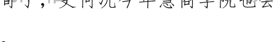

## 第三节 项目竞标

唐锲开始了三个项目的介绍。

“各位，欢迎来到共享项目——获取更多”。共享，现在我来介绍几个项目——“展会”共享。大家都知道，现在共享模式似乎是大势所趋，单车共享、共享共享、汽车共享、充电共享、雨伞共享等等，不胜枚举。坦白的说，这些共享都是仿共享，它们的本质是制造产品投放市场为公共租赁。当然，不能说仿共享就一定好，我们也能切身感受到这些共享给社会带来的便利。现有共享模式的利弊，在这里就不一一赘述了。我们现在来说什么是真正的共享。真正的共享，是分享公众已有之物，大家各取所需，其中运营公司只是一个平台，只做一件事情，用平台方便大家互通有无，运营公司并不制造产品放在市场上。那么没有某个行业或者产品有可能实现这样真正意义的共享呢？这个问题曾经被困扰了我们长时间，因为真正意义上的共享似乎违背了人占有意识的本性，即使真的拿出来共享的，似乎很难形成规模转化为企业效益。前段时间，我们参与的成都“共享书屋”项目，就是想通过书屋这个站点，来实现图书的共享，效果并不理想。思而所想，我们决定将共享的主体锁定在企业”。说到这里，唐有意的停顿了一下，双眼扫视着台下的听众。

“那么为什么要共享的主体锁定在企业呢？因为企业相对于个人，更有共享的需求，更能可能有共享的意识。控制成本、节约资源、让闲置为他人所用，正是企业之间共享的出发点。现在回过来说“展会共享项目”，我们每年各行业聚起来约有一万场展会，参加各种展会的企业数量超过百万。大家都知道参加一次参展，都要搭建自己的展台。展会结束后，这些展台也就废弃了。这是一个巨大的资源浪费。“展会”共享项目，就是共享企业的展台部件。项目的基本内容是：

- 一、建立共享平台；
- 二、将各行业的展台部件进行科学系统的分类，这个分类必须方便企业快速检索到自己想要的部件；
- 三、要求展台制作在搭建展会时，对每个部件进行编号并上传到平台上；
- 四、需求展台制作在平台上搜索所需的部件形状、颜色和材料等，并在平台上上下；
- 五、平台制定价格标准，收取10%作为平台费用，其余90%给对方。

项目的来源主要有三块：

- 一是刚才说的10%平台费用；
- 二是平台上资源变现；
- 三是平台上的现金流产生的利润。”

唐铭抿了口，继续说道：“这些，这是我们目前想到的最合理的共享。我们也想借这个项目为社会贡献一份量。项目目标是1000万，现在休息10分钟。”

很多人没有想到，慧商学院正是把“展会”项目放在了后。简单来说，意味着投资意向的企业很难看出这个项目内在并不有关。慧商学院非常重视社会责任，也是如此，他们可以通过“展会”项目更有机会参与投资。10分钟后，工作人员将投资卡收集完毕，厚度明显比了不少。唐铭再次登台，表情挂起浅浅的微笑：“各位，今年营销峰会招标环节就此结束，感谢各位的热支持。一周之内，我们会与中标的企业沟通项目内容并签订投资协议，在此预祝三个项目运营顺利！”说完这句话，唐铭微扬扬，走下台去。

也许看到这里，你会好奇，为什么慧商学院的毕业生能够想到这样的三个项目？装修、银行、展会，哪一项都不是在校的学生能够了解透彻并从中创新的。这里就要说慧商学院的教学方式，我们不妨回忆下冯涛在课堂上说：“营销和哲学一样，都是非常高科学。哲学是从动到静的科学，而营销是从静到动的科学，它们的共同之处就是没有正确答案，都需要实践才能真知。营销的静，就是我说的营销体系。营销的动，就是营销体系与时俱进的自我修复和实践。”慧商学院的教学方式就融合在此之中，引导和点评，帮助修正。此为“立静”。正常情况下需要2-3年，当然不排除有个天赋异禀的学生，一年内就可以通过学院的营销体系评审。

然而，只是熟读兵法不够，兵法之熟读三国的马，一役指挥不当全军溃败。因此，还需要过胜战，足够的经验积累，方能成就一番事业。此为“得功”。慧商学院的学生一旦通过营销体系评审，就会被安排去企业实习。需要注意的是，学生去企业实习可是性的性的几个月月，做助理打杂就行。学生在实习的部分做到一定的成绩或职位，再加上提交实习报告通过审核，才能算合格。对于实习合格的时间，那更是千万别的，既需要能力，也需要规划时间，实习至少才能达到合格的学生并不罕见。

企业实习阶段通过后，学生就可以选择了——是留企业继续工作，还是提交项目继续创业？在实习企业的学生，学院将直接颁发毕业证；而愿望通过创业获得成功的，则需要学院对项目的严格评审，这期间学生需要做大量的调研工作和数据分析。评审通过后，学院发毕业证，并根据情况授予资源或资金的支持。其中优选的项目，会在每年的营销峰会上进行公开融资招募。

所以，慧商学院的学生能够提出好的创业项目不足为奇：丰富的理论知识（营销体系）建立项目的逻辑基础，在企业的工作经验具备了对行业充分的了解，还有市场调研和数据论证以确定项目的可行性。在后面的内容中，本书的主人公们将会深刻体会到什么是“路漫漫修远，吾将上下而求索”。

“会当凌顶、一览众山”。第二种类是战略型，

战略型营销思维的人，对于营销策略有着天生的嗅觉和敏锐度。他们擅长运营营销的公司或事业部：对于品牌定位、品牌认知、产品差异化以及整合传播策略制定等问题，他们都有着清晰的认知、判断，并能果断决策。他们是天生的战略家，宏观层面的营销思维能力十分出众。

“知所不捷，行且通焉”。第三种类是执行型。执行型营销思维的人往往注重责任强度、逻辑严密、性格坚毅、高效务实。这种类型的注意力很少放在创意的想法和宏观的营销策略上，他们是方法论者，研究的是如何步步为营、攻策划、推进和实现营销战略。

一上总结。营销的三种类型，是基于思维的分类，固然并不意味着一个人的思维完全属于某一个类型，而是说他的特质更倾向于何种类型。能够准确识别出来，确实并不容易。睿学院对学生营销思维的分类，一般都是在临近毕业的时候，通过其之前“立静则动”的表现给出结论。

## 第一章 营销峰会

### 第三节 选择毕业生

冯刚导演的电影《天下无贼》中经典台词“二十一世纪纪，什么最贵？人才！至今，你不得不说这句词实在高涵远昂。随着互联网科技快速发展、商业模式层出不穷、产业技术日月异和主流消费群体的转变，很多行业发生着翻天覆地的变化，战场硝弥灭，曾经的霸主崩塌，新兴的企业悄然兴立。这一切的推手是什么？是新的商业规则吗？是科技不？真正的推手只有一个，就是它。多少企业在求贤若渴，又有多少人认为自己怀才不遇。

市场就有竞争，有竞争就有营销。尤其是同质化比较严的行业，企业的营销管理和执行水平几乎决定了战斗的成败，以所用营销人才为手。得到的人才是胜利的，发展到一定后企业对于营销人才的需求往往走向“岗位定需”，即先有岗位空缺，才有人才的需求。在完善的企业架构下，各岗位分配了营销的各个职能，“由岗位定需”也无可不可。

当然，规模尚的企业也会考虑营销人才的储备，一般都是招聘届毕业的大学生做营销助理。

营销学院将营销细分为三种类型，可以说是企业经营营销人才的战略做了更完善的补充。不同行业不同阶段的企业，对于营销人才的需求自然会有所不同。相比于发展处于瓶颈期的企业，需要的是以创意型和战略型营销思维的人才为主，而战略清晰，又有着核心优势的企业，需要的是能够冲锋陷阵快速打开局面的执行型营销思维的人才。

战略型和执行营销思维的人往往有明确的岗位，比如营销经理、市场经理、渠道经理、销售部经理等。创意型营销思维的人才的岗位设置是目前大多数企业所缺的。有创意，但不了解行业产品研发的专业知识，你不能把他放在研发部，如果回归市场则又有所局。

慧商学院的建议是在架构中增加创意部，隶属于企业的营销中心，负责创意提出和与研发部对接推进产品的创新。

与一般院校的毕业生不同，慧商学院的毕业生并不是刚社会的白纸一张，他们早已描绘好自己的专业水平，有清雅不准的水墨画，富有华丽堂的油画，还有通横直的素描写。这让企业有针对性的选择，因此慧商学院在峰会上公布的，所有求职意向的毕业生往往会邂逅。只是创意型和战略型的毕业生基本上大多数选择毕业后创业，很少会选择求职。

唐健走下台后，关于项目的讨论还未完全平息。稍等了几分钟，声音小了点，主持人握着话筒走上台，仿佛受会气氛的感染，声音更为洪亮：“非常感谢唐主任对今天慧商学院项目的介绍，“易美伶”家乐金融平台是互联网+金融+行业新模式，“小金豆”青少年金融平台是互联网+金融+细分市场，“展会吧”则是互联网+共享服务，真的是一个比一个精彩，相信投资这样的项目一定会收益丰。好，现在进入今天的最后一个环节，慧商学院毕业生的选择。

请慧商学院招生办钰华主任上台！

我先通报一下选择的毕业生人数。今年通过慧商学院毕业考核的学生共有42人，但选择毕业后重新入职的学生很少，但有9位。大多数选择了搭建团队创业或留在了自己的企业就业。”时势造英雄，近几年成功的互联网企业如雨后春笋，引来无数人的侧目，也点燃了大家创业的激情。慧商学院的毕业生作为营销骄子，更是摩摩掌心激动。

“这九人当中，根据我们的评估，有一是有创新营销思维，有两位是战略型营销思维，另外六位是执行型营销思维。在座的第一次参加营销峰的朋友，我先简单一下”

大体的流程：首先用PPT介绍毕业生的资料，内容除了个人基本信息外，也包括他们在企业实习的情况，后面会有评语；接下来的，对每个毕业生有意的企业就填写招聘意向单，上面注明了入职部门、岗位、待遇和人力资源联系；我们会收集各位的招聘意向单后讨论哪个企业最合适；最后我们会确定入职的企业介绍完流程，段华打开投影仪，开始了对毕业生的介绍：9位毕业生的介绍用了近个小时的时间。段华对营销体系框架、人的风格或营销哲学的优缺点、企业需求以及结语。段华热情地讲解了企业对这些毕业生的能力和潜力都有程度的认识。

整个会除了段华口口扬扬，其他没有声音，营销引起热闹。在场的宾客们看着哪个毕业生适合自己的企业，其他企业也可能招聘这个毕业生。尤其是那一位创新思维的人才，普通的高校是不具备吸引力的，一定要有吸引力的人才。接下来的20分钟休息时间内，有企业陆续提交了招聘意向单。暮色渐临，华灯初上，随着商学院项目的结束而接近尾声。

随着商学院学院的结束而接近尾声，谁又能知道这次商学院的毕业生给行业和企业带来巨大的改变呢？

## 第二章 秦晋之选修课

### 第一节 选择专业

春风破浪，卷起地上的尘，天地一片灰。五月的奉天已经是夏天。秦晋之最近烦恼，简直可以说是烦躁，从小能够让他这样一个家伙如此心烦，自然不是什么小事。去年高考成绩与第一志愿中国人民大学相差十分而未录取，他被第二志愿东北大学法学系录取了。运气并不坏，毕竟东北大学也是全国著名的985大学，法学系还是热门专业。大一的学期一切都是那么新鲜，气候、饮食、大学生活都是那么美好。转眼间大一的学期已过半，秦晋之最近越来越心烦。

在中心食堂吃完饭，秦晋之慢的走回宿舍。宿舍一共7个人，按照年龄排靠，看到晋之回来，老二天明挑眉眯眼说道：“哟，宝宝回来啦，今天回来挺欢啊。”晋之没有说话，冷哼了一声表示回应。天明是沈阳人，浓大眼，长很有西北男人特有的粗犷和帅气，只是性格有点二（很多年后，回忆起天明的性格是心性自在，倒是比较高的评价），给别人取外号，因为晋之年龄最小，便给他取了个“宝宝”的外号，这让晋之很无奈。在宿舍里，晋之跟老大悠逸关系还好。看逸飞看着电脑，旁边翻着一本书，晋之便坐下问过去：“老大，你聚精精神的研究看什么？”悠逸飞笑了，“上午在图书馆看了本Java编程书的，正学着呢。”

#### 数据处理：HttpClient

说者无心听着悠逸飞这来尽了精神，“怎么，老大，你对法律也不感兴趣？”

“哈哈，怎么又要加个世。谈不上感兴趣，只是想学学。听你这意思，你对法律也不感兴趣？”

“算是吧。”晋之悻悻地回答道：“我觉得自己不会喜欢毕业之后的工作。检察官、法官、律师、法务？每天围绕着法律的条条框框去工作，想想觉得无聊啊。如果你专业是在大二的时候再确定多好，没有接触怎么知道哪个专业适合自己吧？一旦报考考虑的时候就确定了专业，那不就相当于在不了解的情况下确定了自己的的人生。”悠逸差异看着晋之，“呵……”这个真的像你说的那么做，可能不好操作吧？”悠逸也觉得秦晋之意见可见几分道理，只是对于现在的他们而言，木已成舟，抱愁也是无济于事的。

“也许吧。对了，你怎么想起来学Java编程了？”没想到你还有一颗IT精英的心啊。”憋着的心事说出来后，秦晋之感觉心情舒畅了一些。

“哈哈，别跟我扯脖子。这不是现在黑客很火嘛，我就想着看看，没准自己有天赋吧。这本Java编程的书是在图书馆捡到的，没事研究。”悠逸撇着嘴角说着。悠逸的话给了秦晋之一个启发，“对啊，图书馆里什么行业的都有，过去挑挑，没准能找到自己感兴趣的专业，到时候不能换个专业或者搞个双学位也可以啊！想通此节，秦晋之时感觉轻松了不少。下午的专业课秦晋之根本没有心思听，脑子里一直盘算着去图书馆的事。好不容易等到下午4点下课，秦晋之立刻小跑着奔落地图书馆。外面风已止，尘埃落定。天地仿佛拂去了灰蒙的慢洒，空气清新许多。东北大学的图书馆位于校园中央的汉铜扑，每一层楼之间间隔很高。整个建筑近百米长，虽然一共只有三层，但看上去高大庄严。图书馆的一楼是期刊库，各类期刊应有尽有；二楼是书库，高耸的书架上各类书琳琅目；三楼是阅览室，原本是学生专用，实际上却是大家自习的必备之路。秦晋进了图书馆后，自然是直奔二楼。在一排排书架前，秦晋之并没有直接进去，他先旁边的椅子上坐下，漫无目标。秦晋之摇头，扫了书架上的标签，继续想着理工类的、文类的专业可以考虑不少，“行政管理、金融学、工商管理、市场营销、外语、国际贸易、电子商务、新闻学。”秦晋之把眼睛闭上，“行政管理听上去无聊；金融学没有概念；工商管理市场营销感觉不错；国际贸易不喜欢；电子商务感觉也有；新闻学没兴趣。”一番思考，秦晋之将范围锁定在金融学、经济学、工商管理、市场营销和电子商务这五个专业上。生命的可能性，往往是在很多看不见的十字路口决定的，主动或被动的机缘决定了一个命运，天堂或地狱。选择了什么样的大学，什么样的专业，什么样的工作，一生就随着每一次的选择走下去。秦晋之走到经济管理类的书架时，第一眼就看到一本期刊，《中国职业经理人》，这应该是符合不久前一个学生带来的。秦晋之好奇地拿过来翻了，于是他的命运就被这本期刊决定了。《中国职业经理人》，讲的是企业经理人的故事，横跨诸围，他们的智慧改变了一个企业，影响着一个行业。字里行间，你可以感受到商战的硝和魄。秦晋之看得津津有味，随着时间的过去，他在书架前就把本期刊看完了。仿佛打开了一扇窗户，窗外的瑰丽夺目，秦晋之再也睁不开窗户。我要职业经理人！期刊里的频率最高的词是营销，秦晋之很快的做了一个决定，学习市场营销。他的人生轨迹就这样改变了。对吗？是吗？好吗？没有答案。天已黄昏，也许是做完决定的兴奋，秦晋之一都没有觉得累，他下楼室又找了近几期的《职业经理人》后，他要准备回宿舍，他要好好想想怎么。回到宿舍，只有老大逸逸和老六黄威。悠逸飞是在右侧桌前看着电脑，黄威是秦晋之上铺，个头不高，长相愁厚，典型的宅男，除了上课吃饭时间都在宿舍里待着。

“老七回来了。今天回来这么晚，”听到声音，悠逸飞甩头说道。

“嗯，受老大的启发，我刚去了图书馆，”秦晋之接到悠逸身边坐下，“依靠在各个专业的海洋里，寻找自己的座座孤岛。”

“哈哈，孤岛。怎么样，找到感兴趣的专业了吗？”悠逸把肩膀上靠了靠子。

“找到了！我决定学市场营销，我要做职业经理！”秦晋之竟然毫不掩饰自己内心的兴奋。

“嗯！不错，哈哈！你选择的我我相信没问题。”悠逸对秦晋之还如既往的支持，这让秦晋心中一暖。黄威在旁边听着他们说话，忍不住说道：“宝宝，你学市场营销合适。我舅舅就是职业经理，以前几家公司都做的高管。你性格跟他一样，爱钻思考，哈哈。”宿舍里，唯一称呼秦晋之“宝宝”而自己不反感的黄威，大概是因为黄威身上那种天生的亲和力。得到宿舍两个兄弟的支持，秦晋很高，“好！既然已经快的决定了，那我今天就开始进入状态！走，跟我一起上自习去！”黄威看了晋之一眼，坐回床边，“自习有什么好上的，又不是妹子。我看我的电视剧了。你跟老大自便”。悠逸也是挥了挥手，指了指电脑。秦晋之哈哈一笑，拿起借的基本期刊出去了。接下来的两天，秦晋之很快把借来的几本《中国职业经理人》的期刊都看完了。故事是越看越精彩，但对秦晋而言而言还是高山流水、雾里看花。第三天秦晋之在网上查到”

市场营销的权威者是美国的菲利·柯特勒，他的著作《营销管理》更是营销界圣经的存在。秦晋之下午在图书馆借了这书。晚上在自习室看的时候，秦晋感到头大——几乎所有的词汇他都如云里雾里，面对近700页的大厚书，他拥有一种在原始森林里迷路的感觉。书是从图书馆借的，没有办法在书上画重点（不过真按照他的理解来画重点，估计整书都要铺满了）。拿着笔将这书里感觉重要的内容都抄上去？那秦晋就是直接抄了书。这可行，秦晋之营销完全靠自己自学实在不算明智之举。

他满心疑惑地被收宿舍回宿舍，在自习室的讲台上为了选课找个男学生，听很多同学们说这个教室会有选修课。“选修课？”秦晋“啪”的地拍了一下桌子，“对啊，看看跟市场营销相关的选修课有没有，先听一听，肯定会对学习市场营销的专业领域有帮助！还可以顺便向老师打双学位的报名。

哈哈，我果然是个天才！”秦晋对自己的想法很满意，乐呵呵呵呵地收拾东西，完全不顾旁边学生异异的眼神，大摇大摆地走出了教室。

回到宿舍秦晋找侯逸借他电脑上了学校的校园网，很快查到了市场营销相关的选修课的清单，里面有《消费者行为学》、《消费者心理学》、《国际市场营销》、《企业营销策略与规划》、《广告理论与实务》、《分销渠道管理》、《营销创新》、《创建营销体系》等十多个课程。选修课都是学期的第一个一个月开始，因此其他选修课已经开始了好几节课，唯独《创建营销体系》这门课程是刚刚开课的。因为这个原因，加上对这次选修课名称莫名的好感，秦晋便决定选择这门选修，此时的他并不知道这次是他人生中最关键的一次选择。

# 26 楼
作者：大秦的疆士 日期:2018-07-18 09:51

各位爱的读者，大家好。因论坛不支持一贴多投，在此在“经济论坛”版块，本文将不再进行更新。在“舞天王叔霆”版块，我将继续更新。大家可以在“舞弈襄霆”版块直接查看《楚商学院》，或者直接查看本人“大秦的疆士”。

非常感谢大家的支持！若有不便之处，还望理解！谢谢大家各位!

# 27 楼
作者：大秦的疆士 日期:2018-07-18 12:58

## 第二章 秦晋之选修课

### 第二节 选修课的选择

大一是没有选修课的，一般都是在大三的时候才会安排，秦晋之等不等了。《创建营销体系》是周三的晚上7点在逸夫楼216室的阶梯教室上课。明天刚好周三。

第二天白天，秦晋之根本无暇听法学的专业，一直在课堂上翻着《营销管理》，虽然仍旧是看的云里雾里，但倒也乐其中。吃完晚饭，在宿舍里等到6点50分，秦晋之就把《营销管理》装进书包发出去选修课程了。

教室的黑板上不知道写的是“7点有选修”，大概是因为第一节课，教室里已经来了四五个学生在座位上等着。秦晋之找了中间靠后的座位坐下。

在7点的时候，一个约莫十来岁的男子进来后将教室门轻轻推开，走到讲台拿起粉笔在黑板上写道《创建营销体系》郑江平。”随即一转身面向大家，露出微笑并介绍道：“各位同学，你们好。我是你们的选修老师，我叫王教授郑江平。《创建营销体系》这课程因为某些原因导致时间有些后延。不过没关系，只要今天来上第一节课的同学，不管以后来，我都会给选修分。好，我们现在开始点名”。

看着点名的功夫，秦晋之仔细的打量着郑江平。郑江平身上简单的黑色T恤，下身是蓝色的牛仔裤，脚上穿着休闲鞋，高高的鼻梁上戴着一副眼镜，整个显得文质彬彬。看上去不是很严格的老师，秦晋之微微有点失望。秦晋之又看向台上看了看，知道郑江平会带着什么样的教材来课，却发现台上什么都没有。

点名很快就结束了，秦晋之当然没有在选修的学生上，整个教室也只有他没有被点到。江平用眼神扫了一眼秦晋之，嘴角角的弧度一闪而过。“点名已经结束，我向大家保证今天在座的所有同学都有3分的学分。以后也不会再点名了。至于以后是否还听我的课，都没有关系。对了，现在各位同学如果有别的事情安排也可以先走，都没有关系的。我们五分钟后正式上课。”说完这句话，江平便开门走出了教室。座位上的学生你看看我，我看看，大家对于这样的安排十分意外。以后还要学吗？不过我们多人说出来，老师一定会说话。秦晋忍不住了，在教室门口第一个同学站起来推东西出去，教室里就此响了收东西的声音。五分钟后，江平准时到了教室，望着座位上剩下的学生，面表情完全没有平静。“看来在座的各位同学真心想学这门选修课，既然如此，我就简单介绍一下我的课程安排。”江平站在台上，目光透过眼镜在每一个学生身上。“营销体系大致分为：
- 营销的概念
- 获取营销洞见
- 识别细分市场
- 建立强势品牌
- 应对竞争驱动增长
- 传统4P之产品
- 传统4P之价格
- 传统4P之渠道
- 传统4P之推广
- 营销未来等

秦晋之听着介绍觉得内容很熟悉，悄悄翻开《营销管理》，原来江平刚才说的内容正是《营销管理》的目录。秦晋之不禁有些得意的又有点失落，仿佛发现了刚才说的内容基本上都是菲利·柯特勒的《营销管理》中的章节。这一点并不否认。但如果你认为是想好这门课程，除了《营销管理》这本书的内容，你还要看其他的书籍两本，全面的理解和吸收这些内容。我都会布置作业，当然交作业也没有关系的。”江平说到这里特意停顿了一下，似乎享受下面学生瞪口呆。“相关的书籍，我不推荐，你们自己选择，可以在图书馆找，也可以自己买回来。这就是学习这门选修课的方式。既然选择了，我希望大家可以按照我的方式来学习，我保证一定受益。”低头看了看手表，江平接着说道：“因为时间关系，今天我们就不讲内容了。以后大家要看的书有很多，趁着还有时间，先跟大家聊聊如何读书。”台下一片寂静。来的学生似乎都被这个选修课的学习方式震到了，数学不好的人除了厚的《营销管理》，还要至少看二十本书，交多次作业。好以后不上课也能给学分。至于秦晋呢？他是心花放绚了！看来这个选修选对了。”郑江平：“学习一本书，我认为可以分为四个阶段：
- 第一阶段：把书读厚。这个阶段就是不断的理解书中的内容，并发现自己的思考；
- 第二阶段：把书读透。这是化繁为简，提炼书中的知识结构，梳理理论中的逻辑框架；
- 第三阶段：再次把书读厚。与第一个阶段相同，这个阶段是在第二个阶段的基础上，增加你对内容的理解和丰富，即形成一个系统的注解；
- 第四阶段：把书读没。这个阶段不是让你把书朽了，而是让你把书里的精华熟记于心，并做到用书中的知识随取随用，随时要用脑子里就有。”郑江平一边介绍一边在黑板上写上这四个阶段。在座的学生听得津津有味，不少学生都记在了笔记本上。

“今天的内容就这些。第一课我们主要讨论营销的概念以及对营销的态度是什么。我希望大家能先带着这样的问题提前一看书。至于在这一内容中，除了《营销管理》之外，还要你们自己去挑，没有指定。今天课就上到这里，大家没有别的问题的话，我们就下课。”郑江平说完这句话停了几秒，看在座的学生没有要提问的意思，“好，现在下课！我们下周三见！”说完便转身走出了教室。秦晋之本想着跟郑江平说一下自己的情况，求他的建议。看着郑江平这么走的倒是意料未及，踌躇了一下，还是决定下节再来。

# 28楼
一手营销 加微信1101284955 获取更多帖
作者：秦晋 日期：2018-07-18

## 第三章 初识营销

若待上林花锦，出门便是看花人。

本章涉及的书籍：《营销管理》、《营销的本质》、《新营销新模式》、《营销3.0》、《营销4.0》

### 第一节 营销概念

郑江平的选修课完全吊了秦晋之兴趣，他决定学习营销就从跟着郑江平学习营销体系开始。这一周的时间，除了应付专业课，他还做了两件事——买书和看书。由于生活有限，他先买了两本书，一本自然是菲利·柯特勒的《营销管理》（第15版），另一本是《营销的本质》，作者是波斯哲。这本书名就知道营销的本质，可以作为学习营销概念的补充。这一周的时间是在反复一遍《营销管理》和《营销的本质》的第一章。如果用一个词总结秦晋之之后的感受，那就是头晕脑胀。以为越看越明白，结果越看越乱。他还是等上课了。终于到了晚上7点，秦晋之准时到了教室。看到黑板上写着7点，郑江平进来的时候教室里只有六个学生。秦晋之依然坐在上次那个中间的座位上，以为还有一些同学，结果只有六个。郑江平面表情，似乎没有意外，只是目光扫到秦晋之的时候，他的眼睛闪烁了一下。他停了会儿，江平开口道：“今天来上课，学习的内容是营销的概念、营销的内容以及对营销的态度。既然各位选择了我的选修课，我希望大家按照我的方式学习，当然不需要交作业。谁能告诉我营销的概念呢？”一位男同学站了起来，手里拿着回答道：“老师，百度百科上营销的概念是这样的——市场营销是指企业发现或把握潜在消费者和众多需求，从整体的营造以及自身形态去推广、传播和销售产品。”好，请坐下。还有吗？”秦晋接后翻开《营销管理》，说道：“营销管理》里最简单的定义是有利于满足需求，选择目标市场并通过创造、传递和交换价值来获取、维持和增加客户的艺术和科学。”好，请坐下。”秦晋之并没有立刻坐下，而是翻开了《营销的本质》，找到自己划线的地方说道：“不，郑老师，还有补充。在《营销的本质》书里说‘所谓营销，就是构建企业—客户关系，营销是企业活动中的一项专业职能，也是企业维持生产循环的一项核心职能，以构建企业—客户之间的关系’。我觉得这本书里的定义跟《营销管理》完全不符，所以我我觉得必要补充一下。”

“非常好！请坐。”江平满意地看着秦晋，嘴角挂着微笑。“两位同学说的都对，百度百科、专业书籍上面的定义肯定都是道理的。但是如果如果我想确定营销的概念，到底该选择哪一个？是百度百科，还是权威的《营销管理》？或者是这位同学补充的《营销的本质》里的？通过查找营销的概念，我想告诉各位，市场营销从它的定义就没有标准答案，市场营销的内部内容我们都可以说它是没有标准答案的。这是它跟科学最大的区别。”一个观众就说他哈哈，“老师，我们学习营销的概念有用吗？”坐在左侧的男生问道。“这个问题很好。以往说了，营销的概念是为了让人知其。由于很多营销内涵往往杂杂，比如说营销，所以在给出一个明确的概念时只能高度抽象，说明明白做事就可以了。至于知其所以然，那自然是学习的内容。以往说了，清楚吧？就要上升到哲学高度，春秋战国时期以公孙龙和惠施为代表的名家，他们是通过名与实的辩证关系来寻求内外圣王之道。营销的概念中，谁是谁，谁又是实呢？哲学的事情我们不在这里，要讲起来就太大了。现在你们只要记住营销的概念就是我们知道营销回事就行。至于刚才两位同学提到的三个营销概念，无需纠结对错，目前你们就凭自己的理解来选择一个概念就可以了。”郑江平狡窘地笑了笑。秦晋之对江平的说法有点无语，他习惯学习都有标准答案，自己选择一个哪门子答案？于是他站起来问道：“郑老师，我想请教这三个概念中，您倾向于哪一个？”其他同学觉得秦晋之这个问题很好，眼睛睁着郑江平等回答：“这三个概念中，我现在的感受是更倾向于《营销管理》中的那个。知道为什么？因为这个概念包含了营销的态度，把营销当作科学和艺术。至于之前说的百度百科和《营销管理》，我觉得意思差多的。”秦晋之回答。郑江平点头很快回答道：“营销的概念其实很好理解。菲利·柯特勒营销的世界是任何行为的基础。营销体系大致分为：营销的概念、获取营销洞见、识别细分市场、建立强势品牌、应对竞争驱动增长、传统4P之产品、传统4P之价格、传统4P之渠道、传统4P之推广、营销未来等。每一个内容都可以理解为菲利·柯特勒《营销管理》中所提到的卓越客户价值，这是营销的世界观，是任何行为的基础。至于是否足够准确，我不会告诉你们的想法，需要你们自己思考。好了，关于营销的概念就介绍这么多，我相信你们有了初步的概念。”

# 29 楼
作者:大秦的疆士 日期:2018-07-18 12:59

## 第三章 认识营销

### 第二节 认识营销体系

完了了营销的概念，郑江平在讲台上随意的跟着道：“你们知道营销的4P吗？”秦晋之觉得问题很难。“太简单了。”江平并没有等下面的学生继续说道：“价格、渠道、促销。如果你们是市场营销专业的，一定从4P开始。知道原理？”沉默了数秒，坐在最后一排的女学生站起来道：“我认为是因为4P让企业清晰地开展工作。另外老师提到的例子，其实里面包含了4P，不是吗？”江平的脸上露出了满意的微笑：“是的。回答得很好。你叫什么名字？”

“老师，我叫秦晋。”

“秦晋？秦晋的好。哈哈，你名字很占便宜。”郑江平不禁对秦晋的名字一笑，接着继续道：“百度百科的定义我们可以理解为顾客+竞争+4P，只不过它强调了客户是中心点，竞争也是企业必须关注的一条主线。这个答案你们觉得怎么样？”

受到鼓励的秦晋思索后站了起来，翻开《营销管理》说道：“老师，我现在对营销的了解程度不能说百度百科的答案是不准确。但我这两天看了《营销管理》的第一章，认为里面的章节，营销的核心内容应该更符合营销体系的内容，需要：欲望和目标；目标市场、定位和市场细分；供给物和品牌；营销渠道；付费媒体、自有媒体和免费媒体；印象与融合；价值和满意度；供应链；竞争；营销环境。”郑江平的脸有点亮了，他在这一瞬间有一种感觉，觉得当年招生的任务可能会在秦晋身上完成。当然，这种想法只是一闪而过，江平的脸还是平静。“非常好！说到这里，我们就不得不思考一个问题了，为什么我们要营销体系？因为合格的营销体系就是简单的营销管理方法，能够帮助企业在营销层面查漏补缺、有的放弃。所以，营销体系的内容，有两个前提：一个是可能的完整，二是逻辑结构上清晰掌握。百度百科的定义，我也是认为还远远不够。如何围绕客户？如何面对竞争？4P的支撑够吗？这样的定义对于企业和经营，看的还是一头雾水。菲利·柯特勒的《营销管理》主要内容就是营销的方法，刚才提到的核心概念，也基本上就是这本书的目录内容，虽然顺序上是不一致的。

“但是，我们真的就按《营销管理》中的……”

从这些平台上完成对产品的认知、交易和关系。推动增长的因素是在移动互联网的普及和便利。营销要的是什么？营销要的是流量和IP。再接下去开展，内容太多了，对于新营销我们就点到为止，后面再议。

“现在很多人都认为时代在变化，营销环境也发生了变化，传统的营销理论已经没有，就好比大家已经用了。可是我们想一想，无论环境如何变，商业模式是否会变？还是要靠产品和服务挣钱吗？有了产品，你就一定会有价格，哪刚开始是免费的，那也是策略，而不是考虑价格。”郑江平复了一下心情，“营销现在还是需要规划和管理。”

“好了，关于营销和营销体系的关系，谁还有问题？”

“说到营销和营销体系的关系，在《营销管理》的第一章‘营销的核心概念’这一节，后面提到，营销的核心概念不会因为新的现实和急剧的市场而改变。”

“除此之外，科特勒的书，《营销革命3.0 从传统到人文》以及《营销革命4.0 从传统到数字》，也是尝试从移动互联网技术对当下管理的改变。改变是肯定的，但都是趋势的，都是在营销体系下的突破。营销的学习强调个人主观的理解和运用，无需按照别人的框架行事。所以营销才有趣嘛。既然没有，”郑江平说道，“那现在讲最后的内容，我们应该用什么态度对待营销。”

## 第四章 对营销的态度

01

用什么态度对待营销？六位学生面前，这是问题吗？当然是认真学习的态度。看出学生的疑惑，郑江平挥了挥手说道：“学习营销的起点有三个问题——营销的概念、营销体系的概念对待营销的态度。这三个问题明白了，后面的学习会半功倍。两个可以理解为我们要学什么，而对待营销的态度则可以理解为营销怎么学。”看着这几位学生若有所思的样子，郑江平也不停说道：“还记得我在讲营销概念的时候，说里面包含了对待营销的态度。那就是将营销视为科学和艺术。”

“视为科学，怎么讲？科学就是讲逻辑，讲规律，讲体系，同时营销从来不尊重和使用。视为艺术又怎么讲？艺术是有生命的，是美的，是有创新的，有突破的。两者结合，就是我们对待营销的态度。当然，随着营销环境的变化，伴随着互联网角兽公司和新的商业模式带来的不断淘汰，我们对待营销还要在变化的迷雾和成功的喧嚣中学会冷静和耐心。在很多人认为企业的成功是移动互联网、新媒体、流量、爆款，甚至他们认为只需要把其中一点做好就能成功。过去成功了，看似成功是咫尺，多么遥不可得。真是如此吗？不，也许成功是某种偶然的机遇，长期的成功一定需要长期的系统营销管理方法应对剧烈的竞争和挑战。所以，我们要冷静，也要足够的耐心，不要为别人的成功而浮躁不安，而去怀疑营销体系的重要性。另外，我们要更加重视，因为营销的确太重要了。从某种意义上来说，企业策略就是企业的营销战略，而商业模式的创新，则蕴含在营销规律之中，只不过在这环节，营销规律潜伏了商业模式可行的条件。没有人能离开营销规律而完全创造一种商业模式，他们只是在秉弄营销规律时发现了新的公式。”

沉默，只有沉默，六位同学听得如如如醉，他们已经明白为什么郑平一定要讲对待营销的态度，里面的学问可真多啊。

02

“我们再来点后点”，郑平对自己刚才的演讲也很满意，神来之笔地继续说道：“刚才我们是从形而来的演讲，现在我们再说些形而上的内容。大家有没有兴趣继续听？”

当然感兴趣，六个学生异口同声地表态。营销，营销什么？常规的商业范畴，产品、服务、体验、品牌、事件等自然包含在内，除此之外，我们自己、其他人、观念、组织、信息，甚至政治事件等等事宜皆可营销。”

“好！下面的内容我就想到的哪里讲到哪里。营销什么在现在的社交软件、直播平台、微信公众号等等，这些都是营销的平台，可以塑造自己、塑造别人，也可以塑造观点。有什么什么是完全不需要营销的吗？对不起，我对待营销也要客观理性。营销并不是天上的雪莲、人人参治百病。营销不能解决企业的所有问题，它只是提供致胜的方法，事情还是要人来有效推动。”

“再讲一个，有一种说法，学习哲学之道的前提是看透人性，那么学习营销看的是什么？我认为是‘认知’。营销的一切结果都体现在目标的上。如何形成认知，如何改变认知，也就离大师远了。再来，孙子兵法有‘兵无常势、水无常形’。营销的环境在变，工具在变，逻辑规律也会变，可以说营销本身就是自带属性的。所以传统理论之一是不变的，而变化是营销的主要规律。最后，学习营销将会涉及到业务运作和企业经营，这些事情离不开‘功利’字，但希望以后不要被功利左右，不要忘初心。”郑平说道，“好啦，今天我说的足够了，你们慢慢消化吧。总之，营销体系的内容要用比喻的手法将你对营销的理解出来出来他在黑板上写下了邮箱，顺便挥了挥手：“下课！”转身就要出门。秦晋之不等收东西，立刻跑上去喊：“郑老师，等一下！”郑平回头一眼，看见秦晋之，停下来道：“秦晋之，我大概猜你想什么，不要着急，好好完成布置的作业，下周三课后我单独跟你聊。”说完，对着秦晋之笑了笑，大步离开了。

- 32楼：作者:大泰 日期:2018-07-18 01:01
- 33楼：作者:大泰 日期:2018-07-18 03:02
- 34楼：作者:大泰 日期:2018-07-18 23:11
- 37楼：作者:大泰 日期:2018-07-19 09:56

## 第三章 初识营销

### 第五节 秦晋之作业

01

烦怪收东西，秦晋之还在聊天的几个同学打了声招呼，他也走出教室。路上秦晋之走得很慢，他一直在琢磨郑平走前跟他说话的话。“老师猜到我想跟什么，他怎么猜到的？估计第一节点名的时候并没有我的名字，他猜到我是大一或者大二的学生？学生这么积极来听他的课，说明对营销有学习的想法。难怪他能猜到我想跟什么。”秦晋之仔细分析后，心里轻松了一些。他是那种喜欢把事情说明白的人，不明白白直至于寝食不安，但强调也会觉得睡不快。“可是，老师为什么要强调我要好好完成的作业？按照他来说，刚布置完毕，这件事就没有必要再强调了。这个作业还有别的用的？”秦晋之眼睛一光。不管作业还有什么深意，他也决定拿出百倍的心思来完成这个作业。“可是到底什么样的检验，什么样的体裁呢？”秦晋之在路上上一走一边看着这个作业，脑子里不时蹦出一些想法。连续了两天，他感觉自己头大了一圈，仍然没有一个让自己满意的思路。

此时是晚上9点，宿舍里的兄弟们都在，各自忙着事情。秦晋之正想的事，突然听到“哈哈”的打斗声，寻过去，原来是宿舍老三红红用电脑看电影。秦晋之凑过去一看，原来是王卫的电影《东邪西毒》，一部意境很高的武侠电影。跟着看了一会，秦晋之突然眼睛亮亮，光一闪，他知道该怎么完成他的作业了！

02

这个世界是公平的，因为人人都要遵守法律，都有生老病死，也会有自己的烦恼和幸福。这个世界又是不公平的，其中是因为人的存在，我们习惯把这种人叫做“天才”，比如那些玩耍学习却考第一的学生。我们的主角秦晋之虽然说不上天才，但他对营销确实有天才级的悟性。在网上翻阅了不错资料，他根据自己的理解完成了郑平作业——一部短的武侠小说。

夕阳如血，已近黄昏。落日透过树枝洒到树下，天地都已在傍晚之中。平坦的大路上一人，五十外的城门后。突然从远处传来“咯咯”的蹄声，一匹白如雪的马转身停了，后面扬起一阵尘土。进入前面树林时，只听“呼”的一声，只见马上坐着一位白色皮肤的老者，目光炯炯，眉间透着威严。

“十剑盟”镖局是中原最出名的镖局，自成立二十余载以来，从未出过错。每次运输都由老大亲自行，出发前制定详细计划，力求万无一失。再加上十位主力的多年练习，已臻化绝顶高手。所以江湖上，黑道也不敢打。“十剑盟”镖局一年仅接三次，每次所获都是当朝失而复得。十剑盟之中，每一个人的剑法都不同，的作用非常清楚。

| 成员名称 | 位置 | 剑法 | 职责 |
| :--- | :--- | :--- | :--- |
| 胡鸣 | 剑阵中间左侧 | | 领领 |
| 品牌归 | 剑阵中间右侧 | | 协同 |
| 刘断 | 剑阵第二层南 | 凌厉 | 攻 |
| 张亮 | 剑阵第二层右 | 多变 | 灵活守兼备 |
| 薛天 | 剑阵第二层北 | 开合 | 攻 |
| 王人 | 剑阵第二层西 | 软剑、灵动如蛇 | 攻 |
| 秦迁 | 剑阵第三层之前 | 长三尺 | 试探 |
| 秦锐 | 剑阵第三层左 | 似匕似剑 | |
| 钱一笑 | 剑阵第三层右 | 大力 | 攻击范围极大 |
| 春海 | 剑阵第三层之后 | 持双剑 | 灵活 |
| 宋权 | 殿后 | | 攻则殿后，守在前 |

徐徐的晚风吹着前面道路两旁的树林哗哗响，宋权直觉告诉他会有埋伏。“十剑盟”镖局每次运输都由宋权亲自行探路，正是因为对危险的预感非常准确。时间一分钟过去，周围的空气仿佛凝缓，一丝冷汗从宋权额头垂了下来。他左手握着缰绳，右手慢慢抽出腰间的宝剑，双双眼睛紧紧盯着前面的树林。

“哈哈”，宋权后面响起了阵营马蹄声，来的自然是“十剑盟”的其他伙伴。宋权朝胡鸣吐了口气，后者会意举手示意，护队伍立刻停了。抬头看了看景色，胡鸣驾马来到宋权身边，低声说道：“时间已经不早，安全起见，黑之前要进入住所，省得夜长梦多。兵将将来跑，若真有埋伏就会。”宋权沉思片刻，望着那树叶曳的树林，缓缓点了点头。

胡鸣拍拍众人做了警备前行的手势，整个队伍立刻出发，缓缓地向前去。走到一半的距离，隐约见到前方有几个人影站在道路中间。胡鸣抬起手说道：“春海带着队殿后，其余随我前会会面的朋友。镖队不要离我们太远，以防敌人在后面设伏。”

说话间，已看前方站在马路中间的是六个身穿锦服的年轻人，每个人手里提着一把大刀！胡鸣皱眉头，扬声道：“各位汉汉，我等赶路进入入定府，还请行方便。”

对方为首的人点头道：“久闻‘十剑盟’大名，一直未幸会，今日一见果然名无虚。我六人新成立‘六刀客’镖局，今日在此并非劫客，而是不知高低，想会会各位前辈。好让天下知道这往后的第一镖局到底是你‘十剑盟’还是我‘六刀客’”

这六人原来是近年风头劲的‘六刀客’镖局的主人，这六刀分别是‘平台刀’秦、“流量刀’、“模式刀’胡磊、“数据刀’朱来、“媒体刀’王伟和‘爆发刀’刘正劲。

一场无关正义争高的较量已如弦之上，谁胜谁败呢？长江的后浪推前浪，世人都以为后浪拍在沙滩上，殊不知涨潮时，后浪跟着前浪前进；退潮时，后浪和前浪裹挟在一起。谁赢输呢？是完美的“十剑盟”还是“六刀客”？江湖上无人知。战斗一触，刀光影横，道路两边的树叶纷纷落。一切都平静了。

“现在我们来讲《营销管理》的第二篇内容——‘获取营销洞见’。说到这里，我先说句题外，《营销管理》的版本已经出了第 15 版，我知道你们手里的都是这个版本。第 15 版在第 14 版的基础上做了不少内容的更新和调整，甚至一些名词的翻译也发生了变化。比如现在我们要讲的第二篇，在第 14 版里，翻译为‘获取营销洞察’，而在第 15 版里，翻译的是‘获取营销洞见’。我想给各位的建议是，再买一本《营销管理》第 14 版和 15 版对比来看，去思考为什么做了新的调整和补充。这样更有利于各位对这书的学习和消化。

说回到第二篇的‘洞见’的名称，“洞察’二字差别是否有什么玄机呢？为此我这里特意强调了百分百差异，从字理解上倒是没有什么变化，也许只是因为不同的翻译的。我们就不纠这个词了。

切，这就这么热闹闹，原来意思是一样的啊。”秦晋心里嘟囔了一下。

“今天通过讲这第二篇的内容，我也顺便给你们展示如何学习《营销管理》这样的理论书籍。在这里，我要再次强调两个关键词：逻辑和纪律。一定要不断的去思考和理解作者的逻辑和纪律，这样你们才会很容易记住书的内容。第一篇的内容是‘理解营销管理’，那么为什么第二篇的内容是‘获取营销洞见’呢？而不是之前所说的营销体系的内容呢？有人知道吗？”郑江平推了推梁上的眼镜，提问道。

在秦睿之努力的回忆营销体系的内容时，坐在第二排中间的王少飞站起来，回答道：“老师，营销的10个核心概念的第一个是‘需求、欲望和需求’，简单的来说就是‘需求’，而这本书并没有单独的章节来讲‘需求’，其他的内容都有相应的章节来涉及。所以我我觉得第二篇的内容就是‘需求’，获取洞见’就是洞见消费者的需求。我们也是‘营销管理’这本书的逻辑结构还是基本按照这10个核心内容的顺序来安排的。

“噢！回答的很好！大家可以看到，我们通过分析作者的逻辑，就可以得出书里没有明确的结论——‘洞见需求’？所以，各位，我们不要把营销体系的第一个内容名称称为‘洞见需求’，唔……，‘研究客户痛点’的说法更加完整的，哈哈！可以说，洞见需求是营销管理的源点。再用叶龙中的《营销》的16个关键词中的说法，就是‘发现市场机会比学习市场营销更重要’。”郑江平补充道。

“接下来我们就可以带着如何做到‘洞见需求’的问题继续学习这一篇的内容。其实逻辑上也很清晰，“洞见需求’的步骤就是：围绕企业的范畴列出可能产生需求的问题→收集信息或数据→得到答案。这个应该容易理解”

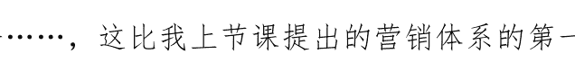

吧。”郑江平一边说着一边在黑板上写出这个步骤。

“我们先分析这个步骤。第一个，围绕企业的行业范围，列出可能产生需求的问题，这个我们用脑子想也会猜到书里肯定不会会，因为行为之间的差异太大，企业的任何问题也会，pass。第二个，搜索信息或数据。这个书里一定会会。第三个，得到答案。这是我们非常希望书里能懂的内容。你看，这样分析，我们就知道该怎么学习这一篇的内容了？我们看看书里是怎样办‘搜索信息或数据’的吧。”

## 第二章《营销管理》的第二篇

郑江平拿出纸巾擦了擦手，打开《营销管理》，接着说道：“《营销管理》这本书里将所要搜集的信息或数据，取了一个高大上的名字——营销系统，当然这个名称无可厚非。接着便是说明其构成和来源。这就是理论书籍通常的术语——试图定义一个通变的专业术语，剖它的构成和来源，如果有的话，还要加上它的分类和意义等等。我将此称为‘营销的完整’。但里面有些内容其实实际的运用并没有太大的意义，我们只需要知道有印象就好，不要形成记忆上的负担。

对于营销信息系统，我们只需要知道三个来源：内部报告、营销情报和营销调研。如果你认真看过的书里的内容，你会得出一个结论，就是营销信息无处不在，线上线下也处处有信息，处处要留心。

知道就结束了？这学学的也太糟糕了吧！秦晋觉得有点困圈。仿佛看出了秦晋等人的心思，郑江接着补充道：“当然，我刚得到的内容是从知识结构的角度来说的。书里还有一些内容值得我们重点关注的，比如提到的数据挖掘，数据的问题是企业如何获取自己想要的数据？这确实很难。比如分析宏观环境，这个更难。因为我们行业，宏观环境的重点就不同。而且大多数企业对宏观环境往往是生此彼长。现在的宏观环境拉出来分析。做好时不时的宏观环境拉出来分分析。不过，宏观环境对每一个企业都是公平的，关键看哪个企业能真的分析宏观环境，找到突破口。宏观环境的内容很多，你们可以记下来：趋势、年龄结构、收入分配、自然环境和技术环境。当然只是个人看法，不同行业不同对待。总的，对于营销系统，考验的不是我们的专业知识，而是企业的重视程度和决心。对于书里有实战价值的内容，我们只需要重视。”

另外，单独拿出第四章来讲营销调研。这个内容比较大，大家自己看了书了，我就不用啰了。切记，企业需要营销调研，但企业还需要知道如何选择适合自己的的方式。这个答案并不在书里，而在企业心里。至于第三章所说的‘预测’和第四章所说的‘营销调研’，这两个内容还是以后在实践过程中再理解合适。现在你们知道这些概念没有什么意义，《营销管理》第二篇你们要了解的内容这么多。不过既然我们花了很多精力来学习理论书籍，总有些收获吧。比王教授说：第四章在‘需求预测’这一节中提到的

- 市场渗透指数
- 产品渗透率
- 品牌指数

还有营销调研中的定性研究，特别是书中‘营销洞见’一栏中说明的‘ZMET方法’。这些专业术语，绝对足够了。”郑江平满脸地说道。

## 第四章 获取营销洞见

### 第三节 16个关键词之“洞察”

《营销管理》书中第二篇的内容，这就讲完了？六名学生都怔住了。飞燕站了起来，有些疑惑道：“郑老师，您刚才也讲了营销体系的第一个内容是‘洞察需求’，可刚才所说的内容，我们对此完全没有概念。”说完，飞燕不等郑江平示意便坐下了。

郑江平倒是不忙笑了：“从下节课起，你们上课之前先把《营销管理》要讲的内容提前一看。《营销管理》作为百科全书，并没有办法将全部内容透彻，或者有些内容更具操作性。比如‘获取洞察’，他重点放在‘营销信息系统’的获取和‘需求预测’上面，没有讲过如何获取洞察。这本书更是之前没有学过，“洞察需求’的核心内容是‘洞察’而不是信息搜集。所以，《营销管理》第二篇的内容我会带过的。这也是为什么我要求你们看到第二种类型的书籍。”郑江平挥了挥手，继续说道：

“回到‘获取洞察’，这第二类型的书籍我推荐的是叶龙中的《16个关键词》和《冲突》这两本书。在《16个关键词》中，第一个关键词就是‘洞察’，第二个是‘冲突’。而《冲突》这本书则是将营销的本质定义为是在冲突中洞察需求。书中也提到了很多关于洞察甚至是创造冲突的方法。因为《冲突》这书的重点在于重新思考营销的本质和方法，所以很建议各位现在来看为时尚。接下来的，我就会带你们来了解《16个关键词》中的第一个词‘洞察’。”

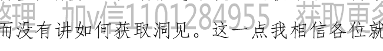

听了江平这话后，这六位学生方恍然大悟。江平从皮包里拿出《16个关键词》一书，翻开了自己在上面划线的部分开始讲道：“给我们介绍一下‘洞察’这一章。第一句是‘洞察力是营销者首先要具备的能力’。第二句是在我们这个信息爆炸、最纷乱的时代里，我们要不断重申消费者的重要性，请你内心充满，也要再一次地、认真、毫无心地去倾听、去洞察他们的想法、愿望和需求。这是在叶中体现了‘洞察’二字重要性的理解。”

“接下来，我们要怎么样去找到叶中的逻辑？我们先引出‘观察’二字，通过对比来体现‘洞察’的重要性，他说为了观察是为了认知，洞察的目的是为了发现本质，还有‘观察用心眼，洞察用心’。好了，现在我们至少知道洞察是要用心去发现消费者的潜在需求。那用了心之后呢？第二个逻辑——‘洞察从哪里来？——从消费者中来，到消费者中去！这也算理解，就是洞察是以消费者导向的。

接下来来，第三个逻辑——‘洞察只能发现问题，只有犀利的眼睛和头脑才能发现真相’。好吧，这个逻辑跟第一个逻辑类似的。第四个逻辑——‘洞察首先建立在市场调研的基础上’，这一点刚才说了，《营销管理》书里知道市场调研是非常重要的。至于如何实施市场调研，在第四章才有全面的。现在到了第五个逻辑——‘洞察用心，在调研的基础上加入对人的理解’。最后一个逻辑是态度，是‘发现市场机会比学习市场营销更重要’。这就是《16个关键词》中‘洞察’的内容。”江平在台上快说着，大家开始用笔记来总结。

“现在我们来总结书里提到的逻辑：
- 以消费者导向的
- 要用心
- 在市场调研的基础上加入对人的理解
- 态度（发现市场机会比学习市场营销更重要）

这就是《16个关键词》中‘洞察’的全部。”郑江平看了看手腕上的手表说道：“关于‘获取洞见’的内容现在我们就讲到这里。你们别着急收拾东西，布置一下这节课。大家还有问题吗？没有的话我们就下课。提醒大家预习《营销管理》后面的内容，下节课我们会先讲。”

秦晋在座位上静静地坐着，其他同学陆续离开了教室。他仔细回味着郑江平话里的每一句话，意识到也许是自己人生最重要的机会，一定要抓住。走出教学楼，雨后的空气里带着一股清新湿润的味道，他不不由得深呼吸，轻快地往宿舍去。

## 第五节 晋之的作业

### 01 作业 1

外面的雨已经停了，教室窗户上还有雨滴挂在上面。郑江平和秦晋分别坐在第一排过边的座位上。郑江平开口说道：“秦晋之，你昨天发给我的作业，我认真看了两遍。坦白地说，我认为你在营销方面表现了一定的天赋和悟性。你当初并不在选修课名单上，所以我后来看了你的资料。我说的对不对？你是江苏通人，高考成绩还不错，但你其实发挥失常，最终成绩离你的第一志愿差了十几分，所以你被第二志愿法学院录取了。我也知道你刚大一，现在来选修说明你对法学的兴趣是非常大的，你在寻找感兴趣的专业对？”秦晋连连点头，他很恼地跟老师交流：“是的，当初我特意去图书馆看看其他专业的书籍，想找到自己感兴趣的专业。后来也算是误打误撞看了《职业经理》这杂志，就觉得特别感触，想以后去做职业经理，就是决定学管理。只是不知道怎么在毕业的时候证明自己懂得营销管理，是要申请调专业，还是考双学位，或者考虑一些证书之类的。上节课下课后请教您这个问题。”

“嗯，原来如此。”郑江平沉道：“人这辈子大多数时候都在选择题，每一次选择都会改变一个的人生轨迹，比如你选择谁谈恋爱，选择谁结婚，选择什么样的专业，选择什么样的工作。你现在选择学习营销，也会改变你以后的人生。对此真的你想清楚了吗？真的决定以后不再从事法律相关了吗？要知道，无论是律师、法官还是检察官，都是光鲜的职业。”

秦晋之并没有毫不犹豫，立刻回答道：“明白。我们专业课的老师也有在外面当律师或法官的，也给我们讲过工作。我也想过毕业之后考法考当律师或法官。但是不知道为什么，一想到律师法官天天围着法律法规，脑子里全是失败，就觉得这样的工作十分无趣。我想更从事从激情且有创造力的工作吧。”秦晋补充道：“我想以后可以做些很有灵感、很有趣的事情来做，这样的人才会有意思吧。”

江平倒是没想到秦晋对这个问题已经考虑得如此成熟，秦晋的回答让他有一种如释重负的感觉。是的，这个学生是个好苗，既然他已经说了这么清楚，现在就告诉他进商学学院吧！只要我们俩不说，段主任也不会知道我提前说了学院的事情。”

江平望着教室后面的窗户，坐直了身子，认真道：“秦晋之，你昨天发给我的作业，我认真看了两遍。坦白地说，我认为你在营销方面表现了一定的天赋和悟性，有创意。”

秦晋之认真听着，自己的作业完成得还不错，心中不禁有点得意。江平盯着秦晋之道：“你知道最好的营销的方法是什么？”秦晋之回答。江平接着说道：“是一边学一边实践。你想做职业经理，空降到企业担任CEO、副总或营销总监。正常情况下，一个人成为职业经理主要有两种：
- 大学毕业之后在企业从业务员做起，通过行业和资历积累内部资源或人脉，升到企业的中层或高层。
- 大学毕业之后起点较高，但需要在企业工作多年沉淀在行业内形成一定的知名度或口碑。接下来我要说的内容必须保密，不能对任何人说，这一点你能保证吗？”秦晋之按住好奇和激动地点点头：“能做到。”

“好。我相信。”江平脸上的笑容闪而过，沉思道：“秦晋，其实我并不是大学的讲师，我真实的身份是学院处办生的老师。我的工作就是通过大学发现有营销天赋的学生招募到商学院。当然学籍留在原校。刚才所说的学习和实践就是商学院。一旦你通过测试进入，会有很多机会，如投资创业，或者安排一些企业的部门工作。至于你提到的调专业、双学位，我觉得应该是通过测试后再考虑。暑假前我们的课还有几次，请你继续完成。你的作业我会直接发给学院处主任，对你的作业满意，会在暑假通知你去参加测试。今天和你交流的事情已经完了。”说完，起身开教室走了。

秦晋还没有从江平的话中出来，他坐在那里仔细回味着刚才讲的每一句话，意识到也许是自己人生中最重要的机会，一定要抓住。”

换牙刷。

洞察需求：消费者清楚要定期的换牙刷，但不能确定具体的时间，需要提醒。

衍生产品：根据刷牙次数，牙刷某地方的颜色会逐渐变浅，直至变成白色以提醒消费者需要更换牙刷（若考虑环保因素，可设计出只更换牙刷头的牙刷）。

- 2、信息来源：看到校园里有情侣逛情街，有两种款式：款式颜色一样、衣服图案互补。

洞察需求：情侣的设计应该更能创造情侣甜蜜的氛围。

衍生产品：设计一款智能的情侣装，当情侣在接近的时候衣服发生变化，图案或颜色或宽度（完美遭遇技术方面不好好实现）。

- 3、信息来源：女生在食堂吃饭的时候讨论很想在学校养宠物，但学校不允许。

洞察需求：女生可以有自己的宠物，还可以不用偷偷在宿舍养。

衍生服务：校园专属定制宠物寄养。鼓励男生将此作为给心仪的女生表达爱之情的浪漫方式。

- 4、信息来源：男生在宿舍里喜欢玩网络游戏；

洞察需求：当我们这一代老去的时候，安度晚年最好的方式之一就是有一款适合老年玩的网络游戏；

衍生产品：最适合老年人身体状况的网络游戏，现在的老人也可以鼓励尝试，摆脱无聊寂寞的晚年生活。

- 5、信息来源：学校的学生平时都喜欢带着耳机听音乐，长此以往，会对听力有损害；

洞察需求：视力不好眼镜可以调整。80后和更早的孩子从小就喜欢用耳机音乐，可能岁数不大的时候听力就会受影响，但戴助听器就会显得很尴尬。

衍生产品：提倡听力的保护和定期的测评，以及开发恢复听力的产品。

至于大学在购物、吃饭和出行的便利方面的需求，秦晋之苦苦地发现已经在N个互联网公司在解决这些需求，王一理：不过需求还有很多地方，比如天猫美国外卖，滴滴订单和摩摩？别的还有什么呢？上课代点名？自习占星代考？额，这些好像都不大正面，还是算了。那作业就交给这五个洞察的需求吧。跟上次一样，秦晋之在下周二的下午作业发到了郑江平的邮箱。忐、紧张，郑江平和慧商学院觉得满意吗?

48 作者:大秦的疆 日期:2018-07-21 23:11

## 第五章 认知客户

晚看天暮看云，人行也思君，人坐也思君。

本章涉及的理论书籍：《营销管理》、《消费者行为》、《影响力》、《怪诞行学》

### 第一节 分组学习

01 下午作业做完了，秦晋之感觉轻松很多，软软地骑在宿舍的床上，闭着眼睛让自己放松一下。忽然，手机的提示音响了。秦晋又懒懒地拿起手机，原来是有新的邮件，一看发现人是江祁：

> “各位同学，发此邮件提醒各位从下节课开始，在教室里老师将不再按照原本地讲述《营销管理》等书中的内容。看书的方法营销老师也跟你们说过，记住两个词：逻辑和结构。吴望信、加信、好。吴望信在课前提前看了下节课的内容，并做好阅读心得。营销并不是个人的英雄主义的工作，讲究内外配合，为了提前让你们有这种合作的感觉，能够做到求同存异，我要求两个人一组在课闲时间进行分组预习和讨论。王子万和万清一、明哲、何成和刘刺、一组；秦晋和段逸燕、一组。请大家务必执行。各位的联系方式见下表。我们下周见！”

02 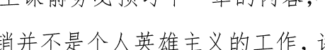

时间的快慢往往取决于当事人的迫程度。打电话后，秦晋觉得时间过得太慢了，躺一坐一会，坐一会躺一会，不停地看着时间。好不容易等到5点半，他立刻收起书包了。

到了自习室，秦晋之考虑两个人以后讨论问题，为不打扰别人便在最后排找个座位坐，又在旁边的座位上放了一本书，给段逸燕下位置。然后他翻开《营销管理》，自己先在那儿一搭一搭看着。

快到6点的时候，秦晋之没有再看，眯脖子对着门口看。没有让他等多久，一段逸燕背着包走进教室，眼睛扫着教室。秦晋之挥了挥手，段逸燕笑了笑表示回应，她朝自己的座位走过去，获取更多帖子。由于上课时并没有留意退班的同学，坐下，两个人极快地打量了对方。眉眉星星、翘脚脚，笑起来两边还有一对对的小酒窝，秦晋之觉得段逸燕有点像自己最喜欢的女星林嘉妍，心里暗自嘲。段逸燕对秦晋之倒没产生什么感觉，只是觉得长相看上去还不坏。

“秦晋之，咱这样吧，8点之前你看《营销管理》的第五章，我看第六章。8点后互相看到对方，有什么问题随时讨论。9点半左右过来，我回宿舍。”段逸燕来自自习室的安排跟秦晋之听到“男朋友”三个字立刻觉得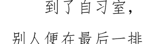 闷坏了，可毕竟段逸燕已经是大了，虽然失落，但他还是认真地说道：“好的，我觉得你的安排特别好。我想补充一点，就是交给老师所说的逻辑和结构，这对于对方容易理解和消化。”

作者:大秦疆 日期:2018-07-22

## 第五章 认知客户

### 第二节 《营销管理》第五章——创造长期忠诚

01 逻辑，逻辑！学习理论的书籍，最快理解的办法就是整理逻辑。获取更多帖秦晋之先花了半个小时通读了一遍第五章的内容，然后开始对其中的逻辑进行处理。“创造长期忠诚”很明显并不是“与建立连接（第三章）”行为的开始，应该是它的目标或结果。看来秦晋之忍不住看了下另外6章、7章、8章的标题，分别为“分析消费者市场”、“分析企业市场”、“开发市场”。看着这一篇的内容并没有与顾客连接啊，秦晋之有点困惑。难道这是要推理吗？他摇摇头，还是先梳理第五章内容的逻辑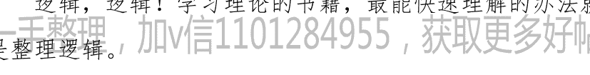

02 书中“创造长期忠诚”又是怎么说的？先问一个基础（逻辑），“顾客是在寻求成本、有限性和投入，追求价值化”。这是这一章全部内容的前提，客户本身是理性的追求价值化。秦晋之这种想法，觉得这样的基础并不完整，甚至说并不科学。因为人本身不会立刻理性地追求价值化。秦晋之感到，这理论只有从理性的条件出发才接下去就好比做数学题一样，第五章的全部内容就是将“创造长期忠诚”这个目标进行表述和分解，共分为三个部分：

- 1. 创造客户价值、客户满意和客户忠诚；
- 2. 客户终身价值最大化；
- 3. 培育客户关系。

用这三个部分的内容来回答“创造长期忠诚”，逻辑上不可否——长期忠诚，是将所创造的客户价值、满意和忠诚最大化，并长期培育客户关系。如何创造客户价值？《营销管理》书里说的仍然一些概念性的内容，可以称之为方法的大概就是其中提到的“客户分析法”。秦晋之反复看完这个分析法，却有一种隔靴摩擦的感觉，只能知其然而不知所以然。看来，对于现阶段的自己而言，这个分析法却是归类为概念性的方法吧，知道但不作为记忆的重点。![](img/62b194d72468d2ff80e52e7ef9a05601_100_0.png

总体客户满意。刚开始书中仍然是讲述顾客满意的概念，秦晋之先把从概念中得到的体会用笔写在书的空白处：“给顾客满意，就是给客户体验上的惊喜。符合顾客的期望，还只是让客户肯定。唯有惊喜，才能带来真正的满意。”写完这句话，秦晋之自己又默念了几遍，感觉良好。介绍顾客满意度的概念，接着书中如何监控顾客满意。看着这一段，秦晋之乐了，因为他发现了两个可以装逼的专业术语——“ACSI”（美国顾客满意指数）和NPS（净推荐值）。这两个词让他觉得王江平也会这么介绍的。内容看起来很有感，但实际实践很感慨。秦晋之又在创造顾客满意这了一幅旁边做了个注释：“顾客满意的监测与市场调研一样，概念重要，要有价值。企业需要有意识，书中的内容只能作为了解，具体的执行的还是企业负责人的意识。”这一节最后的内容并没有按照标题来讲“顾客忠诚”，而是“产品质量和服务质量”。质量的重要性，秦晋之觉得这几乎是所周知的事情，质量才能给客户价值、满意和带来客户忠诚。好了好了，可以对这一章做个小小的总结了。秦晋之对于“创造顾客价值、顾客满意和客户忠诚”，得出来的逻辑![](img/62b194d72468d2ff80e52e7ef9a05601_101_0.png 是“产品或服务的质量+客户体验超出期望=创造客户价值、满意和忠诚”。秦晋之记录了自己的结论。与此同时，他也切切体会到理论学习的好处，加强理解和记忆，事半功倍。整理完这一章，秦晋之看了手机，刚7点。看看段逸燕在旁边很快在笔记本上写着，秦晋之打消了念头，从座位上起身，活动了下课。秦晋之走出了教室。窗外的月光从云层透进脑袋，仿佛在欣赏教学楼外的草坪在路灯的映照下发出淡淡的光![](62b194d72468d2ff80e52e7ef9a05601_102_0.png 空，秦晋之觉得那么烦了。他一边慢着步，一边开始思考书中的内容。“客户终身价值Customer lifetime value, Lifetime的是‘终身’的意思，但从刚才书里的例子来看，也没有是顾客辈子的价值。所以还是按照‘客户长期价值’的概念来理解吧。”秦晋之接着自己为例，“我喜欢打篮球，如果有足够的钱，我会买一双耐克的鞋。但公司如何测量长期价值呢？这些都是不确定的。就算测量出来了，因为价值低就忽略我吗？”秦晋之思绪虽然有了结果，“显然顾客的数量庞大，企业又何必执着于盈利性和长期价值？做好品牌，做好产品，让客户长期忠诚和购买兴趣意义更大。”想到此处，秦晋之决定不再纠结于书中的概念，毅然将这些内容规划为理论逻辑方法，顿时感觉轻松。迈着快乐的小步，秦晋之又回到教室。接下来是“吸引和维护客户”、“建立忠诚”。有了之前的考虑，秦晋之看这些内容就显得更加从容。“吸引和维护客户一定会因为行业不同而方法不同，书里的内容只要体会到，企业要有关注顾客的流失、重视关系、研究让顾客忠诚的工具的营销意识。具体的方法，从企业自身着手。在“建立顾客忠诚”这一章节中，书中专门有3页介绍了“品牌社区”的概念。秦晋之在空白地上写道：“品牌微信公众号、官方微博、在线论坛、百度贴吧还有企业官网等，这些都是品牌社区。品牌社区的价值发挥一定要重视社区成员的‘关联度’以及与他们的积极互动”。同时，他在“品牌社区”创造价值的四个方法——社交网络互动、社区参与、印象管理及品牌使用，这下面都划了波浪线，以示重点。

03 “培育客户关系”。秦晋之标注了这个章节的小标题，标题却与“客户关系管理”，他感觉自己发现了这本书的一个逻辑缺陷：“客户关系管理和培育客户关系，两者之间不应该划等号。理论上应该是先培育客户关系，再进行客户关系管理。”秦晋之在旁边标注了这个问题，然后接着往下整理。简短的思考后，他在空白处做了一个总结。“营销的目标是吸引和维持顾客，客户关系的管理是为了维系顾客。根据书中的内容，将客户关系的管理做到一定的程度，自然地衍生出了精准营销、个性化营销、许可营销和参与式营销。这四种营销本质上的区别就是客户关系管理的程度和方法的区别。这四种营销外，客户系统的管理还需要注重客户的评论和推荐（尤其要注意负面的评论），以及对客户投诉的处理。不值得思考的是，书中客户关系管理的这些原则和方法，大多数都是基于互联网的平台。如果没有互联网的年代，客户关系的管理应该这种方式更简单集中，但要求和成本会更高吧。”写完这段总结，秦晋之长长叹了一口气。不过他总感觉得刚刚才在看书的时候，有什么地方让他觉得不对劲，可一想又想起来。

## 第六章 分析消费者行为

01 影响消费者行为的因素、主要心理过程、购买决策过程五阶段模型和行为决策理论与行为经济学。秦晋之觉得这一章的内容与市场没有任何关系与其将这一章的名称叫做“分析消费者市场”，不如叫做“分析消费者行为”来的更准确。凭直觉，秦晋之觉得这一章的内容比较系统，看上去也学到了很多，但如何消化吸收为自己构建营销体系的内容，还能指导以后实践，这又要考验自己的逻辑思维和营销悟性了。唉，又是一场恶战啊。下性子，按照习惯将整篇的内容通读了一遍，直觉果然是对的，这一章的字里间到处透露出专业权威。怎样才能更加深刻地理解其中理论的逻辑？总不能讨论消费者行为，就要背书吧。秦晋之路陷入一片苦海。消费行为，每个人都是消费者，有了了！按照书里的内容拿例来验证其中的理论，这样就能理解，反其道行之！

### 02 影响消费者行为的因素

按照书里的内容，影响消费者行为的因素共三种：一种是基因，一种是个人因素。这种分类是没有毛病的。不管是谁的行为都会受到这三种因素的影响。秦晋想起了高中的时候历史，但凡历史问答，不管是什么朝代事件的分析，都会从政治、经济、军事、民族等因素引发，自四海汇聚。

文化因素。文化的概念太大，秦晋用手机查了百度百科，“文化是相对于政治、经济而言的人类精神活动及其活动产品”。太想象了，秦晋之决定离开这个定义，总不能否认文化一直在影响着我们的行为规范。对于消费者而言呢？我们买家电、手机、牙膏、洗发水等产品会受到文化的影响吗？秦晋拿自己举例，感觉不到文化影响自己的消费行为。那假如自己是一个少数民族，我的文化跟汉族的人不一样呢？好像在日常用品方面也感觉不到文化的影响嘛。秦晋之眼睛转了转，在书里的空白位置写上了自己的注释：“文化因素对日常用品的消费行为影响很难，企业在分析消费者行为时，如果不存在明显的文化差异的市场，可以忽略；反之则需要谨慎对待。”

社会因素。参考群体、圈子、家庭、角色和地位，是书中阐述的四种消费者行为的因素。秦晋之假设自己是营销人员，要分析消费者行为的社会因素，该怎么分析？这一问题时，秦晋之忽然发现书中关于消费者的行为，并不是根据内容进行分析——一项测试。自己品牌的客户的行为，而是应该根据设设找到影响客户的方法！你你发现书中的两个案例：第一个案例是宝马，第二个案例是运动鞋。秦晋之觉得这两个案例实太棒了，觉得自己这种公司的关系更加深入，从而产生客户价值、满意和忠诚度。最后秦晋之在书里“点评网”这个词上画了一个圈，他觉得在国内一家公司专门做点评这件事，把淘宝、天猫、京东、苏宁、聚美优品等电商平台产品的评价随时更新，根据评论对每个产品进行打分。他觉得这样的点评一定会引起消费者的兴趣，只是不知道技术层面好不好操作。

第五章内容已经整理了，“客户价值、满意和忠诚，客户长期价值，管理客户关系”。回忆了一遍这三点的结构，秦晋之看手机，已经快点了。看了飞燕，好像还没整理，秦晋就开始构思会给段逸燕介绍第五章的内容。

作者:大秦的疆 日期:2018-07-22

个人因素。个人因素同样分为四内容：年龄和生命周期、职业和经济状况、个性和自我概念、生活方式和价值观。跟社会因素一样，理论的逻辑理解起来毫无压力。企业如何应用消费者个人因素的分析呢？秦晋之凝神静气地思考了一下，在旁边的空白处写道：“年龄和生命周期、职业和经济状况，是企业设定市场群体的逻辑起点，需要根据品牌和产品的客观价值进行分析。个性和自我概念、生活方式和价值观，是企业在品牌和产品主观价值方面设定的重要因素，宣扬某种生活方式和价值观，从而引起消费者的共鸣”。看着自己写的这段话，秦晋之对自己简直满意极了。

### 主要心理过程

根据书中所述，消费者从收到外部营销刺激到最终购买决策，会发生五个主要心理过程——动机、感知、学习、情感和记忆。对于这样的论点，秦晋之知道自己只能全盘接受，这部分内容显然是科学的。可问的是如何才能让自己掌握和概括这页的内容呢？总不能完全死记硬背吧。秦晋之眼睛睁睁看着书，尽努力，一刻也没有什么了。

这时，坐在秦晋之和段飞熏前排两个坐着的学生中有一个女生突然发出一阵惊叹声，“哇！你竟然收到了这么多情书呀！我数了。一封、两封、三封、四封、五封！这么多情男拜遍在你的石榴树下。”另一位女生语言中掩盖不住的得意回答：“这只一部分而已，还有好多呢。”

秦晋在后排听着，一顿翻白眼，他不喜欢瑟喧炫耀的女生，“还一封、两封、三封、四封、五封。我还一片两片一片三四片，飞入尘都看不见！”秦晋之说的后面的两句，是来自小时候看的电视剧《宰相刘锅》里乾隆隆皇帝的一首打油诗？打油诗？有了！不如就把这节的内容编个打油诗！来自自己也容易记得，来可以向飞燕显示自己的水准；来自吕君肯定会很满意。做作作！秦晋的语言底还不错，高中的时候也胡叨几首诗。低头翻书，一边看着就在旁边一句的编俏着打油诗。时间一分分过去，

- 动机即痛点，物质和精神；
- 感知在推广，宣传和体验；
- 学习靠驱动，暗示和强化；
- 情感更吸引，故事和人性；
- 记忆分长短，节点和联想。

念了几遍，秦晋之诡着满脸的笑容，果然自己是个天才呀！他很恨现在就是蒋老老师的课堂。兴奋了一会，秦晋之收下了情绪，这结构整理出来了，内容还是要再消化消化。

动机。动机就是需求就是痛点。这一点并没有什么值得强调的。在书中提到了三个理论。

弗洛伊德的理论只是一句话“人不能完全自理解自己的动机”，意思就是消费者的动机很可能是潜意识的。就是提到了两种方法来寻找最深的动机，一个是“阶梯法”，二是“投射技术”（这个与之前的“ZMET”隐喻诱引技术类相似），了解就好。

第二个理论是马斯洛金字塔，看图一眼就懂，就是人的需求分为5种类型：生理需求、安全需求、社会需求、尊重需求和自我实现。秦晋在看这个理论的时候就有疑问，按照马斯洛的理论，者的需求真的是金字塔的形状，逐步提升的？基本满足（当然肯定不是100%满足）了下层的需求只会上升到上层的需求？秦晋有自己的不同的观点。在文中文字的侧空空白处，他说：“需求的从不是单一的，更不可能是逐步递进的需求都是多方的，是立体的，是不可预知的、不可简单结论找到规律的。

一个人完全可以因为尊重的需求而放弃部分生理需求或安全需求，类似的情况也会发生。在很多人眼里，面子比命重要。马斯洛的需求层次理论，我们只要知道它对人的需求做了哪些分类。作为企业，有一点值得关注，就是你的产品已经或者可以挖掘的满足了消费者哪些层面的“需求”。

第三个理论是赫德伯格的双因素理论，“消除不满意因素不足以激发购买的，产品必须具有满意因素。”

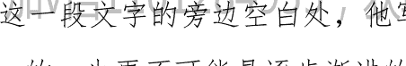

觉得这个理论只能算是事实的阐述，买东西当然是为了追求满意的效果。

感知。在书中，感知又分为三种感知过程：选择性注意、选择性扭曲和选择性保留。秦晋之歪着脑袋，回忆着自己对一些品牌产品的经历，觉得这个过程虽然不是很清晰，但倒是有道理的。书里有两个内容，秦晋之特意强调了点，一是“人更有可能注意与一般刺激物相比具有差异的刺激物”，他在旁边注上道，“信息要有意外或惊喜，更容易让消费者感知到”；二是“这些都取决于品牌”，这指的是消费者选择性扭曲的时候，是否受品牌的影响。秦晋之在“品牌”两个字上画了一个圆，品牌就是很重要！同样，秦晋之认为几点关注：营销人员可以将品牌与驱动力联系起来，利用刺激和强化为商品创造需求”。驱动力和诱因是消费者学习的主要因素。

情感。秦晋之在旁边注上“品牌要有故事和人性”，他认为足够。

记忆。对于章节章节，秦晋之站在企业的角度思考，企业如何让消费者记住自己的品牌和产品呢？广告轰炸？品牌联想？产品体验？这三个似乎都是正确答案。秦晋之开始发挥自己的能力，沉思片刻，他觉得还是广告轰炸是为了成为品牌，消费者就会更容易记住。

## 第五章 认知顾客
### 第二节 分析消费者

《营销管理》第6章——分析消费者购买决策过程：五阶段模型

在消耗的大量细胞完全消费者的“主要心理过程”后，秦晋之计划有了逻辑框架。规矩，购买决策过程是问题解决、信息搜寻、方案评估、购买决策和购后行为。秦晋之想过买东西整个过程，虽然不是每次都有五个阶段，但可能感觉分成五个阶段比比较科学和完整。这部分内容其实还藏了丰富的宝藏。

问题识别。这一节内容比较好理解，属于前面说的“动机”。但有一句话秦晋之认为认为是干货，“尤其对于奢侈品、套装和娱乐产品这样的非必需，营销人员需要加强消费者的动力，消费者认真考虑这种潜在购买。”秦晋之不仅在这句话下面划了波浪线，同时还在旁边贴了注释：“比如名牌手表，要告诉消费者为什么值得购买，购买后会达到什么样的效果”。

信息搜索。秦晋之觉得关注消费者的信息来源是理所当然的结论。不过他用词“属性层次”，可惜书里并没有“属性层次”。秦晋之仔细看了内容，自己在旁边空白处做解释，“属性层次”是消费者对品牌和产品的属性进行个人加工后的排序，而是消费者搜索后是自发的。如买汽车，可能消费者会这样排序：哪个国家的？哪个品牌、哪个车型？”

分市场。秦晋之在“分市场”字上。书里还有一句话，“属性的层次还能揭示顾客分市场”，秦晋之在“分市场”四个字上画了圈。

方案评估。看着“方案评估”这个词，秦晋之轻叹了一下，书里的名词都是这样带高级光环。“方案评估”不是消费者购买决策前的选择过程，还不如直接叫“选择的过程”更容易理解，毕竟并不是都要评估的。比如买牙膏牙刷，这些东西哪里评价响。秦晋之嘿嘿一笑，觉得自己的翻译比书里的好。看着书里的“期望—价值模型”，秦晋之觉得还是理解了，每个客户对产品

属性层次的想法是很一样的，这样的模型很难放之四海而皆准。但是，后面提到的购买电脑的案例和采用策略的建议，秦晋之觉得非常好。他整体围了，并且做了一些小微调：“影响消费者方案评估的6种方法——
重新设计产品（实际再定位）、
改变品牌认知（书上用的“品牌理念”）、
改变对竞争品牌的认知、
改变优势属性的权重、
唤起对被忽视性的关注、
改变购买者的理想标准。”嗯，这些才是营销方法的干货呀！秦晋之感觉这样的营销学起来才特别的带劲。

购买决策。企业如何影响消费者的购买决策呢？

秦晋之觉得这个问题才是这一节最重要的知识。书中已经有了结论，逻辑就是因为“消费者在环境中一些能够吸引意向或者改变的行为”，据此，“营销人可以通过选择框架，即消费者决策构建和购买选择的环境，来影响消费者决策。”此外，秦晋之在书中提到的两种干扰消费者决策的因素，一个是他人态度（尤其是信息媒体的评价），就是情境因素。对于这两点，秦晋之在旁边做了总结：“企业注重信息媒体的评价以及线上的评论，这既是推广也是公共关系管理。至于情境，企业不能直接影响消费者自身的情境，但可以创造和改变品牌或产品在在线终端和线上的情境，以吸引消费者购买。”

购买后行为。消费者都买产品了还要意什么呢？秦晋之挠了挠。看书里的内容，秦晋之觉得是高深光，还是自己总结一下吧。沉思片刻，他在空白的地方写上了总结：“企业对购后行为的管理，一是鼓励消费者点赞线上转发，二是产品尽量达到消费者的期望，三三是向消费者提供恰当信息（比如产品更换频率、当前的性能）。”秦晋之写完后，自己读了一遍，没想到还有什么加的。嗯，这就三点吧。

消费者决策的调节作用。看着标题，秦晋之知道这一节内容属于消费者的介入程度。秦晋之觉得很容易找到逻辑，自然要确定逻辑起点，到底怎么理解呢？书里没有给说法。秦晋之挠了挠，有点绕啊，书里第一句是消费者的介入程度，就是介入之中进行干预。

根据书中的内容，秦晋之认为高介入是对企业有利的。于是逻辑就出来了：
- 1、消费者的介入程度会影响营销效果；
- 2、我们希望消费者高介入参与行为，我们需要使用方法（与某个人注意、与某个人状况联系、激发个人价值观为产品增加某种属性）将低介入产品转换为高介入产品；
- 3、对于那些低介入产品，通过提供更多的正面说法，让消费者确信他们的选择是正确的（如名人宣传、吸引人的包装和感染力的促销）。

秦晋之整理完毕，心里觉得还有些不妥，到底什么是高介入行为对企业有利呢？想想，低介入对市场基础和品牌认知而言，这应该是好事。他郑地把自己的想法写到了书上。

秦晋之猛想起时间，拿手机一看，马上就要十点了。侧过头去，发现飞燕笑着看着他。“哇！好点啊！”秦晋之心中流了口水，对着段飞燕坏坏地笑，说道：“不好意思，看的太投入了，不小心已经过了时间。”

“没关系，我看你在书上写东西也没担心打断我。现在还有十分分钟左右，够一个人讲的。要不要，今天你就讲给我听吧。好不好？”

秦晋之怎么可能不好呢？他是开始之前把自己整理的逻辑结构和一些想法向飞燕来说。段飞燕歪着头认真地听，越听眼睛越亮，忍不住打断道：“你是专业的？你来我上营销的课时没见过你？”

“说了，我有啦，我的姐姐！”我俏笑着，“啊！才外行了。我觉得你整理的这些内容和思考，比我这个经济管理的学生还好。”段飞燕吐了舌头，说道。

秦晋之心里满意了，这还要假装。看见飞燕站起来朝前面挥手，她是女朋友来了。顾胡子，若隐若现的胸口，手臂长长的泛汗，一米多大的个子，健硕的身材，秦晋之对段飞燕的男朋友身上充满了男性荷尔蒙。“哎，这就是个荷尔蒙集合体，以后就叫他荷尔蒙！”秦晋之对段飞燕的朋友真的是羡慕嫉妒恨啊。

段飞燕介绍了她，原来荷尔蒙叫李军丰，打个招呼认识了，秦晋又继续讲起来，十分钟终于讲完了。

“秦晋之，第6章最后的‘行为决策理论与行为经济学’你好像没听懂。”本以为是讲完后，段飞燕立刻跟男朋友说，“哦，最后的内容我扫了一眼，觉得内容相对标题而言简单了，估计不重要就不会怎么看。”秦晋之回答。

“嗯。我记得给我们讲市场营销的老师建议过，消费的行为经济学可以看到两本相对通俗的书，一本是《影响力》，一本是《怪性行为》。我们看《营销管理》的第7章和第8章对我们学习营销体系的意义不大，不如几天时间就先探讨这两本书的内容，如果还有的话，再学《消费者行为学》，比较一下这两书和《营销管理》第6章内容的区别？你看怎么样？”

“行！听姐的。现在下单预计明天下午就能到货。俩明天有书就先看，后天同一一起去自习，怎么样？”

“好的。这就说定了！那我们走了。李率，段飞燕开始收拾东西，李率在旁边帮着包裹，两个人向自习室。秦晋之礼貌地点点了点头，离开了教室。“笑！白菜都抢了！”秦晋之津津洋地离开了自习。

第二天是周日，昨天买的书还没到。秦晋之在宿舍里躺在床上用手机看着前几年《影响力》。原来还可以，整个书风格就像是在听书，语言通俗易懂，文字风趣幽默，还能让他觉得轻松。秦晋之觉得不如用这种方式边学边写。下午三点的时候，秦晋之收到书装进了包，明天要看《影响力》和《怪性行为>。”《影响力》一书由罗伯特·西奥迪尼著。

《影响力那些事儿》之一：开启

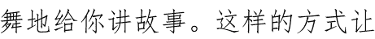

“了解与认识客户”这一篇需要介绍。为什么？是因为在认真看完这本书后你会有感叹：我去，我去，我去，说的真准！这本书解释了人类某些自觉行为背后的原因，而这些真正原因，一定对我们有更好的帮助。在这本书开头章节，作者通过一些案例强调了模式化的自动行为在大部分人类活动中是相当普遍的。为什么呢？因为你生活在一个极端环境中，为了适应，我们走遍各地去选择和处理。捷径？利用我们的方式，碰到那样的触发特征，就会毫不思索地做出。

为了让这个观念更有力，书开头提了三个模式概念：1）分钱一货，价格贵等于东西贵；2）“对比原理”，当两个相同或类似的东西放在一起比较的时候，其特征会更加明显；3）优惠让人们机械的认为商品优惠就是捡了便宜。我不想多说了，大家对这些模式一定有体会。“对比原理”的运用我简单一下，如零售商品，先销售价的再说是便宜的，那么即使你所说的便宜商品其实加了不少，但顾客对此也不会太敏感；还有一种情况就是垫底，比如买房子，先给客户看一般的，再带他去看一些，他也会对第二个房子有好感。总之，了解了这些模式行为对于理解消费者（包括我们自己）是非常有。

《影响力那些事儿》之二：互惠原理

各位看完，互惠原理的意思很好理解，以李报以桃亦也。先说明互惠原理背后的人性基础：一、欠乏让人觉得很不舒服；二、接受而不试图回报他人善举的人，会在群体中游的；三、人的行为背后往往带着两种情感需求：责任感和满意感。我们将将心比心，是不是的确同身受？

基于此，我总结了互惠原理在企业应用中的三条公式：一、我们给了消费者好处，消费者会有意识的回馈我们；二、我们可以硬塞消费者一些好处，这就能触发消费者的亏乏感；、“拒绝-后撤”——假如如果我们让消费者感到由于他们在某一方面的执着让我们让了一步（比如价格），那么消费者在其他方面也会退一步。

怎么运用呢？赠送免费样品（超市里常见），当然能让消费者感觉到这是一种小礼物，而不是促销手段，有效聚会很多；2、免费试用；3、在保证利润的前提下，多给消费者有争取额外利益的机会。

《影响力那些事儿》之3：承诺和一致

什么是“承诺和一致”？这也是人性基础，是指人人都有言行一致的愿望。一旦我们做出了一个选择，或采取了立场，我们立刻感受到来自内心和外部的压力，迫使我们按照承诺那样去做。在这样的压力下，我们会设办法去行动证明自己决定是正确的。这是起点，我们再来看看对这个理论还有哪些方面的延伸。

- 一、对对方做出承诺是关键；
- 二、一些简单的承诺行为会影响我们的自我认知，从而让我们乐意去做更高要求的承诺跟此前承诺毫不相干的事情；
- 三、当事人积极的、公开的、经过一番努力由自由选择的承诺影响其自我形象的认知
- 四、为一个承诺付出的努力越多，它对承诺者的影响越大
- 五、能带来内心变化的承诺一旦出现，就跟以前的环境不再挂钩了，它能涵盖所有相关的环境，同时发挥持久的作用。

有道理。有人一定会说了，这个能跟营销带来多大的帮助呢？好，下面我就详细介绍下本人对这个问题的认识。

- 1、“承诺和一致”解释了为什么消费者会在品牌繁多、产品同质化严重的当今市场上有品牌忠诚度，因为他们努力相信的选择是正确的，除非你的产品质量出现了明显的问题或者售后后期处理的一场糟锤。当然是针对产品同质化，如果市场出现了更能打动消费者内心诉求的产品，口碑极佳，且更换产品成本较低的情况下，可能会更换品牌的：

- 2、由第1点，我们可以出一个结论：让消费者做出购买自己品牌产品的选择有多么重要！至于怎么让消费者做出这个选择，我想肯定不是这里能解决的，这涉及的因素多少单例（此处应为“维度”）？另外、功能、品牌价值和认知度、价格、销售终端服务、消费者的体验和认知等。总而言之，是要让消费者相信的品牌和产品可以满足他们的需求驱动，你的品牌和产品是可以解决内心的问题。

- 3、“承诺和一致”还有一个非常值得关注的结论，就是我是自我形象的驱动所做出的承诺更能发挥持久的作用，且更不受干扰。通俗的说就是你的品牌产品让消费者跟自我形象产生了联想，让消费者做出购买的品牌产品会证明或提高自我形象的承诺，那结果就是……嘿嘿，你懂的。所以我们不妨在设计产品的卖点或者品牌价值的时候，在证明或提高消费者的自我形象方面也下点功夫（不是全部考虑这个因素）。

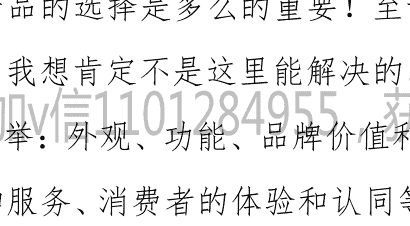

比如更孝顺父母的子女购买某一种产品，因为为什么什么卖点，诸此类类。类似的例如：“超能，都人都爱超能！”

最后，这一章的内容也说了一些销售技巧，比如“抛低球”、比如强调书面承诺、比如饥饿营销（为了一个承诺付出的努力越多，它对承诺者的影响越大）等等。

126 楼
作者：大泰的疆士 日期:2018-07-24 13:13

## 第五章 认知顾客

### 第三节《影响力》

《影响力那些事儿：为了社会认同

“社会认同”估计大家都能提到，就是在判断对方为正确时，我们会根据别人的意见来判断。值得说明的是，这种对社会认同反应的方式是无意识的、条件的反射的。“别人都在做的事情肯定没错了”，就是一种心态。当然了，这种影响力发挥作用同样是需要条件的，一般来说，在当我们自己不确定、情况不明或含不清、意外性太大的时候，我们最有可能觉得别人的行为是正确的。我们会根据他人的行为来判断自己怎么做合适，尤其在我们觉得这些人人跟自己相似的时候。Ok，“社会认同”影响力的主要内容就这些，下面我们来说在营销管理方面的理解。

- 1、“社会认同”解释了为什么口碑传播以及群体中的意见领袖是那么重要的；

- 2、设计品牌的故事可以与目标消费群体相似的人作为主角，比如移动4G 的广告，没有明星，有的就是和你一样的普通人；

- 3、在介绍产品的时候，我们可以告诉消费者（或者经销商）某产品是“增长最快”或“销量最大”，因为这样说明其他消费者（或经销商）是这么想的。

### 06《影响那些事儿》之 5：喜好

我们很多人总是最容易认同自己的和喜欢的人的。王理所要求的明确大喜好的几个要素？外观魅力、恭维、接触、条件反射和关联。以上这章的核心内容。

其中“外观魅力”无疑证明了产品外观设计有多少的重；“相似性”和“社会认同”中所讲的相似性并没有实质的区别，总我们都喜欢遵循与自己相似的意见或消费习惯；至于“恭维”，更适用于销售技巧，如果你的品牌产品可能让消费者选择的时候还能获得一种被恭维的感，那不妨大胆尝试（比如选择***的妈妈）；她是精明的；“接触与合作”告诉我们经常让消费者接触自己的品牌产品，如果再能建立双方的合作关系（比如外观设计大赛、公共行为等）；那么消费者会逐步对你品牌的喜好；“条件反射和关联”，我需要重介绍。

“条件反射和关联”中落脚点其实是在“关联”上，条件反射是表现现象，关联性才是我们要的。“关联原理”说白了就是消费者心中“近者赤近者越黑”的观念，把我们的品牌和产品跟美好的人或物经常联系在一起，消费者就会产生条件反射的关联，以来的你的品牌产品就具备了这些人物类似的优点。说到，我们就可以解释为什么那些企业把自己的产品跟当前的文化热潮（世界杯限量款汽车、跑跑兄弟们T恤联系起来，喜欢请名人（往往是流行人士）做代言。

我知道此时，那不叫“有人”的家伙说了，你说的这些关联，我是要请明星代言，要是购买一些知名组织或人物的版权主题，如果营销预算有限，我们还要怎么关联呢？那么我可以负责地告诉你，这都不是事。可以关联的内容除了这些要花大钱的明星和知名组织或人物外，还有常见的热点。

### 07《影响力那些事儿》之6：权威

不要认为在权威面前是一件丢脸的事情，“权威”这一章节分析了人类普遍接受的权威机制，赋予社会巨大的优势。有了权威，资源、、和社会控制的成熟结构。说白了，人作为社会成员，从权威是一种社会本能，尤其是在自己不熟悉的领域如此。幸运的是，当我们面对母亲时，母亲就是权威——从权威的行为在营销中的运用普遍也很理解，比一些品牌的牙膏广告总用什么牌牙膏告诉你口腔细菌会减少多少，这样的例子多，需要将产品跟权威人士联系在一起，无形中将产品跟权威人士进行关联，于是你的产品有了服力。所以，当资金不够时，实在没有必要想着代言，多寻找权威人士，让他们说服消费者。

### 08《影响那些事儿》之7：稀缺

虽然“稀缺”这个标题我们就能猜出章的内容，老祖上千年前早就知道了。里面有一些值得关注：

- 1、对失去某些东西对比获得同一物品的渴望，更能激发人们的行动力；

- 2、每当东西获取比难，我们拥有它的自由受到了限制，我们就越发想要它；

- 3、新出现的稀缺比稀缺的物品更让人感到追逐；

- 4、参与竞争稀缺资源的有着强大的刺激性，渴望拥有一件抢夺的东西，几乎出于本能。

看到这里，大家一定想到了一个词“饥饿营销”，苹果和小米公司深谙此道。作为营销者应该怎么利用人们的“稀缺”心理呢？限量版、资源紧张、较短的时间期、制作“稀缺”也是一种销售技巧，这里就不轻易介绍了。

## 09“哈哈”，秦晋之肚子叫了，一看时间，我靠，已经快10点了。嘿嘿，按照郑老师传的看书逻辑的方法，虽然看起来快了许多。写完了“影响力那些事儿”，秦晋之自己又看了一遍。果然没有人物、没有剧情、没有冲突的理论内容按照《明朝那些事儿》的文风来写，达不到那样的风格。聊胜于无吧，秦晋微叹一口，安慰着自己。

想想《影响力》这本书的内容，秦晋跟营销体系的关系并不大，里面的内容更多的是分析消费者的心理，其考量属于战术层面，而不是营销体系这样的战略层面。有了收获！秦晋之揉了揉脑袋，仿佛要把脑袋里消极的情绪全部吐出去，明天早点起床，上午接着来整理《怪诞行为学》。弦月挂空、云游如岫，夜色下的校园宁逸轻柔。秦晋之一出教学楼发现自己更饿了，忙一路跑了超市买了东西，回了宿舍。

167 楼
作者：秦晋 日期：2018-07-25 17:14:14

## 第五章 认知顾客

### 第四节《怪诞行为学》

01 第二天一早，天空刚泛白，一句白月还孤独地挂在天上，秦晋已经唱着小曲从宿舍出发自习室了。大学的早晨总是宁静中透着热闹，虽然时间尚早，但看见一些学生在跑步、或是去打篮球、还有的去园里晨练！早晨，多么美好的时间！在自习室找个位置坐下后，秦晋便拿出了《怪诞行为学》开始看起来。不想再对了，《怪诞行为学》阅读整理的内容，就不用“怪诞行为那些事儿”了（这个名字也够怪诞），就叫“晋之读<怪诞行为>”吧！

### 02 晋之读<怪诞行为>之1：相对论的真相

在《影响力》一书的开头提到了“对比原理”，其实就是现在我们要讲的“相对论”的意思，不过《影响力》一书中没有对此展开阐述，感谢<怪诞行为>让我们可以更清楚地了解这个“相对论”。

- 1、我们很难把同类但不同产品的实际价值算清楚（就是不知道商品值多少钱），所以我们很少对其比较，我们会关注这种物与其他物的相对价值，以此来算价值：

- 2、我们总是观察和比较周围的事物（有形物体、无形的体验）以确定彼此的关系，“确定彼此的关系”应该是这本书直接根据原文翻译，但我认为不是贴切，可以多一句翻译方便理解。

- 3、我们不仅喜欢拿事物与事物比较，还喜欢把容易事物集中比较——避免把不容易事物作比较；

- 4、“诱饵效应”，简单的为了方便（其实是引导）消费者做决策，我们可以在消费者选择中增加一个“诱饵”，目的是通过比较，让消费者倾向于选择那个产品。

说到对论在营销管理中的运用，大家都不陌生，毕竟现在的社会就是一个比比社会。稀缺的特征在营销中的运用普遍，稀稀缺的稀缺稀缺的稀缺。稀缺的特征，稀缺的稀缺的稀缺的稀缺的稀缺的稀缺的稀缺的稀缺的稀缺的稀缺的稀缺的稀缺的稀缺的稀缺的稀缺的稀缺的稀缺的稀缺的稀缺的稀缺的稀缺的稀缺的稀缺的稀缺的稀缺的稀缺的稀缺的稀缺的稀缺的稀缺的稀缺的稀缺的稀缺的稀缺的稀缺的稀缺的稀缺的稀缺的稀缺的稀缺的稀缺的稀缺的稀缺的稀缺的稀缺。书中的案例，我也举个例子方便理解。比如苹果手机iPhone4刚火的时候，如果我们在认真考虑以500 元的价格购买，那么500 元就形成了我们的“锚”，在以后我们购买类似手机时，就会将这个产品的售价和心中的锚做对比，然后看价格是否合理。

更可怕的是，一旦我们认为500 元的手机才是让人满意的，那么你心中一定会觉得别人花的300 元的手机是有质量的。作者在这一章还介绍了“羊群效应”和“自我羊群效应”。基于他人的行为来判断某事物的好坏，决定了我们是否相信，就是“羊群效应”；基于自己的行为来推想事物好坏，则称为“自我羊群效应”。其实说白了，“羊群效应”就是别人的行为给了你一个“锚”，“自我羊群效应”就是你自己给自己搞了一个“锚”。不知道会不会哪位大哥站起来说，你纯粹是在瞎猜，我每次买东西都是根据自己的偏好选择的。首先我很尊重你的态度和做法，其次你不是一个诚实的人。为什么在别的品牌降价促销的时候我们仍然可以忍手机的新款一个价格高？因为iPhone4上市那天起，它的零售价就已经成为“锚”让我们对手机有了一个概念。你是可以去对比，但你的内心会一直自动它，隔壁小莉也用iPhone8，这么好的配置iPhone6刚上市的时候就稍微贵了1000元，断买了！不能让她瘪了！

所以综上所述，作者得出了一个结论：市场价格不是消费者的购买意愿影响市场价格，市场价格本身反过来影响消费者的购买意愿。这表明事实上，需求并不是完全立于供给。我们对价格变化的敏感度，事实上很大可能是两种因素共同作用的结果——我们对过去价格的记忆（锚）。

我们和他们想要完全一致的愿望，我们真正正好或需要它的小孩。有人问了，那我要是完全记不住去买的价格呢？那我哪里就后悔不……去买的价格呢？那我哪里就没有买了吗？……我想的是，这只能说明一个问题：你可以买脑白金了（希望有效效果）。记住句话，在我们的潜意识里，锚无处不在。

罗曼说了这么多，我们还是看看对于企业到底意味着什么参考建议吧。以下我整理了几条：

- 1、如果贵公司推出了一个新品且品质体验优于其他产品（如果没有相同产品更好），那就不不妨把价格稍微高点，因为你的价格很有可能成为消费者的锚。

- 2、注重消费者从发现到购买产品每一个环节的细节，让消费者留下对产品美好的第一印象（就是让消费者喜欢）。

- 3、体验可以改变消费者的忠诚度，所以尽可能鼓励消费者体验产品。比如某些男士习惯抽烟，但因其巧妙的安排或者暗示他尝试，同时感觉不错，他就很有可能在下一次购买时选择。最后我要严肃批评我们的酒店，你们太注重差异化。为什么我们在外出玩时，酒店真的有什么忠诚度？只要离得近，看到哪个酒店（类似的连锁酒店），因为连锁酒店都差不多。

172 楼
作者:大泰 日期:2018-07-25

## 第五章 认知顾客

### 第四节《怪诞行为学》

##03 晋之读《怪诞行为学》之3：免费的代价

客观的说，“免费的代价”这一节内容跟《影响力》中的“互惠原理”有点类似，但具体内容还有区别。互惠原理的影响要更大。下面来介绍这一节的主要观点：

- 1、免费的东西让人感觉好，还能唤起热绪；

- 2、“买一送一”的方式可以让你在另一件商品（其实更好）之间挣扎——引导我们做出决定；

- 3、多数都有有利面和不利面，但我们忘记了不利面。免费给我们造成一种情绪，让我们认为免费高于真正的价值；

- 4、导致免费如此巨大的威力，由于人类本能害怕损失，免费只是包装，所以我们担心会有损失。

让我们举起“赠品”，让消费者感觉到诚意。一件明明价1000元的商品你非得卖到500元再送一个，结果你发现没有人会买，因为你看起来没有诚意，注定在这场促销大战中失败。

### 05 晋之读《怪诞行为学》之4：社会规范

首先，我想来说明，这一章的内容非常有借鉴意义。所谓社会规范，我个人的理解就是社会环境下（这里区别于生活的市场环境）人之间的关系和行为。我们同时生活在两个世界里，一个是社会规范主导的世界，一个是市场规范主导的世界。书里并没有介绍社会规范的范围，只是通过一些案例介绍了其中的部分。我斗胆分析了，对社会规范的理解和运用重点是在社会关系下拥有的权利和义务。

通常而言，大多数人为了事业比金钱更加努力。比如让律师低价帮助，因为你支付了律师费，虽然低于市场价，但是市场规范下的行为，律师可能觉得不愿意。如果你肯望律师免费帮助，那在他而言这是一种社会行为，可以是自己的义务，那就是社会规范的行为。通过律师这个案例，我想让大家出一个结论：利用人们的社会规范行为相对于市场规范行为更有说力。书里也强调了，一旦市场规范进入了我们的考虑，社会规范就随之而去。所以，社会规范是宝贵而又脆弱的。对于帮助人的行为，我们给予礼品，这显然不会让当事人不快，因为即使小礼品也能保持我们在社会规范的环境里脱离市场规范。当我们对这些礼品明标价，就好比给现金一样，这样就会唤起他们的市场规范，一切就会往利的方向发展了。

好了，老规矩，该说企业用的事情了。在说之前，有一点我想跟大家谈述我的观点。有人说，现在的中国是一个功利的社会，是一个金钱至上的社会，是一个没有同理心自私自利的社会，也因此可以是一个以市场规范为主的社会，你说的社会规范的运用可能不太现实。我承认在我们身边，每一天每一刻都会发生金钱权力远离的事情，但我是相信孟子的“人性本善”，远离的事情很多，但发生的“真善”的事情也很多，只是很多时候是一些引起我们注意的小事体现的。所以，尊重社会规范，重视社会规范，运用社会规范，这也是时代需要的。

企业需要拿出“社会规范”的武器。怎么拿？在你的产品定位时，在品牌包装时，在确定企业价值时，要想想消费者在使用你的产品时，会随之发生哪些社会关系的影响，从中找出最能打动消费者内心的价值。企业可以把自己推销给客户在社会规范领域的伙伴——也就是说，我们让消费者认为我们和他们属于同一个大家庭，起码是朋友。如：****，身边的好管家”。

最后的是，永远尽力保持你与消费者建立的社会规范领域的伙伴关系（这会带来很强大的品牌忠诚度），一旦破坏了，一切都会变成市场规范下的冷冰冰的关系。

182 楼

作者:大秦的疆士 日期:2018-07-26 10:30

## 第五章 认知顾客

## 第四节 《怪诞行为学》

06

晋之读《怪诞行为学》之5：性兴奋的影响

我啧，各位是不是不是看到这个标题也会比较兴奋啊。不过，可能让你们失望了，因为这里我认为翻译的人还是没有根据内容来修正标题，其实这一章应该叫做“荷尔蒙的影响”。为什么这么说呢？其实这一章主要探讨的内容是人在激烈情绪状态下的态度和反应，作者是以性兴奋状态下的选择变化的实验来证实的。具体的内容并没有多少介绍，总之就是，当人的情绪处于亢奋状态时（荷尔蒙狂增），我们的选择就会变得不理性，激情对我们的行为有很大的魔力。

还是拿苹果手机举例（因为实在是太典型了），如果 iPhone 9 上市了，恰好你又是一个铁杆粉。即便你发现你的钱不够，但那种对 iPhone 9 的强烈的欲望（激情）冲击了你的大脑，它让你不仅考虑通过排队买到第一批产品向身边的人都炫，还使你去透支信用卡或向父母要钱去购买。而这一切看似不理性的状态，都是因为你对 iPhone 9 的激情所导致的。

那么这些给我们企业什么样的启示呢？这个结论很容易得出——想尽各种办法让你的消费者在你的品牌产品面前陷入激情的状态。我知道不是一件容易的事情，前提是你的品牌和产品有可能让消费者拥有激情。

07

晋之读：怪诞行为的恶习与自我控制

看到这个标题也许你们会想，个人的拖延和自我控制企业有什么关系，为什么要介绍这个？我们可以把手放在我们的胸口上问自己，我没有拖延过呢？我想除去极少数人以外，我们都能在这样的事情上拖延过。所以，有拖延的恶习是几乎每一个消费者身上的习惯，如果我们可以在这一点上激发我们的聪明才智，或许大完全不同。

每一个消费者身上都有内心对自己有改变的需求，抓住他们的这种需求，我们一定会在百家争的市场中脱颖而出。

好了，我们继续来聊拖延的问题。我们已经知道每一个消费者都有拖延的习惯，而且大多数消费者的内心是希望自己改变这个习惯的。那么灵感就来了：1、我们的产品不可以去刺激消费者发现自己的这个问题，并且可以通过设定一些条件去帮助他们改变拖延的习惯呢？比来说，如果你是一个自行车的生产厂家，你通过调查也好或是看到一些专家的建议也好，你得出一个结论，肥胖人群每天骑自行车1个小时非常有利于他们降低三三高。但正常的情况是他们多数不能坚持1小时的骑行。怎么办？我的建议是可以考虑在车上加装一个灯，这个灯一旦按下了，在1小时内是不会熄灭的，这就可以提醒使用者的时间，同时公司可以借此搞一个“每天骑行一小时”的活动；2、产品可以增加方便消费者给自己设定限制的环节，如书中举例的“拥有自我控制功能的智能信用卡”，就是让消费者自己合理分配信用，帮助他们像自己希望的那样消费。简单的，就是在产品使用过程中，可以不断的提醒和鼓励消费者按时完成一些必要的事情。

虽然这些都是一些建议，并不是所有行业产品都适用（其实适用的不多），但那些可以适用的企业可以在这面上做文章，他或许就会发现不相同的天地。对不适用的企业，也不要担心，这个“拖延的恶习和自我控制”就是给了我们提醒了，针对消费者的恶习和内心自己改变的需求，不是不可让我们另辟新径，创新的产品和格局！

吴经理 加微信：1101284955 获取更多资料

188楼
作者:大秦的疆士 日期:2018-07-26 12:06

## 第五章 认知顾客

### 第四节：怪诞行为学

08

晋之“怪诞行为学”之7：所有者的个性

这一章的内容相对来说更简单，“所有者的个性”就是“所有权的魅力”。魅力是的。一旦我们拥有了某些商品，我们通常情况下（除非确切使用起来与预期差十万千里）会觉得这商品值钱更有魅力。用书中的话说，“我们人类人性中有三大非理性的怪癖：1；我们对已经拥有的东西迷恋到不能自拔；2；我们总是把注意力集中到自己会失去什么，而不是会得到什么；3；我们经常假设别人看待交易的角度和我们一样”。举个例子，你想卖掉你开了一多年的汽车（可能是因为舍不得的原因），在你的心里觉得自己的车 very good，可能花了万，按时保养，刚换了新轮胎，你卖它的时候觉得自己心在滴血。你觉得自己失去了生活里曾经陪伴自己一多年的好伙伴，你希望最后购买这辆车的你能懂得珍惜你这曾经的伙伴，说不好价格，而且我们的“所有权的个性”在影响自己的预期和原则。

书中另外补充了，所有权带来的自豪感和它的难度是比例的，越大，难度越大，感觉越；我们在实际拥有所有权之前就对物质产生了拥有感，只要我们投入了精力或者一部分金钱。

是不是“所有权的个性”的道理非常好。好了，又有了落实企业运用方面的探讨了。针对消费者“所有权的个性”企业能做的内容，我想答案也是显易见的：1、做好产品的品质和体验，不能让消费者拥有了之后形成很大的心理差。我们可以反过来理解，如果消费者花了钱拥有的东西感觉非常不爽，那就是所谓自豪感或满足一下子掉到了另一面的谷底，恨那可怕的后果！2、“不满意全额退款”的承诺放心地说出来，一旦商品进了消费者的门，他就拥有了这件商品，万一不会再考虑退了（除非质量粗糙或者故意干的）、3、对耐用而言，如果的话，可以对你的产品增加部分DIY，或者增加消费者在使用中对产品的关注（如保养或固定零件）、总之让消费者投入更多的精力爱；4、尝试增加销售方式。

晋之《怪诞行为》之八：多种选择

如果让我用思想《怪诞行为》中所写的章节，就是这一章了。这一章的核心思想我就用句话概括，在相同的两种选择中取舍是最难的。当我们只能选择一个时，我们的内心的是犹豫不决甚至是痛苦而烦恼的。抛开书里的内容延续一下，如果有第三种选择，那么我们非常不容易的选择第三种选择的特点，这个“多种选择的困境”对企业有什么启示呢？一是你的产品线设计的合理，同等价值同等功能的尽量不要重复（除非包装做点区别），二是创造我们优点或特色，去吸引消费者在选择的时候，三是关注竞争者的动态，不要让消费者落入选择的困境。一旦发现马上推出新的亮点！

192 楼
作者：大秦的疆 日期：2018-07-26 23:36

## 第五章 认知顾客

10

晋之《怪诞行为》之9：预期的效应

“如果我们事先相信某些东西好，于是它一般就会好（我们认为它不好，它就不好），这就是作者所想表达的“预期的效应”。不过有一点我想特别补充，“希望越大，失望越大”。其实这种东西是双面的，对于预期就会有产品体验标准，这个时候往往特别容易带来落差，甚至稍微有那么不意的地方，比如我们去一家外面装修得富丽的酒店入住，结果发现了诸如没有热水、没有气味等，增强是不可能的。

所以这本书介绍的内容在我看来是偏理想的状态，就是消费者的胃口没有被预期的很高，又刚好产品体验接近（或者符合）了消费者的预期标准，于是消费者觉得产品是非常好的。当然了，理想化归理想化，但是书里还有一些内容值得借鉴。比如“不要低估展示的力量”，就是产品的外观、包装、终端门店的装饰等要漂亮；企业要尽力向消费者提供信息，提高他们对产品的预期和真实体验。

王莉101284955 获取更多帖

普通读者的《心理学》第10：价格的魔力

作者之所以把这一章节放在“预期的效应”的后面，理由很明显——价格的魔力是因为人们对价格产生了效应：人们很多情况下都是认为是本能的价格越高一定更好，对应的，就是我们平时常回响在耳边的那句“便宜没好货”。作者在这一章节得出的结论是：“信任和预期（如价格）不仅影响对于视觉、味觉和他们的感官现象的认识与解释，还会改变人们的主观客观体验，甚至客观体验，从而对自己施加影响——有时这种影响非常巨大”。作者把这一章的名字为“价格的魔力”，很有老艾同志价格所产生的预期有着熟悉痛绝的感触，或者说老艾一定价格是最影响消费者预期的环节。

在这里，我来帮大家分析一下这种“价格的魔力”，它比较适用的情况是:

- 1、突破性的新产品，消费者没有太多的对比，你价格定的高自然觉得东西肯定好；
- 2、目标消费群体对价格不敏感，行业竞争不激烈，价格不透明，同类产品未受电商影响，你的某些方面比的公司要好；
- 3、已经是或是就要奢侈品牌，强势高价（如LV等奢侈品），维护品牌形象。当然我们知道还有一种高类型，对于在自己品牌产品线中推出高端产品，用此来探索消费者对自身品牌的熟悉度。

现在我想说“价格的魔力”补充一下。“便宜没好货”是因为消费者对品牌不熟悉。换句话说，如果消费者对你的品牌有了了解，那么如果你搞低价，效果还是不错的（参考那些营销）。

16 楼
作者：大秦的疆 日期：2018-07-27 18:06

## 第五章 认知顾客

## 第四章《怪诞行为》

12

晋之《怪诞行为》之：人性弱点

人性弱点，说起来是一个很大的概念，真正要清楚可能从人类发展、社会变迁、心理学（参考弗洛伊德的本我、自我、行为学等）起。作者也很清楚这一点，所以他选择了“人性弱点”来开展论。强调一点，不要轻易给经销商，特别是刚开始的。企业完全可以将诚信包装成形式或产品的卖点，是什么。在我看来，是最起码的对消费者的尊重，也是对自己的尊重。一手整理，晋之《怪诞行为》之：企业特权

这是本书的最后一个章节，主要内容就是通过“啤酒实验”（强调需求，因为我们会选择别人选的啤酒，即使自己不喝）和“免费午餐”的概念（强调行为经济学来改善我们的决策过程）来总结。强调我们在很多时候决定是非理性的，而企业可以从这些非理性因素出发，借助工具、方法和政策改善我们的决策过程。一直想明白为什么作者用“企业特权”作为这一章的名字，如同“人性弱点”的名字一样，太大了。实际情况是这一章仍然关于信任的问题，只是强调人们在非金钱的情况下更可能暴露出信任的情况，企业经营或营销中有很多深层次的问题（能力有限），我只想呼吁大家珍惜机会，不要以后失去实话。

44 

晋之《怪诞行为》之13：啤酒与免费午餐

## 第五章 认知顾客

### 第五节 总结

01

黄昏，秦晋写完《怪诞行为》的最后一个字，已是下午点半。《影响力》和《怪诞行为》真把消费者的心理读透了吗？秦晋并不这么认为。面对同一个产品，不同的消费者就可能因为不同的状态产生不同的选择和感受，比如消费者是有钱时？没钱时？迫切需要时？不迫切需要时？心情好时？心情不好时？一个人时？跟人一起时？太多的可能性决定了分析消费者的内心是多么艰巨的任务！时间还不算晚，他决定再花半个小时将整理的“影响力那些事儿”和“晋之读《怪诞行为》”再一遍。郑江在闲话外曾提过，学习要达到随心所欲的运用，就必须在理解的基础上记住所有知识的逻辑和内容。《影响力》和《怪诞行为》涉及的内容比较多，又都相对独立，哪里有什么逻辑结构呢？他想起自己曾为消费者的“主要心理过程”做的打油诗，既然如此也做个打油诗来对这两本书的内容进行总结！

影响力来说影响，王经理加微信101284955 获取更多好帖

- 管理及人性十九种，凭此就能懂顾客。
- 若问商业之运用，九为术有十道。
- 互惠稀缺相对论，供求关系的失衡，
- 免费所有个性，预期效应和价格，
- 人性弱点添一笔，上述九种皆为术。
- 承诺一致和喜好，社会认同和权威，
- 社会规范的成本，带来有影响，
- 拖延恶习与自控，多种选择的困境，
- 企业特权需诚信，免费午餐有获获牌，
- 上述十种可为道。

245 楼
作者:大秦的疆 日期:2018-07-28 09:17

## 第五章 认知顾客

## 总括

02

第一件事情，秦晋在给飞燕讲述“影响力那些事儿”和“晋之读《怪诞行为学》，以及最后那章总结的打油诗时，从段飞燕的眼中看到了对自己的欣赏，也许还带有一丝爱慕，至少秦晋自己是这么认的：

第二件事情，是他们浏览了《消费者行为学》的提纲大致内容后，对于继续学习《怪诞行为》达成了一致，那就是说《营销管理》的第六章“分析市场”是一块饼，那《怪诞行为》就是煎蛋，内容更丰富，味道更好，但主菜还是饼。秦晋和段飞燕对讲课的思路来判断，认为他对《怪诞行为》这样的内容有多大兴趣。专业体系而言，了解《营销管理》第六章的内容就足够。第三件事情，就是段飞燕学习的时候告诉她的。秦晋从段飞燕的语气中感觉到她对学习这件事很有兴趣，这让她对段飞燕和秦晋之间的情感愉快。任何事情都会让秦晋感到无比开心，何况是三件事情加在一起！晚上回到宿舍，完全掩盖不住内心的喜悦。第二天就是周二下午，秦晋将“营销洞察”的“影响力那些事儿”、“晋之读《怪诞行为》”和总结的打油诗发给了飞燕。他已经开始不及待等周三的选课了。

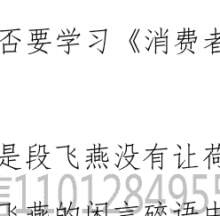

250 楼
作者:大秦的疆士 日期:2018-07-28 09:19

@13612948 2018-07-28 08:00
收到！谢谢支持！最近因为一些事情，白天都比较忙。

251 楼
作者:大秦的疆士 日期:2018-07-28 09:20

@Cyruda 2018-07-28 08:01
楼主来了麻烦告知一下，别让我们担心，哈哈。

@as4491 2018-07-28 08:15
味道好极了！谢谢支持！

253 楼 
作者:大秦的疆 日期:2018-07-28 09:42

## 第五章 认知顾客

### 第六节 计划认知客户

01

周三的晚上6点55分的时候，秦晋走进教室发现段江在前面7点准时上课，她今天已经在教室里，还把投影仪准备好了。老师今天有什么动作？秦晋心中有些好奇和期待。刚往以往坐在座位走去，看见飞燕朝自己招手，于是他立刻唯诺诺地走到飞燕旁边的座位上坐下。7点到了，秦晋见上课的位学生都来了，说道：“既然人都已经来了，我们现在开始上课。今天上课，老师先放一段电影片段给你们看，这部电影叫《男人百分百》。在播放之前，我简单介绍一下影片片段的内容，男主角尼克（梅尔·古索普莱演员）是一个任职于一个广告公司，他自己以为的大人，因为触碰了灵魂的意外，他获得了能够听到身边人心的特殊能力。我们接下来的一段是他为耐克的女性产品设计广告的片段。

秦晋开始播放电影片段：伴随着轻快的背景音乐，尼克出现在各种运动的女人身边，他倾听着这些女人的心声，脸上洋溢着“哦，原来是这样的”的笑容。接着在耐克公司展示广告设计内容之前，还插着跟女主角就广告设计的讨论，在讨论中，他们确定了广告设计的定性——女性自由。在给耐克公司播放的广告片中，伴随着一名女性穿着耐克的衣服和鞋子孤独在马路上跑步的画面，背景的广告语是这样的：“你不会跑步向前镜子，想着那条路会怎么看自己；你不必去听他们的笑话，还要假装才能在上面跑步；不管你穿得多少性感，跑起来都会更轻松；如果你没有涂口红，脚下的路就不会注意到；它不在乎你的年龄；你不会因为自己脚下的路赚多少而不好意思；你可以随时在想要的时候，踏下脚下的路，不管是今天是你生命中最后的几个小时；这条路唯一的你是能够何时不来一次。耐克，没有游戏，只是运动。”

耐克公司的团队对这片影片非常满意，顺理章的尼克斯在广告公司签订了协议，尼克再次成为老板。播放的片段到这里戛然而止。郑江关掉投影，看着在座的学生说道：“今天我们讲的内容是《营销管理》的第三章：与客户建立联系，在营销学中这篇是‘与认识客户’，从内容来看，我还是觉得这版更准确。我想大家都按照我的要求，分组预习好了。刚才才给大家放这部电影的片段，有人知道原因吗？”

听完秦之的回答，郑平脸上的笑容一闪而过，“嗯，请坐。王少飞和秦之的回答是对的，只是比秦之想的更深浅一点。”说完这句话，郑平转身在黑板上写下两个词“洞察”和“客户”，他并没有急着回答秦之的问题，而是继续说道：“在营销体系里并没有这两个词，可是科特勒的《营销管理》一书中先介绍了这两篇内容呢？而在我在讲营销体系的时候，为什么也会按照这样的顺序来讲呢？”

郑平又转向黑板，在“洞察”一词上写上“客户”一词旁边写上“土壤”二字，接着说道：“因为客户是企业的土壤，企业的成败看客户买不买，而客户是企业的种子，企业发展好不好，要看客户的需求准不准。在这里吧，种好不好比是一棵树，这树能不能长起来，长高、会不会结果，关键就是土壤和种子。”

郑平看着下六位学生若有所思的样子，又拿起粉笔在黑板上写道：洞察+客户+X=新产品、服务、新商业模式。

“我一直强调营销体系，洞察和认知客户虽然没有直接体现在营销体系里，但他们是营销体系的基础。刚我写的这个公式是不虚虚的，是四海而皆准的真理。有一双能洞察市场需求的眼睛，有一双能认识客户的心的，再加上一些其他因素，比如移动互联网技术、人工智能技术、市场的趋势等等，就会产生新的产品、服务或新商业模式。我们现在常见的摩拜共享单车、滴滴专车、美团外卖、途牛旅游等一些新兴的互联网公司，他们成功的起点就在此了。”

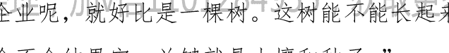

郑平说完这段，喝了口矿泉水继续说道：“有成功就有失败，近几年失败的新兴企业太多了，如果你去问他们创始人，他们一定会告诉你，他们洞察到了市场的需求，他们也觉得自己认识了顾客，他们也融到了资，也烧钱砸市场，可为了什么还会失败呢？”

## 第五章 认识顾客
### 第六节 郑江平认识顾客

教室里的六个学生都是那么的安静，他们都竖着耳朵细细听着郑江平的讲课，秦晋更是眼睛眨得没眨。

“原因不外乎有三：一是一味追求极致，求大极大，在没有稳定的盈利条件下，导致公司资金链紧张，比当年遭遇大战还幸存下来的拉拉手；二是企业立足之后持续发展遇到了瓶颈，可能是模式的瓶颈或市场需求的瓶颈，也可能是人的瓶颈，比如OFO共享单车；三则是洞察的需求是自己以为的需求，认识的顾客是自己所认知的顾客，产品或商业模式趋于理想化，比当年曾经盛行的云玛锂电车。前面两种原因我们没有资格去评论，因为我们并不是当事人，不了解实际的情况，也许都有自己的盲言之隐。但第三原因，则是我今天想给大家说的，洞察需求和认知顾客，看来看似容易，其实挺难。”江平在讲台上回来地踱着步，挥舞着手臂，继续说道：

“我们在讲洞察那节课时就已经提过了，《营销管理》的书中并没有涉及如何获取洞察，而叶茂中的‘营销的16个关键词’中，我们总总结了侧面获取洞察的逻辑，这里再给你们复习一遍。一是是以消费者为导向，二是用心，三是要做针对性的市场调研，四是加入对感性的理解。获取洞察是没有标准答案的，还是看人的悟性和能力。但大家一定要记住四点。”

刘平坐在座位上快速翻阅着《营销管理》，忽然他看到一个“焦点小组”，想到书中后几次提到这个词了，意思就是组织消费者一起讨论公司的产品或服务。于是，刘平站了起来，打破了这沉闷的安静，回答道：“老师，我认为焦点小组的方式可以让企业更好的认知顾客！”

## 第五章 认知顾客
### 第六节 郑江平认知客户

焦点小组？秦晋的思想起来《营销管理》在市场调研的时候提到过这种方法。通过焦点小组认知客户？秦晋的倒也觉得这是一种可行的方案，但他听听郑江平是如何回答的。

“嗯，请坐。”郑江平示意刘冰坐下，说道：“刘冰还是很用心的。大家都美国司法体系里的陪审员制度吧，就是将是否给嫌疑人定罪的权力交给陪审员来决定。这些审员一般都是随机选择。”

焦点小组怎么能说陪审员制度了？在座的六名学者满脑的疑虑，很快郑江平就给了他们答案：

“我的推测，科特勒等一些营销学者，他们所提倡的焦点小组的方式是被陪审员制度的启发，选择最通的消费者参加坐座，讨论他们对企业品牌或者其他方面的感受。”听到这里，教室里的学生们恍然大悟，他们期待着郑江平继续讲。郑平并没有让他们失望，继续说道：“可是一个人是有罪的，陪审员只要具备法律常识，自己的是人生经验，再加上法庭提供的证据和证人，相对于还是难的。但是几十人的焦点小组，通过他们各自对需求的想法阐述来认知客户，则会比个人得好吗？”

有点草率。因为还是那句话，营销没有标准答案，而消费者的情况又是多样的。通过焦点小组，当然如果企业针对的人群非常精准，倒是可以行的。我更倾向于将焦点小组作为市场调研的最后一个环节，用检验企业营销策略或方案会让消费者的体验更满意。原来如此！听听果然获多啊！秦晋和同学们心中都发出了感慨。可是，到底怎样认知客户？老师，你快说呀！”

郑平并没有一点继续下去。他扫视着沉默的学生们，停顿几秒后拿起粉笔转身，在黑板上“洞察”和“客户”两个词之间划了一条直线。“别的同学要回答吗？”他向秦晋了一眼，继续问道。这是在暗示什么？秦晋看着旁边的飞燕，轻轻摇了也不解。秦晋的心里一阵嘀咕，洞察的方法并不是讲了吗？等一下！秦晋觉得豁然开朗，站起来答道：“老师，我是通过你在‘洞察’和‘客户’之间划线想到的，认知客户的方法其实跟洞察需求一样，是以消费者为导向的，从消费者来到去；二是要用心，透过现象看本质；三是要做针对性的市场调研，包括跟消费相关的数据；四是加入人性的理解。”

嗯，终于上定了，还不错。郑平听着秦晋回应心中暗笑。他揉了搓手，示意秦晋坐下，说道：“嗯，能够这一点说明秦晋确实动脑了。但这个回答并不全对。因为有一个关键的问题你们还没思考，认知客户的目的到底是什么？”

郑平看了手表，距离下课也就二十分左右了，他决定不再耍关子，“认知客户一定是有针对性的目的，否则认知客户就无从谈起。那么认知客户的目的都有哪些呢？我相信你们都已经按照我的要求预习了《营销管理》的内容。我现在负责任地告诉你们，认知客户的目的在营销管理》的第五章‘创造长期客户忠诚’和第六章‘分析消费者市场’里也没有提到过认知客户的目的啊。”看着学生疑惑的眼神，郑平推了下眼镜笑了笑，继续道：“因为时间关系，我还是先公布答案吧，认知客户的目的有五种情况：

- 认知客户的需求和潜在需求，这一点跟洞察需求是异同同工，只是通过消费者来熟悉需求；
- 认知客户的行为，找到可以影响消费者行为的环节，具体内容在《营销管理》第六章中已经过的比较清楚，这里就不详细阐述了，大家都应该已经读过了。认知客户的行为结果就体现在怎么传播、搞活动、终端、活动以及销售服务方面；
- 认知客户的属性层次。属性层次这个概念，是《营销管理》第六章‘消费者决策过程：定位阶段模型’这一节‘信息搜索’的内容中出现的。科特先生并没有特别重视‘属性层次’这个概念，但对于企业而言，能够做到准确的认知客户的‘属性层次’，就能采取调整改善自己的营销策略和战术，更何况‘属性层次’还能帮助发现细分市场，所以我认为‘属性层次’是非常必要去认知的，一定要作为认知客户的一种目的。至于‘属性层次’该怎么理解，你们自己看书理解，我就不在在这里啰嗦了；
- 认知客户的满意。企业营销的最终目的是实现客户的满意，从而形成客户忠诚。所以，企业需要引起客户什么样的产品和服务会感到满意，感到满意的标准是什么程度，这个不难理解。总之，就是让客户满意；
- 认知客户的自我概念和价值观。这就是终极目标，让顾客在精神层面达成成功，并不是必要条件，但是差异化。”

郑平一口气说完认知客户的五种目的，犹未尽，最后帮大家总结一下：“认知客户——需求、行为、属性层次、满意、自我概念和价值观。”

哪里还需要？郑平提醒：“好了，现在我们再次回到秦晋的问题上，到底怎样引起顾客？”众位学生的眼睛紧紧地看着郑平，等待他继续下去。

“奇怪吗？你们现在还在大学里学习，认知客户的方法有：

- 第一条：永远保持一颗积极的心。这一条说白了，就是强调认知客户需要基础理论，而不是通过少数接触后得出的结论！接触客户可以通过线上、线下和电话等等方式，接触的内容越好。
- 第二条：尽可能接触更多的客户。这一条是消费者导向，从消费者来到消费者去；
- 第三条：针对性的市场调研，包括跟消费相关的数据，这跟洞察需求的方法是一样的；
- 第四条：用心，透过现象看本质；
- 第五条：加入人性的理解。”

教室里的六个学生脸上充满了“原来如此的表情。郑平很满意，“认知客户的目的虽然分成了五种，但实践的时候基本上都是同步进行的。如果非要确认客户的流程，可以分为七步：

- 确认目的
- 确认目标
- 望：行业销售数据分析
- 闻：了解对品牌以及竞争对手的评价
- 问：设计问题调研
- 切：得出市场水平的结论
- 验：焦点小组证实改进方案。”

看着同学们在埋头记录自己说的内容，郑平站在讲台上等了一会儿说道：“关于认知客户我想让你们的这么多，对于有些学生学的《影响力》和《怪诞行为》，我觉得非常好，这两本书的内容作为了解，在以后知道客户的时候可以用上的。最后，我来说一下这节课的作业。”

## 第五章 认知顾客
### 第七节 认知客户的作业

认知客户的作业会怎么布置，秦晋和他的同学们都比较好奇。只见郑平转身在黑板上写了“江小白”三个字，说道：“最近公众号上有一些关于‘江小白’的讨论，有说定位精准潜力无限的，说其只是引入流量但没有带销量，而不好。今天的第一个作业就是通过‘江小白’给出你们对于‘江小白’未来的判断和建议。你们通过这个作业就会发现认知客户有多么重要了。当然，你们手里没有销售数据，没办法做太多的市场调研，这些都没有关系，用你们所能掌握的资料得出结论是可能的。至于作业的体裁，还是没有限制，字数也没有要求。”

哎哟，江小白啊！也许是因为知道江小白，在座的几个男生显然很有兴。段飞燕侧着脸轻轻问秦睿，“江小白是什么呀？”秦睿笑了笑，低声回复道：“都是一个白酒的品牌，主要是针对年轻人的。这个文案和推广的特别好，你上网上就知道了！”

“呆子，还有人交作业呢？”郑平继续布置第二个作业，“你们昨天都交了洞察需求的作业，我看大家用心洞察了一些需求，有些需求我觉得还是很有创意的。那么第二个作业就是在你们所上交的洞察的需求中，选择一个，从认知客户的角度去阐述这个需求的合理性和规划。一样，体裁和字数没有要求，关键是大家的思考和体会！”

时间已经过了8点，江平等学生在笔记本上记录到这里结束了。开口道：“好了，今天关于认知客户的课程到这里结束了。下节课是细分市场和目标市场，也就是《营销管理》的第九章，虽然这一章是放在第四篇来说，但我认为还是必要的。大家按照分组预习。”说完这句话，郑平便收拾东西，大家陆续离开了教室。

## 第五章 认知顾客
### 第七节 认知客户的作业

作业一：写江小白的一封信。

你好，江小白你是否满意？我先解释一下为何我用这个称呼，因为出生时间并不长，因此我你江小白。近日，公众号对江小白的评价有两种，也可以说是两种阵营：一种认为江小白引发潮流之后，品牌传播获得了这么大的流量，销量却配不上知名度，甚至不如老村。另一种认为江小白是营销驱动，企图使用大传播带动销量，但一旦营销宣传跟不上，销量就会立刻下滑，因为他们认为江小白的口感不好，因此品牌忠诚度低。对于消费者属性层次，他们用数据得出的结论是：知名度 > 价格 > 口味 > 促销 > 广告，而认为江小白在广告层面的发力恰好是最后的一种属性。再加上大规模的消耗属于社交，首要的是面子，所以就不够上台面。年轻人对于白酒市场而言，他们认为是鸡肋，因为需要源源不断的理念支撑。江小白大体就是以上了。我知道你的这种风格，这种事情你是不会操心的，因为你是热心浅的客人。可是我却不能操心了，因为我本人就是一个文艺青年，哈哈。所以我从认真客户的角度验证你现在方式的合理性，请听我慢慢道来。因为我的定位是年轻人的小众市场（虽然这个市场我觉得一点都不小众），所以我认知的对象都是年轻人（大学生为主，刚毕业的工作者实在是没有时间接触）。由于过程比较繁杂，我就直接说认知客户的结果。认知客户的需求：年轻人多数情况下饮酒的场景并不是社交应酬，而是朋友同学的聚集，因此喝酒的需求只是作为气氛营造的工具，当然酒还是不能暇。认知客户的行为：年轻人比较容易受互联网传播的影响，特别是在对品牌没有概念的领域，他们倾向于与众不同的品牌。他们喜欢通过某种品牌的选择表明自己的品位，也以此判断人与自己的相同和不同，而意识或无意识地形成一些圈子。同时，当看到自己情感共鸣的内容，他们往往会有莫名的好感。认知客户的层次性：对于白酒，很多年轻人其实并没有多少概念，除了茅台、五粮液等大家晓的品牌外，其他品牌在他们眼里都是一种，只能通过价格有高低的判断。因为没有市场调研的数据基础，所以我做这个属性层次是仅根据模仿访问同学而得到的，可能不够准确，还需观察。认知客户的满意度：品牌；价格；促销；口味。认知客户的自我概念和价值观：这其实是凤台的强项，年轻人的自我概念和价值观上完全做到了共鸣，这里我就不用弃了，哈哈。

牺牲了那么多脑细胞还是值得的，一定要保证每次作业的质量，这样才可能进入那传说中的慧商学院。

还有一个作业，“在你们提交的洞察出的需求中，选择一个，从认知客户的角度去阐述这个需求的合理性和规划。选哪哪个呢？”秦晋之看着自己上周完成的“洞察需求”的作业，自己自己写了五个洞察需求。凭着直觉，他决定选择其中“老人的网络游戏”来认知客户。还记得当初这个需求是如何洞察的吗？来，让我们先回顾一遍。

信息来源：男生在宿舍里都喜欢玩游戏；
洞察需求：当我们这一代老去的时候，安晚最好的方式之一就是适合老年玩的网络游戏；
一种产品：最适合老年人身体状况的网络游戏，现在的老人也可以鼓励自己，摆脱无聊的晚年生活。

先来认知客户吧。认知目标：退休的老人（尤其是80后后的退休老人！）没有办法做市场调研，以认知为秦晋之的判断。

认知需求：退休的晚年生活太无聊，找到更有趣的生活方式；
认知行为：退休老人空闲时间比较多，他们也有需要自己的生活圈子，此可参考现在无不在的广场舞大妈。有一部分老人现在已经开始熟练使用智能手机；
认知属性层次：这个秦晋之实在没办法确定，只能凭他的那点直觉。身边老人的比较多的游戏 > 游戏体验（速度慢、字体大、社交感强）> 对健康的影响程度 > 购买游戏的费用。

认知同龄：认知的开心，在游戏中能够获得成就感的满足，有很多很多同龄人一起玩，玩游戏时还能随时提醒自己注意时间等影响健康的问题；
认知自我概念和价值观：在游戏中找当年青春肆意挥洒的感觉！老人也可以咔咔网络游戏！

写了以为认识客户的分析，秦晋之发现其实这个老人的网络游戏还可以衍生老年人身体情况的游戏设备：

秦晋之心中潮澎，他仿佛看到若干年后自己陶陶醉地在电脑前挥汗淋漓、画面感太强了！越热，不如写一个老年网络游戏的广告脚本！这样看，秦晋之是有多么创造力富有朝气！他立马在网上搜索广告脚本的模板，就开始写了他的广告脚本。可是，广告里这个老年人的网络游戏叫什么呢？就叫“夕阳武士”。

## 第一节 认知客户

老年人的网络游戏“夕阳武士”广告脚本。

（场景一：年轻时的画面）。镜头近。一台电脑和手机屏幕上，快速切换着现在流行的游戏，“英雄联盟”、“王者荣耀”、“绝地求生”、“荒野生存”、“梦幻西游”（耗时5秒）。镜头近。一群年轻人在电脑前，兴致地看着屏幕，脸上的神情或喜或忧，年轻人互相击掌（耗时3秒）。镜头近的时候，出现外音：“我们曾年轻过，曾在各种网络游戏里挥洒青春的热血，我们曾扮演过英雄，我们战胜过大的 Boss，那是那么快乐！”

（场景二：退休无聊的生活）。镜头逐渐近。退休后的老人，下棋时感觉毫无滋味，钓鱼时心无力，看着疲惫不堪（耗时10秒）。外音：“现在我们老了，感觉生活越来越远，我们想要让自己开心起来，但是总是感觉枯燥乏味，寂寞占据了我们的身体，我们不知道时间怎么打发，看着日子。”

（场景三：老人穿着游戏角色衣服在网络游戏里大汗淋漓）。镜头逐渐近。游戏的画面很宏伟，游戏的速度比较慢，字体比较较大，老人的角色穿着武士服装用刀剑与游戏角色战斗。这时，游戏画面的右上角红灯闪烁，老年人的角色穿着日常生活的衣服，一边对着敌人说：“稍等片刻，老爷休息一下，一会再来！”耗时5秒）。外音：“给老年人最好的生活，夕阳武士，在这里聚不散！”

周五，秦晋之藏不住完成作业的好心情，一大早就想给段飞燕微信约她晚上一起自习。在段飞燕的感情已经因为玩游戏产生裂痕后，秦晋之决定逐步采取攻势。罗马不是一天成的，他的策略是一方面增加段飞燕的好感，另一方面等待机会。

刚接到手机要给段飞燕微信，突然手机提示声音响了起来，秦晋之打开手机一看，竟然是郑平微信。这是郑平第一次给自己微信，难道有什么好消息？秦晋之赶快打开来看。郑平的微信内容是：“秦晋，这周的作业完成了吗？今天不管晚都要完成给我。”这周怎么这么急？秦晋之联系给郑平复道：“郑老师，作业我昨天晚上做好了，我可以随时发给你。”

“好！我这两天要去学院，我想带着你这周的作业直接跟段主任谈了，了解他对你最近几次作业的评价，看看是否暑假安排面试。”郑平的微信又上线了。

“好的。那我一会发到你的邮箱。郑老师，谢谢你！”

“没事。咱俩的聊天记录记得删除。”

“得令！”秦晋之回复完毕后，郑平就没有再发微信了。秦晋之心中泛起阵阵涟漪，很快就看到自己没有机会去慧商学院面试了。慧商学院招生这么严格，看来自己一般！他越来的希望能进入慧商学院了，可能吗？几分钟后，秦晋之把这次的作业发给了“给江小白的一封信”和“夕阳武士”的广告脚本，自己这么用，应该不算完成得差，秦晋之在心里安慰自己。

捏了捏脸，秦晋之猛地想起要给段飞燕邀请她晚上一起自习。于是，他飞快发出了邀请。片刻后，段飞燕的微信回了过来：“秦晋之，今天我要参加社团活动，没有时间。明天班级组织出去旅游，也不能跟着你一起自习了。下周一和周二吧。”

“嗯。了解。没问题。那就下周一和周二。”

等了许久，段飞燕再回复微信。秦晋之心中有点失落，他不知道段飞燕是不是真的会一起去旅游，如果去的话，唉，想想那个画面都很烦躁。秦晋之又给段飞燕发了一个微信：“当然，这两天自己先看《营销管理》这一章，还有《长尾理论》，下周一和周二我们再讨论。”段飞燕的微信很快回来了：“哈哈，老师可以教了。”秦晋之趁着这个时机，立刻在微信里问道：“出去旅游玩得开心点，我也会一起去吧。”秦晋之没有回复微信，也要保持一点矜持，心中却感叹：难道真的要这样吗？秦晋之觉得自己的心情简直好了，一定要看完《营销管理》这本书，继续学习内容。

## 第六章 细分市场

### 第一节《营销管理》第9章——识别细分市场和目标市场

整理完“细分消费市场的基础”，得出的结论却是自己的细分方法更容易理解和实践，这让秦晋心中充塞着一种不安，自己思考的方法真的比书里的更好吗？会不会是王、数学、吕，自己又是井底之蛙？他在心里反复比较两者的内容，一侧忽略了主意。晃了晃疲惫的脑袋，决定出去走走。

何为细分市场？就是蛋糕。市场就好比一个高又大的蛋糕，每个企业都想着上面切一块，许多企业选择在最容易看到的一层切，但有些企业选择其他地方来切，这就是所谓的细分市场。周五的晚上，秦晋之带去自习，书包里只有一支笔和一个笔记本，并没有《营销管理》这本书。他想学习的办法——自己思考“如何寻找细分市场”的问题，记在笔记本上，然后再事后进行跟进，看看自己和别人的差距在哪里，这样更容易理解和记忆学到的知识。

一、案例：自习室坐定后，秦晋之开始把自己想到的细分市场的方法和案例列了出来。

- 消费者的年龄：儿童牙刷？写到这里，秦晋之突然发现好像在超市里发现了给老人设计的牙刷和牙膏。这些公司疏忽了？是因为产品研发没有办法针对？一定年龄的老人都会用假牙，已经有专门洗假牙的清洁液了。原来如此。可是针对牙齿稀少但还可以吃饭不需要假牙的老人呢？秦晋之并没有停下来，他只是发现了细分市场的一种可能性。
- 消费者的性别：秦晋之本以为按照细细市场的案例很容易想到，可结果却是想到的都是产品直观上增加了女性颜色，比如汽车、手机、笔记本电脑等，用不同颜色的产品来针对不同性别消费者，这就是细分市场吗？秦晋之摇了摇头。那如果是改变产品的包装或结构针对不同性别消费者呢？秦晋之觉得这应该是细分市场。
  案例1：女性眼镜、女性内衣、男士洗发水、男士香水。
- 消费者的消费标准：有钱的消费标准，没钱的消费标准，对应的就是产品中高低档之分。这样的案例大把，大多数行业都有，秦晋之觉得都难举例了。酒店，餐厅、汽车、衣服、装饰品比皆。
- 消费者的功能需求：同样的产品，消费者很可能会看重的重点是不相同的。比如汽车，举例如（看来汽车的市场细分很锐吧），有人追求驾驶的乐趣，有人追求车大，还有人追求更安全。
- 消费者的行为特征：不同的消费者针对同一类产品或服务有着不同的行为特征，这点还是容易想到的。比如旅游喜欢自驾，不喜欢跟团；再如衣服喜欢定制的，不喜欢挑尺码。只是这这一点比较整理，因为实在各行业五花八门，但可以肯定的，这一定是一种细分市场。
- 消费者的价值观：“价值观”这个词是秦晋之想了好。有人追求环保，有人追求美，有人素主义，有人省钱。秦晋之觉得应该是可行的，但整理起来逻辑不好，整理不清晰。秦晋之觉得这五种细分方法后，还有别的吗？秦晋之想到了“属性层次”，“营销管理》在第6章中清楚了，“属性层次”可以帮助细分市场。秦晋之刚刚把第7条加进去，发现不对，上面的六条细分方法至少3、4、5、6应该包含在“属性层次”里。那还有第7条？秦晋之最终还是想到了这6条细分方法，跟《营销管理》第9章讲的一样吗？

秦晋之坐在座位上沉思着这个问题，身边的同学仍骚动、低声细语，他完全没有感觉到。片刻后，他决定直接接受自己的理解——细分市场就是在细分市场的基础上找到化的逻辑！之后，秦晋之觉得神清气爽，可以继续下去。《营销管理》书中有一张表“消费者的主要要素”，秦晋之看了之后点头，数了数，表里列出了25个细分要素。书中这内容的逻辑很简单，分成了四类：
- 地理细分：延展的分别是地理区域、城市规模、人口密度和气候。
- 口统计细分：按照年龄、家庭规模、家庭生命周期、性别、收入、职业、教育、宗教、种族、世代、国籍和社会阶层来划分。
- 心理细分
- 行为细分

秦晋之发现，书中后面具体阐述时提到了“年龄和生命周期”、“生活阶段”、“性别”、“收入”、“世代”和“种族和文化”这六个要素。秦晋之由此得出结论：细分不能为了细分而细分，因为只要你想细分，就会无数个因素给你划分，有些划分是没有实际意义的。

年龄和生命周期”、“性别”、“收入”这三点，秦晋之觉得不需要补充。重点是——男性和女性有着不同的态度和行为——研究表明，女性倾向于自我表达和目标明确。秦晋之觉得这种细分市场不会起到多大作用，但是觉得这种个性化细分市场的推广和营销方法很有价值，他认为很有必要。

生活阶段：书中没有明确表述，但秦晋之还是发现了所谓的生活阶段，主要是具体分为：单身、有情、已婚、离婚、孤寡老人。秦晋之觉得对于生活阶段也算是一种细分要素。

地理细分的内容包括这些？秦晋之汇总会忽略不可。以通的专业词汇呢？“PRIZM”（按邮政区域进行市场划分的潜在评价指数）。简单的说，就是区域按照五大类39个因素（比25个要素多了14个）划分成集群，比如科技雅（城市周边的时尚社区）、外环华（舒适的郊区）、都居民（快速发展的都市居民）。秦晋之看科特勒并没有在书里详细的介绍“PRIZM”，也是觉得内容太多，就可以了解了。

行为细分：书中又分为“需要和利益”、“决策角色”、“使用者以及使用相关的变量”三种要素。虽然内容很多，除了“需要和利益”以外，另外两个要素的内容还是觉得跟心理细分一样，理论上细分没有问题，但企业很难操作。比如我们知道消费者对品牌的忠诚度可以分为“一往情深”、“心多用”、“迁移别忠”、“处留”，这些消费者在哪里？该如何引导这些消费者购买自己的产品？也许能做的还是丰富产品线和充分推广的情感求点。

《营销管理》第9章“细分消费者市场”的内容，细分都整理完了。秦晋之郑重在这一章最后的空白处写了自己的体会：“理论上的细分有很多，多到可以将市场无限细分。但理论上是要指导实践才有意义，没有实践价值的细分可以不称为细分。年龄、收入、消费标准、需求、行为特征和价值观，也许是科学有效的细分方法。”同时，他在空白处又写了一个问题：“企业是先有新技术的研发，后才能以此开拓细分市场；还是先去细分市场，然后再研发产品适应细分市场呢？”

“市场细分过程的步骤”一共是七个，秦晋之觉得还是有必要了解一下，为了让自己能够记住这些步骤，他做了一下简化：1；基于需要；2；识别；3；吸引力；4；盈利性；5；定位；6；最后考验；7；营销组合策略（4P）。

秦晋之有些疑惑，基于需要是排在第一位的，这也是避免无意的细分；对于识别，秦晋的理解就是“细分消费市场的的基础”——细分价值的价值；吸引力则是细分市场的前景预测；盈利性没有什么好说的，企业逐利的；定位，秦晋之还有些能，看了书中的叙述，他知道定位是要创建一个“价值主张”和产品价格策略；最后考验，按照书中的内容是“细分市场的每一个脚本来检验每一个不细分市场定位策略的吸引力”，秦晋之理解是企业要通过市场运营来检验吸引力；营销组合，书中强调的就是4P。

看到最后一个，秦晋之嘟囔笑了，前面还说4P组合更新，但里面对书的原文4P组合足够了。关于这些步骤，秦晋认为只要了解和记住足够了。他接着看向。

“有效的市场细分标准”，哦？看来是告诉我们如何来市场判断细分市场是否有效。书中的内容秦晋之看起来很简单——可测量、足够、可接近、可区分、可操作。可是转念一想，标准是制定起来很容易，但检验这个标准看起来就不简单了啊。就说第一个标准，“可测量”，就需要分潜在的购买力、人口统计、消费频次和特征等等。

如果你问秦晋之对于学习“有效的市场细分标准”的收获，他一定会告诉你，细分标准很难理解，但需要量化的标准比较难测，不需要量化的则容易测量。就这些？是的，就这些。

# 562楼
作者:大秦的土士 日期:2018-08-08 00:09

# 第6章 细分市场

### 第一节《营销管理》第9章——识别细分市场和目标市场

04

一手“评估和选择细分市场”，获取更多好帖

秦晋之原本这一节的内容是如题所述，讲的就是如何评估和选择细分市场，但当他读完后，发现内容和标题并没有直接的关联。秦晋之的决定先整理书中此节的逻辑。

书中的逻辑并不凌乱，是将企业在市场细分方面的战略分为四种，然后分别分析之。这四种战略分别为“整个市场”、“多元细分市场专门化”、“专注于单一细分市场”、“个人营销（定制化）”。

看到这里，秦晋之心中升起了不吐不快的疑问，“整个市场、细分市场，如果之前的个人电脑是整个市场，而笔记本是细分市场，那现在的笔记本市场我们还是给定义为细分市场吗？”行业在变、新产品不断更新、消费者的认知也在改变，整体市场还是整体市场吗？细分市场还是细分市场吗？寻思的片刻，秦晋之认定细分市场因为其产品的普及而应按照整体市场来理解，比笔记本电脑、智能手机，现在将他们按照整体市场理解会感觉奇怪。当然，这个问题跟现在看的内容并没有关系，秦晋之只是把这个心得写在了空白处。继续呢。

“覆盖整个市场”，即公司试图用顾客所需的所有产品服务于所有客户的群体。书中强调，只有非常大的公司（如微软、英特尔、通用汽车和可口可乐）才可以使用覆盖整个市场的策略。对于这一点，秦晋之又有疑问，覆盖整个市场并不是细分市场，为什么他规定只有大的公司呢？比如童车市场，覆盖整个市场并不会要求公司大。除非童车市场已经是细分市场吗？那到底怎么定义整体市场和细分市场呢？秦晋之觉得头大，大公司就大公司吧，暂先按照书中的内容理解。

大公司是怎么覆盖整个市场的呢？两种方法：差异化市场营销和无差异市场营销（大众营销）。其中的差异化市场营销也是针对细分市场的消费者来建立不同的营销组合（体系）。秦晋之明白了，所谓“覆盖整个市场”并不是说企业通过单一品牌单一产品覆盖整个市场，而是既有大产品也有针对细分市场的的产品，目的是覆盖整个市场。

如此来看，多元细分市场专门化，就是指企业的目的是通过多元细分市场来尽可能占据最大的市场份额。秦晋之发现，这段内容，科特勒强调的是“协同作用”，也就是细分市场和超级细分市场之间的协同作用，而由此引申出了“超级细分市场”的概念（这有点类似银河系和超级星系）。

- 细分市场共享一些可用的相似点。于是超级细分市场的协同作用就会产生两种办法，“产品专门化”（特定产品卖给不同的细分市场）和“市场专门化”（为特定消费者群体多种需求提供服务）。

看到这里，秦晋之越越觉得“营销管理”的这一内容有点乱，心中不禁升起一鼓怀疑。看到很有道理的内容，在采用逻辑上并不清晰。耐下性子，做了深呼吸，他决定继续整理。

“专注于单一细分市场”，这是好理解了，企业采用专注于单一细分市场策略只向一个特定的细分市场进行营销的案例并不例外，典型的就是五星级酒店了，只针对消费水平的用户提供服务。对于书中提到的保时捷和大众的例子，秦晋之哈哈一笑，科特勒这是被啪脸了，保时捷早就针对爱好者了，也有轿车和SUV；大众也不专注于小型车了，有违背。在这里，书中提到“利基市场”，言简意赅，就是细分市场下的细分市场，定义更窄的顾客群体。

看到书里一句话“利基市场的客户往往有着独特的需求”，除了独特的需求，应该也有独特的行为特征。不知道是不是因为秦晋之这时想起来的例子跟旅游有关。从旅游的角度来看利基市场，自驾、不喜欢购物的游客都可以作为利基市场的客户。

“个人营销（定制化）”，用科特勒来说，“市场营销”的企业提供个性化的产品。在这里秦晋之有一个疑问，个性化的产品一定是独一无二的？比如汽车提供更多的颜色和配置让消费者根据自己的喜好进行选择，那算是个人定制吗？秦晋之想了，他认为定制并不是产品的独一无二，而是需求的满足。正如书中举的例子，牛仔裤、牛仔鞋、自行车、滑板都可以进行定制。最常见的例子是秦晋之想起来手机“今日头条”，这就不是根据个人类型的偏好进行推送吗？遗憾的是，什么情况下适合“个人营销”，书里并没有提到。秦晋之自己考虑至少可以实现，不过增加成本，他把这个想法写到了空白处。

### 第二节《蓝海策略》

(03 续)

“四式”，可以说是“价值创新法”的集大成者，每一式都如降龙十八掌势势大沉、虎虎生威。

第一式：重建市场边界，即彻底打破市场的传统竞争要素的看法，从繁综复杂的可能性中找到商业上有信服力的蓝海机会，难度系数：

虽然难度系数很大，但都知道蓝海先生给了成了六个步法。

- 第一步：跨越他产业。很明显此步法与起手的第二式“分析他市场”息息相关。分析他市场，就是企业要解释消费者如何在他产业之间获取份额的。跨越他产业，就是迈出关键的一步——寻找和他产业之间消费者需求的共同点或者消费者不同的需求进行相结合，然后排除或减少其他竞争因素，创建自己的蓝海。比如神州专车，是为商务人士打造的快捷和高级的舒适性这两点需求进行了整合，从而发现了蓝海市场。

- 步法二：跨越产业内部战略集团。秦晋在仔细阅读书籍内容后，觉得这个名称可以改为“跨越产业等级”，更加清晰直接。说白了，就是要搞清楚什么因素决定着顾客在高消费品和低档消费品之间取舍。然后呢？将不同等级各自自最吸引人的因素结合起来，同时考虑排除或减少原有的一些竞争元素，使产品或服务更有针对性。在步法二次，书中Curves健身俱乐部的案例很经典，结合了传统的健康俱乐部和家庭健身各自的优点，重新塑造了一种针对女性的简约社交型健身俱乐部。书中还有一个案例——丰田起初推出“克莱萨斯”豪华品牌，就是要既有宝马、奔驰的质量，又有接近中低端的凯迪拉克和林肯的价格。对于这个案例，秦晋之觉得没什么感觉，因为此举并不是发现了一个蓝海，而是竞争元素的排列组合。

- 步法三：跨越对方链。这很明显是起第三式“策略重心转向非客户”的演化。谁来买产品？就是影响行业产品购买的各个角色，包括购买者、使用者、推荐者。步法三要企业要不要守规还是要买的群体，还要考虑其他的角色。书中举的丹麦生产胰素的诺德公司，将注意力从产品的购买者医生身上转向了使用者（病人）身上，创造出普通可以自己注射的胰岛，从而掌握竞争、开创蓝海。

- 步法四：跨越互补性产品和服务。这里有一个前提的认识：多数情况下，产品和服务的价值会被其他产品和服务的影响，两者之间是互补性关系。用蓝海先生的话，互补性的产品和服务中常常藏着未发掘的需求。但在清楚购买方在选择产品或服务时都在寻找什么，简单的办法就是考虑人在使用你的产品之前、之中、之后都有哪些需求？

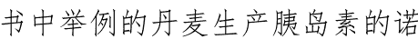

呀？不就是分析消费者行为吗？整理到这里，秦晋之自己倒是想出了一个案例，电视和电视柜。现有的家庭购买电视大多都是放在客厅的，而相应的一有一个电视柜让电视放在上面。那可不可以电视厂家在生产电视的时候，就附带一个美观又可折叠还能跟电视功能有关的电视柜呢？秦晋之赶紧把自己的这个心法写在笔记本上。

方法五：跨越针对买方的功能与情感导向。这里也有一个前提的认识：消费者购买产品往往基于两种吸引力——功能和情感。方法五是要求企业不要局限在传统的竞争的吸引力上，而是大家都是打感情牌，你来以情感为主：大家都是打感情牌，你来打感情牌。

（读者外音）：这里后面要说邵平的101284955，查看更多帖邵邵的职业本能相辅相成，有意思的是，邵平对蓝海的战略是击的。）改变了打，就要在竞争元素上有动作，或剔除、减少、增加、创新。方法六：跨越时间。所谓时间，就是要正确预测行业的潮流，能够预判某些潮流对行业的影响。潮流中典型的就是移动互联网技术的快速起，还有其他行业技术的突变、新生活方式的兴起、政策管理或社会环境面的变化等。锁定了某种潮流，就可以预判如果潮流下去，市场将会变成什么样子？秦晋之想最近看到的两个一个是幸福饼，一个是瑞幸咖啡，也算是预判到消费者对于生活方式的需求。

整理完这六法，秦晋之觉得道理虽然理解，但企业要做的事情其实很多，关键还是要有一颗打破常规的心态。

## 第6章 细分市场

### 第二节《蓝海策略》

(03 续)

第三式：注重全局。注重全局的意思是要考虑到竞争要素、市场和非客户，都是战略布局要考虑的内容。难度系数：★★★

第三式：超越现有需求。这一式也是强调产品和服务是确保市场规模，而不是细分。在之前三起手后，第三式可以理解为一种检验，更重要的是三个层次的非客户：

- 第一层非客户：距离市场最近，他们是出于必需而最低度，思想上却是离开这个产业为了代步的客户（如共享单车）；
- 第二层非客户：拒绝公司提供的产品和力的人，直白一点，就是清楚自己不需要；
- 第三层非客户：市场最近，这些人从未来没考虑公司所属的产品和服务。

如何满足这些层次的非客户？

- 第一层非客户：将他们徘徊的共同点，将这些共同点变成公司产品和服务的特质之一（比如去超市买菜）；
- 第二层非客户：与第一层一样，找到拒绝的共同点，植入公司的产品和服务中（提供超市）；
- 第三层非客户：将他们从别的产业中得到的需求，变成自己产品和服务的功能之一。

这样就是超越现有需求了。

第四式：遵循合理的战略顺序，难度系数：★★★

一个商业上可行的创意顺序是什么？蓝海先生在书里说得很明白，先考虑效用（商业创意是否包含买方效用），接着是考虑价格（价格是否让买方轻松支付），然后是思考成本（能否控制成本以获利），最后是思考接受（创意会遇到哪些障碍，是否从一开始就解决它们）。遵循这样的顺序（其实就是思考问题的顺序），蓝海策略才更有可能成功。

一本《蓝海策略》，秦晋算是整理完了，时间已经过了十，准备回顾了。不过还是要对蓝海策略去做一个总结。

蓝海策略，是企业寻找创新、突破瓶颈的一种方法，我们应该尊重尝试之，也不能盲目信诸之。我们感受到蓝海先生在书里的口口言：“兄弟，一定要做好蓝海战略布局‘市场’，不要去找市场的客户，还要看非市场客户；同志，不要去寻找共同点，不要只看差异化；朋友，价格！价格！价格太大了，大众不接受就没有意义了！”你觉得蓝先生像极了讲台上讲铁不成钢的老师，就像他讲的东西在天下最容易理解的。事实上世界上还会真的这么容易？

书中的案例虽然极好的验证了蓝生的观点，但这些企业并不是代表性的。比书中讲到的“目标市场”，没有“目标市场”的行业不在少数，只要是固定人群的产品和服务，往往都是没有“目标市场”的，比如自行车、养老院。所以，我们很难认为蓝海策略是一个完美可行的创新方法，但并不影响蓝海策略的价值。它固然对企业的要求会比较高，的确给了我们很多方法，帮助我们打开新的窗口。因此，蓝海策略现在还有不少人在用。你甚至可以看到，现在的互联网模式或者新的商业模式，里面也有蓝海战略的影子。

既然我们已经学习了《蓝海战略》，就让我们记住里面的“三一起手四四三原则”吧，当我们遇到瓶颈的时候，不妨拿出出来好好研磨，即使这些并不容易做到，但一定会有帮助的。

走出教学楼，微风拂面，秦晋的感觉非常惬意，还有一本《长尾理论》，明天搞定！

王一毅，加微信11101284955，获取更多好传
作者:大泰士 日期:2018-08-13 00:32

## 第6章 细分市场

### 第三节 番外：慧商学院暗流

1

在秦晋之苦心积累《蓝海战略》的时候，郑平来到了慧商学院总部所在地，北京。在大门经过安检后，郑平穿过走廊，直到了学生主任段华的办公室，在门口轻轻敲下门。

段华的办公室约二十平方米大小。办公室的左侧是一个长排木书架，书架里整齐地放置着琳琅满目的书籍。书架再往里，看到一只高大的陶瓷瓶，里面的植物葱葱挺拔、生机勃勃。在门右侧的角，摆放着成人一样高的中式鱼缸，几只鹦鱼、锦鲤，还有一条龙鱼在里面悠闲游去。鱼缸的前面，是一组褐色的沙发围着大理石茶几，茶几上放着精致的茶具。再往里，就是段华硕大的办公桌。办公桌是用老胡红手工打造的，用手轻敲桌面，就能闻到一股温润的香气。段华的办公椅像老胡红枝木椅子一样，简约而圆润。

郑平敲门的时候，段华正在里面喂鱼。听到门声，段华回应道：“请进！”郑平推门进来，对段华点了点头，“老师，我是江平。您最近身体还好？”

段华转身看到江平，脸露微笑：“江平来啦。我的身体还是老样子，运转正常。”随手示意江平在沙发上坐，自己拿着纸巾擦擦手，也向沙发走去。江平很自觉地坐在沙发的位置上，看了看茶几上的叶罐，笑道：“好不容易给老师泡茶，我今天难得表现。老师，您喝什么茶？”

段钰华也没有跟江平客气，在一侧的单人沙发上坐下后，回答：“莉莉花吧，还是喜欢老味道。记住，泡花茶温度不要高。”

“好呦！”江平应着，手里一直没停，烧水、煎杯、取茶，非常熟练。

趁着烧水的功夫，江平开口道：“老师，您这次让我回来，是为了了解我这个学生秦晋的情况吧。我有些做过好的‘认知客户’的作业，您老过目一下吧？”说完，他从文包里拿出打印好的页纸交给了段华。

“行了，”段华快速用眼睛扫了上面的内容，微点头，“这个秦晋之很有意思，竟然想到给吕小白写信来阐述自己的观点。不过相比之下，我倒是更欣赏‘虚拟世界游戏’这个想法。有可能是个好项目。他的情况在邮件里都跟我说了，之前的作业我也都看了。不过，你觉得他人怎么样？”问完这句话，段华双眼盯着江平。

“老师，为人方面我现在了解的还不多。您我们相识嘛，他的方面还算端正。您是担心院长面试那一关？”江平赶紧回答道。

“如果只是院长那边的面试，我就不用太担心了。这次把你叫回来，是有事情要告诉你。水开了，你先倒在这个小壶里晾一下，咱们再碰茶说。”

作者：大秦的 日期:2018-08-13 13:57

## 第6章 细分市场

### 第三节 番外：慧商学院暗流

2

郑平端着茶杯送到嘴边轻抿了，心中有些不恳，不知道学院出了什么事情，段华急着让自己回来，会是不招生了吧！

段华喝了一口花茶后将茶杯放在茶几上，说道：“江平，然而静风不起。你是我亲自招到学院，也是我一手培养起来的，我可以告诉你，现在学院被北京的蓝氏家族和红氏家族盯上了。”

“啊！您指的是蓝氏家族和红氏家族？”郑平用手指指桌面，加上微信1101284955。

“是啊，不是他们还有谁？”段华轻咬一口，继续说道：“学院最近几年在国内的影响力你也知道，多少人才、多少影响各行业的项目都是我们学院推出来的。愁患慧商学院，营销云云奔潮，这样的话是谁不知道谁先传的，院长低调也低调够了。蓝氏家族和红氏家族的能量有多大，你也应该清楚，他们盯上了咱们学院，就不仅仅是参与这简单了，他们要的是吞咱们学院”。

“学院可以拒绝啊，想吞并咱们学院，也得得当事人同意，走法律程序吧？”郑平横愤地说道。

“如果可以拒绝，院长早就拒绝了。这两个家族要真动……”“什么结果？”郑平焦急地问道。

段华笑着说道：“说出来你可能不信，是一个五期的赌约。”

“赌约？”郑平脸上写满了圈。

“是啊，我当时就在现场。双方谈判怎么可能的？结果也不知道蓝氏家族那边出的主意，他们安排了一个年轻人来学院，资源，天平都跟学院一样，跟学院比比赛，看五年内的结果最好。如果是他们输了，他们投进来占学院51%的股份；如果是我们学院赢了，他们就不再要求参与学院的经营。”

“院长长答应了？”

“那要不要增加新生的名额？”

“不能增加，不管在什么时候，学院招生都是宁缺毋滥。这些事情你你自己知道就好，不要跟别人说。如果有红氏家族的人私下联系你，你知道该怎么做。还有，NE大学一放假，就带秦晋来学院试面。我叫你来说说的这些，你先去忙别的事情，晚上一起吃饭。”

“好的，听你吩咐！”江平想到段钰华会主动约他晚上一起吃饭，看来最近学院的事情自己的这位恩师也是他搞得烦恼，心中不禁替段钰感到有些酸。

慧嵩学院顺风溜，冯禹和慧学院能顺利渡过这场风波吗？

# 一叔叔，加vinf101284955，获取更多好帖

作者:大秦的疆士 日期:2018-08-14 00:36

## 第六章 细分市场

### 第四节 对话“长尾理论”

### 01

一个营销理论可以写成本20万字数的书，因为里面可以填充各种案例和资料。但从这书中整理出这个营销理论的精髓内容，需要多少字？这还是要具体问题具体分析。假如你问秦晋之“长尾理论”这这本书的精髓有多少多少字呢？他可能会告诉你大概有1000字。

第二天，秦晋之花了一个白天的时间把“长尾理论”这本书本书看了。为了为何同样是300页左右，《蓝海战略》只需要半天的时间，而《长尾理论》需要一天的时间呢？因为秦晋看了了两周。第一遍的时候不停地在书里划线记录逻辑，开始的时候那是越越带，觉得收获满满啊——这一本牛羊书，观点新颖独到！可越往后越发现内容跟前面的结论逻辑类似，在一遍又一遍地验证自己的说法，就就像在告诉我，“你看，我刚才说的没错吧！”、“你看，这个案例不是就是我刚才说的那个意思吗？

虽然后面的内容从结构上做了主题的变化，但心中思想就在那里，不增不减。于是，秦晋的决定看第二遍，带着整理、怀疑和辨析的心态。

看书时候就是这样，你带着怀疑的心态看一看书，就容易发现这样的问题。这不，秦晋之看完之后脑子里就出现了很多问号。可是明天要给段燕迁这书，要想获得佳人的倾斜，就得出的问题，给自己的答案。

怎么总结自己的问题和答案，而显得自己有水平呢？秦晋之挠了挠，一时也没有头绪。直直到的来说？太没意思了。什么形式呢？他就他苦思索索之际，忽然灵光一现，长尾理论的敌人既然是传统的热门经济，那不如《长尾理论》的作者克里斯·安德森和《营销管理》作者菲利普·科特勒来一场关于长尾理论的对话吧。就让自己在《长尾理论》

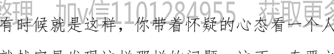

总结、疑惑和思考，都在这次对话里展现吧！

716 楼
作者:大泰的疆士 日期:2018-08-15 01:52

## 第六章 细分市场

### 第四节 对话《长尾理论》

#### 02

关于长尾理论的对话安排，某天

也许是营销之神的有意安排，有一天，被誉为“现代营销学之父”的菲普·科特勒与《长尾理论》的作者克里斯-安德森在旧金山双峰山上的一家咖啡店偶遇了。靠着窗户，柯特勒看着旧金山的风景，一场关于“长尾理论”的对话就这样开始了，顺着对话就聊“双峰长尾”这里多好帖

安德森（以下简称安）：科老，您好。我可以坐下您对面一起喝咖啡吗？

科特勒（以下简称科）：当然可以。你是安德森？

安：是的，科老。您认识我？这可真是我的荣幸啊。

科：哪里哪里。你的长尾理论横空出世，受到世人的追捧，现在已经是大名鼎鼎。你写的《长尾理论》这书，我也看了两遍，受益匪浅。

安：科老，您就折煞了我，我就是想请教您对长尾理论的看法。

科：营销能够持续的，要有不断的与时俱备的新理论诞生，营销才会源不断的生命力。这生命力，本身就是营销的特征之一。这长尾理论，是你研究的成果，我倒是不敢手指画谱。还是请你再介绍一下吧。

安：好的。把长尾理论浓缩为简单的一句话，那就是——我们的文化和经济重心加速转移，从需求曲线头部的少数热门（主流产品和市场）转向需求曲线尾部的利基产品。在一个没有货架空间限制和其他供应瓶颈的时代，面向特定小群体的和服务可以和主流热点具有同样的经济吸引力。

科：小安，你的意思是现在市场的需求的曲线就就像一个长尾巴，前面的大头是主流产品和市场，后面的长尾巴就是利基产品和市场。而你的观点是企业不要仅关注主流，面向特定群体的产品和服务非常有市场潜力和空间。我说的对吗？

安：科，您说的没错。长尾理论指的就是这个意思。当然，长尾现象之所以现在出现，是因为它是有条件的。

科：嗯，你来说听听。

安：长尾理论形成的原因主要有几个：
- 1、无限货架空间，指的是互联网可以将各种样的产品无限地上去，这为尾巴提供了销售渠道。同时也让消费者获得利基产品的成本下降；
- 2、互联网平台同时提供了评价和口碑的途径，同时也让消费者获得利基产品的销售；
- 3、消费者追求个性和多样化；
- 4、现在的技术可以是生产工具，因此消费者可以自己参与其中，比如音乐、影视、书籍、网络游戏等等行业。

科：是的，你说的也有道理。如果竞争并不激烈，甚至没有竞争，而市场的规模足够保证企业的利润目标，那它专注于利基市场的上也是一种正确的经营理念。而产品的创新和多样性，就可以根据市场需求进行规划。如果竞争激烈，就说明这个市场已经从利基市场转为了细分市场，甚至是整个市场。

安：科老，分析的到位啊！

科：哈哈，小安，别着急我，我的问题还没完呢。

安：科老，您继续，我洗耳恭听。

科：好。理论的落脚点是在利基市场的产品可以是无限的货架可以展示，也可以通过评论和口碑产生销售。这一切当然是基于互联网平台的对吧？

安：是的，科老。这两个因素是前提。

科：好的。在这个方面我想请教你几个问题。第一，互联网平台有没有可能按照利基市场的分类将产品分成如此多的分类呢？这样对于消费者体验不会影响？如果不可能，那利基市场的产品怎么能确保被搜索到？第二，互联网平台的流量相对是稳定的，这些平台公司提供的产品按照顺序进行排序，你有没有发现这些顺序往往是品牌、价格和销量之间，而正常情况下，在产品搜索界面的首页都是那些热门公司或者叫头部公司的品牌和产品呢？在这样的情况下，那些专注长尾的公司又该如何做呢？

安：科老，这两个问题我认为一是要看利基市场是将市场细分成什么样的程度，现在的互联网平台上的产品包罗万象，可能有一个特定的分类能给这些的产品；二是企业要清楚自己的细分标准和优势，同时在平台上进行明确的展示；三是在产品推介上多下下功夫。

安：科老，您太夸奖了。

科：好。我注意你书里的案例，大多都是围绕音乐、影视、书籍创作、网络游戏等层面的行业。之所以如此，大概就是你所说的第四个因素，生产工具的普及。因为这些领域，消费者很容易自己参与其中而涌现大量的个人的产品。至于消费者的衣食等日常生活用品的行业，我看你只是强调互联网平台这个无限架给了零售的利基产品更多的销售机会。你不知道，在这些领域，我们会看到绵绵不绝的创新产品，但你认为这些行业的多元化，会达到你长尾的标准吗？

安：科老，我的长尾理论虽然说是长尾，但不代表每一个行业都是或者就是要长的尾巴，这的确是。

## 第六章 细分市场

### 第四节 对话《长尾理论》

#### 02

关于长尾理论的对话。也许是营销之神的有意安排，有一天，被誉为“现代营销学之父”的菲利普·科特勒与《长尾理论》的作者克里斯·安德森在旧金山双峰山上的一家咖啡店偶遇了。靠着窗户，柯特勒看着旧金山的风景，一场关于“长尾理论”的对话就这样开始了，顺着对话就聊“双峰长尾”吧。

安德森（以下简称安）：科老，您好。我可以坐在您对面一起喝咖啡吗？

科特勒（以下简称科）：当然可以。你是安德森？

安：（一脸惊讶）是的，科老。您认识我？这可真的是我的荣幸啊。

科：哪里哪里。你的长尾理论横空出世，受到世人的追捧，现在已经是大名鼎鼎。你写的《长尾理论》这书，我也看了两遍，受益匪浅。

安：科老，您折煞了我，我就是想请教您对长尾理论的看法。

科：（表情严肃）营销能够持续的，要有不断的与时俱备的新理论诞生，营销才会源不断的生命力。这生命力，本身就是营销的特征之一。这长尾理论，是你研究的成果，我倒是不敢手指画谱。还是请你再介绍一下吧。

安：（含笑如初）好的。把长尾理论浓缩为简单的一句话，那就是——我们的文化和经济重心正在加速转移，从需求曲线头部的少数热门（主流产品和市场）转向需求曲线尾部的利基产品。在一个没有货架空间限制和其他供应瓶颈的时代，面向特定小群体的和服务可以和主流热点具有同样的经济吸引力。

科：小安，你的意思是现在市场的需求的曲线就就像一个长尾巴，前面的大头是主流产品和市场，后面的长尾巴就是利基产品和市场。而你的观点是企业不要仅关注主流，面向特定群体的产品和服务非常有市场潜力和空间。我说的对吗？

安：科老，您说的没错。长尾理论指的就是这个意思。当然，长尾现象之所以现在出现，是因为它是有条件的。

科：嗯，你来说听听。

安：长尾理论形成的原因主要有几个：
- 1、无限货架空间，指的是互联网可以将各种样的产品无限地上去，这为尾巴提供了销售渠道。同时也让消费者获得利基产品的成本下降；
- 2、互联网平台同时提供了评价和口碑的途径，同时也让消费者获得利基产品的销售；
- 3、消费者追求个性和多样化；
- 4、现在的技术可以是生产工具，因此消费者可以自己参与其中，比如音乐、影视、书籍、网络游戏等等行业。

科：是的，你说的也有道理。如果竞争并不激烈，甚至没有竞争，而市场的规模足够保证企业的利润目标，那它专注于利基市场的上也是一种正确的经营理念。而产品的创新和多样性，就可以根据市场需求进行规划。如果竞争激烈，就说明这个市场已经从利基市场转为了细分市场，甚至是整个市场。

安：科老，分析的到位啊！

科：哈哈，小安，别着急我，我的问题还没完呢。

安：科老，您继续，我洗耳恭听。

科：好。理论的落脚点是在利基市场的产品可以是无限的货架可以展示，也可以通过评论和口碑产生销售。这一切当然是基于互联网平台的对吧？

安：是的，科老。这两个因素是前提。

科：好的。在这个方面我想请教你几个问题。第一，互联网平台有没有可能按照利基市场的分类将产品分成如此多的分类呢？这样对于消费者体验不会影响？如果不可能，那利基市场的产品怎么能确保被搜索到？第二，互联网平台的流量相对是稳定的，这些平台公司提供的产品按照顺序进行排序，你有没有发现这些顺序往往是品牌、价格和销量之间，而正常情况下，在产品搜索界面的首页都是那些热门公司或者叫头部公司的品牌和产品呢？在这样的情况下，那些专注长尾的公司又该如何做呢？

安：科老，这两个问题我认为一是要看利基市场是将市场细分成什么样的程度，现在的互联网平台上的产品包罗万象，可能有一个特定的分类能给这些的产品；二是企业要清楚自己的细分标准和优势，同时在平台上进行明确的展示；三是在产品推介上多下下功夫。

安：科老，您太夸奖了。

科：好。我注意你书里的案例，大多都是围绕音乐、影视、书籍创作、网络游戏等层面的行业。之所以如此，大概就是你所说的第四个因素，生产工具的普及。因为这些领域，消费者很容易自己参与其中而涌现大量的个人的产品。至于消费者的衣食等日常生活用品的行业，我看你只是强调互联网平台这个无限架给了零售的利基产品更多的销售机会。你不知道，在这些领域，我们会看到绵绵不绝的创新产品，但你认为这些行业的多元化，会达到你长尾的标准吗？

安：科老，我的长尾理论虽然说是长尾，但不代表每一个行业都是或者就是要长的尾巴，这的确是。

因行业而定的。尾巴可以不长，但一定要多样化和个性化，是消费的大势所趋。

科：（若有所思）生产工具的普及。在衣食住房等消费日常领域，也不是没有可能实现个人参与与生产，也许随着智能生产、3D打印机的普及等等，终有一天，普通消费者也有可能参与这些产品的生产。到那时，才是一个丰富有趣味的时代，你的长尾理论在那个年代一定会大放异彩。

安：小安，我想我没有不同的问题了。谢谢你，给我上了堂长尾理论的课程。

安：（一脸真诚）老科，您这么说我更加懊愧了，跟您王教授交流，这次的对话，让我意识到长尾理论还有不少需要改过的地方，谢谢您！

科：哈哈。不管怎么说，长尾理论确实有一个意义也有趣的发现。但有一点我们都不能企及，企业是以盈利为第一目标的，而盈利大家想到的最容易的方法是用品牌和畅销的产品。所以，长尾理论迈往的层面来说，是在经验人的贪心啊。我认为长尾理论，对于企业主而言，尤其是小企业主，最大的启发是要抓住利基市场，不急不躁，做好产品多样化和创新，迎合小众市场的个性需求，这样终会有一天地。而不能盲目的追求头部做部分热门，放弃了自己的优势。这也是此对人性的考验吧。

安：听君一话，胜读十年书！科老，醍醐灌顶啊！原来您都是站在企业的角度上来思考理论，这样的胸怀和格局，晚辈还差得远了。刚才如果我有所话不妥的地方，您还请见谅。

科老：（摆了摆手）这些都是小事。今天聊的很愉快，下次我们再约。我下山了。

安：（紧站起，拿出名片）科老，这是我的名片。期待下次再听您的教诲！您慢点，回见！

科：好的，小安，回见！

780楼
作者：大秦的疆土 日期:2018-08-17 01:01

## 第一章 细分市场
### 第五节 南江讲解细分市场

01

江湖，没有黑即白的是非，有的只是功利和地位的门派。营销，没有所谓的标准答案，有的只是认知和角度不同的各种之言。

这一句话，在秦晋之间整理了《营销管理》的第9章、《蓝海策略》和《长尾理论》后，有了切身的体会。这三本书似乎都跟市场细分有关，但内容却是天差地别。你能说出，谁是对的，谁是不对的？恐怕没人能说的出来。他现在迫不及地期待南江的讲解。

今天是周一，晚上就要给段飞燕辩这三本书的内容了。

整个白天，秦晋之都在想着怎么把这三本书串成一条线来给段飞燕，显示自己思考问题的水平，但冥思苦想了这一天，他还是决定放弃，晚上还是给段飞燕辩吧。凭着“蓝大的武功”和“长尾理论对话录”，应该也会让段飞燕对自己暗动芳心吧。

终于熬到了晚上6点，秦晋之跟段飞燕上自习课的教室最后占了这一排，秦晋之仍然是在闲江上的教室里，假装淡定地看着书等段飞燕过来。他没有等多长时间就看到段飞燕进了教室，连忙站起来挥了挥手，段飞燕带着微笑走了过去。

她是因为这几天出去旅游的缘故，段飞燕的脸涨黑了，在秦晋之眼里，这种红红的段飞燕脸上看上去更漂亮。

段飞燕坐下后，秦晋之也没有说话，只是脸露笑着看着她，他刻意让自己的眼神看上去是真诚而不是深情，现在还没时候呢。段飞燕看了秦晋之一眼，没有表示出不快，自然也没有露出愉悦的表情。对于秦晋之来说，已经足够了。今天短暂的凝视是一种试探，段飞燕的反应让秦晋之看到了如穿透云层的阳光的一抹希望。

试探工作已经结束，接下来就是一本正经的讲内容了。

秦晋之正了正色，尽量让自己的声调很平淡，开口对段飞燕说道：“今天要讲的内容挺多的，我估计得讲一会。咱们俩还要再讨论下，刚好我也有问题没想明白。晚上李军来接你吗？”

段飞燕眼里闪过一丝不快，回答道：“他啊，说是今天晚上有什么游戏的比赛，没时间来接我了。”

哦？这是有惊喜呀。秦晋连忙说道：“那到时候我送你回宿舍楼吧。”

段飞燕倒也没有扭扭捏捏，很爽地答应了。秦晋之心里一阵激动，他已经忍不住在想闹上送段飞燕回去的路上聊点什么。

# 783楼
作者：大秦的疆土 日期:2018-08-17 08:59
关注我贴子的小伙伴们七夕情人快乐！情人终成眷属，单身的你会马上遇到那个他。

# 786 楼
作者：大秦的疆土 日期:2018-08-17 21:42

## 第六章 细分市场
### 第五节 南江讲解细分市场

02

自习室一片安静，偶尔的翻书声和微信提示音并没有显得嘈杂，反而像是在提醒你，教室里是安静的。

秦晋之压低声音，开始施展细分市场的知识。讲《营销管理》第9章的时候，秦晋之强调了年龄、收入、消费标准、需求、行为和价值观，这六个总结细分方法，还有自己想到的四个问题。在讲的时候特意留意下段飞燕脸上的表情，段飞燕只是若有所思地轻点头。没关系！在讲“蓝大的武功”的时候，秦晋之发现段飞燕看着自己，眼中带着惊讶和期待。秦晋之按住内心的激动，尽量让声音稳容。在讲《蓝海战略》的时候，秦晋之决定开始他的尝试。

（纠正重复段落）在讲“蓝大先生的四四式原则”的时候，秦晋之发现段飞燕看着自己，眼中带着惊讶和期待。秦晋之按住内心的激动，尽量让声音稳容。在讲《蓝海战略》的时候，秦晋之决定开始他的尝试。他装作无意的将胳膊慢慢向段飞燕靠去，终于开始了亲密接触。由于距离，秦晋之通过胳膊接触的地方感受到那份柔软，心中不禁飞扬。另外，段飞燕并没有马上将胳膊分开，她仍侧着身在认真听着。至少说明她对自己一点都不反感。秦晋之并没有放弃，继续靠上去，一次足够，再来的话不定就会反感了。

讲完了“蓝大的武功”，接着就是“长尾理论”。这个理论再次让段飞燕折服，她实在很好奇秦晋之是怎么想到的。时间一分一秒过去，终于秦晋之将这三个内容都讲完了。随后秦晋之提出了自己的问题，虽然段飞燕也没有办法给出答案。看了下已经九点多，两人便收拾东西离开了自习室。

## 第六章 分类市场
### 第一节 分类市场

03

并排走在宁谧的校园里，路灯将两人的影子拉得很长的，秦晋之和段飞燕慢悠地往宿舍走。为了展现自己绅士的风采，秦晋之让段飞燕走自己的里侧。刚出教学楼时候两人都没有说话。

秦晋之知道自己应该打破这种不踏实的安静，也许段飞燕在等着自己开口说什么。说什么呢？继续聊细分？那会显得太不解风情了。不行。聊荷尔蒙？这又显得太八卦了，毕竟是隐私。还好这时候想到了一句，“当你不跟女孩聊天的时候，想办法委婉地赞美她。直接的赞美并不是上策。”秦晋之一时想起来这句话是宿舍里哪个兄弟说的，但此刻他在心里自发地偷偷感谢他。委婉地赞美她？也就是说不能直接令飞燕长得像林嘉欣吧？嗯！有了！那就从崇美开始吧。

“飞燕，问一个问题。”秦晋之终于开口了。

“嗯。什么问题？”

“你喜欢哪个女性明星？”

“女性明星啊。我想想。我喜欢宋优。”

“哦？为什么呢？”

“我感觉她特别漂亮大方，给人的感觉很亲切。还有演技挺好的。她也不错。”女孩子一聊起明星，果然话就多了起来。

“嗯。这两个明星的确是不错的。”秦晋之连表示意同意。但他不是完全在附和段飞燕，而是觉得这两个明星不是花瓶。由此秦晋之也认为飞燕是个俏皮的女孩，他对飞燕的好感增加了一层。

“是的。对了，你喜欢哪个女性明星啊？”飞燕问道。

哎呀，等的。就是这个问题！秦晋之心中暗笑一笑，一本正经地回答：“我最喜欢的女性明星是林嘉欣。”

“林嘉欣？感觉她好久没有出现了。”

“啊。我喜欢她这种风格的，漂亮却不显扬，五官精致，笑起来又有甜甜的酒窝，用一句老套的话形容，就是像邻居家女孩的感觉。还有啊，不是我矮维你，你长的真的像林嘉欣的，特别是笑起来的时候，那种感觉春风拂面！哈哈。”

“是吗？我有那么好看吗？”段飞燕的声音里透着赞美的愉悦。

“是的，我向主席发誓，我是非常客观的评价。”秦晋之连忙加热了气氛。段飞燕没有接着说话，但她的眼神证明听到这样的评价她很开心。再接着！秦晋之接着这个话题继续说道：“我认为，世界上美女分成两种，一种是一种看上去就觉得美不可及的美女，但你真的看多了，又觉得看习惯了也就那样，我把这种美女叫做‘一眼美女’；还有一种呢，就是你看她第一眼就开始觉得很舒服，然后越看越好看，怎么看都好看，就是看不够的感觉，我把这种美女叫做‘耐看型美女’。我感觉吧，你就是属于第二种‘耐看型美女’。”秦晋之说的时候尽量让声音显得很理性，赞美而不过过于热情，仿佛是在评价一件艺术品。因为他知道，表现的热情就无疑告诉对方我要追求自己了。在目前荷尔蒙的情况下，他觉得现在时机未到。

段飞燕听了嫣一笑，“我有那么耐看吗？不管你说真假，还是要谢谢你一下。”

“当然是真的！”路灯下段飞的笑容是那么动人，秦晋之感觉自己心都要融了。两人不再说话，各想着心慢慢地走着。很快就到了段飞的宿舍楼下，秦晋之看着段飞，笑着说：“安叔叔，把段飞送回去，完成任务！”

“任务完成的很好！秦晋同志！哈哈。今天跟你学了很多内容，我得去消化消化。谢谢你！你也早点回宿舍吧。”要说，段飞挥了挥手，便转身身上去了。秦晋之也转身朝着自己宿舍走去，今天晚上睡觉要是能梦到段飞完美了。

说明，但意思很明显，就是科学的确要细分市场对企业很重要。而《蓝海战略》则是强调要价值创新，并不赞同通过过分的市场细分。《长尾理论》则是大谈利基市场的潜力空间有多大，识别意义也是企业要重视多元的利基市场。所以我不知道这三本书到底应该怎么理解，该听谁的”。

“嗯，请坐。确实你是说的这么个情况，说的非常好。所以老师不是一直强调营销是没有标准答案的。这个问题的答案我一会再告诉你们的。也是因为这个问题，我们这一节课学习的方法和之前不一样，我们从分析一个行业的市场细分来对号入座，在这个过程中，我们分别尝试尝试运用这三本书的内容，看看到底哪个对企业才是价值最大的。整理，加微信获取更多帖。

844 楼
作者:大秦的疆士 日期:2018-08-20 00:28
@tl_667788 2018-08-19 09:50:51

这么久没看过这么好的帖子了，追贴也是一大乐趣，跟着楼主也学了很多知识，楼主辛苦，加油加油！

--------------------------------

感谢老铁的支持！

845 楼
作者:大秦的疆士 日期:2018-08-20 00:32
@jancykingjin 2018-08-19 19:10:03

提供别人需要的产品、服务才重要。

为你的说法点赞！只是很多企业并不知道如何找到别人所需要的痛点。另外，产品和服务是营销体系的一个环节，想要完全脱颖而出，其他环节也很重要。就好比江小白，它的酒真的很好喝吗？它的性价比高吗？但品牌的认知和情感感谢，也在影响消费者的选择。非常感谢你的支持，欢迎大家交流！

# 846 楼
作者:大泰的疆士 2018-08-20 00:03:27
@yuzhikeS 2018-08-19 11:54:59

王经理

正如我所说的，1102184955 获取更多好帖

80年代、90年代致富的都是靠动脑和手子成为人先的结果。

如今你具备这些特质就能致富！

照照照撒吃成饭，粉丝当时都不起的。

说的好！致富，从企业的角度来思考，就是提供足够的市场需求和吸引力的产品或服务来给企业创造最大的利润。照照照撒，是低估了消费者判断的思维能力。可是如何才能不仅仅是知道照照照撒撒，还能做到有所突破或差异化呢？营销体系的内容包含了这些问题的答案。感谢你的支持！欢迎大家探讨交流！

# 847 楼
作者:大秦的疆 日期:2018-08-20 00:40
@雷噌雷雷 2018-08-20 00:02:14

现在还是胆子大的能发财

不过，是行骗，并及时撤离

发财的方式有很多，胆子是大致富的性格特征之一。至于行骗，也许是风险和投入产出比最高的一种致富方式了。这也是为什么有行骗的原因。:) 感谢支持！欢迎多交流探讨。

# 848 楼
王经理 加微信:1101284955 取更多好帖
作者:大秦的疆 日期:2018-08-20 00:41
@寰大人 2018-08-20 00:07:41

有一种努力叫低端勤奋!

哈哈。第一次听到低端勤奋这个概念。不是很明白，还望赐教？感谢支持，欢迎多交流探讨!

# 849 楼
作者:大秦的疆 日期:2018-08-20 22:17

## 第六章 市场细分
### 第五节 郑江讲解细分市场

郑江在讲台上走着，接着说道：“市场细分的内容，我们按照逻辑，先从基础的内容说起，就是市场分类的概念。这个概念理解不清，你就会发现自己是在整体市场、细分市场和利基市场三个分类上回来打架，不知道到底该定义某个市场。

郑江的这一话可是秦晋之心里悬了。他回忆着自己看书的时候被这三个概念的脑袋搞发疼。于是秦晋之聚也神一般的等郑江继续讲解。

“现在的关于这三个分类的内容，是你们在任何书上都没有见到的。也许这些专业的书籍觉得这三个分类的内容太简单了，不用着急，当然更可能是因为这三个概念本身的确容易打架，编写的作者觉得自己也说清楚，可能说我当年学习这些内容的时候也是脑袋发疼。痛则思考，后来通过我本人的摸索和思考，得出了一些自己的观点，现在就在分享给大家吧。”郑江开始教学。

市场的分类，我增加了一个概念（‘超级整体市场’），目的是分类逻辑上更完整。为何要超级整体市场？就是围绕消费者某种需求的超级市场。例如，代步工具市场、饮用水市场、通讯市场、电脑市场、电器市场等，他们分别满足消费者的代步、饮水、通讯、使用电脑和家庭电器的需求的。”郑江边讲着一边用眼睛环视所有的学生。

“有了这个超级整体市场的概念，我们整体市场就好了。整体市场就是根据产品的特征、功能将超级市场进行了进一步的分类。比如说，代步工具超级市场，就可以分为：汽车、电动车、自行车、童车，这四个整体市场；饮用水市场就可以分为：水、饮料、果汁、咖啡等整体市场；通讯市场可以分为手机、固定电话、无线电话等整体市场；电脑市场可以分为台式电脑、笔记本电脑、上网本、平板电脑等整体市场；家电市场则分为冰箱，空调、冷柜、洗衣机、电视和小家电等整体市场。

原来如此！秦晋之听郑江这么介绍，感觉对整体市场概念的理解就清楚了，难怪自己一直不清哪些是，只要在前面加上超级市场很容易理解了。

郑江继续说道：“那细分市场呢？”显然就是细分市场的后了。到了细分市场这一层，往往会因为细分角度的不同得出不同的细分市场，而这些细分市场并不是独立的，是交叉的，特别让人头晕。例如，汽车市场，你根据车型可以分为轿车、SUV、MPV、跑车、迷你车等细分市场；你根据品牌属地，可以分为国产车、德国车、法国车、韩国车等细分市场；你根据价格，又分为中、低端市场；你根据燃油市场又分为汽油车、混合动力车和纯电动车等细分市场；你根据品牌价值又分为安全的车、驾驶乐趣的车、舒适型的细分市场。这只是部分的细分方式，如分类，还有引擎排量、变速箱规格、底盘规格等等，无穷尽的。

“年龄、性别、情感、技术”郑江一边说一边在黑板上写着：“抛开现有的行业消费者的属性层次，出现细分方法，专注于这四个角度细分，往往会容易突破。”

在座的学生们纷纷在笔记本上记录下这四个维度。秦晋之暗自比较下四个维度和六个维度，觉得郑江的细分维度更重于企业的突破，只是他觉得应该加上。

“消费标准”，毕竟并不是所有行业都有完整的。他没有直接说出来，而是自己在本子上把这一点加上去，同时在页面旁边写下“企业突破”。

现在我们把目光重新聚焦在汽车行业，按照四个维度来尝试从细分市场的角度突破。找还没有被重视的市场，但可能会有需求的。郑江并没有让学生自己思考，而是说：“从消费者角度来看，我们会发现60-70岁的老人由于身体状况，对车子有特殊要求，从而变成一个细分市场吗？比如汽车的时速限制、行驶提醒和自动控制等。这只是一种可能，并不一定会有。

从性别来分析，外观颜色，有没有哪款SUV是完全针对女性研发的？现在的女性细分越来越多，但是不可以考虑某些功能上开发，将车定义为女性专属的SUV。家庭出行、安全、自由、狂野、环保、年轻局限、身份象征等还没有被想到的，比如女性的情感、中年的情感。这属于行业的专家来评估，以技术带来的差异化体验来寻找不同的细分市场。所以企业创新。

以往是最容易给企业带来突破的。”说完细分市场的突破后，郑江对细分市场的概念总结：“同学们，通过刚才分析汽车行业的细分，我想告诉你们的是，企业的细分不能为了细分而细分，而是为了在经营上有突破。因此不能只是围绕现有的细分市场，更多的是围绕刚才分析的四个维度进行突破。”

听完郑江的讲解，秦晋之觉得老师比自己想的要有高度。

# 879 楼
作者:大泰的疆士 日期:2018-08-21 00:01

## 第一章 市场细分
### 第五节 郑江详解细分市场

大家以为郑江要开始讲利基市场了，但郑江并没有说细分市场，只听他接着说道：“说细分市场，我们在说利基市场。利基市场根据百度给出的定义，是在较大的细分市场中具有相似兴趣或需求的‘小型客户’所占有的空间。好了，定义中的两个关键词是‘兴趣’和‘需求’。说的就是感兴趣或需求，再次细分。在这里，我说一下自己的理解。第一，利基市场就是细分市场再次或者无数次的细分。什么意思呢？就是大家不要什么样的细分市场算利基市场。记住一个原则，将细分市场进行细分的，利基市场，再细分一次，再细分十次也是。这样大家都好识别相似兴趣和需求。是理论上的总结，企业在寻找或开发利基市场时，往往不容易抓住这样的相似兴趣和需求。有没有什么方法呢？”郑江讲完利基市场的概念后，按照他讲课的习惯，又抛出了一个问题。

秦晋和他的同学们连连开始思考，但一时候都没有什么头绪。

郑江并没有让大家等多久，他又继续道：“既然利基市场是细分市场的再细分，那我们就用细分市场的维度来细细分这个细分市场。不过，这里的维度不用局限于我所说的四个维度，或者可以按照细分市场中消费者的属性层次，再结合我所说的四个维度进行再次细分。大家能明白吗？”

“有延续啊，郑老师，你快解释吧。”大家心里都有点无语。

看着大家脸皱圈的表情，郑江笑了笑道，“我们还是用汽车行业来说吧，我刚才才所说的女性的SUV，就是利基市场的产品。除此之外，比如比红旗的高端国产车，针对的是品牌情怀的高端商务人士或政府用车。还有，方向盘拨换挡的SUV，针对的是既喜欢拨换挡又喜欢SUV的人群。怎么样，大家发现发现了什么了吗？利基市场最好的方法就是把两个不同的细分维度相叠加，这样很容易找到可能的利基市场。”

原来这样就可以。这就是高中数学里的排列组合吗？这样的排列组合太多了吧！秦晋之不禁感叹。郑江对于利基市场的概念总结了一句：“所谓利基市场，就是细分市场后的细分。既然细分市场可以成立，那么利基市场成立的前提是市场确有需求。不管是寻找共同兴趣或需求，还是用两个或以上的细分维度叠加，这样很容易找到。”

那么利基市场的细分还有不能多了。不管是寻找共同兴趣或需求，还是用两个或以上的细分维度叠加。总之，我们不能理解在这个概念上，而是要是知道这两个概念有什么意义，以及如何科学地找到适合细分市场。不过，我个人的感受，企业的研发能力和技术能力，科技是第一生产力呀！好了，关于超级市场、整体市场、细分市场和利基市场的概念，我们就这么多。接下来是如何运用。

# 880 楼 
作者:大秦的疆士 日期:2018-08-22 01:39

## 第六章 市场细分
### 第五节 许多解细分市场

在金庸的武侠世界里，高手对决往往是天翻覆地的，而在古龙的武侠世界里，胜负在一瞬间，要求快、狠、准！

所谓最好的方法，一定是简单有效的，所谓“化繁为简”。郑江站在台上思索了一番，先开始介绍三本书的内容：“《营销管理》第九章关于细分市场的内容，严格来说并不是方法，只是阐述细分市场的多种方式，结果就是细分是可以无休止的，不能为了细分而细分。但如果用刚才的四个维度来简化细分的方法，就可以帮助企业找到突破口。这是细分市场的核心——价值创新。《蓝海战略》的核心就是书中的四个字：剔、减、增、创。跨越行业、跨越群体、跨越价值链、跨越互联网。最后得出结论——对于企业而言，实现价值创新需要的事情并不多。《长尾理论》的内容只是阐述长尾现象，其利基市场的潜力和空间很大，企业可以尝试多样化。事实是如此吗？”

“我们通过案例来判断长尾理论运用的价值有多大了。”

好了，关于超级市场、整体市场、细分市场和利基市场的概念，我们就这么多。接下来是如何运用。我们将通过案例来分析。

## 第六章 市场细分
### 第五节 许多解细分市场

现在，我们假设是一家童车公司，发现市场是一片红海，每天都在价格战。此时我们利用三个理论来找到企业的突破口。大家看了网上的资料，不知道细分的程度在程度上代表了这家营销水平真的是低了。简短地做了背景描述后，郑江开始了分析。

“首先，我们用细分的四个维度来找突破口。年龄，童车的消费群体通过直径大小来区分不同年龄段。通过年龄来细分，似乎已经没有意义了。”大家都没有说话，郑江不再等下去，直接说道：“你们是不是觉得童车再按年龄细分已经没有意义了？有没有可能针对2-3岁的孩子？父母担心孩子年龄小，骑的时候不安全，是不是可以将车设计成包围型的，孩子的背和两侧都有塑料件和海绵保护罩？”当然我也不知道好不好。

性别，男孩和女孩区分主要依靠的是车子的外观，颜色或者主题上的不同。大家有什么想法？这还能怎么区分？男孩和女孩身体发育也差不多，外观上就足够了。大家都是一群孩子。”

“女孩是不是喜欢玩过家家？”郑江提醒。

玩过家家跟童车有毛关系吗！秦晋之和他的同学们还是一头露水。

郑江笑了笑道：“有没有可能，我们将女孩的车定位也是她们玩过家的一个玩具？童车后面有一个小后备箱，箱上坐着芭比娃娃，箱子里有玩过家的道具？她推着车出去，随时可以跟小伙伴玩过家？？，这只是一种可能，是一种需要验证的。”

我去！这也可以！脑洞很大啊，郑老师！秦晋之挤眉眼地低声对旁边的段飞燕说：“郑老师家的孩子肯定是个女孩。”段飞燕撇着嘴角说：“我们再看下一个，情感。童车上有什么样的情感可以做呢？父母的关爱、孩子的成长、孩子的不怕倒、孩子的自信、孩子的快乐、孩子的酷，这些情感都可以在品牌的份上显出来，与其其他品牌区分。这又是一个思路。”江沛不再问，他自己说了起来。

“最后一个，技术。童车上有什么样的技术可以运用呢？”整理，加微信110284955，获取更多帖秦晋之站了起来，说：“智能，哦，还有VR技术。”

郑江满脸笑容的说：“很好，请问。是的。童车产品我们难看不出的技术上没有太多突破的地方，但可以引用非行业的。秦晋之刚才的两个点都非常好。智能软件和设备，可以打造一款智能的童车，核心卖点是安全，可以定位，可以报警，还可以带一些其他好玩的东西。VR技术，可以给孩子打造在室内骑车好玩的环境，在天气不适合出去的时候，在家里用VR头盔用骑车来骑车，是不是很棒？”

“嗯！这个想法还靠谱！所有人都都不禁赞叹。”

“最后一个，蓝海战略。现在我们手里没有这个行业的价值曲线，当然就算有，估计也不能保证非常准确。所以我们不知道童车的竞争元素（其实就是属性层次）是怎么排列的。那么我们我们就不知道该删除、减少、增加哪些竞争要素。创新竞争元素呢，我们刚刚才所说的智能设备可以算一个。现在我们内部进行6个跨越。”江沛平举起来水瓶喝了口水，继续说道：

“跨越特种市场，童车有他市场吗？”没有？”

“跨越产业内部战略集团？低端和高端产品结合？不行。”

“跨越买方链。童车的买方链主要是孩子的父母。跨越王凯用，我们只照顾孩子的爷爷奶奶们（比如一个舅务）或者教育本人（产品使用者）。爷爷奶奶们！可不可有一款童车能方便老人们带着孩子玩的？这样的产品有市场需求吗？我们来打个号。孩子？让童车跟孩子互动？童车可能以播放音乐或简单的语音互动？这样的产品一旦价格过高还会会有市场吗？打个号。”

“跨越互补性产品和服务项目，跟童车互补的产品和服务的是什么呢？将产品和组织孩子们一起骑车玩结合在一起的。现在的孩子住在高楼大厦里，童车俱乐部是可以考虑的。”

“跨越时间。目前我们所能想到的就是轻智能车和VR室内童车台。

“以上就是运用蓝海策略的过程。大家有什么发现没有呢？”郑江平问道。

“没什么发现啊，这不分析得挺嘛。”众学生不解为何郑江平会问这个问题。

“好吧，还是我来说吧。”郑江平故意很无奈的语气说道：“你们有没有发现，蓝海策略在运用后得出来的突破口，最终仍然可以视为一种新的细分市场？虽然是价值创新后的新的细分市场？当然不排除得来的蓝海，我们是突破了整体市场后的一个全新的整体市场。

但至少可以认为，通过蓝海策略的作者没有理由去反对市场细分，他只是反对过分的市场细分，其实就是利基市场还是太好了吗？我想，在这个问题上，通过刚才用经理理论来分析童车，也可以得出这样的结论。”

“最后，给大家分享一下我原本关于亲子创新的真正蓝海构想。亲子车两个座位，孩子坐前面，大人坐后面，两个把车，都可以控制方向，后面大人的把车也可以控制。这样孩子和大人一起骑车，孩子有很强的参与感，因为他可以控制方向。大人在后面可以随时进行观察。这跟普通的双人自行车是不一样的，因为我构想的亲子车可以让孩子自己骑车的，这对于刚开始孩子学车很有帮助。而这个亲子车，才是真正的蓝海！”

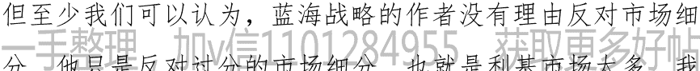

呼哟，郑老师的这个创意是真不错啊！大家觉得认为的。

最后，就这三个方法老师要做个总结。市场细分的方法最简单有效，应该排在首位。其次是蓝海策略，其中的方法是对市场细分的补充和跨越，值得尝试。最后是长尾理论，要先判断有没有这个需要以及市场操作的可能性，然后再去分析行业中的利基市场，看看哪些可能会机会。好了，关于市场细分的内容就讲到这里了。大家还有什么问题吗？

909 楼

作者:大泰的骑士 日期:2018-08-22 21:32
王亚理 初次编辑:11012849555，获取更多好帖

 第六节 市场细分的作业

所有的学生都在回郑江平的分析，没有人提问。郑江平等了片刻，见没有人问题，他说：“既然大家没有问题，那我们这个学期最后一课就到这里了。虽然课程结束，但今天这节的作业还是要布置的。”

大家已经习惯了郑江平每课要布置作业，所以这最后一课的作业，也都觉得是理所当然的事情。会是什么作业呢？

郑江平转身在黑板上写上“饮料”和“服务”两个词，开口说：“这课的作业有两个，第一个是参考刚才分析童车的过程，寻找饮料行业存在的机会。第二个作业是思考对于服务行业，你们该如何细分市场。大家都记住了吗？”

“记住了！”大家同声说道。

“好。还是周二前发到我邮箱。下课！我们下学期见。”

当听到郑江平下课后，他感觉自己的心跳瞬间加快了一倍。最近几天都在等郑江平的消息，今天下课留下了，是好消息还是坏消息？段燕用疑惑的眼神看着秦晋之，很怪这么糟，今天你们之间有什么事情呢？秦晋之刚知道不能告诉段燕，所以只能笑着摇头，收拾好东西挥手离开了。

有一种说法，人一生会有几次机遇改变命运。每个人的境遇不同，这次机遇和时机自然不同。但有一点可以肯定，对机遇的嗅觉和把握非常重要。秦晋之认为如果能进入商学院，自己非常重。所以当其他同学离开后，他便走到郑江平前，眼神带着期盼。

郑江平无表情地看着秦晋之，用手拍了他的他的肩膀，用带怜惜的语气说道：“秦晋之同学，你之前的作业主要……”

郑江平说到这里，停顿了一会儿。秦晋之心中噔一下，看这意思，是没有面试资格啊！糟糕，秦晋之知道这两天给自己发微信了。自己那么用心完成的作业都没有达到要求，这商学院面试的要求也太高了吧！沮丧、心灰、委屈、消沉的情绪都涌了上来。郑江平视着秦晋之脸上细微的变化，心中一阵乐。当年自己也是被这样感觉差不多，可以告诉秦晋之了。

“不过，毕竟你的作业完成的不错。所以秦晋之获得了商学院的面试资格！”郑江平笑嘻嘻地对秦晋之说。秦晋之长叹了口气，拍了拍胸脯，叫道：“太好了！老师，你也太会了吧！刚才才让我感觉肯定与商学院无缘了！吓死了！”

“哈哈。放假后跟我一起去北京参加面试吧，我会提前告诉你们。预计你们放假那几天。祝你们面试通过！”

“收到！老师，能提前透露面试的内容吗？嘿嘿。”秦晋之好好看着郑江平。

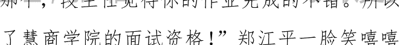

“商学院面试没有什么固定的内容，见招拆招吧。但一定要切实回答所有的问题，特别是在马院长面前。”

“收到！谢谢老师提醒。嘿嘿。”

“行了，快回宿舍吧。等我通知。”

“好哒！老师再见！”

“再见！”

郑江平望着秦晋之离开的背影，收敛了自己的笑容。商学院现在暗流涌动，也不知道秦晋之这个时候进入商学院，对他来说是好事还是坏事。先不管了，面试结束后再说。郑江平摇了摇头，跟着秦晋之走出了教室。

929 楼
作者:大秦的疆 日期:2018-08-23 19:24

## 第六章 市场细分
### 第六节 市场细分的作业

02

第一个作业：从市场细分看饮料行业的机会

秦晋之平时也很爱喝饮料，最近他感觉新出的饮料越来越多了，有时候真不知道喝哪个。

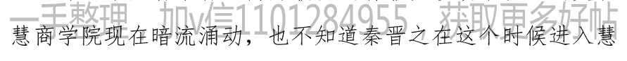

当务之急，还是先了解现有的饮料都有哪些，市场是怎么细分的。秦晋之第二天去了学校附近的各个超市，还坐公交车去了家乐乐。他还记得在学校附近的网吧里看到过超市里没有卖的饮料，是从家乐超市回来后，秦晋之又去逛网吧。回到宿舍后，秦晋之凭自己的了解，整理出了饮料行业的市场细分情况。

- 1、纯净水。
- 2、矿泉水。
- 3、茶饮料。代表：农夫山泉“茶π”、东方树叶、康师傅的红色茶、莉莉茶、达力的青梅绿茶。
- 4、能量型饮料。代表：红牛、宝矿力水特、东虎、黑王霸。
- 5、奶茶饮料。代表：统一“阿萨姆”、原味奶茶。
- 6、水果饮料。代表：汇源果汁、农夫山泉“有机果园”。
- 7、维生素饮料。代表：农夫山泉“维他命”、蜂蜜水。
- 8、生活型饮料。代表：康师傅酸梅、葡萄糖水。
- 9、碳酸型饮料。代表：可口可乐、百事可乐、芬达、雪碧。
- 10、冷泡饮料。代表：小若。
- 11、发酵饮料。代表：格瑞斯。
- 12、咖啡饮料。代表：雀巢咖啡、雅胜。
- 13、苏打水。代表：各种苏打水。
- 14、营养饮料。代表：快线。
- 15、汽水。代表：怡泉、怡哈哈、健力宝。

整理细分的过程对秦晋之来说痛苦的，因为有些界限太模糊了。如果按照类型分类，饮料利基市场的界定显得没有意义。饮料行业的常态。同类产品之间存在差异化方式：口味、外观（瓶子的形状和设计）、价格。此外围绕消费者的健康理念，有些品牌增加了相应的产品（比如雪碧“纤维”等）来迎合市场。

现在，可以按照维度来分析了。年龄非常明显，儿童和老人。根据饮料的了解，秦晋之认为不考虑儿童市场，毕竟大家都知道饮料对孩子并不好。更何况酸奶、乳酸菌等饮品也很活跃。老人一般都喜欢喝茶或者开水。

比较注重养生，如果推出养生茶呢？当然不是饮料的形式，而是小袋包装的方式，将对有益如枸杞、红枣、核桃粉等原料按照一定比例调和成的？秦晋之越觉得这个点很有靠谱。小袋包装一定要精美！品牌就叫“养生一品！”

性别。饮料针对性别的区分是非常容易发现，味道、标签的图案和颜色。粉红的颜色和淡花的味道，这样的组合往往会让男性而却。不过在超市里发现一个针对女性的饮料，是否是一个机会呢？秦晋之也不想出一个，也许这个答案需要学营销体系的内在才可能会得出。到了一个创新的地方：包装瓶。为什么不用细柔的包装瓶来装女性的饮料呢？这样的包装瓶女性就会喜欢。秦晋之很快把这个想法先写到笔记本上。

情感。“哈哈，我的眼里只有你”，还有“认真、搞笑、低调”。其他的情感吗？他想了半天也想不到了。不过直觉他认为饮料的单价一般都不超过10元，所以并不认为情感能在多大程度上左右消费者的选择、卖点、口味、功能都是核心。至少自己认为怡宝和哈哈的情感，这两个品牌的纯净水并非喝不可，碰到哪个就喝哪个。于是秦晋之决定不再考虑情感上的突破。

技术？技术？技术当然重要，格瑞的面发酵、小若冷泡，也许是因为技术上的尝试而带来的新产品。这个维度到此打住，技术的问题自己从哪儿知道哪。移动互联、人工智能、VR等方面的新技术在这个行业也用不了了啊。

蓝海战略。剔除、减少、增加、创新，彻底放一边，不了解竞争元素，这四个动作无从谈起。六个跨越！他市场？除了饮料，消费者还想要什么？牛奶、咖啡、酒。这么跨越啊！界限分明。跨越产业内部战略集团？高低标识点相结合？没有。跨越买方链？没有。跨越互补性产品和功能项目？也没有。跨越对买方的功能和情感引导？跟细分市场的情感维度是一样的，还是没有。跨越时间？没有。看来蓝海战略在饮料行业很难发挥作用了，也许是自己水平还不够吧。

长尾理论。Pass！刚刚得出了结论饮料行业的利基市场的分析有没有意义，那那里还有长尾理论的用武之地呢。

好了。第一个作业算是完成了——针对老人的“养生一品”、针对女性的纤细包装。

939 楼
作者:大泰的骑士 日期:2018-08-24 01:36

## 第六章 市场细分
### 第六节 市场细分的作业

03

古龙先生在他的小说里经常会提到世界上最古老的两个服务项目，排名第二的是买凶杀（杀手），排名第一的是女人的身体（你懂的）。对我们来说虽然无从考证，但又一点是可以肯定的，发展至今服务业已经是包罗万象，无所不在。只要愿意，我们在家里除了刷牙洗脸澡上……

不科学的细分。凉白开号称为“水类创新者”，其细分角度不可谓创新，为何落魄至此？不合理。第一，概念不合理。无论是“凉白开”还是“熟水”，这样的概念消费者心里明白，或者说太接地气了，消费者的常识很难接受这样简单暴的概念，没有惊喜，没有尝试的期望。

第二，卖点不合理。“选用洁净水好，洁净水消费者日常生活中并不获取，这说明产品的原料没有吸引力。“拥有UHT热杀菌技术的瓶装水，加压125完成杀菌过程，在消费者的认知中，水烧开已经在杀菌方法合格，加压125度的卖点并不能期待这样的产品对自己有多大的好处。“采用超洁净灌装设备，全流程80℃高温灌装”，消费者原本就没有饮料不净，强强调超洁净，其实并不是消费者的痛点。

第三，目标定位不合理。这是指“凉白开”，没有清晰地表达目标用户具体是谁。妄图覆盖掉所有消费者群体，这也是导致市场细分失败的原因之一。这一点跟第二点本质上是紧密相关的。

第四，需求不合理。因为有第一、第二和第三的败笔，就注定凉白开不能创造“热水”的市场需求，一个缺乏需求的细分市场，一定是失败的细分市场。

综上所述，市场细分的成功可能有各种原因，但不成功的市场细分一定跟上述四个不合理有关。因为，对于“凉白开”，本人的看法是，“凉白开”真的要凉了。

第二个作业完成！

945 楼
作者：大秦的疆 日期:2018-08-25 01:07

销量几何？在这一方面可以反映其销量的萎靡。细分市场，是营销的大利器之一，尤其是创造性的细分。一旦细分准确，必会带来行业的注目、跟风和消费者的关注乃至偏好，如饮料中的红牛，成功开启了能量饮料的细分市场。

不科学的细分。一方面凉白开自2016年5月13日后重回市场，已有两年多的时间了。我们得不得知。但从市场来看，罕见该产品上架。

不科学的细分。秦晋之开始明白为何郑江平布置这样的作业了。以郑江平的水平，应该认为凉白开是一个成功的市场。通过市场细分的角度来说对凉白的看法，其用意就是大家把凉白开作为反面案例来思考，不科学的细分失误在哪里。想到这里，精神一振，用短文写下了自己的分析。

不科学的细分。凉白开这是什么鬼？把水煮了又晾装到瓶子里？先不说从市场细分的角度分析，从消费者的认知出发，秦晋之不禁怀疑。他记得自己自己在任何超市都没有看到凉白开，这说明并不是畅销。洞察需求，按照这种细分，要消费者为导向，做市场调研，要用心，对人性的理解。

不科学的细分。不科学的细分市场了。

不科学的细分。秦晋之认为凉白开，可以说是一个独立的细分市场。它是创新也不能过的。在网上搜了一下，果然凉白开被认为是“水类创新者”，其细分角度不可谓创新，为何落魄至此？不合理。

不科学的细分。秦晋之认为凉白开，这种细分市场了。不科学的细分。不科学的细分细的细分，不科学的细分。不科学的细分。不科学的细分。

不科学的细分。不科学的细分市场了。

不科学的细分。不科学的细分。不科学的细分。不科学的细分。不科学的细分。不科学的细分。不科学的细分。不科学的细分。不科学的细分。不科学的细分。不科学的细分。不科学的细分。不科学的细分。不科学的细分。不科学的细分。细分的，不科学的细分，用笔在本子上回来的字歪看着，渐渐的思路越来越清晰了。体验、程度、范围！网吧的环境、网管的速度、网吧的座椅、这三个是服务的体验；上网的速度，这是服务的标准；网吧有没有好喝的饮料，这是服务的范围。

不科学的细分。不科学的细分。不科学的细分。不科学的细分。不科学的细分。不科学的细分。不科学的细分。不科学的细分。不科学的细分。不科学的细分。不科学的细分。不科学的细分。不科学的细分。不科学的细分。不科学的细分。

秦晋之写下了自己的分析。想到这里，精神一振，用短文写下了自己的分析。

## 分析一下理发店和外卖行业的细分市场

秦晋之的第三作业：服务行业可以从客户（年龄、性别、情感）、技术、价格、体验、范围这六维度来细分市场。

根据这六维度，我分析理发店和外卖这两个不同行业，得出来的突破点如下：

### 一、理发店
- **年龄**：现在的理发店基本上面对全部客户，有没有针对儿童、年轻人和老人来细分市场？
    - 儿童：针对儿童，需要哄闹。
    - 年轻人：现在的年轻人喜欢上网预约，满足年轻人的个性化需求。
    - 老人：增加头部按摩和推拿等健康益的服务，整体环境上也与其他区分。
- **性别**：在理发店上细分意义不大。
- **情感**：在理发店上细分意义不大。
- **技术**：不太了解。
- **价格**：差异太大，没有细分意义。
- **体验**：按照年龄细分后，顾客体验会有不同。除此之外，可以将理发店分为简约风格和舒适风格。
- **标准**：理发店的标准可以是修补，也可以是整个装修。
- **范围**：针对不同年龄，提供饮料和电脑。

**理发店存在的突破口：**
- 儿童理发店
- 潮人理发店
- 老人理发店
- 极简风格的理发店（没有会员卡、无需长时间等）。

### 二、外卖
- **年龄**：没有细分意义。
- **性别**：没有细分意义。
- **情绪**：没有细分意义。
- **技术**：不太了解。
- **价格**：没有细分意义。
- **体验**：这些都是外卖公司最基本的服务，没有细分意义。
- **标准**：一般外卖公司讲究速度快。对于这样的外卖公司，消费者提前提供预算和要求，同城餐厅筛选，找出最让消费者满意的。虽然慢，但口味最合适，而且提前预定，只要送到消费者手里就可以了。
- **范围**：可以只负责早餐或下午茶。或者专门给带病在单位员工送药。

**外卖存在的突破口：**
- **“帮你挑”外卖**：速度慢，帮助消费者找到满意的外卖。
- **“早上好”外卖**：负责早餐。
- **“下午茶”外卖**。
- **“小护士”外卖**：只负责给上班生病的员工送药。

这样的细分可以考虑，但也需要市场调研。

第三作业，完成了！

---
977楼
作者：大秦的疆士
日期：2018-08-26 00:50

---

## 第七章 慧商学院的面试

昨夜西风拂过碧树，独上高楼，望尽天涯燕。

### 第一节 表白飞燕

01

女作家豆豆在长篇小说《遥远的救世主》（后被翻拍为电视剧《天道》）中男主角元英说过一句非常耐人寻味的话：“天下之道”说到极致，百姓的米柴油盐；人生说到极致，男人和女人的一个情字”。想来甚有道理。人生之极苦，并非寻常剧，而是困重重，春风得意到极致之时，身边的人离你而去。人生之极乐，亦非逍遥自在，而是你对你有情，她刚好对你有意。思之而得之，岂不快哉！

随着上次自习课闹满的腰肢亲密接触，秦晋之就越发想飞燕，如百爪抓而辗转反侧。在他面前的有两条路：一是等她跟霍尔分手，期间保持联系，朋友相处；二是表白，死也要死个快！只是表白后，估计就没办法做朋友。哪条路更好呢？情字魅力有多大？能让一个独断的人变得得失。自信、风度、从容这些形容词仿佛世界上消失了。

秦晋之酌再三还是拿不定，决定先听听佟逸的意见。因为即将期末考试，白天大家都在宿舍或自习室里。此时是上午，秦晋之走到佟逸面前，佟逸一脸懵圈。现在才一点点，食堂还没开饭，秦晋之问：“老大，你不饿？”

秦晋之看着佟逸的表情，连忙看了下时间，有点尴尬。他连忙补充：“有事咨询你，咱们边走边聊。”

佟逸拍了拍他的肩膀：“累了，走吧。”

两天后，秦晋之说：“我最近喜欢了一个大三学姐，但她有男朋友了。”

佟逸一脸坏：“哦，有男朋友了那就算了。更何况她都大三了，明年就工作了。”

听完佟逸的意见，秦晋之没有说话。他在心里承认佟逸的想法没错，可是自己不想放弃，不甘啊！他的脑海里不断浮现飞燕的笑，还有两个可爱的女孩。

佟逸见秦晋之半天不开口（孺子不可教），叹了口气：“你是不是该找个理由请她吃饭，最好再买个小礼物，浪漫一点？”

秦晋之笑道：“哎哟！还是你，哥哥就是没经验啊！”

佟逸笑道：“哈哈，没经验是常识好吧。加油吧，少年！”

做了决定，秦晋之感觉一身轻松，择日不如撞，就约今天晚上！

晃悠儿，听到门声连忙走了过去。进了办公室后，郑江平和立用询问的眼神看着段钰华。段钰笑了笑，说道：“我现在给冯院长打电话，看他现在有没有时间。秦晋之获得了冯院长长这一关才算面试通过。”

看来段主任的面试通过了！秦晋之和郑江平和对望一眼，进入学院已经成功一半！

## 1065 楼
作者:大秦的疆 日期:2018-08-31 00:19

## 第七章 慧商学院的面试
### 第三节 院长的面试

王建华接通了冯院长办公室的电话，轻声说了句你好便挂断了，对郑江平和秦晋之说道：“冯院长接待完两个客人，你们现在可以上楼去他办公室。”

郑江平和之连忙回答，转身走门了出去。到了楼口，郑江平看到了学院对外联络处主任唐锦带着两个客人下楼，他连忙跟唐锦打招呼，“唐主任您好。”

唐锦看向郑江平，身边还有一个学生模样的年轻人，便估摸着是上楼找冯院长见面的，笑着说道：“哦，江平回来了。是找冯院长吗？他在办公室呢。我送两位客人下楼。”

“好的，唐主任。您先忙。”郑江平连忙回答。

赵郑江平和唐锦说话的功夫，秦晋之在旁边量着冯涛院长的两个客人。一个客人约六十五，浓眉大眼、表情冷峻，眉宇间有一股不怒自威的气势，一看就是有位有身份的人。虽然他穿着质地很好的西装服，里面是白色衬衫配着金色领带。另一个客人，则是年纪跟自己相似的年轻人，平头短发、脸部棱角分明，是一个不折不扣的帅哥。虽然这个年轻人嘴角一直在微笑，但秦晋之从他的眼神里能感觉到那种骄傲和不屑。

秦晋之才原来这位年长的客人是蓝氏家族的首领之一天，那个年长的客人，则是自己未来几年的灵梦——蓝氏家族的后起之秀玉魔。

很快，蒋涛带着两个客人下楼了，郑江和平秦晋之则一同迎上。电梯里等了好几次，来到三梅清湾院的办公室。上楼的时候秦晋之能感觉到郑江平在电梯时心里放松，却有一点紧张。

“咚咚”郑江平小心翼翼地敲门。

“请进！”冯涛在里面回答。

郑江平带着秦晋之走了冯涛的办公室。由于客户刚刚去，冯涛还坐在办公室中间的沙发上。他知道郑江平带着学生来面试了，用手指指了指自己对面的沙发，说道：“别别站着，坐到来。”

两人坐下后，郑江平简单介绍了一下情况：“院长，这是秦晋之，今天来面试。我们刚从主任那边过来。”

“院长，你好。”秦晋之抓着这个机会向冯涛打了个招呼。冯涛微笑着点了点头。

“院长，您看我要不要出去等？”郑江平问道。

“不用，没那么正式，就是闲聊几句。”冯涛呵呵地道。

嘿嘿，原来冯涛院长还是很易近近人的嘛，不知道老师为什么要紧张。

## 1082 楼
作者: 大秦的疆士 日期:2018-08-31 16:29

## 第七章 慧商学院的面试
### 第三节 院长的面试

02

蓝蓝就是蓝氏家族安排到慧商学院的学生，蓝是慧商学院和蓝氏家族五年契约的参赛季选手。冯涛因为刚见过蓝玉，心中暗暗自拿秦晋和蓝玉做比较。

跟郑江平说话的话，冯涛很快地打量了下秦晋的面相：天庭饱满、地腮围圆；剑眉上扬、双眼有神；鼻梁挺拔、眼中深邃；脸颊有肉、嘴角厚实。这些地方还算不错，山根、尾梢则略有瑕疵，但大体面还可以。所谓“相由心生”，从面看来，秦晋的仁义敦厚、聪明灵秀，但果决稍显不足，这一点正是跟蓝玉最大的不同。果决可以通过后天的历炼逐渐形成，如果秦晋成长的速度足够快，可是……

“秦之，你每一节课的作业主任都会打印出来给我看，小伙子作业完成的不错，还是很有够性的。”冯涛说。

冯涛听到了，秦晋听着倒是觉得有些什么，但郑平却很意外，他从没听到段华说过冯涛看过秦晋的作业。就他所知，以往冯涛是不会亲自审目的这些面试者的作业的，判断面试者营销方面的悟性都是段华直接把关的。是因为秦晋的作业完成的太好了，段华推荐给冯涛的？还是因为蓝氏家族的赌注，冯涛决定亲自把关？郑平平时直不得而知，至少可以肯定，冯涛和段华对秦晋的作业是满意的。

在郑平左思想的时候，冯涛继续说：“如果我记得没错，你的学期最后市场的作业，我主任还没看到。”说完，冯涛看着秦晋。

郑平立刻感觉到冯涛的眼神从刚才的温和如风厉一把刀，不由得心胆一缩，额头逐渐渗出汗。可是没办法解决，的确是他已经跑了，秦晋不知道如何开口。秦晋在旁边犯难，连忙道：“院长，老师对我们的作业很高。一定是因为我的作业觉得完成不够好，所以交给主任。”

听了秦晋的解释，冯涛心中点头，自己故意为难就是想看秦晋会有反应。蓝氏家族最近想办法拉扯学院，容易被拉扯的就是刚加入的新生。如果发生一个代表学院参加蓝氏家族比赛这样的局面，那就要做坏打算了。幸好秦晋刚主动帮解围，这说明这个学生是一个仁义、有担当、对自己忠诚的年轻人。

“嗯，不管作业完成的好坏都要来。”郑平立刻感受到脚石头般的轻松，轻快地答道。冯涛将双眼盯到秦晋身上，问道：“秦晋，在你的作业中有一些想到的创新项目，这些当中喜欢哪一个？”

“院长，我需要想一下。”秦晋快速回想着作业中的创新项目。在营销洞见中：
- 预防老人潜在需求
- 提醒功能的牙刷
- 智能促销服
- 宠物饲养
- 针对老年人的耳机的现象
- 衍生预防和听力的产品

在认知客户中：
- 写给小白的一封信
- 老年游戏的广告脚本

在市场细分中：
- 饮料行业养生品
- 针对女性的包装的设计
- 理发店

市场细分后的创新

秦晋不禁想如何评价一个项目的好坏，除了商业利益之外，他凭自己的直觉还需要考虑一个因素——社会价值。基于这个因素，他认为最喜欢的项目不是老年游戏，也不是护理，而是预防和保护年轻人听力的项目。他回答道：“院长，我认为自己最喜欢的项目是王经理说的这个项目，有很多好处，预防和保护年轻人听力。虽然我现在不知道通过什么样的产品或服务来预防和保护听力，但我觉得这是其中具有社会价值的项目。”

“性格重要？”他继续补充：“坚韧。信和乐观固然很重要，但我认为自信和乐观在现实不断打击，终会干枯百石。唯有坚韧意志，才能让自己不会倒下。”

冯涛脸上的笑容一闪而过，坚韧，是的，现在慧商学院需要的并不是自信也不是乐观，而是坚韧！面试就到这里吧。

冯涛对秦晋是满意的——仁义广厚而不失磊，为人有胆当能忠诚，看事情有胸襟和格局，能够坚韧做事才能坚持长远。如果能再历炼出干练决断的风格，未来可期。

“秦晋，面试就到这里吧。欢迎加入慧商学院。”冯涛微笑的说道。加v信101128495，获取更多好帖

1093 楼 
作者:大秦的疆士 日期:2018-09-01 12:27
因好友建议，昨天下午所发内容重新做了修改。重新更新。谢谢大家的支持！

1102 楼 
作者:大秦的疆士 日期:2018-09-01 12:27

## 第七章 慧商学院的面试
### 第三节 院长的面试

02

……

在这个短暂的时间里，办公室陷入死一般的沉寂。冯涛拿起办公桌上的茶杯，整了眼喝起了水。说点什么！说点什么！片刻后，秦晋的反应过来，必须要替自己解围，否则一切就泡汤。年龄小？年龄小？有了！秦晋的双眼睛看向冯涛深而又凌利的目光，张嘴说道：“院长，我想我的偶像。”听完秦晋这句话，郑平一脸愁圈，这都是什么时候了，还说什么偶像啊。冯涛的脸上没有任何表情。秦晋之鼓勇气说道：“虽然我现在刚20岁，但我跟同龄人不一样，我的偶像不是什么明星，而是梁启超先生。梁启超先生18岁中华，22岁和康为一起发起了著名的‘公车上书’，22岁已经是当时新运动的领袖人物。25岁，他主持《时务报》。25岁，他和康为一起开始了中国近代史上第一次改革‘百日维新’。院长，我想说的，年龄的大小可以代表一个人的成熟度，但我认为22岁的梁启超已经远超同龄，也包括多年的人。”秦晋口气说完，端端正地的坐在椅子上凝视着涛。郑平听后眼前一亮，秦晋之小子这番话说的好，有戏！

冯涛嘴角的笑容一闪而过，点了点头，说道：“梁仪公确实是那个时代的天才。可惜他的一切都是被历史左右，而不能改变历史。我想知道你将他作为自己的偶像呢？”

“我所崇梁启超先生，最大的原因是他的胸襟和格局。梁启超先生20多岁就闻名天下，但他并没有安于一己之利，而是心怀天下。虽然正如您刚才所言，究其一生，都是在被历史左右——戊戌变法失败后，他支持袁世凯衰后他又支持祺祺，其政治夙念终没有实现，但他如此奔波曲折，皆是为心的国民之安。”秦晋回答道。

冯涛点了点头，说道：“在那个时代的有志青年多是这样样的。”

秦晋继续说道：“此外，梁启超学术渊博，在哲学、文学、史学、经学、法学、伦理学、宗教学等领域，均建树。同时，他笔耕不辍，一生著书十余万字。”

听着秦晋之侃而言，冯涛心中好感逐渐增加，秦晋之实在崇拜梁启超先生了。

“好了，年龄的问题我就问到此处了。”冯涛叹气，秦晋舒了口气，郑平自然是心存感激。

“嗯，不管作业完成的好坏都要来，记得晚上发给我。”郑平立刻感受到脚石头般的轻松，轻快地答道。冯涛将双眼盯到秦晋身上，问道：“秦晋，在你的作业中有一些想到的创新项目，这些当中喜欢哪一个？”

“院长，我需要想一下。”秦晋快速回想着作业中的创新项目。……（此处重复部分列表内容，已按逻辑合并）

……

冯涛对秦晋是满意的——……

……如果能再历炼出干练决断的风格，未来可期。

“秦晋，面试就到这里吧。欢迎加入慧商学院。”冯涛微笑着说道。

103 楼 
作者:大秦的疆士 日期:2018-09-01 19:37

## 第七章 慧商学院的面试
### 第四节 了解慧商学院

01

看着两人脸上喜于颜色的表情，冯涛也很开心，学院现在迫切需要优秀的学生加入。他对郑平说道：“郑平，你带着秦晋之去段主任那儿报到，先把手续办了。还有，别忘了签保密协议。”

“明白。”郑平回答道。

“谢谢校长。”秦晋赶紧望向冯涛表达自己的谢意。

冯涛挥了手，笑道：“谢谢你，好好努力吧。”

“我一定努力！”秦晋用力的回答道。

向冯涛示意后，郑平带着秦晋之走出了办公室。走了几步后，郑平停下脚步，郑重的秦晋说：“晋之，刚才谢谢你替我解围。”

“老师别客气，没有，我根本没有机会进入慧商学院，刚才的事情不算什么。更何况，那时候我不这么说，面试也进行不下去了。”秦晋连忙说道。

“不管怎么说，还是要谢谢你。刚才的面试，梁启可是立大功了。哈哈。走吧，去段主任办公室！”郑平轻松说道。

两人满脸笑容地回到了钰华办公室，段钰华的秘书也在里面。段钰华对秦晋通过面试加入慧商学院表示祝贺，接着便安排排书带着秦晋之去办手续了。段钰华看着郑平，说道：“江平，今年的招生指标已经结束了，下学期也不要松懈，合适的学生，还要继续推荐。”

“那是必要的。”郑平刚道道。想了，郑平又低声道：“老董，蓝家族和红氏家族的事情，我们要不要告诉秦晋之？”

听完郑平的问题，段钰华马上回答，在办公室里走了几步后对郑平说道：“可以让他知道。既然已经是学院的学生，就有权利了解学院真实的情况。更何况，这样也让他心里有准备。我估计秦晋办手续，学院里就会有人将秦晋的资料透露给红氏家族。希望秦晋才不会让我们失望。”

谈完这件事后，两人接着聊起了学院现在的项目和一些学生的事情。过了一会儿后，段钰华的秘书和秦晋之回到了办公室。

……（此处重复部分列表内容，已按逻辑合并）

……

冯涛对秦晋是满意的——……

…………如果能再历炼出干练决断的风格，未来可期。

“秦晋，面试就到这里吧。欢迎加入慧商学院。”

“或者创业项目的。说不定以后会有机会合作呢。”郑江平笑着说道：

“哦。好吧。对，郑老师，从慧商学院毕业有什么样的要求的？”

“有五个要求。一、实习结果和实习报告通过；二、达到的营销一级；三、达到学院的学分要求；四、英语六级；五、从现在起，你在 NE 大学的考试没有挂科。”

秦睿之看到最后两个要求是一脸的黑线，什么鬼，竟然通过英语六级？还要参加在大学的考试，还能不能挂科？他想到了点，立刻说道：“我现在马上大二，我在我一个月的时间内就能完成前面的三个要求，不是我这样说，我就不需要再在 NE 大学学完我的专业了，只要考试没有挂科，就可以从慧商学院毕业后了吗？”

郑江平真没遇到过这样的问题，他想了想，回答：“嗯，从理论上的确如此。这种情况几乎是没有可能过的。你知道仅仅一个实习，就需要花至少一个月的时间。”

秦睿之有点无语，这是从一个坑掉到了一个更大的坑吗？不管了，让自己让自己营销又不容易进入了慧商学院，既来则安之！他接着问道：“那我从下学期开始是在这里学习，还是是在 NE 大学？”

“作为慧商学院第一年的新生，除了特殊情况外，你只需要一个月来一次学院参加集体案例研讨会就可以，其余的时间还是在 NE 大学学的选修课。寒假暑假，除了过年回家的那几天，都必须在学院。”

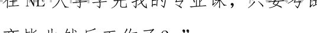停顿了片刻，郑江平延续道：“从这个暑假开始，你就可以参加实验中心内部的经营企业的沙演练。之外，你也可以在项目中心选择一些项目去完成，就可以获得学分。不同难度系数的项目获得的学分会有差异。

“最重要的一点，忘了跟你说了，你所参与的任何项目或企业所获得的收入或利润分配，都归你个人所有！我所知，没多少同学毕业的时候已经是百万翁了。”

哎哟！这个真不错！秦睿之听完秦晋之最后的介绍，花蕊盛放。

“好子，现在我带你了解学院的组织结构。”郑江平说完，便带着秦睿之出了小亭。

## 第七章 慧商学院的面试
### 第四节 了解慧商学院

沿着学院内蜿蜒的道路，郑江平带着秦睿之在学院内漫步而行，时不会有一些汽车和老师从他们身边经过。碰到熟人，郑江平都会停下来寒暄几句。冯涛和段钰华所在的办公楼，位于学院的最里面，是学院的管理中心，包括院长办公室、人事处、计划财务处、学生处、对外联络处、行政处和保安处。

距离办公楼东侧约 200 米，有一个足球场大小的一层楼红色建筑，这是学院的实验中心。郑江指着实验中心对秦睿之说道：“这就是刚才跟你说的实验中心。在这里，学生沙盘演练经营企业或运营项目。每年的寒假，这里是学院最热闹的地方。”

“沙盘演习？听着商场如战场，那叫沙盘演习也不过了。”

“哈哈”。如果商场如战场，你可以按照自己的想法对现有企业或者模拟的企业进行各种演练，比如调整营销策略的市场表现！针对对细分市场的产品创新的市场反应，或者渠道升级后的销售预测等。”

“这么惨！可是怎么保证演练后的结果是科学的呢？”

“这需要数据中心的协作，一会我们就能看见数据中心。当然，毕竟是演练，不能面对到市场的真实情况，尤其是消费者的接受情况。通过数据分析和演练，只能说是一种科学的预测方式。”

两个人并排走着，很快就看到了一个实验中心还一大倍的白色建筑。郑江指着这个建筑对秦睿之说道：“这里就是数据中心。”

此时已近黄昏，金色的夕阳洒在数据中心白色面上，使得数据中心显得辉煌而又庄重。秦睿之凝视着数据中心，不禁为之神往。郑江继续介绍道：“数据中心里不仅有学院搜集和整理的各行各业来的各项数据，还有行业代表性企业发展历程的数据，尤其是企业通过技术应用、产品创新、商业模式变革等在数据上的变化。当然，企业经营不善数据的变化你也能从中看到端倪。此外，各个公司所公布的行业数据你都能在数据中心找到。通过数据发现问题，这是营销人员的基本素养。以后你就知道了。”

秦睿之自然是连连点点头。

接下来的郑江平带秦睿之参观学院的金融中心、学术中心、项目中心、管理委员会和体育馆。金融中心就是学院的创业基金；学术中心则像是一个图书馆，里面不仅跟营销管理和经济相关的书籍几乎都有，还将这些书籍的理论进行了详细的梳理完毕；项目中心又分为两块，一块是学生创业孵化器，一块是学生选择项目参与经营以学分；管理委员会实际上是慧商学院几个合作企业在学院内的办公所所在地，同时这些企业也通过驻校办的办公方式参与学院的管理和学生项目的，故称之为管理委员会；体育馆与其他大学的并没有太大区别，是在体育馆后面有一个驾驶培训场地，主要用于学生学习驾驶汽车。

夕阳西下，晚霞的最后一抹彩也即将消失在云层中。

此时，郑江平已经带秦睿之参观完了学院的各个机构，现在他们坐在距离学院门口最近的小亭。郑江平一边感受着傍晚的微风带来的凉爽，一边想着跟秦睿之说说蓝氏家族和红氏家族的事情。

天色还没有完全暗下，弯钩般的银月却已悄然登上天空。舞台转场。亭内，郑江平低头跟着秦睿之走，走在路旁边，奇地看着自己的老师。渐渐，郑江平的脚步停了上来，“秦睿之，既然你已经正式成为慧商学院的学生，有些事情我想直接告诉你比较好。”郑江平决定还是开门见山。

“呀？我刚跟学院签完协议，你不会是要告诉我这其实个坑吧？”秦睿之心中有一点突突。幸，郑江平马上打消了这个想法。“实话，你有没有听过燕京的红氏家族和蓝氏家族？”

“没有。”

“你没听说过也很正常。总之，这是在国内非常有权势的家族。”说着，郑江平用手指指了上面，接着说道：“反正就是牛了，手可以通天。因为咱们学院的影响力越来越大，创新的项目又挣钱，现在已经被这两个家族盯上了。他们想要吞并我们的学院。”

“啊！那学院不是很危险？”

“这也不好说，咱们学院也有各方面的资源，现在还要防范。蓝氏家族那边跟学院达成了协议。”

“什么协议？”

“五年的赌约。我们会安排差不多的人，利用蓝家族的资源，跟学院选一个学生进入学院，看五年后经营的结果如何。如果我们赢了，他们就不再考虑参与学院；如果是他们赢了，他们就投50%的股份，到那时候。”郑江平重地说道：“这也可以！这个比赛太激烈了！”秦睿之上说着，心中思想着如果是自己被选中了怎么办。“红氏家族呢？”秦睿之忍不住道。

郑江平皱了眉，冷哼一声：“据说红氏家族有偷偷联络咱们学院的老师和学生，他们玩的是渗透，估计他们是想把咱们学院老师挖走，再搞一个慧商学院出来。”秦睿之在旁边也不知道说什么，静静地听着。

郑江平看着秦睿之，接着一字一句道：“联络名单中包含这些刚入学的学生。咱们学院现在有很多老师被拉扯了，还不是谁，所以很难保证泄露给红氏家族。也许多久就会代表红氏家族来拉扯，可能是老师和你一起进入学院。如果遇到这种情况，希望你能做出正确的选择。”

秦睿之脸上依旧镇定，内心却是激动不已，他觉得日子太难了。他看着郑江平，道：“可不可以假装策策，红氏家族那边的底部？”

“哈哈。”郑江平看着秦睿之的表情很轻松了，笑道：“只要你足够诱惑被拉扯就行。可不是开玩笑的，只要我们学院齐心协力一块，红氏家族也玩不下。”郑江平说完就带着秦睿之出了学院，“你会呢？”

“那个暑假你肯定得开车了。这是最基本的技能吧。”郑江平惬意地拍了拍秦睿之的肩膀，说道：“时候了，走吧，我还要带你去住公寓，那里有免费的食堂，你就不用吃了。明天上午我接你，跟段主任讨论下暑假怎么安排。对了，你会开车？”

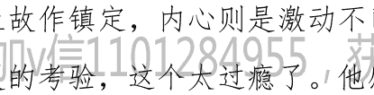“不会。”秦睿之答。郑江平说完就带着秦睿之出了学院大门。秦睿之就这样成了慧商学院的学生。在这个暑假，他学会了开车，在学院各个机构都呆了，熟悉各个中心的功能。除此之外，他还听到学院内每个项目的研讨会，看着自己的师姐们唾沫横飞地讨论着项目的内容，那种激情和自信，使得秦睿之的血液也在沸腾。只是这暑假，他在学院里交了一个对自己友好热情的的朋友，刘帅。

## 第八章 “景区租赁”项目
### 第一节 三年后后

大雨如注，狂风如吼，天地间已如黑夜。秦睿之站在办公室室内望窗外的风雨，想着迟迟不见的项目，不由心中涌起一股惆怅。大雨在路面上腾起一层薄雾，柳树被风吹得东西倒，秦睿之心中一动，应抒情做了一首五言诗：

雨路撑庐，
枝垂风，
落花浮远。

闭上眼目，嘴里反复念着最后一句“何日做英雄”。秦睿之不禁叹了一声。此时的秦睿之已经进入慧商学院三年。他花了一年完成了营销体系，并且通过了学院的评审。之后，便去了国内顶级家电集团总部进行实习，花了1个月时间完成了学院对他实习的要求——任某产品经理。虽然通过了实习考核，但是竞争非常激烈，秦睿之没有选择在HX集团工作，而是参加了学院的选拔，通过五次关面试，最终获得了蓝的资格，从而一跃成为慧商学院老师的焦点。

但好运似乎此结束了。听了刘帅的建议，他在第三年初搞了一个OTO平台，结果却是屡受重创。先是“道小易”电动车平台搭建完成，产品也向战略合作的OEM工厂采购了，保证了超高的性价比，大规模的加盟招商会也开了，已经上千家门店加盟的意向。本以为马上就要开花结果，结果由于标准的突然出台，导致生产的产品都变成了滞销的库存。资金链一断，按照比赛规则，慧商学院就宣布项目失败，不再给第二次融资机会。

后来是“多骑网”OTO项目，产品是自行车和锂电车。吸取了“道小易”失败的经验，这次秦睿之是在学院的引荐下，跟几家全国知名企业谈其品牌部分的独家授权，然后下单订单生产。可就在招募线下加盟商的工作可见成效之时，却又遭遇了共享单车的突然大量投入市场。于是原来的加盟商纷纷选择了撤退。

两次的失败，秦睿之并无怀疑是有意为之，而是把原因归结于项目可行性考虑的因素不够。现在已经是第四年，留他的时间只有两年了。这次，他决定目标锁定在流量较大的景区做租赁项目。

### 第二节 三年后

秦睿之站在办公室室内，望窗外的风雨，想着迟迟不见的项目，不由心中涌起一股惆怅。

几个月前，秦睿之在刘帅的介绍下，开车去了朱勇的公司。透过玻璃门，看到朱勇正在打电话，微笑妩媚。秦睿之知道朱勇一定是在跟银行谈贷款的事情，可是前期几家银行的结果表明，朱勇的资金非常困难。

介绍后，秦睿之进入了办公室。在沙发上坐下，秦睿之打量了朱勇，个子矮，长相精致，看到热情的笑容，眼睛看起来十分精明，瞬时放弃了合作的想法。接着就坐着茶聊起来。朱勇介绍自己的公司，成立不久的研发公司，希望秦睿之担任技术总监。作为朱勇的老板，这个身份让秦睿之稍微放松了内心的抵触。接着就聊到了共享的话题，因为这个话题秦睿之和朱勇都熟悉。

朱勇告诉秦睿之，景区共享很有搞头。秦睿之之前苦于找不到好的项目，朱勇的想法是代步工具为辅，以辅助体验为主。这顿时眼前一亮，顺着朱勇的思路跟他提几个问题，两人越聊越觉得合拍。最后，朱勇向秦睿之出了邀请，两人一起做项目，他负责融资和产品开发，占55%的股份；秦睿之负责商业计划书以及后期的运营，占45%的股份。

秦睿之原本愿却是这个项目并不属于自己的，创业基金不会投来的，但现在时间紧，感觉还不错。秦睿之心中有些动，应该答应朱勇自己好好考虑一下。始至终，刘帅只是在旁边看着他们，没有说话。回去的路上，刘帅建议秦睿之接受朱勇的邀请。第二天，秦睿之给朱勇打电话决定当面再谈细节。谈妥后，秦睿之义无顾地参与了进来。

营成熟后年盈利38.5亿的预估，两人更是欢快的对视而笑。

明天，似乎很美好！

1195 楼

作者:大秦的疆士 日期:2018-09-07 00:29

## 第八章“景区贷”项目

### 第三节 融资难于上青天

01

在秦晋之和朱勇合作的第一个月内，两人的分工很明确，秦晋之负责编写业务计划书，朱勇负责租赁平台和产品的开发。期间发生了诸让秦晋之后后来记忆不忘的小插画。

在两人开始合作的半个月后，朱勇兴奋地告诉秦晋之他，之前离职的上市公司也要做共享单车，对方的董事长要朱勇负责车架的开发。虽然难以相信一个上市公司竟然还需要一个已经离职的人负责产品开发，但秦晋之替朱勇感到高兴。朱勇满意地告诉秦晋，他跟董事长的关系很好，这次董事长是有好事想着他呢。后来样品打发到对方那边，经过对方的检验要求在一些技术参数上做一些微调，朱勇又连重新按照参数的参数打了两个样品给对方过去。对方对修改后的样品觉得很满意，便便给朱勇下了5000台的车架订单。

朱勇的公司并没有生产线，于是他就开始忙着找附近的OEM工厂，接着就是给图纸、订单。大约一个月后，这

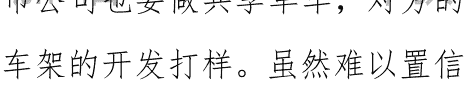

5000 台的架车生产完成了。朱勇要求 OEM 工厂发货到家里上市公司去，工厂的回复也很简单，打款后就发货。可是，上市公司那边是货到付款，于是朱勇空手转身就回不去了。秦晋之是那时候才知道朱勇公司的财务状况一塌糊涂，账资金更是少之又少。

在公司的办公室里，朱勇看着秦晋之，满脸讨媚地眯着笑，希望秦晋之能帮他先垫一下20 万的贷款，并拍着胸脯保证发货后带着秦晋之一去这家上市公司要款，走特批流程，第二天款就能到，立马还给秦晋之。秦晋之看着朱勇脸上装着好意思又暧昧巴结的表情，心里有点尴尬，可是自己的合伙人，项目融资还要靠他，更何况货发过去后一起结款，应该是十万稳，想想还是朱勇一把，便将钱给朱勇转了过去。

后来 5000 台架车发过去了，秦晋之跟着朱勇去了这家上市公司所在的城市。第二天一早，朱勇一个人去了这家公司，秦晋之则在酒店等着他的好消息。结果朱勇来说对方样品检验不合格，要全部检验一遍，不合格的返回 OEM 工厂合格后再付款。后来，这件事情就再也没有了说法，秦晋之的 20 万也一直没有回来。

1201 楼

作者:大秦的裸士 日:2018-09-08 06:34

## 第八章“景区贷”项目

### 第三节 融资难于上青天

02

商业计划书写完之后，融资的事情就得快马加鞭了。按照两人之前的约定，融资由朱勇来负责，不过朱勇表示商业计划书主要是秦晋之写的，里面的内容，尤其是成本核算和盈利预测更为为了了解，所以朱勇建议融资的事情秦晋之要一起参与，秦晋之全然接受。

项目的融资，朱勇第一计划找的自己是在原来上市公司认识的韩衡，一家南方公司的老总，朱勇告诉秦晋之，这个韩总早些年是靠地皮起家的，现在专门做投资。韩总这两天刚在燕京，他已经跟韩总约好了在朱勇公司谈谈项目的事情。

下午的时候，韩总等人如约而至。在大家相互介绍的功夫，秦晋之看了韩总，四十岁的中年男子，虽刚正、岸嵩，脸上没有太多表情。坐定寒暄，朱勇便由秦晋之介绍项目的内容。对于韩总的第一印象，秦晋之在讲解项目的内容时将语言说得很慢，特别是在讲项目核心核算和盈利预测，更是平淡地将测算依据逻辑环环环扣。秦晋之一边讲着一边看着韩总的反应，整个过程韩总毫无表情的说过一句话。在介绍完之后，韩总开口：“这个项目现在进行什么阶段了？”朱勇在旁边回答：“这个项目

正在跟几个谈谈合作，估计一段时间就能出来。”韩总听了说道：“朱总，你可能对我们还不了解，对于风险控制，我们一般只做 PE（股权投资），推动上市后退出。这个项目是好，但我现在属于天使阶段，我可能帮不上忙。”朱勇急切又谄道：“韩总，我知道你们只做 PE，这是我的大哥，这个项目很有潜力，所以我请你试试。”韩总摇了摇：“朋友，生意归生意。这是我们的原则，不能说了。这样吧，项目看到 VC（风险投资），你再找我。”韩总站起来，带着歉意说道：“朱总，不好意思，燕京那边有一个饭局，就不耽误你们时间了。”朱勇一顿留后，对方坚持要走，朱勇和秦晋之在公司门口送韩总离开。回到办公室，感觉气氛有些沉，朱勇看着秦晋之，一笑：“老秦，没关系，明天我带你去一家茶社，那里可是直辖市金融中心，很多投资机构或者银行，王姐跟我我很熟。”

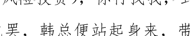

秦晋之心里正算着项目进度，听完朱勇的话点了点头：“好。”猛然想起刚才朱勇的话，他又接着说道：“你刚才跟韩总说几个试点合作，没听你说啊。“哈哈，到时候再落实吧。”看着朱勇笑起来，秦晋之没有说话，笑了表示回应。

1214 楼

作者：大秦的骑士 日期:2018-09-10 10:19

王舒凯 | 微信号：101284955 

### 第三节 融资难于上青天

03

朱勇所说的茶社叫“如一茶”，位于直辖市房价最高的河西区，只是闹中静，并没有在繁华的商业地段，还在一条公园的小路上。第二天上午近10点的时候，秦晋之开车顺着导航和朱勇来到了如一茶。茶社门口其实不大，看上去就是一个普通的茶社。大门上面挂着木制的牌匾刻着苍劲有力的“如一茶”，左下角有落款，应是书法名人写的。到了茶社门口，秦晋之才知道这家茶社叫如一茶。如一，心口行如一、初心如一，秦晋品着这“如一”字，越琢越觉得妙不可言。

跟着朱勇进了茶社，里面的装修颇流行，木桌木椅茶几，四面的墙上也是围着木制的架子，里面放着各个类的茶叶。秦晋看着上面标注的茶叶价格，心中不禁咂舌，最便宜的茶叶也得上千元一斤，贵的茶叶则从几万到几十万一斤等等。在大厅站了一小会，朱勇悄悄地捏下了秦晋的后角，低声说道：“王姐来了。”秦晋顺着朱勇的话看向，只有一个40岁左右的女士走了过来，裙如柳叶，目如朗星，穿着白色衬衫和黑色裙装，看上去十分干练。

朱勇已笑着上前招呼道：“王姐。介绍一下，这就是我要介绍的伙伴秦晋之。”

秦晋之伸手向前王姐快快握了手，说道：“王姐好。”王姐迅速打量了下秦晋，转过头对朱勇说道：“你们先把你们的项目简单说一下，我也很好介绍别人。等会银行的行长过来，到时候可以一起坐着咖啡。”

秦晋之和朱勇跟着王姐到了楼上一个包间，简单安排后，有一个甜甜俏丽的女服务员来泡茶。三人在包间的沙发坐下后，朱勇便让秦晋把项目的内容介绍给王姐。秦晋之考虑到王姐毕竟是中间人，说的太细就没有必要了，便简短的重点介绍了下项目。王姐也认真，一边听着一边用笔在本子上记着。一会功夫，秦晋的介绍完了。王姐把合上，对两人说：“你们先在这里喝茶，我会发微信，你们来大厅，我给你们介绍银行行长，可以先看看他们的意见。你们先去了。”说完起身重新坐回沙发。

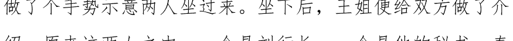

两人一边喝茶聊着项目，心里有些淡然。等了半个小时，朱勇收到王姐的微信，两人忙下大厅。大厅里，除了王姐，另外还有两个人。朱勇向王姐招了个招，示意坐下。坐下后，王姐做了介绍，原来两人一个是行长，一个是秘书。秦晋之快速打量着行长，五十岁的年龄，身材优越，身上西装显得平整，三角眼中透着的光芒，似乎十分干净利落。礼貌的介绍后，王姐笑着：“行长，这个朋友有一个很好的项目，关于景区租赁的。”行长的声音里没有情绪，道：“可以啊。”秦晋之不耐烦地介绍“景区项目”。听见秦晋之介绍，行长点了点头，跟着问项目进展。笑着一边倒着茶，闲聊几句，行长起身要走。

行长看了下秘书，对朱总：“这是我的名片，如果后面需要可以跟我联系。”秦晋之和朱勇接过名片后连连示意感谢，说着以后需要麻烦之类的云。之后行长和他的秘书跟大家打了招呼便离开了。看着他们离开，王姐对朱勇说道：“你们项目现在的进度还太慢了，我先帮你们找投资公司试试，银行不会感兴趣的，都是给你们贷款，自己看着吧。朱总，今天有个饭，等我消息吧。”朱勇和秦晋之对王姐表示谢意，便出了茶社回公司。

1254 楼

作者:大秦的疆 日期:2018-09-11 13:13

## 第八章“景区贷”项目

### 第三节 融资难于青天

04

从如一茶出来，秦晋之深刻感受到商学学院的好处，只要项目通过评审，学院的创业基金就会进来，而不用这样疲于融资。不过想想也是一种经历和锻炼，倒也释然，只是离比赛还剩下不下两年时间，融资没有进展，恐怕就是痴人梦。朱勇在旁边见秦晋之一言不发，担心秦晋之是有心事了，便开口打破了沉闷的气氛：“老秦，王姐这就来跟紧点，咱们的项目怎么看也不错，说不定很快就有投资公司约咱们谈了。”秦晋之知这是朱勇想给自己打气，笑了笑道：“项目融资就跟找似的，找到合适的那么容易。咱们谈了两次，没谈也很正常。王姐这就等她的好消息。只是这里还有别的渠道融资，咱们不能干等着，还是要多点开花，要是有两三家感兴趣，咱们就有讨价还价的筹码。”

朱勇笑呵呵道：“哎，这个道理！最近有一个叫‘投资华夏’的投资公司说要搞一场项目海选，我想我们也要去报名。“行！只要能融到资的机会都不放过。”秦晋之目中波光闪动。接下来的两天内就开始准备项目海选的事情了，除了提交公司资料外，朱勇将商业计划书的PPT也找广告公司打了三份，准备带到海选现场。

第三天上午10点，“投资华夏”的项目海选在一个五星级酒店的会议厅如期召开。秦晋和朱勇9点55分在会议厅门口填写了基本信息后便进入了会，发现里面已经是黑压来了许多参加海选的人了。项目海选刚开始是由“投资华夏”直辖分公司的总经理热情介绍融资与融资相关的知识点、商业计划书的要点和案例，讲解后，这位总经理强调了这次海选只选择10个项目带回公司在上海的总部。秦晋和朱勇对视一眼，都从对方眼中看到了信心满满。

接着就是一对一的选选环节，一共是四个项目评审员，因此项目海选也分成四组。秦晋和朱勇决定兵分两路，各自带着一本商业计划书举号。很快就轮到了秦晋的面对面，他在评审员对面坐定后，开始了项目的介绍，然后回答评审员几个问题。也许是因为项目的融资还需要期待，整个环节秦晋的双手紧握，满手的汗。说完后，评审员露出感兴趣的表情，笑着对秦晋说：“这个项目不行，我们决定留在总部去，会结束后会有安排。”说完，又补充了一句：“这个项目可以给我吗？”秦晋尽量按住激动的心情，离开了座位，走到朱勇前，语气兴奋地：“朱总，咱们的项目入选了！那边等一下，会结束后再说。”秦晋想想，便满意了朱勇的做法。

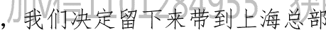

到下午点的时候，海选环节结束。接下来下来的让秦晋和朱勇愣了似的。

1254 楼

作者:大秦的疆 日期:2018-09-12 09:19

## 第八章“景区贷”项目

### 第三节 融资难于青天

05

海选结束，10个项目也尘埃落定，接着入围项目的负责人与“投资华夏”公司的代表和评审员分别合影。闲完毕，一切似乎都是美的。人群散去，秦晋和朱勇兴奋又略带紧张，满怀希望地等待细节问题。“投资华夏”公司的总经理此时又来到，先对众人表示恭喜，接着话锋一转，开始点评每个项目。有些是有意却没有计划，有些逻辑简单单一，有些过于繁杂。然后说出了主题，本次海选是初选，还要去上海一对一培训，直接对接，但去培训是费用的，5万元，含食宿。最后是苦口婆心的跟大家强调这次培训的重要性，好项目不会被淹没的，但要有出色的商业计划书，会讲故事，参加培训是鱼跃龙门的，非常有必要。听完这位总经理的发言，下面已经是议论一片。朱勇和秦晋心咯噔一下，面面相觑。5万元做一个商业计划？跟公司直接对接，会不会只是一个画饼？会不会自己的项目到了那边后变成别人的项目？这个海选会不会就是骗子培训的噱头？别花了，就真的带着商业计划回来，融资连一毛钱都没看到。两人心里直里嘀咕。秦晋之赶拿出手机搜索了“投资华夏”的评论，网上的好坏参半——有的靠谱，培训后能改商业计划就在上海融到资了；有的是骗人的，去了就是改商业计划，找的投资公司都是托的，谈完就没有下文了。看着这篇文章的评论，秦晋之更是转头看向：“最后合计，还是宁可在上海等太久了。何况现在还有很多事情要做，也没有时间中途放弃，败兴而归。”

在回去的路上，秦晋的脑子里一直在分析眼前的状况，想来想去，觉得融资渠道一方面，但问题的关键是项目没有数据，只停留在构思上，这样的故事就不完整，饼也画不圆。于是他开口对朱勇说道：“朱总，当下咱们也想要办法融资，另一边的是要做试点，有数据做支撑，融资就能多一份把握。”朱勇又何尝不知道这个道理，无奈心中充满涩。几万的投入，何况项目的平台，哪刚开始只用微信小程序运营，也需要数万的费用，再加上产品的，还有起点景区的点，前后后加起来没有一百万是不行的。所以现在希望于天使轮融资，钱一到位就开始试点景区的开发。这是先有鸡还是有蛋的问题。秦晋之接着便提议试试银行贷款，他现在就知道朱勇的公司几乎没什么固定资产，抵押贷款是没戏的，只能走信用贷款。

两人在路上上一商量着，最后决定融资融资，信用贷款也同步进行。到了公司，天气已经变得阴沉，看着是要下雨了，秦晋之心微微吐了一口气，跟朱勇进了办公室。

1267楼

王陈悦 加微信：1101284955 

作者：王小勇的缠墨 日期：2018-09-13 01:12

## 第八章“景区贷”项目

### 第四节 一声叹息

01

在秦晋之和朱勇合作的第一个月内，两人的分工很明确，秦晋之负责编写业务计划书，朱勇负责租赁平台和产品的开发。期间发生了诸让秦晋之后后来记忆不忘的小插画。

在两人开始合作的半个月后，朱勇兴奋地告诉秦晋之他，之前离职的上市公司也要做共享单车，对方的董事长要朱勇负责车架的开发。虽然难以相信一个上市公司竟然还需要一个已经离职的人负责产品开发，但秦晋之替朱勇感到高兴。朱勇满意地告诉秦晋，他跟董事长的关系很好，这次董事长是有好事想着他呢。后来样品打发到对方那边，经过对方的检验要求在一些技术参数上做一些微调，朱勇又连重新按照参数的参数打了两个样品给对方过去。对方对修改后的样品觉得很满意，便便给朱勇下了5000台的车架订单。

朱勇的公司并没有生产线，于是他就开始忙着找附近的OEM工厂，接着就是给图纸、订单。大约一个月后，这

5000 台的架车生产完成了。朱勇要求 OEM 工厂发货到家里上市公司去，工厂的回复也很简单，打款后就发货。可是，上市公司那边是货到付款，于是朱勇空手转身就回不去了。秦晋之是那时候才知道朱勇公司的财务状况一塌糊涂，账资金更是少之又少。

在公司的办公室里，朱勇看着秦晋之，满脸讨媚地眯着笑，希望秦晋之能帮他先垫一下20 万的贷款，并拍着胸脯保证发货后带着秦晋之一去这家上市公司要款，走特批流程，第二天款就能到，立马还给秦晋之。秦晋之看着朱勇脸上装着好意思又暧昧巴结的表情，心里有点尴尬，可是自己的合伙人，项目融资还要靠他，更何况货发过去后一起结款，应该是十万稳，想想还是朱勇一把，便将钱给朱勇转了过去。

后来 5000 台架车发过去了，秦晋之跟着朱勇去了这家上市公司所在的城市。第二天一早，朱勇一个人去了这家公司，秦晋之则在酒店等着他的好消息。结果朱勇来说对方样品检验不合格，要全部检验一遍，不合格的返回 OEM 工厂合格后再付款。后来，这件事情就再也没有了说法，秦晋之的 20 万也一直没有回来。

1201 楼 

作者:大秦的裸士 日:2018-09-08 06:34

## 第八章“景区贷”项目

### 第三节 融资难于上青天

02

商业计划书写完之后，融资的事情就得快马加鞭了。按照两人之前的约定，融资由朱勇来负责，不过朱勇表示商业计划书主要是秦晋之写的，里面的内容，尤其是成本核算和盈利预测更为为了了解，所以朱勇建议融资的事情秦晋之要一起参与，秦晋之全然接受。

项目的融资，朱勇第一计划找的自己是在原来上市公司认识的韩衡，一家南方公司的老总，朱勇告诉秦晋之，这个韩总早些年是靠地皮起家的，现在专门做投资。韩总这两天刚在燕京，他已经跟韩总约好了在朱勇公司谈谈项目的事情。

（注：此处内容重复，已按要求逻辑处理）

下午的时候，韩总等人如约而至。在大家相互介绍的功夫，秦晋之看了韩总，四十岁的中年男子，虽刚正、岸嵩，脸上没有太多表情。坐定寒暄，朱勇便由秦晋之介绍项目的内容。对于韩总的第一印象，秦晋之在讲解项目的内容时将语言说得很慢，特别是在讲项目核心核算和盈利预测，更是平淡地将测算依据逻辑环环扣。秦晋之一边讲着一边看着韩总的反应，整个过程韩总毫无表情的说过一句话。在介绍完之后，韩总开口：“这个项目现在进行什么阶段了？”朱勇在旁边回答：“这个项目

正在跟几个谈谈合作，估计一段时间就能出来。”韩总听了说道：“朱总，你可能对我们还不了解，对于风险控制，我们一般只做 PE（股权投资），推动上市后退出。这个项目是好，但我现在属于天使阶段，我可能帮不上忙。”朱勇急切又谄道：“韩总，我知道你们只做 PE，这是我的大哥，这个项目很有潜力，所以我请你试试。”韩总摇了摇：“朋友，生意归生意。这是我们的原则，不能说了。这样吧，项目看到 VC（风险投资），你再找我。”韩总站起来，带着歉意说道：“朱总，不好意思，燕京那边有一个饭局，就不耽误你们时间了。”朱勇一顿留后，对方坚持要走，朱勇和秦晋之在公司门口送韩总离开。回到办公室，感觉气氛有些沉，朱勇看着秦晋之，一笑：“老秦，没关系，明天我带你去一家茶社，那里可是直辖市金融中心，很多投资机构或者银行，王姐跟我我很熟。”

秦晋之心里正算着项目进度，听完朱勇的话点了点头：“好。”猛然想起刚才朱勇的话，他又接着说道：“你刚才跟韩总说几个试点合作，没听你说啊。“哈哈，到时候再落实吧。”看着朱勇笑起来，秦晋之没有说话，笑了表示回应。

（注：此处内容重复，已按要求处理）

王姐迅速打量了下秦晋，转过头对朱勇说道：“你们先把你们的项目简单说一下，我也很好介绍别人。等会银行的行长过来，到时候可以一起坐着咖啡。”

秦晋之和朱勇跟着王姐到了楼上一个包间，简单安排后，有一个甜甜俏丽的女服务员来泡茶。三人在包间的沙发坐下后，朱勇便让秦晋把项目的内容介绍给王姐。秦晋之考虑到王姐毕竟是中间人，说的太细就没有必要了，便简短的重点介绍了下项目。王姐也认真，一边听着一边用笔在本子上记着。一会功夫，秦晋的介绍完了。王姐把

03

朱勇所说的茶社叫“如一茶”，位于直辖市房价最高的河西区，只是闹中静，并没有在繁华的商业地段，还在一条公园的小路上。第二天上午近10点的时候，秦晋之开车顺着导航和朱勇来到了如一茶。茶社门口其实不大，看上去就是一个普通的茶社。大门上面挂着木制的牌匾刻着苍劲有力的“如一茶”，左下角有落款，应是书法名人写的。到了茶社门口，秦晋之才知道这家茶社叫如一茶。如一，心口行如一、初心如一，秦晋品着这“如一”字，越琢越觉得妙不可言。

跟着朱勇进了茶社，里面的装修颇流行，木桌木椅茶几，四面的墙上也是围着木制的架子，里面放着各个类的茶叶。秦晋看着上面标注的茶叶价格，心中不禁禁舌，最便宜的茶叶也得上千元一斤，贵的茶叶则从几万到几十万一斤等等。在大厅站了一小会，朱勇悄悄地捏下了秦晋的后角，低声说道：“王姐来了。”秦晋顺着朱勇的话看向，只有一个40岁左右的女士走了过来，裙如柳叶，目如朗星，穿着白色衬衫和黑色裙装，看上去十分干练。

朱勇已笑着上前招呼道：“王姐。介绍一下，这就是我要介绍的伙伴秦晋之。”

秦晋之伸手向前王姐快快握了手，说道：“王姐好。”王姐迅速打量了下秦晋，转过头对朱勇说道：“你们先把你们的项目简单说一下，我也很好介绍别人。等会银行的行长过来，到时候可以一起坐着咖啡。”

秦晋之和朱勇跟着王姐到了楼上一个包间，简单安排后，有一个甜甜俏丽的女服务员来泡茶。三人在包间的沙发坐下后，朱勇便让秦晋把项目的内容介绍给王姐。秦晋之考虑到王姐毕竟是中间人，说的太细就没有必要了，便简短的重点介绍了下项目。王姐也认真，一边听着一边用笔在本子上记着。一会功夫，秦晋的介绍完了。王姐把合上，对两人说：“你们先在这里喝茶，我会发微信，你们来大厅，我给你们介绍银行行长，可以先看看他们的意见。你们先去了。”说完起身重新坐回沙发。

两人一边喝茶聊着项目，心里有些淡然。等了半个小时，朱勇收到王姐的微信，两人忙下大厅。大厅里，除了王姐，另外还有两个人。朱勇向王姐招了个招，示意坐下。坐下后，王姐做了介绍，原来两人一个是行长，一个是秘书。秦晋之快速打量着行长，五十岁的年龄，身材优越，身上西装显得平整，三角眼中透着的光芒，似乎十分干净利落。礼貌的介绍后，王姐笑着：“行长，这个朋友有一个很好的项目，关于景区租赁的。”行长的声音里没有情绪，道：“可以啊。”秦晋之不耐烦地介绍“景区项目”。听见秦晋之介绍，行长点了点头，笑着一边倒着茶，闲聊几句，行长起身要走。

行长看了下秘书，对朱总：“这是我的名片，如果后面需要可以跟我联系。”秦晋之和朱勇接过名片后连连示意感谢，说着以后需要麻烦之类的。之后行长和他的秘书跟大家打了招呼便离开了。看着他们离开，王姐对朱勇说道：“你们项目现在的进度还太慢了，我先帮你们找投资公司试试，银行不会感兴趣的，都是给你们贷款，自己看着吧。朱总，今天有个饭，等我消息吧。”

04

从如一茶出来，秦晋之深刻感受到商学学院的好处，只要项目通过评审，学院的创业基金就会进来，而不用这样疲于融资。不过想想也是一种经历和锻炼，倒也释然，只是离比赛还剩下不下两年，融资没有进展，恐怕就是痴人梦。朱勇在旁边见秦晋之一言不发，担心秦晋之是有心事了，便开口打破了沉闷的气氛：“老秦，王姐这就来跟紧点，咱们的项目怎么看也不错，说不定很快就有投资公司约咱们谈了。”

秦晋之知这是朱勇想给自己打气，笑了笑道：“项目融资就跟找似的，找到合适的那么容易。咱们谈了两次，没谈也很正常。王姐这就等她的好消息。只是这里还有别的渠道融资，咱们不能干等着，还是要多点开花，要是有两三家感兴趣，咱们就有讨价还价的筹码。”

朱勇笑呵呵道：“哎，这个道理！最近有一个叫‘投资华夏’的投资公司说要搞一场项目海选，我想我们也要去报名。“行！只要能融到资的机会都不放过。”秦晋之目中波光闪动。

接下来的两天内他们就开始准备项目海选的事情了，除了提交公司资料外，朱勇将商业计划书的PPT也找广告公司打了三份，准备带到海选现场。

第三天上午10点，“投资华夏”的项目海选在一个五星级酒店的会议厅如期召开。秦晋和朱勇9点55分在会议厅门口填写了基本信息后便进入了会，发现里面已经是黑压来了许多参加海选的人了。项目海选刚开始是由投资华夏”直辖分公司的总经理热情介绍融资与融资相关的知识点、商业计划书的要点和案例，讲解后，这位总经理强调了这次海选只选择10个项目带回公司在上海的总部。秦晋和朱勇对视一眼，都从对方眼中看到了信心满满。

接着就是一对一的选选环节，一共是四个项目评审员，因此项目海选也分成四组。秦晋和朱勇决定兵分两路，各自带着一本商业计划书举号。很快就轮到了秦晋的面对面，他在评审员对面坐定后，开始了项目的介绍，然后回答评审员几个问题。也许是因为项目的融资还需要期待，整个环节秦晋的双手紧握，满手的汗。说完后，评审员露出感兴趣的表情，笑着对秦晋说：“这个项目不行，我们决定留在总部去，会结束后会有安排。”说完，又补充了一句：“这个项目可以给我吗？”秦晋尽量按住激动的心情，离开了座位，走到朱勇前，语气兴奋地：“朱总，咱们的项目入选了！那边等一下，会结束后再说。”秦晋想想，便满意了朱勇的做法。

到下午点的时候，海选环节结束。接下来下来的让秦晋和朱勇愣了似的。

05

海选结束，10个项目也尘埃落定，接着入围项目的负责人与“投资华夏”公司的代表和评审员分别合影。闲完毕，一切似乎都是美的。人群散去，秦晋和朱勇兴奋又略带紧张，满怀希望地等待细节问题。“投资华夏”公司的总经理此时又来到，先对众人表示恭喜，接着话锋一转，开始点评每个项目。有些是有意却没有计划，有些逻辑简单单一，有些过于繁杂。然后说出了主题，本次海选是初选，还要去上海一对一培训，直接对接，但去培训是费用的，5万元，含食宿。最后是苦口婆心的跟大家强调这次培训的重要性，好项目不会被淹没的，但要有出色的商业计划书，会讲故事，参加培训是鱼跃龙门的，非常有必要。听完这位总经理的发言，下面已经是议论一片。朱勇和秦晋心咯噔一下，面面相觑。5万元做一个商业计划？跟公司直接对接，会不会只是一个画饼？会不会自己的项目到了那边后变成别人的项目？这个海选会不会就是骗子培训的噱头？别花了，就真的带着商业计划回来，融资连一毛钱都没看到。两人心里直里嘀咕。秦晋之赶拿出手机搜索了“投资华夏”的评论，网上的好坏参半——有的靠谱，培训后能改商业计划就在上海融到资了；有的是骗人的，去了就是改商业计划，找的投资公司都是托的，谈完就没有下文了。看着这篇文章的评论，秦晋之更是转头看向：“最后合计，还是宁可在上海等太久了。何况现在还有很多事情要做，也没有时间中途放弃，败兴而归。”

在回去的路上，秦晋的脑子里一直在分析眼前的状况，想来想去，觉得融资渠道一方面，但问题的关键是项目没有数据，只停留在构思上，这样的故事就不完整，饼也画不圆。于是他开口对朱勇说道：“朱总，当下咱们也想要办法融资，另一边的是要做试点，有数据做支撑，融资就能多一份把握。”朱勇又何尝不知道这个道理，无奈心中充满涩。几万的投入……这是先有鸡还是有蛋的问题。秦晋之接着便提议试试银行贷款，他现在就知道朱勇的公司几乎没什么固定资产，抵押贷款是没戏的，只能走信用贷款。

两人在路上上一商量着，最后决定融资融资，信用贷款也同步进行。到了公司，天气已经变得阴沉，看着是要下雨了，秦晋之心微微吐了一口气，跟朱勇进了办公室。

秦晋之现在对“景君”项目的信心已临殆尽。因为诸
约的规则，慧商学院不能出门帮忙融资。这段时间，郑江平
三天两头地打电话、微信问项目的进度。一边是学院的期盼
和比赛时间的减少，一边是不靠谱的朱勇和他没有结果的
融资，秦晋之心中的天平在慢慢倾斜。

让秦晋之意外的是，学院对外联络的唐铭主任也给他
打过电话了解项目的进度。郑江平的电话背后是赵轶和冯
涛院长对项目的密切关注，唐铭的电话是出自本人对
学院与银氏家族集团的关心吗？还有飞机，从唐铭
主任的声音里也听不出出一丝的焦虑，语气总是那么平和和从容。
难道是？秦晋之不再想下去，还是先把眼前的事情想清楚
吧。整理完毕，

坚持，还是放弃？这是个问题。

在这几天，朱勇的笑容越来越少，原本里通红的脸上
看着苍白白如，朱勇那边没有音信，银行贷款签字迟迟无果，
一切仿佛在漆黑的深夜，看不到一丝的光亮。期间，秦
晋之的委婉问过朱勇几次自己垫付的20万什么时候能回
来，每次朱勇都是眼珠乱乱地回答还要再等等。秦晋之没有
办法确定是钱真的结没被回了，还是钱已经被朱勇给用了。
产生了这样的疑虑，他跟朱勇的合作关系就要刻到头了。

心中的天平彻底压倒了放弃的那一边，秦晋的决定不能
再深陷其中，对朱勇不能再抱任何希望。是时候说再见了。

第二天秦晋之向朱勇说清楚了自己的想法，朱勇也不再强留，两人相视苦笑一下，互相说着珍重保持联系的话。最后，在叮嘱了20万的事情后，秦晋便收拾完东西开车走了。

激情的开始，暗的结束，这样的故事每天都在上演，只剩下下一声叹息。

# 1303 楼

作者：大秦的疆士 日期:2018-09-14 11:58

@chun9sun 2018-09-14 10:43:46

楼上这样挤牙齿的，晓得要好久才挤的完

最近努力加力挤牙齿的力度！感谢支持！

王敏磊，加微信1101284955，获取更多好帖

作者：大秦的疆士 日期:2018-09-15 00:23

## 第九章 品牌定位

接天莲荷叶无穷，
映日荷花别样红。

本章所涉及的理论书籍：《营销管理》、《定位》、《重新定位》

### 第一节 营销的科学和艺术

学习科学和学习艺术，方法是不是不同？如果学习的艺术呢？

秦晋之通过面试正式成为了慧商学院的一名学生后，来的两个月暑假，他都在智慧学院里体验生活。除了了在学院的驾校车外，多数时间就是旁听学院各个中心组织的各种活动，比如“某独角兽公司复盘推演”、金融中心的“项目融资竞选”、项目中心的“项目演讲比赛”等。作为刚刚跨入营销大门的秦晋而言，这些活动率之之所以就是看热闹，无法深刻领略其中的精彩绝伦。但学术中心的这场讨论会会让秦晋大呼过，也让他发现学院的学生的生猛。

这场讨论的主题是如何学习营销的理论知识。很快，随着讨论的白热化，大家的观点划分成了两个阵营。第一阵营认为营销是一门科学，是科学的体系，就有科学的逻辑，也就有了科学的方法和工具，因此学习营销的理论，就需要学习“电子信息工程”，一样严肃的学习营销理论的所有专业术语和对应的方法，从而形成一套行的有效逻辑。第二阵营认为营销虽然没有标准化的科学，但其作为“科学的艺术”的落脚点就应该在“艺术”二字上。何为艺术，就是不拘泥于现实理论的框架。学术营销就应该学习音乐美术一样，先学会营销知识，让自己具备营销的专业功底，这个功底是不需要硬背别人总结的专业术语和工具的，而是重理解其逻辑的根源。有一定的功底之后就在个人的悟性和发挥，而不是天天研究如何使用别人的工具或逻辑。显然，也有一些学生都不属这两个阵营，他们的观点介于两者之间，既承认针对营销科学性的方法，也接受针对营销艺术性的方法。但这些学生往往被这两个阵营所鄙视，认为他们的观点是虚空的“中庸之道”，是圆滑投机的行为。

为何将营销的科学性和艺术性相结合的学习方法就认定为学习营销的“中庸之道”？秦晋刚开始是认为是其他两个阵营的观点有点太偏激，相结合的确应该是最完整的学习方法。后来秦晋有了转念一想，表面上是营销理论方法的问题，其实实层层的背后，是对营销理解的问题。营销到底是“科学的艺术”，还是“艺术的科学”吧？从这里理解，他也意识到将两者相结合的“中庸之道”是偷懒的好。他虽然不知道哪一个是正确的，但“中庸之道”看来是完美的问题，其实是一种理想上的处理。艺术和科学可以并存，但一定要有一个重点！秦晋之在后排第一队听着师兄妹们一边在思考这个问题，想着自己在《营销管理》上看到的那些逻辑、术语和眼花的专业工具，再想想蓝海策略》上简单真的很难到的，他觉得自己倾向于认为营销理论是“科学的艺术”，不能结于他人的理解和方法，重要的是个人的体会和实践。讨论会上是不可能发生大家意见统一的情况。

秦晋之心里被对方动摇了也不会露出来，所以讨论的结果还是剑拔弩。秦晋看着师妹们脸上因为争执而产生的表情，心中感到大家都生猛，这才是年轻人有的风采！营销是“科学的艺术”还是“艺术的科学”？你认为是哪一种呢？

### 第二节 品牌定位

时间过得很快，眨眼间到了开学的时候。已经是金秋，但天气凉爽，夏天是一个贪婪的孩子，赖着不离开。秦晋之在宿舍里快乐地跟兄弟们聊天，他的心情挺好的，因为暑假收到了段燕的微信，说送的项链很漂亮，她喜欢。这是一种暗示呢？暗示段燕自己？还是出于礼貌给了一个回应？应该是吧，秦晋之甜蜜地猜测着，心里带着期待和兴奋。明天周五才正式开学，大家在宿舍里商量着晚上不要聚餐。就在这时，秦晋之的手机响了一下

郑江平的微信：“各位同学，下周晚上正常上课，时间地点不变。课堂内容是品牌定位。请提前预习《定位》、《重新定位》。建议按照学期学习小组各自一起运。下周三见。”秦晋之看着手机嘿直乐，真的是想什么！这样就可以顺理成章地迎段燕上自习了！

秦晋之按不住自己被追迫的心情，悄悄拿着手机去宿舍外给段燕打电话，“嘟嘟”的铃声响了几声后，手机里来了段燕温暖的声音。

“喂，秦晋之，回学校了？”段燕的声音显得很平淡。

“是啊，段燕，你回来了吗？”秦晋之故意对段燕的称呼改成了“段燕”。

从正式进入慧商学院后，秦晋之就不再为买书而愁了。这个暑假里，郑江平告诉他暑假期间的（营销管理）之外的书都有哪些，而秦晋之按照郑江平说的，列了清单交给了学院的学生处。开学返校之前，这些慧商学院都免费了。因为一个月要回趟学院不远，所以秦晋之只需要带三个月内的书籍即可。现在秦晋之的桌上已经放着新买的《定位》和《重新定位》这两本书。

仿佛是没有发现秦晋之对自己称呼的改变，段燕直接回答道：“还没有呢。我家就在离春天不远的鞍市，我爸下午开车送我过来。”

“哦。这样啊。那你今天晚上肯定没时间上自习了。刚郑老师发微信说要预习下周的内容，我是想约你晚上一起预习来着。”

“今天晚上肯定没时间了。明天晚上可以吗？”段燕的语音带着倦意。

“当然可以！段燕，明天晚上自习室见！”秦晋之欢快地应着，并再次用上这个称呼。

段燕沉默了两秒在手机里轻轻按了一下。接着两人再没说话，秦晋之自然不会挂电话，片刻后段燕断了电话。

秦晋之叹了一口气，心里想着刚才段燕那两秒的沉默，他知道是自己在挣扎，“段燕”的原因，她心里会想呢？觉得心里轻了？害羞？纠结？哎呀！先不管了！明天就知道了。当务之急是先预习，明天晚上就有内容可以给段燕讲解。心中有了主意，秦晋之便转身推回宿舍，大家正在宿舍里聊着暑假的闲闻，他转到修逸飞那儿问道：“老大，刚才叫了电话，晚上宿舍聚聚餐吗？”修逸飞一脸笑道：“改下周末了。老二和老三今天晚上都有其他活动。”秦晋之对着修逸来了个心照不宣的笑，心中却想着今天聚餐挺好，下午和晚上就有时间预习了。

定位，即确定定位，也可以理解为摆正位置。这个词早在春秋时期就已经出现了，源于《韩非子·术》中的“定位”，似乎是源自美国营销专家《Positioning》。如果你用“定位”这个词，在词条里就是对《定位》这本书的介绍，其影响力可见。在出现之前，谁还敢用“定位”呢？显然无法考证了。但一点可以确定的是，近年来，“定位”是一个使用频率最高的词汇。大家聊天的时候，经常会有“定位怎么做”之类的说法。难道用“定位”的人都是都是过或看过《定位》吗？我想我们无需纠结“定位”这个词，因为“定位”本身就是一个问题。我们要做的是透彻地理解和找到适合定位，产品如此，品牌如此，企业如此，个人如此。

秦晋之并不打算从《定位》书看，仿佛已经形成了一种习惯，他还是喜欢先看科特勒的《营销管理》，再看其他书籍。如此看来，这定位本身就是一个系统工程！这跟当初秦晋之自己所认为的定位就是品牌的广告语完全不同。

由此推断，大家常说的高端或者定位中端，并不是真正意义上的定位，因为这不够独特也不足够完整。

秦晋没想到一个营销概念竟然就有这么多的学问。为了让自己更好的理解，他决定选择一个品牌作为案例来推演一遍。耐克。耐克的定位是什么？或者说在消费者心中，耐克是一个什么样的品牌？它常见的广告语“Just Do It”明显并不代表这个品牌的定位，而是品牌的价值主张。耐克用了那么多知名明星，还帮助了许多大型赛事，再加上它丰富的产品，的确都是表明自己专业的。价格呢？既然是专业的，价格自然不能低，说是高端也不是，毕竟普通人也能消费。因为耐克的专店和线下广告随处可见，所以消费者在心中认为耐克是受欢迎的。秦晋之设了半天也没出来对耐克的方面理解。

于是，秦晋之根据自己的体会，得出了耐克的定位：
- 专业级别：通过“Just Do It”让消费者能够达成的目标。
- 价格水平：体现了品牌的位置和形象。
- 流行程度：体现了品牌，方便消费者做决策。
- 价值主张：消费者心中产生共鸣的内容。通过真实案例分析，秦晋之认为价格、受欢迎程度、价值主张这四点是影响消费者的核心要素，其余全部包装、功能、广告等等。

书中给出的定义是“设计公司的产品和形象以目标市场的心智中占据独特位置的行动。”书中接着阐述定位的目标是将品牌留在消费者心中。好的定位的标准：“能够说明品牌精髓、识别为消费者达成目标，并揭示如何以独特的方法实现。”此外，书中还补充了“定位的真正诀诀是在品牌现在与什么之间取得正确的平衡”，以及“定位的结果之一就是成功地建立以消费者为基础的价值主张。”

一方面，通过这些内容在书中都画了界线，另一方面思考到底如何解释这些内容。

什么是定位？产品或形象在消费者心智中占据独特的位置。说白了，就是消费者如何看待企业的品牌或产品。如果有独特的位置，那很明显定位是为了让消费者能够从茫无章的品牌和产品里记住和识别自己的品牌和产品。定位要说明品牌精髓，还要告诉消费者达成自己的目标，还要揭示如何以独特的方式实现的。这来说定位要说的内容很多，很明显并不是一个广告能够解决的。等一下！既然是消费者心智中占据独特的位置，那企业要做的是通过全方位的展示让消费者自己去消化这种品牌或产品的定位，比如通过价格、零售终端的展示、产品的功能和包装、品牌的广告语、品牌故事，再加上内在的价值主张。

这第10章的内容并不难理解：
- 开展和建立定位：这是要告诉读者什么是品牌定位，以及定位的核心要素。这一章的开头。
- 确定竞争框架：这是在讲如何找到品牌定位，其中关键的是差异点和共同点。这个内容一定是读者最为关注的部分，所以自然是这一章的重点。
- 建立品牌定位：说完了方法，自然就要落实。
- 定位的替代方法。
- 小企业的定位和品牌化：作为科特勒这样的营销大师，时不时关注小企业对营销理论的运用，这是画龙点睛的。

结构整理完毕，就该研究其中的内容了。

秦晋之想了想，觉得识别竞争者和分析竞争者，这两件事情企业何止是在确定定位的时候需要要做，除非在任何时候都需要做。现在的市场和技术更新如此快，不知道第二天是不是就有新的竞争者带着新产品杀来了？分析竞争者每天应该关注的事情，知道哪个竞争者什么时候改变了套路吸引了消费者的关注。秦晋之发现自己现在看《营销管理》有种整体的惯性，甚至有点模糊的感觉，心中也是一乐。

总结归纳，其中还有一些内容秦晋觉得要划线表示重点的：
- 识别竞争者：科特勒的观点和《蓝海战略》中的类似，都是强调要关注市场。在《营销管理》中，这是依据市场识别竞争者，“满足相同的客户需求的公司”。
- 分析竞争者：之中的“关键属性评级”，这跟书中提到的“属性级”其实是一个意思。分析竞争者就是分析其品牌和品牌的属性评级，从识别竞争者及其策略，这样就可依次来制定自己的策略。定位就是策略的核心啊！秦晋之在书旁补充了这一句。

识别最佳差异点和共同点。既然要将自己的品牌跟其他品牌区分开，自然是要有差异来支撑的。书中写道：“创建强大的、令人喜爱的、独特的联想确实是个挑战，但在竞争性品牌定位中这是不可缺的。”

秦晋之赵赶在的空白处写上：“共同点是企业很难忽视的内容。价格，是消费者判断共同点的最简单直接的依据。”

不过书中有一句话秦晋之认为值得重点思考的，“品类共同点随科技进步、法律发展或消费者趋势变化而不断变化”。在苹果 iPhone 3问世之后，手机移动互联的功能（智能手机）就从原来苹果手机的差异点而逐渐变成了行业的共同点。趋势，不得不重视啊！

对于书中将共同点又定义为“品类共同点”、“相关性共同点”和“竞争性共同点”，秦晋之认为理解即可，没必要要为理论而推理。

王毅对差异点：1101284955，获取更多好帖

这段内容秦晋之认为容易自己就能得出结论——共同点要做到足够（别在基础方面消费者挑毛病），差异点要突出（消费者容易发现和接受差异点）。

只是对于书中这段内容的最后一句“通常，定位更为关键的是实现共同点而非差异点”，秦晋之实在不在敢问。怎么定位更为关键的都应该是差异点，因为差异点才决定了在消费者心中占据独特的位置。回来想说是，秦晋之觉得自己的理解是对的。至于于为何科特勒老先生会有此一说，秦晋之觉得这是从企业稳健经营的角度出发的——如果共同点都实现不好，谈何差异化？手机的像素太低，还要双卡双待？正是这个道理。

书中此处还有“多个参考框架”和“跨式定位”，秦晋看了看其中的内容，觉得这主要是看企业分析定位的角度，属于具体问题分析的范畴，也就作为了解即可的内容，一带而过。

# 1365 楼
作者:大秦的疆 日期:2018-09-19 00:23

## 第九章 品牌定位

### 第二节《营销管理》第10章——品牌定位

选择差异点和共同点。

对于这个章节的名称，秦晋之要要忍不住挑毛了，前面刚讲过“识别最佳差异点和共同点”，既然都已经是识别出了最佳，为何……看书的内容中，秦晋之最大的感觉是一个字：揉。柯特勒先生是生怕内容过于简单直接，力求逻辑上的完整，所有内内容读起来就事无事巨细，如果会发现很多跳跃的逻辑和内容踩在了一起，成了这一章节的内容。要是这本书号称营销的《圣经》，秦晋之怀疑这些内容不是出自数字之人手，而是把内容凑字数。不过想想，秦晋之觉得自己太大了，批判精神过于丰富，还是要虚心啊。

晕了脑袋袋，喝了口水，秦晋之开始下心整理这一章节的内容。

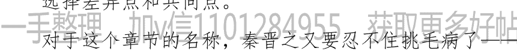

核心有五点：
1. 定位的差异点和共同点通常聚焦品牌利益、品牌属性（现在秦晋之还不懂什么是品牌属性）提供理由；
2. 对于消费者来说，最明显也引人注目的差异化方式与性能相关；
3. 有时候市场环境的变化可以提供创造差异点的机会（这很容易理解，如果智能安全门）；
4. 通常一个品牌的定位超越其性能的考虑，公司可以将吸引消费者社会和心理需要的引人注目的形象、时尚；
5. 一个品牌的定位应该应当同时具有理性和感性的成分，激起消费者情绪共鸣的性能优势非常重要。

这五点并不难。影响消费者心态的一定品牌利益——说句不好的，没有利益会关你；产品的性能的确很重要，除非其是人有的性能；能随行业的市场环境变化趋势很重要，指如果某一天某种差异化就成了共同点，你没有及时顺势改变就会被淘汰；如耐克一样，品牌的利益包含两种，一是功能（专业级），二是情感（Just Do It）。

关于最后功能和情感利益的理解，秦晋之脑子里自然有两个问题——如果某企业的产品功能优势足够强大，还需要情感利益吗？如果行业产品同质化严重，又该如何选择情感利益的差异化而影响消费者的心智？

这两个问题让秦晋坐不住了，他决定出去透透气边思考。因为今天是返校日，校园里显得格外热闹，有拖着李刚到学校的，有摆卖旧物品的，有几个男生在生篮球嘻哈哈打球，穿着军装的大新生随处可见。

刚到学校的学生是否因为返校而激动？还是已经开始思念自己的爸爸妈妈？卖旧书旧物品的学生是否对自己的东西心中有不舍？打篮球的学生是否已经在期待自己姿势帅，投篮怎么投怎么有？大一的新生是否已经在注意班同学的异性？看着周围的喧闹，秦晋之不自觉的感情利益的角度分析矩阵每个人。他猛地灵光一下，任何人做任何事都可能有情感利益的需求！即使这件事本身无趣。想要引起征服消费者，情感利益就不能少！即使产品功能优势足够强大，但也需要情感利益的补充。想到这里，秦晋之并没有堵住，要把此时的体会总结一下。有一手实务，加情感利益：获取更多好帖；无实务虚，突出情感。

关于如何寻找情感利益的差异化，秦晋之感觉豁然开朗。消费者喜好的情感利益都有：
- 符合潮流
- 彰显个性
- 展现品味
- 让自己看起来质量
- 让别人知道支持
- 我要光彩人

列完这6条后，秦晋之发现自己还可以列很多，比如热衷慈善、重视环保等等，看来靠情感利益来找到规律是没有。至少有一点可以肯定，只要找，同样也能加入情感利益作为定位。

可是情感利益可以完全脱离产品的功能呢？是否可以从情感利益出发而找到差异化？比如某企业同质化严重，确定情感利益，那就可以从功能上做文章。如果情感利益是慈善，虽然功能利益可能就没有关系。秦晋之此时特别体会到“营销是没有标准答案的”，核心在于人的理解和运用。

# 378 楼
作者:大秦的疆 日期:2018-09-20 00:23

## 第九章 品牌定位

### 第二节《营销管理》第10章——品牌定位

“为了进一步聚焦定位，并帮助消费者以预期的方式思考品牌，界定一个品牌言是非常有用的。品牌言是对品牌核心3-5个词的清晰阐述，并且与其他如‘品牌精髓’和‘核心承诺’等品牌概念密切相关。”秦晋之这一段下面划了线，内容本身并不理解，定位的目的是让品牌走进消费者的心智以占据独特位置，品牌言自然是一个重要的工具。看着书中耐克的案例说明耐克的品牌言是‘真正的运动员’，秦晋之不禁好奇为何不是‘Just Do It’，看来后者是广告语而不是品牌言。再想到营销界里经常提到的品牌号（s），秦晋之觉得应该问了一个问题：品牌言和品牌号（s）、广告语之间是什么关系？只是说法不同。看着百度提到的一些 slogan案例，海尔的‘真诚到永远’、联想的‘让世界一起联’、中国移动‘沟通从开始’、麦当劳的‘I'm lovin’ it’，秦晋之觉得这些 slogan基本上都代表了核心承诺，也都是在帮助消费者以预期的方式思考品牌，于是他愉快地做了一个结论——品牌言就是品牌口号。

为了测试自己的结论是否正确，秦晋之又搜了耐克的 slogan，看看它是否是“真正的运动员”，结果他发现自己啪啪打脸了，根据搜索的结果，耐克的 slogan竟然就是它的广告语“Just Do It!”这三者之间竟然如此清晰？秦晋之苦恼地将身往后仰，靠在椅背上发呆。是不是自己钻牛角尖了？不过概念清楚是有必要的。秦晋之则抿了嘴唇，决定还是要明白。再继续读了《营销管理》的内容，并找到了一些品牌的 slogan 和广告语的案例，进行对比后，秦晋之给出了自己的理解：

1. 品牌言倾向于品牌内在目的的阐述，而 slogan 是外在口号上；
2. 品牌言的概念并没有流行，大家关注的都是创意的 slogan，或许是将这两者混淆了，又或者品牌言价值观念所替代；
3. 消费者心中对品牌的定位，更多的是受 slogan的影响：
4. 品牌广告语和 slogan 之间应该划一等号；
5. 品牌言是相对稳定的，而品牌的 slogan 会根据市场和新产品的需要经常推出新的；
6. 当一个品牌的 slogan 足够经典至于无法更改时（如耐克的 Just Do It），品牌言就成为影响消费者心智的一面旗帜；
7. 不排除有些品牌 slogan 是直接用的品牌言。

在整理了上述的心得后，秦晋的感觉心里轻松了不少，只是好奇为何品牌言如此重要，但似乎讨论的声音微弱？最有代表性的就是百度百科上“品牌言”一词的解释与“定位”一样，只是在介绍《品牌言》这一本书。好像大家都在追求有创意的 slogan，却忽略了关键的品牌言，难道因为消费者通常只能看到 slogan？不知 slogan 实际上是演员表演的角色，而品牌言才是演员本人。秦晋之插了这句话：对于这一章最后提出的品牌言三个标准——传达、简洁和激励，秦晋之觉得很容易理解，他在看完后简单标注了：

- 品牌言是在阐述定位与定位相关的；
- 作为品牌号（s），在消费者心中扮演着重要的角色；
- 品牌言需要遵循的核心思想，万变不离其。

# 393 楼
作者:大秦的疆 日期:2018-09-21 00:23

## 第九章 品牌定位

### 第二节《营销管理》第10章——品牌定位

什么是定位？就是给品牌在消费者心中找一个位置。既然品牌所处的空间，位置是空间里的一个锚。如果空间有维度，那建立定位就会更加清晰呢。秦晋之刚才总结的消费者心智空间的四个维度总结完成：

- 价格标准
- 产品的共同点和差异点
- 品牌的感性
- 市场环境

这四个维度的总结就是营销艺术性的体现。

秦晋之差异中对星巴克有满意的内容。现在开始整理书中的内容。书中的内容并不理解，共有三点：

1. 传达品牌成员。这并不理解，所有的品牌蕴美之都要回归实际（产品），说的天花乱坠，产品跟不上就是一时之夭。产品体现品牌定位，这是理所当然的要求。科特勒先生在书中还提供了传达品牌成员的主要方法：宣传品牌类利益、与其进行比较、依靠产品描述词（可以理解为定义一个新产品类），在此不再赘述；
2. 传达共同点和差异点。在此，科特勒大概认为对于共同点和差异点说的已经比较多了，这里说的的是负相关的属性和利益，如此低价vs优质、透气vs防水，他建议企业要处理好此平衡，甚至可以让消费者认为不同的属性和利益之间的所谓偏向关系是正向的；
3. 竞争监测。秦晋之看到这里，很暧昧的笑了笑，“竞争监测”与自己四个维度“市场环境”是密切相关的。按照书里的内容，竞争监测主要是市场份额、心智份额、情感份额三个变量。只不过如何监测，秦晋之感觉无奈，看来是一种理论上的必要。在这一章节中，提到建构品牌轮盘：

- 核心是品牌言
- 第二层是共同点和差异
- 三层是证据（理由）
- 第四层是价值/类型/执行元素

秦晋之知道，轮盘也称为“品牌图”。

# 400 楼 
作者:大秦的疆 日期:2018-09-22 00:23

## 第九章 品牌定位

### 第二节《营销管理》第10章——品牌定位

建立定位。秦晋之发现，很多并没有急着整理章节的内容，他想起书中关于营销科学性和艺术性的讨论，决定不拘于逻辑，而是尝试一种思路来总结定位。

品牌的定位可能是变化的，随着时间，随着新品产品的干扰，随着技术的普及。所以品牌的定位是要随时关注市场的一些细微。比如瑞幸咖啡的“外卖咖啡”定位，如星巴克加外业务的推动，那么瑞幸咖啡“外卖咖啡”的定位在消费者心中可能被弱化处理，那么就会通过新的差异来抵消星巴克外卖的冲击。而这就是因为市场环境中竞争态势的变化，所以企业没有办法关注市场环境的波动。

至此，秦晋之理解的消费者心智空间的四个维度总结完成——价格标准、产品的共同点和差异点、品牌的感性、市场环境。

秦晋之赵赶在空白处写上：王孟玲 加微信：14910284955，获取更多好帖

# 1432 楼 
作者:大秦的蚕士 日期:2018-09-26 07:44

## 第九章 品牌定位

### 第三节《定位》是一篇散文

### 01

《定位》是一篇散文，这是秦晋之整理书书中内容由衷发发出的一句感概。特特先生一定是个写散文的高手，秦晋之读完一通《定位》后他发现书中的内容实是散之又散，逻辑也很跳跃，看完后脑子里装满了零碎又觉得重要的知识点，却找不到能将内容串起来的那条线。于是，秦晋之又回头来像侦探一样在笔记本里整理其内容和逻辑的线索。看看出这样的感觉，秦晋之也是醉了。

《营销管理》中科特勒先生关于“定位”的概念引用自《定位》一书，除此之外，两书关于“定格”的内容就像长斧分别的朋友，《艾鲁莱西》。

秦晋之品牌文化之品牌文化以来印象最深刻的是苹果的乔布斯时代，其品牌文化很偏“偏执创新、追求完美”。问题来了，消费者通过什么来了解和认同品牌文化的呢？很明显，是苹果的产品。看来品牌文化和消费者认知之间还需要产品作为桥梁。品牌文化不能取代定位，而应该是定位的概括和升华。

广义来说，秦晋之认为定位的第三个维度“品牌的感性”，品牌故事是阐述定位的手段，品牌文化是定位的概括和升华。他认为这两者都无法取代定位的方法。加微信：101284955，获取更多福利

小企业的定位和品牌化。在这一章节中，科特勒先生列出了8种针对小企业的具体的品牌化指导针，这些内容秦晋之觉得并没有完全针对那些夹缝中生存的小企业，无论是大企业还是中小企业都可以作为指导针运用。在此列出：

- 寻找一个引人注目的广告或服务的性能优势；
- 集中于在一个两个关键联想的基础上建立一个或两个强势品牌（建立强势品牌是所有企业的目标）；
- 尽可能以任何方式鼓励产品或服务试用（大企业也需要）；
- 开发紧密结合的数字战略品牌“更大更好”；
- 创立口碑和忠诚的品牌策略（大企业一直都在做）；
- 使用良好整合的品牌元素（任何品牌都需要）；
- 可能多地使用级联想（明星代言人和活动赞助是最常用的级联想，小企业的钱包？）；
- 创造性地实施低成本的营销调研（这个小企业的确需要）。

在这里秦晋之写下了他学习《营销管理》以来最严苛的一句话：“何不食肉狗肺？”

# 秦晋之打算如何总结《定位》一书呢？且看他的评论章

<定位>是一篇散文。

作者:大秦的疆士 日期:2018-09-27 00:42

## 第九章 品牌定位
### 第三节《定位》是一篇散文

《定位》是一篇散文。

特别地，《定位》一书是定位理论的开山鼻祖，书中内容即使在移动互联网爆发、新的商业模式层出不穷、市场环境日新异的当今，我们仍能从中获得启发。

与《营销管理》书中将品牌定位总结其共同点差异和核心真言这样逻辑结构不同，《定位》的阅读感更是散文，形聚散聚，想要领悟其中奥义，就得做详细的整理工作。

先来说“神聚”。《定位》一书的“神”当然是指如何进入消费者的心智。《定位》的神聚，体现在无论是在书中的逻辑内容还是案例分析，亦或是夹杂其中的诙俏言，都是在强调围绕消费者的心智做定位，没有一丝的动和犹豫，甚至还有点极端。之所以说有点极端，是因为书中的一些观点似乎有点太绝对了。现在，不妨让我们来一睹《定位》神聚的风采。

定位是传播的新方法。

定位不涉及产品本身的改变，只是对名字、价格和包装的改变。这些改变本质上属于装饰性的，是为了在潜在客户的心智中占领一个有价值的位置。

定位的基本方法，是操控心智中已经存在的认知，去重组已有的关联认知。

在传播过度的社会中，获得成功的唯一希望，是要有选择性，集中精力于狭窄的目标，细分市场。一言以蔽之，就是“定位”。

不要试图改变人类的心智成了定位理论最重要的原则之一。

把焦点集中于潜在客户而非产品，你就简化了选择过程。成为第一，是进入心智的捷径。

如果你不能在这一方面争得第一，那么就在另一个领域成为第一。

想使一个新品牌进入心智，就得删除或重新定位占据品类阶梯的老品牌。

你有了全新的产品后，告诉潜在客户该产品是什么，往往要比告诉他们产品是还好用（后面通过七喜的案例，又强调也要告诉消费者自己是什么）。

定位的捷径，看看你的竞争对手在做什么，然后去掉。

其中的诗意或创意，用一种单纯、简单的信息，就能进入潜在顾客的心智。而且要始终如一。

定位，要始终如一。

上述这些精妙语句来自《定位》的第一至五章（有些就在旁边的小字内），都是“神聚”，心中想着只要有一个——如何去进入潜在客户的心智。

从第六章开始到最后的第二十二章，虽然没有脱离中心思想，但如果习惯了《营销管理》的阐述风格，你一定会觉得这背面的内容像散文一般的形态跳跃。

先是“领导者的定位”和“跟随者的定位”，书中按照不同市场地位的企业与定位的指导，对于“市场定位”和“消费者的定位”。

你还没有反应过来，书中又开始了前面提到的“重新定位竞争对手（重新定位已经占据品类阶梯的老品牌）。

当你跟着特劳特的思路去解析重新定位竞争对手创建自己的时空时，书中画风一转，引起了品牌名称的重要性。品牌名称之后，你以为会按照前面的内容去提到的价格和包装，然后你会发现自己太天了，特劳特先生又开始讲品牌延伸的危害。

然后，当你觉得自己没有办法理解特劳特的思路时，你发现特劳特也没有兴趣继续理论的内容了！从第十章开始一直到第十九章，都是在讲案例——公司定位、国定位、产品定位、服务定位、银行定位、天主教定位。

第二十章和第二十一章，又开始讲起了每个人的定位，当然无可否非，毕竟定位的理论用于个人是完全必要的，我们每个人都应该有自己的定位。

最后的第二十二章，做了一个总结，“定位的游戏规则”。虽说是游戏规则，其实更多的是告诉我们要遵守什么样的原则来完成定位——理解文字、理解人、对变化持谨慎态度、要有眼光、要有勇气、要客观、要简单化、要精简、要有耐心、要有全球视野、要他人主导。

《定位》真是很有够的！

《定位》是一篇散文。也许整理其核心的内容，可能字不会超过2000字。除了精华部分，内容稍有前后重复，其中的逻辑结构完全不像其他的理论书籍上是那样的条理清晰、思维缜密。但即便此如此，我们不能否认这是一一本好书，是一篇优秀的散文，因为其“神”就好像是屋顶上的天窗，打开后我们可以看到更美的风景。

作者:大泰的瑞士 日期:2018-09-27 20:28

各位亲爱的读者朋友们，感谢大家对我的作品的认可和支持！今天因出版编辑的建议，本作将暂时发布新的内容，而是将之前的内容进行更新修改，做到真正通俗易懂！每天更新，大家也可以当成复习；欢迎大家交流！

感谢大家！

作者:大秦的疆 日期:2018-09-28 00:38

## 《营销这个事》

## 引言

哲学的三个终极问题，是任何哲人或学者无法回避的——我是谁？从哪里来？到哪里去？如果你能回答这三个问题，那么恭喜你已经走进了那道“门”，世间万物在你眼中就像玩家一样通透彻。

营销，是一门热闹的学科。哲学的三个终极问题，营销这个事也有三个关键问题：营销是什么？营销有什么？营销怎么用？

问题的答案，我们将在这本书里慢慢开启。打开手机，我们经常看到企业上头（如今日条），我们可以看到自己推送广告消息（数据的收割），我们还能看到微信营销（互联网平台带来的变化）。我们所处的时代喧闹，注定与金钱纠不清，而这一刻背后，离不开营销。有没有哪企业强大不需要营销？对不起，即使它是大咖，它是巨头，只要是普通消费者，只要市场上有，任何企业都需要洞察消费的需求，定位自己的品牌，规划自己的方向，改善自己的产品或服务。如此，腾讯如此，滴滴亦如此。

“有人的地方就有江湖，营销领域也是江湖，就称之为营销吧。在这片江湖里，有那些老牌的（传统营销），更有流量的（新营销）。独角英雄们像老将，凭着流量花费数十费，一步步将成为顶高手。被误以为这江湖上真的有独特的营销捷径？现在说营销，最多的就是“新营销”、“新零售”、“新媒体”，仿佛跟别人比起来，我认为现在的营销一定过时的，最好有新的商业模式的话，你都不意思开口。可是被诟病许多传统营销，以及其营销体系就真的无用之地？殊不知，“新营销”的内容没有脱离营销本身，只是是因为互联网技术换了潮流或者某一元素被放大了而已。笔者认为，无论在何年代（社会除外），营销的元素和营销体系都是客观存在而企业需要的。

以菲利普·科特勒的第15版《营销管理》为基础，旁征二十多本相关的理论书籍，力求通俗地彻营销三个关键问题，为正名。此外，书中会出现一些有趣的总结评论、创意的思考和案例的剖析，让大家轻松愉快地理解和记忆。

作者：大秦的疆 日期:2018-09-28 23:23

## 前言

最近在论坛里下营销的朋友，都有问我一个问题，现在的市场环境下营销还有用吗？说实话，在我看来这不能是一个问题。市场有竞争，怎么可能不需要营销？

我坚持需要营销的观点，他们往往会义正辞地抽出证据之一：资本为本。大体的意思就是现在的很多行业都是资本推动着企业的发展，没有资本在背后推着，再好的营销也没有用。这些案例他们可以列出一个小时出来，还不带重复的。诸如出行分享的公司、二手交易平台的公司、众包物流的公司、各种移动互联网的公司、线上教育平台等。对于这样的说法，我一般用两个问题来轻松化解：第一个问题，投资公司为什么会投一个公司？是因为人情关系？会计故事完美？还是因为产品创新了或者商业模式好？产品创新和商业模式背后是不是有营销的功劳？第二个问题，投资公司烧钱的是什么？一般情况下都是用户补贴市场投入，这些其实都是公司的营销费用，你说这里没有营销？

真正只有一个，只要是市场经济，即使在移动互联网和资本盛行的当下，营销仍然重要，甚至可以说更重要了。不怕流氓会武功，就怕流氓文化。打个不恰当的比，懂得营销的企业就像有一个文化的流氓，流氓就要出了花样，要出了名堂。

什么样的人才需要了解营销呢？很多人。想创业的有志青年和大叔、大学里市场营销的学生、刚入社会的年轻人、企业市场负责人（小企业一般就是老板）、转行和另外行业的从业者等。如果你属于这类群体，恭喜你，这本书非常适合你。

营销需要怎么学习？实践是检验真理的唯一标准。这句话没错，营销作为一门实践的科学，理论还是要落实。此外，营销强调系统，只学一些理论知识（如新媒体、打造爆款等）是不够的，因为营销是一个系统工程，讲究环环扣。当然适合记忆的总结、精彩的案例分析，书里都有。

大秦的疆 日期:2018-09-28 23:50

## 第一章 营销是什么
### 第一节 王婆瓜

营销这个事情之所以好玩，是因为它可以带来无限可能。王婆瓜的事情，你以为已经结束了吗？其实这只是开始。

营销是什么？这是一个简单的问题。《营销管理》上面会有营销定义，对不起，只是回答不了。严肃的百度百科，营销的定义是“企业发现或挖掘消费者和商家需求，从整体的构造以及自身形态的构造去推广、传播和销售产品，主要是深挖产品内涵，切合消费者以及商家的需求，从而让消费者深刻地了解该产品而购买的过程。”总结一下，营销就是发现或挖掘需求、推广、传播和销售的过程。

作为营销理论的开山鼻祖的科特勒老先生在他巨著《营销管理》（此书被称为营销界的圣经）里，营销的定义是“有利于地满足需求，是选择目标市场并通过创造、传递和传播卓越客户价值，来获取、维持和增加客户的艺术和科学。”总结一下，营销就是选择目标市场、创造、传递和传播客户价值。画龙点睛之处，营销是艺术和科学。请补一个画面，正是在钢琴的爱因斯坦（没错，营销的逼格就是这么高）。

好了，现在我们可以忘掉这两个权威的定义了（弹琴的爱因斯坦可以留下），它们对营销的理解太冰冷学术太概括，我们很难从营销中找到直观的认识。还是靠在我们外婆瓜的故事来理解营销吧。

日期:2018-10-04 02:45

首先，我要申明一点，外婆瓜的故事，当然只是我的幻想，现实当中不会这么容易——竞争对手的跟风模仿、激烈的市场竞争、没有行业壁垒的保护，“王婆”西瓜也好，“小鲜生”也，每一步都可能是绞尽脑汁下的履薄冰，没有点运气是不行的。

营销的起点，是是产品（这里也包括服务）。没有产品的营销，不是在耍流，就是在做公益。王婆卖西瓜的营销从她挑西瓜就开始了。王婆是一位退休小学老师，她在村里种西瓜。她决定自己种西瓜去城里卖，这样能卖个好价。当然是小区附近，客户最多，买带家里也很方便。你看王婆也许也会选择销售场所，这是营销的第一件事（渠道）。

抓牌子支持好了，王婆发现旁边有竞争对手，西瓜看着跟自己的差不多（同质化），大家还是圈圈相称。怎么样呢？王婆带来的西瓜是经过挑选过的，不仅相好也是甜（产品质量）。可是西瓜不会说话，别人怎么知道？看看王婆的摊位，她在摊位前的小黑板上写上“西皮薄，甜到心里”，这样顾客就知道自己的西瓜好了！这是营销的第二件事（卖点挖掘）。

王婆西瓜卖六毛钱斤，王婆她在牌子上写着0.58元/斤，虽然便宜了两分，但在顾客眼里就是西瓜更便宜了。这是营销的第三件事（价格策略）。

渠道找好了，产品卖点挖掘出来了，价格策略上也上了。王婆歪着头推着半车的瓜走，毕竟卖点和价格都是靠打、靠运。于是她开始打造自己的品牌（用IP这个词）——“王婆”西瓜。广告就是在之前的基础上加上两句话：“王婆西瓜，皮甜到心里。”这是营销的第四件事（品牌管理）。

王婆西瓜已经在小区周边变成了一个品牌，那就要将品牌呈现出来。于是王婆的西瓜上都贴上了标签，她让她几个兄弟也过来帮忙，从别的村里挑选品质的西瓜运到城里其他小区周边，也贴上“王婆”的标签，最靠谱的连锁经营就开始了。

王婆的儿子从一家互联网公司休假回家，看到连锁经营的西瓜，他又有了别的想法：第一，注册“王婆”品牌，保护品牌所有权；第二，整合各个小区超市的资源，采购相应量的榨汁机在附近超市销售鲜榨的西瓜汁，利润与超市按照比例分配（当然也可以让超市提供榨汁机，不愁这种榨汁分配比例就需要增加）；第三，合作加盟超市为根据地，将王婆鲜榨西瓜汁加入外卖，两联卖。超市为什么要选“王婆”西瓜合作呢？因为品牌的价值：事情还没有结束，因为王婆有了城市里各个小区附近的资源，他们吸引了当地投资公司的关注。投资公司要做什么呢？同城鲜榨汁外卖服务。接下来的故事就简单了：注册一家公司，品牌名称自然不能再用“王婆”了，要起一个年轻时尚的品牌名称，王婆的儿子给了一个叫“小新鲜”果汁（这个品牌名称暗示了产品的核心特点：新鲜）。产品锁定鲜榨汁，自然不再局限于西瓜了。为何不顺便卖西瓜或其他新鲜水果？是因为在这个领域竞争对手太大多，价格敏感，且线上上也常见。

“小新鲜”果汁在后面的运营过程中，开始研发独家配汁（如香草加柠檬），作为引流爆款。当然少不了烧钱——用户补贴、公众号推广、其他媒体平台推广、线下活动。“小鲜生”果汁覆盖了一线城市和较大的二线城市。有了A轮融资，王婆的儿子已经从互联网公司离职，做了“小鲜生”果汁的创始人兼CEO，故事在这里结束了。

日期:2018-10-21 00:16

营销，这个词我们每个人都不陌生，可是要让我们给下一个定义。营销就像梦想中的情人，似虚非真。我第一次接触营销还是在大学的时候，那时候我的专业是法学，但对营销并不感兴趣，在图书馆随手阅了一本《营销管理》，逐渐对营销产生了兴趣。那时我对营销的理解：大学毕业时，我荣幸以一名法学的身份，客观选择了营销的工作，进入了一家全国名前三的家电集团，工作的部门是品牌部（可以理解为营销部）。在里面，我对营销的理解是4P——产品、价格、渠道、促销。在工作中，你会发现所有事情都是围绕这四点推动，涉及产品也涉及渠道。现在，在经历了十多年的营销工作和6次创业后（现在又有两个项目进行中），我对营销的理解就不一样了。这既是个人实践的沉淀和探索，也是对市场环境日新异异的悟。在这里，我们先卖一个圈，后面再讲营销的定义。还是从一本专业的术语开始吧。营销一词，不知道是哪位天才把“marketing”翻译来的。根据这个英文单词，我们可以这样理解企业针对市场的行为就是营销。“营”就是经营，“销”指销售，也有消费的意思。所谓营销，按照字面的理解就是经营市场和销售。当然我们无法定义它的意义，体会到何为营销，至少我们已经做到一点：营销几乎无处不在。营销的定义是企业发现或挖掘消费者和商家需求，从整体的构造以及自身形态的构造去推广、传播和销售产品，主要是深挖产品内涵，切合消费者以及商家的需求，从而让消费者深刻地了解该产品而购买的过程。总结一下，营销就是发现或挖掘需求、推广、传播和销售的过程。作为营销理论的开山鼻祖的科特勒老先生在他巨著《营销管理》（此书被称为营销界的圣经）里，营销的定义是“有利于地满足需求，是选择目标市场并通过创造、传递和传播卓越客户价值，来获取、维持和增加客户的艺术和科学。”总结一下，营销就是选择目标市场、创造、传递和传播客户价值。画龙点睛之处，营销是艺术和科学。请补一个画面，正是在钢琴的爱因斯坦（没错，营销的逼格就是这么高）。好了，现在我们可以忘掉这两个权威的定义了（弹琴的爱因斯坦可以留下），它们对营销的理解太冰冷学术太概括，我们很难从营销中找到直观的认识。还是靠在我们外婆瓜的故事来理解营销吧。

什么熵，商业模式是否成功的要素之一还是营销——市场细分是否精准（就是现在流行的是否抓住潜在客户的痛点），产品线如何规划，推广策略如何制定，配套服务如何完善，这些都是营销的范畴。

如此一分析，营销好像真的很重要。那么，营销到底是什么呢？

# 03

我很想用一句话来给营销下一个定义，但当我翻来覆去提炼这句话的时候，我发现营销这个事儿还真不是一句话能讲得清的。要真浓缩为一两句话，我估计也只能在那冰冷的权威定义中打圈了，所以我决定多啰嗦几句。营销到底什么呢？

- 营销是面对市场的一切行为。
- 营销是一种思维习惯。
- 营销是一门强调创新的科学和艺术。
- 营销是一个系统工程。
- 营销是需要打造、维持和提升品牌。
- 营销是探索和实践商业模式的一个过程。
- 营销具有与时俱进的自我修复功能。

是不是感觉累大了？没关系，接下来的我们一个一个慢慢来。

### 第三节 营销是一种思维习惯

有人的地方就有江湖，这句话的台词就是江湖其实就在人的心里，无需刀光剑影，无需帮派林立。江湖人，走江湖的心，迈江湖的路。营销的江湖里，走江湖的心，就是要有营销思维。

就像侦探有侦探的思维习惯（嗯，这根头发有问题！），
小偷有小偷的思维习惯（吗？）这家的后窗可以开启，
客户有顾客的思维习惯（吗？）此人给我送礼是站队队伍还是别有用心？，律师有律师的思维习惯（哎，委托人的证据不足，要从司法解释上找找依据），营销人自然也有营销人的思维整理。

# 营销的思维习惯是什么？

不是不墨守规规、不安现状、不盲目跟风，说白了就是有一颗不安的心。之外，系统的思考营销问题以及适当的天马行空，也是不可少的。

至于具体的营销都有哪些内容，我认为答案会是一个营销因素的排列组合，恐怕三天三夜讲不完。我们留到后面各个营销因素的时候再依次探讨。

总结一下，营销的思维习惯是什么样的？是思想的折腾，是灵魂的不羁，是有事没事想两步，是看山不是山，看水不是水。

下面是我们见证营销思维奇时刻。

从什么时候开始，我们过生日要吃生日蛋糕，情人节送玫瑰，结婚要买戒指？这显然是说不清楚的问题。可是要知道这些习惯绝不是从古人身上摇胎带过来的，而如今这些行为已经深深地刻在我们的大脑里——生日没有生日蛋糕，你会觉得生日自然无味；情人节不送玫瑰，女朋友会跟你发飙；结婚没有戒指，你是要结婚的态度吗？我们有理由推理这些行为的起点是某蛋糕店老板、花店老板和首饰老板的营销思维——将产品变成客户特定场所的必需品。你看，营销思维的能量是多么可怕！例如，我们可以把桃子卖给尚，把鞋子卖给不穿鞋的部落，它们的业务和合理性都可以可以在营销思维中找到。

是的，营销是一种思维习惯，营销的起点、过程和结果都蕴含于其中。

如何培养营销思维？答案在书里也在你的心中。

# 第四节 营销是强调创新的科学与艺术

脑子里不能没有咸，做菜不能不放盐，营销可以没有创新吗？当然不能。营销的内容可以分为两部分，一部分是管理，一部分是创新。管理，是为了更好地执行营销策略，现在的营销是科学性的；创新，是为了优化和改进营销策略，体现的是营销的艺术性。

也许你会问，营销若一定要创新，不创新就活不了了吗？我只能惟尴尬地告诉你，是的，真活不了了。这也是做企业最难的地方，保持创新不掉队。道理很简单，不创新就会落后，落后就要挨打。这是市场经济的规律。营销嘛，就是为了让企业在市场竞争中生存下来并成长，竞争之下就得升级自己的武器，不能让别人玩机枪了，你这里还要打着大刀冲上战斗。

### 第五节 营销是一个系统工程

营销是一个系统工程，这句话放在互联网之前是一句废话，哪家公司不能成功。随着企业成熟，企业的各个职能已经构成了体系。人才资源是巨大的体系（招聘、培训、劳动关系），产品研发具有体系（功能、应用、外观），营销当然也有体系。

营销的体系有什么？曾经科特勒先生在《营销管理》第一章的“营销的核心概念”已经说出了除了4P以外，营销还分成了两个核心概念，一个是媒体（付费媒体、自有媒体和免费媒体），一个是印象。

好，我们按照营销逻辑总结一下体系：

- 需求
- 细分市场
- 定位
- 品牌
- 产品
- 价格
- 渠道
- 促销
- 价值和满意度
- 供应链
- 竞争
- 营销环境

一共是由十二个元素组成。上面的这些词语我们都不陌生，都曾经在一个地方看到过，但可能只是片言碎片，没有办法系统的了解。没关系，接下来的内容将围绕这十二个元素展开。

有人肯定会问我，我所提的营销体系中怎么没提后来的科特勒提出的4C、4R、4V、6P和新4P等概念？

- 4C: 消费者、成本、便利、沟通
- 4R: 关联、反应、关系、回报
- 4V: 差异化、功能化、附加价值、共鸣
- 10P: 探查、细分、优先、定位、产品、价格、渠道、促销、政治力量、公共关系
- 6P: 产品、价格、渠道、直销、政治权力、公共关系
- 新4P: 流程、方案、绩效

营销是脑力劳动，也是力气活。

如果你面对市场面对消费者的企业，不管你是传统企业还是互联网企业，你可能还要考虑这个体系。我们来举极端的例子：今日头条。作为最新的新闻平台之一，这家公司也有其营销体系呢？毕竟这样的经营靠的是流量变现（互联网公司的流量变现，一般通过广告、电商、游戏这四种方式），有了庞大的流量哪里还需要研究体系？

来，我们挨个分析一遍：

- 需求：满足个人喜好新闻的需求。
- 目标市场：用手机看新闻的用户。
- 定位：最好的满足个人喜好的新闻平台。
- 品牌：今日头条，就是其品牌，也是其最大的资产。
- 产品：App 和流量（因为要靠流量变现，也就相当于销售流量，流量自然也是其产品）。
- 价格：对用户的价格是0（免费），对广告商的价格是广告标准。
- 渠道：方便每个用户下载 App 的平台，如苹果手机上的 App Store。
- 营销：今日头条的推广处处可见。
- 价值和满意度：互联网最关心的几个指标之一。
- 供应链：新闻提供方和自媒体。
- 竞争：腾讯新闻、网易新闻、新浪新闻。
- 营销环境：大数据、个人定制、小视频新闻等。

你看，互联网公司也有营销体系，你甚至不能说某一营销因素没有意义。只不过我们现在听过的互联网公司的各种攻城攻捷的新闻，却没有留意其背后都有营销体系在步步为营。所以，营销是一个系统工程。是不是这要求企业每一个营销因素都要尽善完美？显然不是。我只是在强调要全面系统地思考营销，但实际的执行还是要具体问题具体分析，关键是让别人看到自己的长处，忽略自己的短处。同时，在营销体系中寻找机会。

# 第六节 营销需要打造、维护和提升品牌

品牌，对于一个企业有多么的重要，我想过这个不言而喻的。就像我在前文中描述过的，品牌是一个独木桥，桥的这边上下求索，桥的那边边风景极好。品牌，就好像透过清晨的薄雾洒来的阳光，温暖而让人踏实。

然而，有一个问题曾经扰我很久，这也是为什么我在这里还要强调营销离开塑造品牌的原因。这个问题就是，为什么科特勒在梳理营销4P、6P、10P 还有4C、4R、4V 等时……

# 第七节 商业模式

商业模式是否成功的要素之一还是营销——市场细分是否精准（就是现在流行的是否抓住潜在客户的痛点），产品线如何规划，推广策略如何制定，配套服务如何完善，这些都是营销的范畴。

样的商业模式呢？让我们拭目以待吧。

1603 楼
作者：大秦的疆士 日期:2018-10-09 23:03

## 第八节 营销具有与时俱进的自我完善功能

01
世界著名作家、大思想家斯宾塞·约翰轮曾经说过“不变的是变化本身”，也许这个世界上除了他老人家家伙这句话以外，还没有什么不会变化的。

营销的江湖，当然会变化。理论会变化，关注点会变化，模式会变化，体系也会变化。

一代新人、旧人，曾经风头无两的《营销管理》、《蓝海战略》、《消费者行为》、《品牌三部曲》现在已鲜多提及，充斥耳闻的更多是新营销。新营销，最多的是什么？是打造爆款，是创造热门 IP，是新媒体，是新商业模式，是流量，但仍然有零售。

有了陆少风这样的青年才俊，还有少林寺老方文什么事吗？正如我开篇所讲，天下功夫皆少林。打造爆款，是产品策略；创造热门 IP，是品牌策略（当然现在的 IP 概念很新）；新媒体，是推广策略；商业模式，是在原有商业模式基础上利用新技术新环境进行创新；流量，是口碑在移动互联网上的收集；新零售，是零售业利用技术的变革。你看，这些新营销，其实并没有完全跳出传统营销体系

框架，只是在当下的环境换了身装，做了些补充和改进，观念上会有所侧重。每一拳每一脚，你还能看到少林功夫的影子。

营销，既然是面向市场的一切行为，哪里有老，又何来新呢？如果以后又因为某种技术发生了再一再二的变革，那又得称其为“新新新营销”了，钻牛不扣？

之所以要强调这个点，不是玩文字游戏，也不是更想哗众取宠。我只是表达自己的一个观点，营销本身就能演化变化，既可以追溯旧人，也容得下变化，它具备与时俱进的自我完善功能。理解了这一点，我们才可能在营销的道路上，不随波逐流，不妄谈新旧，只会向时代潮流的热脚跟理做好自己应该做的事情。

营销体系的十三太保，每一块掰碎了，都有新文章，也都有可能发现新的机会。

传统营销（如果非要的话）、新营销，都是营销。

02
一篇武侠短小说奉上。

夕阳如血，夕日黄昏。

落日透过树枝洒到树下，天地间都已笼罩在这一无边的晚霞之中。

平坦的大路上没有烟，五十里外的保定城门一个时辰后就要关上了。

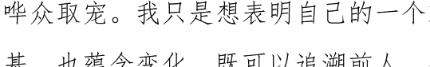

突然从远处传来“嗒嗒”的马蹄声，一匹白如雪的快马转眼间便过来了，后面扬起一片尘土。快要进入前面树林时，只听“吁”的一声，白马扬蹄站定。只见马上端坐着一位白色锦衣的老者，目光炯炯，眉眼间不怒自威。

“十剑盟”镖局，“需求剑”宋旋。

“十剑盟”镖局是中原声名最响的局，自立二十余载以来，所保的镖未出过差错。不是镖局的实力天下无敌，而是每一次走镖“十剑盟”都倾胆出动，出发前也必然制定详细的计划，力求万无一失，再加上镖局的十主“十剑”多年练习的“洛英剑阵”已臻化，配合完美无缝，不是绝顶高手她也不是对手。所以江湖上觊觎她，也少敢于她的面前。

“十剑盟”镖局一年仅接镖三次，每次所保的镖自然都是非同小可，这次所保的竟是失而复得的玉。

“十剑盟”之中，每一个人的剑法都不同，在剑阵中的作用也分清楚。

| 角色名称 | 姓名 | 剑阵位置 | 剑法/作用 |
| :--- | :--- | :--- | :--- |
| 品牌剑 | 胡一鸣 | 剑阵中间左侧 | 老大，一旦敌人落入剑阵之中，往往斩杀 |
| 定位剑 | 田 | 剑阵中间右 | 协同品牌剑斩杀 |
| 产品剑 | 刘水 | 剑阵第二层南 | 剑法凌厉 |
| 价格剑 | 张亮 | 剑阵第二层东 | 剑法多变 |
| 渠道剑 | 孙天 | 剑阵第二层北 | 剑法大开 |
| 促销剑 | 王泰 | 剑阵第二层西 | 剑灵动如蛇 |
| 需求剑 | 宋改 | 剑阵第三层前 | 剑长三尺 |
| 顾客剑 | 秦铭 | 剑阵第三层左 | 武器似剑，一旦盯上对方便离身 |
| 服务剑 | 陈磊 | 剑阵第三层右 | 剑锐利，攻击范围广 |
| 环境剑 | 薄涛海 | 剑阵第三层之后 | 手持双剑，步伐灵活，守在前 |
| 流量剑 | 徐 | 道路两侧 | 晚风吹着道路两侧树林呼作响 |

“樊磊”每次出剑都由宋欣亲自探路，因为他对危险的直觉非常准确。宋欣左手握着缠绳，右手慢慢抽出剑，时间分秒过去，周围的空气仿佛凝结，冷汗从宋欣额头滑了下来。

“嗒嗒”，宋庆后面响起了阵阵马蹄声，来的自然是“十剑盟”镖局的其他众人。宋庆朝胡一鸣了眼色，后者扬起右手，护镖的队伍立刻停过来。“时间已经早了，起天黑之前进入保定，省得夜长。”宋庆沉思片刻，望着树叶摇曳的树林，缓缓低下了头。

胡一鸣朝众人做了个向前的手势，整个队伍立刻出发，缓缓地前往。走到一半的距离，隐约见到前方几个人影站在道路中间。胡一鸣抬起左手：“薄春带着镖队后，其余十剑跟我面前的朋友，镖队不要离我远，以防敌设伏。”说话间，便看清前方站在道路中间的是六个穿锦衣华服的年轻人，每个人手里提着一把大刀！胡一鸣眉头一皱，扬声说道：“各位汉友，我等进入保定，请各位方便。”对方首的年轻人道：“久闻‘十剑盟’大名，一直未幸相会，今日一见果然名无虚。我六人成立‘六刀客’镖局，今日在此并非劫蜀，而是不知高低，想会各位同辈。好让天下知道往后的第一到底是‘十剑盟’还是‘六刀客’！”这六人原来是近年风头的“六刀客”镖局的主人，这六刀客分别是“平台刀”孙亮、“流量刀”秦海、“模式刀”胡迎强、“数据刀”宋大、“媒体刀”王洪伟和“爆款刀”刘正勋。一场无关正义只争高低的较量如弦上箭，谁捷谁败呢？

长江的后浪推着前浪前进。世人都以后浪把前浪拍在了沙滩上，殊不知，涨潮时，是后浪紧跟着前浪前进。退潮时前浪和后浪是裹挟一起退回江湖，你能分清哪是前浪是后浪？

“十剑盟”和“六刀客”的战斗一触而发，刀光剑影横飞，道路两边的树叶纷纷而落。一灶香的功夫，一切都安静了。谁赢谁输呢？是阵型完美的“十剑盟”还是能力出众速度奇异的“六刀客”？江湖无人知道。如保定城门的士兵，那在城门快要关上的一刻，他看到两个锦磊一起进了城，骑马的首领在一起有说有笑。后来，江湖没有了十剑盟和六刀客，而是为了“十剑六刀盟”！

1616 楼
作者:大秦的疆士 日期:2018-10-10 23:04

## 第九节 总结

不知觉，写了一万字对营销定义的介绍。之所以写这么多，是因为想让大家对营销有一个饱满的了解，而不是仅仅停留在抽象的名词上。营销是有血有肉的，是绚丽多彩的。能走远，靠的是扎实的内力、灵活的招数，还有自己的捷径。将能做到极致，一切皆有可能。

总结吧，营销需要：
- 营销思维：一味盲目跟风，只能获得片刻的安慰；
- 营销创新：哪怕一个小细节，也是营销生命的源泉；
- 营销术：包括护航，每一个细节上都有改进和完善；
- 营销品牌：这是营销最重要的目标之一，因为品牌能让消费者记住你并选择你；
- 营销模式：这是营销的高级，让你身得轻巧，让自己演变；
- 营销理论：这是营销的逻辑；
- 营销体系：这是营销的完善。
- 营销产品：这是营销的基础；
- 营销服务：这是营销的起点。

如果你问营销什么最重要，答案是产品（含服务）。低价虽然也可以生存（有些生存很滋润），但很难登上雅堂。这就是我给出的营销定义。接下来的故事，我们将从十三太保说起。

1628 楼
作者：大秦的疆士 日期:2018-10-12 23:29

## 第二章 第一节 需求

上善若水，利万物而不争。夜溺如水，女人如水，上善若水，营销里的需求呢？也是水。需求可以：
- 波澜壮阔如海（互联网的便利）
- 波渺如湖（产品功能的需求）
- 奔腾如海的江河
- 如滴露而来的溪流（我们的情感需求）

除了这些直观感受外，需求还像晨雾、露水、如梦似幻（难以转换的需求）。我们浩瀚的尚未发现的需求，则就比地下水源，等待我们去发现（无限的潜在）。水是万物之源，需求是营销之本。没有需求，何来营销？如何发现和挖掘需求？这个问题的难度系数跟看透女人是一个级别，任何看透女人的行为都是瞎胡闹，同样，我们很难放开皆准的方法来发现和挖掘需求。

新的需求在哪里？

01
清晨，微光。在手机闹钟第三次响起，又一次打了个激灵后，李丽决定离开温暖的被窝，打着哈欠挣着爬起来。李丽来到卫生间，看着牙刷有点分叉，不记得自己用了多久，感觉该换一个新牙刷了。洗脸吐气，换好衣服，李丽一看时间，我去，来不及慢慢化妆了！于是，她只得简单快速的划下了，照照镜子，唉，涂的口红就这样吧。毁的工作终于完成，拿起背包，蹭的就迈出门上班了。

发现问题：让人不快的闹钟、不知道何时该换的牙刷、没有时间的化妆。

新需求：让人愉悦的叫醒方式、提醒何时更换的牙刷、帮助化妆。

解决问题：还是清晨，天依旧是微亮。智能叫醒机器，准时按照李丽设置的阳光叫醒方式，当智能叫醒机器发出如阳光般温暖亮的光线在李小眼睛睁时，她慢慢地睁开眼，多舒适的叫醒方式呵。起床喽！李小来到卫生间，牙刷上显示次数的颜色已经要变白了，看来今天班可以买新牙刷了！洗完脸，换好衣服，李小下班了。远处还有一家店在旁边帮忙。化妆需要时间，在手机上预约可能不方便，李小看着镜子，化妆后的心情很愉悦。

发现需求下的产品：智能叫醒机器、提醒何时更换的牙刷。
发现需求下的服务：私人定制。

1656 楼 
作者：大秦的疆士 日期:2018-10-13 00:03

#### 02
通过上面李小的案例，我们可以总结几点：
第一，需求就在身边，只要动脑筋，需求就像深海里的水，挖掘会有；第二，发现需求的前提是了解消费者的使用情境，其中存在不便之处；第三，解决需求的方案，并不非要创造产品，我们可以在现有产品上改良，就能满足消费者的潜在需求；
第四，发现需求下的服务，更容易让人兴奋，互联网+服务往往会诞生前景。

当然，上述智能闹钟、还是更换牙刷，或是私人定制，都是对消费者需求的分析出来的结论，并非实际产品。一旦这样的产品出来，是否一定受到消费者的追捧？也许有人知道我是怎么发现这些需求的，在发现需求的过程中有什么独特的思维方式？这个问题很难回答。要说的，就是要喜欢问题，用完美的态度去留意身边可能存在的问题，然后思考如何解决。当你可能发现了问题，但技术层面的问题当然是要专业的人处理。客观的说，就是营销。牙刷不方便。

1665 楼 
作者:大秦的疆士 日期:2018-10-15 17:37

### 第二节 需求

01
需求：非玄。正如所述的案例，抓捏问题就会找到新的需求。非玄，是因为有些需求我们先凭空想象，再创造出来的。下面介绍三个项目：

+ 项目：名称不难理解这个项目就是整合装修行业从材料供应商、装修公司到消费者各个环节的金融服务平台。这个项目之所以行的逻辑比较清晰：
一、我国装修行业市场规模是在万亿以上，蛋糕足够大；
二、金融服务不管是对材料供应商、装修公司还是消费者，大家经常说的痛点——材料供应商希望减少装修公司付期带来的资金压力；装修公司需要资金来替装修环节的费用，特别是那些超出现金能力的订单；消费者当然希望能有利息高的贷款来满足其个性化和高品质的装修需求；
三、商业模式盈利——平台上每天的现金流、贷款利息和流量变现的衍生服务都可以带来回报；四、风险控制。材料供应和装修公司评级授信、消费者房实名备案等方式都能将风险控制在最低。之所以说这个项目是有可能的，是因为资金的问题有很多企业在装修方面可能存在的需求。所以即使凭空，还是可做的。

二、青少年金融平台：这是针对10-18周岁的青少年开展金融服务的项目。虽然我们已经有一些银行推出了儿童银行和儿童理财产品——儿童银行卡可以存储消费，也可以通过父母为孩子设置零花储蓄计划和教育金。儿童理财产品往往是5万元起步。这两个产品，胆率的说，根本就没有真正为孩子提高商商考虑，噱头大于实用。

于是需求的逻辑是：为什么不应该有一个旨在提高青少年财商的金融服务平台呢？寓教于乐也是可以的。那么这个项目会怎么做呢？
第一，将目标客户锁定为10-18周岁的青少年，因为少年的自主意识和辨别能力已经基本具备；第二，增加财商的学习环节，比如模拟股市交易和基金产品等；第三，提供实际的股市和基金产品的购买，金额没有上限，但会有上限，超过上限必须有父母的确认；第四，要有正能量。提倡青少年关注公益，尤其是与青少年相关的公益活动，他们可以在平台上直接捐赠相应的公益组织；第五，打通微信和支付宝的资金来渠道，方便孩子们使用；第六，开通打赏功能，方便父母或其他家长发红包或零花钱。

当然，需要用户强调，这个互联网平台吸筹的资金也可能会倾向于儿童。这个项目是有可能的，因为资金的问题有很多企业在装修方面可能存在的需求。这种营销的营销。营销，是营销的完善。思维、创新、体系、品牌、模式、产品。这就是我给出的营销定义。总结一下，营销需要：
- 营销：一味盲目跟风，只能获得片刻的安慰；
- 营销创新：哪怕一个小细节，也是营销生命的源泉；
- 营销术：包括护航，每一个细节上都有改进和完善；
- 营销品牌：这是营销最重要的目标之一，因为品牌能让消费者记住并选择你；
- 营销模式：这是营销的高级，让你身得轻巧，让自己演变；
- 营销理论：这是营销的逻辑；
- 营销体系：这是营销的完善。
- 营销产品：这是营销的基础；
- 营销服务：这是营销的起点。

如果没有 YY，就没有梦想，我们的前人又怎会像鸟一样在空中飞翔（飞机），像鱼在大海里游逛（船舶）？我们几十年前又怎么会想到现在的手机有高铁，甚至还有人工智能和 VR眼镜？是先有技术的变革，还是先有梦想？我想，一定是梦想在前的。

## 简单总结一下 YY 的需求

首先你需要一个不规矩的心；其次，你需要积累一些常识（行业、新技术），当然如果有了自己的技术优势自然更好；接着，你需要逻辑推理 A 行业的做法如果用到 B 行业该怎么做？然后，如果逻辑推理没有出需求，那么你就需要一个想象力（用户可能需要什么？）；最后，验证你的结论（可以从身边的发、调研）获取更多帖子

相比比较现有产品或服务的改进，创造新的需求是最让人热血沸腾的。一样滴滴、摩、美团、携程等互联网独角公司，它们诞生之初不是因为创造了新的需求而快速成长吗？

创造需求的故事，还没有结束，也许你也可以尝试 YY 新的需求。

## 1685 楼
作者:大秦的疆 日期:2018-10-16 10:34

### 第三节 需求的总结

营销，就是让消费者觉得自己需要你需要的产品（含服务）。

营销的江湖里，需求就是水，任何营销都离不开需求。

“兵无常势，水无常形”，需求千变万化，并没有什么固定公式或方法能够推导出的。这也是为什么我们很少能够在营销的书籍里看到对需求的剖析和指导。既然如此，我们又该如何看待需求？

市场的规律，犹如巨大的冰山，我们可以认为现有的产品只是满足了露水那一部分，而水下巨大的部分还等待我们去发现。

发现新的需求，又可以分为两种，一种是对现有产品的补充或改善（如提醒更换的牙刷），还有一种是创造新产品（产品如 VR 眼镜，服务如“享物语”）。前者需要的是站在用户的角度去发现现有可能存在的问题或缺陷；后者则需要我们对新技术或新模式的理解和探索。

发现新需求需要什么？

需要不安于现状，需要换位思考的体验和分析；还需要要有梦想，如 YY，有一点天马的想象力；除此之外，还需要做一个有心人，了解行业和技术的变革，了解其他行业的商业模式。

发现新需求，靠的并不是所谓的前沿技术（技术只是工具），最重要的是我们内心的。

最后，用耐克和阿迪达斯的广告作为这一章的结束。

Impossible is nothing! Just do it!

## 1687 楼
作者：大秦的疆 日期：2018-10-17 01:22

## 第三章 一号太保备外篇——获取营销洞见

昨夜西风萧碧翠。

独上高楼，望尽天涯路。

本章涉及的书籍：《营销管理》、《营销的16个关键词》。

### 第一节 《营销管理》第二篇

儒家思想的代表书籍是《论语》，道家思想的代表书籍是《老子》，佛家思想的入门书籍可为《般若波罗蜜心经》，而营销的入门书籍一定是非菲利普·科特特的《营销管理》。

《营销》一书，在营销江湖正如《圣经》一般的存在。正如我们所见，因为这本书详细介绍了营销的内容，每一次改（现已是第16版）也不是在与时俱进地对新的营销环境和内容进行了补充。我们要说的营销十三大报都是以这这本书的内容进行启蒙，再通过案例和其他书籍进行更为深刻的了。

一号太保“需求”，正如前面所述，是最难剖析和指引的。所以在《营销管理》一书中，并没有专题来谈。但第二篇“获取营销洞见”，我们可以理解为与需求有关。营销洞见，洞见的然也有需求。

#### 01 获取溯洞见

用马克思的话来说，就是“透过现象看本质”。获取洞见的过程，就像侦查办案，要搜千丝万缕的证据，然后分析推理找到真正的犯罪。

营销江湖里的侦探该如何办案？

在科特勒的《营销管理》第二篇中，没有讲述案件的由来，也没有搜集完证后分析推理的过程，其内容都是在讲搜证据。这当然可以理解，营销江湖如此错综复杂的、案情复杂的，案件的由来如果要一一道来，估计老人家别的事情就不用干了。至于分析证据找到案件的结果，这又要因而异，具体问题对比分析，因此老先生在书里也只能狠按下不表。

## 营销，需要获取溯洞吗？

在《营销管理》一书中，“信息收集”有一个高大上的名字——营销信息系统。这倒也无可厚非。既然是理论书籍，自然还要说明其构成和来源。

这就是理论书籍通常的逻辑——设定一个牛逼的专业术语，剖析它的构成和来源，如果有的话，还要加它的分类或者意义等等。我将此称为“逻辑上的完整”。但有些内容其实对实际的运用并没有太大的意义，我们只需要知道有象就好，不要形成记忆上的负担。

对于营销信息系统，我们只需要知道它有三个来源：内部报告、营销情报和营销调研。如果你认真看书里的内容，你会得出一个结论，就是营销信息无处不在，线上线下处处有，处处要留心。内部报告，是案件当事人的词；营销情报，是权威机构的报告；营销调研，就是探探们的工作。

营销信息系统的内容，能说的多了。这也是营销江湖里的悲哀，天下到处都是蜘蛛丝马的证据。然后里还有一些内容值得我们关注，比如数据挖掘。这个词我想我们已经听出了，关键的问题是企业该如何获取和运用自己想要的数据，大数据分析。

什么是宏观环境？趋势、年龄结构、消费者心理、收入分配、对人的看法、自然环境和技术环境（这还是部分，不同行业我们不需要对待头疼）。为什么？大多数企业对宏观环境往往只是习惯，除非遇到行业重大政策或技术变革，否则大多数企业都是习惯的，关键就看哪个企业能从宏观分析中，找到自己的突破口。

## 1698 楼
作者:大秦的疆 日期:2018-10-17 

#### 02 获取更多营销

形而上学的抽象概念说完，当然要说实际运用方面的。我们不妨列出企业通用的“信息系统”和“市场调研”涉及的内容。

信息系统：
- 各各类销量分析（同比、环比）
- 各种内部数据分析（库存周转、利润率、促销投入比）
- 消费者分析（前提是产品可追溯到购买者）
- 零售商数据
- 批发商数据
- 其他渠道（如电商）数据分析
- 售后中心数据分析
- 线上口碑分析
- 权威媒体或机构发布数据（如行业数据）
- 行业其他公司数据
- 大数据分析

以上信息系统的内容是传统企业使用的部分（不代表全部），互联网的信息系统会有区别。从这些数据的分析中，企业还是得出经营方面的反馈，对其后续营销活动会有指导作用。

市场调研：
企业的市场调研，在实际运用中，通常是要委托第三方进行，要么不做。企业自己做市场调研情况自然也有，但费时费力，还不能保证调研的效果。市场调研普遍的做法是线上下的问卷调查、电话调研、消费者焦点小组（如邀请消费者参与工厂座会）。

信息系统和市场调研，理论上对企业而言应该是常规操作，实际上却有各种理由和难处。原因很简单，不能对企业的经营结果产生直接的效益。所以实际运用往往在一个尴尬的位置，其中感受，如人饮自暖。

## 1706 楼
作者：大泰的疆 日期2018-10-18 

### 第二节《营销的16个关键词》之“洞察”

获取更多营销

营销江湖中有高人，名为叶茂中也是。此自营销在大地初现崭峥之时，便已成风云人物。由其领导的营销各大战役，几乎无往而不胜。所谓武侠江湖中有独孤求败，营销江湖中有叶茂中。近年来其所出版著作作为畅销的，有《营销的16个关键词》，有《冲突》。其中，《营销的16个关键词》是对营销江湖战斗的技巧进行的高度概括，而“冲突”则如独孤求败所创的“独孤九剑”，乃自成一派的开山之作。我们现在既然要学习“营销洞见”，又能怎么少了叶茂中先生的《营销的16个关键词》中的“洞察”呢？

#### 第一层观察

叶茂中并不急上来就讲“洞察”的战斗技巧，而是先强调其重要性。开头的两句话所言，“洞察力是营销从业首要具备的能力”和“在这个毫无疑问是历史上最纷乱嘈杂的大时代里，我们依然要有无数次的重申消费者的重要性。即使你信心充满，也要再一次地、认真地、无比虚诚地去钻听、去摩擦、去洞察他们的想法、愿望和需求”。由此可见，洞察二字在叶茂中的营销战斗思想中有着无可替代的作用。

接着叶茂中将“洞察”的战斗分为两个层次，首层是观察，第二层才是洞察。观察的目的是为了认知，洞察的目的是为了看清本质，“观察用眼，洞察用心”。观察得很好，眼睛睁过去就是。我们也可以将科特勒说的营销系统和市场调研的内容都视作观察。那么洞察又是如何呢？

#### 洞察的方法

- 洞察走群众路线——从消费者中来到消费者中去
- 洞察靠脑——犀利的眼睛只能发现问题，只有睿智的头脑才能洞察真相
- 洞察知己知彼——建立在市场调研之上
- 洞察用心——在调研的基础上，加入对人性的理解
- 洞察为了了解消费者的需求，为了满足消费者的需求，加入理解才能打动消费者
- 洞察要有名——这是洞察的目的。简单来说，就是不能为了洞察而洞察，洞察的好坏就看有没有市场机会。这五点不能算是洞察的方法，而是洞察的标准。洞察的方法如同老子的“道”一样，道非常重要。只会说清楚，同样的标准，不同的人洞察出来的结果大辕北辙。

## 1718 楼 
作者:大秦的疆 日期:2018-10- 

### 案例一：南亚风情·第一城

现状：
南亚风情·第一城是昆明市一个过百万平方米“城中村改造”的大盘，且是昆明市内第一个“城中村”改造项目。“城中村”留给市民的印象就是低档杂乱，消费者对于改造后的第一城，同样摆脱了这样的联想，“城中村改造”的背景下，客户希望走中端的价格路线，辅以“南亚风情”的地区特色为卖点，期望以建筑特色促进购买。

疑惑：对于昆明人来说是一个好的概念？中端的定位是否真正有利于销售？

洞察：
经过调查，发现昆明消费者有三个明显的特征：
1. 可以承受较高价位的楼盘；
2. 向东部一线城市的生活氛围与居住环境；
3. “南亚风情”对于昆明当地人根本不是新概念，甚至还城中村一样，有一定的低档认知取向。

方案：
从城中村到CBD。1. 将消费对象目标设定为高端用户，用精英、商务的概念吸引；2. 提高价格，用更高的居住理念和设计理念，让“南亚”变“国际”，让“风景”变“高档”；
3. 比附策略，将昆明与国际最顶尖的超一流大都市进行对比和嫁接，彻底打动消费者。这里是昆明的巴黎，这里是昆明的曼哈顿，这里是昆明的香港。这不是梦，这是即将到来的日子。

结果：
开盘当天，近5000人到场，仅6小时就宣告售罄。洞察之后，“南亚风情”变成了“国际高档”！这就是洞察的魅力。如果我们在当初的环境下，城中村改造的楼盘，我们是否有如此犀利的想法和魄呢？

简单复盘此案例中洞察的逻辑：
第一步，发现之前的想法是个坑，坚决不跳！
第二步，市场调研（可惜市场调研的方式和内容案例中没有介绍），得到消费者的特征（也有对人性的理解）；第三步，根据发现的消费者特征，重新定位和包装产品——中端变高端，比附国际大都市。你看，这么复盘后是不是觉得理所当然（笑）？在我们看来，这个案例最大的价值之一是告诉我们，市场调研消费者的特征（主要是心理），以此为基础洞察出新的方案就不妥了。

## 1720 楼 
作者：大秦的疆 日期:2018-10-19 09:42

## 案例二：好孩子婴儿车？

在这个案例中，先有一份关于“消费者购买婴儿车关注的因素”市场调研结果表。其中，高达72%的消费者关注的就是安全。按照正常的逻辑，似乎安全性是婴儿车离不开的一个核心点。但叶茂先生洞察后，放弃了占比72%的安全性，选择了占比26%的舒适度。为什么他会遵守结果？根据他的洞察，婴儿车的本质是购买者和使用者分离。如何理解？让我们一下叶茂中和好孩子厂家之间的鸿沟。

叶：一个问题，婴儿车到底是谁？是家长还是宝宝？
好孩子：好像家长和宝宝都是使用者。
叶：虽然上看两者都有，但最能体验的消费者其实是宝宝。
好孩子：所以如果要寻求核心诉求，我们应该以“使用者”的角度切入，婴儿车的功能。
叶：如样、外观是否好看，小家伙也没法欣赏。
好孩子：那家里作为消费者，他们的诉求不用考虑？
叶：这些问题，不需要的。
好孩子：所以婴儿车是否舒适，代表了宝宝的感受。

一复总结：
这个案例中有三个问题思考：
1. 市场调研结果的理解和运用。
2. 诉求应该针对购买者，还是使用者？
3. 核心卖点是否能够唯一？

对于第一个问题，我的观点是基础的市场调研是需要的。至于调研结果到底如何理解和运用，关键是购买者和之间关系的密度。第三个问题是三个问题中最难的一个，也是一个话题，在后面的内容中再讨论。

## 1722 楼 
作者:大秦的疆 日期:2018-10-19 23:45

### 第三节 关于洞察的总结

01 洞察的重要性而言，营销与侦探相似，甚至比侦探更高。侦探是在寻找蛛丝马迹的线索中探索事情，而营销，则是在铺天盖地的信息中不仅看到真相，还要在此基础上联想到新的创意或突破。卓越的营销，离不开优秀的洞察力。《营销管理》第二篇强调洞察离开信息系统，需要做市场调研。《营销的16个关键词》中“洞察”一章除了市场调研外，还告诉我们洞察需要以消费者为导向，还要对人性的理解。虽然这些道理不难理解，但真正做到另一回事。洞察，营销中绕不开的一个坎，是否有公式可能的？尝试一下洞察应具备的条件：

1. 对数据敏感，分析数据。营销之所以是一门科学，因为其不仅仅是感性的创意，更需要理性的分析。产品结构的销售分析、渠道结构的销售分析、消费者结构的数据分析等等，都会帮助我们更清晰自己品牌和产品（含服务）在市场中所处的位置和现状。做的好的地方和做的不的地方，都会蕴藏着商机。
2. 重视营销信息系统的建立。这句话说起来似乎漫不虚，要搜集多少信息。可是在这个瞬万变的时代，生存不容易，如履薄冰。如何履冰如走平地？其目的就是掌握信息。因此，首先是要重视营销信息系统的搭建，其次要梳理和搜集信息。比如，我们将营销信息系统分为两大类：大类按照信息来源分类（如内部数据、媒体信息、行业新闻、上线评论、市场调研等），另一类按照信息内容分类（如内部数据、产品分析、渠道分析、竞争对手、行业动态、新技术运用信息等）。这样营销信息系统的搭建就有针对性。
3. 重视消费者心理特征的洞察。营销，归根结底，是改变消费者的态度。正如“子兵法有云，上兵伐谋，其次交，其次伐兵，其下攻城”。何为“上兵伐谋？”就是攻心。叶茂中的两个案例，无一不是消费者的心。洞察消费者心理特征，又能做到攻消费者的心？至如能够准确洞察消费者的心理特征，这是营销大智慧的范，只能意会、一说就懂。
4. 求洞察的结果。艺术的美有两种，一种是极致的美（如达芬奇的蒙娜丽莎），一种是残缺的美（如断臂的维雕塑）。营销的艺术则是前者，追求极致的美。洞察，自然可以应付，手里拿着数据，拍拍自己的脑门，也会个。既然洞察是逍焰的游戏，我倒认为应该对结果越苛刻。越是要求严格，越有可能诞生有价值的思想。与其跟一个臭皮匠的复，还不如试把臭皮逼成诸葛光。

总结：
这个案例中有三个问题思考：
1. 调研结果的理解和运用。
2. 品牌诉求应该针对购买者，还是使用者？
3. 产品卖点是否唯一？

对于第一个问题，我的观点是基础的市场调研是需要的。至于调研结果到底如何理解和运用，关键是购买者和使用者之间关系的密度。如果是这样，无妨，但前提是在购买者诉求方面不能做的差。第三个问题是三个问题中最难的一个，也是一个话题，在后面的内容中再讨论。

## 1732 楼 
作者:大秦的疆 日期:2018-10-20 08:43

02 我们似乎已经对洞察有了了解，那不妨来实际演练下。洞察算盘的需求。当然，我们手里没有数据和市场调研报告，没关系，想一想叶茂中对好孩子婴儿儿的洞察，市场调研的结果似乎也没有那么重要，那也尝试一下没有调研数据的洞察。

对产品来洞察，这就好比是宋末大圣朱熹所提倡的“格物致理”，不过没有哲学那么高深，不用用“格”的吐血。

算盘是大家都知道的产品，似乎已昨日黄花，无人问津。挑战高难度，方显我们英雄本色调。

当还是要了解算盘的现状。根据网上的资料显示，现在的算盘还没有到完全被淘汰的境地。除了一些老手的人习惯用算盘计算数字，算盘作为人类非物质文化遗产，其使用和传承也受到关注。

从算盘的文化入手？当然不行。消费者都不知道在哪儿，更谈不上步入消费者心理特征，pass!

当我们搜集的信息办法不下的时候，只能继续尝试。好辛苦，网上说到，算盘是因为常型的左脑并用，对提高智力，开发右脑是一种好方法，因此一些学校或学生课外辅导班都有类似的课程。

对于营销的敏感性，我们直觉会认为这个内容有价值，文章尚可见。提高智力，开发右脑。在问题的关键是如何代消费者的心理特征。

我们在脑海里没有一个清晰的消费者群体，不如将消费者进行分类，最简单的办法是按照年龄分类。青少年需要开发右脑，但这已经是常规动作，一些学校已经做过。成年人属于大脑成熟的黄金期，很少有人认为自己的大脑不够用，你让他私下里学算盘练脑？虚弱的自尊心恐惧

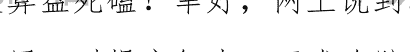

接受不了了？老年人的大脑正在退化（主要体现在记忆减弱和小脑萎缩），明显这个群体还需要大脑开发啊！

所以，洞察的结果来了！
结果一：打算作为老年人防止老年的方式，提倡家庭、养老院、老年大学进行普及。这个需求明显是有价值的。看，这就是洞察的魅力！

继续洞察。
再“格”算盘。网上上有资料：“自古以来，算盘都是用来骗钱的，也正因为此，算盘被想象成招财富的吉祥物，为人们推崇。”以及“陪娘算盘有着招财进意的寓意，可以放在新房子或书房，若是小型挂件的话可以随身携带，以帮您聚财进库。若放在房间最好的风水法便是：挂在行树窗上或者书架上，这样可以帮助婚姻生活丰富安宁，还可以帮助催化小人。”

这个内容也可以产生新的诉求。

结果二：将算盘定位为家庭和公司招财的重要风水物。所谓寓意之物，分类越有说服力。可以用不同的材质，代表不同的五行，比如五行属金的人，就用金属材质的算盘来招财进宝。

以上就是我们洞察算盘需求的过程，聊以实践，仅供参考。

作者：大秦的疆 日期:2018-10-20 09:56

03

本着“折腾自己，服务读者”的精神，接下来直接分享我没有数据没有调研下的洞察所感，大家就当当一乐。

## 洞察 1：情侣服的革命

现状：现状的情侣服太low了，无外有两种：款式颜色一样（情侣服 1.0）、衣服零杂互涉。

疑虑：情侣之间，尤其是热恋阶段，如胶似漆，如糖似蜜，只要不要低调的明星，就恨不得全世界都知道自己在在热恋中。情侣服当然是一种很好的表达方式。现在的年轻人，个性张扬，喜欢表现自己，情侣服 2.0 能满足他们渴望的心理需求吗？

洞察需求：情侣服 1.0 和 2.0，在产品体验上还有很大的挖掘空间。

YY 的情侣服 3.0：利用新技术，设计一种智能的情侣服，情侣在接近的时候衣服发生变化，图案或颜色或亮度等。

衍生高逼格：情侣服搭配情侣 App，通过情侣服作为媒介，搜集大数据和 App 服务。

## 洞察 2：20后的老年游戏

现状：从80后开始，很多人从小都喜欢玩游戏；老年退休生活是一个值得关注的问题。

疑虑：当80后、90后等这一代退休后，他们希望退休的生活是怎样的？

洞察需求：当他们老去的时候，晚年生活需要的娱乐就是游戏；

衍生产品：研发适合老年人的身体状况（如游戏速度、字体大小等），现在的老人也可以尝试摆脱无寞。

附：老年人的网络游戏《夕阳武士》广告脚本

场景一：年轻时的画面。
近镜头。一台电脑和手机屏幕上，快速切换画面现在流行的游戏，“英雄联盟”、“绝地求生”、“荒野生存”、“梦幻西游”。
近镜头。一群年轻人在电脑或手机前，兴奋地抖着屏幕，脸上的表情或开心。外音：“我们曾年轻过，曾在各种网络游戏里挥洒青春的热血，那么快乐！”

场景二：退休后无聊的生活。
远镜头逐渐拉近。一些退休后的老人，坐着时感觉无味、钓鱼时无力、运动时疲不堪。外音：“我们现在老了，感觉生活的激情离越来越远，想要让自己开心起来，但是总是感觉枯竭。”

场景三：老年人穿着在游戏里畅畅。
远镜头逐渐拉近。画面，界面很宏，游戏比较慢，画面里字体比较大，老年人穿着在游戏里战斗。外音：“老年人的生活，夕阳武士，我们在这里聚了战！”

作者：大秦的疆 日期:2018-10-20 09:56

## 第四章 番外篇：了解消费者

本章涉及的理论书籍：《营销管理》、《消费者行为学》、《影响力》、《怪诞行为学》。

了解消费者并不是在营销体系中重要，恰恰相反，而是非常重要。因为客户是上帝。在营销江湖，需求如水，那么消费者呢？他们就是让万物润的土壤。没有土壤，我们就造不了粮食。消费者千千万困难，这就意味着了解消费者是个技术活。现在就让我们跟着上述几本书，来慢慢揭开消费者的面纱。

作者：大秦的疆 日期:2018-10-21 19:23

### 第一节 梦中情人

虽说顾客是我们的父母，但对待消费者我们与父母不同。父母是主动给予我们爱和温暖，而消费者更像是求似渴。

“所谓一方，在水一方，“窈淑女，君子好逗”“窈淑女，骚之、“求”之不得，骚服。悠哉悠哉，转反侧。”等等人窈淑女，是不是我们的消费者，企业是多么追求她啊。

不以结婚为目的的恋爱，就是在流氓。消费者追求者自然是要结婚为目的的（忠）。

既然如此，我们作为消费者，就要了解梦中情人一样。对情人多一份了解，才有可能成为熟人，才能定恋爱关系，牵手、拥抱、结婚。结婚之后还有许多让自己更佳，这样你才会忠，才不会被插足的机会。

为了追求梦中情人，我们要了解她什么呢？

- 基本信息。籍、年龄、工作等。为了了解信息目的是为了能够两人聊天时有话题。想办法我们在网上跟女孩搭讪，是不是都是从这三个问题问起。不为别的，是为了继续下哄。
- 喜好。这是一定要了解的。女孩子总是要尽量惊喜，这是女孩子浪漫的必要条件。惊喜从何而来？不知不觉地迎其喜好。
- 厌恶。是人都有自己不喜欢和反感的东西或行为，这是高压线。不触碰高压线，让梦中情人一直对你有很好的印象，当然很重要了。
- 谁会影响她的态度。你的梦中情人并不是一个人在战斗，当你追求她时，她身边的闺蜜、家人都会对你评论。你必须要清楚哪些人会影响她的态度，这时就可以私下做一些工作，可求大事不出！
- 她了解你的方式。你以为你帅，就可以轻易俘虏佳人的芳？幼稚！你的梦中情人只要不是二愣子，在回答跟你处对象之前就要先了解你。这个时候你就知道她了解你的方式中最重要的是什么。通过平时的交谈相处，还是通过你身边的朋友来判断，亦或是你对待周围的态度。
- 身边其他追求者。你的梦中情人自然可能是别人的梦中情人。了解她的竞争者，才能在众多追求者中脱颖而出。
- 她的小脾气。女人通常都有小脾气，更是如此。了解她的脾气，可以让你更好地与她相处，同时让她感动。感情需要润滑剂，所以你需要了解她的脾气。
- 为什么让她一心。当她追求到手后，切记不要掉心。

### 第二节 营销管理第五章——了解消费者

为什么了解消费者？因为客户是上帝。在营销江湖，需求如水，那么消费者呢？他们就是让万物润的土壤。没有土壤，我们就造不了粮食。没有吃的，我们还怎么生存？消费者是父母，这句话的逻辑是无懈可击。消费者自然成为企业必备功课。什么种不了粮食，什么种新产品，什么种足够让我们可以覆盖，这些都是了解消费者的内容。

科勒在这一章里列出了三大要素：

- 1、创造顾客价值，客户很重要（这似乎是个废话）。
- 2、产品质量和服务是关键（这是根本）。
- 3、客户满意来自对期望的比较（不能太虚也不能太大）。

- 1、客户满意，客户忠。
- 2、客户终身价值最大化。让她感觉幸福。
- 3、培育关系。在岁月里经历熟悉、朋友、恋人这样的转变。但不仅是此，你可以慢慢培养，当她需要的时候，这些关系需要用心培育。

科勒不是营销导师，还是情感导师。情感三大要素并不理解，但具体怎么呢？先看看科勒先生是怎么说的。

## 创造顾客价值。让她感觉很好，所以客户价值就是客户认知价值。

她感觉到好在心中是有衡量标准的。在认知价值的定义里，“感知价值是基于客户所获得的整体利益与其支付的成本之差”。整体利益包括经济利益，也包括功能和心理利益；整体成本不仅是客户支付的钱，还有时间成本、精力成本和心理成本。通过这个定义，我们总算知道衡量的标准是什么。科勒显然觉得内容有点少，他加了两点：客户价值分析是一个工具。用“客户价值分析”来将公司与其他竞争对手相对，由此揭示公司存在的优势和劣势。这一点毋庸疑，将你的和对手的好放在一起分析，很容易得出各自的优点和缺点。这的确有必要。分析步骤如下：

- 1、确定顾客关心的主要属性和利益。
- 2、定量评估不同属性和利益的重要性。重要性进行评估（我们没办法定量，但可以排序）。
- 3、以各个属性的重要性为基础，对公司和竞争对手在不同客户价值上的绩效评估。这就要求实的PK，评估你在关心地方的表现。
- 4、在具体细分市场中，基于每个属性或利益，对于具体的竞争对手，检查顾客对公司的评价。这就是要求解释你在这些地方的表现。表现要加很多参照物。你比她会在她不开心的时候陪她，就是你的优点。
- 5、定期评估客户价值。不要一次就飘，所以要定期评估你表现的评价，不松懈自满！

强调高水平的客户价值。这句话就很实在了，追求她就是要有高水平的表现。在这里，科勒提到的“价值主张”概念——价值主张是一个承诺，将顾客从公司的供应产物中所获得的利益，还有顾客与供应商的互动关系过程中的所有体验都陈述出来。概念有点太理论了，简单来说，价值主张就是公司对产品利益和体验的承诺，承诺不仅包括品牌的核心定位。比如沃尔汽车，它的定位是“安全”，但它的价值主张不仅仅是安全，它还包括顾客感觉到的良好的性能、优质的设计等。

在迎女神这件事上，价值主张的就是甜言蜜语。最好做到“我是世界上最懂你的人，你的开心还是不开，我都愿意倾听”、“我是世界上最爱你的人，我365天每天每刻都在想你”。

创造美好的客户认知价值，让她感到很好，这是最好的。

与客户认知价值一样，对于我们可以理解的词，满意度是指一个人对产品或服务的性能（结果）与期望之间的比较。愉悦或失望。满意度的落脚点是在期望和比较上。

满意度与追求是一样的道理。看你的行为是否一致，或者比期望好。一旦你做了让她不满意的事情，就会产生负面影响。满意度超过期望，自然好。里面都是专业的术语，如ACSI（客户满意度指数）和NPS（净推荐值）。概率很高。现在移动互联网时代，公司除了上述满意度，还要监控转化率、流失率。

总结一下客户满意对我们的指导价值：

- 1、客户很重要（这似乎是个废话）。
- 2、产品质量和服务质量是关键（这是根本）。
- 3、客户满意度来自期望的比较（不能太虚也不能太大）。
- 4、客户期望主要来自四个方面，前面两个很难，但后面两个要关注。

## 客户终身价值最大化。

世人都懂感情，奈何无留的付出；感情苦是因为得而未得，所以感情的一方甘愿毫无保留的付出；感情在一起时间久了，心中也有得失，也会比较付出和回报。感情和消费者之间也是如此。客户终身价值最大化，就是企业需要回报。这里的价值和感情不同。感情的价值是客户感觉到企业是好的。这里的主体是企业，考量的是客户给企业创造的效益多少。当然，企业的壮大离不开客户，如果企业的价值都是成交额甚至亏卖产品，那企业早就黄了。这点和感情的关系不同（除非两人之间是包养和被包养关系）。所以完全可以理解企业需要客户给自己创造经济价值。

既然企业需要客户带来的价值，那么如何做到客户终身价值最大化呢？在书中讲到了六点：

- 1、盈利客户。
- 2、测量客户终身价值。
- 3、吸引和维系客户。
- 4、建立客户忠诚。
- 5、品牌社区。
- 6、赢回流失客户。

我们先分析其中的逻辑。客户的消费水平和频次会有不同（所谓的“二八定律”），给企业带来的盈利情况自然不同。确定盈利客户这个概念，就是先将目标锁定在能企业带来盈利的客户上。了解盈利客户，接下来就要量其终身价值，即其长期给企业带来的盈利情况。当终身价值很高的时候，你就要想着如何吸引和维系他们，并且能够建立客户忠诚（让客户习惯了你的存在，不离开你）。吸引、维系和建立客户忠诚最好的方式是通过品牌化。最后，要挽回那些曾经离开你而去的客户。

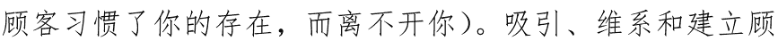

逻辑没有问题，接下来我们将多谈一下。

（续）

- 1、盈利客户。

盈利客户的概念很容易理解，就是给企业带来盈利的客户。不过既然是客户终身价值最大化，这里的盈利自然不是指消费一次，而是在一段时间内不断消费。我想科勒既然用过“终身价值”一词，必是考虑到了耐消费业（如家电），耐消费的产品通常数年甚至数十年才会再次。

## 购买

购买既然时间跨度如此之，不如就称为“终身价值”。

之所以科特勒在这里特意强调“盈利客户”的概念，我想原因不外乎有二：一是所谓“二八法则”，即 20%的客户贡献了 80%的利润，所以这盈利客户主要指的是他们；二是“不盈利客户”，这样的客户或是喜欢企业的品牌，但却买不起（或者不舍得）正常销售的正品，只等此类清仓处理的时候才购买，给企业贡献的盈利几乎没有。

我可能并没有兴趣详细介绍这两个方法，因为对于“客户盈利性分析”，我本人觉得这是一种理性和理论的方法，除非是个个人定制为主要服务内容的行业，否则没有必要单独去测算每一个客户的盈利性（正常情况下，企业的利润就是销量*（价格-成本），这是多么庞大的数据和工作啊）。我们这个时间，不如多研究市场需求和产品。

## 2、测量客户终身价值。

如果你高等数学的很好，倒是可以看一看书中所列的测量公式，我反对正造之一的二净。连“客户盈利性分析”的方法都没有兴趣介绍，我又哪哪里会有兴趣研究这个自己完全不懂的测量公式？

## 3、吸引和维护客户。

这就又回到追求者和梦中情人之间的关系了，要吸引和黏住梦中情人。不用看书，我们根据自己的经验也可以总结吸引客户的方法，没有无外有以下几种方式：在媒体上播放、直接给潜在客户推荐自己的产品（手机短信、邮件、电话等，只是现在的企业并不多）、参加展会、吸引眼球刺激的促销活动、组织或参与社会活动、制造有利于企业的新闻或事件等。书中关于吸引客户的方式并没有太多笔墨介绍，这内容与后面要提的另外一个太保“促销”密切相关，在此也就不赘述了。

关于维护客户，书中提到的是“减少客户流失”、“客户维度变化”、“管理客户基数”，这些内容都可以归纳为“卖车辆的科学”，在具体实践中企业往往很懒（主要是为了省起来，用起来隔离暴骚）。有趣的朋友，可以自己看书了解了。

## 4、建立客户忠诚。

如何让女神对你心心一意？书中提到了三个工具——与客户亲密互动、开发客户忠诚计划、建立制度性联系。

与客户亲密互动，就是对女神要随时打起十二分钟精神，聊天微信要频繁，语言要幽默多情，当然还有最重要的的一点，要要会倾听女神的心声。女神给你她的过去，聊她的风得意，聊她的家长长短，你来一句“哦，我知道了。我要玩游戏了”，你看看她会不会暴跳如雷。

发展客户忠诚计划。就是用奖励鼓励女神对你一心一意（这过的女神客户给予额外的奖励）。在营销实践中，就是对于经常购买你产品的客户给予额外的奖励。

建立制度性联系。你跟约定每周周末陪她打羽毛球，这就是建立制度性关系。当然书中的案例主要是企业针对经销商这一群体的顾客，所采取的制度性措施，如提供电脑方便客户管理订单、库存等。这里涉及两个书中没有提到的问题，是分析消费者是否需要包括经销商，二是可否针对消费者是否建立制度性联系。

对于第一个问题，我的答案是不需要，因为这两个群体完全不同，购买产品的出发点和方式都有天壤之别，没必要混为。对于经销商的这一客户群体，后面在研究太保“渠道”我们再来探讨。

对于第二个问题，我认为可以，但意义不大。企业可以要求消费者定期参加其组织的公益活动，但因为两者地位不等（在商业体系中，消费者的地位是凌驾于企业之上的，特殊品牌除外），消费者对于企业这样的制度要求完全可以忽视。到时候，企业尴尬？所以虽然可以，但实际意义不大。

## 5、品牌社区。

“品牌社区是一个由消费者和雇员组成的专门的社区”，现在而言，最常见的品牌社区有品牌社区微信公众号、官方微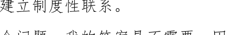博、在线论坛、百度贴吧还有企业官网等。

品牌社区，你可以没有（当然是应该是），如果你有，就要维护好这个社区的氛围。一个死气沉沉的或者负面评论一边倒塌的品牌社区，不如没有。

至于品牌社区的价值创造的方法，虽然书中有提到，但不在这里啰嗦喽，同样在后面讲另一太保“品牌”的时候我们再来说。

## 6、赢回流失客户。

你以为书书中在这里会介绍如何赢回流失客户？那你就得失望了，没有。它只是在强调调回流失客户比寻回新客户更不容易。的确确如何赢回流失客户，这属于具体问题分析的范围：其实关键在于做好产品和服务的改进，取更多帖

“客户终极价值最大化”的内容就这些，没有什么好总结，绝大多数大家在生活中都有体验（也都是基本常识），书中只是将它们理论和概括了。

## 培育客户关系。

和女神的相识、相知、相恋，再到情悦、结果，在此期间，并不仅依靠好感的不断积累，还需要感情。与客户之间，说是企业需要培育关系。培养客户关系，就是客户关系管理。问题来了。我们作为消费者，恐怕从来没意的。正常而言，消费者就是通过销售渠道购买产品或服务。如耐克的篮球，我们不会去在意耐克做了什么事情，我们只是喜欢这个品牌和产品而已（这么分析，类似品牌管理和产品比客户关系更为重要）。当然了，我们的感受是这样的，但企业难道怎么看？管理好客户关系是它的工作。可是怎么做呢？且看科特勒是如何自圆其说的，以及其中对于我们追求女神的依靠之下。

第一，客户对企业的接触点（就是在哪里体验品牌和产品），并尽量在接触点完美满足需要。

第二，精准营销、个性化营销、许可营销与参与营销，这是要迎合不同消费者的要求而采取不同的营销方式。说白了，就是让消费者感觉企业走心很贴心。哪个女神是完美的，她也会她的小个性，她会更感激；

第三，客户授权。“这是给客户提供激情的资源和机会”。这是鼓励顾客在企业品牌营销中扮演更重要的角色（比如如小白鼓励消费者提供走心文案，让消费者拍摄30秒短片从品牌标识获得的灵感）。与女神在一起时，不要总想着自己表现，也要给女神机会表现，这样女神会觉得你心中有：

第四，客户评论和推荐。客户评论，在电商平台已经很常见了。推荐，是企业在一些平台上将产品推荐给客户（这不就是插件广告……Ps: 客户的评论就是品牌的口碑，正面评价固然重要，负面评论要更重视（这也是企业和客户加强互动，往往因为躲在网上的负面评论而发生相爱相杀的故事）。重视女神当面或背后对你的评价，好的保持，不好的下次注意：

这五点就是科特勒对于客户关系的阐述，站在消费角度，你们的内容还满意？总结一下吧。培育客户关系，是企业需要的，但不一定是消费者会感受到的。但这并不影响企业做好客户关系。客户关系的主要内容是，用心接触点、迎合个性的要求、让消费者表达情感、给予反馈、恰好处的给顾客推荐、积极处理投诉。

在此之外，我还有一些补充。我认为客户关系最重要的工具是品牌和产品，这是企业管理关系的基础（一个体验糟糕的品牌，即使上述这些事情做的再好，也对客户关系于无补）。另外，品牌需要情感、个性和价值观，这三点会管理关系提供更好的理由和机会。

### 第三节 了解消费者

《营销管理》第6章——了解消费者市场。

天空阴沉，风若静止。此时她就站在你对面，目光乖狞，说道：“你了解我吗？你了解什么？你知道我每天都在想什么？你知道我为什么对你生气？你根本就不解我！”看着女神如冷寂的脸，你低头，嘶哑着：“我……”，话没说完，女神已不耐烦地转身而去，留在那一阵乱。

与我们不经意间，企业都是知道自己的潜在消费者。企业研发产品（或提供服务），自然是为了满足消费者的某种需求，而这些消费者都是企业的目标消费者（当不排除有财粗的企业，是先借某技术造出产品，然后考虑消费者有没有需要）。这种方法比较惯性，“营销推荐”。OPPO市场从诞生起就知道它的目标群体主要是年轻人，格力空调中的消费者是所有需要购买空调的人，外目标消费者应当是那些想出门解决吃饭的人群。企业一旦确定了自己的品牌和产品定位，那么目标消费者就被锁定了。

在企业的眼里，谁是自己的消费者，并不是一个问题（如果这是一个问题，就需要面对无疑的事了）。要不要花时间去了解消费者（特别是那些消费者范围广的公司），怎么做算是了解消费者，了解消费者的区域差异在哪里？这些才是问题。这些问题的答案我们从《营销管理》中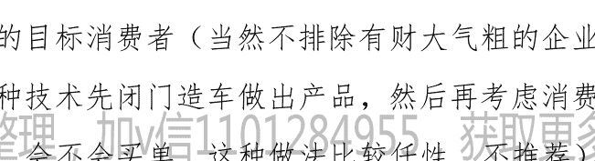

## 第6 章 来寻找。

（续）

我们在第一节中曾经分析过，我们为了追求梦中情人，至少要了解她的8个问题：基本信息、喜好、厌恶、谁会影响她的态度、她了解你的方式、她身边其他追求者、她的小脾气、什么会让她对你一心一意。在《营销管理》的第五章中，科特勒先生用心良苦，极其详细地阐述了“什么会让她对你一心一意”问题的答案（虽然顺序上有点心急了）。第一章→共共有十章章，分别是“影响消费者存在的因素”、“主要营销过程”、“购买决策过程”、“五阶段模型”和“行为决策学”。这些内容在了“基本信息”、“谁会影响她的态度”、“她了解你的方式”和“小脾气”。至于“喜好”、“厌恶”、“身边其他追求者”，这些问题显然属于具体问题的范畴，不可概而论。

## 影响消费者行为的因素

了解梦中人的基本信息，包括籍、年龄、工作等，这样你就对她有一个大的认识。

文化因素：文化因素容易分析，外乎国家的文化、宗教、意识形态等等。文化因素算是把消费者画了一个大圈，这个圈就在地面上的，消费者怎么在这个圈子里活动。企业在分析消费者行为时，如果不存在明显文化差异，可以忽略，反之，则需要谨慎对待。

社会因素迥然显得复杂多了。按照《营销管理》的逻辑，社会因素受参考群体、圈子、家庭、角色地位四种因素影响。

参考群体，就是之前我说的“谁影响女神对你的态度”。女神有父母、大姑八姨、同事会给她意见。有意思的是，我们作为消费者，通常也会身边的人对某品牌态度的影响，所以消费者身边的圈子（家人、朋友）肯定其中之一。除此之外，我们还会受到其他潜默化的引导，如明星、意见领袖、权威人士（如医生），甚至还有网红推广和销售产品。我们虽然认为自己有主见，但在选择困难的消费时，很多时候是不自觉的参考了别人的意见。

圈子。说实话，我在没看出来参考群体和圈子之间有何明显的界限，只是角度不同（圈子的概念更强调消费者的社交性），你可以某个人是你的参考群体，也可以说是你所在的圈子（你能通过微信的朋友不是你的参考群体吗？）我怀疑如此分类有些高深之嫌，其实大可不必，营销学并没有这么通俗有效。

家庭。这里的家庭和上面的人不是一回事，主要是强调家庭的状态，如有孩子还是没孩子，是原生家庭（父母和妻子一起起）还是再生家庭（你在外面结婚了）。所谓要坚持单独拿出“家庭”这个因素来说，是因为不同的家庭状态，消费者的消费决策地位不同。比如，如果是父母一起，你想买苹果手机，只要家里条件允许还是很有可能买给你的，但是如果你已经娶了在外面二世界生活，你想买苹果手机，就得看你老婆同不同了，申请成功的概率估计要远远低于父母一起的时候（男人不容易啊）。

角色和地位。我们每个人每天都在扮演很多角色，而不同的角色和地位也是不一样的。你在公司是说一不二的老板，在某高尔夫俱乐部里可能只是刚入门的小弟，地位对待径庭。角色和地位的不同，决定了我们购买产品的档次。如公司老板开的是丰田卡罗拉，你是公司的部门经理，你再有钱也会觉得自己一辆车不太合适。这就是角色对消费者的影响。

## 个人因素

你的情中人再怎么傻甜，也会有自己的性格特点和状况，这些都会影响她是否接受你的追求。个人因素说白了，就是你的情况对消费行为的影响。理解起来倒是没有什么压力。个人因素同样也有四个内容：年龄周期、职业和经济状况、个性和自我概念、生活方式和价值观。年龄和生命周期不同，看品牌和产品的需求就会不同（我们很很少看到老人买智能手机）

## 文化因素

文化因素容易分析，外乎国家的文化、宗教、意识形态等等。文化因素算是把消费者画了一个大圈，这个圈就在地面上的，消费者怎么在这个圈子里活动。企业在分析消费者行为时，如果不存在明显文化差异，可以忽略，反之，则需要谨慎对待。

亚文化：亚文化是相对于大文化的概念，亚文化是相对于政治、经济、军事、民族等因素的亚文化及其活动。

《营销管理》中影响消费者行为的因素部分就这些内容，是不是感觉内容太多了？“不管白猫黑猫，能抓住老鼠就是好猫”，套用这句话，“不管理理论知道么高深繁，指导实践才是好理论”，所以，是时候做个减法了。

不妨从企业应用的角度来分析该如何影响消费者行为的因素（有的开口洛）。

文化因素，大的圈子，只要不是考虑横跨两个以上的文化圈子，这一点可以pass。

社会因素，就考虑参考群体（含圈子），家庭、角色和地位都是客观存在的事实，大周圈的影响很可能倍功。有钱的继续代言人、网红，有人脉的继续找权威专家来为你推荐。它告诉的是价值的重要性。

个人因素，这个相对复杂一点。年龄和生命周期、职业和经济状况，是企业设定市场目标群体的逻辑起点。换言之，品牌产品锁定了，你的消费者群体的年龄、经济状况基本确定。至于生命周期和职业，则要具体问题具体分析。个性和自我概念、生活方式和价值观，则是企业在品牌主观价值方面设定的重要考量因素，品牌个性化拟，宣扬某种生活方式和价值观，从而引起消费者的共鸣。

上述三个因素中，最能给企业指导价值的肯定是个人因素，这里可以做的很多。针对年龄的细分市场、产品结构规划（高中低档）、品牌情感和价值观塑造（这些内容后面的太早会讲到)。

影响消费者行为的因素，我们记住五点：参考群体、年龄、经济状况、个性和自我概念、生活方式和价值观（为了了解中人的基本信息也可以参考这五点）。减法完成！

# 1868课

作者:大秦的疆士 日期:2018-10-27 13:10

## 02 主要心理过程。

这就还厉害了，人知面对知心。想了女神了了解你的过程吗？欢迎走进“主要心理过程”这一栏。

根据教科书所言，消费者从收到外部营销刺激到最终购买决策，会发生五个心理过程：感知、学习、情感和记忆。同理，女神对你的认知也会经历五个心理过程——寂寞（感到孤独，想有同伴）、感知（感受到你带来的温暖）、习惯（习惯了你的存在）、依赖（对你有了情感上的依赖）、记忆（爱在深层的脑海）。

### 动机。

对柯南、福尔摩斯和狄仁等而言言，犯罪必有动机。在营销的江湖里，动机就是需求就是痛点。这一点并没有什么好处值得强调的。书中提到了三个理论。

弗洛伊德的理论只是一句话“一个人不可能完全理解自己的动机”，意味着消费者的动机可能是潜意识的。接

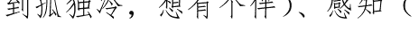

提到的两种方法来寻找深层的动机，一个是“阶梯法”，二是“投射技术”（这个与之前的“ZMET”隐喻引导技术类似），了解就好了。

第二个理论是大家听到比较多的马斯洛的需求金字塔，一看了然，将人的需求为5种类型：生理需求、安全需求、社会需求、尊重需求和自我实现。需求的是金字塔状的逐步提升的，下层次的需求满足了（当然不是100%满足）才会升级考虑一层的需求。

对于马斯洛金字塔，你只需要知道这五种需求且这五种需求在层次上有高低之就可以，至于于下一层的需求，这一点是很有些问题的。在有功能性一方面仅有情感价值的牌面和另一面（就是能彰显自己和经济实力等社交需求），的需求从不是单一的，也不可能是逐步推进的。

人心是复杂的动物，人的需求一直都是多方的，是立体的，是不可预知的、不可简单总结找到规律的。一个人完全可以因为尊的需求而舍弃许多生理需求或者安全需求，其他类似的情况也会发生。在很多人眼里，面子比命重要（吃饭、租房）先不管这些！老娘紧裤腰带的包也要买个普拉达给公司的势力看！马斯洛的需求层次理论，作为企业，有一点值得关注的，就是你的产品已经或者可以挖掘到的消费者哪些层面的需求。

第三个理论是赫斯伯格的二因素理论，“消除不满意因素是足以激发购买的，产品必须具有满意。”这个理论只是事实的阐述，买东西当然然是为了追求满意的效果嘛。动机即欲望，女神接受你的追求需要动机吗？当然需要。也许是因为某一天的长漫无心睡眠，也许是因为某一天生病无人照顾，也许是因为某人为家里的催促或者身边朋友蜜的刺激。这里有一点不同，女神接受你追求的动机，你影响不了了，企业却一直在想办法创造或引导消费者的动机。

# 1874 楼

作者:大秦的疆 日期:2018-10-27 16:58

(感遇)

感如。一微信：1101284955 获取更多热门

当你的梦中情人有了对爱情向往的动机后，还没有到乐乐高兴的时候，她还不一定会考虑你。感如。时候，你要做的事情是让她感受到的存在和温暖。你也以为还是很简单，就是不断用行动感动她，让梦中情人无法忽视。可是，如果别人这么做呢？

《营销管理》中，爱情专家将感知的过程分为三个阶段：选择性注意、选择性扭曲和选择性保留。你看，一切都是选择性的。

### 选择性注意

在营销的江湖里，消费者接受到的品牌信息更是千万。无论是梦中情人还是消费者，精力都是有限的，只能凭着直觉和经验。事情成败是在念之间。好，这一切还有行的。

- 人更有可能注意那些需要的刺激。你的女神已渺，那么她自然会留意。换言之，有了动机，自然就会关注。消费者只注意他想的。
- 人更有可能注意期待的物。你的女神正在期待白王子，如果你刚好在外形上符合王子的标准，那么她喜欢，一定会注意。如果你不幸在外形上符合她的标准，别挑剔。
- 人更有可能注意一般刺激相比比较较大的刺激。无人之路，当你不符合白王子标准的时候，一定要记住这第三条——在其他方面脱颖而出！你可以在别地方做到不凡，比如你的知识程度（每天给她报），比如你的知识修养（在她面前朗作），再比如你的心（告诉她

### 选择性保留

当你千辛万吸引了女神的注意，通过良好的口碑巩固了对你的印象，那么你可能已经成功了一大半。女神即使还没有对你心暗的程度，至少在你心中留了一个位置。这个时候你要做的是千万不要玩失踪，不要松懈散漫，还是要延续之前的做法，让女神心中你的位置变得越来越重要。否则，你就有变成备胎的危险啊。

“我们倾向于记住爱的产品的优点而忘记它的竞争产品的优点”，消费者的选择性保留很简单——自己喜欢的，最好又是品牌的，他一定会记住（品牌在任何消费环节都是重要的）。

总结一下，感觉就是成功吸引消费者注意（突出消费者所期的优势），然后品牌和口碑让消费者坚定的你所承诺的优点，最后在他的脑海里留下了深深的烙印。

学习：作者:大秦的疆 日期:2018-10-27 23:02

(续)
 学习（研究）。

- 动机即痛点，物质和精神；
- 研究驱动，暗示和强化；
- 情感更吸引，故事和人性；
- 记忆分长短，节点和联想。

1900 作者：大秦的疆士 日期：2018-10-29

## 购买决策过程：五阶段模型。

上述的消费者心理过程，分析的是消费者的心理活动，这里的购买决策过程则是消费者的活动。前者是知，后者是行，虽然王阳明推崇“知行合一”，但在营销的江湖里，

“知行合一”不是唯一的真理。消费者的购买决策过程分为五阶段：问题辨别、信息搜索、方案评估、购买决策和行为后。这五个阶段和前面的心理过程几乎一样：

- 知（感知）
- 行（学习/研究）
- 情感
- 记忆

这五个阶段的对应关系：
- 问题辨别：动机。
- 信息搜索：感知。
- 方案评估：研究。
- 购买决策：情感。
- 行为后：记忆。

所以，学习并非学习，而是研究。研究的是为了辨别。

## 问题辨别（动机）

对于企业而言，问题辨别的意义在于识别和引导消费者，简单的来说就是发现消费者的需要或引导消费者觉得自己需要。

# 1914 楼 作者:大秦的疆 日期:2018-10-30 00:30

## 信息搜索。

信息搜索的意思很简单，就是购买前搜集证据说服自己。但是任何时候我们都会想起信息搜索这件事呢？假如你在超市里，你会信息搜索吗？你不会。大概一星期后，由于信息搜索，想起家里没牙膏了，你一定会拿着经验或者品牌好去购买吧，或者被某个新产品引起，决定尝试一下。

可假如你想买一台笔记本电脑呢？那就麻烦了。你要先确定是选择普通的笔记本电脑，还是超级电脑。然后你会网上搜一个主流的配置和品牌，再看看网上的评论，然后还要问问身边懂电脑的人，让他们给你的建议，最后你根据预算会有两三个选项，这时你很难做出。

你看，同一个消费者在购买不同的产品时，信息搜索程度可以发生很大的变化。这取决于什么？产品的价值。当你要购买的产品对于而言价格不菲，或者这个产品会影响别人对你的评价，你会慎重选择，这个时候你就会做认的信息搜寻（或者咬牙只选择高端品牌）。当你购买的产品很便宜，产品好坏别人也看不时，你就会根据经验容易做出选择，而绕开信息搜索的过程。

如果消费者需要搜寻信息，那信息的来源有哪些呢？
- 个人来源（认识的人）
- 商业来源（广告、包装等）
- 公众来源（媒体或评论机构）
- 经验来源（之前的经验）

对于企业而言，悲催的是，消费者的信息来源中只有商业来源是企业能主主导的，而其他来源却是有效的。所以，了解信息搜索这一过程，对于企业而言，除了做好自己广告、包装、网站、公众号、终端展示等事外，还要策划线上的评论和媒体或评论机构对自品牌产品的评价情况（并不困难）。

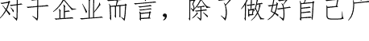

在这一节中，有一个内容我们要重点引导消费者购买决策的因素。什么是属性层级？就是大多数消费者对品牌及属性的属性性喜好所做的优先考虑的排序。比如购买汽车，消费者可能会这样排序：
1. 考虑是哪个国家的品牌（德国或 日本？）；
2. 考虑选哪个品牌（与奥迪或大众？）；
3. 接着考虑是哪款车型（A6 或 Q5?）；
4. 最后才考虑哪一款（A6 时尚型或运动型？）。虽然这里只是举例，有些比较懂行的消费者会把发动机、底盘等配置的技
术参数为主要属性进行排序。

属性层次一次确定，有助于多多——可以帮助细分市场，也可以帮助产品规划，还可以帮助实现差异化。属性层次的内容以后还会继续讲到，这里就不再赘述了。

关于信息搜寻，我们现在知道消费者可能会做信息搜寻，也有可能就凭经验不做信息搜寻。我们知道消费者最信赖的信息来源除了企业提供的以外的一切信息。我们还了解了消费者购买产品时有一个对属性考虑的优先顺序。上看这三点，企业想要在消费者信息搜寻环节做文章，那要做的事情可真不少啊！

1. 创造或改良产品的某些属性，吸引消费者的关注，刺激他们去搜信息；
2. 关注消费者的其他信息来源，口碑很重要；
3. 了解消费者购买类产品的属性层次（这个最难，众口难调），有针对性的调整宣传的重点或产品改进。

企业不易，且买买且珍惜！

信息搜寻，就是消费者的感知过程。

# 1915
作者：大秦的疆 日期:2018-10-30 11:26

方案评估。

消费者有购买的动机，也付诸搜寻信息的实践了，接下来的就是研究到底哪个，在这里专业术语叫“方案评估看（这个词用的），实际上也就是前面提到的研究。

方案评估的过程因人而异，什么规律可言，总之就是寻找自己想要的产品特定利益（如选择空间大的汽车）或属性组合（如价格不超过10万的空间大的汽车）。

但之所以可以做选择，是因为方案评估的结果具有共性——信念和态度。“信念”一词，是不是觉得得放在这里很奇怪？咋选择产品还有选择出信念来了？我解释一下，这也是一个翻译的问题（belief study），信念来源于英语单词belief，翻译成“信念”本身是没有问题的，因为信念的解释中包含了我们认为是事实的判断。只是因为大家习惯用信念理解成精神层面上的一种肯定或信仰，所以信念放在这里就显得很奇怪。可以直接翻译为“相信”，对消费者寻找的信息有了了解和相信事实。相信后，就产生了态度，评价是好还是不好，喜欢还是不喜欢。

至于于《营销管理》中提到的“期望—价值模型”还是偏理论了，毕竟每个客户对产品的属性层次的想法是不一样的，这样的模型很难四海皆准，还会增加企业成本以复杂的工作量。这个概念，我还是归为“理论上的逻辑”，属于装逼器，理解即可。

方案评估就是研究，结果是消费者（接受）了的信息，并以此产生了态度。

1925 楼
作者：大秦的疆 日期:2018-10-31 09:14

购买决策。

春风拂面，日光和煦。

你已经跟着你的梦中情人经历了相识相知相熟的阶段，她已经习惯了你的存在，终于你决定在今天这个阳光明媚的日子里，让一切尘埃落定、开花结果。

你站在她的对面，看着她的双眼，目光深情而坚定。摆了拳头，你将心中早已默念无数的表白，悠悠清晰地说道了出来。心跳如鼓，忐忐等待。

她听完你的表白，眼睛如星辰，嘴角的微笑如池塘上的涟漪，没有说话，只是点了点头。

# 一万春：1101284955 提取自多好帖

春风拂了你的头发，你沐在风中幸福地微笑。决定有时对就是这样，愉悦中带着对未来的憧憬。

消费者做出购买决策的心情是否也是如此？

让我们看看《营销管理》中所提到的“消费者选择的非补偿性模型”、“经验法则”、“联合考虑法则”、“词典排序法则、“按属性排除法则”这些理论术语（有有趣的可以了解下），消费者做出购买决策的理由有很多，在经历了之前的搜索信息和方案评估后，他已经有了判断。上述这些专业术语，其实都是在消费者在方案评估环节已经完成的事情。

在决策的环节，不得不说的是干扰因素。

在狗血的电视剧里，当男女主角要相爱的时候，总会人站出来大喊“你们不能在一起，因为你们是同父母的兄弟妹”，又或者刚好在这个时候，她发现原来他就是自己的杀父仇。前者，是别人人在干扰；后者是情节（情境）在干扰。

消费者的购买决策也会受到他的态度和非预期环境因素的干扰——在他正打算掏腰包购买的时候，好友刚刚打电话，聊到要买的产品，基友说这个产品他刚用过，很垃圾，不要买；或者去商场的时候突然发现另一个也不差的品牌在抢销，力度加大。

落到实处，企业要做的不仅是战略层面（品牌和产品），还要抓战术层面（口播和情境），两手抓两手都要硬。

当消费者完成信息搜寻和方案评估后，购买决策应该到位，最终还是会受到干扰因素（人和情境）的影响。

1939 年
作者：大秦的疆 日期：2018-10-31 13:34

购后的行为。

你跟梦中情人确定恋爱关系后，自然少得了花前路下，耳鬓磨磨，其中甜蜜之亲不可与外人道也，偶有嘴嘈喷怒之时，也只是感情上的润滑剂。

消费者购买产品之后，售后（如果有的话）和处置（如果有的话丢弃、更换、保留）。这些内容都是我们自己根据实际总结出来，没多少内容描述。

有意思的是，购后行为，尤其是在处置环节，往往存在新的商业活动或模式，如汽车置换、家电旧换新，或者是“旧送换新”，还有二手交易或回收，这些都是消费者购买后产生的商业行为。

小结：消费者的购买决策五个过程，分别是问题识别、信息搜索、方案评估、购买决策和购后行为。在此期间，消费者的路径从始至终都在影响。对于企业的而言，除了做好品牌定位和服务的体验外，口碑、促销活动等也是营销体系中需要考虑的环节。

# 1944 楼
作者：大秦的疆 日期:2018-11-1

消费者的介入程度。

科特勒先生在“购买决策五阶段模型”的内容中，最后加了个尾巴，名为“介入程度”，其内容主要阐述了介入程度对消费者过程的影响（以及对应的追求水平）。

多样化的购买方式，我认为这可以是生活常识，无需再费笔。

首先，为何消费者的介入？科特勒先生偷懒，并没有在书里给出定义。没关系，我们介入，“插入到事件之中进行干预”，所以消费者的介入程度就是消费者在购买行为里花了多少心思。花心思少，就是低介入决策（如买一辆汽车）；花心思的多，就是高介入决策（如买一把椅子）。

我们得出一个结论：“对于大多数价格低廉、经常购买的产品，消费者的介入程度都很低；价格敏感、消费惯性（习惯了某品牌），就会是低介入。”高介入的条件刚好相反，产品周期长，且没有强品牌忠诚。问题来了，知道高介入和低介入这个概念，对企业有什么意义？如果你是一个行业里非常牛的品牌，在某个市场领域里没有像样的对手，你很寂寞，那么消费者的介入程度是高还是低，对你而言没有意义，因为大多数消费者都是选择品牌的产品。

不过随着移动互联网时代产品信息爆炸，市场变化日新异，这种情况少之少（互联网服务的独角兽是最可能的，如滴滴）。或者你就是一家行业里有比较高的市场份额，很有品牌认知和美誉的公司，你应当希望消费者是低介入，因为你的市场份额很容易就能稳住（前提是产品或服务水准要保持）。

对于许多希望快速发展的企业而言，他们当然喜欢消费者是高介入。为什么？高介入就是消费者把水搅浑！大家站在同一跑线上，各顾其事忽略消费者的。你有品牌故事，你有卖点，你有品牌情感，我有性价比。这是市场竞争的谛，也是营销的魅力。

关于消费者的介入，我们简单总括一下：
1. 者的介入程度会影响企业的营销效果；
2. 我们希望消费者是高介入参与消费者行为；
3. 我们需要将低介入产品转变为高介入；
4. 对于实在不能转换为高介入的低介入产品，提供一个或更多的正面引导，让消费者确信选择自己的品牌是正确的（如名人宣传、吸引人的包装和有感染力的促销）。

至于如何将低介入产品转变为高介入产品，书中提到了四种方法：
1. 与某个人引起注意的问题联系（如佳士牙膏与预防蛀虫相关性）；
2. 与某个人状况相关性（如果果汁中添加钙等维生素来增强产品的营养价值）；
3. 激发个人价值观或自我防御的强烈情感（如宣传麦片心脏健康的益处及延年益寿并享受天伦之乐的重要性）；
4. 为产品增加某种属性（如智能锁）。

消费者的介入程度就是消费者在购买决策的过程中花了多少心思，高介入会给新品牌新产品带来更多的机会。

1959 楼
作者：大秦的疆 日期：2018-11-01 18:16

行为决策理论与行为是经济学。

烈日、丝风、蝉鸣。转眼间，已经是夏天。

在春天的春风里，女神接受了你的表白。现在，数月过去了，你将记得在起初的任务，给她过生日，就在夏天。生日就要有礼物，就要有惊喜，就要浪漫。

生日送什么礼物？在她生日日前，你偷偷地准备。你跟梦中情人确定恋爱关系后，自然少得了花前路下，耳鬓磨磨，其中甜蜜之亲不可与外人道也，偶有嘴嘈喷怒之时，也只是感情上的润滑剂。

消费者购买产品之后，售后（如果有的话）和处置（如果有的话丢弃、更换、保留）。这些内容都是我们自己根据实际总结出来，没多少内容描述。

有意思的是，购后行为，尤其是在处置环节，往往存在新的商业活动或模式，如汽车置换、家电旧换新，或者是“旧送换新”，还有二手交易或回收，这些都是消费者购买后产生的商业行为。

小结：消费者的购买决策五个过程，分别是问题识别、信息搜索、方案评估、购买决策和购后行为。在此期间，消费者的路径从始至终都在影响。对于企业的而言，除了做好品牌定位和服务的体验外，口碑、促销活动等也是营销体系中需要考虑的环节。

# 1944 楼
作者：大秦的疆 日期:2018-11-1

消费者的介入程度。

科特勒先生在“购买决策五阶段模型”的内容中，最后加了个尾巴，名为“介入程度”，其内容主要阐述了介入程度对消费者过程的影响（以及对应的追求水平和多样化的购买方式）。

多样化的购买方式，我认为这可以是生活常识，无需再费笔。

首先，为何消费者的介入？科特勒先生偷懒了，并没有在书里给出定义。没关系，我们介入，“插入到事件之中进行干预”，所以消费者的介入程度就是消费者在购买行为里花了多少心思。花心思少，就是低介入决策（如买一辆汽车）；花心思的多，就是高介入决策（如买一把椅子）。

我们得出一个结论：“对于大多数价格低廉、经常购买的产品，消费者的介入程度都很低；价格敏感、消费惯性（习惯了某品牌），就会是低介入。”高介入的条件刚好相反，产品周期长，且没有强品牌忠诚。

问题来了，知道高介入和低介入这个概念，对企业有什么意义？如果你是一个行业里非常牛的品牌，在某个市场领域里没有像样的对手，你很寂寞，那么消费者的介入程度是高还是低，对你而言没有意义，因为大多数消费者都是选择品牌的产品。

不过随着移动互联网时代产品信息爆炸，市场变化日新异，这种情况少之少（互联网服务的独角兽是最可能的，如滴滴）。或者你就是一家行业里有比较高的市场份额，很有品牌认知和美誉的公司，你应当希望消费者是低介入，因为你的市场份额很容易就能稳住（前提是产品或服务水准要保持）。

对于许多希望快速发展的企业而言，他们当然喜欢消费者是高介入。为什么？高介入就是消费者把水搅浑！大家站在同一跑线上，各顾其事忽略消费者的。你有品牌故事，你有卖点，你有品牌情感，我有性价比。这是市场竞争的谛，也是营销的魅力。

关于消费者的介入，我们简单总括一下：
1. 者的介入程度会影响企业的营销效果；
2. 我们希望消费者是高介入参与消费者行为；
3. 我们需要将低介入产品转变为高介入；
4. 对于实在不能转换为高介入的低介入产品，提供一个或更多的正面引导，让消费者确信选择自己的品牌是正确的（如名人宣传、吸引人的包装和有感染力的促销）。

至于如何将低介入产品转变为高介入产品，书中提到了四种方法：
1. 与某个人引起注意的问题联系（如佳士牙膏与预防蛀虫相关性）；
2. 与某个人状况相关性（如果果汁中添加钙等维生素来增强产品的营养价值）；
3. 激发个人价值观或自我防御的强烈情感（如宣传麦片心脏健康的益处及延年益寿并享受天伦之乐的重要性）；
4. 为产品增加某种属性（如智能锁）。

消费者的介入程度就是消费者在购买决策的过程中花了多少心思，高介入会给新品牌新产品带来更多的机会。

1959 楼
作者：大秦的疆士 日期：2018-11-01 18:16

行为决策理论与行为是经济学。

烈日、丝风、蝉鸣。转眼间，已经是夏天。

在春天的春风里，女神接受了你的表白。现在，数月过去了，你将记得在起初的任务，给她过生日，就在夏天。生日就要有礼物，就要有惊喜，就要浪漫。

生日送什么礼物？在她生日日前，你偷偷地准备。你跟梦中情人确定恋爱关系后，自然少得了花前路下，耳鬓磨磨，其中甜蜜之亲不可与外人道也，偶有嘴嘈喷怒之时，也只是感情上的润滑剂。

消费者购买产品之后，售后（如果有的话）和处置（如果有的话丢弃、更换、保留）。这些内容都是我们自己根据实际总结出来，没多少内容描述。

有意思的是，购后行为，尤其是在处置环节，往往存在新的商业活动或模式，如汽车置换、家电旧换新，或者是“旧送换新”，还有二手交易或回收，这些都是消费者购买后产生的商业行为。

小结：消费者的购买决策五个过程，分别是问题识别、信息搜索、方案评估、购买决策和购后行为。在此期间，消费者的路径从始至终都在影响。对于企业的而言，除了做好品牌定位和服务的体验外，口碑、促销活动等也是营销体系中需要考虑的环节。

# 1944 楼 
作者：大秦的疆 日期:2018-11-1

消费者的介入程度。

科特勒先生在“购买决策五阶段模型”的内容中，最后加了个尾巴，名为“介入程度”，其内容主要阐述了介入程度对消费者过程的影响（以及对应的追求水平和多样化的购买方式）。

多样化的购买方式，我认为这可以是生活常识，无需再费笔。

首先，为何消费者的介入？科特勒先生偷懒，并没有在书里给出定义。没关系，我们介入，“插入到事件之中进行干预”，所以消费者的介入程度就是消费者在购买行为里花了多少心思。花心思少，就是低介入决策（如买一辆汽车）；花心思的多，就是高介入决策（如买一把椅子）。

我们得出一个结论：“对于大多数价格低廉、经常购买的产品，消费者的介入程度都很低；价格敏感、消费惯性（习惯了某品牌），就会是低介入。”高介入的条件刚好相反，产品周期长，且没有强品牌忠诚。

问题来了，知道高介入和低介入这个概念，对企业有什么意义？如果你是一个行业里非常牛的品牌，在某个市场领域里没有像样的对手，你很寂寞，那么消费者的介入程度是高还是低，对你而言没有意义，因为大多数消费者都是选择品牌的产品。

不过随着移动互联网时代产品信息爆炸，市场变化日新异，这种情况少之少（互联网服务的独角兽是最可能的，如滴滴）。或者你就是一家行业里有比较高的市场份额，很有品牌认知和美誉的公司，你应当希望消费者是低介入，因为你的市场份额很容易就能稳住（前提是产品或服务水准要保持）。

对于许多希望快速发展的企业而言，他们当然喜欢消费者是高介入。为什么？高介入就是消费者把水搅浑！大家站在同一跑线上，各顾其事忽略消费者的。你有品牌故事，你有卖点，你有品牌情感，我有性价比。这是市场竞争的谛，也是营销的魅力。

关于消费者的介入，我们简单总括一下：
1. 者的介入程度会影响企业的营销效果；
2. 我们希望消费者是高介入参与消费者行为；
3. 我们需要将低介入产品转变为高介入；
4. 对于实在不能转换为高介入的低介入产品，提供一个或更多的正面引导，让消费者确信选择自己的品牌是正确的（如名人宣传、吸引人的包装和有感染力的促销）。

至于如何将低介入产品转变为高介入产品，书中提到了四种方法：
1. 与某个人引起注意的问题联系（如佳士牙膏与预防蛀虫相关性）；
2. 与某个人状况相关性（如果果汁中添加钙等维生素来增强产品的营养价值）；
3. 激发个人价值观或自我防御的强烈情感（如宣传麦片心脏健康的益处及延年益寿并享受天伦之乐的重要性）；
4. 为产品增加某种属性（如智能锁）。

消费者的介入程度就是消费者在购买决策的过程中花了多少心思，高介入会给新品牌新产品带来更多的机会。

1959 楼 
作者：大秦的疆士 日期：2018-11-01 18:16

行为决策理论与行为是经济学。

烈日、丝风、蝉鸣。转眼间，已经是夏天。

在春天的春风里，女神接受了你的表白。现在，数月过去了，你将记得在起初的任务，给她过生日，就在夏天。生日就要有礼物，就要有惊喜，就要浪漫。

生日送什么礼物？在她生日日前，你偷偷地准备。你跟梦中情人确定恋爱关系后，自然少得了花前路下，耳鬓磨磨，其中甜蜜之亲不可与外人道也，偶有嘴嘈喷怒之时，也只是感情上的润滑剂。

消费者购买产品之后，售后（如果有的话）和处置（如果有的话丢弃、更换、保留）。这些内容都是我们自己根据实际总结出来，没多少内容描述。

有意思的是，购后行为，尤其是在处置环节，往往存在新的商业活动或模式，如汽车置换、家电旧换新，或者是“旧送换新”，还有二手交易或回收，这些都是消费者购买后产生的商业行为。

小结：消费者的购买决策五个过程，分别是问题识别、信息搜索、方案评估、购买决策和购后行为。在此期间，消费者的路径从始至终都在影响。对于企业的而言，除了做好品牌定位和服务的体验外，口碑、促销活动等也是营销体系中需要考虑的环节。

# 1944 楼 
作者：大秦的疆 日期:2018-11-1

消费者的介入程度。

科特勒先生在“购买决策五阶段模型”的内容中，最后加了个尾巴，名为“介入程度”，其内容主要阐述了介入程度对消费者过程的影响（以及对应的追求水平和多样化的购买方式）。

多样化的购买方式，我认为这可以是生活常识，无需再费笔。

首先，为何消费者的介入？科特勒先生偷懒，并没有在书里给出定义。没关系，我们介入，“插入到事件之中进行干预”，所以消费者的介入程度就是消费者在购买行为里花了多少心思。花心思少，就是低介入决策（如买一辆汽车）；花心思的多，就是高介入决策（如买一把椅子）。

我们得出一个结论：“对于大多数价格低廉、经常购买的产品，消费者的介入程度都很低；价格敏感、消费惯性（习惯了某品牌），就会是低介入。”高介入的条件刚好相反，产品周期长，且没有强品牌忠诚。

问题来了，知道高介入和低介入这个概念，对企业有什么意义？如果你是一个行业里非常牛的品牌，在某个市场领域里没有像样的对手，你很寂寞，那么消费者的介入程度是高还是低，对你而言没有意义，因为大多数消费者都是选择品牌的产品。

不过随着移动互联网时代产品信息爆炸，市场变化日新异，这种情况少之少（互联网服务的独角兽是最可能的，如滴滴）。或者你就是一家行业里有比较高的市场份额，很有品牌认知和美誉的公司，你应当希望消费者是低介入，因为你的市场份额很容易就能稳住（前提是产品或服务水准要保持）。

对于许多希望快速发展的企业而言，他们当然喜欢消费者是高介入。为什么？高介入就是消费者把水搅浑！大家站在同一跑线上，各顾其事忽略消费者的。你有品牌故事，你有卖点，你有品牌情感，我有性价比。这是市场竞争的谛，也是营销的魅力。

关于消费者的介入，我们简单总括一下：
1. 者的介入程度会影响企业的营销效果；
2. 我们希望消费者是高介入参与消费者行为；
3. 我们需要将低介入产品转变为高介入；
4. 对于实在不能转换为高介入的低介入产品，提供一个或更多的正面引导，让消费者确信选择自己的品牌是正确的（如名人宣传、吸引人的包装和有感染力的促销）。

至于如何将低介入产品转变为高介入产品，书中提到了四种方法：
1. 与某个人引起注意的问题联系（如佳士牙膏与预防蛀虫相关性）；
2. 与某个人状况相关性（如果果汁中添加钙等维生素来增强产品的营养价值）；
3. 激发个人价值观或自我防御的强烈情感（如宣传麦片心脏健康的益处及延年益寿并享受天伦之乐的重要性）；
4. 为产品增加某种属性（如智能锁）。

消费者的介入程度就是消费者在购买决策的过程中花了多少心思，高介入会给新品牌新产品带来更多的机会。

1959 楼 
作者：大秦的疆士 日期：2018-11-01 18:16

行为决策理论与行为是经济学。

烈日、丝风、蝉鸣。转眼间，已经是夏天。

在春天的春风里，女神接受了你的表白。现在，数月过去了，你将记得在起初的任务，给她过生日，就在夏天。生日就要有礼物，就要有惊喜，就要浪漫。

生日送什么礼物？在她生日日前，你偷偷地准备。你跟梦中情人确定恋爱关系后，自然少得了花前路下，耳鬓磨磨，其中甜蜜之亲不可与外人道也，偶有嘴嘈喷怒之时，也只是感情上的润滑剂。

消费者购买产品之后，售后（如果有的话）和处置（如果有的话丢弃、更换、保留）。这些内容都是我们自己根据实际总结出来，没多少内容描述。

有意思的是，购后行为，尤其是在处置环节，往往存在新的商业活动或模式，如汽车置换、家电旧换新，或者是“旧送换新”，还有二手交易或回收，这些都是消费者购买后产生的商业行为。

小结：消费者的购买决策五个过程，分别是问题识别、信息搜索、方案评估、购买决策和购后行为。在此期间，消费者的路径从始至终都在影响。对于企业的而言，除了做好品牌定位和服务的体验外，口碑、促销活动等也是营销体系中需要考虑的环节。

# 1944 楼 
作者：大秦的疆 日期:2018-11-1

消费者的介入程度。

科特勒先生在“购买决策五阶段模型”的内容中，最后加了个尾巴，名为“介入程度”，其内容主要阐述了介入程度对消费者过程的影响（以及对应的追求水平和多样化的购买方式）。

多样化的购买方式，我认为这可以是生活常识，无需再费笔。

首先，为何消费者的介入？科特勒先生偷懒，并没有在书里给出定义。没关系，我们介入，“插入到事件之中进行干预”，所以消费者的介入程度就是消费者在购买行为里花了多少心思。花心思少，就是低介入决策（如买一辆汽车）；花心思的多，就是高介入决策（如买一把椅子）。

我们得出一个结论：“对于大多数价格低廉、经常购买的产品，消费者的介入程度都很低；价格敏感、消费惯性（习惯了某品牌），就会是低介入。”高介入的条件刚好相反，产品周期长，且没有强品牌忠诚。

问题来了，知道高介入和低介入这个概念，对企业有什么意义？如果你是一个行业里非常牛的品牌，在某个市场领域里没有像样的对手，你很寂寞，那么消费者的介入程度是高还是低，对你而言没有意义，因为大多数消费者都是选择品牌的产品。

不过随着移动互联网时代产品信息爆炸，市场变化日新异，这种情况少之少（互联网服务的独角兽是最可能的，如滴滴）。或者你就是一家行业里有比较高的市场份额，很有品牌认知和美誉的公司，你应当希望消费者是低介入，因为你的市场份额很容易就能稳住（前提是产品或服务水准要保持）。

对于许多希望快速发展的企业而言，他们当然喜欢消费者是高介入。为什么？高介入就是消费者把水搅浑！大家站在同一跑线上，各顾其事忽略消费者的。你有品牌故事，你有卖点，你有品牌情感，我有性价比。这是市场竞争的谛，也是营销的魅力。

关于消费者的介入，我们简单总括一下：
1. 者的介入程度会影响企业的营销效果；
2. 我们希望消费者是高介入参与消费者行为；
3. 我们需要将低介入产品转变为高介入；
4. 对于实在不能转换为高介入的低介入产品，提供一个或更多的正面引导，让消费者确信选择自己的品牌是正确的（如名人宣传、吸引人的包装和有感染力的促销）。

至于如何将低介入产品转变为高介入产品，书中提到了四种方法：
1. 与某个人引起注意的问题联系（如佳士牙膏与预防蛀虫相关性）；
2. 与某个人状况相关性（如果果汁中添加钙等维生素来增强产品的营养价值）；
3. 激发个人价值观或自我防御的强烈情感（如宣传麦片心脏健康的益处及延年益寿并享受天伦之乐的重要性）；
4. 为产品增加某种属性（如智能锁）。

消费者的介入程度就是消费者在购买决策的过程中花了多少心思，高介入会给新品牌新产品带来更多的机会。

1959 楼 
作者：大秦的疆士 日期：2018-11-01 18:16

行为决策理论与行为是经济学。

烈日、丝风、蝉鸣。转眼间，已经是夏天。

在春天的春风里，女神接受了你的表白。现在，数月过去了，你将记得在起初的任务，给她过生日，就在夏天。生日就要有礼物，就要有惊喜，就要浪漫。

生日送什么礼物？在她生日日前，你偷偷地准备。你跟梦中情人确定恋爱关系后，自然少得了花前路下，耳鬓磨磨，其中甜蜜之亲不可与外人道也，偶有嘴嘈喷怒之时，也只是感情上的润滑剂。

消费者购买产品之后，售后（如果有的话）和处置（如果有的话丢弃、更换、保留）。这些内容都是我们自己根据实际总结出来，没多少内容描述。

有意思的是，购后行为，尤其是在处置环节，往往存在新的商业活动或模式，如汽车置换、家电旧换新，或者是“旧送换新”，还有二手交易或回收，这些都是消费者购买后产生的商业行为。

小结：消费者的购买决策五个过程，分别是问题识别、信息搜索、方案评估、购买决策和购后行为。在此期间，消费者的路径从始至终都在影响。对于企业的而言，除了做好品牌定位和服务的体验外，口碑、促销活动等也是营销体系中需要考虑的环节。

# 1944 楼 
作者：大秦的疆 日期:2018-11-1

消费者的介入程度。

科特勒先生在“购买决策五阶段模型”的内容中，最后加了个尾巴，名为“介入程度”，其内容主要阐述了介入程度对消费者过程的影响（以及对应的追求水平和多样化的购买方式）。

多样化的购买方式，我认为这可以是生活常识，无需再费笔。

首先，为何消费者的介入？科特勒先生偷懒，并没有在书里给出定义。没关系，我们介入，“插入到事件之中进行干预”，所以消费者的介入程度就是消费者在购买行为里花了多少心思。花心思少，就是低介入决策（如买一辆汽车）；花心思的多，就是高介入决策（如买一把椅子）。

我们得出一个结论：“对于大多数价格低廉、经常购买的产品，消费者的介入程度都很低；价格敏感、消费惯性（习惯了某品牌），就会是低介入。”高介入的条件刚好相反，产品周期长，且没有强品牌忠诚。

问题来了，知道高介入和低介入这个概念，对企业有什么意义？如果你是一个行业里非常牛的品牌，在某个市场领域里没有像样的对手，你很寂寞，那么消费者的介入程度是高还是低，对你而言没有意义，因为大多数消费者都是选择品牌的产品。

不过随着移动互联网时代产品信息爆炸，市场变化日新异，这种情况少之少（互联网服务的独角兽是最可能的，如滴滴）。或者你就是一家行业里有比较高的市场份额，很有品牌认知和美誉的公司，你应当希望消费者是低介入，因为你的市场份额很容易就能稳住（前提是产品或服务水准要保持）。

对于许多希望快速发展的企业而言，他们当然喜欢消费者是高介入。为什么？高介入就是消费者把水搅浑！大家站在同一跑线上，各顾其事忽略消费者的。你有品牌故事，你有卖点，你有品牌情感，我有性价比。这是市场竞争的谛，也是营销的魅力。

关于消费者的介入，我们简单总括一下：
1. 者的介入程度会影响企业的营销效果；
2. 我们希望消费者是高介入参与消费者行为；
3. 我们需要将低介入产品转变为高介入；
4. 对于实在不能转换为高介入的低介入产品，提供一个或更多的正面引导，让消费者确信选择自己的品牌是正确的（如名人宣传、吸引人的包装和有感染力的促销）。

至于如何将低介入产品转变为高介入产品，书中提到了四种方法：
1. 与某个人引起注意的问题联系（如佳士牙膏与预防蛀虫相关性）；
2. 与某个人状况相关性（如果果汁中添加钙等维生素来增强产品的营养价值）；
3. 激发个人价值观或自我防御的强烈情感（如宣传麦片心脏健康的益处及延年益寿并享受天伦之乐的重要性）；
4. 为产品增加某种属性（如智能锁）。

消费者的介入程度就是消费者在购买决策的过程中花了多少心思，高介入会给新品牌新产品带来更多的机会。

1959 楼 
作者：大秦的疆士 日期：2018-11-01 18:16

行为决策理论与行为是经济学。

烈日、丝风、蝉鸣。转眼间，已经是夏天。

在春天的春风里，女神接受了你的表白。现在，数月过去了，你将记得在起初的任务，给她过生日，就在夏天。生日就要有礼物，就要有惊喜，就要浪漫。

生日送什么礼物？在她生日日前，你偷偷地准备。你跟梦中情人确定恋爱关系后，自然少得了花前路下，耳鬓磨磨，其中甜蜜之亲不可与外人道也，偶有嘴嘈喷怒之时，也只是感情上的润滑剂。

消费者购买产品之后，售后（如果有的话）和处置（如果有的话丢弃、更换、保留）。这些内容都是我们自己根据实际总结出来，没多少内容描述。

有意思的是，购后行为，尤其是在处置环节，往往存在新的商业活动或模式，如汽车置换、家电旧换新，或者是“旧送换新”，还有二手交易或回收，这些都是消费者购买后产生的商业行为。

小结：消费者的购买决策五个过程，分别是问题识别、信息搜索、方案评估、购买决策和购后行为。在此期间，消费者的路径从始至终都在影响。对于企业的而言，除了做好品牌定位和服务的体验外，口碑、促销活动等也是营销体系中需要考虑的环节。

# 1944 楼 
作者：大秦的疆 日期:2018-11-1

消费者的介入程度。

科特勒先生在“购买决策五阶段模型”的内容中，最后加了个尾巴，名为“介入程度”，其内容主要阐述了介入程度对消费者过程的影响（以及对应的追求水平和多样化的购买方式）。

多样化的购买方式，我认为这可以是生活常识，无需再费笔。

首先，为何消费者的介入？科特勒先生偷懒，并没有在书里给出定义。没关系，我们介入，“插入到事件之中进行干预”，所以消费者的介入程度就是消费者在购买行为里花了多少心思。花心思少，就是低介入决策（如买一辆汽车）；花心思的多，就是高介入决策（如买一把椅子）。

我们得出一个结论：“对于大多数价格低廉、经常购买的产品，消费者的介入程度都很低；价格敏感、消费惯性（习惯了某品牌），就会是低介入。”高介入的条件刚好相反，产品周期长，且没有强品牌忠诚。

问题来了，知道高介入和低介入这个概念，对企业有什么意义？如果你是一个行业里非常牛的品牌，在某个市场领域里没有像样的对手，你很寂寞，那么消费者的介入程度是高还是低，对你而言没有意义，因为大多数消费者都是选择品牌的产品。

不过随着移动互联网时代产品信息爆炸，市场变化日新异，这种情况少之少（互联网服务的独角兽是最可能的，如滴滴）。或者你就是一家行业里有比较高的市场份额，很有品牌认知和美誉的公司，你应当希望消费者是低介入，因为你的市场份额很容易就能稳住（前提是产品或服务水准要保持）。

对于许多希望快速发展的企业而言，他们当然喜欢消费者是高介入。为什么？高介入就是消费者把水搅浑！大家站在同一跑线上，各顾其事忽略消费者的。你有品牌故事，你有卖点，你有品牌情感，我有性价比。这是市场竞争的谛，也是营销的魅力。

关于消费者的介入，我们简单总括一下：
1. 者的介入程度会影响企业的营销效果；
2. 我们希望消费者是高介入参与消费者行为；
3. 我们需要将低介入产品转变为高介入；
4. 对于实在不能转换为高介入的低介入产品，提供一个或更多的正面引导，让消费者确信选择自己的品牌是正确的（如名人宣传、吸引人的包装和有感染力的促销）。

至于如何将低介入产品转变为高介入产品，书中提到了四种方法：
1. 与某个人引起注意的问题联系（如佳士牙膏与预防蛀虫相关性）；
2. 与某个人状况相关性（如果果汁中添加钙等维生素来增强产品的营养价值）；
3. 激发个人价值观或自我防御的强烈情感（如宣传麦片心脏健康的益处及延年益寿并享受天伦之乐的重要性）；
4. 为产品增加某种属性（如智能锁）。

消费者的介入程度就是消费者在购买决策的过程中花了多少心思，高介入会给新品牌新产品带来更多的机会。

1959 楼 
作者：大秦的疆士 日期：2018-11-01 18:16

行为决策理论与行为是经济学。

烈日、丝风、蝉鸣。转眼间，已经是夏天。

在春天的春风里，女神接受了你的表白。现在，数月过去了，你将记得在起初的任务，给她过生日，就在夏天。生日就要有礼物，就要有惊喜，就要浪漫。

生日送什么礼物？在她生日日前，你偷偷地准备。你跟梦中情人确定恋爱关系后，自然少得了花前路下，耳鬓磨磨，其中甜蜜之亲不可与外人道也，偶有嘴嘈喷怒之时，也只是感情上的润滑剂。

消费者购买产品之后，售后（如果有的话）和处置（如果有的话丢弃、更换、保留）。这些内容都是我们自己根据实际总结出来，没多少内容描述。

有意思的是，购后行为，尤其是在处置环节，往往存在新的商业活动或模式，如汽车置换、家电旧换新，或者是“旧送换新”，还有二手交易或回收，这些都是消费者购买后产生的商业行为。

小结：消费者的购买决策五个过程，分别是问题识别、信息搜索、方案评估、购买决策和购后行为。在此期间，消费者的路径从始至终都在影响。对于企业的而言，除了做好品牌定位和服务的体验外，口碑、促销活动等也是营销体系中需要考虑的环节。

# 1944 楼 
作者：大秦的疆 日期:2018-11-1

消费者的介入程度。

科特勒先生在“购买决策五阶段模型”的内容中，最后加了个尾巴，名为“介入程度”，其内容主要阐述了介入程度对消费者过程的影响（以及对应的追求水平和多样化的购买方式）。

多样化的购买方式，我认为这可以是生活常识，无需再费笔。

首先，为何消费者的介入？科特勒先生偷懒，并没有在书里给出定义。没关系，我们介入，“插入到事件之中进行干预”，所以消费者的介入程度就是消费者在购买行为里花了多少心思。花心思少，就是低介入决策（如买一辆汽车）；花心思的多，就是高介入决策（如买一把椅子）。

我们得出一个结论：“对于大多数价格低廉、经常购买的产品，消费者的介入程度都很低；价格敏感、消费惯性（习惯了某品牌），就会是低介入。”高介入的条件刚好相反，产品周期长，且没有强品牌忠诚。

问题来了，知道高介入和低介入这个概念，对企业有什么意义？如果你是一个行业里非常牛的品牌，在某个市场领域里没有像样的对手，你很寂寞，那么消费者的介入程度是高还是低，对你而言没有意义，因为大多数消费者都是选择品牌的产品。

不过随着移动互联网时代产品信息爆炸，市场变化日新异，这种情况少之少（互联网服务的独角兽是最可能的，如滴滴）。或者你就是一家行业里有比较高的市场份额，很有品牌认知和美誉的公司，你应当希望消费者是低介入，因为你的市场份额很容易就能稳住（前提是产品或服务水准要保持）。

对于许多希望快速发展的企业而言，他们当然喜欢消费者是高介入。为什么？高介入就是消费者把水搅浑！大家站在同一跑线上，各顾其事忽略消费者的。你有品牌故事，你有卖点，你有品牌情感，我有性价比。这是市场竞争的谛，也是营销的魅力。

关于消费者的介入，我们简单总括一下：
1. 者的介入程度会影响企业的营销效果；
2. 我们希望消费者是高介入参与消费者行为；
3. 我们需要将低介入产品转变为高介入；
4. 对于实在不能转换为高介入的低介入产品，提供一个或更多的正面引导，让消费者确信选择自己的品牌是正确的（如名人宣传、吸引人的包装和有感染力的促销）。

至于如何将低介入产品转变为高介入产品，书中提到了四种方法：
1. 与某个人引起注意的问题联系（如佳士牙膏与预防蛀虫相关性）；
2. 与某个人状况相关性（如果果汁中添加钙等维生素来增强产品的营养价值）；
3. 激发个人价值观或自我防御的强烈情感（如宣传麦片心脏健康的益处及延年益寿并享受天伦之乐的重要性）；
4. 为产品增加某种属性（如智能锁）。

消费者的介入程度就是消费者在购买决策的过程中花了多少心思，高介入会给新品牌新产品带来更多的机会。

1959 楼 
作者：大秦的疆士 日期：2018-11-01 18:16

行为决策理论与行为是经济学。

烈日、丝风、蝉鸣。转眼间，已经是夏天。

在春天的春风里，女神接受了你的表白。现在，数月过去了，你将记得在起初的任务，给她过生日，就在夏天。生日就要有礼物，就要有惊喜，就要浪漫。

生日送什么礼物？在她生日日前，你偷偷地准备。你跟梦中情人确定恋爱关系后，自然少得了花前路下，耳鬓磨磨，其中甜蜜之亲不可与外人道也，偶有嘴嘈喷怒之时，也只是感情上的润滑剂。

消费者购买产品之后，售后（如果有的话）和处置（如果有的话丢弃、更换、保留）。这些内容都是我们自己根据实际总结出来，没多少内容描述。

有意思的是，购后行为，尤其是在处置环节，往往存在新的商业活动或模式，如汽车置换、家电旧换新，或者是“旧送换新”，还有二手交易或回收，这些都是消费者购买后产生的商业行为。

小结：消费者的购买决策五个过程，分别是问题识别、信息搜索、方案评估、购买决策和购后行为。在此期间，消费者的路径从始至终都在影响。对于企业的而言，除了做好品牌定位和服务的体验外，口碑、促销活动等也是营销体系中需要考虑的环节。

# 1944 楼 
作者：大秦的疆 日期:2018-11-1

消费者的介入程度。

科特勒先生在“购买决策五阶段模型”的内容中，最后加了个尾巴，名为“介入程度”，其内容主要阐述了介入程度对消费者过程的影响（以及对应的追求水平和多样化的购买方式）。

多样化的购买方式，我认为这可以是生活常识，无需再费笔。

首先，为何消费者的介入？科特勒先生偷懒，并没有在书里给出定义。没关系，我们介入，“插入到事件之中进行干预”，所以消费者的介入程度就是消费者在购买行为里花了多少心思。花心思少，就是低介入决策（如买一辆汽车）；花心思的多，就是高介入决策（如买一把椅子）。

我们得出一个结论：“对于大多数价格低廉、经常购买的产品，消费者的介入程度都很低；价格敏感、消费惯性（习惯了某品牌），就会是低介入。”高介入的条件刚好相反，产品周期长，且没有强品牌忠诚。

问题来了，知道高介入和低介入这个概念，对企业有什么意义？如果你是一个行业里非常牛的品牌，在某个市场领域里没有像样的对手，你很寂寞，那么消费者的介入程度是高还是低，对你而言没有意义，因为大多数消费者都是选择品牌的产品。

不过随着移动互联网时代产品信息爆炸，市场变化日新异，这种情况少之少（互联网服务的独角兽是最可能的，如滴滴）。或者你就是一家行业里有比较高的市场份额，很有品牌认知和美誉的公司，你应当希望消费者是低介入，因为你的市场份额很容易就能稳住（前提是产品或服务水准要保持）。

对于许多希望快速发展的企业而言，他们当然喜欢消费者是高介入。为什么？高介入就是消费者把水搅浑！大家站在同一跑线上，各顾其事忽略消费者的。你有品牌故事，你有卖点，你有品牌情感，我有性价比。这是市场竞争的谛，也是营销的魅力。

关于消费者的介入，我们简单总括一下：
1. 者的介入程度会影响企业的营销效果；
2. 我们希望消费者是高介入参与消费者行为；
3. 我们需要将低介入产品转变为高介入；
4. 对于实在不能转换为高介入的低介入产品，提供一个或更多的正面引导，让消费者确信选择自己的品牌是正确的（如名人宣传、吸引人的包装和有感染力的促销）。

至于如何将低介入产品转变为高介入产品，书中提到了四种方法：
1. 与某个人引起注意的问题联系（如佳士牙膏与预防蛀虫相关性）；
2. 与某个人状况相关性（如果果汁中添加钙等维生素来增强产品的营养价值）；
3. 激发个人价值观或自我防御的强烈情感（如宣传麦片心脏健康的益处及延年益寿并享受天伦之乐的重要性）；
4. 为产品增加某种属性（如智能锁）。

消费者的介入程度就是消费者在购买决策的过程中花了多少心思，高介入会给新品牌新产品带来更多的机会。

1959 楼 
作者：大秦的疆士 日期：2018-11-01 18:16

行为决策理论与行为是经济学。

烈日、丝风、蝉鸣。转眼间，已经是夏天。

在春天的春风里，女神接受了你的表白。现在，数月过去了，你将记得在起初的任务，给她过生日，就在夏天。生日就要有礼物，就要有惊喜，就要浪漫。

生日送什么礼物？在她生日日前，你偷偷地准备。你跟梦中情人确定恋爱关系后，自然少得了花前路下，耳鬓磨磨，其中甜蜜之亲不可与外人道也，偶有嘴嘈喷怒之时，也只是感情上的润滑剂。

消费者购买产品之后，售后（如果有的话）和处置（如果有的话丢弃、更换、保留）。这些内容都是我们自己根据实际总结出来，没多少内容描述。

有意思的是，购后行为，尤其是在处置环节，往往存在新的商业活动或模式，如汽车置换、家电旧换新，或者是“旧送换新”，还有二手交易或回收，这些都是消费者购买后产生的商业行为。

小结：消费者的购买决策五个过程，分别是问题识别、信息搜索、方案评估、购买决策和购后行为。在此期间，消费者的路径从始至终都在影响。对于企业的而言，除了做好品牌定位和服务的体验外，口碑、促销活动等也是营销体系中需要考虑的环节。

# 1944 楼 
作者：大秦的疆 日期:2018-11-1

消费者的介入程度。

科特勒先生在“购买决策五阶段模型”的内容中，最后加了个尾巴，名为“介入程度”，其内容主要阐述了介入程度对消费者过程的影响（以及对应的追求水平和多样化的购买方式）。

多样化的购买方式，我认为这可以是生活常识，无需再费笔。

首先，为何消费者的介入？科特勒先生偷懒，并没有在书里给出定义。没关系，我们介入，“插入到事件之中进行干预”，所以消费者的介入程度就是消费者在购买行为里花了多少心思。花心思少，就是低介入决策（如买一辆汽车）；花心思的多，就是高介入决策（如买一把椅子）。

我们得出一个结论：“对于大多数价格低廉、经常购买的产品，消费者的介入程度都很低；价格敏感、消费惯性（习惯了某品牌），就会是低介入。”高介入的条件刚好相反，产品周期长，且没有强品牌忠诚。

问题来了，知道高介入和低介入这个概念，对企业有什么意义？如果你是一个行业里非常牛的品牌，在某个市场领域里没有像样的对手，你很寂寞，那么消费者的介入程度是高还是低，对你而言没有意义，因为大多数消费者都是选择品牌的产品。

不过随着移动互联网时代产品信息爆炸，市场变化日新异，这种情况少之少（互联网服务的独角兽是最可能的，如滴滴）。或者你就是一家行业里有比较高的市场份额，很有品牌认知和美誉的公司，你应当希望消费者是低介入，因为你的市场份额很容易就能稳住（前提是产品或服务水准要保持）。

对于许多希望快速发展的企业而言，他们当然喜欢消费者是高介入。为什么？高介入就是消费者把水搅浑！大家站在同一跑线上，各顾其事忽略消费者的。你有品牌故事，你有卖点，你有品牌情感，我有性价比。这是市场竞争的谛，也是营销的魅力。

关于消费者的介入，我们简单总括一下：
1. 者的介入程度会影响企业的营销效果；
2. 我们希望消费者是高介入参与消费者行为；
3. 我们需要将低介入产品转变为高介入；
4. 对于实在不能转换为高介入的低介入产品，提供一个或更多的正面引导，让消费者确信选择自己的品牌是正确的（如名人宣传、吸引人的包装和有感染力的促销）。

至于如何将低介入产品转变为高介入产品，书中提到了四种方法：
1. 与某个人引起注意的问题联系（如佳士牙膏与预防蛀虫相关性）；
2. 与某个人状况相关性（如果果汁中添加钙等维生素来增强产品的营养价值）；
3. 激发个人价值观或自我防御的强烈情感（如宣传麦片心脏健康的益处及延年益寿并享受天伦之乐的重要性）；
4. 为产品增加某种属性（如智能锁）。

消费者的介入程度就是消费者在购买决策的过程中花了多少心思，高介入会给新品牌新产品带来更多的机会。

1959 楼 
作者：大秦的疆士 日期：2018-11-01 18:16

行为决策理论与行为是经济学。

烈日、丝风、蝉鸣。转眼间，已经是夏天。

在春天的春风里，女神接受了你的表白。现在，数月过去了，你将记得在起初的任务，给她过生日，就在夏天。生日就要有礼物，就要有惊喜，就要浪漫。

生日送什么礼物？在她生日日前，你偷偷地准备。你跟梦中情人确定恋爱关系后，自然少得了花前路下，耳鬓磨磨，其中甜蜜之亲不可与外人道也，偶有嘴嘈喷怒之时，也只是感情上的润滑剂。

消费者购买产品之后，售后（如果有的话）和处置（如果有的话丢弃、更换、保留）。这些内容都是我们自己根据实际总结出来，没多少内容描述。

有意思的是，购后行为，尤其是在处置环节，往往存在新的商业活动或模式，如汽车置换、家电旧换新，或者是“旧送换新”，还有二手交易或回收，这些都是消费者购买后产生的商业行为。

小结：消费者的购买决策五个过程，分别是问题识别、信息搜索、方案评估、购买决策和购后行为。在此期间，消费者的路径从始至终都在影响。对于企业的而言，除了做好品牌定位和服务的体验外，口碑、促销活动等也是营销体系中需要考虑的环节。

# 1944 楼 
作者：大秦的疆 日期:2018-11-1

消费者的介入程度。

科特勒先生在“购买决策五阶段模型”的内容中，最后加了个尾巴，名为“介入程度”，其内容主要阐述了介入程度对消费者过程的影响（以及对应的追求水平和多样化的购买方式）。

多样化的购买方式，我认为这可以是生活常识，无需再费笔。

首先，为何消费者的介入？科特勒先生偷懒，并没有在书里给出定义。没关系，我们介入，“插入到事件之中进行干预”，所以消费者的介入程度就是消费者在购买行为里花了多少心思。花心思少，就是低介入决策（如买一辆汽车）；花心思的多，就是高介入决策（如买一把椅子）。

我们得出一个结论：“对于大多数价格低廉、经常购买的产品，消费者的介入程度都很低；价格敏感、消费惯性（习惯了某品牌），就会是低介入。”高介入的条件刚好相反，产品周期长，且没有强品牌忠诚。

问题来了，知道高介入和低介入这个概念，对企业有什么意义？如果你是一个行业里非常牛的品牌，在某个市场领域里没有像样的对手，你很寂寞，那么消费者的介入程度是高还是低，对你而言没有意义，因为大多数消费者都是选择品牌的产品。

不过随着移动互联网时代产品信息爆炸，市场变化日新异，这种情况少之少（互联网服务的独角兽是最可能的，如滴滴）。或者你就是一家行业里有比较高的市场份额，很有品牌认知和美誉的公司，你应当希望消费者是低介入，因为你的市场份额很容易就能稳住（前提是产品或服务水准要保持）。

对于许多希望快速发展的企业而言，他们当然喜欢消费者是高介入。为什么？高介入就是消费者把水搅浑！大家站在同一跑线上，各顾其事忽略消费者的。你有品牌故事，你有卖点，你有品牌情感，我有性价比。这是市场竞争的谛，也是营销的魅力。

关于消费者的介入，我们简单总括一下：
1. 者的介入程度会影响企业的营销效果；
2. 我们希望消费者是高介入参与消费者行为；
3. 我们需要将低介入产品转变为高介入；
4. 对于实在不能转换为高介入的低介入产品，提供一个或更多的正面引导，让消费者确信选择自己的品牌是正确的（如名人宣传、吸引人的包装和有感染力的促销）。

至于如何将低介入产品转变为高介入产品，书中提到了四种方法：
1. 与某个人引起注意的问题联系（如佳士牙膏与预防蛀虫相关性）；
2. 与某个人状况相关性（如果果汁中添加钙等维生素来增强产品的营养价值）；
3. 激发个人价值观或自我防御的强烈情感（如宣传麦片心脏健康的益处及延年益寿并享受天伦之乐的重要性）；
4. 为产品增加某种属性（如智能锁）。

消费者的介入程度就是消费者在购买决策的过程中花了多少心思，高介入会给新品牌新产品带来更多的机会。

1959 楼 
作者：大秦的疆士 日期：2018-11-01 18:16

行为决策理论与行为是经济学。

烈日、丝风、蝉鸣。转眼间，已经是夏天。

在春天的春风里，女神接受了你的表白。现在，数月过去了，你将记得在起初的任务，给她过生日，就在夏天。生日就要有礼物，就要有惊喜，就要浪漫。

生日送什么礼物？在她生日日前，你偷偷地准备。你跟梦中情人确定恋爱关系后，自然少得了花前路下，耳鬓磨磨，其中甜蜜之亲不可与外人道也，偶有嘴嘈喷怒之时，也只是感情上的润滑剂。

消费者购买产品之后，售后（如果有的话）和处置（如果有的话丢弃、更换、保留）。这些内容都是我们自己根据实际总结出来，没多少内容描述。

有意思的是，购后行为，尤其是在处置环节，往往存在新的商业活动或模式，如汽车置换、家电旧换新，或者是“旧送换新”，还有二手交易或回收，这些都是消费者购买后产生的商业行为。

小结：消费者的购买决策五个过程，分别是问题识别、信息搜索、方案评估、购买决策和购后行为。在此期间，消费者的路径从始至终都在影响。对于企业的而言，除了做好品牌定位和服务的体验外，口碑、促销活动等也是营销体系中需要考虑的环节。

# 1944 楼 
作者：大秦的疆 日期:2018-11-1

消费者的介入程度。

科特勒先生在“购买决策五阶段模型”的内容中，最后加了个尾巴，名为“介入程度”，其内容主要阐述了介入程度对消费者过程的影响（以及对应的追求水平和多样化的购买方式）。

多样化的购买方式，我认为这可以是生活常识，无需再费笔。

首先，为何消费者的介入？科特勒先生偷懒，并没有在书里给出定义。没关系，我们介入，“插入到事件之中进行干预”，所以消费者的介入程度就是消费者在购买行为里花了多少心思。花心思少，就是低介入决策（如买一辆汽车）；花心思的多，就是高介入决策（如买一把椅子）。

我们得出一个结论：“对于大多数价格低廉、经常购买的产品，消费者的介入程度都很低；价格敏感、消费惯性（习惯了某品牌），就会是低介入。”高介入的条件刚好相反，产品周期长，且没有强品牌忠诚。

问题来了，知道高介入和低介入这个概念，对企业有什么意义？如果你是一个行业里非常牛的品牌，在某个市场领域里没有像样的对手，你很寂寞，那么消费者的介入程度是高还是低，对你而言没有意义，因为大多数消费者都是选择品牌的产品。

不过随着移动互联网时代产品信息爆炸，市场变化日新异，这种情况少之少（互联网服务的独角兽是最可能的，如滴滴）。或者你就是一家行业里有比较高的市场份额，很有品牌认知和美誉的公司，你应当希望消费者是低介入，因为你的市场份额很容易就能稳住（前提是产品或服务水准要保持）。

对于许多希望快速发展的企业而言，他们当然喜欢消费者是高介入。为什么？高介入就是消费者把水搅浑！大家站在同一跑线上，各顾其事忽略消费者的。你有品牌故事，你有卖点，你有品牌情感，我有性价比。这是市场竞争的谛，也是营销的魅力。

关于消费者的介入，我们简单总括一下：
1. 者的介入程度会影响企业的营销效果；
2. 我们希望消费者是高介入参与消费者行为；
3. 我们需要将低介入产品转变为高介入；
4. 对于实在不能转换为高介入的低介入产品，提供一个或更多的正面引导，让消费者确信选择自己的品牌是正确的（如名人宣传、吸引人的包装和有感染力的促销）。

至于如何将低介入产品转变为高介入产品，书中提到了四种方法：
1. 与某个人引起注意的问题联系（如佳士牙膏与预防蛀虫相关性）；
2. 与某个人状况相关性（如果果汁中添加钙等维生素来增强产品的营养价值）；
3. 激发个人价值观或自我防御的强烈情感（如宣传麦片心脏健康的益处及延年益寿并享受天伦之乐的重要性）；
4. 为产品增加某种属性（如智能锁）。

消费者的介入程度就是消费者在购买决策的过程中花了多少心思，高介入会给新品牌新产品带来更多的机会。

1959 楼 
作者：大秦的疆士 日期：2018-11-01 18:16

行为决策理论与行为是经济学。

烈日、丝风、蝉鸣。转眼间，已经是夏天。

在春天的春风里，女神接受了你的表白。现在，数月过去了，你将记得在起初的任务，给她过生日，就在夏天。生日就要有礼物，就要有惊喜，就要浪漫。

生日送什么礼物？在她生日日前，你偷偷地准备。你跟梦中情人确定恋爱关系后，自然少得了花前路下，耳鬓磨磨，其中甜蜜之亲不可与外人道也，偶有嘴嘈喷怒之时，也只是感情上的润滑剂。

消费者购买产品之后，售后（如果有的话）和处置（如果有的话丢弃、更换、保留）。这些内容都是我们自己根据实际总结出来，没多少内容描述。

有意思的是，购后行为，尤其是在处置环节，往往存在新的商业活动或模式，如汽车置换、家电旧换新，或者是“旧送换新”，还有二手交易或回收，这些都是消费者购买后产生的商业行为。

小结：消费者的购买决策五个过程，分别是问题识别、信息搜索、方案评估、购买决策和购后行为。在此期间，消费者的路径从始至终都在影响。对于企业的而言，除了做好品牌定位和服务的体验外，口碑、促销活动等都是营销体系中需要考虑的环节。

# 1944 楼 
作者：大秦的疆 日期:2018-11-1

消费者的介入程度。

科特勒先生在“购买决策五阶段模型”的内容中，最后加了个尾巴，名为“介入程度”，其内容主要阐述了介入程度对消费者过程的影响（以及对应的追求水平和多样化的购买方式）。

多样化的购买方式，我认为这可以是生活常识，无需再费笔。

首先，为何消费者的介入？科特勒先生偷懒，并没有在书里给出定义。没关系，我们介入，“插入到事件之中进行干预”，所以消费者的介入程度就是消费者在购买行为里花了多少心思。花心思少，就是低介入决策（如买一辆汽车）；花心思的多，就是高介入决策（如买一把椅子）。

我们得出一个结论：“对于大多数价格低廉、经常购买的产品，消费者的介入程度都很低；价格敏感、消费惯性（习惯了某品牌），就会是低介入。”高介入的条件刚好相反，产品周期长，且没有强品牌忠诚。

问题来了，知道高介入和低介入这个概念，对企业有什么意义？如果你是一个行业里非常牛的品牌，在某个市场领域里没有像样的对手，你很寂寞，那么消费者的介入程度是高还是低，对你而言没有意义，因为大多数消费者都是选择品牌的产品。

不过随着移动互联网时代产品信息爆炸，市场变化日新异，这种情况少之少（互联网服务的独角兽是最可能的，如滴滴）。或者你就是一家行业里有比较高的市场份额，很有品牌认知和美誉的公司，你应当希望消费者是低介入，因为你的市场份额很容易就能稳住（前提是产品或服务水准要保持）。

对于许多希望快速发展的企业而言，他们当然喜欢消费者是高介入。为什么？高介入就是消费者把水搅浑！大家站在同一跑线上，各顾其事忽略消费者的。你有品牌故事，你有卖点，你有品牌情感，我有性价比。这是市场竞争的谛，也是营销的魅力。

关于消费者的介入，我们简单总括一下：
1. 者的介入程度会影响企业的营销效果；
2. 我们希望消费者是高介入参与消费者行为；
3. 我们需要将低介入产品转变为高介入；
4. 对于实在不能转换为高介入的低介入产品，提供一个或更多的正面引导，让消费者确信选择自己的品牌是正确的（如名人宣传、吸引人的包装和有感染力的促销）。

至于如何将低介入产品转变为高介入产品，书中提到了四种方法：
1. 与某个人引起注意的问题联系（如佳士牙膏与预防蛀虫相关性）；
2. 与某个人状况相关性（如果果汁中添加钙等维生素来增强产品的营养价值）；
3. 激发个人价值观或自我防御的强烈情感（如宣传麦片心脏健康的益处及延年益寿并享受天伦之乐的重要性）；
4. 为产品增加某种属性（如智能锁）。

消费者的介入程度就是消费者在购买决策的过程中花了多少心思，高介入会给新品牌新产品带来更多的机会。

1959 楼 
作者：大秦的疆士 日期：2018-11-01 18:16

行为决策理论与行为是经济学。

烈日、丝风、蝉鸣。转眼间，已经是夏天。

在春天的春风里，女神接受了你的表白。现在，数月过去了，你将记得在起初的任务，给她过生日，就在夏天。生日就要有礼物，就要有惊喜，就要浪漫。

生日送什么礼物？在她生日日前，你偷偷地准备。你跟梦中情人确定恋爱关系后，自然少得了花前路下，耳鬓磨磨，其中甜蜜之亲不可与外人道也，偶有嘴嘈喷怒之时，也只是感情上的润滑剂。

消费者购买产品之后，售后（如果有的话）和处置（如果有的话丢弃、更换、保留）。这些内容都是我们自己根据实际总结出来，没多少内容描述。

有意思的是，购后行为，尤其是在处置环节，往往存在新的商业活动或模式，如汽车置换、家电旧换新，或者是“旧送换新”，还有二手交易或回收，这些都是消费者购买后产生的商业行为。

小结：消费者的购买决策五个过程，分别是问题识别、信息搜索、方案评估、购买决策和购后行为。在此期间，消费者的路径从始至终都在影响。对于企业的而言，除了做好品牌定位和服务的体验外，口碑、促销活动等都是营销体系中需要考虑的环节。

# 1944 楼 
作者：大秦的疆 日期:2018-11-1

消费者的介入程度。

科特勒先生在“购买决策五阶段模型”的内容中，最后加了个尾巴，名为“介入程度”，其内容主要阐述了介入程度对消费者过程的影响（以及对应的追求水平和多样化的购买方式）。

多样化的购买方式，我认为这可以是生活常识，无需再费笔。

首先，为何消费者的介入？科特勒先生偷懒，并没有在书里给出定义。没关系，我们介入，“插入到事件之中进行干预”，所以消费者的介入程度就是消费者在购买行为里花了多少心思。花心思少，就是低介入决策（如买一辆汽车）；花心思的多，就是高介入决策（如买一把椅子）。

我们得出一个结论：“对于大多数价格低廉、经常购买的产品，消费者的介入程度都很低；价格敏感、消费惯性（习惯了某品牌），就会是低介入。”高介入的条件刚好相反，产品周期长，且没有强品牌忠诚。

问题来了，知道高介入和低介入这个概念，对企业有什么意义？如果你是一个行业里非常牛的品牌，在某个市场领域里没有像样的对手，你很寂寞，那么消费者的介入程度是高还是低，对你而言没有意义，因为大多数消费者都是选择品牌的产品。

不过随着移动互联网时代产品信息爆炸，市场变化日新异，这种情况少之少（互联网服务的独角兽是最可能的，如滴滴）。或者你就是一家行业里有比较高的市场份额，很有品牌认知和美誉的公司，你应当希望消费者是低介入，因为你的市场份额很容易就能稳住（前提是产品或服务水准要保持）。

对于许多希望快速发展的企业而言，他们当然喜欢消费者是高介入。为什么？高介入就是消费者把水搅浑！大家站在同一跑线上，各顾其事忽略消费者的。你有品牌故事，你有卖点，你有品牌情感，我有性价比。这是市场竞争的谛，也是营销的魅力。

关于消费者的介入，我们简单总括一下：
1. 者的介入程度会影响企业的营销效果；
2. 我们希望消费者是高介入参与消费者行为；
3. 我们需要将低介入产品转变为高介入；
4. 对于实在不能转换为高介入的低介入产品，提供一个或更多的正面引导，让消费者确信选择自己的品牌是正确的（如名人宣传、吸引人的包装和有感染力的促销）。

至于如何将低介入产品转变为高介入产品，书中提到了四种方法：
1. 与某个人引起注意的问题联系（如佳士牙膏与预防蛀虫相关性）；
2. 与某个人状况相关性（如果果汁中添加钙等维生素来增强产品的营养价值）；
3. 激发个人价值观或自我防御的强烈情感（如宣传麦片心脏健康的益处及延年益寿并享受天伦之乐的重要性）；
4. 为产品增加某种属性（如智能锁）。

消费者的介入程度就是消费者在购买决策的过程中花了多少心思，高介入会给新品牌新产品带来更多的机会。

1959 楼 
作者：大秦的疆士 日期：2018-11-01 18:16

行为决策理论与行为是经济学。

烈日、丝风、蝉鸣。转眼间，已经是夏天。

在春天的春风里，女神接受了你的表白。现在，数月过去了，你将记得在起初的任务，给她过生日，就在夏天。生日就要有礼物，就要有惊喜，就要浪漫。

生日送什么礼物？在她生日日前，你偷偷地准备。你跟梦中情人确定恋爱关系后，自然少得了花前路下，耳鬓磨磨，其中甜蜜之亲不可与外人道也，偶有嘴嘈喷怒之时，也只是感情上的润滑剂。

消费者购买产品之后，售后（如果有的话）和处置（如果有的话丢弃、更换、保留）。这些内容都是我们自己根据实际总结出来，没多少内容描述。

有意思的是，购后行为，尤其是在处置环节，往往存在新的商业活动或模式，如汽车置换、家电旧换新，或者是“旧送换新”，还有二手交易或回收，这些都是消费者购买后产生的商业行为。

小结：消费者的购买决策五个过程，分别是问题识别、信息搜索、方案评估、购买决策和购后行为。在此期间，消费者的路径从始至终都在影响。对于企业的而言，除了做好品牌定位和服务的体验外，口碑、促销活动等都是营销体系中需要考虑的环节。

# 1944 楼 
作者：大秦的疆 日期:2018-11-1

消费者的介入程度。

科特勒先生在“购买决策五阶段模型”的内容中，最后加了个尾巴，名为“介入程度”，其内容主要阐述了介入程度对消费者过程的影响（以及对应的追求水平和多样化的购买方式）。

多样化的购买方式，我认为这可以是生活常识，无需再费笔。

首先，为何消费者的介入？科特勒先生偷懒，并没有在书里给出定义。没关系，我们介入，“插入到事件之中进行干预”，所以消费者的介入程度就是消费者在购买行为里花了多少心思。花心思少，就是低介入决策（如买一辆汽车）；花心思的多，就是高介入决策（如买一把椅子）。

我们得出一个结论：“对于大多数价格低廉、经常购买的产品，消费者的介入程度都很低；价格敏感、消费惯性（习惯了某品牌），就会是低介入。”高介入的条件刚好相反，产品周期长，且没有强品牌忠诚。

问题来了，知道高介入和低介入这个概念，对企业有什么意义？如果你是一个行业里非常牛的品牌，在某个市场领域里没有像样的对手，你很寂寞，那么消费者的介入程度是高还是低，对你而言没有意义，因为大多数消费者都是选择品牌的产品。

不过随着移动互联网时代产品信息爆炸，市场变化日新异，这种情况少之少（互联网服务的独角兽是最可能的，如滴滴）。或者你就是一家行业里有比较高的市场份额，很有品牌认知和美誉的公司，你应当希望消费者是低介入，因为你的市场份额很容易就能稳住（前提是产品或服务水准要保持）。

对于许多希望快速发展的企业而言，他们当然喜欢消费者是高介入。为什么？高介入就是消费者把水搅浑！大家站在同一跑线上，各顾其事忽略消费者的。你有品牌故事，你有卖点，你有品牌情感，我有性价比。这是市场竞争的谛，也是营销的魅力。

关于消费者的介入，我们简单总括一下：
1. 者的介入程度会影响企业的营销效果；
2. 我们希望消费者是高介入参与消费者行为；
3. 我们需要将低介入产品转变为高介入；
4. 对于实在不能转换为高介入的低介入产品，提供一个或更多的正面引导，让消费者确信选择自己的品牌是正确的（如名人宣传、吸引人的包装和有感染力的促销）。

至于如何将低介入产品转变为高介入产品，书中提到了四种方法：
1. 与某个人引起注意的问题联系（如佳士牙膏与预防蛀虫相关性）；
2. 与某个人状况相关性（如果果汁中添加钙等维生素来增强产品的营养价值）；
3. 激发个人价值观或自我防御的强烈情感（如宣传麦片心脏健康的益处及延年益寿并享受天伦之乐的重要性）；
4. 为产品增加某种属性（如智能锁）。

消费者的介入程度就是消费者在购买决策的过程中花了多少心思，高介入会给新品牌新产品带来更多的机会。

1959 楼 
作者：大秦的疆士 日期：2018-11-01 18:16

行为决策理论与行为是经济学。

烈日、丝风、蝉鸣。转眼间，已经是夏天。

在春天的春风里，女神接受了你的表白。现在，数月过去了，你将记得在起初的任务，给她过生日，就在夏天。生日就要有礼物，就要有惊喜，就要浪漫。

生日送什么礼物？在她生日日前，你偷偷地准备。你跟梦中情人确定恋爱关系后，自然少得了花前路下，耳鬓磨磨，其中甜蜜之亲不可与外人道也，偶有嘴嘈喷怒之时，也只是感情上的润滑剂。

消费者购买产品之后，售后（如果有的话）和处置（如果有的话丢弃、更换、保留）。这些内容都是我们自己根据实际总结出来，没多少内容描述。

有意思的是，购后行为，尤其是在处置环节，往往存在新的商业活动或模式，如汽车置换、家电旧换新，或者是“旧送换新”，还有二手交易或回收，这些都是消费者购买后产生的商业行为。

小结：消费者的购买决策五个过程，分别是问题识别、信息搜索、方案评估、购买决策和购后行为。在此期间，消费者的路径从始至终都在影响。对于企业的而言，除了做好品牌定位和服务的体验外，口碑、促销活动等都是营销体系中需要考虑的环节。

# 1944 楼 
作者：大秦的疆 日期:2018-11-1

消费者的介入程度。

（重复内容省略...）

1959 楼 
作者：大秦的疆士 日期：2018-11-01 18:16

（重复内容省略...）

## 05
行为决策理论与行为是经济学。

（重复内容省略...）

# 03
（重复内容省略...）

个人的优缺点，而是你知道别人不容易发现的小脾气小爱好。这些性格或习惯的小特点，才让对方方知你为人知。

消费者也是如此。消费者在消费的时候不仅有消费的心理过程和决策过程，消费者也有的小脾气小特点。

《影响力》一书由罗伯特·西奥迪尼所著，这本书在早年前曾风靡一时的。为什么？就因为这本书介绍的正是消费者的小脾气。

在这本书的开头章节，作者通过一些案例强调了“模式化的自动行为在大部分人类活动中是相当普遍的”。为什么呢？因为你生活在一个极端复杂的环境中，为了适应我们捷径地选取和处理。什么捷径？利用我们的方式、我们的种种经验为了品牌忠诚度，根据少量关键词把事情分类，一触到这样的触发特征（需求），就不假思索地做出反应。

为了让观念更有说服力，书的开头引出了两个模式概念：1、一分钱一分钱，价格贵就等于东西贵；2、“对比原理”，当两个相同或类似的东西在一起比较的时候，其中的特征才会显得更加明显；3、优惠券让人们的认知认为购买商品用优惠券就是捡了便宜。我不想多说，大家这些模式概念也一定深体会。“对比原理”的运用我用简单说下，如零售商品，销售费的再推销便宜的，那么即使你所说的便宜的商品其实已经增加了不少价，但顾客对此也不会不会。

还有敏感；还有一种情况就是垫底法，比如卖房子，先给客户看不好的，再带他去看好一些的，他也会对第二个房子有的好感。总之，了解了这些模式行为对于了解我们的消费者（包括我们自己）是非常有意义的。

## 2036 楼
作者：大秦的疆士 日期：2018-11-05 11:08

### 01 小脾气(1)：互惠原理

互惠原理的意思大家很好理解，所谓人心心都是肉长的，你投我一把，我报你以情。这是融到我们血里，扎到骨头里的人性（当然不报恩的人也有，在此忽略略）。人性是点，行为是线。互惠原理的行为是：1、亏欠让人觉得（超市里常见），觉得很不舒服；2、接受后不试回回报他人的人，是不受社会群体欢迎的；3、人的行为背后往往附带着两种情感需求：责任感和满意感。是不是感同身受？

基于此，我们总结了互惠原理在企业运用的3条公式：1、我们得到了消费者好处，消费者会不意识的回报我们；2、我们可以硬塞消费者一些好处，就能触发消费者的亏欠；3、“拒绝-后撤回”——假如让消费者感觉到你是因为他们在某一方面的执着让了一步（比如价格），那消费者在其他方面也会退一步。

怎么运用呢？1、赠送免费样品（超市常见），当能够让消费者感觉到这是一种小礼物，而不是促销手段，效果会好很多；2；免费试用；在保证利润的前提下，多给消费者争取额外利益的机会。

2042 楼
作者：大秦的疆 日期:2018-11-05 16:34

### 02 小脾气(2):承诺和一致

什么是“承诺和一致”？就是老话说的“一口吐沫一个钉”，这也是人性基础，是指人人都言行一致的愿望。而且我们做出了一个选择，或采取了某种承诺，我们立刻就会等到来自内部和外部的压力，迫使我们按照承诺的那样去做。比如：你去年告诉了朋友们，你今年还说了今年要买一辆宝马汽车，那么现在就有压力要去兑现自己的承诺，否则就会丢脸大了（对做人还是要低调）。在这样的压力下，我们会设法行动证明自己之前的决定是正确的。这是起点，我们再来看看对这个理论还有哪些方面的延伸。

- 1、对承诺的关键
- 2、某些简单的承诺行为会影响我们的自我认知，从而让我们乐意做更高要求的承诺和目前承诺毫不相关的事情
- 3、当事人积极、公开、经过一番努力后自由选择的承诺会影响其自我形象的认知

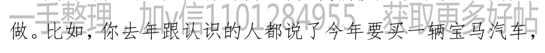
- 4、为一项承诺付出的努力越多，它对承诺者的影响越大；
- 5、能带来内心变化的承诺一旦出现，就跟以前的环境不挂钩了，它能涵盖所有相关的环境，同时能发挥持久的作用。

《影响力》这本书的魅力就在于此，你总是觉得说的很有道理。有人一定会说了，这个营销能带来多大的帮助呢？有人我我就详细介绍下本人对这个问题的认识。

1、“承诺和一致”解释了为什么消费者会在品牌多元化同质化严重的当今市场品牌忠诚度，因为他们会相信自己的选择是正确的，除非你的产品质量出现明显的问题或者售后处理的糟糕。虽然是针对产品同质化，如果市场上更能打动消费者内心诉求的品牌（比如增加智能），口碑极佳，且更换产品成本较低的情况下，还是有可能更换品牌的（这也是新型的互联网公司有了前瞻性的产品后，能够快速占据市场份额的原因之一）；

2、由第1点，我们可以得出一个结论：让消费者做出购买自己品牌的选择是多么重要！至于让消费者做出这个选择，我想肯定不是容易解决的，涉及的因素太多：外观、功能、品牌价值和认知、价格、服务、体验和认同等等。总之，是要让消费者相信你的品牌和产品可以满足他们内心的需求，驱动，你的品牌和产品是可以解决心中的问题的。

3、“承诺和一致”还有一个非常关注的结论，就是：做出来的承诺能发挥持久的作用，且不受干扰。通俗的说就是一旦你的品牌让消费者跟自我形象产生了联想，让消费者购买你的产品证明或提高自我形象。

为什么会卖？因为一个承诺付出的努力越多，它对承诺者的影响越大。最后这章的内容给出了一些销售技巧，比如抛点、比如饥饿营销。之前《影响力》和《怪诞行为学》介绍得比较通俗，感谢各位一直的支持！

2047 楼
作者：大秦的疆 日期:2018-11-05 16:36

### 03 小脾气(3): 社会认同

“社会认同”估计大家都能看到，尤其是在判断他人的行为时，我们会根据别人的意见行事。值得说明的是，这种对社会认同的反应是无意识的、条件反射的，“别人都在做”就是一种心态。当我们自己、情况不明、意外大的时候，我们很容易觉得别人的行为是正确的，尤其是在觉得这些人都跟自己相似的时候，“社会认同”主要的内容就是这些，下面我们来说在营销管理方面的理解：

- 一、建立认同。群体中的意见领袖是那么重要（明星代言、网红推荐等都是源于此）；
- 二、设计品牌的故事可以与群体相似的人物作为主角，比如像你一样的普通人；
- 三、在介绍产品的时候，我们可以告诉消费者某产品是“增长最快”或“销量最大”，这样就能解释其他消费者。

2049 楼
作者:大秦的疆 日期:2018-11-05 16:55

### 04 小脾气(4):喜好

我们大多数人总是容易答应喜欢的人要求的。影响喜好的几个要素：外表魅力、相似性、奉维、接触与合作、条件反射和关联。以上这章的核心内容。其中“外表魅力”无疑证明了产品设计有多么重要；相似性”和“社会认同”中所述的相似性并没有实质上的区域，总之我们喜欢借鉴与自己相似的人的意见或习惯；至于“奉维”，更适用于销售技巧，但如果你的品牌产品有可能让消费者选择的时候获得被奉维的感觉，那不如大胆尝试（比如精明的妈妈）：“接触与合作”报告告诉我们经常让消费者感受到自己的品牌产品，如果可能建立双方的关系（如设计大赛、公益等），那么消费者就会逐渐产生对你品牌的喜好；“条件反射和关联”，落脚点其实是在“关联”上，条件反射是表面现象，关联性是我们想要的。“关联原理”说白了就是消费者心中“近者朱近者墨”的观念，把我们的品牌和产品跟美好的人或事物经常联系在一起，消费者就会产生条件反射下的关联，以你的品牌产品就具备了这些人和物相似的优点说到这里，我们就可以解释为什么那些企业喜欢把自己的产品跟当下的文化热潮（车、奔跑吧兄弟）联系起来，喜欢请名人（往往是流行艺术家）做代言。

我知道此时，有人又要说了，你说的这些关联，要么是请代言，要么是购买一些知名组织或人物的版权做主题，如果营销预算有限，我们还怎么关联呢？那么我就可以负责地告诉你，这都不是事。可以关联的内容除了要花大价钱的明星和知名组织或人物外，还有常见的蹭热点。这里就难得不说18年世界杯大出风头的华帝“法国队夺冠，皇帝冕”的话，可是是一手好热度啊（海信为获得2018年世界杯赞助商资格，付出近1亿美元，约合6.6亿人民币！）

一十一楼，加微信11101284955，获取更多好帖
作者：大秦的疆土 日期:2018-11-05 17:00

### 05 小脾气（5）：权威

不要认为在权威面前是一件丢脸的事情，“影响力”章节分析了人类接受的多层次权威，能够赋予社会巨大的优势。权威在生产、贸易、国防、扩张和社会结构控制才得以发展。说白了，人作为社会员，服从权威是一种本能，尤其是在自己熟悉的领域也是如此。有时候也会发现服从权威的命令是不相关的，但能带来一些实际的好处。这一章介绍了权威在营销管理中的运用都很容易理解，比如一些牙膏广告上穿着白大褂的医生告诉你用什么牙膏，这就不需要很多思考。权威的威力来自于：我们是服从权威的，所以当我们面对权威时，我们自然会服从权威。

2052 楼
作者:大秦的疆 日期:2018-11-05 17:11

### 06 小脾气(6):稀缺

从“稀缺”这个题目就能猜出这章的内容，书中还有一些结论值得关注：

- 1、对失去东西的恐惧，似乎比获得同一物品的渴望更能激发人们的行动；
- 2、每当东西获取的自由越受限制，我们就越发想要得到它；
- 3、新出现的稀缺比旧物品让人感觉到迫切；
- 4、参与竞争稀缺的感觉有着强大的刺激性，渴望拥一件众人抢的东西，几乎出于本能。看到这里，大家一定想到了一个词“饥饿营销”，苹果和小米曾深谙此。作为运营者，如何利用人们的“稀缺”心理呢？限量版、资源紧张、较短的时间期限。虽然只是口头上的制作“稀缺”也是一种销售技巧，这里将介绍介绍。

2053 楼
作者:大秦的 日期:2018-11-06 12:01

## 第六节 也懂你的“怪诞行为学”

消费的行为模式（小脾气）并非一本《影响力》所能穷尽，趁着“影响力”的春风，艾瑞写了本《怪诞行为学》。虽然书名给人的感觉是所谓怪诞的行为，其实内容就是对“影响力”的补充，也是在介绍消费者的行为模式。

### 01 相对真相

在《影响力》一书的开头提到“对比原理”，其实就是现在我们要说的“相对论”的意思，只不过《影响力》书中没有对此进行阐述，感谢《怪诞行为》让我们更清楚地解释这个“相对论”。

- 一、我们很难把同类但不同价格的产品实际价值清楚（就是不知道商品应该值多少钱），所以我们很少作不对比的选择，我们会关注这种品种与其他事物的相对优劣，以此估算其价值（了解10万元公路车的格调，你先要知道普通自行车的价格）。
- 二、我们总是观察周围的事物（有形体、无形的体验）以确定彼此的关系（“确定彼此的关系”应该是书的译者直接根据原话翻译的，但我觉得不是那贴切，可以说多一句翻译方便理解，“确定自己的存在感和彼此的关系”）。
- 三、我们不仅喜欢比较，还喜欢比较的事物集中作比较——避免把不容易比较的事物比较（比如房子跟鸡蛋比价值）。
- 四、“诱饵效应”，为了方便消费者决策，我们可以在可以选择的商品中一个“诱饵”，目的是通过比较，消费者倾向于选择我们希望选择的那个产品（所以产品线的规划非常重要）。

说到相对论在营销中的运用，相信大家都不陌生。现在的社会就是一个比比比大的Party。你有什么什么功能，我比你还怎么样怎么样，你的价格多少，我的价格多少，电视里也经常放一些广告，用这个洗衣粉（不显示什么牌子）洗衣除渍洗不干净，你再看看我们这个牌子的，一洗就够了！

上面我介绍的4点内容后两点值得关注：第一，我们让消费者觉得我们此类的产品是容易比较的，引导消费者关注某些产品特点（比如冰箱的压缩机出厂地），如果你没有找到消费者比较点，就开始动脑筋创造一个：第二，“诱导效应”对于厂家而言，制造单一诱导，可以让消费者有充分的理由倾向于你希望购买的那个产品。

2065 楼 
作者:大秦的 日期:2018-11-06 12:22

### 02 供求平衡

看标题，原本以为是供求关系的完全一致，其实是人为造成供小于求就可以带来“稀缺”的影响。《影响力》中解释了供求平衡：市场价格取决于每一个单位价格（供给）和每一个单位价格（需求）。

这表明事实上，需求并不是完全独立于供给。我们对价格作用的敏锐感，事实很大程度上可能是两种因素共同作用的结果——我们对过去价格的记忆（锚），和我们想要与过去保持一致的欲望，根本不是我们真正偏好或需求大小的反映。有人会问了，那我是完全记不住购买的价格呢？那我不就错了了吗？呢……我想的是，这只能说明一个问题：你可以购买蓝白糖了（希望有效）。记住一句，在我们的意识里，锚无处不在。

罗罗斯说了这么多，我们还是得看看企业到底有什么参考建议吧。以下我整理了几条：

- 一、如果某公司推出了新品，品质优于其他产品（如果没有同类产品更好），那不妨把价格稍微定高点，因为它的价格很有可能成为消费者的锚；
- 二、注重消费者从发现到购买产品每一个环节的细节，让消费者留下对产品好的第一印象（就是消费者喜欢）；
- 三、体验可以改变消费者的品牌忠诚度，所以要可能的鼓励消费者体验你的产品。比如有些男士可能习惯抽玉岩，但因为你的技巧安排或者暗示，他决定尝试试黄鹤楼烟，同时感觉还不错，那他很有可能在下一次买烟的时候选择黄鹤楼。总之，我们给消费者的体验要美好（通过新的卖点去吸引他们尝试）。

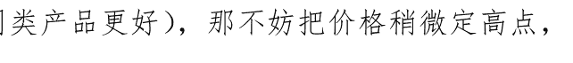

我们忘记了不利的一面。免费给我们造成了一种情绪冲动，让我们误认为免费大大高于它的真正价值（推波助澜）。

同志们，让我们举起“免费”的促销大旗，免费的试用装，免费的买一送一总共，怎么让消费者觉得机会不可失而不要再来就怎么样。切记的是一定要让消费者感到我们的诚意。你明明市场价 1000 元的商品，你非得卖到 2000 元再送一个市场 500 元的赠品，那结果就是你发现没有人买你的账，因为你看起来非常没有诚意。

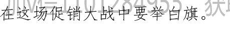

诚意，你注定在这场失败中要获得更多帖。

2068 8
作者：大秦的疆 日期：2018-11-06 12:27

## 04 惯（4）：社会规范的成本

首先，我想先说明一点，这一内容非常有借鉴意义的。所谓社会规范，我人的理解就是社会环境下（这里别于经济利益的市场环境）人和人之间的关系和行为。我们同时生活在两个世界里，一个是社会规范主导的世界，是一个市场规范主导的世界。书里没有多少介绍社会规范的范畴，只是通过一些案例来介绍了其中的部分情况。我斗胆分析了下，对社会规范的理解和运用的重点是人在社会关系下所拥有的权利和义务。

通常而言，多数人为自己的事业会比眼前的金钱更加努力。比你请律师低价帮助贫困人员，因为你支付了律师费用，虽然是低于市场价，但这仍是市场规范下的行为，律师可能觉得价格太低不愿意。可是你希望律师能免费帮助贫困人员，那在他而言，这是一种社会公益行为，可以履行自己的义务，那就是社会规范的行了。通过律师这个案例，我们大家都会得出一个结论，就是利用者的社会规范行为对于市场规范行为更有说服力。

书中强调了，一旦市场规范进入了我们的考虑，社会规范就会随之溜去。所以，社会规范是尊贵又脆弱的。对于帮助他人的行为，我们给予礼物，这显然还不会让社会人不欢，因为即使小礼物也能让我们保持在社会规范的环境里，脱离市场规范。可当我们对这些礼物明码标识，则这就好像给他们金钱一样，这样就会唤起他们的市场规范，一切就会向不利的方向发展了。

好了，老规矩，该说企业运作的事情。在说之前，有一点我想跟大家阐述我的观点。有人说，现在的中国是一个功利的社会，是一个金钱至上的社会，是一个没有同情没有公德心自私自利的社会，也因此中国可以说一个市场规范占主导的社会，你说的社会规范的运用可能不太实在。

我承认在我们身边，每一天每一刻都会发生那些因为金钱权力而邂逅的事情，但我相信孟子说的“人性本善”，邂逅的事情很多，但发生的“真善美”的情况很多，只不过很多时候是一些引起我们注意的小事体现的。所以，尊重社会规范，重视社会规范，运用社会规范，也是这个时代需要的。

营销品牌定位时，企业需要拿起“社会规范”的武器。怎么拿？在你的产品包装时，在你的品牌包装时，你在确定企业价值观时，多去设想消费者在使用你的产品时，随之发生哪些社会关系的影响，从中找到最能打动消费者内心的价值出来。企业可以将自己推销顾客在社会规范领域的同伴——也就是我们，我们去告诉消费者认为他们属于和我们是一家人，我们是朋友。如：“****，您身边的管家。”

最后的是，永远努力保持你与消费者建立起来的社会规范领域的同伴关系（这会带来很强的品牌忠诚度），一旦破坏了，一切都会变成市场规范下的冷冰冰的关系。

2069 楼
作者:大秦的疆 日期:2018-11-06 15:12

## 05 慎（5）：性兴奋的影响

嘿嘿，各位是不是看到这个标题也会比较兴奋？不过，可能让各位失望了，因为这里我认为还是翻译的问题——其实这一章应该叫做“霍尔蒙的影响”。

这一章主要探讨的内容人们在激烈情绪状态下的态度和反应，作者是以性状态下人们的选择变化的实验来证明此点的。具体的内容并没有多少介绍，总的结论就是，当人们的情绪处于兴奋状态时（霍尔蒙猛增），我们的选择就会变得不理性，激情对我们的行为有非常大的魔力（你追到女神的那天带她吃饭，你会仔细秤比较餐厅的性价比？不会的）。

这样我们就容易理解，为何对于苹果公司（尤其是乔布斯时代），苹果的新发布，就有那么多的果粉会排队购买。

那么这些给了我们什么样的启示呢？这个结论很容易得到——想尽各种办法让消费者在品牌产品面前陷入激情的状态。我知道这并不是一件容易的事情，前提是你的品牌和产品有可能让消费者拥有激情（领先行业的创新是必要条件之一）。

2072
作者：大秦的疆 日期：2018-11-06 15:23

## 06 慎（6）：拖延的恶习与自我控制

看到这个标题也许我们会想，个人的拖延和自我控制跟企业有什么关系，为什么要介绍这个？我们可以将手放在我们的胸口问问自己，我有没有拖延过吗？我想除去极少数人以外，我们都可能在这样的事情上拖延过些。所以，有拖延的恶习是几乎每一个消费者身上的情况，如果我们可以在这一点上发挥我们的聪明才智，或许会有惊喜哦。人无完人，每一个消费者身上都有他心对自己改变的需求，抓住他们的这种需求，我们一定会在百家争鸣的市场中颖而出。

好了，我们继续聊聊拖延的问题。我们已经知道几乎每一个消费者都有拖延的习惯，而且大多数消费者内心是希望自己能改变这个习惯的。那么灵感来了：1、我们的产品不可以只刺激消费者发现自己的问题，并且可以通过设定某些条件帮助他们改变拖延的习惯吧？比如好，如果你是一个自行车的生产者，你通过调查发现还是一些专家的建议，你得出一个结论，肥胖人群非常有利于他们降低体重，但非常正常的情况是大多数人不能坚持。怎么办？我的建议是可以考虑在车上装一个灯，这个灯一旦亮了，在一定时间内是不会熄灭的，这就是提醒使用者。2、产品可以考虑增加方便性让消费者给自己设定限制，如书中举例的“自我控制功能”，就是让消费者合理分配时间，帮助自己完成一些必要的事情。当然这些只是一些建议，不是所有行业都适用（其实能用的企业真的可以做到）。对于不用的企业也不要灰心，这个“拖延恶习和自我控制”就是给我们提醒，针对消费者的习惯和他内心改变的需求，不是让我们创造新的产品和格局！

2074 
作者:大秦的疆 日期:2018-11-06 15:30

## 07 所有权的魅力

获取更多好，所有权个性这个习惯的内容相对比较简单，“所有权的个性”也就是魅力？是的。一旦我们拥有了某种品种，通常情况下我们会相信自己有价值。用书中的话说，人性中三大非理性的：
- 我们对已经拥有的东西迷到自拔；
- 我们把注意力集中到自己失去什么，而不是得到什么；
- 我们经常换个角度看待交易。

举个例子，你想卖掉刚刚买多年的汽车（可能是因为急），在你的内心你觉得车况相当好——按时保养，换了轮胎。你卖它的时候感觉自己失去了曾经陪伴多年的好伙伴，最后给它价钱，而且是一个很爱惜的人。这就是所有权的影响。所有权带来的自豪感与难易程度越大，感觉越深；我们在实际拥有之前，只要投入了钱或者一部分钱，就不觉得怎么样。

好了，又到了落实运用方面的探讨了。针对“所有权的个性”企业的内容我想案例显而易见的：1、做好产品的品质和体验，不能让消费者有了之后会形成很大的心理差。我们可以反过来理解，如果消费者花了钱买的东西让他们感觉非常劲，一下子掉到了另一个底，那的后果吧！2、“不满意全额退款”的承诺放心说出来，一旦你的商品进入了消费者的家里，他们就不会再考虑退货了。

## 08 问题（8）：多种选择的困境

如果让我重说《理性行为》中容易写的内容，就是这一章了。这一章的核心思想我就用一句话概括，在吸引相同的两种选择做出取舍是最难的。说白了，我们常常愿意此又要彼，熊掌鱼兼得，可是当我们容易选择一个时候，我们的内心的是犹豫不决甚至是痛苦而烦恼。抛开书籍的内容再延伸一下，如果有第三种选择与当初难以选择的两种相比有那么点微不足的优点，那么我们将很容易被选择第三种选择。

这个“多种选择的困境”对我们企业的启示有什么呢？
- 你的产品线设计的合理，同等位同等的功能尽量不要重复（哪怕是包装区别都可以）；
- 创造我们的优点或特色，去吸引消费者在做选择的时候更有倾向；
- 随时关注竞争对手的动向，不要让对方模仿你的产品，从而让消费者落入选择的困境。一旦发现马上包装。

2075 楼
作者：大秦的疆 日期:2018-11-06 15:33

## 09 惯（9）：预期的效应

如果我们事先相信某类东西好，它一定就会好（我们认为它不好，它就不好），这就是作者所想表达的“预期的效应”。不过有一点我想特别补充，希望老丹（就是作者）不要见怪，就是“希望越大，失望就越大”。其实预期这种东西是双刃剑，有了就会有预期的产品体验。这个时候往往给消费者带来心理落差，甚至有些预期产品标准不那么理想，泡泡也会增加消费者的无奈。就比我们去外面那种富丽堂皇的酒店入住，结果发现了没有热水、装修大气等缺力的。完了，不会有下一次可能的。

所以这本书里介绍的内容在我看来是相当理想的状态，就是消费者的胃口没有被预期调很高，产品品质体验接近（或者符合）了消费者预期的标准，于是消费者觉得非常好的。当然了，理想化归理想化，但是书里还有一些内容值得借鉴的。比如“不要低估展示的力量”，就是产品的外观、包装、终端装饰等要漂亮的；比如企业要尽力向消费者提供信息，提高他们对产品的预期和真实快感。

2076 楼
作者：大秦的疆 日期:2018-11-06 15:35

## 10 惯（10）：价格的魔力

作者之所以将这一章放在“预期的效应”后面，理由很明显——价格的魔力背后是因为人们产生了预期。大多数情况下都是本能认为价格高的东西一定就更好，对应的就是耳边那句“便宜没有货”。在这里帮大家分析一下“价格的魔力”，它比较适用的情况是：
- 突破性的新产品，消费者没有太多的对比；
- 目标群体对价格敏感，行业竞争激烈，价格透明；
- 已经是奢侈品，强势高价（如LV等），维护品牌形象。

我现在还想说“价格的魔力”补充一下。如果消费者对你的品牌熟悉，那么这个时候搞促销，效果还是不错的。消费者对产品的关注（如清洗如固定时间更换零配件）增加DIY环节。

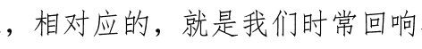

2077 楼
作者:大秦的疆 日期:2018-11-06 15:37

## 11 习惯（1）：人性的弱点

人性弱点起来是一个很大的概念，要从人类发展、社会变迁、人类心理学（参考弗洛伊德的自我）、社会行为学等等。作者也很清楚这一点，所以我选择了“人性弱点”来开启。这一章没有太多可以说的，强调一点，不要轻易赖账。企业完全可以将诚信包装成公司的形象或产品的卖点，什么就是对消费者的承诺（比如积分送品，名额有限，结果无论什么时候）。这一章得出的结论是：“信任（信赖）和预期（如价格）不影响人们的观念，甚至改变客观体验，从而产生影响——这种影响非常大”。

在企业经营或营销中有很多层次的问题：
- 互惠缺关系的失衡；
- 免费所有权；
- 预期效应和价格。

我只能在此呼吁大家，珍惜自己诚信的机会。这些在我看来，是最起码的对消费者的尊重，也是对自己的尊重。

2078 楼
作者：大秦的疆 日期:2018-11-06 15:40

## 12 习惯（12）：企业的特权

我一直不明白作者用“企业的特权”作为这一章的名字，就如“人性弱点”的名字一样，太大了。实际情况是这一章讨论仍然关于诚信的问题，只是强调了人们在非钱情况下更容易暴露不诚。企业可以通过自身的特权来逃避对消费者的承诺，不要以后为自己后悔。

## 13 习惯（13）：啤酒与免费午餐

这是这本书的最后一个章节，主要内容就是通过“啤酒实验”（个人的需求，因为我们会选择别人没有选的啤酒，即使自己不爱）和“免费午餐”的概念（用行为经济学来改善我们的决策过程）来总结。强调我们在很多时候决定是非理性的，而企业可以从这些非理性因素出发，借助工具、方法和政策，减少决策失误，使我们心中成功。

2079 楼
作者：大秦的疆 日期:2018-11-07 08:18

## 第七节 双龙会——《影响力》和《怪诞行为学》的总

在研究消费者行为模式方面，《影响力》和《怪诞行为学》可谓是一瑜，各有千秋。两本书里消费者那些非性的行为模式，对于企业的借鉴价值已有“道”（品牌定位、产品规划等）也有“术”（销售策略、推广手段等）。

与武林高手的绝顶轻功讲究“露痕无痕”不同，我们的学习是希望“露痕很深”。我做了一个打油诗来对这两本书的内容进行总结，大家将就看着：

影响力来说为道怪：及人性十九种，凭此未敢擅顾客：
若问商业之运用，九为术缺相对十有道：
- 互惠缺关系的失衡；
- 免费所有权个性；
- 预期效应和价格。

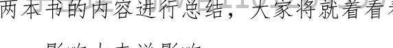

人性弱点添一笔，上述九种皆为术。
- 承诺一致和喜好，
- 社会认同和权威，
- 社会规范的成本，
- 性兴奋来有影响，
- 拖延恶习与自控，
- 多种选择的困境，
- 企业特权需诚信，
- 免费午餐有啤酒。

上述不可为道。

作者:大秦的疆 日期:2018-11-08 00:08

这个制高点，是很可能高于企业实际运营的能力，所以得出企业需要执着于研究消费者行为的结论。我方则是站在企业的角度来看待研究消费者行为，才在此为企业说心里话：企业需要研究消费者行为，但不应该过于执着。对方辩友为，“执着”体现在时间、范围和要求这三方面，我方表示赞同，但还需要一点：投入。

研究消费者行为是需要投入的，而且还有可能需要不小的投入。试问，当今市场多行业竞争如此激烈，电商或企业产品的利润一再降低，当企业资金紧张，甚至朝不不保的时候，如果还需执着于研究消费者行为，将其视为救命稻草，那么还有资金进行升级或者服务升级吗？这根稻草还能挽狂鸿吗？所以，我方认为，企业要研究消费者，但不能想然地执于此。企业最近应该关注的事情，是产品和服务的精益求。感谢大家！

2117楼
作者：大泰的疆 日期:2018-11-09 22:25

主持人：好，正双方都已阐述各自的观点，现在我们进入攻击阶段。首先请正方辩问。

正方二辩：对方辩友，我想问，企业研究消费者行为需要研究哪些内容？

反方二辩：这个问题的正中我方下怀。是的，企业研究消费者什么呢？基本需求是一个，企业，刚刚成立的时候，它必然已经考虑到自己的目标消费群体是谁，它能满足消费什么样的需求，如果连这一点都没想好，那个企业就不会成立。举例子，大的企业，如华为，在他们成立手机公司的时候，他们不能清楚自己的产品要卖给谁吗？成立既有定位，定位就有了目标消费者，就有确定的市场需求；小的企业，如一家床上用品的小作坊，他们自己怕脑袋也知道他们的消费者是那些对价格敏感的普通阶层。

我知道对方辩友会提到诸如《营销管理》、《消费者行为学》、《影响力》和《怪异行为学》所描述的研究消费者的内容，如影响消费者的行为，消费者的心理过程和购买决策，以及消费者理性的行为。我方认为是这些企业研究消费者行为的内容。我们可以设想这些内容在实际运用的时候呢？在企业各方面的体系之中。换言之，这些内容提供了改善消费者管理的思路，帮助企业更有针对性的运营体系。企业要研究的重点并不是消费者行为，而是如何确定营销策略、品牌定位、产品策略和推广方案。企业不易，每天都在打，企业打不是消费者，而是品牌、产品和营销。所以我认为，企业研究消费者的重点应该是两个：一是需求的功能和情感的需求，侧重点应是需求的变化和细分，这是企业所需；二是影响行为模式，而不是消费者的心理过程和购买决策。后面的内容是企业理解消费者行为，而不应该是研究的对象。

131楼
作者：大秦的疆 日期:2018-11-10 09:22

主持人：好。现在由正方三辩提问。

正方三辩：对方辩友，既然你们提到消费者是要研究他们的需求，研究他们的行为模式，那么你们认为怎么研究呢？

反方三辩：我来回答这个问题。在这次辩赛之前，我特意针对辩题做了一些调研。如果各位都了解企业的架构，大家会发现很少会有专门针对消费者的部门，如研发部、市场部、品牌传播部、销售部、电商部门等。如果通过分析市场找到消费者的关注点，就需要通过市场部完成，将分析结果反馈给其他部门。至于功能的研发，更多靠研发部借助技术创新或新技术来实现突破。而情感需求，则落在了品牌传播头上。因为情感需求无法量化衡量，所以很多公司的品牌传播要么是根据品牌定位做延展，不定推出不同的主题（如不同的节日）来了解市场；要是请第三方的广告来定制品牌方案，以此来品牌情感规划。至于影响行为模式，其实并不是刻意为之。比如企业通过外观设计来影响消费者的选择，但设计往往是根据流行的元素或者自身研发上的大胆尝试。换句话说，影响行为模式这些内容已经成为企业管理的常识，所以研究的内容往往落实到具体的事情上，而不是喊子，今天我们要研究消费者行为！

135楼
作者：大泰的疆 日期:2018-11-10 10:28

主持人：现在请反方质问。

反方：我想请对方辩友说，你们作为企业需要的消费者行为，那么研究的对象是什么？

正方：首先我们认可对方辩友说企业研究消费者行为主要在需求的变化和影响行为模式上。在此两者中，企业应该关注的是需求的变化。对方所言企业成立后就有清晰的定位和满足的市场需求，这一点无可非。需求并不是铁一块，而是化的：

- 功能需求是否需要改进？
- 技术研发的方向如何确定？
- 新技术如何在产品开发中运用？
- 可否针对消费者的需求进行市场细分？
- 情感需求又如何选出新让品牌脱颖而出？

这些问题让企业牵萦。

例子，诺基亚和摩托罗当年手机行业的巨头，为何在一瞬间轰然倒塌？实力不够？显然不是。也许原因有很多，但至少有一点，他们没有执着研究消费者，特别是需求，固步自封才会造成最终的结果。综上所述，企业需要执着研究消费者。

主持人：下面请反方三辩。

反方三辩：对方辩认为，做到什么样的程度才是执着？

正方三辩：对方执着都不懂吗？执着就是“不抛弃、不放弃”——在企业顺风顺的时候不放弃对消费者的研究，在企业步步维艰的时候不放弃。

反方三辩：对方刚才所说的是坚持，而不是执着。什么是执着？山穷路尽背水一战的固执才是执着。试问，当企业经营悬于一线的时候，企业还要把时间和财力研究消费者行为？答案显然不是。

正方三辩：对方这是文字游戏！我方表示抗议！

反方二辩：这可是文字游戏！请对方无理取闹！

正方一二三四辩：你们才是无理取闹！跟你们有什么好辩的！不辩的！

反方一二三四辩：不辩就不辩！不辩就直说！切！

(现场陷入一片混乱)

主持人：今天的辩论赛到此结束。亲爱的观众们，你们从今天的辩论赛中是否多了对企业研究消费者行为的了解呢？感谢大家的到来！再见！

238楼
作者：大秦的疆 日期:2018-11-11 10:57

## 第九节 总结

一小心，关于消费者的内容竟然写了4万多字。没办法，让消费者成为企业的衣食父母吧？无论是以传统经营为主的传统企业，亦或是新商业模式下的互联网企业，能否在这个日异月异、快迭代的时代生存下去，归根结底还要看消费者不买单。在营销的土壤里，企业是水，需求是种子，洞察是肥料。消费者是土壤。树的生长自然不能没有土壤。我推崇营销要注重营销体系的建设，洞察和了解消费者虽然没有直接在营销体系里，但他们营销体系的基础。通过对一些企业发展历程的理解和总结，我们很难得出一个公式：洞察+了解消费者+X=新产品、新服务、新商业模式。这里的X因素不仅仅某种因素，它可能是新技术（如移动互联网、AI），也可能是传统的产品或服务（如家政服务、课外辅导）。不同的行业，X因素的数量也不同。有一双能洞察市场的眼睛，有一颗了解消费者的心，加上其他因素的运用，就会产生新的产品、服务或业务模式。现在常见的共享车、滴滴出行、美团外卖、途牛、瑞幸咖啡等一些新兴的公司，他们成功的起点就在此。

### 1 电影《百人包》片段

简单介绍广告片段，男主角尼克（梅尔·吉森饰演）是一家牛仔广告公司的经理。因为一段意外，他获得了能够听懂女性内心的特殊能力。介绍的是耐克产品设计。伴随着轻快的音乐，尼克出现在各种运动身边，他听着人们的声音，脸上带着笑容，“原来是这样的。”接着，在耐克公司展示设计内容之前，还穿了女性穿着耐克的衣服和鞋子孤独地在马路上跑步的画面，背景是耐克，广告语是这样的：“你不会跑前照镜子，想过那条路会看自己；不管你穿多少，跑起来都会轻松；如果你没有涂口，脚下的路也不会到；廉价钱，你可以随时想要踏上。”

根据片段，能够得出什么结论？

- 任何公司完全依靠自己，即使实力雄厚，像耐克公司也会委托第三方来设计方案。
- 了解消费者，你需要非常距离去感受（如果能听到他的心声最好）。
- 要与消费者建立情感共鸣，需要了解他们，找到可能的情感卖点，这些消费者体会碰撞，成为动他们的利器。

151楼
作者：大秦的疆 日期:2018-11-12

## 02 焦点小组

了解消费者的法。晓看天色暮看云，行也思君，不知道老人在天之灵知道后会有感想。偶然读到这首诗的最后一句，当时就觉得用此形容企业对消费者的态度要在贴切。“行也思君，坐也思君”，企业想盈利，想挣钱，就得想消费者，天天盼着更多消费者来购买或使用自己的产品和服务。行也思君，企业在具体执行营销方案的时候，要去考虑到底什么样的推广能迎合消费者的口味；坐也思君，企业在制定产品策略、品牌策略、推广策略等的时候，要去思考如何满足消费者的需求。“行思”也好，“坐思”也一样，只要不乱思，“思君”是有其遵循的法则的。

了解消费者的法则(1)：消费者一定要带着清晰的目的，没有目的地去了解，就会像无苍蝇一样四处跑把事情越弄越复杂。通常而言，了解消费者的目的有以下5点：

1. 认知消费者的需求和潜在需求，这一点跟洞察需求是异曲同工。
2. 了解消费者的行为，可以找到影响消费者行为的环节，结果就体现在怎么传播、搞活动、终端、拍广告、讲故事以及售后服务等方面。
3. 认知消费者的属性层次。“属性层次”这个概念在前面我曾经提到过，虽然各个消费者对于产品属性关注的内容和排序会有所不同，但不排除其中存在（如大多数消费者都很关心汽车的空间），了解消费者的重要属性，企业就能做到调整自己的营销策略和战术。
4. 认知消费者的满意。企业营销能够帮助消费者发现新市场；目的是实现消费者的满意，从而形成消费者忠诚。企业要让消费者需要什么样的产品和服务会感到满意，监到满意的标准是什么程度；
5. 认知消费者的自我概念和价值观。这就是形上的概念，终极的是消费者在精神层面达成共鸣。虽然不是营销策略的充分条件，但是加上差异。

了解消费者的法则(2)：保持积极的心态。了解消费者是一个辛苦的，没有办法，因为市场在变化，需求的关注也会变化。这就要求企业对待这项工作，要保持积极的心态。

了解消费者的法则(3)：可能接触更多的消费者。说白了，就是了解需要，而不是通过接触后得出结论。接触可以通过线下、线上和电话等方式，接触越多越能获得准确有用的信息。

了解消费者的法则(4)：消费者导向。洞察需求、市场调研、人性。以消费者为导向，从消费者中来到消费者中，认可需求、满意，透过现象看本质，这是上述所有五个目的都需要，针对性的调研。

了解消费者的法则(5)：明确流程。了解消费者的目的虽然分为五种，但在实践的时候大多数都是同步进行的。了解消费者的流程，大致分为七步：

- 明确目的
- 确认目标（行业、业务数据）
- 收集数据（分析消费者对竞争对手的评价）
- 闻（信息）
- 问（设计调研）
- 切（得出市场水平）
- 验（焦点小组改进方案）

162楼
作者：大泰的疆 日期:2018-11-12

## 04 结尾：写给江小白的一封信

前段时间，网上对于江小白（针对年轻人的白酒）讨论曾多次，有两种声音：

- 褒：定位精准，营销策略（走心的文案）引来流量但并没有带来销量（产品体验差），不好看。这里从分析“江小白”目标给出建议。
- 贬：营销驱动，试图使用大众带销，但营销宣传跟不上，销量就会下滑，认为口碑不好，品牌忠诚度低。

对于属性层次，用数据得出的结论是：知名度 > 价格 > 口口碑 > 销量 > 广告。两人认为在层面的发力恰恰选择的是最后一种属性。加上规模，其实考虑，首要的是面子，所以江小白就不够上。年轻人对于白酒市场而言，他们认为是鸡蛋，由于需要是源源不断的理性的输出。江少，大体的言论就是以上两种。我知道你的风格，这种事情是你不会太操心的，因为你是热心寂寞的。可是我不能操了，因为我本人就是一个文艺青年呀，哈哈。所以我从客户的角度来验证你这种式的合理性，请听听娓娓道来。因为你的定位是年轻人的小众市场（虽然这个市场），我就年轻人认为是认知对象，结果如下：

消费者的需求：年轻人大多数情况下喝酒的场景并不是交际应酬，而是朋友同学的聚餐，因此喝酒的需求只是为了气氛营造的工具，当然酒不能难；

消费者的自我概念和价值观：这个其实是买给。

强顶，你的精准文案已经在年轻人的自我概念和价值观上做到了共鸣，这里我就不伸手了，哈哈（ps: 现在有不少品牌在模仿你的文案风格，比如“味全每日C”的饮料瓶上印着诸如“加班辛苦了”、“养成好习惯”、“每天好开始”、“别熬热夜”）。

从消费者的角度来分析，我认为你目前的做法还是针对性很强的。至于上面提到的言论提到的软肋：品牌标签贴于情怀化，很难形成品牌忠诚；目标消费群体市场规模小，我个人倒不这么认为。品牌有独特的风格和情怀，才有可能形成品牌忠诚。年轻人的市场虽然是一个小市场，但消费力是非常大的，个人感觉完全不会市场规模小。

但我有两个建议，还请不要介意。第一，产品的口感适当多做一些创新和延展，给年轻人更多新鲜和尝试；第二，现在的年轻人终会长大，以后是否可以考虑你现在的年轻人长大后该怎么留住他们呢？是不是可以搞一个江大白，定位中档的商务应酬的酒类，口感跟现在的年轻人口感。这纯粹是个人想法，只是心。

结合，就有了细分市场。

也许有人会问，产品的细分市场情有可见，毕竟就算卫生纸、毛巾、内裤这样的产品都存在不同市场定位的品牌，但服务行业也需要市场细分吗？比如洗衣店、滴滴、美团？

我的答案是，各行行业都存在细分市场的必要和可能，现在即使没有，不代表以后不会出现。洗衣店的细分，可以出现只洗高档面料服装的洗衣店（增加某个洗衣环节，以证明专业性）；滴滴和美团这样的互联网巨头，他们的做法总是尽可能将市场变成一个大陆，提供的服务已包含对不同需求的细分（如滴快车、拼车、优享车）。

细分市场是营销创新的一种思维方式，通过对行业细分市场的分析，往往会在不经意间发现许多潜在的商机。

既然细分市场无处不在，又如此重要，那么对于这个大市场，我们到底理解了什么内容呢？

## 第一节 主观臆断

这难道不是介绍营销理论的吗？怎么还主观臆断脑门了？是的。营销之中很多内容的理解来自我们自己的生活经验，我们不妨在学习之前通过自己的感悟尝试分析出自己的答案。

细分市场的因素有什么？

- 1、消费者的年龄。案例：儿童牙刷。我们在超市里可以发现牙刷按照消费者的年龄分为普通牙刷和儿童牙刷。没有可能老年人专用的牙刷？虽然到岁数的老人多数都会用假牙，市面上也有专门洗假牙的清洁液。但是可以研发一种针对牙齿稀少但又可以用来吃饭不需要假牙的老人，设计一款老年假牙刷？
- 2、消费者的性别。案例：男性洗头发。我们经常可以看到一些产品（如汽车、手机、笔记本电脑）在产品外观上增加不同性别喜爱的颜色（如女性喜欢的红色、粉红色、橙色），来满足不同消费者的需求。这并不是属于细分市场，只是丰富产品颜色的选择项以满足不同性别的消费者通过改变产品的包装、结构或功能等来对不同性别的消费者提供的产品或服务，我认为这才是在细分市场。
- 三、消费者的消费标准。有的消费标准，没钱的消费标准低，对应的就是产品有高中低档之。这样的案例很大，多数行业都有。
- 4、消费者的功能需求。相同的产品，消费者可能会看重的功能是不一样的，甚至大相径。案例：汽车的SUV、轿车、商务车。
- 5、消费者的行为特征。不同的消费者针对同一产品或服务有着不同的行为特征，这点还是比较容易想到的。比如旅游喜欢自驾游，不喜欢旅游团；再比如衣服订制的，不喜欢挑尺码。
- 6、消费者的价值观。消费者价值观不同，需求的关注就会不同。有人追求环保，有人追求奢美，有人是素食主义，有人是省钱至上。根据价值观念细分市场，也是一种可行的方式。

## 第二节 理性细分（营销管理）第9章

注重差异的学科，却都有一个理性（理论）和一个现先生（现实）。理性是一个处子生的翩翩公子，完美主义者，考虑问题非常严谨，聊起擅长的事情来没完没了（理论）。现先生则是个汉子，所谓人狠话不多，说的就是他。现先生是实用主义者，一切行为以结果为导向。至于理性？反正理性。

如果你认为理性和现先生两个人的性格水火不容，可能成为朋友，那你就错过了。其实他们两个很好的，可谓你中有我有，我中你有，好的亲哥们似的。你一会给你讲道理，一会会给你经验，不亦乐于。

但好在，现先生还是很怕理性聊天的，尤其是聊大的道理，那理性先生的话一愣接一愣的，现先生几乎没插话。

这不，今天两人见面，刚聊起了细分市场，那理性先生的话就来了。理性先生的话怎么说的呢？

下面就让我们进入理性先生和现先生的聊天现场。

现先生（以下简称现）：（表情得意）老理！今天我自己分析细分市场的因素，你猜我分析出几个了？

理性先生（以下简称理）：（表情沉默）三个吧。

现：哎哟，小看人了吧！告诉你，是6个！这6个细分市场的因素，分别是消费者的年龄、性别、消费标准、功能需求、行为特征、价值。怎么样，不错吧？

理：唉，你你说我面前来说细分市场的因素，你这是班门面前要斧子，羽扇面前要刀吗？

现：（一不服哦）那你说，细分市场的因素有哪些？

理：（额头皱纹的表情）好吧，今天我教你上门来了，别怪我撞到你！首先，我们理论派从不称为细分市场的因素，而是细分市场的基础。这个为什么用“基础”而不用“因素”呢？这里面的学问……算了，懒得跟你说的这么细。

现：......

理：接着说细分市场的基础，你有6个，我告诉你吧，我们在理论派，至少分成25个！这25个基础又分为“地理细分”、“人口统计细分”、“心理细分”和“行为细分”几类。

现：......

理：先说地理细分，里面就有地理区域、城市规模、人口密度和气候。地理区域，比如国家分为东北、华北、华中、华东、西北、华南等。城市规模，将市场根据城市规模分为线。人口密度当然差不多。气候，咱们这都不一样。

现：地理细分的基础，我看你怎样，难不成企业还打造品牌和产品？那不得累了。

理：别插话！让我说！

现：好好吧。

理：人口统计细分，就可以按照年龄、家庭周期、性别、职业、教育、种族、世代、国籍和社会阶层来划分。

现：我去！

理：（表情得意）你看，人口统计细分，消费收入包含在内。家庭规模，就是家里有多少人，对家居类的冰箱、中央空调等有用。

现：（嘴嘟嘟哦）这也属于功能需求的细分。

理：（假装没见到）家庭周期，细分起来就许多了，单身啊、已婚啊、有孩子啊、没孩子啊、上有老人啊、下有老人啊，这些都是。至于职业嘛，你看公司都在研发这个。

现：等等。你还能举出职业的产品吗？

理：......继续听我说！

现：社会阶层，跟收入直接挂钩有点生。还有世代！70后，80后，90后，00后，他们不是经理需求不一样，要不要细分？

现：还没跟年龄细分有意思吧。

理：我不跟你胡闹。继续说心理统计细分，这里面可以根据消费者的生活方式、性格来细分。在理论界有一个“VALS体系”，就是把消费者分为8种群体：创新者、思考者、成就者、体验者、信念者、斗者、生产者、幸存者。怎么样？

现：你能分别按照这8个基本的群体细分举例就行。

理：......这个例子太多了，回头再说。

现：哼！生活方式、性格，这些跟我说的行为特征和价值观意义差不多。

理：最后一个！行为细分。这又分为需要和利益、决策角色、使用者及行为相关的变量。

现：你先别说，我知道“需要和利益”跟我“功能需求”意思是一样的。这“决策角色”和“使用者及行为相关的变量”，你先别忙着给我解释，你先介绍下具体的案例。

理：这两个更多的是体现在营销手段上，总的是根据这两个基础将市场做了分类。

现：市场分类和细分市场是两个概念吧！分类谁关键是如何细分市场，制定相应的品牌和产品策略！如果只是宣传平台上有所不同，我认为这不能算是细分市场。

理：反对我们理论界25个细分基础是重叠的。

现：是的，你这25个细分基础，有些是重叠的，有些是为了理论上的严谨而细分的，实际上在我这里用不上！

理：跟你们这些不文化的人聊这些真累！不聊了，回见！

现：不聊就不聊，回见！

自古以来，说一个人是翩翩公子，不仅仅因其举止和迷人的笑容，这里还有前提，此不是酒囊口袋、满脑草包。所以，不管鲁笔下的阿Q先生，还是《活着》里少年的富贵，他们再怎么打扮、微笑，我们也不会说他们是翩翩公子。

理性先生是一个翩翩公子，虽然上述对话里他表现得像学过统计学的林梓，繁繁叮叮说着理论的条条框框（职业病），但他其实并不会照本安料。现先生也知道这一点。

两人考虑市场细分基础的第二天，现先生特意门造访，向先生介绍市场细分过程的步骤。相视一二，两人早已将昨日聊天的不快提到九云云外。

理性先生听完先生来说，便在家里黑板（理论界家中必要的工具）上写道：
1. 基于需要
2. 识别
3. 吸引
4. 盈利性
5. 定位
6. 考量
7. 营销组合（4P）

写完后，擦了手，等现先生开口：“其实细分过程的步骤，现实界也常用，只是归纳而已。并非高深的学问，你自己也能整理出来的。起点一定是基于需要。虽然《营销管理》只提到消费者的需要，但我认为还有企业的需要。如果现在经营得很好，就没有发展问题。消费者的需要怎么确定？按照细分市场的特征去分析，就能发现可能的细分市场。”

（注：此处OCR中包含图片链接描述，根据要求保留其逻辑位置对应）
img/62b194d72468d2ff80e52e7ef9a05601_577_0.png

出发点可能是单纯的产品革新，可能是技术的引用，也可能是因为洞察市场的需求。洞察需求，认知消费者，往往是企业开拓细分市场的前提，但并不妨碍因为研发企业发现新产品更适合细分市场。所以谁先领先，并不是问题的关键，关键是企业是否决定开拓细分市场，和随时有一倾向于寻找细分市场的心。

对于这个问题，现先生有点圈圈——整体市场，按照字面的意思是所有消费者组成的市场。但单就电脑行业而言，台机和笔记本代表的是各自的整体市场？还是整体电脑市场的细分市场？如果认为购买台机和笔记本的人的需求是不同的，那么就应该都是细分市场。可这样的细分，意义何在？细分市场不能为了市场而细分。

关于细分市场的内容，就这些吗？现先生总有一种未尽的感觉，还有问题没有清楚：
- 1. 企业的品牌和产品如何参与细分市场？
- 2. 产品研发、洞察需求、认知消费者和细分市场之间的关系什么样的？
- 3. 整体市场和细分市场之间到底如何界定？

这三个问题严格来说应该是要清楚的，可惜却只字不提。现先生摇着脑袋，心中念道：“也许也吧，我不入地狱，还是整理了这问题的答案吧。”

问题1的答案：企业的品牌和产品参与细分市场的运营主要有四种方式：
1. 单品牌：仅仅通过改变规格、包装、颜色等方式帮助细分市场需求，如手机、笔记本电脑；
2. 单品牌用不同的系列产品（与系列有明显区别）来涵盖细分市场，如苹果的iPad系列、Watch系列；
3. 多品牌策略：用不同的品牌针对不同的细分市场，常见于化妆品行业，如雅诗兰黛（针对老年消费者）、碧碧（针对中年女性）、魅可（针对年轻的潮人）、艾凡达（针对喜欢芳香疗法的人）。在家行业，比如海尔的高端品牌卡芬帝、海信高端互联网电视品牌；
4. 品牌本身针对细分市场，常见于网红公司，如三松书、小牛电动。

问题2的答案：这是一个先有鸡还是先蛋的问题，出发点可能是单纯的产品革新，可能是技术的引用，也可能是因为洞察市场的需求。洞察需求，认知消费者，往往是企业开拓细分市场的前提，但并不妨碍因为研发企业发现新产品更适合细分市场。

所以谁先领先，并不是问题的关键，关键是企业是否决定开拓细分市场，和随时有一倾向于寻找细分市场的心。

问题3：整体市场和细分市场之间如何界定？增加一个概念“超级市场”，这样逻辑就完整了。何为超级市场？就是围绕消费者某种需求的。举例来说，工具市场、水市场、通讯市场、电脑市场、家电市场。有了这个超级市场的概念，根据产品的特征、功能等将超级市场进行进一步的分类。

细分市场，企业运营的几种方式：
打个比方吧，企业就好比一个武馆，消费者就是武学的学生。
- 通才的武馆：什么都教，你想学什么它有什么，什么拳脚、刀剑斧锤、轻功暗器、内功法都有。这是覆盖整个市场的企业。
- 差一点的武馆：就教拳脚棍棍，其他的就不会教了。这是多元细分市场专门化。
- 再一点的武馆：就教一种武术，比如太极武馆。强调市场有专攻，就专注于单一细分市场。

“诸兄还有没有第四种武术？”

“咯。你这可难倒我！不大能搞武馆！”

“哎哟，行啊！没错，第四种武馆就是个人制的武馆，你想学什么我教你什么。不仅如此，怕学徒不知道想学什么，就根据学生的身体条件、骨骼经络，为量身打造适合的武术。这就是个人经营（定制）的企业。”

“有意思有意思，这比喻还恰当。可是企业到底该选择哪种方式呢？”

“你这个问题问得好。可惜，理论界也不是万能的，《营销管理》里也没写。每个行业情况不同，企业的核心竞争力也有，这个问题没有标准答案，只能根据情况随时调整。”

总之，企业不是越大好，一定要个人定制才符合潮流，赚钱才是硬道理。企业倒闭，往往是因为没有跟上消费者的变化。

《尾理论》的时候会再介绍。

2218 楼
作者:大秦的骑士 日期:2018-11-15 12:04

## 第三节 蓝大的武功——《蓝海战略》

蓝海的概念是相对于红海而言的。什么是红海？就是指竞争相当激烈的市场。相当激烈其实就是惨忍，我们可以脑补一下硝烟散去后的战场，那死尸横遍野、血流成河的画面，那就是红海。

打仗还有休战或者结束的时候，可是商业的世界里，除非死战，否则这打仗就打不下（比战斗英雄战斗战斗英雄）。总打仗消耗也不是办法啊，既然打仗打来去为的是利益，那我不跟你斗狼，我自己已经在清醒的土地创造食吃息了吧。清醒者，蓝海也。于是，就有了蓝海这个概念。

蓝海战略的思想对于在红海里苦苦挣扎的企业而言，就如久以前的甘甜，饥饿前的馒头，因此蓝海战略前几年如《影响力》一书一样曾经辉煌一时，风头无两。企业家们营销学者们说起企业如何摆脱困境，必说“蓝海”二字。可随着移动互联网技术的风吹过大地，新营销、新媒体、新零售、新商业模式、流量、粉丝经济等热点热词一个地走到了时代的前沿，“蓝海战略”就像失宠的妃子鲜有其息了。

可是蓝海策略的内容真的已经被时代淘汰了吗？当然没有。其中的精华仍然适用于当今的市场经济（甚至对互联网仍然有参考价值）。

严格意义上来说，蓝海策略属于企业创新策略上的范畴，并不不仅局限于细分市场，但其内容与细分市场紧密不可分，因此我把它放在了“细分市场”这一章节里。

在营销的江湖里，“蓝海策略”是一个门派，门派的老大就是蓝海先生。

2222 楼
作者:大秦的疆 日期:2018-11-15 12:43

### 01

### 蓝海的武功加微信1101284955，获取更多

蓝海何许人也，蓝海派掌门也是。哦，不，准确的说是前蓝海，现在是蓝海武馆。说起来，蓝海先生是在12年前创建了蓝海，自打创建之后，便名蓝红。何故？因为蓝海派一创建差点引起当年风头最利的红衣教（红海）。是的，红衣教，就是那个起起来又狠又不要命的红衣教，“杀敌一千自损八百”，是红衣教的口号。所谓，老子连命都不要了，你拿什么跟我拼！但就是这个狠角色，几乎被蓝海派战灭。原因很简单，蓝海派的武功心法“价值创新”正是红衣教的克星。

蓝海派一战成名，而蓝海先生逐渐成为了江湖上最有影响力的人物之一。在那时候，走江湖，如果你没听说过蓝大师先生的名号，你都不好意思跟别人打招呼。盛名之士志在扬，蓝大师后来向当年越武林的第一大帮“细分帮”发起了挑战，但据百载胜所说，两人未分胜负。

## 蓝大师的“价值创新法”竟有如此威力？

说起“价值创新法”，其实并不复杂，“三起一手四招四式三元原则”。当然，它承载了简单越越的传统，延续起来就不容易了。我们现在简单介绍一下“三起一手四招四式原则”。

“三起”，是武功夫的起式，就如武侠电影所展示的，高手对决前都要先比划下手势试探对手的门路。“价值创新法的起式有三大、一手、四招，分别是：
- 价值曲线（战略布局图）：可以理解为产品或服务的属性层次。
- 分析他类市场（其他产业中生产的他性产品或服务，可替代本产业满足客户需求）。
- 战略从客户向非客户（考虑非产业的客户需求）。这三个招，每一个都很重要，或试探对手的弱点、或试探对手的特点。

到了这四招，那就是开了。哪四招？删除、减少、增加、创新（这四招的对象是产品或服务的属性，书中用“元素元素”一代码代替）。删除的是理所当然的，减少的是元素的含量，增加的是元素的标准，创新的是从未有过的元素。这四招用起来也有讲究，讲究什么？讲究重点突出、另辟蹊径、主题核心。

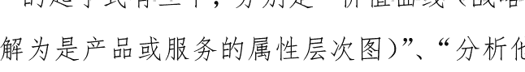

所谓拳打到肉、腿踢到痒。

“四式”，什么是呢？第一式：重建市场边界（寻找清点的市场）；第二式：注重全局而非数字（企业的战略规划自然要看全局）；第三式：超越现有需求（新的市场存在的前提是提供超越现有需求的需求）；第四式：遵循合理的战略顺序（理论派必须内容）。这对于功夫之人要求就更高了，心到手到、意到随到。其中，第一式最为难练，内含 6 种方法：跨越其他行业、跨越产业内部战略圈、跨越链、跨越互补性和服务项目、跨越针对目标的功能与情感导、跨越时间。

最后就是三个原则，所谓原则，就是练功夫过程中要尽量遵守的规矩。第二是“小规模部分”和“协调性、利润和人员主张”。将战略执行战略的一部分；第三原则则是，练功夫时可是容易出大问题的，轻则作废，重则走火入魔。

你看，蓝大的武功夫看起来就这么这点内容吧，但练起来还真不是一般人能练成的。理念、分析、创意、研发、内部管理，哪个环节都有极高的要求。

再来说，为何当年蓝大先生要挑战“细分圈”？其实就是因为大家意见相同。蓝海派认为更精细的细分市场会有目标市场缩小的危险，而且会大幅增加运营成本，因此认为“把合并细分市场在追求多层次细分市场前面”，而“细分帮”很明显跟海派的观点相反。所以说当年蓝先生的势不挑战“细分帮”，那他就不是蓝大了！

江山靠人才，一代换一代。随着移动互联网技术的普及，互联网公司的盛行，新的商业模式层出不穷，在此产生了“新营销派”成为江湖的风云人物。“新营销派”就像一场雪，掩盖了山的秀丽，现在的海派，武功还是跟以前一样的难，即便武功再高，也无可奈地变成了海派，不是江湖的一个损失。

2222 楼 
作者:大秦的疆 日期:2018-11-15 12:43

## 02 蓝海武功难度系数

要说为何海派流落时代，除了移动互联网引发时代潮流外，其武功难度系数也是罪魁祸首之一。“价值创新法”易不易，现在来分析其中“三起一手四招四式”的难度系数，至于最后的“原则”，重点是在执行层面。“三起”是“价值创新法”的基础，理解和入手难，难的是做到准确。

| 核心环节 | 难度系数 |
| :--- | :--- |
| 三起 | ★★★★ |
| 一手四招 | ★★★ |
| 四式 | ★★ |
| 原则 | ★ |

**三起一：价值曲线（战略布局图）**
说白了就是一个坐标图，是将行业的主要竞争元素（同产品服务的属性，如价格、功能、历史、种类等）作为横轴，这些竞争元素的水准作为纵轴。这是企业在现有市场上各个元素的表现，了解自己的优劣。前文在“消费者购买决策”中，已经提到了“属性层次”这个概念，这是要让消费者将产品的属性进行排序，要画坐标图。

**三起二：分析他类市场**
要求企业开拓视角，不仅与自身所在产业中的对手竞争，还与那些产业中产生相同产品的企业竞争。解释市场为两种：一种形式不同功能相同，往往可以替代（比如产业和饮料）；另一种是功能与形式都相同（如汽车）。这就是告诉企业要去了解消费者如何在行业之间做出权衡取舍，从而改进自己的竞争元素。

**三起三：战略转向非客户**
意思很容易，所谓非客户就是没有选择企业所在产业产品的消费者。企业不应该把视集中在客户身上，还需要关注非客户，并且尝试从非客户身上找到他们的共同点来建立自己的业务。怎么去关注非客户？有什么好的方法可以找到共同点？还是自己摸索吧。这“三起”作为基础，因为这三步都是实施蓝海策略的前提条件，甚至是缺一不可。蓝海先生与其高手一样，说话只说“点”（原则），要想知道具体的“面”（方法），看造化和悟性。

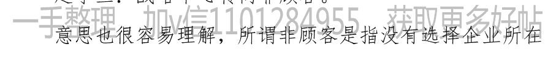

236 楼
作者:大泰的疆 日期:2018-11-16 10:23

**四招：剔除、减少、增加、创新**
这四招的目的是重新规划企业策略。难度系数：★★★。“四招”是在“价值曲线（战略布局图）”的基础上开始的。
剔除那些被产业认为是应当的，但实际消费者不在意的竞争元素（比如笔记本电脑的分）；减少那些在功能上设计的、其实消费者并不要求那么高的标准（比如车的重量）；增加那些对消费者购买有影响的标准（比如手机的像素）；创造新的竞争元素从而创造新的需求，改变行业标准（如智能门锁）。这四招听上去好像并不难，但实际上要求企业严格考量产业中每一个竞争元素，从而发现产业中隐含的假设，并重新评估。而且还能创造消费者感兴趣的需求。大多数企业都听过“蓝海战略”，最终却未能发现蓝海，都是失败在此四招之下。分析能力、研发能力、创新能力、敢于冒险突破重围的勇气，这些都决定了企业在蓝海的路上走多远。

## 检验“四招”下来的效果的方法

以此制定的策略是重点突出、另辟蹊、主题信服。企业的事情到底还是人的事情，这四招接下来的策略，也有可能是企业自己认为的重点突出（其实消费者不会买）、另辟蹊（其实别的公司或产业已有类似的产品或服务）、主题信服（消费者可能没感觉）。

**第一式：重建市场边界**
试图突破市场的传统竞争要素的看法，从综复杂的可能性中找到商业上有力的蓝海机会，难度系数：⭐⭐

虽然难度系数很大，但我们知道蓝海先生给出了严谨的六步法：
- 步法一：跨越他产业。很明显此法与起手的第二式“分析他类市场”息息相关。分析他类市场，就是企业要了解消费者如何在产业之间做出权衡取舍。而跨越他产业，则是迈出那关键的一步——找到产业和他产业之间消费者需求的共同点或者不同的需求相结合，然后剔除或减少其他竞争因素，创建自己的蓝海。比如神州专车，将商务人士对打车的便捷性和高级的舒适性这两点需求进行了整合，从而发现了蓝海市场。
- 步法二：跨越产业内部集团。这里涉及到理论名的翻译问题。其实这个所谓的“内部策略集团”可以改为“跨越产业等级”，这样更清晰。说白了，就是要搞清高端消费和低端消费之间的因素，然后将其结合，同时考虑剔除或减少原有的一些竞争元素，使产品更有针对性。在步法二中，书中经典的案例，整合了传统健康俱乐部。书中还有一个案例——丰田推出雷克萨斯。
- 步法三：跨越方链。这很像是起手的第三式“战略转向非客户”而来。为什么要方链？就是影响行业的各个角色，如购买者、使用者、推荐者。步法三要企业要守常规群体，还要考虑背后的角色。将注意力从购买者转向使用者，创造出普通人，从而摆脱竞争。
- 步法四：跨越互补性产品和服务。多数情况下，产品和服务的之间是互补关系。关键在于搞清楚消费者在选择产品之前、之中会有哪些需求。一个简单的办法就是考虑一下人们在使用产品之前的行为，这里有参考。
- 步法五：跨越时间和情感导向。这里有一个前提：消费者购买时基于两种吸引力——功能和情感（蓝海先生在《营销管理》之中已经多次提到）。步骤五要求企业不要局限在传统的吸引力上，以情感为主。
- 步法六：跨越时间。所谓跨越时间，就是要准确看待行业的潮流，能够预测某些潮流对行业的影响。这些潮流中最典型的是技术的变、生活方式的变化。锁定了某种潮流，就可以预测市场将会变成什么样子。比如“幸福冰”、“瑞幸咖啡”。

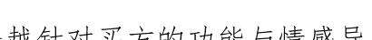

238 楼
作者:大泰 日期:2018-11-16 10:29

## 蓝海武功难度系数（总结）

| 核心环节 | 难度系数 |
| :--- | :--- |
| 三起 | ★★★★ |
| 一手四招 | ★★★ |
| 四式 | ★★ |
| 原则 | ★ |

**第二式：注重全局而非数字**
注重全局的意思是要绘制战略布局图。竞争元素、他类市场和非客户，都是战略布局的内容。由此可见，战略布局图是决定蓝海先生“价值创新”发挥威力的武器。

**第三式：超越现有需求**
这一式也是“价值创新”与市场侧最不同的地方。超越现有需求，就是强调新的产品和需求，确保市场规模，而不是细分领域。难度系数：★★★。在经过三起四招之后，第三式可以理解为一种检验和确定，确定后的价值不是聚焦客户的差异，而是基于顾客强烈关注的共同点。这里有三个层次的非客户：
- 第一层非客户：距离市场最近，出于必需而最低度购买，只要有一机会，随时准备跳上另一艘船（如自行车为了代步遇到了共享单车）。
- 第二层非客户：拒绝全球提供的产品和服务的人，直白一点，就是清楚自己不需要。
- 第三层非客户：离市场最远，这些人从未考虑过公司的产品和服务。

如何满足底层的非客户呢？第一层非客户找到他们徘徊的原因的共同点，将这些共同点变成公司服务的特点之一（比如去餐厅吃饭觉得菜慢，快餐自助式的餐馆）；第二层非客户与第一层一样，找到拒绝我们的客户的共同点；第三层非客户将他们从别的产品和服务中得到的需求变成自己产品的功能之一。最终就是通过这些非客户的共同点和需求来研究其中重叠的需求，这就是超越人类的需求。

**第四式：遵循合理的策略顺序**
难度系数：★★★。一个商业上可行的蓝海创意的顺序是什么？蓝大师先生在书里说得很明白：首先考虑效用（商业创意是否包含杰出的购买效用），接着是考虑价格（价格是否让买方轻松负担），然后是考虑成本（能否控制成本以获利），最后是考虑接受（观念会遇到哪些障碍，是否从一开始解决它们）。遵循这样的策略顺序（其实就是思考问题的顺序），蓝蓝战略才可能有成功。

239 楼
作者:大秦的疆 日期:2018-11-17 13:06

## 03 《蓝海策略》中的案例。

无论是武林的江湖还是营销的江湖，都强调“光说不练假起式”。为了证明“价值创新”的正确性，“蓝海策略”的书中穿插了不少案例。

如我强调的，营销是没有标准答案的。企业成功的营销策略，可能是因为遵从理论的探索和实践。

既然我们已经学习了《蓝战略》，就让我们记住里面的“三一起四四招四式原则”吧，当我们遇到瓶颈的时候，不妨拿出出来好好磨砺，即使这些并不容易做到，但会有帮助的。

## 第四节 关于“长尾”的对话（《长尾理论》）

《长尾理论》这两两年比较火，大概是因为其理论存在的基础就是当下爆发的互联网平台，于是很多人想一研究究竟，看到底“长尾”是何妙方（我估计大多数人会失望）。

说长尾理论，要从利基市场的概念，获取更多好帖——利基市场。

什么是利基市场？就是细分市场，根据百度百科给出的定义，是在较大的细分市场中具有相似兴趣或需求的一群客户所占有的空间。注意，定义中有两个关键词“兴趣”和“需求”。说了，就是用兴趣或需求，再次细分了细分市场。如旅游市场的利基市场，可以是单人的自驾游或不花时间在景区购物等针对对象的市场。

我来说一下自己的理解。第一，利基市场是细分市场再一次或者以上的细分。什么意思呢？就是大家不要纠结什么样的细分市场才算是利基市场。记住一个原则，将细分市场再进行细分的，就是利基市场，再细分一次是，再细分10次也是。这样大家就好辨别利基市场了；第二，相似的兴趣和需求，是理论上的总结，企业在寻找或开发利基市场时，往往不容易准确抓住这样的相似兴趣和需求。那有没有好的办法找到利基市场呢？

大家还记得先生所找到细分市场的6个因素吧（年龄、性别、消费标准、功能需求、行为特征和价值观念）。虽然利基市场是细分市场的再细分，那我们就用细分市场的要素再细分这个细分市场。不过，在这里，细分市场的要素可以不用局限于6个因素，或者可以按照细分市场中消费者的属性层次，再将这6个因素进行再次细分。

我们还是用汽车行业为例，SUV是利基市场的产。除此之外，比如红旗的高端国产车，针对的是国产品牌情结的高端商务人士或政府。还有，针对既喜欢老片换挡又要喜欢SUV的人群。

怎么样？从我们是不是可以发现利基市场最好的方式，是把两个不同的细分要素叠加，这样很容易找到可能的利基市场。

既然细分市场可以无休止的细分下去，那么再次细分后利基市场那更多的是不能再多了。不管是寻找共同的兴趣和需求，还是用两个或以上的细分要素叠加的方法，利基市场成立的前提是市场的需求和产品好实现。总之，细分市场也好，利基市场也罢，我们不能理解停留在知道这两个概念上，而是要知道这两个概念对企业的经营有什么样的意义，以及如何科学的找到对自己最有利的细分市场和利基市场。

Ps: 我个人的感受，企业的研发能力和技术创新能力，让企业找到合适的细分市场和利基市场方面更事半功。

## 长尾理论微信1101284955，获取更多好帖

所谓长尾理论的长尾，就是不断延伸的利基产品和市场的曲线。那么长尾理论是什么意思呢？一句话概括，就是鼓励产品的多样性和个性化，以此来创造和满足日益丰富的个性的消费者需求。

不是感觉这个观点没毛病？我们先不着下结论，先来看一个对话录。

也是营销销的有意的安排，某一天，被为“现代营销之父”的菲利普·科特勒与《长尾理论》的作者克里斯·安德森在旧金山双峰山上的一家咖啡店里偶遇了。靠着窗边，俯着旧金山的风景，一场关于“长尾理论”的这就这么开始了，这次对话就叫“双峰长尾”吧。

安德森（以下简称安）：科老，您好。我可以坐在您对面一起喝咖啡吗？

科特勒（以下简称科）：当然可以。你是安德森？

安：（一脸惊讶）是的，科老。您认识我？这可真是我荣幸啊。

安：科老，您就折腾了我，我就是想请教您对长尾论的看法。

科：（表情严肃）营销理论能够百花齐放，是一件好事。不能没有与时俱进的新理论，营销才会源源不断的生命力。这生命力，本身就是营销的特征之一。这长尾理论，是你研究的成果，我倒不敢随手指画谱。还是请你再简单介绍一下吧。

安：（含笑如好）好的。如果把长尾理论浓缩为简单的一句话，那就是——我们的文化重心正在转移，从头部的少数（热门产品和市场）转向尾部的利基产品和市场。在一个没有货架限制的时代，面向特定群体的产品和服务可以具有同样的吸引力。

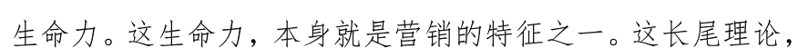

科：小安，你的意思是现在的市场曲线就像一个长尾巴，前面的头部是主流产品和市场，后面的尾巴就是利基产品和市场。你的观点是企业不要关注主流，面向特定群体的产品和服务非常有潜力。我说的对吗？

当然，长尾现象之所以出现，是因为它是条件的。科：嗯，你来说听。

安：（婉笑道）长尾理论形成的原因主要有几个：
- 无限的货架空间，使得互联网可以将各种产品放上去，这为后面的尾巴提供了销售渠道；
- 互联网平台同时提供了评价和口碑，让小众产品的成本显著降低；
- 现在的消费者追求个性化，互联网技术作为生产工具，因此消费者可以是生产者，比如电影、音乐或者创作，这些极大丰富了长尾产品。

科：长尾理论至关重要。

安：是的，我们通过一些数据分析得到了一些结论：
- 在任何市场中，利基产品都远离热门产品，而且利基产品的权重在指数级提高；
- 一旦有了丰富的品种用来选择，需求曲线就会平坦化；
- 尽管没有一个利基产品能实现销量，但由于利基产品的聚合起来，形成一个可以与热门市场相衡的大市场。

科：我不否认你的逻辑，但我有几个问题想让你解释一下。安：科老，您说。

科：（先喝了咖啡）我觉得长尾理论更像是发现一个利基市场正在不断壮大的现象。那从你的理论中，企业得到什么样的启示呢？如果我是一个企企业的负责人，我看完了你的书后可能就是一句：“哦”，原来是这样。这就像一个市场在活动力度还大，但完全没有办法参与。

安：（眉头皱）科老，我当初写书是想让社会和企业知道长尾市场有很大的空间，而且这个市场创造的价值不会比热门市场少的。我觉得这给企业提供了一个非常值得参考的经营方向。

科：（露微笑）小安，我明白你的意思。那企业应该做呢？不再费力做头部？只要把利基市场做好就可以？我认为这跟企业的商业逐利逻辑相背的。站在行业的头部，既然如此，他们就没有必要仅仅执着于做头部，是可以考虑重心放在尾部的利基市场上。

安：（沉默片刻）科老，我认为一般的的中小型企业是没有办法突破大型企业的围的。

科：（带疑惑）如果我记得没错，你在书里也讲到如果把利基放大，每一个利基市场都会有这个头部或者热点。那么重心放在尾部的企业是不是应该做尾部的头部？毕竟在头部才能实现更好的利润目标。

安：（沉默片刻）好，最大化的盈利的确是企业的经营目标。我的长尾理论更多的是关于长尾存在的意义，这跟企业的经营目标是两回事。我们也可以假设一个企业没有在众多利基市场做到头部或热点，但是它是基于利基市场的多样化经营，这样的情况也会给企业带来丰厚的利润。当然，这是需要本体分析的。另外，我并没有认为企业应该做头部。

科：（点了点头）好，那我想请教，如果消费者就像你说的越来越追求个性和多样化，那中小企业是不是就将利基市场作为战略中心？我的问题是，如果企业要一直保持在利基市场的活跃，是否应该一直保持产品的创新和多样化呢？那样会不会让企业陷入长尾的沼泽里呢？

安：科老，利基市场您比我更清楚，市场细分再细分后的一个小众市场。只要这些企业的产品是针对小众市场而研发的，它就容易获得小众市场的消费者的认可。至于产品是否要持续不断的创新和多样化，我觉得取决于竞争环境。

科：嗯，你说的。如果竞争并不激烈，甚至没有竞争，而市场的规模也足够保证这家企业的利润目标，那它专注于这个利基市场的长尾上也不失为一种正确的经营理念。产品的创新和多样性，就可以根据市场需求进行规划。如果竞争激烈，就说明这个市场已经从原来的利基市场转为了分众市场，甚至是整个市场了。

安：（笑着）科老就是科老，市场的分析到位！

科：哈哈，小安，别着我，我的问题还没完。

安：（表情重重地）科老，您继续说。

科：消费者的个性化和多样化的需求，是否跟行业的头部一定是冲突的？如果一个行业的头部或热门产品本身就含有个性化的需求，消费者是否一定通过选择来体现？如果不是，那长尾理论对于这些行业而言就没有意义了？

安：（语气生硬）科老，我认为长尾理论虽然说的是长尾，但不代表每一个行业都是长尾，这的确是因行业而定的。尾巴可以不长，一定要多样化和个性化，这是消费需求的大势所趋。

科：（若有所思）生产工具的普及。在衣食住行等日常领域，也不是可能实现个人参与生产，也许随着智能生产、3D打印机的普及等等，终有一天，普通消费者也可能参与这些生产。到那时，真的是一个丰饶的时代，你的长尾理论在那个年代一定会大放异彩！

科：小安，我想没有别的问题了。谢谢你，给了我一堂长尾理论的课程。

安：（一脸真诚）老科，您这么说我更加懊恼了。跟您的交流，通过这次对话，让我意识到长尾理论上没有需要改的方法，谢谢您！

科：哈哈。不管说什么，确实有一个意思也有趣的发现。但有一点我们都不能企，企业是以盈利为第一的目标，而盈利大家想到的最容易的方法就是品牌和畅销的产品。所以，长尾理论从另一方面来说，是在考验消费者的贪心啊。读长尾理论对于企业主而言，尤其是中小企业主，最大的启发是要扎根利基市场，不急不躁，做好产品多样化和创新，迎合小众市场的个性化需求，这样就会有一天天地。不能盲目的追求头部做热门，放弃了自己的优势。这也是对人性的考验吧。

安：听君一话，胜读十年书！科老，醍醐灌顶啊！原来您都是站在企业的角度来思考理论的，这样的胸怀和格局，晚辈还差得远了。刚才如果我说话不妥的地方，您还请见谅。

科：（摆了摆手）这些都是小事。今天聊得很愉快，下次我们再约。我下山了。

安：（赶忙起来，拿出名片）科老，这是我的名片，期待下次向教！

科：好，小安，见！

## 第章 细分市场的总结

正如开头，消费者是土壤，市场是大地，而细分市场就是各种地形。无论企业是否意识，细分市场就在那里。很多时候，企业已经依赖细分市场而生存。对于大多数行业，还有细分市场的必要吗？答案是肯定的。研究细分市场，可以让企业更加科学地审视自己对现有市场的战略和策略，二则是帮助企业拓展领域（尤其是遇到瓶颈的时候）。

一句话概括：细分市场，就是对现有市场的一种解决方式，也是企业在瓶颈寻找突破的方法。

## 第四节 用细分市场寻找突破

既然细分市场的价值如此巨大，我们当然要尝试它的威力。

从市场细分看饮料行业的机会。由于毕竟营销的事情不能随便拍脑袋，所以我们先对饮料行业现有的细分情况进行了解：

- 纯净水。
- 矿泉水。
- 茶饮料。代表：农夫山泉的“茶π”、东方树叶、康师傅的红茶绿茶茉莉茶、达利园的青梅绿茶。
- 能量型饮料。代表：红牛、宝矿水特、乐虎、黑卡、脉动、恒大碧。
- 奶茶饮料。代表：统一的“阿萨姆”原味奶茶。
- 水果型饮料。代表：汇源汁、农夫山泉“农夫果园”、海之言。
- 维生类饮料。代表：农夫山泉的“维他命水”和“水溶C100”。
- 生活型饮料。代表：康师傅的酸梅汤、冰糖雪梨、蜂蜜柚子、动的“葡萄糖补水液”。
- 碳酸型饮料。代表：可口可乐、百事可乐、芬达、雪碧。
- 年轻型饮料。代表：小魔同学。
- 发酵饮料。代表：葛尔。
- 咖啡型饮料。代表：雀咖啡、雅哈“冰咖啡”。
- 苏打水。代表：农夫苏打水。
- 营养型饮料。代表：营养线。
- 汽水。代表：怡泉、山碧、健力宝。

整理细分的过程是痛苦的，因为有些细分的界限太模糊了。如瑞士味不仅在水果型饮料中有，在运动饮料中（比如脉动）、碳酸饮料等中都会出现。没有办法，只能按照品牌的广告侧重点来看如此分类。因此，饮料行业利基市场的界定就显得没有意义。

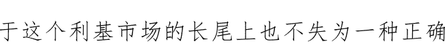

我们还可以发现同类产品各个品牌之间主要的差异化方式：口味、外观（瓶子的形状和瓶贴）、价格。除此之外，围绕消费者的健康理念，有些品牌也增加了相应的产品来迎合市场需求。

一旦有了丰富的品种用来选择，需求曲线就会平坦化；尽管没有一个利基产品能实现巨大销量，但由于利基产品的聚合起来，形成一个可以与热门市场相衡的大市场。

只要要做某个年龄阶段的细分市场吗？毕竟渴水是人都需要的。
当然，我们很容易发现一个事实，除矿泉水或纯净水外，其他大多数饮料主要购买人群是年轻人。我们很少可见老人自己去超市买饮料吗（消费习惯和健康因素），也不主动给小朋友买口可乐的家长（健康因素）。老人喝什么？
喝茶或水。小孩喝什么？酸奶、牛奶、乳酸菌等他们选择。
从健康的角度出发，不应该鼓励老人和小孩喝饮料，这是常识。所以，按照年龄来来细分市场就被占据了。

通过上述的分析我们就能理解，为何“小老若同学”，却没有“小宝宝”；而有“红牛”能量饮料，却没有“老牛”能量饮料。加微信11011284955，获取更多好帖。

饮料行业是一个以年轻人为核心市场的行业。
有人会提到“6个核桃”，“6个核桃”的核心卖点在于脑融，这个卖点针对的消费群体很广泛——学生、白领、老人都可以喝（不希望自己的牌子太便宜）。当然该品牌的广告主要针对的是学生这个群体，并不有严格意义的细分市场。

饮料行业是不是一定不能按照消费者年龄进行市场的细分呢？当然不是，而是有两个前提：一、企业愿意扎根这样的细分市场；二、产品的功能有足够的说服力。
比如我们可以推出一款“8个核桃”的饮料，专门针对大脑正在发育的儿童的市场；我们也可以推出一款“老若”饮料，针对中老年人的市场。但这两点都要前提，保证健康和功能的说服力。

(2) 消费者的性别。

饮料针对性别的产品划分还是容易发现的，口味、瓶贴的图案和颜色。粉红的颜色和清淡花花的味道，这样的组合往往会让人望而却却。不过目前我还没有发现某个针对女性的饮料品牌，那么这里是否有一个机会呢？有。

YY一下。我们假设有一个饮料品牌叫“花语花香”，它的包装也是市面上的其他品牌，是纤细柔美的包装瓶，瓶贴的颜色也是女性喜欢的色系（红色或粉红）。它很懂女人，知道什么花（如茉莉花、梅花、药菊）配什么东西（如姜汁、柠檬、红糖）对女性有何益。关键的关键，是它的口感，里面有花香，女人很喜欢。

(3) 消费标准。

要论起这6个细分因素当中哪个是最好最简单的一一——必须是消费标准！寻找价格的空白并不是一件难事。一瓶矿水别人卖1-2块，我就卖3块（“水中贵族百岁山”）；你百岁山卖3块，我西藏冰川纯净水卖5块。不亦乐。

当然，价格空白好找（尤其是往往），但只是理论上的机会。同品类产品中你定位高价，必须要有证据和产品体验来支撑你的价格，而且不能超出消费者接受的范围大（如西藏冰川纯净水）；定位低价，也得让消费者觉得你的产品靠谱，对健康无害。

当有一种低价方案，就是把瓶饮料的含量比同类产品放大，但价格一样，还可以降低包装的档次（如恒地球球饮料，零售价与牛奶几乎一样，但含量更大）。

此方案，正是“怪弦行为”里所说的“猫”——消费者将原本品牌的价格视为标准。那为了避免直接在价格上与“猫”发生冲突，消费者产生怀疑，不保持价格一致，但在含量和包装上做文章。

当然，能提供证据和更好的体验是上上之策。

用消费标准来找价饮料行业的机会，我们很容易发现新的大陆，如比易拉罐包装的100%果汁或咖啡饮料；价格不变容量比“名仁”更大的苏打水；价格比雀和雅格更高的咖啡饮料（与星巴克的咖啡饮料 pk）等。

产品卖点、体验和价格在一个水平上，是王道。

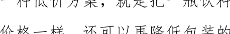

(4) 功能需求。

先看看现在的饮料行业都提供了哪些功能需求。基本的饮水需求（纯净水、矿泉水）、口味上的需求（大多数都是）、能量补给（能量型饮料）、健康需求（维生素型饮料、果汁饮料）、去火（王老吉、加多宝）、益脑（六个核桃）、营养需求（营养快线、雅哈冰咖啡、星巴咖啡饮料）等。除了以上这些，还有雪碧的广告暗示消费者，在吃的时候雪碧更痛（能解腻）。

现在，似乎在饮料行业已经满足了消费者各种需求，寻找功能需求的空白可以从消费者使用的各种情境来，现在我思考饮料的需求空白市场，只作参考：

- 第一杯水：针对消费者早上起来的第一杯水，卖点：更好的水分和冲肠胃。
- 金视饮料：针对经常看手机和屏幕的人（尤其是青少年），功能是保护视力（添加视力用的元素）。
- 鸡尾酒：最适合白酒或啤酒在一起喝的饮料，口感极佳，让消费者轻松。
- 高端饮料：消费对象：一定喝酒的人。

(5) 消费者的行为。

饮料行业中消费者的行为特征是一致的，在细分市场中找法子还难。只有一点可以做文章——消费者不知道自己喝什么。这是一款产品的问题，先考虑喝的时候各种味道在舌尖上爆发，得细腻品味。当消费者不知道自己喝什么的时候，就给他推荐“超级MIX”吧，卖小包装（不超过200ml）。

(6) 消费者的价值观（情感）。

饮料行业由于针对年轻人为核心的市场，所以以前都是饮料广告里只讲情感（主要是年轻、自由、极限、勇敢等）。这些都会让消费者产生记忆，比如小老同学的“认真、搞笑、低调冷泡”等。饮料行业也有价值，除此之外，各个品牌也会通过一些主题促销活动，比如买一瓶饮料就给儿童捐赠等。

在情感或价值上寻找细分市场？别着急，饮料行业是有特殊情况的。饮料的单价一般不超过10元（属于低门槛），情感或价值很难左右消费者的选择（一般普通饮料是哪瓶可乐）。所以，产品整体才是核心，我们会为了这两个品牌的纯净水非不可吗？怡宝和娃哈哈的情感，害怕体会。

所以，我不认为饮料行业脱离了产品功能和体验，单纯在情感或价值上寻找细分市场是一件意义的事情。

总结一下，用武器“砖头”，我们发现了饮料行业可能存在的机会：“8个核桃”饮料、“老若”饮料、“花语花香”女性饮料、易拉罐包装的100%咖啡饮料、价格不变容量比“名仁”更大的苏打水、价格比雀和雅怡更高的咖啡饮料、“第一杯水”饮料、“金视”饮料、“鸡尾酒”饮料、“夏液”饮料、“超级MIX”饮料。

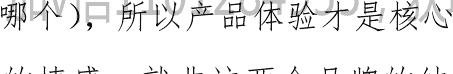

武器 2：蓝海战略

“六因素”是板砖，蓝海战略则是双脊棍，看着好弄，其实跳起来就不是那回事了，容易把自己搞成 aparat转向。既然我们现在是要分析饮料行业来试试蓝海战略的威力，自然就要从蓝海的三起手开始。

起手(1): 价值曲线。

我们都知道饮料的价值曲线（分析竞争元素）是蓝海王的核心战术，是为了获取更多优势，战略非常关键的细节，处理应该是不能拍脑门的。抱着严肃的态度的，我先在网上搜索饮料行业的价值曲线，可惜没有搜到。无奈之下，只得根据个人经验拍脑门。

本人 YY 的饮料行业的竞争元素：品牌印象、口味、感、价格、要素整理出来后，我们先放一边，一会再用。

起手(2): 分析他替市场。

因为饮料行业解决的是消费者喝水的需求，所以它的市场只有一种：替代品。除了喝饮料外，我们还可以喝牛奶、豆浆、咖啡、开水、茶等。

分析他替市场，就是想要跨它！饮料+牛奶，已经有奶茶。

营养快线：饮料+豆浆，已经有豆奶；饮料+咖啡，已经有雀巢、雅哈和星巴克；饮料+开水，有今麦德的“凉白开”（后面重点批批）”饮料+茶，有许多。

现在，似乎在饮料行业已经满足了消费者各种需求，寻找功能需求的空白可以从消费者使用的各种情境来，现在我思考饮料的需求空白市场，只作参考：

- 第一杯水：针对消费者早上起来的第一杯水，卖点：更好的水分和冲肠胃。
- 金视饮料：针对经常看手机和屏幕的人（尤其是青少年），功能是保护视力（添加视力用的元素）。
- 鸡尾酒：最适合白酒或啤酒在一起喝的饮料，口感极佳，让消费者轻松。
- 高端饮料：消费对象：一定喝酒的人。

现在，似乎在饮料行业已经满足了消费者各种需求，寻找功能需求的空白可以从消费者使用的各种情境来。

现在，饮料行业已经没有空白，各种组合都可以进行尝试：

- 碳酸饮料
- 牛奶+果汁
- 咖啡+果汁
- 各种细致（折腾）组合

这是一个排列的游戏。至于最终取胜，还要看产品的口感到底好不好。当然，能提供证据和更好的体验是上上之策。

用消费标准来找价饮料行业的机会，我们很容易发现新的大陆，如比易拉罐包装的100%果汁或咖啡饮料；价格不变容量比“名仁”更大的苏打水；价格比雀和雅格更高的咖啡饮料（与星巴克的咖啡饮料 pk）等。

产品卖点、体验和价格在一个水平上，是王道。

起手(3): 战略非回头客。

饮料行业的非回头客是老人和儿童，打造的产品关键是功能的说服力。比如“8个核桃”和“老若”。

# 2328 楼
作者:大秦的疆 日期:2018-11-21 01:42

# 2329 楼
作者:大秦的疆 日期:2018-11-21 11:54

# 2333 楼
作者:大秦的疆 日期:2018-11-22 05:30

# 2342 楼 
作者:大泰的邂士 日期:2018-11-23 09:17

# 2356 楼
作者:大秦的疆士 日期:2018-11-23 20:26

# 2365 楼
作者：大秦的疆士 日期:2018-11-22 23:49

## 第一式，重建市场边界。

这一式的精髓在那6个跨越——他跨市场、内部战略集团（行业等级）、买方链、互补产品、功能和情感引导、时间。

跨市场，在第二个起手时候已经分析过；内部战略集团，其实蓝先生的意思就是一个词——性比；买方链，第三个起手已分析；互补产品和服务，在第二个起手时也分析（跨市场的两种类型）；跨越功能和情感引导（就是既有功能也有情感），此其实常识，是蓝大“价值创新心”跨越外的20%；跨越功能（趋势潮流），则是又是5%的精髓所在。

在这里对于跨越时间说几句。就好我们很难知道如何跨越一年，衣服流行什么颜色，很多季节变化相对符合习惯的业，要想跨越时间并不是容易的事情。有人会说，技术改变生活，提前判断技术的潮流呀。我们拿移动互联网举例，对于许多行业而言，其并没有对产品本身（如家电行业）带来巨大的变化，对于渠道和服务的改变却是十分显著。这就给我们一个课题，如何跨越时间还不粘土。

第一式，重建市场边界。

第一式，重建市场边界。

第一式，重建市场边界。

第一式，重建市场边界。

第一式，重建市场边界。

第一式，重建市场边界。

第一式，重建市场边界。

第一式，重建市场边界。

第一式，重建市场边界。

第一式，重建市场边界。

第一式，重建市场边界。

第一式，重建市场边界。

第一式，重建市场边界。

第一式，重建市场边界。

第一式，重建市场边界。

第一式，重建市场边界。

第一式，重建市场边界。

第一式，重建市场边界。

现在我思考饮料的需求空白市场，只作参考：

- 第一杯水。
- 金视饮料。
- 鸡尾酒。
- 高端饮料。

现在，似乎在饮料行业已经满足了消费者各种需求。

现在，现在，饮料行业已经没有空白，各种组合都可以进行尝试：

- 碳酸饮料
- 牛奶+果汁
- 咖啡+果汁
- 各种细致（折腾）组合

这是一个排列的游戏。至于最终取胜，还要看产品的口感到底好不好。

当然，能提供证据和更好的体验是上上之策。

用消费标准来找价饮料行业的机会，我们很容易发现新的大陆，如比易拉罐包装的100%果汁或咖啡饮料；价格不变容量比“名仁”更大的苏打水；价格比雀和雅格更高的咖啡饮料（与星巴克的咖啡饮料 pk）等。

产品卖点、体验和价格在一个水平上，是王道。

第一式，重建市场边界。

第一式，重建市场边界。

第一式，重建市场边界。

第一式，重建市场边界。

第一式，重建市场边界。

第一式，重建市场边界。

第一式，重建市场边界。

第一式，重建市场边界。

第一式，重建市场边界。

第一式，重建市场边界。

第一式，重建市场边界。

第一式，重建市场边界。

第一式，重建市场边界。

第一式，重建市场边界。

第一式，重建市场边界。

第一式，重建市场边界。

第一式，重建市场边界。

第一式，重建市场边界。

第一式，重建市场边界。

第一式，重建市场边界。

第一式，重建市场边界。

第一式，重建市场边界。

第一式，重建市场边界。

第一式，重建市场边界。

起手(2): 分析他替市场。

分析他替市场，就是想要跨它！饮料+牛奶，已经有奶茶。

营养快线：饮料+豆浆，已经有豆奶；饮料+咖啡，已经有雀巢、雅哈和星巴克；饮料+开水，有今麦德的“凉白开”（后面重点批批）”饮料+茶，有许多。

现在，似乎在饮料行业已经满足了消费者各种需求，寻找功能需求的空白可以从消费者使用的各种情境来。

现在，，饮料行业已经没有空白，各种组合都可以进行尝试。

间？价格？当然要减少。按照蓝大生的原性，蓝海战略一定要低价，这样才能保证市场的接受。包装，当然也可以减少。返真，用汽水玻璃瓶来代替常规包装。情感，就让它冷静吧。

增加，品牌印象的增加说明了就是突出品牌的差异化，冷酷的情感和淡淡口感是关键元素。考虑低价策略，价格和包装是不能增加的。创新。虽然蓝大的“价值创新法”并没有提到如何创造优势（这也是最让人头疼的地方），但从老人家里外我们感受到创新的自由选择市场和非客户。春天我们已经分析过了，在此不再赘述。

小技巧：四式后，冷酷的情感；玻璃瓶的包装；淡淡的口味；价格比普通矿水便宜，低于苏打水。关键点：味道虽然，但喝起来有点酷的感觉。品牌名称？就叫它“柠檬酷”吧。

四招过后，就四式上了场。虽说在总结蓝大的武功时，三手四招和四式是并列关系，但实际我们在运用的时候就发现，三手四招已将“价值创新法”的精华学到了八成。三手四招，其实打完，其实结果已经注定，要你成就将对手打倒在地，要么被对手打倒在地。

第一式，重建市场边界。

这一式的精髓在那6个跨越——他跨市场、内部战略集团（行业等级）、买方链、互补产品、功能和情感引导、时间。

跨市场，在第二个起手时候已经分析过；内部战略集团，其实蓝先生的意思就是一个词——性比；买方链，第三个起手已分析；互补产品和服务，在第二个起手时也分析（跨市场的两种类型）；跨越功能和情感引导（就是既有功能也有情感），此其实常识，是蓝大“价值创新心”跨越外的20%；跨越功能（趋势潮流），则是又是5%的精髓所在。

在这里对于跨越时间说几句。就好比我们很难知道如何跨越一年，衣服流行什么颜色，很多季节变化相对符合习惯的业，要想跨越时间并不是容易的事情。有人会说，技术改变生活，提前判断技术的潮流呀。我们拿移动互联网举例，对于许多行业而言，其并没有对产品本身（如家电行业）带来巨大的变化，对于渠道和服务的改变却是十分显著。这就给我们一个课题，如何跨越时间还不粘土。

第一式，重建市场边界。

第一式，重建市场边界。

第一式，重建市场边界。

第一式，重建市场边界。

第一式，重建市场边界。

第一式，重建市场边界。

第一式，重建市场边界。

第一式，重建市场边界。

第一式，重建市场边界。

第一式，重建市场边界。

第一式，重建市场边界。

第一式，重建市场边界。

第一式，重建市场边界。

第一式，重建市场边界。

第一式，重建市场边界。

现在，，没有空白。

现在我思考饮料的需求空白市场，只作参考：

- 第一杯水。
- 金视饮料。
- 鸡尾酒。
- 高端饮料。

现在，似乎在饮料行业已经满足了消费者各种需求，寻找功能需求的空白可以从消费者使用的各种情境来。

现在，现在饮料行业已经没有空白，各种组合都可以进行尝试：

- 碳酸饮料
- 牛奶+果汁
- 咖啡+果汁
- 各种细致（折腾）组合

这是一个排列的游戏。至于最终取胜，还要看产品的口感到底好不好。

当然，能提供证据和更好的体验是上上之策。

用消费标准来找价饮料行业的机会，我们很容易发现新的大陆，如比易拉罐包装的100%果汁或咖啡饮料；价格不变容量比“名仁”更大的苏打水；价格比雀和雅格更高的咖啡饮料（与星巴克的咖啡饮料 pk）等。

产品卖点、体验和价格在一个水平上，是王道。

就有细分市场存在的土壤。容易想到的案例：酒店。酒店为何要分成宾馆、快捷酒店、三星级酒店、四星级酒店和五星级酒店？是因为根据消费标准进行市场的细分。由此可见，服务业是有市场细分的。

根据我们生活中的经验，服务业最普通的细分因素就是消费标准，如滴滴打车，根据标准分为拼车、快车、专车、优享车等，不同的分类消费标准不同。除了消费标准以外，服务业的市场还有哪些细分因素吗？

## 01 服务业的细分市场因素

在分析服务业的细分因素之前，我们不妨先将之前的先生王总结的细分市场6个因素列出来：年龄、性别、消费标准、需求、行为特征和价值观（情感）。

现在，先考虑这6个因素是否适用于服务业。

凭直觉，消费者的年龄和性别的差异，往往带来需求的差异，因此这两点可以保留。

消费标准，这就就不说了，肯定包含在内。

功能需求。同样是用车，滴滴是打车，神州是租车，可功能需求会有差异，保留。

行为特征。服务业最喜欢干的事情之一就是搞会员制，消费者充值变成会员（想去理发时理发时，理发师开口会员吧吧）。接受会员制或不接受会员制，这就是消费者的行为特征。保留。

价值观（情感）。服务业有没有因为消费者的价值观（情感）的不同而进行市场的细分呢？我想了半天，实在没有想到。这也许就是提供产品和服务之间存在的本质差异——对于服务，消费者更清晰的认识到自己想要的结果是什么（理发是要理个好发型，洗衣店洗衣服是为了衣服的干净）。这个差异带来的结果就是消费者更理性。所以，服务业按照消费者的价值观（情感）分类，根本就无从下手。除去。

服务业还有别的细分因素吗？

我们去网吧上网举例。去网吧上网一般比较关心几个问题：网吧的环境、网吧里有没有好喝的饮料、网管解决上网问题的速度？网吧的座椅舒不舒服、上网的速度快不快。直觉告诉我们，这里会有细微的因素。

网吧的环境、网管的速度、网吧的座椅，这三个是服务的体验，这一点跟上述的消费标准是雷同的（服务体验好，消费标准自然会高）；网吧上网的速度，这是服务的标准，这一点与上述的功能需求是雷同的（服务的标准高，满足的功能需求就高）；网吧有没有好喝的饮料（这也是网吧和网咖的主要区别），这是服务的范围。网吧和网咖，就是网吧行业的市场细分市场啊！所以，我们很愉快地得出一个结论——服务的范围，也是服务业细分市场的因素。

## 02 演习

通过上述的分析，我们现在锁定服务业的细分因素也是6个：年龄、性别、消费标准、功能需求、行为特征和服务的范围。

把这6匹骆驼拉出来运运。

演习之前，我们需要记住一点：细分市场的因素是为了帮助企业寻找市场上的突破，并不是为了细分而细分。

现在假设有一家计划开展外卖业务的公司，他们不想跟“美团外卖”或者“饿了么”等大佬直接接PK，而是为了某个细分市场开始。

- 1、消费者的年龄。
毫无疑问，外卖行业主要消费者是年轻人，不会做饭或忙得没饭或长时间没做饭。凭直觉，将老人和小孩作为外卖的服务对象不是智之举。
- 2、消费者的性别。
消费者对外卖服务的要求显然不会因为性别而有所不同，所以外卖服务没有按性别进行市场细分的必要。
- 3、消费标准。
所谓消费标准，就是根据服务的标准高高中低档的收费，这一点对于外卖是不适用的。消费者在意的快是（等的时间短）、好（外卖没有破）、准（跟自己点的一致），这三点缺一不可。换言之，可以提高或降低的服务标准。互联网刚开始烧钱补贴，是一种阶段性的营销策略，与消费标准无关。
- 4、功能需求。
外卖服务还有别的功能需求吗？夏天，消费者希望点的冰淇淋是凉的；冬天，消费者希望点的拉面还是热乎的。这家公司可以强调在外卖服务上温度的严格和专业，增加消费者的信任。
- 5、行为特征。
对于外卖，消费者并没有表现出明显的行为特征。我们可以从付款方式着手。第一类型：传统方式——先下单再送货；第二类型：折扣方式：消费者下单后送货，吃完后根据评价付费（评价跟金额挂钩，如一份饭，觉得好吃付费15元，觉得不好吃付费12元）。这种付费方式比较有趣，对外卖公司而言，创造了好的口碑，吸引更多的用户。
- 6、服务范围。
现在外卖公司的服务范围是送餐（美团），继续拓展（如花鲜、咖啡等），其他公司（同城快递、瑞幸咖啡）。通过上述描述，我们可以建议这家公司考虑两种细分市场：1、对温度更加意的消费者；2、希望可以吃完后再付费的消费者（潜在需求）。

让我们脑洞大开。电影院，可以有只有播放经典的的电影院或针对家庭的电影院。理发店，可以只有年轻人理发店（潮），或者专业给孩子理发店（理发师会哄孩子）。洗衣店，可以有专门高档面料的洗衣店（增加某个洗衣环节）。旅游公司，可以有专门组织导游的旅游公司……等等。当然，这些业务细分只是理论上的可能性，实际运营结果，关于细分市场的内容就到这里。

## 第六章 营销江湖的地理坐标：定位

接天莲叶无穷碧，映日荷花别红。本章涉及的理论书籍：《营销管理》、《定位》、《重新定位》。

定位，即确定位置，也可以理解为摆正位置。这个词在春秋战国时期就已经出现了，出了《韩非子·养术》中的“形一统，如其表，名而异”。值得玩味的是，定位营销的扬大似乎源自对美国营销战略家特斯特《Positioning》书名的翻译。如果你百度“定位”，在百度词条里就是对特斯特《定位》这本书的介绍，其影响力可见一斑。笔者在特斯特《定位》书横空出世之前，我们难道就不用“定位”一词吗？这自然无法考证。但有一点可以肯定，近年来，“定位”一词绝对是一个使用频率最高的词之一。大家在聊天的时候，经常会有“这件事怎么做要看你是定位的”之类的说法，更不用说在营销领域大家张口就是定位。难道每个用“定位”一词的人都是听过看过特斯特的《定位》吗？

我想不大可能。当然，我们无需纠结定位的发扬光大是因为特斯特《定位》书，这本就是个工具。我们要做的是彻底的理解和找到适合自己的定位，产品如此，品牌如此，企业如此，个人也是如此。

在营销的江湖里，地理坐标（定位）非常重要。一个好的地理坐标，可以让企业风云聚会、顺风顺水；一个不好的地理坐标，会令一切辛苦付诸东流，事倍功半。

营销江湖的地理坐标到底有哪些学问？让我们从老《营销管理》的第10章《品牌定位》来起。营销江湖也有例外，今天课程是地理课，上老师就是我们的老朋友科特先生。

科特（以下简称“科”）：同学们，大家好！今天由我给你们上一堂地理课，课程的主要内容是地理坐标。大家想不想听？

众学生：科老师讲课，我们自然愿意听。

科：（笑）谢谢同学们。之前大家在课堂上已经了解了我们营销江湖里的一些基础知识，如洞察我们江湖湖里的水（需求），了解我们江湖的土壤（消费者），以及江湖里的细分市场。

可是仅凭这点，不足以准确描述营销江湖的地理情况。缺什么？地理坐标。有了这个坐标，才能知道具体的的位置。知道了具体的位置，这节课的意义，大家明白了吗？

学生：明白了！

科：（微笑）好！现在正式开讲！有人知道地理坐标什么吗？

学生A：老师，我知道。纬度和经度。

科：回答得很好！在真实的世界里，纬度和经度还有第三个——海拔。通常用二维的角度定义坐标，我们用三维的角度定义坐标。营销江湖里，地理坐标一定是三维的，因为海拔也很重要！

学生B：老师，营销江湖里纬度和经度和海拔分别是什么呢？

科：这个问题很好，现在要介绍。纬度是差异点，经度是共同点，海拔是价值张。

科：在营销江湖里，地理坐标就是定位，所以定位是由差异点、共同点和价值张组合成的。什么是定位？

学生C：老师，既然是独特位置，为何会有共同点？

科：营销江湖里充满了竞争，同类产品会有相似之处，这满足消费者的基础需求。就像“投之之后君侯，将死地然后”。在战场上两军对战，军队的士会决定战斗的胜者，直到最终胜利的一方的军队规模和装备（物质）还不如被败的那一方。那么士是物质，还是意志？

科：（笑）这这是前提。通过刚才关于“定位”概念的介绍，大家都知道定位的关键是差异。差异点可能是产品的质量，可能是价格，还可以是外观和功能等等。总之，差异可以有很多，关键是找到实现哪种差异。

学生D：老师，虽然差异点有很多，但我认为能够影响消费者认知的应该会有标准。您能介绍一下差异的标准吗？

科：这个问题很好。所有的差异点其实最终都会变成品牌联想。我们为何要在质量上做得比别人好，为什么价格要定比别人高或低，为什么外观或颜色要跟别的品牌不一样，这是要让消费者对品牌联想与众不同。联想不同，差异就成功了。有三个标准决定了一个品牌是否具有差异化——合意度、传达力和区分度。这三个标准我们会再来讲。

科：我们再介绍地理坐标的第三维度——价值张，也就是海拔。价值张的高低或者没有，决定了消费者能在多程度上看到我们。我们打个比喻，价值主张就像路灯。当雷乍、飞沙漫天之时，你们认为路灯是越高越容易看到，还是越低越容易？

学生：越高的时候。

科：对！越高的时候。当然，这个价值张不仅是指情感，那种脱离产品的装潢或高大口号（如“我们的目标是世界和平”）只会让消费者渐行渐远。这里的价值张是对产品优点和差异化的简单概括。我们可以理解为向消费者提供的一种承诺。比如沃尔沃汽车，它的价值主张就是“您的家庭驾驶的最安全和耐用的汽车”。

科：关于营销江湖中地理坐标（定位）的介绍就到这里。下面我们介绍如何寻找地理坐标的方法。

牛通的学生B。接来科特勒老师便按照自己的大作《营销管理》第10章“品牌定位”的内容，介绍如何在营销江湖中寻找坐标。台下的学生们一个聚神气地听着。

学生B在学校比较出名，原因是因为他上课的时候跟老师比较真（抬杠）。比如在一次哲学课上，当哲学老师在批判唯心主义又不切实际时，学生B站起来说：“老师，《孙子兵法》，投之之后君侯，将死地然后。在战场上两军对战，军队的士会决定战斗的胜者，直到最终胜利的一方的军队规模和装备（物质）还不如被败的那一方。那么士是物质，还是意志？如果是意志，那么在战场上意志决定成功？那唯心主义可也有时候？”后来这节哲学课程就成了哲学老师和学生B的辩论，最终哲学老师也没有说服他。

学生B在下面一边听着，一边整理。他总结了其中的逻辑：1、确定一个竞争参考框架（就是寻找坐标之前先画个圈）。

2、竞争参考框架的确定主要有三个步骤（寻找维度的过程）：识别最佳差异点、选择差异点、品牌真言；3、建立品牌定位（锁定地理坐标）。接下来就是见证比较时刻。

B（以下简称“B”）：老师，我有问题。

科：（微笑）好。

B：从消费者角度出发，定位是什么。

科：地理坐标（定位）分为共同点、差异点和价值张三个维度，这个我觉得特别重要。这三点未实践，很清清楚楚。我没有提到“感知地图”这个工具，就是让企业好落地。

B：老师，您那“感知地图”做起来肯定不容易。我想请教您，通常情况下，差异点有哪些？或者什么方面的差异消费者最容易感兴趣？价格、接受程度，情感（价值观）这四点是影响心中的核心要素。其余产品包装、功能、终端形态，广告等，都是围绕这四点在写作。所以企业要找共同点和差异点，可以从这四个核心要素入手。您看这样行吗？

科：这个。那就要根据行业的情况具体问题分析。

B：老师，刚才你讲的时候我自己推演了，对于消费者而言，产品或服务满足需求的水准依据、价格水位……

科：（若有所思）这个嘛，各个行业之间还是会有差异，不能一概而论。科学，来不得半点马虎的。你还有问题吗？没有问题就坐下，我们继续课。

B：老师，我还有问题。

## 03 品牌真言 VS 品牌口号（slogan） VS 品牌广告语

科特勒站在台上，嘴角又开始抽搐。

科：（音低沉）还有什么问题？

B：您刚提到“品牌真言”，说“为了进一步聚焦品牌定位”……品牌真言、品牌口号、品牌广告语之间是什么关系？

科：品牌真言是真诚内敛的品牌承诺，是对品牌核心的概念；品牌广告语是品牌的对外宣传口号，更外向更有煽动力，但也可以直接用品牌真言；而品牌口号（slogan）是比较灵活、可以多变的。这三者之间的关系，我用耐克为例，品牌真言是“运动员”，品牌广告语是“just do it”。

就是相对稳定的品牌广告。B，明白了？

B:明白是明白了。只是，消费者一般都只知道品牌广告语，不知道品牌真言，比如耐克，我相信很少有人知道耐克的品牌真言是“真正的运动表现”。那么品牌真言到底是给谁看的呢？

科:第一，先有品牌真言，品牌广告才容易找到主题或针对性；第二，给谁看和有没有两回事，只要品牌广告与品牌真言的调基一致，消费者知道品牌广告效果也是一样的。何何况品牌真言，可有别的表达途径。为耐克要请那么多明星做广告，就不是在侧面的传达它的品牌真言吗？所以，B同学，这个问题不需要比较真了，明白了吗

整理，加微信1101284955，获取更多好帖

B:明白了老师。

科:(心里美滋滋)好，请坐。

## 建立品牌定位。

摆平了B同学(刺头)，让科特勒很有春风得意的感觉，接下来他脚踩轻云，扬扬得得地开始讲解“建立品牌定位”。

科特勒：“同学们，通过刚才的讲解，我们现在已经知道定位，这个地理坐标，是由共同点、差异点和价值主张三者交叉组合而成。可理解地理坐标，和找到地理坐标是两回。接下来，老师就给你们讲讲如何建立品牌定位。”

“这里有一个非常重要的工具，叫品牌定位圈（又叫牛眼图）。位圈的核心是品牌真言，第二层是共同点和差异点，第三层是证据（相信的理由），第四层是价值观/个性/性格和执行元素/视觉识别。如何建立品牌定位？把这个圈画好就会答案。自然在这个位圈的时候，有一个前提，始终考虑品牌定位，这个利益是给消费者的利益。很容易理解，消费者的利益有功能利益和情感利益，这两种说直白的话，你没有给消费者利益，谁来理解你？定位，定的就是你给消费者提供了什么样的与不同的利益，这些不同的利益，诞生了与众不同的品牌连接。”

- B：老师，我有一个问题要请教。
- 科：......你说吧。

B:这个品牌定位圈，给我的感觉是从内外的操作，先画准心（品牌真言），再画二、三、四层，逐步递进。我认为这样的顺序，也许已经经营一段时间的企业而比较好操作，但对于刚成立的创业型公司而言，如果它们没有品牌真言，难道就不能确定自己的品牌定位吗？

- 科：（摇头）创业公司的情况确实特殊。老师需要思考一分钟，你们也可以想想这个问题。

在心中反复推演和思考后，科特勒老师有了答案，他说道：B同学这个问题的提很好，有一定的现实意义。是的，企业在创业之初，该如何确定品牌定位呢？考虑这个问题，我们不能单纯从定位这个角度出发，而是要先考虑一个问题，创业的前提是什么。正常而言，之所以创业，是因为认为企业为打造的产品或服务，是目前市场上的空白，又或者具有鲜明的独特性。如果没有这个前提，创业从逻辑上就很难建立。举例来说，小电动车，它的成型之初，我所提到的，经理已经有了产品研发的初步计划，其第一产品N1的风格和水准也是锂电车行业的空白。再举一个互联网公司的例子，现在大家都在用的“今日头条”APP，它成立之初是因为创始人张一鸣研发了数据挖掘的推荐引擎。这两个例子说明什么呢？说明，企业在创业的时候至少已经解决了地理坐标的两个维度，经度和纬度，共同点和差异点，也就是品牌定位范围上的第二层和第三层。

科:既然第二层和第三层已经确定而言，下一个环节要考虑的是生存，你的产品和服务功能能卖出去多少。此时，创业公司关注的重点就在价格和渠道。

B：老师，您的意思是说，创业公司根本就无暇去考虑定位，首先解决的是生存问题？

科：错！企业既然已经成立，就一定有它的地理坐标，它不能凭空存在。从成立的时候，品牌和产品的共同点和差异点已经定了，价格也定了，这时候创业公司就要考虑让消费者购买自己的产品，它就有可能强调其给消费者的功能利益和情感利益（有了 slogan）。这个情感利益，就是第四层的内容。在那个时候，即使这家公司还没有想过自己的品牌真言，但消费者已经感受到它与不同的品牌利益，也就有了独特的品牌联想，就有了对该品牌的定位认知。

B：老师，如果这家创业公司就没有考虑过消费者的情感利益呢？

科：价格！价格自带好坏！

B：价格？

消费者对于一个产品判断的直接依据就是价格。如果创业公司将价格定的高，比如小牛，消费者就会根据这个价格来判断其质量好坏。高的价格说明品牌是高端位，而“高端”这个词会自带情感利益。消费者就会认为这样的产品会显得自己的位，这就是消费者的情感利益。无需企业自己出来，消费者会自动贴上标签。

B：那如果是低价呢？

科：创业公司的低价，往往代表性价比。高价背后没有情感利益？肯定有。“买不了吃，买不了上”，这也是消费者的诉求。

B：老师，总结下您的意思，就是创业公司自己就开始确定品牌的共同点和差异点，情感利益或者企业主动，或者根据价格往往上面标签。至于定位的第一层“品牌真言”，则有无不可，定位已确定。

科：好！请坐！

一块土地被他跑走了！

2001 年，定位理论压倒菲利普·科特勒、迈克尔·波特，被美国营销协会评为“有史以来美国营销影响最大的观念”。

由于我查不出科特勒在《营销管理》第五版里引用“定位”一词，就没有办法得知其是在什么时候因为“定位”的影响而做出妥协。但要妥协的话，用名字，不用内容，这是底线！

好了，了解了两个派之间微妙的关系，我们接下来可以开始让科特勒“品牌定位”和特许“定位”进行 PK 了。

在营销的江湖里，科特勒的营销管理派和特许的定位派都是非常大的门派，此两派进行 PK，那阵势跟战斗差异差多。下面我们就分别对各自的军队做一些介绍，通过比较我们评估各军队的战斗水平。

## 军队 (1)：品牌定位军

- **总司令**：科特勒。
- **军队类型**：兵团阵型作战。
- **军队阵型**：一会圆形（定位靶盘图），一会是方形（感知地图，十分彻底）。
- **军队旗帜**：品牌联想（品牌定位的目的）。
- **各兵团名称**：竞争性参考框架、品牌真言、共同点、差异点、情感品牌化。
- **支援兵团**：品牌故事、品牌文化。
- **战斗打法**：强调系统性作战，各兵团之间依照阵型紧密结合。
- **战斗特点**：稳扎稳打，但军队推进速度慢，各兵团之间有配合也会相互掣射。

## 军队 (2)：定位军

- **总司令**：特劳特。
- **军队类型**：多骑兵团作战。
- **军队阵型**：无。
- **军队旗帜**：定位。
- **前锋骑兵团**：消费者心智。
- **中军骑兵团**：产品阶梯（利用消费者在心里给产品和品牌分级的特点，帮助消费者确定自己品牌和产品属于哪个阶层），简化信息（一词占领心智），成为第一（进心智的捷径）、关联定位（定位与竞争对手关系）、“非可乐”定位（把产品与已经占据客户心智的东西联系到一起）、始终如一的定位（不断重复）、多品牌拦截对手、更宽泛的拦截对手（品牌名称给消费者的感觉覆盖更广或更有权威）、寻找空位（开新的市场需求）、价格空位（高价空位和低价空位）、其他空位（类似于寻找空白的细分市场）、重新定位竞争对手（用你的定位帮助消费者重新理解竞争对手的定位）、名字的威力（取一个好的品牌名称）。
- **后军接应**：无。
- **战斗打法**：骑兵军团各自冲锋，一个军团冲锋成功就是胜利。
- **战斗特点**：机动灵活速度快，不强各军团之间的配合。
- **战斗缺点**：所有军团各自为战，若没有一个军团冲锋成功，战斗就会满盘皆输。

总括：“品牌定位军”更适合打阵地战，有较强的持久战方；更有灵活性（攻守兼）。“定位军”更适合打击战，有很强的冲锋能力，容易短时间内取得战斗的胜利（以进攻为主），但一旦各骑兵军团的冲锋都陷入敌人的重重围困（这样强大的敌人也罕见），则战斗必然失败。

两者之间的PK，更有优胜负未知，战斗结果取决于地形（地利，就是市场），取决于时机（天时），取决于消费者的心智（人和）。

## 第三节 最后的诗篇：《重新定位》

2010年某月。

特劳特先生最近感觉有些不对劲，他是会梦到自己34 岁悟到“定位”那天的情景，那的大雨，那天的狂风，还有那天发的眼泪和抑制不住的狂喜。初起，做这样的梦他很享受——在人如黄昏的75 岁，通过梦境体验当初那种喜悦，那种对未来充满力量和信心的心情，何尝不是一件快乐的事情。

在连续做了几次这样的梦后，他的心情变得安静，这或许是上帝给自己的某种暗示？直到有一天，他偶然读到了穆白先生的一首诗《幻想》。

> 把生命的突变捧在我手里，
> 我只觉得它来得新鲜，
> 是炙热的酒，清新的泡沫，
> 注入我的奔波、劳作、冒险。
> 仿佛前人从未未经历过的园地，
> 就要展现在我的面前。
> 但如今，突然面对坟墓，
> 我冷眼看向过去稍稍回顾，
> 只见它曲折偶然的悲喜，
> 都消失在亘古的荒芜，
> 这才知道我的全部努力，
> 不过完成了普通的生活。

读完的那一刻，他笑了。

一切由此而始，就由此而终始吧。是的，定位，一直都在那里，不是我悟到，就是别人悟到，只是上帝将如此荣光洒到了我的身上。我也终不所负，并非创造了定位，而是定位一直那里，只是发现了这个秘密。既然由此而终，那就写一本封锋之作，《重新定位》。

## 第一部分 竞争

### 第一章 基本规律（心智）

心智是消费者的心智。它是营销的源头，它是所有的动荡，以及荣辱成败。它是因，也是果。它像一位守城的将军，简化信息是靠近它最好的方式。它仿佛未经世事的孩子，总是缺乏安全感。经验和跟风是它的护身符。它像一个固执的老人，试图改变它，总是徒劳无功。你试图延伸品牌，它的双眼就不会再发光，对你没有焦点，它会忘了你。

### 第二章 竞争时代的到来

千千万万，万万千千，品牌和产品，细胞在不断分裂。那些互联网公司在帮你寻找和挑选你想要的一切，它们还说：“我不需要了”。太多的选择禁锢了人们脚步。在这个时代，坚持自己的独特性，不要希望满足所有人的需求；保持自己的差异化，不要忽视市场的各种变化。如果你无法建立差异化，你就会一直软弱无力，不像一个真正的男人。

### 第三章 重新定位竞争对手

哈姆特说：“我一定要杀了克劳狄斯，夺回属于我的王位！”特劳特说：“那你先重新定位克劳狄斯，定位了他，你就定位了自己，才能杀了他！”盲目的攻击，就像扑火的飞雀，是自取灭亡。要寻找他强势中的弱点，攻击无法轻重的弱点，是一件可笑的事情。你攻击的地方，必须要很快得到消费者的认同，消费者甚至连想都不想就忙着点点头。你拿起低价当作自己的武器，快放下它，除非敌人永远不会做到这个价格。树立正面的品牌形象，这是攻击的关键所在。尘归归土，要将敌人归位，告诉别人他是第几，重新定位商品，标识、形象，开创新类名，为品类重新定位。

### 第四章 面对变化，演变是关键

战火的硝烟在四处飘扬，变化像一个不速之客客。在他面前，你不能退缩和回避，唯一该做的，是演变自己，这就是重新定位。新的敌人冒了出来，拿着新式武器，他说：“如何演变，守住自己的领地，为产品找到新的用途，增加你的服务？”演变的好套路：对于消费者心智，对于低端市场，或者高端市场，还可以演变分销渠道，合并功能，变成新的产品时，才是演变的好方式。不要将目光盯着自己的军队，向外去望的力量。

### 第五章 企业大变

增长是个数字，但为了增长而增长，所有人看到它都累。你的步不是越好越好，只有变成新的产品时，才是演变的力量。不要试图传统，不要焦点，否则消费者就会忘记你。与其面面到，不如像高度聚焦，集中精力，一种信息。因为没有案例看不出实际意思，给我一些感受，帮助我提高。

### 第六章 改变格局的动力

定位不是长期计划，也不是预测，而是机会的把握。忘记过去，重新给行业起名字。生存的关键，是以消费者心智中的竞争作为起点。避开对手的强势，利用他的弱点，不要低估你的对手，你可能取得胜利，更强大。

### 第八章 价值是关键

人们总是疑问，怎样算是有价值？有一个答案在脑海旋转：价值是源点，价值与价格无关，即使价格是重新定位的有效武器。营销里的不一样可以是点特别的事，也可以是关注点的转移，还可以增加更多的价值，友善人的服务，也是强力的武器。用新品牌让自己重新定位在新的市场战场。故事是价值的同盟，把最动听的故事讲给消费者听。要珍惜自己的质量，品牌要珍惜自己的价值，不要赤裸裸的降价，像轻浮的女孩随手脱裳，不要放弃自己曾经的经典，回归真，是重新定位的一剂良药。不要降价促销，消费者只对耐心的品牌足够，新品牌的亏本吆喝，只会像烟花一样被忘掉。

### 第九章 重新定位需要时间

大家都认为香烟有害健康，想改变人们的认知，你将失去他们的支持。重新定位是调整认知，并非妄图改变，大脑总是顽固，它对之前的记忆总是那么坚固。新产品的广告并非能引起关注，熟知的品牌和产品，他们才会感觉更加有温度。我要用广告改变人们的态度，他们的大脑说：“你给我滚出去！”态度本质就是这样的顽固，人们总是知道自己喜好，即使是知之少的事物。如果你的任务是改变人们的心智，你还是不要接受这个任务。重新调整人们的心智需要一个条件：与心智匹配，用已有的认知开始新的心智。这一切需要时间的培育。在未雨之时，重新定位要趁早，找人写文章，增加可信度。

### 第十章 重新定位需要勇气

上述章节的内容主要是强调企业对待定位的态度和一些原则，并不属于介绍的范围。其中也有一些话语对于理解重新定位有帮助，因此我把这些话挑出来变成现代诗：

> 真的需要勇气。
> 灵感源泉在市场一线，
> 走进消费者内心的起伏。
> 围绕心智的战争已经开始，
> 一旦战争结束，你的优势就会很快散。
> 想要赢得战斗，要关注你的对手，尤其是他们的强势和弱点。
> 找到可行的差异化概念，
> 如果定位的时机已成熟，你面对的问题已经显而易见，
> 解决的方法就在那里，却是他们通常视而不。符合人性，震撼人心！

## 第十一章 重新定位需要CEO全程参与

## 第十二章 重新定位是显而易见的

## 第四节 特劳特的定位宇宙

曾经在一些夜晚，每当我读特劳特的书后，都会忍不住张望星空：“这到底写的什么，逻辑结构就太乱了”（不知道各位看完上面两节的介绍是否会有同感）。即使特劳特被称为“定位之父”，即使定位理论在2001年被美国营销协会评价为“有以来对美国营销影响最大的观念”，即使我们早已习惯用“定位”一词，但我对特劳特理论的水平表示怀疑（尤其是跟科特勒符合）。我不禁遥想，如果从1969年起，特劳特理论的所有内容不变，但名字不叫position（定位），而是 azimuth（方位），那他的理论还会如此流行，还会被称为最有影响的观念吗？我想答案至少是肯定的。特劳特用自己的名字美丽地阐述了他的理论之一：名字非常重要。

为了让自己理解特劳特“定位”理论的伟大，我决定将他的代表之作《定位》和封笔之作《重新定位》进行逻辑上的梳理，去探索他的定位宇宙。

### 01 心智的自我介绍

心智和竞争，是定位宇宙的起源，或者说是存在的基础。如果消费者都没有心肺，又或者我们的市场总是风平浪静，大家相安无事，就不需要定位了。消费者有心智，市场有竞争，所以定位才会诞生。

由此我们也不难得出一个定位的概念：在消费者心智中占据一个位置。心智是自我介绍的开始。

结果我就觉得他们挺矮的。唉......

最后，我再介绍下自己的一个嗜好，我喜欢好名字。每次看到或听到某个一类的好名字，我听到后就不会忘记了！

我的自我介绍就到这里了，请大家记住我，不是和尚的心智。谢谢大家！

2642 楼
作者：大秦的疆士 日期:2018-12-12 13:03

### 02 定位宇宙中的能量

宇宙之所以好像璀璨，是因为它的能量组成了各种天体（银河系、恒星、行星等等），这些天体同时影响着宇宙的形态。特劳特先生在他的理论中提到过定位的方法，这些方法好像定位宇宙中的能量，在改变中定位宇宙的基础（心智）。能量是客观的存在，但必须使用得当。下面我将书中这些能量的使用说明和案例结合起来，再加上自己的想法一并给给大家呈现。

### 能量(1): 成为第一

使用说明：成为同类产品中的第一个进入心智的品牌，是进入心智的捷径。

特劳特的补充（以下简称特补）：当第二也能成功。三、第四会面临严肃的问题。

书中案例：照相机的柯达、计算机的IBM、复印机的施乐、可乐中的可口可乐、电气业的通用电气。

案例的现状：柯达（已经破产）、IBM（计算机板块被联想收购）、施乐（巅峰依赖旧、彩色复印机全球占有率第一）、可口可乐（巅峰依赖旧）、通用电气（2018年6月26日，公司宣布将专注于喷气发动机、发电厂和可再生能源业务）。

案例分析：“成为第一”帮助这些企业在某一时期快速获得江湖之地。斗转星移，时代发生了变化，如何在新变化的趋势下继续“成为第一”变得至关重要。一不留神，转眼从辉煌掉到了彻底（还有诺基亚、摩托特罗拉）。

笔者的经验：笔者曾经在若干年前推出某品牌针对学生人群的品牌和产品（名称和产品有差异化），当时也打出了学生卡（品类），效果并不如人意。

笔者的思考：“成为第一”当然是一剂猛药，如果你很难在现有常规类中变成第一（这往往是品牌知名度和企业实力的第一），你就要去找细分市场来确定自己第一（如哈奇H6，是国产SUV的）；2；不能为了“成为第一”而限制去细分市场（利基市场），至少保证这个细分市场需求有一定规模（说自己是国产方向盘片换的第一SUV，没有任何意义）；3、想办法将你的“第一”的概念融入到消费者心中，广告也好，话题也好，公关也好，都可以，但一定要让消费者知道你的“第一”，只是自己拿着说，是没有任何价值的；4、时代变迁，新的技术或热点总是会出现，站在风口下当第一，非常非常重要。

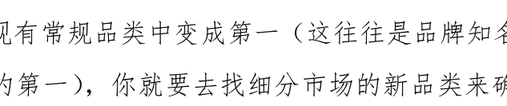

“第一”永远不是一劳永获。

2663 楼
作者：大秦的疆士 日期：2018-12-13 00:07

### 能量(2)：单纯、简单的信息

使用说明：品牌定位的品牌口号(slogan)要单纯和简单，无论是什么媒体的广告，还是终端的物料，或者产品的包装等各个角度，都要如如此。

帮助理解：不考虑艺术价值，《清明上河图》和《蒙娜丽莎》两幅绝世画，你最容易记住那幅画的内容？”“我在工作上很出色，擅长与他人交流，在公众演讲也游刃有余，而且我对对手来说‘南方菜和北方菜我都会做’和‘老娘上得了实厅，下得了厨房’，这两种说法，你更喜欢哪个？两个问题的答案都很明显，都是后者。为什么？我们的大脑就是这样，偏喜欢简单的信息，它不会感觉记忆的压力。

特刊：对许多人或产品，成功的捷径是看看你的竞争对手正在做什么，然后去掉其中的诗意或创意，因为这些已经成为阻碍信息进入心智的障碍；2，“一词占领心智”理论，让消费者将你的品牌与某一词等号（如沃尔沃的“安全”、宝马的“驾驶”、洁士的“防蛀”）。一旦在消费者的心中拥有了一个词，你就能得利它，否则就会失去它。

Ps:特劳特在这里所谓的“诗意”，经本人研究和对比，

 我推断并不是指诗歌抽象艺术，而是指较高的句式（如上述）。

书中案例：舒力士啤酒的广告“顶级啤酒的乐趣”中的诗意掩盖了定位（特劳特先生的理由是消费者不会认为顶级啤酒是好喝的）。百事啤酒的广告“顶级啤酒的乐趣”很差劲。按照特劳特先生的要求，简单，去掉其中的“诗意”，可以改为：“了解顶级啤酒！”。至于舒力士啤酒的广告，我觉得OK，没有毛病。大家尝试套在自己的品牌上面，定位在体现上，是不同。

 笔者的延伸：
- 1、品牌定位在产品介绍方面，要给出合理的解释。
- 2、品牌定位在基础之上，再考虑信息的简单，不需要行业。
- 3、特劳特先生在这里故意混淆了品牌定位和 slogan的概念。应该说，品牌定位是为了体现定位的，但 slogan可以更灵活多变。你可以说是有创意的让消费者很容易忘记。
- 4、“一词占领心智”理论还是非常值得借鉴的，但品牌定位的认知过程，是通过广告、价格、产品外观、功能差异、终端形象和 slogan 等因素综合产生的，并非仅一个 slogan。这个“一”后面就是“词”，也有可能是一个画面，或者一个场景、一种心情，还可能是一种声音、一个词组等等。总之，品牌定位进入消费者心中，最有效的是信息足够简单有效且这个信息在消费者心中已经和你的品牌划了等号。利洁的广告，“买利洁就利洁，利洁就是利洁，利洁就是利洁”，意图就是这么明显的。

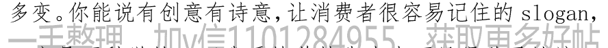

2682 楼 
作者:大秦的疆士 日期:2018-12-14 11:50

### 能量(3): 借力打力

使用说明：所谓“借力打力”，就是将你的定位建立在消费者已有的心智之上。借的这个“力”可以是消费者的某种认知（特劳特称之为“非可乐”定位法），也可以是竞争对手在消费者心中的认知（特劳特称之为“关联”定位法）。借完了“力”，再打“力”就好（确定自己的定位）。

书中案例：
1、安飞士租车公司（美国排名第二的租车公司），经理加入公司获取更多流量后爆发，它的定位（关联位）是“安飞士在租车行业内不是第二，为什么我们还收钱？我们工作努力”。
2、七喜公司，他们把自己的产品定位为“非可乐”饮料（“非可乐”定位）。

案例中的结果：
1、安飞士租车公司，定位后从之前的不盈利实现了每年百万美元的盈利，后来卖给了国际电话公司(ITT)。
2、七喜只告诉了消费者他们是什么，但是没有告诉他们他们是什么，同时还犯了很多错误，如广告内容先后不一致和想当然的品牌延伸（推出“金七喜”），最终输掉了与雪碧的战役。

笔者的观点：
1、“借力打”的定位方法，只能确定借的“力”是在消费者已知中，不失为一种有效的定位方法；
2、“借力打”除了特劳特先生所说的“关联定位”和“非可乐定位”外，还存在其他的方式。比如那句大家耳熟能详的“不是所有牛奶都特仁芬”，就是运用了消费者心中认为牛奶差不多的认知，反其道用之（可以叫“可乐”定位）。
3、现在流行的跨界营销，即A行业的产品与B行业的产品联合销售，也是一种定位的表现。
4、“借力打”定位虽然可以借鉴，但底层还需要产品配合。比如安飞士租车公司，他们说自己更努力，发现不仅努力，还在顺畅，那怎么打动人心。

2706 楼 
作者：大秦的疆士 日期：2018-12-14 14:22

### 能量(4): 以弱为强

使用说明：“以弱为强”即特劳特先生说的“重新定位”，简单来说，就是将对手的弱点优化成自己的优势。

书中案例：
1、泰诺止痛药行业老大阿司林的产品容易造成胃出血，它的广告语：“还好泰诺”。
2、Advil止痛药，掩盖了其他品牌的弱点，它的广告语：“新一代止痛药”。
3、红牛优加，大部分品牌很像，红牛则不同，它的广告语：“给你带来能量”。
4、Wise薯片的成分是脱水、甘油和盐，Wise的广告语：“有能量”。结果：Wise销量大涨。
5、李洁漱口液有味，李德林重新定位，“口味不错”。结果：Scope从李洁手中抢走了几个百分点的份额，占据第二的位置。

笔者的观点：
1、“以弱为强”的方法非常适合企业寻找差异化卖点；
2、将“以弱为强”作为品牌定位的核心，看看这个卖点够不够硬（如果只是包装比对手好看，是没有办法升位的）；
3、品牌定位在广告里让消费者自己判断你是在针对谁；
4、“新一代”这个形容词很有杀伤力，打车（滴滴）、新闻App（今日头条）、出行方案（摩拜）。互联网独角兽的背后，都是“新一代”。

2710 楼 
作者：大秦的疆士 日期：2018-12-16 16:04

## 能量（5）煽动心的形容词

使用说明：有些形容词能让消费者很快认同，将这些形容词变成品牌进入消费者的心智，就是成功的关键。这样的形容词，除了所述的“新一代”外，还有特劳特先生在《重新定位》书里补充了“专家型”和“经典型”。

专家型：
1、专家型品牌可以将精力集中到一种产品、一种利益以及一种信息上，这样产品就有了强烈的特征，能很快深入消费者的心智。
2、专家型品牌可以被消费者认为是专业或最佳品牌（如耐克）。
3、专家型品牌可以成为同类产品的代名词（如施乐复印机、可口可乐）。

书中案例：
1、达美乐披萨，专业披萨外送（VS 客者）；
2、金霸王电池，专业耐用的碱性电池；
3、嘉多公司专注于高性能发动机油；
4、联邦快递成为隔夜快递代名词；
5、某吉他公司重新推出了它在20世纪30年代销售的无装饰吉他，命名为“1系列”，很快销售良好。

笔者的观点：
1、能够快速拨动消费者心的形容词并没有我们想象那么多，除了“新一代”（代表创新或新技术）、“专家型”（代表专业）、“经典”（代表历史和品位）之外，上榜的形容词要充斥（很多形容词虽然是品牌的特征，但不能打动消费者）。
2、一旦锁定品牌形容词的目标，整个营销体系都要围绕这个形容词服务，你的产品或服务要配上这个词（消费者对这个形容词的理解是与你的品类相连接的）。
3、当你将某形容词变成了自己品牌的烙印时，一定要在原有品里坚持下去，一刻都不能松懈。消费者的眼睛是雪灵的，一风草动都会改变他们的印象（还有其他品牌的虎视眈）。
4、一个问题：当成为某个细分市场的专家型品牌后，为了公司快速发展，到底要不要渗透到其他市场（所谓单一品牌战略和多品牌战略之争，也是特劳特先生一直反对的品牌延伸）。这个问题在后面讨论（如小米和三星）。

2742 楼 
作者：大秦的疆士 日期:2018-12-17 23:49

## 能量（6）名字的威力

使用说明：名字非常重要，应该很快穿透人心，一定要有一个好名字。品牌名称并非属于定位范畴，但特劳特先生已经再再三强调了名字的重要性，在这里不得不提，大家记住的同时还要重视名字的选择。

## 能量（7）：运作

纵观特劳特先生的《定位》和《重新定位》这两本书，能够帮助我们寻找定位的核心就是六种能量。能量种类不多，但就像定位法加上定位式，一共才九剑。能量运作，就可以开辟天地。

定位运作，书中夹杂了一些定位原则，在这里罗列，不做详细解释：

- 1、专注于潜在客户而非产品；
- 2、新品需要更新（不要旧品牌）；
- 3、创新很重要（必须创造新产品）；
- 4、为产品找新的用途或者增加服务；
- 5、价值是关键（特别的产品、转移关注、增加价值）；
- 6、品牌故事是同盟；
- 7、不要重复定位，强化最初的概念；
- 8、对于领导者而言，一定要放在消费者心中的第一位；
- 9、用消费者的标准确定自己的地位；
- 10、抓住机会，或者开发新的品类；
- 11、实力很重要；
- 12、对于对手，行动一定要迅速响应；
- 13、用多品牌拦截对手；
- 14、跟随者而言，速度很重要（尤其是新的品类）；
- 15、从尺寸、高价、低价、其他因素（性别、年龄、促销方式等）等方面寻找空白点（细分市场）；
- 16、不要满足所有需求。

总来说，理解了这六种能量和16个定位法，就可以了解定位的运作规律。

2764 楼 
作者：泰森的疆 日期：2018-12-19 00:07

### 黑洞(1)：忘记成功之道

解释：什么是成功之道？就是之前的定位。忘记成功之道，就是改变当初的定位，没有一而终。

书中案例：之前提到的安飞士租车公司，后来出来的广告不再说它更努力，而是说它要当第一。它并没有针对行业老大的弱点加以利用，结果它并没有等到第一的滋味。

笔者的观点：当行业的环境和企业产品服务没有明显变化的时候，企业的确应该改变当初成功的定位。但一旦这些因素发生变化，企业顺势改变也是理应当的事情（否则还要重新定位）。我对于“忘记成功”的理解是“不要忘记消费者心中已有的认知”，即使你因为主观的原因调整定位，也要尽量与已有的认知相关，而不是轻易给出结论（定位要始终：特劳特先生见）。

### 黑洞(2)：由此及彼

解释：这里的“由此及彼”我认为翻译不准确，合理的翻译应该是“不切实际”，言下之意就是“没可能就不是，不要妄想搬行业领导”。

书中案例：当年RCA向计算机行业全速进军，要挑战IBM龙头老大的地位，万炮齐发发起了攻击。结果，IBM是行业老大的定位已经在消费者心中深根蒂固，于是RCA公司惨败收场。

笔者的观点：特劳特的这个黑洞，强调的是领导者的江湖地位在消费者的心中已经确定，不要妄想撼动它（事实上IBM已经被击败了，心疼）。野心是个好东西，但不要高调。时代总在变化，机会总是有的。领导者可以被击败，这需要“新”，新品类、新功能、新技术（苹果公司总是把原来行业的领导者干下，靠的就是“新”）。人都有野心，公司当然也有野心，但更要有领先新品类的嗅觉和能力，同时再搭配一个领先定位。

### 黑洞(3)：无名

解释：所谓“无名”就是品牌名称是没有意义的字母（汉字），消费者只看名称不知道会是什么样的品牌。

书中案例：各种英文单词的缩写或过时的名称。

笔者的观点：严重同意特劳特先生的观点，其在现在的市场环境下（联想、多多互联网公司的品牌名称都像联动动物王国了，蚂、牛、松鼠、狐狸等动物都光荣地入圈）。没有特点，不能让消费者看到后联起有记忆。

### 黑洞(4)：品牌延伸

解释：就是所谓的“单品策略”，即将品牌从原来的品类延伸到别的品类。反义词，“多品策略”，一个品牌。书中案例：太多。笔者的观点：后面专题介绍，在此简述。

解释：特劳特先生认为“价格通常是差异化的敌人”，试图将对手重新定位为“价格战”不是好策略。当低价成为品牌传播信息的焦点时，这是在破坏被顾客视为独一无二的机会。

在《重新定位》书中，特劳特还引用了波特（商业管理界公认的“竞争策略之父”）的格言：如果对手能把价格降得和你一样，那么降价通常是愚蠢的行为。

书中的案例：廉价胡萝卜。一家公司开发一款专为小胡萝卜设计的独特包装系统，而这个系统会让对比行业中大家公司具有绝对价格优势。

但是后这两家公司立刻跟着降价，与新公司持平。这使得新公司继续降价，导致两家大公司立刻把价格降到同一水平，第二次降价看起来非常的不愚智。

结果：这家新公司把包装系统卖给了其中一个大公司，从而获利丰厚。大家欢喜。

笔者的观点：诚如克尔·波特所言，如果对手能把价格降到和你一样的水平（甚至直接更低来封杀你），那么低价就是一个烫手山。事情并没有这么简单。如果你由于某种新技术或资源或商业模式，能够把价格降到对方做不到的地步呢？即使对方亏输你对峙，但他坚持的时间也是有限的，最后的赢家还是你。价格永远是消费者关注的一个点。这里有一个前提，产品体验必须在一个水准。

回到特劳特书中的这个胡萝卜案例当中，假设这家新公司获得了投资的支持，坚决将价格战打下去，谁能知道这两家公司会坚持到什么时候呢？

对于新公司（尤其是互联网公司）而言，要么靠产品体验上有明显的差异化取胜，就要靠低价策略，快速抢占市场。否则生存就会变得非常困难。互联网公司经常使用的套路就是用新的商业模式（如规模效应后的集中采购）来降低产品的成本，然后在投资机构鼓励的眼下，又顾顾地以低价去冲击对方。

回到定位，低价不是差异化，但“高价比+不错的体验”是差异化的一种方式。

### 黑洞(7)：其他黑洞

除了上述六种黑洞外，特劳特的定位宇宙里还有其他的黑洞，但这些黑洞破坏性一般（有些属于常识），我在此处简单列举：

- 1、不要只看着增长；
- 2、不能用自己的标准来建立领导地位，用消费者的标准确定；
- 3、不要试图满足所有的需求；
- 4、不要在公司内部产品里找定位，而应该在消费者心中找定位。

关于特劳特的定位宇宙，我们就介绍到这里。

# 2792 楼
作者:大秦的疆 日期:2018-12-21 00:58

### 第五节 郎教授讲了一个叫“行业本质”

郎延平教授人物，想必大家都都知道。从 04 年在上海电视台台一个财经频道主持财经评论节目《财经郎延评》开始，郎教授就在国内名声鹊起。一直到现在，他还是国内许多活跃在在线的经济学专家。聚光灯下，他的功与过、是与否，都是大家的焦点。本着毛主席说过的一句话，“没有调查就没有发言权”，在这里，我不能妄自评论郎教授。大家都要记住一点：郎延平是一个很有争议的人，同时，他是牛通的公司金融专家。

为了在本章中提到“定性”时，为什么要提绍郎教授呢？因为他在经营江湖里扔了一块叫“行业本质”。

时间回到 2007 年，彼时的郎教授是在国内如日中天时候，被许多年轻人誉为经济学的领人物。也许在这一年的某深夜，我们的郎教授在房间里手里拿着红酒杯，轻轻地踱着步，他在思考一个重要的问题：既然我在国内已有如此的影响力，为何不大胆推出我自己的理论呢？总是讲别人的理论表现出我大师的水准！

在冥想之后，他将视线钉在了一个哲学的名词上——本质！对，就用“本质”！万事万物都有规律，这规律就是他们的本质，行业当然就有行业的本质。企业遵循了行业的本质，就是正确，不遵循，就是错误。恳！这个概念提出来，谁能反驳它不对对呢？我果然冰雪聪明！哈哈！

在邱教授的眼里，“行业本质”是判断企业策略正确与否的一把尺子。现在我们也知道了，定位与企业战略是息息相关的。所以，在了解“定位”的时候，我们不妨也了解一下邱教授的“行业本质”。

# 2798 楼
作者：大泰的疆 日期:2018-12-21 20:23

## 01 邱教授的逻辑

了解邱教授的“行业本质”时，我们不妨带着三个问题。第一个问题：行业本质到底是什么？我们找到本质是否有规律？

第二个问题：邱教授是如何证明自己的“行业本质论”是正确的？第三个问题：邱教授的“行业本质”会不会帮助企业寻找适合自己的定位。

书《邱正传》，邱教授“行业本质”的内容共有三本书，分别是《本质I》、《本质II》和《本质III》，考虑到其中逻辑的相通性，我们通过了《本质III》来打开“行业本质”的大门。

我们先来看看邱教授是怎么介绍行业本质的。他先分析星巴克咖啡的成功，在于提供了市场需要的东西（咖啡体验），然后引出了行业本质的概念，“消费者的欲望和感觉”。

## 02 邱教授的行业本质案例

行业(1)：手机行业。

邱教授认为的行业本质：能量。
解释：“能量”是行业基础之一。能量可以转化为能量，能量储备越高，转化的能量越大。一个企业想要成功，就必须在产品、服务上达到这个要求。若要在对手中突围，还要在这个上做到卓越。这就是所谓的行业本质。

好，现在我们来翻译。邱教授的“行业本质”就是行业的基本要求，即针对消费者的欲望：
- 还有一个“感觉”。什么是感觉？就是情感上的体验；比如优雅的环境。
- 这种感觉看似是显而易见的。OK！概念已经清楚了！
- 手机公司要把品牌形象拉高，提高能量，抓住客户的核心，之后在低端市场释放能量，从而在竞争中脱颖而出。
- 正面案例：诺基亚、摩托罗。
- 反面案例：三星、CL。

笔者的观点：
- 1、邱教授所谓的“行业本质”，说白了，就是企业应该先通过高端市场打造品牌知名，然后从低端市场逐步渗透。
- 2、“能量”与教授提出的行业本质概念并不符，与其说是行业本质，倒不如说是套路。
- 3、显然我们通过行业了解，很容易判断出这个“能量”有点扯。正面案例：诺基亚、摩托罗。
- 4、现在盛行的华为、OPPO、vivo等品牌的做法并不符合“能量”，更像是“动能”（在中低端市场储备）。
- 5、结论：“能量”从概念和实际来看，都不符合行业本质。

# 2825 楼 
作者:大泰的疆 日期:2018-12-22 19:08

## 行业(2)：电脑行业

邱教授认为的行业本质：最佳伙伴（外观+内涵）。
解释：邱教授认为人与电脑关系亲密，产品的功能方面很难差异化。因此，与消费者建立的关系来增强“伙伴感”。
- 正面案例：戴尔、苹果。
- 反面案例：三星（传统）。

补充：2017年全球笔记本电脑的市场排名：
| 排名 | 品牌 | 份额 |
| :--- | :--- | :--- |
| 第一 | 惠普 | 24.4% |
| 第二 | 联想 | 20.2% |
| 第三 | 戴尔 | 15.2% |
| 第四 | 苹果 | 9.6% |
| 第五 | 华硕 | 9.5% |

（数据来源：研究公司TrendForce公布的2017年笔记本电脑市场报告）

笔者的观点：
- 1、从2017的数据来看，邱教授视为走在行业正确大道上的戴尔和苹果，并没有拨得头筹。
- 2、惠普和联想的成功并非外观和内涵如此简单。惠普的暗影精灵游戏系列和精英系列，以及联想的小新系列、拯救者系列和ThinkPad，这些产品的成功已经验证了细分市场和产品定位的重要性。
- 3、邱教授认为的“最佳伙伴”笔记本电脑行业本质，早已不适用于消费群体和日益变化的环境。
- 4、单纯从“最佳伙伴”的角度来判断一个笔记本公司是否战略正确，是远远不够的（甚至不能太当回事）。
- 5、结论：“最佳伙伴”或许曾经体现了笔记本行业功能和情感的基本需求，但环境在变，消费者群体结构在变，需求也随变。可见，行业本质的概念并非普世的真理。

# 2827 楼 
作者:大泰的疆 日期:2018-12-23 00:59

## 行业(3)：白电

Ps: 所谓白电行业，顾名义，是指白色的家电行业。
在《本质III》中，邱教授将白电的范围定义为电饭煲、洗衣机、冰箱、微波炉、空调等。按照家电行业的分类，白电主要指冰箱、空调、冷柜和洗衣机，至于电饭煲和微波炉，一般都放在“小家电”的品类中；黑电主要指电视。

邱教授认为的行业本质：外溢效应。
解释：邱教授说的“外溢效应”大体意思是我上述说的“功能”，即反“能量”，由低打高。

邱教授的观点：白电行业本质的实现分为：
- 第一步，具备基本功能的基础上，性价比要在消费者心中有重要的位置（满足中低端市场需求）。
- 第二步，在基本功能的基础上，性能要可靠（用原材料来保证）。
- 第三步，增强特性差异化或通过扩大产品组合实现多元化，扩展市场到高端或新领域，实现利润增长（做高端或延伸到其他品类）。

简单梳理下，就是想在白电行业里先在中低端市场打出名，然后再向高端发展，或者直接到别的品类。
- 正面案例：美的、东芝。
- 反面案例：三星、小鸭。

补充：2017年空调国内市场排名：
| 排名 | 品牌 | 份额 |
| :--- | :--- | :--- |
| 第一 | 海尔 | 30.9% |
| 第二 | 美的 | 22.5% |
| 第三 | 格力 | 12.4% |
| 第四 | 美菱 | 8.8% |
| 第五 | TCL | 5% |

（数据来源：公开资料）

笔者的观点：
- 1、空调在2017年的份额不知道跑到第几去了，这样的外溢效果如此高。
- 2、空调市场份额如此高，但它并没有简单地“外溢”，而是用功能来入侵。
- 3、现在盛行的华为、OPPO、vivo等品牌的做法并不符合“能量”，更像是“动能”（在中低端市场储备）。
- 4、海尔、美的、格力等品牌的成功，不能简单归于“外溢”，只是总结了。
- 5、结论：白电行业，海尔、美的、格力等品牌的成功，不能说明其是正确的。

# 2832 楼 
作者:大秦的疆 日期:2018-12-24

## 03 邱教授的行业本质概念

虽然郎教授的“行业本质”的内容并不是缺乏说服力，但我认为还没有放弃，下一个是邱教授。

邱教授的“行业本质”的真正概念，我们先回头理解一下作者提到的三个问题：
- 问题1：行业本质到底什么？找到本质是否有规律？
- 答案：行业本质是消费者提供的功能和基础。我们需要找到规律。
- 问题2：邱教授是如何证明自己的“行业本质”是正确的？
- 答案：找一些正面和反面案例来论证其正确性。
- 问题3：邱教授的“行业本质”会不会帮助企业寻找自己的定位？
- 答案：行业本质分析是行业的基本需求，定位是为了差异化。

简单分析下邱教授“行业本质”的概念。邱教授认为的行业本质是指行业在功能和情感上的需求，但这显然太局限了。他忘了约翰的一句话：“唯一不变的是变化”，基本需求明显会随着时代的变化而变化。手机的基本功能15年前就是打电话、短信，现在呢？行业一定要有情感需求吗？想想在很多行业刚形成的时候，比如手机、家电、笔记本，那时这些产品都是新鲜的新玩意，消费者根本不关注其情感需求。因为“功能”就是吸引他们进行消费。难说行业形成的时候没有情感就不符合行业本质吗？之所以买某个产品给消费者带来某些情感上的满足（如前卫卫生的生活方式），这是消费者自己的事情。所以我们可以说，行业的情感是功能的附加值，更多时候是企业为了引导（为了差异化的）。

所以，行业本质真正的概念应该什么呢？我的观点，行业本质是“消费者对某种需求的一种解决方案”。

举例说明：
- 手机行业的本质，是消费者与外界沟通的一种解决方案。
- 冰箱行业的本质，是解决消费者食物保鲜（冷冻和冷藏）的一种解决方案。
- 笔记本电脑，是消费者便利地使用电脑的一种解决方案。
- 汽车行业的本质，是解决消费者交通快速便捷的一种解决方案。
- 电商行业的本质，是解决消费者购物便利的一种解决方案。

在时代变化中，解决方案也在不断升级，这种升级既可能是基于某些细因素的市场细分（汽车行业分为跑车、SUV等），也可能是因为技术的革新而升级（手机行业升级到智能手机行业）。同时，这些升级后的解决方案又会反过来影响消费者的需求（消费者只会考虑电话和发短信的基本需求）。至于消费者情感上的满足，是解决方案的加分项。

当一种新的解决方案可以完全替代现在的解决方案时，新的行业就会淘汰原来的行业（比如胶胶机被手机行业淘汰，胶相机被数码相机行业淘汰），这是时代发展的必然。只有在残酷的市场竞争中取得了胜利，获得了强大的认知，才有后续发展的机会。换言之，“外溢”只是总结了过程，并非成功的因素。根据上述行业分析，我们已经得出了。

“定位”方面最大的区别，也许是因为老人家觉得特厉特说的没毛病，自己又不想采用也未知的。

即邱平俊，为了体现自己学术学上的造诣，在营销的江湖里圈了一个地方，叫“行业本质”。只是由于内容过于粗放，且他所分析的案例并没有给这个理论提供充分的说服力，他的“行业本质”就没有在营销江湖里掀起什么风浪。行业本质似乎与“定位”无关，其实我们是很很容易得到一个潜台的：不符合行业本质的定位是不科学的。

是在我们面前面对行斜，得到行业本质的概念（消费者某种需求的一种解决方案）后，我们仍然可以遵循这个潜台词，用行业本质来检验定位（定位是要告诉消费者你们有差异化的解决方案）。

现在，是时候侯总结总结“定位”了。

作者：大秦的墨 日期:2018-12-27 13:18

定位是个必考题。

总结“定位”，是要明确对待“定位”的态度。如何对待定位？如果把企业的经营比作一场考试的话（考试时间：从成立到结束），那么定位的问题，就是这场考试中的一道必修题。

之前说过，定位是营销江湖里的地理坐标。不管你有没认真考虑过定位这个问题，它都会在那里——你不定位，消费者会自己给你定位。既然如此，还是自己主动出击定位，更容易有稳胜。

那么定位这个课题，是一个什么样的题目呢？是一篇无命的说明文（占的分数不少）。自己命题，然后进行说明阐述。

既然考试都想高分，那么这说明文就要写的好。先起一个能吸引球目的题目（不仅品牌要好名字，定位也需要），接着遵循说明文的三要素（内容严密、说明生动、语言准确）对它进行阐释，达到让卷老师（消费者）信任的程度，按照“总—分—总”的结构，最后在进行提炼和升华（增加消费者的记忆点）。一篇高分的说明文就就会成型。

有一个值点值得庆幸的，是因为考试时时间很长（除非非公司很快关闭），所以你在写这篇说明文的时候还可以反复修改（特劳特的《重新定位》）。

总之，定位这个课题很重要，答题的时候一定不能马虎。

## 02 定定的水准有层次。

在特劳特和特洛特两位先生的眼里，定位这件事似乎很清晰，但在实际经营过程中，定位还是存在层次之分。

- 定位 1.0: 定位的初级阶段。通常的做法是“价格定位”。通过价格告诉消费者自己的品牌是低端、中端还是高端。

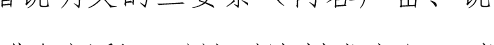

产品的差异在于品质上。但关于定位，也就此结束了。

- 定位 2.0: 定位的觉醒阶段。在定位 1.0 的基础上，增加了品牌的 slogan，用来代表品牌的承诺、情感或号召力。在这阶段，企业已经有了主动定位的意识，试图用 slogan 背后的差异，吸引消费者的关注和青睐。

- 定位 3.0: 定位的成熟阶段。在这个阶段，企业对于品牌的市场认知已经满足于一个 slogan，而是要给自己贴上独一无二的标签（前文曾经提到的“扣人心的形容”），而形成鲜明的品牌理念和记忆，方便消费者能够从茫茫的品牌产品之中看到自己和选择自己。

- 定位 4.0: 大成阶段。在此阶段，定位和品牌已经融合为一体，定位不再仅仅是一个锚点，而是成为一种品牌腾、一种品牌信仰。消费者已经关注你的定位是什么，你的产品体验怎么样，只要是你的品牌产品，他就会购买的欲望。

Ps: 除了定位 4.0 需要时间的沉淀和市场的不断检验外，其余三个阶段并不需要按部班地逐一升级，一个新进入行业的公司完全可以直接从定位 3.0 开始（互联网公司起步阶段就会给自己贴上“新一代”的标签）。

作者：大秦的疆 日期：2018-12-28 13:15

## 03 定位有流程吗？

既然定位如此，那么我们当然有理由想要知道如何寻找和确定定位。定位是否有流程？无论是斯科特还是特劳特，他们其实都在试图给出定位的方法。既然我们已经了解了特“定位”的内容，那我们就按照他的理解给出一个定位的流程：

- 第一步，解释“定位范围”。这样定位的内容都有——品牌宣言（第一环）、共同点（第二环）、证据（第三环）、价值观、个性、性格（第四环）；
- 第二步，寻找共同点和差异点（还记得差异点的标准吗？影响力、区分度）；
- 第三步，填充。根据自己的共同点和差异点，完善定位范围；
- 第四步，确定表达方式（如品牌故事、品牌等）。特劳特的风格是简单直接的。在他的眼里，定位就是定位。现在让我们回顾定位的6个：

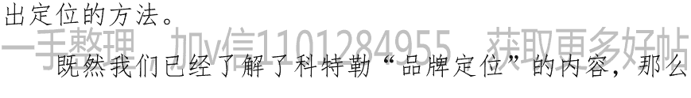

- 1、成为第一。既然特要要满足人的需求，所以有理由认为“成为第一”就是细分市场或新品类；
- 2、简单。这是定位的标准；
- 3、借力。借力的前提是分析和确定要“力”（消费者的认知，包括竞争对手的认知）。显然属于定位的过程；
- 4、攻弱为强。这点旨在确定自己差异点，其中分析“攻弱”和“我强”又是相反；
- 5、植人心的形容。这样也是定位的标准；
- 6、好名字。严格来说，名称属于定位工作的范畴，而是定位的重要辅助工具。对于特劳特先生提到的6个，在整个定位过程中必须以此为。现在我们可以梳理定位流程了：

- 1、了解自己（我想满足的需求是什么？我能在哪些方面做的好？）；
- 2、了解（对于有的品类，消费者的认知是什么？竞争对手是怎么看的？）；
- 3、了解（竞争对手有什么弱点是可以我的优点？）；
- 4、确定（我要在哪些方面做的好，我要给消费者什么样的差异化认知）；
- 5、确定第一（是否更有效地针对某个细分市场，或者可以包装成一个新的品类？）；
- 6、确定内容（简单、扣人心的形容）；
- 7、检查（我的名字好吗？我是否避开了那几个黑洞？）；
- 8、确定。现在我们已经推出特勒和特奇两位大咖的定位流程，接下来是见证1+1=2”的时刻了！

作者：大秦的疆 日期：2018-12-30 21:03

定位，虽然是为了差异化进入消费者的心智，但由于为了获取更多好处。根据定位，定位的是自己的位置。以此，我们可以将定位理解为企业的一种自我认知。既然如此，我们不要参照弗洛伊德的本我自我概念，将企业的定位流程分为四个阶段：

### 第一阶段：本我

弗洛伊德的“本我”，是在潜意识形态下的思想，代表思维的原始程序——人类最为原始的、满足本能冲动的欲望，如饥、钱、性欲等。折射到企业的定位流程中，当然不是分析原始的欲望（挣钱），而是企业的自我审视。在这个过程中，企业要明白核心优势（就是核心竞争力）是什么，其次从行业的本质出发（解决方案），考虑在产品或服务上提供什么样的解决方案。在“本我”阶段，强调的是客观地剖析和评估自己。

### 第二阶段：自我

弗洛伊德的“自我”，是负责处理现实世界的事情，它一方面调节着本我，一方面又受制于超我。在企业的定位流程中，“自我”则是更多的比较或衡量——在与竞争对手的比较或衡量中，找到自己差异化的价值存在。在此阶段，企业要搞明白优势（消费者的认知）和弱点，从而确定“自我”的差异化应该在哪里（我强）。同时，既然是自我识别阶段，当然要给自己取个好名字（“朱元璋”比“朱重八”更像一个皇帝的名字）。

### 第三阶段：超我

弗洛伊德的“超我”，是良知或内在的道德判断。它是人格结构中的管理者，由完美原则支配，属于人格结构中的道德部分。对于企业的，“超我”则是精神层面的价值主张，其中包括品牌的价值、观点、性格和品牌宣言（如品牌 slogan、品牌故事等）。在此阶段，企业结合前面的“本我”和“自我”，在精神层级寻找自己存在的意义——对内，肯定了自己，获得了足够的自信；对外，提出差异化的情感附加值，以击中消费者的内心世界。除此外，在“超我”阶段，还有一门功课——“成为第一”。

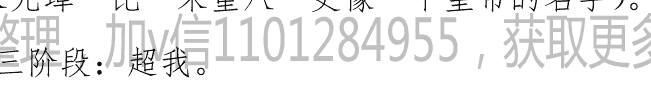

### 第四阶段：自我反省

不管是《论语》还是《荀子》里讲到这个道理，大家都明白了，说白了就是要自我反省。跟考试一样，定位在经历了上述“本我”、“自我”和“超我”阶段后，也要检查。检查的标准是避开了那几个黑洞，强调“单纯”，还有定位范围。以上就是根据自己的实践总结的定位流程，一言，仅供参考。

## 04 实践“定位”。

关于“定位”，我已经写了三万多字。“定位”对于营销体系来说是非常重要的。定位的概念是差异化进入消费者心智，这就体现了一种普世的经营哲学——市场是多元的，消费者需求是多元的，品牌和产品也可以是多元的。差异化是企业在市场竞争中生存之本，也需要企业清晰地表达。接下来，介绍几个关于定位的案例。

### 案例（一）：FG汽车

简析：FG汽车是老字号品牌，如今已有80多年的历史。但随着行业发展，产品同质化极其严重，且一直没有清晰的定位。对于80后、90后、00后而言，FG这个老字号品牌完全没有概念，在年轻人的品牌认知几乎消失了。

- 观自己：FG汽车在制造水平、产品设计和性价比等方面其实都没有做到领先。就价格水平而言，市场对其定位属于“中端”产品。
- 寻找自己的价值：FG汽车一直有一个差异化产品——国礼系列（作为国家的礼品赠给其他领导人），但该系列产品价格过高，与其市场“中端”的认知符合。思路：1）不仅坚持老字号品牌的历史荣耀，这并不会影响年轻人的购买意向；2）将别人不能模仿的外观设计产品国礼系列配置降低，拉到中端的配置和价格。
- 精神层面的价值主张：FG品牌竖起“价值”定位（没有其他品牌用过），用“国礼系列”差异化的外观和高颜值，吸引年轻人的关注。围绕“价值”制定品牌的广告语和传播方案（如：你是靓丽的风景，FG汽车）。

总结：FG汽车的定位过程，关键是打破原有思维的束缚，放下老字号品牌的执念，在同质化产品中寻找自己价值的差异，并升华到品牌价值主张的高度。

### 案例：LN宠物食品

简介：做猫狗粮的私营企业。该企业之前一直只出口，后想打国内市场。在我的介入的时候，他们已经明确了自己的差异化卖点——与某大学研发团队的合作，他们的产品中有一个元素：能让宠物变得更聪明（脑洞有点大）。

- 本我：确定让宠物变得更聪明会有效果，而且这是唯一的差异点。
- 自我：解决关键的问题：在消费者的认知中，宠物需要变得更聪明吗？变得更聪明对他们有什么好处？如何体现宠物变得更聪明？问题的答案：宠物变得聪明，这样的需求需要引导。大多数养狗的人希望狗的一些动作（如坐下、卧倒等）很快学会。
- 超我：宠物变得聪明意味着什么样的价值呢？有一只聪明的宠物会给家人带来更多的快乐。对应的 slogan是“宠物·快乐”。

总结：LN宠物食品的定位，关键是锁定市场提供的唯一差异，并挖掘其需求。

### 案例（2）：两个互联网项目

简要：共享单车启动了16年，出发点是做细分市场（景区），游客有需求（如智能滑板、电动车等）。对于互联网平台而言，其实定位的运营模式就是前文提到的“新一代”。当其他竞争出现时，差异化的定位才会显现（采取差异化的服务，留住用户并保证用户的活跃度）。虽然上述案例介绍比较简单，但在实际经营过程中，会遇到各种状况和问题，如何坚持落地，也是非常考验人的。

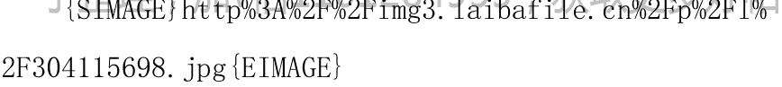

兴阑珊的课程。

1991年的美国。

戴·阿克是美国加州大学伯克利分校哈斯商学院（Hass School of Business）的营销策略教授。自从斯坦福大学博士后，他就已经是这个学院的助理教授。

1991年，53岁的阿克，已经在哈斯商学院教了36年的营销策略。

每一年的营销策略课程中，都有一节专门讲“品牌价值”。此时，还没有“品牌资产”这一说（毕竟阿克教授是“品牌资产”的鼻祖），所以阿克教授使用的术义还是科特勒的《营销管理》。

今天，他是第37次在课堂上开启这本教材，书中“品牌价值”这一章，阿克教授轻却地舒了一口气，“品牌价值来源于消费者的差异”、“反应差异原则消费者所拥有的品牌知识”、“品牌价值体现在感知、偏好和行为等与品牌营销所有的方面”，对，对，还有一个“品牌承诺”，这些内容阿克教授早已倒戈如流，烂熟于心。

在之前36次“品牌价值”的课堂上，阿克教授都是按照《营销管理》的内容给同学们讲，但直到今天，不知道为何，他突然觉得有些意阑珊，他不想再这么讲了。他强烈地感觉科特勒所描述的“品牌价值”太抽象，完全体现不出品牌竞争的跌宕起伏。关键的问题是：品牌的价值到底体现在哪些方面呢？

他决定跟同学们一起讨论这个问题。

3077 楼
作者:大秦的疆士 日期:2019-01-11 17:17

各位泛好友，今天的内容已经在我的公众号“营销这个事儿”上更新了，还请大家关注，不胜感激！用公众号看内容，想看哪里点，关键是图文并茂！

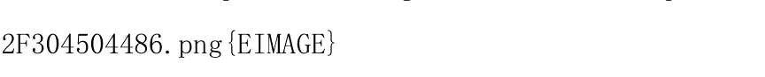

王致玥，加微信1101284955，获取更多好帖

3079 楼 
作者:大秦的疆士 日期:2019-01-12 22:20

各位泛好友，今天的内容已经在我的公众号“营销这个事儿”上更新了，还请大家关注，不胜感激！用公众号看内容，想看哪里点哪里，关键是图文并茂！

感谢大家的支持！

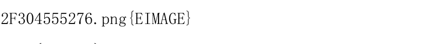

3094 楼 
作者:大秦的疆 日期:2019-01-14 11:09

致各位亲爱的涯友：

写书原来只是公众号，
出版只是锦添花。
奈何无人来关注，
只得专注改原稿。
待得出版版装钉，

# 3108楼
作者:大秦的疆士 日期:2019-01-15 14:12

第一章，加入公众号110284955，获取更多好帖

山程，水程，身向关峦并行。深夜闲焰曲（管）

本章所涉及的理论书籍：《营销管理》、《品牌三部曲（《品牌资产》、《创建强势品牌》、《品牌领导》、《感官品牌》）、《超级符号就是超级创意》）

金庸先生所创作的人物“东邪黄药师”一直拥有超级多的粉丝，可以说他是金庸武江湖中大名鼎鼎的名人（如雷贾那种），我们不妨先通过他来了解怎么才能变成一个名人。

## 第一节 黄药师如何变得路人皆知？

黄药师并不想出名。

当年的“华山论剑”，说到到底，也只是小范围的顶尖学术交流会。这次论剑，黄药师被授予了“东邪”的称号，位天下“五绝”之一。此后，他就逍遥世俗，隐居桃花岛。

虽说有“五绝”的消息并不起，但此时黄药师在武林江湖并不是名人，还是一个神秘的绝顶高手。长得像什么样？什么样的兵器？什么样的武功？为何被酷称为“东邪”？广大的江湖女儿们并不知道。

命运之神还是选择了让黄药师变成一个名人。

话说若干年后，黄药师的女儿出桃花岛，他被迫背誓言出岛寻找爱。由此，他开始了迅速追悔，成为名人的人生旅程。

黄药师怎么变成了一个名人？

- 第一，形象突出。与其武林人士喜欢白色、黑色衣服不同，黄药师从场便一直穿着青色的衣服（“青衣怪人”、“穿一件青色直绫”）。这样大家都知道了“如果碰到穿青色衣服的人一定要尊敬，他有可能是黄药师！”你看，这种“青色”已经被人记住；
- 第二，武功突出。黄药师的武功描写，“桃花落剑，碧海生玉”，明朗口！这就比“狗棍”和“降龙掌”显得有些逼格高。大家提到这两句诗，就会想起黄药师；看到黄药师，就会想起这两句诗；
- 第三，性格突出。黄药师的经历（天山老祖）和性格（狂傲）很快彰显出来。虽然他视传统为术，但他性格极其突出，换言，他的性格是最易成为他的。
- 第四，“弹指功”唯一。在黄药师处的时代，他是“弹指功”唯一的代言人。弹指功很厉害，所以大家聊起黄药师，必然绕不开它；
- 第五，被神化。除了“东邪”，黄药师被金庸先生用“浑然若神”来描述。像神仙一样的人物，多么让人记住！有了上述五种原因，黄药师路人皆知的名字诞生了！

## 第二节 科特勒对黄药师（品牌）解读

品牌有多重要，这点无须说。作为营销管理之父，科特勒当然放过介绍。关于品牌，也许我们想知道的是一个问题：如何自己变成品牌？可惜，科特勒先生并不直接回答这个问题。没关系，介绍完他的内容后，我们可以自己推理这个答案。

### 01 黄药师的品牌化是如何运作的？

从“品牌”的概念说起。根据美国营销协会的定义，品牌是“一个名称、术语、符号或设计，或者它们的结合，以识别某个销售商的产品或服务，使其与竞争者的产品或服务区分开”。这个定义很好理解，说白了，品牌是为了消费者做区分。所以，品牌化的本质就是“如何做区分”（跟“定位”相辅相成）。

在《营销管理》中，科特勒认为品牌化的范围主要有：
- 赋予名称及其他元素
- 确定产品本身的属性或差异
- 宣传情感属性或利益差异

就这些？是的。其实品牌化的内容并没有那么复杂，牢记一点：创造差异。当然，科特勒的介绍实在太简单。现在，让我们回过来分析黄药师成名之路的各种差异，看看是否还有机会。

- 一、业务能力突出，毕竟是“五绝”之一。这是产品质量过硬，有口碑；
- 二、名享给力，获取更多好帖；
- 三、形象突出，青衣。这可以归于识别元素；
- 四、武功有特色，那两句诗。这属于产品属性差异；
- 五、性格独特，邪。这属于情感属性差异；
- 六、“弹指功”唯一。这属于强大的产品属性差异和识别元素；
- 七、被神化，浑然若神。这属于强大的情感属性差异，被崇拜。

OK，这一总结，虽然黄药师的品牌运作都在科特勒先生说的范围之内，只是多了两层意思：一是产品质量过硬，二是差异尽可能突出。最后，任何消费者选择的地方，就能应用品牌化策略。

### 02 黄药师有什么资产？

如果你当面对黄药师这个问题，他可能会轻松地告诉你，“老子有一个桃花岛”。在这里，我们显然不是要讨论这个问题，而是要定义“品牌资产”。

什么是品牌的资产呢？用科特勒的话，就是“赋予产品或服务的附加价值”。好吧，这个概念的确有点抽象，我们给个公式：
普通人 + 差异性 + 公众认知 = 品牌资产。

黄药师之所以名为，除了前文讲过的品牌化（差异），更是：江湖上对他他的了解和熟悉也是重要原因之。所以，差异性和公众认知就是他的“品牌资产”。

公众认知，又可以分为：
- 品牌知识（大家所了解的内容，如黄药师是“五绝”，会什么武功）
- 品牌承诺（黄药师一出手，就知道没有）
- 品牌记忆（你很难记得黄药师这样人物的存在）
- 对品牌的态度（一提到黄药师，可能是敬，可能是勃发等）。

关于定义品牌资产，科特勒在书中提到了品牌资产模型，其中有
- 品牌评估工具（BAV）
- 品牌强度模型（Brand）
- 品牌动力模型
- 品牌共鸣模型

专业术语或模型，其实就是各种角度对品牌资产的评估。总结，在江湖里，名人的资产不是桃花岛，而是差异点和公众认知，这两者才是不可替代的。归结，有差异点才会有品牌。

### 03 如果黄药师想建立品牌资产。

黄药师从来想过自己要成为名人。为了介绍，科特勒在《营销管理》第一章说的“建立资产”，话说第一次华山论剑晚上，没有媒体报道，世人如何得知？这个问题当然难倒了黄药师。他脑子里想几条策略：
- 一、自我形象包装，公开场合就能让人记住（青衣、萧）；
- 二、写自传；
- 三、刷存在，在媒体上发表关于；
- 四、蹭热度，多关注内的大事，没事多参与；
- 五、树形象，干一些事情，让媒体报道；
- 六、集粉丝，建立粉丝圈；
- 七、课程，开办指导班，又能赚钱又能吸引。

完美！怀着对自己成名的无限设想，黄药师。现在回到主题，如何建立品牌资产？说白了，就是如何建立差异化和公众认知。在“品牌定位”一章中，科特勒提到品牌定位要寻找差异点和共同点。所以，在建立品牌资产时，最佳差异点已经是确定的内容。建立差异化，就是围绕差异点，确定品牌的构成元素和识别元素（如名称、标识、形象人物、口号、主色调、包装等），黄药师的“邪”、“青衣”、“弃”。

建立品牌资产的第二个内容（公众认知），就复杂多了，关键还是两个字：传播（全方位营销活动）。

科特勒在这一章中总结了全方位营销的三种方法：
- 一、品牌接触（消费者多种渠道的了解和体验品牌，如个人使用、网上的口碑、交易环节等）；
- 二、整合营销（各种不同的营销活动持续强化品牌承诺）；
- 三、联想的作用（类似于特许特定宇宙中的助力，将品牌与消费者记忆中其他信息联系起来，主要方式言、品牌标识形象人物、活动赞助）。

如果客户还觉得这与我们的营销体系中没有一个是不靠“推广”，那么“全方位营销活动”可以理解为一个意思。所以全方位营销活动的内容，在这里我们就简单罗列科特勒上述的三种方法，不再补充分析。在黄药师的7个策略中，2-7策略本质上都属于他的全方位营销活动。

总结，建立品牌资产，一是包装出自己的差异化，二是把自己推到台上，让大家多看到关注你。建立品牌资产的终极目标，并不是你有多少差异，有多少营销活动，而是你在多少消费者中有好的口碑。

## 04 管理品牌资产：战斗和觉醒

我猜测科特勒先生在写到“管理品牌资产”的时候，愣了一下——如果根据品牌资产的概念（差异化和公众认知），管理品牌资产的内容就是差异化和管理全方位营销活动。前者在“品牌定位”的时候已经经过，后者是计划放在后面“传播”的时候再重点阐述。现在这个“管理品牌资产”应该怎么说？不说吧，又不符合，毕竟之前定义了品牌资产，也建立了品牌资产，按照逻辑，也应该“管理品牌资产”了？

这个问题相当留不住我们的老师了，换一下概念，用“管理品牌资产的两种情况和原则”来代替。一种是“品牌强化”，一个是“品牌活化”。经营企业品牌就要在市场上不断战斗，提高自己的影响力。这个过程就是品牌强化。

品牌强化主要的三个原则：
- 一、一致地传达，如“人类解放”；
- 二、朝着正确的方向不断优化，如装备；
- 三、持续支持（如广告或促销）。

品牌活化近几年，“品牌活化”是个热门词，大家谈到品牌活动时都会提到，言下意就是通过活动方案让品牌活跃起来。科特勒将品牌活化分为三部：
- 一、源于“不要忘记”，品牌开始增长，看来是积极想法；
- 二、重新定位，考虑是将品牌基因重创造；
- 三、品牌强化（调整方向）。

除此之外，科特勒还强调一点：品牌活化开始于产品体验，永远是品牌的第一。以上就是科特勒关于“管理品牌资产”的全部内容，不完整但很巧妙。

## 05 黄药师请说说你的品牌策略

在写完“管理品牌资产”后，科特勒长舒了一气，下一节的内容可以是品牌策略。所谓品牌策略，就是品牌架构。企业的组织架构是根据职能划分部门，企业的品牌架构以此类推，就是品牌数量和组合。我们不妨先从几个概念了解：

- 一、从武术界跨到音乐，这是类延续的品牌延伸（单一品牌从原领域渗透到其它领域）。代表性的品牌延伸：苹果。
- 二、在单一功能的同时，还推出了价格档次或功能不同的新产品，这是产品线延伸（单一品牌推出）。这种做法非常普遍。
- 三、推出黄药师·碧波、黄药师·弹指，这里黄药师是母品牌，碧波、弹指是子品牌。当渗透较多的领域时，就可以为主品牌或家族品牌。代表性的品牌和子品牌：华为和荣耀。
- 四、推出郭靖和黄蓉分别满足年轻男女的需求，这是多品牌（针对不同细分市场）。代表性的多品牌：宝洁及其旗下的N个品牌。
- 五、授权品牌将品牌用到诊所，这是品牌特许（品牌方授权其他公司使用品牌）。

以上概念就是品牌策略的主要类型，企业要做的事情是从这5种做法中决策，选择最适合自己的方式来实现品牌策略。

之前在讲鲁特《定位》的时候，大家都知道他对“品牌延伸”说是痛苦的，因为这会让消费者的心智对品牌失去焦点。而在邱玉平《本质III》书中，他在讲到家电本质时，是鼓励企业在原始的基础上将品牌延伸到家电的其他品类（如格拉斯仕微波延伸到冰箱）。企业到底是选择单一品牌策略（品牌延伸）还是多品牌策略，这一个是营销江湖里争不休的话题。至于两个策略中的“子品牌策略”，似乎是中庸之道，将两者之间的矛盾进行了折中的化解，但其本质上倾向于单一品牌。

正如我在本书开头所，营销是没有标准答案。单一品牌策略也好，多品牌策略也罢，都有自己的缺点，也有各自成败的案例。科特勒同样并没有给出一个明确的答案，而是列出了评判品牌延伸能够成功需要考虑的问题：

这里我就不再复制粘贴了。让我们通过三个有代表性的品牌延伸案例来尝试试出规律。

### 品牌 (1): 雅哈

原品类：钢铁
延伸品类：抱兜差打弹的乐器，还涉及影音处理机器、半导体、体育用品、家具，地上开的、天上飞的、教育业、地产。
延伸最成功：摩托车。延伸原因：因雅哈木工水平在国内遥领先，日本政府都慕名购买雅哈飞机。

### 品牌 (2): 苹果

原品类：个人电脑
延伸品类：PAD、手机、手表、音乐播放器
成功因素：它的基因——带着移动终端。

### 品牌 (3): JEEP

原品类：汽车
延伸类：拥有600种产品和150家特许商家（从轻便婴儿车到服装）。
成功延伸：服装。

5、在新类领域的技术水平以及在此基础上优秀的体验，是延伸成功和核心；

6、消费者的心智或许并非科特勒所认为的讨厌损失焦点，品牌延伸从某意义上会帮助心智识别品牌并做出选择，这也是心智的需求之一。

总结：不管是单一品牌策略，还是多品牌策略，又或者子品牌策略，都没有必然成败的结论，品牌化策略的结果更多的是取决于产品本身。只是单一品牌策略看来更省力，但其背后的要求和试图也更高。

## 第三节 阿克教授的第37次品牌课（第一部）：《管理品牌资产》

一 1931年出生的科特勒，在36岁时（1967年）写出第一版的《营销管理》，后被称为“现代营销之父”。

1935年出生的科特勒，在34岁时首次提出“定位”理论，并在46岁时（1981年），写出第一版的《定位》，后称为“定位之父”；

1938年出的戴维·阿克，在53岁时（1991年）写出他品牌三部曲的第一部《管理品牌资产》，此后他被称为“品牌资产鼻祖”（也称为“品牌大师”）。

01 意兴阑珊的课程。

1991年的某天。

戴维·阿克是美国加州大学伯克利分校哈斯商学院（Hass School of Business）的营销战略教授。自从斯坦福大学读博士后，他就已经是这个商学院的助理教授。1991年，53岁的阿克，已经在哈斯商学院教授了36年的营销策略。

每一年的营销策略课程中，都有一节专门讲“品牌价值”。此时，还没有“品牌资产”一说（毕竟阿克教授是“品牌资产”的鼻祖），所以阿克教授所用的理论还是科特勒的《营销管理》。

这时，他是第 37 次在课堂上翻开这本教材，望着书中“品牌价值”这一章，阿克教授轻轻叹了一口气，“品牌价值”源于消费者响应的差异”“相应差异论消费者所拥有的品牌知识、“品牌价值”体现在感知、偏好和行为等与品牌营销所有相关的方面），哦，对还有一个“品牌承诺”，这些内容内核阿克教授早已倒如流，烂熟于心。

在之前 36 次“品牌价值”的课堂上，阿克教授都是按照《营销管理》中的内容给同学们讲，但今天，不知道为什么，他突然觉得有点意感勃，他不想再这么讲了。他强烈地感到科特勒所描述的“品牌价值”太抽象，完全体现不出品牌竞争的跌宕起伏。关键的问题是：品牌的价值到底体现在哪些方面呢？

他决定跟同学们一起讨论这个问题。

## 02 品牌资产，初见雏形。

轻轻放下《营销管理》，阿克教授用坚定的目光望着台下的学生们，声音舒缓，“同学们，我们今天来草拟‘品牌价值’的定义吧！”

台下的学生们一个个睁大了眼睛，都怀疑自己听错了什么？阿克教授竟然要写科特勒的定义？难道他觉得品牌价值的内容有有问题？

阿克教授转身在黑板上写完‘品牌的价值如何评估？’后，开口道，“同学们，科特勒先生所说的‘品牌价值’内容并不复杂，大家花2分钟就能看出来。但，这些内容真的可以帮助我们评估品牌的价值吗？今天，我不这么认为。为什么呢？因为这些内容太抽象了我们无法测量。试问，怎么评估消费者拥有什么样的品牌知识？消费者的感知、偏好和行为，具体又有哪些内容？对不起，科特勒的《营销管理》里面没有。所以，今天我们要找到答案。”

接下来的课堂变成一场案例讨论，讨论在同类中为何大家会认为A品牌比B品牌更有价值（如可口可乐和百事可乐，耐克和阿迪）。由于讨论的过程比较繁杂，我就在此处直接公布结果。

品牌忠诚度、品牌知名度、感知质量（消费者对品牌质量的感受）、品牌联想、名称标识和口号，以上五个核心，经过讨论，大家一致认为最能体现一个品牌的价值。

“今天讨论的内容会改变大家对品牌的认知！革命看来还会成功！我要把这些内容写成一本书。书名叫什么呢？还称之为‘品牌价值’，大家难免跟科特勒的内容相关并讨论。这不够。跟‘价值’类似的名词，不如叫‘品牌资产’吧！可是现在还只有概念，还得加上如何管理这些品牌资产。”

在很快地思考后，阿克教授决定接着和同学们讨论如何管理品牌资产的问题。

作者：秦泰之疆 日期：2019-01-15（此处为重复性干扰信息）

## 《营销战略》（本书最核心章节）

### 前言 轨迹与构造

著名的史学家司马迁在《史记》中早已道：“先汉间，天下皆为利出，天下皆为利。”由此可见，商业规律的经营，其历史后于很多学科（如经济学、金融学、营销学等）本应如此。通过学者研究及整理，认为营销管理的发展轨迹大致分为五个阶段。

#### 第一阶段：萌芽

1912年，哈佛学的J.E.哈塞尔出版了第一版以《市场营销》命名的书，这标志着营销学的诞生。但当时的市场并没有形成真正的营销管理原理和概念；1953年，尼尔·波登在美国营销学会的就职演说中，创造了“营销组合”这一术语，研究“营销要素”的管理（由此奠定了营销理论的研究方法）。

#### 第二阶段：雏形

1960年，麦卡锡在其著作《基础营销》中首次提到4P理论，将尼尔·波登提到的12个营销要素概述为四大类：产品、价格、渠道、促销；1967年，菲普·科特勒在其营销书《营销管理：分析、规划与控制》（第一版）中，进一步确定了以4P理论为核心的营销组合方法：

#### 第三阶段：满满

1969年，科特勒首次提出“定位”概念；20世纪70年代，4P增加了2P：人和包装；20世纪80年代，大卫·A·阿克的品牌资产概念开始流行；1981年，科特勒正式出版《定位》——“定位”概念开始深入人心；1985年，科特勒在强调“大市场概念”时，又提出了“公关关系”和“政治权力”这两个P。此后，当营销规划变得异常重要时，科特勒又提出了战略规划4P：诊断、市场划分、定位、选择。1990年，美国学者罗斯教授提出了4P理论对应的4C理论：需求、成本、便利、沟通；2001年，美国的唐·E·舒尔茨提出了4R理论：关系、节省、关联、报酬；PS:除了上述重要的营销理论，此阶段还诞生了研究“营销要素”的重要著作，如《消费者行为》、《广告、营销与整合营销传播》、《渠道分销》、《核心竞争力》等。

#### 第四阶段：互联网下的第一次“创新”浪潮

2001-2010年，互联网经济爆发，关于“营销要素”的再研究不能完全适应时商业发展的需求。时代的变革需要“新”的理论来指导企业，于是围绕“创新”的理论不断涌现，从“营销要素”的角度来研究营销，在这个阶段开始弱化。其中代表作为：《科特勒营销论》、《蓝海战略》、《渠道营销》、《赢营销》、《营销4.0》等。

#### 第五阶段：移动互联的第三次“创新”浪潮

2010年以后，移动互联的互联网给社会和经济带来的冲击，因为它改变了消费认知、交易和关系的方式。于是围绕移动互联的“新元素”（流量、自媒体、大数据）被推到舞台中间，被人关注，而“老元素”理论似乎已被遗忘。在此阶段，研究“营销”的著作层出不穷，而这些作者不再是科特勒，新的面孔占据营销理论。代表作为：《胜利移动》、《长尾理论》、《新媒体圣经》、《决战》、《轻营销》等等。

## 前言

营销管理理论作为落实利器，然而笔者认为在实际应用过程中普遍存在两个误区：

其一：营销本质是系统的科学（参考科特勒的定义），而不是工具。既然是一门社会科学，自然就有它的体系和逻辑。这就要求我们要研究学习营销，还要分析其中的体系，从而将营销理论的价值发挥到最大。可惜，在这喧嚣的时代，很少的人花时间去研究营销，更多是把营销当作工具——流量就做自媒体，流量就搞流量，如此做法，是在浪费营销理论。

其二：营销新旧相宜，却只知新换旧。时代在发展，环境在变化，理论的新替更是管理。但很多人看到“新”就忘记了“旧”。在营销江湖，绝大多数人像愣头羊，看到新的（新营销）就一步地跑过去，而把旧的（传统营销）放在九霄云外。轻易否定“旧”，味认为是“新”可以解决企业的所有问题，这是企业最容易犯的错误。

基于以上两种情况，本书主要以故事的形式给各位阐述和分析营销体系和新旧理论的内容，使大家能轻松学习营销理论，对其在实际中的运用也能开展。

## 03 第一回慧商学院

商海沉浮耀繁星，
学无止境通大道，
院内无畏知行。

这首藏头诗是慧商学院的教学理念。慧商学院，是一个神秘而顶级的商学院，华夏有很多众知的企业大咖都来源于这个学院。知道慧商学院的人，都听过一句话：“数慧商学生榜，营销风云弄潮”。我们的故事从慧商学院在某年营销峰会上的亮相说起。暖春四月，首都京城。一度中国的营销峰会如期在京城香格里拉酒店召开。无论事务多么忙闲，很多行业大咖、新锐都会尽可能参加这次峰会。如果你对营销峰会会有什么样的魅力，能如此让众人趋之，一定会许多给你同样的答案——慧商学院。自院长冯涛筹建二十多年以来，慧商学院已跃然成为营销领域最具影响力的组织和风向标。“寻找慧商学院，营销风云扬序”。

当营销学院的学生学费几十万，从营销学院毕业后，他们已经在营销理论和实践方面略有收获：建立了自己的营销体系，形成了一个个人的营销经营术，拥有了对新营销的领先和实战能力，搅拌理论的创新，同时参与企业的营销活动或创业的营销实践。因此，慧商学院的学生向来都是各大企业争夺的营销人才。

慧商学院在营销界如此受到众人追逐，原因有三：一是每年由院长冯涛代表慧商学院参加峰会，他对营销风向的解读透析时，振聋发发；二是慧商学院对外联部主任唐陆会将一些学生的创业项目在峰会上公开，现场参会企业竞价投资；三是慧商学院学生办主任段锦华今年毕业的学生人数和资料，参会企业选择招聘的目标。这三个内容，任何一个都会牵着参赛企业的神经，更何况是三个。于是，每个大佬每年营销峰会自然来了。

今年的峰会上，慧商学院又给大家带来什么样的精彩呢？冯院长的演讲：“尊敬的各位朋友、大家好。”整个会场变得十分安静，甚至能有人在呼吸。冯涛笑道：“今天有些问题，现在的营销环境一样，大家都在一起。为什么这么说呢？因为大家最近在谈论营销，谈的是新零售、新媒体、打造爆款、共享模式，我是认为营销应该用系统的眼光去审视。这些时代下的新事物，本身并没有在本质上突破我所强调的营销体系。新营销是在新的市场、消费者体验、产品技术等方面阐述营销体系的变化。新零售，其实探的是新的渠道模式；打造爆款，本身就是产品创新和促销方面的诉求。即使是共享模式，它的产品无论是共享App平台的线上服务型产品，还是线下共享实物的产品，都是决定成败的关键。”冯涛扶了扶眼镜，停顿了一下，“营销和哲学一样，都是非常高的社会科学。哲学是从动静的科学，而营销是从动到科学的，它们的共同之处都是没有正确答案，都需要实践才能出真知。营销的静，就是我所说的营销体系。营销的动，就是营销体系与时尚俱进的自我修复和实践。各位朋友，这就是我想跟各位分享的第一个内容，新时代的营销，是营销体系的重新审视和变化，每一个内容都能获得新的生命，衍生出新的营销。至于4C、4R、4V，这些总结逻辑上并没有问题，可是在用于营销实践方面略有欠缺。我刚才也说了，4P总结并不全面，它缺失的是营销策略方面的总结，比如品牌定位、强有力的品牌特征和企业价值观。根据我们学院的研究分析，我们发现任何卓越的企业，在营销层面，它在以上七个内容——产品、价格、渠道、促销、定位、品牌特征和价值观，至少有三个方面做到非常优秀。即便如今开放的互联网服务型企业，还是滴滴、抖音、字节跳动，他们的快速增长也离这7个要素不可不可。我想这一点大家都不理解。”

冯涛拿起演讲台上的矿泉水喝了一口，继续说道：

“第五级——“道”。《道德经》有云“法地、法天、天法、道法自然”。老子之道，无所不在，无所不用。营销中的“道”，作为营销的最高境界，在于举重若轻，挥洒自如。营销策略、商业模式、产品创新、品牌定位、细分市场、传播推广、渠道策略等等，信手拈来，却又无一能胜其本质，而事半功倍。况似于淘汰的产品或品牌，经其手运营一番，必能焕发新春。不仅如此，在第四级的“势”和预判“势”的基础上，还能造就“势”，开行业变革的先锋。

除此之外，“道”也代表了真善美，能够达到营销五级，必然也是大善之人，有着大爱的价值观和社会责任，留于企业，惠及世人。

“以我们来说是我们慧商学院对于营销分级的构。”亦鸿介绍说，抬头上所有听众的眼睛似乎都在发光。你看有些人用手机记录着要点，还有许多人看着眼睛，似乎在考量自己属于哪个级别。

“当然，我刚刚所说的营销分级，目前还存在两个难点，等级之间界限的标准，二是等级确定的方式。”冯涛叹了一口，继续补充道：“我们打算在今年招生的学生中按照营销分级的第一级和第二级进行教学和实践指导。对于我们学院的老师，则尝试按照营销分级中的第三级和第四级进行评估。至于第五级，计划将社会知名的营销系列列为参考目标，通过他们的座谈来确定级别的标准，且摸索科学客观的标准和确定方式后，我们会向社会公布。

“各位，我今天分享的两个内容，营销体系和营销分级就分享到这里，谢谢大家！”冯涛鞠一躬，伴随着潮水般的掌声，径走下台去。

# 3354 楼

作者：大泰勇士 日期:2019-06-23 15:30

《营销壮士，请流塑》04

## 第一回 院长长抒四座，新项目之若崭。

## 02 项目竞标

待冯涛落座后，主持人走到台上说道：“感谢冯涛院长长了如此精彩的演讲，重塑营销体系，创新营销奔驰，真是让我们受益良浅，又意犹未尽。让我们再次把热烈的掌声送给冯涛院长！”停顿数秒，等掌声平息后主持人开始了下一个环节。

“好，各位来宾，下面即将进入今天下午的另一个重头戏，项目招标。哎，我发现我们红杉资本的胆眼睛更大了（台下大笑）。据我知，每年营销盛会上，慧商学院招标的项目都会大家争得杀血流。我听过一句话‘悉慧商学学生，营销风云弄潮昂’，在峰会上公布的项目都是慧商学院毕业生的项目中优中优选，更是‘弄潮中又弄潮’。那么今天慧商学院与我们会给我们带来什么振奋人心的项目呢？下面我们有请商学院项目管理部主任唐铭先生上场！

唐铭个子并不高，不到1米，也许因为多年商务联络和谈判的关系，看上去却很有气场。唐铭有一外号“夏将军”，因为他笑的时候灿烂如夏日，会让你感觉很容易亲近；可是在他严肃的时候却凌厉如将军，你一定能从他的眉宇间锋感感受到扑面的压迫感。此时他穿着一身湛蓝色的西服，在掌声的陪伴中走到了台上。刚一下，他笑着说道：“尊敬的各位来宾，大家好。我知道大家的掌声不是给我这个帅哥的，而是给我带来的目的（台下哄笑）。那我就不用多说，开门。今天我带来的三个项目——‘美易时尚’、『家居金融平台’、『加金111-青少年金融平台’，我们的项目。

在介绍这三个项目之前，我有一点我需要申明——往年慧商学院在营销会上公布项目，只是作为学生创业人和投资者之间的介绍人，并不直接参与项目。今年年初，学院成立了创业基金用于学生创业项目。今天在峰会上公布的这三个项目，学院的创业基金一定会参与投资的，至于投资金额和股权比例在确定投资人后具体谈。话音刚落，整个会场响起了嘈声，很多人开始低声议论项目，同时也看着对方反应；还有人议论慧商学院创业基金，议论的声音此起彼伏，整个会场里的空气似乎变得热闹。

也有人第一次参加营销会，他们发现旁边的人表现的热情措手不及，慧商学院很少在公共场合露面，对于很多人来说简直是神。当他们听到慧商学院投资回报时，他们的眼神立刻变得炽热。看着台下抑制不住的喧闹，唐铭并不意外，他清楚如果不继续介绍，讨论也不会停止。停顿了一会儿，他接着说道：“各位，我先介绍第一个项目——‘美易时尚’。”仿佛是开关，唐铭开口，立刻恢复了安静。项目逻辑比较清晰：

- 1. 市场规模在亿以上，蛋糕足够大；
- 2. 金融服务不管供应商还是消费者，都需要解决经常面临的痛点——供应商希望减少期付款带来的压力，消费者希望有资金满足个性化和高质量的需求；
- 3. 商业模式盈利——每天的现金流、流量变现的衍生服务都可以为项目带来非凡回报；
- 4. 风险控制——通过信用、实名备案等方式都将风险控制在最低。

至于项目运营的一些细节，项目计划书里都会有说明。一言以蔽之，就是有规模、有需求、可盈利、可控制和创新，这些都是合格项目必备的要素。”略作停顿，看着众人的表情，继续说道：“现在这个项目是天使融资，目标金额为5000万至2亿，资金主要用于平台的建设、前期补贴和市场推广。起投资金为1000万，比例根据融资情况确定。各位如果对这个项目感兴趣，现在就可以在表格上填上你们的意向投资金额和投资方企业名称。唐铭提醒道，我们选择投资人不仅考虑投资金额，也会考虑投资方与项目的匹配度。现在停止10分钟，请大家认真考虑。”话音刚落，台下便像开了水一样涌腾起来。你看，这边有些人在不停的说什么，那边的用手机信息手指飞快跳着，还有几个关系不错的老总聚在一起交头接耳讨论。

快到10分钟的时候，几个工作人员按照顺序收集好的投资资金，估计已有50家企业提交了。10分钟决定是否投资一个项目，而且还没有项目计划书，这样是不是太粗草了？如果你有这样的疑问，说明你还不够清楚慧商学院。能够在营销峰上拿出来融资的项目计划书，从毕业生提出到峰会上公布，中间往往需要近半年的时间进行大量的市场调研和论证，前后反复的测试推理，因此每年融资的项目多数才能获得成功。盛名之下无虚，即使没有项目计划书，也只有十分钟的考虑，仍然会有很多选择参与不足为奇了。

十分钟后，唐耀准的来到了台上，气定神闲地等到台下逐渐恢复了安静。“各位，我们现在开始第二个项目的介绍。‘小金豆’青少年金融平台，是针对10-18周岁的青少年开展更多金融服务的。在座的很多人都知道一些银行推出儿童银行卡和儿童理财产品。儿童银行卡可以提取消费，也可以通过父母为孩子设计储蓄计划和教育。儿童理财产品往往最低是万元起步。这两个产品来说，根本就没有真正为孩子提高财商考虑，噱头大于实用。那么‘小金豆’青少年金融平台会怎么做呢？”唐耀在台上踱步，从中间走到了台前，身子微微：

- 第一，我们将目标客户锁定为10-18周岁的青少年，因为青少年的自主意识和辨别能力已经基本具备；
- 第二，我们增加财商的学习环节，比如模拟股市交易和基金产品等；
- 三，我们提供实际的股票和基金购买，金额没有下限，但必须由父母确认；
- 第四，我们提倡青少年关注公益，尤其是青少年相关的活动，他们可以在平台上直接捐赠；
- 第五，打通微信和支付宝通道方便孩子们使用；
- 第六，开通打赏功能，方便父母或其他家庭给孩子发红包或零花钱。

另外强调的是，资金也会定向用于青少年相关项目，前提是希望孩子们能够逐步培养自己的财商，理性的使用钱。关于这个项目，慧商学院已经通过关系解决，就像桥梁一样。这个项目的融资目标和启动资金跟上一个项目一样。”在10分钟后，工作人员收集了意向投资。唐耀讲完，短暂的平静后，会场再次陷入沸腾。看来第二个项目得到了更多青睐。唐铭看着这一堆投资卡，苦笑了摇头，这两个项目的热度又高了。

快到10分钟时，工作人员收集了意向投资，预计已有50家企业提交了。唐铭再次站在台上，聚焦灯光使得台上的温度增加了不少，他略微松了松带：“各位，现在介绍第三个项目——‘家居共享’。大家都知道共享模式是大趋势，单车共享、汽车共享、充电雨伞共享等等。坦白的说，这些都是共享，本质是让产品投放市场。当然不能说共享就一定不好，大家可能感受到共享带来的便利。我来一一阐述共享模式的利弊，什么是真正的共享。真正的共享不是一个平台，方便大家互通。‘家居共享’项目的基本内容是：

- 1. 建立共享平台；
- 2. 将各企业的部件进行科学系统的分类，方便企业快速检索到想要的部件；
- 3. 要求企业在搭建部件时，对每个部件进行编号并上传到平台；
- 4. 有需求的企业在平台上搜索所需部件的形状、颜色和材料等，并在平台上选择；
- 5. 平台制定价格标准，收取10%作为平台费用，其余90%给供给方。项目的盈利来源主要有三块：一是10%平台费用；二是平台上用户的资源变现；三是平台上的现金流产生的利润。”他拿起讲台上的矿泉水抿了一口，继续说道：“坦白的说，这是我们目前能想到的最合理的项目。我们也想借着这个项目为节节约贡献力量。融资目标是1000万，投入100万。现在休息10分钟。”

很多人都没有想到，慧商学院之所以把“家居共享”项目放在最后介绍，考虑的是节约资源的责任价值，一眼就能看出潜在盈利规模并不大。慧商学院一直注重企业要有社会责任，正是如此，他们可以通过这个项目对于有投资意向的企业筛选前两个项目的投资。简单来说，能够投资第三项目的企业更有机会参与前两个项目的投资。10分钟后，工作人员将意向卡收集完毕，厚度明显较前两个项目少了不少。唐铭再次登台时，表情有些松了，嘴角挂起浅浅的微笑：“各位，今年慧商学院项目招标的环节就此结束，感谢各位的支持。之后我们会与中标的企业对接项目计划书及签署投资协议，也将祝这三个项目后面的运营顺心顺利！”说完这句话，唐铭微微一揖，走下台去。

也许看到这里你会好奇，为什么慧商学院的毕业生能够想到这三个项目？装修、银行、展会，哪一个是在校学生能够透彻而从中创新的？这里就要说清楚慧商学院的教学方式。说教学方式之前，我们不妨回一下吕涛峰在课堂上的话：“营销和哲学一样，都是非常高的社会科学。哲学是从动到静的科学，而营销是从静到动的科学，它们的共同之处是都是没有正确答案，都需要实操才能出真知。营销的静，就是我说的营销体系；营销的动，就是营销体系与时俱进的自我修复和实践。”营销学院的教学方式就蕴含在这一句之中。慧商学院的学生需要阅读大量营销书籍，通过反复透彻的思考建立自己的体系。学院认同并尊重学生的个性和偏好，不会给出一个标准答案，也不勉强学生建立大体系，老师会从容引导和点评。正常情况下需要2-3年，天赋异禀的学生一年之内就可以通过。然而，光有兵法是不够的，还需要足够的经验积累才能成就事业。慧商学院的学生一旦通过评审，会被安排去实习。需要注意的是，实习不是象征性的几个月，而是要在部门做到一定的成绩才算合格。至于合格的时间，因人而异，需要能力也机缘。实习结束后，是继续工作还是直接创业？对于通过创业获得成功的，则需要大量的调研工作和数据分析。评审后，根据情况给予资金支持，优选的项目会在每年峰会上公开招募。

慧商学院将营销分为三种类型，可以说是对企业人才的战略做了更完整的补充。不同行业、不同阶段、不同规模的企业，对人才的需求自然会有不同。慧商学院对学生思维的分类，将性格分为三种类型：

- 创新型：也被称为“机器人型”。在上世纪90年代风靡世界的漫画《机器猫》中，主人公就像机器猫一样充满了创造力。他们脑子里装着很多新的想法，产品方式、渠道等等，传统的模式他们也许认同，但一定会进行改良。他们在批判传统的同时，往往会创造出新的思路。
- 战略型：对于战略有天生的直觉和敏锐度。他们擅长运营业务，对于品牌认知、差异化以及整合战略等问题，他们都有清晰的判断并能够做出决策。他们是天生的战略家，宏观层面的管理能力突出。
- 执行型：责任心强、逻辑严密、性格软、高效务实。这种类型的注意力很少放在创意想法和宏观策略上，他们是方法论者，研究如何一步步执行、攻坚并实现策略。

上述三种类型是基于思维特性的分类，并不意味着一个人的思维完全属于一种类型，而是他的特质倾向于哪种。能够准确分析出来的不容易。冯刚导演的电影《天下无贼中有经典词汇：“二十一世纪，什么最贵？人才！”至今日，不得不说这句话是对的。随着互联网技术发展，商业模式层出穷，产业技术日新异异，消费群体转变，很多行业发生翻天覆地的变化。战场硝烟弥漫，曾经的霸主轰然倒塌，新兴的企业悄然兴起。这一切是什么？新的商业规则是什么？科技不是，真正的规则只有一个那就是人。多少企业求职若渴，又有多少人认为怀才不遇？有市场就有竞争，有竞争就有营销。尤其是同质化严重的行业，管理和执行水平决定了战斗的成败，所以营销人才亦是抢手。值得寻找的是，发展到一定程度后，企业对于人才的需求往往是“由岗需要”，即先有岗位空缺，再有人招聘。在完美的企业架构下，各岗位分配职能，“由岗需要”也无可非。当然，规模尚的企业也会考虑人才储备，一般都是招聘刚毕业的大学生做助理。

融+细分市场、“展会”共享则是互联网+共享服务，真的是一个比比一个精彩，相信投资这样的项目一定会获益非凡。好了，现在进入今天的最后一个环节，慧商学院毕业生的选择：

请段钰华商学院学生办主任上台！

段钰华华来，面容清凛，身材修长，一对长目看着智慧的光芒。斯坦福大学心理学硕士毕业后，段钰华就一直在慧商学院担任学生办主任，主要的工作就是利用其专业的知识对学生进行人才资源测评。慧商学院的毕业生之所以人才济济、花落满天，段钰华老师的专业水平是不可的。在讲台上站定后，段钰华略带满意地说道：“各位宾，

大家好下午。我先通报一下与选择的毕业生人数。今年选择慧商学院毕业考核的学生共有42人，其中选择毕业后就就职的很少很少，有9位。大多数都选择了搭建团队创业或直接在实习的企业就职。这时势造英雄，近几年创业成功的互联网企业如雨后春笋，引来无数人的侧目，也点燃了大家创业的激情。慧商学院的毕业生作为营销骄子，自己

“这9人当中，根据我们的评估，有一位是创新型营销思维，有两位是战略型营销思维，另外六位是执行型营销思维。在座的第一次参加营销峰的朋友，我简单说一下大体的流程。首先用PPT介绍毕业生的资料，内容除了个人基本信息外，也包括他们后来企业实习的情况，后面也会

我们的演讲：接下来的，对每个毕业生有招募意向的企业就填写你们桌上的招聘意向单，上面注明入职部门、岗位、待遇与公司人力资源部联系人；会后我们收集完整的招聘意向单后与毕业生讨论去哪个企业合适；最后我们会与确定入职的人力资源部联系。”介绍流程，段辑华示意工作人员打开投影仪，开始了对毕业生的介绍。

9位毕业生的介绍了近1个小时的时间，段辑华对每位学生的介绍尽尽——营销类型、营销体系的框架、人的风格或营销哲学、性格的优缺点、实习的企业和职位以及学院的结语。在段辑华热情澎湃地讲解下，在场的家长们对于这些毕业生的能力和潜力都有了一程度的认识。

王建电话：13910784955

第一个场地热闹了，段辑华扬扬扬烈的，其他资没有一丝的希望，这个项目竞标环节的结尾成为了鲜明的对比。在场的宾客都在衡量着哪个毕业生更适合自己的企业，其他哪个企业也会可能招募这个毕业生，自己该说出什么样的棱会有希望。尤其是那一位创新型营销思维的人才张骏，n普通的高擎是不会具备吸引力的，一定要有吸引力的项目才有有把握。接下来20分钟的休息时间内，有意的的企业都陆续提交了招聘意向单。

暮色降临，华灯初上，营销峰随着慧商学院这三个环节的结束而接近了尾声，谁又能知道这次慧商学院的项目和毕业生又会给行业和企业带来巨大的变革呢?

# 3356 楼

## 01 专业的迷惑

春风热浪，卷起地上的尘土，天地陡然间同一片灰蒙，路上的行人纷纷纷低头愁绪，匆匆而去。秦晋的心情，正如这5月春天的天气，烦热滚。

秦晋之最近很烦，简直可以是烦透了，能够让他一个喧喧哈哈没被烦的家伙，显然不是小事。去高考成绩与第一志愿中国大学数学差分而未被录取时，他觉得自己都发现在这种烦躁。他被第二志愿的NE大学录取了。语气似乎不坏，毕竟NE大学也是全国名的985大学，而法学系在此时还是热门的专业（后来就变得很糟糕了！大一的一切还是那种新鲜，与家乡完全一样的东北天气和饮食，还有宿舍的兄弟们，潇洒自由的大学生活，这一切对于秦晋而言都是那种的新鲜和美好。转眼间大一下学期已过半，秦晋之最近却越来越心烦。

在中心食堂吃完饭，秦晋之慢慢走回宿舍。宿舍一共住着7个人，按照年龄排靠，秦晋的排行老七。看到秦晋之回来，老二回明天挤眉弄眼道：“哟，宝宝回来啦，今天回来的挺慢啊。”

秦之没有说话，冷哼了一表示回应。回天明是奉天人，浓眉大眼，长的却是西北男人特有的粗狂和帅气，只是性有点点二（很多年后），秦之之回忆回天明的性格给出的评价是天性自在，这个评价相当高了），喜欢别人起外号。因为秦之年龄最小，便给他取了个“宝宝”的外号，这让秦之很无奈。在宿舍里，秦之跟老老大逸关系最好。看逸飞看着电脑，旁边翻着一本书，秦晋之后坐过去：“老大，你聚精神的研究什么呢？”徐逸飞笑了，“上午在图书馆借了本JAVA编程的书，秦晋看着呢。”

说者无意听着，秦晋之若听逸飞的结尾了，“哈哈，你还能加个字。”徐逸飞笑着，秦晋之若听着，“哈哈，你对法律感兴趣？”

秦晋之看着表情道：“算吧。我觉得自己不会喜欢毕业之后的工作。检察官、法官、律师、企业法务？”每天围绕法律条条框框工作，算着别人的利益，你说专业是在大二的时候确定好，没有接触过，怎么知道哪个专业适合自己呢？”徐逸飞意的看着秦之，“呵……这个可能不好吧。”侯逸飞也觉得秦晋之意见有分道理，只是对于他们而言，木已成舟，抱恳也是事的。“也对，你你怎么想起来？”秦晋之憋着心说出来，秦晋之感觉心情舒畅许多。“哈哈，别跟我扯脖子。这不是现在黑很火嘛，我就想看看，没准自己有天赋呢。这本JAVA编程的书是在图书馆捡到的，没事就研究。”侯逸飞眯着嘴角，秦晋之一发，“对啊，图书馆里什么领域的都有，都去找吧，可能找到自己感兴趣的专业，到时候不能换专业也可以啊！”感觉轻松了不少。大学的专业选课的根本没有心思，脑子里一直盘着去图书馆的事。好不容易等到4点下课，秦晋之立刻跑向图书馆。

# 3368 路

作者：大秦的疆士 日期:2019-06-26 22:36

《营销策划，请留》

## 02 选修课

外面风已止，黄沙落下。天间仿佛拂去了灰蒙，空气清新怡人。NE大学的图书馆巍然于校园中央的汉卿路，每层楼之间间隔很高。整个建筑近米长，虽然一共三层，但看上去高大庄严。图书馆的一是期刊库，各类期刊应有尽有；高耸的书架上书籍琳琅满目；三层是阅览室，是大家自习的必争之地。秦晋之干脆眯起眼睛，眉头紧锁。“行政管理？经济学？没有概念，不过还不错？工商管理？市场营销？嗯，这个不错，市场如战场，内容应该很有趣；外语？国际贸易？不喜欢？电子商务？嗯，这个感觉也有够呛，新闻学？没兴趣。”一番思考后，秦晋之将范围锁定在金融学、经济学、工商管理、市场营销和电子商务，这五个专业上。

生命的可能性，往往是在很多看不见的十字口决定的，主动或被动的机缘和选择，决定了一个人的命运，一念天堂，抑或一念地狱。

选择了什么样的大学，什么样的专业，什么样的的工作，一生的轨迹就随着每次选而走去。在秦晋之走到经济管理的书架时，他第一眼就看到了原本应该在这里的一本期刊，《中国经理人》，这应该是不久前一个学生从楼带上的。这本期刊竖立在书架上显得非常的扎眼。秦晋之不由得过来翻了翻，他的命运轨迹就被这本期刊决定了。

《中国经理人》，讲的是企业经理人的故事，过吐龙风、横竖围，他们的智慧改变了一个个人，同时又影响着所在的行业。故事的字里行间，你可以感受到商战的硝和魄。秦晋之看着这本期刊津津有味，随着时间分秒的过去，他在书架前就把这本期刊看完了。仿佛开了了一扇窗户，窗外的景色犹如夺目，秦晋之再也无暇打开别的窗户。他要做经理人！期刊里的故事频率最高的词是营销，秦晋之于是很快地做了一个决定，学习市场营销。他一生的轨迹就这样了。是对？是错？好？是坏？谁知道呢。

天也许黄，是因为做完决策的兴奋，秦晋之的一点都没感觉到饿，他到一楼期刊里又拿了近几期的《中国经理人》后，准备回宿舍，他要好好想想该怎么自己营销。

回到宿舍，只有老大逸和老六黄威。逸飞是在右侧靠，此时正在桌前看着电脑，手边依旧是本JAVA编程教材。黄威是秦晋之的上铺，个头不高，长相普通，典型的宅男，除了上课吃饭时间都在宿舍里待着。老老七来了。”听到声音，逸飞抬头说道，“今天来的这么晚。”秦晋之听到老大的启发，“刚去了图书馆，”秦晋之凑到逸飞身边坐下，“彻底在各个专业的海洋里，寻找自己感兴趣的领域了吗？”

逸飞把书合上，侧过身，“看来找到感兴趣的专业了。”秦晋之毫不掩饰内心的兴奋，“那我今天就开始学习营销，我要做经理人！”

“嗯！不懂，不过你选择肯定没问题。”逸飞对秦晋之的支持，让秦晋之心中暖。黄威在旁边忍不住说道：“宝宝，学营销不错啊。我就是经理人，以后公司都做高管。你性格跟他一样，比较认真爱思考。”秦晋之一笑，“既然已经快的决定了，那我今天就开始自习了！”接下来的两天，秦晋之很快借来的几本《中国经理人》都看完了。故事越看越精彩，如高山流水。第三天在自习室的时候，秦晋之感觉头大，几乎所有的句子都是知识，面对700页的大书，他有一种在原始森林里迷路的感觉。书是从图书馆借的，没有办法在书上画重点（按照他的理解来画重点，估计本书都要满了）。那直接抄是不行的，秦晋之觉得自己自学不算明智举。正当他满心准备收拾东西回宿舍时，自习室的讲台上了一个瘦高男学生，“抱歉跟大家说这个教室会有选修课。选修课？”秦晋之“啪”的拍了一下桌子，“对啊，看看营销相关的选修课有没有，先听一听，听修课，再去旁听营销的专业课，那就行了！顺便向老师打双报名。我果然是个天才！”秦晋之对自己想法很满意，乐呵呵的收拾起东西，完全不顾旁边学生的眼神，大大步地走了。

回到宿舍秦晋之在电脑上了学校的网，很快查到了营销相关的选修课清单。选修课一般是学期的第一个月开始，因此其他选修课已经开始了好几天，唯独“营销与江湖”这门课是刚开并。因为这个原因，再加上对该选修课颇名的好感，秦晋之便选择了这门选修课，此时的他并不知道这次是他人生中最成功的一次。

# 3374 楼

作者：大秦的疆士 日期:2019-06-27 23:44:34

《营销壮士，请留步》

## 07 第二回 秦晋之无意法学，巧妙选定营销

## 03 第一课

大你是没有选修课的，一般都是在大二的时候会安排。秦晋当然不会等下去，“营销与江湖”是每周三的晚上7点在216室的阶梯教室上课。明天正好是周三。课堂上翻着“圣经”《营销管理》，虽然仍旧看的云里雾里，也在其中。吃完晚饭，在宿舍里等到6点50分，秦晋之急不及地将《营销管理》装进书包出发去上选修课了。走进教室，或许因为今天是第一课，已经来了四五个学生在座位上等。秦晋找了个中间靠前的座位坐下。

在7点的时候，有一个约四十岁的男子来到门轻轻推开，径走到讲台面前微笑介绍：“各位同学，大家好。我是你们的选修课老师，我叫江平。“营销与江湖”，这门课程因为某些特殊原因，开课的时间有些延迟。不过没关系，只要今天来上第一课的同学，不就会错来不来都会选够。好，我们现在开始点名吧”。趁着点名的空功夫，秦晋之仔细打量着江平，身材长、气质儒雅，最重要的是宽额，几乎贴了脸。秦晋之微微失望。他又努力伸脖子往讲台上看，发现台上什么都没有。点名很快就结束，秦晋之虽然没有被到，整个教室只有他。江平用眼神扫到秦晋的时候，嘴角弧度一闪过。“点名已经结束，以后不用上。至于后面是否听课，都没有关系。对了，现在各位同学如果有别的事情，也可以先走。五分钟后，正式上课。”说完，江平回到教室，看着座位上剩下的学生，秦晋之脸上表情，看不出内心的情绪。秦晋之听着江平介绍，感觉内容熟悉。秦晋之不禁失落，悄悄翻开《营销管理》，虽然发现原来刚所说的内容正是《营销管理》这本书的章节。这一点我并不毫不认。

秦晋之不禁失落，江平继续道：“可能有些同学已经发现刚所说的内容都是菲利·科特勒。假如你已经了解过营销方面的书籍，你们一定会发现关于营销的书籍可以说是充的。，任何一篇拿出来都会对应的。比如学习课程，除了《营销管理》这本主教材的另外，你还要看相关的书籍才能全面的了解和吸收这本书的内容。每一篇都会布置作业，评估大家的程度。当然交作业是没有关系的。江平说到这里特意强调相关的书籍我不一定会推荐，你们可以自己选择，在图书馆借或者买回来。这就是学习的方式。既然各位已经下了，我希望大家可以按照我的方式学习，我保证一定匪浅。”低头看了看手表，江平接着说道：“因为时间关系，今天就不讲内容了。跟大家聊一聊如何读书”。台下一片寂静。留来的学生似乎都被这个学习方式惊到了，数学再不好的人也能除了厚的《营销管理》，还要看二十本书，交十次作业。幸好以后上课也能给分。学习一本书，我认为可以分为四个阶段。第一阶段是把书读透。这个阶段就是不断的理解里面的内容，并践诸自己的思考，所谓一反三；第二阶段是把书读。这个阶段就是化繁为简，提炼里面的知识点，梳理书中理论的逻辑框架；第三阶段是第二次读。与第一阶段不同，这个阶段是把书读厚，是在第二阶段的基础上，增加对内容的理解和丰富，即形成个人风格的注解；第四阶段，把书读没。这个阶段就是让你书记了，也是把里面的精华熟能于心，做到用里面的知识就能获取，随用随用脑里就有。”江平一边介绍一边在黑板上板书，写上这四个阶段。在座的学生听的津津有味，不少都记了笔记本上。“今天的内容这些。第一节课主要讨论营销的概念以及对营销应该有的态度是什么。我希望大家能带着问题提前看一下。至于在这一内容中，除了《营销管理》之外，还要看什么书，你们自己去挑，没有指定。今天课就到这里，大家没有别的问题的话，我们就下课。江平说完这句话，顿了几秒，看在座的学生没有要提问的意思，“好，在下课了！我们下周见！”说完便转身出了教室。秦晋之本想跟江平说一下自己的情况，寻求他的建议。看江平这么快的退出教室，倒是意料未及，踌躇了一下，还是决定下节课。

# 3395 楼

作者：大泰的疆士 日期:2019-06-28 22:25

# 《营销学》请准备 08

## 第一章 营销概念

## 01 营销的概念

## 02 选修课

故事所开展。在这里，我们不妨做个假设，假如阿飞下山后没有遇到李寻欢，他的命运会是什么样呢？”

“让我们来聚现在章”。江平用讲书的口吻开始讲述：

这一天，冬雪漫天，整座山都被雪厚厚的包裹着，天地间一片寂寂。还是少年的阿飞在山坡母亲的坟前叩拜了三次，站起身来拉紧了身上单薄的衣服，很仔细地将那柄薄薄的剑插入腰带中，转身下山去了。山下的江湖会怎样？如果此时的阿飞给出一个定义，他一定会用两个词——绝情无人、人心不可！母亲生前给他讲过很多黑暗的江湖故事，还有她自己的不幸和悲惨的遭遇。现在母亲已经去世，阿飞决定下山向这个可怜的江湖宣战，“我要为母亲复仇！”

一看，台下的几个学生都聚起耳朵在听，江平继续声色的说道：“幸好啊，阿飞下山后的第一个人是李寻欢，随后从李寻欢身上阿飞体会到了人性的光辉和真诚的友谊，也学会了包容和坚忍。于是他心中原有的江湖定义开始消融，不再是冰冷底——原来山下的江湖里也有善良，也有好人，并不是所有人都该杀。”

“但阿飞如果下山没有遇到李寻欢会变成什么样呢？我推测，大概他就是不断地杀人和被别人追杀，武林江湖将会成为轮回噩梦的修罗战场！”

“老师说这个故事，显然并不是江湖善恶并，天地间浩然之气云云，而是强调一点，我们对事物有什么样的理解，会直接影响我们的行为和结果。所以，你们说，营销的概念重不重要？”

“我举举个！这一一来，理解概念果然很重要啊。众学生不由得佩服江平的脑洞。

看着学生专注而又回味的表情，郑江平是非常满。

“好了，现在谁来说说营销的概念？”

一位男同学站了起来，手里拿着手机回答道：“郑老师，百度百科市场营销的概念是这样的——市场营销是指，企业发现或挖掘消费者和群众需求，从整体的营造以自身产品形态的营销去推广、传递和销售产品，主要是深挖产品本身的内涵，切合消费者以及群众的需求，从而让消费者深刻理解了从生产到销售的过程。”

“嗯，好，还有吗？”

秦晋之接了接手，翻开《营销管理》，站起来说道：“《营销管理》里，市场营销的定义是有利于地图满足需求，是选择目标市场并通过创造、传递和传超越客户价值，来获取、维持和增加客户的艺术与科学。”

“嗯，好，请坐下。”

“两位同学说的都是对的，百度百科、专业书籍上给面的定义都是有的。但是，如果我想确定市场营销的概念，那么我们到底应该选择哪一个呢？百度百科，还是权威的《营销管理》？通过查找市场营销的概念，我想告诉各位位”

的是，市场营销从它的定义就没有标准答案，市场营销的全部内容我们可以说它是没有标准答案的。这是它跟别的科学学最大的区别。有一千个观众就有一千哈姆雷特。

“郑老师，我们学习营销的概念还有用吗？”坐在最左侧的男学生问道：

“这个问题的好。往了说，名词的概念是为了让人知其然。由于很多词的内涵往往往涉很多，比如说营销，所以在给它明确概念的时候只能抽象的概括，说明来说是怎么回事就可以了。至于于知所以然，那自然是学习的内容。往了弦，怎么呢？就要上升哲学高度，春秋战时期以公禹和惠施为代表的们，他们通过名与实的辩证关系来说内在与之外。营销的概念中，谁是名，崔文是实？哲学的事情我们就不在这里赘了，要起来就太大了。现在你们只要记住营销的概念就是让我们知道营销是回事就行了。至于刚才两位同学所提到的两个营销概念，无需纠结对错，你们就根据自己的理解选择一个概念可以了。”郑平悄地笑了笑。

秦晋之对郑平的说法有点无语，他习惯学习都有个标准答案，这自己选择一个计算答案显然。于是他站起来道：“郑老师，我想请这两个概念中，您倾向哪一个？”其他五同学觉得秦晋的这个问题的很是很好，眼睛睁着郑平等他回答。

“这两个概念中，以我现在的感受，是更倾向于《营销管理》中的那个。知道为什么吗？因为这个概念是内外兼修的概念，所谓‘修外’是指营销是科学。什么是科学？是有体系，有逻辑，有工具。所谓‘修内’是指将营销视为艺术，这里就包含了营销的态度。营销的科学性，老师会在后面课堂里慢慢道来，但营销的态度，老师今天要好好给各位说了。”

# 3405 楼

作者:大秦的鲁士 日期:2019-06-30 01:17

《营销壮士，请扫步》09

第三回 江平江巧模仿，短小说晋之业。

江平打开矿水瓶抿了一口，继续说道：“老师给你们讲前几年一家互联网公司的故事。在2014年期间，准则引人入眼的新闻标题‘人大毕业生放弃卖菜，获得千万财富’让很多人为之侧目。没错，这家公司就是当年冲上了百度热搜，成为新浪热门关键词的‘青年菜君’，这是一家互联网卖菜的公司。凭借创始人人人大毕业却卖菜的话题应，这家公司立刻成为‘大众创业、万众创新’的典范案例。它成了口碑上的‘猪’，《新闻联播》、《经济半时》、《对话》、《经济信息联播》通了一遍，一时风光无限。”

教室里只有郑江的声音在回荡，所有学生都认真地听着。

“‘青年君’2013年底成立，这家公司剑指当时最热门的两个领域——生鲜和电商。他们的定位很清晰，解决白领们没有时间买菜而想做饭的问题。解决的方式：客户线上下单→准备菜切好和调料一起打包→配送（客户周边自提，升级为宅配）。市场上有一定的需求，公司有利润（毛利率20%-30%）。按照大家预计，这家公司应该很快做大，对吧。”

“然而，2016年夏天，‘青年君’的故事却走向了结尾，曾经喧嚣戛然而止！这是为什么呢？现在复盘来看，导致‘青年君’失败，从表面上看是资金链断裂，但其实‘青年君’的创始人如果对营销稍作研究，起初在产品和渠道规划上完全可以做的更好一些，也许就能跨过行业危机！”

秦晋之忍不住，站起来问道：“老师，如果‘青年君’研究了营销，他们应该怎么做？”

郑平露出微笑，一副“这难倒”的表情：“如果‘青年君’懂营销，他们就知道差异化最好的之一，就是将产品和服务做到极致。除单独菜品外，还可以增加套餐，这样就可以增加与用户的交流和粘度，吸纳一定的现金流，避免后期的资金链断裂。如果‘青年君’理解渠道（产品如何到达用户手中），对于成本控制和规模化是多么关键的要素，那么他们就会提前布局社区自提，而不是费力直营控制成本并实现规模化。可惜，营销江湖里有没有，上述分析或许有一点肯定，创业者对于营销理解多少，一定程度上会影响他们做出决策的概率。而这就是我要说的营销其中一个内容——我们要相信科学，相信营销。”

# 341 楼

作者:大秦的疆 日期:2019-06-30

《营销壮士，请留步》10

第三回 江平巧讲概念，短小说

江平的话听得学生精神十足，一个个睁着眼睛看着江平。江平非常满意，目中有了笑意，继续说道：“说完案例，接下来你们听一个营销故事——王婆。当日酷暑难耐，正是西瓜的季节。王婆是一位退休小学老师，她的老伴在村里种西瓜。但他决定自己把西瓜去城里卖，这样能卖个好价。当然是小区附近，这里潜在顾客最多。你看王婆没听过营销二字，也会选择销售场所，这是她营销的第一件事情（渠道）。准备好了，王婆发现旁边没有竞争对手，张老汉的西瓜看着自家的差不多（产品同质化），圆翠绿卖相也不错。怎么样办？王婆带来西瓜都是她挑过的，不仅品种好也是质量好，可是西瓜自己说话，看着差不多，别人怎么知道自己？张老汉身上穿着常穿的‘西瓜包甜，不甜不要钱’王婆并不感冒，眼睛一转，有主意了！她在西瓜前的小黑板上写上‘皮薄，甜到心里’，这样客户就知道自己的西瓜好了！这是王婆营销的第二事情（产品差异化）。张老汉的西瓜卖六钱斤，王婆呢？她在牌子上写着0.58元/斤，虽然便宜了两分钱，但顾客的直观感受就是王婆的西瓜更便宜。这是王婆营销的第三事情（价格策略）。渠道找好了，产品卖点挖掘出来了，价格也搞定了。但是西瓜皮好吗？王婆决定自己卖，单价和价格都是比别人容易。于是她是开始打造自己的品牌（现在也用IP这个词）。”江平气了一口气，停下来十分，喝了一大口水，又说道：“你们以为我们这个故事就结束了吗？我们接着打算继续！营销江湖之所以精彩绝伦，是因为它可以带来无限可能。王婆卖瓜到这里只是开始。好的招牌一定要尽用其用。“王婆’西瓜既然已经在小区周边变成了一个品牌，就要把品牌展现出来。于是，王婆的西瓜上都贴上了标签，她让自己的几个弟弟也过来帮忙，从别的村挑选品质好的西瓜到城里其他小区周边，也贴上标签，最靠谱的连锁经营就开始了！

接下来就是奇迹的时刻！王婆的儿子从一家互联网公司休假回家，看到自己连锁经营的西瓜摊，他又有了别的想法。第一，注册‘王婆’品牌，保护品牌所有权；第二，整合各个小区附近便利店的资源，采购相应数量的榨汁机在附近便利店销售鲜榨西瓜汁，利润由便利店按照比例分配（当然也可以便利店提供榨汁机，不过这样便利店利润的比例就得增加）；第三，以便利店根据王婆的需求，将西瓜跨越了边界。

事情还没有结束，因为王婆的资源引起了当地投资公司的注意。投资公司要做什么？接下来的故事很简单，注册一家公司，品牌名称自然再用‘王婆’了。王婆的儿子给取了一个名字叫‘小鲜生’，这个名称暗示了品牌的核心点：新鲜。不再局限于西瓜或者其他水果，因为在这个领域竞争对手太多，价格敏感。”

看着学生一副目观止的表情，江平停顿，继续说道：“小鲜生’在后面的运营过程中，开始研发独家产品（如芒果汁加柠檬），作为爆款。除此之外，少不了用户补贴、小程序推广、新媒体推广、线下免费尝等活动。“小鲜生能做到什么？实力雄厚的投资加入，完成了A轮融资，了一线城市和二线城市。它有了自己的App，建立了中转仓，同时与美团、饿么等公司签订配送协议。想到王婆从互联网公司辞职，做了‘小鲜生’创始人和CEO。我的故事讲完了！”

江平收起笑容，神情平和而庄重，目光缓缓敛。没有学生疑惑，显然大家还在回味刚才的内容。江平轻轻道：“现在我们不妨总结一下营销的概念。所谓‘修外’部分就是营销体系，这其实很好理解。从品牌开始，找到定位和差异化，接着设计产品、定价、渠道、做相应的活动，与用户互动，整个环节都是营销。说白了，营销体系就是让产品更好，品牌更有名，目标消费者偏好。世界是任何营销的基础。至于‘营销管理’中提到的卓越价值，你们可以理解为菲利普·科特勒，不需要你们的想法。另外，类似于‘小鲜生’这样的故事我们在现实生活中已经认为为主，移动互联网技术、App制作不是门槛，商业模式是成功的必要因素之一，市场细分是否精准，这些都不是。下面是我们见证营销思维奇迹的时刻。”江平拿起水瓶又喝了一口后直接到了讲台下面，脸挂着微笑。“你们有没有想过，我们从什么时候开始，生日要吃生日蛋糕，情人节要送玫瑰，结婚要买戒指？这些习惯可能不是古人从娘胎带来的，而如今这些行为已经深深地刻在我们的大脑里——生日没有生日蛋糕，你会觉得生日寡然无味；情人节不送玫瑰，女朋友要跟你发脾；结婚没有结婚戒指，你这是要结婚的态度吗？既然不是古代传承下来的习惯如此，那我们就用理由推导这些行为起点是卖蛋糕老板、花店老板和首饰老板的营销思维——将产品变成顾客场景的必需品。你看，营销思维的能量是多可以了！至于我耳熟能详的问题，把桃子籽和香蕉在一起，把奎子籽本不费劲的部落，它们的答案和合理性都可以在营销思维中找到。我们将‘营销思维’放在‘修内’。说完‘修外’的概念，我们再来说说营销的‘修内’。‘修内’，在我看来，是真正体现一个营销水平的关键所在。”江平平静片刻说道：“第一，有营销的思维，就好像侦探的思维习惯（头发发现过问题！），小偷的思维习惯（这家的户可以撬开），政客的思维习惯（此人给我礼物是想站还是别有心？），律师的思维习惯（委托人的证据不足，要靠司法解释）。营销人当然也有营销习惯。营销的思维习惯是什么？是不守规矩、不安于现状、不盲从，说了就是有一点不安的心。除此之外，系统的营销思维考虑问题以及适当的天马空空也是必不可少的。对于具体的营销思维都有内容，我认为答案是一个营销因素的排列组合，恐怕三天也讲不。我们留到后面讲每个营销因素的时候来进行探讨。”

“总结一下，营销的思维习惯是思想的折腾，是灵魂不羁，是有事没事想两步，是看山不是山，看水不是水。下面是我们见证营销思维奇迹的时刻。”江平拿起水瓶又喝了一口。台下的同学们此时一边听着江平的讲解，一边飞快地用笔在本子上记录着。

等到老师提问，众人忙乱低头做考状，唯有秦之仍然拍着头看着郑平。郑平嘴角的弧线一闪而过，道：

“秦之，你来回答。”学生长舒了一口气，纷纷抬头看向秦之看去。后者站起来，拿起刚刷记录的笔记，不慌忙地答道：“我认为，第一个特点别致的美感，是指营销的目标是一个创造与众不同的美感，比如产品的外观或包装。第二个特点无大小，是指营销的艺术不再局限在某些重要的方面，可能在一些小的细节上也可以体现出来。第三个特点传承，我感觉就是营销艺术是可以应该被传承下去。”

“很好！这个问题其实很难，简单的逻辑推理我们就可以推出刚才秦之所说的结论。”老师补充道：“别致的美感，不仅体现在产品外观或包装上。还包括服务的体验，品牌的VI设计，品牌的故事等各个方面，都需要引导与众的美感。至于第三点传承，则是不要因为时代的变迁而轻易否定和否认前人所创造的理论或艺术，新瓶旧酒，越品味道越味。好了，营销的概念介绍到这里，大家要记住营销体系、营销思维和营销的艺术核心三点就可以。接下来，老师简单介绍一下营销体系，这也是后面我们讲课的主要内容。

## 《营销壮士，请留步》
### 第三回 郑江平讲概念，小说营销之业

## 03 营销体系

郑江平在讲台上随意的走着，接着说道，“营销理论在开创初期，在1953年的时候就已经奠定了营销要素的研究方法（实在也是没有更好的研究方法）。从此，营销的江湖里出现了各种P。其中最早也流行的就是裴戈肖提出的4P。你们知道4P吗？”，兴是觉得问题太大了，郑江平并没有等等的学生回答，继续说道，“产品、价格、渠道、促销。如果你们是市场营销专业的学生，4P无疑是凌然如炬。在几年前，企业研究营销，一定是从哪里开始。知道源头？”

教室里沉默几秒后，坐在第一排靠右的女生飞站起来回答道，“我认为是4P是营销中最重要的四个因素，企业可以很清楚地分析和规划营销工作。

“好。”刚飞同学回答得非常正常，4P的概念之所以这么多年一直受企业的追捧，就是因为它简单清晰好上手，尤其是对于传统企业而言更是如此。从我刚才所说的手机例子，大家应该发现4P其实并不完美。无论是几年前还是现在，无论是传统企业，还是新兴的互联网企业，在营销方面要做的事情远不止4P这么简单。我们在4P的基础上对企业营销行为内涵的概述补充，就是我现在要讲的营销体系的内容。”喝了口自己带的的矿泉水，郑江继续讲道。

“我们先让大家思考一下烧脑环节，先看看概念吧。拿起你们的手机先查百度百科关于营销体系的定义。”

六位学生都拿出了手机开始搜索，秦晋很快便搜到了，只见百度百科关于营销体系的定义是这样的：“营销体系，指依据企业的营销目标，是围绕‘客户’这个中心点开展营销，在营销过程中密切关注与应对‘客户与竞争’这两条平行的动态变化，适对‘产品柱、价格柱、渠道柱和营销柱’这四根支撑柱调整的营销体系。”

邵晋用手指向了第二个彭神，说道：“彭神同学，请你读一下百度百科关于营销体系的定义。”

彭神站起来后很快就完了了。

郑江平点了点头示意彭神坐下，说：“百度的定义我们可以理解为客户+竞争+4P，它强调了客户是中心，竞争也是企业必须关注的一条主线。这个答案你们觉得怎么样？”

秦晋又翻开《营销管理》书籍，站起来说道：“老师，营销方面我是一枚门外，所以我不知道百度定义是否准确。但我这两天认真看了《营销管理》的第一篇，我认为其中的‘营销概念’的内容更符合营销体系的内容——

- 需要和需求
- 目标市场和市场细分
- 物和品牌
- 营销渠道
- 付费媒体、自有媒体和免费媒体
- 印象与满意度
- 供应链
- 竞争
- 营销环境”

郑江平心里起了一旋波，秦晋的回答出了他的意料，这正是他要说的。他在这一瞬间有一种直觉，或许郑江平脸上闪过了一光。“非常好！看来秦晋是一个思考过的学生，不错。到这里，我们就得思考一个问题了，为什么我们要营销体系？因为合格的营销体系能够帮助我们在营销层面查漏补缺，所以，有的体系没有前提，却是结构清晰易懂。百度的定义对于企业而言远远不够。怎么围绕客户？菲利普·科特勒的《营销管理》主要就是营销的方法，刚才秦晋提到的核心概念，基本上就是这本书的目录，顺序上是不一致的。但是，我们就按此为标准确定营销体系吗？

- 需要、欲望
- 目标市场、市场细分
- 产品、品牌
- 价格、渠道
- 付费媒体、自有媒体、免费媒体
- 印象与满意度
- 供应链
- 竞争
- 环境

营销体系是由这些因素构成，其中每一个内容都有很多知识，我们需要学习。”

郑江平叹了一口，看了看手上的时间，继续说道：“但是，我们就按此为标准确定营销体系吗？我认为这是一个实践和思考的问题。对于你们而言，先以此为标准。营销体系是由：

- 需求、欲望
- 目标市场、市场细分
- 产品、品牌
- 价格、渠道
- 推广
- 环境

一阵清脆的铃声响起，教室起了嘈杂声。郑江平露出无奈的微笑，道：“本来还有一个环节，没想到这么快下课了。”坐在第二排中间的同学站了起来，“老师，我有一个问题，能否给解答一下？专业课的时候，老师提到过一些新营销的概念，比如新媒体、粉丝经济、IP、垂直电商等，跟我们说的营销体系当中并没有提到这些词汇。我想请问，如何理解新营销和营销元素的关系？”

郑江平抬起手示意同学坐下，眉宇间流出一丝欣慰的表情，“嗯，这个问题很好。不过回答这个问题至少需要十分钟，这样就要拖堂了。其他人有意见吗？”大家都摇头，等着郑江平开口。“好。关于新营销的概念，我原本打算在以后课程中来讲。既然现在问了，我就简单一下。关于新营销，美国国内创始人和CEO约翰·锐写的《新营销》这本书你感兴趣的话可以先看看。因为涉及的内容较多，我们在这里讲‘新营销’是指移动互联的营销。因为移动互联的普及，原来相互分离的营销环节整合了，典型的就是所谓的‘三位一体’——认知、交易、关系。三位一体就是说消费者认知、交易和确定品牌合为一了。比如天猫、京东等电商平台，消费者可以从这些平台上完成产品的认知、交易和关系。推动的因素在于移动互联的普及和便利。新营销要的是什么？流量、粉丝和IP。很多人都认为时代的变化，营销环境也发生了变化，传统的营销理论已经没有市场，就好说4P理论，现在大家几乎都不用了。可是，我们想一想，无论环境怎么变，商业模式怎么淘汰，你不还是靠产品和服务来运营吗？共享经济也有产品啊。有了产品，你就一定会有价格，哪怕刚开始是免费的，那也是价格策略，而不是不需要价格。最近几年有一个词汇流行——爆款。什么是爆款？是有创新的产品。很多行业型的企业，立着互联网的flag，打造流量和功能区别于常规的产品，然后跟着低价策略杀入行业，成功了，这就是爆款！当然，爆款的背后还有粉丝经济。什么是粉丝？对你公司和产品比较狂热的消费者。IP不用说了，我们可以理解为客户的品牌。至此新媒体现在基本离不开流量。‘两微一抖’——微信、微博和抖音。营销里还有新渠道，现在的网红代言、直播销售，还有微信、众筹等，这些都是新增的渠道类型。”

说到这里，江平举了几口矿泉水，继续说道：“现在接下来的分析。爆款，本质上产品策略，这属于营销体系中的‘产品’；粉丝，对应的营销体系中的‘消费者’；IP，则是‘品牌’；新媒体是对‘推广’方式和平台的补充；新渠道不用说了，对应的‘渠道’。传统的营销理论，对各个营销因素都做了深刻的刻画，建立了可能成功的逻辑和工具。而这些逻辑和工具，对于新营销增加的内容，这些逻辑和工具，同样有威力。所以一味追捧新营销而放弃传统营销的精髓，这是一个巨大的浪潮！所以，新营销是营销体系中的部分，移动互联的普及是它的支撑。所以，学习营销的起点有三个问题：

- 营销的概念
- 营销体系
- 对待营销的态度

这些营销体系的安排，还包括：
- 营销革命
- 营销革命3.0
- 营销革命4.0

等等。”

“1、阐述你对营销概念的理解；2、找一家互联网公司，列出其营销体系。”

写完作业后，郑江平拍了拍手上的粉笔，表情严肃地道：“之前大家说过了，正式上选修课必须完成作业。我布置的作业跟当天课程的内容相关，是为了大家加深理解和运用。希望大家认真完成，周三前发到邮箱。好，今天的课程就此结束。”众人纷纷拿出手机开始作业，收拾书包走了。陆续离开了教室。秦晋慢了等等，抬头发现郑江平早已不在教室了。靠！太快了！秦晋心中自吐槽，可惜了。昏黄的灯下，秦晋慢慢地走着，一边走一边看着，脑子里回着刚才听完课的内容。“到底什么样的比喻，什么样的？”不知不觉走到了校园林里，一片寂静，原本约有蝉鸣，显得有些焦躁。秦晋更是脑子不够用了。两个天晚上，宿舍里突然听见打斗声，原来同学在看电影《东邪西毒》。夕阳透过树梢洒落在下。突然从远处传来“咔哒”的马蹄声，一只马蹄停定，只见马上端坐着一位白发老者，目光炯炯，眉宇间不怒自威。“‘十剑盟’擂局每次出动都由宋庆先行探路，正是对他来说，机会和危险的预感非常准确。”宋敛敛手握着缠绳，右手慢慢抽出腰间的宝剑，一双眸子紧紧地盯着前面的树林。他在等对方沉不住气。

“十剑盟”之中，每一个人的剑和剑阵都不同，在剑阵中的作用也分得很清楚。“落飞剑阵从内外共有三层：中间的第一层左右各一人；第二层按照东南西北四个方位各一人；第三层又不一样，前面有三人，后面有一人。此阵法是结合古代行兵阵中的‘锋阵’和‘方阵’的，威力惊人。“品牌剑”胡鸣是老大，位于剑阵中间左侧，剑阵的变化由其下令，一旦敌人落入剑阵之中，往往被一剑斩。“定位剑”田不归，位于剑阵中间右侧，协同品牌剑斩杀对手。“声音剑”刘斩术位于剑阵第二层之间，剑法凌厉，擅攻。“价格剑”张亮，位于剑阵第二层之东，剑法多变，攻守兼备。“渠道剑”孙天一，位于剑阵第二层之北，剑法大开合，擅攻。“促销剑”王人杰，位于剑阵第二层之西，软剑，灵动如蛇，擅攻。“需求剑”宋欣，位于剑阵第三层之中前，剑长三尺，逞试探对手。“客户剑”秦铭钧，位于剑阵第三层之左前，武器似棍似剑，一旦沾上对方，便剑不离其身。“价值剑”钱一笑，位于剑阵第三层之之前，剑沉力大，攻击范围极广。“环境剑”涛春海，位于剑阵第三层之后，手持双剑，步伐灵活，攻则断后，守则在前。徐徐的晚风吹着前面道路两旁的树林呼呼作响，宋欣的直觉告诉他面前会有埋伏。“十剑盟”擂局每次出动都由宋庆先行探路，正是对他来说，机会和危险的预感非常准确。

“十剑盟”十位主刀包括：
- 宋庆（探路）
- 胡鸣（品牌剑）
- 田不归（定位剑）
- 刘斩术（声音剑）
- 张亮（价格剑）
- 孙天一（渠道剑）
- 王人杰（促销剑）
- 宋欣（需求剑）
- 秦铭钧（客户剑）
- 钱一笑（价值剑）
- 涛春海（环境剑）

带着球队殿后，其余十剑随我上前会会会会面的朋友。球队不要离我们太远，以防敌人在后面设伏。

说话间，便已看清前方站在马路中间的是六个穿锦衣服的年轻人，每人都手里握着一把大刀！

胡一皱眉抬头，扬声说道：“各位好汉，我等赶路进入保府，还请行个方便。”

对方为首的年轻人回应：“久闻‘十剑盟’大名，一直有缘果然盛名无虚。我们六人成立‘六刀客’镖局，今日在此并非胡锦，而是高不低，想会会会各位前辈。想让天下人知道往后的第一剑局到底是你‘十剑盟’还是我‘六刀客’！

这六刀客原本是年头后劲的，“六刀客”镖局的主角。这六刀客分别是“平台刀”、“流量刀”、“模式刀”胡迎强、“数据刀”宋大、“媒体刀”王洪伟和“爆款刀”刘正劲。

一场无关正义的高高的较量已如弦上箭，谁谁欺败呢？
长江的后浪推着前浪向前。世人都以为后浪把前浪拍在沙滩上，殊不知，涨潮时，是后浪跟着前浪前进。退潮时前浪和后浪是裹挟一起退回江，你能分清哪个前浪哪是后浪？

“十剑盟”和“六刀客”的战斗一触发，刀光影横。

飞，道路两边的树叶纷纷而落。一汪香的功夫，一切都平静了。

谁赢谁输呢？是阵型完美的“十剑盟”还是个人能力出的速度奇异的“六刀客”？江湖上无人得知。

据保定城门的士兵讲，那天在天城门要关上的那一刻，他看到两个锦镖一起进入了城，骑马的首领在一起有说有笑。

后来，江湖上没有了“十剑盟”和“六刀客”，而是合为了“十剑六刀盟”！

# 3477 楼

作者：大泰的疆士 日期：2019-07-15 00:11

《营销策划》，第 18 章

## 第一章 段叔华露露坦扰

段江华在平考虑概念，短小说创作之业。

这周选修课结束后第二天，江平便坐高铁回到了商学院。段叔华主任初将自己招入麾下，江平觉得开始应该多面汇报。等到下午6点，段叔华终于有时间可以单独见面江平了。

看了看江平带来的秦晋等几个学生的资料，段叔华不置可否，用手指指了指办公室一侧的沙发，示意江平坐过去。自己从冰箱里拿出一袋茶叶，也在沙发的主位上坐了下来。

江平忙接过茶叶，轻声说道：“段主任，我来沏茶。”

段锦华点了点头，道：“这是别人特意从福建安溪海拔最高的茶园给我带的铁观音，味道还是不错的，你也尝。”

看着郑江平练地忙煮茶的各个工序，段锦华在一旁若有所思。很快，醇醇的茶香味扑面而来。

抿了一茶，段锦华开口道：“小郑，这些学生的资料没必要带给我看，我既然决定要把你安排在招生的外派组，就相信你的眼光。何况，这些资料也说明不了问题。

郑江平直了直身子，道：“主任，我是第一次外派招生，没有什么经验，所以还是洪江的好。另外，NE大学是以理工为主的学校……”

段锦华将茶杯放下，打断了郑江平的话：“不要有这种先入为主的刻板印象的概念。你要的大学生在选择专业时，对每个专业的内容和未来没有太了解了，也几乎无法了解自己的性格和能力特性适合从事什么样的领域。你确定理科的学生一定不适合营销吗？招生外派组的工作，就是在重点上的各个专业里发现那个最适合做营销的学生。NE大学可不是重点大学？”

郑江平额头上渗一些汗，嘴唇动了动，没有说话。段锦华继续说道：“你在商学院十几时间，我一直在观察你。你知道身上缺的是什么？”

郑江平回答：“是韧性。让你去企业历练，你遇到困难或者不对就退鼓。”

段锦华叹了口气：“你在学院后，想着自己做共享的项目，学院也很支持，但产品研发遇到瓶颈，试点数据出来，投资把你项目搁置后，又放弃了。我们人都说要有高商才有可能，智商、情商、逆商。你前两个都没问题，唯独这个逆商，实在缺了。这次安排到外派招生，也是通过这样的方式来提高你的逆商。当然，你在学院当老师是不错的。”

江平脸红，窘道：“谢谢主任用心培养，我一定努力改正。”

段锦华挥了手：“你有点缺，并在工作中刻意涵和改正。说到招生，你一定要把握好人性方面。”

“人性方面？”江平抬起头，疑惑地看着段锦华。虽然学院以来注重人性的考量，但不至于段锦华这次如此强调。

“林敏静而风不止。“你想想过，为何学院现在缺人？为什么学院要自己创业基金管理？这一切都是原因。”段锦华眼睛里露出一丝忧色。

江平从内心的震惊回来，表态道：“主任，我是肯定被他们买的。”

段锦华笑了：“这点我真相信，否则我不会特意把你放到外派组。现在的情况还没有严重，你就踏踏实实把学生招就行。今天跟你说了让你心里有数。明天到这里，晚上还有事。招生的事你自己抓好，我要亲自面试的。”

“明白！那主任，我先走了。”

王宏看着江平离开办公室后，拿起根烟慢吞吞抽了起来。

# 3478 楼

作者：大秦的疆 日期:2019-07-16 23:38

《营销壮士，请留脚步》

第三回 郑江平讲概念，秦晋之之作业（1）

宿舍里，除秦晋以外的兄弟们已经达成了共识，不能在秦晋面前提到任何物品的词。因为大家发现，最近只要这个名字一出口，诸如毛巾、牙刷、篮球等，秦晋之表情呆滞，嘴里还念念有词，时不时蹦出诸如“需求”、“市场”、“定位”、“渠道”等词汇。大家都猜测秦晋是否遭受什么刺激了。

白天还能忍，可一到晚上睡觉时，原本熄灯后是愉快的宿舍，每个人都讲个鬼故事，讲个黄色笑话，另外来说个学校八卦，也不乐乎。现在倒好，故事刚开始讲，但凡不小心说出一个物品，秦晋就开始念叨，搞得大家兴致全无。于是兄弟们商议要跟秦晋关系最好的侯逸去解决这个问题，将秦晋的魔怔行为扫掉。

第二天早上，侯逸去秦晋洗漱出去，连忙上前问道：“晋，你要去哪里？”

秦晋白了侯逸一眼，道：“老大，我当然是去早餐，获取更多信息。”

“哦哦，那你呢，咱俩一起去食堂。”

侯逸话音刚落，秦晋又开始轻声呢喃：“哦，食堂解决的是什么需求？”

侯逸急叫道：“喂喂，抓住住！我把衣服穿好，咱们走吧。”说完拉着秦晋出了宿舍。

在食堂的路上，侯逸急着秦晋只顾着低头走路，嘴里还在自言自语，忙上用力拍了拍秦晋的肩膀：“晋之啊，你这两天怎么了？”

秦晋头部抬起，一脸好奇地看着侯逸，道：“什么了？没什么啊。”

“什么？什么你这一天到晚自言自语的，特别是我们说什么东西，你就嘴里不停的絮叨。看着让人担心啊！”看着侯逸一脸关心的表情，秦晋满脸的愤怪，“有吗？你说也太夸张了。”

秦晋之反应正常，侯逸心中暗松了一口气，嗔道：“我夸张？早知道给你录下来好了！你昨天一天嘴里就不停过的，反复复就是需求、渠道什么的。”

“哈！就这个啊！你们也太胆大了。不是选修课作业啊，你让魔怔成这样！”

侯逸好奇地问道：“哦，就是让我们分析一个公司的营销体系。秦晋，你觉得营销策划是不是比较难，何况说没过的营销，所以学会分析。”

“哈靠！就这个啊！你们也太奇怪了。”兄弟们担心怕，“老大，既然选择了营销，那不得用心。”

秦晋之恢复常态，侯逸愉快地道：“你天天念叨的是什么？以后尽量别念，心里就不得了。”秦晋一脸调侃道：“知道了。想到你们神经这么脆弱。”

“是的，我们不用管闲，思考专业问题！哈哈，老大，咱俩快去食堂吧，我都快疯了！”两人一路跑往食堂去。

# 3486 楼

作者:大秦的疆 日期:2019-07-22 00:54

《营销壮士，请留脚步》

第三回 郑江平讲概念，秦晋之作业（2）

周二下午，郑江平回到了住所。将屋里简单收纳后，得意地点一支烟洒在书桌前开电脑查看。邮箱并没有邮件，选修的学生们还未提交。郑江平并没有失望，反而嘴角露出一丝狡猾的笑容。每堂课的作业都是用来选学生进入商学院的测试，因此出题的标准是易准。何为“易”？题目看起来不难，只要听过的课都能写出来；何为“准”？想要得高分，既有极高的营销悟性，还要表达自己的见解，并且还能发现中的陷阱，如此方可脱颖而出。郑江平逻辑是简单深刻。这一次的作业中，第一题要完成好，关键在于是否具备宏大的创新思维和极强的总结能力，而郑江平设置的陷阱在第二题之中。如果仅用江平讲课中提到的营销体系来分析互联网公司，分数一定不会高，因为必须要加上一个营销元素：商业模式。长长地吐出一圈，郑江平不禁回忆起每一个学生的长相和上课时的反应。谁有资格进入商学院呢？“格物”，是宋代朱熹想出来的通往圣贤境界的格物就是探究、推究，通俗的就是打开事物一层一层，看到其本质和规律；对于这不一样，明代哲学的另一位大师王程也给出了他的答案：“今日格物，明日格物，豁然贯通，终知天理。”是在明朝的时候有了中国哲学家著名的“程颐格”。秦晋之虽然在学习营销体系上远远没有达到“格”的境界，也没有像王东仁把给自己“格”病倒了，但他随时分析的方式跟程颐圣人给出的方法相同。秦晋已经渐渐崩了。格诸如“白洗衣粉”、“黑牙膏”、“华为手机”等等的营销体系时，他通过查找网上的资料，基本上都能跟江平讲营销体系的13个营销元素一一对应上。可一旦

分析如“滴滴”、“美团”、“今日条”、“抖音”等互联网公司时，这些看似清晰的营销因素都显得有些模糊不清。更让他烦恼的是两个问题：第一，到底哪些公司可以称之为“互联网公司”，上述的这些公司自然都算得上，那么“瑞幸咖啡”、“小牛电动车”这样的公司算不算是互联网公司呢？如果是，那么判定互联网公司的标准是什么呢？第二，郑江平说的13个营销元素自然互联网公司都涉及，但总感觉不对劲，似乎少了什么关键的元素。而这个元素，应该是现在互联网公司商业逻辑的起点。自己的这个想法对不对？看现在已经是周二下午四点，自己完成作业的时间已经不多了，秦晋越越来越着急。

# 3489 楼

作者：大秦的疆 日期:2019-07-23 23:15

《营销壮士，请留脚步》

第三回 郑江平讲概念，秦晋之作业。

- 07 晋之的作业 (2)
- (延续2)

选修学生们的作业已经发过来了，郑江平舒了舒口气，灌了一口清爽的啤酒，眼睛紧紧盯着屏幕看着。按照邮件的时间顺序，很快完了前面四个作业，眉头自然皱起。四个作业的第一题完成得同学，都只是上课的内容做了总结，毫无亮点。第二个作业也是机械地将互联网公司的营销元素入座，看不出思考。江平摇了摇头，拿起根烟长长吸了一口，强压住心中的焦虑，下一步该如何去。点开了第五份邮件，这是选课唯一的作业。

# 第一题：写一首现代诗

企业是创业者轻轻播下的树苗，急切的汗水落在神奇的土壤上，手捧着树苗的能量让树苗逐渐生长。需求细分市场定位品牌产品价格渠道推广顾客关系市场回应竞争营销环境。这些一道璀璨光芒紧紧环绕着树苗，还有新的。

- 需求：一、满足个人喜好浏览的需求；二、自媒体发布。
- 消费市场：无限限定。
- 细分市场：用所有用户。
- 定位：信息创造价值的媒体平台。
- 品牌：今日头条，就是其最大的资产。
- 产品：App和流量（因为依靠流量变现，相当于销售流量，流量也是其产品）。
- 价格：对用户是免费，对广告者是标准。
- 渠道：方便用户下载的平台，如苹果上的App Store。
- 推广：随处可见。
- 顾客关系：今日头条推出的“今日头条极速版”通过用户分享新闻和“走路赚钱”两个内容来加强顾客的粘度。
- 市场回应：即用户的粘度和满意度。
- 竞争：酷讯、网易新闻、新浪新闻。
- 环境：大数据、个人定制、小视频等。

Ps:互联网公司的赢利方式别于传统的卖钱，应该以“赢利模式”作为研究互联网公司的主要要素。虽然营销元素的分析显得稚杂，但最后提出的“赢利模式”让江平角的皱纹都露出了笑意。这个有点意思啊！有一份自己有点满意的作业，郑江平心情轻松许多，拿起易乐罐灌了一口啤酒后，他毫不忙地开了最后一份学生秦晋之邮件。看秦晋之小说，郑江平忍不住叫了声好。他忍不住认真看了一遍，心里暗自评估，如果作业打7分的话，那小说完全可以打9分！如果考虑到秦晋并非市场专业的学生，那么打10分也不为过！接下来的看秦晋之第二个作业了，江平心中不免有点紧张，不禁担心秦晋之第二个作业完成的并不如自己满意，那么他的潜力又评价呢？

“1、互联网公司是广义的概念，网上分类为搜索引擎、综合门户、即时通讯和电子商务。他还像瑞幸咖啡、雪茶、小牛电动车这样的公司可以称为互联网公司呢？2、互联网公司的分析应该从其逻辑起点开始，根据网上了解的资料，这个逻辑起点就是大家所称的商业模式。但商业模式如何分析，这个课题对于我这样小白来说实在太大了，还让老师教。”

“呀哈哈”江平看着忍不住直拍大腿，“好胖子！好孩子看了秦晋的作业后看到了“商业模式”。又看了一遍，江平嬉地笑道：“这小子也不知道找个互联网公司分析我讲过的13个营销元素，就提了两个问题！有意思！”没想到竟然有两个作业完成的让自己满意，江平大呼痛快，看来今年的招生目标有希望提前达成啊！江平默地祈祷这两个学生后面的表现不会让自己失望。

# 3490 楼 

作者：大泰的疆士 日期：2019-07-26 01:00

第四回 需要如水心似镜，晋之初闻慧院。

## 01 “新”企业

周三傍晚，夕日的最后一抹光即将被黑暗吞噬，金色的霞光努力穿过云层，将它最后的绚烂洒向大地。

NE大学校园内，夕日的最后一抹光即将被黑暗吞噬，金色的霞光努力穿过云层，将它最后的绚烂洒向大地。NE大学校园内，夕日的最后一抹光即将被黑暗吞噬，金色的霞光努力穿过云层，将它最后的绚烂洒向大地。NE大学校园内，夕日的最后一抹光即将被黑暗吞噬，金色的霞光努力穿过云层，将它最后的绚烂洒向大地。NE大学校园内，夕日的最后一抹光即将被黑暗吞噬，金色的霞光努力穿过云层，将它最后的绚烂洒向大地。NE大学校园内，夕日的最后一抹光即将被黑暗吞噬，金色的霞光努力穿过云层，将它最后的绚烂洒向大地。NE大学校园内，夕日的最后一抹光即将被黑暗吞噬，金色的霞光努力穿过云层，将它最后的绚烂洒向大地。NE大学校园内，夕日的最后一抹光即将被黑暗吞噬，金色的霞光努力穿过云层，将它最后的绚烂洒向大地。NE大学校园内，夕日的最后一抹光即将被黑暗吞噬，金色的霞光努力穿过云层，将它最后的绚烂洒向大地。NE大学校园内，夕日的最后一抹光即将被黑暗吞噬，金色的霞光努力穿过云层，将它最后的绚烂洒向大地。NE大学校园内，夕日的最后一抹光即将被黑暗吞噬，金色的霞光努力穿过云层，将它最后的绚烂洒向大地。

饱览，满足了现在的各种细分的互联网服务。根据这四种分类，抖音、滴滴、美团、今日头条、共享单车等大佬都只能挤在‘电子商务’这个分类身上直直的，太肤浅了。

所有的学生都把身子坐得直直的，拍着头认真的听着。

教室里短暂的沉默后，段飞燕站起来说道：“老师，我认为这三个企业都不算互联网公司。”

江平抬头示意段飞燕坐下，道：“我同意段飞燕的。你们知道如何定义这三个企业吗？我称它们为‘新企业’，所谓新企业，就是在营销体系的设定上颠覆传统，比产品设计、渠道建立、推广方式、用户体验和互动等等方面。因此，与其‘相’于企业分类，还不如简单分为‘新企业’和‘传统企业’。当然，传统企业也会有新产品和新打法，新旧之间的界限不会那么清晰了。所以，我们就引入了秦晋之第二个问题，商业模式！”

作者:大秦的楼主：2019-07-28 23:43

## 第四回 需要如水心似镜，晋之初闻慧商院

### 01 ‘新’企业和商业模式（续2）

郑平走下讲台，在第一排中间的课桌上坐下，继续说道：“商业模式，是我计划作为营销体系最后一个演讲的内容。既然秦晋之提到了这个问题，那我就简单讲几句。

“为何商业模式？最简单的理解就是企业通过什么的方式盈利。在互联网（尤其是移动互联网）爆发之前，如果我跟你说商业模式如何如何，对都是一桩的糟。因为在那个时候，商业模式似乎不是一个问题。企业挣钱无非靠产品的造价。商业模式，基本上都跟渠道的类型有关，比如工厂直营模式（公司直接直营）、加盟模式（加入经营，如百当和粉丝、德基等）、代理模式（传统批发商和经销商）、直销模式（如安利等），很难没有与众不同的花样出来。上述的这些商业模式在当然都还存在，产品+渠道，并不会过时，因为一个很简单的道理，商品可以多种方式的流通，大家有所长，消费者各取所需。只是不过在加入了互联网的新渠道，如电商平台、垂直电商、OTO模式、微信等。企业在这些渠道的经营之道，本质上还是靠产品造价来盈利。但现在不同了，因为现在有了什么了？”郑平说到这里停顿了，目光扫射一圈，无人接话，又自己接着说道。

“现在有了流量和粉丝，这两者是可以变现企业带来足够丰厚的利润。”

变现最主要的方法是广告收入，很多互联网平台企业依靠这样的方式挣钱。不要小看只是增加了一种盈利的方式，就这一点，就会带来翻天覆的变化。一个 App+创造的服务+平台佣金+流量变，这四个加起来就可以创造各种项目。共享、外卖、团购、滴滴、自媒体平台、二手交易平台等都是最好的证明。

观众都在快速记着自己的内容，江平挥挥手道：‘我说的你们不用记，先进去作为你们的惯例就行。今天继续说皮肉，后专题商业模式时再记也不行。’

停了会儿，江平继续说道：‘虽然商业模式简单的理解是企业如何赚钱的方式，但作为专业学生学习管理的方法，你们需要从手册拿起起来理解商业模式。’这就是所说的盈利方式还有一个就是企业价值。主要体现在品牌认知、市场份额和用户数这三个层面。‘新’企业在起步阶段为何敢以成本为亏本销售产品或服务？就是要短的时间内让企业价值最大化。企业价值意味着接下来的事情就是各种融资、IPO、上市，上市了股价涨了，之前付的钱就都回来了。所以对它们而言亏本不可怕，可怕的是亏本了企业价值还没做出来。对于‘新’企业而言，核心业务+商业模式+营销体系，就是我们需要研究的全部内容。’

江平看了看表，边站起来面向讲台边说道：“好了，关于商业模式的介绍，今天就到这里。接下来的开始，我们今天的议题，需求！”

3494 楼
作者:大秦的霍士 日期:2019-07-29 20:27

## 第四回 需求如水似心，晋之初闰慧商院。

### 02 学习营销的方法

江平在台上站着，秦晋示意自己提问题。江平疑惑望着秦晋点点了点头，后者站起来，道：“老师，科特勒《营销管理》第一篇的内容你还有些没给我们讲呢。”

江平笑了笑，秦睿之坐下，说道：“既然说到这个问题，我就跟你说说如何学习营销管理。”

“尽信书不如无书，《营销管理》这本书可以理解为营销管理的操作指南，但如果从你们这些初学者的角度来看，里面的内容就要被打乱顺序来学了。我们就拿第一章的内容举例，我知道第一章的内容，比如‘营销实现’、‘面向市场的定位’、‘4P营销组合的更新’、营销任务’等一些内容我没有讲，为什么？因为这些内容我现在觉得你们是没有概念的。你们对营销还没有‘知然’，那么那些‘其然’的内容我跟你们讲了你们消化不了，你们还没有实践。营销这门科学，归到底是一门实践的科学，而且非常注重个人的理解和运用。老师希望你们在”

记忆到的东西都是别人的成果。作为初学者该如何学习营销？三个阶段：

- 第一阶段是‘认知’：由浅入深，先学习营销各个内容是什么。在这个环节多看一些书籍加深认识，相关的书籍分为两种，一种是《营销管理》、《品牌三部曲》等代表的系统化书籍；另一类是《定位》、《消费者行为》、《长尾理论》等代表的精准和深刻书籍。两种书籍学习顺序显然应该是全面再深刻。
- 第二阶段是‘实践’：这个阶段并不是要在企业上搞营销，你们做不到。这个阶段要有实战中的发现问题，可以以案例的方式学习。
- 第三阶段是‘存真’：反复学习，在理论理解的基础上，找到自己理想的营销方法。

江平一边看着，一边在黑板上写着这三个阶段。“最后强调的是，很多营销书籍里会列举大量的工具，《营销管理》这本书里不少，但这些工具并非大家都能运用的，要求大家在实战中忽略。”

老师没有讲《营销管理》这一章的其他内容，就是不想让你们在实战的基础上增加负担。至于第二章的内容，你们现在不用看‘制定营销策略’太早了。明白吗？”秦晋等人自然连连点头。

3495 楼
作者:大秦的露 日期:2019-07-30 21:15

## 第四回 需求如水似镜，晋之初闰慧商院。

### 03 需求与洞见

明亮的灯光将照亮教室，从窗外偶尔飘进阵风。江平转身在黑板上写了一个大大的“水”字，嘴角微笑道：“现在开始讲‘需求’。需求如水。水者，万物之源也。水的形式有很多，可以是地球上的，也可以是地下。需求如此，它是一切商业行为的根源，也是万态。正因为如此市场上才会有各种的产品和服务。然而，现在的需求不代表以后。随着消费者年龄结构的变化，新的技术不断出现，新的细分市场不断被挖掘，就会产生源不断的需求。我们很容易掌握现有的需求，对未来的需求又能了解多少？”

虽然需求如此重要，但大家有没有发现，现在市面上还没有本书专门阐述需求。有人知道为什么吗？”江平问道

“因为也没有讲‘水’啊。”任斌用不大让所有人都听到的声音道。

所有人都哈哈起来，江平一边克制自己的笑意道：“你们都别说了，任斌的回答给我满分。”

众人渐渐停止笑声，江平继续道：“各行各业的需求各相同，需求的变量函数也是不同的。到这里需求的变量可是老师的独创，在最后讲完模式后，我们再来了解。所以需求只可见不可传，没有按照规律可言。因此，在科特勒的《营销管理》中虽然将‘需求’放在营销体系的第一位，但后面也没有单独的章节来述。怎么办？”

江平微笑看向众人。段燕站了起来道：“老师，我明白了，《营销管理》的第二篇‘获取营销洞见’意思就是洞见消费者的需求。”

“噫，对！用‘洞见’代替‘需求’，就是科特勒曲线救国！”江平呵呵地示意段燕坐下，看向她时眼睛闪光。

接下来的，就到了老师讲江湖洞见的时间了！”江平郑重说道，引得台下众人纷纷坐直了身子期待接下来的江湖故事。

3497 楼
作者:大秦的疆 日期:2019-08-01 16:33

## 第四回 需求如水心似镜，晋之初闻慧商院。

### 03 需求与洞见（续）

“你们谁知道，在金庸和古老的武侠世界里，是谁是江湖第一侦探？”江平神秘地道

等众人思索，江平：“我是陆小风。因为陆小风、乔刚出场都需要在扑朔复杂的事件中洞见事情真相，而每一次都完美地揭开了其中的秘密。所以我我是江湖第一侦探。”江平说道“洞见”一词时特意加强了语气。

“现在，老师就教你们讲陆小风和绣花大盗的故事，我们来看他是如何‘洞见’真的。”学生们都炯炯看着江平，等他继续讲下去。

“说陆小风在苦侠大师秦豪的席上，听了近来江湖上出头的头号绣花大盗抢走了无数珠宝。他原本不想管闲事，却被六扇门第一高手金龄接下了破案差。他做的第一件事是询问线索。他问金龄，绣花大盗是什么样的人。得知绣花大盗是一个长满脸胡子、喜欢穿棉袍的男子。而且会绣花，绣得不错。另外，这个绣花大盗武功非常高，目测至少是江湖前十。秦晋虽然看过的《陆小风传奇》书，还记得这段故事，但他很认真地听。

除了上述信息外，陆小风拿到了线索，绣花大盗留下了一个针。他做的第一事情就是找薛夫人，知道这个针之中是否藏有玄机。这个针出自京城瑞祥，然而结果并没有特别之处。不过薛夫人告诉他，这个针是用来做鞋面的。这个针是红色的。通过薛夫人得知江湖中见过这个女子，他开始怀疑绣花大盗可能是高手的女扮。陆小风决定去王府试。在一场试后得到了一个结论，王府守卫森严，绣花大盗一定有宝库的钥匙，否则不可能进去。请注意，在这里他又多了一个线索。或许是机缘巧合，绣花大盗敌人就是组织的老大，公孙大娘。陆小风就有公孙大娘几次交手的经历，发现他在当地，也是金龄的帮助下，他们发现了公孙大娘的两个住所，里面有薛冰被绑的痕迹，还有钱！到了这个时候，所有的线索都指向一个结果，公孙大娘就是绣花大盗！”

“叮铃铃……”一阵课铃声打断了讲述。等铃声停止后，江平一本道：“公孙大娘是不是绣花大盗？陆小风又是如何抓住绣花大盗的？知道后事，请听下回分解！”

不管众人脸上的表情，他转身出了教室。需求与洞见（第2）

清风拂面，江平惬意地抬起一根烟正要吞吐雾，忽然手机响了起来。江平看了看是一个陌生号码，接通后礼貌问道：“你好，哪位？”

手机那边传出清晰甜的声音：“江平老师，您好。现在选修课休息时间吧。”江平一激，脑子里飞快地回忆起上周段华跟他说的内容，对方会不会段主任所说的势力？定了心神，江平缓问道：“你到底是谁？”

手机里传出黄鹂敏的笑声，接着这个女孩说：“江老师，别紧张。我们是……”呼出的烟在江平周边盘旋，他脸上的表情也逐渐不定。对方对自己的情况如此，甚至对自己跟省中学毕业的学生关系亲密。对方给出的买卖条件如此优渥，拿到了高额的薪水，还有厚的奖励，更不用说对方还承诺股权；仿佛自己该处理这突如其来的诱惑，毫不犹豫并立刻跟段主任汇报，还是自己再考虑考虑？人生会有很多的困惑和选择，每一次的决定都会改变生命的轨迹。江平静静地等对方说完，缓呼出最后一口烟，语气淡说道：“不好意思，马上要上课了，你说的事情我再想想吧。”对方似乎完全不在意江平语气中的冷静，声音还是那甜美，“好的，老师。您慢慢考虑，想好了随时联系我。我叫曾曾，还请您存我的号码。不打扰您上课了，等您的来电。”他晃了晃脑袋，迅速走进教室去。

3499 楼
作者：大秦的疆士 日期:2019-08-03 21:20

## 第四回 需求如水似镜，晋之初间慧商院。

### 03 需求与应付（续3）

回到教室，江平心中仍有波澜，他虽然没有了继续怀疑方式讲课的心情。性格不够坚毅，不仅体现在大事上遭遇困难时易退避避，也在小事上能见端倪，包括压力下说话的内容和方式。我们不得不承认段华人的能力不同凡响。

在台上站定后，江平开口道：“毕竟接上回。我想家里也能够绣花大盗是不公孙大娘，如果是，那就体现不出小风‘洞见’真的能力了。那么绣花大盗是谁呢？答案正是六扇门内第一高手金龄！那么陆小风是如何发现这一真相的呢？”说完这句话，江平的心绪已经平静下来，逐渐进入了讲课的状态。

说到这里，江平顿秒，显然微笑环视着每个学生，见众人随着自己的话陷入思考，眼里的笑意更深了。虽然需求如此重要，但大家有没有发现，现在市面上还没有本书专门阐述需求。有人知道为什么吗？”江平问道

“因为也没有讲‘水’啊。”任斌用不大声让所有人都听到的声音道。所有人都哈哈笑起来，江平一边克制自己的笑意道：“你们都别说了，任斌的回答给我满分。”众人渐渐停止笑声，江平继续道：“各行各业的需求各相同，需求的变量函数也是不同的。到这里需求的变量可是老师的独创，在最后讲完模式后，我们再来了解。所以需求只可见不可传，没有按照规律可言。因此，在科特勒的《营销管理》中虽然将‘需求’放在营销体系的第一位，但后面也没有单独的章节来述。怎么办？”江平微笑看向众人。段燕站起来道：“老师，我明白了，《营销管理》的第二篇‘获取营销洞见’意思就是洞见消费者的需求。”

“噫，对！用‘洞见’代替‘需求’，就是科特勒曲线救国！”江平呵呵呵呵地示意段燕坐下，看向她时眼睛闪光。接下来的，就到了老师讲江湖洞见的时间了！”江平郑重说道，引得台下众人纷纷坐直了身子期待接下来的江湖故事。

“你们谁知道，在金庸和古老的武侠世界里，是谁是江湖第一侦探？”江平神秘地道。等众人思索，江平：“我是陆小风。因为陆小风、乔刚出场都需要在扑朔复杂的事件中洞见事情真相，而每一次都完美地揭开了其中的秘密。所以我我是江湖第一侦探。”江平在说道“洞见”一词时特意加强了语气。

“现在，老师就教你们讲陆小风和绣花大盗的故事，我们来看他是如何‘洞见’真的。”学生们都炯炯看着江平，等他继续讲下去。

说陆小风在苦侠大师秦豪的席上，听了近来江湖上出头的头号绣花大盗抢走了无数珠宝。他原本不想管闲事，却被六扇门第一高手金龄接下了破案差。他做的第一件事是询问线索。他问金龄，绣花大盗是什么样的人。得知绣花大盗是一个长满脸胡子、喜欢穿棉袍的男子。而且会绣花，绣得不错。另外，这个绣花大盗武功非常高，目测至少是江湖前十。秦晋虽然看过的《陆小风传奇》书，还记得这段故事，但他很认真地听。

除了上述信息外，陆小风拿到了线索，绣花大盗留下了一个针。他做的第一事情就是找薛夫人，知道这个针之中藏有玄机。这个针出自京城瑞祥，然而结果并没有特别之处。不过薛夫人告诉他，这个针是用来做鞋面的。这个针是红色的。通过薛夫人得知江湖中见过这个女子，他开始怀疑绣花大盗可能是高手的女扮。陆小风决定去王府试。在一场试后得到了一个结论，王府守卫森严，绣花大盗一定有宝库的钥匙，否则不可能进去。请注意，在这里他又多了一个线索。或许是机缘巧合，绣花大盗敌人就是组织的老大，公孙大娘。陆小风就有公孙大娘几次交手的经历，发现他在当地，也是金龄的帮助下，他们发现了公孙大娘的两个住所，里面有薛冰被绑的痕迹，还有钱！到了这个时候，所有的线索都指向一个结果，公孙大娘就是绣花大盗！”

“叮铃铃……”一阵课铃声打断了讲述。等铃声停止后，江平一本道：“公孙大娘是不是绣花大盗？陆小风又是如何抓住绣花大盗的？知道后事，请听下回分解！”

不管众人脸上的表情，他转身出了教室。需求与洞见（第2）

清风拂面，江平惬意地抬起一根烟正要吞吐雾，忽然手机响了起来。江平看了看是一个陌生号码，接通后礼貌问道：“你好，哪位？”

手机那边传出清晰甜的声音：“江平老师，您好。现在选修课休息时间吧。”江平一激，脑子里飞快地回忆起上周段华跟他说的内容，对方会不会段主任所说的势力？定了心神，江平缓问道：“你到底是谁？”手机里传出黄鹂敏的笑声，接着这个女孩说：“江老师，别紧张。我们是……”呼出的烟在江平周边盘旋，他脸上的表情也逐渐不定。对方对自己的情况如此，甚至跟省中学毕业的学生关系亲密。对方给出的买卖条件如此优渥，拿到了高额的薪水，还有厚的奖励，更不用说对方还承诺股权；仿佛自己该处理这突如其来的诱惑，毫不犹豫并立刻跟段主任汇报，还是自己再考虑考虑？人生会有很多的困惑和选择，每一次的决定都会改变生命的轨迹。江平静静地等对方说完，缓呼出最后一口烟，语气淡说道：“不好意思，马上要上课了，你说的事情我再想想吧。”对方似乎完全不在意江平语气中的冷静，声音还是那甜美：“好的，老师。您慢慢考虑，想好了随时联系我。我叫曾曾，还请您存我的号码。不打扰您上课了，等您的来电。”叮铃铃……上课声将江平从思中拉了回来，他晃了晃脑袋，迅速走进教室去。回到教室，江平心中仍有波澜，他虽然没有了继续怀疑方式讲课的心情。性格不够坚毅，不仅体现在大事上遭遇困难时易退避避，也在小事上能见端倪，包括压力下说话的内容和方式。我们不得不承认段华人的能力不同凡响。在台上站定后，江平开口道：“毕竟接上回。我想家里也能够绣花大盗是不公孙大娘，如果是，那就体现不出小风‘洞见’真的能力了。那么绣花大盗是谁呢？答案正是六扇门内第一高手金龄！那么陆小风是如何发现这一真相的呢？”说完这段话，江平的心绪已经平静下来，逐渐进入了讲课的状态。

会发现其实你们所总结的内容，就是这两位大佬所讲的。所谓真理的发现，不过如此。至于段飞燕说到的第三点，洞见需要合理的推理，老师在这里提醒大家不要忘了大数据。在新加坡2014年提出的“智慧国家2025”10年计划中，有这样一句话，“将收集到的各种感应数据反映到公共交通、能源供应、医疗保健等系统中，根据所获数据预测民需求，提供更好的公共服务”。这说明什么？这说明政府可以根据大数据预测消费的需求，那么，企业可以根据大数据预测消费者的需求。问题来了，这是否意味着我们就不需要大脑的合理推理了？靠大数据我们就可以预测需求呢？答案

在我看来，并非如此。因为一句话，大数据可以预测潜在的需要，虽然靠数据的推理可以创造新的需求。“我们获取更多好帖……

说了自己的长篇大论，江平是很满意，继续道：“陆小风破解环花大盗的故事我们已经总结完了，洞见方面的体会大家也已经很完整了。接下来的，让我们看看科特勒和叶茂等是如何说‘洞见’的。”

3501楼
作者：大秦的疆 日期:2019-08-07 00:22

##四回 需求如水心似，晋之初间智慧商源。

## 03 需求与洞见
（第55）

江平振了了口，说道：“我们先看科特勒《营销管理

《营销》的第二篇是如何获取‘营销洞见’的，同时也给你们示如何学习《营销管理》这样的理论书籍。在这里，我要再次强调两个词——逻辑和纪律。一定要不断的去思考和理解作者的逻辑和其中的纪律，这样你们才会容易记住内容。坦白的说，《营销管理》虽然作为营销界圣经级的存在，但我们不能就此认为这是一本营销入门书籍。说实话，到为止，我还没有发现一本真正意义上的营销入门书籍。但既然想要学习，《营销管理》这本书是一定不能错过的。对于你们现在阶段，我建议先抛弃书中高阶的专业术语。根据老师的实践经验，《营销管理》中的很多工具或术语在实际经营中很少用到。当然，不是说它不科学，而是因为它太科学了。太科学会更偏向研究，而非如此理论上的完整，在书中各种分类。

郑平的这段话，秦晋之听着宛如天籁之音，他在翻看《营销管理》时感到头大就是因为其中的专业术语许多，把自己脑子搞得云里雾里。现在好了，找找逻辑和纪律，轻松松！

> “关于第二篇‘获取营销洞见’，科特的逻辑其实有一点，通过市场调研等方式进行信息收集，并从中预测需求。你们看，还没有我们自己通过陆小风破案所得到的‘洞见’的体会多。”郑平满脸春风地说道：

《营销管理》的第四章‘实施营销调研’的内容我就

不说了。虽然科特勒先生非常重视营销调研，单独拿出来一章来讲，但内容太系统复杂，大家以后在企业工作的时候自己去体会，所谓‘如人饮水冷暖自己知’。友情提醒，企业需要营销调研，企业更需要知道如何选择自己的营销调研方式。这个问题的答案并不在科特勒的书里，而是在企业老板们的心里。

在第三章“信息收集与需求预测”中，将要的信息或数据取了一个高大的名字——营销信息系统，当这个名称无不可。接着来说说明其构成和来源。这就是理论书籍通常的逻辑——设定一个牛逼的专业术语，剖析它的构成和来源，如果有的话，还要加上它的分类或者意义等等。我们将它称为‘模型’。但有些内容其实实际运用并没有太大的意义，我们只需要能引起印象就好了，不要形成记忆的负担。对于营销信息系统，我们只需要知道它三个来源——内部报告、营销情报和营销调研。如果你看着书的内容，你就能得到一个结论，就是营销信息无处不在，线上也有线下也要，处处有信息，处处要留心。

知道这就结束了？这书也太粗糙了！众人面面相觑都有点圈。仿佛看出了大家的心思，郑平补充道：“当然，我刚才的结论是从知识结构的角度来说的。书里还有一些内容值得我们重点关注的，比如分析宏观环境，这个更难。因为行业不同，宏观环境的侧重点就不同。

且大多数企业对宏观环境，往往是‘缘生此山中’，习惯了现在的宏观环境，也就很难做到适时的将宏观环境拉出来拉扯、分析分析。不过，宏观环境对每一个企业都是公平的，关键就看哪个企业能真的认真研究宏观环境，找到自己的突破。宏观环境的内容很多，我挑几个认为重点，你们可以记下来：趋势、年龄结构、消费者心理、收入分配、对自身和他人的看法、自然环境和技术环境。当然，只是个人看法，不同行业需要不同对待。

《营销管理》第二篇你们需要的内容就这么多。不过既然我们花了很多精力来学习理论书籍，后有些内容可以拿出来。如在‘预测和测量’这一节中提到的‘市场渗透指数’‘市场份额指数’‘产品渗透率’‘品牌发展指数’还有营销调研中的‘定性研究方法’，特别是书里‘营销洞见’栏中所说明的‘定量研究方法’。这些专业术语的了解，绝对足够了。”江平脸笑着说道：

《营销管理》五十页的第二篇，就讲完了？所有学生都怔住了。段飞燕站起来，擦了下汗：“老师，您是不是讲得太少了？”

江平是不忙，笑了：“从下节课起，你们上课之前要把《营销管理》提前看一遍。《营销管理》作为一本百科全书，它没有办法将全部内容讲透的，或者说有些内容你们没有精力去深刻理解。‘需求’的核心是‘洞见’而不是信息搜索。所以，《营销管理》的第二篇内容才会带你们一起过。这也是我要求你们还要去看刚才说的第二种书籍。接下来，就有请叶茂……

3502楼
作者：大秦的疆 日期:2019-08-07

## 03 需求与洞见
（续）

江平从皮包里拿出《营销的6个关键词》书，翻开后扫了一眼自己在上面划的部分，开始讲解。

“在这本书里‘洞察’是营销的第一个关键词。对了‘洞察’和‘洞见’这两个意思一样，本质相同，我们不需要纠结。我念一下‘洞察’这一章开头的第一句是‘洞察力是营销从业者首要具备的能力’；第二句是‘毫不疑问是历史上最纷乱的时代，我们依然要重申消费者的重要性。即使你不满意，也要再次认真、无诚地倾听、去描写他们的想法、需求。”书中对洞察的重视程度可见的。下面我们再来看一个案例。学习营销案例是一件好玩的事情，感觉就像撞破了一层窗纸，你会认为案例中所有的想法似乎理所当然，这么做仿佛是不懂营销用的。然而，在我们自己需要做营销决策的时候才会发现人跟人不同的，有些创意自己就是想不到，那层窗纸怎么捅也推不开。

‘南亚风情·壹城’。南亚城是昆明市百万平方米‘城中村改造’的大盘，且是昆市内第一个‘城中村’改造项目。“城中村’留给市民的印象首先就是低档与混乱，消费者对于改造后的壹城，同样摆脱了联想。因此，在‘城中村’改造的背景下，开发商希望走中端的价格路线，辅以‘南亚风情’的地区特色为卖点，期望以性价比和建筑特色促进购买。

江平咳了下嗓子，道：“在这里插播我个人的观点，走低端价格路线，从营销角度来说，都是偷懒的营销。”

众学生在咀嚼江平的这句话，后者的声音突然出现：“叶茂接手这个项目的策划后，他的疑惑是南亚风情对于昆明人来说是一个好的概念？中低端的定位是否真正利于消费者的购房。”是他做了市场调研发现消费者有三个特征开发商忽视：
1. 消费能力可以承受高价位的楼；
2. 向东部一线城市的生活氛围与居住环境；
3. ‘南亚风情’对于昆明根本不是新概念，甚至还与城中村一样，有一定的认知局向。

说到此处，江平微笑着众人，“调查了这三点，其实叶茂的方案就呼之出了。”

任远站起来，抬着说道：“老师，我知道！根据第一和第三点，这个项目叶茂定是要定位高端。再根据第二点，他是要把‘南亚风情’改成类似‘一线城市风情’之类的定位。”

任远所得出的结论本来就是理之中，江平并不意外，他点了点头道：“任远说的没错，叶茂中的方案是把‘城中村’改为‘CBD’。具体策略是：
1. 将目标设定为高端用户，用精英、商务的概念吸引；
2. 提高价格，用高价值和设计理念，让‘南亚风情’变‘高档’；
3. 对比策略。这一点体现了营销的不同，叶茂是将昆明与顶尖都市进行对比，彻底打动消费者！”

接着江平开始道，“这里是昆明！这里是巴黎！这里是香港！这不是梦，是即将到来的日子。”看着大家努力的表情，江平自己憋着，道：“你们不要要，好的营销就是要调整后，大家知道结果是什么？结果是销售当天，仅需几个小时就宣告了！”

3504楼
作者：大秦的疆 日期:2019-08-09

众学生在回味案例，江平举起水瓶，狠狠地喝了一口，接着道：“叶茂中洞察之后，‘南亚风情’变成了‘高档’，这就是洞察的魅力。如果我们在这种环境下，面对如此巨大的改造项目，是否可以做大的决策？”江平这段话又让学生陷入沉思，决策都跟策划者的性格不可分——保守还是激进。简单盘一下逻辑：
- 第一步，发现想法；
- 第二步，市场调研，得出消费者特征；
- 三步，根据消费者特征，重新定位和包装产品。这一切看上去是理所当然。”江平抬头看着手册，稍微加快了速度，继续说道：“好，由于时间关系，我们接着看‘洞察’的金言：
1. 以消费者导向；
2. 用心得出结论；
3. 做市场调研；
4. 加入人性的理解。大家有没有发现，叶茂中的观点与我们刚刚从陆小风破案之中得出的几乎一样。以消费者导向可以理解为洞察所需的证据；用心，则跟段飞燕说的‘洞察需要细节’和‘洞察需要合理的推理’可以说是异曲同工；市场调研就不用说了；加入人性的理解，刚才段飞燕也说了。你们看，对于洞察的理解，我们已经经历一个水平了！”欢快的笑声弥漫了整个教室，所有人学习营销的信心都涨了！

待笑声渐止后，江平正色道：“虽然道理就是这些，一点都不理解，但真正做到却是另一件事。关于洞察，我们说了这么多，那么是否可以呢？我们先列一下优秀的洞察具备的条件：
1. 数据敏感，会分析数据。营销之所以是一门科学，是因为不仅有感性的创意，还需要理性的分析。产品结构的销售数据分析、渠道结构的销售数据分析、消费者结构的数据分析等，都帮助我们更清晰自己的品牌和产品（服务）在市场中的位置和现状。不仅是企业好的不好的地方都会藏着商机；
2. 重视营销信息系统的建立。这句话说不腰疼，知道要搜集整理信息。可是在这个竞争的时代，生存不易，如履薄冰。如何像薄冰上走路一样？首先就是搜集信息。据此，首先是要重视营销信息系统的搭建，其次要整理归类和搜集信息。比如，我们可以将营销信息分成两大类：一类分类（内部数据、权威媒体信息、行业新闻、线上评论、市场调研），另一类按照内容分类（内部数据、产品分析、渠道分析、竞争对手信息、行业动态、新技术运用信息等）。这样营销信息系统的搭建就有针对性，不能盲目收集，至少目标清晰；
3. 重视消费者心理特征的洞察。营销归根结底，是要改变消费者的态度。孙子兵法有云‘故上兵伐谋，其次攻地，其次攻兵，其下攻城’。何为‘上兵伐谋’？就是攻为上。不洞察消费者心理特征，又怎做到攻消费者的心呢？至于如何能做到准确洞察消费者的心理特征，这是营销智慧的范畴，只能意会，一说就偏；
4. 求洞察的结果。艺术的美有两种，一种是极致的美（如达芬奇的蒙娜莎），一种是残缺的美（如断臂的维纳斯雕像）。营销的艺术则是前者，追求极致的美。洞察当然可以应付，手里拿着数据，拍自己的脑门，也会有结果。既然公式是：洞察是疯狂的游戏，我认为应对这些要求苛刻，越要求越可能产生价值的思想。与其数据分析引入消费者特征。”

江平的话落在，“......”下课声响起。江平发现大家都在低头记住自己的话，转身在黑板上写道：“作业：洞察需求、构想一个项目。不用太复杂，把项目写清楚明了就可以了。大家在日常行为中去洞察。”

3505楼
作者：大秦的疆 日期:2019-08-09

江平发现大家都要离开，秦晋之快步向自己走来：“老师，我想向您请教一个问题。”江平露微笑点了点头，没有说话。学生继续退出教室后，他坐在第一排中间，笑道：“秦晋之同学，因为你当初不在选修课名单上，所以我特意看了你的资料。你看我说的不对？你成绩还不错，但其实你发挥失常，最后的成绩离你的第一志愿差了几分，所以你被第二志愿录取了。你来选修课肯定是对法学专业感兴趣，对营销比较感兴趣。”看到秦晋之的表情，江平笑了：“你知道我的身份就能理解了。你确定以后主攻营销吗？”秦晋之眼神里全是认真，他道：“是的。当初特意去图书馆看看专业的书籍，想从中找到感兴趣的。后来也错了，看了《职业经理人》杂志，就对职业经理人的故事特别有感觉，想以后做一个职业经理人，只是不知道该如何在毕业的时候证明自己懂得营销，是要申请调专业，还是考虑双学位，或者考虑一些证书。”

“嗯，原来如此。”江平道：“人辈子很多时候都在做选择，每一次选择都会改变一个的人生轨迹。你选择跟谁恋爱，选择跟结婚，选择什么样的专业，选择什么样的工作。你现在学习营销，也会改变你的人生。你真的想清楚了吗？无论是当律师、法官还是检察，都是光鲜的职业。”秦晋之并没有犹豫，立刻道：“我明白。我们专业课的老师也是外面律师或者法官，也给我们讲过他们工作的事情。我也曾想过毕业后考司法当律师或者法官，但不知道为什么，一想到律师法官就是法律条例，脑子里全是考虑当事人的失败，就觉得这样的工作十分无趣。我想也许我更从事有感情有创造的工作吧。”他补充道：“我想以后做感兴趣的事来谋生，这样的人生会有意义吧。”江平没想到秦晋之对这个问题已经考虑得如此成熟，秦晋的回答让他有种如释重负的感觉。他寻思良久，决定告诉秦晋之慧商学院的事情。

3506楼
作者：大秦的疆 日期:2019-08-11 04:43

##04 初闻慧商学院
（续）

郑江平望了眼教室后面的窗户，坐直了身子，正色道：“秦晋之，你昨天发给我作业，我认真看了两遍，坦白地说，我认为你在营销方面表现出了一定的天赋，不错的个性和创造力。但这只是一次作业表现出来而已，我不能以此终结你是不做营销的，你以后会吗？”秦晋看着江平那又严肃的表情，心中不由得有些紧张，不知道这位讲课精彩不凡的老师接下来要对自己说什么，不会是叫自己别放弃学习吧。

> 基于我现在的对你营销销售肯定，我决定告诉你我的真实身份，不过我希望你一定要保密，不要让其他人知道。能做到吗？”

“能！”秦晋之连忙应道。“能够知道郑江平的秘密，这让他感觉很高。郑江平并非拒绝，他笑了：“好，由于时间关系，我们接着看。如果有学生通过我们的选拔进入慧商学院……”

我们学校招生学生。秦晋之觉得这不可思议，那是因为你不想了解商学院。

学院，对你们学校而言是一件值得骄傲的事情。这里的
奥妙就先不跟你了。”

秦睿之越听觉得很有意思，甚至已经开始向往这所神秘
而牛通轶的学院。

“郑老师，您今年打算在我们大学招募几个学生？”
“几个？”就一个！”

听完郑江平的回应，秦睿觉得心里凉凉的，自己
非营销专业的恐怕没什么机会了吧。

看到秦睿之瞬间的消失，郑江平鼓励道：“别灰心。
我们选学生不看专业也不看年龄，只看天赋。所以你还是
有机会的。而且，我只会从我修课的学生选拔，因此
你的竞争对手只有五个。”秦睿之小心翼翼地
问道。

“他们他们知道招募的事吗？”
大家都不不知道。之所以现在跟你说，是因为问你我的
问题，还有更重要的原因是你在第一次作业中表现出的天
赋我看到了希望，希望你以后不会让我失望。所以先不要
考虑调换专业或者双学位的事情，这事我也帮不了你了。等选
结结果出来后再做决定吧。你觉得呢？”郑江平问道。

“嗯，明白！谢谢郑老师！”秦睿之大声回答道。

心智而机少、决策果断！郑江平心中暗暗暗秦睿之又加
一分。

“好了，时间不早了，你快回宿舍吧，老师还要打个电话。”郑江平看看手表，站起来说：

“好嘞！郑老师，那我先走了！”

“嗯，再见！”

走出教学楼，夜晚的空气里带着一股清新湿润的花草香，秦晋之不由得深吸一口，轻快地往宿舍走去。

## 3507 楼
作者：大秦的疆 日期:2019-08-12 10:57

 第四回 需求如水似心，晋之初闻慧商学院。

### 05 狂狂的试探

明亮和的月光伴着晚风拂过，教学楼外人影绰绰。走出教学楼，郑江平却看到自己刚才休息时间抽的烟蒂，心里立刻想到了那神秘的曾留的电话，心情立刻又沉重起来。他慢慢俯身捡起烟蒂，慢慢走向路坡，慢慢将烟蒂丢了进去。

抽出一根烟点上，郑江平深吸了一口。进入慧商学院已有十余年了，可是一直得到学院的重视，当年的同学，还有后来自己的学生，有很多已经成为各行业的翘楚而自己，却只是在招生办外派招生生！一眼望去，不知未来何处。可是真的要背慧商学院吗？之前的同学竟视自己吗？曾经的学生真的会接受自己的拉蚂吗？对得起盛华主任的信任和培养吗？更何况自己刚刚在老人面前打过票不会被买收可是，对方的条件实在诱惑啊！

草地里的虫鸣越来越响，路边小树的树枝在晚风中不断摇摇。

在痛苦煎熬的权衡后，郑江决定还是先不做决定，继续观望，这样在与两边的博旋中也可以占据主动。那么要不要告诉段锦华这件事事呢？郑江平纠良久，决定还是要要立刻跟段锦华汇报。不报告，如果后面段锦华知道了这件事，自己就可能不再被段锦华骗信。汇报了，并不妨碍自己以后的选择。

打了几回肚子饿，郑江平小翼翼地拨通段锦华的手机。

> “你怎么才打电话！”段锦华带着不耐的声音让郑江平心中猛地一震，让她来得措足措措段锦华旋旋中的支持，段锦华的声音又变得有些和蔼了，“哦，呢，不好意思，我横是在等别人的电话。你给我打电话有什么事吗？”

> “段主任，有一个商学院的人给我电话了。您之前说会拉拢我们学院的势力应该就是他们。我，我没有答应。”

> “嗯，不错。这样吧，辛苦你一下，你坐明天最早的回学院找我，跟我说具体的内容。”

> “好的，段主任。您早点休息。”

> “嗯，明天直接来我办公室。”段锦华说完便挂了电话，将手机放入裤里，郑江平海里总响起段锦华刚接过的电话那句话“你怎么才打电话”，难段主任一直在等我的电话？他为何知道我要给他打电话呢？难道说……郑江平摇头，觉得自己的想法太厚了。段主任肯定是在别人的电话。算了，不想那么多了，明天还要早起赶飞机。

## 3508 楼
作者:大秦的邂 日期:2019-08-13 01:58

 第四回 需求如心似镜，晋之初间慧商。

### (五) 段江平试探

(续)

第二天。
郑江平在风中作体归都的路程之中，脑里还是是不自主地打量着这次忽然的抉择。每想起成学学院自己的丰厚对待，郑江平是不禁一阵热心，他对一句话有了深的体会——“不要尝试诱惑，在诱惑面前，人性是脆弱的。如果有人拒绝诱惑，那是因为诱惑足够安全的诱惑，无人可以挡。”然而近十年的海浮沉，让郑江平在诱惑面前能够保持一定的清醒，毕竟空支票、美好的承诺最终化为泡的教训是他亲身经历过的。想想去，他决定还是按兵不动，打消离开商学院的念头。做完这个决定，郑江平整个人轻松许多。

阳光穿过窗户洒了办公室，光线下，是一道纤绝。段钰华仰靠宽大的办公椅上，双目微闭，似若思。他在想什么？咚咚。”办公室外传来敲门声。“请进。”段钰华应道。随着推门的声音，段钰华睁开双眼，见郑江平走了进来：“段主任，昨天晚上上选课中间休息的时候，有一个商学院的人打了电话。她说得很直白，就是想让我们学院，并给了优厚的条，学费，获取更多帖郑江平五将昨晚所说的全部跟段钰华做了复述，最后概道：“这个曾雪明显知道我昨天晚上上课时候第一节课下都清楚，可见对方情报的能力可以。另外他们给我们外派组生的老师能够开如此优厚的条件，看来商学院挖我们墙脚的力度很大。不知道会不会老师他们进攻？”“嗯。你就是想想？”“主任，我是您特意安排到招生组的，就是您的兵，再说我们学院对我薄，我哪能叛变。决绝拒绝！”郑江平正色道。

“哦？这么优渥的条件你就不考虑考虑？”段钰华炯炯的目光透过眼镜片直射向郑江平，仿佛是在脸上寻找丝玛迹。“这没什么好考虑的，身是慧商学院的人，死是慧商学院的鬼！”你能立刻向我汇报这件事，我。”段钰华淡然说道，“我强调调子，第一，这件事不要让任何人提起；第二，你学期间继续专心做好学生；第三，如果对方再联系你，也不拒绝，也许你可以做学院在里面的段钰华还没说完，郑江平抢先道：“卧底！”“哦，是这个意思。还有，你最近可以跟你之前的学生联系：找时间我请出去吧。”郑江平完全没有想到段钰华让自己打入敌人内部，心里是很兴奋的，一来既不用背叛慧商学院，又能拿到商学院丰厚的报酬，一举两得啊！他努力克制着自己的情绪，脸上没有任何表情。段钰华嘴角的冷笑一闪而，道：“那这就这样，我去院长那把你说的情况跟汇报一下，还有你做卧底的事情也需要征得他的同意。总之，到底怎么安排，你听我的通知。”“明白！主任！”“好了，你先回宿舍休息，我现在去找冯院长。“好的，主任，那我先走了。”郑江坪看着连边站起身来。

## 3509 楼
作者:大秦的疆士 日:2019-08-15 10:39

 第四回 需求如心似镜，晋之初闻慧院。

### 06 睿晋之和逸燕的作业

灵感，一直在改变我们的世界。我们无从得知牛顿是如何想到万有引力定律的(肯定不是苹果碰到脑子上的浮萍)，也不能不能爱因因斯坦在什么事情下才发现了狭小相对论，也不清楚乔爱布布斯是如何构思第一代iPhone。我们可能检测在某一时刻他获得了某种灵感。

灵感并不是奢侈品，我们每个人都可能对某些事情产生灵感。虽然我们无资消耗之，但灵感却有高没有低之。比当想到消费者不知道该何时刷牙这个问题时，我们的灵感或许是“不如在刷牙尾增加一个空格标签，让消费者写上他购买的时间，这样他就可以应该更换刷牙的准确时间了”，而天才的灵感则是“设计一款可以根据刷牙的次数，刷牙某方的颜色会逐渐变浅，直变成白色的刷牙这样清晰有趣又提醒消费者更换刷牙。另外，还可以带有呼环保，设计出可更换刷牙头的刷牙。”灵感的差异跟人的思维特质和能力有关，也跟知识、经验、求道和思索相关。灵感产生有两种，一种是苦苦冥思后的薄发，还有一种天才式的灵光一线。“艺术”源于生活，高于生活”，营销作为一门科学，它的源点当然也是生活。布置的第二个作业，正是考验学生是否有营销根，从点滴的生活中找到商业机会。没有明确的提，洞察的方式那就将自己和周围一天的行为留意，可能存在的需求。由于秦晋之“洞察需求”的过程曲折，就不在这一里通透的不是不是了，是在观察行为的时候，有一个环节很重要，就是耿听。下一个周二，郑江平从商学院回到了宿舍都的路程之中，脑里还是是不自主地打量着这次忽然的抉择。每想起成学学院自己的丰厚对待，郑江平是不禁一阵热心。

| 学生 | 项目内容 |
| :--- | :--- |
| 某某 | 足年长老人林：将鞋子细分针对老年人的市场，主要差异化的功能是袜子可以刺激脚底穴位 |
| 陆成权 | 校园宠物联盟APP：大学校园专属定制宠物购物和寄养。鼓励男生将此作为给女女孩表达爱愁 |
| 黄一鸣 | 大学社团在线APP：将每个大学社团分类后，按照俱乐部的模式进行不同学校的整合，鼓励线上互动，线下连接 |
| 孙飞 | 我是厨师APP：创造大学生在恋人面前露一手厨艺的机会，提前预约菜品和时间，去线下加盟餐馆体验 |

郑江平觉得对于第一次作业而言，这次的作业大家都完成了还不错，果然这种创造项目的作业，是最能让大脑大开的。不过，后面四个学生的项目跟秦晋的“大象物流”和段飞燕的“快美吧”相比，还是是有差的。最简单的标准，市场的规模和发展空间存在天壤之别。在郑江平得意满浮想的时候，忽然曾雪给他打了一个电话，她知道郑江平已回到天津，想约他这两天单独见。郑江平想段锐轶的建议，自己可以做卧底，并依然同意意。

## 3514 楼 
作者：大泰的 日期:2019-08-18 23:46

 第五回 任盈盈巧令狐心，美曾雪色诱郑江平

### 01 预订

话说秦晋之得知慧商学院，便决定郑江平每次布置的作业都要力完成，力求郑江平认可自己的天赋，进入慧商学院。机缘巧妙的光灵现，秦晋之思想出了“大象物流”足以改变行业的项目，此时的他不知道构思的。在完成这次作业期间，郑江平对洞察公式（数据分析+信息系统+消费者特征+求索结果）深以为然——在构思“大象物流”项目时，数据分析和信息系统只是简单的调研，但是能力范围内能做到的极致了；至于消费者特征，抓住的是他们的焦虑，求索结果则是引导了郑江平未来的规划。

没想到洞察竟然如科学！秦晋之开始了下次选修课程。按照营销体系的顺序，这一篇讲的就是“消费者”。下章节6章、7章、8章，标题分别是“消费者市场”、“企业市场”、“全球市场”。秦晋之有点困惑，真是要推理破案了！《营销管理》中又是说“创造长期忠诚”呢？秦晋之理了书中的逻辑：先述一个基础（源点），客户是在成本、有限知识、流行性和收入的约束下追求价值最大化。这是这一章全部内容，并不完整，甚至说。对不起，无可奉告。就好比做数学题一样，第五章的全部内容就是“创造长期忠诚”这个目标进行阐述，并分解为三个部分：

- 1、创造顾客价值、客户满意和忠诚；
- 2、顾客终身价值最大化；
- 3、培育客户关系

用这三个部分的内容回答如何“创造长期忠诚”，逻辑上完美。长期客户忠诚是将创造的顾客价值、满意和忠诚最大化，并培育客户关系。如何创造顾客价值？《营销管理》书里讲述的都是概念性的内容，可以称之为方法的，大概就是其中提到的“顾客价值分析法”。秦晋之反复看完这个法，却有一种隔靴的感觉，只能知其然而不知所以然。对于现阶段的自己而言，这个分析法还是归类为概念性的方法，就像邵江平所说，可以用来装逼。秦晋之摇摇头，继续下去。总体顾客满意。刚开始讲述顾客满意的概念，先把自己从概念之中得到的体会写在书的空白处：“给客户满意，就是给客户体验的惊喜。符合客户期望，还只是让客户肯定。唯有惊喜，才能带来真正的满意。”写这句话，秦晋之又默念了十几遍。客户满意度的概念，接着在书中讲如何监控顾客满意，看这段，秦晋之乐了，因为又发现了两个可以装逼专业术语——“ACSI”（美国客户满意指数）和“NPS”（净推荐值）。这两个词他觉得郑江平也会介绍。内容说起来很有趣，但实际实践起来很背感。秦晋之在创造客户满意这一篇幅旁边做了注释：“客户满意度的监控与市场调研一样，概念重要，其存在的价值。但具体如何操作，并不是书中内容所需的。证明失效的是最后一章的内容并没有按照标题叫“客户忠诚”，而是“产品质量和服务质量”来替代。偷懒，妥妥的偷懒！发现这样的逻辑漏洞，让他很是满意的。说产品和服务的质量，会带来顾客的满意度，但“客户满意”就一定会“客户忠诚”吗？科特勒这是犯了偏全的错误吧，嘿嘿。到此秦晋之以为整个第五章，对于创造客户价值、客户满意度和客户忠诚，他总结书中的逻辑是“产品或服务的质量+价值观念+客户满意超出期望+监控和提高客户满意度=创造客户价值、满意和忠诚”。

秦晋之以为这并不科学。因为本人并不会时刻在追求价值最大化。这让他意识到理论之所以是理论，因为很多时候创造者只是从理性的条件出发，得出其中的规律。至于变量繁多的感性情况？对不起，无可奉告。

郑江平以为这并不科学。因为本人并不会时刻在追求价值最大化。这让他意识到理论之所以是理论，因为很多时候创造者只是从理性的条件出发，得出其中的规律。至于变量繁多的感性情况？对不起，无可奉告。

过去，不免出生自怜情怀的愁愁。停顿片刻，他接着说道：

就比如前几年共享单车风靡一时的时候，有一个品牌‘酷骑’几乎用OFO和摩拜同时诞生，然而明明是在共享风口上，这家公司却一直没有融资，老板只得把自己的身家全部砸进去了。满心可以的一种模式，一样的产品，只要投放市场的数量规模，就会风投资找上门。结果呢？这家公司的老板从资产过亿沦落到负债几亿，出出门都要跟当地派出所报备。所以啊，同学们，不具备各方面条件才要梦想项目就能轻松成功了。

学生们听愣不已，原本对自己的项目的憧憬顿时都为了。教室沉默了片刻后，任远又一次站了起来，心有不甘地质道：“老师，那您觉得这次我们的作业推完完成最好？这个总共可以说完吧。”

江邦平早就准备好了，微笑道：“大家项目的构思都很精巧，所处的行业不同，也都有市场需求，不好分优劣。评判项目的高低，也只有在落地有结果后才能分辨。这些项目大家可以先记得，等毕业后如果有机会的再启动，那时候再一高低响。好了，关于上次的作业老师就说这么多。今天还有很多内容要讲的吧！”

等毕业后会有合适的机会？那时黄花莱不会都凉了？任逞铿地坐下。

3518 楼

作者：大秦的疆 日期：2019-08-23 09:30

## 第五回 任盈盈巧获狐令，美曾雪色诱郑邦平

### 03 盈中之愁

外面的雨越下越大，雨滴敲打在教室后面的窗户上，发出口清的“叮叮”声。

郑邦平拿起矿泉水瓶捏了口后，开口道：“现在我们回到今天的主题‘消费者’。”在讲之前，老师先说一武江湖的爱情。”接着，他用调侃的语气问道：“你们当中会不会还有人没谈过恋爱吧？”说完，郑平的眼睛快速掠过每一个人——任试图露出不屑的神情，他的表情才是却是“老子怎么可能没谈过恋爱？”陆佑和黄鸣则是相视一笑，王叔教加六评估他们人都对对方有没有女朋友；郭飞是狼狈地看向南段燕，段燕飞后，段燕脸颊频红，不知道在想什么；秦晋之的是一脸尴尬，但眼神闪烁不敢直视郑平。

郑平凭芜一笑，道：“谈过恋爱的同学不要骄傲，没谈过恋爱的该抓紧了，上大学没谈恋爱，这会人生缺憾啊。男女之情、男女之爱本无人伦，古今中外，太多的诗词名著歌曲都在倾述爱情的缠绵，苦意煎熬。物质满足、事业成就和爱情满意，哪种带来的愉悦最甚？短期来看，也许难高下。但如果把时间放长，还是情感上的满意最能快乐。”

停顿片，郑江继续说道：“所以，无论是金庸还是古龙的武侠江湖里，都会在爱情上不惜笔墨。金庸的江湖里最有代表性的爱情有郭靖和黄蓉、杨过和小龙女、令狐冲和任盈盈、段勇和王语嫣、乔峰和阿朱，还有张无忌和赵敏。额，张无忌是个选择困难者，其实就是个渣徒，他的就算了吧。”

台下众人郑江平直说江湖里的爱情，都跟“消费者”有什么关系。幸好郑江很快给出了答案。

“企业经营的成败，很重要的一点就是它能让很多消费者对自己产生有利。如果把消费者看作整体，那么消费者就是企业的梦中情人。”

“所谓伊人，在水一方，“窈窈淑淑，君子好速”，“窈窈淑，赢寂求之’‘求之不得，赢寐思服。悠哉悠哉，转身反侧。”。你们看这伊人和窈窈淑女，是不是像极了消费者是多么追逐她啊！

大家都有所周知，郑江平继续说道：“接下来，老师给大家分析下狐冲和任盈盈的爱情历程，看看他们之间是如何互生互情的，而这对于我们认知“消费者”又会带来什么样的帮助。”

3519 镜

作者:大泰 日期:2019-08-27 23:55

第五回 任盈盈巧令狐冲，美曾雪色诱郑江平(续)

郑江平悠然抑抑的声音在教室里回荡，“说明明面上回避桃花仙仙的骚扰，实则不群群南下福建建取“择辟邪一咒”，整本山华举于山外。此时，男主令狐冲可以说是身负债——他是一个师妹妹妹林平，二是父母为父师的师姐姐对对自己剑术大增了疑之心，身体又受内在重，用令狐冲自己的话，“活在世上，更有何用？”。后来缘巧，他用《微笑洛酒》的乐谱到了任盈盈。说到此处，郑江平故意放慢速度，众人都是聚精神地听着，心中得意一而过。清了清嗓子，继续说道：“花开两朵，各表一枝。我们先来说说任盈盈怎么看着令狐冲了呢？这里有一个前提条件，任盈盈此时正是吕蜜年，情初分开，而且很有可能，令狐冲是她下木砸到的第一个年龄接近的男子。在初次相遇后，任盈盈先是以“婆婆”的身。

十五

秦晋之等人听完这段话，都陷入思索其中到底跟“消费”有何关系。教室里陷入了短暂的沉寂。

3522 楼

作者：大秦疆 日期：2019-09-17 16:33

一叔说，最近筹备的公司终于开业了……最近得到一场唏凉。晚上实在没有精力更新。在此向各位关注的泛友表示我的深表歉意。近日将重新开始每日更新的节奏。谢谢大家！
