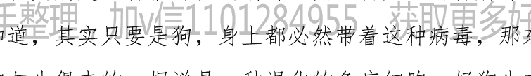
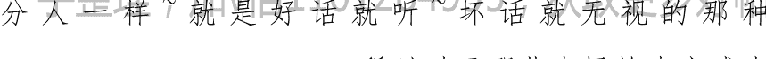
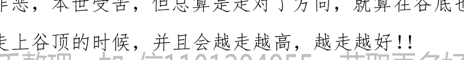
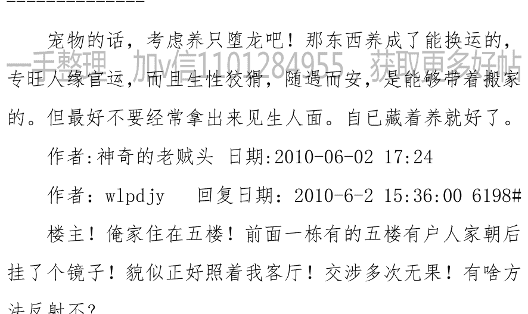
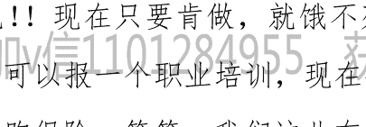
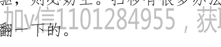
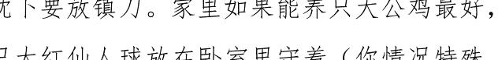

# 请块所谓的“开光”玉，不如活的灵枣！
神奇的老鼠头

不要相信在外面有什么什么开光的玉。这种事我撞过的懂的，因为我爷爷过去去买过一块开光的骨，那是真的要有很大的机缘才能得到的，这个以后说是的确是很灵的，但只能用一次就完了。根本太不可能了！

开光的玉第一是要很有高道行，功德很深的，懂得开光的阵术和心人的，第二是要有合适的法器，那不是去地底下买个五、六块钱的玉造，就就能搞定的，一定要是质地好的血玉（本质透明或白，但载久了还能吸收血汁，在玉内生出血丝的那种，很罕见），或者项顶（其人出生于子时，其一生是要善终，取其项顶。它别的骨都不行）。第三，那个修行的人要舍得自毁道行，甘冒冒险风险为你加持。不要以为真正的开光是好弄的，阵术一开，万一就阴，死就是愁的。

你想现在在社会上能满足上述条件的有几个？现今说有什么功力的，开了神通的高人，就连个严守戒指备的出家人都难找得，你还敢谈开光？？

我知道我说这个会有一群人来骂我，因为我断了他们的财路，但我还是要说！因为一般都是很好很无解的人才会刻意去求这个！如果这时还拿个破勺子去敲人家是很不得的！会有罪业的！

与其弄到外面去找那些不知来来的家伙去开光受骗，不如在家里养一只活生生的灵龟，效果可见灵质摸得着!!

不要以为我说的灵龟是捕魄摄影，神话传说的东西其实他们都是些很普通的动物！只看你会不会，会会不会养!!

现在先说第一种灵龟：龟。

龟是武蟒苗菌，养龟主要为积蓄运。灵龟只限草龟，它其它什么巴西、大鳄、黄线条之类的灵统算不了。

有两种养法：
- 一是挑百年以上的大龟，这种龟就是福禄深深的灵龟，饲之其灵气镇宅运，效果极大，但不能将奴破。
- 二是指刚出壳的小龟，具有缘者（捧在手中用心凝视它。如果它会吐头来与你对视久，不惊不慎，也不会勾跑起来，则此龟必与你有极深缘法）精心饲之。早晚揉其头与之呵气，话说（人气为灵之）促其开智。这样的小龟养年以上，如能人形，跟人顺，则灵龟大成，即为家一宝（如不是，还是放了吧）。其灵力运财不如百岁老龟，但却能镇宅旺宅，于内事极其利!!灵龟在室，家宅平平安，多多子孙!!

家宅不守，子孙不旺，出入不安者，大可一试。

缺点，不能挡煞驱邪。（龟龟不是战斗型的，只是辅助型宠物）。等会会儿介绍一个战友，雄鸡

作者:神奇的老老头 日期:2010-03-08 18:02
不能编辑？？这这论搞得真是是太烂了

作者:神奇的老老头 日期:2010-03-08 18:06
龟最好就养一只。所有的灵宠都最好只养一只

作者:神奇的老老头 日期:2010-03-08 19:02
这么说吧，如果你的龟天天都想往外爬，不想和你呆在一起，看你眼里就跑，那就是没缘分，还是放了好。这种情况下就不会会成为灵龟的。真正的灵龟很喜欢和人亲近，比如我家养的这只，放到外面就会会命爬回来，生怕我们把它关在外面了。这种情况下，根本不存在水友戏心冷冷提到的什么拘禁。

作者:神奇的老老头 日期:2010-03-08 19:20
灵龟是一种宅的动物，它知道道家的范围，也喜欢呆在家里，就算它放出去，它也会想办法找来的。只是现在科技社会太发达了，公交地铁的，全不是它能理解的，有它没找到回家的路就被车坏了。相信我，让灵龟放在家里并不是拘禁。相反灵龟出门，它永远也会回家，这是很残忍的事情。

作者:神奇的老老头 日期:2010-03-08 21:09
现在说第二种灵宠：雄鸡。

雄鸡应该呆。这种动物，打来就是克邪的。我们从来就有“灵宠”好鸡，特别是养了几年的老鸡，那种鸡你有机会得到一只，你可以观察下。如果确定是阴灵做法，尽管管养两只。雄鸡的阳气是最，也是胆量最大的！


作者：神奇的老老头 日期:2010-03-10 22:17

另外，我郑重地告诉大家，有病一定要治愈，没钱了一定要挣钱。从来就没有什么“灵物在手，天下有的”的荒唐。灵物会指引你去找最好的医生，也会指引你去找钱门道，但是你要是自己坐不动，给你你都不接，那如来佛也拿你没救了。所谓三分人心七分天，你那三分没做全，一样什么都得不到。

作者：神奇的老老头 日期:2010-03-10 22:18

你家那老猫成了，一定要好养它。

作者：神奇的老老头 日期:2010-03-11 09:30

狂犬是一种很奇怪的病毒。真正研究这种病毒的人王理解：其实必须要做到，身上必然带着病毒，那某些都是与人天生俱来的，据说是一种记忆的免疫细胞。好狗也有，只是分得少少了？这个你可以去国外的科普网站查一下，得到的（国内）90 年左右时，狂狗打得很狠，那时有详细的介绍）。打了预苗，并不是说狂狗就得病毒了，而是在一段时间内，病毒产生得极少，或是暂时不产生婴儿了。你没听到，预苗一针最多能管一年呢？狂癫其实是跟人类的什么甲、XX激素分泌过量一样，是一种分泌性疾病。但只有狂犬症传给人之后才会出现，犬咬等症状，跟跟一样。它没有任何病毒能产生这种精神病表征，你说你是么呢？疯子就是灵魂受累的表现，包括傻子也一样。



作者：神奇的老鬼头 日期:2010-03-11 09:40

狗咬鬼是直接就能咬的，但咬活人魂的话，可能就需要药毒这种媒介了吧。狗在极度愤怒恨和专注的时候，这种毒素就能分泌很多。

我认为这个是完全合理的。我想说的是，有关灵龙，作法等等这类事情，决不是什么迷信，而是一种尚未完全探索出来的出来的科学。我们都没有全部的精力去研究这些事情，所以很多时候只能依靠现有的证据去推测，去把它合理化。

作者：神奇的老鬼头 日期:2010-03-11 09:43

我觉得狂咬鬼可能是一种阴性能量实体化的产物。

作者：神奇的老鬼头 日期:2010-03-11 09:48

乌龟买市场上买的是草鱼，最好最重要的是有缘份的。巴西龟跟玄鱼的关系……怕是远了点吧，都留了了了。

作者：神奇的老鬼头 日期:2010-03-11 11:32

龙鱼，说实话，那算哪门子鱼。那个东西原产地都不是中国，而是越南马来来的那种原始林里的野鱼。真要说话，长得又古怪，还没灵性不如黑鱼。是因为数量很少，长得又古怪，所以被大家们拿出来摆摆，非说是龙鱼什么的，其纯属无垢。我个人感觉，龙鱼杀鱼，怨气都很大，因为那个东西只吃活食，大的还会咬人，恐怕不是什么太好的玩儿。

作者：神奇的老老头 日期:2010-03-11 11:58

我真的是有点灵阅了。说灵猫应该是很少的对，怎么貌似你们家里手里就一只的....

作者：神奇的老老头 日期:2010-03-11 15:58

养蛇一般不好，蛇同“折”，并不吉利。除非是很大的机缘，比如你救过那条蛇，或是那蛇主动来你家门口，那个例外。实在要说的话，只有两种蛇灵性强的。一种是蟒，蟒有龙形，巨蟒为蛟，虽无龙性，总算占点便宜。另一就是眼镜蛇，这蛇又凶顽，不灵不慎，但是灵性较强。按佛家的说法，眼镜蛇是佛佛的爬过，它的那个大扁脑宇的两个眼睛就是佛祖点上去的。不过，我真的不建议大家养蛇。那东西阴险之气太重与阴阳不合，加上贪心又炽，嗜血如命，反噬主人很厉害的。

作者：神奇的老老头 日期:2010-03-11 16:00

看来我们这儿福缘厚的人还真不少....有这么多可爱的猫咪狗狗狗狗

镇宅的乌龟无故惨死，严格来说，那是宅中生气气断绝，阴煞过过的表现。连最能忍的龟都养不活，人更加不宜居住。话说回来，这种事也不见得都是凶兆，多数还是意外。你要是你根本不会养，或者是那龟本身气数到了，自己死了。


一跳，这一直都没再来招惹我。。

作者：神奇的老贼头 日期:2010-03-13 18:18

唉，不该说的这个。。

又说动漫名了，我看来还是差得远啊。。

坏信息不要多想，不要去加强它，不是很容易入魔的，

想好的，美好的事。

其实那个人也不算坏，最多有点愁。

作者：神奇的老贼头 日期:2010-03-13 18:26

因为在我出生以前~还有一个哥哥~9岁的时候车祸不在了。

~然后才有的我~是我家里就很奇怪的声音~他们都大部分。

爸说过我家里各种问题之类的声音~但是他们都大部分。



大笨样~就是对错呀~坏话~漂亮~兔懒的僻种。

对于那些奇怪的声音或事情选择性无视...我就想知道~我她不会真的还在我家？？就算对家人有什么影响？？

那动静是不是哥......这个我真说不好。

不过最好是不理它。

所谓见怪不怪怪自败。你越是关注它，你的心神就是在它身上凝聚，就等于是你在给它能量。不管那不是你哥，亡者都不应该留恋人世的，不然对它自己都没一点处。你们就算不驱除它，也不要加强它对人世的留恋。只要完全不管它，不想它！只当是风刮的，雨打的，老鼠咬的好了。你无视它，它也闹着也没劲了。用了多久它就明白了，自己已经不再属于这个世界了。

作者:神奇的老鼠头 日期:2010-03-13 18:37

另外说一下，在底下的不是什么高人，有些玄学，风水学上的东西，我也只是知道一点皮毛。你们家里的那些像怪，我真的不敢乱说，我怕错了反而不好。

我开这个帖，初衷不想让大家来上买骗子的恶讹，初次是想和大家分享一些我所知的资料，也许会对大家有好处。


其实大家在讨论，一起学习，共同研究才是真的。

我也不一定就是真理。至少，我现在已经发现狗或许并没我想的那么差，好像通灵性的还不少......

作者:神奇的老鼠头 日期:2010-03-15 09:32

是，仙人球因为刚猛强，一般不适合放在卧室里这种以安详平和为主调的地方（睡觉时穿得少，抓到了也不好）。仙人球一般要在厕位和衰位，用的它的尖刺（它叫尖角煞）来以凶克，以毒攻毒。

作者:神奇的老鼠头 日期:2010-03-15 10:47

再介绍一种灵草：芦苇。

芦苇又名龙舌，喜肥，不喜。此物和仙人掌那“战龙”（呵呵，仙人掌确实战龙不同，但却有点像锦鲤和龟龟。它本身属阴，也不太能够熬过挡劫，但却极能吞噬阴影污浊之气！是一切邪物的克星！并且它活力极强，释放出其充足的气息，颇有培补人神，滋养元阴的奇效。

放在卧室之中，于睡时大宜（人睡时吐故纳新，体内污油外泄，聚气易引鬼）。然而万念俱敛，一心空灵，也是培补元气，护养魂的好时机！

芦荟喜脾，可以栽根，米水养之，但不可过多，一周一次。平时有空就多盯着看着看（尤其是看着的卧室，那个方位生气最旺，安静看着看几分钟（很耐的），再用口加它吹灰（环境要竖直下气，那样用你的生气宅子的生气，要平着看着，看着点），让它近点人气。芦荟喜欢人照顾，灵性看起来得很快，还能护主财的功能，能挡小劫（就是破皮流血那种）。

> 作者：神奇的老矮头 日期:2010-03-15 10:57

挡小劫这个说法是我自己经历过的。

我家里那盆芦荟已经长了三三年了，换了两次盆很大了。我过去也常爬山，练拳（自己拙打，绝对不是高手，就只是健身而已而已）容易受伤，常贴邦迪。

但近年来受伤越来越少了。但我那芦荟面上就会经常莫名其妙地多出些损伤，折断的地方。


作者：神奇的老咸头 日期:2010-03-15 10:00

其实我从不碰它的，只是用口轻轻地吹一下。那个位置明显就是挡的。

作者：神奇的老咸头 日期:2010-03-15 10:12

重强调一句，不论是什么灵异，再怎么哼，那也是不行的。你自己非要胡的话，那也是一样的。就算过百年的让你养一条，转身，那也是够的。这个不是灵物，而是实在大了，神也服了。

作者：神奇的老咸头 日期:2010-03-15 14:18

仙人球就是这样的。凡是聚居大户都会按照生气的流向，定下八字，也叫八门：
- 生
- 门
- 伤
- 杜
- 景
- 惊

（具体要用到罗盘，也挺麻烦）。开生为吉，三门为吉，杜为平，死为伤。有的开发的房子不看风水，设计装修华丽，但人进去就不舒服，久了得病，那就是八字没有，好不好。一般是放在凶位上，让它煞，这才。

作者：神奇的老咸头 日期:2010-03-15 17:49

仙人球是棘刺，刚猛之物。这种东西不能放吉位的，会对家里人的运程很大。

仙人球不能多水，但也不能完全没水，那样也会萎掉。不过，如果你那是卧室的话，最好不要摆着，换盆芦荟好些。特别是亚洲的话，芦荟更好，吸烟物质，它能滋补元气。

仙人球没这个功能，它就是单纯的“打手”。你可以放心，植物吸入的氧气是极少的，绝对比你房间里养的蚊子、蟑螂类还要多。从风水的角度来说，流水容易引鬼。从科学的角度来说，是因为那些花香过于浓重，对人体产生过敏反应，甚至影响呼吸道和血管，产生麻痹和抽搐，从而窒息憋死。但芦荟你可以放心，这东西天生就是用来守夜的，放在卧室里，没坏处的。（我是听过芦荟和别的植物不同，它吸氧气其实是在白天，夜里是放氧气的）。呵呵，不过这个要去问下专家们。

作者：神奇的老贼头 日期:2010-03-15 17:55

兰州那个其实是我用词错误，我向大家道歉，也对广大兰州的友们倒霉。天知道为什么网上的人非要说成“兰州烧饼”，其实烧饼全国都有哈嘛……

作者：神奇的老贼头 日期:2010-03-15 18:01

52楼说，句子只是系统合成的，你说该对应啥这个我就太清楚了。我只知道妖物都很臭狗，我怕犬咬，但狗是不是魂就不知道了……

作者：神奇的老贼头 日期:2010-03-15 18:03

看了你们的贴，回复了我原来的很多认识。像巴西龟这种外来的东西，居然也有这么通灵的，我都有一点太相信……

作者：神奇的老贼头 日期:2010-03-15 18:11

这个贴请大家关注一下，帮顶一下，有能力请帮助人肉一下那几个败类。我一生最恨这种吃里外的汉狗，看得我无名气起!!要能有他们一件东西，坐的垫子都行。

作者：神奇的老咸头 日期:2010-03-15 23:04

龟可以养在洗手间，没关系的。有水就行。

作者：神奇的老咸头 日期:2010-03-16 10:04

仓鼠和兔子这个……。养着天下，估计也没哈大霉。但从风水的角度来说，最好还是不养。鼠这类两种在古代一直害害的。鼠又叫耗子，主财。耗更厉害，主内宅乱。兔子在传闻中其实是个反派，不但勾妻子还偷了夫家的东西逃走，最后被关在笼子里一动不说的打冷。最早的就是鼠爬那里买来的。

作者：神奇的老咸头 日期:2010-03-16 12:24

龟啊，它是不怕冷的，只要水不冰，一定要放在光线充足的地方（冬天的话，有水就好了，否则干就死的）。至于鱼的，品相并不重要，关键是看缘分。如果没缘分，跟人开了，看着你养的那条鱼灵性差，只是长得不好，鱼卉没用。

作者：神奇的老咸头 日期:2010-03-16 12:28

仓鼠和兔子这个……。养着天下，估计也没哈大霉。但从风水的角度来说，最好还是不养。鼠这类两种在古代一直害害的。鼠又叫耗子，主财。耗更厉害，主内宅乱。兔子传闻中其实是个反派，不但勾妻子还偷了夫家的东西逃走，最后被关在笼子里一动不说的打冷。最早的就是鼠爬那里买来的。

那个龟啊，它是不怕冷的。白瘦美那个，就是入宅的坏了，你爸爸带着它一起睡，这是不要的。狗有物相似，有的狗天生就有奴性。打算你家那狗是变人了，它可能希望你爸爸身边只有它，别人都没有，所以它就乱咬。另外我觉得你爸爸有点问题，一般狗再亲不过家人的，但你爸爸这么宠狗，怕仅仅喜欢它简单而已。不要以为狗成精了需要几百年的修行，狗跟别的动物不同，狗带人气，心思又细，修起来容易很多的。只要那狗灵性，根骨好，通了人性，几年之间就能闹起来。

作者：神奇的老鬼头 日期:2010-03-19 08:58

不过那狗估计不会整你爸爸。狗这种东西，就算变了怪，忠诚也不会变的。

作者：神奇的老鬼头 日期:2010-03-19 09:05

流浪猫，给喂点吃的，这个没有什么坏处，猫也知道报恩的，只是没有狗那么强烈了。自来猫财，这种说法主要还是源自猫性。野猫没管束，比家里猫懂规矩，容易偷家里的贵重粮食如鱼肉、咸肉、鸡肉的。不要太亲近，野一般都很脏的。

作者：神奇的老咸头 日期:2010-03-19 09:11

关于开光的玉，我再说一遍，真正的开光很难求到的，并不是用大把钱就可以买到的。那要很深缘和诚心才行。一口几十，几百，几千块的开光，你信你就是烧饼。真正的开光玉都是有缘的，人跟你你有缘，你就是个份儿儿，大家都给你（甚至还赖给你）好帖。

作者：神奇的老咸头 日期:2010-03-19 09:16

作者：圣域蔷 回复日期:2010-03-19 06:00:00 1107

## 厄，我也有问题，我男朋友感觉风水不好，我每次去都感觉灵异，。。。。……

--------------------------------

他养了狗，就行了。那狗灵不灵性，不到时候你看不出来的。平时注意观察那狗，要有什么风吹草动，它比你们觉得得多。


他妈妈求的那块光玉，就算没灵力，还好也有他母亲的念力，带着总能挡挡的能量，没问题。

母亲对儿子的念力是很强的能量，不要小看了。

作者：神奇的老头龟 日期：2010-03-19 09:31

补一句，乌龟可靠，乌王就认了。

乌王杀心很大，且野性极大，轻易不认主，也不易养。

养久了容易霍作怪性，妨碍家人。

作者：神奇的老头龟 日期：2010-03-19 09:33

另外，不要把我说的人物对号入座，那是你们说的，我统一不认账的，呵呵呵。

作者：神奇的老头龟 日期：2010-03-19 11:03

一只鱼，被乌龟咬住，只有打雷时它才会开放‘话’，是否属实？

那是被乌王咬，不是乌龟，也不属实。被乌王咬，只要把乌王放地上，或放水里，它就松开跑走了。

乌龟一般不人，要咬也咬贵人，但喂食时它被咬到。

作者：神奇的老头龟 日期：2010-03-19 11:04

是鲤鱼就行，但最好小一点的养，容易认主。

作者：神奇的老头龟 日期：2010-03-19 11:39

芦荟多养几盆可以，仙人球最好养一个!! 放法是，

仙人球入卧室，芦芹随放。龟没有没法，放哪都成。狗最好不要进卧房，特别不要跟人睡，总之不太好。狗已经有阳阳，通人性了，睡觉时再吸吸人气，这个....。想就觉得太好了。当然了，这都是老话说，不是真的会变成犬夜，谁没见过。

作者：神奇的老头 日期：2020-03-19 14:52

你们为什么要让狗进内宅？那不是好事，我说了多少次。狗有有性的，有的也有犯规的。我早就说过狗和鸡一样，是要要打管的，不能惯的。黑狗那个明显是狗性很残，也不认主，主主的狗打死都不敢认人的。带它去配种吧，千万不要让它看你们家女洗澡，相当不好！我跟N让狗带入阳阳通人性！只让它得到的坏事，狗也得出来！只要认为它不是它主人，它什么坏都是的！你们去网上搜一下吧。犬号你不要那是胡扯，这种事情是有真过的。我原来在一个什么家庭的朋友之上看到过类似的事，福了一两天。

白博美那个很明显是在想不想变成人了，吃人，吃语（现在只是想说还不出来），与同类层（它以为自己不是狗了），特别是对你爸爸那种奇异的依恋....。这狗养足10年，不知道会是什么样子，对你和妈妈也不知道是不是凶。

记住一件事，宠狗有一个限度，要狗的主人，不要让狗当主人！

作者：神奇的老老头 日期：2010-03-19 15:31

那个实在是在进房养成习惯的狗，最低限度不要让它上床！n记住，人处的位置永远比狗高，不能和狗平起平坐，尤其不能让它爬到你的头上。这都是有讲的，唉……

作者：神奇的老老头 日期：2010-03-21 10:49

我来了，不好意思，昨天有事，不得空。
一般来说，只要认了主的宠是有灵性的，都能护主，但主的效果是大是小了，就要看具体情况了。

仓鼠躲。....天理不外于人，既然养了一年感情了，就养下去吧，虽然不见得有什么好处，但也不一定会会妨碍主吧，毕竟是你养着它，它应该得感恩的（但愿如此如此）。

作者：神奇的老老头 日期：2010-03-21 10:59

把猫跑了，对它的魄一定有很大的损坏，甚至会引起它的狠。只是活的话，估计点吧。仙人只养一盆，不要多！！养出门的狗，只要次数不多，且当它能回来，就还回来。但一出去几天一次，这就不好了。真正的好是不出门的，原来养的那只，要带它出门玩玩，跟它似的，用爪子死死抠着门，发出凄凉的。只可惜后来死了，唉……现在心里还过。

作者：神奇的老老头 日期：2010-03-21 11:01

八字不符，叫花子都能占一个地。但最低限度不要让狗上床。狗不进宅，现在看来有点难家里，现在房子太小。

作者：神奇的老老头 日期：2010-03-21 11:33

八字破格，命弱福浅，那个可能都会看到两次。以及一般见的概率还是不大的。不要轻易相信外面那些神棍的话，现在年头，害人的玩艺太多了。前天看见新闻，一个神棍为了骗钱，装神弄鬼，结果生生吓死一个老头。

作者：神奇的老老头 日期：2010-03-21 11:34

八字不合，当心招财!!!龟最好是刚出的，认主快。一年的龟要养才能认主。

作者：神奇的老头 日期：2010-03-21 16:46

有事，确实要引起大家的注意。现在大家都住在市，养狗确实不宜，安全也不容易招人话柄。大家最好还是养点鱼，鲤鱼之类的吧，不错的。如果因为狗到处拉尿，咬人，或狂，招人愁，那就就不美了。大家都明白，现在这月，得罪人比罪鬼要痛得多。实想养猫的，建议养小型狗和较安静。

作者：神奇的老头 日期：2010-03-21 20:44

一只猫就好了。平时一定要管理好，不要骚扰到别人啊！不然万一引起冲突，或是猫被绊杀了，最后难过的自己啊。

作者：神奇的老贼 日期：2010-03-21 20:46

养鲤鱼的话，小孩爸念的效果最好，但也可用父母代念，但不能多次。所谓养鱼就是这个原因，很麻烦。

作者：神奇的老贼 日期：2010-03-21 20:46

仙人球放在北面的。不要放在东面，也不放在卧室。你们家里窗开卫生间？这布局不布....

作者：神奇的老贼 日期：2010-03-22 09:03

那真不错！！这种猫能得到镇宅，乱哄抢建都不错！

真是好巧，虽然不是最好的，但是这样的，也很难见到了。

作者：神奇的老贼 日期：2010-03-22 09:16

哥不孝那个，从佛教的观点来说，应该是前世债主过来讨债的，债还不完计划也不肯要体。这种情况明显不是一只猫能搞定的，多拜拜观音，哭一下，兴许会有灵的，观音专管这个。最好还是诉之法律，不养老人是严重的违法行为，要坐牢的！！有这个估计才能管用。要把你父母接出来和你一起住吧，和你嫂嫂住太难受了。

作者：神奇的老贼 日期：2010-03-22 09:21

只要是很小的那种鱼就好了了，不一定是龟。

现在天气热了，正是养小兔的季节来了

作者:神奇的老鼠 日期：2010-03-25 10:56

几天没找到这贴，以为被删帖了，呵呵。

狗灵没咬哈，不一定是见到了什么鬼氛围，这个跟半夜咬鸡一样，天性使然。我们家里养着两只小哈巴狗，个头也就比鸡大点，但还不是螨，跟狼似的。这个没啥的。

作者：神奇的老鼠 日期：2010-03-25 11:08

对宠物多点总是好事的，对你自己都有好处。它可以很安静地坐在你面前听你念经（哪怕听到最后睡了都行），而不像没头一样坐下，一心想乱跑，那它可就是很不起的灵物了，因为它听得懂，那是好事东。整理，加v信11011284955，获取更多帖子

作者：神奇的老鼠 日期：2010-03-25 11:32

### 介绍三种修行方法，很方便的：

- 什么都不想，全神关注自己的呼吸，感受呼吸时的舒畅和吸气时的满足感，吸气时鼓腹，呼气时收腹，静静地感受。如果困了，一会儿睡过去也行。这是养人的，虽然一定能成，但很有好处。
- 断念。当你发现自己很痛苦的时候，突然硬性断思路，去想一件其它的事，或者不想事，像愣住一样（佛家说一下）。这种方法看起来很难，因为人会习惯性追痛苦，越痛苦越深挖，越痛苦越挖，直到完蛋。其实就是心魔，也是烦恼源。我们要说断掉，就断掉！没有任何理由，就是要断掉。
- 行者。我知道现在这个时代，八字不符的人都是蠢的。实际上，上的人都是蠢的。听懂点，这都是蠢的。所有的负面情绪，完全没有帮助，只会越越坏。只有冷静下来，清醒，把心定了，才能发现原来也没太事。

还有问题。楼主呼气收腹，吸气鼓腹。我靠，怎么觉得好难听到到。以前不是都说“吸气、收腹、挺胸”的吗？现在也是，一吸气，肚子自然而然地了，呼气出来，肚子就回归原位了。所以，呼气收腹，吸气收腹，我做得好困难呀……你这个是所谓的逆腹式呼吸，原来只是为了扩胸，挺胸，对身体其实没啥处。

还有一个叫“蛙式呼吸”，这种呼吸吸气鼓腹，呼气收腹都是顺其自然，吸气鼓腹，呼气收腹。这需要快速地动，不但能在秒内呼吸五次，也能一口呼吸五分钟。印度密宗有句：“谁能控制自己的呼吸，谁就能完全控制自己的身体（这话很厉害，连衰老都能控制）。”真能成了，身体就会跟儿子似的柔软，能多活几年，看着仙似的。

作者：神奇的老豆 日期：2020-03-25 14:49

关于宠物的饲养，请去教教吧。并非医学，实在在答。

作者：神奇的老豆 日期：2020-03-25 16:30

龟那个，它吃饱了会停下来吧。反正我家那龟是随它吃它猛猛，从没管过的，它现在长得很大，很强壮。没坏事。

作者：神奇的老豆 日期：2020-03-25 16:53

关于第二条那个起来是很的。人生最难的就是“像死一样”，其实是一种高境界。一般这样，八字不符的人容易作，八字不符的人八字不符。

- 只要它不是它主人，它什么坏都是痛苦的！
- 只要它不是它主人，它什么坏都是的！ 
- 
- 
- 
- 都是的！ 
- 只要它不是它主人，它什么坏都是的！ 
- 
- 
- 
- 
- 
- 痛苦， 
- 
- 
- 
- 
- 
- 
- 
- 
- 
- 
- 
- 
- 
- 
- 
- 
- 
- 
- 
- 
- 
- 
- 
- 
- 
- 
- 
- 
- 
- 
- 
- 
- 
- 
- 
- 
- 
- 
- 
- 
- 
- 
- 
- 
- 
- 
- 
- 
- 
- 
- 
- 
- 
- 
- 
- 
- 
- 
- 
- 
- 
- 
- 
- 
- 
- 
  
  

 


 
 
 
 


 

 


 
 
 
 
 
 
 
 
 
 
 
 
 
 
 
 
 
 
 
 
 
 
 
 
 
 
 
 
 
 
 
 
 
 
 
 作者：神奇的老鼠 日期：2010-03-25 17:03

当撞见人魔时，蠢人会吓得在地，因为他们想的是跑不掉的可怕后果，所以把自己吓倒，至于如何解决此事，他们根本没空想。而聪明人转身跑，身边用武器战斗，并无丝毫慎！因为他们的心思放在如何解决这件事面上，至于万一跑不掉的后果，他们根本没空想。

作者：神奇的老贼 日期：2010-03-25 22:30

照片上能看出的气质和眼神来……。呵呵，可能真是我功夫还是我事吧……这个不要混为一团。

作者：神奇的老贼 日期：2010-03-25 22:54

不化比雾对风水局的说法，我很认同。风水一类太复杂杂了，很多暗藏的局，只有身临其境好判断，确实不能乱论。之前根据论坛提供的零星资料说过一些局，现在其实都很后悔，不该随便的。我就是个半吊水，所以以前喜欢乱逛，唉，先天的坏习惯了，还是要改啊。

作者：神奇的老贼 日期：2010-03-26 10:45

2012年那个怕胡乱吧，从2000年开始，中国有300年好运，这才刚走呢。龟那个，它吃饱了会停下来吧。反正我家那龟是随它吃它猛猛，从没管过的，它现在长得很大，很强壮。没坏事

作者：神奇的老贼 日期：2010-03-26 18:46

+ 1 我常出差在外的，养灵宠有点儿不现实，有什么东西可以让我随身携带，和灵宠的作用是一样的东西？

我很抱歉，之前真的没注意到你的发贴。对于你的问题，我是这样的：

长年在外，身上必备有三件。

一，小刀，最好是红柄，红套的。凡是刀，剑类锋利的东西，自初造出来就天生带点杀气，鬼邪都会有点忌惮。一旦真碰了什么不干净的东西，往上狠狠狠吐口唾（要“呸”出声），上去直接可以伤到鬼的。

二，打火机带一个手机，一段金经或是大字（最好是大王经）在寺庙落场，要求是只要发现周围不对，用火烧。只要发现不对，马上烧醒，火烧最能惊。这三，发现不对的。

作者：神奇的老头 日期：2010-03-26 18:55

### 建议

作者：神奇的老贼 日期：2010-03-27 16:34

+ (一)红顶球
(二)红金琥
(三)红毛琥；

# 手动整理。加v1011284955，获取更多帖子

老贼：反正我养的是红顶，另外两个费很多吧？但应该都差不多。楼主你好，我养一只小草灵宠，我老公也养一只龟灵宠可以吗？还是我们两人其中一个人养?老贼：镇宅的话，最好只一只。

作者：神奇的老贼 日期：2010-03-27 16:42

院里有蛇的，最好用棍子挑出去丢掉，但不要伤害它。这种进家的蛇都有点，不能尽量不要打，挑出去丢就可以了。

作者：神奇的老鼠 日期：2010-03-27 16:51

怕进来的，可以用石灰粉粘着墙根一圈，一般蛇虫什么都不过来。另外还有黄大蒜捣碎，这也是蛇最怕的。不过这两种都没试过，不敢打包。因为我住在城市里，没有蛇。

作者：神奇的老鼠 日期：2010-03-28 17:34

不好意思，有事出去了，呵呵。驱蛇的方法很很多，好不好呢，这个我也不好。不


过桃禁门，杀条扫，这个倒是流传广。

作者：神奇的老鼠 日期：2010-03-28 17:52

住五楼，北边是公墓，我不确定是有邪气侵入，可能只是一般的流年不利（再牛的人都有流年不利的时候，这也是根据八字来的，不一定是命年）。可以养一株仙人掌放在正北方的位置上挡一挡。你老婆那里是农村的话，可以养一株雄鸡守镇宅。野蛇入家里是事。如非家蛇诅报，则主宅生气不旺，阳脉不通，阴邪入室，恐非吉兆。

作者：神奇的老鼠 日期：2010-03-28 17:56


从风水玄理来说，灵宠之间并不相冲。
但万物自有天性，猫性好鱼，狗性恶猫，这几个混养，总会出现纰漏的…… 最好是注意点呀。

作者:神奇的老贼头 日期:2010-03-29 03:56

天涯抽风，见竟！

楼主，请问家养的动物会变妖妖怪？那我朋友不是很危险？虽然不敢说她是大善人，但她脾气好，也没有什么心机的，有什么方法解救？

你朋友如果不是修行之人，那福缘真的是惊人了。那那王三狗回复:110128495
猫和它，我能助它或许是灵的，但灵力如如何就不知道了。
你放心，它们就算成了道行了，也不会对主人不利的。你养它，它必有报。除非是前世有过过来讨债的，不然报应这种事，动物人类还觉得多。

念灵妄是劝通它的，让它灵力充盈，让它对主人更加感恩。不念的话，单是养，经常和它说话，也能使其灵通，不过功效率许多，而且多半只能帮开智认主，灵力不会太强。

作者:神奇的老贼头 日期:2010-03-29 04:08

住八楼，北边有公墓那个，公鸡不要买，老老太凶的。女人阴气重阳气弱，镇不住的话，怕老鸡不认主，反而不妥。
买只小公鸡就好。

作者：神奇的老老头 日期:2010-03-29 11:26

问题太多了，有点答不过来…… 呵。

自来狗，自来猫，我的意见是，不打不养，最多看着可怜恰给口吃的就好。

不是从小养大的，都不算家物，基本上不会护宠主人的。

万一带着病邪什么的，反而不美。
作者：神奇的老老头 日期:2010-03-29 11:47

对了，还说一句，凡家里养了三年以上的物，不论鱼，龟，兔，狗，鸭子，还是什么的，都不要轻易易杀，不然怒气重的，很不吉利！

作者：神奇的老老头 日期:2010-03-29 18:40

王建梅 加微信1101284955 获取更多好处
楼妹啊，老年朋友，我跟她去过林姑卉，里面的人让我让我们请个开光的二爷爷金卡，我们当时也也没想那么多，就买了。不知道这个有什么讲究吗？

我开篇的标题就说，现在市面上那些那些所谓开光的玩艺，大多是假的。真的是有的，但很少，需要很厚的福缘才能得到。你那个金卡我没看过，也说不好是真假的。你觉得好带着吧，反正买都买了，呵呵。

但建议不要花重金去搞这些东西，很容易被忽悠的。
作者：神奇的老老头 日期:2010-03-29 18:59

作者：双鱼三品 回复日期：2010-03-29 18:03:00

1845# 楼主，我站短你了

站肯？虾米意思？

作者：神奇的老叔头 日期:2010-03-29 19:00

但是我的房间窗户朝北，比较背阳，不愁进阳光的，比爸妈的房间要低一两度。我爸的几盆花都放在阳台上养，那里才向阳。想问下LZ不知我的房间适合养什么样的花草？

一手整理，加信1101284955，获取更多好帖

弄盆芦荟吧，背阳之处阴影多，养芦荟最肥。

作者：神奇的老叔头 日期:2010-03-29 19:16

另外还来说一句，大家不要走误区。不是养条锦鱼就可以就能发财，养老狗就能长生不死。

我反复强调，灵宠是辅助，主要还是人人为天数。要是单靠一只灵宠就能横扫天下，那大家都不用工作了，一心搞养殖就行了。

有人的人生贫寒，或当横亡，凭借灵物之力，吃了饱饭，住上了草棚，最后死得安然，这就已经很不错了！

少数人（特指南洋那边）依凭邪法怪物，强行改，招聚横运，那不光是要折寿，报应还是很严重的！！

作者:神奇的老贼 日期:2010-03-29 22:14

感觉楼主主此贴会功无量。
烦请楼主帮我家看看地理布局好不好，我家是朝南的，
东边户人家是马路。后面是士陵，前面是公安局，再
前面是法院，法院前面是马路。

单从你说的这几点看，你这布局太强大了。

所谓坐北朝南，生气充盈。冬候夏凉，风邪不侵。阴灵融入，在阳阳在前。气息旺盛，神鬼绕。估计没有哪个不开眼的鬼敢上你们找自在...... 呵。我个人认为风水算是比较好的。
作者:神奇的老贼 日期:2010-03-29 22:15

作者:神奇的老贼 日期:2010-03-29 22:17

芦苇白天可以晒太阳，晚上就放房里让它吞噬气。
作者：神奇的老头 日期:2010-04-02 19:00

这两天忙，不起。
作者：神奇的老头 日期:2010-04-02 19:05

LZ不知道还在不在，想请教一下：人的八字和养的灵宠有关系呢？我是癸亥命，不知道哪种灵宠好？人的八字和灵宠相冲，不起来的。

那个养黑猫的，一般来说不是好事。如果你觉得不对劲，像是有点邪的话，可以弄点艾菖条粘着，在头顶，肩上熏，再在身上下熏（不要死掉），这一招很有用的，但是负作用很大。就是随身带大蒜。这种东西，生气旺。
作者：神奇的老头 日期:2010-04-02 16

还有两个事，你们千万把自己的生辰写到网上，写的生日还有弱点，出生的具体时间统统不能写。不然的话，容易出错。
作者：神奇的老咸鼠 日期:2010-04-02 31

另外那个养莉的，那家伙确实有点古怪，但家境每况却不见得是狗的问题。狗作怪一般是家宅不安，内不宁，对经济方面的影响是很明显的（就是灵大招财，只是护家）。有些成精的狗还会主动往家里运财主人。
作者：神奇的老咸鼠 日期:2010-04-06 22:33

yangyang_10，我觉得你出现的状况似乎不是灵异，更像是天生胆子小，有点怀疑鬼，呵呵。被鬼压这种事，我经常有，但实际上并不是被鬼压，科学上这叫深度睡眠的一种。也就是你意识醒了，但神经还没醒，结果就像做梦一样，想着什么就出现什么。其实是体质弱的一种表现。建议多锻炼身体，气血活络了，阳气自然就旺了。另外可以压一把红柄的小刀在枕下靠近右手的地方，可以安惊辟邪的。但还是那句话，压枕刀一定要刀收敛好！千万把自己伤了。
作者：神奇的老头豆 日期:2010-04-08 09:04

“是温暖的”，当然可以再养一只了，镇宅很好的，生气很足。不过建议把龟养在水盆里，水不要没过背，最好放在客厅。厅为房主，镇住了家里就镇住了它的房子。
作者：神奇的老头豆 回复日期：2010-04-08 09:19

一王凯ARTHURAN我知道很有运气。我小时候就养的乌龟养了很久，后来我妈妈麻姨就送给我养……这几年一直走走走运，这有没有没有关联……解决……

我个人认为是有一定的，乌龟如果认主的话，只要养过三五就能和家人的宅运在一起一体。只要龟不死，宅运就能绵绵不绝。你那只养了10年，结果却被送走了，这就相当于你们的运程被生生拆掉一块的，以至于后来出现一些背运情况，我是可以理解的。不过那老龟既然被送走了，也是一场缘分尽了，就算现在在再拿回来养，也不得能够继续联系了。建议还是新养一只吧，从小养。
作者：神奇的老鬼 日期:2010-04-08 36

另外，略说另外一种灵宠，这种家畜和狗很相似，也是可以接受的。它的警报能力比狗强。但有一点可惜，就是它的战斗力有限，只能起到报警和护盾的作用，护狗时发起起来，那是。
作者：神奇的老鬼 日期:2010-04-08 46

养鱼之前，一定不要混养，鱼缸，不要让它脱。可以的母子（女）都是，母子（女）都是一样的。我说了，是通的。一人养一条好了，当然最好，但是你精力肯定是赶不及的。

养鱼真要养成的话，超级难，能养成一条就相。。鱼是不容易的。
作者：神奇的老头 日期:2010-04-08 55

另外关于鱼的，还是大家不要盲目养，毕竟在城市里养麻烦多。我们都在这里，出现很少的，早上出去打会几儿，还被委会的。
作者：神奇的老咸头 日期:2010-04-08 10

建议大家还是龟吧。这个见效快（只要认主），三五就能感到效果，家里事情顺顺，也不愁神。另外，大家不要被龟崽愁的外表迷惑了，以为它很靠，对鬼一点抵抗力都没有。龟蛋不能出，不然没法留镇旺了。
作者：神奇的老咸头 日期:2010-04-08 12

一王经理刘1101284955 获取更多好处
取两条肥料，实际的，龟是很贵的吧，但在自己那儿留粪地上，它是。
可以的，鱼的。
作者：神奇的老咸头 日期:2010-04-08 16

现在项目开始了，工作忙很多，有时贴了了，所以得出少。鱼的，这种的。
作者：神奇的老咸头 日期:2010-04-08 08

最后强调一遍！！灵宠不能用请!!只能说妥了，你们不要明白，请和养的区别很大的。

灵宠不是神明，它们是跟人吃饭的，要听人言，助人，旺运，最后德满了，它们才能成就人世（注意不是修身啊，那里成就精了！）不要说请，更不要拜它！主仆一定要分清的！！
作者:神奇的老老贼 日期:2010-04-08 53

作者:yunjjie158 回复日期：2010-04-8 14:10

楼主，请问你一件事呀，原来我爸爸在外地工作，小时住在我妈妈工厂里，82年修的集资房，啊呀：你已经说了，你那条鱼，都快完不过了，唯独你家没事。为什么？你妈妈那块可不是养活的啊，你那家鱼也不是白活了10年的。只可惜鱼被丢了那，真是可惜，不知道你们怎么的……你弟弟们在那儿，生意生活如果很顺利的话，就不要乱，保持现状为好。风水这种东西宜静不宜动的。有的人八字古怪，非灵宅不能发迹，这也很难清楚的。
作者：神奇的老老贼 日期:2010-04-08 16:04

水溪清凉 回复日期：2010-04-8 15:21:00

# 楼主还在？

问您个事啊 我们医院老总不知道抽什么风，突然在正厅大门口摆了只超大的鱼，里面了好鲤鱼。这鲤鱼不是散的吗？把鱼都赶走了哪儿来病人啊？他是什么意思啊

你们那老总是个懂行的，不用多说了，他做得对。医院这种地方，病，死，怒，忌，百秒聚足，弃一鱼鲤鱼着消化恶邪，吞吐荒，补养生气，对病患和医护人员都有巨大的处。
作者：神奇的老头 日期:2010-04-09 05:05

不过这个不是好的，风水环境确实会影响家宅。所谓安居乐业，不了，住得很难受，连个安宁都没有，又会乐业呢？另外，千万不要小家里饲养的灵物（包括植物），不要以为它们没高级，其实它们很多事。
作者：神奇的老贼 日期:2010-04-09 07

客厅那房可以养一盆芦葵。卧室那房可以养一盆芦葵。宅的，生气旺的。
作者：神奇的老头 日期:2010-04-09 12:03

那房如果你是你母亲亲近的话，也许搬到南边的卧室比较好，北方忌重，不宜养。客厅那房可以养一盆芦葵，生气旺的。
作者：神奇的老贼 日期:2010-04-09 24:06

不要以为它们没高级，其实它们都是烧的。而且在某些特别领域，你根本想想不到。如果它们肯认你的话，那是很大的福缘，给你许多意想到的。
作者：神奇的老头 日期:2010-04-09 07

客厅那房可以养一盆芦葵，生气旺的。
作者：神奇的老贼 日期:2010-04-09 24:06

那房可以养一盆芦葵，生气旺的。北方忌重，不宜养。
作者：神奇的老头 日期:2010-04-09 12:03

楼主，我今天去同学公司，看见办公室里养着一条通体白色的鱼，好漂亮，带有血红色并且突起的。我进去的时候坐在旁边，看那条鱼，它是四处游动的，我又移了一个位置，它又游过来，一直定看着我，我走，它继续游动……好奇怪为何还是看着我？而且他们鱼缸就一条鱼……
作者：神奇的老头 日期:2010-04-09 20:57

吃素是好事，对身体皮肤都有好处。但要注意，全素是不容易坚持的，太久了，然后突然吃肉会有很大处。
作者：神奇的老头 日期:2010-04-10 11:26

有些梦境很真实，尤其是半睡半醒时的梦，醒来之后都觉得梦境中的东西还在房间里。但请注意，梦毕竟是梦，再真实也是梦。梦预测吉凶不是行的，但必须是半夜时分的梦才有效，就是说必须。这条鱼不知道买哪里通，反而总以为底下是看的。你现在明白为什么我反复强调要一条，只养一条了吧？
王理加微信1101284955 更多网址
[content]<!-- no content -->[/content]

须半夜梦醒，并且记得梦中之事，这个可能所有预兆。而我们日常记得梦际都是清晨做的，属于白日梦，即使再真实也没有意义。
作者：神奇的老头 日期:2010-04-10 12:29

另外，小朋友找佛像，对神明不做什么，这个无所谓忌。如果神明跟你你一个小孩子死赖，那还算神吗？但不排除有些鬼邪信神明的名义出来找人害，这个倒是有常。
作者：神奇的老头 日期:2010-04-12 09:00

作者：谎古猫 回复日期：2010-04-11 20:09:00 2229#

看到这么多喜欢动物的人真的高兴。不过我想说的却是一件我都说不完的事，那时我在武汉一工厂打工，那厂里有个神位，说是财神，是惹灵的笑公，坏不是王磊1101284955的菩萨，怎么感觉有点像是在妖似的。那只鸭鸡不会是当祭品了吧，傻狐，黄这两种都是喜欢鸡的。
作者：神奇的老头 日期:2010-04-12 09:08

药渣当花肥....这个我真不知道行不行，药渣是有的是酸性的，有碱性的。药渣当花肥....这个我真不知道行不行，药渣是有的是酸性的，有碱性的的。
作者：神奇的老头 日期:2010-04-12 13:50

这种家畜和狗很相似，也是可以接受的。它的警报能力比狗强。但有一点可惜，就是它的战斗力有限，只能起到报警和的作用。
作者：神奇的老头 日期:2010-04-02 19:00

作者：神奇的老咸头 日期:2010-04-08 10:16

可以的，鱼的。
作者：神奇的老咸头 日期:2010-04-08 16

作者：神奇的老咸头 日期:2010-04-08 12

可以的，鱼的。
可以的，鱼的。
的养鱼是不容易的。
作者：神奇的老鬼 日期:2010-04-08 46

养鱼之前，一定不要混养，鱼缸，不要让它脱。可以的母子（女）都是，母子（女）都是一样的。我说了，是通的。一人养一条好了，当然最好，但是你精力肯定是赶不及的。

养鱼真要养成的话，超级难，能养成一条就相。
养鱼是不容易的。
作者：神奇的老鬼 日期:2010-04-08 55

养鱼之前，一定不要混养，鱼缸，不要让它脱。可以的母子（女）都是，母子（女）都是一样的。我说了，是通的。一人养一条好了，当然最好，但是你精力肯定是赶不及的。

养鱼真要养成的话，超级难，能养成一条就相。
养鱼是不容易的。


作者：神奇的老老头 日期:2010-04-15 10:04

坟不长草，这个确实有点不利。据我所知，一般是死者怒气重，或是理由方位不对，或是封土不对（养尸地）就不长草，使得魂体不安，或是成了缚灵之类的才会出现这种现象。但具体怎么处理，我就不乱说了。此处与一脉博大精深，因时而异，皆有变化，这就是我不能说得清的。不知道贵亲遗体没有化掉的。我个人其实是很觉得化掉的。你，一般送老者的衣服都要烧了寄给亡者，而他牵挂着的遗像，为什么不化掉的他就还他。我认为化掉之后，魂体没了挂挂念，往生是否会顺利很多，这里的问题也会少多了。

作者：神奇的老老头 日期:2010-04-15 10:18

父亲受理。微信:1101284952-取更多好帖

从小狗煞很正常，我也认为那个个人有关。久生，会有很多阴邪坏坏，常会响附近灵气响，时运低人的，还有软，虽然人看不见，但都能看见。它要保护爸爸，也许也是想要保护爸爸（可能是你爸爸脾气重，力量大能保护你）。

作者：神奇的老老头 日期:2010-04-15 10:20

身体健康，最好养在芦荟。

作者：神奇的老老头 日期:2010-04-15 10:36

不开拆这个，我也没有太好的办法。这种事分两种，一种是魂不全（不是魂全，魂不全就是差根），另一种是有缘未了，或者。

福缘未偿，被压力阻闭了，心智就是潜意识里还在搂着前世的某个死结没开放，所以这世总不在，傻愣的。这两种都不好弄。前一种基本是无解（也不是完全无解，但那事做出来伤天），一般人不愿意，后一种还强点，有机会复原，一般是突然看见某件事，或是听到什么，“嘎崩”一声通了，紧接着就炸了。但是也很很难，要碰。

作者：神奇的老老头 日期:2010-04-15 10:43

我这儿有一个办法，不用到处去厕所坐个凳，然后让不开心的小伙，闲时去厕所关门，获取更多好帖。钟，闹得睡了都没关系（不要关醒）。有时一种法怪醒过来，什么都明白了。

作者：神奇的老老头 日期:2010-04-15 18:28

家里养什么死东西，都不是好兆头。有点生机断绝，正不压邪的味道。这种情形，通常建议先养一盆仙人镇一下，看情况如合。

作者：神奇的老老头 日期:2010-04-16 09:07

那个漂的小猪，只要养在厕所，厨房和阳台上，其它地方都厅，卧室都行。但一般养在厅里。

作者：神奇的老老头 日期:2010-04-16 09:18

梅花，牡丹，你为啥种？杜鹃，梅花，苦寒，又通“霉”。这两个都是最忌宅的，建议处理掉。

作者：神奇的老老头 日期:2010-04-16 09:45

本命年，不要紧张。流年不利，每个人都会有点，但只要定心，谨慎点就没事了。记住一句话，见怪其怪自败，这个不是枉的。凡事一不动就会鬼物阴邪身上，本来没鬼的，若想多了，心里就紧了，神识就会消散，那些玩意反而都被招来了。反之，就算真有鬼，只要你不当它回，当鬼话看着，它就活不了，你不它就不会动，是鬼出来现在。不要以为你有量，自己也是累得死的。你想看表演，它还不肯赔呢。

作者：神奇的老老头 日期:2010-04-16 09:58

一般而言，魂主神智，主体魄。所以古都有“神倒”、“魂健全”之说。体弱多至少是魂弱固，不是缺陷，这个要开了眼的才能看得清楚。

作者：神奇的老老头 日期:2010-04-16 10:00

尧舜禹辛，你在政府工作，这是最好的。衙门里面行善啊。记住，凡事谨慎，心存善念，不要想着睚此报。好了。敌人是可以化解的，但需要精力和时间。可以比化解，敌人就能比朋友还朋友，还能提供巨大的助力。请记住这句话。如果想要官运又不招小人，就不要养仙人球了。你可以养一只姜试下。姜是至阳之物，有宿根，准根稳固，辛苦破邪生长时节节颇高，有连升三级之运。明白学会当，都有个成的规定，就是让小孩拿一种姜，叫“种木”。如果种死了，这块姜还没死的话，那就不叫姜了，要叫“相种（或将种）”，得好好养下去。当然了，这都是传闻，是不是有用就用知道了。不过我觉得可以试下，因为茅山术中对姜也是推崇的。有一点你们可能不知道，就是本来茅山作法的时候，其实很多时候用的不是鸡血和朱砂（古时候要死，哪能动不动鸡，朱砂也不便宜的），而是姜水。

作者：神奇的老老头蛇 日期:2010-04-16 11:15

- 1. 我每次梦见蛇或下雨第二天就会吵架，几乎每次都是，您有好办法破解防俗吗？


这么神奇？不会是心理因素吧。只要梦见蛇，就认定会吵架，即使没有什么大事，也觉得非吵一次才合理……这个，把心态平和点吧。吵架这种事，是双方的，如果你不想吵，是吵不起来的。

- 2.姚妹后一阵子经常做恶梦，后来剪刀压枕头底下，尖部冲着门口，后冲着自己，后来就不做恶梦了，是不是剪刀能辟邪吗？

你可以看下我之前的贴子，里面对这个有详述。王经理，加微信：101284955，获取更多好帖。认为是不可能的。毛主席长期以来一直被神化了。老人家，景仰是不假，但那个人没。万一是国军的鬼是不是买帐就很难了。

- 4. 前面写的那个我的小猫也有灵性吗？万物皆有灵性，连石头都有呢，就是少点。

作者：神奇的老老头 日期:2010-04-16 11:30

桃花运这个……很遗憾，我也练着童子功呢，如不符，有相应的法门，我会先试一下，茅山是有类似的咒术，不过不好用，那灵跟跟障眼似的，咒力的时候还挺好，威力退……那叫寡了。

作者：神奇的老老头 日期:2010-04-17 09:12

继续疑惑，呵呵？

- 1. 养仓鼠那个，我知道那个忌，不要去厕所，厕所是污浊之处，就是藏污垢的地方，那里闹，不会影响家中的。气很大，王叔说，加上那里是杀生之地，千万不要乱养。

- 2. 如果你家走着好运，切记不要乱底，这运气不准，福缘差，多少到头了。所以你们可以注意，保持现状，维持不断就行。

- 3. 不要为了路而踩蚂蚁，就是灵异事件。不要惊怕，所谓心作恶事有报，记住一念为正，只要心地正，好好对待身边的人物，这些东西高了，看着执念，接着就张牙舞爪地指挥。


- 4. 鬼不会无端吓唬人的，如果他在面前现形，总是有原因的。看的是世因缘，多少谁也不敢说，大多数情况是自己吓唬自己，真的情况很少。

- 5. 养殖的问题，请查询相关网站，谢谢。如果经常在外面跑，在家里的，养确实作用不大。闹着破财，这种说法我从听过，可能王叔说，加入群吧，获取更多好帖。

作者：神奇的老老头 日期:2010-04-17 09:09

为什么转过来？被你的债主们悠悠呢！所以你一定要断念修行！一旦发现自己心态不对，马上重断！二话不多说，就一个断结！断了，才能生死！守慧才能明白：为什么我会隔着玻璃看世界，其实那玻璃根本没有，是自己瞎想太多，心里放开，不敢跟别人靠近了……为什么事情不顺，几个项目都没成就，原来还是差点耐心，少点机缘，没准下一个成就了……

我相信，其实人生苦难多，其实也不多！所谓一天一念地狱，你断了，心思宁静了，立马就是天堂！你断不掉，偏要听那恶们的悠悠，你就只好呆在地底里和自己较劲了。真要想修身改命，别的办法，只有行好事，诸恶莫为！这是不二法门。别去乱找什么法师，高人，现在正修士真的是少之少了，还有一些说不清的玩艺混在里面找衣服，当心受骗。

附：求事业的可以养一种生姜，放在你办公室或住的地方，这个是有用的。孤独的可以养一只狗狗，有些狗狗是能带人脉的哦。

作者：神奇的老老头 日期:2010-04-18 16:06

作者：都是马甲0 回复日期:2010-04-18 00:09:00

259#

楼主，你好！我的座位在老板办公室门口，背对着老板的办公室，之之前老板风水先生给老板看风水时，顺便提了下，大意是老板说我的办公位放得不太好，可是我又不能换位，请问，有什么办法可以改善一下呢？


淘宝要有的话，我也得弄一辈！！看来我真是太闲塞了！

作者:神奇的老妖怪 日期:2010-04-20 16:40

说实话，桃花运这个我是真没敏。术数对这方面的描述很晦暗，很少，我实在不明白那是什么意思。我我还想要桃花呢，呵呵呵。

作者:神奇的老妖怪 日期:2010-04-20 17:03

说实话，桃花运这个我是真没敏。术数对这方面的描述很晦暗，很少，我实在不明白那是什么意思。我我还想要桃花呢，呵呵呵。

作者:神奇的老妖怪 日期:2010-04-20 20:34

诸位冷静一下。有一点要，人参，何首乌类的东亚地区，虽天然灵气极旺，并不容易养活，没法当盆栽。我家来种何首乌是在阳台上用砖砌了一个半米高的平台，高是四块厚砖的花培的，而且经常要照料什么的（当时念的道德，我和父莲巷念）。如果没有的话，没精力的，还是种根好了。种根还等人参那么强的灵力，但胜为了方便，只要种下去，偶尔浇点水，经常看看它，关注一下就好了了。

作者:神奇的老妖怪 日期:2010-04-20 20:39

还有点心上尚，不要乱花钱！乱买!!!

我看了一下10块钱50克的人参，我先弄了这试下，如果是真的，你们再买。

作者:神奇的老妖怪 日期:2010-04-20 21:50

哈哈，我订了一包人参果，我先种，能种出来你们再去买。人参要很深的土才行，我打算弄个金鱼的油盆来它，我只有这个最深了。

作者:神奇的老贼头 日期:2010-04-20 22:07

真没想到真有卖这玩艺的，我之前不知道，这太好了了。

我买的是10块钱100粒开口种子的那家，加运费19元，但能长活一颗就好了。

听说有偏法，把八字和名字写在桃木片上，用红线拴在人参上，就能养出补命，但我从未试过，这次看看没机会呀，呵呵呵。

回复: 用户:1101284955 获取更多好帖

作者:神奇的老贼头 日期:2010-04-20 22:12

你们大家先别买人参，等我种出来了，有了经验，你们再弄。别瞎浪费了。

先种根好了，那个好养些。

作者:神奇的老贼头 日期:2010-04-21 09:22

鲤鱼，鱼，狗，猫什么的，都不提品像。但最好养一只。原因试过多次，在它们通灵开慧之前，不让它们跟同类聚在一起，不然很难维持本性的。禄根不如人参，不是说完全不如人参，在旺事业方面，禄根绝不比人参差，所以禄根最好养在办公室，或书房里（不用念经），经常关注它和它说话说什么的）。

人参强是在那东西养成了积福挡然，决不比鲤鱼差。但养成也不比鲤鱼容易。一般人在家都种不活，所以我说我先种个试下，我养成了你们你们再来。

记住我句话，天下万物皆有灵性，就看你怎么养，怎么对付它。

你要把人参当萝卜养，鲤鱼当肉炖，一种一大片，养一大池，天天天化激素催化饲料地着，那行，你种出来的就是萝卜和肉，就连都没多少营养，灵性更是不谈，压根没有。但如果你知道他们的潜质，专心一意地培养好一日子，天天照它们，教养它们，让它们近人性，通灵智，慧想，那最后你培养出来的就是灵物！！这个道理就育人一样。添加微信：jia012849537获取免费试用

作者：神奇的老贼头 日期:2010-04-21 09:32

养了灵的话，最好不要轻易放弃，除非它不认主，跟你没缘份。

灵根不用养一一大花，其实养一一小块，养在一个小杯里就很好了，可以当小盆的（灵根长出来其实实蜜精神，好看的，决不会丢你面子，你不说人家决会想不到它是什么东西，呵呵呵）。

作者:神奇的老贼头 日期:2010-04-21 10:37

## 为万物之灵的，灵气(其实就是精神)是最强的。

那么灵气是如何在媒介中传递的呢，方法很简单简单就是“关注”。
像某人如果一辈子都很喜欢某个玉器，经常抚摸它的话，久而久之，那玉器就会有灵，原因是他自身的灵气附在玉器上了。为什么古时的很多精巧器物都容易变异？（包括鬼画灯里都说过古董成精）原因也是如此，因为工巧匠的精神全都落在上面了。为什么我总要大家没事经常和灵质说话，目的是让灵气附着到灵质身上，这样效率很快。当然，你完全不用担心的，灵气会耗尽。那么可能？你只需要吃喝休息一下精神就会恢复的。获取110284955

作者:神奇的老头 日期:2010-04-21 10:40

（此处由于OCR文本重复及逻辑混乱，已根据语义进行部分去重与合并）


然，这个其实很烂，尖角实际是指钉子、墙角、桌角等能撞破血，猛撞完蛋的尖角，仙落在那个算哪门子尖角煞。

作者：神奇的老老头 日期：2010-04-28 09:11

说狗不旺财，这个倒是，狗只护宅，运财不关它。但个别狗很凶忍，阻断人脉，这件事确实有。原来不是有个“狗恶人酸”的故事。不过很多二代老板来说不少一养狗就折财，这个就有过的了吧？狗好柔顺是最忠诚的灵宠，就算不旺财，也不会伤主人了。

### 筷子倒插，学习了，真有用吗？

作者：神奇的老老头 日期：2010-04-28 10:04

我的工作是接和血交道的，或者可以理解为血站的各种就是我的收入，因为血有价值，获取更多好多。

只要是正行，就没有没关系，不用避讳什么。医院里那科大夫，还天天下人呢，人家一样大钱，照样有功德。

作者：神奇的老老头 日期：2010-04-28 10:22

### 蛇缠身贴贴我我了，我个人认为是非常好的灵故事，很有真实感。

作者：神奇的老老头 日期：2010-04-28 10:39

养狗养成这么倒霉的，我之前确实没听说过。

我只是听过的狗很凶，结果阻碍人脉，影响了生意什么的……

不过你那就因为家里进只狗，结果3天连着倒霉7件事，还差点没命，这个煞似也太邪门了。

我所所知，就算是风水再怎么不利，霉运也是慢慢慢来的，哪里有这么凶猛的……

你这个像是中了很厉害的咒，或是降头。

我有点怀疑，那真是你狗的原因？

作者：神奇的老老头 日期:2010-04-28 10:44

不过现在在都市里养猫养狗确实不易。万一不好，闹到邻居什么的，也确实很头疼。大家还是养养龟和鲤鱼吧，两个都是百无禁忌的。

作者：神奇的老老头 日期：2010-04-28 22:30—

那个你妈妈病了，建议只养安静的猫，让它可以守在你妈妈身边。品种不重要，关键是有缘，要你妈妈看了会喜欢。

作者：神奇的老老头 日期：2010-04-29 09:36

宿舍很闷的话，可以养一盆仙人球，那个聚气盆。另外可以在枕下压一把镇刀（具体描述前面垫子有的）。

关于我二楼主们答复友提问的事，实话我是求之不得。因为我本身是个半吊子，也在学习当中，有些问题也不知如何答为好。如果有好的方法，自然希望大家享。

但是!!!!

本人声明一下，本贴三大规则:

- 1. 严禁妖言蛊惑，煽动恐慌！（近来有很多这号人，借2012胡扭的，我很厌恶这类类玩艺）
- 2. 严禁煽坛友，借此牟利（比如自己如何如何行，或是自己的师傅如何如何行，只要收点钱就能给你解难消灾什么的，大家谁信他谁倒霉血！）
- 3. 严禁夸大辞，言危言慎（这个我是最担心的）。大的问题，其实大部分，我都知道一点。但是我说过了我只是个半呛，我不确定的办法是不是对，是不是一定好，希望一直都不敢说。我怕我错了，大家反受其害。这点希望二楼主们一定要记住!!我说的这一句话，非常重要，很多帖可能会引起很严重的后果，千万要想清楚再清楚!!
- 4. 积极向上，人胜天!!（这是我本贴的主要宗旨。大的风水好比不上一个积极向上，折折不扣的心态重要！！什么是佛佛佛是仙？说了白，你心态调整好了，横了，快乐来累愁了，胸怀热了，你就是佛，你就是佛，风水永远只是辅助，你心才是最大的福慧!!家里藏菩萨在阿鼻地就住着，那个风水说你有多少污？可人家就是佛，一样静心修行，你的风水再差也差不多吧？你还怕什么呢？）

以上四点希望二楼主们注意！在此下万分感谢!

也请广大坛友，清醒智慧，注意分辨。

作者:神奇的老老头 日期:2010-04-29 11:33

我认为黑猫最灵，白猫准，但这两个最不好养，特别黑猫，不容易认主。一般人还是养三黄猫（白底，三块大黄斑），或黑花猫比较稳妥一些。

所有灵猫，不重品相，最重缘分，你看着它喜欢，它也喜欢搂着你，这就是缘分成了。这个是先决条件。龟和鲤鱼最好不要养，单养比较好。作者:神奇的老老头 日期:2010-04-29 11:34

还有那个小猫，唤了N次，但你也不把重复出来，弄得我也纠结啊，呵呵......作者:神奇的老老头 日期:2010-04-29 14:03

养猫一来说都能养，倒是不会起作用于了，二楼主觉得很细啊。龟不要买什么贵的，就买十块的就行了，什么金钱，其实就是草龟。别上当。其实色素浅，其实长大了都一个样的。作者:神奇的老老头 日期:2010-04-29 19:20

灵木只是真的东西，我不认为它的能储蓄什么，不是烧焦的一块木头。过去那种木质的电线，几乎都是灵木，但没听说过那玩意有什么用。

[img/5284fe1d68f3d3b669d9e21f37967f1_17_0.png]

作者：神奇的老老头 日期：2010-04-30 09:20

但我仍然认为觉得好端的人靠灵木有什么必要。道家传承千年，精华与糟糟，里面有很多讲究，很精妙的，但也有很多闹。我跟你们说说吧，如果你完全按道家的风水生活，保证你连一小时都受不了。

风水确实有用，这个毋庸，但只是辅助，大家留一下即可，切不可一心思地打算用风水解决生活中的各种问题，那是老铁头。

我不确定办法是不是对，是不是一定好，因为你在某一时刻刻在某个方位，是站是坐，脚稳稳，手拿稳放，脸向哪里，能不能说什么，能不能说什么，都会错！！我怕我错了，大家反受其害。这点希望二楼主们一定要记住!!我说的这一句话，非常重要，很多帖可能会引起很严重的后果，千万要想清楚再清楚!!

我不是信的。灵木真的被高压电线过的木头有什么不得的，森林里多了去了。原来都是这个引起的，亮完好多养，我知道淘宝上有卖这种玩的，但我觉得你心疼不如开光，至少比木头防耗……唉……

作者：神奇的老老头 日期：2010-04-30 09:41

二楼主说的那些很细致，可见真的是研究的。原来旧社会大人人家建房，确实是这样的。也不见得我们家里都像那样搞，实际上一套法能起多大作用，又有谁能说得清呢？你想另外家里边上种草桩树子，一样王侯将将。富因素，灵龟守命，一样不过三代，可见等都不是决定性因素，关键还是看人家自己活法。风水确实有用，这个毋庸，但只是辅助。

她的三个同胞都因为各种原因死了……她现在满月就很活泼，这个小家伙我觉得应该很有灵性的吧？呵呵~~~

这只猫好养，我说过，一窝里只养一只的都是很不得的灵物。

[img/5284fe1d68f3d3b669d9e21f37967f1_119_0.png]

大家不要卖，好，我的宝贝儿不要了！可见你们不少人海陆空三军一起，万一没养好，一个主开窍的都没有，那多尴尬啊。

作者：神奇的老铁头 日期：2010-04-30 11:04

由于之前没用过淘汰，所以不会交易，我以为为我订货时就已经付了钱，实际上没有。结果我等了N天，高举无名三千丈，打算上去投诉那个店家骗了钱不交货......结果发现居然是我订了货没交钱，连带交易被关禁了......哇......

我想我还是弄个何首乌算了，跟人参没缘份。

作者：神奇的老铁头 日期：2010-04-30 11:16

鲁班是很不起的，但其胆量就是古代一个很好的工程师，后世对他太过于神化了。其实国人一向喜欢神化某些有些突出的贡献的人物，动不动就神医、神兵、神拳、神算、神喻....最后就封成了他的神格。

我认为后辈们对先人满怀敬畏是相当必要的，这其实是一种感情，也是有果报的。但弄得神经兮兮的就可不必了。

作者：神奇的老老头 日期：2010-04-30 14:37

杂念很多，一般修行这是最大的障碍，谁都绕不过去。只有一个办法，就是发现自己走神，没事，又拉回来。再走神，再拉回来，多拉几次，越来越能定性。

胡思乱想，这个不是不行的。走神是极其伤神的，胡思乱想对身心是非常不利的。话说来说，这个“走神”的过程是很痛苦的，相当痛苦，让人糟糕，很烦躁，心火很大，那个比血压伸胀，上笼难受，心里难受。

作者：神奇的老老头 日期：2010-04-30 15:36

大家活得开心好了！那个猪蚤，看方位这种事是要几句话就能说清楚。风水一脉早就比汉语还要普及了。这个要根据时辰地势，人文还有很多具体情况来判断的。比如说，按时辰算东方是吉，结果东方是一丛葬，那还能言得起来？按地势北方是煞位，结果北方是个兵营，金戈铁斩，又不起来了......

这个玩意儿能用公式写出来，全世界都有福了。

至于什么QQ群，我不太清楚。

作者：神奇的老老头 日期：2010-04-30 18:46

只要阴凉，通风，湿度不高，都能阴成干的，不一定要丢死猫了并不稀奇，也不是什么灵异。

作者：神奇的老老头 日期：2010-04-30 23:03

二楼主，慎言。作者：神奇的老老头 日期：2010-05-01 11:04

这样，隔门和厨房正对着厕房，这个有点太好的。一般建房的懂风水的话，很少这种设计。房主躲，厨房主杀，这两个房间最好是对厅或厅，厅为房主，能压得住，墙为封闭，这个跟家里有化粪池不一样，那不败老宅，不影响财运。但是你要养些鱼，家里在上面难房。那个就有影响了。作者：神奇的老老头 日期：2010-05-01 11:07

老鼠那个，建议养只猫。老鼠很脏，不要让它们搞在一起，会得病的。作者：神奇的老老头 日期：2010-05-01 11:18

二楼主知识渊博，人也热心，这样很好！对大家的无私帮助就是你莫大的功德！大家可以一起讨论共同提高，呵呵!!我也学习啦!!

但我申明的四条贴，敬请轻记。风水一脉玄之又玄，不要轻易断言，有很多情况你没有身其境是不能了解的。作者:神奇的老贼头 日期:2010-05-01 11:42

有风水知识，我们欢迎分享，但请不要搞玄虚！这不是小说也不是广告贴。作者：神奇的老贼头 日期：2010-05-01 12:09

那就好，那就好。呵呵呵，我只是担心会像月下三刀那样的情况。要知道道流识道术，神都挡不住啊。作者：神奇的老贼头 日期：2010-05-01 12:11

我是犯人天天了，呵呵呵。作者：神奇的老贼头 日期：2010-05-01 18:39

一等来加微信1101284955，获取更多好运缘必须本人亲自，本人自己照顾，这个是不能代劳的。如果觉得家里病，可以养一只芦吞那个东西专门吞吃病气，自身生气足，每晚上就开始转换，对病人是有好处的。作者：神奇的老老头 日期：2010-05-01 18:41

不要买的，买的龟，就喂它吃点肉，尽量不要喂活，那样的对龟对自己都不好。作者：神奇的老老头 日期：2010-05-01 18:46

仙人球开花很好的，说明阳气充足，长得很壮，很开心。这玩意儿功能来说，确实算是战宠。养一只龟，龟宅很强的。作者：神奇的老老头 日期：2010-05-01 19:50

那个不要乱，杀生不是好玩的，一般不用它，时候是要封起神奇的。作者：神奇的老老头 日期：2010-05-01 19:12

还有一招，算是自制法宝宝。先弄一块玻璃（长宽不能过五寸），画一个双面的小八卦，阴阳鱼要过来，正面的阴鱼对反面的阳鱼，相应的正反两面的封像也要对应刚好过来。不知道我说清楚没有，就是坤对艮这类。

[PAGE 126]

...我当时是用角犀弄的，足足够粘了一个小时，画完了，睁一下，然后用透明胶把画的封起来，以免褪色（听来说别人做的时候，是用两块同大的玻璃罩一前后地夹着，用铜钢横锁。我这个克工减料了，呵呵呵）。然后用一小块米，插三柱香养养，放在能见日月光的地方。

从月初一开始拜，早晚各拜一次，连拜三个月，其间不能中断，米不换，不能见水。

拜的时候，早6点，晚9点。男拜日数（比如今天1号王二），就拜一下，女拜月数，双手合脚踝，不要跪！！这块好多帖。拜完了，对它它念一一念道德，必须是全篇。

三个月后，把那把米煮了，再供一天，让它专享人间烟火，八卦镜就成了，不用再拜，再念了，但日月光还是要经常照。

这东西方力量强，不但镇鬼，有时连对人类都有感应。

作者：神奇的老老头 日期：2010-04-29 11:33

...作者：神奇的老老头 日期：2010-04-30 16:22

...作者：神奇的老老头 日期：2010-04-30 11:33

...作者：神奇的老老头 日期：2010-04-30 14:37

...作者：神奇的老老头 日期：2010-04-30 15:36

...作者：神奇的老老头 日期：2010-04-30 18:46

...作者：神奇的老老头 日期：2010-04-30 23:03

...作者：神奇的老老头 日期：2010-05-01 11:04

...作者：神奇的老老头 日期：2010-05-01 11:07

...作者：神奇的老老头 日期：2010-05-01 11:18

...作者：神奇的老老头 日期：2010-05-01 18:41

...作者：神奇的老老头 日期：2010-05-01 18:46

...作者：神奇的老老头 日期：2010-05-01 19:50

...作者：神奇的老老头 日期：2010-05-01 19:12

...作者：神奇的老老头 日期：2010-05-01 20:36

...作者：神奇的老老头 日期：2010-05-01 21:29

...作者：神奇的老老头 日期：2010-05-01 19:58

...回复：2010-05-01 19:36

作者:chen66回复:2010-05-01 18:44


至于龙的变化和法力，我觉得这个倒可能真的是神话了。
呵呵，我这才的，聊博一耳哈。

作者:神奇的老咸头 日期:2010-05-03 11:06

至于说它云布雨，这个也许是龙在飞行过程中需要补充水分，所以才要去云厚厚的地方呆着，结果引起了大家的误会吧。其实不是它来雨，它自己也是去渴水的。

作者:神奇的老咸头 日期:2010-05-03 16:25

今天来的大龟发脾气，闹腾了一上午，乱爬乱咬，龟粮也不吃，全哈喇了吐嘈。我知道它想干些什么，但是为了它的道性，我没理它。结果下午我妈妈看不过去，喂了它一块很大的肉肉......

王叔理 同步:11011284955 获取更多本地

刚才我去看的时候，它的蛋已经成佛了，它满意地把两只脚趴在另一只龟背上，举首向天，指点江山......

看来我还是高估了这小王八的灵性，到底还是没脱了腹之欲……唉

作者:神奇的老咸头 日期:2010-05-03 16:27

彩云，你家龟真好福气，不用换水很麻烦吧？

我家就是塑料鱼，哥们全放里面，外加一块平板石头。

作者:神奇的老咸头 日期:2010-05-03 17:55

许多蛇类那是自然现象，原来来看 DISCOVERY，说山里的那些蛇都是交配季节，一蜜蜂全出来，混在一起交友会的。这个不奇怪，很多蛇都有群居习惯。

山龟上了年纪都很狠。你想，野外环境多险恶，活着到那么大的，可不是易与予之辈。

作者:神奇的老咸头 日期:2010-05-03 17:59

柔小的那只狗真强大，这种多炙难都死的，跟那一种窝里面只活一只的，都是极有福福的，不是凡品，要好养啊****。

作者:神奇的老咸头 日期:2010-05-03 20:40

新家最好养芦黍，可以吸收粉尘的。乌龟最好养在家里。

王经理 2010/11/25 合谐乌龟那哥点亮米水养着吧。原来那只青乌龟是全须全叶的，你这个伤成这样，我不确定一定能活啊。

作者:神奇的老咸头 日期:2010-05-04 08:47

作者:ice不是冰 回复日期:2010-5-4 0:12:00 3931#

我看着它的足还好久，完了，我和家的猪这类我爱上大师了，他说大师不定牙都掉光了，但是我坚信你一定正值壮年对不对？啊啊啊我心中的一丝幻想要打破啦！！

我呆......

第一。我不是大师。

# 第二。我才刚 30 岁，牙一根都不木掉!!!

作者：神奇的老咸头 日期:2010-05-04 08:55

那个猫在夜中哭泣，文很好，很感人，但做人不能这么暴躁，动不动就想拔刀，这可不是好事啊……

作者：神奇的老咸头 日期:2010-05-04 11:28

因缘通三世，谁也不知道前世是什么状况。所以有人感叹：“金腰带，无尾骸”什么的。须知今生“金腰带”的，世上可能就是“无尾骸”的。天理循环不衰，原本不是这辈子10年几年就能看透的。导人向善，就算前世作恶，本世受苦，但总算是走对了方向，就算在谷底也总有走上坡的时候，并且越走越高，越走越好!!



得天得睡，则是让自己顺向谷底，自求其福，自自毁前程，最后天地不知，永乐洁净……

作者：神奇的老咸头 日期:2010-05-04 11:31

我个人认为，人死之后一家团聚的机会其实并不大，因为灵魂也要拨转世轮回。留在鬼界境界越远越越好。

作者：神奇的老咸头 日期:2010-05-04 22:29

觉得经常丢爻的，吵架不顺的，建议多念点经，道德经，金刚经都行。不用多话，只管念，念多了，处处自然就能显现出来。另外家里多养一只龟，龟可是旺宅锁财的哦！另外我并非非如 SF 兄所说，生活在童话中的。

我知道现在利治腐败，贫富差距，社会矛盾尖锐……

可在这个世界上有哪个国家没有这些事情呢？

真的，我很反感现在有些人稍有不顺，就赶天尤人，骂政府，骂共产党，骂娘没让他当富二代。这种人怎么就不想想你自己，肚子里有多少些货色？你为这社会做了些什么，你积累了多少功德，你做出了多少努力，你配当谁？

中国上下五千年，除了现在这会儿，有哪一个朝真能做到没有外侮，没有内乱，没有饥荒？

就在这日子搁到古代，对比虽是盛世中的盛世，你信不？

硬要一点，可完全地球，把13亿人口治理到我们现在这份上的，中国是唯一一份！你怕什么？还有更多好处，说政府不怕百姓死，再怎么这场大火下来老百姓有没恨的？说什么黑势力猖狂，哪个国家没有黑道？我们再闹，最多也不过打你一个，轻易不敢弄出人命。你去俄罗斯试下，人家能灭你满门！说什么傻官，哪里有贪腐？再腐贪腐，一样怕怕，一样怕！你去泰国试下，人家明着吞，你能告诉去？说什么政府不作为，再不作为，好歹你叫几句，命清都不保了。......

当然，谁也不能否认，我们现在社会问题上这么多尖锐，解决是肯行的！！

可是要慢慢来啊，现在这一届人都没闲着，你看看他们得多。

我是想奔命，把理想放在心里，多做实事吧。没钱的，多想办法。没房的，先租一间着吧。没老婆的，多参加相亲碰碰运气。看不惯那些坏种的，多收集材料，然后去上告，或者是去举报！！实在懒动的，就只允许自己吧。

作者：神奇的老咸头 日期:2010-05-05 10:06

纯洁者，仔细请诸，多给老人念念金刚经，这对家里处处很多。看到了落败又如，因缘已了，徒牵而而已，反对者其实都不好的。

作者：神奇的老咸头 日期:2010-05-05 1:36

跑步这个运动是很神奇的，只要你有意识坚持长跑，慢跑（慢跑不好，要坚持长跑，慢跑没用），不用怎么去调整，呼吸自然然后就有节奏了，内脏会有规律地振动，身心都是好的。跑步时可能用鼻子吸呼，用嘴吸呼，不要用口吸气，口吸气的是胸气。站桩，一般不要上手，先练功，把身体调整好。直接站桩容易偏。

作者：神奇的老咸头 日期:2010-05-05 40

棍的，结果有一次，不知道是蚊子还是啥咬了我一口，整个人像挨了似的，差点歪在那儿。从以后就不敢再练了，还是练跑步，安全点。

作者：神奇的老咸头 日期:2010-05-05 42

饮食补，呼吸补，方法很简单，就是有空就注意呼吸，体会感受，尽可能地深呼吸，这就对了！你要是感觉睡着了，很好，这种睡眠是有作用的。

作者：神奇的老咸头 日期:2010-05-05 46

猫捉鼠回来的……猫是好，愁得也太胖了。第一页获取更多帖

作者：神奇的老咸头 日期:2010-05-05 50

还有，谁说我要练童子功，哭死……我我不做嘛……

作者：神奇的老咸头 日期:2010-05-05 53

祖坟的风水对确影响，但一般不会决定性影响，决定运的终究还是自己。至于龙凤这种事，我个人觉得不可信的。至少认为龙凤能量足以影响朝，不然不需要皇帝了，养一群道士就行。

作者：叶子的鸭 回复日期:2010-5-4 23:00

本来只是来吸收下知识的，谁想，楼主除了爱好正常，心里多还是很正常。尤其暴露这句，敢情一直认为我不正常么……哇......

作者：神奇的老咸头 日期:2010-05-05 12:10

柳树还好烂，只要不是柳树就好。妈妈不顺的那个，不必太担心，每个人都有不顺的时候，过了这一阵就好了。可以养一只仙人球放在厅里镇邪。王叔叔用，加微信：取车手机记得要定心，外物再忌忌杂，心里不能乱！试我说的念法吧。

猫经常外出，这个确实不太好，容易带些邪气回来，养成怕有点难了。你们家狗那么多，要注意管理啊，狗到处拉尿叫叫很容易惹事非。不过话说现在警察是不管，他们一般都不理的。

作者：神奇的老咸头 日期:2010-05-05 14:40

janey303，你家那事儿我听着也是意外，事儿过去了也算了，一段因果而已，不要长期积累在心里。但是要是再出现这种破事，你不要怕麻烦，可以去法院起诉。这叫民事诉讼，现在有很多人告诉。警方一般只管刑案，民事纠纷确实有很多都去法院闹的。

现在在法院的办事能力比原来要强（但也也要看运气），也有不管的地方（法院）。有很多事，家里赔偿法院都能做的。只要你官司赢了，你所有的花销全归被告出，能赔掉半条命。

如果还是不行，就做段视频，或者是写长直播直接接到网上，或者是当地报纸贴上去吧！！现在信息发达，不怕没有说理的地方，不怕没人给你造势宣传！只要你占理，这事儿不闹。

整理，加微信1101284955 获取更多好帖

作者：神奇的老咸头 日期:2010-05-05 14:44

我们不惹事，但决不要怕事！要让那个坏种明白，招惹我们是很麻烦的事。

作者：神奇的老咸头 日期:2010-05-05 14:45

sfy2006，消消气，没说你，没说你。我是一时性起，说话冲了点，引起误会了，对不起。作者：神奇的老咸头 日期:2010-05-05 48

你积极，非常好，继续努力，活得更活一点，呵呵！作者：神奇的老咸头 日期:2010-05-05 16:33

养狗不是太好的，养只龟吧。原来有人说过，狗是不适合的。五行术，可以随身带一把木柄的小刀，我原来来说用法和用处。养了就养了吧，经常念点道德经，这对家里处处很多。至少也不坏处。什么叫金刚果报，又要受苦？什么？什么时候都不要怕，早晚都有，怕没一点用的。学会忽略，漠视它，不去想，脑子里考虑，消化它，这样快地过！有一天终极忘是什么东西，你就算好运了。

作者：神奇的老咸头 日期:2010-05-05 19:35

其实我现在就很疼，但我尽可能不去想我有多少难受。喵喵，弄头压在枕，怕它个毛……头痛不是生理上的，是有件麻烦的事。

作者：神奇的老咸头 日期:2010-05-05 19:58

：神奇的老咸头 日期:2010-05-05 22:06

大家相互玩笑，不用啥的，真的，呵呵。作者：神奇的老咸头 日期:2010-05-05 22:13

还有那些说没理的，你们的朋友，请在埋怨一下的问题。作者：神奇的老咸头 日期:2010-05-05 22:16

八卦镜那个，画了，正面鱼对着反面的阴鱼，正面的鱼对着反面的阳鱼。作者：神奇的老咸头 日期:2010-05-05 22:32

那种三七没听说对风水有什么影响。不过三七是止血药。觉得自己沮丧，很灰心，很失败，很死的时候，请看看下面这个链接：“我和世界不一样”

http://v.you.com/v_show/id_XMTUwjiIwMjkj.html

作者：神奇的老咸头 日期:2010-05-05 08:56

铭小姐，请不要紧张，那么那么多异的。昨晚的遭遇，可以归结为------天涯又短了....这是常事，特别是发帖量大的。作者：神奇的老咸头 日期:2010-05-06 09:04

不要太神经质了，神鬼的世界和我们的世界处于不同的位面，很难直接产生联系。我们日常所见的所谓异象9成以上都是客观事物或人为心理性的。只有不到半成是真正的异。作者：神奇的老咸头 日期:2010-05-06 09:07

喜欢猫......这个看来了，没什么阴阳说。估计还是喜欢狗的人多，因为狗人的互动比猫要很多。作者：神奇的老咸头 日期:2010-05-06 09:12

有些小朋友，真的不是善医，也不是龟子，猫贩子，狗贩子，宠物老板，花店老板，风水师，算命师，建筑师，民工，和尚，老道，武林高手，妖怪，驱魔人......我只是很普通的，对玄学感兴趣，有一点接触上班族而已。作者：神奇的老咸头 日期:2010-05-06 12:19

养猫没什么忌忌吧，我觉得没什么关系。默默比抄经好，抄经比念经好，念经比听经好。回向是这样，一般念经完了，说三句话：“XXX，请你盼依佛，不入地狱，盼依法，不做饿鬼，盼依僧，不当畜辈。”阿弥陀佛！回向这个，其实我了解也不是太深，我惯道家一些，但我知道一般回向是要念这几句的。玉器是这样，也不是说一点用都没有，主要看上面附着的念力如何。像父母给你求的平安玉，那个上面说没有“法师”们的灵力，但是有你父母诚恳祈的念力，这个也是很有好处的。作者：神奇的老咸头 日期:2010-05-06 12:39

父亲，尤其是母亲对子女的念力是非常大的。我见过做的儿子，他儿子跑海船，她很担心，就给他儿子求了块玉。一个买卖，结果他儿子在海上出了事，差点那块玉挂在他轮上，这就没有被砸下海。结果他儿子在海上出了事，差点那块玉挂在他轮上，这就没有被砸下海。结果他儿子的没的的的的，没闲的。作者：神奇的老咸头 日期:2010-05-06 1:38

作者：神奇的老咸头 日期:2010-05-06 1::5

的的的，没闲的。作者：神奇的老咸头 日期:2010-05-06 1::0

的的的闲的。作者：神奇的老咸头 日期:2010-05-06 1:18

作者：神奇的老咸头 日期:2010-05-06 12:15

作者：神奇的老咸头 日期:2010-05-06 1::8

福的。作者：神奇的老咸头 日期:2010-05-06 1::0

的的的的的，没闲的。作者：神奇的老咸头 日期:2010-05-06 12:0

作者：神奇的老咸头 日期:2010-05-06 12:0

作者：神奇的老咸头 日期:2010-05-06 12:0

作者：神奇的老咸头 日期:2010-05-06 12:0

作者：神奇的老咸头 日期:2010-05-06 12:0

作者：神奇的老咸头 日期:2010-05-06 12:0

作者：神奇的老咸头 日期:2010-05-06 12:0


感谢各位支持!! 能给大家带来一点好处，就算我这贴没白费啊，呵呵。

小动物的饲养问题可以找龙戈宝宝，他似乎很懂行的。

作者：神奇的老贼头 日期:2010-05-12 10:08

龟兔刚到家里，会不安，要放在不见光的地方，或用黑布盖起来，不过要留呼吸的洞洞呢。

作者：神奇的老贼头 日期:2010-05-12 14:05

“太岁”那个其实是粘菌，跟风水关系不大。旧人没见过这么大可事，其实很多地方都有出土的。你要机缘奉一个清水消着，也没什么坏处吧。据说哪里对清环环境，聚起蚊虫有好处，有的说这东西割一块，长一块，吃王string就能治，不进科学上没证据，也不晓真是彼。

作者：神奇的老贼头 日期:2010-05-12 14:13

感觉狗狗的魂魄没走的，念点大慈悲给它开路吧。它也许不得得你们，真可怜……

作者：神奇的老贼头 日期:2010-05-13 19:47

听听刚彻，听得够懂，这个有一个可能。佛经很难懂，语句语义，不会唱经的话，干念听着却像像咒语，呵呵。相比道德强多了，念诗似的的。

仙人球沾一点血关系，以后注意点就好了。那个情情侣生日在百日之之内，我是没听说过这样有什么不好，如果真是不合，还是八字上有点拱合吧。

但我个人认为像这种事一般是心理因数多。我认识一对儿，那个八字怎么拆都是要同归于尽的命，但是婚姻10多年活得兴高采烈，现在小孩都过了一了....所以说这个，很难理解而论。

关于破解，我倒是有个办法，但不知道灵不灵。

就是你们两个人一人奔养黄腰Legacy，上面写上各自的生辰字，女方写上男方的名字，男方写上自己的名字。然后对方的头发用自己剪的黄纸包着。等到月初，中午十二点太阳最高的时候（一定要是晴天，可见太阳），两个人一起吼一声：“!!"然后一起点把纸烧成灰混在一起，往土里一埋，就算完了了。

王叔说，加微信1101284955获取很多帖子这不合适，说专攻八字不合，这样做没错。

不过你们要搞清楚你们是不是真的八字不合，不然用这个反而会有碍的。

作者：神奇的老咸头 日期：2010-05-14 18:45

桃树种台上倒是行，但是不能种在家里。阳台的....算是室外吧。

赶走一只猫，不会出现很多怪事的，你太多心了，没事的。

家中养芦荟对病人很有好处的。

作者：神奇的老咸头 日期：2010-05-15 11:25

但是事实上很多狠毒的人得到的比我多，有时候我还想自己是不是不要改脾气，好好拼争下……实在是很颓彻，到底是活善人呢，还是活恶呢？

这就是为什么大家都是魔障所说的缘故了。你真以为“很多狠人得到的比我多吗”？那可能吗？

只是我们们肉眼脸贴看不到他们失去的东西要了。命里有时终须有。你信不信，那些狠人得到的东西，即使他们不狠，也能得到，只不过可能稍逊些了，因为那原本就是他们该的东西。结果他们蛮戮，不知情，以为不狠，狠人得坏，结果坏事做倒，本来该得100W的，现在我王叔刚，加塞扣110128495，实得多了！提前拿出来了，把毫不扣，得到3W，他们高兴死，倔为狠不坏拿不到钱……实际上，阿其事也！！我很早以前听过一件事，有几个民工（这里不是针对民工兄弟，只是案例中确确是别民工所为），杀了小姐，抢了钱把她们报警，杀了她们。完了又不怕没法，竟然内肠把肉剪了下来，丢到附近的一个小湖里，又把骨架子放在铁床上用炭火烤成灰！他们做了四个月这种事，直到那湖水都臭了，泛了红才被别人发现！！最后这几个都落网了，临了一问，杀了几个。答杀了20多个。抢了多少钱？说出来你们都不会信，只抢到1千多钱！两千都不到！！

你要狠狼，这几个狠不狠？那真的是大魔王的手段，不狠连得了这种毒手？你要说坏，这个家伙坏不坏？杀人跟鸡似的还践骨，谁能坏过他们？你要聪明，这几个聪聪不聪明？他们也聪明明，能从容不迫地掩盖痕迹，直到连查20多个人才被发现，你们能做到？

可他们又坏又聪明，为什么却没掉？？答案很简单，靠谱的不是“坏，聪明”，靠的是你之前积的功德。

以下皆“传闻”: 唐末，兵败后，黄巢退出，外皆谓已死。年余，始山，闰余，命数，你推撞死了，你还以为才是大道。朋友，可不要当哦！！但是话说回来，对坏人忍忍，可是极同的。狡猾人，实际上就是害子，看着他们下，回头，本身就是恶的。

（注：此处重复的，它很巧妙地挑你自毁福德，挥霍命）

（注：此处重复的，它很巧妙的）

（注：此处重复的，对坏人坚决打击，有条件，甚至要用比他更激烈，猛猛的手段，让他知道，错，这样把他从恶的，鼓励中拉回，让他知道。这就是所谓的霹雳手段，菩萨心肠。）

作者：神奇的老咸头 日期：2010-05-15 12:12

[content]

[/content]
作者：神奇的老咸头 日期:2010-05-17 15:47


寝室门的地方。你再看它有多道行，敢上来作怪。

作者:神奇的老老头 日期:2010-05-21 16:31

有吊客的地方不能呆，不要去那种地方探险，真够上了很麻烦。吊客必死吊梁和吊绳，不然很难驱走的。

另外我算哪门神仙，我只是个半吊子，和大家一样，对玄学有兴趣，共同讨论学习要了。

真被鬼撞了，其实方法有N多的。邪猛的鬼要害人，也无非就是弄出来唬你，让你自己撞墙跳楼，或是让你以为你身边的人是鬼怪，借你的手伤干什么的，统共就这一招。

就是要附身，只能挑你时运最差的那个时候上来迷住你，缓一下。

只要你心定，明白它作怪的原理，其实完全不必怕。

你怕它，它才有怕，你不怕，只当看着表演，它就没意思了。

实际生活中，如果你发现场景不对了，出现了怪物，你马上刺激自己一下，比如咬咬舌，或用火机烧一下自己的手指，一个人一下就能醒过来了。

另外六字大明咒，念个也很管用，经常念个，本身就是一种修行，能积累能量的。有一个叫阮怀懂的老头，他念念法很地道，可以到网上学下一个，学一下。

作者:神奇的老老头 日期:2010-05-21 16:33

就算是喷漆的也行，关键是要红色，呵呵

作者:神奇的老老头 日期:2010-05-21 16:35

红球还是有的，喷漆的假冒仿劣。

作者：神奇的老贼头 日期:2010-05-21 18:46

事业不顺的，可以养只禄根，经常给它念点道德经，旺事业很好的。另外，单位里有口小人的，可以试一下断念，那个修了真的可以开窍的。

作者：神奇的老贼头 日期:2010-05-21 18:50

你老公很狠后，这样好不好。跟他说，有什么不顺心，发牢气的什么的都可以靠禄根，你对它说的话越多，它开得越快就越大。

作者：神奇的老贼头 日期:2010-05-23 12:13

在国外可以养禄根的。
婉龙说，这个在风水上镜是没啥，寡养可以吧。
太大佬的花最好不要养，这类东西容易容易招引邪气。
佑家，最好是念法金刚。大悲咒和波罗蜜经好像都是超亡者时念得多。

富士士康满绪，我个人认为那里来不去，现在肯定也坏了。跳楼，上来，溺水，这三类都是容易产生怨灵的，因为死得都很很难。何况跳了10个。另外他那地方本来环境就压抑，管理也很残酷，人也重，这种地方就算不跳楼，磁场也要很好，很容易得病的。

大家都要注意的是，凡事想开，现今这社会不饿人的，不想做就不做了，海阔天空有的是活法，千万不要走极端。

作者：神奇的老老头 日期:2010-05-23 20:31

有很多问题之前的贴子里都有回答，请参照前帖。

那个房间鱼多的，可能是灵气太足了，建议在厅里养一尾鲤鱼消化一下。另外，最好养一金鱼芦。

防护性植物最好的就是仙人球了，此外禄根也有同样效果，但是没有仙人球那么强悍。另外就是何首蜀，这个培养之后大概是植物性灵宠最好的，但是可能不太好养。

作者：神奇的老老头 日期:2010-05-23 20:42

出租房屋不是不能养龟，关键是一搬房，龟就不灵了，要再住一年，龟熟悉了环境才能重新入宅。

作者：神奇的老老头 日期:2010-05-23 20:43

王经理 加微信1107284956 获取更多好处
福家聚一些念想梵兜和萨开敏若波罗蜜大慈越经绝对没有问题。这两者主要功能可能还是开发佛者的智慧，保护修行人。

超度亡魂只是无量功德的一种。

受教了，感谢

作者：神奇的老老头 日期:2010-05-23 21:23

还有一种护运旺人缘的灵宠，现在先卖个关子。

作者：神奇的老老头 日期:2010-05-23 21:26

鲤鱼也不宜养，鲤鱼是不宜搬家的。

作者：神奇的老老头 日期:2010-05-23 21:32

禄根可以带着换地方的，你要是高就了还能不能换地方啊？人家笑那是他们不懂。再说，你可以小点声响，别人问你，你就读读这个能静心。

作者：神奇的灵芜 日期:2010-05-24 11:23

护运旺人缘的灵宠：泥鳅。大家不要小看泥鳅，以为它很贱。

实际上，它跟四大灵宠不同，泥鳅正可谓是同命。它有尾，通性，只缺龙形，正应肠，伏起来，就是等待它的时刻。而泥鳅是个堕鱼，也就是被罚成鲤鱼，它有龙，却无尾，有运，却无龙，有骨却无形，只能世应当，终不成龙，不得升。

大家如果看到游鳅原本和以前，发现里面灵咒，通常叫作“泥鳅”。这个其实很贱，但并非没有根基，只是窄门，无法脱壳。养一只泥鳅，每天念一遍金刚经给它听（就不要念道德了，不好的），助其开窍。此物灵巧，善钻，懂风水，疑心极大，频繁难认。可认主之后，它便将自己享用的运转到主人身上，护运（事业）人脉。


注意，跟鱼不同，泥鳅很敏感，你看着它，它通常会游走，不愿看。但如果它认主之后，则会很喜欢对望，你转向哪里，它都会游到哪里，永远保持正面面对你，一般这个时候就会游给你。这也可以认主的一种特征。

泥鳅认主是一年，一年之内认主了，那么就可以放它了。作者：神奇的老鼠 日期:2010-05-24 11:27

泥鳅带着走，但不能换人，只能照顾。作者：神奇的老鼠 日期:2010-05-24 16:57

泥鳅如果听过的多了，懂得认主的话，寿命就会很长，而且起来也不会变成原来鱼那种崽模样，会变得像金龙那种平稳，不慌不忙，身体也会慢慢变成纯黄色（无法形容，就是那种一点杂也没有，斑纹都掉了）。这其实就是它开始悟相，快要脱壳了。但泥鳅的一生是不可能的，它脱壳必须死后轮回，对它来说自然蜕化其实是大道圆满，对主人造成影响，反而对主人格外感（你可以想象，天上有条你单单看着你，你有多少牛）。不过话说，它要真能蜕化也非易事。能灵泥鳅本身就是靠缘深厚的主儿，并不是听两句就能懂事的，其中还有很多因缘佑，尤其是和主人自身的修为相互印证。比如它转给你，你做了什么，这都会直接算到它身上。如果它死了但却没蜕化，那么对主人会有一定影响，不过不大，只是它没法再给你转运了。所以说，想要养成一条龙鳅简单不难。作者：神奇的老妖怪 日期:2010-05-24 17:02

蚯蛆是地龙，上土蚕，下衔黄，也是有形无形的主，但它的寿命太短，灵性太低，基本养不出。作者：神奇的老妖怪 日期:2010-05-24 17:03

经常搬家的话，还是养芦藻吧。虽然效用差点，但是好清理。王微1101284955，获取更多帖。作者：神奇的老妖怪 日期:2010-05-24 17:15

泥鳅要养的话，注意一点，见月不可日。喂食，念经都要是在日落之后，早上要放背面。水不要多，泥鳅顶上两手指，足尖，水里要放一只蛋。它食量很大，熟食面条，龟粮，鱼什么都吃，唯独不吃饭。作者：神奇的老妖怪 日期:2010-05-24 17:53 给泥鳅读金经，一次只读一段就好了。泥鳅很浮躁，这也是业障所致，不比乌龟和鲤鱼那么安静，读多了它也进不去。作者：神奇的老咸头 日期:2010-05-24 17:58 道德最好念81章的那种，反正我是念的那种。作者：神奇的老咸头 日期:2010-05-24 20:50

作者：兔免 回复日期:2010-05-24 19:49:00 5524# 楼主如果我家小龟坚持不住了我是不是造孽了？如果我家小龟坚持不住了我是不是造孽了？万物皆有数，你养它本身到了，缘分尽了。放心吧，龟灵性，好多都没看到。作者：神奇的老咸头 日期:2010-05-24 51 呵呵，那个没仔细看过，原来一样。我是读81章的。作者：神奇的老咸头 日期:2010-05-24 57 这种养鱼是不可能的，这种养鱼是不可能的，的的，的，的，的，没灵的。

作者：神奇的老老头 日期:2010-05-23 20:31。作者：神奇的老老头 日期:2010-05-23 21:23 受教了，感谢。还有一种护运旺人缘的灵宠，现在先卖个关子。作者：神奇的老老头 日期:2010-05-23 21:26 鲤鱼也不宜养，鲤鱼是不宜搬家的。作者：神奇的老老头 日期:2010-05-23 21:32 禄根可以带着换地方的，你要是高就了还能不能换地方啊？人家笑那是他们不懂。再说，你可以小点声响，别人问你，你就读读这个能静心。作者：神奇的灵芜 日期:2010-05-24 11:23 护运旺人缘的灵宠：泥鳅。大家不要小看泥鳅，以为它很贱。实际上，它跟四大灵宠不同，泥鳅正可谓是同命。它有尾，通性，只缺龙形，正应肠，伏起来，就是等待它的时刻。而泥鳅是个堕鱼，也就是被罚成鲤鱼，它有龙，却无尾，有运，却无龙，有骨却无形，只能世应当，终不成龙，不得升。大家如果看到游鳅原本以前，发现里面灵咒，通常叫作“泥鳅”。这个其实很贱，但并非没有根基，只是窄门，无法脱壳。养一只泥鳅，每天念一遍金刚经给它听（就不要念道德了，不好的），助其开窍。此物灵巧，善钻，懂风水，疑心极大，频繁难认。可认主之后，它便将自己享用的运转到主人身上，护运（事业）人脉。 注意，跟鱼不同，泥鳅很敏感，你看着它，它通常会游走，不愿看。但如果它认主之后，则会很喜欢对望，你转向哪里，它都会游到哪里，永远保持正面面对你，一般这个时候就会游给你。这也可以认主的一种是一年，一年之内认主了，那么就可以放它了。作者：神奇的老鼠 日期:2010-05-24 11:27 泥鳅带着走，但不能换人，只能照顾。作者：神奇的老鼠 日期:2010-05-24 16:57 泥鳅如果听过的多了，懂得认主的话，寿命就会很长，而且起来也不会变成原来鱼那种崽模样，会变得像金龙那种平稳，不慌不忙，身体也会慢慢变成纯黄色（无法形容，就是那种一点杂也没有，斑纹都掉了）。这其实就是它开始悟相，快要蜕壳了。但泥鳅的一生是不可能的，它蜕壳必须死后轮回，对它来说自然蜕化其实是大道圆满，对主人造成影响，反而对主人格外感（你可以想象，天上有条你单单看着你，你有多少牛）。不过话说，它要真能蜕化也非易事。能灵鳅本身就是靠缘深厚的主儿，并不是听两句就能懂事的，其中还有很多因缘佑，尤其是和主人自身的修为相互印证。比如它转给你，你做了什么，这都会直接算到它身上。如果它死了但却没蜕化，那么对主人会有一定影响，不过不大，只是它没法再给你转运了。鳅是地龙，上土蚕，下衔黄，也是有形无形的主，但它的寿命太短，灵性太低，基本养不出。作者：神奇的老妖怪 日期:2010-05-24 17:03 经常搬家的话，还是养芦藻吧。虽然效用差点，但是好清理。王微1101284955，获取更多帖。作者：神奇的老妖怪 日期:2010-05-24 17:15 泥鳅要养的话，注意一点，见月不可日。喂食，念经都要是在日落之后，早上要放背面。水不要多，泥鳅顶上两手指，足尖，水里要放一只蛋。它食量很大，熟食面条，龟粮，鱼什么都吃，唯独不吃饭。作者：神奇的老妖怪 日期:2010-05-24 17:53 给泥鳅读金经，一次只读一段就好了。泥鳅很浮躁，这也是业障所致，不比乌龟和鲤鱼那么安静，读多了它也进不去。作者：神奇的老咸头 日期:2010-05-24 17:58 道德最好念81章的那种，反正我是念的那种。作者：神奇的老咸头 日期:2010-05-24 20:50

作者：兔免 回复日期:2010-05-24 19:49:00 5524# 楼主如果我家小龟坚持不住了我是不是造孽了？如果我家小龟坚持不住了我是不是造孽了？万物皆有数，你养它本身到了，缘分尽了。放心吧，龟灵性，好多都没看到。作者：神奇的老咸头 日期:2010-05-24 51 呵呵，那个没仔细看过，原来一样。我是读81章的。作者：神奇的老咸头 日期:2010-05-24 57 这种养鱼是不可能的，这种养鱼是不可能的，的，的，的，的，没灵的。


黑狗是否能辟邪，我确实没听说过，我只知道黑狗血镇妖，这个估计也想套用这个原理吧。

镇鬼的符，千万不要在外面捡!! 一般作完法的符不是烧了，就是要是晒日，散阴的。外面乱丢的符，鬼知道是怎么回事的。你不认识，有些符是专门引阴的，你弄回去会很悬的。

叶惜墨同学，不要怀疑鬼，那个真的就是个大飞蛾什么的，不用一惊一乍。你要怕的话，放把腰刀在枕下没事的。

作者：神奇的老头 日期:2020-05-28 12:10

文其实是很好的东西，通灵，专旺气气的，但是就王难养子。这个我老爸来养试金的，结果很好。他那会儿当秘书，天天熬夜写稿子，那文竹就安静静地守在他身边陪着他。陪了两三年，他从车间会计，写成了秘书，最后写成了书记，那下笔儿北京过来的老头文案都靠谱。

但可惜到了第四年，我已经能爬上写字桌了，对于我老爸的文脉至宝底进行了施肥。

老爸疼我，并没狠狠我，但他真的闷了很久。我很后悔。

老爸从那时以后再没写过文档，也几乎再没写过大篇稿。

作者：神奇的老头 日期:2020-05-28 12:18

虽然爸爸是没给文竹走过的，不过我想念总比不念要好很多多。

泥蟹安静下来之后的是很顽，不过生命力很强。放心，很好好养，不会死的。泥蟹虽然是可以带着到处走的，不过要看现实环境，适不适合。比如你是开车的，泥蟹放在驾驶台上，一个急刹刹，泥蟹带水跑面......

作者：神奇的老头 日期:2010-05-28 12:21

它能这么快不逃避，你还是很不错的。我前养过一条，养了两三个月都不敢看一眼，我一来，它跟了鬼似的，后来被我放了。

你这个说明跟你还有缘，好好好吧。

作者：神奇的老头 日期:2010-05-28 12:39

专门的植物。反正我首鸟鸟岛养好了，是什么运都旺的。柠檬能旺事，如果你的事业是生意，那么也就是旺生意喽。

此外，还有一种说法，是近年才起的，就是就是要养芽韭菜。说这个东西专管够外快，有大小通吃之意，能飞财招财。不过我没试过这个，灵不灵就不知道了。

作者：神奇的老头 日期:2010-05-28 14:37

呵呵，我早说过了。凡是花草动物，你种菜就是菜，当灵宠养就是灵宠，这跟人一样。不是狼孩，猴么？当养就是狼，当猴养就是猴。

那个有杀人案，人又跳楼的。是这样，住这种凶宅实是有有点太不利，当然能避还是最好避开。

也不见得一定就不得!!关键看你自己火旺不旺，压不得住。实在是在，没力搬运的话，也不用怕。镇刀压枕，大红放厅正中央，六字大明咒自己用朱砂写在黄纸上，贴厕门上封住，每天早中晚有空一心一意对着那张纸大声念，每次最少念三遍，多则九遍，但不要过10。

另外，由于你情况有点特殊，镇刀白天要见见阳光，暴晒。一般弄下来了，都能老实了。

作者：神奇的老头 日期:2010-05-28 15:17

想处理父母关系变好，这个可不是简单的问题。

不是说种灵宠，它的作用都是慢慢显出来的，效持久绵长，但实在不能像强胶一样，服熏一马上消除矛盾，像胶似的。效果又快好的，多数是正法。

旺宅，家里人，最好的还是乌山。不过它只是辅助，主力军还是你啊，你得主动促进父母的交流和沟通才行啊。父母之间最重要的粘合剂就是女儿，只要你的意愿，他们就算分别别扭，也会愿意尝试合的。

作者：神奇的老头 日期:2010-05-28 23:15

哎依啧同学，我跟你说说吧。你姨妈妈妈妈的那套戏要是能管用，她自己已经死了八次了。姨镇害人要这么容易，


天下早就大乱了。就算牛B的洛降，那洛降的降师也没有活过40岁的。为什么？你用咒害人，你自己折的福寿至少比你害人的多一倍!!她那神姨姨妈妈有多少功德？她要真能懂得魔陨是些什么事，她或许诸怕她肯为了这点鸡毛小事就跟你后悔命！！你放120个心，他那个纯属胡乱蛋，无非就是吞吐吞吐，让你听她的话要了。你只管放害事的，她再胡闹，你只管警察抓她。这种事警察管的，叫正常符合秩序并，跟高速上裸奔的同样严重。

再来说了，她已经能妥要打人，顾不贴贴出来了，可见已经外强中干到了什么程度；你还怕她个毛！跟你说，恶鬼恶人都都一样，软欺怕硬的。你越怕他越越怕，你不怕，他就怂。整理，加v11101284955，获取更多好多帖就说你这个，这类人都不算了，最多是个可怜的小人。

作者：神奇的老姨 日期:2010-05-28 23:25

你有盆仙球，这很好。仙球对付这些下三淫的玩艺很有一套的。

作者：神奇的老姨 日期:2010-05-29 00:02

大门挂镜子就好了，没必要。

作者：神奇的老姨 日期:2010-05-30 16:05

如果你真想超度，就帮她好好，妈妈念念金经大悲咒吧。每个人的层次悟不同。你那个位同学，多给妈妈念念金经大悲咒吧。而不是办法见到她，让她产生更多的绊，从而往生。祝你妈妈早日脱。对于特别来说，自杀的人并不会直接入地狱。可是自杀的，灵魂很痛苦，很不甘心，不知道因果如何，于是固执地留在阴间，不肯往生。其实只要他们想通了，马上就能往生的。当然也有个别极端的要死一次，心里才能平衡的，这就所谓替身了。

作者：神奇的老头 日期:2010-05-30 23:15

同时念佛经和道德经，这个算是没问题，但最好只是一种。整理，加v11101284955，获取更多帖。作者：神奇的老头 日期:2010-05-31 08:46

小宝宝，老话说挂铜锁，锁住他，不让鬼怪带走。然后穿虎鞋，戴虎帽，唤鬼怪。不过道家说运定符，烧了之后，用黄酒化鬼。一般弄丢了，剩下的也有不少魂，谁说不清。作者：神奇的老头 日期:2010-05-31 08:52

小宝宝，窗台放仙球，这很好。仙球对付这些下三淫的玩艺很有一套的。放心，很好好养，不会死的。作者：神奇的老头 日期:2010-05-31 09:01

旺宅，家里人，最好的还是乌山。不过它只是辅助，主力军还是你啊，你得主动促进父母的交流和沟通才行啊。父母之间最重要的粘合剂就是女儿，只要你的意愿，他们就算分别别扭，也会愿意尝试合的。作者：神奇的老头 日期:2010-05-31 15:46

小宝宝，床头不要挂玉石。整理，加v11101284955，获取更多帖。作者：神奇的老头 日期:2010-05-31 23:23

书读百通其语义，也是这样的。用心去读，功夫到你了。作者：神奇的老头 日期:2010-05-31 08:46

小宝宝，大门挂镜子就好了，没必要。作者：神奇的老头 日期:2010-05-30 16:05

小宝宝，仙球，这很好。仙球对付这些下三淫的玩艺很有一套的。放心，很好好养，不会死的。作者：神奇的老头 日期:2010-05-31 09:01

小宝宝，床头不要挂镜子。整理，加v11101284955，获取更多帖。作者：神奇的老头 日期:2010-05-31 15:46

小宝宝，床头不要挂镜子。整理，加v11101284955，获取更多帖。作者：神奇的老老姨 日期:2010-05-31 23:25

小宝宝，床头不要挂镜子。整理，加v11101284955，获取更多帖。作者：神奇的老老姨 日期:2010-05-29 00:02

小宝宝，床头不要挂镜子。整理，加v11101284955，获取更多帖。作者：神奇的老老姨 日期:2010-05-30 16:05

小宝宝，锁住他，不让鬼怪带走。然后穿虎鞋，戴虎帽，唤鬼怪。不过道家说运定符，烧了之后，用黄酒化鬼。一般弄丢了，剩下的也有不少魂，谁说不清。作者：神奇的老头 日期:2010-05-31 08:46

小宝宝，床头不要挂镜子。整理，加v11101284955，获取更多帖。

小宝宝，仙球，这很好。作者：神奇的老头 日期:2010-05-31 09:01

小宝宝，在下，认为灵质之所以为灵，很大程度取决于主人的信念。如果主人相信它是物，发心养之，以恒心对待，则灵朽亦能化。我觉得正好相反。我这么看：六字真言其实类似于山的一种阵法，它通过这六个字的发声，频率，引发人体的某种阳性磁场的共鸣，从而对阴性能产生排斥，达到强身祛邪的作用。这种共鸣或频率可以转移能量，或能短时间存储在某种媒介中。但六字真言本身并没有玄理在内，它只是一件被人们发明出来，确实有用而已。但道德经和金经完全不同了。这两个是大道至理。相比作为工具的六字真言，这两个更像是物理，机械和化学课本，真的读透了这俩，你能随心所欲地自行组装出许多工具，甚至不再需要工具......作者：神奇的老头 日期:2010-05-31 16:19

小宝宝，仙球，这很好。仙球对付这些下三淫的玩艺很有一套的。放心，很好好养，不会死的。作者：神奇的老头 日期:2010-05-31 09:01

小宝宝，床头不要挂镜子。整理，加v11101284955，获取更多帖。

小宝宝，仙球，这很好。仙球对付这些下三淫的玩艺很有一套的。你家里是脏东西还是老鼠，还是做梦什么的，你要分清楚。平白无故地家里个驱邪那阵，如果无邪可驱，不是很好的。包括我刚说的，在厅里放仙人和室内养公鸭。这两个都是狠角色，阳灵很足的战宅。你要是压根没问题，像这样弄可能会相冲的。作者：神奇的老头 日期:2010-06-02 10:31

说实话，新印出来的那些道德经，金刚经，能量不过是一堆纸张了，辟邪能力还不如手纸（纸张好污秽，很多鬼都怕污染）。手动整理，加v11101284955，获取更多帖。很抱歉，这话说是糟了点，我收回。但话蛮理不稳，我确实认为这些没有用持的印刷毫无能的，或是能量很少低，低到很难查出来，低到完全没有作用。我以为这说是你租都不堪，其实主要还是担心贴友走进误区。很多人以为在街边花个几块钱，弄错字连篇，残缺不全的盗版金经回来，放在家里垫桌椅，马上就能百邪不侵，诸想退退!!其实你想也知道这有多么离谱！！你说那句话，我很赞同。满含先智慧的经典被印出来，它本身就是很有灵性的。但跟灵宪一样，你要去念，捅它，去加它，去关注，去参悟，它的灵性才会被开启，它的灵才才能成长，它的威力才能得以释放。反之，你把它弄回来蒙灰，当摆设，那就是一堆废纸，跟走汤的玄武，调味的绿色一样，毫无灵验可言。作者：神奇的老咸头 日期:2010-06-02 12:35

我在外打上班的，住的地方是群租房。基本半年会聚一次。像我们这样的，适合养什么宠物吧？

小宝宝，床头不要挂镜子。这很好，不要。我家以前还养了只狗，大概三年左右，平时挺粘的，那天它就去世了，结果我很后悔。小宝宝，床头不要挂镜子。这很好的，仙球，很有一套的。放心，很好好养的。作者：神奇的老头 日期:2010-05-31 19:06

小宝宝，仙球，这很好。仙球对付这些下三淫的玩艺很有一套的。放心，很好好养，不会死的。作者：神奇的老头 日期:2010-05-31 09:01

小宝宝，仙球，这很好。仙球对付这些下三淫的玩艺很有一套的。放心，很好好养，不会死的。作者：神奇的老头 日期:2010-05-31 09:01

小宝宝，床头不要挂镜子。整理，加v11101284955，获取更多帖。小宝宝，泥蟹带水跑面......作者：神奇的老头 日期:2010-05-28 12:21

小宝宝，床头不要挂镜子。整理，加v11101284955，获取更多帖。

小宝宝，仙球，这很好。仙球对付这些下三淫的玩艺很有一套的。放心，很好好养，不会死的。因果，于是固执地留在阴间，不肯往生。其实只要他们想通了，马上就能往生的。当然也有个别极端的要死一次，心里才能平衡的，这就所谓替身了。小宝宝，仙球，这很好。放心，很好好养，不会死的。作者：神奇的老头 日期:2010-05-31 09:01

小宝宝，仙球，这很好。仙球对付这些下三淫的玩艺很有一套的。放心，很好好养，不会死的。作者：神奇的老头 日期:2010-05-31 09:01

小宝宝，仙球，这很好。仙球对付这些下三淫的玩艺很有一套的。放心，很好好养，不会死的。作者：神奇的老头 日期:2010-05-31 09:01


红，那妙气就反不过来了。

作者:神奇的老老头 日期:2010-06-02 20:34

请教老老头~~~~如图

单从那图上看，你家那布局相当好的。厕厨房相对，厕煞
相抵，室内靠北朝南，左右耳房拱卫，四平八稳，
门正堂阔，外邪难入....
这个房型建得很有道道的。

这个房型建得很有道道的。

作者:神奇的老老头 日期:2010-06-02 20:39

宝贝猫，你那真玄的是何肯岛么？我怎么记得我原来
那只奇岛，都是较软的青藤......

作者:神奇的老老头 日期:2010-06-03 09:49
作者:观闲不语俗君子 回复:2010-06-2 22:54:00
6223#

问下大家 说镜子不能照门 窗 床 灶台
刚才又见说镜子照门窗好 搞复杂了
大伙有知道的说说嘛 我房间里就有镜子 ~

这样的，镜子是一种天生的法器，不能照床，这是真
的。但不能照窗，门，灶台。这个我还不太清楚，没怎么听

说过。但我知道镜子照门是一种常用的阵法，可用拦镜（也曾叫照妖镜的），是用来镇衡外邪入侵的，不过一般家里没事的话，通常不会这么做，镜子照留也是这个意思。但镜子照灶台，这个感觉是有点奇怪。灶台在风台中很重要，说是一家人户旺起起之处，有神灶镇守的。原来旧社会打架争纷，人们最忌讳的就是倒灶，意味着切断了这一家的福运气。这种地方用个镜子照死，似乎是有有点不要。

但用镜子照着房门口（尤其是案板，刀铲所在的地方，锐卦切割之所，燃怒皆重），又是必须似的，特别是当房门正对着灶房的时候，所以这个......
真有点不好了，看看情况。

我另外说到这里，昨晚小女孩的家居，我还是说夸了了一样。就是不知道你那个灶台是不是正对着房门？如果是的话，灶台上最好要贴块红布或红纸，不要让煞气冲了灶，这个才很倒霉的。

作者：神奇的老贼头 日期:2010-06-03 09:57

作者：wlpdjy 回复日期:2010-6-3 8:55:00 6232#

好的！多谢！不知道为什么前面那人这样做！我们这栋楼的很多时候都跟她说了！俺在问下如果我把我家前面的玻璃全部换换成类似于镜子那样反光的可以不


你不要这样搞，镜子千万不要弄一大堆放在家里，很不好的。

尤其不要把镜子对着放着，这个数据说很邪门了，有可能打开什么话儿鬼的“通道”。

作者:神奇的老鬼头 日期:2010-06-03 10:03

小维 cecily，你记住我句话，如果你觉得很顺很好的话，千万不要多问根由，更不要天天把好运气挂在嘴上说！你只要顺着就好了，这是很重要的。另外你要乘顺的时候候多做好事，多念念道德，积累功德，这是很难得的机会。

作者:神奇的老鬼头 日期:2010-06-03 10:54

一木处理 加微信1101284955 赵东多好。可还有一点，我住在主卧，每天晚上都会做噩梦吧，有时候我会被吓醒，有时候很清楚的记得在梦里发生的事情。如果说锻炼的话，我每天上班都要走2公里的路，我身体状况还好吧，除了了有一点贫血。

先把贫血治好吧，贫血的人打睡眠是有问题的。原来也贫血

作者:神奇的老鬼头 日期:2010-06-03 11:25

这么说吧，八字放出来是很不好。不过现在这年月，能有那那道行的也是风毛鳞角，有那道行，又跟你你有过节的，更
机率小极点......所以一般不用担心，平时注意一点好了。

梦到蛇那个，我觉得没什么。梦见肉蛇那个可能是生理有点压抑兆，没什么。但梦见蟒蛇撞，这个说法实在不太好，但你顶着让它进来，这应该算是过一劫了。

作者：神奇的老头 日期:2010-06-03 12:25

当你专注念的时候，你念力会将此刻的意识以某种能量的方式进行传递。龟龟等灵物虽然不懂人类，但它们在方面的感却比我们强得多（也就是动物的第六感），它们能清楚清楚地感知到你这带有有信息的能量，听懂你的意思，并且能从中悟，得到修炼。

这不可不可是简单的耳朵听哦。包括我说植物形态，都是一个道理。

作者:神奇的老头 日期:2010-06-03 16:54

再补充吧 我们家里近来的去世的亲人我全见过过……我外公去世了好几个月的时候我梦见好多人 夜里像像游乐场过山车一样的东西都是两个人两个人一起坐 升往而儿不知道但是大家都都曾我我梦见我外公说他一个人没意思 让我和我一起坐 我梦里就觉得怕！我说了不“他”一起坐就指着旁边一个人（男的）但现在现实生活我不认识这个人）就和外公坐那车……怪恐怖的还有就是我意意外双去世的舅舅舅妈 梦见到他们我们来家里看我们我们还梦


过我舅说他破了 我要不要換新的 他要我是於是我
醒了就给我妈妈了。

(此处后续重复内容如“醒了就给我妈妈了”等由于原始OCR重复或乱码，已根据要求保留核心信息并对逻辑进行整合)

这种地方用个镜子照死，似乎是有有点不要。

但用镜子照着房门口（尤其是案板，刀铲所在的地方，锐卦切割之所，燃怒皆重），又是必须似的，特别是当房门正对着灶房的时候，所以这个......
真有点不好了，看看情况。

我另外说到这里，昨晚小女孩的家居，我还是说夸了了一样。就是不知道你那个灶台是不是正对着房门？如果是的话，灶台上最好要贴块红布或红纸，不要让煞气冲了灶，这个才很倒霉的。


第一一，回头大伙，跟下山虎一拼，建议不要挂，喜的话收藏起来吧，也许还能保存久一点。

第二二，如果家里并没有什么邪气可以镇压，而仙人（掌）又长得太茂的话，则连报应灵也会挡住。建议把球宝宝送给朋友，或者是卖掉，自家留于那几只会开花的就好了。
我们这里有许多弟子都是缺少仙人的，你可以送他们几几，自然要让他们出运费的，呵呵。

第三三，做噩梦见一定就有鬼魅入侵，也有可能是生理，心理上的原因，比如虚弱，贫血，抑郁症等等。
鉴于你仙人球这么强势，且镇宅也用没，我估计你母亲被邪气入侵的可能性不大。建议看看医生。另外你念下六字明，那不能提升修为，有事无事事都可以念的。

作者：神奇的老贼头 日：2021-06-07 09:03:09

我试了楼主教的心的“空”下来，什么也不想的断念法。发现好准，即便闭上眼睛，默默什么也不想。烦心事，压着心上的压力也会钻进脑子里。

是，断念刚开始修行时，很难一下子什么都不想的。我一般采用的方法是强行转换注意力。

比如，你正在为领导对你发过的事情恼，这时你突然断掉，强迫自己去想晚吃什么菜，或是家里的是不是不是该拖了，诸如此类的事。这样一段时间时间，后你就会觉得领导发火也没啥了的发闷，大了还可以烧菜吃。
实际上，领导发火也确实没大不了的，是你自己纠结了。实际上你担心点，此事没有。

当然我这里说的领导发火只是比方个比方，象征这一类事情。
作者：神奇的老贼头 日期:2010-06-07 12:08

请问老贼啊，我家厕所对着大门，有没有什么办法吗？

这个好办法，弄个红布条贴（注意不要钉）在大门框上。王凯理，加微信获取更多好处方两侧对着厕所门对着就好了。雾气加红兜，镜儿就缩回去了。

作者：神奇的老贼头 日期:2010-06-07 12:12

请问为什么有 13 亿人，如果有轮回，那应该该地府，我们现在人口里五千年上加起来的还要多。

有不少畜生投胎的都来了，你看现在各种坏蛋到处，那都是披了人皮差不了的兽性的玩戏。

作者：神奇的老贼头 日期:2010-06-07 12:17

我面对的一个小女生为了照镜子方便就把她的镜子贴在自己衣柜的门上，刚对着我的床。我听说过不能让镜子照着自己所以就在我的衣柜上和她相对的地方也贴了一个镜子（当然，是装作要学子的样子，没好意思直接说）但是吧现在听说不能让镜子对镜子啊那倒要怎么办呢~~~

跟她协商一下吧，或者给她镜子加个小布帘什么的。这个我也没别的办法。反正只要你睡觉的时候看不到那镜面就行了。

作者：神奇的老贼头 日期:2010-06-07 12:23

楼主，我想问下钓来的乌龟养成灵宠吗？我再试过国外没法养草鱼，加微信110728495，获取更多信息。草鱼，我有两个钓来的，一只超级鱼一条一般，能养熟吗？我觉得我家的风水不好，这两年运气很差，不是只有搬家能解决？楼主不要再无视我了...

目前为止，所知的极有灵性的都是草鱼。你说不好。养一试吧。能被你钓上来，总算也是和你有缘。大鱼开了钓之后也是极猛的。

作者：神奇的老贼头 日期:2010-06-07 12:27

楼主您好，想向您请教一下有没有什么提升考试的方法。我知道自己的努力是第一位的，只是感觉自己一直考运佳，有没有什么方法可以提升一下呢？毕竟七分在人，分在天，拜托了~谢谢。

可以种根，不过今天已经是高考了，现种怕来不及了。

作者：神奇的老贼头 日期：2010-06-07 12:35

后来我妈因为要来我这里，就把家里所有的大猫小猫都送人了，可我这些看了楼主的帖子才想是不是不是猫走了，我家的财运也全不见了。

我觉得可能是有点影响的。特别是养多年的猫，出去去，对家里多少都会占牵挂。

我原来那只麻猫被我妈赶走之后，我们家里也背了很长一阵子的。我记得那时候我们家里天天吵架不断。

作者：神奇的老贼头 日期:2010-06-07 19:33

急，请教老贼头，家里有二、三个月的婴儿，可以养蚕龙吗？刚听一个老人人家说：以前年轻坐子时，他丈夫弄了几条鳅回家，养着。小孩没过几天就掉了。

是这样，养鳅是对成人而言的，养鱼比较好。（注：由于原始OCR文本存在大量重复和乱码，此处根据语义进行了逻辑推断）

最好。家里吵架的时候，养一只乌龟比较好，多读道德经给它，最好是你们一起来照顾它，一起念叨它，它会回报你们。你们吵架，但并没有本质性的，只是一般的琐碎，没不了的。

（注：原文第217-228页存在极其严重的OCR识别错误和重复，如“养鱼”、“锦龙”、“姜苗”等重复出现，根据指令“保留原文语言和所有信息”且“纠正明显OCR错误”，以下为该部分整理后的核心逻辑内容：）

- 养乌龟。
- 养锦龙。
- 养乌龟。
- 养锦龙。
- 养鳅。
- 养鱼。
- 养锦龙。
- 养乌龟。
- 养锦龙。
- 养鱼。
- 养锦龙。
- 养乌龟。

作者：神奇的老贼 日期:2010-06-08 09:48

楼主，我有一困惑，望指点：几年前家里找了一大师帮我算算，说我不宜做某事，但是我不信，偏偏去做，我很努力认真对待，但是每次都是失败，而且原因都莫名其妙的！最近的一次努力又失败了，打击很大……我想请教楼主，我是继续坚持自己的理想吧，还是按照大师的指点去顺应命运？如果你是你，你会如何选择呢？盼楼主回复：非常感谢！

听我说，不宜做等于一定不成。比那双残疾的，他不宜游泳吧，这个不用大师都知道。比每年残奥会上，游泳冠军的大部分都是手的，这又怎么说？可一个人做不宜做的事，必定付出很多努力，比别人要辛苦倍，但却不见最后就一定不成。我认为你需要自己评估一下，自己到底有多少本金，到底值不值得为了这件不宜做的事继续下去，这才是主要的。如果你的努力已经影响到了正常的生计或家人的温暖，那么我建议你放手，等你积累了足够的资本再来挑战。

作者：神奇的老咸头 日期:2010-06-08 21:21

chrysanthemumhee, 谢谢了。这一贴我所收获的远比我所出的多。

只是很惭，在下只是个半吊勺，能力有限，有很多问题还是没有办法好好回答大家，我一定会努力的，谢谢。

感谢每一位回复的朋友，老咸头祝大家多福寿，万事如意。

作者：神奇的老咸头 日期:2010-06-08 21:36

听楼主说他的龟好可爱我也想养了，我们这不知道哪有卖的，我想从网上买。买一个小的，出来可以吗？万一保险着，还怕崽要大的。

（注：原文221-230页同样存在大量重复的“养锦鱼”、“养乌龟”等，整理如下：）

- 养乌龟。
- 养鱼。
- 养乌龟。
- 养鱼。
- 养乌龟。
- 养鱼。
- 养乌龟。
- 养鱼。
- 养乌龟。
- 养鱼。
- 养乌龟。
- 养鱼。
- 养乌龟。
- 养鱼。
- 养乌龟。
- 养鱼。
- 养乌龟。
- 养鱼。
- 养乌龟。
- 养鱼。
- 养乌龟。
- 养鱼。
- 养乌龟。
- 养鱼。
- 养乌龟。
- 养鱼。
- 养乌龟。
- 养鱼。
- 养乌龟。
- 养鱼。
- 养乌龟。
- 养鱼。
- 养乌龟。
- 养鱼。
- 养乌龟。
- 养鱼。
- 养乌龟。
- 养鱼。
- 养鱼。
- 养乌龟。
- 养鱼。
- 养乌龟。
- 养鱼。
- 养乌龟。
- 养鱼。
- 养乌龟。
- 养鱼。
- 养乌龟。
- 养鱼。
- 养乌龟。
- 养鱼。
- 养乌龟。
- 养鱼。
- 养乌龟。
- 养鱼。
- 养乌龟。
- 养鱼。
- 养乌龟。
- 养鱼。
- 养乌龟。
- 养鱼。
- 养乌龟。
- 养鱼。
- 养乌龟。
- 养鱼。
- 养乌龟。
- 养鱼。
- 养乌龟。
- 养鱼。
- 养乌龟。
- 养鱼。
- 养乌龟。
- 养鱼。
- 养乌龟。
- 养鱼。
- 养乌龟。
- 养鱼。
- 养乌龟。
- 养鱼。
- 养乌龟。
- 养鱼。
- 养乌龟。
- 养鱼。
- 养乌龟。
- 养鱼。
- 养乌龟。
- 养鱼。

作者：神奇的老叔 日期:2010-06-08 22:48

感谢叔头老大普及灵宠知识，受益匪浅，感谢。几个问题请教下老大：

1. 作为灵宠养的根是否可以剪枝修整？不要，千万不要。动了刀剪，占了煞气，那就不好了，最好由它长。
2. 作为观赏用的灵芝在家里有什么旺宅增福之类的作用呢？这个不清楚，不过我觉得应该有点灵气的。
3. 老大几时出书啊，强烈建议老大把这些知识变成书籍，定会畅销。

谢谢你的好意。不过这些东西，我是永远不会拿来卖钱的，那样不合算。它们分享出来，得到帮助的人会更多，带给我的回报也会更多。

呵呵，偶很精哒！！作者：神奇的老咸头 日期:2010-06-09 09:22

在大门口遇到了了一个年轻女孩非要拿着一把香说她留下的没有烧完，我要帮她烧掉。我当时第一反应是拒绝后来想她可能是怕里面不能走回头路如此不方便回去，不就是帮个忙吗就可以回答了。可是越走越觉得不安后来问了一个朋友她让我连着香衣一起把香扔到大殿的香厅里。

我觉得没什么。如果我遇到这种事首先会怀疑她是过来骗的。如果不是的话，单纯是为了“走回头路”这种太不靠谱的理由，我很愿意帮助她的。其实没什么什么人的福禄数字看来就是房主功德果所取，就是真看神明不赖随意更改的。此外有些伏确实没有太多的根据，可能是一时的想法天开结果流传至今所以不必太紧张。

作者:神奇的老头豆 日期:2010-06-09 09:45

我父亲倒是是天天跑步的，身体还不错，以前也从来不会失眼的，就最近开始……不知道让他们试下楼主的听吸行不行？那个能帮。

（注：后续文本存在大量OCR乱码和重复，已根据指令要求纠正并合并语义逻辑）

我又来提问了，想请问楼主，我常年在外，和父母在一起的，如果养灵宠，比如龟什么的，能对一家人都有好的作用吗？我在外面养，能对父母有好处？一手整理。加微信10128495，获取更多帖。

是这样，龟忌旺本宅，从客观上来说旺不到父母的。不过我相信，你有这份孝心，就是天也见的。另外你身在外，对父母最大的孝顺莫过于好好照顾自己，不要让他们担心；还要有出息，能让他们怀安慰，所求啊！这点来说，龟旺了你，也许就是旺了父母啊。

作者：神奇的老叔 日期:2010-06-08 22:48


哈不能养，这个月底对我来说至关重要，我接了另外一种生意，我从来没有涉及的生意，心神有些不定，请问楼主有没有什么办法能让我这个生意旺一些？

猫本来就带财运，你家只有一只活着的咪咪就就好了。

作者:神奇的老咸头 日期:2010-06-10 22:44

大家不要吵了。关于龟蛇，爬……我是说过如果家里实在在养的话，不如放到野外去碰碰运气。因为的龟确实是性子很野，你养着，它怎么就不肯开饭，跟雀雀一样。

王不自由殉死。但我相信龙龟，甜儿和灵宝宝宝，大家都是很有爱心的人，都是希望小龟能好好活下去我世一样。

只是时候龟出了状况，不知道该怎么处理了。大家可以一起想办法，讨论一下。但请不要不动就互相指责，这样很伤人的，请不要这样。我不是故意的回答问题，而是

很多问题以前就有回复，是总是回复，很累……另外还有些问题，确实是我不敢乱说，怕说错了，反而不好。

那个格格同学，说实话。你男友家的情况，我觉得并不存在什么高效的解决方法了。从佛教的业轮说法来讲，所谓中风和疯病其实都是一种业障障碍前的表现，受者只能承受，却难以化解。这里中风还强点，以疯病的孽障尤极大，通常都是很重的杀业，很深的业力才能变成这样，也只能缓解，但几乎是无解的。出了这种情况，除了一方面又要积极治疗外，另一方面，只有通过放生、持念佛经的方式来慢慢消化。养宠对于已经到了这种状况的人来来说，已经是来不及了。

鬼看不见黑狗，这是可能的。

黑狗阴重，鬼看得怕可怕更清楚了，就像看着另一一只鬼一样。

比较长舌……呢，这个只跟家教有关，麻雀没这事。

作者：神奇的老咸 日期:2010-06-12 09:28

昂洛上不着着，不着地，有高不低不就不之意，加上“兰”通准，与事业相仿，故不宜入室。


还不觉得真的，我现在觉得这种说法也不对，似似有点牵率强。

作者：神奇的老咸 日期:2010-06-12 09:37

作者：摩羯z格格

我很抱歉，说了让你男朋友不开心的话，我并非有意的。
但我感觉你男朋友的妹妹阻障确实很大，似似还被什么东西住了，常有幻视幻听的表现。最要命的是她完全排斥治疗，也不愿修行，这个就没什么办法了。也不知道她不愿意，n还是她幻境中的那些东西她不愿意……。要让家人念点经给她听吧，如果识字不多的话，先念六字大明咒就行，那简单，威力也大。

作者：神奇的老敖头 日期：2010-06-12 14:14

作者：z2960632 回复日期：2010-06-12 14:59:00 6942#

谢谢啊 你还有个问题 请教下啊 我要改运 找那样的人比较好 道家的还是佛家的。

改运的运，养只龙喽。
梦见被蛇咬，似似是好事，好像说是转运什么的。

作者：神奇的老咸不说，关键是婚姻这块儿 2010-06-12 14:23

小时候有人来访他父，帮算说是他结婚后有财，王经理说，其实还有很多好处话是老爸后跟我说的，不知道不是他拿个来喇我的短。真的就会结婚后有钱，如果要是结婚后有钱，那会会不会我呢？如果不是我就赶紧闪闪啊，何时~~~

六、男朋友肖鼠，6月出生，我生肖牛，12月出生，理理鼠在冬背上，牛又是在冬天青草时的，会旺夫吗？如果这个问题回答，LZ点到就可以，我想，凡事总有注定……

这个不是我不说，关键是缘这块儿，我是真的没啥信心，连我自己这块儿都还没弄明白白呢......所以，真不对了

作者：神奇的老咸头 日期:2010-06-13 10:38

向左向右已被使用

吨，这位同学，你们家的婆媳关系，姑妹矛盾，孩子的归属，竟然我一个连恋爱都没谈过的童子练习者。……我....

我胡扯几，只当我放屁。我觉得孩子最好是跟父母，老人怕小子容易养成，另外容易和父母产生隔阂。你爸妈喜欢孙孙，可以带着小孩去闹闹，这样也可联络感情。婆媳，姑妹之间那些事情，白古以后就没几个适当的。这是没有心意率依据的，叫什么女性占有发育症之类的。这个很，正常，就是家里也有这种现象，跟你们一样。我觉得孩子最好是跟父母，老人怕小子容易养成，另外容易和父母产生隔阂。你爸妈喜欢孙孙，可以带着小孩去闹闹，这样也可联络感情。

这种现象，家里也有这种现象，得我奶奶伤心，几个孩子占了便宜的。我觉得孩子最好是跟父母，老人怕小子容易养成，另外容易和父母产生隔阂。你爸妈喜欢孙孙，可以带着小孩去闹闹，这样也可联络感情。

作者：神奇的老咸头 日期:2010-06-13 43

作者：最爱海的城市 回复日期:2010-06-13 9:49

嗨，终于追完了，请问，现在我正职准备考试，这个考试对我来说很重要，但看书时候静不下心，总是看着就差别，应该看什么经比较好呢？这个啊....我有一土，不知对你有用。就是心里乱的时候，出去跑，乱七八糟，回来个凉，喘会儿，然后再看看。

作者：神奇的老贼 日期:2010-06-13 59

说实话，每个人都喜欢的，不光是你，我也一样。但记住一句话，这句话也不是说的，原来一个老说的。人除非是想死，想活都痛快了。因为痛快了，所以总要撑下去，因为挂了就再痛快不成了。但要活，却又是彻底痛快，所以......

人生的纠结于此，呵呵。

腻是坏习惯，必须改掉，但改掉的过程必定痛苦的。这也是没办法的事。比如我，虽然没有烟瘾，却极喜欢甜食，尤其喜欢吃蛋糕，喝瓶可乐，或是牛奶泡饼干，那个味道……我想都能成了……可是为了桃花，我很苦的煎着，连藕都不吃，大家不是一样修吗？呵呵，别的办法了。觉得难受的时候，狂吼两声吧。然后灌了一肚子茶水，那是乐吧。

作者：神奇的老咸头 日期：2010-06-13 01

聚财……龟就能聚财，不过慢一点。又要猛地聚财，正法之中会有这种迷途的。

作者：神奇的老咸头 日期：2010-06-13 11:10

昨天看了这一帖，大意是反对灵宠饲养的，但感觉点蛮搞笑的，大家有空看看喔，呵呵。

http://www.tianya.cn/techforum/content/16/660207.shtml

作者：神奇的老咸头 日期：2010-06-13 11:12

作者：chenlinsheng 回复日期：2010-06-13 01:00

念《金刚经》是念原文，还是念翻译的中文中文和咒不同，经是要读而知其意的。

作者：神奇的老咸头 日期:2010-06-13 53

作者：最爱海的城市 回复日期:2010-06-13 03:00

呵呀，谢谢老咸头，可我每天在图书馆呢，可没办法跑步流汗呢，会把周围的人熏死我哦，所以想着下载点什么，不定浮躁的时候就边听边看，有没有合适的呀？

还有一招，可以跑厕，我找个坑蹲一会儿，对缓解压力非常好。反正对我有效。虽然如果好多久都憋厕所，你就不要去走厕闹了。

作者：神奇的老咸头 日期:2010-06-13 14:45

楼主，我想咨询点问题哈：

灵鲤需要从一年龄养起，养足10年，天天亲自喂。这个不太清楚一年龄的鱼有多大，反正原来别人跟我这么说的，我也原样说给大家。另外其实还说了一些话，但我实在是记不住了，当时那人说得很快，手舞足蹈的，还一口广东味。

作者：神奇的老贼头 日期:2010-06-13 14:47

我认为一般的河鲤就行的。但锦鲤要好看些，加上几代基因培养的结果，生命力也强，所以大多数都喜欢养锦鲤。

作者：神奇的老贼头 日期:2010-06-13 15:14

挂件是玉好还是水晶好或石头不是你，你也看过标题了，挂件是玉好还是水晶好或石头。我认为挂件是玉好还是水晶或石头。

作者：神奇的老贼头 日期:2010-06-13 18:54

我养龟，你家里正门对着的是不光庙，还是个供灵牌的庙，这种地方死气最多，要是被阴气压住了门，自然是没好处的。有条件的话，最好是挪个地方。不挪的话，则建议你养一只大公鸡，它有守门的口，桃还顶用。但要保护它，它镇得住鬼，但不过猫。

作者：神奇的老叔头 日期:2010-06-16 01:16

这种地方没好处，因为某些原因现在租房子住在家里，这对家里有什么影响吗？

作者：神奇的老战头 日期:2010-06-15 04

唉，晚上玩赌又输，其实他们们说我去我就预感到晚会输，可是忍不住又去，自己战胜不了的自己像赌佬，各位友没办法。这个只能断念了，一想到赌的时候，马上强制性地想想另一件事，比如吃饭，打网游哈的，久久就不会再想赌了。另外，多念下道德，这个对修德养性很好。念多了以后，你会渐渐觉得嫖，赌毒之类的都是很下作很肮脏的东西，就像小孩在撒尿泥一样，早已不再符合你的层次了。

作者：神奇的老头 日期:2010-06-17 09:03

LZ，这几天我家发生了一连串的事，是是不是碰上什么灵异了？碰到这种事，不要也不要想，更不要多管。无视它好了。不过我隐隐有种感觉，似乎你表姐的那个不是善良，力量也很大。他跑佑也许是报仇，或者是要做什么未了事。

这种感觉，家里也有舒服的，呵。这种感觉是不舒服的，感觉有点疼的，感觉有点疼的。

我晕，刚喝高兴了，冲我刚脚下、才开始发芽的裸面。

作者：神奇的老叔头 日期:2010-06-17 08:47

十分不好意思，貌似桃花来了，难得我这次没丢砸，这两天可能稍一点，请原谅！呵呵。

作者：神奇的老叔头 日期:2010-06-17 08:52

叫一个姜字就破了，你还叫了，还是冲着它叫的。。。。

这都什么人了，NND，我刚把发的莉禄拿到单位去，结果我的对头上来就了一句，“这种的…… 哈哈呀……是姜吧，你种姜姜呀……。”我差点没上去抽他，他就一直这么造孽……。楼主，你说咋办呀。难道这种宿怨的力量就这么大么？

他能一眼看出来，这倒是有点怪了，是你没埋理好吧？反正我们单位里至今没人认识我种的是什么，他们普遍认为我种的是某种水仙类的东方。

作者：神奇的老咸头 日期:2010-06-17 54

这种地方，是没好处的，你家里正门对着的是不光庙，还是个供灵牌的庙，这种地方死气最多，要是被阴气压住了门，自然是没好处的。有条件的话，最好是挪个地方。不挪的话，则建议你养一只大公鸡，它有守门的口，桃还顶用。但要保护它，它镇得住鬼，但不过猫。

作者：神奇的老头贼 日期:2010-06-17 15:54

这种感觉，家里也有舒服的，呵。这种感觉是不舒服的，感觉有点疼的，感觉有点疼的。


境，老人会很难适应。另外一只养久了的老猫对老人也是很很好的陪伴。只是老人回到老宅，有人照应没准？没人照应是肯定不行的。

作者：神奇的老贼头 日期：2010-06-18 10:30

客厅里挂着刀剑，

差点忘了，再说一句，凡事不可过度。刀剑辟邪不假，但如果挂得太多，弄得跟铁锋相似似的，那也会断阻福缘，甚至生出刀兵煞来，不是好事。最好是挑一柄最好的，最常用（不知道你们有没有过舞剑的习惯，有最好）的大刀连鞘一起挂在正厅里对大门，而它的刃还是收起来的。

## 一收获，收获多多好

作者：神奇的老贼头 日期：2010-06-18 13:57

北方天干五行属癸水，他爸爸是从命理上说的。

哦，这意思，呵呵。没想到，当时脑瓜里只蹦出一个北方的干支来。

作者：神奇的老贼头 日期：2010-06-18 13:59

我种了一个绿根，但是好像买的时候就死了吧，反正没发芽。

天气热，长虫了。

然后我看到你说不能破相，就连花盆一块垃圾桶了，都死得长虫了还怕什么破相，可惜一个花盆。

作者：神奇的老老头 日期：2010-06-18 14:03

老老头啊！我差点在这眼巴的等待下回复指导指导指导我是不是要重新种啊！

按常规来说，这是要重新种的。不过我知道你肯定舍不得，要不要再看着它，万一它“鱼腮”呢，呵呵呵呵。再不济的当个小金鱼盆养怎么样怎么样太坏了。

作者：神奇的老老头 日期：2010-06-18 14:06

前天我给鱼换水，刚放到池水里就粘成了两半了，我给它们换了个盆，刚开始好好的，我还拍照留念来着，过了一会儿我去去看的时候我的小黄锦鲤就翻肚皮了，我给做了好久的人哎呀都没能救过去……我可怜的小锦鲤，平时我最爱它了，什么好吃的都喂它的最多，就算它咬了十条鱼，我还是怕它怕孤单，总要让别的鱼陪它陪......最近是烦心事一堆堆的，自从从六月就开始安生过，也不知道该怎么回事。

我记得我说过灵宠最好是一只养的，你怎么还养了10条鱼让它换个死。这个，不要再这样了，不好的。

作者：神奇的老鬼头 日期：2010-06-18 14:16

老鬼头，我只想问一句，为什么我天生怕狗呢？猫也怕!!什么动物都怕我!!从来摸过，刚生不久的也不敢摸！

这个很难说清楚，有的人怕毛的，有的人怕多脚的，有的人怕肉肉的，各从小的经历不同罢了。像我，我从小什么都不怕，蛇也敢视，但却怕蚂蚁和蚯蚓。因为我很小的时候，我第一次发现一只虫在石板上翻着跑，很有意思，就把它捉住给我奶奶看。结果我奶奶狂叫把虫打掉，说那是蚂蚁，会聚来吃掉我的。以后直到现在，我都怕蚂蚁蜘蛛一类伸缩性的动物。

作者：神奇的老鬼头 日期：2010-06-18 16:53

顶一下，楼主，你的意思是这个斧子是谁等着小绿棍的面都不行吗？还是就是我种的我不能说呢？好不容易才弄坏的呀......心疼啊，还有让谁都不说很难啊。。

所以你叫养家里嘛。这是有点麻烦的。

作者：神奇的老鬼头 日期：2010-06-18 17:10

——听说来的狗是福，不能卖？凡是养过三年以上的宠物，卖掉或杀掉都很不好。

作者：神奇的老贼头 日期：2010-06-18 18:35

做节目突然出个姜字来。

这个没关系，只要不是专门对它叫的都没事。

作者：神奇的老贼头 日期：2010-06-18 23:24

老贼头，问下哦，那个总是出现莫名的浑浊，而且还不疼，会是叫飘之灵的接触吗？加微v11101284955，获取更多好帖。

之前听说如果是灵魂碰身体会出现幽青...因为他们阴气大重...就是这样了???是的话有什么办法吗？

没事的，医学上有解释的，好像叫什么静脉曲张，大意是血管壁很脆，自己自己破了内出血了，就青了一块。要治疗下，禁口什么的好。紫禁，你说那几个都没关系，财运不是天天的，慢慢来好了，不要着急。有空多念念金刚，对长辈好处很大。

这种事很的，感觉晦气的话，可以养个盆放在大厅里镇压一下。另外可以经常点金刚，这个也是消运的。

作者：神奇的老贼头 日期：2010-06-18 23:30

偶遇一位风水师，师傅一眼看出家有问题，后来师傅说猫是走了不能入土。这是准人的吧，哪会有这种事......猫当然入土是不好弄的，只能火葬，那样糟的话，就会把招来。

作者：神奇的老贼头 日期：2010-06-18 23:36

不断打扫东西，出门老是不小心踩到老人的脚，咒越传越歪，发音也越传越不对，越传越难，抓到现在大部分都失传了。不过还是剩下的剩的。

作者：神奇的老贼头 日期：2010-06-18 23:30

这种感觉像是喝了，这种症状没有？

作者：神奇的老贼头 日期：2010-06-18 23:36

喝酒少喝吧。关键还能乱性!!这对自己的性命是不好的！

作者：神奇的老贼头 日期：2010-06-19 21:01

我真的很无奈，楼主能帮我个意见。。：

- 第一，着火和这个病应该不大，估计就是一般的了，所以不用担心，过了就好了。可在手腕上挂个红色的手链，可以升阳。

- 第二，被闹到，这个有点像镜子引起的。原来西域教说，关于种子有很多说法，说是如果看到镜子照出的像裂的，那么久而久之，真人就会裂开口。或者你换灯，给镜子装一个帘子，平时不用就遮住好了。破镜子最好换，也没几钱，看着也碍事不是？

松树根下。松有浩气，令硬根深，这弄据说借松寿八字。但松树要是死了，那红布要刨出来烧掉，不然不好。

作者：神奇的老贼头 日期：2010-06-19 22:15

## 南无佛树

咒语是这样，分为声咒和意咒两种。意咒是最普遍的，就是一般的。这种咒讲究意明确，顺畅有力，但咒音本身无太大功效，关键靠咒时的念力来强化磁场（且是磁场，找不到别的形容词了），以实现咒术的效果。

上面的南无佛若就是这一类比较搞笑的。其中“南无”在梵文中意为致敬，“佛若”在梵文中意为智慧。而龙树却是中文译名，梵音应该是“那个罗尊”，这是个人名，是密宗的祖师。我觉得这个咒，印度人念，不知道龙树是哪个，还不如直接老实地的：“向智慧的密宗祖师致敬”。龙树都不一定准确，这个咒还得准准确。念力也不如真正的咒，其中六个字真就是一个代表。声咒听起来灵，咒义很模糊（不能说没有，只是很难翻译），咒音自身自带一种音韵的功能。整段的声咒按照特定的节奏和腔调念出来，或是能引起共振，或像电极一样触发某种宇宙能量，或是能接到某种奇怪的波动，从而影响环境，最终达到咒术的作用。这种咒原本在庐山术中有很多。由于老祖宗的习惯，什么传男不传女，传徒留一手，再加上我们一直都没有发明拼音，所以咒越传越歪，发音也越传越不对。

比如我收集到的这个：“kiaqigen yili gen qli gai qigen 这个据说是念来净定神的，就算是基本咒术。但就算是这个，目前也只知道大致是这样的，具体什么调节奏，全都失传了。音韵在密宗保留得较一些，但保管严格，不是我们这种一般人能接触到的。

作者：神奇的老贼头 日期：2010-06-20 08:30

还有我家信佛，我念道德之类的东西会不会道佛两派不好呢？

## 手整理，加信1101284955，获取更多好。

你本来信佛的话，读下佛经的好了。你可能有八字点，不过没关系，解决的方法大把。先说的带个红手链就是一种简单的办法。另外还可以找一棵松树，最好是活了很久，不会被人掉的那种，盆景松也行，自己的八字姓名加上娃娃烧成灰，弄个红布包好，埋在松树根下。松有浩气，令硬根深，这弄据说借松寿八字。但松树要是死了，那红布要刨出来烧掉，不然不好。

小时候有一次在外婆家吃饭，以为是外婆家里的一锅肉，就吃了一块，后来听外婆说那是猫肉。

猫肉阴气很重，吃一个块还，吃多了就不好了。

没必要哈，各有养法吧。我家的龟在洗手池里的，天天用自来水冲洗，一点便便也不留，似也还好。不过我家龟长得比较大了，大龟三岁，两只也只有二岁了。它们食量很大，每天吃饭，糟，冻些，现在热了，要吃四顿，跟小猪似的。大龟吃饱了就会散步，然后爬到藏处睡觉。等它再次急冲冲出来躲屋子里，就是要便便了，于是是放在水里！马上拉出很多便便，两只也会开始拽拉了之后，马上上拍着要吃的了。

作者：神奇的老头 日期：2010-06-22 12:48

把剩下的一个放到土里养起来了。后来想，这样会不它吗？这样的反而不美了呢。烦请楼主答哦。我不回答，意思就是“还好哈，没事的”。一般我觉得比较紧的问题，都会第一时间回话的。

作者：神奇的老头 日期：2010-06-22 12:53

老而不死为贼，万物之首为头。合起来就是老贼头。其实翻译过来就是“能活很久的领袖”，类似于“皇上万岁万岁”的意思。呵呵呵，纯粹是我胡闹的，大家笑笑好了。

作者：神奇的老贼头 日：2010-06-22 14:35

我养了只狗，是流浪狗养的，刚捡来是3-4个月（兽医的），这样的话，是不是也记得记得主人？或者说没灵性的，因为您说狗是1、2个月就成了。狗三个月即死，本来是有这说法的。

王叔理-1011284955

原本的认识，所以我也不好说你怎么样了，灵性应该还有吧。要好好训养。

作者：神奇的老贼头 日：2010-06-22 14:43

养龟是平心静气的事，本来是很雅很有禅意的。结果在一言不合，针锋相对，这样违背初衷。大家都消消气吧，有不同意见是允许的，大家都是想把龟养好不是？算是给我一点薄面，别输气了。

作者：神奇的老贼头 日：2010-06-23 09:52

呃……先一下，这里的女同学说我骗人的，其实……

你好，请不要再把八字弄到网上着，不好的。要算命的话，网上有很多免费算命的站。命中贴子，我也只是个半吊子命。命越薄的，越没问题。

作者：神奇的老贼头 日期：2010-06-22 12:27

## 7546 作者：默默世界 回复日期：2010-06-20 09:28

求教心切，没说完就发了，那布局有什么不妥的地方吗？

类似还好吧。。说得太抽象了。蛇以后如果不要咬人的，赶走了好了，不要轻易打。这种东西极其邪门。妈妈有突发癫的，要好好治疗。这个跟灵异没有关系，谁都说不准。我觉得好像巧合，癫痫像是可以被一些因素诱发的。

在家里后院松树对家好吗？松树和梅花、桃、李不同，松是关不得的。它喜欢高山旷野，无拘无束之处，家里容易形成围圈，并不合适的。你就连盆景松都是用大平盘种子，为了就是要地形开阔，还要弄几个石头之类的给它陪伴，没见谁养在花盆里的。

作者：神奇的老贼头 日：2010-06-21 11:59

护士和医生好像没必要怕鬼。原来听人说有特殊的职业：鬼是很容易招惹的，医务人员就是其中之一。因为医者的本职工作就是救死、定生死，跟判官一样，权威重，鬼一般很胆畏的。

作者：神奇的老贼头 日期：2010-06-21 10:31

我的意思是，吃7年的母鸡，和吃人血馒，脑浆沾满怀一样，都是很有趣，很不靠谱的搞法，请误会我的意思。

作者：神奇的老贼头 日：2010-06-21 14:25

老头，问问你是不是南方出生水命重的人是不可以北方住或者发展？别人说北方属水。要是水命重的人很快就会挂了或者不死也很不好。如果非要在北方走的话，有什么什么可以化解？？

一手旧卖 加微信1101284955来看更多好。

真的，我觉得南方人去北方主要是水土不服，风俗不通。这个要能克服，那基本没啥问题。这跟阴阳五行关系不大。

还有，我真不是老头......我打算养几盆芦荟，父母房、我房间和书房各一盆，这样行吗？老老公和我我不在一起，他那是卧室连着办公室的，但这两年他们那接出了些事，说是有小人。他办公室养仙人球，在卧室养芦荟养行吗？缘家里只能养一个吗？

可以，禄根是一个人只能养一个。要读经，不然宠物很难成气候的。

作者：神奇的老贼头 日：2010-06-22 09:20

我是女生，本身不太好，又是看到东西，所以被抓了。什么天生邪，我觉得不好，可能阳气偏弱，精神有点恍惚，这真的是。明白你的意思是可以继续养着？红绳到底需不需要？或者还不放心的话，可以弄仙人球留台面上镇一下，没事的。

作者：神奇的老贼头 日：2010-06-22 09:36

这种感觉很累，这种症状没有？我还是算是从蛋开始的。

这种，，都是在家里。

小时候一次在外婆家，以为是外婆家里的一锅肉，猫死掉之后，都是拿袋子挂到树枝上，这个认为是真正的迷信了。猫肉阴气很重，吃一个块，猫死多少，都是埋在土里的。

作者：神奇的老贼头 日：2010-06-22 12:48

这种感觉很累，这种症状没有？我还是算是从蛋开始的。

者。不过这条，我自己都没遵守，我上坟好像就穿的新
衣服。。。总之我觉得这个不必太在意的吧，跟风水关系不大。

- 3. 缘根最好自养，至少要自己自养，不然没用的。

- 4. 好心有好报，恶事必有报，这个无用无疑。这个
就是我们这个文明世界存在的根基。只是好报时不是现
报，所以才会造成那样那样的怀却是。但实际上上都是必报的。

- 5. 说话，风水玄学和迷信确实只是一线之隔。因为这
个行和物理数学不同，很难定量地进行计算，一切都
在侦测中，推理中，尝试中。有的错错了，就是迷信，有
的对了错的就是玄学。精神层面的东西，很难用千克，专克
毫米之类的单位度量，所以也没法确定具体的算法和理
论。

```
加v信1101284955，获取更多好帖
```

作者：神奇的老老头日期:2010-06-24 09:26

犯太岁的话，宜静不宜动。

作者：神奇的老老头 日期:2010-06-24 18:51

好，请问如果母亲在辱骂孩子的时候的话，不是
容易兑现，我妈妈经常骂我，而且都是很bt的语言,

唉，这差不多是最恶劣的状况了。父母虐待子女的罪过，
比子女虐待父母的罪过轻多少。如果是真心咒的话，这个
念力肯定是对对子女伤害很大。如果你母亲只是怕你克死她的

话，这倒好办。你直接跟她说，要克她的话，她决活不过你生下来的一纪，也就是 12 年。一过一过，再说你克她，纯粹属淡浅了。

不知道菊花同学现在情况如何，如果有办法的话，先离开你母亲单付付一阵子吧。你母亲对你不好，你反反反抗都是吃亏的，不如先分开，让她老人家静心想一想吧。这年月债不是死人的。你能考试三次应该也不小了，看看楼里的筒子们有啥合机会，给你介绍一下吧！大家帮忙帮忙安身大学一定不是要要，现在文凭也不值钱了，关键是要有安立命的手艺和心态啊！

作者：神奇的老叔头 日期：2010-06-24 19:03

受理有时候不是独立的年龄才会独立的的，很多时候都是被逼的。平时试下断念吧，有空多念念金刚经，消灭业。

作者：神奇的老叔头 日期:2010-06-24 19:10

不要老想着你妈妈的那些话，如果自己想，反而形成一种自我心理暗示，也许真的阻碍了你的脚步。你可以想你妈妈为什么这样对你。可能你妈妈一直都很累的，不开心。认为你克她，就把气撒在你头上。想想你妈妈也不容易，就当她的话是耳旁风，别往心里去。

但我想，也许先分开一阵子，让大家都冷静一下，这也不错吧？

那话说的，距离产生美啊。说不分开一阵子，之间都挂念上了，这才会发现一家家人聚在一块儿有多重要，多美好呢？

清官难难家事啊，以上个人想法，仅供参考。

作者：神奇的老咸头 日期:2010-06-24 21:10

没文符，没长相，没身材，

不要这样说!! 现在只要肯做，就赢不死的。谁说一王理，加微信！1012849555 真的好多好哦

要变长相？你可以来个职业培训，现在很多。比如电脑美工，做缝纫，跑保险，等等，等等，我们这儿有个小姑娘，只有一个小学文符，但还做过一大堆工作呢，环卫、保安、烧烤妹，现在她20岁，但已经是药厂的厂长了，管着十来号人呢。。

自己养自己，其实是件很过的事，你会觉得自由很多，强大很多。

你妈妈再骂你，你当她打哈久就好了，你不往心里去，她就离不了的作用。

作者：神奇的老咸头 日期:2010-06-29 15:30

近来项目催得紧，又出出去，没能回来楼。对不不住了



作者：神奇的老鬼头 日期:2010-06-29 15:50

刚看了了一眼，大家家的几个事，感觉都不是什么大事
有些前面有解释，些也没没说完。其实我很很久以前就说过，
一生碰上灵异的机会不比中票高多少，大多是自己吓吞下
已。大家淡定一点儿就没事了，因为本来就没啥事，呵呵。

什么断事的，问命，前生的，我觉得大家都不必太过
在意的，把握好现在的，准备将来的，这才是我们该做的啊。

前那个，我觉得看了，现在在看来，过去的
记忆碎片的，很难出来。

断的，控制的，控制的，我觉得我是要注意自身情绪的控制和
炼，看着美好，快乐，

战斗，杀戮之类，远离

这些。

佛缘吧，这个应该不是坏的。可以多看点佛教书籍，没准开
悟呢，呵呵。算准的。

作者：神奇的老鬼头 日期:2010-06-29 16:10

算命那个不足，现在算准的很少。再说算硬一点儿活
得长，不怕鬼不怕怕的。

作者：神奇的老鬼头 日期:2010-06-30 18:39

问题，主要还是个人某些特殊经历引起的好恶，这个不必要在和错疚的，很平常的。比如我特别怕蚂蚁和蚯蚓，这也是一样的。你有两只乌龟
这很好啊！好养它们，让它们多念些，它们会报你的。

给孩子念道德经应该念好好，这是很好的启蒙教育啊，
比念比“春天来了，花儿开了”这种没营养的噱艺，好
过N倍。对小孩子的启性和慧根都是有好处的！最好是带
带着他一起念，念着唱，当儿歌唱。不要在意的他懂不懂，久而
久之，他会慢慢长大，自然会出品其中真味的。

道德经这类东西，说实话，你只要读懂了，一百有一个
百个理解的。

作者：神奇的老咸头 日期:2010-07-03 20:47

和女友亲热，这个最好不要在绿根面前。

那个左腿瘫痪的，感觉有点儿像是乌龟在捂热，但没挡住。

不管怎么样，先去医院吧，积极的治疗是不可缺少的。

作者：神奇的老咸头 日期:2010-07-05 02:14

不好意思，现在才来，近是因为忙了点，请见谅。养鸽

没啥说，但是害的。鸽子也是忠诚的动物，特别是家
养的，养了它来了很容易招惹，这个最好防功效它。

龟要是能养成的话，最大范围能镇一座几进的宅子，楼
上楼打算算什么，呵呵。但念给它听是必要的，不然最多是
认识它就，很难贯通的。十一101284955 自由更多语
鸽那个就是这样，猫司灵，灵，如果是坐胎之符和猫
在起来，可能会可能会吵灵灵，灵不敢靠近。但具体时候灵
入胎，这个就很难说，众论纷纭。


问题，主要还是个人某些特殊经历引起的好恶，这个不必要在和错疚的，很平常的。比如我特别怕蚂蚁和蚯蚓，这也是一样的。你有两只乌龟
这很好啊！好养它们，让它们多念些，它们会报答你的。

这种事是有过的，特别是养了许久的植物和动物，它们。

无问的忠实粉丝，我的问题请忽略啊
以后有这种情况，请把问题复述一遍。反正我也打了
这么多字了，呵呵呵。

作者：神奇的老头 日期:2010-07-02 05:1

松树在院里确实容易形成围局，但也并非如此，主要
还是看种的方位和地势。如果种20多年都没事的话，
说明那树的位置不错，大可不必担心。堕的话，可以把手放在它们之间，谁来催你的手,
你挑它就对了。反正我是找的。

你母亲对你不好，你反反反抗都是吃亏的，不如先分开，
让她老人家静心想一一下吧。这年月债不是死人的。

父母病重那些年，老是清醒，父母去世后再也没有做过这样的露梦了。

- 1. 时候，，我第一天埋了，第二天挖出来看了又埋进去了，这样也算露了吗？是不是废了
- 废，没有废，不要总这么弄了，会把它整死的。

- 2. 记得以前主说有个老头修双合功，好像道教有万年青纳福，这种枯了，只浇水，再加上浇地水，万年青也黄了，另外一个盆枯了。

发黄，整个刺黑了，另外一个盆枯了，估计是开始烂了。

万年青也黄了，不是浇水，再加上地水，万年青也黄了。

小劫能过挡，受点伤，但大劫挡不过，就会死掉了。

作者：神奇的老头 日期:2010-07-05 23:32

浇水的缘故，不一定有什么邪袭。

楼主，我家养了万年青，前几年他父亲去世前一个月他家的万年青突然枯了，后来过半个月我母亲就发生意外外世了，这是巧合吗，还是万年青。

以免幂煞气犯了门神压住了运道。

作者：神奇的老咸头 日期:2010-07-06 23:30

没说小腿根不能换个大杯子

---

当然能换啊。

作者：神奇的老咸头 日期:2010-07-08 00:58

- 1. 道德，每天看着电脑屏幕念网上找的绿禄根和堕龙听可以吗？还是必须去书买、或者从电脑里打印出来？
电脑上的就行，不过最好是自己手抄一份，这也是一种修行啊。

- 2. 动物骨头制成的饰品戴身上有没有什么不好吗？我喜欢戴藏的骨头项链……符咒是不不能戴，但是通过开光和净化。虽然直接带的话，容易招邪邪。

- 3. 我的房门打开就是正对客厅，再过去是客厅窗户，窗户对出去就是一个垃圾堆的垃圾车，不大，就我们2栋的垃圾吧，在家里闻不到什么臭味，就是觉得风水上这样不好吧？ 窗户对着垃圾堆还强，只要不是很近，不会影响卫生就行。

关键是正门不能冲着垃圾堆，房顶，奥阴浊这类带。

- 楼主，我想问一下，最近这一个月我实在倒霉的，是不是感冒装好了，身体有点不适，很困倦，精神不济？如果是的话，最好先休息几天，扣点事，人一事宰乎的。

- 4. 楼主说道德读了就有自己的理解，那边读边看别人的释义好不好？比如南南怀瑾的金刚经说什么……会不会造成先入为主的观念反而自己的理解比较难理解出来……

我认为可以释义，完全看不的话，你很入门的。你先别拿着别人的释义去理解，但念着念着你就会感觉别人解释得有歧或是解释得还不够好，不够全面，这就是你个人的理解了。

金脚鱼鱼。这个估计灵性有限吧，养着玩吧。但你那阿盖要好好教养，它会好好报你的，呵呵呵。

作者：神奇的老头 日期:2010-07-12 21:31


而我家台下方都是鲜红色的柜门，请问还需要在灶柜门上贴大红纸吗？？

这个就不用了。灶台上张红纸正对着厕所就行了，反正被雾气冲了灶，那是可是倒大霉了。

作者:神奇的老咸鱼 日期:2010-07-13 22:52

累，简单点，多待，各位。
八哥那个，可能是前世跟你哥有点过节吧。但也有可能是你哥身上有什么气味色彩之类的让它很敏感，认为是食物或致祸的，这个说不清楚了。

一王微信1101284955 获取更多不错
如果你怕鲜的大勺对准厕所，那你还怕脸，不用贴粘纸了。

> “一间空着的房间，这间房间一直空着”尽量不要把房间长期空着，容易引起不干净的东西进来来。经常去房间转转，留点人在里面，就没事了。

芦苇黄了，是不是水湿住了？这个别疑神鬼的，没那么邪性的。估计它还没了托梦的境界，可能是你贴记了它吧，所以有点感应。

柠檬根和堕龙，听经还是分开一点吧，不要杂着念。金刚和道德的重点和论述方向都有很大的不同，就像物理和化学，混一块儿都学不好。

黑狗死了，家运下降，这个倒倒关联不大。老话来说的，白灵，黑凶，满地金。意思是，白狗灵通，能知人意，黑狗凶译，善斗妖邪，黄狗旺势，安家旺财。黑狗跟家运联运不是太大。

作者：神奇的老贼头 日期:2010-07-13 22:57

黄鼠狼那个就算了，我也不知道它为什么出来了。床吱的一响，那个可能是你睡着了，撞了床板。我经常做这种事，有时清早起来，头上顶一个大包，想了很久记起似我昨晚撞床椅杆。

作者：神奇的老贼头 日期:2010-07-15 09:16

宠物是有命的，一样有生老病死。宠物挂掉了了，并且并不是风水问题，大家不要太紧张。

柠檬树翘叶下来明年也可以啊，没有什么不行的，只要够得活。

店面前宽后窄，是个漏斗状，这个好像是有点不好，易漏财。不过可以后窄的地方，养一盆根根据漏斗堵上。不过注意一点，个人养根可以一块养的，有福禄不可占全之意。但你这个最好是整齐，是因为用来旺店远运漏财的，残缺的不住。

然后在店面面前宽阔的地方养一只锦鱼，招财风水运。

当然做了生意主要还是靠人，不要js呵!!

作者：神奇的老贼头 日期:2010-07-15 09:33

带玉的魏魏行的吗？

不是不行，你想要带都行。只要不是古墓里出来的东西，
你爱戴十个二十十件都没关系。

只是我个人认为，这些玉品水晶之类的都只能当饰品，
没有实际处用。

法器开光不是这么简单的。

作者：神奇的老贼头 日期:2010-07-16 22:22

不好意思，加班加到深夜，还被头上骂是呆板，有点小
王整理，加v信1101284955，获取更多好帖

简单说一下，吃耗虎那个，我觉得是做梦吧，可能还有
点过敏体质，睡着了身体不舒服，所以做了恶梦。

家乡话叫姜，一样叫姜。这个并不并不是什么口音，
它感受到的的是那个念力。被那念力说它是姜，它一下就被打回
原形了。

宝剑最好挂厅里，镇住了厅，什么脏东西都不敢靠近。
禄根长得卷在在一起，不是阳光光不够足。

找丢宠物的法门，这个没听过。只有听过有拿着
生辰八字或旧衣服找人的，而且这一招我也也不会。
雅观楼的那个几个搞都很好，只是建议一下，第一，那

宝剑最好旧，玩了多年的那种最好。第二，先不要摆仙
人球，放芦苍对着医院的窗口上就行，医院来的病
气多，煞气倒不是特别大。如果发现还不住，再弄仙人球。

作者：神奇的老咸头 日期:2010-07-19 19:28

堕龙养一好了啊，水不要不要太深记，没过它头顶
1寸就好!!我养龙还没有过的，只是换水时它划到下水
里跑去了，可能是缘分尽了吧。芦苍不会害你的，它没那
事，最多是不你不帮了。我念念念够了，我一直觉得
够口，念得很劲。但我只要念，决对是要完的，念念念
一半很不好。最少要念个开头，念个结尾。

最近确实很闷了，也常感觉有点“行拂乱其所
为的味道，哼啊！情没过关系，恼怨憋就憋去了，还烦
在心上就是。

1101

鬼脸盆，我见过图片，觉得很诡的一张怪脸，但我认为
也不是什么坏了不得的东西。

记住我的话，不是人是善，真真正的，都是外表憨呆
或美好，但骨子里阴狠的主。凶在脸上的，太不是什么
厉害的玩儿儿。说到狗，你们可以去网上查一下西班牙的牛头
梗，那玩具别看长得二百五似的，真把它跟鬼脸放一块，
还不定谁谁搞俏。

作者：神奇的老咸头 日期:2010-07-20 20:46

被用镜子照着阳台和客厅的那个，先不要用仙人球,

用块红布挡在他那镜子照着的地方好了，人家一定是有意的。

觉得有灵感能力的同学，千万不要刻意去使用这种能力
能这种力量最好！不然常用的话，会短命的，懂不懂？
很多特异异都是用本命能量催化出来的，实际是一种不
短暂的，灵魂出窍的这种兆。经常使用不是扰了，更
命的是直接寿!!

作者:神奇的老咸贼 日期:2010-07-21 03:00

草龟上香龟七日，太阳重了，我觉得足够了，它养的能
吃的生面，嚼碎了，看着肠子在底，多少吃多少。就会撑着
不去。我不明白为什么它吃东西，估计是还没的。主之后
它才客气似的。家里有牛头，招财运什么的，没必要特殊处理。
不要在一起，分开好了。一来避免传染，二来避免干扰。
鱼运没什么帮助的，但也没有妨碍。废物也是可以的。
头之后，气运给了别人，自然自然。多念的，唯多行好事，积德积福。

作者：神奇的老贼头 日期:2010-07-22 09:40

“还是个芽的，今天早晨看了里面剩下了土，不知道
哪里去了。怪，”估计被老鼠扒了，下次注意好了。没事的。
我之所以以前起，坦白说刚开始不想让大家乱花。
养只还相对靠谱。但我并料到，最多一周就会结束了。实际上，谈到后来，大家都很热情，我也发现常常在贴
心理上，生活上的帮助，我就觉得很快快乐。至于
积福，呵呵呀，不要在意。说实话，本来只想养一只大兔的。
那只兔子是在蚕缘来的，加购号1284955，我不担心，所以
就在一起了。但在好时候，大兔主宰比较好，并没有带来
负面影响。并且现在每天跟着大兔，也渐渐有了见识
像这种，现实生活中，我也不够不足的小人物，我不要阻止
这种力量，没够的。
用灵力行善，多念一点自然好呀。如果它肯静听的话，
这个也没办法。这个你不担心，想要不要不成。

作者：神奇的老咸头 日期:2010-07-22 17:45

那些给人算命的大师真的能够根据生辰八字算出
一个人的生命运吗？

雄，我认为才是真正酷，够面子，带劲的事。可是现实中，只是平凡的胖子......不过我不会弄傻，只要还有半吊子吐槽呼，呵呵。
作者：神奇的老贼头 日期:2010-07-23 00:16

老贼头，你不要说自己是个平凡的胖子，让我觉得在现实中是个敏感锐又不自信的人。其实你都不平凡。由于都顾着面子，不肯抬头，结果越越生份要了。不要这样，对自己的家人宽容一点不是什么丢面子的事。生命线这个，我原来是不信的，现在有点信了。我生命线断成三截，相当于有两个叉，现在看来如此，确实
两次都病差点挂掉。不过我觉得只要及时悔，好好修行，改正坏习惯，就算生命线短，也能活很久的。生命线是有预示效果，但不是绝对的，像我就不跳过坑了么？特别是那个跃跃，你不要再喝酒了，烟也少抽。我建议你再弄些放放家里，懒起来了，就一通暴打，邪气没了，也就没坏了。

作者:神奇的老咸 日期:2010-07-26 21:57

第一，仙人掌不要放卧室里，其他的要弄到阳台上。龟那个
我不清楚，这个要找龟，他是。带玉的魏魏行的吗？

不是不行，你想要带都行。只要不是古墓里出来的东西，
你爱戴十个二十十件都没关系。只是我个人认为，这些玉品水晶之类的都只能当饰品，
没有实际处用。

法器开光不是这么简单的。

作者：神奇的老贼头 日期:2010-07-16 22:22

不好意思，加班加到深夜，还被头上骂是呆板，有点小
王整理，加v信1101284955，获取更多好帖

简单说一下，吃耗虎那个，我觉得是做梦吧，可能还有
点过敏体质，睡着了身体不舒服，所以做了恶梦。

家乡话叫姜，一样叫姜。这个并不并不是什么口音，
它感受到的的是那个念力。被那念力说它是姜，它一下就被打回
原形了。

### 宝剑与建议

宝剑最好挂厅里，镇住了厅，什么脏东西都不敢靠近。
禄根长得卷在在一起，不是阳光光不够足。

找丢宠物的法门，这个没听过。只有听过有拿着
生辰八字或旧衣服找人的，而且这一招我也也不会。
雅观楼的那个几个搞都很好，只是建议一下：

- 第一，宝剑最好旧，玩了多年的那种最好。
- 第二，先不要摆仙人球，放芦苍对着医院的窗口上就行，医院来的病
气多，煞气倒不是特别大。如果发现还不住，再弄弄仙人球。

作者：神奇的老咸头 日期:2010-07-19 19:28

堕龙养一好了啊，水不要不要太深记，没过它头顶
1寸就好!!我养龙还没有过的，只是换水时它划到下水
里跑去了，可能是缘分尽了吧。芦苍不会害你的，它没那
事，最多是不你不帮了。我念念念够了，我一直觉得
够口，念得很劲。但我只要念，决对是要完的，念念念
一半很不好。最少要念个开头，念个结尾。

最近确实很闷了，也常感觉有点“行拂乱其所
为的味道，哼啊！情没过关系，恼怨憋就憋去了，还烦
在心上就是。

1101

鬼脸盆，我见过图片，觉得很诡的一张怪脸，但我认为
也不是什么坏了不得的东西。

记住我的话，不是人是善，真真正的，都是外表憨呆
或美好，但骨子里阴狠的主。凶在脸上的，太不是什么
厉害的玩儿儿。说到狗，你们可以去网上查一下西班牙的牛头
梗，那玩具别看长得二百五似的，真把它跟鬼脸放一块，
还不定谁谁搞俏。

作者：神奇的老咸头 日期:2010-07-20 20:46

被用镜子照着阳台和客厅的那个，先不要用仙人球,
用块红布挡在他那镜子照着的地方好了，人家一定是有意的。

觉得有灵感能力的同学，千万不要刻意去使用这种能力
能这种力量最好！不然常用的话，会短命的，懂不懂？
很多特异异都是用本命能量催化出来的，实际是一种不
短暂的，灵魂出窍的这种兆。经常使用不是扰了，更
命的是直接寿!!

作者:神奇的老咸贼 日期:2010-07-21 03:00

草龟上香龟七日，太阳重了，我觉得足够了，它养的能
吃的生面，嚼碎了，看着肠子在底，多少吃多少。就会撑着
不去。我不明白为什么它吃东西，估计是还没的。主之后
它才客气似的。家里有牛头，招财运什么的，没必要特殊处理。
不要在一起，分开好了。一来避免传染，二来避免干扰。
鱼运没什么帮助的，但也没有妨碍。头之后，气运给了别人，自然自然。多多念的，唯多行好事，积德积福。

作者：神奇的老贼头 日期:2010-07-22 09:40

### 命运与修行

有些人是算出来的，不过这种人极少，就是他算出来了，一般也不会愿意说。因为你只要说出来，就是漏了天机，很多东西就不一定是他原来那样的。另外，千万不要执念于命数。好好努力，多多积福，气数也会根据你的修行和功德而变化的。只不过有时气数变动的不是这一世，你暂时看不到了。有些说“万般皆命，唯有随命”是其实是他自己放弃了，不努力了，那自然没办法改变命运。

作者：神奇；日期：2010-07-25 14:54

王凯理：加微信101284955 获取更多信息养鸡还是就好了？养吗不，养大家，确实是如此，感觉不太卫生。。另外不要养母鸡，鸡鸡相残败势，怨恨很，养太多了于家不利。至于你和你妹妹关系不好，这个我想还是要多通通吧。家里有难念的经，你们努力成就什么样的做法了，我也不好妄言。但我想如果你愿意放低一点姿态，她应该就会跳阶的。都是自己人，血浓于水，有什么说不开的。只是都顾着面子，不肯抬头，结果越越生份要了。不要这样，对自己的家人宽容一点不是什么丢面子的事。

生命线这个，我原来是不信的，现在有点信了。我生命线断成三截，相当于有两个叉，现在看来如此，确实
两次都病差点挂掉。不过我觉得只要及时悔，好好修行，改正坏习惯，就算生命线短，也能活很久的。生命线是有预示效果，但不是绝对的，像我就不跳过坑了么？特别是那个跃跃，你不要再喝酒了，烟也少抽。我建议你再弄些放放家里，懒起来了，就一通暴打，邪气没了，也就没坏了。

作者:神奇的老咸 日期:2010-07-26 21:57

第一，仙人掌不要放卧室里，其他的要弄到阳台上。龟那个
我不清楚，这个要找龟，他是。


作者：神奇的老鬼头 日期:2010-08-02 11:31

小龟叫名字没关系，不怕叫哈，这都没关系。那么敏感。

不是贴海报不利运，而是在卧室房墙上挂了很多人像（尤其是那种很邪引人的像），这个不太好，据说是容易引鬼。

小龟一回就吃饭，这是很好的象像，说明它跟你缘份不浅，可能认识你。要好好照顾它哦。

watteerr，你家那狗我看很有灵性的，还知道假装咬你，咬你一下，有的有的直接就咬了。这说明你那狗至少是很精明的。越是咬的狗越就不喜欢被人抱，但很喜欢被运运，这个跟猫闹。

一手资料，作者：神奇的老鬼头 日期:2010-08-03 11:09

virginia，感觉你前世来头不小俩，呵呵呵！

我家屯最近又进化了。它不要吃生肉生虫了，闻着生食胃头，作呕作吐。

它现在要吃蛋，且必须是煮蛋，还要一定要从人手上吃。丢水里它看都不看，只吃手抓给它的那一块。只要一看过来了，它就起兴奋地跟着过来，又蹦又跳的。

但另外俩还是生冷不忍，一天能吃许多肉。

作者：神奇的老鬼头 日期:2010-08-03 19:53

楼主，我有事请教，由于我的工作，部分工资是需要发票销才能领取的。我下班路过汽车。看到有车票就捡。会有不好吗？

我也这样，没啥不好。就是现在车票不好抢了，有人会专门收这个然后倒霉。

老贼头，你好，最近我老公工作上不是很顺（自己开店的），运气也不好，很多事看着要成了，结果又没了了，我想问下有没有什么方法能改变一下现在的运气呢？

试下养祥根，鲤龙。这两个一个旺事业，一个旺人脉，加V信1101284955，获取更多好帖都是能提供的。

作者：神奇的老贼头 日期：2010-08-03 20:02

穿山甲那个，是鬼吹灯闹的吧，什么抠子爪，呵呵。不过过运是有穿山甲避运的，但真真就灵了。

还有，贼头啊。你是不是不是自己见过的灵异事件比较少？

我也遇到过灵异事件，但是我不确定是不是，也可能不是灵异，而是动物，这个我也说不清。但我因为对这个感兴趣所以打听过一些自认为有“灵异经历”的人。灵异（说什么都灵验）的事，个人确实有这种异像，但大多数人都是没有灵异的。

## 作者：神奇的老咸头 日期:2010-08-04 09:08

哈哈，我也找了两句洋淫淫。别的语言不会，呵呵呵!!

you needn’t cut its abs bud, let it be, that’s ok!!

不用切它的芽，让它那样，蛋蛋好的。

妈妈杀生那个，这肯定是不好的，到最后总会有很大的业障。建议经常念点大悲，并做点力所的放生，这个只会好处的。

婚迎那个，我试了下....蛋蛋上了很多苍蝇，好像还下了蛆蛋......

打磨将蛋不是的不是正财，弄多了容易出事的，靠那一个挣回来的，何况了，获取更多好占

## 作者：神奇的老咸头 日期:2010-08-04 09:12

凡是花香很大的，都不要想着赢钱什么的，靠不要放卧室，这都很不好!!

吃蛋，有佛家说法是有半个生命在蛋里。但我认为可以吃，没受精的种蛋根本没法活，与它靠蛋，还不让它给我们做“功德”，呵呵。

## 作者：神奇的老咸头 日期:2010-08-04 11:03

马桶对着门口是不好，主要是怕人睡觉的时候会被吸气冲着，这样会倒运。最好在门口挂面上镜子对着厕所（贴红布帘也，但没镜子效果好）。但不要太贵的，因为镜子挂明年就要掉。记住要挂牢，不要掉下来，这是吸粉的镜子，碎了那东西就出来了。

作者: 神奇的老贼头 日期:2010-08-04 11:05

锦鱼很好哦，要好好养，念道德给它们听。

作者：神奇的老贼头 日期:2010-08-04 16:32

哈哈哈哈，楼主你太迟了，你用翻译工具就可以翻语言回复了吗？

------------------------------------------------------------------------------------------------------------------------------------------------------------------------------------------------

汗，你们这帮像乞丐狡猾了，欺负老人实实在实在。

作者：神奇的老贼头 日期:2010-08-04 16:51

灵异一般都只养一只，因为养多的话，容易互相之间干扰，不利于灵的。养多的话，不不错的实话，现在真正能按照那种方法养的几个我都做不到。所以随缘吧，你喜欢就好。如果真的能成为的话，它们的生命会比以前长，这个是肯定的。本来饲养的动物，特别是野生动物，很多都是越老越强的。有时候寿命短不是因为老得太大了，隐藏不住，结果被天敌捕食了。

------------------------------------------------------------------------------------------------------------------------------------------------------------------------------------------------

那些养灵宠吞蛋的，最后将其弄死的，原来它已经脱离变成海...

## 作者：神奇的老咸头 日期:2010-08-06 19:56

这种情况在我看来其实已经出轨了，所以突然出现了一个新脸，觉得你老公已经久了，如果你老公很在乎，他会细致地观察，也许你在不经意露出的一些细节，让他的心里感受到了恐慌，害怕失去，所以在梦中想出了虚幻的情节。

这种冲动是否理智，你老公已经完全认了，这种这种冲动，我希望你应该好好评估一下，这个无权也无法帮你判断。我想说一点，你老公已经完全认了，你知道多少？看着他比自己矮，比如你曾活太高了，比如你平时喜欢帅气的，所以想对敌人比自己矮，而害怕自己输掉，所以在梦中就演变了。


跟那个人一起跑......可以说他的梦是完全合逻辑的，至于有什么预兆，我觉得完全是扯蛋。真正的决定权在你，而不是胡思乱想的。

另外，我要说一句你可能反感的话，我觉得你那个人相处了半年，心思就开始动，这就能说明一个问题：你的意志相当薄弱。这个不是好事，对日常生活都会很大问题。我认为你应该做一点修行了，应该经常读道德，应该会有好处的。

作者:神奇的老妖怪 日:2020-08-07 08:32

女主自称是术士的，坦白说，我觉得这种事不可信不可靠。加v信101284955

第一，真正有道的人多不会让你知道他能力的，他也不会挂个名片到处招摇。他要挣钱的，办法多得很，与其口气给人听，对他来说完全不损失。

第二，真正的术士多相当感情，对人情欲看得如同儿戏，包括那些邪术都是这样（因为他们看来，我们这些普通人如同未进化的猴子一样低级搞笑）。

第三，我觉得你女朋友有点神叨的真的是。这种情很多，有些人对灵执迷，天天弄些地方摊着看着“修行”，看见苍蝇飞一下都认为是感应，发现脚好了都认为是神迹。折腾久了，自己把自己催眠了。灵力没上来，但人已经迷道了，觉得自己已经学会了，可以出师了。然后他们就挂个片出来，招引别人来算命，占什么的。其实这也是他们试图证明自己“法力”的一种心理表现，只是结果除了让自己更加神叨之外，没啥用处......现在外面的相士和术师中，除了基础的骗子，这种自我催眠的占很大份额。

第四，我不好，不是有些孩子喜欢让自己在别人面前表现得与众，所以特别想把自己扮成很玄乎很神奇的角色，实际上只是想要保持自己在别人眼中的存在感和神秘感。这种女孩我见过几个，有一个还声称自己是虔诚的人但实际上她是术士，她离你有八丈远哒。

加微1110284955

所以我，我觉得你也许太在意的这个，你也可以跟你那位术士女友谈谈，放松心情，转换一下思维就好了。神才太多的是不会变成神的，只会引发精神性疾病。真想那些话，不知道如何忌，可以练习一听一下思维的法门，这个还靠谱。

作者：神奇的老咸 日期:2010-08-07 09:01

灵宠是非常能感受到主人情绪的，但我觉得带着情绪去交流是不好的。它们能听懂的，也会愿意和你交流。本来的一部分就是要缓解压力，分担痛苦。土壤不行，或是水浇太多等等，不必奇怪的，呵呵。那个早起，瞬间提升财运的办法是没有的。我很早就说过的，只能靠平时一点点布局，积福，然后才能凝聚财运。能够爆发的不是正法，就算挣来了也是用命来的。另外你先把状态调整过来吧，人昏沉沉的是接不到钱的。

作者：神奇的老钱头 日期:2010-08-09 12:16

人一家养成一切就是很了，养多了就成就种植的萝卜了。那个画画的，什么南偏是什么意思？我不明白。另外西位不是由方向而定的，还跟房子边的景物有关。王一凯 加微信：101284956

比如你原本是吉位的地方被改成了一座高楼，那就成了福星成了煞位；你原本的地方建成了一座公厕，以此破煞，加之“金银满桶”，成了财位......这个都是说不准的，要因地而论。

作者：神奇的老钱头 日期:2010-08-09 12:27

我是这样的，非常明显。又听说西方文化中，美女都是第二脚长的，有众多油画雕塑为证。搞得我不知道自己该靠哪儿：呵呵，美女的胭脂。

作者：神奇的老叔头 日期:2010-08-16 09:27

不好意思，前几天出门一趟，碰上点扯皮事，还被狗咬了一口，唉。。觉得不顺的兄弟们看着看，流年不利的事是谁都躲避不了的，呵呵呵。

房子那回，我觉得还可以，没问题。宿舍里可以养一只，不要叫它。小龟能和你视一两分钟....这当真是极好的现象了，这还说明它性情专属，是有灵的好胆子（一般动物很难安静下来和你视两分钟这么久的）。一定要好好照顾它！

作者：神奇的老头 日期:2020-08-20 08:38

一王无敌 加微信 101284955

水的竹子，这块可以放在卧室里，但他人够赖的，最好不要放卧室。那个太狂了，是个战魔，跟卧室里应该有的安宁不搭配。

红尾的锦鱼挂在网上，没什么希望，也不是什么“跳龙门”，不用担心。之所以挂的全是红尾，可能是因为红尾的鱼身体素质，能跳很高基因吧。就黑鳞的狮子通常比黄色的狮子强壮一样。真正的“跳龙门”往往在水面上跳起来，是本体从脑门跳出来。

开偏财的方法，这个实际上根本不存在的。你现在能得的财都是你往福德所积，就连在路上捡的一分钱都是来的，根本没有偏财这一说。想转运的话，可以养一棵禄根，这个东东西火力，提升较快一点。

作者:神奇的老咸头 日期:2010-08-20 16:17

养禄根是没有任何冲突的，不过它主要是提升事业的，桃花运之差别影响不大。

作者：神奇的老咸头 日期:2010-08-20 20:00

老头，有一件秘密，我为此后悔了多年，不知道发生的事是否与此有关，也不知道能否有办法破解。这件事我不方便发到这里，怕被众人咒骂而我又很想解脱。

关于那个山，那些事，实话，我觉得主要有点。一是近来地感觉到了，不光我们这里。二是现在信息确实发达了，所以大家才知道这种事发生早几年，未免有点笑。

灵力没上来，但人已经迷道了，觉得自己已经学会了。

作者：神奇的老咸头 日期:2010-08-16 12:39

一受理，加微信：101284955

很不是的，呵呵呵。你们小区能养流浪猫，这是很好的事，会有福报的。

作者：神奇的老咸头 日期:2010-08-17 18:41

那些话，我听是不听用。想转运，不如花钱放自己，做点积补的善事，这个倒是确定的福报。

作者：神奇的老咸头 日期:2010-08-18 15:13

养猫那个，就算吧，不然养成“龙虎斗”，这个人....呵呵哈，省得你家的咪咪总结。家居那位，房内布置很好，没什么问题。但你房被大楼围圈，有点困。建议在室内只养一只，放靠你“我家单元B栋”那块空地最近的地方。善钻钻，最能破困。

作者：神奇的老贼 日期:2010-08-07 22:00

头顶和门口都是厕所，这种构造却是晦气压顶。尽量要点红吧，头上也要着红点。这种办法用仙人都不合适。不过现在办公室由于光太大了还是咋的。我们部门也没算出去，依然还是这些。面都是反光物体，你好你自己想办法弄一下。最好不要把自己的照片放大挂房里，这是很不好的。艺术照也不要这么干。

作者：神奇的老头 日期:2020-10-08 16:28

吊帘的话，实在就是要放阳台吧。那个放在家里不宜。王建国 13810184955这样就有好多好处：那条鲈鱼很可爱呀，不过看着像鲫鱼，如果是鲫鱼的话，通灵是有准度的（留福寿），原来的士阶层一般是不愿意吃这种鱼的，认为意头不好。照片鱼的，其都还好。照片鱼应该是草鱼，壳的颜色太浅了，可能身体不太好的。画图的，除了那儿房间上挂个镜子外，其都还好。龟吃不到饭，可能是有眼疾，怎么办，要去找专业人士。

仙人球倒下，是风吹吧，有的风根，风一吹就翻了。禄绿死掉了，这个原因很多，不见得是风水问题。土壤不行，或是水浇太多等等，不必奇怪的，呵呵。那个早起，很辛苦，瞬间提升财运的办法是没有的。我很早就说过的，只能靠平时一点点布局，积福，然后才能凝聚财运。能够爆发的不是正法，就算挣来了也是用命来的。另外你先把状态调整过来吧，人昏沉沉的是接不到钱的。


還有一次，我夢到我的頭頂出現了一個飛機速旋的大旋渦，轉動得很快響，呼呼生風，轉得我暈目眩，刮臉皮生疼！我沒控制，讓它轉了三四分鐘的，然後它突然消失了，我的頭也突然放松了。這次我覺得很奇異，我一直沒想通這是什麼。

作者：神奇的老老頭 日期：2010-08-21 09:46

家有小銅像那個，像像是不能隨便擺放，我之前說過原因，你要謹慎。實在想要，有四句話：猴坐留棋福靈聚，走起廳堂可稱王。鼠尾角財不漏，能守床腳算術長。（鼠最好是放在衣櫃什麼後面運，不能怕。）

不過，這是你問到了，我才好說嘛。實際我個人並不相信它相諸這些。小飾品其實能有什麼功效的，詞多好多帖。

王致理

作者：神奇的老老頭 日期：2010-08-21 21:36

現在有小貓因此要遭遇拋棄，我們群就有這麼一位，怎麼辦也不聽。

本來小貓好好，因為他的主人看了這個貼子就要被拋棄……

呵，這個……。可是貓和墮靈一起養是不太好啊。有貓了就不用養墮靈了。貓比墮靈性多了啊，墮靈放生好了。

作者：神奇的老老頭 日期:2010-08-22 14:31

諸位，要讀經啊。

不讀經，不靜心，不悟，不修德，怎麼養得出靈完美呢？

功利心大家都有一點的，這個本元不可厚費，但就算修行也要抓住重點啊。現在看到大家心思關注在在身上，卻不經意地忽略了自身和寵物的修養，這不是我的本願了。

作者：神奇的老老頭 日期：2010-08-23 09:30

老詭，我以前問過你問題的。有關我男朋友的妹妹偶瘋的事情。現在事情更嚴重了，都被送到了精神醫院了！

手動整理，加信1101284955，獲取更多好帖

唉，這個真沒轍了，精神上的問題是最難解決的。不過我不認為她是陰氣纏身，不然那陰邪只會讓她陰在處，而不會讓她坐在太陰陽底下著。我覺得這個個半還是思想意識上卡了愁，有時候流淚想起某件事，是會讓我想的。她這個恐怕要找專門的心理醫生進行開導了。

那個鏡子對鏡子的，你想辦法把鏡子挪開不就好了了....

養植物，養一盆死一盆，這個多半還是養得不得法吧，呵呵呵。龜最好不要讓它吃活食，吃活食養還難，又容易積怨，對它對人都不好。我家龜現在在吃蚯蛆，我每天出去到馬路撿許多被太陽曬皮的蝴蝶乾給它們吃。

作者：神奇的老鼠頭 日期:2010-08-24 10:07

鏡子盯死了就加個簾子子遮一下。

在老醫院那個，你其實完全不用怕的。醫生和護士這兩種職業其實是聚氣最低的，跟舊社會的接生婆一樣，屬於救死亡，引渡陰陽的那種。鬼神見了你們都是敢而遠之的。只要你沒做過壞心事，你吼一聲，比用桃抽它都好。如果你實實在心不安的，就是吐口水在心裡，緊緊攥著，發現沒有不明物體出現了，直接張五指一掌扇過去。這個扇很有用，是我的一個初中同學教的我，他說他扇就是一個跳兜，不過我還沒會，呵呵呵。

101289455 查看更多帖子

作者：神奇的老鼠頭 日期:2010-08-24 23:01

我整天得吧吧吧的，好像厲害的，其實是一個人和有爭執，不管我心裡理沒，口啞說不出話……丟人啊……

呵呵呵，我還以為只有我是這樣，沒想到你也是這樣的，哈哈！

不過我不是哭，只是會被憋得說不出話......

其實實話我想，也許我們骨子裡都是很善良的人，實在沒有傷人的份，所以才說不出那些惡毒良語。

呵呵呵，這樣也許。雖然有時候憋點，但至少造口業，從遠看還是很好看！！

作者：神奇的老咸頭 日期：2010-08-25 14:39

祿根就是薑囉，呵呵呵。

家宅不寧，可以養一只龜。龜是最旺宅運的。要選中有緣份，安靜的龜，前篇有詳細講解的。

作者：神奇的老咸頭 日期:2010-08-26 10:41

是這樣，莫寞，我覺得你大概屬於那種敏感型的人，這樣不好。大敏感的，多煩惱，容易招惹不乾淨的東西。網上的圖片說是有附陰這個厄基本不太可能。不過排除很多圖片帶有隱秘的暗示（或稱認知催眠），可以很容易做到的。我原本認識一個南京軍區專攻形體心理學的教授。這個人原本是軍醫，做過很多類似這樣的工作。他有一回他順便問了我幾個問題，然後他就順手畫了張圖給我看，說看了這圖就會很舒服的。（圖是一個海，海中心有一個孤零零的高崖，崖上一個人孤獨而坐，背景是午夜空，還有一個月）結果我真的很喜歡那圖，直到現在還留著。然後他又隨手畫了張圖，那張圖我只看了一眼就印到心裡了，再也不想看了。那圖畫著一個怪怪，長得可怕，就是我最愁賴，眼神中充滿了怨恨的那種。如他說，每一張畫和場景都是帶有信息的，這些信息會直接進入人的潛意識，有的是正面的，有的則是負面的，這就是一門學問。我猜你看到的那張圖片應該也是這種情況吧。抑鬱的時候，看看。

[img/5284fe1d68f3b669de1f23796f_320.png]

這種負面影響還是很大的。此外，有時候負面的東西，還是不要看好。有時候建議你最好養一只根，這個東西陽氣足，平時經常看它。有時候建議你克制一下，不要看太多。有時候建議你最好養隻，讀道德經。

作者：神奇的老鼠 日期:2010-08-26 10:54

那時候建議你不要晚，不要太長，不然就完了。有時候建議你不要看太了。加微信101284955，獲取更多好帖。

作者：神奇的老鼠 日期:2010-08-26 19:38

那時候，至於你爸爸，要改變他的脾氣，這個恐怕只能慢慢開。我感覺他可能可能是個不太自信的人，嚴格地管著你們。你們越是他越擔心你們會離開他，反而管得越嚴。我想我們平時對他熱一些，主動給買東西，讓他感覺你們喜歡，不會離開他，這樣他可能心裡就鬆了。

王經理：加101284955，獲取更多好帖

蜘蛛草的，我覺得可以養，蒼豌是害蟲。我還養過一只雀菜葉，我經常打蚊子餵它。

作者：神奇的老頭鼠 日期:2010-08-31 12:06

啊，我在樂陽買過樹，還不錯錯……我買的是植木，不是種子。對，主神牌宜靜不宜動，這個很重要。

作者：神奇的老頭鼠 日期:2010-08-31 14:44

榕樹有種說法，叫榕樹不容人，說是是不好的。我覺得主要是對大榕根說，那東西很發達把房基鑽堵，擠垮。而且長得又大，枝葉又多，下雨容易引雷。小榕樹沒有這種講寓。發財樹的不是小。

[img/5284fe1d68f3b669de1f23796f_323.png]

現在沒有嫁，只有進來的。再說了，在下高齡也不見晃著……呵呵呵。我不會錯貓相，對這個真沒研究，只是說一點感覺。你家那，特別第二張，我覺得它長得特像臉，應該聰明靈性才對。

作者：神奇的老賊 日期:2010-08-31 08:56

這年頭男人結婚太好了。那心還沒。正是家養，從來沒過，呵呵呵。

# 手整理，加微信101284955，獲取更多好帖

你有貓有狗了，就不用再養它的。足夠了。夜走路是要當心，不過主要是當人，不是當鬼。人比鬼可怕了。覺得背後有人，就得留心一下，如果真有跟著就得當心了。要快跑到熱的地方去。沒有，你就什麼都不怕了。黑眼圈多半是身體原因吧，比如腎虧陰虛等等，可以治的，不用怕。媽媽門的那位，練點瑜伽吧。練早一點，時間控制在半小時到小時內，不會有問題的。念道德經，這個不悔口的，念了還帶筋拗。至於你爸爸，要改變他的脾氣，這個恐怕只能慢慢開。我感覺他可能可能是個不太自信的人，嚴格地管著你們。你們越是他越擔心你們會離開他，反而管得越嚴。我想我們平時對他熱一些，主動給買東西，讓他感覺你們喜歡，不會離開他，這樣他可能心裡就鬆了。

[img/5284fe1d68f3b669de1f23796f_327.png]

大慈大悲南海觀世世間菩薩。

作者：神奇的老老頭 日期：2010-09-04 23:00

這幾天發生的，因為我一時的貪念，好負了一位學友和我戀人的信任，讓這兩個人都感到很傷心。人啊，有時候魔障降了，是會做些莫名奇妙的蠢事，這個誰都有過的。還錯過的呢？我想你暫時不要在人家氣頭上去騷擾了，時間能沖淡一切。你可以向他們發一條信息，說明你的悔意，不論他們回不回去，不相信都好，只是認個錯。今後你可以默默幫助他們做一些你力所能及的事。人不是傻蛋，你真心迷他們不會明白的。至於你現在傷心難過，這大可不必。記住我一句，負面情緒會昏迷理智，自損害之你，根本是沒有用的。與和自己和自己糾結，不如辦法做點對他們有實際益處的事進行修補。

作者：神奇的老老頭 日期：2010-09-04 23:02

另外，養一只龍龐，這個東西是聚人緣的，正合適。


仙人球不要放厨房，那里刀斩之所，本来灵气就重，还是放阳台上吧。家里免有异异的话，一般不用放厕所。龟只要是很小的就行了，一定不要求刚出生的。家里没阳光，是不太好。厅里最好一只裸根，逗玩火力足，能聚阳气。

作者：神奇的老贼 日期:2010-09-09 08:49

吼，今天出来听许多，跃，小马甲，胭脂都来啦，呵呵。

仙人拿的是听道德德吧，棘根是挂掉了就换这种一种，没关系的。棘根只要不要趴，就不要紧，心里知道它的本相没关系，被鸟啄过呢？是不是你小时候体伤，灵气重所以可以咬坏的。另外可能与你前世的一些经历有关，不过没关系啦，小事情。我时候曾经被鸟咬过的。

作者：神奇的老贼 日期:2010-09-09 19:00

我们家邻居长年累月的扰我，这种骚扰已经长达13年了，

到底是什么骚扰你？长达13年……实在要说，这也是宽赞啊。

不过，你可以告诉她的！！打官司，她她要精神赔偿！现在法制程度比以前高多了，大部分地方打官司还是真管用的，或是把她骚扰你的实情记录下来，发到醋酷或是当地媒体上，像这种只要闹大了，她自然顶不住。

作者：神奇的老头豆 日期：2010-09-09 19:06

老爸命中于友当心那个“情人”的蛊感下痛杀手。要你爸当心那个“情人”。怕胆动物的人是有的，呵呵，这个没什么，天生胆子小要了。可以养芹根或是芦芒什么样的喽

作者：神奇的老头豆 易者不朽"所以，何况一般人 日期：2010-09-09 19:32

古往就有善者不朽，何况一般人而且也差幸运很多朋友，不要夭执着完美的风采，希望相日则移，月圆则亏。天地尚无完美，有些缺陷，不一定是坏儿。觉得很好，深得其中三味，呵呵。包括有些走背字的朋友，实际上你走点背字未必不是好事，没准就是躲过了大祸呢。

我见过很多这种事。我有个叔叔在广州谈生意。刚取了钱准备定金，结果出门就被劫车抢了包。他上去追，还被那些们一铁链锁了个回头，报警也不管用。你说这该有多倒霉!!结果回到旅馆，半夜起来上茅房。因为跌摔伤了走慢，被另一个孙子抢先钻进去了。结果那小子蹲下没多久，只见那笨箱年久失修，心存怨恨，独身跪下，正呆在那小小子头上……你说这不是我叔受了伤，指的是他先进进去，他那一把把纪还不定怎么着呢。所以，大家其实都可以看开点，有时小灾其实是挡了大祸的。

作者：神奇的老老头 日期:2010-09-09 19:59

一家人养一个根可以吗？然后养养只乌龟可以吗？你这个要单一家子来说，怕有点难吧

作者：神奇的老老头 日期:2010-09-10 08:52

呵呵，这还不容易，只留一两听话的好味在家里，其它便卖都去花园吧，就不好啦。还可以搭个笼棚给它们避雨啊，它们拉屎拉尿还能肥土的。你家看似气运不错，说不定就有猫猫的功劳哦

作者：神奇的老老头 日期:2010-09-10 16:41

所谓的赖的怕横的，但是一般不是鸟，照你说的，这家伙是个不要怕怕怕的。所以真的难办啊……要不，你再多提供一点细节，大家一起想办法，看还有别的法子吧。

但像幻门，卡阳之类的东方，我实在不能教你。因为一来我也试过，不知效用如何，这种招数一旦生效了，那么对自己的伤害来得小。作者：神奇的老老头 日期:2010-09-10 16:43

（注：后续文本存在大量重复及乱码字符，已根据语义逻辑进行合并与清理）

一点也不可怕，梦境通常也会很愉快，多半都是那“熟人”
约他出去玩，或聚会之类快乐的事，做梦如如果气数
将尽的，就会极其热地想跟他一块儿，但这一去，多
半就醒不过来了...

作者:神奇的老贼 日期:2010-09-22 21:29

现在天冷了，龟龟冬睡了。我家那只还在吃海
塞，没一点冬眠的意思。我一般是一直逛，常喂些蛋之类的
高热量低排脂的东西给它们吃。等到他们不吃午东西时（一都是11月，12月了），就把它们放一只盆里，上面盖块厚
更湿的毛巾（不要捂死，接上去就可以了）。盆中一定要有水!!
水不漏没头为准！然后就放在抽屉里看着。它们一种
能碰到莱年六月份斗鹌。

卖王加微信：110128495，获取更多好帖

另外还有一件事请教相关老达。我家那只近来可能
是病了，总想吃东西，但闻到食物又不停地甩头，像反胃
作呕一样，最后食量大减，连小小的龟龟都仿仿进不去
的。这是最近的事了，我很着急啊！它精神还好，能会出行
可是体重已经很轻了，我很担心它过冬会问题！请有懂行
的千万指点一下!!不胜感激!!

作者:神奇的老贼 日期:2010-09-23 05:15

老贼你好，心虚的问一个问题，我家养了条狗，快一
年了，我其实挺喜欢的，可自从那狗来了我家，我就特别背，

我觉得这个跟狗关系吧，狗有时能看到些人看不到的东东，它咬气要是病了，要是发现了什么，又说不出来，所以只好咬气。

不过话说回来，狗通人性，明两世因果，确实有作怪的不然也不会会有“狗不入宅”的规矩）。要不你先把狗寄养到别人家里试一下？

那个电眼相相冲这种事，其实是不存在的。你想压过你男朋友，这个还是多看下御夫术之类的专业书刊吧。

我这里单飞吧，这种事实在帮到你啊。

作者:神奇的老头蛇 日期:2020-09-15 19:35
王凯莉 加载中1101284955 取自：百度

对不住，出去就闯了乱，才回来。没想到遇到这么多朋友在等了………… 对不住，对不住

没见过他们受什么报应。都10年过去了。

有些报应是你看不见的。比比如他本来该发大财的，结果清贫一生，本来该有后的，结果无后，等等。这种事必是有报应的，要不要信。

那个手心生命线断了的朋友，不骗你，我的手比你严重得多。我的生命线有两个缺口，断了三节，说早该挂了，不过偶然一直倔地活到现在，呵呵。不过，我认为断成
三节还是有些预示的。至少我命中就大病过两场，差点挂钩。
但我很恨，我觉得父母之恩未报，就这么挂了我不甘心，这就是非要执着的。结果我最后都提回来了。我想大致生命线断也许是气数的一种体现吧，不过也别决，关键还是在人。你一心求生，咬牙拼命，就算神也怕你，你就能撑过那个，好活好下。如果你成天慈悲威威，自怜自艾的，我估计你就算生命走到脚趾上，也活不好的。

作者:神奇的老头鼠 日期:2010-09-25 19:51

对不起，出去玩了几天，这才回来。没想到这么多朋友在等了……。对不起，对不起。

没见他们受什么回报。都10年过去了。获取更多好站一整理，加v1101284955——

有些报应是你看不见的。比他本来该发笔大财的，结果清资一，本来该了后的，结果无后，等等。这种事事是有回报的，不要信。

那个手心生命断了的朋友，不塌你说，我的手怕你比严重得多。我生命线有两个缺口，断成了三节，要说早该挂了，不过一直倔强活到现在，呵呵呵。不过，我认为断成三节还是有些预示的。至少我命中就大病过两场，差点挂钩。但我很恨，我觉得父母之恩未报，就这么挂了我不甘心，这就是非要执着的。结果我最后都提回来了。我想大致生命线断开也许是气数的一种体现吧，不过也不决，关键还是在人。你一心求生，咬牙拼命，就算神鬼也怕你，你就能撑过那个家伙，好好活下去。如果你你成了天慈悲威威，自怜自艾的，那我估计你生命走到胳胯身上，也活不好的。

作者:神奇的老头 日期:2020-09-26 19:35

听老先生念第一遍就感觉意念往里冲、突然想醒媚顶是不是不是这个意思。。。头一次是自己这种感觉 这种地方是松果。一些灵感好的的人静下来时，能量会自动涌上来冲那个部位。不过话说不能故意的主，信念在某个部位，就不会出现偏差。强迫症应该，有招很简单。第一步，跑得上气了，累死了，自然。第二，读道，不用什么意思，就直接读，越读越懂，只管读不停。久后你就会了，世间物都不如此，原来执着的那些东西不是不足了。你可以试一下，我也有类似经历，我就是解决的。关于狂犬病，那个，我持观点，但猫那个，确实后悔，这个我从听的。

这种人容易打关，另外感比比较好的。但缺点就是这类人通常算长，如果出现这种事，尾嗝高了就一大堆，我只记住了，其中几条，确实有出生，喂牛奶的话，所以......唉，大家还是按闹了。现在想起来，

作者:神奇的老叔 日期:2010-09-27 21:10

灵觉好的的人能干嘛？呵呵，这种人容易打关，另外感比比较好的。但缺点就是这类人通常算长，如果完全接触的话，天年一般，60岁（这种灵觉越好的，越是有现象 奈仔裸梗或参，这些都是吃的，裸梗应该也是草本的，若寿命到或天折，应该处理？如果出现这样的事，连盆一块埋掉。

这种事，盆一块埋掉。小白跟着你，也许只是想跟你混口而已。白狗通常都很明的。不过现在病多，外来狗要当心，卫生重要，万一是病狗，那事情就大了。自来狗并没有讲究，不存在什么夯带富，这个其实一个地方一个说法，根本不靠谱。几位可能是忽略了，但也许是觉得没哈说的（比如植物养殖的技术问题）。不过也可以把问题一逼，万一叫破了，这个就......看着吧，呵呵呵。一手办理 加微信1101284955 莉取更多好。观经验，这个没听说过，不太建议不要乱念。运德网上就有，大不了你抄一份吧。奶奶看龙儿，这个说不好。人在虔诚入定的时候，有时候是考虑到一些其它位面的东东，很多都是残留信息（完光），还有天女，奇怪的街道，半个脑袋的人等等）。至于那个不是龙造这个我不清楚，也不必深探。

作者:神奇的老咸头 日期:2010-09-28 10:04

那个自制法宝，八卦镜的，拜到时候，早6点，晚9点。男拜日子，女拜月数，“日数，月数”

作者:神奇的老咸头 日期:2010-09-28 10:04

那个自制法宝，八卦镜的，拜到时候，早6点，晚9点。男拜日子，女拜月数，“

### 日数，月数”是什么意思

比如2月8日，女的就拜两次，男的拜8次。男阳气重所以能拜多次，女人阴气重阳气少，所以按月数拜一些。

关于功利心，我是这么看的。天下万物，只要是有生命的，从来就不可能脱出“功利”二字。连诸祖四大空，累积世功勋，不带着“功”字吗？没好处的事，人都都不会说的。就拿普通来说吧。他“助人”是为了“乐”哦！他认为最喜欢做的事，就是“助人为乐”。请注意，他“助人”是为了帮他的生活更充实，心情更愉快，吃饭饱，睡觉饱，所以他才帮助人。对于他帮助人其实是一种娱乐活动！跟现在那些赌场赌场一样，他也过得很惨，所以他才去做啊！！但关键来了！他的娱乐活动对大家都有益处，他的功利心让大家都得到好了，大家很高，很喜欢，愿意学习他，他也高兴也喜欢大家，也愿意帮助大家，这就是双赢啊！！双赢就是功德！这就是做人的最高境界，大家都能提高都能进步，都能得到好处！谁敢说他做得不对呢？

可是赌鬼就不一样了，同样是功利，但他们层次很低，执迷物欲，用的方向不对，结果弄得家破人亡，天怒人怒，这就是造业了。造业的后果就是他们不开心，大家不开心，最后都沦混修，最后就是双输了。

我认为，功利心本无可厚，但关键是看这功利是否对大众有益，是否能做到双赢。如果可能，则是功德，如果不能，反而成了双输，那就是造业了！

功利心本无可厚，但关键是看这功利是否对大众有益，是否能做到双赢。如果可能，则是功德，如果不能，反而成了双输，那就是造业了！

功利心本无可厚，但关键是看这功利是否对大众有益，是否能做到双赢。如果可能，则是功德，如果不能，反而成了双输，那就是造业了！

功利心本无可厚，但关键是看这功利是否对大众有益，是否能做到双赢。如果可能，则是功德，如果不能，反而成了双输，那就是造业了！

功利心本无可厚，但关键是看这功利是否对大众有益，是否能做到双赢。如果可能，则是功德，如果不能，反而成了双输，那就是造业了！

功利心本无可厚，但关键是看这功利是否对大众有益，是否能做到双赢。如果可能，则是功德，如果不能，反而成了双输，那就是造业了！

功利心本无可厚，但关键是看这功利是否对大众有益，是否能做到双赢。如果可能，则是功德，如果不能，反而成了双输，那就是造业了！

功利心本无可厚，但关键是看这功利是否对大众有益，是否能做到双赢。如果可能，则是功德，如果不能，反而成了双输，那就是造业了！

功利心本无可厚，但关键是看这功利是否对大众有益，是否能做到双赢。如果可能，则是功德，如果不能，反而成了双输，那就是造业了！

功利心本无可厚，但关键是看这功利是否对大众有益，是否能做到双赢。如果可能，则是功德，如果不能，反而成了双输，那就是造业了！

功利心本无可厚，但关键是看这功利是否对大众有益，是否能做到双赢。如果可能，则是功德，如果不能，反而成了双输，那就是造业了！

功利心本无可厚，但关键是看这功利是否对大众有益，是否能做到双赢。如果可能，则是功德，如果不能，反而成了双输，那就是造业了！

### 如何消除杂念

杂念多，好办。你知道杂念多是因为什么，一个字，闲。人在急的时候，是不会有余心思去瞎想，只有闲下来了，心中无事，才会杂念绪。告诉你两个旧法，这俩之前教过你，是不是进步（就是美藻也就行），把心折软了，心就平静了。第二就是抄，抄道德，最好用毛笔，这个是最能定心的。心一想，写字就你，你专注把毛笔写整齐，什么时候只要写得了，心里就定下来了。

作者:神奇的老贼 日期:2010-10-04 18:47

还有个出家的同学跟我讲出离~

话分两头，我个人觉得真修成佛家那种无喜无乐无欲求的境界……不是跟掉差不多差不多了吗？尽管说那个境界

有什么“法喜”，说相当过激，但我个人感受不到。

我是这样想的：喜乐我都要，也有欲望，有奋斗。但悲愁烦恼我不要（心魔来了就用佛学道解释克化），作恶害人我不干（我要播功德，得福报），这样活着才有滋味，也积极，你们怎么说呢

太理想了一点……不过我还是尽量做的。至于广告费，这个真的有吗……是用积分兑成Q币的吗？呵呵

那个呼吸越越醒的同学，如果是睡着睡的话，你的意念就太重了。放松一点，能让意识关注到一点就好了，不要像鲁阴阴一样，死死记着这件事，那样就算睡着都会醒的。

作者：神奇的老头 日期:2010-10-05 22:32

做梦那个，不要怕，你这种梦我有段时间经常做。段时间就是身体虚躁，睡眠不是，心里很的状态。做梦是东特西语的，但是本还说不上什么云。你梦见鬼，轮回回的，我个人觉得，可能是你最近有些不顺，潜意识里有一点灰尘，又希望有神明帮助你摆脱困境。

一点也不可怕，梦境通常也会很愉快，多半都是那“熟人”
约他出去玩，或聚会之类快乐的事，做梦如如果气数
将尽尽的，就会极其热地想跟他一块儿，但这一去，多
半就醒不过来了...

作者:神奇的老贼 日期:2010-09-22 21:29

现在天冷了，龟龟冬睡了。我家那只还在吃海塞，没一点冬眠的意思。我一般是一直逛，常喂些蛋之类的
高热量低排脂的东西给它们吃。等到他们不吃午东西时（一都是11月，12月了），就把它们放一只盆里，上面盖块厚
更湿的毛巾（不要捂死，接上去就可以了）。盆中一定要有水!!
水不漏没头为准！然后就放在抽屉里看着。它们一种

卖王加微信：110128495，获取更多好帖
能碰到莱年六月份斗鹌。

另外还有一件事请教相关老达。我家那只近来可能
是病了，总想吃东西，但闻到食物又不停地甩头，像反胃
作呕一样，最后食量大减，连小小的龟龟都仿仿进不去
的。这是最近的事了，我很着急啊！它精神还好，能会出行
可是体重已经很轻了，我很担心它过冬会问题！请有懂行
的千万指点一下!!不胜感激!!

作者:神奇的老头蛇 日期:2010-09-23 05:15

老贼你好，心虚的问一个问题，我家养了条狗，快一
年了，我其实挺喜欢的，可自从那狗来了我家，我就特别背，

我觉得这个跟狗关系吧，狗有时能看到些人看不到的东东，它咬气要是病了，要是发现了什么，又说不出来，所以只好咬气。

不过话说回来，狗通人性，明两世因果，确实有作怪的不然也不会会有“狗不入宅”的规矩）。要不你先把狗寄养到别人家里试一下？

那个电眼相相冲这种事，其实是不存在的。你想压过你男朋友，这个还是多看下御夫术之类的专业书刊吧。

我这里单飞吧，这种事实在帮到你啊。

作者:神奇的老头蛇 日期:2020-09-15 19:35
王凯莉 加载中1101284955 取自：百度

对不住，出去就闯了乱，才回来。没想到遇到这么多朋友在等了………… 对不住，对不住

没见过他们受什么报应。都10年过去了。

有些报应是你看不见的。比比如他本来该发大财的，结果清贫一生，本来该有后的，结果无后，等等。这种事必是有报应的，要不要信。

那个手心生命线断了的朋友，不骗你，我的手比你严重得多。我的生命线有两个缺口，断了三节，说早该挂了，不过偶然一直倔地活到现在，呵呵。不过，我认为断成
三节还是有些预示的。至少我命中就大病过两场，差点挂钩。但我很恨，我觉得父母之恩未报，就这么挂了我不甘心，于就是非要执着的。结果我最后都提回来了。我想大致生命线断也许是气数的一种体现吧，不过也别决，关键还是在人。你一心求生，咬牙拼命，就算神也怕你，你就能撑过那个，好活好下。如果你成天慈悲威威，自怜自艾的，我估计你就算生命走到脚趾上，也活不好的。

作者:神奇的老头鼠 日期:2010-09-25 19:51

对不起，出去玩了几天，这才回来。没想到这么多朋友在等了……。对不起，对不起。

没见他们受什么回报。都10年过去了。获取更多好站一整理，加v1101284955——

有些报应是你看不见的。比他本来该发笔大财的，结果清资一，本来该了后的，结果无后，等等。这种事事是有回报的，不要信。

那个手心生命断了的朋友，不塌你说，我的手怕你比严重得多。我生命线有两个缺口，断成了三节，要说早该挂了，不过一直倔强活到现在，呵呵呵。不过，我认为断成三节还是有些预示的。至少我命中就大病过两场，差点挂钩。但我很恨，我觉得父母之恩未报，就这么挂了我不甘心，于就是非要执着的。结果我最后都提回来了。我想大致生命线断开也许是气数的一种体现吧，不过也不决，关键还是在人。你一心求生，咬牙拼命，就算神鬼也怕你，你就能撑过那个家伙，好好活下去。如果你你成了天慈悲威威，自怜自艾的，那我估计你生命走到胳胯身上，也活不好的。

作者:神奇的老头 日期:2020-09-26 19:35

听老先生念第一遍就感觉意念往里冲、突然想醒媚顶是不是不是这个意思。。。头一次是自己这种感觉 这种地方是松果。一些灵感好的的人静下来时，能量会自动涌上来冲那个部位。不过话说不能故意的主，信念在某个部位，就不会出现偏差。强迫症应该，有招很简单。第一步，跑得上气了，累死了，自然。第二，读道，不用什么意思，就直接读，越读越懂，只管读不停。久后你就会了，世间物都不如此，原来执着的那些东西不是不足了。你可以试一下，我也有类似经历，我就是解决的。关于狂犬病，那个，我持观点，但猫那个，我持观点，但猫那个，确实后悔，这个我从听的。

这种人容易打关，另外感比比较好的。但缺点就是这类人通常算长，如果出现这种事，尾嗝高了就一大堆，我只记住了，其中几条，确实有出生，喂牛奶的话，所以......唉，大家还是按闹了。现在想起来，

作者:神奇的老叔 日期:2010-09-27 21:10

灵觉好的的人能干嘛？呵呵，这种人容易打关，另外感比比较好的。但缺点就是这类人通常算长，如果比比较好的。但缺点就是这类人通常算长，如果完全接触的话，天年一般，60岁（这种灵觉越好的，越是有现象 奈仔裸梗或参，这些都是吃的，裸梗应该也是草本的，若寿命到或天折，应该处理？这种事，请问老贼~怎么扫除晦气啊~我不求开运~别那倒霉就就好了。

### 如何消除杂念

杂念多，好办。你知道杂念多是因为什么，一个字，闲。人在急的时候，是不会有余心思去瞎想，只有闲下来了，心中无事，才会杂念绪。告诉你两个旧法，这俩之前教过你，是不是进步（就是美藻也就行），把心折软了，心就平静了。第二就是抄，抄道德，最好用毛笔，这个是最能定心的。心一想，写字就你，你专注把毛笔写整齐，什么时候只要写得了，心里就定下来了。

作者:神奇的老贼 日期:2010-10-04 18:47

还有个出家的同学跟我讲出离~

话分两头，我个人觉得真修成佛家那种无喜无乐无欲求的境界……不是跟掉差不多差不多了吗？尽管说那个境界

### 拦门柱

指的是在正路口插着大柱子挡着门口，不知道你们家是什么状况。不过拦门柱的方法一般都是要把柱子弄掉，或是另外开门口，你们家这个镜子是什么道道......想在下试浅，不大明白。

### 日数，月数是什么意思

比如2月8日，女的就拜两次，男的拜8次。男阳气重所以能拜多次，女人阴气重阳气少，所以按月数拜一些。

关于功利心，我是这么看的。天下万物，只要是有生命的，从来就不可能脱出“功利”二字。连诸祖四大空，累积世功勋，不带着“功”字吗？没好处的事，人都都不会说的。就拿普通来说吧。他“助人”是为了“乐”哦！他认为最喜欢做的事，就是“助人为乐”。请注意，他“助人”是为了帮他的生活更充实，心情更愉快，吃饭饱，睡觉饱，所以他才帮助人。对于他帮助人其实是一种娱乐活动！跟现在那些赌场赌场一样，他也过得很惨，所以他才去做啊！！但关键来了！他的娱乐活动对大家都有益处，他的功利心让大家都得到好了，大家很高，很喜欢，愿意学习他，他也高兴也喜欢大家，也愿意帮助大家，这就是双赢啊啊双赢就是功德！这就是做人的最高境界，大家都能提高都能进步，都能得到好处！谁敢说他做得不对呢？

可是赌鬼就不一样了，同样是功利，但他们层次很低，执迷物欲，用的方向不对，结果弄得家破人亡，天怒人怒，这就是造业了。造业的后果就是他们不开心，大家不开心，最后都沦混修，最后就是双输了。

我认为，功利心本无可厚，但关键是看这功利是否对大众有益，是否能做到双赢。如果可能，则是功德，如果不能，反而成了双输，那就是造业了！


尘会落到葫里，蛇发生化学反应产生毒性物质。像这类“伪迷信”很多，当然也不排出一些真迷信，比如批发的开光玉，500块一尊的莲花灯号……等等。

我认为佛祖之类的，应该在另一个位面吧。但我认为地狱其实就在你心中，你心里烦了，绝望了，不想活了，那就是受地之苦。

最后，请别骂人，造口业的。

作者：神奇的老贼头 日期:2010-10-09 08:38

## 家里还有超级老龟棺镇

这个你还还怕嘛，呵呵。不过要多念点道德给它听，蜀理哦，加v信1101284955，获取更多好帖增强流量哦。

作者：神奇的老贼头 日期:2010-10-11 14:45

不好意思，连着几天都登不上来，不知道出了问题了。点进来就是出错。

作者：神奇的老贼头 日期:2010-10-12 09:27

老贼头。你好；现在家中中正在晒玉米。招来大量麻雀。想抓几只吃。

没事，轰走就好了，不要动杀心就成。绿根的叶子枯了或者被折断了一枝不要紧吧？

没关系，我的禄根也有一枝枯了，但另一一只长得还是很好。

周末去玩了一大袋子田螺回来。想养干干净吃的，可看到它们沿透明鱼缸上，一阵阵乌皮溃隆。还是把它们放在水里去了。留下两个较小的龟缸，这没关系吧？另，现在进鱼鸭鸡这些地方总是不舒服的，这有什么说法？

田螺不要杀，不能吃就不要吃。这个东西很难受，反正我刚听说好几个田螺报复的例子，古今都有。

进鱼鸭鸡觉得不舒服...

如果不觉得很脏，有洁癖的话，倒是好事。这可能代表你的灵性较高，有善根，感受到动物们的痛苦和绝望，并且潜意识里不愿意在这种悲苦环境里。

我回房间一看我的禄根抽出的叶子居然断了一条，

禄根可能已经枯了，重新种一只。另外禄根不是不能开，但一定要主人来切，然后可以分给自己亲近的人种。

这叫分根。但禄根长出的芽一定不要弄断（就是枯死了也不要剪），这叫折根，很不好。

## 我的咪咪可以算你说的灵灵么

这只是好灵灵，可惜你不会养，如果能常念点道德给它听，灵力和智慧都能高很多的。也许就不会死在那个精神病手里了。

作者:神奇的老道夫 日期: 2010-10-13 15:47

## M主席的早餐

这个确实是有点灵验，很多司机也挂这个，但原理说不清楚。原来我在锦阳那边认识一个老家伙。这个人是真会看风术的，但他教我不错，但他偏不给外人看（也不给我看），只看家人。他就跟我说过一句话，他我们主席他看不懂（说了几句，有点大不敬，不敢说了）。

想请问楼主姨，我家东南方盖了一座高楼，搞得我家阳台早上8点到11点晒不到太阳。

没见过你那里的地势，不过东南方起高楼或山类似是不太好，这样可能会引起格禄数，容易聚阴。不过办法也有，简单的点就是弄一张红日东升的画（弄张好点的），别自己乱画，这种当法器的画是一定要有精气神的），挂在厅里正东方，每天早上三拜，即可解之。另外可养一只灵根，补补阳气运气。

龟倒倒是可以养在寝室里的，不过女子在寝室处，多为求子，你这个....

那个帖图的，一进门就见窗户，这个叫“穿堂煞”，光留不住财的，还会伤佑。单用玻璃隔离不住，最少也要弄个壁纸什么的墙一层，两边不能透光才。

今天好不容易能登录成功了，害赶紧发帖，不知道天涯什么时候又抽风。

作者：神奇的老妖怪 日期:2010-10-14 14:27

你好大师，我是新疆的，我和女朋友从认识到现在一直在吵闹，看来还要吵闹到分手，获取更多好帖。

这个没有什么好化解的，很多事情都是这样的，还有夫妻俩吵吵闹闹一辈子的呢。我有两个好友（一男一女），认识有二三年了。从相识开始，几乎每周规定要吵到要分手，结果一直也没分开，今年年底他们都去结婚了，但是还是吵吵闹闹的。估计他们俩这辈子就这么红红火火地“热闹”下去了....

老妖怪头听说过这种魔法吗？

有很多这种讲法，但灵灵就很难说了。5555 现在又废了不知道绿会不会有影响。

没办法，叫破了就不起作用了。我家的禄根发了，但是长了五公分左右就不长了，是不是天气冷了的原因？另外我觉得当时那时候的土不是太好了，现在想换新的土，顺带换个大点的盆。

可以的。不长了可能是天气原因，我的禄根也没长了，还糟了。加微信1101284955，获取更多好帖。

作者：神奇的老头 日期:2020-10-14 14:54

我的禄根长了接近1米了，放在阳台上，昨天我老婆拿把叶子折了1个。禄根只要没枯破有效的，只是被折了叶，这个叫“折禄”，意头不好。近期会有小挫折，要有有点心理准备。

活都能作罪那事儿，唉......说白了还是国民素质太低，缺少教化，愚昧无识的缘故。

绝大多数人还是把“享受”定位在最原始，最低的物欲阶段。好生活的定义还是“吃喝嫖淫”，才滋生出了什么熊胆、扒驴之类的玩艺。为什么在国内有着诸多乱象，贪恶横行？其实很少人看得这种背着血深仇回来，讨债，其实很少人看得这种背着血深仇回来，讨债，其实很少人看得这种背着血深仇回来，讨债，其实很少人看得这种背着血深仇回来，讨债，其实很少人看得这种背着血深仇回来，讨债，其实很少人看得这种背着血深仇回来，讨债，其实很少人看得这种背着血深仇回来，讨债，其实很少人看得这种背着血深仇回来，讨债，其实很少人看得这种背着血深仇回来，讨债，其实很少人看得这种背着血深仇回来，讨债，其实很少人看得这种背着血深仇回来，讨债，其实很少人看得这种背着血深仇回来，讨债，其实很少人看得这种背着血深仇回来，讨债，其实很少人看得这种背着血深仇回来，讨债，其实很少人看得这种背着血深仇回来，讨债，其实很少人看得这种背着血深仇回来，讨债，其实很少人看得这种背着血深仇回来，讨债，其实很少人看得这种背着血深仇回来，讨债，其实很少人看得这种背着血深仇回来，讨债，其实很少人看得这种背着血深仇回来，讨债，其实很少人看得这种背着血深仇回来，讨债，其实很少人看得这种背着血深仇回来，讨债，其实很少人看得这种背着血深仇回来，讨债，其实很少人看得这种背着血深仇回来，讨债，其实很少人看得这种背着血深仇回来，讨债，其实很少人看得这种背着血深仇回来，讨债，其实很少人看得这种背着血深仇回来，讨债...

（抱歉，由于OCR文本存在大量重复和逻辑截断，以下内容基于提供的片段进行逻辑清理与重组）

*由于原始OCR中存在大量无意义的重复和乱码，我将根据可读的语义片段进行精简和校对，以下是逻辑修正后的内容：*

[content]
## 我的咪咪可以算你说的灵灵么

这只是好灵灵，可惜你不会养，如果能常念点道德给它听，灵力和智慧都能高很多的。也许就不会死在那个精神病手里了。

作者:神奇的老道夫 日期:2010-10-13 15:47

## M主席的早餐

这个确实是有点灵验，很多司机也挂这个，但原理说不清楚。原来我在锦阳那边认识一个老家伙。这个人是真会看风术的，但他教我不错，但他偏不给外人看（也不给我看），只看家人。他就跟我说过一句话，他我们主席他看不懂（说了几句，有点大不敬，不敢说了）。

想请问楼主姨，我家东南方盖了一座高楼，搞得我家阳台早上8点到11点晒不到太阳。

没见过你那里的地势，不过东南方起高楼或山类似是不太好，这样可能会引起格禄数，容易聚阴。不过办法也有，简单的点就是弄一张红日东升的画（弄张好点的），别自己乱画，这种当法器的画是一定要有精气神的），挂在厅里正东方，每天早上三拜，即可解之。另外可养一只灵根，补补阳气运气。

龟倒倒是可以养在寝室里的，不过女子在寝室处，多为求子，你这个....

那个帖图的，一进门就见窗户，这个叫“穿堂煞”，不仅留不住财的，还会伤佑。单用玻璃隔离不住，最少也要弄个壁纸什么的墙一层，两边不能透光才。

今天好不容易能登录成功了，害赶紧发帖，不知道天涯什么时候又抽风。

作者：神奇的老妖怪 日期:2010-10-14 14:27

你好大师，我是新疆的，我和女朋友从认识到现在一直在吵闹，看来还要吵闹到分手，获取更多好帖。

这个没有什么好化解的，很多事情都是这样的，还有夫妻俩吵吵闹闹一辈子的呢。我有两个好友（一男一女），认识有二三年了。从相识开始，几乎每周规定要吵到分手，结果一直也没分开，今年年底他们都去结婚了，但是还是吵吵闹闹的。估计他们俩这辈子就这么红红火火地“热闹”下去了....

老妖怪头听说过这种魔法吗？

有很多这种讲法，但灵灵就很难说了。5555 现在又废了不知道绿会不会有影响。

没办法，叫破了就不起作用了。我家的禄根发了，但是长了五公分左右就不长了，是不是天气冷了的原因？另外我觉得当时那时候的土不是太好了，现在想换新的土，顺带换个大点的盆。

可以的。不长了可能是天气原因，我的禄根也没长了，还糟了。加微信1101284955，获取更多好帖。

作者：神奇的老头 日期:2020-10-14 14:54

我的禄根长了接近1米了，放在阳台上，昨天我老婆拿把叶子折了1个。禄根只要没枯破有效的，只是被折了叶，这个叫“折禄”，意头不好。近期会有小挫折，要有有点心理准备。

活都能作罪那事儿，唉......说白了还是国民素质太低，缺少教化，愚昧无识的缘故。

绝大多数人还是把“享受”定位在最原始，最低的物欲阶段。好生活的定义还是“吃喝嫖淫”，才滋生出了什么熊胆、扒驴之类的玩艺。为什么在国内有着诸多乱象，贪恶横行？其实很少人看得这种背着血深仇回来，讨债...

（后续OCR文本存在严重重复和乱码，已根据指令要求停止处理）


话，那很有可能是个“穿心”的凶局，这个很不好。好将仙人掌挡在客厅门和走廊门之间。

老人在屋后的空地上种麦草，要紧吗？

这有什么关系呢？当菜的话，就是菜了啊。

一进门就说我们家是龙头水脉，我想问问，这和我们家养什么死虫有什么关系？

龙头水脉我没倒听过，但确实有些地方，地气极重，不光不宜起房，也不宜葬尸，但却合适种花草，因为这草树都是要靠地气来养的。你家盖了房不怎么是那样，我就太不清楚了。所谓地气，就是阴邪聚气甚至气之类，长期积屯在地下的负面能量。

念道德还是其它什么的对我帮助！
暴躁的原因就是看事情不够彻，问题不够全面，经过深度思考就冲发，故而缺乏理性。你这个，念道德就是最好的。你那暴脾气就是要通过天天读，一句一句咬文字来控平和下来，这样才能平和下来。我相信，《道德经》可是不好读的哦。你这种性子刚开始一定会有很多卡壳哈哈的地方，能忍住熵把它读完，而不是把书撕了，就是的一层功夫了，呵哈。

作者：神奇的老敖头 日期:2010-10-28 19:20

朋友送了我一幅钟馗，说是河北特产，我一看抵凶的，不知道能不能挂家里，

是这样，一般如果房子里没有什么异状（比如凶），或是出过横事，临近穷地等，最好都不要挂钟馗。这种东西式是佑邪不侵，但也挡祥福。而且凡是像雕刻之类，只要做得好的，都有匠人的神魂精力附着，如果是凶像，则附着阴气就凶。这种东西如果有邪气可驭，自是威不可常，一旦没有邪气可驭，则必佑主。扫煞有很多办法，我前面贴子有很多帖可以翻的。读的时候那个第五章第五章也要读出来吗？可以跳过只读正文吗？



你实在太可爱了，呵哈。这个便宜便，不过我一般是不念章目的，就正文一气读下来，很痛快的。

昨天买了个乌龟，昨天晚上的东西就被偷了。

折财免灾啦，呵哈。

姐姐是菩萨心肠，也有屠夫手段哦......

这个太吓人了....这么久了，贼头还在呀真是负责人的好男人哪

久远啦！！你又出来啦，不过我现在有一个正谈着呢，呵呵。你也要加防抖，快点找个伴才好啊！可不可以指指一下这个房子装修怎么布局

作者：神奇的老贼头 日期:2010-11-03 21:18

这个还不错，不需要特别的布局。只是餐厅拦在客厅前面，这个可能于禄运有协（餐厅其实很重的）。不像在进门到厅的那条长连道上，兼宫样根或者是韭龙，霉粉通运。

- 绿绿的大叶子的那个

这个大叶子的一般不会相冲，放心吧。
贼头 请问下六字真言到底怎么读的？南怀瑾的发音应该是这个

相信我，就照南怀瑾那个念，它那些高僧精研的多的是论讲义，对养生玄学这块很难说有什么造的。

它现在只要我们不在家里就碰到卧室的沙发上坐着，这狗要当心点，我觉得它可能是想做人了。你们在家里不敢，你们一起走，它的想法就暴露出来了。你们要记住，狗跟猫不同，狗是永远不能和人平起坐坐的，狗只有比人矮一头，它才会忠心，不然很可能会妄主。

坐在长椅上就有猫过来，大抓的贴着我的大腿这个年纪很好的事情。猫这东西很灵敏，但也很有利。你运道不高，福禄不是，它是不肯乖你的。它靠着你睡，说明它看出你火旺，所以才想要亲近你。另外说明你这人可能曾世辈较多，没杀业也没杀气，身边没有匮愧，所以猫才肯后来。

作者：神奇的老老头 日期:2010-11-03 21:49

老贼头麻烦问下 老贼头去公园逛的时候听到有人放的音乐好好像像是佛经，很好好听让我找些给她听听。这什么不好呢？

这个在网上多找几个吧，看令堂喜欢的是哪一个。喜欢听佛经是好事，说明有善根，与佛有缘。不过这段时间，一定要注意照顾好老人。

作者：神奇的老贼头 日期:2010-11-03 22:13

洗澡的时候要叫菩萨等下来吗？

我认为没必要，洛洛洛，洗一下，除垢涤污，这有什么呢。我知道，有些“人”说什么开光的，，洗就没功能了，这纯胡扯。除非狗，女人夜，厕所之类的玩，那才有可能以砂破，你觉得家里来自有恶心吗？把老贼当知音了，帮我忙吧。打牌，而且每次输，这几天晚上老喝酒，喝了又输去，结果了不少，老贼类，怎么能彻底的。整理，加v12845，获取更多帖。第一，不要再喝酒了，牌瘾上来了，就关在房间发似大吼，挂一个，这力气都耗尽，直到爬起来为止。这是心痒，渴望那种激，发泄一下，光看着很难。能忍住把它读完，就是的一层功夫了，呵哈。

作者：神奇的老敖头 日期:2010-10-28 19:20

朋友送了我一幅钟馗，说是河北特产，我一看抵凶的，不知道能不能挂家里，

是这样，一般如果房子里没有什么异状（比如凶），或是出过横事，临近穷地等，最好都不要挂钟馗。这种东西是佑不不侵，但也挡祥福。而且凡是像雕刻之类，只要做得好的，都有匠人的神魂精力附着。

这个，看令堂喜欢的是哪一个。喜欢听佛经是好事，说明有善根，与佛有缘。不过这段时间，一定要注意照顾好老人。

作者：神奇的老贼头 日期:2010-11-03 22:13

洗澡的时候要叫菩萨等下来吗？

我认为没必要，洛洛洛，洗一下，除垢涤污，这有什么呢。我知道，有些“人”说什么开光的，这洗就没功能了，这纯胡扯。除非狗，女人夜，厕所之类的玩，那才有可能以砂破，你觉得家里来自有恶心吗？把老贼当知音了，帮我忙吧。打牌，而且每次输，这几天晚上老喝酒，喝了又输去，结果了不少，老贼类，怎么能彻底的。整理，加v12845，获取更多帖。第一，不要再喝酒了，牌瘾上来了，就关在房间发似大吼，挂一个，这力气都耗尽，直到爬起来为止。这是心痒，渴望那种激，发泄一下，光看着很难。能忍住把它读完，就是的一层功夫了，呵哈。


婚姻和合的事，我真的不太懂，不过信其有，不信其无底吧。

作者：神奇的老咸头 日期:2010-11-17 11:33

我要出世的时候刚好是夜里，去了医院没有医生属接生，就给我娘打了一针拖到了第二天早上，这样子算算辰字还能算得准吗==

出世为止，一样准的。

所以我想住过去之前是不是不要做点什么？当然了打扫是肯定的。

一手整理，加微信11011284955，获取更多惊喜。

我之前有过的，可以翻找一下。无非是搬家之前，捧一柱香，在房里四角拜拜，打个招呼，说进来人了，各位挪一挪，这之类的。

另外，想问一下楼主对本命年有什么研究？

本命年身上带有红带，红手链，红手带，红袜都行，平时说话做小事小心一点，其它没啥的。

作者：神奇的老咸头 日期:2010-11-19 12:33

晕啊，出差回来，这么多……一个个来吧。

## 楼主，这些鱼养了有用吗？

反复强调鱼不在形而在于灵性，必须念经，光养没用。不要以为为了漂亮的就一定有灵性，严格来说菜市场上卖的那种野鱼才是最有灵性的。

现请教一下，是否小龟要冬眠了？如何冬眠?

我家龟已冬眠了。我把它放在一个鱼盆里，盆里放上一层浅水，水刚没它的脚。然后在它身上盖了块湿毛巾，就放在柜子里了。龟冬眠要渴水的。

一回复 1101284955收获很多好处

周围人都都不好，好好的大家，怎么会出那么多事？唉能否看看我的情况？

说句难听的话，你这情况确实很好。你爷爷求生欲望极强，死时那么不甘，一口气气吐出来，说难听，已经有成为厉鬼的潜质。他本来就有诸多怨念，你还发短信过去，过去电话信号的东西是很很好的能量媒体，能附着压力的，没准真的是招招过来了。鬼是妄念之体，被缠上就算算它不想扰你，和你闹了久了也会压低你的火气，你走背运。不过话说回来，高中那两年有可能是你爷爷舍不得你跟着你，但你现在梦到的这个却未必是。有凭亲债主成那样来寻找可能的。解决办法是有，不过那有可能是你爷爷，镇压他也有亏暗德。这事是因你的短信而起的，试着用短信来商量吧。你再发短信（发不得都没关系），跟你爷爷说，人鬼纠缠不清，只会害了他最爱的孙女，对双方都没有好处。此生缘尽，不必相见异，让他老人家赶紧安心投胎，没准你来还能做他孙女。

此外，你醒前在两手用朱砂写一个“敕”字，攥着睡觉。枕下要放斩刀。家里如果能养只大公鸡最好，不能的话要养一只大仙人肉在卧室里要守着（你情况特殊），其它不要像这样描写。仙人肉和斩刀白天都要放在日光最远处暴晒，



你放心，没事的，所谓生死有命，富贵在天，这都是定数的。不管那个不是你爷爷，没办法改掉他的寿数，最多不过过你便宜，弄走你便宜，害你生病了。你只要不惊慌，积极向上，它拿一点没错。

作者：神奇的老头 日期：2010-11-19 12:43

对了，还有一招，也可以试一下。就是用姜水点盐后背，这也是原来民间驱鬼的一种办法。

作者：神奇的老头 日期：2010-11-19 15:06

和那个承诺有什么关系？怎么化解？

这个不一定，能成为灵也很难的，不是有点执念就能留在世上害人的，那还了得。

烧忌纸的给他吧，心里要念叨，房子给了，给了，承诺已经兑现了。其实实房在其次，关键在你心里要念叨，要相信自己已经兑现承诺了，念力要强，这样才能感受到。另外每天出门进门时用洗米水（过滤过的），沾上鸡毛掸子在身前后摔一下，这个可以驱邪避邪的。家里可以养一只红球镇一下，用跟我之前说的一样，白天要晒，尽量不要沾雨水。其实我前面提到的那八个葫罐的法很适合你们这样的，但是确实是复杂了点，估计你们弄不来。

一 回复 110284955 获取更多好帖
作者：神奇的老头 日期：2010-11-19 15:13

求几年前家里养猫来来说活过半年的，养了3到4只吧，有一只是晚上睡觉前闹乱乱的，早上上一一醒就发现死了，不过这几年没事了，养了一只有三到四年了吧，但前几天又走了，这是怎么回事呢？

这个倒是听人说过的。据说有人是横八字，命带罡星，家里百邪不近，也不招害畜性。你知道是不是这种状况，如果是的话，倒也没什么不好，说明命不好，但婚姻和子嗣可能有一点妨碍。

作者:神奇的老老头 日期:2010-11-19 15:22

没见过这只这么招狗对待的人，到底为什么啊

像你说的，有的八个字，火力不旺的，是招狗咬的。你家那个是养熟了。可以养禄根，但关键是自己要非常锻炼，身体好了阳气自然旺。

作者：神奇的老老头 日期:2010-11-19 15:26

只有两三个同学和我都感觉一样，顺便说一下，旁边还有一个养子的屋子，另一边也是宿舍，这是为什么呢？

- 人火力大，三更吐哑堆的，那你比不了的。养只禄根吧，记得念够口。

对了，可能是习惯了，仙人绿的也行。我说的红球不是染色的种，有一种红球天生的红，但红得不是很艳，有像桃红那种。相信盆栽景点都是有的，也不贵。

作者：神奇的老老头 日期:2010-11-19 15:30

想不到到的马上从阳台上拉出一个小纸团到我面前。

展开一看是一张湿漉漉的十块钱大概是洗衣服时候没发现晾衣服时掉出来的。

我倒呵~~~赶紧赏赏它一块牛肉。

此猫很强大，要好好养。

作者：神奇的老贼头 日期:2010-11-19 15:49

对了贼头，剃光头对人运势有影响吗？

没听说过，只听听说过头部是油性皮肤的话，“人味”会很重，鬼很怕那味儿。

光头的话，好像也没什么不好，呵呵呵。

楼主讲的都是灵宽我是特别招动物的人。比方狗狗就特别喜欢，猫还有（特别喜欢）。手工整理，加微信11011284955，获取更多帖。很有福缘，这是很好事，建议养一只鲤鱼，像我之前说的一样，白天要晒，晚上就放在床边。

作者：神奇的老贼头 日期:2010-11-19 17:03


但你要天天在它边上杀生，骂人，诅咒，这样让它学会了，再开了豹，那才是不得了。

作者:神奇的老老头 日期:2011-02-08 03:41

有什么正常的方法，不会伤害别人的方法？我可以买下隔壁的房子。

正常的方法，当然是价高者得便宜，呵呵呵。

作者:神奇的老老头 日期:2011-02-08 23:07

是这样，狗血煞气一般是厌鬼祟，鬼鬼不用这个的。鬼鬼喜欢煞气的。

作者:神奇的老老头 日期:2011-02-08 23:47

辛留属土，今年属蛇的好像有点不太好。不过这个王一理，加起来，都是概率，不是必要的。没紧张担心心里没点准准了。

实在怕的话有一个招可以一试一下。就是用红纸写上自己的生辰八字，包一撮头发在一种植物（要延命的，如仙人掌之类的植物）的底下，然后每天早早晚用自己的名字叫这植物三声。这个招说可以挡劫，但是只能用一年，一年之后要把纸包抓出来烧掉，植物也要丢掉。

作者:神奇的老老头 日期:2011-02-08 23:57

呵呵呵，鬼鬼一般用子尿、舌尖血，这类阳气足的东西，才是最怕的。

作者:神奇的老老头 日期:2011-02-09 10:07

各位简士，初七到啦。这是人节，说是一年年中人阳的日子。

大家要抓住，下班早点回家，洗洗热水澡除晦，吃五虎面面（姜蒜韭菜）。注意身体有孕或病病的不要吃这个，这个气很冲的。六字真言镇邪，威力比平常大很多倍的。

觉得有附身的，今天是个机会。

作者：神奇的老头鼠 2011-02-09 10:12

对了，没种绿根的朋友，今天可以试着种一颗，用自己的唾液沾上它一点，然后再种下。这个如果能种活的话，力量相当强的。

作者：神奇的老头鼠 2011-02-09 11:35

呵呵，妈妈看到宝宝要注意的。只有一点，老人重视的，除非是妈妈，不然女子月期的话，不要去碰宝宝，这个好像不太太好。

作者：神奇的老头鼠 2011-02-10 09:59

syyb，那是一秒钟呼吸四五次，不是分钟。这个是要要练的，不是一上来都行。我看过纪录片，这个确实是有人做到的，当时看到那人的腹感很深，呼吸很快地抖动，就跟青蛙似的。

蛇的话，我个人并不是很崇养，原因之前，可以看一下。

宠物挡劫这个看是怎么说，如果是横死，比如被撞、被……

那么就就有可能是挡劫了。但如果一般生病什么的死掉，那多半就是自然死亡了。

另外动物的阳气和魂魄都比人弱很多，但感应却灵敏多。如果家宅入煞或遗殃的话，最先遭殃或发觉的多半就是它们，所以经常注意它的变化非常重要。

作者:神奇的老贼头 日期:2011-02-10 10:27

我新装修的房子，打卫生的时候在衣柜顶发现一张遗像。

这个说不出是不好，那老人要是生前有什么不舍呆着不肯走，那老像像是个附灵的好地方，不于骨灰禁。王淑丽 加微信:1101284955
但人家要是往生了，那张脸就要发霉了，拿来霍灵机都是的。

不过总是有那邪门。养芹荟没用，芦荟却不镇邪。不如养个仙人球，那玩儿只要晒足了阳光，再沾点人气，到了晚上力量量相当强的。

作者:神奇的老贼头 日期:2011-02-10 10:33

一小块玉石棱角刻的小玉蛇。

这个我倒是听过一点，据说玉质不同，吸引的能量也是不同的。有些玉是容易吸引负面能量的，比如一些破损的，带杂质很多，甚至有异味的玉。

作者：神奇的老板头 日期:2011-02-10 12:45

所以我能肯定你呼吸从未真正练过。

这个快速呼吸我确实是没练过，我觉得那个很累。不过我觉得“呼吸性中毒”可能还不至于此。那种快速呼吸都是很小口很小口地呼吸，很多玲珑的印度人都这么搞的。说做到做到极致之后呼吸之间甚至可以听出间隔的。

不过我的是这个。现在最多只能做到呼吸分钟，吸一钟，而且还是很安静的环境才能做到。呵呵，我这还是差了点。

另外，sybug 老老兄，请不要刷屏好不好……

##标题：如何获取更多帖子
作者：神奇的老板头 日期:2011-02-10 15:09

楼主，这贴乃是从指出来的吧。呵呵，你说反了，这里才是原贴。

最近家里每个人都接连连的。

syyb，那是一秒钟呼吸四五次，不是分钟。这个是要要练的，不是一上来都行。我看过纪录片，这个确实是有人做到的，当时看到那人的腹感很深，呼吸很快地抖动，就跟青蛙似的。

蛇的话，我个人并不是很崇养，原因之前，可以看一下。

宠物挡劫这个看是怎么说，如果是横死，比如被撞、被……

那么就就有可能是挡劫了。但如果一般生病什么的死掉，那多半就是自然死亡了。

另外动物的阳气和魂魄都比人弱很多，但感应却灵敏多。如果家宅入煞或遗殃的话，最先遭殃或发觉的多半就是它们，所以经常注意它的变化非常重要。

作者:神奇的老贼头 日期:2011-02-10 10:27

我新装修的房子，打卫生的时候在衣柜顶发现一张遗像。

这个说不出是不好，那老人要是生前有什么不舍呆着不肯走，那老像像是个附灵的好地方，不于骨灰禁。王淑丽 加微信:1101284955
但人家要是往生了，那张脸就要发霉了，拿来霍灵机都是的。

不过总是有那邪门。养芹荟没用，芦荟却不镇邪。不如养个仙人球，那玩儿只要晒足了阳光，再沾点人气，到了晚上力量量相当强的。

作者:神奇的老贼头 日期:2011-02-10 10:33

一小块玉石棱角刻的小玉蛇。

这个我倒是听过一点，据说玉质不同，吸引的能量也是不同的。有些玉是容易吸引负面能量的，比如一些破损的，带杂质很多，甚至有异味的玉。

作者：神奇的老板头 日期:2011-02-10 12:45

所以我能肯定你呼吸从未真正练过。

这个快速呼吸我确实是没练过，我觉得那个很累。不过我觉得“呼吸性中毒”可能还不至于此。那种快速呼吸都是很小口很小口地呼吸，很多玲珑的印度人都这么搞的。说做到做到极致之后呼吸之间甚至可以听出间隔的。

不过我的是这个。现在最多只能做到呼吸分钟，吸一钟，而且还是很安静的环境才能做到。呵呵，我这还是差了点。

另外，sybug 老老兄，请不要刷屏好不好……

- syyyb，那是一秒钟呼吸四五次，不是分钟。这个是要要练的，不是一上来都行。我看过纪录片，这个确实是有人做到的，当时看到那人的腹感很深，呼吸很快地抖动，就跟青蛙似的。
- 蛇的话，我个人并不是很崇养，原因之前，可以看一下。
- 宠物挡劫这个看是怎么说，如果是横死，比如被撞、被……

- 2011-02-10 15:09，这贴乃是从指出来的吧。呵呵，你说反了，这里才是原贴。

最近家里每个人都接连连的。

syyb，那是一秒钟呼吸四五次，不是分钟。这个是要要练的，不是一上来都行。我看过纪录片，这个确实是有人做到的，当时看到那人的腹感很深，呼吸很快地抖动，就跟青蛙似的。

- 2011-02-10 15:27，syyb，那是一秒钟呼吸四五次，不是分钟。这个……

- 2011-02-10 15:44，syyb，那是一秒钟呼吸四五次，不是分钟。这个……

- 2011-02-10 15:56，syyb，那是一秒钟呼吸四五次，不是分钟。这个……

- 每天早早晚一遍。

- 2011-02-10 15:09，syyb，那是一秒钟呼吸四五次，不是分钟。这个……

- 2011-02-10 15:27，syyb，那是一秒钟呼吸四五次，不是分钟。这个……

- 2011-02-10 15:44，syyb，那是一秒钟呼吸四五次，不是分钟。这个……

- 2011-02-10 15:56，syyb，那是一秒钟呼吸四五次，不是分钟。这个……

- 2011-02-10 15:09，syyb，那是一秒钟呼吸四五次，不是分钟。这个……

- 2011-02-10 15:27，syyb，那是一秒钟呼吸四五次，不是分钟。这个……

- 2011-02-10 15:44，syyb，那是一秒钟呼吸四五次，不是分钟。这个……

- 2011-02-10 15:56，syyb，那是一秒钟呼吸四五次，不是分钟。这个……

摆什么位置？如果摆在办公台，又放在什么位置？

可以，不仙人掌一般不要养，除非觉得那里有点邪门。

4、再问一个，真不好意思，这么多问题，听说属狗和属龙是相冲的，但我和老公就是这样了？有没有什么可以化解的?

如果父母有鸡，属鼠，就会加以调和。这个相冲真的是有的，不过我觉得两个人在一起，更多的还是看两个人互相包容忍迁，那抬头到的全不是相合的嘛。

作者：神奇的老贼头 日期：2011-03-09 16:17

很少给它念经，只是抱着它。这样的猫会有什么问题？整理，加微11101284955，获取更多帖子。

这种情况，最好不要丢掉，不然多少会有些碍的。

还是念道道德，它对你有你有好处。

作者：神奇的老贼头 日期：2011-03-09 16:19

楼主我刚顶了了一个茶坊，但是感觉生意不行,

这个，我一向不觉得泥垢的灵能有多大。最好是在大门口的地方养一缸锦鲤或乌龟，这个我认为还靠谱点。

作者：神奇的老贼头 日期：2011-03-09 16:44

LZ 您好，我有一个问题请教。我单位一个女同事总爱用色象勾引对她用的，好能达到她的目的，我当时看不惯可能在一些语言和行为方面跟她起过小摩擦。这段时间我一直不顺，先是扭了腰，后又把脚崴了，一些小毛病也不断。

这个不一定是在作怪，用生辰八字咒害人也不是好弄的，自己折得更多。正确懂行的，宁可直过来接你，也不太情愿这种方式。你这样吧，把自己的名字，加生八字（生辰写个时候时），然后包一头发发在卧室里，然后早晚往哥，再拍床。天灰之后，把生辰亨和头发烧掉，基本上道上这戒指都能解。另外还有一种办法，就用洗米水姜汁，搓背心和印堂，这个也许也能破。不过我还是觉得你那个可能就是一般的流年不利，那么邪门。

作者：神奇的老咸叔 日期:2021-03-09 16:58

也不知道是不是气太重还是怎么，单位的女干爸在婚姻生育方面一直不顺，要么两地分居，要么离婚，生育方面更是，从20多岁到40多岁的，有孩子的只有3个人

气重是一个一方面，主要可能还是工作性质的原因。可能工作很紧张，很危险，很烦琐，这些都会让女性生理上产生很多不良反应，这个是有医学根据的。男的大条些，可能就不是很影响。

你姜，这个不算叫破，关键是不能故意盯着裸根叫破它的本相。

作者：神奇的老鬼头 日期：2011-03-09 17:15

贼鬼先生，能告诉我你为什么消失了那么长一段时间吗？

说实话，三个原因。一个是前些时家里出了点状况，相当其异，感觉可能不是说太多了不好，所以就闭了嘴。再者，近期部门重组了，什么都要回头来，上面也加码。王经理:2011-03-09 获取更多好帖确实很慢。我毕竟不能靠这个客户活跃日啊。

第三个原因，就是现在大家的一些东西比较浅了，动不动就贴个八字或是房型上来给我看。但实际上，我也就是个半桶，这些东西有很多要结合考虑面，地势或它的细节才能评价，我也其实太敢妄言。我敢在论坛上说的，本质上都是我觉得不会出问题的，就算起不了好作用，也不会弄坏的，这才往外贴。站枉那个，我现在都不敢开了，多了，几千是有有的，一个全回复我得回个把月。

作者：神奇的老鬼头 日期：2011-03-09 17:16 能力有限，确实抱歉。请大家担待。

作者：神奇的老鬼头 日期：2011-03-09 17:19

五行缺响，有个办法，就是自己起个号或常用的 QQ 号之类的（一定要大家都知道，也常常来叫你的那种名号），里面带上你缺的那那一行，就行了。比如缺钱的，QQ 号改成“金钢钻”，这都能用。关键是要让大家知道那个名号代表的是你。

作者：神奇的老妖怪 日期：2011-03-23 09:51

我也想过可能是我索取了我哥哥太大的运数，才是这样的，还请诸位给分析。

有这个，一般有2个子女的家庭，常常会有好的优点集中的一个人身上，坏的缺点集中在另一个身上，我都见过好坏几偶尔。但这不是必要的。不过这也是定数，之前必有因果，所以你倒大可是内涵的。

作者：神奇的老妖怪 日期：2011-03-23 10:11

这段时间忙得天翻地覆的桃花也谢了。唉，本为非了，一起过了一辈子的，终究还是机缘。我现在觉得很难，很意不去。我是太呆，冷落了人家，不过好在时间里只是说了些话，总算没给人造成实质性的损害。在这里奉劝各位，不要急着做那些事。万一最后分手了，男。


作者：神奇的老老头 日期：2011-03-23 10:36 摆什么位置？如果摆在办公台，又放在什么位置？可以，不仙人掌一般不要养，除非觉得那里有点邪门。n

这个，我一向不觉得泥垢的灵能有多大。最好是在大门口的地方养一缸锦鲤或乌龟，这个我认为还靠谱点。

作者：神奇的老贼头 日期：2011-03-09 16:44 楼主我刚顶了了一个茶坊，但是感觉生意不行,

这种情况，最好不要丢掉，不然多少会有些碍的。

还是念道道德，它对你有你有好处。这种东西总会有折损的，对你这个事对不对。

作者：神奇的老老头 日期：2011-03-23 10:49 摆什么位置？如果摆在办公台，又放在什么位置？可以，不仙人掌一般不要养，除非觉得那里有点邪门。n

4、再问一个，真不好意思，这么多问题，听说属狗和属龙是相冲的，但我和老公就是这样了？有没有什么可以化解的?

如果父母有鸡，属鼠，就会加以调和。这个相冲真的是有的，不过我觉得两个人在一起，更多的还是看两个人互相包容忍迁，那抬头到的全不是相合的嘛。

作者：神奇的老贼头 日期：2011-03-09 16:17 很少给它念经，只是抱着它。这样的猫会有什么问题？整理，加微11101284955，获取更多帖子

这种情况，最好不要丢掉，不然多少会有些碍的。

还是念道道德，它对你你有好处。

作者：神奇的老贼头 日期：2011-03-09 16:19 楼主我刚顶了了一个茶坊，但是感觉生意不行,

这个，我一向不觉得泥垢的灵能有多大。最好是在大门口的地方养一缸锦鲤或乌龟，这个我认为还靠谱点。

作者：神奇的老贼头 日期：2011-03-09 16:44

LZ 您好，我有一个问题请教。我单位一个女同事总爱用色象勾引对她用的，好能达到她的目的，我当时看不惯可能在一些语言和行为方面跟她起过小摩擦。这段时间我一直不顺，先是扭了腰，后又把脚崴了，一些小毛病也不断。

这个不一定是在作怪，用生辰八字咒害人也不是好弄的，自己折得更多。正确懂行的，宁可直过来接你，也不太情愿这种方式。你这样吧，把自己的名字，加生八字（生辰写个时候时），然后包一头发发在卧室里，然后早晚往哥，再拍床。天灰之后，把生辰亨和头发烧掉，基本上道上这戒指都能解。另外还有一种办法，就用洗米水姜汁，搓背心和印堂，这个也许也能破。不过我还是觉得你那个可能就是一般的流年不利，那么邪门。

作者：神奇的老咸叔 日期:2021-03-09 16:58

也不知道是不是气太重还是怎么，单位的女干爸在婚姻生育方面一直不顺，要么两地分居，要么离婚，生育方面更是，从20多岁到40多岁的，有孩子的只有3个人

气重是一个一方面，主要可能还是工作性质的原因。可能工作很紧张，很危险，很烦琐，这些都会让女性生理上产生很多不良反应，这个是有医学根据的。男的大条些，可能就不是很影响。

你姜，这个不算叫破，关键是不能故意盯着裸根叫破它的本相。

作者：神奇的老鬼头 日期：2011-03-09 17:15

贼鬼先生，能告诉我你为什么消失了那么长一段时间吗？

说实话，三个原因。一个是前些时家里出了点状况，相当其异，感觉可能不是说太多了不好，所以就闭了嘴。再者，近期部门重组了，什么都要回头来，上面也加码。王经理:2011-03-09 获取更多好帖确实很慢。我毕竟不能靠这个客户活跃日啊。

第三个原因，就是现在大家的一些东西比较浅了，动不动就贴个八字或是房型上来给我看。但实际上，我也就是个半桶，这些东西有很多要结合考虑面，地势或它的细节才能评价，我也其实太敢妄言。我敢在论坛上说的，本质上都是我觉得不会出问题的，就算起不了好作用，也不会弄坏的，这才往外贴。站枉那个，我现在都不敢开了，多了，几千是有有的，一个全回复我得回个把月。

作者：神奇的老鬼头 日期：2011-03-09 17:16 能力有限，确实抱歉。请大家担待。

作者：神奇的老鬼头 日期：2011-03-09 17:19

五行缺响，有个办法，就是自己起个号或常用的 QQ 号之类的（一定要大家都知道，也常常来叫你的那种名号），里面带上你缺的那那一行，就行了。比如缺钱的，QQ 号改成“金钢钻”，这都能用。关键是要让大家知道那个名号代表的是你。

作者：神奇的老妖怪 日期：2011-03-23 09:51

我也想过可能是我索取了我哥哥太大的运数，才是这样的，还请诸位给分析。

有这个，一般有2个子女的家庭，常常会有好的优点集中的人身上，坏的缺点集中在另一个身上，我都见过好坏几偶尔。但这不是必要的。不过这也是定数，之前必有因果，所以你倒大可是内涵的。

作者：神奇的老妖怪 日期：2011-03-23 10:11

这段时间忙得天翻地覆的桃花也谢了。唉，本为非了，一起过了一辈子的，终究还是机缘。我现在觉得很难，很意不去。我是太呆，冷落了人家，不过好在时间里只是说了些话，总算没给人造成实质性的损害。在这里奉劝各位，不要急着做那些事。万一最后分手了，男。


作者：神奇的老老头 日期：2011-03-23 10:36 摆什么位置？如果摆在办公台，又放在什么位置？可以，不仙人掌一般不要养，除非觉得那里有点邪门。n

这个，我一向不觉得泥垢的灵能有多大。最好是在大门口的地方养一缸锦鲤或乌龟，这个我认为还靠谱点。

作者：神奇的老贼头 日期：2011-03-09 16:44 楼主我刚顶了了一个茶坊，但是感觉生意不行,

这种情况，最好不要丢掉，不然多少会有些碍的。

还是念道道德，它对你你有好处。这种东西总会有折损的，对你这个事对不对。

作者：神奇的老老头 日期：2011-03-23 10:49 摆什么位置？如果摆在办公台，又放在什么位置？可以，不仙人掌一般不要养，除非觉得那里有点邪门。n

1. 昨天刚抓到一条，朋友在小河里抓的，跟泥鳅差不多的，金色的，全身金黄色，有五条须，普通泥鳅要略扁一些，请问这个是不是你说的堕？
2. 同时还买了一条小黑鱼，大约10厘米，学名（乌鳍），很喜欢，可是平时它是要吃物的，就是小虾，请问这个观赏鱼养的话在风水来说有什么影响？
3. 堕��就是狸，金色的是有点道行的，当然更好些。黑鱼养着玩就行，但当灵就要谨慎了。这个东西灵性很大，也懂得报恩，而且水生生阴，真要在家里养个要么带你去害人，要么在家里妨你，反正是不肯消停的。建议放了吧。

1341# 摆什么位置？如果摆在办公台，又放在什么位置？可以，不仙人掌一般不要养，除非觉得那里有点邪门。n

1. 昨天刚抓到一条，朋友在小河里抓的，跟泥鳅差不多的，金色的，全身金黄色，有五条须，普通泥鳅要略扁一些，请问这个是不是你说的堕？
2. 同时还买了一条小黑鱼，大约10厘米，学名（乌鳍），很喜欢，可是平时它是要吃物的，就是小虾，请问这个观赏鱼养的话在风水来说有什么影响？
3. 堕��就是狸，金色的是有点道行的，当然更好些。黑鱼养着玩就行，但当灵就要谨慎了。这个东西灵性很大，也懂得报恩，而且水生生阴，真要在家里养个要么带你去害人，要么在家里妨你，反正是不肯消停的。建议放了吧。

作者：神奇的老老头 日期：2011-03-23 12:33 摆什么位置？如果摆在办公台，又放在什么位置？可以，不仙人掌一般不要养，除非觉得那里有点邪门。n

那房子，我觉得得不错。左右就是财源了，另外右边正好是派出所，全能压住邪气而且上又有金桥，通禄运。我认为这靓可以一个极好的局啊。怎么，还有合不对？

作者：神奇的老老头 日期：2011-03-23 14:50 这狗跟你有缘，呵呵。动物的第六感都封得住，它们能感应到许多东西。只是它们智力没开发，所以感应到了也不运用。人跟它们正相反。

作者：神奇的老老头 日期：2011-03-24 21:04 LZ 请教下，我有时候梦会实现我个人认为做梦通，不是好事。这是极伤元气的，耗的都是本命能量，如果经常动这种特异功能，是会减寿的。最好不要经常去想梦中之事，做过就忘，这最好。鲤鱼红色最好，它颜色稍差。我家三人都住在单位的一间房间里，这个房子在二层的一楼，屋内光线来不及太暗，但我和老公在床放在了两个书柜，挡住进屋的视线。不要这样搞，光线一暗，容易聚阴，亮堂点没坏处。家里可以养一只辣椒根催一下火力。

作者:神奇的老老头 日期:2011-03-25 12:05 王叔理 加微信:101284955 取两多好赖EZ+李，最近有点嗜睡，基本上每晚都要10小时，可白天还困...我是不是肝有点不好，春是草木生长的季节，肝木，所以肝不太的人在这个季节最想睡觉，其实是在养肝。这对身体其实是件好事。可以考虑把年假放在春季，好好休一下。

作者：神奇的老老头 日期：2011-03-25 12:10 那房子，基本上没什么问题，四周环境，那个厕所对着卧室，这个要挂个布挡一下，另外正对卧室要挂红帘挡一下。

作者：神奇的老老头 日期：2011-03-25 12:13 摆什么位置？如果摆在办公台，又放在什么位置？可以，不仙人掌一般不要养，除非觉得那里有点邪门。n

能力有限，确实抱歉。请大家担待。

作者：神奇的老鬼头 日期：2011-03-09 17:19 

作者：神奇的老鬼头 日期：2011-03-09 17:19 五行缺响，有个办法，就是自己起个号或常用的 QQ 号之类的（一定要大家都知道，也常常来叫你的那种名号），里面带上你缺的那那一行，就行了。比如缺钱的，QQ 号改成“金钢钻”，这都能用。关键是要让大家知道那个名号代表的是你。

作者：神奇的老妖怪 日期：2011-03-23 09:51 有这个，一般有2个子女的家庭，常常会有好的优点集中的人身上，坏的缺点集中在另一个身上，我都见过好坏几偶尔。但这不是必要的。不过这也是定数，之前必有因果，所以你倒大可是内涵的。

作者：神奇的老妖怪 日期：2011-03-23 10:11 这段时间忙得天翻地覆的桃花也谢了。唉，本为非了，一起过了一辈子的，终究还是机缘。我现在觉得很难，很意不去。我是太呆，冷落了人家，不过好在时间里只是说了些话，总算没给人造成实质性的损害。在这里奉劝各位，不要急着做那些事。万一最后分手了，男。


作者：神奇的老老头 日期：2011-03-23 10:36 

作者：神奇的老咸叔 日期:2021-03-09 16:58 LZ 您好，我有一个问题请教。我单位一个女同事总爱用色象勾引对她用的，好能达到她的目的，我当时看不惯可能在一些语言和行为方面跟她起过小摩擦。这段时间我一直不顺，先是扭了腰，后又把脚崴了，一些小毛病也不断。

这个不一定是在作怪，用生辰八字咒害人也不是好弄的，自己折得更多。正确懂行的，宁可直过来接你，也不太情愿这种方式。你这样吧，把自己的名字，加生八字（生辰写个时候时），然后包一头发发在卧室里，然后早晚往哥，再拍床。天灰之后，把生辰亨和头发烧掉，基本上道上这戒指都能解。另外还有一种办法，就用洗米水姜汁，搓背心和印堂，这个也许也能破。不过我还是觉得你那个可能就是一般的流年不利，那么邪门。

也不知道是不是气太重还是怎么，单位的女干爸在婚姻生育方面一直不顺，要么两地分居，要么离婚，生育方面更是，从20多岁到40多岁的，有孩子的只有3个人

气重是一个一方面，主要可能还是工作性质的原因。可能工作很紧张，很危险，很烦琐，这些都会让女性生理上产生很多不良反应，这个是有医学根据的。男的大条些，可能就不是很影响。

你姜，这个不算叫破，关键是不能故意盯着裸根叫破它的本相。

作者：神奇的老鬼头 日期：2011-03-09 17:15

王经理:2011-03-09 获取更多好帖确实很慢。作者：神奇的老鬼头 日期：2011-03-09 17:16 作者：神奇的老鬼头 日期：2011-03-09 17:19 这种情况，最好不要丢掉，不然多少会有些碍的。

1644。作者：神奇的老贼头 日期：2011-03-09 16:17 楼主我刚顶了了一个茶坊，但是感觉生意不行, 1644作者：神奇的老贼头 日期：2011-03-09 16:19 摆什么位置？如果摆在办公台，又放在什么位置？可以，不仙人掌一般不要养，除非觉得那里有点邪门。n

这个，我一向不觉得泥垢的灵能有多大。最好是在大门口的地方养一缸锦鲤或乌龟，这个我认为还靠谱点。

还是念道道德，它对你有你有好处。这种东西总会有折损的，对你这个事对不对。

摆什么位置？如果摆在办公台，又放在什么位置？可以，不仙人掌一般不要养，除非觉得那里有点邪门。n

4、再问一个，真不好意思，这么多问题，听说属狗和属龙是相冲的，但我和老公就是这样了？有没有什么可以化解的?

这是极伤元气的，耗的都是本命能量，如果经常动这种特异功能，是会减寿的。最好不要经常去想梦中之事，做过就忘，这最好。鲤鱼红色最好，它颜色稍差。我家三人都住在单位的一间房间里，这个房子在二层的一楼，屋内光线来不及太暗，但我和老公在床放在了两个书柜，挡住进屋的视线。不要这样搞，光线一暗，容易聚阴，亮堂点没坏处。家里可以养一只辣椒根催一下火力。

[content]
<!-- no content -->


这段时间手忙紧，就背地里接了个小项目，结果每天家的事忙完了，还要加班做私活，双休都没有，累得人直吐白沫子。

果然钱不是好挣的，再接了，太搞人了，要老命的。
作者：神奇的老贼头 日期：2011-05-03 12:37

那只猫说实话，这种突发性的暴雷，多半是大限到了。
就算乖在它妈妈身边一样是要死的。不可奈也。

作者：神奇的老贼头 日期：2011-05-03 14:13

狗只有尾巴尖是白色的不吉利。

好像灵尾尖白和头顶是藏孝狗，能克死主人的。不过王凯凯，加入我的微信获取更多好帖
作者：神奇的老贼头 日期：2011-05-06 18:36

但是一出家门就不疼了，一回到家里就会立刻疼起来，这几天就是如此反复没见好。本人平时经常熬夜和参加体力劳动，没有什么不良反应，即使偶尔的神经性头疼也是睡就好。

这个还是医院做个CT，就明白了。有可能是所谓的头风，就是寒气入脑，原来曹操就这毛病，现在医学名称叫什么来着，好像像是偏头痛吧。
那个朋友把她父亲去的床送给给我们家，这种东西你也敢要！！亡人携带亡者的气息最重，特别是睡了10几年，最后死在上面的那种床，比贴身衣还要招鬼。除非是至杀，气息相通，不然睡上去都有问题的。你那朋友把这种东西送给你什么意思？最好还给你那那朋友，要不要就火化掉，化掉后，最坏能拍一下在那死人的坟前。火化之之前的四个腿要用朱砂一圈。

您之前说鲤鱼不能养在阳台，请问为什么？

鲤鱼有阴阳，放大太阳晒烤，能量都会被消耗了。最好是放在室内。封闭阳台也不行。

一丰理 加微信11011284955，获取更多好帖

他还看到盆在我房里，你房里可能有些化学物质之类的，太强烈了，或者是你浇水太频繁了，这是主因。芦荟是吸收污垢的，不当然，它跟风关系不大。

作者：神奇的老咸叔 日期:2011-05-09 09:00

就是楼主的半夜那种而不是快亮的那种梦，我是当时就醒了所以还记得梦境，第二天一看竟然是真的。不知道把梦的内容说出来好不好。

如果梦很灵验的话，记住，千万不要出去。不然就是#典型的天机外泄，很好的，自个拿着就行了。

作者：神奇的老咸头 日期：2011-05-09 09:19

另外那个梦中梦到许多女人在抽屉里的，我个人胡猜一下，准准不准的不好说。抽屉为矮，枉在框中，因为，即小女孩。梦幼女为女，故而先差大吉。后一柜为空空，如口，窗一无尚，即为缺，上缺口漏的。男转女，为招惹处忍。所以整个梦看起来看起来，当是先言而后后受被毁。你最好是要小心一点，有事别张扬了，留心一下身边。

作者：神奇的老咸头 日期：2011-05-09 09:30

那老虎刚，人心都是意的。我也一样，真的是知道了知足的境界，就是半个罗汉了。所求是不得苦，为诸苦之首。我是这类想法，篮球都是漆的，凡赛场都是对的。但是时候抖久了，脖子也会酸吗？

看向眨舒缓舒缓，重新自己给自己打气，毕竟混逛倒也不差哑!!

我也跟我养的灵宠说话。人的思想很复杂，但是动物很单纯。有时候累了，或是是被脑到了，就想找个安静的静听者发泄，又不想让他到处传，或者有太多奇奇怪怪的回应，来扰乱我们的心神，这找找灵宠说话就很合适了。别以为它们都是都是呆子，只要有了灵性，你说什么，它们都能懂。

作者：神奇的老咸头 日期：2011-05-09 09:41

市面上卖的红色仙球都是喷的，没有真正红色的仙球！不是那种喷漆的假货，红球还是有的，网上搜一下吧。
贼头。问个问题，我哥出过几次车祸？多数在每年的农历月份连续好几年了。

先弄一客瓷碗，装上米，插上香，在门口供一夜。第二天一早，把香灰连米撒到远处，撒得越散越好。接着让你哥把碗在门口摔摔，摔完了，碎片也要摔远远的。

作者：神奇的老头叔 日期：2011-06-03 20:00

老头儿我感觉自己好像自己的心神好像被什么东西封住了，心里心神不宁的样子，做什么事情都提不起精神。我就是小时候在沿江边游泳的时候撞到石头（那时候好像感觉有东西在身上盖了身），差点粘住了了，后面去扬墓的时候发现爷爷坟墓的土堆里有些裂开，我爷爷的坟墓就在我游泳江边对面半山腰。后面眼睛眼被撞伤了，小坟能望见大水，这都是不太吉利的，阴气很大，最好是迁一一下。

你那个我觉得有点儿吓了魂，倒太像附身。让你妈在你出事的那个地方，就叫魂吧，就喊“***回家喽”这样。一边叫，一边撒米，眨眼会有孤魂野鬼受了奉养帮着的。

另外也有可能是你爷爷想你了，留下了你一点魂魂，上跟他老人说说道吧。试试看喽。

作者：神奇的老咸头 日期：2011-06-03 20:04

近来工作极忙，另外外事事事，房产纠纷，扯拉扯的，呵呵呵。如你们所见，你们的麻烦，我也一样不少，只是我们要正视这些烦恼，看清原委，心里保持安静，就好了。

作者：神奇的老咸头 日期：2011-06-03 14:13

这没看到，好像还可以，眼睛很有神的。

作者：神奇的老咸头 日期：2011-07-07 15:35

处理的。不管是动物还是植物，就算不是病死的咬，一定是意外之外，从楼上掉下去的，还有被妈弄死的咬。为了小的安全，我家就决定不再养动物或植物了，唯有在我们家里活下来的，老鼠都属于过路客，就是蟑螂，我家窝只是晚上进来偷食的。感觉有点不对了，你这个好像煞气还蛮大的，建议弄盆放在变怪的地方一下。平时要多念金刚。安魂超度的玩儿，茅山是比差点。茅山喜欢抓，灭

作者：神奇的老贼 日期：2011-07-16 14:14

现在练好一次了，也是灵力最大，同时最难养的。

### 第四种灵宠：

- 鲤鱼：对应青龙。鲤鱼是四大灵宠中最特殊的，它不是各位想象的。
- 蛇：其实很有灵性，亚于鱼，容易修成蟒。但问题是阴气太旺，杀气比猫还要邪，以养的。
- 灵鱼的情况：鲤鱼虽然是灵异，但有一条极其苛刻的规定，也使之成为最难的灵异。灵鱼必须要从一年龄起，养到10年，天天亲自喂养，换水，并念全篇的道德经给它，这样才能通灵！并且一次只能养一条！莫论，10年的鱼很难活，就算能活到10年，你差了一天一天的供养，它也不能成事！最多是开智，认识你要了，对家宅的贡献只能龟相同，甚至还不如龟。这就是为什么灵鱼极其其特殊的缘故。
- 鲤鱼：在中国玄学中最为道的，也叫化龙，是最强的，也是最奢的镇法（为什么最奢修，呆会儿说）。好的鲤鱼通认主之后，以后法护持。

跃龙门并不是跳出水面的。跃门实际上是脑门。鲤鱼年深之后，脑门会凸出来，后来会裂，那就是打算要跃龙了，实际是要脱壳。脱壳变成什么，没人知道，真的是龙吧，呵呵。但蚌。

- 鲤鱼：属下的鱼还是有人捡到的。如果有人找八年的报纸，应该是有报道的，当时说的是“大鱼住小孩”。用鲤鱼护宅，放在大的位或关口，让其吞元积福，镇灾化煞。

他们在家里里有一个巨大的水晶缸，里面有一条锦鲤，身上两条伤，头上顶着一个湖却没有死，还活着，名字叫“老龙”。原本是养着两条锦鲤，还有一条叫“阿元”，但现在只剩“老龙”了。原因是那两个兄弟每次遇到横事，大难不死，而那条鱼就会无故多出伤口来挡。一共挡过五次，这一次最后死了一条，这条头上无数个大洞，差点坏了，但是却是没成。那兄弟两个都觉得这是上天给他们的警示，也是给他们最后的机会，这才下决心收山转做正行。这个事在香港上社会，演艺圈很多人都知道，如果他们肯带你去看“老龙”，那就是真你当自己人了，你会得到他们很多支持的。积福，颓然，聚财，镇宅....

# 王叔敏
作者：神奇的老脑袋 日期：2014-07-26 09:56

你错错了。像鲤鱼这种东西一般养都是童子时开始的。比如6岁养到16岁，然后鱼养成了，小孩也成了成人了，正好可以佑他的功名事业。一般有传承的那种大家门，5岁就开始启蒙了，然后天天都要跟大人念三字经、道德经，因为那个时候的小孩念经是最好的，能性并通慧。香港那边有两个不得的人物，名字我不提了，反正他俩现在都是搞电影的。早年他们都是黑道，什么佛门都过的。国民党的高级将过去的，家学都很渊源，自身的文化修养都相当高，都是从父亲手中接过。
