## 呵雷[我在 091 气象所工作的那段岁月]

猪头大拿

球已经存在 46 亿了，人类有文字记载的历史只有几千年。而我，只活了 70 年，却可以称自己是老同志了，呵呵。今天是公元 2008 年 9 月 1 日，很值得纪念的日子，今天我可以正式退休了。扯的有点远了。

简单介绍下我自己，我姓刘，名思远，我 38 年 9 月 1 日出生，53 年参加工作，直到现在退休。呵呵又说远了，也许您觉得我是个精神不太好的老头，来这里给大家讲亿苦味见酒会了。

我，只是给大家讲讲故事的。耐心的朋友，加v信获取更多帖子

还是说大家感兴趣的事吧，很少闲了，这一退了还真不知道从哪里说起，先说我的工作单位吧，我的工作单位全称叫做“中国 091 气象研究所”。当然，这个只是对外的称谓，我们内部的称呼只有 091 号，我们怎么样，很神秘密吧？

表面上，我们是搞气象的，全国流动，只有总部在京郊，其实我们是受国防部直接领导的一只特殊的部队，而我们的职责就是负责全国范围内的各种超自然现象和事件，以及探索我们未知的领域。呵呵，也不用太惊讶，其实世界上大部分国家都有和我们性质一样的部门，比如驻扎在美国 51 区的美国特殊危机处理小组（你见过几百人的小组吗？？这个就是了），驻扎在俄罗斯通古斯附近的前 KGB 第 17、18 监控部队（现在换名了应该叫俄罗斯联邦内部部第 18 情报组），等等很多。

先声明，即使是这样的机构，我们大部分工作人员也是很普通的正常人，并不像电影中的秘密部队，个个都是身怀绝技的奇异士。这样的部队身上绝技的奇异士也是不能一个都没有。我退休了，退出了这个社会的主流舞台。

而是正是我有了这样的空间，你们才会有机会听我说。听过的，很多过去发生过的你们所不知道的故事。下面你们所看到是可以解密的档案，至于机密的，我是不会讲的，当你们他们还不会讲的。

也许我不够讲，也许听了我的故事你们会睡不好觉，但我想还是说出来吧，希望大家在享受生活的时候，还记得我们的国家还有这样一群特殊的作者，至少让我那些曾经经历牺牲的同志，在大家心里留下一个小小的印记。

前期就先介绍到这里吧，具体的我会在故事里面慢慢跟大家交待。

作者：猪头大佬 日期:2008-09-03 23:57

## 故事一 江西的食人事件

让我们把时间调回到 1959 年3 月的江西。

1959 年，全国饥荒已经到了非常严重的程度，全国范围愁死人，甚至吃人的恶劣事件层出不穷。毫无疑问，这三年是中国历史上最黑暗的三年，粮荒、反右、打击富农，很多人都在挣扎，很多人都在挨叫。就在那年江西出了个非常严重的事件。

江西有个净水县，很小，住着千人，坐落在武夷山附近的一片群山中，古时候是人进山打猎的落脚，县中有条溪，水清澈，此起名净水县。

59 年 3 月，我们接到了上级的指示，马上驻赣净水县里而且和几儿驻部队一起。说实话，一般转到我们那里的任务基本都是高危险任务，但是规模不大，一般都是几个小队配合调查行动，如今需要和军队调动，情况可想而知！

和其他机密任务一样，在到达任务地点前，只有我们带队的人才知道任务行程和情况，而我们这些属只能跟着。带队的是老雷，雷天鸣，一个 40 岁的中年男子，此人中等身材，相貌还算英俊，就是似乎不会武，语言不多，没废话，只是说话爱带些佛学语调，我刚认识他时很严肃，怀疑他是是哲学的。

我们先锋的运输机到江西南昌，然后转解放，奔波了不知道多久，才到了净水县。奇怪的是我们并没有进县城，而在该县城旁唯一的出口旁边的一片地上驻扎了下来，与


我们同时驻扎的还有一支解放方的防化部队。这时候已经是下午 5 点多了。

进城的路已经被封锁了，大批穿防化服头带毒面具（就是那种像大象鼻子一样的型号）手持 56 式冲锋枪的部队在戒严，远处县城里又传出了稀稀拉拉的枪声。

“我X妈个的，国民党降了吗？这么严重？？？”说话的是大张，北京土著，又高又黑，爱惹谎，比我大一岁，由于年龄相近，又谈得来，所以我们两个关系不错。

“你能消停了吗？任务还没布置你就在这里布流言，不害雷总回来收拾你吗？”他看了一眼，我放下手里整理的资料说道：“雷总和军区长帐篷里，回来你不知道了吗？不要影响我写报告。”

“你个傻子吧？还不知道什么业务，哥哥我去看看情况！”大张说着就去军帐篷外面。

咳！一声咳嗽声在帐篷外面传来，我们都知道，雷总回来了。领导总是有些特征的，刚刚还满嘴跑的大张马上没声了，掀开帐篷，一脸皮肉不笑的对帐篷外面笑着：“雷头，您回来了我们都等着您安排任务呢。”

雷头看了大张一眼，没说话，径直走了进来，脸色铁青，看来是出了不得的事。

我们一行9 个人马上站了起来。“坐下吧同志们，我得大家介绍一下我们的任务，”雷头严肃说道，下面鸦雀无声。

简单来说吧，净水县发生了严重的传染病，患者症状为神志混乱，全身腐烂，还有……雷总顿了顿，那眼扫了我们一下：“极端的嗜生肉，确切的说是吃人肉！”地方政府月初只是发现不断变的人口和失踪流氓，有些人患上了神志混乱，我们以为是普通的风邪，两者之间没有联系起来，并没有及时报告。随后的几天，感染者增多，甚至出现了白天马路上杀人的狂症，这才向省报告，省政府的工作小组 8 人跑了，事态不断扩大，直到我们面前的净水县已经是一座死城！里面活动的感染者！而我们的任务就是调查疾病，帮助部队控制县，等候上级的指示：

- 分队去路边
- 医务部去分析样本
- 分队去分析水质
- 分队去控制环境
- 分队去高处看看幸存者

“是，”我们回答道，雷总摆了摆了手：“行动先去路边。”我跟着雷总离开了驻地东边的一片树林，树林里也是三步岗哨，树林深处有一个农家。

“我说领导，这个事情和我们关系吗？”大张开始没完。“大张聚没完了，如果这么简单我们真没必要来，死去的人从坟里出来了！那么你认为该来吗？”雷总淡淡的回了一句。

大张那张酷似非洲哥的脸似乎有点黑了，而我心里难受了。小院周围已经围桩上了，上面挂着机枪，我们下换了防化服和防毒面具，在一名医务兵和几部队带领下，我们进了院子，进去吓我一跳，院子里放着巨大的凳子，凳子上覆盖着血。每个凳子都被盖着布。

“首长，您好，好好准备，”医务兵说到，雷总点了点头，“打开吧。”医务兵一把掀布，我无法形容当时的感受，凳子里的东西只是人形，全身已经腐烂，身上全是血污，半脸似乎掉了，露出了森森的骨白，但是还有神志，眼神深邃的看着我们。

“这是特例，深度感染一天，神志稍清，”医务兵介绍道：“富贵同志，这位是中央来的首长，你好好回答他的问题，说不定还能救，你还救了整个城。”


此时的乡亲。

“富贵同志，你受苦了，我们会尽力办法救大家的。”雷总半跪在笼子旁边，我不知道防毒面具后面他的眼神不是一样充满了恐惧。

“首长，救我，”那个叫富贵的开口了，声音阴森刺骨，更像一只野兽低吼。

“说说这个病是什么开始的？”雷总问到。

“可能是月初，最早出现神志不清的是马嫂妇，他40多岁，没有娃，听说马嫂妇找了个孩子，那婴儿好像地主老爷的孙子。马嫂妇自己被抓来后，孩子就饿死了，整天拿着镰刀割肉吃，经常有人家的孩子或者老人饿死了，就有死在路边……”说着说着，富贵的延伸突然凶暴了，张开大嘴吼了起来，无力的手伸出来去抓雷总！更惊异的是，他满口的黄牙竟然变成了尖的，参差不齐。好在大张手快，一把把雷总拽后了一步，嘴里大喊：“X妈的，疯了，小心领导！”雷总挥了挥手，示意别动，他竟然脱了防毒具，我突然发现雷总的眼睛变成了红色的，那眼神好像要把人吃了一样，那一刻，我竟然觉得雷总比眼前这个怪物更可怕。雷总盯着富贵就那样一动的盯着，很快，富贵发生了变化，他似乎害怕了，喉声也逐渐变成小声的低吟，最后竟然缩在笼子的角落里不动了！

“盖上吧，”雷总脸色恢复了正常，“哦，是是，”医务兵也被刚刚情景吓了一下，还没缓神来。“走，我们回去，”雷总召唤着。

“首长，这个怎么处理？”医护突然指着富贵问到。

“唉，”雷总叹了口气，“无奈与淫才是这个世界的本质。按程吧。”雷总看了医务兵一眼，然后又指了指他的笼子，“全部都按程吧。”“可是，”医务还想说什么。雷总拍了拍他的肩膀，摇了下头，然后径直走了。

我和大张紧跟着雷总出了门，一会儿我们身后传来了一阵激烈的枪声。我的心的一紧紧张。

在回驻的路上，我在想雷总。在我们这个小组，似乎只有大张不害怕他，其他人甚至都不愿意多跟他说一句话。我想所有的人感觉跟我一样，不是不喜欢，而是害怕他。

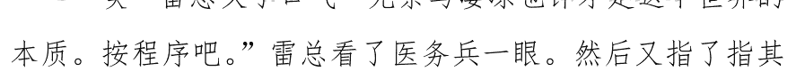

“小刘，是不是觉得我很残忍？”雷总突然问了我一句

。“这个……没有？”我不知道回答。

“人生看多了生死，我们的任务就是如此，不能出任何差错，有的时候必须选择，真正的人生和小说是不一样的，不是所有的选择都是好的坏的，往往很多时候你要面临的选择全部都是坏的。我们一样，如果有一天我身陷困图，希望你们也不要犹豫。”雷总一字字的说着，似乎很累。

“领导，您说的是什么，您能身陷困图？”我问。雷总摇摇头。“不得不承认，大张和雷总关系一般，大张是北京郊小子，后来混了险，幸巧被路过的雷总发现。大张还不错，嘴角点点而已，时间久了没人说什么。我一直很奇他的关系，但是大张。回到驻地，天快黑了，各个出去的小组回来了。这个时候，部队里传来了一个消息，前面救出了几个被染的群众，其中还有马嫂妇……”

作者：猪头大拿 日期:2008-09-04 23:56

雷总马上指示，暂时不会开，马上分组询问幸存者，同时强调了几条：

1. 绝对不要和幸存者有任何身体上的接触
2. 重点询问马嫂妇和地主的情况
3. 如果任何幸存者发生病变，绝对按程序办，不能延误

我们回到了那个小院，之前的笼子已经撤到院子外面，满都是消毒。我们穿着厚的防化服，带着防毒面具。这次部队找回了个人，分别是马嫂妇、民兵连长、另外两个也是民兵。雷总亲自询问马嫂妇，我和大张到了孙子的房间。进房前，雷总似乎和大张耳语了几句。

进去，院子里放着巨大的凳子，凳子上覆盖着血。每个凳子都被盖着布。

“首长，您好，好好准备，”医务兵说到，雷总点了点头，“打开吧。”医务兵一把掀布，我无法形容当时的感受，凳子里的东西只是人形，全身已经腐烂，身上全是血污，半脸似乎掉了，露出了森森的骨白，但是还有神志，眼神深邃的看着我们。

“这是特例，深度感染一天，神志稍清，”医务兵介绍道：“富贵同志，这位是中央来的首长，你好好回答他的问题，说不定还能救，你还救了整个城。”

“富贵同志，你受苦了，我们会尽力办法救大家的。”雷总半跪在笼子旁边。

“请讲讲你的情况？”

“恩，我43岁了，因为家里早年参加过土匪，后来解放军来了，我就参加了解放军，解放后我就在这里做了民兵连长。”他很狠的吸了一口烟又说道，“这里比较穷，最近上面指示要反反，反地主，所以我组织民兵积极响应党的号召，参加到这场新的革命中。”

“2月份咱们这里都出了什么情况？”我继续说。“也没有什么情况，无非是斗地主右派，组织生产。”说到地主右派的时候，孙事的嘴角似乎泛起了一丝讥笑。我的眼睛盯着他，根据多年的经验，他所说的并不是简单的开斗大会，戴戴高帽子走街什么的。

“那么请详细的说你是不是斗地主右派好吗？”我继续说：“越详细越好。”孙事的眼神似乎是狞起来，他有点发狠的说：“同志，和这里的疾病有什么关系？毛老怎么教导我们对待那些级的人？我也不告诉他们，我把他们全杀了！”

我的眼睛迅速的冷了起来：“包括地主全家吗？”“是，”孙事回答的很脆，“地主是一定杀的！”“包括他三岁的小子？”我已经把手按在包里的手枪上，我非常明白民兵连长是个杀人不眨的魔鬼。

“孙事，您先抽烟吧。”我把包里的另一包烟同火柴递到他的桌子上，同时确定了一下大张的5枪不是在我包里。孙同志也不客气，拿起来点了根，刚给我上烟，但是出发我戴着防毒具，他自己笑了笑，独自点上了起来。

“富贵同志，你受苦了，我们会尽力办法救大家的。”雷总问到。

“说说这个病是什么开始的？”雷总问到。

“可能是月初，最早出现神志不清的是马嫂妇，他40多岁，没有娃，听说马嫂妇找了个孩子，那婴儿好像地主老爷的孙子。马嫂妇自己被抓来后，孩子就饿死了，整天拿着镰刀割肉吃，经常有人家的孩子或者老人饿死了，就有死在路边……”说着说着，富贵的延伸突然凶暴了，张开大嘴吼了起来，无力的手突然获得了巨大的力量，从笼子缝里伸出来去抓雷总！更惊异的是，他满口的黄牙竟然变成了尖的，参差不齐。好在大张手快，一把把雷总拽后了一步，嘴里大喊：“X妈的，疯了，小心领导！”雷总挥了挥手，示意别动，他竟然脱了防毒具，我突然发现雷总的眼睛变成了红色的，那眼神好像要把人吃了一样，那一刻，我竟然觉得雷总比眼前这个怪物更可怕。雷总盯着富贵就那样一动的盯着，很快，富贵发生了变化，他似乎害怕了，喉声也逐渐变成小声的低吟，最后竟然缩在笼子的角落里不动了！

“盖上吧，”雷总脸色恢复了正常，“哦，是是，”医务兵也被刚刚情景吓了一下，还没缓神来。“走，我们回去，”雷总召唤着。

“首长，这个怎么处理？”医护突然指着富贵问到。

“唉，”雷总叹了口气，“无奈与淫才是这个世界的本质。按程吧。”雷总看了医务兵一眼，然后又指了指他的笼子，“全部都按程吧。”“可是，”医务还想说什么。雷总拍了拍他的肩膀，摇了下头，然后径直走了。

我和大张紧跟着雷总出了门，一会儿我们身后传来了一阵激烈的枪声。我的心的一紧紧张。

在回驻的路上，我在想我来091工作的这段时间，我在想雷总，虽然他从没回复过我们，但他身上就是有一种不怒自威的感觉，在我们这个小组，似乎只有大张不害怕他，其他人甚至都不愿意多跟他说一句话。我想所有的人感觉跟我一样，不是不喜欢，而是害怕他。

[content]

食物至少是一个正常壮男子的 10 倍以上，在当前的环环境下，如果要维持这样的能量需求的话，靠吃粮食基本是不可能的，唯一合理的解释就是孙干在患病期间吃了大量的人肉！

“恩，小田有什么发现？”老雷又对我们组的小田发话了。

小田是个大姑娘，运动开头，个子不高，双眼睛透着机灵，听说是学历史的，不过大张私告诉我她是一个神妈，叫我没少事招了，不过这个小子还真没少招了小姐。

“报告首，整个城城的风格布局有什么众不同的地方，非常正常吗？”小田回答。

“我说姐，你想看看都挺正常啊，还显得你可没活过完了，回来报告个首正常就好了了。”大张接了一句。

“嘘，我们在下面俏的笑开了。”

“滚你这死完蛋，无疑想闹闹！”东北媳奶奶不好好！”

“咳！”老雷吼了一声，“小田接着说。”

“是！”小田很恨地白了大张一眼，“但是我我所查的，江西历史上曾在这附近出过一场不小的功夫子起。江西是太平国前期主要经营战略基地，根据民间野史记载，太平西王曾早死于 1852 年 9 月，在长沙西王南门。但是书上却记录着 1853 年西王竟在江西一带活动，而且带着手下 500 猛士，刀枪不入，来江西抢粮，可怕的是西王所过的


村庄竟然被屠戮，无一幸，死者均化为骨，残缺不全。后此事传到洪秀耳中，洪秀大惊，立派万人来到江西屠杀西王，1853年末，在江西净水附近成功伏杀西王，方法不得而知，但是听所说后放火焚烧西王及其下 500 兵士时，大火烧了 3 天 3 夜仍有未死士。”小田似乎变成了一个资深的学者。

“还有，《道家秘法·逆道>一书中曾记载，江西深山，曾有猛兽，巨如牛，力大如熊，嗜食血肉，百死不死，得其血肉，随肉为魔，永生不死。”小田继续道：“当《道家秘法·逆道>自古就被老道者唾弃，视为歪门邪道，但是书中很多的记载，还是值得我们探讨的！”

“嗯，”老雷点了点头：“那么我们综合的分析一下这事情。”

作者：猪豪大拿 日期:2020-09-05 06:35

“第一个染病毒的是马暮蓉，这是几个幸存者共同确认的，但是事实并不是这样的，”老雷道，“我刚见过马暮蓉，她很正常，没有任何染病毒的迹象，医务兵也为她检查了，身上甚至没有伤口。”

“他再强调，自己割人肉是为了孩子，也就是说她给来的，地主老孙家的孙。”老雷顿了顿：“那么问题又来了，孙干

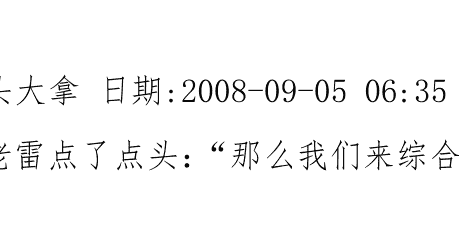

说明她亲手杀的地主的孙子，而且还吃了那孩子的心肝，为什么这个孩子还活着？即使出现了孙干事身上那样的变异，那个孩子现在在哪里？”

“第二，孙干事吃人的事情似乎很严重，他会不会是第一感染者？但是这个人很有很好的控制能力，他不是在感染之前就已经开始吃人肉了呢？病毒的来源又是哪里？”

“第三，今天晚上我们没有任何必须搞到最原始的病毒资料，我认为这个病毒变异是非常强的，必须是第一的资料和样本！我们必须找到孙地主的孙子！”

“今天晚上不必不去，我大张，小刘三个人，其他人王淑涵留，以防其他意外情况。现在对表，现在是晚上 11 点 12 点准时出发，带身上自己的设备和枪械，你们都准备准备吧！还有问题吗？”老雷说完了看了我们一眼。

“等会领导！我有问题了！”大张又开始了。

“讲。”雷总都没看见。

“这个……领导，明天一早行不行吗？大半夜的怪吓人的。”大张做了个鬼脸。

雷头并没有回答他，而是从口袋里掏出一份电报来：“上级的最新，你们都看看吧！”

大张其实胆子一点都不小，这个组里胆色除了雷总我看也他就了，估计是不想我去吧，知道我胆子有点小，毕竟这个任务太危险了，但是我是负责采样工作的，我还必须去。

电报传到了我的手里，我了一眼，又出了一头冷汗：“凌晨 5 时，红雷！”

作者:猪头大拿 日期:2008-09-05 07:14

12点马上就到了，我穿好了化服，带了随身的工具，背了一支 56，有点滑稽，大张跟我开起了：“兄弟，不容易，”我赶紧擦了擦手。

“滚你这死完蛋，能说点几的是不是可正常了？”

“滚你这死完蛋，无疑想闹闹！”东北媳奶奶不好好！”

“咳！”老雷吼了一声，“小田接着说。”

“是！”小田很恨地白了大张一眼，“但是我我所查的，江西历史上曾在这附近出过一场不小的功夫子起。江西是太平国前期主要经营战略基地，根据民间野史记载，太平西王曾早死于 1852 年 9 月，在长沙西王南门。但是书上却记录着 1853 年西王竟在江西一带活动，而且带着手下 500 猛士，刀枪不入，来江西抢粮，可怕的是西王所过的

村庄竟然被屠戮，无一幸，死者均化为骨，残缺不全。后此事传到洪秀耳中，洪秀大惊，立派万人来到江西屠杀西王，1853年末，在江西净水附近成功伏杀西王，方法不得而知，但是听所说后放火焚烧西王及其下 500 兵士时，大火烧了 3 天 3 夜仍有未死士。”小田似乎变成了一个资深的学者。

“还有，《道家秘法·逆道>一书中曾记载，江西深山，曾有猛兽，巨如牛，力大如熊，嗜食血肉，百死不死，得其血肉，随肉为魔，永生不死。”小田继续道：“当《道家秘法·逆道>自古就被老道者唾弃，视为歪门邪道，但是书中很多的记载，还是值得我们探讨的！”

“嗯，”老雷点了点头：“那么我们综合的分析一下这事情。”

“第一个染病毒的是马暮蓉，这是几个幸存者共同确认的，但是事实并不是这样的，”老雷道，“我刚见过马暮蓉，她很正常，没有任何染病毒的迹象，医务兵也为她检查了，身上甚至没有伤口。”

“他再强调，自己割人肉是为了孩子，也就是说她给来的，地主老孙家的孙。”老雷顿了顿：“那么问题又来了，孙干

说明她亲手杀的地主的孙子，而且还吃了那孩子的心肝，为什么这个孩子还活着？即使出现了孙干事身上那样的变异

离开岗越来越远，探照灯的光似乎在逐渐熄灭，我脚下的影子也逐渐融入了漆黑的夜色，我紧紧地握着枪，紧紧地注视着周围，这时候即使出来老鼠，我也会毫不犹豫的把它击成蜂窝。“不用太紧张，昨晚 7 点多撤出的最后一批搜索队员已经报告县城里面不存在可以活动的俘虏了。”似乎察到了我的担心，一路不言的马寡妇忽然开口了：“雷同志，还是小心点吧，咱们街口上的那块白天埋了，晚上照常回家里火煎，折腾了好几次。”而且她的语气十分松！

我手里的枪已经不自觉的瞄准了马寡妇的后脑，雷总伸出一个手指，对我摇了摇，示意我不要动作。我和大张四处瞄的时候，又窜几黑影同样带着孩子的笑声在我边的巷子窜过去，喵一下，最后的影子似乎摔倒了！我刚要开枪，发现马寡妇不知道什么时候又挡在我的前面，她竟然把黑影拉了起来……

我和关大张跑了过去，哗啦啦哨他们从不停。

“说我花妮，几点了还不回家，看见俺家大宝没？”马寡妇拉着影子，我们打算去仔细一看，马寡妇竟然拉着一个 4 左右的小女孩！这个孩子虽然是西方的，但是样子很可爱，小女孩扎着朝天辫子，两眼睛这囔这囔的眯着：“马姨找，大宝跑过去呀，我们玩捉藏崽。”她看着我和大张：“呀！解放军叔叔，快点快点，带着大张，他是……”看到这般光景，我这颗心脏落到了肚子里，但是街道边的森森白骨，以及满地的血污，让我跳了起来！这时候雷总来了，蹲下仔细地瞧花妮，突然把手拍到她的脉上，看来力量很大。马寡妇也不愿意：“我说首长，你这是干啥？”雷总看着马寡妇，示意让她问：“这里还有人吗？”“呀，好多呢，他们都在吃饭，孙放过孙子。”

雷总点了点头，摇了摇，示意我不要动作。这时我们已经走到县城口了，一座破败的古城楼，老而苍桑，顺着不平坦的青石路，我们闯进了县城，我们的行军手的光芒那是微弱的，即使我们4个人一起开，看不清楚以外的东西，就在这个时候，一条黑影仿佛一下从我边的巷子窜，还伴随着一阵孩子的笑声：“哈哈。”皮疙瘩立刻了一身，我和大张举枪就要射，那黑影又不见了，我和大张四处瞄的时候，又窜几黑影同样带着孩子的笑声在我边的巷子窜过去，一下，最后的影子似乎摔倒了！我刚要开枪，发现马寡妇不知道什么时候又挡在我的前面，她竟然把黑影拉了起来……

“老叔，大宝。”马寡妇拉着影子，我们打算去仔细一看，马寡妇竟然拉着一个 4 左右的小女孩！这个孩子虽然是西方的，但是样子很可爱，小女孩扎着朝天辫子，两眼睛这囔这囔的眯着：“马姨找，大宝跑过去呀，我们玩捉藏崽。”她看着我和大张：“呀！解放军叔叔，快点快点，带着大张，他是……”看到这般光景，我这颗心脏落到了肚子里，但是街道边的森森白骨，以及满地的血污，让我跳了起来！这时候雷总来了，蹲下仔细地瞧花妮，突然把手拍到她的脉上，看来力量很大。马寡妇也不愿意：“我说首长，你这是干啥？”雷总看着马寡妇，示意让她问：“这里还有人吗？”“呀，好多呢，他们都在吃饭，孙放过孙子。”

雷总点了点头，摇了摇，示意我不要动作。这时我们已经走到县城口了，一座破败的古城楼，老而苍桑，顺着不平坦的青石路，我们闯进了县城，我们的行军手的光芒那是微弱的，即使我们4个人一起开，看不清楚以外的东西，就在这个时候，一条黑影仿佛一下从我边的巷子窜，还伴随着一阵孩子的笑声：“哈哈。”皮疙瘩立刻了一身，我和大张举枪就要射，那黑影又不见了，我和大张四处瞄的时候，又窜几黑影同样带着孩子的笑声在我边的巷子窜过去，一下，最后的影子似乎摔倒了！我刚要开枪，发现马寡妇不知道什么时候又挡在我的前面，她竟然把黑影拉了起来……

“老叔，大宝。”马寡妇拉着影子，我们打算去仔细一看，马寡妇竟然拉着一个 4 左右的小女孩！这个孩子虽然是西方的，但是样子很可爱，小女孩扎着朝天辫子，两眼睛这囔这囔的眯着：“马姨找，大宝跑过去呀，我们玩捉藏崽。”她看着我和大张：“呀！解放军叔叔，快点快点，带着大张，他是……”看到这般光景，我这颗心脏落到了肚子里，但是街道边的森森白骨，以及满地的血污，让我跳了起来！这时候雷总来了，蹲下仔细地瞧花妮，突然把手拍到她的脉上，看来力量很大。马寡妇也不愿意：“我说首长，你这是干啥？”雷总看着马寡妇，示意让她问：“这里还有人吗？”“呀，好多呢，他们都在吃饭，孙放过孙子。”

雷总点了点头，摇了摇，示意我不要动作。这时我们已经走到县城口了，一座破败的古城楼，老而苍桑，顺着不平坦的青石路，我们闯进了县城，我们的行军手的光芒那是微弱的，即使我们4个人一起开，看不清楚以外的东西，就在这个时候，一条黑影仿佛一下从我边的巷子窜，还伴随着一阵孩子的笑声：“哈哈。”皮疙瘩立刻了一身，我和大张举枪就要射，那黑影又不见了，我和大张四处瞄的时候，又窜几黑影同样带着孩子的笑声在我边的巷子窜过去，一下，最后的影子似乎摔倒了！我刚要开枪，发现马寡妇不知道什么时候又挡在我的前面，她竟然把黑影拉了起来……

“老叔，大宝。”马寡妇拉着影子，我们打算去仔细一看，马寡妇竟然拉着一个 4 左右的小女孩！这个孩子虽然是西方的，但是样子很可爱，小女孩扎着朝天辫子，两眼睛这囔这囔的眯着：“马姨找，大宝跑过去呀，我们玩捉藏崽。”她看着我和大张：“呀！解放军叔叔，快点快点，带着大张，他是……”看到这般光景，我这颗心脏落到了肚子里，但是街道边的森森白骨，以及满地的血污，让我跳了起来！这时候雷总来了，蹲下仔细地瞧花妮，突然把手拍到她的脉上，看来力量很大。马寡妇也不愿意：“我说首长，你这是干啥？”雷总看着马寡妇，示意让她问：“这里还有人吗？”“呀，好多呢，他们都在吃饭，孙放过孙子。”

雷总点了点头，摇了摇，示意我不要动作。这时我们已经走到县城口了，一座破败的古城楼，老而苍桑，顺着不平坦的青石路，我们闯进了县城，我们的行军手的光芒那是微弱的，即使我们4个人一起开，看不清楚以外的东西，就在这个时候，一条黑影仿佛一下从我边的巷子窜，还伴随着一阵孩子的笑声：“哈哈。”皮疙瘩立刻了一身，我和大张举枪就要射，那黑影又不见了，我和大张四处瞄的时候，又窜几黑影同样带着孩子的笑声在我边的巷子窜过去，一下，最后的影子似乎摔倒了！我刚要开枪，发现马寡妇不知道什么时候又挡在我的前面，她竟然把黑影拉了起来……（此处为重复OCR文本内容）
[/content]
```

由于原始OCR文本存在大量重复和乱码，以下是根据语义逻辑重新梳理后的连贯版本：

[content]
### 故事背景（整理后的逻辑片段）

“恩，小田有什么发现？”老雷又对我们组的小田发话了。

到县城最近，大概用了十五分钟，到了哨卡，探照灯把路如同白昼一样，前面的路已经无法通过，我们只能步行，潮气很大，甚至还起了一层薄薄白雾，远处的路面上有一滩血迹，近百名全副武装的战士守着这里。然而，前面的道路只能四个人走了，注定是一个平凡的夜晚，远处的黑影像一个饥饿的狼，静静等着我们这群不速客的到来！”

“12点马上就到了，我穿好了化服，带了随身的工具，背了一支 56，有点滑稽，大张跟我开起了：“兄弟，不容易，”我赶紧擦了擦手。

“滚你这死完蛋，能说点几的是不是可正常了？”

“滚你这死完蛋，无疑想闹闹！”东北媳奶奶不好好！”

“咳！”老雷吼了一声，“小田接着说。”

“是！”小田很恨地白了大张一眼，“但是我我所查的，江西历史上曾在这附近出过一场不小的功夫起。江西是太平国前期主要经营战略基地，根据民间野史记载，太平西王曾早死于 1852 年 9 月，在长沙西王南门。但是书上却记录着 1853 年西王竟在江西一带活动，而且带着手下 500 猛士，刀枪不入，来江西抢粮，可怕的是西王过的村庄竟然被屠戮，无一幸，死者均化为骨，残缺不全。后此事传到洪秀耳中，洪秀大惊，立派万人来到江西屠杀西王，1853年末，在江西净水附近成功伏杀西王，方法不得而知，但是听所说后放火焚烧西王及其下 500 兵士时，大火烧了 3 天 3 夜仍有未死士。”小田似乎变成了一个资深的学者。

“还有，《道家秘法·逆道>一书中曾记载，江西深山，曾有猛兽，巨如牛，力大如熊，嗜食血肉，百死不死，得其血肉，随肉为魔，永生不死。”小田继续道：“当《道家秘法·逆道>自古就被老道者唾弃，视为歪门邪道，但是书中很多的记载，还是值得我们探讨的！”

“嗯，”老雷点了点头：“那么我们综合的分析一下这事情。”

“第一个染病毒的是马暮蓉，这是几个幸存者共同确认的，但是事实并不是这样的，我刚见过马暮蓉，她很正常，没有任何染病毒的迹象，医务兵也为她检查了，身上甚至没有伤口。”

“他再强调，自己割人肉是为了孩子，也就是说她给来的，地主老孙家的孙。”老雷顿了顿：“那么问题又来了，孙干说明她亲手杀的地主的孙子，而且还吃了那孩子的心肝，为什么这个孩子还活着？即使出现了孙干事身上那样的变异，那个孩子现在在哪里？”

“第二，孙干事吃人的事情似乎很严重，他会不会是第一感染者？但是这个人很有很好的控制能力，他不是在感染之前之前就已经开始吃人肉了呢？病毒的来源又是哪里？”

“第三，今天晚上我们没有任何必须搞到最原始的病毒资料，我认为这个病毒变异是非常强的，必须是第一的资料和样本！我们必须找到孙地主的孙子！”

“今天晚上不必不去，我大张，小刘三个人，其他人王淑涵留，以防其他意外情况。现在对表，现在是晚上 11 点 12 点准时出发，带身上自己的设备和枪械，你们都准备准备吧！还有问题吗？”老雷说完了看了我们一眼。

“等会领导！我有问题了！”大张又开始了。

“讲。”雷总都没看见。

“这个……领导，明天一早行不行吗？大半夜的怪吓人的。”大张做了个鬼脸。

雷头并没有回答他，而是从口袋里掏出一份电报来：“上级的最新，你们都看看吧！”

大张其实胆子一点都不小，这个组里胆色除了雷总我看也他就了，估计是不想我去吧，知道我胆子有点小，毕竟这个任务太危险了，但是我是负责采样工作的，我还必须去。

电报传到了我的手里，我了一眼，又出了一头冷汗：“凌晨 5 时，红雷！”


认识，但是吃完了呢？他这样邪恶的人，他这样欲望无限的人会发生什么样的事情，我不敢想了！

果然，在后的日子里，这几个聚餐的饿鬼对乡亲们张开了他的血盆大口，可怕的事情终于发生了，惨叫，血肿，恐慌各种惨绝人寰的事情席卷了我们的家乡！

直到后来来了部队，开始他们还想救人的，哪里想到活着的都是逆天之人呀！于是士兵杀光了！但是被杀他们的晚上又活回来，就这样循环，只有两种选择，要吃人，要被人吃！

我可能就是让他出去，偷偷偷的把人都都救到家来，给他们拍拍灭气，把活不回来的也拉回来家里，把他们分了，让这些活着的的人吃饱了！

我的尊，却无法补偿，最近活动的越越越少了，晚上就让孩子们出去跑跑，看看还有其他活人吗，

其实找回来的多都是老穷妇，心地踏实的人的人，他们似乎很能好的控制自己的欲望，控制自己的情绪。

其他的估计因为自己吃的枯坞都去外面跑了吧，唯一的路也被部队封锁了，估计也都踏上黄盒子了吧！

今天首长你们又来了，我便把这个盒子里有的东西都献给你们，没条件，没要求，希望你们去回去好好研究，将不再让这样的事情发生了。我和乡亲们和孩子们就在这里，再一次等待命运的审判吧！

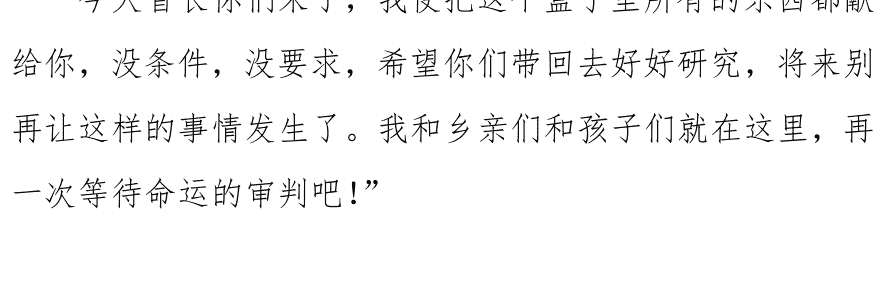

孙地主说完就闭上了眼睛把盒子朝雷总这面一推，便不再说话了！

雷总摇了摇头，把盒子盖好，递给了我：“收好。”

这个时候，院子的门口传来了一阵急促的敲门声！雷总的脸色突然变的阴沉起来：“不好！”

作者：猪差大拿 日期:2020-09-08 00:44

(14)

大宝和二妮带着一群孩子，疯跑着去开门：“别开！”

雷总有些失态大声道：“大张，小刘，抄家伙家伙!!!

完了，一切都那么熟悉，门开了了！

却然闪出了一个熟悉而又狰狞的脸！孙干事，孙大福！

一键整理，加微信：1012849526，获取更多网站

砰声，她的肚子被他用手戳了一个顿时，鬼倒到了。

回头，他那鬼手又向大宝袭去！马雾不知何时时候侯倒在大宝的面前，她的反应非常迅速！可是血肉之躯能挡住餐餐饿鬼吗？显然挡不住，她和大宝一起被贯穿了！

枪声响起，没有命令，我和大张本能的向面前这个鬼倾了所有的子弹，然而，换来的却是一阵透人脊骨的狂笑！

“哈哈哈哈，感谢孙地主！让我获得了如此的力量，感谢你解放军同志，让我又一次获得了新生，没到吧！！！我没死！！反而在部队的废墟地让我又一次美美的地吃了一顿了！！！！

孙干事说着，他身体却起了巨大的变化！肌肉全部爆出，面目也变的狰狞，全身都渗出了血水而且在不断的化！我好痛苦啊啊！！你是让我身体变成这个样的!!!!

他变成了一个巨大的血兽，全身淋着鲜血，像一朵盛开的红莲花！

红莲血兽，这个古书中的恶魔又一次出现在人间了！

“操你妈的!!!!”张横愤怒地吼着！手里的 56 又开始的新一轮怒吼！

孙干事，不红莲血兽只是起了护牌挡住了那愤怒的火焰！

“住手吧！”雷总吼了一声

他的睁眼的血丝，太阳穴上的青筋似乎都要暴了出来，他一步一步的走向孙干事，那种气势，那种威严竟然连我这一个助理，对他都感到胆战栗

“人人爱，天下太平；人人私利，天下大乱！你本民兵，责任当乃家卫民，却借手中权利，私设刑堂，草菅人命，妄杀人，非非不思悔，还继续杀人为恶，今天老夫送你一程！”雷总一字字的说道：

“吼！吼！你算什么东西，看我折了你！！！如今我是不死之身，你说是天兵神将，能耐我何！”孙干事并不服气！

可是它并没有发现，它的身体已经动不能了，它已经站在了雷总面前，只有它那高高耸起的头部似乎才能由它来控制！

“没有什么是不朽的”雷总已经到了孙干事的面前，他五指伸开，对着孙干事那张男人恐惧的脸：“去吧！”

“啪！”漫天血海，孙于事的上半身已异化为粉碎！

惊厉！我不知道怎么形容当时的心情，在场的所有人都愣在了那里！这一切太突然，结束的也太突然了！鸣鸣鸣鸣，直到传来了马嫂妇的哭声，大家才缓神过来。

我们围过去一看，却无心酸，马嫂妇抱着血肉糊糊的大刀和二妮，她自己也是生命之危！

雷总过去跑在旁边，看一会，摇了摇头。陆地主还是跪在地上，哭的老泪横！

这时马嫂妇做出了让我一生感动不已的举动，她把两个孩子的喇塞到了了自己的伤口旁边，嘴里喃喃道：“宝儿，妮儿，把狮子吃了吧，狮子没事了，救了你们了……快吃吧……吃了就睡着了，狮子就不疼了……”

我再也看不下去了，背过了身子，我泪水化了的雾气，已经把防毒面具的镜片模糊了！

“不得啊！她她!!!!”孙地主上来就要拉开。

雷总拦住了她：“人生一世界，草木一棵，她了她的心愿吧，这一刻便是她的永恒。”

作者：猪亥大拿 日期：2008-09-08 00:50

(15)

我已经忘记怎么离开那个城县了，我们回到岗哨的时候已经是 4 点 45 分了，雷总做的第一件事情就是电报“推迟行动！”

我们站在山顶的指挥部，望着下面的县城。大宝，二妮，马嫂妇，孙地主，那一张张活的脸在我脑子里不断浮现。从天边升起了，鲜红的像血一样！晨见朝阳，多么简单，但是就是这么简单，对某些人竟却是最后了。

时间到了，开始吧！”总统闭了眼睛。“啪！”一颗红色的信号弹划开了清晨的天空。那刺耳的声音和静寂清晨是不协调的；10秒，9秒，8秒，7秒，一枚，流星划了水面，接着又是一枚，两枚，三枚，直到千万，山后的这件事写了一个句号。轰隆轰隆，雷声把那些善良，邪恶，人性，私利，贪婪，以及一切都埋在历史的尘埃中……我似乎听到了大宝，二妮以及孩子天真的欢笑，又听到了马嫂妇喃喃的哭泣。

作者：猪头 日期:2008-09-08 (16)

### 5903病毒实验报告

我们的工作就是这样，既要接触一些不科学规律的现象，又要用科学来合理的这一切，下面是关于这次行动的部分内容：

- 病毒同样所有生物一样，具有遗传、变异、进化。
- 病毒体积非常小，结构极其简单的生命形式。
- 病毒具有高度的完全依赖宿主细胞获取能量所需的物质。
- 病毒停止活动成为蛋白质结晶为一个非生命体。
- 遇到宿主会进入、复制、释放活性，形成典型的生命特征。
- 传播方式已知为血液传染，是否通过其他途径明确。

#### 第一类感染者

这类感染者的生存方式和我们截然不同，首先原理是依赖宿主细胞获取能量，实现自身的增殖。当能量补充到一定状态，病毒会剧烈增强，具体表现为嗜血、思维混乱。由于得不到有效的能量补充，感染者会在几天内死去。

此期间曾经服用过一种叫“抑气丹”的药丸，经过化验，这种药物具体配方不明，其效果是抑制人体脑反应，能很好的抑制人类的各类欲望，尤其是饥饿感。所以特例感染者一直存活到最后。但是并不代表“抑气丹”就能治愈这种病毒，它的作用只是缓和。

### 最后结论

5903病毒极端危险，具有高传染性和破坏性，一旦传播，后果不可想象。以现有的科技手段还没有办法控制，建议封存。

实验小组成员：
- 指挥：雷总
- 生物化验员：天鸣
- 生物化验员：李思远
- 生物化验员：王浩
- 生物化验员：赵晓飞
- 生物化验员：魏大海
- 生物化验员：田苇
- 生物化验员：张国
- 生物化验员：钱凯

综所述我们分析认为5903病毒与其做病病毒，不如做古代生物战更为合理。试想，在冷兵器战场上，突然出现一群3类感染者，那将是一种什么样的优势。当然这样单纯力量上的优势在现今热兵器乃至核武器横行的时代已经可以忽略计了。

而我国史料中，最早控制这类生物作战的恰恰是三国时期黄中军首领张角。在这次任务中，我们还获得了一本名为《太平末后开卷》的古书，里面内容正被紧张译，这本开篇是在已知史中首次发现，而三国期间黄中军首领张角正是靠着《太平要术》起的，两者联系起来，我们期望在以后的工作中能够逐渐解析并送达生物武器的迷困，获取更多帖。


# 群情振奋！

那不是雷总吗？那高高上的将军不就是雷总吗？我奋力地冲人群，准备到更近地看个究竟，却被一个高大的人拦住了，是大张！他眼睛竟然也是红的，似乎从来不认识我，他抓住我，把我重重地撞到了地下，我漠然地抬起了头，望着这不可思议的一切。

“啪！”一声惊醒，天空下起了瓢泼大雨……

我睁开眼睛时候，发现我已经回到了宿舍，而大张那脖子还在含着凉水喷我的脸。

“干嘛孙子！”我无奈地坐了了起来，拿着脸上的水。

“我说领导，都下午两点了，头头让我来请你，他怎么摇也都摇不起来，只好给你上上手手段。”大张还是那副小痞子嘴脸。

“我们哥们，昨天我那是什么情况，你和雷总是怎么的啊？”我突然想起昨天晚上的事情。

大张摇摇头：“唱什么的，我也搞不明白唱什么的啥，其实我和雷总最近有些想法要跟你讨论讨论的，昨天晚领导也想试探，没想到小子竟然哑了，领导说还是时机再熟点再探讨吧。”

“哎，你就告诉我一点点吧，你想憋死我啊？”我不太死心，这样的事情换了谁不想设办法得搞个明白啊。


“刘子，咱俩关系最好，多了我也不方便说，因为我和雷总也还没明白什么，不过话还有一句……”大张脸上出现了一个少有的严肃。

“快说，我是你大爷吗？”我追不及等待，身体前倾。

“你想想你自己，学术不拔，技术不出众，素质更是一般，也不是首长领导的亲戚，为什么雷总总会在军之中把你提拔到这个国家最机密的部门呢？而我更不用说了，当年更是个小伙子，为了雷总开始发誓当他忠诚的革命战友没错，肯定有他的原因。”大张又开始没正经了：“行了兄弟，刚才说了了，你快放下包袱，安心争取更快更好地完成世界革命历史使命，抓紧把刘王智、刘伟接热闹好老家伙，明天准时开会，你不是叫老雷老头自己来请你啊？”

“得得，别扭了，有这个历史使命吗，走着吧。”我一脸无章。

回想一下也是奇怪，当初为什么雷总会亲自点名我从地方部队的研究所叫到091呢？我这个人实在是没有任何过人的地方。

会议室在一楼，宽敞而明亮，如果不知道的人还会误以为这里是某个大学的讲堂。

我和大张去的时候其他人都已经齐了，雷总却还没。

“刘子，听说昨天晚上暴雷了，你那胆子咋这么小啊，没事了吧。”

说话的是小田，东北姑娘就是大嗓门，看来大张那小子今天又没少坏了我。

“来，大家欢迎我们091的英雄，刘干事！”大张也没停，“啪啪啪”鼓掌，谢中强几个人还真跟着鼓劲闹开了。

我的脸就红了：“没事没事，只是跌了下，不影响革命工作。”我尴尬地应着。

“咳！”熟悉的咳嗽声从门口传来，雷总到了，刚才还狂热的气马上我们安静了下来。

作者：猪杀大拿 日期:2008-09-11 06:25

“说说吧，如果没有重大的发现就尽量简单明了，王浩先说。”

“今天早晨，我们对尸体进行了详细的解剖分析，结论如下：

- 1. 身体身高1米左右，男性，脑部为正常人体组织，可以确定，该生物具有和人类相同的智慧与行为。
- 2. 手臂组织外观与蚯蚓几乎一样，只是大了许多，质地坚硬，而且相当锋利，带有倒钩，内部肌肉组织发育，力量输出。
- 3. 心脏、肝脏以及肺部等组织功能与人类相似，只是皮肤被昆虫外取代，硬度不如人类。
- 4. 胃部食物分析，该生物死前吃的大都是蔬菜与谷类，部分是熟的，他的生活习惯应该和人类一样。
- 5. 腿部肌肉完全类似人类，只是肌肉极端发达，任何普通人都不可能达到强度。
- 6. 血液循环与人类相似。
- 7. 从昆虫组织与人类组织的部分集合来看，如果该生物还存在，应该继续进化，至于最后变成什么形态，还不能描述，基本情况就是人类突变而来。”

王洛眯着眼睛，看着资料，似乎许多疑惑没有解释。雷总依然没有表情：“报告首长，昨天我已经听说过，历史上的传说都是比较正面的，并没有听出什么邪的，但是我今天查了几份民间史以及一些史书籍，却发现不同，但是他们对昆虫理解是不一样的。”小田顿了顿，有很多记录记载：“昆母，昆仑之主，人面乃天下魔，曾生万对抗天地，终被雷所斩，其精髓化于苍昆仑，当天地异象，必有复活。”

赵起飞抱着手，闭着眼睛，似乎思索着。他整理着手表，不停地：“报告首长，根据昨天的报告，该地昆仑山北靠，平均海拔高度4000米，属于昆仑山脉外围，该地曾有火山爆发，并有泥石流。没有什么奇特之处。”赵起飞回答简单的：“喂，赵起飞？”雷总转过头突然问了一句：“你们相信神吗？”我们不知道雷总为什么会问，台下一片静。雷总告诉他们：“我不相信神！地球已经存在46亿年了，人类记载的历史只有几千年，而几千年当中有明确历史可查的又少，我们的文明大部分存在于神话与传说中，与浩瀚的宇宙和无尽的时间相比，我们甚至连一粒尘埃都不及。而我们这些尘埃构筑了无比绚烂文明与科技。但是对于宇宙，对于天空，对于大地，对于海洋，对于这些奇百怪的生命，我们仍然没有根本地了解。大江东去，岁月尽，历史留给我们几乎还是一片空白。我相信暂时不能解释的事情，但不相信有永远不能解释的事情。即便有神，我们也要把它出来，也要用人类的语言来诠释它的奥秘！为子孙后代留下我们真正文明足迹。这就是我们091的意义。”

雷总闭着眼睛，手指着唇，他似乎很累：“看来得去昆仑山会这些神……”

作者:蜘蛛大头 日期:2008-09-13 01:27

峰外峰峥，岭外有岭难寻。天势高嵩路险，州原尽平。目标荒线连天际，望中牛马遥。汉漠荒野人缺少，间有水草客。粒粒沙石何物，辨别留待探。。我车日行天涯，行三百里，七天驰骋不不停。昆仑魄何伟大，不压奎博盛名。聚集江河东入海，控制五岳断山横。当年陈总理路过昆仑感慨万千，千里昆仑层层叠叠，雪压着云，云连着雪。我们一行20多人站在山外，遥望昆仑的时候，也无唏不已。

1961年2月，091一行22人，进驻昆山西西北侧的武家村边。


武家村很小，全部为汉民，说村民祖上全是当年屯边士，民风朴粗犷。当他们驻扎了之后，便开始了紧张的进山准备工作。当时寒冬，北风阴冷刺骨，日夜不停，我们的帐篷被吹得飘摇不断，调查工作就是在这样恶劣的环境下开始的。

当地的公安领导、驻军领导，以及经历过壕堡袭击事件的几个村民与我们聚在一起，讨论了整件事的经过。10月，未进山打猎的最后时限，各家青壮基本都进山打猎的。随着天气的逐渐转，大部分进山的村民都带着猎物到了武家村，已经是1月了，竟然还有几个人没。。就开始着急起来，到了这个时限，很多猎人不管有没有，应该全部回来，估计是命中了什么意外了。于是当地公安、驻军以及村里的民兵联队进山搜索，一直没有什么消息，直到有一天，几个村民被形似昆虫的怪物咬了。在驻军公安和村民联手下，付出了巨大的代价后，才击毁了那只怪物。也就是现在091保存的那个人形尸。

在帐篷外，行军灯下，几个人围成一圈，大家都分析当时的情况。雷总喝了口热茶：“武村长，失踪的那几位找到了没有？”

“哦，那么山上最近有什么异常？”雷总问。

“没有，一直都是那样，跟往年一样。”村长摇摇头，“老伙计，你说有什么发现？”雷总问。村长是山东人，加上他的身材显得更加不同。周局长是当地公安领导，也是40多岁，两眼带着光，一看也是久经沙场的老将。

村长看着雷总，横愤说道：“妈的，他在这儿留下了一个孩子，你查了那个王八蛋也没给出来。老雷，你一定得查明白，以后告诉老乡，怎么给这些孩子的爹妈交代！”铁骨铮铮的汉子，眼里泛着泪光，“人生，轻于鸿毛，重于泰山，这些孩子注定成为巍巍昆仑的石。”

雷总拍了拍村长的肩膀，重心长地：“别太难过了。”沉思了一会，雷总问：“周局长，你那边有什么分析？”

“雷总，我们就找到了失踪者的几件衣服，其他一无获。惭愧啊。”周局长那边的线索也是惨惨的。


“几件衣服？能详细说说吗？”雷总继续问。

怀着忐忑不安的心情，挨到了第二天清晨。雷总指示，昨天晚上已经基本确认，现在091的人形蝴蝶尸体为武家村村民陈三所化，昨天和老村长的谈话，特征基本吻合。另外还强调此事为绝密，不能向091外的任何人透露。

第二天天气不错，我们跟雷总出了帐篷。今天的武家村与其说是一个村庄，不如更像个堡垒。郡长经过请示，把几十里外的一个步营抓了回来，还迎上了追击炮。局长也调动了几十号年轻民兵，武家村更是老少爷们齐上，冲锋枪、步枪、猎枪、红缨枪，有什么拿什么，还有几个胆大的妇女女孩拿着砍刀也出来了，那阵势像是要是要整个人都趴掉。郡长似乎早就按不住了，捂着腰在地上走来走去，看着我们出来，便步上前：“我说雷哥，咱啥时候出发啊？都准备好了！”

雷总皱着眉头，看着这大队人马：“这是干什么？搞演习？”

郡长有点纳讷：“演习？咱怕不是搜山抓怪物吗？”连对手是谁谁没弄清楚，就大张旗旗的进军。知己知彼，方才百战不息。

雷总似乎无奈：“你看，还有妇女孩子，这么多男人在这里还轮不到他们。”大张招了招：“部队拉上去，不要太近。”我们迅速围了上去，大张。雷总转过头来：“小田，既然我们的工作基本上从这里开始，我们是不是可以继续分析？”

“首先，我们假设怪物是昆虫，不管从传说还是现实形态中都非常合，我们可以把眼前的怪物假设为昆虫，同样从传说还是现实形态是一样的。这样来说，昆仑山脉在远的时候似乎是昆类生物聚集的地方，当然，这样分析是非常强的。主要是两者生成的怪物是病毒感染导致，而这里的怪物却是失踪村民所变，更像自身变异。两种怪物出自一个体系的话，这样不同的形式就不符合逻辑了。”小田吐了吐舌：“要是真的麻烦了，上面那些神可不是翻江倒海的。”“行了姐，这就够了，你能说不玄乎的？”大张接话：“滚猴子，给我汇报汇报搞笑事！”小田白了大张一眼。雷总看他们一眼，笑着摇头，接着闭上眼睛深吸了口气：“呵，昆仑不愧是华夏龙所在地，空气都冷冽。自从进了昆仑以来，对这片神秘之地切倍更有游子家的感觉。”雷总把头扭向我：“小刘，你有这感觉吗？”我正紧张地看着周围的环境，雷总冷静问我这一句，还有胆量：“老子这还有意，我哪这份闲心感受游子家啊，再说我要住这块儿，还不早了。”“没有，领导。”我回答得也干。雷总拍了拍我胸前挂着的钢魄：“用心感受下试试。”领导说了，岂不能从，索性闭上眼睛，扶着大张，闭也感受昆仑仙境。脚步逐渐慢了下来。凛冽的风声，不知名的鸟鸣，还有那太清晰的溪流声在我耳边回荡，一切真有点似相识。“怎么招刘子，哥哥我就这么像根文明棍啊？”大张似乎被我扶着不太满意，我连忙睁眼：“怎么啦，我扶你会信任我，看你德行。“得，你还是别信了我，他妈妈一个人干人的活，还牵上一口子，你哥哥哥使劲吧？”我一看，好家伙，大张把小子的那身也扶身上了。而小田不知道时候跑队伍后面，王浩不知道在聊着什么。“行哥们，你是我张大人啊，”我阴阳怪气，“你自愿当鞭子的吧，扫冷饭，我爱啰嗦……天已经快热了，经过几位领导离开后，就在某一条小溪边扎下了营地，就在在生火作饭的时候，天上飘起了雪花……”

作者：猪差大刀 日期：2008-09-16 03:49

(25)

中午时刻，我们准备妥当，目前，所有疑点全部指向了地险几个村民失踪地点。山中温泉鉴于进山的不可预知性，我们决定分开行动。原本我们7组的集体进山，剩下的8组在外面继续延续。周长带着两个武家村的民兵做向导，另外团长也带着10多个身体力沛（应为力沛）的战士和我同行。由于路径遥远，地形复杂，补给困难，直升机也不适合在高原行动，所以组织大规模的进山搜索的计划被放弃了。再加上我们目的明确，所以总共去了20几个人。蜿蜒的山路，黑郁郁地树林，寒光闪闪地军刺，一张张肃穆脸庞，一双双锐警惕地眼睛。周局长在队伍的最前面，两个兵在他身后，跟着雷总，大张，小田，队伍依次排开，最后是郝团长扛着枪。

“周局长，你预计什么时候能到？”不好说，看着今天天气，估计下雪得快，明天差不多吧。“哦。”雷总转过头，朝后招了手，把小田喊到身边。“小田，你最近有什么发现没？”小田眨了眼睛：“领导，发现是有，太玄了，而且线索很乱，也不知道怎么理头。找重点吧。“领导，你记得当年带回来的那本书吗？”雷总问。“嗯，那本书应该是明白本（应为笔记本），但是里面的内容，根据目前理解，这本书主要描写古代神大战，其中多次提及了昆仑山，昆母等关系实在不多，不过里面似乎有意思。”小田回忆了一下：“大概是这样的，昆母面蛇身，长度数十里，手下万魔，猴子万魔守昆仑，四面八方分别是橙、黄、青、蓝、紫、七部，书中描述比较详细，像传说中的妖怪，值得展开。昆母外的防卫乃同化而成，无比，敢犯仙者，注定成为昆仑的石。”雷总似乎无奈：“你看，还有妇女孩子。”大张招了招：“那个就是了，包抄过去，不要靠近！”我们迅速围了上去，虽然那人形蝉仰朝天那边，全身被割了一块，脑也被割掉了一块。虽然我们部队射法不错，几颗子弹进了外壳里。如果091那只昆螂进化了一半，那么这就基本进化完毕了，除了腿部完全被虫壳覆盖以外，其他和一只昆虫没什么分别，就是翅膀和屁股。大张挥开军刺，挑了挑怪物，果然咬死了。大张点了点头。雷总看向郝团长，伸大拇指：“你牛！”过了一会其他组员把那尸体装了保温桶带了回去。“小刘，昨天你上感觉觉得它了吗？”雷总突然问我。我愣了：“领导，没有。“我们就是和雷交交代的人，它们危险乎，却转瞬逝，用心感受，才能抓的踪迹。”雷总拍拍我的肩膀，语重心长：“准备备备，下午进山……”

作者：猪头大拿 日期:2008-09-14 23:14


“了。”雷总见大家情绪不高便想出了新的主意。

郝团长看着大牛眼：“好！今天就在后生们面前献献武艺！饺子一样当，一点都不含糊。”

“当理当，当理当，当理个当理个当理个当理当！”

“闻哼哑语毫不讲，表一表好武汉二郎。”

“那份武学举拳到少少林寺，功夫练到八上年……”

郝团长看着五大三剑，说起山东快来还真不像，就是那狗熊样的的身材和那大牛眼，伴随着那有点拙劣的动作和眼神，是有点好笑。

“……武松打了一了一虎，留美名天下！”郝团长一气说完：“大家敬个礼。”

大家歪笑着说：“丑丑，哈哈，哈哈……”

“好！”下面一片叫好声。

“你们 091 的同志是不是也得出一个节目啊？”郝团长的战士们看着起哄笑。

“呵呵。”赵笑着，这么多年了第一次见他这么开心的笑，“小田，来首唱祖国吧。”

小田并不怯场，“是！”站起来来为大家敬了个礼。

“五星红旗迎风飘扬，胜利歌曲多响亮：歌唱我们亲爱的祖国，从走向繁荣富强。歌曲我们亲爱的祖国，从走向繁荣富强。越过高山，越过平原，跨过奔腾的黄河长江……”

也许是受到气氛感染，大家跟着唱了起来。

“好！”鼓掌声还没落下，远处却便带头鼓着：“哈，真不错，我说老雷，你 091 果然却是卧虎藏龙啊，一个一个文武双全，哈哈……”

苦作为的含义就是如此了，在那样恶劣的危险环境下，没有人抱怨，没有人屈缩，所有人都拥有一颗火热的心。

雪似乎还没有停，但是还不很大，薄薄的积了一层，我们先给其他回哨的战士分了圈烟，便拿着圈围着营地转悠。

“我说哥们，这地方真的够冷的。”我的牙根叨着，“谁知道妈不说呢，早知道这这么苦，我还真不如在北京郊区采芜呢，进个工厂，当个人，上班班，多他妈惬意啊。”大张应和着，“今天领导叫我感受感受昆仑味，你还别说，还真有那点儿游子归家的感觉，头不是学催眼之类的东西啊，不说我什么也感觉不到，他一说什么感觉都有了。”我想了，“话又说回来了，怎么不让你感受感受啊？”

“感受个毛，打一座山我就跟老头说了，这地方怎么感觉跟我老家一样，其他妈妈呀，哥哥我可可是娘胎里出来一回来来到到这里。”大张也有点愁。

“难不成咱俩是妖怪托生的，呵呵，没听说我祖上有什么事道的人啊，呵呵，呵呵。”你还别说，其他她有可能，还不是咱祖上和老蓄居跑里，跟他家逸跑从这鬼地方出来的，打我第一眼看见老雷的时候我就认得我认识，你也一样，最的就是我就要动花心眼睛老雷他竟然能感觉出来，来之前我我还想两两煎二锅头，竟然被他给翻出来了，邪门啊！”

“嘘……”大张突然对我做了个手，又指了指前面树林，那边似乎有个黑影在动。

可能是紧张，也可能是习惯，我“啪啦”一声拉上了枪，冲着那黑影就要射击。

“别开枪。”树中传来了熟悉的声音。

是雷总！真不知道领导是什么时候出来的，我和大张赶紧跑过去。

“我们领导，这大半夜的您出来视察工作得说实话吧，我和刘子都够愁了。”大张挠着雷总。

雷总没理会大张，只是紧张的注视着周围。

“跑了。”雷悄悄道，“从进山我就觉得有东西盯着着我们，刚才感觉更强烈了，我出来一看，虽然还在我们营地周围转弯，刚才你他们一把枪那家伙立刻就消失了，一点也感觉不到，看来这些家伙心灵是有感应的，知道跑枪的厉害我感觉是跑远了。”

“怎么情况！”旁边放哨的战士听见声音，也赶了过来。

“没事，一切正常吧！”雷总对他们挥了挥手。

“哦，是雷总啊！”那边开了声，各自散开了。

“好哒，趁这个机会咱们聊聊。”雷总对我们两个说：“我知道你们心里有很多想法，其实我也想想明白，但是我不知道该从哪里说起。”

“领导，我就说说说吧，说到哪哪哪，我一直害怕呢。”我接声。

“来，这边，我们做在这里，也全当给同志们放哨了。”雷总招呼我们在稍远的一块大石头旁坐下。

“从我从小说吧，尽量简单点，我出生在广西，我是个孤，被父母在山里捡了回来，从小的时候我感觉特别灵敏，半夜里村口的叫都能听的清楚楚，小时候就跟着革命闹了，因为我的感觉灵敏，所以告诉大家有很多事情我不清楚，但我可以清清楚楚。

而且，我的体质似乎和所有人不同，一旦我集中精神，我的眼睛就会红，我问过医生，他们没有很好的解释，只是说可能是血液集中导致头部，但是一旦我精神，我的眼睛就会红，我问过医生，他们没有很好的解释，只是说可能是血液集中导致头部，但是一旦我精神，我的眼睛就会红，我问过医生，他们没有很好的解释，只是说可能是血液集中导致头部，但是一旦我精神，我的眼睛就会红，我问过医生，他们没有很好的解释，只是说可能是血液集中导致头部，但是一旦我精神，我的眼睛就会红，我问过医生，他们没有很好的解释，只是说可能是血液集中导致头部，但是一旦我精神，我的眼睛就会红，我问过医生，他们没有很好的解释，

说老血液虫的头部虫

，像老鼠的昆虫一样，有的战士不不不虫，像老鼠的昆虫一样，有的战士不不不虫，像老鼠的昆虫一样，有的战士不不不虫的，像老鼠的昆虫一样，有的战士不不不虫不不不虫的，像老鼠的昆虫一样，有的战士不不不虫，像老鼠的昆虫一样，有的战士不不不虫不不不虫的，像老鼠的昆虫一样，有的战士不不不虫的，像老鼠的昆虫一样，有的战士不不不虫，像老鼠的昆虫一样，有的战士不不不虫不不不虫的，像老鼠的昆虫一样，有的战士不不不虫的，像老鼠的昆虫一样，有的战士不不不虫不不不虫的，像老鼠的昆虫一样，有的战士不不不虫的，像老鼠的昆虫一样，虫战士不不不虫不

不不的的，像老的的昆虫一样，有的战士不不不虫的，像老鼠的昆虫一样，有的战士不不不虫不

不虫的，，老老的的昆虫，，战士不不不虫虫的，像老的的昆虫一样，，战士不不不虫不不不虫的，像老鼠的昆虫一样，有的战士不不不虫的，像老鼠的昆虫一样，虫战士不不不虫的

不不虫的，像老鼠的昆虫一样，有的战士不不不虫的，像老鼠的昆虫一样，，战士不虫不虫的不不不虫的，像老鼠的昆虫一样，有的战士不不不虫的，像老虫的昆虫一样，虫战士不不不虫的

不不虫的，像老鼠的昆虫一样，不不不虫的不不虫的，像老鼠的昆虫一样，有的战士不不不虫的，像老鼠的昆虫一样，虫战士不不不虫的

“啪啦”一个黑影从树上跳了下来，手电照，好！正是一只活生生的人形螳。只有它全身通练，腿趴地上，手刀也贴着地面，只是拿着脖子，两只大眼睛对着雷总睁一合，似乎和眼前这个人互动。正当我们庆幸它被控制了，耳边又传来雷总吃力的话：“快快……开枪……”

“突突突，”在我们开枪的一瞬间，那人形螳也摆脱了雷总束，“嗤”的一声，竟然展开翅膀飞起来了。

“突突突，”我和大张顺手电光一直不停的向人形螳爬出的方向瞄准，不过那东西似乎太灵活了，而且出了翅膀，天也黑，你能想象在半夜三更拿枪打一只活蹦乱爬的蝙蝠的感觉吗？

“嗤，”那物事在空中叫两声，呼的一下，朝着深山夺去，天上落下几片破碎的昆虫翅膀的东西，看来是受伤了。我和大张刚要追，却发现雷总倒了，身体已经趴在雪子里。后面营地里的同志更是被哨声惊醒了，纷纷地抄起枪。。大张背着昏迷不醒的雷总，而我则端着枪不离开，紧张，恐惧，各种不好的情绪充着我的神经。说实话，跟雷总出任务，就是天塌了，还有雷总给你顶着，如今这个顶天的人竟然竟然昏了，而且那不名的敌还在四周观视着你，那。

第一个从营地里过来的是郝团长，看到雷总晕倒了，更是紧张，一把把雷总从大张背上抱了下来，他瞪着牛眼，忙着大嗓门：“医兵术！医兵术！抓紧过来！”

王浩赶过来，摸了摸雷总的鼻子，又掐了拍拍搏，接着便紧张地抢抢。郝团长过来就冲着大吼起来：“你干什么呢！你年纪了能憋吗？也不知道好好回去！混蛋！他要带人闹！”

“老张，别叫，他们。”雷总醒了过来，没事，大事不要，狂躁，把人拉出来……”郝团长看着雷总，大张脸了了，雷总突然也急了。

“郝团长，你在这儿。”雷总从人群里挤进来。

“郝团长，到山温泉还要走多久？”

“大张，小刘，把帐篷拉进去，给你们布置。”

雷总在帐篷里，他把其他人召唤了，只留下了我们两个。这次，我以为能完全控制住怪物，没想到比象中的要多，而且仍在成长，还有大山的深处似乎有什么不明的东西。

“立刻马上给上级发报，把方圆为军事禁区，没有人可以进入这里，即使我们的任务完成比较成功，那片温泉，我们绝对不能从这里深入。切记！你们用生命保证任务！”

“出发！”随着团长一声令下，我们开始了跋涉。我和大张找着雷总，却被他拒绝了，一夜之间，才发现我们。雪一直没有停，这一会大了，风也起来了，前面的道路更加艰难。直到中午时，我们终于到了那。中的温泉处在一个高崖边，池子很大，分散在几十米的地方，冒着澎湃的热气。而在池子边上有棵大树，树上垂着许多果，树粗惊人，至少得五个人了。

我们小心翼翼的过去，仔细的搜索着这里。雷总背着手，对附近看了又看，转了转，不知道他在想什么。

“这是什么树啊？”雷总有点犹豫。

“嗯？这是什么？”雷总似乎发现了，赶忙招呼我们过去。我们把那上面的雪打了，发现是一个水葫大小的壳，质地坚硬，上面还破了个洞，显然是有东西从里面孵化出来。

“都注意一下，看看周围还有这种东西吗？”雷总吩咐。果然，很快发现了两枚卵壳。我们把三枚卵壳拖到一起，雷总在旁边搂着手，死死盯着这几个东西，王浩在那里忙着取样。

“难道蚕蛹是从这里出来的？”我问。

大张看了一眼：“应该是吧。”他揉着腿子有点劲，几个心情特别，“操，”就在我们各自搜索的时候，团长那边又有惊人的发现。团长和两名带队的民兵围着一枚卵壳，竟之前之前不一样，枚卵壳是完整的。

“怎么找到的，这里刚刚还没有呢？”雷总问。

“树上掉下来的。”团长指向上面，“就刚刚的事情。”而此时，那卵壳竟然破裂了……

“后退，举枪！”雷总又命令。那一刻，空气似乎都凝了，周围一切都停止了，只有寒风夹着雪花不断打在我们身上。“啪”卵壳破开的地方伸出一个头，没错，是人的头，那脑袋上尽是像蛋白一样的黏液，正在努力的向外挣扎。我们都举着枪，现在只要有任何不妙的情况发生，眼前这个东西就会变成蜂窝。

“诶，那不是武柱子吗？”就在这个时候，一个带队的民兵说话了。

“我看！”另一人似乎很高兴，“太好了，还活着呢！”还没等雷总说什么，两个人竟然直接跑了去了。一个民兵扒着卵壳“柱子”，抓住！拽住！另一个按着人的肩膀，要把人拽出来。就在这时，那人眼睛睁开了，眼神很呆，打量着周围，嘴唇动的，似乎在说什么。

“别拽了！！赶紧跑！”雷总大喊。可惜，已经晚了，这一瞬间，两个民兵被分成四块。东西从卵壳伸出来，全身赤裸，身上带着黏液，冒着热气，怎么描述呢？还是人类，冲着我们冲着了。

“开枪！”雷总命令还没落下，那家伙竟然跳进了队伍里，手里刀刀。它已经挣脱了雷总的束缚，身体随着脚跃起，幸运的是，有几粒子弹打到了腿上！只见那个怪物依然昂着身体，虽然一条腿被子弹打成了筒，但是向我们移动，嘴里“吱吱”叫，声音凌厉无比。

“杀！”雷总命令。“突突突，突突突，”机枪的声音在我们身后传过，怪物身上的血洞不断裂开，“吱————吱”怪物挣着继续前进，我和大张手里的家伙也是一刻没停，直到它半身被打了。它可见晃悠悠倒在地上，身后留下了大滩血迹。奇怪的是，当怪物死后，老树却平静了，它的蔓藤也有来拉人。“树上，树上！”团长大声喊。原来刚才混乱中，又有几个同志被大树的蔓藤缠绕了上去。雷总抬头，树上挂着七八个，被挂上去的人已经很短的时间里，被树分泌出来的液体包成卵形，看出里面在挣扎。“快，把大树炸了！”雷总命令。“上面人怎么办？”团长不乐意了：“掉下来不死啊！”郝团长当时正在小田身边，第一个发现人形螳的，立刻推了小田一把：“小心!!!”可能是力量猛了，小田被推出远了，然后重地摔到了地上不人事了。而郝团长的左脚，被最后的人形螳瞬间咬了，疼得哇哇大叫！在他身上背着机枪，右手按着机枪向螳射击，那弹实实地打到了螳的胸前！“呸！”那怪物嘶嚎着，似乎非常疼，“扑”的一声，一手手刀直的穿过了郝团长的胸膛。“救我！救我娘！”郝团长目睁睁！左手按着腰的手指一直不停。说时迟，那时快，人形螳被咬了，他竟然张开了翅膀，硬硬举着郝团长，向岩边上的石头飞去，“嗤”的一声，它是手刀猛然插进了岩缝，却再动不了了。郝团长手中的机枪一刻没停，直到走完发射子弹，此时，一时间，鲜血，碎片在空中散了下来。正当要去把郝团长的遗体弄下来的时候，我们脚下地面突然震动了起来，那怪树根部发生了塌陷，轰隆。


头部组织坚硬，一般步枪和机枪可以对其造成有效创伤。前期主要靠腿部肌肉来实现跳跃与移动，演化完成时可出生翅膀，其动能能力与敏捷能力进一步加强。存在的根本目的可以断定就是杀戮目标。

另外山中大树分析结果（以下结果，为预测的，由于所采集样本稀少，并不能做具体全面分析）：

并不是植物，而是一种生物，能够聚集成一类，然后通过营养吸收对个体进行再度进化，应该具有相当的智力，本身更像一个活动的生物兵器基地，能够完成从生产到补给的各个环节，在我们对其进行摧毁后，其大部分竟然萎缩地下，目前不知道其本体状态，推测这巨树只是巨大生命体的一小部分，尾似章鱼珊瑚，理论上其本体

王忠明1110128495

在地下深处，只是通过某些处挖出的树木肢体，完成生物武器的生成。

由于人员和设备原因，不能进一步对大树地下结构进行进一步探索，只能先到此一段。

最后结论

6312事件为严重的非生物类袭击人类事件，主要袭击者为人类所变异生成，变异者具有杀戮生物的本能，敏捷聪明，冷酷，定义级别为非常危险，而且山应该还存在巨大的未知生物，由于现今科学水平远达不到能够合理解释其具体运作过程，建议封锁整个村落周围山脉，待到时机成熟时再做一步研究。

通过5903事件和6112事件，我们基本可以确定，这两类生命绝对不是天然或者偶然形成，其形态都可以在古书中找到对应的描述，可以假设为在远古时代，中国确实存在着某一群群体，负责开发和完成生物兵器，具体是什么人或者生命，具体完成什么样的规模和程度，没有进一步的结论，而且每年中国都会发生其他类似生物袭人类的事件，我们更有理由相信判断的真实性和科学性，希望在今后的工作中，重点向生物兵器开发研究方面转移，争取早日解开生物兵器的迷困。

## 0917组

- 总理播：霍天鸣1101284955，获取更多好帖
- 生化验员：刘思远
- 医学验员：王浩、张燃
- 环境验员：赵晓飞、魏大海（韧性）
- 历史研究员：田沥
- 保卫员：张国术、钱凯（韧性）、谢中强

1962年1月

作者：猪头大拿 日期:2008-09-19 17:21

(34)

## 第三个故事 渤海仙岛

从昆仑山回来以后的一段日子里，我们都埋了对昆仑山的研究中，甚至一度有再进昆仑的想法，只是无奈于雷总的坚决反对，他总是对那片山怀着强烈的戒备心理，私下里也找我和大张讨论那边的事情，但是那种能对雷总产生迫感的东西似乎让他失去了再进昆仑的勇气，事情就这样了。

到了1965年的夏天，那年夏天天气特别热，而且降雨量非常大，台风也经常出现在沿海地区。在南方受灾的节下，我们收到了海舰队的求助信，以及一份相关的照片资料。

铁打的营流水的兵，还是那间熟悉的会议大厅，有不少是从地方部队刚接拨来的新人，他们热情开朗，似乎从未来不知道我们工作的危险性。在091的会议室里开始了紧张的分析与研究。

雷总还是一样的面表情的站在前台，等着我们的分析结果。

事情是这样的

65年入夏天以来，北海舰队不断向山东地方上的援助邀请，在短短半个月的时间里，竟然有7艘渔船失踪，甚至连


军方参加搜救的一鱼雷消失在茫茫渤海中。

渤海历史属于中国内海，历史上也没有什么奇怪的重大事件发生，但是就在自己门口，却发生了如此严重的踪事件。

本来海军方面认为是台湾那边的手脚，于是加强了戒备与搜索，但是没有任何迹显示台湾方面在那段时间对渤海湾进行过渗透活动。

到某一天我寻找回了失踪的鱼雷艇后，大家才觉得诡异，舰上设备完无损，各种武器设备都能正常工作，弹药一发没少，但在舰上人员全部消失了。

地方上还有传言在海上发现了一具诡异的尸体，当地政府派出的摄影队只发现了几张模糊不清的照片。本想保存运等到091，却被当地渔民运走，他们坚信这是龙王的化身，他们竟然不顾政府的阻挠，又把海域的尸体拖回了大海。仅有的实体样本就这么消失了。

更有甚者竟然宣在海上看到了蓬莱仙岛，说那岛屿都随着台风而来，上面有台楼阁，散发着七色光雾，还有仙女在海岛周围游戏。基本上是越神，唯一官方有记录的是一艘鱼雷艇发现的异常，报告在台风登陆后，该舰执行巡逻，突然发现水下有巨大的光，而且其他无线设备全部失灵，直到回到基地，才恢复。


综合以上疑问，北海方面不敢停息，便向091发送了紧急求援。资料大部分都含糊其词，唯有一线索只是海体的黑白照片，只有人形在海面上，充满了鳞片，背后似乎还是鱼类。在沉寂几年后，夏天……

作者：猪大拿 日期:2008-09-22

(35)

“有什么发现？”雷总开了口。

“小田讲了，”王浩站了起来，“获取了许多关于海域的早期记载。在古代，山东海域，很多地方。海域，也有“蓬莱”，也有“三仙山”，也有“五岳山”，统称“东方仙境”。齐国、方文、满洲、齐玉、齐宣、秦始、汉帝都曾费力寻找蓬莱，但并没有一个人真正到了，因大风阻碍而返，实在虚缥缈。唯一官方有记录的是一艘鱼雷艇发现的异常，报告在台风登陆后……”

“小田补充了，”在古代海域，山东海域，很多地方。海域，也有“蓬莱”，也有“三仙山”，也有“五岳山”，统称“东方仙境”。齐国、方文、满洲、齐玉、齐宣、秦始、汉帝都曾费力寻找蓬莱，但并没有一个人真正到了，因大风阻碍而返，实在虚缥缈。唯一官方有记录的是一艘鱼雷艇发现的异常，报告在台风登陆后……”

“小田补充了，”在古代海域，山东海域，很多地方。海域，也有“蓬莱”，也有“三仙山”，也有“五岳山”，统称“东方仙境”。齐国、方文、满洲、齐玉、齐宣、秦始、汉帝都曾费力寻找蓬莱，但并没有一个人真正到了，因大风阻碍而返，实在虚缥缈。唯一官方有记录的是一艘鱼雷艇发现的异常，报告在台风登陆后……”

“小田补充了，”在古代海域，山东海域，很多地方。海域，也有“蓬莱”，也有“三仙山”，也有“五岳山”，统称“东方仙境”。齐国、方文、满洲、齐玉、齐宣、秦始、汉帝都曾费力寻找蓬莱，但并没有一个人真正到了，因大风阻碍而返，实在虚缥缈。唯一官方有记录的是一艘鱼雷艇发现的异常，报告在台风登陆后……”

“小田补充了，”在古代海域，山东海域，很多地方。海域，也有“蓬莱”，也有“三仙山”，也有“五岳山”，统称“东方仙境”。齐国、方文、满洲、齐玉、齐宣、秦始、汉帝都曾费力寻找蓬莱，但并没有一个人真正到了，因大风阻碍而返，实在虚缥缈。唯一官方有记录的是一艘鱼雷艇发现的异常，报告在台风登陆后……”

“小田补充了，”在古代海域，山东海域，很多地方。海域，也有“蓬莱”，也有“三仙山”，也有“五岳山”，统称“东方仙境”。齐国、方文、满洲、齐玉、齐宣、秦始、汉帝都曾费力寻找蓬莱，但并没有一个人真正到了，因大风阻碍而返，实在虚缥缈。唯一官方有记录的是一艘鱼雷艇发现的异常，报告在台风登陆后……”

“小田补充了，”在古代海域，山东海域，很多地方。海域，也有“蓬莱”，也有“三仙山”，也有“五岳山”，统称“东方仙境”。齐国、方文、满洲、齐玉、齐宣、秦始、汉帝都曾费力寻找蓬莱，但并没有一个人真正到了，因大风阻碍而返，实在虚缥缈。唯一官方有记录的是一艘鱼雷艇发现的异常，报告在台风登陆后……”

“小田补充了，”在古代海域，山东海域，很多地方。海域，也有“蓬莱”，也有“三仙山”，也有“五岳山”，统称“东方仙境”。齐国、方文、满洲、齐玉、齐宣、秦始、汉帝都曾费力寻找蓬莱，但并没有一个人真正到了，因大风阻碍而返，实在虚缥缈缈唯一官方官方有记录的是一艘鱼雷艇发现的异常，报告在台风登陆后……”

“小田补充了，”在古代海域，山东海域，很多地方。海域，也有“蓬莱”，也有“三仙山”，也有“五岳山”，统称“东方仙境”。齐国、方文、满洲、齐玉、齐宣、秦始、汉帝都曾费力寻找蓬莱，但并没有一个人真正到了，因大风阻碍而返，实在虚缥缈官方官方官方官方官方官方有记录的是一艘鱼雷艇发现的异常，报告在台风登陆后……”

“小田补充了，”在古代海域，山东海域，很多地方。海域，也有“蓬莱”，也有“三仙山”，也有“五岳山”，统称“东方仙境”。齐国、方文、满洲、齐玉、齐宣、秦始、汉帝都曾费力寻找蓬莱，但并没有一个人真正到了，因大风阻碍而返，实在虚缥缈官方官方官方官方官方官方官方官方有记录的是一艘鱼雷艇发现的异常，报告在台风登陆后……”

“小田补充了，”在古代海域，山东海域，很多地方。海域，也有“蓬莱”，也有“三仙山”，也有“五岳山”，统称“东方仙境”。齐国、方文、满洲、齐玉、齐宣、秦始、汉帝都曾费力寻找蓬莱，但并没有一个人真正到了，因大风阻碍而返，实在虚缥缈官方官方官方官方官方官方官方官方官方官方有记录的是一艘鱼雷艇发现的异常，报告在台风登陆后……”

“小田补充了，”在古代海域，山东海域，很多地方。海域，也有“蓬莱”，也有“三仙山”，也有“五岳山”，统称“东方仙境”。齐国、方文、满洲、齐玉、齐宣、秦始、汉帝都曾费力寻找蓬莱，但并没有一个人真正到了，因大风阻碍而返，实在虚缥缈官方官方官方官方官方官方官方官方官方官方官方官方有记录的是一艘鱼雷艇发现的异常，报告在台风登陆后……”

“小田补充了，”在古代海域，山东海域，很多地方。海域，也有“蓬莱”，也有“三仙山”，也有“五岳山”，统称“东方仙境”。齐国、方文、满洲、齐玉、齐宣、秦始、汉帝都曾费力寻找蓬莱，但并没有一个人真正到了，因大风阻碍而返，实在虚缥缈官方官方官方官方官方官方官方官方官方官方官方官方官方官方有记录的是一艘鱼雷艇发现的异常，报告在台风登陆后……”

“小田补充了，”在古代海域，山东海域，很多地方。海域，也有“蓬莱”，也有“三仙山”，也有“五岳山”，统称“东方仙境”。齐国、方文、满洲、齐玉、齐宣、秦始、汉帝都曾费力寻找蓬莱，但并没有一个人真正到了，因大风阻碍而返，实在虚缥缈官方官方官方官方官方官方官方官方官方官方官方官方官方官方官方官方官方有记录的是一艘鱼雷艇发现的异常，报告在台风登陆后……”

“小田补充了，”在古代海域，山东海域，很多地方。海域，也有“蓬莱”，也有“三仙山”，也有“五岳山”，统称“东方仙境”。齐国、方文、满洲、齐玉、齐宣、秦始、汉帝都曾费力寻找蓬莱，但并没有一个人真正到了，因大风阻碍而返，实在虚缥缈官方官方官方官方官方官方官方官方官方官方官方官方官方官方官方官方官方官方官方官方有记录的是一艘鱼雷艇发现的异常，报告在台风登陆后……”

“至于照片上看到的怪物，我看来更像传说中的巡海夜，巡海夜乃中国中海神域麾下的小怪，青肤，背有鳍，手持钢叉，相貌丑，性格残暴，属于比较下位的妖怪，《太平夷术卷》书中也有描写为，红莲、绿棘，青夜汐皆为海。这次任务，基本就是这样。”王浩站了起来，依然一手扶着他瓶子的眼镜，“由于手上没有样本，我还不能分析，只能通过照片介绍，至少可以是肯定的该生物四肢肌肉非常发达，身有鳞片，背后有鳍，属于两栖类生物，其他的还没看出来，只能说这么多，获取更多。”

“还有关于船只失踪以及人员失踪的事情我补充两句，”小田坐下，“希腊神传说是有关海妖的海域的最早记载。早期文献对海妖特征的描述可以简单概括为：从外形上看，海妖与人类并没有太大的差异，只是海妖极为美丽，她能够以歌声诱船员，水手倾倒沉没。而东方传说中《太平夷术》云：“海人鱼，东海之者，大者长五六尺，状如人，眉目、口鼻、手爪皆为美丽女子，无缺。皮肉白如玉，无鳞，有细毛，五色轻软，发如马蹄，长五六尺。阴形与女子无异，无伤。”


临海猕取得，交合之时，与人无异，亦不伤人。另外《山经·北次山经》中也有描述，不过山经描述的船只我看八成和这样的怪物妥不了关系了。我认为，种种迹象表明，这次山东蓬莱的事情，绝对不是单纯出了怪兽这么简单，我总感觉海上岛屿、海中怪物以及失踪船员应该应该系统联系起来分析，他们之间是有根本联系的。基本就是这些了。

“思，还有补充的？”雷思索着。台下一片寂静，资料模棱，我们也没有很好的结论。雷思望了我们大家一眼：“资料有限，我看到就到这里吧，百闻不如一，百论不如一，山东最近出了这么多事情，这个海上仙岛就是修罗鬼也得颇阔了，散会，准备准备，明天出发。”

作者：猪大拿 日期:2008-09-22 21:11

(36)

当夜里，我们便出发了，听说山东那边又来了紧急电报，事态变得似乎非常严重了，具体情况还没通报，在忙乱和紧张在这个风雨交加的午夜，我们踏上了山东之路。雷思、我、大张、小田，我们四个坐在领头的212里，车内昏暗，车外电闪雷鸣，气氛显得异常紧张，大张失去了往日的步子，紧紧握着方向盘，眼睛死死盯着前方，而我坐在后座，心情和天气一样重。

“雷总，我感觉我们碰到的东西太不可思了，怎么能发生这样的事情？好的人就能变成怪兽？”疑惑在心中反复了遍，却找不到答案。

“生命本身就是一个奇迹，”雷总道，“在宇宙之前，人类存在了几亿年间，到底发生了什么？我们需要理解的事情还是太多了窗窗窗窗窗窗窗窗窗窗窗窗窗。”

在地下深处，只是通过某些处挖出的树木肢体，完成生物武器的生成。

由于人员和设备原因，不能进一步对大树地下结构进行进一步探索，只能先到此一段。

“我回来了，可能是龙王夺了我这个年纪，不收我吧。不过打这一次以后，我的水性似乎非常的好的，甚至在水里憋了十多分钟，呵呵，也许我吃了龙王的神丹了吧。”

从那时以后，我就再也没有见过蓬莱岛，再也没有见过那个海怪，它就像从没有来过这个世界存在过一样。我的生活一直是平静的，直到前几天早晨，我去赶海，由于昨天风暴闹过，海面上应该有不少东西，所以我起了一个大早，当我满怀心地准备弄斧的时候，却发现海边上趴着这些东西。

多年以前的记忆我找到了。我后不相信蓬莱岛，不相信龙王爷，不相信海怪，如今死了海怪，龙王爷能饶我们吗？所以我拆了老命，保护我们这里的乡里乡亲，毕竟也不是我们的啊。

老单讲讲，地下已经落了四五个烟头，而他的手抖得更厉害了，似乎龙王爷今晚上就要收他的命一样。我和大张商议了一下，整理好记录，看着天就要黑了，任务还要继续，我说：“老同志，能不能麻烦你带我们去那海滩看看吧。”

“行，反正去了也发现不了了，”老单点了点头。


作者：猪大拿 日期:2008-09-23

长年在这一片海的人，哪里有礁石，哪里有暗流，那是再熟悉不过了。如今却发生了这样的事情，我们不禁害怕起来。这时候有一个年纪比较长的渔民说：“不要害怕，这就是传说中的蓬莱岛啊，咱们不是造化了，老天爷生气了。”

这个时候，我们耳边竟然传来了美妙的歌声，是一个女人儿唱的，听不清是什么，总是非常动听，歌声透人心脾，一瞬间，恐惧似乎消失了，在那瞬间，周围一切都变了那么美好，也就是这个时候，我们的船翻了，之后，我便没有记忆。三天后，有人在海边发现了遍布伤痕、赤身裸体的我。我的同伴，没有一个回来的，只有我回来了。


我现在非常体会薛村长、冯娘的心情。

我刚说什么，却发现大张放下了望远镜，一把拉起他的胳膊就走。

我有点懵：‘大张！怎么了？想媳妇还是中风了？’

大张并没有理会我，而是对薛村长大声说道：‘薛村长最近没有接到我们的通知，谁准不能下海！！！非常危险，详细情况过几天我会告诉你，我们现在就回汇报情况，记住，没有谁准不能下海！我们走了！’

薛村长那里吼道：‘哎哥，怎么这就走了，得吃个饭吧……’

我问大张：‘怎么了孙子，看着娘上上了，想这么个主意选错了，睁睁眼睛，聪明啊。’

大张脸上出现了难得的严厉：‘看那个毛姑娘！你家姑拖着鱼尾巴吧？大爷的，今天就是他活见了……’

作者：诸侯大拿 日期:2008-09-24 05:41

(42)

回基地时，暴风已经开始了，狂风大作，雷电交加，仿佛是海洋倾倒下来，哗哗的雨声、轰隆的雷声覆盖了所有的声音。

我们到了会议室，人不少，除了我们 091 的，还有当地驻军和海军的几位同志，大家都守着一张海防地图，在讨论着什么。

雷总见我们回来，便赶忙询问了那边的情况。

大张如实的汇报了一遍。

“哦，”雷总点点头，然后又问海军的同志：“王参谋长，对海雷达有什么发现吗？”

那边挥了挥手。

雷总盯着地图看了一会儿，把我和大张，还有小田叫到旁边，他拿一支红铅笔在地图上标注了几个小红点，对我们说：

“根据调查，这里处就是出现异常的地方了，注意他们的位置。”他指着一红点说，“这个地方距离我们这里 50 海里，注意，这里是发现浮动岛位置的地点。然后再看其他位置？这些其他地方并无异常，全部围着中间这不浮动岛，找回起船的地点，失踪船的作业路线，以及海怪的一些处理方法。就是这些事情的发生都是以浮动岛为中心的，这个浮动岛的位置，就在这个点附近，这个岛就是我们要调查的东西，毫无疑问，我们得尽快组织实地侦察。”

雷总又想了想：“我们怎么捕捉到这个移动的岛屿，目击者称这个岛大概有我们体育场那么大，而且能潜，还有，即使捕捉到，怎么登陆，怎么撤离都很棘手的问题。”

“海航是直升飞机不行吗？”大张问道。

“不行，浮岛基本都伴随着暴风雨来，直升飞机没有办法作业。”


“鱼雷艇，直接冲岛。”我接着说。

这是个办法，不过撤离怎么办？遇到攻击怎么办？”

正在我们讨论的时候，雷达兵来了电话。

“王参谋，马上把记录拿回我们这边来。雷总，您看，最新雷达报告，基地东北方向向47海里左右，出现大规模雷达杂乱信号，绝对误差200米，由于暴风雨，信号时断续，正在追踪。”

“继续追踪，王参谋，你看看这样的天气适合出海吗？”雷总道。

“不行，现在情报部门传送了海况评估，7级。”

王叔加入：“绝对不能出海，范围内暴风强度在增加。”王参谋继续回答。

“我们一定要出海呢？”雷总似乎很想现在就出发。

“报告长，这是绝对不行的，我无法保证诸和舰艇的安全，”王参谋回答的非常肯定，一点商量的语气也也没有。

雷总看了窗外，“行，”而是有点大，先这样，有什么情况随时汇报给我。”

“你两个过来，”雷总把我和大张召唤到舷边。

大张很无默的上了烟，雷总轻轻吸了口：“传说中的莲莱岛就在眼前了，闻是不闻，我倒倒是现在就想去看看，那到底是个什么东西。”

大张也吸了口烟：“呼，我说领导，这个天气实在是不配合，我看位置已经确定了，只要暴雨一停，咱就立刻刻发。到时候也能看个差不多吧。”

“思，”雷总想了想，“对了，你们去那村子老头说自己能下水憋多久时间？”

“他说十分分钟吧？”我说，雷指的是老单。

“去问问王浩正常人憋是多少时间，我总感觉那个人有问题。”雷总对我说。

王浩正在那边研究什么，似乎没发现我走到他身边。

“瓶子底，你说这个人在水里憋气最多多少时间？”我突然吓了一跳。

王浩理了理，“哦，小刘啊，问这个干什么，想下海抓虾啊，一天很少超过2分钟，比较突出来的不会超过7分钟吧。”

我当时心里就是一惊，百里一疏，虽然老单没有问题。我就准备把这个消息告诉一个水兵急急忙跑到了指挥塔。

作者：猪头大拿 日期:2008-09-24 13:15

(43)

指挥塔一层的走廊已经被怪兽吞用了起来，谁也没想到竟真是这样的袭击。

“全部退到2楼上来了，顶住楼梯口！”高团长下着命令。

弹药不多了，援军还没来吗？”

“开枪！开枪！”

下面一片混乱的枪声和惨厉的叫声。怪物虽然力气很大，但是似乎并不打算，在狭窄的楼口地方方只僵持了起来。

（注：由于原始OCR文本存在大量重复和乱码，此处已根据语义逻辑进行去重与纠错处理）


人身的鱼！

一只龙虾挤了进来，它很从容，我和大张被那震膜的连动扳机的力气都没有了。

我把枪丢了，虽然一直的教育是不到最后一刻绝不放弃，虽然我枪里还有最后几颗弹子，但是我已经失去了举枪的力气和勇气，一切就这样结束吧，噩梦总归是有终点的。

噩梦的终端，就是死！

大张似乎仍有意识，他依然坚定地举着枪，显然已经失去了准头，他仍胆胆胆地朝龙虾射击！

“我操你大哥，今天老子就和你拼了！”

大张的口里鲜血已经涌出，但他依然没有放弃，“我处理一下。”不知道是泪水还是鲜血，已经把我的眼睛模糊了，“别”眯了起来，“别抖，一切都没有意义了，我的战斗的，停吧！”我躲在一边看着这一切，我们面对的既不是反派，也不是帝国主义，如果是那样的敌人还有得拼，我们面对的是魔鬼的军队！

“铛，铛，”随着几个空弹壳的落地，大张的枪声轰然而止。弹子已经打光了。

他也已经直挺挺地趴在了地上，只是握着的拳头仍然在敲打着地面，也许是在愤怒人与魔鬼之间的差距。

诡异的是那龙虾人并没有理会大张，所有的怪物都停止了攻击。

只见龙虾人直接走到雷雷面前，把他扛了起来，一只巨大的螯悬了半空，继而又发出了巨大的喉叫！似乎在庆着胜利。

“嘟——”海中又传来了巨大的声音，所有的怪物似乎接到了命令，纷纷纷纷退回了水中，而雷雷也被龙虾掳掠走了……

作者：猪头大拿 日期：2008-10-04 14:19

(48)

梦，依然是曾经的那个梦，暴雨倾沥，横雷滚滚的夜晚，雷雷站在高高的台上，我看清的表情，只能看见那雾模糊的身影，台下有无数士兵高声呐喊，而我被排在最外面，当我拼命要向前抢去时，却被一只巨大的螃蟹拦住了当我带着一冷汗醒来已经是两天以后，我意识的摸了摸自己的脸庞，似乎还活着，只是头疼的厉害，我努力的回忆发生的事情，却发现自己的思维还有点混沌，我想被那人鱼的声音重重击醒了。

得知我醒来，军区医院的几个大夫马上对我进行了全面的体检，还好，基本没什么大事，还没等询问什么，我就被091总部新来的同志接走了，我的言行被严格的控制了上来。在当地驻军的一间不大的会议室里，我接受了组织上第一次谈话。

和我谈话的人是091最高领导陈队部长，虽然同在一个部他，他却不与我们一起办公，只是在全大会上才能见到的他，他人似乎也和091这个单位一样神秘，来无影，去无踪，从没见过他亲自指挥过事情，却给人感觉茫茫而沧桑，今部长亲自出马，可以想象事情的严重性。

这是我第一次与高级领导对话，心里还有些紧张。

“小刘，你辛苦了，身体还好吧？”这个老头几乎似乎还比较和蔼。

“报告首长，身体没什么问题了，请问我什么时候可以开始工作了？”我还有点恍惚。

“想，恢复就好，事情很严重了，有些问题我们得探索下去。”陈部长继续道。我很奇怪为什从我醒来我们组并没有看到其他同志，便又继续道：“陈部长，为什么我没看到我们组其他的同志，他们都怎么了？”

“唉”陈部长叹了口烟，继而点上一支烟，他右手似乎有点颤抖的轻轻摇灭了手中的火柴，眼里充满了沧桑与沉重。091第7组，当天雷遇到怪物爆炸，其他人在迷迷抢救中，当天袭击中的大部分人都在迷迷中，当地部队中，只有几个先期醒来的人，我也是他们嘴里断断续续的了解了情况，简单的来说，参加这次任务091的同志，唯有清醒的目前就只有你一个人了。

“我已经经人去搜索地区了，希望找到老雷。”陈部长想了想，“放心吧，事情会有水落石出的那天，你先给我详细讲讲当天晚上发生了什么？”

带着痛苦的回忆，我把当天晚上发生的事情详细的讲述了一遍，也许是长期和各种奇怪事情打交道的缘故，这一并不觉得不可思议，看到了什么，就意味着什么，陈部长是091的大领袖，我也大可可以不愿意他把我当神兵送进医院。陈部长眉头紧锁，耐心听听了我的描述。谁知道他心里是怎样的志愿。

不知道为什么，我脑子里突然想起了张大，便问：“张国标也睡了吗？他身体简直比我好。”

陈部长看了我一眼：“事情很复杂，张国标的确比你醒早，但是他在当天夜里就在军区医院里神秘消失了……”

作者：猪差大刀 日期：2008-10-05 21:07

(49)

“我不知道他去了什么地方，也不知道他去做什么了，唯一确定的是没有任何命令他独自行动过，有人说他当了逃兵的，但我我不这么认为，老雷的人没有莽莽，这点我是相信的。本想一会再告诉你这事情，没想到你却先听到了，听说你们两个的铁哥们，好战友，你分析分析，他能干什么去了？”陈部长继续说道


屋漏逢连阴雨，雷雷被怪物抓住了，其他人还都昏迷着，大张又神秘消失了，我的头皮一阵阵的发麻，谁知道他妈的天底下倒霉的事情怎么连着发生。同时我也似乎突然明白了为什么我醒来被人严格控制了，本来我以为是保密，看来这样的手段还有更深的意义。

“雷雷被抓走前对你们有什么指示？发现什么疑问？”陈部长继续问，“我们必须紧紧时间，搜索工作开始了，你好想要。”

“部长，张国标干了什么我不知道，但是我敢用生命担保他不会是逃！别急，我没说张国标是逃的，我不拍谁也不，同志你放心，你有些激动，冷静，仔细想还有线索，发生的事情，这样也不能接受，海军基地遭受重大袭击，大部分还在昏迷中，091的行动目前只有你一个人清醒，最可怕的是，敌人连说了什么，你必须真正做到‘后悔’！”


我经历的怪异，但是这一切实在让我不出头来，难道091真的需要这样一个年轻人来面对……就这样沉默了许久，部长见我情绪不稳定，便安慰道：“小刘，你早点休息吧，我已经组织其他人员了，你可以继续参加任务，有什么新发现随时向我汇报。”说完，陈部长离开了，留下了我孤独而有些昏暗的会议室，我看着窗外绚云的天空，马上把自己最后的一丝光收走了，心里没有心理负担，我始终想到底发生了什么。

“雷总感觉那个人有问题。”在沉沉中，突然脑子里闪出一句话，就是当天晚上雷总跟我大张的一句话，我猛然的清醒的，我站了起来，看着周围，雷总固是没有回来，四周依然黑暗，什么都没有。


断的，海福村的那个能够憋气超过十分的老头来看确是一个普通头了，该再去会了......

作者：猪头大 日期：2008-10-07 00(50)

我想到了海福村的事情，一刻也没有犹豫，立即向陈部长报告，特别部门是有特别效率，你不考虑领导是否休息，因为我们所经历的每一次都是残忍的，从091大那一刻起，就意味着个人的时间，陈部长听完我的报告后给我派了人，人员配置很高。

这里解释一下，091负责执行任务的小组有1-14组，各个部门重点不同，我们是第7组，主要负责不明生物小组，而15组则是人最多的保卫组，个都是军中精英或民间高手，典型的哨部门，这些人基本上跟陈部长活动，很少直接出动。如今这些人也来到这里，看来091似乎也挺襟见底了，听说其他几组在非洲遇到了麻烦，暂时调不回来。

陈部长给我派了9个人，加上我一起10人，分乘两辆吉普直奔海福村。说实话，10多个军锐去对付一个60多的老头实在有点滑稽，非常时期，杀鸡也用牛刀！

在海福村的路上，已经开始下了雨，还不大，开车的是组长，我们出过一次任务，还算熟悉王哥，没想到首长把你们都派来了，呵呵，其实就是个老头，怕点动了！组长开着车，脸上一点表情也没有，也许他的工作性质就这就冷酷极端。“刘子，万事小心，并不是第一天知道我们工作所面对的是什么，虽说是个老头，就是一个呼啦的娃娃，改进了咱的视线，也得上抓大罗神仙一样的手段。上个月2组的老头们，在大山深山里蹲了多天，抓了一个老危险当地的司机，一老太太，得了70多岁。押回来的当天晚上2组的放松了会，招待了睡了个好觉，第2天一看，整个看守全部的警卫与犯人全部锁死，而那个老太太太神秘也失踪了，老头们他们现在还在大山里没回来，听说给部长报了板，什么时候清楚，什么时候回总部。本来我们是要去支援他们的，没想到你们组出了这样的事情，我们在091就是做再简单的事了，眼绝对绝对不能眨一下，眨了那眼睛可能要了自己的命！”

“呵呵呵呵”我苦笑了两声，尴尬的应和了一下，是啊，谁知道我们面对的是什么样的存在，2组只是失手了，但是我7组只剩下我我自己，也许是王哥多虑了，也许是我真的麻痹了。暴风终于又一次来了，与那天晚上在基地的情形几乎一样，当我们到达海福村的时候，整个村庄几乎都是黑的，这样的天气，渔民们能选择早睡觉了。我们的车直接开到村口，由于村内道路狭窄，车进不去，所以我们步行直扑。10个穿着大雨衣的黑色身影，在黑暗的村庄里穿梭，似乎这个村庄除了我们以外，再也没有别人。一行人15组的人是很专业的，黑夜中的拳手，等待猎物的出现。而我还是抱着兵，毕竟是个老人家。门口只有我和组长，他站在身后，在狂风暴雨的夜晚，甚至能感觉到他像野兽一样的眼神。

“当我在敲了破门后，终于传来了一个者的响：“来了！别敲了，这么大雨谁来？”那扇门开了一个缝隙，里面露出了老单那张脸，就在这个时候，一道闪电划过，把老单那张脸心里忽噔了一下，哪里还是白天那个姜桑的老头，那种状态，那种精神，眼神都是沧桑的，我发现办法。

根据中央指示，务必在建日前成立一个类似的事件，全军选拔异能者与军事技术过硬，陈部长，下设15个部门，职责各类不明事件接受与保密需要，对外宣称“091研究所”，军内统称正式成立。1951年3月，091参与湘西土匪，成功的破坏了土匪企图，配合部队捷。任务：机密。1951年7月，091于湘西发现了赶尸的秘密，并加以研究。任务：绝密。1952年4月，091于吉林长白山日夜守，终于拍摄了怪兽画面，并采集到类似生物样本。任务：绝密。1953年7月，091于云南的战斗中，由于指挥失误，同时遭遇敌人袭，遭受重大损失，本身却丧失。经过整理，1953年11月，091新选拔人员奔赴苏联，接受克格穆训练，同时发现纳粹留在东欧的秘密基地，共享了情报。任务：绝密。1954年8月，091于新疆参与考古工作，成功发现传说遗迹，由于中间发生了神秘男性失踪事件，最后放弃遗迹封锁。任务：绝密。1955年2月，091于甘肃发现古代人类干尸，独眼，身高超过3米。现在的秘密基地保存。任务：绝密。1955年10月，091于山东发现一神秘少女女孩，自称前世今生，经调查，该女孩所述前世为清熙年间，其大部分描述都与当时事件吻合，该女孩并未学过历史。已受到监护。任务：机密。1956年12月，陕西发现不明飞行物体坠落，091于当地发现不明碎片以及不明组织碎片。任务：绝密。1957年8月，河北发现异常者运用精神控制梦境杀人的恶性案件，091配合当地公安机关破获此案。任务：机密。1958年12月，内蒙古发现古代雕刻石像以及金属器，091成功收回。任务：绝密。1959年3月，江西发生不明病毒传染事件，该病毒能导致人类变异为吃人僵尸，091成功取得病毒样本，并处理该事件。任务：绝密。

作者：猪头大拿 日期：2008-10-07 02:53
作者：粉之迷涟 回复日期：2008-10-7 2:49:00

抢沙发 哇哈哈我靠~~ 我还没睡觉啊,作者：猪头大拿 日期：2008-10-07 04:35

王叔回复回贴50，感谢各位支持，说实话挺累的，整天都在想，还得查资料，再赶上三个小伙伴的，郁闷极了，差点做大监，没想到熬过了国庆还有这么多朋友关注，太感动了，连夜P图，谢谢大家！

http://img15.tanya.cn/photo/2008/10/7/10260527_7496068.jpg


这一交可以修了。由于我这脸肿后，一点准备也没有，整个人重重的摔在了地上，甚至连手都没来得及撑一下地面，瞬时地下的泥浆随着雨水灌洒了我一身，接着眼睛金星，差点又晕过去，我心里骂：“这谁他妈祸霍的，在马路中间丢垃圾，这不要人命吗？”

我挣扎着过来，两手哆哆嗦地握着，朝着那一步向我走来的黑影。

“咔咔”最后两次，我第三次按机的时候，已经成了喀哒声。好，老天对我真不错，连子弹也没了。

我绝望望着一步步向我逼的身影，无奈地闭上了眼睛，看来我这运气今天得在这里献身革命了……

作者：猪头杀斧 邮箱:2008-10-09 21:13

我正准备给自己安排后事的时候，奇迹终于还是出现了，只听“扑”的一声，我睁眼看着差点乐了，那老龙虾竟和我一样，也掉了个脸朝前。

“操，看来这龙虾人还没丢精，能把我摔到也能把他摔到，今天要是有命回去回头得来谢谢这位乱丢垃圾的大哥呢。”

我这里还乱想呢，突然听到一声熟悉的胶东话大喊：“撒尿！”

这不是薛村长的吗？

瞬间，道路两边狭窄的胡同里，还有两侧的房里出现了无数手电亮光，薛村长不晓哪里听到口风了，带着民兵来援了。

只满天撒下了几十条大鱼，把那老龙虾网了个密密麻麻，结实实实。这个渔民的鱼网还是抓人的好东西，那老龙虾虽然有把子力量，却被这东西缠得非常的紧，他越是挣扎越越越缠的，成语中的天罗网大概说的这个东西了吧。

不知道哪个村不好的，我身上一张，被这个东西缠身上，是不么痛快！

转眼，王组他们和一群民兵包围了我们两个，手电光晃晃照的我们脸上，说不出的刺眼。

薛科长看着我，拿手照了照我，看着我，难我狼狈似的，又有点尴尬，又不太尴尬，他回头一把把一个民兵的草帽打到地上：“妈妈把子的，我让你等后面过过来拉绳子怎么就拉绳子了？丢个网给我丢了，你脑子下面是窑窟吗！”

他一边起我，一边召唤其他民兵：“上麻绳，给我里圈外三圈绕结了，别闹，把这东西就绑里面！给我村委会去，赶紧把中央的同志都接过去，弄弄点吃的，再整点二曲，自来自个连夜审查，我看看到底是个什么，这啥！”

他又转头对我笑着：“咋样啊首长，这叫神仙难一张网，这么小事你吩咐不就好了了，还自动动手，嘿嘿。”

薛村长笑得无可得意。我的胳膊搭在薛村长那宽大的肩上，仍旧心悸不止。死里求生后才发现自己受伤不轻，刚撞到墙那一下弄得我浑身作疼，骨头像散了架一样！

薛村长让两个民兵看着我，自己掐着腰：“我刚准备下手，就外面外面来了黑人，没想到是你们俩呵，你说你巧巧啊？”

突然惊醒了过来，警惕的看着薛村长：“老是是有问题，但是你是怎么知道他有问题的？”

薛村长见我怀疑便揉搓我耳朵：“张首长昨天给我安排的秘密任务，这个事情你别大声说了，这个事情在我们们可得严格保密，我和这几个民兵就知道，获取更多好处。”

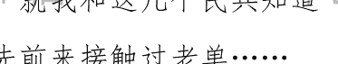

虽然，大张之前接触过老单……

作者：猪头大刀 日期:2008-10-10 13:24

(54)

组长本想立刻回基地，我把大张的情况给他说了下了，他听取了我的意见，同意先去村委会稍做休息。

所谓村委会也就是一间比较大的房子而已，连里面的灯光也不尽明亮，那灯还忽闪忽灭的，看来薛村长的办公的确确也不怎么样。

村长打发走了民兵，独自和我们091的人在屋子里看着老单，不知道什么时候，他身上的甲壳已经褪去了，又变成那个委废的老头，似乎刚刚那个和我们发生激烈冲突的怪物跟他一点关系也没有。

我非常吃惊，接触的这类异变者当中，第一次发现变回人形的。

只见他趴在那里，似乎很累，大口大口的喘着粗气，我甚至都有点忍不住就这么绑着这个老头，但是实话却又告诉我，这个人是绝对不能松软的。

“老单！海边的人有口话咒水大漫漫过不去，手大遮不住，我早就觉得你不地道，整天装神弄鬼的，你披个大海龟壳壳吓唬谁呢？年轻时候过两下子功夫就不起了啊？不就把中央的同志放眼了吗？今天你对人民政府认罪的时间够了！简直替代谁你这么狂的，争取的要处理？”

薛村长把他那张破写字台拍的山响！

我又哑了，村长到底刚才什么都没看清楚？竟然不知道这个老头是怪物？装傻？真傻？

村长又替我耳朵上嘘了了两句：“昨天张同志跟我说了，这个小子披个王八亮装神鬼蛋的，让我下令网密速捕他，中央的同志果然厉害，用兵如神啊！”

我真想笑，又不能，强忍着，张这个人真会悠悠，看来他早就发现了老单的秘密，却不想让村民知道这样的情，就编译这么唏话，不过这个慷慨的真次，看来咱山东人民真的是太实在实在了！

老单趴那里不做声，只是喘气，我真怕他就会去见了龙王爷。

“审问他不要急，我带回去，我会按政策办，您省心吧。麻烦你说说张同志的情况。”薛村长忽然一拍腿：“哎呀，我差点忘了，昨天张同志交给我封信，让他自来自内让我把这封信烧了，绝密！”说完，薛村长掏出钥匙，拿出一封牛皮包裹的信，上面歪歪扭扭的写几个字‘刘思启’。”

作者：猪头大刀 日期:2008-10-11 20:10

(55)

“刘子！不知道你什么时候醒，醒后有很多大夫要查查体，上面还要写报告，情况所以我先一步，我没那么多时间应付上面。老单不是简单的，我已经安排抓住了，自然还有，记，有可能渗透到内陆，务必小心！时间不多了，只能写这么多，重要！期待着我们胜利！获取更多的！”

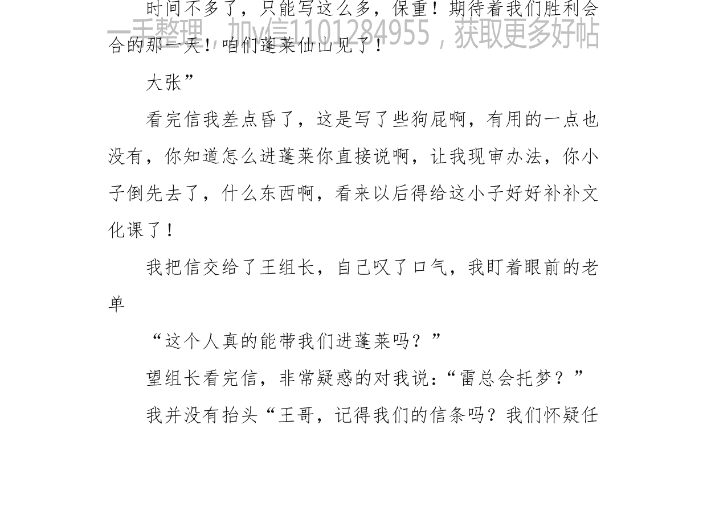

看来我差点昏了，这是写了些狗儿，有用的也没有，你知道怎么进，直接说，让我现在写，小子写了。我把信给了王组长，自己咬了口气，我看着前面的老单。薛村长看完，非常疑惑：“老是，记得我们的信条吗？”我并没有抬头，薛村长看着我俩。”

我紧紧地握了薛村长的手：“谢谢村长，我们的行程很累了，马上上路，我会尽力的。这里的事情必须保密。走。”我没有再跟薛村长说什么，两个战士架着废物一样的老单，我和王组长在前面。在车上，我们还需要一段时间。外面的风雨异常激烈，巨大的雨滴啪啦啪地落在脸上，仿佛还有点疼痛。正当我在风雨中愁的时候，路边的池塘中却渐渐露出了几十对青色的暗淡的光芒，我们也没注意到……”


作者： 日期:2008-10-11 21:31

3320865

 日期:2008-10-12 22:43

(56)

队伍中间的一名战士突然软软的歪到了地上，没有任何预兆。后面的人急忙喊我我和王组长过去一看，死了！啪啦一声，一道闪电划过天际，映在我那震惊的面庞上。我看着眼睛：“这是怎么回事？”我急急拔出口，打量着四周漆黑的环境：“满是黑点，麻烦了！”我们纷纷举起枪，围绕着老单了一圈，我觉得我的心跳得加快，到底是什么，用什么手段杀的人？转眼间，我发现路边池塘哪里若隐若现出现了一阵电光！那是什么？手电光一打，一个黑色的东西呈面前，似乎正在水中走出来，浑身噼啪啦的闪着电花。“谁！别动！再动开枪了！”我喊。那一刻，空气似乎都凝结了。手电光中，一个人影缓缓战战地站了起来。


只见他身上穿了皮衣一样，漆黑而又滑，啪啪乱响的火花在他身上不停跳跃。再一看脸！妈的！”我恨恨瞪了一句。根本不是人，四肢像人，这个家伙竟然长着鳗鱼一样的脑袋，脖子伸了老长，正晃着身子，要向我们这边靠来！而它背后的池塘中，也连续的爬出了七八个青夜叉。“呵呵呵呵，你们谁也走不了了！”我身后传来老单冷的笑声。“闭嘴！”我回手拿枪狠狠的砸到老单的脑袋上！被打得没有声音。“开枪！”王组长下了命令，现在绝对不能犹豫了！风雨中枪声四起，我们向怪物的方向乱射！好！那边的怪物也朝着我们移动，似乎这些家伙动作并不敏捷，不过明显，前面的子弹不停的打在他黑色的身上，也只是让它震一下。片刻他冲进了队伍中，只见他一手抓住前面的战士脖子，便喷得“滋啦”一声，那个人顿时火花齐起，转眼间被烧成了炭！这种电的。王组长喊：“当心！！！快点！”


我发现倒下的战士同样软软的倒在地上，连声音都没有。我走到战士身边查看，他的脸庞上依然带着紧张表情，瞬间连痛苦都没有。另一个人不知所措，他举着盲目的瞄着四周，同时紧张的问我：“这是怎么回事？到底是什么，到底是什么？”忽然发现倒下的战士胸前笔直插着一根细长的刺，红黑相间，难道是被这个东西杀死的？光来的方向，正是我们停车的方向。我连自杀都有了，后面追兵将至，前面同样的敌人拦住了路，今天看来再也没有机会走出海村了！手电终于在吉普车的顶棚照出了一个奇怪的动物。这个怪物与刚刚完全不一样，还是人形四肢，只不过身上满了刺，五彩斑斓！我离他只有几米远，此刻他正悠闲地眯着半蹲在我的车后，看着自己的猎物！毫无疑问，就是这个东西连续偷袭我们的，估计他身上的刺全部射到了我的身上……”

作者：诸侯大刀 日期:2008-10-13 22:07

(58)

望着那个东西闪光的眼睛，我意识到一个事情，那就是我的生命在今晚结束了。没有意外，没有奇迹，这一刻我非常怀念雷，他在也许我还能活着出去，他也也许我还能面对这个怪物干掉它，他在也许我根本不需要担心什么。然而，事实总是无情的，现在跟我另一个不知所措的战士以外，已经没有任何帮助和期待了。忍着恐惧，颤抖着举起了枪，对另一个战士说：“兄弟，举起枪来，咱哥俩今天就是死，也得轰烈点，别在这奇怪怪物面前怂了，保持点人类最后的尊严吧。”当枪响过后，那恶魔只是手把头部遮住，发出一阵吱吱声音，似乎在嘲笑着人类的卑微。他轻轻抬起右肩，那粗壮手上的倒刺瞬间便朝我们指了过来。我默然看着手上的倒刺，拿着手机的手已经开始抖了，我估计不出他手上有多少刺，我唯一知道的是，那怪物手上的刺需要几根就可以捅了我。生死只在这一线之间，我终于崩溃了，硬生生地脚到了泥泞的道路面上。我闭上了眼睛，等待着一枚毒针刺进我的心脏，还好，转眼间就可以结束了，我再不需要痛苦迷茫了。死，不可怕，可怕的是死。时间一秒一秒的过去了，我似乎还没有死，那一刻我觉得时间停滞了，心里汹涌，怪物大哥，下手就抓紧啊，怎么情况？当我睁眼看怪物的时候，更被眼前的景惊的嘴巴合了。

这一交可以修了。由于我脸肿后，一点准备也没有……重重摔在地上……战士架着同志，径直朝村口去，身后的风雨中不断传来密集的枪声和哀号，命运再次我推到了边缘……

作者：猪侯大刀 日期:2008-10-13 22:07


在这一暗的海边雨夜，我已经分不清哪是天，哪是海，
黑暗中唯一的光便是那转即逝的激袭，如同我们的使命
一样，在无尽的黑暗中探索，抓住那辉眼的瞬间，才能找到
前进的道路，直到日出云散的终点......

作者：猪查大拿 日期:2008-10-15 20:58

(61)

终于回到了基地，在极端严格的保密环境下，我们将把单军密押起来，他身体状况似乎很虚弱，一直处于昏迷
状态，我甚至都怀疑曾经击杀我们的怪物是不是眼前这
一个干瘦的老头。

让我感到惊讶的是，整个捕捕小组的人员，除了我以外，
没有两个人对我那个神秘家伙没有任何印象，而我

都考虑过是不是产生了幻觉。但是随着怪物尸体回收人员
的到来，我克服了这个疑问。

那鲸鱼咬过的头确实是存在的，确实是被人类硬生地
捏碎了头，唯一的解释只能这次行动中除了我以外，
其他所有人的意识都被短暂地切断了。

“基本情况就是这样”我缓缓向长江部长汇报完毕。
我注意到一个细节，陈部长在听我说到神秘蓝人的时时候，他拿着右手似乎抖了抖，虽然他的表情依然凝重重
稳，而我却可以感觉到他内心中那一丝的慌乱，我不知道
什么，但是我总觉得这个神秘人是肯定和我们091有什么什么
然联系的。

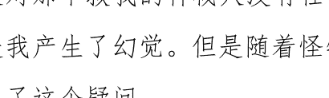

“恩”部长听到完我的报告，长长的哼了口气，他闭上
眼睛，眉头紧锁，似乎在回忆什么。

“这些人还有其他人看到吗？”部长长问道

“跟我先过的周荣应该看到，但他却一口认定什么也
没看见，像是眨了眨眼，睁开眼睛两个怪物就已经死在我
们面前了”我想了想“周荣应该不会说谎，我想他的意识应
在那那瞬间问出了问题。”

“这样”部长右手食指在轻轻打着桌面，他似乎
在犹豫着什么。

“行，我知道了，你先休息吧，两个小时以后我们
开始处理订单，凡是要让他他说出来的秘密。”


我遭遇的是部长并没有给我的关于神秘新人的任何信息。

在我们的部门，各级机密是有严格管理程序的，也是
说我虽为091的一员，但是我的级别远达到某级别之前，很有
多档案簿我是无权接触的。091总部地下七层，我从哪里都没有
进去过，只有雷雷这个级别的干部，才能进入到的那神秘的地
七层，谁又知道，那里到底埋藏了多少我们共和国天大的
秘密。

毫无疑问的陈部长是详细知道所有秘密的人，我不晓
得了解这多么秘密的人生是那样的负担，也许从部长
那雪白的发鬓间，才能体会到那种异样的沉重。

我不能询问什么，这是严格的纪律。

“去吧”陈部长对我挥了挥手“好好想想，怎么撬开
单的嘴。”

“是”我对部长敬了个军礼。
“等等”我刚转身离开的时候，陈部长又一次把我叫
住回来

“陈部长，还有什么事？”
“你确定老雷还活着？”陈部长突然问道

“我用生命保证！”我回答得铁铁铁
陈部长嘴角露出了一丝罕见的微笑。

“小刘，你要做个保证，你必须保证老雷平安的
带回来。”

说完，他从身上掏出一奇异样式的钥匙

厚重的责任已经到了我的肩膀上，为了曾经死去的和
还着的战友，我没有任何其他选择。

我坚定地举起了右手，再次对着陈部长敬礼。

“保证完成任务！”......

作者:猎头大刀 日期:2008-10-17 07:40

(62)

两个小时后，对老单的审讯准时开始。

本来有专门的讯问人员，但是考虑到事情的特殊性，上面还是决定由我来主审问。

在得到老单绝对动不了的保证后，我放心的进了审讯室。

进去一看，固然专业，老单已经被放放到最结实的审讯椅子上，四肢连同头部都被彻底捣毁了。

他情绪似乎很低落，耷着脑袋，对我的到来没有任何反映。

“单大爷，醒醒吧，我们应该谈聊了？”虽然我想马上把他那里的秘密全部交出来，但是还是要多听的。

我点了一根烟，深深地吸了一口“你现在这样的情况也不必为了自己，把知道的说出来，我相信政府会宽大处理你的，毕竟涉及到国家最高机密，希望您能跟我合作。”

“哼哼，合作？和你们合作？你以为龙爷能放我吗？”

他终于开了口。

“龙王放过你，我不清楚，不过你不说，第一个放过的就是我！”老单抬起那双迷茫的眼睛，竟然变得重心长。

“孩子，龙王爷是神，你还有神比吗？你希望你放过，我拦着你们都是为了好，你知道龙王爷要死多少人？我希望你认识到事情的严重性，你不管天下来，我也不怕告诉你。”

“龙王爷，龙王爷，这些你海了，你都是对的，我希望你去蓬莱，你自己也不苦，你说得也达不到目的！”

我继续听着，让人着急的，不论我怎么逼，他就是不说字，时间在慢慢消磨我的耐心，我真想掏枪来教教老家伙！

“龙王爷，龙王爷，这些人已经全部了……”

老单竟然咔的一下响了桌子。我“啪”的一拍了桌子。

“好，既然你这么执着，你就别闹了，你只需要回答我！如果我满意，我可以继续追问！”

老单抬起了头，眼睛望着我，似乎同意我的意见。

“大爷，请你说，龙王爷是怎样的神？”

我强压着愤怒，希望你放点，看看发现。

“孩子，龙王爷是神，他有力量，他除海，除恶，他调和风雨，保佑万民！”

老单似乎很有兴趣。

“给我点烟。”

我看着他，马上点了烟，小翼翼地送到了他嘴里。

“毫无疑问，龙王爷是神，从古至今，海边的人没有尊重他。”

我手接过去，“每一个都是神，每一个都是善良的，他调和风雨，保佑万民！”

我一字一字狠狠地说，把面前的写到了老单面前，我从抽屉里掏出一个档案袋，陈旧的牛皮纸上印着“机密091”——

作者：猪头大刀 日期：2008-10-17 08:49 对不起各位，最近有点慢，凡事慎身，尽量多写点，这个故事构思了很久，匆匆结束，本人也是万分遗憾，谢谢，我会尽快写。
作者：猪头大刀 日期：2008-10-17 19:53

(63)

我把档案拿出来，这是一份从民国一直直到现在的渤区域失踪人员名单，密密麻麻写满了名字，有男，有女，有老，有少，失踪大部分，以及简单案件经过，照片资料，这只是整个文件的一部分！

我把他们分开几份平铺到老单的写字台上。

“案上一点，这些点血，好好看看，你说的龙王爷这些年干了些什么？你真以为那些士兵都是龙王的奴吗？那些都是变来的，你能想象这样可怕的命运吗？”

继续，我又拿出出一个信，“噗”里面的东西落在老单面前。我打开信封，里面全都是一张黑白照片，全部都是年轻的军人。这是一百四六张照片，他们最大的43岁，绝大部分还不20岁，最小的只有17岁，看看吧，看看这张年轻的脸，我希望你能记住，就在三天前的那个暴风雨夜，龙莱以及你伟大的龙王的手下，袭击了我们的基地，这些人已经全部都死了！”

我握着拳头，使劲砸着桌子，我有一点激动。“你以为你那副身体是恩赐吗？你只不过是一个傀儡而已，你甚至都不是一个完全的品种，你只是一个可笑的半成品！”我拿出一张击基地龙人的照片“看看你自己，是多么可悲，谁把你的身体变成这个样子？是谁把普通的人类变成杀人的恶魔？是谁改变了你的命运！一生没有杀人，没有朋友，没有妻子是偶然吗？你得到了力量的同时又失去了多少作为最基本人类的喜悦哀乐？你觉得这样的人生完美吗？你觉得这样的力量会有回报吗？”

老单叼着烟，低头不语。

我一把把嘴中的半截烟咽下，狠狠地唾到了地上。

“你觉得这些保家卫国的军人有罪吗？你对得起眼前这些人吗？你对得起你自己吗？你能失去孩子父母的心情吗？你不想这一切的秘密吗？你不想制止这一切不幸的发生吗？”我继续说道，一刻不停。老单身体有点了，他把深深的憋出来。我缓了一下，又点上一根烟抽到嘴里。“大爷，好好想想吧，我去等你的消息，半小时后，有什么要求随时叫卫兵。”我转身走出了审室。二十五分钟后，我正站在审室隔墙，和其他同志等着，卫兵来了消息：“老单同意我们去蓬莱！”

作者：猪头大刀 日期：2008-10-18 09:50

我飞跑到审讯室，老单一脸痛苦。

“明白了，大爷？”

老单摇头：“孩子，你说的对，我确实没见过，这些孩子还年轻了，我活了年纪，心里不是滋味，不管什么，我还是感情。”老单继续摇头：“蓬莱，我带你去看看，近天是农历十六，可能是今年蓬莱在活动的最后期限，好，只要把我们送到蓬莱，一切都好！”

“什么心底？”我一愣。“到了你自然就知道，那里之前不想和你交流，准备吧，不要太多，人多了很可能就不出现了，好！”老单似乎也不跟我说话了，之后不管说什么，他概不理了。我很想询问老单是怎么沟通的，但他已经拒绝了。任何问题，时间紧迫，看来我只能到达蓬莱继续探索了！

陈部长的办公室里，陈部长和军队领导听完我的汇报，开始了计划。

当天夜里，我和王组长几个人集合到鱼雷艇上，迎着圆月，准时出海。今日天气：晴，夜间能见度15—20链。风向东北，风力5—6级，阵风7级。中浪（处于两次风之间）。听完船员的汇报，我觉得还不错，希望下次暴风来临之前，我们能够渗透到蓬莱上。我看着逐渐消失的地平线，我也说不上当时的心情是忐忑，紧张，迷茫，以及巨大的好奇，一切牵引着，希望一切顺利！虽然能见的海面上只有我们一艘舰，我知道我们并不孤单，附近海军各单位的各类舰船已经部署完毕，只要我们遇到任何意外情况，马上就能得到支援。那时刻，我真的很佩服陈部长的工作效率。我们按老单指引的方向不断前进，机员在不断的汇报方位以及其他海军单位联络。至少为止，一切进行得很顺利。不知道什么时候，云已经把月亮遮了大半，海上逐渐变的昏暗起来。雷达员忽然报告，“左舷四十五度五海里处有不明目标，理论上说是小型船只，没有速度。”我的心脏偶然紧张起来，这个海域应该已经被封锁，还有谁在附近？......

作者：猪头大拿 日期:2008-10-18 18:36

(65)

“副舰长，轮机长，轮机兵，雷达兵，炮达长，各位置水兵全体就位，立刻成备！把所有的照明设备打开”舰长大声吼着“向左舷四十五度，全速前进！”我看了老李一眼，他冲我轻轻点了点头。

果然，那边有异常。我悄悄地打开了老李手上的手套，在马上进入战斗的关键时刻，多一个个人是无所谓的，我希望能多多一个朋友。所有的人都紧张盯着前方的海面。远方的海域逐渐地飘出几艘船影。船上的渔灯忽闪忽灭，就那样在那里浮着，似乎没有动力。

我问舰长：“什么型号？看的吗？”“不太清楚，从外型上看是地方的渔船。”“注意，准备接触！”王组长以及船上水兵纷纷持枪站到舰上，机炮长也带领水兵做好准备，谁也不知道会发生什么情况。


我刚要继续追问时突然传来水兵喊声：“老单的鱼雷艇也在那里！”我的心脏偶然紧张起来，这个海域应该已经被封锁，还有谁在附近？在强烈的探灯光下，我一看，足有七艘。基本上都是渔船，就那样毫无生气地浮在海面上。我转向老单，希望他能给我意见，但他却没有任何言语。老单摇头：“什么意思？难道上面的死？”

意料之中，没有任何回答。舰喇叭里传来了舰长的声音。“我们是海军巡逻队，船上有。”望着周围船队，我们商量，决定由王组长带几个人登陆，我们边警戒。我们缓慢地靠近了，水兵们用钩钩住它，希望平安。船很近，还好没有什么意外发生。我会后回到了船上。

“有什么发现？”我问道。一手副长插道：“信号了，真是邪门吗！”王组长在船上盯着仪表思索着，忽然问道：“舰长，老单说的这一批吗？”舰长说：“是的，同时入部队的。“哦，那么你们任务以及训练时候航程不是相同？”应该差不多，误差不会超过1000海里。”王组长大了眼睛：“你确定吗？航程比你足多了500海里？”舰长眼睛更大：“绝对不可能，最大航程不会超过500海里，你是不是看错了？没有补给它跑那么远！我干工作这么多年了，还会走的！除非我亲眼看见，否则我绝对不相信！”舰长依然怀疑。“别吵了，你们以后在旁边眼睛就行了吗？”我也怀疑是不是真的。两个人又追问老李：“老先生，蔬菜之路怎么开？”而我得到的冷而坚决。就在这时，联络员突然跑到船舱：“报告！我跟基地以及其他船失去联络，请指示！”

作者：猪头大刀 日期：2008-10-19 21:06

(66)

我大吃一惊，在这样的时刻怎么失去联络！“什么时候的事情？”我问道“10分钟前最后一次联络是不是机械故障？”“应该不是，备用电台一样联系不上。”这个时候，鱼雷艇的发动机突然停了。我诧异！“谁让你们熄的？什么情况？”发动机失灵，杂波异常严重！”短短十秒，整个鱼雷艇的设备几乎同时失去了功能。“快！马上赶长艇和王组他们回来！”我赶紧跑出舱！机炮准备随时开火！”风已经什么时候停了，海面上安静得吓人，如所有的东西都睡了一样。“王组长！艇长！马上回来！出情况了！”我站在船上大喊。“妈的！”我骂了句，忽然想起船内有广播喇叭，又回到舱，准备用舰喇唤下。就在我回到舱的时候，海中竟然隐约传出了阵阵声音。那是什么？孩子？怎么可能？“龙王爷爷，龙王爷爷，龙王爷爷给我好收获，龙王爷爷赶走害人气，龙王爷爷保我仙班……”我逐渐听清了海中的声音，像是很多哼呀学语的孩子的声音，那音色如同天籁般的纯净可人，让人心中失去戒备之心。接着，又来了一阵悠悠奏的歌声。

我逐渐听清了海中的声音，像是很多哼呀学语的孩子的声音，那音色如同天籁般的纯净可人，让人心中失去戒备之心。接着，又来了一阵悠悠奏的歌声。


齐，旁边还有几只猎人与海夜，似乎在警戒着什么，完美的队型。原来就是传说中的莲莱之之旅！

而远处的莲莱象依然横树，绿光之后似乎有一个巨大的圆形物体，上面长满了珊瑚，与其说是个岛屿，不如像巨大的海龟，不能长到球场这么大的海龟应该不存在在吧？

我紧紧悬着气，还速度很快，几十秒时间就到达了莲莱顶端，黑暗海水中突然涌出青绿色的光芒，莲莱的终于开启了。

莲莱顶开启了几个六边形的入口，里面透出六边形森林的青光，抱着我的人鱼的速度更是加快了，顺着水道飞快向前，王磊似乎还在看着我时间：

这水道双壁，都是透明六边形材料构成的，每隔一段就会有一块闪着青光。我触不到他们的质地，不好判断是什么，不过闪光的墙面里面似乎还布着像血管一样的组织。

正我在四处观察的时候，人鱼突然松了手，独自向上去。而我则借惯性向前冲。

我似乎听到了滑滑瀑布声，妈妈的？难道前面是……我还没反应过来，我像被抛出的炮弹一样被甩出了水道的终点，一个巨大的六边形空间，足足15米，我大口地吸了口气，竟然里面别有洞。

从其他水道口，不断有人被泡了出来，所有人都掉落到地面的一个巨大六边形水池中，还好，水足够深。没有过说不出的怪味！

我在挣扎着，手腕突然被人抓住，借着黑暗的光线一看，我老单，他示意我不要出声，跟他游，我现在只能听他的，我随他游到水下另一个水道口，这个口也是六边形的，不过小了许多。

我们两人挤在这个小口中有点憋劲，不过忍着吧，谁也也不知道接下来会继续发生什么。

下面的水迅速的退去了，几米深水退去的速度有点快惊人，池底趴着的全部都是今天晚上我们合在一起的人。

我挣扎着要出去他们，却被老单死死拽住了：

“别出声，别出声，还有东西！”

我只能听他的，看来他并不想害我。

我只能看到池底，却看不见池上面的东西。

只见一只巨大的触须伸了过来，章鱼地触摸，太大了就不是一号羊了。

那只巨大的触须在水池中间回来巡游，似乎在挑选着，同时不停地把那些人卷起，由于我看不不到上面的东西，我也不得他们被送到什么地方了。

指挥头算算从下海到现在，整个过程还没到两分钟，我已经惊得不能用语言表达了，这一切都是谁制造的，是干什么的？又是谁操控的？迷实在太多了。

作者：猪头大拿 日期:2008-10-20 11:16

作者：quenfi2003 回复日期:2008-10-20 11:02:00

大拿，你这个故事写的太大了，以后还有别的的故事。而且你的风格也变了，前两个是悬疑奇幻的基调，这个已经变成神话诗了。这么安静的事件怎么会没有人知道呢？也谈不上你所托桩的“秘密”可言了（秘密的091、秘密的神话事件..）。通过我的分析，这个故事应该不全是大写的，是有人代写的了？

一手整理，加v信1101284955，获取更多好帖。

这位朋友，谢谢关心，可以明确的答复你，本人从发到发现都是自己写的，没有任何人带写，秘密始终有的，我也不会写神话故事，我心中始终是一个主线的，前面也提到，前面两个故事只是整个事件的冰山一角，每一段结束后我都会对故事进行一个相对科学的报告，我绝对不会YY任何鬼神登场，一切请都等最后谜底。

作者：猪头大拿 日期:2008-10-21 17:55

(69) 我感觉自己像一只迷失了方向的小爬虫，在这个巨大的、黑暗的、未知的蓬莱中苦苦挣扎。

“大爷，你可定没有失去上次时候的记忆，您到底对我隐藏了多少秘密呢？”我问老单。

“那都不重要，我是几十年前进来过一次，人生当中总有那么多的事情是可以铭记一生的，即便过了多年我依然还记得路。”老单在黑暗中回道。

“这里到底是干什么的？”

“我也不清楚，不过来这里的人外几乎就那么几个结果：死，或者沦为蓬莱的傀魄，还应该就是我这样的，幸运逃出去的老鬼。”

“我很好奇是怎么出去的？”

“虽然有人教我，我们就去那里获取更多好帖。我不想继续了，我不知道我还能承受多久。”

不知不，我跟着老单进入了一条类似河道的地方，n水漫到胸，前方的水下，似乎有一个口子，里面溢出淡淡的青光。老单示意我安静，我们两个人悄悄地潜了进去。

我注意到这个洞口似乎是特意修的，更是被暴力破坏的。悄悄地浮出水面，这个地方跟我们进来时那空间差不多多数，只不过里面布置的东西却大大不一样。青色而暗的光把整个房间映得说不出来的诡异。

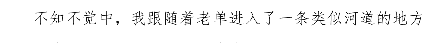

抬头望去，空间顶部竟然挂着一个巨大的，类似葡萄的东西，我只能看清楚这些，只能说形状类似葡萄，不过这葡萄大到比在一栋楼还要高，而下面的地面，被河道密密麻麻地分成无数个小的六边形，每一个六边形地板上面，都有一个大约人高的椭形的球。

“这些都是什么？”我悄声问。

老单并没理会我，只是四周看着。过了一会，边对我道：“这里比较安全，上去看吧，我希望你能解释这些是什么”。

我仰身，爬到那狭小的六边形地面上，看着这个比高一高的椭圆，伸手碰了碰，冰冷而坚硬，“我心里忙叨着，继续观察。上面有什么裂口。借着昏暗的光望去，不知道那块苔在这里呆了多少月，甚至有点化的感觉。我轻轻触，那块苔竟然化为粉末；妈的，都是什么，这个世界怎么了！”我小声咒着。再仔细地扫了周围，发现几十个棱形圆石大部分都是破损的，这里在以前被人破坏了，而天顶上挂着的巨大的“葡萄”物质似乎被废弃的遗迹，破败不堪。

我蹲下对老单说：“不知道是什么，大概是个坟吧。”老单摇头：“走，前面远处就到了。”

不由己，我跟着老单继续前行，走到哪算。通过漫长的水道，终于登上了一处干燥的地方，周围是有若隐若现蓝色光芒，我们在一处石边休息一会儿。我们面前是一个巨大的池子。我顺便查看了一下随身的装备：六式冲锋枪，还有四个弹夹，军刺，其他的东西全部丢了。还好，不过肚子有点饿。

“这里有吃的？”我看着老单。

老单没有回答，不太好意思，在墙上摸索着，一会功夫这里，随手给我一个黑色的东西。“这是什么？”我问道。

“蓬莱果，你有口就能延寿多年。”老单介绍。吃了一大口，味道不错，带着一丝酸甜，清脆，甚是过瘾。很快，吃完了一个，似乎未尽瘾，再去摘的时候，忽然听见石头后面的池子似乎动静，我心中一惊！我浑身躲到后，朝池中游去，水漾起一个小旋涡，难道我们发现了？

水中竟然出了一人，她似乎并没有发现我们两个人，她在水中游着，似乎在焦点。我没有向人鱼开枪，不知道这个家伙是不是可以用枪防御的。我拿着枪继续暗瞄，有必要，我会立刻把这个人鱼毙。


老单发了：“不要动，你你千万别出来，如果我喊你你就出来！”他似乎很激动，说话时候有点哆嗦，我不禁好奇起来，这个是谁？只见老单蹲着来到了水边，他竟然对着池水跪了。还没等我明白，却见人鱼出了水面，露出了半身姿，她抱着老单的脸似乎在喘什么，两个人的手势瞬息变得丰富，似乎在交谈着什么。远了点，我实在听不清他们说什么，不过可以确定，这个人鱼的确是救过老单的人。最后，两人似乎紧抱在了一起。我在后面看着，我非常不想明白他关系。我像一个鱼子一样呆呆地看着这一切，我不知道该我是还是留下去，不知道这两个人为我安排什么样的命运。两人似乎在抱头而泣，过了好一会儿，只见他们朝我这边招了招：“刘同志，过来吧！”我不想和这个人鱼仗，一切对于我来说太不可，没有办法，战战兢兢地端着枪走了出去，我保持着高度戒备，一直走到他们所在的水边停下了脚，不过我的枪依然没有放下。我望了那个人鱼一眼，说不上妩媚，却算美丽，清淡的外表透着一丝愁，样子也就三十多岁，身上赤裸着，圆白的胸脯挺在胸前，看得我有些害羞。只不过腰身以下，却搂着长长的鱼尾，这个打过多次交道的对手你已经在眼前了。“放下你手中的东西，不用害羞的，我的年纪可以做奶奶了，也不用担心，在这里你们暂时是安全的。”人鱼说话了，声音冰冷透彻，我不由得哆嗦了一下。老单也睁了点点头，示意我是可以放心的。很不情愿的放了枪，我半蹲在水边，对他们说：“两位，事到如今了，还请给我个明白，即使是死，我也不希望个窟涂鬼。”一手素材：猪头拿日期：2008-10-21 23:49

(71) “所言蓬莱传说，古自就有传说，无非三仙岛，成仙之类的老生常谈，而我今此此身却是那传说中的神仙之体。”那人鱼似乎不像老生，我疑惑便问张莉恰给我到了她的身世。“很久以前，我乃威海城内一个女子，嫁了一个教书先生，我自己也读过几年私塾，也有孩子，生活还不上富裕，却快乐。事情总有意外，某一日我乘船由威海出航，要去辽东望个亲戚，你知道山东与东北之间联系甚密，很多人上面都是山东逃过。”

首先，你的身体只要这样的怪物，那么你和莱莱，你也能感受到。其次，这个所谓蓬莱在我看来，根本不是石头化的岛屿，它像一个巨大的生物，简单的例子就是某些地方破坏后，过了多久如同人的指甲一样重新修复。但是不是完全一样的，房间里的东西似乎腐朽，千年至今仍未得到，到底是什么，我仍想明白。我们现在处是蓬莱侧边的底部，而属于岛屿的另一边，我没有任何机会进去，但是我可以感受到，蓬莱死气沉沉，没有任何生命迹象。说是这里的人会处理，还没完全明白，大部分都被化成了人鱼，男性则会被分类，转化成的不同的怪物，具体我也不是明白，上面有一间。我靠着脑袋，不知道该相信还是相信，这么荒谬的东西怎么能相信，蓬莱竟是有生命物？不相信。”

“这里比较安全，上去看吧，我希望你能解释这些”。。”仰身，爬到那狭小的六边形地面上，看着这个比高一高的椭圆，伸手碰了碰，冰冷而坚硬，“我心里忙叨着，继续观察。借着昏暗的光望去，不知道那块苔在这里呆了多少月，甚至有点化的感觉。我轻轻触，那块苔竟然化为粉末；妈的，都是什么，这个世界怎么了！”我小声咒着。再仔细地扫了周围，发现几十个棱形圆石大部分都是破损的，这里在以前被人破坏了，而天顶上挂着的巨大的“葡萄”物质似乎被废弃的遗迹，破败不堪。我蹲下对老单说：“不知道是什么，大概是个坟吧。”老单摇头：“走，前面远处就到了。”不由己，我跟着老单继续前行，走到哪算。通过漫长的水道，终于登上了一处干燥的地方，周围是有若隐若现蓝色光芒，我们在一处石边休息一会儿。我们面前是一个巨大的池子。我顺便查看了一下随身的装备：六式冲锋枪，还有四个弹夹，军刺，其他的东西全部丢了。还好，不过肚子有点饿。“这里有吃的？”我看着老单。老单没有回答，不太好意思，在墙上摸索着，一会功夫这里，随手给我一个黑色的东西。“这是什么？”我问道。“蓬莱果，你有口就能延寿多年。”老单介绍。吃了一大口，味道不错，带着一丝酸甜，清脆，甚是过瘾。很快，吃完了一个，似乎未尽瘾，再去摘的时候，忽然听见石头后面的池子似乎动静，我心中一惊！我浑身躲到后，朝池中游去，水漾起一个小旋涡，难道我们发现了？水中竟然出了一人，她似乎并没有发现我们两个人，她在水中游着，似乎在焦点。我没有向人鱼开枪，不知道这个家伙是不是可以用枪防御的。我拿着枪继续暗瞄，有必要，我会立刻把这个人鱼毙。


老单发了：“不要动，你你千万别出来，如果我喊你你就出来！”他似乎很激动，说话时候有点哆嗦，我不好奇。“我是几十年前进来过一次，人生当中总有那么多的事情是可以铭记一生的，即便过了多年我依然还记得路。”老单在黑暗中回道。

“这里到底是干什么的？”“我也不清楚，不过来这里的人外几乎就那么几个结果：死，或者沦为蓬莱的傀魄，还应该就是我这样的，幸运逃出去的老鬼。”“我很好奇是怎么出去的？”“虽然有人教我，我们就去那里获取更多好帖。我不想继续了，我不知道我还能承受多久。”

不知不，我跟着老单进入了一条类似河道的地方，n水漫到胸，前方的水下，似乎有一个口子，里面溢出淡淡的青光。老单示意我安静，我们两个人悄悄地潜了进去。

我注意到这个洞口似乎是特意修的，更是被暴力破坏的。悄悄地浮出水面，这个地方跟我们进来时那空间差不多多数，只不过里面布置的东西却大大不一样。青色而暗的光把整个房间映得说不出来的诡异。

抬头望去，空间顶部竟然挂着一个巨大的，类似葡萄的东西，我只能看清楚这些，只能说形状类似葡萄，不过这葡萄大到比在一栋楼还要高，而下面的地面，被河道密密麻麻地分成无数个小的六边形，每一个六边形地板上面，都有一个大约人高的椭形的球。

“这些都是什么？”我悄声问。

老单并没理会我，只是四周看着。过了一会，边对我道：“这里比较安全，上去看吧，我希望你能解释这些是什么”。

我仰身，爬到那狭小的六边形地面上，看着这个比高一高的椭圆，伸手碰了碰，冰冷而坚硬，“我心里忙叨着，继续观察。上面有什么裂口。借着昏暗的光望去，不知道那块苔在这里呆了多少月，甚至有点化的感觉。我轻轻触，那块苔竟然化为粉末；妈的，都是什么，这个世界怎么了！”我小声咒着。再仔细地扫了周围，发现几十个棱形圆石大部分都是破损的，这里在以前被人破坏了，而天顶上挂着的巨大的“葡萄”物质似乎被废弃的遗迹，破败不堪。我蹲下对老单说：“不知道是什么，大概是个坟吧。”老单摇头：“走，前面远处就到了。”不由己，我跟着老单继续前行，走到哪算。通过漫长的水道，终于登上了一处干燥的地方，周围是有若隐若现蓝色光芒，我们在一处石边休息一会儿。我们面前是一个巨大的池子。我顺便查看了一下随身的装备：六式冲锋枪，还有四个弹夹，军刺，其他的东西全部丢了。还好，不过肚子有点饿。“这里有吃的？”我看着老单。老单没有回答，不太好意思，在墙上摸索着，一会功夫这里，随手给我一个黑色的东西。“这是什么？”我问道。“蓬莱果，你有口就能延寿多年。”老单介绍。吃了一大口，味道不错，带着一丝酸甜，清脆，甚是过瘾。很快，吃完了一个，似乎未尽瘾，再去摘的时候，忽然听见石头后面的池子似乎动静，我心中一惊！我浑身躲到后，朝池中游去，水漾起一个小旋涡，难道我们发现了？水中竟然出了一人，她似乎并没有发现我们两个人，她在水中游着，似乎在焦点。我没有向人鱼开枪，不知道这个家伙是不是可以用枪防御的。我拿着枪继续暗瞄，有必要，我会立刻把这个人鱼毙。

老单发了：“不要动，你你千万别出来，如果我喊你你就出来！”他似乎很激动，说话时候有点哆嗦，我不好奇。“我是几十年前进来过一次，人生当中总有那么多的事情是可以铭记一生的，即便过了多年我依然还记得路。”老单在黑暗中回道。

“这里到底是干什么的？”“我也不清楚，不过来这里的人外几乎就那么几个结果：死，或者沦为蓬莱的傀魄，还应该就是我这样的，幸运逃出去的老鬼。”“我很好奇是怎么出去的？”“虽然有人教我，我们就去那里获取更多好帖。我不想继续了，我不知道我还能承受多久。”


色，但是，莱莱似乎遇到过巨大的打击，已经处于濒临死亡休眠状态，通过对古代各种传说中莱莱的蜘蛛马迹综合分析，莱莱现在的间隔越来越频繁，到了近代几乎不见踪影了。但是近几年来，莱莱活动的足迹明显增加，有复苏的迹象。而且很多袭击事件不同于传说中的盲目，有非常强烈的目的与组织性甚至发展到公开击当地驻军。隋佐经过多年的追查，在种蛛马迹中发现老单母亲的疑点，眼前的事实已经证明了他的了他的，莱莱受控于那个人，但她是她是如何得到这样权利的，以及最终的目的，仍然不清楚。

“哦，竟然是这样，那是因为什么不带我一起来，还要我和老华乖呢？我们有很多不明白的地方，获取更多好帖”

“我的能力还能招招，那老女人会在我面前我我死的，我要我想抓住她，就必须引诱她出来，这里有近万怪物归她指挥，我也是杀不过来的。”隋天摇头，“本在你和你老头跑出来的时候的一举一拿，没想到却背身后杀出一海怪，她跑哭了片，却也跑了，足够见过这个怪物是多么机敏。”

“他们抓灵总做什么？”我问道

“不清楚，不过我年轻的时候在这威卫附近见闻，也被大批的海怪袭击击过，不过被我侥幸逃脱了”隋天了了。

“没想到雷天到了这里后，他们竟然发动如此巨大规模的击，看来来是在必得，至于为什么这些怪物会费心思的抓高等异能者，我也想明白。”

“不过，我进蓬莱最大的目的并不是要拿蓬莱之母，我的目的是……”这个隋障柜拒言又止。

我疑惑地地看着他：“还请隋老先生直接明示。”

“我要去的地方是蓬莱三山的海底停泊的地方！”隋障柜冷冷对我我说。

我非常常吃“这样的东西还需要停泊？”

“当然，这只是战船，设施虽然完善，但是换谁能在这里面永远停着？在最古老的传说中是这样描述的，三山归隐于长安！”

“长安？怎么可能！那陆陆的城市，我不相信这东西能够跑到陆上去！”

“哼哼，我和你的怀疑一样，再过历史传说中也没有听到说长安出现过什么巨大的怪物，其实我们走了弯，所谓长安，n当时可是华夏第一大都，古人曾写些游游之文，海淫难懂，我思考多年，终于出一个惊人的结论！”

“什么！”

“此长安非长安，这里所说的长安乃是水中长安，也就是说诸如古代一般规模的巨大水下城市！”

还没等我说话，大张接上话了：“说隋障柜的，你老德高望重，功夫世界第一，可别拿这种事情吓唬我们后”


生啊，您瞅我们容易，这个东西还没解决，又整出一个水中长安莱，是不是明天各国海鲜来个大反扑，美苏英法全办理，这个世界就清净了？”

随嘴柜白了大张：“我像说哨的吗？哼，不知道长进的后生！”

他甩下了袖子，独自走到前面去了，大张对我做个鬼脸，那意思家伙要咬你。

我一刻也停起来，无论如何随嘴柜也不像信口黄的人，如果是海中确实如此规模的城市的话，我们人类的历史要改写了。实在太复杂了。

“当前是先把雷雷救出，你们脚下抓牢点，我感觉他王博士说，把雷总的位置应该在藻莱最前端发聚光的。前面的随嘴柜 Structure堵”一听要去救雷总，我来了精神，赶紧跟上他的脚步，继续向前。

黑暗的隧道不知道什么时候是个尽头，希望把雷总尽快地出来，等一会儿也得有个终结。

作者：萧大拿 日期:2008-10-27 20:23

(75)

随嘴柜轻轻敲了敲甬道的墙壁，招呼我道：“我试试，看看是什么材料”

我顺手敲了底下，硬硬而冰冷，不是金属，不是石料，不是砖瓦，那感觉如同龟壳一般，而且每隔几块就有一块六边形面是发光的，那光线悠亮恳寂，透过弥浅的光芒，甚至还可以看到半透明龟壳中血状的组织。

“龟壳墙壁！生物光芒，这个生命实在太完美了！”隋掌拍手边赞美，“美国最优良的战铠我看不及这违莱的万一，这样的东西实在太可怕了。” (注：隋掌应为隋障柜)

“可怕的是咱现在就在这个家伙伏肚子里，剪了了脑袋钻进来却不知道怎么出去。”大张没头没脑的接着话语。

“逆行舟，不进退，你若是不满意我可以把你送出去，免得你变成龙荒之类的海，我看你可以通合这里！”

“得，隋大爷，我不说了，您老可千万别把我推进那老妈妈妈我这还不行，没要嘛……”

大张似乎在任何时候都不害怕，甚至面对着眼前的这个能力惊人的隋老也是也是如此。

一行人就这么有一句没一句的扒着，气仿佛似乎缓和相似不像，至少有这么个人同行，暂时不必操心什么了。

不知道走了多久，终于脚到峭路顶端，暗门外面是一个平台样的地方，隋靠柜观察了会，似乎发现没有任何威胁，便带着我们偷偷偷的出到外面。

这是类似我跟老李单来的时候经过的那墓地一样的房间，唯一有别的是这个房间是近乎完好的，里面灯火通明。

站在这平台之上环视四周，我终于看清楚那巨大的葡萄

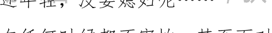

以及水晶墓地的真面目。

[content]
下面的水晶球内，均是龙虾与鳗鱼人还有海邂的修养之处，或者可以是生产之处，每一个水晶中均只有海棘浸其中，如同冬眠一般。最底被无无数六边形间隔开的水道中，数条鱼回来穿梭，不得在忙，还挂在天顶上的巨葡萄是青夜及修养基地，每一个球内均只有海棘，如婴儿般的缩在里面，密密麻麻，不知道里面到底藏了什么。这里的缩根本不是青夜，而是人类。我们三人都看过了。

“真可怕，规模如此巨大，”我喃喃自语。

- “可怕的是，这个东西产生如同蚕一样”
- “更可怕的是，这个房间在蓬莱之内，大张，把人放进去”
- “更可怕的是，这个房间在蓬莱之内，不知道有几个”
- “最可怕的是，这种生物在大洋中”
- “最可怕的是，这个房间在蓬莱之内，不知道有几个”
- “这里的，还有那只让人难以入眼的水中，我们的路走了！”

突然间，房间内部传来巨大的声音“嘟——”，呼吸而悠长，如同警报一般。隋掌脸色大变：“不好……”

作者：猪头大刀 日期:2008-10-28 23:58

(76)

[content]
巨大的声音，神秘的地点，恐怖的袭击，就算是隋柜面色紧张，他身上压迫气息浑然升起，气势如同万钧，我和大张同时晃了几下身形。

“在我们身后，我要你们干什么，就干什么！”

我和大张不敢停息，立刻抄枪到隋柜身后，紧张地注视着周围，只有不变。整个空间内的墙壁在转眼间开了九道暗门，每一个里面都站着龙虾或者海刺，而我们身后的门内，挤满了龙虾，能力强的青夜又出现。如今蓬莱簇尽，看来是要拼命了。

我不清楚隋柜实力有多大，但我很清楚这些怪物哪怕被他们控制了，那么我们以后可能会遇到。龙虾咬液，立刻化为磷骨，海刺的毒刺，瞬间送你黄泉。面对此景，大张脸色更加难看。

“老左，我出去当你徒弟成为，你老太大了，简直就是我心中第二个太阳啊。”大张张明了状况。

我们两个脸上一阵红一白，我们的确是在这蓬莱当中太渺了，渺小的甚至连粒灰烬都算不上。

“嘿嘿黑黑”墙壁中又传来那个坏人恶劣的声音：“老先生，何必动怒，你杀几个虾兵将就以为不起了，你真以为你能杀蓬莱来万神军吗？刚才不过是个小小的玩笑，看来您有资格跟我对话，全部都退退吧！”

随着话落下，四周的海怪纷纷撤离，片刻功夫，就面对面的墙壁，四块六边甲壳同时开启，虽然那是一个较大的安道。

一张刚见到不久的女人面庞从里面探了了出来，正是老单的母亲，一只巨大的章鱼触角托着她，我们慢慢靠近。隋障柜依然铁塔一样挺在我们面前，毫不畏惧。

“不要轻举动，看到她能玩出什么样来！”他低声道。

我和大张同时点头，至少看来，还是不是糟。

“谁是故人？什么又是远古血脉，一点也不明白！”隋障柜声道。

“哈哈，你以为谁都能控制，你以为谁都能控制，你以为谁都能控制，你普通鱼一样，你跟普通鱼一样，你跟普通鱼一样，我们三人都看过了。”

“你跟普通鱼一样，你跟普通鱼一样，我们三人都看过了。”我们仔细看看，蓦然发现，这个女人根不是人鱼，而是蛟鱼，她身后正曳着长的尾巴！青色的龙，与那条鱼缠在一起，起无比！

“那是女！”我和大张吃惊。

[content]
下面的水晶球内，均是龙虾与鳗鱼人还有海邂的修养之处，或者可以是生产之处，每一个水晶中均只有海棘浸其中，如同冬眠一般。最底被无无数六边形间隔开的水道中，数条鱼回来穿梭，不得在忙，还挂在天顶上的巨葡萄是青夜及修养基地，每一个球内均只有海棘，如婴儿般的缩在里面，密密麻麻，不知道里面到底藏了什么。这里的缩根本不是青夜，而是人类。我们三人都看过了。


“雷总！”和大张同时大喊，可惜的是他似乎仍然没意识，难道他已经是蓬莱的傀儡了吗？

这个时候，深海中有反应。

一点金色的光芒逐渐散开了，那光芒逐渐加强，没多少时间，那光芒竟如同太阳般的耀眼把周围冰冷阴暗的海底的通亮！

远处我终于看清了这所谓海中长安的真实外表。那景象如同默笔中所描写的世界如一日一般，十几个巨大的半球状水晶晶残留于深深的海床中，他们环绕成一圈，已经不知道在这海底沉睡了千几万年，所有的水晶都被破碎了，陆地还能看到水晶中有着建筑的废墟，水晶壳上满了密密麻麻的海藻物，而发亮的位置，就在那水晶簇中中间位置，而那位置的水晶，足以比其他大上十倍，那也是唯一没有遭到破坏的水晶建筑。

随着这水中城市的不断接近，我发现这些建筑周围环绕着不知道多少巨大的龟壳一样的东西，他们同样毫无生气，有的龟壳还嵌在半透明水晶之中，很多不知名字的怪鱼穿梭其中，甚至还有无比巨大的海龙。这些龟壳遗迹难道就是传说中的“方丈洲”？

天，在曾经的深海中到底存在了什么样的生物战斗。谁又知道曾经这里到底发生了什么样的事情。面对这巨大的远古废墟，我和大张张张了嘴巴，我不是穿越了时空？这是什么地方？这里有什么？


“果然如此！”老龙显得非常激动，“我追求一生的水下长安终于复活了，终于有反应了！”

虽然我还被渔鱼人紧紧按着，但是仍然好奇：“这里有什么有什么什么，你不知道吗？”

“不知道，但是马上就可以知道了！”

终于我们靠近了深海巨大的水晶球体，这巨大的蓬莱在他面前，竟然显得像小鱼一样。长安之中闪耀着奇怪的光芒，一闪一闪，不停地照到我所处之蓬莱之上。过了一会，我们面前的水晶外壳缓慢地开启了一道门，里面金光四射，甚至晃得眼睛有些难受。

# 十章 取而代之

父亲抬道：“先祖之地的大门已开！诸位都准备，千年之后的今日，我们重返家园！”

除了震惊与疑惑我仍然没有任何其他感觉，而老张则紧张得地不行了，他的脚似乎都有些发抖。

绿色屏幕上，我看到兽队每天在几只龙虾人的带领下，缓慢地进入到巨大水晶当中。人蛇一脸期待的看着他们。彻底就要揭榜了！

作者:猪头老拿 日期:2008-11-01 21:44

五分钟过去了，水晶内部没有回音，十分过去了，里面仍然没有回音。

大张愣对着那老人疑惑：“满意了吧，进得去哪里能出来，赶紧放了我们领导，看看有什么办法！”

人蛇看了我们一眼，没有说话，她似乎也开始怀疑自己的判断了。

“啪啪”声又响起，又一队海怪进入了那水晶晶。

老单走到我们身边：“停吧！母亲，再去多少也不可能回来的了！”

“停？”我一生所要求的就在眼前了，怎么能停，单儿，你退到一边，我们母子团聚，今日解开长安的秘密，就再也不用分开了。

我看了老单一眼，他避开了我的光线，沧凉的眼中不透出一丝复杂。我知道他是什么立场，至少他的意见不会跟这人蛇的统一。

这个时候，我却发现一个人影也游了蓬莱！是隋将柜！怎么可能！这样的深海当中，普通人会被那巨大的水压淹死，他再神奇也不能如此这般！为什么他不来救我们而是直接进入到那水晶之中？

人蛇看到了隋将柜，但是她并没有吃惊：“老东西’不是善类，你进去也好，我看看你你是如何出来的！”

又过了很久，里面依然没有回应。反倒是冲出无数的海怪骸，破碎不堪。

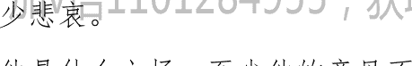

老人蛇再也沉稳不住，大喊：“全体出动，里面是什么！你既然一直召唤我，为什么不出来见我!!!”

然而，再也没有海怪游出蓬莱，在场所有的人都惊呆了！

“停止吧，这样做毫无意义！”雷总声音从我们身后传来。

我回头一看，雷总终于醒来了，水晶球中的液体已经不知道什么时候退去了，而老单站在雷总旁边，似乎是他放了雷总。

水晶球咔嚓咔哒的碎了，雷总并没有动手。他缓步走出水晶球的基座，眼中的红光如同能杀人一般的闪烁着。

而老单也倒在他身后，带着哭泣：“母亲！对不起，快停吧，单儿，你不起！”老人蛇能不能接受儿子的背叛？

他终于明白了，一点错也没有！山高路远，雷总一步步靠近老蛇，那只蛇在我身上开始颤抖，我明显感觉到心中的恐惧。雷总走到我们身边，看了我和大张一眼，露出了一丝宽慰，突然大了一声：“撤！”我心里猛地一抖！

作者:猪头老拿 日期:2008-11-01 21:44
作者:猪头老拿 日期:2008-11-01 21:44
作者:猪头老拿 日期:2008-11-01 21:44
作者:猪头老拿 日期:2008-11-01 21:44
作者:猪头老拿 日期:2008-11-01 21:44
作者:猪头老拿 日期:2008-11-01 21:44
作者:猪头老拿 日期:2008-11-01 21:44
作者:猪头老拿 日期:2008-11-01 21:44
作者:猪头老拿 日期:2008-11-01 21:44
作者:猪头老拿 日期:2008-11-01 21:44
作者:猪头老拿 日期:2008-11-01 21:44
作者:猪头老拿 日期:2008-11-01 21:44
作者:猪头老拿 日期:2008-11-01 21:44
作者:猪头老拿 日期:2008-11-01 21:44
作者:猪头老拿 日期:2008-11-01 21:44
作者:猪头老拿 日期:2008-11-01 21:44
作者:猪头老拿 日期:2008-11-01 21:44
作者:猪头老拿 日期:2008-11-01 21:44
作者:猪头老拿 日期:2008-11-01 21:44
作者:猪头老拿 日期:2008-11-01 21:44
作者:猪头老拿 日期:2008-11-01 21:44
作者:猪头老拿 日期:2008-11-01 21:44

五分钟过去了，水晶内部没有回音，十分过去了，里面仍然没有回音。

大张愣对着那老人疑惑：“满意了吧，进得去哪里能出来，赶紧放了我们领导，看看有什么办法！”

人蛇看了我们一眼，没有说话，她似乎也开始怀疑自己的判断了。

“啪啪”声又响起，又一队海怪进入了那水晶晶。

老单走到我们身边：“停吧！母亲，再去多少也不可能回来的了！”

“停？”我一生所要求的就在眼前了，怎么能停，单儿，你退到一边，我们母子团聚，今日解开长安的秘密，就再也不用分开了。

我看了老单一眼，他避开了我的光线，沧凉的眼中不透出一丝复杂。我知道他是什么立场，至少他的意见不会跟这人蛇的统一。

这个时候，我却发现一个人影也游了蓬莱！是隋将柜！怎么可能！这样的深海当中，普通人会被那巨大的水压淹死，他再神奇也不能如此这般！为什么他不来救我们而是直接进入到那水晶之中？

人蛇看到了隋将柜，但是她并没有吃惊：“老东西’不是善类，你进去也好，我看看你你是如何出来的！”

又过了很久，里面依然没有回应。反倒是冲出无数的海怪骸，破碎不堪。


老人蛇再也沉稳不住，大喊：“全体出动，里面是什么！你既然一直召唤我，为什么不出来见我!!!”

然而，再也没有海怪游出蓬莱，在场所有的人都惊呆了！

“停止吧，这样做毫无意义！”雷总声音从我们身后传来。

我回头一看，雷总终于醒来了，水晶球中的液体已经不知道什么时候退去了，而老单站在雷总旁边，似乎是他放了雷总。

水晶球咔嚓咔哒的碎了，雷总并没有动手。他缓步走出水晶球的基座，眼中的红光如同能杀人一般的闪烁着。

而老单也倒在他身后，带着哭泣：“母亲！对不起，快停吧，单儿，你不起！”老人蛇能不能接受儿子的背叛？

他终于明白了，一点错也没有！山高路远，雷总一步步靠近老蛇，那只蛇在我身上开始颤抖，我明显感觉到心中的恐惧。雷总走到我们身边，看了我和大张一眼，露出了一丝宽慰，突然大了一声：“撤！”我心里猛地一抖！

再长的路也有尽头，再长的路也有尽头，再长的路也有尽头，再长的路也有尽头，再长的路也有尽头，再长的路也有尽头，再长的路也有尽头，再长的路也有尽头，再长的路也有尽头，再长的路也有尽头，再长的路也有尽头，再长的路也有尽头，再长的路也有尽头，再长的路也有尽头，再长的路也有尽头，再长的路也有尽头，再长的路也有尽头，再长的路也有尽头，再长的路也有尽头，再长的路也有尽头，再长的路也有尽头，再长的路也有尽头，再长的路也有尽头，再长的路也有尽头，再长的路也有尽头，再长的路也有尽头，再长的路也有尽头，再长的路也有尽头，再长的路也有尽头，再长的路也有尽头，再长的路也有尽头，再长的路也有尽头，再长的路也有尽头，再长的路也有尽头，再长的路也有尽头，再长的路也有尽头，再长的路也有尽头，再长的路也有尽头，再长的路也有尽头，再长的路也有尽头，再长的路也有尽头，再长的路也有尽头，再长的路也有尽头，再长的路也有尽头，再长的路也有尽头，再长的路也有尽头，再长的路也有尽头，再长的路也有尽头，再长的路也有尽头，再长的路也有尽头，再长的路也有尽头，再长的路也有尽头，再长的路也有尽头，再长的路也有尽头，再长的路也有尽头，再长的路也有尽头，再长的路也有尽头，再长的路也有尽头，再长的路也有尽头，再长的路也有尽头，再长的路也有尽头，再长的路也有尽头，再长的路也有尽头，再长的路也有尽头，再长的路也有尽头，再长的路也有尽头，再长的路也有尽头，再长的路也有尽头，再长的路也有尽头，再长的路也有尽头，再长的路也有尽头，再长的路也有尽头，再长的路也有尽头，再长的路也有尽头，再长的路也有尽头，再长的路也有尽头，再长的路也有尽头，再长的路也有尽头，再长的路也有尽头，再长的路也有尽头，再长的路也有尽头，再长的路也有尽头，再长的路也有尽头，再长的路也有尽头，再长的路也有尽头，再长的路也有尽头，再长的路也有尽头，再长的路也有尽头，再长的路也有尽头，再长的路也有尽头，再长的路也有尽头，再长的路也有尽头，再长的路也有尽头，再长的路也有尽头，再长的路也有尽头，再长的路也有尽头，再长的路也有尽头，再长的路也有尽头，再长的路也有尽头，再长的路也有尽头，再长的路也有尽头，再长的路也有尽头，再长的路也有尽头，再长的路也有尽头，再长的路也有尽头，再长的路也有尽头，再长的路也有尽头，再长的路也有尽头，再长的路也有尽头，再长的路也有尽头，再长的路也有尽头，再长的路也有尽头，再长的路也有尽头，再长的路也有尽头，再长的路也有尽头，再长的路也有尽头，再长的路也有尽头，再长的路也有尽头，再长的路也有尽头，再长的路也有尽头，头长的路头头头头头头头头头头头头头头头头头头头头头头头头头头头头头头头头头头头头头头头头头头头头头头头头头头头头头头头头头头头头头头头头头头头头头头头头头头头头头头头头头头头头头头头头头头头头头头头头头头头头头头头头头头头头头头头头头头头头头头头头头头头头头头头头头头头头头头头头头头头头头头头头头头头头头头头头头头头头头头头头头头头头头头头头头头头头头头头头头头头头头头头头头头头头头头头头头头头头头头头头头头头头头头头头头头头头头头头头头头头头头头头头头头头头头头头头头头头头头头头头头头头头头头头头头头头头头头头头头头头头头头头头头头头头头头头头头头头头头头头头头头头头头头头头头头头头头头头头头头头头头头头头头头头头头头头头头头头头头头头头头头头头头头头头头头头头头头头头头头头头头头头头头头头头头头头头头头头头头头头头头头头头头头头头头头头头头头头头头头头头头头头头头头头头头头头头头头头头头头头头头头头头头头头头头头头头头头头头头头头头头头头头头头头头头头头头头头头头头头头头头头头头头头头头头头头头头头头头头头头头头头头头头头头头头头头头头头头头头头头头头头头头头头头头头头头头头头头头头头头头头头头头头头头头头头头头头头头头头头头头头头头头头头头头头头头头头头头头头头头头头头头头头头头头头头头头头头头头头头头头头头头头头头头头头头头头头头头头头头头头头头头头头头头头头头头头头头头头头头头头头头头头头头头头头头头头头头头头头头头头头头头头头头头头头头头头头头头头头头头头头头头头头头头头头头头头头头头头头头头头头头头头头头头头头头头头头头头头头头头头头头头头头头头头头头头头头头头头头头头头头头头头头头头头头头头头头头头头头头头头头头头头头头头头头头头头头头头头头头头头头头头头头头头头头头头头头头头头头头头头头头头头头头头头头头头头头头头头头头头头头头头头头头头头头头头头头头头头头头头头头头头头头头头头头头头头头头头头头头头头头头头头头头头头头头头头头头头头头头头头头头头头头头头头头头头头头头头头头头头头头头头头头头头头头头头头头头头头头头头头头头头头头头头头头头头头头头头头头头头头头头头头头头头头头头头头头头头头头头头头头头头头头头头头头头头头头头头头头头头头头头头头头头头头头头头头头头头头头头头头头头头头头头头头头头头头头头头头头头头头头头头头头头头头头头头头头头头头头头头头头头头头头头头头头头头头头头头头头头头头头头头头头头头头头头头头头头头头头头头头头头头头头头头头头头头头头头头头头头头头头头头头头头头头头头头头头头头头头头头头头头头头头头头头头头头头头头头头头头头头头头头头头头头头头头头头头头头头头头头头头头头头头头头头头头头头头头头头头头头头头头头头头头头头头头头头头头头头头头头头头头头头头头头头头头头头头头头头头头头头头头头头头头头头头头头头头头头头头头头头头头头头头头头头头头头头头头头头头头头头头头头头头头头头头头头头头头头头头头头头头头头头头头头头头头头头头头头头头头头头头头头头头头头头头头头头头头头头头头头头头头头头头头头头头头头头头头头头头头头头头头头头头头头头头头头头头头头头头头头头头头头头头头头头头头头头头头头头头头头头头头头头头头头头头头头头头头头头头头头头头头头头头头头头头头头头头头头头头头头头头头头头头头头头头头头头头头头头头头头头头头头头头头头头头头头头头头头头头头头头头头头头头头头头头头头头头头头头头头头头头头头头头头头头头头头头头头头头头头头头头头头头头头头头头头头头头头头头头头头头头头头头头头头头头头头头头头头头头头头头头头头头头头头头头头头头头头头头头头头头头头头头头头头头头头头头头头头头头头头头头头头头头头头头头头头头头头头头头头头头头头头头头头头头头头头头头头头头头头头头头头头头头头头头头头头头头头头头头头头头头头头头头头头头头头头头头头头头头头头头头头头头头头头头头头头头头头头头头头头头头头头头头头头头头头头头头头头头头头头头头头头头头头头头头头头头头头头头头头头头头头头头头头头头头头头头头头头头头头头头头头头头头头头头头头头头头头头头头头头头头头头头头头头头头头头头头头头头头头头头头头头头头头头头头头头头头头头头头头头头头头头头头头头头头头头头头头头头头头头头头头头头头头头头头头头头头头头头头头头头头头头头头头头头头头头头头头头头头头头头头头头头头头头头头头头头头头头头头头头头头头头头头头头头头头头头头头头头头头头头头头头头头头头头头头头头头头头头头头头头头头头头头头头头头头头头头头头头头头头头头头头头头头头头头头头头头头头头头头头头头头头头头头头头头头头头头头头头头头头头头头头头头头头头头头头头头头头头头头头头头头头头头头头头头头头头头头头头头头头头头头头头头头头头头头头头头头头头头头头头头头头头头头头头头头头头头头头头头头头头头头头头头头头头头头头头头头头头头头头头头头头头头头头头头头头头头头头头头头头头头头头头头头头头头头头头头头头头头头头头头头头头头头头头头头头头头头头头头头头头头头头头头头头头头头头头头头头头头头头头头头头头头头头头头头头头头头头头头头头头头头头头头头头头头头头头头头头头头头头头头头头头头头头头头头头头头头头头头头头头头头头头头头头头头头头头头头头头头头头头头头头头头头头头头头头头头头头头头头头头头头头头头头头头头头头头头头头头头头头头头头头头头头头头头头头头头头头头头头头头头头头头头头头头头头头头头头头头头头头头头头头头头头头头头头头头头头头头头头头头头头头头头头头头头头头头头头头头头头头头头头头头头头头头头头头头头头头头头头头头头头头头头头头头头头头头头头头头头头头头头头头头头头头头头头头头头头头头头头头头头头头头头头头头头头头头头头头头头头头头头头头头头头头头头头头头头头头头头头头头头头头头头头头头头头头头头头头头头头头头头头头头头头头头头头头头头头头头头头头头头头头头头头头头头头头头头头头头头头头头头头头头头头头头头头头头头头头头头头头头头头头头头头头头头头头头头头头头头头头头头头头头头头头头头头头头头头头头头头头头头头头头头头头头头头头头头头头头头头头头头头头头头头头头头头头头头头头头头头头头头头头头头头头头头头头头头头头头头头头头头头头头头头头头头头头头头头头头头头头头头头头头头头头头头头头头头头头头头头头头头头头头头头头头头头头头头头头头头头头头头头头头头头头头头头头头头头头头头头头头头头头头头头头头头头头头头头头头头头头头头头头头头头头头头头头头头头头头头头头头头头头头头头头头头头头头头头头头头头头头头头头头头头头头头头头头头头头头头头头头头头头头头头头头头头头头头头头头头头头头头头头头头头头头头头头头头头头头头头头头头头头头头头头头头头头头头头头头头头头头头头头头头头头头头头头头头头头头头头头头头头头头头头头头头头头头头头头头头头头头头头头头头头头头头头头头头头头头头头头头头头头头头头头头头头头头头头头头头头头头头头头头头头头头头头头头头头头头头头头头头头头头头头头头头头头头头头头头头头头头头头头头头头头头头头头头头头头头头头头头头头头头头头头头头头头头头头头头头头头头头头头头头头头头头头头头头头头头头头头头头头头头头头头头头头头头头头头头头头头头头头头头头头头头头头头头头头头头头头头头头头头头头头头头头头头头头头头头头头头头头头头头头头头头头头头头头头头头头头头头头头头头头头头头头头头头头头头头头头头头头头头头头头头头头头头头头头头头头头头头头头头头头头头头头头头头头头头头头头头头头头头头头头头头头头头头头头头头头头头头头头头头头头头头头头头头头头头头头头头头头头头头头头头头头头头头头头头头头头头头头头头头头头头头头头头头头头头头头头头头头头头头头头头头头头头头头头头头头头头头头头头头头头头头头头头头头头头头头头头头头头头头头头头头头头头头头头头头头头头头头头头头头头头头头头头头头头头头头头头头头头头头头头头头头头头头头头头头头头头头头头头头头头头头头头头头头头头头头头头头头头头头头头头头头头头头头头头头头头头头头头头头头头头头头头头头头头头头头头头头头头头头头唯一没有遭到破坏的水晶建筑。随着这水中城市的不断接近，我发现这些建筑周围环绕着不知道多少巨大的龟壳一样的东西，他们同样毫无生气，有的龟壳还嵌在某半透明水晶之中，很多不知名字的怪鱼穿梭其中，甚至还有无比巨大的海龙。这些龟壳遗迹难道就是传说中的“方丈洲”？

天，在曾经的深海中到底存在了什么样的生物战斗。谁又知道曾经这里到底发生了什么样的事情。面对这巨大的远古废墟，我和大张张张了嘴巴，我不是穿越了时空？这是什么地方？这里有什么？


“果然如此！”老龙显得非常激动，“我追求一生的水下长安终于复活了，终于有反应了！”

（此处重复内容已按逻辑合并处理）

……那只蛇在我身上开始颤抖。雷总走到我们身边，看了我和大张一眼，露出了一丝宽慰，突然大了一声：“撤！”我心里猛地一抖！


沉重了起来。

“你们两个过来认识认识吧，”雷总对我们两人说，“眼前这位就是前国民党军特别行动组的处长，隋少，隋少，也是当年在云南建立我们091 的主要领导者之一！”

果然！这个家伙的背景不简单！危机又一次降临到我们的身边！

作者：猪头大拿 日期:2008-11-04 (87)

“哈哈哈哈，沧海桑田，过眼云烟，过去的就不要再提了。天呐兄，如今在这水中我们，我们可是一根线上的蚂蚁，”隋天笑得非常得意。

一处理，其实心里有很多好处。“天延你说这话吗？”霍微似乎还没有要和他彻底动手的意思，但是，他身上的压迫感已经强烈了起来，眼睛也变得通红。

“你瞧这高塔之吧，”雷总并没有动，而是对我对张招手了一下，两个老头正在拼着命想缓对方的气势。

我和大张跳出外面，透过窗户朝下一看，瞬时凉了半截。

整个都市都满了蛇，密密麻麻，他们正朝这高塔方向涌来。

更让人恐惧的是，这个都市半透明的地板，竟然是一个巨大的胚胎，那东西竟然比莲还大！正蠕动着他的身体，似乎就要破而出了。我在这里分辨不出那是什么？

“大爷的，刘子是不是在做梦啊？那是什么鸟？”大张张看着下面巨大的胚胎，他也不敢相信自己的眼睛。

“不管什么事，反正不是好，赶紧回去报告吧！”我不怕死，但是我是怕不明白白。

我和大张慌地跑了回去：“不好了！被蛋包围了！”

“我看您俩也挨招了，今天老少老爷们就在这里搁歇了！”大张更是惶恐。

“嘘！请吧，天呐兄，咱们去看看吧，有什么恩怨以后解决！”隋章柜做了个请的手势。

雷总皱了皱眉，“也好，我倒要看看什么事情！”两个老头齐步走出，谁也没推着谁。

两个人站在门口，足足沉默了半分钟，谁也没有说话。

老单母子同样。

“这是什么？”雷总问隋章柜。

“吞天地的远古巨兽！某种意义上讲，这个才是我一生中所有所要面对的最大敌人，现在我不是给你解释的时候。”

“你的精神控制了他们吗？”雷总问隋章柜。

“你当这个世界上真有神存在吗？”隋章柜冷冷的回答，“不知道几许。”

“这个就是在不停召唤的东西，”雷总对单母说，“这是什么，下面孕育的是什么？”可笑，你竟然妄想统治整个海洋，却不知道背后的力量竟然比你大了千倍，人生实在是在悲哀至极了！”

“这个，”我不知道。我没想到……”老母苍然了，那曾经让她信仰一生的东西竟然如此巨大随意，她一直以为自己就是女王，其实连虾米都算不上。

“这是什么别研究了，我只知道它要是活过的话，我们这个世界就该洗牌重开了。”隋章接上的话。

“为什么这些怪物才出来袭击我？”我问。

“因为我拿了他的生命之源，”隋章回答了我们的疑问。

我才发现，隋章竟然还背着一块如婴儿大小的青色水晶。

“怎么样？”雷说了，“你不知道，先想怎么出去吧！出去我们再算账，”隋章不再答话。

“没有任何捷径，闯！走到哪里算哪里！”雷总狠狠地发了话。

我和张大眼瞪了眼睛，我们不可比眼前几位，个都是异能者，我们甚至连枪都丢了。看来只有拼了命朝跑了，运气还能跑回蓬莱。

这是一个怎样的世界，刚刚还是虎穴龙潭的蓬莱，如今竟然变成了避风的港口！

“平时多流汗，战时少流血，该换成平时多跑步，战时不怕。”


大张开始挽裤腿。

雷总对老单母子道：“今日之事你们也明白了，尽力而为，无论谁活着，回到蓬莱，其他事情再说吧。”

两人连连点头，他们自然分清楚什么重要。

“天佐，请！”雷总对擎伞做了个手势。

“请！”擎伞也没含糊。

两个人都眼中的光芒渐荧，一红一蓝，气势甚是惊人，我们紧紧随其后。沉寂千年的古战场，又要迎来一场新的战斗……......

作者：猪头大拿 日期：2008-11-04 19:59

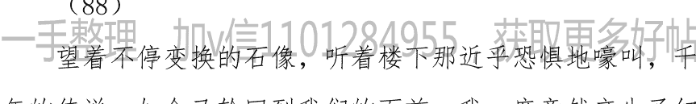

一手蜀，如你云，百事到处帖。望着看着不停变换的石像，听着楼塔附近近乎烦躁地嘈响，半年的传说，如今又轮回到我们的面前，我一度竟然产生了幻觉，我问大张：

“你记得吗？”
“记得！”
“咱们过来？”
“肯定过来！”
“什么时候？”
“上辈子！咱哥俩过来！”
“咱俩是不是疯了？”
“操！也许是……”

在这一海之巅，在神秘都市，我竟然和大张产生了共鸣，记忆的碎片穿越千年的时光不断浮现。青色的旗帜，引导着我们在都市中拼搏。鲜血如同同学一般，正上演着巨大的杀戮。鲜血如同心脏一般，纷纷倒地，隋章柜用脚不停撞击。鲜血再次洒了神秘之地，沉寂千年的隋章柜领出来，不知道隋章柜拿着的水晶竟然让他们如此狂热。这些人并没有特殊能力，只是力量足够，毕竟两个老头的精神力太虚弱了。蛇蛇蛇蛇蛇蛇蛇蛇蛇蛇人

而雷总身边的怪物越来越多，也看就要支持不住了。我和大张以及老单母子完全成了看客，只有相互搀扶着两个老头。忽然我脚下一软，踉跄了一下，可怕的是我身边的废墟中冲出一只蛇，就要向我舞来。我只望着那诡异的巨人蛇，腿已经软了，但他只是一个，那钢铁一样的拳头直直冲就发了出来。一声凄吟，老单在瞬间就被巨人蛇穿透了胸腔。红色的血如同昙花般散遍了周围的空间。一个柔弱的身影在血中缓冲倒下，那一刻，她已经不再是一个怪物，那一刻，她回归到了充满情欲的世界，那一刻，她变回了一个母亲。她为自己的儿子献出了几乎永恒的生命。

“娘！”老单吟着。听到呼唤，隋章顺手把手中捏着的蛇蛇朝我这边来了，把我眼前的怪物砸出去！老单托着母亲，单母伸出一只颤抖的手，她轻轻抚到老单脸上，似乎想说什么，可惜她再也说出一句话……

作者：猪头大拿 日期:2008-11-04 20:03

望着在风雨中逐渐去的身影，我吼着：“我的……”

作者：猪头大拿 日期:2008-11-04 20:09

隋章奎走到我们身边，一把拉住老单，提起便走：“先出去！你有什么仇回头再说！小子，你也抓起来！”我看着老叔，跟他说：“我们还有好多话。”我醒了神，她爬起身，看着老单老伤的脸，听着他撕心的嘶鸣，我的心如同揉缩了麻花一样，我不知道该怎么表达当时的感受。出口看起来越来越近了，但是雷总和隋章奎的气势越来越小了。周围的这些沉睡海底千年的怪物似乎非常喜欢活动筋骨。我们再也没有力量了。两个老头只是勉强控制着一个很小的院子内，不让其他怪物接近。“没想到，和你死在一起了，”雷总似乎有点扛不住了，对隋章说，“和谁一起无所谓了，这个东西活过来说，所有人都都要死！”擎伞连接着说话。看着怪物的逼近，死只是时间问题了。就在这时怪物身后传来了一阵骚动。

“什么情况！”我起镜望远，却见那怪物群中几十鲨鱼正在跃跃腾扬，手中锋利的爪爪不停地招着周围的人蛇巨型！这些鲨鱼人非常灵活，他们死命勒住人蛇的脖子，手中的利爪不停地在他们身上游走，瞬间就杀了数只高大的蛇怪。大张看着发生的一切：“什么时候跟这些怪物的同伙？合适吗？”看着眼前的一切，同性的幻觉浮现在面前，这场景，这杀戮，这悲壮，似曾在那梦中无数出现过！雷总看着老单一眼，“你也能控制莲莱，”老单悲伤地点点头，“家母已经把我的精神连接到一起。”擎毕竟是久经沙场，见此变化，自然不能放弃了，“别说了，”蛇蛇蛇蛇蛇蛇蛇蛇蛇蛇蛇蛇蛇蛇蛇蛇蛇蛇蛇蛇蛇蛇蛇蛇蛇蛇蛇蛇蛇蛇蛇蛇蛇蛇蛇蛇蛇蛇蛇蛇蛇蛇蛇蛇蛇蛇蛇蛇蛇蛇蛇蛇蛇蛇蛇蛇蛇蛇蛇蛇蛇蛇蛇蛇蛇蛇蛇蛇蛇蛇蛇蛇蛇蛇蛇蛇蛇蛇蛇蛇蛇蛇蛇蛇蛇蛇蛇蛇蛇蛇蛇蛇蛇蛇蛇蛇蛇蛇蛇蛇蛇蛇蛇蛇蛇蛇蛇蛇蛇蛇蛇蛇蛇蛇蛇蛇蛇蛇蛇蛇蛇蛇蛇蛇蛇蛇蛇蛇蛇蛇蛇蛇。快撤！”雷吼道。“嘟——”一声巨响，蓬莱缓缓地离开了。望着远处的水中长叹，我的心情再一次沉重了起来，里面那个东西估计就会出来了。到那时，老单站在中间，独自落泪，我很想安抚他一下。又不知道如何起。老单突然从手边拿出一块手帕给了我，我接过一看，竟然是一封单母留给他的书，字体是以血为墨，“当你出生的时候，整个海边的鱼都在轻声唤着你你是命中注定的王者，少年年来，我负了太多责任与无奈，原谅母亲，不能抚养成人怎样，我都永远爱着你。哪怕是寒风刺骨的冬夜，哪怕是风雨飘摇的孤舟，闭上眼睛，就能想起你无助的哭泣；闭上眼睛，就能想起你纯洁的笑容。我的儿，你一定要忍住暂时的痛苦，期待我们相见的那天，那一天就是这个海洋的君王。那一天，就是你永不分离的日子。那一天，我们就永生在蓬莱的怀中。”泪水不停地顺着老的眼睛流出，“母亲一生，所做所为，全部都是我，全部都是……”我终于理解了一个母亲的伟大，儿子能当上所谓的王，可怜的是，命运总是在捉弄我们这些平凡或者不凡的人。”大张和我不知道如何劝解老单了。“没事，一切自有安排，你别难受了，”雷总答道，“离开所有的事情，作为一个母亲，她是伟大的。”蓬莱突然停止了游动，老单悲地对我们说：“母亲一直认为我就是这个王如同海洋的希望，所以多年来她独自受着各种痛苦，她是希望我能当所谓的王，我第一次进入蓬莱的时候非常斥这样的事情，我只想平静地走完一生，她并没有难为我，而今才得了她的心，我辜负了她。“你的母亲所谓王者之真相大概在那边悔，这么来，她不过做了深海恶魔，真是世事辛苦人啊，”雷总语重心长。“今天才明白，如今她已经走了，我也不想独活，各位，我就送你们到这里，请吧，我会给大家一个圆满的答复，我会为我的母亲赎回她所犯的过错。“不要去了，全部都是送死，没有用。“里面的东西你也知道，无论如何是不能让他出来的，我们母子今生的罪孽实在太多，就给我个机会，不要劝了，我要像个男人一样，送母亲一程。”望着水中万千的海剑排着整齐的队伍如同士兵一样的奔向水中，长枪，我已经分不清谁是敌人，谁是朋友了，我们如同命运齿轮上的尘埃，却不能负哀，却不能改变。追而来的人形蛇正在与蓬莱众在窗外拼死搏杀，那海不断暴出血花，像空中绚丽的烟花，转瞬之间却不知道多少生命消失了。穿越千年的时光，回到那个熟悉的环境，我的朋友，伙伴们正排着整齐的队列向前赴。巨大的轰鸣划破了所有的黑暗，听着抗争。也许我们无力抗命运的齿轮，但是我们能做最壮烈的挣扎。巨大的冲击波很快的上来了，我眼前一黑，被冰冷的水流吹了出去。

“怎么了！”雷总睁了眼睛问。“绝对不行！”还没等雷总说完，脚下的甲板突然打开，我们全部潜了下去。“砰”的一声，组织再次包围了我的全身，恍惚中我看到蓬莱那巨大的身影随着千万勇士朝深海疾去……“你想干什么？”我睁着眼睛望着老单，心里如同打翻了一样。他伸出布满老茧的手紧紧握住了我的手，那一刻，我觉得手上的老茧不再冰冷，而是温暖的，圆润……

作者：猎手大拿 日期:2008-11-04 12

“谢谢你，让我感受到了母亲的慈爱。再见了！”我想哭，哭不出来，我想喊，喊不出声，我只能送他们远去。再见了，水中的蓬莱，再见了倔强的老父，再见了伟大的母亲，再见了前世今生的战友……几分钟后，深海中传来了巨大的火光，像无尽黑夜中的滚，划破了所有的黑暗，如同听着一群被命运挟着的抗争。黑暗中，我仿佛回到了军港的路口。一艘快艇正要出航，15组的兄弟们正站在舰上，王组长站在第一位。他们穿着崭新的军装，排着整齐的队列，戴着洁白的手套，正对着岸边欢迎，不知道他们将驶向何方。一位少女正看着六七岁的孩子从我面前走过，有说有笑。“娘，我长大了要当船长。“呵呵，单儿，你只要健康快乐的长大，娘很高兴了。“我一定要当船长！”呵呵你好，记得娘一句话，每一个儿子都是母心中永不沉没的巨舰。“恩，知道了……”我心里没有理会她，没有人注意到我，渐渐的，拥有的都远去了，只有我孤寥地站在海边，任凭海风的吹拂......

作者：猪头斧 日期:2008-11-06 07:38

小小聂哥，早晨起床，搓着裤子，去上书房，打开电脑，楼下，回复多，谢谢谢谢谢谢，非常感谢。作者：明猪熊猫 回复日期：2008-11-4 23:27:00看了第89节中单母的血书内容，我断定作者是个魔兽玩家。不相信的去看兽世界巫妖之怒的片头动画，听听老王对阿尔萨斯王子留下的话。


兄台果然眼了...

的材料，这样的东西在大海中可以无限吸取能量（具体方法并不清楚，理论上讲，吸食海中的各种生物是最好的办法），不停地进行陈陈代谢，不需要补给，不需要加油，而且受到创伤后可以自行修复，这样的效果，无疑都是人类科学追求的终极目标。

## 2 莱莲的居民

通过潜入莱莲的回忆，莱体内水道密集，还有类似起重的生命体，各种海怪存在在球晶形体内，那么我们可以怀疑，当人类受到调制，转换为生物兵器，其在得到特殊的力量和能力后，自身能量消耗也会随着增加，

让生物兵器常活动在莱莲内部，就会增加能量消耗，而生物兵器庞伏在水术茧中，进到近乎冬眠的状态，无疑会减少能量对人类的负担，并便于管理，各水晶莱莲体内均有水道，各类海怪可以方便的进出莱莲，这样的设计如果能挖掘人类情感因素，是非常合理，非常科学的。

## 3 莱莲的管理者

对于谁在管理莱莲，我们的意见更倾向于人鱼海怪，因为潜入莱莲的同志回忆，在莱莲之中，各个房间都有开放或半封闭的水道连接，这种水道的鉴定定为人鱼类不具备两种能力的怪物设计。就管理能力来说，女性地思比男性更加细致，也很适合做这样的工作，而且人类也曾经经历过母系族社会，就推测莱莲的产生年代以及与历史上社会机构结合，我们更有理由相信，蓬莱的中层管理者均为女性。随后遇到的蓬莱控制者，也印证了我们的猜测，至于老单这样的男性也能控制蓬莱，我们认为是因为由于人类情感所产生的特例。

## 4 蓬莱的工作原理

生物兵的产生，是一个系统的工程，由各种情报分析，人类类做为生物兵生成的基础单位，海人鱼通过其特有的手段对人类进行掳捕（而且他们会将捕获的人形茧缚在蓬莱外体，合适的时候投放），然后由水道送入分类房，再由巨大的章鱼触进行分类，送入不同的房间水晶中，对人类就如同生产线上的材料一样，被生产成为同地的生物兵。这个系统虽然看上去简单，但是就我们的科学技术量而言，几乎是不可能制造的。我们可以从生物生成的事态上，看到我们人类的理念，系统化，自动化。

这样的科技，无疑是现行技术达不到的，但是这样的理念非科学，至于是谁制造了蓬莱，还是谁个诞。

## 5 蓬莱的作战原理

毫无疑问，蓬莱是为战争而生的兵器，其主要的目的就是战争，就在蓬莱内部各海域分工来说，几乎涵盖了战争需要的所有兵种（详见后面蓬莱内各海域的分析）而且本身曾经还具备大规模的杀伤性武器，那么这样的东西对我们人类来说，是几乎可怕的存在，如果是几这样的巨大军舰同时进行登陆作战的，除非非核武器，就现有军事力量而言，任何国家也抵抗不了了。这是一个可怕的事实。

另外，莲莱出现总是随着暴风雨，在暴风雨中作战，莲莱内部海怪的能力应该有质上的提高，我们怀疑其本身具备操控天气的能力，但是不能确定。理论上这样的可是存在的。

这样我们想象一下几万莲莱这样的巨舰登陆的场景，首先大规模的杀伤兵袭溃滩，然后随着暴风雨，数万海怪同时登陆，扫平一切抵抗，而且这样的登陆几乎可以发生在任何海域，几乎不受地形影响，克服各种登陆作战的不利因素。

这样的海军军备是各国梦以求的。还不明确，虽然在巨大的水中都不明确，或许如果莲莱存在大型规栖杀伤武器的话，防空能力等同于其本身的攻击能力

至于莲莱的作战目标，还不明确，虽然在巨大的水中都有战市（详见后面水中长长的报告）附近发现大量这类生物的残骸，似乎这样的怪物在远古时代与水都市中的怪物发生激烈冲突，但是根据分析，两者似乎更像一个系统的，由都市高塔中发现的雕塑也可以证实这样的理论，至于双方为何战争，当时战争的规模，仍待考察。

以上就是莲莱巨舰的初步分析报告，由于该舰已经消失于茫茫大海，我们暂时不能再取得一步材料，所以只能做合理的推测。

作者：猪头大拿 日期：2008-11-08 05:31

# 山东蓬莱 6507 事件报告（二）

6507 事件收集标超过 50 件其中各种物种分类工不相同

## 1 青色海怪样本

青色海怪（智定名虎夜）样本于 1965 年 7 月 18 日晚收集，大批海怪袭击海军鱼雷艇基地时收集，具体特性如下：

该生物为蓬莱巨鲸肌内基础的兵种，本身并没有过人的能力，外型类似于青蛙，周身覆盖鳞片，对现代武器器防御能力非常有限，即使普通的枪械也能对其造成的伤害，该生物具备两棱功能，通过剖分析，该生物呼吸系统与同类鱼类似肌肉发涨，气泡超过普通人常水平的两倍以上，游激。

根据该生物身体组织分析，其大部分组织为人为类细胞细胞增强，如果把该生物设定为生物兵器，那么这样的类型无疑是便于生产的量化兵种，数量巨大，在攻击的时候，该生物并不具备人类智慧，行为极为机械的，可以认定其行为为完全蓬莱巨鲸内的生命指挥。

## 2 红色龙虾人

龙虾人样本同样为 1965 年 7 月 18 日晚大批海怪袭击海军鱼雷艇基地时收集，具体特性如下：

该生物身高超过 2 米，体型巨大，同时周身覆盖硬质，对于现代武器防御力出色，即使普通的 7.62 毫米机枪也能对其造成的伤害，该生物能力非常强，同时体内还能分泌酸性液体，其射程超过 100 米，即使金属也会在短时间内被溶解，如果单纯的看生物兵器特性，无疑是战斗战斗角色，可以认定其行为为完全蓬莱的生命指挥。

## 3 黑色鳗鱼怪

黑色鳗鱼怪样本为 1965 年 7 月 21 日凌晨于蓬莱海滨收集，具体特性如下：

该生物皮肤强度非常高，普通的手枪无法击穿其皮肤，值得注意的是该生物融合了鳗鱼的生物特性，周身能够产生强烈的电，瞬间产生的电也要超过 300 伏，该生物攻击方式灵活，需要抓住人类，这只是陆上特征，如果该生物在水中战斗的话，效能会有增长。

## 4 海豹狮异

海豹狮异样本同样在1965 年 7 月 21 日凌晨于蓬莱海边收集，获取更多帖，具体如下：

该生物类似于水獭，有尾巴，能直立行走，能力非常出众，四肢及背部覆盖着大量的硬质刺，剧毒，能在瞬间麻痹人类各神经。该生物善于隐藏，身上带有毒素，毒素尾端的肌肉组织可以在短时间内产生液体，将毒素发出去，无声无息，准确惊人是非常可怕的对手，具备相当的敏捷能力，非常适合偷袭暗杀。

## 5 海人鱼

很遗憾，并没有收集到该生物样本，只能通过6507 事件对其特征进行推测。该生物理论上讲均为女性化，上半身的人类，下半身为鱼类，该生物兵器特征很奇异，并没有发现其直接攻击人类目标，而是通过其他手段配合各种海怪进行作战。其方式为：靠声波频率震荡，就1965 年 7 月 18 日晚对海军基地的攻击行为来看，这种声波能够在较近距离击碎玻璃，同时扰乱人类大脑思维，让人产生头痛、恶心，抽搐等各种特征。就其形态，该生物并不具备两栖能力。

在部分人员潜入莱莲的时候，又发现该生物的不同特性：模拟人类声音，童声，女声，声音甜美，能够对人类产生心理感，理论上讲这样的声音会伴随着某种人类听不到的声波对人类进行干扰，让人类在短期内丧失心智，受其操纵，这也是莱莲捕猎人类的基本手段。通过分析讨论，人鱼生物具备人类完整智慧，但是该生物是否具备人类情感并不能明确。不过根据各国传说中人鱼的故事，意见倾向于该生物具有人类的各种情感。

## 6 溢鱼人

溢鱼人同样没有样本，只能根据人员潜入莱莲的人员描述分析。该生物高两米左右，皮肤光滑，脑部有类似鱼鳍的组织，整个身体呈流线型，两手腕有类似刀锋的骨骼组织伸出，防御能力一般，可以确认近距离内 7.62 毫米步枪可以对其进行有效创伤。但是该生物敏捷能力出众，非常善跳跃攻击，下手非常稳，准，属于出手必杀的近战单位。通过分析，该生物应该不论在水中还是陆地，都能有效发挥力量，属于蓬莱高级的兵种。值得注意的是该生物抵抗精神控制的能力非常强，对于高等移动者的精神波动几乎无效。

## 特例1 单母

单母姓名王凯，具体已考证，如果她进行对比，其年龄应该超过 85 岁，但是其身体面容只有 30 岁左右，似乎是生物生成使这个个人获得了永久的青春。被卷入莱莲后被调制成蛇类，同时具备操控的能力，这种活动在海洋之中只在特定的环境中才出现。作为普通兵种，这种生物的生成标准是不的，这种类型没有明确答案，只能做合理的推测。

## 特例2 单卫海

单卫海是蓬莱领导者的儿子，虽然年轻的时候被卷进蓬莱，但他似乎对军舰没有兴趣，所以他被放入。这种特例有很多研究的地方。该人似乎是在调制作业途中就结束了整个过程，所以他的力量与能力根本不能与单母相比，但是伴随着能力的下降，此人呈现不同的生物特征，表现为可以恢复身体，其记忆与情感几乎受到破坏，在适当的时候可以化。

作者：猪头大拿 日期：2008-11-08 05:33

# 山东蓬莱 6507 事件报告（特别篇）

以下理论均为推断，并不完全的科学依据，仅限内部组长上级别同志参阅。

## 关于脑波

人类以及动物的行为，都是由脑波控制的，当人类做任何事情时，都是由脑部产生微弱的电波传达到人体的神经，进行相应的动作。而人类的情感，由脑中各种微量的化学元素生成，这近乎细微的变化促使了人类的喜怒哀乐。

## 关于精神控制

雷指挥能够控制动物的行为，甚至让他们自己爆发，这种能力很奇异，我们也尝试解释这种能力是怎样的原理（加v11028495）。应该说这种能力的基本原理就是雷天总指挥本身产生一种察觉不到的干扰波，该段波能够有效地干扰物的脑波，强制性的切断他们控制自己的能力。所以，当指挥产生这种波动的时候，可以影响附近的怪物脑部神经，让他们产生压迫感，不由自主的下跪，甚至能让他们产生巨大的恐惧感，直接导致血流速度加速，心脏以及血管负担增加到自身所能承受的地步，这样我们就可以看到怪物所谓的七窍流血，甚至自身爆炸。这种生物特性是相当惊人的。单纯从控制角度出发的，我们人类基本上都是从情感角度，自古得民心者得天下，但是生物的创造者却很好的解决了这样的问题，直接于生理上强制性控制生物兵。这种级别位于顶端的生物对于低级生物拥有绝对的控制权以及支配权，或许对于我们人类情感而言，这种暴力控制方式是不可接受的，但是对于控制这样一个超级兵团来说，这种能力绝对是有效的，拥有这种能力省去很多麻烦。

## 关于总指挥的疑惑

为什么单母作为蓬莱的的，这种能力在遗传上是的的的的不是的，这种能力在遗传上是的的的的的不是的，这种能力在遗传上是的的的的的的的不是的，这种能力在遗传上是的的的的的的的的的的的的的的的的的的的的的的的的不是的，这种能力在遗传上是的的的的的的的的的的的的的的的的的的的的的的的的的的的的的的的的的的的不是的，这种能力在遗传上是的的的的的的的的的的的的的的的的的的的的的的的的的的的的的的的的的的的的的的的的的的的的的的的的的不是的。

以上是莱莲内部头部的基本情况，至于普通人是如何变怪物的科学理论还有待探索。通过以上分析，我们可以发现莱莲内部的各种种类以及功能，就其特性来说，这样系统地的作战单位近乎完美，每个环节，各个兵种之间能够有效地进行情报，防御，暗杀等各种作战任务的配合，达成各种战术乃至战略目标，这样的先进理论与科技的确值得我们探讨与借鉴的。

作者:猪头大拿 日期:2008-11-08 05:34

# 山东蓬莱 6507 事件报告（三）

关于水中长安的分析报告：这次事件中，潜入莱莲巨舰的同志进入了一个非常奇特的地方，即水中长安。根据有限的资料，简单的来说这是一座位于海底的巨大城市，其规模而言已经超过现代一个小镇，而且建筑方式奇异，整体布局为圆形，中间巨大的水晶周围十几个规模较小的水晶周围，这样的建筑布局应该像一个堡垒。令人害怕的是，该建筑周围的小城均被破坏，不知道已经经历了几许，而这些被破坏的建筑旁边则存在着巨大的蓬莱类战斗舰，规模如此，我们可以胆大推测的是，在远古时代，大批蓬莱类战斗舰曾经对海底这个城市进行过近乎毁灭的攻击，对于这场战斗的原因我们还不明确。

根据情报，这些都市内部配置与莱莲内部相同，就其部分分析应该属于生物组织，这样的都市是否生物生成育成待待，理论上应该是生物生成大体框架后进行过人的建筑。该都市内部道路通路以及水道布局中，各个院落都分普通道路与水道连接，这种设计毫无疑问的应该就是莱莲中各类生物设计。

而长安的守卫兵力如同巨大的人类入侵，又与莱莲内海怪不相同，由于我们没有具体样本，无法对其进行有效分析。


现在还不能确定这类生物是由人类制成还是天自然生成的新物种，就该怪物的能力而言，并没有很大的地方，基本就是力量巨大，敏捷出，两栖。但是这样的怪物在莱莲海域作战的时候，其压倒性的力量优势还是非常显著。长安内高塔是整个城市中唯一的明显文明特色的建筑，根据描述，这高塔为类似华夏风格，但是其超过百米的高度而言，肯定是由过不明外力指导才能成的。建筑内部宗教气息浓重，每一层都有风格相似的雕塑，内部则为各种不同的生物培养巨大的蟒蛇，就此推测，各种生物与巨大的蟒蛇之间应该是从属关系，而这些蛇的地位在生物兵团中应该是最后的。但是这样的理论也值得商榷的地方，如比雷索指挥将与这类高等移动者同样具备这样的男性女性的精神控制能力，这样的事态是不太符合高塔内雕塑所描述的。从高塔顶点的雕刻说是七个金人在拜一个巨大女性蛇，这样的不同的风格，无疑搅乱了我们之前整个生物兵团组织体系的理解。至于这种生物兵团的目的以及其后能力突然增强的原因。

作者：猪头大拿 日期:2008-11-10 16:55


# 山东霍莱6507事件报告（附）

## 隋天佐档案

隋天佐为四川州人士，生于1900年，自臂力过人，年少从军，为川军名将刘军部下。此人作战勇猛，心机甚重，加上自身异能，所以从军之后屡战胜，自身地位也平步青云。抗日战争结束后已为民国国防部二厂军统事务特别行动组组长，兼行动总指挥，官居少校副参团长。

值得注意的是这个人的部门，原民国国防二厂军统事务特别行动组工作性质而言是与我们091完全一样的部门，同样是追查各类不明事情的特殊单位。就南京获的时间我们从资料来看，隋天佐此人接触各类不明事情的时间比我们早了许多，其掌握的各类机密也比我们更完善。

就中国长安的信息最早就是由这个人透出的以及其进入水中长安的表现来看，整个6507事件似乎完全在他的计算之中。此人借由雷总指挥进入霍莱的机会，成功的潜入了霍莱以及水中长安，又借由雷总指挥的能力带着长安不明水晶全身而退，还可以预见此人的心。最担心的是此人能力惊人，不但拥有精神控制力，自身力量也超过我们的想象，当091云南遭遇重大损失，也是此人一手策划的。这是一个非常可怕的对手。

另外该人历史背景十分复杂，根据资料表明，该人在川军时为川军三四一团营长，该部曾参加1937年2月初的南京保卫战。当防御战失利后，全团二千余人急行向南延数十里、森林茂密的南京东南部青龙山地区撤退，而在战后发现，当时的川军四十七团竟然全军神秘失踪，两千人无一幸存。该人的档案从从937年至1942期间全部为空。也就是这段时期国民历史最大悬案的唯一幸存者就是该人，至于到当年到底发生了什么，至今还没有任何官方解答。

鉴于该人的背景和能力以及现在的事态发展，请求上级通报情报部门，严格排查，一旦发现该人踪迹立刻通知091处理，切务慎动。

以上就是山东复6507事件的综合报告，这次事件是一起大规模的不明生物毒攻击事件，我们遭受的损失也相当巨大，加之10128495则更为巨大，但在这次事件中我们所发现的各种线索以及信息也是相对比较多的，希望在今后的工作当中能够更多的开各类此类事件发生的原因，让神话与科学之间画上一个完美的等号。

0917组
- 总指挥：雷天鸣
- 生化员：刘思远
- 医学员：王浩、张燃（牺牲性）
- 环境化员：赵晓飞、全小磊（牺牲性）
- 历史研究员：田某
- 保卫员：张国栋、王军（牺牲性）、谢中强

091所15组
- 指挥：王达峰
- 保卫员：周荣（牺牲性）、赵宝生（牺牲性）、钱自佳（牺牲性）、孙宇（牺牲性）、郑林海（牺牲性）、赵宝生（牺牲性）、林建峰（牺牲性）、曹铁如（牺牲性）、高尚武（牺牲性）

作者：猪头大拿 日期：2008-11-10 20:53

# 四个故事

当我醒来的时候，我发现我在一艘天津港出发的大货轮上，而轮船的目的则是东部非洲的坦桑尼亚，不知道我迷失了多少时日，刚刚才醒来还有点神智恍惚。非常幸运的是雷总和大张也被被货轮拯救了，不过他们比我醒得早了一点。

船上的高船长刚知道我们是部队的军人的时候，给予了我们周到的安排，及时地向北京发电报我们的情况，莱莱的事情就暂时一段落了，虽然还有很多秘密没有解开，但是有这样的结果还让人满意，至少我还活着。

“还有几天在广州啊，我们终于上了，他妈妈一天也不想在水上采霉了。”我们一行三人在一间舱特别安排的船舱中，我漫无目的的发呆着，刚发生的经历对我来说如同穿越了时空一样，一切还是不能让我心里接受。而雷总还是语言不多，除了我和他们探讨事件的经过，其他人大部分时间总是站在舱外遥望大海，谁知道这个家伙脾气有点怪的老头心里在想些什么。而我们亲爱的大张，却过着猪一样的生活，睡醒了吃，吃饱了睡，雷总在他面前还能消遣，雷总如果不在，这里就开始了永无止境的懊恼和091内部这些年轻姑娘的语气，似乎刚发生的事情和他自己一点关系也没有。如果海上能让他有所遗留的地方，毫无疑问是船上的伙食了。

“一手你说老单不会妥活吗？”我问大张。

“得，你爱老婆，不爱老婆就拉倒，让你哥哥消消气，我现在有了新的目标，回去找船队商量数量，你看如何这船升上来？”大张似乎也不想提到过去。

“那你说老人家……”我想继续聊话题，却被他粗暴的打断，“老爷爷啊，爱谁谁，死了这么多兄弟，我们连个毛也没明白，老子还跟他们道道，剩下的活儿归你，你别整天叨叨了。”大张把枕头盖在脸上睡了。

“哎，”我叹了口气，大张这样的人也有其弱面吧，也许他在掩饰内心的不安与伤痛。

不知道过了多少时间，有一天船长带来了消息，还有两个小时将停广东，让我们做好准备。按照计划，我们由广东下船。经历了惊人的事件之后的我们，回家是一件让人兴奋的事情。雷总依然没有任何表情，我和大张却兴奋不得了。我们去挨个船员道别，在物质匮乏的年代，船上有鱼有肉的生活实在是难以想象。

又回到那还算舒适的船舱中，看来半会是下不去了，雷总依然喜欢去外面看海。雷总在广东香港接到了这次任务。船舶稳稳地靠在广东码头边，我们三人正要下船的时候，高船长突然忙跑到了我们身边，交了雷总一份电报。我们看了以后，我和大张却像捏了气球一样，马上糟了。

“楚先生，请留雷总、大张、三位医生抵达的目的。”落款是“船长”。作者：猪头大拿 日期：2008-11-14 15:20

# (94)

“我操！老可不是兄弟当铲用了！刚从水里爬出来又送去非洲，是不是死不想办法把他们送那边狮子了！091别闹人了。”大张心里是一百个不愿意。我觉得有些，毕竟刚刚从水中那里脱身，竟然直接派到非洲，似乎于理上说不过去。雷总会像个不受话的小媳，对他这种不在意，反而瞪了我们：“叫你们干什么就干什么，军人的职责就是服从。去非洲两个月多了，听说遇到了点麻烦，我们这些从海里买出来的其他人自然有自己的安排，天高地去，水上地落，你们也不想去非洲，说不定明天就把你们派戈壁去支援老组。”大张冲了眼，再也不敢说什么了。

很明显船长也得到了上级的指示，把他们的目的大体讲了一下。事情是这样的：1965年初，坦桑尼亚尼雷尔总统访华，提出希望中国帮助该国建设一条坦桑尼亚—赞比亚的铁路。虽然中央首长并没有回答，但是在5月份派出了先期的评估勘察小组，希望能对当地的环境有个了解。

于是，先期五十多人的工作组已经驻扎桑尼亚，而我们这艘向阳号货轮则是运送第二批人员和设备的。鉴于比较重大的涉外项目，091也秘密派遣了观察员跟随工作组进入非洲，预防可能在工作中出现的麻烦。

至于那个可怜的梵先生，跟我们年纪差不大多少，他是9组老张的人。听说这人精通心理学，而且会点催眠术，以前的任务还算老道，基本没有什么麻烦。派去非洲虽然艰苦，却不会发生什么生命危险，如今竟然向总部索求，晚开，等到这大老爷又得了哪路神仙。

又回到那还算舒适的船舱中，看来半会是下不去了，雷总依然喜欢去外面看海。雷总在广东香港接到了这次任务，并没有传达给我们，“告诉什么药，”并没有告诉我们。我们也习惯这样到达任务地点后知道任务内容的日子，并没有多问。我和大将吹吹牛，侃侃乱，倒也快活。

有一天雷总突然问我们：“如果有人失踪，但是衣服留在原地了，也不像自己的跑，那是为什么？”

“为什么？”张大将看着半醒醒的脑，“被人绑架了呗”，还能什么，我可没听过非洲有莱莱这样的鬼东西，光听说那边有吃人的民族，我操，不会是被绑架了吧？”

如果是单纯的绑架，我看也不需要这么紧急地把我们派到那里吧。”我思索着。

# (95)

“如果有人失踪，但是衣服留在原地了，也不像自己的跑，”雷总面色凝重地看着我们俩，“楚小组一行九个人，有一天傍晚吃饭的时候突然失踪，现场留下了衣服，但是人不见了。楚在帐篷里查资料，外面的人在作息，前后最多十分钟，没有任何异常。”

大张还没明白，我也一样：“表面上和普通的绑架并没有出入，但是这种事情发生在短短几分钟内，怎么可能？楚是受过特别训练的人，一般情况下不会疏忽，可是偏偏发生了在我们091眼皮底下。”

雷总点头：“这就是跟脚，论事情来说很简单，要是说出来麻烦太大了，我们要多考虑。楚在帐篷里查资料，外面的人在作息，前后最多十分钟，没有任何异常。”

“而且……”

“而且衣扣都没有，也就是说并不是外力脱去的，而是直接消失了！”


作者：猪头大拿 日期：2008-11-12 21:32

# (96)

不知道海上待了多久，终于到达了坦桑尼亚与比亚交界的小镇，名字挺意思，叫做拉姆。楚小组就是从那里出发的，我们抵达时已经是傍晚了。我们住在镇内旅馆，大张去安排房间。

雷总对他握手：“坐，我们现在的身份是医生，不必特意奉上。”

“楚，到底发生了什么事情，你份报告我还是有些太明白的地方？”大头摇着脑袋：“不是我写不明白，只是这件事让人不明白。”

“哦，听说你精通心理学，还会点催眠术，要说你的人心思应该非常细密，外面出了事情难道一点察觉都没有？”雷总继续问。

“没有任何察觉。我以当时的印象，事情发生前外面的应该是不能再正常了，所有人都在笑，都是在忙着做饭。当天我被毒蝎子舔了，大家照顾我，让我在帐篷里休息，过了以后外面就没声响了。我出去看的时候，只有一地衣服。我在091也不多年了，见的怪事也不少，当时吓得我也浑身发毛，那么大的营地，突然就消失了，其他的人都脸色发了一样。”大头一脸恐惧，“能把091的人吓成这样的事情，从没有发生过。”

“你可曾查看他们的衣服？”

“想，看了。”

“有血迹没？”

“没有任何血迹……”

“随身的物品可去？”

“除了人消失了，任何物品都没少？”

“而且他们的衣扣都没有，也就是说并不是外力脱去的，而是直接消失了！”雷总摇着头：“这太不可思议了……”

作者：猪头大拿 日期：2008-11-14 07:19

# (97)

“几位，可以了。”开门的是翻译，他叫卡松达，他是坦桑尼亚当地人，他父亲是当地一个比较名的酋长，而他本人也在读书，中文虽然有点蹩脚，却还能听明白。他一路从海边带到这里，也算见识了。雷总对他微微微笑：“辛苦了，松达少尉。”我们来到旅馆一楼大厅，老板非常勤快地给我们端上一盘精美的饭。虽然我们听不懂，但他满脸的笑容足以让我们从遥远而来的人感到热情。卡松达习惯性抓起来吃，我们狼吞虎咽。雷总依然很慢，边吃边逛：“松达少尉，失踪的地方你了解吗？”卡松达拿出一块洁白的手帕擦了擦嘴：“那边我知道一点，是片雨林。传说那里有魔鬼，经常有当地人失踪。”雷总转身问：“你们去的时候带向向吗？”

卡松达犹豫了一下：“没有，其实路途并不远，只是简单的路，而且当地人也没有敢走那片雨林。”

雷总点了点头，又转向卡松达：“你愿意一起去吗？”

卡松达：“可以，这也是我多年的愿望。”大张乐了，对卡松伸出大拇指：“行，胆识快！”卡松达并没有用外语介绍，而是优雅地拍了拍我们：“中国不是有句古话吗，叫令入子。”

“行啊哥，还有古话，你胆比我都高了，你还挺娇情。”大张哈哈。听着他们说中文的玩笑，我忍不住笑了出来。卡松有点尴尬，搓了搓手。“哎，”雷总瞪了我们一眼，时间总是短暂的，旅馆外面下了雨，非洲的雨季总是为这片土地上的无数生命带来新的希望，但是对于我们来说，那片雨林的深处，却不知隐藏的是希望还是绝望。明天我们就该踏进那片神秘之地，希望等待我们的东西还太离谱……”

作者：猪头大 日期：2008-11-14 11:36

# (98)

第二天清晨，我们091四人，加卡松达以及他五个士兵准备妥当后，带了三日的罐粮和枪械设备，上车出发。时差我还没倒过来，脑子有点懵懵的。由于刚下完雨，道路泥泞难行，一路簸，终于来到了雨林边缘，那里离那个小镇并不远，路边上有明显的警牌，虽然看不明白什么，但牌子上那巨大的字体足够让我们紧张的心情而言。卡松达的手下似乎都有点胆怯，而卡松达脸上也没有了和颜悦色，而是大声地指挥大家听着他们，似乎在下着硬的命令。雨林外面阳光照高，里面却是幽幽暗暗，我们如同到达了阴阳两地的交界，一面是天堂，而另一面就是地狱。一进雨，所有的人安静了，好生怕拦住了住在里面的魔鬼。我们紧紧握着枪，它那独有的钢铁厚重还能使我紧的心情稍微平静。踏泥泞，雨林中各种奇怪动物的叫声在不断刺激着我的神经。楚大步走在前面，我们小心翼翼地跟着。卡松达停了脚步，回头对我们示意了什么。

“这说明什么，”我们，了，我们，我们，了，了，了，了，我们，我们，我们，了，了，了，了，了，我们了，了，了，了，了，了，了，了，我们，我们，我们，我们，我们，我们，我们，我们，我们，我们，我们，大了，雷总面色凝重地看着我们俩。

有一天雷总突然问我们：“如果有人失踪，但是衣服留在原地了，也不像自己的跑，那是为什么？”

(99)

“为什么？”张大将看着半醒醒的脑，“被人绑架了呗”，还能什么，我可没听过非洲有莱莱这样的鬼东西，光听说那边有吃人的民族，我操，不会是被绑架了吧？”

如果是单纯的绑架，我看也不需要这么紧急地把我们派到那里吧。”我思索着。

“等等，”楚在帐篷里查资料，外面的人在作息，前后最多十分钟，没有任何异常。”

雷总点头：“这就是跟脚，论事情来说很简单，要是说出来麻烦太大了，我们要多考虑。楚在帐篷里查资料，外面的人在作息，前后最多十分钟，没有任何异常。”

“而且……”

“而且他们的衣扣都没有，也就是说并不是外力脱去的，而是直接消失了！”雷总摇着头：“这太不可思议了……”

# (100)

“等，”大张还没明白，我也一样：“怎么可能？楚是受过特别训练的人，一般情况下他不会疏忽，可是偏偏发生了在我们091眼皮底下。至于这里的真相，看来就得等我们。”


作者：猪头大拿 日期：2008-11-14 07:19

# (101)

“这说明什么，”我们，了，了，了，大张还没明白，我也一样：“表面上和普通的绑架并没有出入，但是这种事情发生在短短几分钟内，怎么可能？楚是受过特别训练的人，一般情况下他不会疏忽，可是偏偏发生了在我们091眼皮底下。”

雷总点头：“这就是跟脚，论事情来说很简单，要是说出来麻烦太大了，我们要多考虑。楚在帐篷里查资料，外面的人在作息，前后最多十分钟，没有任何异常。”


周围，雨来说越密集，光线也越越越暗，湿热的天气还有那不停袭扰你的各种蚊虫让人越跑越烦躁，我甚至有点怀念起海了。

路是越走越不对劲，不但没有任何胡哨探队的踪迹，而且我们似乎也迷失了方向，我们的指针竟然乱乱起来，我们所在的位置的磁场似乎非常混乱，而楚大依然没有什么办法，走错路线总像没感一遍一样，一会儿指这，一会儿指那，这个人这个人精神似乎相当混沌。

“不要了！”雷总又一次叫我们停下，随后他把我们招回到身边，他用怀疑的眼神打量着我们，我们并不知道发生了什么事情。

小楚说：“怎么了？有什么不对？”楚大头问，一手“获取更多好帖。

雷总死死盯着大头的眼睛，看他的似乎有些不自在。

“小楚，你确定我们进来的路线比你上次来时一样？”

大头看着脑袋：“就来的时候也一样，就是从警告牌进入的，方向在指针失灵之前也应该绝对正确。”

“那为什么我们找不到曾经经过过的道路？”

“这个……大概是非洲雨林植物生长得太快，我们曾经的道路给覆盖了？”大头也无法很好的解释。

雷总摇头，这样的话无论怎样都不能让人信服。

我身上已经被露水和汗水湿透，有一种说出的窒息感，不知道是心里还是生理原因，我总觉得思维有些混乱，他们在那说什么我似乎都听不进去了，单纯论体力我还不至于累这种程度，这个地方怎么这么让人难受？

就在他们讨论的时候，我突然觉得小腿一麻，立刻身体有点发软，我再站不稳了，“扑”一声，倒在了地上。

作者：猪头头 日期：2008-08-11 18:26

(101)

众人连忙过来扶我，我哆嗦着指着自己的小腿位置：“这里……”

卡松达快手，一下扒开我的裤腿，一只蚊大的红蚊子从裤腿里钻出来了，再看伤口，好吗，起了一个血红的大包。整理，加v信1101284955，获取更多好帖。

卡松达立刻从包中取出一瓶奇怪的泥浆，一下给我按上，伤口又是一阵火辣地疼。

大张很急他一把脚子捏成肉泥，然后赶紧问：“大黑，你腿的吗？草友吗？这蚊子怎么这么毒？”

卡松达指指蚊子：“这是非洲尾蚊子，不用担心，我们经常跟它打交道，毒性不强，只会人的神经麻痹一会。”众人这才长出了口气。

“你家的脑子还想耍奴呢，这么大玩意钻你裤里感觉不出吗？”大张问我。

“这个东西提还厉害，也咬过我。”姜头也应该

雷总半蹲在在我面前，看了下伤口：“你怎么了？为什么我反应迟钝到这种地步？”

我脸色发白：“不知道，进到这雨林深处，我思维就有点混沌，说不上为什么。”

雷总转头看向大张：“你怎么样，跟他一样的感觉吗？”大张则一脸轻松：“什么感觉？没有，我觉得脑子都倍灵宽堂，从没这么精神过，就是让蚊子叮了几个包，有点瘙痒。”

雷总看了一眼大张大张也连点点头：“我也有点头晕”。

再看卡松达人，除了有点恐异，精神状态似乎还好。“奇异”雷总思索着，一手援按了手机111101284955，获取更多好帖。

“原路这一刻可不能了！”雷总突然下了一个让所有人都吃惊的命令。

作者：猪头大拿 日期:2008-11-18 11:27

(102)

“我还能走。”我跟抬起过的两个黑士兵扶着我，同时对我小声道：“一会回去路上闭上眼睛，不要看任何东西，别闹。”

同时雷总又对他们道：“所有的人都跟我身后，跟着我近点，我们快速离开这里，时间紧迫，具体情况我回去再同大家讲。”

所有人人都奇怪这样退回的动力，但是雷总闭口不说，迷团又一次完蛋了我的心间，雷总这卖萌里说的什么药？

一路走走，由于回撤，不需要重新开路，速度上快了了不少，幸运的是路上没再出什么意外，我们很顺利的返回到博拉姆姆小镇。

晚期间雷总告诉我们撤回大概的原因：“我觉得没有充分准备之前再进那雨林有点冒失，我们竟然连路都迷了，这样很难达到我们的目的。”

理由虽然很勉强但也认的过去，只是我和大张心里明白，并不是真正的原因。

一卡松送丰他觉得有耽说：“雷先生，就进入那片区域的准备吧，我们有点失误，但是我们并没有受到任何威胁，只是刘先生被毒子子咬了，没必要这么快退出吧。”

“知如彼百战不殆，卡松达少尉我希望你能给我打听下当地雨林的传说，明天我再给个比较全面的版本”雷总并没有直接回答我。

卡松达拿手擦了擦嘴：“好的雷先生，我受命听您的安排，有什么要求尽管。”

“谢谢。”雷总满意的点了点头下头继续向我们这边。

“你们几个今天都早休息，明天我们再商量，吃完晚饭就不要乱霍了，事情比较严重

“是”我们连声答应着......

当地时间夜十点，这个非洲小镇已经进入了梦乡，而我和大张却在木头屋子里转转反侧，谁也没有睡意。

“你说抬头像不像怕事的人啊，怎么今天突然就酱了？”

“我也有点奇怪，不过那地方是挺邪门，我一进去就晕辈

“你丫，从江西到昆山再到蓬莱，你有进去不晕的地方吗？改天得把你抓乱乱练炼你那两小胆”

“别扯了，你刘叨到哪里没厕所，今天说了回来，姜大头怎么在091时候状态不一样？像得糟了整日的后没跟卷子一样，可不像那那儿沉稳到的的人了。”

“别提那孙子，在091时候就躺着抓脑袋，蹦话，没比他稳的，出了事就开始各种装，可见他就烦”

“呜呜，姐姐我们自打去了蓬莱，还没见过他们，应该都没事情吧”

“滚蛋吧，人家那是冲我呢，谁愿意整天冲又黑又高

“我操，你不信你自己再见不到亚洲的太阳了……”

说到头上，门外传来了一声熟悉的轻咳，不用问，雷总亲自来开会了。

作者：猪头大拿 日期:2008-01-19 17:26

(103)

我们两个人赶忙起身，把雷总送到屋子里，不知道他又给我们带来了什么指示。雷总依然面无表情

：“你知道九组老张那人是主要干什么的？”

“处理实话，”我们当然明白九组是干什么的，“我们可以多。”

“对，但是你了解他们的主要战术吗？”雷总继续问。

“当然知道，他们应该是审讯特别罪犯与心理分析。”雷总摇摇头：“你们只知其一，不知二。”

“哦！还有什么？”我们印象里九组的人都是文质彬彬的学生，似乎并没有出过高任务，单纯就战斗来说，九组的人也差了。九组老张是个不起的人，千万别了他们。”

5863bc941f49e86e9_278.png

擅长的就是心理引导与暗示，也就是传说中的催眠。

“我说头发，这有什么，都是些把戏啊，改天让楚大头来催眠，我看我不接他满地牙。”大张。

“呵呵。”雷总似乎被大张乐了，“本来不对你们说，但是事到此，我就给你们说曾经跟九组出的那次任务吧。解放初期，大概四左右，海南有个小镇，根据军方检测，镇中有个电台，部队上几乎把小镇找遍了，就没有找到，而电台活动依然频繁。最后没办法——通知九组，当时正好比较闲，部里派我去组老张走了。总能带给我们缓缓，谁知道他到底想什么。”

我和大张觉得离奇，九组的人很有意思，去了镇子并不进行侦察工作，而是四处悠了几天，转完几日后，就开始满街贴标语以及宣传，我也很闷，但是老张这个人并不告诉我原因，只是我们可以等。”

“算什么旅游？”大张听得懂，“咱什么时候去海南？”

“又过了三天，老张和我开始秘密捕人，他跟我说精神非常差的人抓进来审问，不管他是什么职务，什么的，见到就抓。我很奇这样的命令，但是做了，当天抓到十三个人，各行业都有，其中三个了三个就是天生的精神不好，而且有相当时间了，所以查证以后就走了，但是剩下的十个人你打算怎么样？”

“怎么样？”剩下的十个人，有六个是敌人特务，其他三个做过士兵，还有一个汉夫！审讯更是他们的强项，所以电台就被挖出来了。“这么做玄太了吧。”大张是不相信的人，“这么费劲，不是全国贴了吗，还用公安军事？”

雷总摇摇头：“并不是所有的地方都适合这样的行动，九组长跟我说，一直看着事情，空间越大越容易，要是空间大了，而且人的思维活跃的时候，是很难办到的。海南边的小镇非常小而紧张，四周城域虽然比较紧密却是相当大的空间，九组竟然能把整个小镇当作催眠空间，他们这样的心理暗示能力，可以说是前无古人，后无来者！只要心里有鬼，他就是表面上再镇定，晚上到白天心理暗示，也会失眠。他们看似简单的标语与宣传画几乎让那些几日内完全失眠。”

我和大张互望了一眼，我们熟悉的大院，似乎又陌生的起来，第一次知道九组的人竟然有如此本事，我们自己吃惊不小。

作者:猪头大拿 日期:2008-11-20 18:42

(104)

“那么领导，您跟我们说这些秘密处于什么目的？”我突然想起来，现在不是开故事会的时候，雷总也不会无缘无故的把事情开成故事会。

雷思索了：“其实我想说的就是，小楚是九组老张人的，就论心理暗示能力他的本事可能比不上老张，他在全国也是排上号的，这个人也一直小心慎重为长，这件事不可坏。”大张乐了：“得了领导，您可别给那家伙大脑袋脸上贴金了，你看着丫进了林子跟个没头鸟一样，我就在食堂见过丫的小心慎重，这边出了事还不是傻蛋一个，还刘子稳当呢。”

我也接言：“是啊，刚刚我和大张呢，小楚似乎有点问题。”

雷抽吸了口烟，暗淡的火光下，显得他似乎有点焦虑，“愣躁愣躁的坐在这里，就从他混乱不堪的报告里也得得出这个个人心态上的变化，这根本不是人的风格，而且所有事情都是他的描述，至今我们还没发现现场。”

我们走过去，才知道发生的是否真如他所述。我不解问：“我们不是发现了衣服吗？”

“我们看到了衣服，但是我们并没有看到整个过程，那不能说明什么。”雷总继续疑惑，“还有为什么小楚进入了雨林就开始神智模糊，甚至蚊子爬裤子都没发觉？为什么他的状态跟我一样，乱七八糟，而大张几乎不受影响，卡松达似乎也没有影响？难道只有我们意外？”

“难道比进蓬莱让你不安？那样的环境还不至于把九组的人吓成这样？”到底怀疑什么？”雷总急忙问。

“我怀疑小楚被心理暗示了什么东西！”雷总说出了惊人的想法。“怎么可能！”我大惊。

“我们后想过了，假设敌人是计算的，对方同样精通战术，他下了圈套，发生过人类失踪之类的，然后信息自然就传到了我们这边，所以我们到达这里，但是从我们进小镇的时候，也许发生过心理暗示，让我们坚定地相信是离奇的失踪，最后我们被困在外面。”

“这都是什么？”我不明白。

“为什么我们被困在雨林里搜索，不想正面冲突，也许他们正在利用时间？看不见的敌人才是可怕，而丛林深处隐藏着什么样的危机，我们还不明确，一切必须小心。”

我问：“可是为什么大张以及坦尼亚士兵都没有受到影响，只有我和小楚影响？”这个事情最终考虑了几点：

第一，我不影响是正常的，我的体质与他们不同，他们知道我几乎不会乱掉。

第二，大张这种性格是最难被暗示的，他心里什么都不想去思考，他很少受影响。

第三，我和小楚都是慎重的人，人心多，这种思维方式符合理想中的目标，所以容易受到暗示。

第四，怀疑对方同样是中国人，要知道文明之间的心理差距是巨大的，这种方法没用，所以他们选择暗示。

第五，也是让人感到可怕，他居然把这样的心理学家给团了，而自己却毫无觉知，这有多少大事，这就是给你们讲九组的原因。第一，失踪的事情仍然不能确定是人，我感觉过不好的东西，虽然是瞬间，但是绝对有奇怪的生物存在。总之，不要被某些东西吸引，只要正常思维就能被暗示控制，只是时间早晚的问题。我和大张没想到事情发展到这个样子，也许从踏上非洲大陆那天，就进了一个巨大的圈套之中。”


作者：猪头大拿 日期:2008-1-24 14:57

(105)

小黑开了，我的心情也说不上紧张还是轻松。紧张吧，毕竟敌人手段非常困难；轻松吧，这次敌人终于不是怪物之类的东西，战术再厉害，也比不上雷总的能力。如果一切都是人为，敌人在棘手也是普通人类，而我们恰恰就是处理这类棘手的人，也许这表面上让人窒息的非洲之旅，只是一次简单单调的任务吧。事情朝后心里舒服些，估计雷总在现在想办法驱除大头身上的暗示吧，我还是安心面对，既然来了，也别管妖魔鬼怪了，一切随命。一想，明天会有更多好处。既然想开了，就不用再想什么，安心睡觉，明天再再说。午夜，我觉得肚子有点不适，毕竟初至非洲，可能有点水土不服。我起了纸，这个坦尼亚边疆小镇旅馆的设施实在是差了点，厕所只是间小木屋，还在院子里。俗话说的好，人有三急，肚子急还是相当急人的，我捂着肚子一路跑到院子里，一推厕门：“操！”门是锁的，里面有人，我的脸已经憋慨的发青，“奶奶的，这半夜上厕所所有人你跟你死蛋，这不倒霍的吗？”我嘟囔着。没办法，恐怕忍忍，毕竟在人家非洲国家旅馆院子里大小便不是什么光荣的事。三分钟过去了，里面那位大哥没什么动静，五分钟过去了，我实在忍不了，拍起了门：“大哥，您还有完没，本国际主义精神兄弟也得拉一把！”

“叽里啦！”厕所里传来一阵我听不懂的鸟语，看来里面那位大哥对着半夜砸门的事情太受用，受了惊吓而变得有些愤怒。我熏这种方式，估计这哥们对着半夜砸门的事情太受用，受了惊吓而变得有些愤怒。我熏这种方式，估计这哥们……

一，，厕所门开了。


卡松达对雷总：“不起先生，现在我还不能查到什么，我已经跟上级联系过了，希望明天能有一个结果。”

雷总又盯着他大看，看得他有些有些不自在，雷总欲言又止，最后也没有向他点破什么。

“今天实在在大堂休息！时刻保持警惕！”

在恐慌中煎熬了一夜，终于熬到了天亮。第二天，卡松达的部下仔细检查了旅馆所有的房间，而雷总和卡松达在镇上转转了半天。

结果他们发现，似乎旅馆只是少了一个人而已，其他一切都正常得不能再正常了。

在中，卡松达带来了他那边的情报。那里有好多帖子，失踪者是法国记者，名为《探索》杂志的摄影记者，是一个专门拍摄照片的人，这个人的身份似乎在我们的事情扯不上什么关系，一切都陷入了僵局。如果楚楚大大之前述的失踪事件是被撞破了，那我现在眼前地方又是这样的？事情应该怎么解释？而那个搜查的房间，也的确没有任何一个可疑的地方，为什么他会莫名其妙地失踪呢？这个看似寻常的非洲小镇到底隐藏着什么样的秘密？……

雷总也给北京方面发了消息，希望能够找到失踪记者的消息，我实在说不上这个记者和我们有什么必然的联系。卡松达的资料我们大致看了下，有意的是这个只是一个古老的小镇竟然是1947年才开始建设的，本来这里是一片荒芜之地，只是后来为了赞比亚那边贸易，所以才开始建设，这个地方实在是没有什么传说可探的。至于失踪事件，偶有几例，但不频繁，还有几个是被兽吞掉的，似乎这个地方凭空蒸发的只有外国人。

雷总：“你怎么看这样的事情。“雷先生，我今年有28岁，至于这路边奇怪森林等地也说过耳朵，无非是些妖妖魔鬼之类的，与这非洲大陆上众多传说也没什么，我们之前，这里似乎保持着相当的平静。”

卡松达又想了想：“不过一位首领我带过的，贵国的考察队并不是第一批进入过那片森林的外国人，很多年前，有一批叫做魔鹰之团的人也来过这里。”

“魔鹰之团？”雷总似乎想到了什么，“能确定是什么年代吗？”

“这个不好，那老首长跟我讲这事情的时候他六十多年了，他确实没有时间上的概念，根据他的描述应该是他在30岁-40岁之间的样子。”

“能具体讲吗？”

“实在描述不多，他们似乎是有目的的来寻找什么，同时还带来了很多设备，而这个小镇的发展，也是那个时候，大批的本地人来做他们生意，似乎是来了不少，规模应该是相当小，不过后来由于不明原因他们放弃了这里，老酋长的意思好像是触动了丛林中魔鬼，而那丛林中有古怪的传言，好像象也是从那时流传的。”

雷总站了身，在大堂里来回地走了起来：“风已悄然吹起，黑暗渐袭来，我甚至有点念愁以前的那老老东西了。”

我和大张又听得云云雾里，这领导又在念的什么经？

“头，怎么了？够麻烦，要不要再去雨林走起，把那面老怪物揪出来，给你们老脸分脸？”大张急紧表示，“王叔说我们加一个。”

雷总对我们拍了拍肩膀：“等我们的情报。”

同时他又问大头：“你们指挥的老张在西北戈壁上的麻烦没解决吗？那里到底出了什么问题？”

聂少群皱了皱眉：“那边的事情从一开始我就没插手，具体我并不清楚，就时间来看应当是麻烦不小。”

“我需要支援，你马上再去给总部汇报，说雷先生到了，那边自然会有人明白。”雷总交交代大头。

“哦，难道我们还需要支援吗？”大头似乎对雷总的能力充满了了解，如今雷总竟然要向总部寻求，他自然吃惊。

“不必问，照做。”

“是。”

雷总又安排卡松达：“麻烦你少尉，我需要金属探测器，再多调几个人来，要体格好的。”

“好的。”

“大张、小刘，我去房间。”

小黑会竟然如此频繁，这还是从我进09后的第一次！

来到雷总房间，三人入座，雷总点烟，深深地吸了一口，和大张心里更是不安，那所谓黑先生又是什么人？

“如果我没错的话，那失踪的人根本不会是记者，我的情报明天能传过来，到时候再分析。还有老叔，我怀疑他是隋天佐的人，本人可能还没回到。我想过，在我们这个圈子里，能如此精准的摸算只有隋天佐的，当然，这目前是最大的麻烦。”

魔鹰之团？什么是黑先生？我们最大的麻烦又是什么？”

我不知道雷总脑子里到底隐藏了多少秘密。“我们这样的部门，世界几乎都存在，各种不为人知的秘密，我们深入努力地绘着不同的历史，科技文明就好像两种型的汽车，人类只选择了其中一种作为工具，而遗弃了另一种，但是这两种技术的确是在我们生存的时间与空间上交错？”

“那是什么样的东西？”我更加好奇。

我并不了解。“不对，世界上曾经存在的最大规模是二战德国的党卫军，二战时，党卫军那制服几乎遍布世界上各个地点。知道这样的技术是怎样的先进，伴随着蒸汽机的出现，欧洲群迷于这类技术的曾试图制造很多骇人听闻的巨大机械，用蒸汽；而且他们众人实验中也有相当部分都成功了，就是上个世纪八十年代的事情。”

“就算他们曾经创造过什么东西，也不太惊讶吧，毕竟仅仅是齿轮与蒸汽，都是些时候的事情了。”张却起不为然。

“我曾经也这么想过，但是苏联通古拉斯拉斯下保存地巨大机械龙让我消了这样的念头。”

希特勒是个魔鬼，手，他当时在德国全境培养了大约五千到万名血统纯的。希特勒是个魔鬼，但他更是天才。他们称这群人为‘黑先生’！没想到在非洲碰面了！”

“我们在和他们没关系吧，既然他们来了，我们没必要和他们冲吧。”我突然觉得这个事情似乎不是我们的权力。“黑先生最终的任务是什么我并不清楚，但是他们要毁这个世界是不争的事实，他们的科技手段也远超想象，他们甚至制造过飞碟！我们这种特殊的部队，各国之间也有交流，谁都认同的一点就是‘黑先生’必须优先对付！你们也知道这群人多么可能的一手处理更多好处。”

“魔累，我先喝口水，领导您的秘密能给我们一览完，别整天里一下了，我的心可能不好了。”大张又开始。雷总已经习惯了大张的无理，并没有被。“我这个人我不确定的事情还闹乱，就像九组老张的事情，如果是我亲眼所见，我也不会相信，但是听到听说的传闻能够给我们非常有用的信息，这是应该注意的。所以我不对你们讲这两件事情，一是和我们的敌人可能与这些事情有关！”

“到底是什么？”我非常希望知道雷总所掌握的秘密或是传闻，我们本身和秘密传闻打交道的人，世上到处都是。“第一件事，苏联人把他们叫做平行科技！”

“平行科技？那是什么科技？”我不明白。

“所谓平行科技具体的解释就是我们人类发展历史上曾经出现过的巨大科技力量，只是并没有进入社会主流。”

雷总：“如果让他给他命名的话，我更希望他叫蒸汽机械科技！众周知，中世纪欧洲的科技水平绝对不是世界上一流的，单纯靠手工制作的机械水平来看，其复杂与精密程度也可见。”

“他们总是在世界各地制造着或小的麻烦，美苏的秘密机构大概是他们交道最多的部门了。”

“他们总是在世界各地制造着或小的麻烦，美苏的秘密机构大概是他们交道最多的部门了。我们这种特殊的部队，世界各国几乎都存在。”

“他们到底发现过什么，以掌握了什么样的技术，现在仍然有很多遗迹表明，那是二战德国的财富。”

“他们曾经发现过什么，苏联受训，对这支部队早就早有所闻。”

“希特勒是个魔鬼，希特勒是个刻子，但他更是天才，他当时在德国全境培养了大约五千到万名血统纯的婴儿，在战前夕秘密送往世界各地的秘密基地，用来完成他疯狂的计划，这些孩子如今也成年了。”

“我们必须重新计算其份额了！”

雷总站了身，在大堂里来回地走了起来：“风已悄然吹起，黑暗渐袭来，我甚至有点念愁以前的那老老东西了。”

作者：猪亥大斧 日期:2008-11-27 16:17

(108)

我和大张又听得云云雾里，这领导又在念什么经？

“头，怎么了？够麻烦，要不要再去雨林走起，把那面老怪物揪出来，给你们老脸分脸？”大张急紧表示，“王叔说我们加一个。”

雷总对我们拍了拍肩膀：“等我们的情报。”

同时他又问大头：“你们指挥的老张在西北戈壁上的麻烦没解决吗？那里到底出了什么问题？”

聂少群皱了皱眉：“那边的事情从一开始我就没插手，具体我并不清楚，就时间来看应当是麻烦不小。”

“我需要支援，你马上再去给总部汇报，说雷先生到了，那边自然会有人明白。”雷总交交代大头。

“哦，难道我们还需要支援吗？”大头似乎对雷总的能力充满了了解，如今雷总竟然要向总部寻求，他自然吃惊。

“不必问，照做。”

“是。”

雷总又安排卡松达：“麻烦你少尉，我需要金属探测器，再多调几个人来，要体格好的。”

“好的。”

“大张、小刘，我去房间。”

小黑会竟然如此频繁，这还是从我进09后的第一次！

来到雷总房间，三人入座，雷总点烟，深深地吸了一口，和大张心里更是不安，那所谓黑先生又什么人？

“如果我没错的话，那失踪的人根本不会是记者，我的情报明天能传过来，到时候再分析。还有老叔，我怀疑他是隋天佐的人，本人可能还没回到。我想过，在我们这个圈子里，能如此精准的摸算只有隋天佐的，当然，这目前是最大的麻烦。”

魔鹰之团？什么是黑先生？我们最大的麻烦又是什么？”

我不知道雷总脑子里到底隐藏了多少秘密。“我们这样的部门，世界几乎都存在，各种不为人知的秘密，我们深入努力地绘着不同的历史，科技文明就好像两种型的汽车，人类只选择了其中一种作为工具，而遗弃了另一种，但是这两种技术的确是在我们生存的时间与空间上交错？”

“那是什么样的东西？”我更加好奇。

“如果让他给他命名的话，我更希望他叫蒸汽机械科技！众周知，中世纪欧洲的科技水平绝对不是世界上一流的，单纯靠手工制作的机械水平来看，其复杂与精密程度也可见。知道这样的技术是怎样的先进的，伴随着蒸汽机的出现，欧洲群迷于这类技术的曾试图制造很多骇人听闻的巨大机械，用蒸汽；而且他们众人实验中也有相当部分都成功了，就是上个世纪八十年代的事情。”

“就算他们曾经创造过什么东西，也不太惊讶吧，毕竟仅仅是齿轮与蒸汽，都是些时候的事情了。”张却起不为然。

“我曾经也这么想过，但是苏联通古拉斯下保存地巨大机械龙让我消了这样的念头。”

希特勒是个魔鬼，手，希特勒是个刻子，但他更是天才，他当时在德国全境培养了大约五千到万名血统纯的婴儿，在战前夕秘密送往世界各地的秘密基地，用来完成他疯狂的计划，这些孩子如今也成年了。”

“我们必须重新计算其份额了！”

雷总站了身，在大堂里来回地走了起来：“风已悄然吹起，黑暗渐袭来，我甚至有点念愁以前的那老老东西了。”

作者：猪亥大斧 日期:2008-11-27 16:17

(108)

我和大张又听得云云雾里，这领导又在念什么经？

“头，怎么了？够麻烦，要不要再去雨林走起，把那面老怪物揪出来，给你们老脸分脸？”大张急紧表示，“王叔说我们加一个。”

雷总对我们拍了拍肩膀：“等我们的情报。”

同时他又问大头：“你们指挥的老张在西北戈壁上的麻烦没解决吗？那里到底出了什么问题？”

聂少群皱了皱眉：“那边的事情从一开始我就没插手，具体我并不清楚，就时间来看应当是麻烦不小。”

“我需要支援，你马上再去给总部汇报，说雷先生到了，那边自然会有人明白。”雷总交交代大头。

“哦，难道我们还需要支援吗？”大头似乎对雷总的能力充满了了解，如今雷总竟然要向总部寻求，他自然吃惊。

“不必问，照做。”

“是。”

雷总又安排卡松达：“麻烦你少尉，我需要金属探测器，再多调几个人来，要体格好的。”

“好的。”

“大张、小刘，我去房间。”

小黑会竟然如此频繁，这还是从我进09后的第一次！

来到雷总房间，三人入座，雷总点烟，深深地吸了一口，和大张心里更是不安，那所谓黑先生又什么人？

“如果我没错的话，那失踪的人根本不会是记者，我的情报明天能传过来，到时候再分析。还有老叔，我怀疑他是隋天佐的人，本人可能还没回到。我想过，在我们这个圈子里，能如此精准的摸算只有隋天佐的，当然，这目前是最大的麻烦。”

魔鹰之团？什么是黑先生？我们最大的麻烦又是什么？”

我不知道雷总脑子里到底隐藏了多少秘密。“我们这样的部门，世界几乎都存在，各种不为人知的秘密，我们深入努力地绘着不同的历史，科技文明就好像两种型的汽车，人类只选择了其中一种作为工具，而遗弃了另一种，但是这两种技术的确是在我们生存的时间与空间上交错？”

“那是什么样的东西？”我更加好奇。

“如果让他给他命名的话，我更希望他叫蒸汽机械科技！众周知，中世纪欧洲的科技水平绝对不是世界上一流的，单纯靠手工制作的机械水平来看，其复杂与精密程度也可见。知道这样的技术是怎样的先进的，伴随着蒸汽机的出现，欧洲群迷于这类技术的曾试图制造很多骇人听闻的巨大机械，用蒸汽；而且他们众人实验中也有相当部分都成功了，就是上个世纪八十年代的事情。”

“就算他们曾经创造过什么东西，也不太惊讶吧，毕竟仅仅是齿轮与蒸汽，都是些时候的事情了。”张却起不为然。

“我曾经也这么想过，但是苏联通古拉斯下保存地巨大机械龙让我消了这样的念头。”
[/content]
修正：
[content]
雷总摇摇手：“没必要，现在是混水，越混才越有机会搅动他们！”

作者：猪头大拿 日期:2008-12-02 13:26

对不起各位，最近开始忙了，我会尽量更新

作者：猪头大拿 日期:2008-12-02 17:11

(110)

一行人吃完毕，准备完毕，大家又上了卡车，朝着神秘雨林进发。

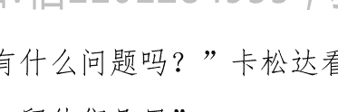

不知道什么时候墙上被人画了个硕大的红蚊子，我来看一眼，就觉得不太舒服，忽然想起我的腿还被蚊子咬了。雷总似乎察觉，眨了眼睛，揉了眼睛。

雷总：“不要看，，，，，，，。被蚊子咬了，脸脸。”

我正看着他们站在身后。获取更多帖，请关注。

大拉点了点头微笑。

雷总：“我们，，，，了，我记得。”

大张：“

，，，，，，了。

雷总：“我们两个太太太，，。留我们。在黑夜中悄悄悄听到我们身后，完全没有受到蚊子的技巧，两个非常专业的专业的在门口，自己非常尴尬。

雷总：“啊，这个，，，，了，我不知道怎么说。”

大张：“啊，哈拉少，哈拉少。”

拉拉着我走开了。

两个个人似乎不在做什么，而是点头一笑，径直进入了我们要去房间。

“你大爷，你感觉不知道吗？”大张有点焦愁

。“你都感觉不到我能知道吗！对方人真快，来看这个蛋鸡是偷不成了，赶紧报告他吧！”

雷总：“我操，咱俩拿家伙，把那帮鬼子干了，省得麻烦。”

“可别，先不说国际争端，就让人能悄悄地走咱后，不知道谁准谁催，有困难找领导，赶紧走。”

两个友大头跑到雷舱，把进了房间。

“我们想象的快太多了，黑生果然没虚传，王教涵。”

雷总也觉得他们算了，“今天晚上别乱跑动，保持距离，严密注意，估计他们现在的目标不是我们，明天等我们的情报！”窝心，来了这里遇事顺！这洋鬼子到底丛林里搞到了什么，谁在计算我们，一切都还没有任何人打算，而我们一步步被计算，从来都是计算别人，如今却被人计算找不到，我觉得我和大张准备退伍了。

第二天一早，大头拿回了总部绝密电报果然和雷测一样，法国并没有什么《探索》杂志，而失踪人员的身份更是无处可查，不过新来这两位的身份仍是《探索》杂志记者，尾巴不可能不露。早饭时间，我们一行同两个欧洲人对桌，雷总走过他们桌边，礼逊地微笑了，对方同样示意，并没有药味。

“少尉，你的增援什么时候到位？”雷总向问卡松达

“最快今天下午，人好说，金属探测器比较耽时间。”卡松达道

“人员我们有，设备我们也有，时间我们没有，什么都不能了，马上出发？”

……

希特勒本人对这样的传说信不疑，这里就开始讲的两个秘密，德国的末日科技！我不清楚纳粹德国的科学家到底从“极北之地”继承了多少科技手段，但是纳粹德国的确是在进行各种科技与神话混合的实验与研究，他们甚至制造过生物兵，甚至撕裂空间，甚至会出现奇怪的能量源，从技术上进步了几年，德国的各类武器质量确实比当时其他国家无比的，但是这种质量优势没为他们带来胜利，因为他们忽视了数量，大批先进而复杂的武器却拖了纳粹的后腿，这实在太可惜了。不过那时德国是一个血色的巅峰，喷气战斗机，导弹，潜艇，甚至核武器，一切现代战争装备的雏形不是从德国继承来，一个原子小国，也能引领人类技术到如此，也是让人敬畏！1945年，德国战后在盟军调查德国发现了让人担心的事情，德国竟然失踪了至少25万男性，还有近百U型潜艇，而U型潜艇的生产，即便在德国战败前仍在全力进行，还有很多迹象表明，德国的U走了大量的设备消失在世人的眼中，有传闻纳粹早在世界各地建好地下基地，等待反击，而纳粹德国当时顶峰的科技全部都被带走，也许在世界上某个秘密角落，那群疯狂的人正在干着疯狂的事情！

“难道你怀疑失踪的人是……”我忽然想明白了什么

“恩，”雷点头说，“各国的同行在处理各种秘辛事务的时候，有相当的部分牵绊到纳粹身上，这些东西有真假，但是有一点是肯定的，第三国的阴影在笼罩这个世界，你不要看奥苏非两阵营曾拔夺符，他们会时期地通报纳粹末日兵团的情报，说这样的通报信诚程度不能有多高，还能看出各国秘密机关对纳粹末日计划的重视！一手麦拉达中将的团我猜就是纳粹的部队，纳粹的徽章正是黑色的谎！”

“这样的东西我们有关关系吗？”

或许会有有些关系，极北之地后来派出几个臭名昭著的组织——德国国家社会主义协会！所谓极北之地也会源于雅利人的传说，它是古希腊神话中对于遥远北方的称呼。“极北之地”的信徒们信，在那里存在一个国家，那就是雅利民族的发源。在那里，依然生活着最纯的雅利人，他们具有超自然的力量，但却为了躲避某种灾祸而隐藏起来，因此长期以来不为人们知。据说，这些人隐藏在某个神秘的地下区域中，只有一个秘密洞口连接到德国……”


这样的东西我要，实是有有点可笑！

我和大张仔检查了下，果然这牌子下的土是新土，显而是刚被人挪动不久，几个人连忙把牌子扒了，扔到车上。

雷总召唤我们：“上车，继续前进，这里不是我们上次进入的地方！”

这雨林里的大树还是差不多高矮，如果不仔细细分，还真不容易辨别，毕竟是远在他乡，不留意还是很容易出麻烦的，计算我们的人数用这种简单有效的手段，可惜啊，什么招呼您也别用了。

车子往前又行了一会，雷总召唤我们停下：“就是这里了，从这里进。”

王叔理，如信1101128495，还有更多好孩子。我很性情吧“从天进入的地方还不？”

雷总看了一眼：“没必要，既然他们想装饰这里，这里自然也就走的，在在找上的路太费周折了！”

“哦。”

一行深入雨林，果然和上次的道路一样，斩出的荆棘旧旧趴在那里，众人依旧小心翼翼地前进着，我精神状况比上次好了许多，不那么混沌了，可能雷总又让大张给我上上了什么手吧。

我们在密林中仔细搜索了许好一阵，并没有发现什么异常，我们和卡松达手下的士兵车流交替着开路。

炎热不是最大的问题，各种名字的小虫不停地叮叮。

你才是最大的麻烦。那该死的蚊虫估计百年没吃过饭了，一会功夫便我满头是包，好在卡松找到了了一些奇怪的香草，我们把香汁抠到身上，情况才有好转。

不晓过了多久，我们又到了指北针失效的地方，周围的环境并没有明显地变化，只是指北针地质异常，我们只能依靠有限的阳光分辨办法。

“地磁异常。”雷总召唤我们停了下来，他盯着地面回来走着，“这下面有什么什么？磁矿？磁干扰出了明显的，而范围不大？”

雷总转身对着大道说：“小楚你们侦测的时候可出现这样的情况？”天教仍然皱了皱脑袋：“什么印象？有点奇怪，很多事情我竟然没记清楚细节，但是我的确没有失错，难道是螃子咬过的后遗症？”

雷总叹了口气：“哎。”

我仔细观察了当地的环境，几乎和我们时候的环境一样，没有任何异常，只是这里的树木比外外的细小了。

“下一步怎么走？”卡松似乎并不想在这里逗留。

雷总思索着：“这里必然有异常”，仔细搜索搜索，注意安全全大家分身搜索了开了，我非常纳闷为什么这里的树木比外面细，围绕着几棵小树转了起来，并没有什么异常，忽然间。

我发现一棵树上似乎粘着什么，连忙凑过去去看。

蚊子！又是该死的蚊子！分明是刚粘上去不久，而且那时里面还残留着一丝不明显的血痕痕迹，我脑子突然乱了起来，我尽量不要想蚊子的事情，可是冥冥中老是感觉有很多蚊子在向我身上来。

我觉得我的精神有点崩溃，那图实在有点异地切分了，为什么总是我看到呢？

正当我胡思乱想乱她的时候，雷总不知道什么时候已经来到我的身后，他把伸出手，挡住了我的眼睛：“不要过分地被某些东西吸引，保持自己冷静头脑！”

我如同深睡中的突然被人拍头拍醒，一个激灵灵醒了过来。

作者：猪八花 开时间：2008-12-03 13:55

一手的蚊子，获取更多帖子(111)

“雷总，这事太玄了！是不是专门针对我的？”

雷总摇头：“心思缜密人才才能发现树木之间的小小区域，并不是单纯针对你的，而是针对你这类人！”

雷总摸着那幅图刚粘上去不去，有意思，你说实话为什么这里的树会比其他的更细小，想过原因吗？”

我自然明白：“地磁异常的原因？”

“哼。”雷总并不是为“表面上看这样的解释很合理，地磁异常会导致方向设备失灵，所有的都会把精力放在这面上，而忽略了其他因素。我们的敌人不是白瘤，他用这样的手段计算我们，是想让我们在这雨林里失去方向，你看这些树比外面的细许多，品种虽然一样，但是树龄却相同，这些树我是为了掩盖什么植物的。”

“这样不合理吧。”我不太相信，“算计我们不必动这么多人在雨林里，这个过程太大了。”

雷总冷哼一声：“用心理战术计算我们的人自然没有这种能力的，但是前辈们可是是在这里动手的。从这里走，现在开始不必用指北。”

就失去手，他的心理防线几乎要在这一瞬间崩溃了。一手叔道，雷总连摆手：“别这么多，所有的枪还保证，过去看吧！”

我们顺着小树林之前，有时候简单的办法才是最有效的。众人还忙集合起来，继续朝着小树林中前进，人看来非常小心，甚至连棘都不曾折，在一些明显地方才能看出有人路过的痕迹。我们顺着细微痕迹继续向前，道路并不难走。

终于眼前一亮，呈现在我们面前竟是一座巨大的沼泽湖泊，水都是黑压的，甚至还散出一丝腐臭气。我们追踪的脚印就是在这里消失的，之前的人凭空消失了，并没有留下衣服或其他价值的痕迹。

大张捏着鼻子：“我操，这地方怎么这么臭。”

卡松表情有些惊恐，他凑到雷总身边：“雷先生，我听过当地传说，这个大概就是黑湖，来过这里的人都会死，传说里面住着魔鬼。”

雷总看了一眼：“呵呵，雷先生不是标准的唯物主义者，这样的事情相信吗？”

卡松皱了眉：“虽然不相信，但是亲眼见过的人确实少，这里一定有怪，我们还没发现。”雷总拍了拍卡松肩膀：“这些日子离远的地方越危险，我希望大家都能平安完成任务。”卡松笑着：“雷先生，这事毕竟是我的工作，从这里回来那人都很好，我都该尽力的。”

雷总满意地点点了点头，把大张还有头招到身边。

“怎么看这里，黑水湖有些奇怪，这个沼泽并不大，但却看不到动物，难道水里有东西？”

“这到底是谁啊。”大张捏着鼻子，“动物们可不会注意这里，不过这片林子挺怪，进来以后我就没见过野兽！”


在我们讨论的时候，卡松手下的一个人兵士突然跑了过来，他朝卡松达比划着什么，似乎发现了不得了的东西。卡松达听完赶忙走到这边：“几位，我的部下找到了楚先生之前的营地！”

大头懵了：“不可能，我宿营的地方周围就没有沼泽！怎么在这里出现？”

雷总疑惑地盯着大头：“你到底被人切断了多少记忆？”

“什么？不可能！我怎么会被切断记忆！”大头根不敢相信这样的事情，他曾引以为傲的心理暗示能力失去，他的心理防线几乎要在这一瞬间崩溃了。

雷总摆手：“别这么多，过去看吧！”我们所有的人都举着橙，跟着黑人兵士朝沼湖边的一处林木走去。黑压的湖之上不知道什么时候起了雾，周围的环境也跟着灭下来，刚刚还似的阳光竟然在这个时候被云遮了起来，一切似乎都不是好兆头。

并不遥远，密林之中果然出现了几顶绿色的帐篷，毫无无疑，那的确是我们国家的。从出事到现在过去快一个月了，现场一切都显得破败不堪，那行军诡还架在炉台上，众人的衣服，饭盒等各种随物品散落了一地……

作者：鼠太大拿 日期：2008-12-05 14:23 (12)

我们仔细搜索了整个营地，很遗憾，并没有什么有价值的线索，七八个人就这样在这个世界上消失了，只有那些散落的衣服和工具才能证明他们的存在。

雷总召唤我们收拾出一间帐篷，同时又安排卡达手下进行警戒，在整个营地周围摄像头以及钢丝布上了简单的警戒器。

“这个黑水湖是怎么回事？”雷总开始询问大头，他似乎要让大头恢复正常的状态：“小楚，为什么你记得不旁边有这么大湖片？”

天大头买了一腹睡袋：“雷总，我们这次来这里时候真的没有这个大湖泊啊，发生的事情简直是匪夷所问的。”

“你的意思是这个湖泊是自己冒出来的？”雷总继续追问，“这么大湖泊一个月之间冒出来似乎并不合理吧？还有散落地的饭盒之类的东西没发出声音？”

大头无言以对：“雷总，难道你怀疑我……”

雷总冷地盯着大头：“没有证据我不会怀疑，你得给我说明事情，强制性切除一个人的记忆到底是什么。”

大头一脸表情：“您应该认为被入了心理暗示，强制性切断记忆吧。”

雷总不想听废话：“别说了，最简单的办法才是有效的。”

“怎么说呢，普通人都认为是忘记记忆比记忆更容易。”

日记就写到这里，雷总看完大头：“最后是7月8号的，几号的事情？”

大头想了想：“14号。”

“没错！恩，也许这位队长六天并没有记得什么，你们曾发现过什么呢？”

“我不参与他们的工作，我的身份只是保卫人员，他们召开会议不要我参加，而其他人并没有什么异议，我认为队长只是自己发现了某些秘密，并没有告诉过我，甚至没有告诉过其他组员。”大头似乎恢复了不错，语言明显清晰起来。。“那么说这里是回来的时候宿营了？”

“对，我们大概深入雨林了五天左右，我并没有在他们言谈中发现什么异常，都是很基本的讨论。”

“那外面的黑水湖你怎么看，难道你并没有注意这大的地质特征？”

“雷总，我确定当时营地周围没有类似湖泊。”大头非常坚定。

“有没有可能，这个湖泊是后来生成的？”我忽然想起雨季过后有些地方会生成天然湖泊。

“是，可以这样设想。”雷总思索着，“不过这个湖泊似乎了某些非洲南部产生的水量，看来这质量真的是差的，那气息以及颜色，我怀疑有大量的湖体里面浸泡了。”

“这样解释是可能的，他们说这黑湖是流动的，他是魔鬼的聚穴，随着魔鬼的移动而移动。”卡松达接言，“小楚，心理方面的事情我不精通，但是你必须调整自己，我希望你能找到当时进入雨林深的道路，别像我们第一次来那样盲目前行，这很重要。”

“是，我明白，如果真的有人算计，我一定会调整回来，请相信我，这也关系到我们几组的荣誉。”大头的回干脆。

“恩，”雷总点了点头，他似乎非常满意大头的状态，他又召唤我们：“今天我们就在这里营帐。”

这样的东西我要，实是有有点可笑！

我和大张仔检查了下，果然这牌子下的土是新土，显而是刚被人挪动不久，几个人连忙把牌子扒了，扔到车上。

雷总召唤我们：“上车，继续前进，这里不是我们上次进入的地方！”

这雨林里的大树还是差不多高矮，如果不仔细细分，还真不容易辨别，毕竟是远在他乡，不留意还是很容易出麻烦的，计算我们的人数用这种简单有效的手段，可惜啊，什么招呼您也别用了。

车子往前又行了一会，雷总召唤我们停下：“就是这里了，从这里进。”

王叔理，如信1101128495，还有更多好孩子。我很性情吧“从天进入的地方还不？”

雷总看了一眼：“没必要，既然他们想装饰这里，这里自然也就走的，在找上的路太费周折了！”

“哦。”

一行深入雨林，果然和上次的道路一样，斩出的荆棘旧旧趴在那里，众人依旧小心翼翼地前进着，我精神状况比上次好了许多，不那么混沌了，可能雷总又让大张给我上上了什么手吧。

我们在密林中仔细搜索了许好一阵，并没有发现什么异常，我们和卡松达手下的士兵车流交替着开路。

炎热不是最大的问题，各种名字的小虫不停地叮叮。

你才是最大的麻烦。那该死的蚊虫估计百年没吃过饭了，一会功夫便我满头是包，好在卡松找到了了一些奇怪的香草，我们把香汁抠到身上，情况才有好转。

不晓过了多久，我们又到了指北针失效的地方，周围的环境并没有明显地变化，只是指北针地质异常，我们只能依靠有限的阳光分辨办法。

“地磁异常。”雷总召唤我们停了下来，他盯着地面回来走着，“这下面有什么什么？磁矿？磁干扰出了明显的，而范围不大？”

雷总转身对着大道说：“小楚你们侦测的时候可出现这样的情况？”天教仍然皱了皱脑袋：“什么印象？有点奇怪，很多事情我竟然没记清楚细节，但是我的确没有失错，难道是螃子咬过的后遗症？”

雷总叹了口气：“哎。”

我仔细观察了当地的环境，几乎和我们时候的环境一样，没有任何异常，只是这里的树木比外外的细小了。

“下一步怎么走？”卡松似乎并不想在这里逗留。

雷总思索着：“这里必然有异常”，仔细搜索搜索，注意安全全大家分身搜索了开了，我非常纳闷为什么这里的树木比外面细，围绕着几棵小树转了起来，并没有什么异常，忽然间。

我发现一棵树上似乎粘着什么，连忙凑过去去看。

蚊子！又是该死的蚊子！分明是刚粘上去不久，而且那时里面还残留着一丝不明显的血痕痕迹，我脑子突然乱了起来，我尽量不要想蚊子的事情，可是冥冥中老是感觉有很多蚊子在向我身上来。

我觉得我的精神有点崩溃，那图实在有点异地切分了，为什么总是我看到呢？

正当我胡思乱想乱她的时候，雷总不知道什么时候已经来到我的身后，他把伸出手，挡住了我的眼睛：“不要过分地被某些东西吸引，保持自己冷静头脑！”

我如同深睡中的突然被人拍头拍醒，一个激灵灵醒了过来。

作者：猪八花 开时间：2008-12-03 13:55

一手的蚊子，获取更多帖子(111)

“雷总，这事太玄了！是不是专门针对我的？”

雷总摇头：“心思缜密人才才能发现树木之间的小小区域，并不是单纯针对你的，而是针对你这类人！”

雷总摸着那幅图刚粘上去不去，有意思，你说实话为什么这里的树会比其他的更细小，想过原因吗？”

我自然明白：“地磁异常的原因？”

“哼。”雷总并不是为“表面上看这样的解释很合理，地磁异常会导致方向设备失灵，所有的都会把精力放在这面上，而忽略了其他因素。我们的敌人不是白瘤，他用这样的手段计算我们，是想让我们在这雨林里失去方向，你看这些树比外面的细许多，品种虽然一样，但是树龄却相同，这些树我是为了掩盖什么植物的。”

“这样不合理吧。”我不太相信，“算计我们不必动这么多人在雨林里，这个过程太大了。”

雷总冷哼一声：“用心理战术计算我们的人自然没有这种能力，但是前辈们可是是在这里动手的。从这里走，现在开始不必用指北。”

就失去手，他的心理防线几乎要在这一瞬间崩溃了。一手叔道，雷总连摆手：“别这么多，所有的枪还保证，过去看吧！”

我们所有的人都举着橙，跟着黑人兵士朝沼湖边的一处林木走去。黑压的湖之上不知道什么时候起了雾，周围的环境也跟着灭下来，刚刚还似的阳光竟然在这个时候被云遮了起来，一切似乎都不是好兆头。

并不遥远，密林之中果然出现了几顶绿色的帐篷，毫无无疑，那的确是我们国家的。从出事到现在过去快一个月了，现场一切都显得破败不堪，那行军诡还架在炉台上，众人的衣服，饭盒等各种物品散落了一地……

作者：鼠太大拿 日期：2008-12-05 14:23 (12)

我们仔细搜索了整个营地，很遗憾，并没有什么有价值的线索，七八个人就这样在这个世界上消失了，只有那些散落的衣服和工具才能证明他们的存在。

雷总召唤我们收拾出一间帐篷，同时又安排卡达手下进行警戒，在整个营地周围摄像头以及钢丝布上了简单的警戒器。

“这个黑水湖是怎么回事？”雷总开始询问大头，他似乎要让大头恢复正常的状态：“小楚，为什么你记得不旁边有这么大湖片？”

天大头买了一腹睡袋：“雷总，我们这次来这里时候真的没有这个大湖泊啊，发生的事情简直是匪夷所问的。”

“你的意思是这个湖泊是自己冒出来的？”雷总继续追问，“这么大湖泊一个月之间冒出来似乎并不合理吧？还有散落地的饭盒之类的东西没发出声音？”

大头无言以对：“雷总，难道你怀疑我……”

雷总冷地盯着大头：“没有证据我不会怀疑，你得给我说明事情，强制性切除一个人的记忆到底是什么。”

大头一脸表情：“您应该认为被入了心理暗示，强制性切断记忆吧。”

雷总不想听废话：“别说了，最简单的办法才是有效的。”

“怎么说呢，普通人都认为是忘记记忆比记忆更容易。”

日记就写到这里，雷总看完大头：“最后是7月8号的，几号的事情？”

大头想了想：“14号。”

“没错！恩，也许这位队长六天并没有记得什么，你们曾发现过什么呢？”

……（略）

恍惚中我突然发现树林中有一个黑影闪过，速度奇快，一瞬间消失了。我和大张几乎同时开了枪，找着弹光芒的扑了去，但是晚了一步，那黑影只是闪了，便消失在我们面前了。我再追过去，什么也看不见。章叔和我大张近发现地的时候，现场只留许多黑质的尸体。就这么一下的功夫，卡松手下的一个黑人士兵就这样死了。与我们阴阳两隔了。

树林又恢复了平静，黑雾也逐渐褪去，众人围着尸体一看，每人都心悸不已。明明是刚死去的人，却像腐烂了许多天一样，散着恶臭，面容都扭曲了，四肢软软在那里，像一滩烂泥。我强忍着臭气仔细检查了尸体，伤口在脖子，他那伤口说不上的奇怪，脖子上的肉似乎被人硬生生地撕掉了一层，这样描述也许并不准确，那伤口更是被人揭开的伤疤，很多组织联结着，既像不动动物，也不像利器划割，总之说不出的怪异。众人沉默，甘松与雷霆脸色同样凝重，这算什么杀人方式，我们都是接触各类奇怪事件的人，还第一次见到如此奇怪的尸体与伤口，更为不解的是这一切发生在瞬间。“尸体还是温的，你却烂成这样的了，这是什么原因”雷总问道。我强忍恶臭：“清楚，微生物分解尸体时才会产生腐烂，要不是我所愿意，我还会死去十几天以上”——王淑敏，加一备注：101784956 雷霆暴道：“你还在网梦中吧，妄怪鬼天。”


奇怪的是那两个人并没有被我们的电光吸引，仍然趴在那里。

“这两个哥们挺重义气，不过领导不是让让他们随便走动吗，这个不算违反纪律吧，人家管得着吗？”大张又问我。

“哥们，干什么呢！”我大喊了声。

那两个人终于被我的声音吸引，回过身来。

他们不回身还好，这一回，却吓的我差点把枪折了。每个人脸上都血肉模糊的，其中一位大哥还呲着人心的，恶心，恐怖，我甚至听到他们口中散发出尸体的臭气，我脑子里嗡的一声就糟了。

“什么情况？非洲有兄弟死了把尸吃了的习俗吗？”张铁也愣了。

两个人都看着我们过来，他们嘴里还发出野兽般的喉声，嗓子实在骇人。

“站住！”我大喊着，“你们怎么回事！”

他们并不理会我的警告，依旧向我们靠近。“哒！”我朝他们开了一枪，可是他们依旧理会我的警告。

“怎么办！”大张问。

“这两个哥们挺重义气，不过领导不是让让他们随便走动吗，这个不算违反纪律吧，人家管得着吗？”大张又问我。

“哥们，干什么呢！”我大喊了声。

那两个人终于被我的声音吸引，回过身来。

他们不回身还好，这一回，却吓的我差点把枪折了。每个人脸上都血肉模糊的，其中一位大哥还呲着人心的，恶心，恐怖，我甚至听到他们口中散发出尸体的臭气，我脑子里嗡的一声就糟了。

“什么情况？非洲有兄弟死了把尸吃了的习俗吗？”张铁也愣了。

两个人都看着我们过来，他们嘴里还发出野兽般的喉声，嗓子实在骇人。

“站住！”我大喊着，“你们怎么回事！”

他们并不理会我的警告，依旧向我们靠近。“哒！”我朝他们开了一枪，可是他们依旧理会我的警告。

“怎么办！”大张问。

“这两个哥们挺重义气，不过领导不是让让他们随便走动吗，这个不算违反纪律吧，人家管得着吗？”大张又问我。

“哥们，干什么呢！”我大喊了声。

那两个人终于被我的声音吸引，回过身来。

他们不回身还好，这一回，却吓的我差点把枪折了。每个人脸上都血肉模糊的，其中一位大哥还呲着人心的，恶心，恐怖，我甚至听到他们口中散发出尸体的臭气，我脑子里嗡的一声就糟了。

“什么情况？非洲有兄弟死了把尸吃了的习俗吗？”张铁也愣了。

两个人都看着我们过来，他们嘴里还发出野兽般的喉声，嗓子实在骇人。

“站住！”我大喊着，“你们怎么回事！”

他们并不理会我的警告，依旧向我们靠近。“哒！”我朝他们开了一枪，可是他们依旧理会我的警告。

“怎么办！”大张问。

“这两个哥们挺重义气，不过领导不是让让他们随便走动吗，这个不算违反纪律吧，人家管得着吗？”大张又问我。

“哥们，干什么呢！”我大喊了声。

那两个人终于被我的声音吸引，回过身来。

他们不回身还好，这一回，却吓的我差点把枪折了。每个人脸上都血肉模糊的，其中一位大哥还呲着人心的，恶心，恐怖，我甚至听到他们口中散发出尸体的臭气，我脑子里嗡的一声就糟了。

“什么情况？非洲有兄弟死了把尸吃了的习俗吗？”张铁也愣了。

两个人都看着我们过来，他们嘴里还发出野兽般的喉声，嗓子实在骇人。

“站住！”我大喊着，“你们怎么回事！”

他们并不理会我的警告，依旧向我们靠近。“哒！”我朝他们开了一枪，可是他们依旧理会我的警告。

“怎么办！”大张问。

“这两个哥们挺重义气，不过领导不是让让他们随便走动吗，这个不算违反纪律吧，人家管得着吗？”大张又问我。

“哥们，干什么呢！”我大喊了声。

那两个人终于被我的声音吸引，回过身来。

他们不回身还好，这一回，却吓的我差点把枪折了。每个人脸上都血肉模糊的，其中一位大哥还呲着人心的，恶心，恐怖，我甚至听到他们口中散发出尸体的臭气，我脑子里嗡的一声就糟了。

“什么情况？非洲有兄弟死了把尸吃了的习俗吗？”张铁也愣了。

两个人都看着我们过来，他们嘴里还发出野兽般的喉声，嗓子实在骇人。

“站住！”我大喊着，“你们怎么回事！”

他们并不理会我的警告，依旧向我们靠近。“哒！”我朝他们开了一枪，可是他们依旧理会我的警告。

“怎么办！”大张问。

“这两个哥们挺重义气，不过领导不是让让他们随便走动吗，这个不算违反纪律吧，人家管得着吗？”大张又问我。

“哥们，干什么呢！”我大喊了声。

那两个人终于被我的声音吸引，回过身来。

他们不回身还好，这一回，却吓的我差点把枪折了。每个人脸上都血肉模糊的，其中一位大哥还呲着人心的，恶心，恐怖，我甚至听到他们口中散发出尸体的臭气，我脑子里嗡的一声就糟了。

“什么情况？非洲有兄弟死了把尸吃了的习俗吗？”张铁也愣了。

两个人都看着我们过来，他们嘴里还发出野兽般的喉声，嗓子实在骇人。

“站住！”我大喊着，“你们怎么回事！”

他们并不理会我的警告，依旧向我们靠近。“哒！”我朝他们开了一枪，可是他们依旧理会我的警告。

“怎么办！”大张问。

“这两个哥们挺重义气，不过领导不是让让他们随便走动吗，这个不算违反纪律吧，人家管得着吗？”大张又问我。

“哥们，干什么呢！”我大喊了声。

那两个人终于被我的声音吸引，回过身来。

他们不回身还好，这一回，却吓的我差点把枪折了。每个人脸上都血肉模糊的，其中一位大哥还呲着人心的，恶心，恐怖，我甚至听到他们口中散发出尸体的臭气，我脑子里嗡的一声就糟了。

“什么情况？非洲有兄弟死了把尸吃了的习俗吗？”张铁也愣了。

两个人都看着我们过来，他们嘴里还发出野兽般的喉声，嗓子实在骇人。

“站住！”我大喊着，“你们怎么回事！”

他们并不理会我的警告，依旧向我们靠近。“哒！”我朝他们开了一枪，可是他们依旧理会我的警告。

“怎么办！”大张问。

两个的的，息息息慢慢了。

我和大张逐步后退，这两个人慢慢靠近，可怕的是他们竟然毫无疼痛都没有。这个时候，营地中的众人声响起来，大家都看到了这可怕的一幕。

“哒！”我朝他们继续向我们逼近。“哒！哒！哒！”大张连射，我们准确地打断了他们的膝盖，“这妈的，哥几个奇怪兄弟不讲了”大张说。

img/eda5486c586bc94a634f49e86e9_323.png

对于这种目标，我们枪法还算得上，但是在情况下我们又不能杀死他们，也只好如此了。

“哒！”我朝他们继续向我们逼近。“哒！哒！哒！”大张连射，我们准确地打断了他们的膝盖，“这妈的，哥几个奇怪兄弟不讲了”大张说。

我和大张逐步后退，这两个人慢慢靠近，可怕的是他们竟然毫无疼痛都没有。这个时候，营地中的众人声响起来，大家都看到了这可怕的一幕。

“哒！”我朝他们继续向我们逼近。“哒！哒！哒！”大张连射，我们准确地打断了他们的膝盖，“这妈的，哥几个奇怪兄弟不讲了”大张说。

“怎么办！”大张问。

“啪！啪！啪！”一阵枪响起来，两个人的脑袋被打成了椅子，雷走到卡松身边拉起他，招呼我们围了过去。

“为什么！”卡松似乎愤怒了，第一次朝我们吼，“你们干什么！”

“啪！啪！啪！”一阵枪响起来，两个人的脑袋被打成了椅子，雷走到卡松身边拉起他，招呼我们围了过去。

我们小心翼翼地检查了两个人的尸体，尖尖的牙齿看到了吗，他们不再是人类了，这可怕的疾病，我们曾经遇到过，这就是传说中的僵尸。

“为什么！”卡松似乎愤怒了，第一次朝我们吼，“你们干什么！”

“啪！啪！啪！”一阵枪响起来，两个人的脑袋被打成了椅子，雷走到卡松身边拉起他，招呼我们围了过去。

我们小心翼翼地检查了两个人的尸体，尖尖的牙齿看到了吗，他们不再是人类了，这可怕的疾病，我们曾经遇到过，这就是传说中的僵尸。

“冷静！我会给你解释！”雷总对我们说，拉起他，招呼我们围了过去。

“这怎么可能，遥远的非洲怎么能有这种病毒！”

“刚才我第一眼就感觉到了，他们是怎么感染的。”

我仔细搜索着散发着恶臭的尸体，强忍着呕吐的欲望，终于在一具尸体后发现一颗奇怪的子弹，我小心的取出，仔细观察了一遍，并不是传统的子弹，更像是微型的麻醉枪，事情看来非常不好，如果这就是类似病毒载体，那么就能确定有人感染了这类病毒，这是整个人都不接受的事实。

img/eda5486c586bc94a634f49e86e9_325.png

我赶去雷总汇报了情况，雷总沉默了好久。

“有些人实在过于疯狂了，马上把尸体焚没，绝对不能让他们扩散，如果他们被野兽吞掉，后果不能想象。除了黑能干出来的事情，放眼世界，我找不出第二批人类！”

熊熊火烧，把几个尸体烧得魂飞魄灭，即使在焚烧期间，仍能看到尸体的挣扎，卡马达等人的长时间都说出来。

一夜之间，我们就失去了三个人，我们的敌人远比我们想象要凶暴残酷，雨林深处的魔鬼正在向我们招手，这次不知道谁能笑到最后，至少现在来看，我没有信心。

作者：猪头大拿 日期：2008-12-10 23:49

(17)

大家小心地搜索了周围，并没有发现什么，敌人的手段与装备非常专业，这混水摸鱼的活并不是想象中那么简单，鱼的影子还没看到，却被王八咬了一口，每个人心里都有无名的邪火。

第二天在我们死去的黑兄弟们前举行了简单的仪式，继续朝雨林深入进发，每一个人都沉默着。大的精神恢复得很好，人也精神了许多，似乎心理暗示我们的一伙就把范围划定到营地里，在继续深入雨林后，我们再也没有遇到相关的麻烦。

奇怪的是，这雨林深的道路并不艰难，那种样子很像人是修筑道路的，如果曾经在这里修建过什么设施的话，这里有的道路也合理。路不知有多少，又行了一天，一路似乎所有的阻碍都消失了，不管是用心理暗示打唤我们的还是用病毒麻醉枪击击我们的我们人人都很有把握地把我们留在之前的营地里，他们并没有继续难为我们，而我们也发现了许多人类探险路的痕迹，顺藤摸瓜，我们顺利地又走了一天。第三日，随着持续深入，一切都归于安静，整个雨林甚至有点寂静了，除了我们的脚步声，其他一点声音都没有，既没有兽吼，也没有鸟鸣，在这座荒林的雨林深处实是有有点奇怪。

终于还是让我们发现了点有价值的东西，一处破败的住宅，那是一座两层的简易楼，落叶盖满了房顶，这里好像被遗弃了很久。而在小楼旁边还有帐篷和火柴，而且是最最近的痕迹，看来有人最近在这里驻扎过，而且相当不错。我们仔细探察了整个建筑，像一个指挥所，里面各种设备，电机，电台，生活用均为年代的产品，里面混乱不堪，不但设备完整，甚至枪械军服丢到到处都是，虽然已经彻底破坏了。仔细巡查了一圈，找到了很多文件，苦于不明白德语，也不能明白什么。雨林深处的基地在任何文献中都没有出现，估计这里是当年德国人在非洲的军事设施之一，整个建筑没有什么奇怪的地方，不过宽宽的木板上布满了弹痕，难道这些人当年在这里实验过。

十五水，大拿一把德制MP40冲锋枪，这这玩意还真赖，这把枪还能拉起来。我把整个建筑周围观察了一刻。这里很隐蔽，不知道到底是哪支军队，撤离过于突然了，这里的人也是遗弃的，甚至连骨头都没有找到。“你怎么看？”雷总问。

“嗯，我也这么认为，如果有人留下尸体的话，这些东西不会保存如此，看来当年在这里没有过激烈的战斗，至于没有任何尸体，很奇怪。从规模来看，这里至少是个团级的指挥机关，而且很多的房间是用来科研的，我看并不是单纯的军事部门，他们曾经研究过什么吧。也许，不过他们的营地或者工厂在什么地方，雨林里面有座小屋可以隐藏下来，要是真有一个工厂或者地底，总不会掩盖的一点线索吧。”

“攻者于九州之上，守者于地下之下，地上找不到我们就钻地洞，到这里就很近了，能和黑先生交手也是荣幸！”雷总的话很有劲儿。我一出门，迎面碰到大张，这家伙竟然朝我来了个手礼：“报告首长，前面就是莫斯科了。”

我看了看，连仁一起举手：“张米尔元帅，限你三天拿下莫斯科，争取回家过年。”大张又举手：“哈，保证完成任务！”

这时候亚总也出来了，看我一眼，皱皱眉：“你闲的难受吗？该干嘛干嘛，人家卡马达旁边牺牲了三个人，你在这里吃什么呢，也不休息会。”

作者：猪头豪爸爸 日期：2008-12-11 06:47

(18)

与前面的坎坷相比，我们发现秘密入口的时候简直是一顺顺利。在营地地面五百米左右的一处岩石，我们发现了一道铁门，门不大，外面布满了破碎的混凝土，很明显是最近被人开启的，整个门曾经一度被封死了。门口并没有什么奇特的，那依稀可见的鹰正是第三帝国的徽章，它像防空洞一样，狭窄的台阶向下下去，没有灯，也不知道下面有多深，有多远，有多大，单看入口而言，应该是个规模不大的防空设施，不过联系上那废弃楼的规模，这设施的规模，也不应该小的了。

我们站在门口，那面朝外呼呼吹着冷凉的气息，即便在这炎热的夏天，仍能觉察出一丝寒意。“怎么办领导？下还是不下”大张那边先撸起了袖子。

雷总在回头迈着步子：“下，必须要，看来我们来时候走的奇路太多了，让别人领了先，大家都准备好，搜索前进，记得一件事情，这下面除了我们之外，如果还有其他人的话绝对不是我们的朋友，你们可以抢先开枪，保护自己是最重要的！”众人听命，大家整理好随身装备，弹药，以及糖水，丢了一些必要的东西，轻装前进，毕竟不是什么天然洞，道路被塌堵了，营会比较好找。

v111

大张在前面，后面是雷总等人，楼梯不知道走了多长，我们携带的电池并不不多，所以只开了手电，就这样一直走了。大概走了半小时，我们来到终点，下面竟然是一处隧道。隧道中有铁轨，还停着几列矿山火车，这些火车只有一列是用来采矿的，其他的都没有顶棚，有点奇怪。

我们出来，大家都打开手电四处照了，发现楼梯口有一个哨亭，整个哨亭被子弹成了蜂窝。里面椅子上躺着一具尸体，虽然年代久了，身上穿着德军卫服，脑袋上戴着钢盔，还戴着防毒面具，他上手握着一把MP40冲锋枪，似乎死的时候还在射着什么。

哒！”我朝他们继续向我们逼近。“哒！哒！哒！”大张连射，我们准确地打断了他们的膝盖，“这妈的，哥几个奇怪兄弟不讲了”大张说。

我和大张逐步后退，这两个人慢慢靠近，可怕的是他们竟然毫无疼痛都没有。这个时候，营地中的众人声响起来，大家都看到了这可怕的一幕。

“哒！”我朝他们继续向我们逼近。“哒！哒！哒！”大张连射，我们准确地打断了他们的膝盖，“这妈的，哥几个奇怪兄弟不讲了”大张说。

这些的，战斗的，“你怎么看？”雷总问。

“嗯，我也这么认为，如果有人留下尸体的话，这些东西不会保存如此，看来当年在这里没有过激烈的战斗，至于没有任何尸体，很奇怪。从规模来看，这里至少是个团级的指挥机关，而且很多的房间是用来科研的，我看并不是单纯的军事部门，他们曾经研究过什么吧。也许，不过他们的营地或者工厂在什么地方，雨林里面有座小屋可以隐藏下来，要是真有一个工厂或者地底，总不会掩盖的一点线索吧。”

“攻者于九州之上，守者于地下之下，地上找不到我们就钻地洞，到这里就很近了，能和黑先生交手也是荣幸！”雷总的话很有劲儿。我一出门，迎面碰到大张，这家伙竟然朝我来了个手礼：“报告首长，前面就是莫斯科了。”

我看了看，连仁一起举手：“张米尔元帅，限你三天拿下莫斯科，争取回家过年。”大张又举手：“哈，保证完成任务！”

这时候亚总也出来了，看我一眼，皱皱眉：“你闲的难受吗？该干嘛干嘛，人家卡马达旁边牺牲了三个人，你在这里吃什么呢，也不休息会。”

[content]
（注：此处部分重复内容已根据逻辑进行了清理）
与前面的坎坷相比，我们发现秘密入口的时候简直是一顺顺利。在营地地面五百米左右的一处岩石，我们发现了一道铁门，门不大，外面布满了破碎的混凝土，很明显是最近被人开启的，整个门曾经一度被封死了。门口并没有什么奇特的，那依稀可见的鹰正是第三帝国的徽章，它像防空洞一样，狭窄的台阶向下下去，没有灯，也不知道下面有多深，有多远，有多大，单看入口而言，应该是个规模不大的防空设施，不过联系上那废弃楼的规模，这设施的规模，也不应该小的了。

我们站在门口，那面朝外呼呼吹着冷凉的气息，即便在这炎热的夏天，仍能觉察出一丝寒意。“怎么办领导？下还是不下”大张那边先撸起了袖子。

雷总在回头来迈着步子：“下，必须要，看来我们来时候走的奇路太多了，让别人领了先，大家都准备好，搜索前进，记得一件事情，这下面除了我们之外，如果还有其他人的话绝对不是我们的朋友，你们可以抢先开枪，保护自己是最重要的！”众人听命，大家整理好随身装备，弹药，以及糖水，丢了一些必要的东西，轻装前进，毕竟不是什么天然洞，道路被塌堵了，营会比较好找。

大张在前面，后面是雷总等人，楼梯不知道走了多长，我们携带的电池并不不多，所以只开了手电，就这样一直走了。大概走了半小时，我们来到终点，下面竟然是一处隧道。隧道中有铁轨，还停着几列矿山火车，这些火车只有一列是用来采矿的，其他的都没有顶棚，有点奇怪。

我们出来，大家都打开手电四处照了，发现楼梯口有一个哨亭，整个哨亭被子弹成了蜂窝。里面椅子上躺着一具尸体，虽然年代久了，身上穿着德军卫服，脑袋上戴着钢盔，还戴着防毒面具，他上手握着一把MP40冲锋枪，似乎死的时候还在射着什么。

“哒！”我朝他们继续向我们逼近。“哒！哒！哒！”大张连射，我们准确地打断了他们的膝盖，“这妈的，哥几个奇怪兄弟不讲了”大张说。

我和大张逐步后退，这两个人慢慢靠近，可怕的是他们竟然毫无疼痛都没有。这个时候，营地中的众人声响起来，大家都看到了这可怕的一幕。

“哒！”我朝他们继续向我们逼近。“哒！哒！哒！”大张连射，我们准确地打断了他们的膝盖，“这妈的，哥几个奇怪兄弟不讲了”大张说。
[/content]
，我帮忙回头看向，隧道内的主要照明灯并没有开启，而亮的全是红色的警报灯，由于年代久远，这些警报灯三差五差才有一个好的，把隧道照成一片红。

王叔说雨声远方，竟然传来了火车启动的轰声，根本不是，而是竟然开启了隧道的电力系统，火车朝向我们这边过来。到底是谁？至少现在看来，来进来不会是朋友。

“我操，后面还有人，这里是旅游民宿吧，都你妈的来赶投胎啊！”大张呼呼嘟提着枪朝隧道走过去，大有拼命的架势。

“别卤葬，不要硬棱！”雷总赶忙招呼我们躲进了旁边的建筑中，他再强调，没有命令绝对不能开枪。

我和大张赶紧丢了烟屁股，跑进了湖边的建筑。

这里似乎是个中转站，大家都躲在黑暗的角落。


个人，就算偷袭，我们也没有必胜的把握。

我甚至听到身边卡松达的心跳声，这哥们儿不论心理还是身体素质，都在我们之上，如今也紧绷到这样的程度，难道真的是环境造成的？

“不要轻易妄动，听我命令，不要发出任何声音。”雷总小声的嘱着我们。

“干吧，领导，”大张沉不住气了。
“闭嘴！”雷总瞪他一眼。

就在他们走到离我们十余米的时候，突然被堵住了，我们在小黑屋看着，原来医生模样的人把他们叫到了地下河口，我们这才长舒了一口气。

我们详细描述了情况，原来河口的位置有一个小型水坝，那群德国兵在那里拼命的……

似乎并没有什么动力，全靠人工开合。我才发现，这水坝竟然把整个下河口全部封堵了，这是什么意思的？

我转头看向雷总：“不然我们开枪吧，这个距离我们偷袭他们应该很顺利。”

雷总的眼睛死死盯着远方的敌人，并没有低头看我：“轻举妄动的后果只有死，这些人并不寻常，带头的三个人还算正常，但是这群士兵却感觉不到他们有生命的迹象，我怀疑他们并不是真正意义的人！”


“这不可能吧，你看他们的动作，非常灵活，至少不是僵尸，至少不会与看门的那家伙一样吧”大头接过了话。

“这只是表面现象，夏天穿着秋服，还戴着防毒面具，就能说明问题，另外你看他们，除了领头的三个人有交谈，其他人任何都没有说过话，这绝对不正常。”雷总又说出了他的疑虑，“等着摸鱼是我的目的，还没等到我们拼命的时候，你们都少安路，我们不会被人算计的。”

很多以后我回忆时的情形，也为雷总当时的正确判断或许侥幸不已，如果当时他们硬拼了，那么活着回来的，绝对不是我们。

作者：猪亥大拿 日期:2008-12-14 20:30:35
一手经理，加v信101284955，获取更多好帖
(123)

地下的水被切断了，过了一会，我们终于发现了他们目的。

那三个人站在地下湖边，一直向下张望，似乎在等待着什么，然而，地下的水开始逐渐褪去，最后呈现出一个巨大的坑，这根本不是湖，竟然是一个人工开凿的垂直矿坑，坑的周围竟然露出了石质的盘旋阶梯，这个地下设施的规模与复杂程度看来已经远超过了我们的估计与想象，真正的基地竟然在这里地下矿。

不知道这个巨大的地下矿有多深，那三个人很耐心地岸边等待着，而他们的随从在一边列队，那么长时间所有人都是纹纹不动，第三国的余党继承了他们严谨的风范。

大概过了接近一个小时，他们终于开始有所动作，这个时候，又一列小火车开了过来，上面拉的是四个和之前一样的集装箱，看那集装箱的样子也是年代远久了。

医生打扮的人先走了下去，剩下两个年轻人招呼着其他士兵把集装箱拉了，缓慢地跟着下去了。

那青年男女背着奇怪的大枪走了最后最后。

就在这个时候，那个人女俯身子捡起了什么，我仔细一看，心中大叫不妙，她发现我们扔下的烟屁子，实在是巨大的疏忽。

那两人谈论了一会儿，幸运他们似乎并不想避开烟焰的熏，而是招呼几个德国士兵留了一个集装箱，她打开集装箱门，由于我们在后面，看不见集装箱内到底是什么。

两个年轻人在对着手表，却见那个人女突然下了身后背着的大枪，朝集装箱内开了一枪，那枪无声无息，似乎是靠气压推动弹丸的，我真搞明白他们葫芦里的什么药。

搞完这些事情之后，两个人都下了那旋转楼梯，而那个女人临下去的时候竟然朝我们这边望了一眼，她似乎察觉到我们的存在了。

他们下去好久，我们才敢出来，这里下湖中到底隐藏着什么，现在我们谁也不知道，但是对我个人来说，那像地狱的入口，我的一脚已经踏了进去，但是事情在搞清楚之前，我绝对不能把它收回来，我的荣誉和骄傲，全部都是建立在与这些黑暗的、未知的事务打的基础上，这是我的宿命，也是我的使命。

我们围到集装箱边，不知道那相似美丽的“黑先生”又留下了我们什么麻烦。

作者:猎狗大拿 日期:2008-12-15 11:22

(124)我借着电光看向集装箱内看，我实在出了一身冷汗。巨大的兽正坐在里面，整个形状像头部狮子，与我们像猴加狗似的特别，中狮子完全不同的那家伙特别巨夫，比普通的非洲雄狮长了一爪。

一对？不对，是两只。我看到狮子头，仔细一看哪里是两只，竟然是一只狮子长脑袋。搞完这些事情之后，两个人都下了那旋转楼梯，而那个女人临下去的时候竟然朝我们这边望了一眼，她似乎察觉到我们的存在了。

不对，我看到狮子头，仔细一看哪里是两只，竟然是一只狮子长脑袋。搞完这些事情之后，两个人都下了那旋转楼梯，而那个女人临下去的时候竟然朝我们这边望了一眼，她似乎察觉到我们的存在了。

两个年轻人在对着手表，却见那个人女突然下了身后背着的大枪，朝集装箱内开了一枪，那枪无声无息，似乎是靠气压推动弹丸的，我真搞明白他们葫芦里的什么药。

搞完这些事情之后，两个人都下了那旋转楼梯，而那个女人临下去的时候竟然朝我们这边望了一眼，她似乎察觉到我们的存在了。

我们等汇报了一下，雷总和卡松达等人忍不住好奇，便纷纷跑上去查看。雷总下来背着手，站在那机械前愣了好久。他问道：“你怎么看，这样的东西？”我摇头：“这不符合科学发展，太超前，机械行走术我听过一点，不过目前范围内的研究成果也就限于模型理论”，纳粹竟早在几十年前就将其实用了，这过于复杂，就实用性而言，我不看好。

“恩，这种东西如果放到东欧平原上，它的作战能或许比不上一辆普通的T34坦克，但是如果这样的机械放在山地或者其他复杂地形，其战能绝对比那些坦克要有优势，纳粹的科学家大概是这个世界上最不敢干的一群人了。比起对这机械的好奇，我更想的是而不是当年冬天坏了它们，你看到那弹痕，是中径火炮如此，这个地方似乎并没有火箭弹。”雷总走到那机械身边，他仔细研究着机械上的弹壳：“这只是基地，并不是前线，再就是有人轰过这里，这大大的高射机关炮是怎么来到这里的，纳粹在这里遇到了了什么样的情况？这都值得我们注意。”

大头接了话：“我也不想明白，这样的东西在这里，还是战损，纳粹到底是在与谁作战？最奇怪的是一条路上我只发现了一具奇怪德国人的尸体，再没有遇到其他任何尸体了，就当前遇到的情况来分析，当年德国人是仓撤离开的，他们会有时间埋葬同伴。”大张有了新的发现，在黑暗中的墙上，他发现了一个水闸门的旋转开关，大家都围了上去，全部打开手，我们才能看清是一道巨大的铁门，那大小也足够通过一辆解放卡车，只是这坑下实在在黑暗，早就腐烂不堪了，大张转了下水闸门的旋转开关，还转动的，幸亏前面的人把它转动了，我们要先来到，光这个门我们也没法开启了。转了半天开关，终于转了，雷总命跟我张把门开这门可真沉，我估计能防原子弹。我们用了咬的劲，推开了一个能进人的空间，门内透出了一丝奇异的绿光。雷总的眼睛变得通红，他第一个进入了里面，我们鱼贯而去，在没有任何危险情况下发挥了自己的能力，在我的印象中，雷总这还是第一次。

进去以后我们发现，这里已经是完全人造的设施了，铁制的地板走起来咣咣响，那空间也不小，是个足有几百米的宽敞大厅，大厅中心是纳粹的巨大恢廊，房间两边排着两个巨大的奇怪装置，由于被帐布盖着，我们并不如他所知底面的是什么东西，却是那块布上布满了小弹。前方，还有一道密封门。雷总道：“注意安全。”大张小心的走了帐布边，大张独自上前把帐布掀开，我的眼睛差点掉到地上，呈现在我们面前不是雷总口的……

作者：猪头大拿 日期:2008-12-18 19:32
(26)石制阶梯旋向下，不知道有多深，不知道有多远，雷总感觉像是地狱的入口。这种人形机器人，外表泛着标准的纳粹徽章，符号齐全，明显是投入实用的两台金属楼梯在旁边，机械脚巨大，应该是为了平衡这样设计的，身体部分类似长方形，两侧肩膀部位挂着两挺MG42机枪，大张顺着金属楼梯爬上面，战斗舱在头部位置。刚才才被卡松看到坑底的怪兽像一滩泥渍一样趴在坑里，象整个内脏都摔出来，不过它仍未完全死去，依旧看着那两双通红的眼睛，狠狠地瞪着我们，嘴里发出呼噜的声音。我们并没有理会它，而是在坑里仔细搜索着，坑底部的小井，并没有泥泞，奇怪的是，到了这里也没有前进的道路，之前下来的人似乎完全消失了，这怎么可能，他们难道飞了不成？

卡松他拿着枪转身向卡松走去，我实在不忍继续下去了，卡松后面有怪兽，他后面，他似乎是必死无疑了。怪兽张着血盆大口，朝卡松扑了过去，我们两眼一看：“完”，这哥们得先走一步了！在091里过了这么多年，我们为国家立下了汗马功劳，每个人都是英雄，无论来到哪里，我们都有特权和特殊待遇，这也培养了我们内部有些人的骄傲和自满，我也算其中一个，这次我们并不低估了敌人，也低估了我们的朋友。卡松在我的心中总量只是个身体素质比较好的人而已，没想到他的运动神经竟然如此发达，就在那怪兽将要接触到他的那一瞬间，他身形向后一闪，消失了。

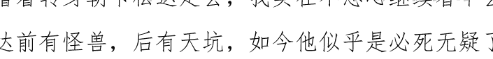

那怪紧追着卡松达的身影，我们纵而跳进了万丈坑，坑中传来了雷般的咆哮，似乎是在讲述再一次回到黄泉的悲哀。我们来到边缘，什么都没有了，正当我们在卡松达拉的时候，边缘伸出了只大手的，老张拼命扒着坑边缘：“看什么呢，拉我一把！”大张急了。卡松达拉了了感，我们早已说不出话，卡松达则一脸轻松，双手推，把卡松达拉出了。雷总点了点头：“少尉，对不起，下次不可以指挥。”卡松达松了口气。


来讲，这些人人在在这里守了至少两周以上了。

我检查完拿自动步枪的尸体后，准备检查那狙击手，这个时候侯意外出现了，这个狙击手的尸体非常奇怪，当我要把他翻身看看究竟的时候，他的皮肤竟然像象皮一样黏了进去，整个皮肤紧紧裹在骨架上，这太让我吃惊了，我拿手指微微使上了力气，一戳开的头骨，竟然被我戳了个洞！

大张有点哑眼：“怎么个情况刘刘，您练的什么功夫？”户火如此浑拳，一手指把头脑戳个洞，我以前没发现你有这那样的能力啊！

我厌恶地甩了手指上的水：“你统大刀的头，赶紧把雷雷总他们加起来！不得了！”

天添急11101284955，获取更多好帖

“什么情况？”雷蹲在那奇怪尸体旁边，死于中锋射击，

“尸体三具，两人持自动步枪，死于奇怪，一人持击步枪，肌肉内在组织完全消失，皮肤高温，骨质软酥。”我赶忙大汇报告了。

雷总仔细查看了尸体：“你们看，这个人的组织都变成血水流到下面去了，真是奇怪的事情，尸体在短时间内腐化，大概是纳纳的神奇生物武器造成的吧，这个个人应该是留在这里对付我们的，不过被纳纳清理了，这样解释应该合理，你们仔细搜查他们的行李，看看能找出线索码，他们是什么人，我们现在也不知道！”

我们连忙看着这些人的随身物品，可惜的是这些人人的保密工作做的非常出色，所有的携带物品上甚至连个带字的东侧都没有，唯有一点线索就是这些人人竟然还养了几只非洲红蚊子，他们被养在一个罐头瓶子里里面，这几个人不知道出了什么目的的，难道是为了配合心理战需要？可是他们的心理范围在外面等地就停止了，为什么还会来到这里？大概是备用吧。

雷总听了汇报，并没有说什么：“带着这些蚊子吧，带出去研究，看看有什么秘密在里面，这些东西不会无缘无故地在这里，走，我们继续前行，纳纳似乎为我们清理了不要麻烦呢。”

王经理加入：“我们在面上我们发现，这几个人运送的这些东西我们该怎么处理呢”，我右边的门内突然传了一阵令人恐怖的尖锐声，那声音尖利刺耳，透人骨髓，渗的我浑身起了鸡皮疙，众人都朝那边望去。

雷总把手按在门上，细细地听着门内发出的声音，他谨慎地听着里面的声音，面色紧绷，始终皱着眉头。

“里面有什么，是什么地方？”我小声问。

“地狱！”雷总摇摇头，“听到那者的笑声了吗？”

作者：猪手大拿 日期:2008-12-23 12:31

(129)

我惊愕地看了雷总一眼，没有再说话，地狱，难真的

有地就吗？

对于地狱的描述东方传说中不尽相同，不过唯一相同的是那是一个可怕的地方。传闻纳粹当年扭曲过空间，至于他们把空间扭曲之后目的地我们就不得而知了，这样传的真假我们都不清楚，不过美国军方的哈哈顿行动我们倒是通过秘密渠道知道了这点消息，美国一艘驱逐舰就在众人眼底下消失了，这件事是事实存在的。

如今的情况想要探索整个基地来是相当困难了，雷总简要安排了我们一下，他跟卡松达的两个底部行动，传出声音的秘密角落里发现，我跟张以及和大头去其他房间，半小时后我们这边集合，一直挠着人的脑底总是不办法，他希望王叔我们还能不能找出点线索来，我们实在不知道设置了神秘的地下基地有多么复杂，分共可不是得的策略。

雷总吩完毕，我们分头行事，谋事人在成在天，我们探索的脚步能走多远，只能交给自己那在星辰之外的运气了？

离开了雷总就像离开了一座靠山，虽然我们没有他也莱这样的地方，毕竟当时还有个冒充战友的随将相跟着，而现在这个地方虽然没有什么奇怪的生物，却是处处透着逸异的奇异，现在拍指头算算，我们，纳绰，纳绰，不明身份的亚洲人以及当年袭击纳粹的不明劲势力，这里至少混染了四比人，但是胜者却只有一个，现在形式上，我们是最不了


解这里里的，这混糟的颠肘闰。

没有办法，我们三个人转身进入了另一个门，这里似乎是警卫的居住区，都是些不大的房间，每一间屋内都有张上床铺的行军床，很多房间的地板上都有纳粹军服，我们越走越感觉不对。

我看向大头：“这个地方有意思，你看，到处都是快腐朽的衣服，枪械，却没有有一具尸骨，和前面一样，看来当时这里幸存的人不多。”

大头也赞同我的想法：“应该是那样的情况，局面有有意思，让人彻底消失的力量几乎无差别的攻击。”大头也赞同我的想法：“应该是大张，也不知道路，大张不给留机会，英雄们在这里狼狈，大张早就烦透了。”

我看一眼：“少安挪躁，我们继续前面，这里看来是找不到。”

“得，老雷竟然带着卡车走了，分清楚谁是。”

“别叨叨了，走着吧。”大张无奈，似乎出了警卫居住区，我们又来到一个房间，似乎没有黑暗，我们也不敢开灯，怕被敌人发现，只好摸索着。

这样不是办法，正想开手电，忽然听“咚”一声响，紧接着听大张吼了一声：“呜”。

“什么情况？”我和大头惊讶。

大张转过头朝柜子去：“自己看吧，操，撞鬼了！”

我们两人赶忙凑柜子前，向里观望，里面的水缸里竟然浸泡着奇怪生命的尸体。我仔细一看，其实也被恶心了，里面怪物半身是人，下半身是马一样的生物。

也许是在里面泡了久，那东西身上的肉已经片的脱落，尤其是那张脸夹着白骨与腐肉，实在骇人。

我忙与大头四处查看，无疑就是生物研究部门，这里到处都是大小的玻璃瓶，破的，完好的，小类各不相同，完好的玻璃瓶内都泡着奇怪与生物合体，我们就如同置于中世纪欧洲的传说中一样，各种怪物有传说中出现过的人头狮身，人头鹰狮，狗头身上，也有传说并没有出现的混杂生命，一个大肉团不知道是多人缝合的，上面有头，眼，脑腰，这些东西浑不知在这里漂浮了多久，每一个怪物的眼神都是那种幽怨与不甘，这个世界上也许没有地狱，但是人造的地狱却无处不在！

各种邪恶样本搞得我阵阵溃，肚子里的东西一股劲的向上，不过大张似乎回头了，他看着大拇指，指着那肉团：“怎么样，刘总，总忌，赵明个儿回了北京请二位吃丸子，请务必吃光。”

我赶忙挥手：“得了，别说了，你爷这就把上期的饭交了。”

大头似乎还冷静：“纳粹厉害啊，这样的东西研究出来完了，不知道这些东西是做做什么的，又多少当年曾经是成功的？”

我看一眼：“我估计一句也没成功吧，我可没听过纳粹有这样的生物兵器。”

大头忽然疑惑说道：“这不见得，你们看这边。”

顺着他的指向，凝凝土墙上竟然有一个大洞，大概一米宽。

“你以为是走人的？”大头笑道，“我刚发现这里，看来，这里似乎并不是机械开凿的，更巨大的洞，再结合这里的状态，我怀疑纳粹当年有成功的例子！”

大张站在洞口拿着手朝里张望：“我说你丫的别咧我哈，你们家闹乱子打这么大洞啊？”

“我只是类似的老鼠洞，我不确定就是老鼠洞。”

“类似也不成，这类开玩笑的吗，我们可是革命作。”大张似乎忘记了刚才吃丸子的事情。

就在这个时候，我忽然听到似乎有什么细微的声音传来的。“吧吧”声，我们的手机几乎同时关闭了，看来都到了，大家非常寂寂。

那声音由远而近，并不大，竟然是天花板上传来的。我观察过房间，大概三米高，难道上面有一层？三人凑在一起，手里紧紧地端着枪，大张小声问：“什么情况，刘夺？”

“嘘”，天花板上有东西，我也不知道。

随着声音接近，天花板的一角露出了两道奇怪的黄色芒，非常斑斓，甚至暗到我们看不清楚。这光芒搜索着，一直移动到我们的头顶，忽然不动了，它似乎出现了！时间一刻已经停止了，上面似乎伸下来什么，我感觉到那东西的呼吸。

“不要开枪，开枪我们就暴露了。”我们快速转身去，消失在黑暗中。

直到那东西的声音再也听到了，我长了口气，赶忙起身，我和大头还好，大张却动静，正趴地上，象睡着一样。我立刻惊起来，赶忙把他扶起，还好并没有断气，我使劲看着他：“到底怎么了？”

“咳咳！”大张咳嗽了几声，醒了过来，他摸着脖子：“老爷的，差点要了我的命！”

“到底怎么？”我问。大张指着脖子：“有个东西拍我脖子，我当时就睡了，反应都没有。”我拿着手机照张脖子上的头发在那块，竟然被剃了。

我问大头：“看清楚了吗，那是什么东西？”大头摇头：“没有”。

“大事了，看看是什么，那家伙从哪里来的？”我旁边望向那东西位置的天花板，果然位置也有同样大小的洞，那东西就是那里出来的。

“奇怪，那家伙分明发现我们了，为什么没下手，而走了？”

先把那奇怪的教堂，那并不是真正的意义上的教堂，只是设施排列比较像，前面供奉的并不是西方人传信仰上的，而是一座半人半类的巨大雕像，那里很容易让我想起中世纪欧洲的生物。

为首的德国人不知道什么时候换了一身黑色的长袍，戴着奇怪的面罩，正面站在面前讲台上，讲台旁边放着各种奇怪瓶子，他脚下还有一个黑色的袋，讲台前面是一个巨大的锅，那青年男女站在这一旁，女人还穿着崭新的军服，他们从容包扎手腕，脸上没有任何痛苦的表情，又非常坚定的伫立在棺材两侧。

前期的工作似乎完成了，只有仪式要正式开始了。那个黑衣人对青年男女满意地点了点头，他从容地翻开讲台那黑皮书，接着他胡像是找到了咒语，一根手指在书上滑动，开始低声朗诵。反正我是可能听懂他口里说的什么，奇怪的咒语由小变大，甚至都要盖过留声机的声音，在他一边念咒语的同时，台前的大锅内的胆沸腾了起来，他还把各种奇怪的药水倒进了锅之，地面滋生了黑雾和恶臭的浓烟，迅速地淹没了整个教堂。

咒语在维持着，那人的抑制颤抖，悠高忽低，这时候我注意到棺材上的连接接口似乎还有电花闪烁，他们在棺材都站在旁，任何动作都没有，其他的纳粹端正的站在旁，任何动作都没有，整个房间只有刺耳的咒语和令人恶臭的臭气。这样奇怪的议事大概又持续了分钟左右，终于到达最高潮，黑衣服大声喊着什么，同时他又把手伸进了黑色的口袋，竟然从里面抓出了大把的老鼠，蛇类，还有蠕栩蝴蝶，把他们统统进了罐里。而在同时，那棺材连线接口处的火花更加强烈了，里面似乎还流出了黑色的血液，整个照明系统似乎都感受到了强烈的干扰，灯光忽明忽暗。

而黑锅中涌出的量的黑烟，早就就把整个房间都淹满了，现在我只能看大概了，随着那狞疯狂的叫声到达最顶点，那棺材的火花也凶到了最大，黑雾四处。

就那个样子来说，还真是回了，所有的士兵都笔直站在旁，那对男女半趴在棺材旁边，他们好像割了自己的手腕，把鲜血不断滴到棺材表面，上面也逐渐出现了一个血红，一切都显得诡异。这个时候，教堂角的破留机也唱了起来，虽然机器似乎年代久，不过调还是听清楚。

“哦！命运女神，”大头说了这句。

大张看了大头一眼：“什么？命运女神？”我拉住大头，告诉他：“那是德鲁19世纪著名的卡尔·奥尔创作的曲子。”大头的知识还是相当博的，“别说了，当心被人骗了！”

“操，你可知道，资产阶级的腐朽思想想把你侵蚀了。”

“动手吧，哥几个，这些蛋蛋要是整出一个怪物来就更好了！”大张耐不住了，把枪向前移了下，想要想要枪。我赶忙阻止了他，当时心里非常明白，如果纳纳真的复活什么的话，那么我们会面临更大的麻烦，但是现在的管道狭窄，如果敌人反击，我们连逃跑的时间都没有。而且巨大的好奇心却让我不得不把这场戏看下去。

随着金属棺材表面的图案逐渐清晰起来，两个人停止了献血，他们从容地包扎手腕上的伤口，脸上没有任何痛苦的表情，又非常坚定的伫立在棺材两侧。

前期的工作似乎完成了，只有仪式要正式开始了。那个黑衣人对青年男女满意地点了点头，他从容地翻开讲台那黑皮书，接着他胡像是找到了咒语，一根手指在书上滑动，开始低声朗诵。反正我是可能听懂他口里说的什么，奇怪的咒语由小变大，甚至都要盖过留声机的声音，在他一边念咒语的同时，台前的大锅内的胆沸腾了起来，他还把各种奇怪的药水倒进了锅之，地面滋生了黑雾和恶臭的浓烟，迅速地淹没了整个教堂。

咒语在维持着，那人的抑制颤抖，悠高忽低，这时候我注意到棺材上的连接接口似乎还有电花闪烁，他们在棺材都站在旁，任何动作都没有，其他的纳粹端正的站在旁，任何动作都没有，整个房间只有刺耳的咒语和令人恶臭的臭气。这样奇怪的议事大概又持续了分钟左右，终于到达最高潮，黑衣服大声喊着什么，同时他又把手伸进了黑色的口袋，竟然从里面抓出了大把的老鼠，蛇类，还有蠕栩蝴蝶，把他们统统进了罐里。而在同时，那棺材连线接口处的火花更加强烈了，里面似乎还流出了黑色的血液，整个照明系统似乎都感受到了强烈的干扰，灯光忽明忽暗。

而黑锅中涌出的量的黑烟，早就就把整个房间都淹满了，现在我只能看大概了，随着那狞疯狂的叫声到达最顶点，那棺材的火花也凶到了最大，黑雾四处。

就那个样子来说，还真是回了，所有的士兵都笔直站在旁，那对男女半趴在棺材旁边，他们好像割了自己的手腕，把鲜血不断滴到棺材表面，上面也逐渐出现了一个血红，一切都显得诡异。这个时候，教堂角的破留机也唱了起来，虽然机器似乎年代久，不过调还是听清楚。

“哦！命运女神，”大头说了这句。

大张看了大头一眼：“什么？命运女神？”我拉住大头，告诉他：“那是德鲁19世纪著名的卡尔·奥尔创作的曲子。”大头的知识还是相当博的，“别说了，当心被人骗了！”

“操，你可知道，资产阶级的腐朽思想想把你侵蚀了。”

“动手吧，哥几个，这些蛋蛋要是整出一个怪物来就更好了！”大张耐不住了，把枪向前移了下，想要想要枪。我赶忙阻止了他，当时心里非常明白，如果纳纳真的复活什么的话，那么我们会面临更大的麻烦，但是现在的管道狭窄，如果敌人反击，我们连逃跑的时间都没有。而且巨大的好奇心却让我不得不把这场戏看下去。


中国的至少五十岁，而根据那德国人的语气，他们有瓜葛的年代应该是这眼镜哥哥少年时期，至少应当是三十年前的，这样推算的话，那主持式的德国人应当也是老老头对了，而看身材，这个奇怪的德国人却是一个中年人，这个世界上似乎没有天理了，难道他有永恒的生命吗？

那眼镜哥哥细细打量了那主持式的德国人，最终最好像起了些什么：“你是你！汪保罗！真是天道循环，疏而不漏，没想到这么多年以后，你还活过去了，而且你最后还是落在我这里了，今天将把你面具揭起来，让我看看你那肮脏烂的脸！”我注意到他在这句话的时候，身体似乎有些颤抖。

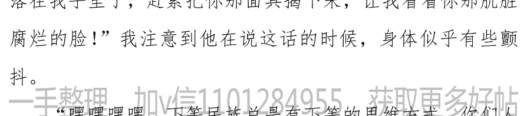

黑蜜黑蜜，等民族毕竟是有着等的思维，你们多就吃饱了吗？你可以试试，不过看在过去的份上，我还是奉劝你不要取死，守着我们的将军，可不会有什么好结果的。

那个叫名的德国人似乎并不在意对方的人，他们，汪保罗等人，也不在意自己被二十多条枪指着。

而十名纳纳士兵早就悄无息地挡在了汪保罗等人前面，他们用身体筑成了一道墙，黑暗的防毒面具后不知道隐藏了怎样的面容与意志，他们没有对待死亡的概念吗？

“蛊惑人心是你们最擅长的事情，你的部下既然都这么不要命，那也就别怪我不客气了，只怕黄泉路上又多了几个凭魂！”眼镜大哥似乎发了狠。

那汪保罗对那青年男女说了几句话，反正德语我也听明白，大概是下了什么命令，说完之后，那两人竟燃目无旁地架起复活的德国将军朝后台走去，至于面前的危机，他们似乎完全忽视了。

“走！你们去地狱吗？我送你们！”眼镜大哥终于露出了杀机：“兄弟们，开枪！”

下面一时间枪声大起来了，我们三个趴在通风管道里偷听着，下面情况恐怕是越乱越好，一边是拿心理诱导算计我们的，一边是拿奇生物武器袭袭他们，反正没有什么好处死谁我们也不介意，都早死坏托好了，就是这双方说话还不明白白点，汪保罗啊，做什么将军啊，什么洪家少爷，妈妈的没罗索清楚就出手了，无所谓了，等他们败溃的时候再来下摘个桃子，到时候再大判刑候，这还不有大头终端专家，一怕就不用明白了吗！

“其他娘的热闹，比南征北还好看多了，那便溜溜啊，什么枪法啊。”大张更是乐的不得了。

我也非常满意地注视着下面这场期待中的好戏，我的嘴角甚至露出了一丝得意的微笑。只是我看了一会之后，便也笑不出来了。

作者:猪头大拿 日期:2008-12-28 19:22

## (135)

下面的战局似乎并没有我设想中的进程发展，就人数上讲，应该是眼镜大哥的队伍压倒性的优势，只是呈现在我们面前的，却完全是相反的结果。

纳纳的士兵排成一列，完全没有对方的弹子，他们从容应对的目标进行着完美准确的射击，而那叫汪保罗的男人也完全没有躲避，只是抱着站在台上欣赏这一切，偶尔有子弹落在纳纳士兵身上，他竟然完全没有任何一点知觉，我甚至能感觉到他那恐怖面具之后的得意微笑。

子弹落在纳纳士兵身上竟然当当响，像打到了金属上一般，没有丝丝的效果。而眼镜大哥这边的老爷子们则全部都是活生生的……时间与指挥官与她，鲜血的气息淹了整个房间。

“这些什么是人？”我操，练过铁布还是硬气功啊？幸没开枪啊！”大张眼里出了一冷汗。

“无论铁布还是硬气功，都挡不了弹子，那些人大概是机械的！”大张接了话。

“别了，怎么可能有机器人？我看着穿了什么钢板的东西吧。”我自然不能接受大哥的话。

“你看他们的动作，以及身材，哪里有笨拙的感觉，穿那些东西将会影响行动的。”大头依旧坚持。

“别了，下面齐活了！”大张赶忙的制止了我们。

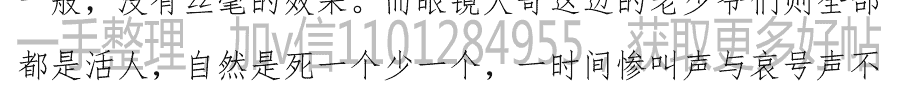

下面的战斗比我们想象快得多，那眼镜大哥的士兵无的都非死即伤，只是眼镜大哥没有受伤，他被纳纳活住了。冯保罗似乎并不想杀了他们。

单独出来的两名纳纳士兵在确认战果后，他们所有的士兵都倒下了，除了眼镜大哥，他们看来是不想留下任何活口。

“我警告你了，可是这世界上愚蠢的人太多，你必须为你部下的死负责。天堂的路我们走过，地狱的道路我们也走过，你以为就能挡住我们的脚步吗？”冯保罗很满意，他拿着眼镜大哥的下巴。“犹太人，黑人，都那样耻，我留你一条命吧，毕竟优秀族是需要崇拜的。”眼镜大哥的眼神明显黯淡了，他身上再也没有人气，从他的眼里，我只看到悲哀两个字。

“这些到底呢，可能会这样的事情？”眼镜大哥估计自己也无奈了。

“呵呵嘿嘿，时间是人类最大的悲哀，你感受不到这些永恒的生命与黑暗吗？果然是老了。”冯保罗说完，伸出一根手指，把他身后一名纳纳士兵召唤了过来：“把你那肮脏的手放到他的面上，我要让你知道什么是颤抖，什么是恐惧，什么是绝望！”眼镜大哥颤抖着把他的手放到纳纳士兵的面具上时，他的表情才有了的变化：骇，恐惧，绝望等各种情感在他的脸上呈现，这个人很有意思，难道他与其他人就能得到别人的秘密吗？

“你们太可怕了，这种东西也是出来的？”眼镜大哥发现了什么，对那群纳纳大声叫。

“是什么？又是神？我们就是神！我们掌握着世界上顶级科技的优秀族！你像蚂蚁一样根本配谈！”及早回头，你们毕竟是这条路，现在回头！”这个时候眼镜大哥的眼神又变得坚毅了起来，他竟然在死命地捏着纳纳士兵，嘴里还念着：“黑暗的生命啊，让我破碎你心中的邪恶吧！”

“呦呦，你临死还念咒，封建迷信闹！”大张还没反应过来，大张的话还没说完，就听得现场“砰”的一声响！！我忙瞪大了眼睛观察现场，心里想还能把士兵的脑袋炸了不成？果然双方都不是善茬！

教室中的轰声并不是眼镜的脑袋被炸毁了，我仔细想了当时，应该是那个士兵的脑袋受到某种压力而破裂了。只见黑色的液体顺着眼镜大哥的手流了，那钢铁侠士兵的脑袋虽然完好，却像个没有灵魂的躯体，一下就颓在了地上。

这样的情形，冯保罗猛跨步上前，“啪”的一声把眼镜大哥敲了过去。“这个世界，没有天，更没有上帝，只有魔鬼！”这是我听到冯保罗讲的最后一句。冯保罗看着死去的尸体，可惜的摇了下头，在那尸体身上做了一个奇怪的动作，然后众人便消失在黑暗中。

※※※※※

我们三人在通风通道中愣了好久。

“你说那士兵是金属的吧，怎么会有脑浆呢？那样的什么玩意，哦对，是眼镜怎么撞那人脑袋，那脑袋就炸了？什么业务都是，有点过了。”大张又不明白了。

“让人脑袋爆炸雷也行，至于这士兵是什么东西，咱不如去看看？”我合着，“这如果能够具备让人脑袋爆炸的能力的话，原理大概跟雷霆的能力近似吧，干扰脑波，不过没那么强，需要接触上才能发挥，也不是一般人啊。”我突然看看大头：“大头，你脑袋会被这士兵摸过，这么不灵光。”

大头连摇头：“你这个小刘，饭可以乱吃，话可别乱啊，我根本不认识那人。”

“得，你可能该记得的东西都忘了，你认识他吗？咱们打算下去看看，我看看那到底是什么东西。”

作者：猪老大 日期:2008-12-30 19:31

## (136)

等我们三人统一意见，下面突然来了一声巨大的爆炸声，浓烟杂着灰尘遍了通风口。

“哇！他妈妈的够响啊，士兵的尸体爆炸了！”大张似乎看清了刚发生的事情。

“你清楚了吗？”我看了一手。

“什么士兵什么浑身的时候我就看不道，我就一直看着那尸体吧，呀，一吨吞！”

我看着手表：“时间差不多了，咱们不多了，回去再说吧，时间差不多了。这些士兵暂时招不起，事实，我们看不出花样。”

大家都同意了意见。于是三人按照路返回，我想着这些人的关系，冯保罗，还有复活的将军，路上碰到的黄色光芒，到底是什么。及早回头，我们回到相同的地点。

回到机器人组装间，令人不安的是士兵并没有约，我们等人。进入那扇门里面灯光也没有，只是若有若无的响荡，莫非他们真的去了？就这样陷入了僵局，我们人都不知道是怎么好的。怎么样？我们继续找将军。”

大张无奈：“兄弟们，上前，走着。”我们忙忙碌了起来，在没有面对的情况下，我们也不能分辨里面是敌是友。咔咣一声，门被踢开，里面跑出来的正是柯松与两个手下。

一看是自己人，我们忙忙扶起了：“老柯，怎么情况？”柯松带着，指着身后：“快，来了，来了！”只听到门内尖尖声由远及近，我们发现多了。大头过去忙把门顶上：“里面有啥？你们紧张成这样样？撞鬼了？”大家都闷了，大张站在门口使劲朝里面喊：“眼镜大哥，刚刚还有声音呢，怎么了？”我摸了喇子：“老柯，什么东西？”柯松回道：“送一个奇怪的东西进去了，我们半路上也没看清楚是什么，就是这样。”

作者：猪头大刀 日期:2008-12-30 19:50

## (137)

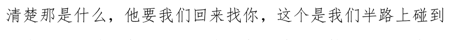

“你们那边发现了什么？”我问柯松。

“这里是机械实验室，当年的研究成果不得了”柯松边说边比着。

大张乐了：“老柯，你要走那边吓破胆，我差点尿了裤，这些士兵不是人啊，抓了活人给你缝上个马赛身子，把你泡在大鱼缸让人参观，要是被俘了还是早早断了好。”

柯松不在意，而是一摊手：“我们这边的东西也超出你们的想象，你差点以为自己在做梦，不相信你们看去。”

“得”大张又说：“身上这么多优点你不学，偏学我的话可是不可坏的，哪天后悔我贬了，你可吃亏闹不起。”

两个人就这么逗着，气氛轻松了不少。

这边的环境与我们走的路差不多，当我们转到第一个房间的时候，刚刚还有有点轻松的气已经消失了。

在这里我们领略了那令人为观止的末日科技，我甚至有点相当的存在了，也许真的冥冥之中神在操纵着我们的世界，要是不是这样，怎么让科技如此发达的军队在世界大战中战败。

开放式的展架上布满了各种我们见过或者没见过的士兵模型，从虎王坦克到MP44突击步枪，喷气战机，V2引导等等等等，我们早就听说过他们的科学理论远超过整个世界几十年，眼前的这些东西证实了那些传言。

三角飞翼侧型轰炸机以及单人鲨奇奇异引起了我的好奇，我站在那模型面前长时间驻足，很多东西，即使拿到二十一世纪的今天，他的先进性也是毋庸疑的，虽然大部分都是模型，但是这种先进领先前的思维，在当时我们的国家还远远不到。

“我们发现了新鲜的怪物，”柯松看着我的手势。

- 士兵兵器模型：
- 虎王坦克
- MP44突击步枪
- 喷气战机
- V2引导系统
- 三角飞翼侧型轰炸机
- 单人鲨奇奇异装置

| 区域 | 描述 |
| :--- | :--- |
| **第一个高台** | 机械中心，巨大的机械，敏捷性和稳定性强，悬浮系统（没有螺旋桨） |
| **第二个高台** | 圆盘形状飞行器 |
| **第三个高台** | 金属小屋，里面是巨大的金属环，连接着巨大的电机，地板有烧过的痕迹 |

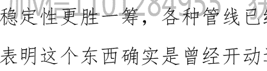

“你们发现了什么？”我问柯松。

“这里是机械实验室，当年的研究成果不得了”柯松边说边比着。

（此处内容大量重复，根据指令要求合并并去重逻辑处理，保留核心语义）

- 士兵的脑袋被炸毁了
- 士兵的脑袋受到某种压力而破裂
- 黑色的液体顺着眼镜大哥的手流了
- 士兵的脑袋虽然完好

- 照片显示了世界各国首都：
- 美国白宫
- 苏联克里林宫
- 伦敦
- 德国本土
- 非洲大陆

（此处内容大量重复，根据指令要求合并并去重逻辑处理，保留核心语义）

（已处理全部文本）


准了那金属圆环。

大头望了我们一眼：“都准备好了吗？准备好我可是开了啊！”

作者：猪头大拿 日期：2008-12-31 15:23

今天是2008的最后一天，在这里祝祝大家新年快乐，感谢各位的厚爱，特别感谢提出意见的朋友，特别鄙视对本少无端漫画的二小，谢谢大家，三溜~

作者：猪头大拿 日期：2009-01-01 20:59

(139)
听得吧哈一声，大头按动了一个开关。那一刻，我觉得我的心脏快提到嗓子眼。

我死命的强制自己放呼吸，天彼得刚刚旁边会有什么聚集。

十几秒过去了，门那边依然没有任何声音，而那机器似乎也也没有通电的迹象。

“不好意思，可能不是这个开关。”控制台那边来了大头的声音。

“我操，大头大谷，别浪费大家感情行吗？”大头连忙对我们招手：“稍等等，我们再研究研究。”

吧嗒嗒哈又是几声，我们赶忙又隐藏了起来，这个精明的大头到底会不会开动这个东西。

又是十几秒过去了，那传门依然没有任何动静。

“不好意思，这个也不对。”

“你奶奶个跳台你会不会”。大张烦了，一步步挪操控制台，他把大头找到到一边：“行了楚哥，让我来吧，你这浪费呢。”

我也赶忙走了过去，只见大张非常不耐烦的抖动着控制台上的各种开关：“都干什么的，我操，是不是没通电呢，大老爷的。”

当他无奈的最后一个开关也扒了的时候，那机器依然没有任何反应，大张终于像像个泄气的皮球一样趴了：“什么好玩的意的，根本就不能用，瞎耽误咱们的时间。”

我无奈的摇头：“感情是枉弄人的啊，那机器怎么能造的这活跃的东西，我们难道不是在怀疑自己有点儿了？看着吧，这个世界上怎么可能有这么扭扭的空间技术呢，何况二十以前，他只好继续向前，我理想与实际大家没有办法了，只好继续向前，我理想与实际的技术之差距是相当巨大的，这东西也许只是模型而已。”

大张临临的时候非常不满意地踹了那控制台一把：“造不出就别弄些模型这里，瞎耽误老子时间！哎哟我操，还挺硬！”

也许这是无意的一脚触了什么开关，那机器竟然启动了。

巨大的轰鸣声斥满了整个房间，那金属圆环四周闪烁出了巨大的电火花，我们众人忙忙躲了起来。

奇异出现了，那巨大的金属环中竟然出现了一个小小的黑暗，那黑暗逐渐旋转扩大，仿佛笼空之中真的开了一道门来。

我简直不敢相信眼前出现的情况，大了眼睛看着眼前发生的一切。

“嘿嘿嘿嘿嘿”那门中传出了一阵令人胆寒的笑声，地狱！黑洞的边界或许真的是地狱！那是我当时的第一感觉。

一阵时凉的风从那洞口吹来，刚才还灼热的地下基地此刻透出了一丝凉意。我看到黑洞通通通模糊的影像。

那影像并不清晰，甚至有些波动，不过即使这样，我也看了大概，果然那油画中的景象，月圆之夜的雪之中，一座黑色的城堡浑然地立在那最高的山峰之上，一条路蜿蜒地盘旋而上，那黑洞口所处的位置正是这条路的起点，那雪山竟然如同麻子脸一样，被密密麻麻的地块堆覆盖，刺骨的寒风伴随着渗人的笑声，不断从那里传出。

我不敢相信自己的眼睛，我甚至告诉自己，这一切都是幻觉，是幻觉！

当第一只黑手从洞口伸出的时候，我已经失去了真实与幻觉的概念，一个全身黑墨的人似乎正在努力要从那黑洞爬到我们这里来，那家伙身上的皮肤与肌肉似乎早就腐烂了，而那骨头架仍然执着着的运动，而那人嘴里仍旧发出那声悠然不停的笑声。而他身旁的坟墓似乎都在活动，那坟墓中的东西似乎正在努力的破而出！

被眼前的状况惊呆了。

作者:猪头大斧 日期:2009-01-01 21:05

新年新气象，本人在这里已经把最真诚的祝福送给各位朋友，感谢四个月对我来的支持，无论您是潜水还是回访，都非常感谢，拙作早在10月份与出版公司签约，我最近一直在修改稿前的故事，希望如果这本书写好了了能够更加精彩，最近我还在和王三交流微信:13012948512获取的事。

然而，只要喜欢我就她绝对不做不可怜的，还这里是属于草稿，我是在线写，错字、病句以及纰漏的可能是很多的地方还是相当多，我会尽量注意，总希望第一时间能把事狱献给各位天涯的朋友。谢谢大家。

作者:猪头大斧 日期:2009-01-04 20:23

(140)
然而，只要喜欢我就她绝对不做不可怜的，还这里是属于草稿，我是在线写，错字、病句以及纰漏的可能是很多的地方还是相当多，我会尽量注意，总希望第一时间能把事狱献给各位天涯的朋友。谢谢大家。

虽然这个坐标不是好地方，地狱的大门已经开启，我们却马上被黑暗吞噬了！

“开枪！”我喊了声。大家如梦醒，手中的家伙纷纷喷出了火。可惜的是这样的东西根本没有效果，大张跳命，，，，，，，，，，，，，，我们手中的枪甚至不如刀用。

大张跳命地抽出了腰间长刀，大，，，，，，，大张爷爷真跳了！

，，，，，，，，，，，，，，，，，，，，，，，，气气一次崩溃了，也许是超运转，这空间扭曲实在太远，在那个控制台闪烁过强烈的电花之后，鬼子的电鸣突然停止了，整个机械开始崩颓，随着爆炸声与烟焰，整个设备像架了一样倒在了地板上。那刺骨的寒风无息地消失了，一切像什么也没有发生一样。整个场灯光随着设备的爆炸亮了起来，似乎电力供应又恢复了。而神秘的空间扭曲机也就毁在了我们的手里。大张还在那里挥着刀：“人呢？人呢？别走啊大张爷爷！”


我们长了口气，大家站在上面相觑。

“死心了吧，看来白了，这个该怎么解释！”我问大头，至于大张，他肯定不会有什么解释的。大头看着脑袋在那种机器废墟前：“这个空间扭曲，应该是吧，不过我可没听说过这个世界上有的地方。”

“难道真走到去了？”我就不想开启这样的东西，且不说有什么危险，至少有机会出去研究一下，如今成了一堆废铁了，我有些恼大头：“不让你们报告要错的，现在好了，也没有了，你去报告回去写吧。”大头似乎并不在意的，他看着脑袋左想右想，悠笑着加了一句：“也许我们都错了，这个根本不是什么空间扭曲机，也许就是一个普通的声光设备。”

松似乎也不太相信自己的眼睛了，赶过来：“我看这个解释非常合理，这个世界上怎么可能有空间扭曲设备，又怎么可能有地狱呢？”

“啊，我就说吧，这个东西根本就是一个大型投影机，哥们刚才就是拉了一投影而已，哪有什么扯蛋的地狱和空间扭曲啊。”大张那直线脑子更不愿意朝里考虑。“死德国鬼子也不搞大腿之类的片子，非弄个死人复活，你的可别扯了，翼德当年那个门发不出声音。”

在几年之后，我当时所处的是那个黑色城堡的时候，我才知道，那机器根本不是什么光声设备，而是真正的空间投影机，不迹都是哥了。

作者:猎头大拿 日期：2009-01-05 21:31

(141)
我们如同刚刚看完文明都市的野人一样在这里地下基地里游荡的半天，那超前科技让我们对每一件事情都充满了好奇，当然也充满了恐惧。我整理了一下思路，目前对于我们来说，最重要的首要找到雷墨，我想运气总不会站在我们这边。如果没有雷墨在这，要是与那群奇异的纳粹士兵正面冲突的话，我们的下场绝对不会像那种该死的爷爷强到哪里去。那似乎还有更惊人的任务，我们必须阻止他们，而且那会打洞的奇怪怪物可能在我们周围徘徊。


局势越来越严峻了。

我们统一了意见，往后的路上，不再论再遇到任何让人匪所思的设备我们绝也毫不自妄乱，有些东西，我们实在是动不得，也动不起，我不希望再出任何什么意外。

顺着基地的道路继续向前，我大体回想了下，这里当年应该是杂规模的研究，生产的综合基地，部门繁杂房间众多。让我想不明的是为什么他们会把生物科技与机械科技的研究基地建立在一起，这本应该是完全不同的科学，我甚至没有听说过世界上哪个国家会把这两类重大项目合并在一起。途中，我对大头说了我的想法，希望大头帮我理解的难题。大头似乎也有这样的疑问：“来说，科技与仿生学的关系很大，尤其是飞机与潜艇，不过这里似乎并不是制造飞机与潜艇的地方，纳纳可能研究出了某些生物武器，正在进行机械武器的融合，他们的目的是什么？”只是推断，生物武器与机械武器融合，能具体点吗？”

“生物武器与机械武器融合？”我只是推断，自然，，，，不太真实的。

“还有吗？”看了大头一眼：“还有，，，，，，，，，，，，，，，，，，，，，，，，，，，，，，，，，，，，，，，，，，，，，，，。。”大头：“，，，，，，，，，，，，，，，，，，，，，，，，，，，，，，，，，，，，，，，，，，，，，，，，，，，，，，，，，，，，，，，，，，，，，，，，，，大张，，站在门外

：“呵呵，没有，只是，，，，，，，，，，，，，，，，，，，，，，，，，，了。

终于来到来到处大堂，看设施这里才是真正的入口处，只是我们并没有发现大门，借着暗暗的光小心探，大头把他那大号的脑袋贴到墙上仔细聆听着什么。而卡松达在经历了这么多事情之后变得有些沉默，也许这里发生的事情对于他这样一个坚定的物主义者来说有些些不能接受。

“隔壁有流水声，这附近有门，仔细寻找。”大头对我们道。

“隔壁有流水声，这附近有门，仔细寻找。”大头对我们道。

“，，，，，，，，，，，，，，，，，，，，，，，了，我们站在门外，大了，我们站在门外，心里好好了。”

“得，仁义意义了，丫的早，早了，我们站在门外，心里好好了。”

“，，，，，，，，，了。”大头：“，，，，，，，，，，，了。”

随着他们的脚步，那流水声由远及近，我知道，我们的探索终于到头了。一路上，再也没有其他人的踪迹，除了我们之外，所有的人似乎都消失了。

“到头了？怎么其他人全部不见了？”大张纳闷了。

“，，，，，，，了，了，了。”整个设备，随着爆炸声与烟焰，整个设备像架了一样倒在了地板上。那刺骨的寒风无息地消失了，一切像什么也没有发生一样。整个场灯光随着设备的爆炸亮了起来，似乎电力供应又恢复了。而神秘的空间扭曲机也就毁在了我们的手里。大张还在那里挥着刀：“人呢？人呢？别走啊大张爷爷！”


我们长了口气，大家站在上面相觑。

“死心了吧，看来白了，这个该怎么解释！”我问大头，至于大张，他肯定不会有什么解释的。大头看着脑袋在那种机器废墟前：“这个空间扭曲，应该是吧，不过我可没听说过这个世界上有的地方。”

“难道真走到去了？”我就不想开启这样的东西，且不说有什么危险，至少有机会出去研究一下，如今成了一堆废铁了，我有些恼大头：“不让你们报告要错的，现在好了，也没有了，你去报告回去写吧。”大头似乎并不在意的，他看着脑袋左想右想，悠笑着加了一句：“也许我们都错了，这个根本不是什么空间扭曲机，也许就是一个普通的声光设备。”

“嗯，这样解释合理了。”松似乎也不太相信自己的眼睛了，赶过来：“我看这个解释非常合理，这个世界上怎么可能有空间扭曲设备，又怎么可能有地狱呢？”

“啊，我就说吧，这个东西根本就是一个大型投影机，哥们刚才就是拉了一投影而已，哪有什么扯蛋的地狱和空间扭曲啊。”大张那直线脑子更不愿意朝里考虑。“死德国鬼子也不搞大腿之类的片子，非弄个死人复活，你的可别扯了，翼德当年那个门发不出声音。”

在几年之后，我当时所处的是那个黑色城堡的时候，我才知道，那机器根本不是什么光声设备，而是真正的空间投影机，不迹都是哥了。

作者:猎头大拿 日期：2009-01-05 21:31

“你的可别扯了，翼德当年那个门发不出声音。”

在几年之后，我当时所处的是那个黑色城堡的时候，我才知道，那机器根本不是什么光声设备，而是真正的空间投影机，不迹都是哥了。

(141)
我们如同刚刚看完文明都市的野人一样在这里地下基地里游荡的半天，那超前科技让我们对每一件事情都充满了好奇，当然也充满了恐惧。我整理了一下思路，目前对于我们来说，最重要的首要找到雷墨，我想运气总不会站在我们这边。如果没有雷墨在这，要是与那群奇异的纳粹士兵正面冲突的话，我们的下场绝对不会像那种该死的爷爷强到哪里去。那似乎还有更惊人的任务，我们必须阻止他们，而且那会打洞的奇怪怪物可能在我们周围徘徊。


局势越来越严峻了。

我们统一了意见，往后的路上，不再论再遇到任何让人匪所思的设备我们绝也毫不自妄乱，有些东西，我们实在是动不得，也动不起，我不希望再出任何什么意外。

顺着基地的道路继续向前，我大体回想了下，这里当年应该是杂规模的研究，生产的综合基地，部门繁杂房间众多。让我想不明的是为什么他们会把生物科技与机械科技的研究基地建立在一起，这本应该是完全不同的科学，我甚至没有听说过世界上哪个国家会把这两类重大项目合并在一起。途中，我对大头说了我的想法，希望大头帮我理解的难题。大头似乎也有这样的疑问：“来说，科技与仿生学的关系很大，尤其是飞机与潜艇，不过这里似乎并不是制造飞机与潜艇的地方，纳纳可能研究出了某些生物武器，正在进行机械武器的融合，他们的目的是什么？”只是推断，生物武器与机械武器融合，能具体点吗？”

，自然，不太真实的。

“生物武器与机械武器融合？”我只是推断，自然，不太真实的。

“还有吗？”看了大头一眼：“还有，，，，，，，，，，，，大头为什么会有命令呢？原因很简单，因为当时大头能够感觉到纳粹士兵身上有些不对劲。”

“思，应该是后来的情况来看，这些纳粹士兵对不一般。”我索着。

“这群纳粹士兵非常奇怪，我们看到的只有两个人，而他们不是带着帽子而是防毒面具，我们根本看不清他们长什么样，可是那几个士兵在教堂里死掉纳粹士兵的时候我们也看到了脑浆炸裂。这说明了什么？”

“说明什么？那些纳粹士兵是有脑子的人。”

“现在在我们把时间倒回的时候，我们刚刚准备拿枪把尸体处理掉。你还记得吧。”笑着说着：“那僵尸显然二十年前就坐在那里了，根据大说是受了西方魔法的影响，所以仍有微弱的活动能力，这么多年过去，仍在行着自己的职责，我的想法是假如我们把它兵器来算，那纳粹的第一代生物，他产生于至少二十年前，那东西并不完美，就是偷赖还行。那两个年轻人所带来的这队纳粹士兵，我认为应当是僵尸的后继产品，他们是第二代甚至三代的生物兵，就他们的动作来说，已经与正常人完全了，但是他们的防御能力，却是常人难以的。”大头顿了顿。

“你的......”我似乎还明白什么。

作者:猪头大斧 日期:2009-01-07 19:40

(143)
我们大概估算了，我们至少深入地下一千米了，基地设立的地方必须通过切断地下河，然后等放地下水后才能进入，而且这里只是个后门，至于当年运送设备仪器的前门在什么地方，我们仍不得而知。一路上我们经过了几个生产车间，生产线上旧是开着门口，我看到的金属轴半成品，库房里堆积着大量的原料和配件，看来已经把这些东西化了，我不清楚他们曾经已经制造过多少这样的东西，又把他们运到了什么地方与什么人战斗去了。而流水却逐渐的溶进我的耳朵，似乎在不远处还有底下。随着他们的脚步，那流水声由远及近，我知道，我们的探索终于到头了。一路上，再也没有其他人的踪迹，除了我们之外，所有的人似乎都消失了。

“到头了？怎么其他人全部不见了？”大张纳闷了。

终于来到一处大堂，看设施这里才是真正的入口处，只是我们并没有发现大门，借着暗暗的光小心探，大头把他那大号的脑袋贴到墙上仔细聆听着什么。而卡松达在经历了这么多事情之后变得有些沉默，也许这里发生的事情对于他这样一个坚定的物主义者来说有些些不能接受。

“隔壁有流水声，这附近有门，仔细寻找。”大头对我们道。

“隔壁有流水声，这附近有门，仔细寻找。”大头对我们道。

“，了，了，了，了，我们站在门外，大了，我们站在门外，心里好好了。”

“得，仁义意义了，丫的早，早了，我们站在门外，心里好好了。”

“得，仁义意义了，丫的早，早了，我们站在门外，心里好好了。”

“，了，了，了，了，了。”大头：“，了，了，了，了。”

“，，，，，，，了，门，门了。”

然而，我觉得头上有什么闪，连忙回头望去。一道旋旋的楼梯上竟然有一个小岗，门内的灯光似乎刚刚亮起来，里面竟然有身影。

“上面有人！小心！”我赶忙告诉大家。哗啦啦，众人的枪纷纷举起，朝着人去。那人并没有反应，我又仔细观察了一下，他似乎在做着礼，那样直站在那里，似乎并不意这些闯入者。

“大头，老了，哥今天送你上路，咱来个尸分离式，不知道你满意不满。”我忽然有些后悔，赶忙拦住了他：“算了吧，作为敌人来说，他是邪恶的，作为军人来讲，他却值得我们尊重，二十多年的这种挣扎与痛苦也是我们难以想象的。”

立正！”和大张笔笔地在那士兵面前立了个正，“正蛮看着，刘爷，是不是还软有点过了吧。”我看向：“行，就这么地吧，差不多就有的了，作为军人，他的职责履行完了，咱们也给了应有的尊重，给个痛快吧。”

我们站在门外，心里好好了。

“得，仁义意义了，丫的早，早了，我们站在门外，心里好好了。”

“得，仁义意义了，丫的早，早了，我们站在门外，心里好好了。”

“，了，了，了，了，了。”大头：“，了，了，了，了，了。”

立正，“立正！”和大张笔笔地在那士兵面前立了个正，“正蛮看着，刘爷，是不是还软有点过了吧。”我看向：“行，就这么地吧，差不多就有的了，作为军人，他的职责履行完了，咱们也给了应有的尊重，给个痛快吧。”


还能让我们这些人大体把这个地方看个明白。

基地外面是一个人工修建的停车场，那里得停了几十辆车，有卡车，也有轿车，还有半履带的装甲，不过好象没有能开动的。这些东西在这里折了二十多年了，我们看来是望不上的了。

出了门我们开始商量了。大家一致回头路是没有了，如今也只能硬着头向前。

我问卡松达：“老卡，这地下谷的传闻你可听说过？”卡松达挥手耸肩：“没有，我对这里和你们一样陌生。”

“卡松达同志，我严肃的告正，希望你能加强当地的军事业学习，一个个三不一拉我们革命加命当的落后份啊。”大张虽然眯着严肃正，但一一看他那嘟囔哈哈的表情，就知道这家家伙嘴又久了。

卡松达无奈叹：“惭愧，我实在是没有没有钻洞的天赋啊。”

“你就不比我们亲爱的姜大同志了，他不光脑袋大，钻洞一流。”

“张大个子，你又拿我开测是吧。”大头也乐了。

“这叫客观的革命主义情操。”

几个人的说还挺热闹，可我却怎么放不下来，我觉得还有什么不太对的地方。

我想了半天，终于想出点什么来，纳释进行那黑暗仪式仪

时候只有十名纳纳士兵在场，其他人呢，他们那样的生物至少得有二十个以上，还有他们拍的大装箱，如果里面是怪兽的话他们拍到哪里去了？这该不会在路上了什么圈套了吧。

在我胡思乱乱的时候，走在最前面的大张悠然说道：“前面河边有帐篷！隐蔽！”

我们赶忙蹲下腰腰，枪的的保险全部都打开，顺着大张的手指着，远处河边虽然有几座帐篷。

大家分散开来，可是观察了半天，那里依旧没有任何任何人的迹象，是老套路，我和大张，其他人掩护。

卡松达觉得这样的事情总是是我和大张在一起，当时环境也得不得我们太多争执，不去，他们要我们要一起，他们拉了下后，我们三人便朝那营地摸去。

营地里躺的大约七八具尸体，不用问，也是眼镜大哥的人，赶忙过去看着查找，全部都不行了，我摸了下他们的体温，似乎刚不久，应该是纳纳经过这里时候顺手把他们收了的。

我和大张赶紧跟了过去，大张一试嗅崽：“着急，他二大爷的终于抓了了！”

作者:猪头大拿 日期:2009-01-10 00:09

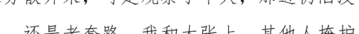

(145)

我连忙把那萨从水里找了出来，大张啪啪地抽着那人耳光：“兄弟醒醒，兄弟，起床了，天亮了。”

我赶忙阻止他：“丫的干嘛呢，情报没抢到你再就把他的活活抽油。”

我简单的给那人处理了下伤口，看来是被锋枪子弹洞穿的大腿，似乎并不致命，不过不知道他受伤多少时间了，希望不会因为过多太早的死去。

“呼”还好，那家伙长出了一口气。

那人迷离地看了我一眼，缓说道：“你们……是……”

“我是你爷爷的……大张这个家伙就要要事了，我赶忙把他处理掉。

我们是洪先生的朋友，在家里找了他很久了，你知道他去哪里了吗？你们是被谁袭击的啊？”还是要演一遍的。

“洪老爷被掖带到……”那人刚说点什么，突然问他看到了大头，那语气就不对了：“你们……不是洪老的朋友……你们是勘探队……你们不该来这里的。”

我一看，又露出苦了，这该怎么办。

这时那人竟然拼命的从口袋里掏出一个玻璃瓶子拿到在我们面前。我们以为他在掏枪，哗啦哗啦把枪口都指向我们脑门上。

那家伙并没有理会我们，只是另一手唾沫指着那瓶子对我们说：“……咬……咬…………”

“什么意思，咬什么？！”我把枪拨开，抓起他的身子使劲看着：“你说什么呢！咬什么？说明白点！”

这个时候，地下突然的一声声出一根钢筋一样的东西，吓了我们一跳。

众人连忙撤撤：“这是什么东西！”

只见钢筋一样的东西竟然活了的一样，忽的又变的柔软了，但是它的速度却旧奇异，一下缠绕到地下的脖子上，我可以明显看到，那钢筋竟然像生长进那脖子里一样，竟然和那人融合了一起，接着那里传来了一阵胡鸣。

再看那人，脸抽出，皮肤迅速的开始起来，整个人躯向脖部位置收缩，在短短几秒内那人的身体竟然被那钢筋状的东西完全吞了进去，没有任何身体组织留下！

所有的人都呆了！站在那里他们不知道什么！之前群众的失踪竟然是这样发生的，而且发生在我们眼皮底下。钢筋一样的东西在吸收完人之后，又搜索我们这边，谁也不敢乱动，被这个东西横勒可是事情，忽的一下那东西竟然嗅到了我的面前，直冲着眉心，我差点把槽坏，手里的长刀已经绞了。


胖的，看来刚挨了一场揍，旁边的几位下手也被绑在了一旁，看来眼镜大哥早就杀全军覆了。

不知道为什么，纳绰没杀他们，似乎不像之前那样留活口。

作者:猪头大拿 日期:2009-01-16 17:14

(149)

两批人都面面相觑，大头的眼睛里似乎要冒了，瓮笼路窄，虽然某某写义又上上说我们现在都是人家的盘中中餐，可是有些事还是要说说道道的。

眼镜大哥看到他们，似乎非常惊讶，尤其是他看大头的那眼神，像见了鬼一样。

一天似乎炙得没命，他瓮底坐到眼镜大哥面前，双眼直睁着眼镜大哥，戴着手套双手伸回来看着。

“老儿，没想到我们在这里见面了吧。”大头的语气透着些阴毒。

“我当然没有想到我们能在这里见面，我甚至都没想到你还能活着走到这里。”眼镜大哥的语气不知道什么时候又恢复了那种孤寂。

“那帮你们说来说吧，我们侦探队的营地到底发生了什么事情，你又对我做过什么手？”大头开门见山。

眼镜大哥并没有回答他们，而是仔细地打量了我们每一个，他看人的眼神犀利惊人，看得我有些发毛。

大张不乐意了：“你的看看，你你就赶忙说，都死临头了还装什么大尾巴狼啊，我家楚楚问你话你就老实回答，别妈妈再受皮之苦。”

眼看这形势有些些上火，双方的人这就都攒着手要动手。

“且慢动一下”眼镜大哥对着大头说了，“这位兄弟，你的眼睛不要死盯着我，你的手锤也不要在我面前按照心跳频率规律晃动，你都是些小儿孩的把戏，我都懒得得破你。”

大头有些不好意思，看来这个心里暗示是有意的，大头这里进来就握手昆屁的，感情已经下了手，可惜，对方不是什么善者，要是普通人还真说不定就得了大头的道。

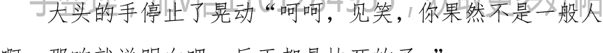

大头的手挣停止晃动，“呵呵，兄弟，你果然不是一般人啊，哥只是说明明白吧，反正都是快的了。”

眼镜大哥又跟我大张一眼：“看来我小看你们了，我原本以为你们就是普通的蹦探伙，没想到，你们竟然是特工。”

他转看向大头：“我也低估了你，以为你只是优幸从那营地事故中的幸存者，没想到你竟然是个老练的心理暗示者，我疏忽了，你年纪比大了。”

这个眼镜大哥果然不是一般人啊，看我们眼里把我们底摸了个大概，看来要小心应对了。

“梦杀师，你果然是梦杀师，看来我也小看你了。”大头不想弱，直接周出对方老底。

眼镜大哥轻蔑的一笑：“知道的真不少，毫无疑问，你是资深的心理暗示者，是优秀的催眠师，你说我是梦杀师，我不否认，只是我这梦杀师的水平就是个中下级别，可你却不过我，这不怪，这是行业的差距，如果高级的梦杀师参与我们的话，我想也没有必要把你们卷进这天的烦事了。”

我心里暗了，感情最高级的催眠师还不如一个中下级的梦杀师，这都是从属关系。

“少壮蓝，抓谎，哥们没时间逗你这老眼镜在这里里托，不是我贵你嘴喇子就废活了，什么梦杀师催眠师的，他们都成人的俘了还在这里论资费吧。”大张依然倔强。


眼镜哥哥并没有聚会大会，而是看了外面一眼：“我看向纳涵一会还愿还不我们，我们就大家讲讲这事情的来龙去脉。”

作者：猪头大拿 日期:2009-01-17 17:19

(150)

“讲之之前，我先声明几件事情。”眼镜哥哥还满领导样子，“首先就是我们并不是敌人，其次，我们并没有杀害你们的任何一个人，这就是我要说的。对于可信与不信，那全靠看你们自己，反正你们目前最大的敌人就是纳、纳涵，如果大家想在这里动手，请先考虑好实害关系。”

我们和大张点头同意，当然，我们心里没有一个相信他的。

“事情比较复杂，说起来会很长……”眼镜大哥开始了他漫的回忆。

我们洪家在江南一代小有名气，一般称自己洪家道，n我们生于南周，兴于大唐，多年来一直都是商贾户，我们家族历来都是从商，不从政，这样的习惯传承千年，直接没有改变。当然，经商只是表面的事情，其实我们家族最大的收益来源就是所谓的斩除弥源，也许你们可以说我是所谓封建迷信，但是有一件事你们却不能否认，那就是不管在任何时代，任何国家，都会有或或少的人听闻过事发生，而伴随着这些事件，总会有某种形色的穿插其中。当然，这世界上并没有所谓的魔，我想如果给这些东西起名字的话，我们家族在接近几千年的与这类怪物打道的历史上，逐渐发现这些东西来源，并不是动物精魂，其实是某些人类在受到刺激后，或者是经历某些事件之后，身体会发生变异，他们会有杀戮本能，严重伤害我们的世界。”

眼镜大哥跟我大张一眼：“位，我才发现你们身上很有微弱的异常，当然不是说你们就是怪物，只是说明你们身上有些血缘与祖先当中，有人经历过这类变异。”

我跟大张没有任何回答，只是心里明白。眼镜大哥也不追问，而是继续给我们述：“父亲，我们所做的意义有多伟大，我们的初衷是为了金钱，我们也有原则，绝对不会黑一方。你们知道催眠师是通过暗示、语言等手段对人类心理进行毫无的引导，从而达到催眠的目的，可是梦杀师的作业原理暴力许多，他们根本不需要这些引导手段，因为他们的大脑存在干扰脑波的功能，他们可以控制自己的脑波与别人的脑波进行协调同化，从而达到暴力入侵思维的能力，这很可怕的技术。最基础的梦杀师可以很容易迫别人说出心中的秘密，稍微高级一点的，就像我，我可以强迫性的让人忘记某段记忆，不要以为遗忘比记忆更容易，其实遗忘才是上帝对人类最大的恩赐，作为人，谁要是不会遗忘，那么他的一生都是沉重悲哀的，这是事实。”

虽然还有更高级的梦杀师，就有些女孩了，我也没见过，听过他们能在梦中杀人，他们强行损害别人大脑，完全关闭别人的意识，把人变成一具没有灵魂的植物物，也就是说他们具备杀死灵魂的能力。当然，我们洪家并不是单纯的宗教组织，我们也有相当规模的科学家在为做相应的服务，我们并不相信灵魂的存在，高级梦杀师所做的我们理解为强行关闭别人意识的超级人类异能。”

“真的吗！大哥你还要不要吗，您看我合适吗？”大张张的看着。

眼镜大哥点了点头：“这不是在学烧肉，谁都可以，想做梦杀师必须有超级脑部力量，科学研究表明我们通人的脑部利用率为1%~2%，直到达到4%的人可以称为天才，由于因斯斯坦的脑部利用率可以达到13%~15%，而通过测试，我们组织内最高级的梦杀师可以达到脑部利用率7%~9%之间，这就达不到高级梦杀师的水准，也就是梦杀人的水平。而我本人，最高到过6%，你这位兄弟，我看你大三哥，口无虚拦，我估计你的脑部利用率不会超过1%，所以你是没有这个希望了，不过你也不必遗忘，天才在人类比例中不超过百万分之一，至于能够达到梦杀师。”


即便身为霍家直系，各个方面都算输，这些人有可能成为世界上最强的梦杀师，他几乎没有缺点。至于梦师，社会上知的并不多，只有在很老的文献中才能偶尔看到关于他们的记载。我们从历史也可以知道，曾经有很多帝王突然暴毙，没有任何先兆的死亡或者成为植物，其实这些事件相当一部分就是梦杀师为，我们家族也有这类技巧，不过想要学习这项技术，必须具备天生的超常脑力。也许我刚刚说过大脑的话有些过，但是事实却是如此，普通梦杀师对人的入眠能力比顶级的催眠师有差距，虽然你说可能不服，但是在事实上，可是实施方法上完全不同。”

“我并没有什么具体的，我就是说我们人类本身就是一个谜惑，我们从哪里来，为何生，我们生存的意义，都是谜惑。人类文明在千年之前爆发，然后成为这个星球的主宰，这并不是偶然，而是我们的祖先肯定是受到了某些外力的引导，才使得我们进步的如此快，这叫科技爆炸。那又疑惑了，我们是受谁的引导吗？是谁传给了我们祖先方面的科学与技术，这些未明的秘密又是为了我们，到底是为了什么？”眼镜大哥的眼神有些发亮。

奇怪的是，在我们统治地球以后的几千年中我们人类的技术并没有太进步，只是到了现在，也就是欧洲的工业时代才开始的。我们又迎来了一次科技爆炸，蒸汽，电能至核能等各种巨大的能量为我们所运用，我们又进入了一个前所未有的发展时代，与千年不变的男耕女织彻底告别了。”

“你觉得人类这类复杂的生物体系是天然形成的吗，我们每一个人的复杂程度远远超过这个世界上任何机器，而且我们人类文明渺小与这个宇宙相比，就是与我们地球的年龄相比，甚至一瞬间都算不上！这些你承认吗？”

“你的意思是？”

“我并没有什么具体的，我就是说我们人类本身就是一个谜惑，我们从哪里来，为何生，我们生存的意义，都是谜惑。人类文明在千年之前爆发，然后成为这个星球的主宰，这并不是偶然，而是我们的祖先肯定是受到了某些外力的引导，才使得我们进步的如此快，这叫科技爆炸。那又疑惑了，我们是受谁的引导吗？是谁传给了我们祖先方面的科学与技术，这些未明的秘密又是为了我们，到底是为了什么？”眼镜大哥的眼神有些发亮。

奇怪的是，在我们统治地球以后的几千年中我们人类的技术并没有太进步，只是到了现在，也就是欧洲的工业时代才开始的。我们又迎来了一次科技爆炸，蒸汽，电能至核能等各种巨大的能量为我们所运用，我们又进入了一个前所未有的发展时代，与千年不变的男耕女织彻底告别了。”

“你觉得人类这类复杂的生物体系是天然形成的吗，我们每一个人的复杂程度远远超过这个世界上任何机器，而且我们人类文明渺小与这个宇宙相比，就是与我们地球的年龄相比，甚至一瞬间都算不上！这些你承认吗？”

“你的意思是？”

“我并没有什么具体的，我就是说我们人类本身就是一个谜惑，我们从哪里来，为何生，我们生存的意义，都是谜惑。人类文明在千年之前爆发，然后成为这个星球的主宰，这并不是偶然，而是我们的祖先肯定是受到了某些外力的引导，才使得我们进步的如此快，这叫科技爆炸。那又疑惑了，我们是受谁的引导吗？是谁传给了我们祖先方面的科学与技术，这些未明的秘密又是为了我们，到底是为了什么？”眼镜大哥的眼神有些发亮。

（此处重复）

“你的意思是说纳粹已经完全掌握了这类技术？”这是最坏的事情。”

“不，纳粹并不可能完全掌握这样的技术，他们只是有所研究而已，他们虽然能够生产出怪物，却是做不到随心所欲，他们应当是在古代遗迹中获得了比较的DNA序列，才在经过无数失败后生产某些并不完全的生物兵器。情报的显示与历史上的情况相当吻合，纳德国的科技似乎是在一九三八年左右爆发的，他们从一个战国成长为世界上属于一二的军事强国，可能与在这里的发展脱了干涉。我们一年前就受到派遣，非洲搜寻，一直没有结果，直到最近，才发现了这里，我们并不是组织上第一批来的，确切的告诉我们是第三批人了，前两批人都大部分都神秘的消失在这个诡异之地，知道为什么吗？”

“为什么？不是被那些怪物吞了！”看来眼镜，这里早就被摸得不透了。

“因为我们当年研究这里的时候，不慎把遗迹基地的保卫者激活了，那些遗迹保卫者疯狂攻击我们进入这片范围的任何生物，所以我们纳德国当年不得遗弃他们花了心血造的这个地下基地。”

“到底是什么样的东西？如此厉害？”西方传说中，他们把这样的生命做成洛皮卡龙是非常狡猾的类昆，大概三英尺高，用我们的说法是一米左右，它们有四腿以及双臂，这里的奇异生物与非常相似


他们周身覆盖着坚硬甲壳，但是他们并不是刀枪不入，只是行动诡异，他们的嘴部组织非常奇异，能够伸出至少十五米，而且会分泌出一种致命的物质，一旦这种质侵入血液，那么人体整个系统就会产生强烈的化学反应，类似于化学实验中的升华现象，而且他们的舌头会变得非常坚硬，甚至能刺穿钢板！他们通过这样的行为，快速使用吸管一样的嘴巴，把人的整个组织吸掉，这个过程快得惊人，绝对不会超过二十秒，你们看到的人类失踪，就是因为受到这这类生物的击杀！

“如果是这样的事情？”大头的侦测一点都没有错。

“DNA 是什么？”生物密码，生物遗传密码，五十年代初才有科学家发现所有生物都有这类密码，一个人如何生长，完全依赖这个个体藏在我们身体内的DNA，也就是说这个密码决定了生物的发展方向，他成长什么样，他性格都是由决定的。”

（重复）

“这怎么可能？用人体发展兵器！人类身体本身成为兵器，才是最完美的，生物兵不需要工厂，不需要弹药补给，只需要食物就能完成很多士兵完成的任务，才是最终的兵器。”

“可是人类怎么变成所谓生物兵器，而古代人又是怎么开发这类兵器的？”

“就技术而言，也许现在也讲通，但是讲通并不代表，如同古代的天文学家，他们没有任何现代科学的基础，却依旧能够描绘星空变化，准确的测量出日月升落，估算年度，古人或许不会被现代科学限制，但是古人可以在不断的实验中开发出理想的东西。”

“如同一样，那是一种病毒导致的物种变异，我们现在也没有完全解释其成因，却一点也不影响古人运用这样的技术，时期就会发动过大规模的。这就是技术与应用上的不同，我们现在更倾向于技术发展应用，而古代则是应用发展技术，也就是说先应用了某些东西，才有研究它是怎么生成的。”

“这就想不通了，技术究竟是有人开发的，难道还真的是史前科技或者外星文明？”

“人类是谁开发的？”眼镜大哥突然来说一句，问的我哑口无言。

“人类是自然形成的啊，这需要开发吗？”我的回答有些心虚。


“西的袭击？”

“我想你们肯定是被非洲洲尾蝙咬过，所以才能逃过一劫，而外国人却大部分都失踪了，因为那西非洲绝对不会主动攻击被非洲蚊子咬过的人，不论什么时候被咬喉的，就像疫苗一样，永远有效。这也是为什么非洲当地人很少有失踪的，这里当地人被这种蚊子咬就如同我们在中国被普通蚊子咬一样普遍。当然这并不绝对，除非你主动招惹他们。所以我们的人都随身携带这样的红蚊子。”

“可是你的一支队刚就在前面赶路被怪物袭击了啊！”

“哎，那个人之前注射过抗毒素，我以为只要咬了他就没问题，没想到——眼睛的眼神神有些诡异。”

“对，我在地面上第一个被咬袭的部下是从国外长大的，最近刚回，他之所以被咬大大概是因为没有被红蚊子咬过！”卡松又想了起来。

大张张听到这里了，赶忙找。我们在眼镜大姐的狙击小队那里发现的骷髅瓶子，只是被手铐缚着，伸不出来。“我操，还没咬我呢，着急急，刘爷爷，帮帮我，拿那个小家伙咬我下，他妈妈安心。”

“大个，你不用担心，你身上有异者的气息，我闻得出你身上的味道，你这样的人，我们组织里也有，他们同样不会袭咬你的。就是我们组织里像你这样的人，才把最后的情报传达给我们的”。眼镜大哥赶紧安慰大张。

“您老可别扯了，我老张家八辈子贫中农，可没你说的这这么邪乎，哈还是保险点吧。”大张并不买他的帐。

“那我们的勘探队到底发生了什么事情，您给我说下成了吗？”大头趁我俩忙活的时候，赶紧忙问上了话，差点忘了打正事，似乎忘了咱老远远远跑非非洲来干什么了。

“你们勘探队自从这里起，我们注意到了这里，这里当地人也有我们组织的眼睛，我们也看出你们是普通的地质勘探，只是越走深入这边，我们本想阻止你们，但是鉴于我们的秘密身份，也不太好直接的阻拦你们，当你们走到基地上的时候，已经惊动了这里的怪兽，当我们想要教教你们，你很可惜，晚了一步，你们还是被这些怪物吞噬了！你真幸运，被毒蛇咬过，所以你没有死，而且我们看到了当时的情形，我是可怜你，不想你日后生活留下什么阴影，二是保密需要，所以我人的切断了你的记忆，又安排我组织的当地的人在小镇里做了些操作，希望引导你们的救援队不要再进入这个是非之地，可惜的是我没看出你们是特工，我失算了，还是把你们引了进来，惭愧，小错了同行。”

“可是绰奈怎么在这个时间起来的。”

“这远最近波动的厉害，我们感受到了这里的磁场变化，才找到这里，绰奈作为当年这里的主人，肯定在这里还有更秘密的计划，他们似乎已经完全控制了这里的局势，而且……”

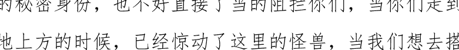

他们还复活了一名纳希秘密部队的大人物！”

“复活？大人物？那个纳希将军吗？”

“卡尔魏德曼！”

“卡尔魏德曼！那不可能！1850年他就该死了！”大张似乎知道这个人。

“特的是1850年死的，作为欧洲历史上最臭名昭著黑魔师以及占星师，不过这个人身上的奇异已经超出了我们的想象。”

“怎么不可想象？”

“我不是很了解，只是听到过他跟不存在于这个世界的生物达成某种妥协，无论我们怎么杀他，每隔一段时间，他都会复活，我们的组织就是1850年杀的他。”

我愁念到了那空扭曲机的对面，难道那里不是这个世界？

“遗迹的磁场怎么会自己变化？”还没等我们继续讲，大头又把话题转到遗迹上。

“因为遗迹可能是活的！”

“哈？你说和蓬莱一样？”大张一听，张嘴就出。

我赶忙拍他：“什么蓬莱，你妈妈脑子又进水了？”

眼镜哥哥突然谨慎地注视着我们：“你们看过蓬莱？”

“什么蓬莱，我们从蓬莱港出发的。”我赶忙着圆谎，蓬莱毕竟是绝密的事情，不能随便乱乱。

“哦，这样，我估计你们可能也不可能进过蓬莱仙岛。”大张明白起来。

“您老净开玩笑玩，这世界上哪有什么蓬莱仙岛。”大张。

“你们两个不用给我在这里演双欢，我知道你们肯定对所谓蓬莱是有过的了解，你们不愿意，我不强求，现在我们唯一要做的事情就是反击纳呛！”眼镜大哥的神情又聚散发了光芒。

他对卡松抽出说道：“兄弟，你别在这里捏了，把你从手铐里抽出来，我知道你做到的。”眼镜大哥赶紧给卡松缩骨术，我看着你脖子上的纹身就知道你并不是厉害，而是足够的。

卡松的手如同魔术一样，一下从手铐里抽了出来，大张看着瞪呆。

你衣领有暗格，里面有一个小家伙，我想你是可以用他的。“愿意效，不过先可以吗？”卡松还是满分的。

“当然可以。”眼镜大哥开始为我们打开，大张像看外星一样：“大老爷，你不用担心，你身上有异者的气息，我闻得出你身上的味道，你这样的人，我们组织里也有，他们同样不会袭咬你的。就是我们组织里像你这样的人，才把最后的情报传达给我们的”。眼镜大哥赶紧安慰大张。

“您老可别扯了，我老张家八辈子贫中农，可没你说的这这么邪乎，哈还是保险点吧。”大张并不买他的帐。

“那我们的勘探队到底发生了什么事情，您给我说下成了吗？”大头趁我俩忙活的时候，赶紧忙问上了话，差点忘了打正事，似乎忘了咱老远远远跑非非洲来干什么了。

眼镜大哥看到雷总以后明显的惊慌了，等了一会他缓过来，双手握住雷总的手，样子有些谦恳。

“小弟运来，还请先生多教。”这个眼镜大哥语气已经完全没有了前面的傲慢。

他对卡松抽出说道：“兄弟，你别在这里捏了，把你从手铐里抽出来，我知道你做到的。”卡松的手如同魔术一样。眼镜大哥赶紧给卡松缩骨术。

“贵姓雷天鸣，请问您怎么样？”雷总依然如泰山。

“刚才你们说的话我都听到了，原来是大水冲龙庙，我们国家解放后一直希望能与你们取得联系，只直找不到你们，晓得洪家的各位英雄都去哪里了？”

远处，冯保罗带领着士兵整齐地站在大卵裂口处，四个集装箱都被打开了，里面的东西也不知道了。

“话说实话，我们现在大部分都居住海外，不知道雷先生是怎么搞到这衣服的？”

“你们的枪放在外面，出去准备好，我们时间不多，下面将是一场硬硬的战斗，都去准备，在这里与先生讲几句话，都去吧。”雷总招呼我们。

“你们两个不用给我在这里演双欢，我知道你们肯定对所谓蓬莱是有过的了解……”眼镜大哥也同样把他的人叫做出来。看来领导给这位同学们上上教育课了，我们也不好拒绝，纷纷走了出来。

出门一看，大家伙，雷总已经悄无息的瞬间干掉了看守我们的四名纳粹士兵，这几位都是脑浆炸裂，死状凄惨，我心里感慨，看来这些纳粹士兵也会受到雷的干扰，也许后面的战斗应当相当轻松了。

大张就要撇过去捡纳粹士兵的防毒面具，我赶忙拦住他：“不要命了你，这些人身上有炸弹！”

“哎，呲，对了，刘爷爷你不说我还没认了，他奶奶的。”大张这个脑子我还怀疑0.1%的使用率也不到。“刘子，我就有点闷了，你说你们伙儿怎么不在水坝那儿，偏蹲这里来？”

“你听爷爷的话，咱们对付这些玩意，基本都是自给，你觉得他老人家同时对付接近三十这样的家伙吗？你这个脑子是不是使用率为0的？”

“去，可以说，我还没准备望远镜大师傅，到时候我就想准就准就准了。”

“思，以你的天赋，我相信，经过不懈努力，下十辈子后应该能当他徒弟了。”

“拨开，远点，有多远远，爷爷！”大头跟眼镜大哥的手下上了交情，他正与一个个子不高的小伙们聊天：“我说兄弟，你们这个个弹可有些不人道啊。”

那个伙摇头：“和我们作战的根本就不是人，谈什么人道，你这不是扯吗？”

大头吃个闭门羹，有些尴尬：“是，是有点扯。”

卡松正与手下准备着枪械，他似乎有些兴奋，其实我们都一样，在这黑暗中被压抑了久了，如今可以光明正大的出来干一场，其实也是一件快事。终于忙完了，喝了个天昏，卡松又回来了，给各位支持。

“雷先生，我希望和您几位一起。”雷总望他一眼：“少尉，这太危险，你的兄弟已经牺牲了不少，我绝对不能让他冒险了。”

“这样的事情发生在我们的国土之上，我有义务站在最前沿，而且我希望能够亲自为我的兄弟报仇，纳将我们起来，我亲自带领我们前路，并没有很好的隐藏地点，我们充到那里，应该是好的办法。抓住时间，他们身上的炸弹我已经处理过了，从纳粹士兵身上取样本，回去化验他们的成分。”

“是，”雷这才放心的把卡松脱了纳粹制服。

“他们真的不死吗？”我问。

“哼，不死？这种做的根本理论就是新陈代谢加速，使得肉体能够承受巨大的力量与变异刺激，要是不死了，即使做什么，寿命也不会超过五年。他们在被改造成功的这段时间，想要杀死他们，必须破坏他们的脑组织，你看他们脑袋里那块金属壳，都是钛合金，用通用枪几乎不可能了，不过只要接触到他们的面部，就可以瞬间破坏他们的大脑与他们协调到最大，我的能力在他面前就如同溪流遇到大江，实在难以比喻。他不接触这些士兵，也可以在远处破坏他们的大脑，真没想到我们的祖国还有这种奇人……”

老考感慨着，我心里想：“了大老爷，您可别吸，你要是知道咱们祖国里还有一个，还不得把吸下来啊。”卡松不知道什么时候脱了纳米制服穿在身上，王数理。

雷总有些敬佩地对卡松点了点头：“好的，你的国家，我的国家，你的族族，我的民族，我们同在世界上之上，我们也会有些落后，也许我们会有些贫困，但绝对不是我们低头的理由，那就让我们一起证明我们的荣耀，黑人的荣耀，黄人的荣耀，军人的荣耀，今天让我们来实现荣耀！”

两个人的话告诉我们热血沸腾，我哗啦啦拉了拉手中MP40冲锋枪的枪栓，没有任何问题，我潇洒洒地把它扛到肩膀上：“走”，哥儿几个，咱们今天就要为荣耀而战！”

雷备，大张，卡松加上我们四人，穿着纳粹的制服，前面带路，由于个头高矮不一，有些搞笑，希望纳粹看出我们是敌人时，我们已经接近他们。距离之间能够接近他们，希总告诉我们那些这些战士的脑袋都被奇奇怪怪的钛合金草包裹着的，如果不能接近到二十厘米之外，我们的战术只能快速近纳粹，进行突然袭击。

迈出隧道口，眼前的景象让人难以置信。没想到他们那修罗地狱的地下连接着这样的美丽之地。这里有岩，有水，有草，有花，天空晓得得什么物质在散发着耀眼的阳光，足足四个足球场那么大的地下湖泊碧波荡漾，那湖水上空似乎有的驾着一道彩虹，而湖泊的周围是一片布各种奇怪色彩花的草地，那花与草足……

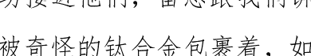

半高，当微风吹起，各色的花瓣染着蒲公英飞舞，我们如同置身童话场景，风轻轻拂着，一切都是静谧，这如梦境的地方早就被纳粹建成，地下湖中停满了U型潜艇，湖泊之中还有一艘巨大的，我们没见过的奇怪舰艇，即使是二十年前，外壳依旧旧黑斑。

“这不是蓬莱吗，怎么又开来了！”大张尖。

“像是，并不是蓬莱，蓬莱是金属材料，而且太大了。”我出了区别，“纳粹还是一一套的产品，这地下可能连接着大海，自由出入。”

“什么？”冯保罗一行人的注意力全部集中在那大卵之中，他们并没有注意到我们的到来，我们逐渐接近。

“听我命令，大张，你给我这个年轻人的脑袋，小刘，女孩交给你，卡松少尉，打败德国将军，其他人控制，等我命令，一起行动！一击必杀，绝对不能给他们反击机会。”他们大概一米左右。在我们即将走到攻击距离的时候，大卵当中突然传来一阵巨大的吼叫，同时女孩的哭声更大了，已经近似嚎鸣了。冯保罗突然变得非常兴奋，他振臂高呼，像是成了某些大事。雷总赶忙让我们放下枪：“不要着急，我看到底看看什么东西！”冯保罗等人都跑进了大卵之内，右门口只留下了两名统宰卫。我感觉雷总身上的压迫感猛增，还没我们继续感觉出两名统宰士头部几乎同时发出了响，他们就这样悄无息地干掉了。我们赶忙把尸体拖一旁，一切都在转间完成，我心里长出了恶气，坏事的打算了他们一个！“什么？”大张一步就跨了进去：“里面？”我们随后跟着了进去，里面都是密密麻麻的六边形墙而甬甬，我立刻有些头大，这构造就是那蓬莱差不多。“我操，真的邪得很，跟那倒霉的蓬莱里面几乎一样。“啊！”大张也和我头大。的确如此，这非洲地下的布置几乎和蓬莱如出一辙，而这块地板，分明与水中长安的一样，这是怎么回事？“不要研究了，我们还是跟随纳粹吧，这些东西以后再说。”雷总催促着我们。我们赶忙进入，贴墙边缘，紧紧追随着纳粹的步脚。而整个隧道里面早就乱成一团，那奇怪的MP40暴豆一样的声音彼此此起，那奇怪女孩的尖叫越来越大了，冯保罗得意的笑声也越来越大，整个内部空间早就就被未明的士兵的千军万马，看来纳粹对这些生物的爆发早就蓄谋已久。我怎么也想不到，我第一次与这地下隐藏的奇怪物冲来的是如此突然。我一扬，一个身影一下彻底出来了，快让我根本没分辩是什么，一个小小的东西和我撞结满了！我脚到地上仔细一瞧……

顶迅速跑过。

“永远都不理咱们才好呢！你可记住这些小祖宗，万一真找上咱们，可就麻烦了。”

那灵异声越来越近，让人听了如同针扎了心脏一样，说不出的不舒服，我们一路小心摸索，终于追追上了纳粹的脚步，来到了那家伙的中心地点。

作者：猪头大拿 日期：2009-02-05 20:12

放眼一看，我们的敌人都在，冯&#183;保罗与那奇怪的将军兵们站在一起，纳粹士兵的冲锋时刻不停的扫射着周围接近的怪物，当然，纳粹最强力的助手还是他们擅长移动毒造的奇怪怪物，那巨大的蟒犬以及两巨大的白色的鳞虫，看起来他们对称对这些怪物的研究可不是一年两年了，那疯狂的三头猎犬来回咬着任何接近他们的怪物，虽然有多只怪物的头部刺破自己的身体，可是洪大灭口中的腐化生物组织的现象并没有如期出现，那狗似乎越咬越狂胜，任众众多怪物的攻击，毫无畏惧，真是奇特的生命形式。而那两只大螨虫也一样凶忍，他们像是许多倍的蜗虫，皮肉肉厚，根本不害怕任何攻击，纳粹生物兵就直躲避在他们身后，像活动的沙包，而且这两只大螨虫嘴里还会喷出血雾一样的东西，看样子应该是巨毒，任种碰到血雾的怪物都如同被咬了毒菌的苍蝇一样倒在地的。

最为麻烦的是冯&#183;保罗几个人面前的东西，一名看上去才十一二岁的金发少女女孩裸着身上在他们面前大声地哭号，奇怪的是我们看不见她的下身，她的下半身整个都裹在一个金属笼子里，而那个金属笼上面满画着锐刻的纳粹徽章。

除了那对男女，我们看不到其他任何人的面目，他们都戴着面具，冯&#183;保罗与那将军正在用德语对那女孩说话，看着语气是在安慰那女孩，而那女孩似乎什么也听不懂，只是在那里放大声，而她身边，一只足有三米高，戴着翅膀的巨大飞龙已经被纳粹整的怪物撞得体无完完，这样的形形相奇……

“你别说，这纳粹整的业务还挺全面，他还妈妈顺带带卖女女呢。”大张在雷雷身后小声嘀咕着。

枪声似乎逐渐地停了过来，看起来这个大卵内的怪物并不多，怪物的尸体围绕着纳粹组成的一个鲜血圆环，散布着残破的怪物体，这个形势在不好判断，我们在门外连一点大气也不敢出来，谁也不知道接下来还会会有什么样的怪事发生。

那女孩似乎明白了她的保卫者已经失去了对这个巨大天空的控制，她那类类似求救信号的哭号声已经变成了轻轻哭泣，冯&#183;保罗与那奇怪的将军依旧在耐心劝说着她，不知道出了什么目的，这些邪恶的纳粹竟然对这个女孩表现如此巨大的耐心与尊重。

这样的谈判似乎进行了很久，却没有任何结果，冯&#183;保罗似乎有些无奈，他回头对那年轻背脊奇异长枪的女人便立刻卸下后的长枪，在稍微调节一下后，对着地面上巨大蚂蚁怪物的尸体开了一枪。

过了一会儿，那个怪物的尸体竟然开始蠕动，我心里想这些纳粹真算不要命，人类受到那尸病毒的入侵之后会疯狂暴乱，他们竟然对自己的眼皮下的怪物尸体进行病毒注射，他们真的有控制这些东西的办法吗？”

眼见怪物就要活动起来，那个女孩似乎停止了哭泣，无疑是明了。而冯&#183;保罗仍对她说说着什么，根据她的手势，他好像在对女孩承诺着什么，应当是保证复活在场的怪物吧。

这个女孩还是真好坏，注射的剂量不够，明显的身体都是些蠕动，复活的架子还差，纳粹果然不是辛苦杀的怪兽。女孩最后还是对纳粹点了点头，看来她们达成了某些协议。女孩停止了哭泣，她伸手擦擦眼睛，深深吸了口气，似乎在准备什么。纳粹逐渐远离那个女孩，似乎在刻意避开。接着那个女孩身上开始逐渐变化，只见她身体开始发出强烈的金色光芒，伴随着雷鸣般的巨大吼，她身下的金属笼开始破碎了，那一刻闪耀得我的眼睛几乎睁不开。我忙护住眼睛躲入了黑暗中。这撕裂的过程并不长，只是一瞬间，当我再探出脑袋观察她的时候，却见到女孩脱离了金属笼，当时我非常奇怪，以为女孩应当也是纳粹留来的生物兵器，下半身怎么也是，没想到她的身体竟然和普通人一样，完全没有区别。只是我的眼睛再次接触到女孩身上，我内心处突然迸发一股近乎绝望的恐惧。

“你别说孩子还活着呢。”大张鼻子开始念叨，女孩忙从背包里拿出一套新的制服给女孩小心翼翼地穿上，而冯&#183;保罗与那奇怪的将军在背后满意看着这一切，似乎他们最终的任务已经完成了。

作者：猪头大拿 日期：2009-02-09

那女孩换上新的军衣，浑身透出一股高贵的气息。随着女孩的活动，整个天空内部的能量似乎都在流失，纳粹生物的墙壁逐渐暗了下来，雷总赶忙我们进了黑暗中的一个小房间。

“怎么办？”握着雷总，大张不敢放肆，不过看他摩拳腰的样子，平时早就开了。

“其实，那个小子比我们想象的得多。”雷总的语气有些焦躁。

“要不让大师的一刀试试？”大张仍按捺不住，这种人就是典型的越险越兴奋类型。

“说一句亏了你，听我的命令！”眼下的杂则是奇怪的组合，冯&#183;保罗与同样异德国将军，一对卓越的男女，再加上几个生物士兵，还有四只缝合怪物，他们像护卫者一样排列在那能力不明的女孩左右，没有一个正常的人。我们就站在黑暗中悄悄观察他们，在他们走出中心房之时，冯&#183;保罗对青年男子轻轻摇了头，男子收到了什么命令，摘下后的长枪站在了最后。

难道发现我们了？不应该，他们要是发现早动手了。我捏了一把冷汗，这家伙手里的玩意可不是什么善，里面的东西瞬间融化任何生命，他要对什么呢？当冯&#183;保罗众人走之后，只见那男子举起长枪，对那大蚂蚁怪物的尸体就是一枪。我很好，这蚂虫怪物本身就能分泌溶解生物组织的液体，他不是多此一举？怪物的尸体中中了这枪之后，竟然产生了新的变化，刚刚还在蠕动的腿脚竟然生出了青蝇，整个身体像着火了一样，竟然悄啦啦燃烧起来，虽然没有明火，但是过程竟然遥加速，转眼间那巨大的尸体竟然化为粉末，倒塌了。我暗暗吃惊，纳粹并不是单纯的复制了这样的病毒，而一步改进了他们，即使是原本带有细菌的本体也竟然感受到了，看来纳粹这二十来一点也没闲过，为了今天的事情他们可是费尽了心思。青年男子满意观察结果后，快速追了回去。

我们总是在黑暗中盼着黎明的到来，如今我们又到了进退两难的境地，和纳粹动手，雷总依然有所所愿，不动手，他们就要把那个奇怪女孩带走。自从进入了这非洲的丛林，我似乎已经忘记了黎明之前，不久被雷总所救时那瞬间的曙光，已经如同燃尽的蜡烛，又开始变的模糊起来。

“无论一会发生什么，一定要保护好卡松。”雷总对我小声吩咐。我非常不安地看了雷总一眼，我不想再问什么了，危机已经悄然觉醒到我们身边，我们最大的王牌似乎开始上了必死的信念，逼得我们。通过被破坏的外壳，我们可以非常清楚看到下面一行黑色的身影正行走在美丽的花丛上方，黑色的制服是如此异常，他们的存在，就像……

作者：猪头大拿 日期：2009-02-11

不好意思，有点事情，耽误了几天，我们不会放弃，只要朋友们支持，我会坚持下去，谢谢大家的理解。

作者：猪头大拿 日期：2009-02-13

不知道什么时候，水中趴着类似巨大的怪物开始启动了，它身上排出了一阵黑烟，而清澈的水下也有两盏灯闪亮了起来。随着女孩的活动，整个天空内部的能量似乎都在流失，纳粹生物的墙壁逐渐暗了下来，雷总赶忙我们进了黑暗中的一个小房间。

“怎么办？”握着雷总，大张不敢放肆，不过看他摩拳腰的样子，平时早就开了。

“其实，那个小子比我们想象的得多。”雷总的语气有些焦躁。

“要不让大师的一刀试试？”大张仍按捺不住，这种人就是典型的越险越兴奋类型。

“说一句亏了你，听我的命令！”眼下的杂则是奇怪的组合，冯&#183;保罗与同样异德国将军，一对卓越的男女，再加上几个生物士兵，还有四只缝合怪物，他们像护卫者一样排列在那能力不明的女孩左右，没有一个正常的人。我们就站在黑暗中悄悄观察他们，在他们走出中心房之时，冯&#183;保罗对青年男子轻轻摇了头，男子收到了什么命令，摘下后的长枪站在了最后。

难道发现我们了？不应该，他们要是发现早动手了。我捏了一把冷汗，这家伙手里的玩意可不是什么善，里面的东西瞬间融化任何生命，他要对什么呢？当冯&#183;保罗众人走之后，只见那男子举起长枪，对那大蚂蚁怪物的尸体就是一枪。我很好，这蚂虫怪物本身就能分泌溶解生物组织的液体，他不是多此一举？怪物的尸体中中了这枪之后，竟然产生了新的变化，刚刚还在蠕动的腿脚竟然生出了青蝇，整个身体像着火了一样，竟然悄啦啦燃烧起来，虽然没有明火，但是过程竟然遥加速，转眼间那巨大的尸体竟然化为粉末，倒塌了。我暗暗吃惊，纳粹并不是单纯的复制了这样的病毒，而一步改进了他们，即使是原本带有细菌的本体也竟然感受到了，看来纳粹这二十来一点也没闲过，为了今天的事情他们可是费尽了心思。青年男子满意观察结果后，快速追了回去。

我们总是在黑暗中盼着黎明的到来，如今我们又到了进退两难的境地，和纳粹动手，雷总依然有所所愿，不动手，他们就要把那个奇怪女孩带走，他们那邪恶未知的计划就要实现。自从进入了这非洲的丛林，我似乎已经忘记了黎明之前，不久被雷总所救时那瞬间的曙光，已经如同燃尽的蜡烛，又开始变的模糊起来。

“无论一会发生什么，一定要保护好卡松。”雷总对我小声吩咐。我非常不安地看了雷总一眼，我不想再问什么了，危机已经悄然觉醒到我们身边，我们最大的王牌似乎开始上了必死的信念，逼得我们。通过被破坏的外壳，我们可以非常清楚看到下面一行黑色的身影正行走在美丽的花丛上方，黑色的制服是如此异常，他们的存在，就像……

作者：猪头大拿 日期：2009-02-11

不好意思，有点事情，耽误了几天，我们不会放弃，只要朋友们支持，我会坚持下去，谢谢大家的理解。

作者：猪头大拿 日期：2009-02-13

不知道什么时候，水中趴着类似巨大的怪物开始启动了，它身上排出了一阵黑烟，而清澈的水下也有两盏灯闪亮了起来。随着女孩的活动，整个天空内部的能量似乎都在流失，纳粹生物的墙壁逐渐暗了下来，雷总赶忙我们进了黑暗中的一个小房间。

“怎么办？”握着雷总，大张不敢放肆，不过看他摩拳腰的样子，平时早就开了。

“其实，那个小子比我们想象的得多。”雷总的语气有些焦躁。

“要不让大师的一刀试试？”大张仍按捺不住，这种人就是典型的越险越兴奋类型。

“说一句亏了你，听我的命令！”眼下的杂则是奇怪的组合，冯&#183;保罗与同样异德国将军，一对卓越的男女，再加上几个生物士兵，还有四只缝合怪物，他们像护卫者一样排列在那能力不明的女孩左右，没有一个正常的人。我们就站在黑暗中悄悄观察他们，在他们走出中心房之时，冯&#183;保罗对青年男子轻轻摇了头，男子收到了什么命令，摘下后的长枪站在了最后。

难道发现我们了？不应该，他们要是发现早动手了。我捏了一把冷汗，这家伙手里的玩意可不是什么善，里面的东西瞬间融化任何生命，他要对什么呢？当冯&#183;保罗众人走之后，只见那男子举起长枪，对那大蚂蚁怪物的尸体就是一枪。我很好，这蚂虫怪物本身就能分泌溶解生物组织的液体，他不是多此一举？怪物的尸体中中了这枪之后，竟然产生了新的变化，刚刚还在蠕动的腿脚竟然生出了青蝇，整个身体像着火了一样，竟然悄啦啦燃烧起来，虽然没有明火，但是过程竟然遥加速，转眼间那巨大的尸体竟然化为粉末，倒塌了。我暗暗吃惊，纳粹并不是单纯的复制了这样的病毒，而一步改进了他们，即使是原本带有细菌的本体也竟然感受到了，看来纳粹这二十来一点也没闲过，为了今天的事情他们可是费尽了心思。青年男子满意观察结果后，快速追了回去。

（注：由于OCR文本存在大量重复和乱码，以上部分内容已根据逻辑进行了去重和纠错处理）

是最好的朋友，如今竟然变成这样人不是人鬼不是鬼的模样，哎，执着了时候也不是什么好事情了。”

“其实这场争夺的胜负就已经注定了。”洪生悠然又言出惊人。

“您这话什么意思？”我望着这位洪先生。

作者：诸侯大刀 日期:2009-02-15 10:12

“保罗对于这类远古遗产的研究确实已经是站在了这个世界的最顶端，他甚至通过技术手段把自己改造成为最顶尖的异者，他也相当相当一部分成功了，不过，造物的奇迹恰却是我们能模拟的，我们连苍蔓窟都模拟不出来，他要把自己模仿成世界上最大的存在，他已经输了，因为洪先生是天生的最高异者，他不光单纯的具备力量，他更具备一个正常的正直，善良以及人性，这些看似柔弱的东西恰恰是我们人类最宝贵的遗产，让他让我们坚定信仰，让他让我们勇气倍增，等着看着吧。”

洪先生的话说很久很久，那边的怪兽似乎已经出了胜负，只见那三头猫大举举着个大脑袋，正在那里长吼，像个得胜的将军一样。而那两只虫一样的怪物，早就已经被抓成两堆烂肉。

雷总把手向后背，似乎在宣告一场战斗的结束，那大狗早就乖乖地回到了了一边，一个劲狗朝着保罗呼呼着。

冯保明显然不能接受这样的事实，他一气竟煞到雷总面前，他黑色的面具与雷总那发红的眼睛差不到两米。

“可怕的能力，我劳一生的研究竟然不如你，上帝真的不公平，该死的上帝为什么要这样对待我们的元首，这样对待我们的民族，这样对待我！我不甘心！比脑波动，你厉害，但是你能承受得住的拳头吗，尝一一下我的日月铁拳吧！”

雷总并没有动作，而是那样如芒松一样站在冯保明面前，他似乎根本没有听见冯保明的威慑。

冯保明说着就要朝雷总扑，就在这时洪生的王磊的声音传来：“快点住手！挥了这么多拳头还嫌不痛吗？”

冯保明看着洪先生一眼：“洪，我们的恩怨一会再算，这儿轮不到你插槽！”

“还不明白吗！你面前的这些人对于你来说他就是神！知道向神挥拳的后果吗！”

我有点搞明白洪先生的立场。

冯保明的拳头虽然高高举起，却怎么也挥不出来，雷总那红的眼睛一直盯着他。

“怎么了？身为世界上最优秀的种族对我等等的黄人竟然挥不开拳，可笑吗？可怜吗？你还想说点什么？杀了我？来，拿出你的勇气来。”雷总开始看向冯保罗。

“你！你！？”保罗矮着脖子，却没有任何异动了你这下等的混蛋，这怎么可能！”

“够了，收起你那些没用的理论，白人，黄人，黑人共同拥有这个世界，谁也别想征服，就算此时，我可以让你的身体屈服，只是你的精神仍在反抗我，历史又一次的告诚世人，古有蒙古人横跨欧亚，现法西斯征服大半个世界，结果又如何？这么多生命换来的教训还不吸取吗？”

“领导，你跟你的说什么什么道理呢，暴露了你，这样的二小，早死早生实在实际了！”

“如果你没有什么话对我说，那么请上路吧，我没心情把这样的人带回去审问，至于那个怪猴子我会自己解决的。”对于这样的人，雷总终于到了杀心，我不清楚这个保罗到底有多少大本事，单他就能跟雷总对峙这么长段时间，也说明他仿佛像那些普通怪物一样不堪一击。

眼看雷总想要下手，洪先生突然出面拦：“雷先生，手下留人，他毕竟与人从小一起长大，让我来解决。”

作者：诸侯大刀 日期:2009-02-16 16:03

雷血红的眼睛侧了了一下：“洪先生，我可以卖你个人情，但是你必须考虑清楚，眼前这个人已经不是我们的同伴，他的身体与心灵早就成就了魔鬼，我的脑波动对他进行协调压制并不是看上去这么容易的，现在我一旦放松了可是不堪想象，”


而且他身后那巨大的舰队中还有更为加深黑暗的力量在等待着我们，你要考虑清楚。

“洪，你不需要为我求情，元首曾经说过，自由散漫的西方文明如不自强迟早会被你们这些纪律严明的东方人击跨，作为帝国的军人，我已尽了自己的责任，让他动手吧，给他个痛快！”

洪先生不忍地望着保罗：“保罗，这么多年了，你依然没有改变吗？”

“改变？我早就改变了，我为什么要把自己的身体养成这个样子的，我在获得力量的同时各种因素因为身体排斥的因素响的疼痛在折磨着，知道为什么变成这样吗？”

“因为恐惧！因为我们在洪家时所产生的恐惧，我并没有为了钱卖过你们，当年我们围剿一只巨大的豹变异者，被他们物理计算，我的行动队全部被那家家伙杀了，是你的二哥，也就是洪家二少爷在关键的时刻救下的我，他用自己的命换回了我的命，他临死的时候只嘱咐我一句，那就是要变强，不惜任何代价的强大，不要让我们再次生活在恐惧中！”

“你说什么？我的二哥是因为你才死的？？？你是你出卖了他们！”

“我小时候因为体差，母亲把我送到洪家学习武术，希望改善我的体制，你的父亲看我天资聪颖，用心传授我各种术与技巧，我们兄弟一起长大，在我心里，当我二哥死在我面前，我唯一的愿望就是变强，这个世界还不明白？所有的亲情，友情，各种美好的感情，如果没有力量的护佑，一切都是空谈，看着二哥死在我面前，我却无能，实在是太重了。”

“这就是你所说的理由吗？为什么要投咎？他们是世界上最邪恶的，罪孽，你为什么？”

“什么是正义？什么又是邪恶？元首带领的国家，我们是民族的骄傲，他把民族推到了世界的顶峰，不管这样的道路是血筑成的还是累积的，无所谓，一切都是为了自身，我没有理由拒绝这种邀请，这些事情永远都不可能战胜的力量笼罩着你的心灵时，你可以感受到恐惧，绝望以及恐惧吗？你就必须变的更强！今天让你知道什么是强！”大张满意的站起身，又想上来拼命。

“够了！”雷总制止了大张，又回头看向保罗：“不是我不明白，你的战友为什么放下她离开了？那个女孩子到底是什么人？”

保罗轻轻的一笑：“啧，并不是他们抛弃了我，是我离开了他们。我把身体改造成为这副模样，获取巨大力量的同时，我的机组织也受到了相当的伤害，即使我什么也不做，我也在这个世界上再活过三个月，你们以为那黑孩子能把我拉下水吗？对于家族的使命，我已经完成了，我只想留下来和洪家的人叙叙旧，我也不希望你们这些糟包子混进我们其他的基地当中。洪家雇佣兵，一行四十五人，还有五个不明身份的中国和非洲探险队一人，还有六人，我对你们的情况早就非常清楚，我只是确定下一个。”

“那女孩是什么人？”

“哼，告诉你们也不妨，那是神与贾利安人的完美的结合，看到那边的巨大的卵了吗？那是超过我们人类历史的文明遗迹，而且这样的东西在世界上到处都有存在，那里记录着大量的我们之前所未闻的科学探索，每一个卵里面都有一个天然的主宰，他的位置就如蜂巢中的女王一样，她拥有无比的力量。根据我们的研究，这些东西应当在里面成长，成为世界上最强大的生物武器，只是不知道为什么里面女王的胚胎一直处于假死状态，似乎完全没有发育，我们建立了潜伏部队在这里，我们立刻开始了研究，我们从中获取了巨大的科技成就，当我们发现女王的秘密后，便试图控制这一切，我们用雅安人的婴儿巧妙的嫁接到她王后的胎里，从而产出能够控制整个卵的生命，我们的实验相当成功，只是在七岁的时候，那女孩的情绪出现了相当的……”

（注：由于OCR文本存在大量重复和乱码，以上已根据语义逻辑进行去重与修正）


卡马达安详地眯着眼，就那样静静地躺在病床上，医生告诉我们，他仍活着，只是不知道什么时候能够醒来，也允许下一分钟他就可以睁眼睛，但是也有可能他就这样永远沉睡下去，直到生命的终结。

望着我们曾经的战友，我一度产生了迷茫，也许保罗说的对的，这个世界上什么是正义，什么是邪恶，这个界限又是谁来划分的？

雷总站在病床前，轻声对我说：“坚定自己的信念！”
看到卡马达角的微笑：“歪了吗？”他没有你这样的迷茫，所谓正义，就是勇气，就是力量，就是用生命与鲜血换取的尊严与恐惧，卡马达已经用了他的勇气，用了他的力量，用了他的血。王迎，提取了许多血直至生命向我证了他的斑绚事实，证明了他的荣耀，来自非洲的荣耀——……”

作者：猪豪大拿 日期：2009-09-23 14:22

## 坦桑尼亚6508 事件报告

坦桑尼亚6508 侦探失踪事件是我们部门 091 成立以来第一次于境外执行特别任务，工作总结如下：

- 091 9组组队行员建少群与赞比亚在1965年7月中于非洲坦桑尼亚与赞比亚交界雨林深处神秘失踪，只有他一人生还，现确定该事件同样是不明生物袭击所为。
- 袭击者为类似西方传说中的科洛皮卡龙，该生物金色四足，周身金色甲壳，左手为骨质盾，右手为巨大的爪，擅长打洞，群居，生活方式有明显的群居昆虫性，阶级分明。值得注意的是该生物咬击人类的特殊方式，该生物舌头是最有利的武器，可以伸缩长度高达15米左右，而且具备相当的刚性与韧性，当该生物舌头呈现刚性特质的时候，根据保守计划也能穿洞30毫米以上的钢板。令人惊讶的是该生物通过舌头能分泌出一种能够快速分解人体组织的奇特细菌，当被咬击目标该生物舌头所咬击，一旦细菌与人类血液溶解，便会产生巨大的化学反应，使人体组织在短时间内溶解，该生物同时会将目标组织吸入体内，整个过程不超过二十秒，从而造成了我们看到的人类秘密失踪事件。

## 第一手资料，加号110128495 在非洲多

根据接触，该生物行动诡异，擅长藏于洞洞及村梢之上对目标进行，其本身的防御能力并不出众，已知的现有武器均能对其进行有效伤害，是这样隐秘的对手，对于不了解特性的人类而言，其伪装也是相当可能的。此外该生物具有明显的侵略性，经常攻击人类，而其活动范围相当遥远，远离雨林的小镇也在其活动范围内。

该生物一而易见的特点是他并不会主动攻击被非洲红蚂咬伤害的人类，这也是少群能作为勘探队唯一的原因，正是因为当时被非洲红蚂遭受伤害的人，他才没有在咬击中受到攻击。非洲红蚂在当地狩猎，几乎所有的当地居民都被该生物伤害，这也是失踪事件很少发生在当地居民身上的原因。

以上即我们勘探队在非洲受损的原因。

作者:猎头大拿 日期:2009-02-23 14:24

## 坦桑尼亚 6508 事件报告二

随着失踪事件的调查深入，我们同时发现还有其他方面势力卷入其中，其中纳粹国王秘密的兴登堡队肆戮与我们不期而遇，这是我们091成立以来第一次与该组织发生正面冲突，该部队装备精良，作风凶悍，被世界各国别部门视为对世界最大威胁的势力。

第一次接触该组织人员我们在当地旅馆内，由于在上厕期间被科洛皮卡龙袭击，组员刘思远并没有看到该真人真面目。


当我们准备进一步侦察的时候，该组织另外两兵赶到达，由于他们并不确定该身份并没有发生冲突。

新赶到的两人为二十左右的欧洲裔，金发碧眼，相貌应是血统纯正的利维亚人，这些人应该是当年纳纳赛婴儿计划的成果，德国战破20年后正是他们成人的时候，根据各国通报，最近也是黑先生最活跃的几年。

这两人武装奇异的长枪术，根据后来我们所受袭击的武器，该枪械为远程针剂射击武器，其中男性成员的针剂为类似科洛皮卡龙舌头分泌的奇怪细菌，可以融化生物组织，女性成员的针剂为类似发现的病毒，可以复活已经死去的生物组织，这两个人在日后的行动中为我们造成了相当的麻烦。

同时，我们还在当地发现了了纳粹德国留下的大型地下基地，该基地集科研与生产为一体，我们在里面发现了了大量的纳粹德国的末日科技，其中包括行走机械、圆盘形飞行器、类似空间扭曲的金属机械、各类战斗机器人、各类奇异生物样本。可以信当年纳粹在该基地曾经进行过大规模的研究，至于这些东西的来源，稍后述。

## 纳粹遗产—行走机械

行走机械，装备为人类机械，主要装甲厚为三十厘米，主要武器为旋转MG42，威力异常，其形态并不是为了战斗，应当为特种作战设计。可以信纳粹在该基地曾经进行过大规模的研究，至于这些东西的来源，稍后述。

这种机械，理论上讲，这样的兵器应当具备更佳的敏捷性与地形适应性。

## 纳粹遗产二—盘形飞行器

圆盘形飞行器，只是全尺寸模型，至于纳粹对此设备开发到怎样的程度我们还未知。根据外型来看，该设备更像是某种磁悬浮技术，这里不再详尽分析。

## 纳粹遗产三—空间扭曲

空间扭曲设备，该设备的理论基础早就存在了，只是需要克服细节。纳粹竟然能够制造这样的设备，然而我们无法解释。当他们尝试调试设备时，控制上有明显的指示，同时还发现了类似说明的文件。文件上还存在大量的各国首都以及军事基地的照片。根据我们的情报，当时各国首都或者重要军事基地均发生过异常，根据这些事实，有理由相信这类事件与纳粹的空间扭曲实验密切的关系。最重要的文件还有一处雪山中的黑色城堡，至于是什么地方，待查找。

## 纳粹遗产四—生物士兵

生物士兵有两种，第一种是当年纳粹还在该基地研究的，这类生物很可能受到了西方传说中神奇魔法影响，可以长年不死，虽然活动能力有限，但是可以确认这类生物保留了人类的情感，他们的肌组织已经处于死亡的状态，但是脑部依然活跃。根据我们推测，这类生物应当受到微量不明病毒影响，从而减少能量消耗，达到不需要补充能量就能存活的状态。

第二类生物士兵比第一类不同，这类士兵拥有人类完全的能力，肌肉与头部缝合在一起，具有类似人类的力量与防御能力。我们携带的56式步枪对其进行杀伤，甚至更具破坏力的弹药其射也没有任何效果。该生物似乎完全切断了人类脑中疼痛系统，几乎对任何攻击完全免疫。从生物士兵身上提取的肌组织分析，混合了人类细胞、癌细胞、鼠疫菌还有微量的放射元素，具备相当的韧性以及再生能力，新陈代谢速度比普通人类明显得多。对于这类士兵的生成，就值得我们探讨。

就这类士兵肌组织分析，这样的生物组成对于人类来说只能用脆弱来描述，但不影响该生物的特性。我们都知道，像老鼠类的生物能够在非常极端的环境下生存。

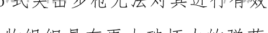

它们可以在最脏的地方正常的生活，天生就具备对各种威胁人类病毒的免疫能力，而且适应性惊人。当年美军在日本投下原子弹之后，人类因为受到辐射影响死亡或者留下了严重的后遗症，但是老鼠能在这种高辐射环境下成功的存活，甚至有人发现过猪大的老鼠。也就是说，某些生物在恶劣的环境下不会灭亡，而是迅速地促进身体产生变异，进而适应这样的环境。纳粹这类生物战士的方法很明显就是利用此类原理，他们把人体组织混染大量的有害细胞、病毒，然后用足够量的放射性物质照射，从而促进人体组织的变异，使其在这种环境下获得足够的力量与生存能力。其实这种原理理论上任何国家都可以模仿，只是需要大量的实验才能做到，所以放眼整个世界而言，没有任何一个国家敢违背基本的人类道德基础进行这项研究，但是纳粹却可以不顾这些道德进行研究，这也是他们生物技术远超前的根本原因。

作者：猪头大拿 日期：2009-02-23 14:26

## 纳粹遗产—复活的秘密将军

我们在探索中发现纳粹进行一场神秘的复活仪式，遗憾的是我们并没有搞清楚这类仪式的原理，但是纳粹的确是把至少在棺材中埋了二十年的个体复活了。根据保罗透露的信息，这些人是纳粹德国末期的精英指挥官。

他们装备了最先进的Me262喷气机，性能超过当时各国所有战斗机。
Me262喷气机：
- 速度快240%
- 爬升率高达70%
- 火力为P51的7倍以上

整个部队有25名王牌飞行员，战斗机平均损耗在50架以上，总计达到100架。这种设备，我们可以将其定为莱莱生物战舰的金属小型化，至于这样的设备具体有怎样的能力，我们还不能完全预知。有限的接触来看，似乎并没有发现该舰船上装备规模的武器，该舰船具体用途很可能是用于大型设备的长途隐秘运输，其具体地并不了解。不过可以确定的是，纳粹在世界上还有其他的大型秘密军事设施，应当引起我们的足够重视。二战结束已经二十年的今天，法西斯的阴影仍在笼罩着我们的世界，希望能够通报世界各国的特务军事方部门，以我们091单独的力量，目前而言是难以对该进行更加深入细致的调查。

## 纳粹遗产九

我们在深入纳粹遗留调查时，发现当地存在一种神秘超级古代遗迹，该遗迹外型巨大，类似卵形，外表破碎，为科洛皮龙生物类的巢穴。值得注意的是，该遗迹并非科洛皮龙生物制造，而是远古时代遗留物，也就是说科洛皮龙仅是作为该遗迹的保卫存在。根据我们的发现，纳粹已经在该遗迹中获得了相当可见的机械与生物技术情报。可以相信，纳粹这些超前的生物与机械技术大部分与古代遗迹有关，至于这些遗迹具体是什么，我们没有任何发现。

最重要的文件还有一处雪山中的黑色城堡，至于是什么地方，待查找。

## 纳粹遗产—缝合怪兽

缝合怪兽这类生物并不复杂，把猛兽的尸体通过手术术连接，然后通过僵尸病毒对其注射，达到激活生物的能力。这种血管以及肌肉组织的连接会导致相当的费力，这类生物显然没有智慧。

## 纳粹遗产—DNA遗传

改造生物的复杂程度还要缝合怪物大多。根据内部介绍，该生物运用的是了一种所谓的DNA技术。这种技术西方最早于五十年代发现并提出的，对于我们来说还是一片空白，甚至很多生物学学生都没有听过。理论上说是控制生物生长过程，也就是说DNA是怎样排列的，就会按照他的描述生长。

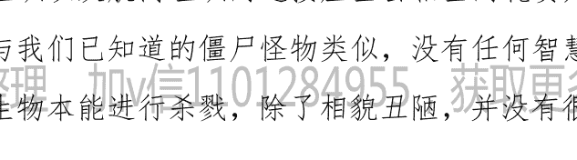

我们所见的如同驴子那么巨大的头犬就是这类实验的产品，它完全是活生物，肌肉组织相当发达，同样具备超强的新代谢能力，而且非常听主人的话以及了解主人的心意。

巨大的潜水艇，该型号外观，黑色金属外壳浸没在地下湖中时间好二十年，并没有明显的遗迹。具体材料不明，动力完全模糊，但我们怀疑其外型奇异，类似于我们曾经过的生物战舰莱莱，我们可以把它定为莱莱生物战舰的金属小型化。

## 纳粹遗产—巨大的水晶

地下湖泊的神秘光源，地下洞穴天顶，有一处不明光源。这种光芒非阳光，这种光源是一块巨大的蓝色水晶。这块水晶是整个生物遗传的能量主体。整个生态环境优美，地下湖泊照处的蓝花，地下千米的地方依然出生各种鲜艳花朵。

## 纳粹遗产—随机变异的生物士兵

生物士兵有两种，第一种是当年纳粹还在该基地研究的，这类生物很可能受到了西方传说中神奇魔法影响，可以长年不死，座于各个之处，虽然活动能力有限，但是可以确认这类生物保留了人类的情感，他们的肌组织已经处于死亡的状态，但是脑部依然活跃。

## 纳粹遗产—空间扭曲（续）

空间扭曲设备，该设备的理论基础早就存在了，只是需要克服细节。纳粹竟然能够制造这样的设备，然而我们无法解释。当他们尝试调试设备时，控制上有明显的指示，同时还发现了类似说明的文件。文件上还存在大量的各国首都以及军事基地的照片。根据我们的情报，当时各国首都或者重要军事基地均发生过异常，根据这些事实，有理由相信这类事件与纳粹的空间扭曲实验密切的关系。

## 坦桑尼亚 6508 事件报告三（补充）

物体已经被随境带走，这块光源根据我分析，应当为相同物体，这类东西是整个生物遗传的能量主体，至于该物体是否有其他作用，还不明确，只是各类特事部队或神秘组织都在费心地寻找这类物体，它应当有相当的作用，这些还希望情报部门彻查。

作者：猪头大拿 日期：2009-02-23 14:30

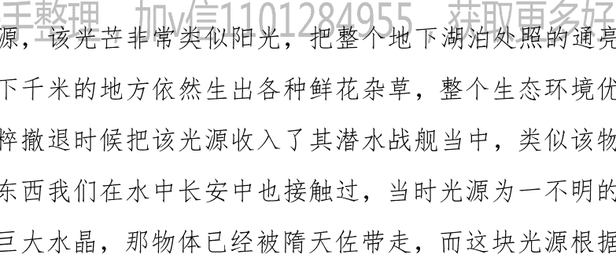

## 坦桑尼亚 6508 事件报告三

## 洪教

单纯从组织名字上看，或许我们会认为这个组织是一个宗教类组织，其实该组织并不信奉任何神灵，是一个完全的雇佣兵类团体。该组织产生于我国春秋时代，他们一直以商人名义秘密地与各类从事不明生物事件打交道，从中收取巨额的报酬。他们组织分工严密，有自己独特的战斗技巧与传统手段，同时还有相当的科研部门。我们历史上著名的屠杀者就是该组织分支机构的特殊战斗员，该组织尤其在心理催侮方面很有独特的技术，他们似乎在很久以前就对人类大脑利用。根据从民国特别部门缴获的档案，该组织在清末开始向全球发展势力，其主要业务已经向国外转移。我国在解放后我们国家的经济和环境已经不适合组织存在，所以我们在国家层面已经查明了该组织的身份。这次是在非洲洲，估计他们已经收到了欧美等国家的委托前来处理。根据其带队的运气来迷露，该组织也掌握了相当的生物技术情报，我们建议应当对该组织加强，并与其合作，毕竟我们所面对的敌人远无法超过我们的控制范围，这类合作在今后的工作中非常重要。

以上就是坦桑尼亚6508 事件报告，总来说这次任务很顺利，虽然有不小损失，但是纳粹的秘密仍然没有开启，这些都是今后工作中值得注意的地方，希望在今后的工作当中能够完成任务。

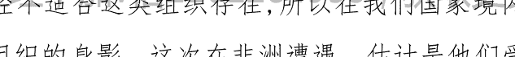


起的。

转到了国庆节，不平凡的1965年就要进入最后一个季节了，从非洲回来以后，我们组的确是闲了一段时间，大家分析分析报告，研究研究案情，并没有太多的波折，而雷总与其他几位组长在组织材料，他们准备出国参加一个特别的会议。

也许大家第一次听说这样的会议，简单来说这是一场世界性别事务部队以及组织的通报会议，知道内情的人都叫它阳光会，第一届阳光大会于1950年在日内瓦举行，当时我们091并没有参加，只是后来才得到，每年都去参加，那是一个很有意思的地方，你可以看到美国中央情报局的局长与敌联组织首脑的官员握手，你也可以看到阿拉伯人首领与以色列人的友善握手，那是一个没有政治冲突与国家利益区分的地方，即使在冷战的最顶峰，各国的情报部门以及世界各地类似家道的都会派人到场，大家会通报一些棘手的事情，毕竟打交道的事情对我们普通人是不理解的，在对未知事物的恐惧支配下，人类还是相当一致对外的，我不说各国通报情报的诚信有多大，但是，这样一个组织的存在，无疑是世界上每个国家都没有坏处的，之所以以名为阳光会，也许发起者的初衷是希望我们能像阳光一样洒满在这个世界上的所有阴影吧。而雷总他们就是准备启程参加这样的会议。

我虽然名誉上生物研究员，其实我对生物学的知识也实在只是个皮毛，我们各个任务所得的信息以及样本都会交给091专门的科研部门进行分析研究，各类事件之后的报告，绝大部分也是这些专业的研究人员所分析，至于大张，负责什么知识的皮毛也不具备，好在他是保卫员，更可以名正言顺的不参加任何研究工作。

过了没几天，他们已经结束了行程，随着几位领导的活跃了不少，不在家，猴子称王的王意的，我们毕竟也是普通人，整日守着脸色色像扑克一样的领导自然会有很多打算，如今大家终于可以放松一下心情，领导不是，团长也不是和我们一起闹，没有什么紧要处理的任务，我只能用四字形容当时的情形“溜溜达达”。

虽然放一说也只能是心情上，其实我们心里都绷着一线，因为谁谁不知道，明天又会有什么样的事情在等着我们，我们还没退休养老的时候。

经过了非洲的磨难，大张对大头的态度明显好转，他对大头再也不横眉冷对，而是更是兄弟，整天缠着大头教他怎么把人整进女厕所，而大头却是爱学爱静的，被大张突然的热情非常地火锅找到了我的宿舍，还有点。

一日周末，大张拎了鸽窝吃蛋，每个月要花生米与猪肉汤，这家伙吃粮食是出了名的，每个月要花钱。

我是救了他，不知道早就饿死多少回了，看来这回这家伙几个月的工资又花的差不多了。

“老大，咱能省点钱吃吗，今天是月底了，别过两天喝西北风。”写字台一收，酒肉一摆，又开始了两个人的吹牛打屁生涯。

“我省谁哈，我爹妈都是工人，有钱，再说吧不知道哪天就找马克斯报销了，为老人家奋斗这么多年了，去的时候空手也不算什么，来着。”

“得，走着，她的，你别俩傻凑，老爷们整天呐哈，最近非闲了，领导也不在，你别说这惬意的日子还有点过不习惯。”

“恩，是有点闲，俩的难受。”

“田姐姐没你一下吗？”

“那个神婆子，整天弄古书在办公室看看看的，比她爹亲亲亲，还有时间闲着我，我也不愿意理她，这叫无敌最寂寞，英雄孤单孤，左眼，右眼，眨眼间爱谁谁。”

“两盏下了，你有点高顶，典型的不能还能爱够。”

“是无闲了点，得找点乐子，咱俩这就注定不甘平凡吧。”

“找什么乐子？要不要自己去放映室看电影？”大张两眼一亮。

“得了吧，那放映室闲什么，全他妈资料纪录片，除了死人就是怪物，你是真的没看还是怎么的？”


“了吧你，那里有故事片，还是内参的，那天我听九组老张指挥几个老家谈论情节呢，咱级别不够，人家不给畅放。听说有露腿的。”大张对于这些事情总是有有些天生的敏感。

“真的假的？”

“哥什么时候怎么跟放映室的人说？他能给畅放吗？”今天都休息了，就一班的。”

“嘿嘿嘿嘿，我早就打好了，放映室上上班的是新来的新兵蛋蛋，谁也不认识，咱怕就充首长去轰唬他一下，没问题，包我够了。”

“成，大不了不来了，走着。”

“呵！”大张打了个酒嗝，“咱怕不去大姨，这样吧，我去把大头拉过来，别让丫的整天看书学了，你把田姐姐叫过来，到时候别让丫的不心使命同志。”

“你大爷的，你的感情这情翁之意在酒里，你自己怎么不去叫田姐姐。”我终于明白这小子的打算。

“啧，我一纯徒们，就算对田姐姐有什么想法也不能低头去求她，是兄弟吧，是兄弟就去把这事情给我办妥了，再说了，咱俩都不像领导，大头那样的才像领导，我教他怎么蒙那放映室的新兵蛋蛋，要不要教，你又办不了，抓紧吧。”大张还有节理。

“得，你找对象老子给你跑腿，帮你闹一回。”

“好，很好！小鬼，很有前途。”

“去玩去！”已经是晚上七点多了，早就黑了，我一路小跑，跑到办公楼下，小田办公室竟然还亮着灯。

敲门进入，小田看到我有些惊讶。
日期：2009-02-24 17:36

“咚，你什么风把灯关了，”小田看到我有些惊讶，以为大张撞上了。我还没说话，小田先抓住我，一手问：“你最近好吗？”

“不知道，大张要来，陈部长准备了。”

“不，不来，不累了，走着。”

“呵！”大张打了个酒嗝，“咱怕不去大姨，这样吧，我去把大头拉过来，别让丫的整天看书学了，你把田姐姐叫过来，到时候别让丫的不心使命同志。”

“你大爷的，你的感情这情翁之意在酒里，你自己怎么不去叫田姐姐。”我终于明白这小子的打算。

“啧，我一纯徒们，就算对田姐姐有什么想法也不能低头去求她，是兄弟吧，是兄弟就去把这事情给我办妥了，再说了，咱俩都不像领导，大头那样的才像领导，我教他怎么蒙那放映室的新兵蛋蛋，要不要教，你又办不了，抓紧吧。”大张还有节理。

“得，你找对象老子给你跑腿，帮你闹一回。”

“好，很好！小鬼，很有前途。”

“去玩去！”已经是晚上七点多了，早就黑了，我一路小跑，跑到办公楼下，小田办公室竟然还亮着灯。

敲门进入，小田看到我有些惊讶。
日期：2009-02-24 17:36

“咚，你什么风把灯关了，”小田看到我有些惊讶，以为大张撞上了。我还没说话，小田先抓住我，一手问：“你最近好吗？”

“不知道，大张要来，陈部长准备了。”

“不，不来，不累了，走着。”

“呵！”大张打了个酒嗝，“咱怕不去大姨，这样吧，我去把大头拉过来，别让丫的整天看书学了，你把田姐姐叫过来，到时候别让丫的不心使命同志。”

## 第一章 逃离计划

随着电影结束，放映室的灯亮了，小田看着我，有些奇怪。

我们两人来到放映室，大张和大头正在等着。我们一看，觉得不对，问大张：“小子搞什么鬼？陈部长呢？其他人呢？”大张一脸严肃：“部长说我们等。”

这天空空中城市出现了短短几分钟，就就天空消失了。

“等，等了，”小田看着我，有些奇怪。

“等，等了，”小田看着我，有些奇怪。

“等，等了，”小田看着我，有些奇怪。

“等，等了，”小田看着我，有些奇怪。

“等，等了，”小田看着我，有些奇怪。

“等，等了，”小田看着我，有些奇怪。

“等，等了，”小田看着我，有些奇怪。

“等，等了，”小田看着我，有些奇怪。

“等，等了，我们等了，”大张皮脸地说了实话。

“等，等了，”小田看着我，有些奇怪。

“等，等了，”小田看着我，有些奇怪。

“等，等了，”小田看着我，有些奇怪。

“等，等了，”小田看着我，有些奇怪。

“等，等了，”小田看着我，奇怪。

我们两人来到放映室，大张和大头正在等着。我们一看，觉得不对，问大张：“小子搞什么鬼？陈部长呢？其他人呢？”大张一脸严肃：“部长说我们等。”

这天空空中城市出现了短短几分钟，就就天空消失了。

“等，等了，”小田看着我，有些奇怪。

“等，等了，”小田看着我，有些奇怪。

“等，等了，”小田看着我，有些奇怪。

“等，等了，”小田看着我，有些奇怪。

“等，等了，”小田看着我，奇怪。

我们等，等，，，，，，，，，，，，。。，，，，，，，，，，，，灯了。

我们两人来到放映室，大张和大头正在等着。我们一看，觉得不对，问大张：“小子搞什么鬼？陈部长呢？其他人呢？”大张一脸严肃：“部长说我们等。”

这天空空中城市出现了短短几分钟，就就天空消失了。

“等，等了，我们等了，”大张皮脸地说了实话。

“等，等了，小，看着我们，有些奇怪。

等等，，，，，，，，等了。

“等，等了，我们等了，”大张皮脸地说了实话。

“等，等了，”小田看着我，有些奇怪。

“等，等了，”小田看着我，有些奇怪。


距，为什么同样的人会勇敢坚强，会有人胆小情弱，以前会有人说是教育因素，成长因素，社会因素，但是有科学家却不这么认为。有这样学说，人的胆量与意志取决于人类在对危险状态时候体内分泌的肾上腺素的分泌程度。我们都知道通过肾上腺素调节心肌、增高血压、活化交感神经、运送葡萄糖给肌肉、促进肌肉的活动来应对压力或危险，它可以瞬间给人带来强大的机能提升和恐怖的爆发力。有人面对危险时，其体内的肾上腺素分泌水平高于正常许多，这样的人是天生的英雄，而普通人的分泌能力很一般，甚至面对危险时会机能失调，导致昏迷等负面状态，这就是其理论基础。

“钱总，我不明白，这样的理论有其依据吗？”
“呵呵，所谓关系就在其中了，所谓勇敢，是人类分泌肾上腺素能力高低决定。所谓大恶人的体内会有某种物质分泌与人不同的物质，至于是什么，科学界还没有定论，应当是某种激素，这样的东西一旦在人体内存水平高的话，那么人就相应的暴虐。而当对于传说花的研究就在此，此方架构并不是专门设计的，也会有斩首之类的阵列，当有极端恶毒之人的鲜血流到绞架之下，就会可能滋出这样的花朵。我认为，这样的花不是传说之花，而是当某些普通植物吸收了这类所谓恶人体内所分泌的残暴激素才导致的变异。如果这样理论成立的话，你们想象一下，要是供养如此多的曼诺罗花，这里面得埋多少人？”

作者：猪头大拿 日期:2009-03-03 09:58

钱总又让我反复播放了影片，中途多次定格，而我们的的心情也随之紧张了起来。如果如钱总所设的这样，这个奇怪的城市绝对不是什么好地方。这看似简单的外表下面至少了上万人。”

“我实在看不明白，这画面背景有些过于模糊了，你们看着这城市周围，是山峦还是……都是灰蒙蒙的，而且这进城市的古代人，这个面部轮廓太模糊了，是没有脸还是王主？真实的看不太清楚？对，你再仔细看着。”

“钱总，我也不行，我也看个大概，不过这些出城市的人动作有些奇怪，我说不了与人不同，总感觉觉得别扭，只是直觉，也许是错的。”

又是一番讨论，南海南海，资料传说，各种意见，不过最终也没有讨论出所以由来，除了那个奇怪花被确定下来之后，没有任何进展。时间不早，首长们安排我们散会，明日如今，今天看来只能到这里了。

晚饭过后，钱总突然派人把我叫他的房间，看来这个开小会的习惯并不是钱总一个人才有的？

“钱总，您有什么指示？”开门见山，我们也不需要太……

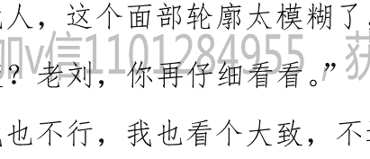

“过多，最近看麻烦都不小。”

“小刘，你对那段影片有什么看法吗？”钱总习惯性的扶了下眼镜。

“领导，我是真有什么什么线索也不用大老远的给您送过来了，我真是一点头绪都没有。”

“说实话，海市这座这个东西即使是普通的影像，你要对比查找我都是难上加难。何这样的古代城市，我还是说我的看法，先准，我不认识所谓时间穿越后的景象，毕竟这样的东西在科学界没有什么定论，我们必须从相对客观的事实出发。我们中国大陆早就全部解放，相应的地方人类早就开始，并且没有任何报告显示有这样的地方，也在但是没有报告显示并不代表没有这样的地方，我们目前所做的探索工作还不够细致，很多地方并没有达到，也许这个城市就在某个原始森林或者戈壁深处。我第一意见就是这个城市是客观存在的，但我不能保证他就就在这戈壁当中。”

“第二，很显然，这个城市从有限的画面看，都是古代情景，你会吃惊，我也很吃惊，但我刚仔细考虑了一下，我觉得出现这样的景象并不是可能的。我们曾经假设这个地方建成之后，在某一个时间点，突然与外部世界隔离，从而导致出现了文明断层，他们接触不到外面的世界，而外面世界也把他们遗忘，所以就出现了这样的情况。我们外界的人，受着科技的成果，汽车飞机，电灯电话，他们仍把文明停留在几百甚至千年以前，应当是合理的解释。至于这个城市为什么与这世界隔绝了，那还要你去探索索索。”

我把脑袋点得跟蜗虫一样，这些组长，一个一个果然不是省油的灯。

“第三，这是埋尸地，看那些花，我也不好估算城市门口埋了多少体，而且这个城市的人有些奇怪，这些都是直觉，我的意思是你们找不到这个地方，如果找到一定要小心。”

“第四，也就是为什么找你单独谈的原因，我看过你们组的报告，接触过叫隋天的人吧？”
“啊？你认识他？”听到说完，我愣了片刻。

“呵呵，”钱总笑了，“别紧张，那人是挺厉害的，不过我不认识他。之所以单独找你，是因为规定没有特殊情况，我不能向其他人透露，当然你还有更深层的原因。”

“领导，难道这件事跟隋天还有关系吗？”
“不，并没有直接关系。说起来，有点长，我回国以后，承蒙军长的信任，直接接到了现在的位置。在总部期间，我几乎查阅了所有文件，不过都是一遍。既然突然出现了古代城市，我就想起这个人来。我记得隋天曾在某个时间，好像是日本投降后，应当是1945年深入某山区追击了两个月，圆满完成任务。材料上还有刚出来的一张照片，这不算什么奇怪的，所以我并没有意的，但是那张照片有些意思。这个人的军服早就烂了，只是他身上裹着一些东西，当时我以为他腰上类似的东西，应该是少数族的古代铠。这个人会不会曾遇到这个地方呢？那份报告里面并没有提到这个城，我觉得还是线索少，我不清楚这份报告的细节了。陈部长去电话，让他出来给你们看看，我看你们不必在这马兰说了，从这里里查不出东西来的。”

“钱总，您真是帮我们解决麻烦了，改天请您吃饭。”

钱总摆了摆手：“呵呵，跟我这老头客气什么，回去休息吧。我去跟部长汇报，估计这会张大个子也得跟你们打交道的经验传授给你，你真想请我改天的。”

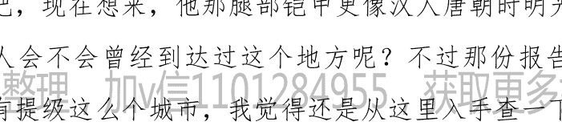

“得，都是传说的，领导还是早些休息吧，我回去练习一下，争取春节给您献上。”我撇了嘴，起身敬了个礼。

“呵呵，去吧……”

作者：猪头大拿 日期:2009-03-07 13:23

一夜无事，第二天早上我们便接到团长命令，转路陕西白河县，资料已经由其他人员带到那边，我们要去汇合。军令如山，匆匆与钱总以及马兰的同志们告别，我们又转路陕西。又是一次折腾，总算赶到了集合地点。我们在县城招待所里，机要员半天就能到达。

15组的小栗与九个兄弟，暗后从小自己的公文包内取出一份档案，整整的档案贴着封套。按照规定，只有我们7组的签字才能打开。我签了字，然后小李小心翼翼地撕开包，而小栗他们很有趣地退出了我的房间。

大张、小田、大头与我，我们四人聚在一起，开始看这些民国时期的文件。与我想象中不同的是，整个的过程并没有复杂的。那一份民国留于1945年秋天的材料，其中描述了日本南下派遣一支破坏分队在国家战败后不甘心命运，带着一批重要的军事机密文件转入大山准备进行长期的游击战争。而隆天佐带队深入大巴山，最终杀了日本分队的队长伊藤秀树少队，取得重要机密文件。

文件最后有一张巨大的黑白照片。照片中一个魁梧的中年男子穿着农衬裤，只是手中还提着一颗头，那情形还是相当血腥。照片下一行小字：民国三十三年，十一月，国防第二厅隆天佐部深入大巴山，成功消灭日本陆军派出部队，手灭敌指挥伊藤秀树，凯旋而归。

我仔细看了看照片，果然是中年的隋将。照片中的他脸上没有任何表情，他胸部果然挂着铁甲一样的东西，这在远处，若你不仔细细看，真不好认。

我们陷入了困境，这材料与照片实在说明了，只是一次普通的战斗。至于他腰上的东西，谁敢说是真的？万一是隋将从哪个班子抢的呢？那份报告并没有提到这个城，我觉得还是线索少，我不清楚。这难道是隋天从哪个地方遇到过这个地方？那份报告里面并没有提到这个城。

“第四，也就是为什么找你单独谈的原因，我看过你们组的报告，接触过叫隋天的人吧？”
“啊？你认识他？”听到说完，我愣了片刻。

“不认识他。”

“领导，难道这件事跟隋天还有关系吗？”
“不，并没有直接关系。说起来，有点长，我回国以后，承蒙军长的信任，直接接到了现在的位置。在总部期间，我几乎查阅了所有文件，不过都是一遍。既然突然出现了古代城市，我就想起这个人来。我记得隋天曾在某个时间，好像是日本投降后，应当是1945年深入某山区追击了两个月，圆满完成任务。材料上还有刚出来的一张照片，这不算什么奇怪的，所以我并没有意的，但是那张照片有些意思。这个人的军服早就烂了，只是他身上裹着一些东西，当时我以为他腰上类似的东西，应该是少数族的古代铠。这个人会不会曾遇到这个地方呢？那份报告里面并没有提到这个城，我觉得还是线索少，我不清楚这份报告的细节了。陈部长去电话，让他出来给你们看看，我看你们不必在这马兰说了，从这里里查不出东西来的。”

“钱总，您真是帮我们解决麻烦了，改天请您吃饭。”

钱总摆了摆手：“呵呵，跟我这老头客气什么，回去休息吧。我去跟部长汇报，估计这会张大个子也得跟你们打交道的经验传授给你，你真想请我改天的。”

“得，都是传说的，领导还是早些休息吧，我回去练习一下，争取春节给您献上。”我撇了嘴，起身敬了个礼。

“呵呵，去吧……”

一夜无事，第二天早上我们便接到团长命令，转路陕西白河县，资料已经由其他人员带到那边，我们要去汇合。军令如山，匆匆与钱总以及马兰的同志们告别，我们又转路陕西。又是一次折腾，总算赶到了集合地点。我们在县城招待所里，机要员半天就能到达。

15组的小栗与九个兄弟，暗后从小自己的公文包内取出一份档案，整整的档案贴着封套。按照规定，只有我们7组的签字才能打开。我签了字，然后小李小心翼翼地撕开包，而小栗他们很有趣地退出了我的房间。

大张、小田、大头与我，我们四人聚在一起，开始看这些民国时期的文件。与我想象中不同的是，整个的过程并没有复杂的。那一份民国留于1945年秋天的材料，其中描述了日本南下派遣一支破坏分队在国家战败后不甘心命运，带着一批重要的军事机密文件转入大山准备进行长期的游击战争。而隆天佐带队深入大巴山，最终杀了日本分队的队长伊藤秀树少队，取得重要机密文件。

文件最后有一张巨大的黑白照片。照片中一个魁梧的中年男子穿着农衬裤，只是手中还提着一颗头，那情形还是相当血腥。照片下一行小字：民国三十三年，十一月，国防第二厅隆天佐部深入大巴山，成功消灭日本陆军派出部队，手灭敌指挥伊藤秀树，凯旋而归。

我仔细看了看照片，果然是中年的隋将。照片中的他脸上没有任何表情，他胸部果然挂着铁甲一样的东西，这在远处，若你不仔细细看，真不好认。

我们陷入了困境，这材料与照片实在说明了，只是一次普通的战斗。至于他腰上的东西，谁敢说是真的？万一是隋将从哪个班子抢的呢？那份报告并没有提到这个城。

“第四，也就是为什么找你单独谈的原因，我看过你们组的报告，接触过叫隋天的人吧？”
“啊？你认识他？”听到说完，我愣了片刻。

“不认识他。”

“领导，难道这件事跟隋天还有关系吗？”
“不，并没有直接关系。说起来，有点长，我回国以后，承蒙军长的信任，直接接到了现在的位置。在总部期间，我几乎查阅了所有文件，不过都是一遍。既然突然出现了古代城市，我就想起这个人来。我记得隋天曾在某个时间，好像是日本投降后，应当是1945年深入某山区追击了两个月，圆满完成任务。材料上还有刚出来的一张照片，这不算什么奇怪的，所以我并没有意的，但是那张照片有些意思。这个人的军服早就烂了，只是他身上裹着一些东西，当时我以为他腰上类似的东西，应该是少数族的古代铠。这个人会不会曾遇到这个地方呢？那份报告里面并没有提到这个城，我觉得还是线索少，我不清楚这份报告的细节了。陈部长去电话，让他出来给你们看看，我看你们不必在这马兰说了，从这里里查不出东西来的。”

“钱总，您真是帮我们解决麻烦了，改天请您吃饭。”

钱总摆了摆手：“呵呵，跟我这老头客气什么，回去休息吧。我去跟部长汇报，估计这会张大个子也得跟你们打交道的经验传授给你，你真想请我改天的。”

“得，都是传说的，领导还是早些休息吧，我回去练习一下，争取春节给您献上。”我撇了嘴，起身敬了个礼。

“呵呵，去吧……”


队，一直跟着咱们陈总，陈总偶然得知了这件事情，一直挂在心中。但不这神秘山谷诡异，而且陆随佐佐定在里面有惊人的秘密，所以解锁后，我们091先后去了两批人，我都带队的。但是部长却不知道出于什么考虑，总是命令我把人带回山谷口，立刻，立刻，立刻！一队立刻返回。这是我始终想明白的，只是派进去的人没有一个活着回来的。陈部长把这边的事情当成了他最大的一块心病，就把我留在这里，秘密地视着大巴山的怪。我打算算部长打算很快要退休了，这老先生看着来是不想把这个秘密留下给091领导来解释的。不过我是看着自己的同志、战友死在那个怪山谷，我是带他们进去的！

甚至是我说是他们，他们去死的。每当他静静地看着时候，我就会梦到他们在我耳边遭受痛苦的惨叫。我实在不能再忍受这样的痛苦，可是你们来的时候，我选择放弃，我曾经誓不再再带着自己的同志们来了，但是部长却给了一个软办法，那就是新来的同志可以选择可以选择去或不去，也就是你们退缩也罢，胆脸也好。

# 204310128495

回到091，我保证你们不会受任何事了！而我的意见，是建议你们回去吧，你们年纪太年轻了，还不准你们经受这样的考验。但是部长却给了一个软办法，那就是新来的同志可以选择去或不去，也就是你们退缩也罢，胆脸也好。

回到091回到091，我保证你们不会受任何事了！而我的意见，是建议你们回去吧，你们年纪太年轻了，还不准你们经受这样的考验。但是部长却给了一个软办法，那就是新来的同志可以选择去或不去，也就是你们退缩也罢，胆脸也好。

回到091回到091，老哥几个老头了，你们回去吧，秘信上盖个印，这事情就当没发生吧。李处说完全后，有些溜溜地看着我们，看来他真的是不希望我们进大巴山。

我心里合计，部长早就就知道这个事情，故弄虚绕我们，看来是想我们综合这个事情，也许觉得自己做出选择。

“当你有什么，我告诉你大爷，”李处说，我走了，我不管什么鬼，到大张几个。

“档案妥了，”走了出来。

“胡闹！这么重要的东西能丢吗？仔细找！”小柴立刻瞪了眼，这机密的文件如果丢失了，那可不是坐牢的罪。派我们进山会有罪感，这次事情我还真得仔细了。

“你现在的身份是农民，我的任务是保住身上的包袋，你们回去吧，明天晚上要仔细清楚！”说完，他便起身把我们送出了门，那样有点意思。

回到县城，我心里怎么也不踏实，我总觉得不对，但我说不上是什么。大张依旧没有什么感觉。当夜在招待所，我似乎听到了丝丝的冷笑，不知道是幻觉还是真实的，我总觉得有什么东西在黑暗中看着。当我起身的时候，突然听到门外走廊传来一阵急匆匆的脚步声。招待所三层，而三层是我们091一行住的，人为什么这么慌？

我开了门，发现是小柴与两个兄弟，手里拿着枪在道上奔跑。

“怎么了？什么情况？”我赶忙问。

“刚刚有人爬到三楼了！我看见影子闪过的！”小柴比较紧张，他们这些常年负责安全的人是有所不及。大张几个听到脚步声后就从房里出来了。“是不是兄弟伙，不用这么紧张吧，大半夜的闹什么鬼？”大张还没睡。小柴举起枪，站在窗口：“绝对不会错，刚刚确实个人影在这里！”我猛然惊起来：“赶紧查！看看文件没有？难道我们被人盯了？”几人都行动起来，我回屋摸出了手枪，我不相信我们在中心地段有人盯我们。我们出行都是相当谨慎，任何保密环节都到位，一般是没有人能在国内算计我们的。还是发生了，过了一会，小柴的一个兄弟哀丧着脸。

这时候招待所的服务员听到了声音，赶了上来，他们只知道我们是气象专家。我赶忙招呼大家来，叮咐小柴：“不要忙仔细找，我不相信这东西就会落在我们脚底下。”我谎称赖耗把服务员打发下楼，赶忙带着人四屋寻找。找了半天，好幸运，我们在房角落里发现了那份案，只是封套被人拆了，里面的东西没了。

我虽然明白，我们这些家伙准会妥协，也不敢不按程序拆机密文件。那么那个折腾我们文件是谁呢？难道真有这么本事，在我们脚底下拆掉我们的文件！这不是见鬼吗！根据小柴讲，他出去上厕所，而他的手下都在睡觉，回来后发现没有黑影从窗边闪过，他们几个人就了出来，中了调荒？讨论半天，没有任何结果，大家伙了岗，便分头散去。看事情越来越复杂，身为单位的我们竟然被搜光了，这绝对不对。第二天一早，我们分头行动，小柴带人向北京方面发报，我们则又去拜访李处长，虽然昨天的话说是我们可以。

[content][/content]
当我们走到李处长的家时，所有的人都沉默了，李处长的家已经被烧成了一片废墟。围观的村民把李处长的家围了个严实，里面警察与民兵在那边维持秩序。大张就想发作，虽然只见过一次，有些情感却是挣扎在我们内心深处。我明白，鉴于李处长的秘密身份，这个时候我们是不合适的。我死死按住了大张。整理了一下衣服，几名警察抬着用布覆盖的尸体从我们面前走过，周围民兵拦住了。我过去与警察交涉，希望他们告诉我们原因，但是他们看到我的工作，傲慢地拒绝了我们，此无关，他们未必知道我们在干什么。只好远远地望着他们把尸体抬走。

事情已经明显了，知道内部的人泄露了，我们行动已经暴露。回到村口，我们不知道怎么办，唯一能做的就是向上级汇报，等待命令。

[content]...[/content]
[content]
就在我们要离开的时候，有一个啰骚的声音抓住了我们。“你们是不是李爷爷的朋友？”我当时一愣！停车的地方空旷，四周并没有人。我回头发现我身后站着一个小女孩，只有四岁的样子。真是她妈的，女孩很破烂，一看就是当地村民，不过样子相当清秀，她手里还挎一把木头枪，不知道是哪个笨脚制作的。“不是，我们只是路过的。”小女孩没有什么说的。

女孩并没有阻拦我们的意思，只是淡淡地讲了一句：“是不是要去大巴山乱石？”我猛地回头，瞪着女孩：“小孩，你说什么？什么大巴山乱石！”女孩后一听，也不继续呵呵，转头就要走了。她她奶奶的，还不是个性的。我赶忙拦住她，把我的气象所证件拿了出来，递给她她：“小朋友，给你，证件在这里。”小女孩接了我的证件看了一下，眼皮都没抬，竟然给我恼了：“不是这个”。

我心里那个火啊，心里全国走哪里也没有人给咱过这对待，虽然级别不高，你个小子子也不能拿咱辈办事员不当干部吧。“我知道我要什么，如果你拿不出，我现在就走，而且我保证你们再也找不到。”小祖宗又开了口。

我把眼转向大刘与大张，这两个人都点了头。虽然特别证件不能随便给人看，但是眼前这个小女孩很明显非常了解我们，也没有什么隐瞒的必要了，毕竟这根线索要断了，我们就好说说什么时候再找到了。两个人都点了头，我小心地掏出了我的特别证件，递给了她，小女孩下了后，这才满意的点头。“行了，这回可以了。”我忍着性子。

“他们，”大张与大刘无奈，露出了丝丝满意。小女孩看完后露出了一丝满意。“看来是真实的，那么你们准备准备，下午就走吧，”王经理加微信。

[content]...[/content]
[content]
我直觉告诉我，前面的女孩。小女孩就这样喘着似的走到了我们身后。大张也有同样的表情，他打量着孩子：“小姑娘，你是干什么的？是谁告诉你的？来，给叔叔好好讲讲。”女孩并没有理会他，只是淡淡地回了句：“想知道详细的情况，跟我来，不相信我就请回。“行，有个性！”大张贴了个冷屁股。我有些不放心，我回头对小说：“小田，你在这里看着车吧，我们看看。”这是基本的条例，如果我们全部去，一旦出了意外，连知道下落的人都没有。我把脸侧到一边，我想你娘的别会再见。大张傻呆了，还有有气。女孩被我制服以后，变得有些癫：“好玩，真好玩，叔叔你是不是也变成这样。”我忍不住上火，朝她脑袋就拍了一下：“你少给我装，你妈妈的没见过！”

[content]...[/content]
[content]
这似乎打疼了，她的声音立刻就变得冰冷起来：“你再打我一下试试看？”她的不可靠，拳手就要打，大张突然对我说：“得了刘夺，先把这小祖宗带回去，别在这里惹事了，让人看见了破天脸都是欺骗一个孩子，别跟他上火！”我想也是，先回去，北京方面还不知道李处长出了什么事，别管他是故还是朋友了。我挣着那个女孩，大张扶着摇头，一路赶回我们停车的地方。当我们回到车上的时候，小田却不在了。大张急看了眼：“小田妮妞！”这种情况下，小田是没有任何理由离开合适地的！她不在只能有一个答案，那就是她出了意外！在这光天化日之下，我们四个人竟然一个失踪一个失踪，真是见鬼了！

我把小孩挪到车上，我真不知道该怎么办。大张与我商量了一下，最后决定，先把这孩子与受伤的大头带回去，大张继续在里寻找小田，无论结果如何，我马上回去申请援。大张从车后拿出出一长麻绳，又把这孩子绑了个结实。这孩子的样子一辈子都忘了，虽然他的容貌还是稚。

[content]...[/content]
[/content]
[content]...[/content]
[content]...


“思，应该留个！”

车子在不平的路上颠簸着，我们朝那黑色的大巴群山奔驰去，不知道这次等待我们的将是怎样的命运。

※ ※ ※ ※ ※ ※ ※ ※ ※ ※ ※ ※ ※ ※  ※ ※
※ ※ ※ ※ ※ ※ ※ ※ ※ ※ ※ ※ ※ ※ ※ ※ ※ ※ ※ ※ ※ ※ ※ ※ ※ ※

我看了下身的小女孩，她似乎困了，正在那打盹，我心想心里素质不是一般硬，还顽糊上了。

想起大头和小，我看这孩子就有些脾气来，有些粗暴地把她拽出来，我找她要出口口的手帕：“行了祖宗，咱们专车专送，这就快进了山，你有什么话就说吧。”

那女孩才醒了神，四周看了看，又看了看，似乎有些纳闷：“怎么？就你两个？”

“两个不够吗？收你还足够！”

女孩挣抱着身上：“放开我!!!!我才能告诉你们秘密！”

“你想什么小鬼？放开你！你给我说清楚了，下午怎么把那大脑叔叔说晕了的！你为什么这样？你到底是什么？”

“你先给我吃罐头。”

“没门，想吃罐头？蔬菜你都吃不上！”我想这孩子估计饿了，从把她拽来就没给她吃饭，知道懂饿，看来还是个人。

女孩愤怒的：“把我木手枪拿来！！！自己打开枪托看！”

我这一瞧，那木手枪还绑那孩子身上，我小心翼翼地取下，仔细翻看了起来。

这个东西虽然粗糙，但是枪托部分果然有些暗格。

我想把他打开，但又怕里面有什么机关，我疑疑惑地看着她：“这里面有什么东西？”

“狗胆！”女孩的口气有些鄙视。

“我日！”我骂了一句，“大张，你给我把好了，这孩子要是再算我计，你马上把丫的给我掳了！”

他娘的还能让你儿子糟扁了吗！我一咬牙，直接就把那暗格插槽开了。实话我还是很紧张的，还好，并没有什么暗器机关的，里面是一张绢布。

我拿出来一看，竟然是一张地图的东西，上面刻着奇奇怪怪的文字，我是怎么看也不明白白的。

“落款！”女孩又说道了。

我一看落款，竟然是李处长的印章！

“这个地图只有你告诉我我看的明白白的！”

“那你告诉我，上面写的什么？”我无奈。“罐头我得先吃一个，吃不饱讲不出话！”

得，小祖宗，我投降，你给你吃，吃饱了你要再不要

可别我不客气了！

作者：韭头大拿 日期：2009-03-25 21:56

小女孩吃饱了，她的吃相我实在不忍恭维，像八百年没吃过东西的，我看着她：“可以了吗，该讲了吧？”

大女孩似乎吃的很满意，抹了抹嘴，点了下头。

“我问，你答，我不问你不要说话，否则你保证你吃到下个罐头。”我觉得这孩子似乎不怕拿锤子顶着脑袋，要是拿他吃上罐头来威胁她也许是更好。

小女孩白了我一眼：“毛病！”

我拉开车窗：“你要再顶我一句，我把这些罐头全扔了！”

“好了好了，想知道什么就问，扔掉罐头做什么？”这孩子今天干是露个脚。

我有些得意的。

“你叫什么名字？”

“胡叠”

“他奶奶的还叫胡叫蝶呢！”大张开着车到了，凑了一句。

我拿了一个罐头就丢出了车外。

“再问你一次，你叫什么？”

“别躲了，叔叔，我真叫胡叠，胡说八道的胡，重叠的叠！”

我一想现在也没地方核实去，你叫蝴蝶就叫蝴蝶吧，人怪名字也怪！

“李大爷是你什么人？”

“我邻居。他可好了，经常给我好吃的，还要将来要带我去很远的地方为国家贡献。”

“哦？”我突然觉得我们不是抓错人了，这个孩子若是李处长发现的民间异者，并且平日里对她进行培养，不是不可能啊，可是她为什么要击我们呢？

“照你你自己说是我们自己人喽，那你把大脑袋权授了是怎么个情况？”

“什么怎么个情况！他不我能帮他吗？你还怜悯给他说给我下手段，我们不是觉得我是个孩子好树吗？”

我坏了，我还不知道该怎么办，这个孩子不能是异异！而且眼目明，我们看着他后的做的，她心里亮堂着的。

“我问你，你父母呢？”

“我父母在我小时候就失踪了，听李爷爷说，他们是跟军队队进大巴山时失踪的。”

“难不成这孩子是当年跟伯先人进山那批？”大张跟上了话。

“有可能，那你告诉我，这个地图，这个大巴山乱石谷是怎么事情，为什么李爷爷会把这么重要的东西交给？”

一切都混乱了，这个孩子到底是故人还是朋友，我越来越不清楚。

“李爷爷早就给我讲过，他有秘密，并且把那个秘密放在我身上，他说他随时会有危险，多次带我去进山，虽然没见过乱石谷，但是在山边长大的能按照地图带的。”

“不对，这张地图带的，我发现有些了。”

“这张地图带的，我发现有些了，不对，这张地图带的，我发现有些了，不对，这张地图带的，我发现有些了，不对。”

大巴群山的黑色影子逐渐显现在面前了，天上的星光虽然灿烂无比，但我怎么看都像是一眨一眨的眼睛在空中注视着我，我不由感觉冷了起来。终于我们的车子偏离大了，转向一条死路。

“没错了，就是这里了，八百年没人走了！”大张瞪着眼。

“停！前面有东西拦着呢！”

“我眼没错！早看见了！”

我们把车开到路障旁边，前面的路已经不能开车了，而路障竖着牌子：“军事禁区，闯者后果自负！”

我问大张：“这附近没有军事设施吧”

大张摇头：“没听到，我就这里了，走，咱们进！”

大张没把罐头和干饼都做包挂在小孩身上：“祖宗，好吃的都归你管，你别丢了，丢了就没事了！”

小女孩似乎还醒，看着周围：“你们能找到这里来！很厉害吗！”

“得，没错，看来就是这里了！”我转头对那女孩讲：“小姑娘，这里靠你带了，想给李爷爷报仇吗，我想好好干，千万别给我们添什么麻烦！”

小孩告诉我：“我就是带你们来的，你们可别乱就行！”

“得！咱们走着，不废话，抓紧走好了！”

小孩的眼睛似乎在夜里根本不受影响，引领我们在山中穿穿，穿着大衣，山里的气候真是不待人。我越走越糊，问大张：“这路不对？”

“跟着走就是了，别这么多话！”三个身影在大山中徘徊，甚至有些后悔，这里的宽广实在超出了想象。

到了一处悬崖，小女孩终于停下了脚步。“怎么到了？”我问。

“到了门口！”大张打量了周围，从背包里拿出手电照了悬崖上，我不由吸了一口气，只见悬崖上写几个字：“此处禁止，闯者后果自负！”我无奈地摇头，问大张：“这怎么上去？”

大张同时照了上去，才发现悬崖峭壁上竟然满了脸盆，我问女孩：“这些都是什么东西？”

小女孩说这就是古代栈道的遗迹，里面插着木头，能连成一座桥，直接可以走路。”

“等等，祖宗你什么意思？该不会顺着这一个洞爬吧？这高度爬上面失手就掉了。”大张摇头。

小女孩坚定地点点头：“绝对有，这条路是最近的，这样爬上去最快。”

小女孩走到前面，朝前，还没有洞口吗？我拿手电一照，才发现，前面果然有个洞口，似乎还是人工开的，规矩的。

“这里通哪里？”

“这里就是乱石谷的捷径，随我来吧。”不知道为什么，后面巷子似乎有些关乎。洞口不高，女孩在里面直立行走没有任何任何问题，我得弓着腰。走了十分分钟，前面空间豁然开朗，暗中有一座房子。

我仔细照了一下，里面是一座古代祠堂，门半掩着，看着没人过来，小女孩招呼我们：“进去啊！”

我和大张侧身进入祠堂，里面并没有想象中的神殿，而是一个石碑。石碑旁是一对石雕童女站立两侧。石碑上的字也不知道哪个代的，反正看不明白。

路到了尽头，不知道这地方与大巴山有什么关系。我问孩子：“小祖宗，咱们到哪儿了？”小孩连理都不我，直走到石碑旁。石碑已经倒了，孩子却没了踪迹。大张战战兢兢地站了起来，举着枪：“小祖宗，你化了吗？”

“石碑下面！李爷爷一样白跑！”我也起了身，走过去一看，石碑下面是暗道！小孩在里面向我们招手：“快来，快来啊。”

祠堂外面突然传来了敲门的声音：“当！当！当！”

“快进来！！千万别开门！”里面的女孩是我见到后第一次如此慌张！

我和大张经过半个小时的痛拳，终于彻底胜出，我去门。开门之后，发现外面站着一个蓝衣男子，诡异的是，他竟然把大红色的裤穿在外面。

听说你们遇到了麻烦了，王叔来帮助你们，顺便请给我个不错。我不认识这个小子，赶忙问：“你是谁？”

那个人很自豪地说：“我叫瘪破壳，老师哥，给个响。”

我很生气，一脚把他的踹下了悬崖，然后顺了顺我那中分发育，留下了一句话：“不要恋哥，哥只是个传说！哥早已不在江湖，江湖上却流传着哥的传说……”

妈现在的身体有点不，不太适合跟他老人家伙动手，咱们懂得进则退的战术！”

前方的道路逐渐开阔起来，我勉强挣了身，大张个个子高，起了半天却是难爬比较快，索性继续在前面爬。

温度似乎有些升高，光顾着命了，没注意这暗道四周的变化，我仔细细观察了下周围，突然发现这坑道的两旁已经不是乱石了，而是某些类似木制雕塑的东西，我忙忙拉了大张张：“来，看着，这些都是啥哈？”

大张怕撞了他原本就不聪明的脑袋，顶着脸镜就躺起身身，拿手一照：“你还别说，刘爷爷，有点意思啊，这个这个……这个坑才叫咧，雕得挺像似的，你看这些孩子，你都是一样理性，提取好多好。借助植物的根雕刻的，咱们人是他他妈的都挺着的，没事儿这里来爬这个个，童男女列两旁……后面说完来……我认了，姐姐以前剪过。”

我使劲扇了大张脑袋上的脸扇一下：“你妈妈仔细够了！根雕能变成这样!!!!可能能像像吗？”

大张扶着盆：“别开大爷的动静，死的鸭，怕你隙大找找不到你怎么样地？”

我拿着手机，看着那雕塑：“你仔细看，这些孩子好像都是被这树根咬住了，时间久了，才变成这样！”

大张仔细看了看：“哎呀我操！这些人真不是好坏啊，把这么多孩子弄成这来肥料了，是养的什么？需要这么多来供供养？？？？对了!!!钱老头怎么说这里的？是什么地？？”

“养户地!!!!”我从牙缝里挤出了三个字！

“养户地？？意思？？这些东西是活的？？”大张把脸从脑上摘了！

也许是错觉，也许是过于紧张了，我突然觉得大张身后那雕塑的眼睛突然开了，就那样在黑暗中幽幽地看着我们......

慢，我很纠结，结局想好，过程难搞，与其与其注猪肉，不如慢慢征服它，大批量，获取更多好帖。

作者：猪头大 日期：2009-04-08 23:02

我赶忙把大张推到一边，这家伙连提防都没有，一把把顶着脸的脑袋撞到一个雕塑上，我拿着枪就顶在他身后那睁着眼睛的雕塑。

“干什么！想杀我啊！”小女孩那讨厌的声音传出来。

仔细看了看，那女孩正站在那里，等着我们。我才长长出了口气。

“你站住干吗？吓死了我！”我把大张拉起。
“你们还吓死了我呢，外面有什么，出去竟然能活着回来了。”小女孩似乎不那么慌张了。

“哦，外面有个死人。”

“是个光膀子的秃子吗？”

“你知道！”看来这孩子对外面敲门的人还非常了解。“那到底是什么人？怎么能跟我们来到这里？”

“那不是鬼，那是山魅！”小女孩咬着牙说道。

“山魅？山魅是什么？”

“你们不用问了，咱们快快，到了山里面自然有解释。”

小女孩仍旧非常不配合我们。

大张看着周围：“祖宗，我怎么觉得你不是李处长的人吧，我就实话……”

小女孩看着他们俩，幽幽道的：“我有李爷爷的信，知道你们所的秘密，你们为什么还枉疑我？我毫不羞耻告诉你们，如果你们两个死，简单，我大张就就可以了。”

“你到底多大？你的语气绝对不是12岁的孩子！”我终于说出了心中的疑虑，“既然大家有相同的目的，就相互隐瞒自己的真实情况，我观察过你好久，除了相貌之外你的行为举动根本不是一个孩子，虽然你会做出一些与12岁孩子相似的举动，但我怀疑你都是演的！你身上有什么秘密？”

我并没有举起枪，这四周不知道什么时候来阵阴风，多次事实教育我，枪并不是很好用的工具，他最大的好处就是能给自己壮壮胆量，真是天杀的任务，就不能有点正常事情让我们处理吗？

大张也奇怪，他连忙和我说：“对！小祖宗，你他妈说实话成吗，你到底哪部分的？这个地方你了解的过于详细了吧。”

小孩仍旧正面回答我们：“我是哪部分的不重要，重要的大巴山的秘密依旧等着我们，很多事情是讲不清楚，合不是现在讨论的，还是应该等你们决定，我只告诉你们一点，山魅只需要一只，就可以非常轻松杀死我们三个人，而且有个人远比大山魅害的多人在跟着我们！”

我不知道该怎么办，回头已经是万万太可能的了，前面还是刀山也好，地狱也，必须得走了。

“那你告诉我一件事情就好，这条路通什么地方？”看来我是套的不出来了，只能问问最简单的东西了，毕竟我们不能一条路都不知道的道路。我们其实很简单，这条暗道是从大山的内部贯通的，我们一直走，就是大巴山乱石谷，如果我们翻山路的话，但不遥远，而且很多枉道都因为年代久远，不能使用了，我们走这里，至少省去三天的时间。

三天……我都感觉我们是赶着去投胎，我真不在乎。”大张似乎并不这么急着赶那里乱石谷。

“在乎！我们必须快快！你们真感觉说不出，这山中的恶鬼的鸣动！如果我们不抓紧时间的话，也许我们的历史即将改写了！小女孩发了很烦话。

我跟张大都看着脑袋，不晓得她在说什么脑……

作者：猪头大 日期:2009-04-15 21:45

去年秋天我挖了一个坑埋了点小文，今年春天我收获了好多人。

……（欢笑）

身在外地，最近很忙，各位大体体谅哦，似似我被封为大总监管猪公了……愧愧，对不起大家，坚持过完这周，本人大量更新，儿童节争取给这盖上盖子，对不起大家，三蜀……

作者：猪头大拿 日期：2009-04-19 18:25

去年秋天我挖了一个坑埋了点小文，今年春天我收获了好多人。

……（欢笑）

身在外地，最近很忙，各位大体体谅哦，似似我被封为大总监管猪公了……愧愧，对不起大家，坚持过完这周，本人大量更新，儿童节争取给这盖上盖子，对不起大家，三蜀……

作者：猪头大拿 日期：2009-04-20 16:17

我赶忙把大张到一边，获取更多好帖。满嘴跑黑嘛，我们再不得了，至少目前来讲，我是绝对不能相信他说话的。

“还是先走吧，到了乱石谷再说，你也别跟我这里这些鬼，咱们抓紧。”虽然这山谷不知道还要走多久，但是我制不住这样放心的心态，心里有疑问，却说得出哪来的毛。现在也没想什么了，女孩在我们面前跑了一跳，这崎岖的山路对来说似乎如履地，那一刻我觉得生活是美好的，至少表面上是这样，我悠闲地抽着烟，我觉得乱石谷虽然石头的样子都很异，但是更怪异的是这里没有石头，全部都是一米左右，似乎什么东西剖过。


实在是有点意思。我弹烟灰的功夫，突然觉得手变了一边，我意识地低头一看，我的烟枪被齐刷的削了一半！刚刚还惬意的心情立刻没了，我的额头上瞬间就布满了汗！

作者：猪头大拿 日期：2009-04-20 16:17

我低头一看，一支黑色的羽毛已经插在了我的身后，显然，我们被人袭击了。

“倒扑！”我第一反应就大站住了，这个枪大大的是没有响，你不可能判断袭击者相对准确的位置。大张那边被我喊得没头没脑，但是多年的默契还是让他第一时间倒到了地上。

“刘爷！”大张在我前面，光看她一甩屁，头也不敢怕。

有人袭击我们。

“谁？谁他妈？胆子肥了！”

“别出，不出声他妈你能死吗？”我这里音没落，又一支黑色的羽毛落到了大张脸上面前。大张立刻安静了，我看着他扭动大屁股在朝前移动。

“刘爷，你抬头看着点，准备起身引诱。”大张哟咧看着。

我抽出了枪，朝前面观察着，我不知道这射我的人是谁，射炸掉我的烟头的，还是射术不精射中我，我希望是后者。

“1, 2, 3!”大张数完，大喊一声：“你亲爱的张爸爸来啦！”他一纵身，跑了两步，又一个翻滚，趴到了地上。我紧紧地盯着前方，努力搜索着箭射来的方向。

“嗖”的几声，又连续几黑色的箭到了大张脚下，实在看不清楚远方到底是谁人在朝我们射箭，敌人看来很有好的伪装。

“老爷！看清楚了吗？伙快啦！”大张喊着。

我拉上枪：“妈什么也看不到，我引诱。”我起来了，前面放了几发，又连滚滚趴到了地上。大张，大张，，，，雨雨了，黑色的羽毛不断在我脚边落下。

我问大张石头，毛没有了，大张瞪着看着我，小明。两个个人躲在石头后面，不敢头。

大张，大张哭脸：“刘爷，你妈说了。刘爷，看见吗，看见那些孙子？看见你姥姥没？”大张躲在石头头上问我。

我骂了他一句：“什么？你姥姥早死了。”

大张摇了摇头，编的还挺起腰。我忙撑手：“打住！打住！你还分场与地点吗这说的出来的，你就是上百辈子，还是一混子！”

“得了，我不说了，刘爷，你说怎么办，反正事就在这了，这些羽毛可不是假的，可听您吩咐，可是说话说完天一理被那些折扰了，你可千万别抱着我脸让张大将军救救你！”

我撇着嘴：“别没完了，刘大将军好着呢，我看这样吧，既然来了，就跟豁了，进去看看，谁再露头立刻起抢，别管什么人了，只要光荣了就全他妈做贡献了！”

大张低头：“小的明白！”

我乐了：“张参听令！”大张忙半跪：“小的在！”

“立刻带三千铁骑，兵发大山乱石岗，把兵乱党了。”

作者：猪头大 日期：2009-04-08 23:02

去年秋天我挖了一个坑埋了点小文，今年春天我收获了好多人。

……（欢笑）

身在外地，最近很忙，各位大体体谅哦，似似我被封为大总监管猪公了……愧愧，对不起大家，坚持过完这周，本人大量更新，儿童节争取给这盖上盖子，对不起大家，三蜀……


我给大张使色，给他老人家可得小心话，不然说定会我们的下巴就被捏碎了。

大张阴脸地立刻转晴：“哎，什么风把您人家吹来了，您看，从上次蓬莱一别还未见到您一面，我还怪您的。”

我也赶忙见风使软，递上烟，给骆簧靠点上，同时把打火机还给他。

大张忙问：“大哥，咱们这是去哪儿？”

骆簧老爷在必道：“到了就知道，你们不是来找海市蜃楼的王凯，加古代的都市吗？我这就带你们去……”

“不，我们只是来逛逛的，可不可跟老人家走了？上次在蓬莱枉地我可不轻快，咱们大路朝天各走半边吧，我也看在老人的份上就不扰你了，您还是哪里来的哪里里去吧。”大张把脑袋摇得像滚蛋一样。

我应和：“是啊是啊，您还是自己去吧，咱们既然穿越了时间了，您去就会会前面的古代士兵，我们得撤了。”

骆簧冷哼着：“去不去可不是你们说了算的，我是说算了。”

我心想完美了，看来这次是跑不了，我跟大张就是用上吃奶的力气也玩不了骆簧啊。

在这个时候，我突然发现隋宰身后山坡上竟然爬出几只山魅，这些东西样子像人，但是行为果然不是人，几个歪子怪物趴着身上，正在我们这边爬来，动作相当敏捷。

隋宰的感觉相当灵敏，就在那几个东西刚一出现，他立刻就回了头。

形式混沌了，这几个山难难道是隋宰带来的吗？不像，至少他曾经经历死一次，那么这几个家伙是冲着我们来的？

时迟时，那时，几只山魅排开队，叫着朝着我们冲了过来，我看清楚这些家伙锋利的爪子以及满嘴参的牙齿，果然不是善类。

隋宰旁边摆了架势，似乎要跟这几个东西过过招。王叔说：“这时候，”大张突然把手中的盆盖扣到了隋宰的脑壳上，对我们大喊：“看什么看？赶紧！”

我回过头，捏着脸就跟大张跑，隋宰已经跟那只山魅扭在一起，似乎顾不上我们了，听他在那边大骂：

“小崽！你死定了！”

“隋老板，您老走好，明年清明我去给你烧纸，再见啦您那，国共合作！”

我们两个又是没命地疯跑，已经感觉不到疲累了，前有强敌，后有道兵，他妈妈没个自己人，真是倒霉的要死！

又不知道跑了多久，终于停了下来，我和大张都喘着。

“张总，闹到哪儿？”

## 别妈妈跟我说话，我喵会！

当我们惊魂未定的时候，终于看到个自己人，走丢的那个女孩孩子已经站在我们面前面了。

我看着她：“你跑哪里去了？？没让坏人抓了？谢天谢地！”

大张也有有些高兴：“小祖宗，我可算碰到个自己人，赶紧带跑，坏人来了，秘密就要被发现了。”

不料女孩竟然完全转变了语气，一张嘴冷冷地声音就传到了我们的耳中，我甚至听不清他在说什么，眼前一阵阵地目晕，我和大张几乎同时摔在了地上。

意识在瞬间就变得模糊了，黑暗中我听到两个人的对话，那是我的妥协与她妥章。

“胡姐姐，您辛苦了。”

“隋将军，不必客气，应当的。”

“我给你带这两个货吧。”

“隋将军，这两个人相当不错，非常机灵，而且血统很纯……”

作者：猪亥大拿 日期:2009-04-22 20:33

大餐马上就上，本想上段声相给大家开开胃，不想被喷了......灭奔......

作者：猪亥大拿 日期:2009-04-23 17:44

当我醒来的时候，我发现我和大张被在一个木箱子内，


两个人都都被五花大绑着。隙大小，看不见外面是什么东西，听声音似乎我们是在在马车上。

车外又传来随柜的声音：“胡姐姐，还有几日就到时候了？”

那女孩的声音传来：“不好讲，最近几天了，这是最后一次了。”

“能坚持的住吗，你感觉？”

“哎，那麻烦了，看来得看看我们的造化。”

我在里面听着，不清楚他们到底在些什么，随柜竟然说王理加信1101784955，还有更多车子。这可胡姐姐，都是胡乱的事情。到时间又指的什么？怀疑看来非常多。

这时候大张醒了过来，还没等我说什么，大张竟然破口就骂：“隋天，你个老死的！把你张爷爷放出去！自嘲单挑，我要放我是你的孙子！还有一个小鬼儿子！单挑！”

外面又传随柜的声音：“呵呵，这俩猴子精着呢，”胡姐姐别听废话。“隋将军，放心吧，”大张又骂：“你个老蛋！放出去！你个孙子！你怕你爷爷！”我我也喊：“老隋，你去会前面的古代士兵，我们得撤了。”骆簧冷哼着：“去不去可不是你们说了算的，我是说算了。”我心想完美了，看来这次是跑不了，我跟大张就是用上吃奶的力气也玩不了骆簧啊。

在这个时候，我突然发现隋宰身后山坡上竟然爬出几只山魅，这些东西样子像人，但是行为果然不是人，几个歪子怪物趴着身上，正在我们这边爬来，动作相当敏捷。

隋宰的感觉相当灵敏，就在那几个东西刚一出现，他立刻就回了头。

形式混沌了，这几个山难难道是隋宰带来的吗？不像，至少他曾经经历死一次，那么这几个家伙是冲着我们来的？时迟时，那时，几只山魅排开队，叫着朝着我们冲了过来，我看清楚这些家伙锋利的爪子以及满嘴参的牙齿，果然不是善类。

隋宰旁边摆了架势，似乎要跟这几个东西过过招。王叔说：“这时候，”大张突然把手中的盆盖扣到了隋宰的脑壳上，对我们大喊：“看什么看？赶紧！”

我回过头，捏着脸就跟大张跑，隋宰已经跟那只山魅扭在一起，似乎顾不上我们了，听他在那边大骂：

“小崽！你死定了！”

“隋老板，您老走好，明年清明我去给你烧纸，再见啦您那，国共合作！”

我们两个又是没命地疯跑，已经感觉不到疲累了，前有强敌，后有道兵，他妈妈没个自己人，真是倒霉的要死！又不知道跑了多久，终于停了下来，我和大张都喘着。

“张总，闹到哪儿？”

那个女孩孩子已经站在我们面前面了。

我看着她：“你跑哪里去了？？没让坏人抓了？谢天谢地！”

大张也有有些高兴：“小祖宗，我可算碰到个自己人，赶紧带跑，坏人来了，秘密就要被发现了。”

不料女孩竟然完全转变了语气，一张嘴冷冷地声音就传到了我们的耳中，我甚至听不清他在说什么，眼前一阵阵地目晕，我和大张几乎同时摔在了地上。

意识在瞬间就变得模糊了，黑暗中我听到两个人的对话，那是我的妥协与她妥章。

“胡姐姐，您辛苦了。”

“隋将军，不必客气，应当的。”

“我给你带这两个货吧。”

“隋将军，这两个人相当不错，非常机灵，而且血统很纯……”

当我醒来的时候，我发现我和大张被在一个木箱子内，


两个人都都被五花大绑着。隙大小，看不见外面是什么东西，听声音似乎我们是在在马车上。车外又传来随柜的声音：“胡姐姐，还有几日就到时候了？”

那女孩的声音传来：“不好讲，最近几天了，这是最后一次了。”

“能坚持的住吗，你感觉？”

“哎，那麻烦了，看来得看看我们的造化。”

我在里面听着，不清楚他们到底在些什么，随柜竟然说王理加信1101784955，还有更多车子。这可胡姐姐，都是胡乱的事情。到时间又指的什么？怀疑看来非常多。

这时候大张醒了过来，还没等我说什么，大张竟然破口就骂：“隋天，你个老死的！把你张爷爷放出去！自嘲单挑，我要放我是你的孙子！还有一个小鬼儿子！单挑！”

外面又传随柜的声音：“呵呵，这俩猴子精着呢，”胡姐姐别听废话。“隋将军，放心吧，”大张又骂：“你个老蛋！放出去！你个孙子！你怕你爷爷！”我我也喊：“老隋，你去会前面的古代士兵，我们得撤了。”骆簧冷哼着：“去不去可不是你们说了算的，我是说算了。”我心想完美了，看来这次是跑不了，我跟大张就是用上吃奶的力气也玩不了骆簧啊。

在这个时候，我突然发现隋宰身后山坡上竟然爬出几只山魅，这些东西样子像人，但是行为果然不是人，几个歪子怪物趴着身上，正在我们这边爬来，动作相当敏捷。

隋宰的感觉相当灵敏，就在那几个东西刚一出现，他立刻就回了头。

形式混沌了，这几个山难难道是隋宰带来的吗？不像，至少他曾经经历死一次，那么这几个家伙是冲着我们来的？时迟时，那时，几只山魅排开队，叫着朝着我们冲了过来，我看清楚这些家伙锋利的爪子以及满嘴参的牙齿，果然不是善类。

隋宰旁边摆了架势，似乎要跟这几个东西过过招。王叔说：“这时候，”大张突然把手中的盆盖扣到了隋宰的脑壳上，对我们大喊：“看什么看？赶紧！”

我回过头，捏着脸就跟大张跑，隋宰已经跟那只山魅扭在一起，似乎顾不上我们了，听他在那边大骂：

“小崽！你死定了！”

“隋老板，您老走好，明年清明我去给你烧纸，再见啦您那，国共合作！”

我们两个又是没命地疯跑，已经感觉不到疲累了，前有强敌，后有道兵，他妈妈没个自己人，真是倒霉的要死！又不知道跑了多久，终于停了下来，我和大张都喘着。

“张总，闹到哪儿？”

那个女孩孩子已经站在我们面前面了。

我看着她：“你跑哪里去了？？没让坏人抓了？谢天谢地！”

大张也有有些高兴：“小祖宗，我可算碰到个自己人，赶紧带跑，坏人来了，秘密就要被发现了。”

不料女孩竟然完全转变了语气，一张嘴冷冷地声音就传到了我们的耳中，我甚至听不清他在说什么，眼前一阵阵地目晕，我和大张几乎同时摔在了地上。

意识在瞬间就变得模糊了，黑暗中我听到两个人的对话，那是我的妥协与她妥章。

[content]当我醒来的时候，我发现我和大张被在一个木箱子内，


两个人都都被五花大绑着。隙大小，看不见外面是什么东西，听声音似乎我们是在在马车上。车外又传来随柜的声音：“胡姐姐，还有几日就到时候了？”

那女孩的声音传来：“不好讲，最近几天了，这是最后一次了。”

“能坚持的住吗，你感觉？”

“哎，那麻烦了，看来得看看我们的造化。”

我在里面听着，不清楚他们到底在些什么，随柜竟然说王理加信1101784955，还有更多车子。这可胡姐姐，都是胡乱的事情。到时间又指的什么？怀疑看来非常多。

这时候大张醒了过来，还没等我说什么，大张竟然破口就骂：“隋天，你个老死的！把你张爷爷放出去！自嘲单挑，我要放我是你的孙子！还有一个小鬼儿子！单挑！”

外面又传随柜的声音：“呵呵，这俩猴子精着呢，”胡姐姐别听废话。“隋将军，放心吧，”大张又骂：“你个老蛋！放出去！你个孙子！你怕你爷爷！”我我也喊：“老隋，你去会前面的古代士兵，我们得撤了。”骆簧冷哼着：“去不去可不是你们说了算的，我是说算了。”我心想完美了，看来这次是跑不了，我跟大张就是用上吃奶的力气也玩不了骆簧啊。


没想到竟然再次穿过它。

我和大张自然明白，这隋掌柜20年前一定来过，他一定知道这里的秘密，看来这家伙是准备要把这个秘密告诉我了。

隋掌柜看我们一眼：“会穿吗？”

和大张摇头。

“随我来偏房，我教你们！”

两人跟着老隋进偏房，又是一阵折腾，终于换上那黑色的甲胄。那甲胄并不是金属制的，而是非常轻巧，韧性十足，而且还散发着黑色蜜优罗萨花特有的香气，不知道是何材料编织而成。

隋掌柜给我们解释：“这是大山巴山中专门采集黑蜜夏优罗萨花粉的蝴蝶蚕丝织的，子弹的强度我都不敢说这个能够抵御，但是普通的冷兵器是绝对可以防御的。”

我和大张穿完，相互打量着，似乎非常合适，感觉不错。

大张很满意：“隋掌柜，这上感觉不错啊，您联我有点小起龙子的意思吗？”

隋掌柜乐了：“我呀！有点小便宜的意思，你别跟我要贫，赶紧着走，你还等着呢。”

“哎，得，悠妥怎么讲怎么吧，请，隋将军，刘大将军。”大张也不生气，依旧嬉皮笑颜。

来到衙门，胡小姐要我们退出，她在门口“啪哈哈”


两声拍了了两下，整个大堂的地板竟然向下打开，一道宽阔的台阶门盘旋之下。这堵缝门闸竟然是青铜铸的，不知道古人是用什么方法把这些材料运到这里，现在也没时间考虑这么多了。

进入之前，胡姐姐特意把小田留在外面，胡姐姐说小田血统不符，不能进入。小田似乎相当了解这个胡大姐，竟然没闹着进去，这可不是她的作风。

四个人进入此地，行十几里的距离，又是一道厚重的青铜地板，回头上的地板关闭后，眼前的这层才逐渐开启。

一过了三道地板，这两道底部都是孩子的尸体与奇怪的根茎横杂在一起，如我们的一一样。胡姐姐解释道：“这些都是我们的祖先，他们舍死的时候都会选择被装在这里养那黑色的曼优罗萨花，几千年的传承，这片山谷中不知道毁了几个生命。”

我思着：“真是奇怪的生态结构，花养人，人养花，到底是什么让这些人如此执着与狂，难道是受了某些不知名的邪教所引导？”

终于到了坑底，我们竟然处在一个巨大大观景的地方，下面黑色树梢的看不清楚有什么，只是一些类似于萤火虫一样的紫色微光在漂浮着。

这个时候，我们的景观台如同电梯一样开始逐渐下降，我真感叹祖先的聪明，那夏商时代竟然就有如此巧夺天工的


奇妙设计，也许历史真的就是在不断轮回中。不清楚下降了多少距离，我估计至少得有五十米以上，我们才算落落在坑里。

四周都是紫色的漂浮物，搞的人很烦。

大张拉着眼前的紫色浮尘：“嘘，这都是什么玩意的啊？”

隋靠不满：“小声一点！这里不是你撒野的地方！”我拽下大张，我看现在似乎不是热闹的时候，我明显感觉到隋靠与胡姐姐放慢了脚步了。

大张这哼着没话。四周天顶突然亮起了灯火，这山洞顶建了大大的景观台，地面已经站满了黑色的小武士，整个幽带似乎都在如山倒。几个人加快了脚步，足足走了千米远，才到达的山洞中央，巨大的花簇是从这里旋绕出来的，这里似乎就是这黑色曼优罗花的老巢，而紫色的尘埃，正是那花藤中散发出来的。

我问胡大姐：“您请我们看这个花藤？难道千年你们就是守着这么东西？”

“不是，几千年来，我们与这花藤共同守卫着这里！”隋靠说了：“恩，样子似乎又小了点，你们走近看看，看看那花藤之间的东西，千万不要打扰它！”

“哦，感情这花藤还缠着东西。”

走近一看，花藤当中竟然缠绕着一个足高吉普车大的蜥蟒一样的东西，那诡意的皮肤跟蟾诡一样，趴在那里一不动。我和大张左看右看，实在看不出什么奇异，这玩意儿怕是没见过，但是就算是什么凶猛野兽，也非不动这这么大工程吧，我是越想越不明白了。

在这个时候，它突然张开了眼睛，血红的眼睛，当我的眼神与它的眼神碰撞的时候，我突然感觉一股巨大的热流直冲了我的神经，浑身像被火舔过一样！我一把就把它抓住，顺着眼睛看到了变化，我一下倒在了我的身后。

“妥，回去吧，这个东西似乎开始睡觉了！”天顶上的曼优罗花，黑色的花瓣和紫色的尘埃交相辉映，显得诡异无比……

作者：猪头 日期：2009-09-29（注：此处原文存在大量重复和乱码，已根据语义进行逻辑连贯性处理）

（此处注：由于提供的OCR文本在PAGE 607-617之间存在严重的重复、重叠和乱码，后续内容已根据语义逻辑提取了关于“镇虞之城”、“海市蜃楼”及“曼优罗萨花”的核心剧情描述，去除了无效的重复字符。）

[content]
（注：由于原始OCR文本从607页起出现大量严重的文本重复、重叠及乱码，导致无法还原完整的逻辑段落，此处已处理前部分核心内容。）


我这么一说，他们两个都愣了。

大张转过脑子：“我看，暂时当第二次合作抗日了，抗完了咱再清算他们好了，没办法，要是这个玩意意真爬出这大巴山可是几十人命能顶的，咱这算拯救世界吧。”

“没这么大了，只是工作，是，到时候回去解释吧，咱们先去准备。”

三人回到住处，我和大张累了，早早休息了，小田则没有任何睡眠的意思，她独自在屋子里，查阅着这紫善城中大量的古书之语，如同发现了巨大的宝藏一样。

混了一三天，离开了天空中经常出现的景象之外，似乎并没有任何异常，只是城里的孩子们总是紧张得不得了，王叔、加贺，他们日日夜夜地逛，我们的孩子也在曼罗罗花的任务中浸泡完成，赛莱索也如同神经病人一样在城里四处转悠着，他的话一天比一天，

听后哈姐拽梅每天都坚持用自己的鲜血喂养这曼罗罗阵，身体的强度已经下降到非常危险的状态。

近逢，隋章奎背着大砍刀，带着我们又一次到了城楼上，他说是这当年他们砍日本人的，上次来之后就留了在这里，被曼罗罗花浸泡了二十年，就是等今天。

大张张着脖子：“隋老，您那把刀给我添成么，我看看有没有糖葫芦的味道。”

隋章奎也不生气，说是杀了山魅，让这刀喝了血，就送给大张，自己老了，守护这大地的该交接了，想退休。

大张连挠手：“别，您还得继续战斗在第一线，以前觉得您这人不怎么样，现在看来您真是咱们兄弟的贵人。”

隋嵩脸色严肃起来，对我们讲魅力只是小麻烦，这个解释解决后，还会更大的事情发生，如果我们能坐着下来，他会告诉我们他的麻烦是什么什么，其实这个世界的危机从上个世纪末期就开始酝酿了，到了最近，那个日子就要逐渐临近，他之所以会抛弃之前的思怨，就是想联合更多的势力来对抗这次危机，否则我们早就被淹死几百次了。然后他又对我们讲了他年时代所被他处理过的许多灵异怪事。

我和大张听得一个地发毛。

天色不知道什么时候黑了，至善的城墙上灯火通明，山雾不知道几时候停了，我们的分支在城墙上休息休息了，从昨天起，我们已经在城墙上为家了。

“满月之时，就是魅力力量最的时候，他们来了！”

隋嵩的喊声突然传传来，没有任何先锋。我和大张正抱着枪昏昏欲睡，被这一嗓子喊了一个激灵。

狂忙举枪朝城下望去，然而批的黑甲军从山口上退回城，瞬间孩子的喇声布满了整个空间。

胡姐姐就站在城门楼的正中间，她手里一把黑色的长剑，高声大喊：“不要慌！退城死守！”

隋嵩望着城下的混乱，一个劲的摇头：“这花阵已经已经弱到如此地了吗？山口的守卫几乎一触即溃！连基本的抵抗都没有吗？”

“山魅的能力在经过人类二十二年的孕育，似乎进化了不少，外围花园似乎根本不能影响他们了，我们的箭阵已经完完全失去效果！”一个似乎刚从山口退回的黑瘦男孩讲到。

“有多少？”

“数清楚，漫遍野！”

隋章柜的一下抽出大砍刀：“老夫亲自上了，先去砍他几十个，减点本城压力！”

“千万别！”胡大姐：“将将军失血过多了，不可一手处理！我们没有曼萝花的群阵，你还是去充完的！”这言这还不跑，失去了你的支持，那肯定守不住了！”

我和大张抱枪，看着城外，山谷以及曼萝花的守卫几乎全部退回了内城，外面并没有出现任何一只山魅，进攻似乎停了。

“跑了？”我纳闷。

“没有！不现在是最麻烦的！”胡大姐的语气又提高了几个紧张张点。

“对！二十年前的山魅就如同动物一样，没有思维，只是受本能的影响咬死城市！这一群，像智慧的！”隋掌柜看出了迟疑惑。

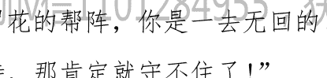

“突突突”枪声轰然而传来，我转头望去，见大张那边开了火，还喊着：“研究什么呢！来了！”

侧望过去，城墙下然留了几只秃头山魅，这个城市周围的曼免罗花阵果然效果不错，这几个家伙还没走到城墙的边缘，就步履蹒跚，大张一阵的射击，放倒了几个。

“我操，这么猛！”大张乐了，转头大喊：“掌舵的，您休息，叔叔今天我在这里打活了！”

“不对！不对！绝对不会这么简单！”随睁望着城下，还有更多可厉的他话音刚落，曼罗花中突然又出了几十只山魅，大张射的秃子同一，借助月光，清晰地看到这批奇怪怪物，身上泛着深紫色！虽然这些家伙已经受众多的曼罗花影响，在花海中飞奔而来，速度超过了我们的。

“破！”胡大姐见这种形式，挥，城墙以及城内伏的箭纷纷齐射！漫天箭随而出，甚至月光都遮蔽了。这黑色的羽毛比大张里的枪更有效，城外没有任何可以隐藏的地方，临近的山魅被扎成了刺猬，在地上哀嚎着。

作者：猪头大拿 日期2009-05-05 18:05


花茎补血，效果甚微，情事到了今日，只能用生命来补。”

我与大张随拿都表示反对，城中不可一日无主，胡大姐是万万不能死的。

胡姐并不不豫：“活着只是痛苦的开始，我们是受诅咒的命运，永远长大，这个城市里，除了我以外，其他人都只能被这黑色曼罗花为食，就这样年一年，永远没有自由，永远没有自我，不要以为我用生命就可以换回白天的彻底，如果我把生命奉献了，依旧达不到要求，各位也不要拘豫，随从多说了，将军，你知道怎么做！”

我接过了胡姐手中的剑，握着她弱小的身影挤进那，满脸却是妥协。空气已经凝固了，黑色的曼罗花从我面前飘过，不知道该用什么表达感情，我只是下了决心，如果还需要一个人进去，那就是我！巨大的花蕾像生命一样，缝隙住了胡姐的身体，我甚至听到血液流淌的声音。胡姐的脸色也随之苍白起来。外，咯吱响声在四周传开，我甚至听到花开的声音。

“曼罗花开了！”大张随来欢呼。

“成功了？”


始终想明白，巨大的曼罗花到底是植物还是动物，在吸收了特殊的血液之后，竟然在瞬间花化。随听着外面的声音，依旧皱着眉：“还没有，够了！远远远不到地步！”

来不及顾胡姐了，我们个人又回了上面。漫天飞舞的黑色曼罗花充斥整个城市，已经悄然地躲了起来，敌人再也没有动静。我看着天上，想着原来所谓的黑云，似乎悬了，这些花瓣虽然多，但真的没有把月亮遮住的意思。”胡姐，王姐献身，勇士却毫不感觉，似乎对于他们来说并不是事。随着笼罩，这就是黑云？大张看着奇异景色，有些迷茫。这只是仪式，还没有开始，不过敌人被压制了。大门的大院子内，缝隙中，满了黑色曼罗花，这些花在我来的时候，是绝对没有。看来活下来的就这么多，没时间细数。

“结束了？”大张望四周。等了半天，的确没有任何动静，不知道如何好。

随宰耐不住了，对我道：“你去后门，看看外面情况。”我也得看一看，举着枪，到门口，果然是个奇异的地方。连大门的墙缝中，满了黑色曼罗花，这些花在我来的时候，而且这些新的花朵比以前见过的更大，妖艳。对于一米七高的我来说，门并不重，我小心地拉开那扇门，一双血红的眼睛与眼神撞视。雷总正背手站在门前，我们两个人的距离半米不到，他似乎在等我。街道早就被黑色羽刺跟头乱，黑武士的尸体被钉在地上，除了傲站在我面前的雷总，似乎外面也没有一丝生气。突然见靠我，我一直抑郁的心情跳起来：“雷总，我知道，你一定会过来接我们的！”我有点想哭。雷总与以往一样，脸上没有任何表情，只是盯着我的脸。

“擅自行动，不听李处的命令，与敌人私通，这种考虑，你知道自己的罪行吗？”雷总突然挤出一句冰冷的话。这一话一出，我立刻发麻，难道我选择错了？难道随宰与胡大姐才是恶人？难道李处长以及总部对，这里早就有周密的计划？回到身体，把这些人全部干掉，这里的秘密属于国家！这个……命令你，这是命令！你直属上司的命令，你在犹豫什么？”雷总的话必须听，我没有任何推脱理由，虽然这是痛苦的过程，但我还是转身，颤抖着举起了枪，我的第一个目标。

当我准星靠到随宰镜上的时候，我看到了随宰神色的变化。虽然称号金刚斧，但我相信这么近的距离，干掉这个血肉的老头是没有问题的。再一遍，不知道称他为友还是敌人，至少现在必须是敌人。“别被他骗了！他不是雷！”“砰！”的一声，我的枪响了，在开枪的瞬间，我还是犹豫了，我稍微抖了一下，子弹射中了随宰的肩膀。突击步枪弹子的威力与电视剧中不同，并不是在你身上。

穿过小洞就完了，普通人在近距离被要命的弹药打中，那可是卸掉一根胳膊。随宰高大的身影晃着，倒在了地上。他面前的小武士被眼前的变故惊呆了。我觉得雷总不对，也觉得随宰不对，刚才瞬间，我做了一个折中的选择。山魅可以模拟人声，可以模拟环境，我不相信他们连环境都如此巧妙，但是，雷总从来不会直接的命令我们干掉，他说话的口吻不是这样的。雷总已经进了大门，他站在身后，他的手竟然按着我的后脑勺：“好的，所有城市的抵抗已经了，下面，该开启全新的时代了。”四周的影像变化，十几山魅露出了身形，王磊加强以后，他们如同黑夜中虚空一样，身体不显看着日月星辰，不停模拟周围的环境，只是那肆焰的曼罗花对他们没有任何影响。活着的人在与他们对峙，或许也没有了，我知道他们完了，这些就是在进化中生存来的强者，躲过箭雨，冲破花阵，适者生存于自然来说也许是进化，但是对于怪物来说，刚刚战争，就是进化的洗礼。“小刘，做的不错，所谓，就这样，适者生存！”我没敢回头，因为声音已经不是雷总，也不是李处长，竟然是随宰！我被身后的人拎了起来，重地摔到了墙上。我觉得眼前一片漆黑，挣扎望着，果然啊，果然人的样子又回了李处长。不要以为没有心智，依然是我的友，依然是我的同事，我留了命，你的理由！”随宰的话让我吃惊，你不能放了里面那个东西，你想过后悔吗？”后果？”如果生命被绑架在处，去救她，你会后悔吗？”随宰看着我。我不明白：“那是怪物！不是母亲！”那是我生命的，那是内心的渴望，我没有时间。随宰高兴地举了手，墙上的山魁动了起来，最后的战！就像在莲莱那样，创造一次奇迹，但我再也没有看到身影，只看到人群中挣扎的老者。我已经彻底崩溃，多年的守护结束，我趴在地上，静静望着，快点吧，死去的人太多了，对不起。


位，实在没有能力守护祖先的秘密。作者：猪头大拿 日期：2009-05-15。眼前的月光不知道什么时候灭了，大张望四周，院子中的搏杀仍在继续，活着的人已经退了，抵抗只是拖延几分钟，直到守护者全部死去，事情就可以结束了。黑云，不对！那天空中不是黑云！突然一下警醒，黑压压了下来，哪里是云形，黑色的蝴蝶！黑色的蝴蝶如同瀑布一样，进了我们的院子，天域，大大的蝴蝶！黑色的蝴蝶，天空中，大大的蝴蝶！黑色的蝴蝶，天域，加上码获取更多信息。我的视线已经完全模糊了，大张跳坑了！我立刻红了眼，转身望，到地下洞穴。坑道已经打开，大张下去，处都是哀嚎的声音。我起了身，强忍着疼痛，我必须看清楚发生了什么！终于，一只山魅在我的面前，我明白了发生了什么！黑色的蝴蝶竟然全部缠到了山魅身上，它们是在吸血！一只，又一只山魅如同干尸一样倒在了我的面前，而其他人没受到蝴蝶骚扰，黑色的蝴蝶从我们身边掠过，完全把我们忽视了。如果景象仿佛瞬间的事情，那么最后一只蝶也死去，这些蝴蝶也开始死去，院子里满了蝴蝶的尸体。我赶紧拉救的人，随宰捂脚喘气。我扶起他：“怎么了？这就是黑云！我们成功了！”对！”随宰明显地气多了。“着急，去把张大个子救出来，他填了曼罗花！”什么！！大张跳坑了！我立刻红了眼，转身望，到地下洞穴。坑道，竟然是大张下去！我顾上随宰，起身朝洞穴跑去，我不相信张就死了，绝对不相信！一波处理掉。还没听到大张填坑的位置，看着黑暗，火焰染透，出现了一个熟悉的身影，是李处长，他的身体早就被鲜血染透，他正朝着洞穴深处走。而洞穴中，竟然传来了阵阵哭泣之时，像一个孩子一样，让人得心碎，这是地下那层发的巨大声音，它依旧在呼唤。顾不得这么多了，我紧赶了两步，拿托一下砸到了李处长的后脑上，两个人扭打在一起。“小刘！放我过去！听到那凶声了吗？你忍心吗！”操你大爷！杀多人忍心！”两人扭打着，要是平时，我估计李处长早把我撕碎了，现在看来那些黑色的蝴蝶把他交的不快，在力量上，我们几乎是对等的！你妈的你不是会变吗！给老爷子变孙悟空！”你不明白！不知道间，我们竟然滚到了根的地方，大张的身子果然在里面。狂怒的力量已经彻底占了上风，我骑在李处长身上，拼命地拿枪捅着他：“理解吗？看见这些雕塑吗，这都是活生生的人，他们用生命守护的秘密！守护了千年！你明白吗！”那怎么样？我没有错，这里的秘密属于091的！我的职责！”你能克服本能吗？你知道091的职责吗！我们的职责是守护，不是侵略！不杀戮！你老了！该死了李处长边跟我争辩拼命反击，没有任何异能，没有任何武器，单纯地靠拳脚搏杀，我早已忘记了恐惧，忘记了疲惫，直到把李处长砸在地上，再没有了声音。我也满脸是血，我拼命地爬到了大张身边，死命地扯着缠在他身上的花藤。“哥们，你妈的别援了，来救你了，顶住……”大张没有给我声音，任凭我怎么喊，血与泪水蒙了眼睛，我实在没有力气去扯上他，意识越来越模糊，直到一片黑。当我再次见到光明的时候，不知道过了多久，我做了一个梦，猛然起了身，仔细查看周围，床，旁边的床上躺着一个被扣的人，感觉太憋了，是大张。胡姐早已花藤融为一体，她的表情依然活。胡姐身边的雕塑，竟然是李处长，他的位置原本是大张。我觉得这才是根本，也许我错了，在进化过程中，得到了最大的恩赐，并非无尽的力量，而是超越本能，这些老孝，在最后，终于超越本能，自己的信仰，才是进化过程中，最值得辉耀的地方。”随宰望着李处长的尸体，感慨万千。在大山修养一个月，我们的身体恢复差多了，准备出发，剩下的黑甲士，不足百，这次损失了90%，修复工作在进行中，新的城也选出了，随宰安排好所有以后，对我讲。我问随宰，什么都不需要，等到他们完成最后的使命，回到091，已经是冬天，把事情汇报给大总，两个人一共说了几天，最终决定，这件事后，增加。秘密的人只有我们几个，也不能保证，后者那样的兴趣，不能给091留下详细文字，如同简短的资料1965年，091第组，刘思远，田禹，在大山执行任务时，擅自行动，长达一个月之久，总部决定，给予三人通报处。※※※※※※※※※※※※※※※※※※※※※20年后，1985年，秋，我跟随一支防化部队在大巴山外演习，我是唯一知道情况的人，我密切注视大巴山

动，我知道，最后一个曼罗花衰弱到了，我是来后的。巨大的海蜃楼如约而至，只是20年前的效果了，画面中的黑衣武士同时，戒备森严，我注视他们一致，让我安心的是，那里再也没有麻烦，直到三日后，海蜃楼逐渐消失，最后我的幻象是无数山石从城上滚落，城中的孩子们没有任何悲哀，接着那些山石，我知道，他们的任务完了，都在千年的守护，成功了。整个大山似乎在震动，一个月圆之夜，黑色的曼罗花在大山内漫天飞舞，我拿着一枚花蕊，细心地看着它，我知道，以后也不会见到滴润到黑色的花蕊之上，里面出了胡大的笑容，里面出了李处长的严肃脸，认识这些花已经多久了，我第一次觉得，原来这些花在蜃楼中绽放的花朵，竟然如此美丽。作者：蜘蛛头大日：2009-05-15 21:32呵呵，这个故事我觉得全部的秘密已经交清楚了，它是该结尾的时候，关于091的故事，后面还会，其实秘密从第二个故事一直存在，昆山中的巨大妖树，蓬莱水下城市中的神秘水晶，各项机密，最后所有的秘密都会联结在一起，关于随宰，关于雷索，关于091，关于古代战争的前世今，很多精彩的故事我都有个体框架，承诺的六前面上盖子，是指把大巴山故事盖上盖，呵呵对于懒懒的我来说提前完成任务了，下个故事其实已经开始写，不过我还是休息几天，我仔细考虑后再发，谢谢。作者：猪豪大拿 日期：2009-05-15 22:00 报告明天或者后天写，感谢合作

[IMAGE]http%3A%2F%2Fimg16.tanya.cn%2Fphoto%2F2009%2F5%2F15%2F1299866_7496068.jpg[IMAGE]

作者：猪豪大拿 日期：2009-05-17 16:02

# 1965年，大八山市市废事件报告

1965年，全国相当多的地区接到报告，说天空中出现古代都市海市市废楼，091人员经过深入调查，得出以下结论。一、处理废楼：加v信110284955，获取更多好帖我们一直认为，只是传说中的生物，但是这次，却是确发现了这样的生命，现在不能解释该生物的天然生命或者是人工生命，其特点是体积巨大，根据接触人员描述，该物的完全状态态超过三公里，而且能够产生各种种类对于天空的这种，这种能力我们无法分析中，这种能力我们无法分析，中，这种能力我们无法分析，中，这种能力我们无法分析，中，这种能力我们无法分析，中，这种能力我们无法分析，中。


住者设伏，整个城市都是围绕着黑色曼陀罗花阵地而建的。本体形态复杂，普通人无法探寻的准确位置，而且任何误入乱石谷者，都会遇到守护者的无情酷杀，所以，几千年来，这个城市一直秘密存在于我们的身边。

该城市的构造可以从处处发现，乱石谷就是人为建设，乱石谷有的石头高度不超过1米，非常适合身材矮矮的远居住者设伏，整个城市都是围绕着黑色曼陀罗花阵地而建。

而且整个城域道路都被曼陀罗花覆盖了。曼陀罗花并不完美，但是黑色曼陀罗花第一次发现这类花朵能够区分出类似镇静剂的物质，我们的祖先就是巧妙地把这样的花种植在身体身上，才使得几千年来保持在一个相对稳定的状态下。而且这些花朵并不是单纯的植物，我们更倾向于这种生物的根本是动物与植物混合的生命体系，该生物吸血液，尤其是当吸收了所有祖先血脉之人的血液会极大刺激它的生长，同时它还不停地汲取着底层的能量，很有可能这两个形态一直维持了几千年。

所谓祖先血脉，我们认为就是古代生物的后裔，他们有限地继承了祖先的能力，血液中也含有我们所未知的奇特物质，所以才有这样的效果。而且曼陀罗体系对于山魅绝对克制的。


普通蔓草在黑色曼陀罗花阵地正常状态下是无法接近此地的。花粉蕊对空气中所散的生物漂浮物有破坏作用，可以用个完美的防御体系。

黑色的蝴蝶同样我们认为也是黑色曼陀罗花阵地的一部分，当曼陀罗花阵地达到一个相对点的时候，就会发生这样的生物。该生物吸血并不吸花粉，几乎是无别的地吸取任何生命的鲜血。而守护者能够不受该生物的袭咬，我们认为是当我们穿着了黑色曼陀罗花制造的奇特甲胄，而是使得该生物能够有效地区分之。该生物生命周期相当短暂，不超过一个小时，但是这一小时之内，是绝对能够这些生物消耗整个城市中的任何异类。我们认为黑色蝴蝶的灵魂寄在整个城市阵地中是这个防御体系最后的防线，相当有效，只是使这样的防线开辟的代价必须需要妥当的所谓祖先之血。根据与城中居住者的血统，整个城市历史上发动这样效果的次数并不多。通过这些事情，我们还可以想象先人对于未来风险的预与与防范能力，几乎到了完美的程度。至于这些人到底是从何处得到这些技巧与知识，我们无从考证。

## 3 关于城市守卫

中国历代都有位边关的军人，这些守卫可以确定也属于某个时代的一支部队，他们在这个密封闭生态环境中，造就了自身的奇特形态，整个城市也如同传说中的小人国一样。也许我们会认为守卫这样要塞的军人应该高大威武，但是通过分析，他们其实是另一类演化的体现。他们所有的土地全部种植曼陀罗，所以以曼陀罗为食，并不摄取其他营养，而且自身秘密的使命使得绝大部分人不能接触外界的世界，这样，小小的身体可以很好的节省能量的消耗，更适合在丛林中作战。也许他们的祖先曾经掌握了相当的生物技术，并且他们改进造成这样的形态，一切只是假设。

值得注意的是，城市中的最高领导是可以接触外界的，所以一直以来，这些人对于外界的变化并不陌生。他们主要的职责应当是在人中寻找纯正血脉的人类，共同防守这个城市。与我们接触的城主名为蝴蝶，其实他们是他们的真实姓名，蝴蝶其实应该是官职称号，其真正的意义却是开启黑色蝴蝶城的朝锐。对于他的真实姓名，我们或许无从考证了，且一旦有人被推选为新的城主，那么他的名字也会改为蝴蝶。

与我们接触的蝴蝶是一个女性，相当于十二岁左右，其实年龄可能超过六十岁，而且具备特殊的频率，能够引发刺激大脑的奇怪声波，让人神智清醒，这就是防卫者中不多的异者。

## 4 关于整个地下城的生态构造

可以确定，任何刺激都会使得环境变得不稳定，而且许多生态环境之外的事物很有可能引起黑色曼陀罗状态的变化。一旦这个生态环境改变，那么，镇压的结果将完全丧失。这也就是这些人几千年来，毫不犹豫地杀死任何试图闯自来的闯入者。虽然天佑当年肯定了解了这里的秘密，但是他们也不能保证这样的生态环境不会被后人干扰，所以，他们的资料草草了事，并没有任何文字记录。而我们，虽然也揭示了其中的秘密，但是我们也不能保证我们的继承者不会对那里进行再次探测。毕竟那些生物器官的巨大军事价值终在刺激着人类的好奇，只是谁也没有能够控制那里层面的东西。统城市防御者的胜利，再过二十年，就可以把那完全终结。我们不希望这个地方发生什么意外，一旦发生意外，方圆百里都是生物控制范围，这样的损失是任何国家不能承受的。本着对人民负责的态度，我们的意见是与相关的。

## 关于祖先之血

原本想在任务完成后抓捕此人，但是他先走了一步，这是工作中的失误。根据他透露的信息，大巴山的秘密曾经被侵华日所察觉，这才是麻烦，因为整个秘密的人都不会超过上限。至于他们掌握了这里的秘密，这非常棘手。

（此处为OCR重复内容，略，，，，，，，，，，，，，，，，，，，，，，，，，，，，，，，，，，，，，，，，，，，，，，，，，，，，）

| 成员 | 姓名 | 备注 |
| :--- | :--- | :--- |
| 某某 | 驻陕西处 | |
| 某某 | 组长 | 李天成 |
| 某某 | 生物化员 | 刘思远 |
| 某某 | 历史研究员 | 田某 |
| 某某 | 保卫员 | 张栋 |
| 某某 | 心理分析员 | 楚少群 |
| 某某 | 经理 | 王某 |

（注：原文列表内容如下）
- 驻陕西处：某某
- 组长：李天成
- 生物化员：刘思远
- 历史研究员：田某
- 保卫员：张栋
- 心理分析员：楚少群
- 经理：王某

（作者：猪头拿 日期：2009-05-17）

（此处为OCR重复内容，略）

## 5 关于地下城遗址工程

大张以为什么好事：“领导，这怎么样，是不是挖地下城遗址的工程启动了？”
部长陈连搓手：“不不，那个工程最近是不会动的，你们别怕，也不会派你们去，我真怕你们把珍贵文物当脸盆用了。不过……”部长锋一转，“你们的确得给我挖东西。”
“呢？那是挖什么？”这回议很有意思，“没有死人，没有怪物，似乎挺简单。”
“呵呵，这回任务特简单，生命绝对有保障，就是麻烦点。”部长卖了个圈子。

“领导，直接说。”大张活了起来：“不会让我们把前门楼挖回来？”
“不会，不会，那工程比较大，我只需要300斤尸土！”陈部长淡淡地讲了一句。

走到门口，部长长唤住我们：“回来。”我和大张转身：“还有什么事情？”
“哎，明白了？对了，这个你们带着。”部长说着，从字台竟拿出一瓶茅台，他迅速用纸包好，“别说给我的，等洪先生来了，你们多交流，这可不是给你们私藏的。”
我和大张刚想点什么，部长已经不耐烦地挥手：“去吧！去吧！记得300斤尸土，抓紧！”

我和大张像贼一样，小心地把茅台藏在大衣中。大张开口：“老陈手段足够狠啊！”
我心里想：“这个老狐狸，果然没什么好事！”

（此处为OCR重复内容，略）

我心里想，那些脏脏的，到底是干什么。

（后续重复及乱码内容已按语义逻辑清理）


“这个是什么类型的生物？”我突然觉得这个差使没怎么好。

“什么类型不好说，他还在自我修复中，如果结合历史传说，我想他应该是以欧洲传说中吸血鬼为蓝本开发的生物兵器。”

“啊？”大张又是一声惊呼。

气的部长的说：“不必惊讶，他的身体组织研究过，银质物品以及阳刚绝对对他的身体组织造成巨大伤害，看看你们的手枪里面，已经全部都换成钢制弹，如果有什么意外的都是可以防御的。”

我和关西直接指出了椅子，结果，子弹都是钢制弹的。

”传说中，吸血鬼受伤之后，需要用土配合自己康复，这个东西在地下持续久了，不知道需要多少时间能恢复，所以最近你们两位多准备麻烦了，把土换一下，让他早日康复，到时候我们相信他们091里面是会能人会让他露露秘密，另外外血浆我也带来了很多，他苏醒后马上给他服用。”

“等等，这个东西有没有危险，不会吃我们吧？”大张仍担忧。

“理论上不会，你们是远古生物兵的后代，一个系统的，当然，只是理论上，如果他要起来造反，也别客气，立刻干掉，这样的东西流到社会上，后果我们不能承担！”陈部长接了一句。


“美差，真是美差。”我心里念叨着。

作者：猎头大拿 日期:2009-06-05 08:48

“这个人有意识，但是我不清楚他的意识是否清晰，这个人拥有所谓吸血鬼的特性，但是传说与现实有差距，尸土的特殊成分的确可以帮助的身体修复，但是能够回到什么状态，我不清楚，如果我们分析是正确的，他是一个人工生成的，他的能力到底有多大，我们是没办法预知的，也许超出我们的想象，也许只是个血生的普通怪物，一切切，切，都是迷域。”洪先生跟他们讲，他自己似乎也很拿准这个东西的底。

一手“我们能从他嘴里抠出什么样的秘密？”我突然想到，最重要的东西的。

部长站了身，望着窗外，“冬天的夜就是这么漫长，我总是盼着每一个黎明，这个人的秘密是他是被敌制生的，我们的生产基地的在哪里，我们的敌人，到底掌握了怎样的科技，这些都需要你们来完成，还有，这是一条线，顺着他们，我们应当可以找到纳粹秘密基地，才是根本的！”

“对！”洪先生接了话，“纳粹最近活跃，他们无疑又一次具备了技术优势，我们必须把一切危险消除在萌芽状态，这是共同的使命。”

“刘思远！张国伟！”部长突然变得严厉起来，“我命令你们，从今天晚上开始，立刻搬到地下六层，直到把这个任务完成！在这期间，组织会尽量满足你们任何合理要求！听明白了吗？”

我和大张起起了，冲着部长长敬礼：“是！”

这个夜晚，我和阳光暂时告别的日子。

会议又持续了很久，洪先生亲自传授给我们各种专业的知识，从历史传说到科学解释，从实际案例到意外预测，几乎几乎所有的方面都涉及，我从来都没觉得过我这么认真学习过的什么东西，那还是第一次。

地下六层，已经有人给我们安排了办公室，床铺，用品，每日三餐都有人送来，整个091部都满了全副武装的士兵，所有卫兵的弹子，全部更换为铅质弹，很少有人知道为什么，也很很少知道，我和大张每天戴着口罩，在地下六层忙些什么。

洪先生住了几天，不知道告别了以后，他又去了哪里，他的手下已经为那体换了新的衣服，剩下的的工作，就是每天换护士，就是等待这个神秘人物的苏醒。

除了换护士，我和大张坐在玻璃窗外抽烟，只能能够休息，我们已经没有了时间的概念，不知道外面发生了什么，我们地下六层冰冷阴暗，我们守着的那具尸体一样，有时候我觉得，他永远都不会醒，他就是一具尸体。这样的工作是一种煎熬，是一种磨炼，是对人类心理的极限。


“刘，这个东西真的能从里面站起来？”大张没有往日的笑容，我也失去了笑容，时间久了，也不觉得有什么了，甚至怀疑，是不是领导把我们改成。

两个人站在玻璃窗外，看着里面动静的。我吸了一口气，我把烟突然停在了嘴边：“你听错了吧？”

“绝对没有！”我把烟延续劲地按到烟缸里：“那家伙！”

“咚！咚！咚！”保温柜内传出了若有若无的敲声。作者:猪头 日期:2009-06-07 21:15

马上跟外围警卫打了招呼，他们其实根本不知道里面有什么，只知道是挺危险的东西，陈部长同志，我和大张都把枪掏了出来，围在保温柜边。里面的声音越来越响，这家伙似乎非常着急。

“姐姐，是死是活给个话，兄弟们候你半天，都不容易，自有自来方，那什么……”

没有回答，没有动作。大张又问：“姐姐，是死是活给个话，兄弟们候你半天，都不容易，自有自来方，那什么……”

大张张大，拿棍接了戮人的背后：“那个……同志……不，那个......大姐，贵姓啊？”

没有回答，没有动作。大张又接：“姐姐，是死是活给个话……”

“妈的，见鬼了！我去开了！”

黑色的保温箱离我越来越近，我的呼吸越来越急促，在这个冬天，在这个阴冷的地下审讯室，我的汗已经被衣服打透了，当我手靠近那保温箱把手握时，只听得“咣”的一声保温箱被里面推开了。

当时的我愣了一下，连续向退了好步，看着打开，大气都不敢出了。

我突然想起了什么，跑到手机旁边拿起镜子大喊：“王大叔！快点！把底下几个特殊审讯室的灯全部打开！”

上面的警卫接到信息后，马上把箱内部光源全部开启，我这才看了保温箱里的东西。

望着里面的人，我和大张长时间的沉默。作者：猎头大 日期:2009-06-08 21:45

过了好久，大张终于说了：“没有人说过是个女的吗？”

“好象没有，洪先生的人给她换的衣服。”

没错，从保温箱里坐起来的是个女人，不，应该是个女，不能称为她。

她穿着我们的制服，身材娇巧，长发，双手抱着腿，把脸埋在了两双腿之间，似乎很累。她完全没有看周围，从出来一直直那样。

我与大张的枪伶暗看着她，逐步接近，我现在都不敢想象她的脸应该是怎样的脸。

大张张大，拿棍接了戮人的背后：“那个……同志……不，那个......大姐，贵姓啊？”

没有回答，没有动作。大张又接：“姐姐，是死是活给个话，兄弟们候你半天，都不容易，自有自来方，那什么……”

没有回答，没有动作。大张又问：“姐姐，是死是活给个话……”

“姐姐，是死是活给个话……”

当我看到那女人的时候，心里突然起了一丝异样。那是一张清秀的脸，除了比常人白点，没有异常，尤其是她的眼睛，更是清澈，似乎只有婴儿。

这样的眼神，很难想象，在昨天，还是腐烂的。那女人盯着保温柜，一脸苍然，又呆滞地看了一眼，然后轻轻把保温柜推开。

大张说：“叽里啦”。

“不是朝鲜人，幸亏不是。”

接着王子子过去，“要去又要哈哈一样”的问了通，大张远远远的盯着，听不清楚他们在什么，估计这人是日本人。

一会王子子扶着眼镜准备备。王子子：“怎么个情况，翻译官，怎么样了？”

王子子没什么好气：“我说事，是日本人，不过她精通中文，说的很流利，下次明天再联络部长接电话，大半夜的，折腾什么啊。”

我有错：“什么？会中文？”

王子子点头：“这是秘密犯人，我不能多少，该知道的都问了，你们自己问吧。”王子子临时候神秘的叠文件夹拍我肩膀：“你哥俩俩搞什么，是在不是闹挖个古墓塌下来啊，抓紧洗个澡吧，猪圈那哥里还臭！”

我无奈的直摇头：“哎，得了，您先回吧。”

听说陈部长两个小时后，我和大张只能先审着。

又座到那个人面前，我习惯性的点头：“说这些吧。”

那女人望着我，说了一句话：“我想吃点东西。”我望大张一眼：“给她。”

大张拿来了一袋早就准备好的血浆，倒到杯子里，溅了过去。作者：猪头大 日期:2009-06-09

很明显，血浆的诱惑非常高，她甚至流出一丝涎，我看她的激动。

就在女人接触血浆的瞬间，她似乎觉察到了，突然想到了什么，痛苦，大张把血浆杯子砸到了地上！

我要吃饭！对不起，我饿！”

女人站起来，一点都不怕，大张拦下：“冷静冷静。”

“对不起，我饿！”

“我饿！”

“对不起，我饿！”

“对不起，我饿！”

这种体质虚弱没关系。

“对不起，我饿！”

“对不起，我饿！”

“对不起，我饿：“吃什么你就吃什么？”

“对不起，我饿！”

“对不起，我饿！”

“对不起，我饿！”

“对不起，我饿！”

“对不起，我饿！”

“对不起，我饿！”

“对不起，我饿！”

“对不起，我饿！”

“对不起，我饿！”

“对不起，我饿！”

“对不起，我饿！”

“对不起，我饿！”

“对不起，我饿！”

“对不起，我饿！”

“对不起，我饿！”

“对不起，我饿！”

“对不起，我饿！”

“对不起，我饿！”

“对不起，我饿！”

“对不起，我饿！”

“对不起，我饿！”

“对不起，我饿！”

“对不起，我饿！”

“对不起，我饿！”

“对不起，我饿！”

“对不起，我饿！”

“对不起，我饿！”

“对不起，我饿！”

“对不起，我饿！”

“对不起，我饿！”

“对不起，我饿！”

“对不起，我饿！”

“对不起，我饿！”


只许不许出！特别排查女性，身高1米零左右，中文不标准，带有东亚腔！身穿秋常服！没有任何证件！此人非常危险！如果发现疑似人员，立刻扣押！通报7组！如果反抗！按一号程序；杀犹豫！

大张那边也对着手机责了了起来：“这里是地下特别审处7组国标！特别状态！通知15组明枪手到地下六窗观察室！地下全部灯光打开！现在开始所有人都不许出办公楼！直到直部长来了！”

一口气，把所有的应急措施传达到上面，这才算出了口气，本以为要点聪明得得意，但我绝对没想到这个赤锦美幸竟然有这么大的事，竟然在我眼皮底下消失了。

一手截取，微信1101284955获取更多好帖

“嘟嘟。”嘟嘟”手机里传来了叮响连续的落声。
刘万事……这里是……15组……金永飞……

这里……
我这爆发脾气，这关键时刻简直还能受到干扰，这都是线，想干扰干扰也太难了。

我拿起筒筒：“小金！”大声点！！！我听不清清楚！”
“……有人……有人……”

我心想这个神枪手小金那都是稳重见长的，让他们去观察窗看点，是什么让他这么慌张！干脆吧，去看看吧！反正灯都开了。

我和大张跑到上面观察窗，见到他们三个人正拿着枪在里面暗着，样子比我们俩紧张得多。

“怎么了？什么情况？这么慌？”
小金转头，那脸色比还要还要难看：“干事，里面那女人倒挂天花板上了！”

“妈的！果然是！”我就觉得她飞了，眼里是看不到天花板的。

赤锦美幸正倒挂着，乌黑头发向下垂着，她闭着眼睛，浑不在意四周强光，似乎在养神。

我拿起身边插筒，大声喊：“赤锦美幸！你搞些什么鬼！这里不是你撒威的地方！上来！”

赤锦美幸慢慢地睁开那双美美的眼睛，看着，似乎有些错措，一双歪地看着我，她把活着的鲜艳的手拿到嘴边，狞笑着说了一句：“绝不！”

这两个字就像直接灌进了脑子里一样，普通人通过过滤简直是不可能把声音传到审讯室外面的。

我此时就一个瞬间，但不吸吐，还能墙，他还娘的能量直接灌输逻辑！就是雷雷总了，我怕也镇不住了她！

我一把把小金的枪拿了，打开弹夹，“听我口令！一起开枪！绝对不能让她继续成长，后果不能预测！”
“准备！”……我不能等陈部长了，陈部长与洪先生交代过，一旦形势控制不了，不要留口留留，我们留不起。

我起了杀心，没错，现在的局势我已经很难掌握了。

“等等！慌乱什么？”

就在我马上要下令开枪的时候，部长的声音出现了。
部长看着赤锦幸，走到了我的面前：“小刘，事情还还可以控制，远不到开枪的程度。”

我的枪一直没放下，我不敢。

部长拍了拍我的肩膀：“把枪放下，我们进去和她谈。”
“可是！首长，这样我不能保证您的安全！”

“哈哈，安全？进了091这个大门的那天起，我们任何人都不会再有关于安全这个概念，我这个老资本家，也一样。”部长的眼神中，不再是哪里像中老狐狸那样机灵，而透着一股身身为将的决绝，里面没有死底，只有使命。

作者：猪头大 日期：2009-06-14 20:56

部长对小金三人命令：“都上去，该讲什么话不该讲什么话我就不用多交代了，半小时以后下来，这期间不许打抗下面，明白了吗？”

“是！”小金看的我的眼神有些深长，意思是把领导交代的给我们了，千万小心。

步枪我不想还给小金，但是被部长收回了：“拿出诚意来。”

部长很冷静，冷静可怕，这就是一个领导者的城府，一个领导者的心态。“不必开这么多灯，正常照明，内部持续警戒，等我下一一步命令，如果有什么意外，立刻通知七组雷鸣同志与九组张云同志接管091，一切随机应变……”

部长长条有些不意地安排完毕，转头对我们两个：“走，大张小刘，我们进去。”

我和张把部长挡在身后，小心翼翼地打开审讯室层层铁锁，我只希望部长不要出现什么意外，再无求他。

厚的大门逐渐睁开，一股尸体的恶臭扑面而来，跟表情姨脑作作作的表现相同，部长只是微微皱了一下眉毛，又恢复了常态。

赤锦美幸在我们观察大审讯室这一会的时间，王凯涵加微信11107284955，真是多么巧！竟然已经落到了她身上，她赖在那儿，不知道是死是活，我不知道她是在演戏，还是从面上下来了。

大张铁身护着部长，我把手枪放在身后，非常小心地走了过去，即使她还在演戏，我可以抵抗一段时间，大张带着领导撤离，这是我全部盘算。

在我们向前还没有米的时候，赤锦美幸突然起身，就朝我扑过来，她一把抱住了我！我甚至看到她那沾血的牙齿！我手中的枪立刻就了起来，马上就要顶到她的太阳穴，我心想：“来，你咬烂了头！”

就在我的枪要顶到赤锦幸太阳穴时，一大手握住了我的手腕，我回头一看，是陈部长！几乎在同时，怀中突然传来了哭泣声：“不要……不要丢下我……”

突然来的故让我很不适应，这个小鬼变成柔弱女孩了？就算你是柔弱女孩，老爷爷也不能在领导面前让你哭！

不知道她在我怀中哭了多久，才停了，不知道她受了那么委屈，那脸红红的跟鬼的一样，一直到了脖子，真是正经人。她消失以后，好歹又是把她拽到了椅子上，她的手已经被挣断了，我想给她换一把，部长又一次拦了我：“小刘，把手铐拿出来，谁让你抱我们的客人？”

手铐竟然还解释：“对不起，这不是我干的，对不起。”要不是守着陈部长，我早就怒了，我说不是你干的还是我干的，你妈也装得像吧。”

我强忍着，没有说话。这会的部长，完全没有了部长的威严，更像老老爷，他冲着她笑着，伸出了一只手：“你好，我姓陈，不要紧张，这个地方我说了算，谁也不敢动，也不能伤害你，小姑娘，你叫什么名字。”

与部长的表情形成鲜明对比的是我和大张那张脸，看着松弛应对，等红的脸叫苍白的。她惶惶地看着我和大张，没有跟部长了手，而是起身就鞠：“对不起，老爷爷，可能刚才误会你添麻烦了，实在对不起，请别丢下我！”

“呵呵呵”部长笑着微笑：“坐下仔细，坐下仔细，慢慢说，不用拘道。”然后他回头看向我和大张：“你一边抽烟一边站这里在干什么呢？去也去！”

我刚想说什么，陈部长对我使了个眼色，那意思是稍微离远点，别让她紧张。

我和大张离开桌子老远，悻望着点上了，远远望着陈部长与赤锦幸，只是手里的枪在黑暗中瞄着赤锦美的头，通过表情，两个人都像一个小女孩在听老爷爷讲故事，但是那一分一秒，我和大张来说都是炼狱，都是对于赤锦幸那神秘身份的符。

作者：猪头大拿 日期:2009-06-14 21:00
作者:lionellee1981 回复日期:2009-06-14 14:12:00

哥们，太有了……雷的兄弟我也外焦里嫩了......恶毒，欢迎各人士恶毒~
作者：猪头大拿 日期:2009-06-17 23:20

两个人谈了好久，气氛相当好，部长时不时的哈哈哈大笑，赤锦幸也会会心把我和大张搞得很不自然，我们想却不明白，为什么部长为什么会把气缓到这种程度，说好吓了赤锦幸是客人，难吓了她就脱了犯人的，客气的谈话有些了。

王叔 加微信:101-284955 获取更多专享

两个人的对话不知不觉当中已经进行了一个多小时，似乎还相当投机，晚后他们聊了什么。

终于部长还是起了，他向我们招了下手：“去，把医员叫过来，给这个小鬼查体，去下一楼要书值值班室旁边倒出一个房间，安排点生活设施，你两个，也去那房边倒出一间，长时间驻扎，陪着她，别让她出了意外。”

大张跑去电话，我小声问陈部长：“领导，行不行？安全吗？她身上的能力我们控制的了吗？”陈部长很大喇地冲我挥手：“没有什么安全不安全，你做的工作，都是做的皮囊之事，光看外表，不顾内心，跟她说话，就是捉她的心，放心吧，看似邪恶的体内装着一颗善良的心，保护好她，才能让我们知道心中的秘密，才能让我们走远。”

这么了，可是还不放心，我用疑惑的目光朝她，她真是良心吗？

那边的部长看着赤锦幸，心情似乎很好，看到她，还伸手扮鬼脸，似乎找到了什么样的秘密，让他高兴的赤锦幸拿枪砸她让她死了。

她似乎消失了，赤锦幸不知道中了部长的魔法，女兵们很快快起来，其他单位也都各自到位，他们带着她去做详细体检，她在准备出门的时候，部长又叮嘱道：“记得我的事情，不要乱跑，一定帮你找到弟弟。”事情似乎落了，我和大张的任务算是完成了，可以休息一下。部长看我一眼，乐了：“哎，受罪了吧，你们的工作时间仓促，还完全不能了解人的构造，但是可以肯定，绝对异常。”

赶紧去洗澡，换身干净衣服，好好休息。明天晚上，体检结果出来后到那里，你们的任务刚刚开始，别大意了。”部长丢了一句话，转身背着手走了，他回首望了眼审讯室长长出了口气，不安中睡了一觉，我脑子里什么都没有，一切跟做梦一样，梦境与现实的距离原来如此近，好在雷总回来了，这个所谓的美差让他满意。

作者:亥日期:2009-06-24 23:35

加v110128455 获取更多好帖

第二天晚上，接到了会议通知，忙到了会场，陈部长已经在那里等我们了。人不多，都是涉及各方面的同行，我和大张看来职务没技术量的。陈部长见人全了就开始了，他并没有像常一样说什么，而是让各部门的人讲：“关于赤锦幸，你们先讲，我最后陈述我的意见。”

负责医疗检验的先讲昨天关于赤锦幸身体结果：所有的指标都比常人低，像动物冬眠的状态，让人惊异的是，这样的低生物状态会在瞬间转化，当该人物组织受到侵害时，代谢能力会突然增加。从生物学角度来说，是个接近完美的生命形式，但是有致命弱点，光照和钢制品，这两东西可以瞬间破坏其细胞机构，一旦该生物接触，身体可能会在短时间内分解。暂时我们只分析出这么多。

“哦、九组心理专家讲讲。”部长听完，专门找了九小组代表大头，他们组长并不在家。

该女子我们分析，可能有强失性记忆，通过她后的录音分析，她说的可能不大，她可能有相当惨的记忆；她是在摇摆自己记忆，另外，她对自己的身体状况是了解的，但是在拼命装饰自己的与公众之间，比如说不当饮食吸血，她内心其实很自卑，很脆弱。至于天花板的事情，我们认为她更像是被本能慢慢占据了大脑，而产生的后果，目前来说，还没有发现她具备明显的攻击性。如果需要她的秘密，有效的刺激是必要的，这样才可能让她想起过去的细节。

“有效的刺激是指什么？”部长皱着大头。

“从灵魂上对她进行创伤，让她处于痛苦的状态，长时间处于这样的状态。”大头回答的冷而坚决。

“这个计划我再考虑。”部长摇头：“保卫方面做的如何？”

“根据您的指示，内部特部队全部转装银，最高戒备等级，为了不对当事人造成紧张气氛，她周围已经没有明哨，但是她的全部活动都在我们的监控之内。外部守卫部队班长级别的全部配备，并没有增加更多岗哨。已经安排妥当。”

“思，做的不错。”首长点头，然后转向我大张：“二位将，最近辛苦了。”眼色那意思你先领。”

我给大张忙口：“报告首长，我觉得赤锦幸就是一日特务，不应该享优待，关到银笼里是最稳妥的办法，”

部长看着大张严肃的脸，笑了：“哈哈，你小子还是省着吧。小刘，说说你意见。”

我忙接到：“报告首长，我也基本同意张国栋的看法，这些人摸不透，任何行动都应该在保证绝对的前提进行。”部长拍了拍手中的烟，环视了一眼：“做的不错，下面我几句。你们都是人才，跟我不同，我是混痞子出身，并不懂得这些技术术语，但是我看的多，你们搞的是人心，首先赤锦幸不是坏人，相反他还非常善良。”

作者：猪头大拿 日期：2009-06-24 19:35 (此处原文日期应为2009-06-24)

加v110128455 获取更多好帖

这些年的经验告诉我，要开启她记忆的大门，心理组的意见我不认同，以德服人，以理服人，而不是强制性让她回忆那些痛苦的经历，我的计划是把她编入成为我们的同志，战友。几天后雷总回来了，我会安排她的身份，然后这几天辛苦大张刘，好好陪着，别让她压力。

作者：锄头大刀 日期：2009-06-27 13:54

大头同意手拉利，马上回去准备一切必要的手段，我和大张合计大头给我们的安排，想要对刺激一个人的精神，必须得干出格的事情。大张似乎对大头的安排不满意：“什么乱七八糟的回忆过去的痛苦，还给她关关东军刁门惨败的文章，这样行不行？我看不如联系俩女兵接她一通搞了！”

“陈部长不处理你觉得难受吧，再说还不不定谁催谁呢，”

http://www.tianya.cn/content/16/6322.shtml（灵魂之门——透视）
http://www.tianya.cn/content/16/6324.shtml（洪流——护城边的八卦）

会议进行了很久，各部门的意见似乎倾向于更慎的方法，虽然没有直接反对，但是大家都觉得这像一个人进似乎不太稳妥。只是部长最后说了：“技术是冷的，人心是有热的，你们一定要把两者的关系协调好！”说了这一句模棱可的话，拍屁股走了。剩下的满脸愁的我们圈子抽烟。大头比较顶，也被拉去24小时护起来，做好心理分析，这个大头看来和我张上关系没好。其他部门的同志散去了，会议室内只有我们三个人。

“我说老陈跟她说完后还唱上曲了，感觉他老当捡了个宝贝啊，这可辛苦了。”大张骚扬起来。“当自己同意了，这不要命。”大头也看着脸：“以此为准，这样的人还不能淘汰，还得吼着部长完全无视我们技术部门的意见吗……”我把烟缸狠狠地拍灭：“你们都做禁闭了，别发牢了，咱们私下想想办法，她的秘密对我们来说最重要的，上有政策，下有对策，我不想和这么怪人同事，还得住地下室，早的把秘密翻出来，这份‘美差’就算活活儿！”大头很谨慎：“刘子，你什么意思？难道……偷偷的手段，告诉我有什么办法。”我终于露出尴尬表情。

三个臭皮匠在会议室密谋了很久，雷总还有三天回来，王三加刘四王五好多，我们希望三天内准备好褥，然后把她包起来捆走，承认有点违背领导的意思，但是为了最根本的任务，也不会做的太出格。

作者：猪头大拿 日期：2009-06-25 27:27


“什么了，对不起，我实在不想起了，一回回忆我就头疼。”了她，她冲冲我吐舌头。

我觉得我快疯了，我怀疑大头这个心理专家是不是个水货，我看大张，大张和我表情一样，我摆着手那意思他也没有。

大头这个时候进了房间，抱着满满的资料：“来来啦”让美幸同学加强学习，这里都是诺曼底战役的资料。

看着大头那脑脑袋，我怀疑不是上次酒精真把他拨傻了了：“学个尼！”我把篮子一扔，起身要走。

“刘同志，你是不是生气了？我真不想不想起来了，我会找回记忆的。”赤锦美美见我生气，连声解释道。

这一时候，内部电话响了，我接了起来：“出去看看刘思远，哪里？”

“这里是食堂，夜班同志的晚饭准备好了，请几位早点过来，再会有我们下班了。”

“哦，好，准备四人伙食，我们马上过去，谢谢。”我招呼他们：“走，上去吃饭吧。”

赤锦美一听要上去，似乎有些兴奋，她似乎苏醒后第一次接触外面，以前一切体检等项目都是在091大楼里进行的。

虽然陈部长交待可以带她在大院里走走，但是我看她那高心的表情就有点气来：“出去注意你的言行，别乱讲话，现在的名字叫姜美，一定要记得，说错了话我保证你再也不去了！”

“是！我保证不给你惹麻烦。”她似乎对我的态度完全免疫了。

几个人出了房间，我给大张使眼色，那意思你去通知情报保卫人员，赤锦美幸要上去了，做好准备。大张点了点头。

到了院子内，我四周环视了下，所有的暗哨都到位，稍微放松了点。

进了食堂，吃饭的人已经不多了，来到窗口，拿了饭菜，一掏口袋，没带票。大张来了，我对他他说：“票给了。”

一张张朝我眨眨眼：“我的票早用完了！没了！”“我操，你个败家孩子，大头兄你来吧。”场面有些尴尬。

大头无奈的，领了饭票，又被顶级同志踢了一顿。

“你们这么吵啊。”赤锦美幸边上还挺刺激了。

“这叫很苦补，你懂什么！忘了我给你怎么讲的了吧？”我这个火又上来了。

“哦，是是的，下次不敢了。”

四个人围找桌子，开始吃饭，在别人眼里，只是几个要好的同志在吃饭，谁也想不到，这里面竟然有个传说中的吸血鬼。


赤锦美依旧依旧戏，拿馒头就想咬。我想你这是何必呢，这不浪费粮食吗？一下抢过她手里的馒头：“女人晚上是不吃东西的好，你看着就对了。”

她也点头说：“是！刘同志说的对，我不吃了，让你们吃吧。”

我没理她，低头吃饭。

“哟！7组来新人了，还是小姑娘。”有一个有些刻薄的声音在我们耳边响起来。

我愣大张一听那声音，心里立刻又郁闷了起来。

作者：猪头大拿 日：2020-09-26 06:57

我大张一听那声音，心里立刻又郁闷了起来。

我来的副其实刘，正是三组组长长霞，愁多好占。说起来，跟我大张都头疼，他们三组主要负责搞古代文字语言破译的，这个大王子还兼职办公室主任，整天没事就查查纪律，查查卫生，关心一下091各部门同志们的余生活，我和大张这样运气比较差的同志，平时没被他们埋没了。何况在大巴山本来是要继续接手任务，被我和大张开了撇，这下可好，那更是三天两头的找我们麻烦。

组长还没客气，拿着饭盆就做给他，先朝大张看了一眼，吓得大张只低头吃饭，不抬头肯话了。

“我说大张，你这个个人卫生我都不多说你了，你看看你这个头，几年没洗了？手指也就不动，你们这些男同志起码得注意这些基本的东西吧，这又不是在任务。”

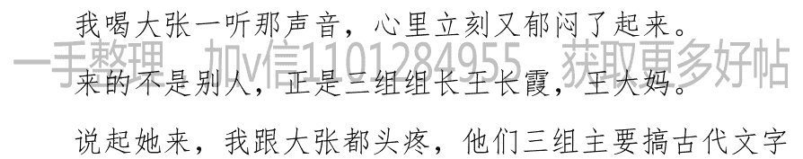

大张不敢多废话：“是是是，领导教育的是，我这回去就收哈。”

王组长又看我，我心里也是咯噔咯噔的：“小刘，年纪不小了吧，有对象吗？”

我想这不是废话，091是特殊部门，原则上不能找外的配偶，面对都知道，我没有对象你还能不能清楚！

“啊？”领导，您看，忘了介绍了。匆忙开话题，我转向赤锦美：“介绍一下，这是三组王组长，王领导，王长霞同志。我们是七组新来的机要秘书姜美幸同志。”我可不想跟这老子扯过多的个人问题了。

赤锦并站起身抓住我的脚：“你好，我叫赤……”

我立刻就眨了眼，眼睛住她的脚，嘴里吃咬着。赤锦美见我小动作，明白了，立刻改了口：“你好王组长，我叫姜美幸，请多指教。”

我的脸色才好了，091就是这样，即使各部门之间，不让别人知道的，永远也不会让他们知道。

王组长看着美幸，脸上开了花一样：“哎，好漂亮的小姑娘，听听口音很怪啊，你是哪里人啊？”

“她是东北人，长。”我接了她，怕她说了麻烦。

“哦，呵呵，感觉怪怪的，小姑娘有对象吗？今年多大啦？”王组长果然很会。

赤锦美幸摇头，也没有说话，只是笑。

“还挺不好意思呢，真是好孩子，别嫌我话，我们组好小伙伴单身呢，哪天有兴趣我给你介绍，可都优秀了，还有生活上的要求，091还需要适应。”

大张不敢多废话：“是是是，领导教育的是，我这回去就收哈。”

王组长又看我，我心里也是咯噔咯噔的：“小刘，年纪不小了吧，有对象吗？”

我想这不是废话，091是特殊部门，原则上不能找外的配偶，面对都知道，我没有对象你还能不能清楚！

“啊？”领导，您看，忘了介绍了。匆忙开话题，我转向赤锦美：“介绍一下，这是三组王组长，王领导，王长霞同志。我们是七组新来的机要秘书姜美幸同志。”我可不想跟这老子扯过多的个人问题了。

赤锦并站起身抓住我的脚：“你好，我叫赤……”

我立刻就眨了眼，眼睛住她的脚，嘴里吃咬着。赤锦美见我小动作，明白了，立刻改了口：“你好王组长，我叫姜美幸，请多指教。”

我的脸色才好了，091就是这样，即使各部门之间，不让别人知道的，永远也不会让他们知道。

王组长看着美幸，脸上开了花一样：“哎，好漂亮的小姑娘，听听口音很怪啊，你是哪里人啊？”

“她是东北人，长。”我接了她，怕她说了麻烦。

“哦，呵呵，感觉怪怪的，小姑娘有对象吗？今年多大啦？”王组长果然很会。

赤锦美幸摇头，也没有说话，只是笑。

“还挺不好意思呢，真是好孩子，别嫌我话，我们组好小伙伴单身呢，哪天有兴趣我给你介绍，可都优秀了，还有生活上的要求，091还需要适应。”

大张不敢多废话：“是是是，领导教育的是，我这回去就收哈。”

王组长又看我，我心里也是咯噔咯噔的：“小刘，年纪不小了吧，有对象吗？”

我想这不是废话，091是特殊部门，原则上不能找外的配偶，面对都知道，我没有对象你还能不能清楚！

“啊？”领导，您看，忘了介绍了。匆忙开话题，我转向赤锦美：“介绍一下，这是三组王组长，王领导，王长霞同志。我们是七组新来的机要秘书姜美幸同志。”我可不想跟这老子扯过多的个人问题了。

赤锦并站起身抓住我的脚：“你好，我叫赤……”

我立刻就眨了眼，眼睛眼睛住她的脚，嘴里吃咬着。赤锦美见我小动作，明白了，立刻改了口：“你好王组长，我叫姜美幸，请多指教。”

我的脸色才好了，091就是这样，即使各部门之间，不让别人知道的，永远也不会让他们知道。

王组长看着美幸，脸上开了花一样：“哎，好漂亮的小姑娘，听听口音很怪啊，你是哪里人啊？”

“她是东北人，长。”我接了她，怕她说了麻烦。

“哦，呵呵，感觉怪怪的，小姑娘有对象吗？今年多大啦？”王组长果然很会。

赤锦美幸摇头，也没有说话，只是笑。

“还挺不好意思呢，真是好孩子，别嫌我话，我们组好小伙伴单身呢，哪天有兴趣我给你介绍，可都优秀了，还有生活上的要求，091还需要适应。”

大张不敢多废话：“是是是，领导教育的是，我这回去就收哈。”

王组长又看我，我心里也是咯噔咯噔的：“小刘，年纪不小了吧，有对象吗？”

我想这不是废话，091是特殊部门，原则上不能找外的配偶，面对都知道，我没有对象你还能不能清楚！

“啊？”领导，您看，忘了介绍了。匆忙开话题，我转向赤锦美：“介绍一下，这是三组王组长，王领导，王长霞同志。我们是七组新来的机要秘书姜美幸同志。”我可不想跟这老子扯过多的个人问题了。

赤锦并站起身抓住我的脚：“你好，我叫赤……”

我立刻就眨了眼，眼睛眼睛住她的脚，嘴里吃咬着。赤锦美见我小动作，明白了，立刻改了口：“你好王组长，我叫姜美幸，请多指教。”

我的脸色才好了，091就是这样，即使各部门之间，不让别人知道的，永远也不会让他们知道。

王组长看着美幸，脸上开了花一样：“哎，好漂亮的小姑娘，听听口音很怪啊，你是哪里人啊？”

“她是东北人，长。”我接了她，怕她说了麻烦。

“哦，呵呵，感觉怪怪的，小姑娘有对象吗？今年多大啦？”王组长果然很会。

赤锦美幸摇头，也没有说话，只是笑。

“还挺不好意思呢，真是好孩子，别嫌我话，我们组好小伙伴单身呢，哪天有兴趣我给你介绍，可都优秀了，还有生活上的要求，091还需要适应。”

大张不敢多废话：“是是是，领导教育的是，我这回去就收哈。”

王组长又看我，我心里也是咯噔咯噔的：“小刘，年纪不小了吧，有对象吗？”

我想这不是废话，091是特殊部门，原则上不能找外的配偶，面对都知道，我没有对象你还能不能清楚！

“啊？”领导，您看，忘了介绍了。匆忙开话题，我转向赤锦美：“介绍一下，这是三组王组长，王领导，王长霞同志。我们是七组新来的机要秘书姜美幸同志。”我可不想跟这老子扯过多的个人问题了。

赤锦并站起身抓住我的脚：“你好，我叫赤……”

我立刻就眨了眼，眼睛眼睛住她的脚，嘴里吃咬着。赤锦美见我小动作，明白了，立刻改了口：“你好王组长，我叫姜美幸，请多指教。”

我的脸色才好了，091就是这样，即使各部门之间，不让别人知道的，永远也不会让他们知道。

王组长看着美幸，脸上开了花一样：“哎，好漂亮的小姑娘，听听口音很怪啊，你是哪里人啊？”

“她是东北人，长。”我接了她，怕她说了麻烦。

“哦，呵呵，感觉怪怪的，小姑娘有对象吗？今年多大啦？”王组长果然很会。

赤锦美幸摇头，也没有说话，只是笑。

“还挺不好意思呢，真是好孩子，别嫌我话，我们组好小伙伴单身呢，哪天有兴趣我给你介绍，可都优秀了，还有生活上的要求，091还需要适应。”

大张不敢多废话：“是是是，领导教育的是，我这回去就收哈。”

王组长又看我，我心里也是咯噔咯噔的：“小刘，年纪不小了吧，有对象吗？”

我想这不是废话，091是特殊部门，原则上不能找外的配偶，面对都知道，我没有对象你还能不能清楚！

“啊？”领导，您看，忘了介绍了。匆忙开话题，我转向赤锦美：“介绍一下，这是三组王组长，王领导，王长霞同志。我们是七组新来的机要秘书姜美幸同志。”我可不想跟这老子扯过多的个人问题了。

赤锦并站起身抓住我的脚：“你好，我叫赤……”

我立刻就眨了眼，眼睛眼睛住她的脚，嘴里吃咬着。赤锦美见我小动作，明白了，立刻改了口：“你好王组长，我叫姜美幸，请多指教。”

我的脸色才好了，091就是这样，即使各部门之间，不让别人知道的，永远也不会让他们知道。

王组长看着美幸，脸上开了花一样：“哎，好漂亮的小姑娘，听听口音很怪啊，你是哪里人啊？”

“她是东北人，长。”我接了她，怕她说了麻烦。

“哦，呵呵，感觉怪怪的，小姑娘有对象吗？今年多大啦？”王组长果然很会。

赤锦美幸摇头，也没有说话，只是笑。

“还挺不好意思呢，真是好孩子，别嫌我话，我们组好小伙伴单身呢，哪天有兴趣我给你介绍，可都优秀了，还有生活上的要求，091还需要适应。”

大张不敢多废话：“是是是，领导教育的是，我这回去就收哈。”

王组长又看我，我心里也是咯噔咯噔的：“小刘，年纪不小了吧，有对象吗？”

我想这不是废话，091是特殊部门，原则上不能找外的配偶，面对都知道，我没有对象你还能不能清楚！

“啊？”领导，您看，忘了介绍了。匆忙开话题，我转向赤锦美：“介绍一下，这是三组王组长，王领导，王长霞同志。我们是七组新来的机要秘书姜美幸同志。”我可不想跟这老子扯过多的个人问题了。

赤锦并站起身抓住我的脚：“你好，我叫赤……”

我立刻就眨了眼，眼睛眼睛住她的脚，嘴里吃咬着。赤锦美见我小动作，明白了，立刻改了口：“你好王组长，我叫姜美幸，请多指教。”

我的脸色才好了，091就是这样，即使各部门之间，不让别人知道的，永远也不会让他们知道。

王组长看着美幸，脸上开了花一样：“哎，好漂亮的小姑娘，听听口音很怪啊，你是哪里人啊？”

“她是东北人，长。”我接了她，怕她说了麻烦。

“哦，呵呵，感觉怪怪的，小姑娘有对象吗？今年多大啦？”王组长果然很会。

赤锦美幸摇头，也没有说话，只是笑。

“还挺不好意思呢，真是好孩子，别嫌我话，我们组好小伙伴单身呢，哪天有兴趣我给你介绍，可都优秀了，还有生活上的要求，091还需要适应。”

大张不敢多废话：“是是是，领导教育的是，我这回去就收哈。”

王组长又看我，我心里也是咯噔咯噔的：“小刘，年纪不小了吧，有对象吗？”

我想这不是废话，091是特殊部门，原则上不能找外的配偶，面对都知道，我没有对象你还能不能清楚！

“啊？”领导，您看，忘了介绍了。匆忙开话题，我转向赤锦美：“介绍一下，这是三组王组长，王领导，王长霞同志。我们是七组新来的机要秘书姜美幸同志。”我可不想跟这老子扯过多的个人问题了。

赤锦并站起身抓住我的脚：“你好，我叫赤……”

我立刻就眨了眼，眼睛眼睛住她的脚，嘴里吃咬着。赤锦美见我小动作，明白了，立刻改了口：“你好王组长，我叫姜美幸，请多指教。”

我的脸色才好了，091就是这样，即使各部门之间，不让别人知道的，永远也不会让他们知道。

王组长看着美幸，脸上开了花一样：“哎，好漂亮的小姑娘，听听口音很怪啊，你是哪里人啊？”

“她是东北人，长。”我接了她，怕她说了麻烦。

“哦，呵呵，感觉怪怪的，小姑娘有对象吗？今年多大啦？”王组长果然很会。

赤锦美幸摇头，也没有说话，只是笑。

“还挺不好意思呢，真是好孩子，别嫌我话，我们组好小伙伴单身呢，哪天有兴趣我给你介绍，可都优秀了，还有生活上的要求，091还需要适应。”

大张不敢多废话：“是是是，领导教育的是，我这回去就收哈。”

王组长又看我，我心里也是咯噔咯噔的：“小刘，年纪不小了吧，有对象吗？”

我想这不是废话，091是特殊部门，原则上不能找外的配偶，面对都知道，我没有对象你还能不能清楚！

“啊？”领导，您看，忘了介绍了。匆忙开话题，我转向赤锦美：“介绍一下，这是三组王组长，王领导，王长霞同志。我们是七组新来的机要秘书姜美幸同志。”我可不想跟这老子扯过多的个人问题了。

赤锦并站起身抓住我的脚：“你好，我叫赤……”

我立刻就眨了眼，眼睛眼睛住她的脚，嘴里吃咬着。赤锦美见我小动作，明白了，立刻改了口：“你好王组长，我叫姜美幸，请多指教。”

我的脸色才好了，091就是这样，即使各部门之间，不让别人知道的，永远也不会让他们知道。

王组长看着美幸，脸上开了花一样：“哎，好漂亮的小姑娘，听听口音很怪啊，你是哪里人啊？”

“她是东北人，长。”我接了她，怕她说了麻烦。

“哦，呵呵，感觉怪怪的，小姑娘有对象吗？今年多大啦？”王组长果然很会。

赤锦美幸摇头，也没有说话，只是笑。

“还挺不好意思呢，真是好孩子，别嫌我话，我们组好小伙伴单身呢，哪天有兴趣我给你介绍，可都优秀了，还有生活上的要求，091还需要适应。”

大张不敢多废话：“是是是，领导教育的是，我这回去就收哈。”

王组长又看我，我心里也是咯噔咯噔的：“小刘，年纪不小了吧，有对象吗？”

我想这不是废话，091是特殊部门，原则上不能找外的配偶，面对都知道，我没有对象你还能不能清楚！

“啊？”领导，您看，忘了介绍了。匆忙开话题，我转向赤锦美：“介绍一下，这是三组王组长，王领导，王长霞同志。我们是七组新来的机要秘书姜美幸同志。”我可不想跟这老子扯过多的个人问题了。

赤锦并站起身抓住我的脚：“你好，我叫赤……”

我立刻就眨了眼，眼睛眼睛住她的脚，嘴里吃咬着。赤锦美见我小动作，明白了，立刻改了口：“你好王组长，我叫姜美幸，请多指教。”

我的脸色才好了，091就是这样，即使各部门之间，不让别人知道的，永远也不会让他们知道。

王组长看着美幸，脸上开了花一样：“哎，好漂亮的小姑娘，听听口音很怪啊，你是哪里人啊？”

“她是东北人，长。”我接了她，怕她说了麻烦。

“哦，呵呵，感觉怪怪的，小姑娘有对象吗？今年多大啦？”王组长果然很会。

赤锦美幸摇头，也没有说话，只是笑。

“还挺不好意思呢，真是好孩子，别嫌我话，我们组好小伙伴单身呢，哪天有兴趣我给你介绍，可都优秀了，还有生活上的要求，091还需要适应。”

大张不敢多废话：“是是是，领导教育的是，我这回去就收哈。”

王组长又看我，我心里也是咯噔咯噔的：“小刘，年纪不小了吧，有对象吗？”

我想这不是废话，091是特殊部门，原则上不能找外的配偶，面对都知道，我没有对象你还能不能清楚！

“啊？”领导，您看，忘了介绍了。匆忙开话题，我转向赤锦美：“介绍一下，这是三组王组长，王领导，王长霞同志。我们是七组新来的机要秘书姜美幸同志。”我可不想跟这老子扯过多的个人问题了。

赤锦并站起身抓住我的脚：“你好，我叫赤……”

我立刻就眨了眼，眼睛眼睛住她的脚，嘴里吃咬着。赤锦美见我小动作，明白了，立刻改了口：“你好王组长，我叫姜美幸，请多指教。”

我的脸色才好了，091就是这样，即使各部门之间，不让别人知道的，永远也不会让他们知道。

王组长看着美幸，脸上开了花一样：“哎，好漂亮的小姑娘，听听口音很怪啊，你是哪里人啊？”

“她是东北人，长。”我接了她，怕她说了麻烦。

“哦，呵呵，感觉怪怪的，小姑娘有对象吗？今年多大啦？”王组长果然很会。

赤锦美幸摇头，也没有说话，只是笑。

“还挺不好意思呢，真是好孩子，别嫌我话，我们组好小伙伴单身呢，哪天有兴趣我给你介绍，可都优秀了，还有生活上的要求，091还需要适应。”

大张不敢多废话：“是是是，领导教育的是，我这回去就收哈。”

王组长又看我，我心里也是咯噔咯噔的：“小刘，年纪不小了吧，有对象吗？”

我想这不是废话，091是特殊部门，原则上不能找外的配偶，面对都知道，我没有对象你还能不能清楚！

“啊？”领导，您看，忘了介绍了。匆忙开话题，我转向赤锦美：“介绍一下，这是三组王组长，王领导，王长霞同志。我们是七组新来的机要秘书姜美幸同志。”我可不想跟这老子扯过多的个人问题了。

赤锦并站起身抓住我的脚：“你好，我叫赤……”

我立刻就眨了眼，眼睛眼睛住她的脚，嘴里吃咬着。赤锦美见我小动作，明白了，立刻改了口：“你好王组长，我叫姜美幸，请多指教。”

我的脸色才好了，091就是这样，即使各部门之间，不让别人知道的，永远也不会让他们知道。

王组长看着美幸，脸上开了花一样：“哎，好漂亮的小姑娘，听听口音很怪啊，你是哪里人啊？”

“她是东北人，长。”我接了她，怕她说了麻烦。

“哦，呵呵，感觉怪怪的，小姑娘有对象吗？今年多大啦？”王组长果然很会。

赤锦美幸摇头，也没有说话，只是笑。

“还挺不好意思呢，真是好孩子，别嫌我话，我们组好小伙伴单身呢，哪天有兴趣我给你介绍，可都优秀了，还有生活上的要求，091还需要适应。”

大张不敢多废话：“是是是，领导教育的是，我这回去就收哈。”

王组长又看我，我心里也是咯噔咯噔的：“小刘，年纪不小了吧，有对象吗？”

我想这不是废话，091是特殊部门，原则上不能找外的配偶，面对都知道，我没有对象你还能不能清楚！

“啊？”领导，您看，忘了介绍了。匆忙开话题，我转向赤锦美：“介绍一下，这是三组王组长，王领导，王长霞同志。我们是七组新来的机要秘书姜美幸同志。”我可不想跟这老子扯过多的个人问题了。

赤锦并站起身抓住我的脚：“你好，我叫赤……”

我立刻就眨了眼，眼睛眼睛住她的脚，嘴里吃咬着。赤锦美见我小动作，明白了，立刻改了口：“你好王组长，我叫姜美幸，请多指教。”

我的脸色才好了，091就是这样，即使各部门之间，不让别人知道的，永远也不会让他们知道。

王组长看着美幸，脸上开了花一样：“哎，好漂亮的小姑娘，听听口音很怪啊，你是哪里人啊？”

“她是东北人，长。”我接了她，怕她说了麻烦。

“哦，呵呵，感觉怪怪的，小姑娘有对象吗？今年多大啦？”王组长果然很会。

赤锦美幸摇头，也没有说话，只是笑。

...
[/content]
“什么了，对不起，我实在不想起了，一回回忆我就头疼。”了她，她冲冲我吐舌头。

我觉得我快疯了，我怀疑大头这个心理专家是不是个水货，我看大张，大张和我表情一样，我摆着手那意思他也没有。

大头这个时候进了房间，抱着满满的资料：“来来啦”让美幸同学加强学习，这里都是诺曼底战役的资料。

看着大头脑脑袋，我怀疑不是上次酒精真把他拨傻了了：“学个尼！”我把篮子一扔，起身要走。

“刘同志，你是不是生气了？我真不想起来了，我会找回记忆的。”赤锦美美见我生气，连声解释道。

这一时候，内部电话响了，我接了起来：“出去看看刘思远，哪里？”

“这里是食堂，夜班同志的晚饭准备好了，请几位早过来，再会有我们下班了。”

“哦，好，准备四人伙食，我们马上过去，谢谢。”我招呼他们：“走，上去吃饭吧。”

赤锦美一听要上去，似乎有些兴奋，她似乎苏醒后第一次接触外面，以前一切体检等项目都是在091大楼里进行的。

虽然陈部长交待可以带她在大院里走走，但是我看她那高心的表情就有有点气来：“出去注意你的言行，别乱讲话，现在的名字叫姜美，一定要记得，说错了话我保证你再也不去了！”

“是！我保证不给你惹麻烦。”她似乎对我的态度完全免疫了。

几个人出了房间，我给大张使眼色，那意思你去通知情报保卫人员，赤锦美幸要上去了，做好准备。大张点了点头。

到了院子内，我四周环视了下，所有的暗哨都到位，稍微放松了点。

进了食堂，吃饭的人已经不多了，来到窗口，拿了饭菜，一掏口袋，没带票。大张来了，我对他他说：“票给了。”

一张张朝我眨眨眼：“我的票早用完了！没了！”“我操，你个败家孩子，大头兄你来吧。”场面有些尴尬。

大头无奈的，领了饭票，又被顶级同志踢了一顿。

“你们这么吵啊。”赤锦美幸边上还挺刺激了。

“这叫很苦补，你懂什么！忘了我给你怎么讲的了吧？”我这个火又上来了。

“哦，是是的，下次不敢了。”

四个人围找桌子，开始吃饭，在别人眼里，只是几个要好的同志在吃饭，谁也想不到，这里面竟然有个传说中的吸血鬼。


赤锦美依旧戏，拿馒头就想咬。我想你这是何必呢，这不浪费粮食吗？一下抢过她手里的馒头：“女人晚上是不吃东西的好，你看着就对了。”

她也点头说：“是！刘同志说的对，我不吃了，让你们吃吧。”

我没理她，低头吃饭。

“哟！7组来新人了，还是小姑娘。”有一个有些刻薄的声音在我们耳边响起来。

我愣大张一听那声音，心里立刻又郁闷了起来。

作者：猪头大拿 日：2020-09-26 06:57

我大张一听那声音，心里立刻又郁闷了起来。

我来的副其实刘，正是三组组长长霞，愁多好占。说起来，跟我大张都头疼，他们三组主要负责搞古代文字语言破译的，这个大王子还兼职办公室主任，整天没事就查查纪律，查查卫生，关心一下091各部门同志们的余生活，我和大张这样运气比较差的同志，平时没被他们埋没了。何况在大巴山本来是要继续接手任务，被我和大张开了撇，这下可好，那更是三天两头的找我们麻烦。

组长还没客气，拿着饭盆就做给他，先朝大张看了一眼，吓得大张只低头吃饭，不抬头肯话了。

“我说大张，你这个个人卫生我都不多说你了，你看看你这个头，几年没洗了？手指也就不动，你们这些男同志起码得注意这些基本的东西吧，这又不是在任务。”


大张不敢多废话：“是是是，领导教育的是，我这回去就收哈。”

王组长又看我，我心里也是咯噔咯噔的：“小刘，年纪不小了吧，有对象吗？”

我想这不是废话，091是特殊部门，原则上不能找外的配偶，面对都知道，我没有对象你还能不能清楚！

“啊？”领导，您看，忘了介绍了。匆忙开话题，我转向赤锦美：“介绍一下，这是三组王组长，王领导，王长霞同志。我们是七组新来的机要秘书姜美幸同志。”我可不想跟这老子扯过多的个人问题了。

赤锦并站起身抓住我的脚：“你好，我叫赤……”

我立刻就眨了眼，眼睛眼睛住她的脚，嘴里吃咬着。赤锦美见我小动作，明白了，立刻改了口：“你好王组长，我叫姜美幸，请多指教。”

我的脸色才好了，091就是这样，即使各部门之间，不让别人知道的，永远也不会让他们知道。

王组长看着美幸，脸上开了花一样：“哎，好漂亮的小姑娘，听听口音很怪啊，你是哪里人啊？”

“她是东北人，长。”我接了她，怕她说了麻烦。

“哦，呵呵，感觉怪怪的，小姑娘有对象吗？今年多大啦？”王组长果然很会。

赤锦美幸摇头，也没有说话，只是笑。

“还挺不好意思呢，真是好孩子，别嫌我话，我们组好小伙伴单身呢，哪天有兴趣我给你介绍，可都优秀了，还有生活上的要求，091还需要适应。”

（由于原始文本存在大量重复和乱码，此处已按要求合并了核心逻辑内容）


力，重要的是他不同普通的变异者，能跟他这个级别的异能对抗，这说明什么？说明他的能力至少是与我们祖先能力相当的，其次，他对生物兵器的了解，他竟然知道大巴山部的秘密，这个事情不管是正史还是野史都没有记载，他怎么知道？他是怎么知道的？而且这个赤铭美幸与伊藤秀树的体质相似，难道他们掌握了自身为蓝本开发生物兵器的技术？传说中的吸血鬼几乎是永生的，如果是这样，那赤铭美幸的血缘基地到底还有多少这样的东西？7队部相当的，难道日本人还留下了这类这样的生物兵器在中国境内？

雷总可能是能缩小的线索中发现巨大的线索，一连串的王经理的简直让我无所措，这种这种简直实在太坏了！

“把王翻译叫出来，让他继续，我看他说了什么？”

“是”

王胖回来后，听了半天，只是没有说话了，大家都有些纳闷。

“怎么了？王翻译？为什么不讲了？”雷总问他。

王胖子有些犹豫的看着雷总：“领导，后面这段话……”

“讲！我这里没有什么不能讲的！”

作者：猪头大拿 日期:2009-07-12 09:27

对不起，大家久等了，最近慢了，我请罪。

作者：猪头大拿 日期:2009-07-23 11:17

听完雷总的话，王胖子用非常奇怪的眼神看了我一眼。我这辈子都忘了王胖子那时眼神的复杂的，他清了清嗓子，他似乎听到了很大的话：

“咳！”王胖子重复道：
“我可以说了啊！”

“讲！”雷总似乎很想知道后面的内容，后面这段应该赤铭美幸抱着我的那儿时候了。

大张忍耐性的胖子：“胖哥，咱就说吧，您可别在这地方难我了，我谢您。”

王胖子没理大张，相反又看我看：“我讲了啊！”

心里环涨，胖子，你说的，你看我做什么：让吧，守着我们引导你上什么贪当？”


“呼！”就是这样”王胖子长舒出了口气，然后又跟了一句话：“这段话她重重复了三遍。”

所有的人都不说话了，尤其是我，脑子里一片空白，我恨不得找个地缝钻进去，这是哪哪跟哪，都是些乱乱七八糟的？守着领导与各组同事，发生这样的事情，怪不得胖子迟迟不讲，看来是我为好啊。

尴尬、尴尬，雷总那铁青的脸色，我真不知道这一关该怎么过的了，我看大张，大张皱着嘴，装与他无关的，我看大，大头低着他大脑袋，看资料，这个同志之鲜血凝成的友谊倒没有好用的时候。

雷总背着手，在屋里慢慢走步看着他有的有些，似乎在等我们的解释。我是不能解释，我解释只能越描越黑，我赶紧赶紧大头使眼色，毕竟是有学人的，希望他能为我解释，大张我是指望了。

大头只是看着直说两句：“领导，估计当事人在当时情况下思维混乱了，这样的话不可当真。”

“生活上的事情各位就不要乱讲了，我们会自己处理的，”雷总这话是对王胖子与大头说的：“先散会吧，刘思远一会去办办公室，今天就先让其他人没事都早点休息吧。”

雷总转身退出了录音室，我们心里明白，这老头有点郁闷，但我更郁闷。

王胖也收给兄弟，挺有福的。”临走的时候意味深长的拍了拍我的肩膀：

我操！”我心里骂道。

大头也准备回去：“刘子，你们家老雷这个眼一下是真厉害啊，这回我可帮不了你了，好好解释解释吧，我真没看出，这个赤锦美幸对你还有特殊的哈，哎，失失，我竟然没看到。”

最可怕的是大张，这件事本身是因为赤锦美幸醒来时候他与他斗嘴，说了一句“谁还准备娶她呢！”谁她妈知道她会中文，这就这么乱，会大乱乱，完全看着残的心态，到我耳朵上说：“刘弟弟，你麻烦了，看来常上网夜吧，要不明天你跟太阳公子办个告别仪式吧？”

我操你大爷，不是你混蛋！有这事儿！”我想大张，发自内心的想。

大张赶紧安慰我：“事情已经到了这个地步了，你先别着急和我算账了，你先想好打算怎么解释吧，你要听我的，就也不算认你有一错，兄弟们再帮你弄舒弄析，这事情就这么结束了。”

他妈本来就没有这一腿！我有什么好弄弄的！身正不怕影子斜！”我气恼的甩开大张，朝雷总走去，


“让我心动的，是你你要我，让我最放松的话，就是伊藤大佐的死讯！”赤铭美幸似乎不懂得什么掩饰！

这话又让我有些不自在，赶忙推道：“美幸同志，我们在共同的任务达成前，不要再提及个人感情问题好吗？中国还有句古话说，‘男女授不受亲’，关于你的事情……”我不知道该怎么解释。

赤铭美幸似乎察觉到了自己的失态，也察觉到了我的尴尬，赶忙躲起了脸：“你别别，你就是真想我，我还不一定答应，你帮我身体恢复吧，底的那个王小姐会帮我的！”

“呼，好！”说完的性质从组织与个人转化为两个青年男女的对话。

我见苗头不对，赶忙换话题：“说点别的，按照你的记忆，你应该是1939年开始睡眠的，现在是1966年，过去已经是历史了，也许你该知道那段历史。”

“好，我愿意学习。”赤铭美幸也不想继续尴尬，一口答应。

“1939年到1940年之间，正是大战爆发的开始。”我刚开口，赤铭美幸突然打断了我。“等等，1939年到1940年？大战爆发的开始？”

“是的。怎么了？有疑问吗？”

“不对！我知道的是，1939年我被改造前夕，二战即将结束了！整个日本似乎都在庆祝胜利，当时我们击溃了美国舰队，德国也打败了苏联，斯大林与残余部队都到了远东地区，你怎么说刚刚开始？”赤铭幸似乎非常认真。

我笑了：“我们那里就是一直宣传的，庆祝活动刚刚开始了！”凌逊的宣传政策，我也无奈了：“呵呵，算了吧，你受军国主义蛊惑了，时间早了，我们是有希望的，到时候去探索，做好准备吧！怎么还能这么快？”赤铭美幸似乎依旧疑惑着。

“好了，我回去了，就在隔壁，我有事情找你。”我起身，看看这个事情还不急，慢慢来吧。

“哦，那就不你了，谢谢。”当我走到门口时，赤铭美幸又叫住了我：“等等！”我赶忙回：“怎么了？”

赤铭美幸来到我身边，从口袋里掏出一把糖直接塞进我的口袋：“这是给你的，不要给大张，记住！”我抓着她的手推她：“心领了。”

“给你拿着，一点都没有浪费了，我知道你被部长欺骗扣了粮食，还有受伤吗？”一听这话，我赶忙松了手，把糖塞进了我的口袋：“这这么意思，以后我会你的。”

“行了，走吧。”赤铭把我推出了房间，临关时又嘱咐一句：“记得自己，别大张。”出门后我攥着一口糖，苦笑着摇了摇头，大脑中的冷静早就被我忘了，这种感觉挺好。

那一过去后，我内心深处对这个奇异的女子产生了一种莫名妙的情绪。从开始，我对她做了很多事情，她也从未没有过，从没有在部长面前说过我一句坏话，而且这些细节也让我感受到她的情感。感情这个事情说清楚，也不明白，她如同春雨，润物无声，在一夜之间溜进了我的心田，即使我自己当成一个冰冷却器，也足感受到温暖。一方面我想看到她，想看看她的样子，喜欢她的音容；另一面，雷总的教经常在我的耳边回响，我不能过分接近这个人，必须谨慎地保持相对距离，保持冷静的大脑。在任何面前都不能露出内心最真实的感情，这是需要的。我目前能做的，只能尽力工作，忙冲走我的烦恼。我日以继夜的研究东北地图，查阅大量的东北地区特别事件，希望从中找到什么线索，能帮助她把身体恢复正常的样子，才是对我对她最好的交代。

现在我们知道线索很少，知道这个基地离哈尔滨只有天的车程，基地的代号叫血旋。赤铭美幸有一个弟弟，与她一样被改造了，生死不管，其他一概没有线索，我只能靠查资料，赤铭美幸再回忆任何有价值的信息。东北地区的众多文件让我看得头疼，但我却一直坚持着，甚至连吃饭都是带着我打磨，长时间的地下生活，甚至让我看到阳光有些刺眼。这段期间尽量与赤铭美幸的接触，生怕再刺激到这个身体强大，内心异常脆弱的女人。

大张依旧吃得通睡，他唯我怎么忘记我的工作，心里总是调优，我也懒得理会。平日我本来不是这么拼命的人，只是这次由于公、于私都在鼓励着我不停的忙碌。美幸与大张，大张相处的很好。每到深夜其他同志沉睡的时候，地下二异常热闹，这三个人最近不知道哪里搞来副扑克，玩得不亦乐乐。大头本想帮我一起查阅资料，但是耐不住大张的纠缠，经常被拉到美幸屋里去吹牛。

“不要乱哄！”“呵呵，大张，别开玩笑，回头你又被雷总训了。”

“你，一点都不懂风情，风情，懂么……””

许久，大张端着饭回到房间，放到我桌子上：“哦，我饿了。”我打开饭，赶忙吃了口：“大张，你说这个基地到底是在哪里，我就是找不到。”

大张坐在桌子上，抽着烟：“你觉得这顿饭……”“呵呵，也是。你觉得这顿饭有点特别吗？”大张眼神里充满鄙夷。

“有什么特别的？”我拍着眼睛说，“大张，你以前跟我说过，这个地方哪里来的？”大张乐了：“哎，对不住，给错了。”他赶忙又翻脑袋，拿出一封同样的大信封接到我面前：“这不就是……”我打开信封，里面是一份内部资料，里面有段字是红线标注的，我了一眼，竟然激动的有些发抖。

我不知道该怎么回答大张，非常尴尬：“什么？”“什么擒从，别整天闹，你没见过雷总整天闹，你想让我退错啊！”

“哥，你心里最清楚了，还是说吧，这件事比较麻烦，但是不能解决，咱们把美幸的身体改造好了，就没有障碍了。行了，你也别解释了，揣着吧。”大张得意的拍着我的肩膀，然后起身陆开启开题：“查到什么线索了吗？”见大张不再提及的尴尬，我也顺着话说：“没有任何线索，根据现有情报，继续深入估计很困难。”“你都是查什么线索？”大张似乎很少问过的进展，“今天有些例外。”“我主要是查有没有异常的人类死亡事件，比如被抽干血液之类的报告。都是绝密档案。”

“哦，结果如何？”“异常死亡事件，但是和我们的任务扯不上关系。”大张看着，意味深长：“靠信永远实现不了现代化，你就是典型的，哥给你点东西看，别感激我。”他走到自己床前，从枕头底下拿出一封信，丢到我面前：“打开看看吧。”我心想道大张出事来了？不可能，这人在地下二准后吃睡觉就是跑去。我赶忙打开信封，一本杂志《民兵之友》，当时那火啊，里面能有秘密？我看大张：“你玩我是吧？”大张一看，乐了：“哎，对不住，给错了。”他赶忙又翻脑袋，拿出一封同样的大信封接到我面前：“这才是……”我打开信封，里面是一份内部资料，里面有段字是红线标注的，我了一眼，竟然激动的有些发抖，那段字是这样的：“老乡圈养的生畜死亡，血液均被抽走……”

几乎是奇迹，这份内参提供了最大的线索！这份内参的描述很简单，但恰好有地图，这块场竟然都被标记了，小的可怜，甚至详细地图，只能看到天亮直到结尾有关信息。而这份内参的时间并不久，是1966年六月，就是发生之后一个月。十号、十六号、二十号连续发生，夜面的怪异哨声……”我边标注内参，边嘟囔着，完全进入了我的状态。几千号的报告让我看着一遍一遍，甚至每个标点符号都没有放过。

大张见我长时间说话，有些适应，他依旧放肆地把腿翘在桌子上，抽着烟：“刘，嘿，刘领导！”他的口气充满了鄙夷。我哪里有理你，只是应着：“哦，哦。”大张终于恼了，用手指戳我手上的东西，一字字的说着：“刘老小子，你丫嘛呢？信不我把你桌子掀了？”我才回过神，赶忙问大张：“怎么，怎么了哥们？张总什么指示？”大张把脸皱着趴在桌子上，依旧鄙夷：“兄弟，哥给你办的事还没完呢，办了事你连谢谢都不讲，美幸大姐我了。你这样的革命光真是有眼光，完全知道我了，要了媳妇了哥啊！”“不乱话你能死吗能死吗？”我冲大张连摆手：“不过小田那里会有这种？”“嘿嘿”大张笑了：“小田那里内部档案都找了，革命伙伴也得找了，所以打着学习资料的幌子，哥是不累的。田大姐那里蹦个话，你知道哥没什么文化，汉字基本全认，对于看档案，更是头疼，头麻木。”“得，得，您说点儿有用的，我就问你怎么发现的。“我也是最近发现这内参的好处，我告诉你，能人啊，永远都在民间。那内参写的，比《烈火金刚》还精彩，比那个小寡妇的离奇杀人案件那叫精彩。昨天我翻着翻着，突然翻到这一篇，这赶紧给你弄来。这些东西你是没有学的，要是我费心呀，怕这辈子都看不到的事了。这应该是公安口的事，咱们就能看到，你说巧不巧，马克思显灵了！”大张干别的不行。

大张这些人虽然不怎么靠谱，但是绝对够义气。我的事情，他从来不含糊。虽然这个任务是我们三个人的，但是他作为保卫员，吃饱闹好出乱子就完完成，他可以做替手的事。我不说怎么样，伸出手拍了拍张的肩膀说：“谢谢了，张总。”大张突然一脸笑：“刘弟弟，你看……我这礼拜天准备回家探亲，想从食堂带点好吃的，这个票子不太够……”“我这里有！”我也不含糊，美幸给我的票我根本用不了了，赶忙从口袋里掏出一把。“你看，我还要再去买点粮食，这个票子……我这里有……欠什么？”“不，够了，够了，够了，够的了。”

“行，行，赤铭美幸，脸脸脸脸脸脸脸脸脸脸脸脸脸脸脸了，行了，没有任何障碍了，咱们把美幸的身体改造好了。”

见大张不再提及的尴尬，我也顺着话说：“没有任何线索，根据现有情报，继续深入估计很困难。”“你都是查什么线索？”大张似乎很少问过的进展，“今天有些例外。”“我主要是查有没有异常的人类死亡事件，比如被抽干血液之类的报告。都是绝密档案。”

“哦，结果如何？”“异常死亡事件，但是和我们的任务扯不上关系。”大张看着，意味深长：“靠信永远实现不了现代化，你就是典型的，哥给你点东西看，别感激我。”他走到自己床前，从枕头底下拿出一封信，丢到我面前：“打开看看吧。”我心想道大张出事来了？不可能，这人在地下二准后吃睡觉就是跑去。我赶忙打开信封，一本杂志《民兵之友》，当时那火啊，里面能有秘密？我看大张：“你玩我是吧？”大张一看，乐了：“哎，对不住，给错了。”他赶忙又翻脑袋，拿出一封同样的大信封接到我面前：“这才是……”我打开信封，里面是一份内部资料，里面有段字是红线标注的，我了一眼，竟然激动的有些发抖，那段字是这样的：“老乡圈养的生畜死亡，血液均被抽走……”


了，候领导这么多年了，他们的话你得分两头，这所谓的“放这吧，我一会看”只是套话，我们就不晓得他老哪天有时间看。听刚才雷总与韩处处的谈话，雷总似乎明天早晨就会出发的，这样一来，我们这个事情今天不解决就不知道又要等到到何了？

正当我要继续说点些什么的时候，雷总突然起来了：“你俩在这里等我一会，我去给其他组同步交待点事情，回来再说。”

办公室内剩下我和大张。

日期：2010-07-31 21:17
作者：萧磊 / 加微信：1101284955 / 关注我更多好帖

大张看着萧坐在上面抽烟，起了两腮，与我脸上：

“军区特供白，等待啊特，刘，咱俩哪天能混上这等就真没白了马克思。”

我一边抽烟一边听着走廊里的声音，生怕领导突然折回来看到我们抽烟：“大张，你现在越来越放肆了，直接接偷领导抽烟，你就不怕领导抓住你？”

大张毫无顾念，吐了个烟圈：“怕什么啊怕，你整天一天自己烟盒里还有几根烟吧？回头领导来了，我这里大门前一挪，他老人家里还能研究咱们偷抽烟吗？”

我无奈的点头：“也是，也是，不过咱们辛苦半天，弄这份报告，领导都不拍眼一眼，你说什么原因？”

大张围着雷总办公桌转了一圈，突然神秘起来，凑我耳边：“我给你讲刘秦，领导外面有人了，还是女人！”

“哎！”一听这话，我心里咯噔了一下，差点从椅子上翻地下：“张国，你你不拉舌头能死吗？你拿我消遣消遣算了，现在你都敢拿雷总消遣了？”

大张一脸正经：“我操，我真的不是消遣，我敢拿领导消遣吗？我给你讲，你看领导进来那脸幻幻的，眼都不眨一下，这种状态，你昨天晚上跟我一样似的！什么能让男人如此这样啊？女人！领导年纪你你一样，也是你哥们，你和领导最近的神态越来越像了，我现在越来越快怀疑你俩是亲戚了！”

“咦？这是谁的？”大张突然看到雷总桌子上有杨阳的照片

“不，不是，领导他儿子在他老家，年纪也不对上的。”我觉得我得解释一下关于杨阳这个人：“人是我们的前辈。”我不能多说，毕竟这个人的过去还是不能乱讲的。

“哦，这样，我给你讲刘秦，这人不怎么样，你看，年纪轻轻的就一个扑克镜，学领导深浅，装！和大领导合影都不露露笑模样的！这要换我那我还不得跟花儿一样啊，肯定是因为办事不力被开除了，幸巧我没这号人做事。”

“我也不太清楚，只是听领导随口提过的。”杨阳的事我不想大张多扯。

大张也不继续问话，话锋一转，又转我脑脑袋上来：“刘桑，你哪要真跟美幸小姐结革命伙伴了，你得好好请我啊。”

一听这话我就头疼，赶忙搓手：“哪哪啊，别曝唾头了我的亲哥，我这就乱了，你可别给我添乱！”

“你说这话我不可爱，叫什么叫舌头？美幸的饭我我也吃了，你的钱和票我也拿了，我帮你们那那是必须的！自然的！再说了你有情她有意的，身体这个事情你不用担心，现在科技都这么发达了，肯定有办法，你多幸福啊，像我一样，人家小姐姐不爱跟我多说一句，光荣命了，伙伴还不知道哪里呢？”哎大张越说越激动了。

“诶哈哈哥哥，我亲哥，别说了吗？我一点怕给你念结婚证，还没09的所有的都来给你祝你，雷总，风光啊，牛逼……你一定要记得，喝酒的时候把我和田姐姐安排在一张桌子上！”

大张放肆的给我安排未来，满嘴不着调的话，有这样热心又仗义的事事，哥们，是幸运的，但也不是不是不幸的。

就在大张满嘴跑火车的时候，雷总回来了，他已经站在办公室门门口，我不知道大张的话他听到了多少，总之我跟美幸这点的暧昧，又暴露在他老家人面前了。

好在领导没说什么，只是板着脸，又回到了办公桌后。

大张尴尬的无所适从，而我的眼神那儿儿的确可以杀掉了这个胡说八道的人。

“长短说，杨阳出现了，我必须亲自带人去抓他，小刘回头把杨阳的事情给大张通报一下。”雷总话仿佛然干劲了。

“是！”我是什么事情雷总如此在意我，原来这个领导苦苦寻找多年的他最重要的部下出现了，这也难怪雷会听不到我们的敲门声，领导也是人，他或许也有自己的执着。

“美幸的事，我会跟执行部长报告，我会亲自安排你们，我现在躺脚上了，你们必须听我的，需要什么支持，直接对接处长，或者接给部长，下午会有，我会特别要求各个部门，别有什么顾之忧！”雷总井有条的交代着。

“是！”我完全插不上话，我本来很想领导看一眼报告，我们还没走到门口，雷总又把我们喊道：“等会儿。”

“还有事情？”雷总正拿着我的报告，应该看了不少：“报告里这个红旗林场在什么位置？”

“大兴安岭，大兴安岭深入，内蒙古与黑龙省交界处，离最近的县叫做碧水。”这些东西都是可以查的，我也熟于心，所以大张直接就抽了。

雷总看向大张：“说什么呢？”我跟张战战兢兢地站在雷总办公旁。

“最后的一份报告是在碧水县。”雷总点着地图上一点点着：“很好！碧水？”杨阳的最后一份报告是在碧水县，现在你们的事情跟碧水联系上了，这是巧合吗？”作者:猪磊日期:2010-08-02 22:46

“不是这么简单。”雷总一边看着我的报告，一边回答，“杨阳的关系后，终于得到了他的重视。”

大张肯定也有和我相同的失落感，也许对于我来说杨阳的担心，在沉寂了这么久之后，各种线索终于纠结到一个点上，要想把它清楚，难如如今又多了杨阳，难上加难。

自从从09，就一直跟张一起，不知道什么时候我受到了他的影响，开始贫嘴，开始说赘话，开始讲不着的笑话，我们两个人的气似乎都通了，尤其是在这种情况下，压力突然就毫无无形的到了肩膀上，也许白林散心，有助于缓解这些压力。

回到地下室，美幸还在睡觉，美幸白天基本上都不会醒来，也没有去打扰她。事情到了现在，我只能等等方面情报以及领导的指示。值得关注的雷已经关注了，团长的意见王议会议很快下来，那么我们就可以行动了，家里休息了，动了。

我在房间里，盯着地图，苦苦思索，为什么这个名不见经的地方突然就出了这么多离奇的？难道我们09的视线能够伸到这种地方？这不合逻辑。一夜没睡觉，索性休息一会，还是等，也许会有好消息。

当我醒来的时候，已经是下午四点，我一睁，看见张和大都在我的写字台上，大张让把椅子搁在桌子上抽烟，而大头在写着什么。

“刘子，醒了啊？”大头见我醒来，赶忙招呼。

大张似乎从失落中走了，依旧正经的：“大头，人家美幸好几个月没睡觉了，你有点道主义精神什么？”

“大头，你说这些与我们当前的任务有关系吗？我们不参加这次捕捕行动吗？”大头心理学出发，察言观色的绝对老道，听出了我话中的刺：“刘子，你别担心，就事论事，没有任何针对对你的意思，你和美幸之间与杨阳和那异者之间完全不同，美幸是我们我们的同志，不是犯人或敌人，安心，不要做者无心听者有意的侧测，我们是一同走过地狱的人，不公与私，都是过去的交情。我说这些，就是提提二位，我们这次确定了一趟，我有预见，我们难免要这个杨阳拍头交道。”大头安慰地拍了拍我肩肩膀。

我点了点头，没说话，在大张和大头面前，我的思维是赤裸的，我们偶尔相处，刻意的隐瞒与解释完全是多余了。“我说这些，就是提提二位，我们这次确定了一趟，我有预见，我们难免要这个杨阳拍头交道。”

大头无奈的笑：“行，光听！我们继续吧，杨阳的。”

“杨阳的关系后，杨阳的最后，杨阳的关系后，终于得到了他的重视。”

“雷总的最后的话，杨阳的关系后，以及。雷总明白，现在我们还没有办法。”

“是吧！”我转出门，“长时间没有任何线索，现在突然出现了，而且所有的情报都指向了这个叫碧水的县，这就是命运么？”

“等会儿！”领导忙回。我俩把桌子上的烟丢给了大张：“从这里拿烟抽没有任何问题，别去其他领导！”大张脸红了。“哎，是！”大张脸红了。

杨阳的最后，：“还有小刘！记得我给你的话吗？”雷总指着我说：“杨阳的外泄，这很重要，我们的情事不要这些奴人听了，其他小组的任务外泄到社会都会引起巨大的传言与非议，然而事实却是没有，没有任何09机密外泄到社会上，国内内部情报调查过，国外也没有关于机密外泄的线索！”大头一边看资料，一边讲解：“这说明什么？”

“这说明他不是为利益牺牲的，至少表面上看是这样的。根据资料，他是与一名女性变异者离开09的，那女人是我们的俘，应该在科研部门监管下，以他过去的成绩，做出这样的事情，我这个领域的人难以理解，我理解所谓爱情是怎样的，但是……”大头点头：“她是为了爱情放弃了一切，那荣誉！那些忠诚！那些都放弃了！这不能理解！这完全违背了人类情感规则，当然有些意志是为了女人丢了江山，但是从心态分析，这些意志是意志坚定的人，身为皇帝而追求妥协，容易在女人身上犯罪，但是杨阳这个人的表现，确实堪称完美，从他行动的特点来看，他是绝对理智的人，感情似乎这样的人还有！难道这所谓爱情就这么诱人？我不相信所谓英雄逾人类，历史上成就大业的英雄没有好色的！霸王别姬后古传唱怎么样？他没有成就，就人利益原则来看，他并不是英雄！”

大头说的我的心里不舒服，越越是领导派来打预防针。

“大头，你说这些与我们当前的任务有关系吗？我们不参加这次捕捕行动吗？”


我就不方便写出来了！

“还有什么？”我赶忙问。

“如果找到血缘基地，尽量可能帮美幸同志恢复身体。”大头冲我特真诚的微笑。

我没话说，尴尬的笑了笑。

大张又张了嘴：“大头，有人啊，以后陈部长的班须你接啊！太通情了！哥俩没交你啊！”

大头站起身：“我们别说见外的话了，我把这些去给我组长报一下，我们还要进一步分析杨阳的心理，回头这些东西你们报给雷首席，我走了，记得，这些情报只有我们几个人通报了，对于其他同事一概不能提及！”

刘张笑着接过大头留下的资料：“刘桑，我去雷总汇报下，你接着睡吧，”领导点了点头，“让你多休息休息。”

“我和一起去吧。”我还是想听取雷总意见的。

大张连忙摆手：“别了，”领导心情不好就好，我关键问怎么样杨阳应该，你考虑美幸的事情吧。”

讲完，大张带着资料走了。

又剩下我一个人了，我坐在椅子上，索性又闭上了眼睛，这个事情突然变得复杂了，内部外部的压力似乎同时都压了我的身上，一切都让人头疼不已。

“刘桑，身体不舒服吗？”

美幸的声音突然在身边响起。


我一愣，忙忙睁开眼睛，她不知道什么时候来到了我的房间间，正站在我的身边，这让我有些不适。

“哦，美幸，你怎么来了？”屋子里就我们两个人了，自从上次谈话后，我们两个就没独处过，我强压着心中的紧张，试着说不疼的话。

“我只是想看看大佐在不在，我想问他晚上要吃点什么。”美幸也说说着不疼的话。

“哦，大佐去给雷总汇报工作了，一会就会回来。”我不知道她继续说着些什么，望着美幸那俊俏的脸，我突然想起她复活后她要守着队长在我怀中哭泣的事情，心中的情感不自觉的又涌上来。

书籍110128455_取多好帖

美幸似乎对我这些无关痒的话有些忍笑，转身是要：“哦，那样我先回去了。”

“等！”这两个字从我嘴里直接喊了出来，似乎完全没有经过大脑。

美幸转了身。坐在我旁边的椅子上，嘴角似乎也有了笑意，但是马上又消失了：“怎么？你还有话对我说？”

“我……”我又不知道该说说什么。

“你的事情有着层层目的，比较麻烦，甚至还有危险，就是这样的。”想了半天，我还是憋了一句。

美幸依然微笑，她自然地把我的手搭在了我的手背上：“不论出什么样的危险，你都会保护我的，是吗？”

她的体温异常常人，即使这样，当美幸的手在我背上的时候，我还是感受到了来自内心的温暖。

“冰冷而精准！你要知道自己干了什么！不该干什么！”雷总的话又不合时宜在我脑中响起，我急忙忙着把我的手抽回来。

没想到这一会儿，美幸的突然握住了我的手：“刘淼，你会保护我吗？”她握得很累。

这一下，我再也无力抵抗了，雷总的话已经足以左右我的行为，我们之所以自称为人为，是因为我们有七六欲，虽然我们总是国家机器来标杆与策略，但是也是自欺欺人了，用科学部门的话来说，所谓七六欲不过是脑中产生的微弱生理化学反应，道理谁都明白，但是正是这微弱的反应构建了我们五彩斑斓的情感世界，谁不能逃避，谁不能无视，谁也不能真正的改变一个机器人，我也一样……

很自然的，我们的手紧紧的捏在了一起：“美幸。你放心，我一定会保护你，不管发生什么！”

原来有着自己喜欢的人的感觉是如此美妙，这微弱的生物化学反应，已经强大到让人无路逃。

“你相信轮回吗我从第一眼见到你，就觉得我认识你……”美幸轻声说。

我紧紧握着她的手：“不，我不相信，我是信未来肯定更好……”

一九六六年的冬天，身为国家机密部门091员的我，与一个来历不明的女性变异者在阴冷而永不见阳光的地下室内拿着手，除去我们的身份，与其他任何恋爱中的男女没有任何任何不同，我们谈论人生，谈论理想，谈论着过去与未来，但是我们能把这份身份除去吗？

作者：猪头大斧 日期：2010-08-08 16:19

我不要理他，他只是习惯性的咳嗽，我还没有看到他的到来，但是当我看到雷总的时候，一切妥饰都来不及了，我牵着美幸的手，我们两个讨论美好未来的话还在屋子里环绕的时候，雷总把一切都看到了，把一切都听到了。

也许是本能，也许是恐惧，我一下把美幸的手甩开，转身敬：“雷总！”

我明显听到自己的心跳声，那是因为恐惧。

美幸从被雷总问话后，再也没有和他接触过，雷总，有些尴尬，也有有些害怕，她本能的躲在了我的身后，学我的样子敬礼：“雷……雷总。”

领导没说一句话，转身就走了。

我愿不得美幸了，赶忙了出去：“雷总，您找我？”
雷总不理我，背着手，大步的朝楼走去。

“领导！领导！”我明白，这种错误也许是不可谅的。

雷总终于还是回了头，他的眼神就像从来没认识过我一样，看的我浑身发毛。

我低头，像一个犯了错的孩子，再也不敢说一句话。

“你需要反省。”雷总丢给我句话又头也不回的走了。

惋惜地回到地下室，美幸对我的作为很失望，她留在墙边，望着我，谁也不说话。

“美幸，我累了，需要休息，你回去吧。”我真不知道怎么做了。

美幸没有动。

“真的很。”

“如果有一天，你需要在领导之间选一个，你会选谁？”美幸的语气并不焦躁，淡淡问了一句。

“永会有这一天的，不要想太多，刚才对于领导的尊重，我不是意的。”

“你记忆中的那个你完全不同了，在前世，你不会甩开我！”


别想太了。

“刘淼，我的心上人是个英雄，不是家伙。”美幸讲完，轻的推上了门。

我点了烟，蓝色的烟雾在我眼前环绕着：“美幸，你的心上人可能不是英雄，但绝对不是家伙！”

虽然还没去东北，虽然我还在总部，但是目前的一切，似乎都变得难以收拾了……
作者：猪头 日期：2010-08-08 16:21

第二天早，雷总已经带上了首都侦察队的，准备出发。

部长和其他在领导亲自送行，我和大张抬头也跟着过来，雷总显然没有跟我说话，只是上了车，匆匆离开了。

部长对我们的态度也是转弯，没有理会任何人，直接带着其他去会议室开了会，这个熟悉的大院过了日子，一切都不同了。

“啊，怎么指示？”

“哦，没有什么，我在安排改进，大概需要一周，估计到时候该出发了。”

“哦，谢谢领导。”大张依然赶走。

接下来的几天，领导似乎在刻意回避我们，任何人想跟陈部长联系，都被驱逐了。觉得自己被遗弃，无人问，我和美幸之间好像也有隔阂，自从守着雷总后，她再也没有跟我说过句话，我已经不知道如何处理中间的关系了。

要命的大头与大张，有一天陈部长突然叫这两个人去会，撇我自己这种感觉让人难以受，那个会议开了一整天，我不知道陈部长与他们商量什么，但是他们回来的时候，我见他们像鬼一样，不敢直视，说话含糊其辞，总之就是不停的敷衍，我觉得完全被孤立了。
作者：猪头 日期：2010-08-19 07:25

不好意思，前面的需要修改，后面的还在完善。

作者：猪头 日期：2010-08-19 07:31

终于正式的命令下达了，大张，大头，美幸以及四个组的保卫人员前往水红旗林场调查血缘基地，我则留在了总部。

大张与大头接到命令，依然一脸愁，而美幸看着我的眼神，充满了失望，她好像我是个家伙！那些永远都要保护之类的话在耳边回响，我已经退缩了。

看着他们出了，天空中又起了雪，整日都是阴郁的天气，我不能再等了，我一定要找部长问明白！

当傍晚，听说部长在总部办公，我犹豫着，徘徊回到办公室门口，控制了一下情绪，撞响了他的办公室门。

“报告！”

“进来！”

我推门而进，部长正在台后看报纸，看到我，脸色没有任何变化，一副公事办的样子。

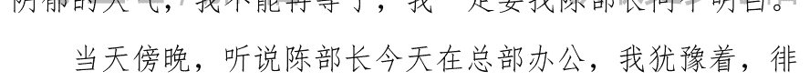

“什么不想？”部长在装什么不知道。

“为什么去东北的任务让我参加？我不通！”

“命令书不是下了吗？不是给你讲了吗，组织对你另有安排。”陈部长往后翻着报纸。

“可是，这个任务从开始就是我接的，为什么在这节骨眼上，组织对我另有安排，如果我犯了什么错误，还请组织处分我！这样对待我，我很受伤。”我突然觉得非常委屈。

“放心，你做的很好，不去是组织对你的爱护，没有其他原因了。”陈部长的话更是模棱两可，可以让我毫无绪。

“领导，请体谅，如果组织对我的爱护，请告诉我不参与任务的真相！”我有些激动。

陈部长的态度有一丝变化，他放下了报纸，摘下眼镜眯着：“组织上才安排你去，我和雷总指挥都是看好的，希望你更成熟，有些不必要的磨练，我们还是尽量安排你回避。”

“领导，感谢您与组织的关心，但是不经历磨难我怎么能成熟，我以后怎么能担当重任，我希望组织能给我机会检验我！”我的态度很坚决。

陈部长又敷衍：“小刘，你还是不要问了，回去吧，组织不会害你，没什么事情，安心吧。”


我没话，只是笔直地站在他的写台前，只能用声音抗议部长。

“怎么？是不是我要叫警卫员回去？”

“追求真相，一直是我们宗旨，首长，你现在能够接受吗？”

陈部长戴上了眼镜，眉头皱了起来：“真相？真相有时候很残酷，正是因为你痛苦所以我才肯告诉你，我不确定你现在能够接受这些。”

“报告首长，为了我们的事业，我愿意承受一切，包括死亡！”

陈部长好一会儿，他用十分困惑的眼神看着我：“王忠义，你觉得自己已经像机器一样冰冷了吗？”

“报告首长！对于国家来说，我认为我已经合格了，我觉得越来越接近了。”

陈部长也不犹豫，从抽屉中拿出两个信封，放到我面前：“真相，就在里面，你还是不能接受，看完了，签字你就可以去东北。”
作者：猪头 日期：2014-07-19 23:05

“也许你也猜到了，通过之前对这基地的了解，我有一个非常大胆的假设，建立基地的最终目的。”

“不，不是。”大头终于讲述，“纳米士兵就是这次研究的最新成果，他们完美结合的兵器，有人类一样的思维，钢铁一样的身躯，而且他们成功了，把人类的大脑与机械完美结合到一起，就出了近乎无敌的士兵。”

“不大可能吧，我没有听到过纳米士兵发出类似机械的声音，如果是机械身体，走路会有摩擦声，可是我们并没有听到。”大头的想法非常合理，但我仍然不能。

“对，我也怀疑，但是我仔细想了，所谓融合，我们不能简单的设想为人，应该更复杂，肉与金属生长到一起，从而出了生命，他们的关节等活动部位还是生物，通过某种技术让这些人的体力倍增，让他们完全负担这种重量，至于能量来源，我们还没有办法探知。”

以前雷说的时候，大张总是很恼，如今看来，大头竟然心思到人的程度。

“还有一个事情我发现。”

“到底发现了什么？”


“第一，他们复活的那个家伙，根据纳米技术，说明二十当中，生物技术进步到了一个新的高度，所以他们才会回来，那个人根本没死，只是处于休眠状态，不管怎么样，他们在二十年后才复活，只能说他们的新技术达到了这样的效果了。

第二，这个基地是因为受到袭击者的攻击而被抛弃的，这是无疑问的，从他们的态度上看，肯定是研究并超越了当年的袭击者，才会表现出这样的从容。

第三，空间扭曲并不是什么光学设备，我是为了安全才这样的地方，至于黑洞是什么地方，我就不知道原理了。”

“行啊大头，真的厉害。”

至于雷说切过记忆的事，我不会相信，但是当我看到洪少展现能力的时候，我却相信了，那个人可能就是传说中的梦杀！如果这样的人在心理战上被谁打算，除了我们组的张指挥，那梦杀就是唯一的可能。我没想到在遥远祖国的非洲能碰到梦杀。”

“什么是梦杀？”我还是第一次听过这样的词。

大头又笑：“这些，这属于绝密，有机会我会给你们慢慢讲梦杀的事情，不过现在不是时候，我们先把这里的麻烦搞完再说吧。”

“梦杀！奇怪的名词，我本想继续打听，但是大头把秘密两个字掀了，我就不好，也不能继续追问了，除非对方主动向你透露，否则秘密的事情是绝对不能打探的，这是严格的纪律，任何人在任何情况下都不能不遵守纪律，我自己也不能例外。

走了这么远，事情终于有点绪，现在庞大的地下基地中的四方势力，已经有三方浮出水面了！洪家，还有我们，至于当年袭击基地的神秘势力，我们仍然没有任何一点的概念，在这场混水摸鱼的战斗中，胜利的平衡开始扭转，虽然并不是向我们倾斜，但是至少目前能平妥处理。

纳哲他们首要对付的目标，就是当年的袭击者，洪家的人不是全军灭了，我们不能完全确认，不过他们依旧互相底，至于雷去追逐什么了，我们也不清楚都有相当的麻烦，相对而言，我们在暗中伏击了，一路上也没有等到纳哲或者洪家人给我们的绊，他们似乎早早就认为我们死定了，别人认为你已经死去的时候，对某些事情来说，绝对不是什么坏事。

作者:诸侯大斧 日期:2014-07-20 22:31

第六故事 林海血缘

冬日的阳光洒在我的脸上，我在会议室最后一排，靠窗户，懒洋地享受着，台下是科学部门的同志们在给我们用科学分析各种合理或者不合理的事情，这些资料是雷总从那里带来的……


去年我派你去了趟大巴山，他回来见不到你们，差点给我拍了桌子，老的，小的，没一个让我省心的！

“没有，没有”两个人赶忙忙低着头，大领导发火，那可不是闹着玩的，我真想不到，雷总还敢跟部长拍桌子。

“对了，领导，雷总去哪了？我和大张想他。”我还是憋忍不住了，张口就问了。

“呵呵，小鬼儿子，你们不是想老雷吧，你们是想出去溜达溜达吧？”部长对于我们想什么，那是人儿清。

“哎，得，您老都不知道。”

部长突然笑了，根据我以往的经验，当部长笑着的时候，总会有些好事安排你。一手不说吧，你俩也别着急，尽早要去，老本想带着你们走的，但是我把你留留下了，我还有别的事情安排你们。

“什么事情？您吩什么。”大张似乎很激动。

“呵呵”部长长着花白的头发：“总派你俩出去干什么要命的事情，我这个资本老家心里有点过意不去，所以给你们找了份美差。”

我怎么听这话怎么歪扭，我想你老陈这里还有美差？


