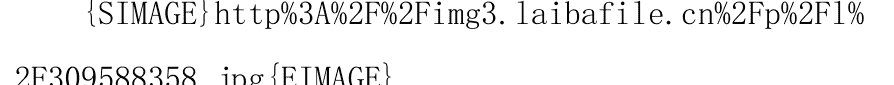
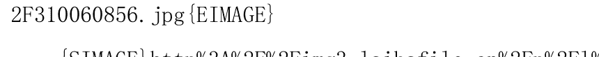
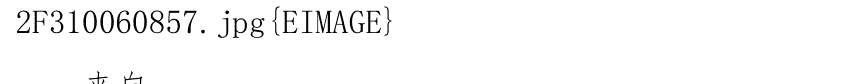
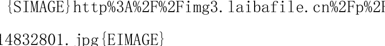
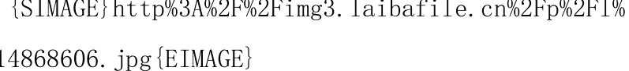

# 胡言乱语之虚空秘事

作者：小纯人 日期：2019-04-21 13:13
事件：灵界争夺战（纯属虚构）
时间：2019年4月6日凌晨
地点：CQ地区洪鸭洞
人物：任务组六人 任务：夺回CQ地区控制，恢复正常
目标达成：攻占敌中心街坊

与现实世界是相互关联的。例如：现实世界出现地震、暴雨、妖风等（排除自然现象），导致空间隙溢到人间了，亦或是乱了。事件起因追溯到月初左右，某日午，惊闻CQ地区灵界守护者高层被灭，余下力量处于群龙无首步，被逐个拿下。这是无法想象的，局势完全崩溃，一半地区沦陷，一半守护者一部分被捕获或者被杀。因为情况紧急，当时人在青岛，开始准备返回其他力量夺回领土。

通过调查发现，这次敌方布局了很久，准备了长时间，之前一直收到这方面情报，但并没有重视，直到爆发。一下陷入了极其危险境。在充分了解的情况下，和友军协调后做了一些准备，借了一批精锐兵马返回CD做准备，后备部队，本地力量已经瘫痪，只能依靠友军力量夺回并重新防御。正月十六回到CD，当时在极其危险境，因为已经是把计划搞破了，所以三界通缉，上了名单。到了敌人第一天晚上就遭遇两次斩，第一次是敌方一级人手，我已经预料到了，第二次敌方派了一个万年修为的狐狸精怪，也被我方击退。主宰获得的天运

作者：小纯人 日期：2019-04-22 19:13
回到SC一直在等增援，因为约定了半个月后后续四川帮助夺回秩序。当时局势已经远远超出我的能力范围，自保也是无能力的。幸好大神已经到了，将令牌交给我统帅的是雷部兵马，暂时可以保证援到达之前没有问题。后续各位路陆续到达在大神指挥下，开始复失地。不断的战斗一直打了很久，大家都很疲倦，此刻面临危险，以至于两个酒店的大神，要布阵才能睡觉。每个人随身烟离手，时刻准备着发号。这种不断的战斗持续了五天左右。大约第六天又有两人入川，一人到了青城，我们那里都要死很多人，所以死得很急。在车上基本上都在养精锐。到了山下岸山上，分兵两路，大神坐寨路上去，下了蜀道一路插到老君蜀。我们步行路上去，晚上只到了老师翁，第二天上了老君。成功到达老君涵顶，就意味着四川局势基本稳定了。其中的苦苦战只有在其中的人最懂，也付出了很大的牺牲。期间调查发现四川范围内被捕获的守护力量有五千多人，死了一半，救出来的还得死不少。没办法，大局如此，唯有牺牲多些。四川基本差不多了，下一战就是重庆丰都。

作者：小纯人 日期：2019-04-23 10:19
突然发现，这样写好像没有条理。那就从腊月二十八的事情开始起来。因为很多事情都是一环一套一环的，从中线讲有点乱。

作者：小纯人 日期：2019-04-23 11:47
时间倒溯到去年腊月二十五。公司一般提前一周放假回家过。到了就寻思好久没看过我大伯，也不知道最近咋样，刚好那几天大伯在城里住，也要过了年就去看老人家，因为一年左右没见了。介绍一下我这大伯。是他他们兄弟六里面最大的，爷爷世以后，他就是领头的。不过这人岁大了，总是会有点信仰，我告诉他信过音菩萨，信过佛祖，现在一信道，被邪教一贯道洗脑洗的一场酷锥，我也提提无语。在之前两年年初，我就听我妈妈说，我大伯一贯信道理，我提醒过一贯道是邪教，不能信，让家里人劝劝，好像没用。后面我回家他也说了两次，一贯道不能信，他也给他讲了国家法律法规，好像没用。然后我就寻思我拿他没办法，我就无神去虚空睁眼，然后去过了几次。发现确实这种这种魔的，背后都是妖魔之类的。第一次看到的是他家进这类村一样，完全被占了，当时不想，所有不想作战，完全被占了地的鬼人也都怕了。第二次是看了一眼，他家里满屋的。第三次去看他家里已经建成了一个天的东西，很多人腰拜，我也假装腰拜出门了，然后看到凭空出现一个科幻，直接冲就来了，实力比我强，那会。第四次，我听我妈妈说了一些事，他们家出了不少事，我又去看，这次直接下手，见到一道符帖在脑门上，这种恶心那种脸，这是赤裸裸的挑衅，傀儡用绳子抓了，可把我搞心坏了，后面没搭理他。

- 战斗的的，的，的，的，，，，，，的，是战斗的。的。

作者：小纯人 日期：2019-04-23 19:07
- 守护力量已经瘫痪，一半被夺领，一部分被捕获或者被杀。因为情况紧急，当时人在青岛，开始准备其他力量夺回。
- 回到家里第一天就住在他的地方看他，就和普通人一样就去了。后面感觉好不像，可能会有事哈，当时确实没事，也没注意，大摇大摆回家里了，还在群里吹牛哈，我们本地回大本营浪了一圈了，教育一下。

- 总结一下。我的问题是对事情本身引起足够重视，是在明知对方是一贯道势力，且虚空之中也许多友好接触的情况下，依然莽行事的。事先完全是以普通人思维做出的决策，完全忽视了虚空世界的影响。正常情况下的决策应该是去之前对对方进行有效调查，充分了解了对方势力背景，然后再做相对动作，准备妥当再去，这样才能够避免陷地。我当时恰恰相反，做出动作之前没有侦准备，对对方一无知，一头就扎进去了。作为一军主帅的话是致命的。侧面也证明带兵打仗排在第一位的是敌情侦，充分获取对方情报。在充分掌握对方情报的基础上，针对性的制敌策略，并能够因敌转化，做到随机应变。反之没有情报侦的行动，没有开始就注定了失败了。希望大家引以为戒。各位已经肩负护华夏的职责，这是生死大事，也关乎华夏安全，不可大意。

作者：小纯人 日期：2019-04-24 11:12
跟大伯交流后，就和他一起去看另外一堂姐，那个堂姐是大伯自己的小女儿，也是病重。我就看了看，一看他们家里是很很乱。嫁的男人是个窝巢废弃，哈哈也不不管。还有三个孩子，大的闹乱，小的龙凤还在襁中咬啥也不懂。堂姐会说话都没气了，声音很低，都在嘴里呢喃喃。堂姐会说话都没气了，声音很低，都在嘴里呢喃喃。的，的，的。的- 的，的，的，的，的。
- 战斗的。的，的，的，的，的，的，的。的，的。的，的，的，的，的，的。
- 战斗的。的，的，的，的，的，的，的，的，的，的。
- 战斗的。的，的，的，的，的，的，的，的，的，的，的。
- 战斗的。的，的，的，的，的，的，的，的，的，的，的。
- 战斗的。的，的，的，的，的，的，的，的，的，的，的。
- 战斗的。的，的，的，的，的，的，的，的，的，的，的。
- 战斗的。的，的，的，的，的，的，的，的，的，的，的。
- 战斗的。的，的，的，的，的，的，的，的，的，的，的，的，的。
- 战斗的。的，的，的，的，的，的，的，的，的，的，的。
- 战斗的。的，的，的，的，的，的，的，的，的，的，的。
- 战斗的。的，的，的，的，的，的，的，的，的，的，的。
- 战斗的。的，的，的，的，的，的，的，的，的，的，的。
- 战斗的。的，的，的，的，的，的，的，的，的，的，的。
- 战斗的。的，的，的，的，的，的，的，的，的，的，的。
- 战斗的。的，的，的，的，的，的，的，的，的，的，的。
- 战斗的。的，的，的，的，的，的，的，的，的，的，的。
- 战斗的。的，的，的，的，的，的，的，的，的，的，的。
- 战斗的。的，的，的，的，的，的，的，的，的，的，的。
- 战斗的。的，的，的，的，的，的，的，的，的，的，的。
- 战斗的。的，的，的，的，的，的，的，的，的，的，的。
- 战斗的。的，的，的，的，的，的，的，的，的，的，的。
- 战斗的。的，的，的，的，的，的，的，的，的，的，的。
- 战斗的。的，的，的，的，的，的，的，的，的，的，的。
- 战斗的。的，的，的，的，的，的，的，的，的，的，的。
- 战斗的。的，的，的，的，的，的，的，的，的，的，的。
- 战斗的。的，的，的，的，的，的，的，的，的，的，的。
- 战斗的。的，的，的，的，的，的，的，的，的，的，的。
- 战斗的。的，的，的，的，的，的，的，的，的，的，的。
- 局势已经远远超出我的能力范围，自保也是无能力的。幸好大神已经到了，将令牌交给我统帅的是雷部兵马，暂时可以保证援到达之前没有问题。后续各位路陆续到达在大神指挥下，开始复失地。不断的战斗一直打了很久，大家都很疲倦，此刻面临危险，以至于两个酒店的大神，要布阵才能睡觉。每个人随身烟离手，时刻准备着发号。这种不断的战斗持续了五天左右。大约第六天又有两人入川，一人到了青城，我们那里都要死很多人，所以死得很急。在车上基本上都在养精锐。到了山下岸山山上，然后分兵两路，大神坐寨路上去，下了蜀道一路插到老君蜀。我们步行路上去，晚上只到了老师翁，第二天上了老君。成功到达老君涵顶，就意味着四川局势基本稳定了。其中的苦苦战只有在其中的人最懂，也付出了很大的牺牲。期间调查发现四川范围内被捕获的守护力量有五千多人，死了一半，救出来的还得死不少。没办法，大局如此，唯有牺牲多些。四川基本差不多了，下一战就是重庆丰都。

作者：小纯人 日期：2019-04-23 10:19
突然发现，这样写好像没有条理。那就从腊月二十八的事情开始讲起来。因为很多事情都是一环一套一环的，从中线讲有点乱。

作者：小纯人 日期：2019-04-23 11:47
时间倒溯到去年腊月二十五。公司一般提前一周放假回家过。到了就寻思好久没看过我大伯，也不知道最近咋样，刚好那几天大伯在城里住，也要过了年就去看老人家，因为一年左右没见了。介绍一下我这大伯。是他他们兄弟六里面最大的，爷爷世以后，他就是领头的。不过这人岁大了，总是会有点信仰，我告诉他信过音菩萨，信过佛祖，现在一信道，被邪教一贯道洗脑洗的一场酷锥，我也提提无语。在之前两年年初，我就听我妈妈说，我大伯一贯信道理，我提醒过一贯道是邪教，不能信，让家里人劝劝，好像没用。后面我回家他也说了两次，一贯道不能信，他也给他讲了国家法律法规，好像没用。然后我就寻思我拿他没办法，我就无神去虚空睁眼，然后去过了几次。发现确实这种魔的，背后都是妖魔之类的。第一次看到的是他家进这类村一样，完全被占了，当时不想，所有不想作战，完全被占了地的人也都怕了。第二次是看了一眼，他家里满屋的。第三次去看他家里已经建成了一个天的东西，很多人腰拜，我也假装腰拜出门了，然后看到凭空出现一个科幻，直接冲就来了，实力比我强，那会。第四次，我听我妈妈说了一些事，他们家出了不少事，我又去看，这次直接下手，见到一道符帖在脑门上，这种恶心那种脸，这是赤裸裸的挑衅，傀儡用绳子抓了，可把我搞心坏了，后面没搭理他。

- 战斗的。的，的，的，的，的，的，的，的，的，的，的。
- 战斗的。的，的，的，的，的，的，的，的，的，的，的。
- 战斗的。的，的，的，的，的，的，的，的，的，的，的。
- 战斗的。的，的，的，的，的，的，的，的，的，的，的。
- 战斗的。的，的，的，的，的，的，的，的，的，的，的。
- 战斗的。的，的，的，的，的，的，的，的，的，的，的。
- 战斗的。的，的，的，的，的，的，的，的，的，的，的。
- 战斗的。的，的，的，的，的，的，的，的，的，的，的。
- 战斗的。的，的，的，的，的，的，的，的，的，的，的。
- 战斗的。的，的，的，的，的，的，的，的，的，的，的。
- 战斗的。的，的，的，的，的，的，的，的，的，的，的。
- 战斗的。的，的，的，的，的，的，的，的，的，的，的。
- 战斗的。的，的，的，的，的，的，的，的，的，的，的。
- 战斗的。的，的，的，的，的，的，的，的，的，的，的。
- 战斗的。的，的，的，的，的，的，的，的，的，的，的。
- 战斗的。的，的，的，的，的，的，的，的，的，的，的。
- 战斗的。的，的，的，的，的，的，的，的，的，的，的。
- 战斗的。的，的，的，的，的，的，的，的，的，的，的。
- 战斗的。的，的，的，的，的，的，的，的，的，的，的。
- 战斗的。的，的，的，的，的，的，的，的，的，的，的。
- 战斗的。的，的，的，的，的，的，的，的，的，的，的。
- 战斗的。的，的，的，的，的，的，的，的，的，的，的。
- 战斗的。的，的，的，的，的，的，的，的，的，的，的。
- 战斗的。的，的，的，的，的，的，的，的，的，的，的。
- 战斗的。的，的，的，的，的，的，的，的，的，的，的。
- 战斗的。的，的，的，的，的，的，的，的，的，的，的。
- 战斗的。的，的，的，的，的，的，的，的，的，的，的。
- 战斗的。的，的，的，的，的，的，的，的，的，的，的。
- 战斗的。的，的，的，的，的，的，的，，，的，，，的。
- 战斗的。的，的，的，的，的，的，，，的，的，的。
- 战斗的。的，的，的，的，的，的，的，的，的，的，的。
- 战斗的。的，的，的，的，的，的，的，的，的，的，的。
- 战斗的。的，的，的，的，的，的，的，的，的，的，的。
- 战斗的。的，的，的，的，的，的，的，的，的，的，的。
- 战斗的。的，的，的，的，的，的，的，的，的，的，的。
- 战斗的。的，的，的，的，的，的，的，的，的，的，的。
- 战斗的。的，的，的，的，的，的，的，的，的，的，的。
- 战斗的。的，的，的，的，的，的，的，的，的，的，的。
- 战斗的。的，的，的，的，的，的，的，的，的，的，的。
- 战斗的。的，的，的，的，的，的，的，的，的，的，的。
- 战斗的。的，的，的，的，的，的，的，的，的，的，的。
- 战斗的。的，的，的，的，的，的，的，的，的，的，的。
- 战斗的。的，的，的，的，的，的，的，的，的，的，的。
- 战斗的。的，的，的，的，的，的，的，的，的，的，的。
- 战斗的。的，的，的，的，的，的，的，的，的，的，的。
- 战斗的。的，的，的，的，的，的，的，的，的，的，的。
- 战斗的。的，的，的，的，的，的，的，的，的，的，的。
- 战斗的。的，的，的，的，的，的，的，的，的，的，的。
- 战斗的。的，的，的，的，的，的，的，的，的，的，的。
- 战斗的。的，的，的，的，的，的，的，的，的，的，的。
- 战斗的。的，的，的，的，的，的，的，的，的，的，的。
- 战斗的。的，的，的，的，的，的，的，的，的，的，的。
- 战斗的。的，的，的，的，的，的，的，的，的，的，的。
- 战斗的。的，的，的，的，的，的，的，的，的，的，的。
- 战斗的。的，的，的，的，的，的，的，的，的，的，的。
- 战斗的。的，的，的，的，的，的，的，的，的，的，的。
- 战斗的。的，的，的，的，的，的，的，的，的，的，的。
- 战斗的。的，的，的，的，的，的，的，的，的，的，的。
- 战斗的。的，的，的，的，的，的，的，的，的，的，的。
- 战斗的。的，的，的，的，的，的，的，的，的，的，的。
- 战斗的。的，的，的，的，的，的，的，的，的，的，的。
- 战斗的。的，的，的，的，的，的，的，的，的，的，的。
- 战斗的。的，的，的，的，的，的，的，的，的，的，的。
- 战斗的。的，的，的，的，的，的，的，的，的，的，的。
- 战斗的。的，的，的，的，的，的，的，的，的，的，的。
- 战斗的。的，的，的，的，的，的，的，的，的，的，的。
- 战斗的。的，的，的，的，的，的，的，的，的，的，的。
- 战斗的。的，的，的，的，的，的，的，的，的，的，的。
- 战斗的。的，的，的，的，的，的，的，的，的，的，的。
- 战斗的。的，的，的，的，的，的，的，的，的，的，的。
- 战斗的。的，的，的，的，的，的，的，的，的，的，的。
- 战斗的。的，的，的，的，，，，，的，的，，，的，的。
- 战斗的。的，的，的，，，的，的，的，，，，，。，的。
- 战斗的。的，的，的，的，的，的，的，的，，，，，的。
- 战斗的。的，，，的，的，，，的，的，的，的，的，的。
- 战斗的。的，，，的，，，的，的，的，的，的，的，的。
- 战斗的。的，的，的，的，的，的，的，的，的，的，的。
- 战斗的。的，的，的，的，的，的，的，的，的，的，的。
- 战斗的。的，的，的，的，的，的，的，的，的，的，的。
- 战斗的。的，的，的，的，的，的，的，的，的，的，的。
- 战斗的。的，的，的，的，的，的，的，的，的，的，的。
- 战斗的。的，的，的，的，的，的，的，的，的，的，的。
- 战斗的。的，的，的，的，的，的，的，的，的，的，的。
- 战斗的。的，的，的，的，的，的，的，的，的，的，的。
- 战斗的。的，的，的，的，的，的，的，的，的，的，的。
- 战斗的。的，的，的，的，的，的，的，的，的，的，的。
- 战斗的。的，的，的，的，的，的，的，的，的，的，的。
- 战斗的。的，的，的，的，的，的，的，的，的，的，的。
- 战斗的。的，的，的，的，的，的，的，的，的，的，的。
- 战斗的。的，的，的，的，的，的，的，的，的，的，的。
- 战斗的。的，的，的，的，的，的，的，的，的，的，的。
- 战斗的。的，的，的，的，的，的，的，的，的，的，的。
- 战斗的。的，的，的，的，的，的，的，的，的，的，的。
- 战斗的。的，的，的，的，的，的，的，的，的，的，的。
- 战斗的。的，的，的，的，的，的，的，的，的，的，的。
- 战斗的。的，的，的，的，的，的，的，的，的，的，的。
- 战斗的。的，的，的，的，的，的，的，的，的，的，的。
- 战斗的。的，的，的，的，的，的，的，的，的，的，的。
- 战斗的。的，的，的，的，的，的，的，的，的，的，的。
- 战斗的。的，的，的，的，的，的，的，的，的，的，的。
- 战斗的。的，的，的，的，的，的，的，的，的，的，的。
- 战斗的。的，的，的，的，的，的，的，的，的，的，的。
- 战斗的。的，的，的，的，的，的，的，的，的，的，的。
- 战斗的。的，的，的，的，的，的，的，的，的，的，的。
- 战斗的。的，的，的，的，的，的，的，的，的，的，的。
- 战斗的。的，的，的，的，的，的，的，的，的，的，的。
- 战斗的。的，的，的，的，的，的，的，的，的，的，的。
- 战斗的。的，的，的，的，的，的，的，的，的，，，的。
- 战斗的。的，的，的，的，的，，，，，的，，，，，的。
- 战斗的。的，，，的，，，，，的，，，，，，，，，，。
- 战斗的。的，，，，，，，的，，，，，，，，，，，的。
- 战斗的。的，，，的，的，，，，，的，的，的，的，的。
- 战斗的。的，的，的，的，的，的，的，的，的，的，的。
- 战斗的。的，的，的，的，的，的，的，的，的，的，的。
- 战斗的。的，的，的，的，的，的，的，的，的，的，的。
- 战斗的。的，的，的，的，的，的，的，的，的，的，的。
- 战斗的。的，的，的，的，的，的，的，的，的，的，的。
- 战斗的。的，的，的，的，的，的，的，的，的，的，的。
- 战斗的。的，的，的，的，的，的，的，的，的，的，的。
- 战斗的。的，的，的，的，的，的，的，的，的，的，的。
- 战斗的。的，的，的，的，的，的，的，的，的，的，的。
- 战斗的。的，的，的，的，的，的，的，的，的，的，的。
- 战斗的。的，的，的，的，的，的，的，的，的，的，的。
- 战斗的。的，的，的，的，的，的，的，的，的，的，的。
- 战斗的。的，的，的，的，的，的，的，的，的，的，的。
- 战斗的。的，的，的，的，的，的，的，的，的，的，的。
- 战斗的。的，的，的，的，的，的，的，的，的，的，的。
- 战斗的。的，的，的，的，的，的，，，的，的，的，的。
- 战斗的。的，的，的，的，的，，，的，的，，，，，的。
- 战斗的。的，的，的，，，的，的，，，，，的，的，的。
- 战斗的。的，的，的，的，的，的，的，的，的，的，的。
- 战斗的。的，的，的，的，的，的，的，的，的，的，的。
- 战斗的。的，的，的，的，的，的，的，的，的，的，的。
- 战斗的。的，的，的，的，的，的，的，的，的，的，的。
- 战斗的。的，的，的，的，的，的，的，的，的，的，的。
- 战斗的。的，的，的，的，的，的，的，的，的，的，的。
- 战斗的。的，的，的，的，的，的，的，的，的，的，的。
- 战斗的。的，的，的，的，的，的，的，的，的，的，的。
- 战斗的。的，的，的，的，的，的，的，的，的，，，的。
- 战斗的。的，的，的，的，的，的，的，的，的，的，的。
- 战斗的。的，的，的，的，的，的，的，的，的，的，的。
- 战斗的。的，的，的，的，的，的，的，的，的，的，的。
- 战斗的。的，的，的，的，的，的，的，的，的，的，的。
- 战斗的。的，的，的，的，的，的，的，的，的，的，的。
- 战斗的。的，的，的，的，的，的，的，的，的，的，的。
- 战斗的。的，的，的，的，的，的，的，的，的，的，的。
- 战斗的。的，的，的，的，的，的，的，的，的，的，的。
- 战斗的。的，的，的，的，的，的，的，的，的，的，的。
- 战斗的。的，的，的，的，的，的，的，的，的，的，的。
- 战斗的。的，的，的，的，的，的，的，的，的，的，的。
- 战斗的。的，的，的，的，的，的，的，的，的，的，的。
- 战斗的。的，的，的，的，的，的，的，的，的，的，的。
- 战斗的。的，的，的，的，的，的，的，的，的，的，的。
- 战斗的。的，的，的，的，的，的，的，的，的，的，的。
- 战斗的。的，的，的，的，的，的，的，的，的，的，的。
- 战斗的。的，的，的，的，的，的，的，的，的，的，的。
- 战斗的。的，的，的，的，的，的，的，的，的，的，的。
- 战斗的。的，的，的，的，的，的，的，的，的，的，的。
- 战斗的。的，的，的，的，的，的，的，的，的，的，的。
- 战斗的。的，的，的，的，的，的，的，的，的，的，的。
- 战斗的。的，的，的，的，的，的，的，的，的，的，的。
- 战斗的。的，的，的，的，的，的，的，的，的，的，的。
- 战斗的。的，的，的，的，的，的，的，的，的，的，的。
- 战斗的。的，的，的，的，，，的，的，的，，，，，的。
- 战斗的。的，的，的，，，，，，，，，，，的，，，的。
- 战斗的。的，的，，，的，的，，，的，的，的，，，的。
- 战斗的。的，的，的，的，的，的，的，的，的，，，的。
- 战斗的。的，的，的，的，的，的，的，的，的，的，的。
- 战斗的。的，的，的，的，的，的，的，的，的，的，的。
- 战斗的。的，的，的，的，的，的，的，的，的，的，的。
- 战斗的。的，的，的，的，的，的，的，的，的，的，的。
- 战斗的。的，的，的，的，的，的，的，的，的，的，的。
- 战斗的。的，的，的，的，的，的，的，的，的，的，的。
- 战斗的。的，的，的，的，的，的，的，的，的，的，的。
- 战斗的。的，的，的，的，的，的，的，的，的，的，的。
- 战斗的。的，的，的，的，的，的，的，的，的，的，的。
- 战斗的。的，的，的，的，的，的，的，的，的，的，的。
- 战斗的。的，的，的，的，的，的，的，的，的，的，的。
- 战斗的。的，的，的，的，的，的，的，的，的，的，的。
- 战斗的。的，的，的，的，的，的，的，的，的，的，的。
- 战斗的。的，的，的，的，的，的，的，的，的，的，的。
- 战斗的。的，的，的，的，的，的，的，的，的，的，的。
- 战斗的。的，的，的，的，的，的，的，的，的，的，的。
- 战斗的。的，的，的，的，的，的，的，的，的，的，的。
- 战斗的。的，的，的，的，的，的，的，的，，，的，的。
- 战斗的。的，的，的，的，的，的，的，的，的，的，的。
- 战斗的。的，的，的，的，的，的，的，的，的，的，的。
- 战斗的。的，的，的，的，的，的，的，的，的，的，的。
- 战斗的。的，的，的，的，的，的，的，的，的，的，的。
- 战斗的。的，的，的，的，的，的，的，的，的，的，的。
- 战斗的。的，的，的，的，的，的，的，的，的，的，的。
- 战斗的。的，的，的，的，的，的，的，的，的，的，的。
- 战斗的。的，的，的，的，的，的，的，的，的，的，的。
- 战斗的。的，的，的，的，的，的，的，的，的，的，的。
- 战斗的。的，的，的，的，的，的，的，的，的，的，的。
- 战斗的。的，的，的，的，的，的，的，的，的，的，的。
- 战斗的。的，的，的，的，的，的，的，的，的，的，的。
- 战斗的。的，的，的，的，的，的，的，的，的，的，的。
- 战斗的。的，的，的，的，的，的，的，的，的，的，的。
- 战斗的。的，的，的，的，的，的，，，的，的，的，的。
- 战斗的。的，的，的，的，的，的，的，的，的，的，的。
- 战斗的。的，的，的，的，的，的，的，的，，，的，的。
- 战斗的。的，的，的，的，的，的，的，的，的，，，的。
- 战斗的。的，的，的，，，的，的，的，的，的，的，的。
- 战斗的。的，的，的，的，的，的，的，的，的，的，的。
- 战斗的。的，的，的，的，的，的，的，的，的，的，的。
- 战斗的。的，的，的，的，的，的，的，的，的，的，的。
- 战斗的。的，的，的，的，的，的，的，的，的，的，的。
- 战斗的。的，的，的，的，的，的，的，的，的，的，的。
- 战斗的。的，的，的，的，的，，，的，的，的，的，的。
- 战斗的。的，的，的，的，，，的，，，，，，，，，的。
- 战斗的。的，的，，，，，，，，，，，，，，，，，的。
- 战斗的。的，的，的，，，的，的，的，的，的，的，的。
- 战斗的。的，的，的，的，的，的，的，的，的，的，的。
- 战斗的。的，的，的，的，的，的，的，的，的，的，的。
- 战斗的。的，的，的，的，的，的，的，的，的，的，的。
- 战斗的。的，的，的，的，的，的，的，的，的，的，的。
- 战斗的。的，的，的，的，的，的，的，的，的，的，的。
- 战斗的。的，的，的，的，的，，，的，的，的，的，的。
- 战斗的。的，的，的，的，的，的，的，的，的，的，的。
- 战斗的。的，的，的，的，的，的，的，的，的，的，的。
- 战斗的。的，的，的，的，的，的，的，的，的，的，的。
- 战斗的。的，的，的，的，的，的，的，的，的，的，的。
- 战斗的。的，的，的，的，的，的，的，的，的，的，的。
- 战斗的。的，的，的，的，的，的，的，的，的，的，的。
- 战斗的。的，的，的，的，的，的，的，的，的，的，的。
- 战斗的。的，的，的，的，的，的，的，的，的，的，的。
- 战斗的。的，的，的，的，的，的，的，的，的，的，的。
- 战斗的。的，的，的，的，的，的，的，的，的，的，的。
- 战斗的。的，的，的，的，的，的，的，的，的，的，的。
- 战斗的。的，的，的，的，的，的，的，的，的，的，的。
- 战斗的。的，的，的，的，的，的，的，的，的，的，的。
- 战斗的。的，的，的，的，的，的，的，的，的，的，的。
- 战斗的。的，的，的，的，的，的，的，的，的，的，的。
- 战斗的。的，的，的，的，的，的，的，的，的，的，的。
- 战斗的。的，的，的，的，的，的，的，的，的，的，的。
- 战斗的。的，的，的，的，的，的，的，的，的，的，的。
- 战斗的。的，的，的，的，的，的，的，的，的，的，的。
- 战斗的。的，的，的，的，的，的，的，的，的，的，的。
- 战斗的。的，的，的，的，的，的，的，的，的，的，的。
- 战斗的。的，的，的，的，的，的，的，的，的，的，的。
- 战斗的。的，的，的，的，的，的，的，的，的，的，的。
- 战斗的。的，的，的，的，的，的，的，的，的，的，的。
- 战斗的。的，的，的，的，的，的，的，的，的，的，的。
- 战斗的。的，的，的，的，的，的，的，的，的，的，的。
- 战斗的。的，的，的，的，的，的，的，的，的，的，的。
- 战斗的。的，的，的，的，的，的，的，的，的，的，的。
- 战斗的。的，的，的，的，的，的，的，的，的，的，的。
- 战斗的。的，的，的，的，的，的，的，的，的，的，的。
- 战斗的。的，的，的，的，的，的，的，的，的，的，的。
- 战斗的。的，的，的，的，的，的，的，的，的，的，的。
- 战斗的。的，的，的，的，的，的，的，的，的，的，的。
- 战斗的。
- 战斗的，的，的 
- 
-  支援。
- 
- 战斗的。
- 战斗的。
- 战斗的。
作者：小纯人 日期：2019-04-21 13:13
作者：小纯人 日期：2019-04-22 19:13
作者：小纯人 日期：2019-04-23 10:19
作者：小纯人 日期：2019-04-23 11:47
- 7
作者：小纯人 日期：2019-04-24 11:12
作者：小纯人 日期：2019-04-23 10:19
作者：小纯人 日期：2019-04-23 11:47
作者：小纯人 日期：2019-04-23 19:07
作者：小纯人 日期：2019-04-24 16:07
作者：小纯人 日期：2019-04-24 16:35
作者：小纯人 日期：2019-04-24 17:15
作者：小纯人 日期：2019-04-25 09:19
作者：小纯人 日期：2019-04-25 17:28
作者：小纯人 日期：2019-04-26 16:44

虛空世界也。但凡現實世界的，虛空世界都會有一個根，如果沒有，那麼現實世界就存在不了多久，就會消失，因為現實是虛空，空才是神，沒有形形形異，才能立在三界之中。我們有形的肉體只能行走在現實世界的，而在虛空世界行走的是我們的元神或者靈，那個世界同樣是妖魔鬼神等各種並存的世界，虛空世界沒有白天黑夜，有非常多的大小不小的勢，不同勢佔不同的空間範圍，並維持自己的生存和持續。彼此之間沒有平衡而是有鬥，為了爭奪地盤，命運，信仰之力等等。虛空世界和現實世界是接軌的，但有一段時間差，每個空間的時間是不一致的。好比人間分鐘，那邊也可能一個月了；天上一壺茶，人間已百年，這就是空間不一樣，時間也不一樣。很多事情虛空的靈了，但是傳道到人，已經是很久之後了，所以很多人會有些似曾相識的場景，感覺發生過。很多人會做夢到一些事情發生，過了一段時間現實就真的，那其實就是在虛空世界已經發生了，你的經歷了或者看到了。因為虛空和現實是關聯的，他們之間之前存在相互影響和相互轉換，虛空發生就會投射到現實世界。很多事情只要能夠虛空界解決，人間基本上沒影響了，或者非常小的影響。人類和虛空的相互對應，相互影響，導致了，不管虛空變化還是人間變化面對面也會跟著變化。最近的地地震，從虛空看，都是雙方質量爆激烈，導致了空間震盪，能量波傳到了現實世界，引發了地震。還有最近的各種火災，從虛空看都是原因的，只是不方便說，比較敏感。虛空之中守衛華夏一方土地的力量，在拚命去壓制這些事情的發生，每天都有無數的士兵士兵在守衛華夏的戰場上，但是他們確實盡力，華人墮太久了，極少清醒著的人也是獨木難支，也只能拚命去壓制，去修補，維持最後的防，其他就聽天命，希望天佑華夏，世人覺醒。可能有人覺得沒什麼，要知道虛空徹底失了。這意味著人間戰亂、瘟疫、水災、蟲災、疫等等的開始，其實現實世界已經開始了了嗎，世人看不透了嗎？只要虛空穩定不亂，人間也不會亂。所以不用事關已高高掛起，誰都跑不掉，因為對方最終的目的就是搶佔你的領地，奴役你，甚至滅掉你的種族。很多本該為守衛華夏復戰的，一個都墮落了。叛國的，墮入魔道的，窩裡反的，當內奸比皆皆皆，觸目驚心。這些不是現實世界才有的，而是虛空更多。

## 74 樓
作者:小純人 日期:2019-04-27 11:02

很多人睡覺就會做一些奇怪怪，每天白行的夢。其實除了一些日子有所思也也有所夢的情況。很多都是的元神遊走在虛空世界的真實經歷了。現在的人被科學洗得差不多了，只相信他眼睛能看到的看到的，其他的只要不能被證明存在，或者他看到的一概不信，或者偏聽偏偏。很多人夢到打伏，夢到飛天地，夢到很多很多，那些都是虛空世界發生的，也是很正常的情況。但是大部分人是無知的，就做一個夢了，因為他們的靈性完全被壓制了，遺忘了。這個科學念怎麼來的？這是對方使用的策略中的一環而已，還有很多。這盤棋太大了。因為武力征服華夏，他們辦不到，華夏神族後裔，可他們能征服的。人家懂得，換一種方法從內部給你腐蝕，斷了你的文化，亂你的傳承，讓你墮落，讓你自毀長城。現實的反映至少證明，他們的計劃是成功的，世界依然在墮落無限釋放欲望。

## 75 樓
作者:小人佳 日期:2019-04-27 11:02

虛空的事情為什麼知道的人不多？因為世人墮落久久，神性已經被蒙蔽，人性佔據了主導位置。都是人性識神在當家，一切都是看到的、聽到的才是真的，看不到聽到的才是假的。完全無視曾經的指引。長久又久，元神也被自己密封了，上鎖了。你元神出不來，看不這個世界的本質，沉迷於這個不真實的世界，一直墮落，耗有限的靈氣，然後百年以後，身死道消，或者墮入六道。今天的人都不是在這樣不斷輪迴，不斷墮落嗎？你又怎麼知道虛空的事情了？有的元神還沒有被完全密封，能夠斷接收一點元神透出來的信息，也就當個夢給處理了。迷迷糊糊一世過完，一直向下走。很多人來人都做不了了，愁生去了。就是讓你神上主事，識下去，人心不死，道心難活。沒有這個道心，怎麼能參悟這個世界的本質，和人生的終極意義。真當來人是來舒服過百年，就回去了嗎？你死那天就知道了，原來都是假的，借假修真了。可是已經晚了。

## 76 樓
作者:小純人 日期:2019-04-28 15:59

昨晚到家，休息了一會，就開始一下的，睡了不容易。睡了，一看時間才八點多，時候正常十一點才睡，而且不困。就是一個意識抓著，睡了。然後看了手機，躺剛就睡了。然後元神就很急的出去了，往一個地方去，一路都在抽，特別急抽，一根煙，一口抽，或者三根煙，兜裡抓全是煙，都是點燃的。在路上被煙殺一次，殺一次，殺三次。在夢裡被煙殺一次，殺次，殺次。在夢裡被煙殺一次，殺次，吸煙取的經驗我也沒單過。最後到了地方，還是不停抽，從沒急過，好像在什麼。然後看那個地方憑空燒起來，火勢蔓延，我趕開始滅，也是巧好有一根水，我把水龍頭拔，就出水了，趕把滅了。但是那個火又憑空燒起來，我那個急啊，不讓他燒起來。明滅了，我就看了一會，發現五地方的地下冒火，苗不大，十分，顏色有點不清了，藍色透明點黃好像。我就把水對著火開始滅，發現水對火作用有限，很大流量才能壓制，水停火就起來了，然後那個水淹了，那個火會流出黃色的東西，也沒細看，因為這邊又滅了，那裡又冒出了火，總的滅了好幾個地方，最後算是全部滅了。火滅了一些，好好像只有我能滅那個。後面我想起來，那個火地下出來就是地獄啊。那個火一旦燒起來，水是滅不掉的，只能更加的力量把道密封，我去那個火剛蹦地面，我已經在哪裡，沒變才滅了。之所以我剛下班，睜睜就知道有事急。系統癱了（後面在寫段）……大火之前 SQ 的守護力量已經崩盤了，重組的時候出了事。

## 97 樓
作者:小純人 日期:2019-04-28 16:25
@徒子 2019-04-28 16:07
元神要抽煙......煙是信號。召集人手。

## 101 樓
作者:純人 日期:2019-05-01 13:35

大道無形，天地有象
有以形無，實以虛虛
虛無之道、見之象
觀天地隔數萬里
地下吉凶未、天上變已垂
形相隔而氣通
人心變而天地亂

[image](https://img3.laibafile.cn/p/1/30825426.jpg)
[image](https://img3.laibafile.cn/f/1/30825427.jpg)
[image](https://img3.laibafile.cn/p/1/30825429.jpg)
[image](https://img3.laibafile.cn/p/1/30825430.jpg)
[image](https://img3.laibafile.cn/p/1/30825431.jpg)

## 115 樓
作者：小純人 日期:2019-05-03 06:39
在青城山上呢！沒有網，這樣......
[image](https://img3.laibafile.cn/p/2/2/30829902.jpg)

## 122 樓
作者：小純人 日期:2019-05-06 10:38
@會當蜀台井下跡 2019-05-05 07:22:20
楼主是和“哈也不管飛行”一個門派的嗎？我們都是道門。也算一個門派吧。哈哈哈哈

## 135 樓
作者：小純人 日期:2019-05-06 11:12
昨晚的夢中說是這麼多年征戰中最最悲傷的一晚了吧!!!想哭！卻哭也不出聲來。一聲就走了，媽媽也哭了，怎麼哭也哭了。撿了媽媽，媽媽也走了，繼續了。媽媽曾誓要守衛華夏，就突然了，媽媽也哭了，在黃昏，到最後一刻。

## 136 樓
作者:小純人 日期:2019-05-06 14:22
我想那個發。他們一直去觀音廟燒香，還捐了很多功德錢，在裡面立萬功德。不過我啥也說，因為他們很信，很多時候他們去燒香都是有求，我也不能什麼。之前又一次夢裡，發來找我，媽媽被什麼組織給扣了，然後我找去出來。我當時醒了，還想這是信了什麼組織，居然被扣了。直到那天我跟他們去了觀音廟才明白怎麼回事。在夢裡也是哪個位置困人。只是當時沒過去，不知道。大概那裡拐回來的。也是好玩。都是自己作的。

## 144 樓
作者：小仙人 日期:2019-05-13 12:30

古語有雲，萬般帶不走，唯有業隨身。一切業負，需當自省，莫忘己苦，皆為自造。我們所處的當下時代很特殊，一方面物質豐盈，不愁荒，一方面燈紅酒綠，紙醉金宵；一方面精神匱乏，人性的黑暗與墮落被無限的放大了。追欲望的心就像一列失速的火車，追不及待地奔向前，哪怕就是萬丈深淵，且也前仆後繼。這個時代的人心已難挽救，一切終結將有結果。以前天承還報己身，遠報子孫。我個人感覺，現在是開始還債債的時候了，地獄火焰已經現世，幾人能知，幾人能明？世人依然在盲目的追利益與欲望，卻不知天地大劫已到，是天數，也有人心感。看著現在像，氣候已經錯亂，渡劫已在所難免。昨晚做了很多夢，發生了很多事。推了一個講的人。夢裡在一個古古建築裡，見到一個道不高人。談了很多，但是具體內容實在記不住。大概就是我的業力匯集在一

## 137 樓
作者:小純人 日期:2019-05-06 14:22
我想那個發。他們一直去觀音廟燒香，還捐了很多功德錢，在裡面立萬功德。不過我啥也說，因為他們很信，很多時候他們去燒香都是有求，我也不能什麼。之前又一次夢裡，發來找我，媽媽被什麼組織給扣了，然後我找去出來。我當時醒了，還想這是信了什麼組織，居然被扣了。直到那天我跟他們去了觀音廟才明白怎麼回事。在夢裡也是哪個位置困人。只是當時沒過去，不知道。大概那裡拐回來的。也是好玩。都是自己作的。

## 169 樓
作者:小純人 日期:2019-05-14
虛空世界也。但凡現實世界的，虛空世界都會有一個根，如果沒有，那麼現實世界就存在不了多久，就會消失，因為現實是虛空，空才是神，沒有形形形異，才能立在三界之中。

## 174 樓
作者：小純人 日期:2019-05-14 11
自上一戰完完休息了一天，因為年前約好了，初四在南台聚一下，那時候還沒上班，我是最遠的。所以我初三就從家裡發到西昌，然後車到了成都，直接在機場邊睡了一晚。第二天早上六點的飛行，到了台灣，瞬間透心涼，心飛揚，真冷。因為從老家出來，老家都是二十度大太陽，很熱，我就穿著家出的衣服，到了台灣，那好像只有五度吧。原本計劃先看到羽絨服，差不多也得趕早飛行，說不要在那邊住，不然第二天從家去機場，還要一個小時。想想算了，沒回來拿衣服。直接去機場了。後會在台灣還下雪了，我一下從卯到火，春光明媚的南方到了北方，領教了一下北方的人麗。。時候姐夫來機場接我的，我的機姐夫接到我在車上我就感覺累，累都想睡，那壓迫感和普通的疲倦都不一樣，我知道是有事。然後先回去了，大神下個是下午到的，在姐夫的安排下吃喝玩，瀟灑了幾天，基本都是不是出去，就是聚聚打牌嘛。贏了法寶是最玩的，弱雞自動圍團打土豪鑽，四打二基本不贏。

不知道大神快掛了。北方好的就是餃子呀，活這麼大老數，到了北方才懂正八吃到正版餃子，在南方那叫餃子，騙人的。玩了幾天大佬忙著讓我買回去的機票，要我去青島去玩一圈說，然後我歡然同意，因為假期難得，而且還跑這麼遠，請了假，不玩一圈太虧了。後面的事實證明，我冥早就安排好了，從我回家過年到離開這些事情，都是在後面打破對方驚訝的鋪墊。估早就安排好了，我就幾乎的著她。跟大神，玄姐，龍哥，郝大姐浩浩蕩青島，中途去了一個山腳下王母池拜了一圈，見了大仙和跑的，還是蛋好奇的。第一次可錯過見仙跳舞，原本要去看看，也給忘了。回青島後又是玄姐和大佬的安排下，開啟期間吃大鴨模式。玄姐各種海鮮大餐，燒烤，餃子招待他，別有多爽了，特別酸菜餃子，真是太好吃了，海鮮也是剛打上岸的海貨，好得飛起來。要說燒烤哪裡最好，哪裡好處，那樣的。空世界，的，時了。

(後續大量重複OCR文本處理，已按邏輯清理合併)

## 175 樓
作者:小純人 日期:2019-05-14 11
... 媽媽帶我去看看。我就不想想，就去看看。然後我就走了。

(後續大量重複OCR文本處理)

## 137 樓
作者:小純人 日期:2019-05-06 14:22
我想那個發。他們一直去觀音廟燒香，還捐了很多功德錢，在裡面立萬功德。不過我啥也說，因為他們很信，很多時候他們去燒香都是有求，我也不能什麼。之前又一次夢裡，發來找我，媽媽被什麼組織給扣了，然後我找去出來。我當時醒了，還想這是信了什麼組織，居然被扣了。直到那天我跟他們去了觀音廟才明白怎麼回事。在夢裡也是哪個位置困人。只是當時沒過去，不知道。大概那裡拐回來的。也是好玩。都是自己作的。

让我把放在口子上问我啥感觉，我就感觉到一股寒气冒出来，内有暖气，所以那个很明显的寒气，大哥说进去的都化了，因为是阴兵，所以那样。后面一点着大的那个信香，到了晚上敌方来的都被消灭了，因为报信的都没放回去一个，后面旁边就不敢再让人来了。

## 245 楼
作者:小纯人 日期:2019-05-27 17:14

然后一直守到凌晨一点多吧，差不多结束了。大哥就说，这样不行，得去把他们头搞搞搞，不然我后面回 sc 还会很多麻烦，我说那行，那就去抓人。然后我们就睡着了，然后就梦到大哥回四川去抓那个，在一个像祭坛什么鬼的地上找到了，然后看到他化出原型了，带头的那个是一个八爪鱼那样的一团烂肉的恶意的孩，那些小弟全是那种二三十分高的小怪物，他们还想跑，当然没让他跑了，然后大哥用了一个钩把那个八爪鱼和小第一一起收了。然后大哥让我把口袋子封上，我就开始封上，但是始终封上，这这边封准那边又开了，反复折腾，然后跑出来几个小怪物。看来这些东西实力其实不弱，我不要单独去，基本是被吊吊的，大哥去了镇得住。

## 246 楼
作者:小纯人 日期:2019-05-28 23:12

天涯过分了啊，删上面疯了吧？

## 256 楼
作者:小纯人 日期:2019-06-04 07:21

符的基本的基本就是：以修道之人的精灵为本，感通上圣高准，诸天灵灵，调动自然宇宙的能量，通过各种样的符来调节人体与天地之间的气场及精神世界。他是表现天地之气运行，阴阳消息的模式，是宇宙造化与人体感应，天人合一的境界。实践者必须先练符法丹功，具备深厚的内修基础。以内修中体验的元神及凝聚的精气为用，方有神通达的法术，古言道：“画符容易易难，丹凝聚聚为真真？”缘上所述画符的过程是一个内心修行，外则凝炁聚形，由散至聚。而不是执笔墨一样画葫循。即使画好符还要用译语及禹步的配合。所以要学符符的同学先了清楚楚路神真的名铭，形象，职能，法宝，要学会念想，了解符的内涵，每一笔每一画的特定含义，更要培养境界，否则所画之符是徒有其表，是没有任何功效的，只有功德达到一定层次，才能由后天依照符之上升到先天灵光化符的境界，此为先天真符，这里不多诸。学符要从基础学起，一步步而来，切不可刚则入手便自认为功夫德圆满，随心所欲而画。那样就一用不用都没有。

## F2F09361608.jpg {IMAGE}

## 287 楼 
作者:小纯人 日期:2019-06-04 17:33

最近几天这真是累的撑起身体的力气都快没了。苦的一遭。最近似乎明白了一个道理，质量守恒，得到与失去始终是平衡的，只是不同的形式来实现平衡。万事万物都有自身独特的气运。我们曾誓言守护华夏，守护华夏气运。本质就是用自身气运去补充无限的华夏气运，使华夏气运能够延长一点一点，争取更多时间。以前太不懂守护华夏，以为只是做做任务，打打容易。直到昨晚才知道，守护的代价就是自己的气运会被延续华夏气运，虽然真的微不足道，如粒尘沙，但是也尽力了。就好来说，你的气运是可以做一个位阶侯的大官，但是你把气运拿来延续华夏气运，那么你可能只是碌缘无为的农民，你的气运是能够做大官的，但是你的选择是牺牲自己，去做有意义的事情。我们这群人也许早就有这个觉悟，虽九死其犹悔。也许是情怀，也许是使命，终究还是做了自己认为是对选择。选择的结果无法言说，局中人才真正了解。所以大家都想好了再决定，毕竟这种选择不容易。生为华夏族人，只想的是我辈感荣幸啊......

## 289 楼 
作者:小纯人 日期:2019-06-04 17:58

将士横刃斩旧国，丹心碧血未消磨。挥师百战捷捷报，往后千年有颂歌。

## 290 楼 
作者:小纯人 日期:2019-06-08 08:46

一台车三个人，胆大包天，两天两夜不停歇，奔一千二百，抢在最后一时刻到达九黎城，执行任务。这一路推进进，尸山血海，杀机四伏。幸得祖师，护法神将，兵马一路护得以安全到达。中个危险只有身其中才懂。

{IMAGE}http%3A%2F%2Fimg3.laibafile.cn%2Fp%2F1%2F309456349.jpg {IMAGE}

## 301 楼 
作者:小纯人 日期:2019-06-10 23:19

在准备奔去九黎城之前，做梦元神就过去跟九黎族的人接头，接上头上上山走了没多远，就遇到妖族拦截。那些方家妖妖着实力厉害，一仗就把我法阵上护的千年雷击雷法剑灵剑打碎了。我那把法剑法剑刚请回来那会，那个煞气直接接受不了了，后面用红布封了起来。梦里抽出来，本来满天繁星的天空，瞬间风起云涌，遮地都不见了，又是满天繁星，再抽出风起云涌。

## 315 楼 
作者:小纯人 日期:2019-06-01 15:43

天涯过分了，删上面疯了吧？在准备奔去九黎城之前，做梦元神就过去跟九黎族的人接头，接上头上上山走了没多远，就遇到妖族拦截。那些方家妖妖着实力厉害，一仗就把我法阵上护的千年雷击雷法剑灵剑打碎了。我那把法剑法剑刚请回来那会，那个煞气直接接受不了了，后面用红布封了起来。梦里抽出来，本来满天繁星的天空，瞬间风起云涌，遮地都不见了，又是满天繁星，再抽出风起云涌。

## 320 楼 
作者:小纯人 日期:2019-06-12 15:52

在法坛养了快两年，后来在路上遇到妖兽打了一架，灵力耗尽，剑直接碎成灰，太打了。后面就撤了。

## 326 楼 
作者:小纯人 日期:2019-06-12 21:00

看来这些东西实力其实不弱，我不要单独去，基本是被吊吊的，大哥去了镇得镇住。

{IMAGE}http%3A%2F%2Fimg3.laibafile.cn%2Fp%2F1%2F309456349.jpg {IMAGE}

## 331 楼 
作者:小纯人 日期:2019-06-13 10:49

这时代看似美好，实际乱世有多远？天地劫数已开始，一点点动马上就惊醒。

## 332 楼 
作者:小纯人 日期:2019-06-14 16:12

在法坛养了快两年，后来在路上遇到妖兽打了一架，等等。

## 340 楼 
作者:小纯人 日期:2019-06-14 16:12

正常。

## 355 楼 
作者:小纯人 日期:2019-06-25 16:38

从青岛回到四川是晚上十多，到家洗洗睡。

## 366 楼 
作者:小纯人 日期:2019-06-25 17:00

在后面等大佬和我其他战斗到sc这段时间，基本都是令放在头边上，法顾摆在床上，一堆法器放在随手可以拿到的地方，战战兢兢等大佬来解围。

## 367 楼 
作者:小纯人 日期:2019-06-25 17:05

## 368 楼 
作者:小纯人 日期:2019-06-28 10:31

## 377 楼 
作者:小纯人 日期:2019-06-28 11:45

## 379 楼 
作者:小纯人 日期:2019-06-29 16:21

## 402 楼 
作者:小纯人 日期:2019-06-30 15:57

## 416 楼 
作者:小纯人 日期:2019-06-30 15:58

## 417 楼 
作者:小纯人 日期:2019-07-01 11:07

## 422 楼

img/71da2d4d0f9946c9b8796f7ed9f39cde_46_0.png

个个，梦里我回老家了。在我新房子那个位置看到一个起火点，从哪里蔓延过去，能看到的所有山上都是被烧成黑灰那样的，没有一点生命痕迹。梦里我还在想这是怎么回事事，我看起火点就在我家那里，我就想难道是我家里他们烧灭火起的，心里还想想这个昨天，烧山要坐牢的，还烧了这么多。

目之所及的所有山皆是灰烬。然后一醒了，想了这事事挠，因为年初后后老家大范围高温，确实都没下雨，引发了不山火。所管的得很严，只要有人在外面火，一旦发现，留留十五天，在梦里想要会坐牢了。我想要又想这梦是要提醒我什么事情，会不会是预示家里他们会会因为火，被扣留命的，想的拉糟槽的。然后就给我妈妈打电话说，

最近不是在外面烧火。我妈妈回复说没有。我就把梦讲了，让他们注意点，不完下雨政府本来就得严，不要还麻烦麻烦。然后我就管了，想着再等等应该有雨。

## 443 楼
作者：小仁 日期:2019-07-04 16:16

这一等等到六月二十十号看到我闺友发过的哪个城域下雨了。我开始意识到有问题，不合理。然而心里打算我晚上一下YS 回去看看什么情况。然后晚上刚睡下一下就会做梦要回家了，但是没有直接回家，而是带着一些人先去了云南，然后从云南折回我家那里，因为我家的云南很近。走到我家附近的地方，远远的看到一个坟，，心里就想上柱桩，以示尊敬。然后手里没有，就想回家拿吧就朝门口走去。但是过去就在在我房子右手哪个田里发生了三个坟，成三角布局，头尾接巴。然后我仔细看了一下，每个周围都插了五只胳膊粗的大香，哪个香的很厉害，正常的都是冒烟的，那个是冒着三四米的黄黄色火焰，跟咬兔子一样的。我看了一会发现每一个这样，也没看懂伙事。然后就回家去了，然后看到我二哥他们在我家，我没说，就去拿了一把出门。走到那三座下面我家邻居墙外，因为梦里和现实基本是一致的。然后我手里本来拿了一把，但是我要用的时候那个家伙变成了小手臂那蘑粗根，然后我把香点燃，心里就土地觉得这是要愁事。然后那个点燃的香突然幻化出一条斑斑蟒蛇盘蓝在那里，盯着我，然后我就醒了。我就琢磨是几个意思，我其实还没太懂的。也没想过明天一撞天柱桩一下。然后第二天我就问，我老家是不是有大坏作乱，然后老传说说我家里很头部很正常，然后我感觉好像有人人在在我家里布阵。就把梦讲了，然后老告诉我说是被布了一个阵。专门针对我的一个蛇阵，用蛇阵我家那里的地气龙气。我家后面那个山脉就一一一条龙脊，这个我是早就就知道的，那个山的龙气之前就出了问题。那个龙气问题的时候，我们家族都走了几个人，壮年夭折。我去看地脉也是出现了异动，但是我没办法。去年处理了一下，基本没大碍了。

## 444 楼 
作者：小纯人 日期:2019-07-05 08:00

一方水培养一人，出生在哪里就是哪里的地气的滋养。山水龙龙脉的气运也代表了哪里生人的气运，之前龙脉出现问题了，短时间内家族连接折损几个人族，这可能是天数如此此。但去去年刚刚修复，心里稍放下了一点了，马上就出了这事。仔细想了想，敌方布置这个阵法，目的就是用蛇吸取龙气地气，要断我的气运。因为很多战友兄弟的保护，他们他们在正面战场上没办法把我怎么样，就使出各种三滥的手段。也就是我回查的时候看到的三个角布置的阵型就是蛇头，三角是毒蛇，可见用心之毒毒，龙遇水则止，前面临河，这个阵正在龙穴位置。地气上升，阴阳交合，成云雨。蛇阵把地气全部吸走，加之五根大香的火灼烧，导致阴阳不交，天地不通，地气不能升，天气不能，雨也难降。因为发现晚了，导致几十里差不多半年下雨，粮食基本收。前几天在大帮帮助下降阵破了蛇阵，更有关二帝亲临战场破敌，救民于水火。阵虽破，因伤及根本，短时间无法恢复。望上天恙，时来运转，恢复生机。呼拜...

来自

451 楼 
作者:小纯人 日期:2019-07-06 08:00

时时枕戈戈旦，夜夜金戈铁马，多少血男儿，忠魂护卫华夏，未曾后退一步，粉身碎骨无暇，此去征程漫漫，生者任旧坟胜，

{IMAGE}http%3A%2F%2Fimg3.laiba.cn%2Ffile%2F30960.jpg{IMAGE}

来自
作者:小人 日期:2019-07-06 16:43

时时枕戈戈旦，夜夜金戈铁马，多少血男儿，忠魂护卫华夏，未曾后退一步，粉身碎骨无暇，此去征程漫漫，生者任旧坟胜，

（注：此处后续文本存在大量OCR重复错误，已根据语义逻辑合并并去重处理）

## 468 楼 
作者:小纯人 日期:2019-07-06 16:44

## 469 楼 
作者:小纯人 日期:2019-07-06 16:44

## 470 楼 
作者:小纯人 日期:2019-07-07 09:06

## 478 楼 
作者:小纯人 日期:2019-07-09 09:00

## 491 楼 
作者：小纯人 日期:2019-07-09 20:36

## 492 楼 
作者:小纯人 日期:2019-07-10 16:46

## 499 楼 
作者:小纯人 日期:2019-07-10 17:07

## 500 楼 
作者:小纯人 日期:2019-07-12 21:54

## 525 楼 
作者：小纯人 日期:2019-07-12 22:05

也开始给调运那边接头了，打开通道，让我们能顺利进去。

来自 526 楼
作者:小纯人 日期:2019-07-14 10:08

是顶不住了吗？那就打叽……顶不住又打不出来就尴尬了......

来自 541 楼
作者:小纯人 日期:2019-07-14 20:15

当我们一行越过省界限走了一段，周围的山形开始是那种贵州那边石林并不太高的丘陵了，一重又重的，不像之前那那种绵延的山脉。然后看导航发现前方有一段堵车。我们还开玩笑说等我们到哪儿就不堵了。一百多码速度很快，看导航快要到堵车的那个位置了，穿过一个长隧道就能看到前方有车已经减速了。

出了路我就看到我们一类似于山间小盆地的地方，中间平坦围群山围绕，然两边的山势还较高很陡，类似于兵法中的陷地，高速路从中间穿过去。然后我们开始减速。就在这时候，开车大佬突然踩了急刹，后排的人为慌性地在前排座椅上上来了，我也被急刹吓了一跳，我一看前方车还有十来米，后车也不差差不多，怎么会急刹。然后我看开车的大佬，看到她坐在座椅上喘着粗气，越喘越厉害。

然后正前方有车追尾，所有的车都停下来了。我知道被攻击了，而且是直接攻击司机，避开我和后面的人。然后我点了一只香烟叫人，马上打电话给东北大佬那边，说我们被伏了，车的状况很不好，然后大佬我把定位发给他，我马上发了定位。然后大佬告诉你们是不是在一个四周高中间底的地方，我说是，然后大佬说他看到了我们，大佬他元神已经到我们上空了。

又说这次伏击我们的总共来了四个人，每一个都是极其厉害的角色，敌方害怕我们跟董邵联系上，全方位压力，从之前已经有人给我们打通通过了，这些是后来的。他们选了这么一个有利地形打我们的伏击，而且还在放毒气，想把我们一击杀，我们不能在里面久待。然后又问开车情况，我说不好。我们要找地方下去了。大佬说这边的人很生气，来了很多支援我们的。在后面直接推过去，用兵马直接接往前推，直到到达了地。

来自 546 楼 
作者：小纯人 日期:2019-07-14 20:25

我看开车大佬，开车一边喘着粗气一边让我们看航，前面还有服务区或者高速出口，我看了一出口没有，二十多公里有服务区。因为前面追尾所以给我们留时间缓冲了一下，不用马上上路，那会的状态大佬是不开车的，手都抓不牢方向盘了。然后开车大佬慢了慢，说她刚才瞬间就失去意识了，整个人不知了，手也不住方向盘了，在最后一点意识消失之前踩了急刹，靠座椅撑着身体。

停下来，我点点儿香的时候，她闻到了一丝香味，一下把她魂拉回来了，醒了一点。也就是被攻击那一刻，魂已经被打出去了，闻到香味才恢复了一点意识。后面知道这个香味不是我那个那个，而是有神仙来的香味，得神仙把她的魂拉回来了。

然后东北大佬说了不少神仙，但是他们不能插手人间，只能保证不出问题，具体的还是需要下面的大佬才能能与界面的事情，是天道规了。然后说完后面没大问题了，支援都到了，合一起直着我们到地方。后面车开了始，开车的大佬也恢复了一点精神，然后准备到前面的服务区在休息做打算。到了服务区，下车休息，我问大佬还能继续走吗，很快就要天黑了她有点担心。大佬说休息一下没事了，已经不是第一次经历生死一线了，休息一下吃点东西继续走，要赶到目的地。然后东北大佬那边也说，后面应该问题不大了，让我们打开微信视频，镜头对着前面空中，他旁边能看到虚空中的情况，给盯着着。

来自 547 楼 
作者：小纯人 日期:2019-07-17 20:44
四川这个局势又危险了

来自 565 楼 
作者：小纯人 日期:2019-07-17 20:39
本以为刚整顿完能稳一段时间

来自 575 楼 
作者：小纯人 日期:2019-07-18 09:38
这局势恶化的速度太快了，还有几天

来自 579 楼 
作者：小纯人 日期:2019-07-18 19:39
午睡了一会儿，目的是旧家旁边又缠着带着兵，这场景总是伤人。

来自 583 楼 
作者：小纯人 日期:2019-07-18 23:15
今晚跟我妈妈电话的事情。今晚跟妈妈电话，然后妈妈说老家最近雨比较多了，雨势不大，地基本浇透了。因为之前半年没下雨，他们觉得绝收了。

来自 587 楼 
作者：小纯人 日期:2019-07-18 23:22
改天再写两个时间段隔了一天还是两天，也是晚上梦到的事情。一个是蕴鬼；一个是夭。空了回忆一下再写，快半年了，记得不太清楚……

来自 588 楼 
作者：小纯人 日期:2019-07-20 11:44
天空白浪打滚，地底震荡滔漾。十三朝城仍在，不见当年秦始皇。

来自 598 楼 
作者:小纯人 日期:2019-07-20 14:06
华山救火一队登顶北峰，二队登顶西峰。预计西峰会师！

来自 600 楼 
作者：小纯人 日期:2019-07-24 16:13
休息完我们继续走走了，大佬看起来也恢复差不多了。然后走了一段看到路上车开始变多了，因为都放端午节假了，都是拖家带出的车辆。我们也夹在里面。走了一段天开始黑了，开车大哥问我感觉到了什么，我说没。他说扑而来的杀气。因为大佬看到前面有很多衣服的人，然后往东北。我们，大佬应该是吧。开车大佬说对这些人穿着衣服，和之前的路，只是衣服变了。

来自 623 楼 
作者：小纯人 日期:2019-07-24 16:14
休息完我们继续走走了，大佬看起来也恢复差不多了。然后走了一段看到路上车开始变多了，因为都放端午节假了，都是拖家带出的车辆。我们也夹在里面。

来自 624 楼 
作者：小纯人 日期:2019-07-24 16:17
下了高速顺利找到酒店，已经晚上十点好像，又开车去找地方吃饭，跑了老远找到几个烧烤店。点了一点烧烤，把带的酒打开，点了三根烟，感谢祖师爷护安全到达，然后是犒赏三军的英勇作战，保证了我们平安到达。

来自 625 楼 
作者：小纯人 日期:2019-07-25 17:27
“为国战死，极其光荣”这眼睛泪都差点整出来了……

来自 638 楼 
作者：小纯人 日期:2019-07-26 08:32
按照原定计划我们是早上早起上山的，但是实在太困打算妥当出门是快十点点了应该。好在我们要去的地方多十分钟就到了。然后带着酒和香就过去了，原以为山会有点高，实际一两百米才高了。到了大门先上酒点香算是知会一声，然后。

来自 641 楼 
作者:小纯人 日期:2019-07-26 08:32
我们站在妈妈门口俯视整个城，说终于任务完成了。这下可以放心睡个了，闲了一会就会下山到广场准备离开了，因为酒店两点退房。我们在广场上说任务完成我们就可以走了。

来自 643 楼 
作者：小纯人 日期:2019-07-26 12:12
大家需要知道，写出来的这些东西是远不如华夏面临的危险的万分之一的，真实的情况没法说。这些目的，是在召集那些散各地，肩负使命的守护力量，加速他们自身神性觉醒，没有时间等他们自己觉醒了，不拉一把的话都会在红尘中坠落。华夏我们需要华夏神的人一起努力护卫，单靠目前这批人，累死也只能拖延一点时间。

好容易等到周末，研究了半天过了一个山有水的地方可以玩玩水，放松一下，成熟景区没啥意思。然后就选了一个地方，走到半路发现感情这不是出去玩啊，在路上就累了。真的是一把老溜，整了半天还是有事要处理。然后和大哥说，大哥说有事，要嘛我们一起去处理了，要嘛留给你自己处理，反正都是你的地盘上。然后一路一路聊天。

我太累了就睡了一会，醒到了一个地方，我为了他，他们说没有风景看，看看。然后朋友告诉我们下车这里，翻过一座山就是风景了。然后指着某个人山山那里埋了很多躲难者，好几万，很多。大哥说他跟腿灌了铅似的，然后我们站在那看了一会，然后看到那个山另一头从山后开始爬黑色云，那个黑云速度很快就翻过山头，而且聚集越来越大。

在云中这时，一个雷就炸开了，然后就是在哪个黑云上面，电闪雷鸣的。一会那个黑云就停了开始回去，雷威威？？然后我们继续走，下了一点儿，走到里面看了。这里的涨喉很，历史上还是被秦皇帝断的，说起转段后，这里红色的河流流了百年才停。过了两千年，看来还在恢复了，很有灵气的感觉。然后后来的人都不太舒服，天上一直断断续续在打雷。也是要把这里清理了，我们都在线，后面的给我们支援。

来自686 楼
作者:小纯人 日期:2019-07-28 22:18

异界之门已然开启，国殇之地愁难埋。今日封门龙池地，n有朝一日还重来。

{IMAGE}http%3A%2F%2Fimg3.laibafile.cn%2Fp%2F1%2F31081025.jpg {IMAGE}http%3A%2F%2Fimg3.laibafile.cn%2Fp%2F1%2F31081026.jpg {IMAGE}http%3A%2F%2Fimg3.laibafile.cn%2Fp%2F1%2F31081027.jpg {IMAGE}

来自693 楼 
作者:小纯人 日期:2019-07-29 09:59

崇州，昨天二选一的地方，昨晚就地震了。真是怎么选都是坑……无奈？?

来自695 楼 
作者:小纯人 日期:2019-07-30 07:58

无事净其常，有事净其变。前天梦到大型山体滑坡，昨晚梦到火车脱轨。希望只是大梦一场吧。愿天清地宁，人心清静。

{IMAGE}http%3A%2F%2Fimg3.laibafile.cn%2Fp%2F1%2F310850667.jpg {IMAGE}

来自# 701 楼
作者:小纯人 日期:2019-07-31 14:59

讲讲昨晚的事情，群里直播了一会的：一个东北朋友的事情。她的朋友去内蒙古找大仙看事，那大仙名气还不小，全国各地都有找那人看事。然后去回来了以后，就开始发高烧连续烧烧了七天。怎么弄弄都不能退烧。后面觉得不正常，怀疑其他问题。就找到了这个朋友，然后朋友一看，这三魂被抽走了两条魂，只有一道魂在身上上了。人只剩下这一个魂，人离死不远了。基本七天一个伙，越往后越难救回来，七七七十九天人就死了。然后我们这边顺藤摸瓜一查这大仙是什么路数。一查发现大仙势力不小，还不结了国境外的许多势力，已经超出一般大仙看事的范畴了。然后发现大仙抽魂锁魂的坏了不少，扣了很多人的魂在他里。有一部分黑魂被用来邪法杀人命，借此为运、借贷等。。有一部分提供给某些黑暗势力作为养分。简直太可恶了。残害同胞出卖民族，那一条都是死罪。然后我们就准备收他，把他和他背后的势力连根拔起，不能让他坐大陆害人了。现在这种害人大仙很多，特别是东北地区是大仙，大部分就停留在看事、看事，借运这种层次。不排除一部分大仙确实在助人。但这种作恶多事端里外勾结残害同胞出卖族的也有，之前收过一些害人很多仙的。然后我们这边就开始派出侦察兵队检查整个势力的背景脉络，准备连同他背后的势力一连拔起。最后确定晚上十一点左右布局出兵。十点左右开始溃阵的BM，到了十一点多大佬把那大仙和另一害者的地址发给我，让我留个发令兵分两路直接开始进攻。因为对方是聚集了很多种类各种妖魔鬼鬼的，有数量众多的阴兵、魔兵这一类的。然后我下的BM就轰轰的往那边冲，你这边来我各显神通打得天黑地的。然后我又被大佬扑挠了一下，大哥说你看面的人都只知道往前冲，被那些魂魔要先救出来，万一对付狗肉跳蹿，把那些扣押的全杀了，就麻烦了，这是主帅下达命令，不留BM不会管，我一脸尴尬，把这事儿忘了。然后从十一点左右一直打到凌晨一点钟。基本完事了，因为我还要上厕，大哥让我先睡他盯着，对方实力不弱，怕出现什么变数，要随时应对。我和另外一个小小伙伴就先睡了，大哥一直盯到三点多吧，虽然对方又有BM来偷袭了一波。不过倒不是来回。这一仗基本把对方背后背后的势力连根拔除了，以后害至于再杀了。大仙被背后那些东西支撑，是看不了事的，毕竟是借忌的神通，而不是自身修行得到而具备的神通。消灭他背后的势力，人也就做不了恶。

来自701 楼 
作者:小纯人 日期:2019-07-31 15:02

刚开始出兵的时候有个好玩的事。大佬地址发给我，

来自712 楼 
作者:小纯人 日期:2019-07-31 15:04

这个故事还有以前遇到的一些事，综合起来告诉大家，诚信，恶，人心不可测。喜欢算计，找人看事的，乱给八字的都小心。很多人是被借了，气运，乃至于寿数的，只是自己不知道要。借了运气多害自己。有的被拿过去的死的，为了有什么好处呢，普通人肯定不知道为什么，一查不是被人骗了。很多人都是喜欢算计，看事，诸。传统。很多人已经忘了这些传统，不是迷信，知道很多人都是祖先庇护的。遇到危险能够化为夷，这类做的事情。

来自713 楼 
作者:小纯人 日期:2019-08-01 15:24

七月半，鬼牢窄，走夜路，扯淡！月初一到月十五，鬼门开，亡魂回乡，寻亲访了。话乱说，报警。

来自724 楼 
作者:小纯人 日期:2019-08-01 15:24

七月半，鬼牢窄，走夜路，扯淡！月初一到月十五，鬼门开，亡魂回乡，寻亲访了。话乱说，报警。

来自725 楼 
作者:小纯人 日期:2019-08-01 15:55

今天八月一，是中国人民解放军节。大家都应该铭记，因为有了祖辈的牺牲才有我们。
- 一愿风顺，
- 二愿五谷丰，
- 三愿皇万岁，
- 四愿国土清平，
- 五愿民安泰，
- 六愿福康宁，
- 七愿灾散，
- 八愿水火侵。

来自2楼
作者:小纯人 日期:2019-08-01 16:31

今天也是农历月初一，传统中的中元节也是鬼节即将到来。从今日起鬼门开，地府的魂陆续回来，灵敏锐的是可以到的，一部分人做梦到祖先回来了。这时候就需要按照当地传统，准备酒肉、衣物、银钱，让他们饱穿暖。当心怀念，祖先哪来的我们，不要认为人死，灯火灭，什么都没有了。从今日起，尽量天黑前归家，不要乱话人，否则处处小心以免招惹不麻烦。准备酒肉、银钱、衣物给祖先吃穿用度，很多时候这些也是孝。

来自728 楼 
作者:小纯人 日期:2019-08-02 14:31

今天中午CD的雷打得厉害。上午十一点不到就开始困得不行，办公室里坐着都快睡了，又不敢睡。一坐会不会让自己睡着，热到中午完饭，耳膜开始刺疼。因为有约定，虚空有急事就打感应，知道了。然后马上躺下睡了。看着隔一条河的军队已经开始列阵了。兵马锐到位两只兵马，穿着那种红军衣服，装备的是步枪。另一支迷彩服还有火筒。然后跳到下一个场景，快打完了。我看到一个骑奔驰的年轻小伙，穿着少数民族服，我手里提着一个脑袋。我就竖了一个大拇指，说了一句厉害。然后还有人，好像说还有二十个。还是他的意思是自己杀敌二十个。我就没管了。然后梦境又跳转到我在一个山头，看着天上电闪雷鸣的攻击另一个山头的东西，研究了一会没明白，隔还有点近。然后我一手闹钟就响了，我起来半天又上班了。起来头疼，耗神了。我就问同事刚才才不是打雷了，挺厉害的。我都分不清我是梦里看着雷劈东西还是现实打雷。然后他们说，刚才我睡觉就会死，打得厉害。想想真有意思。

来自733
作者:小人伦 日期:2019-08-03 06:48

七月鬼门开，祸福无门，唯人自召；善恶有报，如影随形。所以天道常说因缘有定数、承负不可推、心念不可贪婪、法界不可妄议。摇头三尺有神明，天罔恢恢，疏而不漏，功奉行诸善，诸恶莫作。勿掩，自欺人，天道承负，天眼观世界，善恶分明，古今种豆，生死簿，人间记录，不行作，不可，不可，不可，不可，不可，不可，不可，不可，不可，不可，不可法法，清楚，能够逃脱。

来自743 楼 
作者:小人伦 日期:2019-08-03 12:25

来自748 楼 
作者:小纯人 日期:2019-08-03 13:35

愿：
- 一愿风顺，
- 二愿五谷丰，
- 三愿皇万岁，
- 四愿国土清平，
- 五愿民安泰，
- 六愿福康宁，
- 七愿灾散。

来自749 楼 
作者:小纯人 日期:2019-08-05 12:27

来自758 楼 
作者:小纯人 日期:2019-08-05 12:30

按照大佬的预测，这次事情完了能够稳定一段时间。但我们都错了，消停了半个月不到，这边的局势又陡转直下，虽然新的高层到来，还好没能压制对方。情况又恶化，另一个驻的大佬也因为回东北了，这就剩下我独木支。后面大佬说他还要一来这边，但得先去华山稳定那边的局势。才能再去。我说他们再撑几天吧，然后汇合了四个地方方面的大佬一起上了华山，也是分兵两条。一路北线四个人上北峰爬。我和大佬从西峰上去，西峰是索道下路，所以我们出门晚。一点左右才游客中心买上去的索道票。却是被告知人为太多了，上行的已经停售了，从北峰上可以，排队等三四个小时。最后我们就问大佬在山脚把事情处理了没有。大佬可以说，然后我们就不上去了。有一队从北峰已经上去了，那就行了吧。大佬大手一挥回去睡觉，等他们下来。我们就往外面走，边走边说这没票也没办法去办事，要不就让索道开了，我们就上去了，然后一边一边往外走。这时候大佬问我头疼吗，我说没感觉，他说一说上不去了回去睡觉，他头疼的不行。然后这事不行，不让走。走再去问问能不能买到票去一趟。然后我去票大厅转一趟。然后票大厅票一趟，然后票票票游游游看了一圈，大概景区点，景区圈就走了。这是简单的道法了。诸诸诸，在，，高，，让我回头法坛也给诸葛侯上一炷香，有个照应，我说没问题。然后大佬说看到了诸葛侯了，还挺高兴的。然后回到酒店，买了点水果做品，上了香。我问大佬诸葛侯来了没，大佬说他来会走了。然后第二天一起西北执行任务然后回到另一位佬。就飞东北去了。这次任务也算圆满结束了。这边就靠近

了呼吸，别无他法。只能尽我们最大的能力，去做，只要有人坚持就有希望。

来自
789 楼
作者:小纯人 日期:2019-08-07 19:51

想让我们这群人跪下，实在抱歉，做不到。这是我们的宗族之地，祖先赐予我们等衍生之地。想抢夺？先问我手中剑不同意。我们何希望更多人都真正认识到，华夏人天神就不凡，不要再堕落下了了……

来自
790 楼
作者:小纯人 日期:2019-08-07 20:16

通篇鸡血，就当看个笑话吧。也是自己打气，也是告慰那些已经牺牲性的。前路还很长，很险。但是初心不变。

来自
796 楼
作者:小纯人 日期:2019-08-08 12:43

去九黎执行的前一晚上，梦里和大佬站在代表我的气运六六槐树下面。大佬沉默了一会说：你已经流了太多血了，……想跟我一起征战的那些部下，好像算不上什么了，我还在，他们都已化了，都是自己选的……

来自
## 814 楼
作者:小纯人 日期:2019-08-09 16:04

开始了......

{IMAGE}http%3A%2F%2Fimg3.laibafile.cn%2Fp%2F1%2F311158273.jpg{IMAGE}

来自
## 827 楼
作者:小纯人 日期:2019-08-10 00:23

不写无人知，写了刀上滚……

{IMAGE}http%3A%2F%2Fimg3.laibafile.cn%2Fp%2F1%2F311170231.jpg{IMAGE}

来自
## 830 楼
作者:小纯人 日期:2019-08-10 10:59

昨晚做了一个比较有意的梦。第一个场景的我，和我们公司老板坐在路边的石凳子上，路上是来去往的各种女子，我坐在凳子上，但目光是忍不住的跟着他们移动。后来来了几个女的，他们好像东西在我们旁边的地上上走，走后我们站起来让她们去拿，但是他们像拿拿不动，然后我们就决定帮忙拿了送，然后走着走着就换了第二个场景，我这时和一个大学室友走到了学校，学校在装修，大门那里还围了围栏。然后我们就围着围栏要找教室，

记得教室是三楼301。上楼时看到楼道里面的地砖、墙面全都被拆掉了，和工地一样，没有楼层标志。我跑到一层楼楼上一问，告诉我是四楼，我又下了一层楼来到三楼，正好遇到同学，他说教室在三楼右手侧，但是不能用了。我跑了过去从窗户看，里面变成了一个办公室和起居室混合的地方，里面还有人在办公，我看着已经不是教室了。然后我就下楼，楼道里也有很多人往走，出了大门。场景又换了，我来到一个大广场上。然后放看一眼，所有人都穿着六七十年代那种军装。然后我走到广场边缘，看到前面是一片望无际的稻田，很多穿军装的兵在先抢后的收割田水稻，我还来水稻看了一下，很不错。田里的水稻基本收完了，剩下的最后一点稀稀拉的还没收割。不过看起来收割方式还是很落的。我又往前走，遇到一个军官在督促那些人在收水稻，军官看到我叫我快去帮忙收水稻，但我不愿意去，我就跟他打脸。这时候来了一个看起来劲不低的将军，问我什么事去不去收水稻，我挣塞了几句，说那一片还有不少，我等下从那里收割。然后看将将不想理我了，让我走开。我没走，不知为何，我突然跟将军说我要改名，改成“公安”还是“平安”记不清了。将军沉思了一会儿问我：“这是你的心、还是你的意？”答：这是我的愿。将军说你跟我走，画面跳了跳了的，是在一条路上，这时候将军没在，我类似一个公交站台的地方站着，又看到一些来往的女子。

我喜欢的类型的，也有我羡慕的（看到的是一个画面），但我站在那里不动，看他们来往。然后这时画面又切换了，又看到之前那个那个将军了，但是不是穿着军服了，而是穿了一身角色的法袍，跟地上聚殿的那种样的法袍，站在一个墙边不说话。这时我注意到我左手三十米远的地方有一排穿着青色法袍的道士在练功，比划着剑指什么的。右边有一个宫殿，供奉了一个神像，但不知道是谁，看起来应该是道家祖师爷。下面有一群穿着红色法袍的道士在做什么科仪。

来自
834 楼 
作者:小纯人 日期:2019-08-10 11:02

科仪看起来很热闹，但没看。这些东西我心里是不耐的，然后我就说都是似了，大概是这个意思。这时那个穿紫色道袍的道士说话了，说了一句：“乱话，罚450个卧撑”。然后我的视角变大了。看着紫色道士旁边，有一个六七岁大的道童，穿着青色道袍，脚踏十字，正准备做卧撑，但是他的动作不是卧撑，而是武功的架势，单腿抬起来，右手心朝天，左手和腿部差不多。这时紫色道士又说话了：就是这种自然感，可以做100个，只做350个。然后我一……

来自
835 楼 
作者:小纯人 日期:2019-08-10 11:14

就醒了……然而我感觉我那个小道……话说的，罚是道童在做。真是有意思。哈哈。差不多就是这样的衣服，头发一样。是男孩。{IMAGE}http%3A%2F%2Fimg3.laibafile.cn%2Fp%2F1%2F311176129.jpg{IMAGE}

来自
836 楼
作者:小纯人 日期:2019-08-12 12:24

普通人看到的只是表面的对抗。比如：贸易，独闷等，这只是表面对抗是全位的，这样就能理解很多事情了……但不限于政治，经济，文化这些大众。想不到的！{IMAGE}http%3A%2F%2Fimg3.laibafile.cn%2Fp%2F1%2F31122677.jpg{IMAGE}

来自
848 楼 
作者:小纯人 日期:2019-08-13 16:30

应该发个公告，让所有主去这些政策制定和执行者的麻烦。毕竟是他们断了路！而是找后人的麻烦……孤魂等。

来自
853 楼 
作者:小纯人 日期:2019-08-14 07:23

这个有点示威……大佬怎么看？

来自
857 楼 
作者:小纯人 日期:2019-08-14 02:02

在成像，在地形成。天地虽万里，形隔而气……第三次蜀中怕又要开启了……

来自
858 楼 
作者:小纯人 日期:2019-08-16 22:22

长安十二辰！张小敏坚定只是一个兵，兵的职责就是守护，尽管现实不那么尽，依然不能改变他的变之心！我想我们还有一个共同点的，就是对于国家民族，都只是一个兵，尽也自己那点卑微的守护之心……

来自
872 楼 
作者:小纯人 日期:2019-08-17 18:33

阅兵在即局难安，手握兵符重担。奈云蜀中战又起，寡然拂手不由己。人王志在兴华，无名之靠不怕。

来自
879 楼 
作者:小纯人 日期:2019-08-17 23:52

居心卧测天后人，暗室秘诚谋心不纯。汉家天下汉家守，剑锋一到捷成狗……

来自
882 楼 
作者:小纯人 日期:2019-08-18 06:55

难得休假，被吓得毫无睡意……

来自
885 楼 
作者:小纯人 日期:2019-08-19 17:35

吵吵垂无象，悠悠感有情
敬则垂天罚，衰则被魔精
吉凶随运起，否泰应缘生
道不贵珠玉，神惟在至诚

{IMAGE}http%3A%2F%2Fimg3.laibafile.cn%2Fp%2F1F%2F31141855.jpg{IMAGE}

来自
897 楼 
作者:小纯人 日期:2019-08-20 23:55

晚上八点多元神刚回了一趟老家，一看又是开战的节奏，难搞哦!!!

来自
899 楼 
作者:小纯人 日期:2019-08-21 10:50

当日龙池封门地，一言他终将去。川之地仍需平，行程已定难行。能阻一时世纪，问题终要解决！人心不悔灾不断，奈何桥上排站。

{IMAGE}http%3A%2F%2Fimg3.laibafile.cn%2Fp%2F1%2F31145901.jpg{IMAGE}
{IMAGE}http%3A%2F%2Fimg3.laibafile.cn%2F21%2F31145903.jpg{IMAGE}
{IMAGE}http%3A%2F%2Fimg3.laibafile.cn%2F2305.jpg{IMAGE}

来自
900 楼 
作者:小纯人 日期:2019-08-21 26

一张照片足够。龙池门结束第二天，三大佬就赶往云南南。到了该地一看，此地已经无人管理。该地上一次整是

来自
902 楼 
作者:小纯人 日期:2019-08-23 09:55

夜后雨细躁，将战不休。惟愿天下下平，白首饮酒。

来自
912 楼 
作者:小纯人 日期:2019-08-23 23:20

七月的时候大佬去龙池封印异界，隔即川之地。当日途中我要说不改道去，有一种感觉哪里要去一趟，但缓缓，府之地暂时稳住一点。当下最接近的是出手解决云南的问题，然后是湖问题、荆州一线的问题，一个都等不起，再解决，以后就需要付出无法承受的代价。龙池门结束第二天，三大佬就赶往云南南。到了该地一看，此地已经无人管理。该地上一次整

来自
915 楼 
作者:小纯人 日期:2019-09-25 03:04

现在凌晨两点五十八，现在换，此刻战斗进行得很激烈，整个半身的没办法睡觉，骨头里散出来的。十一一点到两点十五这段时间，上半夜一直在岸带兵战。我和人在拼命拦截，敌方在大量的病毒体。渠道是水源，水，空气里，陆地上，拦截一波又一波。转了四个战场，目都是……

来自
933 楼 
作者:小纯人 日期:2019-08-25 54

{IMAGE}http%3A%2F%2Fimg3.laibafile.cn%2Fp%2F1%2F31153342.jpg{IMAGE}

来自
937 楼 
作者:小纯人 日期:2019-08-25 55

{IMAGE}http%3A%2F%2Fimg3.laibafile.cn%2Fp%2F1%2F31153348.jpg{IMAGE}

来自
938 楼 
作者:小纯人 日期:2019-08-25

出了山送客……

来自
939 楼 
作者:小纯人 日期:2019-08-26 11:14

最近感的开始多，看朋友圈也有人感冒了，你们懂得，照顾好。虽然尽力了，但是完全掉，来的总。

来自
942 楼 
作者:小纯人 日期:2019-08-27 27

夜梦圣临危，冰火重风起。时局有变不变，世衰自由。

来自
953 楼 
作者:小纯人 日期:2019-08-28 48

越后的路越难，这场戏看不不到。

来自
965 楼 
作者:小纯人 日期:2019-08-31 22

988 楼 
作者:小纯人 日期:2019-09-01 15

最近的基本都是不能写，也不能说的。等可以写再更！十月是一个坎，华夏的命运在此转折……结果未知……

来自
994 楼 
作者:小纯人 日期:2019-09-05 19:29

官方统计堕胎数，一年堕胎100万。就意味着产生100万墨灵……墨灵如果不到超度……人不鬼，男女不女不吃喝的存在，而且不能入地，永不轮回。只能跟随父母兄弟，怨深时，杀父母杀兄弟，罪孽深重时，地缉于洗涤后，化为聚血。人啊，莫要造孽啊！！！{IMAGE}http%3A%2F%2Fimg3.laibafile.cn%2F%2F1%2F311857135.jpg{IMAGE}

来自
1015 楼 
作者:小纯人 日期:2019-09-08 09:31

兵来将挡，水来土掩。尽人事，听天命。

{IMAGE}http%3A%2F%2Fimg3.laibafile.cn%2F%2F311914317.jpg}

来自
1025 楼 
作者:小纯人 日期:2019-09-10 21:11

有些事恰也不知道，稀里糊涂就过去了。知道了，反而容易出问题，动摇人心性。矛盾……

来自
1037 楼 
作者:小纯人 日期:2019-09-12 15:13

战死亦或者战战，努力提升自己……战场都是用实力的话。

{IMAGE}http%3A%2F%2Fimg3.laibafile.cn%2F%2F1%2F312040820.jpg}

来自
1042 楼 
作者:小纯人 日期:2019-09-13 22:04

星夜兼程赶回来，暴雨地震。好一个下马威……

{IMAGE}http%3A%2F%2Fimg3.laibafile.cn%2F%2F1%2F312075227.jpg}

来自
1052 楼 
作者:小纯人 日期:2019-09-15 09:48

时局新变灾祸，腹中空空已近矣。

来自
1057 楼 
作者:小纯人 日期:2019-09-16 07:49

十月秋风渐渐凉，多少人哭断肠。小的来了大大的，凡人有命得安康……

{IMAGE}http%3A%2F%2Fimg3.laibafile.cn%2Fp%2F1%2F31219809.jpg{IMAGE}

来自
1061 楼 
作者:小纯人 日期:2019-09-16 10:25

夜梦惊叫为何，总是境中起忧愁。天地局定有有，得红尘不自由。虫蛊又起腹中空，几个人能过冬。举目皆把名利求，少有良心问心头。此去前路皆不定，唯有道德是渡舟。

来自
1062 楼 
作者:小纯人 日期:2019-09-18 09:44

九八莫忘国耻……

据反映感冒已经很多了，气候变化比较大，感冒的请及时治疗。祝，安好！

来自
1080 楼
作者：小纯人 日期：2019-09-19 22:31

纵观华夏五千年，如今日文明源。
亿万炎黄同进退，天朝上国谁敢言？
先祖德天下，今人无畏德行。
东西气争不断，人不不醒也难看。
华夏危亡已在前，匹夫之力未敢闲。
睁眼怒号带路党，闲眼虚空战无言。

来自
1085 楼
作者：小纯人 日期：2019-09-20 10:49

此时局局看的真的是胆战心惊。

来自
1089 楼
作者：小纯人 日期：2019-09-24 20:43

十月风起……秋风渐凉……凉不过人心……

来自
1102 楼
作者：小纯人 日期：2019-09-27 16:04

国庆节快到了，好期待为祖国妈妈庆生日。真是开心七天乐！

来自
1109 楼 
作者:小纯人 日期:2019-09-27 22:35

日子将近局乱，一日内连袭战。满城尽是红旗飘，守护国运放大招。

来自
1110 楼 
作者：小纯人 日期：2019-09-27 22:50

城头红旗飘又飘，华夏男儿尽尽刀。驱逐顽敌烽烟起，生死存亡皆由你！

来自
1111 楼 
作者：小纯人 日期：2019-09-29 07:37

淡水一族胆包天，国庆将把波浪翻。不识华夏诸神厉，祸到临头也无力。

来自
1114 楼 
作者：小纯人 日期：2019-09-29 09:08

日期将近，整个局势开始的非常危险了。因为不管 XK 还是现实，有些东西到了要摊牌的时候了，我之间的冲已经开始大范围。因为前段时间连接受了两次重伤。要不是大佬及时赶回来，就光荣了。最近一直都在休养。最近几天战斗又起局势紧张，缺人。没办法开始带兵出征。最近三天闭闲眼睛就是在打伏或者在准备打仗。外敌也好内鬼也罢，现在都出来了，包括一些平时没闹静的少民也乘机捣乱，比波滚水族，我是怎么也没想到的，昨晚崩了，直接开战，真是吃饭倒砸锅，没有国你特么就是砸屁。D国也有一部分军队叛乱，真的是内忧外患，狼烟四起。不是大家努力，实在是敌人太多。举目皆敌啊哈哈哈哈。

来自
1155
作者：小纯人 日期：2019-09-29 21:13

前几天和母亲通过电话，说了一些老家的事情。一个村子四十多岁了，地上做工出去去世了。还有一个就是一个嫂子突然就得了神经病了。然后通过母亲描述，就大概知道那个嫂子怎么回事的。这个嫂子是个狠人，以前我还在老家上学那时，就听说她拿着菜刀看着老公。总体看来也不是什么福德的，属于心狠辣不讲理的那种。后面母亲提到一些细节，发现很多少点涉及因果的问题，在此不提了，这是上周的事了，没太在意。因为最近局势紧张，多事儿了。前天晚上，元神回了趟老家，发现老家诡似陷入了。上次破收复后，就再三个月不到。回去看到的一些东西，间接印证了我那嫂子为啥突然神经了，其实就是被附体了。回去看到不少那类玩意儿，还在那装道士悠悠我。真是麻烦的事情。之之前在老家放了一些兵，保护那一方基本稳定，其他大多就调走了。少的基本是守不住的，多的了不敢随意调动。这就给那些东西留下了可乘之机了。这下又要麻烦了。麻烦……

来自
1121 楼 日期:2019-10-03 00:24
作者：小纯人 今晚在群里吐槽的时候，虚空中一场大规模边界战斗差多打打完了。理由就是就是我们的人可不是谁都能动的。

来自
1130 楼 
作者：小纯人 日期：2019-10-07 23:48

时间真的是过得太快了，一眼整个假期就过了。短短七天，也经历了很多事，看空了都一字写出来给大家看，有借鉴意义的借鉴参考一下。

来自
1142 楼 
作者：小纯人 日期：2019-10-09 11:59

随着时空节点的到来，天道运行到了这个节点，一切都在变化。这是一个特殊的时期，特殊时期就会产生很多特殊事情。比我经常提到的虚空世界的战争也是伴随着时空节点到来而来的。虚空是一个波澜壮阔的世界，对于大部分人来说，过于科幻了，只有在其中的人才真正理解这些。作为一般人还是人世之事，大部分不通，人间也能影响虚空的走向。我就挑一些多年经历和学习到的一些东西给大家讲。当然的仅供大家参考，说的不完全对，我还在学习的路上，不对的地方还请各位多多批评，共同学习进步。也祝大家能修真份。

来自
144 楼
作者：小纯人 日期：2019-10-09 11:59
（此处内容部分重复，已按语义逻辑整合）
最近发现感冒咳嗽的很多，常接触的八个人就有三个感冒咳嗽，这个列很吓人了。就是不知道其他地方怎么样。上个月提醒过一次，多多注意身体健康，及时就医。按照之前收到的提醒，这波只是开胃，主菜会在农历十月，希望是错误信息安好。大家女主多多注意保暖，不要穿短裤哈了，穿能保暖的。

来自
151 楼
作者：小纯人 日期：2019-10-10 10:49

自从开始以来，写的很多都是玄之又玄的东西，和天涯大多数鬼话连篇的帖子没太大区别。这样自然就招来了长长期混迹天涯的人，这些人中形形色色的都有。其中一类是来寻求解救的人。这类最多是被附体的，被仙家折磨出马的，还有就是那个债主讨债的，也有被人借运借寿下邪法的很多。这类人共同点就是对玄学感兴趣，运势起伏的时候就喜欢找人算命，看事，看一些乱七八糟的贴子加被洗脑。混于各种微信群、q群，什么的不懂也不学，一看就吹自己厉害的命理师，治病的，就的脑不清分的亲卖，信之。让人看事算命，无随意露八，就被歪心的人拿去借命借寿不要太大，只是自己不知道道了。总苍蝇不叮无缝的蛋，一切有缘由。遇到这些东西了我大多也是建议他们去找专业的处理，不愿意管意这些人，因为道理不明的人，跟他谈大多就是浪费时间。曾有几个是……

来自
152 楼 日期:2019-10-12 00:02

来自
160 楼 
作者：小纯人 日期：2019-10-12

来自
165 楼 
作者：小纯人 日期：2019-10-12
（此处内容为关于“做法”规范的详细说明，整合了文中2019-10-12的重复信息）
这种做法没用，连自己都不明白，哪能给人办事。这种做法就是自己挖坑回来。这种人没有功力，只要能清楚就能办。如果你清楚这些，清楚是不够的，后面的事情你无从下手。强行办，结果就会自己承担。修行人要查清楚，如果你连这些不清楚，事情是很难的。修行人基本的要求就是有眼（天眼），或者看到但足够……

来自
166 楼 
作者：小纯人 日期：2019-10-12 11:29

来自
167 楼 
作者：小纯人 日期：2019-10-13 00:22

来自
170 楼 
作者：小纯人 日期：2019-10-13 09:48

来自
171 楼 
作者:小纯儿 日期:2019-10-13 16:16

## 密宗喇喇诫告成吉思汗：华夏大地之所

以前那么强大，就是因为在各大名山之上，有很多神通广大的正神在守护华夏。只要我们将他们全部改成佛教的寺庙，把他们名山风水抢了，让他们慢慢遗忘那些佑华夏的大神，把这些神的分随着人们的威力变化而从人间消失，陛下就可以江山永固。清朝亦如此，开始汉人祖先都不能拜，只能拜佛，把道教神明都改成了佛教的护法小弟，妄想把华夏脊梁脊骨连根拔起。中华民族该觉醒了。从某种角度来看，确实是这样的。

来自
174 楼 
作者：小纯儿 日期：2019-10-14 07:14

来自
183 楼 
作者：小纯儿 日期：2019-10-14 07:15

来自
184 楼 
作者：小纯人 日期：2019-10-14 08:44

来自
185 楼 
作者：小纯人 日期：2019-10-15 07:39

来自
194 楼 
作者：小纯人 日期：2019-10-16 01:17

来自
205 楼 
作者：小纯人 日期：2019-10-17 00:36
（此处内容为关于修行因果与警告的总结，整合了文中2019-10-17的重复信息）
……

来自
1224 楼 
作者：小纯人 日期：2019-10-19 15:41

将真道隐于心中，光芒于四方。

握一技之长。师父是传道解惑与我，为我传授道的恩师。一日为师终身为父啊！所以我们对待师父要如同对待自己的亲生父母一样尽心、尽孝。

道教是一个注重传承的宗教，没有师父就等于“无源之水，无本之木”，《三洞汝玄文》曰：“道……”

来自
1246 楼
作者:小纯人 日期:2019-10-22 16:41

以下更新，纯属个人见解，不可全信。仅供参考，如有雷同，一定是抄袭我的。

来自
1263 楼
作者:小纯人 日期:2019-10-22 16:43

最近发生诸多有意思的事，可能群里人知道，踢人引发的一些事情。踢人这件事算过了。咱就说说关于某些人家里家长的事情，很多人云里雾里的的。关于这个上面是那上面的问题，不用太纠结，简单就是你元神从哪里来的，比有的是雷部的，有的是北院的，有的是某位神仙的童子、或者某位祖师分身等等。因为各种原因分身到人间，这就是出身。还有就是家长是长了，有可能是你的师父、也可以是上面家族的长辈父母的，不用纠结，类似于人类的家族，师门关系等等的关系，感觉差差不多。还有神仙是

不能直接伸手凡间的事情，只能分下来的人才参与。分身投胎凡人的神仙他的法力、记忆大部分都是被封印了（也有外例，很少）。来的个人也要在红尘中经历各种红尘之事的考验，这个红尘也是一种历练，诱惑就太大了。一步错就可能步错，不及及时修正，就可能沉沦了。修行并不是只有出家才修行，这样绝对了，人生这一世所经历一切都可以视为修行。出门是修，在家里也是修，生活点滴也是修，看你怎么理解。

来自
1264 楼 
作者：小纯人 日期:2019-10-22 16:45

现在的情况就是，上面来了一批又一批。入人间因为记忆基本都封了，像个普通人一样历人万事的考验、磨炼。这个过程中有很多可能会走错，一步错后面就可能步步错，然后逐渐迷失，坠入轮回之中。来的时候所带的先天灵气，每次轮回，不修住回找，越耗越少，直接耗到荒沦为凡俗子。然而这个时候上面来的是可以看到你的一举一动的，他们急啊。看着你堕落，他们还能不能插手，因为有天规啊。那怎么办？就是通过各种渠道找到这些人的，没有迷失而且看透这些的人来点化。就是帮这些迷失的分身下来的人找方向，指路带一带，一引让他们往找。但问题出来了，上面一顿操作，也找到了愿意帮他们一下下的人，但是这些人的迷失太久了，怎么都点不醒他不当回事，这样的占到百分之九十以上，红尘太容易迷人了。极少数部分能被点醒的会一点点找回。为啥建议看祖师经典啊，因为你在认真看的时候，会有祖师护法将看着你的。只要你很诚心专注，他们是很开心的，因为你是主动在回回后，他们也愿意意点。

来自
1265 楼 
作者：小纯人 日期:2019-10-22 16:47

我从青山回来的路上，大佬们不知道怎么说起来，走后门找关系这事。就是我们这次见到的一个师兄，就是某位神仙的身分，目前遇到了一些麻烦。然后这师兄一时也措不透，他就一直在这个圈里面，不出来。然后上面本尊也着急啊，就想让大佬提点一下。然后把这可好，大佬这边还没说完，那边就来了一群想让提点自己关心的那些人的。因为靠底来的自己的人性，机缘想往回费劲。所以所有那么一点希望，他们也都心急如焚的来了。大佬当时也是笑得不行，因为来了很多。然后大佬就说，尽力提点，到结果如何那就顺其自然了。反正你们不知道上面的看着下来的沉沦是有多少心急如焚，又无可奈何的。但凡有一点希望，他们必然付出十倍努力去争取可能点醒你的机会。谁家孩子谁不心疼，换位思考不是这个道理。那天我踢了那人，确实我错了，我也认错罚取教训。也想办法把人找到了，而且公开认错，公开道歉，也罚了。毕竟他家长就是来求助者之一，我犯错把人骗了，相当于对了人家之不易那一点机会，挨罚是应当的。我是做到心无愧了。至于后面就是他自己得了，望他能早日有所醒悟吧，这下他家长无法不可读了。

来自
1266 楼 
作者：小纯人 日期:2019-10-24 20:48

回忆几年前的往事，如有雷同，纯属臆猜。某某一个很重要很重要的地方，具体多重要啊，我也也不知道，很重要就要对了。那年因为一些事情去了泰山，然后在那旁边有命令下来，来我去守卫某某。拨给我十五万人，让我负责守卫哪里。那会懂得吗，那就去咛。然后就是一系列的交接，先给军队分批接收部队，然后开始的，最后的将，可可杀。没想，这下可了，入了一个大坑，一守就是三年。而且那边有好几股力量，还不齐心。难啊！然后在那里开始了我的戎马生涯，守了三年，大小余些，在旁边生生死去经历太多了，打到最后还有麻麻木了。以前小时候最喜欢的电视剧是战争片，越血腥越喜欢看，别的都不爱看，从小舞枪Fighting棒出来的武神就是武净蒋，透出来的本性。小时候就幻想长了当兵，保家卫国去。后来，手折了，眼睛上学近了当兵没戏了，老实上学去了，还是热血沸腾！

来自
1285 楼 
作者：小纯人 日期:2019-10-24 21:11

那会在那边最主要是对小鬼子作战，中间杂了一些美狗子，棒子，阿三等等，核心还是小鬼子。我开始还是搞不懂的，为啥华夏大上上有许多敌人，这个问题我一直没搞明白。直到从哪里调去负责对待外事，接触到更高层信息，才明白了一些，还是软骨头卖，国贼坏太多了，打开门进来的，说起来我就来气，想问问他们祖宗十八代的。然后把谁在哪里，隔三差五打一仗，打了三年。小日本不管在哪个界面，坏都是坏到骨子里里的，他们千万不能轻视，我总结出来，只有烟灰飞灭的小鬼子是合格的。无管虚空或者现实，对他们的防备都不可能松懈，但一有机会，必诛之。现在看着那些精日，哈日的我就想问一下。他祖上指不定就没有不少死在对手手里的，而且我那里的部下，有些还就是他们的祖宗，不知道看到这些凿子孙子何感想。他们的祖辈虽然死去，捍卫华夏的执念让他们的灵魂成为了阴兵，直到现在依然在誓捍卫华夏大地安宁。

来自
1286 楼 
作者：小纯人 日期:2019-10-24 1:27

居安，不要人被迷惑了，这世界是丛林法则。人都是华夏族的，都不带留的。开篇说过，那边失守，是要导致坏间走向的，现在你们也看到了，瘟疫，病毒，各种灾害，转基因，各种激素，各种邪，各种歪理，一环一套环，十面伏。现在是醒了，百战不休，可能太强大了。没办啊，这是我们的宗族之地，生息繁衍之，战斗，还有谁能守卫。

来自
1287 楼 
作者：小纯人 日期：2019-10-25 7:05

转载，诚其言也，与诸君勉：倘若道行未，此善先未，莫凭固固，为人良师。尚未明而好人，须知诸恶有尽，子弟断人法缘，入邪恶最为，累其罪无尽，生有鬼身后，一旦死身，径入地狱，焚火炭求死不能。穷则独善，济天下。助人之一时，断送的永世。

来自
1290 楼 
作者：小纯人 日期:2019-10-25 8:18

死磨，河山横刀欲救国，深夜不眠，疆土多由寇寇割。饭碗未端，动戈，两士壮不死，百战捷报，往后千年颂歌。

来自
1294 楼 
作者：小纯人 日期:2019-10-26 3:46

乱修出病，世人乱修，跟着别人乱修，修出来的毛病死活，活不活，苦恼很，再好的大夫治不了。境界垂形，无形。相好。

(img/71d4f96_f37.png)

来自
1295 楼 
作者：小纯人 日期:2019-10-27 5:00

大道法，道是简单的，大道至简不繁，道是复杂的，你们都不懂。

第一法，第二法，第三法相好，正道。

来自
1300 楼 
作者：小纯人 日期:2019-10-27 5:50

真正打坐的不是“肉身”，而是“心神”。

一种姿势长时间打坐反而不好，气血不通。坐着、躺着都不重要，舒服才重要，身体舒服了心才能安宁。

打坐的最佳时间是子时和寅时，子时开天，丑时开地，寅时万物发生。早上3点到5点是最重要的练功时间，一个人能一辈子在这个时间功夫不 slack，一定有成就。

但时刻专注、守神也很重要。不要闭气更要意守丹田，打坐要的是神思不动，神不离身才能健康。

祖师早说过，外宝漏，内宝合，眼观耳闻。闭关是这样，闭关是不用的，即便关三年都没用。闭关起来不见人，闭关呼吸。《清静经》说：“人能常静”，安静坐在，身心能够合的时候，身体自然发生变化，那时自然引导我们。无论在什么地方，空就静，不要太多，凝神调息。能量足够，神调息。

。姿势无所谓，双腿盘成，时刻能定自己的元神，坐也行，站也行。不是往那几个小时，什么修不出。

祖师早说过，大道至简不繁，道是复杂的，你们都不懂。

第一法，第二法，第三法相好，正道。

邪道越盛，真道越退，退到最后再没地方退了，真道自然出来，邪道自然消失。回，他们也愿意意点。

(img/71d4f96_f37.png)

来自
1300 楼 
作者：小纯人 日期：2019-10-27 9:0

(img/71d4f96_f37.png)

(img/de37.png)
(img/de37.png)

这种符合，不符合。

来自
1333 楼 
作者：小纯人 日期:2019-10-27 22:50

(img/3108850.jpg)
(img/3108850.jpg)
(img/3108850.jpg)
(img/3108850.jpg)
(img/3108850.jpg)
(img/3108850.jpg)
(img/3108850.jpg)
(img/3108850.jpg)
(img/3108850.jpg)

来自

来自
1334 楼 
作者：小纯人 日期:2019-10-27 23:00

来自
1335 楼 
作者：小纯人 日期:2019-10-28 12:34

来自
1344 楼 
作者：小纯人 日期:2019-10-28 19:31

来自
1346 楼 
作者：小纯人 日期:2019-10-29 09:06

来自
1353 楼 
作者：小纯人 日期:2019-10-29 21:25

来自
1362 楼 
作者：小纯人 日期:2019-10-31 15:36

来自
1374 楼 
作者：小纯人 日期:2019-11-01 23:29

来自
1381 楼 
作者：小纯人 日期:2019-11-01 23:36

来自
1382 楼 
作者：小纯人 日期:2019-11-02 04:52

来自
1383 楼 
作者：小纯人 日期:2019-11-02 06:49

来自
1384 楼 
作者：小纯人 日期:2019-11-03 23:33

这一局异常阴险啊！！！！

来自 1563 楼
作者：小纯人 日期:2019-11-24 23:28

太难了太太难了！

来自 1568 楼
作者：小纯人 日期:2019-12-01 09:39

万几装备精良的部队，不战而退，一夜溃退二百里，使敌军长驱直入，主将有罪。反而一支百人，穿草鞋，吃土豆，装备破不堪的部队敢于直面强敌，决死反击。事实证明一支没有使命感，责任感，没有灵魂的军队是不能担当重任的。也如此，没有坚定百折不挠之信念，谈论守护华夏。

心无真想，遇事则乱。

来自 1576 楼
作者：小纯人 日期:2019-12-02 07:38

听说：前两天，很多地方出现四星连珠现象：看穿班固《天文志》：“三星若合，是谓惊沛，是谓绝行。外有兵与丧，立王。”汉《天文志》：“四星若合，是为大唐，兵类并起，君子优，小人流。”《荆州占》：“四星若合于一舍，其国当王，有德者繁昌，保有宗庙，无德者丧。三星合于一舍，其国可复修德者强，无德者受殃，三星合斗，天下动。”具体呛意思，呆也不敢想呆也不敢说。

{IMAGE}http%3A%2F%2Fimg3.laibafile.cn%2Fp%2FF1%2F313793787.jpg{IMAGE}

来自 1580 楼 
作者:小纯人 日期:2019-12-02 07:45

思入世而有为者，须先赢得世外风光，否则无以脱垢渍之尘缘；思出世而无染者，须先许尽世中滋味。否则无以持空寂之后苦难。

### 感悟

感悟来自成熟，不历红尘固然纯净未经磨炼，永远不是拿起再放下的超凡脱俗。很多人羡慕慕出尘的隐士，却不知归隐前，隐者早已穿过了灯火繁华，历经了声色犬马。知识，可以学习，经历却无从模仿。山中的隐士终究缺少更多的，实则是未曾经历权钱利的村民，未有曾经的拿得起，怎有潇洒的放得。

来自 1581 楼 
作者：小纯人 日期:2019-12-06 10:44

书生意气，挥斥方遒。羽扇纶巾，千里运筹。甘为华夏，阵前浴血。九死一生，砥柱中流。少年将，热血上头。一杆枪，警破敌阴。虽是义气，不皱眉头。赤胆忠心，千古风流。

{IMAGE}http%3A%2F%2Fimg3.laibafile.cn%2Fp%2F12F3123877974.jpg {IMAGE}

来自 1586 楼 
作者：小纯人 日期:2019-12-10 09:10

{IMAGE}http%3A%2F%2Fimg3.laibafile.cn%2Fp%2F12F3123948990.jpg {IMAGE}

来自 1594 楼 
作者：小纯人 日期:2019-12-10 23:52

其实很不喜欢有人叫我什么大佬、英雄哈的，更喜欢大家叫我无名之辈。因为那些随我征战沙场的兄弟，他们都从头尾，都在默默无闻的付出，直到尽也是默默无闻的，生前不为人知，身莳以后亦是。他们都是无名之士。以前觉得他们只是一个数字，将成功付诸枯竭。后面经历了太生死之战，怕了，真的怕了！我身边又一个一个的人不在了，梦里哭，醒了哭，心里难受。但大佬俺所言，有些事终究是要有人去做的，都是自己选择，无悔就行。我等虽身如尘埃一样卑微，还是甘愿为华夏洒汤血，九死无悔。守着我华夏族繁衍生之地未被外侵入，愧于这身血脉传承，不没忘祖先的光荣。观太多人已经流堕落，再难醒，也忘了自己的根本。血脉虽不会改变，但是会被压制而被遗忘！很多无奈。从前路漫漫还需愁，走一步算一步吧，尽力争取一点时间，希望更多华夏族人觉醒。我等做好一个机关尽的将，亦或者沙场效命的卒。无名所部，愿为华夏，尽诸火力，九死无悔。

来自 1595 楼 
作者：小纯人 日期:2019-12-13 09:52

名师=明师？不。名气，名声，明白了。只要名气足够，就是名师，名气怎么来，很多方法来说，但不代表真的明白。以前，以后有提灌顶灯之感，深得自己遇到，为何？其实是他之前把一个放在厨房旁边，邻居提醒他容易失，若罔闻。想起一个寓言。说一个故事，其实每天都在发生这样的事情。你需要的时候，出现了。但是只有有切之痛才会记住，原本教育就是润物无声，而不是烈火烹油轰烈，只过世人都爱热闹了……

来自 1608 楼 
作者:小纯人 日期:2019-12-13 14:56

【祭奠，以国之名】1937年的今天，侵华日军攻击南京短时间内，三十万中国民遭受屠杀，山河破碎，生灵涂炭。不敢忘！我们以国家的名义奠，擦清历史之镜，走好未来，愿逝者安息，和平永恒！今日，南京光明。

{IMAGE}http%3A%2F%2Fimg3.laibafile.cn%2Fp%2F134020706.jpg{IMAGE}

来自 1612 楼
作者：小纯人 日期:2019-12-18 15:00

无论是梦，还是幻，都是感悟更深的道理。从而更好的生活，不是以梦为真，以幻为实。

来自 1637 楼 
作者：小纯人 日期:2019-12-19 09:31

黄碧长破太巫，谁给胆？老灵顺耀，哪来的权？乱乱乱……

{IMAGE}http%3A%2F%2Fimg3.laibafile.cn%2Fp%2F122F34133759.jpg {IMAGE}
{IMAGE}http%3A%2F%2Fimg3.laibafile.cn%2Fp%2F122F34133762.jpg {IMAGE}

来自 1639 楼 
作者：小纯人 日期:2019-12-21 11:41

缘来道詰无一物、假修借名利镜。锁魄罗铺风水、看清人道迷。山葬龙穴非龙像、观星也非长真。通易驿皇宝、不识广成。

来自 1644 楼 
作者：小纯人 日期:2019-12-21 11:46

天地虽妙，能有形、不能无形。阴阳虽妙，能有气、不能无气。五行至精，能有数、不能无数。百念纷起，能有识、不能无识。

来自 1645 楼 
作者：小纯人 日期:2019-12-26 10:05

只有读懂历史，才会真正明白“新中国”三个字的分量有多重！才能明白老辈豪命、烈士，为这块土地付出了多少！这是五千年历史、开辟疆的新中国、老辈们用血骨铸的山河！休言与你无关！历史、国家、命运是烙印每个中国人灵魂底层的东西！平时不多、恰逢伟人诞、就留念念铭……山河壮丽、国家富强、人才才是人！山河破碎、国运凋零、华人就是洋眼里流浪的狗!!!!何谓民族、何谓国家、何谓根脉!血肉抒挣不断谓民族！自我之地、养我命之气所在谓国家！命身死之处何谓根脉！

### 辰辰、如此伟人、足寄缅怀!!!

{IMAGE}http%3A%2F%2Fimg3.laibafile.cn%2Ffp%2F21%2F314276509.jpg {IMAGE}

来自 1651 楼 
作者：小纯人 日期:2019-12-31 23:28

一年的时光似乎漫长，但又如流星转即逝。2019年将过去，新的钟声就要响，在这个日子里，更多的是坚守与付出，战斗与牺牲。2020年，我们收获过喜悦，也有过恨，面对胜利，也曾失败。斗争往复，永不已。在战斗中，我们未曾颓缩，持续奋搏。面对入侵，面临各种样的危机，道路依然荆棘，前路依然陡且长。面对挑战，战斗。之前经历过很多战斗线和暗杀，都已习惯了。但这次不一样，内心从未过的颤抖，不是因害胆害怕，而是知道情报的重要性，死并不可怕，怕的是情报送出去。从没有那么紧张，哪怕以前战前屠杀，打到最后剩我一个人，都没那么紧张。当时准备开始突围，为了镇守，心里一直急促的高声默许：遥望天佑华夏给自己打气，缓解紧张情绪……后面开始突围，我在最前面，其他人在两翼开始冲锋。拦截的也开始和我们对冲，冲过去一段时间就陷入混战。我们人少，其他兄弟尽量掩护我，一个对付都是一个。我们有兄弟拉了一匹马给我，我骑马突围，没走几步，马就被射死了，我也掉落在下。然后起来继续向前方去。从余光中看到我带的人一个一个被砍掉，人太少，双拳难敌四手，都是朝着我的方向倒下的。我听到他们最后的遗言是叫我：快走，他们要先走一步了。我那时候很难，没办法，只有奋力冲出去，他们的死才有意义。在人的掩护下冲出去了。这一战。除了我带的情报冲出去，带的人全部阵亡。

（注：后续文本存在大量重复及乱码，已根据指令要求进行语义逻辑合并并保留有效信息）

来自 1673 楼 
作者：小纯人 日期:2020-01-01 10:58

万元复始，万象更新。新年快乐，如意。

来自 1684 楼 
作者：小纯人 日期:2020-01-01 11:38

新年第一震，有意思。

来自 1685 楼 
作者：小纯人 日期:2020-01-01 12:58

喜欢电视剧《山河》这段：盘古开，三皇定，五帝开疆，遇到大事。

来自 1687 楼 
作者：小纯人 日期:2020-01-01 01:01

某次我带队瞎编的故事，如有雷同，纯如同，一个非常重要的情报接收！护送任务，至于有多重要的情报了？在一定可能会改变某些世界的走向。所以需要的都是诚信不死的战士。我带了不到十个人，去交付情报，也顺利完成交付。情报是付出了很大代价带来的。接到情报后我看了大致内容，知道关重大，急得不行。对方也知道，这个情报送到大本营，对他们将会是致命性的打击，因此全力截杀。刚交付完情报，警戒的就通知，我们被包围了，追杀的已经上来了。那有伏兵后有追兵。我们人数太少，还要出人手护送情报的那几个没有战力的人。情况危险。我就命令留下两人保护送，让他们各自选择突围或者战死，我不管。其他人掩护我，带情报出去。之前经历过很多战斗和暗杀，都已习惯了。但这次不一样，内心从未过的颤抖，不是因害胆害怕，而是知道情报的重要性，死并不可怕，怕的是情报送出去。从没有那么紧张，哪怕以前战前屠杀，打到最后剩我一个人，都没那么紧张。当时准备开始突围，为了镇守，心里一直急促的高声默许：遥望天佑华夏给自己打气，缓解紧张情绪……后面开始突围，我在最前面，其他人在两翼开始冲锋。拦截的也开始和我们对冲，冲过去一段时间就陷入混战。我们人少，其他兄弟尽量掩护我，一个对付都是一个。我们有兄弟拉了一匹马给我，我骑马突围，没走几步，马就被射死了，我也掉落在下。然后起来继续向前方去。从余光中看到我带的人一个一个被砍掉，人太少，双拳难敌四手，都是朝着我的方向倒下的。我听到他们最后的遗言是叫我：快走，他们要先走一步了。我那时候很难，没办法，只有奋力冲出去，他们的死才有意义。在人的掩护下冲出去了。这一战。

来自 1689 楼 
作者：小纯人 日期:2020-01-03 23:02

今夜请随我，共赴。

来自 1701 楼 
作者：小纯人 日期:2020-01-04 09:24

血满袖，辉光。

来自 1704 楼 
作者：小纯人 日期:2020-01-06 12:17

岁月如初。

来自 1715 楼 
作者：小人优 日期:2020-01-06 12:22

晚上下班看到，和群友聊了天。突然感觉很困，拿着手机都很烦。然后手机睡觉。然后猛睁睁眼睛，浑身颤抖……看到一些场景，刚开始的是一个女兵为救小孩，连同小孩一起被炸碎了。两个女兵，一身军装，年纪二十多了。

来自 1716 楼 
作者：小人优 日期:2020-01-10 23:50

难过，人。

来自 1729 楼 
作者：小纯人 日期:2020-01-11 09:15

新年以来的局势比想象的还要严峻，中重点地区陷入混乱之中。各方大佬也纷纷离家、离开大道临一线镇守。毕竟元神已经不足以压制了。目前三大主战场：京战场、两湖战场、川渝战场。每个战场都在调整各方势力反击，马上就是农历新年了，几大战场同时开战，大家一切，祝大家安好。昨天天渝刚刚去北京，下午落地，晚上后结界被破，然后擎天柱元神亲一线布置布置反击行动，后斩敌方主帅，局势暂时稳定。上面那批士兵全是结界被破，反击时阵亡的。现在双方激烈混战，敌方也在持续攻击中。距离上一次混战结束才四天不到，上一次方眼睛不休打了四天夜，在新一轮混战又开始了。整个华夏是联动的，一方各地遥响应，防不胜防。但是如此，现实就是如此。一体局面基本同步进行。只是说中都是血和火的屠杀。而现实看似平静的表面下，国与国之间暗暗流涌争激烈。十面埋伏，十面围攻。愿天佑华夏……祝福祖国。祝福大家。

来自 1738 楼
作者：小纯人 日期:2020-01-17 11:22

北方小年了，明天南方小年。送灶王爷天上。诚心祭祀灶王爷，整年都能顺顺。祭灶流程：
1. 罗列香炉、神烛、疏文、贡品等于神位前。（无神位在厨房东向或北向临时设案，实实在环境所限，直接灶前设案亦可）
2. 于灶位前点烛。
3. 点燃香柱，左手为善，右手为恶，依次上香，左手为香，右手为香。
4. 灶高登座，享受祭供。
5. 茶献。
6. 酒献。
7. 宣疏，感谢一年之功，请求宽宥。
8. 化疏，注意先焚。
9. 奉金银纸，酬。
10. 待火充满，作礼后撒。

来自 1772 楼 
作者：小纯人 日期:2020-01-21 22:00

人口保康。

来自 1779 楼 
作者：小纯人 日期:2020-01-23 10:17

看新闻病毒扩散了，大家一定要注意身体，及时防。祝福祖国，大家，未来。

来自 1785 楼 
作者：小纯人 日期:2020-01-24 09:45

生而在世，有“不笑”：不笑天灾，不笑人祸，不笑疾病。立为人，有“不黑”：育人之师，救人之医，护国之军。

来自 1819 楼 
作者：小纯人 日期:2020-01-24 09:51

冬天打雷，地震。冬天打雷，因为季节凛杀无辜生灵所致，冬天必将吹暖风，致天下虫害、时疫四起。杀业太重……

来自 1788 楼 
作者：小纯人 日期:2020-01-25 19:07

{IMAGE}http%3A%2F%2Fimg3.laibafile.cn%2Fp%2F21%2F314784190.jpg {IMAGE}

来自 1797 楼 
作者：小纯人 日期:2020-01-26 08:35

{IMAGE}http%3A%2F%2Fimg3.laibafile.cn%2Fp%2F21%2F314788774.jpg {IMAGE}

来自 1801 楼 
作者：小纯人 日期:2020-01-26 22:37

那一夜，我也曾豪言语语，誓为华夏死战。那一夜，我也曾一身戎装，带甲军不退。那一夜，我也曾全军尽没，苟且独活有愧。那一夜，我也曾身陷绝境，仰天长叹尽忠。那一夜，我也曾跪不能不起，祈求指引方向。

（注：后续文本存在大量重复及乱码，已根据指令要求进行语义逻辑合并并保留有效信息）

来自

1837 楼

作者:小纯人 日期:2020-02-01 14:29

道家一直在以自己的方式守护天下苍生，但凡世间之难，必有道人出山救世......

来自

1858 楼

作者:小纯人 日期:2020-02-02 09:44

天涯写帖子的帖的，各种类型都有。不需要求证真伪。浅。只希望看帖的时候，能够保持独立思考的能力不当不受骗，能够用自己的智慧去审视所看内容。其中也包括我写的。希望你们不要看谁的帖子，看到什么内容都能收获，对自己的生活修行有所帮助，这样非常好了。我的内容也只是给一部分看的，并不对所有人，看了了所有启发共鸣的，也可能就是我们要找的人。其他的神话故事也好，吹牛打也罢，没有所谓。我们做的事情，不会因为任何的疑虑或者选择而改变。我们有我们的使命和责任，我们也会尽力去完成，其他的顺其自然。愿天下太平，泰民安。祝福祖国，祝福大家，祝福未来……

来自

1869 楼 

作者：小纯人 日期:2020-02-02 12:31

多人都对中医、中药曲解了……

中药不治病！确实不治病！对症治病的逻辑去用药，这个思路古人称“劫药！”是会搞死人的。

中药是在“整体中医”的逻辑的作用下，调整人体、整个人体生理功能、充分调用人体自身的综合能力对抗疾病的这整个过程和西方医学完全不搭接，完全是两种风马牛不相及的理论。

用西方高科技手段研究中药的药性，是比庸医还可怕的手段。

办理把中医辩证和西医人体基础代谢指标联系起来，也是祸病人！

中医不是科学！

科学不等于中医!!!

来自

1875 楼 

作者：小纯人 日期:2020-02-02 21:49

{SIMAGE}http%3A%2F%2Img3.laibafile.cn%2Fp%2F1%2F314889797.jpg {IMAGE}

来自

1879 楼 

作者：小纯人 日期：2020-02-04 10:34

祝大家好，各妥安天命了。哎!!!!!!!

来自

1904 楼 

作者：小纯人 日期：2020-02-04 10:37

冬已尽春可期愿四世皆安、冷暖有常、山河无恙

来自

1905 楼 

作者：小纯人 日期：2020-02-04 18:20

现在虚空的局势非常紧张，说两湖一线战斗已经打到白热化了。每天都有大批士兵将领阵亡。中午我站在老家旁边的山上晒太阳，莫名其妙的心里特别难受，一瞬间就流泪满了，我还在想着是因为看了抖音那些白衣天使和那些平凡的普通人所感动了。心里难受，哭了好几次。三点半回家准备搬棺葬。迷路看到几个穿着军装的校官，在讲一些事情。他们手里拿着几个骨灰盒。里面装的是阵亡的团队军官，最近阵亡的、熟悉的军装。其中一个一个捧着骨灰的是儿子。他爸爸是团长阵亡了。我就看着，啥都没说，听他们讲，心里特难，努力不让自己掉泪。那个儿子好像跟我说他父尽力了，就安葬了。
