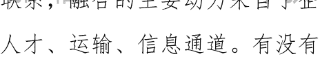
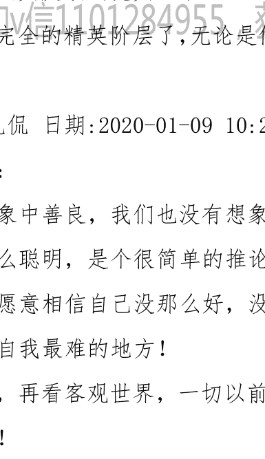
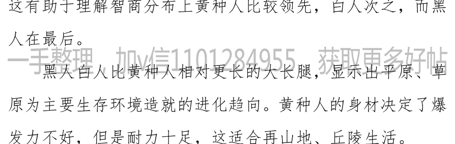
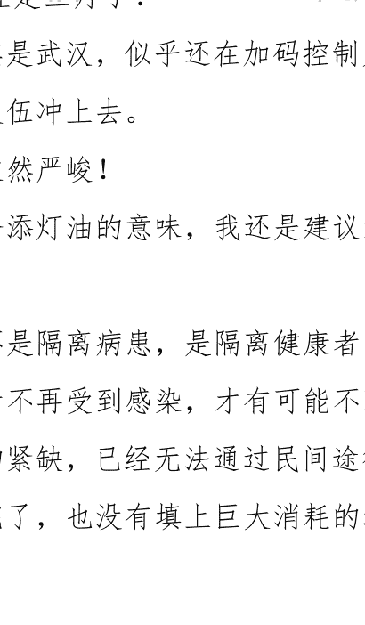
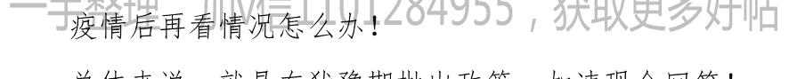

# 2020 年，经济小酒醉一醉（重发版）

老忧乱兜
作者：老忧乱兜 日期：2020-01-09 09:46

老忧本人可是天涯老人，以前是只看不，后来慢慢写起来。今天又是元旦了，夜深人静，老涯论坛看看！祝各位友新年快乐，万事顺意。2019年已经过去了，其实2019年的大事很多。看着未来的思路，从今天开始聊2020年，经济的、商业的、金融的。今天2020年1月1日，新年快乐，各位大家及时回谅。

不谈敏感问题，只说小生活，各位把持好。

2019年已经过去了，和我预期的的一样，以后还有比较长的历程。博弈一定要分出结果来的，只要结果出来，博弈就会持续。尽管我一直强调时间对于中国有利，但也看不到经济“新常态”下，追赶美国的速度变慢了！中国需要下一波经济腾飞才有可能迅速赶美国，尽管技术的基础已经足够了，但是是不利的因素正在显现。典型的就是出生率下滑，大约是当前环境最坏的因素。如果你仔细观察全世界的经济，如果想高速发展，就必须有人良性的结构。美国和德国的区别是什么？就是人口出生率。当然，人口出生率可能是结果而不是原因！只有养成本和收入之间的比例足够，生育才变成没有负担的繁荣。成年人不养孩子谁不对？

所以出生率跳水，后面的事情可能是连锁反应！从报道，2014—2017年间，中国66个城市中有27个城市的常住人口在收缩。我想这个过程从微收缩过渡，城市收缩的绝对数量和比例都会上升。未来人口将围绕三角、三角两个核心区，以及长江流域、京广线的核心城市迁移，其它地方的城市想保持人口规模相当的困难。最能吸引年轻人的区域意外三角，这在侧面证明整合的力度还要加强，经济发展模式还要调整。以上观点可能会让一些人不舒服，但是数据支持珠三角的人口结构比长三角年轻得多。现实不会谎，我愿意相信这个现实。

房价是必须稳的！这是稳金融的关键，去年（2019年）下半年是公开的！一二线城市没有问题，珠三角长三角没有问题！保持稳定，有涨有跌，人口净流出的城市房价堪忧！我不以为在其它平台上的作者到了天涯说话会有什么不对！天涯应该鼓励才是正确的，因为这代表着优质手可以实在天涯聚集，代表着被原创者的认可。如果所有的优质手来天涯闲逛，对天涯来说应该是求之不得的事情！以上，代表我个人交给天涯管理层，也送给封贴的编辑。

想想广东一个省内部都没法整合东、西、北三个方向的资源，长三角一个市整合起来困难有多大？大概是整合深度不够，整体看起来还不大！关于长三角和大湾区的争论一直没有停过。其实很简单，珠三角区域内整合过程是民间+政府，产业融合产业链有天然的联聚，融合的主要动力来自企业经营创造的资金、技术、人才、运输、信息通道。没有大湾区珠三角内部经济联络很频繁。长三角属于政策驱动型的，各种资源通道比珠三角要不少，整合的速度、深度、广度必然受到各种制约的。

2019 年有积极变化！对企业的重视到了足够的高度，这也是历史上没有的事情。没有企业就没有中国现在的一切，以前一味的妖魔化企业家，妖魔化资本，那是在经济速速飞的情况下可以的事情。



反正有钱买的也就骂了！今天，如果你你是老板，那和大家没有多的距离。老板觉得今天整个社会对企业的认知发生了转变，因为没有企业就没有发展，就没有普通生活水平的提高。尽管这个道理很简单，却在长期中无意的忽视和扭曲。去年一年，就业成为社会的主要问题。事实上鼓励企业裁员，在失业保险上给予的要求已经在许多地方实施。事实证明，仗的响，没有工作是不行的。而能提供岗位的只有民营企业和体制内，门槛太高大家都很清楚。就业问题永远是底层的问题，而不是精英的问题。现在体制，至少学历差不多，大众要学历，要技能，只有技术没有太大要求的岗位才可能佣这些人。

去年也是因为这些问题，需要花费大量的精神，辛勤付出，等于长时间的心血付出很多发言需要查资料和文献，又不喜。建议天涯的编辑多重视别人的付出，我现在已经留意不要。外卖、滴滴这几年确实解决了一部分就业问题，长线来看，2020 年，就业形势更加严峻！同时由于制造业挤出效应，服务业的红海将到来。不利于人民币的国际化！人民币想出去，中国的企业想出去，金融市场开放就变得必然。事实上金融领域的开放已经很大，但关注的人主要限于金融内部。而对此清醒认知的人则少之又少！里面蕴含着新机会，回头可以仔细聊这个问题。

中美博弈，2019年华为成为焦点。华为最后没有像X一样按在地上摩擦，是有深刻原因的。有人说是技术，其实这是肤浅的看法，华为真的牛的是“技术专利”！你会做和你有专利是完全两回事。前者是山寨，后者就是武器！华为给中国决策层、大型企业的样板是：有专利才不是被打死的护身符，关键性的专利，绕不开的技术专利，既是开发市场的利器，也是企业自我保护的最强盔甲。政策层面鼓励专利、版权已经在进行时，申请一个发明专利，成功后允许补贴。国内注册发明专利，收减免也是政策，价值几万块。中国将在未来几年奖励专利、版权拥有者，并成为经济二次出发的基础。与专利、版权有关的领域，将是2020 年的新机会。原贴复制过来，因为没有复制其它朋友的发言，看起来不太连贯，大家将就一下！

中国经济在过去的几十年里，要是“复制粘贴”模式！简单来说，把国外的（主要是美国的）复制到在前沿产业。生意好了，把能复制粘贴，加大产能，利润就会增长。现在这招不成立了，因为简单复制粘贴的都已经完成，产能扩张已经到了消化不良的地步。下一步，自然就是向利润靠了。利润的提高，离开专利和版权的保护，离开专利的开发和原创设计大量涌现。

顺便提一句和现实有关的逻辑：薄利多销的时代已经过去，以后高利润率才是企业生存和发展的基石。如果你必须做生意，必须考虑到这个变化，除非成本上的优势极大，否则大多没有。当有外部压力的时候，总是使得民族凝聚力空高涨。以前人口大国都比较穷，原因不是人口多的，而在治理、科技层面落后太远。水平相似的情况下，人口是决定性因素。人口即消费者，又是生产者，这意味着只有人群聚集的地方才繁盛。现在的中国、印度、俄罗斯、巴西以及非洲的尼日利亚，在地缘政治下，依托的就是巨大的人口基础。印度为何底气十足超越英国？加拿大和澳大利亚有广袤的国土，但人口稀少，影响力有限。当下经济的解构，应该放在宏观周期的背景下，这是基本面！目前还没有看到这个基本面发生逆转。全球经济增长下滑的大趋势没有变化，即使数据最好的美国，经济增长也出现了下滑。经济增长明确是从2018年开始的，欧洲也是从2018年出现衰退的迹象，日本的GDP是在万亿上下徘徊。矛盾开始表面化，当没钱的时候就是相互怀疑。农业补贴工业，农村补贴城市，农民补贴工人，就是当时的状态。但，这种玩法又被公有制的低效率所消耗，所以进展很缓慢，还经常出现倒退。

改前，中国是典型的二元社会——城市和农村。由于工业体系不健全，生产技术落后，就必须通过农业补贴工业的路线建立工业体系。


农业补贴工业，农村补贴城市，农民补贴工人，就是当时的状态。但，这种玩法又被公有制的低效率所消耗，所以进展很缓慢，还经常出现倒退。

改前，中国是典型的二元社会——城市和农村。由于工业体系不健全，生产技术落后，就必须通过农业补贴工业的路线建立工业体系。

过程中，中国已经在各个具体产品领域达到了与国外产品相当的水平，有些领域还不足，有些领域已经超越。

中国的科技已经不再是不值钱了——我估计以前发达国家的人看我们就像我们看狂达人一样，但他们在我们思考中国强大后会不会抢他们的饭碗，会不会用拳头砸颓他们。

作者:老优乱乱 日:2020-01-09 10:24

太绕口可能不容易理解，用简单的思维来，这个世界最重要的事情就是你是否如何认知你自己的。

> 还是那句话，认知易难行！

很多人认为自己是善良的、理性的，脑子里底色也并不如此！

我们要看从什么评价维度去看待这个问题。

如果以“看”来，那么你的认知都是对的！

如果以“客观公正尺度”来看，则能得到相反的结论。客观公正尺度可能是最重要的，因为它代表着多数人认的标准。

比如，你究竟是“聪明的”还是“笨蛋”？

这和评价框架有直接关系。

如果，十里挑一的生活水平，其实每月达到1万元就处于中国的前10%，百里挑一的生活水平，就是月入2万。


以上就差不多了。千里挑一就需要每个月收入5万，万里挑一个月10万也就差不多了。

大家不要太高估中国人普遍的生活水平，我上面的举例应该大概靠谱，或者有些乐观了。对于天涯运气一贯的高收入，那是特例，谁让天涯的都有有钱呢？

假如高考分数和收入直接相关，当你在追求2万以上的收入水平，那高考进入全国大学的TOP10差差不多。如果你追求的是10万的水平，那不仅高考要上清北，还要去哈佛这类牛学校就读就很难。

我相信大家基本都参加了高考，考上985、211有多多的应该比较清楚的。其实反映现实生活里，月收入的也一样，很多达到2万已经是完全的惊喜价了，无论是做生意还是打工。

作者：老忧乱乱 日期：2020-01-09 10:24

我所得出：

我们没有想象中善良，也没有想象中理智，我们没有自己觉得那么聪明，是个很简单的推论。

但是人不愿意相信自己没那么好，那么优秀！

这就是认知我自己最难的地方！

搞清楚自己，再看客观世界，一切以前不能接受的东西你就能接受了！

就像打仗一样，先知己知彼后，才有可能打胜仗！



优秀有人不能改变这个世界，怀才不遇大概是根本没那个才！

# 33 楼

作者:老优乱乱 日期:2020-01-09 10:25

我不太喜欢价值判断，尤其我不喜欢道德判断。

我们现在的世界上，都是活生的人，都有自己的责任和具体的生活。

在本质上，人的利己是普遍的，否认生物本能的利己，就是在否定生命本身。
生命得以延续的简单逻辑就是趋利避害，如果这一点做不到，就没有生物。承认天性的利己，就因为懂得别人也是利己的，却要去尊重别人的利益，就不能利己而损人，因为这必然招致反击。

所以，当所有人都尊重“利己”是生物人性，才能建立约束部分利己而损人的行为。

所以，高尚从来不是个人的终身品质，而是某人某时闪现的人性光辉。

因为知道孩子生病父母焦虑，所以有了同情心，并给予适当的帮助。因为利己的生物本能，才有感同身受的体验，才显人性的善和美。

高尚，不是无源之水，是置于本能之上的通感。

# 34 楼

作者：老忧乱乱 日期：2020-01-09 10:25

如果一个社会不尊重他人的利益，不尊重少数人的利益，其价值观必定是扭曲的！

损害少部分人的利益是对的吗？

这个问题其实探讨了很多，但有很多畏忌，生怕说了自己就变得狭局，变得自私，变得成为所谓的“精致利己主义”。

假如在中国大陆随机一人杀掉，中国人每个人的收入可以上升 1000 元，这个事情该不应该做？如果到了你，一定对不公平；如果选到了别人，拍手称快的大人有大大。这事对不对，对于很多人来说，要看是否碰到自己！说本来就是希望得到好，但自己没有损失是关键。由于此产生的愧疚感将被无限的数量分薄，而每个人都觉得不是自己的责任。

当然也有机会主义者，这么庞大的人口，选到自己的概率几乎其微，赚的概率更大。

如果每个人都能感受到被选中的那个人的委屈、愤怒、惊恐，这是由利己及人的推论，那么就不会支持这种事情。

不要高估自己的道德水平，不要用道德去绑架别人，很关键！道德用于自，不适合他人。

# 35 楼

作者:老忧乱乱 日期：2020-01-09 10:25

大概复制了一下，前面被封的帖子写的一些东西搬过来了。我在天涯上的帖子都是“老忧乱乱”，我在天涯上的帖子并没有写到其他平台上，有时候也会说我观点如何，但没有导致其他平台。我有 GZ 号，有 BJ 号，有 ZH 号，有 DY 号。当然也有 TY 号，其实我比较喜欢，主要是有往，不像自言自语。写文章的好处在于能够完整的输出，因为优质的内容不是天涯，而是各种媒体。优质的内容从来不是随便能写出来，并且在问答中出来。

# 36 楼

作者:老忧乱乱 日期:2020-01-09 39

为什么天涯的优质内容越来越少？因为既没有现实的利益，又没有基本的尊重！为什么老忧来？


只是比较喜欢这种模式！但再架不住“封贴”，长期的。

# 37 楼

作者:老忧乱乱 日期:2020-01-09 56

@小鱼 2020-01-09 16 哈哈，又快了！

# 45 楼 

主管理员:老忧乱乱 日期:2020-01-09 58

@花开 2020-01-09 04 收入分配才是问题，由于收入分配不均衡，导致内需不足，消费低迷导致产能过剩，需要大量消费。如果解决了收入分配问题，消费达到80%左右，这些经济问题才会解决，别选择。凡事都有两面，鼓励消费没有问题，但是如果生产环节没有利润，那谁去做生产？！全民中国就富裕了？鼓励消费也要鼓励生产，生产是财富的源头，消费是财富的流转。源头没了，流转就成了空话。

# 46 楼 

作者：老仇乱 日期:2020-01-09 20

天涯 PC 版非常不稳定，不知为何！

# 47 楼 

作者：老仇乱 日期:2020-01-09 34

经济是一个生产和消费的循环，两者缺不可！生产过剩就是当下中国的局面。生产的扩张，背后的逻辑是资本回报率。现在萎缩，就是资本回报率太低，低到不如银行的收益。如投资100万，收益低于10%，则实际收入要减去银行利率，办理理财大约是4.5—5%。如果是10%资本回报率，实际的收益也不过5%左右。关键这5%不是风险所得，而是风险收益，风险在经济不景气的时候要加大权重，是无法的。如果企业是老板自己经营的，还要加上者工资。假如这个老板打工收益是10万/年，银行收益约5%每年，那么其投资100万做企业，收益达到15万也不过保本，收益20万也不是5%的投资回报率。这笔账其实人都算明白。

# 48 楼 

作者：老优乱乱 日期：2020-01-09 21

@小优来了：
评论 老优乱乱：不说那些大的，就说3元的可乐，这个不算高利润吧，还有2元的瓶装水，谁家都有桶装水，15元一桶，怡宝水不算大企业，不靠量？养殖，比如鸡，鱼蛋每斤肉赚多少钱（不说，烦）还有快递诸此类别的衣食住行，不靠量也不行吧？不知道算不算大企业。

刚和几个以前的老同事一起喝酒回来，看了你几个回复说薄利多销的逻辑，特意回复一下。所有的企业，都建立在一个广大的市场基础上的，也一定得多销；不是不多销就没有大企业。

但是我是说“薄利多销”的逻辑不成立，不是没有多销，是建立在“薄利”基础上的多销，在中国现在的市场环境不成立。所谓的薄利多销，是以价格为武器开展的占领市场。事实上，你举的例子，可口乐的直接成本只有0.6元，绝对不是“薄利多销”。


# 59 楼 

作者:老忧乱乱 日期:2020-01-09 22

按照2018年可口乐年营收，净利润高达20%以上。这些头部企业其实更关注品质，其利润率也比一般的高，这是普遍现象。华为、万科、绿地、海尔、丰田、大众、特斯拉，这些公司都不是低价策略，在电动领域也不低价。只有在成本均衡的体系里才有优势，成本做得好，别人你的成本线下销售，日子也不会好过。

# 60 楼 

作者：老忧乱乱 日期：2020-01-09 36

薄利多销，根子上就是薄利。如果没有建立优势，仅仅通过“大量”抵消“薄利”，在商业逻辑里是不成立的。我很清楚，通过利润诱导的结果就是没法确保品质，也难以做好客户服务。坏产品就需要做10个新产品才能弥补损失，这样做的结果，买卖变成一次性的买卖，不可能长久。

# 61 楼 

作者：老忧乱乱 日期:2020-01-09 48

我是实战派，自己做生意，很明白利润有多多样性。成本关键，但是有合理的区间。价格上天肯定不对，价格落到底也不对，都是取死之道。价格战，几乎所有人都能到的，简单的竞争策略。价格战到了最后就是成本战。如果不在成本层面没有绝对优势，就不可能胜出。

# 62 楼 

作者:老伏乱乱 日期:2020-01-10 40

@老伏乱乱 2020-01-09 21:54
@老伏乱乱 2020-01-09 21:51

@小优来了：
评论 老伏乱乱：不说那些高大的，就说3元的可乐，这个不算高利润吧，还有2元的瓶装水，谁家都有桶装水，15元一桶，宝怡水不算大企业，不靠量？养殖，比鸡，鱼每斤肉赚多少钱（不说，烦）还有快递诸此类类的衣食住行，不靠量也不行吧？不知道算不算大企业。

一丰经理，加微信101284955，获取更多好帖。刚和几个以前的老同事一起喝酒回来，看了你几个回复说薄利多销的问题，特意回复一下。所有的大......

@小儿来了 2020-01-10 10:25:37 你说的厚利多销好像是那么回事，那薄利，怎么薄才算利？现在生产领域毛利率3——5%都是，这在生产领域是非常不正常的。很多产品贸易出口，十几块钱的产品，加上退税也不是几分钱的利润。这种状况超乎很多人想象吧？？！

# 6楼n 作者：老忧乱乱 日期：2020-01-10 13:14

@TZFUNDS 2020-01-10 08:23:20 一般来说，走薄利多销的企业门槛低，所以很多人做。一个小企业，一步就开始想走高利润高加值，这前期投入不是几套房子的钱就能搞起来的。薄利多销，是最简单粗暴的竞争手段！这个思路没有路，只要你做生意，十个人。大家都按这个策略，最后的结果就是普遍毛利低，导致整个行业的洗牌。我们经常看到的“一哄而上”，无限降价，投入就越大。你可以采用竞争策略，前提是成本绝对领先，如果做不到，那就活不了。

# 71 楼 

作者:老忧乱乱 日期:2020-01-10 18:06

@sunnyluc 2020-01-10 16:37 @投资新人 2020-01-10 15:38 我重温了楼主的帖子：分配问题有两层内核：以及怎么分的问题。

根源上的问题在于，是否承认个人之间的差异。人与人不同，对社会的贡献也是不同的。哪怕是简单工作不同也一样，根本不用搬塌层的例子。同样搬砖头，有人搬得多，有人搬得少，如果是计件工，这个区别就出现了。是所有搬砖头的都拿到一样多的报酬，还是按劳分分配？是该公平还是该平均？大多数人，即使想不劳也会因为舆论压力而承认劳分分配的合理性。

其实在其它领域也是一样的，也有这样的差异。不同工种之间的收入差又应该如何看待？这个不能写下去了，因为理性辩证与感性认知的差异很大，写下下去就要打喇似的，没意义！

# 79楼 

作者:老忧乱乱 日期:2020-01-10 19:37

任何社会都不可能成为每个人都满意的社会，古今中外莫如此：富裕阶层、权力阶层物质比底层丰富，这是规律，也是真理，无论你怎么认同都没有意义。用逻辑承认现实，现实不会改变。社会会按照管理资源的多寡来分配财富，就有现实生活的三六九等。如果你管理的资源，责任也少，压力也小，内心安定的同时自然降低物质生活标准。这种地方已经雏形，有些地方还没有开始。

# 80 楼 

作者:老忧乱乱 日期:2020-01-10 19:21

有些地方已经开始，有些地方还没有开始。随着城市化的发展，去做这块市场的服务业怎样……完全的。

# 75 楼 

作者:老忧乱乱 日期:2020-01-10 18:31

@投资新人 2020-01-10 15:28 很在关注分配，很意“割韭”的问题。如果不考虑蛋糕做大，就变成口号和行动！不合理的分配方案最终导致分配环节自己长大，没有蛋糕可吃。现代经济都是关注这两个层面，蛋糕可以，必须不断的做大，这样才具备每个人一点的基础。

# 76 楼 

是道理！分配问题，是完全的。小区服务业目前还有。建立在方便、快捷基础上的业务，是完全有空间的！

# 77 楼 

作者:老忧乱乱 日期:2020-01-10 19:24

中国人现在过得苦。在天涯大多数人认为苦是，也不知道我测测是否正确。苦的标准是什么？是吃饭都吃不起，还是不能随心所欲的天大餐？是没房子住，还是房子太小的不尴尬？真的是衣服缺还是看着富阶层的不差钱心生气？


临春节，人心思动，春节前订单基本完成，工厂提前放假。

又是一年，时间过得很快，总有很多感概！

过去的一年是难熬的一年，业务锐减！

好在自己开发了一个新方向，注册了发明专利，目前看来途广大。

企业经营永远没有“上岸”和“安全”，只能见招拆招，有项目预留。

市场是变化的，一切静态的分析都是与现实不符，唯有变是不变的。

# 92 楼
一手卖：老优乱乱 获取更多帖子

作者:老优乱乱 日期:2020-01-11 11:55

今天工厂的 90 后小时到公司来，把贵重的配件拆了来放到公司，几十万的东西放在工厂是很不放心的。

今天和他读了圈子化和个人认知提升的关系。

如果一个人的圈在很长时间后就是固化的，说明个人能力和认知和这个圈层的人保持了一致。

如果发现原来的圈子已经能够聊的话题变少，热聊成荒聊，不是自己差了就是自己提升了。

对旧的圈层热心不减、乐不彼疲，则说明当下新圈层高于自己，因此找不到自己的位置。

朋友会生疏，因为背景的颜色是在不断的发生变化。朋友原本就是在类似的背景下建立的关系，当背景改变了，很多关系就看不得时宜了。

所以，朋友很难是永久的，是从交心开始就一定不变的。

来自

# 93 楼 

作者:老忧乱乱 日期:2020-01-11 12:01

前几天和一个成功人士喝酒，大家年年轻时熟悉、并且共事多年。

她老婆的一副提手就是一辆车的价格，他并非炫耀，因为对我炫耀没有意义的。

我开玩笑说，你再提这种酒就不好喝了。

一楼回复: 110128495... 获取了很多好帖

财富的阶层并拉大，确实没法跑到心里。

随便聊天都能聊出一些尴尬。

来自

# 94 楼 

作者:老忧乱乱 日期:2020-01-12 16:42

我一直强调，中国没有那么好，也没有那么糟糕！

我们需要客观的眼光看待这个世界，从辩证的角度看，这个世界没有绝对真理。

既然没有绝对真理，那么只要绝对对化的表达，就一定藏着错误，无论你表达的怎么好！

# 103 楼 

作者：老优乱乱 日期：2020-01-12 16:51

任何社会，效率最高的永远是制造业，这在某种程度上可以解释为发达国家的经济增长率普遍较低。

效率最高的制造业为何会慢慢占比下降，而效率不高的服务业却会慢慢上升在整个经济中的占比？

一个很明显的线索是，制造业的效率提高比较，但是市场成长则要慢得多。目前生产效率的上升几乎没有顶部的，但是消费市场是有限的。就拿手机来说，满足全球几亿部手机的产能是容易的，哪怕每个人用10部手机，今天的制造手机业务可以用年的功夫满足全部需要。

产能和效率不封顶，消费是有边界的，这就导致了制造业一定阶段由于市场无法持续增长，服务业的需求要很多，最终在整个经济占比中超越制造业。

# 104 楼 

作者：老优乱乱 日期：2020-01-12 16:14

中国这十年在国际经济体系的位置攀升，根子还是制造业的快速发展，基于制造业财富生产的高效率，中国经济规模膨胀的速度超出了大多数人的想象。

今天，中国制造已经渗透到世界的每一个角落，开始出现了上文所说的“制造业产能和效率无限，但消费市场上有限”的情况。


结果就是增长速度开始下降！

所以我一直强调，以中国经济的体量，长期维持 5%的实际增速已经难可贵，相当于每年增加一个在全球范围内排名 20 名左右的经济体。

即使美国，长期维持 2.5%的经济增长也已经非常困难了。

按此推算，中国经济规模达到美国太平洋水平大约需要15——20年。

# 106 楼 

作者：老忧扰乱 日期：2020-01-12 17:21

当然经济增长从来是非性的，尤其是当汇率这个杀武器发挥威力的时候。

特别是人民币兑美元的长期走势对中美经济规模的影响仅在经济实际增长之后，对于美国来说，汇率的影响则要超越经济增长速度。

比如，当人民币兑美元如果还是之前的 6.1:1，则2019年的中国的GDP按美元计算要增加1万亿美元。

之所以经济实际增长率影响更大，是因为汇率本身就被实际经济增长率直接影响甚至决定。

如果美国的经济增长率跌到1%以下，美元就会必然开始疲软。同样的，如果中国经济增长速度低到发达国家的水平，则人民币相对美元也会有巨大幅度的贬值。

# 107 楼 

作者：老忧乱乱 日期:2020-01-12 17:27

一个很明显的例子是日本，日元升后贬值，导致日元波动非常巨大。由于汇率不同，导致经济增长率水平施加在。产能和效率不封顶，消费是有边界的，这就导致了制造业一定阶段由于市场无法持续增长，服务业的需求要很多，最终在整个经济占比中超越制造业。

产能和效率不封顶，消费是有边界的，这就导致了制造业一定阶段由于市场无法持续增长，服务业的需求要很多，最终在整个经济占比中超越制造业。

由于汇率不同，导致经济增长率水平施加在。按照美元计算，日元最高位排名达到，在20年来基本没有增加。

由于汇率不同，导致经济增长率水平施加在。按照美元计算，日元最高位排名达到30——40%。

由于汇率不同，导致经济增长率水平施加在。其后，表面都是达芬奇、创新等引起的，实际上就是潜能。

# 108 楼 

作者：老忧乱乱 日期:2020-01-12 19:04

最近我看很多人在说人类天花板。说实话，这个问题我也考虑过，我认为现在还没有到达所谓的天花板！

对于人类来说，可能用量耗尽，文明倒退，这个推论更靠谱。

这个话题可以聊，比较有意思！

# 109 楼 

作者：老忧乱乱 日期:2020-01-12 19:07

在聊这个天花板问题前，先来几个问题：

- 1、从科技的角度看，我们认为已知的范围内还是未知？
- 2、这个时代是否有人可以统一人类？

之所以提出这两个问题，是因为这两个问题关系到发展的。

# 110 楼 

作者：老优乱乱 日期:2020-01-12 00:00

第一个问题其实答案是肯定的，越是懂的人，越是无知。

人类相对于已知，未知才是大部分。

承认无知，才有探索未知的动力。

所以，人类缺乏动力。

# 111 楼 

一手笔记。作者:老优乱乱 日期:2020-01-12 01:12

中学老师教亚里士多德的时候，给他起个外号叫亚里士多德。

达芬奇也有类似的称号。说的是多才多艺，什么都懂。

今天，不再有各个领域都精通的天才了！我要说的不是人类需要天才，而是今天的技术在各个领域取得了足够深。

导致了一个问题，就是各个学科之间的壁垒森严，一个人不能横贯所有学科。

假如，有一个人可以像达芬奇、亚里士多德那样，是一个多面手，将为科技带来多大的推动力？我不敢想。


如果真的如此，科技将向前迈一步。我不认为现在或者未来会有这样的人能做到，但并非没有希望。

- A、知识的存储，对现有知识的存储并方便检索只有云存储这条路，好在现在有了：
- B、获得巨大计算能力的大脑人类或许没有，但是云计算一定可以；云计算可以统一所有的运算结果，而且用有限。尽管人类脑，但没有足够的协同性：
- C、将现有知识相互借鉴、验证、归纳、枚举，或许未来的AI提供了这样的机会。现在前两步已经有了，就差第三步了。有些人悲观认为人类可能灭亡于“人工智能”，但是就当下的进步来看，进展缓慢，却是没有进展。

如果有一天，第三步实现，必将人类科技的一次大跃，那只是基于当下人类的知识之上。

作者：老优乱乱 日期：2020-01-12 20:16

或许人类真的需要新的技术革命，但未来的新技术革命无限底层，并建立在人脑低同步性基础上，根子上就出了问题。人类不断的发明工具，让自己的“更长”，但人类一直是控制这只手的大脑。

如果人类通过控制一种“超脑”去控制工具，这必然是一次巨大的革命，也绝不是人类可以设想的结果。

# 13 楼 

中美博弈，2019年亚洲成为焦点。华为最后有没有像X一样按在地上摩擦，是有深度刻画的。

有人说是技术，其实是浅浅的浅，华为真的牛的是“技术专利”！

你会做，和有专利是完全两回事。前者是山靠，后者是君主理，加微信1101284955，获取更多好帖就是武器。

华为是给中国决策层、大型企业的样板棋：

有专利才不是被打死的护身符，关键性的专利，绕不开的技术专利，既是开发市场的利器，也是企业自我保护的最强盔甲。

政策层面......

@毅就特立独行的猎猪 2020-01-12 20:57

美帝那边没死，留下了空间而已。显然的，美国如果能确保必胜，且代价不大。

之所以说是博弈，说的这个意思。这样一个国家，未必符合战略利益。

# 15 楼 

作者：老忧乱乱 日期:2020-01-13 08:28

我也不算一个说法，未必对。我和谁说，都觉得经理。哎，谁说对，拜读，点赞！感谢捧场~一手调理：微信获取更多好帖

中午了，吃饭去！公司的网络不好，到公司只能用手机更新，所以比较喜欢在家里回帖。

作者：老仇乱乱 日期:2020-01-14 15:21

@tzwll 2020-01-14 13:26:19

从养生角度看，晚上9-11点之间睡觉最好。到凌晨就有有点过了。习惯不好，早睡有困难！作者：老仇乱乱 日期:2020-01-14 22:26

@朱元玮 88 2020-01-14 20:52:17

楼主基本上是一个书呆，坐在办公室里指点江山，你这样的水平会死人的，哈哈哈哈...我一般是不拉黑人的！你在帖留言多次，我就好奇你为什么会喜欢这种表达方式！我看了你的多数留言，都是在嘲讽别人装懂！我不知道是什么环境让你喜欢这个模式表达，但我看真了！本人才浅，您以后也别留言。如果您真有才学，请开一贴，我定要去学习瞻仰！

# 136 楼 

作者：老优乱乱 日期:2020-01-14 22:30

我个人反对有不同观点的人，观点不同很正常，有些时候因为立场，有些时候因为三观。我比较厌恶一方面觉得谁都没有对，另一方面从不会说一句完整话的人！

# 137 楼 

作者：老优乱乱 日期:2020-01-14 23:33

懂一个人的身份背景是危险的，尤其是在网络上不可能三句话就能知道一个人的一切，更不可通过表达方式来判定一个人的职业和背景。即使算命的也要装模样一样生八字，了解一下基本情况！

# 138 楼 

作者：老优乱乱 日期:2020-01-14 23:39

轻易下结论，是每个智力开始成熟的成年人必须学会的基础能力！人类社会是一个博弈的大集合，在这里抢答不会加分，答对了才加分！佛教有一个词叫般若，当时翻译的时候不用“聪明”而只选择音韵的“若”是有很多考虑的。其中一点，就是“聪明”是一种表面化的东西。


知识本身就是财富。

今天，很多知识已经成为一种，获取也很容易，实在不懂就搜索一下。灵活使用才是关键，把很多领域的相互借鉴、抽象理解、推理，才能之为智慧。

很多问题本身是没的，本来想和楼主讨论一下，还是算了。这个话题我之前写过很模糊。我觉得农村孩子太公平，无论是教育，还有眼界，他们已经脱节了，以后进入社会更脱节。如果有可能，我想当导师，引导方向，那应该是功德。

[注：由于OCR文本包含大量乱码和重复字符，以上内容已基于语义进行了逻辑还原。]


到唐朝佛教传入中原。河南有白马寺，西安有法门寺。皇上一看：“这个好啊，你是你上辈子做的孽，别反抗，争取下辈子过好日子。”于是正式派黄大藏旗旗旗鼓地取经，给中国人彻底换脑。于是形成了儒道三足鼎立也。

佛教进入中国最早应该是魏蜀时期，当时中国人认为是道教的一个变种。

历史上儒道一路想当统治地位，但是偏儒家势大，王权说加强佛教，基本上怕佛都不受不了，获取更多好处。

佛在印度语的意思是“觉悟者”，并非我们常人认为的“神”。佛的声闻弟子，总体来说是偏向唯物，也就是我们所说的小乘佛教。三世重因果是大乘佛教的理论，并非佛教本意，也不是全部佛教认同的。

作为一个宗教，必须有神性，必须对死亡有应对方案，所以大乘佛教作为宗教性质要强一些。从人性关怀上，大乘佛教也是积极的、向上的！

如果翻看经书，就能看出这种区别。宗教让人向善，抚慰灵魂，创造维护社会安定，整体还是积极的！

## 192 楼
作者:老优乱乱 日期:2020-01-17 22:12

@ydl1xby 2020-01-17 19:45:16

中国本土宗教是道家，起源于汉。文景之治时尊崇黄老之学，集大者很多。后来出了黄巾起义，彻底伤了皇帝和族心。说“敬鬼神而远之”，道家也有反思，说道不可轻传。道家也成了统治阶级的心肠。

到唐朝时期佛教传入中原。河南有白马寺，西安有法门寺。皇上你看：“这个好啊，你是你上辈子做的孽，别反抗，争取上辈子过好日子。”于是正式派兵大张旗鼓地取经，给人彻底换脑。于是形成了儒道三足鼎立也。

一手整理，加v信11011284955，获取更多好帖

@老优乱乱 2020-01-17 22:02:06

佛教进入中国最早应该是魏蜀时期，当时中国人以为是道教的一个变种。

历史上儒道一路想统领地位，总体上儒家势大，基本上怕哪个都受不了！

佛在印度语的意思是“觉悟者”，并非我们常以为的“神”。佛的声闻弟子，总体来说是偏向唯物，也就是我们所说的小乘佛教。三世重因果是大乘佛教的理论，并非佛本意，也不是全部佛教都认同的。

作为一个宗教，必须有神性，必须对死亡有应对方案，所有……

@落花浅影 2020-01-17 21:42:38

儒家差点被逐连根拔起，幸好朱理学主动融合了佛道精神。理学、心学从佛教里借鉴颇多！

## 194 楼 
作者:老优乱乱 日期:2020-01-17 22:19

总体来说，道教的理论体系比较弱。或者说道教的哲学体系没有建立起来，只能以和和来获取信任。

佛教的哲学体系精深，但精密的体系不利于传播。禅宗得到了佛的情怀，内容简单化，因此得到了大发展。但是最后还是信仰成功了，佛就能消灭成为为主。

儒家从人感过渡到理学、心学，理论体系基本走到尽头。

从对老百姓的影响上看，其实最后是释道合流产生综合影响，形成中国人的国民特性。

## 195 楼 
作者:老优乱乱 日期:2020-01-17 22:30

玄奘宗取经，拿到了印度本土正宗的唯识宗，因为义理艰涩，终归只传了一百年多，慈恩宗就此断了传承。老百姓只想知道什么有用，并不在意你的理论基础扎实。简单的方案是最后得到最大程度的流传。

看佛教历史，总结的结果是大多数人并没有兴趣去“知其所以然”。这适用于当商业逻辑。成功的商业，总是一群能明白事的人了。人类的大部分人是“明白装懂”，这些人是有智慧的；还有一部分是“明白装懂”，这些人也是有智慧的；大部分人，“明白装懂”，正是“明白装懂”的韭菜。

## 196 楼 
作者:老忧乱乱 日期:2020-01-17 22:33

等平凡，如果认识到自己不够智慧，就会滥用权力去追求智慧的人。不过最好离远点，量总是可以的。一直说，认识到自己并不那么优秀，承认平庸，很重要。

## 197 楼 
作者:老忧乱乱 日期:2020-01-18 14:04

今天这种热闹了，但是相关的信息都被屏蔽了。人民发声也没有用，这种说明距离太远了。富裕阶层焦虑从哪里来？很多事情是有钱也做不到的，大很多能进阶的。这不意味着，规则分成两部分：
- 一部分是需要遵守的，
- 另一部分是拿着规则等人的。权力之下，一切都是狗屁，包括财富！没有愿意把自己奋斗了一辈子的财富瞬间收割，这是富裕阶层的底层逻辑。

一个明显有问题的问题，依然可以掩盖下去。设立正当理由，那就会描述得无比正确，有一群群众欢呼吧！有着明白装懂的都是人！有着浅装明白都是草民！草民不需要逻辑，只需要一股热血上涌，来激发出勇敢、正直就好！如果一个“奸商”被剥夺所有财富，吃了牢饭，他想发声就很很难了。正常的草民们一定客气，高呼“公平”。这种“黑心资本”一直是热乎的！无论善恶，都必然不是笨蛋，能积累足够财富的人，他们都知道。血馒头一直是治愈民间伤痛的好药！不过心里一定冷暖的。

## 202 楼 
作者：老优乱乱 日期:2020-01-18 18:53

钱比房重要，这么多图，影响看帖，折叠了！道歉！加信1101284955，获取更多好帖

## 209 楼 
作者：老优乱乱 日期:2020-01-18 19:07

规则一直比道德重要，道德看起来很美，可从来说没有一个社会会因为道德而真的道德！

## 210 楼 
作者：老优乱乱 日期:2020-01-18 19:32

今天的评论好像被咬了，有些过分了！

## 211 楼 
作者：老优乱乱 日期:2020-01-19 08:21

昨天睡得早，今天算是起来早了！这几年基本上上午起床都比较晚，习惯性的熬夜。这个年纪不如此，正在调整中！

## 216 楼 
作者:老优乱乱 日期:2020-01-19 08:26

距离春节还有5天，还能听见远处隆隆声，这个世界依然鲜活如初！我一直想，以人之勤奋，何以积弱百年？假如上帝临头，看看地球上的众生，东亚黄种人应当是最勤奋的蚂蚁。其它人种，包括白人也不是黄种人的对手。我们需要理解，增加信心。如果有根源性的问题，国民特性要么是组织方式显现了问题。

## 217 楼 
作者:老优乱乱 日期:2020-01-19 09:11

2019年，中国GDP超99万亿人民币，人均GDP超1万美元。统计局另外公布了70城房价，大多数上上涨。这可能有悖感受，但可大体相信。所以相信，是因为苦难的感受往往被放大，容易成为焦点，这是一般心理学规律。另一件有意思的事是全球债务规模达到252.6万亿美元，这提供了两个信号：
- 1、美国的债务不算高，只是略超；
- 2、债务膨胀不可持续，需要一轮清理，无论主动还是被动的。从全球债务规模上看，近几十年的全球繁荣就是建立在债务基础上的增长。无论用什么方法，借钱还的情况一般是不接受的，结果是区域性的影响。在某种程度上讲，现在的经济出现的债务问题，凯恩斯主义和后凯恩斯主义已经不足应付。当债务积累到一定的数量，货币宽松的边际效用越来越低，直至失效。典型的例子是债务引发的衰退，整个世界需要一次变化来结束，产生一个新格局。

## 220 楼 
作者:老优乱乱 日期:2020-01-19 09:23

二战后，美国凭借积累的技术和国力，开始了新格局的塑造：
- 建立布雷顿体系；
- 建立贸易总协定；
- 建立联合国作为协调关系的纽带。
今天，世界只有两条大鱼，其它经济体成了配角。如果不考虑二战后各国的表现，看今天的国际体系实际上是失衡的。

## 221 楼 
作者:老优乱乱 日期:2020-01-19 09:33

二战后，美国经济自然是一等国，苏联军事与经济依然在世界前列；英国面临分裂危险，法国陷入种族危机，日本也被打垮。因为共同敌人消失，政治利益严重且扭曲，导致了影响力不断下滑。德国不差，可惜是战败国。美中成为事实上的经济两极，美国和俄罗斯的力量对比已经彻底失衡。

## 222 楼 
作者:老优乱乱 日期:2020-01-19 12:07

其实所有问题都可以归结为一个问题。那就是经济全球化是否持续的问题。资本像水，天然属性是从成本高地流向成本洼地。血工厂成为制度优势。在科技不断进步时，还能维持。一旦发展停滞，这就是危机。这个世界从未来没有摆脱丛林法则，不过从生存权竞争到生存质量、长度竞争。所有的方案，都围绕着怎么走到头部的问题！有第一，就有倒第一，所以全人类如此。

## 225 楼 
作者:老忧乱乱 日期:2020-01-19 12:29

血汗工厂现在很少媒体去了！当中国人都都在原始积累的时候，不可能上来就是高福利科技，没有资本技术，只能用人力来填。当时的血红利解决了中国人的温饱问题、就业问题，落后国家起步阶段绝对不可能跨越的鸿沟。当积累足够的时候，就没有人愿意转班运转去工作，就是当时中国的样子。

所谓的中收入陷入陷阱其实是这样的：如果一个国家在成本上没有了优势，在科技上也比不上发达国家，且资本的积累不足以投资赚钱，就会形成经济停滞甚至倒退的局面。所以，时下的中国，如果科技进口渠道被封锁，技术不受自我迭代，后果就是拉美化。目前看来，中国科技已经具备自我迭代的能力，就看否

## 227 楼 
作者:老忧乱乱 日期:2020-01-19 12:37

竞赛竟然达到了什么水平？在很长一段时间，发达国家中并不出众。在科技领域领先的不是创新本身，而是围绕着科技创新形成的集团。可以说，除了杂阿经确认是佛说的真意，其它皆不能确定。小乘佛教是最接近佛意的。龙树菩萨的空观，其实是为了破执而存在。一切都是空。

## 228 楼 
作者:老忧乱乱 日期:2020-01-19 13:40

空观被抛弃了，因为一切都是空还学什么佛法？唐僧（唐玄）去印度，引入唯识学派，创立华严宗，讲的是“一切唯识”，也就是这个世界是由识构出来的。这个流派比较唯心唯我。唯识理论对于复杂精密，不是一般人可通，不成就断了传承。

## 229 楼 
作者:老忧乱乱 日期:2020-01-19 13:55

禅宗则以“落叶拈花”继承的理想，总体来说把佛和佛性置于个人内心，这个意思有点像王守仁的心学内容，“理在心中”和“佛在心中”基本一致。“南无阿弥佛”代表着汉最大的流派，净土！佛教是个大整体，既不能简单的用“三世重因果”概括，也不能以“消极唯心”概括，因为这个大整体对于庞大，流派众多。佛教有护法部天龙（龙只是一部），还有蛇毗、夜叉、修罗等部），有金狮子吼，那就不是悲观和惆弱。

## 231 楼 
作者：老忧乱乱 日期:2020-01-19 16:08

佛系，更是因为看起来没有希望而自我放逐，用最消极的办法不能改变的未来。非佛系没有成本，每天一包方便面也要去赚！否则只能乞讨！就是要别人给你留一笔钱。佛系总体来说就是放弃理想，消极抗争。消极抗争从来不是最佳方案。


## 佛说：放下屠刀，立地成佛......

关于人能不能顿悟，在佛教内部一直有争论！

一个说法是，沿着正确的方向最后就能开悟，向学从小学开始，到博士结束一样，层层精进，最后达到彼岸。

另外一派的理论认为，真理作为一个整体是不能被拆分的。你不能说你得到了一部分真理，得到一部分真理就是没有得到真理。

就像现在速度、时间、路程的关系一样，你得到了速度，没有时间，你还是算不得路程。

所以禅宗最著名的就是“棒榔”，让你一下子开窍。

王老师到处龙场悟道，也是在楞须里彻悟得了“理在心”，和“棒榔”的意思异同同工。

作者:老优乱乱 日期:2020-01-19 16:54

@sunnylucu 2020-01-19 16:44:28

我对佛的理解以前太浅了，就认为是烧香拜佛，迷信。但是这两年有反思，也想通了一些事情。以前是我把佛想成一个像，一个具体的人了。后来我的观念发生了变化，

我觉得佛是抽象的，应该的意思说是开悟。这一点和和尚谈到的原始觉悟一样。

一个人，开悟了，我们可以称他为佛。是说他的思想达到了一种境界。同样，每个人都可以成为佛，只要他开悟。具体悟什么，我现在不知道。

佛说：放下屠刀，立地成佛......

天台宗的“一念三千”大概就是你后面说的意思！

华严宗的“无限缘起”也是异曲同工。

作者:老优乱乱 日期:2020-01-19 17:51

@sunnylucy02020-01-19 17:39:31

风水，对于来说，呆的地方，舒适的，人和互动和谐就是风水宝地。

- 一数字理：相信如果呆的地方，精神压力大，人关系不和谐，那风水不好，那我就赶紧避开。

中国的风水有阴阳、五行等流派。

我以为，就居家而言，“营造舒适健康的小环境”就是家庭风水；

就城市而言，“安全、宜居、健康、愉悦的环境”就是城市的风水；

中国的风水理论，总体来说是基于环境对人的影响发展出来的一套理论。

至于阴阳鬼神，是走偏了路~

作者:老优乱乱 日期:2020-01-20 04:27

回到家！

应邀聚会，吃饭后大家说很久没有打麻将了，于是是大麻将到现在。

现在每年也就是打一两次麻将，主要是不感兴趣。

且，这个年纪打麻将也觉得身体不舒服，烟抽得多，长时间不动地方。

作者:老优乱乱 日期:2020-01-20 04:33


佛学，深太奥了！不是一般人能解释清楚。四相断一相就可成佛，何其难。别人拿一分钱你都受不了了，何谈空！！世间大德都是珍品，我们都是俗人，红尘中一粒尘埃！！贪财好，好吃好！！如果能做到，安心工作，心态平和和多做好事，爱护家庭，教育下一代。为社会安定团结尽的一分微薄之力！！就很伟大了！

修佛有四种途径，即四乘！分别是声闻乘、独觉、菩萨乘和金刚乘。金刚乘即当下藏传教。

佛教的空观，目的是以空破，即一切有法，如梦幻泡影。所谓有为法，就是具有坏、空、成、住性的事物。既一切有法都没有自性，贪嗔痴就变得没有意义。

我对佛教敬畏的很，尽管理论基石有纰漏，也不减其神采！

作者：老忧乱乱 日期:2020-01-20 04:36

很多道理，人只有到了一定年纪才有可能体味得到！怎么看自己，怎么看社会族群，怎么看这个世界，都和年轻经历直接相关。

我曾经试图把我的一些感触写给我的孩子，最后还是放弃。因为他们年纪小，我说了他们也感受不到；等到了年纪，受了伤，也就自然能开启！

这些强求不得！

作者：老忧乱乱 日期:2020-01-20 04:62

无信仰的人是可怜的，比如老忧我自己！信仰，关键是信！

你可以理性的信，也可以盲从的信！从结果上看，人类的理性未必是真的理性！正如我之前说的那样，以人类有限的知识，以为客观的思维未必是客观的。因为长期的唯物洗脑，让人都鄙视唯心！但唯心还是唯物对？这个世界没有纯粹的东西，只有杂杂的混合。既然如此，唯物和唯心或许站在两个不同的位置看同一个事物也未可知。

国人鄙视唯心，是因为有经冲洗了脑壳几十年。在整个哲学领域，唯心和唯物是两座高峰，只有到了中国才例外！

作者：老优乱乱 日期:2020-01-20 04:48

活着精神的寄托，和克服死亡的恐惧。如果人类不恐惧死亡，我相信人类会更美！这句话很值得思考！

作者：老优乱乱 日期:2020-01-20 04:54

中国的宗教不能称之为宗教！因为宗教必须有神性，没有神性就没法死亡。宗教必须解决本体的问题，也就是世界是怎么来的，人是怎么来的，人类走向哪里。儒家有圣人，但是没有神性；道家有圣人，但是没有神性；佛教里的神通，也没有长生的能力，也会死去。

作者：老优乱乱 日期:2020-01-20 05:13

中国风水学博大精深！青龙白虎代表水与林，水源非常重要不必说，林就有动物，也有果树、蘑菇等。坐北朝阳，则冬暖夏凉。干燥多阳光。前有山能避水，从基础理论来看，风水学通过视觉、光线、声响制造的效果：活的需要。比如卧室，怎么做隐蔽？看看窗户，会有所得！皇帝有什么威严？看看乾位或布局。灯光让人的声音显得洪亮？如何让你舒适？厕所对身体不利，卧室恍惚会吓到你！以上思维方式，在风水里就是“五行”，与其对应的鬼神说。

很多人把五行理解为金木水土元素，是希望。鬼神则是另外一套系统，可见阴阳、五行、八卦、九宫解。家庭风水，用的是玄学，这个还有文化根源。至于冲什么，引什么鬼，彻底进入鬼神系统。作者:老经乱 日:2020-01-20 05:32

《易经》有三字经：易有失，连山和归藏，现在的只有《易经》。易经是中国文化的源头之一，比如“九五之尊”“否极而泰”等。易经既是道家的经典，也是儒家的经典，所以儒道合流的历史很长！另外儒家的宇宙观也与道家相同，如果看周敦颐、程颢的经历和著作，写了“无极太极”，就是借鉴于道家。周敦颐思想，朱熹、王守仁等名人，期望从释、道家交流也很多。其实如朱熹、王守仁没有没有 藩篱，怀素是书法的一大特色。当时的文人多交集，包括著名的诗仙李白，著名的书法家颜真卿等。书法如此精彩？

所以，中华文明，是儒释道共同影响，彼此的结果！它们有着自己的一部分，也有相互融合之处！

作者：老忧乱乱 日期:2020-01-20 05:37

佛教传入中国在魏晋朝时期，道教开始成型的时期基本不多。道教以老庄为祖师，大体形成基础论也是魏晋朝时期。

作者：老忧乱乱 日期:2020-01-20 12:28

熬夜确实对身体不好，尤其是打麻将，比一般的熬夜更难受！睡了几个小时，醒来，泡茶，补点水分。今天的佛山开始安静下来了，作为一个制造业城市，过年人流明显减少，很多人都是新的。佛山是一个不错的城市，这些年环境改善了很多，尤其是其保护方面进步很大！大学毕业后就来到这个城市，如今已经超过20年，对这个城市很有感情。

作者：老仇乱乱 日期:2020-01-20 12:42

佛山是一个低调内敛的城市，包容而底蕴厚实。要不是接近广州，佛山的房价应该不会太高，一万多点就可以了。即使今天，佛山房价也在两万以内。从城市的经济来看，佛山的财富深藏民间，相对于其它城市而言一万多的房屋具有更多的合理性。有的人住在佛山工作在广州，有的在广州工作在佛山，广深都是最繁忙的高速公路。广州、深圳、佛山、东莞在日常经济活动中就有中有我，没有大湾区的概念，区别只是江门的房价涨不涨。

作者：老仇乱乱 日期:2020-01-20 12:55

珠三角在一个省内自成一体体系，整合上没有障碍，城市居民平均年龄低。大湾区不是把圈画得更大，但还没有像三角一样大的离谱。从我个人的经验上看，自然融合度高自然胜强制融合。在上海工作过段时间，如果上海作为长三角的样板，市民进取心就远不如珠三角。在我身边还是经常能看到“野望”的人，为了追逐成功肯下功夫敢冒险。

作者：老忧乱乱 日期:2020-01-20 13:01

我很喜欢岭南文化，厚实接地气！大家闲茶聊天，大多是谈事业，八卦少。这几年因为圈层大多奔波，人生的也比以前多了。简单单，清楚楚，很自在！

作者：老忧乱乱 日期:2020-01-20 18:02

继续！

作者：老忧乱乱 日期:2020-01-20 21:51

作者：老忧乱乱 日期:2020-01-20 22:56

作者：老忧乱乱 日期:2020-01-20 23:12

作者：老忧乱乱 日期:2020-01-20 23:00

作者：老忧乱乱 日期:2020-01-20 23:21

作者：老儿乱乱 日期:2020-01-20 23:59

作者：老儿乱乱 日期:2020-01-21 10:26

作者：老忧乱乱 日期:2020-01-21 10:26

作者：老忧乱乱 日期:2020-01-21 10:26

作者：老忧乱乱 日期:2020-01-21 10:26

作者：老忧乱乱 日期:2020-01-21 10:26

作者：老忧乱乱 日期:2020-01-21 10:26

作者：老忧乱乱 日期:2020-01-21 10:26

作者：老忧乱乱 日期:2020-01-21 10:26

作者：老忧乱乱 日期:2020-01-21 10:26

作者：老忧乱乱 日期:2020-01-21 10:26

作者：老忧乱乱 日期:2020-01-21 10:26

作者：老忧乱乱 日期:2020-01-21 10:26

作者：老忧乱乱 日期:2020-01-21 10:26

作者：老忧乱乱 日期:2020-01-21 10:26

作者：老忧乱乱 日期:2020-01-21 10:26

作者：老忧乱乱 日期:2020-01-21 10:26

作者：老忧乱乱 日期:2020-01-21 10:26

作者：老忧乱乱 日期:2020-01-21 10:26

作者：老忧乱乱 日期:2020-01-21 10:26

作者：老忧乱乱 日期:2020-01-21 10:26

作者：老忧乱乱 日期:2020-01-21 10:26

作者：老忧乱乱 日期:2020-01-21 10:26

作者：老忧乱乱 日期:2020-01-21 10:26

作者：老忧乱乱 日期:2020-01-21 10:26

作者：老忧乱乱 日期:2020-01-21 10:26

作者：老忧乱乱 日期:2020-01-21 10:26

作者：老忧乱乱 日期:2020-01-21 10:26

作者：老忧乱乱 日期:2020-01-21 10:26

作者：老忧乱乱 日期:2020-01-21 10:26

作者：老忧乱乱 日期:2020-01-21 10:26

作者：老忧乱乱 日期:2020-01-21 10:26

作者：老忧乱乱 日期:2020-01-21 10:26

作者：老忧乱乱 日期:2020-01-21 10:26

作者：老忧乱乱 日期:2020-01-21 10:26

作者：老忧乱乱 日期:2020-01-21 10:26

作者：老忧乱乱 日期:2020-01-21 10:26

作者：老忧乱乱 日期:2020-01-21 10:26

作者：老忧乱乱 日期:2020-01-21 10:26

作者：老忧乱乱 日期:2020-01-21 10:26

作者：老忧乱乱 日期:2020-01-21 10:26

作者：老忧乱乱 日期:2020-01-21 10:26

作者：老忧乱乱 日期:2020-01-21 10:26

作者：老忧乱乱 日期:2020-01-21 10:26

我我不是乐观派，也不是悲观派！我一定是某，我倾向于客观派！老忧乱乱 日期:2020-01-21 10:26

预测经济要走三十年的衰退期？中国增长是不可持续的，符合规律！加速度有上限！中国经济如果按照5%的速度持续上十年，都是错的。

这将对整个经济产生极大的压力，因为靠债务是无法支撑这么大的开支的，最后落地的就是各种税费。

## 316 楼
作者:老仇乱乱 日期:2020-01-21 16:52

任何形式的税，最后都是摊平在最终的普通消费者头上，这个问题没有什么需要辩论的。

那怕热议的房产税，一样推高社会运转成本，而不是简单的富人税。

这一次基础生存品的大涨，背后不仅是货币现象，当然和通胀的关系更小。

最大的可能是，财富向特定人群倾斜，导致费用过高，消耗整个社会财富，最终推高基础产品价格，获取更多帖子。


## 318 楼
作者:老仇乱乱 日期:2020-01-22 13:01

@sunnyluc0 2020-01-22 11:41:01

偶遇李嘉诚拜佛！骑电动三轮铁代。

```
http://news.sohu.com/a/368232896_99975515
```

为什么这么成功的人也会拜佛呢？这个涉及到终极关怀的问题，也只有宗教才有这样的作用。

## 326 楼 
作者:老优乱乱 日期:2020-01-22 20:26

家里养了两只猫，都一岁多。最近母猫发情，两只猫嗷唤，可惜猫互作应正，猫连连咬脖子就不会，就是整天到到处撒尿！

猫咪也是一次生命的体验，我是不想给闹割了，但叫影响邻居，也不影响邻家人休息。

难道是中华田园和折耳不匹配？有懂的朋友给支招。

## 328 楼
# 第一标题：作者:老优乱乱 日期:2020-01-23 00:00

人性本质还是本性的问题，中国人争论了几千年，现在也没个结果！

要我说，谈人性善恶是没有标准判断，或者说人性变化！

人性的本质是自私，自私则源于人的生物本能。因为自私是本能，所以需要法律、道德来约束和引导。

今天我们签订一个合同，不是防止对方做的更好，而是防止对方做的更差。

本质上，契约一方面违反契约的成本极高，另一方面则出现人类对自私这个本性的高度警惕。

基于自私，有了契约！

在自私的基础上，建立了整个个人文明。

所以对那些说明明显不是出于自私目的的行为为大加歌颂，是因为这种情况违反天性而变得稀有。

没有人歌颂吃饭这种行为，因为对大家都吃饭，很平常，很频繁。

否定自私，就会造一种畸形文化，每个人都拿起道德大棒攻击别人的不道德，努力隐藏自己的不道德。

## 330 楼 
作者:老仙乱乱 日期:2020-01-23 00:05

当每个人都把精力用于隐藏自己的自私时，虚假的东西就会越来越多，行为强调自己的道德高尚，谎装作样就要堂堂正正、浩然广大、一身正气。

全社会都在努力的撒谎，一旦撒谎不够专业还会被批评态度不认真，没有付出精神。

而在操作脸上，下限已经击穿十八层地狱的水道！雪崩，没有一片雪花是无辜的！

## 331 楼 
作者:老仙乱乱 日期:2020-01-23 00:09

不承认人类有自私的本能，就在否定人类的基础生物性！每种生物都会趋利避害，都想办法生存和繁衍，人类不可能违反这个底层规律。


危险时刻挺身而出是值得歌颂和赞美的，但以此为论抹杀人类的生物本能还远远不够！

心理学分析或许过于冰冷，但有助于了解更深层的逻辑。

## 333 楼 
作者:老优乱扰 日期:2020-01-23 00:14

好的、坏的，都要正视！理性的力量在于，只是客观的分析问题，而不以好恶为评判标准。

医学治疗，加微信：110128495，像不像病了，主观上没想的病，客观上的病就要想办法治疗，尽快恢复！并非声响力满的高鬼没病就真的没病了。

自私也是一样，不是承认就不存在。

唯心与物物理，有些人其实并不在意，他们只相信自己相信的。

## 333 楼 
作者:老优乱扰 日期:2020-01-23 13:02

明天过了，还没好今年文章的题目！每次元旦或者春节，总会有些冲动，好像不足以体现这一重要性。

春节是一种仪式，是一年的结束和新年的开始。基本上都和农业有关，无论是中国的还是外的。

## 334 楼 
作者:老忧乱扰 日期:2020-01-23 13:02

农业社会对一个族群来说，意义巨大。农业社会要求计划，有耐心。农业社会自然淘汰了一批没有耐心、缺乏计划的人，使得他们的基因传承下降。

对非洲一直缺乏理性的同情，削弱了资本主义对非洲的掠夺。

本质上，契约一方面违反契约的成本极高，另一方面则出现人类对自私这个本性的高度警惕。

基于自私，有了契约！

在自私的基础上，建立了整个个人文明。

所以对那些说明明显不是出于自私目的的行为为大加歌颂，是因为这种情况违反天性而变得稀有。

没有人歌颂吃饭这种行为，因为对大家都吃饭，很平常，很频繁。

否定自私，就会造一种畸形文化，每个人都拿起道德大棒攻击别人的不道德，努力隐藏自己的不道德。

非洲既没有产生像样的文明，也没有任何值得发明的。人类开始就是采集狩猎，这种模式相对于农业社会缺少定居的必要。因为他们一直处于人类初始环境，手脚大，善于奔驰，纤维粗壮，没有进入农业社会，就没有文明和发明。从生物学的角度上看，进化过程中出现缺陷，非洲黑人比黄种人差远。

非洲黑人总体上没有规划更长的时间。农业社会自然淘汰了一批没有耐心、缺乏计划的人，使得他们的基因传承下降。对非洲一直缺乏理性的同情，削弱了资本主义对非洲的掠夺。事实是什么？今天非洲不是贫困，矿产也丰富。非洲黑人总体上没有规划更长的时间，所以就没有吃苦耐的动力，所以贫穷。

等等，我发现原文中有很多段重复的。

非洲黑人总体上没有规划更长的时间，这符合最初人类的天性，但并不符合生存竞争需要。吃苦耐这种物种，在一定程度上违反本能。只有在更长的时间轴上，长期有利，吃苦耐才是必然的选择。非洲黑人总体上没有规划更长的时间，所以就没有吃苦耐的动力，所以贫穷。


南非是个例外，因为以前是一个白人主导的国家。不过经过世界级圣曼德的努力，南非成为黑人主导的国家。黑人的天性已经说了，所以南非现在不行，以后会更不行。非洲想发展，跳过农业社会，免不了工业化！

或许说，为什么变成我们样子？看婴儿死亡率，看平均寿命，看生存条件，你就不会羡慕。这种生存环境我们根本忍不了！黑人是我们看到的样子，不是我们能承受的生活方式。黑人不记仇，也不记事；不畏威，所以非洲的手段还需要改善。

## 336 楼 
作者：老优乱乱 日期:2020-01-23 13:32

白人进入农业社会比黄种人晚三四千年，农业社会对白人的影响没有对黄人的影响深刻。农业社会定居的特点使得管理者在手段上更加便利。所以黄种人更容易拜倒权威之下，也就是官本位社会就是这样发展的。

白人因为进入农业社会比较晚，则没有黄人在权威面前那么温顺。黄人的温顺是对上不是对下，对上的温顺和对下的严苛构成了黄人的文明特征。同样的，因为农业社会对黄人的深层影响，也让黄种人的计划性更强，考虑的时间轴更长。这一点，白人也不如黄人。

另提一点，黑人和白人在进化树上比黄人更接近根部，这有助于理解智力分布上黄人较多，白人次之，而黑人在最后。白人比黄种人相对较长的腿部，显示出对平原为主要生存环境造就的进化趋势。黄种人的身材决定了爆发力不好，但是耐力足够，这适合在山地、丘陵生活。

## 337 楼
作者:老优乱乱 日期:2020-01-23 13:38

从身体结构的角度看，足球和篮球的运动特点对黄种人不利。尽管日本和韩国看起来这些年进步很大，但在我看来，都是基于群体的配合能力和相对好的解决问题，比起与他们实力相当的白人、黑人对手，整体体力优远对方。



黄人的优势在于耐力和灵活，进入爆发力为核心的体育项目，与黑人白人竞争希望不大。斗志类、小巧灵活的项目才是黄人有优势。

## 338 楼 
作者:老优乱乱 日期:2020-01-23 13:38

近代文明发源于欧洲，是有内在原因的。非洲对一个族群来说，意义巨大。农业社会要求计划，有耐心。农业社会自然淘汰了一批没有耐心、缺乏计划的人，使得他们的基因传承下降。对非洲一直缺乏理性的同情，削弱了资本主义对非洲的掠夺。非洲有自由度但是没有耐心，黄人自由度是最差。

## 339 楼 
作者:老优乱乱 日期:2020-01-23 14:59

进化论、衍化论还是演化论？这个问题由来已久，至今没有答案！很多引入的理论，到了中国可能出现很多歧义，因为语言之间没有严格对应。

简单来说，你可以说是“bore”，也可以是“banuo”，只要大家明白你的意思就可以了。天教对文字翻译成的发音不同却落了一个方案。

进化、衍化还是演化，其实在中文里没有想象中那么区别。事实上各种语言之间的翻译本身就会出现扭曲。英语该怎么翻译？演化论呢？进化论呢？这个进化是对具体环境的。以具体环境来说，一个物体繁殖出多种性状，最适合环境的进行筛选，环境选择功能，留下的就是具体环境。进化已经从生物层面到文明层面。人类迁徙路线看，第一站在美索亚高原，一部分向西形成了白人，一部分向东，最后形成黄种人。沿海迁徙路线面对的环境变化更大，必然从文明层面的侧面，比如群体协作，比起分工更细致。

## 340 楼 
作者：老忧乱乱 日期:2020-01-23 15:08

进化是相对于具体环境的；以更广阔的视角来看，适应具体环境的未必对任何地方都适合。这没有什么需要讨论的，就和任何理论一样，都是在约束条件下才能成立，没有约束条件的理论已经是“宇宙真理”。

目前人类有公理、定理，还没有宇宙真理。包括人类对数学的定义、时间的定义、相对论、量子理论都是约束条件下成立的理论，距离宇宙真理还不知道有多远！这是个人崩溃的事实，我们不仅没有得到宇宙真理，距离宇宙真理有多远不知道。

## 341 楼 
作者:老忧乱乱 日期:2020-01-24 09:39

昨天到今天，朋友圈满盖的新型肺炎信息。从扩散的角度看，本次冠状病毒的传染性和隐蔽性感觉非典型要强。非典型似乎就可以隔离。此次新型肺炎居然可以没有明显症状，但潜伏期高达14天。今年春节，愿国人体健康，消灾避劫！菩萨保佑！

## 342 楼 
作者:老忧乱乱 日期:2020-01-24 09:44

数据来看，近期因为春节，湖北省内承接了数量巨大从武汉流出的人口！目前注意力主要是在武汉，而周边地市没有足够的重视，希望有关部门注意武汉周边地市的疫情发展。另，传播已经是扩散性的，全球性的。后期疫情不好控制！各位朋友按要求洗手，安全是第一位的。

## 345 楼 
作者:老忧乱乱 日期:2020-01-24 09:49

春节快乐，吉祥如意！

1月23日24时，27个省（区、市）报告新增新冠病毒感染病例259例，新增死亡8例，新增治院12例（此处OCR数据重复混乱）。19个省（区、市）报告新增疑似病例680例。27个省（区、市）报告新增重症病例177例，死亡25例。

从古代文明来看，黄人在建筑上更为精细，包括两万年前从海峡到美洲蒙古人建立的玛雅文化也有这个倾向。整个欧亚大陆的文明样式上看，一直是东方擅长的，无论是组织形式还是器物。

回到主题，进化是对环境的更适应，说是结果！衍化或者演化说是生物层面的动力，多样化、没有倾向性，但环境选择具有倾向性，留下的物种对于具体环境就是进化的。因此为止，我们还在说“进化论”而没有改变“衍化论”或者“演化论”，究其根底，就是结果还是相对的进化。

## 346 楼 
作者:老忧乱乱 日期:2020-01-24 09:54

春节的氛围似乎变得冷淡，毕竟很多人处于危险中，每个人都是潜在的对象。病毒没有针对性，只能用免疫力扛。免疫力不足就扛！

## 352 楼 
作者:老忧乱乱 日期:2020-01-24 09:56

对抗疫情已经比2023年好太多。最可惜的是处理太久了，从武汉流出的人口数量太大，能扩大到什么样子。实力上去了，就有更多的资源可以做。

## 353 楼 
作者:老忧乱乱 日期:2020-01-24 09:59

医学历史上，还没有那个时代的国家解决过瘟疫问题，而中医一直是老祖宗。中医的老祖宗都解决不了的事情，今天中医就能解决？话说中医如果能解决瘟疫，中国历史上就不会有天花了？清朝的皇帝建什么“避疫宫”，又何必那么在意天花？隔离只是一种保护皇家血统的方法。

## 354 楼 
作者:老忧乱乱 日期::2020-01-24 10:06

明朝的鼠疫在北京爆发（1644年），导致两三成的人死于鼠疫，问中医的药方哪里去了？鼠疫不是新鲜瘟疫，从汉朝就开始出现，一千多年中医中都没有形成有效的治疗方案？中医吹不能解释。如果是群体太大不是中医能解决的，那么怀帝和太子死于天花怎么解释？他们付不起药费吗？康熙是个麻子脸，因他们得天花而未亡，成为继承帝位的重要之一。

## 356 楼 
作者:老忧乱乱 日期:2020-01-24 10:52

非典病毒类似的冠状病毒，人传现象，足够重视。新型肺炎出来了，各路中医开始开方了。

## 357 楼 
作者:老优乱乱 日期:2020-01-24 23:53

一方面叹息这人心不，打压中医导致中医消失，让水平下降；鼓吹各种不着边的医道圣手、无不能治的老祖宗；另一方面，连他们鼓吹的圣手老祖宗都搞不定的事情，他们认为可以轻易搞定。

## 364 楼 
作者:老优乱乱 日期:2020-01-24 23:54

真的是。

## 365 楼 
作者:老优乱乱 日期:2020-01-25 02:48

中医和环境一般很少兼顾的，现在居然出现了“艾”治疗冠状病毒肺炎的新学！如此坚信，何不去一线感染一下再救回来？这是典型的“中医和环境”的结合，不负责任的乱吹，难道他有这种能力？

## 366 楼 
作者:老优乱惯 日期：2020-01-25 02:53


## 隋朝
开皇十年（590年），首都长安发生疾病。
大业八年（612年），山东、河南大水，不久出现疾病。山东地区灾情尤惨。

## 唐朝
大宗广元（763年），江东大疫，“死者过半。”辛辛丑二年（762年），大旱，三吴饥甚，人相食。明年大疫，死者七十八，城郭邑居为空虚，而存者无食，亡者无棺葬哀之送。大抵抵其父母妻子也咬其肉，而并弃其骸于田野，由是道路积肯相支撑枕籍若弥二千里，春秋以来来不书。《吕道》》。

## 宋朝
北宋庆历八年（1048年），河北大水，次年三月疫灾。
南宋嘉定元年（1208年），江淮一带大疫。（《宋史·五行志》）。
南宋度宗咸威七年（1271年），浙江永嘉地区大疫。
南宋德佑元年（1275年）六月，常州等城为元军占领，城内居民四处流，“民疫而死者不可计”。
南宋德佑二年（1276年）正月，元军包围了临安府，德佑二年三月，临安爆发大疫。

## 辽、金、蒙古
金宋宋宗大元年（1232年），上京疫病大起，京都大不受病者万一二，既而死者继绝绝。“当时辽京有城门12座，每日各门送出死多达二千具。

## 元朝
至大元年（1308年）春，绍兴、庆元、召州大疫，死者二万六千余人。皇庆二年（1313年）冬，京师大疫。（《元史·五行志》）。至顺二年（1331年），衢州连遇大旱，又发生疫灾，“死者十九”（（《元史·文纪》）。
1344年，中国淮河流爆发死病，河北商人再沿“丝路”将之传到印度、叙利亚、美索不达米亚等地。同时时期蒙古古人西征时，将染疫尸体用投石机投入城中，由此散布毒至欧洲各地。造成1347年欧洲大流行，大文豪薄丘乔的《十日谈》即是以这场瘟疫为故事背景，描写浩劫下的人性。
至正十九（1359年）夏天，凯州水、日照二县和广东南雄路大疫。

## 明朝
万历八年（1580年），大同瘟疫大作，十九疠，传染者接踵而亡，数口之不起，一旦此疫，十有一二甚至霍门不起者”。万历《山西通志》卷26记载，潞安“是枣大疫，肿疠病者不敢问，死者不容吕”。
崇祯六年，山西出现瘟疫。崇祯（七八年），兴县疫杀人口，百姓死日俱。朝夕疫，朝死岁夕。至一夜之内，百姓避难所城为空”。崇祯十年（1637年）以后，山西全境瘟疫大流行“瘟疫作，死者过半”，疫情传到河南地区，“瘟疫大作，死者十九，绝死者无数”。榆林府“大瘟……米朔城中死者杭籍，十三年，又大疫，十五……大疫，十六年，闰，七月郡城瘟疫大作。

万计。五零夷强盛，州兵屡屡，夷民流入交州者甚众。《资治通鉴》
永嘉年间（307年－312年），战乱频仍，雍州以东，“人多饥荒，更相蜀奕，奔逐流徙，不可胜数。」，“又大疫，兼以匮��，白骨蔽野。”……流户满河。《晋书·食货志》
以熙元年（405年），益州大族叛四川，自称成都王。以熙二年（406年），刘裕派遣刘敬率兵五千人伐蜀。以熙四年（408年）九月，刘敬部队优势被扣，抵达遂郡之黄庐，虞绕派秦姚兴出兵，姚迷派遣成都西平将军裴宾等率兵增，黄席之战中刘敬虔前受阻，双方相持六十余日，
刘敬军粮草尽，此时疫大起，“死者大半”，刘敬下令退出四川。到康泰时，士兵仅千一百八百九十五五，获取更多帖。


以现代医学某人利益是否否认现代医学的理由：

凡是有利益的地方，就必然会有这些问题，这是医疗系统运行的问题，不是现代医学的问题。

血不仅只是配方问题，也是利益问题，否则就没有“硬的在这里”！

在利益面前，小翁小贩也会缺货两断，大的企业也会跨天海，高级干部也有可能有一屋子钱。

问题不在职业，而在制约约束和监管！

如果哪个人笃信中医而不相信现代医学，全家都不打打疫苗，都不用西医、西药，也不连累别人，我只能说一句“有种”，道一哥“佩服”！

一富富贵，关注 1101284955，获取更多好帖和收获。

不服气的可以来报道：

别说打疫苗不能上学的事情，现在做个假并不比去当更困难！

406 楼
作者：老仇乱乱 日期:2020-01-27 13:28

@海边的拾价者 ABC 2020-01-27 13:12:28

本来觉得看了楼主对某些经济问题的想法还有点道理，但楼主眼中中医的其实在比某些中医黑高高明不到哪里去了。任何人都都不是全才，不要自以为为自己经营企业成功，就可以对中医的想法很高高明。

思维模式是区别！

我是据事事实推理，你是感性发言！

车轮子话是不理智的方式，只是语言术！

如果连事实都不承认，那根本没有推理的前提！

如果认为我说的不对，可以拿出来我那句不对，而不是“你说的不对，你不懂”的姿态。

我不专业，你又专业在哪里呢？

不讲事，不讲逻辑，这是普遍认为现代医学吹捧中医的方法！

以后这种车轮子话就不要了！

和我说事实，你却“我我觉得”，没有比这事更可笑了！

# 408 楼 
作者:老忧乱乱 日期:2020-01-27 13:31

信你自己信的，自己落自己挖的坑，甘心愿意即可！

公共信息交汇的地方，每个人都要对自己的话负责！

# 410 楼 
作者:老忧乱乱 日期:2020-01-27 13:33

今天武汉肺炎，以中医的处置当如何？

后果可而知！

# 411 楼 
作者:老忧乱乱 日期:2020-01-27 13:36

今天的武汉肺炎，如果按中医模式解决，最有可能是先倒一一大片“国手”！

412 楼 
作者:老仇乱乱 日期:2020-01-27 14:19

@海边的拾寂者 ABC 2020-01-27 13:50:15

当年的非典，前总总理温家宝和副总理吴仪关于积极利用中医医药进行治疗的指示，楼主装作不知道。好显示比他们国家领导人还要高明。还要口口声称自己如何有逻辑思维。

很多时候，理性是最好的药物！

位权威不代表立场正确！

当年的非典，是由什么方案控制和治疗的？是用中医药药吗？

穿防护服是中医套路吗？检测病毒、隔离消毒方案、激素治疗和中医药有关

事实是什么，不是靠某人说一句话就改变的！武汉一直声称没有人传的明确证据！

事实上非典得到控制和中医没有一毛钱关系，把功劳往中医上扣，要它能不能担得起!

415 楼 
作者:老仇乱乱 日期:2020-01-27 14:27

@海边的拾寂者 ABC 2020-01-27 13:50:15

当年的非典，前总理温宝和副总理吴仪关于积柄病利用中药进行治疗的指示，楼主装作不知道。好显示比他们国家领导人还要高明。还要口口声称自己几何如何有逻辑思维。

当年亩产十万斤是最高领袖首肯，伟大的科学家论证的！

你现在是否承认当时正确呢？

大师王林死掉了，那是气功大师，一大牛酋粉丝也不过让他活到 65岁。

王林自称治疗了一位肝癌患者——辽宁千岩寺净光师傅，怎么看都是中医学的一贯套路。结果大王是因为血管、神经和脏器衰竭了吗？

当年中国还有很多迷信自己，今天大家都明白怎么回了！是不是真的有气功？难道高层还会犯错？

人就会犯错，无论你的位置有多高！

理性最好的药物，专治愚症!

416 楼 
作者：老忧巩乱 日期：2020-01-27 14:43

@海边的拾弃者 ABC 2020-01-27 13:50:15

当年的非典，前总理温宝和副总理吴仪关于积柄病利用中中药进行治疗的指示，楼主装作不知道。好显示比他们国家领导人还要高明。还要口口声称自己几何如何有逻辑思维。

### 卫生部公布非典型肺炎治疗方案

中共政治局常委、国务院总理温家宝关于非典的指示，给你贴一下温家宝关于非典的指示，楼主装作不知道。好显示比他们国家领导人还要高明。还要口口声称自己几何如何有逻辑思维。

中共政治局常委、国务院总理温家宝关于非典的指示，给你贴一下温家宝关于非典的指示，楼主装作不知道。好显示比他们国家领导人还要高明。还要口口声称自己几何如何有逻辑思维。

中共政治局常委、国务院总理温家宝关于非典的指示，给你贴一下温家宝关于非典的指示，楼主装作不知道。好显示比他们国家领导人还要高明。还要口口声称自己几何如何有逻辑思维。

中共政治局常委、国务院总理温家宝关于非典的指示，给你贴一下温家宝关于非典的指示，楼主装作不知道。好显示比他们国家领导人还要高明。还要口口声称自己几何如何有逻辑思维。

中共政治局常委、国务院总理温家宝关于非典的指示，给你贴一下温家宝关于非典的指示，楼主装作不知道。好显示比他们国家领导人还要高明。还要口口声称自己几何如何有逻辑思维。

中共政治局常委、国务院总理温家宝关于非典的指示，给你贴一下温家宝关于非典的指示，楼主装作不知道。好显示比他们国家领导人还要高明。还要口口声称自己几何如何有逻辑思维。

中共政治局常委、国务院总理温家宝关于非典的指示，给你贴一下温家宝关于非典的指示，楼主装作不知道。好显示比他们国家领导人还要高明。还要口口声称自己几何如何有逻辑思维。

中共政治局常委、国务院总理温家宝关于非典的指示，给你贴一下温家宝关于非典的指示，楼主装作不知道。好显示比他们国家领导人还要高明。还要口口声称自己几何如何有逻辑思维。

中共政治局常委、国务院总理温家宝关于非典的指示，给你贴一下温家宝关于非典的指示，楼主装作不知道。好显示比他们国家领导人还要高明。还要口口声称自己几何如何有逻辑思维。

中共政治局常委、国务院总理温家宝关于非典的指示，给你贴一下温家宝关于非典的指示，楼主装作不知道。好显示比他们国家领导人还要高明。还要口口声称自己几何如何有逻辑思维。

中共政治局常委、国务院总理温家宝关于非典的指示，给你贴一下温家宝关于非典的指示，楼主装作不知道。好显示比他们国家领导人还要高明。还要口口声称自己几何如何有逻辑思维。

（注：此处文本存在大量OCR重复错误，已根据语义去重并修正逻辑结构）

言：
党中央和国务院有关负责人马凯、魏礼群、褚树刚、高强、徐史、王亚亚、肖捷等陪同考察。

### 卫生部公布非典型肺炎治疗方案

推荐方案为：

- （一）一般性治疗：休息、适当补充液体及维生素、避免劳力和剧烈咳嗽。严密观察病情变化（多数病人在发病后14天内都属于延期期）。定期复查胸片（早期复查间隔不超过3天）、心、肝、肾功能等。每天检测血氧饱和度，加氧以获取好帖。

- （二）对症治疗：发热超过38.5℃，全身酸痛明显，可用解热镇痛药。高热者给予冰敷、酒精擦浴等物理降温措施。咳嗽、痰患者给予镇咳、祛药物。有心、肝、肾器官损害的，应该作相应的处理。促进氧合明显、轻度低氧症者应早给予持续导吸氧。儿童总量忌用阿西匹林。

- （三）治疗上用大环脂类、氯喹酮类、β-内酰酸类、四环素类等，如果痰培养或临床提示有耐药药物感染，可选用万古霉素等。

- （四）糖质激素的应用：建议应用激素指征为：有严重中毒症状；达到重症病例标准者。应律使用，具体剂量根据病情调整。儿童慎用。

- （五）可用中药辅助治疗，治疗原则为：温病、卫气、营血和三焦辨证论治。

- （六）可用抗病毒药物。

- （七）可用增强免疫功能的药物。请参考卫生部网站。

对重症病人的处理和治疗，非典型型肺炎住院诊断参考标准：
要同时具备三个条件：未用退热药物，体温正常7天以上；呼吸系统炎症症状明显改善；胸部影像学明显吸收。(朱玉景崇)，

新华 2003年4月7日

417 楼 
作者:老忧扰乱 日:2020-01-27 14:49

以上只有可用中药辅助治疗，治疗原则为：温、卫气、营血和三焦辨证论治。这就是中医在非典里的作用！能理解这句话的意思，如果有人说这句话我就必要回复了！任何没有中医的人，必须有西医执证，必须有中医职称，或者现在是全科大夫，有西医执证，懂中医。你们是妈妈吗？从门诊到儿科，到精神科，现在退休每周一周还要门诊，她最多一天八十号。告诉我：西医急救确实好，中医是有效的特别是骨折、皮肤、不孕。实战出真理，不存在没有中医！只是现代医学人才是不可或缺的医疗系统！中医有用的就是经验科学！研究怎么做菜，那必须是厨师！说什么菜好吃，不需要是厨师！

# 422 楼 
作者:老优乱乱 日期:2020-01-27 12:24

现代社会，没有中医对整个社会运转没有任何影响！没有现代医疗系统，现代社会就会崩溃！非洲是因为没有能力建立一套现代医疗系统，导致有各种流行疾病肆虐。我不从看中医，也不吃中药，对我没有任何影响。我知道没有各种疫苗，各种疾病就会流行，就会造成远超非典和武汉肺炎的打击力。没有现代医学，现代人的预期寿命减少二十年也是正常的！这个作用，中医替代了现代医学的天下。发达国家，都已经是现代医学超越中国人！他们没有中医，预期寿命照样超越中国人！对中国的倡导，不是从今天开始的，以前由于现代医疗系统无法覆盖全部国民，也推行各种医药方。就是没解决问题，给一个安慰剂！但是时候还是要接种各种疫苗，老优奔伍，也接种了疫苗！王要理加信：当时还要吃虫药，吃糖袋。仅仅是接种疫苗和吃糖袋这件事，就大大提高了一个人的生存概率。闭上眼，不看事实很容易的！在大庭广众发言，还要闭眼，就是笑话了！

423 楼
作者:老忧乱乱 日期:2020-01-27 18:17

@幽云创臣 2020-01-27 16:55

楼主，中风的病人最后都需要吃药和针灸的。你是不懂啊。......................我中风不能动，不是莫名其妙。

# 446 楼 
作者:老儿乱 日期:2020-01-27 18:33

@橘子 2020-01-27 13:19

现在这一年哪还有西医，这是现代医学，西医早被淘汰多少年了。楼主这帖子里逻辑没常识的蠢货太多。正解。正确的称谓，应当称为【现代医学】西方人古代也有自己的一套传统医药，也使用各种草药入药。理论体系以古希腊希克拉底那索理论为基础。一手整理，加v信 1101284955，获取更多好帖。

西医=现代医学。传统的西医，早被扔进垃圾桶了！这和中医不一样，还是人的宝宝！最开始的人类，向自然索解决疾病的药材，不是中医独有！还没有解决的问题面对玄学，即所谓的亚医一体。香港和日本，并非中医的样板！任何经过双盲测试和临床测试，明确其药理及副作用的，就是现代医学。比如青蒿素。

# 448 楼 
作者:老刘侃 发布日期:2020-01-27 18:36

@胡锐道门 2020-01-27 17:42

楼主，你还是省心，不要跟他们辩了，他们好坏就用他们了。我还是那句老话：中医说，你去看看西医吧，那就是真的病了；西医，你去看看医吧，那就是没治了。是极！大约是我见过的帖子用艾蒿预防肺炎，相信不少，感觉不负责！现在帖子好像被封了，算是编辑做了正确的事情。

# 449 楼 
作者:老兜乱乱 日期:2020-01-27 18:41

@桔子 2020-01-27 13:19

现在这一年哪还有西医，这是现代医学，西医早被淘汰多少年了。楼主你帖子里逻辑没常识的贷款太多了。

@肯许宾勒 2020-01-27 18:06

正解。正确的称谓，应当称为【现代医学】西方人古代也有自己的一套传统医药，也使用各种草药入药。理论体系以古希腊希克拉底那索理论为基础。一手整理，加v信 1101284955，获取更多好帖。

@老优乱乱 2020-01-27 18:33:34

说西医是习惯，医院这么分而已！中文的“望字生意”这里再起作用，应当下的语境，西医=现代医学。传统的西医，早被扔进垃圾桶了！这和中医不一样，还是人的宝宝！最开始的人类，向自然索解决疾病的药材，不是中医独有！还没有解决的问题面对玄学，即所谓的亚医一体。香港和日本，并非中医的样板！任何经过双盲测试和临床测试，明确其药理及副作用的，就是现代医学。比如青蒿素。

@平淡谈江归来 2020-01-27 18:37:19

云南白药里面有断肠草。武昌同济医院消化内科首选用药云南白药加密达治疗出血。我吃过多次。效果不错。断肠草含有多种毒药的钩碱，误食能致命。请问，你说我是相信你？还是相信武汉同济医院的专家？请您多吃云南白药，那是您的权利！您要信谁就信谁，那是自己的事情！但别影响他人的认知！

![img/eeb3b1159b6ec6d4a3d89da399df745_158.png]


作者：老优乱乱 日期:2020-01-27 19:14

@幽云创臣 2020-01-27 19:12:57

2020 年，年初。中国碰上个肺炎，可见开局就不顺，恐怕今年整年都是起起伏伏的一年。

------

哪年不跃否?

- 2019，中美贸易战
- 2018，汽车和手机出现历史性拐点
- 2017....

468 楼

作者：老优乱乱 日期:2020-01-27 19:19

王玉理，加微信101284955，获取更多好帖

科比结束了，专享41年！
可能没看推背景，也没有研究河洛，否则......
其实最关键是有钱
咱们家里，不能乘坐直直升机！
个体生命是脆弱的，群体的生命是坚强的！

469 楼

作者：老优乱乱 日期:2020-01-27 19:39

@幽云创臣 2020-01-27 19:26:11

佛提就是见来如，去哪里，去西方。所以，他 14

@其宾宾格勒 2020-01-27 19:34:13

可见，《推背图》就是你这号人物写出来的，反正横着、竖着，都说得通。

抓住吧！

没有思辨，就成就水贴了！

474 楼 

作者:老伏乱乱 日期:2020-01-27 22:09

扭回正题，说经济！

因为疫情的原因，一些推测可能会被推翻。这个超出大多数人预期的事件，对经济的影响会远超2003年！主要原因是摊子比以前大了，国际贸易关系发生了巨大的变化；加微信1101284955，获取更多好帖。

当注意力放在当下，很多事情会搁置、后延！

从大势上来看，2020年的疫情将起到加速经济探底的作用，疫情冲击的各个行业必然加速洗牌，股市会因此受到巨大的压力！

疫情本身的影响远没有对每个人的心理影响大，春节长假宅家，必然对生活方式和赚钱方式带来一次层次的反！

475 楼 

作者:老伏乱乱 日期:2020-01-27 22:17

大趋势没有变化，就是产业洗牌、重心没有改变！

现下等经济增长的，只有开放国门，解封一部分不允许参与的领域，经济增长才能获得真正的动力！

从税收的层面看，决策层很快发现税收的增长不是必要的，政府大把钱的时代逐渐远去，很多隐藏的矛盾会因此激化!

内外压力将迫使一些事情发生改变，第一个压力就来自就业！大国的就业，一直是一团浆糊，看清楚摸不到！

主要原因是，高经济增长就业岗位相对充足，农村也是储蓄池！农村的蓄水能力被极度削弱，当经济不再高速增长时，水湖盆蓄水没那么容易得妥妥。

中国的毕业率，是调查卷型，其代表性及准确性不仅值得商榷。大家不关注的时候没问题，真的关注时，压力可能会飞快！

477 楼 

作者:老忧扰乱 日期:2020-01-27 22:26

第二个压力则是整体制造业的滑落！今天大国有全球最齐全的工业部门，是因为大国刚完成了工业化！历史上的美国和大不列颠也经历了类似的过程！

美国响了铁锈地带？因为经济发展的结果是制造业成本升、技术含量不够的领域将被低成本地区替代。今天中国也有铁锈地带，东北就是样板，山东也在朝着这个方向走；未来出现更多的铁锈地带是必然的！

制造业是带动经济发展的最强动力，制造业的衰退是发达国家经济增长缓慢的重要原因，也是主要原因：美国保持2%以上的增长就是高增长，对于德国，1.5%以上就是好结果，对于日本，1%以上就是好结果。

美国高增长建立在尖端技术垄断和创新的基础上，德国和日本没有美国在科技的地位，所以不够，会被美国拉开资本差距。中国也走到了制造业的衰荣期，如果没有创新和尖端技术上的突破，增长率会下降的很快。

但无论如何，长期高于5%的增长率是很持续的，中国人均GDP超过1万美元，代表的不仅仅是数字，还有制造业成本：

478 楼

作者：老优乱乱 日期:2020-01-27 22:34

第三个压力来自于未富先生，这里又有两个层面——一个是未富，一个是先富！

未富，代表着社会化的资本积累还不够，难以形成资本上的国际优势；

先富，代表着创造财富和消费财富的失衡。养老，永远不是产业，而是典型的资源消耗！很多人把养老产业看似经济增长的动力，只是在局部看到的，对于一个经济，养老不是产业，只是一种消耗方式。

老年社会，不仅仅是老人，还要抽调大批壮年进入养老体系提供服务。这在客观上推动整体成本上升，因为年轻人越来越少，老年人越来越多，预期寿命在增加，快速老龄化带来社会资金的危险，或者说不是危险，只是时间问题。

理论上讲，一个年轻时候强制储蓄，年老再发放，实质上，社保的缴纳并没有到个人账户。上一代人缴纳的社保给花掉了，钱哪里去了？社保基金已经爆仓了。因为年轻人越来越少，老年人越来越多，社保账户的盈余是不可能的。

未富，代表净输出不足，导致无法通过资本在它的国家挣钱。收入可能够了，这种情况和日本很大不同，日本老龄化，但是资本力量一直不错。

479 楼 

作者：老忧乱乱 日期:2020-01-27 22:41

[content]...[/content] (注：由于原文大量重复且混乱，此处已重新为您整理完整逻辑输出)

[content]
本压力将传导到社会的各个领域，延伸到每个角落！谁都不会看客！如果发展是个正态分布的曲线，当下就是接近顶的位置。不能找到动力，长期滑落也是之一。

大国高速发展是进入WTO之后的事情！进入WTO的最大作用是可以向全世界卖东西了！至此，中国制造，在擅长的领域供应全球没有问题，甚至出现了大面积过剩。这意味着全球市场的能力已经过剩了，成本高了，出现更低的区域——此事必然发生，也已经发生！制造业外流，无论有多少，外流是必然的。之后是供给需求的平衡，加入了一些新对手。前文提到，制造业对拉动经济是最有效的，制造业不断衰退是趋势！

482 楼 

作者：老忧乱乱 日期:2020-01-28 13:04

今天，武汉肺炎确诊超过4500人，验证了本帖中的担忧！

488 楼 

作者：老忧乱乱 日期:2020-01-28 13:08

@沈野枫 2020-01-28 02:00:44

说回经济了，好。今晚跟一个从越南回来的朋友聊了一下，让我感到震的是，越南工业的自动化超出了意料，3D打印到到处都有。他还说，这次的疫情，必然有利于东南亚。

我们讨论了自动化与生产过剩的问题。作为一个文化不高的小老板，他不懂一百年前资本主义的过剩与生产率高的关系，但他知道，现在的自动化提高是非常高的，未来的就业问题怎么办？我也说不清，呵呵。这个问题值得讨论：人类进入工业化社会，生产-消费、供给-需求，构成一个循环。这个循环是完全的循环，而不是一个“跑、漏”的循环，可以选择经济机的果。如果自动化打断循环如何？或许我们可以更大胆的假设，未来一个人有多家工厂，但是没有工人，全部是AI完成会如何？这有利于流行一些东西来！

489 楼 

作者：老忧乱乱 日期：2020-01-28 13:26

在人类退出生产领域之前，由于生产效率飙升，人在生产环节的总收入越来越少，会形成典型的财富聚集效应。生产-消费循环越来越不断，解决问题的方案逐渐趋向于二次分配。人类完全脱离生产领域，整个社会将实现某种“共产主义”，但不是“按需分配”，而是社会“配给制”！生产领域逐渐成为公共领域，类似今天的环保部门的运转模式；钱，是为了交换的便利，如果没有交换了，钱就丢失了意义。材料和能源成为生产的整个核心。

490 楼 

作者：老忧乱乱 日期:2020-01-28 13:27

人类社会，可能撕裂成两个部分……

491 楼

数据：作者：老忧乱乱 日期:2020-01-28 15:16

基础的生活用品，如衣食住行，只要生产效率再上一一个台阶，都不是事儿！粮食种植，不会局限于可种面积，也不再受限于气候！住宅的需求和现在的经济模式直接关系。当经济模式发生时，生活方式也会改变。所以，经济模式与生活方式息息相关。如果发展，经济模式发生改变，这种变化是必然的。这种改变了，一切都是可能的。

494 楼 

作者:老忧乱乱 日期:2020-01-28 15:19

从理论上讲，能源充足几乎没有。仅仅当下来，人类对能源的利用远远不够，在太空之外，能源供给可能更大。

495 楼 

作者：老忧乱乱 日期:2020-01-28 21:03

今晚忙着捐款，汇总后去买医护用品，口罩。校友不多，募集了5万善款！加微信1101284955，获取更多好帖

500 楼 

作者:老忧乱乱 日期:2020-01-28 12:08

@黄金耿咏 2020-01-28 21:24

楼主，有理论有实践，受益多。感谢捧场！事实还是很难科学？

508 楼 

作者：老忧扰乱 日期:2020-01-29 12:14

我是遇到一个头疼事：昨天我在组织校友筹集了一部分口罩和防护服，买到了。市面上有3M口罩的假货，不要买到假的啊。不买了，改为直接捐款了！

509 楼 

作者：老忧扰乱 日期:2020-01-29 12:25

直接捐款，大家都担心捐款的用途和效率。当年汶川地震我也捐了一些，后看到了！从此不再走捐款渠道，要么直接捐给需要的人！

510 楼 

作者：老忧扰乱 日期:2020-01-29 13:38

都是想为别人做点什么，疫情面前，一线医护应该得到最好的保护！因为他们付出更多！捐款没什么，但是希望捐款的心意落空！

514 楼 

作者:老忧乱乱 日期:2020-01-29 13:42

今天的中国，比2003年的非典强大太多，无论物质还是金钱！开足马力生产医护用品，应该不用长时间就可以缓解！所以我决定不捐医护用品了，现在买口罩，不合规的都是15元，称号N95，但没有各种检测报告。现在买的东西，可能最后成了垃圾，而且高价垃圾！实在不行就直接捐款吧！

515 楼 

作者:老忧乱乱 日期:2020-01-29 13:44

@老忧乱乱 2020-01-29 13:20

今天的中国，比2003年的非典强大太多，无论物质还是金钱！开足马力生产医护用品，应该不用长时间就可以缓解！所以我决定不捐医护用品了，现在买口罩，不合规的都是15元，称号N95，但没有各种检测报告。现在买的东西，可能最后成了垃圾，而且高价垃圾！实在不行就直接捐款吧！

517 楼 

@东方明朱 2011 2020-01-29 14:49:54

从此以后，经济下滑，终于有借口了，拭目以待。特此留言。希望真实落地，哪怕是有借口的真实的也是好的呀！就怕经济增长只有6%。

519 楼 

作者：老忧乱乱 日期:2020-01-29 13:39

现在疫情持续多久很难说？乐观估计10个月以内，因为春节期间，可能拖累经济。疫情结束后会有一波补偿，所以不会拖累经济。这种水就好了！如果疫情持续两个个月以上，对经济的伤害是阶级的。

520 楼 

作者:老忧乱乱 日期:2020-01-29 23:37

@老优乱乱 2020-01-29 13:42

今天的中国，比2003年的非典强大太多，无论物质还是金钱！开足马力生产医护用品，应该不用长时间就可以缓解！所以我决定不捐医护用品了，现在买口罩，不合规的都是15元，称号N95，但没有各种检测报告。现在买的东西，可能最后成了垃圾，而且高价垃圾！实在不行就直接捐款！加微信101284955

524 楼 

作者：老忧乱乱 日期:2020-01-30 00:00

@幽云匠 2020-02-29 23:53:19

楼主，问国际的事。为什么俄罗斯出兵利比亚？为什么能打击伊斯兰？这个可以用推测。这个世界上，大国制定规则，小国从规则！谁制定规则就有利！俄罗斯发挥影响力的地方很少！

526 楼 

作者：阿落森 日期:2020-01-30 17:05

@阿落落 2020-01-30 13:34:04

诸葛亮三种，一个是事前的，一个是事中的，一个是事后的。都是必要的！诸葛亮总不会傻的！人类社会不能为了口放弃反思！没有反思，又怎么避免掉进同一个坑呢？某专家的发言不敢相信！证据并非没有，只是权威认为是不是证据！很多事情，提前说就能更好的预防！中间说是警醒！后面说就是反思！如果对这次事件还没有应该敬畏，下一次就会来！手动整理，加微信1101284955

537 楼 

作者：老优乱乱 日期:2020-01-30 17:11

某专家的“事前承诺”表达非常不安！事情已经在这里了，还要“科学证据”，很体现了一贯风！未知病毒可以传人，哪怕不知道是什么病毒，哪怕没有任何科学证据，都应该引起足够的重视。如果人不传人，何以1月初就有大量的感染病例？这不符合“没有人传人的明确证据”一说。技术权威是体现在技术上，而不应该是语权上，更不是话术上！

538 楼 

作者:老忧乱乱 日期:2020-01-30 17:18

大量病例，有医护感染，未知病毒！简单的逻辑，就有响应！局外人不知道，局内人知道很难信服！至今，源头的脉络依然没有给出和稀泥！这是真正让人失望的事情！整个中国，全部中国人，没法做预判，预判不是各种机构和专家要做的事情么？什么是科学？事实还是科学


539 楼 

作者：老忧乱乱 日期:2020-01-30 18:04

我自己发布了一篇文章，写这个事情！有不少朋友认为我不该写，但我认为应该说出我的疑惑，这不仅是我，也是很多人的困惑。

540 楼 

作者：老忧乱乱 日期:2020-01-30 19:23

[content]


增长与国内消费的关系更大！

这看着几万亿的消费受到影响（其中消费市场3.5万亿左右）。

考虑到今天为切断传染源采取了比非典时期更为激烈的“封城”“封小区”“封封镇”，实际上对经济的压制也远超2003年的非典时期。

2003年中国国民的负债率也没有今天的高，杠杆小，还未付息的压力，按2003年的模型计算本次肺炎对中国经济的影响，可能偏差较大。

一、如果以正月15日（2月8日）为限，对整体经济的影响将超过0.5%。

2003年中国处于高速增长期，又因为外部市场的比较较好，可以说大部分损失可以通过补偿性消费挽回。

今天内部需求对经济的推动已经超越出口，加上出口本身就面临巨大压力。

可能的情况是外部出口补偿降低，内部消费没有得到补偿，或者得到的补偿比较少。毕竟节日已经过去，节日性消费没有道理去补偿！

我的个人判断是，应该比2003年对经济的影响很多，即使正月十五疫情开始得到有效控制，对经济的影响也会达1%左右。


# 560 楼
作者:老儿乱侃 日期:2020-02-01 19:56

现在确诊病例和疑似病例、死亡数量都在增加中，还设看到顶部趋势！

对于“2月8日疫情得到有效控制”，保持审慎的乐观的。

切断感染途径固然有力，理论上和现实的差别有多大需验证！

2月8日的预期，是建立在“切断感染途径”“病毒潜伏期最长14天”的基础上的！

这个理论是建立在临床观察和全国封闭的现实情况下！

是否会出现其他的黑天鹅，当下可得知！

期望2月8日带给我们惊喜与安慰！

# 561 楼
作者:老儿乱侃 日期:2020-02-01 20:31

慈善，之之所以走不起来，是有其原因的！

很多人富豪人何不“向慈善的捐款”？

不捐款是不是“为富不仁”？

为什么很多富豪在海外“慈善的豪迈”？

真正的大额捐款，在国内真的没有太好的渠道。无论红十字会还是慈善，是独立民间组织，实际上......

使用效率是个问题（管理费问题），透明度是个问题（来源有形，去则无形！

一个人、一个企业捐赠，最后通过中间过一手，收到捐赠的个人、组织都是感谢这些中间机构！

尽管做好事不知明是被广泛倡导的，但是人家付出了，得到一声“谢谢”以慰慈心总是不不过的要求的。

这些中间机构，是中国慈善不动的关键因素！

无论汶川地震、非典、新型肺炎，都体现出“善心喂狗”的负反馈。

慈善机构，本身可以雇佣专业人士，也可以汇聚志愿者！

但因为是有“级别”的组织，就无法按照最高的效率用各种捐赠，和为患病的国企如出一缴！

作者：老优乱彻 日期：2020-02-01 20:41

像这次，协医院都自带口罩和防护服了，某还会说KN95不能医疗防护！

这其实是无言的当下中国人的智商！

KN95和N95，就是什么都不知道，知道搜索一下相关知识！

KN95再不好用，比防口罩好吧？比没有强吧？

何两者根本可以通用了！

这要是在以前信息不透明的情况下还可以悠悠一下，现在还要用这个办法，真是......撇都低级！

以理性和逻辑来看本次武汉、湖北的红会、慈善会，撒了什么说，里面有什么什么猫腻，一眼就看穿了！

再说，这样的机构有什么资格接纳民众的爱心？这样的组织，谁还愿意捐款？！

我们不能说是这是某人的问题，这应该是TZ问题！不能改善其运作模式，它们也就是那玩味儿了！

# 564 楼 
作者:老仇乱乱 日期:2020-02-01 20:46

凡涉及生命的事情，永远都是大事情！

老仇伏这个年纪，其实很少有气怪的控制不住情绪的情况！

但是，对生命的漠视和轻蔑，总让我充满了愤怒！

我知道，对人，或者群伙，何以为不把别人的生命当回事。

我真的不能理解！

红会和慈善会，你们该到协和医院一线去，如果你们能自己制出口口罩和防护服，还能帮帮手，我就是真佩服你们了！

事实上，这些人还像官老老爷一样居高临下，说着不着调的话！

# 565 楼 
作者:老仇乱乱 日期:2020-02-01 20:57

新型肺炎对经济的影响超越2003年的非典，是在不同背景下的考量！

2003年，无论中国还是世界都在繁荣期，国际贸易旺盛，国内贸易与投资极其活跃。在整体向上的基础上，非典对中国的影响正是常的“疼”，非典更像某些程度的“烧”。2020年，全球在收缩路上，疫情是公共卫生事件。

2003年，中国依然超过10%的增长。这是整体向上的趋势，疫情是在温度不适的情况下，浇了一盆冷水，看起来都不堪的。

# 566 楼 
作者：老忧乱 日期：2020-02-01 21:24

# 568 楼
作者：老忧乱 日期：2020-02-01 21:25

| 排名 | 省份 | 2018 年 GDP | 2017 年 GDP | 名义增速 | 实际增速 |
| :--- | :--- | :--- | :--- | :--- | :--- |
| 1 | 广东 | 97300.823 | 90547.77 | 7.81% | |
| 2 | 江苏 | 92595.4 | 85869.76 | 6725.64 | 7.26% | |
| 3 | 山东 | 76469.7 | 72634.15 | 3835.55 | 5.02% | |
| 4 | 浙江 | 56197..26 | 4428.74 | 7.88% | |
| 5 | 河南 | 48055.9 | 44552.83 | 3503.07 | 7.29% | |
| 6 | 四川 | 40678.1 | 36980.22 | 3697.88 | 9.09% | |
| 7 | 湖北 | 39366.6 | 35478.3 | 3888.51 | 9.88% | |
| 8 | 湖南 | 36425.8 | 33902.96 | 2522.84 | 6.93% | |
| 9 | 河北 | 36010.3 | 34016.32 | 1993.98 | 5.54% | |
| 10 | 福建 | 35804.321.09 | 3621.91 | 10.12% | 8.30% |
| 11 | 上海 | 32679.9 | 30632.99 | 2046.91 | 6.26% | 6.60% |
| 12 | 北京 | 30320.281.94 | 2305.06 | 7.60% | 6.60% |
| 13 | 安徽 | 30006.8 | 27018.298.8 | 9.96% | 8.00% |
| 14 | 辽宁 | 25300.2340.24 | 1890.76 | 7.47% | 5.70% |
| 15 | 陕西 | 24438.3 | 21898.81 | 2539.49 | 10.39% | 8.30% |
| 16 | 江西 | 21984.8 | 20006.31 | 1978.49 | 9.00% | 8.70% |
| 17 | 重庆 | 20363.2 | 19424.73 | 938.47 | 4.61% | 6.00% |
| 18 | 广西 | 20352.5 | 18523.26 | 1829.24 | 8.99% | 6.80% |
| 19 | 天津 | 18809.6 | 18549.19 | 260.41 | 1.38% | 3.60% |
| 20 | 云南 | 17881.1 | 16376.34 | 1504.76 | 8.42% | 8.90% |
| 21 | 内蒙古 | 17289.2 | 16096.21 | 1192.99 | 6.90% | 5.30% |
| 22 | 黑龙江 | 15902.68 | | | 5.00% |
| 23 | 山西 | 16818.1 | 15528.42 | 1280.68 | 7.67% | 7.70% |
| 24 | 吉林 | 14994.53 | | | 4.50% |
| 25 | 贵州 | 14806.5 | 13540.83 | 1289.68 | 8.55% | 9.10% |
| 26 | 新疆 | 10881.96 | | | 6% |
| 27 | 甘肃 | 8246.1 | 7459.9 | 786.29 | 5.53% | |
| 28 | 南南 | 4832.1 | 4462.54 | 369.56 | 7.65% | 8.80% |
| 29 | 宁夏 | 3705.18 | 3443.56 | 261.62 | 7.06% |
| 30 | 青海 | 2865 | 2624.83 | 240.17 | 8.38% | 8.1% |
| 31 | 西藏 | 1400 | 1310.92 | 89.08 | 6.36% | 10.00% |

# 570 楼 
作者:老优乱 日期:2020-02-01 21:33

手机版上面的数字会乱，发图上去！

# 571 楼 
作者:老优乱 日期:2020-02-01 21:34

2019年的数据在这里！

# 572 楼
作者:老忧乱 日期:2020-02-01 21:49

排名第一的广东和第二的江苏很正常！

出现大调整的是第三名的山东！

2018年的GDP是76469.7亿，2019年只有71067.5亿。2019年比2018年还减少了5402.2亿，2018年调整后的GDP严重缩水！

相似的还有辽宁，2018年为25300亿，2019年为24909.5亿！

黑龙江2018年为16361.62亿，2019年为13612.7亿，缩水很大！

吉林2018年为15074.6亿，2019年为11762.8亿，缩水幅度大：

天津2018年为18809.6亿，2019年为14104.28亿，大幅度缩水超过4000亿；

之所以这么大幅度的缩水，主要是编不下去了！

如果仔细看缩水的区域，主要集中在北方！这不仅仅是巧合！

# 575 楼 
作者:老忧乱 日期:2020-02-01 21:51

前十名的省份，北方只有山东和河南，而山东与江苏在拉开距离！

不出意外，浙江取代山东应该是正常的趋势！

南北经济失衡，体现了Z力量在经济活动中的作用！

权力越集中的地方，经济越发展越不起来！

道理也很简单，权力集中意味着必须围绕权力做事，而非市场！

权力能解决一切问题，但是权力不创造财富！

# 576 楼 
作者：老优乱乱 日期：2020-02-01 21:56

2019年，浙江与山东的总体经济规模差距已经在万亿以内。整理，加v信110128455，获取更多好帖。在2018年，两者差距2万亿。

山东的经济模式在某种程度上类似于东北三省，不同的是山东人口总量、地理位置优于东北三省！

这是山东可以长期处于第三名的原因。一个不利于经济发展的社会结构和文化，定然具备长期经济发展的基础！

在国有企业中强大的地方，经济结构是畸形的！

# 577 楼 
作者：老优乱优 日期：2020-02-01 22:01

天津为可惜，有地理优势，有工业基础；受权力腐蚀过于严肃，有时候我甚至觉得，中国到西安或许是一个不错的选择：既可以西北带来资源，又有利华北。

# 578 楼
作者:老优乱 日期：2020-02-01 22:08

中国经济的未来还是沿海，不仅是有海运便利，有多样的文化，权力对市场的比较关键。沿海地区不仅是人口密集，也是发展中心。我们特别别看，长三角发展的重要原因。

# 579 楼 
作者：老优乱 日期：2020-02-01 22:22

很多人有地域，觉得北方，尤其是东北发展上出问题！必然是缺乏依据的。所有人必须向靠拢。

# 583 楼 
作者:老忧乱 日期:2020-02-01 22:28

# 584 楼 
作者:老忧乱 日期:2020-02-01 23:45

疫情过后，最有可能减息！

# 585 楼 
作者：老优乱 日期：2020-02-01 23:48

养老金积累有两个原因：
1、老龄化和人口外流；
2、重工业工人比例高；

不意外，整个北方产业都是这个模式，只是早晚！

# 590 楼 
作者:老优乱 日期:2020-02-02 08:16

今天还依赖八十岁的钟南山院士发声纠正，以后呢？从非典到新型肺炎，跨越了16个年头！还需要钟士武一锤定音！祝钟老先生长命百岁，但以后靠谁去锤定音？？

# 591 楼 
作者:老优乱 日期:2020-02-02 08:36

2月1日—24时，31个省（自治区、直辖市）和新疆生产建设团报告新增确诊病例2590例（湖北省1921例），新增重症病例315例（湖北省268例），新增死亡病例45例（湖北省45例），新增治出病例85例（湖北省49例），新增疑似病例4562例（湖北省2606例）。

截至2月1日24时，国家卫生健康委收到31省（自治区、直辖市）和新疆生产建设兵团报告确诊病例14380例（广东省核酸1例），现有重症病例2110例，累计死亡病例304例，累计治出病例328例，共有疑似病例19544例。目前累计追踪到密切接触者16384人，当日解除医学观测8044人，共有137594人正在接受医学观察。累计收到港澳台地区通报确诊病例31例：香港特别区14例，澳门特别行政区7例，台湾地区10例。

（注：媒体引用时，请标注“信息来自国家卫生健康委员会官方网站”。）

# 592 楼
作者:老优乱乱 日:2020-02-02 08:38

确诊人数还在增加！还是没有出现回落！

# 593 楼
作者:老优乱 日:2020-02-02 15:16

经济的未来还是沿海，不仅是有海运便利，有多样的文化，权力对市场的比较关键。沿海地区不仅是人口密集，也是发展中心。我们特别别看，长三角发展的重要原因。


作者:老忧乱乱 日期:2020-02-02 15:43

什么事情过度了都不好!

过度的热情，骨子里就是强迫性的安排!

中庸之中，关键在于恰如其分!

## 608 楼
作者:老忧乱乱 日期:2020-02-02 15:47

我去我的菜地逛逛，运动运动!

## 609 楼
作者:老忧乱乱 日期:2020-02-02 18:35

@漂泊舟 AK 2020-02-02 17:05:58

这就太淡了，人口多就好？十四亿宇宙无敌？如果不是这么大的人口，很多问题就不会出现，马尔斯断进，简单明了。

你计划生育的观点是一致的！

关于这个问题，反思已经很多！

可以说，以后人口规模低于1亿的国家，在全球范围内的事机会会越来越小！

而俄罗斯并没有因为地广人稀而变成发达国家！

俄罗斯人口为何集中在欧洲部分？

为什么人口汇集的城市发展比地广人稀的农村快？

为什么人口减少很快的东北经济越来越不行了？

## 615 楼 
作者:老忧乱乱 日期:2020-02-02 18:37

中国能有今天的经济地位，人口是核心要素！

新加坡即使人均6万美元的人均GDP，也是个可有可无的城市国家！

如果巴西有14亿人会如何?我相信那是一个超级国家！

## 616 楼 
作者:老忧乱乱 日期:2020-02-02 22:49

如果把珠三角成为一个省，即便包括了农村，依然是全国最富庶的地方！

哪个地方能像珠三角一样具有内源性和创新性的区域！

珠三角被掩盖在广东省的“平均数”之下，看广东的平均数就没有那么好看了！

广东这种现象，体现出被忽视的经济规律，即地理、交通、政策、文化等多种条件结合才是珠三角如此兴盛的原因！删除这些综合性因素一定不能真正客观的分析珠三角！

## 623 楼 
作者:老忧乱乱 日期:2020-02-02 22:57

江浙都是不错的地方，我个人更推崇浙江！

就我这么多年的经历看来，中国最有活力的经济区域，一个在珠三角，一个在浙江！

江苏，是文化和经济都很发达的地方，但免不了的容易平均化。

在我的感受里，江苏受企业和政策的影响还要超过广东浙江的！

不能围绕市场驱动发展的区域，历史证明，最终都不能长期繁荣。

江苏和广东的差距正在拉开，尤其在创新层面！

这么说可能会引起忧患，毕竟很多人认为江苏自己自己在广东就输了。

江苏更像是规划的清清楚楚的省，方方面面都是这样的！

广东和浙江则更倾向于杂乱！杂乱的意思是，各个方向都有，更有烟火气，也更有活力！

## 624 楼 
作者：老忧乱乱 日期：2020-02-02 23:01

江苏是个好学生，成绩好！
浙江是个成绩好的学生，有时候不太听话！
广东是个成绩好的怪学生，不多，但常有特立独立！
懂规矩意味着思想受到的束缚最多，自然不利于创新！

## 625 楼 
作者:老忧乱乱 日期:2020-02-03 00:43

北京和上海的政策，来了一波骚骚操作！

这真实与两地的经济构成有直接关系！

两地都是总部、国企、政府机构扎堆的地方，因此以来不觉得企业经营会有困难，哪怕是倒闭都兜底的！

九州这类众，各地小微哪有这样的底气和硬气！

又一次开了坏头，再来一次让这些企业买单！

## 626 楼 
作者:老忧乱乱 日期:2020-02-03 17:47

此肺炎已经完全超越非典，这是在意料之中！

关键因素就是症状不明显，超长伏期！

另一个原因则是因为采取隔离措施过猛！

事实永远比说法更有服力！

按照，此次肺炎的毒性是没有SARS毒性大的，造成大的恶果，需要有人承担！

## 637 楼 
作者:老忧乱乱 日期:2020-02-03 17:50

@阿拉萨 1111 2020-02-03 17:09:03

建议所有的国家都禁止病毒基因重组的研究，因为风险太大了。

## 因噎废食不可取！

平衡是关键！

没有任何事情是两面光鲜的!

## 638 楼 
作者：老忧乱乱 日期:2020-02-03 20:48

人类对客观世界的探索，永远具有两面性！

当我们获得高产的同时，我们失去了食物的多样性。

当我们利用核能时，随着对地球的污染，也是人类环境本身的污染。

人类开发核能，一方面是武器，另一方面是能源。人类对疾病的控制，带来了老龄化！

没看到哪种事物带来的好处是不带来坏处的！

## 639 楼 
作者：老忧乱乱 日期:2020-02-03 20:54

对生物世界的探索也是一样！

人类找到了青霉素，也产生了细菌！

人类研究病毒，最后会有超级病毒的产生！

是否有可能放弃对病毒的研究？对病毒的研究，不仅仅是对病毒本身，对其它疾病也有帮助。

在自然界里，细菌和病毒也会不断的突变和重组，不是人工筛选的过程。


人类对各种疾病的探索，最终将提高人类的寿命和生存质量！但也有可能带来其它风险，比如病毒泄露，比如有人以此为武器！既不能因为有利的部分而忌惮，也不能因为有害的部分而不足前。

## 640 楼 
作者：老忧乱乱 日期:2020-02-03 22:01

@逐浪

我们距离事实很远，不能简单推论，尤其涉及具体的人！

## 644 楼 
作者：老忧乱乱 日期:2020-02-03 22:04

尽管这个世界从不缺乏人，但针对具体的人需要慎重！在没有足够的证据前，宁愿相信都是良心的。

## 645 楼 
作者：老忧乱乱 日期:2020-02-04 08:53

确定的感染者超过万了，主要还是湖北！

{IMAGE}http://laiba.cn/p/3149261.png

## 648 楼 
作者：老忧乱乱 日期:2020-02-04 09:04

封城后，到现在已经超过10天，如果此过程非常有效，现在确诊病例应该下降了！

因为最长伏期还是14天，平均伏期没有这么长！

考虑到湖北的重症比较多，个人倾向于前者。

## 649 楼 
作者:老忧乱乱 日期:2020-02-04 09:28

从板根到黄连，或许让这些去一线观察，才是治疗的好办法。

## 651 楼 
作者:老忧乱乱 日期:2020-02-04 09:40

股市是经济的证明，总是要有对照和映射！股市的走法没有超预期，毕竟这么大的公共卫生事件，对大多数领域都是利的！

## 654 楼 
作者:老忧乱乱 日期:2020-02-04 09:40

@让领导先走 2020-02-04 09:39:34

红崩了，我也是回复完不见！

## 655 楼 
作者:老忧乱乱 日期:2020-02-04 09:44

事实比说法更有服力！这些并没有解决现在疫情的手段，吹就算了，算是某种“正确”！

按照这些套路去治疗新型肺炎，我估计一次性的全部感染了！没有病毒说，用这些手段，自然也不用口罩的，无需消毒和预防！

## 656 楼 
作者:老忧乱乱 日期:2020-02-04 10:11

我2018年底说过的，股市没有大涨的基础！加油！这次疫情，更是雪上加霜！因为疫情的原因，经济会加速摸底，现实上就会显得更加惨。小微企业，两三个月没订单就要死掉大部分，这不是危言耸听！很难说，小微企业有三月的运转经费！春节后开工的企业数量会大幅上升，关于就业问题的预言正在上演！黑天鹅是无法避免的，坏事扎堆是常态。

## 657 楼 
作者:老忧乱乱 日期:2020-02-04 10:19

由于疫情的原因，蛋奶领域将会受到严重打击！鸡需要吃饲料，需要屠宰和运输，因为疫情，饲料供应可能会出现问题，要出栏的成品可能无法运输。屠宰可能受到限制！可以预测，未来几个月，肉类将因此出现紧缺，导致价格飙升！基础生活用价格上涨，就在预期中，这次因为疫情的原因，加速了价格上涨！从历史经验上看，这种涨价想大幅回落困难重重，最大的可能是上去就不下来了。进一步提升企业生存成本，最终将导致就业的问题。

## 658 楼 
作者:老忧乱乱 日期:2020-02-04 12:43

由于疫情造成的经济流动变慢，就会造成资金紧张！广义来看M2会变小，为了解决这个问题，向经济体内投放更多的基础货币就是选择。

## 661 楼 
作者:老忧乱乱 日期:2020-02-04 12:44

所以降息、降准这种事情，或者类似手段成为必然选择！

## 662 楼 
作者:老忧乱乱 日期:2020-02-04 16:49

## 669 楼 
作者:老忧乱乱 日期:2020-02-04 19:03

新闻说，有用的药。截止目前，还没有针对性的药物。现在有效的，都是缓解症状的。

## 671 楼 
作者：老忧乱乱 日期:2020-02-04 19:05

所谓针对性的药物，是指某类疾病有效的药物！比如青霉素于结杆菌，这种针对性药物，有明确方案，马上杀死致病菌。现在对于病毒，没有有效的药物，包括激素，都是调整水平，而不是杀死病毒！

## 672 楼 
作者：老忧乱乱 日期:2020-02-04 23:47

@老忧乱乱 2020-02-04 19:05:48

所谓针对性的药物，是指某类疾病有效的药物！比如青霉素于结杆菌，这种针对性药物，有明确方案，马上杀死致病菌。现在对于病毒，没有有效的药物，包括激素，都是调整水平，而不是杀死病毒！@其斥格 2020-02-04 23:30

不。抗HIV两种药物，属于RNA逆转录抑制，相当于降低病毒的数量。只是有效，并非针对性药物！


## 678 楼 
作者:老忧乱乱 日期:2020-02-04 23:49

凡是增强免疫，缓解症状的都是有效的！有效是指结果！针对性药物，应该是直接对抗致病原因！比如细菌感染，抗生素就是针对性药物，只要使用就行！

## 679 楼 
作者:老忧乱乱 日期:2020-02-05 10:25

@白菜喂狗 2020-02-05 23:59:22

这次疫情会对房价有影响吗？会报复性上涨吗？房价追求的是平稳的涨，空间已经有限，接盘力量不足！金融不稳定，引起连锁反应！

{IMAGE}http://laiba.cn/p/3149261.png

## 718 楼 
作者:老忧乱乱 日期:2020-02-06 06:25

房市股市都被砍一刀，也不会有好消息！今天消费没有好消息，但总要找点好消息才行，没有好消息哪里来信心？估计疫情后，会有大招！第一件事就是增加基础货币供应，第二件事是推动全国5G！

## 719 楼 
作者:老忧乱乱 日期:2020-02-06 06:28

@空的祁连山 2020-02-06 13:54

本次疫情远超SARS，可能是时间空间都不同了，对以后有深远的影响。我经历过SARS，这次防控超过上次，是不有些不能说的隐忧才下如此大力气防控，明白。因为已经是事实非典了，所以严控！各地封闭，也是因为整体的估计乐观，就必须采用强硬措施！各地都变成WH，整个系统就崩溃了！只能放任！一座城市都全国动起来还提襟相见，如果所有的城市都如此，根本本谈不上教治了，只能用时间衔！

## 721 楼 
作者:老忧乱乱 日期:2020-02-06 06:58

再复杂的事情都有一个简单的内核，现代社会创造最多的就是各种理论。分工越细化，理论越复杂，越容易云里雾里！前文说过的，人的行为最终都会追溯到生存和繁衍！人类文明的进行则在慢的掩盖这两个终目的，让人看不清！尤其具有一些价值判断的走向过去去，这个世界看着来更混乱了！

## 母系社会的形成 
（以下为重复性合并文本的逻辑推演部分）
- 原始社会形成，是以祖母为核心。
- 这种结构中，女性处于主导地位，拥有优势。
- 这种机制是为了生存和繁殖。
- 这种结构在一定范围内是有效的。
- 随着时间的推移，这种结构逐渐向父系转变。
- 最终，由于力量的分配，权力慢慢从祖母转移到了男性。
- 随着时间的推移，这种演变导致了文明的产生。

## 装饰的意义 
- 脸蛮看到芭叶，受到了启发，拿起一个很大的芭叶做成脸的形状，然后用树胶粘在脸上。
- 这样带着一张芭叶回到部落，意外发生了。脸甲以为是外来的人长了比自己无数倍的脸。
- 其他部落产生了类似的现象，有的画上花豹纹理，有的把老鹰的羽毛插在头上，取得了不错的效果。

## 总结
- 这种形成是将人类分散成一个一个的小群体。
- 这种小群体是以老祖母为核心。
- 老祖母和所有人都有明确的血缘关系，男人也变成群体的一部分。
- 这种结构在稳定下来，谁先吃、谁拥有交配权成为大事。
- 选举比较激烈，主要是看谁有多强！
- 女性有力量和速度优势，于是权力慢慢过渡到男人手里。


于是每当下雨，老祖母都去表演一下，在部落里的地位急剧上升，甚至压过了脸蕉。

老祖母编写了一个说法：下雨是大黑天哭了！大黑天是无所不在、无所不能的神！她自己则是大黑天传下来的传人！

为了证明自己的与众不同，老祖母还用各种动物的头骨装饰自己和睡觉的地方。

在此部落有了扰乱！信仰自此而起~

729 楼
作者：老忧乱 日期：2020-02-06 08:09

老祖母渐然老去，她在一个雨夜，以大黑天的名字指定脸瓜为她之后的契约！

脸瓜第一次在老祖母身边，从老祖母第一次舞木棍的那天开始~~。

老祖母自己也渐然相信死后会回到大黑天的怀抱，她不仅把骷髅的制作方法告诉了脸瓜，而且把食物、水源、危险动物等信息告诉了脸瓜，还告知脸瓜不干净的水或许会拉肚子，但可以解决便秘菌问题。

当老祖母死去的时候，脸瓜披着老祖母的行头。老祖母不仅开了巫，也开了医，也给部落的知识积累形成了事实上的安排。

脸瓜很注重记忆，一些重要的事情，包括怎么处理伤口最佳，哪种植物可以吃，哪种植物吃起来头晕。当然，什么时候可能下雨，以及闪电亮起来就跳舞木棍就会巨大的响声才是最重要的！

脸瓜很快成为了部落里知道事情最多的人，也成为了部落最神秘最高贵的人。

# 730 楼
作者：老仇乱乱 日期:2020-02-06 08:16

就到底这里吧！回头再见!

# 731 楼
作者：老仇乱乱 日期:2020-02-06 18:24

信仰给人以慰藉，尤其是对不可逃避的死亡时！最初的巫和今天的宗教，都是为了解决“死”这个难题。

一切的争夺，则自对繁衍和生存的本能冲动。

# 736 楼
作者：老仇乱乱 日期:2020-02-06 19:12

时间在推移，也不知道过了多少年！

大脸部落已经繁盛得很，已经是比较有实力的部落。

因为信奉大黑天，所以都自称为大黑天的女儿，大脸部落正式命名为大黑天部落。

这段期间，巫和部落首领形成了从精神到物质的领导核心。

巫的传承变得系统，祭祀大黑天也有规矩和章法，并树立一个漆黑的大石头作为大黑天的人间形象。

肉是好吃的，大黑天自然也喜欢吃肉，于是发展出各种生祭、血祭！

由于有了大黑天，部落的人心更异了，因为不信仰大黑天就会被其他的神秘所吃掉，那是大黑天的敌人。

某年，部落迎来了新的首领——脸脸，部落的巫则是巫黑。

自从有了巫，作为大黑天的天下宰，为了区别于一般部众，大黑部的巫就以巫为名。

作为部落的巫，大黑天发现了一个新秘密，那就是部落内的男女孩的孩子可能有些不健康的。经过仔细整理，发现出生有缺陷的孩子比例最高的是靠近繁。

巫黑以大黑天的名义宣告：部落内不可以啪哦，如果啪就绪怨大黑天，给他们有一个缺陷的孩子啪。

从此，大黑天部落的男女就需要部落外找啪啪对象。

女人因为要抚育后代，无需很频繁的啪啪，但是男人不同，他们最喜欢天天都啪啪。

最好的办法就是强别的部落争多夺起来，大家要保护本部女人，并掠回其它部落的女人为目的。

大黑天部由此开始其它部落纷争了起来。这不仅有利于组群扩大，也有助于拓展生存空间。

## 战斗慢慢慢多！

738 楼 
作者:老仇乱乱 日期:2020-02-06 20:15

秋天来了，大树岛的大树哗啦啦的掉叶子！脸蛋首领望着漫天黄叶装模样的沉思。作为首领，他脸蛋首领望着沉思的沉思的相好最多，因为部落袭来的女人他有优先选择权！

不过，选了倒是选了，世奈数量越来越多越来越多，很是照顾不来。尽管他有很多后代，但是一些后代以后看怎么像不像自己。。这代表不仅仅是绿了的问题，也代表了自己优质的大基因没有得到最大的遗传。脸蛋蛋了很久，我了了累了怎么怎么了自己的不累。最后最臭和脸蛋全部落宣布，每个女人都属于特定的男人，不可以和自己的女人之外的男人啪哈。这样不仅仅少了纷争，确保了自己的基因能够遗传。尤其脸蛋，有最多的女人，就必然获得最的繁殖机会。

男女固定搭配，产生了家庭，还有所谓的爱情。其实爱情就是男人确保并得到最合适的基因，产优质后代！对于女人，等于后代优养有了保证。当然也有一些人玩些鸡摸狗的种种，那也是爱情，也是优质基因传承和优养保证的玩法。脸蛋取得了胜利，因为他最喜欢的女人被盯的很紧，小脸盆一定是自己的基因。既然如此，脸盆希望把首领传给小脸盆，当然是自己回到大黑天拥抱后。

739 楼 
作者:老忧乱 日期:2020-02-06 21:00
楼主打字辛苦了。其实我想把脉络清楚，不得从“古时候”开始起！有些东西求溯源就说清楚。一手电脑，来华有限，兄弟就要看着。

740 楼
作者:老忧乱 日期:2020-02-06 22:48
@水默流 人性是分析的基础，一切好了这个基础，再加上时代的其他因素，层层推进，就能对社会进行分析。很多时候，一些基于人性的泛化，很多事情就看不清楚了！

745 楼
作者：老忧乱 日期:2020-02-06 23:48
@ygmaabb 这个精彩，楼主加油。朋友好！

746 楼
作者：老忧乱 日期:2020-02-06 23:15

第一部分：多余的热量

第一章：失败的脸萨与巫主

脸盆成功了，也失败了！成功是因为小脸盆，脸盆却继承了首领的位置。说没成功是因为小脸盆的儿子脸萨没有继承首领。本来当首领应该是最强的人才可以任，最强的人可以用暴力让其他人服从自己的领导。脸萨不能说强，甚至比脸盆还强。整个大黑部落的人数已经不是脸萨的时候，经过多次掠夺女人得到更大面积，大黑部落确实算是一个强部落！有很多男人，当然，脸萨经过三代的选择，确实是最壮的。脸萨在老死后，很自然的成为首领。脸盆冒了大黑天，大黑天勇士杀掉脸盆。以后选强壮的男人推举新首领，首领必须有大黑天的祝福才可以称为真正的首领。在所有人的欢呼下，脸盆被推举为新的首领！亚苏通过祭祀大黑天，得到大黑天对脸盆的祝福。从此，部落首领按照这个模式产生了。这是一种巫主的形式，但是看起来也不是那么巫主，还是遵循者为主的套路。住洞显然不能满足需要。于是出现了房子，也出现了田地。稳定的居住带来的幼儿的安全性得到了很大的保证，又不需要远途徙，可以生更多的孩子。耕种不用天天吃的，啪啪的时间更加充足了。这个期间人口暴涨，新的生存压力来了！毕竟孩子的速度要比耕种的土地增加很多。

749 楼
作者：老忧乱 日期:2020-02-07 00:11

这次肺炎的危害比想象的要严重得多！李医生走了，但这个世界欠了一个道歉~很多时候，这是一个悲情世界！

751 楼
作者：老忧乱 日期:2020-02-07 06:23

第二章：解决内部问题的方法在外部

人口的增长太快了，是指数级增长。又为了稳定的生活环境，让健康机会多了！怎么办？一手受理：110128455，获取更多好帖最简单的办法就是去跑！为此，大黑天部从脸上起来开始各种部落战斗。首先他们选的目标是西边清水河对岸的青山部！青山部，顾名意义就是信奉居住附近的青山，山很高，险纵横，有着各种凶猛的动物。这让青山部的人认为青山部里有神秘而强大所在。青山部是个小部落，只有几百人，这与大黑天部几千部众不可比拟。两个部落交界，摩擦自然有的，鉴于大黑天部的强大，青山部选择了退让。但仍然躲不了大黑天的凝视。大黑天用很不喜欢的理由攻击了青山部，原因是青山部在清水河洗肚子让大黑天震怒。在绝对的力量面前，青山部成为了历史。所有的男人和不能生育的女人都被杀死，只带回来女人和女孩。这是一贯的做法！大黑天得到了丰厚的血，部落也获得了一片非常适合小麦的种子。事情只要想要甜头就无法停止，战争也一样！几年后，大黑天又对新目标，是东边的太阳部！太阳部并不是好对手，他们信的是太阳，太阳降灾也能赐福。两个部落相互斗，整个社会体制化、意识化之后，去追究某个个体意义不大。在一个暴雨的深夜，大黑天加强了部落的，太阳部也变弱。

753 楼 
作者：老亨乱 日期:2020-02-07 13:21

李医生走了，全网疯狂！李医生不是英雄，至少不符合国内的英雄标准~但


李医生的意义又何止英雄？人的良知和职业素养，其意义远远超越一个全十美的英雄。他本来就是一个医生，一个以医生为职业的年轻人，有着自己的小家庭，有着还没出生的孩子！他本不用像今天就给社会留下如此话，本该默默无闻过的一生。现在，他被逼成一个“另类英雄”，是一种悲哀！而高呼其为英雄者，再次成为一条跑偏的二哈！

759 楼 
作者：老忧乱 日期:2020-02-07 13:23

35岁的年纪......，获取更多好帖惋！谁这类生命负责？谁来抚慰这个家属？那些“大局观”者，你们良心不痛？？

760 楼 
作者：老忧乱 日期:2020-02-07 18:00

@沉默流 2020-02-07 17:28:11 当整个社会体制化、意识化之后，去哀怒和追究某个个体意义不大每个人都需要尽自己一份力量，哪怕是微不足道！

773 楼
作者：老伏乱 日期:2020-02-07 19:31

# 第三章：热量与艺术

## 奴隶是什么？

奴隶就是能听懂话的牲口，这话难听不容易难懂！自从有了奴隶，尤其是经过有效化和管理后的奴隶，使粗粮产量快速提升。最开始奴隶还不时的反抗，这时奴隶主就是胡萝卜加大棒，宰掉一批激烈不配合的，再在伙食上给点改善，偶尔奴隶主还表现得很差。理解了许多年后，效果作为一种制度存在不去了。当奴隶的奴隶出现时，就会服。以前大家忙着塞满一张大嘴小嘴，现在有了奴隶帮助填嘴，自然就有很多空闲，至少奴隶解放了上来！一些奴隶主有着天然的脑活跃，没事了也要找点事！大黑天部落——其实还是那个大脸部落，有很多奴隶主。很多奴隶不是掠来的，而是掠夺来的奴隶生育的后代。奴隶的后代当然是奴隶，这是必然之事。巫，已经不是一个人，而是一个巫带着无数的辅巫和奴隶。巫是最接近神灵的人，所以奴隶主


部落首领自觉贡献了自己的财富。每次战争，巫也会优先挑选的权利。为了占领大黑天的至高无上，让奴隶把原来的石头刻成人形，还用各种颜色的石头装饰。大黑天第一个雕像立起来的时候，巫组织了宏大的祭祀。一堆如此巨大的篝火，加上无数奴隶牺牲，祭祀队伍血腥严肃，让人恐惧的同时也敬畏。大黑天带来了意志，全部堕落了。还把大黑天战人的神话诗歌，更为神圣，不在增添了另外色彩。因为粮食足够，歌曲、诗歌、绘画、音乐等开始成为他们的一部分。有些人在艺术领域不用自己寻找食物。多余的热量带来一部分闲暇，可以去揣某种艺术，当然适合一些哲学问题，比如我是谁。哲学的思考，往往对大黑天形成了挑战，于是宗教开始萌芽！大黑天解释了你是，你在哪，以及你会哪里的问题？当一个组织有事的人的存在，那一定有多余的热量出现！，给大黑天部落带来了文明的动力！

775 楼 
作者：老儿乱 日期:2020-02-07 19:40

776 楼 
作者：老儿乱 日期:2020-02-07 19:48

没有什么文字。中华人民共和国国歌起来，不愿奴隶的人……编辑，国歌也有“奴隶”二字！

777 楼 
作者：老儿乱 日期:2020-02-08 12:10

各地复工，现在复工的要求很高，基本上小企业很难开工！要求口罩、手套、测温枪和现场核查（佛山某地）。这些基础物质都已经没货。现在的疫情，感觉没有有效的收束，追踪人数增加！相信，后延开工应该是常态。此次疫情对经济的影响远超预期，得到有效控制的时间估计还要延一段时间！

784 楼 
作者：老忧乱 日期:2020-02-08 12:11

{IMAGE}http://img3.laibafile.cn/p/m/314971043.png {IMAGE}

作者：老忧乱 日期:2020-02-08 12:16

推迟一个星期开工，是大部分的选择。但推迟开工能解决问题？只要疫情不能有效控制，推迟一个星期开工基础的手套、口罩还是没货！关键是疫情发展情况！现在看来，1%的经济损失应该不止了！

785 楼 
作者：老忧乱 日期:2020-02-08 12:30

生产型企业是没办法在家办公的！对制造业的打击之大，可能超乎想象。

786 楼
作者：老优侃 日期:2020-02-08 12:39

各位朋友，元宵节快乐！

789 楼 
作者：老优侃 日期:2020-02-08 13:10

全国人民又多了至少一个的假期，因为疫情持续，开工的硬性条件很多企业不到！

790 楼 
作者：老优侃 日期:2020-02-08 20:06

要吃饭啊！不上班代表有钱花！生活是如此具体的，以至于一切高大的论调在这个具体面前显得苍白失效！

798 楼 
@漂泊的术 AK 2020-02-08 21:50:58

饿饭是百分之百的死亡率。不上班吃吃哈？地球应该清理一般人口。----------------

清理一半人口？这话只有神才有资格说！

800 楼 
作者：老优侃 日期:2020-02-08 22:38


今天不吃饭了？今天痛哭涕？

834 楼
作者：老优乱乱 日期:2020-02-10 12:40
@漂泊的秋 AK: 2020-02-10 11:52:12 评论

亚洲严重马尔萨斯隐含，一群赛比。

==================

讲文明懂礼，幼儿园就开始学习了，有事没事，有各种说法，没必要要这么讲！

835 楼
作者：老优乱乱 日期:2020-02-10 13:38

无论是马尔萨斯的人口论，还是熵，都属于自然规律的一部分，加v信1101284955，获取更多好处。至少目前还没有推翻这些理论的新理论！

但，这不是证明人口红利是无效的！

地球很大，居住了 80 亿人口！地球很小，可能无限承载人口的增长。

那么，问题来了，该怎么办？

人口因素是组群竞争的关键要素，无论在自然界还是在人类社会，大的组群都是获得更好的生存和发展机会。

马尔萨斯人口理论和人口红利冲突吗？中国过去几十年的发展，本质上就是人口红利！以后或许不会了，因为人口结构已经恶化，劳动力总下降了。

所以，以后是人口负利，还要债了！

还是说回马尔萨斯人口理论和熵增，这是铁律，现在是没有任何方法推翻的。

全球化问题需要全球处理，上帝视角不是局部方案。把上帝的视角加强中国人，一方面解决不了问题，另一方面也不公平。

解决不了问题的原因在于在于，全世界人口是持续增长的，全世界资源也是不增长的，即使减少，不过让中国失去发展机会要了！

最后绿的黑的未填补缺。讨论问题的目的是解决问题，或者给出一个思路。大而老化的马尔萨斯指数和熵增，看不出什么意思。

之前有一段被咬了，可能编辑觉得过于“锋利”！

现在论一点，应该问问题了吗？！

837 楼 
作者:老优乱乱 日期:2020-02-10 13:47

中国人口很大，没有人口增长优势和结构优势，但存在优势依然存在！

新加坡人均6 万美元，依然是一个可有可无的国家，说明量人口的重要性。

或许，人口多有啥用？主要看人民币过得好不好！这句话我认同，但需要注意的是，一个国家的影响力，最终将与个人的利益息息相关。

比起美国，美国公民在全球范围内就比较“珍贵”，使得生活品质尚美国的那些小国家的国民，也没有美国的公民更珍贵。

从商业机会的角度上讲也是一样的！让美国富裕幸福，是一个客观衡量标准。国家强大，有影响力，是实现这一目标重要力量。还不富裕，国家影响力高一点就不好了？我看也是好事，最起全球旅行被围的时候危险就变少了？

人不均不够富裕就说国家强大不好，这是我的矛盾。人均财富、生活品质和国家影响力之间没有矛盾。如果有矛盾，那就是很多时候吹牛强者自己已高潮了，简直人生厌而归~~

838 楼 
作者：老优乱乱 日期:2020-02-10 13:53

从生物学的角度，一个具体物种的凋零，必然会有另外物种替代其生态位。

黄种人空出的生态位，绿的黑的就会填补！

所以仅仅是自我收束是不能解决问题的，如果想解决那必然是整个生态位的收束。

从自私的角度看，最好是同一生态的其它族群崩溃！


839 楼 
作者:老忧乱乱 日期:2020-02-10 14:16

广告来了，说明帖子挺热！折叠两楼层广告！打着楼主的名义做广告，这要多费劲才上当啊！

# 842 楼 
作者:老忧乱乱 日期:2020-02-10 14:21

从1月23日武汉封城，到今天已经半个月了！目前看来，预期的14天拐点没有等到，后面面临着难的选择！

这次比非典严重的多，首要问题还是前期没有控制导致一发不可控哈。如果拖延半年，如果如何不想自知！获取更多好帖

# 843 楼 
作者:老忧乱乱 日期:2020-02-10 16:02

刚发布了一篇文章，说的是开工的事情。如何的拖延开，3月肯定要全面复工！沿海各地有必要提前建立“火神山”，预从宽没坏处。

# 857 楼 
作者:老忧乱乱 日期:2020-02-10 16:34

中国制造分成两块：民企和外企。至于大而全的行业，只能在国内横行，出门就硬起来！

# 858 楼 
作者:老忧乱乱 日期:2020-02-10 17:46（此处编号纠误）
@duquizhou 2020-02-10 16:45：现在也没有听过夜市好用，但GDP不好看，好看是关键，这直是逻辑正确！

# 862 楼 
作者:老忧乱乱 日期:2020-02-10 18:56

前提是：
1. 最长潜期
2. 有效隔离
3. 钟南山发现了超长潜期，有效控制

# 864 楼 
作者:老忧乱乱 日期:2020-02-10 19:06

每天发布的报告，湖北和武汉数据，有效看到。我不知道轻症和重症是否有直接联系，但是大体上有关。另外，确诊数量、疑似数量都是可以参考的指标！

# 866 楼 
作者：老忧乱侃 日期:2020-02-10 22:24
@其宏格 2020-02-10 22:51：总和生育率已经跌破1.5，众多学者认为是一个关键点。低于1.5，就意味着人口不可持续，这个位置早就穿了。

# 873 楼 
作者：老忧乱侃 日期:2020-02-10 22:31

影响人口总数的是预期寿命，当预期寿命变，人口总数随之增加，反之减少！帖子名称是：以后只是允许生二胎，而是鼓励生三胎。按照当时的生育水平，就应该开放生育。后的生育意愿还是比较高的，谁知道。

生育问题和经济发展互为因果，经济发展了，生育意愿下降了。因为抚养后代不仅是物质支出，还有时间、精力的付出。最有效减少生育的方法是提高经济水平，这样就不会出现“未富先老”的局面。现在人口结构日益恶化，就是还当年的债！

# 875 楼 
作者：老忧乱乱 日期:2020-02-10 22:35

当年的政策使得马尔萨斯人口理论的影响，也有看到发达国家生育率较低的现象。

一、管理：把“少生”变成“富裕的条件”。今天我们都知道，“少生”是因为经济发展到一定阶段的必然产物。今天养孩子，养不起不是吃饭，而是教育、陪伴！即出现所言“丁不两旺”的状态，主要原因是经济发展带来的直接后果就是抚养成本（吃饭成本）急剧飙升。

# 875 楼 
作者：老忧乱乱 日期:2020-02-10 22:45

生育的影响依然深蒂，换了许多变形，本质上还是“要想富，少生孩子多养”这个基础理论。当世代替代水平达不到的情况下，年轻人的比例就会锐减，结构开始急剧恶化。这最后拖累的是整个社会的财富创造体系。简单来说，一个年轻人供养一个老人再供养两个爷爷辈的老人，其负担远低于一个年轻人供养两个父母辈、四个爷爷辈的老人。无论社会如何分工，最后都是年轻人对老人的抚养。国外的养老院在本质上是一样的道理，只不过中国传统的养老防老采用的方法而已。养老人和养孩子是不一样的，老人是没有后续产出的。生育率下降的结果明显而恶劣，最开始的一块多诺骨牌就是经济发展减缓、停滞久。没办法，老人一定不能劳动，除非退休，但一定要吃饭，闲大概率要受得病，这是典型的型的消耗。一个国家和一个家庭，支出变大，就不容易积累财富，也不利于科技进步。在极端情况下，疲于奔命也未必能普通生活品质。道理是很简单了，理解透的不多！作者:老优乱乱 日期:2020-02-10 22:58

把中国国家看一个封闭体系，这个体系由儿童、成年人（劳动力）和老人构成。老人和孩子都需要抚养，总体上要分比例的成年动力来完成这项任务。幼儿园、教育系统、养老院、防疫部门、医院和医生等，都是剩余动力做财富创造工作，比如种田、生产化肥、盖房子、修路、科研等。成年动力比例的缩小，就会导致财富减少。整体社会财富减少，最终就会减少每个人的财富分配。收入水平逆向放大，即越低的人群财富分配越快。马尔萨斯问题，富裕人群是不行的。

# 879 楼 
作者：老优乱乱 日期:2020-02-10 23:03
@云中共和 2020-02-10 22:57：其实中国最需要的是古代的做法，办法就是建立一个完全的隔离区，把健康的人分批次出来，腾空武汉市区人口。位置危险的。


# 881 楼
作者:老优乱 日期:2020-02-10 23:19
@其斥格 2020-02-10 23:08：消费的主旨是“花钱”，而老龄化社会的重点是“储钱”。这形成了明显的矛盾。未来社会的大多数人倾向于储蓄而不是消费，消费结构随之变化。老太太们对5G手机这类新潮产品感兴趣，老太太们对电视也不感兴趣。老年人关注的消费渴望比年......所谓“消费拉动经济”本质上是加快供给——消费本身不能带来增长，但消费可以拉动生产，使得生产效率提升。生产效率的提升则有利于国际竞争，最后从国际市场获取财富输入到国内的经济循环。生产者有利利润，民众也能分一杯羹。如果是国内的“死循环”，由于财富流转“跑漏”，最终会导致供给过剩（消费力不足）。死循环导致财富集中在一小部分手中，把整个社会撕裂。

# 883 楼 
作者：老忧乱 日期:2020-02-11 16:56

就业就是经济放缓的必然结果。之前特意了个帖子，也写了一篇文章说这件事。新冠肺炎加速了这一进程——加速了整体探底的速度。

# 894 楼 
作者：老忧乱 日期:2020-02-11 16:58

今天确诊例在回落，希望这个回落能持续下去。如果武汉还不能解决问题，建议隔离式疏散。添油战术一直不算好战术。

# 895 楼 
作者：老忧乱 日期:2020-02-11 17:49

中国多年的高速经济发展，带来的问题很多。经济发展改变了生活，也改变了生活方式和文化。按照市场经济发展时，必然带来金钱至上和商品泛滥。一个人，一个家庭，其实运转的成本可以很低。但是架不住“一颗永流传”的诱惑，架不住“婴儿般的肌肤”的渴望。很多事实而非非的事情会变成某种通识，导致了扭曲的理性消费。皮肤保护女人吗？老儿觉得皮肤最重要的功效是保护。燕子的吐沫有多功效？蚕草含有的有害金属有利于健康吗？其实当代，靠上外卖就不缺乏无论是哪种营养。每天摄足够的蛋白，吃点青菜水果，多喝几杯水，保持良好的心态和睡眠，偶尔运动一下，其实已经健康了。这比把黄脸贴上、抹上、涂乱八糟的东西要强得多。底子不行，靠装饰，那是如何都不能长久的。商业主义导致活人的累，活的焦虑。为了卖商品，各种宣传或多或少的嵌入了各种谎言。作者:老儿乱惆 日期:2020-02-11 17:56

互联网又传播带来了新的助力，这让认知维度不足。非常的困惑。游泳会带来好身材吗？我想，游泳一定比坐在椅子上要好得多，但未必比跳绳之类的对身材更有效。运动员的身材好不是游泳出来的，而是选择的时候，框架已经固定了。同样，只要不要肥，人就漂亮。唯一能改变的东西是滤镜，拉长你的长度。

# 898 楼 
作者：老忧乱 日:2020-02-11 18:00
@老优乱 2020-02-11 17:50：按照当时的生育水平，就应该开放生育。后的生育意愿还是比较高的，推迟了年开放二胎，且依然控制三胎。

# 899 楼 
作者:老伏乱 日期:2020-02-11 18:04

谈不上诸证谁！自己信中医药的还好，身体是自己的，爱咋咋养！医哉中医，则属于毒瘤，不管自己信不！简单的统计学就可以解决的事情，一定还要争论！有什么可争论的呢？如果不考虑正确性，中医药作为一种医学，早就应该被淘汰。中医，只能作为一种文化现象存在。

# 900 楼 
作者:老伏乱 日期:2020-02-11 21:10

过度的消费，带来的焦虑比想象中要多！很多人把消费当成身份标志，是认知太低。看表格，中医对延长寿命没有任何帮助。当有人看不懂表格，不懂统计，只看日本，说日本是延长寿命的典型案例，那不在讨论范围内。

# 904 楼 
作者:老伏乱 日期:2020-02-11 22:23

中药占整个药品比例，中国是45%，接近一半！日本则只占3%。难道日本3%的治疗效果超过中国的45%？不要拿日本来说，日本不是例子！

# 905 楼 
作者：老优乱 日期:2020-02-11 22:28

日本真正是现代医疗系统，包括现代药物开发，而不是汉方药。日本人长寿，既有饮食习惯的原因，也有现代医学发育的原因。

# 906 楼 
作者：老忧乱 日期:2020-02-11 21:42

长寿的新加坡，是全球重要的生物制药研发中心，有着全球顶级的现代医院！现实世界，笃信中医药的人，在我心里都默默对其智商折扣！

# 907 楼 
作者：老优乱 日期:2020-02-11 22:00

# 910 楼 
作者：老忧乱 日期:2020-02-11 22:05

没有中医药的国家，只要现代医学足够发达，预期寿命就足够长！没有现代医疗系统的国家，预期寿命就不会增长！现代医疗系统、现代科学，是人类预期寿命增长的核心因素之一。这是一吹一口“老祖宗”，来一句“五年”就能改变的。证明有效性，只要一句“古而有之”或者“没有中医哪来的中国人”就成了证明条件！这种奇葩论断，不是缺少逻辑？

# 911 楼 
作者：老忧乱乱 日期:2020-02-11 22:18

现代医学没有尽头，只会越来越好。现代医学不全对它本身也在不断的自我否定自我成长。中医有尽头，理论巅峰就是传说中的“皇帝内经”。很多人试图对此修修补补，但事实上根本不敢否定圣典。中医的基础就是阴阳五行，改了就不能成为中医了。

# 918 楼 
作者：老优优乱乱 日:2020-02-11 22:52
@平长江归来 2020-02-11 22:33:46

道家道医。佛家会禅医。历代百岁长寿高僧道长比皆都是... 全全世界西医你说几个百岁医生出来？？？


@其宾宾鞭 2020-02-11 22:48:53
传说张三丰活了几百岁，牛逼吧。
就靠张三丰这类YYY来的意义。
据说后来也成仙了！寿命无极限~
张姓还有成仙的，比如张天师！

920 楼
作者:老伏乱侃 日期:2020-02-11 22:54

@平淡长江归来 2020-02-11 22:33:36
道家会道医。佛家会禅武医。历代百寿长寿高僧道长比皆是……全世界西医你说出几个百岁医生出来出来???

# 一手整理，加v信1101284955，获取更多好帖

@其宾宾鞭 2020-02-11 22:48:53
传说张三丰活了几百岁，牛逼吧。
就靠张三丰这类YYY来的意义。

@平淡长江归来 2020-02-11 22:53:18
可是考察的就是张三丰吗？你说几个长寿西医生来呀？
西方的巫婆和吸血鬼都是长寿类型，这个算算不算？

923 楼
作者:老伏乱侃 日期:2020-02-11 22:55

@平淡长江归来 2020-02-11 22:33:46
道家会道医。佛家会禅武医。历代百岁长寿高僧道长比皆是……全世界西医你说出几个百岁医生出来？？？

@老忧乱乱 2020-02-11 22:47:49
佛家最长寿的大部分是净宗的大师，其它流派没有出现寿命上的异常！比如唐僧活了 62 岁！
净宗大师长寿，一方面是幸存者偏差，一方面是有信仰内心宁静。
佛教长寿的多了，最起码声哗闹的五百罗汉、菩萨、王迹，算法寿命，环境成就都不影响。彭祖传说中活了 800 岁，这个真长寿，不过不是极致比如葛洪，成仙了，长生久视！这个话题还是要拉回来，你要说医和佛比中医学厉害......

@平淡长江归来 2020-02-11 22:54:37
可是考察的就是彭祖吗？你说几个长寿西医出来呀？
我后面有三个疑问，因为我确实不知道你要比的是什么！

924 楼 
作者：老忧乱乱 日期:2020-02-11 22:59
这个话题还是要拉回来，你要说道医和佛医比中医厉害吗？
你是要被佛医、道家加持的人活得久，还是说佛医、道医本身的久？
或者，要对修佛、修道的人和现代以医学为职业的医生寿命？

926 楼 
作者：老忧乱乱 日期:2020-02-11 23:04

@平淡长江归来 2020-02-11 22:33:46
道家会医。佛家会禅医。历代百岁长寿高道长比皆是可能的……全世界西医都出过百岁医生出来吗？？好帖

> @老忧乱乱 2020-02-11 22:47:49
佛家最长寿的大部分是净宗的大师，其它流派还没有出过寿命上的异常！
比如唐僧活了 62 岁！
净土宗大师长寿，一方面是幸运偏差，一方面是有信仰内心宁静的。
佛教长寿的就多了，最起码声闻的五百罗汉、菩萨、佛陀，无法算寿命，环境成就都不影响。
彭祖传说中活了800 岁，这个真长寿，不过不是极致~
比如葛洪，成仙了，长生久视！
这个话题还是要拉回来，你要说道和佛比中中医中医药厉害么……

@平淡长江归来 2020-02-11 22:54:37
可考察的就是彭祖吗？你说几个长寿西医出来呀？

@老忧乱乱 2020-02-11 22:55:47
我后面有三个疑惑，因为我确实不知道你比的是什么！

@平淡长江归来 2020-02-11 23:01:12 取得好多帖
你想凭什么？香港地区长久都是世界最长寿的地区，我也拿出证据。香港用药膳证据我也拿出了，你也拿出药膳不属于中药的证出来呀呀!!!
好吧，
我不回避问题！
我想知道，香港人长寿是因为药膳，其依据是什么？为什么不是现代医疗系统？
法律上讲：谁主张谁举证！
既然你说是药膳的功劳，你就要论证一下为什么是药膳而不是其它！

929 楼 
作者：老忧乱乱 日期:2020-02-11 23:11

@老忧乱乱 2020-02-11 22:59:24
这个话题还是要拉回来，你要说道医和佛医比中医厉害吗？
你是要被佛医、道家加持的人活得久，还是说佛医、道医本身的久？
或者，要对修佛、修道的人和现代以医学为职业的医生比寿命？

@平淡长江归来 2020-02-11 23:05:50 获取更多好帖
西医的营养靠平衡才能长寿之说，修行之久长用吗？长寿的修行之人饮食都与常无关。按照西医能长寿？？？？
谈俗事，不讲神学。
神学的没有什么什么需要辩论的，因为有前提条件！
就像我们讲上帝、耶稣和天使为什么长寿一样，其实没有什么原因，他们就是长寿！
佛教和道教是一样的，长寿也没有意义！
全世界都有神话、宗教，还有几千年的皇帝，辩论不会有结果的！

932 楼
作者:老忧乱乱 日期:2020-02-11 23:15
@平淡长江归来 2020-02-11 22:33:46
道家会道医。佛家会禅武医。历代百岁长寿高僧道长比皆是……全世界西医你说出几个百岁医生出来???

@老忧乱乱 2020-02-11 22:47:49
佛家最长寿的大部分是净宗的大师，其它流派还没有出过寿命上的异常！
净宗大师长寿，一方面是幸存者偏差，一方面是有信仰内心宁静。
佛教长寿的就多了，最起码声闻的五百罗汉、菩萨、佛陀，无法算寿命，环境成就都不影响。
彭祖传说中活了800 岁，这个真长寿，不过不是极致。
比如葛洪，成仙了，长生久视！
这个话题还是要拉回来，你要说道医和佛比中医厉害......

@平淡长江归来 2020-02-11 22:54:37
可考察的就是彭祖吗？你说几个长寿西医出来呀？

@老忧乱乱 2020-02-11 22:55:47
我后面有三个疑惑，因为我确实不知道你比的是什么！

@平淡长江归来 2020-02-11 23:01:12
你想比什么？香港地区人均是世界上最长寿的地区，我也拿出证据。香港用药膳证据我也拿出了，你拿出药膳不属于中药的证据出来呀。

@老忧乱乱 2020-02-11 23:04:10
好吧，
我不回避问题！
我想知道，香港人长寿是因为药膳，其依据是什么？为什么不是现代医疗系统？
法律上讲：谁主张谁举证！
既然你说是药膳的功劳，你就要论证一下为什么是药膳而不是其它！

@平淡长江归来 2020-02-11 23:09:40
你说药膳属于中医不？香港调研严格按药膳配方，将药物与某些具有药用价值的食物配简单的凉茶喝了百年。你看，没法继续去了！按你这么说，很多说法也成立！比起香港的水就能长寿！按你的逻辑，香港长寿和水没有关系。我是认真的和你闲聊，你明白我的话回复比较好！

935 楼 
作者：老乞乱 日期:2020-02-11 23:16
@江湖 2020-02-11 22:33:46
道家会道医。佛家会禅武医。历代百岁长寿高僧道长比皆是……全世界医生你说出几个百岁医生出来???

@老乞乱 2020-02-11 22:47:49
佛家最长寿的大部分是净宗的大师，其它流派没有出现寿命上的异常！
比如唐僧活了 62 岁！
净宗大师长寿，一方面是幸存者偏差，一方面是有信仰内心宁静。
佛教长寿的多了，最起码声闻的五百罗汉、菩萨、佛陀，无法算寿命，环境成就都不影响。
彭祖传说中活了 800 岁，这个真长寿，不过不是极致。
比如葛洪，成仙了，长生久视！
这个话题还是要拉回来，你要道医和佛医比中医厉害......

@平淡长江归来 2020-02-11 22:54:37
可考察的就是彭祖吗？你说几个长寿西医出来呀？

@老忧乱侃 2020-02-11 22:55:47
我后面有三个疑问，因为我确实不知道你比的是什么！
我整理，加微信11101284955，获取更多好帖

@平淡长江归来 2020-02-11 23:01:12
你想比什么？香港地区人均是世界上最长寿的地区，我也拿出证据。香港用药膳证据我也拿出了，你拿出药膳不属于中药的证据出来呀!!!

@老忧乱侃 2020-02-11 23:04:10
好吧，
我不回避问题！
我想知道，香港人长寿是因为药膳，其依据是什么？为什么不是现代医疗系统？
法律上讲：谁主张谁举证！
既然你说是药膳的功劳，你就要论证一下为什么是药膳而不是其它！

@平淡长江归来 2020-02-12 23:13:27
邵逸先生原本就有自己命名的西医院。1998年，当时已年过旬的邵逸，还曾专门登上武当，向着名的长寿道姑李诚玉拜师，学习养生技巧。邵逸还专访经常居住武当山上的百寿高人李诚玉，并且从李诚玉那里学到了一套名为“回春呼吸法”的延寿气功……。邵逸先生也被道医骗了。O(n)O哈哈~

# 一手整理，加v信1101284955，获取更多好帖
你又何尝人天天用医学观察身体？去一次武当，和经常去医院，我问你是如何知道邵逸先生长寿是为了去武当找的？
以你的逻辑水平，不适合判定我懂还是不懂！

936 楼 
作者：老忧乱乱 日期:2020-02-12 23:17
确实没法聊去了！车轮子一直转。

937 楼 
作者：老忧乱乱 日期:2020-02-12 23:64
@平淡长江归来 2020-02-12 21:18
我去过武当不是两次。邵逸先生高龄的时候曾登上武当拜师，学会了四招“回春法”。这是有媒体报道。你以为就凭想象吗？
[图片 1]
你说的对！就这样吧！

939 楼 
作者:老忧乱侃 日期:2020-02-11 23:44
@平淡长江归来 2020-02-11 23:26
@王毅 加v:110284955 获取更多好帖
你又何尝人天天用医学观察身体？去一次武当，和经常去医院，我问你是如何知道邵逸先生长寿是为了去武当找的？
以你的逻辑水平，不适合判定我懂还是不懂！

941 楼 
作者:老忧乱乱 日期:2020-02-11 23:55
一个普遍现象，不能以具体代表一般。举例来说，非洲有没有活过百岁的人？是否有活过百岁的人代表着黑医有利于长？
对应主体不对等。你讲现代医生和某个特定群体的平均寿命，不说结果，能比过代表现代医学不行？正常逻辑，你应该比较现在中药的人。
所有证明，要么直接拍片证明确实坏了，只有这种证明的方式！
[图片 2]
香港长寿，要么你列举现代医学饮食习惯、社会环境对长寿没有贡献或者贡献少；广东人都吃药糖，何没有香港长寿。你可以自己相信香港人吃药糖长寿，但作为一个论点拿出来远远不够！这只是个逻辑问题！
如果不用逻辑，说好是长寿也是成立的！如果不用逻辑，说名字造成长寿也是成立的

946 楼 
作者:老忧乱乱 日期:2020-02-12 00:14
@老忧乱乱 2020-02-11 23:25
我不反对有人和我辩论中医问题！但我发现，提中医的人往往论过程混乱，漏洞百出！对于别人提出的问题，“明白”就有大部分不了！服人以理，没有理性的语言没有任何意义！买孩子这种话都会说，但不喜欢说！都是成年人，条理总要有。连条理都没有，所谓的支持就变成抹黑

@平淡长江归来 2020-02-11 23:58:48
让你拿出几个西医长百岁的医生名字出来就这么难吗？这就是没有条理？我能说出中医长百岁之人这就不科学符合条理了？因为按照你说的科学来他们就是安慰剂而已。你觉得个大地球，没有医学的地方没有希望吗？
不回答你的问题，是因为不值得！
我告诉你你为什么我不回答你的问题：
1、一个普遍现象，不能以具体代表一般；举例来说，非洲有没有活过百岁的人？是否有活过百岁的人代表着黑医有利于长？
2、对应主体不对等；你讲现代医生和某个特定群体的平均寿命，不说结果，能比过代表现代医学不行？正常逻辑，你应该比较现在吃中药的中医和用现代医学的西医哪个平均寿命长。如果连这个部分都不清，你怎么比？
3、不要把玄学作为例子：东方有太老君，印度有释德摩尼，亚洲有先知，欧美有上帝，你说啥呢？耶稣能复活，难道代表着传统西医的玄妙？
4、最长寿的人，不是什么回春的道士，超过她的人没有你想的那么多。这些人没有练过玄功，只是自身禀赋好！这和第一条相似，个不能代表一般。去搜索西方长寿的人并不困难，问题只是在于你的问题本身。

955 楼 
作者：老忧乱乱 日期:2020-02-12 02:21
既然说到这里，给你拿出点证明好像我嘴炮了！
[图片 3]

956 楼 
作者：老忧乱乱 日期:2020-02-12 02:22
[图片 4]

957 楼 
作者：老忧乱乱 日期:2020-02-12 03:64

959 楼 
作者：老忧乱乱 日期:2020-02-12 03:32
[图片 5]

962 楼 
作者：老忧乱乱 日期:2020-02-12 01:19

965 楼 
作者：老忧乱乱 日期:2020-02-12 02:22

966 楼 
作者:老忧乱乱 日期:2020-02-12 01:57
@平淡长江归来 2020-02-12 01:27:49
你刚才就用了一个简单的中药云南白药治疗消化系统大出血的分子说明中药是可以治病的。你可以用权威
[图片 6]
中医的经验部分可以是有效的、有用的、当然这部分很小！即使这部分不是不可替代的，欧美人不用云南白药要便血到死吗？总体上看看中医，可以完全都没有关系，因为现代医学已经完全可以替代！中医不能避免的是因为无效的药方耽误就医，中医也不能解决副作用给人体带来的伤害！蛇咬胆、蛇清是一种治疗中风的药物，在很长的时间内都是最好的，中医对此束手无策！当然，中医一直称病都能治，反正吹牛，也不用承担责任！

271
科学依据证明武汉同济院那些专家用安慰剂就是对患者的愚弄？他们应该用西医的传统输毒提取的凝血子就科学。你说对吗？
你的逻辑很奇怪！你极端化别人语言的方法来扭曲别人的表达，这是一种吵架模式，不是讲理模式！


现在关心的湖北，经常看到一些离生死别，如果公布的情况真实，那应该不至于于如此~

## 997 楼
作者：老优乱乱 日期:2020-02-12 13:32

如果 3 月份才全面开工，本年度总体 GDP 不倒退就是赢了！

经济问题从来不是孤立存在的问题，一定和生活、社会运转息息相关!

## 998 楼
作者：老优乱乱 日期:2020-02-12 13:34

对于小微民企，天上淋大雨，能接到点毛雨就算好！

事实处理如此。事实上，几乎所有的政策都没有直达小微民企的通道。小微企业作为经济生态的一部分，更依赖于整体经济形势。

是的，今年的就业问题已经显现，当疫情后，当热血消退，冷冰冰的事实立刻就到了眼前了。

## 1000 楼
作者：老优乱乱 日期:2020-02-12 13:37

这次疫情，一方面让经济探底的时间缩短了，另一方面让经济探底过程的痛苦程度增加了！整体的小微民企将受到一次剧烈的清洗，第二季度经济不好转，必然会出现大量倒闭。


和以往一样，最终承担后果的都是普通人！

## 1002 楼 
作者:老优乱乱 日期:2020-02-12 13:40

@duqizhou 2020-02-12 13:36:20

楼主按自己的思路写就好，什么道不同相为盟。自以为的人多了却去了，自己开帖无人问，到处处赠热帖。

----------------

是极！

我总觉得需要用自己的行动去解决实际问题，包括中医问题。

一木教玥，加微信：11012849555，获取更多好帖

在这个世界上走一走走走，能做点有益的事就做一做！

现在奎奎太乱，把奎奎的拉黑名单了~

## 1003 楼 
作者:老优乱乱 日期:2020-02-12 13:48

在疫情的压力下，各地开始陆续出现恐怖恐慌性的“抗击疫情”。

整个社会体系遭受严重的挑战~

各地的政策，不断加码，小组组织部门都在争抢防护用品，切断物资物流，这种乱对后续抗击疫情和经济运行带来巨大的障碍。

由于疫情大于天，各个系统、政令有冲突之处，但无处协调。

所以，整个社会治理体系的法律还需要反省。

既是疫情，就不适用战时法，该遵守的法律还是要守，以疫情为名强制边界管理，是对整个体系的最大挑战。

## 1004 楼 
作者:老优乱乱 日期:2020-02-12 13:55

根据公布的数据显示，除湖北其它省市疫情已经得到控制，但也仅仅是初步控制，距离消灭还远。

根据病毒毒性，即使现在已经扭转，最少也要 20 天以上才能算是得到控制。

## 数据处理-1101284955，获取更多好帖

湖北，尤其是武汉，似乎还在不断加码控制力度，每天都能看到各地医疗队冲向上去。

说明情况有几分亮灯的意思。

我还是建议武汉市做健康、感染者的隔离。

这个隔离不是隔离健康者。

保护健康者不再再受到感染，才有可能不断减轻负担。

医护物资的紧缺，已经无法通过民间途径缓解，全球的医护用品快买完了，也没有填上巨大消耗的坑!



## 1005 楼 
作者:老优乱乱 日期:2020-02-12 14:02

抗击疫情的关键，应该放在“直接接触”和“间接接触”来！

气溶胶传播给民众带来相当大的恐慌，气溶胶的感染概率有多大？

疫情已经到了这个阶段，有必要用大数据查4 万多名患者的感染原因和感染时间，找到最大传染途径，针对性的处理。

我个人觉得，倾向于直接接触（一起吃饭等）和间接接触（门把手、公交扶手、电梯按键等）是最大传染途径。公共空间的消毒可以再上台阶，其他方案可以适当弱化。整理，加微信1101284955，获取更多好帖

这只是个人推测，不构成个人防疫建议。希望相关部分、数据企业能尽快完成此事，对抗击疫情非常关键。

## 1007 楼 
作者:老优乱乱 日期:2020-02-12 14:04

@水默认 2020-02-12 13:57:28

全国统一的大市场运行可能会受到威胁，匡正法治需要时间。

是的，感觉疫情防控超越一切法律法规，乱象丛生。

如果大市场被割裂，后果怕是超乎想象！

## 1008 楼 
作者:老忧乱乱 日期:2020-02-12 14:17

如果春节假期是经济的“待机”状态，那么疫情过后就是一个重启的过程！待机回到正常状态很快，重启则要更长的时间。

重启的好处在于清空内存，但拖累很多。

用“重启”定义 3 月后的中国经济，是比较准确的！

第二季度要恢复经济运转，达到往年的水准，困难很大！

也就是说，3000 万小微需要等到 5 月才有好转的可能。

有关部分企业，壮起来困难。除非银行采用“信用”支持，否则不能缓解资金压力、经营压力、金融支持，基本没有什么用处。下半年的就业情况非常紧迫！

## 1009 楼 
作者:老忧乱乱 日期:2020-02-12 14:21

重启在现阶段并没有意义，除了医护用品，其它商品，从原材料到生产者、物流、家庭消费、终端市场，都处于停滞状态，一旦出现感染就全线隔离。

生意，仅仅依靠哪个城市全面复工，也无法维持企业运营。

## 1010 楼 
作者：老忧乱乱 日期:2020-02-12 14:46

@幽云创 2020-02-12 14:24

反正，我周围的国有企业现在是一天一个样，疫情严重性显现。

这是全国大盘棋！

## 1012 楼 
作者：老忧乱乱 日期:2020-02-12 14:52

@华夏方 2020-02-12 14:48

希望疫情尽快结束，我们专业人士，让大家共度难关！

银行放贷单位，结果滋生围绕贷款的业务。钱还是从银行行，然后层层加码！本质上还是权力带来的附庸。

## 1014 楼 
作者：老仇乱 | 日期:2020-02-12 17:27

@没说哈哈 2020-02-12 15:35

耐心等待，一切都会过去。

是啊，一切都会过去。只是代价！

## 1019 楼 
作者：老仇乱 | 日期:2020-02-12 17:54

要是没有菜源，真不知道该做！

## 1021 楼 
作者：老仇乱 | 日期:2020-02-12 17:55

@求白 2020-02-12 17:54:56

这么严重的灾情为什么股票还在涨我有点迷茫了。

预期货币宽松~我的预期也是货币宽松，这是必然选择！

## 1022 楼 
作者：老仇乱 | 日期:2020-02-12 17:57

货币宽松的原因并不难猜！

首先是经济增长下滑，以货币宽松应对是必然的；其次，疫情带来的结果是货币流通变慢，M2 变小，对冲方案是加大基础货币投放；最后，通过货币宽松缓解债务压力，稳定房市和金融系统，也不得不宽松的理由。

## 1023 楼 
作者：老优乱乱 日期:2020-02-12 18:03

中国本年度的 PPI 必然上涨很快！

经济循环的本质就是涵盖产能，实现再平衡！当供给减少的时候，物价就会上涨。考虑到工业品因为效率低避险成本很高，这些物资比如食品等，就处于长期上涨通道。总体来说，基础生活成本还有一次大的提升，疫情将加速这个进程。疫情中断物流，产销之间出现梗阻，饲料供应和肉制品加工也被严格限制，结果是疫情后必然有一轮价格上涨。从历史经验上看，价格上去了，即使回调也不可能回到原来的位置。

## 104楼
作者：老优乱乱 日期:2020-02-12 18:09

房产已经不是优质资产了，最起码价格已经不美好，潜伏在收益水平下滑的损害！货币宽松推动房产上涨这件事，可能性不大。最大的可能就是短期扰动房价。股市牛市没有理由，股市是经济的权证，在整体经济落地过程中，股票不具备牛市基础。

## 1025 
作者：老忧乱乱 日期:2020-12-12 18:16

@求明白 评论 老忧乱乱：明白还有一个问题就是民生大国不要了这可是失业和通胀同一民心不要了。==========王数理 加信1101284955，获取更多好帖

期望是无限的。高速经济发展带来的不仅是物质的丰沛，也带来了大狂妄！很多时候是选择，不是你想要给。经济发展自有规律，局部扭曲已经足够强大。增长不是必然，生活越来越好也不是必然！走错路，要付出代价，现在就是付出代价。

## 1026 楼 
作者：老忧乱乱 日期:2020-02-12 18:21

我想写一下人类宗教、文化、艺术、经济演进，但是天不允许。大约是编辑在什么。对待经济衰退，其实办法很少。今天被用的凯恩主义和后凯恩主义，其实在全世界经济发展过程做出了巨大的贡献。二战以后，全球没有出现恶劣的经济萧条，由于基建、货币宽松，几乎是全球经济体对抗衰退的主要手段。

## 1027 楼 
作者：老忧乱乱 日期:2020-02-12 18:27

78年后没有遇到危机，不是本事，而是全球范围也没有大的经济危机。制造业为经济发展提供了强大的动力，以至于小坎都不抹平。很多年份，大国主要是经济过热做斗争！经济过热——这种事需求来自。高速经济发展带来的好处，让很多人，包括决策层都以为自己足够好，因此可以忽略规律。今天大国已经是世界第二大经济体，和发达国家相似的同步步都是正常的。

## 1028 楼 
作者:老忧乱乱 日期:2020-02-12 18:31

高速经济是类似的，高速发展的经济。孩成长的身体，活性高，修复能力最强！成年人，或者很壮，但是修复能力明显下降。速度下降来的结果就是容量变大，看起来强了，一旦出现问题，就是处处溃。总是不期而遇，坏消息从来单独存在！实施隔离措施或采取紧急措施导致不能提供正常劳动的事业人员，在此期间的工资、福利由其所属单位按出勤对待。不用开工了，这个玩法谁也玩不起！社会保障部请客，企业买单。这将不利于开工，就想知道，不开工就国泰民安了？

## 1029 楼 
作者：老忧乱乱 日期:2020-02-12 18:35

在高速发展时期可能太大有很多问题；在经济发展出现停滞时，问题就暴露出来！给普通人的机会是在不断的收窄，大多数情况和资本做了捆缚，没有资本就没有机会。经济规律会给包括决策层来一堂深刻的教育课，不靠就不深刻！

## 1030 楼 
作者：老优找乱 日期:2020-02-12 19:39

今天喝了庚子年第一杯白酒，熏然~

## 1031 楼 
作者：老优找乱 日期:2020-02-12 19:52

一手卖 微信1110284955，获取更多好帖

熏然似仿仙
高天若洞开
自有飘飘然
两杯人参酒
是人中仙
天且不再高
混混返自然
三杯人参酒
一支双喜烟
云雾抚其中
直至大罗天
古人何喜酒？
我问酒谪仙
好酒吞肚
一息秉浩然
人生如春草
一岁转瞬间
我说天与地
不负五更寒！
黑黑!

## 1032 楼楼主取更多帖
作者:老忧忧乱 日期:2020-02-12 23:30

@沧剑江湖市井之间 2020-02-12 21:57:52
楼主大才，等危机后，去找你喝一浊，畅谈一番。欢迎~

## 1037 楼
作者:老忧忧乱 日期:2020-02-13 12:29

湖北，终于不住了！已经没法交替了~所谓的谣言，在一件件中证实。我的直觉就是武汉没有控制住，果然！

## 1049 楼 
作者：老忧扰乱 日期:2020-02-13 12:33

@老忧扰乱 2020-02-12 13:36:20

每天发布的报告，湖北和武汉是单列的。看数据，也许看出传染源有没有有效的！我不知道症状和轻症与重症之间是否有直接联系，大体上应该有。另外，确诊数量、疑似数量都是可以参考的指标！我一直觉得武汉、没有控制住。一天出来的数据太惊人了！

## 1050 楼 
作者：老忧乱乱 日期:2020-02-13 12:39

如果控制住就不会往往派医疗队伍。需要更多的谎言掩盖。直到掩盖才来大爆发。

## 1053 楼 
作者：老忧乱乱 日期:2020-02-13 14:41

原来武汉一直以核酸测试为标准不算。领导肯定背锅，宁愿放宽标准。重症那么多，死亡率那么高。

## 1054 楼 
作者：老忧乱乱 日期:2020-02-13 14:46

发改委的官网现在发布疫情情况。WH 的数据，会带来地震。疾病防控中心、WJ 委、HB 每一个都在震中心。

## 1055 楼 
作者：老忧乱乱 日期:2020-02-13 15:51

期间的工资、福利由其所属单位按出勤对待。社会保障部请客，企业买单。这将不利于开工。

工资。一直对重症病例比较关注，因为重症一定和死亡挂钩；这或许代表很多病人没有得到及时的救治。武汉重症病例很高，绝对不是偶然！

## 1057 楼 
作者：老忧乱乱 日期:2020-02-13 19:50

@幽云创 2020-02-13 19:01:06

2月13日，人力资源保障部、财政部印发《关于新型病毒肺炎期间人员有关工资待遇的通知》，通知明确，新型病毒肺炎患者、疑似病人、密切接触者在隔离期间或医学观察期间以及政府实施隔离措施或采取紧急措施导致不能提供正常劳动的事业单位。

## 1074 楼 
作者:老伏乱乱 日期:2020-02-13 20:04

事业单位按照实际酬开支，被隔离的其他人也同等对待。既然是国家拨款，还要分出三六九是不合逻辑的！我感觉到了优越。

## 1075 楼 
作者：老伏乱乱 日期:2020-02-13 22:41

@吴花语 2020-02-13 23:31:06
-王建利:如信1110284955 - 萃取多名好。

我聚秀。核心城市比重点建设的大都市或者城市群，收益还未到顶。

## 1091 楼 
作者：老伏乱乱 日期:2020-02-13 22:46

已经和普涨的概念有升降，哪个城市的房产，也会以后就有升有降，哪怕一个城市的房产，也会有升有降。

房地产作为一个行业会长期存在！但是一买就涨的日子已经成为过去，一个市场也可能远未牛市！

客观的看待房产是有必要的，为此我写了三篇文章，论一二线、三四线和县域房地产的情况。应该区分。大城市确实提供了足够的机会，所以一线二线城市房价有其合理性；未来最大的风险来自县域，尤其是不发达的县域。由于人口持续流出，但已经没有了农村的人口补充，所以风险集中在这里。之后，部分城市也会走上这条路。

## 1092 楼 
作者：老龙扰乱 日期:2020-02-13 22:48

房地产“回落”，注定不会实现！最起码价格已经不美好，潜伏在收益水平下滑的损害！房产已经不是优质资产了。

## 1093 楼 
作者：老龙扰乱 日期:2020-02-13 22:52

所谓的优质资产，就是能够实现保值、增值目标的资产。

## 1095  模型 
作者：老忧乱乱 日期:2020-02-13 23:06

制造业衰退，几乎每个经济体发展到一定阶段的必然物。


保，也涨了很多，这也是成本构成的一部分。

而且房价上涨是规律的一部分，并并不是简单的炒高。

1096 楼 作者：老伏乱乱 日期:2020-02-13 23:40

@风雨旧旧风雨旧旧 2020-02-13 23:08:56

但人们收入没有增加，高房价能撑住吗？

二三线还没有一般人想象的那么恶心！

可以说60、70 后、85 整体的负担已经很小了。

在房价低的时候买的居多，且基本还差差不多。

所以二线城市的房价未来也比三四线要稳固多。

一手蜀旧1100楼，加微信1101284955，获取更多好帖

作者：老伏乱乱 日期:2020-02-13 23:44

@凯恢大白奎 2020-02-13 23:20:25

楼主你对楼市的分析这是跟七刹唱调一线腰斩再腰斩，这是必要的。

崩溃论没有看到大国力确实进步了！

反过过来，如果房价真的崩了，大约全民吃草了~

那将是比疫情严重百倍的金融海啸，直接来一次美国1929。

真的房价腰斩，金融体系崩溃几乎肯定的，整个经济体系也必然崩溃。

真到那时候，有存款都没有用，恶性通胀吃掉债务，也吃掉存款，大家重头再来！

# 1103 楼 作者：老优乱乱 日期:2020-02-13 23:45

@风雨依旧风雨依旧 2020-02-13 13:10:29

所以我认为有两种可能，要么收入增加，房价稳；要收入不变，降房价。

你的两个猜都错了！

普通工资收入在未来几年内不会增加！房价在一线城市不会大幅波动。

# 1103 楼 作者：老优乱乱 日期:2020-02-13 23:50

对于未来工资收入，增加是不可能的的，降薪可能是大概率~

工资一定会长期上涨的？

看看香港，看看欧美，你就知道工资上涨这件事没有必然！

如果失业成为社会的普遍焦虑，那么降薪就是必然的结果。

经济增长失速，又不是仅仅大国，除了了美国、欧洲、日本长期停滞了。

大国处于关键窗口，如果再来几次进退，未来负增长也未知。

再说负增长也是增长~

只要经济没有再次繁荣，涨薪和体制有关，市场经济部门总体的薪资就是下降的趋势。

# 1105 楼 作者：老优乱乱 日期:2020-02-13 23:56

经济高速增长，就是多数普通人的福音。

这不仅意味着薪酬上涨，也意味着普通普惠的机会。美国将把薪酬（每小时工作报酬）作为一个总要指标，其意义在于：只有经济繁荣，企业才会增加招聘。只有企业增招佣，才有可能提高人力雇佣成本。

任何预测社会整体薪酬上涨，都是预测“经济高速增长”这个根源。

就业，主要是供需平衡。需求多，薪酬上涨；需求少了，薪酬就下降。

从这个意义上讲，规定最低工资是没有意义的事情，这个事情很复杂，感兴趣的朋友去看看张五常的文章。

# 1107 楼 作者：老优乱乱 日期:2020-02-13 23:58

@饭饿大螃 2020-02-13 23:50:40

我认为楼主的是务实的。七剑胡说八道就为了了个臭钱，危言耸听，贩卖焦虑，不是好事事情。

极端情况发生的概率是最低的，而在极端事件发生后会有什么结果，是很难预料的。

到了极端情况，整体社会规则是崩塌的，一切以现状的可能都是枉的！

# 1108 楼 作者:老忧乱乱 日期:2020-02-14 00:03

不求乱是世间常态！像我和老婆讲一件事的根源性原因时，她总是觉得挺复杂的！

经常对我讲的是：你别说这么麻烦，你告诉我怎么办！很多事情，表面装饰的很好，根子里什么就不好说了！

欢迎购房税和朝阳区人民迎接油价上涨有什么区别？其实没有的？

最低工资真的兜底了？那等我们看看经济发展失速时，有没有作用。

大概是，最低工资降低了整体的雇用率，降低全社会薪酬所得~

# 1109 楼 作者：老仇乱乱 日期:2020-02-14 00:10

@幽云创臣 2020-02-14 00:04:55

罗佑还有这事吗？2000 年首次前往中国内地。2004 年为抗议美国要求台湾，罗佑在台湾的演唱会中，放弃护照。2004 年发生三枪击，罗佑在随后的专辑中《美丽岛》，2009 年成立回归，收录了《恐怖子》。2013 年《中国最强》。2017 年发行《家》。

一手整理，你的意思就是“敌人的都是好的”，一个人，心智成熟的标志就是能够接受这种思想。“敌人支持就反对”，那会记住一些更有价值的东西。

# 1112 楼 作者：老仇乱乱 日期:2020-02-14 00:13

@幽云创臣 2020-02-14 00:12

楼主，我说的是美国要求出兵吗？如果，你的世界里只能容一种价值观，那么你说得对！

# 1114 楼 作者:老伏乱乱 日期:2020-02-14 00:20

@幽灵创臣 2020-02-14 00:15

二战的时候，中国军队为了抵抗日本打光了，最后落在蒙古了。为了抵抗日本的侵略，最后落在独立的下场。

难听点，难点，就是美国的“买办”呀。你用的时候拿出来，不用的时候，就把你扔掉。

我觉得你这些，不如去研究一下李淳风的推图更好！

了解这件事，如果只想局部，那还不如！

# 1119 楼 作者:老伏乱乱 日期:2020-02-14 00:26

@论江湖市之间 2020-02-14 00:20

这类后，商铺、写字楼和公寓，大概会暴涨，一线的住宅，在政策和贷款支持下，应该平稳些，但大城市的人口规模，国家应该倒过来限制了。这次的教训也是血淋的人口过度集中和流动，代价也是惨重的。城市化，真的可能不住泡沫，中国无论哪个城市，事实都不缺房，房子是这次中唯一不会消失的，食品等基础物资，会紧缺和大幅涨价。这次的问题不在人口规模和流动性，这个是清晰的！租赁性的房产，因为人口不足，可能是你说的情况。

在另一个层面预测经济的走势：城市化，现在是经济的运转模式，就是不可逆的。即使没有人回到二线城市，也是一个短暂的选择，长期还是要回到这些城市。城市，代表资源汇聚，代表高效率，代表机会。配置，只要城市还有这个特征，长期趋势就不会改变。对商铺、写字楼影响的是商业模式，而非疫情。

# 1151 楼 作者：老忧乱侃 日期:2022-02-14 10:11

@向婷留 你说的就是“治理成本”！这个问题已经说过很多多次，但不好讲太深，太深了这个留不住！所谓的治理成本，就是维持运转产生的财富消耗，包括显性的税、费，也包括隐性的羊毛！治理成本过高的结果就是推高成本，也就是降低效率。

 这像一台电脑，用的越久，系统盘被占用的越多，到一定程度就会卡死。也像家里有个不懂事的婆娘，你收入增加没有那她大手脚花钱快。这事没有什么复杂的，现象是你说那些，本质就是治理形成本过高。

为什么我一直强调要给教训？电脑卡、顿一定被清理，耗时、费力，也有可能被装成系统！大手脚的花钱，最终会拖累整个经济的效率，导致产业外流加快，企业国际竞争力下降。一手股票：1111284955 经济的高速发展带来一个假象，就是钱越来越多越可以放手，可以有没有边际极限的支出！这种莫名其妙的乐观，不给教训就不能改变。

# 1140 楼 作者:老优乱乱 日期:2020-02-14 10:33 也需要注意到另一个现象，就是地方越大越小，越拥挤是一个普遍规律。人的需求有下限无上限，由贫入奢易，由奢入极为难。需求的下限是生存，就是吃穿有住，上限可以去旅行。但这不的。

# 1143 楼 作者:老优乱乱 日期:2020-02-14 13:53 俄罗斯的世界地位奠基者，一个是彼得大帝，一个是叶卡斯琳娜二世。这两个沙皇（一男一女）面向西欧，学习技术引进思想。这很有像日本在近代亚入欧的先行范样。但俄罗斯从没有在生活品质领域达到或接近西欧的水平，在总体技术层面也没有走到世界的顶端，包括苏联时期在内。这个国家自来没有欧洲国家的精致，一直是一个高度集权的国家。二战后，苏联的地位凸显，其内部隐藏的前提是从欧洲战场，尤其是德国掠夺大量财富，其说是工业设备。苏联在二战中损失惨重，其实没有二战，四大同志的清洗会持续更久。二战后，战胜国，美国本土并没有任何打击。战胜国，苏联算是次于美国。如英国，本土被毁；法国直接被占领。苏联在前线损失了大量国土，但凭借广袤的国土，工业基础还在。从欧洲战场得到了大量的机械设备，尤其是德国机械设备，为苏联提供了丰富的种子。

一手整理，加信。可以说，俄罗斯最有影响力的就是苏联时期，在此后都不是地区大国。

# 1146 楼 作者:老优乱乱 日期:2020-02-14 02:02 俄罗斯既不是东方国家，也不是西方国家。这个国家是一个无法定位的国家。历史上，这个国家对国土的热情就没有减退过，跟着这样一个国家不是好事！如果不是苏联解体，俄罗斯长期经济疲软，中国是不可能的。 为什么俄罗斯像欧洲国家？俄罗斯在欧洲，一直是野蛮、落后、肿的国家。从其历史看，一直到苏联，这个评价没有什么偏之处。这个与欧洲国家的风格完全不同。但俄罗斯不同，到了苏联时期，内部清洗也没有审判，秘密枪决。俄罗斯的行为习惯，注定和欧洲风格不符合，注定被排斥。所以，一个国家没有朋友，一定是有原因的。俄罗斯就是这种孤家人的典型！展望俄罗斯永远衰弱，这才是福社。

# 1147 楼 作者：老刘乱侃 日期:2022-02-14 10:07 只有俄罗斯的弱，才有可能被动与中国盟！尽管经济影响力不值一提，但是军事和政治影响力还在，这算是当下最有分量的盟友了。俄罗斯一直不是个好伙伴，一方面和中国结盟，另一方面又不希望中国过于强大。尤其在军事领域，俄罗斯对中国的戒备心很强。道理也不难猜，如果中国在军事领域超越了俄罗斯，俄罗斯就只能当小弟了。

# 1148 楼 作者：老忧乱乱 日期:2020-02-14 14:08 弱的俄罗斯，才是一个好的俄罗斯~~

# 1149 楼 作者：老忧乱乱 日期:2020-02-14 14:43 （重复上文）

# 1155 楼 作者:老忧乱乱 日期:2020-02-14 13:33 （重复上文）

# 1156 楼 作者:老优乱乱 日期:2020-02-14 14:47 依然重复了，折叠一个！

# 1157 楼 作者:老优乱乱 日期:2020-02-14 14:55 @博脑 2020-02-14 13:46:49 俄目前糟糕状况很容易忽略她在科学和艺术方面的成就。实际上，俄知识分子的思想是有深度的。这也是西方国家全方位打压俄的原因之一。二战战败，德国再次用了极短的时间到了世界的前沿，这还是被分成半、且受到监管的条件下。

# 为什么德国没有被打败？ 1159 楼 作者:老伏乱乱 日期:2020-02-14 15:54 @bcc988 2020-02-14 15:41:44 所以德国不能太虚弱，不能让他成为美国靠手……美国有许多智库，战略人才济济。美俄是世界级玩家，至于其他玩家，与他们还是有差距的。许多内心对美国有好感，其实美国是比较自我的国家。这种国家最好民主党那些傻蛋掌权。俄不能太虚弱，是建立在没有力量抗衡美国影响的条件下！当下中俄联盟，对俄罗斯更有利，因为现实利益和战略利益都比美国结盟好。俄罗斯的能量也可以很顺畅的卖给中国，中国需求对于俄罗斯比美国有利得多。这是建立在中国隐约可以和美国拉波的基础上，如果中国全位的超越美国，大约俄罗斯就和美国结盟了。

# 1183 楼 作者：老忧乱乱 日期:2020-02-14 16:03 国际玩家现在就是那么几个。以前苏共是玩家。国际玩家现在就是那么几个。以前苏共是玩家。国际玩家现在就是那么几个。以前苏共是玩家。国际玩家现在就是那么几个。以前苏共是玩家。国际玩家现在就是那么几个。一手整理，加信。这是不够的。

# 1186 楼 作者：老忧乱乱 日期:2020-02-14 16:07 @东南青 2020-02-14 15:39 也希望欧盟能够保持强大。欧盟没有机会！各有利益和诉求，一盘散沙。

# 1187 楼 作者：老忧乱乱 日期:2020-02-14 16:16 @阿拉111 2020-02-14 15:56

# 1188 楼 作者：老优乱乱 日期:2020-02-14 16:20 @幽云创臣 2020-02-14 00:57

# 1189 楼 作者:老伏乱乱 日期:2020-02-14 17:41 @向妮留 2020-02-14 17:19:43 楼还是讲讲经济，比一情持续的结果，比如王连后的经济环境。


一讲到国际关系，大家都有自己的看法，呵呵哈！

在疫情中讨论疫情后，也只能是推测，因为疫情什么时候结束是个未知数：

总体来说：

- 1、疫情加速了经济衰落速度，债务压力陡增，无论国家、企业还是个人；
- 2、为了刺激经济快速回暖，宽松的货币政策是必然的。其实没有疫情，也差不多到了宽松的时候，疫情只是催化剂和增强剂，宽松的超乎预期也是可能的：
- 3、年内不可能经济触底反弹，要有长时间思维。航舟难掉，牛奶很贵，粮食等基础生活用品短期价格上涨很快，长期将维持一个相对大的水准；
- 4、肉类制造业依然衰退，但制造的产品价格会因生活的成本上升而略哈，改变长期通缩预期；
- 5、生产型企业加快自动化生产布局，尤其是各行业的头部企业。这将进一步增强就业压力，年内就业成为普遍焦虑；
- 6、汇率恐怕不好保持，这主要看疫情究竟能持续多长时间，以及宽松的力度；
- 7、股市不存在大牛市的基础；
- 8、商品房市场总体稳定，商铺会受到较大的冲击；


写字楼和公寓因为短期需求不足而出租率下降；这还是看疫情持续时间，如果3月全面复工，总体影响就不大。

- 10、补储式的出口会有一波，总体无法避免下滑
- 11、铁公基会再拿出来，5G可能会强。不怕你不用5G，只要之前的全部断网就可以了，或者部分核心城市只支持5G。

1197 楼
作者：老优乱乱 日期:2020-02-14 17:46

关于5G，我在本帖里说了很多次！5G有很多用，其实不是推广5G的原因。

如果想经济快速跳头，就必须发新的经济引爆点。这并不点必须足够，而是足够的覆盖。
以前的方案就是铁公基，现在铁公基的边缘效用已经严重不足，从硬件的角度，中国已经走到世界前列。再大力玩这个，经济账算不过来，所以注定是局部的，补充辅助型的。

目前力所能及，只有5G才有足够的空间折。很多人认为自己不需要5G，这没有意义。经济发展需要，你需要！

1198 楼 
作者：老优乱乱 日期:2020-02-14 18:04
@中山中山 2020-02-14 17:58:10

美国现在仍然是冷战思维，已经落后于时代。

中国提出的全球命运共同体，才是时代潮流，合作才能共赢。

中俄欧以后会有可能走向合作。

在战略研究层面，还没有哪个国家超越美国！美国站站就给你来个措手不及，更别提其它~

1201 楼 
作者:老龙乱乱 日期:2020-02-14 18:25

各位朋友，论坛就是娱乐的地方！道理总是说明白的，不是你明白的，也不是故意高深明白的~

一手处理：信任1101284955，获取更多好帖

人类已经进入了文明社会，私底下怎么做不说，基本的素质还是要有过的！在公开的网络上骂粗口，贬低他人，与现实中在人山人海的露天广场公然排斥一样难雅！

观点可以不同，这是人类社会发展的动力之一，也是创新力的源泉所在！

说别人不懂，请拿出你懂的东西给大家看看看是正的！一旦骂人、贬低人，整个自我格局就被自己的语言矮化！网络上都是陌生人，没有谁比谁高一等，相互尊重是一个基本的素质！

语言不善的发言，可能会被拉进黑名单，得罪之处可见！

1202 楼 
作者:老优乱乱 日期:2020-02-14 19:55
@向娇娇婷 2020-02-14 19:11:30

以往有几万亿，有大规模基建，这次不会又来一次，房子建饱了？路修完了？还是推倒房子挖重建呢？

所以才说 5G!

1210 楼 
作者:老优乱乱 日期:2020-02-14 20:04
王淑理 回复:私信1101284955，获取更多好帖

难的假期，可以说从工作以来第一次这么长时间不用工作。今天是情人节，和我没关系，难管疫情！我这个子，和异性玩不起来~

1211 楼 
作者:老优乱乱 日期:2020-02-14 20:45
@嘉年华 2020-02-14 20:43:31

```
{IMAGE}http3A%2F%2Fimg3.laibafile.cn%2Fp%2F331506951.jpg{IMAGE}
```

按这个标准，一切为如幻泡！人生都是虚假的！

1216 楼 
作者：老忧乱乱 日期:2020-02-14 47

任何人士，必有其之处，或者头脑，或者运气！

1217 楼 
作者：老忧乱乱 日期:2020-02-14 26

美国的优势，哪怕美国超越，在影响力上不足。技术需要累积，影响力也要累积。就像全球事物，韩国和俄罗斯一样，只是地缘因素。

1223 楼 
作者：老忧乱乱 日期:2020-02-15 07:16

看来广东进入梅季了，连续三天阴雨

1230 楼 
作者：老忧乱乱 日期:2020-02-15 08:25

中国崩溃很有市场，美国崩溃很有市场！中国崩溃可以引发焦虑，确实有那样的问题。美国崩溃则治理，不会被弹压。很少有一个国家发动全民去，这是圈版“顶头箭”么？此夫所指而终？中国崩溃者不得说中国好，说中国就是崩溃；美国崩溃者不得说美国好，说美国就是美。

1232 楼 
作者:老伏乱 日期:2020-02-15 32

无论哪种崩溃，都是对现实的熟视，都不是事实！移动的作用在于，崩溃终至看来，看哪个也没错。事实上的淹没之下，经济、文化、宗教，这些都是来处，没有多么妙解。就像汽车最开始的思路并不是用燃替代而已，后面一路加成了现在这个模型。今天对汽车的解析，一定让你雾里，各种说法晦涩，但本质没有什么复杂的。本来从源来说，结果更新了几就没法！本质简单，现象可能是多样。

1234 楼 
作者:老伏乱 日期:2020-02-15 08:36
@幽云创臣 2020-02-15 08:27

楼主啊！你对抗美援朝和中越自卫战，这两场战争怎么看？你的问题是比较大！抗美援朝，需要从很多方面来说：

1235 楼 
作者：老伏乱 日期:2020-02-15 09:20

- 1、朝鲜是怎么打起来的？
- 2、苏联是什么态度？以及为什么会有这个态度？
- 3、美国的目的是什么？
- 4、中国出兵半岛的原因，以及得失：
- 5、朝鲜战争期间的后续影响：
- 6、朝鲜战争时的国际局势：

你看，这个题目很复杂！不过简单的说，朝鲜就是美国和苏联博弈的现场，中国也被挟持其中。

1241 楼 
作者：老优乱乱 日期:2020-02-15 09:23

关于美国，以前说了很多，但也因此被封！想有个娱乐吹水的地方，这种事就不能说。如果了当下局面，所有的分析都变成南倾北鞍。客观的了解美国，以及美国的立场，再看大国的诉求，就难明白为何这个结果。关于这个问题，我写了不错文章，但天涯上没有！

1243 楼 
作者:老优乱乱 日期:2020-02-15 10:10
王受理，加微信1101284955 获取更多好帖

不出意外，全面复工3月初就开始复工的。现在整体来看回落，但是距离全面至少要半个月以上的时间。

1248 楼 
作者:老优乱乱 日期:2020-02-15 10:11

3月中旬开始大面积复工，4月全面开工。这小半年算是过去了。

1249 楼 
作者:老优乱乱 日期:2020-02-15 10:17

我都萌生退意了，我想其它小微更难过！这一半年没生意，费用持续的出，要命了！

1251 楼 
作者:老忧乱乱 日期:2020-02-15 10:20

现在员工回到佛山，需要企业填表才可以。我的工厂有湖北户籍的，但是没有回老家，我估摸着要回到佛山还需要一番折！

1252 楼 
作者:老忧乱乱 日期:2020-02-15 10:33
@岂论江湖城市井之间 2020-02-15 10:28:44

现在即使能复工，货物流量也是大问题，省内都还基本停锁，省外的都停了，只能靠自己的货车附近送。王其数，加龙：11011284955获取更多好址服务丰本地市场那应该没问题，像我是服务全国的，早开也没有意义。

1254 楼 
作者:老忧乱乱 日期:2020-02-15 10:34

老家不能回去了，定居佛山多年，经济上不会再动了。

1255 楼 
作者：老忧乱乱 日期:2020-02-15 10:35

制造业没意思，麻烦事多，避免不了和政府打交道，真的很烦。

1256 楼 
作者：老优乱乱 日期:2020-02-15 10:41

这两个月损失几十万应该跑不了，也没什么办法，只能硬吞。

1257 楼 
作者：老优乱乱 日期:2020-02-15 10:26
@碎闹 2020-02-15 10:21

看问题透彻，我目前面临困难的卖厂。媳妇在青岛一家知名企业做行政工作，媳妇不甘于一眼看到的生活，她辞职了，回家开了一个小服装厂，主理，加v101284955。18年五月开始备，六月开始到年底。19年下半年不做外贸，做一些电商和小单子，还做了一家品牌。基本上把钱赚回来了。目前不开工，小牌订单。不敢说，谈谈个人看法是可以的。服装总体来说没有前途，这个行业我了解的多。

1260 楼 
作者:老优乱乱 期:2020-02-15 15:28

服装行业机会是起步，随着经济的发展慢出清。现在在国内也是出清。这类行业原因简单，台湾和香港其实都经历了，既没有技术门槛，也没有资金门槛，人工成本是关键。现在刚进入这个领域，如果没有亏就算好的。趋势上看不行。

1263 楼 
作者：老优乱乱 日期:2020-02-15 17:08
@老优乱乱 2020-02-15 15:22

今天天下雨，去不得菜，都不知道干啥呀！人确实应该有事做行。出现“一拍”的情况。

1267 楼 
作者:老优乱乱 日期:2020-02-15 18:43
@网网和妙妙 2020-02-15 17:07

请问楼主对餐饮有什么看法？我有一个亲戚开螺粉店生意非常红火，也愿意教我，我想学一下开店。本来想的是口味做上去，价钱买跟别人一样，薄利多销。但我看你第一页就狠狠犀了薄利多销！味道做好，干净卫生，可以贵点！

1271 楼 
作者:老优乱乱 日期:2020-02-15 18:43
@网网和妙妙 2020-02-15 17:07
（同上内容重复，此处为OCR识别导致的重复，已按语义逻辑处理）

门店生意和位置有直接关系，不要忽视！

1272 楼 
作者：老仇乱扰 日期:2020-02-16 11:59
@向娇婷留 2020-02-16 11:33:06

我以前认识一米女人，是理科人才……她对大国的教育评价是屎尿。对大国人的看法是懒，偷懒，要小聪明。一手处理，加微信1101284955，获取更多好帖。

其实，国民性在各国的差距没有那么大！很多时候要看结构给的是什么反馈。美国是个移民国家，好比是深圳~移民国家有移民国家的特性，这个问题可以回头仔细说。大国的结构，其实一直是一种季节体系，俄罗斯也是差多的样子~这种体系最适合培养女性。一个体系从宏观上和微观上具有高度的同一性，所以看大结构就可以推论各个分体到微观体系是什么样子的。

作者：老忧乱乱 日期:2020-02-16 12:03

一个县的体系，和一个国家的体系，只有大小之别，没有有结构之别！决策类型当然也是高度一致的，决策结果也是某些性质趋同！看这次疫情，之所以出现这么问题，其实可以上下类比的。这是结构和类型决定的。无论制定什么体系治理，只要结构和类型没有变化，那还是避不开。

1295 楼 
作者：老忧乱乱 日期:2020-02-16 06:06

结构性缺陷，是必然付出的代价。代价很大，由于源头，代价很多。推而广之，隐蔽起来难度就越高。阴谋是在无法的情况下下的，换言之，往往是弱方的选择。奇也是弱者的选项，绝对只需要正面碾压！

1296 楼 
作者：老忧乱乱 日期:2020-02-16 09:09

好的地方在于执行力，差的地方没有。

1297 楼 
作者:老仇乱乱 日期:2020-02-16 12:12

他不能让导师高兴，也有困难。

1299 楼 
作者：老仇乱乱 日期:2020-02-16 15:15

这就是个人背景、经历造成的影响，令人印象深刻！

1300 楼 
作者：老仇乱乱 日期:2020-02-16 17:17

权力总是围绕着一切。

1301 楼 
作者：老仇乱乱 日期:2020-02-16 42

可以拿分子运动来解释事情。一种物质，具体运动越剧烈，代表高活性，分子运动水平越低，则活性越低。一种物质，需要一定的活性，也大概的稳定。凡是不平衡的，需要在两者之间找到平衡。


1307 楼 
作者：老优乱乱 日期:2020-02-16 46

从某菜回来，因为刮风下雨，木瓜树倒了。似乎天涯的人比多了。

1317 楼 
作者：老优乱乱 日期:2020-02-16 43

经济理论还是很好的，最起理解当下的局面和可能的政策依据。可以说《经济学》(萨菲尔版)对我影响最大的书籍，加微信1101284955。领域会加速，规律不会改变，不会因为纷繁而失去作用。

1337 楼 
作者：老优乱乱 日期:2020-02-16 44

基础的规律就像数学，改变的是表达形式。

1338 楼 
作者：老优乱乱 日期:2020-02-16 66

1339 楼 
作者：老忧乱乱 日期:2020-02-16 48

基础变塌了，不得做个支撑架。

{IMAGE}http3A%2F%2Fimg3.laibafile.cn%2F%2Fm%2F315095413.jpg{IMAGE}

1340 楼 
作者：老忧乱乱 期:2020-02-16 56

阅读量应该不少。大部分书籍，在阅读的时候都要带点怀疑精神才好！即使大师级、权威的书籍，也因为背景、经历的影响而有患之忧，微信1101284955获取更多好帖。如何挑出“真”，需要动脑筋的。事情越大，阴谋的可能性就越低。因为大事往往事连绵，隐蔽起来难度就越高。阴谋是在无法的情况下下的，换言之，往往是弱方的选择。奇也是弱者的选项，绝对只需要正面碾压！

1341 楼 
作者：老忧乱乱 日期:2020-02-16 07:06

比如王老板先立一个小目标，比如一个亿！他不是在炫富，是真的认为一个亿就是小目标。

1342 楼 
作者:老仇乱乱 日期:2020-02-16 57:56

王淑，加微信:1101284955 获取更多好帖
{IMAGE} http%3A%2F%2Fimg3.laibafile.cn%2F%2F%2F%2F315096349.png {IMAGE}

天涯有一个“天涯拾英”，点看看，发现都已经说话了！

1345 楼 
作者：老仇乱乱 日期:2020-02-16 57:56
{IMAGE}http%3A%2F%2Fimg3.laibafile.cn%2F%2F%2Fm%2F315096358.png{IMAGE}

1346 楼 
作者：老仇乱乱


关帖关闭了，就需要告别天涯一段时间了~

1347 楼
作者:老仇乱乱 日期:2020-02-16 19:59
没有困难也要创造困难，然后咱们克服它!（手工笑）

1366 楼
作者:老仇乱乱 日期:2020-02-16 22:09
地主家也没有余粮啊！
要么增收，要么借贷。
考虑到经济节点，只能选择扶持企业，不然没人做蛋糕。
不行!
当然只能借贷了~
苏亨会大增！加信11012849555，获取更多好帖

1366 楼
作者:老仇乱乱 日期:2020-02-16 22:11
当然还有别的办法，比如把亲儿子卖几个~
不过这一直不是方向，以前定好的方向，随便改会有损之严。

1367 楼
作者:老仇乱乱 日期:2020-02-16 22:32
@向娇婷留 2020-02-16 22:27:07
许老板可是内人了，他这个时候出这招是怎么回事？
对未来市场的预估们！
其实动作不大，也有试探之意。如果没有不良反应会及时收回~
聪明人，知道边界在哪里~

# 1369 楼
作者：老忧乱乱 日期:2020-02-16 22:34
放个风，看看反应!

# 1370 楼
作者：老忧乱乱 日期:2020-02-16 22:48
文件是截止3月底，还分了两段，一段75，一段78。

总体来说，就是要在犹豫期抛出政策，加速现金回笼！

# 1373 楼
作者：老忧乱乱 日期:2020-02-16 22:50
中间也给了缓冲时间，不至于抢过猛，让有关部门来不及反应！

# 1374 楼 
作者：老忧乱乱 日期:2020-02-16 23:54
今天还是很开心
一直构思一本书，我是老书虫，看小说也是一种爱好！但这两年，书荒了~
郭德说听相声的听多了，觉得自己也能说，其实没没过的就是没过。
我是书看多了，真的书荒，就想自己写一本小说，算是业余爱好！
2000 年，我就和当时的兄弟们说我的人生追求是写两本小说，学会一种乐器。
结果忙忙活 20 年，没有一样结果的。现在终于要开始了，心情不错~

1377 楼 
作者：老优乱乱 日期2020-02-16 23:58
这个长假期，对于我来说是个好机会，因为从来没有这么闲过！整理，加信1101284955，获取更多好帖
已经在家里采了一个月，一直在构思小说的大纲。
很多事情知易行难，写一部小说，最后难逃本体论、社会体系、主要、人生追求、人性这些东西，等于是重构一个世界的方面面，谓为宜。
今天，坐在电脑前，两眼呆滞，神游诸天。
终于解决了本体论问题。
解决了这个问题，其它问题迎刃而解~

1379 楼 
作者：老优乱乱 日期:2020-02-17 00:01
@论剑江湖市井之间 2020-02-16 23:58:09
这贴挺火了，这几天一直排在经济论坛前排，目测好几个有水平的豆瓣一直跟帖，紧扣时事，内容丰富，我也忍不住一天追问回了，哈哈
反正无事，吹水也是脑力体操，有来往往很有意思的！n1380 楼
作者：老忧乱乱 日期:2020-02-17 00:26
@论剑江湖市井之间 2020-02-17 00:22:34
楼主看问题敏捷而且有深度，坚持下去，此贴必火，但还是那个问题，引起不对，有些问题无法开展深入，实可是可理的
呵呵呵
呵呵
火不火也没有什么意义！
以前写个帖子更火，然后很快封贴！
即使在天上，有数百万的阅读，于现实有多大意义呢？
就是博个乐呵~

1382 楼
作者：老忧乱乱 日期:2020-02-17 14:12
我以为广东已经进入了梅雨季，结果几天晴天了~
晴天总是比阴雨天人心好~

1396 楼
作者:老优乱乱 日期2020-02-17 14:15
国家统计局：1月新建商品价格环比持平，同比+0.1%；
上海1月新建商品价格环比+0.5%，同比+0.7%；
广州1月新建商品价格环比+0.3%，同比+0.2%；
深圳1月新建商品价格环比+0.5%，同比+0.3%；
一线还是比较稳！

1397 楼 
作者:老优乱 日期:2020-02-17 14:19
[图片]

1398 楼 
作者:老优乱 日期:2020-02-17 14:21
整个月份，应该是交易停滞的，数据一定准确。
关注3月的统计报告，会对整个走向有某种预测。

1399 楼 
作者:老优乱 日期:2020-02-17 13:37
所有的国家对房价特别关注，房价与经济增长相不断得到印证。
当满足了基本的吃饭问题，睡眠问题就会变成头等大事。
房价上涨几乎是经济高速发展时期的现象，中国不是特例。
当经济发展到一定阶段，中国有特殊的地方，就是人口在一个在一个小的区域内。
人口相对比例低，但是绝对巨大，这无疑是推动上涨的动力。
对于沿海城市和内陆城市，一些内陆发达地区收入水平不支持，人口趋势也不变。
这些城市就是房价的高危区。

1400 楼
作者：老仇乱 日期:2020-02-17 14:43
房产一直比较强的金融属性，仅谈“住房”是没法去除的。除了现金外，没有哪种资产超越房产。
以房产作为优质资产的性质，是金融领域默认的。
你想取得资金，最好的方案是拿房产抵押给银行，这比其它要简单、便捷太多。

1401 楼 
作者：老优乱 日期:2020-02-17 51
房子需要多少人才就够？其实一个人十多平米就够住了，四口之家有五十——六十平米就够。
从面积的角度，已经比硬性需要大倍。觉得拥挤，大约三四一百平米左右就够了。觉得宽敞，一家150 平米以上！
所以“改善性”住房，生活品质的提高，后面就是对居住环境的追求，这是大部分人的状态。每个人多少平房子住，只与手上有多少钱有关！愿望是无上限的！

1402 楼 
作者：老优乱 日期:2020-02-17 11
一家三口在家打麻将，防疫人员接到举报，冲进去砸了麻将，对小伙连扇耳光！麻将机被毁！基层过度执法，缺乏理性，这就是真实的常态！所以可以理解，层层加码是怎么来的？难道疫情期间，在家隔离，全家都要戴口罩？难道一起吃饭呢？

1403 楼 
作者：老优乱 日期:2020-02-17 18:56
从菜地回来，今天吃饺子！好吃不如饺子，好。生活本来不复杂，自从有了很多理论，变得越来越复杂了。

1413 楼 
作者：老优乱 日期:2020-02-17 19:01
中国推行ETC是个倒退！自动收费并不是倒退，但是用ETC这种落后技术就是倒退~
今天移动支付已经完全做到安全、便捷、透明、快速，结果这个ETC还要分两次收费，居然不是即时扣费，不显示扣费金额，居然可以增加别人的ETC扣费。这与铁路扣费系统如出一辙，花了大价钱，弄了个手电


1414 楼 
作者：老仇乱 日期:2020-02-17 19:05
在人脸识别都能实现的今天，让车牌、扣费人、资金一对一对应完全没有难度。全国范围内使用 ETC，单个后台就需要巨大的投入。其实完全可以和支付宝、微信支付合作，给出低廉的费用，直接接驳这些系统的平台就好。推广 ETC，不是本位主义在发酵，控制欲的膨胀了！最后，低效率高成本成为全民的包袱。

1416 楼 
作者：老仇乱 日期:2020-02-17 19:38
不考虑经济效益的投入，最后都是在拖慢整体效率，耗用财富。就像为了几户人家修一条几十的水泥路一样，表面很人文，实际上是个糟糕的决策！

1417 楼 
作者：老仇乱 日期:2020-02-17 19:48
很多时候，重大事件发生能改变一些走向。疫情期间，整个体系也不得改变，习惯。要么如此，要么崩溃。

1418 楼 
作者:老优乱 日期:2020-02-17 21:56
总体来说，有钱的日子可能结束了，或许成为硬约束。

1422 楼 
作者：老优乱 日期:2020-02-17 22:37
“体外酒精”的双重，差不多。体外酒精、消毒液都有抑制作用。按程序走，是话；不程序走，只是话。

1429 楼 
作者：老优乱 日期:2020-02-18 1:43
楼主好，我整理了上述信息，加信1101284955，获取更多好帖

1432 楼 
作者：老忧乱 日期:2020-02-18 12:54
任何社会和组织，最后都要落到基本的“人”身上。一个人应该遵循什么，遵循了就可以了。不用望所有人都是好人，多数人不是坏人即可。少数的坏人有办法惩罚！这就是一个相对概念，不是绝对量化的。这个概念是约定俗成的，有社会伦理基础的。要求是“圣人”，结果就出现“伪圣人”~

1443 楼 
作者:老伏乱 日期:2020-02-18 12:54
企业目标是盈利。只要充分竞争的条件下，在合法的基础上，盈利就是最大的贡献。我正是一贯地反对道德价值判断，因为道德价值判断往往带来了太多的私疚。很多人要求别人、企业有道德，其实只是在别人的道德中占便宜处。要求别人完美、做榜样，是过分的！因为自己也不完美，不要榜样！

1444 楼 
作者:老伏乱 日期:2020-02-18 13:01
一个人的私疚是需要被束缚的。当没有人可以约束私疚时，就泛浊了。普通人只是从来没有达到那个状态，并非道德水，而是形成了绝对的自我约束。

1446 楼 
作者：老优乱 日期：2020-02-18 13:26
@阿拉拉斯 1111 2020-02-18 13:18:51
评论 老优乱：你没有去操心普通人或者非普通人的欲望或者私心有多少，你还需要操心的是如何去制约某些需要制约的人的欲望或者私心。每个人都有欲望和私心，这是本能的一部分，有什么需要操心的？对自己没有要求，但一站在圣人的位置才让我处理倒霉，加v信1101284955，获取更多好帖。对别人的要求到天上，对自己要求到脚胯，还谈什么“制约”？！

1448 楼 
作者：老优优乱 日期：2020-02-18 13:31
普通人是架构这个社会的题材，大部分精英也是从普通人中出来的。社会的基础架构决定了上面什么样的架子，架子的结构也反过来影响社会的基础。雪崩，没有一片花是无辜的。

1451 楼 
作者：老忧乱 日期:2020-02-18 13:46
18日前，美国贸易办公室（USTR）在联邦发布公告，宣布取消发展国家优惠。其中包括中国和香港，标志着其在往后贸易中不再适用“特殊差别待遇”，按照发展国家标准进行。在WTO框架下，“发展中国”意味着“更少的义务”和“更多的空间”。这是WTO框架为了保护发达国家而制定的一种具有精神安排。

1454 楼 
作者:老优乱 日期:2020-02-18 13:51
大哥有义务，现在大大哥了，也就是常说的“孤立主义”！不做大哥，也没有什么面子，只看利益！所有的事情都要明确标价。


1457 楼 
作者：老优乱 日期:2020-02-18 24
二战后的国际秩序是美国塑造的，美国在其中获益丰，其它国家也因此受益，如欧洲、日本、韩国和中国等。随着几十年来，美国依然毫无疑问的超级强国，但其局势是在不断缩小的。优势缩小，代表维护秩序的收益必然降低。因为其它国家的力量上升，解决矛盾的成本越来越高。川普认为太不划算！

1459 楼 
作者：老优扰 日期:2020-02-18 12:27
韩红是我敬贵的艺术家。最近有些小麻烦。为此我想编小故事：一个单身母亲为怀里生的孩子治病，跪在路旁乞讨。一个心软的好人路过，看看她给了十块钱。又一个油腻男子路过，抱着刚抱不久的逛女。为了表现自己的慷意，他也交了十块钱，然后给了第一个小孩。是不是强盗？刚抢了一个钱套，腰包鼓鼓，随手扔了十块钱。那个圣的年轻母亲跑。跑一个。来往往的人丢去不少钱，原因各异。有负贪欠款……不问心，问心天下无好人！

1460 楼 
作者：老优扰 日期:2020-02-18 15:14
全面复工的通知已经陆续下发，疫情消退，经济因素占上风！看来，三月会有望！

# 1461 楼 
作者:老优乱 日期:2020-02-18 18:28
@自来水平 2020-02-18 18:13:20
楼主对节后股市反弹怎么看？最近股市反弹的厉害，快接近前高了，疫情期间的宽松差差不多吧
- 1、没有大牛市基础;
- 2、宽松的路还远;

# 1469 楼 
作者：老忧乱 日期:2020-02-18 18:30
大家都没有领会为什么货币宽松！大家要注意，加利取多好处！如果把货币比泡沫当水，经济就会变成泡沫，请问发生什么时候需要水？

# 1470 楼 
作者：老忧乱 日期:2020-02-18 22:26
@Automs2018 2020-02-17 16:05:37


货币自主权是不会放弃的，必须有抓手~

1477 楼
作者：老忧乱乱 日期:2020-02-18 22:28
很多朋友认为汇率不可以可以贬值！

我不以为是 15%的幅度不算贬值，现实其实已经做出选择~

大国的根子还是在经济增长上，希望决策折腾的轻一点！

1478 楼
作者：老忧乱乱 日期:2020-02-18 22:30
不能把经济增长维持在一定的水平之上，问题最大了！

经济增长是最底层的底气，一切底气所在！

1479 楼
作者：老忧乱乱 日期:2020-02-18 23:01
财富是可以被消灭的，不仅可以被转移！

粮食是财富，可以吃掉，可以烂掉，都是在消耗财富。

1480 楼
作者：老忧乱乱 日期:2020-02-18 23:47
@天天都做中国梦 2020-02-18 23:44:19
取消发展中国待遇，停止向 C919 发动机。

举双手赞成。

自力更生，很苦苦奋斗，这八个字放在哪个年代都合适。

确定才能思绪，也许是好事。取消了也谈不上自力更生，只是需要直面竞争而已！

1482 楼 
作者：老优乱乱 日期:2020-02-19 00:04:04
美国取消“发展中国家待遇”不是让中国、印度与欧洲、日本一样的市场地位。

白话就是不认同你还需要保护，所以没有保护特权了！

1483 楼 
作者：老优乱乱 日期:2020-02-19 00:54:54
@ty_13842715:2020-02-19 00:12:15
在九十年代我看到有一本有关关税的书，里面说发展中国家的最优惠待遇只能在关后十五年后就终结，是约定了一些领域的最后开放期限。

1490 楼 
作者：老优乱乱 日期:2020-02-19 01:02:12
@古论江湖市井之间 2020-02-19 00:15:34
考虑到多数城市的房价收入比，和家庭的高杠杆，那如果要放水维稳，这水得天量，而且可能只会推高物价，造成恶性通货，这次疫情，严重加剧情形。而外储，限制再死，也可能持续下降了，因为可以预见，出口也少了，进口的多数是刚需，除了加工的出口部分也跟随出口减少外，其他的不会少。

## 仅靠金融手段稳定房价显然是不够的！

其实，房价泡沫比想象的少很多，如果经济持续发展，温和的通胀会在几年内吃掉所有的潜在的泡沫。

货币宽松的原因在于对于经济衰退的一个必然现象——流动性紧缩。而不是简单的货币宽松保房价。

货币宽松的目的是刺激生产和消费，让经济快速复苏。

一手致敬 加载更多精彩。

当经济走上正常轨道后，随着经济发展（经济发展必然有轻微的通胀），通胀就会吃掉泡沫。

哪怕是 3%的通胀，每三四年就相当于挤出 10%的水分，或者相当于房价打八折（在房价不变的条件下）。

1492 楼 
作者：老忧乱乱 日期：2020-02-19 01:05
此次疫情必然加重总体债务负担。与经济周期叠加的结果是巨大的财政压力，这个压力怎么解释放缓需要关注。


如果三月全面开工，对全年的消费市场肯定是利空，因为支配收入必然减少。

对于房产，则压力来自于整体消耗带来的经济滑落加速，那影响就不止是一个一个月的问题。

未来房产，只看经济是否真的增长，以及增长的速度有多快有关。

短线只是“扰动”，长线还是看经济增长情况。底蕴的损耗，会减少政策腾挪空间，是必然结果——我指的是疫情对决策层面的影响。

## 1493楼
作者:老儿乱乱日期:2020-02-19 08:41
人民币再次破 7，利率不是要保的对象；黄金再次进入 1600 美元一盎司。

## 1497楼
作者:老儿乱乱日期:2020-02-19 15:19
睡个午觉，大家聊得热闹！对于房产的看法，大家分歧较大，这些年各种媒体谈比较多。房产这个事情，其扭曲、不合理，最能广泛的。在中国，房子从来不是容易得到的，不仅是。


今天。之所以大家觉得不合理，是因为普遍性的认知。真正的困难在于，如何理解“财富”。

## 1526 楼
作者:老优乱乱 日期:2020-02-19 15:22
财富的本质，对于经济，我以为特别有意义的。这种。

## 1527 楼
作者:老优乱乱 日期:2020-02-19 15:24
几十年来，发达国家他们沉淀了什么？

## 1529 楼
作者:老优乱乱 日期:2020-02-19 15:27
@圆满松就是 2020-02-19 23:59
人民币破七只是一个态度。但说一起告诉你，什么是底线。有限的是肯定的。


人民币兑美元缓慢贬值，达到 7.5 左右，也没什么不了的。是以美元计价的 GDP 难看了。

## 1530 楼
作者:老忧乱乱 日期:2020-02-19 15:34
真实的玩法就是增长，这是根本。经济增长不是想就能保的，常年货币宽松，就想看到通胀抬头而不可。从结构的角度讲，结构性的调整依然能给经济发展很大的支撑，就看放不手。外部压力提供了一些机会。大国相对于欧、美，未必比他们更不稳定。从发展潜力，走在欧洲前面。思考极端情况，没有必要。

## 1531 楼
作者:老忧乱乱 日期:2020-02-19 19:13
资本不能流动，人民币就不可能成为真正的国际货币！

## 1540 楼
作者:老优乱叽 日期:2020-02-19 20:51
从生产的角度，容易生产的产品。如果把一个国家看成一个独立的个体，这个国家富裕的条件是用更少的资源换回更多的资源，通过财富输入来改善中国人民生存。加微信 110284955，获取更多好处。

所以，经济增长到一定程度，必然会出现经济失速的问题。


产能已经过剩。通过不断的复制，这个问题基本无法解。中国的基础工业品已经充斥全世界，进一步占领市场的结果就是和领先的国家产生冲突——你赚了我我就赚了！国际贸易摩擦加剧，基本上是这个原因。中国没有办法，只能继续向上，向利润率更高的领域攀爬，如此才能保证经济的竞争力。这又与美国产生了冲突，因为美国是典型的尖端制造体系控制全局的国家，撼动一个国家就会给美国带来不可估量的创造，战略上美国必须要预防。

## 1546 楼
作者：老忧扰乱 日期：2020-02-19 21:11
@房雨依然旧房雨依然旧 2020-02-19 20:42:02
我也认为房价上涨并不可持续，除非通货膨胀！！我们收入和房价比特太低了。我一直坚持的观点是，二线的房产泡沫可以忽略；关键不在发达地区（其实也是人口流出地区）的县城和市，才是高风险区域。房价不具备普涨的条件，因为经济增长已经明显回落。一线房价也不具备大幅度上涨的条件，或许真的。此，就不是经济增长快慢问题了，而是经济崩溃。今天的高负债率，其实完全可以避免，简单的办法就是提高房产预付比例。如果预付要求达到 40%-50%，那根本就不会出现高负债率；同时，如果快速增加土地供应，房价不至于飙升得如此快。所以房价是有政策因素的，这个必要要不要放弃的，以及各地对土地的依赖。


只要关注一下房产价格和之间的关系，一目了然。二线城市的情况是例外，因为中心城市、发达的沿海城市汇聚了大量的资源和富裕人群，购买力相对强劲，关键在于还有新的注入到这些城市。这个过程并没有打破。不可持续的恰恰是更多的县城、市，富裕人口在流出，而新的需求的不断产生，导致泡沫。可以预见的是，从今年开始，很多县城、市将出现财政缺口，并在未来五年逐渐恶化，不足以支撑当前的房价。

## 1551 楼 
作者：老优乱乱 日期：2020-02-19 21:15
当地如果没有优势，财政吃紧就是必然结局。城市化进程从农民慢慢变成城镇的转换，土地财政再断了，日子会很难看。


## 1553 楼 
作者:老龙乱乱 日期:2020-02-19 21:17
18 年，东北省、天津、山东以及明星城市青岛，GDP 大幅度下修。其原本有的，财政上开始弄不过去了！吹大的都行，吃饭还是吃的，该工资还是要。财政出现问题的省市，房地产承压很大！

## 1553 楼 
作者:老龙乱乱 日期:2020-02-19 21:22
中国与全球的关系，现在看来是中美贸易较大。事实上，中国与美国为代表的发达国家产生了严重的贸易摩擦，欧洲和日本没有，而是美国发生就足够了，他们的诉求相对一致。相对于美国，日本和欧洲没有能力给中国足够的压力。当下，中国对日本和欧洲的压力其实比美国得多。想，原来机电产品、电子产品基本上是欧洲和日本的天下，现在大部分被中国夺走了。

## 1555 楼
作者:老忧乱乱 日期:2020-02-19 22:20
极端表达可能吸引吸引，但无助于解决现实问题。

## 1561 楼
作者:老忧乱乱 日期:2020-02-19 22:23
二战后，经济上崩溃的只有委内瑞拉！连曼德拉台上，南非也不过死退。以此为错，中国崩溃的概率很低很低，不用此想！

## 1562 楼 
作者:老忧乱乱 日期:2020-02-19 22:24
日本来了一次大清洗，也不过是停滞发展 20 年！


## 1563 楼 
作者:老忧乱乱 日期:2020-02-19 22:27
这也是疫情让大家有了更多的焦虑，其实2019 年不是迷迷糟又是一个年？房价的泡沫被挤出几个点是必然的！真正焦虑的是，因为折腾导致经济放缓加速，生活改善无门！真心不用焦虑崩溃问题~

## 1564 楼 
作者:老忧乱乱 日期:2020-02-19 22:42
货币有趣，大家都关注。一些人是过度解读了货币政策。纸币具有天然的膨胀倾向，从纸币流通的那天开始，就不不断地增发。原因很简单，与创造财富相比，发行纸币是成本最低的聚敛财富方式。金银铜为货币，在开采有限的情况下，是自然而然的通缩。因为财富在累积，货币发行跟不上，货币相对物增值，人们就有理由把金银握在手中。纸币流通促进了经济的发展，以某种程度上，通胀并不是好的。货币政策一直没有回归到正常状态，也是因为通胀是一个重要的目标，通胀和经济增长直接挂钩。通胀指标，他们认为通胀水平水平，通胀 2% 左右是个关键的。一般来说，经济发展越快，通胀是越高的。

## 1568 楼 
作者:老忧乱 日期:2020-02-19 22:51
与通胀相比，通缩才是最疼的。各国政府的各种宽松，就是怕通胀，通胀比较高，有现金就会被割毛。所以对于现在的房价，货币宽松是必然的。这不是为了股市，也不是为了防止通胀。

## 1571 楼 
作者:老忧乱扰 日期:2020-02-19 22:55
二战后没有任何一个规模的经济大萧条！二战后没有大国就能避免，凯恩斯主义在大萧条上非常有效。

## 1574 楼 
作者:老忧乱扰 日期:2020-02-19 23:01


## 1577 楼 
作者：老忧乱扰 日期:2020-02-19 23:03
河水没有松鼠的那么深，也没有老牛的那么浅。极限表达，除了能宣泄情绪外没有作用！

## 1578 楼 
作者：老忧乱扰 日期:2020-02-19 23:04
@老忧乱扰 2020-02-19 22:55:43

## 1580 楼 
作者：老忧乱侃 日期：2020-02-19 23:09
@世间闲事 123 2020-02-19 23:07:11
产品可以全世界通胀，债务可以全世界通胀。谁不听话，就是军事+高科技+贸易规则，玩不死你。你可以吗？次贷危机可没有像你说的那样的过去的！一些大公司倒闭，比如雷曼！美联储货币宽松，金银上天。美国当时可没有通过你说的那些手段度过危机！特朗普上台后的后戏，不宜放到 2008 年。

1582 楼，加微信 110284955，获取更多好处
作者:老仇扰 日期:2020-02-19 23:44


熟悉的环境，还是让人有归属感！

来佛山，很多都是水浮浮浮不知道自己是哪里人，再折一趟，没打算那个心思。

1592 楼
作者:老优乱乱 日期:2020-02-20 00:01
@骑飞机的贝塔 2020-02-19 23:48:01

北方，东北的改革倒还行，关键时刻可以通过行政手段。关键是在这样漫长的国有体制为主的影响下，民众群众整体的思维模式惯性可怕，直接造成了创新能力和效率的低下，也让人性的愚庸充分地暴露。积累的结构顽固，经济不畅，几辈人形成的需要几辈人来改变的，哎。

加微信11011284955，获取更多好帖。

那你可能不了解东北的情况！如果说南方是一个多层级的生态系统，那么东北就是一个政府为核心的单一系统。

改变东北的方案，只有扁化政府结构，政府少参与经济。

1593 楼
作者:老优乱乱 日期:2020-02-20 12:20

昨天是邓公逝世 22 周年。

中国近代，论就，我以为无人出乎其右。

相对于更老的一批，邓公思路开放，眼界超。

很多人说所谓的“让一部分先富起来，然后带动共同富裕”，是有问题的！

共同富裕不是同样富。谁敢说今天的自己比1978年还穷？

带领中国人真正站起来的是邓公，而非其它人。

相对口号派，邓公是务实派。

如果不是学习和实践，几乎是完人！

# 1619 楼 
作者：老忧乱乱 日期:2020-02-20 12:21

邓公的“韬光养命”策略在很多年里一直执行得很好，有些时候看起来很委屈。
加一关注111获取更多好帖。

实为不足的硬伤，不是勇敢而是鲁莽！

# 1620 楼 
作者：老忧乱乱 日期:2020-02-20 13:27

这帖子又拉扯到WG，估计是一番争论。

有争论是好事，没有争论就难以把事情说清楚。

很多时候，争论的主要原因是标准不统一。

如文哥，以什么标准判断其是非对错？

有人以伟大的理想为标准，认为文哥正面！

有人以无数的冤枉和委屈不平。

我以为，好的目标得到坏的结果，也是设立目标的人有问题，错估了自身的驾驭能力。

况且，个人目标是否有正确还很难准。以结论，以对普通人的影响，以对国人的长久发展，更为客观。

文哥起于权力斗争和理念斗争，没有什么高尚的地方。

至于后来有人为其扩引，拓展了更高尚的目标，不过是为了美化一些人而已。

文哥打断了经济发展，玩弄秩序，毁了法治，断绝文化，看不哪里有什么好处？

不过是团匪的再发，不是土匪的新玩法。袖的个人目标实现了，对于大众则是苦难。

王经理加入微信以获取更多好帖。如果一个国家为了个人目标这种招聘，社会一片混乱，还是正面的、积极的，当真无言以对！

# 1624 楼 
作者：老忧乱侃 日期:2020-02-20 13:32

苏联也曾有过大规模的清洗，其规模和手段一点也不比外族侵入带来的伤害差。

从沙皇到苏联，再到今天的俄罗斯，在本质内核上并没有多大的区别。

高度集权总是带来类似的后果！

# 1628 楼 
作者：老忧乱侃 日期:2020-02-20 13:49

西方国家对朝鲜的敌视，是有其逻辑的！

西方国家从根源上认为人为天然的“自私”，就是利己。

为了防止某人的自私，建立了重重制衡的组织模式。比如川普，议会可以和他唱对台，媒体可以可以批评他，美联储不是那么俯首帖耳，大法官还要和他唱对台。

川普辞任后，政治影响力还在，但与在位时相去甚远，新总统和上任总统之间没有世传承关系，可以也可以可以他——就像他不离乌马一样。

川普的权力也没有想象的那么大，比如他就不能说援助谁就说援助，也不能想打准就打准。对于违反宪法的事情，层面的待遇可以不获得。加1101284955，获取更多好帖。

整个西方国家就是一种体系。

在这种体系下看朝鲜，就不仅仅是看不惯的问题。

金老板的每个想法都可以朝鲜的具体做法，这必然有巨大的不确定性，就像一个人时候会焦虑，有时候会暴躁，有时候会发疯一样。

金老板还可以不看法律条款，他自己就是最大的法律，这也导致了任何协议与约定都可能被废弃。简单来说就是不靠谱！

如果对比西方国家和西方国家交道的方式，看别国交道的方式，就能看出一些问题。比美国和欧洲，大家也有小节，也有算盘，所以西方国家在根源上就不信任朝鲜，仅仅是不信任金老板，也不信任朝鲜的决策体制。

# 1633 楼 
作者:老优乱乱 日期:2020-02-20 13:59

合约带来的好处就是成本大幅降低，市场经济代表契约。我自己做生意很多，发现合同在不同的地方效用很大。广东、江苏、浙江这些地方，重视合同，也很重视。这些地方签订合同，即使总体是让人放心的。有次做生意，这个人用另外一个名义签合同，结果汇款不知道什么原因，人失踪了。之后打官司，法庭上对对方书面材料说他们不知情，也是受害者的。但是他们签的合同也应该承担责任。这家公司没有律师，也没有法庭，其实是默认承担责任，通过法律来确定承担责任。如果不考察，是不敢签合同的。因为合同约束力有限。从另一个側面可以说明，为何经济发展缓慢，因为成本太高。

# 1640 楼 
作者:老龙扰 日期:2020-02-20 14:04
@吕云创臣 2020-02-20 13:57
楼主，沙特也不是独裁吗？去年还解释你吧，在馆里整理，加微信101284955，获取更多好帖。你说的不是验证我么！

# 1641 楼 
作者:老龙扰 日期:2020-02-20 14:10
@吕云创臣 2020-02-20 13:59
至今，以色列还占领很多国家的领土，谁管了？黎巴嫩、巴勒斯坦、叙利亚、埃及的领土都占领了。中东是糊涂！犹太人、阿拉伯人、库德人、奥斯曼帝国、各种派，各种历史和现实的因素交织在一起，偏又是亚洲。从我个人身上，我同情阿拉伯人转移到支持以色列。以色列一个弹丸小国，就能在中东横扫阿拉伯国家的联合，是值得畏的。这不仅是因为美国的援助，美国支援埃及、沙特类的国家也不可能类似的效果。事实上，当年两大超级帝国支持一方，阿拉伯国家扶不上墙！

# 1643 楼
一手作者:老优乱乱 日期:2020-02-20 14:20
以色列正义还是阿拉伯正义，这一点对我个人重要！对于中国，支持有利就支持谁，正不正义也不重要。我们既没有必要也没有资格判断对错。普通老百姓的老优更喜欢以色列这个国家！

# 1645 楼 
作者:老优乱乱 日期:2020-02-20 19:30
[SIMAGE]http://img3.laibaife.cn/p/m/21562243.png [EIMAGE]
[SIMAGE]http://img3.laibaife.cn/p/m/21562247.png [EIMAGE]

文革经济发展的好的人，建议看看这三张图！文革期间，中国经济全球排名从 13 名后退到 15 名。1970—80 年，中国经济连印度都没有跑！

# 1666 楼 
作者：老忧乱乱 日期:2020-02-20 19:47

无论由于多高尚的目标，都不是验证结果正确的标准。结果正确，就是要减少国民的痛苦，提高国民的生活品质！就像一个公司的总经理，无论出于多高尚的目的，只是老板，把公司弄亏了就要承担责任。把公司弄半死还可以模仿业绩，脸皮要足够厚！

# 1668 楼 
作者：老忧乱乱 日期:2020-02-20 21:29

从历史上看，西欧人的底限是最高的！这不是天然形成的，是没有大帝国，造成广泛的博弈形成的！斯拉夫人的底限也比不上西欧白人，看斯拉夫民族历史，实际脱离奴隶社会比较晚，尤其俄罗斯，在十四世纪还玩变种奴隶制，说其胆小不足为奇。东亚的集权社会造成了层壁森森的官僚体系，底限就更些。争相媚合的结果就是无限。西欧，一方面继承继承罗马，另一方面因为封建集权一直不稳定，就用博弈和契约来绑定。看一个社会的底线，需要如何对待族立者；东方文明对待族立者基本都是肉体消灭，然后斩草。

# 1698 楼 
作者:老优乱乱 日期:2020-02-20 23:34
文化、环境、社会运转与族群之间是相互塑造的关系，历史是在萌芽的时候定义了未来。民初出现了曙光，是中国近代最有可能的一次契机！

# 1700 楼 
作者:老优乱 日期:2020-02-20 23:35
今天，互联网已经开启了中外大门。

# 1701 楼 
作者:老优乱 日期:2020-02-20 23:37
义和团比大清没有底限。今天的“精英”往往是绑在车上的；真正的精英治国是没有错的，只有人性的弯曲。人性的弯弯弯转，知道哪条路更适合人类，做出正确选择。

# 1702 楼 
作者：老忧乱 日期:2020-02-20 23:43
人性没有高低，无论白人还是黄人！人性也没有优劣！但人性的塑造有高低，三观的基座有优劣！

# 1703 楼 
作者：老忧乱 日期:2020-02-20 23:51
[SIMAGE]
柏拉图的理想，望是哲学家，或者哲学家。希腊的哲学家，罗马的荣耀，长期的割据而形成一统。

# 义和歌颂
神助袭，义和团，只因鬼子中原，劝奉教，自信天。不信神，忘祖仙，男无伦女行，鬼孩都是子母。如果不信，仔细诡，鬼子双眼俱蓝，天无雨，地焦黑，全是教堂。神发怒，仙发怒，同一山把道传。非非邪，非白莲，念咒语，法禁言，丹黄表，敬香烟。请下各洞诸神仙，仙出洞，神下山，附着人体护拳。兵法术，都全，安平。鬼子不费费，拆铁道，拔线杆，紧急破坏大战船。大法国，心脏寒，英美俄德尽消失。洋鬼子，尽除，除完，大清一统靖江山。

# 1716 楼
作者：老仇乱乱 日期:2020-02-20 22:29
义和团对大清的忠心是天地可鉴！念咒把自己都骗了，可惜骗不了枪胞。

# 1719 楼
作者：老仇乱乱 日期:2020-02-20 22:47
@老仇乱乱 2020-02-20 21:43:00
人性没有高低，无论白人还是黄人！人性也没有优劣！但人性的塑造有高低，三观的基座有优劣！

---

@milan_mnf 2020-02-20 22:24:27
还是很欣赏楼主的理性和博学。但纵观西欧的历史，也有黑暗，对某些科学的解释是错误的也实行肉消灭，比哥尼、布鲁诺、塞尔维特这些科学家都因为“异端”被教会消灭。还有英国对爱尔兰的屠杀，当时只有15万人的。法国对爱尔兰的屠杀，有5万人死亡，其中2万人死在断头台上。还有希特勒对几百万犹太人的种族灭绝太大了。在人类进入现代文明之前，一切都是血腥的。各种战争中杀，平民达到并不差。与其东亚人口较大。不过对应的是中世纪，朱八宰都是几万万的杀。对于皇帝，苏联的肃、朝鲜的肃、清的肃、饥荒三年，千万饿死的无量了这些数字。在近现代，你举不出相应的例子。

# 1726 楼 
作者：老仇乱 日期:2020-02-20 24:51
楼主，还是说民生的话好不好？股市很火，能上车吗？望详细来说，多谢。

# 1728 楼 
作者:老估乱 日期:2020-02-20 23:00
股市做预期。以前的数据是历史。基本面不好，可以抄底分阶段抄底！这是股市玩法，只是收益率太高。孤注一掷的短期大牛，一定是错误的。

# 1735 楼 
作者：老估乱 日期:2020-02-20 23:01
@阿拉善 111 慈禧是坏，比坏更加恶劣的。义和团是愚的。

# 1737 楼 
作者：老优乱 日期:2020-02-20 23:04
@幽云昆臣 2020-02-20 22:58
很有可能是大C浪中的B浪，也有大B浪中的第3浪。那就是走势中级。
[IMAGE]http://img3.laibaife.cn/p/m/21565752.png [EIMAGE]

# 1738 楼 
作者：老优乱 日期:2020-02-20 23:12
你是怎么数出来的？呵呵呵。

# 1743 楼 
作者：老优乱 日期:2020-02-20 23:14
@幽云创臣 2020-02-20 23:06
这不是5个浪吗？！你拿波浪的，对着书一看就会。所以我没有看出波浪理论能得到结果。

# 1744 楼 
作者:老忧乱 日期:2020-02-20 23:18
如果我看指数，就是2700的底部都没有确立！确实好。要达到3270附近，从形状上看，概率还要重新确定270点是不是底部！现在底下都是虚的。

# 1749 楼 
作者：老忧乱 日期:2020-02-20 23:24
@幽云创臣 2020-02-20 23:18:07
月线上上翘，犹如冲锋号。月线下行，波段已完成。月线就是20日线。均线指标的问题在于过于滞后。指标会失灵，会钝化。技术指标判断的是买卖点，基本面的是方向，不要混了！论坛的帖子里有，我的GZ文章也有。美元一路走强，显示对美国经济的信心认同是普遍的界常识。

# 1754 楼 
作者：老云创乱 日期:2020-02-20 23:25
@幽云创创 2020-02-20 23:21:08
创业已经开始牛市了！举例，我的300328宣安科我的目标位是22元。第二目标位是34元。祝你发财，恭喜了！不谈这个股市了，没啥意思~。

# 1755 楼 
作者：老云创乱 日期:2020-02-20 23:26
看多股市，希望你们好运！我也希望股市牛市，这样中国经济或许会被撬动。

# 1757 楼 
作者：老云创乱 日期:2020-02-20 23:29
中国经济发展速度上不去，你买中国的股票买的是哪个未来是什么？中国经济的发展速度！

# 1762 楼 
作者：老优乱 日期:2020-02-20 23:45
我想说，只要你坚持底部，总会有机会的。

# 1765 楼 
作者：老优乱 日期:2020-02-21 11:56
加一关注111获取好帖帖说啊 2020-02-21 09:22
加微信1101284955，获取更多好帖。王叔田，好。

# 1777 楼 
作者：老优乱 日期:2020-02-21 12:09
避险需求推高黄金价格和美元价格！

# 1778 楼 
作者：老优乱 日期:2020-02-21 12:30
这意味着金融界对经济衰退的担忧。

# 1782 楼 
作者:老优扰乱 日期:2020-02-21 12:41
老优扰乱，朋友好。
@u_103303387 2020-02-21 12:27:26
楼主你好！我也在三角角工作，现有二马上在湖南

高考，目前模拟考也在 600 左右。性格内向，文静。特别爱好学科为生物，基本这一科成绩都是年级前三。请教后续报考什么专业最优。是选他自己喜欢的，还是好就业的专业。主要的是围绕生物的学科以后就业很难。

似似给我留留言了。

未来几年，体制内应该应该是最好的选择，在市场上爬梯子的机会越来越少。

这是从利益层面的考量过的，应该允许孩子追逐梦想。

我们都是从年轻的时候过来的，应该尊重孩子的选择，其社会的发展不可视。所以，我认为报志愿可以按自己的兴趣去报，如果大学毕业后他觉得这个方向没有想的那么好，还可以通过研究第二次选择。

这个世界变化太快，我们无法预知未来，对很多学科大多数家长都没有办法深入体情。让他们自己做决定可能更合适！

进入体制内，有多种途径，不仅是在高考这一个关口。

仅个人意见，未必妥当，仅供参考！

1784 楼
作者:老悠乱乱 日期:2020-02-21 12:55

俄罗斯频繁煽武，其战略考虑或或许不在国外而在国内。

俄罗斯这二十年经济增长乏力，严重依赖能源出口。

俄罗斯的治理结构决定其经济很难繁荣~

作为执政多年的普京，没有实现其经济承诺，不仅仅仅面子上过不去，里子也不好！

通过外交战争，在外交层面的强硬，提升民族自豪感和凝聚力，弱化对经济发展的关注，或许是选项之一。

这是一个负循环，只会让俄罗斯的经济地位持续下降。

1786 楼
作者:老仆乱乱 日期:2020-02-21 13:00

俄罗斯只要无法提升经济影响力，控制住那个战略要冲出口无助于俄罗斯达到更高的国际影响力。


经济是最硬核的资源。以前下俄罗斯的能力，手伸得过只会加速消耗有限的国力。

俄罗斯海外没有那么多利益需要保护。

俄罗斯一直没有形成自己的经济优势，尤其制造业！

1786 楼 
作者:老仆乱乱 日期:2020-02-21 13:09

一个庞大的帝国，在苟延残喘的尾声中，能做的事情很少！内部秩序被破坏的千疮百孔，无数的沙子掺入本该精密运转的齿轮中。

老佛爷爷是最后一个实际掌控者，腾挪的空间非常有限。

既想保大清国的命，又想大清重生，几乎不可能，因为系统性的支撑已经倒塌。

客观上看，大清朝的积弱，不是慈禧的责任，她只想住权力。

慈禧有多坏？

只要是个人，想自动放弃手中的权力就很很难心愿！

按一个政治人物看慈禧，还真看不她有多多坏！

1787 楼 
作者：老优乱乱 日期：2020-02-21 13:44

俄罗斯很像一个奇形儿，拳头很大，身体是休备！各国对拳头有恐惧，对休备的身体是不忍。耳其在叙利亚和俄罗斯握手后，在何种程度上验证了这个思路。


1797 楼 
作者：老优乱乱 日期：2020-02-21 13:49

特朗普废除中导条约，本质上就是一种差别。

其隐含的台词是：大家都不约束，我可以随便发展，而你根本没法发展！

俄罗斯的经济只要达到法国的水准，就没有哪个国家敢轻视。

如果达到日本德国的水准，那妥妥的超级大师。

现在经济规模与韩国相当，经济竞争力还不如韩国，怎么看都是身体很虚。

以美国十五之一的经济规模，想与美国掰手腕，是不现实的。

# 1799 楼 
作者：老忧乱乱 日期：2020-02-21 14:03

有时候突发奇想，要是中国合并俄罗斯，会是个很有意思的事情。

中国的庞大产能就可以肆无忌惮的倾倒到一千多万公里的大地上！

就是想想，当个笑话！

# 1801 楼 
王数理 作者：老忧乱乱 日期：2020-02-21 14:19

@其斥宾格勒 2020-02-21 14:07:29
古域无圣：2020-02-21 13:59:57
评论其斥宾格勒：只能说毛子难候，让普大皇帝做的事难度太高，换爪来也白搭，普大皇帝做得足够好了。兔子急了咬人，狼饿了，可是什么都做出来的，就怕普大皇帝往边打注意。觉得好。熊猫跟白头鹰竟然没有领土接。北熊真饿了，难说。

斯拉夫强盛，从古到今都没有多少年！俄罗斯时候，也是到处衔接！

# 1808 楼 
作者：老忧乱乱 日期：2020-02-21 14:24

大国很少正式谈宽松，一般都是“稳健”，这个稳健的法让人让人感觉金被薅羊毛~ 大上铁公鸭的时候，也是“稳健”的财政政策。

1808 楼 
作者：老忧乱乱 日期：2020-02-21 14:44

王美淑加微信11101284955 获取更多好帖
@老忧乱乱 2020-02-21 14:03:53

有时候突然奇想，要是中国合并俄罗斯，会是个很有意思的事情。

中国的庞大产能就可以肆无忌惮的倾倒一千多万公里的大地上！就是想想，当个笑话！
@骑飞机的 2020-02-21 14:40
产能倾倒需要人，光有地方，倾泻那岂成了垃圾场。

经济是最硬核的资源。以前下俄罗斯的能力，手伸得过只会加速消耗有限的国力。

俄罗斯海外没有那么多利益需要保护。

俄罗斯一直没有形成自己的经济优势，尤其制造业！

一个庞大的帝国，在苟延残喘的尾声中，能做的事情很少！内部秩序被破坏的千疮百孔，无数的沙子掺入本该精密运转的齿轮中。

老佛爷爷是最后一个实际掌控者，腾挪的空间非常有限。

既想保大清国的命，又想大清重生，几乎不可能，因为系统性的支撑已经倒塌。

客观上看，大清朝的积弱，不是慈禧的责任，她只想住权力。

慈禧有多坏？只要是个人，想自动放弃手中的权力就很很难心愿！按一个政治人物看慈禧，还真看不她有多多坏！

俄罗斯很像一个奇形儿，拳头很大，身体是休备！各国对拳头有恐惧，对休备的身体是不忍。耳其在叙利亚和俄罗斯握手后，在何种程度上验证了这个思路。

特朗普废除中导条约，本质上就是一种差别。其隐含的台词是：大家都不约束，我可以随便发展，而你根本没法发展！俄罗斯的经济只要达到法国的水准，就没有哪个国家敢轻视。如果达到日本德国的水准，那妥妥的超级大师。现在经济规模与韩国相当，经济竞争力还不如韩国，怎么看都是身体很虚。以美国十五之一的经济规模，想与美国掰手腕，是不现实的。

有时候突发奇想，要是中国合并俄罗斯，会是个很有意思的事情。中国的庞大产能就可以肆无忌惮的倾倒到一千多万公里的大地上！就是想想，当个笑话！

斯拉夫强盛，从古到今都没有多少年！俄罗斯时候，也是到处衔接！

大国很少正式谈宽松，一般都是“稳健”，这个稳健的法让人让人感觉金被薅羊毛~ 大上铁公鸭的时候，也是“稳健”的财政政策。

有时候突然奇想，要是中国合并俄罗斯，会是个很有意思的事情。中国的庞大产能就可以肆无忌惮的倾倒一千多万公里的大地上！就是想想，当个笑话！

产能倾倒需要人，光有地方，倾泻那岂成了垃圾场。

经济是最硬核的资源。以前下俄罗斯的能力，手伸得过只会加速消耗有限的国力。

俄罗斯海外没有那么多利益需要保护。

俄罗斯一直没有形成自己的经济优势，尤其制造业！

一个庞大的帝国，在苟延残喘的尾声中，能做的事情很少！内部秩序被破坏的千疮百孔，无数的沙子掺入本该精密运转的齿轮中。

老佛爷爷是最后一个实际掌控者，腾挪的空间非常有限。

既想保大清国的命，又想大清重生，几乎不可能，因为系统性的支撑已经倒塌。

客观上看，大清朝的积弱，不是慈禧的责任，她只想住权力。

慈禧有多坏？只要是个人，想自动放弃手中的权力就很很难心愿！按一个政治人物看慈禧，还真看不她有多多坏！

（此处省略大量重复及乱码，已按逻辑合并内容）

这次疫情对妹儿的管孔又上了一个台阶。强化了惯例，弱化了个人声音。群体性，总是走向某个极端~

整个经济，就是两个问题：
1. 怎么做大蛋糕；
2. 怎么分蛋糕；
这两个问题是一而二二而一的问题。

如果做蛋糕，就要鼓励个人努力，承认私产的神圣，要承认资源的价值：所谓无恒产无恒心。

分蛋糕比较较大，曾经大概的平均分配，结果蛋糕越越越。

最终都是平衡，在能持续板稳定的条件下尽量具资源分配。

如果疫情可以让储市牛市，那的是“多难兴邦”了！如果货币宽松能走出牛市，那中国早就牛市了！不看本面，只适合割了做饺子伶~


配合5G的推广，可以玩一阵了。

1949 楼
作者:老优乱乱
刚从菜地回来，今天在菜地累了 4 小时。
种菜的人，基本都是自己经营企业的，聊天比较有共同话题。

1956 楼
作者:老优乱乱 日期:2020-02-23 19:03
经济危机，本质上是供给——需求平衡的过程。
如果因为大兴土木进一步扩充产能，那问题就还没好解决。
和罗斯福新政与美国外交关条的外部环境不衡，当时美国国比它其它国家发达得多么，因为工业品有销售市场。
今天情况则不然，国人走到全世界，其实都在消化产能。
这种情况，再平衡的目标是减少供给。
通过凯恩斯主义增加现在已经过剩的产能，只不过把节奏缓了。
如果后国际市场需求没有增长起来，最后的问题可能更严重。

1957 楼
作者:老优乱乱 日期:2020-02-23 19:36
@木木的猴子 2020-02-23 19:35:24

现在的世界经济还没有尾声，货币力量在维持主要国家的经济形势，真正的问题是货币可持续问题。唯一的亮点似乎是美国经济，经济数据还很美丽丽，而美元似乎也没有大的问题。欧元区最近似乎矛盾很多。

也许整个世界还没有真正大变革的节点。

# 认同!!!!!

1961 楼 
作者：老忧乱乱 日期:2020-02-23 19:56
深圳是移民城市，在科技创新上的动力就比较强。
美国是移民国家，创新能力依然强大~
移民城市和国家，都具有相似的特质，如此吸纳、包容性。
移民的过程就是筛选，最终留下优质的人群。

1967 楼 
作者：老忧乱乱 日期:2020-02-23 19:56
@木的猴子 2020-02-23 19:56:37
其实从货币角度来看20世纪初的那种危机，也许从当下来看，这是进化的时代，资本市场的进步，生产科学技术的进步，各种金融工具的创新，使得货币在拯救经济危机中扮演着至关重要的角色，从一个时间节点来看观察的，货币的作用仍在发挥，虽然他的边界效应在递减。

在没有出现一个凯恩斯主义更有效的理论之前，凯恩斯主义就是对抗经济衰退的最好良药。
普通人的感知的是自己的生活，很微观，也没有能力判断玩凯恩斯会如何。
这使得各种声音不断汇聚，成为“伪识”。
经济论坛这种情况比较普遍~

1968 楼 
作者：老优乱乱 日期：2020-02-23 20:02
这也是我认同“精英治国”的主要原因。
从朱元璋到太平天国，在义和团，低认人群体对一个国家、组织的管理就是灾难性的。

1969 楼 
作者：老优乱乱 日期：2020-02-23 20:18
我说“精英治国”可能有很多人误解了我说的意思。
美国也是精英治国。凡是有竞争上淘汰的，都是的！

1970 楼 
作者：老优乱乱 日期：2020-02-24 04:39
昨天睡得早，被蚊子咬醒。
我个人不太喜欢熬夜，总觉得熬夜让人感觉束缚~
熬天还黑，黎明还要等！

1982 楼 
作者：老优乱乱 日期：2020-02-24 04:48
几十年的经济高速发展，让架构内的各个小架架构看起来良性而美丽。
老家的河道都做了修整，我花种树村民广场，看起来很漂亮。
我是从大山里出来的人，知道兜兜转蜿蜒曲折的小河要想用现代化“武装”起来需要多少人力物。
农村修路有必要，整理河道也有必要，但是是否经过测算呢？不见的需要完全符合经济利益，但是总计计算成产出情况才正常。
完全不考虑经济效益，那注定不可持续的。这有点仿苏联时期在西伯利亚亚洲的定居点一样，如果没有后续可持续的发展的方案？最后只有弃……
什么叫“可持续发展”？本质就是符合经济纪律！

1983 楼 
作者：老王乱叽 2020-02-24 04:55
所有的话，其实都是建立在企业可以在海外市场有竞争优势，能源不断的回流各种资源的基础上。
如果企业没有竞争力，其实就是拉美化。
很多专家认为中国已经安全跨越“拉美化陷阱”，本身逻辑上有问题。
拉美化，不是某个人均 GDP 的值，而是一种状态，即：高技术玩不起，低成本行业玩不就来说，就是技术、研发能力不足，而一般成本高到无法在国际市场。从这个意义上讲，只要创新没有走到头，且一般在国际市场上失去竞争力，都是一种“拉美化”，或者可以称为“泛拉美化”。

1984 楼 
作者：老忧乱乱 日期：2020-02-24 05:58
天涯的服务器真的不敢维护！
一个网的链接、打开是不稳定，延时很长。
自从移动宽带，就不时的打不开。
所以的上班了，估计白天更新贴子困难。

1985 楼 
作者：老忧乱乱 日期：2020-02-24 11:34
一帖楼上让我充满了信心，我又有了共产主义接班人的信念!!!

1994 楼 
作者：老忧乱乱 日期：2020-02-24 11:58（注：此处OCR可能误为1994，根据上下文推测可能为1994或类似楼号）
今天早上去公司塞了，说明名义上开工很累。但只要物流不通，没销售，不开工就是意思~

1995 楼 
作者：老忧乱乱 日期：2020-02-24 13:42
苏联经济出现问题是七十年代，不是戈尔巴肖夫，还可以持续若干年。
熵增，是必然，回避不了了。能回避就没有万物的坏处。佛系，就是慢慢，也许把自己拖累了，更早消灭。

1998 楼 
作者：老忧乱乱 日期：2020-02-24 14:37
佛系不是解决办法！

1999 楼 
作者：老忧乱乱 日期：2020-02-24 19:06
最近在喜马拉雅上听《失败的帝国》，讲了苏联从斯大林时代到戈尔巴夫这段历史。从书里，可以了解冷战是怎么开始的。

2007 楼 
作者：老忧乱乱 日期：2020-02-24 19:23
因为苏联已经解体，相关的文件解密，这有助于我们这个强大的帝国如何迅速崩溃。苏联对美国怎么看？是不屑，不！

2008 楼 
作者：老忧乱乱 日期：2020-02-24 19:48
环境是人造的！一个人有什么样的朋友，和他自己的偏好有关，什么样的敌人也是一样。一个国家也是如此！

2010 楼 
作者：老忧乱乱 日期：2020-02-24 20:12
很多事，本身不复杂：当有了各种高深的理论之后就很复杂

2012 楼 
作者：老忧乱乱 日期：2020-02-25 10:19
@该吃吃该吃吗 你们都来88 2020-02-25 08:42:18
有个傻妹子来问哈你们都在骂红十字会吗我爹就是红十字的一天累累累的可怜的了......我就告诉你，当大被质疑的时候拿小来卖萌。当高层被质疑的时候拿基层来卖萌，当制度被质疑的时候别从来卖萌。红十字会和你爹辛苦是同时存在的，不能因为你做了好事，红十字会的问题我们就当看不见了...这次疫情（和以往的种类事件）也一样，基层医护人员使命冲在第一线，救死扶伤，敬业奉献，可柯可怜......

写得好!!!

2030 楼 
作者:老忧乱侃 日期:2020-02-25 10:24
韩近期，意大利准备彻底追直！现在令人担心的不是国内的疫情控制，而是国外的疫情发展。如果新型肺炎在全球蔓延，控制就几乎不可能了！自然这种事情可能揭示一些国内不能发出的声音，对慰问是个挑战。也不知道为啥压力在慰问百姓身上，怕光环不再？

2031 楼 
作者:老忧乱侃 日期:2020-02-25 10:26
外部风险在急剧波动，越发不看年度经济。每个政策都有观察期，第二季度开始，各种猛药会捂头脸的落下。

2032 楼 
作者：老忧乱侃 日期:2020-02-25 10:27
全球性的股灾成为大概率！

2033 楼 
作者：老忧乱侃 日期:2020-02-25 10:33
不用疫情因素去，经济因素将回到第一位。人是要吃饭的，吃好不好说。如果外部疫情不能控制，结果就像某专家的一样“病毒不会消灭，与我们共存”。但或许不是想象中的那样，人类适应了这个病毒，或许真的就是一种常见病了。值得庆幸的是，中医药迎来高峰繁盛。

2035 楼 
作者：老忧乱 日期:2020-02-25 10:34
届时，会有不少中医“方”出台，从预防到治疗。

2036 楼 
作者：老忧乱 日期:2020-02-25 10:37
至于以后人要切腰...打牌换人如刀，牛市怕。在这个时代，多少人要换掉的。一个进程长期被中断，可能不是继续重启。重启，代表着各种可能。

2037 楼 
作者：老忧乱 日期:2020-02-25 12:54
中医，作为文化的一部分，或者生活的一种状态是没有问题的。注重饮食，多与自然亲近，是符合人类养生规律的。放大医疗效果之所以不可取，是因为现代医学已经很远的把传统医学甩在后面。我对按摩一类的做法没有排斥，对清淡饮食贴近自然没有排斥，事实上现代医学此也没有异义。但要吃进去，获得某种药效，理论上是圆上的中药成分复杂，说不准哪种药能对疾病作用，有疗效也不过多种药物里某种物质有效。从尝试的角度，虽然现代医学有利，因为现代医学尝试的代价太高了。这并不代表中药就比现代医学更有效，因为尝试是需要的代价，而代价在现代医学里就是支出，在中医里就是收入，中医问题，长期陷入争论，究其根本还是标准统一。对于现代医学，标准太低，而许多人将文化和技术混杂。中医属于技术领域，最终还是看疗的。

2040 楼 
作者：老优乱 日期：2020-02-25 13:38
产能过剩的原因，一个是贫富太大，一个是加班多。这个思路清奇！不过，在加班最多的时候产能没有过剩。

241 楼（注：OCR判断错误，推测为2041）
@阿拉善 111 2020-02-25 12:52
楼主：你隔江而住，吃了三个鸡蛋都没有饱，看来前面的都是浪费了。那请问加班的“前面”哪里？

2043 楼 
作者：老优乱 日期：2020-02-25 13:41
刚发布一篇文章。感觉外部发展的风险开始超越国内。高“执行力”是有巨大代价的，付现在的情况比较吃力。只要全球再出现一个就是无法控制的局面。

2044 楼 
作者：老优乱 日期：2020-02-25 14
这个世界没有能力支撑一次武汉！

2045 楼 
作者：老优乱 日期：2020-02-25 14:44
楼主：你隔江而住，吃了三个鸡蛋都没有饱，看来前面的都是浪费了。那请问加班的“前面”哪里？
@自然 2020-02-25 14:32
感觉你对实体经济（特别是中小小型企业）见解很透彻，相信了之后很多人都有收获，但今天在这一类收获。楼主对自己了解擅长的领域少定论，比医学。朋友客户们！有空来公司喝茶，我的公司也在河对面。中医这个领域有擅长的吗？这不仅仅是个问号！曾经迷于中医，从《皇帝内经》开始，尽管没有特意去钻什么药，但大概了解了。很多时候，中医一些理疗变成自己有的东西，其实是想多了。只是现代医学的理疗不会在村子里做起来那么方便，也没有各种互动。任何系统，都是建立在有效的理论模型上。如果基础理论站不住，后面的“有用”也不过是一种大概率的偶合。

2057 楼 
作者：老忧乱 日期:2020-02-25 19:11
@deamoo 2020-02-25 16:56:35
山东威海：从昨天起，从日韩等国入境人员统一【免·费】集中住 14 天 —————不叫“隔离 14 天”，换个说法：【免·费】集中居住14 天。我也注意到了！大约是希望其他国家也抄中国的作业~

2057 楼 
作者：老忧乱 日期：2020-02-25 19:28
这两天谈论牛市的人少了

2058 楼 
作者：老忧乱 日期：2020-02-25 19:29
全球性的股灾正在酝酿，二季度“凯恩斯”正是在结。

2059 楼 
作者：老忧乱 日期：2020-02-25 22:22
二两小酒下肚，醉乎乎！

2062 楼 
作者：老忧乱 日期：2020-02-25 23:3
话说我在家里基本不喝酒，今天因为一件开心的事情喝了。话说人生，就是那么几年

2063 楼 
作者：老忧乱 日期：2020-02-25 48
很多事情就像酒洒，不是想喝，而是一种仪式。有研究表明，任何酒精类的饮品都无助于健康。说说酒软化血管、活络气血，也是有的，只是伤害更大！能软化血管和活络气血，且没有副作用作用的办法有很多。

2064 楼 
作者：老忧乱 日期：2020-02-25 50
但喝酒确实是聊天的好工具，不喝酒和聊天

2066 楼 
作者：老优乱 日期：2020-02-25 22:55
人均 GDP排名高于人均 PPP 排名，能反映一些问题。现在这些数据比较难找，不过大概十名左右的差距还是有的！

2072 楼 
作者：老优乱 日期：2020-02-25 22:57
仔细观察两种排名之间的差距，可以横向对比人民币购买力在全球范围的变化情况。

2073 楼 
作者：老忧乱 日期：2020-02-26 11:51
@肯厅宾格勒 2020-02-26 10:55:30
（重复上面内容）

韩国已经过千！

2088 楼 
作者：老忧乱 日期：2020-02-26 11:59
昨天中午刚写了文章，欧美股市立刻就来验证！全球性的股灾刚刚开始~黄金还在路上!

2089 楼 
作者：老忧乱 日期：2020-02-26 12:01
我觉得我需要思考一下，工厂要不要开开了？外部环境恶化的太快，今年的生意是否盈利已经不要考虑，多少才才是需要关注的。

2090 楼 
作者：老忧乱 日期：2020-02-25 13:38
@阿拉善 111 2020-02-25 12:52
（重复上面内容）

2091 楼 
作者：老忧乱 日期：2020-02-25 12:10

2092 楼 
作者：老忧乱 日期：2020-02-26 12:19
这也是我认同“精英治国”的主要原因。

2093 楼 
作者：老忧乱 日期：2020-02-26 12:23

2044 楼 
作者：老忧乱 日期：2020-02-25 14
这个世界没有能力支撑一次武汉！

2045 楼 
作者：老忧乱 日期：2020-02-25 14:44
（重复上面内容）


还会更糟么？

很有这个可能！

2097 楼
作者:老优乱乱 日期:2020-02-26 13:58

纠结！

本来去年费力开发的新产品，几年开工就推向市场。

现在看来，最起码上半年算是没有希望了，下半年要看天气~

2100 楼
作者:老优乱乱 日期:2020-02-26 13:23

现在的问题，不是中国的，是世界的！

一手处理，加微信110128495，获取更多消息

本来是韩国、意大利，可能是新型肺炎全线传播的起因点。

当全世界人民币带起口罩，少聚会，宅家里，整个世界的需求再次抄写了中国作业本。

一个整体萎缩的全球消费市场，将挤压几乎一切经济发展空间，整体经济倒退也未尝不可能。

对于具体的供给侧，无论身处哪个地方，都会是一场灾难。

现在就看韩国和意大利、伊朗究竟能不能控制住了。

2101 楼
作者:老忧乱扰 日期:2020-02-26 19:04

@费拉的信仰 2020-02-26 17:33:14
韩国仁川飞往山东海威航班 5 名乘客发热，13 人集中观察。
2020-02-26
威海、青岛、济南、烟台......山东多城都紧张啦。

首尔飞南京航班 3 名乘客发热，均无接触，9 名旅客隔离。
2020-02-26
从国外传到，现在又从国外传回。全球蔓延势。

一手整理，加v信110128495，获取更多帖

这真的是中国来了！

2112 楼
作者:老忧乱扰 日期:2020-02-26 20:18
全球股市出现整体下跌，或许会经历一次性震动~

2115 楼
作者:老忧乱扰 日期:2020-02-26 20:28
做空黄金需谨慎。黄金是典型的抗胀和避险盘，也是高度投机盘。

目前，全球宽松是必然的趋势，中东局势在发酵，全球的一切都指向黄金牛和股票熊。投机的关键是基本面，这决定了你的方向。剩余的各种技术分析再说了，没看清方向也没有用。

2116 楼 
作者：老忧乱 日期:2020-02-27 09:17
海外感染者一路飙，意大利暴增！

2131 楼 
作者：老忧乱 日期:2020-02-27 09:20
海外感染情况是我最关注的事情。今天的世界，比以前还要小，外部环境影响巨大。担心的事情，下一个哪个国家？

2132 楼 
作者：老忧乱 日期:2020-02-27 09:24
我很怀疑，海外感染者的数量远超爆发出的数量。因为体系的原因，未检测出来的感染者可能远超这个数。

2133 楼 
作者：老忧乱 日期:2020-02-27 18:48
海外大爆发只是时间问题。经过思考，决定缩减规模！计划中的无限延，保命吧！

2164 楼 
作者：老忧乱 日期:2020-02-27 18:50
韩国已经突破1700，正在迈进！这几天我特别关注的是海外疫情。浙江最近有朋友给我看了数据着急，其实就是看海外数据。这促使我决定至少收缩规模。

2165 楼 
作者：老忧乱 日期:2020-02-27 19:23
如果疫情持续，将改变商业逻辑！或许线下带来了最致命的一击~

2166 楼 
作者：老忧乱 日期:2020-02-27 20:09
@顺逊 L 2020-02-27 19:54:47
综合外媒体报道，截至2月27日，又有许多国在短短两天内首次报告新冠肺炎确诊病例。除南极洲，全球各大洲共有8.17 万多感染病例，欧洲和中东的病例日渐增。丹麦、爱萨尼亚、希腊、北马其顿、罗马尼亚、克罗地亚、格鲁吉亚、挪威、巴斯坦、芬兰全都出现病例。确诊数量和筛查方案有直接关系。

2170 楼 
作者：老忧乱 日期:2020-02-27 20:30
苏联经济曾经高速增长一段时间，这段时间让苏联决策层信心满满。美国说得很清楚，资本主义是不可避免将会出现经济危机。苏联曾以为超过美国的生活标准是有机会的！结果，苏联在七十年代达到巅峰后就开始经济停滞，如此一直到解体。接近二十年没有进步的苏联，其实最终终结在经济上。经济，是一种硬约束。经济要符合经济发展规律，并没有人那么听话！

2172 楼 
作者：老忧乱 日期:2020-02-27 20:36
其实中国在建国后，60年以前也经历过一次大发展。这段经济发展还是比较良性！战争过后，稳定的社会有利于经济的高速发展，资源重组也给了经济发展以动力。这与斯大林时期的经济发展比较相似。之后经济开始停滞，主要是大跃进类的口号，和苏联很相似。至于大发展，是因果。产量是经济繁荣的原因，实际上是繁荣导致了产量大增。认识到，行动是约束，经济是发展的规律。

2173 楼 
作者：老忧乱 日期:2020-02-27 21:54
这次疫情，将改变国家的财务状况！手里有钱，自然大手脚。没钱了，不需要坚定的意志必然节缩食。如果土地财政失效，经济滑坡导致趋势爆发，将逼迫进行有效的改变。在这种情况下，企业很快拿出好看的报表，策略的坑将暴露无遗。企业掌握资源，掌握生产链的上游，只要下游还能持续盈利就必须缴纳过路费。和企业的效率没有关系，与经济地位有关。

2174 楼 
作者：老忧乱 日期:2020-02-27 21:59
企业的利润，来自于收取过路费。从运转上讲不值。当走路的人少了，决策层并不在意庞大的管理队伍和低效率将吃掉所有过路费。在整个经济体系里，企业就是房东，租金自己觉得算。现在大家玩不动了，只能睡觉，房子就要空起来。不使经济平稳时难以改变。这些描写需要时间印证。企业不是生产力，只是寄生虫！它不具备从外部吸收的功能，只能在整体吸血。企业被杀伤，就暴露了它的无能。墙内支出，很快会出现压力。

2175 楼 
作者：老忧乱 日期:2020-02-27 21:02
以当下的状态，中国经济不会出现灾难性崩溃，但可能加速速度。尽管有些事情感觉令人悲观而愤怒！生活变得七零八落，现在还在吗？了不起！而想改变自己的生活状态，无疑变得更困难了！

2176 楼 
作者：老忧乱 日期:2020-02-27 21:03
有些课是必须的！上一课，不知道错误的代价如此大！王聚田，加v信110128495，获取更多帖

2177 楼 
作者：老伏乱 日期:2020-02-27 21:35
@老伏乱 2020-02-27 20:54:15
这次疫情，将彻底改变国家的财务状况！手里有钱，自然大手脚。没钱了，不需要坚定的意志必然节缩。如果土地财政失效，经济滑坡导致趋势爆发，将逼迫一些有效的改变。在这种情况下，企业很快会拿出好看的报表，策略的坑将暴露无遗。企业掌握资源，掌握生产链的上游，只要下游还能持续利就必须缴过路费。和企业的效率没有关系，与经济地位有关。企业的利......

2179 楼 
作者：老忧乱 日期:2020-02-27 21:43
@世间万亿举 123 2020-02-27 21:40:39
百万万亿债产能消化都够呛。你的做蛋糕是什么？调整增高社会运转成本的部分就是做大蛋糕的办法！这个方法，根本是开源之法，表象是节流之法！

2183 楼 
作者:老优乱乱 日期:2020-02-27 22:03
简单来说，房产就是中国人“堆放财富”的地方。未听说拆杀可以获得动力的理论。表象的货币现象，是对通胀的保值方案。

2189 楼 
作者:老忧乱 日期:2020-02-27 22:05
@世间问事 123 2020-02-27 22:01:47
一手理，加微信130128955，获取更多帖。其他的不值，心里看着。经济玩不转，念想不会。想一下，六年后的虚假泡沫与百分九十九劳动的穷人还有关系吗？哈哈，一切皆因果。只看到开放和炒房者，显然是太近了！系统性的风险，都是系统性的。把一个系统问题看成“一些坏人”的问题，那一定偏了！

2190 楼 
作者：老伏乱 日期:2020-02-27 22:09
@老伏乱 2020-02-27 22:03:15
简单来说，房产就是中国人“堆放财富”的地方。未听说可以获得动力的理论。表象的货币现象，是对通胀的保值方案。”@世间凡事 123 2020-02-27 22:07:04
读了，你认为保值，念想差，别告诉别人，去奢侈。你清楚是货币现象，但整个社会真实的生产力不及。其实我想说，这并不是我造的，也不是你。你是开发者和炒房者造成的，那你看他们的能力！根源上的东西，不能说的太透，刚才写了很多，瞬间被

2194 楼 
作者：老伏乱 日期:2020-02-27 22:11
砖头和牙签都是财富。我不知道砖头以后不是财富？

2195 楼 
作者：老伏乱 日期:2020-02-27 22:13
@世间何事 123 2020-02-27 22:01:47
是炒房开发商空手套狼的一文不值。它的值不值，心里想着。经济玩不转，想会有。想一下，六年后的虚假泡沫与百分九十九劳动的穷人还有关系吗？@老伏乱 2020-02-27 22:05:48
王经理，加v信110128495，获取更多帖

2198 楼 
作者:老优乱乱 日期:2020-02-27 22:14
@世间何事 123 2020-02-27 22:13:30
空手套狼的早就赚得盆满钵满。被抢光的穷运，那是几十代人都不可能做到的。那朋友的意思是，被抢光这些人再把砖头也扔了就胜利了？这样能够解决问题，可以考虑一下！

2199 楼 
作者：老优乱 日期:2020-02-27 22:18
不能解决系统性问题，就会头疼医头，或者更甚。这就就像巨大钢铁一样，只看现象不看本质。最终，大炼钢铁了，却产十万！不留十万的时候，就玩互斗。所以解决问题，必须找根源。

2202 楼 
作者：老优乱优 日期:2020-02-27 22:19
再聊下去，贴子就不保了！就此打住吧！

2203 楼 
作者:老优乱乱 日期:2020-02-27 22:21
@老优乱乱 2020-02-27 22:11:62
砖头和牙签都是财富。我不知道砖头以后不是财富？@世间何事 123 2020-02-27 22:17
现在来说，如果能吃饭，可能是这么说了，极端了！各物其用，无不是确不能离开的，比如。至少在现在还是问题。以服务业带动经济发展上去。服务业，是经济发展的果而不是原因。

2204 楼 
作者：老忧乱 日期:2020-02-27 22:27
每次看到政府停摆，就迎来一番笑。很少人看到，背后的本质不仅是博弈，还有对治理系统的约束。这种规模的扩张。精简困难在于这种力量。

2208 楼 
作者：老优乱 日期:2020-02-27 22:33
综合各国，唯有改革与创新一条生路。消费去国际市场，得高级别的产品没有，只有两种类型：
- 1、我有没有，这是大饭碗；
- 2、一样的东西便宜，这是几十年的饭碗。
从生活的角度看，第三产业没有选择。经济发展的规律就是这样，当经济上去了，各种服务业就上去了！

2210 楼 
作者：老优乱 日期:2020-02-27 22:36
今天世界强国，不是制造业强国，靠出口第三产业成为发达大国，基本没有！

2212 楼 
作者：老优乱 日期:2020-02-27 22:39
@世间何事 2020-02-27 22:36
你一样便宜的东西也只能倾霍，窝里资源穷尽，有本事去。随着治理成本的升高，这个竞争手段的失效。

2215 楼
作者：老忧乱 日期:2020-02-27 22:42
@老优乱 2020-02-27 22:36:05
你不知道知识产权也是第三产业项目之一。研发与市场营销，这些不是服务业。天下第一110128495

2217 楼 
作者：老忧乱 日期:2020-02-27 22:52
现象背后是本质。现象容易看到，本质容易看到。治理成本仅可是工资福利吗？如果这样理解就太狭了。这个问题，其实还能谈到这里！一王经理，微信:103284555，获取更多好

2220 楼 
作者：老优乱 日期:2020-02-28 00:00:08
@老优乱
我经营的企业，如果请一个和我水平相当的职业经理，至少都是百万级的才有可能的。这个水平的薪我是支付不起的，有这个能力的人也不会愿意到小微企业打工。请不要如我的，那基本就没有什么意义了。一个懂得法律法规，能产品开发，能让生产流程顺滑，能了解财务基本知识，擅长管理，又能制定发展策略和企业发展方向，还要与客户的能力。这样的要求对于任何一个求职者都是要求高了。小微企业主就......

-- @ty_相信未来 867 2020-02-27 23:37:27
可以带后辈，家族友中有爱学习，且资质不错的年轻可以培养！三五年之后你就会轻松很多。现在我很轻松。小微企业不用那么复杂，也不要培养的话，那没意义。企业最好不要让家族、外戚参与，因为做好了是非，做不好也是非多！企业：用正常的思路经营就够。小微企业，关键是老板，老板有思路有想法企业就有前途，反之，翻车早晚。


看来楼主十年前对荒芜服务一定深有体会，有机会小酌酒杯，夙闻其异！

楼主老实人：一方面内心传统，另一方面也是“道貌岸然”了一点点。不是没机会，也不是没钱，是没有太大的兴趣！你这么说，我很尴尬，似乎错过了什么？

2231 楼
作者：老优乱乱 日期:2020-02-28 14:06
股票的走势在意料之中，不算是意外外的事件！前几天文章已经特意说明了这个事实，现在谈上股票，事情也方才开始，获取更多好帖。后面，让我们敞开怀抱，拥抱“凯市场”吧！

2250 楼
作者：老优乱乱 日期:2020-02-28 14:09
{SIMAGE}http://img3.laibafile.cn/fp/m/215297206.png {EIMAGE}

这就是我每天最关注的数据！向着最悲诡的方向去了~

2253 楼
作者：老优乱乱 日期:2020-02-28 14:12
各位朋友，生存模式已经开启！不谈崩溃，但日子确实开始了~生存方式的路径依赖需要做出根本性的改变，因为以前的逻辑已经失效。各位朋友，现在是好好思考以后日子怎么过的时候了！很具体，不是大势之趋势，而是实实在在的生存。

2254楼
作者：老伏乱乱 日期:2020-02-28 14:15
喊了很久年的狼现在来了，它来了。它来了，它带着黑夜走来了，它腿不是一般的腿，它身上全是唾液，它流了满地的口水，样子是魔鬼！

2255楼
作者：老伏乱乱 日期:2020-02-28 14:26
预测未来，神也不准。含得早就像预测一定下雨一样！本次，关键是疫情。

# 2259 楼
作者：老忧乱乱 日期:2020-02-28 14:38
或许，真的要与病毒长期共存了！逼不得已的共存！

# 2262 楼 
作者：老忧乱乱 日期:2020-02-28 19:51
@光脚的不比穿鞋的 2020-02-28 19:45
如果这轮是意料之中，作为避险资产的黄金近几天也下跌。现在的价格低了八十美元，现在的价格计算，涨幅接近5%。黄金是高杠杆产品，加上杠杆因素，相当于30%-50%的涨幅。黄金当下依然是多头市，股票明确的空市。

# 2277 楼
作者：老忧乱乱 日期:2020-02-28 19:53
@军民2020-02-28 18:01
以前很紧张，现在实话很紧张；以前需要勇气，现在实话需要勇气；以前要琢磨，怕被揭穿，现在实话需要琢磨一下，怕揭穿人！成人的世界尤其当下，风险极高。我的原则是实话，或者沉默！

# 2278 楼
作者：老忧乱乱 日期:2020-02-28 20:27
下周考虑做欧美，需要一个好的点位！

# 2282 楼
作者：老忧乱乱 日期:2020-02-28 17:44
这种经济衰退，只有在金融市场才有可能翻局。天下风云，入江湖，岁月催中，不尽一场醉。

# 2320 楼
作者：老忧乱乱 日期:2020-02-28 19:48
昨日宿醉，刚起来，不想说话！

# 2342 楼
作者：老忧乱乱 日期:2020-02-28 22:43
鉴于当前当下的经济状况，周一将加大资金进入黄金和股票指数市场。大趋势如此明确，不做什么不起！

# 2360 楼
作者：老优乱乱 日期:2020-02-29 23:33
黄金下跌是因为冲得太高，是回调。股市是对未来预期的悲观。

# 2362 楼 
作者：老优乱乱 日期:2020-02-29 23:35
@方彦2020-02-29 23:33
楼主，根据你对国内经济的了解，房价能跌多少？我估计，整个社会都不会重视房价了！

# 2363 楼
作者：老优乱乱 日期:2020-02-29 23:40
今年的问题是吃饭问题。之所以这么悲观，是因为我判断全球经济可能进入一次大回调。

# 2364 楼
作者：老优乱乱日期:2020-02-29 23:58
@转转2020-02-29 23:57
楼主也有可能做反了...还没做！基本面方向，技术面看切入点~

# 2367 楼 
作者：老优乱乱日期:2020-03-01 00:04
金融市场没有稳妥的策略，即使方向对了，也有可能回调了你的命。毕竟，杠杆越高风险越高。现在再入多，不建议大家外金融市场，那不是容易赚到的地方，亏损比较大！

# 2368 楼 
作者：老优乱乱 日期:2020-03-01 00:19
@风雨依旧2020-03-01 00:18
预计下周欧美还会跌，癌股不会低开。一直觉得2700的底部还有。

# 2371 楼 
作者：老优乱优日期:2020-03-01 03:37
黄金感觉还有点机会，美股再上去就是做空好时机，这是我的判断。只是个人观点，不构成投资建议！

# 2374 楼 
作者：老优乱乱 日期:2020-03-01 00:58
@风雨旧旧风雨旧旧2020-03-01 00:18:51
估计下周欧美还会跌跌，颓股不会低开。@老优乱乱2020-03-01 00:19:37
一直觉得2700的底部很虚。
@风雨旧旧风雨旧旧2020-03-01 00:52:30
王经理，加微信1101284955，获取更多好帖

楼至奎周空寂好了!!

投机市场从来不缺机会，缺的永远是得机会的把握机会的能力！
