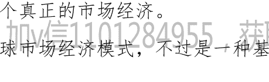
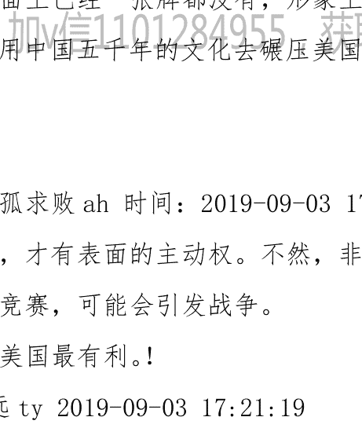
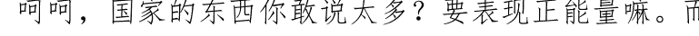
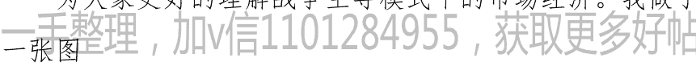
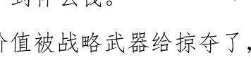
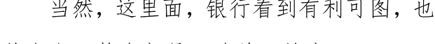
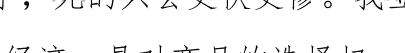
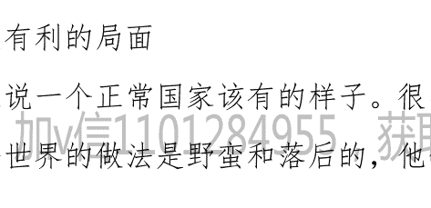

## 整个全球经济的怪现象

## 独孤求败 AH

我刚才看了一个视频，说中国人民二线城市平均收入 1000 美元而美国二线城市平均收入 4000 美元。

我由此想到了一个问题：为什么不同国家的人付出了可能相同的体力或者脑力劳动，付出了差多的能量？——但是却是相同？

于是，我想到了美国霸权。——想到了美国的航母和飞机。——我发现，——地球上没有真正的市场经济。——整个

现在的全球市场经济模式，不过是一种某种战争模式的附属品罢了。

这就就像是一个金字塔，在最上层的是高科技战斗武器，这部分东西是战略武器，你用多少钱都买不来的。

第二层是战略资源：比如石油、天然气、稀土、矿石，等等。还是基于战略武器制造和应用的需求产生的。

第三层才是正常的民用的市场需求。而这部分东西，比如各种生活用品、手机、电脑、等等，都是中下层。

而最底层，乃农业和轻工业等跟人类生活息相关的产业。

——这就是整个全球经济的怪现象。

战争模式主导了一切——而这造成了很多的不公平。就像我开头说了，中国人工作一个月却只有 1000 美元，而美国人工作一个月却有 4000 美元。——中国和美国人都很勤劳，所以付出的能量是差不多的。

但是结果却相差了整整四倍！

这是美国航母和飞机的效果。绝对不是什么市场经济的作用。

战争主导之下，没有真正的市场经济。

目前全球都被美国的主战行动带入了一种冷战思维，类似全球很多国家都开始翻历史旧账，比如日韩、印之间。美国而是想要好好的继续发展，获取更多好处。这是非常危险的。

中国文化尚和平。

回复楼
作者：孤独孤求 ah 时间：2019-09-03 16:50:51
能救世界的也只有中国啊。

回复楼
作者：孤独孤求 ah 时间：2019-09-03 16:54:04
所以，只有文化复兴战略，能够救中国，从深层层次来说，中国的 2025 年会爆发跟美国巨大的冲突，原因就是货币战争。

我研究了中国人民币国际化只有三条路可以走：

- 一：高科技。有高科技坐镇，人民币可以国际化。
- 三：人和，盟国。中国这方面这个时候十分的落后。美国有基督教文化作为输出。可是中国没有文化输出。中国软实力十分欠缺。而这也是中国能和平崛起的唯一道路。

我刚刚已经上国务院，希望国家可以重视印度的经济发展合作。北联美国，南联印度，稳定国际局势和发展经济的重要环节和战略。

一级回复：加v信1101284955，获取更多好帖
作者：独孤求求 时间：2019-09-03 16:59:29

中国在历史有很多场战争。
- 中日之间不用说了。
- 朝鲜战争，还能跟韩国有历史遗留问题。
- 其次是中印战争。
- 还有中越战争。
- 还有中俄战争。
- 日本，更多战争遗留，日俄、日中、日韩、和东南亚、日美。

美国的战争思维正把亚非洲大陆的各个国家带偏。一旦进入战争阴云和思维，这些历史遗留问题会全都翻起来，给每个大陆的经济发展蒙上阴云，从而停滞。

这一切只对美国野心家有益，而对中国这些崇尚和平的发展国家没有好处。因为整个亚非洲大陆是一个体，如果各心怀疑虑和愁怨，经济就不能良好发展。

所以，目前，对中国来说，急需改变中国的国际形象和发展软实力。

而我想最好的办法，就是恢复文化。重新把亚洲的儒家文化架构出来，增加亲近感。才能在德国获得领先亚非洲大陆再次发展。

一条路需要和平的支持。

所以，我们别无选择。从美国发动贸易端，陷入冷战思维和武力霸权的思想，这对中国是非常利的！必须警惕！

从地理来看，美洲只有南北，美国很弱，对中国周围有很多的国家。战争对中国的发展不利。如果中国周围动荡，首先被影响的就是周边环境。

回复楼
作者：孤独求败 ah 时间：2019-09-03 17:00:56
所以，中国几乎没有选择。必须用文化、软实力和和平。这是最好的选择。而发展高科技虽然是一条路，但是这条路必然引发战争。战争对美国最有利！

回复楼
作者：孤独求败 ah 时间：2019-09-03 17:02:49
所以，中国几乎没有选择。必须用文化、软实力和和平。这是最好的选择。而发展高科技虽然是一条路，但是这条路必然引发战争。战争对美国最有利！

回复楼
作者：江湖远 时间：2019-09-03 17:21
啧嘚

回复楼
作者：江湖远 时间：2019-09-03 17:21
顶楼
------------------------------------------------------------（此处省略重复回复）
心暖暖的，这几天都给美美的机器人给我整了
回复楼
作者：sdjsdsdj 时间：2019-09-03 22:49
顶楼
明白人，美国比我们懒，多多多的dollar dollar dollar

回复楼
作者：江湖远 时间：2019-09-03 17:21
顶楼
回复楼
作者：江湖远 时间：2019-09-03 17:21
顶楼
------------------------------------------------------------
嗯哒。不是懒，是想要钱。
回复楼
作者：游离临界 时间：2019-09-05 36:16
楼主教回复加信获取好帖
没看那么多的误论，其实根本原因就是生产效率率不同的。

举一个简单的例子：
- 美国一个家庭，可以种植1000公顷的土地。
- 中国一个家庭，只能种1公顷的土地。
按照秋收后，价格一样，美国农民的收入是中国农民收入的1000倍。这就是生产效率带来的收入差。当然了，生产效率下，有......

------------------------------------------------------------
首先美国的土地大部分是平原，所以利于机械化面积种植和管理。美国人口比较少，所以农业比较有余。

但是中国人口众多，山比较多，能面积耕种的土地不多，所以能机械化的也不多。人口多了，所以人均就少了。其实中国的粮食产量就是世界第一了，超过美国很多，但是还是不够吃。因为人口多，中国的杂交水稻是全世界最高的，也是科技领先的。但是这些还不是为了供应中国市场需求。

我觉得你说话不过大脑。简单的效率问题，不用跟联系的说？作为美你也比较高的了。表示尊重。这种洗白并没有什么用。美国的石油霸权都是明显的吧。你们别急，你们不死算我输。中美最后会和平，但是要付出代价，清除一些东西才可能

回复楼
作者：倒霉屋走人 时间：2019-09-04 12:48:25
中国人挺好斗的，以后啊倒也不会死美国人，毕竟家眷都过去安家做人了，就引导你心里去恨，那股子恨怎么发泄呢，又接不了美国？这，咱们还有很多乡里乡亲们吗，搞一搞呵。王家闺女长得俊似的，张家小楼盖的豪华，李家家里据说很豪哦，拿出来！像楼主这么爱国的，凭什么就没钱没老婆？王家闺女让我睡，李家家里大家，这十分合情合理啊！什么？不愿意？同志们，整除阶级敌人。大......

可呀，国家的东西你敢说太多？要表现能量嘛。而且中国反腐败败，成果也很显著。显著我们就来揭揭美国资本吸血，这样互相，他山之石。

虽然战争恐怕是不可避免的。但是世界总是以消灭不合时宜人为目的。是什么不合时宜的人？
1. 贵
2. 权贵

资本吸血，老板做乘法，工人农民做加法。掠夺剩余价值。权贵堕落、兼宰、贪腐，只要有权贵，贪腐就无法治。一样是掠夺利益，为了百姓。

全球的几次工业革命：
- 第一次：蒸汽的发明，代表英国。
- 二次：电力的发明，代表美国。
- 三次：信息化的集成，代表美国。
- 第四次：机械化的智能，代表人工智能，现在还没有出现，我们都在努力走到了第四次工业革命。机械化的智能设备，让人解放，让更多生活品等人类。

这些还不是为了供应中国市场需求。所以我觉得你说话不过大脑。简单的效率问题，不用跟联系的说？作为美你也比较高的了。表示尊重。

但是，战争对中国的发展不利。发展高科技虽然是一条路，但是这条路必然引发战争。战争对美国最有利！必须警惕！

所以，别无选择。从美国发动贸易端，陷入冷战思维和武力霸权的思想，这会让很多人下岗。实际上是一件好事，在资本国家看来，是坏事。

所以，中国几乎没有选择。必须用文化、软实力和和平。这是最好的选择。而发展高科技虽然是一条路，但是这条路必然引发战争。战争对美国最有利！

回复楼
作者：孤独求败 ah 时间：2019-09-03 17:00:56
从地理来看，美洲只有南北，美国很弱，对中国周围有很多的国家。战争对中国的发展不利。如果中国周围动荡，首先被影响的就是周边环境。

------------------------------------------------------------（此处省略大量重复回复内容）
这种感觉不错，这是因为中国大量的物价廉的供应。当然，这是中国持续得到美元。有一天霸权终结了，美国的大多数中产和低产就会恐怖。除非人都是道德君子，人都求付出。那是不可能的，人性就是自私的。违反人性的制度，必然无法长久。

------------------------------------------------------------
比资本论牛了，世界已经发展了这么多年，基础理论也在发展，我是站在巨人的肩膀上。不牛才怪了。

回复楼
作者：游离临界 时间：2019-09-05 13:58:41
整理，加v信1101284955，获取更多好帖。

------------------------------------------------------------
但是不可能人人都自私的。你同样是在妄想。跟我的一样。

------------------------------------------------------------
只能让它由。这部分是人的精神取向，艺术审美、个性化的表达、性格等领域。所以，这两者是完全可以融合出现的。

------------------------------------------------------------
我只要我的矛攻击我的盾。则第一矛成立，第一盾也成立。

你说“盾”

你说“矛”

你说：不知道。

我也说：那我也也不知道。因为这两样东西都是天下第一的，所以不知道。

天下第一矛和天下第一盾并非不存在，而是得看谁的手里！

欢迎德国总理默特克。

中国崛起，靠的是取很多好处

战争之王要跳下。对，就是那个叫潘森的那家伙。

下半场，我们以攻为守！

你们可以取搜一搜一个珍妮的美国女人，她预言美国将遭遇古罗马马匹的溃败

事实上，中国目前的很多科技发展思路是错误的。

中国总想在高科技领域超过美国。

特别是军工领域。

但是这不是打败美国的方法。

如果中国在高科技领域崛起，无可避免跟美国冲突。

正是要正视美国的综合国力，所以我们要三思而行。

跟美国发生大规模的冲突，特别是武力冲突。

这一点，只有文化兴国战略可以做到。

回复楼楼
作者:独独求败 ah 时间:2019-09-07 12:13:48

因为中国的高科技并不是像美国一样，以暴利为主的。

就算开发出了，中国也会像白菜一样的卖的。

这样就导致中国发力不好。

而中国国情又不是美国，不能走美国一样的资本路线。

所以，这条路最后是不行动的。

美国会阻拦。

而且很大程度上会爆发战争。

中国想要和平和响应应该，唯一的路是文化兴国战略。

非题:2019-09-07 10:54:23 评论

坐标山东东半岛。春天夭上苗，平时城里上班，秋天能收就收。租又租不出去，荒着又不像像，只能每年赔点钱继续循环三了了。

你这个情况其实很有代表性。

农业和工业，这一部分利润是随着生产力的发展越来越少的。

但是国家应该该把这一部分的农业集中起来生产，而不是归入市场。

农业和工业是不应该归入自由市场的。因为这部分东西利润只会越来越低。

最好的方式是国家统一管理，生产。

不然农业和轻工业退化。走的是西方同样的资本路线。这是最糟糕的。社会主义应该把农业和工业集中起来管理，从商业系统里面剔除。

只要是利润比较低的，能够过剩的，都应该这样实行，才能产生有利的局面。

我只是在说一个正常国家有的样子。很明显某些国家医力掠夺世界的做法是野蛮和落后的，他们注定走不到未来。

大家都理解战争主导模式下的市场经济。我做了整理，加微信获取更多好帖。其中，越往上的阶层，就越是胜利。因为是买不到的。如果你玩过网络游戏就知道了，一个高级武器，恐怕是你十多万钱都买不到的，因为战争模式下就是，而普通的毒药、其他东西则比较便宜。

而靠近武器的——比制造武器的各种材料，又是很贵的。是不是这样？

这就是战争主导的经济模式。一切战略武器靠靠。

## 农业和轻工业被压榨

第三层跟民生息相关的科技实业其实也处于被压榨范围。

只有上层战略武器跟战略武器相关的战略资源，才是最暴利的。

这种战争模式，会导致，市场不发达，或者市场被战略武器威慑而改变自由市场。

美国很明显就是航母和核武器影响世界的自由市场。这种模式是经济发展的最大敌人。

而中国是农耕文化和农耕文明。离不开传统的软实力加大。恢复传统文化是中国目前最好的牌路数。但是这一点也有难度。所以，目前来看，第二种最大的可能性。哎，没办法。

那将军很好明的了，为什么你的父亲很勤劳，但是却教会我：勤劳没有用，获取更多好贴挣不到什么钱。

因为勤劳的价值被战略武器给夺了，实际上就是美国。你处在社会的压迫底层，就算再努力，你也是亏本的。甚至越努力，就越亏损。付出生命的代价。换来的东西却不成正比。这就是资本压榨。其实是战争实力的压榨。

类似于街上保护费的，你，是被收了了很多保护费啦。而且这个收保护费的，基本上是自己派兄弟搞事情，然后后自己去演好人解决，给你收的，比如洗衣服是生化武器，所以可以侵略别的国家。或者军队就驻扎你国家，美其名为保护你，实际上，你一旦真的安全的，它就给你搞点事出来，这样才有钱收。

可是还有人觉得这样正常？有些人会觉得国内的房地产产的，但是其实根据我的方的研读和研究，中国的房地产还是美国的事。

因为中国之前是锚定美元发行人民币的。中国劫到了很多外汇，自然发行的人民币就多了，那么这些钱没有良好的投资项目，就直接去了房地产了。

最后国家看到房地产暴利，自然地价也是水涨。当然，这里面看到暴利，自然看到有利，也可以开放贷。所以基本上，整个都是一波的事。中国只有去美元化，才能真的获得中国的生活，而中国从发展起来，需要一个积累的过程，所以大概只能这样。至于其他问题，那一部分人的，现在也腐，主要的，主要的。

中国去美元化，必然要提高人民币地位，跟美国抗礼。我们的收入天差不齐。而人民币国际化实际上只有三条路：

- 第一条：高科技。如果一种产品只有中国有，那么人类必然会被接受
- 第二条：地利。如果一种资源只有中国产出，那么容易被接受。这一条是不太可行的。因为任何国家都需要战略储备。中国从90%降到了20%左右。所以基本上不能出口了。
- 三条：人和。中国目前可以作为一样。实际上就是实力的加持，要人和，不能没有输。中国五千年文明完全可以靠传统。

事实上，的衰落已经是一种必然。

如果它不搞事情，中国就会平起崛起。如果它搞事情，中国不是实力方面，还是经济方面都不差。而且还有优势。

在实力方面，中国的导弹估计美国人是hold不住的。美国人一厢情以为自己武力强，其实是因为中国的低调策略。

在经济方面，中国是制造业、大基建。美国是金融经济，美国政府欠了二十多万亿美元，如果再发动战争，百分金融危机，政府将垮台。而美国的金融救援将恢复回来，除非中国。

中国是中国世界上最大和最富裕的国家。wechat7095: 2019-09-20 19:00:01 评论

评论独狼求版哈: 为什么一定是贪污？八九十年代的倒错，2000年后的血污厂，05年后的妙房......发展过程总是崎岖的，毕竟中国一切二，而且人也是复杂的，善恶都有。哪个国家不是这样？

所以中国虽然有各种问题，还是走到了现在。虽然有些很好奇，特别是外国人，中国的体制这么落后为什么还能够走到今天这样的成就？

因为美国的体制也不先进多少啊。

美国的衰落已经是一种必然，不管它搞不搞事情。

如果它不搞事情，中国就会平起崛起。如果它搞事情，中国不是实力方面，还是经济方面都不差。而且还有优势。

在实力方面，中国的导弹估计美国人是hold不住的。美国人一厢情以为自己武力强，其实是因为中国的低调策略。

在经济方面，中国是制造业、大基建。美国是金融经济，美国政府欠了二十多万亿美元，如果再发动战争，百分金融危机，政府将垮台。而美国的金融救援将恢复回来，除非中国。

世界不需要战争，但是只要美国不改变，它必然会战争。只要美国低头，我就给ta一条活路。就这么简单。不必害怕，中国不是美国，野蛮掠夺，毫无人性，跑到伊拉克去强奸她们妇女，杀戮无辜的平民。我是仁慈的。但是你要捍正你们的位置，不然在中国前面，下场可能得不偿失。

事实上如果美国不回头，很可能会毁灭，我不是在笑。小日本在中国里喇的，看我怎么弄死的。我会用经济干涉美国，用武力干涉日本。你们看看。

美国霸权已经注定绕不开中国的关。

打中国？美国人赢过吗？朝鲜战争，他没赢。越南战争也没有赢。

中国兵器落后的情况都能打得那样，何武器不算落后的时候？

而且中国估计还有底牌没有翻出来。一旦翻出来，美国会吓尿了？

至少美国就没有氢弹！

何况中国周围还有一个美国死磕了几十年的俄罗斯，那么多俄罗斯战胜在舒利的战场上，我就不相信普京对美国人没有想法？

所以，就算美国吃尿了要钱不要命，打中国，也是失败的结局。搞不留尾跟都不保，被中国完毁。

所以，我是为美国留点面子，保护好它的滑稽的肠脑！美国动坏，死的只会更坏。我坐在这里证的真正的市场经济，是对市场的选择。而不是说，我没得吃，我只能给资本家打工，被剥削，被辱骂，降低人格，活的像象条狗，挣得还不多。这不是市场经济。

刚需里面是没有经济的，就算买卖卖要，也要吃吃饭生存。

资本的剥削是建立在对普通民众的刚需上的。

以此这种市场是虚假的虚假的市场。不是真正的市场经济。

真正的市场经济，是吃萝卜还是青菜的选择，是喜欢听邓紫棋的歌还是王力宏的歌。

你的生命是你的，公司的钱是老板的。

老板天生就是伟大的！

生命天生就是卑微的。

大部分人衣食都成问题，说什么自由市场经济，简直是狗屁！

那是薛血。也叫“剥削”！

~我刚看了一个视频，说中国人民二线城市平均收入1000美元，而美国二线城市平均收入4000美元。

我由此想到一个问题：为什么不同国家的人付出了可能相同的体力或者脑力劳动，付出了差不多的能量？但是得到的却不相同？

一个事实是：我想到了美国贵族。想到了美国的航母和战斗机。

~我发现，地球上没有真正的市场经济。整个星球没有一个真正的市场经济。

现在的全球市场经济模式，难道不是一种基于战争模式的附属品吗？

这就就像一个金字塔，在最上层是高科技军事武器，这部分东西是战略武器，你多少钱买不来的。

第二层是战略资源：比如石油、天然气、稀土、铀矿、铁矿石等等。还是基于战略武器制造和应用的需求产生的。

第三层才是正常的民用的市场需求。而这部分东西，比如各种生活用品、手机、电脑等等，全部都是中下层。

而最底层，乃是农业和轻工业等跟人类生活息息相关的产业。

——这就是整个全球经济的怪现象。

战争模式主导了一切——而这造成了很多不公平。就像我开头说了，中国人工作一个月只有1000美元，而美国人工作一个月却有4000美元。中国和美国人都很勤劳，所以付出的能量是差不多的。差整整四倍！

这是美国航母和战斗机的效果。绝对不是什么市场经济的作用。

战争主导之下，没有真正的市场经济。

由于如此，目前全球都被美国的主动行为带上了冷战思维，让全球很多国家都开始翻历史旧账，比如日韩之间，印巴之间。

而不是想要好好的继续发展经济。这是非常危险的。

中国文化尚和平。

回复楼
作者：独孤求败 ah 时间：2019-09-03 16:50:51
能解救世界的也就只有中国啊。

回复楼
作者：独孤求败 ah 时间：2019-09-03 16:54:05

所以，只有文化复兴战略，能够救中国。从深层次来说，中国的2025爆发跟美国巨大的冲突，原因就是货币战争。

我研究了中国人民币国际化只有三条路可以走：

- 一：高科技。有高科技坐镇，人民币可以国际化。
- 二：地理。比美国的石油战略，就是一种基于地利的货币战争。
- 三：人和，盟国。中国方面这时候十分的落后。美国有基督教作为输出，可是中国没有文化输出。中国软实力十分欠缺。

而这也是中国能和平崛起的唯一道路。

我刚才已经上言国务院，希望国家可以重视印度的经济发展合作。北联俄，南印度，是稳定国际局势和发展经济的重要环节和大策略。

回复楼
作者：孤独求败 ah 时间：2019-09-03 16:59:29
中国在历史有很多场战争。中日之间不用说了。其次是中印战争。还有中越战争。还有中俄战争。

日本，更多战争遗留，日俄、日中、日韩、以及东南亚、日美。

美国的战争思维正在把亚非洲大陆的各个国家带偏。一旦进入战争阴影和思维，这些历史遗留问题会全部翻起来，整个大陆的经济发展蒙上阴影，从而停滞。

这一切对美国野心家有益，对中国这些崇尚和平的发展国家没有好处。因为整个亚非洲是一个体，如果心中怀嫌虑和埋怨，经济就不能良好发展。

以前，对于中国来说，急需改变中国的国际形象和发展软实力。而我想最好的办法，就是恢复文化。重新把亚洲的儒家文化架构出来，增加亲近感。这样才能在俄罗斯的帮助下让非非洲大陆再次发展。

一带一路没有选择。从美国贸易战争开始，陷入冷战思维和武力制衡的思想渗透，中国周边国家的动荡明显。这对中国是非常不利的！必须警惕啊。

回复楼
作者：独孤求胜 ah 时间：2019-09-03 17:00:56
从地球地理形状来看，美洲只有南北美，南美很弱，对它没有影响，可是中国周边有很多的国家。

战争对中国的发展更不利。而美国对此是非常有利的。因为战争几乎烧不到它的家园，而中国周边如果动荡，首先被影响的就是中国周边的经济环境。

回复楼
作者：独孤求败 ah 时间：2019-09-03 17:02:49
所以，中国面对几乎别无选择，必须用软化、软实力去和平化周边国家。这是最好的选择。

一方面，加强软实力去和平化周边国家，这是最好的选择。虽然高科技的发展也是一条路，但是必然引发美国的巨大的不满。而中国表面上已经没有，形象上太亏了。必须文化化，用中国五千年的文化去碾压。战争对美国最有利。

我现在右手拿着天下第一矛，左手拿着天下第一盾。
你说：“让你的天下第一矛攻击你的天下第一盾，如何？”
我说：“那你觉得谁会赢？”
你说：“盾。”
我就努力表演，然后矛赢了。
你说：“矛。”
我就努力表演，然后盾赢了。
你说：“不知道。”
我也说：“那我也不知道。因为这两样东西都是天下第一的，所以不知道。”

天下第一矛和天下第一盾并非不存在，而是得看谁的手里！

欢迎德国总理默克尔。
中国崛起，就靠中德联合。而中德必然联合。

战争之王主要要要跳大。对，就是叫汤森的那家伙。下半场，我们以攻为守！

你们可以去搜一搜一个珍妮的美国女人，她预言美国要遭到古罗马马匹的失败。

事实上，中国目前的很多科技发展思路是错误的。中国总想在高科技领域超过美国，特别是军工领域。但是这并不是打美国的方法。如果中国在高科技领域崛起，无可避免与美国冲突。正是要正视美国的综合国力，所以我们要三思而行，不能跟美国发生大规模的冲突，特别是武力冲突。这一点，只有文化兴国策略可以做到。

作者：独孤求哈 时间：2019-09-07 12:13:48

因为中国的高科技并不是像美国一样，以暴利为主的。就算开发出来了，中国也会像白菜一样被卖。这样就导致中国力不从心。而中国却不是美国，不能走美国那样的资本路线。所以，这条最后是行不动的。美国会阻碍，而且很大程度上会爆发战争。中国想要崛起，唯一的路路是文化兴国策略。

回复：2019-09-07 10:54:23

坐标山东半岛。春种丢玉韭，平时城里上班，秋天能收就收。租米租不出去，荒着又不像话，只能每年赔点钱继续循环着三年了。这个情况其实非常有代表性。农业和工业，这一部分利润随着生产力的发展越来越少。

但是国家应该把这一部分的农业集中起来生产，而不是归入市场。农业和工业是不应该归入自由市场的。因为这部分东西的利润只会越来越低。最好的方式是国家统一管理生产。否则农业和轻工会退化。走西方同样的资本路线，这是最糟糕的。社会主义应该把农业和工业集中起来管理，从商业里面剥离。只要是利润较低的、产能过剩的，都应该这样做。这样才能产生有利的局面。

我只是在说一个正常国家有的样子。很明显某些国家如美国，很多国家以武掠夺世界的做法是野蛮和渗透的，他们注定走不到未来。为了大家更好地理解战争主导模式下的市场经济，我做了一图。其中，越往上的阶层，越就是暴利，因为是买不到。如果你玩过网络游戏就知道，一个高级武器恐怕是你多天挣钱都买不到的，因为战争模式下就是这样，而普通的药水、其他东西则比较便宜。而靠制造武器的——比如制造武器的各种材料，又是很贵的。是不是这样？这就是战争主导下的经济模式，一切向武器策略靠拢。

农业和轻工业业被压榨。第三层跟民生息息相关的科技实业其实处于被压榨的范围。只有上层战略武器跟战略武器相关的战略资源，才是最暴利的。这种战争模式会导致市场不发达，或者让战略武器胜利改变自由市场。美国很明显就是用航母和核武器影响世界的自由市场，这种模式是经济发展的最大的敌人。

而中国崛起，离不开传统文化和实力。可以说，传统文化是中国目前最好的牌。那张图说明了，为什么你很勤劳却没有什么钱。因为勤劳价值被战略武器给掉了。

这种层级逻辑：
- 第一层：战略武器及战略资源（最暴利）
- 第二层：民生相关的科技实业（被压榨）
- 第三层：农业和轻工业（最被压榨）

美国很明显就是用航母和核武器影响世界的自由市场。这种模式是经济发展的最大的敌人。而中国崛起，离不开传统文化和实力。可以说，传统文化是中国目前最好的牌。

人民币国际化实际上只有三路：
1. 高科技：如果一种产品只有中国才有，那么人民币必须被世界接受。
2. 地利：如果一种资源只有中国才有，那么人民币很容易被接受（比如稀土）。这条路可行，因为任何国家都需要战略储备，中国稀土已经从90%降到了20%左右。
3. 人：这是中国目前最可能的路。要人心，要有文化输出。中国有五千年的灿烂文明，不管是美食、影视剧、汉服、小说等等，都是巨大的商业价值。美国只有不到百年历史，他们的文化是二流的。中国完全可以依靠软实力碾压美国，做到不战而胜。

这条路才是中国最惠而不费的方法。而中国这些年刚刚露出一个头，就被美国正面给顶了，又是中兴又是华为。没办法，正是正面硬刚，其实不是好事。现在中国转了地下，无奈奈之。但是正面击没有东西赢，中国正面没有东西对抗美国。所以，文化就是最好的选择，可以惠而不费，不跟美国硬刚，软软就可以赢。水滴穿石，润物无声！和平崛起啊。

种种逆象表明，美国要完蛋了。今年多处发大水，肯定对粮食生产有影响；再加上中国今年被猪疫影响影响产量，将对老百姓的生活造成直接影响，要注意警惕美国用粮食问题做文章。不如中国，或者打乱中国从东南亚进口的渠道。虽然这种情况看似不太可能，美国也需要出口自身的农产品，但是很难完全信赖美国，必须警惕它钱不要命的可能。近期应该不动声做好粮食储备准备！

自愿的，所以不算强奸。

你活不去，他们不管！

最奇怪的是：公司有破产法。个人却没有。

你的生命是你的，公司的钱是老板的。

老板天生就是伟大的。

生命天生就是卑贱的。

大部分人温食都成问题，说什么自由市场经济，简直是狗屁！

那是谎言。也叫‘剥削’！

一手整理，加v信1101284955，获取更多好帖
