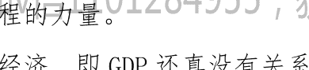
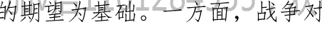
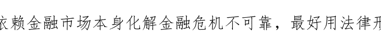
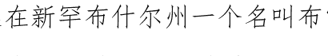
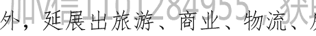
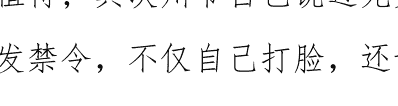
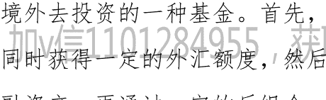

# 把握经济大势和个人财运必须懂钱

真立派

- 现代金钱的魔幻之力

## 引子

过去这些年，我都在学习钱，研究钱。除了想赚钱，更想懂得钱。一见10多年，现在终于有点学习感悟，慢慢写下来与大家分享。

钱与史俱来。几千年、几万年前，凡是有人类居住和活动的地方，就有钱。千万年来无钱的形态是什么？贝壳、羽毛、牛角，是金、银、铜、铁，还是现在印制精美的纸币。钱都是规划人命运趋势的线条吗？我希望写些关于永恒的主题。

中国西晋年代（公元266-316），有一个“视钱如儒士”的“隐士”曹彧（他是“隐居不住，人莫所知”，但竟然载入史书）。在《钱论》一文中，将钱左右命运生死的力量和神奇画得入骨三分：

“钱之为体，有乾坤之象，内则其方，外则其圆。其积如山，其流如川。动静有时，藏藏有节，井变易，不思耗耗。敛敛寿，不置象道，堪能长久，为世神宝”，“失之则贫弱，得之则富昌”，“钱之所在，危可使安，死可使活。钱之去去，贵可使贱，生可使杀……”

美国作家安·兰德将钱的神奇提升到了社会运行的层面。在1957年发行量仅次于圣经的小说《阿特拉斯耸肩》（Atlas Shrugged）中，她认定，“金钱是构成社会各种运行机制中最核心的主轴，整个社会政治、经济、军事、文化、艺术、历史等方面，实际上都围绕着金钱在运行”。

在兰德关于金钱是社会运行轴重心之说中，强调的是钱的“社会驱动力”，认为有史以来人类对于金钱（财富）的追求就是左右历史进程的主线。几乎所有的历史进程，历史进程背后的动力都是人们对财富的贪婪和不妥措的争夺。

正是千万年来金钱左右，甚至个人命运的历史和奇异怪坏，我们对于弥如烟海的金钱的若。但对于我认识，我们有着太多的误读和浅薄。最大的误会是将决定个人命运的钱和影响经济运行进程的“一视同仁”，沦为一谈，结果虚妄万言，但是可以夸其异。正是这些误读、误，尤其是对经济运行中金钱基础的动态与与之相同的金左右经济进程作用的盲目，造成了对经济大势的误判，失去个人财富开拓和积累的良机。

现代金钱的发生和发展无情颠覆了经济运行和财富创造的历史，重新开启了一个全新的经济形态和创造财富之路。正在这个意义上，读懂至少不要误读现代的金钱，不仅可以理解为何许多现代经济学理论和规律被实现颠覆，了解真正的《你不可不知道的经济学识》必须，更重要的是“懂才能赚钱”，免被那些高高地奉养在学院的殿堂之上，《宏观经济学》、《微观经济学》引领规划人生，安排日常生计，投资未来的歧途。

显然，想要指点江山，把握社会经济进程的大势，懂得现代的钱更是敲门砖。

现在让我开始来说钱。

作者:真立派 日期:2020-01-24 16:48

## 一、钱只是钱

在浩瀚如海的《货币起源》的书籍中，文中，对于钱的来历和功能有详尽的讲述，无须重复。我只想强调的是在1760年工业革命的千万种，钱是什么形式，钱都仅仅是，可不是交换的媒介，而是财富的标签，其他的货币功能都基本不到。

有人声称“世界是金钱世界”，自从古开天地，钱就可以左右经济的进程，书写历史传奇，却是言其其实。

美国哈佛大学历史经济学教授尼尔·弗莱格森在其流广的著作《金钱崛起》(The Ascent of Money)，曾列举了诸金钱和金融的历史传奇，还由此断言“（世界）每一重大历史现象背后都隐藏着货币与金融秘密”：

- 文艺复兴标志着艺术与建筑市场的繁荣，原因在于意大利商业银行采用了东方数学，即阿拉伯数字；
- 荷兰王国的崛起，奥斯基在衰落的哈斯堡帝国基础上成立的首家现代股票市场的成功；
- 法国大革命是格兰西杀人犯操纵的股票市场泡沫而引发的间接结果；
- 法兰西第一帝国的覆灭，可以说罗斯柴尔德与威灵顿公爵金融合作在滑卢中打败了拿仑；
- 阿根廷由于货币和金融方面犯了错误，使得19世纪80年代大有富的国家沦为20世纪80年代处处充斥通货膨胀而匮机的国家……

但仔细观察一下，他的例子基本上都是工业革命后的事。在那之前，钱不是交换媒介，财富象征，基本上王王朝没有左右经济进程的力量，获取更多许多和王朝的起源，即GDP或许没有关系。极具讽刺的史其实是，吹金钱所能获所处的时代西方，竟然是中国历史上最短命的王朝，不到50年，成为中国历史上第一个被外族消灭的王朝。

在论及货币起源时，诸将将其归结于“剩余产品增加”，“市场繁荣”，但在工业革命之前，这样的判断不准确。钱的发生，在巨大的程度上是同“互通有无”的交换相关，而不是社会剩余产品追逐价值实现，因为在工业革命

前的千万年，人类社会的经济形态是“生存经济”。

生存经济基本的特征是满足人类生存需要的产品“供给匮乏”，从整个社会而言没有或极少剩余产品。

在生存型社会中，绝大多数社会成员的奋斗目标是生存，是为了获得满足生存需求的产品，主要是食品，衣物，住房。生存型社会生产的目的是维持简单生产，包括劳动力的再生产。由于剩余有限，生产自给自足，社会规模微不足，交换主要是互通有无和少数富豪为了满足生存需求和“奢侈需求”进行的。“生存经济”的形成是没有增长的经济。

美元，同 1900 年相比翻了 8 倍

1700 年，在世界上几乎所有国家，农业是国民经济的主导产业，农业的产值占 GDP 的份额大部分超过 90%，等到 2017 年，世界农业产值对国民经济总量的贡献平均不到 15%，在许多工业化国家，这个比例小于 5%，像中国这种转型经济国家，农业占国民经济的份额不到 8%。作为人类生存所需食品和衣着的生产农业，在经济中落入这种微不足道的地境，在很大程度上反映了人类的丰足。

# 19 楼

作者:直立涟 日期:2020-01-29 10:15

工业革命启动的生产力爆发，打破了人类生存的困局，也创造了许多剩余产品的不断增加。然而，农业革命并没有带来水涨船高的全民平均收入提升，不同人对剩余产品的占并不均等，换句话说，不是每个人都在同一艘船上，产均平均在工业革命大下的“财富”盛衰，“二八定律”总是使剩余产品向少数人手里集中，剩余产品以不同的规模和方式被不同所有人所有，并以货币的方式储藏。

与此同时，工业革命在创造领域辉煌的时刻，更铺开了未来潜在的、更大的生产剩余产品的机会。为了生产更多的商品，需要购买新的技术，开办新的工厂，建设新的道路，……而这需要钱。随着工业革命的纵深发展，促进了生产能力提高的新技术和生产方式创造了日益增加的对渴求。

# 20 楼

作者：真立派 日期:2020-01-29 12:03:54

@越越越越替补 2020-01-29 11:58:43

删了啊？那就回复简单的。

楼主，如果“生存经济”是你的首创，你足以因为这个首创而骄傲了，因为在“生存经济”的目光下审视这个世界，这个世界将完全是另外一个样子。

> “生存经济”不是我的首创，而是一个千年一直存在的历史事实，我感受到的钱是在这种经济环境下只是钱而已。

# 24 楼 

作者：真立派 日期:2020-01-29 13:55:00

工业革命在创造史之前的社会生产方式和增长的同时，也给钱创造了全新的功能：钱可以转化为满足资金需求的资本。从此，钱不再是“交换媒介”，“价值计量”和“财富储蓄”与人类生存的周期中起舞的金钱，财富，而可以转化为资本，通过投资获得“资本收益”，演绎“钱能生钱”的奇迹。

钱可以转化为可以为“生钱”的资本，赋予钱全新的功能，钱不再只是商品的索取，财富的代言人，而是可以增值的资本。但钱向资本转化并不是自然的水到渠成。

工业革命带来的生产力爆发，创造了巨大的剩余产品，但刚步入生存经济的人们，面对爆发的剩余产品大多手足无措，不知如何是。据史载，1780 年之后工业革命源地英国人的收入迅速增加，尤其是企业家的利润暴增，按平均，伦敦人均收入是消费支出的 4 倍，大量的钱（剩余产品）沉淀下来，1800 年伦敦的“闲钱”达到将近 600 万。当时英国的人均收入约 6 英镑，伦敦人口约 100 万，人均“闲钱”是一年的收入。

有门道的人，将闲钱用于投资，回报让人惊艳。典型的例子就是“麦莱尔与肯尼迪棉纺厂”的创立和发展历程。

詹姆斯·麦莱尔和约翰·肯尼迪？肯尼迪出生于英格兰高地地区的贫穷农民，到英格兰的苏格兰纺织厂学机械工程遂为生。在掌握了纺织技术后，塞尔福德提供资本，合伙的麦莱尔与肯尼迪在 1791 年初在曼彻斯特开设了一家生产“梭骏精纺”的作坊，同时兼营棉纺业。合伙企业终止后，1795 年麦、两人凑成 1769 英镑 13 先令半的初始资本，成立了“麦莱尔与肯尼迪棉纺厂”，但仅 6 年就成为英国最大的棉纱精纺企业，其资产总额达到近 9 万英镑，比他们最初的投资翻了近 50 倍。

# 27 楼

作者：真立彦 日期:2020-01-29 16:50

正是如此巨大的资本供给基础和资本回报潜力，让当时英国的有效投资率和储蓄率从约占国民收入的 5% 提高到 12%。正是社会上规模和空间日益扩大的资金供给和需求，呼出现货体现的剩余产品向资本的华丽转身更加有效和便捷的方式。于是，金融应运而生。

钱（货币）与生俱，货币不是“金融。“金融”是根据英文词“FINANCE”的中文意思，由中国的“金”与“融”组成。金，指的是黄金；融，最早将固体变成液体，是融通的意思。所以，金融简单的意思是以黄金为基础来实现价值交易和资金融。

一味处理，加微信 1101284955，获取更多好帖

作者：真立彦 日期:2020-01-29 18:09

@越教越曾替 2020-01-29 13:55:06

生存经济，这一词的使用，能将人的注意力一下吸引到社会的最根本问题，并能因此理解这种经济状态下的社会成本本质和人际关系特点，并且不易被那些歪门邪道所蛊惑。

既然如此，我就要不让注册“生存经济”的第一定义权利。

作者：真立派 日期：2020-01-29 20:35

@越越越优替补 2020-01-29 13:55:06

生存经济，这一词的使用，能将人的注意力一下吸引到社会的最根本问题上，并因此理解这种经济状态的社会成本本质和人际关系特点，并且不易被一些邪门歪道所盘惑。

@真立派 2020-01-29 18:09

生存经济，这一词的使用，能将人的注意力一下吸引到社会的最根本问题上，并因此理解这种经济状态的社会成本本质和人际关系特点，并且不易被一些邪门歪道所盘惑。

既然如此，我就要不让注册“生存经济”的第一定义权利。

@越越越优替补 2020-01-29 13:55:06

生存经济，这一词的使用，能将人的注意力一下吸引到社会的最根本问题上，并因此理解这种经济状态的社会成本本质和人际关系特点，并且不易被一些邪门歪道所盘惑。

@真立派 2020-01-29 18:09

生存经济，这一词的使用，能将人的注意力一下吸引到社会的最根本问题上，并因此理解这种经济状态的社会成本本质和人际关系特点，并且不易被一些邪门歪道所盘惑。

既然如此，我就要不让注册“生存经济”的第一定义权利。

@越越越优替补 2020-01-29 13:55:06

生存经济，这一词的使用，能将人的注意力一下吸引到社会的最根本问题上，并因此理解这种经济状态的社会成本本质和人际关系特点，并且不易被一些邪门歪道所盘惑。

既然如此，我就要不让注册“生存经济”的第一定义权利。

# 1 楼 

作者：真立派 日期：2020-01-30 09:43

在人类发展的漫长过程中，“金融和货币”是个避不开的要素。在绝大多数时期，在漫长的经济中，基本上是。世界上最早的“金融”可以追溯到：

- 公元前 2000 年：巴比伦寺庙就已经管理金银、发放贷款。

在绝大多数时期，在漫长的经济中，基本上是。世界上最早的“金融”可以追溯到：公元前 1000 年
- 公元前 500 年：雅典
- 公元前 400 年：罗马帝国

都可以找到原始的雏形。作为世界上最发达国家，中国的金融更是。

在人类发展的漫长过程中，出现了：
- 宋代：开展了“飞钱”
- 唐代：出现了的“质库”
- 宋代：设置的“钱”
- 元代：注册的“金融”
- 明代：发行的“钱庄”
- 清代：发行的“号”

都是从事金融业务的。然而，不过是以钱为中心，工业革命的扩张。

在人类发展的漫长过程中，出现了：
- 宋代：注册的“金融”
- 明代：发行的“钱”

这种日益强大，规模优势、业务多样化。的资金聚集起来，高效的金融的。

这种扩张的扩张的，随着工业革命的，演绎了“金钱”和“财富”几乎毫无相关。加微信 101284955，获取更多好帖

# 32 楼 

作者：直立添 日期：2021-02-30 09:59

金融的成长是随着工业革命兴起的，最初也是最基本的。功能是货币将钱（剩余产品）转化为资本，进行跨时间和跨空间的配置。在此基础上建立的金融体系，作为主体，利用自己庞大的资本基础，将资金集中起来，高效，稳定长期的资本，通过投资等方式，在全社会实现利润最大化。

# 3 楼 

作者：朱立彦 日期:2020-01-30 16:43

尼尔·弗格森（Niall Ferguson）在《货币兴起：世界史》（THE ASCENT OF MONEY A FINANCIAL HISTORY OF THE WORLD）详细描述了与工业革命同行，互动的“金融创新”。随着金融体系的建立和成长，银行使得借贷便利，以标准货币为基础的账户系统和转账，使得越来越多的商业交易不需要现金，只需要银行在交易双方进行支出和收入。中央银行的建立，对商业银行实行保证了“部分准备金”，为金融体系的健康，尤其是银行提供了保障；随着金融体系的建立和成长，金融市场以股市和债券为主崛起，这不仅体现了金融创新，更是构建了金融市场最广阔的平台。

作者：直立彦 日期:2020-01-30 17:00

股票，可能是工业革命最基础的伟大的创新。它创造了一种资本供给和需求直接联姻的方式，作为股份公司发行给投资者的所有权的证明，它让投资者（货币的所有者）直接成为公司的所有者，并获得股东发展红利的资格，不仅开启了投资的“直通车”，还以“无限未来”的诱惑大大刺激了投资。由于股票的开放，这更宽了资本的来源。鉴于股份公司发行的股票代表股东对企业拥有一个基本单位的所有权，主要是拥有的公司所有权份额，可以在一定程度上优于公司的管理和经营，通过更换管理人员，影响公司的经营和发展。与此同时，股票也一步将公司的经营与投资者的利益紧密联系起。也是金融创新的成果，本质上是为资本获得固定收益和资金需求者打开方便门。债券是借贷的凭据，是一种发行者（政府，企业和金融机构）以固定回报（利息）为条件与投资者形成债务关系的证明，投资者有权在到期日按先前的约定收回本金利息。投资者购买了公司股票，成为公司股东，有权参与公司的经营管理，也承担公司经营的盈利和亏损，而债券只产生当事人间的借贷关系，与毫无瓜葛。从风险和收益的角度看，债券风险低收益也低，股票风险高但收益可能很高（只是可能的，不是必然）。同时，股票是公司发行的，而债券是政府和公司都可以发行。

所有这些金融创新，核心都在于跨时空实现资本的利润最大化的配置。

# 36 楼

作者：真立派 日期：2020-01-30 23:27

@王淼波 2020-01-30 17:41:33

学习了，对钱有了更深的认识！

首先是货币不能超越，尤其在农业社会，超发的货币没有生产价值，只能把整个社会搞乱。

农业企业使命进入了新的高速发展的时代，生产为效率大幅提高。随着社会经济体系的发展，钱不仅仅是交易等价物，也变成了一种资源。股票、银行使拥有这种资源的人能参与到更广泛的经济活动中。

是这个理。我可能会更深入一些。

# 38 楼

作者：真立派 日期：2020-01-31 09:17

金融和金融创新为钱开拓了生财之道，同时也推动了社会的生产力加速增长。对于 18 世纪以来工业革命的快速扩张很大程度上归功于 17 世纪以来金融创新，尤其是货币和银行业的发展，金融史学家尚未定论。但毫无疑问，金融的发展和创新是工业革命能够创造奇迹、不断推进和扩张的催化剂。虽然工业革命的纺织品和加工并未严重依赖金融，在欧洲各国的扩张过程中，金融具有重要的作用。

作为世界上最发达国家，中国的金融更是：
- 18 世纪初：英国
- 18 世纪中期：英国
- 18 世纪 70 代：英国
- 19 世纪：英国
- 19 世纪：英国
- 20 世纪：英国

在欧洲范围内建立金融机构后，提供资金给各国
- 公元前 2000 年：巴比伦
- 公元前 1000 年：希腊
- 公元前 500 年：雅典
- 公元前 400 年：罗马帝国
- 唐代：中国
- 宋代：中国
- 宋代：中国
- 元代：中国
- 明代：中国
- 清代：中国

这种扩张的扩张的，随着工业的。

# 40 楼 

作者：真立派 日期：2020-01-31 12:30

工业革命带来的财富爆炸，通过金融市场转化为大量资本，驱动了工业革命。随着工业革命的浪潮，工业对资本的需求越来越大。钢铁、煤矿、铁路……这需要钱。随着工业革命的纵深发展，促进了生产能力提高。工业的。然而，这一时期的金融有两个最基本的特征：

# 42 楼 

作者：吴立派 日期：2020-01-31 15:29

第一章 金融是资本的核心

在人类发展的漫长过程中，金融和货币是个避不开的要素。在绝大多数时期，在漫长的经济中，基本上是。世界上最早的“金融”可以追溯到：

- 公元前 2000 年：巴比伦
- 公元前 1000 年：希腊
- 公元前 500 年：雅典
- 公元前 400 年：罗马帝国

- 唐代：中国
- 宋代：中国
- 宋代：中国
- 元代：中国
- 明代：中国
- 清代：中国

这种扩张的扩张的，随着工业的。然而，这一时期的金融有两个最基本的特征：

1907 年，美国金融市场遭遇严重的资金缺乏而濒临崩溃，当时不在美国的 J.P. Morgan 得后匆忙赶回，他先向市场注入了自己的资金以解燃眉之急，之后他在私人的图书馆召集了其他银行和金融机构的大亨们，劝说他们承诺并保证市场流动性。在他主导下，美国避免了一场金融劫和和经济危机。处理，加微信 1101284955，获取更多好帖

# 46 楼 

作者：真立派 日期:2020-02-01 11:16

武汉这次真的玩大了，昨日美国股市暴跌 2%，市值消失近 1 万亿美元，神经病川又下令“封锁中国” - 过去 14 天所有到达中国的外国人禁止入境，所有从中国到美国人的隔离 14 天。

# 47 楼 

作者：真立派 日期:2020-02-01 12:12

这些金融大鳄在社会经济和政府的运行中举足轻重，甚至在经济和金融危机中可以力挽苍生，凸显了工业革命进程中金融支配世界运行的作用，以致《华尔街日报》这样评价摩根家族：“上帝在公元前 4000 年创造了世界，摩根在 1901 年重组了这个世界。”而 J.P. 摩根本人也大言不肯定：用以推动历史不是法律，而是金钱，金钱！

然而，在工业革命的过程中金融依然依赖于实体经济。

丽皇后，作为政府与法国作战的军费开销。

100多年以后，1844年，英国国内由首相罗伯斯尔主持并通过了一个银行特许条例，即《英格兰银行特许条例》，赋予英格兰银行发行货币的垄断，但银行私有制机构的地位毫无改变，其作为政府特许的“政府资金管理机构”的功能依然如此。

而工业革命兴起的新兴大国，美国在1913年以前不存在中央银行这样的机构，因为法律不许政府贷款金融，成立中美国的小银行试图成立中央银行。自美国独立战争胜利后，联邦政府也多次尝试建立中央银行，但在1814年失败了，因为国会和总统担心银行独自运作，或被少数利益集团控制而未能履行承诺。

美国的第一任财政部长亚历山大·哈密尔顿（10美元纸币上的那个叔）努力，于1791年成功建立了美国第一银行。尽管第一银行不是为主要美国财政部服务的银行，负责帮助美国各州发行债券，以逐步偿还独立战争时期积累的债务，帮助保管财政部的存款和处理其他联邦政府财务上的收支，但国会只批准第一银行经营20年。

1811年，第一银行的20年经营期限到了之后，美国国会没有批准它继续存在。1812年，英美再起战争冲突，由于缺乏一个有效的中央银行系统和全国统一的金融市场，美国州内银行陷入混乱。为了恢复银行秩序和处理战争债务，1816由美国国会投票通过，麦迪总统签署法案成立了美国第二银行。和第一银行类似，第二银行也是一个全国性的私有商业银行，国会也只给第二银行颁了20年执照。

### 纸币的采用和美元

纸币是当今世界各国普遍使用的货币形式，最早使用纸币的国家是中国，时间约在公元九世纪，甚至更早的公元前春秋战国时期，是由国家发行的强制使用的纸币，并成为最通用的货币形式，却是随着工业革命的发生和发展。工业革命带来的社会分工、生产力不断突破，让交换成为经济运行的核心，没有实现产品价值的交换，各业的再生产不能继续进行。随着工业革命卷席全球，交换的规模和频率不断扩张，传统的金属货币大量携带运输，交割清算的成本越来越高，不能满足发展对交换的需求。由国家出门担保的“纸币”应而生。

1661年瑞典银行发行了首次在欧洲使用的纸币；1694年，英国政府支持下英格兰银行创立，开始发行英镑；1775年美国独立战争爆发后，美国大陆会议开始发行纸币，称为美元，几经波折和反复，1792年颁布的美国法律《币币法》，对美元采用了金银复本制，奠定了现代意义上的美元。目前世界上共有多种纸币，流通于世界193个独立国家和其他地区。

纸币的出现和广泛流通，只是简单的货币形式的改变，在各种货币本位下，纸币之所以所有价值，因为它是商品代理。正是如此，纸币为社会和大众接受，成为交换的价值单位或价值尺度，成为财富的象征，历史上没有商品基础的纸币最终和金融泡沫殊归同归，烟消云散。便是“世界货币”的美元，也无例外。

美国从1775年爆发独立战争，为了筹措战争资金，美国国家（美国大陆会议）发行了200万美元的纸质信用币。这种纸币没有任何资产的支持，基本上是以美国国会来收税的期望为基础。一方面对美元的价值有着许多不确定性，另一方面，为了支付军费，国会不得不不断印制纸币，在此后的后的5年中，总发行超过2亿亿美元。美元迅速贬值，最终几乎一文不值。鉴于仅以“信用”作为纸币不可靠的根源。

1788年美国宪法，规定明确禁止“将金币和银币以外的任何东西作为债务偿还的凭证”。

之后美元的发行都是遵从宪法以金币作为指标的基础，在1791年美国财政部属下的美国造币厂制造的联邦硬币，替代独立战争时期发行的纸币之后，直到1861年纸币才卷土重来。1913年的《联邦储备法》建立了联邦储备系统，并赋予了发行美联储票据（即纸币）。但是，法案是明确要求联储发行纸币以其黄金储备为基础。这实际上就是众所周知的“金本位制”。

在人类发展的长河中，科学发现，技术创新，艺术同样一样，纸币属于发明，它们都是人类想象力的产物。在国家权威的支持下，纸币作为一项惊人的创新，重塑了社会经济运行的方式。尤其是纸币成为社会普遍接受的“中介”，成为所有人支付单据、购买商品、获得报酬的基本方式。尽管其神奇，依然依靠一张印刷的纸币具有兑换权，却是源于人们对政府的信任。换句话，是政府保证了纸币与商品的兑换。这更界定了政府干预经济的潜在能力。

## 一、 背景

由于商业冲突，第二银行成立后遭遇各州强烈反对。反对者们抹黑第二银行，认为只帮助东部发达地区的商人和富豪，为落后人口多数的农民。安德鲁·杰克逊胜出，1833年杰克逊履行了自己的承诺，把财政部的存款全部转移到州银行，这在动摇了第二银行的基础上。结果1836年，第二银行没有得到新执照，重蹈第一银行覆辙。之后的70多年，随着工业革命深入发展，资本在经济中的作用开始左右经济进程。与此同时，生产过剩和金融泡沫引发了金融市场溃潮。美国在1873年、1884年、1890年、1893年、1907年都发生过危机造成银行倒闭。尤其是1907年的金融危机，火灾是市场上一些投机者试图贷款给这些投机者的银行和信托投资公司损失惨重。1907年10月，纽约三大信托投资公司宣布破产，引发了一场海啸。存款者人人自危，银行间失去信任，相互的借贷完全冻结，很快蔓延到全国各地。如果不是金融大亨注入流动性，美国体系将面临灭顶之灾。

1907年的金融危机结束后，美国参议员尼尔艾森·奥尔德里奇组织了一个委员会，调查金融危机的成因以及教训，认为金融市场本身化解危机不可靠，最好法律形式赋予某个机构稳定金融市场的职能，应对危机。在考虑欧洲国家的中央银行，对欧美金融市场进行了系统的比较分析后，提出了名为“奥尔德里计划”，美国应该模仿欧洲国家成立一个统一的中央银行。以后发生类似1907年的金融危机时，该中央银行可以向被掠夺的银行提供紧急贷款，以此稳定金融市场信心。但“奥尔德里计划”由于会议多数成员的强烈反对而遭遇，直到威尔逊于1912年当选美国总统后，建立中央银行的设想才得以“死灰复燃”。威尔逊总统认为“奥尔德里计划”整体框架有价值，认真修改后实施，将对美国金融业和金融市场的发展和稳定助力。因此，在威尔逊总统下，参议员欧文和格拉斯以“奥尔德里计划”为蓝本，在1913年起草了《联邦储备法案》并最终在国会通过，正式宣告美联中央银行 - 美联储成立。

美联储基本上可以认为是“官商合营”，由12个私营但非营利的地区联邦储备银行和属于美国联邦政府的联邦储备局组成，这种设置的初衷是要确保美联储在制定货币政策时同时兼顾政府和私营部门的意愿，同时避免货币政策完全集中在联邦政府手里。美联储由七名委员组成，其成员由美国总统提名，作为美国的中央银行，美联储从美国国会获得权利。

但一旦美联储组织起来，它作为独立的银行，其决定和决策无需获得美国总统或者立法机关的批准。

### 第一章 背景

当初，作为政府建立的中央银行，美联储负责制定货币政策和发行货币，其职责也是维护金融稳定的作用。也许我们认为是强大的，在很一段时间间无声无息。即便是1920年代的大萧条中，也不见美联储枯竭。严格来说，大萧条之初，除了成长的因素外，美联储做出了错误，恶化了经济环境，将经济推向了萧条。

遵循“金本位制”也是主要的原因。按照金本位制，国家以黄金作为储备，以此为基础发行货币，这种管理基本上是一种市场自动运作的结果，不需要可靠的主观判断。美联储决策者做的主要是保护美元优势，金本位制的束缚下，世界上许多国家的中央银行也比美联储强势，甚至更弱。工业革命带来了生产力的巨大飞跃，终结了人类历史，创造了不断增加的剩余产品，这为金钱和金融搭建起广阔平台。钱的功能是让钱变得魔幻。然而，尽管通过金融转化为资本，钱的过程离不开实体经济。这样，无论钱有多魔幻，钱都离不开实体经济，实体经济运行的过程 - 转化为资本，只是钱。一个根本原因是工业革命进程中，钱是有价值的商品，钱的本质是商品。商品必须生产，因此钱不能离开经济。同时，工业革命带来了生产力的爆发，剩余产品，由于财富分配和占有的“二八定律”，在工业革命推进的多年里，社会中仍然少人需要为生计奔波，所以，钱依然具有生存作用。

三。钱成为可以凭空创造的“信用”。千万年来，用什么当钱？形式贝壳、羽毛、牛羊、金属都当过钱，最后由政府控制印刷精美不易仿造的纸币接受，发行，流通，成为社会大众接受的钱。但不管钱的形式如何变化，钱这个本质没有任何改变。正如诺贝尔经济学奖得主米尔·弗里德曼所说，“从远直到1971年，每种主要货币都直接或间接地与商品联系。”联系分离的事情也出现过，但通常都是在危机时期。正是这个1971年，钱被全额颠覆了。由于肯尼迪不断扩大社会福利支出，尤其是美国长期陷入越战泥潭，尼克松面临巨大的财政赤字（1970年尼克松政府财政赤字达500亿美元，约占当年GDP的5%），同时面临通货膨胀的压力，当时零售价格指数达到6.3%。因此，如何化解赤字和通胀是这次会议的主题。会议对于政府应该如何决策，参与会议的高官们各持异见，激烈争论，如新任财政部长康纳利提出了在美国废除金本制的建议。

尼克松发动“金融政变”。

康纳利是律师出身，毕业于德克萨斯大学，参加过二战，在肯尼迪政府担任副总统。他于1961年2月离开肯尼迪政府，作为民主党的候选人赢得竞选，从1963年至1969连任德克萨斯州长，当时是一名很好的政治家。康纳利不是经济学家，而是政治家的直觉。他废除金本制的理由充分且简单：政府需要美元，美国财政部不能发行美元和黄金挂钩。由于布雷森会议建立的国际货币体系，美元成为基础。布雷森会议反对废除金本制，但最终尼克松采纳了康纳利的建议，在布雷森会议上发布了“震撼世界”的讲话：“美元是我们的货币，但是你们的问题”。

尼克松首先提出增加就业，控制通胀和保护美元免受国际投资者的攻击。“尼克松冲击”的讲话就是：美国单方面宣告了由44个国家代表在布什顿会议上建立的国际货币基金体系的终结，宣告了金（此处应为金）本位（金本位）货币的终结，推翻了现行的金融制度和规则。所以，本质上是尼克松发动的“金融政变”，推翻了1944年由世界大多数国家认同并实施的国际金融制度。

1944年7月，来自世界44个国家的730位金融政策制定者和顾问，聚集在圣布鲁埃斯州一个叫布雷森森林的古老小镇，目的是寻求一个可以避免历史上发生的战争和毁灭性经济危机的金融框架，确保全球经济共同体的合作。来自美国、加拿大、西欧、澳洲、日本，还有苏联等国的财政首脑，官员和顾问们齐聚在一起，进行了三周时间的讨论，最终确定了货币管理的框架并监管了商业和金融的各种规则，因为协议是在布雷森森林签署的。在三周的会议中，美国代表团的成员亨利·怀特基本上充当了“操盘手”的角色。30岁才上大学，但后来竟然拿下了哈佛大学的经济学学位，论文获得哈佛经济学奖，怀特等曾闭响。作为美国财政部的首脑，国际经济学家，他起草了美国版的“布雷森森林”协议和规划了布雷森森林机构（国际货币基金组织IMF和世界银行）蓝图，与凯恩斯领导的英国方案抗衡，并最终胜出。

具有商品的属性。货币（广泛采用的纸币）所以“有价值”仅仅是因为发行它们的政府说它们“值钱”。纸币的“价值”也是政府说了，算是有乔治·华盛顿摄像头1美元，但印上本·富兰克林比美元值钱100倍（100美元），完全同纸币印刷本身无关，而是美国财政部说了。

显露了货币的商品基础，尼克松拉开了以信用作为货币基础的新经济——信用经济的大幕。在这个意义上，说尼克松是现代信用经济的缔造者，一点都不分。

## 79楼
作者：真立派 日2020-02-08 10:31

“钱”不再是货币 - 王田11101284955 - 获取邮件好处
尼克松发动的金融变政，废除了金本位，表面上看并没有改变货币，也没有重新发行货币，纸币还是纸币，美元钞票还是原来的模样，大小都没有改变。然而，细细探究，尼克松金融变政，从根本上改变了钱本质，钱的基础，钱的功能，用语言来说，这就是以后的钱和生存经济，工业时代带来的钱完全不是一回事。

传统的金属货币本身是商品，需要生产，因此具有价值的商品。当钱的基础被废除，由政府垄断，强制发行的纸币就是钱，钱不是商品，印刷成本很低，可以说“一钱不值”，之所以以“值钱”是由于民众相信政府，而政府说它“值钱”。所以政府的信用成了钱的基础。

## 88 楼
作者:真立派 日期:2020-02-08 10:34

钱不再以商品为基础，仅仅是信任，而信任不可量化，甚至充满了主观和个体的心理判断，这样，基于信用的钱就没有了锚，也不再是一个定数。而不能用来界定的钱，规模就可以向无穷。说白一点，就是以信用为基础的钱可以凭空创造，可以无中生有，哲学上说“如事物可以无中生有，这样的事务存在无限多个，且无时刻不在产生”。

现代经济中钱是经济的血脉，又可以转化为资本，引导社会经济运行，对于主权国家政府的信任赋予政府发行货币的权利，事实上赋予了政府和政府货币当局（中央银行）操控经济，指货币的“幻之力”因为可以凭空创造，无中生有，货币发行当局的幻之力就有无大的特性。

## 89 楼
作者:真立派 日期:2020-02-08 10:39

钱从商品变为信用，是对钱的最根本的颠覆，从根本上改变了钱的来源，钱的规模，钱的性质，也改变了货币的传统功能。

以金银或以银为基础的钱，作为流通手段，不仅在国内流动，也可在国际上流动。但钱成为“主权国家信用”后，就只能在主权国家内流动。钱的流通手段彻底废了；

以金银或以金银为本位的钱作为价值尺度，是因为钱（金银）本身有价值，所以可以衡量有价值的商品，并确定商品的价值是多少。当钱币体现的只是信用，信用自身不是无价值或价值不能确定，因此，货币“价值尺度”这一职能价值不再由商品价值客观界定，而是政府说了算。钱的客观价值尺度不存在了；

钱之所以是财富，因为钱本身是商品，值钱，当钱转化为信用，储蓄钱财富不是同一件事了。尤其是“主国家信用”可以一夜间就成了废纸，贬值近万倍，这又如何谈钱有“储蓄职能”。钱的储蓄功能风险巨大。

## 90 楼
作者：真立派 日期：2020-02-08 11:46

以商品为基础的钱，被用“信用”替代，那些商品为基础的钱的古代货币理论，自然而然成为陈词滥调，不再对社会经济和个人赚钱有何学指导意义。

## 91 楼
作者：真立派 日期：2020-02-08 11:52

小结

尼克松发动的金融政变，废除了金本位，从根本上改变了钱本质，钱的基础，钱的功能。钱不再是值钱的商品，而成为“主权国家政府”的信用，信用没有商品基础，可以凭空创造，无中生有，进而改变了社会经济的命运，个人的“钱途”。

## 92 楼 
作者:真立派 日期:2020-02-09 10:09

@sliverhawkwp 2020-02-08 21:38:48 继续顶

## 感谢支持

## 94 楼 
作者：真立派 日期：2020-02-09 11:19

尼克松金融变局为何成功？

尼克松突然发动金融变局，在美国国内大受欢迎，美国股市遭遇纳斯达克指数暴跌4%，但很快遭到国际社会，包括欧洲和日本等国家主要经济实体的反对。反对的理由很简单，一方面是尼克松擅断背叛盟友，另一方面是《布雷顿森林协议》建立以来国际金融体系相对稳定，必然带来巨大的混乱。作为回应，十国集团（G10）签订了一个《布雷顿森林协议》，这个协定配合美元贬值（美元兑换黄金值100%），试图维持《布雷顿森林协议》以美元为中心，黄金为基础。1971年，可惜很快就短命。

从1973年2月开始，美元面临日益大的贬值压力，美元相对黄金价一路下跌到每盎司44，迫使各国先后放弃《布雷顿森林协议》，采用浮动汇率制。十国集团（G10）实施了一项策略，要求成员国将其货币绑在一起，共同对美元浮动，宣告了布雷顿森林体系和固定汇率制度的彻底失败。随后，各国陷入无锚化之路。

## 95 楼
作者：真立派 日期:2022-02-09 12:33

严格地说，尼克松引发的金融变革真的不是他的创新。用信用替代商品，早期苏联就被玩耍了，后来法国皇帝也因为玩耍而崩溃。约翰·劳（John Law），他在领域引入了法币，恶意炒作，制造出“密西泡沫”。这些王朝和政府统帅，无论如何英明，玩弄信用货币的手段如何高，但最终失败而告终，导致王朝衰落，个人崩溃。

许多并不看这场变革的结局，甚至其认为是昙花一现，无疑是后人的后尘。然而，金融变革至今已快半个世纪，遍及全球，且不断创造了一些国家经济繁荣。但现在，当下，尼克松金融政变认为是成功的。前人为何失败？

## 96
作者：真立派 日期：2020-02-10 00:24

插画一：故事 - 金融创新天才约翰劳(John Law)

所有历史记载都证明，没有什么能够跟那个时代法国人的放荡、一意胡闹和穷奢奢侈相比。回忆起1719年的巴黎，希普金写道：“那时约翰·出现了，贪得无厌、纸醉金迷、听天由命。”然而，另一个声音则这么看，孟德斯写道：“约翰·更多爱他的思想，而不是爱钱。”有人称他是十大骗子之一和居心险恶的阴谋家，有人称他是最优秀的金融家和天才。但丹庸认为的一点是，他所建立的金融体系，使法国国内落入无可遏制的贪婪潮，并最终走向泡沫的冰点。

1671年，约翰·劳出生于苏格兰首府爱丁的一个富裕人家。他的父亲是一个银行家。作为家中的长子，满14岁的约翰·劳在父亲的会计事务所在做了3年学徒。17岁那时，他未因父亲去世而感到悲伤。他带着一大笔遗产来到伦敦，

为了伦敦各家赌场中的常客。他用一种周边的数学计算，成为赌场上的常胜将军。

不过，在伦敦9年的浪荡生涯，对约翰·劳来说也总不是一帆风顺。他招惹了一位威尔的情敌，两人约定决斗。约翰·劳不幸地——或者说幸运地——杀死了对方，他被过失杀人而入狱。在一个神秘友人的帮助下，他得以越狱逃脱。最新的研究揭示，此帮助他的神秘人士，竟然是“鲁迅漂流记”的作者——留福士。巧妙的是，有了留福的帮助，约翰·劳得以在海外漂流了14年之久。他一方面成为了一名技术精湛的赌徒，在欧洲各大赌场里声名显赫；另一方面对于欧洲各国的经济形势、金融体制和货币是美国都不如指南。好运，在这个时候，约翰·劳得的疯狂更多。

在法国宫廷里，约翰看到了处于困境中的摄政王和奥尔良公爵。当时法国政府外债高筑，税收不抵支，只能选择铸币，将货币的金属含量减到原来的1/5，从而迅速货币贬值。与此同时，巴黎塞满了以非法为名捕获的商人。但法国政府以铸劣币和强征税款获得的1.8亿法朗，不到一年又销霍殆尽。当时法国政府的信用一落千丈，以政府发行的国债，市场价格只有21.5法朗，比起今天的垃圾债券还要差，信用接近破产。

海绵里再也挤不出水了。此时，约翰·劳带着他的疯狂念头，站在了绝望边缘的摄政王面前。这个念头就是发行纸币代替货币和金币。在约翰·劳的《货币与贸易》中，他主张增加货币供给，从而增加就业机会。货币扩张，能够吸引外部资源，进一步增加国民产出。国民产出增加后，对货币的需求也会相应跟上来，而使得货币需求在更高的水平上维持均衡。为了发行和管理新货币，需要建立一家银行，并以这些税收和政府掌握的不动收入作为基础。这套理论完全平常。

## 99 楼
作者:真立派 日期:2020-02-10

插画2：金融创新天才约翰劳(John Law)

（此处内容与前文重复或错乱，已按逻辑整合）

（前文）……十国集团（G10）…………宣告了布雷顿森林体系和固定汇率制度的彻底失败。随后，各国陷入无锚化之路。

## 95 楼 
作者：真立派 日期:2022-02-09 12:33

严格地说，尼克松引发的金融变革真的不是他的创新。用信用替代商品，早期苏联就被玩耍了，后来法国皇帝也因为玩耍而崩溃。约翰·劳（John Law），他在领域引入了法币，恶意炒作，制造出“密西泡沫”。这些王朝和政府统帅，无论如何英明，玩弄信用货币的手段如何高，但最终失败而告终，导致王朝衰落，个人崩溃。

## 96
作者：真立派 日期：2020-02-10 00:24

插画一：故事 - 金融创新天才约翰劳(John Law)

（前文）……然而，另一个声音则这么看，孟德斯写道：“约翰·劳更多爱他的思想，而不是爱金钱。”有人称他是十大骗子之一和居心险恶的阴谋家，有人称他是最优秀的金融家和天才。但丹庸认为的一点是，他所建立的金融体系，使法国国内落入无可遏制的贪婪潮，并最终走向泡沫的冰点。

1671年，约翰·劳出生于苏格兰首府爱丁的一个富裕人家。他的父亲是一个银行家。作为家中的长子，满14岁的约翰·劳在父亲的会计事务所在做了3年学徒。17岁那时，他未因父亲去世而感到悲伤。他带着一大笔遗产来到伦敦……

（前文）……约翰·劳不幸地——或者说幸运地——杀死了对方，他被过失杀人而入狱。在一个神秘友人的帮助下，他得以越狱逃脱。最新的研究揭示，此帮助他的神秘人士，竟然是“鲁迅漂流记”的作者——留福士。

这就是著名的“征兵骗局”。他们把巴黎所有的流浪汉征入伍，由政府提供衣服和工具，一批批弃船送往美洲，去一个新发现的大金矿上干。流浪汉们日复一日地肩铁锄，从巴黎街头招徕，队列直奔港口，让百姓们以为他们真的去了美洲。很多人认为密西比公司又有了财源，股票也已稳定。实际上，这些流浪汉只是被分散到法国各地，不久后卖掉工具回国，不到三个星期，一些人就重新回到了巴黎。

纸币自然包不住火的，一旦截票，人们对纸币、密西比公司和约翰·劳的信心完全崩溃了。股票和纸币急贬值。当时的巴黎会议长曾告诉国王，他要一百万法朗的银币获取南方殖民地，他也不接受500万法朗的纸币。彻底破产。银行没有足够的银币来兑纸币，纸币几乎完全成了废纸。

1721年11月会议下宣布，纸币不再具有价值。

约翰·劳陷入了极端的绝望，只能躲往尼斯。他的财产很快被充填补了“他个人造成的损失”。然而，人们发现，这位传闻富可国的金融家，居然家产不超过 5000 英镑。他并没有置办任何金银器皿或珠宝首饰，只是购买了一些房产。所以当约翰离法国时，几乎一文钱。

1729 年，当约翰·劳在威尼斯去世时，晚景凄凉异常。人们为他写下这样的墓志：“一个著名的苏格兰人长眠在此，他的算术天才举世无双，他用简单的代数法则，把法国弄得病入膏肓。”然而假如公正地回首那个年代，这位因危机而命运垂青的金融巨头，在法国人的贪婪中获得了一切，也失去了一切。他对于纸币、股权和金融体系的设想，在今天依然神益——或者警醒着随时在贪念中迷失每一个人。

约翰·劳是个金融创新天才，只是生不逢时而已。插曲故事完，下面是正文。

根据我的探讨，主要原因有 3 点。
第一是最基本的原因：世界主要经济体在经历 300 多年工业革命带来的高速发展之后，先进入“丰裕社会”，这是数学证明中的“必要条件”；

第二和第三个原因，算是“充分条件”。第二是 1970 年初期兴起的全球浪潮，而第三是各国中央银行/政府通过不断实践，经历各种危机和繁荣，在运用“货币政策”调节金融和社会经济近乎火炼纯的境地。

虽然可能有罗宾之嫌，但真正领悟肯尼麦开启的“信用经济”，有必要对这3个原因之一简要地探讨。

## 第一，富裕社会

“富裕社会”是20世纪伟大的美国经济学家约翰·布莱德（John Galbraith）提出的。这位经历过二战，做过罗斯福和肯尼迪总统经济顾问，当过联储物价局长，美国驻印度大使的哈佛大学教授，在其1958年发表的《富裕社会》（The Affluent Society）——一书阐述了工业革命百年发展，尤其是经过二战之后几十年的高速经济增长，美国已进入一个“富裕社会”的时代。

但是，英国经济学家亚列山德并不赞同，他提出的正确的“富裕社会”，应该定义为“在价格为零时对需求的充分满足，同时，任何通货达标的人都不会感到不满足或追求更多的东西”。就是说只有当社会中商品没有人要时，才可以称为“富裕”。他的定义是完全符合经济理论的，但按此定义，“富裕”是不可能出现的，因为在商品经济中，价格为零，商品供给也是零。更不用“千人千面”，喜好各相同。

然而，如果只是看着现实世界中奇姿百态，几乎所有的实物——用于社会生产和生活消费的商品，尤其是满足人类基本需求的商品，如食品、衣物等等，工业革命以来，尤其是过去百年生产力大飞跃创造的满足人类实物需求的供给的“丰裕”却不容否认。

消费品，尤其是维持生存的消费品的“丰裕”在发达国家和新兴经济体无处不在，表现在很多方面，下面列举几个主要的：

### 一 生产过剩

工业革命引发的人类生产力大爆发，终结了人类的生存中千年徘徊的恶性循环，但是生产能力的飞猛进，竟给人类带来了“危机”——“生产过剩”。

撇开“生产过剩”的政治解读，所谓“生产过剩”就是生产了太多的产品卖不完，经济学界定为“供给不足”。而追求利润的资本需要通过销售产品来实现价值，一旦产品不出去，厂商就没有利润，甚至导致破产。极具讽刺的是，“生产过剩”也危及生活，甚至生存，而且可能是全球性的经济。

自从1637 年荷兰郁热引发金融危机以来，几百年中世界范围内各类大小的危机此起彼伏，其中全球性的是2008 年次贷危机。各种危机的惨烈程度不同，但危机的根源大多出自生产过剩。对此马克思解读：“危机本质上是一种现象，是资本主义生产相对于需求的过剩是有规律地每隔若干年爆发一次，并且波及的范围越远，影响的程度越深，危机的周期也越短；危机使生产过剩的基本矛盾得到性解决，生产和消费得到暂时恢复，为新的增长奠定基础，直到下一次危机爆发。”撇开收入分配的不公，造成相对过剩，从生产的角度看，生产过剩是生产了大部分超过消费能力的商品，太多的不能消费的结果。

### 二 广告

“广告”词源自拉丁，就是“大喊引人注意”的意思。据传古罗马商人做生意时，常人在街头大喊大叫，鼓动行人购买商品。但是真正的广告却是随着工业革命发展起来的，如传递商品信息，塑造商家产品形象，创建商品品牌……但无论如何表述，广告的目的是刺激消费，广告的作用就是刺激剂。主流经济学对于广告的作用有两个基本点：一是可供消费的选择范围和商品种类越多越好；二是消费越多，“效用”越多。通过广告刺激消费，提高社会消费量，就是名正言顺。然而，最近兴起的“行为经济学”发现，由于绝大多数消费者并不是主流理论假设的“理性人”，广告尤其是那些对人们非理性的弱点精准投放的广告，可能吸引人们一时冲动，或贪图便宜，或攀比，或炫耀，去购买需要的商品。无论“广告造成不要消费”，还是“广告进消费者的效用”，广告的制作与投放是为了消费者买更多的商品。

随着通讯技术的迅速发展，在当今社会已经是无不在，无处不在。现在的数字广告让广告有针对地满足消费者“需求”不择手段，所谓的“个性化”广告“推送”一直将广告送到消费者的屏幕、电子邮箱……而广告也成为全球多个国家经济的“支柱产业”。

2018年全球广告支出将近7500亿美元，超过全球国内产值的1%。其中世界上最大的消费国美国，其广告支出近3000亿美元，将近全球广告支出的40%。相对于工业革命初期的广告支出，现在是那时期的千倍万倍，因为当时的广告支出不到一亿美元。广告的形式越来越多，而异军突起的自称用“人工智能”制作的“个性化”数字广告，成为广告的“主体”，在2018年的总广告支出中占很大。商品要广告来推销，消费要广告来刺激，这不仅反映了“生存经济”的崩溃，也昭示了工业革命以来随着生产力的突飞猛进，满足人类需求的社会商品的“极大丰富”。

插话：今天美东时间上午，美联储鲍威尔在国会“受审”。密西根州州议员问他，为何中央银行拒绝购买地方政府的债券（拒绝借钱）给地方政府，而任由地方政府破产。鲍威尔说（1）这是财政问题而非金融问题；（2）没有先例。但议员反驳说，美联储有支持地方政府的规定，应该设法解决这个问题，而不能只为大银行服务，要为“人民服务”，因为地方政府破产后，依靠地方政府的退休人员，退休金为零。中国目前地方政府债务如山，到时中国中央银行会袖手旁观吗？

### 三 与奢侈品异曲同工的是“天天廉价”。低价是一种定价策略，商品供应商通过提供较低的价格来刺激产品销量和获取市场份额。“天天廉价”将低价策略发挥淋漓尽致，直到造成出名的“消费陷阱”。根据经济学，非性的消费者在购物决策时，不是只看着商品的“效用”（比如买衣服可以避寒，买电视可以丰富文化生活等），还要购买过程的满足（体验）——基本上是生活白话“买得高兴”。低价就是针对非性的消费这样的心理，让消费者因为“高兴”而购买，而“高兴”却是“便宜”“划算”激发的。由于“高兴”影响消费者购买决策，因为“高兴”而购买的商品并不满足“效用”所需。最好的例子就是我们积累了藏室、车库中堆积了因为“高兴”买来的但从未使用的商品。

同“低价”捆绑的销售还有“批发”，诸如“买一送一”、“俱乐部制”之类。商家以“薄利多销”牟利，“批发”就成了廉价的案件，商品的单位从一包增加到小10包、20包，从一包增加到一筐……商家看着是销量，对于“批发”能否充分消费并不在意。社会绝大多数人都面临对消费增加有更大的影响，“低价”的市场将扩大，“低价”的诱惑更加充分。然而，无论都是“天天廉价”，目的一样：刺激社会消费。刺激社会消费只有在物质商品极大丰富的“丰裕社会”才会发生。

### 四 服务繁荣

在刺激社会消费的同时，新地扩张，以消费“体验”而不是消费为基础。根据世贸组织（WTO）关于服务的分类，现代服务包括九大类：商业服务、电信服务、建筑服务、教育服务、金融服务、旅游服务、文化服务、体育服务。按照服务的对象，服务又分为三大类：生产性服务、生活性服务和公益性服务。归结底，服务业在所有国家迅速崛起，产业结构从农业到工业，再到服务业演变是经济发展的必然趋势。同时，服务结构从生产性服务变为商业、运输、信息、咨询、餐饮等。现代服务有两个明显的特征：之一是不生产（不直接生产），二是满足基本需求（能吃能喝），三是“体验”。在短短十年中，服务业在很多国家成为经济的主体。2018年，全球平均服务业增加值对GDP的贡献高于50%，如高收入国家，服务业在GDP中所占超过70%，中低收入国家服务业仍在50%左右，但其增长率令人惊喜。

### 五 需求饱和

饱和原本是一个物理现象，说是在一定温度下，在一定量中，当某种达到一定程度后就不再增长，即便价格下降，需求量也不增加，就之为需求饱和。市场饱和在经济学中的运用，主要是需求增长微小，当供给达到一定程度后就饱和，这在各国经济发展中并不罕见。在全世界大多数国家，按照热量衡量的食品消费趋于饱和。进一步证实了现有生产力水平满足人类需求的商品极大丰富。根据联合国粮农组织的分析，2018年世界人类热量消费为2900千卡，比50年前的2360千卡增加了22%。对此马克思解读：“危机本质上是一种现象，是资本主义生产相对于需求的过剩是有规律地每隔若干年爆发一次……”如果不包括中国（占世界人口20%），中国在过去50年内人均热量消费翻了番，50年的增长率不到10%。更重要的是，在过去20年消费没有明显的增长，发达国家和新兴经济体的热量消费也趋同。从具体国家和具体食品消费来看，饱和趋势也很明显。比起美国，在经历了1960年代肉类消费高速增长之后，人均肉消费量在1971年达到170磅/年，但在2010-2018间消费量几乎相同。同期，人均谷物的消费几乎持平。中国人均食品消费量的变化也不例外。在1995-2018年间，人均谷物没有明显变化，而肉类的消费在1980-2010年间迅速增长后，过去几年不再增加，还略有减少。

对于“饱和”的另一个证明，是供给潜力，在工业供给上表现尤为突出。经过近十猛扩张，中国已经成为世界最大的工业生产和供应国，在大多数的产品中，中国仅靠“一己之力”可以生产全世界需求的商品。2017年为例，世界手机总产量是15亿，中国总产10亿部，占全球产量的65%；世界彩电总产量是1.9亿台，中国总产1.2亿台，占全球产量的62%；世界空调总产量1.38亿台，中国总产1.1亿台，占全球总量的80%；世界冰箱总产量1亿台，中国总产7000万台，占全球总量的70%……

中国产量接近和超过世界需求50%的还有所有纺织品，各类家电、各类计算机、鞋、数码相机、微波炉，甚至船舶、钢材、水泥等。就生产能力而言，鉴于中国大的生产过剩，生产满足世界100%的这些商品完全没有问题。贸易壁垒和市场竞争这些使得生产能力之外的因素，限制了这种可能。

斯洛的“自我实现”需求。这样，钱通引发富裕社会就不会发生生存竞争，而只要有“新的需求”被创造出来，钱不是个问题。大概也是如此，富裕社会凭创造信用不会造成生存经济因钱滥引发恶性通胀。

虽然我们不断面对个别满足基本商品的价格暴涨，但一些是市场恶作剧，如“禁运”，或是短暂的供给短缺，如猪肉价格上涨，这些都是昙花一现，不能改变丰裕社会对信用创造“麻痹”的现实。

在富裕社会，凭创造出来的钱不会用于满足生存的商品，钱引发生存竞争，虽然尼克松走上了起，必然和约翰·劳用用信用创造商品货币的路，但同路不同，没有身体裂，发展为了“美名誉”，获取更多贴子。

## 第二，平坦的世界

信用经济的开展，全球也同样如此。

21 世纪，被誉为“走向大师”的《纽约时报》资深记者、专栏作家托马斯·弗里德曼出版了一本风靡全球，征世界精英和政要的《全球通论》。作者以自己亲身经历和观点所闻，阐述了“世界是平坦的”的故事。

作为那个时期在美国阿斯彭小镇举办的被誉为美国的达拉斯论坛的“思想节”，上风最猛的演讲达人，弗里德曼是个传奇。

由阿斯彭学会和“大西洋刊”共同主办的“思想节”，是全球各行各业顶尖精英的聚会。在这个到处是美景、美食和精品店的小镇，科学家、艺术家、政客、学者和企业界人士在几天的时间里以放松和个人化的方式进行密集的脑力激，相互激发灵感，寻求火花。

作为这个“思想节”的贵客弗里德曼每到一处，你都会有人拦住他说没完，前来交谈的名流、精英、超级富豪川流不息。说他以前成为“专家”，得益于他足迹遍及全球对世界的亲身体验，更是因为他有本事把错综复杂的世界事务归纳成简洁巧妙的词语。口能能辩的趣味和简单易懂的选择题，他总说，他的《世界是平坦的》书不仅服了大批知识精英、企业家，还有全球的政治家。

### 《世界是平坦的》精装版的销量很快就会超过百万册。

比单纯的数字更重要的是是谁在买这本书？州长和国会议员们……大学纷纷把这书推荐给行政管理人员和新生。它也成了商界人士的必读之书。在书中，弗里德曼带着读者从美国出发，跨越太平洋到班加罗尔的印度铁谷，再奔于中国东部的大连……以其生生的妙笔让人去感受科技进步与社会交往的融合中“世界正被推平”。

通过个人游历、观察、体验和交往，弗里德曼讲述了“全球化”的“来龙去脉”，描述了全球化推平世界的十大动力：
- 计算机的运用和创新时代的到来；
- 互联网时代的开启；
- 电子文字处理的应用和供应链的发展；
- 网络社区的发展；
- 垄断经营；
- 供应链管理；
- 快速和物流管理；
- 网络信息搜索；
- 数字化和迁移为生活的组成部分等。

他所提出，同历史上的全球化不同，推平世界的全球3.0版本不仅在它自己的范围内缩小和和平化了整个世界，关键的是让人在全球平台上搭建平台和开展合作创造了前所未良机。机不可失，时不再来，当今世界的竞技场已经被荒为平地，把握全球化的机会参与全球知识型工作的竞争是挑战。

一句话，全球化为每个人搭建展现自我的平台，地域空间不再是机会的天花板，到处都是发展的机会。

均衡远比弗里德曼描述的“平坦世界”要深、神秘，也复杂很多，更让个人可以在平坦世界上随心所欲地展现恣意的情意，但全球化的开展却是实实在为跨国垄断资本无限扩张的平台，重新定义了生产和市场，通过资本和技术的自由流动，创造了现存技术条件下生产成本最低的供给链，基本上消除了“成本拉动的通货膨胀”的基础，让富裕社会锦上添花。

纵人类千年，世界都是一部信息史，信息传递方式的演进共同了社会发展和进化的历程，也激发了生产力的飞跃和随之来的财富爆炸。1970年代的信息革命的发端，开启了人类历史上更具财富增长的生产力源。这个场所完全改变了人类信息传递的方式，突破了信息传递的时空壁垒，创造了一个全新的资源配置方式：在全球平台上，不受传递的时空边界的约束，使资本、技术、劳动力可以在生产率最高、成本最低的空间中实现了最优。结果，无论全球化有利于资本，但资本流向商品种类更多，成本更低，让富裕社会更加富裕，锦上添花。

## 小结

- 全球化创造了一个全新的资源配置方式，极大提高了生产力。
- 跨国垄断资本无限扩张的平台重新定义了生产和市场，通过资本和技术的自由流动，
- 创造了现存技术条件下生产成本最低的供给链，基本上消除了“成本拉动的通货膨胀”的基础，
- 让富裕社会锦上添花。
- 纵人类千年，世界都是一部信息史，信息传递方式的演进共同了社会发展和进化的历程，也激发了生产力的飞跃和随之来的财富爆炸。
- 1970年代的信息革命的发端，开启了人类历史上更具财富增长的生产力源。
- 这个场所完全改变了人类信息传递的方式，突破了信息传递的时空壁垒，创造了一个全新的资源配置方式。
- 在全球平台上，不受传递的时空边界的约束，使资本、技术、劳动力可以在生产率最高、成本最低的空间中实现了最优。
- 结果，无论全球化有利于资本，但资本流向商品种类更多，成本更低，让富裕社会更加富裕，锦上添花。
- 全球化创造了一个全新的资源配置方式，极大提高了生产力。
- 跨国垄断资本无限扩张的平台重新定义了生产和市场。
- 社会总需求不足，只靠调整供给来减少生产过剩不能化解危机，反而会加速危机的进程，因为减少生产导致的关闭工厂和解雇，将社会总需求进一步下降。
- 全球化，地域空间不再是机会的天花板，到处都是发展的机会。

## 第一章

建立在“个人自由”上的经济体制，必然要求自由市场经济，排斥国家干预经济。在理论上“看不见的手”资源配置，市场组织和市场交换过程中，是最有效的调节机制。但是这种自由市场支配经济运作，要求所有市场参与者的理性的、自私的实现利益最大化，即生产者取得利润最大。然而，绝大多数市场参与者不能满足“理性”的要求，人性的“贪婪”、“恐惧”和“跟风随流”等非理性的行为，决定了市场参与者“各自利益最大”不能实现。相反，自由市场中非理性行为为创造和助长许多经济和金融泡沫。1637年一种郁香可以价值阿姆斯特丹河边的一幢豪宅，超过荷兰人的平均收入的50倍；而1920末以生产过剩引发的经济大萧，几乎摧毁了欧美国家近50%的经济总量。

20世纪伟大的经济学家凯恩斯，在1920年工业革命以来最大危机时，为政府干预市场提供了理直气壮的理由。凯恩斯认为社会生产和就业的水平决定了总需求的水平，工业革命带来的生产力爆发，总需求不足是市场失衡的根源。因此，只靠调整供给来减少生产过剩不能化解危机，反而会加速危机的进程，因为减少生产导致的关闭工厂和解雇，将社会总需求进一步下降。增加总需求需要政府干预，通过政府的财政政策和货币政策来刺激消费和投资，正是越来越大的周期性危机呼唤政府上位，通过政府政策预防和化解危机。

但是政府采用货币政策调控经济的很长时期是“无所作为”，手段简单，就是公开市场操作。历史原因在于，国家没有“中央银行”，即便有“中央银行”，也是“公私合营”的。比如现在如今，1955年之前美国属于“公私合营”，“中央银行”还不是独立的决策机构。根本的原因在于中央银行在信用创造中必须遵循“金本位制”——国家以黄金作为储备，以此为基础发行货币，货币管理基本上是一种市场“自动”运行的结果。

当然，货币理论也是促成均衡的因素。著名的是“货币数量公式”，说是在货币流通速度不变的情况下，任何货币发行必然引发通货胀。
- 弗里德曼直言：通货胀是货币现象，即货币发行就会造成通货胀。
- 犹如紧箍咒，即便中央银行在“理性预期”之下，人们对货币政策都有预料，所以不可以当局玩实施。

多年后，尤其是尼克松金金融变之后，美联储中货币政策逐渐开始了它的大展脚。首先是中央银行货币政策的手段日益化，除了传统的利率、准备金等，各种向金融市场注资的手段，如国债市场直接购买，甚至引入公司，让人目花缭乱；更重要的是中央银行大气恢，无论信贷需求多大，都不会输。中央银行运用货币政策在应对2008年次贷危机引发的全球金融危机中展现得淋漓尽致。

2008全球金融危机的规模和烈度远大于1930年代的“大萧条”，几个西方国家甚至陷入主权违约、政府破产的境地。然而，一场百年不遇、席卷全球的金融危机，在全球范围内经济体合力，在一个之内被化解了，而且由于此开启了世界历史上持续最长的、没有衰退的经济繁荣周期和股市的牛市。在这之前，世界主要经济体发生的大大小小的经济、金融危机，都在中央银行的干预下花了一朵。这充分显示了中央银行应对危机屡无胜的。

当然，中国40年经济发展虽非常，但毫无衰调，中国经济没有“按时衰退”，反而一路高潮不停。内涵充沛，几乎无一包的“中国特色”，中国经济可以演进超越惊人想象的神话，而这个“中国特色”包含了政府运用各种货币政策工具调控经济的丰成就，更是政府熟练运用货币政策的范例。

自从美国前总统比尔·克林顿（Bill Clinton）1992年竞选总统，詹姆斯·卡维尔（James Carville）提出竞选策略，说服大众在总统选举时要看总统管理经济的能力，“看经济”成为美国历届总统选举的标准。这促成了大多数国家的行政当局费尽心思去探索货币政策创新。

政府的货币政策，尤其是尼克松金融变之后，逐渐成为政府干预经济的最基本的工具。更重要的是，这些工具为政府在经济发展和增长中大展脚，甚至可以力挽狂澜、扭转乾坤的手段，让政府成为社会经济运动过程中一个绕不开的关键节点，没有这个节点，整个经济运转难以以为。

政府在经济发展中日益明显的作用宣告自由放任经济终结，开启政府干预经济的历史新篇章。那个曾经需要金融资本救助才免于破产，才能进行战争看守的政府，无需对大资本低俯眉，已经在经济进程中成为支撑均衡的，“一级产业”不仅是扬眉吐气，而且有可能按照自己的意愿去书写自己的历史。

## 什么是信用经济?

我们所说的“信用经济”，简单的定义是“以政府为货币基础的经济”。信用在这里有两个含义：
- 一是“钱”，
- 二是对政府的信任。

印刷的纸说是钱，钱值多少都是政府说了。
- “信则有，不信则无”，
- “凭空生有”，其规模无疑扩大的趋势。因此，当信用成为货币的唯一基础，事实上赋予了政府和政府当局（中央银行）凭空生有的权力，让货币发行当局依照自己的意志，随心所欲创造货币。在这个意义上，我们可以说，信用经济是以政府为中心的经济，政府可以通过凭空创造信用，来体现政府政治、社会和经济意志的使用和分配。

中央银行操控的经济有两种主要形式：
- 特色国家政府通过属下的中央银行直接参与和管理经济；
- 资本主义国家与金融资本合谋经济运行。

无论政府直接参与或是操控，信用经济宣告了自由市场经济的终结。在一些国家是“计划经济”的强势回归。体现形式和运行方式不同的计划经济，早已已经在大行其道，只是太多的人将信用经济中的计划经济混为一谈。太所谓的专家、学者迷恋“自由经济”，不过刻舟求剑而已。

治理其实很直观，当政府当局可以通过创造信用按照自己的意愿和目标配置资源，看不见的手就变成了看得的手，所以自由经济就不存在，而市场也“沦落”为体现当局意志的工具。所以，经济下自由是由政府当局操控的，绝非理想的那种完全竞争，毫无约束的自由。

政府利用信用创造（货币发行）和其他货币政策（利率和准备金率）来计划和操控国民经济的例子有很多。在政府直接参与和操控经济的中国，成就最光彩夺目的。实例有多：世界上最大的最大的北京大兴机场，从规划到建成不短5年，对于那个跨世纪不能建成的柏林机场，大兴机场是奇迹。创造奇迹的是政府。这个占地面面积47平方米，面积超过纽约哈顿三分之一的机场，投资和配套投资将近1000亿美元，所有的土地征用、建设投入，都归功于2014国家发展和改革委员会批准机场建设。因为发改委一旦批准，工程需要的钱政府就要提供，掌握着信用创造机制的政府，不是在中国银行计算机系统中多敲几个零而已。这就是信用经济中的牛气所在。

## 信用经济

千年，经济形态的转变没有先例。在几千年上，旧的解构，新事的萌芽，不断更新。各种气象、技术甚至艺术的变化，最终出现质的飞跃。质的飞跃不是瞬间发生，是长期积累的结果。而信用也是在1970年代启动，21世纪才成型，这时工业经济已经流行了近300年。工业革命带来的生产力爆发，创造出各类生存（丰裕社会），在“全球化”和“政府干预经济”的推动下，人类进入了“信用经济”。

美联储“剪世界的羊毛”，引发了新兴国家金融债务危机

既是对美联储的指责，也是对美联储强势的“赞誉”。回顾1970年代以来的世界经济史，几乎每一次危机的背后，都有美联储信用/美元创造的动作。

美联储每次信用周期（放水，关闸）或多少都会引发世界诸多国家，尤其是新兴国家的金融动荡。1980年代初，美联储在疯狂创造信用之后，又突然限制了美元的流量。这个周期，将墨西哥、阿根廷、巴西等拉美国家推入债务危机的深渊，引发了1982年的拉丁债务危机。此后，1990年日本泡沫危机、1994年墨西哥比索货币危机、1997年亚洲金融危机以及1998年俄罗斯债务危机、2007年次贷危机以及2008年金融危机、2018年新兴国家货币危机，都与美联储的信贷周期相关。

我写了几段，主要意思是信用经济的大幕开启，也是顺应丰裕社会大众需求，在温饱满足后，人们有了更高的新需求。当钱是成功的象征，地位的标志，钱就是最合适的需求。钱作为胜利的记录。人类喜欢竞技，与其他动物相比，有更为强烈的胜出的本能。而“赚钱”是人类自己发明的最容易上瘾的博弈。所以人们是欢迎信用经济的，信用经济的出现是“历史必然”。

不知是因为什么敏感词，几段都被屏蔽了。

## 小结

信用经济是以政府信用为货币基础的经济，当政府可以凭空创造能转化为资本的钱，政府就拥有通过信用创造，按自己的意愿去计划和操控社会经济之力。由于信用可以趋于无限，这赋予了政府指点江山的洪流之力。

信用经济建立在工业经济之上，不是发展，更多的是对工业经济的倾吞。作为一个全新的经济形态，信用经济改变或终止了工业经济建立的运行规则和规律，它而素地制定出自己的新规则。

## 资源不再稀缺

在生存经济中，没有剩余产品，钱以满足生存的实物为基础，钱只是钱，同时，由于生产力低下供给匮乏，“稀缺”是主题。工业经济是以生存经济为起点，求生，脱贫，致富是追求。所以在传统经济学中，因为创造财富的“生产要素稀缺”，因此“自私、理性和唯利是图的经济人”在看不见的手（市场）的引导下，通过“利润最大化”，“效用最大”的决策，以最小的资源来获取最大的财富（产出和效）。而市场的均衡毫不留情地惩罚“经济废物”，奖励“优化能”，在一定的意义上，传统经济学可以被概括为：优化和均衡，而基础是“稀缺”。

工业经济中钱可以转化为资本，资本是生产要素，甚至是具有决定性的生产要素。在很多贫困社会，资本（投资）稀缺，钱不能进行生产。因为必须生产，不能凭空而来，所以资本有“价格”，获得资本必须付出一定的价格。在一定的意义上，价格是稀缺的映射。

创造，只要要财富乐，想创造多少钱，就有多少钱，一句话“不缺钱”。钱可以转化为资本，不缺钱，稀缺的资本就有应有尽有。这是根本性的颠覆，传统经济学的基础“生产稀缺”并不存在。事实上，传统经济学现在是漏洞百出的根源，没有基础的经济理论不是“无米之花”，不能说明，解释经济就是逻辑必然。

## 储蓄和投资分手

经济增长投资为主，因为企业增加生产，扩大规模，前提是增加投资。在工业经济中，增加的投资——无论是从银行贷款，还是自身的积累，用实物衡量，都是社会现存的可用的剩余产品，即社会储蓄。在任何一个特定的时期，尤其在一个较长的时期中，社会储蓄总量必须等于社会储蓄总额，俗话说就是“有多少钱，才能有多少钱”。用的话就是投资和储蓄均衡。进而，依照市场规律，如果投资需求大于储蓄，那借贷的成本（利率）就会飙升，反过来压抑投资需求，实现投资需求和储蓄之间的均衡。这种平衡在很大程度上确保了投资效率，因为企业在不能支付借贷成本时，继续投资。

信用经济改变了社会投资和社会储蓄的恒式。当政府/中央银行凭空创造信用，并通过商业银行将其借贷给企业用于投资，社会储蓄的作用弱化。随着时间的推移，企业的扩张以信用为基础，而不是储蓄。这种扩张具有持续性，只要中央银行停止信用创造，规模就可以停止，增长的辉煌。

在多年的高速增长中，不少投资占GDP比率超过60%，最低也是40%左右，这显然是误读。如果不是信用（钱），社会储蓄支撑大量的投资。依靠储蓄来投资，增长是不可能的。没有明显的理由，全球扩散，但仔细看，这种“飙升”只是个借口，和消费无关。

信用扩张最大的影响是改变消费者的行为。由于非理性的消费者，消费决策，在很大程度上取决于对“周围”的比较，即“攀比”形成的，而且注重当下，贪图便宜，自我控制能力不强，因此凭空创造的信用可以左右消费者的决策，改变消费者的行为。

## 长生不衰的奥秘

自从工业革命以来，没有一个经济体不经历繁荣和衰替，这是市场经济的动态均衡过程，就像有阴晴一样的规律。根据几百年历史数据，经济学家们发现宏观运行小周期一般3至5年，大周期15至25年。然而，这种经济体可以超长期增长，无论衰衰如何调，不仅没有按时衰衰，反而一路高歌。内涵丰富，几乎无所不包，一直是可以演变成超出想象的景象，“长生不衰”，反而是经济周期的最好解读。但是如果没有信用创造，奇迹应该很难发生。综上所述，我认定“信用经济”是新经济，现在那些老旧的话被教授在学院堂上的“宏观经济学”、“微观经济学”上了。

## 五、金融产业崛起

尼克松金融危机后，中央银行不断创造天量信用，不仅涵盖了经济运行的机制、经济主体的行为，更是创造了“金融产业”。

在经济体系中，由银行和资本市场为主的金融业的基本功能，是作为储蓄者（投资人）和借款人的服务中介，通过资本市场运作来进行资本的跨时分配。由于资本有价值，资本跨时分配的目的是实现最大的商品生产和价值实现。就是，资本的利润要通过实体经济来实现，金融本身不能生产利润，是为实体经济服务。同时，金融经营资本的唯一来源是社会储蓄，这决定了金融业“中介”的功能性，也注定其经营和扩张受限于社会储蓄规模。白话说，工业经济中，钱必须通过实体生产实现。

然而，一旦中央银行可以凭空创造信用，金融业可以通过借贷从中央银行获得信用，金融业可以不再只充当空气中的，也不再依赖储蓄来经营。只要中央银行凭空创造不停，金融业的“投入”就无极限，彻底改变了金融经营的基础、对象和规模，激发了金融业对金钱利润的无穷愿望和贪婪，并且诱导金融业的“转型”，从服务业转变为“制造业”。

金融业的兴与衰落，也是“生得其时”。几年经济高速增长后，国家进入富裕社会，在基础需求不再稀缺，温饱不是问题，人的需求要在更高层次上获得满足。这样，追求体现“成功”和“胜出”的金钱的欲望就会膨胀，而金融市场就为“英雄”搭建了“用武之地”，创造了奢侈产品。

投资者、消费者、政府和贸易商是经济的主要参与者，他们的行为和决策决定国民经济的运行。然而，政府可以凭空创造信用，完全改变了经济体系中生产者、消费者、贸易商和政府的决策。

事实上，这就是建立在“稀缺”基础上的传统经济学，漏洞百出的根源。中央银行不断凭空创造，直接改变了经济运行的内在逻辑，在政府操控和计划下，可以无限扩大规模，同时大量信用扩张了经济。

在传统经济学中，对个人消费决策专门设置了一个约束。白话，就是人们的应当与其收入相当。“合理预期理论”和“终身收入理论”，是人类理性的聪明，告知自己能赚多少钱，所以一旦独立生活，就会按照一生的收入来安排自己的消费，年轻时会借钱，老年后由于工资增加，会完成所有的债。即便如此，一生的收入和消费必须到位。

在富裕社会基础上的信用经济，颠覆了收入和消费。由于消费增长带动GDP的增长，社会的剩余产品急需实现，政府要改变消费者的观念，厂商利用各种花招促销。而“多吃多”没有人愿意，这时如果向银行贷款成本很低，银行对借贷者有求必应，更别提银行想办法帮你借钱。在这样的大环境下，政府、中央银行凭空创造信用，借贷给消费者，借贷为收入成为消费的主要来源。

借贷引导消费的趋势自政府可以凭空创造信用之后不断加速。美国借贷总额在1970年代不足2000亿美元，2018年底家庭债务（包括学生贷款）总计16.5万亿，翻了82倍，超过GDP的80%。

很多中国国家在家庭上的负债率几乎是零，但目前超过600亿人民币，主要是用来买房的。世界上可以作为“富裕社会”的国家，平均家庭债务总额超过GDP的60%。

贸易中充当了均衡的调节器。想当年清朝贸易所有，只出口进口，西方列强必须用自己的金银支付进口的茶叶、瓷器、丝绸等商品，甚至搞得大英帝国黄金银流失，不得不发动战争来“通商”，目的是实现贸易平衡，化解国内的通缩危机。

当金本位制解除之后，中央银行可以凭空创造出钱来购买交易国的商品，维护不断增加的贸易平衡。中美贸易逆差就是一个最有说力的例子。美国对中国的贸易逆差从1985年的不足增加到1986年的16亿美元，开始逐年增加，一年比一年规模扩大，到2018年底达到500亿美元。30多年美国对中国积累了近6400亿美元的净差，约占美国贸易顺2018年GDP的35%，与中国GDP的40%，占据越来越多份额。

如果美元不是世界货币，如果不是美联储可以凭空创造美元来支付中国的出口，30多年中国不断增加和积累的贸易逆差就不可能发生。

全球范围内，没有信用创造能力的，进入了“半福利”的国家，政府超支是普遍现象，欧美、日本等国政府超支大多超过当时的GDP。

金本制度下，黄金是世界货币。一个国家出现了贸易逆差，国家必须用本国的黄金储备来支付。由于黄金与货币挂钩，随着黄金外流，货币发行量下降，物价下降，这最终导致国内相对价格上涨，进而压抑对进口的需求，减少进口，国家实现出口平衡。同理，贸易顺差也不可能长期保持。因为国内外贸易顺差获得的黄金增加，货币增加，价格上涨，比较优势下滑，最终消失，出口下降，慢慢回到均衡的起点。

武汉肺炎疫情在闹大了，国外新增病例大于国内新增病例。美国股市暴跌两天后才歇了一天，今天又是奇的，而检验、治疗和防疫病毒和生产防护用品公司的股票，几天中几个明星公司翻了近10倍。

赚钱的钱多于实体经济，而且还有“爆发”可能的，追逐利润的资本就会远离实体进入资产市场，为资产市场注入“新鲜血液”，也叫“脱实向虚”。资本对暴利的疯狂和人类对钱的迷迷，一旦交易商品，交易股票，交易债权，交易外汇等可以“生钱”，可以获取利润，那么通过交易来获得“钱”，尤其是以年牟利，企业和个人参与金融市场和交易趋之若鹜，美名为“投资”、“资本运作”。

185 楼
作者:真立源 日期:2020-03-02 11:03

金融产业一个大的特征，也许可以说是最大的优势。金融产业并没有“产能过剩”问题，即没有商品价值实现的问题，可以获取更多各种问题，因为金融市场的交易没有“界限”，没有“花板”。记得2015年上证会的时候，平均的交易参与的人从百万暴增到亿。交易额从千亿暴增到万亿，周、月并百倍以上，这些是实体经济梦都不到的增长。正是这个优势，金融产业可以成为GDP的支柱。

事实上，近年来全球金融生产的“钱”多于实体经济的净利润。2008年以来，全球股市暴涨近3倍创造了约50万亿美元，同期全球GDP增加了约100亿美元；2008年以来，中国房价平均涨了3倍，房产增值超过1200亿人民币，而GDP增长了不到60亿元。

186 楼 
作者：真立派 日期:2020-03-02 12:10

金融业“制造”钱，远于实体经济销售产品获得的钱，这让以“钱”为单位来计量的财富有了全新的形态。马云之所以成为中国首富，因为他有200亿美元的股票，过去一年股票价格翻番，马云“利润”暴增100多元美元，而黑龙江省千万农民一年生产1500亿斤粮食，创造的“利润”远不及马云的股票增值。

因此，从赚钱的角度来看，“脱实养虚”是合理的选择，是智慧之举。既然如此，简单地抱住“实体经济”才创造财富的老皇后，在追逐财富的竞争中后落伍，不是什么偶然事件。

187 楼 
作者：真立派 日期:2020-03-02 13:34
经理，加v11011284955，获取更多好帖

## 小结

在以富裕社会为基础的信用经济中，金融是国民经济最大的产业，也是成本最低，利润最大的“制造业”。无需建厂，无需开店，金融产业通过交易实现“钱生钱”。或许只是如此，金融被捧上了神坛，钱是金融产业生钱的前提，所以“交易大门朝开钱，有理无钱莫进来”。

188 楼 
作者：真立派 日期:2020-03-02 16:28

今日中国股市表现让人意外。周末发生的3件事都是关于股市暴跌的理由：
- 第一，美国股因恐扰病毒造成全球经济衰退而暴跌；
- 第二，中国2月制造业经理指数仅36，不仅远低于景气的50，且低于预期的44，还低于2008年金融危机的38；
- 第三，疫情引发航运重组——中国第二大的“民企”因债务问题，说妥就妥协，别的企业，尤其是中小企业能扛住吗？

股市不仅暴跌，竟然暴涨3.1%，不让人意外吗？

189 楼 
作者：真立派 日期:2020-03-02 19:07

@真立派 2020-03-02 16:28:00

今日股市表现让人意外。周末发生的3件事都是关于股市的。暴跌的理由：第一，美国股因恐扰病毒造成全球经济衰退而暴跌；第二，中国2月制造业经理指数仅36，不仅远低于景气的50，且低于预期的44，还低于2008年金融危机的38；第三，疫情引发航运重组——中国第二大的“民企”因债务问题，说妥就妥协，别的企业，尤其是中小企业能扛住吗？

股市不仅暴跌，竟然暴涨3.1%，不让人意外吗？

海航债务违约是一个很经典的现代信用经济中金融作用的实例，下面会进一步分析。

191 楼 
作者：真立派 日期:2020-03-03 09:22

在前面的章节，我们讨论了“信用经济”的未来去脉形成根源，本质特征，尤其是信用经济作为一种全新的经济体系对工业革命以来建立的经济体系的颠覆，这为了我们一步探索钱的社会现实和个人现实，打下了坚实的理论基础。

192 楼 
作者：真立派 日期:2020-03-03 10:38

## 六.为信用经济赢得胜利：没有极限的增长

20世纪70年代，世界上一些政策、专家、学者成立了一个《罗马俱乐部》，之后，发表了一份至少在当时“震荡世界”的报告《增长的极限》，基本意是土地地球资源是不变的存量，相对于人口增长，人类可利用的资源有限，此经济增长无可能无无止止的进行下去，人类应该爱地球，满足小康，不要勉为其难地追求经济增长。

后来这个《罗马俱乐部》“无疾而终”，不少人认为主要归于两个基本原因：一是信息革命大潮引起，开启了人类新的经济增长历程，二是这个报告被许多发展中国家视为“限制发展国家发展的闭锁”。实际上，更为根本的原因是尼克松金融政变，开启了信用经济的大幕，改变了“稀缺的限制”。依靠创造的信用，可以实现“没有极限的经济增长”。鉴于丰裕社会中，钱，而不是实物才是最大、最高的需求，可以是更好的衡量经济增长的指标。如果我们看着经济来来看经济增长，也就是不只看GDP，也看金融市场，那么信用经济中，人类还是真的经历着“没有局限的增长”。

193 楼 
作者：真立派 日期:2020-03-03 21:00

@真立派 2020-03-02 16:28:00
孤独的屯 2020-03-03 14:46
评论 真立派 海航债务违约是一个很经典的现代信用经济中金融作用的实例，下面会进一步分析。

197 楼 
作者：真立派 日期:2020-03-03 23:23

鲍威尔引导下的美联储作为，是为了帮助竞选，竟然以疫情突然宣布降息50个点(0.5%)，这是2019年3次降息之后。现在金融市场泡沫已经极严重，美联储这种加速了“末路狂奔”。

198 楼 
作者：真立派 日期:2020-03-04 09:16

全球经济震荡拉开序幕：这是多年没有发生过的事。周二，美联储意外地把利息砍到历史新低，低于0%，这对金融市场完全利好。周二，美国股市完全暴跌，标普500指数从3000点大跌，暴跌近6%左右。周二的意外，反常，可能完全用“非理性”解释。投资者的钱和行为导致，海航债务违约，不是问题。因为不是的原因，也不至于债务被违约。

199 楼 
作者：真立派 日期:2020-03-04 11:15

我对信用经济的基础基本完成，接下来的顺序还要：
（1）为信用经济评优劣；
（2）信用经济的局限；
（3）信用经济中的生存之道。为了能够完成，我决定随心所欲地用故事来表达这些意思了。

200 楼 
作者：真立派 日期:2020-03-04 11:33

美国意外降息，25万亿基建，都是得益于信用经济。或许如此，钱没有出处。

201 楼 
作者：真立派 日期:2020-03-04 16:36

鉴于丰裕社会中，钱，而不是实物才是最大的、最高的需求，钱可以是更好的衡量经济增长的指标。如果我们看着经济来来看经济增长，也就是不只看GDP，也看金融市场，那么信用经济中，人类真的是经历着“没有极限的增长”。

以美国为例。1970年实际GDP（扣除通胀）是5.2万亿美元，2019年达到20万亿美元，年平均增长率2.8%，关键的是将在近50年中，GDP只有两年是增长的。这样的持续增长，在工业革命之后的百年年中闻所未闻，在1800-1950间，美国的GDP连续增长很少超过10年。

202 楼 
作者：真立派 日期:2020-03-04 17:32

@潜鳍有鱼 2020-03-04 17:04:58
楼主，你不能赶紧借两个地球吗？反正只有一个地球，不怕还不起。不用借地球。钱反正是凭空创造的，什么本钱都没花，同时创造出来的大多进了超级富豪的腰包，比如马斯克，你再多给他100亿，他也不会去超市买货，最大的可能就是明年首富榜排名他前进几位。钱不断增加也不会增加地球的消费。有问题的是钱创造出来用来奢侈，用卖房子来生产钱，这个消费是实的。如果从借的焦点来看，当钱和借钱的是同一家人，还不用麻烦去借地球。

204 楼 
作者：真立派 日期:2020-03-04 18:22

中国的经济增长更是人类奇迹。从1978年开始的42年中有34年平均增长率高于10%，其余年度也在6%以上，而且，42年中没有一年发生过GDP负增长。1978年中国实际GDP不到1500亿美元，2019年超过14.5万亿美元，翻了将近100倍。

创造这些经济增长的奇迹，政府创造总量信用功不可没。这一切的背后没有什么深奥的道理和隐秘，只有简单的常识：在社会经济体系中，一个人的支出是另一个人的收入，如果某人通过信贷的方式放大支出，也就增加了另一个人的收入，而这个获得收入的人又扩大其他人的收入。以此类推，因此，只要政府凭空创造信用，并将钱用于投资，或投资，那么就可以形成“信用增加-支出增加-生产增加-收入增加”的循环，结果就是经济增长。

205 楼 
作者：真立派 日期:2020-03-05 10:34

苏毅 2020-03-05 10:44
人生拥抱 2020-03-05 09:41
不需要，太。钱，钱，钱，钱，钱，钱，钱的增长。

207 楼 
作者：真立派 日期:2020-03-05 14:07

在新的经济中，信用是中心，可以创造新的投资，新的需求。正如俗话所说，“有钱能使鬼推胎”。

209 楼 
作者：真立派 日期:2020-03-05 16:10

信用经济中，金融是基础。由于生产过程是“交易”，又是一个充满幻想。

211 楼 
作者：真立派 日期:2020-03-05 17:43

不断加速的金融市场。工业革命以来，在1974年以前，几乎所有工业化国家的股市年度平均增长率都是2-3%，大致同GDP的增长率。但1974年之后，各国股市年度平均增长率在8-10%之间，是每个GDP增长率的3-4倍。2019年股市表现平平，但房地产市场超越美国股市。2006年在北京海淀三环内，买一套110平公寓花了80万，现在标价1200万，涨了15倍，平均一年涨一倍。这是前所未有的。

213 楼 
作者：真立派 日期:2020-03-06 12:18

一敏教授，加v信101128945，获取更多好帖

疫情造成全国停产一个月，按上年度100万亿GDP算，停产一个月代价是82.5万亿。但自从中央银行开闸，地方政府计划开工25万亿，仅一个多个星期，大A几乎收回了所有（不包括今天）。这充分反映了信用经济中政府操控经济的洪荒威力，正是如此，金融市场才有涨涨涨的巨大动力。

政府为经济护航，为金融市场护航，我们才有经济和金融市场增长不衰的传奇。政府的法宝其实并不神秘，就是凭空创造“金钱/信用”，用于开工项目或提高资产价格创造市场的繁荣。

问题是：这法可以千万代演不变的神奇吗？

215 楼 
作者：真立派 日期:2020-03-06 21:13

@真立派 2020-03-06 09:27
- 2. 涨多少，甚至只涨不跌。比如标普500从1974年的68点涨到现在的3000点，翻了46倍，而在其余年份。45年中，只有8年跌。再如中国的房市，在过去的10多年中，哪年房价明显跌过？精彩是在中国房产市场创造不跌的同时，美国股市也写出破历史记录的一年下跌的奇。
- 3. 资产价格波动，但波动幅度敛，关键是任何金融资产崩盘都是昙花一现。1930年代全球股市崩盘，经历了将近20年，最终还要靠一场世界大战，才将金融市场救出火海——美国道琼指数在1929年崩盘后，直到1945年才恢复到1929年崩盘前的水平，历时16年。2008年美国次贷危机引发的全球经济危机，据说是1929年危机相当，甚至更为严重的危机，但如此巨大的金融危机，在主要经济体中央银行联合救助之下，不到一年就解决了。而主要经济国家的股指在没有4时间内又开启了“历史新高”的征程。

为 50 万美元，是 GDP 的 3.2 倍。如果按 14 亿算，中国人均负债 3.6 万美元。

# 222 楼
作者: 袁立派 日期:2020-03-07 22:14

@益丁儿888 2020-03-07 21:09:09
后面靠股市了。

这还真不定。中国股市先天不足，开张几十年没有造出一个阿里巴巴这样的公司，加上客户依然是市场主力。这样的股市还真靠不住。

# 225 楼
作者: 袁立派 加信获取更多好帖 日期:2020-03-08 07:47
@1 天无双111 2020-03-07 22:22:22
钱只是一个信用！没有美国的存在，美元就是废纸。

这是真理，没有主权国家信用，哪有钱？

# 228 楼
作者: 袁立派 日期:2020-03-08 10:08
债务的增长没有减缓的迹象，国际金融协会（IIF）估，未来几年全球债务将继续延续历史新高记录。

债务最大的问题是“不起钱”，造成“债务违约”被“破产清算”的经济。2008 全球的经济、金融危机就是因为雷曼债务违约引发的。

过去的十年，世界上几乎所有的经济危机都是债务违约引发的。70年代拉美的经济危机，90年代亚洲金融风暴，2000 年的美国次贷危机，以及接下来的欧猪四国金融危机，等等，都是债务违约——债务人“破产”、“跑路”造成银行流动性匮乏，金融系统紊乱，引发经济危机。受经济危机冲击，不少国家经济甚至就此陷入困境，几年，甚至几十年不能复盘，当年拉丁美洲的“富国”阿根廷，还有委内瑞拉，甚至当年的“欧猪4国”都是现实的。

# 229 楼 
作者: 真立派 日期:2020-03-08 11:52
“可怕”的，虽然媒体，研究院，甚至国际金融机构等天天在拉全球债务危机的警报，有人还给美国政府债务建了一个读表的网站，但全球债务危机居然“遥遥无期”。比如，中国债务危机在最近几年，已成为全球财经媒体的主要的话题，但中国并没有发生过什么债务危机。

astrophys 看着，3倍 GDP 之多的债务，3年不吃喝才能偿还，赛道超车进入世界债务最重的国家的行列，而且借贷速度还在加快，这还不能让世界担忧中国债务危机爆发。一些预言家，甚至开始对中国债务危机倒计时了。

# 230 楼 
作者: 真立派 日期:2020-03-08 13:10
面对中国债务危机的嗅器，中国政府格外从容：中国债务处在可控范围内，爆发债务危机是小概率事件。乍听，像是实话，但仔细却是简单的哲学。过去几十年中国政府创造了 200 万的信用，造成了 350 万的债务，其中政府和政府的企业负债了 220 万，这也是一张硬币的两面：政府既是债务人，政府又是债权人。自己向自己借贷，债务就不是债务。大不了让银行重组，让所有政府和国企债务一笔勾销……总之，债务危机是小概率，因为本质上“没欠债还钱”的问题。

债务危机小概率的一个重要前提，是中国有足够的借债还旧的外汇储备来应对。只要改革开放以来在中国投资的外企不套现庞资金的资产退出，中国就没有外债问题。中国政府自己借的债务，只要政府的银行不作乱，停止印票，就很有可能债务危机。前面几个发生债务危机国家的例子，阿根廷和委内瑞拉都是欠的外债，而欧猪4国是受限于欧盟银行，自己不能印钱。

对于进入了信用经济的国家，政府和国企债务不大可能引发债务危机。

# 231 楼
作者: 真立派 日期:2020-03-08 16:45
私人企业的 80 万亿债务是个问题，但企业借新还旧贷的“借贷旁氏骗局”，在很大程度上让私人企业“破产”、“跑路”问题。

但私企债务也有两个“危机”问题：
- 是同银行的关系，一个是企业经营支付利息。

# 232 楼 
作者: 真立派 日期:2020-03-08 17:22
海航集团是个例子。这个成立于1993 年的“公私合营”公司，在 1994 年集资 2.5 亿元，用只能买一个飞机翅膀的钱，1000 万元买了一架飞机，开启了第一条航线和扩张之路。它在一系列眼花缭纷的股权变更之后，虽然股权结构复杂，一般人都看不懂，但改变了性质，在不到 10 年成了“私营企业”。

这个“私营企业”在 2003 年后，除主营的航空业务外，展现出旅游、商业、物流、房地产等诸多领域。从此，海航是一场持续的扩张。数据显示，在 2004 年至2008 年期间，海航通过并购疯狂扩张，资产总数超过 700 亿。2010 年后，除了继续扩张之外，海航登上了国际舞台，在欧美大肆收购近 600 亿美元，其中包括飞机租赁、希尔尔顿（全球最大的分销商之一）拿下 65 亿美元杠杆收购。

# 233 楼 
作者: 真立派 日期:2020-03-08 19:43

扩张时机不错，海航在欧美“扫货”，基本上都是丰厚的利润。比如，每股 25 美元，希尔尔顿股票在 2019 年底股价为 100 多元，

由于国内外狂热收购，海航集团跃居《财富》榜单第 17 位，成为中国第二大民营企业。这种扩张依靠资本积累的扩张是绝对不可能的。如果没有信用的支持，海航集团在转瞬之间不到一年就陷入了困境，首要的原因可能是负债 2 万亿，负债率 70%，利息支付一年接近 1000 亿，不破产都难。

# 234 楼 
作者: 真立派 日期:2020-03-08 20:53
海航集团，一方面说明了对于负债率高的私人企业，如果银行要收拾这些高负债企业，就会破产；另一方面说明了如果离开了银行的支持，太多的私人企业都将陷入债务危机。充分证明了在信用经济中，在特色国，私企在“银行”面前是脆弱的，不敢从。

为何政府可以通过创造信用计划操纵经济的理由。

中国居民的房贷数额日渐胀，但对于房产增加的价值，考虑到个人债务有“家庭担保”的属性，所以在短期内，只要房价没有腰斩的意外，居民贷不是引发债务危机的火药桶。

# 235 楼 
作者: 真立派 日期:2020-03-09 09:48
虽然信用经济的本质是债务经济，在中国特色下，政府凭空创造的天量信用并不一定引发债务危机。中国债务从1980 年增加到现在的350 万亿元，反映了货币市场的肆意无忌。然而，凭空创造天量信用并用有关，效率为零，无论创造了多少倍，对经济没有任何影响。

事实上，过去十年，中国的信用创造就有这样的经历。最初政府创造一个单位的信用，GDP会增加一个单位以上，现在开始趋零。2019 年 GDP 上一年增长 8 万亿，达到 100 万亿，但广义货币总量（M2）从 18 万亿增加到 200 万亿，净增 18 万亿，两者之间的比，远低于1的合理值。

# 236 楼 
作者: 真立派 日期:2020-03-09 12:08
当凭空创造的信用用于实体经济，用于修路，建厂，架桥等，而不是直接进入金融业，信用扩张就直接带来生产资金跨时空的再配置。如果这样的分配是低效，甚至无效的，凭空创造扩张就会造成浪费资源、掠夺和透支未来。最直观的例子就是“产能剩”，就是“雾霾”。短视自私的社会组织者通常只愿意把握今天，而对未来来不及，结果常造成所有人面临的各种极端和生存环境的恶化。

毫无信用创造，对社会最坏的影响应该是摧毁一代生存的基础。当所有的良田都在凭空创造的信用推动下，成了“高科技”开发区，成了千差百姓的“小区”，人类必须的食品生产基础就彻底崩溃了。1982 年以后，粮食出口总计超过 6000 万吨，进口差异超过 7000 万吨，肉类 4500 万吨，食用 3000 万吨，蔬菜 2000 万吨，水果 1000 万吨，人口超过 14 亿，耕地面积不足 5 亿亩，这种不可逆的。

# 237 楼 
作者: 真立派 日期:2020-03-09 13:50
现在股市暴跌，两个周就落入熊市（20%）。

# 238 楼 
作者: 真立派 日期:2020-03-09 14:58
大A 莫名其妙涨了几天，几乎收回了所有跌幅。现在突然暴跌，而且是放量暴跌。通常交易量随的涨跌才是真实的。

（注：此处文本存在大量重复和乱码，根据 OCR 要求已按语义逻辑整合）

债务最大的问题是“不起钱”，造成“债务违约”被“破产清算”的经济，2008 全球的经济，金融危机就是因为雷曼债务违约引发的。

# 239 楼 
作者: 真立派 日期:2020-03-09 19:23
@真立派 2020-03-09 14:58
大A 莫名其妙涨了几天，几乎收回了所有跌幅。现在突然暴跌，而且是放量暴跌。通常交易量随的涨跌才是真实的。

# 240 楼 
作者: 真立派 日期:2020-03-09 21:46
@真立派 2020-03-09 14:58
大A 莫名其妙涨了几天，几乎收回了所有跌幅。现在突然暴跌，而且是放量暴跌。通常交易量随的涨跌才是真实的。

# 241 楼 
作者: 真立派 日期:2020-03-10 00:52
@真立派 2020-03-09 14:58:27
大A 莫名其妙涨了几天，几乎收回了所有跌幅。现在突然暴跌，而且是放量暴跌。通常交易量伴随的涨跌才是真实的。

# 242 楼 
作者: 真立派 日期:2020-03-10 09:13
美国股市周一暴跌，道琼斯跌了 780 点，创历史新跌；标普500 跌了 500 点，纳斯达克跌了 225 点，也是历史记录。这种跌法有点正常，仅一周就破了 10% 的调整位。

# 243 楼 
作者: 真立派 日期:2020-03-10 09:24
美国总统首席经济学家阿拉洛·库德洛（Larry Kudlow）助理，加101284955 获取更多好帖。

# 244 楼 
作者: 真立派 日期:2020-03-10 11:47
目前股市是在打脸，立刻抛出一个“泡沫泡沫”，现在股指跌了 28%。

# 247 楼 
作者: 真立派 日期:2020-03-10 14:11
@一个好人 2020-03-10 12:22
感谢科普。请讲信用边际效率为零之后，这条路怎么走。这不是故事，而是如果将增长视为唯一的政，那么信用规模扩大是必然的。

# 249 楼 
一手 | 真立派 日期:2020-03-10 18:18
@1879955172 2020-03-10 17:47
后果很难看，大家都急把握今天，没有意明天。写得不错。

# 252 楼 
作者: 真立派 日期:2020-03-11 10:19
这是信用经济带来的第二个大问题。在信用经济中，“制造业”通过“交易”直接“生产”，投入是钱，产出是钱，“生产过程”是交易。这样，参与制造业的前提是“有钱”，而人参与的“交易”是智慧博弈，也是非理性的随流。

# 255 楼 
作者: 真立派 日期:2020-03-11 14:27
金融造富极具排他性，很直观。没有钱不能买股票，没有钱不能买房，财富增加。全球进入富裕国家的至少 40% 的家庭没有房产，85% 的家庭没有投资房。中国房产自住率高达 91%，但拥有投资房的家庭不足 30%。在美国，自有住房率超过 70%，结果一场住房危机，让美梦一场空。

# 256 楼 
作者: 真立派 日期:2020-03-11 15:53
@kanhui668 2020-03-11 14:58:59
现代信用货币体系是从1971 年开始的，到现在还有50 年，产生的庞大的债务和利息、产业失衡、贫富差距，现在要接受债务违约进入大萧条时期，清出泡沫。要量化宽松大撒票，信用体系完蛋，重复谎话的故事。丰裕社会会只是表象，都是借来的。

按照传统经济理论，可以推演出这样的可能。但按照我的定义，尤其是人类没有基本需求不能满足的问题，丰裕社会是真实的。因此我们进入了新经济，基础和过去不一样，历史相似，但不会重复。

# 258 楼 
作者: 真立派 日期:2020-03-12 10:06
美国股市继续暴跌，现在离“熊市”只有一步之差。昨晚标普500收2741，两周前的历史高是3393，跌幅是 19.2%，而“熊市”的定义是下跌20%。

# 261 楼 
作者: 真立派 日期:2020-03-12 10:58
周一诸多上市的石油股票价格被曝腰，昨日金矿公司股票又暴跌，其他高债债务的公司，如房产公司，还包括银行，股票早已进入熊市，因为市场认为这些高负债公司会疫情蔓延而破产。

顺应丰裕社会大众需求，在温满足后，人们有了更高的需求，当钱是成功的象征，地位的标志，钱就是最合适的新需求。钱作为胜利的记录。人类喜欢竞技，与其他动物相比，更有强烈的胜出的本能。而“赚钱”是人类自己发明的，容易上瘾的博弈。所以人们是欢迎信用经济的，信用经济的出现是“历史必然”。

应该说什么负能量的话

264 楼
作者:真立派 日期:2020-03-12 17:01

> @ty_鸿夫 547 2020-03-12 16:33:32
> 信用不能凭空创造，信用需要有借、有贷的，双方才能创造，不是国家或谁能单方面创造的。银行有钱，没人贷款，或者银行不贷款或没钱（存款不足），都不能创造信用货币。主宰的国债，实质也是社会储蓄给国家投资，如果没人买入，也不是产生信用货币的。如果是央行发行，那涉及发行印钞的锚而且违反《中国人民银行法》）。存款能够增加许多信用（钱），由货币乘数限制，不是无限的。

道理上没错，但实际上6年100多万亿创造出来后，市面上银行还“缺钱”。债务的庞氏骗局，房市的火爆，再加XX直接开工项目，信用需求高涨。所以，换句话，只要当局追求增长，信用创造就有无穷大的倾向。至于什么违法，那就就是无稽之谈了。

# 270 楼

作者:真立派 日期:2020-03-12 20:57

美国股市通常都是川大鳄站在同一条战线，但这次反水了，暴跌5%只会回应对欧洲的旅行禁令。不知道川那个顾问的愚意。首先，旅行禁令并没有什么实际用处，因为欧洲主要是意大利疫情严重，别的国家问题不大，做的朋友并不值得；其次川自己说过无数次，疫情不是大问题，现在突禁令，不仅自己打脸，还让人觉得美国疫情不简单，最后，旅行禁令严重伤害服务业，旅行社，航空公司，酒店等。股市暴跌。结果获取更多好帖

# 272 楼 

作者:真立派 日期:2020-03-12 21:41

2008年金融危机以来，美国股市暴跌停板!

# 273 楼 

作者:真立派 日期:2020-03-12 21:42

美国各大大指暴跌7%以上，12年以来首次跌停板。

# 274 楼 

作者:真立派 日期:2020-03-13 09:20

去另开一贴，专门讨论股市，房市，不知道不能通过：美国股市再创历史记录。道琼斯暴跌2352点，历史最大点数跌幅，跌跃 10%，是 1987 年间电脑盘崩溃后的第一次。自然的，纳斯达克和标普也点数下跌的历史记录，都跌近 10%，小股股票最惨，指数暴跌近 12%。

在短短的两个星期内，美股跌去 30%，这是什么节奏啊！接下来会发生什么？美股的崩跌，对美国经济，对全球经济，对中国经济，中国股市，中国房市有什么影响？

让我们一起来探讨。审查通过了再继续。

275 楼 

作者:真立派 日期:2020-03-13 10:04
转换绝对正能量的题目，竟然还是通过了？

天涯社区：你在《经济论坛》板块发表标题为《全球金融市场崩盘，中国一花独享？》的帖子正被审核中，请勿重复发帖，感谢！
来自:天涯社区

276 楼 

作者:真立派 日期:2020-03-13 12:11
新了一个帖，来探讨债务危机

277 楼 

作者:真立派 日期:2020-03-13 22:33

## 书归正传。

### 第二。富裕社会中的财富差距日益扩大

这是信用经济带来的第二个大问题。

在信用经济中，“金融制造业”通过“交易”直接“生产链”，投入是钱，产出是钱，“生产过程”是交易。这样，参与金融制造业的前提是“有钱”，而由参与的“金融交易”是“智慧博弈”，也是非理性“随大流”。因此，金融制造业有两个最基本的特征：排他性和爆发性。

金融造富具有排他性，这很直观。没有钱不能买股票，没有钱不能买房，所以没有钱就没有参与和分享金融制造业的过程。股市暴涨，房价暴涨也只有股东和房主“财富增加”。

全世界入富裕社会的国家至少40%的家庭没有房产，85%的家庭没有房地产，85%的家庭没有投资资产。在美国，自有住房产达到90%，但拥有投资资产的家庭不足30%美国梦”。在2007年次贷危机，让20%的家庭一场空。

在世界上最发达的，以股市为基础开发的金融产品最丰富的美国，只有40%的家庭直接间接拥有股票，过去12年股市翻了4遍以上，财富增加了万亿。尤其是亚马逊，股价从200元涨到2000元，创始人贝佐斯在12年内增加了900亿。

金融造富具有爆发的能力：这种暴富的排他性更强烈，日本的孙、雅虎、杭州的马云、茅台等在短的时间内，几个个小时，任何实业（实体经济）做不到，但钱仅仅被少数人享受。

结果，世界上占人口千万分之一的超级富豪占20%的财富。工业革命时期，那些超级富豪要实现百万或者是千万的身家，他们都要奋斗一生，甚至好几代，而在信用经济中，特拉克到21岁就成为世界上最富，而都是“白手起家”。

# 279 楼 

作者:直立派 日期:2020-03-14 18:45

在一个特定时期，社会商品和服务的总量是不定，当货币量增加，货币依然是计量商品服务的单位，购买单位商品和服务货币必然增加。因此，央行凭空创造信用，引发和推动，就是在“金融制造业”“生产增值”——资产上涨，就是在社会再分配。

假如一个社会中只有2个人，共有1000元，一个人800元，一个人200元，社会上有10件商品，每件100元。信用创造的金融财富后，社会上有2000元，一个人没有投资收入，有钱投资，钱增值到1800元，另一个人没有投资收入，还是200元。由于社会商品总量没有增加，现在每件商品价格就是200元，于是这人的200元就只能买1件。

所以在这个意义上，“虚拟经济”不虚拟，许多人为特征的金融扩张，是以稀释他人拥有社会财富和收入为代价的。

# 281 楼 

作者:真立派 日期:2020-03-14 21:56

几年前有本曾轰动一时的书，叫《二十世纪资本论》，作者以数据分析为基础，发现现在可以收集到的数据300年間，资本投资回报维持在每年4% - 5%，而GDP平均每年仅增长1% - 2%。5%的投资回报意味着每14年财富就能翻番，而2%的增长意味着财富翻番要35年。

在最近一百年的时间里，有资本的人，财富平均增长了10倍增加了128倍，而没有钱投资的平民（大多数百姓就是靠收税吃饭）财富只比100年前增加了8倍。虽然有资本和没有资本的人都变得更加富有，但是有资本的财富比没有资本收入家庭间的财富和差距以几级数字扩大。

# 282 楼 

作者:真立派 日期:2020-03-15 09:56

{IMAGE}http://img3.laibafile.cn//n/3115161789.jpg {IMAGE} 这种帖子也被封了？唉

# 284 楼 

作者:直立派 日期:2020-03-15 09:39

我的分析，经济中增长差异，1972年之后，平均增长率将历史水平的一倍将近10%。在2008以来，由于央行疯狂创造，这种“资本为王”的问题更加突出，资本收益暴涨5-10倍，而GDP增加了不到25%。美国股市。也就是说，一旦能生钱，有人更有钱。在丰裕社会中，大众需求不再是问题，因此贫富差距不断加剧。这种富富的过程一直持续下去。

# 285 楼

作者:朱立洋 日期:2020-03-15 12:52

“金融制造”的钱并不虚拟，而是对商品和服务的载体。在很大程度上，现代金融是将银行凭空创造的信用转化为社会财富，泡沫积累不是问题，中央银行疯狂创造，通过强制再分配，不断加剧贫富。越富越穷的趋势不可遏制，不仅发展受限，而且危害社会稳定。本质是大众掠夺。

# 288 楼 

作者:直立派 日期:2020-03-15 13:54

信用经济最大的优势是政府可以空创造信用，可以创造好时期，增加债务，同时加剧财富分配公平。

## 小结

作者:直立派 日期:2020-03-17 09:02

然而这些限制和未来相关，和其他因素相关，平民面前的唯一选择：如何在信用经济中找到自己的钱途，这是我在以后章节要讨论的：

## 八、钱途

在一定意义上，如果你读完了前面的章节，对于钱途在那里应该大致明白了。因为很直观的：

第一，钱是政府凭空创造的，如果政府勾好了，“钱途”光明是逻辑的结果。

我认识一位高人，1992年在政府的支持下组建了一个以“全国”开头的“为企业服务”的公司。高人精明之处，是在设计公司的“服务范围”内，加上了一个“发展起步基金支持”，这顺理章地让国家财政提供3亿元的启动资金。当然高人虽然不是二代，但背后有权力的影子，不然财政的钱不能到位。

高人拿到钱后，做了几个大手：一是在北京买楼，二是以参股方式支持二十个公司，三是在几个区建分公司（项目中心）。因为公司看着“国”字头，而90年代初也是“淘金时代”，所以几年中亿资金都在享受各种政府优惠转换成了土地，资产和股权。

# 292 楼 

作者：真立派 | 2020-03-17 10:05

这种玩法在短期中只有支出，没有收入，倘不去重新评估土地和资产价值，经营亏损是必然的。员工工资，办公支出，一年上百万，都是公司亏损。因为国家的服务公司，亏损并不是问题，记账就好，但仍然可称为“惨淡经营”。

后来，赶上国家“清理”部支持的公司 - 政府要“退股”，这个字头的服务公司要“私有化”，看来高人陷了困境。但高人却看到了机遇，先把几个人股上了市场的部分套现，再以银行土地和资产抵押借了一部分钱（说是是一亿），扣除几年的经营亏损后再还政府的，就把公司完全“盘”到自己手里了。

293
作者:直立派 日期:2020-03-17 13:59

公司所有后，高人经营更加自由，一方面继续投资可上市的公司，继续买入，一方面在国外布局，在洛杉矶和纽约成立。高人一直到12年，他在北京、深圳出售了房产，持有的几家上市公司股份在几个月内蒸发。究竟赚了多少钱，算是上百亿，回报翻了4倍。亚马逊，股价从200元涨到2000元，亚马逊创始人贝佐斯在12年内增加了900亿。

[注：亚马逊创始人贝佐斯在12年内增加了900亿。]

# 295 楼 

作者:直立派 日期:2020-03-10 18:12

KYLIE JENNER（金小妹）年仅22岁，白手起家，到不了4时间就赚到10亿美元，改写了人类财富历史。高中没毕业，年仅22岁，他们家庭故事的真人秀，14岁和大小两岁的姐姐（时下美国当红）开始同一家服装公司，推出青少年服装，接着在“美国淘宝”上开过网店，还跟别的公司合作过饰品，卖过鞋。最后基本上是不了。

# 298 楼 

作者:真立派 日期:2020-03-18 12:36

金小妹不喜欢自己的嘴唇，不知道做了什么手术，还是用了什么唇膏，网民发现后，把她的照片贴到网上嘲笑了一整天。金小妹把嘲笑当商机，却说“加厚唇膏”，提取了很多处。结果，上万只唇霜上网销售，几个小时就被抢而空，人都像金小妹一样的嘴唇。

# 299 楼 

作者:直立派 日期:2020-03-18 12:32

金小妹护霜发展成了“金小妹化妆公司”，没有核实的说2018年销售额是650万。金小妹本人也成了中国之外的世界红人，有1.7亿粉丝，也成为媒体的宠儿，被誉为对年轻人影响最大的人。影响有多大呢？美国有个和“抖音”相似，但专门为年轻人的社交媒体体（Snapchat），金小妹也是这个公司的用户，有一天金小妹她的微博上发了个抱怨，说是不玩这个产品了。当日，这个市值100多亿的公司，股票暴跌%，将近10亿美元烟雾消散了。有人用一个站立的鸡蛋的图片，在<美国微博>上创造了2000万的“喜欢”，STORMI的照片有着超过1860万的喜爱的“世界记录”。

去年1月，一家老牌的跨国化妆品公司，科蒂公司资6亿美元，收购“金小妹化妆公司”51%的股份，这同一上市公司雷雷，不仅完全坐占了金小妹10美元财富的事实，还改写了人类财富历史。高中没毕业，年仅22岁，白手起家，到不了4时间就赚到10亿美元。你能从中体会到什么吗？整理，加信1101284955，获取更多好帖

(按现在的数据)单日全球股市交易额约4-5万亿美元，其中，美国股市交易总额约有两万亿美元，这个钱是美国一年 GDP的10%，钱是在钱中，没理由见了这巨大的一堆钱要绕开吗？而且，在万万之中，弄个几千，几万的完全是九牛一母，应该不会很难。

自认不太大了，所以我忍不住顺势地跌进钱堆，参加交易。

306 楼
作者：直立派 日期：2020-03-19 14:04
@游客 2020_3 2020-03-19 13:42:44
顶帖学习

一手理，加微信11101284955，获取更多好处

309 楼
作者：直立派 日期：2020-03-20 10:56
现在的美国股市，基本上为交易设置的。

首先，挑出几个几十公司打捆组成“交易基金”，对于买个，打捆的交易基金更具风险，而且降低跌成交本。因为正常的市场交易中，大盘指数能够上涨超过1%的可能不大，打了团的基金也类似，为了让交易更加刺激，证券公司又在交易基金的基础上推出“倍数交易基金”，这样基金涨跌1%，倍数交易基金（多为3倍）就是3%；

其次，加杠杆，容许借去买股票（50-70%），让股票购买翻倍；

再其次，容许借卖股票（做空）；

再加发行衍生产品 - 期权。过去“期权”至少是一个月，近年来来交易活跃的股票，推出了一周为期的期权。而期权又是“双向”既可做多，还能做空。

这种不断加码的杠杆操作，让交易更有利可图（当然方向反反了就会很快玩完），让交易易一天翻番，甚至翻几番成为“现实”。这样的可能性让交易变得格外诱人。

311 楼
作者：直立派 日期：2020-03-20 12:30
举个实例。

3月18日，纳斯达克100家公司的基金QQQ收价是177元，买100股需要17700元，但如果你去买下一周的期权，只需要800元（在没有那样的恐慌弥涨，可能2-300元就能买到）。如果你再去买QQQ的3倍基金TQQQ，需要3900元，而它下周40元的期权，只要500元就能买入17700元的股票，还有3倍的拉动。期权，充分体现了杠杆的威力。

而在具体操作中，通过交易“周期权”，可以实现一天或几天盈利翻番。比如，3月18日，如果我在TQQQ开盘后价格达到41元时买入40股的周五到周日的做空期权，成本是240元一个合同。由于我认定其会下跌的“方向正确”，盘中TQQQ跌到了 33 元，这个期权的价格是 8 元，我在这时卖出，10个合同 2400 元，就翻了 3.3 倍成了 8000 元，一天就赚5600 元。

这个例子说明短期内做股票翻番不是传说，而是现实。但鉴于中国股市不存在这样的设计，这种操作没有模仿和复制的意义。大家就当故事听听而已。

312 楼
作者：真立派 日期:2020-03-20 13:41
一次不能发太长，长了要审查

313 楼
作者：真立派 日期:2020-03-20 17:29
一手理，加入110128495获取更多好处。
书码凭证，让别人说我炒股赚钱，或许可以借鉴的基本规则，其实很简单，就两条：

- 第一。有规矩，守规矩；
- 第二。追涨杀跌。

314 楼
作者：真立派 日期:2020-03-21 10:29
- (1) 有规矩，守规矩。
规则很简单，就是止损。我只要买到股票，第一件事就设置“止损”。一般情况下，对于日交易的股票，我的止损点是“略低于当日股价的最低位”，买来想持有几天的，止损点是“低于买价的15%”。如果股票价格破了当日最低位，意味着上涨拉动力，同时涨势的股票一般回调不能超过10%，而是为了避免过度波动，所以选择15%。

“不承认”是人类在博弈中最大的弱点，在股市上“不认输”是许多人输得精光的根源。胜败乃兵家常事，所以，只有会“止损”，“认输”才能全面溃复，才能保护你的资本，才有翻盘的本钱。因为一般情况下（大概概率事件），如其某一只股票价格下跌15%，一定会下跌更多，甚至归零。被“止损”踢出去后又涨上去可能也有，但概率不大。

如果股票买到手后涨了，需要按新的价格修改止损，不断涨涨就断。

315 楼 
作者：真立派 2020-03-21 11:08
- (2) 追涨杀跌
追涨：做多（买）涨的股票。我做过几种追涨的测试：
第一，买入因为盈利超过预期，尤其是对下一季度盈利预测超过预期，或是新产品上市，新药药品管理局批准之类的消息，引发股票价格暴涨，交易量暴涨，而且股价创下年度新高的股票。在没有股市崩盘的前提下，6个月之后，50%的股票的涨幅在50%以上，20%在30%以上，20%在5%以上，只有10%的不涨或跌：

第二，买入公司因为各种新闻，比如病毒的新闻引发股价暴涨，大多是小股票，几天中涨几倍，但6个月之后，90%的股价都是下跌的。所以，买追涨且能持有的股票，最好满足这些条件：
- (A）企业前景设置止损点最要。（2）股市暴涨；（3）年度新高。

杀跌：做空（卖）下跌的股票。原则同买涨相反：
- (A）企业前景萧淡；2）股市暴跌；3）年度新低。
不过，我很少做空，最多是买空期权。追涨杀跌的基本理由是彼得林奇的理论：没有涨到头的股票，没有跌到底的股票。

316 楼 
作者：朱立衍 日期:2020-03-22
炒股需要技术分析，理由是人性的难以，同样的，尤其是在金融市场上。线条和图表是对过去行为的归纳和表述，所以技术分析就优越，从历史洞察和实现未来。然而读过几本技术著作后，但在实践中依然不知道如何。对于技术分析，以为无需太多，知道几个技术指标就足够。通常是从股价直接看指标：
- 2周高/低
- 10天均线
- 支撑点和顶点
- 交易量
还有一个非常重要的指标是盘口大小（总流通数量），通常流通量越小，上涨概率越大。

317 楼 
作者：真立派 日期:2020-03-22 14:41
此外，我还常用两个判断趋势改变：一是“趋势改变”，一是“波拉回调”。趋势改变是预测股市转变，对买股票用处很大，因为股市上涨时，通常水，股市下跌时一起塌，所以预测趋势转变很重要。具体来说，股市结束下跌，由跌转涨，必须满足下列条件：
（1）股市一直下跌；（2）当日最低点，近期最低；（3）当日最低点，比前日最低点；（4）当日收盘价高于日前收盘价；（5）当日收盘价高于日前开盘价；（6）交易量放大；（7）上述一个。前6个条件反过来，预测股市由涨转跌。波拉回调提供比较准确的关于股票/指数走势预测。

318 楼
作者：真立派 日期:2020-03-22 17:53
楼主的货币学点清晰、论据充分、例证古今、讲透彻、好！使用平实的语言，细读来，不要专业术语、让我底层百姓也能懂。这点尤为贵！这样的文章几乎绝迹。真诚感谢诸位、解惑！一口气读了一半、这会休息、回头再读。顺便看到上面研究趋势转变、一下。研究那些明显的结构、不如息，单边已形成大概率的趋势。研究是要多费力，但是为了占先机，多花点气气功夫。王骏，获取更多好帖作者：真立派 日期：2020-03-23 09:12
掌握好，日交易可以赚钱，但是比较辛苦，早上开盘前一个小时，甚至更好，就要看金融新闻，看指数动态，寻找交易对象，制定交易计划；而在正确时间、正确股票、正确价格，更不容易；当然，还有交易的心态，等等，总之，日交易赚的是血汗。关键还不能保证赚钱。所以，从金融市场赚钱，还需要做长线，白话说就是买了不卖，当股东。现实中，长线做好好了，一是省心力力，躺着赚钱；二是也可以在几年中暴富。我做两种长线：一是储蓄股票；二是与增长同行。

321 楼
作者：真立派 日期:2020-03-23 09:35
储蓄指数。股市历史百年，股票指数虽然日间、周间，月间，年间有涨有跌，美国1929年崩盘之后，直到1944年股市才恢复崩盘前的水平，而2000年互联网泡沫被破灭后，股市经历了将近7年才复原。但是，纳斯达克1970年代以100点开启，现在是700点（2周前接近10000点），50年涨了70倍。

我们说过，信用经济中资产价格上涨是趋势，势不可阻挡。随着发行不断加大，开闸放水，股票市场指数随着时间推移，绝对是必然。而且，涨幅不低，过去50年均增长率是8.6%。即使目前暴跌了30%，纳斯达克指数依然在2009年3月最低点跌了近5%。还有，历史上指数的涨幅基本上与经济增长（GDP）同步，自从密纳克金融政变后，增长率是历史的3倍。

储蓄指数最大的好处是不会亏光。单个公司因为破产，股票可以为零，但股票指数绝对不为零，而且跌进狗窝，一底翻身龙门。

322 楼 
作者：真立派 日期:2020-03-23 10:01
因此，我们可以定期储蓄股市-买指数。简单，还省心。从2009年以来，几乎没有什么增长，但是随着全球化和金融开放，百姓们可以买。在国内购买美股基金，可以通过“国内投资者基金”（QDII）来操作。所谓QDII是在国内成立的一种基金。首先，机构申请并获得一定的外汇额度，然后用外汇购买海外的资产，再通过国内发行。我查了一下，代码：
- 纳斯达克100指数（QQQ）
- 标普500指数（SPY）
这些基金的涨同步，而与大A无关。具体操作，由于这些基金以美国股市为基础。

323 楼 
作者：直立派 日期:2020-03-23 10:22
QDII还有一个优势和劣势，那就是汇率。因为你人民币买了这些基金后，等兑成美元。如果汇率跌，你就亏；如果汇率涨，你就赚。自从70年代以来，至少有几十个美国股市的公司有百以上的涨幅。且买过这样的股票，不想发财都难。但是，在近万个上市公司，要挑出这些公司的概率很低，同时还有几百个公司破产消失，所以这不是容易的事。但是，从股价涨幅超过100倍的公司来看，他们有如下的共同点：

324 楼 
作者：袁立淼 日期:2020-03-23 10:46
等待机会买入QDII。美国股市现在是跌，按照道琼斯，2009年3月最低点7000和2012年2月最高点29568，波拉回调是38%，50%的回调是18300，下一个支撑点是15300。

325 楼 
作者：袁立淼 日期:2020-03-23 10:27
买入QDII。美国股市现在是跌，按照道琼斯，具体操作，这些基金账户可以直接接买的。一般情况下，连续3天为准，今天可能跌破，但如果明天翻回来，就不算破。如果守住了，甚至回到21000，那么美国股市反弹有望，但如果18300再跌破，就进入了保险阶段。

326 楼 
作者：真立派 日期:2020-03-24 09:43
美联储以“无限创造”为武器来拯救股市，但依然遭遇空头猛烈砸。盘中遭遇琼斯一度破了18300，这是绝对焦点。据说是市场“放在国会”通过两万亿的救援法案。目前这个法案有两个争议：一是“不能像川莱表现的钱”，后来市场发现没有这个法案关系并不不大。所以，1）盘后上涨，走出年度新低。这是市场趋稳的信号。（2）风险指数大回落，TVIX在收盘前20分钟暴跌12%到400，4天后再涨20%。（3）市场大佬恐慌衰弱，市场就趋稳；一些大佬开始“抄底”。这些都是翻盘的征兆。

330 楼 
作者：真立派 日期:2020-03-24 10:08
与增长同行。个股买好了，可以比指数多十倍，甚至百倍，甚至千倍。2021年亚马逊一股大约是6元，2020年2月份最高时是180元，涨幅是363倍，而同期纳斯达克从1700点涨到9800点，只翻了5倍多点。还有旅游网站“订票”，2001年时卖7元，但现在2020年2月近2100元，翻了300倍。

331号 
作者：直立派 日期：2023-02-20 14:05
第一，属于“新经济”。工业革命初期，纺织厂的股票债券，后来铁路公司债券，后来电话公司，电气公司股票……世界进入新经济后，以网络为基础的公司股票债券，生物技术公司股票债券，全新的产品和全新的服务开辟全新的市场。智能手机从零开始，不到10年，现在销量到15亿部，销售额近万亿美元，如果加上配件、服务、网络的销售额，2.5-3万亿美元，占全球GDP的3%。我们有了果实，三星和华为这样的高增长；

第二，独一无几。世界上办公室软件除了微软，还有几家？手机的操作系统除了苹果、酷歌，还有几家？
