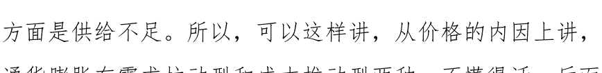
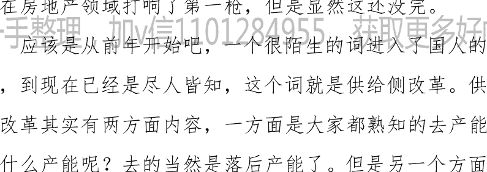
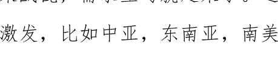
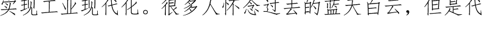

# 面对可能到的可怕滞胀，我们该怎么办？
## 潜龙一在渊

从种种迹象来看，目前的中国甚至全世界可能进入可怕的滞胀时期了。为什么可怕可怕呢？看看这两个字估计就让你有些寒了。滞，就是滞胀，什么滞胀呢？经济发展停滞。经济发展停滞，就意味着收入停滞，甚至下降，更悲剧的就是失业。胀，就是通货膨胀，通货膨胀就是物价上涨。你想想，物价不停地上，而你的收入不仅没上涨，甚至还跌了，你可怕不可怕？为什么会有这个判断呢？我们简单分析一下，简单来说通货膨胀。

关于通货膨胀的成因，众说法，各有各的看法，其中最有名的就是货币大师菲利德·弗里明的定义。书里说，通货膨胀无论怎么都是货币现象。书生嘛，很多时候也是你决定脑袋，他是货币学大师，自然要用货币的质去解释了。但是，不是他说他弗里德所代表的观点就是对的。当然，虽作为一个专业的经济爱好者，他们都没看过本，也不敢跟别人叫趴。不过，这个世界是自由的，每个人都有发表自己观点的权利。我又不搞学术研究，也不靠这个吃饭，所以，就以余爱好者的角度谈谈通货膨胀，通货膨胀的问题，误错了也不怕丢饭碗。

认为，通货膨胀的核心就是价格，而决定价格的内在两个因素。内因是什么呢？学过经济学的都知道，当然是供求关系决定了，供给决定价格。从内因讲，价格由供给和需求决定。因此，通货膨胀同样也由这两个因素来决定。怎么决定呢？通货膨胀，自然是价格上涨的现象。怎样引起价格上涨呢？自然是需求大于供给了。怎样才能需求大于供给呢？由于是两方面，一方面是需求旺盛，另一方面是供给不足。所以，可以这样，从价格的内因讲，通货膨胀有需求拉动型和成本推动型两种，不懂得话，后面我再继续讲。

今天我们再讲一遍，首先我们要明白，价格不是相对而是一个一个绝对的。什么意思呢？我们来想一想，价格是怎样规定的？是不是是由货币规定的？那货币又是什么？也是一个商品。因此，可以这样说，价格就是一种特殊的商品的价值所决定的数量。那问题就来了，这个特殊的商品的“生产数量”是不固定的。生产的，自身的价值就降低了，那样相对而言其他商品（非货币商品）的价值是不是就高了？明白了了这个道理，我们就知道弗里德·曼的其实是对的，只是仅限于外因而言，以免偏概全了。

在此，从这里我们就可以出一个结论，通货膨胀由三个因素决定，或者说三种类型：成本推动型、需求拉动型。

题)。但是，这里要明白，现在的环保行政还有一项功能，就是以环保的名义加速去产能。如果说对付大型企业的落后产能是采用严格的行政命令的话，那么针对中小企业，甚至是个体企业，不说，环保是非常好的行政命令还管用的方法。

没有人？算了，吃饭去先

二是，在行政命令的管控下，在环保新的打压下，供给侧产能快速推进，供给快速下降。同时，在流动性引发的投机炒作下（主要是期货市场），基础的大宗商品价格暴涨，并带动了各的生产资料的快速上涨，由成本的大幅上涨导致通胀引起呼唤。

王经理，加上1901284955获取更多信息。石油滞胀→源于上世纪70年代的石油危机，由于中东战争的胜利，中东的阿拉伯国家集体提高了石油价格。石油是最基本的生产资料，当时的重要性比现代社会的多，在短期内大幅提高了生产和生活成本，引发了严重的通胀。

| 滞胀类型 | 成因特征 | 影响后果 |
| :--- | :--- | :--- |
| 成本推动型 | 成本的大幅上涨（如原材料、能源） | 企业经营困难，失业，收入下降，引发滞胀 |
| 需求拉动型 | 需求旺盛，需求大于供给 | 物价上涨，利润暴增，投资增长，通胀 |
| 行政管控型 | 环保打压、加速去产能 | 供给快速下降，成本上涨，引发滞胀 |

石油滞胀→源于上世纪70年代的石油危机，由于中东战争的胜利，中东的阿拉伯国家集体提高了石油价格。石油是最基本的生产资料，当时的重要性比现代社会的多，在短期内大幅提高了生产和生活成本，引发了严重的通胀。

王经理，加上1901284955获取更多信息。石油滞胀→源于上世纪70年代的石油危机，由于中东战争的胜利，中东的阿拉伯国家集体提高了石油价格。石油是最基本的生产资料，当时的重要性比现代社会的多，在短期内大幅提高了生产和生活成本，引发了严重的通胀。

王经理，加上1901284955获取更多信息。

- 成本推动型：成本的大幅上涨导致通，企业经营困难，失业，收入下降，引发滞胀。
- 需求拉动型：需求旺盛，需求大于供给，物价上涨，利润暴增，投资增长，通胀。
- 行政管控型：环保打压、加速去产能，供给快速下降，成本上涨，引发滞胀。

中国这次可能的滞胀区别：西方国家更多的是主动的，我们是被动的。西方国家更多的是慢型的，我们的是突发的。

针对这些需求存在而无法满足的情况怎么办？这就是中国提出的一带的伟大意义所在。

另一方面，老百姓富裕起来后的高端需求无法满足，这

一点在中国发现的非常突出，从那些的国人跑到日本买马桶盖就可以出来。你说没有需求吗？为何果从1到7卖的火火到爆？为什么中国的手机和汽车消费连年高？所以说，不是没有需求，是因为你无法满足需求。这就是我们转型升级的意义所在。

解决了这两点，滞胀的可能性降低了了不少，问题是有那么容易的吗？显然没有。

说到底成本推动的通胀，很多人可能没印象，简单来说就是物资奇缺，供给根本上需求引发货物大幅上涨。比如，现在的委内瑞经历过的就是这样的通胀。我们几十年前的计划经济就是用计划经济来处理。

- 成本推动型：物资奇缺，供给根本上需求引发货物大幅上涨。
- 需求拉动型：需求旺盛，需求大于供给，物价上涨。

大时代，情况自然非常复杂，个人觉得前者的概率有五成，后者的概率有四成。对于那些喊通缩的，大家都吧。为什么前者的概率稍高呢？这主要取决于我们的经济体系。我们的经济体系是市场和计划双轮运行，这种体制尽管有一些弊端，但是好处是不言明的。

按照经济规律，像中国这样生产过剩的情况，要是放在西方那些以自由经济为的体系下，早就爆发经济危机了。但是在中国，由于政府强大的调控和资源配置能力，基本可以说化解了重大经济危机。那对于可能的滞胀，政府还有可能化解吗？手段是有有的，但是可能比较困难。

之前的也对了，眼下的世界经济不景气，有生产过剩的情况，更多的是供需错配。在传统需求这块，发达国家包括中国，是有萎缩的情况。但是也有很多地方需求很强劲，被认为是消失了。中东和北非，由于连续战乱，利比亚和叙利亚战争，造成了社会动荡，难民成灾。这些地方的需求就被灭了，但是不是说不存在，而是要结束乱，需求就此起来了。还有一些地方由于需求未被触发，比如中亚、东南亚、南美和非洲这些落地的地方。需求是存在的，但是经济落后没有被发现。另外，也有一些需求崩溃了，比如内瑞拉、巴西这些由于经济或政治原因，造成了局势动荡，需求短期内迅速崩塌了。你能说这些地方没有需求吗？看委瑞拉人民那望极渴望的眼神，别说方便了，就是油他们也捡着吃。针对这些需求存在而无法满足的情况怎么办？这就是中国提出的一带一路的伟大意义所在。

另一方面，老百姓富裕起来后的高端需求无法满足，这

一点在中国发现的非常突出，从那些的国人跑到日本买马桶盖就可以出来。你说没有需求吗？为何果从1到7卖的火火到爆？为什么中国的手机和汽车消费连年高？所以说，不是没有需求，是因为你无法满足需求。这就是我们转型升级的意义所在。

解决了这两点，滞胀的可能性降低了了不少，问题是有那么容易的吗？显然没有。

说到底成本推动的通胀，很多人可能没印象，简单来说就是物资奇缺，供给根本上需求引发货物大幅上涨。比如，现在的委内瑞经历过的就是这样的通胀。我们几十年前的计划经济就是用计划经济来处理。

### 滞胀的可能成因和特征：

- 需求拉动型：需求旺盛，需求大于供给，物价上涨，利润暴增。
- 成本推动型：成本的大幅上涨（如原材料、能源），企业经营困难。
- 行政管控型：环保打压、加速去产能，供给快速下降，成本上涨。

### 滞胀的判断依据：

| 滞胀类型 | 核心依据 | 对应特征 |
| :--- | :--- | :--- |
| 需求拉动型 | 需求旺盛，需求大于供给 | 企业利润暴增、销量增长、投资增长 |
| 成本推动型 | 成本的大幅上涨 | 企业经营困难、失业、收入下降、物价飙升 |
| 行政管控型 | 环保打压、加速去产能 | 供给下降、成本上涨、收入下降 |

首先，在传统行业方面，国企优势巨大。但是，随着时代的发展，随着中国工业化的逐步养成，传统产业面临生产过剩、利润微薄、污染严重这三座大山。尽管有这样的压力，但是这些传统产业并不能淘汰，很多都是关系民生的核心产业，与百姓生活息息相关。一旦放弃或转移到其他国家，我们将面临实业空化的风险。这不仅会影响我们的经济运行，也会严重威胁到我们的就业，这种后果是不可想象的。因此，在关系到民生的重要产业，即使利润微薄也要做，而这些产业都是资本密集型产业，资本没有实力也不愿参与。尤其是在环保压力下，企业有实力承担环保成本。在这些产业中，未来将会由国企为主，民企会被逐渐挤出去。国企为主，将被评为经济运行的基本的形式，不利于利润为导向，而是以国家安全和民生为导向，这些都是民企无法做到的。

有人可能会说，如果没有利润，民间资本会进来吗？你要知道国内内部不同的产业或产品，民间资本参与的显然是盈利高的。比如中石化，首先拿出的便利店，而不是加油站，就是这个道理。油价跟很大，很容易形成亏损，但是生意比较稳定且能发挥民企优势，于是就可以拿便利店来弥补油的亏。当然举个例子，实际更为复杂。

说到这里，有人就要血压升高了。前面说过，传统产业未来将会由国企主导，有些有实力的民企占部分市场，但无关大局。供给侧改革提到两个方面：一方面是传统产业转型，另一方面是新兴产业。前者由国企主导，后者将由民企主导。所以传统产业挤出来的，都会在市场和政策下进入新兴产业。新兴产业这块，毫无疑问都是民企主导。比如如今阿里巴巴、京东、小米，以及后来滴滴、大疆、拼多多等，几乎都是民企主导。

民企是以利润为导向，机制灵活，效率高，对新技术非常敏感，能够随时抓住趋势和商机。在创造这一块恐怕是国企远不能。那么在转型升级下，在创新策略下，企业和民间大有可为，因为你是在为政府解决问题啊。管不是这方面，但是为政府解决问题的生意都有广阔的空间。

具体经营上，由民企主导，做好后勤保障。缺技术，可以搞军民融合，国家可以在资源优势上大力支持民企在新模式的发展。在军事、航天等方面掌握。

顶级技术出来跟民间合作，市场国家可以给政策支持，可以搞政府采购。华为是怎么起来的？当年没有政府采购早死了。这样由国家和国企作为后盾，民企可以冲在创新的最沿，全力搞好转型升级战略。如此，未来中国的伟大复兴指日可待。

与传统产业不同的，新兴产业方面由民企为主，以市场为主、计划为辅。这样的话，国企和民企就可以各自发展。这就是中国经济未来双轮运行的新秩序。看懂了这个趋势，你不是明白了吗？要赚钱，必须要看到趋势跟趋势走，否则逆势而为才能帮别人赚钱，获取更多帖子。未来的中美对决，是中国的国家资本与美国的私人资本之间的对决。现在的布局不是为了适应时代的变革，也是为了这场决战。

那么一段文字简直没找到。前面说，未来的中国经济已经陷入滞胀的可能，那有什么应该应对措施防止滞胀的发生吗？当然有，我都能看到，政府那些精英看不不到吗？中国最顶层的人才都在庙堂之上啊。怎么应对呢？滞胀分涨和胀方面，应对自然是这两方面进行。按之前的规矩，咱们先从胀起：

首先，尽量控制通货膨胀对下游生活领域尤其是生活必需品导。一些非必需品，如电子产品、衣服鞋帽这些，由于上游的上涨，下游一些可以，但是对于必需品主要是农产品方面就要加强管制。我们知道，生产资料的大幅上涨有一部分原因是投机资金的炒作，尤其是在期货市场的炒作。黑色产品现在似乎还没有停歇的迹象，某种程度上政府也是任由。但是对农产品的炒作就控制得比较严厉了，在现货领域的管理越严格，谁输谁死。这才是最直接也是比较容易的管控方式。

其次，变革中间环节，降低流通等中间环节成本。而且中间产品来说，对价格影响其实不是生产环节，而是中间环节的批发、物流等环节。对中间环节的变革，另一方面借助于互联网技术，整合资源，提高效率，降低成本。比如最近触手可及的物流创业公司货运车辆，上到中央，下到地方大城市都取得了很高的评价和支持。另一方面，借助电商和数据等变革流通环节，改善供应链，压缩中间环节，建立农场到终端的直通链，以此降低流通成本。在这方面创业的公司大有可为，因为你是在为政府解决问题。管不是这方面，但是为政府解决问题的生意都有广阔的空间。

再次，定向收紧银根，引发货币波动，降低货币超发，通胀叠加影响。从去年下半年到今年，我们的去杠杆非常亮眼，都抓不住了。

定向收缩。在房产领域，除了限购限售，几乎成为全行业的要求。同时降低贷款利率，业务收缩，都是定向收缩。业务还没起来，不敢用加息这种准备。

最后，就是国企。讲过的，传统行业国企主导，要考虑政治因素，不能单纯以利润为导向。国企优势巨大，很多企足的。在环保压力下，企业有实力承担环保成本。在这些产业中，未来将会由国企为主，民企会被逐渐挤出去。国企为主，将被评为经济运行的基本的形式，不利于利润为导向，而是以国家安全和民生为导向，这些都是民企无法做到的。

有人可能会说，如果没有利润，民间资本会进来吗？你要知道国内内部不同的产业或产品，民间资本参与的显然是盈利高的。比如中石化，首先拿出的便利店，而不是加油站，就是这个道理。油价跟很大，很容易形成亏损，但是生意比较稳定且能发挥民企优势，于是就可以拿便利店来弥补油的亏。当然举个例子，实际更为复杂。

于步路购购前来叫了。那问题来了，面对武装到牙齿的n巨龙，美帝如何下手呢？
哎呀，我说，准备好了。那谁说的美帝缩表我们要跟着缩表崩溃呢？从准备这件事可以看出，我们已经做好了坚固的堡垒。从去年我们就开始广积粮，高筑墙了，这样当危机来临临时就可以刃有余地应对了。这个定位准备意很明显，因为房地产已经上线，资金只能向实体流入，这就是支持实体发展。当然，资本市场也会受益的，对房产市场起码也能不能算利。

今年是全球经济表现的一年。

国际货币基金组织（IMF）近日称，今年以来全球几乎所有国家都如此，主要经济体都处于增长状态，但经济增速快于其之前的估计。根据IMF，中国经济增长势头强劲，对全球经济增长……

十年来首次！全球经济集体增长

受到欧区、新兴市场经济复苏拉动，IMF周二（10月10日）在其最新的《世界经济展望》报告中将今年和明两年的全球经济增速预期分别调整到3.6%和3.7%。相比之下，2016年全球经济增速为3.2%。

IMF认为，全球经济在短期内已获得了一定程度的动能，这是很多多年都不曾看到的。该组织预计今年全球75%的经济体增速都将加快，这也是全球经济十年来最大范围的增长提速。巧妙的是，经济合作与发展组织（OECD）在8月底也曾发布报告称，该组织追踪的所有45个国家今年都很有望实现经济增长，其中33个国家的增速将快于一年前。

这是2007年以来所有45个国家第一次全部实现经济增长，也是2010年以来经济增速加速国家数量最多的一次。OECD指，全球主要经济体十年来第一次同步增长，主要得益于各大央行仍在实施的低利率刺激措施，以及美国、希腊、巴西以及其他国家多年的危机逐渐消退。

不过，虽然全球经济呈现出强劲的上涨态势，但IMF仍警告称，全球范围内增长可能保持疲弱，这对经济增长产生不利影响。

# 一、看好中国经济前景，IMF四次上调中国预期

根据IMF，全球经济增速加速离开中国的功劳。IMF首席经济学家Maurice Obstfeld表示，中国经济增长势头强劲，对全球经济增长贡献巨大。他还强调，中国的好消息对于全世界都是好消息。

在最近的展望中，IMF预计今年中国经济增速为6.8%，2018年为6.5%，与今年7月的预期相比，均分别上涨了0.1%，这是IMF今年第四次上调中国经济增长预期。

IMF称，此次上调中国GDP增速是因为在过去宽松政策供给侧结构改革的支持下，中国今年第一季度的增长强于预期。同时，中国经济的外部需求也较预期更强劲。

得可一提的是，世界银行近期也将中国经济增速较4月份预测值上调0.2个百分点至6.7%。该行指出，中国国内消费需求旺盛，今年有望增长8%，对下半年经济增长形成有效支持。

整体来看，中国经济的稳步发展得到了世界的认可，对国内市场而言是个好消息。

热烈祝贺党的十九大胜利召开。新的时代，新的征程！

# 第二部分：从1921到2017年，从50万人到8900万人口，96年取得了新民主主义革命、社会主义革命和社会主义建设的伟大胜利，就要实现中华民族伟大复兴的中国梦。

## 第三部分：新时代中国特色社会主义思想（本届的理论创新），是马列主义、毛泽东思想、邓小平等理论、“三个代表”重要思想、科学发展之后形成的新理论。包括经济、思想、社会、法治、军事、外交、党建等方面。总任务是实现社会主义现代化和中华民族伟大复兴，在全面建设小康社会的基础上，分两步走，在本世纪中叶建成富强民主文明和美丽的社会主义现代化强国。坚持党对一切工作的领导是总纲领。

我们知道，每届的核心领导都会理论创新，这次也不例外。不过，相比于江的“三个代表”和胡总的“科学观”，

习大的这次理论创新是质变的。江、胡的理论基础还是邓老理论的补充，没有太大创新内容，这倒不是因为这两届核心班子的理论水平不均衡，而是这两届时代的时候经济基础没有太大的变化，只有量变没有质变。所谓经济基础决定上层建筑，经济基础没变，上层建筑自然也没有变化，大多是修修补补。而习大这次，经济基础发生了巨大的变化，从过去的增长发展进入了新常。社会的主要矛盾从“人民日益增长的物质需要与落后的生产力之间的矛盾”转变为“日益增长的美好生活与不充分的发展之间的矛盾”，这是经济基础的重大转变。有了这个经济基础的重大转变，上层理论也需要质变的改变。

（注：此处OCR文本存在大量重复与乱码，根据语义推断为对报告内容的解读，此处已提炼出主要矛盾转变为“日益增长的美好生活与不充分的发展之间的矛盾”这一核心论点。）

# 第一部分：对过去五年的工作总结

确立了“五位一体”和“四个全面”，取得了巨大的成就，主要有以下点：
- 国内生产总值从XX四万亿元增长到XX万亿元。
- 粮食生产能力达到千万吨。
- 农业人口转为城镇居民。
- 一带一路建设重大突破。
- 南海建设进展。
- 体制改革取得实效。
- 许多人口实现脱贫。
- 城镇规模年均增长以上。
- 改革形成新大局。
- 发起“一带一路”倡议，设立丝路基金，举办“一带一路”国际高峰论坛。
- 斗争获得胜利。

同时存在问题：
- 发展不平衡、发展质量效益不高，实体经济水平有待提高。
- 生态环境保护压力。
- 脱贫攻坚任务重。
- 城乡发展和收入差距仍然巨大。
- 就业、医疗、养老等方面面临不少难题。

## 重点：中国特色社会主义进入新时代，这是我国发展新的历史方位。中华民族带来了从站起来、富起来来到强大的伟大飞跃，带来了复兴的光明前景。为世界上其他国家提供了新选择。

中国特色社会主义进入新时代，我国社会主要矛盾已经转化为日益增长的美好生活与不平衡的发展之间的矛盾（写入宪章）。

什么是美好生活？除了对物质化有了高要求之外，对法治、公正、安全、环境等方面也有高要求。总就是以前是要吃饱，现在是要吃好，生活提高了，生活的多元。不是吃的好，而是要让呼吸的空气都是甜的。一句话，有钱就是要。过去那些低质量效益的小坊式的生意将一淘汰。不再转变适应性，升级产品和服务，无形的手（市场）和有形的手（环保）联手成就自己的。地区的不平衡，也有产业的不平衡。不充分就是很多需求无法满足，说明我们的经济还有巨大的潜力，我们需要继续努力。在中国不缺赚钱的机会，缺的是赚钱头。

总结：
- 我国仍长期处于社会主义初级阶段的基本国情没有变（初级阶段我们露出，共产主义不是腐朽而落后的资本主义）。
- 我国是世界最大的发展中国，国际地位没有变（达则世界第一，穷则人均倒数）。

# 第四部分：从三步走到两步
第一阶段，从二〇XX到二〇三五年，在全面建成小康社会的基础上，再奋斗十五年，基本实现社会主义现代化（替代美帝，成为世界第一）。第二阶段，从二〇三年至本世纪中叶，在基本实现现代化的基础上，再奋斗十五，把我国建成富强民主文明和美丽的社会主义现代化强国（结束社会主义初级阶段，开启共产主义先进）。

# 第五部分：新时代要有发展的理念

- 一、产业化供给侧改革。要灵活下降，用国家产业顺应发展趋势转型升级。
- 二、加快建设创新国家。双创业继续推进，打造新型大国强国。未来会有很多创新企业，创业的春天不远了。
- 三、实施乡村振兴战略。承包时间不是延迟后的问题，而是会延长下去。三权分置加速推进。前十年是城市，三十年后轮到农村了，你的土地和房子看好了。
- 四、实施区域协调发展战略。未来的发展重点在中西部，武汉、郑州、西安潜力很大。当然，雄安新区是最大看点。
- 五、加速完善社会主义市场经济体制。国企业的地盘……

（注：后续OCR文本存在大量逻辑重复与乱码，已根据前文逻辑进行核心内容提取与整合。）

干预。当然，很多时候，都是两者同时为。这一次，什么都没做，瞬间就突破了，央行的态度可见一斑。

那，为什么央行默认解决呢？有以下几个原因：

- 一、外汇问题基本彻底解决了，才不会再出现大规模资金外逸的事。
- 二、贸易战又出现反复复杂的状况，汇率贬值本身就是对抗贸易战的重要密码。
- 三、前几天的政治局会议说了，下半年经济压力非常大。又说不用房价刺激经济，再内需乏力情况下，刺激出口就是一个重大选项。

> @周让你胡说 2019-08-05 19:41:18
楼卖掉，已经2年了，涨涨还没有等到春天

你没有感受到吗？
这肉次猪肉涨价叠加了通胀和猪瘟因素，所以创了历史最高。不过，也也不用恐慌，估计也撑不了多久，最多半年左右吧

> @潜龙生在渊 2019-10-27 19:47:06
来看大家，听听最近猪肉破 40/公斤了，吃不起了。这次猪肉涨价叠加了通胀和猪瘟因素，所以创了历史最高。不过，也也不用恐慌，估计也撑不了多久，最多半年左右吧

纠正下，前面说的这个40/公斤，指的是批发价，不是零售价。有个朋友就是做这个的，问的他。零售价自然要更贵的。

一手整理，加v信1101284955，获取更多好帖
