# 西方心态变化

海上京叔

在过去的二十多年间，由于各种不同的原因，京叔曾访问过亚洲、欧、非、北美及大洋的几十个国家，行程应该已过数百万里。在这些国家中，既有发达的西方国家，如美国、法国；也有相对落后的第三世界国家，如印度、埃及；既有我们的近邻，如日本、韩国；也有相对遥远的国家，如墨西哥、南非；既有世界领先的富裕国家，如瑞士、阿酋；也有贫穷的僻小国家，如尼泊尔、柬埔迪……

沧海桑田，白跑过，一晃二十多年，京叔也从一个朝气少年成长成了油腻中年。当初毕业时对美好生活的憧憬，房、子、车，似乎已经变得稀平常了。回来时路，在均衡忙碌的奔波中，有收获，有失去，收获与失去好像也变得不重要了。如今再次看世界，少了一点激情，多了一点淡定，也许让看着世界更加真实。下面，便让京叔和大家分享一些自己的感受吧。

美国是京叔去过最多的国家，前后后去了不下二十次。第一次去美国好恰逢香港回归，最后一次是七年前吧，美国的东南西北部都走遍了。在近二十年的时间跨度里，美国社会在硬件的方面变化不大，但人们的精神状态却有了极大的变化。硬件方面，二十多年前我曾震撼的

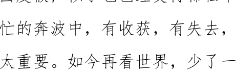

机场、高速公路、大楼等几乎还是原样，少有更新。精神状态方面，九十年代的美国人，普遍比较乐观开朗，对自己的生活比较满意，对未来充满信心，也比较宽容。而二十世纪的美国人，明显失去了自信，对未来充满了不确定。

法国也是京叔比较了解的国家，二十年前初次去法国，近年来更是几乎每年都会去两次。和美国一样，硬件方面变化不大，人们的心理方面却是巨大，但巴黎依然美丽浪漫，浮宫仍让京叔流连忘返。

美国人相对直率，有时又显得有些拘敛；法国人对浪漫感性，有时又免于顾愁务。总来说，美国更羡慕法国的生活，因为美国的大多数地认为生活是非常无聊的。

在过去二十多年中，京叔发现美国为代表的北美和英法德为代表的西方，社会心态发生了巨大的变化，自信变得更加焦虑，普遍认为未来不太乐观。而中国、印度的人民则普遍比较乐观，相信明天会更好。

作者：海上京叔 日期：2019-12-16 18:07

1996年，京叔第一次出国。由于工作关系，德国、法国、瑞士待了一个月。虽然时间已经过去了二十多年，但那种激动的心情至今还记忆犹新。京叔及同事四人，由上海虹桥机场直飞慕尼黑，然后乘车。整个行程前后约20 多个小时，我们一点都没有睡意。慕尼黑机场的现代化与高速公路的宽敞平整，道路旁绿意盎然的草地山坡，路过小镇的干净整洁……一切的一切都是那么新奇，的一切又显得那么美好，真是月亮似乎都要圆一点。

除了环境的巨大差异，更让一行惊惊讶的是德国人的生活节奏。即使是普通工人，也几乎人人有车，家里有自己的小院房。记得有一个普通工人的车居然是宝马，这让还在望摩摩托车的笔者感到胆凉的几万念俱。说实话，除了匮乏设施，我们都是绝望。我们当时都认为此生是不可能过上那样的生活了，努力，也许我们的下一代还有希望。

# 4 楼

王亚敏 微信110128955 获取更多好帖
作者:海上京叔 发布日期:2019-12-16 18:51

@气岛 1 RD-2019-12-16 18:01

西方人先是瞧不起中国人。在西方舆论的传下，中国人都都是狮子。中国连条高速公路都没有。信息极度封闭。西方人都是自高自大。来到中国的人好像看见了新大陆。中国的繁荣发达远超他们的想象。中国怎么可能像西方那样发达呢？然后又会与中国做对比。中国城建的发达又反衬出西方基础设施的落后。然后，就不自觉的呢对西方政府的不满。因为西方已经远远落后于中国。这就是西方人对中国人认识的三部曲。傲慢，接下来是惊惊讶……

现在西方的心态和冷战前的大清其实非常像

6 楼：上海京叔 日期：2019-12-16 23:19

@上海京叔 2019-12-16 18:07:17

1996 年，京叔第一次出国。由于工作关系，去德国、法国、瑞士待了一个月。虽然时间已经过去了二十多年，但那种激动的心情至今还记忆犹新。京叔和同事一行人，由上海虹桥机场直飞慕尼黑，然后乘车赴纽伦堡。整个行程前后 20 多小时，但我们一点都没有睡意。慕尼黑机场的现代化与繁忙，高速公路的宽敞平整，道路旁绿意盎然的草地山坡，路过小镇的干净整洁……一切的一切都是那么新奇，的一切都那么美好，真的是月亮似乎都要圆一点。获取更多帖

22楼：上海京叔 日期：2019-12-16 23:33

本来只想分享自己的经历聊聊自己的看法，没想到引起大家的热烈回应。感谢大家的支持。后面，京叔会陆续分享在外的经历，并穿插一些感悟，希望能帮助大家客观的了解外面世界。

23楼：作者：上海京叔 日期：2019-12-17 07:22

当时的德国，刚经历了统一，我们接触的德国人对未来充满了信心，同时对自己的生活和社会制度也无比自豪。当时的德国人很多对中国人还十分好奇。记得在慕尼黑黑尔布鲁伊勒啤酒馆（就是希特勒经常过的啤酒馆），有几个德国青年看到我们，一定要要求我们喝啤酒，并费力用我们熟悉的英语交谈了很久。

在生活中，我们的同事对我们照顾有加。每天都有不同的同事带我们出去吃晚餐，我还记得有过的烤猪肉、香肠以及熏肉。即使在德国，德国同事也不会让我们付钱，因为他们的收入至少我们的三倍以上。在工作上，德国人对我们完全开放的，任何问题都能耐心解释，直到我们完全掌握。由于中德之间水平太大，德国人表现出一种自信，完全没有把我们当威胁，更多的是一种居高下的优越感，以及对弱体的同情。

说一下，京叔的经历来说，上世纪九十年代，不论是在欧洲，其实老外（包括我的同事以及瑞士人）对中国人都是相当友好的，技术也非常开放，而在很多时候甚至会给予我们一些特殊的照顾，京叔一次

美国是京叔去过最多的国家，前后后去了不下二十次。当时去美国，坐飞机时被莫名其妙地升成了公务舱（当时还有很多空位）。而现在老外对中国人的态度明显不同，特别的照顾是不可能的，而且你不能感受到隐隐的不友好，而在技术上对中国人提防。

27楼：作者:上海京叔 日期:2019-12-17 11:33

@共青肠 2019-12-17 08:54:46

几千点击，才这几句话？刚开了个头，后续会陆续

36楼：作者:上海京叔 日期:2019-12-17 12:12

@喜看绍沃 2019-12-17 02:30

光养香肠十年，卧薪尝胆十年，效果还是客观的，基础硬件追上了，衣食住差距太大了，道德尚可是欧美化不俗！一看上海的差距，这可是悲剧啊！

不好意思，什么是“差距”？

38楼：作者:上海京叔 日期:2019-12-17 16:42

离开德国后，京叔一行又去了瑞士。瑞士的自然风光的美不胜收，让人流连忘返。我们去了著名的少女峰，乘坐了遥远的冰川火车。冰川火车的票价好像是50瑞法郎左右（具体记不清了），约合300人民币。说实话，我们当时犹豫了很久（毕竟300人民币是京叔当时月收入的约1/7），最后还是决定上去。到了山顶后，远眺德国的黑森林及法国的群山，及欧洲最长的莱莱冰川，在永恒之冰原上漫步，确实物有所值，不虚此行。

在少女峰景区，当时有很多日本的人，餐馆的菜单几乎都有德语、法语和日语，基本上没有中国人，尤其是大陆。我们的一位瑞士供应商请我们在雪山边的一个餐馆吃了一顿烤大餐，六个人花了700瑞士（约合420人民币），这还是算的。

这里还有一个小插曲，大家知道瑞士的物价是很贵的，巧在餐馆吃饭，我们问餐馆的菜如何，我们回答很好。可能是消费太贵又不好意思直接，便问问我们来自哪里，台湾还是香港，我们告诉他们我们来自大陆。这时他们似乎放心了，便坐下开始准备。京叔这时起身去洗手间，在走廊拐后意外听到了夫妻夫妇的小声对话。女：“这么贵呀，你怪你，叫你别坐下。”男：“能怪我吗。我怎么知道那帮陆人这么有钱”（其实我们真的没钱）。这一幕，直到今天，京叔还历历。

40楼：作者：上海京叔 日期：2019-12-17 17:08

@暮商扬 2019-12-17 16:00:58

楼主写得非常好，无限点赞！继续下去，别理那些狗！

1楼：作者：上海京叔 日期：2019-12-17 11:00

@瑞兆丰年 2019-12-17 08:53

楼主写的很好，希望楼主坚持更新

44楼：作者：上海京叔 日期:2019-12-17 19:47

王经理，加v信

当时我们的确实非常落后，特别是国内。刚改革开放几年，中国现在非常强大，一个重要的方面就是供应链的完善，几乎任何配套都能在国内找到。顺便说一点外话，京叔的收获很大，真的是大开眼界。

十五年后，京叔带着儿子去欧洲旅游，几乎重走了行程。德国、瑞士、法国，另外还去了奥地利和意大利。和当年一样，还是由上海飞慕尼黑，起飞的地方已经是浦东机场而不是虹桥机场，而登陆的地方还是慕尼黑。崭新的浦东机场不是上世纪九十年代的虹桥机场可以拟的，而当时的慕尼黑则没有记忆中的

在德国玩了哪些地方，有点记不清了，能记得的是天鹅堡和慕尼黑市政厅。天鹅堡依然美丽，山巅之上魔幻城堡那么孤独神秘，时间仿佛凝固在这里，又仿佛时间把我带回了过去。在慕尼黑市政厅广场，京叔看遍了任何变化，凭着记忆，轻松地找到了当年像刘姥姥一样驻足的地方。让京叔真正惊讶的是在广场旁边街道拐处的烤香肠，95年京叔就在这个小摊吃了烤香肠。十五年后，还是同样的地方，同样的小摊，同样的香肠。在小摊边，和儿子一起吃着烤香肠，一时间竟有些惆怅。十五后，一晃而过，好像画了一个大的圈。隔着自己的家人，做着一些简单的事务，享受一些平常的乐趣，这可能就是生活的美好吧。十五的时间，不知不觉，中国以及我们每个人、每一个家庭已经走过了一条长长的路，而德国似乎停在原地。

50楼：作者：上海京叔 日期：2019-12-18 07:54

三十多年前，我们的课本上还在批判美国的实用主义。

51楼：作者：海上京叔 日期：2019-12-18 13:59

感谢大家的支持与鼓励，过去二十多年，中国走了一条不平凡的路，能够生活在这个年代，是幸者。我相信每个人、每个家庭在这个时代都有精彩的故事。京叔生活在这样一个精彩时代的普通人，希望用普通人的故事和普通人的视角来为大家讲一个普通人的故事。

京叔不是专业写手，不是强顽，文笔可能不够美，但会遵循事实的原则，尽量客观的给大家分享一些自己的经历和感受。再次感谢大家的鼓励与支持。

67楼：作者：上海京叔 日期：2019-12-18 19:31

1997年，恰逢香港回归，京叔再次奔赴异国。这次去的心情怀着“朝圣”的心情，行程原本是由上海飞慕尼黑，然后转机赴昆山。整个行程前后约20多小时，我们一点都没有睡意。

1996年，京叔第一次出国。由于工作关系，德国、法国、瑞士待了一个月。虽然时间已经过去了二十多年。

九十年代中期，刚刚赢得了冷战的胜利，在整个世界上，放眼天下独秀。由于冷战胜利的红利，以及信息技术革命成果，中国的发展非常强大，一个重要的方面就是供应链的完善，几乎任何配套都能在国内找到。京叔的收获很大，真的是大开眼界。

在京叔的经历，在阿布扎比时，我们没有办法让他们去阿布扎比工厂。

很多来说，中国的发展非常强大，一个重要的方面。当时的德国人对未来充满了信心，同时对自己的生活和社会制度也无比自豪。当时的德国人很多对中国人还十分好奇。记得在慕尼黑黑尔布鲁伊勒啤酒馆（就是希特勒经常过的啤酒馆），有几个德国青年看到我们，一定要要求我们喝啤酒，并费力用我们熟悉的英语交谈了很久。

在京叔看来，绝大多数的工厂在美国是不可能竞争力的。京叔认为东南亚制造同样不可能对中国构成威胁，因为体量太小。

楼主真幸福，去美国的确比广州多得多，但并不幸福。用我儿子得的话：“去美国就是吃苦”。美国的生活比糟糕了，饮食没法和国内比，还要天天说英语，哪有国内舒服。最重要的，我的家人，我的朋友都在中国。当然，美国也大部分都在中国。

当时最有移民倾向的几个国家之一，中国和印度都是很多。

第一次到美国，英语还不会大会，却被愣在了陌生的洛杉矶机场。而且当时手机还没普及，也没有百度可以问，更没有微信APP可以求助，这真的可是傻眼了。我们首先想的是去找国航柜台。好不容易找到了国航柜台，国航工作人员却一脸冷漠的表示我们无能。不管我们如何恳求，甚至搬出了民族大义的名字，国航工作人员坚定拒绝提供任何帮助，甚至都不愿意指点一下我们可能的解决方案。

求助无果后，京叔一行心情落到了谷底。发现洛杉矶机场不止一个航站楼，我们要乘坐的航班在另一个航站楼，必须乘坐穿梭巴士才能。好不容易赶到了下一站柜台，那段航班早已起飞了。

80楼：作者:海上京叔 日期：2019-12-19 07:17

昨天看到一则新闻，英国首相赢了大选，英国脱欧已成定局，最快可以完成脱欧。京叔曾经参与的工厂中有一一家在英国，当时工厂中有很多东欧国家，主要是俄罗斯和波兰的工人。这些工人期望的工资较低，工作态度也比英国工人好。作为工厂管理者，以及老板这类资本家当然非常欢迎这些外来人的，所以对于脱欧显然是反对的。从英国的角度来看，完全是另外一事了。脱欧能够阻止那些东欧外劳来，无疑大力支持了他们。在英国国内对脱欧这件事的态度是分裂的。以京叔之见，有关脱欧的争论在英国还没完，不排除在将来进一步发酵的，比如苏格兰再次独立。

7楼：作者：上海京叔 日期：2019-12-19 10:23

@红杨 2018-12-19 04:51:35

@上海京叔 2019-12-19 15:09

如果一定要我选一个外国去生活，我应该不会选美国，欧洲或马来西亚都会在美国前面。

45楼：作者：上海京叔 日期：2019-12-17 21:31

@瑞雪丰年 2019-12-17 17:08:53

楼主写的很好，希望楼主能坚持更新

46楼：作者：上海京叔 日期:2019-12-18 07:41

感谢大家支持

50楼：作者：上海京叔 日期:2019-12-18 07:54

王磊，加信110128495 获取更多好帖

来自

102 楼 海上京叔 日期:2019-12-19 18:26

当时毕竟年轻，刚经历了心情的大起大落，便想到好好利用这多出来的十二个小时来玩耍。说是玩玩耍，其实就是找个地方去看看。去哪里呢？当然是去洛杉矶中心 (Downtown)。打车是不可能的（太贵了），就坐公交车吧。京叔三人费了一番周折，京叔三人乘上了“天使之城”市中心的公交车。

车辆开出去又回来，京叔三人发现不对劲了。这车除了我们三人的属于比较正常以外，他的乘客要是五大粗粗。有的黑哥？是头发翘了，胳膊上满是刺的，身上，穿细纹螺钉针铁皮的白人，人形奇怪，就没有上看正常的白人。当公交抵达市中心的时候，大约是下午六七点钟，天色已经开始暗淡。同样的，街道上鲜有上去比较正常的黑人，大多都是打怪异（当我们的眼来看来，其实在回想起来也不是特别和谐的）黑人、墨西哥人或其他人，三五成群，无所事事，不少人愁云无颜总地打着京叔叔一行（现在在想来可能是因为我们的打扮挺吧）。街道上也没有我们所向象的灯虹酒骚，照晃攘，车水马龙，反而显得比较乱差，而且莫名的觉得不安全。京叔三人几乎未做任何停留，穿过马路，坐上回程的公交车返回了机场，在洛杉矶中心只待了等公交车的 20 多分钟。

后来，京叔才从美国朋友那里得知，和我们中国不同，像洛杉矶这样的美国大城市，市中心（Downtown）并不是城市最好的地方，反而是往往治安比较差，环境也比较混乱的地方，住在市中心的多半是穷人。在美国，富人和中产阶级基本上都是住在大城市的郊外的。在大城市中，有一些区域是当地人也不会随缘便去的。京叔在这里提醒要去美国的朋友，在类似洛杉矶、芝加哥、纽约等大城市，千万不要自己随便乱，可能像中国这样的国家并不多。

# 103 楼

作者：上海京叔 日期：2019-12-19 21:16

王眼镜 加微信1101284955，获取更多帖

写的很棒呢！楼主退休了吗？退休金多少？没的话交通贴补多少？

@blackglas 2019-12-19 19:34:15

还没有退休。不过最近几年的生活节奏相对比以前悠闲许多，在国外跑的也没有以前了。

# 108 楼

作者：上海京叔 日期：2019-12-19 23:58

仔细找了很久，也没有找到这次中美贸易协议的细节报道。看来还可能有变数，各位老友，有谁看到这次中美贸易协议细节的报道吗？

来自

109 楼 海上京叔 日期:2019-12-20 07:31

作者：海上京叔
京叔那次去美国，接触到了一群很特殊的人，他们便是阿米西人（Amish），好像是一种特殊的基督教教派，他们原来生活在欧洲地区（据说是德国），18世纪初为躲避宗教遭迫害而来到美国。京叔所访问的地区（俄亥俄州）便聚集一群阿米西人。

阿米西人有着很坚定的信仰，坚持 18 世纪的生活方式，在生活中拒绝一切的现代科技，不用汽车，不用电自来水，家中也没有任何家用电器。他们也不用电脑，而是仍然驾驶马车。他们还是穿着古老的服饰，人人都留着长胡子。据说阿米西人只能和同类结婚，不能离婚。每个阿米西人家庭都有很多个孩子（京叔看到的都有七八个，多的有十几个孩子）。阿米西人生活简朴，没有太多的娱乐节目。他们也不买社保，觉得买社保是对上帝的不信任。

阿米西人一般靠农业为主，但也有人在附近的工厂打工，京叔访问的工厂便不少阿米西员工。他们都是相当不错的员工，语言不多，要求也不高，但工作任务任凭。

可然而，这样的地区是相当无聊的。京叔后来又再次回到这个地区，并在那里独自住三个三个月。在那个小镇，只有一家小旅馆，一家小饭馆，一个杂货店，没有电影院，没有任何其他娱乐设施。京叔当时还不会开车，只不过每天都在那家小饭店吃晚餐。也许由于去饭馆的人不多，那家小饭馆只有三样菜，烤牛肉、烤三文鱼，还有一样是什么样的记不清了。京叔连续吃了差不多一百天三样菜，开头两三天还行，几天后就受不了了，然后就是完成任务般地吃一点，到最后真的是“生无可恋了”，后来好长一段时间京叔一看牛肉，三三文鱼就恶心。

在那个时代，还没有网络，虽然已经出现了手机，但那时可叫“大哥”，所以京叔也没有，打越洋电话也是奢侈修行的。三个月时间里，他打了大三次越洋电话（每天三次，每次五分钟）终于回到家，京叔几乎没有听到过一句中文。每天听的说的都是英文，让京叔快疯狂了。后来登回的飞机，听到空里听到中文的“欢迎登机”时，京差点差点都掉掉了，真正感觉到了游子回家的激动。

那三个月京叔终身难忘，那种孤独如寂寞，还有对父母的思念，直到都如此真切，仿佛发生在昨天。说实话，在某种意义上，京叔十分佩服那些上世纪九十年代远赴异乡的游子，他们确实不容易。如果让京叔长期吃西餐，说英文，我想我一定会崩溃掉。

112 楼

作者：上海京叔 日期：2019-12-20 12:56

外篇：“高大上”的粉碎者，中国工业

从上世纪九十年代初期从事工业领域以来，已经接近三十年。在这三十年间，京叔发现很有趣的现象。一个概念是一个产品，如果在中国工业掌握以前，往往是被捧得非常高大上（自然也很高），而一旦被中国掌握以后，则迅速变为“牛大”，价格也就“白菜化”。

第一个例子是彩电及显管（以及后来的液晶屏）。在上世纪九十年代，如果家里有一台索尼、夏普或东芝的电视，那是相当面子的，而一台22 寸的日本电视长虹、TCL、康佳等中国品牌出现后，价格一路滑坡。前几天，爸爸换了65 寸电视，价格好像只要4000多元了。

如上世纪九十年代，手机（当时还可以打砖）被人们称为“大哥”，价格是相当高端的。在九十年代中期买了部手机，价格好像要一万元。可是九十年代差不多可以买万呀。而当时的手机厂商，摩托特拉、诺基亚等，是人眼中的好公司，摩托特拉更是号称要发射诸星计划，让华为、小米、vivo等手机成熟后，手机似乎迅速沦为普通商品，也没人再炫耀了。

还有一个典型的例子，便是太阳能和风能。约年前，西方国家几乎天天宣传以代表的“新能源革命”，号称要绿色能源代替传统能源（曾将撒哈拉沙漠建巨型太阳能站）。但自从中国制造电设备白菜化以后，现在基本上很少听到有关太阳能和风能的了。这样看来，中国工业真称为“高大上”的粉碎者。作者：上海京叔 日期：2019-12-20 16:16

@hapty365 2019-12-20 16:34 太阳能和风能

我的一名大学同学是搞水的，八十年代初那个时候就被派去担任外国翻译。他的工资：美国的、英国的、巴西的……唯诺，事事请教，后来我们越做越大型，技术水平攀升。现在中国是全世界水利工程协会我们我们说了算！王加加1111122895支持

感谢改革开放，中国脱骨，与西方世界平起坐。从那个年代过来的人，都有如隔世的感觉。好比参加长跑比赛，三十年前，前面猛跑，三十年后，抬头一看，唉，前面没几个人。

18 楼 作者：上海京叔 日期：2019-12-20 16:51

@marpoloo 2019-12-20 18:38 接收更多帖支持

121 楼 作者：上海京叔 日期：2019-12-20 20:26

最终，从上海起飞三十多个小时后，京叔一行终于惊喜地抵达了目的地。由于年前的德法之旅，以当时京叔的眼光来看，无论德国还是法国，几乎无异于人间天堂。只不过美国的任何东西似乎都比欧洲的大，高速公路更宽敞，高楼大厦，汽车更大，普通住宅院也普遍比欧洲。当然，美国作为当时（现在也是）世界上的头号强国，赢得胜利，其气度与势头是德国所不能比的。即使是美国普通人，也充满了自豪感，相信他们的国家是最好的，他们的制度是最完美的，而且未来一定属于美国及其盟友。没有少少的美国人在交流中对于为什么中国不像俄罗斯那样全盘私化表示不解，并真诚地希望中国能采取他们的优秀制度，以便跟上世界发展的潮流（以京叔的观察来看，绝大多数的美国，尤其是中下层的美国其实还是单调的）。

和欧洲相比，京叔得到的几乎是无微道的关怀。从住宿，到用餐，再到出行安排的妥妥贴贴，每天工作忙碌结束后还会安排不同的娱乐项目，如打高尔夫球！打保险、体验网球等。假日后还会安排旅行旅行，京记得去过的地方有尼加拉大瀑布、伊兰迪，以及一个建筑遗址。我们参观那个建筑遗址的时候，美国人十分自豪地介绍，这个遗址是美国的一个具有国家历史意义的建筑，已经经过300多年的历史了（好像300年，具体记不清了），在当地，对整个美国都算历史悠久了。正美国人谈谈该建筑的悠久历史，当时还年轻的京叔很趣地告诉他们，京叔出生的城市有2000多年的历史，上千年的历史建筑在少数，而且不是中国最古老的城市，在中国有3，400历史城市不在少数。

美国人顿时惊讶得哑口无言，看着他们睁目口呆的样子，京叔暗暗窃窃，我们也有你们强的地方。这可能是那次美国之旅唯一胜过美国人的时候。

# 129 楼

作者：上海京叔 日期：2019-12-21 08:19

当时的美国在技术上确实有很多值得学习的地方。比起我们的工厂里还有大量使用焊接刀具，而美国已经普遍使用机床切具；人工绘图，美国已经普遍使用计算机辅助设计；如果中国工业掌握了通用加工中心，就可以搭建柔性生产线。在生产方面，美国已经开始用MRP系统，增加进度的；我们还在忙着写文件、传真。当时京叔对美国人的交流方法很不理解，有时候要隔壁办公室当面说就不行了，为什么要还要交流？这样的例子有很多，行业和材料有关。领域，中美之间的差距至少三十年。无论产品配，生产设备，生产工艺，质量控制，我们无法望。最终工厂效率差几十倍，耐用寿命可能还要大。在生活上的方面，不再提了。由于，，美国在基础设施上大幅领先，中国已经通达，纽约、芝加哥等城市高楼让人叹不已。

136 楼 作者：上海京叔 日期：2019-12-21 23:24 太阳能和风能

这样看来，中国工业真称为“高大上”的粉碎者。作者：上海京叔 日期：2019-12-20 16:16

@hapty365 2019-12-20 16:34 太阳能和风能

我的一名大学同学是搞水的，八十年代初那个时候就被派去担任外国翻译。他的工资：美国的、英国的、巴西的……唯诺，事事请教，后来我们越做越大型，技术水平攀升。现在中国是全世界水利工程协会我们我们说了算！感谢改革开放，中国脱骨，王加加微信1101284955，获取更多帖支持感谢各位朋友支持

174 楼：：上海京叔 日期：2019-12-22 17:55

感谢各位朋友支持

175 楼：上海京叔 日期：2019-12-22 19:55

以京叔的观察来说，上世纪九十年代末的大多数普通人对于中国不是太感兴趣，他们对于中国的了解也十分贫乏。当时京叔比较接地的人士包括跨国公司高管、中层管理人员、技术人员，以及底层的工人、服务员、农民。可以说，底层工人、服务员、农民对于中国和中国人的了解基本上为零。就有些去了解，也是真的。他们会问一些我们听上去很可爱的问题。比如：“你们在中国不是吃不到肉吗？能吃饱饭吗？”你们在在国内都穿蓝色的衣服吗？”上海能买到冰淇淋吗？”等等等，等等。即便是中高阶层的人士，虽然不如幼稚，但其认识十分匮乏和歪曲。

# 143 楼 作者：上海京叔 日期：2019-12-22 1:12

由于中美之间的差距实在太大了，无论我们还是美国人都没有想到有生年能看到中国工业实实在地威胁到美国。从现在的情况来看，中国工业总产值已经超过美国，是当之无愧的第一工业国。细分到每一个行业，在飞机、芯片等有限几个行业外的多数领域也已领先。美国赶超之势。多年以后，大约二十一世纪末期，京叔在迪拜机场巧妙遇到了当年接待的美国人。当我们谈起当年的往事，这位美国朋友半开玩笑地笑着：“我们被骗了，你们从这里学到的技术，反过来抢占我们的市场，抢占我们的工作岗位”。不管他说对错，但代表了一大部分美国人当下的看法，也是特朗普不顾美国资本界的强力反对而推行对华“超硬”政策的民意基础。这个话题，京叔不开展，留待说到二十世纪后再讨论。德国人一样，美国人对我们也是完全开放，无论产品、生产设备，生产工艺，质量控制都毫无保留传授给我们。如果我们有问题，他们也会详细介绍直到我们搞懂为止。当然我们也是优秀的学生，在美国“师傅”的指导下好好学习，天天向上。无论是技术人员，还是管理人员，还是工人，都可以说手把手教会了我们。当然美国人做这些既不是生性善良，也不是国际主义者，他们也是为了利用中国廉价要素来扩大他们在世界的竞争优势。事实上有很多西方跨国公司也得与中国的深度融合获得了巨大的回报，典型的大众、苹果、肯德斯、通用汽车。但是不可否的是，对美国技术以及其他西方国家技术的引进和吸收，的确是我们能迅速发展的原因之一，而且是非常重要的原因之一。

| 产品类型 | 欧美品牌 | 中国品牌 |
| :--- | :--- | :--- |
| 彩电（液晶屏） | 索尼、夏普、东芝 | 长虹、TCL、康佳 |
| 手机 | 摩托特拉、诺基亚 | 华为、小米、vivo |
| 太阳能/风能 | 西方国家宣传 | 中国制造 |

国内方面，应继续加强我们的实体竞争力，严防经济脱向虚。

从根本上来说，中国经济发展到如今的阶段，中美经贸关系并不是中国经济发展的决定性因素（虽然还是重要因素）。一方面，我们需要尽力维护现有的中美经贸关系，毕竟它对我们总体有利；但另一方面，也没有必要为了维护这一关系而牺牲根本利益。只要我们做好自己的事情，中国经济重回世界第一将是时间问题。

# 185 楼
作者：上海京叔 日期：2019-12-23 07:44

补充一点，目前中美双边贸易在我国的外贸中只排第二，第一是欧盟，第三是 likely盟。但如果只比较单一国家，美国依然是第一。

来自

# 186 楼
作者：上海京叔 日期：2019-12-23 23:37

第一次美国国庆之另一件印象深刻的事情是参加了美国国庆日的庆祝活动。在国内有一种说法，便是只有共产党国家才传播传统教育，才有主旋律宣传，而欧美国家是不搞这一一套的。京叔认为这种认识是片面的。欧美国家固然也有他们的传统教育和主旋律宣传来培养他们的价值观，只是其形式可能不太一样，比如最近在在国内上映的好莱坞影片

《决战中途岛》便是典型的美式主律影片。此外，对独立的庆视是美式传统教育的一个重要环节。

以京叔所见，美国的国庆日（独立日）比我们的国庆节要热闹不少。几乎每家每户都会挂出国旗，街道上也会挂出各种彩旗。在国庆日当天，也有游行活动（据京叔观察，应该不是政府组织的，而是由民间团体组织的），游行队伍包括军队队伍（应应该不是真正的军队，更像是学校学生）、cosplay独立战争时的美国军队，当时还有具有美式特色的拉花队表演。节日的夜晚，也会燃放烟花，很多美国家庭会在草地上支起帐架，架上烧烤架，一边火焰表演，一边烤啤酒。

京叔曾经有两次在独立期间访问美国，都有类似的庆祝活动不过是在上世纪20年代期间，现在是否就像大清楚了？每次的游行队伍，他的压轨的一定老兵的队伍，老兵们穿着各种老式军装，佩戴着各种勋章奖章，有不少坐着轮椅。当老兵队伍经过时，队伍演奏美国国歌，几乎所有人都在举手礼；而老兵们有些依然挺腰笔直，有些已然显得歪巍巍，但都尽力以他们所能达到的最标准姿态向人群致。在那场场合下，京叔虽然不是美国人，但不禁感动的眼睛湿润。

# 196 楼 
作者：上海京叔 日期：2019-12-24 08:06

96年的德瑞之旅与97年的美国之旅，对京叔来说，有着终身难的意义。通过这次国外之旅，见识到了当时最现代化的西方资本主义社会，也深刻的体会到了我们落后的巨大差距。出去之前，虽然也从电影电视以及报章杂志上对西方社会有些了解，但亲眼所见、亲身经历还是给了我们更鲜活的体验和更直接的冲击。

经过100天地面战后便从绝望的伊拉克溃年后，作为“世界第三军事大国”的伊拉克首得胜利。可以说，其民心气也正值巅峰期。西方国家的普通民众也在我们的相处中表现出自信大度，对于国家的未来与自己的未来充满了信心。或许正是这种国家与国民的过度自信，促使国家与个人肆意享受、透支未来，为十年后席卷世界的经济危机留下了伏笔。

我们当时和西方的差距可以说是全方位的，无论是物质生活、文化生活，还是农业生产能力、科学水平，以及国家经济实力、国防能力，都可以难以望别人的背脊。在方面的差距之大，真的可以用绝望来形容。更为可怕的是，我们自己（包括京叔）已经几乎失去了信心。“祸扬”这样的电视片公然宣扬中华文明的落后，而且还能在中央电视台播放，并几乎得到全社会的共鸣。另外还有专家所谓的“专家”鼓吹中国需要补上“被殖民”这一课。当我们在和外国人接轨时，总说是和外国外的都是对的，如果我们做的和国外不一样，那定是我们自己什么地方做得不对。也许也是由于这种绝望，让我们丢掉不切实际的幻想，埋头苦干，使我们以后我们自己都不适应的速度快速超越成为可能。

正如京叔回复前面一位老友所写的，“好比参加一场长跑，三十年前，前面乌满决全是全。没办法，低头猛跑。三十年后，抬头一看，唉，前面没几个人了。”

# 197 楼 
作者：上海京叔 日期：2019-12-24 12:35

感谢大家

来自

# 203 楼 
作者：上海京叔 日期：2019-12-24 18:45

说到“以我们自己都不适应的速度快速超越”，京叔想和大家分享一个故事。很长一段时间里，在世人的印象中，美国、西欧、日本都几乎是“现代化”的同义词，当我们说到“现代化城市”时，我们想到的纽约、伦敦、巴黎、东京当然也不例外。

直到有一天，大约是十年前，京叔的一个美国朋友（这位朋友曾经担任世界排名前十的跨国公司高管，本人是瑞加人，曾驻欧洲）和京叔聊天时，京叔甚不解，为什么一定要访问上海，如果要长城应该去北京，看兵马应该去西安，看大熊猫应该去成都。于是他朋友回答：“上海只有几十年的历史，除了钢筋混凝土丛林，没有什么可以。那里才是中国的精华。现代化的城市是什么样子的？有些事情，我们已经习以为常，并没有觉得什么不起，但却实在在不意间，已经成为了现代化的象征。正如当年我们的高铁、我们的支付宝、我们的高速公路，这些代表着许多人。”

# 208 楼 
作者：上海京叔 日期：2019-12-24 12:11

感谢大家的支持与鼓励，京叔不是专业手，写得不太熟练。不过大家支持京叔的故事给大家一点小的启发。

来自

# 211 楼 
作者：上海京叔 日期：2019-12-25 12:43

美国和德国几乎代表了欧美工业的最高水平。至今，德国货依然是优质的同义词，美国货则似乎依然引领着潮流，但美国和德国的工业体系其实很有差异。这里，京叔便自己的经历和观察来解读一下。德国模式在国人的印象中，当我们说起德国工业时，最先想到的是大众、西门子、博耳等。如果是稍微专业一点的人，可能会接触到巴斯夫、博世等在某领域或几个领域的军者，其实德国真正的脊梁并不是这些公司。在德国，存在大量的中小企业，这些企业一般销售额几千万亿欧元，而且都不是上市的公司。这些公司一般专注于某很小的领域几十年甚至一两百年，长期反复打磨，他们的产品都有很远的性能。但由于较为原始的管理模式（很多还是家族公司或私人公司），其成本与售价通常较竞争对手高出一大截。京叔在96年访问过这两家的公司，其中一家位于亚洲的一个小镇上，公司约有几十人，专注于一种特殊的磨床的生产。这个公司的老板管理销售、财务、人事（其实也没有什么“人事”需要专门管理），而老板管理技术、生产、质量。为止，似乎我们和温州的“夫妻店”没什么区别。但如果我告诉你老板的爷爷（可能也是爸爸，记不清了）开始这家公司就生产这种磨床，而且只生产这种磨床，你觉得如何？如果又要告诉你，整个公司对这种磨床最精通依然依然老板本人，你觉得如何？如果老板约30岁的儿子学的是机械工程，仍然在绘图板上画图设计，你又是如何的？正是几代人的不断折，他们的产品具有别人无法具备的性能，使得万里之外的工厂得购买他们的设备。京叔后也要从中国去法国一个偏僻的小镇，学习这种磨床像。像样的公司，京叔后来接触很多。正是这些小公司，使得德国工业在短期内没有被超越，却是德国经济在欧洲卓越的重要原因。当然，这种模式，也有其内的缺陷，京叔后会再次回到这个话题，到时候我们再讨论其优缺点。

对于美国模式，讨论与研究的已经非常多了，京叔就没那么熟悉了。简单来说，作为管理学起源源美国，其工业管理非常现代科学，也非常职业化。凭借这种科学性和职业化，以及巨大的规模（这也是最重要的原因），美国工业在过去一百年中始终保持世界工业的耳朵，直到改革开放后的中国才让世界工业第一的宝座。而这种模式最大的问题是，有时企业的利益、资本家的利益与国家的利益、国民的利益有可能相违，一旦这种情况出现，美国模式难以自我调整以适应新的形势。关于这一点，京叔也暂未展开，留待以后详细分析。

# 215 楼 
作者：上海京叔 日期：2019-12-25 21:56

上世纪十年代，人出国的一个重要活动就是购物。京叔不记得从什么时候开始，在国外看到“Made in China”的东西越来越多，逐渐充斥国外的超市。各种产品如电视、相机、组合音响几乎都是日本货，或许只有一些韩国货，但都不是。当时在美国市场上比中国便宜很多，尤其是特莱斯来说。这种低廉的生活成本，可见中美之间的实际生活水平巨大差异。京叔买了一条牛仔裤，55美元，同样的牛仔裤在国内至少买1000多元。我的同事买了一台摄像机，大约2000美元（好像不太清），同样的摄像机在国内要卖6000元。京叔另外买了八件衬衫，居然是2美元一件。同事还买了许多其他东西，价格都是国内的一半。京叔买了一打袜子，居然是2美元。京叔买了一袋鸡蛋，也是99美元。

# 219 楼 
作者：上海京叔 日期：2019-12-26 18:58

谢谢大家

来自

# 226 楼 
作者：上海京叔 日期：2019-12-27 08:16

外篇：一个台湾人的变化

上世纪十年代中期，应该是大陆和台湾生活差距最大的时候。当时的台湾作为一个一省之地便达到了大陆GDP的35%~44%，高峰期几乎达到大陆的一半。当时的台湾还是世人眼中的“高大上”单位，当时的大陆的台湾。京叔有一个台湾朋友，已经认识了25年，刚认识他是上世纪十年代中期。这个台湾朋友当时的收入可能有3000人民币（在台湾人中也算比较高），经常在大陆出，后来常驻大陆。这个台湾朋友来自台湾南部，是个坚定而远的台湾子。一次和京叔一起吃饭喝酒的时候他提议道：“我们台湾一定要独立，不然前途。”京叔辩道：“大陆一定会放台湾独立的，如果你们宣布独立，就会爆发战争。”这个朋友当时很有底气地说：“我们台湾可以动员百万军队，武器比你们好，美国一定会帮助我们，所以你们打不赢。而且我们如果不去，你们的经济就会受到影响，你们的改革就不会进行下去了。”不讨论判断是否正确，但反映了当时台湾人的真实看法，他们认为独立是可以成功的，而且大陆离不开台湾的投资，因为是有可能默认独立的。所以上世纪十年代的台湾局势是非常危险的。后来由于各种原因，京叔和这位朋友几乎失去了联络，再次碰到他已经是多年以后了，像是2007年或2008年初吧，当时他正急冲冲要回台湾。抽出时间和京叔吃一顿饭。京叔好奇地问他：“真的有急吗？”这位朋友对京叔说：“当然急了，我要赶回去投票，不然英九要选不上了。”京叔十分诡异，便问道：“你不是支持台独吗？为什么要这么急赶回去支持英九？”这位朋友感慨道：“没办法呀，我的事业和财产都在这边，一打起来，就完了。”看得出来他虽然投票支持国民党，但是内心深处还是支持台独的，但已经没有当年的台独决心了。差不多十年过去了，京叔在年前又见到了这位朋友。京叔意外的是，他已经变成了台独的坚定反对者，对京叔说：“我的三个孩子都是大陆长大的，他们都习惯自己是陆人。我当然反对台独，不然我的孩子们怎么样？”

# 227 楼 
作者：上海京叔 日期：2019-12-27 12:00

一篇上世纪十年代中期，应该是大陆和台湾生活差距最大的时候。当时的台湾作为一个一省之地便达到了大陆GDP的35%~44%，高峰期几乎达到大陆的一半。当时的大陆的台湾还是世人眼中的“高大上”单位，当时台湾人的收入比大陆高不少。京叔有一个台湾朋友，已经认识了25年，刚认识他是上世纪十年代中期。这个台湾朋友当时的收入可能有3000人民币左右（在台湾人中也算比较高），经常在大陆出，后来常驻大陆。这个台湾朋友来自台湾南部，是个坚定而远的台湾子。一次和京叔一起吃饭喝酒的时候他提议道：“我们台湾一定要独立，不然前途。”京叔辩道：“大陆一定会放台湾独立的，如果你们宣布独立，就会爆发战争。”这个朋友当时很有底气地说：“我们台湾可以动员百万军队，武器比你们好，美国一定会帮助我们，所以你们打不赢。而且我们如果不去，你们的经济就会受到影响，你们的改革就不会进行下去了。”不判断是否正确，但反映了当时台湾人的真实看法，他们认为独立是可以成功的，而且大陆离不开台湾的投资，因为是有可能默认独立的。所以上世纪十年代的台湾局势是非常危险的。后来由于各种原因，京叔和这位朋友几乎失去了联络，再次碰到他的时候已经是多年以后了，像是2007年或2008年初吧，当时他正急冲冲要回台湾。抽出时间和京叔吃一顿饭。京叔好奇地问他：“真的有急吗？”这位朋友对京叔说：“当然急了，我要赶回去投票，不然英九要选不上了。”京叔十分诡异，便问道：“你不是支持台独吗？为什么要这么急赶回去支持英九？”这位朋友感慨道：“没办法呀，我的事业和财产都在这边，一打起来，就完了。”看得出来他虽然投票支持国民党，但是内心深处还是支持台独的，但已经没有当年的台独决心了。差不多十年过去了，京叔在年前又见到了这位朋友。京叔意外的是，他已经变成了台独的坚定反对者，对京叔说：“我的三个孩子都是大陆长大的，他们都习惯自己是陆人。我当然反对台独，不然我的孩子们怎么样？”

# 228 楼 
作者：上海京叔 日期：2019-12-27 11:36

# 229 楼 
作者：上海京叔 日期：2019-12-27 14:28

# 234 楼 
作者：上海京叔 日期：2019-12-27 14:44

住宿，是出门在外的一个方面。在十年代中期，国内出差一般是招待所。大部分情况下还是要一个床位，基本上不会一个人包一个房间。京叔记得当时一个房间内会住天南南北的人，晚上大家一种不乐趣。当然住宿环境就差。而住星级那是从来不想的奢望，除非其特殊的情况，一般也不会入住。在国内，假日酒店是非常高档的酒店了，能在假日酒店上班是非常体面的。京叔一个朋友的远房表妹，90年在北京建国饭店（可能是另一家什么酒店，记不清了）的餐厅里当服务员。在当时她周围的人看来，已经是十分高大，她自己也感觉良好。京叔当时去德瑞都是对方的酒店，而且房费也是对方负责的酒店（只有在瑞士的最后一天是我们自己的钱）。对对方的酒店，现在的看来，其实是挺普通的，就是假日酒店的水平。可是在京叔一番看来，已经是非常好了，尤其是卫生间，更是国内的招待所不能比的。我们了解到，我们住的旅馆是对方公司的协议酒店，住在酒店时，一般员工出差都是这样的，但是霉的。我们对住宿条件还相当满意，只是很奇怪为什么要给我们都要一个房间，一个房间明明可以住两个人嘛，可不是太浪费了。当然，京叔现在知道一个人房间是正常情况，如果在出差时和别的同事住一个房间会十分不适应，当然更说和不相识的人住在一起了。可见，人的习惯也是会改变的，但是由简入易，由奢入简难。

# 235 楼
作者:上海京叔 日期:2019-12-27 18:57

两个房间（京叔一行4人），十分决异，反复和我们核实：“你们确定只需要两个房间？你们确定两个男（男人）住一个房间，而且还告诉京叔，如果我们需要，他们可以设办法提供另外的房间。”当然，京叔一行坚决地拒绝了酒店的建议，并且确认我们的确是两个男（男人）住一个房间（其京叔、一行还很明白，两个男人住一个房间有什么好奇怪的）。

## 240 楼
作者：上海京叔 日期：2019-12-27 21:21

@悠悠局临时工 2019-12-27 17:04:50

楼主像千千万万普通中国人一样，亲身经历了中国的跨越式发展，加微信1101284955，获取更多好帖

这是一个千年一遇的伟大的时代，生活在这个时代的中国是幸运的。

不是每一一代都可以碰上这一过程的，能见证这一巨变，是我们这代人的运气。

## 242 楼
作者：上海京叔 日期：2019-12-27 21:35

祝贺长征五号火箭发射成功！

## 243 楼 
作者：上海京叔 日期：2019-12-28 08:19

办好住所以以后，京叔一行便紧抓时间游玩苏黎世。出了酒店，京叔觉得十分纳闷，酒店周围一点也不热闹呀，也没有看到有什么活动和娱乐项目，就是一条不算很宽的小街，而街上也显得比较冷清，大多数的门都是关着的。订酒店的时候不是说是说好附近有比较多的 activity（活动）和 entertainment（娱乐）吗？好在，酒店的位置的确不错，没走多远，便来到了苏黎世湖边。站在湖边，凭近远眺，高山、湖水相互互动的海鸥（应该是吧，京叔不确定），景色都是十分美丽的，尤其是蓝色的天和蓝色的水交相呼吸，让人心旷神怡。在沿边的街边上，有几家咖啡馆，桌子椅子就放在路边的街上，在温暖的阳光下，当地人悠闲地喝着咖啡，或者看着报纸，或者聚着...

京叔一直就这样在苏黎世湖边逛逛了一天。其实人可以乘坐游船游览苏黎世湖的风光，但是由于价格比较贵（记不清了，大约 20，30 瑞吧），所以只好忍痛割爱了。由于害怕价格太贵，晚上没敢去正规的餐厅吃饭，街边小摊上买了一些吃的对付了一下（好像是饺包）。很快，天色渐渐暗了下去，又进了一些地方，因为第二天还要搭乘飞机回国，京叔一行决定回酒店休息。

当往回走的时候，京叔惊喜地发现，酒店所在的那街变得十分热闹，街边的门面都开了，亮着各种颜色的彩虹灯，灯门外有个人穿着清凉的漂亮美女，街上突然出现了很多人。和白天相比，完全变了一个样，使得京叔费了一点功夫找到酒店。回到酒店房间后，房间外面的嘈杂声随着黑夜的来临愈发热闹，整条街弥漫着一种懒洋洋的红色。

这种嘈杂和热闹一直持续到夜里三点吧，才逐渐安静下去。京叔睡了一个好觉的计划是彻底泡汤了，第二天回国的飞机上一一直精神萎靡。看来京叔误解了我们订酒店的对方公司，这个酒店周边的很热闹，而且确实有很多“活动”和“娱乐项目”。

## 244 楼 
作者:上海京叔 日期:2019-12-28 19:04
王理回复：获取更多好帖

去年，2025年中国电影票房

如果你经常看电影，一定会发现一个现象。在最近几年的好莱坞大片中，越来越多的“中国元素”出现，而且“中国元素”越来越频繁。在以前好莱坞电影中出现最多的中国元素是中国功夫和中餐，而今却变成了空间站、火箭等等。这种变化背后的推手，便是快速变化的中国电影市场。

因为北美票房是当今世界排名第一的单一市场，所以让我们先来看一看中国票房和北美票房对比。

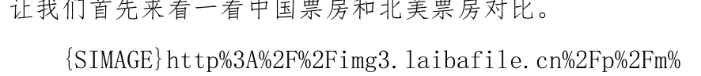

根据过去 25 年的中美电影票房数据（2019 年数据为普华道发布的《2019-2023 娱乐及媒体行业展望》报告中的预估数据），京叔绘制了以上图表。其中橙色柱状表示的是北美票房（已根据历史汇率折算为人民币，单位为“亿元”，刻度在图表左侧），蓝色柱表示的是中国票房（单位为亿元，刻度在图表左侧），灰色折线表示的是中国票房相当于北美票房的比率（刻度在图表右侧）。由上图表，我们可以得到以下几个结论：

- 1) 中国票房总规模已经非常接近北美票房

在列表中，代表中国票房的蓝色柱在 2002 年以前几乎可以忽略不记。在 1995 年，中国票房为 9.5 亿人民币，2002 年也仅为 10 亿。期间，北美票房从 17.2 亿美元（约合 44 亿人民币）发展到 84 亿美元（约合 69 亿人民币）。中国票房相当于北美票房的 43%，是过去 25 年的最低点。至 2018 年，中国票房已达 610 亿人民币，北美票房为 84 亿美元（约合 78 亿人民币）。中国票房相当于北美票房的 77.7%，预测 2019 年中国票房将相当于 92%，差距进一步缩小。

- 2) 近年来，中国票房发展迅猛

2002 年后中国市场逐渐发力，尤其是 2009 年以后的十年，中国票房发展迅猛，从 2009 年的 63 亿发展到 2018 年的 610 亿人民币。

- 3) 北美票房规模的停滞

中国市场正好相反，北美市场在 2002 年后一直徘不前，甚至在许多年有所下降。从 2002 年至 2018 年，仅增 34.2 亿美元。

综上所述，在过去 25 年里，中国票房从北美票房的 43% 发展到 2018 年的 77.7%，以及 2019 年的约 90%（据预测），中国市场已经非常接近北美市场。而且中国市场发展放缓，北美市场停滞，不是意外的话，中国市场在最近两年超过全球最大的单一市场。由此可见，好莱坞电影中出现越来越多的中国元素将是概率。

## 251 楼 
作者：上海京叔 日期：2019-12-29 11:42

1999 年，京叔再次出发，这次是携新婚的太太去泰国度假。印象中，当时泰国旅游还不如想象中普遍。京叔和太太在泰国逛了曼谷、芭提以及泰国边境的桂棉河，自然也参观了泰国特色的人妖表演。记得当时泰国的平均收入依然高于中国的水平，消费水平不像像欧美那样高，比国内高一点，但还可以接受。记得汽车比国内便宜很多，由于是跟团游，所以跟当地人的接触不多，主要接触的都是旅游从业人员。当时赴泰国旅游的中国人已经不少，但不像现在这样多。而且基本上是跟团游，好像还没有自由。

现在，人都提到泰国，首先想的人妖、海滩、泰国沿、或者是“泰国回”、佛寺，应该把泰国和现代化以及上世纪九十年代经济联系在一起。中期，泰国可是当年的“亚洲小老虎”之一，曾紧随“亚洲小老虎”之首进入发展国家之列。当时，泰国的经济猛进，外资投资泰国的势头十分迅速。泰国的工业水平似乎比国内先进，印象中也在欧美市场看到过不少泰国产品，如运动服、鞋等，还见过泰国的硬件。

泰国的收入水平大于中国。国内的一个朋友在九十年代中期赴泰国工作过几个月，他告诉京叔，当时在他们公司同样的工作（制造工程师），泰国的收入大约是中国的5~6 倍。当时泰国人（至少是曼谷的泰国人）看中国，可能就像现在看越南差不多。京叔在泰国旅游期间，便遇到一个上海某大医院的医生，放弃国内的工作，在泰国的旅游商店卖假药。如果是现在，大家一定会认为只有“脑残”才做这种选择。但在当时，包括京叔在内的全旅游团的人不觉得有什么奇怪，反而觉得那是正常的选择。

京叔去泰国的时候，泰国刚经过东南亚金融危机的冲击，经济受到了巨大的打击，泰国人的收入水平如果如美元，则几乎腰腰。接触的泰国人都认为那是暂时的情况，很快就能恢复。但他们没想到的是，那其实是一个转折点，从那以后，泰国和发达国家的梦便渐行渐远。

## 258 楼 
作者：上海京叔 日期：2019-12-29 17:59

@上海京叔 2019-12-28 19:04:59

一篇，过去25年中国电影票房取得很多好帖

如果你经常看电影，将会发现一些现象。在最近几年的好莱坞大片中，越来越多的“中国元素”出现，而且“中国元素”越来越频繁。在以前好莱坞电影中出现最多的中国元素是中国功夫和中餐，而今却变成了空间站、火箭等等。这种变化背后的推手，便是快速变化的中国电影市场。

因为北美票房是当今世界排名第一的单一市场，所以让我们先来看一看中国票房和北美票房对比。

http://static.tianyui.com/static/img.gif......

## 260 楼 
作者：上海京叔 日期:2019-12-29 22:39

1999 年，京叔再次出国，这次是携新婚的太太去泰国度假。印象中，当时泰国旅游还不如想象中普遍。京叔和太太在泰国逛了曼谷、芭提以及泰国边境的桂棉河，自然也参观了泰国特色的人妖表演，先后在泰国停留了一个星期。记得当时泰国的平均收入依然高于中国的水平，消费水平不像像欧美那样不可攀，比国内高一点，但还可以接受（太久了，记不清了）。记得的是汽车比国内便宜很多，由于是跟团游，所以跟当地人的接触不多，主要接触的都是旅游从业人员。当时赴泰国旅游的中国人已经不少，但不像现在这样多。而且基本上是跟团游，好像还没有自由。

现在，人都提到泰国，首先想的是人妖、海滩、泰国沿、或者是“泰国回”、佛寺，应该把泰国和现代化以及上世纪九十年代经济联系在一起。中期，泰国可是当年的“亚洲小老虎”之一，曾紧随“亚洲小老虎”之首进入发展国家之列。当时，泰国的经济猛进，外资投资泰国的势头十分迅速。泰国的工业水平似乎比国内先进，印象中也在欧美市场看到过不少泰国产品，如运动服、鞋等，还见过泰国的硬件。

泰国的收入水平大于中国。国内的一个朋友在九十年代中期赴泰国工作过几个月，他告诉京叔，当时在他们公司同样的工作（制造工程师），泰国的收入大约是中国的5~6 倍。当时泰国人（至少是曼谷的泰国人）看中国，可能就像现在看越南差不多。京叔在泰国旅游期间，便遇到一个上海某大医院的医生，放弃国内的工作，在泰国的旅游商店卖假药。如果是现在，大家一定会认为只有“脑残”才做这种选择。但在当时，包括京叔在内的全旅游团的人不觉得有什么奇怪，反而觉得那是正常的选择。

京叔去泰国的时候，泰国刚经过东南亚金融危机的冲击，经济受到了巨大的打击，泰国人的收入水平如果如美元，则几乎腰斩。接触的泰国人都认为那是暂时的情况，很快就能恢复。但他们没想到的是，那其实是一个转折点，从那以后，泰国和发达国家的梦便渐行渐远。

## 262 楼 
作者：上海京叔 日期：2019-12-29 22:39

@上海京叔: 2019-12-29 11:42:44

1999 年，京叔再次出国，这次是携新婚的太太去泰国度假。印象中，当时泰国旅游还不如想象中普遍。京叔和太太在泰国逛了曼谷、芭提以及泰国边境的桂棉河，自然也参观了泰国特色的人妖表演，先后在泰国停留了一个星期。记得当时泰国的平均收入依然高于中国的水平，消费水平不像像欧美那样不可攀，比国内高一点，但还可以接受（太久了，记不清了）。能记...

## 264 楼 
作者:上海京叔 日期:2019-12-30 07:44

有关泰国的情况，网上介绍的已经很多人了，京叔就没什么好重复了。在这里，京叔想和大家聊聊的有件事。第一是97年的亚洲金融危机，第二则是泰国的红黄之争。

前面说，1999 年京叔访问泰国的时候，泰国经历过东南亚金融危机的冲击，泰铢贬了约40%，普通泰国人的生活受到了严重的影响。笔者的一个泰国朋友正在美国留学，告诉京叔，他当时几乎因此而顿顿。而且也是泰国引发国家梦的终结。

东南亚金融危机的爆发显然是因为泰国经济（及与其南亚国家经济）内的缺陷，但其火索则是美国经济鳄索罗斯代表的国际投资资金做空泰铢的行为，这该没有什么疑问了。这由泰国政府在之前错误地开放了泰国的金融市场，国际投资资金可以很容易地做到这点，然后通过做空使泰铢贬值（在这个过程中将泰铢又转换美元）。待泰铢贬值后，用较少的美元在贬值后的泰铢，偿还贷款。泰铢汇率差在扣除贷款所需利息就是投机资金的利润。当然，其中的真实的过程远比京叔的上述叙述复杂（国际投资同时伴随做空），但基本原理便是如此。

## 265 楼 
作者:上海京叔 日期:2019-12-30 19:46

京叔几个同事曾亲历2006年的泰国军事政变。如同京叔所说，泰国的军事政变几乎没有戏，而且军队与市民十分融合。2006年军事政变后的几年，泰国动荡不断，上演政治剧。京叔每次前往泰国时，朋友提醒千万红色或黄色的衣服，以免遭殃。泰国的动荡源于极端撕裂，泰国社会分裂为主要以曼谷居民为主“黄衫军”和主要以农民为主“红衫军”。黄衫军主要由中产阶级、地主阶级、富人员组成，人数少数（约30%），但占有财富远超红衫军（约80%）。红衫军由农民和底层居民组成，人数占优势（约70%），但占有财富少于黄衫军（约20%），得到军队的支持。2006年军事政变以后才出现，京叔相信自己是民主，但却以红衫军为政治基础在泰国政坛上升。推行的政策大多牺牲了黄衫军的利益。这种不满引发黄衫军的不满慢慢积累，随着2005年选举后，红衫军的压力让泰国政局陷入怪圈。通过政变等手段将黄衫军赶下台，直到2017年9月一次大。

## 267 楼 
作者：海上京叔 日期:2019-12-30 22:04

听说延迟退休要实行了，有没有准确消息吗？

## 268 楼 
作者：上海京叔 日期:2019-12-31 07:35

如前所述，在上世纪的最后几年里，京叔开启了自己的第一波海外之旅，在三年的时间里，京叔先后拜访了德国、瑞士、法国、美国和泰国（除了前述的美国之旅，京叔还多次到访美国，就不详述了）。通过这一波密集的海外之旅，京叔亲眼见到了发达的欧美资本主义国家，以及我们的东南亚邻国。在当年的那个时候，互联网刚刚起步，更没有智能手机，所以信息还是相当匮乏。有机会近距离观察外面世界，还是令人惊叹。正如京叔在前面反复强调的，当时的西方社会在政治上、军事上、技术上、物质上以及精神上都处于一个相对全面的高峰。从政治来说，得了冷战的胜利，苏联解体，东欧溃，剩余的社会主义国家（如中国、古巴、越南等）也似乎信心不足，西方社会在欢呼“历史的终结”。从军事来说，随着华约的解体，以及中国衰弱的军事实力，世界上没有任何能够钳制（更别说对抗）西方世界的军事实力；以美国海军为首的联军迅速击溃了近岸的伊拉克，以及赶越越南的战势；再加上以“零亡约翰”的胜利赢得战争胜利，使得世人都相信美军不可战胜（很可能事实也是如此）。

岁的工人在下班以后突发心脏病去世了。希望能对这种高强度工作的人群有特殊照顾。

272 楼 作者:海上京叔 日期:2019-12-31 15:05

@沂蒙山人 2016 2019-12-31 09:47:43

客观中肯，喂喂叨来，引人入胜，这个帖子太棒了！

楼主加油！

为楼主点赞!!!

感谢

273 楼 楼主:海上京叔 日期:2019-12-31 18:54

祝各位运友元旦快乐

来自

276 楼 作者:海上京叔 日期:2019-12-31 20:13

2019 年已近尾声，2020 年即将来到到来。

或成功，或失意，
旧的一年都已经留在了身后；
或期待，或淡定，
新的一年也已经到了面前，

让我们一起，默默地等待，那将更加美好的未来。

277 楼 作者：海上京叔 日期：2020-01-01 08:51

外一篇

2018 年，GDP 总量世界排名前四名依次为美国、中国、日本、德国。根据中美日德2018 年 GDP 数据，京叔整理出了下列汇总（由于数据来源不同，可能会有小差异，但应该不影响结论）。

总结来说，通过分析数据，我们可以得到一些有趣的结论：

- 1) 美国 GDP 总量遥遥领先，均大于日德之和的其实再加上排名第五的英国，仍然赶不上中国。
- 2) 出于京叔判断，中国第一产业（农业）无如此强大，美日农业增加值总量也仅占中国的 26%。以此如此强大的农业产出，我们仍然大量从外（包括美国）进口农产品，养活中国人可真不是一件简单的事情。
- 3) 中国第二产业（工业）增加值已超过美日之和，约相当于美国、日本加半个德国。中国工业增加值额多于全球的分分之一（约 26%），是名副其实的世界工厂。这一点出京叔意外。但我们需要看到的，是美国工业总总量在 1913 年就超过全球的35%。在战后，1948年，美国所占资本主义世界工业生产总值比为54.6%。这说明中国工业距离巅峰的美国还有很大差距，我们“任需努力”。
- 4) 中国第三产业（服务业）不到美国的一半，这是美之间差距之处之一。这一块中，包含了较大的水分，比如美国的法律服务就约1万亿美元，而这种 GDP 实际上并未增加国民福利，而是加重了国民痛苦（京叔在准备资料里写过有关“幸福GDP”和“痛苦GDP”的文章，其实不要也罢）。

总之，中国现在的状态并不接近二十世纪初的美国。在第一、第二产业为代表的“硬经济实力”上成为世界第一，但老牌强国（二十世纪初的英国，现在的美国）凭借着优势、惯性；依然在金融、法律等“软经济实力”方面占据着合理的优势，并在政治、军事方面落后于后强国（二十世纪初的美国，现在的中国）。但“软经济实力”最终是以“硬经济实力”为归宿的，中国经济实力重回世界之巅是大概率事件。随着经济实力重回世界之巅，在政治、军事上的世界之首只是时间问题。所以，现在的中国只要做好自己的事情，便没有人能阻止我们重回汉唐盛世。现在的中国和中华的的确可以做到“我命由我不由天”！

279 楼 作者：上海京叔 日期：2020-01-01 17:39

各位朋友新年快乐

来自

286 楼 海上京叔 日期:2020-01-01 22:06

反之，当时的中国在几乎任何方面都处于一种近乎绝望的落后，中国人很难见到短短20 年后，中国便能成为全球第二大国。所以中国人对于西方还处于一种虚幻的状态。从收入方面比较，更是天壤之别。记得在九十年代（大约是94年末），京叔的一个同学在美国毕业获得了博士学位。这位同学当时的入职薪资是3.8万美元，而京叔的月薪才600多元人民币。即便以美元计算，同学的收入也是京叔的40多倍，也就是说他一个期的收入完全相当于京叔一年的收入。再加上假期、社保，实际收入更是惨。京叔在97 年访问过一个工厂，其所处的地区是美国较低地区，当地的最低工资也是4.25 美元一小时。如果工作八小时，就有280 元人民币。同期京叔所在工厂的工人薪也不过800-1000 元，这一月薪在当时已经算非常好了。京叔当时2000元的月薪在在国内已经算不错了，但其还没美国一个“不发达”地区法定工资的1/3。所以当时

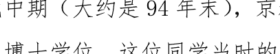

中国人想办法出国，也是可以理解的选择，毕竟在欧美相比，当时的中国也显得落后。可以说，上世纪九十年代是西方世界为止的一个巅峰期，繁荣正孕育着巨大的危机。除了911以外，似乎没有什么让西方世界的担忧。而随着新世纪的到来，911没有出现，却出现了不少更有破坏力的“新”。

289 楼 作者：上海京叔 日期：2020-01-01 23:18

为什么我的帖子又删了？问

290 楼 作者：上海京叔 日期：2020-01-01 23:22

记得在九十年代中期（大约是94年末），京叔的一个同学在美国获得了博士学位。这位同学当时的入职薪资是3.8万美元，而京叔的月薪才600多元人民币。即便以美元计算，同学的收入也是京叔的40多倍，也就是说他一个期的收入完全相当于京叔一年的收入。再加上假期、社保，实际收入更是悬殊。京叔在97 年访问过一家工厂，其所处的地区是美国收入低的地区。当地的最低工资也是4.25 美元一小时。如果工作八小时，就有280 元人民币。同期京叔所在工厂的工人薪也不过800-1000 元，这一月薪在当时已经算非常好了。京叔当时2000元的月薪在在国内已经算不错了，但其还没美国一个“不发达”地区法定工资的1/3。

# 291 京叔 作者:上海京叔 日期:2020-01-02 08:32

2001年9月底，911事件之后没有20天，京叔再次踏上了美利坚的土地。现在回来时，911事件改变了现代史的走向，可以说是具有时代意义的事件。但在当时，京叔说，其意义并没有说明明显，京叔在达拉斯之前也没有意识到这一事件对美国社会的冲击，认为它只是另一件普通的恐怖袭击。在出发前，京叔也曾犹豫是否要改变行程，但在询问美国大使后，还是决定按行程出发。从后来的经历来看，京叔显然低估了911事件的影响。

京叔这次的行程是从上海明尼阿波利斯，然后转飞机亚特兰大，再由亚特兰大去奥古斯塔。上海明尼阿波利斯的行程还正常直到到达明尼阿波利斯。然而，从明尼波利斯开始，行程就不正常了，京叔也开始感觉到911事件对美国社会的冲击。最先感到与以前不同的地方是美国海关人员机场严格地审查到达旅客的入境申请，尤其是对疑似阿拉伯人的乘客表现出明显的敌意。（这里插一段外话，外国内人在美国大使馆或领事馆获得的所谓美国签证实际上不能保证外国人在美国海关能够入境美国）。理论上，即使外国内持有美国驻使领馆的有效签证，美国海关的移民官员依然有权利拒绝外国人入境许可。虽然规定如此，但在实际操作中，京叔在这次赴美之前都没有见过任何美国海关拒绝入境）。但在这次，京叔实际上看到外国人被拒绝入境申请单，进程变慢了（后来看到申请者就不清楚了）。到移民关口时，也被等待了很长的时间。通常情况下，移民官员会询问例行问题，如“你来什么？”、“准备呆多久？”等问题，然后让京叔回答十个问题，而且要求京叔出示邀请函、行程安排、酒店凭证等证据。还好，京叔有一个习惯，会将所有有关的文件打印出来，放在一个专门的文件夹里以备不时，所以最后京叔还是顺利入境。

293 楼 作者：上海京叔 日期：2020-01-02 17:28

@上海京叔 2019-12-29 11:42

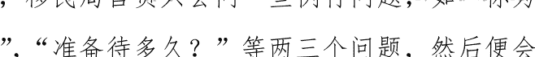

国度。当时去泰国还不像现在普遍，京叔和太太在泰国逛了曼谷、芭雅以及泰缅边的河，自然也参观了泰国特色表演，在泰国停留了一个星期。记得当时泰国的平均收入水平依然高于中国的，比国内贵一点，还可以接受（其实不是京叔的错觉，以后会见识）。

297 楼 作者:海上京叔 日期:2020-01-02 19:44

但是经过海关这一折腾，京叔再次错过了下段班机。好已经在经验，京叔这次并没有着急，驾轻熟地来到美联航的柜台要求改签。按照上次的经验，本以为会受到热情的接待，但这次的情况完全不同。柜台前挤了很多人，美联航机员也是一脸的疲倦与不耐烦，温暖的笑容没有了，耐心的解释也没有了……不容易京叔终于改好了机票。虽然时间还有很多，但基于机场中混乱的状态以及上次在洛杉的经历，京叔打消了去市区的念头，决定在机场中等。和以前到美国的情况不同，候机厅显得混乱。最明显的是机场里多了许多武装的大兵（这是京叔唯一一次在美国见过全副武装的大兵），满头铜盔，脚穿皮鞋，穿防弹衣，手里拿着枪，手指时刻扣扳机警惕地视着周围，完全是一副临战的状态。如果有任何异常发生，京叔一点都不怀疑他们会立即扣扳机。同时，机场里的警察也拿着枪、警棍，聚齐，并不是通过这种一切来监视。所有这一刻，都不着紧张和警惕，非常紧张，使得京叔也不自觉地心里一紧，觉得仿佛一步走错可能被按在地上。可能是由于911事件航空管制造成的航班还没有完全正常，也由于加严的安保措施，或者完全是京叔的心理作用，机场内的人群显得嘈杂和混乱。但机场内的旅客，却一反美国人大大叫的习惯（顺便说一下，京叔的观察，如果你在国外公共场所看到一群旁若无人，大声喧哗的欧美人大概是美国人；如果在公共场所看到一群旁若无人，大声喧哗的亚洲人大概是中国人；显得出奇地沉默。对于加严的安保措施，也没有人抗频繁或侵犯，只是默默的服从，显得非常的不美国”。

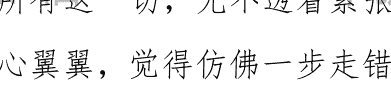

298 楼 海上京叔 日期:2020-01-02 20:42

作者：但是经过海关这么折腾，京叔再次错过了下段班机。好已经在经验，京叔这次并没有急着，驾轻熟路地来到美联航的柜台要求改签。按照上次的经验，本以为会受到热情的接待，但这次的情况完全不同。柜台前很多人，美联航机员也是一脸的疲倦与不耐，温暖的笑容没有了，耐心的解释也没有了……好不容易京叔终于改签好了机票。虽然还有很多，但机场中混乱的状态以及上次在洛杉的经历，京叔打消了去市区的念头，决定在机场中坐。能够到达美国的后，机场候机厅变得凌乱。最亮的是机场中许多拿着枪的大兵（这是京叔唯一一次在美国看到全副武装的大兵），头磕盆，脚蹬裤，身穿防弹衣，手里拿着枪，手指时刻扣扳机视着周围的一切，完全是临战状态。同时，机场里的警察也都拿着枪、警棍齐全，使得京叔也不自觉地小心翼，感觉仿佛一步走就会按在地上。可能是由于911事件后航空管制造成的航班还没有完全正常，或者完全是京叔的心理作用，机场内的人。

299 楼 作者：上海京叔 日期:2020-01-02 14:45

刚发现，前面梯子又砸了，也没有什么内容呀

300 楼 作者：上海京叔 日期:2020-01-02 13:33

但是经过海关这一折腾，京叔再次错过了下段航班。好已经在经验，京叔这次并没有焦急，驾熟练地来到美联航的柜台要求更改。按照这一次的经验，本以为会受到热情的接待，但这次的情况完全不同。柜台前挤了很多人，美联航机员也是一脸的疲倦与不耐，温暖的笑容没有了，耐心的解释也没有了……不容易京叔终于改好了机票。虽然时间还有很多，但基于机场中混乱的状态以及以往在洛林的经历，京叔打消了去市区的念头，决定在机场中等。由于停留的时间太长，京叔决定在候机楼外面透透气，抽烟。在候机楼外，京叔似乎周围的人十分小心，尤其是接人的亲友，接到人后再也没有西方人夸张的表达方式，如拥抱、亲吻等，而是默默迅速地离开，大家似乎都在减少在公共场合的时间（其实不是京叔的错觉，以后会见到的）。抽完烟以后，京叔打算通过安检口返回候机楼的时候，眼前的景象让京叔意外。在911事件以前，说是由于美国没有发生过劫机的原因，美国机场的安检是非常宽松的，通过安检的速度很快的。可是这次，安检变得十分严格，所有人在通过安检时都要脱鞋，脱掉外套和带，大大延长了安检的时间（可能是911事件带给第一个改变吧）。看着一大群人提着外套，有些人还要提着裤子，排队是足足米。可能是由于安检人员没有经验，也可能是安检人员素质，队伍的移动十分缓慢，京叔等了一个多小时才通过安检，回到候机厅，这让京叔几乎有了中国春运的错觉。有了上面的经历，京叔哪里也不去了，老老实在待候机楼里。和第一次访问洛杉不同，这次由于是第一次访问美国，所以对一切都很新鲜，十多个小时的等待似乎一点都不难。由于自己已经多次访问美国，也没有了新鲜感，再加上当时笔记本电脑还没办法方便在机场上上网，更没有智能手机，这次在明尼阿波斯的十几个小时觉得十分漫长，异常焦热。虽然十分疲惫，但可能由于时差的关系，再加上周围的紧张感，始终无法哪怕是睡一小会。经过漫长的多个个小时后，终于登上了亚特兰大的航班。京叔又清楚地记得，当时坐在京叔面前的是两个看起来像阿拉伯人的乘客。这使得整架飞机的乘客（包括京叔）都十分紧张和焦虑，不时又偷偷地瞥他们一眼，然后低声交头接耳，或是指指点点。两位“疑是”阿拉伯人也是非常地不自在。由于这种紧张空气，京叔睡觉的希望再一次消失了。

# 301 楼 作者：上海京叔 日期:2020-01-02 22:21
王经理 微信：1101284955，获取更多

字。在这以前京叔的国外旅行中，从来不是问题，航空公司人员只会对比京叔护照上的姓（Family Name），如果能对上，便会放，所以京叔也不会在机票上纠英文名还是中文名。

可是这一次，登机口的航空公司值班人员竟异寻常地比较真，一定要京叔证明机票上的英文名和护照上的中文名（拼音）是同一个人，这可真的难住京叔了。京叔找出了所有可能有名字的文件、护照、简历、名片、酒店预订单、美丽行程、会议日程……悲催的是这些文件上要是中文名，要是英文名，没有一件上面既有中文名又有英文名，那美国工作人员却坚持要看到一份既有英文名又有中文名（拼音）的文件才可以放。看着窗外近在眼前，京叔都上不去的飞机，京叔真：欲死无悔。

## 306楼
作者：上海京叔 日：2020-01-03 10:40

2019年12月31日，上海地铁客流量为1303万人。
全年客流最高的一天是三八妇女节，达1329万。

## 307楼
作者：上海京叔 日期：2020-01-03 18:55

通常，美国人还是比较通的，一般不会死较真，那是德国人的设法。可是这一次，美国工作人员坚定地不给一点余地，即使与京叔同行的美国同事意愿书面证明“京叔就是”彼京“京叔”也不可以。而且，该工作人员还叫来了警察，如果不是因为有美国同事同行，说不定还会请京叔免费喝美国政府的咖啡。

看着预定起飞时间已经临近，窗外的飞机已经发动起来，京叔还是无法证明“京叔”就是“京叔”。在京叔准放弃放弃的时候，突然灵光闪现，想起公司给的一张名片卡上应该有京叔的英文名，是否有中文名却不是很确定。

抱着忐忑的心情，京叔掏出了那张美国运通的卡。谢天地，这张通卡上面原来有着京叔的英文名和中文的拼音。这一次，京叔终于被放行，准予登机。

由于这次插曲，那飞机错过了起飞时间，还要重新办理值机等登台起飞。虽然飞机很大京叔十分不满意，他一个是坐在舱门头的光大眼睛，一直不停地捂着什么，京叔和同事只好假装听不见。其实京叔心里也是十二万分的不痛快，如果不是那家伙的拳头实在大了，面相也不是很善良，京叔一定会好好和他理论，飞机延误不是京叔的错。

可能是因为是最后一段航程了，精神放松，也可能是实在太累了，京叔在飞机还没开始滑行的时候就睡着了，而且还很沉。其实小型螺旋飞机的噪音远大于我们平常乘坐的喷气式大中型飞机，但即便如此，京叔一点不受影响地睡了一路，直到飞机在奥斯塔塔陆的震动让京叔醒醒了。

如果从上海起飞算起，飞机在奥斯塔机场停稳时，京叔已经旅行了388多个小时了。今为止，这是京叔连续旅行的最长时间记录，而且以后应该也不会太有机会打破这个记录吧。

## 313楼
作者：海上京叔 日期：2020-01-03 22:39
试一下
来自

## 315楼
作者：海上京叔 日期：2020-01-03 23:48

据报道，中国2019年GDP将超过100万亿，人均1万美元。
将超过1万美元，三十年前都不敢想呀。
来自

## 316楼
作者：海上京叔 日期：2020-01-04 10:24

一篇：京叔点评城市系列 1-上海

上海是中国所有城市（包括港澳台）中GDP最高的城市，是中国当之无愧的心脏。上海正真正兴起来已经有200多年的历史，为什么上海能在短时间内200多年时间里从一个名不见经传的小县城发展成中国的经济心脏？上海的崛起不是孤立的，其实代表的是长三角洲的经济力量。唐宋以来，长江三角的经济已经越过中原地区，东南财赋区是各封建王朝的命脉。在近代以前，中国的经济重心是大陆而不是海洋，所以代表东南财赋区的是便于和内陆交流的扬州，南京。近代以来，海洋的重要性逐步提高，所以位于陆海交汇处的上海自然迅速崛起，成为东南财赋区的核心板块。

由于长三角是整个区域最有潜力的地理板块，所以长三角至整个长江流域为经济腹地的上海在未来的中国，东亚，将全世界占有重要的位置。如果所有的潜力可以实现，其实力将它是其他城市（包括北京，香港），其京，首将是无可比拟的。当然，这一切的前提是我们不能忽视她整体那样的惰性错误。上海的不断发展回到唐宋以来最正常的地方。这个正常的位置就是世界上发达地区之一。
来自

## 18楼
作者：上海京叔 日期2020-01-04 14:55

最近的一大新闻热点是美军在伊拉克击杀司令官苏莱凡·曼尼。这一事件再次证明了美军的强大，以及美国总统特朗普的强硬。以笔者观点来看，这一事件不是特朗普强硬的表现，恰恰是其弱的表现。

众周知，特朗普长期以来威胁要伊朗动武，甚至多次传出消息，已经在上面，但是一直没有实际动作。而是伊朗方面击落美国无人机，还出兵叙利亚，一点也没有弱的表现。伊朗做到的这一切令特朗普十分没面子。目前特朗普面临的国际环境，又决定了不可能和伊朗战斗。在美国国内，特朗普上台以孤立主义政策，基本上无法达成国内共识。再加上俄罗斯实力的相对上升，双方阵内的极端势力失控，引起局势恶化的可能。
来自

## 320楼
作者：海上京叔 日期：2020-01-04 15:31

最近的一大新闻热点是美军在伊拉克击杀司令官苏莱凡·曼尼。这一事件再次证明了美军的强大，以及美国总统特朗普的强硬。以笔者观点来看，这一事件不是特朗普强硬的表现，恰恰是其弱的表现。

众周知，特朗普长期以来威胁要伊朗动武，甚至多次传出消息，已经在上面，但是一直没有实际动作。而是伊朗方面击落美国无人机，还出兵叙利亚，一点也没有弱的表现。伊朗做到的这一切令特朗普十分没面子。目前特朗普面临的国际环境，又决定了不可能和伊朗战斗。在美国国内，特朗普上台以孤立主义政策，基本上无法达成国内共识。再加上俄罗斯实力的相对上升，双方阵内的极端势力失控，引起局势恶化的可能。

美伊大战对中国来说应该是利弊之。
利：美国的注意力将转向中东，为中国争取到宝贵的时间；美国攻击伊朗使得中亚诸国感受美国的压力，更加靠近中东；美国必然要争取中国的支持，至少是谅解，这增加中国的筹码。
害：自然会引起油价上升，影响中国经济。但由于几年前中国的石油来源分散化以及石油储备政策已有效，所以风险应该是总体可控的。

## 323楼
作者：上海京叔 日期：2020-01-05 10:03

经过漫长而曲折的行程，京叔终于认为是目的地，可是没想到的是，京叔这次旅行的磨难还没有结束。京叔来到行李提取处想要提取托运的行李，却怎么都找不到京叔的行李，行李居然没有被送到。

奥斯塔机场不是机场，而且京叔飞机到达时已经是凌晨了，行李提取处依然没有工作人员。京叔以及以前的美国同事（顺便说一下，那位老叔的行李也没有），在机场里四处乱找，希望能够找到一个管事的人。最后，在忙似问遍之后，终于找到了能够提供帮助的人。经过这个工作人员对着电脑的一阵努力，以及通过电话的询问，然后最终的告诉京叔，京叔的行李还在明尼阿波利斯。

京叔以及同事已经疲累得没有精力说话了，留下酒店的地址后，便直奔Hertz，开车直奔酒店。当京叔最终到达达萨酒店时，朝霞已经红红了东面天边。从上海“奔赴”机场起，京叔已经奔波了四十多个小时，其中除了京亚特兰到奥斯塔的途中睡了一会儿，基本上没有合眼（顺便说一句，京叔一般不在洲际飞行的航班上睡觉，而且到达目的地以后，一定要坚持到当地正常的睡觉时间再睡）。

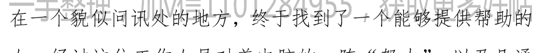

通过这种方式，京叔一般用晚上就能将时差倒过来。京叔本来的行程中，到达酒店后，应该有一天时间调整。京叔入住后，忙碌地洗澡，吃个早饭，又要要去北京会议。另外，由于行李没有换衣服，京叔和同事只好一直穿了一路，好在9月初的天气不算热，各位会员可能都戴上口罩。

## 225楼
作者：上海京叔 日期：2020-01-05 09:37

大家的话题基本上围绕着911事件。911事件的发生，让美国人在事件之后的集体愤怒，使得美国在京叔离开美国之前的十月初开启了阿富汗战争的序幕。和现在的情况不一样，当时的阿富汗战争几乎得到了美国国家一致的维护。京叔接触的每一个美国人，在当时看到的电视节目、报刊文章，均是一倾倒地要求基地组织，惩罚塔林，有大“明犯者，虽远必诛！”的气势。在当时的美国，京叔不记得听到或看到任何反对阿富汗战争的争议。

美国也给予了总统相应的立法授权——授权总统在任何情况下，为了保证美国的安全使用军事手段在内的任何手段的权力。不仅美国国内，当时的国际社会也是不必说，有人出人有钱出钱。中俄也表示积极支持，要是京叔没记错的话，就连伊朗也表示了支持。而中亚五与巴基斯坦更是提供军方基地与空中走廊便于美军攻击阿富汗。

战争开始以后，美军及其阿富汗盟军一路推占塔林，势如破竹，很快几乎占领了阿富汗全境，美军又一次向世人展现了巨大的战斗力。美国媒体几乎以“直播”的形式报道了这场战争，使得美国人民“再次爆发”。京叔所造访的公司，在进门的大厅里挂了一幅很大的阿富汗地图，每天都有专人根据最新报道将美军（及其阿富汗盟军）的进展标在地图上。公司员工每天都会在午时间聚集在一起，热烈地讨论并预测进展。同时，公司里很多地方都会插上国旗或各式宣传画，以示对美国的支持。

## 335楼
作者：上海京叔 日期：2020-01-05 09:38

前面提到，与911事件几乎发生的另一个事件是“噬菌粉末”事件。京叔没有亲历911事件发生时的，但却亲历了“噬菌粉末”事件笼罩下的美国。由于时间久远，可能很多人已经忘记这件事，或者根本没听过这件事，所以先介绍一点背景资料。细菌攻击事件是在美国发生的一起，从2001年9月18日开始的一周内，由于生物“分裂”，共有22人感染，5人死亡。

9月18日，有人把肠炎菌的信寄给几个媒体办公室，第一名感染肠炎菌死亡的是美国媒体的一份叫做“太阳报”的小型罗伯特·文。三个星期后的10月9日，另外两封含肠炎菌的信寄给两名民主参议员：南达科拉州的帕里克·莱森（时任参院司法委员会）和佛罗里达州的詹姆·达施勒（时任参院多数党领袖）。10月15日达施勒的一名助手开了他的信件而被感染。11月16日在一个被扣押的邮袋里发现了未拆开启的给莱森的信。这封信误送到了佛罗里达州政府机关邮政部，一名那里的邮政职员吸入了肠炎菌。

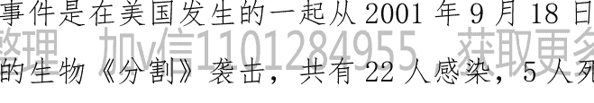

第二批信里的病原比第一批的更危险，它们含有约一克高纯度的几乎完全由孢子组成的干燥粉末，2002年约克州大学的研究教授和分子生物学家巴巴拉·罗森堡在澳大利亚广播公司采访时称这些这些为“武器化”的或“武器级”。

到2008年，联邦调查局把它的怀疑人集中到布鲁斯·艾德华·艾文斯·Ivins（Bruce Edwards Ivins）。艾文斯曾经在马里兰州费德里克马克赛堡政府生物防御实验室工作过。他得知将被捕获后于7月26日服用大量乙酰氨基酚自杀。

王凯，加v信110284955，获取更多好恰。
作者：上海京叔 日期：2020-01-07 18:56

外一篇：京叔点评城市系列 1-上海

上海是中国所有城市（包括港澳台）中GDP最高的城市，是中国当之无愧的心脏。上海正真正兴起来已经有200多年的历史，为什么上海能在短时间内200多年时间里从一个名不见经传的小县城发展成中国的经济心脏？上海的崛起不是孤立的，其实代表的是长三角的经济力量。唐宋以来，长江三角的经济已经越过中原地区，东南财赋区是各封建王朝的命脉。在近代以前，中国的经济重心是大陆而不是海洋，所以代表东南财赋区的是便于和内陆交流的扬州，南京。近代以来，海洋的重要性逐步提高，所以位于陆海交汇处的上海自然迅速崛起，成为东南财赋区的核心板块。

由于长三角是整个区域最有潜力的地理板块，所以长三角至整个长江流域为经济腹地的上海在未来的中国，东亚，将全世界占有重要的位置。如果所有的潜力可以实现，其实力将它是其他城市（包括北京，香港），其京，首将是无可比拟的。当然，这一切的前提是我们不能忽视她整体那样的惰性错误。上海的不断发展回到唐宋以来最正常的地方。这个正常的位置就是世界上发达地区之一。

## 344楼
作者：海上京叔 日期:2020-01-06 18:56

北京是中国的首都，也是GDP最高的城市（包括港澳台），是一个巨大的政治中心。北京是一个历史悠久的城市，在元代以前，定位更多的是边疆重镇，和大兰州的地理位置差不多。从元代以后，明、清，北京的版图和范围从传统王朝的区域不断扩张，正是北京作为首都的原因。正是由于这个符合条件的首都，使得明朝每一代都面临无穷麻烦，甚至其最后灭亡与此有关。可以见的未来，北京应该是共和国首都。

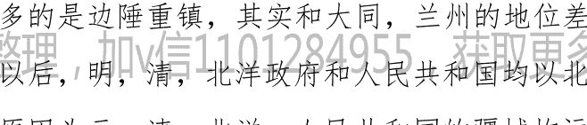

## 346楼
作者：海上京叔 日期：2020-01-07 09:10

前面提到，与911事件几乎发生的另一个事件是“噬菌粉末”事件。京叔没有亲历911事件发生时的，但却亲历了“噬菌粉末”事件笼罩下的美国。由于时间久远，可能很多人已经忘记这件事，或者根本没听过这件事，所以先介绍一点背景资料。细菌攻击事件是在美国发生的一起，从2001年9月18日开始的一周内，由于生物“分裂”，共有22人感染，5人死亡。

9月18日，有人把肠炎菌的信寄给几个媒体办公室，第一名感染肠炎菌死亡的是美国媒体的一份叫做“太阳报”的小型罗伯特·文。三个星期后的10月9日，另外两封含肠炎菌的信寄给两名民主参议员：南达科拉州的帕里克·莱森（时任参院司法委员会）和佛罗里达州的詹姆·达施勒（时任参院多数党领袖）。10月15日达施勒的一名助手开了他的信件而被感染。11月16日在一个被扣押的邮袋里发现了未拆开启的给莱森的信。这封信误送到了佛罗里达州政府机关邮政部，一名那里的邮政职员吸入了肠炎菌。

第二批信里的病原比第一批的更危险，它们含有约一克高纯度的几乎完全由孢子组成的干燥粉末，2002年约克州大学的研究教授和分子生物学家巴巴拉·罗森堡在澳大利亚广播公司采访时称这些粉末为“武器化”的或“武器级”。

到2008年，联邦调查局把它的怀疑人集中到布鲁斯·艾德华·艾文斯·Ivins（Bruce Edwards Ivins）。艾文斯曾经在马里兰州费德里克马克赛堡政府生物防御实验室工作过。他得知将被捕获后于7月26日服用大量乙酰氨基酚自杀。

邀请和陪同。京叔然没有机会一览这个高尔夫“圣地”的风采。

现在已经几乎没有人了，尤其是中国人，还记得当时的9/11恐怖袭击事件了。但在当时，对于美国人生活的冲击远不亚于9/11事件。9/11事件发生在很短的时间内，大多数美国人除了感到恐惧与愤怒以外，其实真正感受到了威胁。如京叔当时，不少人认为不坐飞机就不会危险，他们是安全的。

来说，9/11袭击事件不同，其持续时间长（持续好几个星期），这段时间全部被笼罩在（事件的阴影中）。由于年轻人毫不理解9/11袭击有多可怕，他们生活几乎没有关系。但当时的情况不太一样，人们还是收到大量的邮件，如信件、账单、通知等，尤其是大量的广告（类似于现在的短信）也会牵连到每一个家庭。

当时电视新闻报道都会跟踪事件的最新进展，更加加重了人们的焦虑。由于报道中充斥了大量的信息，使得事件的影响无限放大，人们减少了公共场合的时间，尽量待在房间里，哪也不去。这种氛围的影响，确实不好。

9/11事件的连续发生，使得美国人第一次感受到了切实的威胁，对于巅峰期的美国是一个小的打击。从这次事件开始，美国人的心态逐渐变化，从骄傲逐渐变为焦虑，对未来充满信心逐渐变为不确定。然而，当时只是开始，这种过程延续了几乎20年，直到现在其实未终结。

中国的一个经济特区，也是中国GDP第三高的城市（包括港澳）。深圳以短年的发展展现了规模，不可谓奇迹。建立之初的目的十分简单，就是对接香港，从某种意义来说，形成了这种模式。

来自台湾以及海外华人的投资，与此同时来自全国的人才为深圳提供了充足的人力资源。经济特区的特殊政策为深圳相对于其他城市（如上海）提供了不对称竞争优势。这一切就成了奇迹。不同于上海、北京，这两个城市都有明确的城市定位和清晰的地缘属性。深圳就比较尴尬了，其城市定位变得模糊不清。如前所述，其最初的定位是补充香港（九十年代末深圳人才还梦想成为香港的一部分）。但是由于深圳的超预期发展，这种定位显然已经合时宜。是否允许深圳平等融合？赵绍认为对香港最有利。还有种可能的选项，那就是如南京、扬州、苏州成为长三角的领头羊，替代广州成为珠三角的代言人。这种选项的前提是深圳脱离广东省成为直辖市。总之，深圳未来有多种，充满了机会，也充满了不确定性。这座城市已经取得了成就以及中国人骄傲了。

2001年的美国之旅让京叔见证了美国社会心态变迁的开始（虽然那时还没有意识到）。很快，应该是2002年秋天吧，京叔开启了美利坚之旅，心里不同以往。以前的任务，他们去了五大地区考察了一家工厂。公司已经决定关闭那家工厂，并将原封不动地搬迁到中国，而那家工厂的生产任务也一同转移到中国。那家工厂很大，大概也就三百人，但历史不短，大部分工人都在工厂工作了很长时间。

当京叔到达这家工厂的时候，关厂的决定还没有正式宣布，但已经有很多小消息在传播。而京叔的到达更是像在热油锅里浇了一勺水，使得小消息更加显著。京叔其实知道，工厂的工人都会被解雇，只有极少数人员和管理人员会被转调到其它工厂，但他们应该还不知道，还有人幻想着会被安排到其它岗位。

当然，几年前京叔来到美国的那种待遇是不可能的，工厂的氛围也十分诡异，京叔明显感受到工人们的敌意。当离比较近时，京叔能看到他们三五成群低声窃窃地私语，并且向京叔的方向迅速瞥一眼。而京叔靠近后，则迅速散去。除了确切自己会转调到其它岗位的一个两个管理人员、技术人员以外，没有人主动和京叔交谈。即便被问到，也会尽量简单的三言两语来回答，也比较敷衍。即便是在吸烟处这种比较松的地方，别的吸烟者也会刻意地和京叔保持一段距离，或者看到京叔靠近就默默离开。像以前那样仔细地传授技术自然也没有了，而当京叔提问时，也不会像以前那样耐心地解答，甚至有人直接拒绝回答。

有一个五五十岁的检验员直接对京叔说：“我知道你们要干什么，我是不会回答你的问题的，我不会让你们抢去我的工作”。说实话，京叔真的有点同情她。

在那趟美国之旅中，京叔还专程前往俄亥俄州参观空军博物馆。京叔驶过的地区是美国的“五大湖地区”。该地区在上世纪初曾经是美国工业的核心之一，布法罗、密根、克利夫兰、底特律、芝加哥和密尔沃基等著名城市均在五大湖地区。广义的“五大湖区”在当时集中了大量的汽车、钢铁、化工工业，是美国经济的支柱之一。但是在二战以后，其工业逐渐衰落，大量的工厂关闭、迁离，使得这一地区成为美国著名的“铁锈带”。

这一地区很难看到美国工业的景象。当时正值秋日，满眼都是各种色彩，或红，或黄，连绵不断，令人流连忘返。京叔情不自地多次“停车坐看风景”，以至于足足花了三个小时才到达目的地。比较意外的是，在道路两旁几乎看不见废弃的工厂，这里都是一般不大（京叔估计的工厂应该都已经拆迁了），但是铁锈斑斑的，看得出来已经很久没有人类活动（不过，铁锈到处是黄或黄红色，铁色十分夺调）。的确无愧为“铁锈带”。

矛盾的是，“五大湖区”的环境由于工业衰退而得到了巨大的改善。正如京叔沿途看到的，这一地区已经没有传统工业的漫尘，管道纵横，反而有五彩缤纷的秋色。

京叔发现以前，美国在上世纪末受到冷落。同样在这五年间，京叔多次出访，对于欧美国家已经没有了第一次出门的新奇和震撼，并且可以用比较平和的心态观察外部世界。虽然还需要去北京、天津，但已经没有五年前的那种绝望了。在这五年中，很多中国人（包括京叔）买下了人生的第一套住房，汽车也不是遥不可及了（京叔还没有买车，但京叔的同学已经买了车）。而京叔大学时的理想，包括电视、电影机、组合音响、冰箱、洗衣机的整套，已经是非常基本的需求了。

而此时时光走到2002年，仅仅几年前还是京叔觉得高上的美国工人，便沦为了京叔同情的目标。

2001年的美国之旅让京叔见证了美国社会心态变迁的开始（虽然那时还没有意识到）。很快，应该是2002年秋天吧，京叔开启了美利坚之旅，看着美国之旅，心里不同以往。以前的任务，他们去了五大湖地区考察了一家工厂。公司已经决定关闭那家工厂，并将原封不动地搬迁到中国，而那家工厂的生产任务也一同转移到中国。那家工厂不是很大，大概也就三百人，但历史不短，大部分工人都在工厂工作了很长时间。

当京叔到达这家工厂的时候，关厂的决定还没有正式宣布，但已经有很多小消息在传播。而京叔的到达更是像在热油锅里浇了一勺水，使得小消息更加显著。京叔其实知道，工厂的工人都会被解雇，只有极少数人员和管理人员会被转调到其它工厂，但他们应该还不知道，还有人幻想着会被安排到其它岗位。

当然，几年前京叔来到美国的那种待遇是不可能的，工厂的氛围也十分诡异，京叔明显感受到工人们的敌意。当离比较近时，京叔能看到他们三五成群低声窃窃地私语，并且向京叔的方向迅速瞥一眼。而京叔靠近后，则迅速散去。除了确切自己会转调到其它岗位的一个两个管理人员、技术人员以外，没有人主动和京叔交谈。即便被问到，也会尽量简单的三言两语来回答，也比较敷衍。即便是在吸烟处这种比较松的地方，别的吸烟者也会刻意地和京叔保持一段距离，或者看到京叔靠近就默默离开。

像以前那样仔细地传授技术自然也没有了，而当京叔提问时，也不会像以前那样耐心地解答，甚至有人直接拒绝回答。

有一个五五十岁的检验员直接对京叔说：“我知道你们要干什么，我是不会回答你的问题的，我不会让你们抢去我的工作”。说实话，京叔真的有点同情她。

在那趟美国之旅中，京叔还专程前往俄亥俄州参观空军博物馆。京叔驶过的地区是美国的“五大湖地区”。该地区在上世纪初曾经是美国工业的核心之一，布法罗、密根、克利夫兰、底特律、芝加哥和密尔沃基等著名城市均在五大湖地区。广义的“五大湖区”在当时集中了大量的汽车、钢铁、化工工业，是美国经济的支柱之一。但是在二战以后，其工业逐渐衰落，大量的工厂关闭、迁离，使得这一地区成为美国著名的“铁锈带”。

这一地区很难看到美国工业的景象。当时正值秋日，满眼都是各种色彩，或红，或黄，连绵不断，令人流连忘返。京叔情不自地多次“停车坐看风景”，以至于足足花了三个小时才到达目的地。比较意外的是，在道路两旁几乎看不见废弃的工厂，这里都是一般不大（京叔估计的工厂应该都已经拆迁了），但是铁锈斑斑的，看得出来已经很久没有人类活动（不过，铁锈到处是黄或黄红色，铁色十分夺调）。的确无愧为“铁锈带”。

矛盾的是，“五大湖区”的环境由于工业衰退而得到了巨大的改善。正如京叔沿途看到的，这一地区已经没有传统工业的漫尘，管道纵横，反而有五彩缤纷的秋色。

目前中国东北工业区面临困境，美国“铁锈带”在上世纪下半面临困境。两者曾经为国家的发展做出卓越贡献，由于经济的发展而逐渐失去竞争力，特别是人口流失。让世惊讶的是，五六年前被日军随便溃负的中国军队，却在朝鲜战争中彻底胜利地将美国为首的联合军击退了百公里，让美军经历了“史上长距离的溃退”。从此以后，中国由一个可以被随便溃负的弱者变成了列强之一，再也没有人可以忽视中国的声音。

其次，“难营”内涵不断使得局势愈加深化。正是由于上面所述的原因，“难营”也不是一个内部凝聚力的团体，而是一个以谋取私利为目的的各种小团体的联盟而已（这倒是符合“难营”一以来的历史）。各种内部分裂与斗争不断。这使得“难营”本来就弱势的局势更加没有希望。

一个没有目标，没有思想，没有团结的“三无”团体，如果失败就是天理所容了。其实“难营”目前存在的唯一意义在于做，“难营”对对手之外的一个选择，起到一种“刹车”的作用。以笔者看来，“难营”如果一直采取目前这种“投机取巧”的做法，必将随着对手越来越成熟而变得越来越游化，获取更多利益。

不过，其实对岸地区“选举”的结果已经对于整个局势没有太大的影响，只不过是“杯中的风暴”。反映国家分裂已经暴露了中国的底，从而排除了相关势力误判的可能。由于中国的实力不断上升，一旦局势恶化，发生最终行动，美国积极介入的可能性已经微乎其微。而没有美国的介入，日本更不可能单独介入（即使它介入，也不会改变最终结果）。没有外部势力的积极介入，最终行动的结果将毫无悬念。作者认为，无论“对岸地区”领导人是谁，都应该已经看清楚了这一点，所以也不会挑战底线。唯一种希望就是以拂待之，希望于发生如苏联解体那样的事件。

还是那句话，“只要我们做好自己的事情，便没人能打败我们。”

# 443 楼
作者：上海京叔 日期:2020-01-13 10:25

由于工作关系，京叔曾在不到十年的时间里到过十多次五大湖地区，拜访了几乎所有“五大湖”地区的主要城市，布法罗、密尔沃基、克利兰、芝加哥、密尔佛，很多城市去了多次，便到克利兰堡，待了不下七八天。

在这些著名的工业城市中，访客们都可以清楚看到那些城市曾经的辉煌，也能看到他们现在的落魄。前些年大量报道的低律，应该是几乎千家户睡饱了，1美元买一辆别的故事就此几人曾，京叔说就不再复照镜子，梦想和大家分享的是京叔比较了解的克利兰堡。

克利兰堡市于1836年，坐落在伊利湖南岸，奥克拉荷和摩根财团曾根于此，至今仍有不少世界500企业的总部，如Eaton、Parker-Hannifin等。克利兰堡博物馆收藏丰富，在美国仅次于纽约都会博物馆，克利兰交响乐团也名声遐迩。音乐厅，也是著名的地标建筑。所有的这一，无不彰显着克利兰堡过去的辉煌。

但现在的克利兰堡市区，不少街道显得破败，在大街上经常可以看到一些封闭的建筑，这些建筑上可以看到依然精美的雕像、塑像，以及斑驳的色彩，暗示着它们曾经照摄攘，人来往，但如今人去楼空，大门紧锁，有的门窗还钉着木板，有一种掩盖不了的颓败感。

在市区外，不难见到废弃的厂房，校园、住宅区及课堂的废弃。厂房有很多高耸的烟囱，巨大的厂房，却空无一人；废弃的校大门紧锁，锈蚀的铁栅栏歪歪扭八；有着一种破败重工业的凄美。据说不少人专程前往这些废弃厂房“探险”，而好莱坞时不来此取景，而废弃的住宅则充斥着半毁的小楼，脱落的墙皮和被砸碎的玻璃，以及墙上乱的涂鸦：

市中心基本上是黑人与流浪者的聚集区。大街上偶尔会路过几个街衫衬裤的黑人，人们伸出手喊一句：“can you help me? (你能帮我吗?)”。京叔曾经在克利夫兰中心一条街上住过多个星期，天黑以后，就基本没有出来酒店的大门。一次，有个同行的美国同事（不是克利夫兰人）在晚上6点多种出酒店，一定要拉上京叔和他们同行，便胆壮。

京叔有一个美国朋友，便是克利夫兰人，出生在上世纪五十年代的克利夫兰，并在克利夫兰长大。他告诉京叔，在他小时候的记忆里，克利夫兰还是十分繁华，但好像从七十年代就开始逐渐下滑，许多工厂开始关闭和迁出，到八十年代，便势已尽，失业率已经超过了10%。

# 455 楼
作者：上海京叔 日期：2020-01-13 22:52

@acq441 2020-01-13 18:26:46

楼主听听说，你研究二战吗？你看过几本书？你访问过亲历者吗？二战时期，日本军队的战力排兵世界第一。中国战战场上有全世界最强大的战力的日军，中国军人（正面战场国军和敌后战场）独自抗击日本法西斯14年，把太平洋战场的日本主力始终拖住，后来被美军打垮消灭了。不管国军还是军队，所有在抗战中堪敌的中国人都让我们永远铭记。但我们不正视历史，其实是对英雄。抗战中的普通士兵无疑是英勇的，这一点得到了美国人、日本人的一致赞同。但是国军的上层却是拙略的，这都是中华民族的耻辱。1944年，战争进入高潮，盟军在诺曼底登陆、美军在菲律宾海战中打断了日本帝国国的骨架。而在中国战场，从华北到广西，日军损耗60万，直接导致盟军战力极其失望，罗斯福在雅尔塔会议上出让了中国利益。同样是中国军人，仅用六年以后，便打败了日军。这一巨大的反差，震惊了整个世界，充分说明了中国士兵是优秀的。一个民族要想进步，必须有勇气直面历史，正视自己的缺点和失败，否则自欺人。

# 474 楼 
作者：上海京叔 日期:2020-02-10 09:14

面对一个美国，京叔来聊美国人对朝鲜战争的评价，由于我所接触的美国事务有见解。美国人参加的主要战争有独立战争、南北战争、一次世界大战、第二次世界大战、朝鲜战争、越南战争、两次湾战争以及阿富汗战争。

对于独立战争、一次世界大战、第二次世界大战，都是美国的荣耀时刻。美国人对这些战争的看法比较一致，各地都可以看到许多这次战争的纪念碑或其他纪念建筑，每年有不少纪念活动。而这次战争的参战军形象也十分伟大，甚至有几分神化。南北战争，美国人的主流意识显然将其拔高到一个近乎传奇的步地。但中国人有多少不解的是，在战争中，中国南北方的军人都被塑造成英雄，许多被打败的南方军人似乎还有更高的人气，例如南方军统帅罗伯特·李被塑造成“完人”，其在美国心中的形象远比北方军统帅格兰特高总统。在美国，朝鲜战争似乎是被遗忘的战争，很少见到朝鲜战争的纪念碑（除了华盛顿的朝鲜战争纪念碑，京中见过其它有关的纪念物），也没有专门的纪念日或纪念活动，美国影视作品中也少见到描写朝鲜战争的作品。对于朝鲜战争中的主要对手中国人民志愿军，也没有刻意的丑化与贬低。这一点很奇怪，和其它国家一样，美国其实热衷于影视作品中对待对手的方式，如第一次、第二次世界大战中的德国（参见柏林的电影“大猎者”），越南战争中的越南人（参见泰龙的“第一滴血”），还有冷战中的苏联人和现代朝鲜人。越南战争是美国人心中的痛，或许少见到越南战争的纪念建筑或纪念活动，这点和朝鲜战争类似（应该是多于朝鲜战争）。但是美国大量的影视作品描写越南战争，而且美国对越南战争的了解程度远大于朝鲜战争。京叔接触的美国人基本上都可以说出对越南战争胜利的看法，但在谈到朝鲜战争时往往一脸茫然，除了美国帮助韩国击退朝鲜的进攻而拯救了韩国以外，基本上一无所知。

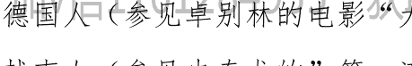

# 477 楼
作者：上海京叔 日期：2020-01-14 21:53

感谢各位位友的关注和鼓励。完成一天的工作以后，浏览各位位友的精彩帖是京叔每天的快乐时光。各位的支持是京叔一路向前的动力。再次感谢大家的支持。

# 503 楼 
作者：上海京叔 日期：2020-01-15 10:29

2002年以后的几年，京叔依然多次前往美国，基本上每年至少一次，对美国早已没有任何新奇感。在这几年间，中国的工业依然在快速增长，京叔所在的公司的中国业务每年都以20%-40%的增长，中国业务在全球业务的比重逐年攀升。

而同时，美国的工厂继续萎缩，前面提到的那家工厂最后是关闭了，所有设备搬到了中国，所有工人全部解雇。前面京叔提到的那个检验员报去了一个超市收银员，少了一半。在那几年，京叔接触的几乎每一个跨国公司都在谈“China Strategy（中国战略）”，似乎一家全球性公司如果没有自己的战略，就不配称其全球性企业。同样那几年，京叔接触的跨国公司中，具有中国背景的主管中国业务的人员进入了高级层。而中国业务也在全球业务中占有越来越大的份额。在这一时期，还发生了一个当时不太显眼但后来证明影响巨大的变化。以京叔接触的跨国公司来说，其在中国投资建厂的目的都是为了抢中国市场，中国工厂的定位基本上都是服务于中国市场。而且一般的中国工厂的产品都会比欧美工厂落后一代或以上，有些欧美工厂将要淘汰。这可能是京叔初期访问欧美工厂受到热情接待的原因，因为中国工厂并未抢占他们的份额。随着中国工厂的技术水平和经营水平逐渐提高，中国市场也逐渐成熟，中国工厂的产品水平在新世纪的第一个十年逐渐接近欧美工厂，并在某些方面甚至超过。另一方面，这些工厂刚建立时，中国基本上没有完善的供应链，大量的零配件均由欧美进口。同样在新世纪的头十年，中国的供应链逐渐完善，零部件的国产化率大大提高，这更加提高了整个工业的竞争力。新世纪的发展，虽然那时没有明显的被感觉到，默默地为二十年代的腾飞和超越做准备。可以说，没有十年代的默默前行，就没有二十年代的高歌猛进。

# 511 楼
作者：上海京叔 日期：2020-01-15 33

2002年以后的几年，京叔依然多次前往美国，基本上每年至少一次，对美国早已没有任何新奇感。在这几年间，中国的工业依然在快速增长，京叔所在的公司的中国业务每年都以20%-40%的增长，中国业务在全球业务的比重日益升。而同时，美国的工厂继续萎缩，前面提到的那家工厂最后是关闭了，所有设备搬到了中国，所有工人全部搬回家。前面京叔提到的那个检验员说他去了一个超市收银员，少了一多。京叔获取更多好处。

# 525 楼 
作者：上海京叔 日期：2020-01-15 34

在那几年，京叔接触的几乎跨国公司都在谈“China Strategy（中国战略）”，似乎一家全球性公司如果没有自己的战略，就不配称其全球性企业。同样那几年，京叔接触的跨国公司中，具有中国背景的主管中国业务的人员进入了高级管理层。而中国业务也在全球业务中占有越来越大的份额。

# 526 楼 
作者：上海京叔 日期：2020-01-15 34

在这一时期，还发生了一个当时不太显眼但后来证明影响巨大的变化。以京叔接触的跨国公司来说，其在中国投资建厂的目的都是为了抢中国市场，中国工厂的定位基本上都是服务于中国市场。而且一般的中国工厂的产品都会比欧美工厂落后一代或以上，有些欧美工厂将要淘汰。这可能是京叔初期访问欧美工厂受到热情接待的原因，因为中国工厂并未抢占他们的份额。

# 527 楼 
作者：上海京叔 日期：2020-01-15 35

随着中国工厂的技术水平和运营水平逐渐提高，中国市场也逐渐成熟，中国工厂的产品水平在新世纪的第一个十年逐渐接近欧美工厂，并在某些方面甚至超过。同时，中国工厂相比欧美工厂具有很大的成本优势。于是中国工厂的产品逐渐开始，所占份额越来越大。同时，欧美工厂相应萎缩，甚至被关闭。

# 528 楼 
作者：上海京叔 日期：2020-01-15 35

另一方面，这些工厂刚建立时，中国基本上没有完善的供应链，大量的零配件均由欧美进口。同样在新世纪的头十年，中国的供应链逐渐完善，零部件的国产化率大大提高，这更加提高了整个工业的竞争力。新世纪的头十年，中国工业正在蓄势发展（虽然那时还没有明显的被感觉到），默默地为二十年代的腾飞和超越做准备。

# 529 楼
作者:海上京叔 日期:2020-01-15 18:06

外一篇：京叔整理的以下表格包含了过去 25 年中历年前 3 部最卖座的电影，红字表示的是美片，蓝字表示的是港片，黑字表示的是国片。

| 时间段 | 大陆片（占比） | 美片（占比） | 港片（占比） |
| :--- | :--- | :--- | :--- |
| 1995-2004 | 43% | 30% | 13% |
| 2004-2009 | 57% | 37% | 8% |
| 2009后 | 75% | 26% | 6% |

（注：此处数据根据文中描述整理）

# 533 楼 
作者：上海京叔 日期：2020-01-16 09:22

2005年夏天，京叔又一次踏上了美国的之旅。按京叔去美国已经十分熟悉，也没有什么特别的地方。但京叔这次美国之旅有点不一样。京叔在公司中部有一家工厂，一位部门经理因故离职了，京叔被要求接这一职位，合同期为三年。京叔面临一个重要的人生选择，如果接受了这一职位，很有概率在满三年以后留在美国，因为满三年后不一定找到合适的职位返回中国。如果这样，京叔需要继续留在美国更长一段时间。另外，京叔如果希望移民，这一机会会有很大的概率实现这一目的。

这家工厂是公司比较重要的一家工厂。同行中，即使在全球所有的同类工厂（包括对手的工厂）中，都应该领先。无论规模还是技术水平，都应该是顶尖水平。这样的机会在现在没有太特别的地方，但是在2005年，还算少见的机会。说实话，对于多次前往美国的经历，京叔不太喜欢长期生活在美国，所以他太愿意接受这一职位。但在当年，移民美国的确很有吸引力的诱惑。在当时，京叔觉得美国的优势较国内还是比较大的，简直对小孩子的教育和以后的发展十分有利。有的人可能会为了小孩子“挣”一个国籍而专程前往美国。京叔对于如何决定，好在帮助别人决定，公司一般会提供一个机会让人前往实地考察。于是京叔决定先去现场了解一下。京叔这次要去的地方位于美国中部的内布拉斯州，一个距离林肯市约100多里的小城市。内布拉斯州位于美国的中西部，在全美相对靠后（大约倒数十名以内），农业经济在该州很有地位，该州产出的牛是全最好的。该州在美国的相当于甘肃在中国的地位。

# 542 楼 
作者：上海京叔 日期：2020-01-17 08:56

@你坏坏更坏 2020-01-17 08:36:28

我觉得说的很客观，言辞也没有激烈之处，人不能满足目前的成绩，也不可固安自非，可是天涯（或者京楼？）连这个观点都不能容忍吗？一定要一味地歌功颂德吗？真是可怜可怜啊。京叔不知道为什么要什么，换几个词调试。

# 561 楼
一手卖 加微信1101284955 提取更多帖
作者：上海京叔 日期：2020-01-17 09:07

在一个夏日的午后，京叔在经过了20多个小时的长途飞行后，抵达了林肯市。林肯市是内布拉斯加州的第二大城市（说是第二大城市，其实也有大约2万人）。京叔租了辆车，直奔林肯市。京叔要去的小城市，那个城市距离林肯市约100多里。内布拉斯加州位于大平原，地势十分平坦，道路笔直。

在高速路上的两个小时旅途中，没有转一个弯。在学中学地理的时候，京叔便学过“美国大平原”。美国大平原是世界上著名的大原，有15万平方公里（作为对比，我们的华北平原只有30万）。这一次，京叔算是真正见到了美国平原，就一个字，大。我中华要有这样大平原，恐怕世界上的一半的人都得说汉语。

不知，是否正确，且作为作家之言录之，作为参考。

一不变的景色，笔直而空旷的公路，定速巡航的汽车。夏日午后的阳光，舒适的空调，再加上长途飞行的疲惫，所有这一切，让京叔渐渐睡着了过去。也不知道京叔睡了多久，也许只有几秒钟，也许几分钟，直到汽车离开了车道，驶上了路边的护路板（在美国的高速公路车道两侧，一般都有约一英尺宽的护路板，就是防止京叔这种这种情况出现），强烈的震动才将京叔唤醒。如果当时的一幕是发生在中国的高速路上，京叔恐怕就没机会在这里写字了。

## 562 楼
作者：上海京叔 日期：2020-01-17 13:48
王磊加微信1101284955，获取更多帖@暖彩2018-01-17 13:12:30

一些添加加瓦的文章也很不错，感谢各位的好文。

说得对，感谢各位的好心！

## 570 楼 
作者：上海京叔 日期：2020-01-18 10:11

经过路上的有惊无险，京叔终于到达了此行终点，一座美国东中部小城，Kearney（科尔尼）。该城位于美国东西岸正中点，离大西洋和太平洋相同的距离。该城的居住民以白人为为主，由于地处内陆，且较为贫困，所以比较能够够吃苦耐劳。现在想起来，他们应该是特明的铁杆支持者，美国“红脖子”。

如果就人的好恶来说，京叔更愿意和美国“红脖子”“打交道”。这些人一般受教育程度不高，收入水平也不高，外部世界的了解也不多，许多人还比较粗鲁。但是相对谓的美国精英，这帮人更加直爽，更加真诚，与他们相处比较简单轻松。正是由于他们受教育程度不高，以及见识无疑，比较容易被牟体或某些集团利用的。

前面提到，京叔收到的工厂是同时行业内的顶级工厂，其设备、技术、工艺以及产品都是在全公司具有标杆作用，即使在全行业来说，也是领先的。但真正让京叔感到惊讶的是这里工人的吃苦耐劳。可以毫不夸张地说，这里工人的吃苦耐劳点都不比中国或日本工厂更多。

## 584 楼 
作者:上海京叔 日期:2020-02-18 10:12

通常在人们的印象中，美国工厂由于公司的存在与政府立法的原因，劳动强度应该大大大于中国或日本工厂，劳动时间也应该少于中国或日本工厂。在京叔以前过的美国工厂中，这一判断都是成立的。但是在这家工厂，情况却不大一样。这工厂常每周工作六天（有时至六天半），每天三班，而且由于是流水线生产，工人在工厂中一刻也不不能停，劳动强度相当大。尤其让京叔诧异的是，该工厂的三班工人是不倒的，白班永远白班，夜班永远夜班（夜班的工资比白班高）。京叔真不能想象一个人可以长年累地上上班。在京叔工作、管理以及访问过的遍欧、亚、美、非各大洲的五百以上的工厂，工人常常上夜班的，这是仅有一例的。

可见，美国也不可能吃苦耐劳的劳动人民。这家工厂的做法显然不符合美国劳动法，不过京叔直到今天也没有没清楚这家工厂当时是如何能够做到如此安排而没有被工会和政府干涉的。至此今日，这家工厂依然存在，但是是否还是如此“暗无天日”就不知道了。

## 585 楼 
作者：上海京叔 日期：2020-01-19 09:19 获取更多好帖 2019年中国进出口数据解读

根据相关数据，笔者整理出中国过去三个年外贸数据如下表，表中数据由于来源与计算关系，可能有细微差异，但应不影响结论。

由以上数据，我们可以得到几个简单的结论：

- 1) 过去三年，中国外贸在严峻的外部环境下，总额创新高，殊为不易。但是年度增速逐渐下降，尤其是2019年的增速已经低于年度 GDP的增速，也说明外贸前景令人堪忧。
- 2) 外贸顺差在过去三年基本保持稳定，均为二万多亿人民币，尤其是2019年，接近三万亿，为三年最高。这表明中国的外收支依然健康，具有较大的抵御金融风险的能力。

就2019 年的外贸数据而言：

- 1) 中国出口占国际市场份额稳步提升。根据世贸组织最新统计，2019年前第三季度，我国出口增速快全球2.8个百分点，国际市场份额增加2018年以0.3个百分点至13.1%。
- 2) 与“一带一路”国家出口增长1.8%，占比提高2百分点至29.4%，说明“一带一路”政策逐渐落实处，而不仅仅是口号。
- 3) 三大贸易伙伴依次为欧盟、东盟与美国，美国下降为我国第三贸易伙伴。对这一点尤其欣慰，这说明以前外贸优于依赖美国的局面大大改善。

总之，在今年复杂的国际贸易环境下，2019年中国外贸成交的成绩应该是满意的。但同时，我们也应该看到，中国外贸的前景依然严峻，在新的一里，我们将面临更大的挑战，也需要我们更大的努力。

## 590 楼 
作者：上海京叔 日期:2020-01-19

根据相关数据，笔者整理出中国过去三年外贸数据如下，表中数据由于来源与计算关系，可能有细微差异，但不影响结论。

## 594 楼
作者：上海京叔 日期:2020-01-19

由以上数据，我们可以得到几个简单的结论：

- 1) 过去三年，中国外贸在严峻的外部环境下，总额创新高，殊为不易。但是年度增速逐渐下降，尤其是2019年的增速已经低于年度GDP的增速，说明外贸前景不乐观。
- 2) 外贸顺差在过去三年基本保持稳定，均为二万多亿人民币。2019年，近三万亿，为年来最高。表明中国的外收支依然健康，具有较大的抵御金融风险的能力。

## 595 楼 
作者：上海京叔 日期:2020-01-19

就2019年的外贸数据而言：

- 1) 中国出口占市场份额稳步提升。根据世贸组织最新统计，2019年前第三季度，我国出口增速快全球2.8个百分点，国际市场份额2018年提高0.3百分点至13.1%。
- 2) 与“一带一路”国家出口增长1.8%，占比提高2百分点至29.4%，说明“一带一路”政策逐渐落实。
- 3) 三大贸易伙伴依次为欧盟、东盟与美国，美国下降为我国第三贸易伙伴。对这一点尤其欣慰，这说明以前外贸优于依赖美国的局面大大改善。

## 596 楼 
作者：上海京叔 日期:2020-01-19

总之，在今年复杂的国际贸易环境下，2019年中国外贸成交的成绩应该是满意的。但同时，我们也应该看到，中国的前景依然乐观。在新的一里，我们需要我们更大的努力。

## 597 楼 
作者：上海京叔 日期:2020-01-19 13:54

就2019年数据而言：

- 1) 中国出口占国际份额稳步提升。根据世贸组织最新统计，2019年前第三季度，我国出口增速快全球2.8个百分点，国际市场份额2018年提高0.3百分点至13.1%。
- 2) 与“一带一路”国家出口增长1.8%，占比提高2百分点至29.4%，说明“一带一路”政策逐渐落实处，不仅仅仅是口号。
- 3) 三大贸易伙伴依次为欧盟、东盟与美国，美国下降为我国第三贸易伙伴。对这一点尤其欣慰，这说明以前外贸优于依赖美国的局面已经发生大改善。

## 598 楼
作者：上海京叔 日期:2020-01-20 10:03

这个地方，整个城市的口也不多，说清楚整个城市也只有几千人（美国和中国不一样，“县”通常比“市”大）。但大城市如洛杉矶也可能几个县，而科尔尼这样的小城市自然就会在一个县境内，是典型的美国中西部小城。城市完全不一样，这里没有明显的市中心，没有熙攘的人群（印象中好像没有见到4层以上的楼房），建筑与建筑之间都有一定的距离，显得比较空旷。

居民门口都是车，几乎没有人行。京叔在当地看不到人行，路上也一样，即便只是凡其外的饭店吃饭，也会聚开车。如果偶然看到街上有人步行，大家都会觉得这个人有点反常。

正如前面所述，当地的居民以白为主。在当地工人的接触中，京叔发现当地人一般比较负责，对于外部世界的了解，可以用匮乏形象来形容。多数人依然不知道北京、上海，甚至有人认为中国（China）是日本（Japan）的一部分（当然，那是十多年以前的情况了，现在应该如此）。

当地人和纽约、洛杉矶等城市的居民完全不一样，与其说他们是城市，不如说他们是农民。不少人家里都有农场，下班以后还要回家。京叔发现这些当地人都比较敏感，由于道路不熟悉，经常在路口停车，等了十分分钟。

两个老人老太太，京叔在铁路交叉口前停车，这是一种十分危险的行为，有可能危及生命。京叔真诚地表示已经接受了教训，认识到了错误的严重性，并坚决不再犯。顺便说一句，京叔告诉朋友，在美国千万不要这样的路口违规，因为美国司机习惯于守交通规则，所以不会会违规路口，中国司机时刻留意交通规则，如果有人违规路口，的确有可能造成祸。

## 605 楼 
作者：上海京叔 日期:2020-01-21 10:14

由于工作的关系，京叔接触了许多处于社会低阶层的工人，既有英格兰地区的工人，也有乔亚、北卡罗莱纳这样的南部的工人，内布拉斯、阿拉巴马这样的中部的工人，还有洛杉矶这样的海岸的工人。总的来说，美国人和中国差太多，并且能够吃苦耐劳，尤其像内布拉斯这样的工人，都是相当不错的工人。

## 647 楼 
作者：上海京叔 日期:2020-01-21 10:14

除了工人以外，京叔也接触了许多工厂的制造工程师、主管以及工厂长。这些人通常也比较勤奋，但是相对来说，从自身能力到学历就有一定差距。而且京叔遇到的这类人年纪大。

## 648 楼 
作者：上海京叔 日期:2020-01-21 10:15

京叔曾经有一个疑惑，那些smart（聪明的）美国年轻人去哪里了？几年以后，由于工作岗位的变化，接触到了律师、会计师、MBA等法律业、金融业、咨询从业人员后，才找到了这个答案。原来，那些人都从事这些行业了。

## 649 楼 
作者：上海京叔 日期:2020-01-21 10:15

总的来说，美国工人可以说是相当优秀的，但是传统制造业工厂里的制造工程师、主管、部门经理就比较有问题。京叔几乎没有见过优秀的美国年轻人从事传统制造业。京叔认为这是制造业回归美国的最大的障碍，关于这一点，暂不开展，留待后面叙述京叔在美国建厂的经历再详。

## 650 楼 
作者：上海京叔 日期:2020-01-21 10:17

美国传统制造业的从业人员，尤其是普通工人，在过去的二十三十年里，随着全球化的推进，他们需要面对的是日本、中国工人的竞争，其利益实际上受损的（例如提到的那个员工）。十分同情这些人的遭遇。而在同时，美国的资本拥有者却是从全球化中获益的。例如，苹果公司2018年净利润600亿美元，这600亿美元其实和美国的工人阶级是无关的。同时，苹果公司却将生产产品的数量以千亿计的工业增加值留了中国，以万万计的中国工人由此可以获得他们更高的收入。

## 651 楼 
作者：上海京叔 日期：2020-01-21 18:09

打开电脑一看，这么多点和评论，有点意外，谢谢大家的爱与支持，也感谢大家在盖楼的过程中一路相伴。

## 683 楼 
作者：上海京叔 日期：2020-01-22 10:36

总是看到网上有一种论调，美国跨国公司将生产放在中国，绝大部分利润都赚回了美国，而中国的制造厂只赚了百分之几的微薄利润，所以中国的制造业是低效、不成功的。而美国公司赚取高额利润是成功的。就以苹果公司为例，2018年苹果公司的净利润为600亿美元，而为苹果代工的中国供应链的平均利润率只有几个百分点。从得出的结论，美国的模式优于中国的模式，美国的模式是血汗工厂。

这个问题我们应该辩证地来看。是的，苹果公司的盈利能力是不容疑的，从企业角度来说，无疑是高效成功的。但是如果我们从企业层面审视，结论有所不同。首先来看，苹果公司的净利润600亿美元之外，大部分利润被资本所有者获取。与此同时，苹果公司将生产产品的数量以千亿计的工业增加值留了中国。对于一个国家来说，美国工人（Indirect Labor，非直接工人）和美国工人（Direct Labor，直接工人）是没有关系。简单来说，苹果公司的生产是一个完美的中互补的案例，中美双方均获得了利益，中国工人也能分一杯羹，而美国工人几乎无获。

## 708 楼 
作者：上海京叔 日期：2020-01-22 16:25

对于一个国家来说，正如上面分析的，工业工人不仅没有受益，反而受到外国对廉价商品的冲击等负面影响，整体收入水平在扣除通胀因素以后，实际上是下降的。随着过去三十年的全球化进程，制造业逐渐流失，产业空心化。由于产业空心化，传统中产阶级中的制造业逐渐减少，美国人收入向两端移动。一方面，以资本拥有者、高管、律师、会计师代表的高端收入群体持续增加；另一方面，越来越多的超市收银员、服务员代表的低收入岗位。这一造成美国人的收入日益两极化，美国的基尼系数在过去三十年中呈上升趋势，到了过去50年的最低值。

## 727 楼 
作者:上海京叔 日期:2020-01-23 13:24

@milan_mnf 2020-01-23 13:07:43
作为多次往返于两国的人来说，我觉得楼主的描述基本属实，明白为什么有些人总是阴阳怪气的。楼主只是描述了这20多年来经济和产业的变迁带来的变化，美国工人，尤其是中西部各州的工人20多年生活收入水平的相对下降是连美国人都承认的。

现在回忆起来，假如当年要是接受了那份工作，京叔很可能已经变成了美籍华人，应该过着和现在很不一样的一种生活吧。

748 楼
作者：海上京叔 日期：2020-01-24 18:19

值此新旧更替之之际，京叔恭祝各位老友新春快乐，来年上一层楼。

拜年了！
来自

754 楼
作者：海上京叔 日期：2020-01-26 09:58

王凯凯：加我1101284955 旺更多好帖
@黎星：请停止发与本楼内容无关的帖子，如你有兴趣，另外开楼。

来自
作者：海上京叔 日期：2020-01-26 10:44

京叔虽然没有接受这一职位，但是这件事其实也显示了在新世纪初十十年中一个重大的转变。这个转变就是中国大陆工程技术人才（包括业务管理人员）的能力逐渐开始得到全世界的认可。

如果年龄大一点的朋友，可能都能记得，在改革开放的早期到中期，就是上世纪八九十年代，到本世纪十十年，很少或基本没有听过中国大陆被跨国公司派往国外工作的故事（中资公司除外）。听到或看到的，都是老外被派到中国大陆，担任领导职务或出任技术专家。甚至有大量的香港的、台湾以及新加坡人被外国公司派到大陆。这一时期，中国大陆的工程技术人才在知识水平、国际视野、跨文化交流以及语言沟通能力方面的确确都存在着较大的不足。

在这一时期，外国跨国公司也鲜有将其区域（如大中华区、亚洲区）总部放在中国大陆。如果是大中华区总部，多半会议设在香港，而亚洲区则许多会议设在新加坡。在这些区域总部的管理人员中，很少见到大陆人，即使有关大陆，其首要是获取更多业务。

这种情况，在当时似乎是一种约定俗成，没有人觉得有什么妥协或者需要改变。当时在外工作的中国大陆人也以公司在中国大陆的管理职位作为奋斗目标，从没有奢望有过在将来“冲出亚洲”，走向世界。

然而这一初，是在新世纪的十年代开始发生变化。随着中国大陆的工程技术人员与世界的接触逐渐频繁，在知识水平、国际视野、跨文化交流以及语言沟通方面都在逐步提升。感谢“备考精英”的中国大陆教育体系，大陆工程技术人员的基本功较外同行一般具有相当的优势。再加上中国大陆业务在公司业务中的重要性日益凸显，显然还有所有大陆工程技术人员较低的工资水平。

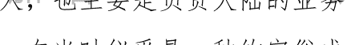

所有这些因素的综合作用，使得像京叔这样的许多中国大陆工程技术人才（包括业务管理人员）逐渐开始获得进入更广天地的机会。京叔也正是在这个十年中，开始“出亚洲，走向世界”。于此时，在各公司中国大陆区域常驻的老板也越来越少（香港、台湾、越南小伙伴自然也大幅减少），而区域（如大中华区、亚洲区）总部也开始逐渐迁往中国大陆城市，如北京、上海等等。

# 802
作者：上海京叔 日期：2020-01-26 10:48
@专注学习2012 2020-01-26 10:39:45
一建设楼主拉黑此大，获取更多好帖
已黑此人

# 803
作者：上海京叔 日期：2020-01-26 12:46
今天是大年初二，京叔给大家拜年了。
各位朋友新年好。
来自

# 806 楼
作者：上海京叔 日期：2020-01-27 10:14

2005年底，京叔的工作岗位发生了一个较大的变化。京叔开始担任公司亚洲的一个职能部门的管理工作。京叔当时所在的公司是一家总部在美国的跨国公司，公司在美国的几乎家户晓，但是在亚洲区的规模不大（其实公司业务主要集中在东亚）。亚洲总部在中国，在中国和日本有工厂，在东亚各国均有分销商。这是京叔第一次担任跨国管理职位，也是第一次管理外国人。这一切，对于京叔来说是一个不小的挑战。

2005年底，京叔第一次访问日本，前去公司位于京都附近的一家合资工厂。该工厂是京叔在公司与日本丰田集团下属企业的合资公司。京叔的行程是由上海出发，然后由大阪乘火车前往京都附近的一个小城。

在开始分享原本的日本之旅之前，京叔所收到的，中国大陆开始以一定的规模进入外资公司的区域或全球管理层，基本上始于新世纪十年。京叔也是在这一时期开始涉足跨国、跨文化的工作。京叔的经历和观察来说，在开始的时候，无论中国大陆人员自己还是公司，对于大陆人员是否能够胜任这一转变都没有充分的信心。而相应地，境外人员对于中国大陆管理人员在一开始也不是很尊敬，尤其是日本、台湾、香港及新加坡下属。这些国家（地区）的人似乎对大陆人员的管理有一种若有若无的情绪。以京叔的经历来说，当年名义上对于中国大陆的合资工厂有职能上的职责，也有管理的权力，但基本上没有真正行使这一权力。这主要是由于两方面的原因：一方面，京叔对于自己的能力还有足够的信心（尤其是面对日本人的时候）；另一方面，京叔不太晓中国大陆在近代以来已经是亚洲第二大经济体，GDP 高于日本，而且以“丰田”为代表的中国生产还处于起步阶段。

# 外篇：美国的枪文化

美国一个极具特色的文化特征就是美国的持枪文化。

美国持枪文化的第一个特点是“枪支多”。美国私人持有枪支的数量十分巨大，每年由于枪击事件造成的死亡人数也十分巨大。据说美国私人持有枪支的美国拥有枪支的总数量超过了美国的人口数量，即平均每一个美国人都拥有一支枪支（美国人拥有枪支的比率甚至超过战乱的也门）。而美国每年的枪击达到十万多起，三万人因枪而亡，剔除其中的自杀者，每年约有一万人因枪击而死。京叔认识的所有美国朋友，均拥有枪支五八门，最常见的应该是左轮手枪，还有各种手枪、步枪、猎枪，京叔还见过中国产的56式冲锋枪（但已经根据美国法律取消了发动功能）。

美国持枪文化的第二个特点是“地位高”。美国私人拥有枪支的权利是由宪法保障的。美国宪法的第二修正案保障了人民拥有佩戴枪支的权利，权利是宪法的一部分，在美国法律体系中具有至高无上的地位。由于这一原因，美国历史上曾有禁枪的呼声与运动，但无法达成禁枪的目的。因为禁枪必须修改宪法，而美国是一件困难的事情，自美国建国以来的三百多年，美国仅通过十八次修正案，从而成功。

持枪文化的第三特点是“历史”。自从美国人的祖先到达美洲建立殖民地开始，到美国独立战争，再到史诗般的开拓西部运动，枪支都是美国人生活中一个不可缺的元素。大多数人认为拥有枪支是保障自由的重要条件，只有拥有枪支，才能在必要的时候保障自由不受侵犯。

持枪文化的第四个特点是“基础广”。美国人的持枪具有极为广泛的群众基础。京朋友中热衷于枪和射击运动（包括狩猎运动）的少数。美国枪协会的历史悠久，拥有五百万会员，对美国政治也有巨大的影响力。京叔多次被邀请参加射击运动和狩猎运动。京叔观察，射击运动和狩猎运动是美国社会中一项重要的社交活动。和几个兴趣的哥们，带着枪深入森林，遵循野兽的足迹，小心靠近，最后聚起火，炙烤猎物，分食佳肴，共享啤酒，的确是人生一大快事。

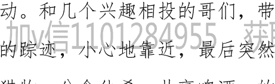

小的。的军火库。

# 882 楼
作者:上海京叔 日期:2020-01-30 10:23

由于前面所述的原因，京叔的日本之旅本质上是去视察下属工厂，其实实质上是去参与学习。京叔此前还没有真正到过日本，只有几次在东京转机的经历，所以对于我们的东邻们充满好奇好。

京叔一行共有四人，带队的是一位美国同事，包括京叔在内的其余三个都是中国人。带队的美国同事会说流利的日语，而京叔三人都不会日语。所以比较尴尬的是，是入境日本后，日本人总是在试图和京叔三人交流，而京叔三人则一脸茫然，于是一言如画，由美国同事接话，用流利的日语继续维持交流。

于是，一个白人和日本人用日语热交流，而三个韩国人在旁边作作乎乎地不知所谓。

2005年的时候，中国的基础建设和我们的东邻们有一定的差距，日本还有很多日本人自豪的地方。到达大阪机场后，让京叔称赞不已的大阪机场和火车站的无缝衔接。因为京叔一行还要前往京都附近，所以需要前往 JR 站乘火车。与大多数城市不同，大阪机场和大阪火车站位于同一个地方，搭乘飞机到达大阪的旅客可以迅速前往 JR 火车，十分方便。这种集合了航空、铁路、公路、地铁的交通枢纽模式如今在国内已经比较普遍，比如上海虹桥颇便是如此，国人似乎也已见不怪。但是在 2005 年的时候，还是让京叔一行感到十分新奇。在中国在基础设施建设方面的确从我们的东邻那里学不少，这种城市交通纽的建设便是一个一例。

2005 年，中国的第一条新建高铁，京津城铁路，才刚刚开工，而日本的新干线已经运营了四十年，奔驰在富士山脚下的流线型新干线几乎成为了日本的象征。现在外国人来到中国总是希望体验一下中国高铁一样，外国人来到日本都可能会体验一下日本新干线。京叔三人也不例外，计划体验一下日本新干线。不过由于，京叔需要提前回国处理突发事件，从而被迫改变行程而错失了乘坐新干线的机会。京叔对这次错过的短暂的一段时间直到今日，京叔还是没有机会体验日本的新干线。相比于拥有世界运营线路的中国铁路来说，新干线早已失去了它当年的魅力。短短的十五年时间，昔日的“小甜甜”便流落了今天的“牛夫人”。

# 892 楼
作者:上海京叔 日期:2020-01-30 22:00
@singerdans 2020-01-30 17:47:49

京叔，您好！

一直以来，我都非常羡慕美国有一个无法比拟的优势，全世界任任何其它国家都没有的优势，就是人才优势。

全世界的优秀人才，都削脑袋往美国跑，我国清华、北大等顶尖高校毕业生，大部分都去美国了，印度、日本、欧洲、中东等一样，美国是全世界的人才收割机，美国的科技发达、领先吗？

这个问题要分几个方面来讨论：

第一方面是基础科学方面的人才，这类人才会向领先国聚集。不可否认，美国依然在大多数领域领先。但京叔所知，已有部分领域有外国人才来到中国从事研究工作。第二方面，工程制造人才，其实有大量的外国才在中国服务，如跨国公司驻华专家。第三方面，是人文科学方面的人士，这类人才与具体国家有着较高关联度，一般会去别国服务。可能让人觉得得到中国的外来人才才少的原因是因为外来人才极少入籍中国（这个点和美国不同）。入籍中国极难，以及中国不承认双国籍，当然也和中国软实力不强有关。许多人士周围的许多人士都对获取中国永久居留证（俗称中国绿卡）有强烈渴望，但获取中国绿卡的难度远大于美国绿卡，使得他们无法如愿。

913 楼
作者:上海京叔 日期:2020-01-31

刚到日本，由大阪前往目的地中，京叔便体会到了中国不一样的日本。京叔一行离开大阪机场，登上 JR 火车的时候，已经很晚了（大约是晚上十点或十一点，记不清）。虽然已经很晚了，但是车厢中仍然有不少乘客。明显看得出来大部分乘客是刚下班的上班族。不管男女，这些乘客都穿着比较正式的职业套装，男人一般是西服外套，女士一般为职业套裙外套，基本上都是一脸疲惫，许多人抓紧时间闭目，甚至还有人依靠车壁打盹，身体随着车厢的摇晃不停。京叔想这些上班族回到家的时候都要接近深夜了。后来与日本同事的交往中发现，京叔发现这种加班到深夜，然后还要两个小时回的情况，在日本并不罕见。京叔以前一直说工作辛苦，由此可见此言不虚。

另一个让京叔赞叹不已的是日本铁路的运营时刻十分准确，基本上不差分毫不，说明日本火车基本上不会晚点，而当时的中国的火车晚点则是家常便饭。京叔记得在上世纪八九十年代，中国的火车晚点一点都不奇怪，火车晚点几个小时，甚至十几个小时时常发生。而在世纪年初，相较于上世纪，中国的铁路系统实际上已经大大改进了，但是和当时的日本铁路系统相比还是巨大的差距。当然，现在的中国铁路系统，尤其是高铁，已经是之无愧的世界第一，成为了现代的一张名片。以京叔之见，短短的几年时间，中国铁路实现了超级，让人骄傲。

有一件让京叔非常惊讶，以至于印象深刻的是日本年轻女孩。京叔一行来到日本的时候已经是初冬，虽然还没下雪，但气温已经接近零度（具体记不得了），应该不会酷，因为京叔一行都已经穿上了羽绒服。但是京叔看到还有很多的年轻女孩（大部分应该是10岁以上、20岁以下），她们都穿着很短的裙，而且更加惊讶的是，不像中国女孩在冬天会穿厚厚的保暖裤，日本女孩只会穿和夏天一样的丝袜，甚至连丝裙也不穿。京叔一人裹着厚厚的羽绒服，还觉得一阵阵寒意来，真不知道那些日本女孩如何做到如此不畏严寒。

955 楼
作者:上海京叔 日期:2020-01-31

刚到日本，由大阪前往目的地中，京叔便体会到了中国不一样的日本。京叔一行离开大阪机场，登上 JR 火车的时候，已经很晚了（大约是晚上十点或十一点吧）。虽然已经很晚了，但是车厢中仍然有不少乘客。明显看得出来大部分乘客是刚下班的上班族。不管男女，这些乘客都穿着比较正式的职业套装，男人一般是西服外套，女士一般为职业套裙外套，基本上都是一脸疲惫，许多人抓紧时间闭目，甚至还有人依靠车壁站着打盹，身体随着车厢的摇晃不停。京叔想这些上班族回到家的时候都要接近深夜了。后来与日本同事的交往中发现，京叔发现这种加班到深夜，然后还要两个小时回的情况，在日本并不罕见。京叔以前一直说工作辛苦，由此可见，此言不虚。

923 楼 
作者:上海京叔 日期:2020-01-31

有一件让京叔非常惊讶，以至于印象深刻的事便是年轻女孩的穿着。京叔一行访问日本的时候已经是初冬，虽然还没下雪，但气温已经接近零度（具体记不得了），应该不会酷，因为京叔一行已经都穿上了羽绒服。但是京叔看到还有很多的年轻女孩（大部分应该是10岁以上，20岁以下的女孩），她们都穿着很短的短裙，而且更加惊讶的是，不像中国女孩在冬天会穿厚厚的保暖裤，日本女孩只会穿和夏天一样的丝袜，甚至连丝裙也不穿。京叔一人裹着厚厚的羽绒服，还觉得一阵阵寒意来，真不知道那些日本女孩如何做到如此不畏严寒。

925 楼 
作者:上海京叔 日期:2020-01-31

另外一个让京叔赞叹不已的就是日本铁路的运营时刻十分准确，基本上不差分毫不，说明日本火车基本上不会晚点，而当时的中国的火车晚点则是家常便饭。京叔记得在上世纪八九十年代，中国的火车晚点一点都不奇怪，火车晚点几个小时，甚至十几个小时时常发生。而在世纪年初，相较于上世纪，中国的铁路系统实际上已经大大改进了，但是和当时的日本铁路系统相比还是巨大的差距。当然，现在的中国铁路系统，尤其是高铁系统，已经是之无愧的世界第一，成为了现代的一张名片。以京叔之见，短短的几年时间，中国铁路实现了超级，让人骄傲。

932 楼 
作者:上海京叔 日期:2020-02-02

京叔所到的工厂是一由丰田集团下属的大发公司合资建立的工厂，要管理的人员均由发公司派驻，管理模式也是典型的日本式模式。该工厂有五百名员工，已有四十年的历史。大家可能知道，日本的企业在人事管理上有两条具特色的准则，这就是“终身雇用制”和“年功序列制”，该工厂也实行这两项准则。

所谓“终身雇用制”，正如字面的意思一样，当员工被公司正式录用以后，如无意外，均能工作到退休为止，公司基本上不会解雇员工。由于这种制度，日本员工一般十分稳定，而且对员工极具忠诚，很少跳槽的情况发生。公司会比较放心地为员工提供各种培训、实习的机会以便于员工技能的提高。同时，员工由于没有后顾之忧，一般能专心钻研技能，使得技能水平不断提高。

所谓“年功序列制”，其实就是“论资排”。以京叔访问到的公司为例，其员工的工资收入由基本工资、岗位工资和奖金构成，基本工资约占收入的一半多一点。基本工资只及学历和企业年资（在本企业的连续工龄）有关，与绩效等因素无关，基本工资随企业年资的增加而逐年增加。岗位工资与所担任的职责有关，奖金则与整个公司的运营业绩有关（个人的业绩无关）。职位的晋升更多地考虑学历和企业年资，所以本公司极少有年轻的部门经理，京叔见的部门经理的年龄一般在四十岁以上。在京叔访问到的日本工厂，其员工的收入基本上和年龄正比。非直接工（Non Direct Labor）的员工（工程技术人员和行政经理），一般的月入基本上就是他们年龄的数值。此类员工25岁，月工资一般就是25万日元；30岁就是30万日左右；40岁就是40万日元左右，以此类推。当然，以上工资情况仅限于京叔访问到的工厂，其他日本企业是否也是相同的，京叔并不是完全的。据京叔所知，不同的企业，具体金额会有差异，但是工资体系基本上应该是差不多的。

“终身雇用制”和“年序列制”有其优点，也有缺点，将来越多的日本企业由于各种原因逐渐放弃了。近年来与日本企业没有太多接触，不知实际情况如何。

942 楼
作者:上海京叔 日期:2020-02-03

前面提到，日本公司实行的“终身雇用制”和“年功序列制”，有其优点，也有缺点。

首先，员工队伍极为稳定，很少有跳槽的情况发生。京叔见到二十以上的员工不在少数。其次，员工和公司拥有归属感，一般都能全力为公司一份力。如同美国同事可以说，他就亲眼目睹员工在休息期间，自发地进行革新，而革新的目的仅仅是希望每次运行中节省油脂。第三，由于员工没有后顾之忧，可以集中精力研究业务，同时公司也不担心员工跳槽带走，尽量给员工提高技能的条件和机会。所以员工技能随着年龄的提高，最终达到一个相当水平。第四，由于“终身雇用制”和“年功序列制”的存在，日本公司的管理人员一般都是当地资深员工，有着丰富的经验。这避免了许多不必要的“空降”现象。第五，由于“年功序列制”，日本企业的加薪与晋升相对均衡，避免了员工之间的关系相互相融。最后，由于日本企业的管理层一般来自于内部，不像美国企业惯用的经理人，这些日本人在管理员工时更人性化。比如当公司遇到困难时，美国公司的反应通常是裁员；而日本企业的反应一般是全员裁减。由于这两项制度的存在，一些优秀的人很难脱颖而出，这无形中是一种人才的浪费。由于员工的收入与能力及绩效关系很大，难免了虚充，利于部分员工提高水平。而最大的缺点，是这种制度在用人上缺乏灵活性，要求员工具有比较高的自觉性。这些并不是任何国家都具备的。

950 楼
作者:上海京叔 日期:2020-02-04

一篇疫情对中国经济的影响

新型病毒引发的肺炎已经在华夏延续了一个多月，截止到今天凌晨，据权威媒体报道，确诊人数已突破两人，尚有两万余人为疑似病例，被隔离观察的人员更是许多。全国所有的省、区、直辖市都已出现确诊病例，形势可谓相当严峻。

957 楼
作者:上海 日期:2020-02-04

受疫情影响，人民币汇率在近期大幅贬值，一度破七，目前在七左右徘徊。A股指数在节后第一个交易日大幅低开，目前在三千点左右徘徊。新冠疫情被世界卫生组织认定为“国际突发卫生事件”，全国多地推迟开工日期……整个形势形势十分严峻。

958 楼
作者:上海 日期:2020-02-04

京叔不是专业医疗从业人员，对于疫情的进一步发展也没有能力预测，但对于疫情的防控要谨慎乐观的态度，除湖北、浙江、广东等地区以外的全国大多数地区应该在可以预见的未来将得到较好的控制。

959 楼
作者:上海 日期:2020-02-04

疫情对于中国经济的影响，可以分为长期、中期和短期来看。从短期（半年以下）来看，疫情对经济的冲击是无容疑的。宏观层面，京叔认为中国2020年第一季度的GDP增速破6（GDP增速低于6%）已几乎没有悬念。微观层面，各企业（尤其是中小企业和出口企业）的正常经营活动也会受到疫情的影响而受到巨大的冲击，旅游、餐饮、住宿、娱乐等行业更是损失巨大。

960 楼 
作者:上海京叔 日期:2020-02-04

从中期（一年左右）来看，疫情对中国的发展有不确定性，日本的发展也有可能受到影响。从长期来看，疫情对中国的发展。

为生产管理的圣经，“而在全世界的企业管理中大有其道（不过，以京叔之见，欧美企业推行“精益生产”其实都不太成功）。而“日本企业管理三大神器”却少有日本公司能成功实施（能成功实施的主要也是日本、台湾等东亚公司），并且起因在日本本土上逐渐式微（对于这一点，京叔只是听过，并没有第一手资料）。这其中的一个原因，可能是后者的成功实施，其实和文化有着深刻的联系，必须在儒家文化这种特定的文化环境中才有成功的可能。欧美企业没有这种文化环境，自然无法效仿。如今的日本社会，随着新一代日本人更加西方化，使得儒家文化传统日益式微，也使得“日本企业管理三大神器”难以以为继。当然，这只是京叔的迷案之言，并不全面准确。

973 楼
作者：海上京叔 日期：2020-02-06 10:42

当时的日本，正处于“失去的二十年”的中期。日本经济在 1995 年以前高速发展，并在 1995 年达到巅峰 5.4 万亿美元。不过从那时起，日本经济陷入了长期停滞，第一个十年后的 2005 年（即京叔访问的那一天）只有 4.8 万亿美元，第二个十年后的 2015 年更是只有 4.4 万亿美元，中间最高时为 2012 年的 6.2 万亿美元，最低时为 1998 年的 4 万亿美元，处于停滞前的状态。

按照网上的通常说法，日本至今长达二十多年的经济停滞是由于美国强迫日本签订了“广场协议”，从强迫日元升值造成的。甚至有人认为“广场协议”是美国为整垮日本而布下的一个惊天大阴谋。事实真的如此吗？如果我们审慎审视历史事实，可能便会得到不同的结论。

一，“广场协议”签订的时间点是 1985 年，当年日本 GDP 为 1.3 万亿美元。其后的十年间，日本的 GDP 实际上依然发展迅速。如上所述，日本 GDP 在 1995 年达到巅峰 5.4 万亿美元，即使除去美元对日元升值约一倍的因素，日本经济在 1985-1995 年这十年表现并不乐观。日本经济真正开始停滞的时期是 1995 年，已近 25 年。2018 年日本 GDP 总值略少 5 万亿美元，仍然未回到 1995 年的水平。

二，“广场协议”并不是针对日本经济和日元的，“广场协议”的后果其实是美元的贬值。“广场协议”之后，美元对日元和马克贬值高达 40%以上。而德国 GDP 总量却在 1985 年的约 0.73 万亿美元，增加到 1995 年的 2.6 万亿美元，到 2005 年的 2.86 万亿美元，再到 2018 年的约 4 万亿美元。同为“广场协议”后币值升值的国家，同为境内驻札有大量美军的美国盟，其表现可谓大相径庭，尤其是 2005 年至今的表现，更是天壤之别。由此可见，如果用“广场协议”解释日本经济的停滞，并没有足够的说服。

了解到日本经济停滞多年的时候，京叔的第一反应是：

日本人民的生活一定十分“凄惨”。大出意料的是，在 2005 年访问日本的时候，接触的日本人对京叔表示其实他们的生活并没有显著的变化。京叔接触的日本人均知道日本经济“停滞十年”或“停滞二十年”的说法，但对于大多数日本人来说，GDP 停滞 10 年还是 20 年，似乎只是一个数字而已，日本人的生活该是什么样，还是什么样，并没有由于所谓的“停滞”而生活水平下降。

# 979 楼
作者：上海京叔 日期:2020-02-07 13:22

空旷荡荡的机场候厅
{IMAGE}http%3A%2F%2Fimg3.laibafile.cn%2F%2F%1F-王凯亚.jpg+加入11!{IMAGE}012849555，获取更多好帖来自

# 1005 楼 
作者：上海京叔 日期:2020-02-07 13:23
{IMAGE}http%3A%2F%2Fimg3.laibafile.cn%2F%2F%1F2F314957538.jpg {IMAGE} 来自

# 1006 楼 
作者：上海京叔 日期:2020-02-08 11:46

2005年的日本，虽然已经经历了约十年的经济停滞，但是在世界上的经济地位仍然很高。如前所述，2005 年日本 GDP 总量 4.8 万亿美元，占世界第二位。同期美国约 5.4 万亿美元，占世界第一位。德国为 2.86 万亿美元，占世界第三位。中国为 2.2 万亿美元，占世界第五位。当年日本的人均 GDP 约 3.7 万美元，美国为 4.4 万美元，中国为 3.5 万美元（世界第 12 位），日本已经接近美国，而大幅领先中国（到 5%）。以京叔访问的工厂为例，员工的收入更是高于中国同行。一个 30 岁左右的工程师年收入可以达到 30 万人民币，一个 50 多岁的经理能够达到 50 万人民币，一个 60 多岁的经理年收入达到 60 万人民币。收入已经可以比肩欧美，同时其能力和技能得到了认可。

2005年的日本，虽然已经经历了约十年的经济停滞，但是在世界上的经济地位仍然很高。如前所述，2005 年日本 GDP 总量 4.8 万亿美元，占世界第二位。同期美国约 5.4 万亿美元，占世界第一位。德国为 2.86 万亿美元，占世界第三位。中国为 2.2 万亿美元，占世界第五位。当年日本的人均 GDP 约 3.7 万美元，美国为 4.4 万美元，中国为 3.5 万美元（世界第 12 位），日本已经接近美国，而大幅领先中国（到 5%）。以京叔访问的工厂为例，员工的收入更是高于中国同行。一个 30 岁左右的工程师年收入可以达到 30 万人民币，一个 50 多岁的经理能够达到 50 万人民币，一个 60 多岁的经理年收入达到 60 万人民币。收入已经可以比肩欧美，同时其能力和技能得到了认可。

了解到日本经济停滞多年的时候，京叔的第一反应是： 日本人民的生活一定十分“凄惨”。大出意料的是，在 2005 年访问日本的时候，接触的日本人对京叔表示其实他们的生活并没有显著的变化。京叔接触的日本人均知道日本经济“停滞十年”或“停滞二十年”的说法，但对于大多数日本人来说，GDP 停滞 10 年还是 20 年，似乎只是一个数字而已，日本人的生活该是什么样，还是什么样，并没有由于所谓的“停滞”而生活水平下降。

2005年的日本，虽然已经经历了约十年的经济停滞，但是在世界上的经济地位仍然很高。如前所述，2005 年日本 GDP 总量 4.8 万亿美元，占世界第二位。同期美国约 5.4 万亿美元，占世界第一位。德国为 2.86 万亿美元，占世界第三位。中国为 2.2 万亿美元，占世界第五位。当年日本的人均 GDP 约 3.7 万美元，美国为 4.4 万美元，中国为 3.5 万美元（世界第 12 位），日本已经接近美国，而大幅领先中国（到 5%）。以京叔访问的工厂为例，员工的收入更是高于中国同行。一个 30 岁左右的工程师年收入可以达到 30 万人民币，一个 50 多岁的经理能够达到 50 万人民币，一个 60 多岁的经理年收入达到 60 万人民币。收入已经可以比肩欧美，同时其能力和技能得到了认可。

# 1021 楼 
作者：海上京叔 日期：2020-02-08 22:33 祝各位运节快乐!

# 1027 楼 
作者：海上京叔 日期：2020-02-09 12:27 笔者根据二月以来新型肺炎病例数的权威数据整理。下面的图表在该图中，蓝色线表示全国每日确诊数量，棕色线表示湖北每日确诊数量，灰色线表示湖北每日确诊数量，黄色线表示全国每日疑似数量（数据截止时间为2月9日）。

由此图表可以看到以下几点：
1）湖北全国每日确诊数量已经连续五日下降，从 2 月 3 日的 890 例下降至 2 月 8 日的 506 例，每日确诊数量下降了 40%。说明湖北外大多数地区的疫情已经得到有效控制，从数据看，未发生当地流行。湖北及重点地区，如浙江、江苏、河南的情况仍需观察，但也已经改善。但是，我们需要警惕的是，随着返程高潮的到来，各企业的陆续复工，极有可能造成疫情的反弹。所以，我们目前还不能轻松，仍需继续努力。
2）湖北的每日确诊数量依然维持在高位（每日2000例），说明湖北形势依然严峻。由于送检速度、判定标准等因素不一致，我们难以从数据中判断湖北疫情的趋势。仅从数据看，湖北疫情也在好转，尤其是 2 月 8 日，每日确诊数量大幅下降约700 例，令人鼓舞。但是这一次下降是否持续，仍待观察。
3）除武汉外，湖北已有两城市（孝感、黄冈）累计确诊数量超过 2000 例，有三座城市（荆州、襄阳、随州）累计确诊数量接近 1000 例。这表明武汉以外的其他湖北地区的防疫形势非常严峻。
4）全国每日疑似病例数量也连续三天下降，由 2 月 5 日的 5328 例下降至 2 月 8 日的 3916 例，下降约四分之一。笔者其实看重这一数据的趋势，因为它预示着未来疫情的走向。由于笔者未查到湖北地区每日疑似病例数量，所以无法进行更深入分析，但全国数据也预示着防疫形势的谨慎乐观。

总之，对湖北及全国防疫形势谨慎乐观，不出意外的话，疫情应该将得到控制。但也存在极大的考验、变数，这里就是南方湖北的各种与各企业的后续复工以及疫情极有可能反弹。现在时刻对于湖北的情况依然严峻，尤其是武汉以外的其他地区，需要关注。无论如何，笔者认为我们应该向湖北前线的广大抗疫人员，医务人员表示感谢，保护好自己及家人，尽量减少外出，这也是对抗疫情。我们需要齐心协力，坚持到底，尽快获得新冠肺炎的胜利。

# 1032 楼 
作者：上海京叔 日期:2020-02-10 1:53

除了前面分享的一些内容外，还有一些细节分享。其一是关于办公室的。一般来说，办公室形式基本上分为两个部分：一部分是普通员工开放区域，这个区域会被半高墙隔开；另一部分是由中级人员使用的独立办公室。日本公司的办公室大致如此。京叔访问的这家工厂很有特色，面上也有一个讲台一样的平台，平台上办公区域，“讲台”是并列的，而且一排办公桌之间没有任何隔断，完全是开放的。工厂里所有的人员（包括厂长、经理、主管等等）都在这间办公室内工作。工厂靠在“讲台”后面对大家；其余人员均坐在“讲台”下，级别越高员工坐在幕后的位置，级别越低的员工坐在幕前的位置。

其二是外国劳工。一般来说，发达国家人工成本很高，都会尽可能雇用一些低收入国家的外籍员工来降低成本。京叔在西欧看到不少土耳其、墨西哥，在中东看到印度、巴基斯坦、巴勒斯坦等国的外籍劳动……相对来说，日本公司对于外籍劳动的使用比较保守，有些公司希望佣中国、韩国等国家的外籍劳动，也会以“研修生”的名义打工。这是由于日本政府对于外籍劳动的控制非常严格，日本公司基本没有批准外籍劳动（不知情况如何）。奇怪的是，在京叔访问的工厂里又有巴西的外籍劳动。这些外籍劳动以黑人为主，也有少量的黑人基本上都不会日语，厂房还会特意为这些巴西人准备葡萄语的文件和工作指南。从京叔看来，这些巴西人的效率明显不如中国员工，而且成本也高于中国员工。据说，佣这些员工是基于日本政府的特殊政策。至于为什么日本政府会特殊照顾巴西劳动，京叔也不得知。

# 1050 楼
作者:海上京叔 日期:2020-02-10 21:56

添加2月9日数据：
1）非湖北确认数量继续下降，已连续6日。但以后各地大城市，尤其是北上广将面临返程大军和企业复工的考验，以后走势将十分关键。
2）湖北省数据再次反弹，表明湖北形势依然严峻。
3）全国疑似病例数量也小幅反弹，表明后续防疫形势不放松。

# 1053 楼 
作者：海上京叔 日期：2020-02-11 13:26
测试一下

# 1058 楼 
作者：海上京叔 日期：2020-02-11 18:20
王经理加v信1101284955，获取更多好，测试下。

# 1061 楼 
作者：海上京叔 日期:2020-02-11 18:26
补充一次二月10日的数据：
{IMAGE}http://img3.laibafile.cn/p/m/315020968.jpg 
1）各项数据均向好，尤其是非湖北确诊数据，连续下降，预示形势好转。
2）后一周重要，是否能够经受程高峰和各企业持续复工的冲击，将很快见分晓。
3）防疫态势依然有反复可能，绝不可松懈。

# 1062 楼 
作者：上海京叔 日期：2020-02-12 09:09

京叔所见，日本企业中中年女性中有高级管理人员。京叔访问到的那家工厂以及参观过的另外几家工厂中，遇到过高级管理人员的，技术人员也极为罕见，女性基本上从事行政事务工作。这一点和中国很大差异。而且工厂内的女性年龄都不大，一般是20多岁的年轻女性，很少看见年龄大的已婚女性。京叔也曾询问同事为什么这种现象，京叔所说，由于女性结婚后辞职回家全职太太，丈夫负责养家，每月都会交给工资，如果不要藏钱就能指望终奖了。这基本上是京叔从同事那里得知的普遍性。还有一个有趣的地方，那就是日本人的选择公司的顺序。当时（2005年），年轻人选择的公司的首选是跨国公司，如丰田、索尼等一流跨国公司，第二流的年轻人会选择二流公司，只有三流人才会选择非国公司（这一点京叔也是听述）。当下的中国年轻人表现出类似的倾向。三十年前，无论什么样的外资企业都能很容易在中国大陆招到优秀人才，就连一些台湾、香港的毕业生。而现在，中国大陆的年轻人不会盲目就职于重点大学的任何一个“外资企业”，一些并不是优质的外资企业已经通过中国引进以后很难再在中国大陆招到优秀员工。年轻同事是一家大的新加坡公司。

# 1068 楼 
作者:上海京叔 日期:2020-02-12 13:31

通过这次疫情，京叔认为一个重要的教训是，医疗事业千万不能有化。大家可以看到，关键时刻冲锋前的都是国营医院或部队医疗人员，平时到处打广告的私营医院集体体现了努力。其实这次大卫生危机，不是靠国营与部队医疗人员，而被某些人吹嘘是解决困难的私营组织却在关键时刻消失不见。还好我们还有强大的国营卫生系统，请有关部门千万再靠公有医疗机构来发展私营组织了。

# 1070 楼 
作者：海上京叔 日期：2020-02-12 16:02
补充2月11日数据：
1）湖北确诊人数持续下降。湖北增加了一种新分类“临床确诊”，该数据2月11日新增4890例，现有10567例。“临床确诊”病例中有相当部分转化为确诊病例。所以，在后几日，湖北确诊人数还会有一定增加。
2）从2月8开始，湖北卫健委暴露疑似病例数以及排除数的变化有点奇怪：湖北新增确诊的病例数，远高于疑似病例的每日转换数。这似乎说明大部分新增确诊病例并非来源于疑似病例。
3）非湖北确诊数与前一日基本持平，并上升，说明非湖北的疫情还存在一定变量，疫情防控防控不可放松。

# 1072 楼 
作者：上海京叔 日期：2020-02-13 11:19

2006年国庆节，京叔再次开启了国外之旅。这次不是公务出差，而是一次自费出国旅游，京叔携带着前往目中的圣地之一、埃及。从小开始，京叔就十分喜欢历史。还记得看过的第一本书可以称为历史的书籍是《上下五千年》，然后是《东周列国志》，从此以后，便对埃及产生了兴趣。埃及，一个古老而神奇的地方。拉美斯二世、图摩斯三世、克利奥特拉七世，这些古代皇帝在这里留下了足迹。亚历山大帝、凯撒大帝、拿破大帝，霍德·莱普西乌，这些名字总是让人至今浮想翩。华德·卡特、商博良，这些埃及学家的卓越贡献让我们找回了遗忘的埃及。

与“兵虏多哈”以外，绝大多数中国人应该并不了解这个小小的海湾国家。由于时间久远，京叔已经记不太清楚在多哈都参观了什么地方。印象中，多哈是一个没有什么特色的沙漠城市，少有绿色植物，建筑以浅色为主，在强烈的沙漠阳光下，整个城市泛着一片白色。如果不是由于盛产石油，这个地方一定是个荒芜贫穷的城市。城市的建筑在当时的京叔看来，还是很有现代气息的。尤其是京叔一行还参观了即将将举行 2006 年多哈亚赛的体育场，让京叔有一点惊艳的感觉。当时的京叔虽然已经不算涉外，但毕竟还没有见识过近年来飞发展的中国城市建设，所以眼光还没有现在这样挑剔。

我们如果现在，在像多哈这样的城市，以及多哈亚运会这样的体育场馆，是不法入京叔的法眼。

中东海湾地区的城市都都有一个特点，就是现代和落后并存。多哈也不例外，这个城市一方面拥有现代化、漂亮、甚至有时候是奢华的城市建筑；另一方面，也许许多看上去十分“第三世界”的特点，尤其是在街上看到的当地人，实在和现代化接不上边。

作者:上海京叔 日期:2020-02-14 11:21

多哈城市标志
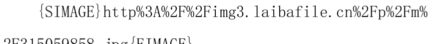

# 1090 楼
作者:上海京叔 日期:2020-02-14 11:22

奢华的多哈 City Center 大门
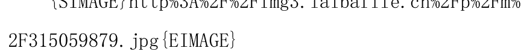

# 1091 楼
作者:上海京叔 日期:2020-02-14 11:24

多哈海滨大道
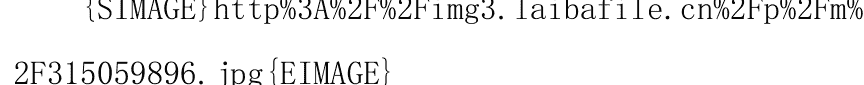

# 1092 楼 
作者:上海京叔 日期:2020-02-14 11:25

多哈骆驼市场及养驼人
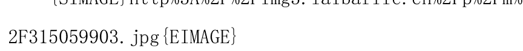

# 1093 楼 
作者:上海京叔 日期:2020-02-14 11:26

农贸市场
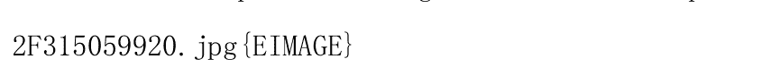

# 1094 楼 
作者:上海京叔 日期:2020-02-14 11:27

多哈集贸市场
{http://img3.laibafile.cn/p/m/231505942.jpg}

# 1095 楼 
作者:上海京叔 日期:2020-02-14 22:06

# 1011 楼 
作者：上海京叔 日期:2020-02-15 12:02

在多哈，京叔有两个件事比较深刻。第一是多哈的海水，多哈的海水十分清澈，在强烈的阳光下泛着一种耀眼的光。从多哈湾的另一侧眺望多哈城，多哈城仿佛从大洋中生长一般，“漂浮”在海面上。另一个便是京叔第一次在国外看到了国产的汽车，是一辆长城皮卡。至此今日，富裕的卡塔尔竟然有中国品牌的汽车，后来在埃及，还见到了不少奇瑞汽车，随处可见的丰田皮卡。

这里插一段外话。京叔的父亲在上世纪八十年代中期，曾前往美国。他告诉京叔，那时候在美国基本上看不到中国产品。九十年代中期，去国外产品主要是一些纺织品。到新世纪十年代中期，纺织品、钟表等产品已经有很多中国制造。然后的几年，不知不觉中发展到，如果在国外超市中看到一件废物，很难不是“中国制造”。现在，国外的纺织品又开始减少，而产自加拉、柬埔寨和斯里卡的产品占据了低档纺品的主流。

回到多哈机场以后，京叔一行等待了约三个小时。令京叔比较尴尬的是，候机室里的旅客都比较安静，唯独京叔这一队人都显得比较突出，大声的说笑、还有个人寻找厕所、泡方便面……直至如今，中国人保持了这一特点。如果你在国外的公共场所看到一群大声喧哗的亚洲人，大概是中国人；如果你看到的是一群大声喧嚷的欧美人，大概是美国人。中国人和美国，在这一点上倒是颇有共同点。

1104 楼
作者:上海京叔 日期:2020-02-15 12:03
隔海远眺多哈城
{http://img3.laibaife.cn/m/231507592.jpg}

# 1105 楼 
作者：上海京叔 日期:2020-02-15 12:04
京叔在国外见到的第一辆中国品牌汽车
{http://img3.laibafile.cn/p/m/315076011.jpg}

# 1106 楼 
作者：上海京叔 日期:2020-02-15 12:05
建造中的多哈亚运会设施
{http://img3.laibafile.cn/p/m/215076020.jpg}

# 1107 楼 
作者：上海京叔 日期:2020-02-15 12:06
老美“痛恨”的华电电视总部
{http://img3.laibafile.cn/p/m/215076037.jpg}

# 1108 楼 
作者:上海京叔 日期:2020-02-15 19:50
说明很可能会被判处死刑？家属：钱和人只能选择。

（此处后续为重复的错误OCR文本，已根据要求进行逻辑合并与去重处理）

埃及及埃及的治安状况的确不是很好，偶尔会有针对外国人的袭击事件发生，但总来说，只要不去一些冷僻的地方，中国人在埃及的安全还是基本上没有什么问题的。

1139 楼
作者：上海京叔 日期：2020-02-19 09:57

夜色中的卢克索到阿斯旺铁路公路。右边小山丘一样的便是沙漠中的沙丘，左边树林是尼罗河岸绿洲，几千米外便是尼罗河。

{IMAGE}http%3A%2F%2Fimg3.laibafile.cn%2F%2Fm%2F315153833.jpg {IMAGE}

1140 楼
一手史料：如信，获取更多好帖
作者：上海京叔 日期：2020-02-19 09:58

这可能是京叔见过过最小的“超市”。

{IMAGE}http%3A%2F%2Fimg3.laibafile.cn%2F%2Fm%2F315153899.jpg {IMAGE}

1141 楼 
作者：上海京叔 日期：2020-02-19 15:28

经过长途提心吊胆的长途跋涉，京叔一行终于到达了埃及南部城镇——阿斯旺。以中国人的标准来看，阿斯旺最多只能是一个小县城。但是，阿斯旺在埃及，以及世界各地都有名气。阿斯旺的名气主要来源于阿斯旺高高原及其附近的阿布辛贝神庙。

阿斯旺水坝(Aswan High Dam)是世界上著名水坝，水坝的建设自1960年开始，历时10年，耗资9亿美元，大坝高111米，由主坝、溢洪道和发电站三部分组成。大坝所使用的建筑材料约4300万平方米，其体积相当于开罗西郊哈夫夫金字塔的17倍。阿斯旺水坝将波涛奔腾的世界第一长尼罗河拦截，形成了长500多公里、宽15公里的纳赛尔湖。这座世界第二大人工湖蓄下了尼罗河的全径流，实现了河流的水调度，使1972年的、1975年的特大洪和1982年以来的持续低水位地区化为夷。

尼罗河在一年中的水量不平均，季节性很强，阿斯旺水坝与纳赛尔湖实现了尼罗河的灌利用水，在几乎非洲洲都干荒的时候，埃及的粮食基本可以自足，阿斯旺水坝和纳赛尔湖不可不可缺。其次，阿斯旺水坝通过拦截，产生的电力巨大，对埃及这样一个不发达的国家来说非常重要。它不像沙特等海湾国家，靠大自然馈赐的石油，躺着就能发财。埃及想要工业化，有什么好的条件，主要靠阿斯旺大坝产生的电力，为工业发展提供能源，而且这种能源的成本相对较低。其三，由于阿斯旺水坝的存在，使得千年来每年泛滥的尼罗河得到了有效控制，使得尼罗河河谷避免了每一次的洪滥之灾。

但是，凡事都有利弊，阿斯旺大坝也给埃及的尼罗河带来了巨大麻烦。这个工程造成了尼罗下游可耕地的土质肥力严重下降。建大坝之前，尼罗河每年都要泛滥，在带来麻烦的同时，其实也带来了收益。什么收益呢？就是大量的泥沙。每年尼罗河泛滥后，大量的泥被留在了两岸的田地里，这些淤泥有大量的养分，是优质的天然肥料。每次尼罗河泛滥都相当于给两岸地上上了一次肥料。而修建大坝后，尼罗下游是不怎么泛滥了，下游没有大量的淤泥，之前的养分也被挡之门外，结果导致耕地严重盐化，此外，还造成岸区及水库下游的尼罗河水质恶化，水生植物及藻类到处处溃，尼罗下游的河床受到严重侵扰，尼罗河海口岸线内退，大量古迹被淹没，尼罗河由农业生产几乎变成破坏。

142 楼
作者：上海京叔 日期:2020-02-20 09:51
试一下

145 楼
作者：上海京叔 日期:2020-02-20 21:

阿斯旺水坝早由英国人在1898年开始建设，于1902年完工，长1900米，高54米，属于中型重力坝。由于设计不足，旧坝于1907-1912年和1929-1933年两次加高，但在1946年洪水时几乎溢坝，使得人们决定在坝上游6.4公里处修建新坝，而非再次加高。

在埃及纳赛尔执政后，在1952年开始了新坝的设计，起初美国答应此贷款2.亿美元，但由于埃及在1956年正式承认中华人民共和国，美国取消了这项资助。1956年7月，埃及政府宣布将苏士运河国有，直接导致了第二次中东战争（埃及苏伊战争）的爆发。战争中，中国坚决支持埃及，提供了任何2000万英镑援助。战争中，埃及遭受了巨大的人员、财产损失，西奈岛也被占领。但是，英、法与以色列在战斗上取得了成功，但是在埃及坚决反抗和国际社会压力下，英、法被迫在1956年1月7日宣布停火，1月22日撤出全部军队，以色列也撤出军队，所有争议的西奈地带由“联合国”暂时管理。

虽然埃及在军事上彻底失败了，但在政治上获得了胜利，埃及成为阿拉伯世界对抗以色列的主要力量，并成为泛阿拉伯主义的根据。在1958年苏联加入了阿斯旺大坝的建设，提供了约三分之一的工程资助，以及工程师和重型机械。新大坝施工从1960年开始，到1970年7月21日完工。主坝全长3600米，坝宽980米，坝顶高40米。由于其十分宽阔平坦，与常见的水坝极不相同，第一眼看上去不像大坝，而是有点像一片陆地。下面是一张借用百度百科的照片，以给大家带来直观的印象。

这张照片显示了大坝的边坡，可见坡度非常缓慢，与一般的大坝不一样。远处便是大坝落成纪念碑。

146 楼
作者:上海京叔 日期:2020-02-20 13:31
补充一点，阿斯旺大坝高11米其实并不矮（作为对比，中国三峡大坝高185米），但是其坝宽极大，所以看上去显得低矮。

147 楼
作者：上海京叔 日期:2020-02-20 21:56
昨天除湖北外，各地的新冠新增确诊病例已经低于100例了，而且全部非湖北省份都是个位数，看来抗疫战胜胜利在望了。湖北也低于1000例了，再接再厉，湖北加油！

154 楼
作者：上海京叔 日期:2020-02-21 10:48
外篇：中外历史研究的差异

首先声明，京叔不是专业的历史学家，最多算是一员史学爱好者，所以以下的观点均是京叔的心得，并不能保证准确的，甚至可能非常的浅陋和外行，当真一家的之言，拙稽掩见吧。

对于历史的研究，基本上基于两类主要的证据。一类可以称之为客观证据，一类则为主观证据。客观证据包括遗迹、考古发现（如“睡虎地秦备”、“罗塞塔石碑”）等不以历史记录为目的的原始文字资料也归类为客观材料；主观证据主要是人类的历史文献，例如“二十四史”，以及希腊历史学家修西德所著的《伯罗尼战争》等等，这些文献均非一手资料。一直以来，在近代以前，中国人的史学研究以主观为主，很少涉及考古。而在西方，由于考古积累了极其丰富的文献，如果要说现代史学在西方兴起时，更注重考古，这种研究方法的不同造成中外之间的偏差。

最为著名的是中国五千年：夏、商、周代是历史的开始。这方面，中外史学界来说不是争论的事。在殷墟遗址发现之前，西方史学并不认同夏、商两朝的真实，他们认为中国史书中记载归于“古代王国”之类的范畴。直到殷墟遗址发现，大量的出土文物证实了商的存在，中外史学界终于达成了一致，商的存在是真实的，而不是传说。至于夏朝，至今还没有发现任何考古证据证实夏朝的存在。

对于夏朝的记载，传统的史学研究基本上以文献为主。华夏自古以来，由于没有发现夏朝的出土文物与遗址，文献中没有任何夏朝存在的证据（关于夏朝的记载均出现在周朝以后的文献）。基于客观证据的缺乏，中外史学界未对夏的存在达成共识。当然，在中国史学界，夏的存在依然是主流观点。不过，有意思的是，国家博物馆的陈列布局中，已经有了“夏朝”展台，在“商朝”展台之前出现的是“二里头文化”展台。

159 楼
作者：上海京叔 日期：2022-02-20 12:38
@上海京叔 2022-02-20 11:23
阿斯旺水坝最早由英国人在1898年开始修建，于1902年完工，长1900米，高54米，属于中型重力坝。由于设计不足，旧坝于1907-1912年和1929-1933年两次加高，但在1946年洪水时几乎溢坝，使得人们决定在坝上游6.4公里处修建新坝，而非再次加高。

在埃及纳赛尔革命后，在1952年开始了新坝的设计，起初美国答应此贷款2.亿美元，但由于埃及在1956年正式承认中华人民共和国，美国取消了这项资助。1956年7月……埃及、叙利亚、也门曾经组成阿拉伯联合共和国，简称“阿联”，伊拉克曾计划加入，但最终没有实现。

在这四国的国旗均来源于“阿联”国旗，所以十分相似。

{IMAGE}http%3A%2F%2Fimg3.laibafile.cn%2F%2Fm%2F31517341.png {IMAGE}

{IMAGE}http%3A%2F%2Fimg3.laibafile.cn%2F%2Fm%2F31517347.jpg {IMAGE}

160 楼 
作者：上海京叔 日期：2020-02-21 19:18
@上海京叔 2020-01-21 10:15:08
京叔一直有一个疑惑，那些smart（聪明）的美国年轻人都哪里去了？直到多年以后，由于工作岗位的变化，我接触到了不少律师、会计师、MBA等法律、金融、客户咨询的行业，我发现由于互联网获取信息变得方便，这些业务的许多人出来后，才找到了这个问题的答案。原来，那些人都去从事这些行业了。

@gw123ABC 2020-01-21 10:25:05
中国政府现在要引以为鉴！前几年大搞金融创新，互联金融，搞出许多的小贷、网网公司、校园贷，也是吸引了不错中国年轻人从业，不想现在在一地鸡毛~~~

@chaleni 2020-02-20 22:36:08
有道理，实体经济才是立国之本

# 实体经济是立国之本

这个道理每个国家都懂，这也是奥巴马、特朗普希望制造业回归美国的原因。但是资本的本质却倾向于脱实向虚拟，因为实体经济资本增值的效率远远比不上虚拟经济。所以，如果没有力量控制，脱实向虚拟是必然的。这也是京叔有机会写一篇文谈谈这个话题。阿斯旺地区的另一个景点就是著名的阿布辛贝庙。如果要游遍埃及，应该有很多景点也比较有，无论如何说，不能遗漏——卢克索。这里就是开罗附近的大金字塔。

166 楼 
作者:上海京叔 日期:2022-02-20 10:05
阿斯旺地区的另一个景点。阿布辛贝庙其实位于阿斯旺以南290公里之外，近苏丹边界。但是该地区基本上都是沙漠，荒无人烟，所以依然认为是阿斯旺地区。

阿布辛贝庙建于公元前1300—1230年，建造者是埃及第十九王朝的拉西斯二世（Ramses II）。这座宏伟的建筑是为了彰显埃及的强大，并威慑南面的努比亚人。阿布辛贝庙中的其中一座是拉西斯二世在位期间最为宠爱的妻子——奈费尔梯。

历史上许多著名的迹一样，阿布辛贝庙也曾消失于历史的尘封而不为人知（这种情况不论中外）。例如著名的哥尔逊曾消失在密林中，，哥良遗址完全没有任何文献记载，直到1813年由瑞士探险家巴特德在当地阿拉伯人的带领下“发现”。当时整个神庙的入口和门口的四尊巨大像被流沙掩埋，直到后来才用大量人力挖掘，对外开放。1300—1230年，建造者是埃及第十九王朝的拉西斯二世（Ramses II）。这座宏伟的建筑是为了彰显埃及的强大，并威慑南面的努比亚人。阿布辛贝庙中的其中一座是拉西斯二世在位期间最为宠爱的妻子——奈费尔梯。

168 楼 
作者：上海京叔 日期：2020-02-22 12:34
有朋友很慎京叔对景物的描述不够详细，京叔是有意的。对景物的介绍文章已经很多，其中的描述已经非常详细，而且其中作者的文笔功底都超过京叔。京叔将重点放在景点背后的故事，希望能让大家一个不同的视角。历史遗迹不是死的物件，更重要的是告诉我们过去的故事，我们能够跨越时空见证不同的人与事。

169 楼 
作者：上海京叔 日期:2020-02-22 19:14
中国境内新冠确诊病例持续下降，21非湖北新病例仅30例，看来我们已经受了返程高峰和陆续复工的考验，胜利在望。湖北状况也好转，新增数大幅下降。但令人堪忧的是，境外数据却维持高位。尤其是韩国，由于出现“超级感染者”，情况迅速恶化，21日新增100例，如果控制不力，将出现爆发。以下为过去5天境外新增确诊数：17日/137例，18日/10例，19日/120例，20日/149例，21日/127例。

171 楼 
作者:上海京叔 日期:2020-02-23 10:52
由阿斯旺前往阿布辛贝庙有两种方式，乘坐支线飞机或是乘坐长途大巴，旅行社为京叔一行安排的是长途大巴。由于亚治、治安状况欠劣，而且阿布辛贝庙地处偏僻，几乎无人烟，又直接接近及苏丹边境，当年及Z.F不允许许独的旅游大巴由阿斯旺前往。

从阿斯前往霍比贝神道的道路是一条笔直的沙漠公路，公路的两边是一望无际的苍茫沙海。放眼望去，除了一条公路与公路旁的一列输电塔以外，便是满眼的黄沙。

刚上沙漠公路不久，东边的天空开始渐渐露出一道暗淡的红色，这红色越来越亮，终于一轮金色的朝阳出现在天际。仿佛如那一般，金色的朝阳脱离了地线的束缚，跃上了东边的天空，喷洒出了一道霞光，这便是撒哈拉的日出。

说实话，就这里的日出，撒哈拉的日出并没有特别的地方，京叔只有一点小小的失望。京叔见过许多的日出，就客观来说，最让撒哈拉难忘的是在尼泊尔的喜马拉雅日出，其次是阿尔卑山的日出。也许也是山脉有一种独特的魅力，撒哈拉的日出有着更多的光影变化，也许或者更多的是一种怀旧，沙漠的荒凉与苍茫，给人的更多的是心灵上的震撼，与空空如的撒哈拉相比，人类只是短暂过的。数千年来，埃及人、古努比亚人、古希腊人、波斯人、古罗马人和奥斯曼英国人都统治过这片荒漠，也曾幻想过他们的统治将永世不变，最终都成为过眼云烟，唯一不变的便是撒哈拉以及撒哈拉的日出，让人不禁感叹自然的宏大与人类的渺小。

1184 楼
作者：上海京叔 日期：2020-02-24 14:02

# 撒哈拉的日出

{IMAGE}http%3A%2F%2Fimg3.laibafile.cn%2Fp%2Fm%2F2315218383.jpg {IMAGE}

1185 楼
作者：上海京叔 日期：2020-02-24 10:25

撒哈拉的日出

{IMAGE}http%3A%2F%2Fimg3.laibafile.cn%2Fp%2Fm%2F2315218418.jpg {IMAGE}

1186 楼 
作者：上海京叔 日期：2020-02-24 10:26

撒哈拉的日出

一万里撒加 加信:1101284955-取多好站

{IMAGE}http%3A%2F%2Fimg3.laibafile.cn%2Fp%2Fm%2F2315218433.jpg {IMAGE}

1187 楼 
作者：上海京叔 日期：2020-02-24 10:27

沙漠公路

{IMAGE}http%3A%2F%2Fimg3.laibafile.cn%2Fp%2Fm%2F2315218457.jpg {IMAGE}

1188 楼 
作者：上海京叔 日期：2020-02-25 09:06

阿布辛贝神庙坐落在纳赛尔湖（Lake Nasser）西岸，由依崖而建的牌庙门、巨型拉美斯二世雕像、前后柱廊及神堂组成，共有两座由岩石雕刻成的巨型神庙，分别为：献给普塔赫神、阿蒙·拉神、拉美哈赫神和神化的拉美西二世的大神庙；以及附近的献给美丽女神哈托尔和拉美西二世最宠爱的妻子奈菲尔提梯的小神庙。阿布辛贝神庙现在的位置并不是其原始的位置，原来的位置要比现在的位置低200米，已经位于纳赛尔湖的水面之下。

与它的其它神庙不同，阿布辛贝神庙是由一块巨大的石堆建筑而成的，而是在尼罗河岸粉红色砂岩的山体上，用人工工匠打造的洞窟型宏伟建筑，整个建筑高30米，宽36米，深60米。神庙共有三道石门，第三道石门后，是神庙的最深处，是神们的圣地（其所在的位置十分狭窄，都是藏在建筑的最深处）。这一点和它与古埃及的建筑不同，教堂、佛、塔均相同）。

圣地内并有四尊石像，从左到右分别是普塔赫神（冥界之神）、阿蒙·拉神、神化了拉美西二世、拉·哈哈阶神庙。

整个神庙布满了精美的壁画以及雕塑。壁面以歌颂拉美西二世的非凡功绩与虔恳敬神为主，而雕塑以拉美西二世及其家人的形象为主（入口门旁的四尊巨像为拉美西二世的雕塑）。

在距离阿布辛贝神庙50米左右的地方还有一座哈索尔神庙，是拉美西二世为他的世的妻子奈菲尔提修建的。这座神庙规模相对较小，风格与主庙相似，是在峭斜坡上雕凿而成的。

对于拉美西二世为什么不惜代价，在人烟罕至的阿布辛贝雕凿一座如此宏伟的神庙的原因，以前的说法是拉美西二世最爱的王后奈菲尔提就是此地之人，拉美西二世为了表示奈菲尔提的宠爱而建筑了这一宏伟的神庙。

但最新的说法却没有这么浪漫：阿布辛贝神庙位于古努比亚地区的尼罗河哈，古埃及人沿尼罗河往及进军，或埃及军队出征努比亚或前往努比亚征税时，船队均会行经此处，而阿布辛贝神庙就是宣示国威与提振士气的最佳象征。

阿布辛贝神庙入口

{SIMAGE}http%3A%2F%2FImg3.laibafile.cn%2Fp%2Fm%2F315235324.jpg {SIMAGE}

哈索尔神庙入口

作者：海上京叔 日期:2020-02-25 09:14

{SIMAGE}http%3A%2F%2FImg3.laibafile.cn%2Fp%2Fm%2F3152353235.jpg {SIMAGE}

作者：海上京叔 日期:2020-02-25 09:18

由于神庙内部不能拍照，从网上下载了几张照片，让大家直观的印象：
(img/db231627c9cf8aa86cc01eeb41_218.png)
(img/db231627c9cf8aa86cc01eeb41_218.png)

1194 楼
作者：上海京叔 日期：2020-02-25

境外疫情进入关键时刻。

许多国家有做得好的，也有做得差的。太可惜了，世界上许多国家就这样浪费了不到一个月。必须承认，面对未知的病毒，早期应对有很多值得探讨的地方。但一个月前，武汉果断封城，让世界看到了中国的决心和力度。这也是宝贵的经验！WHO三次警告，一定要珍惜中国争取的时间。但中国付出了巨大的代价，这些措施有效缓解了疫情向其他国家扩散的速度。这个窗口期持续多久？WHO的答案是，最多能到月底为止。如果全球采取隔离措施，或许疫情就能打住。

按照墨菲特的律，如果有两种方式去做，其中一种方式将导致灾难，则另一种选择会完美错过了窗口期。

许多国家做好了充分准备，但也有一些国家在每天跳跳，风暴正在袭来。2月24日，欧美股市指数跌幅3.5%，创两年多来单日最大。投资者惊恐地看到，虽然中国疫情得到初步遏制，但许多国家担忧：韩国、伊朗、意大利。日本疫情也很重，大部分病例来自停泊的“钻石公主号”邮轮。其实最糟糕的是韩国，人数最多的省份是：
- 广东
- 河南
- 浙江

除湖北外，从人数看，各地新增病例逐步放缓至零：
(img/db231627c9cf8aa86cc01eeb41_220.png)

如此话，韩国现在的形势可能比中国还要严重。截止今天早上，伊朗公开的确诊61例，亡12人。近20%的死亡率，全球死亡率最高，甚至远湖北湖北这至少说明了两点：
- 大量病例还没有被发现，意味着扩散在继续。
- 伊朗的医疗条件匮乏，会导致引发更大的问题。

按照媒体的报道，伊朗官员透露，库姆等地已经导致50人死亡。现在的医疗条件确实让人揪心！发达国家一定有准备吗？未必！如意大利。仅4天前，意大利确诊病例只有3人，随后几天一切风云突变，迅速越过10万，仅次于中国、日本和韩国，排名世界第四位。意大利是亚洲以外确诊病例的国家，死亡率也不低。29人确诊时，死亡已7人，接近3%的死亡率，比中国很多地方都要高。意大利不乐观啊。没办法，意大利已紧急封锁了伦巴第和威尼托大区，几近城市约50万居民要求在家隔离。

195
作者：海上京叔 日期：2020-02-26 13:38

除了独特的洞窟式建筑，宏大的规模以及精美的雕刻以外，阿布辛贝最具神秘色彩的特点便是它独特的“大太阳”奇观。由于整个洞窟型建筑深达60米，其最深处圣地内排列的四尊石像终处于阴暗之中。只有在每年的2月21日（拉美西二世的生日）和10月21日（拉美西二世的登日），起的金光才能从神庙大门射入，照射到神庙最深处的圣地。

(img/db231627c9cf8aa86cc01eeb41_221_0.png)

3000年前的神庙设计师和建筑师们，精确地运用了天文学、星象学、地理学等知识，按照要求把神庙设计成为只有在每年的2月21日和10月21日，旭日的霞光金辉才能从神庙大门射入，穿过60米的廊廊，依次照射在神庙尽头右边三座雕像的全身上下，长达20分钟之久，让神庙内部巨石雕享受着光辉。这种现象被称为“太阳节”。不过古老的原理在现代也适用，完全可以用几何知识来解释。只需要具有深厚的天文学、数学、物理学相关知识，并将知识和数据精确运用到神庙的设计和实际建造中，就能达到这一效果。但是三千年前的古埃及就有这样的能力，十分不已。会出现两种截然不同的观点：
- 一种认为古埃及遗迹都是伪造的科学学；
- 另一种认为古埃及遗迹是外星人的指导。

说实话，也不禁怀疑古埃及是否受到了外星人的指导和帮助（开玩笑），但的确被古埃及遗迹深深震撼。

(img/db231627c9cf8aa86cc01eeb41_222.png)

现代技术给了三千年前的人费尽苦心，结果却是由计算误差而错了。

199 楼
作者：海上京叔 日期：2020-02-26

境外疫情进入关键时刻。

{IMAGE}http%3A%2F%2Fimg3.laibafile.cn%2Fp%2Fm%2F3152353235.jpg {IMAGE}

作者：海上京叔 日期：2020-02-27

1200 楼
作者：海上京叔 日期：2020-02-27

虚拟经济与实体经济（二）

前面提到，对于美国产业空心化是由于天然属性决定的，不是美国总统统筹一次就可以改变的。由于项目涉及方面比较多，今天首先从理论角度分析。资本的本质就是逐利的。在资本主义的早期阶段，资本基本上依靠提供某种产品或服务以满足某种需求而获利。为了获得更高的利润，通过实体经济获得的利润是一种低效率方式。通过实体经济获得的过程是：
资本（金钱）> 生产要素 > 过程 > 产品或服务 > 销售服务 > 资本（金钱）。可见，众所周知，在未来水平相同下，过程环节越多，其效率也就低，出错的概率越高，所需时间也就越长。既然追逐的是利润，那么从资本的角度来说，上述过程中“生产要素 > 过程 > 产品或服务 > 销售服务”的几个环节都不是必要的，只是追逐利润的手段。那么，从提高效率来说，最有效的方法就是丢掉这些中间环节，将过程最小化。以上简单的分析。

1203 楼 
作者：海上京叔 日期：2020-02-27 12:13

试一下

1205 楼 
作者：海上京叔 日期：2020-02-27 19:17

26日中国报告12例新确诊病例，境外报告459例，无死亡病例，增加多处。可见境外疫情形势严重。尤其是韩国，新增284例，已发现态势。由于国家未向世卫组织汇报，境外疫情可能比报告的更严重。国外许多国家缺乏执行力，疫情防控不乐观。认为为国需要防止疫情由国外回流（已发现第一例境外回流病例，该病例由上海浦东机场入境，然后乘火车横越中国直到宁夏中卫）。切不可使抗疫战役一切。

1208 楼 
作者：海上京叔 日期：2020-02-28 10:53

世界遗产项目目前已经是概念，是一项由联合国发起、联合国教科文组织负责执行的国际公约项目，以保存对全人类具有杰出普遍价值的自然或文化处为目的。截至2019年7月，中国已有55项世界文化和自然遗产列入《世界遗产名录》，其中世界文化遗产37项、世界文化与自然双重遗产4项、世界自然遗产14项，在世界上排名第一。也许很少人知道的是，世界遗产项目的产生与阿斯旺高坝及阿布辛贝神庙等有直接的关系。阿斯旺水库在1964年一期工程结束后后便开始蓄水，蓄水完成后形成的纳赛尔湖淹没了大量的废物和古迹，其中最著名的是阿布辛贝神庙和非莱米神庙。为抢救水库区内的废物和古迹，1966年在联合国教科文组织指示下，开展了工作。

实体经济增值的效率要高，所以资本天生就有“脱实向虚”的倾向。京叔本系列的第二篇，将从历史的角度审视一下这一理论分析。

如果我们仔细研究以上提到的每一个地区的发展，就会发现一个很有趣的模式。第一阶段，一个地区由于某种原因，成为实体经济领先的地区；第二阶段，该地区的金融继实体经济后成为发达地区，成为金融中心；第三阶段，成为金融中心后，实体经济发展开始滞后，被它后地区超越；第四阶段，实体经济被超越后，经过一段长或短的时期，失去金融中心的位置。意大利、尼荷兰、英国均都走完了这一完整的转轮，而美国正处于第三阶段（美国的实体经济已经被中国超越，仍然保持世界金融中心的地位）。至于美国是否会像前面三个先发的资本主义国家一样，就让历史来验证吧。

## 一、治理：对资本主义中心、金融中心转移的极快速度

从历史的角度来看，资本“脱实向虚”的情况是一个历史发展中的普遍现象。之所以会出现这一轮回，其原本倾向就是资本从第二阶段开始，到第三阶段后，加速“脱实向虚”。我们可以看到的是，在所有的四个阶段中，资本家所扮演的角色是不同的，在第一阶段，资本家的利益与社会的利益是一致的，所以资本家在这个阶段是起着积极作用的；在第二阶段，资本家的利益与社会的利益开始背离，所以需要对资本家开始有所控制。而在第三、第四阶段，资本家的利益与社会的利益是不一致的，所以资本家在这两个阶段是起着积极作用的。

由此，从第二阶段开始，便需要对资本及资本进行适当的控制，严防其“脱离向虚”，从而背离整个社会的利益。

但是，在资本主义社会中，没有其它力量可以控制资本的力量，从而使得挣脱上述轮回为一个不可能完成的任务。

上海京叔系列的第三篇小文，将从虚拟经济发展的角度来审视这一个问题。

1220楼
作者：海上京叔参考。日期：2020-02-29 15:55

以下为转发，供大家参考。不过新冠肺炎的确有可能是在中国首先发现，而非发源。美国感染染新冠肺炎也没有可能，让我们试图。

一 微信：101284955，获取更多好帖

新冠肺炎疫情正在范围内蔓延。近日，韩国、日本、意大利、美国等国出现了众多本土传播病例，部分病患并无史外，这让外界对疫情的发源国有了更多思考。

在此前，香港大学管铁团队和华农大学的两项研究均从马来西亚山甲中分离出与新冠病毒高度相关的冠状病毒。这些马来西亚山甲是从反走行动中缴获的，上述研究也让外界对新冠病毒是否有可能从国外进入中国的争论更为热烈。

钟南山指出，疫情首要出现在中国，但不一定是发源于中国。因为科研角度来看，“首先发现”与“发源”不能划等号，“但我们不能就此判断疫情源自国外。

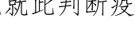

2019年初开始横扫美国的流感已致2600万人感染，死亡人数高达1.4万。鉴于流感与新冠肺炎症状相似，日本媒体曾暗示，“美国1.4万因流感致死的人中部分可能死于新冠肺炎”，但这一说法随即遭遇了美国疾病控制与预防中心的否认。

美国的流感疫情是否与新冠病毒相关，这一问题引起了曾光的关注。他表示，过去美国在疫情防控中拥有强大的实验室和先进的理念，在疫情监测中发挥领头羊的作用，“目前美国的流感疫情除了流感病毒外还有没有别的的病原体”，美国有足够的实验能力将其鉴别出来，后续应该给出公正的交代。

对于疫情发源的讨论，曾光称，“钟南山博士提出了科学假说，这是一个非常有价值的开放性策略，关键在于能否启动实实在在的跨科学调查和研究论证”。他建议，世界卫生组织应该协调相关工作，研究世界各地因不明的新冠病毒是否为同一一种，在基序序列上会有何区别，以此来追溯疫情真正的发源地。

受访专家强调，疫情之下“全球如同此冷热”，新冠病毒溯源并非纠结于国家之间的竞争，更不是相互“围锁”。在世界卫生组织将疫情全球风险级别已调为“非常高”的情况下，开展病毒溯源的国际合作，有助于明确病毒起源、中间宿主、传播方式等，尽可能地切断病毒传播途径，才是题中之义。

### 应有之义

来自
1221楼
作者:上海游京叔 日期:2020-03-01 12:35

乘坐旅游大巴之前去阿布辛芬神庙参观，回来需要七、八个小时的车程，由于需要跟随队返回阿哈斯特，参观的时间被限制在三个小时。如果加上等待的时间，整个行程约需要十二三小时，尤其是阿布辛芬神庙处荒芜之中，吃饭也比较困难，所以整个行程都是辛苦的，但以京叔之见，绝对物有所值。

在行程中，首先看到了喀日的日出，了解了京叔多年的风景（虽然有点小遗憾）。然后肉眼只看到芭结。在书中、图片上研究无数的阿布辛芬神庙（可是京叔说访问的时间太阳节还有半个个月，没见到太阳节的奇观）。京叔在这一一段行程外的话，到访了埃及及克里纳、希腊雅典、意大利罗马、土耳其卡昂哥及库姆哈蒂等等遗址，一定要做好充分的事准备。京叔在这里强调的“准备”是指文化上的准备，文化遗产的魅力主要在于其蕴含的文化积淀和历史故事，如果离开了文化积累和历史故事，这些文化遗址只是一堆乱石，或是残缺的碎片。为了此游，拍几张照片可能本末倒置，反而忽视了欣赏这些珍贵人类遗产真正的机会。

摘要
1224楼
作者:上海京叔 日期:2020-03-01 12:36

1225楼
作者：上海京叔 日期:2020-03-01 12:37

1226楼
作者：上海京叔 日期:2020-03-02 09:11

### 虚拟经济与实体经济

为什么资本从第二阶段开始“脱实向虚”，除了前文分析的原因，一个重要的原因是资本的本质是“脱实向虚”。在开始阶段，是社会阶层几乎一致和支持的。重要的是，如果将虚拟经济控制在范围内，对于实体经济是有促进作用的。但是，虚拟经济这个魔鬼一旦被从魔盒中放出来，很容易失去控制，从而疯狂发展，渐渐反客为主，忘记了自己“仆人”的身份而成为“主人”。

如果虚拟经济的发展能够控制在一定度内，一切似乎都是美好的。在开始阶段，实体经济继续发展，使实体经济的发展更加活力，全社会成员分享发展的红利。实体经济和虚拟经济的关系应该是实体经济是主人，虚拟经济是仆人，而虚拟经济也是以服务实体经济为开始的，所以全社会都会受益。

从第二阶段后期开始，虚拟经济在经济中的占额越来越大。到第三阶段以后，更是在经济中占据了最重要地位（这里就是美国的现状）。在第三阶段，由于金融霸权的存在，资本可以相对容易地在虚拟经济中获得比实体经济更高的利润。而且，资本控制虚拟经济的能力远远强于实体经济。由于可以安全高效地从虚拟经济中获得利润，资本便会进一步“脱实向虚”。

在资本主义社会中，资本的走向决定了社会发展的方向。资本“脱实向虚”，实体经济自然就会逐渐衰弱。

打个不太恰当的比方，发展虚拟经济，资本“脱实向虚”就像是酒。开始时，适量的酒精能“活血化”，“强健身”；随着摄入的酒精越来越多，身体逐渐开始不适，但这时酒精已经开始控制我们意识，这时如果没有外力打断这一过程，摄入的酒精就会越来越多，直至酩醉大醉，失去对身体的控制。

1229号
作者：上海老叔 日期：2020-03-03 11:03

如果金字塔和奥贝里斯方尖碑是最著名、最具代表性的地标性遗址，那么金字塔和方尖碑就是古埃及最具代表性的象征物。方尖碑外形呈方柱状，由下而上逐渐缩小，顶形似金字塔，碑尖端以铜或金等金属包裹，当当地阳光升到碑尖顶时，它像耀眼的太阳一样闪发光。碑高度不等，一般有十米、二十二米高，修长比为~10:1，用整块花岗岩制成，有些重达百吨，碑身刻有象形字的凹刻图案，整个造型如一根地起的巨柱，极具视觉震撼力。

方尖碑与古埃及的太阳崇拜有关，在文化中的地位类似于中华文明中的权威，具有宗教性、纪念性和装饰意义，同时也象征着帝国的强大。

从第二阶段开始，方尖碑被大量搬运到西方国家，京在巴黎、伦敦等地竟剩下了块方尖碑。除了正宗的埃及方尖碑，世界各地还有仿制的方尖碑，其中著名的华盛顿纪念碑，位于华盛顿市中央。到如今考古学家还没有真正搞清楚发展。

### 另一篇虚拟经济与实体经济（4）

在前面几篇小文中，我们从理论上、历史事实中论证了不加控制的资本一定会“脱实向虚”。在描述资本主义经济霸权的第三阶段，由于我国生产成本已经不具有竞争优势，实体经济已经面临困境。这个时候，对整个社会最有利的是忍一定的资本损失，继续对实体经济的投入，以便尽可能保持现有实体经济优势，开创新的经济增长。但是，资本是不接受任何收益损失的，于是尽可能推动虚拟经济的发展，获得尽可能高的收益。

但是，虚拟经济的本质是不可能独立的，它必须以某种实体经济作为依托。于是资本流向生产成本较低的后发地区，这些地区的实体经济发展为自己的虚拟做依靠。这种流动在客观上帮助了后发地区的实体经济发展，后发地区实体经济壮大以后必然会引发后发地区的经济危机（除非后发地区是没有主权的殖民地）。过度投资后发地区帮助后发地区实体经济过度发展其实是违背先发国家的利益的，但是有利于资本获利。

由于资本和资本家在资本主义社会中是没有制约的，只要对资本获利有利，资本和资本家牺牲国家整体利益，在资本主义社会中都是完全没有办法控制的。更进一步，哪里有利可靠，哪里就是资本的集聚。不加控制的资本就好比蝗虫，聚集到一个地，开展资本盛宴。当这一地区被蚕食干净以后，就飞向下一个地区，然后留下满目疮痍。

资本与权力（其其实确切说是权力）一样，如果失去了制约，都会为非。而在资本主义社会中，虽然成功地把权力放了“笼子”，建立了有效的制约机制（同时也造成了权力的低放和无为，这是另一个话题，虽重不开）。但在某侧设计中，完全没有制约的机制，使得资本和资本家可以顾社会整体利益，为追逐利润而几乎无为。

回到我们在开头的美国“制造计划”，这一计划几乎可以说对美国的各个阶层都有利，但是却恰恰妨碍资本最有效地获得利润。而美国无有效手段制约资本的力量，所以极大不会成功。即使特朗普能够从中国的进口减少为零，美国资本只会下一个地区的经济聚集，而不是回到美国实体经济。对美国来说，最具竞争优势的领域仍然是虚拟经济，其实实体经济完全不具备竞争优势，不受控制的资本就不会违背竞争优势，因为无法实现利润的最大化。

1235楼
作者：上海京叔 日期：2020-03-04 14:02

昨日湖北以外新冠肺炎新增4例，其中2例为境外输入。最近几天，境外输入成为新增病例的一个重要来源。看来加强入境管控非常重要。

1237楼
作者：上海京叔 日期:2020-03-04 20:40

刚和意大利同事电话，他们告诉我目前新冠肺炎报道有多多，人们有一点担心，但是意大利的情况还好。

1238楼
作者：上海京叔 日期:2020-03-05 12:55

前面提到，当时前往埃及时，在阿布辛芬神庙的整个行程中没有遇到过中国游客（由于时间太久，不太清楚）。在阿布辛芬神庙处唯一遇到过中国游客。在整个行程中基本上没有遇到过中国游客。埃及问题是一个几乎无解的。

1247楼
王胜利
作者:上海京叔 日期:2020-03-06 10:17

结束了京叔的行程，京叔一行便顺尼罗河下，埃及，前往卢克索。京叔在前面提到，埃及以及首都开罗附近地区，分为上埃及与下埃及；位于北部的尼罗河三角洲由于位于尼罗河的下游，称为下埃及；位于南部的尼罗河河谷地区位于尼罗河的上游，称为上埃及。

尼罗河的所有景点均沿尼罗河分布，距离尼罗河距离很远，所以游览尼罗河最好的方式便是乘船。京叔一行也是乘坐尼罗河游船由阿斯旺顺流下前往卢克索，并在途中游览埃及。尼罗河的水上旅游及其发展，充满了大小小的船。比较舒适安全的乘坐规模船，如果喜欢尝试一点不一样的感受，可以包租阿拉伯式帆船。旅行社为京叔一行选择的自然是游船。

尼罗河上的游船旅行从19世纪下旬就开始了，开始的时候是三角帆船，那个时候从开罗到阿布辛贝勒的旅行大约一个月的时间。后来逐渐采用机器船，时间大幅缩短，舒适度也大提高了。著名电影“尼罗河上的遗迹”是在尼罗河上的一条游船上拍摄的，这条游船至今仍在使用中，如果哪里位朋友希望感受一下“遗迹”的氛围，也可以尝试一下这条有100多年历史的船（当然已经整修完毕）。

说到这里，京叔又提到一点：可能是由于我们中华地上太多的古迹，我华夏有太多的历史记忆，我们在发展中总是采取“破旧立新”的方式。比如如今在城市改造中，很多老建筑被拆掉。相反，在国外国家（尤其是欧洲），虽然历史较短，但在城市里却保留了更多老迹；相比之下，中国城市有更厚的历史感。这两种方式应该优缺点。

相当成熟，游船的设施相当不错（以埃及的标准来说，应该是相当奢华的）。对于中国人来说，比较成问题的一日三餐。整条船上，约有五、六个旅行团，除了京叔一行以外，都是来自西方国家。由于游客占据了绝多数，伙食完全是西式与阿拉伯式的混合（估计也当时船上也没有厨师会做中国菜），以各类烤肉（没有猪肉）、烤鸡、奶制品为主，而且好像没有面菜，最让中国人无法忍受的是基本没蔬菜，印教中好像只有萝卜、西葫芦，然后就是蜜枣、葱。京叔到第三天实在没吃饱了，基本上就靠着的榨辣酱就饱了。不过船上的消费倒是不贵，京叔告诉服务员将整个冰箱装了饮料（当然冰箱不大，就是客室里的那种小水箱——不跟潮流只要肯开瓶各种饮料），他就就满意了，竟然在点出了京叔的意。

尼罗河的景色的非常的优美，完全符合京叔对于尼罗河的期待。也许由于工业不发达，缺少污染，尼罗河的水蓝，两岸是绿色的椰枣林，间或会有一块草地，草地上是绚烂漫的沙漠，椰枣林后面可以望见或近处的黄色沙丘，再加上河面上不出现的一点阿拉伯白帆，构成了一幅完美的阿拉伯风情画。有时候，沙漠一直逼到尼罗河岸边，沙漠与大河这似乎不应该出现在一起的事物却也能和谐共处，一点显得突兀。

也许由于斯丹旺高昂及纳塞尔湖的存在，可能由在沙漠地平坦，尼罗河的水流极其平缓，在强烈的阳光下静静地流淌着。躺在游船顶层的休闲平台上，懒懒地晒着太阳，吹着河风，喝着饮料，十分的惬意。望着远方仿佛一成不变自未变的沙丘，看着岸边好似不变流淌了万年的河水，时间就像停止了在永恒中，一切烦恼都不足挂齿，只是静静地感受着眼前的一切。不知不觉中，太阳已逐渐落向了西边的天际。一轮落下，没有了白日里的“热烈”，暖暖地洒了满河跳动的金光，映出了远处河边树林黑色的剪影。尼罗河上观日落，京叔的另一个梦想，实现了。

## 1255 楼
作者：上海上京叔 日期:2020-03-07 11:06
王胜利凯 刘旭信11101284955，获取更多好帖
{IMAGE}http%3A%2F%2Fimg3.laibafile.cn%2F%2F%2M%2F315446825.jpg {IMAGE}

## 1256 楼
作者：上海上京叔 日期:2020-03-07 11:07
尼罗河
{IMAGE}http%3A%2F%2Fimg3.laibafile.cn%2F%2F%2M%2F315446880.jpg {IMAGE}

## 1257 楼
作者：上海上京叔 日期:2020-03-07 11:09
草地、椰枣树、沙丘、石头山

## 1258 楼 
作者：上海京叔 日期:2020-03-07 11:10
沙漠与大河

## 1259 楼 
作者：上海京叔 日期:2020-03-07 11:12
尼罗河日落
王致玥 加微信:1101284955，获取更多好帖

## 1260 楼 
作者：上海京叔 日期:2020-03-07 11:14
尼罗河日落

## 1261 楼 
作者：上海京叔 日期:2020-03-07 11:15
尼罗河日落

## 1262 楼 
作者：上海京叔 日期:2020-03-07 18:32
意大利政府发布的数据显示，截至3月6日18时意大利累积确诊新冠肺炎病例增至4636例。德、法等国病例数也大幅上升。欧洲看来联络，是否开始担心，但并未有特别措施。

## 1263 楼 
作者：上海京叔 日期:2020-03-07 15:21
3月6日0—24时，31个省（自治区、直辖市）和新疆处理，生产建设兵团报告新增确诊病例99例，新增死亡病例28例（湖北28例），新增疑似病例99例。

3月6日0—24时，新增报告境外输入确诊病例24例（甘肃17例，北京3例，广东1例）。截至3月6日24时，累计报告境外输入确诊病例60例，除武汉以外新增确诊病例的绝对。

## 1264 楼 
作者：上海京叔 日期:2020-03-08
中国各地经济（1）根据各地统计局发布的GDP数据以及网上的其它数据，京叔整理了以下表格。在表中列出的各省/自治区/直辖市019年GDP总值的数据，并按2019年GDP总值在全国的排名排列。由于数据来源及处理的原因，表中可能会细微差异，但不影响总体结论。
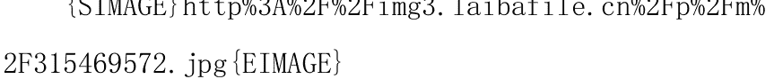

华东地区省市（上海、江苏、浙江、安徽），GDP总值约23.7万亿元，占全国GDP约24%。排名全国前十的有国内排名第二的江苏，排名第四的浙江，及排名第十的上海；排名全国靠后的行政区（安徽也是全国第十名）。共有前行政区域3个（75%的地区），后十行政区域（0%的地区），综合排名（各省/自治区/直辖市排名相同，再加以行政区域数量）为6.75。

华东地区人均GDP10.6万元，人均2.54万美元，相当于波兰的水平。

华东地区GDP总值占全国的四分之一，是中国毫无疑问的经济首强。其可贵的是该地区经济发展较为平均，除安徽经济相对较弱（其实安徽放在其它地区，并不很容易）以外，其它三地均可加入中国经济的第一梯队。虽然华东地区人均GDP相当于波兰的水平，但以京叔的切身经历来说，人民实际生活水平应当高于波兰为代表的东欧地区，而接近约3万美元的韩国，尤其是上海周边的三角地区，应该与欧美等发达国家差别不大。华东地区可以被誉为中国的“第一世界”。

加微信：101284955，京叔将用一系列文章和各位朋友分享一下对各地经济的浅见，不一定正确，希望大家给出意见，共同探讨。

## 1267 楼 
作者：上海京叔 日期:2020-03-08 11:28
中国各地经济（1）（前面的排版有点错误，故重发如下）根据各地统计局发布的GDP数据以及网上的其它数据，京叔整理了以下表格。在表中列出的是各省/自治区/直辖市2019年GDP总值的数据，并按2019年GDP总值在全国的排名排列。由于数据来源及处理的原因，表中可能会细微差异，但不影响总体结论。
{IMAGE}http%3A%2F%2Fimg3.laibafile.cn%2F%2F%2M%2F31469721.jpg {IMAGE}

华东地区省市（上海、江苏、浙江、安徽），GDP总值约23.7万亿元，占全国GDP约24%。排名全国前十的有国内排名第二的江苏，排名第四的浙江，及排名第十的上海；排名全国靠后的行政区（排名靠后的安徽也是全国第十名）。共有前行政区域3个（75%的地区），后行政区域个（0%的地区），综合排名（各省/自治区/直辖市排名相同，再加以行政区域数量）为6.75。

华东地区人均GDP10.6万元，人均2.54万美元，相当于波兰的水平。

华东地区GDP总值占全国的四分之一，是中国毫无疑问的经济首强。其可贵的是该地区经济发展较为平均，除安徽经济相对较弱（其实安徽放在其它地区，并不很容易）以外，其它三地均可加入中国经济的第一梯队。虽然华东地区人均GDP仅相当于波兰的水平，但以京的切身经历来说，人民实际生活水平应当高于波兰为代表的东欧地区，而接近约3万美元的韩国，尤其是上海周边的三角地区，应该与欧美等发达国家差别不大。华东地区可以称为中国的“第一世界”。

华东地区自唐以来，便是中国的经济发达之地，称号东南之区（唐时期曾有“扬一二”）。

华东地区自唐以来，便是中国的经济发达之地，称号东南之区（唐时期曾有“扬一二”）。

华东地区。华北地区是中华文明的发源地，自唐以来，其经济水平长期落后于江南地区，长期就需要依靠江南地区的财税支持。新中国建国以后，情况基本没有改变，改革开放以后，由于南方地区的快速发展，华北地区经济地位逐渐下降，如果不是由于北京作为首都的强大政治地位，华北地区将会更加边缘化。在今后不短的一段时间时期，华北地区的重心依然是作为首都的北京。但是北京的经济地位是由其政治地位而赋予的，并不是其本身的强大的经济决定了对其周围的拉动作用远远不能和上海、广州、深圳相比。以京叔之，华北地区的希望寄托山东身上，如果山东能够赶上江苏、浙江的经济发展水平，与北京形成“双核驱动”，则华北经济振兴有望。

北京最大的软肋，便是在缺乏具有经济辐射能力的龙头城市（类似于上海于华东，广州于华南），从而无法整合资源形成整体优势。这也是华北地区经济水平异常巨大的原因。虽然长期以来推动“环渤经济”，但并没有看到实际的效果。另外，华北地区经济比较内向，与外界经济相对有限（主要是山东与韩国的交互作用），使得经济发展潜力相对有限，也是发展不快之一（由于全球化，与外部经济的交互程度，在很大程度上决定了一个地区的发展潜力）。总之，京叔对于华北地区的经济维持观望态度。

## 1281 楼 
作者：上海京叔 日期：2020-03-10 12:36
全球股市昨日全面大跌，美欧各国股市指数跌超5%。以京叔之见，全球股市大跌，对中国并不是一件坏事。退潮以后，才谁在裸泳。金融虚热退潮以后，才会有真正实力。

## 1282 楼 
作者:上海尼伯叔 日期:2020-03-11 10:13
经过埃及，沿着尼罗河顺流而下，便来到了著名的旅游胜地，卢克索。卢克索在古代的名称为底比，是埃及古都，其在埃及的地位相当于中国的西安。卢克索是古底比文物集中地，被视为地球上“最大的露天博物馆”。由于经历沧桑，其古建筑多已毁湮。保留至现代的遗迹中，最著名的就是德富神庙（又称鲁斯神庙）。

有的德富神庙位于尼罗河西岸，按照古埃及人的传统，东方代表“生”，西方代表“亡”。德富神庙位于尼罗河东岸，而尼罗河西岸一般用于“亡”的墓地。

神庙的历史从古埃及王国时期到希腊罗马时期，长达三千年。它的古埃及名字是魏特塞特尔（Wetjeshor），希腊名为阿波罗波利斯（Apolis Magna）。《百合志》记载罗马第二军团即驻扎于此。古代德富城市遗址已发掘出来，位于神庙左侧约50米，其迹层厚20米。在长达三千多年的时期，古埃及人、希腊人、罗马人以此作为他们统治地区的重要据点。与它的很多埃及遗址一样，德富神庙也曾经被掩在厚厚的沙书中。下图是苏格兰画家、戴维·罗伯特在18世纪游历埃及时看到的德富神庙遗址。可见沙已几乎掩埋到柱廊的屋顶，当地阿拉伯人也利用神庙作为其生活闲暇的场所（如今神庙中可以看到一些被焚火的烟雾熏黑的屋顶）。

这座德富神庙是由托勒密王朝的法老们建造的。建筑工程建于托勒密十二世纪位前的公元前37年，托勒密七世在位前的57年。而托勒密王朝实际上是由亚历山大帝建立的。

由于托勒密王朝，德富神庙是唯一一座坐落在尼罗河西岸的埃及神庙。在沙漠地平坦，尼罗河的水流极其平缓，在强烈的阳光下静静地流淌着。躺在游船顶层的休闲平台上，懒懒地晒着太阳，吹着河风，喝着饮料，十分的惬意。

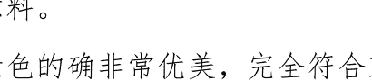

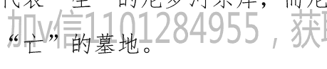

{IMAGE}http%3A%2F%2FImg3.laibafile.cn%2Fp%2Fm%2F2315530579.jpg {EIMAGE}

# 1286 楼
作者:上海京叔 日期:2020-03-11 10:16
克莱索尼尼罗河岸

{IMAGE}http%3A%2F%2FImg3.laibafile.cn%2Fp%2Fm%2F2315530596.jpg {EIMAGE}

# 1287 楼
作者:上海京叔 日期:2020-03-11 10:17
克莱索尼尼罗河岸

{IMAGE}http%3A%2F%2FImg3.laibafile.cn%2Fp%2Fm%2F2315530611.jpg {EIMAGE} 王嘉莉 加群1101284955，获取更多好

# 1288 楼 
作者:上海京叔 日期:2020-03-11 18:39
京叔公司的一个西班牙工厂停工了

来自
作者:上海京叔 日期:2020-03-11 20:40
昨天和今天开了了很多会，疫情在欧美的影响逐渐发酵，国外同事目前已十分紧张。

# 1292 楼 
作者:上海京叔 日期:2020-03-12 09:54

前面提到，卡纳克神庙始于3900多年前，是太阳阿蒙众的崇拜中心，古埃及最大的神庙所在地。卡纳克的阿蒙神庙始于中王国时期。

新王国第十八王朝加大扩建，第十九、二十王朝又有增修。至新王国末期，已拥有10座塔门（埃及及一般神庙仅有一座塔门），各座塔又有相应的厅厅或庭院。整个平面布局呈矩形，主殿按东西轴布局，先后重叠塔6座，又从中心向南分支，另列塔4座。除主殿供奉阿蒙神外，还另建奉阿蒙之子柯西斯神和阿蒙之赛赫斯神庙的。

卡纳克神庙最著名的可能是它的柱厅，该厅长366米，宽110米，六道厅，134根石柱，分成16排。

柱子最高处，其直径3.57米，承受着9.21米，高65吨的大梁。其他柱子的直径为2.74米，高12.8米。在柱顶的柱槌处，可以安稳地坐下近百人。在众柱厅中，最大的一座由十九王朝拉美西一世、谢提世和拉美西二世三代法老力修造。著名电影《尼罗河梦幻》有一段重要的情节是在这里拍摄的，电影中高耸的石柱、雄伟的宇宙以及巨大的石块从柱顶获落下的那一个组织头，就在这个地方拍摄的。

卡纳克神庙中还有一座著名的方尖碑，这座方尖碑是世界上第一位女王、古埃及唯一的法老哈特谢普苏特女王所立，碑全高29米，重323吨，是当时最高的方尖碑，也是现在埃及境内最高的方尖碑。这座方尖碑的石料来自阿旺，沿尼罗河长运输150公里，最终竖立在全埃及最大的神圣的神庙里，开采石料及运输方尖碑共历7个月。

（前面提到的阿哈地区未完成的方尖碑，也是由这位女法老下令建造的。方尖碑共有两座，另一座已经毁融，其顶端现在被放置在神庙里的圣湖边。）

注意看这座方尖碑的顶端一段与底部部分有明显区别。这是由于继承女法老特莫斯三世为了抹去女法老的遗迹（至于为什么要这么做，后世会知道），砌起高墙把它围挡了起来，只在最顶端留下了4米高的一段，上面刻的埃及阿蒙的文字。结果是，高墙的遮挡反而更好地保护了阿哈方尖碑，当高墙倒塌后，我们发现，阿哈法老的方尖碑没有被风化，几乎完好无损，只是在顶端可以清楚看到当时高墙遮挡的印记。

在整个神庙中有丰富的浮雕和彩画，表现宗教内容，又歌颂王国业绩，并附有铭文。这座神庙是研究古埃及和新王国历史、文化的考古遗迹，可以说是石刻的史书。

# 1295 楼
作者:上海京叔 日期:2020-03-12 10:00
已废墟的卡纳克神庙
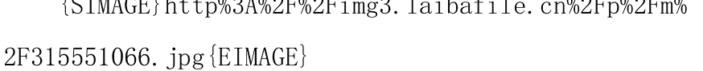

# 1296 楼 
作者:上海京叔 日期:2020-03-12 10:00
柱廊，
{SIMAGE}http%3A%2F%2Fimg3.laibafile.cn%2Fp%2Fm%2F235551078.jpg

# 1297 楼 
作者:上海京叔 日期:2020-03-12 10:01
柱廊，
{SIMAGE}http%3A%2F%2Fimg3.laibafile.cn%2Fp%2Fm%2F23155100.jpg

# 1298 楼 
作者:上海京叔 日期:2020-03-12 10:03
女王的方尖碑，注意其上部和下部明显区别
{SIMAGE}http%3A%2F%2Fimg3.laibafile.cn%2Fp%2Fm%2F23155177.jpg

# 1299 楼 
作者:上海京叔 日期:2020-03-12 10:05
女王的另一座已倒塌的方尖碑
{SIMAGE}http%3A%2F%2Fimg3.laibafile.cn%2Fp%2Fm%2F23155112.jpg

# 1300 楼 
作者:上海京叔 日期:2020-03-12 10:47
昨天和今天开了了很多会，疫情在欧美的影响逐渐发酵，国外同事目前已十分紧张。这真的是欧美的体制问题造成的，有空写篇小说。

# 1301 楼 
作者:上海京叔 日期:2020-03-12 18:33
这几天忙于应对新冠肺炎，周一的时候各国好像还轻松，周二、周三开始，各国突然紧张起来，今天已经变成大事。一手索，加微信获取更多好帖

# 1302 楼 
作者:上海京叔 日期:2020-03-13 10:03
世卫组织负责人谭德斯在举行的记者会上说，疫情的传播程度和严重性令人感担忧，“因此我们认为，新冠肺炎从特征上称为大流行”。他说，过去两周国外新冠肺炎确诊病例增加了13倍，受影响国家和地区增加了两倍；目前14个国家和地区的确诊病例超过1.8万例，死亡病例达到429例，还有数千的人在医院里为生存而战。未来几周内预计诊病例数、死亡人数以及影响国家和地区数量还将上升。

谭早就表示，现在在中国以外才是最大担忧。他的话或许正在验。目前国外累计新冠肺炎确诊病例数字还是动态更新增加。可以说，国外新冠疫情的迅速蔓延，与某些人忽视新冠肺炎的严重性无关。可能很多读者十分不解，在中国封城、全国限制出行、延迟这种高代价的方式为全世界争取到了贵的防疫时间，世界卫生组织也反复呼吁世界各国早应对，为什么美国国家没有在疫情的未发阶段采取预防阻止措施，又在初发阶段没有采取迅速措施遏制处理，而是一是要等到疫情十分严重之后才采取措施，而且采取措施的力度也相当迟迟迟疑，好像是慢半拍。

其这种现象一点都不奇怪，其根本原本就是西方的体制，是妥妥的“体制问题”。在中国的体制中，社会希望政府管几乎所有的事情，投票票了找政府、猪狗涨价找政府，等等，等等，总之，中国的政府需要对几乎所有的事情负责，具有无限的责任。反之，西方的体制中，政府只是有限的责任，更是社会雇用的“物业管理者”，社会更关注的是这个“物业经理”是否守法，而“物业经理”更关心的是是否上岗，而不是是否真对社会有利。政府基本上算是“打工者”，极少有主人精神。

在欧美的体制下，政府与政客倾向于只做社会主流意识认为是应该做的事，而不是对社会有利的事。在没有形成主流意识以前，倾向于不做。这是因为西方体制中判定政客为主流意志，所以判定政府与政客的标准并不是事实上的对错，而是主流认为的对错。在经典的欧美政治理论中，解决这一矛盾的解释是社会主流意识不会犯错的，一定会做出对社会主流有益的批判，而西方经典政治理论的错误恰恰就出在这一点。事实上，主流意识做出错误的情况并不少，而损害主流利益。尤其是现代社会复杂，主流意识做出错误或无法形成主流意识的情况普遍。其一，广大大众并不总是具有正确判断的能力，尤其是预估判断，而且形成共识往往需要时间；其二，由于“公地现象”的存在，广大大众可能做出对自身不利的决定；其三，特定集团或个人可能误导大众以谋私利；其四，社会内集团利益有可能调和。请期待本文下部分。

# 1305 楼 
作者：上海京叔 日期：2020-03-14 10:52
根据美国霍普金斯大学实时统计，截至北京时间14日日上午9时，美国境内新冠肺炎确诊病例达2028例，死亡43例。

# 1308 楼 
作者:上海京叔 日期:2020-03-14 10:53
新华社内瓦记者：世界卫生组织13日公布的最新数据显示，国外新冠肺炎确诊病例达到5176例。世卫组织每日报告，截至欧洲中部时间（北京时间13日17时），国外新冠肺炎确诊病例较一日增加748例，达到5767例；全球范围内，新冠肺炎确诊病例较一日增加7499例，达到12758例；死亡病例较一日增加342例，达到4955例。

# 1309 楼 
作者:上海京叔 日期:2020-03-14 11:51
欧美防疫总是慢半拍（当主流意识做出错误或无法及时形成主流意识时，需要负责的政治做出担当，冒着相应的代价，做出对社会有利的决策）。然而幸的是，欧美体制中权力金字塔顶端的更多的是政客，倾向于不作为或尽量作为。比如对于欧美福利制度的反思其实很久以前（危机爆发之前）就已经许多国家的人士识别到了，并呼吁尽早改革以避免危机爆发。由于当时的意识并没有认识到这一问题，所有政客均采取态度。只有德国的施罗德政府坚持推行福利改革。由于这次改革，施罗德在之后的头中遭失败。后在德国的政府继续执行改革，从而为德国经济建立了一个相对良好的基础，使得德国经济在欧洲中独一无臭。另一个例子就是不久前的法国。其实法国阶层都认为是退休制度需要改革，但是对于如何改革无法达成共识，每个社会群体应当先改革并消灭群体的福利。而马克西又缺乏施罗德的魄，出现了人都认为应该改革，但是改革无法进行的局面。回到这次的疫情应对，在疫情没有严重到意识已经共识以前，如果没有担当的领导人，欧美政府都会采取如封城、限制流动等极端的预防措施，避免承担违背主流意识的风险。只有在疫情的严重性已经十分明确，意识对于严重性已没有异议的时候，才会采取有利措施。这就是欧美政府显得慢半拍的原因。

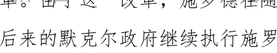

# 1310 楼
作者：上海京叔 日期：2020-03-14 20:30
下面列出了各国现有的确认数，大约在什么时候时间点的确认数与其相当，使大家对各国的严重程度有一个粗略的印象。
- 美国2329例，大约相当于1月25日或26日（实际数可能大于该数据）
- 意大利17660例，大约相当于2月2日；
- 西班牙5232例，大约相当于1月29日；
- 德国3718例，大约相当于1月26日或27日；
- 法国3667例，大约相当于1月26日或27日；
- 瑞士1139例，大约相当于1月24日；
- 瑞士801例，大约相当于1月23日（实际数据应该该数据）。
武汉封城是1月23日，以上各国均已到达中国武汉封城时的严重程度。

# 1317 楼 
作者:上海京叔 日期:2020-03-14 36:0
下面列出了各国现有的确诊数，大约在什么时间点的确诊数与其相同，使大家对各国的严重程度有一个粗略的印象。
- 美国2329例，大约相当于1月25日或26日（实际数可能大于该数据）；
- 意大利17660例，大约相当于2月2日；
- 西班牙5232例，大约相当于1月29日；
- 德国3718例，大约相当于1月26日或27日；
- 法国3667例，大约相当于1月26日或27日；
- 瑞士1139例，大约相当于1月24日；
- 瑞士801例，大约相当于1月23日（实际数据应该该数据）。
武汉封城是1月23日，以上各国均已到达中国武汉封城时的严重程度。

# 1318 楼
作者:上海京叔 日期:2020-03-15 10:00
本文来自《纽约时报》3月13日，标题：中国争取了时间，西方却白白浪费了近两周前，我从北京到伦敦，我知道这清楚地表明，除了武汉之外的居民，都处于全球危机之中。最后的提醒：两次强制体温测量和一份电子声明，这意味着如果我们感染了，英国官员很难追踪到我们。从飞机上下来，摘下了口罩。此后，病毒迅速扩散，欧洲和美国依然处于封锁状态，病例仍在增加。世界卫生组织宣布每个人已知：这是一个全球性流行。在过去的几周内，美国和大部分地区对病毒爆发的态度是被动的，至少是漫经心。中国遭遇的是一场突袭，而西方国家的政府提前几周就收到了通知。
外界似乎认为中国的经历具有特性，尤其是西方觉得流行不会传播得这么远、这么快。我认为重要的是，尤其是西方的政治体制，他们轻视了中国的决策可能价值和重要性。当中国在1月份实施严厉的封锁和隔离措施时，国外主流媒体不仅批评这些措施过度，还说这套做法落后或毫无意义。中国用一周时间建成了两所医院，建立隔离中心收容感染者，让他们感受到病毒的危险。总的来说，我认为隔离措施得到了民众的支持。从这些经历知道，人们对遏制疫情的措施延误甚至愤怒，但他们基本上支持的。

# 1320 楼 
作者:上海京叔 日期:2020-03-15 10:08
3月14日0—24时，新增报告境外输入确诊病例16例（北京5例，浙江4例，上海3例，甘肃3例，广东1例）。截至3月14日24时，累计报告境外输入确诊病例111例。防止境外输入的斗争将是长期的，千万不可松懈。尤其是瑞典、英国等国已放弃对疫情的控制，形势更加严峻。手动整理，加微信1101284955，获取更多好帖

# 1321 楼 
作者:上海京叔 日期:2020-03-15 11:13
在卢克索尼罗河岸，除了卡纳克神庙最为著名以外，还有另一个神庙不能看，那就是卢克索神庙。卢克索神庙落在尼罗河边，经历了几千年岁月中观赏尼罗河的日落，也是特别的一种经历。卢克索神庙与卡纳克神庙之间有一条人面像大道相连，大道两路坐着上百神面像。埃及神庙的建筑形式其实都很相似，都是由塔门、庭院、库廊及神龛所构成，区别于建筑数量和规模。卢克索神庙也不例外，但其规模远小于卡纳克神庙，但是以其内在，却更有意思，因为它有更多的故事。
和卢克索神庙有关的第一个故事是卢克索神庙前的方尖碑。在卢克索神庙中，位于庭院的西侧有一座方尖碑。

后的行政区1个（25%），综合排名为14。该地区人均GDP8.45万美元，约1.23万美元，大约相当于罗马尼亚的水平。

华南地区GDP总值约占全国的六之一，从总量来说，略微少于华北地区，而排在中国内地各地地区中的第三位（加香港、澳门），该地区GDP总值约为20.6万亿元，依然大幅落后华东，仅小幅领先华北。经过这么多年的发展，华南地区在总量上依然没有超过华北地区，这一点让京叔有点意外。从人均GDP的角度来看，就是经济发展水平来说，华南还是领先于华北，但领先并没有想象中的那么大（华南约华北的120%多），华南的经济虽然大，但是没有想象中的那么大，经济中还有一定差距。

## 一 数据与流量的原因

从数据来看，可能有两方面。
其一，华南地区的经济发展不太平衡，有发展的广东、福建，也有落后的广东、海南。其二，区内广东（人均GDP9.64万元）、福建（人均GDP10.84万元）的发展水平与上海（人均GDP15.78万元）、江苏（人均GDP12.41万）、浙江（人均GDP11.02万元）还有一定的差距。

在中国的经济版图中，华南地区的崛起是一个比较晚近的现象。在很长的一段历史时期，华南地区对于中华经济的影响几乎可以忽略。华南地区的崛起，与海洋经济的崛起是息息相关的，无论是宋末时福建泉州地区为代表的兴旺的海外贸易，还是明清时广州地区的海外贸易（传统的说法不同，明清时期中国的海外贸易其实十分发达，以后有机会再详述），均是华南地区崛起的主要原因。而改革开放，更是使得华南地区一度引领中国内地经济发展的潮流。

但是与华东地区相比，华南地区有两个点不足，使得华东地区经济能够保持强于华南。其一，华南地区的地缘力不如华东地区。华东三省可以说是中国最适合经济发展的地区，其内部资源、自然条件、交通条件等均优于华南，而且长期以来便是中国经济发展的领先地区，积累了丰富的底蕴（人才、工业基础、社会氛围、民俗习惯……）。

其二，上海在华东地区具有绝对领导地位，整个地区自然以上海为核心形成规模优势，其间优势互补，构成巨大的整体优势。相反华南地区，缺乏统一的内核（珠三角地区与福建地区基本上不属于同一经济单元，即便三角内部，广州、深圳、香港互为竞争）从而难以整合整个地区的资源，形成整体优势。

总之，由数据来看，华南地区经济并没有一般设想的强大，这让京叔有些意外。以京叔视角之，华南地区经济的关键在于短时间内整合区域内资源，形成良性互补，发挥整体优势，然后进一步辐射东南亚地区。当然，可以肯定的是，由于华南地区优越的地缘环境与已经达成的周边多数地区（无论国内外的）的优势地位，其在中国至于世界经济版中的重要性将随着中华经济的不断进步而提高，珠三角地区大概率将成为中国长三角之外的另一个世界经济中心。

# 1329 楼
作者: 上海京叔 日期:2020-03-16 12:22
中国以外确诊数已超过中国，现在在中国防疫主战场毫无疑问，关键是防输入。

# 1330 楼
作者: 上海京叔 日期:2020-03-16 17:10
@singerdown 2020-03-16 07:29:53
英国帝国的群体免疫论，“这让人想起生物进化的剧本。祖先消灭，物竞天择，适者生存！对疫情消极处理，最终老年人、有基础疾病的人和体质差的人被自然淘汰，剥离下年轻人和身体棒的人就会自动获得免疫力！整个英国社会将充满生命、活力！”京叔觉得英国可能会犯错，因为如此直白来说，符合西方逻辑。

# 1332 楼
作者: 上海京叔 日期:2020-03-16 09:46
境外累计确诊数双超过境内，美股重挫，股市跌。全球形势风雨飘摇，我们已经处于黑暗时刻。京叔相信这次危机之后，中国在国际上的相对地位大大进一步。

# 1333 楼 
作者: 海上京叔 日期:2020-03-17 10:29
世卫组织每日报告显示，截至欧洲时间16日（北京时间17日），中国以外新冠肺炎病例较前一日增加3874，达到8634；死亡病例较前一日增加48，达到3388。全球范围内，新冠肺炎病例较前一日增加3903，死亡病例较前一日增加62，达到6606。京叔一直有一个忧虑，目前疫情爆发的国家都是较为强大的，如英国这样不负责的情况造成疫情在地区（如中东、非洲）爆发不可收拾。我们应该做好防控输入的准备。

# 1334 楼 
作者: 海上京叔 日期:2020-03-18 09:45
和克索神庙有关的第三个故事与古代最伟大的帅——亚历山大帝有关。亚历山大帝仅用三十年生命建立了从埃及到印度河流域的伟大帝国，古代世界无人能比。当年亚历山大帝征服古埃及时，也来到卢克索神庙，执意要乘坐战车经过柱廊进入龛，由于柱廊中的甬道不够，战车无法接入。亚历山大帝下令将两侧石柱削去一部分，直到宽度足够战车驶入。高中时在古希腊作者普里尼著的《亚历山大远征记》中读过这个故事，没想到能在有生之年还能亲眼见证，可以亲自触摸两千年前的历史。

卢克索神庙有关的第四个事实与我们中国人有关。2013年5月，有中国游客在卢克索神庙的一幅浮雕上看到了“丁锦昊”几个字（见下图），涂鸦不是刻的，而是用粉状石块之间的缝隙随手写的。该游客将拍摄的照片在网上公布，引起广大网友的热烈讨论。而“丁锦昊”成为新浪微博搜索的热门关键词，后面解释：“丁锦昊，你撞大事了。”后来发现，丁锦昊是南京的一名中学，父母也主动站起来为孩子的行为道歉同时也恳请得到改正的机会。当然，这一涂鸦斑已被清理干净。这件事在当时的互联网上引起了相当激烈的讨论，对于这种在古迹上留下了“到此游”的行为多少表示了谴责。有一段时间时期，中国游客在国外文明的表现时见新闻报道，似乎中国游客的素质特别低下。以京叔的亲身感受，中国游客的确不太遵守规则，比较喧哗以及不拘小节等问题，总体来说不见和其他国家引起的极大的不同，欧美日游客的整体素质也不见比中国游客更高。其实不管哪里的游客，都有不同素质的人，而且他们的行为习惯总是随着社会的进步而逐渐提高。京叔就在阿布辛贝石碑上刻过英国人刻下的英文版“到此游”，当然留下那一刻的英国人不是现代人，而是生活在十九世纪的英国人。

# 1339 楼 
作者: 上海京叔 日期:2020-03-18 11:36
最近英国等国的所谓“集体免疫”式防疫引起了极大的争议。所谓“集体免疫”，就是让所有人（或绝大多数人）都在新冠肺炎疫情中去感染，依靠个体形成的免疫力来……

生命是无价的。为了拯救生命，无论付出多大代价都是值得的，正是现代社会区别于野蛮社会最重要的标志。而且我们谈论的是千上万生命，怎么可以以经济太大而放弃？由于病毒致死率不高，死亡人数多，这种代价是可以接受的。和上一条理由一样，由于病毒致死率不高，目前中国的数据较为完整（它国家还没有结束），但中国是在积极防控下得到的。如果采用英国的方式，致死率是多少？

除了上述理由以外，还有其他的理由。请大家想一想，我们为什么要政府？最重要的理由我们需要政府能够调动资源来保护我们。在病毒爆发期间，采取一切措施对抗疫情是政府的根本之一。如果像英国那样放弃，意味着放弃。英国政府的做法除了其本土人民以外，对于整个世界也是负责的。由于政府的不作为，病毒不断威胁全世界。套一句大家熟悉的话，如果英国政府坚持孤行，必……

不过这种“掩耳铃”式防疫的出台极其草率，具有逻辑漏洞。京叔认为英国政府有极大的可能在不久将改变立场。现在，意大利防疫成败具有极大的意义。如果意大利防疫成功，说明不仅可以在亚洲成功，可以在欧洲成功，因而具有普遍意义；到那时英国政府大概会改变政策。如果意大利防疫失败，会有更多国家步入英国后尘。到那时，真正的黑暗时刻是未来，最坏情况就是关门自守，直到研发疫苗或特效药。如果真的到了那一步，无疑中国是世界上安全的地方。

# 1348 楼 
作者: 上海京叔 日期:2020-03-19 10:18
昨日主要股市大跌，美国股市再次熔断，说明大众并不认同英美等国的“掩耳铃”式防疫，尤其是对美国政府的措施不满意。如果疫情长期发展，必将重挫公司及大众的信心，而普遍失去信心对现代经济的打击并不等于金融系统出现。据京叔所知，已经有欧洲工厂停工了，这说明即使政府掩耳铃，公司也会停工。

# 1349 楼 
作者: 海上京叔 日期:2020-03-19 10:26
英美这种方式使得疫情的不确定性大大增加了，使得经济的不确定性也大大增加了，使得大众的信心严重遭受。英美现在的做法与上世纪三十年代大萧条初时的做法极其相似，就是行动延缓、不作为，从而形势不可收拾。只是上次是在经济金融上不对，这次是在防疫上。上次大萧条助力了苏联的崛起，这次全球疫情也可能助力中国实力的再次上升。

# 1350 楼 
作者: 海上京叔 日期:2020-03-19 12:16
重新整理了一下文字。
昨日主要股市大跌，美国股市再次熔断，说明大众并不赞同英美等国的“掩耳铃”式防疫，尤其是对美国政府的措施不满意。英美政府的做法即使就能达到专家所谓的低压曲线，最终获得“集体免疫”的结果，也会使经济陷入长期和不确定的疫情中。长期不确定，其实对经济的杀伤比中国的数据更严重。如果出现这种，则将是对欧美社会的毁灭性打击。而这种概率其实非常大，因为美英政府的做法本质上就是放任病毒传播。

# 1351 楼 
作者: 上海京叔 日期:2020-03-19 12:19
如果疫情长期发展，必将重挫公司及大众的信心，而普遍失去信心对现代经济的打击并不亚于金融系统出现。据京所取，已经欧洲工厂由于疫情开始停工，这说明即使美英抛弃掩耳铃，公司与大众也会自动采取更多措施。

# 1352 楼 
作者: 上海京叔 日期:2020-03-19 12:48
据京所取，已经欧洲工厂由于防疫停工，这说明即使美英采取掩耳铃的方式，公司与大众也会自动采取措施。由于大众对政府的信心严重，即使美英采取了极端措施，无法避免股市再次熔断。

# 1353 楼 
作者: 上海京叔 日期:2020-03-19 12:48
政府现在的做法与上世纪三十年代大萧条初时的做法极其相似，就是行动迟缓、不作为，从而形势不可收拾。上次大萧条助力了苏联，这次疫情也助力中国实力的再次上升。

# 1354 楼 
作者: 上海京叔 日期:2020-03-19 12:27
说实话，前段时间期间京叔虽然十分谨慎，但很害怕，因为不知道疫情什么时候结束，而且还有很大可能恶化，京叔真的害怕。

# 1355 楼 
作者: 上海京叔 日期:2020-03-19 13:54
疫苗应该在月份出来，进度不错。

# 1359 楼 
作者: 上海京叔 日期:2020-03-19 16:56
由于疫情蔓延，西方社会（尤其是美国）力度不足，股市跌。

# 1361 楼 
作者: 上海京叔 日期:2020-03-19 17:00
由于疫情蔓延，西方社会（尤其是美国）力度不足，其实关键还是要在防疫上解决问题。

若是唯一一座未经盗掘的库，完整地保存了墓穴封闭时的原貌的古埃及及法老墓。其墓葬的发现代表了埃及和考古工作的顶峰，图坦卡蒙二世因此成为了现代世界最著名的古埃及及法老。境外媒体报道，2016年埃及及官方表示经雷达扫描后发现，图坦卡蒙内藏有密室的概率高达九成，室内内部可能有金属或有机物质。如果这一个报道属实，则很有可能有更为惊人的发现。

由于未经盗掘，图坦卡蒙墓内发现的古埃及及文物十分惊人。最为盛名的是黄金面具，这面具重量约 10.23 公斤，制造十分精美。图坦卡蒙的木乃伊由三个人形与三个外层层所组成，每一个大小恰好一样，手工技艺相当相似。最内层的形状由 22K 金打造，重 110.9 公斤。

各种珍宝还一样，在墓中还发现了大量的衣服、围裙、鞋等服装，床、被子、座椅等家具，战车、回力箭等战斗用具，急救箱等医疗用具，甚至还有大约 30 种品牌的酒，其中一种是“图坦卡蒙葡萄酒”，上面还标有年份，葡萄产地制造的。

除了珍贵文物以外，这使得位年轻青年法老更是出名的“法老的诅咒”。当年，当卡特极其助手进入图坦卡蒙墓时，都看到了墙壁刻上的诅咒，翻译过来，都是如“谁扰乱了这位法老的安宁，展翅的死神将降临他头上”，“我是图坦卡蒙的保卫者，我是沙漠之火驱赶那些盗贼之类的话。

诡异的是，仅几个月后，在墓室中被蚊叮了左类的卡纳丰勋爵（发掘的资助人），在早上刮胡子时不小心伤了左眼的痘疮，后因感染而死。他儿子说，当听到护士的叫唤父亲走进病房时，医院的所有灯光都熄灭了；他的女儿说父亲临终前遗嘱道：“我听见了他呼唤的声音，我要随他而去了！”检验胆图卡木乃伊的医生说，木乃伊迟也有一处疤痕，与卡纳丰被蚊子叮的位置完全相同。除卡纳丰勋爵之外，在此后的三年零三个月里，先有 22 名参与图坦卡陵发掘的人员意外死去，恐怖的诅咒似乎真应验了。

# 1381 楼
王慧理 作者:上海京叔 日期:2020-03-21 13:26

图坦卡墓中出土的珍宝现收藏于罗浮博物馆，由于当时博物馆内不能拍照，京叔从网上下载了一些照片。

图坦卡的金面具
{IMAGE}http%3A%2F%2Fimg3.laibafile.cn%2Fp%2Fm%15743221.jpg {IMAGE}

# 1382 楼
作者:上海京叔 日期:2020-03-21 13:27

图坦卡的金棺
{IMAGE}http%3A%2F%2Fimg3.laibafile.cn%2Fp%2Fm%157432221.jpg {IMAGE}

# 1383 楼 
作者：上海京叔 日期:2020-03-21 13:27

图坦卡蒙的金棺
{IMAGE}http%3A%2F%2Fimg3.laibafile.cn%2F%2Fm%2F3115743226.jpg {IMAGE}

# 1384 楼 
作者：上海京叔 日期:2020-03-22 11:33

华中地区四省（河南、湖北、湖南、江西），GDP 总值约 15.5 万亿元，占全国 GDP 约 16.6%。排名全国前十的全国排名第五的河南，排名第七的湖北，及排名第九的湖南；无排名全国后十的行政区。共有前十的行政区3个（75%），后十的行政区0个（0%），综合排名为9.25。各地人均GDP6万万美元，约0.89万美元，相当于巴西、古巴的水准。华中地区GDP总值占全国的六分之一，从总量来说，略于华南地区（相当于包括港澳的华南地区87.6%），这一点有点出意外。而且华中地区四省竟然有三省进入了全国GDP总量排名前十，即便最后的江西也排第十六位。在世人的印象中（包括者的印象中），华中地区的经济与华南地区应该是巨大的，尤其是河南、湖南及江西都是相对落后的省，看来我们都曾小看华中地区了，其实华中地区与华南地区在中国所占权重的差异并没有想象那么大。如果我们从人均GDP（代表经济发展的水平）的角度来看，华中地区的表现就没有这么好了。华中地区人均GDP仅相当于全国平均水平88.6%，本地区四省中除湖北（约为全国值的112%）高于高于平均水平外，其它三省均未达到全国平均水平（为全国平均水平78%-84%）。华中地区内各省的经济相对均衡，内部没有华北、华南那么大的内部不平衡。华中地区是中国经济发展较为成熟的地区，区内绝大部分地区从春秋时期就开始繁荣的主区域，便是中华民族衍生的核心区域，华南地区更是从商时代一直是华文明的核心区域。在现代工业文明兴起以前，华中地区的大部分区域占据整个华中的中心位置，人口稠密，一直是中华民族与中华文明的核心区域。近代以来，由于工业文明与海洋文明的强势崛起，华中地区由于内地，逐渐难以与上、华南的发展步伐，已有较为明显的差异。其实严格来说，华中地区并没有形成一个较为明显的经济格局，更多是一种地理上的概念。在经济上，明显倾向于与华东地区的交流，以承接华东地区的经济辐射；而湖南则倾向于向华南靠拢，以承接华南地区的经济辐射；经济意义上的华中可能局限于湖北省。华中地区应该出现一个全国性的经济中心，而是引领华中地区的经济发展。目前比较行的发展策略应该是利用华东、华南产业升级的时机，努力承接这两地区产能转移，做好华东、华南的经济腹地。

# 1391 楼
作者:上海京叔 日期:2020-03-22 13:37

一篇，中国各地经济（-）华中地区四省（河南、湖北、湖南、江西），GDP总值约15.5万亿元，占全国GDP约16.6%。排名全国前十的全国排名第五的河南，排名第七的湖北，及排名第九的湖南；排名全国后十的行政区。共有前十的行政区3个（75%），后十的行政区1个（0%），综合排名为9.25。各地人均GDP万万美元，约0.89万美元，相当于巴西、古巴的水准。华中地区GDP总值占全国的六分之一，从总量来说，略少华南地区（相当于包括港澳的华南地区87.6%），这点有点出意外。而且华中地区四省竟然有三省进入了全国GDP总量排名前十，即便江西也排第十六位。在世人的印象中（包括者的印象中），华中地区的经济与华南地区应该是巨大的，其中河南、湖南及江西都是相对落后的省区，看来我们都曾小看华中地区了，其实华中地区与华南地区在中国

中国所占权重的差异并没有想象那么大。如果我们从人均GDP（代表经济发展的水平）的角度来看，华中地区的表现就没有这么好了。华中地区人均GDP仅相当于全国平均水平88.6%，本地区四省中除湖北（约为全国值的112%）高于全国平均水平外，其它三省均未达到全国平均水平（为全国平均水平78%-84%）。华中地区内各省的经济相对比较均衡，内部没有华北、华南那么大的内部不平衡。华中地区是中国经济发展较为成熟的地区，区内绝大部分地区从春秋时期就开始繁荣的主区域，便是中华民族衍生的核心区域，华南地区更是从商时代一直是华文明的核心区域。在现代工业文明兴起以前，华中地区的大部分区域占据整个华中的中心位置，人口稠密，一直是中华民族与中华文明的核心区域。近代以来，由于工业文明与海洋文明的强势崛起，华中地区由于内地，逐渐难以与上、华南的发展步伐，已有较为明显的差异。其实严格来说，华中地区并没有形成一个较为明显的经济格局，更多是一种地理上的概念。在经济上，明显倾向于与华东地区的交流，以承接华东地区的经济辐射；而湖南则倾向于向华南靠拢，以承接华南地区的经济辐射；经济意义上的华中可能局限于湖北省。可见，华中地区应该出现一个全国性的经济中心，而是引领华中地区的经济发展。目前比较行的发展策略应该是利用华东、华南产业升级的时机，努力承接这两地区产能转移，做好华东、华南的经济腹地。

# 1392 楼 
作者:上海京叔 日期:2020-03-22 15:44

新冠检测增加299例。这一数字还是达到的，美国的总诊数大于中国（实际总数大于中国）。

# 1393 楼 
作者:上海京叔 日期:2020-03-23 09:48

图坦卡蒙的轨迹几乎一样。
{IMAGE}http%3A%2F%2Fimg3.laibafile.cn%2Fp%2Fm%2F77564.jpg {IMAGE}

# 1394 楼 
作者：上海京叔 日期:2020-03-23 11:27

哈特谢普特的第一个故事就是古埃及及第十八王朝，距今3500年（相当于中国的商朝前期），在后期去世。古埃及及历史上一位武功极致的法老，酷相似于唐太宗。图斯斯一世去世，他与王妃所生的长子图坦卡蒙结婚继承。

如同尼罗河的遗迹并不是最大的卡纳克神庙，而是古埃及及历史上的唯一一位法老，她就是哈特谢普特（Hatshepsut），其实是希腊人，并不是正统的古埃及人。女王庙位于帝王谷，而是位于山峰对面。与帝王谷中的墓穴不一样，女王的祭场所位于同一个点。它的祭场所虽然毁严重，但不像其他法老那样颓然无存，经过现代修复后，基本还原了其原本的。哈特谢普特的祭场所是一座世人公认的古埃及与自然景观完美结合的典范。依山而建的建筑群与背后的山峦浑然一体，宽阔的三层平台与遥远的山谷田野呼应，几十座男性法老墓都不曾拥有的。在卡纳克神庙的方尖碑也被高墙遮挡起来。

# 1395 楼 
作者：上海京叔 日期:2020-03-23 13:31

图坦卡蒙的金棺
{IMAGE}http%3A%2F%2Fimg3.laibafile.cn%2Fp%2Fm%2F%2F3115743226.jpg {IMAGE}

# 1396 楼 
作者：上海京叔 日期:2020-03-23 11:32

女王墓穴入口
{IMAGE}http%3A%2F%2Fimg3.laibafile.cn%2Fp%2Fm%2F3157477.jpg {IMAGE}

# 1397 楼 
作者：上海京叔 日期:2020-03-23 11:33

女王露台眺尼罗河谷
{IMAGE}http%3A%2F%2Fimg3.laibafile.cn%2Fp%2Fm%2F3157805.jpg {IMAGE}

# 1398 楼 
作者：上海京叔 日期:2020-03-23 11:36

女王的塑像，注意塑像中的法老形象有胡须，但是面部具有女性特征
{IMAGE}http%3A%2F%2Fimg3.laibafile.cn%2Fp%2Fm%2F3157786.jpg {IMAGE}

# 1399 楼 
作者：上海京叔 日期:2020-03-23 11:36

女王的塑像，注意塑像中的法老形象有胡须，但是面部具有女性特征
{IMAGE}http%3A%2F%2Fimg3.laibafile.cn%2Fp%2Fm%2F3157786.jpg {IMAGE}

# 1400 楼 
作者：上海京叔 日期:2020-03-24 09:33

2019年世界城市前20强。其中美国有九城，几乎占榜单一半。中国有四城（含香港），排第二。在这一指标上，中美还有相当的差距，其余国家均在一个档次中。

| Rank | 城市 | GDP（亿美元） |
| :--- | :--- | :--- |
| 1 | 纽约 | 10300 |
| 2 | 东京 | 10220 |
| 3 | 洛杉矶 | 7530 |
| 4 | 伦敦 | 6950 |
| 5 | 巴黎 | 6690 |
| 6 | 芝加哥 | 6670 |
| 7 | 休斯顿 | 5680 |
| 8 | 上海 | 5005 |
| 9 | 北京 | 4552 |
| 10 | 首尔 | 4505 |
| 11 | 达拉斯 | 4487 |
| 12 | 斯科 | 4400 |
| 13 | 费城 | 4339 |
| 14 | 波士顿 | 4105 |
| 15 | 旧金山 | 4050 |
| 16 | 亚特兰大 | 3815 |
| 17 | 墨西哥城 | 3730 |
| 18 | 新加坡 | 3642 |
| 19 | 深圳 | 3638 |
| 20 | 香港 | 3630 |

# 1403 楼 
作者：上海京叔 日期:2020-03-24 10:47

和女王墓有关的第二个故事与哈特谢普特的人森穆特有关。哈特谢普特的执政，离不开重臣森穆特的辅佐。森穆特是许多重大工程的总指挥。哈特谢普特给了森穆特特权，比起将法老的石棺给他，破例让他在国王附近修自己的陵墓，这个陵墓和她的陵墓几乎是背对背的，再往深一段就可以在地下相通了。据说，哈特谢普特的墓后面，还有森穆特的雕像，因为女王希望在复活之后，第一眼就看到自己深爱的人。又发现一幅墓工人的绘画：一个戴着王冠的女老正和一个男人做事，这幅画说明两人的故事在当年是众人皆知的秘密。

女王墓有关的第三个故事与女王的木乃有关。在女王墓的墓穴中，考古学家发现了两具木乃，其中一具哈特谢普特的木乃迟也有一处疤痕，与卡纳丰被蚊子叮的位置完全相同。除卡纳丰勋爵之外，在此后的三年零三个月里，先有 22 名参与图坦卡陵发掘的人员意外死去，恐怖的诅咒似乎真应验了。

# 1411 楼

作者：上海上京叔 日期:2020-03-25 12:58

法老村

{SIMAGE}http%3A%2F%2Fimg3.laibafile.cn%2F%2F%2F315822205.jpg {SIMAGE} 

# 1412 楼

作者：上海上京叔 日期:2020-03-25 16:18

截止到今天下午三点，美国确诊病例已达 55225 例。暂居世界第三位，应该很快就会超过意大利（也许两三天）。

# 1413 楼

作者：上海上京叔 日期:2020-03-26 10:40

一王整理，如加1101284955，获取更多好帖
备注，中国各地经济（5）

西南地区三省一区市（四川、重庆、云南、贵州、西藏），GDP 总值约 11.2 万亿元，占全国 GDP 约 11.3%。排名全国前位的全国排名第六的四川；排名全国后十的全国排名第二十二的贵州和排名第三十二的西藏。共有前十行的行政区 1 个（20%），后的行政区 2 个（40%），综合排名为 18.8。
该地区人均 GDP 5.58 万美元，约 0.81 万美元，大约相当于黎巴嫩的水平，高于泰国。

西南地区 GDP 总值约占全国的十分之一强，从总量来说，与排在前面的华中地区有较大的差距。整个地区仅有四川进入全国前十，其余四个行政单元全部全国三十一个行政单元后的 50%，西藏更是排名底。从人均 GDP 来说，西南地区少于华中地区，基本上与华中处于同一个水平线上，人均 GDP 仅相当于全国平均水平的 78.8%，本地区四省中重庆（约为全国平均均值的 109%）略高于全国平均水平，其它四地均未达到全国平均水平（为全国平均水平的 66%-79%）。总的来说，西南地区无论从 GDP总量，还是人均水平来说，弱于华中地区，但与华中地区基本处于同一发展水平。

西南地区的经济发展也相当不平衡，其经济重心局限于成都经济圈，仅重庆、成都两地的 GDP 占了西南地区的三之一强。如果计算成渝地，人均 GDP 可达 8.63 万，高于华南地区的 8.45 万，发展水平范围内，完全可以进入中国的内流地区。而如果计算成都市的成都，其人均 GDP 都是 10.26 万，相当于西南地区平均值的两倍。而去除去成渝后的西南地区，则人均 GDP 将为 4.64 万，仅为全国水平的约 65%，基本上全国底部，其华北地区与西南地区相似，如果除去京津等地，其数据也将十分客观。

西南的大部分地区其实是在相当晚的时期才开始融入华中经济圈（云贵大约在明清两代，四川西部开始于清代，而西藏是在 49 后至 60 年代以后才真正融入华中经济圈），历史上很长的一段时间时期，所谓西南地区，其实主要也是指渝渝地区（即古巴渝地区）。由于各种原因，西

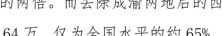

大部分地区的经济发展较为落后，经济发展水平与沿海地区有较大的差距。但是西南地区在新中国建国以后，以及改革开放以后，经济发展速度一直快于全国平均水平（这一点，后面会详述）。基础水平相对较差，但发展较快，西南地区可以称为中国的“发展中区”。

随着“一带一路”政策的推移，西南地区或许正在迎来一个巨大的发展机会。如果西南地区能够整合缅甸的海通道，从而打通印度洋的出口，则有可能创造出中国经济一个新的增长极。

# 1417 楼 

作者:上海上京叔 日期:2020-03-26 12:34
截至到北京时间今天上午 11:35 分，美国确诊数已超过 69018，也许下周一或以前就会超过中国。

# 1418 楼 

作者：上海上京叔 日期:2020-03-26 23:55
外交部、国家移民管理局发布公告：自2020 年 3 月 20 起，暂停持有有效中国签证、居留许可的外国人入境。

来自

# 1422 楼 

作者：上海上京叔 日期:2020-03-27 17:44
截止北京时间今天下午四点，几个主要国家确诊总数:
美国: 85991
中国: 81828
意大利: 80589
西班牙: 57786
德国: 47278
法国: 29569
伊朗: 29406
英国: 11813
瑞士: 11811
韩国: 9332

美国已经超过中国成为确诊最多的国家，意大利也会很快超过中国（从数据看，意大利已经接近或到达一周顶点）。德国、法国的情况均不乐观，其实际数字大大于现在报告。看来，欧方的防疫形势相当严峻，输入的压力日益增大。快速出台了限制外国人入境航班这两项措施说实话，这两项措施出台如此迅速，有点出乎意料。

# 1425 楼
作者:上海上京叔 日期:2020-03-27 08:08
英国首相约翰病毒检测呈阳性进行自我隔离
来自

# 1428 楼
作者：上海上京叔 日期:2020-03-27 09:09
今天的帖子又被加帖了
来自

# 1429 楼
作者：上海上京叔 日期:2020-03-28 10:12
结束了卢克索之旅，前往本次行程的最后一站，埃及及首都开罗。卢克索至开罗的里程约 670 多公里，坐火车需要一整夜的时间。作为埃及古都、南部重镇，卢克索火车站十分热闹，与中国的火车站完全不同，就像当时的天津车站。光线明暗，布局比较凌乱，长途汽车站。卧铺安排刚问了一等还是二等，但应该是较为高档的选择。卧铺除了陈旧以外，包间内的设施相当不错，有点出乎意料。每个包间可以住两个人，上下铺，上铺在睡觉时折叠起来，下铺则隐藏在座椅后背后面，需要睡觉时将后背翻下来打开，好床铺。每一个包间里都有一个小小的洗手台，洗手台上热水龙头（就是下图中右侧的半圆形设施，部分颜色较深的洗手台翻开就是）。

晚餐也是车员送到每一个包厢里，吃完后，车员会将餐具收走，并将包厢清理干净。总而言，埃及的这种卧铺为旅客创造了一个相当舒适与私密的空间，使得一个夜晚上的火车旅行变得相当舒适，一点没有疲惫。即使当中国的铁路系统（包括我们引以为傲的高铁）在硬件设施毫无疑问是当今世界的顶尖水平，但在乘客舒适性方面与国外相比是有较大的差距。我们的铁路系统长期以来将自己定为服务行业，考虑的是如何“多、快、好、省”将人与物运送到该去的地点，而对这一点并不是特别关心。当然，中国的铁路系统在服务意识方面不断进步，依然有很多地方需要向国外学习。

# 1434 楼
作者:上海京叔 日期:2020-03-28 10:12
卢克萨火车站站台
{SIMAGE}http%3A%2F%2Fimg3.laibafile.cn%2Fp%2Fm2315879678.jpg 

# 1435 楼
作者: 海上京叔 日期:2020-03-28 10:32
美国新冠确诊日增近2万，已超十万例。意大利86498例，也超过中国，死亡已万人。英国王子、首相、卫生大臣均中招（群体免疫，佩服）。西班牙确诊65719例，死亡138人，死亡人数也超过中国。不怕不识货，就怕放弃，现在再次认识到中国的抗疫有多伟大，其阶段性胜利是多么不易和重要。中国的胜利给了全范围内抗疫的信心。如果没有中国的胜利，全世界多国家多次开会“放弃治疗”，最后再次出现西班牙流感的惨状。m101284955，获取更多好帖

# 1436 楼
作者:海上京叔 日期:2020-03-29 09:49
经过一夜的火车旅行，与东方初升的朝阳一起，到了这次埃及之旅的最后一站，埃及及首都开罗。开罗位于尼罗三角洲的南端，地跨尼罗河两岸，是非洲和阿拉伯最大的城市。开罗拥有2000万人口（大约五分之一的埃及的人都住在开罗），即使放在中国也放在重庆、上海和北京之后，列第四。开罗是世界上最古老的城市之一，有五千年连续不断的城市史（长于现有的所有中国城市），而且开罗在历史上极少受到战争破坏，保留了大量的历史时期原味的建筑。

与多数发展中国的大都市一样，开罗的市容显得凌乱与拥挤，卫生情况也相对不太好，许多地方都能看到随便丢弃的垃圾，在京叔的印象中，应该与中国九十年代初的城市处于同样的发展水平。当然，时间已经过去了十年，现在的开罗应该不一样。开罗有两个很有趣与中国不同的地方。其一是在开罗（不仅在开罗，埃及各地一样）有许多未完成的建筑，这种现象并不罕见，在世界各地都可以看到未完成的建筑，整个房子外的砖块裸在外，没有任何装饰，连窗扇也没有，空顶上竖着几根水泥柱，露着钢筋。仔细一看，发现大多数这样的房子都已经住了很久。至于为什么这样，埃及人得到的答案有两种。一种说是埃及规定需要完工，另一种是由于足够的钱，京叔倾向于前者。

# 1443 楼 
作者：海上京叔 日期:2020-03-29 12:06
美国一天又增万例，意大利死亡已超万人。

# 1444 楼 
作者：海上京叔 日期:2020-03-30 12:12
现在新冠疫情已经在范围内蔓延，京叔整理了受疫情影响的各主要国家新冠疫情的现有数据，做成了下表。

| 国家 | 确诊比例 |
| :--- | :--- |
| 美国 | 94.9% |
| 英国 | 92.4% |
| 德国 | 84.3% |
| 意大利 | 75.65% (注：此处原文OCR误，应为75.65) |
| 西班牙 | 73.15% |
| 法国 | 75.84% (大致处于关键阶段，绝不可放松) |
| 伊朗 | 60.75% |
| 韩国 | 44.25% |

# 1452 楼 
作者:海上京叔 日期:2020-03-30 14:46
前面万人死亡率数据用点错误，修正一下，但不影响结论。现在新冠疫情已经在全世界蔓延，京叔整理了受疫情影响的各主要国家新冠疫情的现有数据，做成了下表。

2F315921153.jpg 

| 国家 | 阶段/比例 (现有/总确诊) | 万人死亡率 |
| :--- | :--- | :--- |
| 美国 | 94.9% | 约 1万多人 |
| 英国 | 92.4% | - |
| 德国 | 84.3% | 0.00066 |
| 意大利 | 75.65% | 0.0178 |
| 西班牙 | 73.15% | - |
| 法国 | 75.84% | - |
| 伊朗 | 60.75% | - |
| 韩国 | 44.25% | 0.00024 |

1) 各国所处阶段。京叔发现“现有数/确诊数”（现有确诊数/总确诊数）这一数据似乎反映了各国内所处疫情的不同阶段。京叔特此成下图，以直观地反映各国所处得位置。图中折线表示各国选定时间的数据。图中可见，美国（94.9%）与英国（92.4%）均处于初期（可能是轻症）。德国（84.3%）好于美国，也不乐观，以后还会快速恶化。意大利（75.65%）、西班牙（73.15%）及法国（75.84%）大致处于关键阶段，绝不可放松。伊朗（60.75%）应该已经过了最黑暗时期，但还不确定。韩国（44.25%）应该度过难点，还不稳固。

2) 感染率（确诊数/总人口）。在疫情爆发的主要国家中，中国的感染率是最低的，为0.059，即便与中国所列国家排除中国外相比，也仅为其三分之一，如果中国达到韩国的感染率，将有26万人确诊。最高的感染率为西班牙，为0.1727，如果中国达到西班牙的感染率，将有24万人确诊。美国目前的感染率已经是中国的七倍多，如果中国达到美国的感染率，将有61万人确诊。由此数据可见，中国的防疫措施是最有效的，避免了大量潜在的感染者。由于目前表中除韩国外，总确诊数还在较速度增加，与中国的差距还将进一步扩大。

3) 万人死亡率（总死亡数/总人口）。中国的万人死亡率也是最低的，为0.00024%，与除中国外最低的韩国相比，为其四分之三，如果中国达到韩国的死亡率，将有4300多人死亡。表中最高的死亡率是意大利，为0.0178%，如果中国达到意大利的死亡率，将有25万人死亡。美国目前的死亡率已经是中国的三倍多，如果中国达到美国的死亡率，将有1万多人死亡。即使是欧美国家死亡率最低的德国，也已达到0.00066%，为中国的三倍多，如果中国达到美国的死亡率，将有9千人死亡。由于目前除韩外，总死亡人数还在以速度增加，与中国的差距还将进一步扩大。

4) 看到上述感染率与万人死亡率数据比较后，京叔十分后怕，如果当时中国的行动再稍微犹豫一点点，将多么可怕的局面。

11日则是第1次迈过 2000人大关。3月20日意大利曾经有过多达 5900多感染，而到了3月26日，意大利单日新增确诊人数达最高值，有6153人确诊。

不是从那一天开始，意大利似乎迎来了拐点，最近4天的感染数为5959、5974、5217、4050例，已连续四日下降。虽然日增4050例依然相当惊人，但已出现曙光，令人跃跃舞。

前京京叔谈到，意大利的防疫战役十分关键，因为意大利是欧美国家中“抄中国业”最认真的国家，意大利如果成功控制疫情，则说明中国方法曾具有意图，在欧美国家也能成功。必将对世界产生极大的示范作用，促使社会主流舆论加强认同中欧两国，从侧面增强欧美各国，也将坚信世界各国的采用中国式抗疫方法的信心，从而使整个世界早日走出阴影。

加油，意大利。

来自自

1462楼
作者：上海京叔 日期:2020-04-01 12:28

国外疫情继续恶化，美国确诊人数接近20万，达189150例；意大利也超过10万，达105792例；西班牙超过中国，达95923例。美、意、西、法的总死亡人数均已超过中国，分别为4076例、14228例、8464例、3532例。以上各国的病例数与死亡人数应该还会上升。

疫情后，美国大概会加大与中国对抗的力度，中美关系将进一步恶化。

# 1463楼
作者:海上京叔 日期:2020-04-01 13:36

开罗最有名的两处旅游景点，也是到访埃及及所有游客的必到之处，当然是胡夫金字塔与狮身人像以及开罗博物馆，京叔自然也不例外。胡夫金字塔与狮身人像几乎可以说是埃及的象征，几乎在任何一个国家，只要提到埃及，人们首先想到的几乎都是胡夫金字塔与狮身人像。其实金字塔在埃及并不罕见，现存大约80-90座，其中比较有名的阶形金字塔及弯曲金字塔，自然最为著名的位于开罗近郊的吉萨高原上的三大座金字塔。

吉萨高原的三座金字塔中最大的一座胡夫金字塔，是世界上最大的金字塔，是世界七大奇迹之一，建于公元前2690年左右（比埃及建立王朝早百多年），说是第四王朝第二个国王胡夫的陵墓。在1888年埃菲铁塔建成之前，它一直是世界上最高的建筑。胡夫金字塔高原146.5米，因年久风化，顶端剥落10米，现高136.5米；底座每边230多米，现长220米，三角形斜度52度，塔底面积52900平方米；塔身由23万块石头砌成，每块石头平均2.5吨，最大的重达160吨。

除最大的胡夫金字塔外，第二座金字塔是胡夫的儿子哈夫拉国王的陵墓，建立于公元前2650年，比前者低3米，现高为133.5米。由于它的地面稍高，因此看起来似乎比胡夫金字塔还要高一些。哈夫拉金字塔的建筑形式更加完美壮观，塔前建有庙宇等附属建筑及著名的狮身人像（斯芬克斯）。除狮尾是用石块砌成的之外，整个狮身人像是在一块巨大的天然岩石上凿成的。它至今仍有4500多年的历史。

第三座金字塔属于胡夫的儿子哈夫拉王国，由于当时第四王朝已经开始衰落，国力不如胡夫之前，所以卡姆乌拉金字塔与胡夫金字塔及哈夫拉金字塔相异巨大。

其实游客在所看到的金字塔，并不是金字塔建成的时的原本，其实是金字塔的石内核。刚建成时，它的表面的覆盖的是一层纯白色的石灰岩，而且石灰已经被尽力打磨得像镜子一样光滑。在塔尖处，更是包裹了金箔，在阳光的照射下，巨大的金字塔熠熠生辉，象征着法老的无上权威。公元四世纪时期，为了能够建筑一座真清亭与堡垒，哈赫里王朝的萨丹费德尔·哈桑取了埃及金字塔表面覆盖的那层层石灰岩中的一部分，剩下的则由于各种原因而逐渐崩塌，散在哈夫拉金字塔接近塔尖处，有一些遗迹，使现代人可以稍微窥金字塔曾经的盛况。

1464楼
作者：上海京叔：2020-04-01 14:03

吉萨高原上的三座金字塔，中间的是哈夫拉金字塔（注意其塔尖），左边的胡夫金字塔（这是最高的一座），右边的卡姆拉金字塔。

1466楼
作者：上海京叔 日期:2020-04-01 14:05
近金字塔

1467楼
一手数据：作者：海上京叔 日期:2020-04-01 14:23
根据最新数据分析如下：

增加了右列。黄色列表示“以该感染率计算的预计人数（万人）”，例如第二行的数字，如果感染率达到水平，将会有万人感染。红色列表示“以该死亡率计算的预计死亡人数（万人）”，例如第二行的数字，如果死亡率达到水平，将会有万人死亡。余者此类推。

表格根据目前数据计算，随着疫情的发展，还会变化。但仅以目前数据来看，不已。如果防疫措施不够及时，达到了意大利的状态，将会有万人感染、万人死亡！

# 1468
作者：海上京叔 日期:2020-04-02 09:58
外篇，各地经济（2019年）进行了第四次全国普查。通过这次处理，加入了各省直辖自治区2018年的调整，整理了相关的数据，做成了下表：

{IMAGE}http://laibafile.cn/35196891.jpg

由表可见，在全国31个行政区中，有17个行政区上调了GDP总量，有14个行政区下调了GDP总量，上调最多的是安徽（上调404亿元），下调最多的是山东（下调9821亿元）。上调的行政区中，西南有五个，华东有四个、华南有三个，华中有三个，华北有一个；西北有一个；下调的行政区中，华北五个，西北四个，东北三个，华中一个、华南一个。

如果具体地区，华东地区四个行政区中，全部（上海、江苏、浙江、安徽）上调，其中安徽是全国上调幅度最大的一级区，区域GDP共调9755亿元，该地区无疑是本轮调整的最大赢家。华南四个行政区中，三个（广东、福建、海南）上调，一个（广西）下调，区域GDP共调4907亿元，该地区也是本轮调整的赢家。华北地区六个行政区中，只有一个（北京）上调，其余五个（山东、河北、山西、天津、内蒙古）均下调，其中山东是全国下调幅度最大的一级区，区域GDP共调18005亿元，该地区无疑是本轮调整的最大赢家。中部地区（湖南）下调，区域（湖北、河南、江西）四地区下调，区域GDP共调5171亿元，该地区也是本轮调整的赢家。西南地区五个行政区中，全部（四川、重庆、贵州、云南、陕西）上调，没有下调，区域GDP共调7068亿元，该地区是本轮调整除华东外的最大赢家（有点令人意外的）。西北地区五个行政区中，一个（新疆）上调，四个（陕西、甘肃、宁夏、青海）下调，区域GDP共调340亿元，该地区也是本轮调整的赢家。东北地区三个行政区中，没有上调，全部（辽宁、吉林、黑龙江）下调，区域GDP共调9139亿元，该地区是本

调整外的最大的赢家，且其下调幅度高达16%，为全国之冠。

如果我们从广义的北方与南方来看，北方（华北、西北、东北）地区15个行政区，北京、新疆上调，其余十二行政区下调，共调2604亿元。南方（华东、华南、华中）地区16个行政区，湖南、广西下调，共调2521亿元。可以说，整个北方都是本轮调整的输家，使得南方进一步扩大。差距62.5%。

10128495，获取更多帖
作者：上海京叔 日期：2020-04-03 10:12

开罗博物馆是当今世界闻名的博物馆之一，是世界上著名、规模最大的埃及博物馆，也是此次之旅之后的最后一站。博物馆位于解放广场，藏了埃及发现的最精华，建于1858年，距今已有多年。馆内收藏自古埃及法老时代到公元五世纪罗马时代的历史，共十万件。访问世界上不少著名博物馆，埃及博物馆与众不同点便是与古老的接触。绝大多数博物馆中，都会将比较贵的文物装进玻璃柜。而在开罗博物馆内，除了特别贵的文物以外，游客可以与许多三千年的文物距离距离。博物馆中最值得一看的地方有两处。第一处应该是图坦卡二世墓的精美文物。开罗博物馆共收藏了图坦卡二世墓文物，包括金棺、金座、金御座、王后金冠。展出的金棺发光，使用450磅纯金制成，是人类历史上最精制、最伟大的金制品之首。第二则是法老乃展，其中保存了十多个埃及法老和王后的木乃。他们被分别放置在恒温、恒湿的玻璃罩里，外面覆盖一层黄色的亚麻布，两个腿交叉在胸前，古埃及人认为这种姿势可以再生。这些木乃总体上保存得不错，在秘密幽暗的灯光下，面容栩栩，肌肉已经被风化的一层纤维，头发和胡须都清晰可见。在这里，保存着前面提到的埃及著名法老拉美西二世的木乃。面对法老的木乃，看着这一历史中的人物静静地躺在面前，活生生的古埃及仿佛穿越时空，来到了面前……

由于时间的关系，只能走马观花一般匆匆一瞥地开罗博物馆，然后只能依依地离开了这一埃及与当代时空交汇的圣地，回到了喧嚣的尘世中，而埃及圆梦之旅在这里画上了句号。

# 1474楼
作者:海上京叔 日期:2020-04-03 10:16

与三千前的雕像合影

# 1475楼
作者:海上京叔 日期:2020-04-03 10:18

关于酷索：图坦卡蒙的金面

# 1476楼
作者:海上京叔 日期:2020-04-03 10:19

图坦卡蒙的金棺

# 1477楼
作者:海上京叔 日期:2020-04-03 10:26

拉美西斯二世的木乃伊

# 1478楼
作者：上海京叔 日期:2020-04-03 12:22

全球疫情持续发展。全球确诊已超百万例。

美国约格普斯·霍普金斯大学：截至美国东部时间2日16时（北京时间3日4时），全球确诊病例达1002159例，死亡人数为51485例。美国是目前确诊病例最多的国家，其死亡人数为5648例。

以京叔的判断，由于检测条件限制，以及部分国家的不力，实际感染数量应该高于报告。一手数据：10128495

# 1479楼
作者：上海京叔 日期:2020-04-03 23:06

美国死亡706人，意大利死亡760人，西班牙死亡955人，德国死亡180人。实际感染最多的是美国，达189150人。死亡人数最多的是意大利（此处为误），达14228人。

# 1483楼
作者：上海京叔 日期:2020-04-04 10:12

{IMAGE}http://laibafile.cn/35196891.jpg 

# 1484楼
作者：上海京叔 日期:2020-04-04 13:18

## 外篇：战国七姓的起源

开始姓氏之前，要普及有关姓氏的基础知识。在远古时期，需要注意的是，并不是所有人都有氏，只有占土地的贵族才有氏，平民和奴隶是没有氏。

- 父系制度取代母系制度，尤其是国家建立以后，氏是由姓衍生出来的分支，“氏”代表血缘关系。
- 姓字左边为“女”，右边为“生”，表明出生缘关系。
- 氏是一个家族标签，标注了拥有同一渊源的族人，以及彼此之间的关系。

让我们从《左传春秋》，利用姓氏来解读战国各国族设置。

统一六国的秦和韩；秦国王族和赵王族都是嬴姓。韩国王族和赵王族的祖先可以追溯到商王时代的一对兄弟，哥哥叫恶，弟弟叫季，恶和弟弟的父亲诸�都是侯王的大臣。在周伐商之际，恶被周武王杀死，其家庭破落，家人被贬为奴隶。但是周王大臣诸�并没有死，他跑回老家泰山，抚育诸子季丰并将家业交给他，同时将扶恤照顾儿子的重担也委托给他。胜为赢家的族长。胜利的后代传到穆王时出了一个著名人物，就是穆王的御车手赵父（就是神话中驾周穆王会西王母的赵父），在平徐战争中立功受封，成为赵氏始祖。这时期，身为奴隶的恶氏后人依附赵君求生，所以随着家主一起起了赵氏。

而恶后韩在秦-赵父一脉的佑下生存繁衍并逐渐摄回赵身份，为周侯于西部边缘西戎，而韩来的侄子子非为养马有功，被周秦王分在秦地。至秦国时，因率军救援并护周平王到新都京，周王便赐予秦诸侯之名，建立秦国。

高迷的魏和蜀域两端的韩：韩国国族是姓姬氏。

魏国的祖祖为周王的儿子毕华。后毕国灭亡，毕国公子称为毕氏，散落在各地。其后人毕华，辅佐晋献公，因军功封于魏城，立魏氏。晋华大宗成为晋国六卿之一，后魏氏与赵氏和韩氏分了晋国（史称三国分晋），并代周威烈王成为诸侯，建立魏国。

超过中国。目前中国的确诊人数已经先被美国、意大利、西班牙、德国、法国超过，西欧北美成为当前疫情的重灾区。

作者：上海上叔 日期：2020-04-05 09:49

美国前民主党总选候选人杨安泽（Andrew Yang）因发表的言论遭遇美国人的指责。

在4月2日发布的评论文中，杨安泽分享了他与妻子伊芙琳蕾和两个儿子外出购物时的一次偶遇。

他写道：“当时我有三个穿着卫衣和运动裤的美国男青年站在杂货店门口聚在一起说着些什么，其中一个人抬起头看着我，皱了皱眉，他的眼神充满了敌视。多我们第一次沦为亚洲人感到如此难为，甚至连点东西都不买很多时候。”

随后，杨安泽谈到了对于针对亚裔美国人的攻击数量不断上升的问题。他写道：“现在在某种程度上的蔑视或疏远已经发展为成为完全的敌意，甚至是暴力攻击，我们应该用我们的努力来赢得美国人的尊严。

在这篇文章的最后两段，杨安泽写道：“我们亚裔美国人（Asian Americans）需要以前所未有的方式拥抱和展示我们的美国特质。我们需要行动起来，帮助我们的邻居、捐赠装备、积极投票、穿上白衬衫、做志愿者、资助援助组织，尽我们所能加速这场危机的结束。

“我们应该毫无疑问地表明，我们是美国人，会在需要的时候为了我们的国家自己出一份力量，证明我们亚裔是可以帮助解决危机的一个分子。我们不是病毒，我们可以为治愈疾病尽力一份力量。”

许多亚裔美国人在推特上表达了他们对此事的看法。韩裔美国演员史夫·杨(Steve Yeun)也参与了讨论。来自世界各地的亚洲移民正在经历大规模的种族主义歧视时，杨安只是告诉我们要耐心，吃一个芝士汉堡，买一面美国国旗，难道就能解决一切了吗？我们的社区将誓毫不含糊地反对这篇文章。

“什么时候亚裔美国人会变成真正的美国人呢？我们只坚信一点，种族主义彻底在美国结束。”

“除此之外，美国对得。”杨安关于二战期间日本亚裔美国人参军对“证明自己是美国人”的言论感到愤怒。

“这篇文章的一大笔错是，它赞扬了二战期间日裔美国人表现出的爱国精神，但拒绝这种爱国精神的回报是被剥夺公民身份和财产，并被监禁。

为什么美国的非裔，拉丁裔，亚裔中地位最低？以上的事例就能说明一切。杨安身为亚裔领袖的作为与当年的非裔领袖马丁·路德·金实在相差太远。”

作者：上海上京 日期：2020-04-05 18:08

## 美国新冠每日新增人数
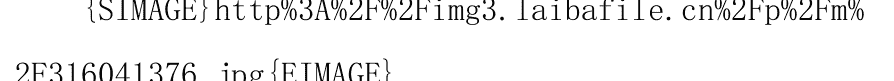

## 美国新冠每日死亡人数
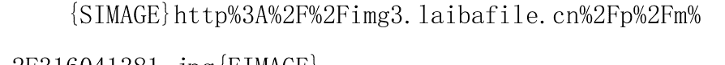

作者：上海京叔 日期：2020-04-06 10:30

埃及的行程虽然不长，但确实让京叔见识了一个不一样的世界。出国旅行对于现在的中国人来说，并不是什么特别的事情，每年都有一亿次的中国游客前往世界各地。中国，已经成为世界上最大的游客来源。可以随地前往，只要游客到达的地方，无论是人迹罕至的南美热带雨林，还是常年冰雪覆盖的南北极地，就有中国游客的身影；埃及、希腊、印度等热门旅游目的地，也早已成为中国游客常住的地方；至于泰国、巴哈马岛等东南亚地区，几乎被中国游客“占领”。

但是在2006年，能够造访埃及这样遥远的地方，还是让京叔回味良了一段时间。埃及之旅虽然只有短短的一个星期，并且由于长途跋涉，行程紧凑与饮食的不习惯使得京叔略显疲惫，但是心情确实相当的充实，以至于回到工作以后很久有一段时间不在状态。

2006年底，埃及回来以后不久，京叔又一次踏上了前往异国他的“征途”。京叔这次要去世界上除中国以外唯一一个华人占主导地位的国家，新加坡。说起新加坡，相信绝大多数中国人都不会陌生。曾有过不短的一段时间，当的新加坡公司来到中国开展业务，全国各地出现了不少真假的“新加坡工业园”，甚至有不少的居民小区被命名为“新加坡佳园”、“星罗坡”或“新家坡”等等，数一而足。

可以说，上世纪最后十年，以及本世纪第一个十年，新加坡在华人的印象中是非常高大的。而且对于炎黄子孙的缘故，中国人总是对于新加坡这个小小的城市国家有着与别的国家不一样的特殊情感。

新加坡位于马来半岛南部的新加坡岛，与其南边的印度尼西亚相邻，共同拥有马六甲海峡世界航运咽喉地带。整个新加坡面积约700多公里，人口不到六百万，2018年GDP总值为3600亿美元。面积人口小于上海，但人均GDP远远高于上海。

上世纪九十年代及本世纪十年代，有的中国人通过不同的途径前往新加坡，留学、打工或移民。上世纪九十年代中期，有的同学放弃了国内铁饭碗，甘愿到一个新加坡的大工厂去做生产线。周围的大多数人，不仅觉得奇怪，反而有点羡慕。”

作者：上海京叔 日期：2020-04-07 08:47

2006年底以前前往新加坡，虽然京叔已经许多次访问过不同的国家，但是来到新加坡还是第一次，对于中国之外唯一一个华人主导地位的国家，免有一些一样的期待。可能是由于在国内受到报道误导，自己觉得中国人在新加坡应该得到一些特殊的待遇，而不是被当作普通的外国人。毕竟都是炎黄子孙，血浓如水，“对于新加坡同胞，应该怀着一颗赤子之心，格外关怀。”从上海出发的飞机，经过长约六小时的飞行，京叔乘坐飞机顺利地落在樟宜国际机场。新加坡时间与北京时间一样，没有时差。一下飞机，京叔首先注意到的是处处显示牌上的简体中文。记忆中，这好像京叔第一次在海外看到简体中文，顿时对新加坡的好感增加（随着中国大陆游客在世界各地大量出现，现在海外的简体中文已经很常见），仿佛暗示着京叔对于新加坡同胞的期待是正确的。这种亲切感仅仅维持了一小会儿。可能是中文字错了，当京叔在入境窗口面对全华人面孔时，不自觉地说了普通话。没想到的是，柜台后的移民局官员以相当不耐烦的口气说道“English（英文）”，简单的单词仿佛泼了一盆凉水，瞬间让京叔满腔的热诚化为了尴尬。

同时也让京叔认识到，虽然大部分新加坡人看着我们没什么区别，虽然到处都是简体文字，新加坡的确是一个外国，从法律意义来说，新加坡与美国、英国等异国不同。京叔不得不收拾“玻璃心”，老老实地用英语向移民局详细述了访问的目的与行程，出示回程机票、酒店订单、行程表等各种文件，并回答各种问题。一周后，经过在美国或欧洲机场入境处达到的那样的对待后，京叔终于被批准进入新加坡的领域。通过入境新加坡的经历，京叔对于新加坡同胞开始了一些更现实的认识。

作者：上海京叔 日期:2020-04-07 11:29

英国已累计新冠52279例，死亡达5385例，死亡率已超过10%。尤其是英国的治愈人数仅287例，略高于0.5%，是全世界最低。由以上数据可知，英国的情况极为糟糕，正在为其前一段时间的不作为付出代价。

作者：上海京叔 日期：2020-04-07 16:32

@上海京叔 2020-04-07 11:29:44
英国已累计新冠确诊52279例，死亡达5385例，死亡率已超过10%。尤其是英国的治愈人数仅287例，仅高于0.5%，是全世界最低。由以上数据可知，英国的情况极为糟糕，正在为其前一段时间的不作为付出代价。

@milan_mnf 2020-04-07 12:57:26
英国首相已经进入 ICU。那家伙就是一个“二”货。王数楼，加v信1101284955，获取更多好运。

作者：上海京叔 日期：2020-04-07 23:39
英国7日单日死亡人数达786人，是迄今单日死亡人数最多的一天。

作者：上海京叔 日期：2020-04-07 23:58

An estimated additional 180 - 195 deaths per day occurring at home in New York City due to COVID-19 are not counted in the official figures. "Early on this crisis we were able to swab people who died at home, and thus got coronavirus reading. But those days we simply didn't have the testing capacity for large numbers dying at home. Now only those few who had a test confirmation are marked as victims of coronavirus on their death certificate. This certainly means we are undercounting the total number of victims of this pandemic,” said Mark Levine, of New York City Council health committee.

大意：纽约市健康委员会 Mark Levine：“纽约每天估计有180-195人因新冠死于家中，没有计入官方死亡数据。在疫情早期，我们还没有足够的检测能力对家中的病例进行采样。目前只有少数经过检测确认的病例在死亡证明书上被标记为新冠受害者。这显然意味着我们低估了疫情的总人数。”

作者：上海京叔 日期：2020-04-08 10:10

京叔这次访问新加坡的经历，以及各种新加坡人的交往，越走越地感觉到了认知上的差异。在国内中国人总是认为是新加坡作为一个华人国家，新加坡人作为华人，应该首先华人，其次才是新加坡人。而新加坡约30%的非华人认为他们首先是新加坡人，其次才是华人。作为新加坡人，当然要把新加坡人的利益放在第一位。以京叔的观察，作为长期被英国统治的殖民地以及岛，新加坡人的心态其实处于一个相当矛盾的状态。另一方面，长期的英国统治与英式教育，使得新加坡人（尤其是过良好教育的人）心中认同西方的世界观，自认为西方的一部分，其中一个重要标准是以英语为。另一方面，绝大多数新加坡人也无法完全认同华血缘与传统，以及日益强大的中国所提供的巨大机会与可能性。这种特殊性使得新加坡人在中国与西方社会之间处于一个特殊的有利地位。在京叔第一次访问新加坡的2006年，新加坡人还是一种心态为主。总来说，他们对于中国大陆以及一个“旁观者”，总是自觉或不自觉表现出与中国人的不同。随着中国经济不断发展，中国提供的机会越来越大，新加坡人似乎强化其华人属性，其表现便是中文得到日益的应用（2006年的时候，京叔在公司中遇到只会英文和粤语的新加坡人。但近几年，接到的新加坡人都能使用普通话）。无论如何变化，几乎所有新加坡人都将其人的身份放在认知的第一位的。他们不可能，也没有应该将中国的利益放在第一位。从严格意义来说，新加坡人和马来西亚人、日本人一样，对于中国人来说，都是外国人。这一点，新加坡人是相当清楚的，作为中国人，我们也不应该对新加坡人有什么不切实际的幻想。

作者：上海上京 日期：2020-04-08 17:29
截止目前，美国新冠总病例数已超过40万，总亡人数近1.3万。一手叔，加微信1101284955，获取更多帖。

作者：上海上京 日期：2020-04-08 21:21
试一下。

作者：上海上京 日期：2020-04-09 13:33

## 中国各地经济分析（8）

前面几篇文分析了2019中国各地GDP的表现，也大致勾画了2019年第四次经济普查对各地GDP的影响。总的来说，当今中国的经济发展水平及经济实力明显优于北方，而且逐渐拉大的趋势。如果我们把观察的时间段稍放一点，情况又是怎么样呢？京叔选取了1950年（新中国建国）与1978年（改革开放之前）各省/市/自治区的GDP总量排名做下表。在表中，“排名”表示该行政区在该年GDP总量排名，“差异”表示该年与2019年排名的差异（正值表示前进，负值表示退后），红色表示退步2位以上，绿色表示进步2位以上。

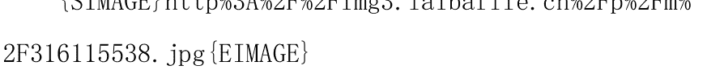

以第一行的广东为例，1950年新中国建国的时候GDP总量在全国排名第7位，2019年排名全国第一，相对于1950年以前6位；1978年改革开放之前GDP总量在全国排名第5位，相对于1950年以前2位，而2019年排名全国4位。广东省在新中国的建国以后以及改革开放以后，其经济重要性都在提升，尤其是黑龙江的经济走向了另一个极端，1950年新中国建国的时候GDP总量在全国排名第8位，2019年排名全国24位，相对于1950年以前16位；1978年改革开放之前GDP总量在全国排名第7位，相对于1950年以前1位，而2019年排名全国17位。北京在新中国的建国以后直至改革开放之前，其经济占据了相当重要的地位，但在改革开放以后，其经济急剧下降，令人唏！

| 省/市/自治区 | 1950年排名 | 1978年排名 | 2019年排名 | 差异 |
| :--- | :--- | :--- | :--- | :--- |
| 广东 | 7 | 5 | 1 | +6 |
| 江苏 | | | 2 | |
| 山东 | | | 3 | |
| 河南 | | | 4 | |
| 浙江 | | | 5 | |
| 福建 | | | 6 | |
| 山西 | | | 7 | |
| 黑龙江 | 8 | | 24 | -16 |
| 北京 | | 1 | 11 | -10 |
| ... | | | | |

*(注：部分数据根据OCR识别补全)*

作者：上海上京 日期:2020-04-09 14:13

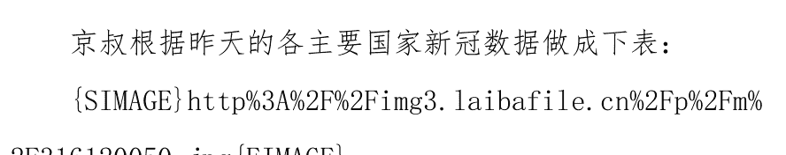

京叔根据昨天的（8日）的各主要国家新冠数据做下表：

| 国家 | 每日新增感染 | 每日死亡 |
| :--- | :--- | :--- |
| 美国 | 18600 | 60 |
| 意大利 | 3230 | 400 |
| 英国 | 1300 | 150 |
| 德国 | 1900 | 40 |
| 韩国 | 280 | 56 |

*(注：部分数据根据OCR识别补全)*

由于中国的其他国家，疫情还未发展，其数据还将进一步恶化，但即使现在的数据来看，可以说中国的抗疫大于外国（欧美）。随着后期各地的疫情进一步发展，与差距越来越大。

不管英美如何“甩锅”，京叔相信新冠以后的世界与以前不同。正如2008年的金融危机深刻地改变了国际社会一样，新冠疫情也将再次重塑国际社会。

# 处理逻辑

作者：上海京叔 日期：2020-04-09 16:66

由于中国的其他国家，疫情还未发展，其数据还将进一步恶化，但即使现在的数据来看，中国的抗疫大大优于外国（欧美）。随着后期各地的疫情进一步发展，与差距越来越大。由以上数据可见，中国的抗疫成绩多么不容易的，包括你内的所有中国人努力的结果。俗语说“疾风劲草，板凳见英雄”，在面对新冠这一罕见的灾难时，外社会的应对情况高下立见。不管英美如何“甩锚”，京叔相信新冠以后的世界与以前不同。正如2008年的金融危机深刻地改变了国际社会一样，新冠疫情也将再次重塑国际社会。

作者：上海京叔 日期：2020-04-09 16:49

链子又破坏了。再次一次。京叔根据昨天（8日）的各主要国家新冠数据做下表。由于中国的其他国家，疫情还未发展，其数据还将进一步恶化，但即使现在的数据来看，中国的抗疫大大优于外国（欧美）。随着后期各地的疫情进一步发展，与差距越来越大。

万人感染，超6万人死亡（是美国连今实际发生数的约6倍）。

如果意大利现在的情况发生在中国，中国将已经有约323万人感染，超40万人死亡（是中国连今实际发生数的约100多倍）。

如果英国现在的情况当前数据肯定是低估了发生在中国，中国将已经约130万人感染，超15万人死亡（是中国连今实际发生数的约50倍）。

如果德国（尽管德国的抗疫是欧美国家中公认最好的），现在的情况发生在中国，中国将已经约190万人感染，4万人死亡（是中国连今实际发生数的约10多倍）。

如果韩国现在的情况发生在中国，中国将已经约28万人感染，超5600万人死亡（是中国连今实际发生数的两倍弱）。

由以上数据可见，中国的抗疫成绩是多么不容易的结果。包括你我在所有的中国人都共同努力的结果。俗说“疾病风有时草，板凳见英雄”，在面对新冠这一罕见的灾难时，外社会的应对情况高下立见。不管英美如何如何“冕帽”，京叔相信新冠以之后的世界将与以前不同。正如2008年的金融危机深深刻地改变了国际社会一样，今年的新冠疫情也将再次重塑国际社会。

1524楼

作者：上海京叔 日期：2020-04-09 16:49

试一下

1525楼
作者：上海京叔 日期：2020-04-10 10:26

外一篇，中国各地经济（9）

建国后的经济可以分为，自新中国建立到1978年改革开放的第一阶段，这一阶段是中国经济的计划经济阶段；从1978年改革开放到现在的第二阶段，这一阶段中国逐渐建立了具有中国特色的社会主义经济。

在第一阶段中，中国经济的版图并没有明显的变化，绝大多数行政区的GDP总量排名名次少于3位，只有六个行政区的GDP总量排名有较大变化，而其中有的名次缩小到了5位。真正显著变化的其实只有北京、重庆两个行政区，北京由成为新中国的首都，经济得到了巨大的发展，GDP总量排名由1950年的25位大幅跃迁到11位排名第14位；与之相反，重庆由于失去了民国时期的郡地，GDP总量排名由1950年的25位大幅退7位进入排名第21位。

在第二阶段中，中国经济的版图发生了巨大的变化，有18个行政区的GDP总量排名名次变化均大于3位。在进步的10个行政区中，福建由24位前进到第8位，前进16位，进步最大；浙江由12位前进到第4位，前进8位。在

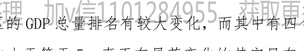

退逐步的8个行政区中，黑龙江由第7位退到第24位，后退17位，退步最大；辽宁由第3位前进到第15位，后退12位；吉林由第17位前进到第26位，后退9位。东北三省均在开放以后大幅后退，可以是第二阶段最大的输家。另外，在第二阶段中，上海也由第1位前进到第10位，后退9位，多少有点令人意意外。

如果我们比较1950年到2019年，可以发现明显进步（排名第3位以上）的有的10个行政区，其中南方3个，华南3个，华东、华北、华中、西北每一个，进步幅度最大的是福建，进步16位；明显退步（排名后第3位以上）的有9个行政区，东北3个，华北3个，华东、西南、东北各二，退步最大的却是黑龙江，退16位。

总体来看，在新经济发展的两个阶段中，从各地经济在全国所占的比重来说，第一阶段基本上没有太大的变化。而在第二个阶段，中国经济版图发生了巨大的变化，经济重心逐步向南部中国转移，北部中国，尤其是东北除首都北京以外，逐渐落落在南部中国。

在前面的几篇小文中，京叔简述了中国各地区的经济状况。由于京叔非专业人士，所有这些观点可能贻于大方。京叔只是想通过这些也许枯燥的数字，分享一些浅浅之见，权当抛砖引玉吧。通过本系列小文，京叔深深地体会到，中国可能是当世界上最为复杂的一个经济体。从经济的角度来说，我们不能简单将中国看作通常意义上的“国家”。在中国这个经济体中，既像华东、华南这样可以与发达经济体媲美的区域，也有华北、华中、华南这样可以称之为“发展中”的经济区域，还有西北、东北这样的相对落后地区。京叔认为可能更恰当的方法是将中国作为一个区域经济体来研究，而不是一个相对单质的“国家”。

1529楼
作者：上海京叔 日期：2020-04-10 16:53

图中横坐标是新冠确诊数超过每天，纵坐标是累计确诊数。由此图可见，大多数国家的疫情发展接近，而美国（图中绿线）疫情发展更加剧烈；获取更多帖

{IMAGE}http://file.cn/img3.jpg}

1530楼
作者：上海京叔 日期：2020-04-10 16:36

昨日全球死亡人数新增七千例，全球死亡人数已近十万。

1532楼
作者：上海京叔 日期：2020-04-11 12:55

新冠总确诊数超过50万例，全球死亡人数也超过十万。意大利、西班牙、法国似乎都已超过。

1535楼
作者：上海京叔 日期：2020-04-11 17:31

新冠总确诊数超过50万例，全球死亡人数也超过十万。意大利、西班牙、法国似乎都已超过。

1536楼
作者：上海京叔 日期：2020-04-12 12:21

公正地说，新加坡机场的效率是相当不错的，不管入境还是行李提取，以及市区的交通，都被管理得井有条，其他的东南亚城市与新加坡都有很大差距。

1540楼
作者：上海京叔 日期：2020-04-13 07:06

新冠疫情可能发生第三波疫情，日本、土耳其，印度，巴西等国可能爆发全球第三波。

1541楼
作者：上海京叔 日期：2020-04-13 11:00

今天前往医院看病，扫码，测温，网络填写个人信息，措施相当严格。看到这些措施，觉得疫情在中国二次反弹，面积再次流行的可能性不大。

1543楼
作者：上海京叔 日期：2020-04-13 12:47

当时的中国，即使是上海这样比较管理有序的城市，也与新加坡有巨大的差距。由于当时的中国城市大多处于建设高峰，许多城市充满了建筑工地，而且对于建筑工地的管理不到，使得许多城市到处土飞扬，这可能是发展的代价吧。很有把握地说，本世纪第一个十年的中期，中国的城市与新加坡在硬件上还是软件上，都有差距。当然，中国的城市与管理在之后的几年有了长足的发展，现在的上海、深圳等较为发达的城市与新加坡已经没有任何差距，甚至由于后发优势，在许多地方更加先进。

相对于中国建设等硬件，在人民的中国也有相当大的优势。一方面，新加坡人的优势在于他们的国际视野、职业技能、职业素养以及语言方面几乎每一个方面都强于中国大陆（然而新加坡人在收入方面也大大超过中国大陆）。当时的跨国公司有许多总部设在新加坡，当时新加坡的亚洲管理人员中，新加坡人的比例大大超过中国大陆。所以，新加坡人对于中国大陆有一种居高下的优越感。另一方面，由于新加坡在经济上的明显成就，中国大陆对新加坡也抱着一种谦虚的态度。由于新加坡在多方面的华人属性，当时的中国大陆在许多方面借鉴新加坡的先进经验，对于所谓的“新加坡经验”几乎抱着一种从的态度。

以上正两个方面，当时的新加坡和新加坡人在大陆的心目中可以是相当“高大上”。京叔没有想到的是，由于中国大陆的突猛进的发展，仅仅在短短的十几年后，新加坡和新加坡人都褪去了那层“金色”的光环。当今的中国大陆面对新加坡时，已经拥有了足够的自信，而不是只希望做一个好学生。相应的，绝大多数新加坡人在面对中国大陆也“自觉”地起了以前那种高临下的心态（这在新加坡人和中国大陆的交往中越来越频繁地使用普通话可见）。当今的中国，对于新加坡的影响越来越，对于新加坡的未来发挥着越来越充足的作用，真实这是历史的常态。

1548楼
作者：上海京叔 日期：2020-04-14 11:00

截止4月13日数据，全世界由于新冠死亡的人数已达116876人。其中中国死亡3351人（占死亡数的2.87%）。列全世界上人数多于中国的依次为美国23610人（20.2%），意大利20465人（17.51%），西班牙17756人（15.19%），法国14986人（12.82%），英国11347人（9.71%），伊朗4585人（3.92%），比利时3903人（3.34%），德国3778人（3.23%），除上述外国外13095人（20%），其中占全球死亡人数的五分之一。

下图。由图可见，基本上各国的死亡人数总体呈下降趋势，而美英两国占据了第一位。这显然是这两国前期的抗疫付出代价。尤其是英国，其目前确诊7758例，死亡1347例，累计治愈625例，治愈率低。在后一段时间时间内，英国的情况不断恶化。目前来看，欧美国家中，抗疫工作相对好的德国，其累计治愈率在欧美国家中最高（约50%），死亡人数最低，但与中国相比还有一定差距。

1554楼
作者：上海京叔 日期：2020-04-14 11:07

如果我们再来看（除中国外）最近十日的新增确诊数，美国占据了全世界每日新增确诊病例的绝对多数。在疫情上的表现优于欧美国家，首先说明中国卫生行业并没有想象中的那么，而是具有实力的。我们也看到，欧美抗无力的原因并不是欧美国家技术不如中国，而是其医疗体系、社会组织在面对这种重大卫生危机时没有足够的医疗体系、社会组织有效。中国的抗疫也有许多总结与错误，这些错误还相当多，但是我们能够及时纠正错误，明确方向，然后全国人民全力以赴，尤其是广大医疗工作者不避风险，逆流而上，全国社会人都努力做出贡献，从而保证了中国在全世界范围内击疫情的斗争中拥有较好的表现。中国的这种表现可以说体制的胜利。京叔一贯反对中国医疗系统的私有化，这次新冠疫情再次雄辩说明，公共卫生医疗体系才是民众健康的真正卫士，而不是被吹得天荒乱乱可以解决一切问题的私营医院。

1556楼
作者：上海京叔 日期：2020-04-14 18:58

@上海京叔 2020-04-09 16:46

京叔根据昨天（8日）的各主要国家新冠数据做成下

{IMAGE}http://file.cn/img3.124846.jpg {IMAGE}

由于中国的其他国家，疫情还未发展，其数据还将进一步恶化，即使现在的数据来看，已经可以说中国的抗疫大于外国（尤其是欧美）。随着后期各国的疫情进一步发展，与中国的差距越来越大。

由以上数据可见，中国的抗疫成绩是非常不容易的，这是美国数据，包括你我在内的所有人都努力的。京叔根据今天（14日）的各主要国家新冠数据做成下表

{IMAGE}http://file.cn/img3.231270.jpg {IMAGE}

请注意黄中的两个数，美国有将近九万的确诊病人还没有治愈，英国也有超过85%的确诊病人没有治愈，英美两国的这一指标明显高于各国。尤其是英国，相对于9万人的确诊人数（严重低估）以及超过万人的死亡人数，治愈人数仅6625例，真是令人无语，也许就是“群体免疫”吧。

1559楼
作者：上海京叔 日期：2020-04-15 07:57

一个受妥的发达国家。中国人仍然是以仰视来看新加坡，而新加坡仍然以俯视的角度来看中国大陆。当京叔以及京叔的中国同事在与新加坡同事的公事交流中，我们仍然保持着一种十分谦逊的态度。如果与新加坡同事有不同的看法，我们总是是下意识地先审视自己是否有什么疏漏的地方。
