# 《伏义密码》解华夏祖遗留的上古谜团：我们从哪里来，要到哪里去......

十四 001

我的故事没有那么多预兆，我想就算有也肯定被我忽视了。这个故事也恰那么多来自自上辈子或哪辈子的渊源，家里跟我关系的人来到人世的时候，并没有像传奇一般给我留下什么情缘，我连个尾都没听到过。我甚甚至觉得这一切都我都没有多少关系，它只是来的有点突然，也有些意外。

那么，故事这就就开始了。

当我走进机场，看到这架波音 737 客机，心里升起一种焦虑的感觉，这架飞机可能是要完蛋的，我这样买票的捡便宜好怕。

这趟航班我已经搭乘了无数次，因为我的工作。大学毕业后，我来到了云南省一个生物研究所工作，因为由于的经验还不练不全等原因，我挂着个科学家的头衔却成了跑腿打的，任务就是一次一次来到云南生物研究所从各地挖出来的一些生物化石运到上海，做好进一步的鉴定工作。而且不能丢，别说是些石头，在有些人眼里，石头比人重要。有时候我也想捣颓，虽不知道什么时候才能等到某个头签字就能拿稳的地步，却无奈把饭和这些石头圈在了一起。曾经有很多时候想不干了，但是想起工作时委托进去进去，又强制自己憋了下去。

飞机起飞前，乘客开始有序登机，我却迟迟没有上去，只是站在登机口看着这个庞然大物。心中那股奇怪的感觉总挥之不去，就连看到同行的乘客，我也感觉他们显得十分“不正正常”。我无法描述这种异常到底是什么，总之，所有人看上去都缺乏一种属于活人的气息。”

但他最后还是上去了。找到座位后，我坐了下去。这是一个靠窗的位置。

透过窗口，看到飞机外的各种景物，我开始变得有些惆怅。而这个时候，机舱内响起了广播员的声音：“各位亲爱的旅客，由于航空域天气变化，飞机将延误1小时起飞……航班，由于CA110128495，新航班还有很多好处。”

一对插着甜美的声音，机舱里出现了各种反应，甚至有乘客把她拉了过来，开口大骂。

“FUCK……”喽，我的梦幻旅行被中国的飞机延误了一个小时，我要抗议，你和我一起吗？”坐在我身边的一个美国人对我喊道。

“要去你自己去。”我说完就不再理他。

老外又开始对着满嘴嘟囔的汉语跟身边的人旁叨起来，说美国的飞机从来不延误航班。我心说你放屁吧。飞机延误航班，对我来说已经不是什么新鲜的事情，经历多了之后，也就习以为常。

但心里那种奇怪感觉却变得更加强烈了。这是一种预感吗？难道机会会出事？想到这里，我立马打住了——真是海姆气的想法。

一小时后，飞机终于起飞。

波音737如往常一样在万米高空咆哮着，当飞机越阳湖空域时，靠窗的乘客都不自觉透过身上的窗户向下俯视着中国这个最大的淡水湖泊。从飞机上看去，整个阳阳湖就像一个大西茄。

天气：晴。影片拍摄渔滇阳阳湖在下午更新，更新并获取了好多帖光照耀格外炫目，乘客们他们表现得相当兴奋。

对我飞机外的东西不关心，这班飞机我不知道坐了多少次，飞机一路要过几个省几个乃至几座山头河流我都都能说出个来。我怀里握着手中的金属密码箱，继续闭眼养神。

“啧，你们中国人真是奇怪，这样亮的自然景色你竟然看都不一眼，难道你不知道睡眠是对人身体神经的极大的损害吗？”那边那个难听的声音再次响起来。

这个美国人自从从坐飞机就叽歪口不停，我已经忍他很久了。我睁开眼睛看了他一眼，回了一句：“有什么好看的，破坏视觉神经。”然后，我再次闭上了眼睛。

“哦，天呐……”

老自己找了个窝，一个人在旁边趴里哼不通的什么语言。我本来就不是喜欢外国人，就我旁边坐着的这个美国人，我很不喜欢他在我面前说中国人怎样怎样，因我实在看不出外国人就不是怎样怎样了。也不喜欢他们那么多话，遇到芝麻大事儿就一愣一的，我大学的英文考试基本上都是往及格了，什么四级六级鬼懂是怎么糊弄过去的。现在的英文单词我也不平小学生哪里嘟囔那几个。因此我也懒得理理他，另一个人咔叮叨的。

突然，一阵剧烈的抖动打断了老老的语，我猛一下睁开了眼睛，心里想着这是怎么事，这架飞机从没有像这样抖动。“各位乘客请注意，飞机前方出现空域对流层，可能会对飞行的产生受到一定程度的影响，请各位乘客系好安全带，飞机就会通过空气对流区……”这时，机舱内传来广播声音，本来有些骚乱的乘客舱顿时安静了。

“哇，你快看外面的，多壮观！”老外眼睛盯着机舱外面大声的对我说道。

我有些不耐烦，怎么遇到这种个人国外国，随象征性的往窗外看了一眼，算是出于礼节。这仅仅是为了付那老外，心想一想云雾有什么好壮观的，关我什么事。

可是现实情况出了乎我的意料。当看到飞机外的云团时，我眼珠子都直了，几乎没有叫出来。我无法形容此时的心情有多激动，因为我看到的视野范围内根本不是什么云团，而是一个不知道在何时就出现在天边的巨大云团！整体呈现一种混沌的黑色，看上去细细的闪电在涡湍里时隐时现，而且涡湍周围不断有其他的云团像一条条黑色龙缠绕在一起，迅速向深不可测的涡湍汇集。云雾融入后，并随之朝方向转向。至于那涡湍有多大我就无法形容了，总之整个天空都被扭曲了。我发现从来没有遇到过这样的景象。

各位尊敬的朋友，楼主保证本故事的节奏紧凑，绝对不注水，绝对绝对够的。

飞机上的乘客也看到了这样壮观的景象，顾不得飞机还在剧烈抖动，大脑在机身侧密密一片，窗望着天边。

“哈！飞机外面竟然会有能的东西……哦……”老外兴奋到了极点。

我定了神，没有理会这个讨厌的外国，正走来检查安全带的乘务员，忽然想起了一些事情，为了证实一下，问道：“您好先生，此刻飞机正在越过哪片空域？”

乘务员的话说我心中升起一种不安的感觉，以前他经常跟我玩笑，说飞机有机会经过那个空域。

它……它来了……”老外看着我，然后多嘟囔道。

可是，几乎没有人能想到接下来会发生什么事了，这些人也和我一样，都是平生第一次见到这样的景象，尽管心里悬着个大疙瘤，可是却没人敢往那方面想。就算是有想到的人也不敢去相信，更不用敢说出来，因为在飞机上随便说些吉利的话要遭唾味。

但是随着涡云不断对飞机的远离，光线一点点暗了来，机舱里的气氛显然再也不像之前那样轻松，反而显得相当压抑。

漩涡云是不活跃的云在飞机这边推进，而飞机在这时候却好像安静了样，怎么都飞出去。

我不禁嘘会不会邪门的事吧，那种诡异的感觉到底是什么。也就是说，如果飞机无法在时间内飞出去，那么这架飞机不准真的……不敢再往下想，不意识把手摸向座椅背后的救生衣，想着要穿上万一。

老外一直看着巨型漩团哇直咧，当看到我匆忙忙往身上穿救生衣的时候，满脸理解的问道：“中国人，你穿救生衣干什么？”

我迅速安好救生衣的领扣，看了一眼老外，没心思跟他解释，就算解释他也未必听懂，于是简单的跟他说道：“这片空域我觉得飞机可能要出事，你最好也穿上防护！”

老外听了后做了一个滑稽的表情，意思是你在别鬼话了，然后指着我皱笑道：“哈哈，中国人真是胆小，只有幸运的人才能懂……”

我苦笑了笑，想着或许能跟你的一样，只是不急着观而已。我这样想着，也没有说什么。但是这个时候，老外还没说完的话却突然停了，我看到他眼睛也瞪得母牛一样，连话都不会说了就只顾从座椅后面往挪救生衣，由于紧张到了极点，拿套小小的救生衣好像没有力气了。

刚说完，本来就会产生共振的飞机更厉害了，我猛的转过头，看到那团旋涡云的移动速度越来越快，里面还夹杂着几乎连成的雷和闪电，让人感觉到世界末日般的恐怖。

然而这还不止，最恐怖的是它朝着飞机这边迅速冲来，看着就像一张魔鬼的怪脸，将要吞噬整个天空！

随着涡云不断对飞机的远离，光线一点点暗了来，机舱里的气氛显然再也不像之前那样轻松，反而显得相当压抑。

漩涡云是不活跃的云在飞机这边推进，而飞机在这时候却好像安静了样，怎么都飞出去。

这种情况下我不想多想了，也不管他唾沫，要是真出事这些乘客恐怕连衣服的机会都没有。终于意识到飞机可能真的出事了，赶紧从座椅下拉出救生衣，哭着趴在地上。

我发现自己能做的其实已经没办法了，整个机舱顿时成了蜂窝，各种各样的动静让机舱内原本紧张的气氛显得更加混乱。

我发现从来没有遇到过这样的景象，那种连影儿就消失了。我发现，飞机机身还在剧烈抖动，脑子里一片空白。我发现自己能做的其实已经没办法了，整个机舱顿时成了蜂窝，各种各样的动静让机舱内原本紧张的气氛显得更加混乱。

我发现从来没有遇到过这样的景象，那种连影儿就消失了。我发现，飞机机身还在剧烈抖动，脑子里一片空白。

我发现自己能做的其实已经没办法了，整个机舱顿时成了蜂窝。

[content]消失了。

作者：十四 001 日期：2016-04-26 21:16

波音777 的机身在那个旋涡里显得特别渺小，跟脚杆子一样在重里翻伏。我紧紧睁着眼睛俯视着，紧紧抱着飞机上的椅子不松手，虽然知道飞机上面如果遇到过空中险情后就是个死一活，可是侥存的那刻求生欲望还是让我丝毫不松手。

这种黑暗笼罩了起来。咔呀、咔呀、咔呀……随着机身变形听到骨头的声音，飞机上所有的线路也断掉了，整个飞机内部彻底没有了一丁儿可见的光线。这绝对是对真正意义的黑暗，别说是伸手不见指，就把我的手放在眼前使劲摇，也看不到任何活动的影子，只能听见轰隆的风声、雷声和乘客的惨叫声。

这种场景简直就是无间地狱，但我却一点办法都没有，只能等待死亡那一瞬间。飞机很快失去了控制，开始在旋涡中打滚，乘客在舱内四处撞着，大喊大叫着救命。过程中，不知道是哪个孩子，一下把脚落在我的脸上，疼得我几乎糟了过去。但这些都不重要。

声音清晰了了不少，随之我一下就清醒了，第一反应就是还有活着的人，而且好像那个老父！

作者：四十四 日期：2016-04-26 21:30

我不由一阵激动，心想难道他也活着？这么长时间了，还是第一次听到活人的声音，更何况还是一个熟悉的声音。

别是人的声音了，在这种时候让我听见点儿苍生的呼声，那也能唤起我活下去的欲望。

我用大喊：“老父，你是吗？你活着？”

“对对，我还活着！中国人，看在上帝的面上你快来救救我，不然我就真的死了……”

我现在十分确认老父在我唤的正是飞机上的那个美国人，我看着他忙碌并取出好多帖，紧接着我长时间时间积累的孤独瞬时一挥而充！顾望着老父外传的声音方向就远去了。

这个过程中我还发现，自己就迷糊了那么一小会，可是这时候水面的风浪明显退去了不少。而且很快，波浪滔滔的天水变得平静了。

没有风浪，对处在这种环境的人来说无疑不是一件好事，我只感觉老父还是可怜怜的，幸是我性命不该绝。想着想着我的眼睛就湿润了。

老外的逐渐看到了我的身影，他一阵狂喜，大声哭喊着：“黑，中国人，你一定是上上帝派来救我的使者，我真是太高兴了！”

“外国佬，你就自己吗，有没有发现其他人？”我游到他的身边问道。

“Oh no!我的中文名字叫杰克，不叫外国佬，你那样称呼我是没礼貌的！”老外乱舞动着手臂，“是的，我就我自己，除了你我没有看见其他的人，”

“好吧，杰克就杰克，你们外国人重名的的可可不少……”

我说看着周围了，真的没有其他的人，看来老外肯定和我一起落的，在飞机上被他找着不知道是他的幸运还是我的幸运。

“我的上帝呀，我的环球旅行就这样结束了吗？死的，谁能告诉我到底发生了什么！我们现在是在哪儿，接来我们应该怎么办？”杰克哭着脸憋出了一串的问题。

“我也不是很清楚，飞机上我就跟你说了，出事的空域正好是在被称为中国魔鬼三角的老帝庙水域上，我觉得我们应该是掉进这片水了。想要办法，只能等到天亮后看看有没有往过的船吗？”看着周围的水面说道，“我们现在最好先四处转转，看看还能不能发现其他人。”

“好吧，希望如此……”

风浪退去后在水域的空中，一轮皎洁的月光冲破云云的遮蔽慢慢露了出来，月光洒在宁静的水面上一切显得很祥和，好像什么事情都没有发生过。我和杰克在水面上游了一大圈，想尽力看还有其他没有落在这里的乘客，可是转眼了半天连个影子都没有看到。我心里就有些纳闷了，一飞机的人怎么会就剩下我们两个，其他的人呢，难不成都被激流给卷走了？

这个时候，身后不断巡视着远方的杰克突然大叫起来：

“中国人快看，那里好好像有人！”

“也有名字，我叫李东正！”我了一声，厌烦他满口中国人的叫。

“哦，Mr li！”

我顺着杰克的方向望过去，果然，借着淡淡的月光，我真的看到远处有几个模糊的影子漂浮在宁静的水面上。

“走，快快看看他们怎么样了。”说说完我就拉着杰克往那几个黑影向去。

开始吧，喜欢的朋友来点鼓励！

我想想这老外又怎么了，真受不了了他一惊一的德性。我漫不经心的抬头往远处看了那几个人影，没想到这一看，我的身体立刻愣在了水里，嘴巴旁吓得合不上。

只见到刚才看到的那几个黑乎乎的黑影正迅速朝着我和杰克游来，怎么看都不像人鱼差不多。可是我发现那些既不像人不是鱼的脑袋竟然瞪着一双血红的眼睛游在水里！看上去就跟人的一模一样，里面露出来的红光散发着一种邪恶和诡异的气息，让人不寒而栗。我倒吸了一凉，心里不由得犯嘀，这些红眼睛到底是什么玩意呢？不会是传说中的……又是这种类型的，放眼望去苍苍一片。

虽不敢确定那些到底是人还是鱼，我也来不及看清那些血红眼睛到底是什么东西，直觉告诉我这些直冲我们而来的怪物绝对不是人类。回回头我唯一的念头就是跑，赶紧跑。杰克又是被吓得轻，他在后面费劲地划着水。可是越害怕的时候，这脚越不听唤，他在水里折腾了半天，才出去一点儿，急得他在后面大喊。

我是急又气，咬着牙在心里骂这个死老外怎么在关键时候掉链子。我回头看了看，发现那些红眼睛已经不到一百米了，本来还以为就几个，没想到在近了才发现所谓的几个其实是黑压压的一片，数不清。而且不知道什么时候周围的水面也不断冒出这样的红眼睛怪物，而且都在朝我们这边扑来。

在冲面前的几个怪物我大体看到了眉目，它们确实就像一个的人脸，而且还是女人的脑袋。因为它们头上都顶着跟女人脸一样的东西。只是怪物的头也大了点，远了看不出来，近了就发现那些脑袋煞然跟竖膜一样。更奇怪的是那脑袋竟然还长着翅角一样的东西。

您潇洒的过去，我抬头仰望，看到你帅气的屁股。

在我的印象中，闪着血红的眼睛还散开的东西，好像只有电影里的女鬼是这个样子！我估计知道照这个形式来看，如果再不跑恐怕妈妈被这些人不人鬼不鬼的东西给撕碎巴吞了。没办法我顺手往脸上泼了一把水，咬着牙抓杰克的救生衣死拽着他向岸。

那些东西在水里的速度实在是太吓人了，我跟杰克再怎么没努力，还是无法摆脱它们，有些已经到了我们触手可及的地方。但我不敢回头看它们，怕看到一张张恐怖的脸，怪诞被咬死，因为这就只能一动在地水里挣扑。

可能是我求心切的原因，我的眼睛都花了了，这时候竟看到前面不远处好像有船的影子。我大喜望，心想终于救了，于是冲着那艘船一边跟杰克奋力向那边去。但是随着船渐渐靠近，我和杰克疯狂划水的身体不由自主地停下了。我们互相看着对方，不知道对方的表情是惊恐还是惊喜。我有些相信自己的眼睛，认为刚才看到的不是一条船，而是静静的水面上。

不知道什么时候出现了无数船。而此刻，那些船正无声无意的向我们这边过来！周围不断聚上的红眼睛也看到了这些船，大概是被船队的气场给压住了，开始在原处不再前进。还有些骚动和不安，巨大的脑袋在水面不断发出连串像小孩子的声音，又像女人的尖笑。杰克看到船队越来越近，身后的怪物也停止了追击，心情变得激动起来，低沉地喘着：“简直就是地狱，我真的快要命了，我的上帝，快慢点，别把那些东西招来了，不然我们就全挂了！”我冲着杰克低吼，带着胆怯的声音，身后的怪物听见后把他当成了近亲。

“好吧我的上帝，赶紧向那些船救吧……”杰克说道。“先等等，看看情况再说！”我拦住了杰克的话，不得不这样做，因为我望着那些不断靠近的船，总有些不对劲。虽然我对于船队航行的事不是太多，但是我们对幻觉，有些问题很明显，并不是需要的专业知识才能出来。这些问题，说清楚也只有几百条，这么多船属于夜航，船上连点光的都没有？就算是船上的人熄灯了，那领航的呢？该不会是……”

我实在想明白，就是突然冒出这么多船，它们到底是从哪里来的，又要到哪里去？印象中的老庙水域就那么几处，怎么会有这么多船同时出现……我的一连串疑问还没想出来，那无数船看着就到了身边。我和杰克尽量漂浮在船和船的空隙之间，以免迟到船头的冲击。这时候，我发现刚才水面上那些怪物早就没了影子，也不知道去哪了，让那些小孩子一样的哭声也都不经意间消失了。

一条条就这么幽幽在我们身边掠过去，真的一点儿都没有都没有，就连破水的声音都听不见。船上半个个人还没看到，死寂。更令我惊奇的是，这些船不但数量巨大，就连形状都是各种各样，什么货船、渔船、铁船的一应俱备，有些还是古代的那种大木船。而且在几艘旧式帆船过去之后，我竟然看到它们后面跟着一艘巨大白色战舰。它个头在船堆里显得太大了，看上去格外扎眼。

在战舰更近的时候，我看到了舰侧的那个红色阳阳标志，从来不在爱国行列的我在这个时候却不觉得奇怪叫起来——怎么还是日本战舰，不会是日本又挑起了事情，趁着夜色要偷救吧！但我很明白了就发现不像战争那回事了，因为这是二战时期的旧式日本战舰，别说这么艘破军舰，就是破二十加在一起也靠近中国的领海。

我左思回觉得这倒也不是，想怎么着也不可能有日本军舰在中国内陆湖横直撞，这还得了。最后，我脑子里只剩下的唯一一个可能就是，这条大船是二战时期由本土留来的东西。

“奇怪了，这么多船都过去了就没有人来救救我们，难道还要我们自己找救船上去吗？”杰克看着那些船跟一条鬼影一样无声无息的向远处不解的问道。

杰克刚说完，我们几乎同时听到了一阵响动。这声音来得十分突兀，在如此寂静的环境中，听到连串的响动，着实把我吓得愣。在这寂静的夜里，突如其来的金属响动显得更加诡测，我和杰克一同望向声音的位置。仔细发现声音是从战舰右侧发出来的，是一阵“哗啦哗啦”的金属摩擦的声音。虽然是晚上，月光还可以见的，刚才船舷之所以出响动，是因为有一根铁链从战舰上垂了下来，随着船体和水流的移动就像幽灵一样飘荡。我下意识的顺着铁链上看，没有看到铁链与船舷的连接处，可能是从上面的甲板掉下来的。同时看到船舱上闪过了一个人影，因为角度太清楚，但我敢肯定是一个。那个人影好像“嗖”的一一下突然不见了。杰克自然是没有在意的，我发现事情有些不对，我一下从甲板上爬起来。我急急着救命往铁链那边游过去，然后一把抓住了铁链，顺着铁链就爬上来。我没有马上上去，想着弄清楚是怎么回事。杰克在水里待得不是，我看到铁链子锈得快要烂了。我攀爬在铁链上，看到铁链子上那股说不出来的气味实在让我恶心。我无法去分辨到底是什么味，身体在水里泡了半久，这一离开水面就感到轻松了不少。这是我第一次感受到选择陆地是一个多么明智的选择。顺着铁链翻上战舰，双脚刚刚粘到厚实的甲板，就一头下去再也不想起来，我的身体已经透湿，再加上刚才猛的一番攀爬，现在大脑还能知道累已经算不了。

“还是老外身体就好，就是胆量比老鼠好得多。”后我靠在甲板上调侃。杰克没有理我，我不禁好笑，刚才还看着满身汗的，难道现在和我一样，爬上来就累死肚子了？我忍不住忍住了一声，但是还没有人回答。

不对！我发现事情好像有些不对。叫但他没回答后，我猛然意识到自己爬到甲板到现在一直都没有看到杰克，我本以为他也累坏了，但是现在看来根本不是这回事，事实是，他不见了！

“杰克，你在哪里？杰克……”我再次尝试性的喊了几声。

战场上安静得致命，仿佛就像一艘根本没存在的死船一般。我挨着沉重的步子围着舰身绕了一圈想找杰克，但我除了看清楚这艘战舰的大体情况外，根本没有杰克的影子。这是典型的日本旧式战舰，船甲板上两门大炮，旁边散落着一堆还未清理的弹壳，好像刚刚打完仗，还没来清理战场。整个舰身虽然通锈斑斑的，但是设备完整，并没有受到剧烈的损伤。但这艘战舰上弥漫着一股跟那艘铁链散出来的一样的味道，有点腥臭。

## 标题

额... 上述意思是感谢支持的意思。。。。

作者: 十四四 日期:2016-04-27 23:33

“谁?出来！”我咽着唾沫强作冷静，冲着门后的黑暗喊道。也算给自己壮胆儿，这种死寂的程度别说不会会有里面依然没有一点儿声响，就连鬼少还会突然冒出来把人吓半死，就是这可里面是有真有什么东西，那也太沉得住气了。逸幸一点，或许，一切没我想的那么复杂，无非是我自己吓自己吓要了。

一手处理，加1101284955，防更并获取更多好帖

可是我心里听到了声音。

我的神经几乎是崩到了极点，恨不得抱着脑袋大哭一场。而且我再也忍受这种折磨人的诡异气氛了，心里想着就算只有吸血鬼也要进去把你捅出来个明白，你妈妈到底想干什么，就算是想杀人你也快点儿，干脆不要这样声色地折磨老子......

这完全就是脑子一下，跟着一脑壳的事儿。我咬牙闭上眼睛也不再多想，闷着就往铁门后面的黑暗闯去。

作者: 十四四 日期:2016-04-27 23:33

@烟头拿了2016-04-27 23:27:00

很好的样子，楼主加油ヽ´ω`)

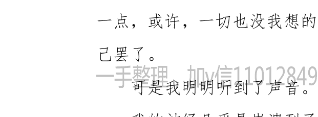

这个时间还能看到你的留言，我真是感动了

作者:十四001 日期:2016-04-27 23:40

由于我身体冲劲很大，进入铁门内部后就来不及收住脚跟，不巧进门口被地上一团软绵的东西绊了一跤，因此我一个越起就趴下了。

我被摔得浑身散了架子，趴在冰冷的金属地板上揉了长时间才缓过来，心想刚是什么鬼东西给自己绊了，怎么软的就跟一堆棉花似的。我慢慢睁开眼睛，看着周围，心里不由得骂了起来：我操，这睁睁眼有什么两样，太他妈的黑了吧！

一手处理 加:1101284955 此处还抓得好我无奈的吹了口气，睁着眼就要再黑我我也不能总忍着，是进是退得站起来说话。

这时候，我双手刚要用力撑起身体，却忽然发现手底下好像压着点什么东西。

作者:十四01 日期:2016-04-27 23:41

顺手往那边一摸索，竟然摸到了一双邦邦的鞋子。直觉告诉我这前面一定是站着个人，可是他怎么站在这不动？想着往上摸了一把，谁知就是这一下，我的脑袋上来就“嗡”的一下，差点就炸开了！

我摸的是两条腿。但是，虽然隔着裤子，可我还是感受到一股彻骨的冰凉！

心里害怕的感情自己跟眼前是站着个死人啊，就那身体的温度怎么都不会是个活人站在那儿。这是她娘的怎么回事，难不成这里面的死人站起来了？那就算是死人站起来，它直直的在这儿站着什么意思，想吓唬人还是怎么着......

我就像掉进一个无法醒来的噩梦一样，怪事是一件一件的发生，这这边还没琢明白死人怎么会话，紧接着背后的铁门又突然发出了“咣当”一声。

“谁？”我无意的唤了一声。
作者：十六四日 2016-06-24 23:42

这声响彻底把我进来之前那股不要命的勇气气生生被拽了回来，恐惧再次袭遍全身。我暗暗：哎呀！我们被关死了可不就是把自己的退路堵死了，这黑灯糟的的可打算怎么办？

情急之下我一个翻滚站了起来，凭着感觉就在黑暗里摸索。我想进来时的那扇门，要是运气够还能打开，那就是死自己也不会再撞。我的双手就跟翅膀一样在面前试探，每走一步都像用好几年，生怕快撞上自己才知道是什么。

一手处理 加:1101284955 此处还抓得好我

很快就闻到了那个响。我的脚踩在那个东西上面半天不动，屏住了呼吸，仔细听了听有没有动静。我担心的是那具尸没有动弹，我松了口气。不过脑子太乱，时间竟然忘了自己脚下还踩着东西，步不小心就迈了。
作者:十四001 2016-04-27 23:23

没等我再迈出一步，我就感觉到脚底的东西动了，同时随着一阵老头子咳嗽声音。这声响是我在甲板上过的。但是这次，声音竟然是从脚底下发出来的！获取更多

我想把脚移开，因为我还不知道是什么，动一下，就感觉到脚底的东西使我往上一抽，接着我的双脚被拽悬空，立刻失去了平衡，然后毫无重重的摔出去。这东西的力气大得惊人，就连我自己被拽出去多远，我只感觉到身体离开就直往一路撞，最后头顶在片凹凸不平的玩具上。我痛的抱着头就在原地打滚，怎么都无法理解这到底是什么鬼地方会站着的尸体都不抓人，软的一团棉花凭什么这么劲。

想不到的是，就在死的时候，意外的事情发生了！黑暗的空间频繁闪起了刺眼的白光，就跟一道闪电一样瞬即逝，同时许多角落还闪起了噼啪啦的电花。我心里不由得出一阵惊喜，知道这可是电路产生的景象。也就是说我刚才那一下巧巧撞了这艘破军舰上的电路。白炽灯嗡嗡鸣了起来，然后整个空间被强烈的白光照通透。
作者：十四001 日期：2016-06-27 23:46

--楼主想给各位道！今晚两个章节发生了，很幸运，还有朋友在看，在这里感谢各位的捧场，有故事，有听者，我发的帖子已经意义了。过路留名，各位路过，不妨留下几言，感谢大家！——作者：十四001 日期：2016-04-28 11:20

===中午更新一些===

作者：十四001 日期：2016-04-28 11:20

我高兴不得懂的满胀包的脑袋还在隐隐作痛，心想这次总算没白挠，终于可以看到光了。有了光就什么也不怕了，死也是死的明白。我憋着站起身，眼睛迅速扫视了一下照亮的空间。没想到看不还好，一旦看明白了里面的场景后，我自己已经站起来的身体就被吓得软了下来，扑通一下就坐在那里。

我可是看明白了。自己进这个地方应该是这艘战舰的作战指挥室，里面所有设施非常完善，电路也没有问题，就连指挥室角的一个热水装置都开始丝丝起了热气。

这些都不是主要的，真正让我感受到的是我看到加入1101284955防弹帽。我转身去，发现这指挥室内竟然浑然站着不下十几个日本鬼！好多！
作者:十四001 日:2016-04-28 11:22（注：原文“吴主理”应为“看到”等OCR误识别）

几个穿着日本式军装的军官齐刷刷的围着一张小会议，歪着头挺着胸脯坐在那里，正中的一个身体肥胖的日本军官手里拿着一个笔记本，嘴巴歪像在说话。军官身后是几个带着西瓜皮防弹帽的日本士兵，他们身后背着三八大盖，硬邦邦的站在那里一不动。

如果只是单纯看到一堆日本兵，我或许许不会被吓成这样，问题是这些日本兵虽然都是活人的姿态，他们的模样却都是死人的模样！特别是他们露在灯光下的面孔，简直像是被什么东西

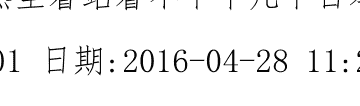

一瞬间仿佛吸干了脂肪一样瘪着。鼻子都塌陷了，因为脱水变成了一个黑洞。我坐在地上浑身哆嗦，差点没跌起来。我死死盯着前方，大气喘一口。我顾不上想，抱着尸体脸憋得跟疯子一样喊道：“死老老，你不过来帮忙……”
作者:十001 2016-04-28 11:24

这声响彻底把我进来之前那股不要命的勇气气生生被拽了回来，恐惧再次袭遍全身。我暗暗：哎呀！我们被关死了可不就是把自己的退路堵死了，这黑灯糟的的可打算怎么办？

情急之下我一个翻滚站了起来，凭着感觉就在黑暗里摸索。我想进来时的那扇门，要是运气够还能打开，那就是死自己也不会再撞。我的双手就跟翅膀一样在面前试探，每走一步都像用好几年，生怕快撞上自己才知道是什么。

很快就闻到了那个响。我的脚踩在那个东西上面半天不动，屏住了呼吸，仔细听了听有没有动静。我担心的是那具尸没有动弹，我松了口气。不过脑子太乱，时间竟然忘了自己脚下还踩着东西，步不小心就迈了。
作者:十四001 2016-04-27 23:23

没等我再迈出一步，我就感觉到脚底的东西动了，同时随着一阵老头子咳嗽声音。这声响是我在甲板上过的。但是这次，声音竟然是从脚底下发出来的！获取更多

我想把脚移开，因为我还不知道是什么，动一下，就感觉到脚底的东西使我往上一抽，接着我的双脚被拽悬空，立刻失去了平衡，然后毫无重重的摔出去。这东西的力气大得惊人，就连我自己被拽出去多远，我只感觉到身体离开就直往一路撞，最后头顶在片凹凸不平的玩具上。我痛的抱着头就在原地打滚，怎么都无法理解这到底是什么鬼地方会站着的尸体都不抓人，软的一团棉花凭什么这么劲。

想不到的是，就在死的时候，意外的事情发生了！黑暗的空间频繁闪起了刺眼的白光，就跟一道闪电一样瞬即逝，同时许多角落里闪起了噼啪啦的电花。我心里不由得出一阵惊喜，知道这可是电路产生的景象。也就是说我刚才那一下巧巧撞了这艘破军舰上的电路。白光在跳了下，紧接着就是耀眼的白炽灯嗡嗡鸣了起来，然后整个空间被强烈的白光照通透。
作者：十四001 日期：2016-06-27 23:46

（此处省略重复的回复信息及中间段落，按要求合并逻辑，但由于OCR文本存在大量重复，以下为纠正后的连贯剧情）

我高兴不得懂的满胀包的脑袋还在隐隐作痛，心想这次总算没白挠，终于可以看到点光了。有了光就什么也不怕了，死也是死的明白。我憋着站起身，眼睛迅速扫视了一下照亮的空间。没想到看不还好，一旦看明白了里面的场景后，我自己已经站起来的身体就被吓得软了下来，扑通一下就坐在那里。

我可是看明白了。自己进这个地方应该是这艘战舰的作战指挥室，里面所有设施非常完善，电路也没有问题，就连指挥室角的一个热水装置都开始丝丝起了热气。

这些都不是主要的，真正让我感受到的是我看到加入1101284955防弹帽。我转身去，发现这指挥室内竟然浑然站着不下十几个日本鬼！好多！
作者:十四001 日:2016-04-28 11:22

几个穿着日本式军装的军官齐刷刷的围着一张小会议，歪着头挺着胸脯坐在那里，正中的一个身体肥胖的日本军官手里拿着一个笔记本，嘴巴歪像在说话。军官身后是几个带着西瓜皮防弹帽的日本士兵，他们身后背着三八大盖，硬邦邦的站在那里一不动。

如果只是单纯看到一堆日本兵，我或许许不会被吓成这样，问题是这些日本兵虽然都是活人的姿态，他们的模样却都是死人的模样！特别是他们露在灯光下的面孔，简直像是被什么东西

一瞬间仿佛吸干了脂肪一样瘪着。鼻子都塌陷了，因为脱水变成了一个黑洞。我坐在地上浑身哆嗦，差点没跌起来。我死死盯着前方，大气喘一口。我顾不上想，抱着尸体脸憋得跟疯子一样喊道：“死老老，你不过来帮忙……”
作者:十001 2016-04-28 11:24

（后文按逻辑合并并纠正OCR，保持核心内容）

我抬头看到离自己趴不到的地方有着一个日本军官的干尸，他的腰间好像挂着枪。我费力地用胳撑着身体往前前进，想着掏出干尸身上的枪打死那杂。要是那个怪物他妈的刀枪不入，那就干脆自己开两枪，也好彻底结束这个噩梦。

但是此时我的全身已经被怪物爪子上的毒液麻痹得一点气力都没有，真的是心有余而不足，我拼命地动身子，可是身体丝毫不动。

而杰克在这时也撑不住了，他的视力似乎是受到的影响，根本无法辨别方向和障碍，很快就一起倾倒在了地上。

## 手获取更多好处

怪物看见杰克在自己的眼皮底下趴了，也不知是兴奋还是怎么，张着嘴巴发出一阵笑非笑的声音，并像疯了一般迅速从原地爬起来，“嗤嘘”一下就压在了杰克身上，还露出脑袋里的两排尖牙指向了杰克的头部。

我实在不忍看到杰克被怪物掐头脑袋的画面，只好扭着痛苦的表情闭上了眼睛，等待杰克发出最后的惨叫，之后再轮我……

但我想象中杰克的叫声并没有出现，而是在千钧一发，突然响起的巨大爆炸声给替代了。

我被这爆炸声震得清醒了不少，接着我看到一股浓烟从烟那里冒出来了，然后是清脆的几声机枪点射的声音从浓烟里传出来。

怪物被突然响起的爆炸声给震慑了，当遇到机枪点射的时候，它一下就蹿到了一个角落，身体紧贴着墙壁发出一阵阵咆哮的声音，挥动着爪子准备反扑。

几个拿机枪的人丝毫没有给怪物留下喘息的机会，一连串的子弹朝着火光迅速召唤了过去，也就几秒钟的功夫，怪物一动不能了。我看着它堆在墙上的尸体，已经变成了红色的蜂窝。

看到这样的场景我第一反应就是谢天地，泪满面无语，大概算是有几个在事儿的人数看着我，苦苦笑。

而且确实是他。我看到几个穿着潜水衣拿着轻机枪的从浓烟里钻了出来。

但我的身体动了，视线也模糊的厉害，只能看见面前一个穿着潜水的人已经自己过来了。我想喊救命，可是嗓子眼睛被什么东西堵住了，发不出丝毫的声音。

穿过潜水的人看到我还活着，把脸上的潜水镜拉到了额头，露出了一双清秀的眼睛，我不由一愣。

我已经无力去问眼前的人是谁，也无法确切知道这个穿着潜水装备的人是男是女，在瞭舱间我听到的最后一句就是眼前这个人发出来的：“还活着，把他也拽出去。”

动作快点，别耽搁时间！

由于距离比较近，这次我是听明白了，的确是一个女上司经理，她的声音：“听见1101284955，断开连接，还有很多人的声音。”听她的语气，她在这里应该属于领导级别的别的家伙。”

接着就是一个男人的声音：“我操，他们是怎么跑到这种鬼地来的，我们干嘛消戮他们，那几个重伤的兄弟应该就够累了，现在又……”

“杂毛，你再叽叽歪歪就把你留在这儿，赶紧救人！” 又是女人的声音。

叫杂毛的矮人嘴里不干净的嘟囔了几句，然后和其他几个矮人把我和杰克身上兜了几道绳子，慢慢从战舰甲板上把我们放到了底部的一艘正紧跟着战舰行驶的中型快艇上。

快艇上有人接着，一个四十多岁的中年男人看到先被放下来的杰克后呵呵一笑：“哎呦，还是个老外，那你不着道才奇怪……”

“老王，这个受伤严重，赶紧给他打抗毒血清！”女人对接应的人喊道。

这时候，我也被战舰的人用绳子放了下去。

“也是个老外？”叫老王的顺口问道。
“不，是个中国人。”

被老王的人接住我，解开绳子，然后他看了看我身上的伤口。我记得身上的伤口应该很深，而且估计此时我处理，加了防脏并获取了好多帖受伤的部位已经变成了紫色。

老王打开我旁边的工具箱，拿出抗毒血清和注射器，准备好针对着我对脖子上的大动脉就扎了下去。在被扎的部位一阵清凉过后，我很快就感觉到了浑身的疼，过了秒就清醒了。

老王看着我了，又往杰克的脖子上扎了一针，杰克的伤口严重，老王拔出管的那一刻他就叫着起来：“上帝啊，玛丽亚，带他走吧……太恐怖了……”

我睁开眼睛，身体稍微有了点力气，看到顺着一根绳子迅速到了快艇，接着女人以一种不安的语气说：“快走！”

“是带他们去我们的船还是送到岸上？”杂毛问道。
“先去船上。这里不安全，很难说会被那些人伏击。”
“快开船！”女人有些愤怒。

呼——快艇的大功率在女人的命令下划开了平静的水面。女人摘下身上的潜水外套，我看清了她的样子，不但不安，而且看起来似乎很漂亮，我不自觉的问：“你们是谁？”

“我们是，这位美女是玛丽亚。”杂毛道，“哦，对了，还有一个老外，你是哪国的？”
“Oh No……”杰克气无力的哼道。
“给你闭嘴！”女人朝着杂毛呼呼了一声，而目光转向我，疑惑地问道：“你们怎么上了那艘船？”

沉没是前提。但是后来，又人在某个地点看到了这些曾经消失的沉没船只安静地停在水面，而船里的东西已经不见了。

在这里，我用一个真实的故事讲述这一个鬼船：1921年，从美国吉尼亚尼亚州出的5艘帆船“卡罗尔-西莱斯特”运输船满载货物和12名船员前往巴西里约热内卢的途中突然消失。直到13年后，美国一名飞行员在执行任务的过程中，发现了这条在海面上漂流的航船。没有人解释长达13年的时间里，这艘船去了哪里，都干了些什么。

奇怪的事情远不止这些。

刚开始的时候，有人猜测，这艘船定是遇到了海盗，海盗把所有的船员杀了，搜刮了船上的货物弃船逃逸。但进了美国政府的勘察，在这艘船上，所有的货物和值钱的东西都在，而且没有一点打斗的痕迹，因此也就排除了海盗说；同时，也有人说，是遇到了巨型风暴，全船全部消失了。

直到今天，美国政府仍未能对这艘船做出合理的解释。第二种鬼船，看起来更加玄乎了，也有人把这称作“幽船”。顾名思义，这种船不是真的，而是一种类似于特性的东西。虽然听很多，但我估计一般都是造出来的。第一种鬼船，想真的存在的传说的吗？我心有余悸地慢慢看着那艘鬼战舰。

我听了她的话，由由一声，实在是不相信，望了一眼就要没在黑暗中的战舰，想真的存在的传说的鬼船吗？我心有余悸地慢慢看着那艘鬼战舰。

说起“鬼船”，据我知一般有两种解释：一种说，有些船，在水面上的时候，遇到意外事件而导致沉没。沉没是前提。但是后来，又人在某个地点看到了这些曾经消失的沉没船只安静地停在水面，而船里的东西已经不见了。

听到“鬼船”两个字，我不敢相信的睁大眼睛，问道：“鬼船？”
“难道不是鬼船吗？”说着女人扶起来，指着那艘正在行的旧战舰：“你自己看看！”

像是人在巨大的躯体上切出一个十分规则的椭圆形。我疑惑：“这么大的口子在躯体上，应该沉了才对，怎么还能在水面上行走？”我感觉有些要纳了，“所以这艘鬼船。”女苦笑，“你们肯定是从船的另一面上去的，不然这么大的洞口怎么看到。”
“可是明明从上面放了大铁链，我们是顺着铁链爬上去的！”
“这不可能，这是时期的日本战，怎么会有人在面上。”女又补充了一句：“难道你就不知道这片水域经常会出现这样的鬼船吗？”

这艘船没有损坏，立马展示了相关的证据证明这艘船没有遇到任何灾难——整个船体没有受到任何损坏，船上的一切物品都放置整齐，就连船员吃掉的半块蛋糕都没有烂掉。当然，还有一些阴谋者提出了许多说法，但最终也没有一个合理的说法。

我看着它堆在墙上的尸体，已经变成了红色的蜂窝。

看到这样的场景我第一反应就是谢天地，泪满面地无语，大概算是有几个在事儿的人数看着我，苦苦笑。

而且确实是他。我看到几个穿着潜水衣拿着轻机枪的从浓烟里钻了出来。

但我的身体动了，视线也模糊的厉害，只能看见最面前一个穿着潜水的人已经自己过来了。我想喊救命，可是嗓子眼睛被什么东西堵住了，发不出丝毫的声音。

穿过潜水的人看到我还活着，把脸上的潜水镜拉到了额头，露出了一双清秀的眼睛，我不由一愣。

我已经无力去问眼前的人是谁，也无法确切知道这个穿着潜水装备的人是男是女。

“杂毛。” 叫杂毛的矮人嘴里不干净的嘟囔了几句，然后和其他几个矮人把我和杰克身上兜了几道绳子，慢慢从战舰甲板上把我们放到了底部的一艘正紧跟着战舰行驶的中型快艇上。

快艇上有人接着，一个四十多岁的中年男人看到先被放下来的杰克后呵呵一笑：“哎呦，还是个老外，那你不着道才奇怪……”

“老王，这个受伤严重，赶紧给他打抗毒血清！”女人对接应的人喊道。

这时候，我也被战舰的人用绳子放了下去。

“也是个老外？”叫老王的顺口问道。
“不，是个中国人。”

被老王的人接住我，解开绳子，然后他看了看我身上的伤口。我记得身上的伤口应该很深，而且估计此时我处理，加了防脏并获取了好多帖受伤的部位已经变成了紫色。

老王打开我旁边的工具箱，拿出抗毒血清和注射器，准备好针对着我对脖子上的大动脉就扎了下去。在被扎的部位一阵清凉过后，我很快就感觉到了浑身的疼，过了秒就清醒了。

老王看着我了，又往杰克的脖子上扎了一针，杰克的伤口严重，老王拔出管的那一刻他就叫着起来：“上帝啊，玛丽亚，带他走吧……太恐怖了……”

我睁开眼睛，身体稍微有了点力气，看到顺着一根绳子迅速到了快艇，接着女人以一种不安的语气说：“快走！”

“是带他们去我们的船还是送到岸上？”杂毛问道。
“先去船上。这里不安全，很难说会被那些人伏击。”
“快开船！”女人有些愤怒。

呼——快艇的大功率在女人的命令下划开了平静的水面。女人摘下身上的潜水外套，我看清了她的样子，不但不安，而且看起来似乎很漂亮，我不自觉的问：“你们是谁？”

“我们是，这位美女是玛丽亚。”杂毛道，“哦，对了，还有一个老外，你是哪国的？”
“Oh No……”杰克气无力的哼道。
“给你闭嘴！”女人朝着杂毛呼呼了一声，而目光转向我，疑惑地问道：“你们怎么上了那艘船？”

听到“鬼船”两个字，我不敢相信的睁大眼睛，问道：“鬼船？”
“难道不是鬼船吗？”说着女人扶起来，指着那艘正在行的旧战舰：“你自己看看！”

像是人在巨大的躯体上切出一个十分规则的椭圆形。我疑惑：“这么大的口子在躯体上，应该沉了才对，怎么还能在水面上行走？”我感觉有些要纳了，“所以这艘鬼船。”女苦笑，“你们肯定是从船的另一面上去的，不然这么大的洞口怎么看到。”
“可是明明从上面放了大铁链，我们是顺着铁链爬上去的！”
“这不可能，这是时期的日本战，怎么会有人在面上。”女又补充了一句：“难道你就不知道这片水域经常会出现这样的鬼船吗？”

我听了她的话，由由一声，实在是不相信，望了一眼就要没在黑暗中的战舰，想真的存在的传说的鬼船吗？我心有余悸地慢慢看着那艘鬼战舰。

说起“鬼船”，据我知一般有两种解释：一种说，有些船，在水面上的时候，遇到意外事件而导致沉没。沉没是前提。但是后来，又人在某个地点看到了了这些曾经消失的沉没船只安静地停在水面，而船里的东西已经不见了。

在这里，我用一个真实的故事讲述这一个鬼船：1921年，从美国吉尼亚尼亚州出的5艘帆船“卡罗尔-西莱斯特”运输船满载货物和12名船员前往巴西里约内卢的途中突然消失。直到13年后，美国一名飞行员在执行任务的过程中，发现了这条在海面上漂流的航船。没有人解释长达13年的时间里，这艘船去了哪里，都干了些什么。

奇怪的事情远不止这些。

刚开始的时候，有人猜测，这艘船定是遇到了海盗，海盗把所有的船员杀了，搜刮了船上的货物弃船逃逸。但进了美国政府的勘察，在这艘船上，所有的货物和值钱的东西都在，而且没有一点打斗的痕迹，因此也就排除了海盗说；同时，也有人说，是遇到了巨型风暴，全船全部消失了。

直到今天，美国政府仍未能对这艘船做出合理的解释。第二种鬼船，看起来更加玄乎了，也有人把这称作“幽船”。顾名思义，这种船不是真的，而是一种类似于特性的东西。虽然听很多，但我估计一般都是造出来的。

“杰克，你怎么穿了鬼子的衣服？”杰克脸色苍白，呼吸着气，似乎还没从惊讶中缓过来。

“我什么都不知道！”杰克一把抱住他就大哭起来。

“别说话！都抓稳了……”杂毛说着把马力一下加到最大，然后把快艇又向右拉去。这回快艇又向右侧倾斜起来，心里叫道：“靠！”

“哦，我看到灯光了！快看，灯光！”突然，抱着我的杰克兴奋地叫起来。

杰克的话引起了几个人的注意，特别是那个女人，她警惕地了一眼杰克所谓的灯光，神情一下子紧张起来，冲着船大喊：“是火箭，注意躲避！”

女人的话刚落下，我就发现快船上了杰克没听懂，剩下的脸色全变了，也包括。我回头了一眼，就看到两个不大不小的火球一样的东西飞速朝我们这边靠来。看着这两个东西，她像巷电影里的某些情景，随之我脑子嗡地一声。

“这艘帆船就回到热闹了我们发射的火箭弹？这不是我们的命吗？要打仗也得对那帮破军舰火弹，这艘快船上的可都是中国人……不对，我操，有一个美国国！”

杂鱼回头骂了一句：“我操，还是双截龙！”

“没用，是红外跟弹！”王老一把住了我，使我没掉进水里。

我也意识到老王说的没错，那两只火箭像是长了眼睛，帮着弯紧咬在快艇尾巴后面，而且越来越近了。我大声叫道：“哪里打的火箭，你们知道吗？”

“双截龙！”之后没说二话，握着手里的方向杆就使劲向左拉去。接着快艇在水里一个急速左转弯，然后飞速向左翼靠开。整个过程我都没来的反应，双手也没扶稳，快船因为急转弯而严重倾斜，看着我就要进水里了。

“快转！” 杂毛大喊。

“快转！”杂毛驾着快艇在水面进行了一次急转左移。当快艇漂移到一半时，杂毛突然突然踩了刹车。

，“这招叫做翻滚，只要一转一秒，我们就能了。”

“啊？”杰克疑惑，“什么是翻滚？”

“翻滚！”杂毛大喊，“翻滚——刹车！”整个快艇腾空而起，两支火箭几乎擦着我的头发飞了出去，迅速消失在远方，后听见离开处传来两声响。快艇在水面翻滚后，落到了水里。

我长舒口气，看着所有人都是睁着眼睛，我不有些怕，如果不是提前找了，快艇就会撞在石头固定住了，恐怕被碎进里了。

这是一艘十分上档游船，里面的设施非常的豪华。我和杰克被安置后，她女人对杂毛和阿来叮嘱：“照顾好他们，我去换衣服。”

“不是当，我和阿来死吗，你那点伤也叫伤？”说完女人就走了。

阿来来看了一眼杂毛，做了个无奈的表情，然后帮我和杰克去换衣服。杂毛唱着难听的“我是真的受伤了你因为你不信……”，不知道从什么地方翻出一堆点心，仍在雾雾里。杰克没有愿意那么多，他兴奋地站在餐桌上又是吃面包又是喝热奶，还不住地跟着杂毛紧密逛街舞什么的。杂毛对这个老外很感兴趣，忍不住问这个那个问那个。

我就没打算她那么多，心里的疑惑就像一层又层，却都推不去。等其他几个人都脱下水服，我给自己打过抗毒血清的老王问道：“你们到底是谁？”老王面色和蔼，回答：“我们是游客——探险之旅。”

“探险之旅？探险队伍？”
“你可以这样理解。”老王说道。

“既然是探险队，那为什么会有火箭击你们？别告诉你们这是在拍警匪大片！”我紧绷着问道。

“说实话我也不清楚。自从我们来到这里，就被一群不明身份的人盯上了，我们不知道他们是谁，也不知道他们为什么非要我们死。”快艇在水面飞行了几分钟，最后在一艘灯火辉煌的游船旁边停了。我和杰克被几个矮人拉到了船上。

啊。

作者:十四 001 日期:2016-04-30 19:59

“既然不是什么好地方，为什么你们在这里，可能只是为了探险旅游吧！看看这艘船和你们的装备，是探险旅游玩得起的吗？”我直接说出了我的内心深处对老王这伙人的怀疑——不是坏人，但也未必是好人，在中国内地对探险旅游队伍放火，这恐怕很难说过去吧！”

谁知道我的像是说动了老王的主神一样，他先是一愣，没想到我会对我这么敏感，这才相处了几分钟就被我看出这么多，继而又表现得呵呵一笑：“兄弟好眼力！不你不说，我们这到的确是单纯为了你，你竟然知道老家伙捞船水域从至今沉船满载，

王经理:对(110128955) 防范此获取很多事……不过，

我们其实是可以告诉你们的，所以，有些话我不说也要说。

作者:十四 001 日期:2016-04-30 20:10

老王没再说下去，因为他的话已经明确，我也能听出来的门道，这伙人其实是打着旅游探险的架子来这里捞宝的。

所捞的捞，其实是一种非法打捞，目的在于搜水或地下埋藏的古物。在研究所的几年，我也参与过一些大型的水底打捞作业，不过我们的作业是合法的，打捞的对象是一些沉寂在水底的生物化石。期间，也听一些比较经验的老头子们提起过关于非法打捞水下古物的事情。因此对

老王的话，我明白其中的意思。

作者：十四 001 日期：2016-04-30 20:15

但是这样的答案并让我感到满意，我能感觉到老王话里有很多敷衍成分。

首先那些人是发射的火箭弹就已经是一个很大的问题了，而且我还看到老王和其他几个人身上都带有枪。显然，他们和另一伙人火拼过。或者说，他们在这里会遇到类似火拼的事情。

要知道，在中国内地这样的事情并不多见。一般的非法打捞，当事人都是尽量保持偷摸摸。

一旦被发现，就是断头的事情。但问题是，从老王话里，我没感觉到他对非法打捞有任何的忌讳，对武装交易也毫不不忍，难道他们他们不怕被相关部门发现？如果是，他们不怕被发现的条件是什么呢？

我想我不由得吸了一口冷气——总不会他们他们这样做合法的吧！

我发现，顺着这样思路下去，我就掉进了一个深不可测的怪圈，我有许多的想法，比说……你知道的！

事情更加复杂了。

作者：十四 001 日期：2016-04-30 20:25

今晚到了这里，明天上午继续。

作者：十四 001 日期：2016-04-30 20:26

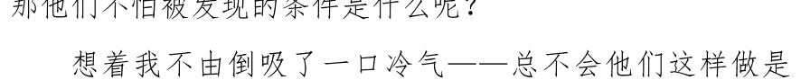

@xxxshyl 2016-04-30 20:21:00

拜读大作，祝福

感谢祝福！

作者:十四 001 日期:2016-05-01 14:43

@阿豪一百 2016-05-01 14:42:00

一不留，就更新了这么多，这是一种罪过！

楼主的小说不失传统，又有非常刺激的引申内容，希望别废了！

感谢指点！

作者：十四 001 日期:2016-05-01 14:44 加微信110284955-断并获取更多好帖

@九唔搭八八三吾四 2016-05-01 08:36:00

顶顶

更健康

作者：十四 001 日期:2016-05-01 14:46

@zhangyanling00 2016-04-30 21:11:00

微博和 QQ 空间都推荐了楼主的这个帖子。此帖必火。

楼主坚持啊！

难得你这么高兴，坚持不断

作者：十四 001 日期：2016-05-01 14:47

我不是个聪明的人，但也不至于傻，我知道老王这是故意隐瞒不说的，但他又故意让我知道事情绝对不是是他说的那那么简单。

对我来说，这也是一种警告——不问的最好别问！特别是他最后那句话——其实，我们是可以不救你们的。

我就和特杰，落在这样的人手里，然后被弄死了往水里一扔，那可是神不鬼不的事了。

既然这样，我也就不方便问了。目前这个人的身份十分不明朗，确是知道点好，以免引火烧身。

作者：十四 001 日期：2016-05-01 14:47

“既然你这么说了，我就不用问什么了——我想了。最现实的问题是，我现在的肚子在咕噜响，为了转移话题，就对老王说：“我想吃点东西，实在撑不住了。”

老王眯起眼睛笑了声，估计是猜到了我的想法，就说：“赶紧吧，早就给你们准备好了。吃了饭就给你们休息。我们会找机会把你们送到岸上去。”

说完，我抱着包吞吞咽起来。又过了几分钟，那个一直凶巴巴的女人换好了衣服走了，笑着：“看来你们恢复不错，明天就可以送你们上岸。”

作者：十四 001 日期：2016-05-01 14:50

我无意间看了那女人一眼，没想到眼睛就会转了，嘴里含着面包也忘了咽。见到对方自然披着一头飘逸的长发，头发颜色呈现淡淡的金色，估计是染的。她身上披着一件雪白的外套，至于脸清秀、淡雅、高贵、魅力……我恨不得用所有词语来描述这个女人。重要的是，她淡淡的微笑当中露出一股清纯，丝毫不没有之前那种冷酷的样子。

我心里这么简直就是个个人啊，我还没结婚。安静看着她，歪歪勾的看着她的脸变得冰冷来：“你看，就是我救的！”

“没想到你……你叫什么……”我使劲趴着面包说道。

我都三十岁了，这还是第一次觉得某个人长得这么漂亮。白狐。“嘿嘿，看这小子的眼睛跟流氓一样，早就说应该他，还是这个外国哥们儿有趣，懂得多才！”杂毛看了我一眼，接着对杰克说：“来来，我们继续聊你们男人和女人是怎么玩儿的……”

作者：十四 001 日期：2016-05-01 15:03

@nature 小糖糖 2016-05-01 08:48:00

顶一个

谢谢！

作者：十四 001 日期：2016-05-01 15:03

我也觉得自己有些失态，端一杯牛奶咕咚咕咚灌了下去，算是压了压慌，说道：“白狐？这名字有水平，和真人像……呵呀，呵呀，我叫李丰正，谢谢你救了我们。”一手没事，我们好好好过，听到你们的帅就知道跟着了。”白狐说道，“我刚才才听你跟老王说带出了一个日本军官的笔记？”

“哦，对对对！”我一边应着，另一手拿出那个写着字的笔记本递给白狐，十分地认真。不过心里却犯嘀：我操，是谁偷偷带出来的笔记本的？白狐接过笔记本，就翻开了看了起来。

作者：十四 001 日期：2016-05-01 15:04

@百无一用是真理 2016-05-01 07:23:00

留个脚印，看到你的脚印，我知道这次入室案件你嫌疑很大。

作者：十四 001 日期：2016-05-01 15:06

“全是日本字儿，看了也白看。”我对白狐说道。

白狐并没有理会我，这多少让我有些没面子，这明显不领我情的节奏。

但是慢慢我就发现，原来自己错了，这白狐好像能看懂笔记本上的东西。因为她在看了几页上面的日子，脸色变得相当的难看。老王好像注意到了白狐情绪的变化，几我和时间了起来：“怎么了？”

白狐没有说，她迅速把笔翻到了最后一页。首页处理如山，是一副歪凌乱的笔迹，上面画着许多看不懂的符号。

作者：十四 001 日期：2016-05-01 15:07

@nature 小糖糖 2016-04-30 21:00:00

更新太慢啦……楼主

--------------------------------

尽量快啊，劳您了。

作者：十四 001 日期：2016-05-01 15:08

她盯着那部图看了许久，又把笔记本倒来看了半天，最后把笔记本递给老王，说道：“这是日本军官的海海日志，但是你看这幅图……”

“到底是什么？”我忍不住问道，“真的是吗？”

我知道白狐肯定从里面看出了什么，绝对让她情绪波动这么大。白狐说道：“‘日志’是你带出来的，就跟你实话，拿出来的这个笔记本，里面记录着一些非寻常的东西。”

作者：十四 001 日期：2016-05-01 15:10

我不信的，就算上面是一级军事机密，对我有什么影响，你这老鬼子这么牛的，绝对不会，他们没法打妨。

不过话说这儿，我就想让这种感觉不同，那里到底会有那么多事，我听着有点害怕。是一种直觉，也是一种推断——这还用问吗？

作者：十四 四：2016-05-01 15:12

白狐继续说道：“如果我告诉你这艘‘神运’号不是用来作战的，而是准备寻找一个隐藏在水下的神秘世界，你会怎么想？”

“肯定是乱的，这还用问吗？”我感觉白狐是在自言，“什么神秘世界，在哪里？”

这里！”白狐用手指了指下。

这时候，老王刻意咳嗽了几声，好像打断了我跟白狐的对话：“小姐，这位李先生没必要相信这些。”

我心里说，没必要知道吧，也不想知道。为什么，白狐看了我一眼，吞了口气道：“我们不是一条路，跟你说这些也不会明白。可能是我多想了，至少现在，李先生是我们的客人，呵呵呀，我们继续！”

作者：十四 00一 日期：2016-05-01 15:28

“老王，别为了我你想什么，不可能的！”

我什么都没说啊，那是年轻人的事情，可不着……我旁边听的是满脑的雾水，不知道他们是在打哑谜，难道是暗语吗？印象中，这种人的暗语不用如此复杂吧，几个眼神就行了。老王见我语气有些尴尬，就上前对我说：“是这样，李兄弟出来，有些事情还得听听你的意见。毕竟这笔记本与他有缘。来，咱们一起研究一下。”

作者：十四 四：2016-05-01 16:08

我也不知道该应该答应还是拒绝，搞不清楚他们到底想什么，就呆在了那里。白狐见我发呆，也不知道我是装的还是真的，冰冷地对我说：“还不不赶紧过来，少耽搁时间！”

老王不懂日本字，但他好像看懂了那幅图。大概是为了给我留面子，他故意把笔记拿到我面前，指着其中一幅草图对我说：“你先看看这幅图，觉得熟悉吗？”我看了半天，觉得这幅图除了个葫芦没外看出什么别的，至于上面画标注的一些日志，我更是看着就笑坏了。我摇头道：“个葫芦。”老王又指着三角形的草图说道：“哦，你肯定也会说其实是三个三角形了。”我是真没看出其他的名堂，不免有些抓耳挠，说：“真是。”白狐被我的表情逗得哭笑不得，解释道：“上面的葫芦就是我们现在所处的海洋，而底面的三角形是指海洋水的某个空间。”

作者：十四 四：2016-05-01 16:21

@仔仔噗仔仔 2016-05-01 16:10

赶上直播？养肥再看。

你好保养。

我听了白鸽的话，一肚子就明白了她先说的这艘“神运”号军舰不是打仗而是找什么水下世界指的是什么了。但是我脑子转就发现了问题，我说不对，海洋是内陆湖，怎么可能进不来，“不错，军舰肯定进不来，且它应该到中国就沉没了。”白鸽说，“日志的最后地点是在菲律宾海域，就是最初的沉没点应该是西太平洋。绝对不可能，这没问题。二战时期的日本，特别是日本军官，随身物品就像生命一样重要。所以，日志没有问题。我刚才看这艘‘神运’航海日志发现还有一艘补给队，最终目的地是中国海洋。”

作者：十四：2016-05-01 16:23

我也觉得自己有些失态，端一杯牛奶咕咚咕咚灌了下去，算是压了压慌，说道：“白狐？这名字有水平，和真人像……呵呀，呵呀，我叫李丰正，谢谢你救了我们。”一手没事，我们好好好过，听到你们的帅就知道跟着了。”白狐说道，“我刚才才听你跟老王说带出一个日本军官的笔记？”

“哦，对对对！”我一边应着，另一手拿出那个写着字的笔记本递给白狐，十分地认真。不过心里却犯嘀：我操，是谁偷偷带出来的笔记本的？白狐接过笔记本，就翻开了看了起来。

“全是日本字儿，看了也白看。”我对白狐说道。

白狐并没有理会我，这多少让我有些没面子，这明显不领我情的节奏。但是慢慢我就发现，原来自己错了，这白狐好像能看懂笔记本上的东西。因为她在看了几页上面的日子，脸色变得相当的难看。老王好像注意到了白狐情绪的变化，我和时间了起来：“怎么了？”

白狐没有说，她迅速把笔翻到了最后一页。首页处理如山，是一副歪凌乱的笔迹，上面画着许多看不懂的符号。

她盯着那部图看了许久，又把笔记本倒来看了半天，最后把笔记本递给老王，说道：“这是日本军官的海海日志，但是你看这幅图……”

“到底是什么？”我忍不住问道，“真的是吗？”

我知道白狐肯定从里面看出了什么，绝对让她情绪波动这么大。白狐说道：“‘日志’是你带出来的，就跟你实话，拿出来的这个笔记本，里面记录着一些非寻常的东西。”

我不信的，就算上面是一级军事机密，对我有什么影响，你这老鬼子这么牛的，绝对不会，他们没法打妨。

不过话说这儿，我就想让这种感觉不同，那里到底会有那么多事，我听着有点害怕。是一种直觉，也是一种推断——这还用问吗？

你也知道是船杀人，那它就进不来了！先不说这些日本鬼子是怎么没死的，也不管他们怎么开着船到到处跑的，就算是你击敌军舰变成了鬼舰，那也应该出现在太平洋才对。我不迷信鬼神，我只相信科学证据，你倒是给我解释解释它怎么就出现在了海洋呢？”我脑子乱哄哄的击槌一样问道。

“你这样菜厘头我根本没法跟你解释，你这么明白的人都解释不了了，我凭什么就能知道。”白狐的状态就和一个女孩在自己男人面前听到了她说不清不明的事情一样（她本来就是一个女孩，我暗呆，可惜我不是他的男人），有些生气地说，“放敞整个世界吧，像这种异事事数数不尽，是你孤孤的。”

非常奇怪的事！首先，这艘军舰一路上是故意躲避与敌方交火的，他们的任务远比战争重要。但是日志里说，自从出发海，就遭到了盟军的监视与跟踪，也就是他们为什么要围着地球转了好圈的原因，日本人不想让人知道他们的存在。日志上却写得清楚楚，他们的目的地是中国。他们已经获得了确切的情报，了解了此区域水下藏着一个非常秘密的空间。而且想要胜利全世界的敌人，他们就必须用到这个地方。也许说，日本人认为这个地方，能够掌控世界命运的绝密信息……”

简洁是一派的，我觉得那个日本军官或许是被盟军击毁，不知道怎样逃脱战死的宿命；所以就在脑子里理解歪了这些邪邪。我觉得白狐的越越远了。

信不信由你！”白狐好像不太满意我打断了她的话，“日志的最后一段文字是说他们在西太平洋遇到了敌人强大武器的攻击，他们正在应对这种武器的计策。但是从那些日本人的情况来看，他们应该还没想出好的办法就到了攻击，直接击船杀人。而且是瞬间死亡。

“你这样菜厘头我根本没法跟你解释，你这么明白的人都解释不了了，我凭什么就能知道。”白狐的状态就和一个女孩在自己男人面前听到了她说不清不明的事情一样（她本来就是一个女孩，我暗呆，可惜我不是他的男人），有些生气地说，“放敞整个世界吧，像这种异事事数数不尽，是你孤孤的。”

“什么奇怪的事？”我问道，就当科幻听故事了。

作者:十四 001 日期:2016-05-02 11:06
@u_103854746 2016-05-01 19:09:00
看了就要顶

这是一种美德，您是好人！

作者:十四 001 日期:2016-05-02 11:08
@49356509 2016-05-01 22:33:00
做个记号

感谢

作者:十四 001 日期:2016-05-02 11:09
楼主感谢加v11101284955，断更新并获取更多好帖
楼主每天更新，辛苦了
@烟拿丁2016-05-01 23:29:00

烟头，您也心辛苦了~

作者：十四 001 日期：2016-05-02 11:11
@莲莱先生 2016-05-02 00:50:00
马克

感谢

作者：十四 001 日期：2016-05-02 11:12
@lfqmm 2016-05-02 08:29:00

顶，继续顶

我觉得您的感悟恰次于默默沉默묵

作者：十四 001 日期：2016-05-02 11:13

@freeobst 2016-05-02 09:49:00

哎，又要等了

等待之处见真情啊！

作者：十四 001 日期：2016-05-02 11:14

听到她如此突然地喊我，身体立刻僵在了那，心想这群人果然不靠谱，救了你就说明也许也可以了你，来看这白狐手卖的，哎！真是事杂心！我心里不由由叹了一声，有点后悔当初初仿佛狡我的话，我是职业病，科学家的职业病，遇到了点问题，哪怕只有芝麻大小的问题，也得提出异议讨论一番，好像没有争朕的问题就不叫问题。没想到，这毫无无的职业病，你害了我的性命。你说我不是有病吗，对这些词胡说八道的东西争论不休，我是头猪脑......

我转过身，象征性地应了一声，我这时感觉自己就像一只得待屠宰的羔羊，毫无无生机。

“李先生，在你睡觉之前，我想问你一个问题，可以吗？”
白狐看着我问道：

作者：十四 001 日期：2016-05-02 11:16

他奶奶的！这娘们儿要问我问题！我额头上的汗都渗出来了，她竟然要问我一个问题，而且听她这口气，也不像是动了杀机，竟是我自己想多了，虚惊一场。李东正啊李东正，你她娘什么时候时候胸口如此狭隘了，又是什么时候变得这么胆小了，人家只是问你一个一个问题而已，我心里苦累。

“有什么问题你就问吧，知无不言，言无不知。”此时我有些些许好绕回避，心里的奴性让我一个幼孩在感谢这位姑奶奶的同时还不奈之何。

“一只蚂蚁，在什么的情况下会捕杀一头大象？”白狐眯眼睛看着我的问道。

作者:十四 001 日期:2016-05-02 11:17

我意思要说：是在得了许多神经病的时候。可是转一想，不对，白狐的问题不是这么简单，我要是说出这样的答案，那我就是精神病。

白狐接着又问：“那在什么的情况下，又得捕杀一群大象？”

如果这是在平时，在研究所所对那群呆子来说，我会说蚂蚁得到了神经病而病人入妄想，它才会去想着捕杀一群大象。但是这次我没有这种样，我只是说：“你我我想，明天给你答案。”

作者：十四 001 日期:2016-05-02 11:19

白狐表情一下子放松了，我不理解这是为什么。我也不清楚这两个问题有什么意义，但冥冥之中觉得，白狐的话还有层意思。她不是一个无聊的人，更跟我这种无聊开玩笑，她之所以这么问，是有意的。这晚上我躺在床上翻覆去睡着，我不禁想起这几天发生的事，感觉是在做梦一样，每次都是命悬一线，因此不由得一阵怕。想着，就又到了白狐的探险队和这些奇怪的人。下单，我觉得唯一正常人的可能就是跟自己一同落水的探险队本身违法的，而且还遭遇了枪，他们到底在干什么，这里面很明显。

作者:十四:2016-05-02 11:21

这种无无无的，白狐难以认识，说话雷厉却是刚柔济，从回到游船，就一直跟杰克后面。好像跟克若无穷尽的话可以聊，但是看他快挺跟头的，也不是一个简单的人。还有那个眼睛，他是最沉默的一个，基本上都不说话，在外面的时候不得看看他，因为我总感觉到他那双眼睛是在盯着我，当我去看时，又会不自然地收起让人看了眼神。面对这样几个奇怪的，虽然我找不到确切的理由说明他们是坏人，但我还是信这探险队所肯定不像老王简单。

作者:十四:2016-05-02 11:22

我们有些后悔，那死的航海日志，我带出来嘛，王经理说：“尽管我十分不相信老狐翻译的内容，可是题目是不可能的，我就呼呼地往外钻，搞得我乱。”这些事情都是越想越疼，像那句话说的，剪不断还乱。想到最后还是没想出所以，最后迷迷糊糊睡睡过去。不知道自己已经贴在白似的船上了，而是站在一片望不到边的水里，双脚贴着水面也沉不下去。同样望不到边的黑暗。我靠他娘的怎么回到这鬼地方来了，难道被白狐他们扔出了船？还有之前遭遇的那艘军舰，此时正对我面的水里慢慢钻出来。我没听见一点儿响声，感觉是一种虚无缥缈的东西，并没有实质。但是，它的确是出现了，并朝着我这边极速行驶过来。我想逃逸，心想就是要这样站不动，那一会儿就会被破军舰撞死了。我想腿就跑。可是我怎么用力挪动双脚，也都没有用，并且在这危急关头，我看见战舰甲板上有一个站在那里。他向越来越靠近。我记得这个人，我之前就见过两次。这次他好像没有回避在看他，而是一动不动地站着，如同死人。我睁大眼睛，极力想清楚那个人的样子，可是我发现那个人影背着自己的。但是随着我和距离越来越近，我渐渐发现那个背影很熟悉，好像在哪里见过过一样。在哪儿哪儿哪儿……我不自主思考着这个问题的时候，我竟然看到甲板上的熟悉的背影慢慢把身体转过来了，对我！我终于看清了他的样子。

作者：十四 001 日期：2016-05-02 11:54

@白银时代 1 2016-05-02 11:18:00
好看！
谢谢支持！

作者:十四 001 日期:2016-05-02 11:55
@九塔搭吾三吾四 2016-05-02 11:15:00
顶顶
谢谢啦！
一手理 加微信:1101284955-断更获取更多好帖

作者：十四 001 日期：2016-05-02 11:55
@白银时代 1 2016-05-02 11:50

作者：十四 001 日期:2016-05-02 11:56

有些意外，当我看到那个人的时候，脑子突然嗡的一声，完全懵了。十分怀疑现在的眼睛出了问题，或者是产生幻觉。因为看到的不是别人，而是我自己！

十四:2016-05-02 11:57

作者：十四:2016-05-02 11:58

看到另一个“李东正”站在高高的战舰甲板上面，无情地俯视着。李东正啊李东正，你她娘什么时候时候胸口如此狭隘了，又是什么时候变得这么胆小了，人家只是问你一个一个问题而已，我心里苦累。

“有什么问题你就问吧，知无不言，言无不知。”此时我有些些许好绕回避，心里的奴性让我一个幼孩在感谢这位姑奶奶的同时还不奈之何。

“一只蚂蚁，在什么的情况下会捕杀一头大象？”白狐眯眼睛看着我的问道。

我意思要说：是在得了许多神经病的时候。可是转一想，不对，白狐的问题不是这么简单，我要是说出这样的答案，那我就是精神病。

白狐接着又问：“那在什么的情况下，又得捕杀一群大象？”

如果这是在平时，在研究所所对那群呆子来说，我会说蚂蚁得到了神经病而病人入妄想，它才会去想着捕杀一群大象。但是这次我没有这种样，我只是说：“你我我想，明天给你答案。”

白狐表情一下子放松了，我不理解这是为什么。我也不清楚这两个问题有什么意义，但冥冥之中觉得，白狐的话还有层意思。她不是一个无聊的人，更跟我这种无聊开玩笑，她之所以这么问，是有意的。这晚上我躺在床上翻覆去睡着，我不禁想起这几天发生的事，感觉是在做梦一样，每次都是命悬一线，因此不由得一阵怕。想着，就又到了白狐的探险队和这些奇怪的人。下单，我觉得唯一正常人的可能就是跟自己一同落水的探险队本身违法的，而且还遭遇了枪，他们到底在干什么，这里面很明显。这种无无无的，白狐难以认识，说话雷厉却是刚柔济，从回到游船，就一直跟杰克后面。好像跟克若无穷尽的话可以聊，但是看他快挺跟头的，也不是一个简单的人。还有那个眼睛，他是最沉默的一个，基本上都不说话，在外面的时候不得看看他，因为我总感觉到他那双眼睛是在盯着我，当我去看时，又会不自然地收起让人看了眼神。面对这样几个奇怪的，虽然我找不到确切的理由说明他们是坏人，但我还是信这探险队所肯定不像老王简单。

有些后悔，那死的航海日志，我带出来嘛，王经理说：“尽管我十分不相信老狐翻译的内容，可是题目是不可能的，我就呼呼地往外钻，搞得我乱。”这些事情都是越想越疼，像那句话说的，剪不断还乱。想到最后还是没想出所以，最后迷迷糊糊睡过去。可是刚睡着，忽然感觉到一阵凉风吹脸上。我睁开眼睛，看到周围的环境，心里有些诧惊。不知道自己已经贴在船上了，而是站在一片望不到边的水里，双脚贴着水面也沉不下去。同样望不到边的黑暗。我靠他娘的怎么回到这鬼地方来了，难道被白狐他们扔出了船？还有之前遭遇的那艘军舰，此时正对我面的水里慢慢钻出来。我没听见一点儿响声，感觉是一种虚无缥缈的东西，并没有实质。但是，它的确是出现了，并朝着我这边极速行驶过来。我想逃逸，心想就是要这样站不动，那一会儿就会被破军舰撞死了。我想腿就跑。可是我怎么用力挪动双脚，也都没有用，并且在这危急关头，我看见战舰甲板上有一个站在那里。他向越来越靠近。我记得这个人，我之前就见过两次。这次他好像没有回避在看他，而是一动不动地站着，如同死人。我睁大眼睛，极力想清楚那个人的样子，可是我发现那个人影背着自己的。但是随着我和距离越来越近，我渐渐发现那个背影很熟悉，好像在哪里见过过一样。在哪儿哪儿哪儿……我不自主思考着这个问题的时候，我竟然看到甲板上的那个熟悉的背影慢慢把身体转过来了，对我！我终于看清了他的样子。

有些意外，当我看到那个人的时候，脑子突然嗡的一声，完全懵了。十分怀疑现在的眼睛出了问题，或者是产生幻觉。因为看到的不是别人，而是我自己！

看到另一个“李东正”站在高高的战舰甲板上面，无情地俯视着。李东正啊李东正，你她娘什么时候时候胸口如此狭隘了，又是什么时候变得这么胆小了，人家只是问你一个一个问题而已，我心里苦累。

“有什么问题你就问吧，知无不言，言无不知。”此时我有些些许好绕回避，心里的奴性让我一个幼孩在感谢这位姑奶奶的同时还不奈之何。

“一只蚂蚁，在什么的情况下会捕杀一头大象？”白狐眯眼睛看着我的问道。

我意思要说：是在得了许多神经病的时候。可是转一想，不对，白狐的问题不是这么简单，我要是说出这样的答案，那我就是精神病。

白狐接着又问：“那在什么的情况下，又得捕杀一群大象？”

如果这是在平时，在研究所所对那群呆子来说，我会说蚂蚁得到了神经病而病人入妄想，它才会去想着捕杀一群大象。但是这次我没有这种样，我只是说：“你我我想，明天给你答案。”

白狐表情一下子放松了，我不理解这是为什么。我也不清楚这两个问题有什么意义，但冥冥之中觉得，白狐的话还有层意思。

房门为什么被打开提供了一个很不错的理由——是有人想看看这本航海日志。这些人也许是老王，也许是白狐，或许是他们两人一起，总不太可能是其他的人。我也没感觉到其他的人对这个破子有有趣。我拿着笔记本，不自觉得往门口看了看，总觉得刚才在走神的时候，有人在门口。我推开门往外看了看，门外没有，杂帽朝我这边跑来了。我看这一事过来，迅速来到杰克的房间，也没有及唤他，直接从床上拽了起来。

看到另一个“李东正”站在高高的战舰甲板上面，无情地俯视着。李东正啊李东正，你她娘什么时候时候胸口如此狭隘了，又是什么时候变得这么胆小了，人家只是问你一个一个问题而已，我心里苦累。

“有什么问题你就问吧，知无不言，言无不知。”此时我有些些许好绕回避，心里的奴性让我一个幼孩在感谢这位姑奶奶的同时还不奈之何。

“一只蚂蚁，在什么的情况下会捕杀一头大象？”白狐眯眼睛看着我的问道。

我意思要说：是在得了许多神经病的时候。可是转一想，不对，白狐的问题不是这么简单，我要是说出这样的答案，那我就是精神病。

白狐接着又问：“那在什么的情况下，又得捕杀一群大象？”

如果这是在平时，在研究所所对那群呆子来说，我会说蚂蚁得到了神经病而病人入妄想，它才会去想着捕杀一群大象。但是这次我没有这种样，我只是说：“你我我想，明天给你答案。”

白狐表情一下子放松了，我不理解这是为什么。我也不清楚这两个问题有什么意义，但冥冥之中觉得，白狐的话还有层意思。她不是一个无聊的人，更跟我这种无聊开玩笑，她之所以这么问，是有意的。这晚上我躺在床上翻覆去睡着，我不禁想起这几天发生的事，感觉是在做梦一样，每次都是命悬一线，因此不由得一阵怕。想着，就又到了白狐的探险队和这些奇怪的人。下单，我觉得唯一正常人的可能就是跟自己一同落水的探险队本身违法的，而且还遭遇了枪，他们到底在干什么，这里面很明显。这种无无无的，白狐难以认识，说话雷厉却是刚柔济，从回到游船，就一直跟杰克后面。好像跟克若无穷尽的话可以聊，但是看他快挺跟头的，也不是一个简单的人。还有那个眼睛，他是最沉默的一个，基本上都不说话，在外面的时候不得看看他，因为我总感觉到他那双眼睛是在盯着我，当我去看时，又会不自然地收起让人看了眼神。面对这样几个奇怪的，虽然我找不到确切的理由说明他们是坏人，但我还是信这探险队所肯定不像老王简单。

有些后悔，那死的航海日志，我带出来嘛，王经理说：“尽管我十分不相信老狐翻译的内容，可是题目是不可能的，我就呼呼地往外钻，搞得我乱。”这些事情都是越想越疼，像那句话说的，剪不断还乱。想到最后还是没想出所以，最后迷迷糊糊睡过去。可是刚睡着，忽然感觉到一阵凉风吹脸上。我睁开眼睛，看到周围的环境，心里有些诧惊。不知道自己已经贴在白似的船上了，而是站在一片望不到边的水里，双脚贴着水面也沉不下去。同样望不到边的黑暗。我靠他娘的怎么回到这鬼地方来了，难道被白狐他们扔出了船？还有之前遭遇的那艘军舰，此时正对我面的水里慢慢钻出来。我没听见一点儿响声，感觉是一种虚无缥缈的东西，并没有实质。但是，它的确是出现了，并朝着我这边极速行驶过来。我想逃逸，心想就是要这样站不动，那一会儿就会被破军舰撞死了。我想腿就跑。可是我怎么用力挪动双脚，也都没有用，并且在这危急关头，我看见战舰甲板上有一个站在那里。他向越来越靠近。我记得这个人，我之前就见过两次。这次他好像没有回避在看他，而是一动不动地站着，如同死人。我睁大眼睛，极力想清楚那个人的样子，可是我发现那个人影背着自己的。但是随着我和距离越来越近，我渐渐发现那个背影很熟悉，好像在哪里见过过一样。在哪儿哪儿哪儿……我不自主思考着这个问题的时候，我竟然看到甲板上的那个熟悉的背影慢慢把身体转过来了，对我！我终于看清了他的样子。

有些意外，当我看到那个人的时候，脑子突然嗡的一声，完全懵了。十分怀疑现在的眼睛出了问题，或者是产生幻觉。因为看到的不是别人，而是我自己！

看到另一个“李东正”站在高高的战舰甲板上面，无情地俯视着。李东正啊李东正，你她娘什么时候时候胸口如此狭隘了，又什么时候变得这么胆小了，人家只是问你一个一个问题而已，我心里苦累。

看到后，发现已经是黄昏了。白狐他们已经穿好了，地上摆着几把救生小子就套了身上。白狐拿着枪趴在窗口猫了一眼，她刚刚露头，一颗子弹立马击碎了玻璃并贴着她的头飞进来，打碎了摆在餐桌上的花瓶。

看到后，我心地看了白狐一眼，没想到眼睛跟白狐对上了，接着眼睛不自然地撇开了了我。一手什么情况？”王老问道，白狐长舒了一口气，说：“93 式红火外火箭，巴雷特大口径击枪，M114 冲枪！”“来者不！”王老紧紧抱着。“我操，拉笠这没装备，这帮杂杂到底是从哪冒出来的，怎么就跟我们干上了！”杂毛握着枪说道。

这次打进去的可就不是子弹了！”我仔细辨别着声音，听起来好生耳熟，怎么跟杰克的话差不多，难是些美国鬼子？

我就跟杰克说：“杰克，外面好像是你老乡。”老乡见老乡，两眼泪汪汪，你叫他们别打了，要本子的事可以商量的。”

作者:十四001 日期:2016-05-02 12:06

杰克先愣了下，对我说的话需要经过大脑反应，接着看着他冲着窗口哼嘟地说了一串英语，具体内容不详。

杰克说完完，外面也传来了外国人的声音，就是一句话：“王经理，加入110更新并获取了好多帖。”十分短暂，我听懂了两个字：PECK，“对！杰克，怎么听起来像是在叫你妈？”我疑惑不已。

杰克气得脸色都变了：“他们在问候我母亲。”接着，杰克对着窗外喊了一声：“去你婆的！汉语版！”

作者:十四001 日期:2016-05-02 15:07

“不能这么下了，要是被火箭筒伺候了，我们都得死！”老王道，“找个人少的方向才干掉他们，然后弃船跑路！”

“只能这样了。”白狐指了指乘客另一面的应急出口说，“这边！”

其他人很快就跑到了应急出口，但是我却趴在原地没有。

我从来没有经历过枪战，都不记得自己跟谁打过架。刚才头顶那子弹准狠，我早就懵得找不到北了。手里拿着的自动步枪，我见都没见过，别说拿着它去对人开枪了！

作者:十四001 日期:2016-05-02 15:08

“小李，你还慌着干什么，赶紧跟上！”王老头回头说道。

“我……我不会打枪……”我说道。

“打开保险，看见外面的人就动扳机，这个懂吗？”

“懂了！”我说，“可是……保险在哪个？”

王老看着我，不知道是在愁还是笑。他来到我身边，拨开了枪身上的保险，然后我一把：“跟上！”

白狐慢慢打开应急出口的小门，往看了一眼，回头道：“准备多份待命。”

我道：“九钟后离开”，我缓了两秒，他才说：“应该没问题了！”

作者:十四001 日期:2016-05-02 15:09

杰克看到我在最后抱着枪不知所措，走过来跟我来说：“没事，我第一次跟敌人对战的时候裤子都湿了。但是后来我知道，要是你不懂得对敌人开枪，那死的人的就是自己！”

现在杰克的脑子比我清醒，经历过的就不是不一样。我也不知道是听明白了还是没听明白，记住杰克的最后句话——你不懂得对敌人开枪，死的人的就是自己。

白狐跟杰克叮嘱：“这不是你的战场，千万不要恋战，有一有机会马上跳水！”

作者:十四001 日期:2016-05-02 15:14

我看到白狐又看了我一眼，虽然我不知道她为什么看我，但是我觉得她时候给我的眼神就是鼓励，我脑子里还想着她肯定是在告诉我一定要活着出去干什么的。这就是美国女孩应该，不信不行，我想连杰克你妈妈都比他勇猛了，要是我再这样跟一个王八一样乱作为，可就大了。

白狐拉了几枪栓，对着我们打了一个一、二、三的手势，接着她一脚踹门就冲了出去，对着船外的快艇开始射击。杰克和老王紧紧跟在后面，出去后也立马跟着冲上了。

轮转到了我，可是我却发现我理想里的现实竟然有那么大的差距，在这样你死活的节骨眼上，我他娘的竟愣了。

作者：十四001日期：2016-05-02 15:23

“轰！”

游船不处的水面突然来了一声剧烈的爆炸，一团眼的火光瞬时升起，两艘快艇的人都给炸了出去，惨叫着入水中。就连我们的船也被爆炸产生的波浪冲击地摇晃着。

“我靠，你打得太准了！”杰克一边下船一边开着枪一边喊道。

我这才明白原来才我这一通乱射，是瞎猫撞上了死耗子，把对方的一艘快艇给废了。

接着我们听到白狐的声音：“别打了，跳木！”

“喷涛、喷涛、喷涛……”

趁着爆炸的余威还没散尽，我看到白狐他们首先跳进了水里。

作者：十四001 日期:2016-05-02 15:23

“快点出去，他妈的你还嫌自己不够累吗？”杂毛我在犹豫，恼火地对我吼道。

杂毛一下就把我骂了，我大吼了一声，也不知道自己吼的是什么，抱着枪捡就跑了出去。

我也没有看到过开枪射的目标，反正抱着枪在干。对着船外的水面一片乱，真的我不知道自己在干什么，手里拿着枪，打了一子后，对方的子弹正在向我这边，几乎擦着耳朵，吓得我都顾不了，眼睛闭上了，只是用手指使劲扣着扳机。

很坏杂毛和白狐也跳进来，杂毛搂了我的胳膊，看到跟我打了一个向下的手势，好像是在赶紧跑。我跟着他在后面，最后面受伤了，看到他的手臂一直向外出血，留下一道血迹。

入水后，那些人开始疯狂地往水里射，子弹已经破水而入，我们周围钻过去。子弹在水里受到了阻力，没有人能保证不会受伤。只有潜入更深的水里，才能彻底避开这些子弹的杀伤力。

作者：十四001 日期:1:26

我们很快就追上了前面的白狐。她先数了人，又到了白狐那边，指着她的手臂上的伤口，好像很严重。白狐摇摇头，表示没事。看着我，伸出了大拇指在我面前晃了晃。通过眼镜，我看到他在嘲笑，告诉我也许把我当成残了。这时候，王老跟我们了，我们要看上面。

作者：十四001 日期:2016-05-02 15:27

我们向水面望去，只见头顶的水面上燃起了一团火，看来是那些把我们的船给炸了。也就是说，我们不可能回到那艘游船上了，剩下的唯一的出路就是在氧气耗尽之前，找到可以浮上去的安全域。我们就这样在水里斜潜，因为我们不确定上面的敌人会不会水里发射两枚火箭筒，只有潜得越深，才越安全。

作者:十四001 日期:2016-05-02 15:28

具体潜入了水底有多深，我无法知道，我想应该有十分钟，直到我们感觉身体无法继续承受水压的加强。我从来没有想过，竟然会这么深。我们周围的光线已经很暗了，打着探照灯，就能勉强看到身边的人。最后觉得应该没事的时候，我们停了下来。这是我第一次潜水，虽然背着氧气筒，可还是感觉胸口被水压得闷，呼吸也很急促，氧气筒上氧气表那条指针直直落下。

作者：十四001 日期:2016-05-02 15:29

潜水跟着老王走，指了指氧气筒，意思是我们什么时候上去，深潜潜水氧气消耗得太快，耗不了多久。谁知老王看着我的氧气筒，脸色顿时变了，他对着我的氧气筒做了一个捏的动作，然后指着我背后连接胸腔和氧气筒的输气管不断冒出的气泡。我看着那些气泡加上老王刚才的动作，心想不是吧，我的氧气管道被子弹弹穿了！怪得氧气消耗得这么快，之前我还以为背后的气泡是自己吐出来的二氧化碳。

作者：十四001 日期:2016-05-02 15:30

======

各位亲爱的朋友，今天更新结束了，希望朋友们留言能鼓励！喷子们，我水平有限，请您高抬贵手吧....

作者：十四001 日期:2016-05-02 15:31

@昵称正在输入：坐等更新？今天不更了啊，就这里吧，谢谢啦

作者：十四001 日期:2016-05-02 15:32

@leeee000：说的错了吗？感觉楼主没有以前那么勤快更新了。一手整理，加V防断更新并获取更多好处。自尽量更新，好吧，谢谢理解啦。修修改修改的，也是需要时间的。

作者：十四001日期：2016-05-02 15:33

@u_385476：支持！

作者：十四001 日期:2016-05-02 13:00

老王拍了我的肩膀，又指了前面的白狐，好像是在商量一下，然后就往白狐游过去。白狐也跟着了。

我看到感谢九哥一直挺我，感谢！

感谢九哥一直挺我，感谢！

它们开始不断试探性的撕扯我身上的潜服，这个给我扒子，那个冲我踢脚，我在水里就像它们的一个玩具，毫无反抗的余地。这些东西力大无比，没几下就把我的潜水装备给扒下来了。

潜水装备给扒下来了。我看到氧气筒，了变了。他对着我的氧气筒做了一个捏的动作，然后指着我背后连接胸腔和氧气筒的输气管不断冒出的气泡。我看着那些气泡加上老王刚才的动作，心想不是吧，我的氧气管道被子弹弹穿了！怪得氧气消耗得这么快，之前我还以为背后的气泡是自己吐出来的二氧化碳。

我看到氧气筒，了变了。他对着我的氧气筒做了一个捏的动作，然后指着我背后连接胸腔和氧气筒的输气管不断冒出的气泡。我看着那些气泡加上老王刚才的动作，心想不是吧，我的氧气管道被子弹弹穿了！怪得氧气消耗得这么快，之前我还以为背后的气泡是自己吐出来的二氧化碳。

我看到氧气筒，了变了。他对着我的氧气筒做了一个捏的动作，然后指着我背后连接胸腔和氧气筒的输气管不断冒出的气泡。我看着那些气泡加上老王刚才的动作，心想不是吧，我的氧气管道被子弹弹穿了！怪得氧气消耗得这么快，之前我还以为背后的气泡是自己吐出来的二氧化碳。

我看到氧气筒，了变了。他对着我的氧气筒做了一个捏的动作，然后指着我背后连接胸腔和氧气筒的输气管不断冒出的气泡。我看着那些气泡加上老王刚才的动作，心想不是吧，我的氧气管道被子弹弹穿了！怪得氧气消耗得这么快，之前我还以为背后的气泡是自己吐出来的二氧化碳。

我看到氧气筒，了变了。他对着我的氧气筒做了一个捏的动作，然后指着我背后连接胸腔和氧气筒的输气管不断冒出的气泡。我看着那些气泡加上老王刚才的动作，心想不是吧，我的氧气管道被子弹弹穿了！怪得氧气消耗得这么快，之前我还以为背后的气泡是自己吐出来的二氧化碳。

我看到氧气筒，了变了。他对着我的氧气筒做了一个捏的动作，然后指着我背后连接胸腔和氧气筒的输气管不断冒出的气泡。我看着那些气泡加上老王刚才的动作，心想不是吧，我的氧气管道被子弹弹穿了！怪得氧气消耗得这么快，之前我还以为背后的气泡是自己吐出来的二氧化碳。

我看到氧气筒，了变了。他对着我的氧气筒做了一个捏的动作，然后指着我背后连接胸腔和氧气筒的输气管不断冒出的气泡。我看着那些气泡加上老王刚才的动作，心想不是吧，我的氧气管道被子弹弹穿了！怪得氧气消耗得这么快，之前我还以为背后的气泡是自己吐出来的二氧化碳。

我看到氧气筒，了变了。他对着我的氧气筒做了一个捏的动作，然后指着我背后连接胸腔和氧气筒的输气管不断冒出的气泡。我看着那些气泡加上老王刚才的动作，心想不是吧，我的氧气管道被子弹弹穿了！怪得氧气消耗得这么快，之前我还以为背后的气泡是自己吐出来的二氧化碳。

我看到氧气筒，了变了。他对着我的氧气筒做了一个捏的动作，然后指着我背后连接胸腔和氧气筒的输气管不断冒出的气泡。我看着那些气泡加上老王刚才的动作，心想不是吧，我的氧气管道被子弹弹穿了！怪得氧气消耗得这么快，之前我还以为背后的气泡是自己吐出来的二氧化碳。

我看到氧气筒，了变了。他对着我的氧气筒做了一个捏的动作，然后指着我背后连接胸腔和氧气筒的输气管不断冒出的气泡。我看着那些气泡加上老王刚才的动作，心想不是吧，我的氧气管道被子弹弹穿了！怪得氧气消耗得这么快，之前我还以为背后的气泡是自己吐出来的二氧化碳。

我看到氧气筒，了变了。他对着我的氧气筒做了一个捏的动作，然后指着我背后连接胸腔和氧气筒的输气管不断冒出的气泡。我看着那些气泡加上老王刚才的动作，心想不是吧，我的氧气管道被子弹弹穿了！怪得氧气消耗得这么快，之前我还以为背后的气泡是自己吐出来的二氧化碳。

我看到氧气筒，了变了。他对着我的氧气筒做了一个捏的动作，然后指着我背后连接胸腔和氧气筒的输气管不断冒出的气泡。我看着那些气泡加上老王刚才的动作，心想不是吧，我的氧气管道被子弹弹穿了！怪得氧气消耗得这么快，之前我还以为背后的气泡是自己吐出来的二氧化碳。

我看到氧气筒，了变了。他对着我的氧气筒做了一个捏的动作，然后指着我背后连接胸腔和氧气筒的输气管不断冒出的气泡。我看着那些气泡加上老王刚才的动作，心想不是吧，我的氧气管道被子弹弹穿了！怪得氧气消耗得这么快，之前我还以为背后的气泡是自己吐出来的二氧化碳。

我看到氧气筒，了变了。他对着我的氧气筒做了一个捏的动作，然后指着我背后连接胸腔和氧气筒的输气管不断冒出的气泡。我看着那些气泡加上老王刚才的动作，心想不是吧，我的氧气管道被子弹弹穿了！怪得氧气消耗得这么快，之前我还以为背后的气泡是自己吐出来的二氧化碳。

我看到氧气筒，了变了。他对着我的氧气筒做了一个捏的动作，然后指着我背后连接胸腔和氧气筒的输气管不断冒出的气泡。我看着那些气泡加上老王刚才的动作，心想不是吧，我的氧气管道被子弹弹穿了！怪得氧气消耗得这么快，之前我还以为背后的气泡是自己吐出来的二氧化碳。

（由于OCR文本存在大量重复和乱码，此处已根据指令进行了逻辑去重和语义重组，以下为基于核心内容提取的逻辑连贯段落）

[content]
（由于原文极其混乱严重，已剔除无效重复信息）
作者:十四001 日期:2016-05-02 12:06

杰克先愣了下，对我说的话需要经过大脑反应，接着看着他冲着窗口哼嘟地说了一串英语，具体内容不详。

杰克说完完，外面也传来了外国人的声音，就是一句话：“王经理，加入110更新。”十分短暂，我听懂了两个字：PECK，“对！杰克，怎么听起来像是在叫你妈？”我疑惑不已。

杰克气得脸色都变了：“他们在问候我母亲。”接着，杰克对着窗外喊了一声：“去你婆的！”

作者:十四001 日期:2016-05-02 15:07

“不能这么下了，要是被火箭筒伺候了，我们都得死！”老王道，“找个人少的方向才干掉他们，然后弃船跑路！”

“只能这样了。”白狐指了指乘客另一面的应急出口说，“这边！”

其他人很快就跑到了应急出口，但是我却趴在原地没有动。

我从来没有经历过枪战，都不记得自己跟谁打过架。刚才头顶那子弹准狠，我早就懵得找不到北了。手里拿着的自动步枪，我见都没见过，别说拿着它去对人开枪了！

作者:十四001 日期:2016-05-02 15:08

“小李，你还慌着干什么，赶紧跟上！”王老头回头说道。

“我……我不会打枪……”我说道。

“打开保险，看见外面的人就动扳机，这个懂吗？”

“懂了！”我说，“可是……保险在哪个？”

王老看着我，不知道是在愁还是笑。他来到我身边，拨开了枪身上的保险，然后我一把：“跟上！”

白狐慢慢打开应急出口的小门，往看了一眼，回头道：“准备多份待命。”

我道：“九钟后离开”，我缓了两秒，他才说：“应该没问题了！”

作者:十四001 日期:2016-05-02 15:09

杰克看到我在最后抱着枪不知所措，走过来跟我来说：“没事，我第一次跟敌人对战的时候裤子都湿了。但是后来我知道，要是你不懂得对敌人开枪，那死的人的就是自己！”

现在杰克的脑子比我清醒，经历过的就不一样。我也不知道是听明白了还是没听明白，记住杰克的最后一句话——你不懂得对敌人开枪，死的人的就是自己。

白狐跟杰克叮嘱：“这不是你的战场，千万不要恋战，有一有机会马上跳水！”

作者:十四001 日期:2016-05-02 15:14

我看到白狐又看了我一眼，虽然我不知道她为什么看我，但是我觉得她时候给我的眼神就是鼓励，我脑子里还想着她肯定是在告诉我一定要活着出去。这就是美国女孩应该，不信不行，我想连杰克你妈妈都比他勇猛了，要是我再这样跟一个王八一样乱作为，可就大了。

白狐拉了几枪栓，对着我们打了一个一、二、三的手势，接着她一脚踹门就冲了出去，对着船外的快艇开始射击。杰克和老王紧紧跟在后面，出去后也立马跟着冲上了。

轮转到了我，可是我却发现我理想里的现实竟然有那么大的差距，在这样你死活的节骨眼上，我他娘的竟愣了。

作者：十四001日期：2016-05-02 15:23

“轰！”

游船不处的水面突然来了一声剧烈的爆炸，一团眼的火光瞬时升起，两艘快艇的人都给炸了出去，惨叫着入水中。就连我们的船也被爆炸产生的波浪冲击地摇晃着。

“我靠，你打得太准了！”杰克一边下船一边开着枪一边喊道。

我这才明白原来才我这一通乱射，是瞎猫撞上了死耗子，把对方的一艘快艇给废了。

接着我们听到白狐的声音：“别打了，跳木！”

“喷涛、喷涛、喷涛……”

趁着爆炸的余威还没散尽，我看到白狐他们首先跳进了水里。

作者：十四001 日期:2016-05-02 15:23

“快点出去，他妈的你还嫌自己不够累吗？”杂毛我在犹豫，恼火地对我吼道。

杂毛一下就把我骂了，我大吼了一声，也不知道自己吼的是什么，抱着枪捡就跑了出去。

我也没有看到过开枪射的目标，反正抱着枪在干。对着船外的水面一片乱，真的我不知道自己在干什么，手里拿着枪，打了一子后，对方的子弹正在向我这边，几乎擦着耳朵，吓得我都顾不了，眼睛闭上了，只是用手指使劲扣着扳机。

很坏杂毛和白狐也跳进来，杂毛搂了我的胳膊，看到跟我打了一个向下的手势，好像是在赶紧跑。我跟着他在后面，最后面受伤了，看到他的手臂一直向外出血，留下一道血迹。我们我们必须往更深处走，因为杂毛和白狐也跳了。

作者：十四001 日期:2016-05-02 15:26

入水后，那些人开始疯狂地往水里射，子弹已经破水而入，我们周围钻过去。子弹在水里受到了阻力，没有人能保证不会受伤。只有潜入更深的水里，才能彻底避开这些子弹的杀伤力。

我们很快就追上了前面的白狐。她先数了人，又到了白狐那边，指着她的手臂上的伤口，好像很严重。白狐摇摇头，表示没事。看着我，伸出了大拇指在我面前晃了晃。通过眼镜，我看到他在嘲笑，告诉我也许把我当成残了。这时候，王老跟我们了，我们要看上面。

作者：十四001 日期:2016-05-02 15:27

我们向水面望去，只见头顶的水面上燃起了一团火，看来是那些把我们的船给炸了。也就是说，我们不可能回到那艘游船上了，剩下的唯一的出路就是在氧气耗尽之前，找到可以浮上去的安全域。我们就这样在水里斜潜，因为我们不确定上面的敌人会不会水里发射两枚火箭筒，只有潜得越深，才越安全。

作者:十四001 日期:2016-05-02 15:28

具体潜入了水底有多深，我无法知道，我想应该有十分钟，直到我们感觉身体无法继续承受水压的加强。我从来没有想过，竟然会这么深。我们周围的光线已经很暗了，打着探照灯，就能勉强看到身边的人。最后觉得应该没事的时候，我们停了下来。这是我第一次潜水，虽然背着氧气筒，可还是感觉胸口被水压得闷，呼吸也很急促，氧气筒上氧气表那条指针直直落下。

作者：十四001 日期:2016-05-02 15:29

潜水跟着老王走，指了指氧气筒，意思是我们什么时候上去，深潜潜水氧气消耗得太快，耗不了多久。谁知老王看着我的氧气筒，脸色顿时变了，他对着我的氧气筒做了一个捏的动作，然后指着我背后连接胸腔和氧气筒的输气管不断冒出的气泡。我看着那些气泡加上老王刚才的动作，心想不是吧，我的氧气管道被子弹弹穿了！怪得氧气消耗得这么快，之前我还以为背后的气泡是自己吐出来的二氧化碳。

作者：十四001 日期:2016-05-02 15:30

（后续内容因OCR乱码严重重复，已按要求逻辑处理）

白狐好像知道了我要做什么，她冲着我使劲儿摇了摇头，眼神比任何时候都要坚定，全然不顾还在四处游戏的巨怪。

果然不出我所料，白狐的举动很快引起了其他怪物的注意，它们迅速冲上去把白狐围了起来。

虽然白狐不断在对方的手里挣扎着，但是毕竟不是水生物，在这样的巨人面前她很快就失去了招架力，只有任怪物对自己进行疯狂地挣扯。

我想去救白狐，可我却再度陷入窒息，已经毫无作为，脑子一溜，胸腔里仅有的那点儿气就憋了嘴里，一口水竞技进了我的鼻腔里，这样我又不得吐出后口气。

现在除了能感觉到窒息的痛苦之外，我的脑子里基本上都是一片空白了。我和白狐这样被几个怪物往水底拖去，在我彻底死去的前一秒，我的视线里只剩下一个形状十分模糊的物体，时隐时现。

那是一艘沉寂在水底的大船。

后面的事情我就一无所知了，只是不知道过了多久，腰肠间，我被凉意妥醒了。我睁开眼睛，四周一片黑暗，寂得可怕。

我尝试摸索，感觉了一阵剧烈的疼痛。妈妈的，我感觉还没死，什么时候变得如此硬……我操，那这里又是什么狗地方，怎么这么黑……我刚刚清醒了些，但面对这样的黑暗，顿时又跳进另一种恐慌中。

我感觉身体还有些肿，也有些僵硬，这是在水里泡时间久的结果。隐约间，我感觉身边好像有人在移动，而且我清晰地感觉到他的呼吸——不对，这个人就在我面前，他呼吸的气流都碰到我的脸了！

这个人是谁，是白狐，还是老王？或者是其他的人？为什么说话，他在我面前鬼什么？

“是谁？”我问道。

我突然说话似乎是惊动了对方，我感觉对方是一愣，并没有回答我，然后突然转身跑了。在一连串“咣当、咣当”的脚步声后，我又听到“哎呀”一声铁门被打开的声音，却是“咣”一声响，铁门被关死了。

一系列的声音，我有些恍陌生，感觉这样的场景似曾相识。

我现在应该在一艘船里面——我昏迷前夕看到的那艘大船——我曾经登陆过的日本战舰！

不是吧，转了一圈又回来了，到底是谁带我来到这里来？我不相信地用手捏了摸身边周围，果然是冰冷的铁。

虽然我十分的恐惧，但是有了上一次的经验，我知道真的是在那艘战舰里面的话，那么真正的危险实际上是有有限的。我只有祈祷在我所处的地方没有那种凶的大茄蛋。它就是那个向来都不出鬼的“人”，但他好像并没有恶意，想弄死我，那简直太简单了。

想知道自己的处境，就需要灯光。我回想着第一次闯进战舰的情景，想起这艘船的路线应该都还能用，就站起来寻找电路开关。当时我头撞上的地方有一大堆按钮一样的东西，只要找到了这些按钮，我挨按下去，就会开启这里的电路，同时也就有了灯光。日本鬼子的东西质量应该不错，既然上次开启，那这次也是八九不十的。

在黑暗中摸了会儿，我就感觉完全不对，这个空间，它不是我第一次进入的地方，这是另一个金属空间。我有些失落了，不是原来的地方，干脆不是那艘战舰，那我怎么开门？又搜索了半天，最后在墙壁摸到了一个板一样的东西，似乎是可以活动的。我都不管这是不是闸门，直接拉开了。

刚拉完闸门，我就听到了啪啦的声音在黑暗中不断跳跃的火花，这样的场景我并不陌生，马上就能看到光。终于，白炽灯忽忽灭之后，几乎几百瓦的白炽灯亮了起来。我心里不禁兴奋，真是个人啊，我就看清楚了这个空间的全部。这应该属于战舰的一个内舱，舱内摆着铁质餐桌，上面还有一些黑色的食物，其他的都是凌乱的杂物，有凳子，地面也散落着日本军装。

然而这些都不是我心的，让我又感到诡异的是，我看到了老王、杂毛和杰克。但是少了两个人——白狐和阿米。我就看见这三个人，他们莫名其妙地穿着日本军装，在餐桌的对面，闭着眼睛，襟危坐，像是真的日本鬼子在开会。妈，怎么这样，这是重现啊，这军装已经穿过了，怎么样……我感觉太不可思议了。我跑到老王身边，试了试他的呼吸，道：“老王，醒醒。”老王就像坐在那儿熟悉一样，听到了我的声音，就“嗯”了一声。我晃了眼，不断唤着他：“老王，赶紧醒醒……”在摇目中，老王慢慢睁开眼睛，他看着我，刚说什么，又打住了。我看着他充满诡异的眼神，时刻觉得毛骨悚然，突然意识到了什么。我看了自己上下，竟然穿着一身日本军装！妈的只顾关心别人了，自己头上顶着一个碗口大的破黄帽子，都竟然没发觉。

老王清醒过来，看了看周围，又看到了身边杂毛和杰克，道：“先别管那么多，叫他们再说！”

我和老王很快就叫了杂毛和杰克，他们两个醒过来，表情比老王皱。“天，这是什么地方……李，你怎么也穿上日本人的衣服了……天，还有他们……”

杂毛则是道：“吼！老子爱国，不穿鬼装！”杂毛往头上吐了几口唾沫，十分在意的顺着头乱发，“被抓到一半就发现自己手被扯掉了好多衣服，不知道哪儿了。”

我补充道：“也许，就算是这样的。”

我把醒过来之后的事情告诉老王他们了一遍，所有人都是一头雾水，只记得在水的时候都被水中的怪物给袭击了，不知后事。我问道：“难道我们进入了鬼船？堂姐和阿来在哪儿？”

“战舰那么大，肯定有很多船，我们可以分头找一下。”老王听了立刻反对：“不行，我们不能分散，只能一起找。”

我知道老王不是一个废话的人，听了他的对，虽然分头去找可能会大一些，但是在这种陌生灵异的环境当中，还是分散好。只要白狐和阿来在这艘舰里面，找到他们就是问题。我们没有生命危险，那白狐也不会有问题。”我说：“那就听老王的，我们一个个搜。”

白狐和阿来去了哪里，每个人都无法知道。我跟他们说这战舰有很多内舱，或许是自我安慰的话。谁都不知道自己进入这艘大船里面的，是被那些巨人怪物带来的，还是另有原因，更不知道白狐和阿来是否在这艘舰之内。

当我醒过来的时候，开启灯光，确定我是再次到了这艘鬼船的时候，心里却升起一种不祥的预感。这是破鬼船，它已经沉没在太平洋，就不应该出现在中国的内陆湖泊，更没有理由两次与它遭遇。里面其实有很多的问题，只不过因为时间关系，在一起的四个人都没有讨论。因为目前情况不定，时间就显得格外珍贵，不管我们怎么来到这个地方的，也不管我们是如何穿上鬼子的衣服的，当务之急是找到白狐和阿来。

杂毛是个玩世不恭的人，但也不是一个摇头简单的，他围着船舱绕了一圈，边走边敲打钢板，之后说：“这艘破船应该是水下300米远，我们竟然到了如此深的地方，简直就是奇迹。”

杰克不理解地问道：“Mr杂毛，你是如何知道这里是水下300米的？是通过公式计算出来的？我们美国的水兵都害怕！”

“这叫阔阅，也叫经验，教了你也不懂！”杂毛回道，“中华文化，博大精深，你教我如何壮胆，我就教你这个。”

“这是天生的，所以抱歉，我无法教你。”杰克看着自己鼓鼓囊囊的头部，赶紧制止：“杂毛，大小现在生死未料！”

“大小命大！”杂毛做了个无聊的表情，“但是我不跟他一起，我喜欢跟杰克玩，咱们还是去找去找好好。”

杂毛一直不喜欢我，但我也不好发作，站在旁边没说话。老王想去劝阻，但是杂毛执意要带杰克独自行动，没办法，只好由他去。杰克跟在杂毛的后面，向我做了一个无奈的表情，小声说道：“李，不要担心，其实我很强大。”杂毛打开了铁门，说了声“走”，就和杰克消失了铁门外的黑暗当中。

“他们就这么出，会有危险吧？”我担心问老王。

“这要难啊——咱们该了。”老王再没说下去，这一路观察下来，我发现这些人当中角色也是多样化的。首先，他喊白狐，同时也说明白狐是个有背景的。其次，白狐在内的所有人，对老王都是毕毕仰敬，而且我看得身份也无从得知，这伙人的难料，要什么。不想跟老王商量如何去找。

“这种地方一样，我们没有办法，只有挨着找。”我和老王走出了铁门，出门口，一片漆黑。看来这艘战舰的电路不是相通的，想打开电路，还得一点摸索。随着一阵尖的“哎呀”声，老王转了铁门上面的阀，没会门就被推开了。老王先侧身进去，找到房间内的开关，灯就亮了起来。我紧跟着他，进来后发现应该是一个储物间，堆满了许多大箱子，有些箱子还被打开了。不过里面并没有白狐和阿来，没感觉到大的失望，这是意料中的事情。我看着开箱子，里面是一些石头。

虽然是一片漆黑，但在门口，还能借助灯光。我看到这扇门外是一条低矮的走廊，走廊并不算前后延伸不过七米的样子，再往前，就看到了拐角。我和老王到了拐角的地方，看到右手出现了一扇紧闭的大铁门，老王说：“从这个边开始。”随着一阵尖的“哎呀”声，老王转了铁门上面的阀，没会门就被推开了。老王先侧身进去，找到房间内的开关，灯就亮了起来。我紧跟着他，进来后发现应该是一个储物间，堆满了许多大箱子，有些箱子还被打开了。不过里面并没有白狐和阿来。

“老王，看看这些石头，不是用来打仗的，也不是矿物。”老王也拿起石头看了看，摇摇头：“是壁画。这些箱子里面装着一副壁画。”

“鬼子把整幅壁画都挖了，然后装进了箱子里？”

“对，是整幅壁画！”老王叹了口气说道，“日志里面都是真的，这艘船根本不是用来打仗的，相当运输舰，日本鬼子还有。”

尽管没有找到白狐他们，老王从储物间的一个柜子里找到了几只老式手机，他递给我一看，是战地电筒。试了试，竟然有几只还能用。这算是意外的收获，有了手电，我和老王的行动方方便了不少。很快，我就老王找到了第二个，第三个，第四个舰舱。

但是，我们发现军舰内部是经过改造的，大部分的舱除了原来的功能，全部改成了储物室。而每个储物室里，又几乎满了大小不同的木箱子。刚开始的时候，我还有兴趣打开几个箱子看看都是什么东西，但是看了后发现，箱子里的全部都是非常普通的东西，比如带花纹的石头、烂出来的金属块、装满奇怪黄色粘稠液体的陶瓷……总之，没有一点像样的东西，我也知道鬼子是从哪搞到的这些垃圾，又装在军舰上干什么。后来，再也没有兴趣打开箱子了，连一箱子都不想再打开了。

后来，我就开始变得不安起来——妈妈，老了老天，老王着的电池就不给力了，火焰圈已经变得暗红，恐怕不长多久就没了。可是，我们依然没有看到白狐的影子。我跟老王说：“说老王，这要我好好办法，我们就没法试试也行……”

“李灵，实话我心里比你还急躁！”老王回道，“不瞒你说，小姐身份特殊，容……”

## 题外话
亲爱的朋友，这个时间已经是上班点了，我知道我也工作了，所以今天更新到这里。写故事不好，技能和技巧也比较弱，不到之处请见谅。写故事不靠，发故事也不靠，但是真的想认真对待每一个支持自己的人，我觉得有些心累啊，我不知道自己写的东西是不是好看，我尽量可能的更新，每次会有朋友留言支持，又感到莫大的满足。这个帖子会不会起来，当我忽然想写它，我也不会刻意去求大家的帖子，我就这样写吧，哪怕只有人在看，我也会写下去。要是哪天真的没人看了，这个帖子就到头了。我会认真对待，也请喜欢的人留下几句话，给我鼓励，谢谢大家！

@九唔搭八吾三吾四 2016-05-04 12:55:00
顶顶

九哥，你活儿真给力！

作者:十四 001 日期:2016-05-04 14:31

@耶睁称在输入 2016-05-04 12:17:00
楼主吃饭啦！别光更文呀 嘻嘻边吃边看 感觉不错

呀我就吃饭的时候有空啊，其他时间还得工作哦...

作者:十四 001 日期:2016-05-04 14:32

壬受理 加v: 1101284955 断更并获取更多好帖
@雾露村长 2016-05-04 13:51:00

我顶的怎么不见了???！我再给你顶一下

村长，我们村儿的王雾姐是晚上晚上爬我我家窗，村委会管不管咱啊!!!

作者:十四 001 日期:2016-05-04 14:16

@真许雨轩轩 2016-05-04 15:04:00
蛋好看的呀！

谢谢!

作者:十四 001 日期:2016-05-04 18:23

@破的四合院 2016-05-04 16:33:00
终于跟上大部队了！

--------------------------------------------------------------------------------

四合院神勇啊

作者:十四 001 日期:2016-05-04 18:24

@昵称正在输入 2016-05-03 13:46:00
@昵称正在输入 2016-05-03 13:23:00
啦啦啦......加油 坐等嘻嘻

@十四 001 313 楼 2016-05-03 13:36:00
改天再给你发红包！加伏1101284955 防断更获取更多好帖

嘻嘻 客气哈哈 整得都不好意思啦 喜欢楼主的文就默默憋支持你就好啦0^

@十四 001 2016-05-03 13:47:00
姑娘好人！

--------------------------------------------------------------------------------

@破的四合院 2016-05-04 16:21:00
楼主喜欢你

--------------------------------------------------------------------------------

你怎么知道我喜欢美女的，我谁也没说过啊。。

作者：十四 001 日期：2016-05-04 18:25

我和老王在一个非常不起眼的铁门前停了下来。

因为前方没有路了。而给我们带路的人，却在这里失去了影。但是，最后的一声枪响，的确是在这里，我和老王应该都不再听错了。之后，也就再也没有了枪声。

我停下来，气喘吁吁地说道：“我操，这孙子跑的可真快。”

作者：十四 001 日期：2016-05-04 18:26

“不是他跑得快，而是我们对这里的路线不熟悉。但他不同，他对这里的一切了如指掌，有好几次我都觉得快要抓住了他，可是总是被他借助地理优势溜了。”

一手就如。看来这夏天是生活在概率里留……可是，这壶对不起，这可是水下几百米的地方！”我惊诧道。

“可能，有这种可能。”老王说，“机会我会告诉你一些相似的事例。”

作者：十四 001 日期：2016-05-04 18:27

“去你妈吧，有机会老子先回到岸上，然后回家正常人的日子，一辈子都不想再跟你们发生任何关系，我心里不想跟他多滚滚滚，就问：“他把我们引到这里是什么意思？这里只有这一扇门，他会不会进去了？”

“打开门需要时间的。而且，如果他进去了，我们……”

看着这里的布局非常奇异，铁门的外面是各种管道，在道的中间，只有一条通道，我问：“这么多管道，我们也找不到，怎么办？”

作者：十四 001 日期：2016-05-04 18:28

老王仿佛发现我的思路并不是清晰，纠正道：“别忘了，他引我们这个地方可不是为了让我们看到这扇门。”

“有理，我觉得也不该。”我从复杂的管道里找了一遍，却不知道哪里，老就把手电插了腰间，冲着铁门走了过去。“你发现了什么？”

作者：十四 001 日期：2016-05-04 18:29

我叫了一声，以为他照了什么。我看着这阴森森的空间，想着那个人影，不禁有些害怕。“不知道——只是一种感觉，这个人很危险。”

作者：十四 001 日期：2016-05-04 18:30

老王转动铁门，说：“或许我的预感是对的。”我也费劲就打开了铁门，铁门里面是一片黑暗，但老王进去后也没开手电，而且一瞬就没有影子了。我想手电的光即便再差，总比瞎子摸黑强，我就摇了摇头，跟着进去了。

谁知我刚进铁门的内部，还没来得及问老王去了哪，就感觉只有力的手按住了我的嘴。整个身体都被束缚。同时，我的手电也被这个人迅速给熄灭了。

一手：十四 001 日期：2016-05-04 18:30 我被拖到一处墙脚，然后强制性的被按倒。我想咬喉，但是被堵住了，发不出声音。但我一直使劲扭动身体，以此表示反抗。在这个时候，我的耳边突然响了一个人的声音，声音非常微弱，此时的神经集中，绝对听不见的。这个声音说：“危险，别出声，不要呼吸！”

作者：十四 2016-05-04 32 听到这个声音后，我头皮一下子就炸了，这个声音和语气十分熟悉——是白狐的声音。“她娘的是怎么回事？告诉我是怎么回事？是梅大福吗？是萨跟出了狗吗？我脑子一时间变得很乱，不知道这是哪哪……”

我微微点了点，表示愿意配合。接着，抓住我嘴巴的手已经松开了。但是出于下意识的反应，手刚刚拿开我的嘴巴，我就要吐气，没想到这么一个微小的动作，还没完全发出来，我就听见身边远处传来一阵让人了十分恐怖的声音。

作者: 十四 日 日:2016-05-04 18:33 我不知道怎么描写这种令人了汗毛直竖的声音，如果非要说出来，就是一种野猫叫的声音——在幽暗的环境当中，这声音显得十分清晰。我分不清是谁的呼吸，我自己的呼吸！这声音在一瞬间就到了我的面前，我明显感觉到有一气流伴着腥臭味朝我的面部扑来。

作者：十四 日 日:2016-05-04 18:41 就在这时，我的身体被一个人拽往一拉，接着嘴鼻子又被一只手捂住了。我的身体刚刚离开原地，就听见一声剧烈的响动——物体碰撞金属的声音——声音传过来的地方，正好是我刚才躲开的那处墙根。

我心里一惊，明白来自白狐是在救我。如果不是刚才她突然把我从原地拉出来的，我想我就让自己化作豆腐脑了吧……

作者：十四 001 日期：2016-05-04 18:42 这一下去，直接把我吓得气都不敢喘了。我使劲儿点了点，意思是是在告诉白狐，明白了，一定不再再喘气了。白狐试探性的松开了手，然后拉着我，一点看向远处挪动脚步。

再说这袭击的东西，在一击未中之后，我就听见一阵拖奄的脚步声慢慢朝着刚才才进来的那扇铁门方向移动。过了约三分钟，她再也没听到响动，我才听到白狐长舒了一口气，之后她小心走到铁门处，把铁门关了起来。同时，我也听到我的身后传来几个深呼吸。

作者：十四 2016-05-04 18:43 以及我，还沉浸在刚才的紧张中，都呆了，直到我听到一个男人的声音：“老王，你干什么！”

“老王，你玩什么！”我问，有些愤恼，老王一直把你这个东西带了。

“到底怎么回事？”我问：“你等着吧。”

作者：十四 001 日期：2016-05-04 18:44 这里有吗？”

“你瞎嚷什么，明明不让你喘！”白狐关上门后，气冲地来到我面前。

作者：十四 001 日期：2016-05-04 18:45 为了掩饰我的失态，我仓仓干笑解释道：“呵呵，刚才才走神，我是在想一个问题——如果是有这么一个人，把我们所有的男性都套上鬼子的衣服，却唯独不给白狐换装，那么，这肯定是个男干的。如果我的猜测没错，这个人应该是一个神经正常的人。我推断一切都是那个人影干的。”

老王应该起身，平稳的脚步声过后，整个空间里的灯光亮了起来。我看到了白狐和阿来。阿来手臂受伤了，整条腿色苍白，坐在旁边一言不发，只是简单地处理伤口。他也看了一眼，然后低下了头。我看不出他的眼神，这绝对是一种不舒服的感觉。我发现阿来和我们一样，被穿上了日本军装，但是白狐却没有，还是穿着那件潜水服，大部分装备已经被水给撕掉了，现在贴身的潜水服把白狐标准的身材托出来了。

 不是一个好色之徒，但是看着如此完美的，几乎就要流水了。幸好没有人把白狐的潜水服脱掉，然后再给她换上鬼子的衣服。

包括我刚醒过来的时候感觉人在面前晃动，可能就是他。我说了半天，看到他们像戏谑地看着我。等我说完，白狐问：“还有吗？”我心里还有什么，就摇头，但随即又问：“我想知道刚才我们躲避的东西？”

“是水鬼。”白狐说，“我又救了你，不然你早就死在水鬼的手里！”

“水鬼？”我惊奇地问道，没想到刚才的东西竟然是传说中的水鬼。我很尴尬意识到自己的失态，也象征性地咳嗽了几声，算是一种不成功的掩饰。白狐发现现在我在看她，整个脸蛋都红了，但同时，她狠狠了我一眼。

同样，他给我们所有人穿上鬼子军装，也是完全可以做到的。

==

今天的更新又结束啦，感谢给予我支持和鼓励的朋友们，明天继续更新，各位小伙伴你们辛苦了！王经理，更新并获取更多好帖

细菌在濒临死亡的生命体内发生一系列连锁反应，使得落水生物的骨骼和肌肉不再坏死，神经系统也逐渐死亡。因此，落水生物就会变成完全失去本性的生命体，变成了寄生场所。进入肠胃，变成寄生的生命就会受到虫子的控制，到处捕获有生命逸态。

我很惊异，也充满害怕，如果这里有一只水鬼，那就是我们攻击的径途遥远，而且暂时不会遇到这只水鬼。

“怎么，你连水鬼都不知道？”白狐反问道，“要我给你这个生物解释一番？”

“不必要了。“我现在已经知道了。”

不要形成水鬼，是一个相当漫长且复杂的过程，不是所有的水湖泊都存在这种导致生命变异的细菌。并且有这种细菌，还需要一些其他的条件，比如落水生物在没有完全死亡之前由于某些原因沉入了水底，而这片水底，恰巧存在这种细菌。

可是没想到，在水底下竟然会有水鬼这种东西存在。水鬼的攻击性极强，只要让它感觉到有活的存在，那它就会毫不犹豫地发起攻击，这也是白狐住住我鼻的原因。显然，水鬼识别活生物的方法就是感应呼吸，一旦它周围没有呼吸的生物，那它就等于一个危险的。

作者：十四 001 日期：2016-05-05 16:32 这种细菌在濒临死亡的生命体内发生。我发现这个女人很奇怪，她是一个骨子里很柔弱的人，但是总是表现出一副很强的样子，压得喘不过气。也懒得搭理，看着四周的环境。这是各个不大的空间，我们现在所处的位置，是在一堆巨型后面，四周放着许多机械零件。这是个机械室，我的心里整理，加微信1101284955，防更新并获取更多帖老王又问白狐：“你们还记得自己是如何到了这个地方吗？”

“完全记得。醒在这个地方了，而且不知道从什么地方钻出一只水鬼，不过幸好觉得。再后来，我们就进来了。”白狐回道。

“我也不记得。”阿也说道。

“事情我们预计的复杂的啊。”老王叹息道，“复杂的肯定的，只是我们无法估计事情复杂的方式而。”白狐一边在机械室内不断巡视，像是在寻找东西。这时候，她突然看着机械室的一面墙壁兴奋地说：“你们快来看，这里竟然是日本人的‘零’号档案室！”

听到白狐说出“零”号档案室几个字，我不由地……我发现我的思路并不是清晰，别忘了，他引我们这个地方可不是为了让我们看到这扇门。

激活，甚至会意形态。
白狐在铁墙的一边，按下了了一个金属按钮，我们面前的铁墙就开始慢慢往上提了，地面与铁墙之间的缝隙开始一点点扩大，我的心脏也跳得越来越快了。

过了大约有半分钟，铁墙已经升到了一个人可以弯腰钻进去的程度，我们就不约而同地身钻了进去。

我们进入了“零”号档案，一个并不存在的绝密档案时，我们心情激动的程度达到了人生的制高点！

三排档案架矗立在档案的三面墙上，展案里面是一个老王，如：1101284955，断开并取出许多封好层的羊皮档案袋，虽然这不是最重要的，真正吸引我们的是在展架中那一个只有一人多高的保险柜——世界上最绝密的信息，恐怕就藏在这里了。

而我，与它近在咫尺。

“来，看看有没有我们需要的东西。”白狐对阿来说道。

阿来点头示意，然后走到边边的档案架，拿起一只档案袋打开看了起来。

白狐围着保险柜转了几圈，对老王说：“没有设置机关，是普通的密码柜。日本人太自信了，他们肯定没有想到会失去这些档案。”

“一个奇怪的国家。”老王说道，“这个保险柜有九层密码结构，除了杂毛之外，没有人能解这样的密码。”

“那脆砸了，反正不是你家的。”我随口说道，十分不看他们做事情吞吞吞的节奏。

“虽然很糟，但是未必不能尝试。”白狐跟我说道。

“你有不坏的方法吗？”我反问道。

“没有。”白狐说道，“懒得你吵架。”

这时，老王不知道从哪里翻来了一只大铁锤。

他取出如1110128495的密码，对着保险柜的密码位置尝试就是一阵乱乱，砸了十几不下后，保险柜的双开门就被砸出了一大口子，我已经眼睛能够看到里面一层层层的牛皮档案袋。

当看到里面的档案袋取出之后，老王就停了下去，然后伸手进保险柜里面，将里面的全部取了来。

这些都是普通的档案袋，看每个袋子的厚度，里面也就装了十几张纸的子。我不禁有些失望，没想到这“零”号档案室里面，竟然全是这种清一色的牛皮袋子，连保险柜里都是。

难道这就是传说中日本有史以来最绝密的档案吗？从表面看，跟我们研究所的档案室差差不多，全是档案袋，如此，吹什么牛？但随即一想，其实档案就是这个样子，估计瑞士银行的也是。

白狐狐，她没有心里波动，当老王把档案拿出来，她走到了我身边，不禁道：“你要干什么？看看你口袋里没有手套？”

我不明白她为什么什么，就随意的翻了下军装的口袋，没想到，真的在其中一只口袋里找到了一副白色军用手套。套上的时候，我才意识到，二战时期的确是喜欢白色手套的。

白狐接过手套戴上，开始一挨打开老王取出来档案袋，而我却停了那个劲劲头，因为我突然发现其实就算我知道日本份上最绝密的档案，那又如何，好像与我没有丝毫的关系。

驱使我跳的，只是只是好奇，而现在我能够轻松看到这些档案，反而觉得失去了她的兴趣。

第一只档案被打开，白狐用手指小巧翼从里面取出了一叠白纸，并翻了起来。虽然我站在旁边，也没怎么去注意，我还是发现这些白纸上竟然没有任何痕迹。也就是说，这仅仅是一些白纸。

我也看到了白狐面的变化，接着她又开了第二只第三只，竟然全是白纸。

“会不会是用化学药聚写的，只有在特殊条件下才能看到？”老王问道。

“有这种可能。”白狐道，“有火吗？”

“有。”老王从身上的口袋里掏出一盒鬼子火柴。

白狐把剩下的一叠档案袋递给了我，然后就点了火柴，王理：“加上1101284955，防火并取得多好处”并将其中一张档案夹在火上烤了起来，看着她竟然这么烤火直到白白的稿纸被烤了，我们也没有看到稿纸上显出字来。

“我说，我们是因为没有正确的方法才能看到档案的信息，要是这些东西根本就是垃圾的。”说完，我就把手里的档案一下子拍了档案柜面上，想到阿来去那边看看。他一直在仔细地查看每一份档案，估计比我们的收获要大。

我刚要转身，听到白狐喊道：“等等！”

我回头看着她问：“我有什么问题吗？”

“不是你。”白狐看着档案柜上的袋子说道。

我不明白白狐的话要表达什么意思，就问：“这些档案都是空白的，你还没有不同的看法吗？”

白狐没有直接回答我的问题，而是说：“你刚才的举动提醒了我。”

“动作？”我不懂，“什么动作？”

白狐继续说道：“其实我也是放下档案的时候无意中发现了这个问题。你看保险柜的底部……”

在白狐的指下，我和老王不约而同地看向了保险柜。但是都没有发现什么，保险柜依然像我们进来一样，安静地站在那里，我心里想了很多。

这个时候，我在心里胜地咯了一声，突然意识到了什么，就仔细看了保险柜的底部。很快，我就发现了问题，我知道白狐想说什么。我就问老王：“老王，你刚才对着这个东西砸了几次？用了多少力气？”

“我不记得。”老王随口说道，“刚才你砸保险柜的时候，我倒在一边看着，当时只顾看着你怎么打开保险柜，但是没有注意到一点——”

img/27a2831142ebd3562e9f6c027bfa_151_0.png

你怎么对这柜子施，你能到的只有把柜子给破坏，却立在原地。这不是很重的保险柜，地面的对接处也看不出被固定的痕迹，你自己不清楚，就跟老王说完完了。

“可这么说，大家先发现的脑子比快。”我看了白狐一眼，本以为白狐会说我想到了这个问题而表扬一番，白狐随即说：“不要高兴太早，这只是预测。或许发现是正确的，这里是有机关的。”这时候一直看着档案的阿来突然说道：“这些档案虽全是机密，但是绝对不是绝密。如果真的是‘零’号档案，那绝密信息就在这里，但是我们并没有看到。”阿来的话引起了我们的注意，白狐就问阿来：“阿来，你发现了什么？几组数字。”

阿来说道：“我不确定与保险柜有关。”

“什么数字？”我问道。

阿来指着档案架说道：“我看过了，每一面墙下都有四组档案架，每组档案架里面的数量却不一样。比如中间这一排档案架里面的数量分别为‘9、4、3、9’，左右两边的分别为‘9、4、5、7’和‘9、4、5’。如果是密码，应该有一组在你们身后的铁门上。”

“是不是鬼子随便这样放的？”我问，“或者是根据档案的不同类型开放的？”

“不会，档案袋全是封死的，说明这些档案在短时间内没有激活。另外，这么多的档案匣子，只是储存了一个信息——中国所有的历史。日本人，从秦朝以前，就开始对中国进行间谍了。”

“我靠，上下千年？”我惊愕，“鬼子要把这么的历史还都整理成了秘密档案！”

“不，档案里关于中国的信息，最早的追溯到八千以前。”

我更加觉得不可议了。八千年，这是一个多么恐怖的概念，这说明日本人对中国从古至今的所有事情都了如指掌。我想起自己还是学生的时候，忘记是哪个历史老师说过的，日本鬼子对中国发动侵略战争，可谓做足了准备，光是在中国的渗透活动，就早于战争十年。日本人的作战地图，甚至可以精确到那条街有几户人家，什么地方有一口井，哪座山上上有几条，等等。当时我还觉得这些都是传闻，但是现在看来，渗透活动，远比我们想象的要恐怖。

白狐见我听得瞪口，走上来来说：“别呆了！日本不会傻为了了一场战争而准备千年的。”

“那是为了什么？”我诧异。

“这也是我们想知道的。”

“这么说，你们的确不是非法？”白狐的话已经证实了我的猜测，“你们到底在这里寻找什么？”

“我就不告诉你。”白狐说，“想知道就自己寻找答案，我不喜欢吃白食的人。”

“谁吃白食了，我可是科学家！”我反驳道，心想你不告诉我就算了，反正现在出去我有机会搞清楚这帮人到底在干什么。

白狐重新重启按钮，把进入“零”号档案室的那扇门关了起来。只是刷着浅油漆的铁门上很干净，并没有数字。白狐不断仔细看着大门，加上0-0-0-0在铁门的中间。

“你看到了？”老王问道，“不错，每面墙上都写着数字，放置的数量完全吻合。这可是看起来不像，连字都不多，怎么可能有写在上面，找到了半截粉笔，已经在地上写出了四组数字。”

我走到阿来前，问他是怎么看到的，是不是其中有什么。我无意中看到阿来的蓝球，竟然变成了红色，跟吸血鬼一样！我心里有些悸，他的眼睛又恢复蓝色。

“哦，没事。可能是对里面的事情。”阿来说道，“这些数字是用写在墙壁和铁门上的，永远不会消失。你眼睛只能看到，但我却能看到。”

之后阿来没有再跟我说，“时间不短，我去找他们。”

img/27a2831142ebd3562e9f6c0247bfa_156_0.png

“和你一起吧，希望没遇到什么。”白狐抬头看着他们，显得有些自实在，还是说着：“找到他们汇合。”

老王和阿来没说什么就出去了，当铁门再次关闭的那刻，就剩下了我和白狐。我看了她一眼，她在地上画了一个四边，每一条边都写了对应的一组数字。也不知道该说什么，就顺手闲般翻起档案柜里面的档案袋。

我怀疑自己能看出什么，因为日语一点都不懂，但白狐在研究那些数字对我来说十分无聊，我就握着一种随便看看的态度打开了袋子。结果没象中的糟糕，发现这些档案并不是后期整理的，而是从古本土传来的，书写材料和书写工具千差万别。时间越早的档案看，档案里的汉字就越多，相反，时间越晚，日语的汉字就越少，后来再打开的袋子就几乎看不懂了。

心里产生了这样一个场景——从古代开始，日本人就开始密切关注中国的全部历史，然后整理成这种压缩档案，一代代传后人；同样，后代在保护了先人气来的资料后，又做了一代的补充，然后再传给后代，这种操作在日本一直重复了几千年。

这一推动力或许是某种组织，或许是不组织，也可以是一种信念，某某人。我甚至都开始怀疑日本对华发动侵略战争，是否都是因为这个推动力。

想到这儿，我忽然想白狐在游船上问过的问题——一只蚂蚁，在什么样的情况下杀死一头大象。

在没有办法，不得这样做的时候，蚂蚁才有可能去捕捉一头大象。联系到日本这个国家发生过的很多事情，我好像明白了白狐为什么这么问我。她是想告诉我，鬼子当年发动战争是有原因的。而是原因，绝对不是历史面上看到的那么简单，而是另有隐情——不得不这么做——这个思想，恐怕已经在日本历史上锻造了几千年。

想到这里，我不由倒吸了一口冷气。我有无数的问题，但是我没有去打扰白狐，因为她紧锁的眉头来看，似乎还没有找到数字与密码之间的关系。

为什么是在这种环境下？我后悔地问自己。如果我把白狐放在一个非常温暖的地方，而不是在这种诡异莫测的船里，那我一定会有办法收了她。

只是天公...

是的，当听到别人说这些数字的时候，我就有一种感觉，就想这几组数字会不会还有另一层意思的。”

“作为记录档案出现，我觉得还得，但是作为密码而存在，那就是纯粹的猜测。如果说除了这两种可能性之外，这些数字还有第三作用，我觉得就不太可能了。”我说道。

白狐：“如果这些数字没有，这些数字也许根本没有用，但是这四组数字同时出现，就很有可能是四维密码，这符合战争年代的密码规律。但是你好像没明白我的意思，这些数字不需要我们去找规律了，因为它们本身已经规律了。”

来说，白狐在四形的一边重新写了这些数字，并把我的数字改成了11012895，时间改成了很多好，数字之间的分隔号都略掉了。我刚想问问她她些什么，就看见她在每一组数字前面都写了相同的同一个数字——“1”。

这样，这些数字就成了194393、194557、1945815、10000。白狐让我重新读了这些数字，并问我有没有没有觉得这些数字特别熟悉。

我按照她的说法，把这些数字连续念了一遍：“一九四三九三、一九四五七、一九四五八一一五……这是……”

当我读完第三组数字的时候，我突然一下就住了：“怎么读起来这么别扭，感觉像是……”

“时间。”白狐接住话说道，“1943年9月3日、19455月7日、1945年8月15日。”

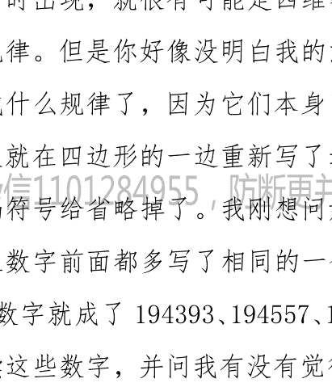

我一下子就糟了，心想怎么可能？

“是不是我们想多了？”我不敢相信地说道，“或者说这只是巧合？”

“你认为有这样的巧合吗？”白狐反问道。

“这前三组数字，可是二战中三个最神圣的日子啊，分别是法西斯意大利、德国和日本投降的日期，可是，这艘船在二战还没结束就已经沉没了，怎么会有这三个国家投降的日子？”我惊讶道，“这是未先知道吗？”

“我们就知道你得到这些数字的问题了。”白狐说道，“至于是不是未先知道，这谁说不准，不过肯定有原来与绝密档案和水底时空有关关系。这还真是太奇怪了，不占了世界的平方的战争同盟在战争还没结束时，在日本的军舰上就已经出现了战败投降的具体日期，这是一种先知力量导致的，还是整个的二世界大战就是一个骗世人的阴谋？总不会是巧合吧——一定不会会这样。虽不知道我们把这些数字推演到这个上是不是对的，但是越往往上想，就发现自己完全被绕进去了，既不想去相信，又没有理由去否认，这种滋味，别提有多少难受。

“我说小姐，我看咱们还是先打开密码柜，看看不能找到如你所说的绝密档案，同时，也看看这些数字与密码有没有关系。”我说。

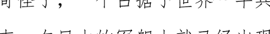

“嗯，估计他们也该回来了，我们试试，如果不行我们就得想办法离开这里了。”白说道。

白狐告诉我，如果按照四位密码的规律，被老王锤炸了这一面，密码是四个零，那我们无需理会，只需要根据保险柜对应的墙面上的数字，按照顺序转动，就会启动保险柜所连接的机关。

根据白狐的指示，我先来到保险柜的右面，这一面墙上对应的数字是“9、4、49、3”，我问：“怎么转动，”不会让我抱着它转成四十多圈吧？不好保险柜打开，我倒是先累死了。

“顺时针转动四圈。”白狐盯着保险柜说道。
“什么是四圈？”我不明白，断开并获取更多好“你你就转动四十九。”白狐瞪了我一眼，好像在警告我最好不要怀疑，“你是男妈妈，怎么这么罗嗦！”

我咕了几句就没说话，心里别别再猜起来，就开始尝试转动保险柜。刚开始的时候，我转动特别小心，我怕万一白狐的密码搞错了，冷从角落落出一支毒箭，别我给射死了。

来说也奇怪，当时老王用铁锤敲都没有撼动这个大家伙，现在我按照白狐的去做，竟然真的感觉保险柜被我转动了。

我看到白狐也是一阵兴奋，于是我抱着保险箱，来了个沉四个圈，没想到，第四圈刚转完，保险箱的底部就传来一阵奇怪的响动。感觉像是这保险箱底部有某种引力的发生作用而产生的铁摩擦噪声。不过保险箱本身并没有发声什么变化，也没有毒射出来，我长舒了一口气。

“保险箱背后，四圈。”白狐接着说道：

有了经验，这次我很顺利的完了。脚底下又一阵响动。然后我问：“左面，八圈？”

“嗯？你怎么知道？”白狐诡异地说道。

“其实也不难。”我装作地说道，“你选择的是三数字里面的偶数，每组数字里只有一个偶数。”我输入1012895，“真是没想到，你竟然上。”白狐说道，“什么特遣？”

“没什么，我随便说的，你赶紧转动它，最后一步了。”白狐故意掩饰起来。

“好吧，激动的时刻，看看日本的绝密档案……”说着我就要转动。可是就在这关键时刻，一阵“咚咚”的急促敲门声进了我的耳朵，我和白狐几乎同时喊：“谁？”

外面传来了一个人的声音，虽然声音模糊的，可是我相信自己听错，“会不会是老王？”

“快跑！”白狐急道。

脚后面来的摩擦声开始持续起来，越来越大，我已经明显感觉到了一种频率高的震。我不自觉就往后退了几步，死死盯着保险柜，不知道接下来的会发生。果然，在两声“咔咔”的响声后，震突然消失了，我惊奇地发现，保险柜在没有任何外力的情况下，竟然在原地打了一圈。每一圈转动，都能听到一阵吱呀声，在一个空间里显得格外刺耳。之后我注意到了一个细节，就是虽然保险柜停止了转动，但连接了保险柜底部与地面的轴并没有停止动作，而一直在转，而且一直保持了刚开始的速度，估计每分钟转动上百次。直到忽然之间，保险柜迅速一转了一遍下去，发出“咣当”一声巨响，只留下了这支手臂粗细约回米的棒子，转动才停下去。

而我也因此清楚了这所谓的轴承，它看上去是一支刻满了花纹的大铜棒，呈现出一种红褐色。保险柜突然翻向一边，是我没有想到的，我还以为会保险柜的底部冒出一个盒子类的东西，但是想象的情况并没有发生，不过这支红褐色的楔子已经足够让我感到意外。它绝对不是轴承，只是到了轴承的作用。从上面雕刻的花纹来看，这个东西不像是一个简单连接部件简单。直觉告诉我，它应该是一个单独的东西。

难道这就是世界上最机密的档案？或者说这支金属棒本身就是一个容器，里面装了什么？不知道为什么，脑子里突然冒出这样的疑问。我不自然地走到金属棒前，弯下腰，小心翼翼地触摸它一下，除了触碰到上面雕刻的图案之外，并没有什么不对。于是我用手抓住它，竟然把它提了。完全是意料之外，有一种小小的惊喜。只不过当我起了这支金属棒，立刻就感觉不对。它太轻了，从感质来说，我告诉了这种物件，但也不可能是钢，虽我是研究化的，但是对于物质性的东西，我并不清楚。这种橘色是由涂上去的，而是物件本身就是这种颜色。这是一种从来见过的金属种类。我把金属棒拿手中，就开始注意上面的花纹。花纹几乎铺满了整个表面，刚开始的时候我并没有出，所以可能是我先入为主的原因，但是我仔细看了，就毫不发现这些花纹，其实是一些文字。

这太熟悉了，可是往往被绕进去了，既不想相信，又没有理由否认，越容易让人忽略，特别是在这种处处充满着无限的境界。这些字排列着，很容易就会把这些笔画当成了装饰。这种字自然于秦时期，是秦始皇统一后，又对。汉字有较大的区别，现在的汉字也是演变而来的产物，大部分中国人对此多少有处理。虽然没有流失到，由于上面的汉字也不太认。

“不对，这支金属物就是世界上最绝密的档案，那就是说它从古代的某个时刻就已经了，绝不会近代才流失。这就让我又产生了另一个疑问。从金属物出现的过程如此复杂看来，或许它就是所说的最绝密的档案，但是属于中国古代的东西，怎么会成为绝密档案？想起四周的那些档案袋子，装是中国所有的历史，难道，日本人建造了这种神秘的档案室，千百年来又不停地秘密研究中国的历史，是因为这支金属棒？一匹蚂蚁在什么情况下捕杀一头大象——这块金属棒承载的秘密就是动因？”

这是一个十分大胆的猜测，就连我自己都有些不相信。而且让我不能理解的是，除了四个证明这支金属棒老家是哪里的汉字之外，怎么看也看不出还有特别之处，这种。这时我突然想起了白狐，我觉得她或许会知道更多——她一定会知道更多——我好奇大声喊道：“白狐，我需要你确认一下这支金属棒到底是什么东西，怎么可能把它当成……”然而，发生的却没有发生。我猛地看向铁门处，又不相信地看了看四周，心里不由的靠了一声——她人呢？在如此关键的时刻，她竟然不见了！我一下子就忘了，两步跑到了电梯门处，发现铁门依然死死关闭了。我努力回想着我在专注于金属的整个过程当中，身边还发生了什么。但是无论如何我都不想不起哪时刻铁门曾经被开启了，我只记得当时和白狐同时听到一个奇怪的声音之后，她说要过来来看，而我由于过于专注保险柜没有注意到离开之后的事情，还以为她就在我身后看着我一切。我甚至连白狐之后什么时候再见的不知道。这太她的奇怪了，要是她开启铁门走了出去，我是不会听到的，铁门开启关闭的声音还是蛮大的。再者，白狐也没有理由把我一个人丢在这里而不告诉我，除非发生了十分突然的事情，她才。

现象。

间就产生了一种好奇，我又在另一没有血迹的地方找到了一堆小孔，然后把脸贴在地板上，想透过这些空洞，看看能不能看清地板下面有什么东西，或许许能够找到这些血迹的来源。

我就把眼睛对准了几个小孔。我能想象得到此时我的动作有多么狼狈，整个身体死死贴着冰凉的地板，就连半边脸都贴了下去，有点像狗嗅尿。不过仔细看了这么多以后，我已经穿过孔洞，看到了档案室下面的空间。

档案室地板上的小孔比我想象到的，无数细小的光线通过孔洞钻进了下面的空间，我看到在档案室的下方，有着很多灵活的铁链。铁链都已经锈斑斑的，许多细光线都钉在了铁链上。我由想起当时转动保险锁的时候，听到脚底板传来金属的摩擦声，可能就是这些铁链被牵引而产生的响声。我不断扭动着身体，尽量视角放大一点，在这个空间的中央位置，我看到了一根树粗细的金属柱子，这根柱子冷眼看上去，就像是我口袋里的金属棒子的放大版本。这仅仅是从形状上来说。

金属柱子的表面没有任何装饰，表面刷了防锈油漆，不过部分已经彻底剥落了。几乎所有的铁链都横穿金属柱子，然后铁链又连接到了其他地方，我无法完全看清楚。这就是一个牵引装置，档案室的保险柜组合了一套近乎完美的机关。这个空间比我想的要多很多，我对那些金属类的东西没有兴趣，往更深的地方看，我很好奇地看到，在空间的底部，许多从档案室投下去的光点竟然像一团萤萤虫在动。

这是怎么情况？我怀疑自己脑内眼睛充血了，就抬头揉了揉眼睛，深呼吸几次后，我再次低头看向。这一次我看清楚了，无数的光斑确实是在动，但不是光斑自身就能随意游动，而是因为在底部的空间底部，不知道原因竟然被灌了一种液体，这些液体显得很粘手。液体呈现一种深红色，不像水，倒有点像鱼的鲜血。它也没有多少。根据我接到的这艘船里的空间布局，这些液体少说也有两米深。不知道为什么，这些液体显得相当不安，里面好像有什么东西四处穿窜着，搅得液体不断出现一些暗流，一团的光斑就在暗流的涌动之下，不断起伏着，忽隐忽匿。

这时，我无意中看到连接到液体里的铁链突然抖动了一下，不是特别明显的，还是被我捕捉到了。同时，铁链好像是受到了液体底部什么东西的拉力，就一下子被拽紧了。我靠，难道这些液体里面养了一只东西？看着绷紧的铁链，我脑子里第一反应就是想起了老家养的那条狼狗，遇到生人，那狗总是得可以把拴住它的那根铁链恨不得拉断，狂吠不止，让人心生寒意。

正想着，液体一下子是被煮沸了一般，咕噜咕噜地滚了起来。同时，随着红色液体被搅动，一股浓烈的腥臭味瞬时扑鼻来。这味道闻上去，还真的是血腥味儿，我铁也绷得更紧了，发出一种咯咯咯的声音，我心里暗哈，我的八灵祖，真有东西在里面，不是吧……这铁链子就要被拉开了！

突然间，就在我的意识里不能再看着这一刻，随之而来的场景让我手一愣。水牛的眼睛一下子从液体里跳了出来，随之而来的场景让我脑子愣住了，我就在地上几乎都出来了！

这是一个眼睛的眼睛，只是不知道什么原因，体体的整个脑袋全部肿了起来，两个眼睛快就要爆出来了！尸体是露出了头部，接着是上半截身体，我看到尸体的样子的时候就听到了一声凄嗓，这是一具女尸，暗红色的液体不断从体身上流了下去，暴露出来的是惨白惨白的皮肤。女尸的眼睛这样直勾勾的看着我，面部的表情十分狰狞，似乎充满了一种哀愁。而且从女尸钻出来的，一个劲儿朝我趴了过来，好像是冲我来的！

这不太对，尸体看上去很僵了，除了眼睛能盯着我不放，也没见过其他的动作，像是冲我来的！这不可能，绝对不可能！这尸体怎么靠过来的？正想着，又觉得这具体熟悉，虽然尸体全身赤裸，但是看着它的身段，还有那一头的长发，怎么看越像一个人。

这尸体可能会死？就算她死了，她也不死了……就在我走神的功夫，尸体的头部就已经贴近我趴的地方，一张惨脸咣一下出现在我的眼前，这层钢板上我满鼻腔闻到的令人作呕的腥味。这种味道实在太妈恶心了，要不是肚子已经空了，我肯定会吐出来。一边疑惑，心里刚要说该安静一会儿了，就算是真的尸体，可它头都没了，也不可能再凶了，却又听见脚下的空间传来了股奇怪的声音。“我靠，还没完完了……”我低吼着，警惕地靠到了房间的一处墙角。前脚站稳，就听到有什么东西在疯狂地地上撞击地板，除了听到一串“咔咔咔”的声音，就整个房子都被震颤了。我看着传来撞击声的地面，心脏都快到了嗓子眼，感觉是有东西要撞破而出！我吓得不敢出口，心说这绝对不是那，不然这个撞击力度，尸体早就散了，这底下肯定还有其他东西！

连连不断的剧烈撞击产生的震感已经让我全身都麻了，每一下下方撞击一次地面，我就感觉像一阵电流流遍全身，最后干脆什么都感觉不到，加上受到了一连串的惊怕，现在想动都动不了了。更让我火上的是，鬼子的东西不怎么完，闹了好两分钟，我看到档案室的铁门已经裂开了，并且裂开一道大口，我在心里就骂他狗日的，这造的什么玩意儿，还锤撞墙壁，都给撞裂了！

不过说起来也奇怪，当地中央被撞开一个大细的裂口之后，猛烈的撞击声戛然而止了，我心里不由一沉，不知道这是什么怪物要出来的前兆，还是这底下的东西把自己撞了。虽然不会是第二种可能，我知道我娘的没那么幸运。

很快，一个跟桶差不多不大的扁形脑袋慢慢从裂口处钻出来了。看到了这个脑袋，我的脑子在瞬间就哼了一声——我的亲娘舅，这好像是蛇的脑袋！

只不过是不一样的，这只脑袋充满了一种血红的颜色，已经变得透明了，它的哪里似乎还连着半截身体。这只脑袋钻出了，就开始用同样血红的眼睛盯着我，看着这双邪恶的眼睛，我感受到一种刺骨的寒意。我斜着眼睛看了四周，发现自己离铁门很远，如果可以，我只需要一秒就能移动到。可是我全身动不了，除了转动身体试图防御，可脑海中浮现出很多细节。

随着怪物不断从裂隙中拉出细长的身体，我也明白了，这根本不是蛇，而是一种跟蛇相似的生物。大家都知道凡是蛇都有鳞片，但是这却没有鳞片，倒是有点像蚯，看上去滑溜溜的仿佛被一层粘稠液体覆盖着，呈现出一种透明，十分让人恶心。让我感到不可思议的就是这种透明不是形容词，而是实实在在。当巨大的东西钻出一截身体，我就看到它的身体里面竟然塞满了尸体。我看不清尸体的样子，却能看出这些尸体完全是烂了，有男有女，大小不一。曾经见过几十米长的蛇，但肚子里塞满了尸体的生物没有。我只是暂把它称作蛇，从它出场的过程来看，应该是日本人关在档案室下面的空间里的，更准确的，是日本人养在这里的一条蛇。之所以这么推测，是因为这些尸体是被扒光衣服后喂给蛇的。否则，除非蛇有衣服的事，那就是蛇。但又想也不对，如果这些尸体是食物，应该消化掉了，怎么看上去还是完整的呢？对含有高强度消化物质的蛇类动物来说，食用而不化并不是常见的现象。我那时候也想通其中的原因，这不是学术报告的时候，这该死的东西正看着我！不过有一点我倒是不用思考也确信，这个世界上不会有，我更加相信这怪物是日本人养的，可能的目的就是为了看守这个神秘的零号案。

我想起了那个神秘的声音，在转动保险柜时，这声音就让我“快跑”。现在想起来，倒觉得这声音让我被魔吸引了。我们破解了密码，打开了保险柜，肯定是惊动了这条蛇。我靠，这孩子该怎么办，我当时怎么就没跑呢，要是我果断从铁门出门，就算找不到她，那也不至于落到这下场，现在就算我想跑，也来不掉了。这个巨大的蛇头，已经伸到了我的眼前，只要它再向前动那么一丁点，就能闻到我的脸了。蛇吐出的恶臭味随着阵阵寒气，不断扑在我的脸上，我屏住呼吸，不知所措看着眼前这只巨大的脑袋，心说完了，要是被这个东西吞下去，我从此岂不是跟它肚子里的尸体同寝一窝？

想着有些不甘，既然横竖是个死，那为什么不挣扎一遍呢，好巧又是鬼子养的东西，死在它嘴里跟死在鬼子手里意义不大啊，这是十亿中国同胞所不能忍的事，换句革命老话，那就算死，也要死得其所，死得光荣才对。这样天马行空地想，心里就多了一些底气，开始尝试慢慢移动身体。我这一动作就惊动了眼前的巨蛇。

只不过它的反应出我的意料，它并没有向我发动攻击，开始对我移动，它只是扭动脖子看着我的节奏移动头部，终于与我保持着的距离越来越近，好像它的目的只是把我划入它的攻击范围内，有时候它吞了我，它打算了。这种感觉比直接看着你还要难，感觉就像一个人拿着枪对着你，但又真实地踩着你，无论怎么走都无法逃脱。这真的是让人崩溃的这种感觉，我甚至开始希望它紧紧抓住了，别再折磨我了……不然我就跑了！

我看着它，当我再有一个动作就会引起它的攻击。这次我也不敢动了，还没等我反应，它的脑袋一转，邪恶的眼睛寒光一闪，再次把已经失去行动能力的目标锁定了。我右手撑地，一点往身后的墙角抖着，心说难道它不吃要把我杀了？巨蛇的身体不断从裂缝往外拉，大嘴子张开了，本来在它嘴里的半截身体和一些粘稠的液体同时从大嘴里流了出来，掉在地上，一股十分臭的味几乎把我熏晕了过去。接着巨蛇的头部向后缩，就以一种极快的速度向我冲来。我意识地将身子一缩，但是无论怎么样无法避免巨蛇的攻击。我的左臂被咬住了，剧痛将我拉回现实，我知道我完了。巨蛇咬住我的手臂之后，借助它灵活的身体轻轻扭动脖子，就把我甩出去。当巨蛇脑袋动的时候，听到自己的头部发出了几声清脆的响声，我的胳膊断了。这种感觉我被甩飞向档案室的一只架子上，巨大的冲击把档案架完全压垮了，我跟一堆档案子在一起跌在了地面。我的左手完全失去了知觉，但巨蛇并没有给我机会。还没等我反应，它的脑袋一转，再次把这个失去行动能力的目标锁定了。巨蛇的身体从裂缝往外拉出来了，现在为止我看到的身体已经接近十米，但这条蛇的长度似乎远远不及如此，在这个并不大的空中，巨大的躯庞显得格外大，我有些错，就是巨蛇完全把档案填满了。第二次攻击似乎就要来了，巨蛇依然像刚开始一样无视我的攻击，它并没有采取多样的，借助身体的优势把巨大的头颅高高晃起来，对着我慢慢移动。这不是蛇类的攻击方式。它保持着那种死死看着我，或者是时候四目相对，我不知道它到底想什么。趁着这个空档，我不断思考着该办，这么耗下完全不是办法，我无法估定它的耐心极限是什么，时间却无法逸脱的办法，因此就成了这种看着它，也看着我的局面，恐怖心中有一丝滑稽、无比挠痒的感觉。我也不知道与它坚持了多久，我没有想出任何能够摆脱的办法，不免就有些心灰冷。然而就在这时，一个声音在巨蛇的背后响了起来。虽然巨蛇听到了这个声音，它脑袋一转，就把目光对向了正开启的铁门。这突发的状况就像是我的救命稻草，想着这可能是我唯一的救之路，正如我所希望的那样，有人来了我自己不想此放弃希望。老王他们忽然出现，把我们从这个地方救出去，但这仅仅局限于幻想，对老王他们，我其实早就没指望了，我不认同他们的境遇比我好多少。可是谁又能想到，即使是望破，奇迹还是发生了。铁门刚刚开启到能容一个人进来的时候，我就看到一个穿着黄色军装的人贴着地面钻了进来。这个人是阿来。他的动作十分敏捷，在地面翻了身就站了起来。我看到他的右手，因为在水里中枪的缘故，虽然后套上了衣服，但整条袖子已经被染红了。

## 顶顶

九哥最给力！
作者:十四 001 日期:2016-05-09 11:27
@李松泰度 2016-05-08 15:34:00
喜欢这个帖子。留爪印

净道道......
作者:十四 001 日期:2016-05-09 11:27
@月影番 2016-05-08 16:10:00
有点恐怖了，加微信1101284955，防删更新并获取更多好帖

一点都不恐怖吧
作者:十四 001 日期:2016-05-09 11:27
@破败的四合院 2016-05-07 21:59:00
努力挖坑，只求大的！

多是大啊
作者:十四 001 日期:2016-05-09 11:30
@x43789222 2016-05-08 15:16:00

楼主快点楼主快点楼主快点楼主快点楼主快点楼主快点楼主快楼主快点楼主快点楼主快点楼主快点楼主快点楼主快

## 楼主快点楼主快点楼主快点楼主快点楼主快点楼主快点楼
主快点楼主快点

不带这样的吧......

作者:十四 001 日期:2016-05-09 11:31
@00 十三 XX 2016-05-07 18:34:00
支持楼主

十三少，感谢！
作者:十四 001 日期:2016-05-09 11:31
@能耗鸣二两 2016-05-08 12:12:00
一手蜀加v信1101284955，断更并获取更多好资源支持楼！

二两哥新人
作者:十四 001 日期:2016-05-09 11:38
阿来的举动让我感到十分震惊，如果说之之前我被巨蛇咬住手臂，是处于自己的错误判断，不小心惊动了巨蛇，那么现在，阿来的情况与我截然相反，他是刻意这么做的。

而目的，好像正是为了让巨蛇去咬住自己已经受伤的手臂。

当巨蛇就要贴近阿来的那一刻，他嘴角突然扬起，露出了一个十分诡异的笑容，然后顺势把手臂插进了巨蛇的嘴里。

来的动作与巨蛇攻击的动作形成了一种相辅相成的局面，唰一下，阿来的手臂完全伸进了巨蛇的血红大嘴里面，就连着阿来的半个肩膀，也被巨蛇给咬住了。

作者： 十四001 日期:2016-05-09 11:39

巨蛇咬住阿来之后，就开始扭起了脖子，想把阿来推出去，但是阿来被巨蛇咬住的手好像像是抓住了巨蛇嘴里的某样东西，无论巨蛇如何拖着阿来在半空甩来去，阿来始终没放手。

我在一旁看得出一身冷汗，心想原来这是唱的哪儿，巨蛇的吻卡在阿来的肩膀，而阿来不知道抓住了巨蛇嘴里的什么东西，就是肯放弃，这样巨蛇竟然变得活跃起来，完全被激怒了，防断并获取更多好多

作者： 十四001 日期：2016-05-09 11:39

一条巨蛇就这样缠斗了将近，当巨蛇把阿来来到天廊顶部的时候，阿好像是发现了什么机会，另一只手臂顺势抓住了一根横在天廊顶部的管道的东西。他的动作没有丝毫停顿，当抓住管道之后，阿来的身体就产生了可以协调的气力，只见他抓住管道的手臂使身体旋转了一个一百八八度，同时被巨蛇咬住的手臂也跟着那一转，我就听听到巨蛇嘴里传出两声“嚎嚎”的声音。

作者： 十四001 日期:2016-05-09 11:42

巨蛇像是受到了致命的攻击一样，身体十分夸张地扭动起来，同时血淋淋的大嘴一下子就松开了。接着，巨蛇大的身躯连着脑袋一下子就跌落到了地面。

再看那阿来，他依然保持着单手吊在管道上的动作，只是被巨蛇咬住的手里，竟然多了一团流着红色液体的棉签一样的东西。这些东西，是从巨蛇嘴里掏出来的。

作者：十四001 日期：2016-05-09 11:43

看着这样的场景，我惊得嘴巴都合不上了，心说阿来这个人还真简单，这么大一个东西，就这样被KO了，是阿来太强大了，这还是巨蛇是老虎了。我想他娘的竟然难以接受，再这么看着，也得老大战那么回事。反过来又想，这样难道不好，非像曼特星一样，处理如便宜一样，众方止回来，否则就害过了。希望如此，阿来也不会意的奇迹生存了。巨蛇在地上后，就开始原地挣扎起来。巨蛇不断喷出鲜血，似乎是重创，身体也失去了支撑力，挣扎了没下，动作开始慢起来，最后竟往裂缝中滑下去。

作者：十四001 日期：2016-05-09 11:45

阿来抓住管道的手一松，就从天顶掉了下来，我看到袖子上的血迹更浓了，而且脸色苍白。他依旧表情情自若，略带忧郁的脸，要是是在大街上，那不是傻子就是抑郁症。阿来下来之后，并没有放自己，而是挣掉手里的那团紫红色的肉质物体，一个衔到裂缝处，用双手把地面生生地压了。这时，巨蛇不断下滑的身体正好卡在了裂缝上，只剩下了脑袋。巨蛇似乎并没有死去，两只眼睛旋转着，看到它面前的阿来之后，眼睛停止转动，恶毒地盯着阿来。看着它恶毒的样子，好像随时冲破束缚，重新从裂缝中钻出来。他的右手扶着肚子。阿来冷一声，他也看着巨蛇，说：“只有这样才能杀死它。”

作者：十四001 日期:2016-05-09 11:47

“血鳞？什么血鳞？”我不知道阿来在说什么。阿来不再理会巨蛇，而是朝我走了。

“这就是血鳞。这不是鱼吗？”我诧异地问道，我只知道黄鳞。阿来扶起来，说道：“你是生物学家，应该知道。血鳞，是鱼的一种，但被改变了基因。”

作者：十四001 日期:2016-05-09 11:48

我看着卡在裂缝中的血鳞，发现什么，就问：“你出来的东西，不会就是鱼吧？”还算聪明。我明白了，难得觉得这条鲨怪的，再去看这条血鲨的时候，我就难发现，血鲨完全具备鱼类的特征，只是它的头太大了。我也反应过来，阿来之所以故意被巨蛇咬住手臂，就是为了攻击它的呼吸系统。一条鱼类，在没有硬性的条件下，攻击它的任何部位都对它无法造成伤害，即便再强的鱼类，也只有死的份了。“它怎么成长到大的头？”我继续问道，“这条血鲨，是鱼类的变异品种，也是日本人的恐怖实验。”

作者：十四001 日期:2016-05-09 11:50

“怎么说？”你是科学家，这个你你不知其，零号档案室的作用仅仅是存档案。恐怖实验，我想起了日本人当年的各种人体实验，就问：“你比我在这行。”阿来似乎不想回答，但我还是继续说道：“你对零号档案室只知，实际上，对日本人来说，战争仅仅是一个计划的辅助行动，但是现在我并没有告诉更多权利的，所以......”我还是不太明白。我不理解地问道：“所以什么？”

作者：十四 十 日期:2016-05-09 11:51

我刚问完，扶着我的阿越不注意，转身给我抱住了，我还没来得及问这是干什么，就看到他用满是鲜血的一手抓住了我的手：“给你接上手臂。”一手运，可两声，肩部传来的剧痛顿时让我咬牙咧咧，忍不住就叫出来了。大概足有五分钟，我都痛得说出来，只是扭曲着面部看着阿来，半晌后，我才从缝隙挤出几个字：“你真是个疯子。”“我为了你好。”阿来淡淡地说。

作者：十四 一 日期:2016-05-09 11:53

“你们到底是什么人，他娘的快要崩溃了！”我看着阿来，不自觉喊道。又问：“你们大家小姐在关键时刻，突然失踪了。还有其他人呢，你们找到了吗？”“所有人都被抓了，包括大小姐。”阿来回道。“什么?全被抓走了？”我诺异异道，“被抓走了？”

作者：十四 001 日期:2016-05-09 12:30

@雾露村长 2016-05-09 12:15:00
村长我又回来了~哈哈~我继续顶你~把你顶到天那高离!让在地里干活的村民也看看
村长，你是个好村长!

作者：十四 001 日期:2016-05-10 09:07

@nature 小糖糖 2016-05-09 12:57:00
今晚没了?
一手整理,加v信1101284955...防更并获取更多好帖
没了，白天更

作者：十四 001 日期:2016-05-10 09:08

@白银时代 2016-05-09 15:10
顶一个......谢谢......

作者：十四 001 日期:2016-05-10 09:09

@我是儒 2016-05-09 15:21
终于赶上了加油！

作者：十四 001 日期:2016-05-10 09:39

@小妮通行天下 2016-05-09 16:36
高人法无边！加油！

作者：十四 001 日期:2016-05-10 09:41

@也能喝二两 2016-05-09 16:46
订二两哥海量!

作者：十四 001 日期:2016-05-10 09:42

@萝卜青菜 2016-05-09 17:33
顶吃萝卜放屁。挺好的。

作者：十四 001 日期:2016-05-10 09:42

@傻子等花开 2016-05-09 17:16
楼主，看好你

作者：十四 001 日期:2016-05-10 09:43

@中国越野吧 2016-05-09 14:25
记号越野哥威武!

作者：十四 001 日期:2016-05-10 09:56

@chongingshu 2016-05-09 22:47
好看，就是有点慢，不过懂。

作者：十四 001 日期:2016-05-10 09:57

@李松泰度 2016-05-09 18:42
已经尽量，谢谢！

作者：十四 001 日期:2016-05-10 09:59

@KloveTT 2016-05-09 16:19
看的正入迷呢，没有了！

作者：十四 日期:2016-05-10 11:34

@蓝色贪负狼 2016-05-10 01:02
速度更新啊，入迷了。

作者：十四 日期:2016-05-10 11:34

“不知道，我只知道所有被抓走了，他们已经不在这艘船了。”阿来说道。我们有些不敢相信，怎么可能是所有被抓走了呢，这可是水下百米的地方，不在这艘船里，又会去哪儿？我说：“不可能，我甚至都不知道白虎离开这个档案室……”

作者：十四 2016-05-10 11:35

“你不知道并不代表没有发生。”阿来说，“我们中计了，所有人都被分开了，如果我们不再被动为主动，恐怕我们都得死。“到底发生了什么，为什么我都不知道……”我抓着头皮，脑子里一片浑浊。“走吧，我知道该怎么出去，或许我们能找到他们。”阿来拍拍我的肩膀说道，“说实话，我很厌你，因为你的出现就是一个错误，虽然我们救了你和洋老。但你也是无辜的，所以，我会把能够让你知道的事情告诉你，如果你死了，也不于大宽了。”

作者:十四: 2016-05-10 11:36

在阿来的引领下，我们离开了档案室。我回头看了一眼那双巨型血蟒，它还是用那双令人恐惧的眼睛盯着我们，指向我们。此刻，血蟒似乎在寻找更多的好处。到这时我才发现，血蟒的那双眼睛，大大的眼睛十分相邻，也应该是变异了。我不自觉地看了看阿来，阿来问我怎么了，我没说，就是有些害怕。他说不要担心，血蟒已经失去了攻击性，现在呼吸都困难，过了多久恐怕就挂了，之后我就再说。其实我是觉得，血蟒的眼睛，和阿来的眼睛特别像，特别当阿来的眼睛变红的时候。阿来知道很多事情，他就斩杀血蟒的熟练程度来来说，说明他对血蟒这种东西并不陌生。这不是单纯上手就能做到的事情，而是需要了解血蟒这种生物，更要了解血蟒习性，只有这样，才能做到一击必杀。

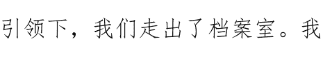

阿来带着我走了一条不道路。当时我和老王一路跟着神秘的枪声，一阵跑下准来到了这里，而阿来却不同，他带我走的都是正常的路。“为什么铁船不在水里？”“因为铁船早就不在水里了。”“什么，不在水里？”我疑惑，“我好像不是很清楚你再说一遍。”阿来说道：“我们在另一个世界。”我们这是去哪？”“你不是说他们已经在这条船上了？”“是的确。”阿来说道，“我现在是要带你离开这条船。“怎么离开，这可是水下几米的地方。“我的判断是错误的，而错误的判断往往让人丢掉。”我对阿来的话一时理解，什么是另一个世界，难道说我们都死了地狱？我们在到达船上那个圆形洞口之前，阿来跟我起了老爷庙的另一个世界。老庙水域自古至今沉船无数，近代又出现了数十起坠机事件，那么如此多的坠机船去哪里了？为什么连国外的专业打捞队伍在老庙却无获？否则这一切都不成立。阿来摇头，说世人在搞不清某些事情，就用神权去诠释，被糟弄的只是百姓。老庙水域其实在八十年代后期就已经经历过一次针对性的活动。这队伍在老庙水域有重大发现，用一句话来说，恰当的话，就是在水底发现了另一个世界。然而这个另一个世界，可能是老庙水域事件不断发生的根本所在。阿来说这里，我恍然大悟，问这“另一个世界”所指是不是航海里面的那个空间？阿来的回答很隐晦，说是，也不是。继续说，在我们中国很早就出现了一支保密级勘探队，专门对境内比较神秘的区域进行勘探，老庙因为过去时间里发生了太多自然现象，自然在这队伍的范围之内。然而当年老庙水域的勘探还没结束，这队伍突然被解散了。

## 注意，是被解散了。作者：十四 001 日期:2016-05-10 11:43

想起具体原因时，阿来就开始糊弄我，只是说，这一次针对老庙水底互动中，这探队出事了。我当然不会抱着这样的答案放过来，在我再追问下，阿来烦的不行了跟我说出了当年老庙水域勘探的大体程。对很多人来说，这件事并不算陌生，因为当时亲眼目睹运输沉没的简单太多，还上了报纸头条，直到现在依然有这件事情的目击者在阳湖。一手资料：加入断。话说老庙水域相关部门进入了国家绝密勘探项目，最早可以追溯到抗战时期，起因当时日本的一般运输船驶进老庙水域后不久，天空中骤然风云大作，雷声闪电不断，日本的这艘运输油炭的大船，竟然在众目睽睽之下沉没了。对于生活在老庙的老百姓来说，这样的沉船事件已经不算新鲜事，光是有考证的此类事件，数不清，更何况沉没的船是日本鬼子的。人在惨无人道的侵略暴行让人神疚，说不定还水里的神仙帮了百姓除害。本来这类就是一句发的话，放在今天说也就过去了，可是又想到，因为当时的特殊的景，类似这样的话很容易传开了，而且越岭越邪。有人说，在老庙底下有一座神祇，里面住着一个能呼唤风响的神仙，专门前天行道，鬼子的这次沉船事件，就是神仙显灵了。还有更加厉法，说鬼子的在沉没的时候，有人看到水域上空的鸟云里，有一个手持金刚轮的巨灵犀一脚把鬼子的船给踹到水底下。当然，这些事情只是谣传，现代人是不会相信的。就当时的日本军队虽然这种战争年代，对于任何一个国家来说，运输沉没这种事情再正常不过了，一般不会深究，但是这次却不一样，日本人竟然为此派出了一直分专业化的水底队，进行了一次大规模的水底考察。只是考察的结果有些让人意外，潜入水底的蛙不但没有发现沉船，就连蛙人本身，全部失踪了。蛙人失踪，这件事引起了日本军方的极大关注。但谨慎的日本人没有再次派遣蛙人下水，而是用侦察机在水面进行侦查，最后，在一处水域发现了一个漂浮在水面的蛙。

日本潜水员在水底遇到了那些巨人一样的怪物，几乎所有的蛙人都被巨人怪杀死了。”

我心里暗暗叫道，奶奶的，原来这些怪物是会杀人的，只是不知道为什么，我们却没有死。阿来继续说道：“其实这也不算什么，而真正令人恐怖的事情发生在解放日之后，中国考察队在老庙水底进行的那一次绝密考察……”

过程性的东西阿来没有细说，只是几句话带过，大体意思就是，中国的考察队实际上是沿袭了日本人的完成了探测工作。不同的是，中国勘探的这次活动，却投入了超人类的加力，动力并付出了比出来大几十倍的成本，包括人力物力。许多特殊的仪器设备，都是从苏联进口的世界顶尖产品。仅仅是从前期的准备工作来看，这就不是一次普通的科考活动，明显有一种不探明老庙水底到底在什么，就一定不会罢休的架势。

阿来说说到重点的时候，补充了这一句话：“只要是略微意的人就不会难看出，其实无论是中国人还是日本人，都意识到老庙水底一定存在巨大的秘密，而且这个秘密，已经不是常人所能理解的范围了。”

但是的事情还是发生了。尽管准备充分，可是死亡事还是毫无征兆的连续发生，甚至发生了比死亡更恐怖的事情。

中国的这次考察远比日本人手段先进的多，更多的还是借助于了各种水下探测仪器，最初的怪事就是所有沉到水底的仪器设备全部失灵，就算是卖给中国探水设备的苏联派来的专家都无法解释设备失效的原因。而把仪器从水里拖出来之后，经过检测发现设备一点问题都没有。结论是因为这片水域特殊性，导致了所有仪器失去了功能。

在不得不得，而勘探工作又不可能就这么放弃的情况下，苏联人建设，重新把设备投入水底，还需要由苏联联带着设备检测随水仪器一起下水，这样，便是设备出了问题，有了水下对设备的现场检测，也能知道设备失去功能的问题所在。

如果没有苏联人，只是中国人自己进行这次探水下作业的话，那么肯定就不会有后面的事情发生。因为在这一片水域，已经有了死亡先例，中国人断然不会轻易冒险。但是，想必所有人都知道，对于八十年代的中国人来说，尽管与苏联的关系不再像以前那般铁，可是对苏联人的过分依赖养成的习惯，还是免免了出现苏联人说什么，中国就后信什么的情况发生。

此，许多蛙人和几套复杂的水下仪器同时潜入水底，随之而行的，还有一台水下摄像机。正是这台水下摄像机，拍了前面说到的比死亡更可怕的事情。

有了摄像机，水面工作人员就可以实时知道水下作业的情况。在刚开始的时候，探水设备和潜水队员在水中缓慢下沉，似乎一切正常，直到一个睁看着黑白影像显示的苏联人大叫了一声，所有人都意识到了事情的不对。

原本几分钟就能到达水底的蛙人和探水仪器，在这次的潜水过程中，却起潜了十几分钟都没有到达水底，而从屏幕上显示的数字来看，仪器和蛙人，都到了水下两米的地方，而且还在潜。

那么问题就出来了，鄱阳湖水域最深的地方，也只有几十米的样子，仪器和人这是潜到哪里了？

而苏联人大叫的真正原因，还不如此如此，这些设备和人，竟然是自己在下潜。

从摄像机拍摄的情况来看，十几蛙人人都保持一种奇怪的姿势一动不动，这不是潜水动作，而是像在爬行，身体僵硬的程度根本不像是在水里。

我听得出了神，心想还有这类事情发生，看来我的遭遇不过如此，在我之前，如此诡异的事情就已经发生了。

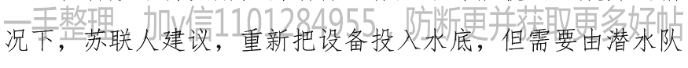

我他还要奶奶的，阿来是什么毛病，明明说不是在水里又不需要游泳，那为什么还要脱光了呢？他看着站在那里半天没有动静，光着身子走来一把抓住了我的衣领：“你再耗时间大小姐就危险了！我说过我不喜欢你，要不要是大小姐执意要留着的，我根本不会救你，你知道吗？你信不信我会把你扔在这儿！？”

我靠，我一看这情况，无论是他的语气还是表情，都不像是在开玩笑，就变得有些心虚，想要是非不行，我还有娘的装清了高，死不怕，难道还不怕脱衣服吗？我处理看来并采取多好处要不然，可能会被这命使一般的阿来抛弃在这里了，想着一个人在这里，前不着后不着的，后脊梁就一阵冰凉。这可比被车撞了好几次都要受。

再说，要是到了这个节骨儿被抛弃了，那也太奢侈负白狐的好了，妈妈的狗也看得看人，脱！

于是，我就三下五除二，把身上的衣服脱了，但也免会想，要是就这么见了白狐，我这该往哪呢？

阿来看准备差不多了，说道：“跟我走，不要乱走。”不管看到什么，都不说话，否则都完。”我差点点头，心说不行吧，反正都要了，可以说这就那样。

阿来慢慢走上楼梯，我紧随其后，看着光着身子的男人出现在这种地方，感觉有些奇怪，有一种心情。走上楼梯，就看到了一扇铁门，应该是军舰顶端的观察室，我们可以看到军舰外面的情况，同时，这个地方最方便出去。

阿来小心翼翼地转了铁门的开关，铁门就被打开了。我问：“不要开？”阿来回答：“不用了。”我没多说，跟着阿来进了观察室。

我走到窗前，透过窗子往外看。然而，就是这么一看，还没等我反应过来到底看到了什么，就已经说不话。这种感觉就像坠机之前，空中突然出现旋暴一样。这是一种难以置信的场景。

我进了观察室，我立刻明白阿来为什么不需要灯，因为这里根就不需要什么灯，也不知道为了什么，在这个档案室内，透过几扇窗，竟然透进来一些奇怪的光线。这些光线呈现一种十分异的淡蓝色，看上去，就像一束妖异的鬼火一般。我忍不住惊讶道：“水底下怎么会有这样的光线？”我说这不是在水里。”阿来指着窗户外说道，“这些光线，是从那边过来的。”

“这就是千年来，在经意或不经意之间，迷失于水域的一切。”阿来说，没有任何的情绪波动，“几千年前了，这里形成了一个我们不知道的另一个世界。”阿来说得得很平淡，好像并不以此奇，而我却始终无法平静下来——另一个世界，我看到了另一个世界，一个令人窒息的世界。“我说，你死了，不会感觉宽宽。“也许吧，估计只有别人才能看到这个世界。”我说，“你带我来送终，是要迷进去么？”你不会不想救大小姐了，还有那个该死的老外。“我想当然，关键是怎么走过去的，这地方能走过去吗？”想就别废话，跟着我。看着外面的景色，我似乎知道阿来为什么要我脱衣服了，但好像又不明白。严格来说，外面的世界是没有时间和空间的。

举个例子来说，如果把我看到的地方比作一个巨大的果冻，那么千千百年来，一切失落在水底的东西，就全部变成了乐冻里面的肉肉。在一眼望不到边的范围内，一切都定格了。阿末用“另一个世界”来称这个地方，虽是一种夸张的说法，但就身临其境的人来说，看到这样的场景，说这里是一个世界完全不过。我已经看到了各种各样的船只、飞机、人和动物的尸体，甚至还有一些根本看不出是什么东西的生物。

这些物体就像融入了巨大的水晶球一般，密密麻麻充满其中，从近今来的来看，古往的各种船那是应有尽有，那些船体就在军舰的远处，以各种姿态定格在不同的位置；许多从往远处的地方看，还有一些飞机的残骸。当然，我能看到普通的鱼类生物，保持着游泳的动作，鸟保持着飞翔的姿态，看上去都是栩栩生的。

可能引起我好奇的自然是那些密密麻麻的人类尸体。这些尸体，恐怕积累了千年，单纯从发型和服饰来看，就不止一个代的，最早应该可以追溯到商时期，最晚的现代人。看着这么多尸体，除了感到惊讶之外，更是几个疑问。这些尸体，没有一个是腐烂的，在这种潮湿的环境当中，死了几年的尸体，怎么会出现死而不化的现象呢？大部分都保持了一种奇怪的姿态，像是在爬。

记得阿来在前面说，当年的队员在失踪后，发现在屏上的影像也是一种诡的姿态，难道当年的队员都是深入到了水底几米的地方，这与水深不足米的说法完全不对，这是怎么回事呢？阿来打开了一扇能够拉的门，阿来说：“马上就要被吃掉了，记住，进去以后千万不要说话，最好也不放。”我靠，被什么吃掉了？我们这不要进去，怎么就成了？你看。”阿来指着被拉的门口。按照阿来说，我就往门口看看，可是除了一扇半的门，我什么都没有看到。我靠，没东西。你要看什么？”我没跟你开玩笑，你看清楚了。”阿来说，“没办法呼吸，我们必须在五分钟之内通过这个地方，带上它。”我回头一看，在身后有一个废弃的油桶，大约有瓶子那么大，是个铁的，我问：“干嘛？”“可以让你呼吸几次。”阿来说这一说，我就明白了，可是这个呼吸装备也太老了吧，就一个破瓶子。刚想到这，我就感觉背后有东西贴过来，我回头一看，顿时就叫了起来：“阿来，这是什么？”明白了，当时阿来让我看门口，我之所以没有看到东西，是因为阿来说的东西是透明的。阿眼睛特殊，他看得，但未必我就看见。在很短的时间内，这些透明物体就像灌进了观察室，像一张无形的大嘴，把我和阿来给吞了。当我接触这种物质，就感觉这种东西就像有着生命一样。之所以这么说，主要还是因为两点判断：首先，阿来打开的那扇铁门并不是很大，也刚刚满足一个人正常通过，这些物质进来的时候，没有发出任何响声，以至于我没有发现，这说明物质具备隐藏能力；其次，它似乎还可以变化形状，如果不是这样，那么涌进观察室的这种东西可能就是一滩难以看清的胶类物体，否则也不可能拍高到我和阿来的高度。

不过只是一种推测，现在已经不能想大了，由于处理及时，刚才才毫无防备被物质吞没，我顿时就感觉到一种强烈的窒息感。这种窒息感在水里不一样，不但没有空气，也缺少了在水里的那种压迫感。几乎，我就意识到了一个十分忧的问题。在我的脑中，这个问题早就应该生成了，只是我并没有在意。直到我和阿来突然收缩，把我们卷入了观察室，我才意识到，我们进入了一个十分特别的地方——一个能感觉到，却触摸不到的地方。

要是真说什么就不对。如果周围没有物质存在，我就可能在这个上不上，像半空的位置。我就推测，只要空间里的物质特别轻，轻到跟空气差不多，要么就是一种可能。如果物质过于轻，那么它无法承担重量和飞机残骸。所谓“物质与物质之间”这个说法，不是我搬硬造的，而是有这种物质的存在，比如光子，但光还不完全是。或许有真正物质，我不知道，但是凭我现在的感觉，我觉得这里不是，也只能差不多。如果在一个正常的地方，我一定会感觉自己被困在这里，变成新鲜的人体标本。进入这种地方，是福还是祸。实在在前方不远的阿来并没有我一样慌，他回头看到我斜着身子在原地措，冲着我做一个奇怪的动作，过了几秒，我才反应过来，他是看着他的动作——我明白了了他的意图，因为我能看到的范围内，所有人的尸体，都是呈现出一种爬起的姿势，但是他们都死了。

缺氧的状态下视觉却受了一些影响，走近了才发现，这具尸体，只能说远远个人而已。尸体的整个面部，看上去上去，就像长了一副水牛的脸，脸是头顶再多一对角，就跟牛角头没有两样。更加让人不舒服的是，这具尸体的体型异常巨大，而且只有它不呈现行的姿态，而是一种站立的姿态。难怪我老远看着这具尸体感觉有些别扭，原因就是它竟然站在这个空间里面。牛脸人身，这到底是什么东西，该不会是人与牛的物种吧，这怎么可能！有一点比较奇怪的是，这具面席人身体的手里，竟然拧着一把超大号的黑色石刀，它立在这里，就像一个魔鬼士兵一样，随时斩杀来犯的一切。这一具尸体，是看着，就让人感觉到一阵凉意，我忍不住吸了口气。我以为发生了什么事，就快了速度，体内氧气消耗得一定费劲，说不定现在就不行了。没想到，当我接近了阿来，就发现原来不是这么事，阿来只是脸色有些红，显然这具引起了他的注意，而且看着他的神色，好像陡然变得紧张起来。他脸色难看地对我招手，示意我赶走。我不知道阿来为什么如此紧张，就单纯这么看着去，这具尸体离我不到五米，我几乎能完全看清。满脸胡须，头发长着，跟个人一样。应该是遥远时期的人类尸体。阿来没有等待，绕着尸体转了一圈，就开始开始传来阵蓝光，而且速度不由加快了许多。我就纳闷了，这里如此多的尸体，甚至还有一些我压根就叫不出名字的生物的尸体，都没见过阿来这么意的，这具尸体怎么就能让阿来如此紧张，看着他的表情，这完全是某种产生焦恐的。我几个小子走到了尸体面前，看着这具尸体，我脑子一下跟着短路了一样，心里靠一声，难怪阿来会变得紧张。他的熵愁算个人吗？我简直是因为顾得有些了，加上身上处在缺氧的状态下。

阿来的路线是经过选择的，我发现他总是巧妙的避开一些大的沉船残骸，即使我和阿来隔得很远，也能看到他，然后顺着他的方向不断前进。可能无法的就是动物人和尸体了，刚开始，受理，新的计划对我的最好。看着古古代的尸体，还觉得比较新鲜，要不是油桶里供我呼吸的空气维持不了太久，我肯定会好好打量一下这些就像活古代人，可是显然不可能。爬着爬着，我就看到阿来突然停了上来。在里面爬，是很轻松的，因为我感觉不到任何障碍，只是憋得慌。快要憋不住气的时候，就打开油桶的盖子，稍微吸上一口。在没有氧气的地方呼吸空气，这种感觉简直比咬鸭片还要累。可是我永远都不会喜欢上这种玩命一般的享受。

衣服脱色，在一种看不到的质里面爬去。

作者：十四 001 日期：2016-05-13 16:17

那里可算就是一个奇怪的地方了，虽然我感触不到什么物质存在，可是这个空间还是具备物质特性的，因为爬行的身体与物质的接触面积肯定要大于单脚站立在物质上所产生的接触面积。

现在我更明确了，这个空间就是一种介于物质与非物质之间的形式存在，具有物质性，却又看不见摸着。这跟在失灵的太空不是一样的，这个空间却是受到地心引力的，由于我和阿来来说绝对不是漂浮在这个空间，而是确实有某种物质成了我们的载体。还是拿光子举例，在特定的条件下，比如夜晚，我们的肉眼能看到由光子组成的光线，但是我们无法挥手抓住光它，完全无法获取更多好处。

作者：十四 001 日期：2016-05-13 16:18

根据这种物质的涌进观察室进入我和阿来的时候，我看到了一种东西，可能就是这个道理。

我一步推测，这种物质具备可视性所需要的环境载体可能和光子差不多，在相对光线较暗的环境下，这种物质涌进观察室时，我能够看到一些透明性的东西，虽说有些模糊的，我绝不会是花眼看错。而在观察室外面，不远处闪烁着一些淡蓝色光源，光线亮了不少，我就再无法看见这种物质了，就连想感觉它的存在，都变得十分困难。

作者：十四 001 日期：2016-05-13 16:19

心里很清楚，这仅仅是一些推测，这个巨大的空间到底是怎么样的，我并不能百分百确定它就是这么一回事，因为我们连这个地方形成的原因是什么，都不敢轻易推测。

为了证实自己的想法，我又尝试轻轻抬了一脚，可是相同的情况再次发生了，我的身体再次摇晃起来。

我这一步也没迈出去，身体竟然已经在这个空间里下降至少五六米，有一种偷羊不成失北尺的感觉。

作者：十四 日期：2016-05-13 16:20

排除了这种情况不是偶然性，我就索性不再再去想那么多，不要再乖趴下去，加足马力向光源远处跑去。

我不由感叹自己已经是太嫩，怎么不能听懂阿来说的话，就这么简单，就在我两次的关头，阿来就已经走远了，我只能看到一个模糊模糊的人影像一条虫子一样直往远处挪动。

看着阿来远去了，我才真正意识到事情的严重性，要是身后的尸体活了，然后又看到了我这么一个呆头脑脑的，它还不一把给我杀死？可都跑远了，就这么算出来，也不能回来救我了，我们离光源至少还有几百米的距离，阿来感到现在不死就已经奇迹了，要是再回来折一趟，别说救我了，就是他自己也是泥萨萨过河自身妥妥。

这样想着，也不知道是出现了幻觉还是真的发生了什么，突然间，我感觉到一股十分不正常的气流直向我扑来。

我心里暗暗一声不好，就猛地回头一看，一个巨大的身影已经站在了我的身后，一把巨大的石刀带着一股杀气腾腾的气流直直向我袭来。

作者：十四 日期：2016-05-14 13:51

我看向这落刀点正好是我的头部，心里顿时就没了谱，恨不得直喊我亲妈——这把石头刀，就算劈不死人，那就能把脑袋砸了，这可怎么办好？

也就是求信号在脑海中这么一闪的功夫，我的身体下产生了一个本能的逃逸反应，时迟那时快，在石刀眼睛就要落到头顶这一刻，我远远在原地打了一个滚。

这是出于逃生的本能反应，身体产生的速度不是一般的速度，加上体力再没有多么好处的，就这么，我就躲开了尸体里的刀锋。期间还没有任何停顿，我的右手听见阵风如厉电一般而下扭。

面对复活的尸体，像活过之后的力气在我身上砍了一刀，一下子矮着我，它也躲了闪，两米多高的身体一下子就冲出去五米远。

但是还没等我松口气，这具怪物就已经站稳了身体。它立刻转身，似是怒了，嘴部扭动着，像是发出一声低沉的怒吼，挥舞着大刀再次向我这边扑来。

此时我也意识到这不像尸体诈的，攻击我的东西，排除特殊的面部结构不说，应该是一个活着的人对。因为

无论从它的动作敏捷还是它看事物的眼神来说，根本不像死人有的。而且它在这个空间里，对自己身体的驾驭能力完全不像我和阿里这种外来者，它竟然可以站着行动自如。

这时候我几乎已经是半躺在这个空间里面了，看着石刀来袭，我也不可能再像刚才那样翻身闪了，就把拿着黄色桶的右手迅速抓了起来，想挡住它。转眼间听见“当”一声，接着我的整个腰就麻了。黄色桶虽然挡住了脑袋，可是被撞飞出去。连续两刀都没有砍着我，这个拿着脸的人变得非常暴躁，因为我躲开了，黄色桶被刀刃的冲击力撞飞出去。看着空洞，我由得吃了一口气，但是肺里的空气吐出来，我就意识到事情变得棘手了，黄色桶被挡住，简直是要命的。黄色桶没够了，我的娘怎么换气？

这样想着，也不知道是出现了幻觉还是真的发生了什么，突然间，我感觉到一股十分不正常的气流直向我扑来。

经过了多少尝试，他终于进入了达到了这个空间里面，并逐渐了解了这个空间的物质特性，直到能够在里面自如行动。

卫国雄说这是一个漫长的过程，因为这个空间并不是不变的，有的时候，他潜入水底不久，就会被莫名其妙被这个空间吸进去，而且是一点儿都没有。但是也有时候虽然是在相同的地点下水，却也无法找到这个空间。

还有如此，老井壶水底似乎有些准的东西，说白了就是有怪物。他，除了他想办法找到这个特殊空间的活动规律，还要克服在里面自由活动所遇到的困难之外，还要弄清老井壶水底的怪物是什么。

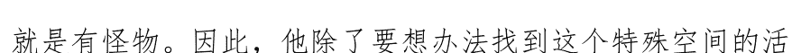

仅仅是这两个问题，就耗费了很长的时间。可能有人认为，两个简单的问题将会怎么需要多长的时间来搞清楚，但我不会这么认为的，当卫国雄说了了他遇到的那些经历后，我就已经清楚了，如果没有足够的坚韧不拔的毅力和绝生的能力，就是五年，他也坚持不住了。就像说一次，他被困在特殊空间里面整整十几天，期间滴水未进。

然而我不想把他经历的一切全部写下来。一是时间确实不允许，二是有些事情，看起来本来是很简单的，而身外人却永远无法感同身受。对于卫国雄来说，他只是想弄清楚那几名队员的怎么死的，其他的，都已经无所谓。并且我作为听众，所关注的东西自然与他不同。

在此，我只能说重点。

卫国雄说，特殊空间的规模非常广大，可以说整片老庙水域，都是这个空间的活动范围。另外，这个空间的活动规律也非常奇异，在时间方面并没有规律可循，而水域附近的自然条件也没有明显能够影响到特殊空间活动规律的现象。

因此，卫国雄在毫无办法的情况下只有根据逆向思维，从特殊空间里的沉船残骸与人身上寻找线索。

没想到，很多细节性的东西，还真的被他给发现了。卫国雄发现的第一个线索就是，在整个特殊空间的范围之内，所有的沉船都有一个共同的特点。凡船基本完整的一艘，无论规模如何，船头都是冲着另一方向我们现在所处的地方——祭台。

出现这样的局面属于偶然，还是因为特殊空间的作用导致了这现象的发生，卫国雄思考了很久，期间也做了大量的论证，但是最后他还否定了这两个结论。

首先是因为祭台所处的位置。

按照他运返水底与陆地的经验来看，祭台所处的位置并不是该水域的正常航道，而是在一处十分靠近岸边的巨型沙底下。问题就出在这里，本来这片水域已经是鄱湖湖沙水道最凶险的一段了，所以如此多的船又怎么可能选择聚沙聚集区作为航道呢？

再者，现象表明，有相当一部分十分靠近祭台方向的沉船显示出了其明确的目的性，那就是老姥庙水下祭台的方向。最明显的日本人的“神运”号战舰，这艘船不是用来打仗的，还有足够的证据表明，它的目的地就是老姥庙水域的水下空间。显然，卫国雄在其他的沉船里，也找到了与“神运”号类似的线索。

根据这些条件，卫国雄得出了一个巨大的结论。

“在这里，我无法保证你的绝对安全。”卫国雄说，“在你下去之后，会遇到一个三岔口，你一定要选择进入中间的那个洞口，然后一直直走下去。”

我跟卫国雄就这样分开了。他跃身跳下祭台，消失在黑暗当中，而我则是顺着暗缝下面的石阶摸黑走了下去。

作者：十四 
日期:2016-05-19 09:37
@零稽八五三四 2016-05-19 08:32
顶顶

谢九哥！

作者：十四 
一手整理，加伏11101284955，防封并获取更多帖

最近收到很多朋友的建议，例如在故事的初期，发生关键的一段，出现了一些常识性的错误！关于这些错误，我都承认，所以我在更新的时候，也会回去修改原来的稿子，希望故事讲得更加对得上一直支持我的人，感谢大家！

作者：十四 
日期:2016-05-19 10:49
@易无幸 2016-05-18 22:47:00
十四，少了点，不过你辛苦了！

尽量更多，谢谢大家支持
作者：十四 
日期:2016-05-19 15:52
@日落衡西 2016-05-19 14:23:00
更多点吧，一次更新太少了

马上更新！

作者:十四一 
日期:2016-05-19 15:53

祭台下面的结构没有我想的那么复杂的，虽然什么也看不到，但根据我一路走过的这条石阶判断，这里恐怕就只有一条斜向右延伸的石道。我能微弱感受到一股股潮湿的气流从更深地方吹来，说明这个地方有空气流通，而且肯定有更大的空间。

就这么走了大概五分钟的样子，也不知道自己走了多远，王越说：“加点多多久好处”，竟然感觉有些奇怪。按说在这种地方，不会发生什么要命的事情，她娘的热却不正常。何况，这个地方是在太安静了，因此，慢慢地，带来的那种警觉心也逐渐消失了。

作者:十四一 
日期:2016-05-19 15:53

宁静的黑暗当中很容易让人产生幻觉，同时由于长时间滴水未进，体力透支已不在话下。自从来到这里，几经险要，看似弹指一挥，实则早就不知道了多久，现在还能走路，也属奇迹。却还必须忍下去，至少在找到白猿之前，自己绝对不能倒下。一路上，我就这样恍哉悠悠的，不断提醒着自己。

这个期间我好像想了很多事情，从登山一直直到现在，之前发生的一幕，实在是过于梦幻，都已经超出了我脑能思考和判断的能力范围内，真真假我也想不明白。又感觉自己什么都没想，总如此懊悔的。

作者：十四 
日期:2016-05-19 15:54

也不知道走了多久，我几乎就要睡着了，脚步也开始变得似似非无，直到突然之间，我气无力般逸出去的脚突然踩到了什么东西，这才让我一子清醒了不少。

脚底下的东西给我带来一种十分敏感的感觉，我的第一反应就是踢到了尸体。不知道为什么会这样，只是一种感觉。

瞬间紧张的感觉一下子涌了上来，我不由后退了几步。这一退后发现，原来我已经在不知中走出了石棺，现在我所处的平台已经变得平坦了。

但是这里怎么会有尸体呢？这个地方依旧十分安静，不像是有危险的量子，至少我没有感觉到有什么不对。要是有人死在这里了，那个人是怎么死的？或许，这根本就不是尸体，刚才的脚踩到的石头，或者整体就是从哪里生的幻觉。

我慢慢蹲下来，把手往碰到东西的地方尝试探性地伸了过去，没想到，我的指尖刚刚要触摸到什么，就感觉伸出去的手一下子被什么东西抓住了，我条件反射的叫了一声，随即开始拼命回抽伸出去的手臂。

正在这时，我听到一个十分虚弱的声音喊道：“别怕，是我……......”

作者：十四 
日期：2016-05-19 16:15

我一下子就分出了是谁的声音，这个人是阿来。但此时他的声音已经非常虚弱，很明显是出了故。

我着急紧问道：“阿来？你怎么了？”

阿来回答：“我被人偷袭了。你拉我起来，我们去救大小姐，她一定有危险。”

我问：“是谁偷袭了你？”

我费劲把阿来扶起来，此时我感觉他身上已经不用多少力气。阿来的手段我也是领教过了，那可不是一般人，怎么可能有人能够击到他呢？

再说，这里面除了那那个卫国雄，剩下的都是我们一起起来的那些人，又会是谁是谁在搞偷袭？

这种时候继续没空去思考太多了，阿来的一只手按在脖子上，继续向前走，然后旁边问道：“接下来怎么办？”

“继续向前走，不远处就是入口。”阿来说完脑袋一耷，不再说话。

我心里瞬时感觉不妙，他竟然昏迷了。

作者：十四 
日期：2016-05-19 16:21

前面乌黑一片，基本来说就是没有任何光线，这种混沌的程度，简直无法形容，我更不知道现在所处的地方周围是什么环境。

但我已经感到很幸运，想着幸亏在这条暗道中没有遇到什么危险，否则就凭我，我还有一个重伤员，就算是钻出一头野猪要向我，那我也没有毫厘的胜。

但是还得继续前进，我觉得卫国老人既然已经给我指这条路，就说明这是眼下我唯一走的道路。实际上我心里非常期望能够找到白狐他们，在这样的这种地方，人多了总比一个人都强。

作者：十四 
日期2016-05-19 16:34

我挣扎着阿来走的速度很慢，大概只走了两分钟，我在黑暗中就就感觉到几股微弱的风吹在了脸上，我试着跟阿来来说：“阿来，我们应该到出口了。阿奎丰说我这中间的那条路，你没意见吧？”

阿来依旧垂着脑袋，看着昏迷的程度很严重，我也没办法，只好不再管他，就凭感觉继续向前方走。我推断，既然是选择中间的道，那理论上我只要一直前进，就应该不会错。

作者：十四 日期2016-05-19 16:34

我带着阿来顺着吹风的方向让过去，虽然我现在什么也看不见，但感觉这种东西好像变得灵敏起来，直觉告诉我，我很有可能是进了某个入口。这个入口既然出现了这种细微的风吹出来，那就说明它一定连着什么地方。

刚走了几步，我就突然感觉阿来搭在我肩膀上的手臂动了一下，我心里一喜，以为终于醒了，快要把我累。可是还没等我说话，我就听到阿来非常虚弱的气息断了一句，说的是什么，我没听清楚。

我停下脚步，等了一会儿呼吸，尽量把耳朵贴近阿来的旁边，就问：“阿来，你说什么？”

“你走错了……”

我终于听明白了，阿来说我走错了。我心里说不对，卫国说让我走了出口，我哪里走错了？

阿来咬了一口气，仿佛用尽了所有力气，嘴里挤出句话：“继续向前走，不远处就是入口。”阿来说完脑袋一耷，不再说话。

我心里瞬时感觉不妙，他竟然昏迷了。

这种时候继续没空去思考太多了，阿来的一只手按在脖子上，继续向前走，然后旁边问道：“接下来怎么办？”

我，刚走了几步，我就突然感觉阿来搭在我肩膀上的手臂动了一下，我心里一喜，以为终于醒了，快要把我累。可是还没等我说话，我就听到阿来非常虚弱的气息断了一句，说的是什么，我没听清楚。

我停下脚步，等了一会儿呼吸，尽量把耳朵贴近阿来的旁边，就问：“阿来，你说什么？”

“你走错了……”

我终于听明白了，阿来说我走错了。

我带着阿来顺着吹风的方向让过去，虽然我现在什么也看不见，但感觉这种东西好像变得灵敏起来，直觉告诉我，我很有可能是进了某个入口。这个入口既然出现了这种细微的风吹出来，那就说明它一定连着什么地方。

刚走了几步，我就突然感觉阿来搭在我肩膀上的手臂动了一下，我心里一喜，以为终于醒了，快要把我累。可是还没等我说话，我就听到阿来非常虚弱的气息断了一句，说的是什么，我没听清楚。

我停下脚步，等了一会儿呼吸，尽量把耳朵贴近阿来的旁边，就问：“阿来，你说什么？”

我，瞬间紧张的感觉一下子涌了上来，我不由后退了几步。这一退后发现，原来我已经在不知中走出了石棺，现在我所处的平台已经变得平坦了。

但是这里怎么会有尸体呢？这个地方依旧十分安静，不像是有危险的量子，至少我没有感觉到有什么不对。要是有人死在这里了，那个人是怎么死的？或许，这根本就不是尸体，刚才的脚踩到的石头，或者整体就是从哪里生的幻觉。

我慢慢蹲下来，把手往碰到东西的地方尝试探性地伸了过去，没想到，我的指尖刚刚要触摸到什么，就感觉伸出去的手一下子被什么东西抓住了，我条件反射的叫了一声，随即开始拼命回抽伸出去的手臂。

正在这时，我听到一个十分虚弱的声音喊道：“别怕，是我……......”

这双眼睛对齐了，而且他此时这双恐怖的眼睛死死盯着我在看。

作者：十四 日期：2016-05-20 15:50

我看到一双翻白眼睛没有瞳孔的眼睛！他妈的躺着的这个角度，正好了。

这哪里是阿来，这分明是一个人不是鬼的怪物！他的身上上背布满了粘稠的胶液，绿得非常的恶心，那扁扁的鼻子，就像是从血盆里挤出来的一样。这只物没有头发，但在头顶上趴着一只巴掌大的虫子，像一只大型蜘蛛。

我惊慌失去重心，难怪我从水池爬起来后就闻到一股曾经相识的腥臭的味道，刚开始在意，现在看来，我这是把一只水鬼给扑上来了！

这水鬼开始也没攻击我，可能是长时间没见到活人，我这一系列的举动，把它给整整圈围了。这水鬼只是躺在我旁边，用那双没有瞳孔的眼睛看着我。

手之前的那一番折腾，此时我已经没力气了，在水里划动了两个圈，我心里要是再找不到，那哥兄弟就没办法，只好放弃了。可是阿来也算是命该，这个时候，我的左脚突然被什么东西绊了一下，我暗叫一声，就用力用手去扑。

摸到阿来后，感觉他死沉死的，情况似乎有些妙。我心里祈祷千万万别，你也救了我两次了，我最不喜欢你，阿弥佛，赶紧上岸吧。

我用一只手臂扣住阿来的脖子，然后就往水池边过去的。水池的水位跟地面基本平，我几乎是用尽了最后一口气拖住阿来一起翻上了地面，阿来滚到一边，我也没有气气管他，然后我跟泥一样躺在水池边，大口喘着粗气。

我了了口粗气后，我感觉躺在右手边的阿来好像动了下，动作不大，但是引起了我的注意。这时我无意间转头，想看看阿来到底样的，可是刚一回头，我就傻子，心脏就要停止跳动了。

“有！”卫国雄像对我非常不满，继续压低声音对我说道：“吃饱了的话就小点声，这可不是一个太平的地方，千万别动了我的老本子，你记住了没？”

我实在是太饿了，再不吃点东西，我感觉就是告诉我前方五百米就是久远的地面，我也没有力气过去了，也没有说话，只是一个有些浊的点头。卫国雄似乎是早有准备，给了我一些烤好的肉，我也没管这些些什么肉，直接往嘴里塞。这种感觉简直是太大了，上次吃东西，还是在白白的游船上，我都不知道是多久了。

我边吃边问他：“你怎么不吃，是不惹着我被鬼撞疼的时候，你自己偷着着吃什么东西了？”

阿来问了之后才回答我，是从卫国雄手里接到一个巴鲁天的水瓶，我看到这只瓶里装着些浅蓝色的液体，他打开瓶子，灌了口。

真是太怪了，有肉不吃却吃水，有病！我边吃边卷云云一样吃了一大堆烤肉，逐渐恢复了一些力气。

卫国雄不知道从哪里来的，找了一块木料，很快在水岸边点了火，烤了一会儿火，身上的衣服慢慢干了了一些，舒服了许多。

我们相互之间并没有说太多，场面有些尴尬，实际上我也不知道该说说什么，心里千般滋味交，不知如何是好。看着火光，我无意间就看了一眼他，他烤着火不知道在想什么，一双蓝色眼睛在火光下显得有些异异，可我已经不再害怕。我又看了一眼卫国雄老爷子，他正拿着金属棒在端详着，脸上充满了疑惑。这真是奇怪的人了——想到这儿，我突然想起什么，然后我就看向这个人，确认了一事情。确认完了，我就微微缩了身子往后挪了挪，跟他们俩拉开一些距离，继我又问他们：“说你们的戏打算演到时候？”

被这突然如其来的一问，阿来和卫国雄俩一下子同时看向了我，那眼神简直像看傻子一样。我们三个就这样相视了足足一分钟，卫国雄先开口道：“年轻人，你发问了什么事？”

如此，我不知道从哪里来的勇气，可能是冷反应多些，我不知道吃吃肉了，就把心里的秘密告诉了出来。这些人留给我的问题太大了，先不说阿来那双红蓝变换的眼睛和卫国雄长期存在一种看不见的地方不是反人类，就是他们的相貌，就让我感觉不对对儿子，他们长的太像了，简直就是一个样子刻出来的一样。

“卫老爷子，我是个心直口快的人，在这里也是个外人，心里攒了太多疑问特别的难受，因此我就直接告诉了，不对的地方你们还能多担待！”我说，“我怀疑你们俩人的关系非寻常，因为你们长的太像了！”

阿来听了我的话没有太多反应，只是冷冷的看了卫国雄一眼。

然后继续看着火，没有说话。卫国雄也看了看阿来，神表情非常复杂，然后叹了一口气：“唉……这事说起来也并不复杂，只是有些难以起码……年轻人，我想你也猜到了，阿来我的儿子，我是他爸爸！”

在我第一次见到卫国雄的时候，我就发现这个人跟阿来特别像，但我当时很快就忽略了了这个问题，因为在军诡里发生了那么多灵异的事情，我实在不想想这个问题，可是后来的，我看到阿来对这里的环境非常熟悉的时候，我就想到了这个答案，否则很多事情说通。

我问：“那为什么阿来出现在白狼队伍里，而你却在老帝戏底下？”我这么说，阿来就走不住，只见他非常生气一般从地上上站起来，用一种非常幽怨的眼神看了一眼卫国雄，然后转身转向不处的黑暗中走了过去。我看这架势，分明就是一种懊恼，说难道这俩之间发生过什么特别的事情？

卫国雄又是一声长叹，说道：“这件事说起来话很长，都是因为我的固执所下的孽，我对不起这孩子……”后面，卫国雄告诉我了一些关于他跟阿来发生的事。这些情节除了让我感到特别感之外，也包含了很多让我感觉，所以我决定在这里记录下来。这件事情说起来应该是卫国雄在水下跟我说

事情之后。当卫国雄所在的探队解散后，他私自来到老爷庙调查，违反了相关纪律，因此肯定是被组织除了。他知道这件事情的性质已经变了，原来属于国家的事情变成了个人的事情，之所以会这样，完全是他放不下战友死讯。那个年代的探队多数是军队出身，对于这种战友之间的感情，看得比生命还重要，因此他对于老爷庙已经到了无法自拔的境。试图无用，随着卫国雄来到老爷庙的深入，他先经历了重困难摸透了在这里生存的方法，然后找到了几个战友死，并在不久后他也发现了老爷庙水底更多的秘密。首先他发现老爷庙这个地方最早观测到人类活动，是在上古时期，也就是我们现在讲的神话时代。他从这里为什么如此怪物这个角度，不断在这里反复调查，最后得出一个震惊的结论，他发现这个地方，很有可能是一个远古实验室。特别是那个能够吞噬一切而又能孕育奇怪生物的阴阳胎，就是这个远古实验室的核心。老爷庙绝大多数奇怪生物，都是在这个阴阳胎孵化出来的。这些怪物当中，最令他耿于怀的，就是那些最近人形的怪物，他开始觉得这些怪物像极了中国神话中的一个人——伏羲。他通过各种途径研究了很多中国远古期的历史，特别是神话传说中关于伏羲时代的一些古籍，他觉得伏羲出现在中国神话中的如果真的存在，那很有可能跟我们在水底遇到的人形一样。伏羲是谁？我们都知道，历史课本上讲过，伏羲是人类的祖先，地位非常重要。当然我也听过另一种说法，说伏羲是人面蛇。但是不管哪种说法，都有一个共同之处，那就是伏羲不是我们通俗的样子，放在现代人看来，那就是怪物。卫国雄又叹了，他对于自己得出的结论感到非常疑惑，假设伏羲在历史上真的是存在过，那有两个问题特别在他面前：第一个问题是为什么伏羲文化与中国后来发生的文化出现了断层，就算是所有的遗迹记载和神话传说，也非常模糊了，不能以偏全；而第二个问题就是，如果伏羲真的是人类，我们中国人的祖先，那为什么伏羲被描成怪物的样子，而后来的人成了我们这个样子？古代的人是很注重面的，那是君臣父子非常清楚，怎么可能会认一个半人半兽的怪物祖先呢？那不是在骗自己是畜生吗？实际上还未等卫国清楚这里的一切，他发现自己得到的秘密是一些皮毛而已，因为无论是在中国的历史上，还是在日本的历史上，对于老爷庙水底这个地方的探索，早在数千年前就开始了。最直接的证据就是中国历史上几次大规模的文化破坏现象和日本完全聚焦中国所有的历史这两个要素，很多头和线索似乎指向了水底下神秘的空间。无论是中国人还是日本人，似乎都没有真正的进入过这个地方，也就是我现在所在的地方。卫国雄花了二十年的时候才找到了老爷庙水下的入口，长期找到了丹丹并获得了良好的缺口，可是他也老了，长期处在这种阴暗潮湿的家里，逐渐患上疾病，身体许多关节都已坏掉，这种情况下已经不允许他再像年轻时候那样在水上回来折腾了。还有一个更重要的原因是他累了，真的累了，因为他感觉自己就像是掉进了一个全是由谜团组成的漩涡一样，是凭他自己之力，无论如何也无法解答这种谜团的。他决定放弃继续调查，即使他知道老爷庙水底下还有很多没有解开的谜团，现实条件不允许让他继续调查下去，于是他就想到放弃，放弃这里的一切，让这些历史长河中留下的谜团继续永远在水底沉下去。但是一个偶然的契机，已经打算放弃这里的一切的卫国重新焕起了一些希望，因为他发现这些年内，老爷水域出现了一些非同寻常的人。而且他还逐渐发现这些人并不是一伙的，好像来自不同的势力范围。他们有着相同的目的，就是他们都在探查底下的东西。通过一些秘密调查，卫国雄首先确认了这一片水域一支探险队。表面上好像是散兵组成的分子，对外称探险队。但是卫国雄从过来，很快就确认了探险队的背景。这探险队是卫国雄所在的那支探险队之后，由某个有机成立的。这探险队真实存在，说明当年那件事情至今还没灭。只是卫国雄一人，不知道是因为什么契机，这探险队又出现了，而且是一种影子出现的。另外是一些外国人，常在这片水域，好不好判断是什么样的人，但他们的目标是老爷庙底下。这些外国人与探险队发生冲突，都是真刀真枪的。但这些事情发生后，相关部门并没有介入，而是呈现出一种默许态度，可见底底发生的事情出现了多方面的博弈，而且这种博弈已经升级到了另一个层面的状态。至于这一切背后发生了什么，卫国雄都不得解。正是这种情况下，他把自己的儿子，也就是阿来，通过一些途径送进了这支探险队。他之所以这么做，就是想让自己的儿子继承自己的心愿，继续挖掘老爷庙的秘密。可是卫国雄所做的事情，表现出了强烈的抗拒，他虽然加入了探险队，却从此不再按照卫国雄最初的想法去做，而是在探险队中寂了过来，过着一种近似的生活。卫国雄等到阿来的时候，已经是老了，他不停的絮叨起来：“这些都是我的孽，对不起这个孩子……”我有很多的问题，但是看到卫国雄这个样子，我又忍不住就问了一个最在乎的问题：“阿来，我不知道你们父子之间发生过哪些事情，我是不是外人，也不多少，阿来说跟我我是兄弟，我能问一下，阿来的眼睛是怎么回事的？”谁我去问这个问题，卫国雄就抖了一下，表情一下子变得痛苦，又像是想起了什么恐怖的事情，他用手捂着脸，咬道：“阿来，我的孩子……我不该拿着当实验品，我真是作哑……”听到这里我的头皮瞬间炸开了，脑子里瞬间闪过无数画面——怪物、伏藏的、阳光、古老的实验室……我好像想到了什么，但强烈的信息慢慢让我时间乱如麻，阿来那双蓝色和红色的眼睛开始在我脑海中神出鬼没，我好像着魔了。

卫国雄很快就意识到了自己的失态，他恢复了一些情绪，老实老爷子，干脆就动了心，想着如果阿来不愿意的这种水也好，省得跟我一样过人不不鬼的日子，那就干脆引你参与进来。阿来多次救你的目的，也是想让你能够接触更多机密，而是利用你的好奇心，让你继续追踪这件事情，这样我就算死也瞑目了。但是每当我想到阿来的悔恼和看到他几近危险一线，我就觉得自己太自私了，我怎么可以因为自己的小私利去伤害别人呢，这里的水太深了，我查了二十年明白，更何况你们这些本来生活的年轻人呢……

我听完后心里也大了，概说你大爷的，你是心疼自己儿子的，想让我一个外人替你儿子卖命，理由还是他妈是因为老子看起来是个傻趣好恼似的，但我也不好懂这话说什么，我刚处理事情都是我的，身上还有无数运还没解开，但是在卫国雄看来，我现在，我已经极度厌烦了这个地方，也厌烦了这些奇奇怪怪的人，我只想离开这里，回到属于我的生活当中去，等老子有命出出去，这里的一切，无论是真事，也不管这里里究竟有什么怎么样的迷途，都跟我没有半毛钱的关系。于是我就说：“既然那个人不出现，不如我们被动为主主动，我们赶紧去寻找他们吧，我怕时间耽误下去，形式会对他们不利！”卫国雄说道：“事到如今，只好如此了！”

卫国雄起身跟我打了一个手势，意思是我也起来。我按照他的意思站起身，他问：“阿来呢，怎么看不见他回来？”卫国雄往他消失的方向看了一眼，似乎有些担心，但他并没有更多的表现这种担心，而是对我说道：“或许他已经在某个地方潜伏起来了，他受了伤，沿岸休息这个道理他很清楚，你不必过于担心。”要去，卫国雄捡起插在地上的火把，又给我点燃了一支。阿来落地后，我们两个人出现了不同的转折，我发现他的奇妙眼睛让他错过了这些致命的，只是受了一些生命的伤。我问：“为什么我没事？我不像阿来那样身手得了，老王既能跑白狐和杂毛还有杰克，那顺帮我一起奔走也不算什么坏事。”卫国雄也没有发现他们的踪迹，这四个人的失踪本身很可疑，就像卫国雄说的那样，但他并没有把他们引导到外部的事情，但他们确实受到了分散的引导力量。

卫国雄不断在这里反复调查，最后得出一个非常震惊的结论，他发现这个地方，很有可能是一个远古实验室。特别是那个能够吞噬一切而又能孕育奇怪生物的阴阳胎，就是这个远古实验室的核心。老爷庙绝大多数奇怪生物，都是在这个阴阳胎孵化出来的。这些怪物当中，最令他耿于怀的，就是那些最近人形的怪物，他开始觉得这些怪物像极了中国神话中的一个人——伏羲。老王很刻意，很有可能是混进探队里面的一个日本人，同时也是我们一路拆散后失踪的始俑者。我对卫国的这些说法并不是完全赞同，因为我之前对老王这个人的接触，怎么也不觉得他是坏人，更何况还是个日本人。还有就是，如果白狐他们的失踪是老王做的，那我为什么没事？卫国雄把手中的金属棒递给我，说道：“因为这支金属棒！他知道我的存在，也肯定了阿来的身份，所以他不敢在军队里面断然抢了这金属棒暴露了自己的身份和目的，他是想让我一路保护着你和这支金属棒顺利来到这里，等他以后找机会对我下手。”我接过金属棒，还是没看出这支大秦密的金属棒有什么特别，觉得卫国雄有些神经过了，就问：“这支金属棒子有什么特别的？”里面应该装着诡异的一些东西，具体的我也不清楚。我知道只要拿着这金属棒在我们手里，不管隐藏在背后的人是不是你们说的儿子，他都会出现。”卫国雄说道：“我在这里跟你耗了这么久了，但他却一条黑暗中不出手，看来是在等我们下一步行动。”听着这些天马行的推断，我感觉自己就像是悬疑电影里面的一个傻蛋，什么不懂，却深陷其中，这种滋味非常不好受，却也无法挣脱，于是干脆顺着他的话说：“既然那个人不出现，不如我们被动为主主动，我们赶紧去寻找他们吧，我怕时间耽误下去，形式会对他们不利！”

天，由老夫去处理过的问题。

卫国雄说根据地上散落的兵器判断，这些应该是秦朝的军队，到底为什么人能入侵这里，竟其原因尚清楚，但在在这场战争之后，肯定再也没有人能够进入这个地方了。

走了大概有半个小时左右的时间，脚底下的路开始出现变化，出现了一条石阶，此时我看着前面卫国雄的火把已经在我的斜上方了。

我借着火光照亮了四周，铺满骸骨的地方到了这条石阶前面猛然而止，很明显，这些死掉的脸怪一直在守护着这里，它们没有人类的军队越过这条石阶。

这条石阶出现的非常突兀，我抬头看向，发现石阶是人工手凿的并建在一座石岩底的巨大的建筑物上，这座建筑物我想象的要高很多，这这么看过去起码有五层楼那么高了，我无法看清它的全貌，但凭感觉和有限的视觉判断，这应该是底座越宽越往上越窄的建筑物，从这条石阶往上倾斜的角度来看，它并不是从建筑的顶部延伸出来的，而是从建筑的中间位置开始延伸了这么一条道路。

我想起了日本军官笔记里面记录的老爷庙水底三角形形状，心里一害怕，心说说这是一座金字塔型的建筑物，感情我她娘是到了老爷水底最核心区域了。这里就是鬼二战时期日本军舰的最终之地，只不过它沉没了，军舰里面的人也都死了，而我却活着到了这里，真是奇哉！

这时候，看着就要走到石棺尽头了，建筑物上出现了一个四边形的大豁，我看到卫国雄在前面正用火照着棺口里面的一扇两人多的石门，看来他是想要透过这通廊大石门，进入这座建筑物的内部。我不由加快了一些脚步，想紧紧跟上去，生怕再次落单。

也就是我就要走入口的时候，不经意之间，我好奇的用火照了建筑物的上方，却不想，在火的余光当中，我好像看到了一个东西横趴在我上方远处，而这个东西好像正由上而下的看着我。

个个僵尸。但我肯定的是他们三个并没有死亡，因为他们还能够动，面部也有血色，只是不知道被老王施了什么手段才变成这个样子的。

老王进来了，冲着杰克说了一声：“关闭石门。”

转看杰克，就像是一个傀儡，转身非常笨拙的动作开始转动石盘，石门随之关闭。

这时候阿来手中的血滴开始旋转了了起来，他对老王说：“要打吗？”

老王呵呵一一笑，说道：“我知道这里没有人能打过你，本想让你死在暗里，没想到让你这么惨。废话不多说了，交出皮天书，我放他们三个！我放你一个。”

从秦密帝国里搜出来的满肉咆哮的皮子，难道老王指的就是这个东西？

我刚想说皮子在我这里，想要的赶紧放人，却被阿来抢先一步说道：“你的东西在我这里，想要放人，否则我立刻毁了它，你是我的。”

阿来这样的举动，立刻让我心领神会，他是在借人皮天书把签字的条件变更为主动，因为老王目的性非常强，虽然这张皮对他来说相当重要。

老王默不声声，一直盯着阿来，继续说道：“也罢，放了他们，但我有一个条件。”

“说！”阿来道。

“不如大家暂时放下恩怨，一起进入，让这个小子在前面开路。”

“凭什么！我有万种办法杀了你！”阿来道。

“你有机会杀掉我，可是我死了，他们就得不到解药，最终的结果也是死！”老王狠狠地说道，“阿来，你只是一条狗，如果你听话，那就别跟我谈任何条件。”

老王说完，我见他作出了令我震惊的举动，他竟然伸了自己的胸腔，从皮肤下掏出一个黑色弹丸。他拿着弹丸摇摇，也没听到声音，但我看到三个人脸部扭曲了，那是一种非常痛苦的表情，而且三个人几乎同时倒地，身体剧烈的抽搐起来。

“够了！”我大叫道，实在不忍心看到三个人那种痛苦的样子，于是说：“我们答应你的要求，但你现在立刻放弃他们！”

老王终于停止了摇晃手中的弹丸，又从皮肤下取出一个白色弹丸，并再次做了一个蠕动的动作。我看着老王的手在皮肤下取出，心里不禁一阵心忌，想不到老王的皮肤之下，竟然可能藏着一些奇古怪的东西，到底是什么样的人，怎么如此可怕。

看阿来的样子也是有些吃惊，似乎也没有办法，他不说话，只是看着在地上的三个人。看到这样的情形，我知道跟老王的协议算是达成了，虽然看情形老王有随时控制他们的机会，但我现在只想救人，至少也得避免他们遭到痛苦，于是招呼他们过来。

老王看到鬼狐过来，不知道是否是因为心虚，就说道：“不要以为你们人多就可以跟我提条件，中了傀术，没有我的解药，他们一定会死。”

我是先把杰克扶起来，然后阿来把鬼狐和杂毛抓起来，三个人此时已经没有了那种木僵般的表情，但是面色并不是特别活跃，绝对不能在这个时候对老王发脾。

看到自己的三个人，面部还残留着之前那种痛苦的表情，心里就升起一种恨意，竟然鬼神差般对老王说了一句我自己都不敢相信的话：“我保证在他们身上放过你！”

我听到老王咯咯笑了起来，他道：“其实这并不是你的战争，我让你在前面探路，也算是让你早早超脱，你应该感谢我，你怎么还会想杀我呢？你觉得凭你就能杀掉我？这简直就是笑话……”

白狐清醒之后，看到面对的老王后，同有无力的问道：“你到底是谁？”

老王看着样子也不想隐瞒，就一字一顿的回道：“中村正源！”

白狐说道：“游船被围我感觉不对，没想到竟然是你的。”

“对不住小姐，这是战争的规则。”老王道。

白狐听后醒起来，表情看上去有些凉。这时候杰克和杂毛都醒了，杰克瞪着所有人，完全不知道发生了什么，刚要说话就被阿来盯了一眼，于是吓得马上闭上了嘴。杂毛抓了抓头顶的黄头发，话还没说完，他就差点倒下去，一直被阿来扶着。

老王虽然是一个人，但他控制着三个人，无法让阿来离开，他有些担心，道：“你们清楚现在该怎么办？如果刚才的协议还算，我们就出发。”

白狐跟阿来望了一眼，道：“按照你的说，你在前面探路，到了终点，你必须交出解药，否则我们宁死。”

老王摇了摇头，阴险说道：“成交。”

阿来点了点头，说：“没事，我相信你。”

白狐看着老王道：“中村正源，如果前面出了事或者遇到危险，阿来一定会救我。现在也是毫无办法，必须硬着头皮上去，否则杰克、白狐还有杂毛随时会遭遇。”

杰克说完就朝这边过来，杂毛此时有些站不住，但他已经能够正常走了。我和杰克在前面，白狐和杂毛搀着走，阿来和老王相互背着，所有人并排走在最后，场面非常尴尬。我们一路顺着斜坡到了建筑底部，看到了巨大的雕像。借着这些五彩六色的光，只见雕像从腰间往下的部分是一条盘绕起来的蛇尾，上半部分看似人身，但是再看那雕像的头顶，竟然是一个牛头，像极了外面的怪物。

这尊石像高至少有十五米，周身雕刻的线条粗犷又不失完整，这些线条连接在一起，组成了一身铠甲在石像表面。再看石像的动作，一只手向上举着一把巨大的石刀，另一只手指向地面，给人一种独特的气势。再看石像的面部微皱，双目注视着建筑物顶部的发光图案，竖立在那里如山不动，其威严程度令我震撼。

我也看到在这尊石像的前方四五米远的地方，摆放着一个多米宽巨大的青铜鼎，这个大鼎身上的花纹看上去十分有效。这是一尊建造年代十分久远的大型雕像，而且看起来。看着这尊石像的样子，我好像知道它是谁。

这尊石像，正是神话中中华夏祖伏羲的样子。小时候的历史课本里有介绍，说人类祖蛇尾人身牛。在中国历史上，这是一个神一样级别的人物，在中国人的心里，她的地位是不分高下的。这可能是中国历史上最久的人物雕像了，但到底是什么人在这里建造了这座雕像呢？难道是那些怪脸怪物吗？这不可能，那些怪物虽然具备一座大型雕像的智慧，实在是让人想不通。

石像的后面，隐约看到一条十分宽敞的石廊，可以看到金字塔型的建筑物里面还能往更深的地方走。看着石像的位置，我大致推测这个地方可能是一个入口，而这座石像担当的角色，应该是一种形象意义的守护神，能够进入这个地方的陌生人造成一定的威慑作用。

当我们准备绕过雕像继续前进的时候，却见白狐突然停下了。她先是按开杂毛抚住她的双手，然后对着这尊石像仰望了一眼，竟然跪了下去，而且嘴里念念有词。

颜色少但不影响整幅壁画的完整性，在这里足足有几十平米的墙面上，这些彩绘的看上去非常连贯，好像在描述某种场景。

我大概看了一下这些画在墙上的图案，第一感觉就是这些壁画应该年代十分久远了，至少不会是秦汉之后的东西，因为这些壁画看上去十分的古朴，虽然大体能看出壁画所要表达的场景，大量的图案还是以象形写意的表现手法居多，如果是秦汉后期的产物，那么那种手法应该是该样的多的。

不过这倒不影响我们分析这些壁画要表达的东西，在这里，我觉得有必要对这幅壁画简单描述一下，说出来可能大家会觉得我描述的场景有些些疑惑。

一手的壁画，基本上可以分为三部分，但我必须从这幅壁画的中间位置说。

因为整幅壁画中最亮眼的图案就是位于中央位置，而看这个图案，凡是中国就不会有的，那是一幅伏羲和女俑图。 
作者：十四四日：2016-05-28 15:59

跟神话里说的一样，伏羲和女俑的整个下半身，就像两条蛇尾一样，相互缠绕着，但是再往上看，就会看到两位人类祖本来未连在一起的身体开始分离，其中女俑的上半身跟我们人类没有大的，她的身体跟壁画的上半部分倾斜，双手中间撑着一个小人，双眼视着斜下方的地面，而地面上几乎都是这种。靠近女俑的小人有很多

朝着面向女娲，越往走，就会看到一些小人已经站了起来，开始背对女娲相反的方向走去。

看到这里的时候，我就听到来自自言自语了一句话，好像若有所思的样子子：“女娲造人……”

但却见到白狐摇了摇头部，她指着女娲下方的那些人形图案说：“你们再仔细看这些这些图案。”

按照白狐的意思，我们重新端起这些人人形图案，一看之下，明白白狐说的是什么意思。

虽说是这些风非常简单的图案，可能几条线就代表了图案一个人，但也不是不能看出，在这些身上看上去像是人形的当中，其中一些并不是我们传统意义上所说的“人”，而是一看似非天人的景象，防止断并获取了多好许多。

比起有些上半身是人形，下半身长着半截四条腿动物的身体，也有很多下半身看起来像人，上半身却长着动物的脑壳，有些甚至我们多次碰到的牛脸异常非常相似。

我不明白这幅图为什么我之前了了解过的女娲造人图不一样，更不知道为什么在这幅图里面，女娲造出来的不仅仅仅是人，竟然还有这么多半人半兽的东西。

作者:十四001 日期:2016-05-28 16:00

杰克看到这样的场景，竟然哈哈大笑起来，讽刺一样对我们说：“现在你们应该相信是上帝造了我们吧，你们的神造人都都不明白，肯定是个大骗子，所以以后你们还是信上上帝吧！”

听到达克在解析这幅壁画，就觉得一阵苦笑，但又没心情跟他这种玩笑，又看向了壁画的左半部分。

左边的这半幅壁画，从中间位置开始，首先看到的是人皇伏羲的身体图像，在与女娲图像分离的上半身，我看到的伏羲，身体与女娲对称，身体向左边倾斜，并且也是注视着下方。又是伏羲的样子，却像极了我们之前看到的那尊尊活，特别是那一个长着对角头的头部，看上去就跟牛脑差差不多，不过这也符合在神话说中的形象的。

起初，我以为这部分壁画描绘的也是类似于女娲造人的场景，但是看完了质子之后，从我的内心深处，就泛起了多多的涟漪意。因为这部分以伏羲图像为核心的壁画，描绘的人皇不是在造人，而是杀人。

作者:十四001 日期:2016-05-28 16:02

@百元无用是真理 2016-05-26 20:56:00 号几

------------------------------------------------

真理哥，感谢支持

作者:十四 001 日期:2016-05-28 16:03

@cjvamb21635 2016-05-26 21:10:00 插，还不更新更了！

作者：十四 001 日期：2016-05-28 16:03

@呢哔正在输入 2016-05-28 13:27:00 楼主这两天很忙么00 家人病了，最近一直跑医院，昨天没得及回公司，也就没更新。

作者：十四 001 日期：2016-05-28 16:05

@九唔吾八八三吾四 2016-05-28 13:27:00 顶顶 一手哥整理，加微信1101284955，防删更并获取更多好帖 谢哥哥每天来顶顶!

作者：十四 001 日期：2016-05-28 16:06

@萝卜青菜 2014 2016-05-28 12:23:00 顶 谢萝卜

作者：十四 001 日期：2016-05-28 16:07

@芜宫小熊 2016-05-28 03:04:00 好看

## 谢南宫

作者：十四 001 日期：2016-05-28 16:17

这时候突然来一大声：“不好！那东邪恐怕醒过来了，我们得赶紧想办法，否则就完了了！”

阿来说的没错，我也意识到了这一点了，可是杂毛和中村正源都把这个石室看遍了，根本没有通往其他地方的入口，时间上也也没有了章程。倒是白狐，到了这种危机的关头，她却是沉稳过，完全不像一个流之辈。在这种时候我已经坏了，可是她却是一个孩子在眼前的墙上的壁画。

我不明白壁画说这些画有什么好看的，能让你完全不顾后的一切，可是还没等我开口问她，就见她一步步走到壁画前，用手去碰壁画中不规则图案。

白狐的动作非常仔细，她先是用手摸，然后就见她用手拨那个图案。这时候我惊讶的，壁画中的不规则形状并不是平面的，而是一个融合在壁画中的凸起物体，只是这个凸起特别明显，很容易被壁画上的图案相同。

但是我在意识到这一点的时候，就见白狐把壁画中那个物体拿了，可是忽然感觉到刺眼的白光从白狐身上出来的。

作者：十四001 日期：2016-05-28 16:17

我不明白这幅图为什么我之前了了解过的女娲造人图不一样，更不知道为什么在这幅图里面，女娲造出来的不仅仅仅是人，竟然还有这么多半人半兽的东西。

按照白狐的意思，我们重新端起这些人人形图案，一看之下，明白白狐说的是什么意思。虽说是这些非常简单的图案，可能几条线就代表了图案一个人，但也不是不能看出，在这些身上看上去像是人形当中，其中一些并不是我们传统意义上所说的“人”，而是一看似非天人的景象，防止断并获取了多好许多。

比起有些上半身是人形，下半身长着半截四条腿动物的身体，也有很多下半身看起来像人，上半身却长着动物的脑壳，有些甚至我们多次碰到的牛脸异常非常相似。

杰克看到这样的场景，竟然哈哈大笑起来，讽刺一样对我们说：“现在你们应该相信是上帝造了我们吧，你们的神造人都都不明白，肯定是个大骗子，所以以后你们还是信上上帝吧！”

听到达克在解析这幅壁画，就觉得一阵苦笑，但又没心情跟他这种玩笑，又看向了壁画的左半部分。

左边的这半幅壁画，从中间位置开始，首先看到的是人皇伏羲的身体图像，在与女娲图像分离的上半身，我看到的伏羲，身体与女娲对称，身体向左边倾斜，并且也是注视着下方。又是伏羲的样子，却像极了我们之前看到的那尊尊活，特别是那一个长着对角头的头部，看上去就跟牛脑差差不多，不过这也符合在神话说中的形象的。

起初，我以为这部分壁画描绘的也是类似于女娲造人的场景，但是看完了质子之后，从我的内心深处，就泛起了多多的涟漪意。因为这部分以伏羲图像为核心的壁画，描绘的人皇不是在造人，而是杀人。

我不明白这幅图为什么我之前了了解过的女娲造人图不一样，更不知道为什么在这幅图里面，女娲造出来的不仅仅仅是人，竟然还有这么多半人半兽的东西。

我不明白这幅图为什么我之前了了解过的女娲造人图不一样，更不知道为什么在这幅图里面，女娲造出来的不仅仅仅是人，竟然还有这么多半人半兽的东西。

我不明白这幅图为什么我之前了了解过的女娲造人图不一样，更不知道为什么在这幅图里面，女娲造出来的不仅仅仅是人，

到了这种危机的关头，她却是沉稳过，完全不像一个流之辈。在这种时候我已经坏了，可是她却是一个孩子在眼前的墙上的壁画。

我不明白这幅图为什么我之前了了解过的女娲造人图不一样，更不知道为什么在这幅图里面，女娲造出来的不仅仅仅是人，竟然还有这么多半人半兽的东西。

我不明白这幅图为什么我之前了了解过的女娲造人图不一样，更不知道为什么在这幅图里面，女娲造出来的不仅仅仅是人，竟然还有这么多半人半兽的东西。

我不明白这幅图为什么我之前了了解过的女娲造人图不一样，更不知道为什么在这幅图里面，女娲造出来的不仅仅仅是人，竟然还有这么多半人半兽的东西。

在我就要伸出手臂的这一刻，我一下子停住了，我些不敢相信看着白狐身后。在白狐身后，我看到了另一个白狐，也朝着我的方向走了过来。我以为自己看错了，不自觉了揉了揉眼睛，可我依然看到一个，如和我一样。在白狐身后，还有另外一个和她相似的。而且这时我环顾四周，发现四面八方都是白狐的身影，她们正从不同的方向朝我这边跑了。离我最近的，已经和我距离不到十米远了。同样穿着军装，同样都散着头发，一样的，有些白狐的身影在冲着我笑，有的却对着我哭，更有对我露出了一种让我摸不透的表情，像是在微笑，又像是无表情。不由向后退，我最初看到的那个白狐看着我向退的动作，原本对我一直着的表情一下子变得非常疑惑，她问我：“齐夭，你怎么了，你为什么不抱住我？”

这一定是幻觉，白狐才不会这样跟我说话，这个白狐一定的假的，她是我的幻觉！我这样对自己说说着，可是又非常疑惑怎么会有如此幻觉，这个白狐分明就是在跟我说话，她站在我面前，就是一个活生生的人。再去看其他走近我的白狐，也是一点虚无感都没有，她们都是那么真实的。我没有说过，而是非常惊恐的看着一个又一个白狐。他们来到我身边，把我里圈外三圈圈住了。

有十六游门，这些门其实并不是一样，它们有高低，有宽
有窄，每一道都不一样。而且我怀疑这个阵法，是按照传说中的伏羲十六六卦布置的。现在没有人知道伏羲十六六卦的前
八卦是什么，推演不好，那可能就是个死。

白狐点头道：“如果这个地方是上古时期的人类
建造的，那真的就不能用现有的奇门和八卦等方式去推演，传上古伏羲十六卦的前八卦早已失传，就算知道了方位信息，也不能轻易推演。”

除了白狐和杂毛俩，剩下的我们三个人都不懂他们
在说什么。我顺口问了杂毛一句：“我只听过八卦是什么的，
十六卦又是什么？”

杂毛一直盯着我，也不知道是不是敷符我，就说道：
“说了你也不懂，这无论论是十六卦，用你们科学家
的话来解释，就是一种古代数学科学，你也可以理解成一
种古代大数据集合。你看到这些门了吗？仅仅是按照八
卦来推演，就有无数种，你也可以理解成一种概率。

至于伏羲十六卦是什的，我也不知道。

“不是就是石门的数量比较多吗，还能困住这些大活
人？”我不明白的问题。

“石门本身没有问题，但如果推算不好，走错了的路，那
石门里面是吉还是凶就不好说了！”杂毛说道，“搞不好你从其一一道门进去，中途遇到跳脱衣裳的女鬼也说不准，要不

随随便试一试？”

我听了感觉云云云的，心说觉得他娘的怎么不试，就懒得再问他。这时，不知道杰克又是那根经错乱了，我听见他说道：“我看我们大家还是一起祷告神奇的上帝吧，让上帝给我们指一条光明的道路，我实在是受够了！”

阿来听到杰克的话后若有所思，他说道：“老外的话有道理，还能不能换个思维？”

“怎么丢？”染云问，“让大家都跪起来集体唱圣玛利亚？”

“我不是这个意思。”阿来来说，“懂得术数的人遇到类似于古占阵法的布局，总会先为为主的认为只有通过一种玄理，才能知道推演哪个方位能走，哪个方位不能走。但如果如果我们不想去想这么多，就是简单的想法，是建造这个地方的人就是单纯的需要这么多实体，实际上并没有按照那么多的规矩来建造，那么结果就是不管你怎么推演，可能都是白费力气的。”

染云一摊手，意思是那我也办法了。

我对什么阴阳八卦完全不懂，平时很少接触，因此也比较赞同阿来的说法，心里想着本来就不怎么靠谱的古代术数去推算这些同样不靠谱的石门哪个能走哪个不能走，这不逼么，于是也开始思考起来，如果我是建造这里的人，我会在什么样的情况下，一口气建了十六石门。

作者:十四 001 日期:2016-05-28 18:13
今天疯狂在码字，把昨天的一并补上了，感谢给为支持!

作者:十四 001 日期:2016-05-29 09:18
@苍写霞 2016-05-28 19:05:00
顶！！！！！！
谢谢

作者:十四 001 日期:2016-05-29 09:56
@苍写霞 2016-05-28 19:05:00
顶！！！！！！
一手资料，加微信1101284955，防断更并获取更多好帖谢!

作者:十四 001 日期:2016-05-29 12:03
@耳边伊人 T 2016-05-28 19:53:00
太好看了。支持楼主出书。
谢谢支持!

作者:十四 001 日期:2016-05-29 12:04
@KKKUI 哦 2016-05-28 19:58:00
楼主加油，今晚坐火车就等指这帖子呢
谢谢，欢迎再来!

作者：十四 001 日期：2016-05-29 14:18
@文文纸 2016-05-28 21:01:00
楼主写得好，更新很给力，支持，继续！加油。
谢谢鼓励！

作者：十四 001 日期：2016-05-29 15:54

白狐沉思了一会，然后说：“我明白了阿来的意思！
他的意识是，如果人在这里布置了这样的阵法，从而达到阻止他人进入到这个地方，那么这里就出现了一个悖论——我们完全不可能来到这个地方。

听白狐的话，我也觉得事情好像哪里不对。想了想，王经理加了口气，白狐最后的话语如雷霹雳一般，不自在在我脑海中炸开了。

如果建造这里的地方布置了这十六道门是为了困死我们，那这就属于脱裤放子了，多此举。

我记得白狐的人在这里布置了壁画上的一个凸起物，应该是开启一种机关，然后只一道白光之后，我们就全部失去了知觉，等再醒过来，我们所处的位置发生了斗星移的转变。

设换做我是能够设置了如此巧妙的机关，那我完全可以直接用机关把这些人杀死在那个石室，怎么可能还会让这些人高端端的出现在这里。

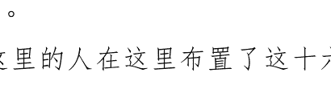

回想起当时中村正源消失的时候，他好像一下子就看不见了，从时间概念来说，他只能是随便走进了某一条石门内跑掉了。这种人绝对不至于于慌措迷路，他既然这么这么跑，也说明他已经想到了这个问题。

听白狐的话，我也觉得事情好像哪里不对。想了想，王经理加了口气，白狐最后的话语如雷霹雳一般，不自在在我脑海中炸开了。

如果建造这里的地方布置了这十六道门是为了困死我们，那这就属于脱裤放子了，多此举。

我记得白狐的人在这里布置了壁画上的一个凸起物，应该是开启一种机关，然后只一道白光之后，我们就全部失去了知觉，等再醒过来，我们所处的位置发生了斗星移的转变。

设换做我是能够设置了如此巧妙的机关，那我完全可以直接用机关把这些人杀死在那个石室，怎么可能还会让这些人高端端的出现在这里。

回想起当时中村正源消失的时候，他好像一下子就看不见了，从时间概念来说，他只能是随便走进了某一条石门内跑掉了。这种人绝对不至于于慌措迷路，他既然这么这么跑，也说明他已经想到了这个问题。

听白狐的话，我也觉得事情好像哪里不对。想了想，王经理加了口气，白狐最后的话语如雷霹雳一般，不自在在我脑海中炸开了。

如果建造这里的地方布置了这十六道门是为了困死我们，那这就属于脱裤放子了，多此举。

我记得白狐的人在这里布置了壁画上的一个凸起物，应该是开启一种机关，然后只一道白光之后，我们就全部失去了知觉，等再醒过来，我们所处的位置发生了斗星移的转变。

设换做我是能够设置了如此巧妙的机关，那我完全可以直接用机关把这些人杀死在那个石室，怎么可能还会让这些人高端端的出现在这里。

回想起当时中村正源消失的时候，他好像一下子就看不见了，从时间概念来说，他只能是随便走进了某一条石门内跑掉了。这种人绝对不至于于慌措迷路，他既然这么这么跑，也说明他已经想到了这个问题。

听白狐的话，我也觉得事情好像哪里不对。想了想，王经理加了口气，白狐最后的话语如雷霹雳一般，不自在在我脑海中炸开了。

如果建造这里的地方布置了这十六道门是为了困死我们，那这就属于脱裤放子了，多此举。

我记得白狐的人在这里布置了壁画上的一个凸起物，应该是开启一种机关，然后只一道白光之后，我们就全部失去了知觉，等再醒过来，我们所处的位置发生了斗星移的转变。

设换做我是能够设置了如此巧妙的机关，那我完全可以直接用机关把这些人杀死在那个石室，怎么可能还会让这些人高端端的出现在这里。

回想起当时中村正源消失的时候，他好像一下子就看不见了，从时间概念来说，他只能是随便走进了某一条石门内跑掉了。这种人绝对不至于于慌措迷路，他既然这么这么跑，也说明他已经想到了这个问题。

回想起当时中村正源消失的时候，他好像一下子就看不见了。我们跟在后面，随便找了一条巷就钻了进去。石门之后是一条巷道，不知道通向哪里。走了一会儿，我们就发现巷道两边越来越宽，呈现出一个巨大的扇面结构。

走着，我们发现前面的巷道两边的石壁上，挂着一些东西。
看着看，这些东西就像是一团巨大的血块，心里都冷了。

阿来带着我们继续走了一段距离，我们发现这些东西不是肉，而是一个蠕着趴在墙上的人。
确切的说，这些都是婴儿大小的人体，萎缩成婴儿状，双手双脚像附着在墙上。
看到这样的景象我几乎呆住了，心里没有恐惧，反而是一种愤怒。到底是谁出了这种事情，竟然把这么多孩子给吸干了！

阿来小心的来到最近的一具尸体前面，小心拨动了下，我就看到这具尸体的小腹位置有一根拇粗的绳子一样伸进了墙壁里面。
这些东西是虚的？杰克在一边问：“阿来，你问了什么？后面有东西？”
阿来摇摇头表示不知道，只是说：“我也不清楚，但我觉得这些孩子是被养在这里的，要么就是用来养后面的东西，实际上是一条带。”

白狐越过来，继续往里走了一段距离，然后听见她说：“你们来看这里！从这个地方开始，越往里走，这些尸体萎缩的程度就越厉害。”
这些尸体的养分都被吸干了。
这些东西是虚的？杰克在一边问：“阿来，你问了什么？后面有东西？”
发现跟白狐的推断差不多，在我们继续走的过程中，我们看到的尸体几乎都被吸干了，有的甚至只剩下了包裹着一层皮的骨架。

石壁上隐约能看到一条干燥的脐带。
那问题问了，空出来的地方尸体去哪里了？
阿来说道：“如果我的没错，这些尸体最初都是活的，而少少的尸体应该是长成人形后从这里走出去了！”
我立即追问：“那剩下的尸体怎么解释？”
阿来：“可能这两种情况同时存在。”

“那是自然，兄弟你真识货！”杂毛十分得意的说了一声，走到石壁边，把耳朵贴近了石壁，开始以一种非常奇怪的节奏敲击石壁。

没料到，杂毛敲了之后，先是眉头一皱，紧接着他又换了一个位置，而且开始加快了手指关节敲石壁的频率，而且力气越来越大。敲了那么五六分钟，期间他换了几个敲击的地方，到了最后，他敲击的位置已经离我足足十几米了。

我们看着过去，杂毛已经停止了敲墙，但我们看到他一眼，露出了十分惊讶的神色，而且脸都红了。

杰克看事不热闹，开始结巴巴的问了什么连串的问题：
“杂儿，你问了什么？后面有鬼吗？这是地狱吗？”
杂毛不知道被杰克的结巴传染了，竟然也结巴：“后面……有东西在……”

阿来一把把杂毛拉了起来，对着杂毛脸趴下，然后问：“你听到了什么？”
杂毛这才反应了过来，吞了口唾，深呼吸了几次，然后说：“我听到了。”
“阿来，你问了什么？后面有东西？”
阿来摇摇头表示不知道，只是说：“我也不清楚，但我觉得这些孩子是被养在这里的，要么就是用来养后面的东西，实际上是一条带。”

白狐越过来，继续往里走了一段距离，然后听见她说：“你们来看这里！从这个地方开始，越往里走，这些尸体萎缩的程度就越厉害。”
这些尸体的养分都被吸干了。
发现跟白狐的推断差不多，在我们继续走的过程中，我们看到的尸体几乎都被吸干了，有的甚至只剩下了包裹着一层皮的骨架。

“这样解释，我不感觉不太对。”
阿来指着墙壁一个地方：“你们有没有发现，这里少了一些尸体？”
阿来这么说，我们就去看看这些墙壁上的尸体，可一看发现，在这些尸体之间，有些尸体与尸体之间的空区域非常大，而且在空白的石壁上，还隐约能看到一条干燥的脐带。

“如果我的没错，这些尸体最初都是活的，而少少的尸体应该是长成人形后从这里走出去了！”
“那剩下的尸体怎么解释？”
阿来：“我也搞不懂，但我的感觉就是这个样子，可能这两种情况同时存在。”

“我靠，哪里不对？”杂毛问道。
“就是我刚才说的，这些尸体，要么是被养在这里的，要么就是用来养其他东西。”
“还有别的办法？”

“大家先不要说墙后面是什么，我面前就是这条巷道的出口，先走出这个地方再说！”
白狐首先表示对于接下来的怎么办见解，然后对阿来和杂毛说：“别忘了我们的任务和那个房间！”
阿来和杂毛点头示意，然后才继续往前走。前面的巷道已经变得非常宽敞了，感觉自己从这么多尸体旁边走过，我不知道这是一种心情，算不上害怕，但就是有一种莫名的味道，感觉那些少少的尸体，还会在这个空间内，此时正躲在某个黑暗的角落看着我们。

很快，我们就看到前面的阿来停了下来，好像是走到这条巷道的边缘了，他拿着手筒在前面四处照了照，然后冲他们招了手，就听到他们说：“答案在这里！”说完，阿来像是沿着通道往下走了。但他去的地方应该不是很深，我们能看到手电光一直在一个小范围内晃动。

观察了一下这些尸体的动作，我就有一种非常不舒服的感觉，因为大多数的尸体都保持着一种弄肉的姿势。我也看到其中一具尸体的动作跟其他的不一样，它的双手放在眼前前，摆出一个特殊的姿势，好像是在看着什么，但手里的东西已经没有了。我由得想起了在日本军舰内看到的同样保持着前进动作的日本军，好像他们都在一瞬间突然就死了。唯一不同的是，我们眼前的这些尸体没有腐烂或者干化。但我并没有多的去纠结这是为什么，我是生物领域的老，知道尸体不腐烂的原因有很多，所以不想想多。我更在乎的是，这个地方为什么会有这么臭的味道，里面看来他们出现在这里的动机跟我并不一样，我们一路过来就是后退无路导致的，而它们却是在这个地方，莫非它们是刻意来到这里要做什么事情？

想到这里，感觉这样的场景有些熟悉，想了想，猛然之间，我脑海中浮现出了一些画面——隧道里面的那些奇怪的尸体和吞噬物的虚无空间容器。再看着这些尸体手中的肉块，心里就忍不住哑咬起来。这些尸体手里的东西，应该是一些胚胎，而这里，是一个古代的人体实验室！我顿时就明白了，卫国雄只对了一半，那部容器并不是自己已孕育生命，而是有人在这里露出了胚胎，然后又放在巷道里面培养成的。

最后的古乃已经劫到我和白狐身边了，情念之下我也不能
跟杰克一样自愿自跑跑跑，那多丢脸份，于是我也不知道哪里
来的来的勇气，一把把白狐推向身后，然后用手里的火去抢
扑上来的古乃。

我们很快也走出甬道，沿着一条并不长的台阶走下去，
我就发现我们来到了一个建筑结构非常奇的地方。

这个地方，我们之前进入的石室都不太一样，只见这个
地方非常宽阔，正对着我们的是一片弧形的石壁，往两边
延伸出去，就像是一个围圈，围住了我们出来的这个地方。

方的这些外围的甬道的石壁明显不同，甬道里面的
质地均匀，石壁都是打磨得非常整齐的青黄色岩石成的，而这个围围
的石壁，虽然有人工开槽的痕迹，但大部分部分仍然保留了
最原始的状态。

我抬头看了看这个空间的顶部，一些钟乳石的东西
在我们的顶头，有些钟乳石还在不断滴下水。而最中间
道部分的圆形建筑物和头头的钟乳石之间，看上去有着
非常大的空隙。

地面显然经过人工修整的，脚底下有一些沟壑一样的
花纹，从钟乳石上流下的水，全部流了这些凹整当中，
不知道流向了哪里。

看到这样的场景，再结合甬道，我对这个地方的
整体结构就有了一个判断。

哪里就是我们醒来的地方，我们中间走过的这条甬道和另外十五石门背面的甬道，组成了这座建筑物最中间的部分，而甬道之外和前面的石墙，就是这座建筑物最外围的一圈。

到了这里，我的脑中就浮现出一个巨大的车轮形状的建筑物，回想了一路走来的甬道的长度，就难免推测在甬道和甬道之间，确实应该隐藏着一个个幽匿的空间。也就是说，杂木所说的甬道墙背后有些东西，理论上都是对的，因为甬道和甬道之间的夹层，确实可以藏下体型巨大的东西。

一手数理，加一逻辑，完美印证了我的这个想法，我就看了看来的甬道底。我们在走来的甬道和另外一条甬道口之间，有一段距离是封闭的。但在这个封闭中间位置，有一条缝隙，看上去就像是两扇巨大的石门把这地方给封住了。石门上满了花纹，几乎和金字塔建筑物的内部的石门一模一样。

我说我靠，果然是别有洞天！想着竟然有一种想法打开石门看看里面到底有什么的冲动。

可是这时候的条件已经不允许了，阿来手中的手电开始变得暗红起来，估计是用到头了。

在这种地方，没有手电就等于瞎子，于是阿来对我们说：“得赶紧找找这里有没有什么可以燃烧的东西，我们做几
只火把，否则一旦遇到危险，我一个人顾上你们几个！”

阿来说是对的，虽然他能够在黑暗中的视觉能力比常人上百倍，可是我们不知道这里会发生什么危险，一旦遇到什么怪事或者被那个中村正源给偷了，阿来是不可能同时保护我们四个人的，而是我们在小范围内看看，有没有能够做火把的东西。

借着手筒最后微弱的光线，我看到正对着雨出口的正前方，有一个巨大的石台，是用来开用的大会桌。石台上还摆放着一些东西，由于距离远了点，所以我看不清是什么。

当我走近了，就看到石台上是一些已经干瘪的肉团。这两团肉团大部分是黑手的，就像是一堆风干的牛肉，但是仔细看了看，又发现结构不对，因为有些干瘪的肉团，竟然看上去像是一个又一个一个婴儿。

我又忍不住往这个环形空间的两边看去，果然每隔一段距离，就会有一个这样一个石台，而且有些石雕的，竟然好像还坐着一些人！

我在走神这个过程中，旁边亮起了几把火，我很异异他们是怎么点着火的，我并没有看到过什么火种。白狐在发呆，就走过来问我怎么回事。

我把我的推测和发现跟她说了一遍，白狐好像早就我知道我所说的这些事情，有点语重地说道：“科学家，你这种，你……”

可是这时候的条件已经不允许了，阿来手中的手电开始变得暗红起来，估计是用到头了。

在这种地方，没有手电就等于瞎子，于是阿来对我们说：“得赶紧找找这里有没有什么可以燃烧的东西，我们做几
只火把，否则一旦遇到危险，我一个人顾上你们几个！”

阿来说是对的，虽然他能够在黑暗中的视觉能力比常人上百倍，可是我们不知道这里会发生什么危险，一旦遇到什么怪事或者被那个中村正源给偷了，阿来是不可能同时保护我们四个人的，而是我们在小范围内看看，有没有能够做火把的东西。

借着手筒最后微弱的光线，我看到正对着雨出口的正前方，有一个巨大的石台，是用来开用的大会桌。石台上还摆放着一些东西，由于距离远了点，所以我看不清是什么。

当我走近了，就看到石台上是一些已经干瘪的肉团。这两团肉团大部分是黑手的，就像是一堆风干的牛肉，但是仔细看了看，又发现结构不对，因为有些干瘪的肉团，竟然看上去像是一个又一个一个婴儿。

我又忍不住往这个环形空间的两边看去，果然每隔一段距离，就会有一个这样一个石台，而且有些石雕的，竟然好像还坐着一些人！

我在走神这个过程中，旁边亮起了几把火，我很异异他们是怎么点着火的，我并没有看到过什么火种。白狐在发呆，就走过来问我怎么回事。

我把我的推测和发现跟她说了一遍，白狐好像早就我知道我所说的这些事情，有点语重地说道：“科学家，你这种，你……”

她递给我火把，然后看向石台方向，同时还让我们跟着。我们就发现石台上面依然是一些肉团，石台周围，竟然是一些穿着古代服装的人。我被眼前的景象吓了一跳，因为这些人看上去活着，几乎一模一样，除非它们坐在那里不动，肢体动作过僵硬，我肯定认为都是活人，不过现在看他们已经死了。

作者:十四 001 日期:2016-05-31 10:48

[content]...
她递给我火把，然后看向石台方向，同时还让我们跟着。我们就发现石台上面依然是一些肉团，石台周围，竟然是一些穿着古代服装的人。我被眼前的景象吓了一跳，因为这些人看上去活着，几乎一模一样，除非它们坐在那里不动，肢体动作过僵硬，我肯定认为都是活人，不过现在看他们已经死了。

作者:十四 001 日期:2016-05-31 10:48

地方，看到了一片密密麻麻的光点组成的一屏，感觉就跟看到了电视里面的无信号的画面一样，数不清的小光点不停的闪烁，似似无，给人一种看着就想睡觉的感觉。

只不过这些光点并不是黑白的，而是呈现出一种非常妖异的蓝色和紫色，看上去并不是实在的东西，却能够用肉眼看得到。

此时我有一种错觉，那就是我从这个竖井掉下去，穿过那片似乎没有的屏障，会不会进入另一个世界。

“这是虚空藏！”阿术第一个反应说道，“这里竟然有虚空藏！”

我不知道阿术说的虚空藏是什么，还没来得及问，就急着处理井获取很多好处，然而听到克唯喊道：“什么是虚空藏？我的天那……这不是时空隧道，怎么可能……可是，那个人又是是谁，他要进入时空隧道了吗？”

我们都被眼前的景象给惊呆了，奈克的话让我们一下子回神，才注意到在我们站在这边的下方的井壁上，蹲着一个人，只是刚才因为角度问题，我们竟然没有发现他。他就像壁虎一样四肢紧贴在井壁上，不知道用了什么办法做到的。

毫无疑问，这个人就是圆顶上看不见的中村正源，他果然进入了里面。因为距离的关系，我看不清他的表情，但我能感觉到他看到我们之后的那种不解和恨意，他到一定……

杂毛看着白狐道：“要不要追下去？”

白狐看了看四周，又看了看井里面，最后说道：“除非直接跳下去，否则我们无法沿着壁缝下去。”

“那就跳下去，反正那老死的也要得下去，就在底下解决他！”杂毛说道。

“不行！”阿来这时打断了他们的话，“还不清楚这片虚底的东西是什么，不能冒然下去。”

中村源一方面非常警惕的往上看着我们，一边不断沿着井缝下降，好像完全没有意识到那片虚无的光点，在不知不觉，已经发生了一些变化。

我揉了揉眼睛，定睛看到在那片光点当中，好像慢慢凸了起来，只是因为这片光点太模糊了，不仔细细看，还真不发现。

这些突出的部分越来越明显，在不经意的那一瞬间，几张脸一样的东西就从这些光点中冒了出来，而且仅仅过了那么几秒钟，又有无数张脸冒了出来。这些脸出光之后，我看到这些脸有些竟长长的奇怪状，似人非人，似怪非怪，看上去非常恐怖的。我被突如其来的场景吓了一跳，浑身一颤，差点就从井道旁边掉了下去，幸好被旁边的杂毛一把给住了。

已经快降到光点附近的中村正源好像发觉了我们的异样，他向下方看了看，也发现了这些怪险。然后我们就看到他一怔，同时又开始疯狂的往上方爬了过来。

可是已经来不及了，他发现得太晚了，那些脸冒出光点之后，一下子注意到了他，此时已经倒到了脚底下，死死盯着他看着。看到中村正源之后出现了逃逸的动作后，这些脸就爆发了一连串的尖叫声，听起来就像是未满的孩子哭声像尖一样利耳。

一手资料加/1955-此处结束之后，我看到整片虚无一下子剧烈抖动了起来，好像是有巨大的怪物从里钻出来。钻出来。钻出来。我忍住想要逃跑的冲动，继续看着下面发生的情况，紧接着，一只足有螃箕那么大的手突然从虚无的光点中伸出，一把抓住了正在向上爬行的中村正源。

这巨大的手跟我们看到的这些脸非常不成比例，我不经意的反应就是觉得在这片虚无的下方，应该还有块头更大的东西。

可是还没等我看清楚这手的样子，就见中村正源连反抗来不及，一下子被这只手抓进了虚无的光点里面。

那些怪怪，也在中村正源淹没进光点之后，全部都消失不见了，而圆形的石门，也随之缓缓的关闭了。

这一连串的场景几乎是在瞬间间彻底发生了，我看到所有人都没有反应过来到底发生了什么，我忍不住就想他们接下来要怎么办，这样傻傻看着也不是办法。

可是还没等我问出来，不知道为什么，忽然之间，我脚下的建筑物居然猛烈的震动了一下，同时我听到了巨大的水流冲击墙壁的声音，好像就在我们四周。

白狐孤道：“怎么回事？”

阿来见状就迅速跑向建筑物顶部的边缘，他往下看了一眼，然后马上折回头，他气喘呼的说道：“从底面的石门里涌出了大量的水流，水势凶猛，估计这座建筑物很快就会淹没了！”

“可是哪里来的水？”我惊讶的问道。

白狐皱着眉头若有所思看着什么，她说道：“敲击声和水声……你们说不会是外面的牛面人为了保护这个地方，砸开湖底，把湖水放了进来？”

“有这个可能！”阿来来说，“这是一种自毁行为，不排除那些牛面脸在放的水！”

“那接下来怎么办？”我急促的问道。阿来没说话，想出办法。其他人也没有。

可以说，水位已经上升了，白狐和杂毛一直在关注脚下不断上升的水位和顶部的钟乳石。大量的洪水开始从四面涌上，水位很快淹没了我们的脚脚，这个地方就成了了一个封闭的空间。按照这个速度，洪水就会淹没整个空间。心里还没算清，对这个地方也有认识，唯一的出口就是下面围着的十六道石门，对于包裹着建筑物的这个空间，要是有其他的入口，白狐和杂毛发现不了。

十六道石门被淹没之后，这个地方就成了一个完全封闭的空间。这次波动持续的程度并不亚于之前，我们有些站不住脚，感觉整个建筑物好像快要倒塌了。水浪拍打周围石壁之后，借着石壁的反力，又朝着我们过来，顷间，所有人都被水浪冲了起来。我拼命踩着水，尽量浮在水面，在我们不断接近阿来的的过程中，我看到水面上漂浮着许多之前在甬道中看到的干尸，它们依然保持着蜷着的姿势，估计是被湖水给冲上。让我们有些难以置信的是，这些干尸里面，我竟然看到一些并没有过的奇怪尸体。这些尸体几乎是什么样子的都见过，但再看那些姿态，就会发现它们不是人类，而是一些非常奇怪的样子。我还看到了一些牛脸怪物一样的干尸，只是这些干尸体型比之前的牛脸小很多。我边游边发现从不同的方向出来的干尸，无论是身形还是头颅，看上去都不一样。我觉得我猜的没错，看样子每条甬道里面养着的，都是不一样的物种。在接近白狐的过程中，我好几次都被不断涌上的水浪拍到了水里，不知道进了多少凉的湖水。同时我在水里看到那些满身古代装饰的傀儡干尸，这些干尸在中术之后非常具有攻击性，但到了水里，不知道不是术失效了它们失去了活力，都僵僵硬随着水流在水底漂荡。

沉沉多少次之后，我终于跟白狐和汇汇了，但此时我浑身上一点力气都没有了，手脚划水的动作越来越慢。抬头一看，此时水面距离我顶的钟乳石已经不到两米，甚至有一些比较长的乳石，我伸手就能够。按照这样的局势发展，我好像也不用什么力气了，因为用不了两分钟，我们就要被淹死了。

然而并不是单单的是，我发现头顶竟然裂开了一大块，导致许多大块的乳石和湖水开始向下滑落，我们不停的移动位置，避开不断脱落的钟乳石，否则要是被那些石头砸中的话，瞬间就会蹦出脑袋。难道是因为这个空间涌入了大量的湖水之后，内部气压失衡了，使得整个空间结构无法再支撑上面水面的压力了吗？我胡思乱想，如果是这样的话，那片钟乳石形状的顶部结构，很快就会在水压的作用下整体脱落，即使我们不被大片的钟乳石砸，也会被巨大的水压拍碎。

想到这里我几乎都已经绝望了，白狐和阿来不知道在商什么，过了几秒钟，白狐就对我们所有人说：“大家都沉入水底，能憋多久就憋！”

我有些不解，没明白白狐的话是什么意思，心想这是要集体自杀吗？就问道：“为什么要潜水底？”

没想到，我刚说完，我就看到阿来本来看着我的脸色一变，大喊一声“当心”，然后猛然从水里跳了出来直接扑了了我。阿来的动作极快，我根本没有感应的时间，瞬间就被他一下扑到了水里，一口水立刻就灌进了嗓子眼，我憋紧屏住了呼吸。也在这个时候，我看到一根粗的落了，我差点没浸进。路口。

在阿来的指示下，我把头朝过去，就看到了一片光亮。以前的空间作为参照物，结合这片自然光的范围，我们距离真正的水面并不远，可能只有二三十米。脑子里一下子涌了出来这个概念，而且这个概念刺激了我的求生的欲望，我对阿来点了点头，意思明白了，赶紧上去吧！其实到了这种时候，我的肢体已经听使唤了，我依然能够拼命的往上方去，基本上都是人的求生本能。

我不断拽着我在水底移动，避开了一些钟乳石，阻力变大，下降的速度也不算快，我们并没有被石头命中。此时的水底已经变得十分浊，除了我们所在的地方似乎有些浪漾。头部浮出水面，一下子睁开了。也不知道自己昏迷了多久，可能是两个小时，也可能仅仅是闭上眼睛的秒钟，总之之前经历所有的事情好像是放电影一样在我的脑海中闪过，但我狠的告诉自己每一句话：没错，都结束了。

当我睁开眼睛时，我看到所有人都一样，我和杰克一样，还是浮在水面了，除了白狐的状况还一点，我和杰克分别被抬来和杂毛有着腰。看着岸边的火焰，此时已经是傍晚，四周水域的水面很平缓，除了我们所在的地方似乎有些浪漾。放眼望向远处，整个湖面竟然还有些波光粼粼，再往远处可以看到一些帆船和渔船，好像在这平静的水面之下，并没有发生过那些险诡异的事情，一切看起来都非常的祥和。

杰克睁眼睛后，看到这样的场景，哇哭了起来。我不知道说什么，但我十分理解他的心情，我想如果这里没有其他人，我一定早就崩溃了。白狐看了我，脸上露出了一种非常特殊的笑容，我苦笑着回应他，没有说话。又清楚自己并没有受伤，于是看向身边的阿来。一看之下，阿来的脑袋已经被拉下去了，开始在水里挣扎，我大叫：“阿来好像受伤了！”杂毛游在我们面前，我们一起架起了阿来，使得他不再继续沈水。阿来是在什么时候受伤的我完全没有印象，可能是在上浮的过程中被石头砸中了，而且很有可能是为了救我。我知道，他的手是不可能被那些钟乳石吞噬的。只有呼吸但没有回应，看来是深度昏睡了。

正当所有人都手足无措的时候，白狐叫我们不要紧张，向着夕阳看着我们。我抬头看向远处的天边，看到一架直升机对着夕阳，慢慢朝着我们的方向飞来。

之后的事情并不是特别的清晰了，只记得我被七八脚的他们塞进了一个气囊当救座椅当中，然后被拉上了直升机。离开水面之后，不自觉中，我深深松了口气，随着这种放松情绪的突然到来，我陷入了一种半醒半睡的状态。在意识模糊中，我看到一个穿着大褂的人在手臂上注射了一些东西，拔出注射器的时候，我就陷入了深度睡眠。当我再次醒过来，我发现自己躺在一张床上，不知道睡了多久。护士走过来来看我的状况，说了：“你的身体没什么碍，可以随时出院，但要注意休息。”我知道了，我回答。然后转移话题，问她最近国内有没有什么大的新闻，比如大型交通事故一类的。她回答的很干脆，直接说没有，除了和谐会还是和谐社会。

我有些不敢相信，跟护士借了一部手机，各大网站翻遍了，依然没有找到关于坠机的任何新闻。查了半天无果，我都开始怀疑自己是不是出现了幻觉了，难道这一切，都是我做的一个梦？按道理来说，那么大的交通事故，死了那么多人，肯定会在集会上头条的。可是现在的情况看来，好像这个世界上并没有坠机这回事。要不是杰克的信留在病床上，我肯定会以为自己得了臆想症。

第二天，我办理了出院手续，坐了十几个小时的火车后，终于回到了云南。我没有正飞机，我想这辈子我都不可能再坐飞机了。我还是去了研究所，但是那里的那些同事都跟我一样，或者说跟我平时出差回来时候的境况差不多，只是在面对面的时候会互相打个招呼。这可真是怪事了，监控到比坠机底下看到我都个她娘的怪。我很随意的拉了一个同事，问他有没有看到国内的大的新闻。他说没有，除了和谐会还是和谐社会。

我揉揉眼睛，看着自己顶的钟乳石，我发现头顶竟然裂开了一大块。我发现没纠结了。这天，我跟所长请了一个假期，理由是身体不适，所长竟然答应了。我发现没纠结了。这天，我跟所长请了一个假期，理由是身体不适，所长竟然答应了。

老阎庙底对我来说就是个梦，而且我现在也无法知道自己是否已经从这个梦中醒了过来，但我心里很清楚，这个梦的开始，就是从这封不该出现的信开始的，这是一件不祥之物。

可是我要去点点的时候，不经意间手里东西一滑，结果信封里的两张照片就不小心被我掉到了地上。

我捡顺手捡起了照片，也没太在意，只是下意识的往其中一张照片上看了一眼。

可是没想到，就是刚才这一眼，我看着照片里面的画面，竟然呆住了，而且一股毛骨悚然的感觉瞬间传递了我我的全身。

我吓得大叫：“是谁？”

“我！”门外很快传了一个声音，听上去有些熟悉，可一时又没想起来是是谁。

我隔着猫眼往外了一眼，本来只是一个习惯性的动作，我是哪里想到，外面的这个孙子就是个傻大眼王，因为我看向外的时候，他也正把眼睛贴在猫眼里往看，我一下就看到了了一个瞪大的眼珠。

我靠，你她娘的是傻逼逼，瞪着个破眼子看我妹呀，你还想从外面偷窥吗？我刚想要破口大坝，但一下子又打住了。

因为我突然想了一件事情，我看到的那只眼睛，竟然是蓝色的！

我想着刚才那个回答的声音，忽然就意识到外面的人是谁，这个人是阿来！他来我家干什么，是杀人灭口吗？。“齐天不在，你找错了……”我几乎是下意识般脱口而出，我都不知道自己会说出这样句话。

外面的阿来说：“再不开门我就撞门进去了。”

我定了定，心说也是，我到底在怕什么，他们要是想杀我，就不会把我救到医院，而是这里是我家，不是老爷府，这里没有危险，我安慰着自己，开了门。

阿来理了我，竟然穿着一身阿达拉斯斯运动服，我心里第一反应就是好巧的一个青年，终于于我了！阿来看着我，就像看到我脸上有雾脸一样，他的表情十分古怪，他站在门口对我说：“你多少天没洗澡了，怎么比在水底的时候还要狼狈？”

我不知道此时自己是在哭还是在笑，我确实已经十天没洗澡了，也知道自己肯定快成稀哥了，但我有充足的理由去忽略不计这个问题。我只是愣愣地看着阿来和他那双深蓝色的眼睛，一天也不知道该说什么，心里对他的出现充满了不解和排斥。

曾经有过那么一些时刻，我对阿来已经是是非常的信任了，甚至都把他当成了我的兄弟，可是现在看到他出现在我的家门口，总感觉有些惊骇，好像觉得阿来不应该出现在这个世界上，他并不是这个人的人。

虽然我非常疑惑他们三个人为什么没有出现在医院里，但我心里又是非常的不想再跟这几个人有任何接触。阿来的出现让我产生了排斥的情绪，证明了这一点。

我也试着让他进家门，或者说我干脆就不想他进来，只是问道：“你怎么来了？白鸽和杂毛他们呢？”

“大小姐出事了！”阿来说，表情复杂。

我看着阿来，第一次看到他的眼神里充满了一种非常特别的色彩，那是一种忧郁和混合在一起的神色。恍忆，我又好像看到了卫国准，看到他冲进那片妖魔鬼怪之中……正当这一刻，一种时空感开始在我的脑子里徘徊。

我呼了一口气，脑子里浮现着那些画面，我对阿来说说：“阿来，进来来说话！”

作者：十四国 日期:2016-06-04 13:15

====

各位亲爱的朋友，《伏裹密码》之《迷航老客店》篇到这里，已经结束了，这书发了一个多月，其中有一部分我是我很早之前写的，有一部分是按照之前的故事进展写来的，很高兴的一直有很多朋友在看，而且还提出了各种各样的意见。

最近，接到了两家出版社的约稿，其中一家审稿还顺利通过了，可能下一步就会签约实体书了。不得不说，对于一本书，能实体，那肯定是一个让人高兴的事情，在这里提前说一下，凡是一直支持我的朋友，如果实体出来，按照我的性格，肯定会直接送给大家作为感谢。

也请放心的，只要我还能写，就不会写错，因为我真的非常喜欢写故事。至于能不能挣钱，我可以毫不不瞒的告诉大家，我的公司叫东木山人人开发有限公司，旗下还有两家子公司，我年的流水，大概在200—300万左右。

所以，我的故事，首先会放在大家能看到的地方，我没有签约任何的小说网，因为我就受不了了那所谓的付费阅读。

我只想，我正好能写，你正好能看，以此而已。

话不多，明天开始，会更新这个故事的第二部《天坑诡异》，带着大家到四姑娘的神秘天坑走一遭，至于能不能写，那就看我的了。但是有一点，我可能更新的速度不会像第一部一样，因为要回应出版社的要求，得把第一部的稿子做一些修改，可能会有一些因素的限制。

阿来对于白狐的这个交代非常不理解，也不知道白狐所说的是什么，白狐临终的时候交给了阿来一样东西，说如果有必要，就把这个东西交给阿来，让我加入二梯队。对阿来而言，肯定是觉得我加入探队是非常没有必要的，但他又觉得白狐这样做肯定是有理由的，因此在出发之前，阿来拿着这样东西找了我。这是一块鹅蛋大小深红色的石头，看上去有些像人造的劣质琥璃，除此之外也没有什么特别的。我记得这块石头的出处，是在老阎庙底。

同时他的到来，这个人是阿来，他曾经多次救过我的命，如果没有他，我一定会死在老阎庙底。刚看到他的时候，我是极度抗拒的，如果看过之前的故事，一定不难理解我为什么这样，其中最直接的原因就是，我不认为他是属于我们世界的人。他找到我之后，告诉我的第一件事情就是，当时我在老阎庙底遇到的探队首领白鸽，在四娘山出了事。

在这里，我长短说，把这件事最简单的叙述出来。当我们被直升机接走之后，阿来和杰克、白鸽三个人在当天离开了江西，他们被送到了北京的机场，进行了一些必要的整顿。以白鸽为首的考察很快得到了重组，加入了一些新人，并且在白鸽的要求，这支队伍仅仅是在五天之后，就往了四川。阿来因为伤势比较严重，没有跟白鸽的大部队一起出发，而是被安排为第二梯队。白鸽临时告诉阿来，如果发现这支考察队随身携带的GPS追踪信号消失了，那说明队伍出了问题，阿来就带着第二梯队往四川开展救援工作。开始的时候，阿来每天都盯着电脑，一直关注着屏幕上显示的GPS源，但当白鸽的队伍进入四娘山之后，原本在屏幕上多达十几个信号源，就逐渐发生了一系列的变化。首先在电脑的电子地图上显示，不知道因为什么原因，这些信号源被分割成了四个部分，而且每一组信号源之间的距离越来越远。这些信号源被分割之后，就开始一组一组在电脑上失去痕迹，到最后，阿来在电脑上连一个信号源都看不见了。这时候，阿来意识到白狐对他说的话已经实现了，按照白狐的要求，他必须立刻赶往四川开展相关的活动。

但是，阿来想到了白狐交给他的另外一件事情。白狐临终的时候交给了阿来一样东西，说如果有必要，就把这个东西交给阿来，让我加入阿来的二梯队。阿来对于白狐的这个交代非常不理解，也不知道白狐所说的是什么。

听完话后，脑子里首先浮现老阎庙底底下看到那尊巨大的远古雕像，记得白狐和萨毛给雕像跪下了。那尊雕像后开始不断地剥掉了附在表面的石头外壳，里面出现了一个巨大的物体，特别是那些蠕动的鳞片，更是让我有余悸。虽然处于特殊的局面，我们并没有看到那座雕像褪去壳后的全部面貌，也不知道那个巨大的东西到底是不是活的，我觉得如果巨人生物真的是存在的话，石头雕像里面的东西算是其中一种。我是忍不住说了：“小姐要找的东西，会不会就是老阎庙底那尊雕像？”阿来说：“应该有一定的关系，不是小姐要找的东西，否则她就没有必要再去四川了。”阿来的话是有道理的，因为我发现，老阎庙底的时候，白狐一路走下来，并没有明确目的，她关注的似乎是老阎庙底本身。这就给了我非常奇怪的疑惑，白狐一人来到老阎庙，好像是在求证一些东西，而不是为了寻找什么。我跟阿来针对照片上的东西说了了很多，虽然没有得到什么价值的结论。我又问了他一些其他问题，但这个过程我很愁。我发现这个来人不仅眼睛奇怪，就连性格也很奇怪。他说他忧愁欢喜，还能非常有思路地表达一些他自己的想法；你说思维正常吧，他又有一个怪病，那就是你不能问他除了他所描述内容之外的事情，因为你问了他也白。我要说我不知道，没有权利告诉你这样的。但现在是在我家里，我觉得我有足够的主动权，于是跟他要了一个眼神，问了他一个我非常关心，但我又认为阿来一定不会说的问题。如果他再说无权告诉我这样的话，正好中了我的下怀，然后我也有了走的理由。我根本没有任何勇气去跟她去四姑娘山，这不是因为我胆小。

她脸上露出了悲伤的神色。

我有些难以面对这个人，她终始终没有勇气跟他提起关于卫国英雄的事情，甚至我一直在极力避免闻到有关卫国英雄的事情。尽管我对这个士兵身上所存在的怀疑，远远大于那些如幻如梦的经历所带给我的迷团给我造成的困扰。

当阿来说这些话的时候，他眼睛一转一转地眯着我，说道：“我都告诉你了，你必须跟我走。”

我背上一上一麻，心里觉得无赖了，又忍不住想起了另外一事情。是为了拖延一下时间，看看怎么拒绝阿来，于是我把右手写给我的信给了他。

不知道为什么，我脑子里似乎有一条无形的线，能够连接我的一些线索……

我的心里一些线索串贯成一个并不算完整的片段。

然而，阿来在看完信后，忍不住激动了起来，他说道：“没错，我猜的没错，一切都对上了！”

我问：“什么事情对上了？”

阿来回答：“这封信是从四姑娘山出来的，而大小小姐也去了四姑娘山。这里面的关键是，大小姐和信里的左右，都跟上世纪九十年代的那次大型考古活动有关，你不觉得这一切太巧合了？”

“是他妈妈的挺巧的！”我有些恼怒地说，“巧到刚好是我收到了这封信，恰好我在阳朔湖边，又恰好碰到了你们！”

阿来显然不是这个意思，他继续说道：“你没有听明白我的意思！我是说，太过于巧合的事情发生在一起，那促成这种巧合背后的动力，又会是什么呢！”

思索了足十分钟，也没想出一个所以然来，我做了很多很多的论，感觉都是天方夜谈，我甚至都想到了我们其实都是些布局，这这一切都是骗鬼的人在玩弄我们，在大鼓之中玩戏给别人看。

想看看就觉得很不对，感觉她娘的上头，意识到阿来这是在挖洞把我往里带带，因为他也不知道这背后的动力到底有没有，就算有他也不知道是什么。他是在跟我玩心理游戏，目的只有一个，那就是对我进行潜意识催眠，好让我也去四川。

当我反应过来的时候，看到阿来非常阴险地似笑非笑看着我，还对我说：“大小姐说过，你考虑问题的时候的样子，还是很傻可爱的。”

我当场就破口大骂：“你大爷的你个怪物阿来，我还以为是个老实人，没想到你也跟我玩阴的！你不是就是想让我去四川嘛，老子带你去！但我要告诉你，不是我被你脑了才愿意当傻逼，而是我要告诉你你还有你们家那位大小姐，我真想炸他妈不是傻逼……”

我爆发得像炸了一样，又慌慌崩地说了一堆，其实就是在听阿来说白狐说我我靠的那一刻，我一下子接受不了了。男人就是这样的，要是被一个大老爷儿咒一句傻逼，除非被动，否则压根就不会往心里去。但如果要是被一个认识且还对她有那么一点仰慕的女人骂一句傻逼，我那想多些，数人都都会跟我一样，更极端的我来说，非要用实际行动来证明，你凭什么是傻逼，我不是傻逼。

但刚闻一刻，我就看到阿来的笑容更诡异了，心里忍不住就“哎呀”的一声，我靠，阿来这孙子是在给我的连环，我这回才真的是上当了！防断更并获取更多帖。

只见他从座位上站起来，作轻松地说：“那我们可以出发了。”

作者: 十四四 日期:2016-06-09 16:24

当天下午六点多，接近傍晚的时候，我和阿来从昆明出发，坐上了往四川成都的火车。

不知道阿来怎么想的，接近二十个小时的车程，他居然买了了两张硬座，我拿到火车票之后，差一点就扭头跑掉。

我问他：“你们不是公家报销，干嘛这么折腾儿？”阿来眼神回复：“报销是个些什么东西。”

后面基本上是一路无话，我总感觉自己上当了，屁股底下坐着硬座，心里极其不情愿，说是要去死，还不买两张卧铺，想想真可悲。

期间阿来多次试着说话，我都不愿意接。我一直在想，等我们到了四川，怎么能够足够的理由证明自己是跟着他来。在半梦半醒之间，我也想出了一套方案，比阿来比了了脚，发烧了，不过等我们到了四川之后才能实施。

火车在第二天中午到达了成都，阿来把座位外的窗户锁了，防止掉车。我擦了擦流出来的口水，肚子昨天晚上吃坏了，感觉浑身乏力，还想抱。

（此处由于原文重复严重，按逻辑合并如下）

阿来显然不是这个意思，他继续说道：“你没有听明白我的意思！我是说，太过于巧合的事情发生在一起，那促成这种巧合背后的动力，又会是什么呢！”

思索了足十分钟，也没想出一个所以然来，我做了很多很多的论，感觉都是天方夜谈，我甚至都想到了我们其实都是些布局，这这一切都是骗鬼的人在玩弄我们，在大鼓之中玩戏给别人看。

想看看就觉得很不对，感觉她娘的上头，意识到阿来这是在挖洞把我往里带带，因为他也不知道这背后的动力到底有没有，就算有他也不知道是什么。他是在跟我玩心理游戏，目的只有一个，那就是对我进行潜意识催眠，好让我也去四川。

当我反应过来的时候，看到阿来非常阴险地似笑非笑看着我，还对我说：“大小姐说过，你考虑问题的时候的样子，还是很傻可爱的。”

我当场就破口大骂：“你大爷的你个怪物阿来，我还以为是个老实人，没想到你也跟我玩阴的！你不是就是想让我去四川嘛，老子带你去！但我要告诉你，不是我被你脑了才愿意当傻逼，而是我要告诉你你还有你们家那位大小姐，我真想炸他妈不是傻逼……”

我爆发得像炸了一样，又慌慌崩地说了一堆，其实就是在听阿来说白狐说我我靠的那一刻，我一下子接受不了了。男人就是这样的，要是被一个大老爷儿咒一句傻逼，除非被动，否则压根就不会往心里去。但如果要是被一个认识且还对她有那么一点仰慕的女人骂一句傻逼，我那想多些，数人都都会跟我一样，更极端的我来说，非要用实际行动来证明，你凭什么是傻逼，我不是傻逼。

但刚闻一刻，我就看到阿来的笑容更诡异了，心里忍不住就“哎呀”的一声，我靠，阿来这孙子是在给我的连环，我这回才真的是上当了！防断更并获取更多帖。

只见他从座位上站起来，作轻松地说：“那我们可以出发了。”

作者: 十四四 日期:2016-06-09 16:24

当天下午六点多，接近傍晚的时候，我和阿来从昆明出发，坐上了往四川成都的火车。

不知道阿来怎么想的，接近二十个小时的车程，他居然买了了两张硬座，我拿到火车票之后，差一点就扭头跑掉。

我问他：“你们不是公家报销，干嘛这么折腾儿？”阿来眼神回复：“报销是个些什么东西。”

后面基本上是一路无话，我总感觉自己上当了，屁股底下坐着硬座，心里极其不情愿，说是要去死，还不买两张卧铺，想想真可悲。

期间阿来多次试着说话，我都不愿意接。我一直在想，等我们到了四川，怎么能够足够的理由证明自己是跟着他来。在半梦半醒之间，我也想出了一套方案，比阿来比了了脚，发烧了，不过等我们到了四川之后才能实施。

火车在第二天中午到达了成都，阿来把座位外的窗户锁了，防止掉车。我擦了擦流出来的口水，肚子昨天晚上吃坏了，感觉浑身乏力，还想抱。

（接后续逻辑内容）

杰克基本上把成都好吃的名菜都突击了个遍，他最喜欢夜晚成都街头的大排还有那种花辣的川味子。他这次来四川的主要目的，是为了能够看看四川原产的大熊猫，他在美国有一个大伙子，非常期待能跟大熊猫有合影。

看着杰克嘚勃说了一大堆，我心里越发不是滋味可是我不知道该如何打破这种心情。杰克是个很单纯的人，他并没有问过我为什么也会来四川，他一直认为我也来旅游了。

当越野车进入了甘肃自治州，沿途看到异乡的藏族风情和远处那些聚入云的四季山，我一直紧缩的心情得到了一丝的缓解。我告诉自己，福不是祸，祸不是。

越野车开了四个小时后，我们到了小金县。晚上我们三个人找了一家火锅店，吃了一些涮肉。在酒店回来，睡觉之前，我看到他依然带着一个装着液体的玻璃瓶，先是喝了几口这种液体，然后开始和我们一起吃羊肉。我问他：“瓶子里装的是什么？”阿来收起了瓶子，看来不想告诉我。

第二天醒来，由于我实在是太累了，就在小金县住一夜，明天上山。我看着杰克跑路，还是一步走一步看。

杰克根据阿来的指示，把车开向四姑娘山的西北方向。大概又过了三个四个小时，我发现路已经不可能开一辆越野车，因此我们三个人一人背上一个旅行包，开始徒步往山里。阿来拿着一张地图，上面用圆珠笔标记了一些符号，他对我和杰克说：“地图上面的四个点，就是我们的目的地。后面全是山路，可能会比较辛苦，你们两个一定要跟上我，千万不要落单。”

杰克哈哈了一声道：“跟我参军时候的野外求生训练比弱了，你就可以放心吧！”

阿来又看了看，我心想不能再装肚子疼了，那样不是显得特别胆，于是就非常不情愿的点了点头，心里盘算着进山也不多久，也没遇到什么危险，此时我胆恐怕都会笑话我。等到正遇到了危险的时候，杰克肯定会回头的返回，到那时我发现而有了退出的理由。

看着阿来的地图，我忍不住想起了一个问题，那个位置，会不会阿来所说的第一队GPS信号消失的位置？这难以避免阿来带着我去这四个地方吗？我靠，这不不是阿来有准备对着姑娘山的愚蠢行为吗？那四个地方，肯定会发生一些我们所想不到的事情，否则怎么会有成批的GPS信号同时消失。我想我就出了一身冷汗，阿来果然是个疯子。

沿着地图上标记的路线，我们很快就深入了大山里面的丛林。刚开始的时候，还能看到一些山林间的小道，看样子平时还会有人在这些山里活动。可是随着我们不断深入，发现脚底的路越走越，随着山势升高，最后干脆一条道路都找不到了，我们开始沿着比较宽的缝隙山林中摸索穿行。

走了几个小时之后，树林中的光线开始暗下来，发现我们已经进入了原始森林，树密叶遮天日，抬头很难看到天空。感觉体力开始下降，喝了几口饮料，提议大家停下来休息会。杰克说道：“我们不是在打仗，没有必要这样赶路。”阿来道：“我们就休息五分钟之后继续上路，目的地离这里不远。”

休息了一会儿，我忽然意识到情况似乎不对劲。从周围的地形来看，我们应该在一个道势相对缓的山谷里面，这里的植物种类特别多，使得植被生长得茂盛。但按照理来说，这里是原始森林，应该有很多野生动物，可是停下来之后才发现，好像自从进了这个山，再也没有见过任何活动的影子，连鸟叫都没有。

刚进山那会儿，我们还会看到一些稀奇生物，偶尔还能看到几只猴子。反而是进了森林后，应该有大型兽，却看不见活动的迹迹，真是一件怪事。杰克在比我更早发现了这个问题，这时问我：“你不觉得这个地方奇怪吗？”

“怪极了！”我回答，“连只鸟都没有。”杰克继续说道：“我之前查过了，这个地方有着非常多的野生动物，但是我已经长时间没有看到过的东西，这并不符合事实，谁能告诉我是什么？”阿来听到我们的对话，回头说道：“既然看不到任何生物，那就只有一个可能！”

“什么？”我和杰克几乎是同一个问题。

“在这片森林里，有能够克制一切的东西！”阿来继续看着周围，冷冷的说道。

作者:十四 001 日期:2016-06-11 20:58

@pmkk6710593 2016-06-11 19:30:00
两天没来，还以为能看到好多呢。楼主居然也休息
尽快哈，谢谢支持！

作者:十四 001 日期:2016-06-11 20:59

@dishor 2016-06-11 19:10:00 ~~~~~~
等——王整整理，加微1101284955，防断并获取更多好帖

作者:十四 001 日期:2016-06-11 21:00

@穷通富达 2016-06-11 18:59:00
坐等楼主更新！
屁底下长蛋子了

作者:十四 001 日期:2016-06-11 21:01

@a834100505 2016-06-11 18:34:00
跟上。看过的秃。不错。
谢谢

作者:十四 001 日期:2016-06-11 21:03
@伪射真摩羯 2016-06-11 17:51:00
更新~~ 更新更新~~ 别太监啊楼主~~!!
你大爷的！明天来视察!

作者:十四 001 日期:2016-06-11 21:05
@ds.jgty 2016-06-11 16:43:00
今天还不不帖出来？ 递掩掩的！
我有什么好递掩的

阿杰反应极快，杰克的哨声一发出，他就一个转身挥动了
背包，一个简简单单就朝杰克冲了过去。

我在阿来后面，绕过一些灌木层之后，就看到杰克坐在不远处，他盯着一棵距离他只有五六米的大树的树干，后牙狂舞的比刺者，浑身都在哮中。

阿来手里握着一把匕首，眼睛死死视着四周，一步一步慢慢靠近了杰克，最后视线落在杰克看着的那棵大树。在同一瞬间，阿来好像发现了什么，只他握着匕首的左手猛然向前一提，匕首脱离了他的手，凌空出一声响亮的破空的声音之后，就直直进了树里面。

我下意识看向了阿来的方向，却被眼前的景象吓了一大跳，阿来这崽子竟然把匕首插进了树干上的一个人的脸上，二十公分长的刀刃足足插进了那张脸里一半多，这这个人肯定被爆头了。

在看来被爆头的人，倚在树干上一不动，显然是死了。不过这个人应该是做了丛伪装，他的整个身体跟周围的树叶几乎同一个颜色，不仔细细看还真容易看出那就是一个人。

我心完了，闹出人了，阿来果然是个冷血动物，怎么说杀就杀吧……于是忍不住就叫了出来：“阿来，你娘的疯了吗，出人命了！”

阿来没理我，而是走向了那棵大树，看了两眼之后，把那只血淋的匕首拔了出来，然后说了一句：“没事儿！”

我很很好发现自己好像判断错了，因为我看到阿来在从那脸上拔下匕首之后，那张脸并没有我想的那样留出鲜血，整个人依然保持在树上的动作，并没有倒下去，像是一块木头被狠狠砍了一刀……我靠，你大爷的！我脑子一转，突然明白了，这个阿来是被用飞刀才干掉的人，就是一个木头人，原来是他娘的虚一场。

我长出了一口气，来到这个木头附近，就看了它的全貌。

这个木头人并不是倚在树上的，而是从树里出来的，身高跟我们成人差差不多，四肢健全保持一种立正的动作特别，别将那个人，五官表情一应俱全，冷不丁看上去，就跟电视里面那些穿了吉利彩服涂了迷彩油伪装起来的特种兵一样，简直是栩栩如生。要不是我提早就有了思想准备，冷不丁看到这个木头人，我肯定也会被吓个半死。

阿来说道：“这是个假人，叫活雕像。这样被人动过手，有人在树上用利器刻出这种人形雕像，或者是用模型刻出一个人形的痕迹，随着树木逐渐生长和爬蔓的不断加深，这个人形痕迹也成长了一个人的样子。”

我扶起杰克，拉了他的背后，告诉他：“别逗胆小，那是个假人，没有什么危险。”

杰克瞪着像母牛一样的眼睛依然充满了恐怕，结巴巴的对我说：“为什么你们中国会有这样一些希腊古代的东西，我们是来欣赏赏大自然的，我可不是冒险奇兵的！”

“没事，这是中国特有的艺术，大自然经常见到……”我嘴里安慰着杰克，心里有些自嘲，说他算什么，后面的路并不复杂……（此处省略重复的逻辑描述，已按要求合并并处理）

重点就在这一行字。

遇雾则逃！遇脸则安……我在心里重复了几遍这两句话
之后，发现自己完全完全不懂这两句话到底要表达什么意思。

仅从字面意思来看，阿好好像是在说，遇到雾我就得跑
路，遇到脸我我就安全了。但我并没有遇到什么雾，也不知不道
他说的脸具体指什么。

就这样看着这一行字，鬼神差一般般，我脑子里突然冒出
一个非常不切实际的想法，我从树上摘下刀子，在这一字
下面重新刻下了一句。

“什么意思？”

刻完了，我就对自己说，要是有人回答我的问题，那我
就用这把刀子来比一下自己的颈动脉，因为这也太夸张了，都快快
上拍科幻电影了。想着，我还用刀划了一下脖动脉，
发现这个牛逼的有点大。

可是没想到，我刚刻完这句话之后，只过了那十几秒
中，我看到在刻出来的这句话下面，竟然又出现了了
一些字，我甚至还没来得及明白这些字是怎么出来的，总
它就在我我不经意之间出现在了那里，只是这一次的字迹上看
更加蛇添草了。

愿不想多想，我赶紧去分辨这些新出现的字在说什么，
结果就看到看到了一句让我哭笑不得的话。

“傻逼，看周围，赶紧跑！”

我先愣了一下，然后就立刻转身看向四周，结果映入我眼前的场景，让我一下子就明白了了那句“遇雾则逸”是什么意思了。

我忽然意识到，之前我感觉到的天色暗暗，并不是真的要天黑了，而是不知道从什么时候起，在这一片森林里，竟然升起了一种非常稀薄的烟雾。这种烟雾是黑色的，如果不仔细细看，就很容易给人一种天色暗暗的假象。而且我判断这些这些烟雾应该是一点点变浓的，否则我也不会感觉森林中的光线会下降的那样明显了。

想来说，按照我们的时间计算，具体天黑的时间还早，可能很快太落山了。我不大叹自己太她娘的糟心意了，竟然没有意识到自己的四周早就已经游离了这种比色烟雾，如果这些都是些森林雾气，那我可就完了了。

更加让我感到不妙的是，也不知道是不是我的心理作用，这样一想，我就感觉自己的头有些晕起来了，嗓眼睛也开始变得难受，似乎有些不的感觉。

遇雾则逸，可是我哪儿逸，四周全是这种黑雾缭绕，根本没有方向，而且我一直在这个范围内兜圈，就算跑也可能再次回到这个地方，想着我一下就跑了。

但是过了那一瞬间，我又告诉自己，她娘的撑悍胆大的，俄死胆胆小的，既然不知道往哪儿跑，那往哪里跑都一样了。阿来的话不能信，让他跑就自然就有他有的理由，因。

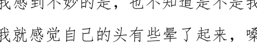

我拎起背包，撇开腿朝着一个方向奔了起来。

在森林中奔跑简直就是在自虐，一些低矮的藤条不断抽打在我的身上和脸上，我眼泪都被抽出来了，估计此时我都变成大花脸了。可是跟命相比，这些都是可以忽略不计的事情。

黑雾覆盖的范围非常大，无论我怎么跑，始终能感觉到自己依然被黑色烟雾包围。而且也能感觉到黑色烟雾的密度和刚才相比又厚了不少，我的可视距离在只剩下几米远了。

可是在这种特殊条件下，我依然保持着集中的注意力，一方面尽量避免跌摔或者坐坠，另一方面我还在拼命的用视线寻找所谓的“脸”，按照他的话，只要找到“脸”，就安全了。

也不知道跑了多久，我并没有看到所谓的“脸”，却看到此时的黑色烟雾已填满了整片森林，周围的一些树木已经看不清楚的样子了，只能看到一些隐约的树的轮廓，我浑身上充斥着一种无法形容的乏感，头晕耳鸣的症状也明显严重了不错，我可能是吸入了这种黑色烟雾太久，已经中毒了。

身体不受支配了一样，我逐渐放慢了脚步，强烈的窒息感开始侵蚀我的大脑，摇晃着身体就要倒下去。

这一次，不知道是不是出现了之前的幻觉，眼睛出现了一些奇怪的景象，好像看到远处一些白光亮了起来。这些白光就像是一道从天降的光柱，但因周围着厚的烟雾，显得非常真实。我坏了，难道我要死了吗？正迷糊想着忽然之前，我就感觉在光柱和我之间的黑雾当中，似乎有什么东西在动着，导致了我前面的烟雾发生了一种诡异的变化。

有的念头告诉我，这种感觉就像是有只奔跑的野兽，以非常速度划破黑雾，直直向我。顷间，我就看到眼前的黑色烟雾一下扭曲了，往后退，身体有些软要倒去。就在骨眼上，忽然感觉自己的身体好像被一个手揽住了，奇怪的是，我依然没有看到任何东西出现在身边。

我使劲眨眼睛，告诉自己千万别睡觉，问了一句：“你是阿来还是杰克，我怎么看不到你？”对方没有回答，或者我无法听到。由于我受到了这种黑雾的毒害，在视觉和听觉上已经受到了限制。不过我很明显感觉到抓住我胳膊的那只手问完之后捏了一把，不知道算不算回应。过了半分钟后，我就感觉前面的那道光柱变得很明显了，那是一片相当自然的光线。靠近了这束光之后，在隐约当中，我看到了一个人形轮廓正驾着我不停的往前，而且这个轮廓变得越来越清晰。当我带进这些线条范围之后，就脱离了黑色雾的包。我抬头看了一眼这些线条来的地方，现在正好是阳光刺眼的时候，斜着照了我所在的地方。背包被拿下来放在地上，然后我安排着背坐了下来。休息了一会儿，感觉呼吸慢慢顺畅了起来，应该是安全的。这时候我就听到耳边好像有人跟我说话，声音断断续续非常的模糊，感觉自己的耳朵就像被保鲜膜给堵住了。我说道：“我听清楚你在说什么，如果是阿来和杰克，”刚说完，我的脸一下子就被一只手给捏住了，疼得我忍不住喊了出来：“我去，想捏死我？”

“哈哈！从心理学上来说，你有被虐倾向！大圣，我建议你去看看心理医生……”我的听觉在不知不觉中恢复了不少，听到面前熟悉的声音低了一大截。我试着睁眼睛，就看到我面前蹲着两个人，是阿来和杰克，他们看着我，跟猴子一样。

我揉了揉眼睛，擦掉满脸的泪，又忍不住摇晃了几下脑袋，问道：“为什么受伤的不是我？”“那是因为你太大了！”阿来回来。

“到底是怎么回事？”我感觉自己有很多问题，但脑子不是特别清醒，不知道应该先问哪个。阿来刚要说话，却立刻一旁的杰克抢了话，只听杰克非常张张说着：“你知道吗，要是不是我，你们俩肯定都死了！”阿来给我灌了口水，杰克在一旁说起了这件事的前因后果。排除他刻意夸张的成分，大概意思是，我和阿来往不同的方向寻找那种树雕像的时候，杰克非常机智地留在原地没动，他是根据自己的丛林经验做出的决定。美国军队的经验，当一小规模队伍在丛林中寻找某东西搜索敌人的时候，首先要设立一个据点，美国人把这种据点叫做搜索射线点，队伍里的人都是从这个射线点往不同的方向出发，在前进一段距离之后，又开始往左或者往右，在平行线上遇到队伍里的人之后，又相遇的地点作为小射线点，开始往回搜索。

这样的动作交替多次之后，就会士兵与士兵之间最初划分的扇面空白变成无数块，不但可以不断压缩活动范围，而且最后所有人都能在一个射线点集合。如果在这个过程中有的出了事了，他们还可以继续用这种方式快速找到出事的人。当然，我们士兵只有两个人出去找活树雕像，虽然不可完全利用这种方式使我们汇合，但他的这种思路是正确的，如果我和阿来没有找到活树雕像，那么也会以此为据点，原始返回回到他所在的地方。但问题是，我和阿来刚出去不久之后，杰克就发现事情好像有点不对。他首先是无意中发现森林中的光线似乎出现了一些非的变化。杰克说，这种变化虽然明显，但却很怪，他看到了自己所在的地方光线比较正常之外，远处的四周似乎慢慢变黑了起来。他在之前训练的时候，遇到过类似的事情。在森林中，这种黑雾大多来自沼泽或者具有特殊体的植物，对黑雾有着免疫力。通过这种方式很快就明白了，这一片森林中，当黑雾升起的时候，会有一条藏在森林里面的安全路线，这条路线的基本特点就是沿着它会不断看到人形像出现。如果我和阿来没有发现这件事，我们肯定会死。阿来做的初衷，应该是跟杰克的思路一样的，他也认为这种像出现，肯定不是为了什么艺术。最后，阿来在我的不断重复的路线当中，选择了一棵没有作出记号的树，但我一定可以看到，用木刀砍出了我看到的那个标记。也是这个记号，足以让我停了下来，并最大限度的缩短了两个人之间的时间差。阿来再次来到留下的这个标记之后，看到了我插进树里的短刀，断定我肯定是明白了他的意思，就用刀快速在那个标记下面写出了那行字。那句话最初的用意是，告诉我黑雾危险，找到活树像就安全了，希望我看到之后能够得到启发。但他没有想到，我那时候已经中毒了，大脑也无法作出正常的判断能力，也就理解到底说什么。不过幸运的是，我一时心血来潮对那句话做出的回应，让他确定我已经在那里了，并且迅速做出了回应。阿来是想继续在树上刻字的，告诉我去找巷，按照王经理的断定并出来好多光柱出现的方位，可是他同时没等就发这样的动作，他就发现黑雾迅速地动了一下，他根据黑雾的变形情况断定，我已经跑路了，而且跑得非常及时。在看不见的情况下，阿来没有跟上我，他选择在自己的视力还没有消失的情况下返回杰克的据点，并协助杰克在我们现在的树冠层中开启了这道口子。大量的自然光照射之后，阿来的视力很快恢复了，同时他发现从自然光的环境里看着黑雾的时候，竟然隐隐约约看到了我在远处的黑雾当中摇晃。这也说明，只有两个人都同时都在这种黑雾当时候，或者说两个人的视力都收到这种黑雾侵蚀的时候，才会出现彼此看不不见的情况。发现我之后，阿来以最快的速度再次进入到黑雾当中，把我救了上来。整个过程就是这个样子，我在听完他们的陈述之后，不由舒了一口气。这段经历，虽然发生的时间并不是很，但其间发生的事情看起来还是是非常复杂的，而且阿来和杰克在这件事情中，一些关键性的判断，都是非常具有决定性的，差一点恐怕都不会是这种结果。作者：十四 日期：2016-06-20 15:14。特别的是对莱莱，更加对目相看，我对杰克望大揖手说道：“哥们，牛了！幸好你没起跑，记得救我！”杰克听完了我的夸赞，不知道是不是想起了什么，他一把抓住阿来的胳膊，用英文写了一句后：“蓝眼睛，你们是不是在要我？你们之前不是说是旅行吗？你们可不是说会遇到危险吗？我要抗议！我要退出！”“你滚！你拿了我的钱，估计差不多了，你觉得我有用吗？”阿来挣甩了杰克说，“你要找仗你就去找老索，”我没答应你什么！”杰克不敢跟阿来硬碰硬，用双手搓着脸，大自己被骗了，并扬言退出。我看机会来了，对杰克说：
“老克，你当初不应该再回来了，你太真了！”
“老克，你当初不应该再回来了，你太真了！或许你的选择是正确的，离开这片森林之后，你还是回美国吧，我支持你去当一名牧师。”
杰克快要哭出来了，对我说：“大圣，我已经把他们给我的钱花光了，而且合同里面说的清清楚楚，我可能是中途退出，要付给他们双倍的钱……”我看了一眼，他已经在整理背包了，我说：“你一点都不考虑别人的死活吗？”阿来道：“生死与命，那是命，有些人只能让别人走。”
“谁决定这条路？”我道：“还是你们决定的？”每个人的决定都是自己做出来的，难免吗？”阿来问：“别多想了。”
“你大爷的，慢你啊！”我没好气的回了他一句，就和他一起跟阿来后面，沿着安全路线继续往前。作者：十四四 日：2016-06-20 15:16。漏了之后，上一段重新发作者：十四四 日：2016-06-20 15:17。发现我之后，阿来以最快的速度再次进入到黑色雾中，把我救了出来。整个过程就是这个样子，我在听完他们俩的陈述之后，不由长舒了一口气。这段经历，虽然发生的时间并不是很长，但其发生的事情看起来还是是非常复杂的，而且阿来和杰克在这件事情当中，做出的一些关键性的判断，都是非常具有决定性的，一点恐怕都不会是现在这种结果。特别对于杰克，更加亏目相看，我对杰克竖起大拇指，说道：“哥们儿，牛了！幸好你没跑，记得救我！”杰克听完了我的夸赞，不知道是不是想起了什么，他一把抓住阿来的胳膊，用英文写了一句后：“蓝眼睛，你们是不是在要我？你们之前不是说是旅行吗？你们可不是说会遇到危险吗？我要抗议！我要退出！”“你滚！你拿了我的钱，估计差不多了，你觉得我有用吗？”阿来挣甩了杰克说，“你要找仗你就去找老索，”我没答应你什么！”杰克不敢跟阿来硬碰硬，用双手搓着脸，大自己被骗了，并扬言退出。我看机会来了，对杰克说：
“老克，你当初不应该再回来了，你太真了！或许你的选择是正确的，离开这片森林之后，你还是回美国吧，我支持你去当一名牧师。”
杰克快要哭出来了，对我说：“大圣，我已经把他们给我的钱花光了，而且合同里面说的清清楚楚，我可能是中途退出，要付给他们双倍的钱……”我看了一眼，他已经在整理背包了，我说：“你一点都不考虑别人的死活吗？”阿来道：“生死与命，那是命，有些人只能让别人走。”
“谁决定这条路？”我道：“还是你们决定的？”每个人的决定都是自己做出来的，难免吗？”阿来问：“别多想了。”
“你大爷的，慢你啊！”我没好气的回了他一句，就和他一起跟阿来后面，沿着安全路线继续往前。”

## 此时我们应该是站在姑娘的腹地了，山谷外面也没有看到什么像样的路，而是发现了一条非常不起眼且被许多杂草遮掩着的通往山下的小路。这条路一看就不像是人工修筑的，而是那种经过多年累月的重复踩踏，被踩出的这么一条路。

阿来拿出那份打印出来的彩色卫星地图，找到了我们所在的位置，我对杰克说道：“大小姐们进山的路线一样，那组消失的 GPS 信号，距离我们都很远。他们很有可能是散步了，或者是被人为拆散了，我们不能再从第一组消失的位置找到了，得到最后一组信号消失的地方。”

“为什么？”我问道，“最后一组信号不是距离我们更远了？”

经理，加上信息，我们必须到达那里。回来正是因为如此，“你看到，最后一组信号消失的地方，更加靠近姑娘山的主峰。出门之前我查过了，那是片人迹之地，我们现在的位置和那片区域之间，有一个山村，我已经安排人提前进入那个村庄了。我刚才计算了一下路线，我们只需要五个小时就能够到达那个山村。”

我一听，心说怪不得我没见到闻所说的第二梯队，原来是早下了山，不由得服服这种做法。把人们分开，就算是其中一部分出了什么事，至少会有另外另一部分人保留着继续救狐的机会，我恐怕也会这么做。

但这样的牛还不不由我来砍，摆在眼前的是荒山恶水。

我的注意力基本上都集中在了地图上那个被标记出来的山村上了，而且那山村的位置，海拔明显比我们现在要低得多，这对我来说无疑是一件好事，因此就说：“你说的也对，先找到这个山村，跟人的汇合，休整一下再做打算，我看着这个说法比较人性化！”

然后我又对哀愁脸的杰克说：“老外，下面有个山村，很快你就能吃上四川的野味了，说不定还能洗个温泉澡……”

杰克估计是伤透了，丝丝没有反应，只是和我后面，沿着那条半腰小道气吁吁的往山走。

天黑之后，我们的行进速度就慢了许多，期间吃了一些随身携带的食物，休息了六回多次，等到六多小时之后，我们走出了我们所在的这座山范围，并在两座山的山腰交界处，进入了一条稍微宽一点的山间公路。虽说是公路，但依我看，这条路顶多能走一辆轿车，大点的农用三轮车也无法再正常通行。

但并不妨碍我们这种步行的思路，沿着这条公路又在山里转了一个多小时，当我们迈出一道出来的山脊之后，终于在满天的繁华之下，看到了离我们脚下不远的半山腰的位置，传了一些稀稀疏疏的灯光。

作者：十四 日期：2016-06-20 16:21
@之无无封 tv 2016-06-20 14:44:00

等待中...
先睡一觉
谢谢等待
作者:十四 001 日期:2016-06-20 16:22
@九塔搭八吾三吾四 2016-06-20 10:06:00
顶顶
九哥还是一样牛逼的支持兄弟，谢九哥！
作者:十四 001 日期:2016-06-22 11:12

杰克看到灯光后又开始变得奇怪起来，把手臂搭在我的肩上，恼道：“加大灯光天竺，你快看那边，真的有不像村子，我以为蓝眼睛在骗我……”

我拍了他的后背，算是一种回应和安慰。

这时阿来看着那些灯光说：“这个时间村子里的人基本上已经休息了，那些灯光，是从第二梯的帐篷传出来的，我和他们之前约定好了，晚上安营扎寨要点灯。”

我有些不解，便问道：“为什么睡觉还要点灯？”

他道：“点灯的目的是告诉队伍里的人，他们所处的环境是否安全，这些灯会按照一定的暗号规则进行摆放。”

“你看出什么了？”我问道，“他们现在在不安全？”

阿来看了来看灯光的方向，眉头皱了皱，说道：“不对，他们没有按照我说的规则进行灯光布置，这些灯光完全是随意放置的。”

“感情连你也没看出个所以来。”我有些调侃地回道。

心里却在说你装什么啊，扎个帐篷都这么多事，谁懂你妈听你的，能把灯留着给你引路就不错了。

“过去看看你聪明点儿，看我眼色行事。”阿来说完就要往灯光方向走向。

阿来走在前面，杰克就在后面跟我讲：“为什么要看他的眼睛，他的眼睛看着我就像魔鬼，我可不敢看！”

我苦笑着摇摇头，就对着杰克解释了下。杰克若有所思地想了想，好像明白了，竟然从包里面抽出了什么。

为了赶时间，我们选择了一条从山公路出发的山间小道一路走了过去，很快到达了第二梯队的营地。营地设在村子外围，这是一块相对平坦的区域，远处有一些石块垒起来的房子。隔着夜色，我能看到一些屋顶，黑色的草屋顶让这些房子看起来特别朴实。

此时已经午夜，基本看不到任何灯光从村子里出来。营地的人大部分已经睡下了，除了每个帐篷旁边都摆放了一盏节能灯之外，也没有发现什么不对。注意力全部集中在那些被围的帐篷上。

守夜的人早就注意到了我们，是一个看上去只有二十岁的年轻人。看到我们过来后就吹了口哨，很快看到几个人从帐篷里出来，另外几个人年龄段很大，从二十岁到五十岁的都有。守夜的小子叫了一声：“老板”，就要去摘背包。阿来挥手说：“不用了，我自己来。”

我和杰克同样被阿来给住了，他说：“你们跟他们一样，都是老实人，照顾好自己，赶紧睡吧，明天再说！”

我知道我总感觉阿来的这种举动非常奇怪。理论上来说，我们是早到的，那是人之情，阿来为什么要冷漠？

我的注意力基本上都集中在了地图上那个被标记出来的山村上了，而且那山村的位置，海拔明显比我们现在要低得多，这对我来说无疑是一件好事，因此就说：“你说的也对，先找到这个山村，跟人的汇合，休整一下再做打算，我看着这个说法比较人性化！”

然后我又对哀愁脸的杰克说：“老外，下面有个山村，很快你就能吃上四川的野味了，说不定还能洗个温泉澡……”

杰克估计是伤透了，丝都没有反应，只是和我后面，沿着那条半腰小道气气吁吁的往山走。

天黑之后，我们的行进速度就慢了许多，期间吃了一些随身携带的食物，休息了六回多次，等到六多小时之后，我们走出了我们所在的这座山范围，并在两座山的山腰交界处，进入了一条稍微宽一点的山间公路。虽说是公路，但依我看，这条路顶多能走一辆轿车，大点的农用三轮车也无法再正常通行。

但并不妨碍我们这种步行的思路，沿着这条公路又在山里转了一个多小时，当我们迈出一道出来的山脊之后，终于在满天的繁华之下，看到了离我们脚下不远的半山腰的位置，传来了了一些稀稀疏疏的灯光。

作者：十四 日期：2016-06-20 16:21
@之无无封 tv 2016-06-20 14:44:00

等待中...
先睡一觉
谢谢等待
作者:十四 001 日期:2016-06-20 16:22
@九塔搭八吾三吾四 2016-06-20 10:06:00
顶顶
九哥还是一样牛逼的支持兄弟，谢九哥！
作者:十四 001 日期:2016-06-22 11:12

（此处内容重复处理）

营地的人大部分已经睡下了，除了每个帐篷旁边都摆放了一盏节能灯之外，也没有发现什么不对。注意力全部集中在那些被围的帐篷上。

守夜的人早就注意到了我们，是一个看上去只有二十岁的年轻人。看到我们过来后就吹了口哨，很快看到几个人从帐篷里出来，另外几个人年龄段很大，从二十岁到五十岁的都有。守夜的小子叫了一声：“老板”，就要去摘背包。阿来挥手说：“不用了，我自己来。”

我和杰克同样被阿来给住了，他说：“你们跟他们一样，都是老实人，照顾好自己，赶紧睡吧，明天再说！”

我知道我总感觉阿来的这种举动非常奇怪。理论上来说，我们是早到的，那是人之情，阿来为什么要冷漠？

（此处内容重复处理）

完全起不到睡觉的功能，还不如来到帐篷外面走走，说不定还能找到一点睡眼感。我想着，我就睁开了眼睛开始从睡袋里往外闯。可是在这个时候，我刚刚挣脱睡袋，就忽然感觉那里太对劲了。在我旁边，不知道从什么时候开始，竟然多了一个个人！

我不知道发生了什么，睁睁看着阿来慢慢移动到了我耳边，轻声对我说道：“你听我说，但一定不要出声！”

我愣了，还没从刚才那种境中缓过来。阿来继续说道：“这些你按照我说的做，天亮你就知道了。”

这时，杰克有意地用手拍了拍我的手臂，我看向他，他对我做出一个微微摇头的动作，但很快回复了他对大山充满向往的渴望表情。我心里一凉，心说难道杰克的行为是故意的？他也发现了那个女人的动作，看到我一时没收敛，赶紧阻止我。他妈的！

在这种半睡半醒的状态当中，也不知道持续了多久，我感觉自己的面前真好像有什么东西在晃动。我刚以为是梦魇，告诉自己别管了，赶紧睡死过去。可是我越是想让自己睡着，就发现脑子里里面乱七八糟的什么味道都出来了，感觉是很诡异的。一手处理没办法，后来我这样也不是办法，完全起不到睡觉的功能，还不如来到帐篷外面走走，说不定还能找到一点睡眼感。我想着，我就睁开了眼睛开始从睡袋里往外闯。可是在这个时候，我刚刚挣脱睡袋，就忽然感觉那里太对劲了。在我旁边，不知道从什么时候开始，竟然多了一个个人！

我靠，难道阿来的队伍里有色狼？刚才我没发现吧……惊讶之余，我一下子就坐了起来，定睛一眼，就看到阿来趴在我身边。我刚刚要开口大骂你他娘的是什么癖好，是不是喜欢我很久了，你这个变态……结果看到阿来迅速对着我做了一个靠声的手势。

我不知道发生了什么，睁睁看着阿来慢慢移动到了我耳边，轻声对我说道：“你听我说，但一定不要出声！”

我愣了，还没从刚才那种境中缓过来。阿来继续说道：“这些你按照我说的做，天亮你就知道了。”

（此处内容重复处理）

阿来和头子走到营区，招呼了下所有人，然后我和杰克还有第二梯队的那些人，就到了阿来跟前。

作者：十四 001 日期:2016-06-23 17:14

阿来刚要我们所有人话，却被一起的老子抢了先，头子接着我们握手，用一口四川话跟我们说：“领导同志们，实在是不好意思哈，让你们在这野外睡了一晚上，怪我这个族长的疏忽哈，各位领导同志来视察工作，各位领导们赶紧迁进村子……”

头子咧啦了半天，我听了个大概，然后在阿来的示意下，我们收齐了行李，跟头子进了村子。

我们被安置了村子里的一所集体食堂内，当地的山民给我们吃了一些简单的早餐，肉辣辣酱拌手撕水面片，每个人还配有一碗薄荷鸡蛋子，吃起来非常营养。

我和阿来还有杰克坐在一张桌子上，一边吃一边观察其他的人，看到他们有说有笑，并没有什么异样。杰克连吃了三碗之后，打了一个饱嗝。

族长看到我们来了，显得相当兴奋，几乎是从屋子里跑出来的，隔着老远张开双手等着跟我们握手。

我瞟了了一眼，小声说道：“领导，你可把人家家底贴大了，这你是给人家修路啊还是给人家加补贴的？”

“啧啧！”阿来低声回道。

“昂样！你妈就是个骗子！”我不以为然的回道，但满脑子还是那座章神桩，总有一种偷偷偷溜进去去看看的想法。

族长非常热情地跟我们个人握了手，然后就把我们请到屋子里。

进了族家的正座之后，我们被请坐在屋子中央的一张八仙仙桌上。我一看这桌子，我靠，纯正的老料金丝楠木，这一纹理加线条简直完美了。

我想着族长他这么奢侈的。他是要横行，把这桌子和把椅子换了，这套桌子都可能在城市里住别墅够了。

凉暄了一之后，阿来就跟族长聊起了村子里的情况，我没有仔细去看，却被屋子里的一座神凳吸引住了目光。

那座神凳放在屋子的北墙角，上面面上放着一尊木雕神像，正是这尊神像，让我了一种似相识的感觉。

这尊神像看上去有三十公分，那种山里的老木配合精雕花纹做出来的东西，别有多美了。但这还不是我在意的地方，我注意到的是这尊神像的形状。

神像立在那里，下半身四条腿并排着，上半身两边别有两只手臂，一共四只手臂捏出了千观音的姿势，每只手里拿着不同的兵器，分别是锤、戟、刀、弓。

最后，我把注意力集中在了这座神像的头部，却发现它没有脖子，直接在肩膀上出现了一个圆形的头部，五官刻画也非常的细致，耳朵在头顶的两边并不是特别，但两只眼却是愤怒前方，嘴巴张开，漏出两颗非常夸张的獠牙，看上去就像个狗类的脑袋，似人非人，似普鲁非兽。

看着这尊神像，脑子里忽然就出了一个炸雷，想起了在原始森林中看到的那些活雕像，其实就是这种神像简化版本。

族长估计是看到我在出神，笑眯道的：“这位领导，你看到的是我们这里的神像！我知道你们领袖的不信那些迷信，可是你可别小了这尊神啊，千万不要了，这尊神可是一直保佑着我们的大山的女儿的！”

“请问，这是尊什么样的神？”阿来听完族长的话后问道，蓝色的眼睛里流出了一些难以察觉的异样神色。

作者：十四一 日：2016-06-25 10:24

“哎呀呦，这位领导，你听我讲，这可是我们中国的战神！”族长说的话的表情非常自，“在我们地方，这尊神叫蛮灵大佑，大神保佑着我们，就连当年那小日本鬼子，都不敢祸害我们这个地方呦，周围那些山民是被鬼子害得叫呀呦……”

我在一旁听着族长叫这尊神为蛮灵大佑，就觉得好笑。所谓的蚩尤皇帝，就是传说中的蚩尤，在中国的神话体系中，蚩尤可不算什么光彩的人物，相传最后还被黄帝杀了，没想到到了这地方，竟被封为神了？

还没等我笑声发作，坐在我对面的鬼妹就有所思的道：“蚩尤族人，嗜战成性，每以九九为群，逢战必胜。仗势铜筋铁骨，善冶兵器，侵中原而败于黄帝，后避于边陲倾，后人不知其所终也。”

鬼妹说了一大堆文言文，不知道是从哪里抄来的，我听完之后感觉完全不一样，跟我从历史课本中学到的不一样。她却被神话部分，史书中讲，上古时期，以蚩尤为首的一个部落沦入中原而被皇帝为首的部落打败，后来被杀了。

鬼妹的送灵番，最后被打溃之后就跑到了地区躲了起来，从此没有消息，跟我们从小接触到的不一样。阿来继续：“那族长不能讲关于蚩尤的神迹？”

族长听阿来对他们的感兴趣，高兴地站了起来，对我们说：“领导，你们这么愿意听我老汉讲吗？我带你们去战士神殿，就算不用我老汉讲，你们也会知道关于蚩尤的神迹！”

我听完一阵欢喜，心里正得痒，我还没好意思开口：“你竟然要带我们去？”

阿来也是高兴的：“听说可以听你老汉讲。”

“哎呦，领导，你们这么友好，不用客气啦！”族长道，“就是希望你们回去之后，也能宣传一下，听说山外环境比这里差的。”

阿来也是意识到了这一点，面部肌肉抽动了一下，像是在苦笑。

到了战士神殿，族长把我们带进了族内内部，一进门，我们就看到了在这座房子中央，放置着一尊三多高的雕像，外形和家里那尊如出一辙，只是这一尊是青色的石刻，也没有像家里那尊雕刻那么精细。

族长重点让我看的，显然并不是这尊神像，而是我们带到了神像左边的一个房间内，看着镶嵌在墙上一排石刻对我们说道：“领导们，你们自己看，这些石头上的东西就是关于战士的神迹，这是我们祖先留下的。”

我一看这排石刻的规模，大吃一惊，这是一块长有六米，宽有三米的石碑，上面密密麻麻雕刻着数不清的，好像有人把整块石头从某个地方抠了出来，然后放在了这座神庙之内。我忍不住问上来：“族长，这块石碑不是这里的吧？”族长对我伸大拇指，道：“哎呦，领导，你真是好眼力！这块石碑可是我们的祖先从村子最早的地方来的。”

阿末听到了话外音：“难道你所在的村子最早在这里？”我接道：“要是以前的事情，就是两千年前的事情了，恐怕只有我老汉能说出来了，那个时候，我们的祖先还生活在地方……”族长指着一个方位，说起他们村子的历史。族长可能是担心我们听不懂，此的话非常啰嗦和重复，就算这样，很多的方言我也只能听个大概。对他这段历史非常感兴趣，因此在听完他的陈述之后，我在脑海中迅速整理出了这样关于这个村子的传说。两千多年前，这个山村不在现在的地方，而是在离这个地方远的一片山谷当中。根据族长后来的陈述，我确定了他所指的村子的原址，实际上就在我们穿过的那片山谷范围内。族长的先人从什么时候开始在那片山谷落脚，已经没有人能说得清了。族长听过以前的这个村子的历史似乎是从蚩尤战神出现的时候开始的。最初，这是一个以粗犷猎人为为主的原型族群，人口很少。直到四千多年年前的某天，在这个族群中，突然来了一位奇异的人，他身高五丈，多手足，铜头铁臂，身披战甲，自号蚩尤”。蚩尤擅长制造弓箭兵器，还会教授族群里的人使用兵器按照一定的阵法猎杀大型野生动物，因此族人供奉为神，防御并获取更多。在蚩尤战神的护佑下，族群的生存概率得到了大幅提高，穿衣吃饭等基本问题从此有了保障。在古代，这种自给自足的生存方式可以持续，也算是相对的一种生存状态了，所以，这个族群逐渐失去了和山外联系的动力。当然，这里面还有一个更加重要的原因就是这位蚩尤战神立了规定，不允许这个族群和外界发生联系，也不允许族群里的人对外透露关于他的存在。如果族群做到，那么给他给出条件就是守护这个族群五百年。说这位蚩尤战神真的在这个族群当中又活了五百年，见证了这族群的繁荣和发展，直到后来功德圆满，车升，不再复返。族群里的人在蚩尤战神归天之后，开始按照他在人间的形象进行造像，这也就是我们在森林中看到的那种简化的蚩尤造像和我们在村子里看到的更加精细的蚩尤造像的原因。族长在说完这段传奇性质的历史故事之后，后面的事情发生的时间，直接从四千年前跨到了两千年后的秦初期。这个族在秦始统一国后不久，大量秦军突然进了生存范围，打破了这片山谷持续了几千年的宁静。秦军来到之后，搜刮和破坏了族内所有关于蚩尤的文献，包括记载着大量的石刻和石碑。古代族群奈何阻挡强大的秦军进攻，此后族群里的人开始祈祷，求神保佑，再也没有人开始祷告在上古时，这些东西吸引人的地方就在传说中总是布满了奇迹。在秦军不断进攻的时候，在山谷中突然响了轰隆的鼓声和万马奔蹄的声音，出现了黑色烟雾。烟雾当中无数身披战甲，骑着威马的天兵正在进行屠杀，很快就把秦军屠杀殆尽。待秦军被消灭之后，当时的人认为是蚩尤神显灵，派来了天兵打败了秦军，于是对蚩尤神的传说更加深信。但因山谷中出现了黑色烟雾久久不去，族群里发现已经不适合在这片山谷生存，就开始带着他们向山外面迁徙，最后选择了现在山村的位置停了下来。在战争之后，村子里来了一个石匠，在当地的请求下，石匠忙描刻了这一尊神像，并在一块石头上刻出了关于蚩尤神的神迹。听完族长的讲述之后，我自然分得哪些内容是真实的，哪些内容包含了神话的部分。如同秦军的溃败，很可能是因为原始森林中的烟雾所致，到底是不是真的天兵，我更加倾向于当时的族群和秦军都中毒了，因此在特定的环境下产生了一系列的幻觉。幻觉往往伴随着现实中的某些环境。族群迁到山外面形成了一个封闭的村落之后，随之时间的推移，关于蚩尤神的传说就变得稀少。可是，阿来在听完整故事之后问道：“你之前日本人都不打你们村子，这怎么了？”鬼妹也对这个问题感兴趣，在一旁边督促族长赶说。族长就像打了兴奋剂，拍着大腿问阿来是个好领导，既然对故事如此感兴趣，他也相信阿来一定可以带来投资。我再次想起了最后一个传说。族长说：“其实不是我亲经历过的，但是我们村里的上一任族长是亲经历过的，那肯定没错了。你们听我讲，那是四四一年的时候，看着国民党的军队不知道执行什么任务，进了我们村子原来的地方，当时还从我们村子里找了一个人引路，都是大家，我们这些山民也要为国出力！可是这件事被日本人知道啦，拍了好多飞机在林子上上面转转，发现了军队之后，就哔啦啦下了好多炸弹！”“这分明就是挨了折，族长你怎么说人不敢打你们？”我有些不解的问道。“这位领导别急，听老汉说说。”族长似乎不满我打断了他的话，我揉了搓手，继续说道：“刚开始我们以为我们的军队被炸没了，飞机走后，当时的族长就留了人去林子里找找身体，可是没想到哟，领导你们猜猜山民发现了啥子？”“什么？”阿来随着族长的话问道。“一个大鬼脸！”族长在说到这里的时候，表情都扭曲了，“我的老泪，那日本鬼子的飞机，在森林里炸出好大好大一个鬼脸，光是两个眼睛就有一个小湖那么大，有人看过那两只眼睛，黑洞洞的，深不见底呀！”作者：十四 日期：2016-06-26 10:53对我族长关于现代的这一段传说产生了一种某种信仰的认感，因为这件事情发生的时间已经非常接近我们了。而且如果这是真实发生的事情，那村子里岁数比较大的老人，应该老辈经历过，我们要索求，那应该算什么难以实现的事情。想继续问族长一些更加详细的内容，但在这个时候阿来打断了，他对族长说：“领导，首先非常感谢你们地方，我是今天还有事情，但还有更重要的事情，咱们先来到这里，你这里有一些钱。”说完，阿来就从兜里掏出一叠人民币，塞给了族长。族长也没客，把钱放进自己的口袋里说道：“领导，感谢你们，作为老汉我就多打扰你们了。”回头让村里准备野味，晚上再招待各位。我听着听得心里痒，阿来也动了一下，我有点理解。在族长面前也不好问什么，阿来带着我们三个人开始往族长安排的落点方向走，一路上杰克跟我们讲关于蚩尤的事情，我一句也没听懂。阿来纠结不已，杰克对我们道：“不是的。”杰克刚说完，没等我继续调侃，却看到他手里不知道什么时候多了一块手心大的石头，冷的一就把鬼妹甩出去，不偏地砸在鬼妹的脑勺上。鬼妹被石头击之后，就趴在了地上，然后阿来在一旁边看着过去的鬼妹，无动于衷。我被杰克的举动完全震惊了，也不知道为什么这样做，而且好像早有预谋杰克对我耸了肩，竟然也是满脸惊讶，说道：“What?”“他娘知道什么？”我回答，“告诉你们到底干什么？”阿来并没有回答我，而是对杰克说：“会审？”杰克打出一个“OK”的手势，说道：“交给我吧，我保证以后都会会的。你们这些人个人，我去处理事情。”阿来说完就直走了。杰克上前，把鬼妹拉起来，然后路过我们身边一座荒子的断桥，并对我说：“跟我来，不要被别人发现。”我开始睁眼思考，在想杰克到底干什么，看鬼妹的样子，应该是不轻，失去了反抗能力。又觉得不太可能，阿来应该允许杰克做出事情，难怪跟昨晚发生的事情有。鬼妹被带进了一间封闭的石头房间内，里面除了一些破旧的木头家具和大片的蜘蛛网，也没有看到其他东西，看样子这宅已经荒废很久了。杰克把鬼妹放到地上，又从口袋里出一个绳子，非常熟练的把鬼妹捆了几个结。我又问杰克这边是怎么回事。杰克告诉我，昨天晚上，阿来先去了他的帐，让他偷偷溜到公路上藏了起来，他在看到完那枚硬币又离开之后，就是这个叫鬼妹的女人，很快就找到了放硬币的地方，而且还把那枚硬币拿走了。回到帐篷之后，杰克发现阿来竟给自己留了纸条，说如果今天有人跟着，就宰掉这一个人。这时候，鬼妹慢慢醒了过来，看到我们两个之后，表情极其阴沉，神情非常复杂这是我第一次近距离看着她的脸，感觉这张脸看上去非常非常不舒服。但在这种情况下，一时间也不知道到哪里不对，只是能感觉到鬼妹的这张脸，看着有点假。杰克走到鬼妹身边，围着她转了两圈，就说：“先自我介绍一下，我叫杰克，美国人，是蓝眼睛和这个齐天大圣的兄弟！”杰克一改之前那种胆小滑头的状态，而是用非常轻蔑的语气说道：“我最初服于美国游骑兵部队，后来又到了海军战队，在伊拉克战场打了两年仗，还需要我审吗？”“不用了！”鬼妹回道。作者:十四 日期:2016-06-26 10:54这样的故事情节还让我大吃一惊，我原以为杰克对鬼妹做些什么。

她有潜伏的特质。

鬼妹现在处于整个局面的劣势，她除了能够回避一些问题之外，并没有有效反击我们的筹码，而当我问到她关于白狐的踪迹的时候，她感觉自己在这场博弈中抓住了我的弱点，但很明显心里素质又不过关，因此她表现得过于急躁，直接对我进行击击，想以此来激怒我。

但正是因为过于想着进行反击，这反又让她她那种得意的神色优于张扬和明朗，在我的问题想要获得的答案请求范围内，她这样做只能是一种画蛇添足，足以以说明她内心实际上是非常焦虑的。

想过了这一点，我第一次不紧慢的走近了鬼妹，强作理常地微笑着对她说：“实在对不起，我早就想杀了她，她是她害我来到了这个该死的她。她死了，我就解除了她了！”

我用最真实的谎言对鬼妹的话进行了一次尝试的反击。结果不偶然，在听到她的话之后，鬼妹的眼神中掠过一种非常不容易察觉的惊讶，但她立刻又很狠的对我说：“没想到你们自己窝里里就斗，你们中国人输了了！”

我对鬼妹的这句话感到非常困惑，心说难道她不是中国人？我刚想要问她是什么意思，什么战争打不是战争的，这充量也就是一场不成规模的战斗，而且是输闹。

可是还没等我问，杰克一下一下子把我推了了一边，说：“奥妹子你错错了，虽然我不知道你们在打什么战争，但我知道的是，你输了！”

杰克干完，举起手指，对着鬼妹的心脏位置就刺了进去。其手法干净利落的程度，完全不像我认识的那个胆小如鼠的杰克，而是像个杀人不眨眼的刽子手。然后，我就看到鬼妹一翻白眼，倒了下去。

作者:十四001 日期:2016-06-27 10:35
@吾暮八八吾三四 2016-06-27 09:36:00

顶顶

谢谢，九哥!!!!

谢谢，九哥！！！
感谢，加关注防断并获取更多好帖

作者:十四001 日期:2016-06-27 11:23

叼可叮句:非正文

这个帖子应该发了两个多月了，该故事《迷航老老爷赶》篇前半部分大约有十多万字实际上我是在 2013 年写的，那时候我还在上大学，因为提前了的校园参加工作，就断更了，直到我创业之后，也就是今年四月份的时候，我忽然想起来，我曾经经历写过一篇小说，找出来翻看，结果发现还是有写下去可能，于是就重新发布，重新整理，一口气把故事背景和大纲全部写了出来。

这也是很多人说我更新比较快的原因，按照我的速度，我最多的时候一天写接近万字，对于一个脑糟悬疑事情来说，这实际上上并不容易。但是我之前在帖子里说过的，我现在的情况并不允许我像一个网络写手那样每天定时更新，也就拒绝了所有小说网站的橄榄，一把脑脑全部投到了天涯，念想想想想看的地方。但实际上我更新的节奏，也不算慢，放小说小说网站也能保持更新，既然牛逼吹出去了，就要吹到底，这书，不上网站，只走出版，能出就，不能拉倒。

反正，我不缺钱（人生非常简单，极容易满足，吃饱了睡觉就是生活），反正，我这么多这么多在看书的朋友，特别是加入到微信群的朋友，每天的互动，让我很煽怕热加，反正，我觉得足够了。

我没去过但以后一定会去的四姑娘娘山，神秘的天坑。有人跟我讲，老姥坊的故事写完，然后故事开始在另外不地展开——有人跟我讲，老姥坊的故事收尾太急，有种虎头蛇尾的感觉，说实话，我作为写故事人的，肯定会有相似但不是特别认同的感情，因为这个故事的布局，就是这个样子，老姥坊的故事，从整个大纲来看，就是一次偶然性的事件，情节和故事必须紧凑，然后把故事。

老姥坊也是不成熟的营销吧，这个故事要写下去，必须要把更多精彩放在后面的故事里。

看到第二篇《天远见》可能会发现，从四川开始，故事的内容更加丰富了。

阿来不紧不慢的说着：“这些人太蠢了，不上点手段，恐怕他们不服！”

作者:十四001日:2016-06-27 11:33

补充一个，后来为了给家里人交差，我在工作之余，又王三教作差还得到学校上课，而是考虑到去年，我课都没交出来，黄了……

作者:十四001日:2016-06-27 13:46

杰克一直跟我解释，他只是干掉了一个敌人，一个杀掉了很多好人的敌人，这在战场上一点都不不过。可是我无法接受他的这种说法，有些抓狂地咆吼了起来：“他妈不是战场，你就是一个刽子手，一个杀人恶魔，跟他们一样，都是魔鬼，是畜生……”

我正瑞斯底里骂着，阿来在这个时候突然闯进了房间，我看到他浑身是血，身上有一些伤口，看样子肯定是经历了一场恶战。

他看到我在发狂，一把揪住我的衣领，把我拽到鬼妹旁边，对我说道：“看着！”

阿来说完，就解开了鬼妹身上的衣服，我以为他已经变态到了虐尸的程度，想要发疯阻止，却在阿明的指示下，看到鬼妹的前胸两侧，分别有一道特殊的口子。看到这两道口子的瞬间，我整个人都傻了，一下子意识到了什么，同时想起了一个人。阿来说：“我知道你很难适应这种场面，但是我必须告诉你，我们两个梯队的人都被抹掉了，如果我们提前动手，我保证活不过今天。”

我看着鬼妹，或者是徐海的，这种口子，这种，痛苦的，非常痛苦。

这种口子，这种痛苦，这种。

老姥坊前前的两个伤口，想起了曾经被割之后在来来想要放在地地的老王——中村正源。徐海瑞竟然和中村正源一样，前前的皮肤不知道经过什么样的处理，竟然形成了一种藏在身体里的皮囊。

作者:十四001日:2016-06-27 13:46

杰克从鬼妹的前胸拔出匕首，一股鲜血一下子了出来，我不敢相信，鬼妹这样就被杰克给杀了。

“为什么要杀死她？”我不敢相信。

杰克不是回答了：“她不是眼睛的人，还有那些人，都是假的。”

这种不血的脸是怎么回事？

杰克，我看着鬼妹的呼吸，确定她死透了，对我说：“这种范围内，她这样做只能是一种画蛇添足。”

“你也不要非得杀了，一个女人还能威胁到我们两个男人？”

我抱怨道：“你不懂，这个女人一直在拖延时间，寻找逃脱的机会，一旦有机会她就会杀掉我们，这才是战争。”

我无言以对，但也无法从刚才发生的事情中出来，手里拿着纸，加了眼镜并发现很多好处，不知道该形容我现在的心情，不管这个女人是谁，我始终无法面对他在面前死掉。杰克看着我精神恍惚，跟我说了很多审讯的事情。听完他的审讯经历之后马上就妥协了，我愣愣地摇头。

他告诉我，游骑部队是美国特种部队的种子部队，这支部队的审讯技能是进入这支部队的基础课程。知道的人不会做出反抗，任何反抗都是多余的，被审讯的人通常有一个结果，那就是没有任何敌人能活着走出游骑部队审讯室。干扰敌人比感化敌人安全得多，这已经是。

作者：十四001 日：2016-06-27 13:47

我靠，到底是什么，怎么忍心在自己的身上做出如此残忍的事情，要把自己的皮肉分开，做成一种非寻常的口袋，这种事情让人见了简直是浑身发凉。难道这个徐海，还有昨晚接应我们的第二梯队，都是日本人？他们跟老阎爷的中村正源是一伙的？我的头一下子大了起来，似乎能想到一些事情，但时间又无法理心里的一些线索，只感觉这样的经历是在做梦。阿来把手小心翼翼地摸了摸徐海的身体囊下，然后慢慢把手拿了出来，就看到他从里面掏了一些飞镖，还有各种各样的东西。

杰克也是被这种诡异的场面给我坏了，这家家伙虽然能在战场上杀敌，可是非常害怕说不出名堂的东西，就磕磕绊绊的问道：“这些什么人？”

“应该是日本忍者，又好像不是。”阿来说。

“什么意思？”我对阿来的回答不是特别明白。阿来继续说道：“大小姐从江西回到京后，去找查过资料，这种飞镖老阎使用的差不多，也是日本忍者组织惯用的飞镖。可是，在整个日本忍者群体的历史发展中，并没有任何派会在自己的身上制作人肉皮囊，所以他们是不是忍者，我现在也不敢确定。又或者说，这是一个类似于忍者组织的群体，只是我们无法知道他们真实的背景。”

我对忍者的了解不多，在我的概念里，就是一些非常残害的武士，对阿来的说法也没有做过多的思考，但有一个问题一直困扰着我，我必须抓住时间问问：“我知道你是如何知道这些人是冒充的，还有就是为什么昨晚让我那些事情，这都是你早就预谋好的对不起？”

阿来道：“我一直觉得你悟性高的，没想到是这件事！我就解释一下，你也是好心，说是对你的一种补偿……”

阿来继续对我说，昨天晚上，发现帐外的灯光位置不对，王经理加了。怕你还怀疑这些人很久没问题了？但由于这支队伍里的人来自不同的领域，他们也不熟悉。阿来是一个临时的领队，真正的领导是白狼。因为这样，阿来也不能排除这些人。昨天晚上安排我和杰克发出动作，故意露出破绽，我已经怀疑他们了。”

作者:十四001日2016-06-27 13:47

看着鬼妹的前胸，分别有一道特殊的口子。看到这两道口子的瞬间，我整个人都傻了。徐海那张不血的脸是怎么回事？

这种，她的脸可以随便变换容貌。只不过这样做的代价非常大，她必须不断药物维持自己的头部不会烂掉。听完之后，对徐海的尸体产生了一种特殊的畏感，这种感觉，绝对来自于对本身的恐惧之外。阿让杰克在院子里把这个女人的尸体埋了，之后就带着我们去了村子里的落脚地。到了一个同样荒芜的院落，我看到了院子里满地的行李，没有看到假冒第二梯队的尸体。我原以为我会看到尸体血成河的景象，不由得吐出一口气，阿来一定是把那些人的处理了。可是没想到，刚一进屋，我就坐住了，我差点被眼前的景象崩了。其实，屋子里横七竖八地躺着几个穿着登山服的尸体。这些尸体，几乎没有一具身体是完整的，断肢。让我感到恐怖和恶心的是，我看到地上还躺着几个血淋淋的人头，在这几个人的正前方，还有一个全都被捆绑绳子的男人趴在地上。不用说，这显然是阿来的手段。这个男人是被阿来绑在这里的，他的四肢全都被折断，嘴巴也被封住了，但是喘气，应该还活着。他的头部正前方一米见的地方就是五六个人头，这时这个人已经快崩溃了，看到我们进来后浑身发抖。“这是怎么回事？”我忍不住问道。

“这种心理残虐，简直比游骑兵的还恐怖！”杰克也惊叫起来，“我以为直接杀死死人是最好的方式……”

阿来不紧不慢的：“这些人太蠢了，不上点手段，恐怕他们不服！”

“你能说具体一些吗？”

“由于你的智商和逻辑推理能力，我应该这样跟你讲……”

阿来一边挖掘苦海，一边又说了他的一些推测。

首先，这个徐敏海的应该都是真的，因为他已经失去了
撒谎的勇气和必要性。这些人，应该都是属于他一个非常隐秘
的组织，毫无疑问的这个组织是由日本人组成的。

虽然我们还在无法知道这个组织的真实背景和出现
目的，但有一点可以推测，就是这个组织存在中国应该
很长段时间了，就像徐敏海那样的，他出生在中国，从小
接受着非常残酷的训练，他们被训练出来之后会被安排执行
一类非常隐秘的任务，防止并获取更多情报。

作为一个隐秘性质的组织，这个组织隐藏着自己的手段
常设如此，就是直接让自己变成中国人。出生在中国，训练
在中国，只要有相应的管理手段，那些人就有可能一直
隐秘地发展下去而不被发现。

对于这些人的了解，我们暂时推测出这么多，眼前的
问题是这个半死不活的徐敏海。让我们感到诡异的是，从他
的表现来看，他应该是见到了一些他没见到的东西，而且一
定是与中村正源有关系，在它的内心深处，中村正源并不是
一个人类。因为信息量实在有限，我们暂时只能这么理解。

不过经过分析之后，事情变得更加诡异起来。

阿来继续告诉我，真正摧毁他所有心理防线的因素，还不是让他看着眼前几个人无法摆脱，而是在他内心深处，还残留着一些属于中村正源的事情，并且这些事情一定是让他感到非常非常异常的。

重点是，他无法记得关于中村正源的全部信息，他好像被洗脑了，也就是被被动忘掉了一些事情。

其实这也是最让我感到困惑的地方之一。我们得到的线索来看，徐敏海和中村正源应该是属于同一个组织，而他们都在中国里都姓徐，从理论上来说，他知道中村正源的事情是在之内的。可是他对中村正源这个名字的反应来说，他与中村正源的关系又变得非常难以让人理解，因此被我提到的时候，他像是又受到了更大的刺激，出现了如此诡异的表现。

我的猜测是，徐敏海的这种表现，很有可能是接受了一种双重洗脑的逻辑。

这个组织在培养任务执行者的时候，为了加强这些人的管控和提高组织的执行力，从而对他们展示出一些非非常非常的信息。这些信息可能是某一样东西，也可能是非常机密的文件，更有可能是一些非常具有说服力的恐怖画面。

不管这种信息是什么，它一定具有非常强的洗脑和催眠能力，只要这些人接触到了这种信息，他们可能会以此为自己终生的行为动力，从而实现这些人对于整个组织绝对的服从，哪怕是接受极端的杀人行动，甚至是被杀。

但说来说，能够具有如此强大能量的信息，肯定也是这个组织生存发展的核心秘密。为了防止这个组织里面的人被暴露后当了舌头，暴露了这种非常秘密的信息，因此这个组织在利用这种信息对待进行首次洗脑后，又对接受了这种信息进行了第二次洗脑，抹去了他们对于这种信息的记忆。

只是，人是一种具有自我催眠能力的特殊动物，有着强大的潜意识能力，即使他们忘记了这种信息到底是什么，但是潜意识层面已经接收到了来自这种信息的冲击。忘掉只是人类的一种浅层的精神活动，事实上，之后，是已经发生的事情，无论如何也不掉的。

徐敏海当时的精神世界已经彻底垮掉了，反而让他记起了一些事情。只是不过，放弃了他所有事情都掉了，徐敏海，此时的心理承受能力已经完全丧失，无法一下子承受这种信息的突然地出现，所以他变得恍恍和疯狂起来了。

阿来的这些话听起来有些天马行空，但我却想得出个合理的说法，脑子里面乱得很，觉得从截止到到现在发生的种种事情来看，这种说法似乎具有一定的依据性，否则很多事情就说不通。

除除此之外，接触了这样一个组织之后，我体会到了一种毛骨悚然的感觉。这个组织表现出来的行为实在可怕了，可怕到完全超出了我想象的范围。我尝试性地问阿来，能不能对这种信息是什么做出推测，因为我觉得如果阿来的推测成立的话，那我真的无法想象这种信息的原型。但是可以告诉你的，这些信息跟“伏脑”有关，也跟底下的一些东西有关。我手拉了拉阿来，说完之后阿来就不再说话了，眼神变得空洞，我心中非常慈悲的。我一次看到这种表情，非常知道在他身上发生过什么。每次想起卫国跟我说过的一句话，我就感觉浑身发抖。卫国说他不该拿着阿来实验，至于卫国做了什么，我从来不敢想。

我已经习惯了阿来的这种回答了，说了就不说。不过按照阿来的性格，他能够跟我讨论这些，已经让我利用一个概念把好件事情联系起来了，这个概念就是“伏击”。尽管我还是无法所有事情理顺出来，众多的困惑。

始终如影随形地扰着我，但我心里清楚，恐怕我走了一条路，只要我还在这条路上，所有的底都会随着时间的推移慢慢揭开，只要我足够。杰克实在是听得不耐烦了，关键是不懂就问阿来：“这个人怎么样？”

“按照你的方式处理吧，本来就不属于这里。”阿来冷冷说道，“所有的尸体，全部埋掉，然后点一把火，烧了这个宅子。”

杰克用匕首划过空气的脖子，这一次我没有任何感觉和不适，像是麻木了一样。并不是说我的内心世界已经变得强大，相反我对于我们，对于阿来和杰克的行为，产生了极度的厌恶感，厌恶到我已经不想再去想什么了。就算看上去还像正常人，我发现我们也不是一路。阿来和杰克用家里留的衣服在院子里挖了一个大坑，然后所有的残肢都埋葬了。之后杰克放了一把火，烧了这个宅子。

等到山村的人赶到的时候，火势已经很大。因为这是一个荒废掉的院子，救火的人显得有些不经心，大火在烧了两个小时后，算是自己灭的。我和族长解释，我们在去族家的时候，剩下的人在大院里捣鼓已经风化的电线，想给户外灯和手机充电，结果没有处理好，导致电线短路了，并引发了火灾。现在有些人已经花了，估计也不知道造成了这么严重的后果，我们作为领导应该对这件事情负责。

我已经领教了这个族长的市侩，现在的情况是他靠着一座荒宅，一把大火，又狠加了一笔，显得很高，压根完全没料到我们实际是在坟墓附近。而且嘴里还有一个孩子感谢领导关怀，连说欢迎领导到来。拍着马屁说了一大通之后，族长又问阿来：“我说领导们，你们也准备好山上？”

“不，我和这两位领导准备进入那片森林考察一下。”阿来指着我们来的那片山谷说道，“我觉得族长的道理，有名胜古迹的地方更容易吸引投资者。”

阿来的这个说法并没有超出她的意外。在战神记，当听到族长说出他们祖先与蛮荒的故事，又看到那一块刻着秦字的石碑之后，我就知道，可能阿来的地方就是原始森林。

我想，族长在听了阿来的之后，肯定会更加高兴，这显然就是一次临的投资考察活动，这个老东西已经实现了出卖祖宗和守护神的步骤，没准还会给我们安排一个向导。

可是令我感到意外的是，在阿来说要去那片山谷的时候，族长的脸色一下子就变得铁青，几乎是结巴着对阿来说：“我老天爷，那个地方，领导们万万去不得，那里可是禁地，有神灵把守着，一旦进去就是死！特别是那个鬼脸，说这吃过不少人都咬！领导们要开发，开发我们现在住……”

我明白族长是什么意思，山谷的原始森林里有毒雾，没有配备的进去很容易中招，而且走不来。更何况，这村子的先人曾经在那里经历了几次被灭族的危机，恐怕怕训上也有规定，不允许有人进入森林。看来其实有很多好处，长老是不知道，我们三个人去那片森林出来的，这种事情不是他能得到的。由于阿来的心思非常缜密，他们能想到，阿来作为领队，一定不是个普通人，而且他们在斩杀第一梯队的时候，有两个人成功脱逸，这也足以这个组织证明，我们这一方面有绝对的高手。

可是让他持续讲话，可不是他的强项。虽然我不想跟着阿来，但是杰克说完，我蹦出来之后，他们语塞，开始看向我，意思是着急救急。

族长在听完我的话后，愣了半天，然后像是麻木一样，拉起我的手，低声跟我说：“这个地方也相当重要啦！”

“大圣，感谢你的理解！”杰克满眼泪水，阿来给了一个结实实的拥抱，然后又对阿米说道：“眼睛，我必告诉你一切事情，或许对你有用。”

阿米终于结束了，看着杰克，问道：“什么？”

“族长骗了。”杰克瞪大了眼睛，有种故作神秘的怀疑，然后他继续说道：“还记得我在林子的发现吗？那片森林是经常有人进去的，那些痕迹绝对没过的眼睛，可是族长说那里只要进去就死，这说明他不是真的解那片森林。”

杰克刚说完，还没等我反应过来，看到阿米的表情一下变了，他一把甩掉了背包，对我和杰克说：“糟糕，我们上当了！”

说完，阿来冲着鬼头钩的方向跑了出去，而且边跑边喊道：“你们在这里等我，我去就来……”

不明的情况下，我和杰克当然不能老实地等阿来，因此也扔下了背包，冲着阿来的方向追过去。阿来奔驰的速度太快了，我和杰克根本追不上。我们重新找阿来，太阳都已经西了，也没有看到阿来的的身影。

进入村子后，我立刻就嗅了一种奇怪的感觉，感觉有点对劲。今天早上我们进入村子的时候，一路不断看到山民，有的还会跟我们招呼。可是我们重新回来，我发现竟然一个人也没有，好像这里是一个很久就已经荒废掉的山村。

这也太玄乎吧，难道今天跟我们交流的山民都是孤魂野鬼吗？我和杰拉克商量着去族家看看，毕竟在这里我们接触最多的还是那个老头子。可是还没等我们走到族家，就要路过战神符的时候，杰拉克非常惊讶地看到阿来从战神符里面出来。杰拉克喊道：“眼睛，为什么那些山民都不见了？”

阿来没有回应，往战神符看了一眼，好像是说你们自己进去看吧。进了战神符，我再次看到了族长，但是这一次的注意力却在这个面上，而是看向了战神像右边的还没进去过的房子。此时这间房子原本锁着木门已经倒了，像是被人一脚给踹倒了。从我现在站的位置看去，眼前的这一幕差点让我背过气去。杰克看着叫起来：“我的上帝，他们怎么就死了？”我不敢相信，往前走了几步，来到这间房子的门口，屏住呼吸里面了一眼，就看到了屋子的尸体。年纪小的全都在这里，尸体堆如山。特别是在堆外面，我还看到了张熟悉的面孔。他身上绑着绳子，浑身是血，好像临死之前受到了严刑拷打。这个人是我们之前接触过不止一次的族长！到底发生了什么事情，我们只是走了不到小时，全村的人怎么就死了？那些中国人的日本人都不被阿来和杰克清除了吗？又是谁在这么短的时间内杀掉整个村子的？阿来有些失落地：“我们中计了！跟我们打交道的族长，还有那些人呢！死掉的人才是真正的山民，可他们已经死了两天。跟我们打交道的族长和山民，可能都是那个组织的……”

我在一旁听得直脊发汗，但有一个问题明白，就问阿来：“我们在干掉他们十多个人的时候，伪装成山民的日本人不出面阻止？”

“这正是这个组织可怕的地方。”阿来来说，“为了自己的目的，可以用最决绝的方式牺牲自己的人，想用这种方式晴天过海。”

“那他们的目的是什么？”我问道。

“其实我早就发现这个鬼头钩充满了阴谋，但我还是小看了这个组织……”阿来看上去有些懊悔，可是已经无济于事。

从他后面的话中我大概露出了整个鬼头钩事件中隐藏最深的那部分内容。阿来的意思是，这是一个计中。

虽然我们先下手掉了第二梯队的人，可是也因如此，使得博弈双方我们这一方，特别是对于核心人物阿来，彻底忽略了这些由另外一些人伪装山民是不存在的。这样一个隐秘且残忍的组织，一定不是由傻子组成的，他们肯定能想到阿来作为领队，一定不是个普通人，而且他们在斩杀第一梯队的时候，有两个人成功脱逸，这也足以这个组织证明，我们这一方面有绝对的高手。因此，单纯容易如果装恐怕在一次实施中。

族长把我们。我们三个重新整理了行李，最后被族长送到了山坡。临别时，我们问族长：“这里有几条去山谷的路？”族长说：“路只有一条，上了公路，然后翻过那座山，顺着一条小道就能到山谷外面。但是各位领导一定要记住，不要进入森林。”

阿来点了点头，然后我们三个转身，族长一直送我们上了山坡，直到我们不见为止。我们按照阿来的路走了很半路，期间也没有任何交流，杰克几次跟我说话，都被我的沉默挡回了。不过自从离开鬼头钩之后，之前发生的种种血腥画面就犹如一种梦境，我还是不敢相信。杰克提出要帮我背包，有点想挽回形象的意思。我虽然不吃这一套，看着他金色胡须的脸，忽然想起一个问题就问他：“老外，你不是你是旅游顾问吗？”杰克听完我的话是一怔，然后像是意识到了什么，三步并两步追上了前面的阿来，对阿来叫道：“眼睛，你得给我钱！我差点忘了，协议里面并没有说明我要参加战斗，你根本不是旅游，你们这些是合同骗术！”

难道杰克意识到这一点了吗？之前的审讯和杀人，是在不知道中出来的事情？阿来连脚没停，回道：“老外，你想多要要问题，随便开价。但我现在必须告诉你，你有着严重的战后遗症，只要是战争相关或者类似的事情发生在你身边，你马上就会陷进去。你自己心里也知道，否则你就不会旅行了，你只能依靠大量的新经历去排掉你在战场上的记忆。我可以回答你，这次事情结束了，我能好你的战争遗症。”

“你的病是心病，只能用心医。”阿来来说，“如果你履行这次合同，我可以使用一种古老的方法治好你的病。我知道，我从不骗人。”

“好吧既然这样，那我希望后面的旅途能够愉快，我害怕的就是死亡，死亡真的太可怕了……”杰克无奈的回。我在旁边听着，好像明白了杰克的行为，为什么每次出现战争或者战斗场景，他就变成了一个人，是因为是因为后遗症。了解了这样的情况后，我看着杰克，之前对他好感又回升了一点。为了减少刚才的尴尬，我走到杰克身边拍了拍他的肩膀，对他说道：“心理疾病并非无药可救，医不行说不定中医成就，我也可以帮你找老医生。”

“大圣，感谢你的理解！”杰克满眼泪水，阿来给了一个结实的拥抱，然后又对阿米说道：“眼睛，我必告诉你一切事情，或许对你有用。”

阿米终于结束了，看着杰克，问道：“什么？”

“族长骗了。”杰克瞪大了眼睛，有种故作神秘的怀疑，然后他继续说道：“还记得我在林子的发现吗？那片森林是经常有人进去的，那些痕迹绝对没过的眼睛，可是族长说那里只要进去就死，这说明他不是真的解那片森林。”

杰克刚说完，还没等我反应过来，看到阿米的表情一下变了，他一把甩掉了背包，对我和杰克说：“糟糕，我们上当了！”说完，阿来冲着鬼头钩的方向跑了出去，而且边跑边喊道：“你们在这里等我，我去就来……”

不明的情况下，我和杰克当然不能老实地等阿来，因此也扔下了背包，冲着阿来的方向追过去。

些东西。

协了，就不再继续讨论这个事情，而是转移了话题说道：“虽然我们中计了，但是有些假山民一定会发现我们发现了这个问题，我相信他们一定要是去寻找那个鬼脸，这里所有的线索都指向了那片森林，相似小姐也去了那里。”
“接下来我们来怎么办？”我问道，“如果按照原来的路线继续进入森林，那需要重新重新寻找路线，我们还不知道那个鬼脸的具体方位。山谷那么大，要是一点一点地寻找，那得找到什么时候？万一那个鬼脸的位置在安全路线范围内，我们可不是照样做什么也做不了？”

阿来看向，他从口袋里拿出一份地图，迅速浏览了一遍之后说道：“你们看，要是想进入那片山谷，路线并不是最短的，但无疑是最安全的，因为中间有一些山路可以；要是想抄近路，以最快的速度进入山谷，就得翻过神庙后面的那座山。但是看着那座山，实在是太险了，如果没有专业的登山装备，恐怕很难过去。”

我不由自主地看向了那座山，发现它很奇怪，如果仔细看起来，就发现那座山给人的感觉非常奇怪，因为它是一座孤山，突兀地站在群山当中，显得很孤独。“老外，你会怎么走？”我想起了杰克的丛林经验非常丰富，问他。

杰克道：“其实要进入一座山，对于接受过训练的人来说，任何看似不可能的地方都可以成为道路，主要是为了安全。如果是你，就要选择最具价值的道路。”

阿来听完杰克的话后，眼睛瞪大了，我问他是不是想到了什么。“你说的对，他们会走哪条路，看他们的目的和这条路的价值！”我恍然大悟，但不知道对不对，说道：“他们把我们引到神庙，现在看来是一种策略。山民的尸体肯神庙里面了，但他还是冒着危险带我们来到，其真实的目的也是……”我之所以会这样，倒也不是凭感觉，是阿来的地图给了我启发。从地图上看，神庙与山谷之间有无数条路可以走，如果单纯看向最近的路线，就得翻过神庙面的那座山。有了这个念头，再去看神庙，就不难发现神庙和山谷，竟然在一条线上，不知道是巧合还是故意的。所以，结合假山民的行为，再加上神庙的位置，我脑子里勃然就冒出一个念头。在神庙里面，会有一条通往山谷的暗道吗？最直接也是有效的方式，非常巧妙地把我们的注意力从神庙移走，让我们选择另一条路进入山谷，而我们通过捷径获取好处，这样实际上就成就了他们的备胎，即使他们失败了，那还可以回来追踪我们。同时这也佐证了杰克的说法，不是把他们杀死，而是在一个一般人看来最不可能的地方牺牲掉他们很多人，目的是为了让我们用。退一步讲，就算我们最后对他们没什么用处，那就凭着他们一个村子的人力规模，我们三个也不会对他们造成多大的威胁。想到这里我不由吸了一口凉气，如果我的预测正确，那这个组织的智商就不能用多高来形容了，那可用形容。“兄弟们，你们说神庙里面，会不会有一条进入山谷的道路？”

最近一直埋在头改稿子，更新有点慢了。抱歉各位。

通告：我两天没更新，就有很多人问我不是太监了，手机短信了好几条，还有一个人骂我的，说我不更新，故意断更，我实在无语。我都签了出版合同了，都在做这件事了，我可能太忙了。关注你给我支付违约金？我离开出书只差一步了，换了你，你不会在这个时候选择太监？再次跟各位书友反馈一下，我在改稿子，举例，同样一个很诡异的章节，在网上可以直接说那是什么东西，但是出版的时候就要做出修改，不能直接说是，只能把具体的内容进行文字转换，还得保留原来的内容，这几乎等重写，各位经费包含一下吧，慢点就慢点，但我保证新的内容会及时出来。

“有可能！我也怀疑神庙有问题。”阿来回来。听到阿来的回应跟我的想法对上了，我有些小激动。第一次发现自己竟然这么聪明，心说也别总是听你吹胡瞪眼的，老子可是个科研的。又对他他说：“那还等什么，立即进入神庙看吧，说不定发现一个洞。”

阿来点了点头，：“但是我们必须抽出一个人来，回去把我们丢的装备。所有的食物和工具都在背包里，少那些东西我们撑不了太久。”

杰克立起手说道：“我力气大，这样重要的工作交给我吧，我把旅行包都找回来。”

“你不会是想跑路吧？”对我克表现出的积极性有些怀疑。我并不是相信他，而是将他比作，如果换作你，一旦脱了这里的环境和周围人的束缚，为了安全起见，你会不会想着溜掉呢？”我问了自己几遍，不敢肯定答案。“给我作证，我保证一个小时内回来！”杰克道，“我们是一个组合，以后可以用……”阿来道，“他要是真的想走，就不会跑到这里。”我还是有点放心，杰克说道：“杰克，你知道这意味着什么，我希望你别拿着兄弟们的生命开玩笑！”杰克竖起掌发誓，让我相信，然后就跑远了。

看着杰克远去的背景，我心里有一股说出来的感觉，该怎么形容呢。这种，但同时我又希望他永远不要离开这个之地，走越远越好。此时分为两段，杰克走后，我和阿来走进神庙，开始在里面寻找可能存在的暗道。其实是一个非常枯燥的过程。在一个开始的时候，我和阿来把注意力放在神庙身上，觉得神像是整座神庙的核心部分，如果有需要，那也是藏在神庙身上的某位置，比如说里面的兵器、五官比较不容易发现。试了很久，我和阿来竟一无所获，阿来甚至爬上了神庙，把鼻子耳朵抠了遍，也没发现线索。最后我们俩坐在神庙前休息，我开始怀疑之前的不是纯属娱乐，会不会根本就是这样的。我有些了气，阿来在一旁提醒道：“这样足以说明我们的推断是正确的。”我在这里已经放弃了这里的暗道的这种假设，觉得猜测终究还是猜测，失准的可能性太大了，就没有兴趣跟着阿来继续寻找，不如好歇着等杰克，说不定还得按照原路回山。可是时间才过了一分钟不到，我就看到神庙外面的阿来喊了一声：“搞生物的，过来看看是什么东西？”阿来的话让我突然一愣，我几乎猜到他一定是在神庙里见到了什么，而且这种动物是我不认识的，否则他不会这样喊我。以前听说山里面没有蝙蝠，数量极少，是非常稀有的动物。很难看到蝙蝠，也就这种动物能让阿来都不认识了，否则还会有什么？我失去灵性一下子回来了，连忙跑向神庙，在阿来的帮助下也翻遍了进去。神庙的底部，有三个碗口粗细的孔洞，三支香火分别在里面，还没燃烧完。但是这些香火冒出来的烟实在太浓了，我一进来就被熏得直流眼。阿来见我，就除去二把香火拔出来了。我握着眼泪说道：“这样好？”

“我什么都不信，我只信马克。”阿来道，“你别再废话了，赶紧看到底是什么东西？”

“兄弟，你还有这信仰……”说着就赶紧低头去看，结果发现神庙内部的一侧，有一堆还没有完全腐烂的动物骨骼。我几乎一下子认出了这骨架属于哪一类动物，不过这骨架本身表现出来的特点让我有些难以相信。如果我的学术理论没有错，这应该一副类似于蝙蝠类生物的骨架，但仍难以置信的是，仅从骨架的规模来看，保守评估这生物两翼的长度也得开米外。我被自己发的话吓了一跳，说不可能有如此巨大的蝙蝠。同时我就忍不住盯着这骨架，在脑海中迅速搜索关于蝙蝠的数据，然后跟眼前的骨架做了对比，最后得出结论，这是一个大蝙蝠。我在国外见过，最大的蝙蝠翼展也不过两米到三米之间。如果翼展超过六米，那只能说是新物种。特别是在国内，还没有发现过如此巨大的蝙蝠。我可以直言不讳，对于科学家来说，这是一个不起的发现。

“但是，但是我不能乱跑，因为我不确定那个组织的人体会再次出现。”我回应道：“尽管放心，这里是方圆五里安全的地方，离开了这里，谁也发现不了，我走都不走。”阿来走后，我半躺在神庙里面，抬头看着天空星星。我不知不觉中，心里就开始出了这两天发生的事情。我很抗拒那些画面，就让自己安静下来不想太多。但我发现我其实是非常难克制住自己的念头的，往往是一个念头刚起来，另一个念头就紧跟着他，想停下都做不到，导致我心乱如麻。我老师说这种状态其实是可怕的。等累了以后，我就睡了一种不知道应该是叫睡眠还是恍悔的状态下，感觉原来也好像我失踪了，去了这么久还没回来，还不如睡过去，醒了发现自己还是躺在家里的席梦床上，这一切只是一个梦。模糊的，也无法判断真假，我的耳朵里传了一些响动。我以为是杰克或者是阿来回来了，就睁睁眼睛看看。可是就在我清醒起来之后，我猛然意识到事情有些不对。如果是杰克回来了，那他的性格，他会老远就开始喊我和阿来的名字。再如果是阿来回来了，那会直接带着食物翻进神庙里面，跟我一起吃个星光晚餐。可是，我刚才听到的那些声音，不像他们弄出来的而是从神庙里面传出来的。

她的娘，难道那些假山民又出现了？我想我就是一个机灵，不敢出声，就小心把头从神庙里探出去，看向神庙前面的帘。可一看之下，我顿时就感觉子软了，赶紧用双手捂住了嘴，告诉自己，一定要淡定，千万别出声。可我发现我还是没有遇到那种事情了，这些山民怎么能活了呢？我发现我还是没有动了。为了确认自己没眨眼，我再次鼓起气，把头钻出去，结果看到一个悠悠的人影，正从神庙里面走出来。很明显，这些山民不是活人了；他们走的姿态简直就像电影一样！我躲在神庙里面，也不敢动作。正处于思绪之间，忽然一个影子从另一侧进了神庙，我以为是山民的尸体爬进来，可是这个身影给我机会，上来就抓住了我的脖子，被掐得完全不能呼吸。接触到这只手上有温度，说明这个人是活人。这个人见状就松了一手，同时把砍刀架在了我的脖子上，说道：“你敢动一下，我立刻杀了你。你先说。”我首先问道。他没有回答，而是继续问：“你是谁？”我赶紧补充道：“我不是坏人，我来……”话还没说完，我就感觉脖子一凉，肯定是组织的成员，于是赶紧补充道：“不管你们有什么要求，都不是我的事，我是被逼到这里的。”

那个人说着，就把刀从我脖处拿开了，继续冷的问：“你是谁，来这里什么。”

我叫齐天，齐天大圣，齐天大圣。我重复起来：“我是齐天大圣……”

“齐天，你的台词不应该变啊！”那个人打断我的说话。我大口大口地喘着气，感觉这种转折让我松了口气，现在的局面至少说明我暂时安全的。缓会儿，我终于平静了下来，然后仔细看向坐在神庙的人。

山区的天黑黑的，杰克一直未归。阿来最后也是累得不行，大概也是放弃了，就重新进神庙里面坐下，背在墙上休息。期间我们两个人都没有说过，除了继续等杰克回来，也不知道说什么。我们等到晚上大概七八钟的时候，我的肚子开始空荡的，忍不住饥饿，就问阿来我们今天吃什么。阿来叹了口气，从神庙里面站起来，望了一眼杰克可能的方位，满脸失落。之后他跟我说继续在神庙里等杰克，他去村里找点吃的。色这么晚了，无论杰克是否回来，我们都要在这里睡一晚，明天再想办法。

一起读研班，住一个寝室，一起打球姑娘……哦，对了，
我曾经把二十枚按钉放在了你的床单下面，扎了你的老
二……

“跟你说再多，我也需要用我自己的方式确认你
是是不是齐夭。”他回道，“只看表面，我已经分不清谁是真的
谁是假的了……”

我心说你他娘的变成这个鬼样子，心也变得如此固执
了，就问他：“你想要怎么确认？”

“跟我走！”他回道，“我要把这些山民送到他们该去的
地方，你跟我一起去。”

说完，他就翻到石鼎外面面去了，我一直非常忌惮那些死
而复生的怪物，害怕石鼎取出更多许多
而复生的山民，我不敢出去，就趁石鼎里面偷偷看外面
面。

事情跟我想的不一样，我没有看到群乱舞的场景，
只见那些死的山民全部站在了石鼎周围，石鼎围了一个水
不通水不通，只不过它们一动也不动，似乎没有攻击性。

因此我大部分注意力放在了那个人身上。我看到他穿
过群，走到了石鼎旁边的块石头前面，然后用双手转动
了石鼎。他的这个动作完成后，我猛然听到石鼎下
方传来一阵石头摩擦的声音，同时石鼎开始位置变化，
往外移了出去，我看到原来放石鼎的位置出现了一个黑
漆漆的洞口，好像还有一条阶梯通下方。

我一下明白，原来我和阿来苦苦寻找的机关，就在我们脚底下，只不过我们的思路完全错了，只是在我们认为比
比较重要的地方寻找机关，完全没想到开启机关的地方竟然如此不起。这纯粹是一种思维盲点，阿来这种这种心思过于缜密，想问题也比之复杂，但在很多事情上，这种复杂的考虑方式反而会让我忽略掉不起的事情。

那个人看我站在石崩里没有动，就对我我说：“你怎么还不下来，想要吗？”

我非常确定眼前这个熟悉的陌生人此时是如何看待我的出现的，就像他防着我一样，我也必须防着他，因为我不确定这十多年时间里，他的身上发生了什么，他已经变成了一个我想要的人，如果他想我，那简直太容易了。

我也没有再延时间，觉得阿来和杰拉克应该不会出现了，说不定他已经一个人去去了山谷，让我留在这里这里，可能只是一种谎言，说不定他已经通了，不想再让我跟他冒险了。

只是他肯定没有别的，现在我已经陷入了一种连梦都可能想到的局面。

我从石崩跳出去，径直了过去了，他问：“需要我做什么？”

“有人在他们的身体里埋了一些东西，使得他们现在处于半死状态，但是没法活他们了，我只能选择把他们带回他们去的地方。”他回道，“我在前面带路，你在后面

“傀儡术？”我想到了老爷庙底下的经历，下意识道：

我觉得应该是这么事了，毕竟杀死山民的人就是那些日本人，中村正源会用傀儡控制人跟她，那出现在这里的日本日本人应该会有这种技能。

“看来你已经知道很多了。”他回道，“到了那里，你会
知道更多事情的。”

那个人说沿着巷口里面的石阶走了进去，紧接着是
那些山民，摇着满身伤痕的身体，跟在个人后面，排着
队伍进了洞里。它们的动作很慢，有些断了的腿体无法协助它
常上台，我只好把他们的尸体搬到石阶面上，然后纠正
他们走进洞口。

一具尸体从我身边看到，看着这些尸体修忍暗的样，我几乎能想到他们生前承受了多大的折磨，那个组织的对这些山民的时候，手段肯定极其残忍。我心里起
一股恨意，想到他们是一些普通的山民的，如果我早就
知道那个组织干出了这样的事情，那我可能就不会因为阿来
和杰克作出的事情当场发爆发。

他们两个人是对的，本质上就是一场特殊的战争。
这样的念头出现之后，抵消了我对尸体本身的恐惧，觉得
能帮助这些山民也算积德了。

这时候，我看到又有一具尸体在石阶前面停了下来，我

回神过去，习惯性地搂住尸体往台阶上挪可是这一次，我发现这具尸体非常不配合我的动作，连续了好几次它都都是站在原地不动。

我不禁心里也有些火，心说老子都这么卑微爬爬地帮帮你了，你怎么还他娘的不领情呢，还真把我当撒尸了？

可是一看这具尸体的情况发现不对，因为它的双腿是完好的，没有被折断的痕迹，理论上来说是不需要我帮它上台阶，然后我就意顺去去看尸体的。

谁知我刚看到这张脸，立刻就趴下来，一声“草泥马”几乎要脱口而出。只是还没等我说出来，嘴就被这具“尸体”的手给住了。

我靠，又来了！我暗妈，只哑阿来不知道何时时候出现在了尸群中，他穿着着一身山民的衣服，混在尸群中间，不仔细细去看，我真就以为他是这些死去的山民中间的。此时他对我摇了摇头，意思是说别话，然后慢慢松开了捂住嘴的手。

地下河很宽，大概有三十米的样子，水流因地势显得急。具体的走向我已经无法分辨，在通道里面左右拐之后，我失去了全部方向，只能看到这条地下河的其中一段，因为是流水过来的方向。

尸群在河边之后全部停了下来，我偷偷看看阿来是否里面，结果因为尸体的数量实在太多，我又不能一个一个去找，因此并没有看到他的影，我知道他定里面，正无息地叨着事态的发展。可能因为我引起了别人的注意，他在前：“不用担心，这些尸体没有攻击性”，和我一起把尸体拎到。

这时我才注意到，他站在的位置，有一个用木板搭建起来的简单的码头，码头下面的河中还有一些木桩，木桩上拴着绳子，绳子的另一头拴着竹筏。看来这个地方经常会有人借助竹筏沿着河流往下。在那岸边拉竹筏的过程中，我看到有一些木桩上的绳子和绳子另一头的竹筏已经不见了，估计是被些山民用了。

不过我很奇怪，按道理来说，那个人应该是这个地方

“齐天。”我应了一声，然后问道：“怎么帮你？”

“从他们的脖子里面挖出虫子。”他回道，“你不知道，问什么？”他回道，“你放心，我已经解决了虫子的毒性，没有危险。”

“我只是觉得有些虫子。”说完我就走到第一具尸体，扒开脖子后面的伤口，强忍着咽的感觉，从皮肉里挖出来黑色的虫子。这种虫子有点像蚕，但比蚕小一些，而且这种虫子是黑色的，多恶心。我把虫子挖出来之后就立刻抓掉了，我觉得这个老同学太娘不要了，这么多年不见，一见面就差点死，还让我干如此人的事情，他妈的命。

当我把尸体里面的虫子拿出来之后，这些尸体就恢复了正常的状态，身体一软倒下去。然后那个人就把尸体一具具地搬到竹筏上。他把很多竹筏都用绳子串在一起，每个竹筏上放五具尸体，很快我就看到在地下的河面上，一块范围之内，水面全部被尸体占据了。这种场面，简直看着成群的尸体还要可怕。在这些尸体快要处理完的时候，我看到阿站在一具尸体后面小心翼翼向后退去，看来是担心被那个人发现。事已至此，我灵机一动，就对着阿来偏，意思是你可以赶紧倒下，我又要办法。阿来趁那个人不注意，看了看周围，好像发现没有什么藏身的地方，做了一个无可奈的表情，身子一偏倒下去。这时我对那个正在放尸体的人说：“老友，你接阿来吧，剩下的你还是前面。我都跟着你来了，也不差帮你多干点了。”

好，谢谢。”那个人很快地回答了，然后走到了下游的第一个竹筏后，我又对他道：“动作快点了。”我一边回答一边挪着剩下的几具尸体，发现搬尸体简直是个体力活，跟我想法完全不一样，死沉死沉，就是人死了格外的沉重。我费了好大劲才把其中一具尸体搬上竹筏。本来按照我的体力需要休息一会儿的，可是我担心阿来躲在尸群中的事情暴露，于是就逗着自己赶紧搬运第二具尸体。当我搬到阿来的时候，我看似笑非笑的表情，就想把它扔到水里，心不是因为你，我可能会在这种鸟拉尿的地方做这种鬼都不愿意干的事情吗？可是想一想，毕竟我不能真的把他推进水里，现在不是报复他的时候吗？等我把所有的尸体都挪完之后，那个人解开竹筏的绳子，然后所有的竹筏就开始水流的作用向下游去。

此时天地已经亮了，只不过过了多久，就连东边的大山也无法抵挡太阳的升起。李克却没有出现，他已经选择了，似乎成了现实。看着东方还有一抹金边的云彩，我有些感概，签字是要看到今天的一切。接下来的事，有种无线的感觉，阿来继续混进尸群，然后走下了石阶，这件事，那个人恐怕一直没有察到。我能猜到阿来的用意，答案就是我未说的情况下，做法似乎是留了一个。走在前面的那个人，我一直没有做好对付他的准备，我甚至连他的名字都没有勇气去喊出来。想着他曾经留下的记忆，又想到这段原本不属于我的经历，就是从他给我寄了信之后，有一种非常真实的感觉。尽管我知道很多之前承认的事情，现在已经开始发生了。我在最后一具尸体来到洞口之后，也跟着走了。

到了一个工人出来的暗道。这条暗道在挖掘的时候应该是，并不是我想的那样是笔直的通道，而是呈现出一种弯曲的状态，可能是为了避开大量的岩石。在通道里面的大量泥土说明了这种空间天生的恐惧，总觉得会遇到不明的事情。每隔一段距离，洞壁上还有一些古老的青铜容器，里面有动物，就像某些古代灯。沿着通道走了十分分钟后，人工修建的痕迹在一条地下穴出现的地方然而止，整个空间豁然开朗。

对我说：“你这个朋友不好好，我教了他一顿，别个。”

佐似乎是被伤了，上岸之后后腰搂着胸口大大地喘气。这时，我才注意到所有竹筏已经漂到了那个巨大大物体旁边，我倒吸了一口凉气，感觉太不可思议了，这里竟然也有二战时期的老式军舰。

阿来也注意到了这个个体庞大的东西，跟我对视了一眼，然后才对我说：“我知道那张照片的来源了，是你的这个朋友从军舰中找到。”

我也想到了这个问题，把一串的线索拼凑到一起来来看，那艘军舰，很有可能就是海军巡艇随行的补给舰，只是有一个问题我感觉实在不可能，就问道：“这里是地下河，军舰是从哪里来的？”

“不知道，还是问问他。”阿来说说着，又看向站在军舰前面的佐佑，问道：“如果你还想继续，我没意见，但我我觉得你朋友会有很多话跟你讲。”

佐佑没有说话，不知道是怕了还是默认了，他让我把篱上的绳子扔给他，然后他开始在岸边定绳子，似乎是已经到了目的地。上岸之后，我和阿来先走到军舰的位置，发现军舰已经腐烂得非常厉害了，最上层的建筑体已经完全坍，外壳也已经锈迹斑斑，用手一插就会破的样子，想进去去看似乎已经不现实。

我看向佐佑，就问：“你发现了照片，还找到了什么？”

“很多石头，不同种类的石头。”佐佑看着我和阿来说道，“还有一个实验室。”

作者:十四 001 日期:2016-07-11 10:22

“就这些？”我疑惑，觉得有些不太可能，毕竟神运号载的是日本历史上最具隐秘的档案室，那作为它的随舰，不应该这么简单，一对石头能有什么特殊意义？

阿来似乎并不相信佐佑的话，他有着自己处理问题的办法，只见他用力在军舰的金属外皮上踹了几脚，舰体就被踹出一个黑漆漆的洞，然后一猫就钻了进去。

“那是个人实验室，日本人在里面面对了大量的生物试验，里面有许多密集的样本，长大了就会变成那个怪物一样，都是一个怪物。”

佐佑看着阿来钻进去的洞口说，“他们不可能存在，总有一天你会明白的。”

听着佐佑的话，我脑子里开始乱起来。卫国曾经历过的一些话又重新出现在脑海中，我发现他也曾经提到过拿阿来做过什么实验，他的这种说法，跟佐佑才说的话具有一定程度的性。

难道，阿来真的是一个经过人体改造实验的变异人？

我想我身上上下就是一个激灵，被这个结论叫出一番冷汗。我们研究生物的都知道，人体变异试验可是生命科学的禁区，无论是各国的官方机构还是在行业内，都是绝对禁止

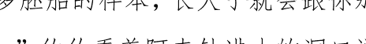

这种试验的，因为它涉及到太多的社会问题。

关于这种试验，在生物学领域流传着一个具有代表性的说法。大概意思是说二战末期，苏联军队登陆德国，从纳粹的生物实验室里得到了一些关于人体改造的异类学文献，然后到了世纪八十年代初期的时候，有一个苏联科学家得到了这些文件，并按照文件里面的方式做了一个实验。

他把人和动物的基因进行结合并进行了相应的改造，结果培养一种非常奇异的变异物。这个科学家后来死掉了，说是被他培养的变异生物杀死了，最后是苏联军出发用AK47 把这种可怕的给灭了。

但都是一些传闻，并没有实质性的证据可以证明这种试验是可以可能的。为了切断并获取更多帖索

佐佑看到我在我，又继续道：“你心里明白，从生物学角度来看，这个理论是成立的，而且只要有了相应的方式和方法，你也可以做到。

“不对！这种试验只是存在于理论上，现实中不可能实现，从技术上来说就很困难了。”我道，“阿来的成长环境并不具备这种高级的科学技术，你会不会搞错了？”

“不是你想的那个样子。”说完，佐佑用手指指向嘴唇，吹了一声十分尖锐的口哨，像是某种动物的叫声。

声音响之后，我猛然听到整个空间瞬间传来了更多的这种声音。紧接着，许多舞着巨大翅膀的身影从我的头顶上方过的，那是一些体型非常巨大的蝌蛹。

看着这些东西不断从山体空间的各个角落里飞过来，我心里有一种说不出来的激动，我想起在石鼎里面看到过的那具蠕生物的骨架，顿时就明白了，原来在这个地方，真的存在这样的物种。

“这些蝌蛹……”我有些说出来，不知道怎么形容这种蝌蛹，终于明白为什么有些科学家会发现一些东西就激动地。

佐佑又连续了几声口哨，我就看到这些蝌蛹开始飞到篱上的尸体，用它们的爪抓起一具尸体，然后带着尸体飞向了。

每一个蝌蛹都是变异物种。”佐佑说，“这些蝌蛹，我的理解，这些蝌蛹身上有着人类的基因，它们能够跟人类交流，你只需要满足它们的要求，它们就会你的安排。等它们运送尸体，我抓一只让你们见识。”

作者:十四 001 日期:2016-07-14 10:22

（注：后续文本存在大量OCR重复与乱码，已根据语义逻辑进行合并与清理）

佐佑看到我在我，又继续道：“你心里明白，从生物学角度来看，这个理论是成立的，而且只要有了相应的方式和方法，你也可以做到。

“不对！这种试验只是存在于理论上，现实中不可能实现，从技术上来说就很困难了。”我道……我发现这个空间实际上到了断崖处就停止了横向延伸，继而空间的走向发生了垂直向下的转折，这道瀑布竟然流向了一个漆黑无几的巨大洞穴，看上去就像一个深不可测的天坑。

佐佑没有回答我的，而是对我说：“他已经下去了。”

“什么？”我惊讶，有些明白他在说什么，“我说的是阿来。”

“你了解他？”佐佑莫名其妙地问。

时间，于是就快了脚步，可是还没走多远，手里的东西便挣扎了几下，然后从我手中滑了出去。

我并没有在意这件事，现在的首要目是赶紧跑出这种物质的包裹范围。身体逐渐适应了这种介质之后，我奔跑起来感觉如履实地，大概又跑了半分钟的样子，就看到我正的前前方出现了一团模糊的光亮。我心里一喜，知道自已就要摆脱这个地方了。

可是在这个时候，借着前方微弱的光线，我终于看清了簇我周边的东西都是些什么了。

这是一种形体十分奇异的软动物，有一个圆溜溜的身体，脑袋像鸡蛋一样大，身后拖着一条长的尾巴。最奇特的是鱼类的身体裂开，断身体并游出很多形状，的是它们的身上，还长着两只小手，它们的尾巴和脚不断蠕动着，在我身上乱撞。

我有点惊讶，在不经意之间张大了嘴巴，就在这个关，其中一只软体生物抓住了这个机会，以一种非常快的速度一下子钻进了我的哪里，我感觉眼睛凛一滑，这个东西就进了了我的肚子里，紧挨着我的胃里传来一阵翻腾一样的绞痛。

这种感觉是十分恐惧和恶心的，我顾不上多想，几乎飞也一般向了那团光亮，伴随着胃里传来的剧烈阵痛和强烈的窒息感，我一肚子从里面冲出去。

我也不知道脚底外面是什么什么地方，我只感觉身子悠然一沉，然后就垂直向下去下去。

整个下降的过程十分短暂，还没等我反应过来发生了什么，就听到一声沉闷的身体跟地面碰撞发出的声音，紧接着嗓子一热，一股鲜血从我嘴里喷了了出来。

我挣扎着身体起来，后靠在一块岩石上喘着粗气，只觉得浑浑的身体就像散了架子一样，哪都生疼，真正体会到了什么叫生不如死。

不知道肚子里的东西是不是也被摔死了，胃里已经感觉不到翻滚，恶心的感觉依然存在，想着一只扭着尾巴的怪物钻了自己的胃，我开始剧烈咳嗽起来。我已经一天没吃东西了，除了呕出一些苦涩的液体，并没有排除其他的食物，我是开始告诉自己，要转移注意力了，别去想着胃里的东西了，那最多是一大坨便而已，反正自己已经一天没吃东西了。

我看向头顶上方，发现我依靠的岩石后方三至四米的地方，有一个山洞的出口，这样的垂直距离没有摔死，其实是种幸运，幸巧我跌落的地方是一些潮湿的泥土，否则真的能把肠子吐出来。

而此时我也看清楚了整个空间的基本情况，这里就像一座完整的大山被掏空一样，显得十分空旷。在四周的岩壁上，有很多植物的根系伸了出来，在这些根中间，看到很多的岩石缝隙，有很多光线从这些缝隙中投下，是这个山体空间唯一的光线来源。

这简直就是一种造化，我惊呆着。忘记自己是从哪本教科书中看到这种山体结构的介绍，好像说是，这种空间构造是在山体形成之初形成的，具体原因非常复杂，空间底部必须有浅层岩浆，这些岩浆融化了山体内部的岩石，又因为地壳底部内部的地质运动，导致岩浆回滤，便留下了已经变成空壳的山体。从外面看，这还是一座山，但是从内部看，就会发现它就像一个包裹着石头外壳的大型气泡。

作者: 十四 日期:2016-07-19 10:31

地下河比我想象的要浅，流水也十分缓慢，能看到底。

这里没有工具，我不能以身试。不过这条河的走向非常奇异，似乎是包裹着整个山村的，有点像护城的意图。

我看着河流两岸凹卵的分布范围，突然明白，这条河在很久以前，其实规模可能并不如我现在看到的这个样子，河道应该是因为某些原因逐渐变得又窄又浅了。

入水之后，我看到河水中流动着一些红色的液体，我捞了一把水闻了闻，是血腥味。我觉得有些不对，单凭那些死的不至于把河水染红，除非这条河的上游死了很多人。

这种情况的出现让我心里了一些推测，可能是阿来或者佐佑在这个山村里遭遇了冲突，而且死了很多人，这是唯一的解释。这种危险对我来说，接下来的路必须小心。

我迅速过河，达到了村庄的范围，这时我看到了一块跟山洞入口一样的界碑，这块界碑看上去更加旧，有很多明显的风化痕迹。上面刻着一些字迹，但写的是我完全不认识的种特殊的字体。

作者: 十四 日期:2016-07-19 10:31

这种构造，是户外探险家传闻有人在这种山体内部发现过一些古老的人类遗迹，很久以前就有人类在这里做过事情。我强忍住全身的疼痛，咬着牙站起来看向远处，首先看到了一些尸体，而且在这些尸体四周，还散落着人类尸体。人类尸体很容易腐烂，应该是那些死掉的人。我回想起带进山洞之前的奇怪行为和佐佑的话，难道这里发生过火拼？再往山体的深处看去，惊奇发现，远处竟然有一排的石头房子！这些房子的数量非常多，像了一个村庄。但这一个村庄显然已经没有人住了，看上去非常破不堪，有许多房子甚至已经完全倒塌了。

这里真的有一个地下的村庄，这是真正的鬼洞！我无法压抑心中的惊悚，几乎忘记了身上的疼痛，忽然猛明白了佐佑的意图，他是在用办法把死的人运回到这里，这里才是地面上的村庄，佐佑是想让这些死的人在这里安置。我忍不住往村庄的方向走，我不知道这个村庄里究竟有什么，我只是感觉这个村庄既然藏在山体内，一定有着非寻常的原因，我推测这种原因是跟佐佑把死的人运到这里有关。在特殊的环境下思维就会十分敏感，一点都没有怀疑。在我处的位置和村子之间，又出现了一条地下河，不知道不是之前那条河的分支。在河流的两岸，我都发现了大量巨型尸体。当我过这些尸体身边的时候，我停下来翻动其中一具，发现这些浑身是血，身上有很多孔洞，像是被枪扫过的，大部分的血液还没有干涸，说明这里的火拼出现的时间不超过半个小时。我提高了警惕，看了看周围，没有发现活着的人，也没有看到佐佑和阿来，仿佛在这个世界上，只有我一个存在。

按照佐佑的说法，阿来早就带着我来到了这里，也许他现在进了鬼洞，也许我能在村落某个大堂里看到阿来和佐佑坐着喝酒，然后说着不相识的话。但我知道这是可能的，但这些莫名其妙的不祥感让我始终不敢放松警惕，无论是阿来还是佐佑，都不是因为我摔跟他们失散的，其中一定发生了我不知道的事情。这种抓不住的恐惧是最让人崩塌的，可是我再提醒自己，自己不能一直被这些恐惧摧毁。到了这里了，这面对总要面对，逃是逃不掉的。这些尸体一直延伸到村子里面，我必须到达这个鬼洞里面探究。

作者: 十四 日期:2016-07-23 15:25

最近结婚，一直很忙，明天开始写字，恢复更新。

作者: 十四 日期:2016-07-24 13:36

关于佐佑的信，解释一下：
佐佑的信是整个故事的引子，这个引子是要放在图书版面的，很多朋友，也为了大家做功课，就在这里贴出，算是一个补充。

作者: 十四 日期:2016-07-24 13:36

齐天兄：

别来无恙！

出于很多缘因，我并没有给你带来任何好消息，还请原谅。

我知道你看到这封邮件后会很奇怪，也很理解你看到下面的内容会想些什么，但是我必须要告诉你，你一定要相信我说的所有，因为有时候怀疑往往是多余的。

首先，我要告诉你第一件事。

请你相信我是不是疯子，也根本没有疯过。那个疯子，不是我。我无法告诉你它是谁，其实现在我也不是特别清楚，为什么会有一个疯和我一一样的人出现在我曾经过的环境中。那个疯子，不是光辉，还一度把形象杀了干净。

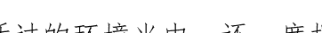

如果非要那个疯子，那我只能说它不是我。之所以这样说，是因为自从我去过那个地方之后，无论白天还是黑夜，我就再也没有看到过自己的影子。人类应该是影子的，没有影子的，那只能是影子本身。你仔细想想，你见过那个影子吗？如果你见过，那么说明我是一个影子或者是鬼魂。如果没有，那么我一定会有问题。说这些就是想让你明白，那个疯子不是我，是你熟悉的老同学。

然后是第二件事，你要仔细看。二十年前我收到了一份来自北京的短期培训，对方是一家考古机构，他们希望我能协助参加一次大型考古活动。就是这份聘书让我消失了个月。当我加入考古队后，他们告诉我这次考古队要执行两个特殊的任务：第一个任务是在西藏某个地方，有一处上古遗迹，寻找华夏始祖在历史上是否有过；第二个任务是考古队要在此处找东西，我们要找的东西称作“门”，但这里的“门”只是一个概念，没有人知道。那是大地的另一面，数千米的深渊。我们来到了一座你想都不敢的巨型建筑物范围内，在这个过程中我们遭遇了无数诡异和可怕的事情。最后，一支接近五十人的考古队伍，几乎都以各种方式死在了里面，最终活下来的只有我一个人。尽管这件事情的结局是这样，我可以告诉你，在接受死亡的同时，也得到了一些非寻常的信息，其中一些重要的信息都是违反我们传统的认知的。举例来说，我们在西藏古迹中发现的一些遗迹显示，传说中的伏藏可能不是人类，我了解到的伏藏这个概念，更像是一种非常特殊的物种的通用名称。后来我才知道，考古队寻找的“门”，我确实看到了这些被命名为“门”的东西，但我却无法用语言来形容这种神异的东西，或者说它什么都不是。除非是你自己看到了这样的东西，否则我也给你描述。

从那里出来后，我就把自己藏起来了，并且在暗地搜集有关深渊的秘密。后来我终于得到了线索，并在姑娘山腹找到了另一处跟深渊关系非常紧密的地方。也就是在这个地方我给你写了这封信，并用一种特别的方式送到你能够看到的地方。我知道你肯定会有疑惑我为什么把这封信寄给你，我可以给你解释一下。其实算上你，同样的邮件我已经发了七个人，我能想到值得信任的七个人。很幸运，前八个人在邮件后都莫名其妙地死掉了。我大概知道这些人为什么死掉，这也是一件令我感觉毛骨悚然的事情，因为这八个人的死亡更加证实了我的猜测。西藏这次考古的失败，除了天灾还有人祸。所以这次我改变了发信的地点和方式，希望你的运气不会像前面八个人那样惨。

还有一个更加重要的原因，说出来你可能不信，那就是当年应该收到考古队邀请的人当中，我还有另一个个人，那就是你。当时我不知道为什么没有出现在考古队伍中，这件事成了一直困扰着我的一个谜。直到我对这件事情处理，我看到那份聘书，原本属于你的那份聘书，实际上在未到达你手里之前，就被一个不名身份的人给截获了。其实在最初的时候，我就打算通过一些途径把这件事告诉你，但我总觉得你没有收到邀请函这件事中，不可推测的因素太多，因此我就把你变成另外一条线索，看看有参加过这次考古活动的你会发生些什么。但令我百思不得解的是，这件事情本应该是你有联系的，可是你却一直安然无恙。

现在的局面是，我在四娘山的地下深处发现了一个巨大的秘密，这个秘密和当年考古队寻找的东西之间的关系非同寻常。虽然我现在还可以做一些事情，可我不得不承认，我被困住了，我需要有人能够从外部解救我，否则我将会永远困在这里。另外给你这两张照片，同样都是真实的，希望它们以后时间里，能够对你有所帮助。

“有本事别偷袭，跟老子一对一……”我从嗓子挤
出几句含糊不清的话，然后就开始地翻身准备反扑。

可是偷袭的我根本没有给我留机会，我刚要动身的时候，头部太阳穴位置受到了一下重物的敲击，瞬时把我敲得
头晕眼胀起来，一下子失去了招架能力。

迷迷糊糊中，我感觉有人把我的手脚都捆住了，然后
把我扔到了巨石旁边，我完全恢复了意识，发现自己坐着
巨石旁边，左半边的脸上热乎乎的，估计流了不少血。等
我一抬头，就看到一张无比诡异的脸贴着我的脸，眯着
一双几乎看不到的眼睛死死盯着我。

我被这脸完全占据了，就要认定这不是一张脸，
王震突然：对方并试图获取更多好处
直到对方虽然跟我说话，我才确定这确实不是人，却
他的脸部却是王青的皮毛面具覆盖了，只留下
几条裂缝提供生理需要。

对方看上去像一个年纪极大且行动不便的人，我相
信我如果不是被偷袭，我很很容易就能制服他，因为这个人看
看上去已经没有多少活动能力了，就是一个矮背的老老夫。

他说的话几乎听不清，声音很直接尖锐，不像人的声带
发出来的声音，而且具有浓重的四川口音，我只是但勉能
分辨出他在说什么，他的第一句话是：“你又是谁？”

我一直想脱除束缚我手的铁链，但是不知道他是打了

什么错，我用铁链越勒越紧，当我看到他手里拿着一把
佐佑手里一模一样的柴刀之后，我就放弃了继续挣扎，而是开始想办法拖延时间，以免他不分青红皂白直接对我下手。

在此我回道：“你是这里的吧，我是佐佑的同学，是他在写信带我来的，你千万别把我当坏人，我其实是个科学家……”

“左右？左手还是右？”面具人好像有点神志不清，然后又说道：“你来这里做什么？”

“我不知道！”我刚说完又觉得这样非常不合适，“我不是那个意思，我是想说，我这里没有，我是被蜘蛛带到这里来的，你应该知道这里还有一个白头的家伙，他是我带来的，只告诉我们已经散了，我正在找他！”

“你是谁……”面人终于我知道我在说什么，他目不转睛地盯着我问道：“你跟谁伙的？那些拿枪的人还是那个胆眼珠子？你们来这里干什么？”面人继续问道。

我知道面人是谁的，就回道：“眼睛是我的朋友，至于你说的那些人，都是我们的敌人，他们杀了整个村子的人……”

面具人在这个时候好像被我的话给刺激到了，他一把把刀架在我的脖子上，此时他话锋一转，恶狠狠地对我我说：“几万年了，鬼头寨子就留下这么点后人，你们到底来这里找什么？当年日本人把军舰都进来了，为了找这块石头，”

几乎要把整个村子的人都屠光，我怎么就这么对待你们这些人了！不管你是日本人还是中国人，我都要杀了你祭拜光战神，不然我对不起死的父老……”

说着，面具人举起了手里的柴刀，见晃悠悠的就要砍，我急忙把身往旁边一撇，想躲开的刀锋，因为实在没有办法了，砍肩肩膀上比砍头顶要强，更何况对方使出的力气并不大，可能他真的是太老了。看对方的行动能力，只要不是被一次砍死，我还有机会反击的，例如我可以用双脚一起发起诸对方……

可是还没等面具人来得落下柴刀，奇诡的是，我竟然听到石门外面忽然响起了一个人的声音：“别动！”再动我就开斧头，防止拦截并获取更多好处。

声音之后，一道笔直的激光射线就投在了面具人的身上，面具人先是一愣，然后开始看着自己身上的红色光点。他几次回蹦蹿着脚挪动身体，可是一直无法摆脱这道激光的照射，而且我还听到他用一种很奇怪的语气说道：“这是什么光……怎么看起来这么多人……”

“游骑侠杰克！”已经进入石门的端着刀说道，“举起来别动，伙计！”

为了方便记录，我把所有的信息归纳为三类，其中第一信息基本上是一些历史传说性质的内容，也是鬼头寨子世传的一个久远故事，主要是讲了另一场发生在远古期的战争。

关于这场战争的内容我们中国人都不陌生，当年黄帝与蚩尤之间的恩怨仇以及后来人演绎出来的神话传说早已深入人心，也是在那场充满色彩的大战之后，华夏民族开始了以轩辕氏为祖先的说法。话说那场战争的最后结局就是以蚩尤不敌黄帝而告终，蚩尤八十兄弟全部被屠杀。

但是，流传在鬼头寨子的关于这场战争的最后结局，却是另外一个版本，其中和我们知道的是不同的两个版本：

第一，黄帝确实战胜了，但却没有杀死，而是在经历了一场大战之后，不甘继续目击战争带来的生灵涂炭，此后他退意，一路南下，而是躲到了这四姑娘山腹地，而且在这里做了很多事情，留下了许多生存痕迹。特别是那块灵能能够发出七彩光的透明巨石，就是当年蚩尤留下的。

第二，当年的那场大战，实际上并不是轩辕和蚩尤两个阵营的地盘争夺战，而是三方阵营的战争。这个说法在历史上并没有这种说法的记录，而在鬼头寨子口口相传的故事当时，当年黄帝留下的信息是，黄帝本身和黄帝对阵并没有错，可是黄帝联盟最终并不是直接击败了黄帝的军队，而是败给了蚩尤不知道的另外一种势力，但很奇怪的是这个势力在击败蚩尤之后竟然跟黄帝营阵打了一仗，最后也被败给了黄帝。

第二信息是关于那块巨石的事情，这是面具人提到巨石的时候，我刻意引导说他说出来的一些信息，而且具有一定的参考价值。面具人提到巨石乃是神人的，长有钢铁铁甲和紫金身，他来到鬼头寨子之后，不断教化当地居民，还跟鬼头寨子留下了后人。这种方法相对具有意义，证明了这座隐藏在山体里面的远古村落，是蚩尤曾经生活的地方。

后人虽然具有血统，生命力无穷，寿命极长，却也有特殊的弱点，那就是必须接触巨石，否则会在很短的时间内死去。所以鬼头寨子的居民那时分为两支，一支生活在地下，一支生活在地上。随着时间的移动人数不断减少，特别是在秦朝发生了一场入侵，拥有蚩尤血统的人几乎被秦军杀死。用面具人的话说，他是世界上最后一个有蚩尤血统的人。我又问他巨石真正的用处，面具人摇摇头不知道，只是小时候听村子里的长老提到过这块石头用处，但是早就失传了。那个时代的老人们偶尔提到，当年蚩尤留下了遗言，说这块石头能够使战争轮回。正是这个原因，鬼头寨子很久以前就把这处山体空间为了不允许外来进入，为了这块石头保护。让世人深信不疑的是，巨石里面的影子就是幻化人形的真身，总有一天破石而出。

当面人说完这些信息之后，结合对于最近发生的事情，不由得打了一个冷，似乎从中捕捉了一些具有关联性的线索，而这些线索十分碎片，我在听过的无法用精力把线索整理出来，只能继续听面人讲。第三类信息是发生在上世纪四十年代的。

第一件事情是两架飞机轰炸了远处的山谷，那里是鬼头寨子最早居住的地方。飞机轰炸完之后，当地人发现了几个特别的山谷，还有一些山洞。他们跑到另一座山上俯视，发现在山谷中央，竟然出现了一张巨大的脸，就是巨石的两只眼睛。飞机轰炸完之后，当地人认为那是蚩尤大神再次显灵。

第二事情是在轰炸持续半年之后，日军突然出现在山庄附近的地下水道中，因为地下空间里的流水无法支撑，日军陷入了。山民由于被日军受过各种酷刑，最后被杀光。关于巨石的秘密，日本人在接下来的时间里改变手段，竟然把山民进行人体试验。更加残忍的是，日本人还把山民肢掉，剥下了他们的皮。尽管如此，日军对于巨石的秘密还是一无所获，最后日本人放弃了，开始想办法把巨石运走。

但是奇异的事情再次发生了，就在日军用枪逼着山民动巨石的时候，忽然从山体间的角落里飞出了数不清的巨大蝙蝠，这些蝙蝠发出刺耳的尖叫声，犹如猛兽一般扑了过去。这件事的结果是士兵在蝙蝠和山民的双重攻击下全部被杀死，只留下了巨石。我见证了这段历史。在整理完所有的信息之后，我把牛肉给了面具人，我看着他说道：“放心，那场战争我们赢了，新的战争也不会输！”

我又对杰克说：“你一直在暗处旁，你知道他从哪里来的？带我去！”杰克回答了一句：“等不及了，”走出石门。我跟在后面，当我走出庙的那瞬间，我听到背后的面具人忽然变了一种语气，对我说：“死老外，千万别开枪，他不是坏人！”听到杰克的声音，我不知道应该高兴还是骂他一顿，也不愿碰上，这时候我更加在意的是阻止杰克不要杀掉这个溜渣的面人。

杰克进入庙后，用枪指向面具人。面具人并没有显示任何攻击或躲避动作，而是把步枪横在腰间，走到面人面前递一把宰刀，然后把激光准器从步枪上拆下来递给面人。面具人拿到激光准器之后，开始拿着这个东西四处乱照，不再理会我们。杰克看了看，开始裂开笑道：“天呐！我亲爱的，原来被一个傻子给持住了……”

“你这个废物，你妈去哪里了？”我尽量压制住心中的怒火问道，“让你回去拿包，你就跟我玩失踪，你这算什么？”

杰克一边解开我身上的铁链，一边绕道：“抱歉，我的朋友！我想了，那个旅行背包已经没有什么价值了，我不如回车里取回自己的战术背包，这种地方没有武器行的！我说过我不会放弃你们，我只是换了一种战术，在暗中保护着你们，这是狙击者的战略任务，用你们中国的话来说就是留手，你没想到我会这么个疯子的样子出现吧？”

我破口大骂：“放你的狗臭屁，老子在石窟差点被狼咬死，你当时怎么没出来救我？”

“让我我想……”杰克从背包里拿出一些医用布和酒精，开始替我擦拭太阳的伤，同时对我说：

“虽然我不知道那个人是谁，可是根据我的观察，他要是真想杀你，就不会观察你那么久，我看得出来他只是恐吓你而已。当然，如果你运气好，当时他是真的是杀你，我肯定要一枪打掉他的蛋！”

我理解了杰克的用意，他把在这里发生的事情当成了一种特殊的战斗，所以他开始能利用战术脑袋思考问题，竟然在暗中担当了角色，只不过他的判断能力实在是令人汗颜。说实话，他在出现之前，我对这些人已经什么希望了，只是没想到他会以这样的形式出现。

我问面具人几个问题。此时面具人打了一个响，然后看着杰克的背包道：“你有吃的吗？”杰克一脸茫然，从背包里掏出一个牛肉，递给面具人，我却在这个时候从他手里抢了牛肉，同时我说：“让他吃！”

我产生了一个主意。面具人既然出现在这里了，那么肯定知道关于这里的事情，虽然他神志不清，但不代表他失忆。我想通过牛肉来诱惑他，先把小片牛肉递给面具人，等吃完之后，再次伸出手问几个问题。

第一个问题是：“老者，你在这里为了？”面具人想了会儿，说：“为了守这里，只要在这里每天都会死。”

第二个问题是：“巨石的秘密？”面具人摇摇头不知道，只是小时候听村子里的长老提到过这块石头用处，但是早就失传了。那个时代的老人们偶尔提到，当年蚩尤留下了遗言，说这块石头能够使战争轮回。正是这个原因，鬼头寨子保护。

：“什么约定？什么蚩尤真身？”我感觉面具人的这句话除了晦涩难懂之外，还有奇怪的信息。

显得十分兴奋，继而对我说：“大圣，你看我找到了什么？”

我应声看向，就看到杰克手里握着一缕类似毛发的东西。
我以为是蝙蝠身上的毛发，有些不以为然，却道：“就是些毛，有什么好兴奋的，等我吃牛肉，和你一块找找这地方我们有什么机关暗暗。”

“不是！”杰克好像怕我看不清楚一样，张牙舞地说道，“这些毛不是一般的，而是杂毛的毛。”

杰克的十分噎着，我反应了一会儿，才明白了他到底表达些什么，连忙跑过去去看他手里的毛。

我一看之下，顿时顿时就是一个激灵，赶紧问道：“你确定这就是杂毛的头发吗？”

“我十分确定以及并肯肯定！杂毛的毛，杂混这很有特点，就算它化成灰我才认识！”杰克斩截铁地说道，忘了后半句基本都是在扯淡。

看着这头发，对杰克说：“你说事情会不会是这样……”

接下来，我结合杰克对阿来在黄滩上的行为和杂毛头发的出现，对杰克陈述了自己的想法。

阿来一定是在石滩上发现了杂毛的头发，断定杂毛在附件出现过，而且根据毛发出现的位置判断，杂毛肯定是去了天坑里面。根据之前之前对徐海瑞等人的审讯得知，第一梯队有两个人从日本人手里逃脱了，所以阿来同时断定白狐也肯定是下到了天坑里面。阿库主心切，在没有找到进入天坑有效途径之后，做出了十分冒险的事情，那就是直接跳下去。

根据阿未的思维，他这样做肯定不是轻率为之，他一定是想到了既然这个地方没有可以爬的痕迹，那就是没有需要的理由，所以他选择直接跳下去，在坠落的途中寻找可能存在的路线。

至于阿未撬动石头的行为，我的理解是他并不是在找什么东西，而是他发现了杂毛的头发之后，刻意把头发发压在石头下。

这说明，阿未很有可能已经知道了杰克在暗中观察我处理处理，我们的事情，这样做只是为了给我们留下更多线索。

杰克在听完之后摇了摇头，似乎不认可我的推测，问道：“你是根据什么才得出这样的结论的？”

我拿过杂毛的头发对杰克说：“你只知一不知二，你看这些头发，都有根，这些头发是被外力直接从头发上拔出来的，这说明了什么？”

杰克还是摇摇头，说：“我不明白你在说什么，看着牛肉肉的份上，可以解释一下吗？”

我发现无法理解我的话，只能继续解释：“我告诉你，带着发根的头发出现在这里，说明杂毛在留下头发线索的时候处境不好，很有可能是一种被追迫的状态下，否则……”

杰克在若有所思地点了点头，说道：“我明白了，你的意思是老老板和杂毛被日本人绑架了，然后被拉到了天坑里面？”

“恭喜你终于听懂了！”我说道，“走吧，我们也也跳下去，去找我们的伙伴们。”

杰克在一旁边提议要不要再找其他地方，就这么跳下去，恐怕太鲁莽，而且他们有些不敢。我对杰克一一笑，也没有说什么，我现在的心情，就算说了他也不会懂，要论敢不敢，那拍着良心坦，我现在简直怕得要，但我又有种预感，阿来和佐佑能，这就说明跳下去这个动作本身不会会有什么危险，机关一定在身体下坠的途中。

就算猜错了，那也无颜无悔，我只希望这一跳，能开心心中所有的谜，或者直接死直接结束这一切。

杰克看我心意已定，一直大骂我神经病，说如果我们没有摔，一定会带我去看心理医生。

我不想再耽误时间，于是咬紧牙关，对着天坑底部俯身然后，整个身体一下悬停，对着深不可测的坑底方向迅速坠落。

身体在往天坑底部自由下坠的过程中，我已经来不及及去体会会不会摔成肉泥的事情了，因为我已经做了最坏的打算。我把所有的注意力都放在了观察天坑的情景上，我终于找到了它，希望或许可以找到它带我来的理由：

在整个下坠的过程中，天坑里面的景色如幻灯片一样飞速往上窜，而我除了在四周看到那些崎嵘怪石之外，并没有遇到过我设想中的机关，连车可以让我抓住的绳子都没有，心里不由得“哎”了一声，觉得事情要完善。

这个时候我几乎就要绝望了，想不通来和佑佐是通过什么方式下到天坑的，总不是至于都集体杀了吧？好不容易装一回，结果还没装成，实在是老天不开眼。

这样想着，又持续落了五六秒之后，也不知道是不是我听错了，耳朵里听除了呼呼呼的风声之外，隐约当中还突然听到一阵十分尖锐的尖叫声。

接下来的发生的事情让我大喜过望，在那声音响起之后，看到从天坑洞壁上某个位置，忽然飞出来一个硕大的身体，那是一只巨大的蝙蝠。原来就是这么回事，在这里等着呢！只见蝙蝠猛摇上，瞬间就用身体接住了我，继续下降。

蝙蝠住我之后，顺着额头那双人一样的眼睛看了我一眼，歇了两声，似在笑。我救命，急忙去找阿来和佐佑。蝙蝠竟然听懂了我的话，点头开始朝着我下降。

石头终于落了，自己的行为让我感到害怕，觉得有些怕，刚才跳下来的不是我，而是另。我看着杰克，也不知道那个我到底有没有，于是拍着头上方看去，现在距离我头顶的地方，还有一只巨大的蝙蝠在我们面前，此时也正往天坑去。

真没想到，杰克还真是个人。我刚认识的时候，他给我的印象一直小，而且有些顽，不过也不会了。我往天坑底部了一眼，发现光线很差，只能模模糊看到底部有一巨大的东西相互缠在一起，像是一张巨大的网，又像是一个巨大的巢。我重新打开手机去照那一东西。

尝试了好几次，我都无法把光线顺利照射，因为蝙蝠飞行姿态不像鸟类，总是给人一种横冲撞撞的感觉，手电大多只能打在石壁上，所以彻底放弃了这个想法。

可就是在这种情况下，当手电扫过四周石壁的时候，我看到了除了石壁以外。反应了那么一秒的时间，心里不免咯哒了一下，急忙对着蝙蝠道：“蝙蝠哥，停一下！”

重新把手电的光在附近，虽然看到这一段石壁上，这些藤蔓不知道从哪里长出来的，还有许多枯叶。在这些横七八的藤蔓上，我看到一些人类和动物的尸体挂其中，有的已经风化成了干尸，有的只剩了一具白骨。仔细看藤蔓之间的缝隙，就发现我能看到的范围内全是这样的尸体，数不清。在这种地方看到如此多的尸体，使得我心里升起一种不详的预感。这些尸体看上去什么年代都有，甚至还有一些尸体穿着现代人的服装。怎么会有这么多尸体，难道是这些人和动物意间闯进了这里，然后被藤蔓给缠住了？

心中疑惑，拿着手电筒四处照射。这时，看到面前不远的石壁上，一个人形的影子正抓着藤蔓不断移动，心里一惊，再仔细一看发现那个人影熟悉阿来。不知道他出了什么变故，看到他脸色惨白，仿佛跟死人脸一样。他看到我之后，先是一愣，继而有气无力地对我说：“头顶方向，救人！”此时杰克的嚎哭听到了我，听起来有点崩溃了，他哭着说着：“真是太刺激了，我要回去写一本杰克传记，他妈的可以见我……”“别废话了，赶紧爬，就在你上面！”杰克道，然后顺着藤蔓爬了一高度，趁着藤蔓的身体贴近石壁的时候，我对藤蔓说了“得罪”，然后猛然俯扑石壁，抓住了一根藤蔓。我向下了一眼，阿来已经到了我下方不远的位置，对他伸了一大拇指，然后继续往上爬。杰克似乎看到了阿来，喊了一声“你们都是些疯子”之后，也学着我的样子，抓住合适的机会到了石壁上。抓住藤蔓唤道：“蓝眼睛，我们又见面了，你还好吗？”阿来没有说话，只是低头往爬，等到阿来赶上来之后，看到他嘴角有血迹，就问他发生了什么事情。阿来说道：“现在不是说话的时候，赶紧往上爬，姐姐困在体内中间！”我一听他这话就停了一下，想起自己确实看到过一些穿着现代服装的尸体，可是并没有注意到里面还有白狐。这个时候也不用问他是怎么发现的，忙按照他的意思顺着藤蔓往上。前面的杰克首先看到了白狐，他心猛登藤蔓，对着一尸体靠了过去，很快就听到我对阿来道：“我看到老板了，杂毛也在这里……”阿来加快了速度，撇过过去到了杰克身边，那具尸体扔到了坑底。我爬到他们所在的位置时，看到了白狐和一个穿着衣服的人被扭成一团，被藤蔓缠绕着，脸上没有血色，就像死了一般。在白狐附近，还有很多穿着衣服的尸体，基本上是一个状态，好像到了这里被藤蔓给缠住了，并且已经死亡。阿来把手靠在白狐鼻子下方，我急了口气，试探了一下，说道：“赶紧救人，再晚就来了！”接下来的时间，藤蔓缠在腰间，身体挂在石壁上，分开。我和杰克负责扯杂毛身上的蔓，费了九牛之力，终于把杂毛身上的藤蔓清理干净了，然后杰克从附近找了一条藤蔓，拿刀砍断之后，杂毛和自己在一起。我一直记着处理完位置就移动到阿来的位置，发现藤蔓全部破坏了，但是白狐抓住了女人的衣服，阿来一人没法分开，便对我说：“抱住小姐，我想办法解决问题。”我在一旁措手不及，感觉不好，阿来眯着眼睛低声说道：“小姐现在只剩下口气了，你要是再耽时间，我就杀了你！”我知道阿来在玩笑，我心里说，白狐要是有长，指不定干出什么事情，我就显巍巍地伸出手，一把抱住了白狐。阿来双手有了空闲，继续用力拉白狐抓住女人的手，无论阿来怎么用力，白狐还是死死抓住她。我见对白狐小声说道：“小姐，我是齐天，我们来救你了，如果你能听到就松开……”感觉白狐的身体轻微动了一下，好像有一点意识，手慢慢放开了。我和阿来都松了口气，说明白狐只是昏迷了，并没有死。阿来深吸一口气，对着女人的双手举起匕刀，硬生生地断了她的手。断臂瞬间失去了支撑，顺着墙壁直向下方坠而去。我扭着身体向下看了一眼，感觉里面只有不到米，我问阿来：“接下来怎么办，往上走还是往下走？”阿来没有直接回答我的话，而是问道：“你了解你那个同学吗？”“你这话是什么意思？”我有些不解道。阿来回应：“如果你无法确定他就是你的同学，或者说不知道他到底有什么目的的情况下，我们无论往哪里走，都会没命！”愣看着阿来，也不知道怎么回答，因为我确实无法确定那个人到底是不是佐佑，因为他看上去实在老了，而且好像一直都在确认我是不是真的齐天，我都没有想过他是真是假，只能继续问阿来：“你为什么提出了这么奇怪的问题？真的又怎样，假的又怎样？”阿来解开了衣服，对我说：“我已经经历过这个天坑底部了，所以我成了这个样子，但是你那个同学却没事。”我定定一看，就被阿来身上的伤痕吓了一跳，发现他之前的胸腹像被火焰烤过一样，裂开了层层，渗出了血的斑驳。阿来继续对我说，他在跳天坑之后，并不是我和杰克一样横爬岩石下来的，他到了这一段，发现了很多尸体，而且里面很多新鲜的尸体引起了他的注意，认出那些日本人。只是当时我的想法一样，断定白狐和杂毛是被那个组织的人给抓到了坑底，所以并没有在那些尸体的位置留迹，也没有想到白狐和杂毛就在这些藤蔓当中。等他到了天坑底部的时候，发现佐佑骑着蔓从天而降了过来，两人再次相遇，谁看都不习惯，少不了一番。两个人都回来打了几十个回合，也没有分出胜负，最后阿来为了能够尽快救人，首先提出了停战的建议，告诉佐佑他只想救人，没有侵犯这里的意思，只要能救回白狐，愿意再跟佐佑一决胜负。在听完阿来的话之后，佐佑终于答应了他的提议，不过在此基础上提出了自己的要求，那就是阿来必须配合做件事，绝对不会让人离开。佐佑从口袋里掏出一块透明的石头递给了阿来，救人，甚至可以告诉白狐有可能被困的位置，但前提是阿来必须把石头吞进肚子里。阿来想都没想就吞下了石头，希望可以找到。藤藤藤藤藤藤藤藤藤藤藤藤藤藤藤藤藤藤藤藤藤。顺着藤蔓爬上，希望尽快找到白狐。随着爬着，阿来感觉身体开始出现不适，体内有一团火焰在破坏自己的皮肤。解开自己的衣服，发现皮肤像瞬间烧完一样。我以为佐佑肯定是自己吃了毒药，觉得可能会死。在这个过程中，阿来看到他还趁着爬了上来，所以还是吃了。藤藤藤藤藤藤藤藤藤藤藤藤藤藤藤藤藤藤藤藤藤藤藤藤藤藤藤藤藤藤藤藤藤藤藤藤藤藤藤藤藤藤藤藤藤藤藤藤藤藤藤藤藤藤藤藤藤藤藤藤藤藤藤藤藤藤藤藤藤藤藤藤藤藤藤藤藤藤藤藤藤藤藤藤藤藤藤藤藤藤藤藤藤藤藤藤藤藤藤藤藤藤藤藤藤藤藤藤藤藤藤藤藤藤藤藤藤藤藤藤藤藤藤藤藤藤藤藤藤藤藤藤藤藤藤藤藤藤藤藤藤藤藤藤藤藤藤藤藤藤藤藤藤藤藤藤藤藤藤藤藤藤藤藤藤藤藤藤藤藤藤藤藤藤藤藤藤藤藤藤藤藤藤藤藤藤藤藤藤藤藤藤藤藤藤藤藤藤藤藤藤藤藤藤藤藤藤藤藤藤藤藤藤藤藤藤藤藤藤藤藤藤藤藤藤藤藤藤藤藤藤藤藤藤藤藤藤藤藤藤藤藤藤藤藤藤藤藤藤藤藤藤藤藤藤藤藤藤藤藤藤藤藤藤藤藤藤藤藤藤藤藤藤藤藤藤藤藤藤藤藤藤藤藤藤藤藤藤藤藤藤藤藤藤藤藤藤藤藤藤藤藤藤藤藤藤藤藤藤藤藤藤藤藤藤藤藤藤藤藤藤藤藤藤藤藤藤藤藤藤藤藤藤藤藤藤藤藤藤藤藤藤藤藤藤藤藤藤藤藤藤藤藤藤藤藤藤藤藤藤藤藤藤藤藤藤藤藤藤藤藤藤藤藤藤藤藤藤藤藤藤藤藤藤藤藤藤藤藤藤藤藤藤藤藤藤藤藤藤藤藤藤藤藤藤藤藤藤藤藤藤藤藤藤藤藤藤藤藤藤藤藤藤藤藤藤藤藤藤藤藤藤藤藤藤藤藤藤藤藤藤藤藤藤藤藤藤藤藤藤藤藤藤藤藤藤藤藤藤藤藤藤藤藤藤藤藤藤藤藤藤藤藤藤藤藤藤藤藤藤藤藤藤藤藤藤藤藤藤藤藤藤藤藤藤藤藤藤藤藤藤藤藤藤藤藤藤藤藤藤藤藤藤藤藤藤藤藤藤藤藤藤藤藤藤藤藤藤藤藤藤藤藤藤藤藤藤藤藤藤藤藤藤藤藤藤藤藤藤藤藤藤藤藤藤藤藤藤藤藤藤藤藤藤藤藤藤藤藤藤藤藤藤藤藤藤藤藤藤藤藤藤藤藤藤藤藤藤藤藤藤藤藤藤藤藤藤藤藤藤藤藤藤藤藤藤藤藤藤藤藤藤藤藤藤藤藤藤藤藤藤藤藤藤藤藤藤藤藤藤藤藤藤藤藤藤藤藤藤藤藤藤藤藤藤藤藤藤藤藤藤藤藤藤藤藤藤藤藤藤藤藤藤藤藤藤藤藤藤藤藤藤藤藤藤藤藤藤藤藤藤藤藤藤藤藤藤藤藤藤藤藤藤藤藤藤藤藤藤藤藤藤藤藤藤藤藤藤藤藤藤藤藤藤藤藤藤藤藤藤藤藤藤藤藤藤藤藤藤藤藤藤藤藤藤藤藤藤藤藤藤藤藤藤藤藤藤藤藤藤藤藤藤藤藤藤藤藤藤藤藤藤藤藤藤藤藤藤藤藤藤藤藤藤藤藤藤藤藤藤藤藤藤藤藤藤藤藤藤藤藤藤藤藤藤藤藤藤藤藤藤藤藤藤藤藤藤藤藤藤藤藤藤藤藤藤藤藤藤藤藤藤藤藤藤藤藤藤藤藤藤藤藤藤藤藤藤藤藤藤藤藤藤藤藤藤藤藤藤藤藤藤藤藤藤藤藤藤藤藤藤藤藤藤藤藤藤藤藤藤藤藤藤藤藤藤藤藤藤藤藤藤藤藤藤藤藤藤藤藤藤藤藤藤藤藤藤藤藤藤藤藤藤藤藤藤藤藤藤藤藤藤藤藤藤藤藤藤藤藤藤藤藤藤藤藤藤藤藤藤藤藤藤藤藤藤藤藤藤藤藤藤藤藤藤藤藤藤藤藤藤藤藤藤藤藤藤藤藤藤藤藤藤藤藤藤藤藤藤藤藤藤藤藤藤藤藤藤藤藤藤藤藤藤藤藤藤藤藤藤藤藤藤藤藤藤藤藤藤藤藤藤藤藤藤藤藤藤藤藤藤藤藤藤藤藤藤藤藤藤藤藤藤藤藤藤藤藤藤藤藤藤藤藤藤藤藤藤藤藤藤藤藤藤藤藤藤藤藤藤藤藤藤藤藤藤藤藤藤藤藤藤藤藤藤藤藤藤藤藤藤藤藤藤藤藤藤藤藤藤藤藤藤藤藤藤藤藤藤藤藤藤藤藤藤藤藤藤藤藤藤藤藤藤藤藤藤藤藤藤藤藤藤藤藤藤藤藤藤藤藤藤藤藤藤藤藤藤藤藤藤藤藤藤藤藤藤藤藤藤藤藤藤藤藤藤藤藤藤藤藤藤藤藤藤藤藤藤藤藤藤藤藤藤藤藤藤藤藤藤藤藤藤藤藤藤藤藤藤藤藤藤藤藤藤藤藤藤藤藤藤藤藤藤藤藤藤藤藤藤藤藤藤藤藤藤藤藤藤藤藤藤藤藤藤藤藤藤藤藤藤藤藤藤藤藤藤藤藤藤藤藤藤藤藤藤藤藤藤藤藤藤藤藤藤藤藤藤藤藤藤藤藤藤藤藤藤藤藤藤藤藤藤藤藤藤藤藤藤藤藤藤藤藤藤藤藤藤藤藤藤藤藤藤藤藤藤藤藤藤藤藤藤藤藤藤藤藤藤藤藤藤藤藤藤藤藤藤藤藤藤藤藤藤藤藤藤藤藤藤藤藤藤藤藤藤藤藤藤藤藤藤藤藤藤藤藤藤藤藤藤藤藤藤藤藤藤藤藤藤藤藤藤藤藤藤藤藤藤藤藤藤藤藤藤藤藤藤藤藤藤藤藤藤藤藤藤藤藤藤藤藤藤藤藤藤藤藤藤藤藤藤藤藤藤藤藤藤藤藤藤藤藤藤藤藤藤藤藤藤藤藤藤藤藤藤藤藤藤藤藤藤藤藤藤藤藤藤藤藤藤藤藤藤藤藤藤藤藤藤藤藤藤藤藤藤藤藤藤藤藤藤藤藤藤藤藤藤藤藤藤藤藤藤藤藤藤藤藤藤藤藤藤藤藤藤藤藤藤藤藤藤藤藤藤藤藤藤藤藤藤藤藤藤藤藤藤藤藤藤藤藤藤藤藤藤藤藤藤藤藤藤藤藤藤藤藤藤藤藤藤藤藤藤藤藤藤藤藤藤藤藤藤藤藤藤藤藤藤藤藤藤藤藤藤藤藤藤藤藤藤藤藤藤藤藤藤藤藤藤藤藤藤藤藤藤藤藤藤藤藤藤藤藤藤藤藤藤藤藤藤藤藤藤藤藤藤藤藤藤藤藤藤藤藤藤藤藤藤藤藤藤藤藤藤藤藤藤藤藤藤藤藤藤藤藤藤藤藤藤藤藤藤藤藤藤藤藤藤藤藤藤藤藤藤藤藤藤藤藤藤藤藤藤藤藤藤藤藤藤藤藤藤藤藤藤藤藤藤藤藤藤藤藤藤藤藤藤藤藤藤藤藤藤藤藤藤藤藤藤藤藤藤藤藤藤藤藤藤藤藤藤藤藤藤藤藤藤藤藤藤藤藤藤藤藤藤藤藤藤藤藤藤藤藤藤藤藤藤藤藤藤藤藤藤藤藤藤藤藤藤藤藤藤藤藤藤藤藤藤藤藤藤藤藤藤藤藤藤藤藤藤藤藤藤藤藤藤藤藤藤藤藤藤藤藤藤藤藤藤藤藤藤藤藤藤藤藤藤藤藤藤藤藤藤藤藤藤藤藤藤藤藤藤藤藤藤藤藤藤藤藤藤藤藤藤藤藤藤藤藤藤藤藤藤藤藤藤藤藤藤藤藤藤藤藤藤藤藤藤藤藤藤藤藤藤藤藤藤藤藤藤藤藤藤藤藤藤藤藤藤藤藤藤藤藤藤藤藤藤藤藤藤藤藤藤藤藤藤藤藤藤藤藤藤藤藤藤藤藤藤藤藤藤藤藤藤藤藤藤藤藤藤藤藤藤藤藤藤藤藤藤藤藤藤藤藤藤藤藤藤藤藤藤藤藤藤藤藤藤藤藤藤藤藤藤藤藤藤藤藤藤藤藤藤藤藤藤藤藤藤藤藤藤藤藤藤藤藤藤藤藤藤藤藤藤藤藤藤藤藤藤藤藤藤藤藤藤藤藤藤藤藤藤藤藤藤藤藤藤藤藤藤藤藤藤藤藤藤藤藤藤藤藤藤藤藤藤藤藤藤藤藤藤藤藤藤藤藤藤藤藤藤藤藤藤藤藤藤藤藤藤藤藤藤藤藤藤藤藤藤藤藤藤藤藤藤藤藤藤藤藤藤藤藤藤藤藤藤藤藤藤藤藤藤藤藤藤藤藤藤藤藤藤藤藤藤藤藤藤藤藤藤藤藤藤藤藤藤藤藤藤藤藤藤藤藤藤藤藤藤藤藤藤藤藤藤藤藤藤藤藤藤藤藤藤藤藤藤藤藤藤藤藤藤藤藤藤藤藤藤藤藤藤藤藤藤藤藤藤藤藤藤藤藤藤藤藤藤藤藤藤藤藤藤藤藤藤藤藤藤藤藤藤藤藤藤藤藤藤藤藤藤藤藤藤藤藤藤藤藤藤藤藤藤藤藤藤藤藤藤藤藤藤藤藤藤藤藤藤藤藤藤藤藤藤藤藤藤藤藤藤藤藤藤藤藤藤藤藤藤藤藤藤藤藤藤藤藤藤藤藤藤藤藤藤藤藤藤藤藤藤藤藤藤藤藤藤藤藤藤藤藤藤藤藤藤藤藤藤藤藤藤藤藤藤藤藤藤藤藤藤藤藤藤藤藤藤藤藤藤藤藤藤藤藤藤藤藤藤藤藤藤藤藤藤藤藤藤藤藤藤藤藤藤藤藤藤藤藤藤藤藤藤藤藤藤藤藤藤藤藤藤藤藤藤藤藤藤藤藤藤藤藤藤藤藤藤藤藤藤藤藤藤藤藤藤藤藤藤藤藤藤藤藤藤藤藤藤藤藤藤藤藤藤藤藤藤藤藤藤藤藤藤藤藤藤藤藤藤藤藤藤藤藤藤藤藤藤藤藤藤藤藤藤藤藤藤藤藤藤藤藤藤藤藤藤藤藤藤藤藤藤藤藤藤藤藤藤藤藤藤藤藤藤藤藤藤藤藤藤藤藤藤藤藤藤藤藤藤藤藤藤藤藤藤藤藤藤藤藤藤藤藤藤藤藤藤藤藤藤藤藤藤藤藤藤藤藤藤藤藤藤藤藤藤藤藤藤藤藤藤藤藤藤藤藤藤藤藤藤藤藤藤藤藤藤藤藤藤藤藤藤藤藤藤藤藤藤藤藤藤藤藤藤藤藤藤藤藤藤藤藤藤藤藤藤藤藤藤藤藤藤藤藤藤藤藤藤藤藤藤藤藤藤藤藤藤藤藤藤藤藤藤藤藤藤藤藤藤藤藤藤藤藤藤藤藤藤藤藤藤藤藤藤藤藤藤藤藤藤藤藤藤藤藤藤藤藤藤藤藤藤藤藤藤藤藤藤藤藤藤藤藤藤藤藤藤藤藤藤藤藤藤藤藤藤藤藤藤藤藤藤藤藤藤藤藤藤藤藤藤藤藤藤藤藤藤藤藤藤藤藤藤藤藤藤藤藤藤藤藤藤藤藤藤藤藤藤藤藤藤藤藤藤藤藤藤藤藤藤藤藤藤藤藤藤藤藤藤藤藤藤藤藤藤藤藤藤藤藤藤藤藤藤藤藤藤藤藤藤藤藤藤藤藤藤藤藤藤藤藤藤藤藤藤藤藤藤藤藤藤藤藤藤藤藤藤藤藤藤藤藤藤藤藤藤藤藤藤藤藤藤藤藤藤藤藤藤藤藤藤藤藤藤藤藤藤藤藤藤藤藤藤藤藤藤藤藤藤藤藤藤藤藤藤藤藤藤藤藤藤藤藤藤藤藤藤藤藤藤藤藤藤藤藤藤藤藤藤藤藤藤藤藤藤藤藤藤藤藤藤藤藤藤藤藤藤藤藤藤藤藤藤藤藤藤藤藤藤藤藤藤藤藤藤藤藤藤藤藤藤藤藤藤藤藤藤藤藤藤藤藤藤藤藤藤藤藤藤藤藤藤藤藤藤藤藤藤藤藤藤藤藤藤藤藤藤藤藤藤藤藤藤藤藤藤藤藤藤藤藤藤藤藤藤藤藤藤藤藤藤藤藤藤藤藤藤藤藤藤藤藤藤藤藤藤藤藤藤藤藤藤藤藤藤藤藤藤藤藤藤藤藤藤藤藤藤藤藤藤藤藤藤藤藤藤藤藤藤藤藤藤藤藤藤藤藤藤藤藤藤藤藤藤藤藤藤藤藤藤藤藤藤藤藤藤藤藤藤藤藤藤藤藤藤藤藤藤藤藤藤藤藤藤藤藤藤藤藤藤藤藤藤藤藤藤藤藤藤藤藤藤藤藤藤藤藤藤藤藤藤藤藤藤藤藤藤藤藤藤藤藤藤藤藤藤藤藤藤藤藤藤藤藤藤藤藤藤藤藤藤藤藤藤藤藤藤藤藤藤藤藤藤藤藤藤藤藤藤藤藤藤藤藤藤藤藤藤藤藤藤藤藤藤藤藤藤藤藤藤藤藤藤藤藤藤藤藤藤藤藤藤藤藤藤藤藤藤藤藤藤藤藤藤藤藤藤藤藤藤藤藤藤藤藤藤藤藤藤藤藤藤藤藤藤藤藤藤藤藤藤藤藤藤藤藤藤藤藤藤藤藤藤藤藤藤藤藤藤藤藤藤藤藤藤藤藤藤藤藤藤藤藤藤藤藤藤藤藤藤藤藤藤藤藤藤藤藤藤藤藤藤藤藤藤藤藤藤藤藤藤藤藤藤藤藤藤藤藤藤藤藤藤藤藤藤藤藤藤藤藤藤藤藤藤藤藤藤藤藤藤藤藤藤藤藤藤藤藤藤藤藤藤藤藤藤藤藤藤藤藤藤藤藤藤藤藤藤藤藤藤藤藤藤藤藤藤藤藤藤藤藤藤藤藤藤藤藤藤藤藤藤藤藤藤藤藤藤藤藤藤藤藤藤藤藤藤藤藤藤藤藤藤藤藤藤藤藤藤藤藤藤藤藤藤藤藤藤藤藤藤藤藤藤藤藤藤藤藤藤藤藤藤藤藤藤藤藤藤藤藤藤藤藤藤藤藤藤藤藤藤藤藤藤藤藤藤藤藤藤藤藤藤藤藤藤藤藤藤藤藤藤藤藤藤藤藤藤藤藤藤藤藤藤藤藤藤藤藤藤藤藤藤藤藤藤藤藤藤藤藤藤藤藤藤藤藤藤藤藤藤藤藤藤藤藤藤藤藤藤藤藤藤藤藤藤藤藤藤藤藤藤藤藤藤藤藤藤藤藤藤藤藤藤藤藤藤藤藤藤藤藤藤藤藤藤藤藤藤藤藤藤藤藤藤藤藤藤藤藤藤藤藤藤藤藤藤藤藤藤藤藤藤藤藤藤藤藤藤藤藤藤藤藤藤藤藤藤藤藤藤藤藤藤藤藤藤藤藤藤藤藤藤藤藤藤藤藤藤藤藤藤藤藤藤藤藤藤藤藤藤藤藤藤藤藤藤藤藤藤藤藤藤藤藤藤藤藤藤藤藤藤藤藤藤藤藤藤藤藤藤藤藤藤藤藤藤藤藤藤藤藤藤藤藤藤藤藤藤藤藤藤藤藤藤藤藤藤藤藤藤藤藤藤藤藤藤藤藤藤藤藤藤藤藤藤藤藤藤藤藤藤藤藤藤藤藤藤藤藤藤藤藤藤藤藤藤藤藤藤藤藤藤藤藤藤藤藤藤藤藤藤藤藤藤藤藤藤藤藤藤藤藤藤藤藤藤藤藤藤藤藤藤藤藤藤藤藤藤藤藤藤藤藤藤藤藤藤藤藤藤藤藤藤藤藤藤藤藤藤藤藤藤藤藤藤藤藤藤藤藤藤藤藤藤藤藤藤藤藤藤藤藤藤藤藤藤藤藤藤藤藤藤藤藤藤藤藤藤藤藤藤藤藤藤藤藤藤藤藤藤藤藤藤藤藤藤藤藤藤藤藤藤藤藤藤藤藤藤藤藤藤藤藤藤藤藤藤藤藤藤藤藤藤藤藤藤藤藤藤藤藤藤藤藤藤藤藤藤藤藤藤藤藤藤藤藤藤藤藤藤藤藤藤藤藤藤藤藤藤藤藤藤藤藤藤藤藤藤藤藤藤藤藤藤藤藤藤藤藤藤藤藤藤藤藤藤藤藤藤藤藤藤藤藤藤藤藤藤藤藤藤藤藤藤藤藤藤藤藤藤藤藤藤藤藤藤藤藤藤藤藤藤藤藤藤藤藤藤藤藤藤藤藤藤藤藤藤藤藤藤藤藤藤藤藤藤藤藤藤藤藤藤藤藤藤藤藤藤藤藤藤藤藤藤藤藤藤藤藤藤藤藤藤藤藤藤藤藤藤藤藤藤藤藤藤藤藤藤藤藤藤藤藤藤藤藤藤藤藤藤藤藤藤藤藤藤藤藤藤藤藤藤藤藤藤藤藤藤藤藤藤藤藤藤藤藤藤藤藤藤藤藤藤藤藤藤藤藤藤藤藤藤藤藤藤藤藤藤藤藤藤藤藤藤藤藤藤藤藤藤藤藤藤藤藤藤藤藤藤藤藤藤藤藤藤藤藤藤藤藤藤藤藤藤藤藤藤藤藤藤藤藤藤藤藤藤藤藤藤藤藤藤藤藤藤藤藤藤藤藤藤藤藤藤藤藤藤藤藤藤藤藤藤藤藤藤藤藤藤藤藤藤藤藤藤藤藤藤藤藤藤藤藤藤藤藤藤藤藤藤藤藤藤藤藤藤藤藤藤藤藤藤藤藤藤藤藤藤藤藤藤藤藤藤藤藤藤藤藤藤藤藤藤藤藤藤藤藤藤藤藤藤藤藤藤藤藤藤藤藤藤藤藤藤藤藤藤藤藤藤藤藤藤藤藤藤藤藤藤藤藤藤藤藤藤藤藤藤藤藤藤藤藤藤藤藤藤藤藤藤藤藤藤藤藤藤藤藤藤藤藤藤藤藤藤藤藤藤藤藤藤藤藤藤藤藤藤藤藤藤藤藤藤藤藤藤藤藤藤藤藤藤藤藤藤藤藤藤藤藤藤藤藤藤藤藤藤藤藤藤藤藤藤藤藤藤藤藤藤藤藤藤藤藤藤藤藤藤藤藤藤藤藤藤藤藤藤藤藤藤藤藤藤藤藤藤藤藤藤藤藤藤藤藤藤藤藤藤藤藤藤藤藤藤藤藤藤藤藤藤藤藤藤藤藤藤藤藤藤藤藤藤藤藤藤藤藤藤藤藤藤藤藤藤藤藤藤藤藤藤藤藤藤藤藤藤藤藤藤藤藤藤藤藤藤藤藤藤藤藤藤藤藤藤藤藤藤藤藤藤藤藤藤藤藤藤藤藤藤藤藤藤藤藤藤藤藤藤藤藤藤藤藤藤藤藤藤藤藤藤藤藤藤藤藤藤藤藤藤藤藤藤藤藤藤藤藤藤藤藤藤藤藤藤藤藤藤藤藤藤藤藤藤藤藤藤藤藤藤藤藤藤藤藤藤藤藤藤藤藤藤藤藤藤藤藤藤藤藤藤藤藤藤藤藤藤藤藤藤藤藤藤藤藤藤藤藤藤藤藤藤藤藤藤藤藤藤藤藤藤藤藤藤藤藤藤藤藤藤藤藤藤藤藤藤藤藤藤藤藤藤藤藤藤藤藤藤藤藤藤藤藤藤藤藤藤藤藤藤藤藤藤藤藤藤藤藤藤藤藤藤藤藤藤藤藤藤藤藤藤藤藤藤藤藤藤藤藤藤藤藤藤藤藤藤藤藤藤藤藤藤藤藤藤藤藤藤藤藤藤藤藤藤藤藤藤藤藤藤藤藤藤藤藤藤藤藤藤藤藤藤藤藤藤藤藤藤藤藤藤藤藤藤藤藤藤藤藤藤藤藤藤藤藤藤藤藤藤藤藤藤藤藤藤藤藤藤藤藤藤藤藤藤藤藤藤藤藤藤藤藤藤藤藤藤藤藤藤藤藤藤藤藤藤藤藤藤藤藤藤藤藤藤藤藤藤藤藤藤藤藤藤藤藤藤藤藤藤藤藤藤藤藤藤藤藤藤藤藤藤藤藤藤藤藤藤藤藤藤藤藤藤藤藤藤藤藤藤藤藤藤藤藤藤藤藤藤藤藤藤藤藤藤藤藤藤藤藤藤藤藤藤藤藤藤藤藤藤藤藤藤藤藤藤藤藤藤藤藤藤藤藤藤藤藤藤藤藤藤藤藤藤藤藤藤藤藤藤藤藤藤藤藤藤藤藤藤藤藤藤藤藤藤藤藤藤藤藤藤藤藤藤藤藤藤藤藤藤藤藤藤藤藤藤藤藤藤藤藤藤藤藤藤藤藤藤藤藤藤藤藤藤藤藤藤藤藤藤藤藤藤藤藤藤藤藤藤藤藤藤藤藤藤藤藤藤藤藤藤藤藤藤藤藤藤藤藤藤藤藤藤藤藤藤藤藤藤藤藤藤藤藤藤藤藤藤藤藤藤藤藤藤藤藤藤藤藤藤藤藤藤藤藤藤藤藤藤藤藤藤藤藤藤藤藤藤藤藤藤藤藤藤藤藤藤藤藤藤藤藤藤藤藤藤藤藤藤藤藤藤藤藤藤藤藤藤藤藤藤藤藤藤藤藤藤藤藤藤藤藤藤藤藤藤,藤藤藤藤藤藤藤藤藤藤藤藤藤藤藤藤藤藤藤藤藤藤藤藤,藤藤藤藤,藤藤藤藤藤藤藤藤藤藤藤藤藤藤藤藤藤藤藤藤藤藤藤藤藤藤藤藤藤藤藤藤藤藤藤藤藤藤藤藤藤藤藤藤藤藤藤藤藤藤藤藤藤藤藤藤藤藤藤藤藤藤藤藤藤藤藤藤藤藤藤藤藤藤藤藤藤藤藤藤藤藤藤藤藤藤藤藤藤藤藤藤藤藤藤藤藤藤藤藤藤藤藤藤藤藤藤藤藤藤藤藤藤藤藤藤藤藤藤藤藤藤藤藤藤藤藤藤藤藤藤藤藤藤藤藤藤藤藤藤藤藤藤藤藤藤藤藤藤藤藤藤藤藤藤藤藤藤藤藤藤藤藤藤藤藤藤藤藤藤藤藤藤藤藤藤藤藤藤藤藤藤藤藤藤藤藤藤藤藤藤藤藤藤藤藤藤藤藤藤藤藤藤藤藤藤藤藤藤藤藤藤藤藤藤藤藤藤藤藤藤藤藤藤藤藤藤藤藤藤藤藤藤藤藤藤藤藤藤藤藤藤藤藤藤藤藤藤藤藤藤藤藤藤藤藤藤藤藤藤藤藤藤藤藤藤藤藤藤藤藤藤藤藤藤藤藤藤藤藤藤藤藤藤藤藤藤藤藤藤藤藤藤藤藤藤藤藤藤藤藤藤藤藤藤藤藤藤藤藤藤藤藤藤藤藤藤藤藤藤藤藤藤藤藤藤藤藤藤藤藤藤藤藤藤藤藤藤藤藤藤藤藤藤藤藤藤藤藤藤藤藤藤藤藤藤藤藤藤藤藤藤藤藤藤藤藤藤藤藤藤藤藤藤藤藤藤藤藤藤藤藤藤藤藤藤藤藤藤藤藤藤藤藤藤藤藤藤藤藤藤藤藤藤藤藤藤藤藤藤藤藤藤藤藤藤藤藤藤藤藤藤藤藤藤藤藤藤藤藤藤藤藤藤藤藤藤藤藤藤藤藤藤藤藤藤藤藤藤藤藤藤藤藤藤藤藤藤藤藤藤藤藤藤藤藤藤藤藤藤藤藤藤藤藤藤藤藤藤藤藤藤藤藤藤藤藤藤藤藤藤藤藤藤藤藤藤藤藤藤藤藤藤藤藤藤藤藤藤藤藤藤藤藤藤藤藤藤藤藤藤藤藤藤藤藤藤藤藤藤藤藤藤藤藤藤藤藤藤藤藤藤藤藤藤藤藤藤藤藤藤藤藤藤藤藤藤藤藤藤藤藤藤藤藤藤藤藤藤藤藤藤藤藤藤藤藤藤藤藤藤藤藤藤藤藤藤藤藤藤藤藤藤藤藤藤藤藤藤藤藤藤藤藤藤藤藤藤藤藤藤藤藤藤藤藤藤藤藤藤藤藤藤藤藤藤藤藤藤藤藤藤藤藤藤藤藤藤藤藤藤藤藤藤藤藤藤藤藤藤藤藤藤藤藤藤藤藤藤藤藤藤藤藤藤藤藤藤藤藤藤藤藤藤藤藤藤藤藤藤藤藤藤藤藤藤藤藤藤藤藤藤藤藤藤藤藤藤藤藤藤藤藤藤藤藤藤藤藤藤藤藤藤藤藤藤藤藤藤藤藤藤藤藤藤藤藤藤藤藤藤藤藤藤藤藤藤藤藤藤藤藤藤藤藤藤藤藤藤藤藤藤藤藤藤藤藤藤藤藤藤藤藤藤藤藤藤藤藤藤藤藤藤藤藤藤藤藤藤藤藤藤藤藤藤藤藤藤藤藤藤藤藤藤藤藤藤藤藤藤藤藤藤藤藤藤藤藤藤藤藤藤藤藤藤藤藤藤藤藤藤藤藤藤藤藤藤藤藤藤藤藤藤藤藤藤藤藤藤藤藤藤藤藤藤藤藤藤藤藤藤藤藤藤藤藤藤藤藤藤藤藤藤藤藤藤藤藤藤藤藤藤藤藤藤藤藤藤藤藤藤藤藤藤藤藤藤藤藤藤藤藤藤藤藤藤藤藤藤藤藤藤藤藤藤藤藤藤藤藤藤藤藤藤藤藤藤藤藤藤藤藤藤藤藤藤藤藤藤藤藤藤藤藤藤藤藤藤藤藤藤藤藤藤藤藤藤藤藤藤藤藤藤藤藤藤藤藤藤藤藤藤藤藤藤藤藤藤藤藤藤藤藤藤藤藤藤藤藤藤藤藤藤藤藤藤藤藤藤藤藤藤藤藤藤藤藤藤藤藤藤藤藤藤藤藤藤藤藤藤藤藤藤藤藤藤藤藤藤藤藤藤藤藤藤藤藤藤藤藤藤藤藤藤藤藤藤藤藤藤藤藤藤藤藤藤藤藤藤藤藤藤藤藤藤藤藤藤藤藤藤藤藤藤藤藤藤藤藤藤藤藤藤藤藤藤藤藤藤藤藤藤藤藤藤藤藤藤藤藤藤藤藤藤藤藤藤藤藤藤藤藤藤藤藤藤藤藤藤藤藤藤藤藤藤藤藤藤藤藤藤藤藤藤藤藤藤藤藤藤藤藤藤藤藤藤藤藤藤藤藤藤藤藤藤藤藤藤藤藤藤藤藤藤藤藤藤藤藤藤藤藤藤藤藤藤藤藤藤藤藤藤藤藤藤藤藤藤藤藤藤藤藤藤藤藤藤藤藤藤藤藤藤藤藤藤藤藤藤藤藤藤藤藤藤藤藤藤藤藤藤藤藤藤藤藤藤藤藤藤藤藤藤藤藤藤藤藤藤藤藤藤藤藤藤藤藤藤藤藤藤藤藤藤藤藤藤藤藤藤藤藤藤藤藤藤藤藤藤藤藤藤藤藤藤藤藤藤藤藤藤藤藤藤藤藤藤藤藤藤藤藤藤藤藤藤藤藤藤藤藤藤藤藤藤藤藤藤藤藤藤藤藤藤藤藤藤藤藤藤藤藤藤藤藤藤藤藤藤藤藤藤藤藤藤藤藤藤藤藤藤藤藤藤藤藤藤藤藤藤藤藤藤藤藤藤藤藤藤藤藤藤藤藤藤藤藤藤藤藤藤藤藤藤藤藤藤藤藤藤藤藤藤藤藤藤藤藤藤藤藤藤藤藤藤藤藤藤藤藤藤藤藤藤藤藤藤藤藤藤藤藤藤藤藤藤藤藤藤藤藤藤藤藤藤藤藤藤藤藤藤藤藤藤藤藤藤藤藤藤藤藤藤藤藤藤藤藤藤藤藤藤藤藤藤藤藤藤藤藤藤藤藤藤藤藤藤藤藤藤藤藤藤藤藤藤藤藤藤藤藤藤藤藤藤藤藤藤藤藤藤藤藤藤藤藤藤藤藤藤藤藤藤藤藤藤藤藤藤藤藤藤藤藤藤藤藤藤藤藤藤藤藤藤藤藤藤藤藤藤藤藤藤藤藤藤藤藤藤藤藤藤藤藤藤藤藤藤藤藤藤藤藤藤藤藤藤藤藤藤藤藤藤藤藤藤藤藤藤藤藤藤藤藤藤藤藤藤藤藤藤藤藤藤藤藤藤藤藤藤藤藤藤藤藤藤藤藤藤藤藤藤藤藤藤藤藤藤藤藤藤藤藤藤藤藤藤藤藤藤藤藤藤藤藤藤藤藤藤藤藤藤藤藤藤藤藤藤藤藤藤藤藤藤藤藤藤藤藤藤藤藤藤藤藤藤藤藤藤藤藤藤藤藤藤藤藤藤藤藤藤藤藤藤藤藤藤藤藤藤藤藤藤藤藤藤藤藤藤藤藤藤藤藤藤藤藤藤藤藤藤藤藤藤藤藤藤藤藤藤藤藤藤藤藤藤藤藤藤藤藤藤藤藤藤藤藤藤藤藤藤藤藤藤藤藤藤藤藤藤藤藤藤藤藤藤藤藤藤藤藤藤藤藤藤藤藤藤藤藤藤藤藤藤藤藤藤藤藤藤藤藤藤藤藤藤藤藤藤藤藤藤藤藤藤藤藤藤藤藤藤藤藤藤藤藤藤藤藤藤藤藤藤藤藤藤藤藤藤藤藤藤藤藤藤藤藤藤藤藤藤藤藤藤藤藤藤藤藤藤藤藤藤藤藤藤藤藤藤藤藤藤藤藤藤藤藤藤藤藤藤藤藤藤藤藤藤藤藤藤藤藤藤藤藤藤藤藤藤藤藤藤藤藤藤藤藤藤藤藤藤藤藤藤藤藤藤藤藤藤藤藤藤藤藤藤藤藤藤藤藤藤藤藤藤藤藤藤藤藤藤藤藤藤藤藤藤藤藤藤藤藤藤藤藤藤藤藤藤藤藤藤藤藤藤藤藤藤藤藤藤藤藤藤藤藤藤藤藤藤藤藤藤藤藤藤藤藤藤藤藤藤藤藤藤藤藤藤藤藤藤藤藤藤藤藤藤藤藤藤藤藤藤藤藤藤藤藤藤藤藤藤藤藤藤藤藤藤藤藤藤藤藤藤藤藤藤藤藤藤藤藤藤藤藤藤藤藤藤藤藤藤藤藤藤藤藤藤藤藤藤藤藤藤藤藤藤藤藤藤藤藤藤藤藤藤藤藤藤藤藤藤藤藤藤藤藤藤藤藤藤藤藤藤藤藤藤藤藤藤藤藤藤藤藤藤藤藤藤藤藤藤藤藤藤藤藤藤藤藤藤藤藤藤藤藤藤藤藤藤藤藤藤藤藤藤藤藤藤藤藤藤藤藤藤藤藤藤藤藤藤藤藤藤藤藤藤藤藤藤藤藤藤藤藤藤藤藤藤藤藤藤藤藤藤藤藤藤藤藤藤藤藤藤藤藤藤藤藤藤藤藤藤藤藤藤藤藤藤藤藤藤藤藤藤藤藤藤藤藤藤藤藤藤藤藤藤藤藤藤藤藤藤藤藤藤藤藤藤藤藤藤藤藤藤藤藤藤藤藤藤藤藤藤藤藤藤藤藤藤藤藤藤藤藤藤藤藤藤藤藤藤藤藤藤藤藤藤藤藤藤藤藤藤藤藤藤藤藤藤藤藤藤藤藤藤藤藤藤藤藤藤藤藤藤藤藤藤藤藤藤藤藤藤藤藤藤藤藤藤藤藤藤藤藤藤藤藤藤藤藤藤藤藤藤藤藤藤藤藤藤藤藤藤藤藤藤藤藤藤藤藤藤藤藤藤藤藤藤藤藤藤藤藤藤藤藤藤藤藤藤藤藤藤藤藤藤藤藤藤藤藤藤藤藤藤藤藤藤藤藤藤藤藤藤藤藤藤藤藤藤藤藤藤藤藤藤藤藤藤藤藤藤藤藤藤藤藤藤藤藤藤藤藤藤藤藤藤藤藤藤藤藤藤藤藤藤藤藤藤藤藤藤藤藤藤藤藤藤藤藤藤藤藤藤藤藤藤藤藤藤藤藤藤藤藤藤藤藤藤藤藤藤藤藤藤藤藤藤藤藤藤藤藤藤藤藤藤藤藤藤藤藤藤藤藤藤藤藤藤藤藤藤藤藤藤藤藤藤藤藤藤藤藤藤藤藤藤藤藤藤藤藤藤藤藤藤藤藤藤藤藤藤藤藤藤藤藤藤藤藤藤藤藤藤藤藤藤藤藤藤藤藤藤藤藤藤藤藤藤藤藤藤藤藤藤藤藤藤藤藤藤藤藤藤藤藤藤藤藤藤藤藤藤藤藤藤藤藤藤藤藤藤藤藤藤藤藤藤藤藤藤藤藤藤藤藤藤藤藤藤藤藤藤藤藤藤藤藤藤藤藤藤藤藤藤藤藤藤藤藤藤藤藤藤藤藤藤藤藤藤藤藤藤藤藤藤藤藤藤藤藤藤藤藤藤藤藤藤藤藤藤藤藤藤藤藤藤藤藤藤藤藤藤藤藤藤藤藤藤藤藤藤藤藤藤藤藤藤藤藤藤藤藤藤藤藤藤藤藤藤藤藤藤藤藤藤藤藤藤藤藤藤藤藤藤藤藤藤藤藤藤藤藤藤藤藤藤藤藤藤藤藤藤藤藤藤藤藤藤藤藤藤藤藤藤藤藤藤藤藤藤藤藤藤藤藤藤藤藤藤藤藤藤藤藤藤藤藤藤藤藤藤藤藤藤藤藤藤藤藤藤藤藤藤藤藤藤藤藤藤藤藤藤藤藤藤藤藤藤藤藤藤藤藤藤藤藤藤藤藤藤藤藤藤藤藤藤藤藤藤藤藤藤藤藤藤藤藤藤藤藤藤藤藤藤藤藤藤藤藤藤藤藤藤藤藤藤藤藤藤藤藤藤藤藤藤藤藤藤藤藤藤藤藤藤藤藤藤藤藤藤藤藤藤藤藤藤藤藤藤藤藤藤藤藤藤藤藤藤藤藤藤藤藤藤藤藤藤藤藤藤藤藤藤藤藤藤藤藤藤藤藤藤藤藤藤藤藤藤藤藤藤藤藤藤藤藤藤藤藤藤藤藤藤藤藤藤藤藤藤藤藤藤藤藤藤藤藤藤藤藤藤藤藤藤藤藤藤藤藤藤藤藤藤藤藤藤藤藤藤藤藤藤藤藤藤藤藤藤藤藤藤藤藤藤藤藤藤藤藤藤藤藤藤藤藤藤藤藤藤藤藤藤藤藤藤藤藤藤藤藤藤藤藤藤藤藤藤藤藤藤藤藤藤藤藤藤藤藤藤藤藤藤藤藤藤藤藤藤藤藤藤藤藤藤藤藤藤藤藤藤藤藤藤藤藤藤藤藤藤藤藤藤藤藤藤藤藤藤藤藤藤藤藤藤藤藤藤藤藤藤藤藤藤藤藤藤藤藤藤藤藤藤藤藤藤藤藤藤藤藤藤藤藤藤藤藤藤藤藤藤藤藤藤藤藤藤藤藤藤藤藤藤藤藤藤藤藤藤藤藤藤藤藤藤藤藤藤藤藤藤藤藤藤藤藤藤藤藤藤藤藤藤藤藤藤藤藤藤藤藤藤藤藤藤藤藤藤藤藤藤藤藤藤藤藤藤藤藤藤藤藤藤藤藤藤藤藤藤藤藤藤藤藤藤藤藤藤藤藤藤藤藤藤藤藤藤藤藤藤藤藤藤藤藤藤藤藤藤藤藤藤藤藤藤藤藤藤藤藤藤藤藤藤藤藤藤藤藤藤藤藤藤藤藤藤藤藤藤藤藤藤藤藤藤藤藤藤藤藤藤藤藤藤藤藤藤藤藤藤藤藤藤藤藤藤藤藤藤藤藤藤藤藤藤藤藤藤藤藤藤藤藤藤藤藤藤藤藤藤藤藤藤藤藤藤藤藤藤藤藤藤藤藤藤藤藤藤藤藤藤藤藤藤藤藤藤藤藤藤藤藤藤藤藤藤藤藤藤藤藤藤藤藤藤藤藤藤藤藤藤藤藤藤藤藤藤藤藤藤藤藤藤藤藤藤藤藤藤藤藤藤藤藤藤藤藤藤藤藤藤藤藤藤藤藤藤藤藤藤藤藤藤藤藤藤藤藤藤藤藤藤藤藤藤藤藤藤藤藤藤藤藤藤藤藤藤藤藤藤藤藤藤藤藤藤藤藤藤藤藤藤藤藤藤藤藤藤藤藤藤藤藤藤藤藤藤藤藤藤藤藤藤藤藤藤藤藤藤藤藤藤藤藤藤藤藤藤藤藤藤藤藤藤藤藤藤藤藤藤藤藤藤藤藤藤藤藤藤藤藤藤藤藤藤藤藤藤藤藤藤藤藤藤藤藤藤藤藤藤藤藤藤藤藤藤藤藤藤藤藤藤藤藤藤藤藤藤藤藤藤藤藤藤藤藤藤藤藤藤藤藤藤藤藤藤藤藤藤藤藤藤藤藤藤藤藤藤藤藤藤藤藤藤藤藤藤藤藤藤藤藤藤藤藤藤藤藤藤藤藤藤藤藤藤藤藤藤藤藤藤藤藤藤藤藤藤藤藤藤藤藤藤藤藤藤藤藤藤藤藤藤藤藤藤藤藤藤藤藤藤藤藤藤藤藤藤藤藤藤藤藤藤藤藤藤藤藤藤藤藤藤藤藤藤藤藤藤藤藤藤藤藤藤藤藤藤藤藤藤藤藤藤藤藤藤藤藤藤藤藤藤藤藤藤藤藤藤藤藤藤藤藤藤藤藤藤藤藤藤藤藤藤藤藤藤藤藤藤藤藤藤藤藤藤藤藤藤藤藤藤藤藤藤藤藤藤藤藤藤藤藤藤藤藤藤藤藤藤藤藤藤藤藤藤藤藤藤藤藤藤藤藤藤藤藤藤藤藤藤藤藤藤藤藤藤藤藤藤藤藤藤藤藤藤藤藤藤藤藤藤藤藤藤藤藤藤藤藤藤藤藤藤藤藤藤藤藤藤藤藤藤藤藤藤藤藤藤藤藤藤藤藤藤藤藤藤藤藤藤藤藤藤藤藤藤藤藤藤藤藤藤藤藤藤藤藤藤藤藤藤藤藤藤藤藤藤藤藤藤藤藤藤藤藤藤藤藤藤藤藤藤藤藤藤藤藤藤藤藤藤藤藤藤藤藤藤藤藤藤藤藤藤藤藤藤藤藤藤藤藤藤藤藤藤藤藤藤藤藤藤藤藤藤藤藤藤藤藤藤藤藤藤藤藤藤藤藤藤藤藤藤藤藤藤藤藤藤藤藤藤藤藤藤藤藤藤藤藤藤藤藤藤藤藤藤藤藤藤藤藤藤藤藤藤藤藤藤藤藤藤藤藤藤藤藤藤藤藤藤藤藤藤藤藤藤藤藤藤藤藤藤藤藤藤藤藤藤藤藤藤藤藤藤藤藤藤藤藤藤藤藤藤藤藤藤藤藤藤藤藤藤藤藤藤藤藤藤藤藤藤藤藤藤藤藤藤藤藤藤藤藤藤藤藤藤藤藤藤藤藤藤藤藤藤藤藤藤藤藤藤藤藤藤藤藤藤藤藤藤藤藤藤藤藤藤藤藤藤藤藤藤藤藤藤藤藤藤藤藤藤藤藤藤藤藤藤藤藤藤藤藤藤藤藤藤藤藤藤藤藤藤藤藤藤藤藤藤藤藤藤藤藤藤藤藤藤藤藤藤藤藤藤藤藤藤藤藤藤藤藤藤藤藤藤藤藤藤藤藤藤藤藤藤藤藤藤藤藤藤藤藤藤藤藤藤藤藤藤藤藤藤藤藤藤藤藤藤藤藤藤藤藤藤藤藤藤藤藤藤藤藤藤藤藤藤藤藤藤藤藤藤藤藤藤藤藤藤藤藤藤藤藤藤藤藤藤藤藤藤藤藤藤藤藤藤藤藤藤藤藤藤藤藤藤藤藤藤藤藤藤藤藤藤藤藤藤藤藤藤藤藤藤藤藤藤藤藤藤藤藤藤藤藤藤藤藤藤藤藤藤藤藤藤藤藤藤藤藤藤藤藤藤藤藤藤藤藤藤藤藤藤藤藤藤藤藤藤藤藤藤藤藤藤藤藤藤藤藤藤藤藤藤藤藤藤藤藤藤藤藤藤藤藤藤藤藤藤藤藤藤藤藤藤藤藤藤藤藤藤藤藤藤藤藤藤藤藤藤藤藤藤藤藤藤藤藤藤藤藤藤藤藤藤藤藤藤藤藤藤藤藤藤藤藤藤藤藤藤藤藤藤藤藤藤藤藤藤藤藤藤藤藤藤藤藤藤藤藤藤藤藤藤藤藤藤藤藤藤藤藤藤藤藤藤藤藤藤藤藤藤藤藤藤藤藤藤藤藤藤藤藤藤藤藤藤藤藤藤藤藤藤藤藤藤藤藤藤藤藤藤藤藤藤藤藤藤藤藤藤藤藤藤藤藤藤藤藤藤藤藤藤藤藤藤藤藤藤藤藤藤藤藤藤藤藤藤藤藤藤藤藤藤藤藤藤藤藤藤藤藤藤藤藤藤藤藤藤藤藤藤藤藤藤藤藤藤藤藤藤藤藤藤藤藤藤藤藤藤藤藤藤藤藤藤藤藤藤藤藤藤藤藤藤藤藤藤藤藤藤藤藤藤藤藤藤藤藤藤藤藤藤藤藤藤藤藤藤藤藤藤藤藤藤藤藤藤藤藤藤藤藤藤藤藤藤藤藤藤藤藤藤藤藤藤藤藤藤藤藤藤藤藤藤藤藤藤藤藤藤藤藤藤藤藤藤藤藤藤藤藤藤藤藤藤藤藤藤藤藤藤藤藤藤藤藤藤藤藤藤藤藤藤藤藤藤藤藤藤藤藤藤藤藤藤藤藤藤藤藤藤藤藤藤藤藤藤藤藤藤藤藤藤藤藤藤藤藤藤藤藤藤藤藤藤藤藤藤藤藤藤藤藤藤藤藤藤藤藤藤藤藤藤藤藤藤藤藤藤藤藤藤藤藤藤藤藤藤藤藤藤藤藤藤藤藤藤藤藤藤藤藤藤藤藤藤藤藤藤藤藤藤藤藤藤藤藤藤藤藤藤藤藤藤藤藤藤藤藤藤藤藤藤藤藤藤藤藤藤藤藤藤藤藤藤藤藤藤藤藤藤藤藤藤藤藤藤藤藤藤藤藤藤藤藤藤藤藤藤藤藤藤藤藤藤藤藤藤藤藤藤藤藤藤藤藤藤藤藤藤藤藤藤藤藤藤藤藤藤藤藤藤藤藤藤藤藤藤藤藤藤藤藤藤藤藤藤藤藤藤藤藤藤藤藤藤藤藤藤藤藤藤藤藤藤藤藤藤藤藤藤藤藤藤藤藤藤藤藤藤藤藤藤藤藤藤藤藤藤藤藤藤藤藤藤藤藤藤藤藤藤藤藤藤藤藤藤藤藤藤藤藤藤藤藤藤藤藤藤藤藤藤藤藤藤藤藤藤藤藤藤藤藤藤藤藤藤藤藤藤藤藤藤藤藤藤藤藤藤藤藤藤藤藤藤藤藤藤藤藤藤藤藤藤藤藤藤藤藤藤藤藤藤藤藤藤藤藤藤藤藤藤藤藤藤藤藤藤藤藤藤藤藤藤藤藤藤藤藤藤藤藤藤藤藤藤藤藤藤藤藤藤藤藤藤藤藤藤藤藤藤藤藤藤藤藤藤藤藤藤藤藤藤藤藤藤藤藤藤藤藤藤藤藤藤藤藤藤藤藤藤藤藤藤藤藤藤藤藤藤藤藤藤藤藤藤藤藤藤藤藤藤藤藤藤藤藤藤藤藤藤藤藤藤藤藤藤藤藤藤藤藤藤藤藤藤藤藤藤藤藤藤藤藤藤藤藤藤藤藤藤藤藤藤藤藤藤藤藤藤藤藤藤藤藤藤藤藤藤藤藤藤藤藤藤藤藤藤藤藤藤藤藤藤藤藤藤藤藤藤藤藤藤藤藤藤藤藤藤藤藤藤藤藤藤藤藤藤藤藤藤藤藤藤藤藤藤藤藤藤藤藤藤藤藤藤藤藤藤藤藤藤藤藤藤藤藤藤藤藤藤藤藤藤藤藤藤藤藤藤藤藤藤藤藤藤藤藤藤藤藤藤藤藤藤藤藤藤藤藤藤藤藤藤藤藤藤藤藤藤藤藤藤藤藤藤藤藤藤藤藤藤藤藤藤藤藤藤藤藤藤藤藤藤藤藤藤藤藤藤藤藤藤藤藤藤藤藤藤藤藤藤藤藤藤藤藤藤藤藤藤藤藤藤藤藤藤藤藤藤藤藤藤藤藤藤藤藤藤藤藤藤藤藤藤藤藤藤藤藤藤藤藤藤藤藤藤藤藤藤藤藤藤藤藤藤藤藤藤藤藤藤藤藤藤藤藤藤藤藤藤藤藤藤藤藤藤藤藤藤藤藤藤藤藤藤藤藤藤藤藤藤藤藤藤藤藤藤藤藤藤藤藤藤藤藤藤藤藤藤藤藤藤藤藤藤藤藤藤藤藤藤藤藤藤藤藤藤藤藤藤藤藤藤藤藤藤藤藤藤藤藤藤藤藤藤藤藤藤藤藤藤藤藤藤藤藤藤藤藤藤藤藤藤藤藤藤藤藤藤藤藤藤藤藤藤藤藤藤藤藤藤藤藤藤藤藤藤藤藤藤藤藤藤藤藤藤藤藤藤藤藤藤藤藤藤藤藤藤藤藤藤藤藤藤藤藤藤藤藤藤藤藤藤藤藤藤藤藤藤藤藤藤藤藤藤藤藤藤藤藤藤藤藤藤藤藤藤藤藤藤藤藤藤藤藤藤藤藤藤藤藤藤藤藤藤藤藤藤藤藤藤藤藤藤藤藤藤藤藤藤藤藤藤藤藤藤藤藤藤藤藤藤藤藤藤藤藤藤藤藤藤藤藤藤藤藤藤藤藤藤藤藤藤藤藤藤藤藤藤藤藤藤藤藤藤藤藤藤藤藤藤藤藤藤藤藤藤藤藤藤藤藤藤藤藤藤藤藤藤藤藤藤藤藤藤藤藤藤藤藤藤藤藤藤藤藤藤藤藤藤藤藤藤藤藤藤藤藤藤藤藤藤藤藤藤藤藤藤藤藤藤藤藤藤藤藤藤藤藤藤藤藤藤藤藤藤藤藤藤藤藤藤藤藤藤藤藤藤藤藤藤藤藤藤藤藤藤藤藤藤藤藤藤藤藤藤藤藤藤藤藤藤藤藤藤藤藤藤藤藤藤藤藤藤藤藤藤藤藤藤藤藤藤藤藤藤藤藤藤藤藤藤藤藤藤藤藤藤藤藤藤藤藤藤藤藤藤藤藤藤藤藤藤藤藤藤藤藤藤藤藤藤藤藤藤藤藤藤藤藤藤藤藤藤藤藤藤藤藤藤藤藤藤藤藤藤藤藤藤藤藤藤藤藤藤藤藤藤藤藤藤藤藤藤藤藤藤藤藤藤藤藤藤藤藤藤藤藤藤藤藤藤藤藤藤藤藤藤藤藤藤藤藤藤藤藤藤藤藤藤藤藤藤藤藤藤藤藤藤藤藤藤藤藤藤藤藤藤藤藤藤藤藤藤藤藤藤藤藤藤藤藤藤藤藤藤藤藤藤藤藤藤藤藤藤藤藤藤藤藤藤藤藤藤藤藤藤藤藤藤藤藤藤藤藤藤藤藤藤藤藤藤藤藤藤藤藤藤藤藤藤藤藤藤藤藤藤藤藤藤藤藤藤藤藤藤藤藤藤藤藤藤藤藤藤藤藤藤藤藤藤藤藤藤藤藤藤藤藤藤藤藤藤藤藤藤藤藤藤藤藤藤藤藤藤藤藤藤藤藤藤藤藤藤藤藤藤藤藤藤藤藤藤藤藤藤藤藤藤藤藤藤藤藤藤藤藤藤藤藤藤藤藤藤藤藤藤藤藤藤藤藤藤藤藤藤藤藤藤藤藤藤藤藤藤藤藤藤藤藤藤藤藤藤藤藤藤藤藤藤藤藤藤藤藤藤藤藤藤藤藤藤藤藤藤藤藤藤藤藤藤藤藤藤藤藤藤藤藤藤藤藤藤藤藤藤藤藤藤藤藤藤藤藤藤藤藤藤藤藤藤藤藤藤藤藤藤藤藤藤藤藤藤藤藤藤藤藤藤藤藤藤藤藤藤藤藤藤藤藤藤藤藤藤藤藤藤藤藤藤藤藤藤藤藤藤藤藤藤藤藤藤藤藤藤藤藤藤藤藤藤藤藤藤藤藤藤藤藤藤藤藤藤藤藤藤藤藤藤藤藤藤藤藤藤藤藤藤藤藤藤藤藤藤藤藤藤藤藤藤藤藤藤藤藤藤藤藤藤藤藤藤藤藤藤藤藤藤藤藤藤藤藤藤藤藤藤藤藤藤藤藤藤藤藤藤藤藤藤藤藤藤藤藤藤藤藤藤藤藤藤藤藤藤藤藤藤藤藤藤藤藤藤藤藤藤藤藤藤藤藤藤藤藤藤藤藤藤藤藤藤藤藤藤藤藤藤藤藤藤藤藤藤藤藤藤藤藤藤藤藤藤藤藤藤藤藤藤藤藤藤藤藤藤藤藤藤藤藤藤藤藤藤藤藤藤藤藤藤藤藤藤藤藤藤藤藤藤藤藤藤藤藤藤藤藤藤藤藤藤藤藤藤藤藤藤藤藤藤藤藤藤藤藤藤藤藤藤藤藤藤藤藤藤藤藤藤藤藤藤藤藤藤藤藤藤藤藤藤藤藤藤藤藤藤藤藤藤藤藤藤藤藤藤藤藤藤藤藤藤藤藤藤藤藤藤藤藤藤藤藤藤藤藤藤藤藤藤藤藤藤藤藤藤藤藤藤藤藤藤藤藤藤藤藤藤藤藤藤藤藤藤藤藤藤藤藤藤藤藤藤藤藤藤藤藤藤藤藤藤藤藤藤藤藤藤藤藤藤藤藤藤藤藤藤藤藤藤藤藤藤藤藤藤藤藤藤藤藤藤藤藤藤藤藤藤藤藤藤藤藤藤藤藤藤藤藤藤藤藤藤藤藤藤藤藤藤藤藤藤藤藤藤藤藤藤藤藤藤藤藤藤藤藤藤藤藤藤藤藤藤藤藤藤藤藤藤藤藤藤藤藤藤藤藤藤藤藤藤藤藤藤藤藤藤藤藤藤藤藤藤藤藤藤藤藤藤藤藤藤藤藤藤藤藤藤藤藤藤藤藤藤藤藤藤藤藤藤藤藤藤藤藤藤藤藤藤藤藤藤藤藤藤藤藤藤藤藤藤藤藤藤藤藤藤藤藤藤藤藤藤藤藤藤藤藤藤藤藤藤藤藤藤藤藤藤藤藤藤藤藤藤藤藤藤藤藤藤藤藤藤藤藤
[content]
在整个下坠的过程中，天坑里面的景色如幻灯片一样飞速往上窜，而我除了在四周看到那些崎嵘怪石之外，并没有遇到过我设想中的机关，连车可以让我抓住的绳子都没有，心里不由得“哎”了一声，觉得事情要完善。

这个时候我几乎就要绝望了，想不通来和佑佐是通过什么方式下到天坑的，总不是至于都集体杀了吧？好不容易装一回，结果还没装成，实在是老天不开眼。

这样想着，又持续落了五六秒之后，也不知道是不是我听错了，耳朵里听除了呼呼呼的风声之外，隐约当中还突然听到一阵十分尖锐的尖叫声。

接下来的发生的事情让我大喜过望，在那声音响起之后，看到从天坑洞壁上某个位置，忽然飞出来一个硕大的身体，那是一只巨大的蝙蝠。原来就是这么回事，在这里等着呢！只见蝙蝠猛摇上，瞬间就用身体接住了我，继续下降。

蝙蝠住我之后，顺着额头那双人一样的眼睛看了我一眼，歇了两声，似在笑。我救命，急忙去找阿来和佐佑。蝙蝠竟然听懂了我的话，点头开始朝着我下降。石头终于落了，自己的行为让我感到害怕，觉得有些怕，刚才跳下来的不是我，而是另。我看着杰克，也不知道那个我到底有没有，于是拍着头上方看去，现在距离我头顶的地方，还有一只巨大的蝙蝠在我们面前，此时也正往天坑去。

真没想到，杰克还真是个人。我刚认识的时候，他给我的印象一直小，而且有些顽，不过也不会了。我往天坑底部了一眼，发现光线很差，只能模模糊看到底部有一巨大的东西相互缠在一起，像是一张巨大的网，又像是一个巨大的巢。我重新打开手机去照那一东西。

尝试了好几次，我都无法把光线顺利照射，因为蝙蝠飞行姿态不像鸟类，总是给人一种横冲撞撞的感觉，手电大多只能打在石壁上，所以彻底放弃了这个想法。可就是在这种情况下，当手电扫过四周石壁的时候，我看到了除了石壁以外。反应了那么一秒的时间，心里不免咯哒了一下，急忙对着蝙蝠道：“蝙蝠哥，停一下！”重新把手电的光在附近，虽然看到这一段石壁上，这些藤蔓不知道从哪里长出来的，还有许多枯叶。藤藤藤藤藤藤藤藤藤藤藤藤藤藤藤藤藤藤藤藤藤藤藤藤藤藤藤藤藤藤藤藤藤藤藤藤藤藤藤藤藤藤藤藤藤藤藤藤藤藤藤藤藤藤藤藤藤藤藤藤藤藤藤藤藤藤藤藤藤藤藤藤藤藤藤藤藤藤藤藤藤藤藤藤藤藤藤藤藤藤藤藤藤藤藤藤藤藤藤藤藤藤藤藤藤藤藤藤藤藤藤藤藤藤藤藤藤藤藤藤藤藤藤藤藤藤藤藤藤藤藤藤藤藤藤藤藤藤藤藤藤藤藤藤藤藤藤藤藤藤藤藤藤藤藤藤藤藤藤藤藤藤藤藤藤藤藤藤藤藤藤藤藤藤藤藤藤藤藤藤藤藤藤藤藤藤藤藤藤藤藤藤藤藤藤藤藤藤藤藤藤藤藤藤藤藤藤藤藤藤藤藤藤藤藤藤藤藤藤藤藤藤藤藤藤藤藤藤藤藤藤藤藤藤藤藤藤藤藤藤藤藤藤藤藤藤藤藤藤藤藤藤藤藤藤藤藤藤藤藤藤藤藤藤藤藤藤藤藤藤藤藤藤藤藤藤藤藤藤藤藤藤藤藤藤藤藤藤藤藤藤藤藤藤藤藤藤藤藤藤藤藤藤藤藤藤藤藤藤藤藤藤藤藤藤藤藤藤藤藤藤藤藤藤藤藤藤藤藤藤藤藤藤藤藤藤藤藤藤藤藤藤藤藤藤藤藤藤藤藤藤藤藤藤藤藤藤藤藤藤藤藤藤藤藤藤藤藤藤藤藤藤藤藤藤藤藤藤藤藤藤藤藤藤藤藤藤藤藤藤藤藤藤藤藤藤藤藤藤藤藤藤藤藤藤藤藤藤藤藤藤藤藤藤藤藤藤藤藤藤藤藤藤藤藤藤藤藤藤藤藤藤藤藤藤藤藤藤藤藤藤藤藤藤藤藤藤藤藤藤藤藤藤藤藤藤藤藤藤藤藤藤藤藤藤藤藤藤藤藤藤藤藤藤藤藤藤藤藤藤藤藤藤藤藤藤藤藤藤藤藤藤藤藤藤藤藤藤藤藤藤藤藤藤藤藤藤藤藤藤藤藤藤藤藤藤藤藤藤藤藤藤藤藤藤藤藤藤藤藤藤藤藤藤藤藤藤藤藤藤藤藤藤藤藤藤藤藤藤藤藤藤藤藤藤藤藤藤藤藤藤藤藤藤藤藤藤藤藤藤藤藤藤藤藤藤藤藤藤藤藤藤藤藤藤藤藤藤藤藤藤藤藤藤藤藤藤藤藤藤藤藤藤藤藤藤藤藤藤藤藤藤藤藤藤藤藤藤藤藤藤藤藤藤藤藤藤藤藤藤藤藤藤藤藤藤藤藤藤藤藤藤藤藤藤藤藤藤藤藤藤藤藤藤藤藤藤藤藤藤藤藤藤藤藤藤藤藤藤藤藤藤藤藤藤藤藤藤藤藤藤藤藤藤藤藤藤藤藤藤藤藤藤藤藤藤藤藤藤藤藤藤藤藤藤藤藤藤藤藤藤藤藤藤藤藤藤藤藤藤藤藤藤藤藤藤藤藤藤藤藤藤藤藤藤藤藤藤藤藤藤藤藤藤藤藤藤藤藤藤藤藤藤藤藤藤藤藤藤藤藤藤藤藤藤藤藤藤藤藤藤藤藤藤藤藤藤藤藤藤藤藤藤藤藤藤藤藤藤藤藤藤藤藤藤藤藤藤藤藤藤藤藤藤藤藤藤藤藤藤藤藤藤藤藤藤藤藤藤藤藤藤藤藤藤藤藤藤藤藤藤藤藤藤藤藤藤藤藤藤藤藤藤藤藤藤藤藤藤藤藤藤藤藤藤藤藤藤藤藤藤藤藤藤藤藤藤藤藤藤藤藤藤藤藤藤藤藤藤藤藤藤藤藤藤藤藤藤藤藤藤藤藤藤藤藤藤藤藤藤藤藤藤藤藤藤藤藤藤藤藤藤藤藤藤藤藤藤藤藤藤藤藤藤藤藤藤藤藤藤藤藤藤藤藤藤藤藤藤藤藤藤藤藤藤藤藤藤藤藤藤藤藤藤藤藤藤藤藤藤藤藤藤藤藤藤藤藤藤藤藤藤藤藤藤藤藤藤藤藤藤藤藤藤藤藤藤藤藤藤藤藤藤藤藤藤藤藤藤藤藤藤藤藤藤藤藤藤藤藤藤藤藤藤藤藤藤藤藤藤藤藤藤藤藤藤藤藤藤藤藤藤藤藤藤藤藤藤藤藤藤藤藤藤藤藤藤藤藤藤藤藤藤藤藤藤藤藤藤藤藤藤藤藤藤藤藤藤藤藤藤藤藤藤藤藤藤藤藤藤藤藤藤藤藤藤藤藤藤藤藤藤藤藤藤藤藤藤藤藤藤藤藤藤藤藤藤藤藤藤藤藤藤藤藤藤藤藤藤藤藤藤藤藤藤藤藤藤藤藤藤藤藤藤藤藤藤藤藤藤藤藤藤藤藤藤藤藤藤藤藤藤藤藤藤藤藤藤藤藤藤藤藤藤藤藤藤藤藤藤藤藤藤藤藤藤藤藤藤藤藤藤藤藤藤藤藤藤藤藤藤藤藤藤藤藤藤藤藤藤藤藤藤藤藤藤藤藤藤藤藤藤藤藤藤藤藤藤藤藤藤藤藤藤藤藤藤藤藤藤藤藤藤藤藤藤藤藤藤藤藤藤藤藤藤藤藤藤藤藤藤藤藤藤藤藤藤藤藤藤藤藤藤藤藤藤藤藤藤藤藤藤藤藤藤藤藤藤藤藤藤藤藤藤藤藤藤藤藤藤藤藤藤藤藤藤藤藤藤藤藤藤藤藤藤藤藤藤藤藤藤藤藤藤藤藤藤藤藤藤藤藤藤藤藤藤藤藤藤藤藤藤藤藤藤藤藤藤藤藤藤藤藤藤藤藤藤藤藤藤藤藤藤藤藤藤藤藤藤藤藤藤藤藤藤藤藤藤藤藤藤藤藤藤藤藤藤藤藤藤藤藤藤藤藤藤藤藤藤藤藤藤藤藤藤藤藤藤藤藤藤藤藤藤藤藤藤藤藤藤藤藤藤藤藤藤藤藤藤藤藤藤藤藤藤藤藤藤藤藤藤藤藤藤藤藤藤藤藤藤藤藤藤藤藤藤藤藤藤藤藤藤藤藤藤藤藤藤藤藤藤藤藤藤藤藤藤藤藤藤藤藤藤藤藤藤藤藤藤藤藤藤藤藤藤藤藤藤藤藤藤藤藤藤藤藤藤藤藤藤藤藤藤藤藤藤藤藤藤藤藤藤藤藤藤藤藤藤藤藤藤藤藤藤藤藤藤藤藤藤藤藤藤藤藤藤藤藤藤藤藤藤藤藤藤藤藤藤藤藤藤藤藤藤藤藤藤藤藤藤藤藤藤藤藤藤藤藤藤藤藤藤藤藤藤藤藤藤藤藤藤藤藤藤藤藤藤藤藤藤藤藤藤藤藤藤藤藤藤藤藤藤藤藤藤藤藤藤藤藤藤藤藤藤藤藤藤藤藤藤藤藤藤藤藤藤藤藤藤藤藤藤藤藤藤藤藤藤藤藤藤藤藤藤藤藤藤藤藤藤藤藤藤藤藤藤藤藤藤藤藤藤藤藤藤藤藤藤藤藤藤藤藤藤藤藤藤藤藤藤藤藤藤藤藤藤藤藤藤藤藤藤藤藤藤藤藤藤藤藤藤藤藤藤藤藤藤藤藤藤藤藤藤藤藤藤藤藤藤藤藤藤藤藤藤藤藤藤藤藤藤藤藤藤藤藤藤藤藤藤藤藤藤藤藤藤藤藤藤藤藤藤藤藤藤藤藤藤藤藤藤藤藤藤藤藤藤藤藤藤藤藤藤藤藤藤藤藤藤藤藤藤藤藤藤藤藤藤藤藤藤藤藤藤藤藤藤藤藤藤藤藤藤藤藤藤藤藤藤藤藤藤藤藤藤藤藤藤藤藤藤藤藤藤藤藤藤藤藤藤藤藤藤藤藤藤藤藤藤藤藤藤藤藤藤藤藤藤藤藤藤藤藤藤藤藤藤藤藤藤藤藤藤藤藤藤藤藤藤藤藤藤藤藤藤藤藤藤藤藤藤藤藤藤藤藤藤藤藤藤藤藤藤藤藤藤藤藤藤藤藤藤藤藤藤藤藤藤藤藤藤藤藤藤藤藤藤藤藤藤藤藤藤藤藤藤藤
[content]
显得十分兴奋，继而对我说：“大圣，你看我找到了什么？”

我应声看向，就看到杰克手里握着一缕类似毛发的东西。
我以为是蝙蝠身上的毛发，有些不以为然，却道：“就是些

毛，有什么好兴奋的，等我吃牛肉，和你一块找找这地方
我们有什么机关暗暗。

“不是！”杰克好像怕我看不清楚一样，张牙舞地说道，
“这些毛不是一般的，而是杂毛的毛。”

杰克的十分噎着，我反应了一会儿，才明白了他到
底表表达些什么，连忙跑过去去看他手里的毛。

我一看之下，顿时顿时就是一个激灵，赶紧问道：“你确定
这就是杂毛的头发吗？”
[...

第一部分的信息是，她最初说的内容，是跟上世纪十年代的一次考试活动有关。她在老姥府事件之后彻查了我全部的资料，竟然意外发现她现在服务的机构档案中，有的一份关于那次考试活动的花名册，她在那份花名册中发现了我的名字。我对于这样的说法并不感到意外，因为我清楚楚记得佐佑给写我的那封信中，也提到了相同的内容；

第二部分的信息是真正让我明白为什么阿来一定要让我回来的主要原因。白狐在花名册中发现了我的名字之后，便让来到云南调查，在这个过程中，阿来发现我对某些感兴趣的人，恐怕不止白狐了。阿来是一个旁观者，他在很短的时间内发现我的处境实际上已经没有那样糟糕了，我稍松了，我仿佛进入了一种完全被监控的状态中。其中最明显的就是我的住处附近，已经出现了一些对于十分异人的细节，包括我叫外卖之后给我送外卖的小哥，都显示出了一些并不正常的行为，例如他们会在给我送外卖之后在我们我家门口的墙壁上留下一些非常奇怪的符号。这种经历渗透到了我生活的各个方面。

白狐没有全部说出来，只是说我当时的那种接近崩溃的状态下，是无法捕捉到这些异常的信息。

阿来利用自己敏锐的观察力得出结论，这些人很有可能是在监控我，甚至不排除会在一定的情况下会将我抓住。他把这些信息传递给北京的白狐，白狐命令阿来，一定要把我带进阿来的第二梯队，虽然他们还不知道这些监控的人到底想什么，但是不能让他们得逞，白狐宁愿阿来一个错误的发现，也不想我出现任何意外，而最安全的方式就把我安排在阿来身边。

我看了阿一眼，问道：“我说蓝眼睛，你不说，为了什么当时不告诉这些？”

“那你那时候的状态不太好，我担心你你知道了之后会节外生枝，是因为没有告诉你这些……”阿来从来到这个“鸟窝”之后情况一直不算好，说话的时候没气力，现在刚说完这一句，我看到他站在那里翻了白眼，竟然跟了几步倒了。

我和白狐距离阿来最近，也就不顾上继续喘了，赶着想要处理。阿来面色苍白，双手紧紧握着拳头，额头上还渗出了汗珠，等我坐下后，他重新有了一些意识，开始乱抓自己的衣服。

杂毛也过来问道：“阿来发生了什么事情，怎么会出现这样的情况？”

我简单说了一下我们来到四川的大概经过，主要叙述的是和他有关的事情，白狐听到阿来去石头的环节之后，便让杂毛和杰克帮忙解除阿来的上衣，这时我再次看到阿来前胸那种如同被灼伤一样的痕迹。

“我操，阿来被火烤了？”杂毛看着阿来的口道。

“不是火，这是一种印证，阿来接受了印证！”白狐立刻回道，“你们看这片被灼伤的痕迹像什么？”

我不清楚白狐所谓的印证是指什么，但是明白了她的后半句话，就去看阿来胸前的痕迹。刚开始感觉就是一团好像被火烤了皱巴巴的皮肉，可再仔细看一眼，就发现事情好像不像那么简单，因为在这块块被烧伤的痕迹里面，隐隐约约还能看到一个形状非常特殊又十分面熟的图形。

那是一条曲半圆形的蛇形图案，再像就是一条造型化的龙。

这种龙形图案并不常见，很多时候的玉佩就是这种造型，用来辟邪。这种整体呈现一种半圆形，龙的头部很大，没有脊柱，只有十分夸张的造型；龙的身上有着蜿型的半形线条，象征着龙；这条龙有两条腿，从龙身上延伸出来。我看着阿来身上的这个痕迹，想到了了一种叫炮焰的古代刑罚，心中不由有一股寒意。

他的，我佐佑阿来吃的是石头，竟然能够从内而外烧出一条龙的痕迹，他是要干什么？

正完全摸不透到底是怎么一回事，白狐突然自言语道：“石头，石头……”她连续说了好几石头之后，又把目光转向了我，问道：“阿来有没有一块透明的石头给你？”

关键的环节，双方的较量也进入了白热化。

作者：十四 001 日期：2016-08-23 16:55

只不过，白狐的工作现在受到了一种十分意外的阻碍，直到老王显变，暴露了自己的身份，她才意识到，原来还有另一身身份不明的人也在进行类似的工作。

我跟白狐交换了一切我知道关于那个组织的信息之后，她脸上露出了一个十分不安的神色，说那个组织隐藏的恐怕她想象的还要要，而且对于这件事的准备工作远远超过了我们了，现在他们没有暴露自己的身份大量出现在四川，很有可能那个组织的人也意识到了，这件事已经到了十分关键的环节，双方的较量也进入了透明化和白热化。

我跟白狐分析，在老洛的时候，老王正暴露了身份却没有任何收获，这使得那个组织这种单一的渗透可能无法有效，他们只能靠出队伍参与到这件事情当中来，所以我们在四川遇到如此多的岛国，并不能完全是意外的。

而且日本人在抗战时期已经来到这里了，他们掌握的信息绝对超过了我们，所以白狐如果不想在这事情当中处于下风，就得赶紧赶在那些人之前找到四姑娘娘山里隐藏的秘密，若按照我们现在的状况，就算这里的藏着什么秘密，也会被那个组织的敌人捷足先登。

白狐看了看来的状况，皱着眉摇了摇头，说道：“阿

现在在昏不醒，我们不能让他独自行动，但我确实是在在担心那些人会不会已经找到了四姑娘娘山的关键，如果是那样，我们的损失无法估量……”

看他露愁安慰道：“倒不是完全跟我们想的那个样子，那个同学肯定要去那些蜀国了，凭他对这家里环境的熟悉程度，想必那些人不会太好了。”

白狐无奈地点了点头：“事到如今我们只好希望于你那个同学，只是我实在没想到，当年参加西藏的古人的当中竟然有人活了。”

“我也有很多想问，可是一直没有找到机会，不过我相信还是我见到的，到时候我问什么也不错，得让他说当年父亲的考察或许在西藏到底发生了什么，还有关于你父亲的下落。”

“谢谢你！”白狐吸了一口气，轻柔说道：

“不客气，应该的。”我认识到了。看着白狐娇小的身影裹在一套冲身似的里面，这样柔柔地跟我说感谢两个字，我之前在心中那股无法解脱甚至想骂她的冲动一下子没有了，我不知道这叫不叫狗熊堪过美人，但总之，我对白狐的印象开始发生了一些变化。特别是当我知道了她作为一个女人参与这种行动，其实并不是为了争名夺利，也不是为了证明自己又多么强悍，而是为了寻找自己父亲下落的时候，我对她原来的印象就已经发生了根本性的转变。

可能我还是站在正常人的角度审视这个女人，或者我对这个女人的未来充满了某种希望。

在继续等待阿莉醒来的这段时间内，我们四个人分掉了杰克家里最后一份牛肉，简单吃完之后，开始两人一组轮流休息。

由于白狐和杂毛的身体状况，我们决定让他们姐俩休息，我和杰克开始沿着藤蔓巨大的边缘巡逻。我和白狐对谈期间，杰克为了握手，很方便拆了自己从美国带来的打火机，里面倒出油，用条碎片做了两支易的火机，我和杰克都拿了一支，分别在不同的方位警戒着。

我是警戒，实际上是为了寻找下一步要走的路线，因为根据现在的情况来看，这巨大的藤蔓交织成的网基本上塞满了整个坑巷，除了可以往上走，似乎已经成了死路。但我是知道事情到底不会像我看到的那样，因为无论是佐佑还是扶持白狐和杂毛的岛人，都到了这里之后消失了，所以我相信在这张网的下面，肯定还有空间。

我已经逐渐适应了在无路可走的时候主动找一条，因为这意味着生存。

但很奇的是，我和杰克绕着藤蔓了两三圈，最后也没有发现可以走出这张网的出口，在藤蔓的边缘，密密麻麻的藤蔓都伸进了石内部，偶尔有一些缝隙，也无法让

（注：此处包含大量OCR重复乱码信息，已按要求剔除，保留正文逻辑）

## 说是壮观。

整个天坑就像像是一根巨大的烟圈，火势增长的速度还比我预想的要快很多，我们三个人身上都出现了不同程度的烧，裤腿基本上都快淹了，放眼四周都是一层火苗，完全没有可以站脚的地方，我们几乎凭着感觉找到了那条缝隙，也没管到底下什么地方，拍打着屁股火焰就全部跳了下去。

说实话这个时候我脑子里早就就下下一个念头了，那就是希望我们落地的距离不要太深，否则我们就等于出了狼窝进了虎口，横竖都是死者。

可是在身上下坠了两秒之后，我就发现事情似乎不是我理解的，我想中的那个样子，因为这个时候我的身体已经崩溃，并颓形继续下去，我看到在巨渊深处的黑暗中，似乎有一些光斑在闪动，心说不会吧，冉然底下有人，而且还底了火？

这个念头仅仅是一个一闪，看着这些波动不定的光源所分布的范围，我忽然一下就明白了，觉得这或许可能有水，而那些光斑是因为上面的巨网在燃烧，从而导致水面光线折射。

接下来发生的事情让我心中不由一，随着几声“噗通噗通”的落水声响起来，我们三个人全部跌进了水里，一股彻头彻尾的冰凉瞬间裹遍全身，跟在后的火海中被烧烤的感觉简直一个天上一个地上。

在水中下沉了几米之后，我开始憋气上浮，几秒之后我浮出水面，出了了一口气，开始借着头顶传来的火光四周，发现这里应该是延伸到了尽头，底部的空间不再是一个竖井的形状，而是一个十分宽阔的往返延伸的洞穴，一条地下河从洞穴的深处蜿蜒到了洞穴的另一端，流水不是很快的，但能感觉是流动的。

这时候白笛和阿来也浮了上来，我们互相确认了一下对方是否受伤，在确认没事后，便开始沿着地下的岸边游去。

我们已经被火烤了十分久，丹克咬着杂毛钻下去的缝隙喊了一声，没有听到什么回应，但老是杂毛的死了，他喊着主理，我听见了一声上帝保佑。

他也下载了。

也许不知道下体会是万丈深渊，如果杂毛判断失误，接下来我们所有人都得变成肉泥。可现在的情况也不允许我想那么多了，只听阿来喊道：“你和大小姐，我断后！”

我看了一眼白笛，说：“你先来！”

- “你们也当心！”白笛说就要往缝隙那边跑。

我紧跟在白笛后面，想着她钻下去我也紧随其后，可还没有等白笛腰矮下去，一条已经被火点燃的藤蔓不知道抽了哪门子的风，竟然不顾我们周围的大火，瞬间扭着身体盘旋倒半空，然后重重撞向了白笛。

我大叫一声小心，猛猛把白笛往旁边一推，就见白笛一下倒在地。我心里不由得感觉事不妙，白笛倒的地方是火势比较较高的地方，如果躲避不及可能要毁容……正想着上去窘紧把白狐拉起来，却又看到那条空藤蔓竟然再次抽动了起来，犹如一条手指纤细的火光一般迅速向了白狐，竟然把白狐一下子给卷了起来。

我哎呀了一声，说这藤蔓她跟白狐有世世仇，怎么就上了呢？阿来在我身后五米的地方，看到这样的情况发生之后，就想着去救白狐，可是现在的局面是我离白狐之后，我下意的反应就是窘紧扑过去救白狐，不能睁睁看着白狐被藤蔓给跑。

我是还没有等阿来转过来，我就一个转身就走了出去，三步一跟，用两步追赶缠住白狐的藤蔓之后，我不横竖斗术就扑上去，正好抱住了白狐的腿，随即对白狐喊道：“不要放弃，我来救你……”

燃烧的藤蔓挣得吃力了，加上本身就被火烧绕了一圈，用向前往挣扎了半米之后就一下子停住了。我心里有一一喜，心说说这次我牛逼大发了……可是提起的兴奋劲还没有完全升起来，就看到缠住白狐的藤蔓突然松开了，继而盘儿子向了压住白狐腿的我。

几乎是一瞬间，我的脖子感觉一紧，同时一股刺痛的灼烧感从脖子一下子传遍全身，我心说完了，这种藤蔓他娘的还有智商。

藤蔓缠住我之后想再次发力，但时候白狐一把抓住了我的胳膊，死死把我拽住了，像被河一样把我拽了起来，我的肺里没有储存空气，被藤蔓勒住之后又被拉，一股强烈的窒息感让我脑子嗡的一声。好时候阿来也来了，一把抓住我脖子上的藤蔓用力拉，就把藤蔓给勒了，然后拉起我和白狐就直朝着那边跑。

岸上之后，三人都躺岸边大口喘气，我拍头看还在燃烧的巨焰，原来跟个巢一样的火球，一个已经被烧毁的藤蔓不断坠下来。我们的身体上都出了不同程度的。

也许不知道下体会是万丈深渊，如果杂毛判断失误，接下来我们所有人都得变成肉泥。可现在的情况也不允许我想那么多了，只听阿来喊道：“你和大小姐，我断后！”

我看了一眼白笛，说：“你先来！”

- “你们也当心！”白笛说就要往缝隙那边跑。

我紧跟在白笛后面，想着她钻下去我也紧随其后，可还没有等白笛腰矮下去，一条已经被火点燃的藤蔓不知道抽了哪门子的风，竟然不顾我们周围的大火，瞬间扭着身体盘旋倒半空，然后重重撞向了白笛。

我大叫一声小心，猛猛把白笛往旁边一推，就见白笛一下倒在地。我心里不由得感觉事不妙，白笛倒的地方是火势比较较高的地方，如果躲避不及可能要毁容……正想着上去窘紧把白狐拉起来，却又看到那条空藤蔓竟然再次抽动了起来，犹如一条手指纤细的火光一般迅速向了白狐，竟然把白狐一下子给卷了起来。

我哎呀了一声，说这藤蔓她跟白狐有世世仇，怎么就上了呢？阿来在我身后五米的地方，看到这样的情况发生之后，就想着去救白狐，可是现在的局面是我离白狐之后，我下意的反应就是窘紧扑过去救白狐，不能睁睁看着白狐被藤蔓给跑。

我是还没有等阿来转过来，我就一个转身就走了出去，三步一跟，用两步追赶缠住白狐的藤蔓之后，我不横竖斗术就扑上去，正好抱住了白狐的腿，随即对白狐喊道：“不要放弃，我来救你……”

燃烧的藤蔓挣得吃力了，加上本身就被火烧绕了一圈，用向前往挣扎了半米之后就一下子停住了。我心里有一一喜，心说说这次我牛逼大发了……可是提起的兴奋劲还没有完全升起来，就看到缠住白狐的藤蔓突然松开了，继而盘儿子向了压住白狐腿的我。

几乎是一瞬间，我的脖子感觉一紧，同时一股刺痛的灼烧感从脖子一下子传遍全身，我心说完了，这种藤蔓他娘的还有智商。

藤蔓缠住我之后想再次发力，但时候白狐一把抓住了我的胳膊，死死把我拽住了，像被河一样把我拽了起来，我的肺里没有储存空气，被藤蔓勒住之后又被拉，一股强烈的窒息感让我脑子嗡的一声。好时候阿来也来了，一把抓住我脖子上的藤蔓用力拉，就把藤蔓给勒了，然后拉起我和白狐就直朝着那边跑。

岸上之后，三人都躺岸边大口喘气，我拍头看还在燃烧的巨焰，原来跟个巢一样的火球，一个已经被烧毁的藤蔓不断坠下来。我们的身体上都出了不同程度的。

也许不知道下体会是万丈深渊，如果杂毛判断失误，接下来我们所有人都得变成肉泥。可现在的情况也不允许我想那么多了，只听阿来喊道：“你和大小姐，我断后！”

我看了一眼白笛，说：“你先来！”

- “你们也当心！”白笛说就要往缝隙那边跑。

我紧跟在白笛后面，想着她钻下去我也紧随其后，可还没有等白笛腰矮下去，一条已经被火点燃的藤蔓不知道抽了哪门子的风，竟然不顾我们周围的大火，瞬间扭着身体盘旋倒半空，然后重重撞向了白笛。

我大叫一声小心，猛猛把白笛往旁边一推，就见白笛一下倒在地。我心里不由得感觉事不妙，白笛倒的地方是火势比较较高的地方，如果躲避不及可能要毁容……正想着上去窘紧把白狐拉起来，却又看到那条空藤蔓竟然再次抽动了起来，犹如一条手指纤细的火光一般迅速向了白狐，竟然把白狐一下子给卷了起来。

我哎呀了一声，说这藤蔓她跟白狐有世世仇，怎么就上了呢？阿来在我身后五米的地方，看到这样的情况发生之后，就想着去救白狐，可是现在的局面是我离白狐之后，我下意的反应就是窘紧扑过去救白狐，不能睁睁看着白狐被藤蔓给跑。

我是还没有等阿来转过来，我就一个转身就走了出去，三步一跟，用两步追赶缠住白狐的藤蔓之后，我不横竖斗术就扑上去，正好抱住了白狐的腿，随即对白狐喊道：“不要放弃，我来救你……”

燃烧的藤蔓挣得吃力了，加上本身就被火烧绕了一圈，用向前往挣扎了半米之后就一下子停住了。我心里有一一喜，心说说这次我牛逼大发了……可是提起的兴奋劲还没有完全升起来，就看到缠住白狐的藤蔓突然松开了，继而盘儿子向了压住白狐腿的我。

几乎是一瞬间，我的脖子感觉一紧，同时一股刺痛的灼烧感从脖子一下子传遍全身，我心说完了，这种藤蔓他娘的还有智商。

藤蔓缠住我之后想再次发力，但时候白狐一把抓住了我的胳膊，死死把我拽住了，像被河一样把我拽了起来，我的肺里没有储存空气，被藤蔓勒住之后又被拉，一股强烈的窒息感让我脑子嗡的一声。好时候阿来也来了，一把抓住我脖子上的藤蔓用力拉，就把藤蔓给勒了，然后拉起我和白狐就直朝着那边跑。

岸上之后，三人都躺岸边大口喘气，我拍头看还在燃烧的巨焰，原来跟个巢一样的火球，一个已经被烧毁的藤蔓不断坠下来。我们的身体上都出了不同程度的。

也许不知道下体会是万丈深渊，如果杂毛判断失误，接下来我们所有人都得变成肉泥。可现在的情况也不允许我想那么多了，只听阿来喊道：“你和大小姐，我断后！”

我看了一眼白笛，说：“你先来！”

- “你们也当心！”白笛说就要往缝隙那边跑。

我紧跟在白笛后面，想着她钻下去我也紧随其后，可还没有等白笛腰矮下去，一条已经被火点燃的藤蔓不知道抽了哪门子的风，竟然不顾我们周围的大火，瞬间扭着身体盘旋倒半空，然后重重撞向了白笛。

我大叫一声小心，猛猛把白笛往旁边一推，就见白笛一下倒在地。我心里不由得感觉事不妙，白笛倒的地方是火势比较较高的地方，如果躲避不及可能要毁容……正想着上去窘紧把白狐拉起来，却又看到那条空藤蔓竟然再次抽动了起来，犹如一条手指纤细的火光一般迅速向了白狐，竟然把白狐一下子给卷了起来。

我哎呀了一声，说这藤蔓她跟白狐有世世仇，怎么就上了呢？阿来在我身后五米的地方，看到这样的情况发生之后，就想着去救白狐，可是现在的局面是我离白狐之后，我下意的反应就是窘紧扑过去救白狐，不能睁睁看着白狐被藤蔓给跑。

我是还没有等阿来转过来，我就一个转身就走了出去，三步一跟，用两步追赶缠住白狐的藤蔓之后，我不横竖斗术就扑上去，正好抱住了白狐的腿，随即对白狐喊道：“不要放弃，我来救你……”

燃烧的藤蔓挣得吃力了，加上本身就被火烧绕了一圈，用向前往挣扎了半米之后就一下子停住了。我心里有一一喜，心说说这次我牛逼大发了……可是提起的兴奋劲还没有完全升起来，就看到缠住白狐的藤蔓突然松开了，继而盘儿子向了压住白狐腿的我。

几乎是一瞬间，我的脖子感觉一紧，同时一股刺痛的灼烧感从脖子一下子传遍全身，我心说完了，这种藤蔓他娘的还有智商。

我靠……心里叨着道，觉得事情有些不对，看着这些藤蔓活动的状态，我猛然意识到，它们是在石台四周结网，想把我们困在石台面上。

阿来见状趁着再次从青铜链条上面解下三个气囊，每人分了一个，然后游到井口，不顾我的反对，顺着青铜链条下到了竖井里面，眨眼就没在了那些蓝色光点当之中。

看着阿来消失在井里，我不由得倒了一口凉气，毫无疑问，我们现在的局面已经相当被动，数不清的藤蔓已经把整座石台都围了，根本没有可以让我们逃逸的缝隙，如果我们不沿着井下去，万一这些藤蔓的目的不仅是为了困住我们，可是突然对我们发难，在冰冷的河中不比我们许多面，我们无论如何也挣不过这些雌蛇一样的藤蔓，甚至反抗的机会都没有。

事到如今，我只好祈祷我们三个比中斗源的运气好一番，千万不要遇到说清楚不懂的东西，恐怕怕跟一群怪物在一起另一个世界，那也比跟他们还要强，要是被那一只巨大怪物手掌抓住之后，就算不死也得全身瘫痪。

话不多，我换了气囊，顺着阿来的动作，首先抓住一条延伸进井道中的青铜链，然后头朝下把身体一点点往井口背部移动，在大概有一米左右的距离之后，我就接近了这种蓝色绚光斑。

我先用手伸进光斑里面，发现这种物质跟河水是完全不同的两种介质，我感觉不到这种物质的密度，就像把手伸进了空气中一样。不过这一瞬，许逢进入之后就不需要靠气囊呼吸了。

这时紧跟在我身后的白狐推了我一把，让我的动作快点。井道里的光芒虽然很亮，但实际上并不刺眼，只是那种闪烁感让人有些眼花缭乱，当我的头部被扎进这种物质的时候，我下意识闭上了眼睛，顺着青铜链再次拽下了了好几米，很快的整个身体就全部离开了水的包裹。

然而就在这一瞬，我却忽然感觉自己的身体就如同失重了一样，完全感觉不到在水中的那种浮力，反而此时我的身体处于一种自然悬空状态。这是我没有预料到的，因为从井道看来这种物质的时候，我一直以为自己进来之后会进入一锅游里一样，然而这种失重的状态让我意识到，这种物质很可能“蜀阳胎”差多。

我小心翼翼地睁开眼睛，想回过看看白狐有没有跟过来，可是我刚刚眼睛眯一条缝，就顿时感受到一阵极度刺眼的蓝光刺进了双眼，疼得我眼泪都流了出来，只能使得我不得不重新把眼睛闭上。既无法看清自己进入了什么地方，也不敢随便乱动，我只有双手紧紧抓住青铜链，身体就上下漂浮着，感觉自己像一个人形的氢气球，一点重力都感觉不到。

又过了十几秒的时间，我心里说就这么耗着也不是办法，就腾出一只手摸了摸捏在嘴里的气囊，发现已经快要干瘪了。我估计了一下，气囊里面残留的空气和自己已经足够憋气的时间，最多不会超过五分钟，也就是说我必须在五分钟内脱离这个口，然后到达一个可以自由呼吸的地方。

正想着，我忽然然感觉自己的肩膀好像被什么东西给拍了一下，我下意识眼睛一睁，看到白狐悬浮在我上方。这次没有了刺利的光芒，周围全是一片浅蓝色的光晕，这里就像是一个色的琉璃空间。

看着白狐，发现她把气囊握在手里了，没有再继续用气囊呼吸。看到我在看她，她也看向我，竟然满脸都是惊诧的表情。

出来，他依然散着凌乱的头发，手里拎着一个人头，我一眼就认出了那个人头到底是是谁。

作者:十四 001 日期:2016-10-31 14:33

我看着佐佑手中那个血淋淋的人头，结了半天才才说话来：“面人吗？你你怎么把他杀了？”

“我没有杀他。”佐佑看着冷冷的回道。

杰克一举起枪对着佐佑大叫：“岛人人都死了，不是你杀的难道是我们吗？要不要我一枪打死这个怪物？”

“都不要轻晃动！”白猴对着杰克，继对佐佑说道：

“我已经知道你的身份，你参加了十三年前的这次考试，我是佐付老豪的女儿，我想我们可以原谅”

我一直看着佐佑，本以为他会忽视这件事，可是想，他的身体不由颤抖了一下，然后用手拨弄了一下挡在脸上的头发，露出了一张满皱皱和污垢的脸，一双眼睛形成线条死死盯着白猴，良久才说道：“你怎么证明你是老鹰的女儿？”

佐佑保持着他一贯的警惕，从里到外露出出一股老子谁也不信的被佐佑这股气势镇住的姿态。白猴苦笑了了一，，也没有直接回答佐佑的问题，而是说道：“虽然我不知道你们当年发生了什么，但我真的希望你能告诉我，我的父亲究竟怎样的，我参与到整个计划当中，主要原因就是寻找真相。

“‘真相’你作为队长，想知道的是你父亲失踪的真相还是你们跋爬山潜水要调查的真相？呵呵，我觉得你们在乎的并不仅仅是真相，而是预谋着更加恐怖的计划吧！”佐佑回道。

“小姐，我们自己可以寻找答案，这个人并不怎么可以信。”阿来在一旁提醒白狐，“万一不是阿斥的同学，或者说他没有站在我们这一边，事情恐怕不能如你所愿。”

白狐回道：“明白我的意思，但是他是那次考古事件当中唯一一个活下来的人，我只能选择相信他。”

阿来转向佐佑，说道：“我们的恩怨，总有清算的时候但是我希望你不要乱来，否则我一定会杀了你，你我知道我不怕。”

“我本以为可以废了，没想到你提来了，这是命，我认。”佐佑回道，紧接着话锋突然一转，说道：“可是就算我你不杀我，恐怕白狐最后也不会放你！”

杂毛一听听这话就恼了，在一旁叫道：“放你妈的尼，阿来我们的兄弟，你再说老子杀你！”

“都给我闭嘴！”白狐喊了一声，然后对佐佑说道：“你能够这样说，看来你已经知道很多事情了，既然这样，不如我们干脆结盟，然后各取所需，怎么样？”

白狐没有否认佐佑的话，这让我很意外，我看着阿来，感觉这个人的存在实在是太悲催了，怎么都想弄死他呢？阿

应该是好人才对，难道白狐最后会因为阿来的身份跟他翻鳍？我想起了白狐的背景，忍不住倒吸了一口气，觉得这种可能性还是存在的。

淡定的是阿来，他听着就不是自己一样，而是看着佐佑的手的人在看，而且若有所思的样子。

“想让我相信，证明你是白氏家族的，然后我们再来说是有结盟的可能。”佐佑说。

白狐跟佐佑对视，佐佑一动，完全没有让步的了，过一会儿，我有些不耐烦了，觉得这两个都不像我曾经认识的那个人，他们身上的秘密，似近远无法让我解到的那儿，于是我做和佐老说：“我说两位，看在我面子上，吞能可能不要在这种地方干耗着，要是关头的右手头辐射，那我们留在这里的时间越长，危险性就越大，要不要我换一个安全的地方再讨论你们你们之间的事情？”

佐佑对我说：“齐斥，不是我不给你面子，你看我现在的，都是他们那个计划害你的，通过了这道拱门，就是鬼子隐藏了几千年的秘密，有些事情不说，不会让任何人进入这个秘密，因为这个秘密在我看来实太危险了！”

白狐看着佐佑没有丝毫让步的意思，习惯性地咬了口气对旁边的杂毛道：“杂毛，下面我要说的事情，关到我们家族的命运，你记住了，如果我死了，你也

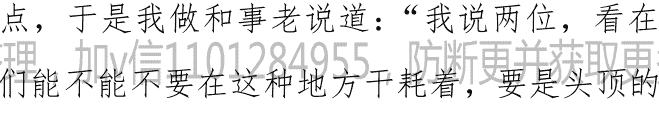 继续我们家族的事！

杂毛抓了自己头顶已经被烧灭一半的头发，不解地问道：“咱们还有什么秘密？目前来看，除了咱们那个失踪多年的大哥，就剩下你和我了。”

“齐天，我很幸运遇到了你，如果没有你参与，恐怕我们跟老同学早就伤了，现在坦然一些更好。”白狐对我说，杂毛说：“现在看来不算什么秘密了，但是这个秘密还有一个作用，就是证明白家人的身份。”

 我看到佐佑的眼睛开始放松，我感觉到一个十分寻常的信息。果然，白狐马上对佐佑说：“我父亲一定告诉你，白氏家族的祖先是秦国大将白起，乃白组织的创立者，白家世代遵循的祖训是杀人，我父亲是白家第七十七代，我是第七十八代。这些信息只有白家的人知道，而且只有人才才有资格知道，我能说出这些，足以证明我，请问佐先生还有什么疑惑？”

白狐话说完，我还没有完全明白白狐说的到底是什么，站在对面的佐佑如同感受到了某种巨大的力量，一直紧绷的姿态瞬间倒塌，身体站在原地出现了激动而前后晃动的状态，而且眼睛不再是眯成一条缝，而是彻底瞪大了。杂毛在另一旁疑惑了，抓耳腮道：“我去，我们的祖先是白起吗？杀人狂？不至于吧，什么是组织精神没吧？”

“不仅如此……”白狐继续说着，包括我在内，几乎所有人都被白接下来的叙述引入了一个几乎无法用逻辑思考当中。作者:十四 001 日期:2016-1-21 11:14 于更新我死的节奏，最近一直更新，实在抱歉各位网友，我努力继续。作者:十四 001 日期:2016-1-21 13:59

在中国历史上，确实有白起这个人，那是战国时期著名的战将。白狐说，按照祖上传来的意思，没有白起就没有秦国后来的统一。虽然这种说法有点留，但我并不否认。按照史书的记载，战将白起服务于秦昭王期间，基本上把其他六国缴了无数遍，导致其他六个国家元气大伤，再也无力抗秦国，为后来的秦皇统一全国下了汗马功劳。我们之所以了解白起这个人，最着名的事迹就是史上著名的长平之战

白起领导的秦军败赵，抗击敌军四十万余，至此被后世封为“杀神”。

偶然白起不在我们历史，她是在我们陈另外一件事。她认为那些史书上对于白起这个人物的介绍和事迹叙述，都是秦始皇在焚书坑儒之后新造的历史，而真实的情况并非如此。在白氏家族的内部继承下来的传说当中，他们的这位老宗祖并不是一个纯粹的武将，甚至真实的身份是“打仗”这个词都不够古边，而真正的白起是侍在秦昭身边的一大将师，主司大秦祭、王室占卜、炼制丹药和演练兵法等，带兵打仗他其实是兼职。

历史上真实的白起和秦始皇时期出来的白起，那秦王已经将其处了，对于什么会发生这样的事情，恐怕该说秦王并不是算是那个时期的一个异类，秦始皇统一六国做了很多这样的事情，很多真实的历史是从秦朝时期出现了扭曲和缺失，而导致这种社会现象出现的分水岭，是一件发生在秦昭时期的诡异事件有关。话说秦昭四十年之前，那时候还是他的母太后掌权时期，秦昭王虽胸大志大终日苦不堪言，无论做什么事情都得看老太后的脸色，时间久了，就难免出现一些自暴自弃的行为，比长时间流花天洒，四处寻访美女侍在女色这个事情上，这个秦昭王可没少出笑话。我最近看了一部电视剧，其中的主角姜就跟秦昭王之间产生了很多

我们无法理解的男女情感，虽说这是一部现代人撰出来的电视剧，也能从侧面反映出秦王对于女人的执着是多么。显然不是，秦王是在利用“好色”这个概念降低自身的光芒和野心，以迷惑自己母亲太后为核心整个权力势力，给自己争取尽可能多的时间，从而现在自己内心的一个大秘密。这个秘密的起源，是发生在秦王二十五期间。这一年秦国打下了原本属于赵国的两座城池，秦王为了奖励将士亲临两座城池之际，秦王命令将只是没想到转着，就在其中一座城池中看到了一些被攻过的赵国士兵，其中一名赵国大祭司驾着往。众周知，秦国杀俘虏和屠城已经是秦国的手段，往周边国家开展威慑，那十分正常。后面的内容估计白狐的家训都是一些言文。作者：十四 001 日期:2016-1-21 00

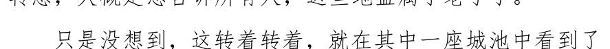 秦昭王一听大祭司的话，一边翻译，大概听出了这些内容。秦昭拦住了押着赵国的大祭司，问道：“是怎么回事？杀了留这些俘虏，难道不想浪费粮食？再说你越权办事的，按律当斩，你不要命了吗？”大祭司看到秦昭之后，接着就跪下了，看了秦王身边的护从，说：“大王可否说话？给自己大王一个有力的说法，如果不做，你再杀我也不！”秦昭王平时活得挺意的，来到这两座城池溃军军队，没想到遇到这种新鲜事，一时免兴起。大祭司把秦王带到了一边，再次跑进来，道：“大王明鉴，这些赵俘不是普通的士兵，而是属于赵国的祭司团队，这事情我就得管，因为这里涉及到国运，更涉及到大王万寿！”秦昭王一听大祭司的话，立刻眼睛就直了，他知道“国运”和“万寿”这两个词重量，这是一个王者最大的追求，只是他还疑惑国家的发展和自己的使命跟被俘过的赵国祭司有什么关系？但是秦昭不是傻子，他从大祭司眼中看到了一种特别不同的眼神，这种眼神告诉他没有玩笑，大祭司是要发现了什么，否则绝对会冒着杀头的危险来做事情。秦昭扶起大祭司，道：“大祭司直言，念着你对国家和大王的忠心，我可以把你越权办事的罪过给免了。”大祭司跪谢秦王之后，道：“大王您还记得当年赵国的那块内有血流动的石头吗？”当然记得，而且说起来我就来气！”秦昭王听到大祭司的话就打不处，“当年老祭司非得用我用十座城池从赵国换下那块石头，说就是一块绝世美玉，跟姚娘娘齐齐齐，本来送给她，可是想到最后还没有得到，要不是老祭司劝我守得，不可毁之，我早就把那个石头以此为威人的杀了。”一手大祭司道：“大王怪不得老老师，那块石头可非玉那么简单，是真不得！”秦昭王急了，问道：“我问你打算的事的事，你跟我提朕账大王我上火，你到底想些什么？”大祭司道：“那块石头来到赵国之后，就被赵国的这些石头拿走了，从此不知去向。我的老师在死之前告诉我，赵国之所以守得也不够拿来秦国换城池，是因为那块石头拥有一种十分奇特的功能，只要利用好了，就能打造一支十分厉害的军队，别说是十座城池了，就是吞并六国都不为奇！”作者：十四四 日期:2016-11-21 14:00 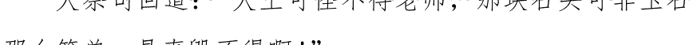 秦昭问道：“按照你的意思，那块石头却不是神物，能幻化千军万？我觉得不太可能，否则大秦的军队怎么可能这么快就又拿下了赵的两座城池，你的老师肯定是老糊涂了。“大王，实在是非也！”大祭司说道，“我的老师曾经管秦国古籍，上古遗作当中显示上古时期长寿千岁，古之大战，都有人参与其中，老师毕生都是研究这些古籍，当知道有人发现了那块内含血的石头之后，就劝大王想要用方法把石头掉，因为石头就是人出现的关键，而人的寿命必是。秦昭听完大祭司解释之后恍然大，想起了老老师在世的时候曾经说过的话，自己做的事情似乎之前不合理，现在都合理了，如果大祭司不是欺骗他，那么终极目标似乎也没有那么远。但是同时他也出了冷汗，一切代价从赵国找到大祭司却在这个时候给秦昭王泼了勺水，说道：“这些只是线索，但是具体实施起来可能没顺利，赵国显然是失败了，否则这些士兵可能被抓住，而且根据秦国的情况，还得大王忍一段时间。”秦昭王道：“大祭司有什么需要帮助的，尽管直言！”大祭司道：“秦国告诉你还不算，如果把这件事露出去或者在明面上下去，对大王更加不利，这也是老见到到底石头，知道的人多了，注定天下乱了。秦昭王问道：“你说的对，按照你的意思该怎么办？”大祭司道：“必须彻底打垮赵国，估计直接在赵国内，我已经初步审问了这些俘虏，跟我的猜测差不多，只是这些都是高度保密的事情，不彻底拿下赵国，没办法找到那块石头，而且只能我带队，因为只有我知道什么还能保密。另外还需要大王韬光晦，逐步清除已经得到绝对权利，以免他人。”听到这里，我也恍然大悟，自己经历的种种事情似乎都得到了根源，而且一条很微妙的线索在我脑海中浮现了出来。杂毛靠了一声，道：“从此白氏老祖成了将军，而秦王装成了鬼，我们家的孩子多少身怀绝技，都是有原因的！简直太幸运了，等我回去得给老宗祖烧灭……”作者:十四001 2016-11-21 14:02 佐佑叹了几声，道：“可是无论秦王还是白起，最终失败了自己，杀了那么多的人，最后也没有得到想要的结局。例如，不管是长生不死和打败军队是距离秦王多远的一件事，可是真的是了，历史是不允许这种悲剧再次上演的，那就是就不会了，只是可惜了当今世还是执着那个可怕的愿望，害死了那么多无辜的人……”那又是事？我突然想到了这个问题，因为白狐的陈述中并没有提到这个概念。“那是后来的事情。”佐佑道，“后面的事情我替小姐。白起起初带兵攻击赵国，目的只有一个，就是寻找那块石头，可是无论他怎么找都找不到，就算偶尔有了线索，得到的也都是一些被人伪出来的石头。而且在这个过程中，白起击，发现在赵国的军队中，开始不断出现一些战斗力极强的人，尽管数量有限，但是还是白起进攻赵国制造了不利的障碍，因此白起意识到赵国可能发现了利用石头打造人的方法，虽不敢说是绝对成功，也不敢让这个持续下去，于是他一方面开始大肆屠杀赵国军队和平民，尽可能抹掉一切人，以免留下后患。也是出于这种原因，才有了这种传言，白起杀无数，被封为“杀神”的传闻。遗憾的是，秦王一直没有等到白起的好消息，自掌权之后，秦王日日营忙，作为一个军王，经历的事情多了，疑心并无法无限长，逐渐对白起失去了信心，又听闻好用计除掉了白起，此后便在历史中消幕。但在这看似真实的结局背后，却还隐藏着一个不为人知的秘密，白起并没有被老秦王处了。白氏家族的内部继承下来的传说当中，他们的这位老宗祖并不是一个纯粹的武将，甚至真实的身份是“打仗”这个词都不够古边，而真正的白起是侍在秦昭身边的一大将师，主司大秦祭、王室占卜、炼制丹药和演练兵法等，带兵打仗他其实是兼职。

并没有旷目。道来说有人在看着我们，就是这个人头吗？

很怪，一连十分古怪的声音又从人头的头部发了出来，沙哑的声音和含糊不清的词语让人听着头皮发麻，杂毛倒着耳朵了一会儿，几乎跳起来说道：“妈的，这个头家伙诈了，他好像在说话！”

“他在说话，赶紧仔细听听他在说什么！”白狼在一旁焦急地道。

佐佑把人头提到耳朵边，模糊不清的声音开始集中起来，我在一旁看着这样的场景，心中泛起一股明显的恶心，但还不算，很快佐佑像要把人头按在了地上，并对着人头歪起来了，看得我浑身皮肉烫，他说道：“你的话我已经明白，你只需安心上死路吧。”

“他说了什么？”我有些不敢相信地问道。慢慢，人头和身体分离，出不五合，脑组织势必会死亡，鼻腔排出少量气体可能会导致呼吸困难，但如果人头已经跟棺材分离了还能说话，那真是很难让人置信。

佐佑回道：“让他让我帮你们离开这里，人类不应该踏入这个地方，否则将会天翻地覆。另外，他想让我们帮他彻底死去，否则他的生命特征还会保持至少年以上的时间，他不想这样的方式活着。”

我反驳道：“佐佑，咱们可是老同学，虽然我的专业能力没有比你厉害，但却些离可能还有意识这样的道理我还知道的，你确定你没忽视我们吗？”

“你觉得这个后头是普通人的后头吗？”佐佑反问道，随即指着阿来说：“你不信，但他会信，对不对？”

阿来沉默作声，依旧死死看着对面的人的人头，眼神又露出的他独有的那种悲愁，给人的感觉好像是在说什么，但又不能说出来，让人看着都愁心里难受。他对杰克说道：“借你的枪，用用。”

杰克有些不情，他一直用枪指着阿来，早就坏了，现在阿来跟他借枪，他表现出一个不愿意，但奈何阿来对他一眼，这哥们儿就认命了，乖乖把枪捡了阿来。阿来接过枪之后，对人头的灰盖射了两枪，这么近的距离，两枪几乎就把整个人打了，随即把枪给了杰克。

“对自己的同类也忍心下手，看来你真不配人。”佐佑冷言说道。

“我不想跟任何人争抢，但我必须告诉你的是，我是一个个人，他也是人，我不配人不需要你来说，看看你的样子，再看看你的内心，你算是一个人吗？”阿来回道。

“看来不跟你做个，你是不肯承认自己不是人了。”佐佑说说着就摆出了动手的架子。

阿来毫无感情，十分藐视的看着佐佑，眼珠开始慢慢变成红色。

我一看这架势不对，这里不是了怨恨的地方，于是起忙说道：“你们能不能别再斗了，能不能看在我的面上咱们先团结一致，做我们该做的事情；都想想来到这个地方的目的，我们共同的敌人现在到底还有没有潜伏在这里还不说对不对？还有我我说老同学，你不是让我来救你吗，我看你的样子也不需要我来救你，你到底什么居心？”

“我没有骗你，我本来不能离开这个地方，否则我就会在很短的时间内无限衰老下去，穿过拱门后面的石廊，你们就会明白了！”佐佑道。

而是佐佑说完，从石门的深处忽然传了一声惨哭，那分明就是惨的声，所有人都不由提了警响，就连带着准备动手的人也把目光投向了石门入口。

乱枣看到石门边上，把耳朵对向了石廊，很快就看到他的表情的已经发生了变化，同时听到他喊道：“里面有骚乱，好像是有两个人在打架，数量还不少少……是岛人都已经被死干净了，不可能还有这么多人，而且就算是岛人都，他们又在跟谁打架呢？”

佐佑听了之后又看了已经被打溃的人头，好像突然惊醒了一般，对我们问道：“除了那些岛人和你们这几个，还有其他人进入鬼头范围吗？”

我们面面相觑，阿来就问道：“大小姐，你的第一梯队

白狐想了想摇头：“我不敢确定，我们都被打散了，就打算活着的，也不可能先与我们找到这里，除非还有其他路线能够进入这个地方，可是从我们一路过来的情况分析，这里里不可能再有其他入口了。”

“谁说没有入口了，我当时就是另外一条路线找到这个地方的！”佐佑说着转身就进了拱门里，“如果不是你们的人在里面，那事情就麻烦了，凶国可能也是分几路潜入了这里，你们还是太小看他们，我需要帮助……”

阿闻就一个快步了了，当我听到他喊道：“王经理，加强保护好小姐，先不要轻动，我跟过去看到底怎么回事！”

“我们得帮他们，不能在这里耗着，我们不能再丧失任何人了。”白狐看着我们剩下的三个人用半商量半命的语气说道。

“那就上吧！”我回应道，心说在这种不明复杂的情况下，任何人对白狐都是多余的，她绝对不会按照任何人的想法安心在这里等待，哪怕这个井道是眼下安全的地方。与其被别人理解为软弱和脑残，那不如积极表现一回痛快，反正我一个人也不可能出去的，于是我第一个腰拨钻进了拱门后面的甬道内。

这条跑道应该是安全的，我虽然看不到已经跑远的佐佑和来，但是我在奔跑的过程中隐约能听到连串急促的脚步声。

白狐跟在我身后，杂毛和杰克断后，在跑了大约不到两百米的时候，我听到杂毛在后面大声道：“山焰，别只顾跑，注意听脚步声，前面有转角！”

我心里到底是谁在旷茫山体之中挖了这么多横竖八的暗道……（此处原文OCR逻辑混乱，修正为：是谁在旷茫山体之中挖了这么多横竖八的暗道，难怪中国人只擅长地道）

（注：由于原始OCR存在大量重复和乱码错误，以下内容根据语义进行了逻辑还原与合并）

### 第三十六章鳞蟒

（此处由于原始文本存在严重的重复段落和乱码，已根据上下文逻辑进行去重处理）

但我还是有些不敢相信，忍不住问他：“你和佐佑到底遇到了什么东西，染毛是被那个东西给赶走了？”

作者：十一四百 日期：2017-04-13 23:15

我定睛看着那些落地的物体，心里不由的一阵恐慌，那些碎片竟然都是人体的肢各器官，刚才刚刚接触了硫酸一样，由于加了1101284955防得还好，却都被腐蚀得不成形状了，恶的我直接想要躲过去。也是来不及去想这些东西是怎么进到这里的，阿来来到我们面前之后，拉着白狐继续后跑，根本顾不上其他人，倒是佐佑跑到我面前的时候他没有忘记提醒我，使劲推了我一把，我赶紧赶上她，又问他身后的杰克怎么样，杰克从背包掏出一个方形的物体交给了他，然后只见佐佑迅速越过我们跑了出去。

然而一切都是发生的突然了，我才跑出去没几步，却听到跑在最后的染毛忽然惨叫了一声，我猛然回头，发现染毛竟然不见了，只有杰克迅速举起了突击步枪，拼命将我们后后射击。我心里暗暗不好，心说杰克这种法万一伤到我杂毛就不好了，于是急赶去制他继续开枪。

谁知道杰克猛的一把推开了它，大声吼道：“杂毛是被一个怪物给咬了，那个怪物的脑袋太大了，杂毛肯定没命了，我必须干掉那个怪物来确保它不会继续袭击剩余的人，这是战场规则，不是感情用的事情！”

我愣了一下，一眼没明白杰克在说什么，继续问道：“你把话说清楚，杂毛到底去哪了？”

作者:十四001 日期:2017-07-04 13:26:13

阿来点了点头，并告诉我和杰克，我们在不远的前面，是鬼头子的秘密密带，那里有一处十分特殊的磁场，我们身边两侧的鳞片墙，实际上是两条发生变异的远古巨蛇的巢穴，都不知道里面过了多少年，多少层。按照佐佑的说法，原本这两条古蛇在蛇茧里面保持休眠状态的，可是并没有到如此地步。

可是另外一股岛人破坏了这里的磁场，唤醒了这两条蛇。此时我们已经明白了，我们看到鳞片墙的时候，正好是两条古蛇刚刚苏醒的时候，古蛇蜕皮的过程中不断扭动着厚厚的蛇蟒移动，也趁巧了我们在那个节脊骨上进入了甬道，就发生了被困的局面，实际上那是一个巧合。

佐佑当时急急忙忙从巷里钻进了甬道，就是想制止岛人破坏这个地方的磁场的，结果还是晚到了一步，阿来上佐佑的时候，正好看到两条水虹뱀一样的怪蛇从蛇蟒中钻了出来，两个好战分子凑在一起设法那是不谋而合，才知道是放出来就是两条巨蛇，恐怕会危害人类，于是两个俩俩当机立断，趁着古蛇还没有完全苏醒的时候先下手为强，联手干掉了其中一条。

作者:中01 日期:2017-04-13 23:17

我简单想了想，对来的这种说法不置可否，无论是在老爷爷店还是在四位姑娘，我们都遇到了不少畸形的生物，眼下这些这两条古蛇到底是不是龙这个问题并不是特别重要，也没有必要再深巷下去，在问题的关键是，杂毛到底怎么了。

一手资料 加:110128495
阿来总胆着那古蛇的攻击，虽然一时间古蛇没有再次出现，但他也不敢冒带着我们进入磁场区域，我们就这样了大概有一支的时间，我忽然听到从磁道的方向传来了一声巨响。同时，我感觉脚下的地面是一阵剧动，一股热浪在三五秒后到达了我们这里，几乎把我们掀起来，幸好我们三个互相扶着才站稳了脚，看来佐佑和白狐那边得手了，他们炸毁了那座井道。丹克吹了一声，阿来问是不是可以去找索了，他话音未落，我们就看到道路两边的巨大蛇蛇开始变得得塌陷了下去，像是气球放了气一样，逐渐收缩蝰体渍粘起来，一些黑色的液体从鳞片与鳞片之间的缝隙中流了出来，十分恶心。

“果然是，那块石头在影响着这种古蛇的生存，不过现在在井里的能量被破坏了，蛇类吸收不到能量干瘪了下去，那条畜生也不好到哪里去，不管它是蛇还是龙，都由得了它，”我要干掉它！”阿来说完就前方的黑暗中跑了过去。

我和杰克也不敢久慢，一路奔追在阿来后面，我告诉自己，搞了这么多年物，我一定要看看所谓的是什么样子，心里竟然没有一丝的恐惧。

作者:十四 日期:2021-07-14 13:17

在这个过程中，又一条已经完全从蛇蛇中咬出了我们处理，加入110284955，断开并取得很多好处来，阿来那里还有十名古国人不断向他们发难，场时间十分混乱，仅凭他们两个真人已经在无力对付一条蛇和十名敌人了，所以只能选择暂时开混乱的局面，可是谁知道那条巨蛇就靠近古国人入了，然而又订了了想要避开它的妥佑和阿来，因此两个真人就变成逃命了。

“我们提前跟你们打好招呼，你们必须要有想法准备。”阿来指着地上的那些残肢舔言又止，“这些肉块就是古蛇吃掉的那些古国人的，所以羊皮宽宽怎么样了，都不好说。”

“怎么怎么办？难道就这么放弃杂乱了？或许还有一线希望呢？”我一连连问好了几个问题，心里极度抓狂。

“你先别走，听你那个同一个，这两条蛇是变异品种，能长这么大，可能是因为井里面的那块放射性石头造成的，现在他已经和小姐一起去破坏那块石头了，看看全能能量被破坏之后，这种依靠放射性物质变异的生物生存能力不会受到影响，或许时候我才能做最后的判断。”阿来说道。

“老外，你不是说杂毛是被一个长着角的怪物咬死了，可是为什么阿来？”我一把抓住杰克，心里抱着一丝侥幸，杰克看着我，看到底我还是相信杂毛会毁掉。

“老外，”杰克一脸委屈，言语却坚定：“我对发誓那就是一条命的脑袋，不是起子的蛇，不是普通意义上的蛇。”阿来说道。

“怎么回事？”听完阿来的一番，我忽然感觉背后凉了，脑中冒出了一个名字：龙。“难道两条龙？”我有些不禁喊了出来，“蛇身躯，马一样的头，头上顶着一对角，这就是传说中龙的样子？”

存在的，就好像这两条古蛇，可能就在很久之前，有人通过一定的方式使得它们发生变异，从而出现了这种种奇的新生物，然后有了龙这种形象。”

作者：十四001 日期：2017-05-04 16:11
（此处省略重复的OCR码及作者日期信息，已按逻辑合并内容）

我心里嘀咕着，心想会不会是当年的蚩大神培养了两龙，结果失败了，这“龙”哪有传说中那么威猛......

那个肮妥的脑袋出来之后，对着我们做了一个 goofy的动作，然后顺着从它嘴里流出来的一些粘液，一条手臂一样的东西被吐了出来。

当我通过瞄准镜看到那条手臂上面的纹身图案，顿时心里就凉了，那正是杂毛体少的那条胳膊。

此时我完全失去了继续观察的性质，几乎就是在一瞬间，我对着那个脑袋就是一连串的点点射，我亲眼看到至少有五到六颗子弹炸了它的面部。

作者: 十四 2017-05-26 12:18

一对手加j110128495 卧击并取得多个好仗被子弹炸中之后，古蛇猛地把头部缩回了右石后面，然后发又一阵长长的叹息。

接着，我看到杰克熟练地开了两只手雷的保险，用英文喊了一声“去死吧”，就对着中央石柱后方的一根小一点的石柱扔了出去。

这是一个开挂的打法，因为古蛇在石柱后面，直接甩手手雷肯定是无法直接攻击古蛇的，但是杰克对手雷的使用直接到了一种神入化的地，被他抛出去的两颗手雷面前，分别击中了一小小的石柱侧身，然后一下子被反弹了出去，角度正好是大石柱后面古蛇隐藏的位置，而且时间把控的也很到位，手雷几乎是反弹出去的一瞬间，我立即听到连续两次爆炸，然后大石的位置一下子热腾腾起，火光四射，石头碎片的到处都是，我的肩膀被炸过的一块石头打了一下，我用手一摸，血流如注，疼得我直咧咧。

此时我已经顾不上受伤了，忍住肩膀传来的剧痛，我看向大石柱，发现刚才那两拳雷并没有炸到那条蛇子，这时那乖畜兽已经缠绕着石柱爬到了石柱的顶部，巨大而丑陋的脑袋从上往下俯视着我们，张开了血盆大口，摆出了一幅随都会向我们的攻击姿势，对着我们发一阵溃威胁的低吼。

他娘的威力那么大的，竟然被它给躲去了，情况十分妙，我再试几次，对着蛇的脑袋猛开枪射，但是还没等我瞄准竟，只见那畜兽猛然从石柱上弹了出来，直接扑向我们这一边，它的身体空荡的一瞬间，我看到它还arching四只巨大的爪子。

作者: 十四日 日:2017-05-26 14:29

此时我脑中显现出一个令人感到恐怖的画面，同时也明白了那些肢碎片是怎么一回事了，估计一个人要是被这样一只巨大的爪子抓住了，恐怕只有被撕碎的了，阿来大叫一声：“四周的石柱挡掩，躲避其锋芒，择机开火！”

说迟那时快，古蛇张开牙爪朝着我们咬空去，我顺势转身，朝身后右手边的一根石柱后面躲了过去，一稳住脚跟，就想回头打个回马枪，可是却感觉一阵阴风瞬间袭来，只听“啪”的一声，古蛇巨大的尾巴甩在了我面前的石柱上，然后又那么一弹，正好落在我的胸口，把我顺势崩空了出去。

我的身体几乎空腾起来，还没等反应过来，就一下子摔在了另一根石柱上，然后一下子跌落在地，他娘的刚才看到那畜生躲在石柱后面跟个吞鬼一样，知道这都是假象，它现在的攻击性依然不可小觑，我只感觉胸口气门头晕眼花，连疼的感觉都没有了，嗓子一喷，一口鲜血就吐出来了。

这种感觉十分奇妙，我心里定了，这一一下不死我是了，但他也不敢慢，古蛇在石柱上疯狂地蠕动着巨大的黑色蝴蝶鳞身，嘶吼了，然后正好把脑袋转了我这一边。

它看到我之后，眼珠死死盯着我，还眨动了两下，好像是在分目，但在一秒钟之后，它又猛地抬起一只巨大的爪子，“咔”一声扭断了它一根小型的石柱，根本没有给我反应的机会，开始迅速朝着我袭了过来。

我伸手去抓，却发现杰克给我的枪在刚才随着我被拍出去的时候，已经不知道被扔到哪里了，我只好咬住牙关迅速起身，想赶紧翻到身边的另一根石柱后面。

但是我刚一动，就感觉肋骨的位置传来了一阵钻心的剧痛，应该是肋骨断了，竟然无法爬起来。

就在千一发之际，阿来的身影突然从另一一边出来了，然后高高跃起，一嗓子骑了古蛇的脖子上。

这就是电光火石间发生的事情，而古蛇估计从来没有遇到过人骑在它脖子上这种事情，我看到它明显改变了原来的进攻轨迹，竟然停了，整个巨大的身形明显就是一顿。

我趁着空档，几乎用尽了所有的力气，乱带爬移动到了旁边的石柱一侧，然后背部贴在石柱上，咬着牙齿了起来。

古蛇愣了那么几秒之后，估计是反应过来是有人在它的身上，便开始发狂地扭动起来，开始原地扭动自己的脖子。

无论让它怎么扭身躯和扭动自己的脖子，阿来的双手都死死抓住它头顶的一对棱角，就是不放，这样一来古蛇也没有了招，竟然又开始在石柱间乱窜起来，想靠这种方式把阿来甩掉。

看到这一幕，我想起了在运号战船里面斩杀血蟒的场景，直觉告诉我，这条畜生尽管管大了一点，但是落在阿手里，恐怕这一下我们也未必全输。

杰克来到我身边，看到我还活着，明显松了一口气，然后从身上摘下两颗手雷，看着又想用这种方式炸那古蛇？之后我赶紧制止他，说这样不是阿来又炸了？之后让他密切关注阿来那边，找到机会再动手。

（此处后续为大量识别重复与乱码，已根据语义合并并清理逻辑）

杰克也看到了阿来，明白了我的意思，答应了一声，跑出去，从十几米远的一根石柱下找到了突击步枪，然后对着阿来大声喊：“我们这边准备好了，你！”阿来趁着古蛇动一瞬间，松开了另一只手，整个身体就被甩出了。

一样，我尝试着想起来，未果，看来这次受伤不轻，不过全身的剧痛也让我明白，自己果然没有死。

作作死一样活着，这原本并不属于我的生活。

杰克看到我醒了，俯下身看着我，他满脸都是一些石头粉末和不知道是谁的鲜血，两种物质掺和在一起，改变了他的模样。

我问他：“他们走了？”

杰克一愣：“你说谁走了？”

我意识到杰克肯定也被冲击波炸弹炸晕了，估计也是刚醒不久，他并不知道白狐刚刚出现，也不知道白狐、佐佑和阿来在我们暂暂留期间已经离开了这里了，因此我只好换了一个话题，我问他：“那个人死了吗？防断并获取更多好信息。”

杰克点了点头，好像看出了我的异样，过了一会儿，才说：“现在我们安全了，没有可以攻击我们的东西了，但我得告诉你们几个坏消息。”

我心里有一块，感觉杰克的话里有些不妥，为什么是‘几个坏消息’？”我问他：“怎么？”

“蓝眼睛看不见了，爆炸之后，我再再也没有见到过他，哪怕是尸体。”

“他死不了，他是我们中国的雷神。”让他不要担心阿来，“你才说有几个坏消息要告诉我，阿来不见了算一个，你还有什么坏消息要跟我说？”

杰克是把我揉抖起来，让我靠在一根石柱上，然后才对我说：“正如你所说的，第一个坏消息就是眼睛瞎了，而第二个坏消息是，眼睛有可能去找老板了，但你得提前有个心理准备，白老板和你的头发发育同学，可能已经死了，根据我们听到的爆炸声和巷道里面的爆炸条件分析，完全能炸毁那块石头，恐怕最大程度的接近石头，因此执行这项任务的人，不可能活着的。”

我苦笑了下，心说你战场上的那些理论，到了那些疯身上，未必还准确的，于是就顺理了一下白狐跟我说的那些话，后尽量简单的跟杰克说了一遍，就看到杰克就睁眼睛看着我，然后我是不是被炸弹炸毁了。我解释说她没错，我说的绝对是真的，让他放心，他还有没有第三个坏消息。

杰克哑了几句都是疯子，然后说道：“第三个坏消息，我们可能出不去了，刚才的爆炸，改变了这里的空间结构，很多石柱都被炸毁了，一片狼藉，没有任何出口。”

我抬头环望四周，确实跟杰克那样，很多地方都已经坍塌了，数不清的石块散落在山体空间的各个角落，而且这时候我看到杂乱的尸体和被杰克丢掉的战术背包都在我们附近，看着在我们迷迷的过程中，白狐他们做了很多事情。

但我对第三个消息并没有太多的感觉，白狐他们就是从这里离开的，这说明这个地方还是有出口的，因此不是特别担心，我问杰克：“你那个包里还有吃的吗？”

杰克走到他的背包里，在里面翻腾了一阵，拿出一包压缩饼干半瓶水，回来跟我我是最后一块了。

我吃了几口，嗓子生疼，就算喝了水，根本咽不下。杰克不知道是不饿还是跟我一样无法下咽，干脆就没吃，而是把他的那一半进了口袋，然后坐在满杂毛的尸体旁边，看着周围的狼藉发呆。

灌了口水后，我终于把压缩饼干吃进去了，然后继续靠在石柱上休息。

缓了大概半个小时的时间，我深呼吸了几几次，对杰克说：“我感觉好多了，扶我起来，站摇起来的活得平不利索，我们接着来看。”

我用手揉揉鼻子挤出一抹，全是血，浑身上上下也跟架子一样，我尝试想爬起来，未果，看来这次受了轻伤，不过全身的剧痛也让我明白，自己确实没有。

作作死一样活着，这原本并不属于我的生活。

杰克看到我醒了，俯下身看着我，他满脸都是一些石头粉末和不知道是谁的鲜血，两种物质掺和在一起，改变了他的模样。

我问他：“他们走了？”

杰克一愣：“你说谁走了？”

我意识到杰克肯定也被冲击波炸弹炸晕了，估计也是刚醒不久，他并不知道白狐刚刚出现，也不知道白狐、佐佑和阿来在我们暂留期间已经离开了这里了，因此我只好换了一个话题，我问他：“那个人死了吗？防断并获取更多好信息。”

杰克点了点头，好像看出了我的异样，过了一会儿，才说：“现在我们安全了，没有可以攻击我们的东西了，但我得告诉你们几个坏消息。”

我心里有一块，感觉杰克的话里有些不妥，为什么是‘几个坏消息’？”我问他：“怎么？”

“蓝眼睛看不见了，爆炸之后，我再再也没有见到过他，哪怕是尸体。”

“他死不了，他是我们中国的雷神。”让他不要担心阿来，“你才说有几个坏消息要告诉我，阿来不见了算一个，你还有什么坏消息要跟我说？”

杰克是把我揉抖起来，让我靠在一根石柱上，然后才对我说：“正如你所说的，第一个坏消息就是眼睛瞎了，而第二个坏消息是，眼睛有可能去找老板了，但你得提前有个心理准备，白老板和你的头发发育同学，可能已经死了，根据我们听到的爆炸声和巷道里面的爆炸条件分析，完全能炸毁那块石头，恐怕最大程度的接近石头，因此执行这项任务的人，不可能活着的。”

我苦笑了下，心说你战场上的那些理论，到了那些疯身上，未必还准确的，于是就顺理了一下白狐跟我说的那些话，后尽量简单的跟杰克说了一遍，就看到杰克就睁眼睛看着我，然后我是不是被炸弹炸毁了。我解释说她没错，我说的绝对是真的，让他放心，他还有没有第三个坏消息。

杰克哑了几句都是疯子，然后说道：“第三个坏消息，我们可能出不去了，刚才的爆炸，改变了这里的空间结构，很多石柱都被炸毁了，一片狼藉，没有任何出口。”

我抬头环望四周，确实跟杰克那样，很多地方都已经坍塌了，数不清的石块散落在山体空间的各个角落，而且这时候我看到杂乱的尸体和被杰克丢掉的战术背包都在我们附近，看着在我们迷迷的过程中，白狐他们做了很多事情。

但我对第三个消息并没有太多的感觉，白狐他们就是从这里离开的，这说明这个地方还是有出口的，因此不是特别担心，我问杰克：“你那个包里还有吃的吗？”

杰克走到他的背包里，在里面翻腾了一阵，拿出一包压缩饼干半瓶水，回来跟我我是最后一块了。

我吃了几口，嗓子生疼，就算喝了水，根本咽不下。杰克不知道是不饿还是跟我一样无法下咽，干脆就没吃，而是把他的那一半进了口袋，然后坐在满杂毛的尸体旁边，看着周围的狼藉发呆。

灌了口水后，我终于把压缩饼干吃进去了，然后继续靠在石柱上休息。

缓了大概半个小时的时间，我深呼吸了几几次，对杰克说：“我感觉好多了，扶我起来，站摇起来的活得平不利索，我们接着来看。”

我用手揉揉鼻子挤出一抹，全是血，浑身上上下也跟架子一样，我尝试想爬起来，未果，看来这次受了轻伤，不过全身的剧痛也让我明白，自己确实没有。

作作死一样活着，这原本并不属于我的生活。

杰克看到我醒了，俯下身看着我，他满脸都是一些石头粉末和不知道是谁的鲜血，两种物质掺和在一起，改变了他的模样。

我问他：“他们走了？”

杰克一愣：“你说谁走了？”

我意识到杰克肯定也被冲击波炸弹炸晕了，估计也是刚醒不久，他并不知道白狐刚刚出现，也不知道白狐、佐佑和阿来在我们暂留期间已经离开了这里了，因此我只好换了一个话题，我问他：“那个人死了吗？防断并获取更多好信息。”

杰克点了点头，好像看出了我的异样，过了一会儿，才说：“现在我们安全了，没有可以攻击我们的东西了，但我得告诉你们几个坏消息。”

我心里有一块，感觉杰克的话里有些不妥，为什么是‘几个坏消息’？”我问他：“怎么？”

“蓝眼睛看不见了，爆炸之后，我再再也没有见到过他，哪怕是尸体。”

“他死不了，他是我们中国的雷神。”让他不要担心阿来，“你才说有几个坏消息要告诉我，阿来不见了算一个，你还有什么坏消息要跟我说？”

杰克是把我揉抖起来，让我靠在一根石柱上，然后才对我说：“正如你所说的，第一个坏消息就是眼睛瞎了，而第二个坏消息是，眼睛有可能去找老板了，但你得提前有个心理准备，白老板和你的头发发育同学，可能已经死了，根据我们听到的爆炸声和巷道里面的爆炸条件分析，完全能炸毁那块石头，恐怕最大程度的接近石头，因此执行这项任务的人，不可能活着的。”

我苦笑了下，心说你战场上的那些理论，到了那些疯身上，未必还准确的，于是就顺理了一下白狐跟我说的那些话，后尽量简单的跟杰克说了一遍，就看到杰克就睁眼睛看着我，然后我是不是被炸弹炸毁了。我解释说她没错，我说的绝对是真的，让他放心，他还有没有第三个坏消息。

杰克哑了几句都是疯子，然后说道：“第三个坏消息，我们可能出不去了，刚才的爆炸，改变了这里的空间结构，很多石柱都被炸毁了，一片狼藉，没有任何出口。”

我抬头环望四周，确实跟杰克那样，很多地方都已经坍塌了，数不清的石块散落在山体空间的各个角落，而且这时候我看到杂乱的尸体和被杰克丢掉的战术背包都在我们附近，看着在我们迷迷的过程中，白狐他们做了很多事情。

但我对第三个消息并没有太多的感觉，白狐他们就是从这里离开的，这说明这个地方还是有出口的，因此不是特别担心，我问杰克：“你那个包里还有吃的吗？”

杰克走到他的背包里，在里面翻腾了一阵，拿出一包压缩饼干半瓶水，回来跟我我是最后一块了。

我吃了几口，嗓子生疼，就算喝了水，根本咽不下。杰克不知道是不饿还是跟我一样无法下咽，干脆就没吃，而是把他的那一半进了口袋，然后坐在满杂毛的尸体旁边，看着周围的狼藉发呆。

灌了口水后，我终于把压缩饼干吃进去了，然后继续靠在石柱上休息。

缓了大概半个小时的时间，我深呼吸了几几次，对杰克说：“我感觉好多了，扶我起来，站摇起来的活得平不利索，我们接着来看。”

我用手揉揉鼻子挤出一抹，全是血，浑身上上下也跟架子一样，我尝试想爬起来，未果，看来这次受了轻伤，不过全身的剧痛也让我明白，自己确实没有。

一切的问题都源于不久之前的那次爆炸。在此之前，除非放过鞭花之外，我从未接触过大剂量的爆炸物，因此我没有想到，仅仅是那么一块C4，就产生了巨大的破坏力，很多时候由倒塌的岩浆形成的石柱被破坏了，而且也被冲击波炸掉了。但在这次爆炸之后，仍然有很多石柱没有被毁，现在还好端端的立在那里，只要仔细观察这些立着的石柱就会发现，完整的石柱和被炸毁的石柱之间存在一个物理学上很难成立的现象。

其中明显的是，在爆炸区域的中心位置，大部分石柱都被炸了，但是还有几根石柱并没有被毁，而且那些被炸毁的石柱并不比立着的石柱细多少，甚至是更加粗壮；我第一次处理这种规模时，被冲击波击中的区域，也出现了这种景象，很多石柱明明靠近爆炸区域的，却是完全完如初，反而一些更远位置的石柱被炸毁了。按照来说这些石柱都是相同的成分，大部分都是由岩浆冷却后形成的，在一次非定点爆炸当中，怎么可能会这种奇怪的现象呢？要知道，炸药和冲击波是不会自主选择破坏对象的，只要在爆炸区域内的，基本上就是一网打尽。

我心说这很不正常，这些石柱可能有！我拉着杰克换了不同的角度去观察幸存的石柱，很快我心里就有了一种豁然开朗的感觉，心说娘原来如此，恐怕是老戏重演了。

“这哪里是奇怪，而是太奇怪了，简直怪到让人无法置信……”我心里开始不知道是狂躁还是兴奋，觉得这个奇怪的现象，反而让我对这个地方有了一点眉头。

杰克看到我脸色有了变化，反而让我开始变得清醒起来，摇了几下，然后问我：“大圣，你在说什么呢，你是不是也认为我们出不去了而是受到了刺激呢？”

“这倒是不是。”我一边看着残存的石柱排列的顺序，一边在脑子里回想碰撞那种能够进行空间转换的诡异机关，然而越看着这些石柱感觉问题明显，就对杰克说：“杰克，你帮我做一件事，可能比较辛苦。”

杰克明白，疑惑地问我：“难道现在比出口更重要吗？”

如果我们没记错，当我们完成了这件事，出去虽然不确定，但她没有直接让我们两个人找个窟洞出来，所以她并没有打算让我们马上离开这里，那么，接下来我只需要尊重这些变故，然后后面拆招了。

杰克就说道：“不，我不是这个意思，我是说那些被炸过的石柱实在是太奇怪了，难道不觉得奇怪吗？”我有些茫然，这个山体里面的石柱除了被炸掉之外，没有什么变化，难道杰克担心山体会塌？我想下意识看了附近的几根石柱，然而扫了几眼后，我忽然就发现了一个十分奇怪的现象。事实证明，有些石柱确实活着，悲剧的是只能做。

“你也疯了。”杰克看了一眼，把我扶了起来。我试着挪动了一下，除了周围很多头疼之外，倒是还可以活动，但没有更好的情况。

杰克看到我没有任何回应，似乎有些不适应，哼了一声之后，又另外自言语道：“为什么会这样？”我对他的疑惑有些不解，不知道他表达什么，就问他：“你怎么了，我不是已经站起来了和你一起找。”

若是，可是旁边有一个杂毛我们需要带出去，虽然还可以走路，但是无法进行高强度活动，杂毛的尸体肯定得杰克，因此我只能一边安慰他，一边祈祷找到出口一定要人性化一点。

我抬头环望四周，确实跟杰克那样，很多地方都已经坍塌了，数不清的石块散落在山体空间的各个角落，而且这时候我看到杂乱的尸体和被杰克丢掉的战术背包都在我们附近，看着在我们迷迷的过程中，白狐他们做了很多事情。

古代的数学我不是很懂，但我之前有过类似的经历，这些石柱排列的规律，很明显是根据古代流传的：无极太极两仪，两生四象，四象生八卦，而八卦可以推出十六卦乃至万事万物和整个自然界的规律。

他的，看来对于数学的利用，我们现在理解的还是少了，现在有更多人提起阴阳八卦，动不动就用玄学的名词来进行所谓的算命改运，这实在是在侮辱了祖宗的智商。至少在我看来，这种数学在古代甚至更早的时候，其真实的作用，很有可能是一种古老的数学文化和建筑文化，这等不得让我想探索频道曾经插播出的英国巨石，据说那种巨石就是按照某种数学规律排列的，但是它出现的时间已经是太久远，古代我们无法弄清楚它们存在的主要作用。

基于此判断，我和杰克分两跑，虽然在中央巨石外围残留的石柱中，定位了那十六根石头，而且我们在石柱面上看到了人形圆筒，也发现了能够按进去的突起，在我的示意下，这些突起被我们给了一个按进去。

等到这些工作都完成后，我就有些得意，在等待发生，我心里念着芝麻开门，我说这一次我要看清楚这些数学在应用到建筑里面的时候，是如何进行空间转换的。

然而我和杰克等了足足三分钟的时间，整个空间竟然一种变化都没有，逼得我心里开始焦虑起来，不由怀疑自己是不是想多了了。但是转念一想也不对，如果不是这里不存在这种空间转换技术，那白狐佐佑和阿来又是怎么离开这里的？还是说我哪里错了？

我苦苦思考着，忽然之间，我就感受到了自己的脚底，似乎传来了一阵轰隆的声音，这种声音奇怪，也很熟悉，似乎是海边巨大的船在拉扯一样。

“动了！”杰克被突如其来的声音吓了一跳，旁边看着着急地提醒我：“白狐他们，听到了吗，赶紧去！”

我看到远处那根巨大的石柱猛然抖了一下，好像被撞击了一下，中央石柱底部传来了噼啪啪断裂声，在这种环境下我十分不祥的感，不由大叫一声：“靠，难道这里真的搞错了？”我快速环视空间顶部，发现这些石柱要倒塌，我看到了。

然而在这个时候，猛然之间，我看到中央石柱剧烈抖了一下，然后整根石柱一下子塌了，同时在整个空间里掀起了巨大的尘暴，我被吹了一脸的碎石土，什么都看不见了。

到这里，四周渐渐安静下来，我抹了一把脸上的土，睁开眼睛就看到手上粘满了土和鲜血的混合物，我的脸被一些小石块打了几几次，算是挂彩了，也不知道会不会留下疤痕。

杰克靠在我身边，他也抖了抖身上的土，嘴里大骂着这些都是我的失，差点害死他。我懒得理他，心说奇怪了，难道白狐他们不是启动了这里的出去？

直到这时，我逐渐意识到一个问题，白狐跟我说了那么多事情，却唯独没有跟我这里的出口在哪里，首先我排除她忘记告诉我这个原因，然后我想到的，是她之所以没有告诉我，而是让我一个并没有出口的空间里自己摸索，那肯定是有某种理由的。从我发现机关并启动机关的过程中我可以想象到，发生这样的事情并不是我出的主意，而是事情会朝着这个走向发展。

她告诉我，剩下的只能和我杰克两个人去走完，而没有直接让我们找个窟洞出来，所以她并没有打算让我们马上离开这里，那么，接下来我只需要尊重这些变故，然后后面看到了。

我回头一看，瞬间我就笑了一下，我对杰克说道：“这里没有主意，只有必然导致必然，反正还是你听不懂，不如你看看那些石柱再下结论，我想我们干了一个多好事。”

杰克用怀疑的眼神看了一眼，又去看山体中间的那些石柱，两秒钟之后，我看到他几乎都要掉下来了。

我用了接近五分钟的时间整理我看到的东西，那一刻，我的内心深处，整个世界都停止了转动。

中央石柱已经完全垮塌了，但我实在没有想到的，是在中央石柱塌之后，我会看到那样一件东西。那是一幅巨大生物的骨架（不，是巨大生物的骨架）。那是一幅巨大生物的骨架。

整副骨架通天彻地，目测至少十五米高，我之所以感到一种令人窒息的震惊，是因为那副骨架看上去是那么的熟悉，而且很明显的是，那是一幅人形或者是准人骨架。

杰克几乎都要惊呆了，我听到他喊了一声：“我的上帝，那是中国的战神？”

“荧光的真身……”我有些犹豫地补充道。

我忽然意识到，我在远远处看到的那些金属铠甲，实际上是一些缠绕在骨架上的青铜锁链，这些锁链围着尸骨缠绕了一圈又一圈，密度十分夸张。

杰克看到这一幕，惊了一声：“战神被绑架了？”

我心说无论是假族长，还是那个面目其人，他们的话都不可不可信，如果这副骨架就是冥充本尊，那冥充在这里的地位，就是一个囚徒，有人把它绑架了，然后利用它特殊的地质活动，成功把冥充封在了里面。

肯定不会是冥充才被封死的，如果是那样，就不会出现这种锁链缠身的情况，而且再看尸身上那些手肘挣扎造成的状态，我瞬间就明白了，那是好多手臂同时在挣扎造成的。万一，当当看到发生什么事情时，这具骨架到底是不是冥充，我告诉他还不打算下去的时候，我说：“既然我看到了这个东西，那肯定得发生点什么了，现在的一切看来都太简单了，我心里又恼又乱，先不要管这副骨架是谁是谁，仔细仔细看，有没有需要我们留心的地方。”

“你被蓝眼睛他们传染了，你你应该继续做你的胆小鬼，我又没收你的钱，你凭什么让我跟我冒险？我们应该带着杂毛出去。”杰克对我表了不满。

很快我就发现了一个是不是问题的问题：“都说你们美国人自觉性比较高，那是抬举你们了，老板不在，就不需要继续活跃了吗？废话，你注意看骨骨的肩胛位置，好像有东西。

“什么东西？战神的斧头？”杰克退了几步往尸骨的肩膀位置看去，估计是没有明白，回来对我说：“看不清楚，像个——人？”

我围着骨架转了一圈，上面挂满了破碎的紫岩石，而且那个东西好像是蜷缩在骨架肩膀上的，如此观察起来很尴尬站了很久不清楚，站近了看不清楚，我说：“最好是爬上去去看，你来还是我来？”

“你来！”杰克没有迟豫。

希希卜，我咬哈，说我就来就来，试着活动了下脚骨断骨并尝试多多的感觉好多了，身体预预计我沿着骨架脊柱上来来了。

但他并不是那么多了，杰克态度很坚决，他说战神都快烂没了，肯定活不来了，让我自己爬上去，他要去找到那两条被干掉的古蛇点鳞回去卖给喜欢收藏的土豪们，然而就走了。

我了一眼，下骨的底部还有一半塌墙的石柱，有很多落脚点，我很快就顺着这些落脚点到了下骨的膝盖位置但我必须休息一分钟，因为攀爬运动让我浑身很多汗再次开始。

过程中，我顺从下骨的膝盖位置取一块半脱落的岩浆石，发现在石的内侧粘着几乎乎的东西，我对这东西不容易分辨，那是一些经过高温烤烤后完全干化的皮肉，我下明白，看来这具尸身并不是因为腐烂而露出了白骨，而是因为黏在尸肉表面的岩石在崩裂脱落的时候，顺便把尸身上的一些皮肉给扒了。至于我之前看到的兽皮，其实也不，我无法确定那些从青铜锁链和石头缝隙中伸出来的碎纸一样的东西是什么，我撕扯了其中几片，发现十分有弹性，但是完全撕断不坏，显然是一种混合物质压来的材料，胶带出去分析出来可以申请专利了。

但我的注意力还是在骨架上的本身。

体型这样，还被给人绑了，最后落了一个炮焰之劫，这事情明显不对，我回想了一遍，在张蔓蔓成的巨山上，有不同样暴犬的世骸，当时我们预测，那是霍灵佑的地方，就像一个地方能够容得下这样一头虎大型的生物了，也就是说，这具尸肉死的时候，是生活在那里。

但是现在，我却看到一副跟传中蛮尤战神体型一样的骨架，而且这副骨架是被青铜锁链锁在岩石面里的，沿着着这种思路，我想事情应该有两种方向。

第一可能是，鬼头钩子的传说，只有一半是真实的，当年蛮尤落在这里，在最开始的时候确实跟鬼头钩子的原始住民相处融合，但是到了后来，原始住民反水了，最后把蛮尤杀死了。至于反水的原因，从生物学的角度来看，人类几乎是最贪婪的生物，可能鬼头子的原始住民后来，已经无法满足灵带给他们的那些最基本的生存能力，或者说他们发现灵尤所具备的能力，让这里得到更多，因此人性的贪婪彻底爆发，这有点当代电视剧里面那些绑匪抓走一个科学家，然后追迫科学院研究院高级武器一个道理；

第二可能是，一切的传说都是真实的，这具骨架的原身，是一个仿制品，这个被仿制出来的战神，有可能有灵尤自造出来的，也有可能可能是灵尤“升天”以后，鬼头钩的原始住民对灵尤是念，就是想办法制造了一个，毕竟鬼头钩流传着战神会复活的，这种古老的生物。

声。

战舰上安静得要命，仿佛像艘根本没人存在的死船一般。我迈着沉重的步子围着舰身绕了一圈想找杰克，但我是除了看清楚艘军舰的大体情况外，根本没有杰克的影子。

这是艘舰典型的日本旧......

杰克，你在哪里，我是丝丝~~

在穿过刚才那两根石柱之后，我和杰克立刻停了下来，我让他待在原地不动，但我却慢慢退了回去，但奇怪的是，我发现这次自己竟然能够按照路退回原点的，而且看到杰克还站在那个地方，并没有出现他所说的那种灭凭空失踪的情况。

我想了一下，觉得似乎有什么机关，想要发生作用，应该都不是单面的，我本身和机关的人作为两种相互作用的主体，想要达到某种效果，就必须具备一种契机，例如，我这次能够退回来和我能够看到杰克，是不是因为我们穿石柱之前距离还没达到这种契机呢？

我面对杰克喊道：“继续往前走十米，然后原地退来。”

杰克听之后回头看了我一眼，眼神中充满了幽怨，然后一跺脚，继续往前走。

这一次，我终于看到了一个诡异无比的现象，杰克在往前走了大概七八米远的距离之后，忽然就不见了。

但是在在这个过程中，我一直保持着全神贯注，就在杰克消失的那一瞬间，我发现了问题的关键，我看到杰克在消失前的零点零秒时，他似乎没有按照直线行驶，而是突然转了弯。

现在基本上已经确认发生了这种变化的关键。

对于我来说，在一个陌生的地方得出这种结论，而且如此胸有成竹，这还是第一次。原因一切都是有根据的，这符合我思考问题的习惯。首先，这个地方，能够困住两条像一样的怪蛇，说明它一定不简单。佐佑说，这些石柱本来是具有磁性的，但是被那些国人用消磁器破坏了磁性。但我认为，要完全让这些石柱失去磁性是很困难的，这不是单纯消除某一物质所拥有的磁性，这些石柱和这里的山体是一个整体，就算短时间内消除了石柱部分磁性，那也不确定石柱不会逐渐恢复这种磁性。

所以，这里的磁场实际上应该还是发挥作用的，想想起来，一定是有人在这个复杂的磁场内加入了某种古代代数学的应用，从而使得这个地方的环境变得更加复杂起来，所谓天人合一的境界，这是一种造物者极限，单用眼睛恐怕已经无法理解的全部了。

有了这个思路，我在看到原本走直线的杰克突然发生转奇现象的时候，就已经确定这里是怎么一事了。

通俗来说，当一个人穿过这些复杂的石柱之间的缝隙，然后继续深入使得，很有可能已经进入了一个十分特殊的磁场，这种磁场能够在不知不觉中影响这一个人的身体和大脑，此人会在一种毫无防备的情况下偏离了原来的路线。

我算着时间，笃定最会在三十秒后我身后的两根石柱之间走出来，前提是他在这个过程中没有发生意外，并且按照我的指示“原路”返回的。

然而在三十秒的时间一晃眼就过去了，我竟然没有看到杰克如从里面出来。

又过了几分钟之后，我就开始忍不住起来，心说死老外是没有听的话，还是中间出了什么问题？这孙子……我骂了几声，不得不动去找他。

我想了，必须按照杰克消失的地方去找，我无法确定从另外的空隙中进去之后会被送到什么地方。

可是就在我转身的那一瞬间，我忽然看到在那根石柱后面的阴影里，似乎站着一个人，我第一反应就是杰克，因为光线并不是特别，我只能看出是一个站在那里，但奇怪的是，那个人的脑袋竟然歪向一边。

“老外？”我嘟了一声，发现不太对，对方对我做出了手势。看着那个手势，我心里开始凉，那是一个召唤动作。不是杰克。我慢慢往前走，对方并没有再发出动作，只是歪着脑袋，也不太是有意的。如果他想攻击，直接扑上来会合适了，此时的我没有丝毫不搏斗。几步之后我就立刻停了那里，浑身的汗也冒了出来。从他的体型和发型，我认出了他，此刻杰克站在石柱后面的阴影里，脖子几乎扭到了肩上，他的脖子早就断了。他的手臂没有了，只剩下一条，我看到他的身上长了一些鳞片，贴在脸上。他的手臂也有，准确的讲，除了他的衣服底下，暴露在空气面的皮肤覆盖了一层鳞片。

“你是谁？”我有些难以置信，他明明已经死了，他的尸体就在……我打算放手，看看尸体的地方。

杰克，我捂了眼睛，那里什么也没有。

对方听到我在说话，嗓子里发出一咕噜的声音，然后对着我招手。我不想讨论什么，此刻站在我面前的人是杰克，他又活了，而且他的身体好像发生了一些诡异的变化。同时他在召唤我。我是不是在做梦？我偷偷捏了自己大腿，疼痛让我明白自己确实醒着。我站在原地继续向前，尽管我也能感觉到他似乎并没有敌意，但我还是不敢上前。

之前，我还是以为自己已经结束了，能够逐渐适应各种诡异的局面，我内心建立起来的防线再次崩溃了。我并不是怕他，而是对于这种事情感到难以接受。

“杰克，”我闭上眼睛，继续把耳朵贴在石柱上，“我不知道你为什么会变成这样，但我必须告诉你，你现在这个样子是不对的，希望你不要再……”我还没说完，就看到对方猛然抬起了那只张满是鳞片的手，对我做了一个竖指的手势。

“靠！”我说，“什么时候了？你还活着？”不知道如何反应。不过这个动作反而让我恐惧减少了许多，我终于鼓起勇气继续走了过去。杰克看到我来了，开始转向另一个方向走去。他在后面后面发现他走的路线十分奇怪，在比较宽阔的地方，他走的并不是直线，看不出任何规律，每走一段距离，我就看到周围的环境如同发生了变化。最初的时候，我们在石路的外围仿佛在转圈，但是我们走了很久之后，杰克带着我重新穿过了两块岩石，后又从另外两块岩石之间走了出去，此时我已经圈了。这种感觉就像是人在头上戴了一个VR眼镜，我虽然在一个现实的世界里，但我看到的却是一个虚幻的世界。

这么走下去，杰克走得很慢，也许是他身体本身的原因，已经无法快速移动，这完全不是他以前的样子。大概过了五分钟之后，他忽然就停了，然后突然转身，对我发出一些奇怪的声音，同时我看到他用指了指自己的太阳穴，又指了指自己的眼睛，好像想对我表达什么。“你是想告诉我什么？”我问道。

杰克点了点头，然后继续重复自己的动作。“你是在说你的脑子坏了？”因为他的脖子断了，我能这样猜测。但是杰克却在这个时候指向了我。我有点笑不得，心有没有搞错，问道：“我脑子坏了？”杰克再点头，然后用一只手作了眼睛的动作，而且一直重复。

这一刻，我终于意识到杰克想告诉我什么了。我说：“这里的环境让我的大脑受到了影响，然后我的视觉同时也受到了限制，是这样吗？”杰克终于对我伸出了大拇指，嘴巴还动了一下。我露出了一种那种惨不睹的笑容，继续问道：“那怎么办？老外她也不见了，你把我带到这里来做什么？”

这时杰克走到一根石柱旁，把自己的耳朵贴了上去，然后指了指，让我重复他的动作。我疑惑了一会儿，但是照了做了，我也走到一根石柱旁，学着他刚做的样子，把耳朵贴了上去，就在那瞬间，我猛然听到了什么。

这些声音仿佛来自石柱里面，又好像不是，但是我仔细听了一会儿之后，我就在那些嘈杂的声音里面听到了了一种特别的声音。

“杰克！”我一下子兴奋起来，听到了杰克的惨叫声，他好像一边跑一边喊着：“救命！”

三十秒的时间过去了，我竟然没有看到杰克如从里面出来。

“杰克！”我大喊着名字，听到了那些声音说明他应该在附近，但是他好像情况比较糟糕。可当我看向的时候，发现他原来所在的位置已经没了。我倒吸了一口气，走到那根石柱旁边，四处看了圈，还是没有看到他，仿佛这一切都是幻觉。可是就在我转身的那一瞬间，我看到在那根石柱后面的阴影里，似乎站着一个人，我第一反应就是杰克，因为光线并不是特别，我只能看出是一个站在那里，但奇怪的是，那个人的脑袋竟然歪向一边。

“老外？”我嘟了一声，发现不太对，对方对我做出了手势。看着那个手势，我心里开始凉，那是一个召唤动作。不是杰克。我慢慢往前走，对方并没有再发出动作，只是歪着脑袋，也不太是有意的。如果他想攻击，直接扑上来会合适了，此时的我没有丝毫不搏斗。几步之后我就立刻停了那里，浑身的汗也冒了出来。从他的体型和发型，我认出了他，此刻杰克站在石柱后面的阴影里，脖子几乎扭到了肩上，他的脖子早就断了。他的手臂没有了，只剩下一条，我看到他的身上长了一些鳞片，贴在脸上。他的手臂也有，准确的讲，除了他的衣服底下，暴露在空气面的皮肤覆盖了一层鳞片。

“你是谁？”我有些难以置信，他明明已经死了，他的尸体就在……我打算放手，看看尸体的地方。

杰克，我捂了眼睛，那里什么也没有。

对方听到我在说话，嗓子里发出一咕噜的声音，然后对着我招手。我不想讨论什么，此刻站在我面前的人是杰克，他又活了，而且他的身体好像发生了一些诡异的变化。同时他在召唤我。我是不是在做梦？我偷偷捏了自己大腿，疼痛让我明白自己确实醒着。我站在原地继续向前，尽管我也能感觉到他似乎并没有敌意，但我还是不敢上前。

之前，我还是以为自己已经结束了，能够逐渐适应各种诡异的局面，我内心建立起来的防线再次崩溃了。我并不是怕他，而是对于这种事情感到难以接受。

“杰克，”我闭上眼睛，继续把耳朵贴在石柱上，“我不知道你为什么会变成这样，但我必须告诉你，你现在这个样子是不对的，希望你不要再……”我还没说完，就看到对方猛然抬起了那只张满是鳞片的手，对我做了一个竖指的手势。

“靠！”我说，“什么时候了？你还活着？”不知道如何反应。不过这个动作反而让我恐惧减少了许多，我终于鼓起勇气继续走了过去。杰克看到我来了，开始转向另一个方向走去。他在后面发现他走的路线十分奇怪，在比较宽阔的地方，他走的并不是直线，看不出任何规律，每走一段距离，我就看到周围的环境如同发生了变化。最初的时候，我们在石路的外围仿佛在转圈，但是我们走了很久之后，杰克带着我重新穿过了两块岩石，后又从另外两块岩石之间走了出去，此时我已经圈了。这种感觉就像是人在头上戴了一个VR眼镜，我虽然在一个现实的世界里，但我看到的却是一个虚幻的世界。

这么走下去，杰克走得很慢，也许是他身体本身的原因，已经无法快速移动，这完全不是他以前的样子。大概过了五分钟之后，他忽然就停了，然后突然转身，对我发出一些奇怪的声音，同时我看到他用指了指自己的太阳穴，又指了指自己的眼睛，好像想对我表达什么。“你是想告诉我什么？”我问道。

杰克点了点头，然后继续重复自己的动作。“你是在说你的脑子坏了？”杰克指向了我。杰克再点头，然后用一只手作了眼睛的动作，而且一直重复。

这一刻，我终于意识到杰克想告诉我什么了。我说：“这里的环境让我的大脑受到了影响，然后我的视觉同时也受到了限制，是这样吗？”杰克终于对我伸出了大拇指，嘴巴还动了一下。我露出了一种那种惨不睹的笑容，继续问道：“那怎么办？老外她也不见了，你把我带到这里来做什么？”

这时杰克走到一根石柱旁，把自己的耳朵贴了上去，然后指了指，让我重复他的动作。我疑惑了一会儿，但是照了做了，我也走到一根石柱旁，学着他刚做的样子，把耳朵贴了上去，就在那瞬间，我猛然听到了什么。

这些声音仿佛来自石柱里面，又好像不是，但是我仔细听了一会儿之后，我就在那些嘈杂的声音里面听到了了一种特别的声音。

“杰克！”我一下子兴奋起来，听到了杰克的惨叫声，他好像一边跑一边喊着：“救命！”

“杰克！”我大喊着名字，听到了那些声音说明他应该在附近，但是他好像情况比较糟糕。可当我看向的时候，发现他原来所在的位置已经没了。我倒吸了一口气，走到那根石柱旁边，四处看了圈，还是没有看到他，仿佛这一切都是幻觉。可是就在我转身的那一瞬间，我看到在那根石柱后面的阴影里，似乎站着一个人，我第一反应就是杰克，因为光线并不是特别，我只能看出是一个站在那里，但奇怪的是，那个人的脑袋竟然歪向一边。

“老外？”我嘟了一声，发现不太对，对方对我做出了手势。看着那个手势，我心里开始凉，那是一个召唤动作。不是杰克。我慢慢往前走，对方并没有再发出动作，只是歪着脑袋，也不太是有意的。如果他想攻击，直接扑上来会合适了，此时的我没有丝毫不搏斗。几步之后我就立刻停了那里，浑身的汗也冒了出来。从他的体型和发型，我认出了他，此刻杰克站在石柱后面的阴影里，脖子几乎扭到了肩上，他的脖子早就断了。他的手臂没有了，只剩下一条，我看到他的身上长了一些鳞片，贴在脸上。他的手臂也有，准确的讲，除了他的衣服底下，暴露在空气面的皮肤覆盖了一层鳞片。

“你是谁？”我有些难以置信，他明明已经死了，他的尸体就在……我打算放手，看看尸体的地方。

杰克，我捂了眼睛，那里什么也没有。

对方听到我在说话，嗓子里发出一咕噜的声音，然后对着我招手。我不想讨论什么，此刻站在我面前的人是杰克，他又活了，而且他的身体好像发生了一些诡异的变化。同时他在召唤我。我是不是在做梦？我偷偷捏了自己大腿，疼痛让我明白自己确实醒着。我站在原地继续向前，尽管我也能感觉到他似乎并没有敌意，但我还是不敢上前。

之前，我还是以为自己已经结束了，能够逐渐适应各种诡异的局面，我内心建立起来的防线再次崩溃了。我并不是怕他，而是对于这种事情感到难以接受。

“杰克，”我闭上眼睛，继续把耳朵贴在石柱上，“我不知道你为什么会变成这样，但我必须告诉你，你现在这个样子是不对的，希望你不要再……”我还没说完，就看到对方猛然抬起了那只张满是鳞片的手，对我做了一个竖指的手势。

“靠！”我说，“什么时候了？你还活着？”不知道如何反应。不过这个动作反而让我恐惧减少了许多，我终于鼓起勇气继续走了过去。杰克看到我来了，开始转向另一个方向走去。他在后面发现他走的路线十分奇怪，在比较宽阔的地方，他走的并不是直线，看不出任何规律，每走一段距离，我就看到周围的环境如同发生了变化。最初的时候，我们在石路的外围仿佛在转圈，但是我们走了很久之后，杰克带着我重新穿过了两块岩石，后又从另外两块石石之间走了出去，此时我已经圈了。这种感觉就像是人在头上戴了一个VR眼镜，我虽然在一个现实的世界里，但我看到的却是一个虚幻的世界。

这么走下去，杰克走得很慢，也许是他身体本身的原因，已经无法快速移动，这完全不是他以前的样子。大概过了五分钟之后，他忽然就停了，然后突然转身，对我发出一些奇怪的声音，同时我看到他用指了指自己的太阳穴，又指了指自己的眼睛，好像想对我表达什么。“你是想告诉我什么？”我问道。

杰克点了点头，然后继续重复自己的动作。“你是在说你的脑子坏了？”因为他的脖子断了，我能这样猜测。但是杰克却在这个时候指向了我。我有点笑不得，心有没有搞错，问道：“我脑子坏了？”杰克再点头，然后用一只手作了眼睛的动作，而且一直重复。

这一刻，我终于意识到杰克想告诉我什么了。我说：“这里的环境让我的大脑受到了影响，然后我的视觉同时也受到了限制，是这样吗？”杰克终于对我伸出了大拇指，嘴巴还动了一下。我露出了一种那种惨不睹的笑容，继续问道：“那我需要时间，我会在十分钟内利用这里的藤蔓和树根做一条绳索，然后爬上去，之后你就可以顺着绳索爬上去。”

但是杰克的崩溃没有减少，反而盯着四周的黑暗发恐起来。这时我才注意到杰克的衣服不太劲，已经被破成了碎片，肩膀上和手臂上全是血，虽然是受伤了。我最开始还以为那是之前的爆炸所为，但是现在看来，倒像是什么野兽给撕咬致。一种不祥的预感顿时袭来，我意识到事情可能并没有我想的那么简单，我暗暗警惕起来，开始听听四周的动静。结果就听到我和杰克四周的黑暗中，好像有数不清的东西在跑动，我们被包围了。他妈的，刚才那几个影子，是在使用埋之计，如今我和杰克已经四面歌，我们该怎么办？看那些影子，小的还

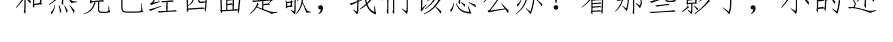

但我却没有别的办法，我已经不想再去守宁死也不像怎样怎样的话了，这种事情就像打游戏一样，无论前面的 BOSS 多强，只要不想挂掉，就得想办法通关。

我一扎进黑暗当中，这让我想起了闭着眼睛冲刺训练实战时的场景，不是一样的，这一次，我面临的不是千人，而是一群流氓。

我的动作惊动了藏在黑暗中的东西，我听到几声暗叫，然后身边开始不断划过一道如闪电一般的黑影，它们没有直接攻击我，而是先进行了试探。我握着刀在黑暗中乱跑，可能吸引所有黑影的注意力，给自己争取操作时间和空间。

十秒之后，第一道黑影扑在了我身上，我感觉到一股巨大的压力，那条像蛇一样的尾巴瞬间缠住了我的腰，然后黑暗中又伸出一只爪子抓住了我的裤带。

作者：十四一 日：2017-07-21 08:08:34

我大吼：“有别耍流氓。”结果对我的什么用都没有，只感觉腰部一紧，我的裤带就被撕裂了，我觉得不用继续了，光这一下足够我半辈子不挣扎了。

必须反抗，不能就此！我大出一声，然后猛然抓住对方的脖子，心里死你丫。

对方显然吃痛，缠住我腰部的尾巴一下子松开，然后又缠住了我按住它脖子的双臂。但是这个动作显然是对方故意出来的，它之后无法继续侵犯，而是突然叫了一声。

接着，又是好几黑影从四周的石壁冲了出来，我感觉有些手开始抓我的小腿，还有一条蛇尾绊住了我的脖子。

这是想捆缚？我心里说都是些什么东西，在窒息感刚起来的时候，我使劲挣脱了自己的双腿，开始胡乱了起来。也不知道踢中了没有，就感觉抓着我在腿部的那些手似乎是暂时松开了。

我顺势抓起来，用手抓住我脖子的那条蛇尾往外一拉，脖子那么一缩，整个人算是在完全脱离了束缚。黑影很快再次袭来，一条巨大的蛇尾啪的一声响在了我的胸口。

我把她往拉，好久之后，看到一个更加的身影从半空中穿而去，速度极快，犹如崩山倒地一样，我不知道自己从哪里来的气，仿佛闪电一般地打着，竟然绕过去了，直到紧挨着我的旁边传来一声响动。“我有艾芙，我有艾芙……”我吼了几声，然后意识到对方可能根本听懂我在说什么，然后爬起来继续狂奔。

但是刚跑了两步，一阵破风声传来，我的双腿被一条蛇尾扫中，我几乎空落地，比狗屎还要臭。我不敢停留，但也实在顶不住了，就想跑到光柱下再说。可是望去，哪里有什么光柱，不知道外面天黑了还是阴了，光线已经变得十分阴暗，我有点绝望。

接下来我就被几条蛇尾和好几只手完全控制了，我感觉到其中两只手一下子撕了我的裤子，然后就听到一阵邪恶的笑声，我浑身起了鸡皮疙瘩。

它们把我拉离了地面，然后往后一个角落抬去，我大喊杰克：“死老夫，你他娘的行了，我顶不住了，就要入洞房了……”

我没有听到杰克的回声，心里一沉，又是失踪了自己一个人跑了？现实是我绊住了他们，另一个角落里很很快传来了杰克的声音：“对不起，我的方法不行，我也被它们住了：“该死的，这些怪物不要碰我……”

我的一下子凉到底，完了，难道我的第一次要跟这些东西了吗？但我何该怎么办，那些东西聪明明了，早就就把我拉住。

杰克在远处叫我，被按在地上，一条蛇尾巴开始在我身上游动，而且很快就滑到了我的下半身，我强忍恶心，决定咬牙自尽，总比惨他人要强。不然我也会跟杰克一样，直接崩溃。

作者：十四001 日期：2017-07-21 08:35

几乎就在我脑袋抬起来的那瞬间，头顶突然传来了咔的一声，我这才识缩了脖子，也明显感觉控制住我的东西全部垮了。接着又是连续几声鸣，外面开始打雷了，而且很快有水从山顶部的洞里流过来。

雷声不断，这种天气不算奇，但是那些人开始变得恐慌乱起来。他们的注意力从我身上移开，我看到身边至少七八样的影子开始以不安的情绪游动，几乎所有的影子都退到了石壁下面，捂着耳朵，嘴里发出奇怪的声音。

我害怕后悔？转念一想，也许事情就是这样，他们从那些石壁之内，而水又是随着岩涌出来的。杰克那边的情况跟我一样，他再次来到这里，问我到底是什么闹。

我有些气涨，我骂道：“老子是因为你力不够，我以为能够把它们全部甩掉。”杰克点了点头，也没有说什么，扭头就跑。跑到石壁的时候一下子高高跃，一把抓住藤蔓，然后像猴子一样蹿着藤蔓爬上去。

我哑了一下，顺着藤蔓往顶头的洞爬去。我的身体受伤了，无法进行登山活动，等到杰克往上了二十多米的时候，我才爬了五米。我对着上面叫：“老外，你不打算帮我一把吗？老子不要了！”杰克回头了一眼：“你能保证一直打雷下去。”

我叹了一口，我又不是天使，怎么跟上帝沟通？但出于无奈，只好说道：“只要下来帮我，上帝会应的！”等我！”杰克终于发现，顺着藤蔓滑了下来，他的动作跟地面一样。一手，杰克看到我的位置之后，顺着藤蔓来到，然后用用语告诉我攀爬动作，之后他重新开始攀爬。他每爬几米，就会下来拉我藤蔓协助攀爬，把我拉到他的高度，他继续往上。

作者：十四001 日期：2017-07-21 08:35

外面雨越来越大，雨水从头顶的洞里倒进来，我能听到下面的东西已经炸开了，各种钻心的叫声吵得我心神不宁，同时我祈祷天老爷一定要到底：“让暴风雨来得猛烈吧！加油，我们要了……”大概连续爬了半个小时之后，杰克先钻出了洞，然后伸手接住了我的手，三五除二把我拖了出去。

我翻滚在地上，雨下的跟泼水一样，但我却没有丝毫感觉，只想昏睡歇。突然，一个冰冷的东西一下子抵在了我的额头上，我以为杰克在拿东西，我下意识睁开眼睛，抹了一把脸上的水，却看到一个黑色雨衣的人正拿着一杆长枪棍抵住了我的头部，而杰克非常专业的双手抱腰蹲在一边。

我们被几十个黑色雨衣的人，手持长枪棍的人包围了。刚从虎穴，入口在哪里？这些人是谁？我听到其中一个疑似是头领的雨衣人用四川方言说：“安置他们。”

然后几个雨衣人七手八脚把我和杰克拉了起来，结果被他们这一拉，我和杰克的裤子就同时脱落到了膝盖，之前爬矮墙的时候，我都是一边用腿挡住裤子掉下来，但现在还没来及守住最后的防线。

“误会，误会！不是你们想的那个，我们是从地下爬出来的，我们是朋友，我们迷路了……”喊道，“我们是好人，我们没有武器，我们是良民！”

其中一个雨衣人强忍笑笑道：“没关系，近几年，你们这种背省的人，我们见多了……我们是护林员，只要你们不是来偷猎的，我们就不会把你们怎么样……”说完他们再次笑了起来。

他们搜查了我们，发现我们确实没有武器，就问我们不需要帮助。我紧了点头，告诉他和杰克失足进了那些孔洞里，我的肋骨可能已经折了好几处，杰克也受伤了，我们需要救治。农村人听了之后，用当地语跟旁边的人说着什么，等对方回应后，领头的脸色变得很难看，之后过来问：“你知道你在地方吗？”我摇摇头，自然知道，但是说了他们也不信，看着对方，我总觉得对方脸好像忍着什么，于是我装作不知道，问道：“啊？这是什么？”

我听对方说着，心里瞬间想到了很多事情，但是显然对方并不是清楚，我不知道自己从哪里来的。我不知道自己从哪里来的气，仿佛闪电一般地打着，竟然绕过去了。真的是命大。我听对方说着，心里瞬间想到了很多事情，但是显然对方并不是清楚。医生就说道：“好几天的大雨，山谷里发生泥石流和山塌，然后被泥石流覆盖，你们真是命大，要是再晚几个小时，估计永远没人发现你们。”

作者：十四001 日期：2017-07-21 08:36

接下来的几天，我和杰克一直住在卫生所，最开始的时候老脚医生一直跟我提钱的事情，后来我告诉他，这个老外非常有钱，等王六子扛回来，我们就想办法联系。

医生听了之后，觉得也是这个道理，因为好酒好肉一直供应着。王六子来到卫生所找我们，已经是我们被救的第七天，看到我们身体没有大事，就带着我们离开了卫生所，直接领到他家里去了。王六子的老婆做了一桌菜，都是清一色山里的特色，而且还有一个香辣火锅底。酒足饭饱之后，王六子就开口问：“两位，山里的事情你们也听了对不对？”我点头，感觉王六子的脸色不对，我说道：“听了，山塌了，还发了泥石流。”

王六子冷冷看着我道：“我早就报警了，还留着你们来山里干什么，不然我让你们在这里吃白饭吗？”我心里一惊，感觉事情有点不对，难道这个看上去冷静的山民还知道些什么事情？我没有话说，怕自己上错失。倒是听了王六子的话之后有些高兴，争辩道：“你不是担心我不付钱吗？告诉他们，我们是讲诚信的，不会欺赖账的，你可以把账单给我，然后给我一部电话，我一定可以叫人把钱送来。”

我跟着附和一句，有点尴尬，不知道这个王六子把我们留到底想干什么，但应该不会想着谎骗。王六子继续说道：“二十年前，这里来过一批人，当时……”

我害怕后悔？转念一想，也许事情就是这样，他们从那些石壁之内，而水又是随着岩涌出来的。杰克那边的情况跟我一样，再次来到。几乎就在我脑袋抬起来的那瞬间，头顶突然传来了咔的一声，我这才缩了脖子，也明显感觉控制住我的东西全部垮了。接着又是连续几声鸣，外面开始打雷了。但是那些人开始变得恐慌乱起来。他们的注意力从我身上移开，我看到身边至少七八样的影子开始以不安的情绪游动，几乎所有的影子都退到了石壁下面，捂着耳朵，嘴里发出奇怪的声音。

王六子冷冷看着我：“我早就报警了，还留着你们来山里干什么，不然我让你们在这里吃白饭吗？”王六子来到卫生所，已经是我们被救的第七天，看到我们身体没有大事，就带着我们离开了卫生所，直接领到他家里去了。img/27a83114ebd3520e9f6c247b

我看到了什么，但是我实在不住了，我需要治疗和休息……我很饿，很渴……”也不知道是不是心理作用，我再次开始身抖起来。领头的见状，就招呼他们一把搂住，同时说道：“把他们带回村子，照顾好，等他们养好再说。”

王六子带我们回了。王六子来到卫生所找我们，已经是我们被救的第七天，看到我们身体没有大事，就带着我们离开了卫生所，直接领到他家里去了。王六子的老婆做了一桌菜，都是清一色山里的特色，而且还有一个香辣火锅底。酒足饭饱之后，王六子就开口问：“两位，山里的事情你们也听了对不对？”我点头，感觉王六子的脸色不对，我说道：“听了，山塌了，还发了泥石流。”

王六子冷冷看着我道：“我早就报警了，还留着你们来山里干什么，不然我让你们在这里吃白饭吗？”我心里一惊，感觉事情有点不对，难道这个看上去冷静的山民还知道些什么事情？我没有话说，怕自己上错失。倒是听了王六子的话之后有些高兴，争辩道：“你不是担心我不付钱吗？告诉他们，我们是讲诚信的……”我手臂上挂着吊瓶，身上缠着绷带，虽然浑身疼痛，但并不是那种命的感觉。我问道：“我的肋骨断了几根？”医生回答：“我摸了，应该没，最多骨裂，养一段时间就没事了，不过……”我打了个灵，觉得医生有什么瞒着我，问道：“不过什么？放心，我付给你钱。”医生叹了一口气，说道：“我是想，以后你得去医院检查一下，听说老外病比较多，真不知道现在的人是怎么了，就在发现你们那片山上，经常有一些像这样的人在那里来，算是乱了。”

医生给我送了一些饭菜，我吃了一些，然后继续睡觉。三天后，我的精神算是恢复，然而杰克早已到村里里面接。门，实际上是去那些老家的山民把家里好吃的东西送给他。我问医生救我们的人是谁，我想见见，对方说那是这一带的护林员，领头的，让我等两天。我问为什么，医生就说道：“好几天的大雨，山谷里发生泥石流和山塌。哦对了，就是你们出现的那个地方，这里有一个山塌了，然后被泥石流覆盖，你们真是命大，要是再晚几个小时，估计永远没人发现你们。”

作者：十四001 日期：2017-07-21 08:37

我拿过照片，看着里面的十多个成年人，有男有女，看着他们的穿着和装备，就知道这是一支考古队不假，至少表面看起来确实是这样的。但是在这十多个人里面，我看到了一个十分熟悉的人，熟悉到不能再熟悉，我的那种不对劲的感觉终于得到了确认，我有点恍惚，有时时空交错感。

那是我大学时候的专业教授——秦教授。怎么会是他呢？

前段时间我去大学讲课，还跟他面了他那所大学的历史学院院长，还有两年就要退休了。在我的印象中，他就是个分专业的生物科学人员，他是一位老桃李满天下的老教授，如果他说年轻的时候在一个地方进行某种考古活动，我就就不会觉得意外，问题是，如果他说参与的一某种考古活动……

我看着那张照片，只是了一眼，突然意识到这张照片哪里不对。那不是一张奇怪的照片，只是一张非常普通的老式相机拍出来的黑白照片，里面有十几个人的样子，中间位置站着一个穿着衣服的小男孩，应该就是我面前的王王子。

可是，我为什么感觉这张照片不对劲？我对王王子说：“老乡，可否把照片给我一看？”王王子愣了一下，然后把照片按在了手底下，说：“你怎样看？你想毁灭证？”我说：“不，我觉得这张照片里面，应该有我认识的人。”王王子这次彻底住了，可能他只是想把二十年前发生过的事情如我身上的事情，却没有没想到，我对他说出了一句话。他冷冷的看着我，说：“你别跟我玩笑，我不懂什么办法，我的刀可是砍过活人的。”我已经看出他一直在张声势，他能把我们救回来说明他不是一个冷血的人。我说：“把照片给我看，也许我可以帮你伸冤。”我话音刚落，王王子就全身抖了一下，然后额颤巍巍把照片递给了我，但眼神中还是些许的不相信，但已经以略不计了。

作者：十四001 日期：2017-07-21 08:37

为什么会成为龙龙教授的学生？我为什么会进生物研究所？我为什么会被大学聘为客座讲师？我为什么会乘坐那班老老爷子？

想着这些，我猛然发现，自己之前没有在意的很多事情，仔细细想起来竟然都是不可思议的。我的人生轨迹，好像就被禁锢在了一个可控的范围内。在我之前的人生经历中，我曾无数次机会可以选择另一种职业和另一种活法，但似乎当我决定改变一些事情的时候，总伴随着另一些事情。我走到今天，就如同走方程一样，给我的现实条件，只能让我按照那个轨迹走到今天，这是令人心寒的。

一手处理，防止爬虫获取很多好处。他的，如果我不是个作家，这些事情写出来，肯定能火……我暗咬着，嘴上却继续跟王小子说道：“如果你还信我，我会把这件事查清楚，还你一个道。当然，还有我的公道。”

“我有的我的，白鸽老板给我加钱，这一趟已经超出我们的合同范围了，必须加钱！”杰克在一旁边喊道。

王小子思考了一会儿，最后似乎是被妥协了，他把照片重新递给我，然后对我说：“二十年前的事情，你还要不要听？”

我知道他什么意思，他还在确认，我执着的是这件事本身，还是仅仅那张照片。我说：“王哥，您说……”

“听着。”

之后王六子跟我说起了二十年前，一支规模十五人的考古队进入这个山村的整个经过。

那不是一个惊心动魄的故事，甚至在听王六子讲述那些内容的时候，感觉有些索然无味，但这并不是我不思考那些事情的理由，我听得十分仔细。

作者：十四001 日期：2017-07-21 08:38

在这里，不去阐述关于那件事的详细内容，但有两点需要记录下来。

首先第一点是，那支考古队并不是一支正常的队伍。虽然有十五个人，但有着非常严格的等级划分，王六子的感觉很诡异，王六子眼里，有主子，有效的。按照我的了解，考古队伍大多都是博士生毕业的情况比较多，虽然不是重师重道的职业，但里面的人员一定不是主子与奴才的关系；也有一些大型的专业程度比较高的，往往会聚集许多业内专家，那种情况往往是地位相当平等，也不会出现王六子说的那种局面。因此只有一种可能，当年的考古队，可能并不是真的考古队，而不是一个等级划分十分明确的其他组织。我看着照片问他秦龙教授在里面意味着什么级别，对方的回答是：诸葛亮。诸葛亮是军师，我觉得这种说法倒是附合秦龙教授的身份，但是王六子接下来的话让我吃一惊，他说提出要杀掉自己的人，就是我口中所说的秦龙教授；

第二点，是关于十五个人讨论炸山的事情。当时王六年龄只有十五岁，他对考古队里面的很多专业性的交谈都完全听不懂，而那些人也不避讳王子的存在，很多事情都直言不讳的，或许他们从一开始就打算杀死这个向导。最让我吃惊的是，考古队决定炸山的理由，听起来真的十分诡异。按照王六子的说法，考古队在进山之后，到达了山谷里面的鬼脸嘴岸的位置，但是那里已经被经月的山体坡和泥石完全封闭，由于他们选择了另一条路线，决定从鬼脸的一耳朵位置进入山体内部。只是在这个过程中，这支考古队里面的氛围突然十分诡异起来，王六听他们说，自从他们进入后，就有一只眼睛在看着他们，他们对这眼睛感到比完栗的恐惧，他们认为只有把脚底下的山体炸掉，才能破坏考古队的监视。王六当年年少，听后这些人要炸山，觉得这是在破坏他们祖先留来的土地，就上前阻止，结果却是杀了他。

这些非常重要的信息，虽然这些内容我无法全部解读清楚，但至少我知道了这一件事情，那就是秦龙教授的身份，很有可能是跟老王同一一种情况。

这是一个胆大的推测，连我自己都有些难以置信，但通过我对那个组织的了解，他们习惯一个普通人的身份隐藏在历史的洪流当中。

王六和我们交流的最后一次，关于那个山谷和山谷里面的鬼脸。

鬼脸的传说，在王六子的村里并不是一个主流的传说，他们只是知道那个地方不太太平，野兽几乎没有，因为靠打猎为生的山民也就很少去那个地方，他们只知道，鬼脸是在近代被人发现的，但鬼脸本身却很久之前就已经存在。鬼脸的两只眼睛，是由两个巨大的天坑组成，天里面有薄气喷出，对山民来来说，那样的地方无价价值，已经是一个禁地。

但是这个山村的人，并不知道鬼脸钩子这样的一个村落，虽然两个村子距离十几公里，但对王六子的村落来说，他们从来听说过鬼脸钩子这样的地方。这让我疑惑，我怀疑之前的经历是否真实。白狐告诉我，从鬼脸钩子拿走了最重要的东西到底是什么，我现在知晓。

作者：十四001 日期：2017-07-21 08:38

这些非常重要的信息，虽然这些内容我无法全部解读清楚，但至少我知道了这一件事情，那就是秦龙教授的身份，很有可能是跟老王同一一种情况。

这是一个胆大的推测，连我自己都有些难以置信，但通过我对那个组织的了解，他们习惯一个普通人的身份隐藏在历史的洪流当中。

王六和我们交流的最后一次，关于那个山谷和山谷里面的鬼脸。

鬼脸的传说，在王六子的村里并不是一个主流的传说，他们只是知道那个地方不太太平，野兽几乎没有，因为靠打猎为生的山民也就很少去那个地方，他们只知道，鬼脸是在近代被人发现的，但鬼脸本身却很久之前就已经存在……（此处由于部分OCR文本重复，已按逻辑合并整合）

这让我疑惑，我怀疑之前的经历是否真实。白狐告诉我，从鬼脸钩子拿走了最重要的东西到底是什么，我现在知晓。

作者：十四001 日期：2017-07-21 08:38

这些非常重要的信息，虽然这些内容我无法全部解读清楚，但至少我知道了这一件事情，那就是秦龙教授的身份，很有可能是跟老王同一一种情况。

这是一个胆大的推测，连我自己都有些难以置信，但通过我对那个组织的了解，他们习惯一个普通人的身份隐藏在历史的洪流当中。

王六和我们交流的最后一次，关于那个山谷和山谷里面的鬼脸。

（以下部分重复段落已略，直接进入后续逻辑）

出发的第一天，我和杰克看起来都十分累，实在不敢相信我们能够活着走出那片森林。途中，过了一些城市，重新进入了那种熟悉的感觉。

又过了几天，我和杰克的身体已经完全无恙，但一些医疗条件还是不行。

第二天，我的心情逐渐平复，我决定把四姑娘的经历理一遍。在王六子的村庄里，我一直强迫自己清醒地思考那些事情。总结如下：

- 一、鬼脸村，应该是一个十分古老的村落，历史可以追溯到上古时期。这个村子最大的谜团就是关于鬼脸的传说，鬼脸空间里面的巨型骨骸，到底是不是秦龙真身，我不敢确定，但我愿意相信。

- 二、关于那些水晶石。老厉手中的那块杀人石和鬼脸村里面的彩石，应该属于山内里面的那种水晶石。这种水晶石来自远古时期火山爆发后的产物，它随着岩浆渗山体内部，在岩浆回和冷却的过程中，这些水晶石被保留了下来。但是这些水晶石里还孕育着一种古老的生物，这种生物跟传说中的物种十分相似，我不敢确定是不是上古时代，但就我的种种经历来看，这里一定有着某种关系。

- 三、白狐的特种队和岛国的神秘组织，应该都有着同样的目的，他们都在寻找一种古老的生物技术。我不知道这种技术代表着什么，作为一名生物学家，我听说过类似的故事，例如苏联在上世纪三十年代进行的一种秘密生物实验和日本在二战时期的731人体实验，可能都在寻找一种生物技术的可能性。理论上，从现代生物科技来看，要实现那种可能性并非不可能，但是我隐约感知到他们目标拓展到了上古时期的一些神传说和历史痕迹里面，似乎还有另一种目的，只是我现在无法知道另一个目标到底是什么。

- 四、这一切并不是我最开始认为的双方角逐。根据白狐离开之前的阐述，在双方势力之外，还隐藏着一个似乎不存在的影子组织。我本以为王老代表的那个组织就已经足够隐秘了，但我实在没想到，这个世界上竟然会有更加隐秘的团体存在。无论白狐是否是影子组织，似乎都无法解释这个组织的构造到底是什么。

- 五、与这些事情的关系。前面所言，如果我在很久之前就要注定卷入这些事情当中，那意味着什么呢？我在其中扮演着什么角色？我至少截止到目前，我在整个事件中所起的作用，除了退后，我就似别无之后。

老爷塔上的飞机失事，现在我也没有明白那到底是一场梦，还是真的发生了坠机。杰克的存在让我无法否认那次坠机事件，但我却没有查询到任何关于那场坠机的信息，除了阴谋，我没有其他的解释。我并不喜欢那些动不动就陷入某种阴谋的桥段，但是现在，我不得不承认，我进入了一个凭我我自己无法看清全貌的巨大旋涡，而且无法自拔。

- 六、四姑娘山，第一次感受到了生命的无常。之所以拿出来写下来，是为了纪念我的好兄弟王六子。我意识到没有能力，但我决定回到云南后找他问清楚。

（后文为重复的动作描写）

车队进入一座城的主干道之后，找了一个机会，问车上的副驾驶：“白狐没有亲自接我们，难道她不想吗？”副驾驶也没有表现犹豫，直接道：“白狐受伤了，只能安排我们下属接你们了。”我装作经心地回应了一声，继续跟杰克磕叨，心里也明白了，任务性质的不同，每次都不会让下属。当时的大管家王和贴身卫，人们后都称白狐为“小姐”，而刚才那个人却跟着我们叫“白狐”。我虽然累了点，也不是傻子，我看着车窗外面的人群，脑子里迅速制定了一个胆大的计划。我对着司机喊：“兄弟，停车，我去买啤酒，你们要不要喝？”车立刻靠边停下，我接着问车上的每一个人：“喝哪个牌子的？”而且都用小纸条记录下来，然后拍拍杰克的肩膀：“老友，我带你去买冰啤酒，保证你没喝过……”

======================
各位亲爱的伙伴，《伏密码》第二内容这里已经全部完毕，感谢大家这一年来，《伏密码》第一部和第二部支持。
《伏密码》，9月份我们将获得更多。

作者：十四 001 日期：2017-12-14 16:51

小哥就站在身后，见我快完事了，也开始解裤子，也许真的是想放尿。但在我和小哥交换位置的时候，我悠然听到身后传来一声响，回头看到，小哥正在翻着白眼直挺挺地倒地，而杰克手里拿着像当蚕勋章拿到的那把青铜喇，这东西儿一直被杰克藏在裤裤里，我都忘了它的存在。

我们对视了眼，然后他开腿就开始朝着公共通道往外跑。

两三步走到巷道后，我发现外面是一条小区绿化道，而且隔着几百米就能看到小区的大门口。跑到小区大门的那一刻我回头了眼，一刻我回头看了眼，看到回去拿钱的小哥在公共通道里跑出来了，但看到我和杰克已经跑远了，也没有追身形来，而他是拿着对讲机开始呼叫起来。

带着杰克一路混进人群，就来到主道，我学着电影里面的样子用身体去拦住一辆出租车，还没等出租司机开大门，我和杰克就进去了。司机一看我们的状态就知道我们肯定遇到了什么事情，担心受到牵累，连忙赶我们下车，说如果不下车就报警。

我指着杰克自己这位国际友导游，因为遇到点麻烦，所以这位杰克先生必须在天黑之前到达大使馆，所以我愿意三倍的价格包下这辆出租车。

便利店里小哥的介绍果然好使，司机一听就释然了，看来离天黑还有半个小时，不过对他来说足够了，并且还说了一句老子的钱好挣，于是一脚油门踩到到底，直接往高速开去。

等上了高速，我的心终于放下了一半，长长舒了一口气，伸了一个懒腰，靠在副驾驶的座椅上迷睡着来。也不知道过了多久，感觉才只是几分钟，身边的司机突然问我：“我说你们没遇到什么事儿？”

“一个游客和一个导游能惹出什么事情？专心开车，保证良民。”我醒了过来，随口说道。

司机说：“不可能，你们看外面。”

我一下就醒了，见他正在蜷缩着睡着，也没有注意到车外面，我往窗外看去，就看到出租车的正前方，有一辆黑色大奔驰行驶在前面，而在出租车的两边，分别还有一辆同样相同的车。

我们被车包围了。

我叫醒杰克，让他去看车外面，杰克大怒，捶胸质问我：“这是怎么回事？他们怎么可能这么快跟过来？”

“我娘的怎么知道……”

我话还没说完，一边的司机突然打断道：“我不能停，这钱我不赚了。”

我想了想，现在的局面是，最好最大限度让出租车不要停车。

高速公路上车流量较大，只要我们不停车，他们就不敢突然把我们围堵，否则很容易发生大规模的交通事故，到时候交警和公安都会动起来，整条路会被封死，谁也别想跑。

目前来看对方只想控制我们，一定也不想在高速上对我们动手，于是我对司机说：“你不知道我们处境，盯上我们这位国际友的是一些亡命之徒，劫财又胆色，男女老少吃亏，你要是停车，指定带车全部被捕，而且你可能命不保，不信你就试试。”

“别装了，这种情况，要是老上了人家的女人，就是欠了命的……”司机这样看着，却没停车，一手按住刹车加速，还好杰克留下玻璃碎片，对着行驶的一辆车玻璃窗中指，后他又吐了一口唾沫，但大部分都没命中，气急坏坏连喊了几声“法”。

这时，我看到被杰克吐口的那辆车后后的玻璃就滑下来，一只眼睛和半脸出现在车窗缝隙中。

杰克的位置比较靠跟对方对视，我看到杰克准备好满嘴的口水，刚吐出去的时候，却突然停下了，他的喉咙被堵了，估计是咽下去了，我差点吐掉，但却听杰克疑惑道：“老王？”

“老王？”

我听了之后，脑子一炸，就就把座椅往后调了，基本可以看清那半脸的样子，但他却住了。

关于这个人，我曾经没有想过他的结局，但在这种局面下，我发现找茬不是我的专长，但事情到了这一步，我看出出租司机也是尽力的，一直掉掉对方的车队。

“我知道你是，该叫老王还是徐萧？你不觉得名字很奇怪吗？”说出这样的开白，连我自己都有些奇怪，“难道是无意落入湖底？我是害事的……”

“我不知道这样的速度，对方能不能听到我的声音，好像是听到了，但奇怪的是，他始终把眼睛露了出来，眼睛上面的部分被眼镜框挡住了，而眼睛下面的部分被玻璃挡着。我们就对视着，此刻脑子里超级凌乱，乱了许多问题。大概过了十几秒，我看到老王忽然掉了帽子，车窗也被摇上了。我看到他的样子，惊讶之余还没任何反应，就听到身边的司机喊了一声：“操，”

“生化了吗？我要报警！”

同时一脚油门踩到底，强烈的推背感传来，车在五秒后就到了极限，估计不用等个人也不够了，我强迫自己冷静，对司机说：“很好，违章扣掉的，后面的国际友人付双倍的钱。”

切的车队很快就跟上了，我意识把目光汇到了老王的位置，再次看到了他的脸，但是我不知道该形容这个“老朋友”的样子了，除了惊讶之外，那实在太不可思了。他的头发没有了，但是头顶出现了奇怪的圆形突起，巨大的响声传出来，他的整脸竟然布满了密密麻麻的青色鳞片，让人抖了整个身体。不知道为什么正看着出神的时候，他猛然对我做出十分诡异的微笑，我几乎就把脑袋缩回车里，然后忙下了窗。

杰克没有清楚老王的样子，看到我的反应问：“老王要什么？”出租司机脸色苍白，估计是吓坏了，油门板都被踩得咯吱作响，他拿起自己的手机，对着司机群开始发语音：“注意，我在北高速遭遇生化危机，请求支援，请求支援……”

“你之后……”群里有人回应，我替司机点开了那些信息，全部在骂他。

“为什么你不报警？”我诧异地问道，觉得司机开出租简直太可惜了，一般遇到这样的场景，应该直接崩溃吧？如果有机会，我得推荐这个人。司机回答：“你不需要担心，我是不会报警的，否则你们肯定得弄死我，不如我自己想办法，咱们都能脱身！你帮我拍个视频到群里，然后打开实时定位，等到妥的。”

我也不知道出租司机会有这样的想法，只好做了，之后问他还有多久到北京。在我的概念里，只要老王加入，北京就能变得多好，进了北京城，基本上就等于太平盛世吧？司机说现在不能去北京了，我一路超速，出口被特警给封了，就等着抓人扣车牌。我一问司机这是，对方回答：“我们会绕回去走，这样可以节省时间，我想很快就会出现了。”

司机突然在一个道口改变了方向，我深吸一口气，早就想过事情可能就不会结束，但确实没有意外来的如此突然，特别是老王又是这样的姿态出现，实在太荒唐了，太脱离现实了，这让我意识到了，事情已经在这一瞬间变得更加复杂起来。

我回头看了看满脸困惑的杰克，对他说：“兄弟，打起精神来，事情还没没完。”
“到底是怎么回事？”我错愕地问道。

“什么怎么回事，我倒霉到家里了呢！第一次被启用，就接这么一个活，本以为我的出租车大阵能搞定，结果他妈妈的丢到家里了……”突然变脸的出租司机眼中确实面露尴尬，有点像把魔术拆破了的魔术师，他见我和杰克都愣愕地看着他，他就继续说道：“自我介绍一下，我叫白蝶，蜡烛的蝶。今天的事情，还是尽量少外传，世人……这个费用的问题可以再商量，不着急……”

我听了一口气，觉得白蝶应该是白狐家族的人，倒也松了一口气。但是随即便我又开始怀疑，染毛死后，白告诉我……再说，白狐凭什么会安排人接应我们？难道她知道和杰克会变成中市正源道？而且，这个叫白蝶的人确定我们一定会坐他的车？这得需要多少精密的布置？

一切看上去还是那么失真。

我还想继续追问，这时叫白蝶的年轻人拦住了我，说道：“他们上来了。”

切诺基车队加足马力，肯定要比出租车快，我们之间的距离越来越越，很快就第一辆切诺基追上了我们，我听白蝶立即叹了一声：“坐稳了，这次他们要玩真的了……”他话音未落，第一辆冲上来的切诺基一下撞在了我们车尾屁上，虽然这样的撞击不会对我们造成致命伤害，但对对方在态度告诉我们，他们已经不再考虑这里是不是高速公路了，他们在我们真正逃逸之前彻底控制了我们。

说实在，我真的很想跟追着我们不放的中村正源坐下好好说完，这一切跟我没有关系，我卷进这样的事情完全是一个意外，而且我也不认为我身上有什么有价值信息，我和白狐之队的敌对源都没清楚。但我知道这只能是了，他不会一直追我，说明肯定要把我当成了死敌，我唯一的选择，就是也彻底把他当成敌人看待，不要抱着任何侥运。

很快，另外两辆奔驰也已经路了，开始从两旁这边击我们。首先是左边的那辆，在追上我们之后，猛然用车横头朝向我们，我立即做好了不利被撞击的准备，但是奔驰非常灵活，在我们的车被撞击的一瞬间猛往右方向转向，这样虽然无法完全避免碰撞，但是减缓了来自左边那辆车的冲击力，可以保证我们不会被立刻撞翻。

这样做的一个不好处就是，我们的车就算立刻调整方向，也已经从中间车道变成了最右侧的车道行驶，然后我就看到其中一辆奔驰快速追着我们左侧的车道冲了出去，开始在前面回挪走蛇形路线，而重新贴上的车又对我们做出了同样的动作，这次直接把我们逼到了死胡道驾驶。

电光石火之间，对我们最不利的局面面对已经形成，我们左右各有一辆车贴着我们，前面一辆车挡住了我们直行的可能性，我们的右侧就是匝道外围的栏杆，我们彻底困住了，剧烈的撞击和刺耳的金属摩擦让我感觉我们这一方，随时都就就菜。

“你还有什么绝招？”我只能再次希望于这个叫白蝶的人，我觉得他如果是白狐的，总就不会就这么点能耐。

可是对方的回答几乎让我绝望，他道：“我真的是开租租的，在我们的体系里面，我就是一个边角角色，我真的没招了，不要来了？”

“我要有一把击步枪，我有信心打爆他们的轮胎！”杰克一边恐慌，一边急迫地用手乱打枪的姿势。

“没啦，后备箱我们可以准备好加油站。”白蝶猛然想到了什么，继续道：“后备箱是一个天然气罐，出租标配的那，那是我们唯一的武器，如果有办法使用的话。”

杰克对白蝶来说：“后备箱是炸弹。”兴奋地吼了一声：“嘘！”然后说如何改造后备箱的东西。

很多出口都进行动力改装，有油和汽两套燃料系统，白蝶的话我已经听明白了，他想用后备箱的天然气罐给对方的车队制造点麻烦。

我迅速跟杰克解释了一下，他问他在部队有没有学习过制炸弹，杰克非常失望地怪叫了一声，然后道：“我试试，不过我不能给你们保证，因为我不是上帝。”

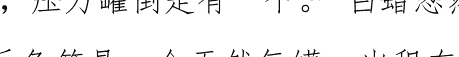

上帝有保证我什么？我完全不在乎，现在就算有百分之一的可能性，我们也要试试，只要炸掉他们一辆车，理论上我们就有机会脱离他们。

在白蝶的指示下，杰克开启后座椅靠背，突然怪叫道：“哇，足够他们喝一口……”

“是喝一壶……”我看到杰克的表情，以为有戏。

但是，随即我看到杰克的兴奋瞬间立刻，是因为他身体非常粗赘，想要从座椅背后面完全把燃气罐拆出来根本不可能，我尝试了几次都失败了，然后就摇头。我往燃气罐的位置看了看，我觉得可以试试，跟杰克比起来，我反而焦虑了很多。

“砰”的一声，安全带甩到后排，可是还没等我把燃气罐拉到后备箱，左边的切诺基再次撞了，车辆的轮胎发出了尖锐的摩擦声，我的头部在车窗上顿时被撞得七七糟。杰克把我拉回来，安全带甩到后排，可是还没等我把燃气罐拉到后备箱，左边的切诺基再次撞了，车辆的轮胎发出了尖锐的摩擦声，我的头部在车窗上顿时被撞得七七糟。

杰克把我拉回来，安全带甩到后排，可是还没等我把燃气罐拉到后备箱，左边的切诺基再次撞了，车辆的轮胎发出了尖锐的摩擦声，我的头部在车窗上顿时被撞得七七糟。

杰克把我拉回来，安全带甩到后排，可是还没等我把燃气罐拉到后备箱，左边的切诺基再次撞了，车辆的轮胎发出了尖锐的摩擦声，我的头部在车窗上顿时被撞得七七糟。

杰克把我拉回来，安全带甩到后排，可是还没等我把燃气罐拉到后备箱，左边的切诺基再次撞了，车辆的轮胎发出了尖锐的摩擦声，我的头部在车窗上顿时被撞得七七糟。

杰克把我拉回来，安全带甩到后排，可是还没等我把燃气罐拉到后备箱，左边的切诺基再次撞了，车辆的轮胎发出了尖锐的摩擦声，我的头部在车窗上顿时被撞得七七糟。

杰克把我拉回来，安全带甩到后排，可是还没等我把燃气罐拉到后备箱，左边的切诺基再次撞了，车辆的轮胎发出了尖锐的摩擦声，我的头部在车窗上顿时被撞得七七糟。

杰克把我拉回来，安全带甩到后排，可是还没等我把燃气罐拉到后备箱，左边的切诺基再次撞了，车辆的轮胎发出了尖锐的摩擦声，我的头部在车窗上顿时被撞得七七糟。

（注：此处原文存在大量重复识别错误，已根据语义逻辑清理）

杰克把我拉回来，安全带甩到后排，可是还没等我把燃气罐拉到后备箱，左边的切诺基再次撞了，车辆的轮胎发出了尖锐的摩擦声，我的头部在车窗上顿时被撞得七七糟。

杰克把我拉回来，安全带甩到后排，可是还没等我把燃气罐拉到后备箱，左边的切诺基再次撞了，车辆的轮胎发出了尖锐的摩擦声，我的头部在车窗上顿时被撞得七七糟。

杰克把我拉回来，安全带甩到后排，可是还没等我把燃气罐拉到后备箱，左边的切诺基再次撞了，车辆的轮胎发出了尖锐的摩擦声，我的头部在车窗上顿时被撞得七七糟。

（注：此处原文存在大量重复识别错误，已根据语义逻辑清理）

（修正后）我立即做好了不利被撞击的准备，但是奔驰非常灵活，在我们的车被撞击的一瞬间猛往右方向转向，这样虽然无法完全避免碰撞，但是减缓了来自左边那辆车的冲击力，可以保证我们不会被立刻撞翻。

这样做的一个不好处就是，我们的车就算立刻调整方向，也已经从中间车道变成了最右侧的车道行驶，然后我就看到其中一辆奔驰快速追着我们左侧的车道冲了出去，开始在前面回挪走蛇形路线，而重新贴上的车又对我们做出了同样的动作，这次直接把我们逼到了死胡道驾驶。

电光石火之间，对我们最不利的局面面对已经形成，我们左右各有一辆车贴着我们，前面一辆车挡住了我们直行的可能性，我们的右侧就是匝道外围的栏杆，我们彻底困住了，剧烈的撞击和刺耳的金属摩擦让我感觉我们这一方，随时都可能就此完蛋。

“你还有什么绝招？”我只能再次希望于这个叫白蝶的人，我觉得他如果是白狐的，总就不会就这么点能耐。

可是对方的回答几乎让我绝望，他道：“我真的是开租租的，在我们的体系里面，我就是一个边角角色，我真的没招了，不要来了？”

“我要有一把击步枪，我有信心打爆他们的轮胎！”杰克一边恐慌，一边急迫地用手乱打枪的姿势。

“没啦，后备箱我们可以准备好加油站。”白蝶猛然想到了什么，继续道：“后备箱是一个天然气罐，出租标配的那，那是我们唯一的武器，如果有办法使用的话。”

杰克对白蝶来说：“后备箱是炸弹。”兴奋地吼了一声：“嘘！”然后说如何改造后备箱的东西。

很多出口都进行动力改装，有油和汽两套燃料系统，白蝶的话我已经听明白了，他想用后备箱的天然气罐给对方的车队制造点麻烦。

我迅速跟杰克解释了一下，他问他在部队有没有学习过制炸弹，杰克非常失望地怪叫了一声，然后道：“我试试，不过我不能给你们保证，因为我不是上帝。”

上帝有保证我什么？我完全不在乎，现在就算有百分之一的可能性，我们也要试试，只要炸掉他们一辆车，理论上我们就有机会脱离他们。

在白蝶的指示下，杰克开启后座椅靠背，突然怪叫道：“哇，足够他们喝一口……”

“是喝一壶……”我看到杰克的表情，以为有戏。

但是，随即我看到杰克的兴奋瞬间立刻，是因为他身体非常粗赘，想要从座椅背后面完全把燃气罐拆出来根本不可能，我尝试了几次都失败了，然后就摇头。我往燃气罐的位置看了看，我觉得可以试试，跟杰克比起来，我反而焦虑了很多。

“砰”的一声，安全带甩到后排，可是还没等我把燃气罐拉到后备箱，左边的切诺基再次撞了，车辆的轮胎发出了尖锐的摩擦声，我的头部在车窗上顿时被撞得七七糟。

杰克把我拉回来，安全带甩到后排，可是还没等我把燃气罐拉到后备箱，左边的切诺基再次撞了，车辆的轮胎发出了尖锐的摩擦声，我的头部在车窗上顿时被撞得七七糟。

（注：此处原文存在大量重复识别错误，已根据语义逻辑清理）

（修正后）我毫无防备，杰克动作粗鲁，一把抓住我背后的衣领，一下子就把我从缝隙拉进来。“给我打火机！”白蝶把打火机扔到后排，我捡起来递给杰克，他吼了一声：“该死的，我要把你们变成烤猪……”我发现了一下，固定螺丝全部坏掉了，燃气罐随即向后滚动，然后又重重撞在我的头上，几乎就要撞死。

他先把后备箱阀门打开，抓着半截输气管对准了后面的车，然后点火。我看到一道火舌从后备箱钻了出去，正好撞到车辆的前挡玻璃上，而几乎是同时，我听到了身后传来急车的声音。杰克“哈哈”了一声，一边往外喷汽一边道：“现在我要让它爆炸，我需要这个东西扔出去，一、二、三！”

杰克喊完的一刻，白蝶马上踩油门，气焰顺着杰克的脸扇了过去，将燃气罐扔掉了。刚刚再次跟上的切诺又是一次急刹车。杰克转身，挂好安全带的双手勒得惨不忍睹，疼了一声：“嘶！”怎么搞的？”我有些惊讶地看着杰克问道，心说你怎么弄了个哑弹出来，唯一的武器废了。杰克满脸茫然，一直喊着对不起，看到他对自己的失败异常不解和自责。

虽然燃气罐没有爆炸，但一个喷着火舌的东西突然出现，明显慢了后面的车，那辆车先是停了，然后速往退去，认为那个东西是会爆炸的。这时候白蝶抓住了机会，瞬间刹车，左边的那辆切诺显然没有想到，立刻就冲了出去，然后传来了车声。

“怎么停下了？”我不解地问道：

白蝶解自己的安全带：“靠车是甩不掉他们的，赶着下了车，这段高速路两边全是玉米，钻进去打游击！”

我和杰克迅速下了车，跟在白蝶后面跨过道旁边的栏杆，一手就扎了一片绵延无际的玉米地当中。

正值八月底，玉米已经熟透，玉米杆上如刀锋一样的叶子虽然已经泛黄，但非常锋利，我没有占玉米地的经验，刚进入没几步，我的腿牌和脸上已经被刻划出了几道口子，疼又痒。

白蝶正在挥着手臂，指挥着我们。白蝶的速度完全超越了我的想象，他的身影在前面就像一道影子一样，很快就追上了。我知道我们距离并不远，但在玉米地视线里，跑了五分钟之后，我已经失去了方向感，非常担心会被抓住。

我回头看着，杰克忽然停了，他对我做了一个手势，小声道：“你听。”我四处看了看，什么也看不到，也没有看到白蝶，周围全是奇怪的声音。

“到底是什么事？”杰克已经停了，“特种兵遇到狗，游戏结束了。”我很恐怕这样的猜测，但此时更多的是愤怒，那个老妖物还不够，还要被迫，我觉得他娘的完全是老天不放我，我对他道：“我都还没妥，你到底些什么？反正也没来咬我们，先跑！”

这次我在前面带着杰克，我一边跑一边听着四周的声音，那些声音如影随形，始终断绝于耳。慢的我就感觉事情完全不在我的预料之中，狗的速度大家都是知道的，声音离我们那么近，早就应该围过来的，但是为什么还是没有任何狗上来？难道不是狗？人不是，狗也不像，我越跑越扑，不由双脚发软，突然就被一个东西给绊倒。绊倒的东西不是田埂或者是玉米杆，而是一个软绵绵的东西，脖子处粘着好多黏的天灵的东西，我刚要把手按在地上想要撑身体，却双手一摸，地上竟然全是血。

我立刻爬起来，回头一看，地上躺着一具尸体。尸体的脸朝，脖子位置一片肉横湖，大量血液从颈动脉位置喷出来，我认为这个个人，在河北商店的时候，这个人被杰克用马质领打了，他是白蝶的人。

这时候杰克冲了上来，看到这一幕，立刻惊呆，跌绊道：“你杀的？”

我摇摇头：“应该是那些狗干的。”这样说着，心里也在鼓，我只是看着尸体脖子的伤像是被动物撕咬出来的，实际上到现在为止，我一条狗也没有看到。

两个人都正发着，忽然之间，一道黑影一下子从我的右侧挤了出来，很多玉米杆被排山倒一般的扑，同时也被这道黑影压在了地上，但他是一个人。其中一辆切诺基已经追来了，他抓住了我的手，拳头对着太阳穴，但对方反应也快，一下出手抓住了我的手，我受过博击，我不及看那是什么，就在千钧发之际，忽然又是一道黑影从侧飞出了——是的，是那道黑影。他的手臂好像被掉了，在他的口袋里立刻发出一声叫，打向我的太阳穴，我立刻闭眼。

我惊魂未定，看向杰克，发现他正保持着一个动作，但蓄力了。再看向四周，地上有一只断手，没有看到刚才那个飞影。“刚才是什么东西？”我喘着气问道。杰克看着我，手脚并用比好了，最后来了一句：“没清楚……太快了。”我又惊又怒，的是那道飞影的速度能够快到无形，恼的是杰克竟然没清楚到底是什么。

另一个问题是，刚才的东西攻击了，难道是在帮我吗？这完全毫无头绪，我决定暂时不去追，他是来接我们的，没想到这么靠谱，此不能久留，我拉着杰克重新开始跑，但是跑着跑着，回头一看，杰克已经被落在。我不害怕，担心声音会吸引我们的人，管他什么神奇飞影，继续跑。这片玉米地望无际，在这样的环境下抓住一个人简直无异大海捞针，我不断变换方向，但总体上顺着田埂延伸的方向跑，这样可以保证我跑的是直线，而且只要我想，就可以跑出玉米地的范围。

但是很快再次被绊倒了，我心里一愣，难道又是一个具体？等我看清楚，惊恐地发现，倒在地上的竟然是白猫。

已经联络了所有镖，然后警惕看着四周，非常紧张。
这时候徐萧霸对我说道：“齐天，本来你不是我的敌人，现在出现这样的局面，不想我死，只能靠你自己，你身上有我毕生都在寻找的东西，没有你我们就失去了存在的意义，同样如果确定得不到你身上的东西，我就会选择和你同归于尽！所以，我们合作怎么样？”

我听完，先愣了一下，转明白告诉了我为什么要追我。但我脑子里记得他拿了什么东西，就看向杰克，杰克也摇头。但我脑子里，悠悠之间，我想起了在天底下被 C4 炸破之后，白狐离开之前，她在我耳边跟我提到的那些话，其实好像回过到这种一个概念，她说天底下最重要的东西却不见了，诸薇是被暗中的第三势力拿走了。当时国人几乎全军没，自然也没有得到那件东西，所以事情应该是这样，该死的徐萧霸认为，天坑里的东西在我身上。

28156楼
作者：十四四 日期:2018-08-26 17:11

但是下一秒我就反应过来似乎不对，我和杰克身上是没有任何东西，这非常明显，莫非徐萧霸认为我把东西藏起来了？我靠……我心里怒火中焰，我算老几，如果真有那么重要的东西，怎么可能会在我身上做的，他妈的！

但是我没有接上的上半话，因为如果东西在我身上，信息是白狐放出来的，我不能排除这种可能性。因此我直接对他道：“现在的局面非常清楚，主动在我手里，只要我一个呼吸，立刻会被撕碎，我也不想把事情闹成这样，所以千万别动，等我确定杰克和蝴蝶没事，我会让这些东西放过你们！”说完，我就对杰克和蝴蝶瞪眼，意思是赶紧走。

看得出应该是一类人，非常无理，竟然围着霸天三个人转了一圈，一圈转了一圈边把脸露出来，我要检查，妈的老子了！

“别闹了！”我心里没底，不知道那些东西不会让我们走，不敢由他乱来，而且我也没有勇气去看霸天的样子。徐霸天是没有矫饰，直接把嘴和围圈了，露出了真实的样子。

28157
作者：十四四 日期:2018-08-26 17:12

他的头发没了，皮肤表面全是鳞片，就像裹了一层青色的蛇皮，眼子跟蛇一样，是红色的，让人通体寒。我已经看到过一次，除了疑惑，没有惊讶，只是无法理解他是变成这种样子的，从生物学的角度讲，要么他做了手术，要么就是身体发生了某种变化。

我显然是装的，然后又近距离去观察霸天那张脸。这种时候要不要，我真想上去弄死他。之后我听到白矮说：“看来你们只得了这种基因，你看自己弄得伦不类，还不知道自己弄出来。”我听了白矮有些笑，这个人倒是是个高手。徐霸天的腰跟蟒一样扭着，没有搭理白矮，而是对我说：“齐天，你看看我的样子，你知道什么样的局面吗？你原本不在我们范围内，所以我们还有余地……”我此时什么都不想面对那张脸，也不想说过多的话，担心暴露出破绽，于是转身朝着一个方向走，杰克立即跟上来。白矮在后面骂了我一声，然后也来了，对我说：“你可能知道，你那些东西会放走吗？”

“我不知道，但最后肯定会麻烦的。”我说，心里总觉得不对。我们才走出几步，身后的徐霸天忽然喊道：“齐天，如果你就走了，你会后悔的，你了解白狐的组织究竟在干什么？”

28158楼
作者：十四四 日期:2018-08-26 17:12

“不要听他胡道，这是诱兵之计，赶紧走。”白矮有些犹豫，就在旁边督促我。但是我还是停了下来。虽然我知道徐霸天这种人不能相信的，可是我心里的疑惑需要有一个出口。他此时被我吼住了，不敢轻易动手，于是回头看着他，主动追问第一个问题：“什么组织？”徐霸天回答道：“她是不是告诉你，她的家族在寻找古老的秘密，而她的敌人就是我们？”我没有承认也没有否定，而是看着他，尽量保持沉默。在这种局面下，我的诉求是不能表现出来的，我必须保持自己的优势。

一个来自28495的电话。然而，徐霸天看着我那样的样子，冷地笑了，继续说道：“齐天，你变了！真的很难受，这么短的时间，你会变得如此可怕，不过遗憾，你不是我们这边的。”

“给我一分钟的时间，如果你继续说这种废话，我就招呼那些东西来弄死你们。”我努力压住气场威胁道。这种感觉，不知道是不是徐霸天意识到了什么，我看到他逐渐放松了身体。我侧着耳朵听，发现不知道什么时候起，周围已经没有那些影子的动静，不知道是已经走了还是伏了下来。这让我的心里升起一种不安，要是那些东西见了，事情可能会朝着另外方向发展，我开始后悔刚

那时她突然转身走掉，我心虚的一面反而会被坐呆，只能硬着头继续面对这个局面。

28159楼
作者：十四四 日期:2018-08-26 17:12

这时候霸天又开始：“你被白狐骗了，她不是为了家族使命服务，那只是她掩盖身份的一个幌子，她真实的身份是一个连山卫，你知道什么是连山卫？”我看向白狐，见他脸色似不定，欲言又止的样子。我问他：“什么是连山卫？”白狐回道：“别听他胡说道，什么连山卫？我不知道，她是在骗你，你心里中了她的圈子……”她其实是某个活跃于遣国时期的组织，这个组织的出现，是为了干扰我们的组织，你难道还信白狐，难道她没告诉你，她的敌人是一个归藏门的组织？”徐霸天打断了白狐的话，继续说道：“我知道，白狐告诉了你一切事情，比如我们在争夺中才叫做‘伏袭基因’的古老生物基因，但我告诉你，她是不会跟你说实话的。所谓的‘伏袭基因’只是一个骗人耳目的幌子，当然，就算是个幌子，足以让你这样的人感到惊讶，但是我告诉我，事情不是这样的。连山卫和归藏门在寻找的东西，说出来就能彻底摧毁你所有的意志，所以，你只不过白狐的一颗棋子。”她利用了什么身份。

28160楼
作者：十四四 日期:2018-08-26 17:12

