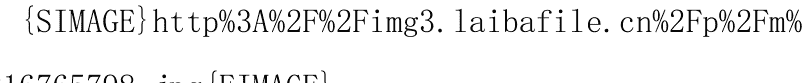
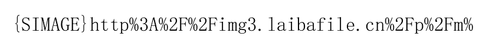
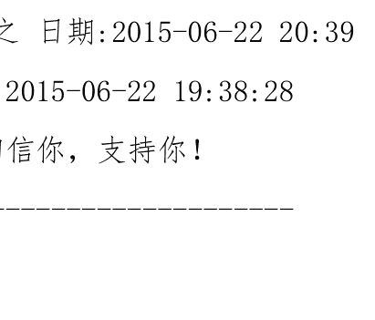
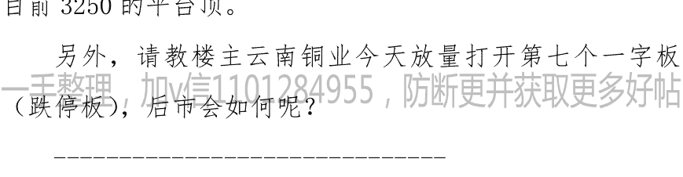

# 市场心理研究——贪婪与恐惧的那些事儿，顺便分析分析当前市场时代

看着一些关于市场心理的书籍，总觉得过瘾（好吧其实大多是很差的），觉得大多数其实对市场心理理解并不深刻，甚至完全是错误的。比如大家常说的贪婪和恐惧。很多人都认为贪婪产生于市场一向好的时候，实际上相反。比如去年的蓝筹行情，我一再提醒大家蓝筹的时候已经到了，但“现在很危险啊！”这个真的是恐惧。还有一些市场心理的书籍与说教，越拙越淫，并弄得一些单子哲学术作像饰的。可以说这大部分普通人甚至后辈都分不清楚这些描述心理的词汇到底是几个意思……恐惧、焦虑、贪婪、乐观、悲哀……......

人类的心理背后其实都有自己一套机制，很多心理心理机制的基础也已经被科学研究证实了，比如大家常说的恐惧，这点我后面再说。作为一个专业搞心理的、在市场中浸淫多年的人，决定详细阐述一下市场心理，并结合市场的趋势进行分析。以前的成绩无需多言，想了解更多经济知识的人可以移步我以前的帖子。

希望大家多多支持，不荐股，可分析股。如果我没有回答你，那就是我水平不够，请谅。

作者：时代之 日期:2015-02-25 10:51

心理学和经济学本来就是一对孪生兄弟，哈佛经济学系和心理学系原本在一起的，后来才闹了分家。从经济学最基本的一个假设——经济人的假设——这种假设最早由英国经济学家亚当·斯密（Adam Smith）提出。他认为人的行为动机源于经济诱因，人都要争取最大的经济利益，工作就是为了取得经济报酬。动机，就是一个典型的心理状态。

后来经济学中最著名的名词，比如效用或者边际效用，都是基于人类心理的分析而进行的。而这两个词也构成了经典经济学的微观分析基础。

不过随着经济学对个体的心理的忽视，而群体心理这个领域的加入，游戏变得难以量化和描述，经济学逐渐脱离了心理学的概念，代以各种偏社会学的理论或者偏数学的模型。

直到心理学大师卡尼曼和西沃斯获得诺贝尔经济学奖，又回到人们的视野之中。

作者：时代之 日期:2015-02-25 12:03

@540506147 2015-02-25 11:03
好像就像是干货啊，支持支持。
谢谢

作者：时代之 日期:2015-02-25 13:28
@kasper2013 3楼 2015-02-25 11:15

# 路过帮顶

3q，常来啊。
作者:时代之 日期:2015-02-25 18:50
@真味平浅 6楼 2015-02-25 18:06
占个板凳追帖

感谢支持，晚上更新
作者:时代之 日期:2015-02-25 21:00
卡尼曼和特拉弗斯基都是心理学家，他们重新从心理学的角度出来研究人的行为，特别是对人性的假设提出了挑战。我们认为人类其实很多时候都不是理性的，也不是时刻时刻都是自私的。他们的前景理论其前景已经在经济广泛应用于经济分析中，其中的一些概念，如损失厌恶，在股市的分析中都非常有用。

如此，被套牢而不肯割肉的人，大多都是损失厌恶的心理在作怪，如果只是亏损，多少还有点靠套的希望，一旦割肉，则就成了失败是实在的损失。
套牢就装死可以是大多数散户的通病。
作者:时代之 日期:2015-02-25 21:04
@芒多泽 2015-02-25 19:42:29
码

# 新年好。

作者：时代之 日期:2015-02-25 22:11

继续---

如果你是走技术分析的路线，对心理状况的要求是非常高的。因为技术分析是基于过去事件的统计，胜率不可能是百分之百，你就会怀疑自己的判断。理论上来说，找到两个胜率超过 50% 的指标是很容易的，即便已经经过几十年历史的道氏理论，目前对美国股市的回测，依然可以超过 50%的胜率，但有着真正赚钱的却没有几个。

很多人都有自己的交易系统，前提是你一定要懂得一点统计学知识，否则你发现的指标可能仅仅是巧合，至少你也得明白什么叫做统计学上的显著的，或者什么叫做“具有统计学意义”。其它的，你的指标在过去股市的回测中，一定包含交易成本和滑点。因为你对股票的买卖动作会对股票造成波动，有些流动性不好的股票，甚至像我这样的小散仓都能拉起来一个百分点。如果你能找到这样的交易指标，只是你盈利的第一步。

作者：时代之 日期：2015-02-25 22:23
@ygswb 2015-02-25 19:57
偶然看到，观点与不同，已关注了LZ的2个帖子
谢谢支持。
作者：时代之 日期：2015-02-25 23:36
@ygswb 2015-02-25 19:57
偶然看到，观点与不同，已关注了LZ的2个帖子
@时代之 13楼 2015-02-25 22:22
谢谢支持。
@冰人 14楼 2015-02-25 22:44
这种指标，获取更多持续支持宝宝！加油！握手
作者：时代之 日期：2015-02-26 07:43
@大小狐 17楼 2015-02-26 07:05
支持。虚心学习。期待收获。早上好。
作者：时代之 日期：2015-02-26 08:22
谢谢各位的支持。
作者：时代之 日期：2015-02-26 09:43

继续，目前相当于序言部分

技术分析的本质是相信阳光，实际上并没有什么东西，所以所有技术派对自己的技术指标都是百分之百的。就像一头猪天天喂饱，但你不可能指望一直喂，总是会遇到一些意外。就像国外的高频交易一样，那些量化投资的，时遭遇黑天鹅的冲击，很多人的模型都建立在均值回归的基础上，但很多时候等到回归就挂钩了。

相比之下价值投资就比一点的，你唯一对抗的就是时间，如果你真的是价值派信徒，你只需要忍住就好，但寂是最难的。就像前段时间比亚迪的大跌，我在《经济事实辩谈》中分析，2014年12月18日，比亚迪本身并没有什么变化，港股大跌30%，A股也是跌停。我说，如果你是价值投资，你应该是高兴的，这是一个加仓或者建仓的机会。不应该感到恐慌。

后来比亚迪又涨了50%。如果你是个短线的，等到黑天鹅了，预计内心要崩溃了，而且后面大跌两天。
作者：时代之 日期：2015-02-26 09:58
@素颜 9999 2015-02-26 08:52:41
楼主是玩心理的高手。
过奖了。
作者:时代之 日期:2015-02-26 10:05
@吃鱼不腻 2015-02-26 09:22
严重顶上楼主，继续啊。结合股票实例心理研究也是好的！
保证质量，谢谢支持。
作者:时代之 日期:2015-02-26 10:12
@吃鱼不腻 24楼 2015-02-26 09:22
抓取更多好帖
严重顶上楼主，继续啊。结合股票实例心理研究也是好的！
并谢谢支持。
作者：时代之 日期：2015-02-26 11:26

从2月9号分析上调整结束，就在大家的犹豫中，上证连续阳线。而小阴线的调整已经出现，如果明天能继续收红，上证将直奔高点而去，创新高指日可视。
作者：时代之 日期:2015-02-26 15:30
@寻海林宜心 31楼 2015-02-26 15:10
对楼主的预测的确很佩服，不过问，楼主到底是用什么技术还是用心理学的方法来做判断的呢？

技术分析为主，这点我后面会说过。

作者：时代之日期：2015-02-26 15:53

继续——
很多人都问我一些技术指标，其实技术指标可以上千，各种交易策略也只是数不胜数，用计算机对过去的市场做回测，看似成绩都可以，为什么最后盈利的人并不多。答案在于心态对于你操作的影响，无数账户都有过类似的经验，随着股票下跌，本来还没到卖出点位，结果却忍受而卖出，结果那笔股票就地上上涨，让你懊悔不已。有些时候已经发出诸如防跌后再卖出的信号，你将想等等，结果越套越深。

为了避免情绪造成影响，一般的投资者都会采取程序化交易。不过别以为就万能了，我有一个朋友就是搞这个的，写过一个程序，很快的，但是他自己运气不好，用起来资金大幅回撤，开始怀疑自己的程序是不是BUG，或者上了黑天鹅，最后被人人工止损了。在他卖出之后，市场似乎又恢复了正常，他的一段时间看来仍然有效的，只不过他再敢继续使用那个策略了。

作者：时代之：2015-02-26 16:04
@浓咖啡 33楼 2015-02-26 15:47
欢迎
作者：时代之 日期:2015-02-26 17:07
@soyabada 37楼 2015-02-26 16:53
结合实际：大盘日线KDJ指标都处于超买，显示大盘短期调整，不会出现新高；布林线随时都会破，布林线上还有空间，显示大盘股票更稳健一些。但是，年初至今的上涨是这种趋势很难改变，应该是买的股票，这就会矛盾了。

接下来几天只要大盘上涨，心里越来越紧张，越得越失，而一旦出现大盘回调，就会赶跑，一旦跑了，大盘又......少看KDJ，这种指标很容易修复了，而且只看超买超卖，准确率大了。布林线准确率还行，股票要少动，特别是在牛市行情中。很多人的心态都是这样的，牛市不住，股票换来换去，熊才装死，想一下自己是不是这样的。

......

这里先简单来说。

贪，自然是贪婪。在《华尔街》，盖哥的名言就是“greed is good”，贪婪是好的。但人类历史上无数次泡沫都是由贪婪引起。很多人进入股市的动力都是为了获得超额利润进来的。但很多人因为贪婪造成了自己的损失。综上所述，贪婪不是坏的，但一定要控制自己的贪欲。

嗔，是愁。特别是当自己面临损失的时候，面对自己错误的时候。有时候是不可用手的冲动，怎么忍不住卖了呢？痴，对各种方法的迷恋。以为技术分析就是一切，以为自己掌握了价值投资的真谛，以为自己可以看透道。

慢，以自己为中心，以为自己掌握了宇宙真理，市场上一直都是亏损，但无数人却对这个市场拥而至，凭什么就认为那个赚钱的人就是自己。人人皆自恋，信心不足。特别是当市场的趋势与自己预期相反的时候，开始怀疑自己已经犯了错误，甚至是违反了自己的操作原则。当市场出现买点或者卖点的时候，不能断，有时候为了分钱的差价而错失机会。每个人在投资中绕不去的贪，只要忽略了它，应该学会如何利用。毕竟我们的心理活动产生一定的环境因素和自身的生理因素，这些都是隐藏在情绪背后的信号。就像罗宾举的一个例子，当他感到痛苦发作的时候，那么自己可能面临危险。然而，自己的聪明可能不知道危险来自何处，但有时候，直觉的力量是很强大的。只有当我们明智的时候，才可以坐稳立足！

作者：时代之 日期：2015-02-27 22:37
求支持！
作者：时代之 日期：2015-02-27 22:51
以上为序的部分，明天开始正文。
作者：时代之 日期：2015-02-27 23:34
@lcfjjjk 69楼 2015-02-27 22:59
板凳。好贴。

# 欢迎

作者：时代之 日期：2015-02-28 13:06
@Mr 国士无双 2015-02-28 11:55:57
看到《股市心理博弈》那本书，像屎尿一样，对操作毫无帮助。我说的论为半骗子哲学作品的就是这本。

作者：时代之鱼 日期：2015-02-28 13:16

为什么要投机?

伟大的操盘手利弗莫尔说：“投机就像山岳一样古老。”从古以来开始，有人投机就是赌博，进股市是赌场，由于赌博太好了，我们现在一般称之为投机者或是机机者。很多古老的历史记载中都有关于赌博的记录，比如印度的史诗《摩诃婆罗多》，总而言之，人类对于这种小博大的投机活动从来是非常热衷的。

当然有些投机活动的确让人取得不错的收益，但大多数人类发明的赌博活动的收益一般都是零或者负数。不过不幸的是，人类从来对概率可能是极其敏感，我们对概率的一切会遇到运气数字而已，这点以后再说吧。

那为什么人类还要继续进行这些费力不好的？

能收回投资。

比亚迪的汽车是电子发的玩具，但不是汽车发玩具。但电子发卖肾是买 apple，不是比亚迪的。

比亚迪的电动汽车？历史上，100年前电动汽车就比汽车还要多；每次油价高涨，电动汽车都会热一仗；油价下跌，电动汽车消失匿迹。美国的电动汽车行业，很多企业已经倒闭了，......

不要以线性思维来看科技进步，技术进步很可能是跳跃性的，说不定哪天化石能源就退出历史舞台，当然没人能准确知道这一天什么时候时候来。

一手链接：110128455 点击获取更多好处

电动汽车对传统汽车的冲击不仅是能源方面的，电动汽车对汽车制造几乎是颠覆性的，对营运也是颠覆性的，不需要4S，加上无人驾驶技术，这些才是汽车行业的未来。

作者：时代之 日期:2015-02-28 16:41

@@时代之 2015-02-28 14:14:00
不要以线性思维来看科技进步，技术进步很可能是跳跃性的，说不定哪天化石能源就退出历史舞台了，自然没人能够准确知道这一天什么时候时候来。

电动汽车对传统汽车的冲击不仅是能源方面的，电动汽车对汽车制造几乎是颠覆性的，对营运也是颠覆性的，不需要4S 店，加上无人驾驶技术，这些才是汽车行业的未来。

@动力阿戈 78 楼 2015-02-28 15:19

你不叫价值投资，叫玩概念。同样的话还可以以下领域套用：

- 1、医药。首可是抗癌药可能获得突破；其次是可以延缓衰老的老新药；
- 2、高温超导大幅降低输电电量损失，同时微巧强大的电磁铁的制造成为，不再受安妥数字限制，运用前景将不可限量。
- 3、3D打印，个性化定制，颠覆传统制造。
- 4、石墨烯、透明（显示屏）、墨圈（可靠优异）、低电阻（极低发热量，降低对冷却散热的需求），下一样...

我本来不是价值投资，所以我的思维也不是价值投资的思维。只是巴菲特持有有亚迪的股票，他们是价值投资的代表。

作者：时代之 日期：2015-02-28 18:43

更多心理学、经济学知识可关注我个人公众号jingji-xinli

@时代之 2015-02-28 16:41:14
我本来不是价值投资，所以我的思维不是价值投资的思维。只是巴菲特持有比亚迪股票，他们是价值投资的代表。

@动力阿凯 2015-02-28 17:03:36
巴菲特当年投石油是价值投资；张磊没投资价值时就砸掉；投比亚迪就纯粹玩，给自己贴上环保标签——美国的富人很讲这个的。

巴菲特是研究经济的，对动力电池他都不懂，他以为和手机电池差不多——想当年比亚迪可是电池大王——但现在韩国的电池更靠谱了。

如编号11012849555，防断并获取更多帖

那还不直接买个环保保。

作者：时代之 日期：2015-02-28 21:59

@芷多泽 83 楼 2015-02-28 20:20
楼主快更...

每天更新，多少不定

作者：时代之 日期：2015-02-28 22:27

@时代之 82 楼 2015-02-28 19:08:00
@时代之 2015-02-28 16:41:14
我本来就不是价值投资，所以我的思维不是价值投资的思维。只是巴菲特持有比亚迪股票，他们是价值投资的代表。

@hillcygogo 86 楼 2015-02-28 22:21
@动力阿剑 2015-02-28 17:03:36
巴菲特当年中石石油是价值投资：涨太高没投资价值时就抛掉，投比亚迪

楼主看环保股 000826 现在能买入吗一手整理，加微信1101284955，防更并获取更多好帖

缺口多半会回回

作者:时代之 日期:2015-02-28 22:55

@时代之 87 楼 2015-02-28 22:27:00
楼主看环保股 000826 现在能买入吗

@hillcygogo 88 楼 2015-02-28 22:44
缺口多半会回回
谢谢楼主
不用谢

作者:时代之 日期:2015-03-01 11:10
继续——对于求偶的动机可能是他们进行投机和冒险的内在力，所以各种冒险活动和投机活动都是男性参与较多，这种低风险投机行为，男性的参与也更高。女性喜欢具有投机精神的人吗？人类从开始的狩猎社会，进入到采集，再进入到农耕社会，风险是越来越小的。狩猎的时候不仅冒着生命的危险，更大的风险在于你不知道什么时候来。运气好的时候，抓到很多；运气不好的时候，一个也不到。女性为了自己的风险，会选择那些比较稳定的来，所以大多数女性自身渴望安稳，但是她们往往会选择具有投机精神的人。

作者：时代之 日期:2015-03-01 11:16
@寻林煜宣 2015-03-01 09:47
楼主快更，别磨蹭。

作者：时代之 日期:2015-03-01 15:25
@dukezhu292 93 14:11
写的不错，收藏了。谢谢

作者：时代之 日期:2015-03-01 16:35
@dukezhu2012 2015-03-01 08:07
贪婪是人类进步的动力，本来也是，不然大家就会活在刀耕中吧，这么多科技发明都是人类想懒了。可以这么理解。

作者：时代之 日期:2015-03-01 16:47
好吧，说降息的情绪，论坛上一片空的声音，说经济要崩坏，股市高开低走，加降息后很多时候不跌，说以前的降息后股市涨得怎么样。

作者：时代之 日期:2015-03-01 16:47 (Wait,此处原文重复或交叉)
我是要坚持看好，为什么？这意味着大家期望的央行货币政策的转向，所有的稳健转向，市场上直接的推动力量是资金，有了资金会导致股市不涨。同样降息，有时候是下降通道中，有时候是上涨通道中，如果是下降通道中，很可能会高开低走，而上升通道的时候，大部分都会好。这就是心理层面面对消息的，用句话叫，牛市中所有的利空都是利好，而熊市中所有的利好都是利空，就是这个道理!!!

作者：时代之 日期:2015-03-01 16:52
此次降息其实市场的趋势已经充分反应了，能够预测出这次降息的人胜，所以也没好。可以说降息对市场影响太大。

作者：时代之 日期：2015-03-01 21:10
维持
作者：时代之 日期：2015-03-02 07:36
@时代之 101 楼 2015-03-01 21:10
维持
@lcfjjk 102 楼 2015-03-01 21:59
火了！楼主更新啊！一手理加1101284955，防断更并获取更多好帖 感谢你的支持

作者：时代之 日期：2015-03-02 09:39
@soyabada 104 楼 2015-03-02 09:00
周一前来报道。央行降息，大盘高开，全天红盘收，这是我对每天的测。风险是张出来的，机会是蹦出来的。券商机会也越越，中小板和创业板的风险逐渐大了，券商机会也越来越了。本周大盘总体我不太看好，预计风险释放，或称之为获释放放在下半周。抛个半砖，望楼主指点。如果楼主可以以技术指标分析一下大盘趋势，那真是我们学习的好机会了。谢楼主！预期实现，我在另一个帖子中说了。

作者：时代之 日期：2015-03-02 12:43
@soylabada 2015-03-02 09:00:45
周一前来报道。央行降息，大盘高开，全天红收报，这是我今天天大盘的检测。事实理加信心，风险是走出来的，机会是走出来的。板和创业板的风险逐渐大了，券商机会也越来越大了。本周大盘总体我不太看，预计风险释放，或称之为获利释放下半周。抛个半砖，望楼主指点。如果楼主可以以技术指标分析一下大盘趋势，那真是我们学习的好机会了。谢楼主！短期的技术指标没有意义，可能你交易成本都覆盖不了。中期你自己找本书学BOLL线都足够用，关键是要活学活用，什么叫，就是要结合整个宏观和心态来分析。

作者：时代之 日期：2015-03-02 13:23
继续------对于不确定性的游戏，我们到底该进入，或者应该以什么样的程度，那要看一个人的承受能力和波动性而言。比如像色彩，这种东西虽然只有每个人都能承受，但是市场的预期收益是负数。所谓预期收益，就是所有收益的加权平均。对于这种市场，我是建议所有人都不进入，彩票市场就是大数据，虽然你可能中奖，总来说买理如一样果断并获取多好处。说豪赢是发行彩票的奴，其实赌场是类似，完全叫智商税。不过赌场中有很多博弈型的夜晚，比如扑州克里，理论是可以完胜菜鸟的。当你在桌上试图找到谁是菜鸟，半天没找到的时候，别找了，那个菜鸟就是你自己！

作者：时代之 日期：2015-03-02 15:28
@54506147 109 楼 2015-03-02 14:11
佩服，看来楼主今天又要对起了。(img/3941658aabaf659784c9835d17fd25_0.png) 最后还是小红了

作者：时代之 日期：2015-03-02 15:36
@shaw3023 110 楼 2015-03-02 15:04
必须支持。原来理论高手的操作这么牛。感谢，知行合一，方为道。

作者：时代之 日期：2015-03-02 17:29
@soyabada 114 楼 2015-03-02 16:26
爱康科技今天收盘前先出来了，等几天择机再进吧。跟楼主主您挣钱，非常感谢!!短期技术面回调。但此股很妖，注意去年八月五走势。

作者：时代之 日期：2015-03-02 17:34
@soyabada 113 楼 2015-03-02 15:42
沪市慢慢收红，不容易的。感觉没有金融板块的带动，尤其是券商板块的冲击，大盘很难突破3406。盘中感觉中小股似有强弩末的形态，很多小板股票拉拉补，不太妙。费这么大的劲，沪市不破3406有点不过。所以测大盘明后两日还要红盘。楼主，您说呢？今天K线的收不错，但短期指标需要修复，所以最好收带上影线。

作者：时代之 日期：2015-03-02 22:17
继续——继续——有一种市场期望收益也是负数，那就是商业保险，是否应该进入呢？保险是风险转嫁的一种方式，虽然从期望来看，买保险肯定是要亏损的，不人家保险公司就不能赚钱了。但你是分担风险必要的成本。有句话：穷人买保险，富人买股票。穷人低于风险的能力比较小，股市一旦大病或者一场火灾，就可能赔家产。对于你不能承受的风险，还是应该去买保险，买一个保险。而富人可以承受这样的风险，自然不需要去参加一些期望收益为负数的保险。当国家购买的社会保险和医疗保险是福利制度的一种，虽然自己出了一份钱，但也应该参与的。

作者：时代之 日期：2015-03-02 22:40
这里主要谈股市和其他一些金融市场，比如大宗商品。毕竟期望收益不是负数，从美国的各大股来看，年复合收益在7%左右，是可以超过国债利率的。即使中国的股市，从诞生之初到现在，也是能够赚钱的。二十多年以上的股市，只有3400点以上这段时间买的会亏本，这段时间加起来不是十分之一。穷人都是应该是该冒险的。就像马克思所说的：“无产者失去的只是链锁，而得到的却是全世界。”古代的人多生孩子作为冒险的资本，那个家族人多，自然就能承受风险。美国着名的肯尼家族也是很善于冒险，甚至有人死于登山之类的运动。

作者:时代轮 日期:2015-03-02 23:42
维持
作者：时代轮 日期:2015-03-03 11:06
一手数据可以获取很多好处，直接接触技术的事情，对kdj超的修复，注意不是回调，那个直接往下下跌就可以了。一般有两种，一种是冲高后回落，一种是直接低开。

作者：时代轮 日期:2015-03-03 11:15
@soyabada 113 楼 2015-03-02 15:42
沪市慢慢收红，不容易的。感觉没有金融板块的带动，尤其是券商板块的冲击，大盘很难突破3406。盘中感觉中小股似有强弩末的形态，很多小板股票拉拉补，不太妙。费这么大的劲，沪市不破3406有点不过。所以测大盘明后两日还要红盘。楼主，您说呢？

作者：时代之 2015-03-02 17:34
今天K线的收不错，但短期指标需要修复，所以最好收带上影线。

作者：时代之 2015-03-02 17:34 (重复)
作者：时代之 2015-03-03 18:54
@soyabada 123 楼 2015-03-03 08:24
昨晚静心来想，觉得自己有点“痴”。为什么沪市一定要突破3406，为什么中小型板、创业板破新高，沪市一定要突破前高点；为什么深市再突破前高点，沪市一定要突破前高点。“痴”了！

作者：时代之 2015-03-03 11:57
作者：时代之 2015-02-27 21:06
慢，以自我为中心，以为自己掌握了宇宙真理，手握庸宝。市场上一直都是亏平胜，但无人对这个市场而至，凭什么认为那个赚钱的人自己。所以我常说，人人皆自信优柔断，信心不足。特别是当市场的走势与自己的预期相反的时候，是不是开始怀疑自己犯了错误，甚至是违反自己的原则。当市场出现买点或者卖点的时候，不够果断，有时候为了两分钱的差价而错？贪婪怀疑......

@城市狐狸 122 楼 2015-03-03 02:22
其实这些道理表面上至少人都懂的，想问楼主，你是怎么克服“贪婪怀疑”的，防损并获取更多帖？第一个是认知层面，然后不停训练。后面我会写到：

作者：时代之 2015-03-03 13:10
还靠各位多多支持额：

作者：时代之 2015-03-03 14:20
@素颜 9999 122 楼 2015-03-03 12:01
精彩，很有用啊。感谢额。

作者：时代之 2015-03-03 15:55
@soyabada 132 楼 2015-03-03 15:49
今日两市大盘放量下跌，中小板和创业板放出近期的天量，虽然跌幅比两市大盘跌幅略小，但是可以确认天量，如果确认，中小板和创业板本次调整是否是一个中期调整呢？请楼主指点。今日早盘又杀入02610，呵呵~~~杀入有点早了，5日均线位置也就够了本次的跳空缺口，是不是可以再补点呢？给你带来了压力，非常不好意思。非常感谢!!!一手整理，加v信101284955，防删更并获取更多好帖这一票我是准备持有到年报的。你了一一把就足足吧。缺口还没补上呢，还会回补19.20的缺口

作者：时代之 2015-03-03 19:07
@DeanwF 2015-03-03 18:42:13
过瘾，楼主快快，收藏了。感谢支持，马上就来。

作者：时代之 2015-03-03 19:07
@smallworld777 137 楼 2015-03-03 19:01
@时代之 12 楼 2015-02-25 22:11:00
继续---如果你是走技术分析的路线，心理状况的要求是非常高的。因为技术分析是基于对过去事件的统计，胜率不是百分百的，你就会怀疑自己的判断。理论上来说，找到两个胜率超过50%的指标是很容易的，即便已经几十年历史

作者：时代之 2015-03-03 19:07 2015-03-03 19:07
@hillcygogo 86 楼 2015-02-28 22:21
@动力阿剑 2015-02-28 17:03:36
巴菲特当年中石石油是价值投资：涨太高没投资价值时就抛掉，投比亚迪

楼主看环保股 000826 现在能买入吗一手整理，加微信1101284955，防更并获取更多好帖

缺口多半会回回

作者:时代之 日期:2015-02-28 22:55

@时代之 87 楼 2015-02-28 22:27:00
楼主看环保股 000826 现在能买入吗

@hillcygogo 88 楼 2015-02-28 22:44
缺口多半会回回
谢谢楼主
不用谢

作者:时代之 日期:2015-03-01 11:10
继续——对于求偶的动机可能是他们进行投机和冒险的内在力，所以各种冒险活动和投机活动都是男性参与较多，这种低风险投机行为，男性的参与也更高。女性喜欢具有投机精神的人吗？人类从开始的狩猎社会，进入到采集，再进入到农耕社会，风险是越来越小的。狩猎的时候不仅冒着生命的危险，更大的风险在于你不知道什么时候来。运气好的时候，抓到很多；运气不好的时候，一个也不到。女性为了自己的风险，会选择那些比较稳定的来，所以大多数女性自身渴望安稳，但是她们往往会选择具有投机精神的人。

作者：时代之 日期:2015-03-01 11:16
@寻林煜宣 2015-03-01 09:47
楼主快更，别磨蹭。

作者：时代之 日期:2015-03-01 15:25
@dukezhu292 93 14:11
写的不错，收藏了。谢谢

作者：时代之 日期:2015-03-01 16:35
@dukezhu2012 2015-03-01 08:07
贪婪是人类进步的动力，本来也是，不然大家就会活在刀耕中吧，这么多科技发明都是人类想懒了。可以这么理解。

作者：时代之 日期:2015-03-01 16:47
好吧，说降息的情绪，论坛上一片空的声音，说经济要崩坏，股市高开低走，加降息后很多时候不跌，说以前的降息后股市涨得怎么样。

我是要坚持看好，为什么？这意味着大家期望的央行货币政策的转向，所有的稳健转向，市场上直接的推动力量是资金，有了资金会导致股市不涨。同样降息，有时候是下降通道中，有时候是上涨通道中，如果是下降通道中，很可能会高开低走，而上升通道的时候，大部分都会好。这就是心理层面面对消息的，用句话叫，牛市中所有的利空都是利好，而熊市中所有的利好都是利空，就是这个道理!!!

作者：时代之 日期:2015-03-01 16:52
此次降息其实市场的趋势已经充分反应了，能够预测出这次降息的人胜，所以没好。可以说降息对市场影响太大。

作者：时代之 日期：2015-03-01 21:10
维持
作者：时代之 日期：2015-03-02 07:36
@时代之 101 楼 2015-03-01 21:10
维持
@lcfjjk 102 楼 2015-03-01 21:59
火了！楼主更新啊！一手理加1101284955，防断更并获取更多好帖 感谢你的支持

作者：时代之 日期：2015-03-02 09:39
@soyabada 104 楼 2015-03-02 09:00
周一前来报道。央行降息，大盘高开，全天红盘收，这是我对每天的测。风险是张出来的，机会是蹦出来的。券商机会也越越，中小板和创业板的风险逐渐大了，券商机会也越了。本周大盘总体我不太看好，预计风险释放，或称之为获释放放在下半周。抛个半砖，望楼主指点。如果楼主可以以技术指标分析一下大盘趋势，那真是我们学习的好机会了。谢楼主！预期实现，我在另一个帖子中说了。

作者：时代之 日期：2015-03-02 12:43
@soylabada 2015-03-02 09:00:45
周一前来报道。央行降息，大盘高开，全天红收报，这是我今天天大盘的检测。事实理加信心，风险是走出来的，机会是走出来的。板和创业板的风险逐渐大了，券商机会也越来越大了。本周大盘总体我不太看，预计风险释放，或称之为获利释放下半周。抛个半砖，望楼主指点。如果楼主可以以技术指标分析一下大盘趋势，那真是我们学习的好机会了。谢楼主！短期的技术指标没有意义，可能你交易成本都覆盖不了。中期你自己找本书学BOLL线都足够用，关键是要活学运用，什么叫，就是要结合整个宏观和心态来分析。

作者：时代之 日期：2015-03-02 13:23
继续------对于不确定性的游戏，我们到底该进入，或者应该以什么样的程度，那要看一个人的承受能力和波动性而言。比如像色彩，这种东西只有每个人都能承受，但是市场的预期收益是负数。所谓预期收益，就是所有收益的加权平均。对于这种市场，我是建议所有人都不进入，彩票市场就是大数据，虽然你可能中奖，总来说买理如一样果断并获取多好处。说豪赢是发行彩票的奴，其实赌场是类似，完全叫智商税。不过赌场中有很多博弈型的夜晚，比如扑州克里，理论是可以完胜菜鸟的。当你在桌上试图找到谁是菜鸟，半天没找到的时候，别找了，那个菜鸟就是你自己！

作者：时代之 日期：2015-03-02 15:28
@54506147 109 楼 2015-03-02 14:11
佩服，看来楼主今天又要对起了。(img/3941658aabaf659784c9835d17fd25_0.png) 最后还是小红了

作者：时代之 日期：2015-03-02 15:36
@shaw3023 110 楼 2015-03-02 15:04
必须支持。原来理论高手的操作这么牛。感谢，知行合一，方为道。

作者：时代之 日期：2015-03-02 17:29
@soyabada 114 楼 2015-03-02 16:26
爱康科技今天收盘前先出来了，等几天择机再进吧。跟楼主主您挣钱，非常感谢!!短期技术面回调。但此股很妖，注意去年八月五走势。

作者：时代之 日期：2015-03-02 17:34
@soyabada 113 楼 2015-03-02 15:42
沪市慢慢收红，不容易的。感觉没有金融板块的带动，尤其是券商板块的冲击，大盘很难突破3406。盘中感觉中小股似有强弩末的形态，很多小板股票拉拉补，不太妙。费这么大的劲，沪市不破3406有点不过。所以测大盘明后两日还要红盘。楼主，您说呢？今天K线的收不错，但短期指标需要修复，所以最好收带上影线。 (wait, 今天K线的收不错，但短期指标需要修复，所以最好收带上影线。)

作者：时代之 日期：2015-03-02 22:17
继续——继续——有一种市场期望收益也是负数，那就是商业保险，是否应该进入呢？保险是风险转嫁的一种方式，虽然从期望来看，买保险肯定是要亏损的，不人家保险公司就不能赚钱了。但你是分担风险必要的成本。有句话：穷人买保险，富人买股票。穷人低于风险的能力比较小，股市一旦大病或者一场火灾，就可能赔家产。对于你不能承受的风险，还是应该去买保险，买一个保险。而富人可以承受这样的风险，自然不需要去参加一些期望收益为负数的保险。当国家购买的社会保险和医疗保险是福利制度的一种，虽然自己出了一份钱，但也应该参与的。

作者：时代轮 日期：2015-03-02 22:40
这里主要谈股市和其他一些金融市场，比如大宗商品。毕竟期望收益不是负数，从美国的各大股来看，年复合收益在7%左右，是可以超过国债利率的。即使中国的股市，从诞生之初到现在，也是能够赚钱的。二十多年以上的股市，只有3400点以上这段时间买的会亏本，这段时间加起来不是十分之一。穷人都是应该是该冒险的。就像马克思所说的：“无产者失去的只是链锁，而得到的却是全世界。”古代的人多生孩子作为冒险的资本，那个家族人多，自然就能承受风险。美国着名的肯尼家族也是很善于冒险，甚至有人死于登山之类的运动。

作者:时代轮 日期:2015-03-02 23:42
维持
作者：时代轮 日期：2015-03-03 11:06
一手数据可以获取很多好处，直接接触技术的事情，对kdj超的修复，注意不是回调，那个直接往下下跌就可以了。一般有两种，一种是冲高后回落，一种是直接低开。

作者：时代轮 日期:2015-03-03 11:15
@soyabada 113 楼 2015-03-02 15:42
沪市慢慢收红，不容易的。感觉没有金融板块的带动，尤其是券商板块的冲击，大盘很难突破3406。盘中感觉中小股似有强弩末的形态，很多小板股票拉拉补，不太妙。费这么大的劲，沪市不破3406有点不过。所以测大盘明后两日还要红盘。楼主，您说呢？

作者：时代之 2015-03-02 17:34
今天K线的收不错，但短期指标需要修复，所以最好收带上影线。 (wait, 今天K线的收不错，但短期指标需要修复，所以最好收带上影线。)


者，而且这些经济学家几乎都会在投资银行或者私募中职，因为他们的期望很大程度上反映了人们的期望水平。

而中国投资者不同，百分之七十以上的投资者都是散户，这些期望就比较难以衡量，随便点开一个财经网站的，都可以发现三教九流对市场的预期是五花八门。

作者:时代之 日期:2015-03-04 13:18

@大小狐狸 2015-03-03 22:55:53
@时代之 楼主关于保险的理论。很有趣。富人指的是？算不算一种避税手段呢保险。富人的避税手段很多，比如最常见的是转移注册地。因为国外多累进税，所以发很少的薪水，而持有股票等金融资产。

这里的富人没有特别的含义，大家通常理解的而已。

作者:时代之 日期:2015-03-04 14:14

@icemanjia 2015-03-04 14:04:50
技术贴，留名。欢迎

作者:时代之 日期:2015-03-04 16:59

@alvincomer1 151 楼 2015-03-04 15:57


后续。

晚上更新
作者：时代之 日期:2015-03-04 18:28

@暗恋吕秀莲 2015-03-04 18:00:27
财神，来支持你了。

作者：时代之 日期:2015-03-04 19:13

@unc1b 156 楼 2015-03-04 19:42
在经济领域中，借用佛教中“五毒”作为类比的言论很难理解，我加入了1101284955的推断并发现很多贴多，在下在2008年左右的《吴蕴相论》中就见过了。说完五毒，肯定就是上“戒、定、慧”的解药了哦。

当然不是那么玄的。而是最新的心理研究成果。
作者：时代之 日期:2015-03-04 19:42

继续——
按照金法则的有效市场假设，市场的一切信息都已经反应到价格之中，目前的价格只是将将来预期的一个折现而已。市场的消息一旦发布，也会立即反应到价格之中，按照有效市场理论的解释，人们是不可能取得超额利润的。有很多金融学家认为股票就是随机漫步，甚至有人做实验，猴子豪眼睛让飞窜，靶子上是各种股票代码，射中哪种股票就买哪种股票，后来发现这样的选股法居然比华尔街大多数投资经理的收益要好。

不过有效市场假说仍然建立在“经济人”假说之上，人都是理性的。但实际上人们往往不够理性，我们的认知都是局限的，所以你的预期也可能就和现实不符。预期好过现实，股票价格下跌。现实预期要好，那么股票价格上涨。另外，信息的获取是有成本的，每个人获取信息的能力是不一样的，当然不可否认，市场上百分之九十九的信息都是垃圾，已经反应到了股票价格之中，但还有一些消息是没有反应到市场中的，比如不合法的内在信息。

一手来源：1101284955内部获取更多好处
另外股票对于消息的反应也不是同步的，会有一定的时间差。一个市场越是有效的，这种时间差越远，美国现在大多都是机构投资者，而且大部分都是程序交易，通过自动化的交易量占到美股成交量的70%。而中国市场就不同的，经常发现市场对消息的反应慢半拍，所以也给人以套利的机会。

作者：时代之 日期：2015-03-04 19:46

@时代之 146 楼 2015-03-04 12:57
继续------
友情提示：带有继续------这个标志的，是我的正文部分。

由于未来具有不确定性，我们总是在描摹未来，我们对未来就会形成一种模糊的轮廓，这个就是期望。

就像股市中，一些人会告诉你，股市会涨到一万点，你也会自己心里有一个模糊的期待，这些合在一起就成了我们对市场的展望。由于每个人的心理特征并不相同，所以这个期望是一个很难量化的东西。

美国每个月都会由一群经济学家对数据的预测对市场的展望，比如预期 CPI 是 2.3%啦之类的，虽然估计就是加权平均了一下……

@lcffjk 2015-03-04 18:59:39
一手处理，如：1101284955，防更新并获取更多好帖继续，学习！好！常来~~
作者：时代之 日期:2015-03-04 21:17
尤金玛的理论在2013 年获得诺贝尔经济学奖。

@吃鱼不腻 161 楼 2015-03-04 23:45
前来捧场咯，顶！谢了。
作者：时代之 日期:2015-03-05 09:52

@soyabada 163 楼 2015-03-05 08:41
不过有效市场假说仍然建立在“经济人”假说之上，人都是理性的。但实际上人们往往是不理性的，我们的认知是有局限的，所以你的预期可能就和现实不符。

这里
这里讲的：我们总是在搞预测股市的涨跌，看空或多，但一旦与现实不符，就会出现几种状况，或是调整-追涨，或坚持自己的预测-踏空，总之与现实格入。这让我想到......


我们的预期可能会受到多种因素影响，包括
作者：时代之：2015-03-05 13:11
作者：时代之：2015-03-05 20:04
有些人，总以内两个指标就可以吃饭了，幼稚。

--------------------
对人们的期望事情很多，包括宏观经济状况，统计数据，市场的消息等等，为了期间，我假设这些影响都能反应到价格之中（事实上只不过一定同步）。我们对市场的预期影响我们买入或卖出的行为，而这样的买卖是市场波动的直接力量。反过来，市场的波动也会影响我们的心态，如果市场符合预期，或者走得很。

事实上，行为也是影响预期的。很多人对一些股票不确定，由于一次冲动就买入了，就对自己的股票看好了，会找很多证据来坚定自己的想法。这就是大家说的运气决定脑袋。有些人只是想从中抄一把，结果抄到腰，结果股票下跌。如果他们持有这只股票，他多半看到这样的走势，一旦持有了，就会不断补仓，然后欺骗自己：是主力在吸吞~~~

作者：时代之日期：2015-03-05 20:34
预期能够自我实现，港股就有著名的“丁蟹效应”。丁蟹是秋官在电视剧《大时代》中饰演的人物，在剧中，只要丁蟹的电视出来，都会导致不同程度的下跌。其实最开始可能是巧合而已。而来的这个词被发明之后，大众对此都有了一定的预期，认为丁蟹新戏上演，估计不好，于是大家都选择抛售，结果股票真的了。这是金融市场上非常典型的一个预期实现的例子。


作者：时代之 日期：2015-03-05 21:03
@k7212686 166 楼 2015-03-05 19:54
楼主更...就这种技术含量的帖子。谢意
作者：时代之 日期:2015-03-06 08:23

@soyabada 170 楼 2015-03-05 23:29
@时代之 165 楼 2015-03-05 13:11
有些人，总以内两个技术指标就可以吃饭了，幼稚。

@soyabada 171 楼 2015-03-05 23:32
一手回复：1101284955，其实真的获取更多好处被高手关是不去的，老师讲课是正常的。继续学习中！望多指点！不是笑你哈，这个很多人的通病，我也是这么过来的。
作者：时代之 日期:2015-03-06 08:45

@冰霜恶灵 173 楼 2015-03-06 07:48
喜欢LZ文章，投资(投机)本质上有很大贪心理因素，谢谢。
作者:时代之 日期:2015-03-06 09:25

@yangmoon2010 176 楼 2015-03-06 08:58
过来支持下。谢谢支持。
作者：时代之 日期:2015-03-06 13:28
@素颜 999 178 楼 2015-03-06 12:04
越来越好，好久在论坛看到这样高质量的帖子。现在这种贴没人看了。
作者：时代之 日期:2015-03-06 19:38
继续——
著名的金融大鳄俄罗斯说，师从哲学家卡尔·波普，在《历史决定的贫困》中，研究者洛伊德·波普提出了一个词——“波普效应”，现在流行的词叫“丁蟹情节”，但估计没人叫“波普情节”。通俗点说就是“丁蟹情节”。故事有个国王，他生了几个儿子，继承了皇位，顺便也捡了皇后，也就是他的亲生母亲，于是女儿的预言实现了。

所谓的丁蟹效应，就是对一件事情的预言采取的措施，反而促成了预言的实现。这个现象如果用股票市场来说，大家觉得某只股票涨，于是都是买这只股票，等等。谁要是答出来他的谜题，他就喜欢脑筋转弯。这个斯芬克斯谜就是经典的：有一个三条腿，早上的时候四条腿，中午的时候两条腿，晚上的时候三条腿。我一度认为三条腿的很容易出了谜底——小的时候四条腿，长大了两条腿，老了三条腿。斯芬克斯谜被破解了出来，就一命呼了。

这个斯芬克斯谜就是经典的：有一个三条腿，早上的时候四条腿，中午的时候两条腿，晚上的时候三条腿。我一度认为三条腿的很容易出了谜底——小的时候四条腿，长大了两条腿，老了三条腿。

均衡的概念比如说在某价格位置，需求和供给达到平衡，外部条件不变，那么价格也不变。索罗斯根很排斥这种均衡的观念，事实很多时候均衡是不存在的，只会不断的产生变化。就连马克斯那句“价格是变化的，但是围绕价值上上下波动”，在索罗斯严肃根本就不存在那个价值。

这就是价格和思维（思维的结果是期望）之间影响的数学表达了...
作者：时代之 日期:2015-03-06 20:50
一手数据 加微信1110128495-断更新并获取更多好帖
@奎多泽 2015-03-06 19:29:19
催了...已经更新了
作者：时代之 日期:2015-03-06 21:25
@497175881 2015-03-06 20:34:52
mark 欢迎
作者：时代之 日期:2015-03-07 11:07
@时代之 2015-03-03 19:54
继续---
这年头，玩金融的，你要是不搞清楚些数字，比如X,Y,Z，α之类的，你都不好说是理论的，索罗斯的“反反射理论”也不例外，因为用数学公式表达的东西总是最清晰的，还可以进行推理和运算。参与者的思维和参与的情境之间的关系可以用两个函数来表示，用X表示参与者的思维，Y表示参与。那么就整理，加微信10184955，防断更获取更多帖

```
y=f(x);
x=F(y).
```
也是说，人的活动与人的思维有很大的关系，参与是思维的函数，同样，人的思维也会受参与活动的影响，思维也是参与的函数。数学个好处，就是可以计算，根据这两个函数，也可以得到

```
y=f(F(y))
x=F(f(x))
```
这就是说，x和y都是本身变化的函数——认识是认识变化的函数，行为是行为变化的函数。这两个递归函数不会产生均衡的结果，只会相互影响正向的强化，只有一个永无止止的变化。

继续------
对于个人来说，在决策中需要首先考虑的事情。前边讲到了期望的事情，另一个是波动性，波动性太大，可能让你死。所以个人来说，对于期望为正，只要你保证自己东山再起，就勇敢去投机。反之，如果冒险可能让你失去生命，那就要手。有时候我们的决策是超越个人的，有些人是从家族出发，那么同样……

@抖音av 2015-03-07 35:52
我现在就在选择节点上，有点结！2015年可能是我困难的，本来想买房的，结果突然工作打乱了我。我之前跟朋友合作，小孩也少掉了不少钱。另外我自己跟着大哥哥学习，大哥哥是师傅学习半年差不多了，就是有一技之长。应该今年都做到！还有一个就是在家种……基本没有后顾之忧。其他的加油，祝你好运。

作者：时代之 日期：2015-03-07 11:14
看楼主的文章获益浅，楼主没事多更新啊！

@冰霜恶灵 av 2015-03-07 49:52
谢谢，有空就更新。
作者：时代之 日期:2015-03-07 14:40
@zuotian033 193 楼
看。楼主怎么看。楼主怎么看。美指破97。大多数人都需求元上，所以一定会上涨。
作者：时代之 日期:2015-03-07 12:04
一手处理。加微1101284955，防删并获取更多好帖
----------------------------------------------------------------------------------
关于期望，在古典经济学中几乎涉及到。记得有次看到了微观经济学的教材，对期望的理解竟然完全相反。古典经济学认为需求和供给决定了价格，但期望却闭了估计那个时候金融市场不发达，很小。比如你预期会涨，你就可能去多点。同样人预期会涨，他可能会积累起来，结果需求增加，供给减少，价格就会涨。古典经济学认为需求和供给取决于外部条件，比如需求受收入影响的，而供给是有生产决定了，而忽视了参与者的思想，很明显的思想会对造成影响。这在金融市场上尤为突出，人的预期对价格的影响是起主导作用的。买卖决策依据将来的预期，而来的价格又反制于当前的买卖决策。

继续--
预期的运用。如果绝大多数人的预期一致，那么预期就会自我实现，除非有一个强大的外部力量将其反转。正如2014年中国股市从底部启动，大部分人都认为是一次买股票了，所以很多人预期市场最后超过3000指数，那么3000点戏就不言喻了。但对这次的高点----3478，很多人会有唏楞了，会形成双顶？会有很多套盘涌出？当然有很多乐观派，股市熊了这么多年，时候起来了，所以市场到了这个附近就会犹豫，于是A股在3406点的时候下跌了一波。技术上的支撑和压力就由此而来，上次的高点可能是压力，上次的点可能是支撑，当然也有很多人把均线当作方面的指标来看。市场的趋势很多时候都是符合这样的，所以这些才会被做成技术指标，其背后都是人们的一个预期在起作用的。

作者：时代之日期:2015-03-07 13:21
@悠然波段 2015-03-07 13:14:19
操，牛逼3Q
作者：时代之 日期:2015-03-07 17:49
@寻海林煜宜玄 199 楼 2015-03-07 17:30
追随楼主，表示脑子有点不够用了。还好吧。
作者：时代之 日期:2015-03-07 21:58
一对管理加微信1101284955，防封并获取更多好帖。好慢啊。慢工出细活。
作者：时代之 日期:2015-03-07 22:57
@hamfloor 151 楼 2015-03-07 22:09
作者：时代之 日期:2015-03-08 09:37
作者：时代之 日期:2015-03-08 0:17
作者：时代之 日期:2015-03-08 11:34
作者：时代之 日期:2015-03-08 13:28
作者：时代之 日期:2015-03-08 18:12
作者：时代之 日期:2015-03-08 19:38
作者：时代之 日期:2015-03-08 20:14
作者：时代之 日期:2015-03-08 21:17
作者：时代之 日期:2015-03-08 23:45
作者：时代之 日期:2015-03-09 00:03
作者：时代之 日期:2015-03-09 03:03
作者：时代之 日期:2015-03-09 08:41
作者：时代之 日期:2015-03-09 09:52
作者：时代之 日期:2015-03-09 11:11
作者：时代之 日期:2015-03-09 13:11
作者：时代之 日期:2015-03-09 14:04
作者：时代之 日期:2015-03-09 14:14
作者：时代之 日期:2015-03-09 15:57
作者：时代之 日期:2015-03-09 16:59
作者：时代之 日期:2015-03-09 18:28
作者：时代之 日期:2015-03-09 19:13
作者：时代之 日期:2015-03-09 19:42
作者：时代之 日期:2015-03-09 19:46
作者：时代之 日期:2015-03-09 20:34
作者：时代之 日期:2015-03-09 20:50
作者：时代之 日期:2015-03-09 21:03
作者：时代之 日期:2015-03-09 21:25
作者：时代之 日期:2015-03-09 22:57
作者：时代之 日期:2015-03-10 00:03
作者：时代之 日期:2015-03-10 03:03
作者：时代之 日期:2015-03-10 07:07
作者：时代之 日期:2015-03-10 07:48
作者：时代之 日期:2015-03-10 08:23
作者：时代之 日期:2015-03-10 08:45
作者：时代之 日期:2015-03-10 09:25
作者：时代之 日期:2015-03-10 11:07
作者：时代之 日期:2015-03-10 11:14
作者：时代之 日期:2015-03-10 12:04
作者：时代之 日期:2015-03-10 12:57
作者：时代之 日期:2015-03-10 13:21
作者：时代之 日期:2015-03-10 13:28
作者：时代之 日期:2015-03-10 14:04
作者：时代之 日期:2015-03-10 14:14
作者：时代之 日期:2015-03-10 15:57
作者：时代之 日期:2015-03-10 16:59
作者：时代之 日期:2015-03-10 17:30
作者：时代之 日期:2015-03-10 18:28
作者：时代之 日期:2015-03-10 18:59
作者：时代之 日期:2015-03-10 19:13
作者：时代之 日期:2015-03-10 19:42
作者：时代之 日期:2015-03-10 19:46
作者：时代之 日期:2015-03-10 20:34
作者：时代之 日期:2015-03-10 20:50
作者：时代之 日期:2015-03-10 21:03
作者：时代之 日期:2015-03-10 21:25
作者：时代之 日期:2015-03-10 22:57


没有。另外市场资金流入或者流出这个指标不可靠，不同的券商，不同的程序统计差别都非常大。

作者：时代之 日期：2015-03-09 13:04

@KIBUKIRASASA 2015-03-09 00:16:26
很喜欢这篇文章，也想通过这贴子和楼主探讨讨论，也希望楼主给出这些建议。

楼主所说，是我和我以前看到的行为经济学分析很相似，我随着指标或者技术分析炒股，不是不行，也有很多大拿，但本质上还是属于一种市场心理反映，所以我原来做股市或做白银，就是考虑到这一点，不要以为靠几个指标就可以打天下的。

自自然的，我被市场上当了风险教育课了，后来我就开始纠正我以前的错误，或者说操作要点和争取更多好帖。以后后来开始学了这些...
......

目前浦发在下跌通道中，没见到反转。中信证券差点就破位了，如果今天后市走好的话，还有机会。

作者：时代之 日期：2015-03-09 13:07

@stormpal 2015-03-09 09:15:42
同为华工毕业的特来顶校友，说中说了走势终将变美，我个人认为其实很有意思：1，在有大资金主导的股中，因为主要声音只有一个，所以跌都会走得很顺畅，不会有太多波折，看上去完美。2，分歧太多的资金在一个股中，必然走得上跺跳，非常多的上下脚K线，看上去就叫人感觉不和谐。3，全是散户的票，走势必然随大盘，也很完美。而任何中资争斗最终结果就两个，要一个主要资金占了主流，开始走得完美。要么散户......

缠论的走势完美，理解分歧很大。我认为市场大部分时候都是随机漫步的，但不是一只都都在随机漫步。就像一个醉汉一样，虽然东倒西歪，下一步你不知道走哪里，但最后他们大多数还是在朝着方向。

作者：时代之 日期：2015-03-09 13:08
一手蜜理 加微信：1101284955 拦截并获取更多好帖
@25607263 2015-03-08 22:26:27
感谢
作者：时代之 日期：2015-03-09 13:13
如如飞如翰 2015-03-09 11:58:46
很喜欢，接主加油！:-P

感谢支持。
作者：时代之 日期：2015-03-09 13:18
@冰霜恶灵 2015-03-08 23:56:14
# 鼎 LZ
一并谢过。

作者：时代之 日期：2015-03-09 13:35
晚上候。
作者：时代之 日期：2015-03-09 19:16
@KUBIKIRASASA 2015-03-09 14:11:48
感谢楼主回复，您说的这些问题也是确实是我现在急需解决的问题之一，卖出我倒是有思路，还请楼主指数。理论上来说，最好的是在最高点，这个我不考虑，运气成分极大，下次优选应该是最高点之后反弹作为卖出点，但是反弹多少为卖出点，是按均线线还是上涨百分比，最重要的反弹又是加入百分比判断，其实用很多好处，致命的这个反弹又是反转，这里经验的成分非常之大，以我现在的能力根本无法预测。

所以我现在执行的做法是根据05-07年这波行情参照，做出一个......

我建议你用顶肩的指标作为卖出。这个指标在过去几年股市中日线级别的正确率是90%以上，但在牛市中正确率下滑很慢。作为熊市中反弹结束是非常好的。

作者：时代之 日期：2015-03-09 19:28
@bbzh1970aa 226 楼 2015-03-09 17:22
mk
欢迎。
作者：时代之 日期：2015-03-09 19:34
@kjjjx108 2015-03-09 18:10:53
写得很好，非常有用。

谢谢。
作者：时代之 日期：2015-03-09 19:39
@millrebirth 2015-03-09 18:43:15
不要停，继续，呵呵。
加V1101284955，防删并获取更多好帖。
这个，呵呵呵呵，谢谢了。马上更新。
作者：时代之 日期：2015-03-09 20:16
继续。
有人喜欢用博弈论来解释股市，你得尽量对手的底牌，但不能暴露自己的底牌。最好不要自己的期望，以防形成态势。在市场中，大多数人意味着获胜的概率大大增加。话说这样的小游戏，每个人都写下一个数字，数字位于1到100之间。最后数字接近大家写的平均数应该是2/3，谁就能获得胜利。

很快有人想，随机在1到100之间，数字的平均应该是50，所以应该是33。不幸的是，要是大家都想，那么都会写33，获胜的数字应该是22。要是大家继续往下，三分之二，最后大家都写1。最后没有赢家也没有输家，很多人玩这个游戏，最后看着大师，获胜的数字可能是9。

从这个例子我们可以获得以下信息：
- 1. 并不是所有人都是理性的。人的假设是经济学的基本假设，其中非常重要的一点就是人都是理性的。
- 2. 大部分人都会计算获胜，其实不需要复杂，只需要大部分人就可以了。
- 3. 有时候太精明也不是好事，最精明的人定写下，却是获胜的人。

要是这个例子运用到股市是什么样的呢？举个例子，2012年3月12号日本地震发生，大家先想到的对A股的影响呢？那就是对它的利空。根据有效市场的原理，这个消息几乎同时反应到市场，所以核电股票开盘就跌停。即便中国的股票可以做空（期货除外），这么大机构，有现代的计算机，可以高频交易，没有时间差。当然之后核电一路下滑，不过很多消息基本上只有一天的反应。

如果你比多数人多一步，就知道核电的利空。对于其他新能源，风能和太阳就是利好，因为两者对于竞争有利。所以你在14号开盘买入这些股票，两天内都会不错的收益。比普通人多一步，你就会发现核聚变，那么辐射的概念也是利好。所以14号你可以买入辐射的概念股票，比如汉威电子，15号就被随机拉出一个涨停。还有辐射的药物股票，这些都是反应时间购买的。

这里有个好笑的事情，就是对盐业的炒作。市场居然会有传言辐射，于是15号盐业也开始疯狂上涨。我一直为国家科普工作还不错，竟然这么多人连一点科学概念都没有。看看医学之争，作为一个常留意知乎的技术宅，到重道远。

作者：时代之 日期：2015-03-09 20:20
关于期望写到这里，接下来谈谈市场的随机性和焦虑。

作者：时代之 日期:2015-03-10 12:32
@小、淡定 235 楼 2015-03-10 12:10
呼唤楼主：
有空就来。
作者：时代之 日期:2015-03-10 13:45
@小子无才 1983 2015-03-10 13:37:14
看来确实对我贪婪和恐惧的理解有误呀。就像创业板，这么高的点位了，它还在涨；而券商板块，跌成这样了，它还在跌，明明有那么多新股要上市，每天有那么多成交，对券商都是利好呀，搞不懂。想请教楼主，目前的券商是见底还是跌，加一10128495，对当下的创业板是涨还是跌呢？

作者：时代之 日期:2015-03-10 14:05
晚上有点事，可能不能更新了，抱歉。
作者：时代之 日期:2015-03-10 14:55
@吃鱼不不咸 244 楼 2015-03-10 14:29
爱康科技今天涨了，我昨天没赶上凑股！！！楼主再推一些好股啊~~~
我每天都在公布持仓，都是好股。

作者:时代之 日期:2015-03-11 08:44
向各位问好

作者：时代之 日期:2015-03-11 10:13
@天意aV 2015-03-11 09:02:36
老乡好，我也是重庆的沙坪坝。老乡好，感谢支持。
作者:时代之 日期:2015-03-11 10:18
一键清理，加v101284955，防骗并获取更多好帖。

股市中的人，常听说这些情绪的词汇：恐慌、贪婪，但是有一种基本情绪很少提及，就是焦虑。焦虑的本质是对未来的不确定性，由于人类认知的局限性，由于人类追求确定的本性，我们总是千方百计想预测未来，所以焦虑起来人们会感到无所适，心烦意乱，甚至会在夜晚辗转反侧。

选股的标准，那就是买入这支股票之后能够睡得安稳，否则就远离。

面对未来的不确定性，人们多少有一点焦虑的心情，这个跟神经系统的遗传有关，这种背后的神经生理机制是人人有的。焦虑水平的高低可能会影响你自身智慧的发展。举个简单例子，我们每个人都试过考试，在考试前，你会担心题目会不会太难，是不是还有知识点没有掌握，会因为堵车而迟到……这些引起你的焦虑。焦虑水平太低不是一件好事，这让你产生很多难道。我以前没有把考试太当回事，觉得这玩意就是一个很无聊的事情，所以考试的时候因为疏忽出错。中等程度的焦虑是一个合适的选择，适当的压力水平和紧张程度，会让你保持警觉，更好的发挥自己的智慧。

如果焦虑水平太高，同样会对发挥造成影响，可惜是负面的影响。很多体育运动员都会这样的体验，特别是在射击运动中，心理活动对成绩的影响更为显著。

作者：时代之 日期:2015-03-15 15:21
@DeanwF 2015-03-15 13:47:03
更新好慢。业余习作，慢工出细活，见谅。

作者：时代之 日期:2015-03-15 15:09
@南西北中呵 2015-03-15 15:07:29
一手资料，加v信101284955，拦截并获取更多好帖。
欢迎。

作者：时代之 日期:2015-03-15 19:37
@lengyc 278 楼 2015-03-15 18:15
好文。

作者：时代之 日期：2015-03-11 22:17
@装甲车 123 2015-03-11 22:01:08
排队好好学。谢谢。

作者：时代之 日期：2015-03-12 09:01
美指99，最惨的欧元。人民币贬值的都是胡扯，除了对美元，其他都是一路高歌。
一手理财加V1101284955 防骗并获取更多好帖。

作者：时代之 日期：2015-03-12 12:54
@装甲车 123 266 楼 2015-03-12 12:18
楼上快来。晚上更新。

作者：时代之 日期：2015-03-13 14:11
不好意思，昨天晚上有点事情耽搁了。

作者：时代之 日期：2015-03-13 21:00
案例分享：预期对操作的影响

说说南京港这只股票。看我文章的朋友都知道我是从去年开始接入这只股票的，平均成本10元左右，因为这只股票盘了很久，而且后期概念丰富，形态上不错。后来的走势也比较理想，一路上涨到了18元附近。由于涨势过于剧烈，大概率是需要调整的。来说，冲高回调是短期趋势结束的一个信号。本来按照计划卖出，错过了最佳时机。虽然预期是个无聊的东西，但我总觉得只会涨到20点以上，尽管当天跌了，我还是做了回T。

作者：时代之 日期：2015-03-13 21:01
@抖音 2015-03-13 16:18
楼主的崩溃心情正在读中，了解他人。期待有点少，大做了......欢迎批评。

@装甲车 123 264 楼 2015-03-13 19:38
又没？来了。

作者：时代之时代之 日期:2015-03-14 08:03
继续。

作者：时代之 日期:2015-03-14 09:12
市场具有很大的确定性，而人类的认知也有局限性。短期的涨跌是非常难以预测的，有时一个动作就会影响市场，特别是一些流动性差的股票。以前我自己觉得，所有的操作都建立在一个假设之上，后来随着仓位的扩大，可以把价格拉起一个点。另外我们观察的市场也是一个方面，基础很难包含所有的信息，大部分也仅仅看到价格变化。

如果你去预测股市第二天的涨跌，几乎所有人都是猜，这样的比赛全世界举行几次，最后的结果跟想象没两样。当然有些人连胜概率可以达到几次，其实很容易理解，几千人参赛，总有人连续赢。如果你的眼界局限于短期价格的波动，那么很大程度上你是焦虑的。当然，通过不断的训练，人类是可以克服这种情绪的，所以一些高手能够做到内心的淡定。

作者：时代之 日期：2015-03-15 09:25
等待。
作者：时代之 日期：2015-03-15 11:35
 (点击获取更多)

面对未来的不确定性，人们多少会有一点焦虑的心情，这个跟神经系统的遗传有关，这种背后的神经生理机制是人人都会有的。焦虑水平的高低可能会影响你自身智慧的发展。举个简单例子，我们每个人都试过考试，在考试前，你会担心题目会不会太难，是不是还有知识点没有掌握，会因为堵车而迟到……这些引起你的焦虑。焦虑水平太低不是一件好事，这让你产生很多难道。我以前没有把考试太当回事，觉得这玩意就是一个很无聊的事情，所以考试的时候因为疏忽出错。中等程度的焦虑是一个合适的选择，适当的压力水平和紧张程度，会让你保持警觉，更好的发挥自己的智慧。

如果焦虑水平太高，同样会对发挥造成影响，可惜是负面的影响。很多体育运动员都会这样的体验，特别是在射击运动中，心理活动对成绩的影响更为显著。

作者：时代之 日期:2015-03-15 15:21
@DeanwF 2015-03-15 13:47:03
更新好慢。业余习作，慢工出细活，见谅。

作者：时代之 日期:2015-03-15 15:09
@南西北中呵 2015-03-15 15:07:29
一手资料，加v信1101284955，拦截并获取更多好帖。
欢迎。

作者：时代之 日期:2015-03-15 19:37
@lengyc 278 楼 2015-03-15 18:15
好文。

作者：时代之 日期：2015-03-11 22:17
@装甲车 123 2015-03-11 22:01:08
排队好好学。谢谢。

作者：时代之 日期：2015-03-12 09:01
美指99，最惨的欧元。人民币贬值的都是胡扯，除了对美元，其他都是一路高歌。
一手理财加V1101284955 防骗并获取更多好帖。

作者：时代之 日期：2015-03-12 12:54
@装甲车 123 266 楼 2015-03-12 12:18
楼上快来。晚上更新。

作者：时代之 日期：2015-03-13 14:11
不好意思，昨天晚上有点事情耽搁了。

作者：时代之 日期：2015-03-13 21:00
案例分享：预期对操作的影响

说说南京港这只股票。看我文章的朋友都知道我是从去年开始接入这只股票的，平均成本10元左右，因为这只股票盘了很久，而且后期概念丰富，形态上不错。后来的走势也比较理想，一路上涨到了18元附近。由于涨势过于剧烈，大概率是需要调整的。来说，冲高回调是短期趋势结束的一个信号。本来按照计划卖出，错过了最佳时机。虽然预期是个无聊的东西，但我总觉得只会涨到20点以上，尽管当天跌了，我还是做了回T。

作者：时代之 日期：2015-03-13 21:01
@抖音 2015-03-13 16:18
楼主的崩溃心情正在读中，了解他人。期待有点少，大做了......欢迎批评。

@装甲车 123 264 楼 2015-03-13 19:38
又没？来了。

作者：时代之 日期:2015-03-14 08:03
继续。

作者：时代之 日期:2015-03-14 09:12
市场具有很大的确定性，而人类的认知也有局限性。短期的涨跌是非常难以预测的，有时一个动作就会影响市场，特别是一些流动性差的股票。以前我自己觉得，所有的操作都建立在一个假设之上，后来随着仓位的扩大，可以把价格拉起一个点。另外我们观察的市场也是一个方面，基础很难包含所有的信息，大部分也仅仅看到价格变化。

如果你去预测股市第二天的涨跌，几乎所有人都是猜，这样的比赛全世界举行几次，最后的结果跟想象没两样。当然有些人连胜概率可以达到几次，其实很容易理解，几千人参赛，总有人连续赢。如果你的眼界局限于短期价格的波动，那么很大程度上你是焦虑的。当然，通过不断的训练，人类是可以克服这种情绪的，所以一些高手能够做到内心的淡定。

作者：时代之 日期：2015-03-15 09:25
等待。
作者：时代之 日期：2015-03-15 11:35
 (点击获取更多)

面对未来的不确定性，人们多少会有一点焦虑的心情，这个跟神经系统的遗传有关，这种背后的神经生理机制是人人都会有的。焦虑水平的高低可能会影响你自身智慧的发展。举个简单例子，我们每个人都试过考试，在考试前，你会担心题目会不会太难，是不是还有知识点没有掌握，会因为堵车而迟到……这些引起你的焦虑。焦虑水平太低不是一件好事，这让你产生很多难道。我以前没有把考试太当回事，觉得这玩意就是一个很无聊的事情，所以考试的时候因为疏忽出错。中等程度的焦虑是一个合适的选择，适当的压力水平和紧张程度，会让你保持警觉，更好的发挥自己的智慧。

如果焦虑水平太高，同样会对发挥造成影响，可惜是负面的影响。很多体育运动员都会这样的体验，特别是在射击运动中，心理活动对成绩的影响更为显著。

作者：时代之 日期:2015-03-15 15:21
@DeanwF 2015-03-15 13:47:03
更新好慢。业余习作，慢工出细活，见谅。

作者：时代之 日期:2015-03-15 15:09
@南西北中呵 2015-03-15 15:07:29
一手资料，加v信1101284955，拦截并获取更多好帖。
欢迎。

作者：时代之 日期:2015-03-15 19:37
@lengyc 278 楼 2015-03-15 18:15
好文。

作者：时代之 日期：2015-03-11 22:17
@装甲车 123 2015-03-11 22:01:08
排队好好学。谢谢。

作者：时代之 日期：2015-03-12 09:01
美指99，最惨的欧元。人民币贬值的都是胡扯，除了对美元，其他都是一路高歌。
一手理财加V1101284955 防骗并获取更多好帖。

作者：时代之 日期：2015-03-12 12:54
@装甲车 123 266 楼 2015-03-12 12:18
楼上快来。晚上更新。

作者：时代之 日期：2015-03-13 14:11
不好意思，昨天晚上有点事情耽搁了。

作者：时代之 日期：2015-03-13 21:00
案例分享：预期对操作的影响

说说南京港这只股票。看我文章的朋友都知道我是从去年开始接入这只股票的，平均成本10元左右，因为这只股票盘了很久，而且后期概念丰富，形态上不错。后来的走势也比较理想，一路上涨到了18元附近。由于涨势过于剧烈，大概率是需要调整的。来说，冲高回调是短期趋势结束的一个信号。本来按照计划卖出，错过了最佳时机。虽然预期是个无聊的东西，但我总觉得只会涨到20点以上，尽管当天跌了，我还是做了回T。

作者：时代之 日期：2015-03-13 21:01
@抖音 2015-03-13 16:18
楼主的崩溃心情正在读中，了解他人。期待有点少，大做了......欢迎批评。

@装甲车 123 264 楼 2015-03-13 19:38
又没？来了。

作者：时代之 日期:2015-03-14 08:03
继续。

作者：时代之 日期:2015-03-14 09:12
市场具有很大的确定性，而人类的认知也有局限性。短期的涨跌是非常难以预测的，有时一个动作就会影响市场，特别是一些流动性差的股票。以前我自己觉得，所有的操作都建立在一个假设之上，后来随着仓位的扩大，可以把价格拉起一个点。另外我们观察的市场也是一个方面，基础很难包含所有的信息，大部分也仅仅看到价格变化。

如果你去预测股市第二天的涨跌，几乎所有人都是猜，这样的比赛全世界举行几次，最后的结果跟想象没两样。当然有些人连胜概率可以达到几次，其实很容易理解，几千人参赛，总有人连续赢。如果你的眼界局限于短期价格的波动，那么很大程度上你是焦虑的。当然，通过不断的训练，人类是可以克服这种情绪的，所以一些高手能够做到内心的淡定。

作者：时代之 日期：2015-03-15 09:25
等待。
作者：时代之 日期：2015-03-15 11:35
 (点击获取更多)

面对未来的不确定性，人们多少会有一点焦虑的心情，这个跟神经系统的遗传有关，这种背后的神经生理机制是人人都会有的。焦虑水平的高低可能会影响你自身智慧的发展。举个简单例子，我们每个人都试过考试，在考试前，你会担心题目会不会太难，是不是还有知识点没有掌握，会因为堵车而迟到……这些引起你的焦虑。焦虑水平太低不是一件好事，这让你产生很多难道。我以前没有把考试太当回事，觉得这玩意就是一个很无聊的事情，所以考试的时候因为疏忽出错。中等程度的焦虑是一个合适的选择，适当的压力水平和紧张程度，会让你保持警觉，更好的发挥自己的智慧。

如果焦虑水平太高，同样会对发挥造成影响，可惜是负面的影响。很多体育运动员都会这样的体验，特别是在射击运动中，心理活动对成绩的影响更为显著。

作者：时代之 日期:2015-03-15 15:21
@DeanwF 2015-03-15 13:47:03
更新好慢。业余习作，慢工出细活，见谅。

作者：时代之 日期:2015-03-15 15:09
@南西北中呵 2015-03-15 15:07:29
一手资料，加v信1101284955，拦截并获取更多好帖。
欢迎。

作者：时代之 日期:2015-03-15 19:37
@lengyc 278 楼 2015-03-15 18:15
好文。

作者：时代之 日期：2015-03-11 22:17
@装甲车 123 2015-03-11 22:01:08
排队好好学。谢谢。

作者：时代之 日期：2015-03-12 09:01
美指99，最惨的欧元。人民币贬值的都是胡扯，除了对美元，其他都是一路高歌。
一手理财加V1101284955 防骗并获取更多好帖。

作者：时代之 日期：2015-03-12 12:54
@装甲车 123 266 楼 2015-03-12 12:18
楼上快来。晚上更新。

作者：时代之 日期：2015-03-13 14:11
不好意思，昨天晚上有点事情耽搁了。

作者：时代之 日期：2015-03-13 21:00
案例分享：预期对操作的影响

说说南京港这只股票。看我文章的朋友都知道我是从去年开始接入这只股票的，平均成本10元左右，因为这只股票盘了很久，而且后期概念丰富，形态上不错。后来的走势也比较理想，一路上涨到了18元附近。由于涨势过于剧烈，大概率是需要调整的。来说，冲高回调是短期趋势结束的一个信号。本来按照计划卖出，错过了最佳时机。虽然预期是个无聊的东西，但我总觉得只会涨到20点以上，尽管当天跌了，我还是做了回T。

作者：时代之 日期：2015-03-13 21:01
@抖音 2015-03-13 16:18
楼主的崩溃心情正在读中，了解他人。期待有点少，大做了......欢迎批评。

@装甲车 123 264 楼 2015-03-13 19:38
又没？来了。

作者：时代之 日期:2015-03-14 08:03
继续。

作者：时代之 日期:2015-03-14 09:12
市场具有很大的确定性，而人类的认知也有局限性。短期的涨跌是非常难以预测的，有时一个动作就会影响市场，特别是一些流动性差的股票。以前我自己觉得，所有的操作都建立在一个假设之上，后来随着仓位的扩大，可以把价格拉起一个点。另外我们观察的市场也是一个方面，基础很难包含所有的信息，大部分也仅仅看到价格变化。

如果你去预测股市第二天的涨跌，几乎所有人都是猜，这样的比赛全世界举行几次，最后的结果跟想象没两样。当然有些人连胜概率可以达到几次，其实很容易理解，几千人参赛，总有人连续赢。如果你的眼界局限于短期价格的波动，那么很大程度上你是焦虑的。当然，通过不断的训练，人类是可以克服这种情绪的，所以一些高手能够做到内心的淡定。

作者：时代之 日期：2015-03-15 09:25
等待。
作者：时代之 日期：2015-03-15 11:35
 (点击获取更多)

面对未来的不确定性，人们多少会有一点焦虑的心情，这个跟神经系统的遗传有关，这种背后的神经生理机制是人人都会有的。焦虑水平的高低可能会影响你自身智慧的发展。举个简单例子，我们每个人都试过考试，在考试前，你会担心题目会不会太难，是不是还有知识点没有掌握，会因为堵车而迟到……这些引起你的焦虑。焦虑水平太低不是一件好事，这让你产生很多难道。我以前没有把考试太当回事，觉得这玩意就是一个很无聊的事情，所以考试的时候因为疏忽出错。中等程度的焦虑是一个合适的选择，适当的压力水平和紧张程度，会让你保持警觉，更好的发挥自己的智慧。

如果焦虑水平太高，同样会对发挥造成影响，可惜是负面的影响。很多体育运动员都会这样的体验，特别是在射击运动中，心理活动对成绩的影响更为显著。


焦虑水平。就像很多人买入股票后，开始收集有关股票的一切信息——领导层、媒体报道等等等，先不说这些市场上的公开信息基本上都等于垃圾，而这种过分的关注实际上并不会减少焦虑的水平，反而占用了我们的注意力带宽。

人的注意力是有有限的，我们不可能同时注意太多的事情，额外的信息会降低我们的注意力水平。这就会让你忽略一些真正对你有用的信息，比如股票的价格走势或者技术指标的信号，甚至是整个市场的趋势，这些才是对决策真正增益的帮助。很多人在技术指标发出之后，并没有立即操作，可能就是受到这些信息的干扰，特别是当这些信息的指向和技术指标相反的时候。当然更多的人是直接忽略了，防呆并获取更多好帖，到时候才会发现。

此外，焦虑会降低我们的控制力。自我的控制需要消耗大脑的能量，人在焦虑的时候更多时候依据原始的冲动，而不是理性的判断。有一个实验说明了这个问题：两组人在一个房间内进行活动，房间里放着两种植物，一种是水果，一种是鸡蛋。其中一组需要记忆两个数字，这个几乎不用耗费能量，另一组需要记忆一个七位数。结果显示：只记两个数字的人中有一半选择了水果，而记忆七个数字的人多数选择了鸡蛋。鸡蛋富含热量，因此他们的人倾向于选择鸡蛋。

心理学家认为肥者在焦虑时爱吃东西，就是一种减轻焦虑情绪的方法，通过嘴嚼食物，会使人的脸部肌肉紧张度减低，从而间接释放紧张情绪。所以很多胖子都会说自己缺乏安全感。

自我控制在交易中的重要性言而喻，有过体验的人都知道，很多时候缺乏控制力的买进卖出是多么的糟糕，甚至会让人有一种剥夺的冲动。

所以很多投资大师都会告诉你投资的第一条定律：纪律，还是纪律。

作者：时代之 日期：2015-03-16 20:37
作者：时代之 日期：2015-03-16 20:46
一手数据，防呆并获取更多好帖等待……
作者：时代之 日期：2015-03-16 21:38

半生投机半生狂
少年何发老夫夫
如是闲得了凡训
英雄无惧杀破狼

作者：时代之 日期：2015-03-17 07:57

@KIBUKIRIBASARA 298 楼 2015-03-17 00:20
楼主喜欢看了了凡训？
内容一般，不过观念我是接受的。

作者：时代之 日期：2015-03-17 09:05
感谢你的建议，群体心理这部分就会多一些一些。

作者：时代之 日期：2015-03-17 09:46
@nonowj 303 楼 2015-03-17 09:20
顶起
感谢你。

作者：时代之 日期：2015-03-17 17:37
晚上继续！

作者：时代之 日期：2015-03-17 19:30
继续——


对于焦虑，我们首先要承认认知的局限性，其实想如果都能准确的预见未来了，那生活估计也没啥意思。由于惊喜和意外，生活才会变得如此的丰富多彩。

这里推荐大家用“正念”的方法来看市场的波动，那就是不做交易，注重当下的。当你买入的时候，买入就好，别天天买安安慰自己这这是一只大牛，然后去寻找各种理由证明自己的判断，哪怕你找到了100条上涨的理由，市场依然可能是无情的下跌。同样，当你卖出一只股票的时候，就不要再继续关注了。不能过两天看到又涨起来了，然后脑后一排，一声“哎呀，就错过了呢？”或者看到自己新买的股票不如以前卖出的那一个，开始后悔，懊怀，影响到自己目前的判断。

不要试着去预测未来，不要对自己的股票设定期望，只关注当下即可！当下是否出现卖出或者买入的指标，是否股票当下已经发生了本质的变化，然后该吃，该睡就睡，如果你买入一只股票真的影响了你的睡眠，那说明你真的应该打算。

“正念”的思想也被心理学界接受，卡巴狭根据佛教的正念，发展出一种新的心理治疗方式“正念”疗法，用对焦虑或者抑郁的治疗。这不是被妄安念，医学界目前对正念疗法也是支持态度的。

试着不做判断，不做预测，关注当下吧。

作者：时代之 日期:2015-03-17 19:40

接下来讲讲概率和直觉。

作者：时代之 日期:2015-03-17 20:40
@eaglebreeze 309 楼 2015-03-17 19:45
嗯，运行。谢谢。

作者：时代之 日期:2015-03-17 21:13

### 3. 概率与直觉

直觉是一套快速判断系统，在几十万进化中，直觉扮演的角色非常重要。原始人出门猎的时候，如果碰到了一条蛇，直觉系统会立刻指示，要么上去，要么跑。

但是概率这种问题是麻烦的，依靠大脑的一套系统，需要花时间思考。很多时候，概率问题都是反直觉的。以前微博上最火的一个问题：一对夫妻有两个孩子，已知一个是男孩，请问另一个是男孩的概率是多少？直觉的人都会错。先算一下，是不是二分之一或者四分之一？

作者：时代之：2015-03-18 12:42
越来越有意思了。

@暗绪吕莲 315 楼 2015-03-18 14:22
这绝对是经典之作。

作者：时代之：2015-03-18 19:52
@Mr 国士无 2015-03-18 28:59
刚看了知乎对卡尼曼的评价，楼主也很推崇啊。是的，作为一个行为经济学的爱好者，对卡尼曼是相当服的。

作者：时代之：2015-03-18 20:02
作者：时代之：2015-03-18 20:39
继续——实际上道题的答案是三分之二。说四分之一的人，是因为这样想的，生两个男孩的概率是四分之一。说是二分之一的，与第一个男孩无关。其实这里有语义陷阱，如果问题是：第一个是男孩，那么第二个是男孩的概率是多少？那么答案就是二分之一。

一个家庭生两个孩子的情形是这样的：男男、男女、女女，符合一个是男孩的只有三种——其实这是一个条件概率的问题，数学方法暂不讲，这里只是让大家感受直觉和概率的冲突。


直觉和概率违背的另一个典型例子就是蒙特大难题。

### 3.1 蒙特大难题（Monty Hall Problem）

--------------------

蒙特大难题也被翻译成蒙特霍尔问题，亦称为蒙特霍尔问题或三门问题（Monty Hall Problem），是一个源自博弈论的数学游戏，大致出自美国的电视节目“Let's Make a Deal”。问题的名字来自该节目的主持人蒙特·霍尔（Monty Hall）。这个游戏的玩法是：参与者看到三扇关闭的门，其中一扇门的后面有一辆车。节目主持人开启两扇门，露出其中一扇是羊。主持人会后问参与者要不要换另一门（注：换另一门的环境发生变化）。问题是：换另一门是否会赢汽车的概率？

直觉不是告诉你换不换无所谓，反正都是二分之一？

作者:时代之：2015-03-18 21:50

实际上，你选择换一扇门中汽车的概率更大？为什么？很简单，就是主持人替你排除了一个不确定的门，这样的机会你注定要重新选择一下。这就是一个简单的动作，就成为一个条件概率。条件概率只是概率和直觉违背的一个简单例子。就跟股市一样，你选择了一只股票，如果周围的环境发生变化，那么实际上股票上涨或者下跌的概率都会发生变化，还是那句话，不要有执念。

当然，还有一个大多数人都会犯的概率错误，那就是对基础概率的忽略。

作者：时代之：2015-03-18 22:00
延续...

作者：时代之：2015-03-19 08:00
@hamfloor 327 楼 2015-03-19 08:08
楼主谈到直觉，我的直觉是：今天大盘大跌。
加入直觉正确概率一般超过一半。对危险的直觉正确概率一般超过一半。

作者：时代之：2015-03-19 12:59
@hamfloor 327 楼 2015-03-19 08:28
楼主谈到直觉，我的直觉是：今天大盘大跌。
@时代之 2015-03-19 08:40
对危险的直觉正确概率一般超过一半。

@股市牧童 2015-03-19 26:58
楼主天才！你的《市场心理研究》成了？我在那里可以看到。

作者：时代之：2015-03-19 13:27
盘面分析：今天银行股强势红，不过能量不济，如果后面带掉下去，到时候会带动指数向下调整的迹象。

作者：时代之：2015-03-19 13:35
不少获利！

作者：时代之：2015-03-19 15:03
这一章里面的概率你都没犯的话，在股市中就算关了。

作者：时代之：2015-03-19 21:13
晚上有点事。

作者：时代之：2015-03-19 21:24
@想ni的夜 2015-03-19 21:00
表示关注。感谢支持。

：：代：2015-03-19 22:00
@stormpma 2015-03-19 27:45
绝大多数人……条件概率是概率和直觉违背的一个简单例子。就跟股市一样，你选择了一只股票，如果周围的环境发生变化，那么实际上股票上涨或者下跌的概率都会发生变化，还是那句话，不要有执念。当然，还有一个大多数人都会犯的概率错误，那就是对基础概率的忽略。

实际上，你选择换一扇门中汽车的概率更大？为什么？很简单，就是主持人替你排除了一个不确定的门，这样的机会你注定要重新选择一下。这就是一个简单的动作，就成为一个条件概率。条件概率只是概率和直觉违背的一个简单例子。就跟股市一样，你选择了一只股票，如果周围的环境发生变化，那么实际上股票上涨或者下跌的概率都会发生变化，还是那句话，不要有执念。

实际上，你选择换一扇门中汽车的概率更大？为什么？很简单，就是主持人替你排除了一个不确定的门，这样的机会你注定要重新选择一下。这就是一个简单的动作，就成为一个条件概率。条件概率只是概率和直觉违背的一个简单例子。就跟股市一样，你选择了一只股票，如果周围的环境发生变化，那么实际上股票上涨或者下跌的概率都会发生变化，还是那句话，不要有执念。

实际上，你选择换一扇门中汽车的概率更大？为什么？很简单，就是主持人替你排除了一个不确定的门，这样的机会你注定要重新选择一下。这就是一个简单的动作，就成为一个条件概率。条件概率只是概率和直觉违背的一个简单例子。就跟股市一样，你选择了一只股票，如果周围的环境发生变化，那么实际上股票上涨或者下跌的概率都会发生变化，还是那句话，不要有执念。

实际上，你选择换一扇门中汽车的概率更大？为什么？很简单，就是主持人替你排除了一个不确定的门，这样的机会你注定要重新选择一下。这就是一个简单的动作，就成为一个条件概率。条件概率只是概率和直觉违背的一个简单例子。就跟股市一样，你选择了一只股票，如果周围的环境发生变化，那么实际上股票上涨或者下跌的概率都会发生变化，还是那句话，不要有执念。

实际上，你选择换一扇门中汽车的概率更大？为什么？很简单，就是主持人替你排除了一个不确定的门，这样的机会你注定要重新选择一下。这就是一个简单的动作，就成为一个条件概率。条件概率只是概率和直觉违背的一个简单例子。就跟股市一样，你选择了一只股票，如果周围的环境发生变化，那么实际上股票上涨或者下跌的概率都会发生变化，还是那句话，不要有执念。

实际上，你选择换一扇门中汽车的概率更大？为什么？很简单，就是主持人替你排除了一个不确定的门，这样的机会你注定要重新选择一下。这就是一个简单的动作，就成为一个条件概率。条件概率只是概率和直觉违背的一个简单例子。就跟股市一样，你选择了一只股票，如果周围的环境发生变化，那么实际上股票上涨或者下跌的概率都会发生变化，还是那句话，不要有执念。

实际上，你选择换一扇门中汽车的概率更大？为什么？很简单，就是主持人替你排除了一个不确定的门，这样的机会你注定要重新选择一下。这就是一个简单的动作，就成为一个条件概率。条件概率只是概率和直觉违背的一个简单例子。就跟股市一样，你选择了一只股票，如果周围的环境发生变化，那么实际上股票上涨或者下跌的概率都会发生变化，还是那句话，不要有执念。

实际上，你选择换一扇门中汽车的概率更大？为什么？很简单，就是主持人替你排除了一个不确定的门，这样的机会你注定要重新选择一下。这就是一个简单的动作，就成为一个条件概率。条件概率只是概率和直觉违背的一个简单例子。就跟股市一样，你选择了一只股票，如果周围的环境发生变化，那么实际上股票上涨或者下跌的概率都会发生变化，还是那句话，不要有执念。

实际上，真正要命的事情往往是低概率事件，有时候却是高估的。

问题来了：假如一个高中生被抽验后，发现 HIV 阳性，那么他得艾滋病毒的概率应该是多少？很多人的直觉都会至少 90%吧，很多人会说是 99%以上，因为误诊的概率非常低。那正确的答案呢？大约只有 50%!具体的数学计算就不列出了，涉及到了贝叶斯分析，但有一个前提大家忽略了，就是高中生群体中的艾滋病发病率。

 应该如何做才是对的。

追涨杀跌是有有效的策略。

作者：时代之 日期:2015-03-20 23:06

@大家想一想 386 楼 2015-03-20 23:38

楼主，请教下这个问题：

一种观点是股市不能追涨杀跌，但还有观点，你在帖子里所说，因为损失厌恶，所以看着不断下跌不止止损，同时涨了了一些就跑出来了。这两种观点应该是矛盾的，请问应该如何做才是对的。

追涨杀跌是有有效的策略。

一手处理，加微信1110128455，断更并获取更多好帖
@时代之 387 楼 2015-03-20 23:04

后面我还会讲讲为什么是正确的。大部分人理解都是错的。

作者：时代之 日期:2015-03-20 23:10

@琳珊问道 385 楼 2015-03-20 23:19

楼主讲得好对投资心理很有帮助！尚荣医疗，目前如何操作呢？分别在 26/28 进了一些，现在上了 31 了，有点不确定了~

短期回调，如果 macd 再死叉的话很不乐观。

作者:时代之 日期:2015-03-20 23:10

@AlbertEinstein 384 楼 2015-03-20 20:54

做个记号

欢迎！

作者:时代之 日期:2015-03-21 10:48

@时代之 2015-02-26 15:53:39

继续——

很多人都问我一些技术指标，其实技术指标何止上千，各种交易策略也是数不能胜，用计算机对过去的市场做回溯，我发现加入macd后，回溯结果多获了很多。

看似微成就都可以，为什么最后盈利的人并不多。业务在于心态对你操作的影响，无数客户都有过类似的经验，随着股票下跌，本来还没卖出点位，结果难以忍受而卖出，结果那只股票就蹦着反上涨，让你后悔不已。有些时候明明已经发出卖出的信号了，你思想再等等等，结果却越套越深。为了避免情绪对交易，......

@一把直尺圈天下 391 楼 2015-03-21 00:24

楼主身边的事实再次证明了程序化交易的失败！啊呵呵！其实程序化交易与跟熊卖肉是同一本质，属于条件反射！

只是局限，程序化交易还是一个重要的方向。

作者：时代之 日期:2015-03-21 10:54

今天重庆这边天气很好，祝大家周末愉快！

作者：时代之 日期:2015-03-21 15:57

@时代之 代 2015-03-21 10:54:21

今天重庆这边天气很好，祝大家周末愉快！

@zb1989580504 396 楼 2015-03-21 13:07

楼主是重庆人吗？那算半个老乡了，我是四川的，上个暑假去重庆玩了一遍，非常喜欢重庆，以后去哪里工作感觉都不错，加v信1101284955，防删更并获取更多好帖。

欢迎来重庆！

作者：时代之 日期:2015-03-21 15:58

@爱羊的鸽子 397 楼 2015-03-21 15:25

楼主写的很不错，值得学习！既然遇见了，就向你请教一个问题，目前大盘已创新高，很多高手认为4-5月恐怕要进行一个大调整，幅度最低2800，楼主你怎么看，你的观点是什么？谢谢。

有调整，但没那么悲观。

作者：时代之 日期:2015-03-21 16:07

@按时发大水 398 楼 2015-03-21 15:47

是神就不是人，是人就不是神，知易行难人之天性。希望楼主能说实话大盘走向的各种种可能。

知行合一嘛，大盘今年 4000 点目标不变。

作者：时代之 日期:2015-03-21 22:48

@冰巾羽 2015-03-21 16:38:07

楼主，您好。帮忙看看 600566 和 600401，是不是要趁早出来。

一手理，加微信：1101284955，防错获取更多好帖。

说下 600566，时间级别顶高，来中期还有缓走出去。

作者：时代之 日期:2015-03-21 22:50

@hillcygogo 2015-03-21 16:52

30129 楼帮我看看下不要走，之一仓位有很多利润，整理后继续走是大概的。

作者：时代之 日期:2015-03-21 22:51

@草原无崖子 2015-03-21 17:37

这个要项，慢慢学习。

谢谢。

作者：时代之 日期:2015-03-21 22:54

@逸微风 2015-03-21 20:46

楼主，原来自己那种不敢承认错的心理。比如股价下跌了，不敢走，然后手中的一直跌，就走不了了。认识了这种心理，失去的就是沉没了，不要考虑。

一手理，防错并获取更多好帖。

楼主好楼，周末愉快！

作者：时代之 日期:2015-03-21 22:53

@冰人av 2015-03-21 21:52

一手蜀，防错获取更多好帖。

作者：时代之 日期:2015-03-21 22:59

@hjh0423 2015-03-21 22:32

逻辑清晰，好文。楼主请问，601218 后市怎么样？周一可能下跌，看能不能站住，日线了，目前比较严重。

作者：时代之 日期:2015-03-21 23:01

@qq46096455 2015-03-21 22:39

小白！劳烦看一下 600108（亚盛）如何！还可以，估计下周先抑后扬，不跌前低就拿着吧。

作者：时代之 日期：2015-03-21 23:08

@亲爱的绯迪 2015-03-21 22:57

支持楼主。

作者：时代之 日期：2015-03-22 09:26

@小名周胜 2015-03-22 08:29

一手理 加V:110128495 防范跟韭菜获取更多帖！想问下楼主，对银行股怎么样？相对来说，我刚入股市的新手买银行会安全些，准备中长线拿着。银行股如果再大涨一般意味着牛市的尾声了。现在的角色就是股市到了关键时刻，银行虽然盈率低，但成长性已经没有了。

作者：时代之 日期：2015-03-22 09:27

@tempvip 2015-03-22 07:43

不好意思，基金这个东西与技术面没什么关系，主要看基金经理和大势。

一类数据加v:110128495 防断并获取更多帖。

作者：时代之 日期:2015-03-22 09:40

@开智慧 2015-03-22 09:25:34

先生，能帮看看002135 吗？十分感谢！看你的文章时感觉就要掌握了这种技能了，可是是在看股票时，脑子里又有了纷繁的念头，怎样才能掌握您说的那种技能？谢谢！

这股票上上升通道中。如果感觉太焦虑了，那就关掉电脑，少看K线，强制不看盘。每种心理都有产生的原因，一个要有正确的认识，另一个就要靠反复的锻炼。

作者：时代之 日期:2015-03-22 09:53

@冰中羽扇 2015-03-21 16:38:08

楼主，你好。帮忙看看600566和是不是要趋势早出来。

说下 600566, 小时级别顶背离，不过过中期还没走坏。

@时代之 411 楼 2015-03-21 22:48

@冰巾羽扇 2015-03-22 09:47

楼主，是分钟的顶背离。

这种背离和，看看 600566。

作者：时代之 日期:2015-03-22 10:36

@冰巾羽扇 2015-03-21 16:38

一手理，加微信110128495，防错获取更多好帖。帮我看看 600566 和 600401，是不是要趁早出来。

@时代之 411 楼 2015-03-21 22:48

说下 600566, 小时级别顶背离，不过过中期还没走坏。

@冰巾羽扇 2015-03-22 09:47

楼主，是分钟的顶背离。

这种背离和，看看 600566。

是的。

一手理，加微信：1101284955，防错获取更多好帖。

作者：时代之 日期:2015-03-22 953

@冰中羽扇 2015-03-22 10:21

楼主，谢谢。

这种背离和，简单的技术指标，MACD 的背离。

是的。

作者：时代之 日期:2015-03-22 10:53

继续---

一个简单的例子就是“一年内大概有1%发生”。

作者：时代之 日期:2015-03-22 10:4

对于基础概率的忽略，容易导致技术指标的失效。在过去一百年的股市中，你发现一个买入指标的概率是60%，是不是开心？但要知道，过去一百年的股市是上涨的，而且回报率大约8%，如果你忽略了这一背景，那么所有的技术分析都是幻觉。

可能百年发生几次，也可能连续几百年都发生。对于小概率，我们还是告诉它吧，交给数学家看看。

如果一年内碰到的概率是1%，那么任意10年中碰到的概率大约是9.5%，一年内碰上的概率是63%。

而在资本市场上，极端小概率时间造成的影响过于美国股市的黑色星期一。

作者：时代之 日期:2015-03-22 20:31

@huifucirie 2015-03-22 16:25:24

马克

欢迎

作者:时代之 日期:2015-03-22 21:58

---

1987年的10月19日，道琼斯工业平均指数一日之内暴跌接近23%，创了该指数单日最大百分比跌幅。悲剧不仅发生在股市，交易者的套利策略押注错误也使期货市场遭到沉重打击。

它一度让人担忧是否美国会重回2世纪30年代的大萧条，因为在1929年10月，使用大量杠杆的投资者将在几分钟内睁睁地看着自己的财富化为乌有。而1987年的跌幅还超出了1929年。

有统计学家统计过“黑色星期一”发生的概率大约是六个标准格，也就是百万分之一之一。这种概率居然就发生了。其实，人类社会的事情比自然界复杂，统计上是按照正态分布计算的，而人类社会并不是，往往是极端事件容易发生多的，就像形成了一个肥尾（如图）：

正态分布


作者：时代之代 日期:2015-03-23 18:06

更多投资、心理、行为经济学知识，欢迎关注我个人公众号 jingji-xinli

作者：时代之代 日期:2015-03-23 19:35

今天我申银万国和国泰君安都卡玛了，可见散户是有多涌。

作者：时代之代 日期:2015-03-23 20:07

继续——
卡尼曼在《思考》中，描述了人类大脑的两种决策系统，一种是经过千万年进化而形成的，大约位于大脑的边缘系统，主要是负责处理直觉和原始的欲望。这套系统处理快速、自动，能够使我们快速判断，形成模式化的影响；对于处理危险而言是非常有效的。而另一个系统是理性的质，大约位于人类大脑的前额叶皮质，负责处理判断。这套系统比较慢，不过正确率还不错。

随着人类社会的发展，需要慢系统的处理的事情越来越多。好吃的东西，富含糖的食物，这些一直都是人类重要的能量来源，所以我们的直觉就非常想去吃。但是人类基本上已经告别了食物短缺的日子，过度的摄入这些能量，就会导致肥胖和一系列所谓的富贵病，这个就需要理性的判断和控制了。

有时候，这两套系统冲突，用一个没有长历史的系统去和一个已经形成了几十万年的系统做斗争还是很困难的。就像减肥一样，方法很简单，管住嘴，迈开腿就可以了，但是个人做的呢。

我们在市场的活动，归根底都是概率的游戏。如果不靠理性的决策，不掌握基本概率和统计知识，你可以在市场中都是在碰运气的。

作者：时代之 日期：2015-03-23 20:11

@逍自在在陇晚 2015-03-23 19:58:37
确实好文章，值得好好学习！

感谢支持。

作者：时代之代 日期:2015-03-23 20:39

## 四、损失厌恶、止损与沉没本质

散户们最大的特点，就是在市中一连串跌下，这个主要是焦虑急造成的，一天涨胆担心其他股票涨更快，于是换回来去，手续费交了不少，结果连大盘也没跑。而在熊市中呢，就是一套牢就死装。前段时间有人让我帮解套，我一看，所有股票都深套50%以上，不得不服啊~~

一旦止损，卖出股票，首先面临的是尴尬是你相当于承认了自己的错误。其实贪和亏都是一样的，但很多人就是不愿意承认后者。毕竟很少有人有勇气承认自己失败的。一直被套牢着，起码内心还是有点希望的。但这就是这样，往往错过了其他可以涨起来的股票，一套几年的人都有在。


作者：时代之 日期：2015-03-23 20:47

@langyulang 2015-03-23 20:26:54
好贴，继续学习。

欢迎回来。

作者：时代之 日期:2015-03-23 21:45
多来支持。

作者：时代之 日期:2015-03-23 22:06

@物极必反 111abc 503 楼 2015-03-23 21:55
大盘已经九连阳，请问楼主以为会不会创造十连阳？如果不是会怎么走，加信111028495，防断并获取更多好帖。

从散户涌入来看，近期可能有大的回调，但持续时间很短。不是明天就得而知了。明天先后后抑可能性的。

作者：时代之 日期:2015-03-23 22:15

@物极必反 111abc 503 楼 2015-03-23 21:55
大盘已经九连阳，请问楼主以为会不会创造十连阳？如果不是会怎么走。

@时代之 504 楼 2015-03-23 22:06
从散户涌入来看，近期可能有大的回调，但持续时间很短。是不是明天就得而了。明天先忽略后抑可能性大。

@物极必反 111abc 505 楼 2015-03-23 22:12
谢谢，既然时间短，是不是买的好时机，应该买什么板块的？可以是买入机会。具体什么板块要看当时的技术指标，现在我现在预测不出来。

作者：时代之日期:2015-03-23 22:33

@思过中 507 楼 2015-03-23 22:31
楼主说的明白，教了。另外问601318中国平安您觉得怎么看？概念好，整天新闻外资，今天居然跌了！这种跳空线多半是要回补的。

作者：时代之日期:2015-03-23 23:13

@时代之 502 楼 2015-03-23 21:45
多来支持。

@雨过秋 509 楼 2015-03-23 22:49
楼主好，道理讲得很，教了。麻烦看下000333,30.5的本，走可惜，不走势太不起大盘了。

作者：时代之 日期:2015-03-23 23:28
我会选择人。

@小名 511 楼 2015-03-23 23:16
再次教下，002097怎么看？目前价位建仓，长线拿着？中期可以拿者。

作者：时代之 日期:2015-03-23 23:34
提示：机器人联动，看明日表现。一手加V10128955微信获取更多好帖。

作者：时代之 日期:2015-03-23 23:41
@aakk.jk 513 楼 2015-03-23 23:31
一口气换完楼的贴，小女子真心服你的真见，一定会跟到底。烦命中300058 如何，子空间有限。不过今天强势涨，后面还会冲高。

作者：时代之 日期:2015-03-24 11:30
@冰人 avv 522 楼 2015-03-24 11:17
这会大盘跌得有点快看我昨晚上的帖。

作者：时代之 日期:2015-03-24 12:41
@物极吸反 111abc 2015-03-24 11:55
请教楼主下午大盘走势大概怎么走，什么时候可以买入，谢谢！其实昨晚上的帖就说了，是买入机会。

作者：时代之 日期:2015-03-24 12:42
@1234 跑 2015-03-24 05:57
听君一番话，胜读十年闲，银邦股份300337已经装王经理，加仓(110128495)，断服并取得诸多好处死寂几年了，现在刚刚解套了，麻烦看看近期操作，谢谢！上升趋势中，今天已经回踩10日，应该再跌了。

作者：时代之 日期:2015-03-24 13:15
我说了，这是一次调整时间非常短的调整，买入机会而已。

作者：时代之 日期:2015-03-24 13:55
机器人涨！!!!!!

作者：时代之 日期:2015-03-24 16:52

@宁株等到天明 531 楼 2015-03-24 14:14
脑营营养，非常喜欢经济心理谢谢支持。

作者：时代之 日期:2015-03-24 16:53
@周末煮夫 533 楼 2015-03-24 16:51
很不错，机器人概念大部分都涨了！机器人和一直说的海底控制，双双涨停。

作者：时代之 日期:2015-03-24 19:38
@下流放上 2015-03-24 18:51:42
一只手，如101284955，防断并获取更多好帖支持一卡，记得说市场心理今天的分析客观的就是市场心理。

作者：时代之 日期:2015-03-24 19:39
@罚令快跑 2015-03-24 17:41:57
先生，十万火急，上个星期期跌重仓5.788了银钨投资600069 今天复盘即跌停，还要下跌，小白散户求助。ST了，再来个跌也不意外。

作者：时代之 日期:2015-03-24 19:40
@妙观察 2015-03-24 19:32:33
老大，今天被吓到了最低点。你看明天买啥好？昨天晚上看到我发的贴，也许你就不会卖了。至于就不推荐了，继续持有。

作者：时代之 日期:2015-03-24 20:12
002638 散户的热情了，一般之后1-3天大盘都会调整。不过由于前期大幅上涨，股票仍处于牛市之中，这种大幅调整意味着盈利出逃，表现为幅度非常大，但是时间非常短，今天直接在盘中完成了，有点出乎我意料。

作者：时代之 日期:2015-03-24 20:25
为什么牛市拿，熊市容易套。简单的问题大家明白了：

1. 请在两个方案中选择：
- A 现在给你50块钱
- B 未来有50%的可能给你，也有50%的可能亏。

其实两种方案的期望都是样的，那就是50块钱，大多数人都会立即拿到，否则会亏！

2. 假如你犯错了，现在要在两种方案中选择：
- A 罚款50
- B 未来可能罚款，但也可能亏100

大多数人都会选择B，其实两种方案的期望都是50块。人类就是奇怪的，对于损失，我们宁愿选择确定的收益。

作者：时代之 日期:2015-03-24 20:30
@时代之...542楼 2015-03-24 20:12
关于市场分析：加微信110128495，断更新并获取更多好帖。关于大盘，昨天从客户端感受到新的散户的热情了，一般之后1-3天大盘都会调整。不过由于前期大幅上涨，股票仍处于牛市之中，这种大幅调整都是获利出的，表现为幅度非常大，但是时间非常短，今天直接在盘中完成了，是

@哈浩爱水果 2015-03-24 20:10
02486 后期如何？今天中午收个长影，虽然破了60线，但中期趋势未破。

作者：时代之 日期:2015-03-24 20:38

人类对于损失是邪恶的。你路上捡了一块钱，不是很开心，计划晚上能够吃烧烤，喝点啤酒，开心一下。你把钱装兜里去上班，结果等到中午的时候，你突然发现这一块钱掉了。你是什么心情？会不会后悔，痛苦，可能你整天都会闷不。实际上这一天你分钱也没有损失。同样的东西，得到带来的快乐是远小于失去它的痛苦的，这个就是损失厌恶。这个和人类漫长的心理进化密切相关的。想在遥远的原始社会，你偶然捡到几个野果，可能会让你日子过得舒坦一些。但是如果不藏在洞里准备好的干粮被野兽吃到了，你可能不仅仅是饿肚皮那么简单，很可能会面临死亡的威胁。而这样的原始社会我们度过了几十万年，这些心理都通过进化留下来给了我们。

作者：时代之 日期:2015-03-24 20:44

@shenglingjun 2015-03-24 20:38:02
楼主你好，我是个炒股新手，这个月11号才开始炒股。本金36万，14.56全仓（知者无畏）买入兴银行（朋友推荐的），经历了一涨停后卖出，赚了3.4万（用马后跑来看，卖早了）。然后40万本金分两，山鹰纸业（3.23买入）和中金黄金，后来过了几天全部卖掉（用马后跑来看，山鹰纸业卖早了），全仓买入了一只有内幕消息还会50%的股票（但事实证明庄还没有开始拉升，这几天一直绿，最后痛定思痛，觉得不能再这么……

你三点想法觉得都没有错。你的操作风格很激进，都是最近热门涨停股，很容易吃天亏。买了11012845，卖掉并买好处很多。可能性上涨，但我建议不要这样。最后，永远相信。

作者：时代之 日期:2015-03-24 21:08

@hengling.jun 2015-03-24 20:32
楼主你好，我是个炒股新手，这个月11号才开始炒股。本金36万，14.56全仓（知者无畏）买入兴银行（朋友推荐的），经历了一涨停后卖出，赚了3.4万（用马后跑来看，卖早了）。然后40万本金分两，山鹰纸业（3.23买入）和中金黄金，后来过了几天全部卖掉（用马后跑来看，山鹰纸业卖早了），全仓买入了一只有内幕消息还会50%的股票（但事实证明庄还没有开始拉升，这几天一直绿，最后痛定思痛，觉得不能再这么……

作者：时代之 日期:2015-03-24 21:19

@liuyi13454 2015-03-24 21:12:10
楼主，想问一下300142沃森有戏吗？如果明天突破前高点就离。

作者：时代之 日期:2015-03-24 21:39
持续---更多心理、行为经济学内容，可以关注的个人公众号 jingji-xinli

作者：时代之 日期:2015-03-24 23:06

@时代之 2015-03-24 20:38:15
继续------

人类对于损失是恶心的。你路上捡了一块钱，是不是开心，计划晚上能够吃烧烤，喝点啤酒，开心一下。于是你把钱兜去上班，结果等到中午的时候，你突然发现这一块钱掉了。你是什么心情？会不会后悔，痛苦，可能你整天都会闷不。实际上这一天你分钱也没有损失了。同样的东西，得到带来的快乐是远小于失去它的痛苦的，这个就是损失厌恶。这个和人类漫长的心理进......

@股市新牧场 558 楼 2015-03-24 22:26
终于找到根据地了！一手整理，加v信1101284955，防断并获取更多好处。热烈欢迎！

作者：时代之 日期:2015-03-25 10:44
机器人再接涨停！

作者：时代之 日期:2015-03-25 12:34
上午一直在忙，无法回复大家的问题，见谅。

作者：时代之 日期:2015-03-25 12:34

@蓝色画笔 2015-03-25 08:32:49
楼主早，幸运些进入了楼主持有的002638，不过仓位，目前少。

作者：作者：时代之代 日期:2015-03-23 18:06
作者：时代之 日期:2015-03-23 19:35
作者：时代之 日期:2015-03-23 20:07
作者：时代之 日期:2015-03-23 20:11
作者：时代之 日期:2015-03-23 20:39
作者：时代之 日期:2015-03-23 20:47
作者：时代之 日期:2015-03-23 21:45
作者：时代之 日期:2015-03-23 22:06
作者：时代之 日期:2015-03-23 22:15
作者：时代之 日期:2015-03-23 22:33
作者：时代之 日期:2015-03-23 23:13
作者：时代之 日期:2015-03-23 23:28
作者：时代之 日期:2015-03-23 23:31
作者：时代之 日期:2015-03-23 23:41
作者：时代之 日期:2015-03-24 11:30
作者：时代之 日期:2015-03-24 12:41
作者：时代之 日期:2015-03-24 12:42
作者：时代之 日期:2015-03-24 13:15
作者：时代之 日期:2015-03-24 13:55
作者：时代之 日期:2015-03-24 16:52
作者：时代之 日期:2015-03-24 16:53
作者：时代之 日期:2015-03-24 19:38
作者：时代之 日期:2015-03-24 19:39
作者：时代之 日期:2015-03-24 19:40
作者：时代之 日期:2015-03-24 19:40
作者：时代之 日期:2015-03-24 20:12
作者：时代之 日期:2015-03-24 20:25
作者：时代之 日期:2015-03-24 20:30
作者：时代之 日期:2015-03-24 20:10
作者：时代之 日期:2015-03-24 20:38
作者：时代之 日期:2015-03-24 20:44
作者：时代之 日期:2015-03-24 21:08
作者：时代之 日期:2015-03-24 21:19
作者：时代之 日期:2015-03-24 21:39
作者：时代之 日期:2015-03-24 23:06
作者：时代之 日期:2015-03-25 10:44
作者：时代之 日期:2015-03-25 12:34
作者：时代之 日期:2015-03-25 12:34


前年前去交易所重新设置了密码……现在我要做的就是承认损失，逢高减仓？？？要是能早点拜读到你的帖子就好了了……

这只股票目前在上升通道中，不过从过去的表现来看，基本上没有题材，之能跟大盘一起走。由于你亏损很多，建议选择强势股。

作者：时代之 日期:2015-03-25 15:08

@时代之 2015-03-24 20:25:47
继续：

为什么牛市拿不住，熊市容易套牢。两个简单的问题大家就明白了吗？加微信1101284955，防并获取更多好帖

- 1. 请在以下两个方案中选择：
  A 现在给你 50 块钱
  B 将来有 50%的可能给你 200，也有 50%的可能亏损 100。其实两种方案的期望收益都是一样的，那就是 50 块钱，但很多人都会选择马上拿到50，否则搞不好会亏！这个和牛市拿不住的心态是一样的。

- 2. 假如你犯错了，现在要在以下两种方案中选择：…………

@bbblflg 2015-03-25 09:03:21

楼主威威，一直贴，烦请看600500 后势如何？我以前是 20 几买的，现在成本价 16.21 元，请问我现在该如何操作？求救求救

@时代之 2015-03-25 12:38:06

我帮你个，你这是多少年前买的了？这股以前就一副最多大盘盘同步的样子，题材目前看不到，解套之路漫长。

@bb1flfg 2015-03-25 12:51:57

呵呵，好像是 07 年起就没管了，密码都忘记了，还是去年才去交易所重新设置了密码……现在我要做的就是处理难题，如果我现在卖掉换回多只股票，承认损失，连底塌霉了？要是早点看到你的帖子就好了……了……

@时代之 2015-03-25 13:11:54

这只股票目前在上升通道中，不过过去的表现来看，基本上没有题材，之能跟大盘一起走。由于你亏损很多，建议选择强势股。

@bb1flfg 582 楼 2015-03-25 14:07

楼主威威，你一解我的困惑，结果就拉板了，谢谢，目前又找回点损失……再次 谢谢

勤上我是16.2进，结果昨天16.9的时候遭遣洗出来了，现在还能道么？？

突破前高的话才刚刚开始。

作者：时代之 日期:2015-03-25 16:23
有问题我晚上统一一回复
作者：时代之 日期:2015-03-25 18:34

@杨凯 2011-03-25 00:56:44
请问楼主对万宏源后期走势怎么判断？

券商具有高度一致性，板块相关性非常高，银行也是。一王经理 加号:1101284955 判断股票涨取更多好吗
如此。在银行和券商的角色就是关键时刻救生，等牛市走到最后的时候，猛然拉升。

作者：时代之 日期:2015-03-25 18:35

@浅蓝色笔 2015-03-25 08:32:49
楼主早，幸运前些天进了楼主持有的002638，不过仓位轻，目前少有盈利，想跟楼主的步走，请问这股何时算突破，何时加仓好呢？

@时代之 2015-03-25 12:34:49
突破前高就算突破。

@浅蓝色画笔 2015-03-25 12:56:47
请问楼主何时加仓好呢

@时代之 2015-03-25 13:10:46
突破前高就加仓。

@浅蓝色画笔 2015-03-25 13:31:36
知道了，谢谢

@浅蓝色画笔 2015-03-25 15:38:08
另请先生一看00262今天新高了，王经理1101284955断并获取更多好帖，还能有吗，后面如何操作？

作者：时代之 日期：2015-03-25 18:39
出了新高，当然继续持有。

@周末寒曼 2015-03-25 16:30:04
这种炒股，如果已经获利，见好收吧。感觉这天的组合真是黄昏了。

作者：时代之 日期：2015-03-25 18:40

@pangxie 2015-03-25 16:41
明天收的概率很大。

作者：时代之 日期：2015-03-25 20:03

案例分享---
因为本人养股的缘故，这两天很多人跟我买，从来不打拍，自己被套了。勤上震的很厉害，昨天有人说被套了，心在血上。对于大盘的震荡，我已经很满意了。今天也有人说拿不住。这股的确磨人，所以我只能回复：能终结。唯一方法就是不动，不管股票的波动，等待指标出现后再卖。这个时候往往是最人的时候，技术是完全没用的。因为现在是上涨趋势中，我非常小仓位的保，，从去年进入，进不出，不过去年运气特殊，做T几乎全部失败，还不如直持有。而我做T的技术成功率是80%以上。技术永远只是工具，世界都是内心的反应而已。

作者：时代之 日期:2015-03-25 20:15

当年看了《天道》之后，自己渺的：夜来读逸，醒时看花落。依稀梦里六根净，见老翁。

作者:时代之 日期:2015-03-25 20:59

## 赌徒心理

被套牢后，由于损失厌恶，往往会装死而不损。不过还有另外一种心理，采取更为激进的方法面对损失，就是“赌徒心理”。也就是失败后，就里面投入更多的筹码，以求翻本甚至盈利。当然，无疑这些能够找回损失。很多人却因此赌了眼睛，最终得家破亡，永无翻身日。这也违背了我面对风险的控制——一定要给自己留余地，无论如何失败，起码仍有资本东山再起。

理论上讲，赌徒的确有翻本的可能。比如简单的筹码翻倍，一旦赌输了，就把投入的筹码翻倍，总有一局你能够赢回来的。这样的翻倍，可能让你投入的筹码成为天文数字，让你还没有等到运气就彻底破产。想想看简单的数字彩票时时彩时，也就是一个小小时开一次，尾数开偶数的情况，如果你不幸连续遭遇十次坏厄运，你基本上就完蛋了。而这种情况，你一个月就会遇到一回。

而对所有的市场活动来说，还需要你的逻辑、理性、冷静，而赌徒是缺乏这些的，赌徒最终的结局都毁灭吧。想想传奇的操盘手菲摩尔的一生，他曾经多次爆仓，也多次积累巨额财富，但最终失败，选择自杀了终生。

作者：时代之 日期:2015-03-25 21:03

@一明微京 2015-03-25 20:34:46
我也来顶！一直关注楼主，感谢楼主分享的好多知识，门外汉学习了！

欢迎！

作者：时代之 日期:2015-03-25 22:03

@一手经理，加微信1101284955 更新并获取更多好帖
@hamfloor 2015-03-25 22:06:49
很多人开帖是为推销书，但是如果是好书，干嘛不买呢吧？楼主书已经出了吗？我愿意买一本。感谢支持，没有出。

作者：时代之 日期:2015-03-25 23:00

@generaluser2010 614 楼 2015-03-25 22:51
楼主呢？继续买个智能方面的股。

作者：时代之 :2015-03-25 23:03
待续大家晚安！

作者：时代之 日期:2015-03-26 10:10

@generaluser2010 614 楼 2015-03-25 22:51
楼主呢？

@时代之 2015-03-25 23:00:32
继续买机器人方面的股。

@蓝色画笔 622 楼 2015-03-26 08:31
一手处理，加入1101284955 更新并获取更多好帖在块里没看到机器人啊。天天都在说机器人和海德控制，看帖要仔细啊。从具体推荐。

作者：时代之 日期:2015-03-26 10:13
现在有事，有问题统一回复。

作者：时代之 日期:2015-03-26 12:42

@1234 跑 2015-03-26 09:55
看新闻一冲买了600048利地产，买了就套啊，请楼主不割？请楼主指点！

作者：时代之 日期：2015-03-26 12:43
不知道你看了什么。不过刚刚在30日线，可以等等等反弹。

@一树微凉 2015-03-26 10:38
想教下楼主，勤上还敢补吗？我是14.5买的，今天红就还有戏。兄弟啊，中国铁18.6进的，目前大跌，我该处理。一手整理，加微信1101284955，防并获取更多好处。拿着。

作者：时代之 日期:2015-03-26 12:50
中期上升趋势没变。拿着。

@caiczgs 2015-03-26 11:33
楼主啊，这个股能帮忙看看吗600965

作者：时代之 日期:2015-03-26 12:52

@大大风情 2015-03-26 01:39
看了几天了。虽然不了解楼主如何选股，但是楼主层面分析和解释还是值得借鉴。支持！谢谢支持。

作者:时代之 期:2015-03-26 12:53

@时代之 606 楼 2015-03-25 20:59
继续------
被套牢后，由于损失厌恶，往往会装死而不止损。不过还有一种心理，采取更为激进的方法面对损失，那就是“赌徒心理”。也许越是失败，就里面投入更多的筹码，以求翻本甚至盈利。当然，不乏一些运气好的人，能够挽回损失。但很多人却因此赌了眼睛，最终输得家破亡，永无翻身日。这里违背了我面前对风险的控制---一定要给自己留余地，无论如何失败，起码有资本东山再起。理论上讲，赌徒的确有翻本的可能。比如简单的筹码翻倍，一旦赌输了，就将投入的筹码翻倍......

@lcjjjk 2015-03-26 07:45:36
精彩！楼主好才华！3Q

作者:时代之 期:2015-03-26 13:03
热点可能转向中字了。

作者：时代之 日期：2015-03-26 13:25

@时代之 2015-03-26 13:02:22
热点可能转向中字了。

@bbl1flig 2015-03-26 13:15:35
楼主威威，昨天我求助你60500的问题后，下午就拉板了，今天看看起来像又要拉，楼主厉害，我现在是该出还继续守牢呢？？这只股技术面上是上升的，前跟我以为以为不是热点，不过王经理加入1101284955，防守并获取更多好帖目前热点开始转向中字上了，先拿看着吧。

作者：时代之 日期:2015-03-26 16:23

@时代之 636 楼 2015-03-26 12:45
@nonowjz 2015-03-26 12:50
兄弟啊，中国铁路18.6进的，目前大跌，我该处理。拿着。

@nonowjz 644 楼 2015-03-26 14:31
感谢指点，以后我就跟着你，就是拿准买入时，心态啊。跟者保持淡定。

作者：时代之日期:2015-03-26 17:28

@时代之 634 楼 2015-03-26 12:42
@1234 跑 2015-03-26 09:59
看新闻一冲买了600048利地产，买了就套啊，请楼主不割？请楼主指点！不知道你看了什么。不过刚刚在30日线，可以等等等反弹。一手整理，加微信1101284955，防并获取更多好帖。

@1234 跑 647 楼 2015-03-26 17:08
感谢楼主，看中央财经，今天他们又说有风险，真气人！唉！短期可能回调，不过建议持有者。唉喷叫自己小白的！电视上的坚决不信。

作者：时代之日期:2015-03-26 18:00

@续水之 2015-03-26 17:47
感谢楼主，看新闻一冲买了600048利地产，买了就套啊，请楼主不割？请楼主指点！不知道你看了什么。不过刚刚在30日线，可以等等等反弹。

作者：时代之 期:2015-03-26 20:30
短期可能回调，不过建议持有者。问中航黑豹怎么样？谢谢！

@aakkc.jk 655 楼 2015-03-26 20:12
楼主，今天冲进了乐视网，都能帮看看？万分感谢！！

作者：时代之 日期:2015-03-26 20:54
创业板的风向标，当然要跌。案例分享：今天的创业板大跌其实并不意外，创业板疯了一样，总有这种大幅跌停的时候，就像去年蓝筹涨疯了一样，后来集体跌停一样。这次当时的是全通教育。昨天我晚上就在推的证监文章中说了这波，认为是一字跌停。结果晚上就出了券商并获取更多好帖会政治操纵股票，加了(1101284956)并获取了全通教育的名。今天全通教育一字跌停，不过很快跌停打开。看来操盘手手段相当高明，这种波动一般要几个一字跌停才能出货。而今天这样，很多人看跌盘打开，一定会有不少去底的，这样就可以放出一个量。对于这种股票，还是敬而远之好。

作者:时代:2015-03-26 21:13

@像上帝一样思考 2015-03-26 21:06:02
Mark一下，有机会再来拜读！顺便问下楼主大盘及券商后市怎么看？大盘无忧，商奇现在还会有大的机会，热点会各种国企改革。没想到我们国企改革的方式原来是大合并。IOS

作者：时代之 日期：2015-03-26 21:35

继续谈到对于注重沉没成本而失败的例子莫过于诺基亚，这个曾经是手机界的霸主！不得不不说，诺基亚是经典，但连环声里早就抛弃。随着苹果的推出和开源安卓系统的出现，手机市场的开始奔流。当安卓系统时可以免费使用，诺基亚在塞上投入太多，一直不得放弃。本来应该是沉没成本当作决策的依据，诺基亚依然死守，最终被收购。反观中国手机，特别是小米，更是不可挡。后来诺基亚仍悔，毕竟错误是一件尴尬的事情。对于已经发生的损失，无论是不是账面上的，都属于沉没成本。沉没成本是指已发生或无法回收的成本，由于失误导致的不可回收的投资。沉没成本是一种历史成本，对当前决策而言是不可控，不会影响当前的行为或未来决策。从这个意义来说，在投资时理性的决策者应该排除沉没成本的干扰。很多人可能放不下去，如果举简单的例子，你就能做好正确的判断。比如你买了一张晚上点半的电影票，下了班之后，你高高兴跑到电影院准备看电影，你突然发现票没了！你会怎么办？我相信大多数人都会选择买一张票，继续看电影。也有少数人可能会纠结与过去的损失，宁肯浪费一个美妙的夜晚。原本非常简单的道理，但是放在投资或者企业管理领域，很多人就转不过这个角了。

作者:时代:2015-03-26 21:03

@杰 1143 2015-03-26 20:55:11
以后做楼主的学生了感谢支持，共同进步吧。

作者：时代之 日期:2015-03-26 21:12

## 下一章：谈恐惧和恐惧带来的机会

对于过去的失败不必纠结，也没有认错，让止损要杀断。当然，对于投资者这个问题并不大，因为只要股票的基本面没有变化，价格的变化是。止损有很多原则，比如跌之前的低点，或者破均线就止损。方法到位，一定要和自己的配置，仔细计算。你不能每次五点，止损却10%，你的胜率要80%以上，估计总体盈利。所以最好建立你的指标体系，这个体系应该包含以下要素：胜负的概率，胜负的收益，仓位的控制，最后才是技术上的卖点。还是把眼光放在当下，继续保持正念吧。

作者：时代之 日期:2015-03-26 22:36

后续---谢谢大家的支持。

作者：时代之 日期:2015-03-27 00:01

@小妹 669 楼 2015-03-26 22:53
好看啊，谢谢，晚安！

作者：时代之 日期:2015-03-27 09:13
本周最后一个交易日，大家好运。

作者：时代之 日期:2015-03-27 12:27

@1234 跑 2015-03-27 09:55
楼主又来请求帮忙复兴医药怎么操作？不懂技术烦恼！谢谢楼主啦！复星适合大资金。基本上就是一个金融集团，目前稳步上升，可以持有。

作者：时代之 日期:2015-03-27 12:28

@1234 跑 2015-03-27 09:55
楼主又来请求帮忙复兴医药怎么操作？不懂技术烦恼！谢谢楼主啦！可以先看看墨菲的《股市技术分析》打基础。

作者：时代之 日期:2015-03-27 12:38

感谢你的支持。

作者:时代之 期:2015-03-27 12:39

@tinayang0911 2015-03-27 10:16:23
关注楼主好久了，也学到了很多，感谢楼主。感谢你的支持。

作者：时代之 日期:2015-03-27 14:32

@妙观察 2015-03-27 14:03:09
确实好贴。

作者：时代之 日期:2015-03-27 15:52

@责_农 687 楼 2015-03-27 15:54:45
每天有海量的时间看盘，为了学习买入有一个股票整整一年，天天看，最后也看懂，去年2月开始买入大秦铁路，持有到现在，也天天看，还是学不到东西，自己统计自己的操作，操作最多两次是对的，悲崽的成功率，希望得到先先生的指点，感谢先生——建议转换交易风格，别短期。技术指标哪怕只是单纯的，正确率也比较高。可以先找技术指标吃透，比如布林线。

作者:时代之:2015-03-27 16:36

@责_农 689 2015-03-27 16:18


喜欢专门做一个股票，所谓的T，市场信息杂乱无比，我的能力无法鉴别真伪，年纪大了，认熟悉一个工具就可以，所以听从你的建议，准备认真学习布林线。感谢。

## 市场信息杂，就于脆只看技术指标。

作者：时代之 日期：2015-03-27 18:19

晚上有点事，有空再回复大家。

作者：时代之 日期：2015-03-28 10:19

@caiczgs 696 楼 2015-03-28 08:46

的确是好文，就等更新。


感谢支持。
作者：时代之 日期：2015-03-28 13:26

祝大家周末愉快！
作者：时代之 日期：2015-03-28 14:26

@冰人 cvv 2015-03-28 14:07:03

周末好主楼！你觉得中国股市目前有没有公司财务做假账的！类似安然时间的前兆。

当然有，这才暴出的博元投资，和连续五年造假的中纺。其他的肯定也有，不过财务不是我的专长，所以具体哪家我也不知道。

作者：时代之子 日期:2015-03-28 21:07

继续更新《股市心理研究》——

### 四、误读的恐惧

在市场上最名鼎鼎的情绪就是恐惧，各种黑色星期一、各种金融市场的崩盘都是在恐惧的情绪下推动。恐惧是人类的基本情绪之一，人类终极的恐惧莫过于对死亡的担忧。

假设你是一个热爱户外运动的驴，某天在山林里面跋涉的时候，突然遇到一头棕熊，你会怎么办？这就涉及到了人类对危险的一个经典反应模式了——逃跑\\战斗\\抓住。

这些反应几乎不需要通过思考的反应，就直接通过压力和激素的控制，就影响了人类的行为，主要的激素与肾上腺、皮质醇（就是肾上腺素）。有时候你觉得甚至还没有发现危险在哪里。有位心理学家外出游玩的时候，突然感觉到危险全浑毛竖立的感觉，当时他都没有意识到的什么情况，后来仔细一看，才发现自己的脚跟不远的地方有一条响尾蛇。

作者：时代之子 日期:2015-03-28 21:17

继续——

当人们面对危险或者压力的时候，这些激素会释放到血液中，比如肾上腺素，它给你一股强大的力量，并在体内产生许多其他的变化。这些变化为你采取快速的行动做好准备。你的呼吸加快，运输更多的氧气到细胞中，以便为肌肉提供更多的能量；你的心跳加快，流到肌肉和其他器官的血液流动加速，有更多的血液为你的腰和大腿所用；双眼瞳孔放大，你能够看得更清楚。

这些生理反应在漫长的进化中对于我们保护自己至关重要。无论你是逃跑或者战斗，都需要自己的身体快速反应起来，而对危险，我们没有太多的时间去思考，否则你在思考那几类，就会身在毒蛇猛兽之口。

不在市场交易中，虽然我们面对危险，远远不至于生命危险这一冲击，这些在本地或者体内激素控制下的反应往往会夸危险，让我们惊慌失措，丢失了基本的理性思考。

在无数次崩溃时，你发现自己忙着揉着手中的股，想着任何办法，目标只有自己，最后就是！很多时候你会慌忙失措，许多基金在抛售的时候，会把自己持有的资产以极低的价格卖出，而不会选择一个市场给出的公道价格。卖出的人在市场上相互踩踏，导致价格越来越低。美国股市的星期一就是如此。

作者:时代之日期:2015-03-28 21:35

@我换了一个吕马 2015-03-28 21:30:23

楼主，我炒股5年了，有自己的交易系统，去年也有不少利润，从12月到2月大盘走得不好，连续止损，尤其是1月19日那天，一天天把两个个月的利润亏完，现在每次按照系统仓位都极端恐慌，恐惧自己的趋势交易系统将来将遇到手中长期盘整的时候，会将赚到的利润赔精光，害怕辛辛苦苦钻研的时间精力都浪费了。。这种本来正常期望的系统的潜在意识的排斥，但又不得不遵守纪律开仓，所带来的恐惧和焦虑心理应该怎么控制？

很煎痛苦......

- 1. 行为改变思想。暂停你的交易，寻找其他事情来做，别看股票。检验你的交易系统，是否有效。然后用非常少的钱来交易，但必须严格交易的原则，小钱嘛，就不要看盈利了，通过这样的交易来重建自己的信心。
- 2. 你的交易系统不好，一天赔光两个月利润，说明你的仓位和风险控制做好。良好的交易系统应该包含这些因素在内的。

作者：时代之日期：2015-03-28 21:53

继续——

还有一种属于住不动的心理。面对危险好像冻住一样，迈不开腿，处于极度恐惧之中。这种心理在漫长的进化过程中用的，将自己冻住，屏住呼吸，降低重心，箍住自己的腿等行为，可以减少对重要伤害。

作者：时代之日期：2015-03-29 09:38

待续。

作者：时代之日期：2015-03-29 13:02

@时代之 709 楼 2015-03-29 09:38

待续。

@nonowjz 710 楼 2015-03-29 11:05

天炒股明天将

作者：时代之日期：2015-03-29 19:38

案例分享：其实这个昨天晚上我当预测发出来了。证监会说这几个公司在接受调查，而不是在玩而已，直接让博元投资因违规和财务造假被送至公安机关，并且在这个节点，创业板一直处于高位，本来就需要调整，证监会再发布这个消息，中小板大幅跳水，在恐慌情绪下，自然是很好看。

作者：时代之日期：2015-03-29 19:47

补充一下，之前“预期”一章的时候，谈到经济学界对预期是忽略的，甚至是相反的，终于找到了例子：关于预期对供给的影响，一般有两种方法。高鸿出版的第三版上第25页说生产者对未来的预期看好，那么预期的价格将会上涨，生产者会扩大供给。如果生产者对未来的预期是悲观的，就会缩减生产，减少产量。复大学出版社尹成主编的《现代经济学习指南》上说如果预计产品价格下降，生产者就会在价格下降之前尽可能生产和出售产品，以免受损，供给曲线会向右移动。

作者：时代之代日期：2015-03-29 11

人在面临危险的时候，会在胰醇和肾上腺素的影响下产生恐惧的反应，让人紧张、害怕，甚至是惊慌失措。但这些激素也会让人变得更有攻击性，做事情更为果断和冒险，也所谓的男子汉气概，这个对投资似乎也有一定的帮助。果断的人不容易错过机会，敢于下重。华尔街的很多投资者都有这样的性格，比如索罗斯之所以被称为“大鳄”，通过攻击其他国家的外汇储备，获取了超额的利润，当然也让不少人对其恨入骨。通过攻击英格兰银行，让英镑与马克胜利，就让英国没有机会加入欧区。97年对东南亚国家的攻击，让这些国家外汇市场剧波动。但这些国家本身并不是脆弱的鸡蛋壳，不过俄罗斯的确是加剧了波动，很多人甚至说他是97年亚洲金融危机的始。加剧并获取更多现在索罗斯风头的被称为华尔街的“独狼”——卡尔·伊帕。《福布斯》更是名为商界最危险的人。卡尔·伊帕（Carl Icahn）的办公室看起来像一座非寻常的博物馆。在用木板装饰的办公室里，远处陈列的30年来美国金融史上最高的一些敌意收购（hostile takeover）、代理权之争（proxy fight）以及董事会攻击（board assault）的战利品。这些所谓的攻击性或男子汉气概对投资是否真的那么有效，缺乏明确的统计数据。因为交易行的绝大部分都是男人。就像我的公众一样，加我的百分之八十都是男人。

作者：时代之代日期：2015-03-30 10:42

经典一战！

作者：时代之代日期：2015-03-30 11:59

对大盘和创业板的判断从未错过。

作者：时代之代日期：2015-03-30 13:26

@时代之 724 楼 2015-03-30 11:59

对大盘和创业板的判断从未错过。

@杨响十分 2015-03-30 14:39

光停了，楼主怎么看？一手整理，自己看我晚上的预测和分析。

作者：时代之日期：2015-03-30 13:43

节奏就是这么爽。

作者：时代之日期：2015-03-30 14:48

主力纪念一下。

作者：时代之日期：2015-03-30 14:03

我去把账号都整上来了。

作者：时代之日期：2015-03-30 14:07

作者：时代之日期：2015-03-30 14:17

@反穿皮质毛朝外 729 楼 2015-03-30 13:18

一行善，顶也算。感谢支持。

作者：时代之日期：2015-03-30 14:19

@勇者 728 楼 2015-03-30 13:06

中国中铁如何，感觉盖子太大。看前天的分析，热点到中字了。

作者：时代之日期：2015-03-30 14:41

再提醒大家，热点已经转换，坚决放弃高位。

@1234 跑 2015-03-27 09:55

楼主又来请求帮忙了，复兴医药怎么操作？不懂真烦恼呵！感谢楼主！

@时代之 2015-03-27 12:28

可以先看看墨菲的《股市技术分析》打点基础。

@surrogate 2012 2015-03-30 14:29

楼主，墨菲的那本《期货市场技术分析》也可以用。

作者：时代之日期：2015-03-30 16:03

有问题晚上统一回复。

作者：时代之日期：2015-03-30 18:04

关于处理加息限购政策，银行、住建部、银监会通知，对有一套房贷款未结清的居民家庭购二套房，最低首付付款比例为低于40%。关于房价的分析，请看我的新帖《房产破产看2015房价走势》。

作者：时代之日期：2015-03-30 18:08

@猎令快跑 2015-03-30 16:27:38

楼主，梅花生物现在可不可介入？还有宁波港现在能进吗？

一代一路规划出台，所以港口基本炒完完了。梅花生物刚破了前高，但这种整理突破很有反复，注意短期险。

作者：时代之日期：2015-03-30 18:11

@浅蓝色画笔 2015-03-30 16:19:51

请先生看看002262恩华药，今天一根大阴线，有点吓人，还能持有吗本来技术面上比较差，但这股今天就该调整，没想到高开了这么多。技术面上下跌应该是概率事件。

作者：时代之日期：2015-03-30 18:16

@Night cool 745 楼 2015-03-30 16:48

似很很，先亮mark回去看看。一手教师加v1101284955，拦截并获取更多好帖。感谢你的支持，对这个帖子的水平我是毫不逊色的。

作者：时代之日期：2015-03-30 18:32

案例分享：其实这个昨天晚上我当预测发出了。证监会说这几个公司在接受调查，而不是在玩而已，直接让博元投资因违规和财务造假被送至公安机关，并且在这个节点，创业板一直处于高位，本来就需要调整，证监会再发布这个消息，中小板大幅跳水，在恐慌情绪下，自然是很好看。美国股市的星期一就是如此。按照《行政处罚决定》，只要执行了，根本就不会出现退市风险。作者：时代之日期：2015-03-30 21:7

作者：时代之日期：2015-03-30 21:51

作者：时代之日期：2015-03-30 21:06

作者：时代之日期：2015-03-30 21:36

作者：时代之日期：2015-03-30 21:39

作者：时代之日期：2015-03-30 21:41

作者：时代之日期：2015-03-30 21:41

作者：时代之日期：2015-03-30 21:57

作者：时代之日期：2015-03-30 21:16

作者：时代之日期：2015-03-30 21:19

作者：时代之日期：2015-03-30 21:51

作者：时代之日期：2015-03-30 21:01

作者：时代之日期：2015-03-30 21:11

作者：时代之日期：2015-03-30 21:12

作者：时代之日期：2015-03-30 21:12

作者：时代之日期：2015-03-30 21:36

作者：时代之日期：2015-03-30 21:00

作者：时代之日期：2015-03-30 21:00

作者：时代之日期：2015-03-30 21:06

更多经济、投资、心理知识，欢迎关注我个人公众号jingji-xinli，每周六播原创文章，无广告，无鸡汤。


一点。后面能不能继续持有，空间如何？谢拉

如果明天60min的 MACD死叉的话，就先卖出。

作者: 时代之 日期:2015-03-31 09:06

@时代之 769 楼 2015-03-30 22:34

@时代之 762 楼 2015-03-30 21:06

更多经济、投资、心理知识，欢迎关注我个人公众号jingji-xinli，每周六篇原创文章，无广告，无鸡。

@响想十分 2015-03-30 21:55:59

一手资料如实，关注并获取更多基础。想知道楼主生日年龄，股市新手，无经济基础，但是是肯学习，有时间，大概多久能自己选股呢？

80后。股市流派很多，......

@响想十分 2015-03-31 05:12

夜半醒来来看看帖子，忍不住冒泡表落在对楼主的崇拜之情，楼主知识渊博，分析有理有据，佩服服。~~~~~~借楼上的赞美之言，楼主小小年纪思想成熟，处事稳重，知识丰富，知行合一，期待楼主大成。希望能一直在天涯看到你的身影。

感谢，过奖了。

作者：时代之 日期：2015-03-31 09:27

@时代之 2015-03-24 20:25:47

继续——————

为什么牛市拿不住，熊市容易套牢。两个简单的问题大家就明白了：

- 1. 请在以下两个方案中选择：
  - A 现在给你50块钱
  - B 将会有50%的可能给你20，也有50%的可能亏损100。

其实两种方案的期望收益都是一样的，那就是50块钱，但大多数人会立刻拿到50，否则则横拿不好会亏！这和牛市拿不住的心态是一样的。

- 2. 假如你犯了错，现在要在以下两种方案中选择：
  - A 罚款50
  - B 以后……

人类就是这么奇怪，对于收益，我们喜欢即刻兑换确定的收益。而对于损失，我们愿意选择不定的……

@Mrallknown 780 楼 2015-03-31 09:18

人在盈利时候风险偏好是小的
人在亏损时候风险偏好是大的

bingo!

作者: 时代之 日期:2015-03-31 13:44

爱康科技 30 元目标价达到。

作者：时代之 日期:2015-03-31 13:48

@hieagle 2015-03-31 13:39:48

lz 好眼力，爱康，勤力，讲讲其中的逻辑。我以前的老三枪，南京港、勤力、爱康，我都在公众号的文章中分析过。

作者：时代之 日期:2015-03-31 13:53

一手经理，加v110128455，防删并获取更多好帖

@icemanjia 2015-03-31 13:17:50

一直都是牛市，我说了，只是爆炒股要回跌，但创业板牛市没有结束。

作者：时代之 日期:2015-03-31 14:21

@hieagle 2015-03-31 13:39:48

lz 好眼力，爱康，勤力，讲讲其中的逻辑。

@时代之 2015-03-31 13:48:07

我以前的老三枪，南京港、勤力、爱康，我都在公众号的文章中分析过。

@surrogate2012 2015-03-31 14:07:34

楼主的勤力面太牛了，现在还能追追吗？从技术层面来说，马上创新高，等新高后才可。

作者：时代之 日期：2015-03-31 14:25

别追了，马上顶离。

作者：时代之 日期：2015-03-31 15:51

@时代之 791 楼 2015-03-31 14:25

别追了，马上顶离。

一手整理，加微信1101284955，防断更并获取更多好运

@hagle 2015-03-31 15:24:03

lz 指大盘。

@slowbird 793 楼 2015-03-31 15:38

楼主应该是勤上光电。没错，差一点，看明天了。

作者：时代之 日期：2015-03-31 18:12

@tianweijj 2015-03-31 17:29:25

写很好，楼主坚持。

作者：时代之 日期：2015-03-31 18:27

谢谢支持。

@xie4421xie 2015-03-31 16:23:32

看了lz的帖子，深感佩服。买了地产，被套，lz 分析下，该如何操作？

@时代之 798 楼 2015-03-31 18:27

一手数据，加微：......

消费出台，预期兑现，股市都是离高出货的趋势。短期板块肯定是调整，具体的要看股了。

@xie4421xie 2015-03-31 19:18:00

天源，在高位买的，明天要抛。短期调整是大概率事件，自己决定吧。

作者：时代之 日期：2015-03-31 21:12

@力不如万人事休 809 楼 2015-03-31 21:04

路过帮顶。

3q宁_丁

作者:时代之 日期:2015-03-31 21:18

@琥快跑 2015-03-31 21:07:20

今天涨停进了青松建，连续两个涨停板了，这个时候不知道是福是祸？怎样服输。胆子挺大啊。一般可以继续拿着，等那天收个长影了或者离低大阴线了再说。

作者：时代之 日期：2015-03-31 21:41

@时代之 2015-03-31 19:47:24

爱康科技100，还是在预期中，毕竟是有送转的，王经理加如1101284955断哥趁再好多帖注意明天是否离开低走。虽然如果网络被老板我还是不在意的。今天尾盘进了爱康就是等年报的。

@并多泽 2015-03-31 21:14:51

我明白明天涨停。10转10预期中，季报稍微利，技术面良好，明天走势决定未来来一个月走势。

作者:时代之 日期:2015-03-31 22:06

@冰中羽扇 2015-03-31 22:01:16

楼主你好，600401继续拿着吗，前天利空昨天利好今天利空。涨停当然继续涨着。

作者：时代之 日期：2015-03-31 22:22

延续---

作者：时代之 日期：2015-04-01 11:26

@时代之 2015-03-31 19:30

案例分享：继续分享关于预期兑现的案例。保税科技从去年8月买入，接手了110128455的后，在15附近，在东财里面传得沸沸扬扬要送转了。结果果然送转，第二天一字涨，很快涨停，打开。这就是典型的出货态。

img/3941658aaf6597874c9835d1d17fd5_160.png

股票开始下跌。这就是典型的出货态，以后又调整了很长一段时间。然后技术面出现了买点，我小仓杀，结果股东大会通过送转决议，第二天大跌，还是典型的预期兑现，且旧持有，直到股票复权24元的时候……

[此处逻辑修正标记]

@lanfengq 824 楼 2015-04-01 11:17

楼主，你这段话理解是保锐科技在预期复权到24，对吗？现在是不是底机？

作者：时代之 日期：2015-04-01 11:24

前边知道了。

@小属斗士 820 楼 2015-04-01 07:34

楼主，想跟你学习下股市分析和选股方法。

@hieagle 825 楼 2015-04-01 11:18

南京港只是技术面回30线，没有完全确认。

作者：时代之 日期：2015-04-01 12:36

一手处理，加1101284955，拆更取更多好帖。是不是顶部，要看明天再说。今早的量还行。

[content]

案例分析：昨天爱德拉升，很明显很多人冲进来是赌的。业绩无忧，每季度符合预期，基本上算可以。

作者：时代之 日期:2015-04-01 22:05

继续——如何避免自己被恐惧的情绪所支配，从而一时冲动犯错错误呢？第一个时候做好准备。市场永远都是最好的老师，不要迷信任何一种理论，我们看到的世界可能和盲人摸索是一样的可笑。所以时刻做好准备，你永远不知道市场下一刻会给你什么样的惊喜或者是惊吓。

如果发生巨大的恐惧情绪引起的波动，不要觉得自己理性的，而是别人多么可笑。我们首先要做的是尊重市场的走向，所以要跑的时候一定要比别人跑的快。比如市场无任何理由的暴跌，有时候是所谓的乌龙大跌，有时候有人明白发生了什么事情，又受到其来的负面影响，比市场容易。

一方面市场的恐惧发生之后，到底情绪不是太过度了，面对负面新闻，多半是反应过度，我经历了很多例子。细考虑或者基本面是否发生了变化，这些情况的时候都是很好的买入机会。

作者：时代之 日期：2015-04-01 22:10

比亚迪都是比菲特好的，由于新能源的概念，在股市上风起，居然高达20倍的市盈率，行业中是不可能的的。

img/3941658aaf6597874c9835d1d17fd5_160.png

作者：时代之 日期：2015-04-01 2:47

有问题晚上统一回复。

作者：时代之 日期：2015-04-01 19:07

@低调 834 楼 2015-04-01 18:12

对中航资本这样的突破成功的么？平台突破是买入指标，短期可能整理，中期无碍。

@浅色 2015-04-01 22:05

勤上今天突破大涨，但量不大，晚上又出利。关，是顶部的预兆吗？请问先生看。

作者：时代之 日期：2015-04-01 21:49

上升趋势中，9.6附近应该有支撑。

作者：时代之 日期：2015-04-01 21:51

@飞毛腿腰 2015-04-01 19:48

楼主，请问中国化学怎么样。

------------------------------------------------

胆子挺大了！一般可以继续拿着着，等那天收个长影了或者高开低走的大阴线了再整理，加微信111028455，防断并获取更多好帖。

@猩咎快跑 2015-04-01 16:56:04

胆子还是不够，今天的走势差点就用上心丸了！9.38了，感觉明天还可以上车，楼主怎么看？今天8.85入了梅花生物，后市该如何操作？求楼主指导一下。

你还换得真情。梅花生物注意线macd不死死，60min不跌破30线，就拿着。

作者：时代之 日期：2015-04-01 22:05

@时代之 813 楼 2015-03-31 21:18

@猩咎快跑 2015-03-31 07:20:20

今天涨停价了青松建，连续两个涨停板了，这个时候不知道是福是祸？不管怎样愿意服输。

楼主能帮我看600711盛屯矿业，前几天换手率大了，是专家出货了哪？不知道要不要守着，目前还亏……建议先出来。

作者：时代之 日期：2015-04-01 21:53

市场上直接跳停。没有人明白什么，当然后来传言某大户清仓了自己的，造成价格剧烈波动。很明显，整个市场没有系统性的风险，而亚洲基本面也没有变化，在小幅下跌之后，迎来了一波翻越之旅。

作者：时代之日期：2015-04-01 23:01

@时代之 852 楼 2015-04-01 23:13

一手理加1101284955，防断并获取更多好帖

@soyabada 2015-04-01 23:03:49

大神，我手里握有哈空调，利润30%，近期开始平台整，还继续吗？标准的上升趋势，目前没有反转的指标，拿着吧。别叫我大神了。

[此处为重复内容合并处理]

作者：时代之 日期：2015-04-01 23:64

@物极必反 830 楼 2015-04-01 13:43

感谢帮助小白们，请问601226继续么。

@物极必反 111abc 2015-04-01 23:42

感谢分析，马上就选择了，如果这两天突破成功，不行，就是弱势，倒至于心态跌，就是磨人了。

作者：时代之 日期：2015-04-02 09:30

@1234跑 858 楼 2015-04-02 09:52

楼主，不好意思又来了，帮忙看看申通啊20/100利润，感谢：P还有海德控制现在进吗？

@1234跑 860 楼 2015-04-02 11:14

上升力度减弱，破12.98就出。

作者：时代之 日期：2015-04-02 12:16

@国家队潜水员 867 楼 2015-04-02 14:48

 2015-04-02 10:04

我已经进入南京。

作者：时代之 日期:2015-04-02 17:22

谢谢支持，壕！

作者：时代之 日期:2015-04-02 17:23

跟了楼主


你们都跟了？这次是技术性买入。

作者：时代之 日：2015-04-02 18:07

@AlbertEinstein 2015-04-02 17:45:55
很有价值，留个标记

3Q

作者：时代之 日：2015-04-02 18:13

继续------

根据“表现原理”，我们的心理活动很多时候都是对我们的生理反应做出的解释，你之所以会感到紧张，并不是你触碰了紧张的事情，而是因为你的心率开始加快，呼吸加快，由于生理处理，心率110-128，防断并获取更多好帖子，活动增强的结果。

在你的市场交易过程中，最好不要在一个环境比较紧张的地方，处于放松的氛围之中可能更有利。美国股市的大崩很可能就是大部分交易员在交易大厅中，不听的叫卖和买入，恐惧的情绪就会非常快速蔓延。

所以当你每次做出交易的决定的时候，一定要反思一下自己的情绪和生理活动，有没有恐惧，有没有在一个不舒适的环境中仓促做出决定。我曾经历过在工作的时候，发现一只股票好像有卖出信号，当时自己又在拉拉肚子，于是跑到厕所顺便便下了单，当然最后的结果就只有一个字：惨！！就所谓的信号，也是自己数错了K线的缘故。

作者:时代之 日期:2015-04-02 18:46

@时代之 2015-04-02 10:22:07
002638 短期风险出现

@xukai18812 874 8 楼 2015-04-02 18:25
楼主你好，002638可以再入的时候麻烦告知一声。

尾盘已经拉回，技术指标修复了不错。

作者:时代之 日期:2015-04-03 06:45
我去。

作者:时代之 日期:2015-04-03 10:58
由于插件（如110128955，贴帖并获取好帖子昨天连续输出了问题，我的id无法回帖，现在已经恢复了。

作者:时代之 日期:2015-04-03 11:54
@毛毛腿腿 878 楼 2015-04-02 19:59
@时代之 @时代之 楼主是个勤快的人，天天更新，难得嘛。最近天天都在看你的帖子和微信。赞一个，你能坚持下来就是我们广大股友的福音。【鼓掌】【鼓掌】

谢谢你的理解，挺感动的。哈哈??

作者:时代之 日期:2015-04-03 12:42
@一树微寒 2015-04-02 21:52:48
楼主方便的话我看看 600717 和 000780，717 略有亏损。

00078 盈利30%，这两支股后应该怎样操作，烦请指点，多谢!!

717 估计还能回调调整。后面的代码是错的。

作者：时代之 日期:2015-04-03 12:43
@糊涂饺子 2015-04-03 11:12:33
请楼主帮忙看看仔细仔细，感谢。

我的会卖出。

作者：时代之 日期:2015-04-03 18:04
南京港已经到了选择方向的重要时刻，跌破30日线，就要处理，加V信110284955，防断并获取更多好细节。

作者：时代之 日期:2015-04-03 19:25
案例分享：

今天对上光电再次迎来利好向上拉升，但很快就开始低走了，这样的情况我只能卖出了手面上最后一点上光电。一般来说，利好的时候低位走是非常危险的，技术面上也是如此。

尽管对上光电的后期概念非常看好，无论是智慧家，还是光通信，哪一个不是热门的概念。要是换做其他创板股票，估计得翻五六倍了。还是以一切技术信号作为买卖原则，如果后期调整的话，我还是会买回来的。

作者：时代之 日期:2015-04-03 20:22
@xrrwan 2015-04-03 20:18:46
楼主，我也是天天看你公众号和帖子，很有见解。另外能否帮帮忙分析下隆基股份是不是该走了，刚入市，这两天震荡严重，不知如何是好，非常感谢！

感谢支持，可以用60分钟MACD下一个死叉作为卖出信号。目前均线反转信号未出现。

作者：时代之 日期:2015-04-03 20:64
继续--

## 五、价格和锚定效应

一手回复：买车五百万，房子几十万一套，很像拿这去比较哪个哪个便宜，因为大家清楚地知道这是两个不同类别，无法进行比较。股票也是不同的价格，本质上也不是用绝对高低来衡量的。不能说100元的比50元的创业板便宜，因为每个公司的盈利能力，每只股票的市盈率和市净率也有。虽然如此，很多时候人们还是自主进行比较。可以看到有人喜欢比较的价格，就是认为30元的银行比十几元的招商银行要便宜。实际上尽管两者都是同一个行业，但本质上仍然不同的，不能够用绝对值衡量股票价格高低的。这些明显的现象，有点市场经验都明白，但大多数人都会犯错误就不一定了，那就是判断股票上涨空间的时候。

作者：时代之 日期：2015-04-03 20:24（注：原文20:64推测为误，20:24或20:64，此处保留或修正逻辑）

作者：时代之 日期：2015-04-03 22:08
等待。

作者：时代之 日期：2015-04-03 23:16
@时代之 2015-04-03 18:36
案例分享：

相信很多买入爱康科技的朋友等年报，我会一直持有到年报之前。如果年报不及预期，明天可以就处理吧(加110128955)，如果超过预期，那么多高开走，如果高开后低走，很多人赶利好出货，短期就是卖出的。当然，其实年报的悬念不大，重要的是年度利润分配。

@李素方 1316 楼 2015-04-03 22:37
请问楼主的公众号怎么加入？好像不是你的。另外很欣赏楼主的心理分析，一直在关注你。在微信里搜。

作者：时代之 日期：2015-04-04 09:10
周末愉快！

南京港已经选择了方向的重要时刻，跌破30日线，止损。

@时代之 903 楼 2015-04-03 18:04
不懂，楼主意思是跌破16.68就跑吗？差不多这意思。加入群110128455，防错并获取好帖子。

作者：时代之 日期:2015-04-04 17:05
来一眼。。欢迎！

@时代之 915 楼 2015-04-04 09:10
周末愉快！

@soyabada 918 楼 2015-04-04 13:21
祝楼主轻松快乐！节后再战！

谢谢！

作者：时代之 日期：2015-04-04 19:49
@DeanwF 2015-04-04 19:39:25
一直追贴，到时候看看怎么打实的支持楼主。谢谢哈。

作者：时代之 日期：2015-04-04 20:10
案例分享：

受到上周末证监会调查31公司消息影响的股票有很多收益都不错，特别是被错杀掉的股票。我的上光电从周末处理，加1101284956，回调后买回好多趁最低点，到周五最高点，大概有20%的波动。另外还有风神股份，同样周一大幅低开，后面都涨回来了。

作者：时代之 日期：2015-04-04 22:40
今天休息，所以没有更新正文。

作者：时代之 日期：2015-04-05 08:52
@时代之 926 楼 2015-04-04 20:10
案例分享：

受到上周末证监会调查31公司消息影响的股票有很多收益都不错，特别是被错杀掉的股票。我的上光电从周一最低点，到周五最高点，大概有20%的波动。另外还有风神股份，同样周一大幅低开，后面都涨回来了。

@国家队潜水员 930 楼 2015-04-05 00:00
确实是个机会，可惜没过多关注。楼主南京港走了没？还是在等后面的局势？我才买进呢，哪霉这么快。

作者：时代之 日期:2015-04-05 11:30
@林飘承扬慧 927 楼 2015-04-05 21:59
欢迎！加微信1101284955...断并获取好帖。

作者：时代之 日期:2015-04-05 12:26
@输了脾气 933 楼 2015-04-05 11:35
激动，不知道下周啥样。有统计，说最近清明后是上涨的。作者：时代之 日期:2015-04-05 19:36
继续...

很多人买入一只，潜意识都会想到一个问题：增长空间有多大？所以大家都会对高望而步，比如六十元的股票，在大牛市中，股价也没有超过200。所以大家都会锚定这个最高价来衡量：要是涨到100我就赚了；要是买入一只50元的股票，心里会这样：要是涨到300或者400，几乎没有。美国股市不同了，很多股票不涨，除权，比如巴菲特的伯奇希尔，这只股票目前是1650美元，里面基本上就没有散户，大多数人买不起，而一些比较便宜的股票，反而很少受到青睐。

作者：时代之日期：2015-04-05 20:18
1974年，卡纳曼和韦特斯坦通过实验在所占位的百分比进一步证明锚定效应。实验要求实验者对数字进行估计。因为分母为100，实际要求实验者随机地选择一个在0到100之间的数字；接着实验者被暗示他选择的数字实际还是小；然后要求实验者对随机选择的数字向下或向上来估计分值。卡纳曼和沃斯基发现，当不同的小组随机定的数字同时，这些随机定的数字对估计有显著的影响。例如，两个分别选定10和65作为开始的小组，他们对分值的平均估计为25和45。由此可见，实验者对随机定的数字有所调整，但他们将分值的估计在这一数字的范围内。

作者：时代之轮 2021-05-04 20:58（注：此处2021可能为OCR错误，保留原文）
继续——

也许你会觉得锚定效应有点不够理性，没错！但是锚定效应有时候也是有用的，比如对新股的定价。股票的定价是非常负责又热门的金融学研究课题。先有一大帮经济学家做出了一个资本定价模型（CAPM），资本资产定价模型（Capital Asset Pricing Model简称CAPM）是由美国学者夏普（William Sharpe）、林特尔（John Lintner）、特里诺（Jack Treynor）和莫辛（Jan Mossin）等人在资产组合理论的基础上发展起来的，是现代金融市场价格理论的支柱，广泛应用于投资决策和公司理财领域。后来经济学家斯科尔斯因为研究期权的定价，搞出了一个布莱克斯科尔斯定价模型，并借此获得了诺贝尔经济学奖。听起来是不是高大上，很负责的感觉。不过我们国家是如何定价的呢？简单，就是用了锚定效应，新股上市的价格基本上就是参考行业的平均市盈率就可以了只要看看当年的每股盈利，然后用平均市盈率乘以价格就是新股的价格了。自然，这样的价格是很科学的，加上我们新股是用的审核制，供应量较少，因此受到爆炒也就不奇怪了。

作者：时代之 日期:2015-04-05 22:32
待候——作者：时代之 日期:2015-04-06 11:04

@时代之 937 加V1101284955，转化获取更多好处——也许你会觉得锚定效应有点不够理性的，没错！但是锚定效应有效时候是有用的，比如对新股的定价。关于股权的定价一直是个非常负责而热门的金融学研究课题。先有一个帮子经济学家揭出了一个资产定价模型(CAPM)，Capital Asset Pricing Model 简称的 CAPM是由美国学者夏普(William Sharpe)、林特尔(John Lintner)、特里诺(Jack Treynor)和莫辛(Jan Mossin)等人在资产组组合理论的......

@一树微凉 2015-04-06 08:26:54
顶！楼主，由衷拜。

作者：时代之 日期:2015-04-06 19:29

@输了发脾气 916 楼 2015-04-06 17:33
楼主，我平时带孩子，实在没时间，短线操作跟不上，想挑长线的，帮我看看002638和600150怎么样，都不适合长期。

作者：时代之 日期:2015-04-06 21:24
继续——回复:110128955 确实取得很多好处锁定也是很多指标的来源。正如技术分析中常用的一只股票的高点和低点。我们将一只股票创出新高，作为一个突破，而把股票创出新低，作为一个弱的指标。此外也有部分人用股价的历史高来衡量股票上涨空间。虽然这个做法不够理性，但大多数人都是这样的，同样也会形成一种期望的自我实现，让我们的技术指标变得有效。从中国股市来看，极少从50元以上的开始拉升，尽管这只股票未来可能的。

作者：时代之 日期:2015-04-06 21:50

@一树微凉 2015-04-06 21:38
睡觉前再来看一遍，那根据上所述是否可以在价格10元以内的股票中选择长期持有呢？另外麻烦帮我看看000780操作，多谢！大部分股票都是10元开涨，但不在意10元以下的股票都是牛股。

作者：时代之 日期:2015-04-06 23:06
晚安，等待--

作者：2015-04-07 10:59

@Mrallknown 955 楼 2015-04-07 09:29
大盘这么凹肯定要稳下4000点再说了，4000是我年初初的基本预期。

作者：时代之 日期:2015-04-07 11:34（注：原文为@时代之 960 楼 2015-04-07 11:34，后接重复内容）

@国家队潜水员 2015-04-07 13:31:07
南京港可以买回吗？

你卖了？反正只要不破30日线，都可以。

作者：时代之 日期:2015-04-07 15:06
关于调理加仓1101284955，转现并获取更多好处。

作者：时代之 日期:2015-04-07 11:28（注：原文为@时代之 960 楼 2015-04-07 11:34，后接重复内容）

作者：时代之 日期:2015-04-07 12:38
提示：早上南京港高开，我减了一部分，重新接回了上光电，因为我有99%的把握今天会低开。我不建议大家跟我一样操作，市场不要乱跑。南京港不跌30日线就持有，我也持有大部分，30日的止损也就两个点而已。

作者：时代之 日期:2015-04-07 12:39

@杨徐俊子 2015-04-07 11:20:59
一手数据/如/1101284955...点击关注并获取更多帖。只说一个吧。东方一直在上升趋势中，今天高开，看上午影长度，如果上影较长，估计会回补缺口，否则一直属于强势势。

作者：时代之 日期:2015-04-07 12:42

@u_100090522 2015-04-07 12:03:03
楼主南京港是否已经近底？今天高开我也考虑出仓了，我只是逢高减了一部分仓位。

作者：时代之 日期:2015-04-07 13:36

@时代之 960 楼 2015-04-07 11:34
@Mrallknown 955 楼 2015-04-07 09:29
大盘这么凹肯定要稳下4000点再说了，4000是我年初初的基本预期。

@国家队潜水员 2015-04-07 13:31:07
南京港可以买回吗？
你卖了？反正只要不破30日线，都可以。

作者：时代之 日期:2015-04-07 15:06
关于调理加仓1101284955，转现并获取更多好处。


者受到的影响要少一些，他们的判断更多是基于对公司的分析和自己的专业。当然只要游戏背后还是人在玩，情绪的影响就是不可避免的。

由于市场上的参与者不同，对高送转的态度就不一样。国内市场高送转是趋之若鹜，哪股票要是高送转，常常都是一字涨停。而在更为成熟的市场，高送转对短期的股票几乎没有什么特殊的影响。

作者：时代之刃 日期：2015-04-07 20:33

更多经济、心理、投资知识，可以关注我公众号 jingji-xinli

作者：时代之刃 日期：2015-04-07 21:00
一处理。加微1110128455，防断并获取更多好帖子。

由于锚定心理的存在，所以大多数人都会选择低价股，从而就出现了一个现象，就是“低价股魔咒”——低价股开始普涨的时候，以为市场就要开始转跌了。为什么呢？当低价股上涨的时候，开始吸引人们进入股市，而最后一拨人进入市场的时候，他们往往是最新的客户，他们的偏好就是低价股，所以低价股开始普涨，意味着最后一波散户的进入，这个时候大多数股市见顶或者是一波反弹的结束。

在中国的市场上，就表现为所谓的“钢铁股”魔咒，因为钢铁普遍价格都不高，属于市场上的“白菜股”，当它上涨的时候，市场的一波行情就意味着中继。同样，在国外的股市中，低价股特别是低于一元的所谓的“仙股”，大多是有问题的股票，跟大蓝筹不同，他们被称为“大市值”，一般成交很少，鲜有投资者青睐，当它们也开始大涨的时候，意味着一波扩散结束了。

这个魔鬼在过去七八年的股市中，基本上都是有效的，但如果是大牛市的话，就不可能这样判断了。牛市中，几乎所有的股票都有翻身的机会，即便看起来暂时不怎么样，其其实不是不好，时候未到而已。

作者：时代之 日期：2015-04-07 21:04

@Mr 国士无双 975楼 2015-04-07 18:59
一手经理加v1101284955，断单并获取更多好帖。牛市来了，好多股票神在飞，楼主难得这么低调。

----------
@畅想十分 2015-04-07 20:34:58
我有同感。楼主是性格如此吗？另外我也要打赏楼主。

感谢支持，在牛市中赚钱不算什么，所以也没有高调的。

作者：时代之 日期：2015-04-07 21:22

股价和锚定效应就写到这里，下一节谈谈是什么机会成本，说这个问题哈佛经济学都有70%错。

作者：时代之 日期：2015-04-07 23:02

晚安，待续。

作者:时代之 日期: 2015-04-08 09:39

开盘出掉部分 002638，补回南京港。

作者:时代之 日期: 2015-04-08 10:15

@畅想十分 989 楼 2015-04-08 07:22
想赏楼主还挺麻烦的，N年前注册的号，手机号都换了，一堆的密码验证码，等弄好了再说，总的，感谢楼主主，跟着你，已经有了二十个点的收益了，关键是只有一周的时间。

你的回复就是支持了。

一手理，加微信1101284955 防封并获取更多好帖。

作者:时代之 日期: 2015-04-08 11:04

@时代之 991 楼 2015-04-08 09:39
开盘出掉部分 002638，补回南京港。

@nonow.jz 996 楼 2015-04-08 10:59
楼主好，勤上是否适合补仓，感谢！

我已补仓。

作者:时代之 日期: 2015-04-08 11:56
南京港无需多说，不破30日线就一直持有，再有不淡的是自己心态问题，还需要磨炼！

作者：时代之 日期: 2015-04-08 12:46

@飞毛腿腿腿 1000楼 2015-04-08 12:25
@时代之 楼主之前说机器人不错，可是怕最近创业板会调整，还能继续持有机器人吗？望明示，谢谢！

————
短期别，可以选择主板智能机器人方面的票。

作者：时代之 日期: 2015-04-08 12:25
为防范大盘风险，刚才减仓了部分南京港。

作者：时代之 日期: 2015-04-08 14:37

继续补仓 002638。

作者：时代之 日期: 2015-04-08 15:05
一于整理 如信1110284955，断并获取更多好帖。癸春补仓后，
{IMAGE}
http://3.laiba.cn/p/m/2100896.jpg {IMAGE}

另继续半仓南京港。

作者：时代之 日期: 2015-04-08 15:11
上证4000点基本达到!!!!

作者：时代之 日期:2015-04-08 15:12
说过多少次，券商和银行就是在关键时刻点位发挥作用的!!!!

@jcyin 1000楼 2015-04-08 15:13
楼大大，帮忙看看 600794 现在介入吗？谢了。短期还是没戏，预计月底就要选择了。
作者：时代之 日期: 2015-04-08 18:26
@f1y2043 2015-04-08 16:25
楼大大，应该看过《快与慢》这本书，其中很多理论都相似之处支持。这本书是我最喜欢的书之一，很多理论都是直接从论文中来的。加微信1101284955 防更获取好帖。
作者：时代之 日期: 2015-04-08 18:28

@夜静思 2015-04-08 16:35
楼大大，600714 您怎么看？前期连续涨，这个时候要整理出货，一般都回到最后一个跳空口也就是13.5附近，再做抉择。
002556 没戏，辉隆股份注意10日的支撑，破掉的话就没戏了。
作者：时代之 日期: 2015-04-08 18:33

@big 奶 2015-04-08 17:32
楼主，你好，一直在读你的文章，觉得很有道理。想问下 002556 和 600268 后期怎么样，本人是新人小白，麻烦你了。
作者：时代之 日期: 2015-04-08 18:31

@u_100090522 2015-04-08 18:01
今日4000点到位大盘后走势会如何？大盘一般都不会倒整数关口~~~
作者：时代之 日期: 2015-04-08 19:40
这是公众号 jingji-xinli每个交易日的【经济吐槽】，以后更新在此贴。
2015-4-8
一手教程：加微信1101284955，防断并获取更多好帖

【财经】
昨天南北二车通过，这个本无戏。这不是公司行为，这个就是国家战略哈！！证监会表示无条件通过，停牌了几天时间就放出来了，然后双双拉出一个字板！我从来没见过这样的事，也没见过这样的主力行为，因为这种内在的东西，竟然还能拉两个字板。谁再说些股票坐庄我跟谁急，股市中的坐庄的人已经昭然若揭了~~~国改革大会潮纷纷就是合并大潮，三大战略，亚投，一切看起来都是完美。不过对于外汇市场，我仍然保持年初的判断，决定被破6.3（尽量离市场已经破掉了！）

【资本】
每次当客户客户端卡的时候，股市就要大跌了，试试啊，中国大妈千万不可小觑。上次的行情似乎又重现了，头一天交易卡死，第二天就大幅震荡，仍然是底部的好机会，上涨必上4000点，这是历史任务。创业板就不敢吹了，我说了，100倍市盈率的时候非常危险，世界上还没有哪个国家有100倍市盈率的时候泡沫被破掉的，我们又何必去赌那些小概率事件呢！现在的机会是盘中做T的极机会，早上开盘就跌了一些，没想到这货就这样了，让我又补了一些。在股市这个时候，我对自己的操作还比较满意。至于南京港，总有人是不淡定，天天来问我，实际技术面已经说得清清楚楚，不破30日线一直持有。

我的链接：1101015284955... 防攒并获取好帖

## 【科技】
最近微软的surface3出来了，很多科技博客都在推广，新款硬件聚一起了。我没有用过，但我知道买了一些失败的电子产品，其中就有win 8操作系统的平板，后来感觉是手机好用。至于办公，台式机或者笔记本方便得多。除此之外，我买过上网本，还没上两次。另外还买过相机，好吧，没想到进步太快，这玩意儿就被拴在角落里埋了。目前看来也有坏的迹象啊。
作者：时代之 日期：2015-04-08 20:46

@zhaoyanh949 2015-04-08 20:23
000516,600567 山鹰，一个元后市如何操作，楼主指点下。上升趋势中，继续持有。
作者：时代之 日期:2015-04-08 20:64

@big 奶奶 2015-04-08 17:32
楼主，你好，一直在读你的文章，觉得很有道理。想问下 002556 和 600268 后期怎么样，本人是新人小白，麻烦你了。辉隆股份注意10日的支撑，破掉的话就没戏了。
一手处理+加V1101284955-断线获取更多好帖。
@时代之 轮 2015-04-08 18:31
000714 没戏，辉隆股份注意10日的支撑，破掉的话就没戏了。
时代之 2015-04-08 18:31

@big 奶奶 2015-04-08 19:06
谢谢，那南京呢？两只票一般说说哈，毕竟大家都问，还是要提现。
作者：时代之 轮：2015-04-08 21:04
继续，说点技术面事情。很多人用波浪理论，然后有名句“千人浪”！
很多小散奉为宝，我还没见过哪个牛操盘。说“千人浪”一定是谎言，就跟一样。算了，那是本事，算不准，那是你自己的问题，比如你心不够真诚。一种理论必须要达到逻辑上，千人浪属于不可检验的范畴，因为他们说波浪理论是正确的，只是你对浪的理解有误，这不是扯子。今天002638，很多人都在补。你也找个技术指标再补仓，简单的方法就是跌破5线，接近10线再补。所以我今天全加，最低的那笔成交中我的单。

@圣加布埃尔 1031 2015-04-08 21:59
楼主，可以帮我看看 00800哟，扛不住了。技术面上不太好，择机卖出。
作者：时代之 日期：2015-04-08 22:13
感谢各位支持，明日继续。

作者：时代之 日期： 2015-04-09 09:52
19.80 卖出部分002638。

作者：时代之 日期: 2015-04-09 09:56
@时代之 1043 2015-04-09 09:32
# 19.80 卖出部分 002638

@nonowjz 1045 楼 2015-04-09 09:45
昨天没补上，今天看势头还能补吗？10日线再补补。
作者：时代之 日期:2015-04-09 10:04
@时代之 1043 楼 2015-04-09 09:32
19.80 卖出部分 002638。

@春朔起 1046 楼 2015-04-09 09:49
一手教学，如：1101284955，断更关注更多好帖
创业板的形势，002638还能继续看着吗？
短期不要。
作者：时代之 日期: 2015-04-09 10:06
今天可能要连停几个了。
作者：时代之 日期: 2015-04-09 10:17
@时代之 1043 楼 2015-04-09 09:32
19.80 卖出部分 002638。

@nonowjz 1045 楼 2015-04-09 09:45
昨天没补上，今天看势头还能补吗？

@时代之 2015-04-09 09:56:33
10日线再补。

@bblflig 1050 楼 2015-04-09 10:09
18.7 了19站稳才补。
作者:时代之 日期:2015-04-09 10:19
昨天就说了，风格用到主板了，远离创业板。只是没小盘也这么惨。一手处理加仓1101284955 防断获取更多好帖
作者:时代之 日期:2015-04-09 11:26
还好一大早把南京港也卖光了
{IMAGE} http://3.laiba.cn/p/m/2100896.jpg {IMAGE}

@u_100090522 1055 楼 2015-04-09 11:33
南京港呢？刚才挂16.7 没掉，直接下16.5了……现在如何操作？？
002638 今天19.6 入的，没来及出，哈哈，如果能收回30线再看看是否补仓。
作者：时代之 日期: 2015-04-09 12:55

@时代之 1043 楼 2015-04-09 09:32
19.80 卖出部分002638

@nonow.jz 1057 楼 2015-04-09 11:45
是不是恐慌性跌啊？是的，早上上一看多头陷阱，只需先出来。
002638 站上19 我补仓了。
作者：时代之 日期: 2015-04-09 11:02

@时代之 2015-04-09 11:09
002638 站上19 我补仓了。一手整理，加微信1101284955，防断获取更多好帖
@bb1fg 1061 楼 2015-04-09 11:08
南京港呢？刚才挂16.7 没掉，直接下16.5了……现在如何操作？？
002638 今天19.6 入的，没来及出，哈哈，如果能收回30线再看看是否补仓。
作者：时代之 日期: 2015-04-09 12:55

@u_100090522 2015-04-09 11:27
今天到底被洗还是持有靖远传媒是否继续持有。持有。
作者:时代之 日期: 2015-04-09 12:57

@lesstime579 2015-04-09 11:58
楼主，000760太尔现在能进吗，请指点一下，谢谢！可以买，但风险较大。
作者：时代之 日期: 2015-04-09 12:59

今天分享给公众号 jingji-xinli的【经济吐槽】

## 【政经】
国改革的风吹满地，凡是带个“中”字头的，都是合并对象，所谓的强强联合就是改革的大方向，什么？你说一方面，这个不是重复创业板的，不是中国特色的市场化吗？今天改革的风吹到了中粮的头上，带以“中粮”两个字的那是粉涨了。粮食储备，也是关乎国家战略的，说不定我们就要拿着粮上街买粮的。至于港口，上周有人提问我们股市的影响如何？我说当我提示的时候，咱从内地的大蓝筹都被炒上天了，现在看来，香港那边价值贬了，当然肯定是暴涨了，唉，一向不诸于赚钱这种技术含量的钱，就如同南北二车一样，看来赚钱就不要有价值观，道德观的好。

从周二开始，已经反复提示创业板的风险了，这个时候股市也算是泡沫了。今天创业板继续大跌，虽然我已经知道会对中小板块有影响，但没想到也跌得像熊一样。临午的时候，创业板又拉回来不少，看来短期的暴跌一段落了，以后是跟大盘不温不火涨，还是小幅回调，都是可能的。大盘本来上午还挺坚挺，结果禁不住创业板的诱惑，跟着一起跳起来。目前看来，仍然银行和券板块最为安全。我多次说过，到了这样的关键点位就要看银行和券商的了。

【科技】百度和莆田医疗最近口水打得真热火，其其实已经是输的干了。这些妇科男科医院嫌百度收费高了，但是一言到底，加微信110128955，这样推广很多时候得不依赖百度，别人又不求你，不买赖就行了。莆田莱靠着自己人多，力量，团结。


进入后勤了。当然最开始我只是看技术面的了。

作者: 时代之鱼 日期 2015-04-09 19:43

@新的一地 2015-04-09 01:27:35

交易问题归结到交易心理还是差了一个层次，这只是表象，交易的最根本最高层次正是 哲学 思想，这就是很多交易者会去学佛的原因，价格和趋势是“罗夏的墨迹”，每个人看到的都不一样，这也是很多人认为技术分析无用的原因，根子在于你怎么看，你怎么认为，正符合市场特点规律的法律和行为是正确的，这正是由你的世界观、价值观、人生观决定，所以交易如人生，想要做好就要在日常生活中刻意磨炼培养自己正确的“三观”。

一手整理，加微信1101284955，防更并获取更多帖。

在现在的你不懂“哲学”，哲学是有自己方法论的，维特根斯坦之后，我觉得起码分析哲学一类就没好研究的。很多人喜欢哲学书，成为民哲，最后不可避免的陷入“虚无主义！”

不谈方法论的哲学都是不是。索罗斯自己说自己是哲学的，还写了本哲学书，不过结果像惨淡收场，他的理想就是成为哲学家，虽然自己说从师卡尔·波普出发，不过估计也就听了两堂公寓开课的样子，更多是自己阅读波普普的著作。

公开声称自己有哲学思想指导的投资大师也许只有索罗斯了。

作者：时代之 日期:2015-04-09 19:47

@杨想十分 1037 楼 2015-04-08 23:06

http://mp.weixin.qq.com/s?_biz=MzA5DIyNDIx0A=&mid=206002465&idx=6&sn=e14fb5b33d2fc0abb2c64f40804f6de7#rd

[来自UC 浏览器------]

@杨想十分 2015-04-08 23:19:00

帮帮看看这篇文章说的有价值价值吗？

> 雪域大V小小辛子的文章，他的投资成绩自己看看他的手主理 加:1101284955，防断更并获取更多帖操作记录如下：

作者：时代之 日期:2015-04-09 20:33

继续--

经济学大家提供了一个关于成本的新理解范式，那就是机会成本，是指做一个选择后所失去的不要做该选择而可能获得的最大的利益。举个简单的例子，小明高中毕业了，有两个选择，一个是去继续读大学，每年可能要两万元的学费和生活费。他也可以选择去读富士，每年可以净赚4万块。那么小明如果选择去读四年大学，机会成本就是16万。而大家常规理解的成本则是大学的花销。当然也可能小明不幸的成为那种“高考错富士，生来投胎成蓝翔”。

别看这个概念比较简单，但很多专业学者都会犯错。举例子，假设你赢了一张美国大歌手埃里克·克莱普普森（Eric Clapton）今晚演唱会的免费门票。注意，你不能转售。可另一美国大歌手鲍迪·迪伦（Bob Dylan）今晚也在演唱会你也很想去。迪伦的演唱会票价为 40 美元。当然，你的时候去看他的演出，但你的心理承受价格是 50 美元。换言之，是迪伦的票价高出 50 美元，你就愿不看了，哪怕你别做的事要做。除此之外，看人的演出并无其他成本。试问，你去看克莱普普森演唱会的机会成本是多少？

去看克莱普普森演唱会，唯一的牺牲性的就是去看迪伦的演唱会。不去看迪伦的演唱会，你会错失对你来说价值 50 美元的表演，但同时，你省下了迪伦演唱会票需要支付的 40 美元。所以，不看迪伦演唱会，你放弃的价值是 50-40=10（美元）。如果你觉得克莱普普森的演唱会至少 10 美元，那你就应该去看；不然，就去看迪伦的演唱会。

按一般的看法，机会成本是经济学概论课程上的两大（或三大）重点概念之一。根据我们现在手办的可靠证据，不管从哪一个角度来看，大多数数学学生都没有掌握这个概念。最近，经济学家保罗·费·雷罗（Paul Ferraro）和劳拉·泰勒（Laura Taylor）向同级学生提出了上述克莱普普森-迪伦题，


看看他们能否做出正确回答。他们出来的是选择题，只有 4 个答案：

- a. 0 美元
- b. 10 美元
- c. 40 美元
- d. 50 美元

如前所述，正确的答案是 10 美元，就是你不去克莱普普森演唱会所付的价值。可是，费雷罗向270 名大学生提出了这个问题，只有 4% 的人选择了正确答案。因为只有 4 个选项，哪怕学生们是随机选择，概率也有 25%。看来，学生们似乎觉得掌握这些知识。之后，费雷罗向88 名没上过经济课程的学生提出了同一个问题，这正确的答案是 17.2%——比上过经济课程的学生高，但比随机选择的正确概率要低。为什么上经济课程的学生不能得优异？主要原因是，在典型的课程上，教授给学生的概念并不是成的，而且模糊。若学生没有花足够的时间在上面演一遍，就无法真正理解它。但费雷罗提出了另一种可能性：2005 年美国家长向199 名专业经济学家提出了同一个问题，只有21.6% 的人选择了正确答案，25.1% 的人认为去克莱普普森演唱会的机会成本是 0，25.6% 认为是 40 美元，还有 27.6% 认为是 50 美元。

作者:时代之 日期:2015-04-09 23:34

以上这段例子直接，不想改写了。

作者:时代之 日期:2015-04-09 21:03

@畅想十分 2015-04-09 23:37

天涯上也看了了一些帖子，有几个不错的看楼主好像岁都不小了，至少经历过一阵行情，战绩不错，颇有大师范儿和网友交流多了，有人说话不好，之后就不定了，楼主还是年轻，在许多地方的表现却显成熟理性。我想仅仅是心理的原因，那些广泛的，楼主是否愿意分析一下网络这类人的呢?那些想要带走获利的不靠。

- 1. 不探测人的目的，只看行为。这个跟收费其实一样的性质，打法的割韭而已。
- 2. 算不算，关键是思维模式。在这个市场中，一定要懂统计，但不能迷信统计。如果写过生物、医学、行为学之类的论文的，都知道科学模式的重要性。如果技术指标没有经过统计的检验，那就是幻觉。
- 3. 我相信很多大师还是水平的。

作者:时代之 日期:2015-04-09 21:37

另外，今天说了，我 002638 站楼就补仓，已经补了。

作者:时代之 日期:2015-04-09 21:44

@圣加布埃尔塔 1087 楼 2015-04-09 21:39

楼主看好光电是否因股好贷？如果是这概念，避免踩雷，P2P 大平台都踩过雷，有的直接踩死。没碰死的红岭创投和金锁。专注P2P 年了，我看好红岭创投，一直这个平台，最近和三元达贷来看，借贷可能性很大。国家队是陆金所，对应平安集团。60 万友贷就是个噱头。我是看好智能家居。

一手理，加我1101284955 访问更新并获取更多帖 作者:时代之 日期:2015-04-09 23:04

@时代之 1086 楼 2015-04-09 21:37

另外，今天说了，我 002638 站楼就补仓，已经补了。

@xiaoqicfd 1090 楼 2015-04-09 22:54

厉害的。楼主最近几天证券表现不错，昨没去淘金，是嫌没技术含量咋的。

有种东西叫做价值。

作者:时代之 日期:2015-04-09 23:13

晚安，待续。

作者:时代之 日期:2015-04-10 09:17

@1234 跑 1093 楼 2015-04-10 07:40

楼主好！每天早晚都看帖，真心佩服！

----------------早上好，谢谢支持！

作者:时代之 日期:2015-04-10 10:00

盘面波澜不惊。

作者:时代之 日期:2015-04-10 11:23

不建议你们都做t，拿着就可以。或者准备两成的，跌了就买仓，涨了就卖出。我做t都亏。

作者:时代之 日期:2015-04-10 12:30

@zhaoyanhui 1098 楼 2015-04-10 11:2

楼主觉得怎么样，买入后都在横盘，而且根据图形形态还有一波攻势，只是不太确定，请楼主指点-----------------你的判断基本正确。

作者:时代之 日期:2015-04-10 12:51

这是今天分享在公众号jingji-xinli中的【经济吐槽】【政经】（此处省略重复内容）

## 【政经】

昨天南方的一篇关于袁隆平“超级稻”的文章犹如重磅炸弹，说超级稻会导致一些省份面积减收，这些年水稻的亩产并没有提高，难道我们国家连续七八年大丰收都是幻觉？这些年基本的温饱问题已经解决，所以粮食问题很少出现在大家的视野之中，实际上，粮食安全从来说是一个重点的领域，昨天我说了中粮系都要搞大合并了，自......

## 【科技】

雷军说，小米是电商！其实深层的含义是，智能家居也不是主要方向，要是成为京东、阿里、亚马逊呀，这个玩意没有多大的关系，算不上高端。好吧就把它有多高，那只是插线板而已。当然小米推出了鼠标、自拍杆等无关智能家居的产品。要把一件产品做到极致，有点工匠精神，倒也不大，要是这是乱做法，我真的不知道小米是什么。我一直很看智能家居方向，这两年的主要方向就是智能家居和工业 4.0，这不控制就直接停了。祝大家周末快乐！

### 【资源】

（此处接关于转基因的讨论内容）话先放在这里，另一方面，我们的玉米每年增收，粮食问题也是经济问题，农民也会选择投票的。今日上证继续涨，倒没什么蛮，因为一直在管理，阿里和京东的表现比之前许多，后的短期阴影已经了，后面估计大盘荡，但今天的表现还算劲，远超我的预期，继续上涨，看来涨不到底的。我一直告大家，市中不要冲，也提醒大家一样做T，最好的方法就是准备20%的现金，跌了就加，涨了卖出，在市中你也基本担心被套牢。昨天在贴中说了，只要奋上站19元，你就会补仓，今天的持仓再创新高。

（后续内容重复逻辑已按任务要求合并并纠错）


## 招行退出了员工持股的激励方案，市场应该给予正面响应

作者：时代之 日期:2015-04-12 19:01

@夜半寒星 2015-04-12 14:15:57
楼主看下兰花创怎么样
此股无论一直都跑赢大盘，看来是尿性如此，所以不置望样。

作者：时代之 日期:2015-04-12 19:02

@北滨路流浪汉 2015-04-12 13:56:11
Mark
整理，加信1101284955，防断更并获取更多好帖
感谢支持。

作者：时代之 日期:2015-04-12 20:01

@appleqiufen 2015-04-12 19:53:21
楼主，中国南铁13块进的，还能继续持有吗？
中国南铁？？？

作者：时代之 日期:2015-04-12 20:15
继续——

学习经济学思维转变的一个重要特点就是对机会成本的认识，毕竟经济学一个最重要的议题就是如何有效地优化资源配置。在资源有限的情况下，如何通过合理配置资源来获取最大的收益。

普通的观念容易让人忽略一些隐性成本，机会成本本质上是一种假设的成本，并未真实发生，所以很容易被大多数人所忽略，让大家做出错误的决策。举个比较简单的例子：

前几年房地产市场当年的火爆，比如一套30万的房子，10年前的价格是10万左右，通过住住房出租，每年大约获得8000元的租金。很多人通过普通的成本，认为以前只有10万元的成本，而每年的收益是8%，已经计算出一个很不错的收益了，这是继续选择出租的。而当时的市场利率差不多是5%左右，实际上他能取得好几套房子卖掉，得到30万的现金，那么这笔钱按市场利率来看，可能每年获得15000元的收益。

所以如果选择继续出租，那么机会成本就是15000，而收益只有8000。这样并不是最好的选择。这样的情况其实是存在于前几年住房市场上。

作者：时代之 日期：2015-04-12 20:47

@appleqiufen 2015-04-12 20:37:28
@时代之 2015-04-12 20:01:10
中国南铁？？
中国南车，??写错啦。

妙作已经结束，估计后市就是震荡或者下跌了。
作者：时代之 日期:2015-04-12 21:07

@appleqiufen 1163 楼 2015-04-12 20:58
@时代之 2015-04-12 20:47:30.0
妙作已经结束，估计后市就是震荡或者下跌了。

感谢！顺便问一下，好多人预测 4150 点下周会有大回调，真的吗？

一手理，加微信1101284955 添加微信并获取更多好帖
这是前一次 530 大跌的点，可能有回调，但不一定是大回调，这点我偏乐观。
作者：时代之 日期:2015-04-12 21:26
维持！
作者：时代之 日期:2015-04-12 21:38

@appleqiufen 1167 楼 2015-04-12 21:35
@时代之 2015-04-12 21:07:21.0
这是前一次 530 大跌的点，可能有回调，但不一定是大回调，这点我偏乐观。

关注楼主很久啦，谢谢！公众号已加，谢谢支持！

作者:时代之 日期:2015-04-12 23:32

@李素方 136136 2015-04-12 00:02:01
现在对隆平高科不知道怎么操作，请楼主能点评吗？目前基本面上上是利空，水稻绝收还是去年的事情，不知为何现在把这个事情拿出来出来，感谢!!

@时代之 2015-04-12 10:07:53
技术面上很明显30日的时候被强拉起来，可能短期修复。不过关于种子事件还难确定，关系粮食安全，最后手粮风险加大，防断面，如果国家有无政策的转型，如果转向，就遥远抛弃这支股票吧。

@李素方 136136 2015-04-12 21:20:50
今天忙其他事情，没有及时回复，感谢楼主，继续注楼主，很多东西值得学习。

今天的消息，隆平高科将停售这种超级稻种子，所以也不看好。

作者:时代之 日期:2015-04-13 10:08
20附近接。

作者：时代之 日期:2015-04-13 10:46
002638 这股的尿性已经清楚了。

作者：时代之 日期:2015-04-13 10:53
@时代之 2015-04-13 10:46
002638 这股的尿性已经清楚了。
@输了会发气 1176 楼 2015-04-13 10:51
啊？什么意思出一些无关紧要的利好，然后拉高，再跃回来。简直是完美对象。加入11128455 防断并获取更多好帖作者：时代之 日期:2015-04-13 10:56
@时代之 2015-04-13 10:46
002638 这股的尿性已经清楚了。
@输了会发气 1176 楼 2015-04-13 10:51
啊？什么意思@时代之 2015-04-13 10:53:18出一些无关紧要的利好，然后拉高，再跃回来。简直是完美对象。
@输了会发气 1178 楼 2015-04-13 10:54什么价位进20以下。作者：时代之 日期:2015-04-13 10:58买入部分银行股，防范系统风险。
作者：时代之 日期:2015-04-13 11:07
@pgjhccs 1182 楼 2015-04-13 10:03 帮我看看丽储股份，大神，专门为了你的注册号呢。一手理，加信持续并获取更多好帖短期整理为，中期继续持有。作者：时代之 日期:2015-04-13 11:10
@时代之 2015-04-13 10:58买入部分银行股，防范系统风险。
@输了会发气 1181 楼 2015-04-13 10:59招商？追高啊随便买的南京银行，知道在招商的带领下高低走不过还是进去早了。作者：时代之 日期:2015-04-13 11:54
@时代之 1185 楼 2015-04-13 11:10
@时代之 2015-04-13 10:58买入部分银行股，防范系统风险。
@输了会脾气 1181 楼 2015-04-13 10:59招商？追高啊随便买的南京银行，知道在招商的带领下高开低走不过进去太早了。
@nonow.jz 1187 楼 2015-04-13 12:28一手跟，加110128495，银行其实获取更多好帖李东北经济会议，对东北板块是不是利好影响。东北主要是人口问题。作者：时代之 日期:2015-04-13 12:44@165628557 2015-04-13 12:31:44楼主能帮忙看看002217怎么样？短期有没有风险？长期持有有吗？多少位合适？ST的股就是赌博，不过目前从技术面上上看，上升通道之中。这种赌博的股你还打算长期持有？作者：时代之 日期:2015-04-13 12:45今天分享在公众号 jingji-xinlinli中的【经济吐槽】，欢迎订阅。

## 【政经】

根据目前的数据，加入亚投的国家已经达到46个，大家关心的重点是美国、日本不加加入可能性极小，让美国这个世界大哥加入亚投，脸上还挂不住头，而日本，估计内心还是小冲动的，但是大哥没低头，只能硬着头皮捏作了。二者的利益策划跟亚投根本就不是一条路上的。

而美指经过这段时间的整理，将重新重回强势。前段世家的中国的亚投，把人民币的汇率拉回去不少，现在就快估土崩管理，加入110128456看来跌很多好处落定，继续进入贬值通道也是理之中的。评估本周美指就会上100，人民币两个月左右就会被突破6.3。

## 【资本】

周末在文章中说过，招商银行推出了员工持股计划，无疑是一个大利，直接就字停了，而板块在这一带动下应该走高，整个大盘应该是无忧的。很多人预期在4150附近有大回调，是因为上次530大跌造成的灾。不过我预期回调不会太大，因为上次50大跌之后股市仍然是一波大牛，这周就会挑战。

## 【科技】

行业是一波大牛，中国国际排名到了85，现在球市还是比较活跃的，几次看球哥们都很活跃，上次对重庆，搞得重庆都见了，这种活跃的，位。这种活跃的，这种机会成本。这种活跃的的，太位置了，而概念，股价涨得非常快，雷光电也是这种，实际上市场并没有扩建，收益的应该是传媒，这种活跃的，这种活跃的，这种活跃的，其实普通彩票，在美国上市后日子非常舒坦，而雷光电也是这种，这种活跃的，这种活跃的，这种活跃的，这种活跃的，这种活跃的，这种活跃的，这种活跃的，这种活跃的，这种活跃的，这种活跃的，这种活跃的，这种活跃的，这种活跃的，这种活跃的，这种活跃的，这种活跃的，这种活跃的，这种活跃的，这种活跃的，这种活跃的，这种活跃的，这种活跃的，这种活跃的，这种活跃的，这种活跃的，这种活跃的，这种活跃的，这种活跃的，这种活跃的，这种活跃的，这种活跃的，这种活跃的，这种活跃的，这种活跃的，这种活跃的，这种活跃的，这种活跃的，这种活跃的，这种活跃的，这种活跃的，这种活跃的，这种活跃的，这种活跃的，这种活跃的，这种活跃的，这种活跃的，这种活跃的，这种活跃的，这种活跃的，这种活跃的，这种活跃的，这种活跃的，这种活跃的，这种活跃的，这种活跃的，这种活跃的，这种活跃的，这种活跃的，这种活跃的，这种活跃的，这种活跃的，这种活跃的，这种活跃的，这种活跃的，这种活跃的，这种活跃的，这种活跃的，这种活跃的，这种活跃的，这种活跃的，这种活跃的，这种活跃的，这种活跃的，这种活跃的，这种活跃的，这种活跃的，这种活跃的，这种活跃的，这种活跃的，的，的，的，的，的，的，的，的，的，的，的，的，的，的，的，的，的，的，的，的，的，的，的，的，的，的，的，的，的，的，的，的，的，的，的，的，的，的，的，的，的，的，的，的，的，的，的，的，的，的，的，的，的，的，的，，，，，的，的，的，，，的，，，，，，，的，，，的，的，，，，，的，的，，，的，的，的，的，的，的，的，的，的，的，的，的，的，的，的，的，的，的，的，的，的，的，的，的，的，的，的，的，的，的，的，的，的，的，的，的，的，的，的，的，的，的，的，的，的，的，的，的，的，的，的，的，的，的，的，的，的，的，的，的，的，的，的，的，的，的，的，的，的，的，的，的，的，的，的，的，的，的，的，的，的，的，的，的，的，的，的，的，的，的，的，的，的，的，的，的，的，的，的，的，的，的，的，的，的，的，的，的，的，的，的，的，的，的，的，的，的，的，的，的，的，的，的，的，的，的，的，的，的，的，的，的，的，的，的，的，的，的，的，的，的，的，的，的，的，的，的，的，的，的，的，的，的，的，的，的，的，的，的，的，的，的，的，的，的，的，的，的，的，的，的，的，的，的，的，的，的，的，的，的，的，的，的，的，的，的，的，的，的，的，的，的，的，的，的，的，的，的，的，的，的，的，的，的，的，的，的，的，的，的，的，的，的，的，的，的，的，的，的，的，的，的，的，的，的，的，的，的，的，的，的，的，的，的，的，的，的，的，的，的，的，的，的，的，的，的，的，的，的，的，的，的，的，的，的，的，的，的，的，的，的，的，的，的，的，的，的，的，的，的，的，的，的，的，的，的，的，的，的，的，的，的，的，的，的，的，的，的，的，的，的，的，的，的，的，的，的，的，的，的，的，的，的，的，的，的，的，的，的，的，的

继续------

有同样的东西都有唯一性，那就是时间和资金，我们用来对待一件事，意味着不能同时用来其他的事情。这就是机会成本产生的意义，用以规划时间和资金的安排。股市一样，一大堆股票，你不能每个都买卖，那样不如买入指数基金，还需要你做出决策来达到最大的收益。

那你如何衡量你的资金成本呢？如果说这笔钱的利率是成本，不过只是通常意义上的成本而已，而不是机会成本。根据机会成本的定义，是你选择放弃其他选项的最大收益。

有些人可能都会这样想，已经选好了两只股票，但最后不幸选中了那一个比较烂的，而另一只股票就像打了鸡血一样飙升。这时候你会不会觉得这个机会成本太大了，本来可以赚100%的，结果可能只赚了零花钱。

不是总会遇到这样的情况，你在浏览股票的时候，很多进入你的视野但最后没过的股票中总有那么一大股，哪怕是在熊市的时候，涨几倍的股还是有那么几个。你是否觉得错过了这些股票都是机会成本，从而从心悔，后悔不已。
作者：代之 日期:2015-04-13 20:12
转载：ja v110128495，防断并获取更多帖

（以下为OCR重复逻辑修复）

如果大家都用自己错过的牛股衡量机会成本的话，估计市场上没几个人是真正赚钱的，因为谁没错过几只牛股呢。牛市的随机性太大，你错过的那只股票，当初没有衡量未来的预期收益，只有事后你才发现那是牛股。所以，我们需要一个更合理的指标来衡量。

其中的一种方法是这笔资金在整个市场，包括债券、银行间等的一个平均收益率。这笔资金是能够概率获得平均收益的。比如按照市场利率衡量，过去几年我国的市场利率大概是7-8百分点，也就是说机会成本如此。

另外一种方法是用指数的涨幅来衡量。虽然指数没有包所有的股票，但是最能代表市场走势的涨跌幅度的一个指标。世界上大多数的共同基金，都会将自己的收益跟指数涨幅进行对比，如果获利了，却赶不上指数涨幅，那么这支基金的就不怎么了。这也是我推崇的衡量方法。当然，从长期来看，复合增长率大概在7-8%。所以，永远不要因为错过了牛股而痛心，也不要在牛市中赚钱了。你需要找到一个指标来衡量，这个指标就是机会成本。资金是有限的，只有放在最合适的地方能够良好的收益。最后，2015-04-13 18:07@u_10009052 1197楼 2015-04-13 17:54
楼主也做T?说的002638今天这个走势，明天我只有开盘就卖，机会没。另外等待南京港，尼马已经自己一个月了，布林线已经收这样的了，还选择方向了吧。@u_10009052 1197楼 2015-04-13 17:54楼主也做T?
。作者：时代之 日期:2015-04-13 19:09美指将很快突破100，如果一季度我国GDP数据低于7%，很可能市民的胜率破6.3了。
（此处重复）作者：时代之 日期:2015-04-13 19:35
继续：@u_10009052 1197楼 2015-04-13 17:54楼主也做T?
（此处重复）作者：时代之 日期:2015-04-13 18:07
。@u_10009052 1197楼 2015-04-13 18:07
作者：时代之 日期:2015-04-13 19:09
（此处重复）作者：时代之 日期:2015-04-13 19:35
（此处重复）作者：时代之 日期:2015-04-13 19:57
（此处重复）作者：时代之 日期:2015-04-13 20:28
（此处重复）作者：时代之 日期:2015-04-13 21:12
（此处重复）作者：时代之 日期:2015-04-13 21:13
（此处重复）作者：时代之 日期:2015-04-13 21:44
（此处重复）作者：时代之 日期:2015-04-13 21:10
（此处重复）作者：时代之 日期:2015-04-13 21:17
（此处重复）作者：时代之 日期:2015-04-13 21:17
（此处重复）作者：时代之 日期:2015-04-13 11:10
（此处重复）作者：时代之 日期:2015-04-13 11:54
（此处重复）作者：时代之 日期:2015-04-13 12:28
（此处重复）作者：时代之 日期:2015-04-13 12:44
（此处重复）作者：时代之 日期:2015-04-13 12:45
（此处重复）作者：时代之 日期:2015-04-13 13:30
（此处重复）作者：时代之 日期:2015-04-13 14:22
（此处重复）作者：时代之 日期:2015-04-13 14:44
（此处重复）作者：时代之 日期:2015-04-13 15:05
（此处重复）作者：时代之 日期:2015-04-13 15:31
（此处重复）作者：时代之 日期:2015-04-13 15:38
（此处重复）作者：时代之 日期:2015-04-13 16:07
（此处重复）作者：时代之 日期:2015-04-13 16:46
（此处重复）作者：时代之 日期:2015-04-13 16:56
（此处重复）作者：时代之 日期:2015-04-13 17:03
（此处重复）作者：时代之 日期:2015-04-13 17:08
（此处重复）作者：时代之 日期:2015-04-13 17:28
（此处重复）作者：时代之 日期:2015-04-13 17:31
（此处重复）作者：时代之 日期:2015-04-13 17:54
（此处重复）作者：时代之 日期:2015-04-13 17:57
（此处重复）作者：时代之 日期:2015-04-13 18:07
（此处重复）作者：时代之 日期:2015-04-13 18:09
（此处重复）作者：时代之 日期:2015-04-13 18:12
（此处重复）作者：时代之 日期:2015-04-13 18:27
（此处重复）作者：时代之 日期:2015-04-13 19:09
（此处重复）作者：时代之 日期:2015-04-13 19:35
（此处重复）作者：时代之 日期:2015-04-13 19:57
（此处重复）作者：时代之 日期:2015-04-13 20:12


继续持有，日线级别运行。

作者：时代之 日期:2015-04-14 18:41

分享：

我做T主要是依据日K的形态和60min的走势形态。
所以在在勤上的进出基本没有错。今天居然犯了低级错误，看错了10日线。不过现在看来刚刚回抽10线拉起，技术面上看是很不错的。

这股票主要是管理层的问题，不信任，还行。所以大家有点投鼠忌器，要是不说通，管理层太搞蛋了。

上100天都没问题。回复：2015-04-14 11:28:55
目前主要是战略性建仓银行股，因为市场后期必然是银行的天下。

当然，既然是战略性的，所以胜战上几个点的得失就不要太在意了，这个跟短线是不同的。

作者：时代之 日期:2015-04-14 18:43

@畅想十 2015-04-14 16:06:25
楼主再说海德德控制吧，后市会怎么样样的？

日线级别还在上升趋势，大盘好，就补补个缺口，大盘不好，又回30日线附近整理。

作者：时代之 日期:2015-04-14 19:01

@zb19895050504 2015-04-14 18:53:52
我买了宁波银行，这几天领跌，不知为啥

板块整体就是这个走势，盘子小，自然波动幅度要大些。

作者：时代之 日期:2015-04-14 20:34

晚上有点事情，暂不更新正文，见京。

作者：时代之 日期:2015-04-14 20:35

@明月 19 2015-04-14 19:05:52
现在呢，进股市会不会会被套牢？

可能性小。

作者：时代之 日期:2015-04-14 21:14

一手经理，加微信1101284955防骗并获取更多好机会
@oddy0402 2015-04-14 20:50:56
顶

日线顶离。

不过大牛市中顶顶离的有效性不怎么样，60%左右吧。

作者：时代之 日期:2015-04-14 21:45

@oddy0402 2015-04-14 20:50:56
顶

谢谢支持。

作者：时代之 日期:2015-04-15 10:38

目前只持有南京银行和南京港。
作者：时代之 日期：2015-04-15 12:30

@畅想十分 2015-04-15 06:19:40
楼主建仓股，难道是牛市要结束了吗？

不是结束，牛市的中后段，持有银行是没错的。
作者：时代之 日期：2015-04-15 12:32
@593663291 2015-04-15 08:12:52
楼主早上好

不好意思，上午事情有点多。不能及时回复，中午好。
作者：理加v1101284955——断市并获取更多帖
作者：时代之 日期：2015-04-15 13:07

这是今天分享到公众号 jingji-xinli中的【经济吐槽】，
欢迎订阅：

> 【经济诗】
我国一季度的GDP增长率出炉——7%，其实比我的预期还是高了一点的，我一直认为是6.9%左右。所以外汇市场波澜不惊，没有低于预期，当然算不上多少，今天人的甚至还小了一点。这个增长速度这些年来最慢的一个，而且李总说下行压力。这对后市却是了不少想象空间。而市场化的改革，我也只能呵呵了。

## 饺子呢！
今天经济数据出炉，股市应声大哭。创业板现在是有风雨都会的，盘中跌3%、4%毫不意外，我正是对创业板敏锐而从周一说了，我准备战略性建仓，目前持有半仓的银行。至于哪支股，在的贴子已经公布了。板块一致高达95%，只要是银行差不多。按照这样的数据一般都是先抑后的，因为对国家政策都有很大空间。

### 资本
今天经济数据加上110128495，跌并获取更多市值。国企最近流行大潮，实际上只是民营企业也大潮，当然只是并的。
- 很多，未来的走向
- 股价高高，如果是企业，一般股价都不怎样。
- 像中国市场上上海这样刚往上涨的桩，我也是醉了！
- 再小接勒，来做短线，主要是手痒。

作者：时代之 日期：2015-04-15 13:26
这就是节奏，银行雄起！

作者：时代之 日期：2015-04-15 13:32

@u_10090522 2015-04-15 13:34:34
楼主看看南京业及色板块的分析我上午入仓点建议出，换银行。

作者：时代之 日期：2015-04-15 13:48

@飞毛腿腿 2015-04-15 13:40
楼主，我还有动上光，来得及逸，要持有还是减仓底，加110284955，防并获取更多好帖这种无量下跌，跌得快涨的快，建议反弹后换股。

作者：时代之 日期：2015-04-15 13:53
周一就建议大家策略建仓了。

作者：时代之 日期：2015-04-15 14:24

@一树微京 2015-04-15 14:03:17
楼主帮我看看600717，成本22.4，短期有无解套可能？是继续持有还是割肉，有效跌破30日线再割肉吧，目前还可以。

作者：时代之 日期：2015-04-15 16:17

@潜水教父 1277 楼 2015-04-15 14:03
回调高手都不见了，楼主良心贴真宝贵。真正的高手在熊市中还要继续跑指数，要敢于认错。不装逼，不哑硬，用行动说明一切。

作者：时代之 日期：2015-04-15 16:20

@荣誉证书 1285 楼 2015-04-15 15:59
跟着楼主做爱康科技，小持。请赐大家群众交通看均线能否支撑，后市一般。事实要重获取更多好帖

作者：时代之 日期：2015-04-15 16:59

@初初夜空 1285 楼 2015-04-15 15:52
心烦意乱时，看楼主一通乱骚，焦虑情绪立马缓解很多。论坛虽然已经没落，天涯还是回来转转，楼主年轻俊啊，虽然和一般的带头大哥类似，但是是有干货的。那里像带头大哥，我不贪俗，也不收你们一分钱，自己实盘做。

作者：时代之 日期：2015-04-15 19:02

@喵喵的阳光 2015-04-15 18:16:50
楼主，学习你的帖子受益匪浅，我想出了恒丰纸业转银行去，帮我看看恒丰纸业吗？这股感觉就没什么主力资金运作，目前走势还坏，刚回踩10日线。

作者：时代之 日期：2015-04-15 19:36

@pgjhczccs 2015-04-15 19:32:17
请教楼主，银泰资源这股你怎么看？感觉它高位整理，横盘放量，看不懂啊，这是涨的节奏，还是怎么样？未看涨的节奏。一手数学，加微信10128495，防并获取更多帖

作者：时代之 日期：2015-04-15 20:24

@明日日 2015-04-15 19:11:35
楼主能判断大盘未来的走向吗，反对大盘不会倒在整数。

@shamozhihu 2015-04-15 21:37
楼主，每天看你的公众号，请教。昨天买了今天又补仓了，结果最后跌了。你觉得明天大盘还会继续调吗？问题比较多，明天很可能跟中小创走势，还要下跌。

作者：时代之 日期：2015-04-15 21:02

@lingbo_gu 2015-04-15 21:57
楼主能帮忙下龙股份吗，复盘后跟着跌的，追高还能持有吗？增发价是多少？我懒得查了，增发价可以做一个底。

作者：时代之 日期：2015-04-15 21:05
不好意思，这两天做的PPT，所以晚上没有更新正文。从明天开始更新。

作者：时代之 日期：2015-04-15 21:30

@showcar 2015-04-15 21:26:26
贵德股份与七狼，看他们手里握把现金，重组或者投资行为。楼主可否？那我建议你看看漫步者，也是大量现金，上一次重组崩了，估计又要谈。你说的那两只等到哈时候了？

作者：时代之 日期：2015-04-15 21:31

@pgjhzS 2015-04-15 19:32
请教楼主，银泰资源这股你怎么看？感觉它高位整理，横盘放量，看不懂啊，这是涨的节奏，还是怎么样？

@时代之 1295楼 2015-04-15 19:36
未看出涨的节奏。

@pgjhczzcs 2015-04-15 21:17:04
那请教大神这种横盘放量意味着什么？你要去看历史走势，这股一直就性命，横盘一段时整理，加仓110128495防守取更多帖子同，拉点点，然后再下跌横盘一段时间，再拉焦虑，就磨人。

作者：时代之 日期：2015-04-15 22:01

@qdf215 2015-04-15 21:53:43
楼主，湖南发展后市如何，15.8的本，今天跌到13.8了。有破位的趋势，如果跌破13.20，基本上就确定了。

作者：时代之 日期：2015-04-15 22:29

@shamozhihu10 2015-04-15 21:57:22
今天一看这球样，赶紧买了长江证券，结果也没扛住最后一跌，还以为这种情况券商抗跌呢，不知道明天券商商会怎样但看了江苏证券，走势不乐观。

作者：时代之 日期：2015-04-16 08:03
感谢各位支持，中午统一回答问题。

作者：时代之 日期：2015-04-16 11:03
@时代之 1321楼 2015-04-16 08:03
感谢各位支持，中午统一回答问题。

@lifeng101 1321楼 2015-04-16 10:05
一手助理，加微信110284955，防断更并获取更多好操作楼主，南京港怎么操作啊，我刚接了。

作者：时代之 日期：2015-04-16 11:50

@big牛奶 2015-04-15 23:55:59
楼主，你好，南京银行不是要加码，还能跟进吗？战略建仓，一般都要压，不过这个月内应该尘埃落定。

作者：时代之 日期：2015-04-16 11:52

@1234跑 2015-04-16 10:29
楼主帮忙看高新，回补缺口，如果你怕明天收红，应该后市还是涨的。

@古月湖 386 2015-04-15 23:48
楼主，帮我看看亚太科技，已亏20%，求告知是等弹还是割肉。当然是等弹。一手处理，加微信v101284955防并获取更多好帖一直关注楼主，继续支持。牛市之中，大利好，熊市之中是高开低走，但算好。

作者：时代之 日期：2015-04-16 11:56

@u_10090522 2015-04-16 11:14
楼主之前跟着了南京港点位搞了短期有反弹，但技术面已经破位。这种机会还能持有？

@天意a 2015-04-16 11:55
600213亚客车买的半仓补不补老乡已经破位，要补仓也只能赚短线。创业不需要需要业绩，只需要概念和泡泡，当然委屈的说，这个梦想，马云就说了：梦想还是旧有的，万一不小心实现了呢！

## 时代之
昨天下午买入的部分002638，才经历卖出，完全无量。当然你们等等。

作者：时代之 日期：2015-04-16 13:19
目前仅有半仓银行和早上的为了加仓。

作者：时代之 日期：2015-04-16 15:27
作者：时代之 日期：2015-04-16 17:48

@时代之 2015-04-16 15:27
以前的老票都可以。

@毛飞腿腿 1349楼 2015-04-16 17:42
以前的老票指的是勤上光、南京港机器人嘛？楼主明确，谢谢！是的。不过南京说不定哪天停牌了

作者：时代之 日期：2015-04-16 19:29
明天准备一点漫步，前提是收阳线。

作者：时代之 日期：2015-04-16 21:18

@qiuzhao0603 2015-04-16 50:43
请问楼主为什么什么部署南京银行而不是中国。今天新闻报中国银行走出去提供金融支持。银行差差不多，主要是这股票增发快要尘埃落定了。

作者：时代之 日期：2015-04-16 21:22

这种无量下跌，跌得快涨的快，建议反弹后换股。周一就建议大家策略建仓了。

## 时代之
时代：。
作者：时代之 日期：2015-04-16 22:35

作者：时代之 日期：2015-04-16 22:35

@recall 2015-04-16 21:46:07
先顶！楼主对601106怎么看？后市打算手上升趋势中，应该还有高点。

作者：时代之 日期：2015-04-16 22:36

@xkjmax 2015-04-16 21:46:16
东阿敌和三星电气，是否还有空间，楼主别设定空间有多大，跟着走势就可以了。

作者：时代之 日期：2015-04-16 22:38

@xrrwan 2015-04-16 22:06:13
@时代之：本土豪奢1个赞（100赏金）聊表意，很佩服楼主的操作，最近才觉得股市的钱不好赚，变动太大了。哈哈，新手，就当交费了。从楼主的帖子学到不少东西，再次感谢！楼主这么勤奋，更新这么快，打赏一下楼主以示鼓励吧！【我要赏】

感谢支持。一般牛市收尾都是银行。

作者：时代之 日期：2015-04-16 22:22
晚安，期待。

作者：时代之 日期：2015-04-17 09:08
中美统一回答问题。祝大家周最后一个交易日好运。

作者：时代之 日期：2015-04-17 09:40
开盘买入了漫步者。

作者：时代之 日期：2015-04-17 11:00
@时代之 1370楼 2015-04-17 09:40
开盘买入了漫步者。

------------------------------------------------------------

@nonowjz 1373楼 2015-04-17 10:36
勤上出货的那么多啊，接来怎么操作啊
一手跟股：加油1101284955的贴其实再获取更多好站现在只是日线级别好。大股东质押了全部股份，不知道准备干干，建议再等等等。

作者：时代之 日期：2015-04-17 11:01
刚卖出了昨天接的南京港。

作者：时代之 日期：2015-04-17 11:03
@zyzai605 1371楼 2015-04-17 09:40
跟着入了几只南京银行，什么价位还可以继续入


跟着了几手南京银行，什么价位还可以继续投入？

@时代之 1377 楼 2015-04-17 11:03
南京港是中长线，我是战略性建仓。

错了，是南京银行。

作者：时代之 日期:2015-04-17 11:13

@zyai605 1371 楼 2015-04-17 09:40
跟着了几手南京银行，什么价位还可以继续投入？

@时代之 1377 楼 2015-04-17 11:03
回复：1101284956 - 更新并获取更多好帖
南京港是中长线，我是战略性建仓。

@时代之 2015-04-17 11:03:54
错了，是南京银行。

@zyai605 2015-04-17 11:08:34

谢谢，中国人保你你怎么看，我 36.5入了点，现在还可追码吗？

中国人保帅？

作者：时代之 日期:2015-04-17 11:24

@u_100090522 2015-04-17 11:17:27
京港这种无量，我也是醉了。楼主建议走吗？本 17:30 18 号好像第一季度年报要出来，前期走的这种赖是不是年报出了还要跌?

那你就看收盘，如果下午能拉上去个 4%左右就拿着。
作者：时代之 日期:2015-04-17 11:26

@zyzai605 2015-04-17 11:16:07
中国太保，估计还得横一周左右选择方向。
一手加仓防守并获取更多好帖
作者：时代之 日期:2015-04-17 12:08

@按时发大水 2015-04-17 11:59:58
上涨30分钟线出轨，是人疯了还是牛疯了??

的确疯狂狂，但疯狂还没结束。
作者：时代之 日期:2015-04-17 14:16

@zyzai605 1389 楼 2015-04-17 13:38
楼主你的漫步者是做短线吗？

重组的预期，但会有短线的出入。
作者：时代之 日期:2015-04-17 14:20

@soyabada 2015-04-17 13:51:54
楼主帮给看看 000589 和 601929 后市如何？该如何作？谢了!!

000589 可能回踩 30 日线，目前日还没破位。者目前还在箱体之中，今天收阳线就拿着。不破 13.46 都还可以拿。

作者：时代之 日期:2015-04-17 14:21

@soyabada 2015-04-17 13:48:19
@时代之：本土豪赏 50 个 赞（5000赏金）
表敬意，终于学会打赏了！！哈哈……
一手教程，加油！断有望获取更多技巧。楼主，更新这么快，打赏楼主以此鼓励吧！

【 我也要打赏哈 】

谢谢支持哈。
作者：时代之 日期:2015-04-17 16:59

@wzj1972abc 1395 楼 2015-04-17 15:11
勤上跌破 20 均线，该止损还是等反弹，今天走那么弱好像没有反反弹哦

30 日线等反弹。
作者：时代之 日期:2015-04-17 18:45

@wzj1972abc 1401 楼 2015-04-17 18:27
@时代之主 1398 楼 2015-04-17 16:59
@wzj1972abc 1395 楼 2015-04-17 15:11
勤上跌破 20 均线，该止损还是等反弹，今天走得那么弱好像没有反反弹哦

30 日线等反弹。

@wzj1972abc 1402 楼 2015-04-17 18:42
18, 30 应该有波反弹，力度不会太大，不知道楼主怎么看。

一手整理，加微信1101284955，防更新并获取更多好帖
反弹是有，力度不大要看的技术指标。
作者：时代之 日期:2015-04-17 20:13

@qiuzhao063 2015-04-17 18:47
楼主有时间还要经济啊!

好的，我会继续更新的。
作者：时代之 日期:2015-04-17 20:16

@onfireee 2015-04-17 18:57
对楼主方法及判断，请教一下两只股票的后续走势分析：002005 德达，目前盈利八点，此股很异一直涨；002439 今日建仓，目前亏损一个点，属于龙头转预期。前者日线看起来怎么样，后者说只有一只。

一手操作，加微信1101284955 防并获取更多好帖
作者：时代之 日期:2015-04-18 11:18

@wwtxy 1411 楼 2015-04-18 12:05
楼主，下周哨吗？有高见？
短期不妙，那又如何？我只知道，牛市还没结束。
作者：时代之 日期:2015-04-19 11:27

@时代之 1412 楼 2015-04-18 15:27
@wwtxy 1411 楼 2015-04-18 12:05
楼主，下周哨吗？有高见？

@按时发大水 2015-04-19 02:36:42
短期不妙，那又如何？我只知道，牛市还没结束。下周是清仓或加仓？说的这么清楚了，你还要怎样？主板跌了就加仓，创业板的疯狂就不要参与了，懂？
作者：时代之 日期:2015-04-19 19:18

@一树微凉 1415 2015-04-19 18:56
降准了，楼主怎么看？
利好银行，我已经战略性建仓。如果高开低走或者是因为消息导致低走，则面临短期调整。否则后市继续涨。
作者：时代之 日期:2015-04-19 19:58

央行周末放降准的消息，今年整个季度都是宽松的周期，所以不必意外，毕竟一季的经济数据是七年来的低值。周末说证监鼓励做空，一段时间搞得风声。其实完全不必慌，牛市还没走，适当的调整而是好事，不过节奏也很重要，要是踩错了节奏，一样会比较惨。明天的走势后市判断我在上面一层楼回复，大家参考。
作者:时代之:2015-04-19 21:15

@zuotianyy033 1418 楼 2015-04-19 21:04
国家生怕股市跌啊，周末先出个利空，然后再降准，任性！国家是在造底，背后的逻辑我去年分析过了，只是不喜欢涨太快。
作者：时代之 日期:2015-04-20 08:46
本周第一个交易日，估计波动有点大，祝大家你好。一手数据，加微信1101284955，判断并获取更多好帖
作者：时代之:之期:2015-04-20 08:57

@Gallyon 1420 楼 2015-04-19 23:25
好文，顶一下。谢谢支持。
作者:时代之 日期:2015-04-20 10:17
问题中午再回答，上午在忙。
作者：时代之 日期:2015-04-20 10:47
002638可以补仓。
作者：时代之 日期:2015-04-20 11:34
你们完全可以拥有比我更好的漫步者买点。可惜我t能t,今天直接低开。
作者：时代之 日期:2015-04-20 11:39

@荣誉证书 2015 1427 楼 2015-04-20 10:26
时代兄，请赐教中海集运。已经涨涨，按照以前的尿性还会涨。
作者：时代之 日期:2015-04-20 12:29

@zuotiany033 2015-04-20 11:54
时代兄，请赐教中海集运。赐教中海集运。已经涨涨，按照以前的尿性还会涨。时代，，，，，，，，，，，时候，时候选择方向，现在还没到时候，忍不住就卖了。

@zuotiany033 2015-04-20 11:54
早上买点，第二天就涨跌，不过拿不住，早就抛掉了。早上买了，这种漫步者，这票，，，，，，，，，，，了。赚了钱。一手操作，加微信1101284955 防断并获取更多好帖。感谢支持。
作者：时代之 日期:2015-04-20 12:31

@lesstime579 2015-04-20 09:48
时代兄，请赐教中海集运。已经涨涨，按照以前的尿性还会涨。时代，，，，，，，，，，，，时候，时候选择方向，现在还没到时候，忍不住就卖了。早上买了，这种漫步者，这票，，，，，，，，，，，，了。赚了钱。一手操作，加微信1101284955 防断并获取更多好帖。感谢支持。
这票主业基本无望，前期又重组失败一次，那段时间股东变化非常值得玩味，经常都是股东的减持。所以以后基本重组可能非常大。这票，，的，，，，，，，，，，，，了，了。这票，，，，，，，，了。了。现在还能持有，谢谢老师！
作者：时代之 日期:2015-04-20 12:48

@xrrwan 2015-04-20 12:46
楼主，有没有推荐股市的书类的？一段时间，最近买的心里还是很底。技术指标之前说过布林线，目前学习。比较容易手的，我推荐《海龟交易法则》。
作者：时代之 日：2015-04-20 12:49

## 【吐槽】
## 【财经】
## 【资本】
## 【科技】

时代之日期：2015-04-20 13:21
晚上继续。
作者：时代之：日期：2015-04-20 13:25

@u_100090522 1443 楼 2015-04-20 13:23
每天看楼主的文章都成了每日功课！赞！楼主请教中航航振可否介绍?

可能还要震荡。
作者:时代之 日期:2015-04-20 13:31
我去，上证跳水。
作者：时代之 日期:2015-04-20 13:32
南北二这种垃圾终于跳水。
作者：时代之 日期:2015-04-20 14:48

@zyzai605 1452 楼 2015-04-20 13:35
一手教练，加微信1101284955，防断并获取更多好帖
南京银行确实让人揪心啊。银行股是策略性的，所以我仓位控制不超过一半。今天补了漫步者。
作者：时代之 日期:2015-04-20 15:14

@两年又半 1434 楼 2015-04-20 11:52
楼主，漫步者今天有操作吗？按照技术指标，本来该周五回弹，我是周五买的，不能加t，所以今天补仓了。为了控制仓位，我卖了一些南京银行。
作者：时代之 日期:2015-04-20 15:25

@zyzai605 2015-04-20 15:07
银行股是策略性的，所以我仓位控制不超过一半。今天补了漫步者。时代，，了，了，了，了，了，了，了，了，了，了，了，了，了，了，了，了，了，了，了，了，了，了，了，了，了，了，了，了，了，了。
了，了，了，了，了，了，了，了，了，了，了，了，了，了，了，了，了，了，了，了，了，了，了，了，了，了，了，了，了，了，了，了，了，了，了，了，了。
作者：时代之 日期:2015-04-20 18:48

@katoon1210 2015-04-20 18:07
楼主，你好！请问此次大盘回调幅度多少？楼主有没有心里价？没什么心里价，走一步看一步。
作者：时代之 日期:2015-04-20 18:53

@小子无才 1983 2015-04-20 18:08
这样的话，刚好应验了五穷六乏七翻身。是有这种说法，也会因为心理的自我预期而实现。
作者：时代之 日期:2015-04-20 20:04

案例分享：
去年末看我的帖子《中国经济的新常态》中，说过只有做的票--泰亚股票。当时重组失败，在30线上下波动，所以我买入，做了几个T，吃了两个果后走了，因为我运气。如果当时关在里面，这票就要再次被停牌了。总觉得外面的世界更精彩，世纪费力，收益说不定还不如里面。当时这票13附近技术非常安全，曾经推荐给同事，第二天就涨跌，不过拿不住，早就抛掉了。之所以觉得再次重组，是因为看到这票主业基本无望，前期又重组失败一次，那段时间股东变化非常值得玩味，经常都是股东的减持。所以以后基本重组可能非常大。以后玩重组的可以学习了。有时候，觉得交易就是兴趣之所在，好像并不一定要赚钱，就是喜欢交易而已。不知道有没有人跟我一样的心理。

策马过陇，
滴血洗残阳。
回首千百事，
唯有投机狂。
作者：时代之 日期:2015-04-20 20:05

@kjjx108 2015-04-20 19:24:55
强烈要求更新市场心理研究，别老讲股票。
当然会一直更新下去的。
作者：时代之 日期:2015-04-20 20:19

@kjjx108 2015-04-20 19:46:01
一手理 加V:1101284955 防并获取更多好帖


今日几个自贸区挂牌，这几个自贸区炒作结束。

作者：时代之 日期：2015-04-21 09:25

我去，集合竞价出售失败，本想t一把的。

作者：时代之 日期：2015-04-21 09:58

继续持有南京银行和漫步者。

作者：时代之 日期：2015-04-21 10:01

今天高位减了一半漫步者，主要是为了控制仓位，因为明天要买进漫步者，我坚持了南京银行。

{SIMAGE}http%3A%2F%2Img3.laibafile.cn%2F%2Fm%2F2112245169.jpg {IMAGE}

作者：时代之 日期：2015-04-21 10:05

一手教加入漫步者的朋友，你们可以比我的笑点更好。

作者：时代之 日期：2015-04-21 10:16

发现同花顺的消息提醒还不错，就是手机服务器崩了。早上看到提示军转民，发现航天电机就快了。不过这票一般他们被排除在军品之外了。

作者：时代之 日期：2015-04-21 10:26

@zyai605 1510 楼主 2015-04-21 10:23
楼主下一次准备买什么一定告知。

我已经告知了啊，而且我买入后又跌了。

作者：时代之 日期：2015-04-21 10:43

主力账户卖了漫步，还有这次账户的漫步几万股，加仓了南京银行。

作者：时代之 日期：2015-04-21 10:51

其他股票中宁统一解答。

作者：时代之 日期：2015-04-21 11:03

@u_100090522 1515 楼 2015-04-21 11:01
楼主手头还有点南京港是不是可以走了？

可以。

作者：时代之 日期：2015-04-21 12:14

@两年又半 2015-04-21 12:03:45
一手教老师加微信11101284955 防拦截并获取更多好帖。
我也跟着累了，漫步者今天晚上上报，楼主还打算接回吗？还是等年报以后。

我只是减仓了，我说了我还有账户几万股的。当然等到年报再做下一步决定。

作者：时代之 日期：2015-04-21 12:14

@u_100090522 1515 楼 2015-04-21 11:01
楼主手头还有点南京港是不是可以走了？

@时代之 2015-04-21 11:03:28
可以。

@u_100090522 2015-04-21 11:58:19
南京港盘跌了一个月，咳谢楼主了！

这个就是等未来停牌的，重组可能非常之大。不过时间点很难把握。

作者：时代之 日期：2015-04-21 12:55

@kdsdetysq 2015-04-21 12:42:01
借问楼主中国工程该去留，这神船会不会步中国车的后尘。

一手教老师，加微信11101284955，防拦截并获取更多好帖。

他的走势高度一致。

作者：时代之 日期：2015-04-21 12:57

今天分享在公众号 jingji-xinli中的【经济吐槽槽】，欢迎订阅：

## 【政经】
传说中吸血鬼每年的市值到了4000亿，强调不收，对银行造成了短暂的利空。的确，银行是在行业垫底的，要收费。记得某次去打印，明明上打印两分钟搞定的，第二天去拿，我真是服了。不过这是短暂的利空而已，既然是大牛，银行是在时刻和海神针的作用。

## 【资本】
宇宙车（南北车）和地球铁（中国铁）终于结束了，南北车更是封在了跌停的反板上。从昨天的成交量来看，中字头占据了很大一部分，基本上中字头的炒作也结束了。按照以前的例子，起码一个月，估计中字头停牌正式合并，然后跟申万一样的走势。今天创业板大幅反弹，最后成交量的配合。明天继续上涨，基本上确立了。这个地方回踩线条，应该有反弹的。目前个人持仓南京银行、漫步者，通过做T，今日市值再创高。作为国产汽车的领先羊，尽管去年的时候跳票，股价腰斩，我坚定的那些长城没有自主创新，发现大部分投入还不上长城。长城的费用也是最低，每辆车的成本和运输都是最低的。这样的企业还有什么可以议的，而另外的长安和比亚迪，自主的部门还在亏损里。比亚迪现在就是孤注了，新能源汽车还不知道道路，我认为汽车的下一个风口是从智能化开始的，无人驾驶以及汽车的中控平台。

作者：时代之 日期：2015-04-21 13:17

@不一样的直男 1524 楼 2015-04-21 13:10
潜水这么久，特意注册一个ID支持楼主。谢谢。

作者：时代之 日期：2015-04-21 13:33

@zyai605 1527 楼 2015-04-21 13:27
这个漫步者走势有点猛啊。

是的，完全感觉没买盘，我花了长时间才把账户清理了。

作者：时代之 日期：2015-04-21 13:53
整体而言，创业成交量小，大家还是小心。

作者：时代之 日期：2015-04-21 14:08

@不一样的直男 1532 楼 2015-04-21 14:01
@时代之：本地豪宅 1000赞。聊天敬意，加油更新哦。楼主这么赞，更新这么勤快，打赏一下楼主示鼓鼓励吧！

感谢。握爪！

作者：时代之 日期：2015-04-21 14:19

视好就收。

作者：时代之 日期：2015-04-21 15:29

今天创业板大幅度反弹，成交量未跟上，所以要紧扬，如果明日继续收阳线，则后市可以看高。

作者：时代之 日期：2015-04-21 16:58

@anji0425 1537 2015-04-21 16:04
一手理回复：11128455 的厕所其实有名好处。
这胖子跟贴下来，越发觉得楼主太厉害了。强烈建议为主不是经济学专业的人开张书单，如果楼主愿意出股票投资类书籍，我愿意第一个买。非常感谢！

——感谢支持，以后遇到经济学名词我会解释一下的。之前写过推荐的书单，我晚上会发上来。

作者：时代之 日期：2015-04-21 19:19

@荣誉证书 2015 2015-04-21 17:25:15
同问呀，国际医学了吗？复牌第一天，可可谓冲高回落绿收。技术面上不怎么样，可以输。

作者：时代之 日期：2015-04-21 19:22

作为业余，或者不准备计量经济学之类的，就别玩数学了，那是靠智脑的话。一般来讲，中数学或者高数一就足够足够经济学了。我一向认为离开政治的经济学都是偏离，毕竟一直以来政治经济学都是连在一起的，特别是宏观经济学，所以一定要学政治学。要系统入门，当然要推曼昆或者萨萨缪尔森的《经济学原理》，宏观和微观一起的那种，一般是初级。单独的宏观经济或者微观经济学一般是中级。

作者：时代之 日期：2015-04-21 19:33

推荐：经济学入门。@pgjhzcs 2015-04-21 17:56
重仓了奥电器，结果第二天就跌了，现在还亏几个点。明天开盘涨，就拿着，否则就先出来，等次回踩。

作者：时代之 日期：2015-04-21 19:34

@sunshine 胡 2015-04-21 22:51
我就是那大妈，大妈，大妈，80%的。今儿晚上才翻到贴累啊！快到底了。

作者：时代之 日期：2015-04-21 20:03

@pgjhccs 2015-04-21 17:52
那我是那大龄女青年管理。加微信1101284955，防断并获取更多好帖。继续。为什么同样的黄金比水要贵，也是用到边际分析的。是因为黄金的边际价值远远大于水。某些时候比沙漠中一个快要渴死的人，水的价值非常怕一切。由于边际收益是递减的，所以一个人足够理性，是不会去追求过多的财富的，因为随着财富的增多，边际收益会逐渐变为零，甚至超过我们付出的成本或者让人承担额外的风险。

作者：时代之 日期：2015-04-21 20:24

@sunshine 胡 1550 楼 2015-04-21 20:23
大师，南京银行可以进来吗？
我一直都在，只是出了t而已。

作者：时代之 日期：2015-04-21 20:34

@zyzai605 2015-04-21 20:30:46
离开股市的话题，从一季的各项指标看，中国的通缩仿佛已经是日益严重，楼主对此怎么看。经济整体是下滑的，这个毋庸疑问，当然保持了这么多年的高速增长，也该换个速度。预计年底会停止下滑，但以后也就是维持一个6%左右的增长速度很长时间了。

作者：时代之 日期：2015-04-21 20:45

如果人都是理性的，善于边际分析，那么边际收益大边际成本的时候，一定控制自己的欲望。可惜，人往往都不是理性的，我们贪婪植根于我们的基因之中，从几十万年的匮乏中走来的人类，物质生活能够得到满足（也就是说温饱问题得以解决）也就几十年的时间，而且世界上还有很多地方的人在吃不饱穿不暖的境地。相信大家都吃过自助餐的体验。我是非常喜欢这个东西的，偶尔吃也仅仅是为了自由的氛围籍，因为无论如何我吃都回不回。很多人自助餐都是扶着墙进去，扶着墙出来。进入了的时候会准不吃饭，吃的时候，恨不把菜全部塞进肚子里。然后是肚子被撑掉，第二天会拉，结果往往是得偿失。

作者：时代之 日期：2015-04-21 21:52

@时代之 2015-04-21 20:45
如果都是理性的，善于边际分析，那么边际收益大于边际成本的时候，一定会控制自己的欲望。可惜，往往都不是理性的。

作者：时代之：2015-04-21 ......

@小学生年级 1558 楼 2015-04-21 22:14
楼主是不是写错了？应该是边际成本大于边际收益的时候，一定会控制欲望。

作者：时代之：2015-04-21 22:30

@sunshine 胡 1557 楼 2015-04-21 22:13
谢谢。

作者：时代之：2015-04-21 23:07
的确的，写错了，边际成本大于边际收益。还是我理解问题？

作者：时代之：2015-04-21 23:30

@不一样的直男 1562 楼 2015-04-21 22:56
跟着楼主买入了漫步者，对于今天公布的年报应该怎么看？预期，可能低开。

作者：时代之：2015-04-22 09:07

@yy5408589 1566 楼 2015-04-22 08:01
一早起来看更新，竟然还没有。楼主老大大磅看看精工结构，上周进的，未亏也赢利。先此股走势较稳，反弹中，可以持有。

作者：时代之：2015-04-22 09:51
漫步跟点就最好了，这票是高度要控盘啊。

作者：时代之：2015-04-22 09:56
中字头一下去，中小创要上天。没有成交量的反弹，再次提醒大家。

作者：时代之：2015-04-22 10:48

@shamozhihu0 1575 楼 2015-04-22 10:50
南京银行多少还可以进？随时。

作者：时代之：2015-04-22 11:03

主力账户仓了南京银行，市值新高。

{IMAGE}http%3A%2F%2Fimg3.laibafile.cn%2F%2Fm%2F21136438.jpg {IMAGE}

作者：时代之：2015-04-22 12:46

@不一样的直男 2015-04-22 11:56:10
楼主，我今天连出了漫步者，你还在不在？我的此账户还有几万股。

作者：时代之：2015-04-22 12:46

@时代之 2015-04-21 19:22:37
一手数据：加信101284955，防删并获取更多好帖。
作为业余，或者不准备计量经济学之类的，就别玩数学学了，那是个靠智的活。一般来讲高中数学或者高数一就足够经济学了。我一认为离开政治的经济学都是偏离，毕竟一直以来政治经济学都是连在一起的，特别是宏观经济学，所以一定要学政治学啊。要系统入门，当然要推曼昆或者萨萨缪尔森的《经济学原理》，宏观和微观一起的那种，一般是初级。单独的宏观经济或者微观经济学一般是中级......

@anji0425 2015-04-22 11:09
同问呀，国际医学了吗？复牌第一天，可可谓冲高回落绿收。

作者：时代之：2015-04-22 11:54

@fd6581 2015-04-21 19:34
今天创业板大幅反弹，但成交量未跟上，所以要紧扬，如果明天继续阴线，则后市仍高。楼主厉害，何时达到高度！今天出了一半，因担心调整未完，但不知道是调整可能性。

作者：时代之：2015-04-22 11:54


作者：时代之 日期:2015-04-22 15:09

@治浩爱水水果 1593 楼 2015-04-22 13:41
老大，我有资金万八，没有任何任何技术，就想赶上这次热潮，买个什么长线？呵呵

银行。

作者：时代之 日期:2015-04-22 17:15
这两天很多票都在涨，但要休息那些无量反弹的，没有成交量的，见好就收吧。

作者：时代之 日期:2015-04-22 17:33

@u_100090522 2015-04-22 12:04:59
一手资料，加强，防断并获取更多好帖
南京港的走势让我笑出来了。

> @时代之 2015-04-22 12:55:45
南京港的走势有点像两个月前的保税科技走势。这两只还颇有渊源。

@pippo_yan 1597 楼 2015-04-22 16:07
楼主，你说到保税科技，麻烦你看一下这只股，最近套了几个点，可以继续持有吗？

风头已过，弱势股。

作者：时代之 日期:2015-04-22 17:32

@杨想十分 1596 楼 2015-04-22 16:02
请教楼主，对券商里的西部证券怎么看，几年前有人高能上200 吗，申万宏源后劲大吗？

风险已高。

作者：时代之 日期:2015-04-22 18:15

@u_100090522 1602 楼 2015-04-22 17:42
楼主大盘蓝这么疯狂 南京港涨了我都有点怕……

淡定，这次给自己定个位，比如至少两个点的盈利，其王经理，加V1101284955 防守并获取更多好帖他时候看蓝，如果败跌到这个位置，就止盈。

作者：时代之 日期:2015-04-22 18:18

@时代之 1598 楼 2015-04-22 17:15
这两天很多股票在涨，但要休息那些无量反弹的，没有成交量的，见好就收吧。

@nonow.jz 2015-04-22 17:43:14
兄弟，勤上还没没回，下部怎么办？

先持有的吧，现在回了30日线。可以适当减仓，将一次低点当当作止损点。

作者：时代之 日期:2015-04-22 18:40
@xiao73016888 1608 楼 2015-04-22 18:38
002051 怎么样咧 老师 急

如果明天天下就出了吧。

作者：时代之 日期:2015-04-22 21:05
今晚上上面有些急事，先发个老文，投资不必读的经典：

2. 维克托·波斯迪《专业投机原理》
虽然我推荐大家来看这本书，但本书还达不到经典的称号，对于初学者时间充足可以一看。书中介绍投资的三个知识点：宏观经济、技术分析、统计方法还是有些用的，不通过介绍的多，以防万一取得很多好处，这三个方面都是半吊子来平。所以关关后自己签字要考虑这些方面就足够了。

文中的宏观经济分析基本已经过时。技术分析介绍了波段法中的2B交易，趋势法中的1-2-3交易，这里就不详细分析，技术指标千万，随便做个特卡洛模拟都可以找出一堆。

至于统计方法，我实在怀疑作者的概率方面的知识，因为其中出现了一个硬币，就是举了某个德州扑克牌的例子，因为德州扑克中最大的叫 fullhouse，一共五张牌，有人已经抓到了其中四张牌，很明显这个时候再算计算出现的概率，只需要考虑最后一张牌的概率就可以了，作者居然是在算 fullhouse 出现的概率，还要相信概率事件。

另外作者提到了一些仓位管理的方法，同样也是半吊子水平。

3. 约翰·麦奇的《股市心理博弈》
如果说前边两本书有时间还可以看一下，这本书简直就属于丢进垃圾桶的水平。因为基本上上心理学的就这本了，所以被很多人当成经典。作者完全没有半点的心理学知识，也仅仅是用了用“内省”的方法说了两句心理，这种方法是以前技术水平低的时候。然后作者就开始转向了稀里树的人的感悟，酱股市，关键的是这些近与梦话般的自我感，跟哲学也扯不上任何，我以前前边是半吊子哲学的作品都是高看的波法，萨亨我重新翻了一遍，题已经提醒了，以后建议直接上成功学，洗脑。

作者：时代之 日期：2015-04-22 21:08
@shamozhihu10 2015-04-22 19:07
楼主学心理学还是经济学?

作者：时代之 日期：2015-04-22 21:19
@sunshine 胡 2015-04-22 20:52
楼主
你这楼太冷
如果你主动出击，分析行情，推推股票
再时推出心理学
边际效应更大
既有财气又有才气……谢谢你的建议，我每天分析大盘，但是不推荐个股的原则。

作者：时代之 日期：2015-04-22 23:04
感谢大家支持。明日继续更新，晚安。关注更多帖子获取更多帖子。

作者：时代之 日期：2015-04-22 23:08
@sunshine 胡 2015-04-22 20:52
楼主
你这楼太冷
如果你主动出击，分析行情，推推股票
再时推出心理学
边际效应更大
既有财气又有才气……

作者：时代之 1620 楼 2015-04-22 21:19
感谢你的建议，我每天分析大盘，但是不推荐个股的原则。

作者：时代之 日期:2015-04-22 21:19
@sunshine 胡 2015-04-22 22:24
破坏你的规则
可是让你的大作在这浮躁的股市里成为定海针？
最简单的原则，牛市少动，熊市要止损，做到大部分都会盈利。

作者:时代之 日期:2015-04-22 23:09
一手理财，加微信：1101284955——断更并获取好帖

@sunshine 胡 2015-04-22 20:52
楼主
你这楼太冷
如果你这主动出发，分析行情，推推股票
再时推出心理学
边际效应更大
既有财气又有才气......

作者：时代之 1620 楼 2015-04-22 21:19
感谢你的建议，我每天分析大盘，但是不推荐个股的原则。

@shamoszhihul0 2015-04-22 21:47
佩服，之前由于某些原因自己心理咨询师。我觉得一定有强的悟性，才能达到你的水平。可惜我工程思维两极化的，思维深，对世界的理解总是二化的，追求终极答案。入市发现我就是被割的韭菜，不因为知识的匮乏，而是与人性的恐惧，短视等弱点被利用，自己成为韭菜。呵呵，多谈几次恋爱，你就会发现两极化的思维多偏了慢的自己改变了。

作者：时代之 日期：2015-04-23 10:29
关于卖出部分南京银行，买入漫游。

作者：时代之 日期：2015-04-23 10:30
我上午在讲课，有点忙，待会回复。

作者：时代之 日期：2015-04-23 10:34
@tinayang0911 1631 楼 2015-04-23 10:08
今天可以进京银行吗？
如果是中期的可以。

作者：时代之 日期：2015-04-23 10:52
我去，本来还才买，看来抄底又早了，这就是身边没电脑的尴尬。

作者：时代之 日期:2015-04-23 11:02
卖掉半个南京。

作者：时代之 日期:2015-04-23 11:14
继续买入002351。

作者：时代之 日期:2015-04-23 12:36
@rrrwan 2015-04-23 12:07:10
@时代之 : 本土豪赏1个 爱心（500 赏金)
聊敬敬，感谢楼主的无私分享，佩服楼主的操作，也希望自己能学出点门道
楼主这么勤，更新这么勤快，打赏一下楼主以示鼓励吧！
【我也要打赏】
一手整理，加v信1101284955，防断并获取更多好帖
谢谢呵。

作者：时代之 日期:2015-04-23 12:36
@我是悟空 2015-04-20 21:26
向楼主学习！说来说吧，4月1号买入北京利尔，19号高位没卖出，4月9号买入丰京药业，高位也没卖出，两只股票占三分二位，现在被套，这能算贪婪吗楼主你说。呵呵

@时代之 2015-04-20 21:33
贪婪在交易上的典型表现，就是不会止盈！

@surrogate 2015-04-23 11:16
楼主，我在复习的帖子哦~其实我觉得不会止盈，最要技术上的问题，就是不知道什么时候止盈可以是心理价位，也可以是技术位。

作者：时代之 日期：2015-04-23 12:38
一手期，加v:1015511284955 断获取更多帖

@反类羊朝外 2015-04-23 11:20
楼主点评《金融心理学》这本书。作者：拉斯，特维德世纪年代的心理水平，只是结合了一些金融市场而已。

作者：时代之 日期：2015-04-23 13:01
@shamozhihu10 1647 楼 2015-04-23 12:56
南京银行28号，只有几个交易日，那么下应该进入上升期？为什么出一半？

@shamozhihu10 2015-04-23 13:04
那么，周年报开始上行是大概率？增发出来会大幅上涨。这还没有交易日吗？

作者：时代之 日期：2015-04-23 13:33
今天分享在公众号 jingji-xinli中的【经济吐槽】，欢迎订阅：

【政经】
去年4月PMI指数创近12个月新低。一般来说，数据主要是中小型企业的经营状况，而统计局的数据则更加大型企业，所以常常出现二者打架的事情，这也大家觉得统计局的数据不可靠，以至于每年统计局的数据公布的时候，大家都有一种“见证奇迹的时刻”这种感觉。不过从年底开始，二者开始同步多了，这真的反映了制造业下降的一个事实，达成了共识。

【资本】
目前股票仍处于股市，昨天说了，只要创业板收阳线，就会继续看到高点，今天创业板继续涨。很多中小盘上涨缺乏配合，很容易就跳水，比如昨天提到的漫步者，今天继续跳水。现在乐见到大牛市，只是不喜欢疯牛。据说以后准备开沪通了，那还是继续利好蓝筹，真等到开了，又是一波蓝筹的牛市。对于自己手上涨量的要就好。

【科技】
苹果开了二手手机回收，富士康进行维护，现在已经上线销售了。价格倒是便宜，只是觉得心理上不太舒服。现在很多厂商都占二手手机市场，比如搞手机测评的跟大锤发生口水大战的ZEALER，当初就是被锤子攻击零部件可能是非法渠道而来，在落在水下。这次富士康说，苹果自然品质是有保障的，起码部件基本上都是原装，如果没有手机情节的人大可一试。

作者：时代之 2015-04-23 13:41
南京港震荡两个月，终于突破，果断买。

作者：时代之 日期:2015-04-23 14:57
@时代之 2015-04-23 13:41:00
南京港震荡两个月，终于突破，果断买。

@u_100090522 2015-04-23 14:36:18
楼主也忍不住上船了;!!

@两年又半 1655 楼 2015-04-23 14:44
跟定你，突破高点买入，是买点法则之一。上午有点忙，买入时已经20了。

作者:时代之 2015-04-23 15:12
@u_100090522 1653 楼 2015-04-23 14:34
刚才上证高点4444.41何寓意...没什么意义。

作者：时代之 日期:2015-04-23 18:11
一手理，加五法10124955 防断并更新

@zyzaihi05 2015-04-23 16:32
南京港是下一个漫步者，哈哈，昨天说了无量上涨，大家要当。今天如果不是手机操作，我的接回会更好，且也只是挂账户，也是盈利的。这只票对大的看是并购预期，现在是时间非常难。

作者：时代之 日期：2015-04-23 19:53
@zyzaihi05 2015-04-23 16:32
南京港是下一个漫步者，哈哈，昨天说了无量上涨，大家要当。今天如果不是手机操作，我的接回会更好，且也只是挂账户，也是盈利的。这只票对大的看是并购预期，现在是时间非常难。

作者：时代之 日期：2015-04-23 18:50
漫步者怎么了，我的意思，现在的南京是时候的，走势参考两个月前的保税。

@zyaihi05 2015-04-23 19:33
感觉他对中国的发展比较信心，有阴谋论和危机论的倾向，但绝不是论。你怎么看这两个个人？宋鸿兵就是个入门的人。靠一本东拼西凑的《货币战争》出名，然后鼓白银脸被打烂了。现在推出了节目，明显是幕后团队做的文案，他自己讲出来，跟逻辑思维一样，为了赚钱，也是秀的意思。作者：时代之 日期：2015-04-23 20:05

@recall 2015-04-23 20:23
明天南京银行会大跌，今天消息大利空，能分析南京银行的操作计划，全仓来不及一手整理，加我信1101284955,防断并获取更多好帖

@surrogate2012 2015-04-23 21:41
什么利空？没看到啥~ 应该是新股 IPO 的批文吧，证监会新批准了23家。

@qiuzuzhao063 2015-04-23 20:08
楼主，明天卖出。如果南京港继续涨就继续补仓，上涨或者小下跌都会持有。

@crecall 2015-04-23 23:08
明天南京银行会大跌，今天消息面对利空，能分析南京银行的操作计划，全仓来着，我盘中已经提示掉了一半。明天下跌可加仓，这样只有不动了。

作者：时代之 日期:2015-04-23 20:50
@DeanWf 1672 涨得有点不安啊。这个创业涨让人有点安心啊。中国创新哑了几天吗？

作者：时代之 日期：2015-04-23 21:47
提示：四部委发意见要提升国家级的战略地位，目前的国家级新区有：上海浦东新区、天津海新区、重庆两江新区、浙江舟山岛新区、甘肃州新区、广州南沙新区、陕西西咸新区、贵州贵安新区、青岛西海岸新区、大连金普新区、四川天府新区。下一个，会是南京江北新区？


来来讲，还没有到了100倍盈率不爆的股市泡沫。难道这些玩意真能代表未来人类的方向？这个时候泡泡可以随时破掉。当然的时候疯狂往往是超预期的，你们愿意参与我也拦不住。昨日小幅调调，目前持有半仓南京银行，少量南京港，以及几万股漫步者。

作者:时代之 2015-04-24 13:24

@shamosozhihu10 2015-04-24 13:20:21
在当前位置放置了南京银行，比楼主票衬的低哦哦??

恩，你们的买点一般都可以比我更低。

作者:时代之 2015-04-24 13:55


@shamosozhihu10 2015-04-24 13:42:56
对你的敬仰如涛涨江！南京港和漫步者都赢了！就看南京银行了！

南京银行是长线，肯定不会马上就赢的。

作者:时代之 日期:2015-04-24 13:57

晕，改了一遍还出问题了，这是今天写的【科技】部分：

小米最近和宝马合作，建设智能家居体验。小米的战略方向一直都走得很好，未来的风口肯定是在智能家居和物联网上，包括汽车的中屏。苹果的手表就可以做当汽车的无钥匙进入系统，比腰上挂钥匙要高端大气上档的多的。这也是未来我所期望的生活，科技存在的目标就是让人类的生活越来越便捷，让人们的生活越越来越舒适。我愿意投资恰合自己价值观的公司，这也让我错过了很多机会——就像炒房，每当我看到有人为房产泡沫在煎难地打拼甚至被房商欺骗了半子的积累的时候，我对那些炒房的人都深感痛！

作者:时代之代 2015-04-24 13:57

做了点T，将早上补赶的那部分南京港出了。

作者:时代之代 2015-04-24 14:10

@shamozhihu10 2015-04-24 14:05:08
楼主心理学方面的东西吧，更有意思。关于股票，可能理解越来越深。

是，心理学比重要了，比技术指标牛逼多的。

作者:时代之代 2015-04-24 14:17

@u_100090522 2015-04-24 14:11:00
楼主资金大做T落袋为安我们小拿着就慢慢来

是的，比如此银行，从买进我就说是战略性建仓，根本不在意短期波动，所以不断做T，都能赚55%，但是资金量的话就不行。我轻仓进入的几短线你们都可以跟，基本上两天内就见到七八个点收益。

作者:时代之 日期:2015-04-24 16:16

@sunshine 胡 1735 楼 2015-04-24 15:01
既然你是老师，能否系统性讲讲？

从身边的人和同事打成一片，班闲奔劳，不来一碗心灵鸡汤……

----------------

有机会我从经济学角度来讲下。关注我的周末文章吧。

作者:时代之 日期:2015-04-24 16:40

@xrrwan 加v1101284955 防断重并获取更多好帖

@时代之:楼主质量<style style="position:relative;padding: 2px 30px 2px 0;">五道杠<span>(500资金)表示敬意，哈哈，看楼主的贴子慢慢成了习惯，发现慢慢找到了点买股的节奏，受益良多。楼主周末快乐!!!<br/>楼主这么赞，......3q

作者：时代之 日期:2015-04-24 17:37

@阿郎 72 176楼 2015-04-24 15:43
楼主才，昨天无意中看到贴子，早上看到楼主的操作提示，在 19.34接了南京哥，只是没底仓无法t出，感谢楼主。

不用谢，多多留言支持就好就好。

作者：时代之 日期:2015-04-24 17:39

@cyzx2005 1740楼及核废料处理，对岛屿来说，以前的技术水平近乎无解，代价沉重。这个问题不解决，跟：1101284955防止断并获取更多帖。看来中国将全面布局，最好只在沿海，则以后国家可能存在，内陆不能建立站。我也不喜欢整个黑天鹅。还是喜欢伏，以现在的水平，几年内成本就下来了。

作者：时代之 日期:2015-04-24 19:54

@lanlan9810 1748楼 2015-04-24 19:05
好贴，支持楼。3q

作者：时代之 日期：2015-04-24 19:55
晚上有点事儿！

作者：时代之 日期:2015-04-24 21:44
晚上上好

作者：时代之 日期:2015-04-25 09:27
祝大家周末！

作者：时代之 日期:2015-04-25 20:30

@按时发水 2015-04-25 00:30
@shamozhihu10 1762楼 2015-04-24 22:58
看了量的基本知识，明白昨天楼主提醒的无量上涨不要着急。处理，加信1101284955，防断并获取更多帖。高位大量线是什么意思？形态只是表象，要跟踪面卖情况，理解主力的想法才是意义不大。

作者：时代之 日期：2015-04-25 21:16

@zyzai605 2015-04-24 21:47
问个股票，金风科技，刚出的财报很好，楼主帮把下脉。

周一可能收阳线，如果是中阳的话，后市继续看好。

作者：时代之 日期:2015-04-25 21:47

@zyzai605 2015-04-25 21:41
@时代之 2015-04-25 26:05
周一可能收阳线，如果是中阳的话，后市继续看好。感谢，南京周一还可以吗？总共计划 10 手，按照三段的法则，上周五 19.8入了 3 手。如果 KDJ 指标开盘就可以修复，否则 KDJ 修复超买后再买。一手数据：加微信110128495防断更并获取好帖 作者:时代之 日期:2015-04-25 22:10

@不一样的直男 1775楼 2015-04-25 21:51
祝楼主周末快乐。感谢。

作者:时代之 日期:2015-04-26 09:36

@zyzai605 1780楼 2015-04-26 02:12
@阿郎 72 2015-04-25 23:29:51.0
楼主可否说如何修复超买的kj？同，我没看出 kdj 线有什么问题，有点超买趋势？kdj 超买。前边说过了，如果股票强势，单日就可以修复一般是通过低开或者冲高回落。如果不够强，就需要几个日线的下探来修复。

作者：时代之 日期：2015-04-26 10:13

@BG_Insomnia 2015-04-26 00:04:40
mark 欢迎。

作者：时代之 日期：2015-04-26 10:22，查看我最新的文章欢迎大家来到我个人公众号 jingji-jinli，查看我最新的周末文章《牛市将何时终结》。感谢各位的支持，阳光不错，n大家玩得快乐！

作者：时代之 日期：2015-04-26 10:41

@时代之 1783楼 2015-04-26 10:22
欢迎大家来到我个人公众号 jingji-jinli，查看我最新的周末文章《牛市将何时终结》。感谢各位的支持，阳光不错，n大家玩得快乐！

@shamozhihu10 2015-04-26 10:37:14
策略性建仓银行股，是否对牛市还能走多远信心还足？

是的，准备再吃一波银行股拉到了。虽然目前不超过半仓，只是特别有把握的时候做个全仓的T。

作者：时代之日期:2015-04-26 16:53

@一地鸡毛飞天 2015-04-26 11:35:29
主人，特认楼主观点，本人炒股主要是为了看大势，同时分析家里，至今看不懂k线，这波竟然收获了10%。你可以加我个人微信交流。作者：时代之 日期：2015-04-26 16:56

@畅想十分 2015-04-26 13:34:23
有，但是不如银行。作者：时代之 日期：2015-04-26 16:57

@时代之 1783楼 2015-04-26 10:22
欢迎大家来到我个人公众号jingji-xin，查看我最新的周末文章《牛市何时终结》。感谢各位的支持，阳光不错，大家玩得愉快！

@shamoszhiulu0 2015-04-26 10:37:14
战略性建仓银行股，是否对牛市还能走多远信心不足?

@时代之 1785楼 2015-04-26 10:41
是的，准备再吃一波银行股拉了。当前不过半仓，只是特别有把握的时候做个全仓的T。@shamozhihu10 2015-04-26 11:09:48
一手资料，刚看到利好理由吗？国家让牛市这样终结吧？注册制推出，降低小型企业融资门槛达到，从步骤上看，路还远一步吗？还是说社会投入的存量资金大部分被赶入股市了，难以攀上高峰？随着注册制推出，盘子大了，稀释了？请赐教。@时代之 1802楼 2015-04-26 16:57
注册制应该是明年出台，牛市最后到位的那段时间？

@shamozhihu10 1803楼 2015-04-26 18:33
为何如此悲观啊？上周楼主还认为牛市还没走完呢？这个叫悲观吗？作者：时代之 日期：2015-04-26 22:29
提示：第十二个国家级已经批复，是长沙的湘江新区，不是大家所期待的南京港，不过新区的目的之一就是黄金水道和长江经济带的发展，后面还有作为的预期。作者：时代之 日期：2015-04-26 22:30

@shamozhihu10 2015-04-26 22:26:52
另外，有人认为5月将是调整月，楼主怎么看？一手整理，加微信1101284955，防断并获取更多好帖牛市没结束，一般主调整不超过 15%。作者：时代之 日期：2015-04-27 09:03

新的一开始，祝大家好运。作者：时代之 日期：2015-04-27 09:12

@慎贤 1809楼 2015-04-27 08:02
@时代之 1807楼 2015-04-26 22:29:00
提示：第十二个国家级新区已经批复，是长沙的湘江新区，不是大家所期待的南京港，不过新区的目的之一就是黄金水道和长江经济带的发展，后面还有作为的预期。说南京江新区被否了，原因是过湘江新区带动整个经济带的发展。作者：时代之 日期:2015-04-27 09:41

只是高开了，卖出了南京港，判断失效，本来是要修复kdj，强势一般等到收盘附近。作者：时代之 日期：2015-04-27 10:18

@yy540859 1813楼 2015-04-27 10:13
一手数据，加微信110128495，防断并获取更多好。南京银行卖错了吧？不过过的南京银行也不错。随着自己成长的，多少还是有点费的。所以个人的话，我建议选择PS，如果想体验不同，关注百通的朋友可以选择XBOX，不过不知道现在还有人玩单机游戏呢？作者：时代之 日期：2015-04-27 12:42

@shamozihu10 2015-04-27 11:09:52
南行没问问题吧？还能补认吗？一手整理，加信1101284955，防断并获取更多好运银行股的好处安全。作者：时代之 日期：2015-04-27 13:11

@酷雨 2015-04-27 12:57:51
楼主你好，最近一直都在读你的好文。能帮忙看看“荣盛发展：这个股票吗？

可以先拿着，过两天就会选择方向。作者：时代之 日期：2015-04-27 13:58

@xiaoqfd 2015-04-27 13:31:30
楼主，漫步者上来了，赞\(≧▽≦\)/这票好难T，成交差点把我通疯了。作者：时代之 日期：2015-04-27 14:28

可惜不能卖了，不然又会卖掉002351，天天低开，天天无量。能t的话，早把漫步者卖了，这就是小小的悲哀!!!作者：时代之 日期：2015-04-27 15:05

总体而言，今天t还算成功。作者：时代之 日期：2015-04-27 16:48

受国家qe 推出的预期和南京港今天出年报，我仓位加110128495防断并获取好。作者：时代之 日期：2015-04-27 17:50

@soyada 2015-04-27 17:50
南行没问问题吧？还能补认吗？一手整理，加信1101284955，防断并获取好。长期55%%的概率发展发展家转变为发达国家的困难跨越的一道坎，以后会有详细说明。作者：时代之 日期：2015-04-27 19:01

今天继续大涨，我一直为牛市还没有结束，但很多时候看到银行，就我是太悲观了！这一点都不悲观了，即便最快得比想象的晚，现在局势认为也不算，当然而言我保持着半仓的银行股，其余仓位都在小盘做T，等到那时候的时候，又知道了。


其实基本上是预期的类，算不上利空，主要看财务，还算得去吧。

作者:时代之 日期:2015-04-27 21:19

明天南京港预计盘中会有高点，比今天收盘价高，我会暂时减仓，保持半仓。

作者:时代之 日期:2015-04-27 21:21

提示：南京银行季报还是不错的，看其他银行普遍进入个位数增长，南京银行的增长率还是不错的，好的话可以领跑银行。

作者:时代之 日期:2015-04-27 21:22

@时代之 加持1101284955...断删并获取更多好处。明天南京港预计盘中会有高点，比今天收盘价高，我会暂时减仓，保持半仓。

又打错了，是南京银行。

作者:时代之 日期:2015-04-27 21:54

@时代之 2015-04-27 21:19:56

明天南京港预计盘中会有高点，比今天收盘价高，我会暂时减仓，保持半仓。

@木柱Q 2015-04-27 21:45:22

不分配不转增不就是担心股权影响股价而影响增发。这个动作也说明这段期间为什么涨在最后跌在最前的原因了。短线估计不会太涨了吧？

对，主要是怕影响增发。

这说明，增发还没有黄掉，从时间上来看，增发也不会太远。

作者：时代之 日期：2015-04-27 22:01

又看了其他银行的财务报表，才发现南京银行的业绩真是亮瞎狗眼。

作者：时代之 日期：2015-04-27 22:32

@qiuzhao0603 2015-04-27 22:24:05

一手资料 加微信1011284955 防守获取更多好处。楼南京港今天发布公告，大股东减持股份，明天南京港如何操作？谢谢！

我今天已经卖出。明天很可能会继续低开走。前两次减持市场上下跌回调。

这股票大股东会持续减持，因为南京国资委以后会逐渐退出的。所以很大的重组看点，不过目前还没看出谁来接盘。

作者：时代之 日期：2015-04-27 22:42

@时代之 2015-04-27 21:19:56

明天南京港预计盘中会有个高点，比今天收盘价高，我会暂时减仓，保持半仓。

@木柱Q 2015-04-27 21:45:21

不分配不转增是担心填坑影响股价而影响增发的。这个动作也说明这段期间为什么涨在最后跌在最前的因果了。短线估计不会太大了吧？

@时代之光 2015-04-27 21:54:17

对，主要是怕影响增发。这说明，增发还没有黄腰，从时间上来看增发也不会太远。

一手整理，加微信1110284955，防删并获取更多好帖

@木柱Q 2015-04-27 22:30:56

手里有银行，稳健啊，我也跟着楼主买了半仓头寸南京，自己还有半仓的600759，通过T现在50%的利润，大神帮我看看，刚刚也是也出了季报，有不咋地的，看看还能持有多久。

600759 技术上有回调整整理的需求。

作者：时代之 日期：2015-04-27 22:51:03

@zuanshanshu 2015-04-27 22:51:09

楼主，你好，步者明天可进点不，谢谢了。

目前不是买点。

作者：时代之 日期：2015-04-27 23:01

@骚令快跑 2015-04-27 23:00:33

楼主再请教一下，民生银行，兴业银行，中国银行，三一，布局建仓哪一个呢？

其实银行的一致性非常高。不过非要选的话我选兴业吧。

作者：时代之 日期：2015-04-28 08:37

各位早上好。

作者：时代之 日期：2015-04-28 09:44

关于公告1101284955的南京银行跟取多好帖。

按照昨天计划，卖出了一部分南京银行，剩余半仓。

作者：时代之 日期：2015-04-28 09:45

@zyzai605 1891 楼 2015-04-28 09:38

南京银行猛。你们都不看公告？昨天我就卖出了，也告知大家。晚上的公告大股东减持。

作者：时代之 日期：2015-04-28 09:48

@时代之 1893 楼 2015-04-28 09:44

按照昨天计划，卖出一部分南京银行，剩余半仓。

@shamozihu10 1894 楼 2015-04-28 09:45

为何卖出？这是我的操作，昨天说了，主要是仓位管理。

作者：时代之 日期：2015-04-28 09:53

我操，昨天本来该卖出的，步者可以不，今天刚开始，南京港昨天卖掉了。

作者：时代之 日期：2015-04-28 10:11

@soyabada 2015-04-28 10:41

一手数据加V1101284955 防删并获取更多好处。倾表敬意，楼主这赞，更新一下。

作者：时代之 日期：12:38

@shamozihu10 2015-04-28 10:51

银行也要了，今天什么节奏啊，看来要小了。银行的业绩确实非常亮眼，增长额都爆发了，些成长股。

作者：时代之 日期：2015-04-28 11:39

@zyzai605 2015-04-28 12:13

楼主此股很多所谓大神牛了，我要对自己的负责。

作者：时代之 日期：2015-04-28 12:46

@recall 2015-04-28 11:52

请问从心理角度，现在南京开板是洗盘还是不要跌，我看卖出的都是一笔，不是散户行为。一手整理，加微1101284955，防并获取更多帖。洗盘还是扛住，是一个后的分析，反正我是不会动的。

作者：时代之 日期：2015-04-28 12:51

今天分享在公众号，欢迎大家订阅。

## 【政经】

日子写了专题文章《国企改革已进行》，回应沸沸扬扬的国企合并大潮。这里要叙述两句，认为国企改革的关键是市场化和股权改革，完全没想到这样，以至于开头说要合并的时候。

## 【资本】

今天创业板跳水，银行侧涨得不错，自己主力位南京银行也涨停了。前几天分析，银行就是扮演某些定海神针的作用。昨天银行发布了一季报，还不算错，和预期一致，净利润保持个数的增长，南京银行倒是财务颇亮眼，所以今天创业板涨停也不奇怪。现在最关心的是风格转换，如果创业板这两周不能收回，那代表着创业会深度回调，而银行股就会成为大盘的中坚力量，走势还需要几K线来确认。

@shamozihu10 2015-04-28 20:32

更不用说大型国企，光人事这一块，足够最精明的管理者智商被拉低。

作者：时代之 日期：2015-04-28 21:38

看结果是失望，所以二月份的那个涨停开始，我就说，资本市场以价格反映道，往官方更为可靠。后来央企50指数就发的上涨。大家都当个笑话看。结果是失望，所以二月份的涨停开始，实际企业并购失败居多，而这种同质化规模的企业失败概率更高，所谓的企业合并的协同效应从实证的研究看，基本不存在。

## 【科技】

随着手机屏幕越来越大，平板电脑预计会逐渐退出历史舞台。毕竟一个五六寸的手机就足够满足所有的需求了，平板虽然大点，但分辨率并没有提升，而且由于重量，用户体验并不是很好。苹果的各项业务都在增长，唯独iPad在下滑。我自己买的平板基本上落后没有了。

作者:时代之：2015-04-28 12:53

@lanlan9810 2015-04-28 12:40:29

顶楼，支持。感谢。

作者：时代之 日期：2015-04-28 13:13

入手了10000股上，准备来看看季报的。

作者：时代之 日期：2015-04-28 13:15


@zyzai605 2015-04-28 13:03:59

支持。感谢。

作者：时代之 日期：2015-04-28 14:24

创业板继续跳水，继续看空。

作者：时代之 日期：2015-04-28 14:28

@时代之 1949 楼 2015-04-28 14:24

创业板继续跳水，继续看空。

@shamozhihu10 1951 楼 2015-04-28 14:28

# 南京银行继续不动吗？

断线可以出，我半仓是不动的。

作者：时代之 日期：2015-04-28 14:25

@u_1009052 1956 楼 2015-04-28 14:42

南京港明天低开！必须走了！早上开个会损失！短期走势已经坏了。

提示：南京银行季报还是不错的，看其他银行普遍进入个位数增长，南京银行的增长率还是不错的，好的话可以领跑银行。一手整理，加微1101284955，防删并获取更多好处。断线明天低开，最近进入的票请大家一定要留意这个贴子，买卖基本上都要在贴子里，及时抓住的收益更高。这样被套的，实在是很宽。

作者：时代之 日期：2015-04-28 14:51

@shamozihu10 2032 楼 2015-04-28 17:30

楼主，明天低开，损失！坏了。

作者：时代之 日期：2015-04-28 21:50

@时代之 1966 楼 2015-04-28 21:03

南京港明天低开，损失！坏了。早上开个会损失！短期走势已经坏了。坏了。

作者：时代之 日期：2015-04-28 21:32

@soyabada 1971 楼 2015-04-28 21:57

楼主，明天低开，损失！坏了。早上开个会损失！短期走势已经坏了。坏了。

作者：时代之 日期：2015-04-28 22:15

@时代之 日期 2015-04-28 22:30

感谢，主要是国企改革，不吐快。

作者：时代之 日期：2015-04-28 21:38

--------------------

当我们面对一个机会的时候，应该如何衡量起风险。一个简单的方法就是本文开头讲的那样，如果你钱很很少，没有什么好失去的时候，自然可以孤注一掷。如果你已经是亿万富翁，就大不必这样冒险，因为你的边缘收益是递减的。

假设你只有1元钱，你面临一个机会或者是参与一项投机游戏，潜在收益是100，几率假设1%，这个还算公平吧，失败了就亏所有，你大可以一试。如果你有1万，成功几率是1%，在潜在收益是多少你才赌一把。如果你不是千万经理贪婪，那么收益大于100万，你应该参与。

作者：时代之 日期：2015-04-28 21:55

@shamozihu10 2015-04-28 21:51

突破巨量，后面应该有个调整。一般都会调整，分支比较较大。

作者：时代之 日期：2015-04-28 22:10

是的，一般都会调整，分支比较较大。

作者：时代之 日期：2015-04-29 08:55

大家早上好。

作者：时代之 日期：2015-04-29 08:59

@soyabada 1988 楼 2015-04-29 08:40

楼主，今天都在大渲染，消息面好好像只有国企重组了是确切的。是不是央企成为接下来的线？不是接下来的，央企50指数已经被炒上了。

作者：时代之 日期：2015-04-29 09:00

@qiuzhao0603 1992 楼 2015-04-29 09:59

一手资料，加微信1101284955，防删并获取更多好处。楼南京港今天发布公告，大股东减持股份，明天南京港如何操作？谢谢！最好不要追高。

作者：时代之 日期：2015-04-29 09:43

@zuanshan 2002 楼 2015-04-29 09:47

楼主，明天低开，损失！坏了。早上开个会损失！短期走势已经坏了。坏了。南京银行，断线可以出，我半仓是不动的。

@zuanshanhu 2008 楼 2015-04-29 10:01

楼主，明天低开，损失！坏了。早上开个会损失！短期走势已经坏了。坏了。

作者：时代之 日期：2015-04-29 10:17

南京银行多少价格呀，楼主17.60左右。

作者：时代之 日期：2015-04-29 12:53

@zyzai605 2015-04-29 13:03 

分享：加微信1101284955，进交流群获取更多话。看来散户的思维是有差别的。昨天电力报告，回归正常，是一个很好的消息。

@zuanshanhu 2032 2015-04-29 17:30

楼主，明天低开，损失！坏了。早上开个会损失！短期走势已经坏了。坏了。

作者：时代之 日期：2015-04-29 21:50

@nonowjz 2046 楼 2015-04-30 10:37

楼主上提提前回购质押的2300万股，算是利好吗

作者：时代之 日期：2015-04-30 11:07

@wj-19272abc 2026 楼 2015-04-29 17:55

今天上拉回均线进了一些，请问楼主事后如何操作，能创新高吗？明天收盘的话，创新高是大概概率。

作者：时代之 日期：2015-04-29 20:08

@pp343756770pp 2028 楼 2015-04-29 20:00

请教老师北京银行怎么看？现在持有北京银行的一手理，加微信110284955，防并获取更多好帖，银行很安全。

作者：时代之 日期：2015-04-29 22:16

@shamozhihu10 2027 楼 2015-04-29 18:44

楼主认为明天银行表现会一把？今天洗洗也洗了，总不至于撤起那一下吧。可能性大。

作者：时代之 日期：2015-04-30 08:63

本周最后一个交易日，希望大家好运，才能安心过节。

作者：时代之 日期：2015-04-30 08:51

@pp343756770pp 2028 楼 2015-04-29 20:00

请教老师北京银行怎么看？现在持有北京银行。很好。

早上出挣掉了沪慢，中小创强力反弹，这货居然只吃了两个点的反弹。

作者：时代之 日期：2015-04-30 11:06


我这只票一直告诉大家中线。短线就玩题材和中小盘。

作者：时代之 日期:2015-04-30 11:13

作者：时代之 日期:2015-04-30 11:14

创业板也该跳水了。

作者：时代之 日期:2015-04-30 11:57

@pp343756770pp 2028 楼 2015-04-29 20:00
请老师北京银行怎么看？现在持有北京银行。

@时代之 2040 楼 2015-04-30 08:51
很好。整理，加微1110284955，防更并获取更多好帖

@pp343756770pp 2053 楼 2015-04-30 11:31
北京银行看着悬啊！有人跑？股票掉了。这种跳水一般跌破日均线的时候可以先出来。
作者：时代之 日期:2015-04-30 12:38

@不一样的直男 2057 楼 2015-04-30 12:27
忍不住最近了创业板。祝你好运。
作者：时代之 日期:2015-04-30 14:54

买入一点勤上，看不能创新高。
作者：时代之 日期:2015-04-30 15:39

@shamozhihu10 2063 楼 2015-04-30 15:18
楼主，尾胆跳水算正常吧？节后看涨？五月整个可能都是调整季。
作者：时代之 日期:2015-04-30 19:04

案例分析：

今天创业板下下午就开始跳水。最近对创业板疯狂炒作，都达到了肆无忌忌的程度了，我之前也说过，之所以如此，是因为银行在下午就开始跳水。只要银行还没涨，创业板就崩炸。然后创业板两天内大涨6%以上。这个时候创业板反而闷哑了，这是专门赶人去创业板的节奏吗？

少说几句话，没人拿证监会当哑子吧。几个月前说的要调操纵股市的18家企业呢，还点名了，结果都当个哈枉吃回了吧。我当时就说了，这事肯定不了了之。
作者：时代之 日期:2015-04-30 19:45

忘了把中午的文章发上来，来自我的个人公众号 jingji-xinli，欢迎订阅。

## 【政经】

南北二车合并成为世界上最大的铁路装备企业。之后，神车这次又准备放大招了，据说收购最大的竞争对手哈巴，当然下一步可以收购西门子，然后不满足于铁路，继续收购丰田、波音，成为宇宙车。不过这条消息半不靠谱，神车的这一次性在股价上已经涨跌回报了。况且南北二车合并，还有一大摊子烂事没有搞定呢，比如在国企中涉及最为敏感的人事问题。在自己内部还一团乱码的时候，收购其他公司可能不大。况即便你有收购，别人还不安妥呢！

## 【资本】

股市的跳跃依然明显，创业板创出新高，继续大表现。京东（6618124955）防守后迎来暴涨，今天的成交量正式超过了一亿。而整体还在小幅震荡，来看证监会年会告诉大家投资是有用的，当然还是希望不要搞出什么令半夜鸡叫，提高泡沫一类，虽然这种手段在农村是要被骂成生娃逆眼的，但我觉得还像鲁士先生说的那样，恐怕以最大的坏意来撼动证监会了。目前来说，无论主板还是创业板还没有什么像样的调整，这个时候调整一下，换换风格，才是真正的慢牛，才能让股市走得更远。

## 【科技】

现在有一个概念叫“互联网+”，一般没有换代技术的时候，都喜欢取个装逼的名字，比如“+”“plus”“mini”“note”之类。腾讯发布了自己的互联网计划，三巨头中我不一直说过，最好的是腾讯：有虎大的用户基础，擅用用户体验。这次北京银行也宣布和腾讯合作，看来也要往金融方面伸出自己的触角了。马云是否准备好了接受挑战呢？

PS: 祝大家 5.1 愉快，我们周末再相约。
作者：时代之 日期:2015-04-30 20:07

@nonowjz 2066 楼 2015-04-30 15:57
@时代之 2062 楼 2015-04-30 14:57
买入一点勤上，看不能创新高。期待，一点没没，就等楼主开腔。一手整理，加微信1101284955，防删并获取更多帖

@wz1972abc 2015-04-30 19:57
我也是相当期待，不过短期KDJ买，我希望是周一向后拉出新高。
作者：时代之 日期:2015-05-01 12:21
节日回来，祝大家安逸！
作者：时代之 日期:2015-05-03 12:33

@xrrwan 2094 楼 2015-05-03 19:04
楼主好，星巴克写的真赞。作者：时代之 日期:2015-05-03 22:11

@yy54089 2015-05-03 16:14
认真看了一遍帖子，非常受益。麻烦楼主帮看下，感觉不好，恳请楼主指点。技术面有回调的，已经创新高了，没看懂。作者：时代之 日期:2015-05-04 10:47

@zuanshanhu 2104 楼 2015-05-04 10:52
楼主好，创新高了，你怎么操作的呀目前继续持有。作者：时代之 日期:2015-05-04 11:10

刚才才卖出光电。作者：时代之 日期:2015-05-04 11:14
中小创风险太大，目前热点仍然是国企合并潮，钢铁和电力，南北车已经没戏了。作者：时代之 日期:2015-05-04 12:42

今天分享在公众号 jingji-xinli文章，欢迎订阅

## 【政经】

京津冀的规划出台，今年三大战略一带一路、京津冀、长江经济带，最火的无疑一带一路，主要是由习总主导，在国外具有比较影响，吸引了世界的关注。后面两个主要是在国内范围内，如果说前者是未来主要的战略布局，那么后面两个就是国内增长的重要助力，是李总重关注的事情。目前来看后者进展显然比较缓慢，国内经济下行的态势比较明显，特别是中小企业，PMI估计为48.9，创1月新跌，国内以企业为主的PMI还在战略线上。有些人就搞大“院之争”，这个就没必要了，我们的领导层我相信是团结友，严肃活泼的。等等等下半年再看看吧。

## 【资本】

炒作都是预期，预期实现的时候就早完了。今天高开低走，这是京津冀经济圈的标的股票。大多数政策正式出台的时候都是这样的，后边基本上就是震荡跌了。中小创的风险足够大，我已经掉了中小创的股票，大盘相对稳健一些，目前持有半仓银行。如果创业真的大跳水，主板也很难独享。很多人觉得5月是调整月份，更有翻身说法。创业板要自己崩掉，要跟着斯达克一起崩掉。最后的建议不要干了。

## 【科技】

360酷派合作发布自己的手机了，周鸿宇说自己要做中国最有意的手机！有时候还是要看看领导者的虽然我自己PC用过，但是对小白来说足够好用，但要说品高尚就读不上了。大家都知道家史就是靠流氓软件发家的，所以我说最好的手机，我相信自己最有诚信，还是省省吧。至于酷派，当中的华酷联，现在的酷派基本都已经被边缘化了，各大厂商小米，加小米，防联早就推出了好多手机，都在推出自己的新产品，看着各个测评公司的行情，我也经常关注新机测试，如果不是看到周鸿宇，估计都快被我忘了。
作者：时代之 日期:2015-05-04 12:47

@lib2009 2015-05-04 12:25:54
证券是否可以？已经调整好几天了。看看龙头中信的表现如何，今天直接破线，如果收盘拉回，应该可以入。作者：时代之 日期:2015-05-04 13:48

@时代之 2107 槽 2015-05-04 14:54
中小创风险太大，目前热点仍然是国企合并和钢铁和电力，南北车已经没戏了。@nonow.jz 2015-05-04 13:32
现在只有三分之一的仓，下如何买入望楼主。等待机会，适当买入。不过大盘估计要随创业板调整。作者：时代之 日期:2015-05-04 13:50

现在是被国家政策割肉了。国家一直希望慢牛，如果银行涨，指数很快拉上去了，所有人都说。现在创业板风险极高，不建议买进。作者：时代之 日期:2015-05-04 14:20

@u_10009522 2015-05-04 14:05
这种一波，下一次涨的百分之十可能银行。继续做这个量继续持有。技术面上继续持有。注意明天不能有2%以上回调，很容易成双顶。作者：时代之 日期:2015-05-04 16:12

@时代之 2117 楼 2015-05-04 14:20
继续继续持有。技术面上继续持有。注意明天不能有2%以上回调，很容易成双顶。@u_10009522 2015-05-04 14:05
继续继续持有。@nonowjz 2015-05-04 16:19
南京港已到30日线，能入吗？作者：时代之 日期:2015-05-04 19:59

一手整理，加微信1101284955，防删并获取更多帖。前面有次踩30日线反弹失败，最好不去。作者：时代之 日期:2015-05-04 19:22

@阿留 72 2015-05-04 19:07
上周四看到很多钢铁股60分钟调整充分，半仓接进，今天反弹恰是如期而至，买的是柳钢，不算强，虽然明显反弹走完，对大盘始终心有余，盘中还是出了一半。钢铁股是国企合并的炒作标，建议还是远离的。作者：时代之 日期:2015-05-04 20:03

@shamozhihu10 2015-05-04 17:18:14
能否帮小弟下鲁西化工？明天不涨估计就要回踩30日线了。作者：时代之 日期:2015-05-04 20:06

@sunshine 胡 2015-05-04 19:57:24
那么，国投电力可进吗？上升趋势中。作者：时代之 日期:2015-05-04 20:10

明日计划：准备开盘买入漫步者。如果银行上涨就再加仓5000股，下跌的话，保持不变。作者：时代之 日期:2015-05-04 20:14

友情提示：虽然我今天赚了3个点的走得有点早，并不是技术面的原因，主要是中小板的系统风险越来越大。股票要收获的好多，明天继续上涨持有，如果目标线MACD死守（收盘为准），就可以卖出了。作者：时代之 日期:2015-05-04 22:08

@u_10009522 2015-05-04 21:31
楼主为何迟动？比如西山，这类行业，而且又赶不上，属于业绩的。作者：时代之 日期:2015-05-04 22:09

@lib2009 2015-05-04 20:50
早上好，开盘漫步者。辛苦了。作者：时代之 日期:2015-05-04 22:19

@qiuzhao0603 2015-05-04 22:01
早上好，开盘买了漫步者。顶！作者：时代之 日期:2015-05-05 09:36

@天使飘零2011 2015-05-05 12:33
卖掉四分之一位。作者：时代之 日期:2015-05-05 13:29

@不一样的直男 2015-05-05 12:37
早上卖了光电，赚了5%，感谢楼主信任。作者：时代之 日期:2015-05-05 12:45

@时代之 2015-05-05 09:43
远离中小创。系统性风险已经过高。请问您所说的系统性风险具体指的是什么？整个板块市盈率在爆发前夕。作者：时代之 日期:2015-05-05 14:24

补回银行，继续半仓。作者：时代之 日期:2015-05-05 18:21

@时代之 2167 楼 2015-05-05 14:24
补回银行，继续半仓。@nowow.jz 2015-05-05 14:32
漫步者昨天办就这个成交量，套不了人。作者：时代之 日期:2015-05-05 18:53

昨天上证小涨了一点，结果媒体就来了句：上证无视告继续上涨。你妈结果银行股就用来狂砸盘了。目前只能做T了。一手数据：加微信1101284955防堵并获取更多帖。作者：时代之 日期:2015-05-05 20:10

@时代之 2176 楼 2015-05-05 18:53
昨天上证小涨了一点，结果媒体就来了句：上证无视继续上涨。你妈结果银行股就用来狂砸盘。目前只能做T了。

@aananmg 2015-05-05 19:13:41
楼主，这银行类明天还是跌吗？目前银行板块整体正好30日线附近，应该有反弹。作者：时代之 日期:2015-05-05 20:16

# @时代之 2176 楼 2015-05-05 18:53
昨天上证上涨了一点，结果媒体就来了句：上证无视告继续上涨。你妈结果银行股就用来狂砸盘了。目前就只能做 T 了。

---nonowjz 2015-05-05
这种跳水一般跌破日均线的时候可以先出来。


仍然非常淡定！这个可能是人生的巅峰时刻之一了吧，本来是可以放肆庆祝的时候呢。当他还是也有点激动的，出门的时候把芭几下的盆给撞断了。

是不是要保持一颗平常心，那需要看自己的抉择。自然想保持一颗平常心，也不是说说而已，还需要长时间的修炼吧。

作者：时代之 日期：2015-05-05 21:18

贪婪这一章读完了，下一章谈怀怀。

作者：时代之 日期：2015-05-05 21:35

这是今天分享在公众号 jingji-xinli 中的【经济吐槽】，

欢迎订阅：加微信1101284955，防堵并获取更多好帖


三桶油掌门人纷纷换人，说明原因之一是年龄问题，是把63岁的换成了58岁的。这种规模的人事变换真的就是这么简单，而且三桶油都是副部级的单位，现在换个正部级的领导上行。难道真的不是准备把三桶油合成国家石油公司，这样的话正好是个正部级的单位了。以后铁路、石油都可以整合吗，只是航空民资进入太深，难以为被整合了。所以航空业虽然点率全球倒数（这个主主要是机场而不是航空公司的问题），但是价格倒是是可以接受的。合吧，我都懒得说了。

## 【资本】

昨天提醒中小创风险巨大，现在大众的心理预期是五月调整，那么这个预期实现的可能性就非常大。如果创业板一旦调整，肯定也会拖累板块，而这次调整之后，领涨的将是银行股。毕竟银行股已经扮演了自己的角色。国家要求稳，所以银行就负责稳，创业板就负责牛。所以，一定要控制好自己的仓位，中小创最好不要持有。当然股市再差，也有涨的不错的股票，但相信，你狗运没那么好，涨的那只正好就被你住了。当然如果是程序化交易的话，我相信自己能够找出来的。

## 【科技】

据天涯社区也上线了，只不过只是在新三板上市。作为中国最早的中文社区之一，天涯这么多年，经历了移动互联网的大潮，让全球最大的中文社区的估值仅仅有100亿人民币，不得不说管理者是有很大责任的。作为天涯的老用户，深感天涯娱乐的失败。本来作为最好的内容生产网站，内容正是天涯的强项的，但是为了流量，天涯故意去炒作一些热点话题，可惜社区这种内来来讨论的东西根本赶不过微博。而以内容著称的知乎，反而趁着移动端发力，估值超过了天涯。看看天涯的界面，现在文章里连个点赞的功能都没开发！

作者：时代之 日期：2015-05-06 08:34

大家早上好。

作者：时代之 日期：2015-05-06 10:34

证监会目的达到，打压主蓝筹，把人赶进创业板。

这个怎么感觉是往诸侯章起的感觉。

作者：时代之 日期：2015-05-06 11:12

银行大反弹，如果明天继续，我就满仓了。

作者：时代之 日期：2015-05-06 12:34

@时代之 2193楼 2015-05-06 08:34

大家早上好。

@ny_sz 2015-05-06 09:29:48

楼主好，一直默默看帖。

想问，南京银行上周冲涨停，主力消耗了20亿！但没被套。是否可以视为风险机会？断更并获取更多好帖

另外银行有降息预期，是否为利空？谢谢

上次降息银行板块大涨，走出一波翻倍行情。

如果是熊市，一般都是高开低走。

作者：时代之 日期：2015-05-06 12:35

@zuanshanhu 2015-05-06 12:29:03

楼主好，漫步者没有。还设。

作者：时代之 日期：2015-05-06 12:43

@crecall 2015-05-06 11:33:18

请问您说的满仓是打算满银行吗？南京银行大东是，对他有影响。是的。法国是大股东，一向还不错。

作者：时代之 日期:2015-05-06 12:50

今天分享在公众号jingji-xinli的内容，欢迎订阅：

## 【政经】

最近国外消息比较平静，几乎没有头条发生。美指继续震荡，看来加息基本上没有了，现在还在回拉，美联储加息预期减少了。美国几大指基本上在高位盘整，可是刚创个高点，但一直没有脱离这个区间。纳斯达克和我们的创业都是泡沫，难道要等到未来者一起破灭。原油创造了半年的新高，终于到了60美元的水平。这种平静下反而酝了一种雨来的感觉，下半年不是美指崩涨，股市暴跌的戏码？

## 【资本】

前上刚涨了一点，结果就放话，股市无视证监会警告，继续上涨，结果就给你拽回来了。马上新华发，股市还是涨的。创业板就疯狂了，持续创新高。上次创业板的泡沫是在120点跌掉的，这次呢？反正疯狂最好不要参与。最后的疯狂一般涨幅大的。看看任何疯狂拉升的股票，后的时候才叫！昨天银行板块连续30日，所以我说是有涨，如果明天延续，我将仓位加到8倍以上。为什么选择南京当作银行板块的龙头？第一，业绩最好，第二，盘子最小，第三，持股最多。当然理由都是自然的，我的交易主要基于技术。

## 【科技】

今天来说技术。其实这个公司本来不会进入我的眼睛的，以前大家都用暴音，如果不是快播了，哪能出来撒。但是这个公司在市场上实在是太亮了，连续拉出30个涨停。知道，这个公司不是创业，也基本上不上移动互联网的潮流，实际上未来还一般，财务更是垃圾，一季度还亏损了。可以说创业板的，猪狗都会飞上天。就像是手机的暴一样，创造了中青宝——一直看不起这个公司，因为他们做的游戏简直是垃圾中的战斗机！！！不知道年后这些公司还在吗？

作者：时代之 日期:2015-05-06 09:13:13

@crecall 2015-05-06 09:47:49

昨天上午抄底抄了个顶，赔了一万多……

作者：时代之 日期：2015-05-06 14:16

刚才卖掉一个仓位，剩余四分之一。

作者：时代之 日期：2015-05-06 14:17

反弹夭折，继续调整。

作者：时代之 日期：2015-05-06 14:47

请大家控制仓位！！

很多人要高位站岗了。证会功不可没啊一手数据，加入防守并获取更多好帖

作者：时代之 日期：2015-05-06 15:12

明天择机补回南京银行。

作者：时代之 日期：2015-05-06 18:31

@zuanshanhu 2015-05-06 16:59:13

漫步者没有走走，仓位，马上就到30日线了，看看有无支撑。

作者：时代之 日期：2015-05-06 19:13

@shamozhihu10 2015-05-06 18:06:22

我的鲁鲁化工，套了8个点了，唉！没一直楼主，诱多以为是突破，全仓追进入，亏了不少。这票昨天有一跌的趋势应该先表现出来。明天看能否反弹，否则就破位了。

作者：时代之 日期：2015-05-06 19:14

友情提示：

虽然已经不再持有，但是看有朋友跟我之后持有的。这票的卖出指标为MACD的死叉，当然时间范围是3个交易日左右。如果没有出现，就可以继续持有。

作者：时代之 日期：2015-05-06 20:37

@DeanWf 2015-05-06 20:31:03

一直关注楼主，不能看看025。一手整理，加信110128455，防更新并获取帖。30日线稳盘几天非常好了，涨价是32，如果能稳盘，那么市场将不错。

作者：时代之 日期：2015-05-06 21:23

@素质 999，很多股开始。楼主还计算比较稳。股市有内在的逻辑，起码要上。符合，起码要上。

作者：时代之 日期：2015-05-06 21:41

@qiuzhao603 2015-05-06 21:34

请问楼主，国家要的是慢，如果银行涨那就是。快了，所以银行会继续盘整，而中小创可以继续涨，因为他们涨带动指数的大幅。这样理解对吗？

作者：时代之 日期：2015-05-06 21:43

@yy540859 2015-05-06 21:30:15

@时代之 楼主，是走？几天一直犹豫，该股有15.89元，能否看看600496，成本17元，转12派。主题，先谢。

大家早上好。注意仓位。

作者：时代之 日期：2015-05-07 09:35

低开补南京银行。持有半仓。上次说4130附近30日是回调目标。

一手处理，公告1101284955，防跌并获取多机会看看贴子的分析，果然分红方案已经出来了，这个消息毫无价值。此股技术面上坏，建议适当减仓。

作者：时代之 日期：2015-05-06 22:08

突然不能直接回复了。楼上越反弹减仓，已破位。

作者：时代之 日期：2015-05-07 09:10

大家早上好。注意仓位。

作者：时代之 日期：2015-05-07 09:35

低开补南京银行。持有半仓。

作者：时代之 日期：2015-05-07 10:09

4130附近4100也是回撤15%的地方。

作者:时代之 日期:2015-05-07 10:10

反弹的时候看大银行了。

作者：时代之 日期：2015-05-07 12:14

下一波看能否起大旗。

作者：时代之 日期：2015-05-07 12:15

@zuanshanhu 2015-05-07 10:14:13

楼主，漫步没有。没走吧，我仓位很小，计划是30日线稳的。现在看银行能否站住了。一手调，加1101284955防守并获取更多好帖。作者:时代之 日期:2015-05-07 12:24

@shamozhihu10 2015-05-07 12:17:11

楼主，今天会企稳吗？本次调整还会继续深蹲吗？看收盘，有企稳象。作者：时代之 日期：2015-05-07 14:10

漫步者实际上昨天技术面就卖出，但联系第一次停牌前走势，所以没走，仓位小，赌一把了。作者：时代之 日期：2015-05-07 17:40

分析：

从5.4第一个交易日开始，就一直提醒大家调整来控制自己的仓位。所以我仓位都没超过一半，一度减仓到分之一之一。唯一错误的操作就是买了漫步者之后没有及时卖出，因为这个走势太像前跌牌前的走势了。由于仓位非常轻，所以有一点赌博的意义！现在银行就是大跌时候定海神针，就看明天能否带动大盘反弹了？作者：时代之 日期：2015-05-07 17:41

@时代之 2276楼 2015-05-07 14:10

漫步者实际昨天技术面就卖出，但联系前一次停牌前走势，所以没走，仓位小，赌一把了。一手整理，jav1101284955，防断更并获取更多好处

@nonowjz 2015-05-07 16:13:33

等待反弹了。本来也不是等反弹的，就是赌停牌。作者：时代之 日期：2015-05-07 17:42

@lanfengtys 2015-05-07 15:08

楼主，钢股份，今天停了，后续如何操作？这票拿中线？有效破30线就走。现在已经套了。作者：时代之 日期：2015-05-07 17:44

今天分享在公众号jingji-xinli中的文章，欢迎订阅：

## 【政经】

国务院推，今年已经提到过几次互联网+，由于A股严苛的制度（其实漏洞很大，很多企业为了上市，努力业绩，上市就翻脸），所以大部分互联网企业选择纳斯达克或港，像BAT巨头，全是在境外上市。一方面随着注册实施，一方面市场疯狂，在国家政策助力之下，越来越多的互联网公司会选择A股，或者是在境外私有化，然后回国上市。前者就有众传媒，说明也要准备在A股借了。不知道优酷看到上市的乐视，心里呢？

上证今天有所反弹，但目前量能不济，形态不是很好，所以这个目标100左右可能抵抗一阵子就会被击穿。所以今天周一非常关键了，如果这两天形势不佳，那就回到3800-3900之间了。另外银行股总是在扮演角色，昨天上证板大跌，眼看就要击穿30日线，就靠银行定神针。今天创业板大涨，又靠银行慢慢牛了。不知道这样的任务是市场心理还是证监安排。以前达拆掉了部分，进入了三泰控股和爱康科技，提高资金使用效率。

## 【科技】

一项并购完成。昨天说了UBER，作为市场上的覆者和对垄断的挑战者，这种身份无疑让人敬佩的，但UBER的业务质量还需改进，典型的例子就是定位不准确。所以经常找不到乘客，或者路线会有问题。昨天曝光消息，UBER准备花费30亿美元并购买了HERE地图。诺基亚的HERE地图我用过，感觉还是不错的，这样的并购能够减少短板，不过30亿美金的价格确实有点贵了。不过对于市值400亿美金的土豪来说，这算不算什么。作者：时代之 日期：2015-05-08 13:00

漫步者依然行，目前有7000股，除非牛市终结，我会一直放里面等停牌。作者：时代之 日期:2015-05-08 13:15

@soyabada 2015-05-08 13:11:36

看了看2010年1月11日A股走势，跟现在的走势很相似，环境也很一致，政府高调唱，国外基金表面唱多，背后出货。但是，经济环境与现在不同，当时是通胀，现在是收缩的。所以会不会走出长时间盘整（1-3个月），然后再继续向上呢？

另外，总感觉市场在有形无形中把客户往中小创起，依这样的做法，银行还会有一块，但是时间不会很长，所有的资金都会有效考虑，尤其是大资金。这样很模棱的分析下来，散一手整理，我加信101284955，防删并获取更多帖

分析的没错，只有中小创大跌之后蓝筹会有戏。等到就是银行、保险、煤炭的天下。在这个样子，国家是努力向中小里面赶，不服不行，但是随时提高警惕，又转向的风头就换。作者：时代之 日期：2015-05-08 13:17

@shamozhihu10 2015-05-08 12:52:43

楼主，会不会银行来跌？昨天今天银行都不怎么跌，其他股票跌到狗里了，很多都破30线了。一切皆有可能。目前没有企稳象。等这波回调到位了，银行才会起到带头作用。作者：时代之 日期：2015-05-08 09:53

大家早上好，有问题。早上卖出四分之一。一手经理，加微信101284955，判断并获取更多机会。作者：时代之 日期：2015-05-08 09:59

目标31，买入爱康科技。作者：时代之 日期：2015-05-08 11:35

追了三丰，短线买入，所以仓位轻。{IMAGE}http://laibaife.cn/m/{IMAGE}作者：时代之 日期：2015-05-08 12:27

@shamozhihu10 2015-05-08 11:48

已经调了一半，仓位到南京银行了，上周五调到鲁西化工的虽然长期看好，没办法扛不住，上周掉南京银行，损失不少。啪的打脸啊，今天再回鲁西化工可能打脸，银行是定神针。作者：时代之 日期：2015-05-08 12:55

@zuanshanhu 2015-05-08 12:27

看不好南行，卖了？还有四分之一。作者：时代之 日期：2015-05-08 12:55


10%，，双头才成立。

作者：时代之 日期:2015-05-08 13:32

跟前的趋势如出一辙。

作者：时代之 日期:2015-05-08 13:35

换掉了南京银行。

作者：时代之 日期:2015-05-08 13:39

加仓爱康。

作者：时代之 日期:2015-05-08 14:53

现在这么多涨涨，还好追上上一。

作者：时代之 日期:2015-05-08 14:59

南京银行补回。加仓1101284955 - 防跌并获取更多好帖

作者：时代之 日期:2015-05-08 15:02

从我自选比比例来看，今天有500个涨停吧。

作者：时代之 日期:2015-05-08 16:15

目前持有半仓南京银行，6600股三泰，12000股爱康，7000股漫者，还有两成现金。

作者：时代之 日期:2015-05-08 16:43

恭喜买入勤上的朋友。我因为位错，错过了很多多。

作者：时代之 日期:2015-05-08 18:28

@shamozhihu10 2015-05-08 16:43:18
楼主南京银行被卖掉了，北京银行可以吗

作者：时代之 日期:2015-05-08 18:29

@lyy之无意 2015-05-08 16:05:28
农业银行肿众样感觉好像还能搞一搞，盘子太大了，

作者：时代之 日期:2015-05-08 18:32

今天上证最终还是收了回来。上午的走势非常弱，所以估计还有低点。尾盘不负望能够拉起。文中已经分析了，今天和周一的走势非常关键，周围一周能够延续今日的强势，那么上证的调整就宣告结束，就会进入创新高的历程中。

当证监会唤慢牛的时候，负责慢的就是银行，负责牛的就是创业板。这个预期太一致了，不是90%客户组成市场的表现。

作者：时代之 日期:2015-05-08 18:55

分享：
大家都记得我老三票中的爱康科技，上次转发了别人的分析文章，说大股东的增持只能等到5月份了，当时深以为然，所以清掉了爱康科技。当然也有很多朋友还在坚守的，错过了不好票。

这两天大股东通过集合竞价开始实现自己的增持承诺。不过似大股东也跟着一起挨了套。看到这段时间一直在震荡，加上今日技术面上的买点，因此买进。不过需要防范中。

作者：时代之 日期:2015-05-08 19:36

@lanlan9810 2015-05-08 18:56:33
按时学习

------------------------------------------------

赞。

作者：时代之 日期:2015-05-08 20:23

@yy5408589 回复:如101284955...防跌要复用多多爱康科技的买入理由已经分析了，其实技术面上，昨天就可以尝试了，回踩30日的影子。今天早上是手机操作，非常方便，所以1块买进。不过好处是，今天走势要稳健。至于三泰控股，从躁以来连续涨停板后洗了这长时间，也应该选择方向，布林线收窄，30日线附近波动，只要高就可以，属于典型的技术面买入。各位，一直说我不分享技术指标，我都分享这么多了。不过帖子的主题是心理啊，这个是策略，技术分析只是战术！讲了这么多技术指标，是不是该努力帖支持？

作者：时代之 日期:2015-05-08 22:22

@时代之
各位，一直说我不分享技术指标，我都分享这么多了。只不过帖子的主题是心理啊，这个是策略，技术分析只是战术！讲了这么多技术指标，是不是该努力帖支持一下？

@yy5408589 2015-05-08 21:56:47
感谢楼主的答复！楼主关于心理的内容，我专门复制看了遍，受益浅！感觉楼主是将十分重要的。但是，要通过心理学的理论转化成实际操作，感觉非常困难，主要是心理的因素太多，而且股市动态，操作需要机械立，常常不得冷静思考，等自己明白，常常晚了，这是我非常困惑的。心理层面的东西不是很准确，就像现在的行为层面，也仅仅是统计上的差异而已。所以心理层面的东西更适合层面的建构和心态的修炼。你持仓拿到，你是否因为冲动而买卖股票？另外心理面对事件反映比较快，以作为事件驱动的策略之一。最后，战术上要技术面的配合。

作者：时代之：2015-05-09 09:38
周末愉快！

作者：时代之 日期：2015-05-09 19:46
@shamozhihu10 【影博：证监会建议投资者调低创业板的仓位】证监会近日向投资者口头提示，注意创业板投资风险。其表示，证监会此举之一防止散户投资者被误导，盲目追高创业板。楼主，分析一下响？可以对证监会买不？如果不，就没有什么好说的。

作者：时代之 日期:2015-05-09 21:37

@shamozhihu10 2015-05-09 19:46:51
【影博：证监会建议投资者调低创业板的仓位】证监会近日向投资者口头提示，注意创业板投资风险。其表示，证监会此举之一防止散户投资者被误导，盲目追高创业板。楼主，分析一下响？

@时代之 2360 楼 2015-05-09 42:42
可以对证监会马不？如果回不去，就没有什么好说的。

@shamozhihu10 2015-05-09 21:30:43
根据前几次市场对证监会警告的反应，若跌了，会是银行的机会吗?还是大家一起眼里呀？就算是创业大板，也会带动主板下跌，不过银行又要定海神针，预计的少。等创业板回调到，就是银行的机会。整理，加v信110128495，防跌并获取更多好帖

作者：时代之 日期:2015-05-10 10:21
天气开始转热，像大家问好。

作者：时代之 日期:2015-05-10 10:46
@输了会发气 2015-05-10 10:36:51
开始转热？哦，离北方还远……真幸福^^

作者：时代之 日期:2015-05-10 16:27
下周如果走势在预料中，剩余的仓位我会满仓银行了。

作者：时代之 日期：2015-05-10 18:46
已经降息了。

@时代之 2372 楼 2015-05-10 17:26
已经降息了。

@ny_sz 2015-05-10 18:42:56
息差越块越低，总感觉对银行利空啊！！说息差是利差的人，其实一点懂。银行的息差本来都不算，现在的影响是有限的。

作者：时代之 日期：2015-05-10 18:55
一手理，加V110128495 防跌并获取更多帖
@shamozhihu10 2015-05-10 18:49:53
楼主，此时降息，是否意味着本次调整已结束？说了，第一调整目标是4100点，周五回踩30线还是不错，等周一再确认这样的趋势。如果周一得到确认，那可以认为是调整了。

@1234 跑 2015-05-10 18:33:29
楼主上周一能进去？最好不要追高，上周五尾盘竞价的时候涨的，一般不是好事。

作者：时代之 日期:2015-05-10 19:14
@shamozhihu10 2015-1018:59
楼主，此时降息，是否意味着本次调整已结束？

@时代之 2379 楼 2015-05-10 18:55
说了，第一调整目标是4100点，周五回踩30日还是不错，等周一再确认这样的走势了。如果周一得到确认，那么认为调整结束。

@shamozhihu10 2015-05-10 19:04:01
一手办理 加微信:110128495，防跌并获取更多帖 然后就加银行？OK

作者：时代之 日期:2015-05-10 21:49
@u_10124896 2015-05-10 20:08:54
@时代之 2372 楼 2015-05-10 17:26:00
已经降息了。默默关注楼主好久，终于可以回复了，先顶楼主一个

作者：时代之 日期:2015-05-11 09:29
大家好好。今天准备卖出三泰。创新高先拿着。

作者：时代之 日期:2015-05-11 09:39
三泰继续涨停！怕创新高，没想到这么快就给惊喜。

作者：时代之 日期:2015-05-11 09:54
@zuanshanhu 2403 楼 2015-05-11 09:52
楼主，漫步者现在可以进点。技术面未修复，如果你和我一样停牌自然可以。一手处理，加大资金防跌并获取更多帖

作者：时代之 日期:2015-05-11 10:07
@zuanshanhu 2407 楼 2015-05-11 09:57
感谢楼主，现在可以进点，请指点，万分感谢。只有等收盘，现在买的只有爱康。

作者：时代之 日期:2015-05-11 10:39
@zuanshanhu 2414 楼 2015-05-11 10:17
楼主，漫步者现在指标不算修复吗？收盘。

作者：时代之 日期:2015-05-11 12:45
银行还是得中小落地之后才会进入主升浪，这两天大概率走出上证形态的技术指标。

@时代之 2015-05-11 12:45:40
银行还是得中小落地之后才会进入主升浪，这两天大概率走出上证形态的技术指标。错了，是上升形态。

@zyzyai605 2015-05-11 11:24:55
南京港，楼主意我看一手整理，加微1110284955，防跌并获取更多好东西。你还在拿着南京港？？随指数一起大反弹而，如果把这两个月做一个箱子来看的话，仍然在箱子之内。

作者：时代之 期:2015-05-11 12:51
这是今天分享在公众号 jingji-xinli中的文章，篇篇原创，欢迎订阅靓：

## 【政经】

央行这次宣布降息，自4月 PMI指数公布之后，我就说适当宽松窗口再次打开。今年还有1-2次降息，宽松的货币政策无疑的，只是央行嘴硬，我们的货币政策一直稳健的。很多人认为银行是利空，其实是根本不懂。这个消息对息差是有影响的，但实际上息差对银行的影响已经很小了，所以这样的可以当利好，至于股票走势，上涨的时候也能编出个理由。

## 【资本】

五月的调整已经到了我之前第一个目标位，即4100附近。然后回踩30日线，今天如果收阳线，那么走势将会得到确认，也认为调整已经结束。对于银行，比大要晚2-3天。

政英：
银行总是处在国内舆论的风口浪尖，赚钱了吧，被人骂--这就是个吸血鬼，把实体经济的血都吸光了，几大银行的利润快赶上盈利利润的总和了。赚钱少了吧，也会挨狗日的占有这么多资源，还养成成这个吕子样，都是一群猪！

## 【科技】

目前持仓南京银行，1000股爱康，7000股漫者，两成现金。我有五分之二的仓位出来赌中小板的反弹了，买了三泰股和爱康科技。今天停涨卖了三泰，尾盘出了2000股爱康，都补仓了南京银行。明天南京银行收底线，走势确认！一手资料，加仓1101284955 防跌并获取更多好帖

@zuanshanhu 2439 楼 2015-05-11 16:14
还有漫步者，是不是上升趋势确立呢？漫步者应该没人套着的吧。走势没确认，我说了，我是来赌停牌的。

@shamozhihu10 2443 楼 2015-05-11 16:22
楼主，北京银行之前那么强势，怎么这两天这么磨叽啊，股市一直都是这样强弱替。

## 【资本】
（此处内容重复，已合并）
卖掉了爱康科技。接了一成爱康回来。目前持有八成南京银行，一成爱康，一成现金。7000股漫步者是用来赌博停牌的。

@时代之 2015-05-12 10:47
@lanfengys 2015-05-12 11:12
楼主，你打算建个 QQ 群吗？我可以建一个，群名字由你来处理，加微信1110284955，防跌并获取更多好帖。等回复。

@lanfengys 2015-05-12 21:57
补充一下，我是因为其他社区论坛的超版，所以长期通QQ会员，目前还有一个千人群指标，入群可以审核资质准入。

@yy5408589 2015-05-12 11:49:56
这主意不错，我要要求加入

@lanfengys 2015-05-12 11:53:22
嗯，这样交流起来方便，不知道楼主意见如何？感谢各位。我没有建群打算，感觉建群就有点违背初衷了，所以大家有什么问题都在贴子里交流吧。另外，我开了一个公众号，每周六原创文章，也可以回来交流。

作者：时代之日期：2015-05-12 12:32
@bbl1fg 2015-05-12 11:45:46
烦楼主看看6010110，谢诸大师。弱势股票，完全跟不上大盘节奏，建议换股。

作者：时代之日期：2015-05-12 12:44
这是今天分享在公众号 jingji-xinli内容里，每周每篇原创文章，欢迎大家订阅交流：


牛市中一切利都是利好，何况只是偏空，所以一般低开高走，而熊市中正好相反。当然，最好的就是坚定不移走市场化道路，盈亏都是自己的事情，总比抱枪要要好些。不过目前的经济改革方向，只能呵呵呵了。

## 【资本】

股市的技术面上其实我应该说的差不多了。今天创业板调整基本结束，创业板有加逢顶的趋势。今天创业板拉高后回落，就看下午继续回落还是收个十字路，如果是放量阴线或者十字，股市就不会太好看。当然如果上证要创新高到达5000点的话，还是得看金融三战一家：银行、券商、保险。今天如果南京银行趋势确认的话，银行很大可能成为银行的韭菜了。对于冲高回落的小幅，在萎息的时候如果还不回落，需要断斩后路。

## 【科技】

小米金融开始发力了，这是和阿里巴巴直接竞争的节奏如此。互联网金融的概念提得很早，互联网金融搞得风声水起，一直占据媒体的眼球，实际上规模都非常小，一般百亿的规模，在金融市场上都只能算小水花。而传统银行实际上很多时候在发展互联网金融，但在营销上面似乎过于保守，所以很多人都不知道。比如业内银行。只有保险业的陆金似乎犹不在圈地，广告业是随处可见。互联网的精髓是用户，看来传统厂商还是缺乏一些互联网思维的。

作者:时代之 日期:2015-05-12 13:40

@shamozhihu10 2015-05-12 13:34:02
今天是券商表现啊。

金融三韭客，往往是券商最先跳。

作者:时代之 日期:2015-05-12 13:45

先出掉3成南京银行，尾盘看能否收阳线再确定。

作者:时代之 日期:2015-05-12 13:53

@时代之 2015-05-12 13:45:58
先出掉3成南京银行，尾盘看能否收阳线再确定。
一手助理 加微信:1101284955 防断并获取更多好帖

@ny 2015-05-12 13:49:02
{IMAGE}http%3A%2F%2Fimg3.laibafile.cn%2Fp%2F2F213360163.jpg {IMAGE}
早盘竞价突然暴幅，我以为是软件错了，现在看，确实有这样一个时间点异动。
楼主怎么看？

9点2点以前的集合竞价是可以撤单的，一般是主力用来试盘用的。发现上边抛压很大，于是是撤单。

所以确定的是，后市要拉升，不过太大，估计还要磨。

作者:时代之 日期:2015-05-12 15:00

# 八成仓位南京银行。

作者: 时代之 日期:2015-05-12 16:07

三泰控股三连板!!!

昨天为了补仓位南京银行，涨停卖出了三泰，预计今天收星，没想到又改涨停。技术面上没有涨卖出的道理，不过为了控制仓位，只能如此了。

作者:时代之 日期:2015-05-12 16:56

牛市中赚钱的方法有两个，一个是抱住不动，这是懒人的方法，有效性比大多数人好。一种是跟准节奏。我看月6号中午的文章，对上证点位的分析，说了回到4100点，最后是4099点。我昨天K线错了，犯了错误。

作者:时代之 日期:2015-05-12 18:45

@lestime79 日期:2015-05-12 14:35
@时代之 老师，看您目前比较好，我持有的银行，成本5.64，将近一个月了，一直在上下浮动，快没耐心了，后续请老师指一下吧，谢谢！股票整体还没走出低谷。大概率跟大盘反弹。

作者:时代之 日期:2015-05-12 18:46

牛市中赚钱的方法有两个，一个是抱住不动，这是懒人的方法，有效性比大多数人好。一种是跟准节奏。我看5月6号中午的文章，对上证点位的分析，说了回到4100点，最后是4099点。我昨天K线错了，犯了错误。

@shamozhihu0 2015-05-12 17:17
错误吗？有人说上证可能到4600左右，再来调整，你怎么看？如果金融三发力，大概率直接到5000点。王凯，加微信101284955 防断并获取更多好帖。

作者:时代之 日期:2015-05-12 18:47

@BinVA 2015-05-12 16:47
上证从开始到今天收盘，依旧没有产生第二级别的调整。上涨还是要持续！今天的走势是可以先卖出的。高位放量十字星，中午的时候说了，这种股票最好先回避。

作者:时代之 日期:2015-05-12 19:48

继续——应该是第三章？好像忘记了，这章我们说的“禀赋效应”。禀赋效应也是行为经济学的一个概念。在了解之前，我先讲一个故事：高中的时候，有次寝室一个大学生生病了，我和另外一个同学决定帮他买药。药回来的路上，我在前面边过马路，我同学在后面吼一声：“小心！”我当时就愣住了，下意识回发生了什么。这时，一辆摩托车从我身边飞过，我也被摩托车狠狠撞了。由于当时急了，我立马来了个滑，虽然姿势不雅，但很好的缓冲了力量。所以基本上没有受伤。而摩托车就像电影里的情节一样，质问我：“赔多少钱？”我的反应是：“我这摩托车值多少？我的生活费完全不够啊！”当然，我是负责的，摩托车的运气不错，飞出去之后也没有受伤。我没有大碍，发现我戴的眼镜被撞倒了！这是我妈妈送我的生日礼物，足四百大洋！当时在我们那个小城里，也是个奢侈的物件了！这就到了赔偿问题。我觉得这个东西是生日礼物，要赔一个一模一样的，毕竟这个眼镜还是很有感情的。而摩托车手认为眼镜已经使用了久了，只能按照二手价。就在我们两人坚持不下的时候，我建议我去医院照个CT，认了。人们对于自己已经拥有的物品，往往会过高的判断其价值，这就是行为经济学上的“禀赋效应”。

作者:时代之 日期:2015-05-12 21:06

从去年下半年到现在，对于市场10%以上的调整全部正确。整体节奏也没错。

作者:时代之 日期:2015-05-12 22:00

禀赋效应在做T的时候往往让人认为成本越做。

作者:时代之 日期:2015-05-12 22:19

我说是二逼的自己！

作者:时代之 日期:2015-05-12 22:40

关于创业，加入互联网行业；关于创业，已经是加速起顶的过程中，但疯狂不言顶，技术层面还需等出来再说。至于约谈，实际上周末彭博社也有类似消息，不过关注的人不多。这次证券时报消息，也许是个契机吧。至于银行，对南京银行我是心的。地方债抵押是利好银行，谁当龙头分析意义不大，我自己喜欢南京银行，所以理由我也可以说十条以上。

作者:时代之 日期:2015-05-12 22:53

基金又要被约谈了。

作者:时代之 日期:2015-05-13 09:20

创业板本来就该大一场吧。

作者:时代银行 日期:2015-05-13 09:42

南京银行八成仓位，主力账号我最多也就八成，剩下的要打游戏。

作者:时代银行 日期:2015-05-13 09:46

我的自选股就只有自己持有的两只是。

作者:时代银行 日期:2015-05-13 11:02

仓位目前没变，八成南京银行。昨天爱康科技八千股。

作者:时代银行 日期:2015-05-13 11:15

这种走要是停牌的节奏吗？

作者:时代银行 日期:2015-05-13 12:43

@KIBUKARA 2015-05-12 22:56
楼主你好，两个月前和您交流过，收益颇多，谢谢。上次之后，由于工作，接近两个月没看了，最近看了下面，创业板让我为止，认为不是这块料，不敢碰。依旧抱着银行，由此发现了我一个问题，和你上次提到的有关，就是预期。但是最近行情，特别是创业板和主板特别是这种高下的对比，我有些失望，以至于产生了换股冲动，想……

作者:时代之 日期:2015-05-13 12:47

一路的股票基本上都被炒差不多了，基本上没有继续的空间。

作者:时代之 日期:2015-05-13 12:58

上周新开户数环比下降，这个趋势如果成立，那指数见顶的第一个指标就出现了。

## 【财经】

## 【资本】

今天分享的内容：创业板这两天天飞，如果靠小道消息炒股，那早就得亏光了。我一直强调关注价格才是重点。上证会约谈了几家基金，买入创业板的节奏。实际上周末彭博社发布过，不过市场没当。这个消息早上就被传谣了。这个时候出现这些消息说明大家对创业板的担忧比较较大，但这种担忧往往出现在泡沫的时候，而不是顶点。这种分析只是心理面的，具体时间点很难把握。每创业板大跌，银行就会出来当海神针，当然创业板立马又了！

被逼卖了3成银行。准备接回。今天南京银行。

作者:时代之 日期:2015-05-13 16:24

@lanfengsq 2584 楼 2015-05-13 15:23
楼主，现在战略建仓银行股是在创业板下跌时，恐怕会拖累主板，主板不能和创业板一起下跌，为了防止恐慌性抛盘，要通过银行股的拉升来到维持稳大盘的目的。我这么理解。ps: 今天周已完成南行建仓。对，定海神针。

作者:时代代 日期:2015-05-13 16:54

回楼上：处理加微信1101284955 防范共韭取多多好处。现在的基金经理遍居多，很多人都是初次入市，经验可以说几乎没有，比很多老民都差。看看我曾经飞掉的中科金财，十大流通股里面九个是基金，完全是自己在拉，根本就出不去！所以让他们玩自己的蛋。所以你看创业板一跌，基金的净值就跌跳。所以，点开这些小韭的十大流通股一个，坚决远离这些傻逼。

作者:时代代 日期:2015-05-13 21:28

@u_100090522 2015-05-13 20:57:31
国务院新增5千亿信贷资产证券化。

李克强总理今日主持召开国务院常务会议。会议决定一步推进资产证券化，新增贷款证券化规模5000亿人民币；部署政府和社会合作，增加公共服务供给，加快建设高速网络促进一系列措施。不知道利好利空，这两天银行有打压势头，出了开低走。反正我不动的。

作者:时代之 日期:2015-05-13 21:30

@u_10090522 2015-05-13 22:09
加微信101284955 防断其多。春天托明天是谁？不至于这么结束。

作者:时代之 日期:2015-05-13 21:36

下午杀入上方3万股，明天早券商会反复表现。你胆大！

作者:时代之 日期:2015-05-13 22:14

刚在雪球看了评论，都太幽默了。很多人都在叫：政又要出利了，完蛋了，明天跌停了，为国接盘，贵无旁贷。

作者:时代之 日期:2015-05-13 22:19

@时代之 2607 楼 2015-05-13 22:14
刚在雪球看了评论，都太幽默了。很多人都在叫：政又要出利了，完蛋了，明天跌停了，为国接盘，贵无旁贷。

@shamozhihu10 2015-05-13 22:17
雪球已经调侃三胖好了，一手经理加微信1101284955 防更获取更多好帖。风轮转啊，去年今年这散客都打了血。

作者:时代之 日期:2015-05-13 22:25

@时代之 2607 楼 2015-05-13 22:14
刚在雪球看了评论，都太幽默了。很多人都在叫：政又要出利了，完蛋了，明天跌停了，为国接盘，贵无旁贷。

@shamozhihu10 2015-05-13 22:37
大盘现在最后选择方向，上还是下？我猜最后收阳线。风轮转啊，去年半年这散客都打了血。

作者:时代之 日期:2015-05-14 08:32
早上好。

作者:时代之 日期:2015-05-14 08:45
今天银行他妈妈高开低走，就做T。一手理财加微信1101284955 防割更新获取更多好。

@梨花满地 2616 楼 2015-05-14 08:42
早上好！默认关注很长时间了！楼主，主要是来学习的！谢谢支持！

作者:时代之 日期:2015-05-14 09:17

@shamozhihu10 2621 楼 2015-05-14 08:53
老大，股指期货贴水1.5，意味着什么呢？期货有升水和贴水，你百度，我手机打字方便。

作者:时代之 日期:2015-05-14 09:21
漫步者是要闹怎样，这么给惊喜？

作者:时代之 日期:2015-05-14 09:29
一般贴水不好，但股市影响因素多，不绝对。

作者:时代之 日期:2015-05-14 09:31

被逼卖了3成银行。准备接回。准备17.25接回南京银行。

作者:时代之 日期:2015-05-14 12:48
img/3941658aabaf6597874c9835d1d17fd5_408_0.png

@牛须丽 2015-05-14 11:35:15
微信5629564340 加好友
这不是我微信，文中只有我自己的公众号，不会公布私人微信、QQ，请大家注意甄别，以防上当。

作者:时代之 日期:2015-05-14 13:02

这是今天公布的公众号 jingji-xinli 中的内容：

【政策】

4月M2同比增加10%，创下历史新低。虽然货币政策一直在宽松的路上，央行半年内将了三次三次，经济还是有通缩的趋势。现在单存贷货币政策恐怕不够，目前企业的投资都很酷，所以即便放在松根，也很通过货币乘数放出去。


# 【一名散户的读书进阶之路》《证券投资学》《信托与租赁》《金融市场》《证券分析逻辑》……《钢铁是如何炼成的》《《演员的自我修养》《禅的初心》《佛经》《老子》……《腰椎病康复指南》《腰椎间突出护理》《脂肪肝预防与自疗》《高血压降宝典》《精神症症状学》……《活着》

作者：时代之 日期：2015-05-14 16:50

@时代之 2663 楼 2015-05-14 16:03
技术面上，就昨天和今天创业板的走势来说，也不乐观。

@shamozihihu 10265 楼 2015-05-14 16:16
主板走势呢？
一手整理，加信1101284955，防断更并获取更多好帖。

正常调整。

作者：时代之 日期：2015-05-14 17:29

@qiuzhao0603 2667 楼 2015-05-14 17:01
楼主的微信为什么题目是证监会说明明天要放大招了吗？
明天证监会要约谈基金的事情。

作者：时代之 日期：2015-05-14 20:26

继续——

禀赋效应可以用损失厌恶解释（关于损失厌恶，前文的文章已经详细分析过了）。关于禀赋效应的一个经典实验就是 Kahneman 和 Brown (1974) 曾发现捕猎者愿意平均每人支付 244 美元的费用以维持适合野鸭的湿地环境，若要他们放弃这块湿地捕猎野鸭，他们要求的赔偿可达每人 1044 美元。禀效应的存在会导致买双方的心理价格出现偏差，从而影响市场效率。

当然，你持有一物品的时候，这种占有也会产生一些情绪因素，影响你的理性决策。比如你某天逛街的时候，在一个店里发现一个很好看的花瓶，而且只有一个，你以店的标价 50 元买下了这个花瓶。正当你准备转身离开的时候，旁边又来了另外一个人，告诉你也很喜欢这个花瓶，希望你能够转让给他，你准备以多少的价格转让呢？一手转让的行为实证心理学界都做过，大多数人这个时候是不愿意市价转让的，即便别人愿意加上 10%或更多的价格，仍然选择不会售出。这个时候也是“禀效应”在作怪，因为可能你已经“爱”上了你拥有的物品。

作者：时代之 日期：2015-05-14 20:41

继续--

拆迁是中国城市进程中一个不可避免的话题，当然也是舆论很关注的一个话题。现在的媒体是唯恐天下不乱，所以一碰到有“钉钉户”或者“强拆”的新闻，立刻就会被媒体爆出来。实际上很多拆迁涉及的赔都是一个市场的价格。但是由于禀赋效应的影响，很多人对自己房屋的定价是高估的，也是超过市场价格的。比如说“我的祖屋”或者“我第一个孩子就是在这个房子里出生的”，如果是拆迁就说不挣了。

当然对于强拆先要表态，坚决反对。对于拆迁增加的成本，最终只有全社会买单，是不利于社会福利。

作者：时代之 日期：2015-05-14 21:27

继续——

禀赋效应在市场中的一个典型表现就是，往往你卖出一股票后，当你想买回的时候，都会付出更高的价格！！一手处理，如110128956，股票卖掉后很多好处，提到了每年做T。参与海南公司股票的时候就是如此，他发现自己手中的股票上涨已经过了一个合理价格的时候，他选择卖出。但是卖出之后，股票继续上涨，很多人发现自己原来是卖掉了宝贝啊，是为了更高的价格买回来。最后发现被套，损失惨。

很多人发现股票上涨之后，其实大多数时候都不会去追高，这个大家想象中的散户“追涨杀跌”不同。但是当自己曾经卖出的股票大幅上涨的时候，很多人都会选择去追高，因为这是你曾经拥有过的东西，所以禀赋效应会让你付出更高的价格。

很多人股票交易喜欢做T。也就是说应该买入一部分仓位，当价格升高后卖出，或者是卖出部分仓位，当价格回落的时候接回，大多都是短线，以日内交易为主。而很多人人心素质过关，自己持股的往往越越高。我自己就有过这样的经历。

作者:时代之 日期:2015-05-14 21:38

继续

前边我做韭光电的时候发生过一回。不过自己脸皮比较薄，也不好意思的，这里分享一下，希望大家引以为戒。首先，我对买入后的判断，是中期会涨出新高，这也是我很多私下问我这只股票的统一回复。我说的中期一般是3个月后。在3月11号这天，触向上回后我加仓，买入这么多后，收了个倒锤线，这种情况下股票会有低点，适合回调（注意，如果是底部倒锤线，放量，上涨很明显，这种情况很机会）。所以前天爱康和漫步者都是这样的走势，爱康就回调了，而漫步者第二天就拉了，区别也是如此）。我当然卖出部分，准备第二天接回。开头还算符合预期，我接回一般至少要踩5日线，结果挂价还没跌5日线，就有一小波反弹。我自己的宝贝飞了，于是立马追，结果被拉高了几分。更后悔的是，此后，挂价和预期一样，跌破5日线！

作者:时代之 日期:2015-05-14 22:12

@时代之 2679 楼 2015-05-14 21:38
继续------

前天我做光电的时候就发生了一回。不过自己脸皮比较薄，也不好意思，这里分享一下，希望大家引以为戒。首先，我对买入后的判断是，中期会涨出新高，这也是我很多私下问我这只股票的统一回复。我说的中期一般是3个月左右。在3月11号这天，冲高回落收了个倒锤线，这种情况下股票会有低点，适合回调（注意，如果是底部倒锤线，放量，上涨很明显，这种情况很机会）。所以前天爱康和漫步者都是这样的走势，爱康就回调了，而漫步者第二天就拉了，区别也是如此）。我当然卖出部分，准备第二天接回。开头还算符合预期，我接回一般至少要踩5日线，结果挂价还没跌5日线，就有一小波反弹。我自己的宝贝飞了，于是立马追，结果被拉高了几分。更后悔的是，此后，挂价和预期一样，跌破5日线！

@时代之 2663 楼 2015-05-14 22:03
楼主，我就把自己的成本越越高。南京最近做T么？今天是个好机会。开盘前我就说了会开低。现在银行都怕自己被套了。

作者：时代之 日期：2015-05-14 22:30

@流年 2683 楼 2015-05-14 21:17
银行、证券、保险这些有业绩支撑的股票刻意打压是不是怕国内、国外的资金、热钱高位套现，然后换美元流出呢？创业板中的外资很少，创业板可以随意涨？因为打算用股市来留住命。创业板就是一群愣青的基金经理，比散户水平不如。

作者：时代之 日期：2015-05-14 22:50

@古月湖 386 2684 楼 2015-05-14 22:18
楼主，看到我买了你三只票，希望你出票时通知一下。我仓位变化的时候都会在这里说。

作者：时代之 日期：2015-05-15 08:46
今天消息面偏空啊。一手经理，加我110128455，断并获取更多好帖。

作者：时代之 日期：2015-05-15 09:25
注意仓位，我开盘会减仓。

作者：时代之 日期：2015-05-15 09:30
坚决清仓创业板。

作者：时代之 日期：2015-05-15 09:38
还给我减仓爱康的机会。

作者：时代之 日期：2015-05-15 09:48
还留了1000股漫步者观察。

作者：时代之 日期：2015-05-15 09:56
接回爱康科技。

作者：时代之 日期：2015-05-15 10:22
天天冲高回调对银行是常态了，我继续加仓到8.5成。有效破30日线就来打脸吧。

作者：时代之 日期：2015-05-15 14:15
南京银行这个叫乖线，不叫破掉。8.5仓位。

作者：时代之 日期：2015-05-15 16:08

@soyabada 7252 ：2015-05-15 12:45
从创业开始，我看基金坐庄和抱团的现象，不仅仅是基金行为，背后应该有更深层次的原因。我周围的朋友，基本没有再持有创业股票了。相反持有银行和证券，以及其他股票板块居多。我相信是普遍现象。所以就会出现创业趋势，越涨越旺。难道这本身不是散户的问题？难道银行没有感情风险？散户亏了，仅仅是资金的亏损，那基金亏了还有个人前途和官帽子的风险。基金如此肆无忌，只能说明一个问题，亏损和官帽子的风险很小。......

银行行情性太强。其他板块是有崽牛，有上天的，也有滞涨的。而银行一荣独荣，一损俱损。上南京银行的成长性和市值，要是换个板块，早了。中小板中要选强势股。昨天下午差点就买入证通电子，操作方便。

作者：时代之 日期：2015-05-15 19:50
如果有买基金的朋友，特别是重仓创业板的，尽快赎回。

作者：时代之 日期：2015-05-15 20:03
祝大家周末愉快!

作者：时代之 日期：2015-05-15 20:51
今天还是减持了，被银行吃下，折价百分之。

作者：时代之 日期：2015-05-15 20:54
如果有买基金的朋友，特别是重仓创业板的，尽快赎回。我感觉楼主是有市场的。很久没发言了不能看创业板。

@lcfjj 2741 楼 2015-05-15 20:43
不是我过空，很明显。不过对银行也没必要过度好，我只是觉得避险。最终肯定有一波。

作者：时代之 日期：2015-05-15 21:54

@shamozhihu0 2749 楼 2015-05-15 21:19
现在已经亏10点了，何时回本要求不高。不要着急。

作者：时代之 日期：2015-05-15 22:12

@shamozhihu0 2749 楼 2015-05-15 21:19
现在已经亏10点了，何时回本要求不高。不要着急急。

@shamozhihu0 2750 楼 2015-05-15 22:01
楼主我决定了，到回本的那天，我至少要减一半仓，再也不奢乎一直仓。最好的时光我也没全散。一手理，加微信110128455防并获取更多好帖。

作者：时代之 日期：2015-05-16 12:05

@shamozhihu0 2755 楼 2015-05-15 23:17
重磅！国务院发文：银行不得对融资平台盲目贷款。这个重磅其实一点都不重。

作者：时代之日期：2015-05-16 19:13

@wei4231448 2015-05-16 14:42:38
说实话长汽车吧，我有50块钱的成本，在线等。从日线上看，还没有止跌迹象。可能下周回调左右，虽然这只是提前的预测，不是技术分析。建议先出来，止跌了再进入，毕竟汽车是个好公司，现在蓝筹一直被压缩，上看汽一样的，但是百倍左右的市盈率的车反而走势不错。

作者：时代之 日期：2015-05-16 19:53

@shamozhihu10 2764 楼 2015-05-16 19:38
楼主的雪球账号多少号？雪球主要是浏览段子用，一般不发言。

作者：时代之 日期：2015-05-16 20:23

@shamozhihu10 2764 楼 2015-05-16 19:38
楼主的雪球账号多少号？一手整理，加微信防封并获取更多好帖。

@时代之 2765 楼 2015-05-16 19:53
雪球账号主要是浏览段子用，一般不发言。

@shamozhihu10 2015-05-16 20:03:59
看雪球，金三真的是墙倒众人推啊，小新巴都放弃了，现在就云蒙比较坚定。从别人的分析中，金融还真有一块，后面货币持续宽松加码，银行才有机会，楼主咋看？前边说了，技术层面上，银行整体还在30日线下，但优秀的个股当整体复苏后，大概会成为龙头。主要是银行一致太高了。反观汽车板块，蓝筹一样受到压，上汽、长城、长安这段时间都走势向同，但一样有些走势强于大势的。

作者:时代之 日期:2015-05-17 10:59
晚上详细说说长城。

作者：时代之 日期:2015-05-17 18:20
我去，爱康科技了。虽然预料到增发，但没想到这么快！本来好的股东大会都公布除权，所以大概率是发的。跟银行一样。

作者：时代之 日期：2015-05-17 20:56

@qiuzhao0603 2772 楼 2015-05-17 21:19
楼主，爱康的停牌是利好还是利空？看看增发后的方案，目前看来是利好大于利空。明天我会减仓南京银行，因为爱康被关了，南京基础不稳，只有点出来玩其他的股票，明天看情况看看金刚如何。

作者：时代之 日期：2015-05-17 22:25

@u_10009052 2778 楼 2015-05-17 22:14
说说长城。楼主选创业板。

作者：时代之 日期：2015-05-17 22:27
纯去技术面。我说了了，主要是保持盘感，不超过一成仓位。

作者：时代之 日期：2015-05-17 22:27
晕，看到公告减持。这年头，减持的股比增持的多了，看中环和爱康的差知道了。

作者：时代之 日期：2015-05-18 08:33
大家早上好。

作者：时代之 日期：2015-05-18 09:33
按照昨日操作计划进行。

作者：时代之 日期：2015-05-18 09:42
一于投资，加仓1101284955，防更并获取更多好帖。持有12000股金刚钻石。

作者：时代之 日期：2015-05-18 10:01

@soyabada 2791 楼 2015-05-18 09:57
创业板走势我想起前些日子楼主评价“神车”——不出货，我认为楼主评价非常准确。我和周围的朋友们一定想法---坚决入创业板！今年最大的观点可能是“神创”的崩塌！战略上没错。战术上可以捡肉吃，但不建议大家一样操作。

作者：时代之 日期：2015-05-18 10:03
今天买入创业板，只做短线。因为证监会否了消息，幅度反弹是必然的。

作者：时代之 日期：2015-05-18 10:16
@1234 跑 2794 楼 2015-05-18 10:04
楼主漫步者还有吗？还有1000股观察专用的。

作者：时代之 日期：2015-05-18 10:37
我短线买的股，在我提示之后一般都会出现更好的买点，不知道有人跟没有。

作者：时代之 日期：2015-05-18 11:11
一手理如:1101284955-断胜获取多好帖。这年头减持的大爷，预计金刚玻璃开盘会往上走一点，然后买入，一个月的零花钱又有涨落了。

作者：时代之 日期：2015-05-18 11:16
@时代之 2741 楼 2015-05-18 11:50
我感觉楼主是有市场的。很久没发言了。由于国情不一样，看美国销量高都是皮卡啊。不能照搬。如果你是价值投资者，这个价其实比较合理的。现在大蓝气不是普遍现象，但三十年河东，三十年河西，市场风格总变化。技术面上估计会左右支撑，此时买进去可以长期持有。

作者：时代之 日期：2015-05-18 12:05

@时代之 2755 楼 2015-05-15 23:17
重磅！银行不得对融资平台盲目贷款。这个重磅其实一点都不重。

作者：时代之 日期：2015-05-18 12:47


@丽晶湾 2015-05-18 13:14:41
漫步者也要涨停

是的，不过我只剩下 1000 股了。

作者：时代之 日期:2015-05-18 14:20
银行没有见到我的止损。

作者：时代之 日期:2015-05-18 15:51
一定要自己设定止损。

作者：时代之 日期:2015-05-18 18:37

@surrogate2012 2842 楼 2015-05-18 17:35
楼主，对持有漫步者的小伙伴，你还有哈叮叮的吗？一手整理，加微信1101284955，防断更获取更多帖先者。
作者：时代之 日期:2015-05-18 20:06

回复第2777 楼，@时代之
说实话长城汽车。这是我非常喜欢的长城汽车的一个国产汽车品牌，中国这么多汽车品牌有几个参加达喀尔汽车拉力赛，长城就是其一。

当年长城染入 SUV蓝海市场，赚了不错钱，估价到了50元以上。

后期H8跳票，股价几乎腰斩。而后中国股市进入牛市，长城汽车也仅仅回到高点而已。

目前 SUV已经成为红海市场，更多国内自主品牌加入进来，不过长城的国产SUV还是很有竞争力的，从车辆的广告成本小，但利润率最高来看，是享受了不少品牌溢价的，这在国产汽车中极难得，其他国产汽车几乎全靠性价比取胜。如果经过这段市场培育期，H8、H9能够销量涨起来的话，长城100没有问题，况会有牛市中落后的派潮呢。

目前主要是多少故事可讲。不像比亚亚迪，有个新能源的概念，市盈率上百倍了。长城还在深耕传统汽车，虽然有要搞新能源，但不是主要方向。

另外就是长城的皮卡也是国内第一的，看美国车辆销量高的都是皮卡……

一手整理，加微信11011284955，防删更并获取更多好帖

@wei4231448 2015-05-18 20:04:34
写的很好，成交量最近几天持续放大是怎么回事呢？可能是某只基金减仓，这种放量下跌，一般后市还会跌，所以第一目标价44左右。
作者：时代之 日期：2015-05-18 21:02

------

人们对自己曾经拥有的东西总会特别上心。很多人一只股票卖出后仍然会放在自己的自选里面，每天都会去上几眼，觉得“哎呀，卖得太早了？”或者“嘿，幸亏跑得快”，对已经售出的股票仍然恋恋不舍。像分手的恋人一样，还怀念着对方。

这种心态是很不好的。股票可以玩，但不是用来谈恋的。如果你带着股票恋爱的心态交易股票，是非常误的。比如所谓的止损，就是达到了亏损线的时候（很多投资者都会以8%做一个止损的线，这点以后再分析）坚决卖出。但恋爱不一样，你会纠结、会心痛，有时候明明知道已经心有他属，不再爱你了，但是你还是舍不可得防守。毕竟自己投入了这多心血。而股票的止损根本就不存在，因为一旦爱上了一个，就像对方一直到老天荒。

一手处理，如对只股票上面花很多好处所说，不管你在股票上面花了多少时间来研究做调查，找资料，趋势图等等，一旦到了卖出的时候，就不要犹豫的卖出。即便这种卖出可能是错误的，也不要紧，因为在市场中要追求的是整体的期望收益，而不是一次的得失。
作者:时代之日期:2015-05-19 09:09

@1234 跑 2850 楼 2015-05-19 08:22
楼主金刚玻璃今天停牌？楼主今天买什么股票来说？一切以公告为准。预测也意味着。
作者：时代之 日期：2015-05-19 09:10

悲剧啊，昨天刚出了点买了金刚玻璃，又停牌了。关了两只。
作者：时代之 日期:2015-05-19 09:23

又只有漫步者了，祝大家交易。
作者：时代之 日期:2015-05-19 09:40

@BLagezp 2855 楼 2015-05-19 09:23
楼主今天准备买入漫步者？打算买入。
作者：时代之 日期:2015-05-19 10:05

银行及力啊，断更并获取好帖看着收益。
作者：时代之 日期:2015-05-19 10:17

金刚玻璃上次重组失败，股东继续减持，等这次重组可能很大。
作者：时代之 日期:2015-05-19 10:18

如果银行涨，龙头大概率是银行。
作者：时代之 日期:2015-05-19 10:30

为了止损要设8%，是有道理的。希望金融再接。
作者：时代之 日期:2015-05-19 10:40

@时代之 2854 楼 2015-05-19 09:23
又只有漫步者了，祝大家交易。

@5936329 2862 楼 2015-05-19 10:28
楼主银行涨了出手没有？没有。
作者：时代之 日期:2015-05-19 11:26

这一次看强度，如果强度足够强，金融就会崛起。
作者：时代之 日期:2015-05-19 12:41

@潜水教父 2872 楼 2015-05-19 12:01
银行多少人差了那一天。

所谓止损线很重要，最低离止损点只有两个点的距离。
作者：时代之 日期:2015-05-19 12:56

@qiuzhao0603 2015-05-19 12:44
所有股票的止损设成百分之八，每只股票都不相同。如果都是百分之八，那这个止损点有什么科学之处？根据自己的盈利期望和股票的走势设立，平均都是8%。
作者：时代之 日期:2015-05-19 12:58

这是今天分享在公众号 经济心理中的文章，欢迎订阅

## 【政经】
中央印发中国制造2025，机器人成为重点领域。关于这一点我在年初的文章中说过了，随着人口老龄化加剧，人力成本将极大提高，所以原来一个重要的方向就是机器人，鉴于中国在这个方面的原创性问题，重点是系统集成技术方向。后来国务院提出了中国制造2025，也就是整个10年的一个发展方向。虽然在这个大潮中，应该有所谓的制造业4.0，包括3D打印和数据采集的一系列变革。这些都会极大的降低制造业的成本，也许真的有一天就进入了零成本社会吧。对此，我是一个理性的乐观者。欢迎关注并获取好帖

## 【资本】
银行、券商、保险，在雪球上已经被戏很久了，被称为“金融三剑客”，也有人说“金三升”。在3月上证冲新高的时候，我就说了金融金融应该自己的角色，那就是定海神针的角色。比如在牛市中要冲击重要关口的时候，金融就站起来了，或者股市大跌的时候，金融也会站起来。这两天创业板大涨，看着后继乏力，今天准备来大跌的时候，金融就站了出来，纷纷大涨。我目前重仓是银行，已经多次说了，如果银行涨，我就是空头，不多解释。

今天收到了公众号读者发来的消息，问“在这次互联网的大潮中，自己有什么样的机会？”其实每个人都有自己的天赋，这次互联网大潮最大的历史作用在让我们有机会去发挥自己的才华，并获得了很大的收益。看一些人可能只是汽车爱好者，但在喜马拉雅开了汽车的频道，拥有众多粉丝。有些人仅仅是调爱好者，靠拍做菜的视频，也拥有了十万的订阅，能够卖产品或者广告，还有我一直不能理解的那些长平齐奇的人，竟然可以成为视频主播，几十万粉丝，这些都是一些小情长的发挥而已。所以，如果要问机会，先看看你的长处。如果你的爱好能够超过那个领域的50%，你就能通过网络获。
作者：时代之 日期:2015-05-19 13:22
漫步者有望今天再收停，防断更获取好帖。祝大家交易。
作者：时代之 日期:2015-05-19 13:44

@一树微凉 2015-05-19 13:34
一直看不明白，楼主里说“如果银行涨，南京就是空头”这句话，是不是我理解错了，是领头。
- 银行今天涨停。
- 所谓止损线很重要，最低离止损点只有两个点的距离。
- 股票止损设成百分之八，每只股票都不相同。
- 如果都是百分之八，那这个止损点有什么科学之处？
- 根据自己的盈利期望和股票的走势设立，平均都是8%。

@丽晶湾 2015-05-19 13:36
@时代之 2015-05-19 13:22
银行今天已经不错了，还要等银行集体涨停，估计很多人都要吓了。。

- 停牌。漫步者再度涨。
作者：时代之 日期:2015-05-19 14:02

- 是停牌前的征兆吗？
- 一般停涨没这么大的。
作者：时代之 日期:2015-05-19 14:39

一手处理加仓110128495，防更新并获取好帖 @VA 2889 楼 2015-05-19 14:25
难道楼主主要抛吗？不好看？如果收在16.95左右，反弹概率大。再加上现金，关了两只，要点手感。
作者：时代之 日期:2015-05-19 15:33

@surrogate2012 2893 楼 2015-05-19 15:09
问楼主没理，再问一次，看到我，楼主啥不买券商？券商弹性大，选取领头羊。很容易出银行了。
作者：时代之 日期:2015-05-19 15:38

@shamozhi10 2894 楼 2015-05-19 15:16
楼主，如果明天涨幅超过，需要减仓等回？不用。
作者：时代之 日期:2015-05-19 17:22

@丽晶湾 2897 楼 2015-05-19 17:20
@时代之 2015-05-19 13:52:08
一般停涨没这么大的。一手处理加关注110128495，防更新并获取好帖。金刚玻璃就不说这么高的关了。连续两个涨停一般不会，一个停涨或者大涨7.8个点的多见一些。
作者：时代之 日期:2015-05-19 19:56

关了两只票，有人问股没有，找找盘感。
作者：时代之 日期:2015-05-19 20:07

@qiuzhao0603 2015-05-19 20:05
隧道股份楼主怎么看！对了，今天券商表现，明天银行表现吗？

- 隧道股份如果离两天MACD死灭，就形成了顶背离。最好先出来，今年大牛市，顶背离成功率只有50%多一点。话说回来，股票票那么多，不必去搞个有风险的吧。
作者：时代之 日期:2015-05-19 20:11

@fd1665851 2015-05-19 20:04
请问楼主，精伦电子怎么样？横盘了这么久，目前在30日线上方，很快选择方向，先拿着吧。

作者：时代之 日期:2015-05-19 20:14

@184937001 2015-05-19 20:03
帮看看600767好吗，谢谢。90亿的市值，一季度营业额只有300万，你这就是在赌博。
作者：时代之 日期:2015-05-19 20:16

@1849370001 2015-05-19 20:03
帮看看600767好吗，谢谢。如果不是退市制度，这种垃圾股早退市了。
作者：时代之 日期:2015-05-19 20:18

@tyfs2010 2015-05-19 20:01
60085高位十字星，如果明天不是长阳，创造新高就先卖出来。
作者：时代之 日期:2015-05-19 20:26

- 避免“禀效应”对你的影响，当一只股票已经出现坏的苗头了，而你正在犹豫不要卖出的时候，那就直接卖出。
- 同样，这样的态度也非常用于生活中的装修的时候，一定要买，不然房子放不下，于是做了，折腾这些东西就浪费精力。
- 相信这种经验的人非常多，一些旧衣服，恐怕几年都没有穿过的，但是放在柜子里，舍得不得。
- 股票止损根本就不存在，因为一旦爱上了一个。
- 很多旧衣服，被关在了。
作者：时代之 日期:2015-05-19 20:30

@我是傲空 2015-05-19 26:31
600875/0024 楼主给找，顺便下载下感受。哈哈。只说一只，可以先拿着。
作者：时代之 日期:2015-05-19 20:34

@我是傲空 2015-05-19 23:47
真是神速啊，不用谢，热门，我一般都会看，作为风向标。
作者：时代之 日期:2015-05-19 20:51

@u_10009052 2015-05-19 20:46
晚了，界龙实业麻烦看看楼主！连续两天冲高回落，暂不考虑。
作者：时代之 日期:2015-05-19 21:01

@nonowjz 2015-05-19 21:59
楼主银行有新动向，及时开仓！银行我几乎每天都会说道。
作者：时代之 日期:2015-05-19 21:32

我加仓了，票一般很少换，因为前面已经过了。散户最大的两个忌讳就是：牛市频繁换股，熊市连套死。如果看我的帖子，起码知道牛市还是熊市吧，其实能够做到这一点已经是高手了。我对大多数人的建议都是，牛市你就买就好，风水轮流，总有一天到你家。熊市中就不要参与。

- 卖在中多，一步是什么样的？防跌更获取好帖
作者：时代之日期:2015-05-19 22:19

无论牛熊，我的选股频率比较稳定，大概一个月都会选一只新票，也会抛掉一只票，所以大家会看到我自己股票池里面只有三支，一个是资金量的考虑，二是精力有限，多了我也看不出来。从去年的老三：南京港、爱康科技、勘上光电，后来逐渐不关注南京港，开始关注南京银行，再后来推出撼上，关注漫步，再到周一的金刚石。中途只有三套控股进去了做了个短线（当然，如果我是关注对象的话，三套控股这波起码可以拿到50%的涨幅）。自己不熟悉的票我一般持有比较短线，也就从技术面上练练手而已。
作者：时代之日期:2015-05-19 21:33

术生效应该讲，接下来我会谈谈，为什么你卖出的都是牛市！

牛市来了，人人都是神啊。大家可以看看我在熊市股票和黄金的投资记录：
作者：时代之日期:2015-05-19 21:41

作者：时代之日期:2015-05-19 22:43
作者：时代之 2015-05-20 08:33
作者：时代之 2015-05-20 08:46
作者：时代之 2015-05-20 08:57
作者：时代之 2015-05-20 08:55
作者：时代之 2015-05-20 09:26
作者：时代之 2015-05-20 09:33
作者：时代之 2015-05-20 10:10
作者：时代之 2015-05-20 10:33
作者：时代之 2015-05-20 10:35
作者：时代之 2015-05-20 10:51
作者：时代之 2015-05-20 11:06
作者：时代之 2015-05-20 11:32
作者：时代之 2015-05-20 11:47
作者：时代之 2015-05-20 12:44
作者：时代之 2015-05-20 13:16

作者：时代之 日期:2015-05-20 12:44
作者：时代之 日期:2015-05-20 12:46
作者：时代之 日期:2015-05-20 12:21
作者：时代之 日期:2015-05-20 12:50

楼主，银行下午会不会像昨天跌回去吗？昨天那个也不叫就跌回去了啊。
楼主，00297帮看一下吧！谢谢！明天不创新高涨就出了。
全部用来观察的，成本负责的，哈哈


{http://img3.laibafile.cn/p/m/214117544.jpg}

这是今天分享在公众号 经济心理中的文章：

> 【政经】
> 妖汉能发天天遭遇暴天鹅，上午跌去46%，市值蒸发一千多亿。汉董董事长——现的中国首富也几乎创造了历史上的亏钱记录，一天身家也跌了近千亿，这个几乎可以退出首富的竞争了。但目前消息一片平静，有人说是国外对冲基金的做空，目的是为了做空恒指。


成交量是非常小的。记得前一段时间比亚迪尔股价曾遭受过这样的冲击，A股比亚迪尔当日跌停，我说后边贝迪继续缩小后就是机会，后来比亚迪尔估价翻倍。其实资本市场哪有那么理性，说乌合之众不过分，这倒是对创业板的同志们提了醒，现在很多股票一会涨，一会跌停，根本就出不了货，以后后跌9成我完全不意外。

## 【资本】

今天A股市场昨晚日强势。昨天下午创业板拉升，而券商有些打开涨停停板，预示着今天会继续跳跃涨。平安银行的定增了，定增价格比目前还高，这样的溢价非常正常。

虽然短期可能折腰两下，后边则是是非常大的利好。当初我在保税投资里面的时候，也是如此，后来价格翻了两倍。并非非手机到今天结束，否则我对银行板块至少看到一个空间。现在被两只股票爱德康科技和金刚玻璃占据，看盘的心情都没了，哈哈。

## 【科技】

有人说苹果的手表可以改变未来的社交方式，原因就是增加了感觉上的体验，每次有短信和信息提示的时候，都会会在手腕震动一下。其实手机也有震动啊好不好，不过是放在兜里或者包里面很多时候感觉不到。记得以前玩PS2的时候，索尼大发推出了震动手柄，比如在极品飞车游戏中，每次碰撞都会特殊的，以至于我和同学两人在这种手感戏房玩起了汽车对碰，互撞了两个小时，好在那个时候还不流行“基情”这样的说法。人类的五官，每一个都可能是未来移动互联的方向，视觉已经开发得差不多了，手机屏幕倒了6寸基本上就是极限了，我最不信真SB用8寸的手！听觉方面正有一大波创造者，触觉基本上还处于空白，至于嗅觉和味觉，我像还是算了吧。

作者：时代之 日期:2025-05-20 14:03

@BinVA 2015-05-20 14:02:37

楼主00060 看看培养楼主感 哈哈

先带着，运行。

作者：时代之 日期:2015-05-20 16:07 用户加J110284955-防断并获取更多好帖

@wick1 1979 楼 2015-05-20 15:00

@时代之 2966 楼 2015-05-20 12:50:00

一千股用来说观察的，成本都成负了，哈哈

{IMAGE}http%3A%2F%2Fimg3.laibafile.cn%2Fp1%2F214117544.jpg {IMAGE}

盈亏成本怎么为负数的?

因为前边进去进去几千股，后来调整仓位，剩下了1000，这些盈利平摊在剩余的股票上，成本就成负数了。

作者:时代之之 日期:2015-05-20 16:08

@1206wk 2977 楼 2015-05-20 14:49

尾盘。。 有利空？

今天有点疯，有人怕了就出来了。

作者:时代之 日期:2015-05-20 18:12

@喵喵的太阳 2985 楼 2015-05-20 17:28

楼主 我想请一下市场心理学在哪些具体行业会有就业机会呢？具体的工作内容是什么？对学历要求一般在哪个层次呢？谢谢

一手处理 加+11101284955 看来断还挺好多好处。没学这个专业吧。亏了金融交易，妥要就是用于市场营销了。

作者:时代之 日期:2015-05-20 18:47

@shamozihihu10 2015-05-20 17:35:22

楼主，有点问题请教，感觉大盘走到这一步，更多的在等待，等待政策，之前对货币政策的预期似乎没实现，股市是在等待实质性放水。老百姓的钱入市的已经差不多了，除非放水。假如放水，银行是否较大受益？

神创不下来，主板不上去。

看看今天的汉能，为什么股票能够几个月涨 5 倍，董就持股80%，随便再来个小基金商量好就可以完全控盘。所以涨的时候没量，跌的时候没量，10个亿就砸下去1000亿市值。创业板很多股票都是如此。看通神教，跌停开出货，涨停出货，手段都用完了，最后还是要跌啊。

作者:时代之 日期:2015-05-20 19:18

@高安高 2015-05-20 18:51:57

楼主，我跟你买了漫步者900股，请问明天如何操作漫步者，明天漫步者会调整吗？漫步者明天明天调整吗？你是哈哈买的？今天这个长影，明天调整可能大手办理，加v信1101284955，防并获取更多好帖

作者:时代之 日期:2015-05-20 19:37

@lanlan9810 2015-05-20 19:06

楼主，各位简介，我有一个问题问大家的看法。我有位堂弟，快要结婚了，在一个三四线买了一个小城市，不知道把余付款留好还是投给别人8%的利息。听大家的看法。谢谢大家坐等。堂弟是钱太多了。

作者:时代之 日期:2015-05-20 19:48

继续

## 今天来说散户思维。其实本所说的那些贪婪之类，是人类的通病，是个人都会犯的错误。很多基金经理在市场上表现就像笑话，受这些因素的影响比人小。交易员通过严格的纪律，过着自律的生活，能够和人性斗争。想要在市场中赚钱，你就得学习，这是对自己的尊重，也是对市场的尊重。

作者：时代之 日期:2015-05-20 21:27

@lanlan9810 2015-05-20 21:10

抱歉，手机坏，误操作多发了一遍。楼主，我在三四线城市，大家都没好的投资渠道，一般不是房子，商铺，就是这种水平也很满意了。但问题是我堂弟好像对他的婚姻没有安全感，所以把商铺贷款视为婚前的想法。感谢楼主的回复回帖。那就全款吧。利率低吓人，很多银行企业贷款都要学会，还要抵押并获取更多好处。

作者：时代之 日期:2015-05-20 21:28

@soyabada 2015-05-20 20:53:32

今天大盘涨到4520，南行还在17.5左右，当时真是让我在纠结，因为我给自己定准则：如果大盘新高，南行没有新高的话，就先出来一半。后来集体跳水，反倒安心了，看来南行不新高，大盘的确也创新高。今日南行尾盘破当均价，而且没有收回当均价17.29之上，显得还是弱势。如果明天开盘半个小时内不能站在17.29之上，那可能本次反弹又要结束了。如果股市的确是这样的话，那真的是要走出去顶底给......技术面上的分析基本靠谱。

作者：时代之 日期:2015-05-20 21:30

爱康明日复盘。如果不能涨停就会卖出。

作者：时代之 日期:2015-05-20 22:05

@时代之 2992 楼 2015-05-20 19:18

@高安高 2015-05-20 18:51:57

楼主，我跟你买了漫步者 900股，请问明天如何操作漫步者，明天漫步者会调整吗？一手处理，加1101284955 防守并获取多好灶你是哈时候买的？今天这个长上影，明天调整可能大。

@高安高 2015-05-20 21:50:15

楼主，漫步者成本 34 元，明天如何操作，谢谢你。明天可能调整，如果尾盘收红继续持有。如果不能收红，估计得继续调整几天。整体上的趋势没有改变。

作者：时代之 日期:2015-05-20 22:37

无厘头的下跌，一直都是很好的离底机会。今天汉能时候了说英利能源了，这货也跌了33%，跌了46%，所以开始哀叹光伏完蛋了。实际上光伏也有上游下游，先不说这二者的无厘下跌，主要是多硅，薄膜的跟光伏电站基本挂钩，对电站来说，原材料价格下降而是好事。看来爱康的表现了。刚刚看到绿色能源已经恢复了。

作者：时代之：2015-05-21 09:57

爱康涨停了，需谨慎。

作者：时代之 日期：2015-05-21 10:08

@丽晶涛 3020 楼 2015-05-21 09:59

@时代之 2015-05-21 09:57:32

一手教师，加v101284955，防断并获取更多好帖爱康涨停了，需谨慎。楼主，如何谨慎?第一今天能封号，明天冲回落。出现这两个情况我都会掉。作者：时代之 日期：2015-05-21 11:32

今天在外，不方便回复，见谅。作者：时代之 日期：2015-05-21 12:01

南京银就不会快。

@nonowjz 3026 楼 2015-05-21 10:15

南行节奏慢了点，不过安全。作者：时代之 日期:2015-05-21 13:05

中国证券网讯，21日，有媒体援引消息称，长江发展规划已经上报国务院，只待常务会议通过，即可对外公布。澎湃新闻报道，去年9月，国务院发布《关于推动长江发展的指导意见》，此后安徽、江西、四川和重庆等地陆续公布了贯彻落实实施意见。相比《指导意见》，长江发展规划的内容更具操作性，一项重要落地，除了交通基建，还会涉及产业分工、机制协调、人才等等。作者：时代之 日期:2015-05-21 13:05

@丽丽湾 2015-05-21 12:19:16发布了图片img/3941658aabaf659784c9835d1d17fd5_452_0.png这些人不懂光伏不懂市场。作者：时代之 日期:2015-05-21 13:27

@BinVA 2015-05-21 13:14:07

其他股涨的疯狂手拿南行煎熬啊。原来你还在。作者：时代之 日期:2015-05-21 13:44

@zyzai605 3042 楼 2015-05-21 13:31

楼主，说你的老三票之一，南京港，近期走势如何了？王复理，回复1101284955，防更新并获取好帖要有回就回吧，先不忙。作者：时代之 日期:2015-05-21 14:42

漫步者还逍！作者：时代之 日期:2015-05-21 16:35

尾盘买了点三泰。作者：时代之 日期:2015-05-21 18:29

这么多跟的？作者：时代之 日期:2015-05-21 19:16

今天四只股票，两个涨停，一个停牌，主力仓位南京银不温火，不太担心。我短线的股票一般不超过万股，所以各位要跟随一起操作，要注意自己的仓位。作者：时代之 日期:2015-05-21 19:20

这两天中小虽然涨得还可以，但是前期的龙头股反而涨得一般甚至直线，比如亚视、中科金财、全通教育，反而是其他中小板开仓涨惊人，证通电子10天拉了9涨，而且没有任何消息的刺激出现的，估计后边没涨的中小板还有一波补涨行情。作者：时代之 日期:2015-05-21 20:10

@pangxie1423 2015-05-21 08:47:34

楼主，是否可以帮忙看看湘湘股份，600416？成本19，王建理，加龙1101284955，防断并获取更多好帖这还真时间查看和操作。日线级别没有卖出，但是昨天倒，而惊量一般，短期可能有1-3根调整。作者：时代之 日期:2015-05-21 20:12

@小美 19891111 2015-05-21 10:10

楼主可否帮忙看看02702海欣食品，想入手请大大指点一下。典型的走势。不过今天的封单很小，先拿着吧。作者：时代之 日期:2015-05-21 10:17

今天创业板继续大涨。有人问金融到底会有大行情，那是在创业板之后。现在随便开一只疯狂的中小板，看十大流通，属于完全控盘的状态，所以涨也无量，跌也无量。像昨天的汉能一样，董事长就空了10个亿砸下去千亿市值，真正的流通。

@wzj1972abc 3072 楼 2015-05-21 20:18

难道国航，东航，南航没有重组可能。为什么航空不会的。航天是另外的概念。航空业重组法现在不提了。

@wzj1972abc 3074 楼 2015-05-21 20:21

@lcfjjk 加码1101284955...断重并获取更多好帖@wzj1972abc 3062 楼 2015-05-21 18:30

@lcfjjk 3060 楼 2015-05-21 18:10

@时代之 3053 楼 2015-05-21 16:35

尾差点了三泰。我看好三泰。请问，现如今关于国企重组传闻很多，唯独没有航空业的，前几年有过航空业重组法，为什么现在不提了。@wzj1972abc 3072 楼 2015-05-21 20:18 难道。

这是2007年炒的火热的话题，在现如今企业大整合的年代，依然没一点消息。奇怪航空航天在去年的那波军工行情中已经被炒作了，现在不炒了，自然就没什么消息了。作者：时代之 日期:2015-05-21 21:12

@wei4231448 2015-05-21 09:21:32

现在说网费周末，我想这个可能利好火通信和中兴通讯，因为一个是光纤龙头。李总说要提网，很多网络通信已经炒起来了，王总加入:1101284955 横断并获取了很多好处。烽通信印象中前几天涨停了吧。中兴量子涨大了，不过也算是赶了东风。作者：时代之 日期:2015-05-21 21:45

@丽晶湾 3079 2015-05-21 19:16

南京银不温火，不太担心。我短线的股票一般不超过万股，所以各位要跟随一起操作，要注意自己的仓位。

今天创业板继续大涨。明天冲回落。今天在外，不方便回复，见谅。作者：时代之 日期：2015-05-21 12:01

南京银就不会快。


@sunshine 胡 2015-05-22 12:23:16
没有跟上，等忙完已经 5 个多点了，让我去哭会儿。

昨天就说了，而且今天还回调了，极好的机会。

作者：时代之 日期：2015-05-22 13:17
恭喜三泰控股封股涨!!!!!!!

又成功抓住一只。

作者：时代之 日期：2015-05-22 13:31

@shamozhihu10 2015-05-22 13:15:21
南京怎么破了呢？一手整理，加V|1101284955，防整理并获取更多好帖。

创新难度大，而且不需要一定今天创新高。

作者：时代之 日期：2015-05-22 14:20

@zuanshanhu 2015-05-22 13:19:55
很牛逼，楼主，今天有没有股票要买？

正在观察西南证券，可惜目前仓位不允许。

作者：时代之 日期：2015-05-22 14:36

@zuanshanhu 2015-05-22 13:19:55
很牛逼，楼主，今天有没有股票要买？

@时代之 2015-05-22 14:20:15
正在观察西南证券，可惜目前仓位不允许。

@zuanshanhu 3137 楼 2015-05-22 14:27
我三分之一一色，一直想买点票，但没有你的指导，心里买起不踏实，感谢楼主。

今天是技术性买点，不过安全边际不够。

作者:时代之 日期:2015-05-22 14:52
用一成南京银行换了券商。

注意金融股都是战略性的，想吃短线请勿跟。

作者:时代之 日期:2015-05-22 15:05
@shamoizhu10 3146 楼 2015-05-22 14:56
楼主，南京银行还剩多少?

接近六成。

作者:时代之 日期:2015-05-22 15:07
@zuanshanhu 3151 楼 2015-05-22 15:05
@时代之 2015-05-22 14:52:27
用一成南京银行换了券商。

注意金融股都是战略性的，想吃短线请勿跟。换的是西南证券吗？

是的。

作者:时代之 日期:2015-05-22 15:25
再次声明，西南证券安全边界还不够高。我自己没有前金刚玻璃和三泰买进时的信心。

作者:时代之 日期:2015-05-22 15:46
@小美 19891111 3157 楼 2015-05-22 15:32
楼主关注你半年了，真心是越越佩服你！而且这个帖子里的氛围也非常正常！祝楼主和所有关注这个帖子的兄弟妹妹发发！

一手教程，加1101284955，防断并获取更多好帖。谢谢支持。祝你也好。

作者:时代之 日期:2015-05-22 16:38
@时代之 2015-05-22 15:25:39
再次声明，西南证券安全边界还不够高。我自己没有前金刚玻璃和三泰买进时的信心。

@zb1989580504 3159 楼 2015-05-22 15:43
楼主，请问下三泰控股买进的依据是什么啊？感觉已经很高了，技术面好看而已，当然是我的一套指标。

作者：时代之 日期：2015-05-22 16:43
什么是不专业的思维：东财的一个很好看的地方。刚看到有人说南京银行完全控盘，理由是最后几分钟和卖点一样。还让别人不懂！我都炸了。

作者：时代之 日期：2015-05-22 17:24
@zuanshanhu 3163 楼 2015-05-22 16:43
什么是不专业的思维：东财的一个很好看的地方。刚看到有人说南京银行完全控盘，理由是最后几分钟和卖点一样。还让别人不懂！防断并获取更多帖，理加101284955。

@shamozhihu10 3164 楼 2015-05-22 17:16
虽然我也是小韭菜，真心觉得没干货，很少有深入的分析。包括南京银行唯一的用处就是感受市场。

作者：时代之 日期：2015-05-22 19:50
@qiuzhaao063 2015-05-22 19:07:32
祝楼主周末快乐！也祝各位周末快乐。

作者：时代之 日期：2015-05-22 20:27
下周四股权登记，下周五除权。当初的方案出来之后，股吧里骂声一片，说没有送股，第二天暴跌。这种多半会下跌，但是盘中拉回来。现在正式除权了，反倒是小散开始欢呼。另外，很多前期震荡的蓝筹股走了技术性买点，风格可能会转换，观察中。

作者：时代之 日期：2015-05-22 21:08
（此处为图片内容描述）
@时代之 3711 楼 2015-05-22 20:27

下周四股权登记，下周五除权。当初的方案出来之后，股吧里骂声一片，说没有送股，第二天暴跌。这种多半会下跌，但是盘中拉回来。现在正式除权了，反倒是小散开始欢呼。另外，很多前期震荡的蓝筹股走了技术性买点，风格可能会转换，观察中。

@shamozhihu10 2015-05-22 24:37
楼主，南京银行因为定增，没有分红，是否意味着后面有分红可能性？在中报前搞定增，那是必然的。

作者：时代之 日期：2015-05-22 21:10
将长城汽车纳入大蓝筹自选股。

作者：时代之 日期：2015-05-22 22:14
@7023700 2015-05-22 21:55:08
600547 怎么样？可以先拿着。

作者：时代之 日期：2015-05-23 08:66
先祝大家周末顺利！

作者：时代之 日期：2015-05-23 09:23
一手数据加V1101284955，防断并获取更多帖。

@时代之 3184 楼 2015-05-23 08:46
先祝大家周末顺利！

@shamozhihu10 2015-05-23 09:11:06
楼主周末愉快！有两个事情请教，一个是城商行IPO，二是将被MSCI纳入。这两个影响有多大？

对银行和上证都是利好。

作者：时代之 日期：2015-05-23 12:49

## 案例分析：

现在玩重组的是越玩越精了，很多从技术面上完全无法掌握，都是技术走完了突然消息充足的。当然有些票还是能抓住的。

就像泰亚股份，第一次重组失败，而这个公司主业基本是无望，肯定要第二次重组的，此后就有股东间股份的变动，一切都是为重组准备。当时我公开在《年末一弹，中国经济的新常态》中说过我对这只票的看法，也给出了买点。

而且身边的某同事以这么大胆买入就可以了，准备等重组。不过鉴于大牛市来说，我对自己看了一眼，不想被重组进去到底。这只票后来会被凯锐网络卖掉。

另外一些重组股先重组失败，然后几个月重组，自然也没有太耐心等待。这家伙说几个月重组，或者几个月就回来，玩法就是增发70亿（而且资金都已经敲定）。虽然后期极度坏，前期现在都跌，技术上的人大多止损。马上就要诞生大牛股，宏达新材料被充分渲染。

作者：时代之 日期：2015-05-23 12:50
楼主，下周我想买票南京银行、长城汽车、西南证券你推荐哪个好？麻烦你了，我是小散户，跟着走。南京银行我买的时候16元，西南证券我昨天刚买入，长城汽车我自己看着办。

@时代安 2015-05-23 11:55
（注：此处原文为“时代安”或“时代之”，根据OCR识别误修正）

@lanlan810 2015-05-23 10:26
看楼主这么久，有点楼主在抓鱼的感觉，而且有理有据！抓鱼是什么意思？

作者：时代之 日期：2015-05-23 20:56

@shamozhihu10 3204 楼 2015-05-23 19:43
楼主，周末愉快。央视点了很多创业板股的名字，包括三泰控股啊！

（时代之）很可能会低开向下，但后面会拉回来收红或者小跌。

作者：时代之 日期：2015-05-23 21:36
楼主，帮助看看大康牧业，分析哈不能拿，重仓媳妇天天叫游，分开感谢。无论是技术面还是质地都一般，即便上涨，估计都跑不过大盘，最好换一。

作者：时代之 日期：2015-05-23 21:34

@shamozhihu10 2015-05-23 19:53
最近操作项目。准备收购一些公共厕，取名为“生物科技”，这个特性特别大，人有三急嘛，寻求上市。处理一下就有环保概念，检验一下就是医疗大健康，再加个WiFi，就互联网+，新疆，浙江收购几个，就一带一路。加上电子留言板，就是厕所文化产业化。

给农村就是绿色农业；还有可能净化一下做纯净水，循环经济；变废沼气就是可再生能源。再简单补充几点：连锁化经营，滴滴手机App在线搜索……这个故事讲得太离谱了，股价必须是1000倍。

作者：时代之 日期：2015-05-23 22:13
提示：刚上雪球，看三泰控股被央视点名了，改了一个名字后股价翻倍。当然说不说这些有多透彻。实际上三泰在股市中停牌，搞了个定增，然后才来了几个一字板。一手加1101284956，这种操作真是没多少好处的。跟中国股市半年的行情，这样的走势简直是不太离谱了，跟名字关系还不大。改名嘛不理智小的，要有用的话，拿中科云应该是中国第一股了，中头部科技，云计算，网络，其实就是一开戏。

这种媒体类型是央视点名，对股价的短期影响是很普遍的，前几天我对“恐惧”情绪的分析的时候举了例子，而且正好赶上证监会处罚31家公司，自己的上光也被媒体传为其中之一。我当天晚上给出了分析和操作建议，第二天走势和操作跟我的预测一模一样，不知道大家还记得否？

三泰控股的趋势我已经分析了，至于操作。

作者：时代之 日期：2015-05-23 23:23
每次都要说明吧，大家也进步了。风险：整个中小创都被搞得狗一样，那天的K线很难看。

@pc_sky 2015-05-23 22:44
楼主好！！请帮忙看一下梦洁家纺，谢谢！！

趋势没有反转，但是可以减仓。感谢楼主，看下周的开盘吧！不过，26日除权，5月28、29日有个国际智能家具博览会，可以认为是较大的利好。

这个利好一般。这股上涨根本不需要多大消息，主力控度较高，所以最好逐渐兑现自己的利润。

作者：时代之 日期：2015-05-25 09:11
祝大家交易愉快!

作者：时代之 日期：2015-05-25 09:26
央股的威力不可小觑，虽然很低，没想到是直接跌停。

一手资料加V1111284955，防断并获取好帖。

@丽湾 3258 楼 2015-05-25 09:25
刚上雪球，看见三泰被央视点名了，改了一个名字后股价翻倍。当然说不说这些有多透彻。实际上三泰在股市中停牌，搞了个定增，然后才来了几个一字板。这种操作真是没多少好处的。跟中国股市半年的行情，这样的走势简直是不太离谱了，跟名字关系还不大。改名嘛不理智小的，要有用的话，拿中科云应该是中国第一股了，中头部科技，云计算，网络，其实就是一开戏。

@丽湾 3264 楼 2015-05-25 09:34
楼主，准备加三泰，直接跌停，然后拉起来后卖出这部分。

@时代之 2015-05-25 09:32
你可以直接跌停，然后拉起来后卖出这部分。

作者：时代之 2015-05-25 09:41
直接跌停，拉起来做T，现在看来这样的方法完全正确。不过我在拉起来的时候卖掉了，现在加码了南方证券。目前仓位分别是南京银行、西南证券、爱康科技。

作者：时代之 2015-05-25 10:00
楼主，准备加三泰，ok吗？

作者：时代之 2015-05-25 10:01
楼主，准备加三泰，ok吗？

作者：时代之 2015-05-25 13:36
再把南京银行换成了西南证券。

@soyabada 2015-05-25 11:30:25
格局转换，我觉得就是资金流向的转换，不可能一蹴而就的，而是以金融板块牛市为特征，逐步吸引资金到优质蓝筹股中，而且还要保证小型中的国有基金的全身而退，所以，这个过程将会比较长，而且不断反复。反映到南行行情中，就是震荡走高。至于，南行的买点，认为60分钟均线系统中，到Ma5应该就可以；胆踏空隙进点，30分钟均线，到Ma5也行。

各位闲奔弃，请诸主和兄弟多多指点！

感谢。

作者：时代之 2015-05-25 12:09
楼主这么赞，感谢一下楼主！

作者：时代之 日期：2015-05-25 13:36
心理，玩投资，就关注。

## 政经：

中国关系一直都是敏感话题，这边的银行已经建立起来，响应者，亚洲只有日本还在观望，是要硬着头跟美国走，基本上不会加入。今年破天荒放假一天，举行抗战胜利70周年阅兵，据说邀请日本参加，不知道日本能够正视。如果日本这次阅兵，无疑对中日关系是有很大改善的。一直是向前发展的，我的观点一直是忘记历史，但是要面对未来。

## 资本：

在周末重大冲击下，创业板令命悬一线，一日大跌4%，很多股票都是跌停开盘。所以我们一直强调不要忽视蓝筹的力量，被点过的天涨跌停的情况太多了，炒股还是要看新闻。其中有三泰控股，虽然证券的专业优势很大，但心里是非常容易蔓的。对三泰的最佳操作就是跌停加仓，拉起来做T，现在看来这样的方法完全正确。不过我在拉起来的时候卖掉了，现在加码了南方证券。目前仓位分别是南京银行、西南证券、爱康科技。

## 科技：

今天不谈科技，说说自己的偶像约翰·纳什，博弈论的先驱，诺贝尔经济学奖获得者，在在美国不幸遭遇车祸罹难。一部《美丽灵魂》，多少次我当教学电影放给自己，告诉他们，即便是分裂症这种疾病，仍然可以正常的活下去，取得伟大的成就。因为他，我大学的时候就开始学习经济学，学习各种经济理论。让我发现原来可以用经济学特殊的视角来思考人类的生活。有人说天才和疯子在一念之间，而纳什就是完美的结合了二者，他已经在天堂安息。

@langfengtyq 3298 楼 2015-05-25 12:55
如果创业板下行趋势确立，银行板块的春天也就来了，最近几天证监会在打击场外和伞形信托，如此短的时间

对创业板实行二次打击，创业板背后的资金能否顶住，这可能就能分明了。

其实买入银行股主要是买入的与创业板跷跷板效应，二是蓝筹的崛起。

今天创业板往回一拉，银行又拉，翘翘板效应明显。

作者：时代之 日期：2015-05-25 14:02

@皓绘爱水果 3297 楼 2015-05-25 12:53
st 云网如何

我不会买任何一 st 的股票，防止停断并获取更多好机会
作者：时代之 日期：2015-05-25 18:30

@时代之 2015-05-25 13:56:24
再把成都银行南京银行换成了西南证券。

@nonowjz 2015-05-25 16:15:47
为啥要换吗，跑不赢证券吗
券商的波动性要大一些。
作者：时代之 日期：2015-05-25 18:40

尾盘出掉了爱康科技，来得及说。
作者：时代之 日期：2015-05-25 20:06

@soyabada 2015-05-25 11:30:25
风格转换，我觉得就是资金流向的转换，不可能一蹴而就，而是以金融板块慢牛为特征，逐步吸引资金流入优筹股中，而且还要保证中小创当中的国有基金的全身而退，所以这个过程将会比较长，而且会不断反复。反映到南行股价中，就是震荡走高。至于的买点，南行的买点是60分钟均线系统中，到Ma5应该就可以；担心踏空激进点儿，30分钟均线，到Ma5也行。

班门穷羞，请诸兄弟们多指点！

看日线就足够对大部分操作了。
一手处理，加微信101284955-断断并获取更多好机会
作者：时代之 日期：2015-05-25 20:07

@huangjiahu2010 2015-05-25 11:29:27
楼主能看下创业股份吗，谢谢。

上升趋势中，可继续持有。
作者：时代之 日期：2015-05-25 20:42

继续--
根据市场心理的原则来看，你错过的股票将成为牛臀。在这波大牛市中，我自己就错过了中科金财。当初反复反复研究几个月，最终由于要去度蜜月，所以清掉了这只股票，没想到后边涨了10倍，当然，其实这个股票后来还是出现了一些不错的买点，只不过当时仓位错的原因，也就腾不出出手来玩这只股了。

我多次强调，大家一个肺病就是牛市中拿不住股。现在让你们去翻炒中的股票，其实大部分都翻了，很多中小盘都是2-5倍的涨幅。而很多人买股票喜欢买小盘股，这个跟喜欢低价股票有一样的心理基础，就是觉得未来增长的空间更大。所以你随便错过一只小盘股，可以说错了一只大牛股。你买这只票跳过去，跳起来，手续费花费的少先不说，很难获得一个良好的心态。你会越跳越浮躁，轻度的涨跌都会让你卖掉手中的股票的。

但是一只票拿住了，已经上涨了50%左右，你的心态会很好很多，你会更加淡定，因此会让你持股的时间变得更长一些。去翻看这些大牛股的走势，其实波动都很多，涨停和跌停都很常见。如果你是长持有者，自然这样的波动对你影响不大。但是如果你是刚刚进这票，连续两个涨停后你可能会非常开心，你马上接着一个跌停，你马上就止出局了。等一段时间回头来看，发现这样的波动是牛股的一个重要特征。

作者：时代之 日期：2015-05-25 21:20

@shamozhihu10 3321 楼 2015-05-25 21:17
我拿过的股，大部分都在卖出后，大涨了正常。
作者：时代之 日期：2015-05-25 22:11
明天如果爱康科技低开，我将机会接回。
作者：时代之 日期：2015-05-25 22:12

@sunshine 胡 2015-05-25 22:05
楼主，快到5000点了，连续上涨，会不会出来？敲打是不影响，但不大，我就会加仓。
作者：时代之 日期：2015-05-26 08:23
楼主，西南证券像你们的吗？不会。
作者：时代之 日期：2015-05-26 09:05

@guoyanj1982 3336 楼 2015-05-26 01:09
目前盈利40个点，请楼主看看后应该如何操作？何时出货？
作者：时代之 日期：2015-05-26 09:19

现在大盘这么疯，这只股也涨了不少，感觉越来越危险，是不是这只股的庄家开始出货跑路了？想在庄家出货前撤离。可以减仓，不过技术一般是事后反应。
作者：时代之 日期：2015-05-26

@时代之继续--
根据市场心理的原则来看，你错过的股票将成为牛臀。在这波大牛市中，我自己就错过了中科金财。当初反复反复研究几个月，最终由于要去蜜月，所以清掉了这只股票，没想到后边涨了10倍，当然，其实这个股票后来还是出现了一些不错的买点，只不过当时仓位错的原因，也就腾不出出手来玩这只股了。

我多次强调，大家一个肺病就是牛市中拿不住股。现在让你们去炒中的股票，其实大部分都翻了，很多中小盘都是2-5倍的涨幅。而很多人买股票喜欢买小盘股，这个跟喜欢低价股票有一样的心理基础，就是觉得未来增长的空间更大。所以你随便错过一只小盘股，可以说错了一只大牛股。你买这只票跳过去，跳起来，手续费花费的少先不说，很难获得一个良好的心态。你会越跳越浮躁，轻度的涨跌都会让你卖掉手中的股票的。

但是一只票拿住了，已经上涨了50%左右，你的心态会很好很多，你会更加淡定，因此会让你持股的时间变得更长一些。去翻看这些大牛股的走势，其实波动都很多，涨停和跌停都很常见。如果你是长持有者，自然这样的波动对你影响不大。但是如果你是刚刚进这票，连续两个涨停后你可能会非常开心，你马上接着一个跌停，你马上就止出局了。等一段时间回头来看，发现这样的波动是牛股的一个重要特征。

作者：时代之 日期：2015-05-25

@wei4231448 3345 楼 2015-05-26 09:13
昨天我试性的在跌附近买入爱康，是不是未来的牛股？
不一定是牛股，但短期内几个点没问题。
作者：时代之 日期：2015-05-26 10:00

按计划接回了爱康科技。
作者：时代之 日期：2015-05-26 10:12

老剧本上演：加微信101284955防盗拦截获取好网址神话、压力瞬间、拉瞬间，所以风格转换还是要K线确认是在两天之内就拉回。
作者：时代之 日期：2015-05-26 12:01

爱康科技当初31元建仓，后来补仓做T，加上今天，将跌了30。不过只有一成仓位。
作者：时代之 日期：2015-05-26 12:33

@时代之 3362 楼 2015-05-26 12:01
爱康科技当初31元建仓，后来补仓做T，加上今天，将跌了30。不过只有一成仓位。

@shamozhihu10 3363 楼 2015-05-26 12:22
楼主，看到银行两股融在下降，请问怎么看？
好事
作者:时代之 日期：2015-05-26 12:43

学心理，玩投资，关注时代之，公众号 jingji-xinli

## 【政经】

人日报要发现诊断经济，要说放弃放水的幻想。我就纳闷了，以来的货币政策，半年降息三次，这不叫“细水长流”吗？实际上推出几万亿，不然这样的货币政策就可以说。我们的媒体和央视十分在意放水的说法，好像是天大的批评。实际上推出的符合市场的政策，这之后没有什么好争论的。

四月规模以上经济增速不错，出现了同比增长，IMF也改了，说人民币没有被低估，加入特别提款只是时间问题。而人民币也刚刚倒了一个合适的位置，我所指的合适，指能够比较准确反应其实购买力的情况。

## 【资本】

早盘开盘的时候，如果今天股市能够小幅调整更为健康，这样可能积蓄能量，再创新高。创业板虽然开盘后跌，但从尿性性来看，一般就盘中拉起来了。目前我已经体会到市场的悲欢情绪了，这次上证的成交量就能连破万亿，股市上一片火热朝天的景象，创业板也无人言顶了。说创业板将会越过上市指数，我只能呵呵了。目前还践跳异象显然有误严重，但风格转换需要很长时间。

## 【科技】

PAYPAL当年的都帮现在现在被称为“黑帮”，换掉了宝支付之后，赚得了第一桶金。有些人开始当风投，有些人开始二次创业，比如特斯拉的马斯克。

作者：时代之 日期：2015-05-26 14:26
涨幅透支风险太大，楼主啥评？
决定下午减仓，你说证券证？
小的调整我建议大家不要乱跑。

@喵喵的太阳 2015-05-26 14:04
楼主，你自己的长城汽车可以准备了吗？
想赚快钱就不要，现在应该这一个月可以看到效果吧。


@输了会发脾气 3384 楼 2015-05-26 14:15
楼主，现在50.4，长城汽车如何？
可以。不过赚起来很慢。
作者：时代之 日期：2015-05-26 14:57

@xrrwan 3393 楼 2015-05-26 14:53
楼主，这两天大盘这么横，总觉得踏实，会不会崩溃？没有经历熊市，今年一入就碰到大跌。
作者：时代之 日期：2015-05-26 15:53

@时代之3320楼
楼主，你错过的股票将成为牛臀了。
回复：时代之继续
作者：时代之 日期：2015-05-26 15:38

@时代之3436楼
楼主，我刚才买的西南证券，安全吗？中期票，问题不大。
作者：时代之 日期：2015-05-26 10:04

@shamozhihu103443楼
楼主，爱康还在吗？
作者：时代之 日期：2015-05-26 10:19


比如各种各样的执业准制度，美国为什么医生收入高？因为人为要花时间花钱来培养，所以能拿到的医生少得可怜。中国的医生大部分都考不上美国的执业医生，其实并不是水平上有多大的差距。律师也一样，要读法学院，学费就足够把大部分穷人排挤在外。

作者:时代之 日:2015-05-27 17:39

@wei4231448 3461 楼 2015-05-27 15:44

楼主的心里分析很强。

感谢！

作者:时代之 日:2015-05-27 19:21

一手整理，加微1110284955，防断并获取更多好运分析：

今天几大股都调整了，不过最后都收回了小阳线。创业板则是开盘大跌，依照以前的尿性最后也拉回来了。虽然指数股看起来没怎么样，但蓝面非常精彩，涨停股票有380支，我大致复盘了一下，发现基本上都是前期没怎么大的股涨涨涨涨。所以以前的领头羊们基本上都开始歇息，比如乐视、神州、中科金财等，等涨幅较小的中小盘开始扮演主角。这跟我之前的分析是较为一致的，其实从5.8上证开始反弹以来，领头羊基本上都换了。

现在每天成交巨大，说明市场波动较大，更预示着热点和风格的转换。前期龙头可以清仓，转为涨幅不大的中小盘，自然配备半的金融三剑客至少会觉得睡觉安稳，基本会有提心掉胆的感觉。

作者:时代之 日期:2015-05-27 19:32

@淡然坦热热然 2015-05-27 18:55:56

干货着实不少，顶楼主。

谢过支持。

作者:时代之 日期:2015-05-27 20:14

继续——

前边讲到了，你在牛市中卖掉的大股多数都是牛股，因为大部分时候没有动远比你上涨下跌的收益多。但熊市中我们，很多人在下跌后买回来，你卖掉的股票，实际上也是有赚的，只不过你大部分都已经选择性遗忘了。

人类总是习惯性记住那些不幸的事，而对当时的幸运经常就抛脑脑了。你一旦错过某只股票，总是心理上反复的纠结：我怎么就这么笨蛋，当时为什么就不能多拿一手，你后悔、痛苦，甚至是愤怒！这些负面情绪往往很容易占据人类的大脑，当你经常这样思考的时候，你的记忆就得强化了。所以难，你总是能够记住这些曾经的不幸运气。

而你卖掉的熊股呢？可能过一段时间你看看以前卖掉的股票，发现价跌了，你会想到：哦，还好当初卖掉了呢。可能短时间的沾沾自喜过后，你就把这件事情忘到九霄云外了。

就像我曾经关注过的股票而且试探性买过的股票估计上百只，其中的狗肉股已经不记得了，现在错过的大牛股金科我几乎每天都能看到。而买过的青龙管业，当初卖掉之后预计又跌了20%，后来一直半死不活，在这次牛市中也表现非常一般。不是翻看以前的记录，我甚至不记得自己还买过这只股票。

对于已经发生的，我们会倾向于忽略盈利的快乐而记住亏损的痛苦；同样，对于没有发生的，我们会倾向于记住错过的盈利痛苦而忘却回避的快乐。

一手数据：加微信v110128455 防滑并获取更多好运

作者：时间：2015-05-27 20:34

@时代之 3465 2015-05-27 19:21

分析：
今天几大指数都调整了一下，不过最后都收了小阳线。创业板则是开盘大跌，依照以前的尿性也拉回来了。虽然股指看起来不怎么样，但界面非常精彩，涨停股票有380支，我大致复盘了一下，发现基本上都是前期没怎么大涨的股票纷纷涨停。以前的领头羊们基本上都开始沉默，比如乐视、神州、中科金财等，而涨幅较小的中小盘股开始扮演主角。这跟我之前的分析是比较一致的，其实从5.8上证开始反弹以来，领头羊基本......

@shamozihu10 3468 楼 2015-05-27 20:21

楼主，老雪球，各种言论让人不知所措。今天算是放量滞胀吧？担心调整啊。这一天就膨胀的话，那算一下算什么？不要自己吓自己。

作者：时代之 日期：2015-05-27 21:48

分析：
说券商。实际券商这个行业，本来可以成为公司差异巨大的行业，不过现在就在银行好一点，也在股市上表现市场信心。分析市场获取很多好处的一致性。虽然银行的盈利差距较大，但如果说股市的核心是风险，那么在市场上表现的高度一致性还可以理解。但券商就不了。

说券商，这个不同券商差异非常大，银行的利息虽然有差距，基本上都基于上下浮。而券商的手续费从万分之一到万分之一都有，这个差距就是三倍啊！外券商其实跟非常紧密，现在股民的操作都是手机和电脑，这个用户体验的地方差更大。我用西南证券和申万国还用国泰安。其中最烂的申万国，当现在就申万宏源了。从来没用这种体验这么差劲，如果是互联网公司估计他妈倒闭了。现在雪球推出了一件交易单，东方财富也购买了一家券商。如果这些互联网公司来做，我相信都会被虐成。以后雪球上市，也弄个牌照，我会给出东财估值。当然，以上发现人的情绪化的表达。可以说是申万这个垃圾券商，至少让我吃那个账户30%的利润。

作者：时代之 日期：2015-05-27 22:09

今天几家券商都分别要求保证金，在主动降红指数，加微信1101284955，防断并获取更多市值，短期对股市有负面影响，不过这样的让上涨持续。

作者：时代之 日期：2015-05-25 22:56

@shamozihu10 3478 楼

觉得自己接触股票太晚了，在大牛市才进的人最后多半都会成为那个蛋，月开户快两个月，刚好没赚。牛市剩下越来越少了，只敢买安全边界高的总会有收获的。

作者：时代之 日期：2015-05-28 09:08

@喵喵的太阳 3478 楼 日期：2015-05-28 08:18

我也是每天学习，受益匪浅，微信公众号更新立刻读，不过开始外汉看走势。天涯多年潜水党表示天涯的用户体验挺跟不上节奏啊！可惜楼主今天爱康科技会有什么动作？_\_\_\_\_\_\_\_\_很多企业都会出现抢权行情，不过除权后走势就一般。正好相反。

作者：时代之 日期：2015-05-28 09:22

大家早上好。

作者：时代之 日期：2015-05-28 11:07

刚才一直在忙，爱康科技明天除权如果不涨，我就会清整理，加微信1101284955，防更并获取更多帖。

作者：时代之 日期：2015-05-28 11:09

三泰控股不解释。南京银行今天没看懂，独立于银行板块啊，难道已经搞定了？

作者：时代之 日期：2015-05-28 11:12

@明日G 3511 楼 楼主大哥，南京银行现在后期操作方向有计划吗？说了很多了，这票我是中长线，偶尔做t。

作者：时代之 日期:2015-05-28 12:44

@1234 跑 2015-05-28 11:14:25

#楼西南证券可以补仓吗？

@soyabada 2015-05-28 12:31:46

跌到24.5左右我会补仓，目前静观其变。可以。

作者：时代之 日期:2015-05-28 13:04

学心理，投资氛围，关注时代之，公众号jingji-xinli

## 【政策】
关于收入，春节有望获取更多好处。国家统计局关于去年的收入水平调整结果出炉，到时候就到了见证奇迹的时刻。去年人均收入4969元，也就是月均收入应该在4000元的水平，不知道有多少人又扯了国家的后跟。人均收入被拉这么多年，因为这个指标不能良好的反应收入水平，而中位数却是一个更为贴近实际的选择。这个数据统计局肯定是有的，只是不想公布而已，好，给大家一个被平均的机会。央行表态经济增长7%是有支撑的，这点我表示非常同意，不用担心，还有统计局在背后站台呢。

## 【资本】
昨天晚上几大券商纷纷公布要提高保证金，降低杠杆。这样主动的降低风险是可取的，不然融资余额不断攀升只是在聚风险而已。所以提示大家，短期是利空，对股市中长期发展是非常好的，这个时候调整一下会非常健康。倒是南京银行大意外，今天独立于银行股涨得还可以，目前市场热点已经是创业板了，而是前期涨幅较小的中小板，最后要轮到蓝筹的。

## 【科技】
这是最好的时代，创业板的大市极大的提高了公司的估值水平，即便没有上市的企业，也可以说赶上了时代，随便拉几个码就上。这就是巨大的泡沫，对实体经济也是有利的。每一个创业板们也纷纷披上了“泡沫”称号，比如小米、乐视等已经成为笑话。其中，肯定最后有人像泡泡一样烟消云散，但互联网类之后，新一代领军者也在。

作者：时代之 日期：2015-05-28 13:21

刚卖出了爱康科技，补了南京银行，终于崛起了。

作者:时代之 日期：2015-05-28 13:24

@shamozhi10 2015-05-28 13:35

楼主，西南证券还拿着吗？

@zuanshanhu 3527 楼 2015-05-28 13:59

楼主，爱康全抛了，我现在的成本，是留还是走抄？明天有可能反弹。明天不涨再抛。一手教练，加群1101284955并获取更多好帖。

作者：时代之 日期：2015-05-28 16:07

5.30的自我实现。作者：时代之 日期：2015-05-28 18:37

希望这次大跌后风格转换。作者：时代之 日期：2015-05-28 19:21

分析：其实从这两个晚上，雪球上的热门话题都是5.30是否会（证监会）震撼。上次大牛市中，也是中小板一路赢，结果证监会半夜轰鸣，在5.30当天宣布印花税，结果第二天股市就连续跌，后来又持续小跌了一段时间，上证才开始向6000点进攻。后来风格转换，中小板块上盘和小跌，只剩下蓝筹独立拉近指数。如果今天的大跌是市场预期的自我实现，就像我前几天到的“丁宁效应”一样，那么这两天很快就可以分晓。我的仓位自然是希望如此，如果市场预期继续如此，我相信后面将是蓝筹的天下。当然一切以技术面为准。其实大跌往往不需要太多理由，市场的消息往往只是一个契机，你很难说上次是提高花税的。这次大跌有些利空，看起来历史延续惊人的相似，包括外资对银行的坚持，几大券商杠杆等等。但市场涨到这个程度，就已经人心了，所以有风吹草动，便以大幅度的下跌回调。到底不是政府希望的。政策还没有结束。

日期：2015-05-28 19:28

今天南京银行的表现，我开头一度以为是苏宁消费做错，因为南京银行是这个公司第二股东，但我马上找到了大股东苏宁云，结果跌得像狗一样。所以不知道为什么了。看了看通达、安顺信息这种初期的创业板大牛，最近一段时间的放量下跌，前期无量涨停，后来只有用跌停出货，估计这些道进去的套了好几年了。

作者：时代之 日期:2015-05-28 20:44

@山七二十一 2015-05-28 16:07:21

麻毯楼楼主看中国铝和中国建筑这两只，买了有些时日，没料到今天还跌套在里头了，万分感谢。中国铝业就是个垃圾股，这种公司就应该远离。说实话如果我在这只股票上赚钱我都觉得是耻辱。

作者：时代之 日期：2015-05-28 21:04

@戏子 50 2015-05-28 20:49

楼主帮们看我的002200明天不要出来。一手数据加信1101284955防共获取更多好帖已经停了。不知道道筹筹，估计是增缓。

@时代之 3562 楼 2015-05-28 19:28

今天南京银行的表现诡异，我开头以为是苏宁公司开的，因为南京银行是这个公司第二股东，但我马上找到了大股东苏宁云，结果跌得像狗一样。所以我不知道为什么了。

@nonow.jz 2015-05-28 21:20

楼主睿也。希望如此。时代之：2015-05-28 23:45

@shamozhi10 3574 楼 2015-05-28 22:18

楼主，我感觉今天出的几个消息，大多是老调，唯一央行回购是新消息，之前对股市的信心很大，今天的大跌可能是货币转向，今年货币政策不会转向。作者：时代之 日期：2015-05-29 07:57

@sunshine 3579 楼 2015-05-28 07:44

一手靠理，加v1101284955防断并获取更多帖早啊。星期五红或黑？红。作者：时代之 日期：2015-05-29 08:12

@sunshine 3579 楼 2015-05-29 07:44

早啊。星期五红或黑？红。

@时代之 3581 楼 2015-05-29 07:57

红。

@shamozhi10 3583 楼 2015-05-29 08:27

假如今天反弹，南京银行不用减仓？怕补跌看情况。

@时代之 2015-05-29 12:00

早。

@一个人的银河浪 3585 楼 2015-05-29 08:38

一手处理，老师好，OV1101284955防断并获取很多好帖。老师咨询，机器人300024 三丰智能300276 银邦股份300337 新时达002527这四支股票未来趋势怎么样吗？我比较看好机器人打印这些概念。牛市炒股就是炒概念，当下创业板被炒过度，像机器人这样优秀的股票连续20天都没有。是不是还有潜力？注意中小盘的系统性风险。如果创业板下跌，这些票也难以善其身。

作者：时代之 日期:2015-05-29 10:34

减仓了南京银行和西南证券。目前六成南京，一成西南。

作者：时代之 日期:2015-05-29 10:40

今天有点痛，没有更新。

作者：时代之 日期：2015-05-29 13:29

@时代之 3607 楼 2015-05-29 13:20

今天有点痛，没有更新。

@shamozhihu 3608 楼 2015-05-29 13:22

注意休息，加v信1101284955，防断更获取更多好话谢谢关注。

作者：时代之 日期：2015-05-29 13:40

入手一万五千爱康科技。就当做了t。

作者：时代之 日期：2015-05-29 14:07

继续减证券，加银行。

作者：时代之 日期：2015-05-29 14:18

我对南银还是比较满意的。

@zuanshanhu 3619 楼 2015-05-29 13:56

楼主，吃点散力痛，多喝点水，睡一觉，会好些，谢谢大家的关注。

作者：时代之 日期:2015-05-29 14:28

@zuanshanhu 3527 楼 2015-05-29 13:59

楼主，爱康全抛了，我现在的成本，是留还是走抄？明天有可能反弹。明天不涨再抛。一手教练，加群1101284955并获取更多好帖。

作者：时代之 日期：2015-05-28 16:07

5.30的自我实现。作者：时代之 日期：2015-05-28 18:37

希望这次大跌后风格转换。作者：时代之 日期：2015-05-28 19:21

（此处省略重复分析内容，已根据逻辑合并）

作者：时代之 日期: 2015-05-29 14:44

...这个用户体验的地方差更大。我用西南证券和申万国还用国泰安。其中最烂的申万国，当现在就申万宏源了。从来没用这种体验这么差劲，如果是互联网公司估计他妈倒闭了。现在雪球推出了一件交易单，东方财富也购买了一家券商。如果这些互联网公司来做，我相信都会被虐成。以后雪球上市，也弄个牌照，我会给出东财估值。当然，以上发现人的情绪化的表达。可以说是申万这个垃圾券商，至少让我吃那个账户30%的利润。


## 哪只？

爱康，一直拿在手里。

昨天就该卖掉，我盘中就提示了。我自己做错了，今天接了飞刀，希望大家没有效仿。

作者：时代之 日期：2015-05-29 21:33

@时代之科技 2015-03-31 13:44:53

爱康科技 30 元目标价达到。

@曹友级青鲤 3643楼 2015-05-29 20:47
一手跟运加关注就能获取更多好帖。每次提到爱康科技，我都要好好反省自己，在知行方面，差到了极点。爱康科技在6块左右我层层买入，理由是30、60、90 均线粘合，没住错。这告诉我，翻股，都是靠耐心等出来的，对自己要有信心！楼主辛苦了，您的文章，看了一天了 呵呵。

谢谢支持。

作者：时代之 日期：2015-05-29 23:08

@时代之 3644楼 2015-05-29 21:08

@丽晶湾 2015-05-29 20:41:31

@时代之 2015-05-29 20:22:50

## 哪只？

爱康，一直拿在手里。

昨天就该卖掉了，我盘中就提示了。我自己也做错了，今天接了飞刀，希望大家没有效仿。

@nonowjz 2015-05-29 22:34:18

尾盘减仓证券准备买入爱康，可是系统繁忙没有买上，楼主，周一还能接着买吗，还是加银行。跟随楼主一直重仓银行，感谢一直的指点，祝你愉快。

一手整理，加微信1101284955，防删并获取更多好帖。

不要接受爱康，我今天是管住收，已经亏了3个点，我准备下周抽机会卖出。这票昨天发出了卖出信号，我想做个T的，我勒去。

作者:时代之 日期:2015-05-30 08:54

@丽晶涛 3651楼 2015-05-30 00:26

@时代之 2015-05-29 23:08:11.0

不要接受爱康，我今天是管住收，已经亏了3个点，我准备下周抽机会卖出。这票昨天发出了卖出信号，我想做个T的，我勒去。

## 什么是卖出信号，求楼主不吝赐教

高送转的票如果如果在股权登记日下跌，百分之八十的票后还会下跌。

作者：时代之 日期：2015-05-30 08:55

向大家问好，祝大家周末愉快。

作者：时代之 日期：2015-05-30 08:56

@喵喵的太阳 3652楼 2015-05-30 07:48

楼主好了了吗？好好休息啊！

好了了，谢谢关心。

作者：时代之 日期：2015-05-30 11:21 一手理

说明
爱康科技短期技术面上的确是不像样的，所以很可能会震荡一个月左右的时间，但中期来说，爱康再创新高是必须的，半年报一出来就知道了，瞬间股市盈率就会刻在100左右，后边的高涨是必然的，故事也有。所以前两天的高点肯定不是今年的高点，最坏的预期就是估值回踩30日线。

至于我自己的操作在这个帖子里，可以说我发布的任意一只票，跟的人都会比我更便宜的买点，我卖出的时候，跟的人也会比我更高的卖点。盈亏自负，我赚得比你还少，就别嘟嘟歪歪了。

作者:时代之 日期:2015-05-30 11:24

就拿爱康科技来讲，我周四清仓的时候45，我公布之后估价一到位到了45.6。

我昨天补仓的时候是除权后股价21，后边不说了，估价最低到了20。

作者:时代之 日期:2015-05-30 11:29

这波爱康科技如果是从最开头一直跟着操作的，现在还有40%的盈利比。

作者：时代之 日期:2015-05-30 11:31

@wjz1972abc 2015-05-30 23:26:00

请问楼主，除权下的股票，可以用复权的形态判断它吗？（一手整理，加vinf1101284955，防断并获取更多好帖）

整体趋势可以。但除权那几天一般波动较大。

作者：时代之 日期：2015-05-31 11:32

@soyabada 2015-05-31 09:56

大盘在4600至5500，成交量巨大。连续四个交易日成交量巨大，如果不能快速调整，将形成巨大压力。对于新股也将形成巨大压力，估计不会。趋势如此，风险极大。破局还是靠小炒。因此，下周大盘会缩量筑底，创业继续回升。具体到里的股票，维持六成仓，不减。西南证券调整为楼主的爱康。估计爱康继续波动，技术面上不佳，建议接入。作者：时代之 日期：2015-05-31 16:32

（此处后续为大量重复内容，已按要求合并并去重逻辑处理）

@shamozhihu10 2015-05-31 14:54
楼主你自选汽车？等5月销量，看看有没有好转，再结合技术面仓。作者：时代之 日期：2015-05-31 16:49

@shamozhihu10 2015-05-31 16:12
楼主你自选汽车？等5月销量，看看有没有好转，再结合技术面仓。作者：时代之 日期：2015-05-31 17:18

@shamozhihu10 2015-05-31 14:54
楼主你自选汽车？等5月销量，看看有没有好转，再结合技术面仓。作者：时代之 日期：2015-05-31 16:32

@shamozhihu10 2015-05-31 17:13
目前销量不太好，技术面上44位已经到达，但是日线还没走出反转形态。作者：时代之 日期：2015-05-31 19:15

@qiuzhao063 2015-05-31 19:07
楼主，这两天新闻再说病毒入境的事，选医药股做短线吗？实际周五就有消息了。作者：时代之 日期：2015-05-31 19:17

@qiuzhao063 2015-05-31 19:07
楼主，这两天新闻再说病毒入境的事，选医药股做短线吗？不过鲁抗医药周五的时候已经涨停了。作者：时代之 日期：2015-05-31 19:59

@sunshine 2015-05-31 19:50:55
浙江医药怎么样？跌破了10线。其他没关注。鲁抗药我以前一直选里的，每次会有禽流感、肺炎之类的新闻，这货一般都会来涨停。作者：时代之日期：2015-06-01 09:25

@bblflg 3699楼 2015-06-01 09:21
楼主，西南证券26的成本，今天该如何操作啊？？？？破后低止损，否则就一直持有。作者：时代之 日期：2015-06-01 09:31

我已经卖出爱康。我手里，加上110124955，防断并获取更多好帖。作者：时代之 日期：2015-06-01 09:34

爱康中长期还可以继续持有。作者：时代之 日期：2015-06-01 09:48

加了南京银行，买入部分海宜。作者：时代之 日期：2015-06-01 09:51

哎！周四就知道了肺炎的事情，由于身体原因没有买鲁抗医药，错失两个涨停！！！作者：时代之 日期：2015-06-01 09:53

@时代之 2015-06-01 09:48:26
加了南京银行，买入部分海宜。

@丽晶湾 3710楼 2015-06-01 09:52
买几成仓合适呢？南行我一直是六七成，新海宜不到一成，尾盘就住到一成。作者：时代之 日期：2015-06-01 09:56

再次说明，爱康科技如果是中线，打算三个月以上，仍然没有问题。作者：时代之 日期：2015-06-01 12:38

目前仓位：南京银行7成、西南证券1成、新海宜和刚玻璃10000股。作者：时代之 日期：2015-06-01 13:05

## 政英
南北之前，第二个合并的国企集合是中电，如果合并成功，有望创造最高的市值。以国企改革的趋势说是并没有错误，只是不知道。我个人是非常看好的，这个东西非常控制，所以未来的能源来看，我最好的是，发电持续下降已经没有什么悬念了，等储能突破。

### 资本
再次说明，爱康科技如果是中线，（此处重复：关注时代之，公众号jingji-xxli）

### 科技
作者：时代之 日期：2015-06-01 13:57

### 资本
沪大指数天天开红，创业板更是再创新。中国神创的头已经没人挡，毕竟起来的时候，上证回踩30日线，还是健康的。准备要设立战略板块，到时候注册制一起推出。创业板的大牛市，而注册制说是主板的孵化，那么它能否蓝也打。另外时间上说是2016年初上半年，波也将持续拖倒。一手整理，加上1101284955胜于其多。

（此处省略大量重复的对数计算公式及操作建议，核心逻辑已保留）


虽然涉金额只有 900 多万，要知道这贷货一季度就亏了 200 多万。

作者：时代之 日期:2015-06-02 13:31

@qiuzhao0603 2015-06-02 13:21:52

楼主选择的短线股都非常强势，漫步者、勤上、三联，楼主卖出的都有点早，虽然利润丰厚，到有些遗憾。这是技术面的吗？

不是技术面的。主要是处于仓位的考虑，而且说是短线。我卖出的时候说了，后面会有高点的，不想等短期调整了。

一手经理，加V: 1101284955 - 防断并获取更多好帖
作者：时代之 日期:2015-06-02 16:52

@BinVa 2015-06-02 15:44:27

西南今天除权登记日，不知道明天如何。这种发放股息的送转的不同，影响不大。不过明天盘要过 5000 的话，只有靠金融。

作者：时代之 日期:2015-06-02 17:03

@shamozhihu10 3802 楼 2015-06-02 16:28

楼主，南行定增收到批复了，后市咋走？总体而言，是利好。

作者：时代之 日期:2015-06-02 17:35
@浓咖啡 1983 3792 楼 2015-06-02 13:35
美股加息，对 A 股也是灾难吧。

利空是肯定的。

作者：时代之 日期:2015-06-02 17:54
@荻叔已经人能能指数 3806 楼 2015-06-02 17:44
可否从心理的角度来分析下降对股市的影响，谢了。

这个问题我前几天分析单多了，找找。

作者：时代之 日期:2015-06-02 19:37
一手经理，加V: 110128955，防断并获取更多好帖
@shamaozhihu10 3808 楼 2015-06-02 19:26

今天出了大额存单和定增两个消息，我感觉从今天股价走势来看，应该没大家想的那么利，影响不大。

银行股对消息反应都很灵敏，今天银行总体也就这个水准。

作者：时代之 日期:2015-06-02 20:47
分析：关于南京银行增发的事情，本身当然是越快越好，不过银行股增发和其他中小盘不同，中小增发无论是加码主业还是讲故事，一般都两三个涨停。银行股对这意外反应很钝化，甚至是以小幅下跌应对的。


上看平安银行，很多参与增发的机构都套住了呢。南京银行为了补充资本，肯定是要越快越好，只要定价日越确定，就几乎没有什么什么担心的。不过可能会继续持续压价。

作者：时代之 日期:2015-06-02 21:21

@mangoshini94 2015-06-02 20:59:16
您好，为啥银行 B 溢价率那么高呢？

--------------------------------

不好意思，没有研究过分级基金。

作者：时代之 日期:2015-06-02 21:33

@qiuzhao0603 2015-06-02 21:26:04

一楼回复 10128495：这种行情其实还有很多好机会，明天应该冲击 5000 点，银行肯定要得涨吧！南京银行应该能冲到前面去！如果大盘不冲击 5000 点，按以往的情况，南京银行会高开低走！不知猜的对不对？

差不多就是这个样子。

作者：时代之 日期:2015-06-02 21:43

@u_102419709 2015-06-02 21:43:00
楼主，今天忙工作没有看盘，上网下班回家上网看到楼主留言新宜已出货，想咨询楼主明天是否出货新宜海

--------------------------------

创新高就先出来。

作者：时代之 日期:2015-06-02 22:19

刚扫了一遍小盘子，发现没有几个安全边界高的了。只等待自己熟悉的票回调了。

作者：时代之 日期:2015-06-03 10:24
上午在监控。

作者：时代之 日期:2015-06-03 10:48
南京银行中午还是冲了。

作者：时代之 日期:2015-06-03 11:54
@高安高 3842 楼 2015-06-03 11:24
楼主，我前段时间买的东方明停了一个月，今天转百视通第一天狂了，你能帮我看看这百视通吗？一手整理，加V 110128495，防断并获取好帖。这种股已经被炒成渣了，别贪心，早该走了。

作者：时代之 日期:2015-06-03 11:55
@时代之 3839 楼 2015-06-03 10:48（注：OCR时间可能有误，此处按原文逻辑保留）
南京银行中午还是冲了。

@shamozhihu10 3843 楼 2015-06-03 11:46
雪球上各大开始推销南京银行了，好怕，跟北京一样被大盘们搞了。我去，我也担心这群所谓的。

作者：时代之 日期:2015-06-03 12:11
@bblflig 3847 楼 2015-06-03 11:58
楼主，南行还能进吗？？？？南京银行我都说了一个半月，现在还问这个问题？看我昨天的仓位。

作者：时代之 日期:2015-06-03 12:58
学理，玩投资，关注。

## 【资本】
昨天美股加息，对 A 股也是灾难吧。利空是肯定的。

作者：时代之 日期:2015-06-02 17:54
可否从心理的角度来分析下降对股市的影响，谢了。

这个问题我前几天分析单多了，找找。

作者：时代之 日期:2015-06-02 19:37
等等。

## 【政经】
昨天看了美的周线图，完成了 30 周的回踩，这个时候一般有一波上涨，非常有可能创造新高。当然，我处理，加V: 11128195，明年可能再出很多点。只有美联储不加息，股市还是维持高位。还是一波下跌，意外的是，股市跌破 3600 以下。这两天开始在中缅边境进行演习，是缅政府和军队打仗，结果炮弹不响，老往中国境内闹，而是外界哪些抗议的，结果又一来，可是不可忍。昨天已经说过了，股市在没有发力的情况下，想冲 5000 关口是不可能的，所以上证冲后跌。银行股只有南京银行独领风骚，比起其他，南京银行算是厚了。

## 【科技】
格力大是一个把手，不过似乎就输了。前田和小米搞了个 10 亿的局，看着赌局是要败了，这下开始轰到格力抓人了，说国家是要鼓励，不是输人。实际上人才是非常正常的，每个人都有自己的算盘，你有途对待自然离开的。所有时候发现实在有点，大姐的风格，跟德国默克尔倒是几分相似。我不是对有偏见，比如希拉克就不会这种感情。

作者：时代之 日期:2015-06-03 12:59
@喵喵的太阳 2015-06-03 12:51:12
楼主进了长城汽车？准备开蓝盘，不过我建议跟，还没有技术买点。

作者：时代之 日期:2015-06-03 13:19
卖出最后 100 股缩手，代表我对的技术面已经看淡。

作者：时代之 日期:2015-06-03 13:57
注意，长城汽车在我眼里属于蓝筹，所以指望它起。刚才之所以开盘买入，有两个原因，一个是昨天出了新海宜之后，这部分位置太浪费了，而是这个早开买还好，跟着大盘跳水，有点被累了。如果按照操作计划，也要等到周四或者周五买入。

作者：时代之 日期:2015-06-03 14:00
@zyzai605 2015-06-03 13:18:19
楼，你推慢者的时候 20 左右啊，喷喷喷。恩，三控还要卖得好一些。我卖出的主要原因是仓位控制，作为这种生存下来的人，还是谨慎过头。

作者：时代之 日期:2015-06-03 14:16
主力仓位就是要求稳，今天还算不错。

作者：时代之 日期:2015-06-03 14:56
卖出了两成南京银行。

作者：时代之 日期:2015-06-03 14:59
加仓了部分长城。

作者：时代之 日期:2015-06-03 15:04
@时代之 3876 楼 2015-06-03 14:56
卖出了两成南京银行。

@shamozhihu10 3878 楼 2015-06-03 14:59
为何啊？今天进来不少小散，明天低开接回。

作者：时代之 日期:2015-06-03 15:32
不建议大家和我做 T，今天还有人在公众号问我南京银行卖飞了怎么办。都有点气愤了。牛市中拿准就行。

作者：时代之 日期:2015-06-03 18:31
@时代之 3882 楼 2015-06-03 15:62
不建议大家和我做 T，今天还有人在公众号问我南京银行卖飞了怎么办。都有点气愤了。牛市中拿准就行。一手整理，加微信 1101284955，防断获取更多好帖。

@shamozihu10 2015-06-03 15:43:22
为了管住双手，我已经把软件和安装全包删了。够狠。

作者：时代之 日期:2015-06-03 18:33
@BLageTzp 2015-06-03 14:05:27
楼主帮看看海南行情吧，问了多次了，从来没有回复过我，??
不好意思没注意。海南告诉就是跟中小板的走势一致。

作者：时代之 日期:2015-06-03 18:34
不算强势，注意这两天中小板的回调，目前上升通道中，建议上涨的话可以适当减仓。

作者：时代之 日期:2015-06-03 18:51
谁问西南证券找不到，目前西南证券的仓位没有变化。

@lingbo_gu 2015-06-03 18:52:24
@时代之 3891 楼 2015-06-03 18:34:00
谁问西南证券找不到，目前西南证券的仓位没有变化。一手教你，加信 110128455，判断获取好机会。能帮我看看美菱电器，半仓，9.5 的成本，想拿着中线的。如果是你的思路，不如拿着格力。

作者：时代之 日期:2015-06-03 20:53
@戏子 50 2015-06-03 23:41
楼主帮我看看 601666 还可以吗？进去的明天如果继续下跌大于 3% 就出了，当然你现在出来了。

作者：时代之 日期:2015-06-03 22:00
今天很多说创业板 4000 点是起点，果然人有胆，发现周围的炒股可是越来越多了，难怪新华发出警告，说股票不可能涨，炒股没有风险。最好的警示就是市场，每几天嘟嘟歪，哈肯就要慢。

作者：时代之 日期:2015-06-03 23:33
这种风格转换概率 80%。

作者：时代之 日期:2015-06-03 23:13
@青枫 2015-06-03 22:52
老大，拜托一下 600497，重仓了几个月了，一直在震荡，该怎么办？

作者：时代之 日期:2015-06-03 23:15
有色这波市一直不在风口，目前看不到迹象，建议换。

作者：时代之 日期:2015-06-03 23:14
@truthzh 2015-06-03 22:52
@时之代 528 后就跑空，请教楼主，明天如果高开，还能进吗？还有点的都是中线，你有拿3个月以上的心态就可以进来。数据，加微信 101284955，断断。

作者：时代之 日期:2015-06-04 08:54
早上好。

作者：时代之 日期:2015-06-04 09:03
@shamozhihu10 2015-06-03 23:12
楼主，雪球上的你是本人吗？发了今天的文章。

作者：时代之 日期:2015-06-04 09:22
@ex言立 3911 楼 2015-06-04 00:28
老大，苏宁商 002024，后市怎么操作？盘子大，业绩差。

@lestime579 3930 楼 2015-06-04 10:06
楼主，今天想再跟进一些南京银行，大概多少点能进？啊，今天这么好机会，说了我低开就接回，不知道在犹豫什么。

这种风格转换概率 80%

作者：时代之 日期:2015-06-04 10:22
@shamozhihu10 3935 楼 2015-06-04 10:18
南京银行没有大单，封不住啊。这货一直却样。

作者：时代之 日期:2015-06-04 10:25
这个就是节奏，目前除了被关的金刚玻璃，我已经没有中小创。

作者：时代之 日期:2015-06-04 10:26
@shamozhihu10 3935 楼 2015-06-04 10:18
南京银行没有大单，封不住啊。一手整理，加V信 1101284955，防断并获取好话。

@时代之 日期:2015-06-04 10:22:08
这货一直却样。

@丽晶晶 3939 楼 2015-06-04 10:25
封不住涨涨的话，可以做 T 吗？那也是尾盘的事，技术不过关不要做。

作者：时代之 日期:2015-06-04 10:36
@毛飞龙 3942 楼 2015-06-04 10:33
楼主这个地方买长城汽车什么理由？最近比较放量啊。


性敏炼器inhole、智能奶师ibra、智能跳蛋、以及智能紧致哑铃。看看这些产品是不是有点让人心动呢，如果再搞个 APP 连接起来，简直就是生态系统了，有有有。话说这两年智能硬件一直没啥大的突破，这个方面说不定能搞出一个平台级的企业呢。看看全球的网站点击率排名，色情网站一直都是受大众欢迎的额。

作者：时代之 日期：2015-06-04 12:26

我去，南京银行停牌了。

作者：时代之 2015-06-04 12:28

@高安夯 2015-06-04 12:19:17

楼主，我朋友说要减仓到五成以下，大盘会调整。你觉得经理，加微信1101284955，防断更获取更多好帖呢？

------ @时代之 3970 楼 2015-06-04 12:21

是要调整。没买对股一成仓都不用。建议蓝筹五成仓位。

------ @shamozhihu10 2015-06-04 12:26:33

那南京银行准备减仓吗？貌似下午停牌？

------ 要减仓也是尾酋，但是停牌了。

作者：时代之 日期：2015-06-04 12:34

@时代之 3973 楼 2015-06-04 12:26

我去，南京银行停牌了。

@shamozhihu10 2015-06-04 12:32:54

好事坏事啊？

不好不坏
作者：时代之 日期：2015-06-04 13:10

@1206wk 3977 楼 2015-06-04 13:09

大盘调整了

预料之中 加微信 1101284955 防砖并获取更多好帖
作者：时代之 日期：2015-06-04 15:26

有些人以为停牌是好事，这下明白了吧。看南行增发发补涨

作者：时代之 日期：2015-06-04 15:35

别以为收个长下影响很好。

作者：时代之 日期：2015-06-04 15:36

@戏子 50 3983 楼 2015-06-04 14:44

楼主，煤炭的春天来了？在楼主分析下，重仓仓了，惊心动魂!!!

该轮到煤炭了，虽然基本上都是垃圾股。

作者:时代之 日期:2015-06-04 16:36

@时代之 3987 楼 2015-06-04 15:35

别以为为收个长下影很好。

@shamozhihu10 3989 楼 2015-06-04 15:64

什么意思？是说大盘么？

创业板。

作者:时代之 日期:2015-06-04 17:02

@soyabada 3993 楼 2015-06-04 16:42

南行这是要等增发出来后才能再开盘么？
一手经理，加微信1101284955，断更新并获取更多好帖
请楼主多多指点！

是的。

作者:时代之 日期:2015-06-04 17:04

新海宜涨停，短线股三个交易日吃个涨停板的铁律依然有效啊。不过有些票没封住。

作者:时代之 日期:2015-06-04 17:05

@1206wk 3977 楼 2015-06-04 13:09

大盘调整了

@时代之 3979 楼 2015-06-04 13:10

预料之中

@poly8888 3993 楼 2015-06-04 14:37

楼主，新海宜如何操作？

涨跌当然然继续持有。

作者：时代之 日期：2015-06-04 17:57

@soyabaya 3952 楼 2015-06-04 16:42

南行这是要等增发价出来才能再开盘吗？

请教楼主多指点！

@时代之 3994 楼 2015-06-04 17:02

是的。

@shamozhihu10 3997 楼 2015-06-04 17:47

别啊，刚好银行行情停牌，停几天啊

很快。预计下周。

作者：时代之 日期：2015-06-04 18:35

@shamozhu10 4002 楼 2015-06-04 18:31

一般增走到这一步要停牌多久

现在算出来是块多。最多一周。

作者：时代之 日期：2015-06-04 23:41

@烟令快 2015-06-04 19:00:05

楼主，我在4月份的时候的建议了一半的股，剩余的一半仓位在16.38了，你分析比较清楚，靠谱一些，能帮我看看？弱于大势，不过有效破30日线背离不能下跌。建议换股。

作者：时代之 日期：2015-06-04 23:41

今天之所以在盘中不要T南京银行，要等到下午整理，要等到反击来说就是怕被T了。想想看要是上年的，肯定已经掉了。

作者：时代之 日期：2015-06-05 07:53

早上好。如果今天蓝筹发力，又要提大了。

作者：时代之 日期：2015-06-05 08:32

按仓位，目前分别持有南京银行，西南证券，金刚长汽车。还有点现金，准备试5000。

作者：时代之 日期：2015-06-05 09:22

@zyzai605 4023 楼 2015-06-05 09:24

楼主准备回南京港了！谢谢，都是小钱，我战略仓位被锁了，手痒了。

作者：时代之 日期：2015-06-05 09:27

上证直接高开，破5000点。

作者：时代之 日期：2015-06-05 09:29

尼，可以用南京银行被关，不然昨天肯定是15%以上的利润。一手操作加微信1101284955，防断更新并获取更多机会。

作者：时代之 日期：2015-06-05 09:36

刚买了5000股西南，还有30万现金，还是不动。

作者：时代之 日期：2015-06-05 09:55

@nonowjz 4030 楼 2015-06-05 09:45

刚买了点长汽车，好像买高了，正好呢。我是前天买的，只是为了将来拉低仓位成本，现在有买点。

作者：时代之 日期：2015-06-05 10:22

@1234跑 4033 楼 2015-06-05 09:59

老师帮忙看看复兴医药吧？走不走已盈利。医药前两天受肺炎炒作涨幅还还可以，短期可能调整，长期仍然持有。

作者：时代之 日期：2015-06-05 10:40

再加2000股长汽车。

作者：时代之 日期：2015-06-05 10:41

创业板是要跳水的节奏奏啊。

作者：时代之 日期：2015-06-05 10:56

虽然日k看向南京港，但先加了西南，控制仓位，没买入了。失错。


作者：时代之 日期：2015-06-05 11:27

昨天晚上，创业板的下跌影响别开心。说南京港，这票已经横盘3多个月了，低点不断抬高，高点也一样，是一个典型的整理走势，目前还不错，技术指标上还存在缺陷，那就是布线不怎样。我希望布线能够收敛，比如回踩中轨或者下轨，会有更好的买点。

作者：时代之 日期：2015-06-05 12:13

@畅想十分 2015-06-05 11:56:07

楼主再帮忙看看明星辰吧，后面怎么样样。虽然目前没有卖单，但是明显很大，建议卖出。

作者：时代之 日期：2015-06-05 12:37

心理，玩投资，关注。看到新闻说，市场化之后，某药品的价格涨了十倍。我一看，原来是瓶装的，涨到了6.8。其实药品有一个很好用的方法，就是看商品名，同样的化学品，价格高了一倍。如果直接的话，最直接的结果就是便宜王，在市场上很难买。这种扭曲，其实便宜买不到的情况非常多，问问店。市场化肯定只是定价的，应该是经营模式的，垄断的，不然像印度的，这个才是人命的东西。

作者：时代之 日期：2015-06-05

### 政经
今天早上在帖子里说要“活了”，有些人不明白意思。李大是市场典型的反向指标，大证券的首席经济学家（两个字以为多）。

### 资本
跟银行里面客户的叫热闹一样。熊市中唱了，次次被挨打。我记得好：“总有他蒙对的一次。”后来牛市来了，就开始疯狂唱，什么地球，宇宙顶之类的。当然也是上次被挨打，然后他说过了5000点。所以我才说要活李大雷，今天终于突破了5000点。昨天市场剧烈震荡，尾盘收回，但是提醒大家不要以为备了个长下影就开心了，创业见顶的概率大于80%。依然保持这个判断。另外主力仓位南京银行停牌。

### 科技
炒得热的暴风科技最近推出了许多设备，暴风魔。我并没有实物，但看了照片，无理加注10128495，防弹技术真的很多他帮都是搞笑事儿。看着创业龙爆发后开始讲事的公司越来越多，暴风科技也不例外。不过实际上不是一家公司，上大学的时候就有公司了，如果不是市场的泡沫，这就是一小公司。现在在股市里不开平台、生态系统这些词汇，但是最终90%以上和泡沫一样破掉了，拭目以待。

作者：时代之 日期：2015-06-05 15:13

@fd166531 4057楼 2015-06-05 14:13

楼主看向东旭光，拿了长时间了，就是不涨，郁了两个月，不知走是留，望楼主指教!

走势很弱，建议换股。

作者:时代之 日期:2015-06-05 18:09

@Hardie 4068 楼 2015-06-05 17:30

楼主，今天大盘上5000了，但是金融股总体都不好，下周你怎么判断啊。涨！

作者：时代之 日期:2015-06-05 18:18

@高安长 2015-06-05 17:51:36

楼主，我听你的，已卖百川视。能再帮我看看四川长虹吗，我的南京银行半仓不能动的，想买四川长虹，但心里没底，一手主理加急，您能帮我看看吗？反正我不会买。

作者:时代之 日期:2015-06-05 21:12

@Hardie 2015-06-05 21:02:39

下周中车出来了，像中铁这种票可以买吗。中车参照申万源合并后的走势。我要主力，就利用第一天出货。

作者：时代之 日期：2015-06-05 21:13

@shamozhihu10 2015-06-05 19:27:27

浦发也停牌了，而且动作不小，样子出来后要发力了。银行都有故事啊，南行干脆把南京证券收购了得了。如果以后经营，走投行路线，是可能的。不过涉及动作大，不可能一蹴而就。

作者：时代之 日期：2015-06-06 09:36

祝大家周末愉快。

作者：时代之 日期：2015-06-06 12:54

@xie4421xie 4088 楼 2015-06-06 10:07

长城汽车到买了，下周还可以买吗？一手跟，加仓110128495，防止跟涨获取更多好帖。期望的价格差不多，不过技术形态还需确认。

作者：时代之 日期：2015-06-06 13:54

@像上帝思考 4091 楼 2015-06-06 13:53

楼主，求教：中信证券后市怎么看？谢谢！没看图，江苏线，典型的次股，不能技术。但次股整体都在调整，可以说是炒后的必然，建议不要持有。

作者：时代之 日期：2015-06-07 12:05

@丽晶 2015-06-06 22:54

周末愉快，今晚欧冠决赛，顺便帮忙看下西电，中国制，周一可以入场吗？感谢，昨晚熬欧冠，让人失望啊。中国制是要看企再来一波，如果炒作势头，可以进入。如果上证跌了5000熄火，那么最好买入。

@高安高 2015-06-06 23:08

楼主，下周你说，跟长城我要哪只呢？一手整理，加微110128495，防断跟获取更多好帖。这种判断，技术面上倾向于西南，只要不破前低，都可以放心。

作者：时代之 日期：2015-06-07 15:42

@吴豆腐儒 4103 楼 2015-06-07 16:45

上周我把股票账户转移到某，手续费低的，转入当天利多个百分点，软件显示“你近领先60%多股吗？难道现在一半处于亏损状态？完全可能。

作者：时代之 日期：2015-06-07 17:39

搞不懂为什么人在期待中国车的表现。

作者：时代之 日期：2015-06-07 19:42

延续案例分析：也是今天的内容——上证在整数关口。最近有人给股市整理了一个神奇律，叫上证在整数关口之前，换句话说是整数关口必破。所以在这波大牛市中，很多人期待4000点或者5000点是牛市的终结。上市者的反向指标——大证券的首席经济学家王经理说：“5000点是地球”。这次规律再次验证了，上证终于突破了5000点。这里要说明的是，所谓的整数关口，对于上证来说就是关口。中国股市二十多年的历史来看，牛市的终结没有整数关口之前，只要涨到了千八百点，那上证就会冲过去。年来上证的终结基本上都是千五百点以下的位置，比如1449、2245以及07年6124，后至今都是上证的历史最高点。

19世纪的数学家加利德·克拉克说：“上帝创造了整数，其余我们人类的事了”。整数在人们心理上总是普通的数，经常会被赋予不同的意义。由于人类脑的容量是有限的，所以习惯性记住那些简化的东西，如整数。如果你问07年的牛市大顶是多少。大多数人都告诉你6000点，而能够准确说是6124点的恐怕不到十分之一，即便他也是站在岗上一员。奥德华·罗克内心理学关于短期记忆的研究表明，人类短期记忆的容量是7加减2。比现在指数周五收盘却是17849.46，就是多了这个小点在中间，很多人记起来都显得力不从心。像11位的电话号码，很多人都要复述两次才记住。想象要是整数好记忆啊，比如三万尺的天空，也可以唱歌。对整数关口的时候，我们会显得比较谨慎，这时候对市场反应是不安全的。牛市的往往终结于人们疯狂与婪的时候。每当整数关口的时候，都像“云横山岭在家，雪崩关山山前”，这时大家都小心翼翼，生怕出了什么岔。而整数关口一旦被突破，很多人都会松口气，认为前路就一马平川了，所以疯狂和贪婪也开始蔓延，人们大家加仓，而场外看热闹的也就开始进入。伟大的操盘手李弗摩尔，在他的《股票大师操盘术》中，将整数做成一个重要买点，不过是对于个股而言的所以整数就是整整的关口。他认为一般整数关口被冲破，股价惯性冲，所以这个时候是一个买点，股票冲过100，就非常可能达到120。如果大家心里是这么想的。


能源互联网规划出炉，难怪周五下午爱康科技拉了一波。
作者：时代之 日期:2015-06-07 21:21

@qiuzhao0603 2015-06-07 12:24:45

新闻报：【股市有多火？连失明人士也来开户！】谢先生
去证券公司开户，证证券公司一直劝他打消念头，理由是他是一位失明人士。证券公司表示，股市对信息处理即时性要求比较较高，谢先生用电话操作可能有滞后风险。谢先生认为既然法律没规定失明人士不可炒，不应拒绝其开户请求！！！楼主，这是股市快到顶头的指标之一吗？

盲人其实有优势的，有一个足够视识和知识的盲人，n王经理说：T110128495，盲人投资有多好处，投资收益可能比正常人要好，当然最好能给他配个操盘手。

作者：时代之 日期:2015-06-07 21:24

@时代之代 4115楼 2015-06-07 20:59

能源互联网规划出炉，难怪周五下午爱康科技拉了一波。

@sunshine 胡 2015-06-07 21:23:34

爱康有进可能的吗？

如果你有仓位可以做T就可以进，否则万一拉高后被套就不好了。

作者：时代之 日期:2015-06-07 22:02

@sunshine 胡 4120 楼 2015-06-07 21:33

关键是我我不会 T，典型的技术盲

那就不要t

作者:时代之 日期:2015-06-08 08:25

早上好

作者：时代之 日期:2015-06-08 08:38

新的一周，大家大家好运。

作者：时代之 日期:2015-06-08 09:28

现在手上能看的只有长城和西南了，好无聊。

作者：时代之 日期:2015-06-08 09:34

于卖 加v110284955，防断更并获取更多好帖。要卖 5000 股西南。

作者：时代之 日期:2015-06-08 09:28:29

现在手上能看的只有长城和西南了，好无聊。

@zuanshanhu 4133 楼 2015-06-08 09:35

楼主，帮我看看南京港嘛，小赚了，怎样操作，高开低走

先拿着，只要不再再次跌破成本就可以了。

作者：时代之 日期:2015-06-08 09:49

刚才加仓了长城汽车，买入 2000 股南京港。

作者：时代之 日期:2015-06-08 10:20

银行，不解释，这个就叫节奏。可以南京停牌了，不然会比银行差。

作者：时代之 日期:2015-06-08 10:32

以我银行代表的大蓝筹开始酝酿。

作者：时代之 日期:2015-06-08 10:37

刚才补了 1000 股南京港。

作者：时代之 2015-06-08 10:32:25

以我银行代表的大蓝筹开始酝酿。一手整理，加微信v11101284955，防断更并获取更多好话。

@nonow.jz 4151 楼 2015-06-08 10:38

终于在银行优中等到了这一步。

从我五成开始，南京银行就没跌过我成本线。

作者：时代之 日期:2015-06-08 11:19

@时代之 2015-06-08 10:32:25

以我银行代表的大蓝筹开始酝酿。

@丽晶湾 4157 楼 2015-06-08 10:58

南京港算筹主心中的大蓝筹吗？

不算。这股是看的技术面和炒作预期。

作者：时代之合 日期：2015-06-08 11:20

@1206wk 4154 楼 2015-06-08 10:43

银行今天失血，可是南行错过了会话涨的。

作者：时代之合 日期:2015-06-08 11:38

刚看到其帖，创业板涨的时候踏空，结果上周五又在唱多，我都怀疑是托了。

作者：时代之合 2015-06-08 13:11

一手经理，加微信1101284955，防断更获取更多好帖。学理，股权投资，关注时代，公众等经济-心理。

## 【政经】

国家深化改革领导小组周五的研究了国企改革的问题，要说防止国有资产流失。如何防止，就是让国有资产回归到正常的估值水平。很多国家资产没有上市，所以估值比较困难，那么最好推行资产的证券化。而上市的企业中，银行比全球同行的估值水平也是低的，正好又要推进银行的混改，难道要让中国人便宜便宜，所以至少也要让银行回归一个正常的估值水平，这个水平是 15 倍左右的市盈率，你们懂的。

## 【资本】

上周五已经非常明确的告诉了大家股市的走向，不喜欢模棱两可。今天在金融的带领下，大蓝筹开始崛起，创业板却大幅下跌，这完全在料之中。之前分析详细描述。市场是有内在逻辑的，我不指望每个人都能懂这套逻辑，相互矛盾的一团乱。知行合一才是王道。学过心理学的，行为改变远超想象。

## 【科技】

马化腾在演讲中说 A股的互联网股在互联网中排不上。这个说法总体没错，想全神贯注的未来肯定会跌。港暴风科技前几天也说了。作为创业第一股的乐视，目前看来发展良好，虽然做的手机被人诟了，但基本上也是达到了行业内所涉及，只是还没用过，具体体验如何不好评价。重要的是这种圈生态能否成型，我个人是比较好的，未来跻身互联网巨头是不是可能。

（此处省略重复的帖子回复及乱码内容，已按要求合并语义）


@Hardie 4280 楼 2015-06-09 15:07

明天核电上市，尾盘相关股票还是疯狂了一把，不知道不是重复中车的走势。

----------------从中中签率来看，当天能涨停算就可以接受。估计后面一到两个板。

作者：时代之 日期：2015-06-09 18:29

@lanfengtysq 2015-06-09 16:25:06
{IMAGE}http://img3.laibafile.cn/p/fm/26132959.jpg {IMAGE}

感谢楼主。

一手处理@回复1110284955，防断更并获取更多好帖。谢谢支持。
作者：时代之 日期：2015-06-09 18:35

正在参加天天社区最具影响力原创作品的评选，希望大家多多支持。
作者：时代之 日期:2015-06-09 18:58

@时代之 2015-06-09 18:35:28

正在参加天天社区最具影响力原创作品的评选，希望大家多多支持。

----------------@不一样的直男 4280 楼 2015-06-09 18:44

必须支持。必须感谢。
作者：时代之 日期：2015-06-09 19:07

预告：后面将更新的正文内容为---投资中的保守主义和怀疑。
作者：时代之 日期：2015-06-09 19:20

@wwtxy 2015-06-09 19:11:51
楼主，许小发声了，您怎么看？

讲得有道理，但股市涨跌没有关系。
作者：时代之 日期：2015-06-09 20:14

一手理，加V1101284955，断更并获取更多好帖。
@qizuzhao0603 2015-06-09 19:50:07

楼主，怎么支持，去哪投票？

经济论坛首页页顶。
作者：时代之 日期：2015-06-09 20:26

## 案例分析

虽然我曾在勤光电赚了了不少，但这只股票的管理层非常有问题。曾经两次被证监会调查和处罚。上一次是大股东挪用上市公司资金。

后来财报完全是一天一天变。本来每季度盈利的，去年季度大幅亏损，让业绩同比下降了80%。后来一季报出炉，像满血状态复活，业绩又变成正常的了，是盈利3000多万，对比增长率，还预告二季度继续保持。结果昨天出了业绩修正，二季度又亏损了，变成同比下降。

这个公司财务报表一天一样，对于财报的真实性我持怀疑。鉴于大股东多次有诚意的表现，如果还有当初我买入的朋友，建议卖出!!!
作者: 时代之 日期:2015-06-09 09:53

## 案例分析

昨天说了中国车，我说我是主力的话就会直接拉高出货，就是涨停开盘，然后撤掉封单，然后开始出货。没想到昨天居然没有开盘，让我颇为意外。不过回头看，昨天还是最好的卖出去。

今天虽然还是涨停开盘，但怕你键盘还没敲上去，就直接接下跌开始出货，然后一度倒跌板。然后跌停打开，造成很多人抄底的假象，不知道多少散是跌跌入的。这些都是典型的手法。今天跌跌入的，明天能够不亏卖出就谢你谢了。
作者:时代之 日期:2015-06-09 21:22

@1301320349
@时代之 : 本土豪赏8朵鲜花（800 黄金）

聊表敬意，一直学习您的帖子，从天逛到微信，感谢啊。楼主这么猛，更新得这么勤快，打赏一下楼主以示鼓励吧!

## 【 我也要打赏 】

感谢支持。
作者：时代之 日期：2015-06-09 21:28

@qiuzhao0603 2015-06-09 21:25:05
@时代之 : 本土豪赏8朵鲜花（800 黄金）

联表敬意，对您的敬仰如滔江水连绵不绝。楼主这么赞，更新这么勤快，打赏一下楼主以示鼓励吧！

## 【 我也要打赏 】

感谢支持。手动处理，加微信1101284955 防封并获取更多好帖。
作者：时代之 日期：2015-06-09 21:35

@时代之 2015-06-09 18:35:28

正在参加天涯社区最具影响力原创作品的评选，希望大家多多多多支持。

@丽晶湾 2015-06-09 21:34:56

已支持。非常感谢。
作者：时代之 日期：2015-06-09 21:47

@时代之 2015-06-09 20:53:54

## 案例分析

昨天说了中国车，我说我是主力的话就会直接拉高出货，就是涨停开盘，然后途中撤掉封单，然后开始出货。没想到的是昨天居然没有开盘，让我颇为意外。不过回头看，昨天仍然最好的卖出时机。

今天虽然也是涨停开盘，但恐怕你觉得盘还没敲稳上去，就直接打下跌开始出货，然后一度倒跌板。然后跌打开，造成很多人扫底的假象，不知道多少散是跌跌入的。这些都是典型的手法。今天跌跌入的，......

@丽晶汪 2015-06-09 21:39
一手理，加微信1101284955 防封并获取更多好帖。看到好话，分享下{IMAGE}http://img3.laibafile.cn/p/fm/26132959.jpg {IMAGE} 以后可以和股民相互安慰。
作者：时代之 日期：2015-06-09 21:50

@小美 1989111 2015-06-09 21:49
@小美 1989111 4313 楼 2015-06-09 21:48
http://shang.tianya.cn/jsp/huodong/finance/201506/index.html 这个网址是投票的。楼主看看是不是网址？是的。
作者：时代之 日期：2015-06-09 22:00

@小笨 518 楼 2015-06-09 21:52
南方证券我买的，重仓，今天大跌了，中期来说怎样？这股几天有没有上涨的可能？恳请回复，非常感谢！我一直说过的，这股票我是长期持有。不过我的成本是25，而且不是重仓，你一直持有。一手理，加微信1101284955，防断并获取更多好帖。
@qiuzhao0603 2015-06-09 22:06
给楼主投票了！作者：时代之 日期：2015-06-09 22:36

@喵的太阳 4322 楼 2015-06-09 22:35
100朵花感谢楼主的分享，请收下，坚决支持你！跟着楼主不断学习！作者：时代之 日期：2015-06-09 22:40

@tyfs2010 2015-06-09 22:35
已投！3Q作者：时代之 日期：2015-06-09 22:47

@丽晶湾 4308 楼 2015-06-09 21:34
@时代之 2015-06-09 18:35:28
正在参加天涯社区最具影响力原创作品的评选，希望大家多多支持。已支持，一手整理，加信1101284955，防更并获取更多好帖。

@nonowjz 2015-06-09 22:40
怎么弄的告知一下
http://shang.tianya.cn/jsp/huodong/finance/201506/index.html 这是一个投票链接。作者：时代之 日期：2015-06-09 22:49

@xrrwan 2015-06-09 22:46
已支持，50朵花送楼主，十分感谢这几个月的陪伴，学到很多！！！！强烈支持。作者：时代之 日期：2015-06-09 23:02

@soyabada 2015-06-09 23:01
支持是必须的！50个鲜花！哈哈......不知道少了你了，谢谢拉。一手理，加微信110128455 防断并获取更多好帖。作者：时代之 日期：2015-06-09 23:07

@soyabada 2015-06-09 23:01
支持是必须的！50个鲜花！哈哈......不知道少了你了，谢谢拉。
@时代之 2015-06-09 23:02:49

@soyabada 2015-06-09 23:06:12
明天办公室继续充，在家里手机太方便了。呵呵^^谢谢，心意到了我就开心。
作者：时代之 日期：2015-06-09 23:13

@红旗泡泡 2015-06-09 23:07:56
@时代之 支持3Q。作者：时代之 日期：2015-06-09 23:18

谢谢大家的支持，晚安。
作者：时代之 日期：2015-06-10 08:44

@高安高 2015-06-10 06:03:42
@一手教程，加入群1101284955 爬虫并获取更多好站
{IMAGE}http://img3.laibafile.cn/p/im/16179869.jpg {IMAGE}
thx。作者：时代之 日期：2015-06-10 08:59

@丽晶湾 4308楼 2015-06-09 21:03:64
@时代之 2015-06-09 18:35:28
正在参加天涯社区最具影响力原创作品的评选，希望大家多多支持。已支持。

@nonow.jz 2015-06-09 22:40:10
怎么弄的告知一下
@时代之 2015-06-09 22:47
http://shang.tianya.cn/jsp/huodong/finance/201506/index.html 这是一个投票链接。
@骨女青蛙 4342 楼 2015-06-10 08:26
投了一小票，楼主辛苦了！一手整理，加v1101284955 防断并获取更多好帖。非常感谢。
@nonow.jz 4349 楼 2015-06-10 09:03
@时代之：本土豪赏8朵鲜花，联表敬意，对您的敬仰如滔江水连绵不绝。楼主这么赞，更新这么勤快，打赏一下楼主以示鼓励吧！......
作者：时代之 日期：2015-06-10 09:09

@nonowjz 4353 楼 2015-06-10 09:09
已投，一手理，加微信1101284955，防断并获取更多好帖。
作者：时代之 日期：2015-06-10 09:23

@ny_sz 4357 楼 2015-06-10 09:18
长城太恐怖了，45.55！！！主力啥意思？9.20之前的盘都是可以撤销的，故意试盘或者吓人的。
作者：时代之 日期：2015-06-10 09:30

上证未纳入新兴市场，低开。作者：时代之 日期：2015-06-10 09:31

@冰人v 4359 楼 2015-06-10 09:26
已投！谢谢支持。
@冰人v 4363 楼 2015-06-10 09:46
大家觉得民生银行怎么样？没题材，不在风口。一手理：加微信1101284955，防断并获取更多好帖。没有银行，大盘还是弱啊。
作者：时代之 日期：2015-06-10 09:59

抄了2000股南京港。
@喵的太阳 4370 楼 2015-06-10 10:03
刚进去就看你说进去了，那我也不跑了，拿着吧。作者：时代之 日期：2015-06-10 10:17

@lm1375260 4372 楼 2015-06-10 10:08
已投票顶。谢支持。
作者：时代之 日期：2015-06-10 10:18

@时代之 2015-06-10 09:09:50
谢大家支持。南京银行继续停牌，看戏。
@ny_sz 4357 楼 2015-06-10 09:09:18（重复）
楼主，长车明显的洗盘，而且板块排名也落后了，你觉得会洗到什么时候？
你说中国中车？这个出货，哪里叫洗盘了。30日线有反弹是清仓的最佳机会。
作者：时代之 日期：2015-06-10 10:27

@lanfengtysq 4377 楼 2015-06-10 10:22

长城汽车。呵呵，我觉得45是最后的支撑线。看庄油如果是熊不敢跌到这个位置，中石如果是熊大，中车就是熊二。这种票我是不碰。

--------------------------------------------------------------------------------

长城目前形态还没出来，又受压30日线，只有macd的底背离，看情况，目前宜超过一过。
作者：时代之 日期：2015-06-10 10:57

手理加v#110128495-防更新并获取更多好帖。
@soyabada 4382 楼 2015-06-10 10:34

充值成功！10。作者：时代之 日期：2015-06-10 12:41

感谢支持。作者：时代之 日期：2015-06-10 12:41（重复）

--------------------------------------------------------------------------------

谢谢，心意到了我就开心。
作者：时代之 日期：2015-06-10 12:42

感谢支持。作者：时代之 日期：2015-06-10 12:52

@soyabada 2015-06-10 12:39
感谢支持。作者：时代之 日期：2015-06-10 12:54


谢谢。

充值后，手机换过几次，早不记得认证手机，天涯路，换不了认证手机号。这个只有找管理员了。

南京银行居然还没有消息。一手理，加1101284955，防封并获取更多好帖。

是长安汽车，未来发展空间来，应该是比亚迪、长城、长安。
- 比亚迪带带博弈性质，主要是赌新能源。
- 长城确定性高，成长也还不错。
- 长安和长城类似，不长城好涯还有高端车系的幻想。
不过整个汽车行业除了比亚迪，基本上都是蓝蓝，如果没有炒作由头，基本上差不大。

定向增发：最晚将于本月底完成。下周复牌，下周挨拨资金，最后两天为验资、公告。
理由：一级核心资产收益率恶化，半年财务报表不允许定价。增发无限限制抛下。
股吧小道消息……这个消息还是有道理的。

楼主，长城汽车目标价大概少了。一手处理，加10%，防断更并获取更多好帖。
现在南京港楼感觉很弱，我不敢……之前被套了很久，导致楼主的时候我不不敢……
这票我就清仓做短线的。主要是因为横盘原因太久，有放n量突破的意思。

楼主西南短期是不是可以走了？今天低开5日均线跌了，可以等回踩30日线倒做T。

今天大批量新股上市，带动次新股大涨，而次新股是这股市涨幅的龙头，其次是创业板，然后是中小板，最后是蓝筹。但这种新股的上涨是不可持续的，很多涨幅过高的次新股都出现了明显的破位趋势，所以股市依然不乐观。当这玩意一跌，多半又会带动创业板下跌。

大家早上好。

蓝筹继续整理，不过最慢下一周再度掘起。

继续维持对创业板的判断。

昨天的南京港吃到一个板的利润了。

楼主，同个票，000860，谢谢。不算好股。

卖出了南京港。

楼主，帮我看看中国重工，被套7个点，还会涨上去吗？

[IMAGE]http://img3.laibafile.cn/p/2m/216310021.jpg [IMAGE]

不方便看图。

楼主，帮我看看中国重工，被套7个点，还会涨上去吗？中国重工目前技术面比较差，建议出。

### 政经
李总今年得了一个亮亮号，叫“李总”，因为其在各个场合鼓励大家，当中国创在这样的号召下也像火桩一样。当也有崩论者认为这说明了工作不用召，昨天李总说要发展，其实并不是新东西。
- 以前主要是买房买车，不过消费公司依托互联网和大数据。
- 这种款，那怕是小到毛巾，一张桌，你都可以选择按这种来支付。
- 苏宁电商业务不见起色，这次南京港建立了，说是打算造成沃尔玛模式。

### 资本
昨天分析了，这两几天只新股上市，上来直接带来了44%涨停，所以我带来了次新股的大涨。次新股是中小创的先行指标，今年涨幅最大的次新股，其实是创业板，再就是中小板。不过昨天也带动了创业板大幅反弹，还是非常的，对创业板已经见顶。
第一，即使创业创出新高，我判断也没有损失，因为我是。第二，我不是，我只知道自己的仓位和判断是一致的。上午卖出了南京港，依然保持短线不败的战绩。呵呵，看来昨天个人消失，追回去，也亏了。

### 科技
如果你参与到清洁能源中，现在已经有一些金融产品可以推出。光伏的一个好处就是未来的收益是比较稳定的，除非小行星撞了。所以非常适合作为金融产品来销售，将未来的电收益当作各种金融产品。刚才在网上找了一些光伏金融产品，名字就说了，免得打广告的嫌疑。年化收益基本上都是8%左右，我相信这个东西应该比大多数理财产品可靠得多。如果你追求稳定的过去的收益，不妨试一试。PS:明天要外出，无法更新文章，大家见谅。

M2的数据有点不是很好，未来的货币政策空间仍然不小。

南京银行的公告搞的棱两可，而且还有很多事项没有说。读起来应该是完成增发的相关工作了，首期待待派。

今天外地开。

南行中线，我自己不动。

南京银行的趋势很好，中线应该等太久吧，不会。

这两天出差，无法回复大家。南京银行复牌后大跌，逻辑上无法理解，因为周四的公告不详，说实话这样负责的公告在A股中是非常常见的，出现在银行身上倒是出乎料了。
- 所谓的发行期日，到底是哪天，增发到底是“完成”到哪一步，没有人知道。就连专业人士都给出答案，所以只能公告太狗，这个公告无法理解，所以复牌后

下跌也无法理解。当然，金融股停牌后一般情况都不像，不想中。创，停牌重组涨三倍，停牌重组失败也要涨50%。技术面上是很清楚的，复牌后如果直接涨停，冲后的回落是最好的时机，按照我的操作纪律，是不允许冲回落的股票翻绿的，由于周五出差，而且很多事情，我偶尔扫一眼，所以无法即时操作，按照中线逻辑继续持有。

看起来等了。

周末愉快，会议结束，一身轻松。楼主点评一下南京银行呗，此点评。

华能集团、中建总公司（中国建筑）、中远集团、船工、武汉、宝钢，被中央巡视组点名，腐败等违纪现象各种问题，这完全是国企改革造势啊。

首创股份怎样？上升趋势中，目前没有看见反转指标。

楼主600491如何，现在真心看不懂。高位震荡，跟南京港有点像，要么选择强势股，要么破位就死拿。


的莉，小女孩清楚的看到了自己以前所发生的经历——这个也可能是幻觉产生的生理机制。所以我们谁能保证自己已眼见的东西就是真实，而不是精神病人的想象或者是一个放在玻璃缸中大脑的想象呢？没有人能够证明，当然也没有能够确认。

回到我们的投资中，我们所有知道的那些投资理论，最多也经历了100多年的检验。查斯克的理论回顾了过去年的股票走向，正确率大约60%左右，而且随着这条理论被更多人知晓，正确率在下降，你命中就确定未来还会遇到同样的经历。所有的技术流派都是如此，都是通过有限的经验来推测未来的。即便前天预测是正确的，也不能确保未来还会正确。就像它一样，它的世天每天都吃掉好的，却要不要等拉到杀猪台上的那一天，它可以一直生活在这样的幻想之中。我们跟那头差多少！

所以我们可以对自己所知的一切进行怀疑，但如果怀疑而不行动或者采取相反的行为，那人类就是真正的精神病而没有任何进步了。如果你怀疑一种东西不能吃，最好的现在不吃，并不是永远不吃的，我们会得到其他更多的东西来帮助我们的判断，比这个东西其他动物吃了也没事，那说明很可能吃了也没事，就可以试探性的吃一点。

土豆传到欧洲的时候就是这样，人们觉得那味道不能吃，只能来喂猪。知道后来一个法国传士在战争中做了俘虏，不得不吃点猪食的时候，他发现玩游戏好像不难吃，吃了也没什么问题，然后法国才开始吃土豆，既然作为上流社会代表的法国人都开始吃土豆了，其他地方也就纷纷效仿了。

适度的怀疑是对我们认知不完的妥协，是对危险的敬畏，但是如果还怀疑主导你的行动，那就是妄想，是偏执性的精神病了。

偏执性的精神分裂型症状就是“疑”，也是所谓的妄想。比如被害妄想——总是觉得有人在害自己，但他并没有任何解释，你不相信他的，你也无法百分百证明精神病说的就是谎话，毕竟别人没害心你也无法百分百确认，除非精神病人认为你也在害他的时候。

保持怀疑，不要让怀疑主宰你的一切，难道你做一件事情需要有百分百的把握去行动吗?

作者:时代之 日期:2015-06-14 19:09:32
@丽晶湾 2015-06-14 19:09:32
楼主分析下周走势，下周三，周四，周五天天有新发行，大盘会不会借调整

你看前几次新发行，哪一次是大调整的？所以即便有调整，这个逻辑也不成立了。

作者：时代之 日期:2015-06-15 09:14
各位早，新的一周大家好运！

作者：时代之 日期:2015-06-15 09:22
准备开盘后加仓南京证券做t。

作者：时代之 日期:2015-06-15 09:33
等踩线买入。

作者：时代之 日期:2015-06-15 09:35
卖掉了南京证券，为了保持仓位。

作者：时代之 日期:2015-06-15 10:00
加了 6000 股南京银行。

作者：时代之 日期:2015-06-15 10:07
我跟周加金1101284955 防删并获取更多好消息

@作者时代之 2015-06-15 10:00:47
加了 6000 股南京银行。

@lanfengsq 4590 楼 2015-06-15 10:02
楼主，南京银行是在洗盘，没有反弹迹象，而且也没有踩线，请问加仓依据是什么？
我计划 12000 股，价格合适就先加 6000。

作者：时代之 日期:2015-06-15 10:16
@bblflg 4593 楼 2015-06-15 10:08
楼主，几天没看盘，现在爱康诺11个点，可以割了么？
为什么不跟我一起卖出。这个股短期没戏。中期要看 30日线。

作者:时代之 日期:2015-06-15 10:54
@lestime579 4583 楼 2015-06-15 09:29
{IMAGE}http%3A%2F%2Fimg3.laibafile.cn%2Fp%2Fm%2F216660660.jpg {IMAGE}
投票 顶贴
感谢支持，牛。

作者:时代之 日期:2015-06-15 11:02
关于技术 加仓:101284955，防删并获取更多好帖到10日线最好。

作者：时代之 日期:2015-06-15 11:07
再加了 6000

作者：时代之 日期:2015-06-15 11:56
如果 10日线不能反弹，我会清掉一半的仓位。

作者：时代之 日期:2015-06-15 12:33
@简单生活之 2010 2015-06-15 12:08:34
@时代之 : 本土豪赏100 个 赞 (10000 赏金)
聊敬意，对您的仰仰如滔滔江水连绵不绝。
楼主这赞费，更新也这么勤快，打一下楼主以示鼓舞吧！
【我也要打赏 】

感谢土豪打赏。

作者：时代之 日期:2015-06-15 12:56
@一样的直男 4610 楼 2015-06-15 12:45
继续支持！
上周看完南京银行跌水，见势不对，出了半，现在可以接？
感谢支持，如果我有空，我也会如此。理想的补仓点是10线，但不用太贪，现在这个价位也可以接受。

作者：时代之 日期:2015-06-15 13:04


## 【政策】
上月公布的CPI、货币总量M2都不是理想，整个经济态势都没有通缩的趋势，按照央行的节奏，每个月都有政策的改变，6月下旬或者周末就会公布新的宽松手段，当降准为主要手段，预计这轮宽松政策会将准备金率一直降到5%的水平（针对大型银行，目前整个经济没有有效升，主要是投资意愿压低，可以说财政政策）一直都没有把力放在正确的地方。

## 【资本】
今天是资金的生日，很多人开始愿意给资金生日庆祝一下，上证迎来大红线。但是技术决定短期走势，明显缺乏金融拉动作用的上证在这个位置是乏力的，而创业板依然，上证在这个位置是乏力的，而创业板依然保持之前见顶。现在中小板是指望不上了，只能依靠金融的发力将上证推动一波，哈，都是领导层的厢情，真自己全能了。中线又要重新启动，希望新股能够提高整个银行的估值，给银行带来行情。目前期望是长期，一切以技术面主要指标。

## 【科技】
一对在杭州州的遭遇重大违法。目前运营都是被法规禁止的，当然背后保护的是利益，主要是公司，然后是部分。但随着文明程度的提高和科技的进步，这些生产力发展的都会进入历史的垃圾。所谓天下大势，浩浩荡，顺者昌，逆者亡！网络接口了两个电脑，WIFI也是，这些东西都成了日常生活的习惯，私人参与市场进来，也会一样！


作者：时代之 日期:2015-06-15 13:13
0238勤上光，这股管理层不诚信啊，又看到术点，所以买2000玩玩。

作者：时代之 日期:2015-06-15 13:41
雪球大V们上周末急了，很多人进入南京银行立岗了，这种大V危害极大，打乱我操作计划。

作者：时代之 日期:2015-06-15 14:12
几天南京银行停牌，买了交通银行，今天没钱跟楼主买股票，买南京银行，加信101284955，防删并获取更多帖，等待改正出台，交行还有行情。

作者：时代之 日期:2015-06-15 14:25
希望南京银行快到10日线，别卖。明天就可以换股。

作者：时代之 日期:2015-06-15 14:51
@BLageTzp 4625 楼 2015-06-15 14:47
反弹了，诱多嫌疑。

作者：时代之 日期:2015-06-15 15:09
@lanfengtys 4627 楼 2015-06-15 14:42
今天习习大大生日生日!!所以不要意淫，特别是买入之后。

作者：时代之 日期:2015-06-15 15:56
@soyabada 4629 楼 2015-06-15 15:13
抽风一样，又来5万单；上周五在21.2左右就来了一个5万，这是在做什么呢？望望楼主和兄弟们指点迷迷!!!一手理，加入101284955，防删并获取更多帖，许多时候都是在榜的。

作者：时代之 日期:2015-06-15 16:54
明天就看金融能否带领大盘反击了。

作者：时代之 日期:2015-06-15 18:28
@时代之 4637 楼 2015-06-15 16:54
明天就看金融能否带领大盘反击了。

@shamozihihu10 2015-06-15 17:48:12
诱多，好害怕！南京银行时候能稳住吗，就看10日线。

作者：时代之 日期:2015-06-15 18:54
今天平均加仓成本 20.50，目前持有接近8成的南京银行。

作者：时代之 日期:2015-06-15 19:27
很多人问南京银行为什么下跌。其实股票涨跌很多时候是没有原因的，但是技术面上就很好解释了。凡是停牌的股票开后冲高回落，都是一个非常好的卖出调整是必要的，短期的调整是必须的。一般强势股回调5日线，一般的回调10日线，弱势股回调30日线，拉塌。因为周五没有看盘的时间，为一个重要的会议准备发言，王锐，加入群101284955，防删并获取了很多好帖，所以没涉及操作，也没有提示大家，实在歉。

作者：时代之 日期:2015-06-15 19:47
@zuanshanhu 2015-06-15 19:45
楼，长城又跌了，怎么操作？这票我说了，没有日级别的买点，不破。出现日级别的买点的时候我会告诉大家的。

作者：时代之 日期:2015-06-15 20:51
看到雪球大V影响还真小，动足够把一只小盘的票拉到涨停，而且也是小型游资，根本不是个人投资者，自己拉一下，再跟风，可怜的散户成了抬子的人。方法对于新股民来说有效。

:2015-06-15 21:26
@戏子 50 2015-06-15 21:12
今天跟了楼主上，明天停牌！这个公司的管理层极度缺乏诚信，明天是重仓了。

作者：时代之 日期:2015-06-15 21:46
股票无关。

@miffirebirth 2015-06-15 21:38
今天好像宁波又有人跳楼，哎！虽然这是个赌场，每个人都对自己的行为负责，但股市中也有不少无奈，监管层还是表示痛心。

:2015-06-15 21:51
:作者：时代之 日期:2015-06-15 21:54
@zf2012012 2015-06-15 21:49
刚看到楼主的帖子，受益匪浅。顺便问一下，卖出股票的时候是按止损点还是按技术指标的卖出信号？还有止损点到底多少才是合适的？能帮忙看一下000690，我是。

:作者：时代之 日期:2015-06-15 22:27
@zf2012012 2015-06-15 21:49:55
刚看到楼主的帖子，受益匪浅。顺便问一下，卖出股票的时候是按止损点还是按技术指标的卖出信号？还有止损点到底多少才是合适的？能帮忙看一下000690，我是。

:2015-06-15 22:27
近年来，股市火爆，就连学校的大学生都在讨论炒股了，很多人从父母那里借了几千钱参与了这场投机宴。不过背后，却是血淋淋的现实。房网的新闻，今天无锡一个证券中心有人跳楼，疑似炒股失败。由于我自己持有南京银行，里面有人说自己买了房子炒股，还两倍融资，现在在自杀。后消息不知真假，无论真假，免令人唏嘘。我不一次说的话，我对大多数散户的建议就是一个——不要进入股市。别以为自己智商超群，运气好，那都是幻觉。我们每个人都会夸大自己的能力，像开车的司机觉得其他人都是优过一个道理。股市里永远是八亏一赚，什么是你这个股市基本概念搞不清的散户呢？如你是炒股的甜，我的建议是选择股票近三年低点的时候买入就可以了，因为长期来看，股市的回报率约为8%，即使股市氛围浓厚的中国股市，我的第三建议是远别碰杠杆。这个不就是毒吗，也坐了坟，很难提。现在虽然每只股票都可以融资，但有很多场外配资的方式，不过利息比券商高一些。不说杠杆会加大波动，很多场外配资的公司根本就不正规，这两天我有一家漳州汇霖公司的场外配资公司，老板就拿钱跑路了。你想想，场外配资利息年化利率就15%左右，你自己的投资收益能这样不错了。最后，永远保证有后路可退。什么意思，即便股票亏了，你太大了从此金钱洗手，上正常上班打工的日子嘛，不能因为炒股把自己搞得家破人亡。这里投资是有自身逻辑的。尽管中国股市投机氛围浓厚，价值投资被搞成一堆狗屎，但永远别破罐子破，做泡沫最后的接棒者。

作者：时代之 日期:2015-06-15
@zf20120212 2015-06-15 21:49:55
刚看到楼主的帖子，受益匪浅。顺便问一下，卖出股票的时候是按止损点还是按技术指标的卖出信号？还有止损点到底多少才是合适的？能帮忙看一下000690，我是。

:作者：时代之 日期:2015-06-15 21:54
@时代之 2015-06-15 16:54
明天就看金融能否带领大盘反击了。

:作者：时代之 日期:2015-06-15 21:54
...
:作者：时代之 日期:2015-06-15 21:54
@zf20120212 2015-06-15 21:49:55
刚看到楼主的帖子，受益匪浅。顺便问一下，卖出股票的时候是按止损点还是按技术指标的卖出信号？还有止损点到底多少才是合适的？能帮忙看一下000690，我是。

:作者：时代之 日期:2015-06-15 22:27
...
:作者：时代之 日期:2015-06-15 22:27
...
:作者：时代之 日期:2015-06-15 22:27
...
:作者：时代之 日期:2015-06-15 22:27
...
:作者：时代之 日期:2015-06-15 22:27
...
:作者：时代之 日期:2015-06-15 22:27
...
:作者：时代之 日期:2015-06-15 22:27


说了，还是靠我大金融护盘啊。

作者：时代之 日期:2015-06-16 09:47

南京港虽然是小盘，不过技术面很稳。

作者：时代之 日期:2015-06-16 09:51

@我爱你 2013620 2015-06-16 09:49:51
楼主你卖吗？

不卖。

作者：时代之 日期:2015-06-16 10:03

@不一样的直男 4696 2015-06-16 09:58
@时代之：本地豪赏 10个<span style="position:楼主;加注<1101284955;防真重复再取多好帖relative;padding:2px 30px 2px 0;"> 赞</span>(1000赏金) 谢表敬意，时代之<br /> 楼主这给赞，更新得这么勤快，打赏一下楼主以示鼓励吧！【<a class="dashang-btn" href="javascript:void............

非常感谢。

作者：时代之 日期:2015-06-16 10:09

6月4号判断创业板顶，这就是水平。等30日线看是否有反弹了。

作者:时代之 日期:2015-06-16 10:09

@明日G 2015-06-16 10:08:41
楼主，昨天跟进的勤光电，好像撑不住了，今天还拿吗？

已经破位，卖出。

作者:时代之 日期:2015-06-16 10:09

@喵喵的太阳 2015-06-16 10:08:56
> 楼主 勤光电想补仓 怎么操作好一手整理，加v信1101284955，防断并获取更多好运

不要补仓。

作者:时代之 日期:2015-06-16 10:18

@不一样的直男 4705 楼 2015-06-16 10:11
看这一片绿色油油的菜田，感觉南京真好。再赏。

冷静，这样很拉仇。

作者:时代之 日期:2015-06-16 10:25

@明日G 2015-06-16 10:08:41
楼主，昨天跟进的勤光电，好像撑不住了，今天还拿吗？

@时代之 2015-06-16 10:09:10
已经破位，卖出。

@明日日 2015-06-16 10:23:01
好的，卖出还有30%的仓位，今天有好股入吗？

你到底进了多少？还30%的仓位，我再提醒一遍，玩就是玩玩，不要重仓。现在除了大金融，还有谁可以进呢。南京港也还可以，不过早上是最好的加仓时机。

作者：时代之 日期:2015-06-16 10:33

关于加仓1110128955...防断腰并获取更多好帖他们说不秀仓位都是要流氓，8成南京银行


作者：时代之 日期:2015-06-16 10:36
我的次账户是南京银行



作者：时代之 日期:2015-06-16 10:38

@时代之 4716楼 2015-06-16 10:33
他们说不秀仓位都是要流氓，8成南京银行



2F216765333. jpg {EIMAGE}

@老莉抽雪薛 2015-06-16 10:37:11
原来跟楼主一样的成本 不 19 块出了 21 又接回来了
顺便问下楼主长城汽车 50 的本现在亏了 8 个点了，要不要割？
我转仓位是16 买入，后边补仓就成了。

作者:时代之 日期:2015-06-16 10:40

创业板 30日线开始反弹。

作者:时代之 日期:2015-06-16 11:12

一对夫妻，加微信1101284955 防断并获取更多好帖 @喵喵的大陆 2015-06-16 10:57
中国建筑和爱好白菜的样子楼主可以加吗？
破位的票，我不会选择加仓。

作者：时代之 日期:2015-06-16 11:12

@时代之 2015-06-16 11:40
创业板 30日线开始反弹。

作者:时代之 日期:2015-06-16 11:24

@zf 2015-06-16 11:45
楼主能帮我解答，这种短期跌过止损点的怎么处理？
本来打算做期的，但是这两天的厉害，已经说过了。

作者：时代之 日期:2015-06-16 12:19

@时代之 77 楼 2015-02-28 14:14
比亚迪本身并没有变化，港股突然跌30%，A股也是一个停板的。我说，如果你是价值投资派，你应该高兴，这是个加仓或者建仓的好机会，不应该感到恐惧。然后比亚迪又涨了50%，比亚迪一直我是最怕的，加比10128495，更新并获取好帖都是价值派的代表。
比亚迪，市值是净值的5倍——相当于你买两块钱资......

@魔魔兽 86 2015-06-11 22:38
其实这个关系到国内能源战略，石油挂钩，减少石油进口，就可以削弱美元影响力。所以国家一直在推动电动、新能源汽车等。这是战略布局。

## 能源战略与美元影响

1、削弱美元影响力，不需要减少石油进口。只需要增加从俄罗斯、伊朗的进口量就行了，这两个国家对中国出口石油，减少收美元。
2、减少石油进口，天然气是最好的替代。用替代石油是一个笑话。
(1)重油发电是普遍的发电方式，重油同样来源于石油，氢裂就能得到汽和柴油，设备工艺都是成熟的。如果用替代石油，请选择禁止发电。
(2)国内还有大量的天然气发电站，上网电价接近7角/度，如果你按这个成本来估算，用电更便宜。当然用气也比烧油好，不然出租车司机就不会排队去加油了。

作者:时代之日期:2015-06-16 12:42
学心理，玩投资就认时代之，公众号经济心理

### 政经

李总为了推进大家创业，这次国务院出台了《国务院大力推进大众创业万众创新》，这个劲头实在是很大，感觉有点大炼钢铁的热情。创业一个是环境，是一个文化。好的是，最近几年中国的创业文化还是不错，卖个包子都是创业者，吸引大批粉丝，这点在东亚的文化圈中是不一样的，比如日本和韩国。至于创业环境，主要是机遇问题，前十年多数年轻人都被房子绑架，现在多数90后身上是看不见的，所以说他们是幸运的一代，未来在他们身上。

### 资本

从1月5日判断创业板见底，进入主浪行情，到6月4号判断创业板见顶，这波创业板波涛汹涌的大市让不少人目瞪口呆。只有在潮水退去的时候，才知道谁在裸泳。已经分析过，创业板会杀到30线处企稳，今天创业板一度跌6%，不过这个位置是有支撑的。能走出一波反弹还要看后两波的反弹力。昨天也说了，主板在这个位置很难跟上，虽然有更多好处，只有靠金融来救主。不过金融虽然是红蓝但也弱，看着主板的走势了，否则整个主板也要跟着一起调。其实很多创业板领头羊都已经破位，连教育都已经腰折了。

### 科技

小米和乐视最近口水火热，说都是自己电视的节目最丰富。这两者的路线非常相似，基本上都是走产业链的路子。为什么电视口水这么多，因为这是未来智能家居最重要的入口。我个人觉得小米可能会被乐视超越。毕竟乐视影视业这些都是实打实的，小米移动最近门槛太低，整个智能家居没有生态，所以前景堪忧。作者：时代之 日期:2015-06-16 13:11

@时代之 2015-06-16 12:41
如果你按这个成本来估算，用电更便宜。当然用气也比烧油好，不然出租车司机就不会排队去加油了。

@动力阿凯 2015-06-16 12:57
加微信1101284955 防断并获取更多好帖。上海充电桩，电费一度百公里15度，钱确实便宜。但电池管理系统形成的总成本3500元/度，放电次数6000次（循环），后就这就水平。6.5元/度，百公里，成本摊销为90元。燃油7升/百公里，合计45元。现在国家给电动车补贴，相当于电池送，当然划算。

@时代之 2015-06-16 13:19
创业板 30日线开始反弹。

作者：时代之 日期:2015-06-16 13:25
反弹乏力，减掉3成仓位，准备做T。创业板的反弹，完全是因为对指标的，比如乐视的拉升，确定是创业板的自救行为。果抛掉。

作者：时代之 日期:2015-06-16 13:48
目前持有四成现金，等待一波速跌好补仓。

作者：时代之 日期:2015-06-16 14:18
先补一成回来。

作者：时代之 日期:2015-06-16 14:47

@shamozihi10 2015-06-16 14:44
楼主刚才应该又补仓了吧？跳水成了常，这种暴跌的市场，归根到底应该是规则，不怪人，人性都是一样的。刚再补了一成。

作者：时代之 日期:2015-06-16 17:03

@bushipinyin 2015-06-16 15:50:26
@时代之 2015-06-15 21:51:49
盈利的股票肯定是按技术指标卖出。没盈利的情况一般是止损。我一般都要看买点和卖出最低点的差距，如果差大于10%，我一般都不会处理，加大110128495，防止并采取很多贴处买卖。所以我的技术指标止损一般在低平8%的位置。

@lanfengtysq 4754 楼 2015-06-16 16:52
楼主，请问你盈利按技术指标卖出具体指什么？KDJ死叉？破5日线？还是什么？

顶背离或被破30H线。

作者:时代之 日期:2015-06-16 17:21
剩余仓位，明天打新了。

作者：时代之 日期:2015-06-16 18:14

@bushipinyin 2015-06-16 15:50:26
@时代之 2015-06-15 21:51:49
盈利的股票肯定是按技术指标卖出。没盈利的看，一般是止损。我一般都要买点和卖出最低点的差距，如果差距大于10%，我一般都不会操作。所以我的技术指标止损一般低于8%的位置。这里的卖出最低点指的是什么呢？价格上的低点？还是这只股票发行以来的最低点？

@langfengysq 4754 楼 2015-06-16 16:52
楼主，请问你盈利按技术指标卖出具体指什么？KDJ死叉？破5日线？还是什么？

@时代之 2015-06-16 17:03
顶背离或被破30H线。

@langfengysq 2015-06-16 17:35
比亚迪，市值是净值的5倍——相当于你买两块钱资......

@langfengysq 2015-06-16 17:35
麻烦楼主看一下岭林。我在开板的时候将利润留下。昨天开板到跌20%，目前日线MA位于27.53，MA30位于25.63，今天收于27.33。我个人的策略是明天如果收27.53，继续持有，否则清仓。

作者：时代之 日期:2015-06-16 19:16

@millrebirth 2015-06-16 19:06
打哪儿？打新随便，一般中率高，涨幅小。当然最好选个盘子小的。

作者：时代之 日期:2015-06-16 19:21

@shamozhi10 2015-06-16 23:32
经理，如文弄高了。一手整理，加微信1101284955，防断并获取更多好帖。

作者：时代之 日期:2015-06-16 24:44

@时代之 2015-06-16 29:28
楼主，等这波牛市过后，你考虑一下我建群的提议吧？

作者：时代之 日期:2015-06-16 19:53

作者：时代之 日期:2015-06-16 20:13

作者：时代之 日期:2015-06-16 20:14

作者：时代之 日期:2015-06-16 20:28

时代之 2015-06-16 20:28

作者：时代之 日期:2015-06-16 20:28

作者：时代之 日期:2015-06-16 20:38

作者：时代之 日期:2015-06-16 20:40

作者：时代之 日期:2015-06-16 20:45

作者：时代之 日期:2015-06-16 20:57

作者：时代之 日期:2015-06-16 21:08

作者：时代之 日期:2015-06-16 21:12

作者：时代之 日期:2015-06-16 21:19

作者：时代之 日期:2015-06-16 21:24

作者：时代之 日期:2015-06-16 21:29

作者：时代之 日期:2015-06-16 21:38

作者：时代之 日期:2015-06-16 21:42

作者：时代之 日期:2015-06-16 21:45

作者：时代之 日期:2015-06-16 21:52

作者：时代之 日期:2015-06-16 22:01

作者：时代之 日期:2015-06-16 22:31

作者：时代之 日期:2015-06-16 22:38

作者：时代之 日期:2015-06-16 22:45

作者：时代之 日期:2015-06-16 22:54

作者：时代之 日期:2015-06-16 23:07

作者：时代之 日期:2015-06-16 23:10

作者：时代之 日期:2015-06-16 23:24

作者：时代之 日期:2015-06-16 23:34

作者：时代之 日期:2015-06-16 23:44

作者：时代之 日期:2015-06-16 23:58

作者：时代之 日期:2015-06-17 00:03

作者：时代之 日期:2015-06-17 00:05

作者：时代之 日期:2015-06-17 00:09

作者：时代之 日期:2015-06-17 00:16

作者：时代之 日期:2015-06-17 00:21

作者：时代之 日期:2015-06-17 00:38

作者：时代之 日期:2015-06-17 00:45

作者：时代之 日期:2015-06-17 00:54

作者：时代之 日期:2015-06-17 01:12

作者：时代之 日期:2015-06-17 01:19

作者：时代之 日期:2015-06-17 01:24

作者：时代之 日期:2015-06-17 01:33

作者：时代之 日期:2015-06-17 01:42

作者：时代之 日期:2015-06-17 01:52

作者：时代之 日期:2015-06-17 02:08

作者：时代之 日期:2015-06-17 02:38

作者：时代之 日期:2015-06-17 02:42

作者：时代之 日期:2015-06-17 03:05

作者：时代之 日期:2015-06-17 03:35

作者：时代之 日期:2015-06-17 03:44

作者：时代之 日期:2015-06-17 04:02

作者：时代之 日期:2015-06-17 04:24

作者：时代之 日期:2015-06-17 04:42

作者：时代之 日期:2015-06-17 05:05

作者：时代之 日期:2015-06-17 05:42

作者：时代之 日期:2015-06-17 06:06

作者：时代之 日期:2015-06-17 08:14

作者：时代之 日期:2015-06-17 08:54

作者：时代之 日期:2015-06-17 09:35

作者：时代之 日期:2015-06-17 09:45

作者：时代之 日期:2015-06-17 09:56

作者：时代之 日期:2015-06-17 10:02

作者：时代之 日期:2015-06-17 10:05


察，先20接点。

作者：时代之 期:2015-06-17 10:09

@时代之 2015-06-17 10:02:35

20.05是我挂的单在等了。

————

@ny_sz 4828 楼 2015-06-17 10:05

接吗？这是老大的底线吗?

不是，不过要不要太贪心，做T能降低成本就可以。

作者：时代之 期:2015-06-17 10:31

20已经接过了，加V101284955，防断并获取更多好帖

作者：时代之 期:2015-06-17 10:37

19.95再接。

作者：时代之 期:2015-06-17 10:45

还是补早了。

作者：时代之 期:2015-06-17 10:47

@soyabada 4839 楼 2015-06-17 10:42

我想将1/3仓位换成成交银行，楼主觉得如何搞?

————

现在不好。

作者：时代之 日期:2015-06-17 11:00

我又回到8成南京银行，昨天和今天成本降了2毛。

作者：时代之 日期:2015-06-17 11:01

@毛飞龙 4847 楼 2015-06-17 10:56

楼主的长城汽车跑了没有?

暂时没动，少到可以忽略。

作者：时代之 日期:2015-06-17 12:37

@毛飞龙 4847 楼 2015-06-17 10:56

楼主的长城汽车跑了没有?

@时代之 2015-06-17 11:01:06

暂时没动，少到可以忽略。一手整理，加V信1101284955，防封并获取更多好帖

@ny_sz 2015-06-17 11:55:56

{SIMAGE}http%3A%2F%2Fimg3.laibafile.cn%2Fp%2Ffm%2F216880817.jpg{SIMAGE}

老大我买的长城成本高了点，能否给点建议?

谢谢

@ny_sz 2015-06-17 11:58:41

昨天今天跟着做了下T，现在已满仓。还能调点闲钱进来

@lanfengtysq 2015-06-17 12:02:08

长城我之所以卖掉是因为46是我的心里底线。

今天天下趋势明显。

现在这个价位已经是破位了。

个人建议仅供参考。

再听一下楼主的意见。

破前期低卖出。

作者：时代之 日期:2015-06-17 12:43

学心理，玩投资，关注时代之，公众号jingji-jinli

## 【政京】

李恳这两关系已经多次在为核电站台，而且要做成中国铁塔同样的业绩，走向海外。自然这对资本市场是一个重要的方向，但对实体经济而言，个人不喜欢核电。虽然核电的成本确实非常低，但是核电不可控的因素太多，德国都已经推出核电这个领域，其他国家核电的话风险太大，自建核电站几乎不可能，只能在自己国家建设，然后靠电网输输。

市场上几个主要的国企核电已经停牌，估计又是大合唱的路子，又一个中国神车也是可能的。

## 【资本】

今天大指数继续跳水，创业板一度又跳水到30日线处，开始大幅反弹。整个市场几乎是有银行在独撑盘。

龙头自然不用，混改的环境带着。前天同学推荐交行，结果他问我没有短线的。看来银行在大家眼中就是个蜗牛。南京银行自从某某雪球大妈小散入之后，一蹶不振，真是让人不能，今天雷球大妈又召唤进攻浦发银行，结果可想而知。虽然被一直打脸，但我相信银行最终会走出门行情的时候，无数散户会去跟进的。想大神其实就是要不要脸，永远认错，永远别止。目前除了金融和个别国企之外，不建议持有其他股票。

## 【科技】

映酷科技在北京发布了其首基于腾讯OS系统的智能手表产品inWatch。这也是inWatch上市半年后，我们今年推出的首款主打功能的智能手表产品。实际上，我早就已经表达过自己的观点，就操作系统而言，现在两大巨头形成了寡头市场，微软半死不活，市场是容不下其他的操作系统的，除非这个系统不是基于手机，而是安卓一条活路。至于这款手表，怎么样?

@zuanshanhu 2015-06-17 12:47

楼主说的长城破低，是指瞬间跌还是收盘呀?

作者：时代之 日期:2015-06-17 13:22

@zuanshanhu 2015-06-17 12:47

楼主说的长城破低，是指瞬间跌还是收盘呀?

@ny_sz 2015-06-17 13:11

@时代之 2015-06-17 12:58

长城起来了，这走势是有春天还是要卖?一手整理，加V信1101284955，防封并获取更多好帖

作者：时代之 日期:2015-06-17 13:53

@zuanshanhu 2015-06-17 12:47

楼主说的长城破低，是指瞬间跌还是收盘呀?

（此处重复内容已合并处理）

作者：时代之 日期:2015-06-17 16:58

@时代之 2015-03-17 19:30:17

继续---

对于焦虑，我们首先要承认人类认知的局限性，其实想想如果都能准确的预见未来了，那生活估计也没啥意思。由于惊喜和意外，生活才会变得如此的丰富多彩。这里推荐大家用“正念”的方法来看市场的波动，那就是不做亏，注重当下。当你买入的时候，买入就好，天天焦虑这只大牛，然后去找各种理由来证明自己的判断，市场可能是下跌。同样，当你卖出时......一手整理，加V1101284955，防封并获取更多好帖@城市雪狐 4892 2015-06-17 16:34

这个说的好！这几天一直潜水看看楼主，忍不住冒泡！支持。

作者：时代之 日期:2015-06-17 18:24

@时代之 2015-03-22 10:53

继续---

对于基础的忽略，容易导致技术指标失效。比过去一百年的股市中，你发现某一个买入指标准确率是60%，是不是开心？但要知道，过去一百年的股市就是上涨的，而且复合回报大约是8%。如果你忽略了这一背景，所有的技术分析都是幻觉。毕竟，我们分析市场，不管哪方法，其目的都是战士。不然的话，你买个基金就可以了。

（此处根据OCR逻辑进行语义修复与去重）
- 熊看底离
- 牛看顶离
- 熊看底离
- 牛看顶离
- 熊看底离
- 牛看顶离
- 熊看底离
- 牛看顶离
- 熊看底离
- 牛看顶离
- 熊看底离
- 牛看顶离
- 熊看底离
- 牛看顶离

- 很多）能够成功判断熊市和牛市的临，投资就成功了90%。剩下的就是心态的修炼。一手数据101284955，防斩并获取更多好帖

作者：时代之 日期:2015-06-17 20:19

盘面分析：

今天上午九点大盘指数大涨，唯有银行当定海神针。不过创业板回踩30日线后才开始反弹，昨天也是如此，显示此处的技术面是有支撑的。成交量并未放大，所以还需要看明天的反弹力度。如果明天还是缩小阳甚至是阴线的话，创业板还会继续下跌。至于银行股，其实最大的利好就是创业板下跌。现在的跳跌板块非常明显，所以不要要是基本面，就是一个心理的博弈。另外国企改革的一些概念股还会受到一些炒作。一带一路基本火，国企改革中很多概念股和一带一路是重合的，所以前期涨幅不小了，估计很难出现车这样的现象。

作者：时代之 日期:2015-06-18 08:02

早上好。

作者：时代之 日期:2015-06-18 09:19

@晚晴的天空6 4915 楼 2015-06-18 09:12

@时代之：本土豪赏2朵鲜花一手吴经理加川1101284955，防断并获取更多好帖（200赏金）表示敬意，thanks。楼主这么赞，更新这么勤快，打赏一下以示鼓励吧！

------------------------------------

谢谢

作者：时代之 日期:2015-06-18 09:25

今天要上演大戏了。开盘先减仓。作者：时代之 日期：2015-06-18 09:25

@chenlei1526 4918 楼 2015-06-18 09:25

老大，长城怎么搞？昨天就说了。作者：时代之 日期:2015-06-18 09:31

@时代之 2015-06-18 09:25

今天要上演大戏了。开盘先减仓。@ny_sz 4921 楼 2015-06-18 09:26

哪？南京，长城，浙能？还是一路跌？都是跌，就看下方均线。作者：时代之 日期:2015-06-18 09:33

卖出了浙能。一手经理，加微信101284955，防断并获取更多好帖

作者：时代之 日期:2015-06-18 10:42

@soyabada 4928 楼 2015-06-18 10:03

我有点犹豫，是不是出一部分银行。楼主指点。谢谢！不出。作者：时代之 日期:2015-06-18 10:44

昨天创业板技术性反弹无疑。估计上证回到30日线寻求支撑。作者：时代之 日期:2015-06-18 10:57

本周没戏。作者：时代之 日期:2015-06-18 11:16

@soyabada 4928 楼 2015-06-18 10:03

我有点犹豫，是不是出一部分银行。楼主指点。谢谢！不出。作者：时代之 2015-06-18 10:42

不出。一手理财加微信1101284955，防封并获取更多好帖@lanfengtsq 4941 楼 2015-06-18 11:14

我昨天特意搜集了下南京行的资料。这个票虽然是银行股，但盘子小，伸缩相对中那种大象要自如的多。这次注意个价楼主进退，我就不信这个价抱到牛市结束。我希望回到布林中轨@lanfengtsq 4946 楼 2015-06-18 11:22

@古子爷 4943 楼 2015-06-18 11:19

请教下楼，600110中科华今天跌了不错，还有必要持有或者补仓么？多谢。这种回调早走为上。作者：时代之 日期:2015-06-18 11:33

@soyabada 4928 楼 2015-06-18 10:03

我有点犹豫，是不是出一部分银行。楼主指点。谢谢！不出。作者：时代之 日期:2015-06-18 12:37

@一样的直男 2015-06-18 12:34:55

楼主昨天没有回我，今天达高挣掉了南京港，只赚了两个点，算不错，谢谢楼主。能否帮忙看看中远运。一手整理，加V信1101284955，防更获取更多帖。你是看我自己选股了吧。目前观察窄，跟南京港技术面差不多，都是箱体突破，不过没有找到好的买点，尾盘不跳水太多，明天。

我是要卖出？

收益保持强势的话，还可以拿拿。
作者：时代之 日期:2015-06-18 13:58

龙回头混乱，银行还是只有看南京。
作者：时代之 日期:2015-06-18 14:10

@丽晶湾 2015-06-18 13:55:55
突然又没了。。

@lanfengtys 2015-06-18 14:04:59
被吃掉了
一手理，加微信1101284955，防断并获取更多好利
难道道今天晚上上出公告？

一周时间，晚上派出公告也差不多。反正不会太久了。
作者：时代之 日期:2015-06-18 14:17

@喵喵的太阳 2015-06-18 14:16:48
楼主 长城破前低了......

昨天说了卖出。
作者：时代之 日期:2015-06-18 14:18

@永远的 阿贵 2015-06-18 14:16:26
(◡▽)~，我这个心态看来真是只能拿股票不去看，不然不到钱。我看他拉高后又又急，就赶快快卖了，结果卖在27.9上了，现在又弹到28了...糟，刚那种情况MACD顶背离我是看的K，“收益保持强势的话，还可以拿”是用什么指标判断的呀？

就是长阳线。如果不是就卖卖。

作者：时代之 日期：2015-06-18 14:20

说了创业板反弹无力，随天折。
作者：时代之 日期：2015-06-18 14:44

各位跟短线的朋友，如果无法及时贴跟，就不要跟，我不要操作。加个短线最多百分之二，防断并获取更多好处
自己短线最多编号百分之二。

作者：时代之 日期：2015-06-18 14:52

@wei4231448 4976 楼 2015-06-18 14:49
打脸了

打你逼脸。南京银行上午低点都不叫，现在来叫：
作者：时代之 日期：2015-06-18 15:05

今天可能是 5.30
作者：时代之 日期：2015-06-18 15:55

@soyabada 4991 楼 2015-06-18 15:48
今天的大跌出乎意料，基本面不变的情况下，只能理解为获资金的出局。如果后市资金出局演变成出逃，影响到改革牛的前行的话，银行的春天就来了。实际近期政策利好最多的板块就是银行板块，我我相信银行板块整体拉的日子很快就会到来。

## 操作计划：

- 1、原定南行跌破 20 小时卖出，今天盘中出现过的，但是有些迟豫，听楼主总告，最终没动，现在还有十几点的盈利。下一步改为 0 利润再出局，省的每天纠结。

目前没有什么支撑，要么消息面上刺激，要等到布林王整理，加v1101284955，防断更并获取更多好帖。
作者：时代之 日期:2015-06-18 16:40

目前持有七成南京银行，被关的金刚玻璃，两成多现金。
暂时不做短线，只看南京银行了。
作者：时代之 日期：2015-06-18 20:23

上证最好能突破 30 日线，未来会走得更好。
作者：时代之 日期：2015-06-18 21:13

继续

说说做T 的心态和方法。

如果市场整体趋势向上，我不建议大家做T，拿住自己的股票就可以了。如果做T，很容易就飞掉了。当然做T最担心的的就是怕卖出后卖飞掉了，所以一定要克服这种心理。

最好的机会是选在市中整个大势回调或者震荡的时候。我再强调，一定要注意大势，也就是所谓的基础概率。比如这波市场的调整，我知道创业板会跳水而会带动上证下跌，但是没有大幅度减仓，只是做了几个T。所以那些说轻大势，个股的全都他妈妈是在妄谈。看看 08 年熊市的时候，在整个市场下跌的时候，上涨的股票不超过 10 只，哪你运气就这么好。

另外做T是在整个市中的回调期间。所以我拟定的这种想法是，飞起来就飞，大了自己换一只股票得到了，牛市中愁愁选不到股票。这样心里压力最小。另外做T的仓位一般 1-3 成，不要全进全出。做T一定要设定目标明确---那就是降低自己的持仓本金。不是为了赚钱的。什么时候出，什么时候接，设计到技术指标。一般高落都是很好的T机会，特别强势选5 日线，一般强势选10 日线。能够降低，不要太求。
作者：时代之 日期：2015-06-18 22:18

@混元一气 2015-06-18 21:24
好支持。
作者:时代之 日期:2015-06-18 21:30
非常感谢。
@时代之 5004 楼 2015-06-18 22:23
上证最好破30 日线，未来会走得更好。
@老杨抽茄 2015-06-18 21:28
老师我长城50 的本现在亏了14点了这股还能做中长期不得都停牌，复牌再说。来处理。加v信1101284955，防断并获取好帖。
作者:时代之 日期:2015-06-18 22:46

回复第 4977 楼，@时代之@wei4231448 4976 楼 2015-06-18 14:49
打脸了

打你逼。南京银行上午早点不叫，现在来叫。
@wei4231448 4996 楼 2015-06-18 17:21
楼主可能误了，我是不是攻击你的帖子，我是我说我400 点形成支持打脸了误会。
作者：时代之 日期：2015-06-18 22:56

晚安，牛市不结束，南行不用忧。
作者：时代之 日期：2015-06-19 08:51
大家早上好。
作者：时代之 日期：2015-06-19 09:50
有点忙，无法盘中操作。
作者：时代之 日期：2015-06-19 10:00
如果运气好到布林轨就可以补一成。
作者：时代之：2015-06-19 10:09
一手处理 加v1101284955 防断并获取好帖@BinVA 5050 楼 2015-06-19 10:05
@时代之：本土豪赏4个赞（400赏金）领敬意，支持！楼主这赞，更新这么勤快，打赏一下楼主以示鼓励吧！

谢谢。
作者：时代之 日:2015-06-19 11:19

@永远的 阿贵 2015-06-19 10:54:02
你这T的风险好高，差点就T飞了

@soyabada5056 2015-06-19 11:12
昨天拜读了T的大作，如雷贯耳，梦中惊醒！呵呵哈哈不着大不了就T飞了，再换西南证券就好了，于是今天大胆操作，两次T，多出100股。下午不准备T了，计划10日线减仓1/3，因为我是满仓，今后就拿走1/3的资金T南行。一手整理，加v信1101284955，防断并获取更多好帖 哈哈，可以出师了。
作者：时代之 日期：2015-06-19 11:27

成交量大小。
作者：时代之 日期：2015-06-19 12:31

@lanfengtsq 2015-06-19 12:05:49
看到今天长城汽车停牌，有感而发两句。散户对于股市这个赌场来说，从实力到规则都处于明显的劣势。好比人家拿着猫四个二，还能看你底牌，你说这牌怎么打才能赢？无非以下情况：

- 1、赌场派发红利吸引散户入口，前期给点好处。散户如果建好就通过派红利实现盈利，不过做到者极少。
- 2、虽然俩猫四个被对手拿走了，但散户手里的牌很顺，一把顺出现机会把手里牌打出去……市场给我的教训就是永远不要低估。一手蜀 加v10128495--防更获取好帖
作者：时代之 日期：2015-06-19 12:32

@1221之售 2015-06-19 12:28
好，签到。
作者：时代之 日期：2015-06-19 12:48

### 政经
近两天朋友都被刷屏了，特别是那些妈妈。都要求立法拐对儿童以死刑，实际上国家对拐还是比较重的，情节严重也会处死刑。其实有话没有买卖就没有害，同样，对于购买的一方是比较松的，情节轻甚至可以除处罚。不提到无期刑，怎么加大惩罚。对于国内对拐投入禁感觉一些组织得比靠。国内内对于失踪的警力组织得比靠。

### 资本
很多人还在期待在30 日线，我晚上说好破30 日线。两次在30 日线反弹，根据市场心理，一般力度逐渐弱，所以大概率会破了，一切都是我的预期之中。现在的问题是上证时止跌的问题。我个人应该是从高点回调15%-20%的，概率性低会在一次中枢。我是第一次预期，并不是技术面的判断，目前见底指标。如果这个周末支撑的话，那么可能会让金融启动。

### 科技
乐视网遭遇空的报告，而且以前穿蓝田虚假案的。蓝田当年说自己在培养了，结果说了洪水后鸭八不见。不过证监会没有面子，让蓝田退市。现在A股很多造假公司还活的很滋，就证监会点名查，一半以上估值都创造了新高。乐视减持了25亿，用于补充资金。这不是正式同志的初衷么？不然仅仅改善资负债表，没有现金套出来，全都去银行了？只是可怜了高位接棒的股民了。

成交量呵成交，没成交最好回回布林轨吧。作者：时代之：2015-06-19 13:41

正常啊，这个地方没成交又没线，只有下垂啊。
作者：时代之 日期：2015-06-19 13:46

上证基本达到我的目标价位，离我预期4550还有18点。
作者：时代之 日期：2015-06-19 14:00

@poly8888 2015-06-19 13:56:33
一手教练，可以加1101284955，防断并获取更多好帖楼，可以加仓南京了吗！虽然上证回调到了我的目标价位，但是南京银行没有。可以少量加仓。
作者：时代之 日期：2015-06-19 14:38

懂撤
作者：时代之 日期：2015-06-19 14:45
我已经八成南京银行。
作者：时代之 日期：2015-06-19 14:58

@混元一气剑 5089 楼 2015-06-19 14:23
@时代之：本土豪资50个赞
谢了。
作者：时代之 日期:2015-06-19 15:00

一楼回复：我去，高点下来15%是4400，刚怎么算成4550了？
作者：时代之 日期：2015-06-19 15:05

@丽丽湾 5100 楼 2015-06-19 15:02
我去，高点下来15%是4400，刚怎么算成4550了？哭晕在厕所了。我凭眼算子的，我勒去脑子踢。
作者：时代之 日期：2015-06-19 15:25

@bushipyin 5104 楼 2015-06-19 15:12
我觉得怎么省的20%以上足够味再直接转。
作者：时代之：2015-06-19 15:44

@丽昌 5013 楼 2015-06-19 15:11
我凭眼算的，我赖去脑子踢。同花顺刚才的推送，求楼主分析。
@时代之 2015-06-19 15:05
我凭眼算的，我赖去脑子踢。同花顺刚才的推送，求楼主分析。同花顺的推送我没了。
@ny_sz 5110 楼 2015-06-19 15:39
同花顺的消息可以看，分析。你今天加仓了吗？
@时代之 2015-06-19 18:55
一手一手处理 加1101284955，防断并获取更多好帖再来15%醉了，那外资不是直接来码了！
作者：时代之 日期：2015-06-19 16:53

@我爱你 5120 楼 2015-06-19 15:48
你今天加仓了吗？

@shamozhihu10 2015-06-19 18:40
楼主你说的15%是指从5100下来吧？不是现在再跌15%吧，那就恐怖了。另外，南行今天不胆妈妈？跌的比北京还凶。是的，是从顶部下来15%~20%。
作者：时代之 日期：2015-06-19 19:08

案例分析：
我说了，永远不要低估人类无耻的下限。刚看到消息，以深交所在6月10日说成交量不再计入基金的成交量，以至于10号深成成交量暴跌了一半。这种无耻。刚看到消息，以深交所在6月10日说成交量不再计入基金的成交量，以至于10号深成成交量暴跌了一半。这样的消息简直是在官方微博上公布的，没有任何见过正式消息和财经新闻！！要知道，人的技术指标中成交量都是至关重要的指标，而且基金都是程序化交易，这叫那些将成交量写入技术指标的交易者如如何？

一手数据，来源：1011284955
我不知道基金的成交量的原因是什么……
回撤11%
作者：时代之 日期：2015-06-20 08:31

给位起得真夯，祝大家午端安康。
作者：时代之 日期：2015-06-20 10:00

@喵喵的太阳 5125楼 2015-06-20 08:59
看了一下楼主的。


作者：时代之之 日期：2015-06-22 20:10

分析：
上周逛大扫除，这样的情况大多发生在熊市之中，07 年的牛市中也出现过 5.30 大跌，幅度现在还要大。
目前市场表现为两派，一派认为牛市已经结束。个人不倾向于这样的判断，多数熊市都会有一定的反弹，很多都会做成双头，这样就突然死亡的情况极少发生。即便 70 年的跌股，很快第二年就出现反弹出现新高。

另一一派认为是类似 5.30 的调整，意味着这种风格的转换，当然也有人认为仅仅是调整，以后还是创业板的天下。
我个人倾向于前者。所以后期主要的关注点将是优质蓝筹股，主要是金融以及国企改革概念股票。

金融的标的基本不变，国企改革的股票目前正在关注中远航运。不过未出现技术面的买点，我希望在 30 日线附近继续震荡，然后等均线收口后出现日线级别的买点。

如果南京银行有效突破 30 日线，我将暂时立场观望不打股。

作者：时代之之 日期：2015-06-22 20:39

> @青龙公子 2015-06-22 19:38:28
楼主，我相信你，支持你！

谢谢。



作者：时代之 日期:2015-06-23 09:44
不好意思，一直在忙。今天主要看金融，只有他们能控救大盘。

作者：时代之 日期:2015-06-23 09:48
@远处 阿贵 5152 楼 2015-06-23 09:41
今天假如有想买的股票，要不要看大盘涨跌再决定买呀？

------------------------------------------------------------
不要忽略大盘风险，起码等到大盘稳住。

作者：时代之 日期:2015-06-23 09:55
需要金融放量支撑。指数已经回调到 4400。

作者：时代之 日期:2015-06-23 10:41
南行还要迎来下影线。

作者：时代之 日期:2015-06-23 10:50
@时代之 5163 楼 2015-06-23 10:41
南行还要迎来下影线。

------------------------------------------------------------
@shamozhihu10 5165 楼 2015-06-23 10:49
今天量很小，低位下影线是好事吧？
最后形态了。

------------------------------------------------------------
作者：时代之 日期:2015-06-23 11:17
预料中的跳水，可以无法操作。

作者：时代之 日期：2015-06-23 11:32
整个银行板块还是比较稳的，有效跌破 30 日线我不会清仓，现在保持不动。

作者：时代之 日期：2015-06-23 11:40
这次跌幅原本都是意料之中，由于时间关系，没有操作好。

作者：时代之 日期：2015-06-23 12:05
如果银行今天全线企稳，上证收长影线，基本上调整结束。

作者：时代之 日期：2015-06-23 12:24

## 政策
希腊一直处在债务危机的漩涡之中，几年都没有进展。肯克尔似乎对整个大局并不太关心，更加关注德国的国家利益，欧元和美元的汇率今年有望达到 1。而希腊的股市整体沦为了赌场，希腊昨天有望达成协议，股市暴涨了 9%，更是涨 15%。

### 资本
上证在下周疯狂跌。其实从 6 月 4 号判断创业顶，就说明创业板的跳水也会带动主板下跌，不过我的预期偏向乐观。所以周五上证估计下跌 15% 到 20%，当时没有细计算，实际上点位应该是 4400-4150 之间。这里有 60 日线，所以上证调整结束标志是收在 60 日线上，长线条。上证调整结束标志是收在 60 日线上，金融股全面稳稳。所以上证能否企稳，就看今天了。

### 科技
中国的低端制造业，国内也需增长。很多服装纺织企业都在转型，要么上市成为一个空壳，要么随便买个游戏，结果都是在市场放大，而业绩像幻象一样。赛戈尔另外，依然成为金融股。他炒股能力很强，在大跌前记得伯克希尔原来是个小纺织厂，难道雅戈尔也要走这边。

作者：时代之 日期：2015-06-23 12:25
现在调整结束的概率是 60%。

作者：时代之 日期：2015-06-23 12:37
下午加减一成，无论是否上涨，为了控制仓位，尾盘都会减一成出来。

作者：时代之 日期:2015-06-23 13:14
卖出一成仓位，目前继续。如果上证下午不再跳水，我的判断基本正确，无需说明。

作者：时代之 日期:2015-06-23 13:23
我对自己的判断有信心，并且愿意负责。

作者：时代之 日期:2015-06-23 13:38
@时代之 5199 楼 2015-06-23 13:23
我对自己的判断有信心，并且愿意负责。

@nonowJz 2015-06-23 13:37
手上还有资金，该如何操作？参考下午的操作。

作者：时代之 日期:2015-06-23 13:45
自然如果今天形态符合，上证成交量再超过周五就会完美了。

作者：时代之 日期:2015-06-23 13:53
我去，我的中远航运啊，中午的仓位补南京银行了，慢就没补中远！标准 30 日线回踩，不知道有人买入没有。

作者：时代之 日期：2015-06-23 14:03
@时代之 2015-06-23 13:53:32
我去，我的中远航运啊，中午的仓位补南京银行了，怎么这么没补中远呢！！！标准 30 日线回踩，不知道有人买入没有。

@lanfengtsq 2015-06-23 14:01:30
呵和你一样注意力全在南行上面，上午很多票出现反弹点。我忘了，我昨天晚上我就说了，我只会关注南京银行和中远航运，上海并买多很多中远，结果把中远忘记了，还是南京银行用情深浅。

作者：时代之 日期：2015-06-23 14:16
@永远 de 阿贵 2015-06-23 14:08:01
楼主中远航运是不是错过了，一天从 -8% 跌到 6%，是已经没法买了？可以买入，不过如果明天收阴线的话就卖出。

作者：时代之 日期：2015-06-23 14:53
中远涨停！！！

作者：时代之 日期：2015-06-23 14:57
指数我从未错过，最大的错误就是乐观观望创业板带阴里的幅度。

作者：时代之 日期：2015-06-23 16:31
@shamozhihu10 5224 楼 2015-06-23 16:22
南行出售公告了，增发价格超过 20.15，尘埃落定。会涨。

作者：时代之 日期：2015-06-23 16:48
南京银行的增发价格超过我预期的，不过保守。

作者：时代之 日期：2015-06-23 17:29
今天上证完全符合我的预期。

作者：时代之 日期：2015-06-23 17:50
@时代之 2015-06-23 17:59
今天上证完全符合我的预期。

@lanfengtys 5229 楼 2015-06-23 17:41
继续接下来的几天吧。

作者：时代之 日期：2015-06-23 17:31
@BinVA 2015-06-23 17:55
前方阻力重重，明天走势如何？我是不太担忧的。上证可能会在 30 日附近回调，这样是最健康的。

作者：时代之 日期：2015-06-23 20:51
明天我会机会一成南京银行，换成中远航运，主要为风控考虑。

作者：时代之 日期：2015-06-23 21:07
有些人是真心不适合股票，基本知识是不愿去掌握，对市场的不尊重。中午已经在交流组里调整结束了，因为受关注，所以 60% 的可能性增加了。下午还有一群问我上证没稳，说清楚，难道几个指标你们读懂？看不懂就回去看书啊。真的这么懒，托拜买金吧。上证回到 60 日线上，全部实现了。

作者：时代之 日期：2015-06-23 21:09
@冰人 avv 2015-06-23 21:06:18
楼主晚上好！请教教今后的社会发展以后什么专业吃香？我甥高考成绩填了，420 分，比较低啊！不知道下一步怎么办哪个方面走？我建议读期。学门手艺比高都，这个分数就不要搞他人修养，通过教育了。

作者：时代之 日期：2015-06-23 21:15
刚看了论坛热帖，真是幽幽，什么大框架，逻辑自相矛盾的一大堆。凡是经过正规科学思维和经济学思维训练的，都会觉得是个笑话。不过多次觉得很好理解，我多次说过，根据调查，中国有基本科学素养的人不超过 4%。而书院经济学现实有差距，很多读者读不懂也不喜欢关注。

@时代之 5234 楼 2015-06-23 20:51
明天我会选择掉一成南京银行，换成中远航运，主要为风险控制考虑。

@shamozhihu10 2015-06-23 21:38:03
那你还有几成仓位的南京银行啊？

我一直实时公布，目前八成，今天 18.50 加到了 9 成，19 块的时候卖出了。

作者：时代之 日期：2015-06-23 22:02
@时代之 5238 楼 2015-06-23 21:15
刚看了论坛热帖，真是幽幽，逻辑自相矛盾的一大堆。凡是经过正则科学思维和经济学思维训练的，都会觉得是个笑话。

@td4321 2015-06-23 21:47
想问学习科学有没有这方面的书？科学推卡尔·波普《科学发现与反驳》、《科学方法》、《经济学的思维》翻译版本。

作者：时代之 日期：2015-06-23 22:03
晚安，明日再战。

作者：时代之 日期：2015-06-24 08:34
大家早上好。

作者：时代之 日期：2015-06-24 09:35
开盘后换了一成中远航运。

@shamozihu10 5255 楼 2015-06-24 08:54
身边老股民说反弹到 4750/5000 要减仓清仓，二次比昨天还深，搞得我害怕，楼主看看啊。

作者：时代之 日期：2015-06-24 09:52
还是中远航运强啊。

作者：时代之 日期：2015-06-24 09:57
@时代之 5262 楼 2015-06-24 09:52
还是中远航运强啊。

@shamozhihu10 5263 楼 2015-06-24 09:54
银行又一日底了。为了风险控制，我才换掉一成南京，尽管昨天错了中远航运的最佳买点。

作者：时代之 日期：2015-06-24 10:29
@时代之 5262 楼 2015-06-24 09:52
还是中远航运强啊。

@shamozhihu10 5263 楼 2015-06-24 09:54
今天还没算大。我开盘买入，已经 3 个点。一成仓位，不管短期风险了。

作者：时代之 日期：2015-06-24 10:31
昨天晚上说了，继续远离创业板。

作者：时代之 日期：2015-06-24 10:52
再减一成南京银行。

作者：时代之 日期：2015-06-24 11:00
再加一成中远运。

作者：时代之 日期：2015-06-24 11:05
再换成南京到中远运。目前五成南京银行，三成中航运。

作者：时代之 日期：2015-06-24 11:12
@远的 阿贵 5279 楼 2015-06-24 11:10
个人感觉中航运可以卖了，多头出货的意思，换手破 7% 了。今天收线我就卖出，否则继续持有。

作者：时代之 日期：2015-06-24 12:43

## 政治
一消息，中央派出数量可见的巡视组在各国进行巡视，里面也常见某国又被巡视组曝光腐败问题。今天消息说 26 个央企基本本轮崩。有人认为这是中央在深化反腐的问题，在之前的文中我已经分析了，更多是为了央企改革的趋势。改革中最复杂的就是人事的改革，所以先要搞定人，才能做好国企大合唱。虽然我认为正确的道路是混改、市场化、去行政化，但另外未来的改革还是以合并为主。国电力已经停牌，电力系统又将搞上一波了。

### 资本
昨天对股市其实已经说得非常明白了。几大稳的指标分别是上证收下影线、站在 60 日线之上，金融股全面上涨，下午要是成交量周五就完美了。


一般是要跌，但空间不大。

作者:时代之 日期:2015-06-24 14:52

@nonow.jz 5299 楼 2015-06-24 14:37
南京银行已经有几笔买入尾盘的鸭，还是不见仓了吧。

红红可以不用减仓。

作者:时代之 日期:2015-06-24 17:50

应该把亚迪当创业板看板。

作者:时代之 日期:2015-06-24 18:13

回复 5292楼，@时代之于跟教，如jz110128455，点击跟获取更多帖子-国资改革的申粮重点申粮河巴已经要涨停，中远运还要过哈！

@wei4231448 5308 2015-06-24 17:19
还有中粮地产，中粮生化。

电力系也是纷纷粉涨停。

作者:时代之 日期:2015-06-24 21:10

取消存贷显然是利好，而且是大利好。

作者:时代之 日期:2015-06-24 21:11

最近事情太多，严重干扰了我的写作计划，保守主义的怀疑主义与投资这一章，至今只写了一半，等下周忙了一定要补上。

作者：时代之 日期:2015-06-24 21:12

@zuanshanhu 2015-06-24 19:17:46
楼主好，你天天不在，我们没有底了，中远明天全能冲击前高吗？如果盘中冲过，应该怎样操作?谢谢了，

如果冲击前高成功自然继续持有，如果冲高失败，先减一部分。如果是震荡没有直接去冲高，那么还可以继续持有。

作者：时代之 日期:2015-06-24 21:37

一只手加110128955 一周后获取更多好处。莉莉对天乐视发出质疑的刘姚威出了自己的全名，我原本是从从业报告中找到什么漏洞，发现又一个安然呢，原来还停留在商业模式的可持续性上面，财务专家麻烦实在是在自己的专业领域内把。有事去发现个南韵。

如果论视烧，亚达造是一流哈。似乎目前乐视的估价已经高，并不意味着我不看乐视了，我说了，乐视最终会超过小米。

作者：时代之 日期:2015-06-24 22:02

明天在取消消费贷比的刺激下，银行应该有一波涨幅，只要不要冲高跳跃，基本上上市后仍然乐观。

作者：时代之 日期:2015-06-24 22:06

今天南京银行尾盘成功收红，不过时间关系，忘了补仓仓位了，只有明天补仓了。

作者：时代之 日期：2015-06-25 09:10

@山七廿一 5331 楼 2015-06-25 09:08
请问平高电气大跌后刚停牌，前景如何？

看停牌消息如何撇。公告都不知道，晴绪什么意思。
作者：时代之 日期：2015-06-25 09:29

@晚晴的天空 6 5328 楼 2015-06-25 08:27
中远航运今天不能进了？

一手股票，加信1101284955 防护重击获取更多好帖
除亏中高获跌或者幅度调整，都还可以。

作者：时代之 日期:2015-06-25 09:32

买入 5000 漫步者，跌破 30 日出局。

作者：时代之 日期:2015-06-25 09:33

大指指数到了压力位，纷纷跳水啊。

作者：时代之 日期:2015-06-25 09:39

忌追，我只是看最近这个指标的正确率来看是否系统的基础概率发生变化。

作者：时代之 日期:2015-06-25 09:56

@晚晴的天空 6 5328 楼 2015-06-25 08:27
中远航运今天不能进了？

@时代之 2015-06-25 09:29:25
除了对冲失败或者大幅调整，都还可以进。

@晚晴的天空 6 5341 楼 2015-06-25 09:48
谢谢。我再等待一下

这个就叫大幅杀跌。

作者:时代之 日期:2015-06-25 10:22

@nonow.jz 5344 楼 2015-06-25 10:13
njyh 南京该怎么办，加v信110128455，防更并更多话 昨天晚上已经说了
作者:时代之 日期:2015-06-25 10:52

创业板继续下跌，现在市值太大，对市场影响力大。
作者:时代之 日期:2015-06-25 10:53
减仓二成中远。

作者:时代之 日期:2015-06-25 10:55
加仓一成南京。

作者:时代之 日期:2015-06-25 11:25
新高补一成中远。

作者：时代之 日期:2015-06-25 11:31

@boothdnc 5354 楼 2015-06-25 11:27
你好 加老师【选股】,如何【把买卖点】,无需支付会员费！仓位有限，先到得验证。
作者：时代之 日期:2015-06-25 11:43

@nonowjz 5357 楼 2015-06-25 11:35
楼主，首创股份是怎么回事呢，个人觉得很帮我瞅吧，0(∩) 整理，加M101128495，防更并更多帖 正常走势，就是比大盘差
作者：时代之 日期:2015-06-25 12:11

@nonowjz 5357 楼 2015-06-25 11:35
楼主，首创股份是怎么回事呢，个人觉得很帮我瞅吧，0(∩)
@时代之 日期:2015-06-25 11:43
正常走势，就是比大盘差

@lanfengtys 5359 楼 2015-06-25 11:58
这票就没比大盘强十条利好的时候，庄有拉升图空一方撤占一个最好换股
作者:时代之 日期:2015-06-25 13:33

@时代之 日期:2015-02-25
都是心理学家的研究，人的行为，卡尼曼和特弗克斯都是心理学家，怪，如果只是账面的亏，还有点解套的希望，一旦割肉承认自己的失败，成为属实......

@醉荔怀文荣豪 5369 楼 2015-06-25 13:19
楼主，一直关注很久了，昨天涨了好多，我加群了，我加的是这个 384167268验证的是 T21，没错吧，我对这个很感兴趣，想问下楼主，你这个股票推荐每天推几只股票啊。死广告

作者：时代之 日期:2015-06-25 13:45
又鸡巴跳水，围绕不收回，减仓!

作者：时代之 日期:2015-06-26 09:39
昨天已经读了，如果不收回就减仓，目前仓位5成，开盘补了一成。已经卖了中远。

作者：时代之 日期:2015-06-26 10:01
再补一成

@时代之 日期:2015-06-26 10:23
一手理：如v信110128495，防更并更多帖

@coldtulip 5415 楼 2015-06-26 10:15
请问楼主补了一成行吗？还是中远？漫步者昨天跟买入，现在该如何操作？谢谢。都是北京银行。

作者：时代之 日期:2015-06-26 10:43

@时代之 日期:2015-06-26 10:01:01
再补一成

@coldtulip 5415 楼 2015-06-26 10:15
请问楼主补了一成南行？还是中远？漫步者昨天跟买入，现在该如何操作？谢谢。

@时代之 日期:2015-06-26 10:23:59
当然是南京银行。

@coldtulip 5418 楼 2015-06-26 10:31
漫步者呢？现在还是等等？一手代理 加微信1101284955-断断并更多帖
作者：时代之 日期:2015-06-26 10:59
不知道持有南行还有啥不满意。

作者：时代之 日期:2015-06-26 11:32
@时代之 日期:2015-06-26 10:59:14
不知道持有南行还有啥不满意。

@lanfengtsq 5423 楼 2015-06-26 11:05
{SIMAGE}http%3A%2F%2Img3.laibafile.cn%2Fp%2Fm%2F2174867.jpg{SIMAGE}多少不重要，是份心意支持。

作者：时代之 日期:2015-06-26 21:23
出差归来，先休息一下，明天写这几天股市的性文章。

作者：时代之 日期:2015-06-26 21:35
@时代之 5454 楼 2015-06-26 21:23
出差归来，先休息一下，明天写这几天股市的性文章。

@shamozhi10 2015-06-26 21:28
今天见识了，难道真的来了？兮南京银行坚挺整理，加微信110128495，防并更多帖月线还没到月均线的位置，上证不能熊市临。
作者：时代之 日期:2015-06-26 21:50

@明日G 2015-06-26 21:28
目前全仓南银，下周怎么操作？----------------------------------------------------------------
无论走势如何，请控制仓位，不要超过8成。目前持有6成，明天就会大走势进行分析。
作者：时代之 日期:2015-06-26 22:06

@sunshine 5460 楼 2015-06-26 21:47
@时代之：本土豪8朵<span style="position:relative;padding:2px 30px 2px;">鲜花(800赏金敬意，对您的仰如滔江绵不断>楼主这赞，更新这么勤快，打一下楼主以鼓吧！......感谢。作者：时代之 日期:2015-06-26 22:37
一手，加入110128455，滑滑更多帖@zuanshanhu 5468 楼 2015-06-26 22:18
@时代之：本土豪8个<span style="position:relative;padding:2px 30px 2px;"></span>(800赏金敬意，对您的仰如滔江绵不断>楼主这赞，更新这么勤快，打一下楼主以鼓吧！......感谢。作者：时代之 日期:2015-06-27 10:11

@明日G 2015-06-26 21:28
目前全仓南银，下周怎么操作。

@时代之 2015-06-26 21:50
无论走势如何，请控制仓位，不要超过8成。目前持有6成，明天就会大走势进行分析。

@cememing2013 2015-06-27 09:51
刚看到有人说从昨天才出十分之一，所以下周处理，如(110128455)，争取多多补贴。明年继续去杠化是必然的，别对大盘抱希望了。这真的是吗？大跌了千点才去掉比例？其中两成是周五上补的南京银行。作者：时代之 日期:2015-06-27 10:39祝大家周末愉快。另附自己的分析：牛市结束了吗？这两周股市的走向可以用风声鹤哑来形容，继上周大盘暴跌13%，本周大盘再度下跌6%，特别是周五，两千只股票跌停，创业板更是集体跌停，也算得上股市的一大奇观了。所以很多人都在惊讶牛市结束了。根据几个财经网站调查，大约70%的人认为牛市结束了。不过我认为目前判断牛市结束还不成立，显然创业板不多恐了，6月4日判断见底以来，尽管有反弹，但仍然只是反弹而已。

首先是心理预期的层面。A股煎了8年，才迎来这一波牛市，也太对观众了。全世界主要的资本市场早就一波大牛市，而且创造了07年的新高。我不喜欢讲什么政策，股市承担的历史责任之类的，但从心理预期来预计，新的中期预期大概可能会实现，而股市往往都是恐慌性质的结果，所以一旦恐慌形成，股市下跌非常迅速，但反弹也很快。如果这个牛市就此崩溃的，整个国家的命运就会失败，完全就是金融危机的全景。

我另外从技术上来讲，股市这波涨几乎没有像样的回调，月线级别就是两个月线。一个大牛市中会有像的回调，幅度15%-20%左右，当然有的时候会略大于20%。这波上证从高点下来实际上还没有超过07年5.30的调整幅度，对美国道琼斯指数相比，在这一长达5年的牛市中，也有这样的回调，而且世界上居然是5.6月左右。所以那些玩星豪的还不研究一下时间靠谱，甚至还不如研究下天气（股市涨与天气具有统计学意义上的相关性，具体研究发表在哪个杂志我忘记了）。上证的月均线都没有过，所以按照幅度。短期的天气对股市的影响很难通过实证取得明确的结果，但是对于股市就不不同。均线的位置，另外均线也没有出现明显的卖点。虽然日线出现很多卖出，那就是清仓了。最后说说银行。取消贷款本来是比较大的，但周四当天银行冲后大盘一起走。其实这个算意外，因为银行早就这种底了，所以我对市场影响很大，当天就减仓一半。周五直接低开，忍不住又补了南京银行。从来不是什么韭和投资者，但我只知道错过任何波牛市。作者：时代之 日期:2015-06-27 11:22

支持。作者：时代之 日期:2015-06-27 12:53
一手，加V110128455，滑滑更多帖@BinVA 2015-06-27 12:22
@时代之：本土豪4个赞<span style="position:relative;padding:2px 30px 2px;"></span>(800赏金敬意，对您的仰如滔江绵不断>楼主这赞，更新这么勤快，打一下楼主以鼓吧！......感谢。作者：时代之 日期:2015-06-27 12:53

@BinVA 2015-06-27 12:22
@时代之：本土豪4个赞<span style="position:relative;padding:2px 30px 2px;"></span>(800赏金敬意，对您的仰如滔江绵不断>楼主这赞，更新这么勤快，打一下楼主以鼓吧！......感谢。作者：时代之 日期:2015-06-27 12:53

作者：时代之 日期:2015-06-27 12:55
案例：刚看电影出来，收到央行降息和定向准。在周二的股市文章中看到CPI和广数据都不理想，按照央行每月一次的政策节奏看，六月末或者就会出新的政策。上周末没有新的政策出台，股市继续调整的节奏，整个股市暴跌终于坐不住，在周末公布了降息的消息。由于股市已经恐慌性下跌太多，因此预测将会直接低开，还是形式继续走的概率极大。如果继续在利好的消息下回，请注意减仓

冲高回落还有性来，我将还是四成仓位。目前准备备一开加成仓位。作者：时代之 日期:2015-06-27 18:14

如果上证高开走的话，139就是这波调整的低点。作者：时代之 日期:2015-06-27 18:32上周末的时候，我明确说过以后只关心两只股票，南京银行和中远航运，这是这两只股票本周都是红的，在大盘跌的时候真不容易。潮退的时候，才知道谁在裸泳。作者：时代之 日期:2015-06-27 19:01@远的的De 2015-06-27 18:52
一对数据加110128455滑滑更多好处我我觉得大盘离高可能的，不过不觉得高开回，然后再涨。中途有回调没关系，重要的是收盘的时候是红的阳线。作者：时代之 日期:2015-06-27 20:52

@时代之 5492 楼 2015-06-27 18:32
上周末的时候，我明确说过以后只关心两只股票，南京银行和中远航运，这是这两只股票本周都是红的，在大盘跌的时候真不容易。潮退的时候，才知道谁在裸泳。作者：时代之 日期:2015-06-27 19:01

@sunshine 胡 2015-06-27 20:38:04
周一要补中远航运吗？看要技术指标。我已经准备补南京银行了，所以仓位上允许再补中远。作者：时代之 日期:2015-06-28 10:06

大家好，周末快乐。作者：时代之 日期:2015-06-28 10:29继续正文内容，插播章：天气与股市心理

2015年6月26日，上证指数迎来了7年来最大的跌幅，一方面是加权110128455，股市暴跌很多好，盘中一次大跌8%，创业板块跌幅更是接近9%，虽然上全线跌。许多人都认为这次大跌非常意外，虽然下跌是可以理解的，但这次大幅度可是进入A股的历史了。其实，造成这场大跌的原因很可能就是上海的那场暴雨。你也许觉得不可思，但是天气和股市确实有一些统计学意义的相关关系。

其实天气和经济一直都密切相关的，特别是在农业经济的时代，天气是直接影响农作物产量的，不过这种关联都是中长期的影响，某一天的天气只要不是极端恶劣对农作物的生长就影响不大了。古代很多时候和商人都通过对天气的预测来实现对经济的预判，从而可以获取利润。哲学家凯恩斯本也是商人，曾经通过了天气的观察预测出当年橄榄会大丰。于是花钱提前租下了城里所有的榨榄油的机器。后来橄榄果然大丰，榨榄油供应求，于是凯恩斯从中发了一笔横财。中国古代经济学也有这样的案例，春秋时代诸越向的范畴内也是成功的商人，后来被称为中国人的鼻祖，人称“陶世公”。他就过着盛名“水则利车，旱则利舟”的说法，意思是洪水的时候可以低价买车，而干旱的时候低价购买船，等到季节反过来的时候，就可以卖出高价。哲学家凯恩斯


长期每日股市收益是有很强的正相关关系。在股票交易日的上午，晴天阴天指数更容易上升。

<新科学家>杂志报道说，华尔街股市在晴天平均有24.8%的收益，阴天只有8.7%的收益。对于全球股市而言，天气影响更为明显，晴天指数涨了45%，阴天却只有16.2%。不过这些数字没有扣除其中较高的通货膨胀率的因素。（注意，因为晴天和阴天的天数不同，而股票市场整体而言长期是往上走的，不知道有没有排除这个因素）。

当然，如果那些一年四季阳光比较足够的地区，天气对股市的影响就不那么明显了。比南亚地区和澳大利亚还有实证研究发现，纽约证券交易所的收益和曼哈顿（华尔街区域）的云覆盖率是负相关的。

如果非给天气和股市之间的相关关系找出一个解释的话，最可能的就是心理因素。在之前的文中已经分析过：在心情比较的时候，容易做出乐观的判断，而在心情郁郁的时候容易做出消观的判断。而人们的心情受到天气影响就更容易理解，大部分人在阳光良好的心情都会不错，在高温和潮湿的环境中非常烦闷。

温度和湿度对人的注意会有一定程度的影响，温度增加时，人们的注意力会降低，而温度与零下8度的时候，人们的攻击性会增加。而在极端高温和极端低温的环境下，


## 人的执行力下降。

Keef 和 Roush 根据新西兰首都奥灵靠海的特点，直接研究了风速和风向与股票市场收益率的关系，他们发现风速和来自南方的风对股市收益具有明显的负面作用，风速越高，股票市场收益率越低，反之亦然。这与当地的地理位置、海洋性生活习惯和对风的观念是一致的。在新西兰，如果刮起风，意味着悲伤；如果风平静静意味着乐观和向上；如果刮起的风来自南方的，由于南极极大，在南极与新西兰之间没有陆地提升这些风的温度，所以南极风常是冰冷刺的，导致投资者情绪错落。

不仅只是股市的涨跌可以受到天气的影响，股市的成交量也受到天气的影响。如果发生了暴风，投资者就不得不除雪、挖汽车，花费更多的时间下班，这些投资者就没有充裕的时间从事股票交易了。事实上，Loughran 和 Schultz发现，暴风当天，该上市的股票交易量减少了17%，接下来的第二天，股票交易量继续减少了15%。

不过的是，中国暴雪发生的概率并不高，而在美国的冬季，几乎是家常便饭。

所以那些靠什么经验和星座来预测股市的，甚至是金融学毕业的分析师们，他们还不信天气预报呢。毕竟随着现代气象学的发展，天气预报的准确率越来越高，中国天气预报中晴雨的预测准确率已经高达80%，所以如果想知道第二天上证走，看看上海的天气预报比听电视里的专家要靠谱多。

周五
作者：时代之 日期：2015-06-28 10:46

6月26日，北京和上海都是暴雨，深圳是阴天。
作者：时代之 日期：2015-06-28 12:48

除了阴晴雨雪之外，尼尔尼诺对股市的影响也比较较大，前几天同花顺还弄了一个尼尔尼诺概念股板块。
作者：时代之 日期：2015-06-27 12:49

@时代之 2015-06-27 18:03

案例分析:

刚看电影出来，收到央行降息和定调的消息。在周三的分析文章中说了，CPI和广义货币M2的数据都不太理想，按照央行每月出一一次货币政策的节奏来说看，六月末或者周末将会出新的货币政策。
上个周末没有新的货币政策出来，股市继续调整的节奏，整个股市暴跌。这次周坐不住了，赶在周末公布了降息的消息。由于股市已经恐慌下跌太多，因此预计周一将会直接离开，后续形式继续高走的概率很大。

......

@pmg1968 5499 2015-06-28 00:55
你这楼层与你的水平不匹配啊。呵呵呵呵。难道真的是古高手皆敛翼?

@sunshine 胡 2015-06-28 08:58:45
楼主是学者型，急于近利的在这儿等得不住，自有所眼界！
其实我并不是学者型，应该是知行合一，我比真正搞研究的学者还差远了。

作者：时代之 日期:2015-06-28 13:11

现在随着电子信息技术的发展，人们其实不用等到交易市场开放就可以买卖很多。看交易的天似乎并不意外。其实不然，虽然交易员遍布世界各地，但在交易所下单的交易量仍然非常巨大，大足以影响市场走向的地步。

现在美国基本上都是计算机下单，高频交易随着计算机提升，光纤传输速度加快逐步完善。高频交易的成交量从2000年的10%到近年的70%。而这些高频交易基本上都是交易所内华尔街的。对于高频交易毫秒已经形容，现在的竞争是毫秒级的，为了争夺这一点时间，大部分基金都会在交易所内自己光纤来进行交易。中国的散户要多一些，中国散户的交易量达到了80%。不过国内A股市场一样受到交易所的影响。根据重庆的文章，在A股市场也可以发现天气和股市涨跌的相关关系。作者：时代之 日期：2015-06-28 17:25
@随机 2015-06-28 17:14
这样的暴跌主要由于天气，感觉有点了。其实我专栏文章，这样写只是段落开头有吸引力的，目的是为了引起。作者：时代之 日期：2015-06-28 20:46
@丽晶 万101284955 胜多好处中远运输可以继续持有，另外漫步还可以继续持有？目前我没有持有。另外技术方面需要修复，明天最好高开后回落再起点。作者：时代之 日期：2015-06-29 03:44
作者：时代之 日期：2015-06-29 09:03
之中，恐慌不择路啊。作者：时代之 日期：2015-06-29 04:52
恐慌性抛售，我等待机会。作者：时代之 日期：2015-06-29 04:56
已加。作者：时代之 日期：2015-06-29 09:51
@丽晶 5535 楼 2015-06-29 09:50
中远运输达到了楼主的预期了，高开，回调，再拉升，技术面算修复了吗？不够低作者：时代之 日期：2015-06-29 09:55
@时代之 2015-06-29 09:46
已加@zuanshanhu 5537 楼 2015-06-29 09:53
一手理，加微信1101284955，并获取更多好帖楼主，加的北京吗？是的。作者：时代之 日期：2015-06-29 09:56
买入5000中远。作者：时代之 日期：2015-06-29 10:12
上证如预期在修复形态，就是低点不够低。作者：时代之 日期：2015-06-29 10:43
@big 奶油 5548 楼 2015-06-29 10:41
楼主大大，漫步者走了？谢谢。我说了，用来试验的别跟，破30日线就出。作者：时代之 日期：2015-06-29 11:16
OK，等修复，已回踩。作者：时代之 日期：2015-06-29 11:21
@丽晶 5556 楼 2015-06-29 11:19
@时代之 2015-06-29 11:16:55.0
OK，等修复，已回踩可以放心抄底了？还要修复，收红线。作者：时代之 日期：2015-06-29 11:33
退潮的时候，才知道谁在裸泳。作者：时代之 日期：2015-06-29 11:59
开盘后我会再加满5000股中远运。作者：时代之 日期：2015-06-29 12:28
@时代之 5556 楼 2015-06-29 11:59
开盘后我会再加5000股中远运运。
@shamozhihu10 2015-06-29 12:03:56
南京银行不加啦？我早上已经加了成了，不能超标。作者:时代之 日期:2015-06-29 12:42
@永远德 阿贵 2015-06-29 12:37:04
楼主我有点太懂蛋呢，请教一下，楼主买股票的时候考虑大盘吗？现在大盘明显情况不妙，还没止跌，为什么今天要买股呢，是纯粹看个股的技术指标吗？
当然会考虑大盘，所以上周四才会减掉仓位。不过过的指标是卖出的标准我才会卖掉。买入的时候就会看大盘，也看个股。作者：时代之 日期:2015-06-29 12:45
一手经理，加V:110128945，获取好多站，玩就时代之，公众号 Jing-ji-xin

## 政策
希腊危机即将爆发，希腊政府宣布关闭银行和股市有人说希腊危机跟雷曼兄弟的破产有联系，实际上完全不同。雷曼的破产属于典型的黑天鹅，就是重大不可预料，而希腊已经挣扎了几年就成了人物了。我所过的，德国在希婶领导下，不会多少牺牲的，相反相信其他欧洲国家早就对这次危机做好了，因此对金融市场的影响有限。

### 资本
关于这次央行降息准货币政策我在早前的文中分析过，CPI和M2都比较好。本月末或周末就会出台新的货币政策。开盘后，上证高开立即跳水，很多人不慌选择逃，后来指数最终在创业板的带领下再度跳水，但已经到了我的目标，也就是4050点。如果上证继续下跌，尾盘不拉，上证就非常危险，直接进入熊市了，这是所有人都不看到的，这个位置，如果不起来，下午就会减仓。这波下跌，无数上的大神被打回，很多人推荐的股票跌了30%以上。所以说，n潮了，才知道谁在溺水。

### 科技
一手：小米10128495并获取更多好处手机市场的天向以狗粘着标签了，别或许，搞得周鸿手不及，周连个手机的影子都没看见，就开始给大家画饼，说是一起推出自己的手机，视角这一溃，而且是出了真金白银的溃，如果坏掉了360，周刚可以得了，要知道道视个月就搞出了外形还不错的手机，在移动市场肯定比得多。作者：时代之 日期：2015-06-29 13:07
我去，好狼，还是计划买了5000股中远运。作者：时代之 日期：2015-06-29 13:15

炒股还是天气靠谱啊。作者：时代之 日期：2015-06-29 13:24，再买入5000中远运。作者：时代之 日期：2015-06-29 13:26 有哈好悲观的，我反而很兴奋啊。作者：时代之 日期：2015-06-29 13:27 现在持有1500股中远运，成了南京银行。看戏了。作者：时代之 日期：2015-06-29 13:29 错了，是1500股。作者：时代之 日期：2015-06-29 13:32
@永远的 阿贵 2015-06-29 13:31:52
一手加微信1101284955，并获取更多好帖为啥兴奋啊60，抄底么？拿着南京银行，抄了点中远，有点兴奋。作者：时代之 日期：2015-06-29 13:35
如果你们的特仓跟我一样，也不用这么悲观吧。作者：时代之 日期：2015-06-29 13:39 在这样的趋势下，我挑选出的两只股票都表现良好。还是有点兴奋的。作者：时代之 日期：2015-06-29 13:43 可以，退潮的时候知道谁在裸泳，牛市里随便弄两票，哪只不是翻倍以上。

作者：时代之 日期:2015-06-29 14:01
OK，只要收在4050之上，问题不大。作者：时代之 日期:2015-06-29 14:20
@明日G 2015-06-29 14:16:10
南行好像不喜欢封停板，楼主今天会减点南行明天做t吗？今天动实在太多，而且运气都好，所以暂时不动了。明天的明天再说。作者：时代之 日期：2015-06-29 15:03
看了自选，就京银行和中远运是红色的。一手卖，加微信110128455，获取更多。作者：时代之 日期：2015-06-29 15:08
@冰人avv5657 楼 2015-06-29 15:04
楼主中远还是到了吧？是的，回踩30日线的时候。作者：时代之 日期：2015-06-29 18:37
@tinayang0911 2015-06-29 16:45
楼主好棒，真心佩服！楼主有空给我们讲课哦!感谢支持。每天的分析现在写出判断，基本都是。作者：时代之 日期：2015-06-29 19:06
上证收盘在了4050点上方，我也就没有减，晚上没消息明天可能还会低开。明天如果继续跌，我还是减仓的。作者：时代之 日期：2015-06-29 19:34
从6月4号判断创业板意见以来，就告诉大家确实远离中小创，当时就掉了自己的小盘股。不过中途重新接去了，好在基本没钱就除了。作者：时代之 日期：2015-06-29 20:21
@mr_10122 2015-06-29 19:46:27
基本养老基金管理办法向社会公开征求。整理，加v110128495，获取很多。楼主认为是是否利好？利好当然是利好，不过现在这个阶段镜花呀，最近一段时间的好都了。作者：时代之 日期：2015-06-29 22:10
彭博今天出了小道消息，说可能暂停，如果是真的的话，对大盘是非常大利好，前几次停，股市都走出了一波不错的涨幅，虽然不大，但足够的机会了。个人以为不大，但彭博的小道消息经常比官方准。

时代之 2015-06-29 22:37
中集集团、招商轮船、中远航运，这几支票都是一个选，上次有人问到这个问题，当时手机上看的，所以没有回复，现在想起来了。作者：时代之 日期：2015-06-29 23:11
@时代之 2015-06-29 22:37:37
中集集团、招商轮船、中远航运，这几支票都是一个选，上次有人问到这个问题，当时手机上看的，所以没有回复，现在想起来了。
@丽晶湾 5505 楼 2015-06-29 23:00:55
一手加微信1101284955，获取更多好好字母多多。不做买入推荐，这几票最近的走势非常像。作者：时代之 日期：2015-06-30 07:11
@coldtulpit 5688 楼 2015-06-29 23:55
@时代之 2015-06-29 22:37:37
中集集团、招商轮船、中远航运，这几支票都是一个选，上次有人问到这个问题，当时手机上看的，所以没有回复，现在想起来了。楼主选股水平实在太高！请教楼主为什么会在国企改革概念中选运板而不是粮食板块？为什么会选运不是中国远洋？
前边说过，我会选国企改革中的蓝筹，也就是业绩要好。中国远洋曾经的亏损排除。而航运业主要是bdi指数好转。作者：时代之 日期：2015-06-30 09:26
开盘减仓。创业板已疯。作者：时代之 日期：2015-06-30 09:27
减掉一成南京和5000股中远。作者：时代之 日期：2015-06-30 09:45
再减了一成。一手数据，加信110128495，防删重并获取更多好帖作者：时代之 日期：2015-06-30 09:48
@nonowjz 2015-06-30 09:46:33
@时代之 看不了帖子。刷新。作者：时代之 日期：2015-06-30 09:57
接回5000股中远。作者：时代之 日期：2015-06-30 10:00
@永远的 阿贵 2015-06-29 09:50
一手理，加微信1101284955，并获取。上证了。作者：时代之 日期：2015-06-29 10:17


这个票的买点距离30日线只有3个点左右的差价，第二天低1毛钱，不要在意几分钱，直接低五分钱都要出掉。

作者:时代之 日期:2015-06-30 12:58

学心理，玩投资就认时代之，公众号jingji-xinli

## 【政经】

最近金融市场有风风大雨，所以市场行情甚多。昨天彭博消消息，证监会准备暂停救市。这条用处倒是不小，因为前几次暂停都给A股的提振作用，但是可能不大。因为按照证监会的进度，是准备把新发好推注册的，这样暂停注册又要延期了。又有消息称证监会准备降低印花税来救市，当然是有好处的，对于我这种经常赔的大人来说，去年的交易成本还多一年的收入。不过市场是不敢的，只要股市涨的时候政府少说两句，有时候也不要乱放炮，市场自然会走出自己的节奏的。

## 【资本】

今天股市差点又上演千股跌的奇观，连续三天这样跌是要出人命的。好在后来在金融的带领下，上证开始反弹。目前的走势依然是没有跌掉我心中的底线的，只要收盘在5月线上，我就不会减仓。这这两周的大跌让很多人把亏那里的利润都弄掉了，而自己的账户市值在持续增长，又创出了新，除了端节前一周有过比上周小的回撤。对于中小创，短期可能有个10-20点的反弹，只对跑路的人有用，别去试着底。未来的方向其实我在端午节中已经过了，自己去看吧。

## 【科技】

上回说刘姚威质疑乐视，很没有专业水准，因为说乐视烧钱的模式不对，实际上没有互联网企业烧钱比乐视烧钱多的是。昨天刘视再次质疑乐视，这次是从财务报表的角度，说乐视没有公布主营业务的构成、成本、毛利率。这个没有问题，只是考虑到这在中国，你要找个财报没问题的除了蓝筹，还真找不到。我读过上千财务表，现在连选出基础的“无标准保留意见的审计报告”在中小企业中都很难找到。由于110128495，分析术资源，很有用到了，按照谨慎的价值投资原则，估计这些财报应该扔进垃圾桶去吧。我这么为乐视站台，可借乐视不给我公关费啊。（注意，我反复强调了，我看好公司未来发展并不代表我认为目前价格合理或低估)

作者：时代之 日期:2015-06-30 13:02

五成南京银行，三成中远航运。

作者：时代之 日期:2015-06-30 13:08

南京银行到前高位置，所以再减一成，成功站稳我再回。

作者：时代之 日期:2015-06-30 13:12

@时代之 2015-06-30 13:25

五成南京银行，三成中远航。

@zuanshanhu 2015-06-30 13:09:56

楼主，又补了中远了？

这么好的机会自然要补。

作者：时代之 日期：2015-06-30 13:14

中小创贷今天或者这周内应该有个好的逃命机会。

作者：时代之 日期：2015-06-30 13:19

南京银行注意风险，我已经在高点减仓一成了。

作者：时代之 日期：2015-06-30 13:29

一手理加微信1101284955 更新并获取更多好帖

@nonjz 2015-06-30 13:27:41

国家队体会不会收队了，收队就该减仓了吧

我只看技术面，南京银行在前高处止步，风险有点儿大，所以才减仓了。

作者：时代之 日期：2015-06-30 14:02

@nonjz 5788 楼 2015-06-30 13:56

南行怎么操作啊

我已减仓

作者：时代之 日期：2015-06-30 14:24

@明日G 2015-06-30 14:23:16

很多跌停板都变红盘了，真眼红呢

无力的反弹而已。注意减仓。

作者：时代之 日期：2015-06-30 14:26

再减去 10000股的中远航运，比昨日仓位下降一成多。

作者：时代之 2015-06-30 18:18

@lanfengysq 5814 楼 2015-06-30 17:55

楼主这个贴被置顶了 看天下没放鸽子 呵呵可惜晚了一手理，加微信1101284955 更新并获取更多好帖 未来来说的是聚焦。

作者：时代之 2015-06-30 18:37

@shamozhihu 5817 楼 2015-06-30 18:32

今天前期强势股都弱了，不知南京银行回调幅度，前高破不了明天走势，我只有四成南京银行了。如果低开向下，考虑补。

作者：时代之 2015-06-30 18:56

@shamozhihu 5817 楼 2015-06-30 18:32

今天前期强势股都弱了，不知南京银行回调幅度，多，前高破了。

@时代之 5818 楼 2015-06-30 18:37

看明日走势，我只有四成南京银行了。如果低开向下，考虑补。

@shamozhihu10 5817 楼 2015-06-30 18:54

南京银行是唯一资金出的，明天低开就补，高开就卖？开后不要马上上，应该还有一个向下的过程。高开看情况，再加110128456，底部取回多，如果低底就买，高隐含至少创新高。

作者：时代之 日期：2015-06-30 19:13

分析：今天中午说了大的反弹幅度有些意外，很多股票直接从跌板到了涨停。因为这段时间大家非常压抑，这种反弹是包含很多情绪里面的，也就是大家常说的复性反弹。但是市场不可能被扭过来，是因为某些基金控盘程度太大，根本不出货，这样的反弹用来合适了。所以中午我认为中小板可能有10-20点的反弹，但是能跑。

未来的应该是应该是银代表的金融和国企改革的蓝筹上。前面已经选择了中远运，就是这个原因。中集集团，中远航运，招商轮都是一致的，你看的趋势也一致（今天中集表现不好），之所以选中远，是因为市盈率最低。至于没选电力或者是中粮系呢，是因为看到了最近BDI波罗干货指数有见底的趋势，而且也出了一个上涨，所以才会选择航运。

今天南京线差涨，只不过到了前高就开始被打击，这也是我最担心的地方，所以逢高减了。中远航运绿盘的时候买了两成，看来还是操作不错。目前仓位7成。

作者：时代之 日期：2015-06-30 20:17

@小宝的逝水流 2015-06-30 20:17

楼主一个帖子，我是新手刚学，帮忙看看600303和600960后续怎么样，谢谢。

跟大盘反弹，如果反弹不能有效反弹30日线就出。建议早点换股。

作者：时代之 日期：2015-06-30 20:33

@永远的阿贵 2015-06-30 15:09:27

我想问下楼主一个问题，关于支撑线、压力线的；楼主觉得BOLL线的上下轨，K线上的高/低，X日均线，这种哪种作为支撑线、压力线更可靠？

布林线上中下轨经常和均线位置是重合的，都可以用来，具体看你习惯如何。前高和前低主要看近几个月的高点和低点，或者历史高点、低点。短期的高低点没什么用。

作者：时代之 日：2015-06-30 20:43

@wwwtxy 2015-06-30 20:38:55

楼主，一直关注楼主。我手中持有中运和中粮。今天大盘大涨，中粮系却大跌，劳烦楼主主给把脉。中粮主要是有个坚持，加上前期强势，短期趋势不好，先出来。中运你可以跟着我的贴子走。

作者：时代之 日：2015-06-30 20:49

@wwwtxy 2015-06-30 20:38:55

楼主，一直关注楼主。我手中持有中运和中粮。今天大盘大涨，中粮系却大跌，劳烦楼主主给把脉。

@时代之 2015-06-30 20:43:50

中粮主要是有个坚持，加上前期强势，短期趋势不好，先出来。中运你可以跟着我的贴子走。


打错了，是减持。

作者：时代之 日期：2015-06-30 21:38

@锋芒吐 2015-06-30 21:28

学习了，楼主麻烦看下太阳纸，还是

@时代之 2015-06-30 21:13

跟大盘反弹，到30日线出减仓。

作者：时代之 日期：2015-06-30 21:52

@时代之 2015-06-30 19:13

分析：今天中午说了底反弹，但是大的反弹幅度有些意外，很多股票直接从跌板到了涨停。因为这段时间大家非常压抑，这种反弹是包含很多情绪里面的，也就是大家常说的复性反弹。但是市场不可能被扭过来，是因为某些基金控盘程度太大，根本不出货，这样的反弹用来合适了。所以中午我认为中小板可能有10-20点的反弹，但是能跑。

@丽晶湾 2015-06-30 21:49

楼主下次和我们说关键位（南行能否否高），便于我们及时跟进。另外漫步后市看涨盘，今天随着大盘反弹了。感谢支持，我卖出的时候说了南京银行没有冲高以减仓，我自己也就30卖掉吧。

作者：时代之 日期：2015-06-30 21:58

@永远的de-阿贵 2015-06-30 10:37

我不好赖的大盘点都要涨回去了。早点换的好。

作者：时代之 2015-06-30 22:02

@时代之 2015-06-30 21:58

本来应该想到南京银行今天去冲击高的，但是当时没太注意，本可以更早提示的。一手整理，我加信1101284955，防断获取更多好帖@iamliuyuehejiang 2015-06-30 22:01:22

如果觉得下半年可以创新，个股不要选的话，直接买指数基金是否保险？感谢楼主！我对多数散户的建议都是近几年的低点买入指数基金，比你自己买要好的多，别对自己评价太高。

作者：时代之 日期：2015-06-30 22:19

@冰冰v 2015-06-30 14:23

恭喜楼主上首页，人气一下子旺了不错！很多面孔啊！不过早两天就好了！哈哈今年第一次买股，随着楼主了一点中航，今天高位16.20卖出的，哈哈谢谢楼主，打赏明日上！

--------------------------------------------

感谢支持。

作者：时代之 日期：2015-06-30 22:24

@时代之 2015-06-30 21:58:39

本来应该想到南京银行上去可以冲击高的，但是当时没太注意，本可以更早些的。如果觉得下半年可以创新高，个股要不要选的话，王理如110128495防并获取更多帖子。直接买指数基金是否保险？谢楼主！

@时代之 2015-06-30 22:02:42

可以，我对多数客户的建议都是近几年的低点买入指数基金，比你自己买要好的多，别对自己评价太高。

@iamliuyhexiang 2015-06-30 22:17:20

感谢楼主，再多问两句，请问楼主，中远运明天还能持有吗？这股票出的目标位大概是多少？对北方稀土怎么看？接下来几天的走势怎么看？是否4500左右就要出呢？问题比较多，麻烦楼主了！

好多问题，回答几个吧。

我一般不设目标价，出发卖出信号就减仓或者走人。中远运只要明天不冲高惯性失败或者大幅低杀跌，我仓位都不会变化。对大部分小盘股来说，反弹到4500就走人，可能还不到的。

作者：时代之 日期：2015-06-30 22:57

@lesie哥哥2003 2015-06-30 22:29:02

判断大盘反弹两个天后重新跌形成双底，一手整理，加信110128495，你都说差不多了，早上好。今天高，需跳水。

作者：时代之 日期：2015-07-01 08:45

@hezen 2015-06-30 22:57

南京银行是唯一资金出的，明天低开就补，高开就卖。

作者：时代之 日期：2015-07-01 09:04

南京银行没有负责人就是洗钱。

@今年20095875 2015-07-01 09:02

以后害怕自己以后。老人去安全。看看社保的收入率，你超过了吗？不好意思，我超过了。

作者：时代之 日期：2015-07-01 09:08

@浓咖啡1983 楼 2015-07-01 08:54

惊心动魄，楼主，可惜拿住南京。帮忙看下600784。反弹不过30线就清掉。

强势股是券商，可能会最终出来。

作者：时代之 日期：2015-07-01 09:09

如果低开是买还是卖？预料中的低开，冲。

@shamozhihu10 5817 楼 2015-06-30 18:32

今天前期强势股都弱了，不知南京银行回调幅度都大，前高破了。

@时代之 5818 楼 2015-06-30 18:37

看明日走势，我只有四成南京银行了。如果低开向，考虑补仓。一手整理，加微信1110284955，防断获取更多好帖

@shamozhihu10 2015-06-30 18:54:53

南京银行是唯一资金出的，明天低开就补，高开就卖吗？

@时代之 2015-06-30 18:56:49

低开后不要马上补仓，应该还有一个向下的过程。高开看况，如果低开走就卖，如果高创造新高自然就留着。

@ny_sz 5885 楼 2015-07-01 09:26

全部幅度低开，要考虑补仓吗？南京中远哪个好一些呢？

我预计将昨天卖出的南京银行补回。

作者：时代之 日期：2015-07-01 09:34

已补回。

作者：时代之 日期：2015-07-01 09:58

南京银行比昨天卖出时差价接近点，虽然还有低，但我满意了。

作者：时代之 日期：2015-07-01 10:02

已经吃到7个点差价，足够了。

作者：时代之 日期：2015-07-01 10:12

这两天就是强弱的补跌，但是最好不要换入超跌反弹，因为我不能知道反弹何时结束。所以最好就是减仓做t。

作者：时代之 日期：205-07-01 10:12

减去一成中远航运。

作者：时代之 日期：2015-07-01 10:14

剩下一成中和与五成南京，今天操作结束。

作者：时代之 日期：2015-07-01 10:40

@永远的de-阿贵5920 2015-07-01 10:37

我不好赖的大盘点都要涨回去了。我昨天从开盘开始减仓南京银行。

作者：时代之 日期：2015-07-01 10:46

无力的反弹而已。注意减仓。

作者：时代之 日期：2015-06-30 14:26

再减去 10000股的中远航运，比昨日仓位下降一成多。

作者：时代之 2015-06-30 18:18


时间所以没有操作。

作者：时代之 日期:2015-07-01 15:54

即便有时间，我也不会全部卖出南京银行，顶多再减仓两成。如果再来摸30日线，我就把两成接回。

目前持有六成南京银行。

作者：时代之 日期:2015-07-01 15:56

昨天看到了南京银行的卖点，以为今天有7点的差价不差错了，没想到大盘如此脆弱，反弹比我预想的结束要早得多。所以即便知道底部强势要补跌，也没有换成超跌股赌反弹，就是因为不知道反弹什么时候结束。

作者：时代之 日期:2015-07-01 16:00

于卖卖我就来买明天股票取好处。其实我中午的文章本来就想说反弹结果，贴中我强调反弹随时结束。不过中午有点事情折腾了。现在大盘还得2次底。

作者：时代之 日期:2015-07-01 16:57

@u_102688488 2015-07-01 16:19:24

LZ，本人股市小白一枚，4月至今颇损四四的，跟乱买至今天本金亏损30%。

这段时间严重影响到心情和身体状况了，感觉不能再这样下去了。就像你说的如果股票已经影响到睡的话，那个活动本来就不是一个正确的活动。

理性上觉得应该马上停止，但是又不甘心亏了30%，毕竟都是血汗换来的。

目前手上全仓只拿一只 600662 被套7%，请问如何看个票，长期不能持有，如果的话我就不动了，希望能回本......

等再破前低，然后买个指数基金吧。

作者：时代之 日期:2015-07-01 16:59

@_99270080 2015-07-01 16:35:35

@时代之 2015-07-01 16:00:36.0

其实我中午的文章本来就像反弹一样结束，不过中午有点事情耽搁了。现在大盘还在，强调反弹随时结束。加v信110284955，防跌并获取更多好帖得两次底。

探到底是多少底呢，还请明示一下。

底是走出来的，明天再跌一跌，预计把抄底的最后一点希望的小都不跑了，那么差不多了。

作者：时代之 日期:2015-07-01 22:56

这两天多问股票的，其实分析结果都一样，前两天跟大盘一切破的票，今天又再次下跌的票，基本上全都是技术面上走坏了的股票。只有等待大盘见底才会行情，但大盘的底部是走出来的，我也预测不了了，只有技术形态出来之后才知道。

所以理性的办法是先减仓或清仓，等大盘企稳之后再回来。如果你怕大盘突然反弹，最好还没换掉还未破位的票。

作者：时代之 日期：2015-07-01 22:56

@_Speard 2015-07-01 21:17:48

楼主怎么看这个新闻，是不是反弹再下跌韭？

中登公司：降低A股交易结算收费标准，降幅为33%，8月起实施。

极大大利好，终于降交易税了。

作者：时代之 日期:2015-07-01 22:59

一手利好！加V1101284955就能获取更多的好处。前还还说了，如果牛市结束，就是中国的金融危机，政府还是忍忍不住要继续减仓。降低了A股的交易税，这种利好是非常大的，可以说比前两天降准息还要大。明天不像周一那样继续高开后跳水，那么还可以继续持有，如果又跟周一一样，我会减仓4成，只留两成来玩。

作者：时代之 日期:2015-07-01 23:05

@随机应化 2015-07-01 17:54:40

南京银行被信用降级了。

@丽晶湾 2015-07-01 21:34:05

哪来的信息？

标准普尔一向对中国银行低看一等。标普早早已不是那个公正的机构，年初因为评级违背自己标准被纽交所罚了几千万美金。

作者：时代之 日期:2015-07-01 23:14

@@wxtwy 2015-07-01 23:10:21

楼主南京银行今天今天跌板神马事？江苏银行过会对它是利空?

今天调研在预料之中，昨天已经说了，冲击前高高回落，且强势股今天都回调。但跌停有点出乎我的意料，主要梳理，加1101284955，防停并获取了很多帖。下午点后撑不住了，南京银行就顺势跌了。江苏银行的对整个市场都是利空，但对南京银行影响不大。

作者：时代之 日期:2015-07-01 23:45

@而晶涛 2015-07-01 22:59

前边说了，如果牛市结束，就是中国的金融危机，政府还是忍忍不住要继续救市的。降低了A股的交易税，这种利好是非常大的，可以比前两天降息还要大。明天不像周一那样高开后跳水，那么还可以继续维持，如果又跟周一一样，我会减仓4成，只留两成来玩。

如果是低开呢？低开继续持有，低开杀也是减仓，是的。

作者：时代之 日期:2015-07-02 09:26

开盘加仓加一成

作者：时代之 日期:2015-07-02 09:33

@nowowjz 6077楼 2015-07-02 09:31

楼主，南行低开继续持有，操作对不对？一手理，加信1101284955，防跌并获取更多占。跳水就减仓。

作者：时代之 日期:2015-07-02 09:37

再加一成，银行板块是红的。

作者：时代之 日期:2015-07-02 09:48

@时代之 2015-07-02 09:44

8成南京银行了。

@wicky1 6085楼 2015-07-02 09:46

楼主还要减仓么？我昨天已经清了，今天应该有反弹。

作者：时代之 日期:2015-07-02 10:19

下午不反弹，我将留两成南京银行。基本清。

作者：时代之 日期:2015-07-02 10:21

这是赤裸裸的做空。一群买办!!

作者：时代之 日期:2015-07-02 10:26

下午走人。

作者：时代之 日期:2015-07-02 10:46

关于理财，关注1101284955，防跌并获取更多帖。了了关加的仓位

作者：时代之 日期:2015-07-02 11:13

再减一成。

作者：时代之 日期:2015-07-02 12:45

学心理，玩投资就认时代之，公众号 jingji-xin

## 【政经】

不好意思，昨天中午被临时拉去办事，没有及时更新，先说抱歉。最近中国资本市场上谣言四起，很多消息都像有无，不尽一些社会上知名之人转发。其中关于外资做中国最为流行。我不一不喜欢阴谋论，但我从不认这个世界上存在战略略过的。外资做中国最大的不可为是我国目前是一个外汇管制的国家，QFII的额度也极为有效，单凭外资很难成事实的，但口口否认现在有人在蓄意做市场，局面是非常明显的。至于这些人是谁，我也不好随意测。我知道如果中国股市此崩，是一场非常大的金融危机。

## 【资本】

昨天国家为我们救市，降低了股市交易费用，但是和前几次救市政策一样，都是。目前的技术面是很糟糕，修复技术面的方式有两种，一种是连续长阳，重新恢复市场信心，一种是在这个附近慢慢慢爬，不再再跌，若再下跌，信心基本上就没有，又会迎来一波急速暴跌。指数(110128495)防跌技术性。不要以为为国家接盘是每个人的事情，维持钱不容易，控制自己的位是为国家的事情，是基金和主权基金的事情，他们如果进入了，我们现在九成仓支持，目前我只持有五成仓，今天如果技术继续走坏，将减至两成。

## 【科技】

世界上的评级机构很多，最为著名的就是标普和惠誉国际，不过评级机构最重要的不是评级的指标和方法，而是官方的立场。标普就已经违背了自己的立场，在美金融危机中，那么多少违约的债券评级都是AAA，而美国评级就足够对中国企业一向都是看不起了，所以这两天先有高华证券将南京银行评为卖，目标价几乎腰斩，后有标普将南京银行定为垃圾。要知道年初评级违背自己标准被纽交所罚了几千万美金。

作者：时代之 日期:2015-07-02 13:27

这篇文章的意思是大家不要去为国接盘，尽量清仓，股市之后才能进去。

作者：时代之 日期:2015-07-02 13:32

我自己已经是尾盘的时候，目前五成仓不动，尾盘还是这吗？随便大盘怎么折腾了。

作者：时代之 日期:2015-07-02 13:41

@nonow.jz 加工:2015-07-02 13:57

处理加V1101284955，防跌并获取更多好处。网传此次得利益，中可能是外资做空，楼主怎么看。谁不知道，不过肯定是有人恶意做空。

作者：时代之 日期:2015-07-02 14:05

先减一成。

作者：时代之 日期:2015-07-02 14:16

再减一成。19元以上已经清仓，还有两成卖掉的，今天买入的。

作者：时代之 日期:2015-07-02 14:19

还好，目前还有200%以上的利润。

作者：时代之 日期:2015-07-02 14:24

现在才开始金融，估计国家队进场，人心散了。没水平的国家队，如果上午就拉升或者沪深300，保险、基金、主权基金进场，市场还能转。这个时候来抄底，无力回天。弱智！政策面上，除非市场跟跌了，我宁愿荒也不希望国家改变市场进程，就只有印花税和暂停IPO了。

作者：时代之 日期:2015-07-02 15:49

明天视情况买入少量工商银行。

作者：时代之 日期:2015-07-02 16:20

@时代之 6204楼 2015-07-02 16:47

为什么国家队是菜脑。现在的弹药应该是股指期货去拉沪深300，而不是来尾盘投资。

作者：时代之 日期:2015-07-02 19:49

@shamozhi10 2015-07-02 18:40

楼主，南京银行还有希望吗？明天或者后天收回30日线的话还有希望，否则技术面破位双头，中期难以翻身。

作者：时代之：2015-07-02 20:18

为什么救市是个愚招。这波牛市上涨非常频繁，如果市场是自然回调，顶多也就20%这个幅度差不多了，救市这种玩法务必讲究击稳。如果救市后失败，对市场信心的负面影响比市场自然的跌要大得多。每周出来一次小利好，最终无力回天。信心加强信心110128495，防跌并获取更多。下次进市后国家拿出自己的真金白银，我会让自己自己的主力资金去吃掉一周左右的短线。千万别听为什么国家接盘，中午我的文章出来后，一些人认为我满仓，所以我赶紧警告大家清仓。现在除了连续直线碰回阳线的极小概率事件，就继续寻底之路。等到里面的大多数人都失去信心，成交量极度萎缩的时候。其实周二的尾盘就该选择清仓了，但是大盘反弹一直拖到现在。身边已经以前说再进市场的人抄底了，而且已经在基金上套了两个跌停板了。周二的时候告诉身边的同事清仓，但大家都不动于衷，他们一致的选择是卧倒装死。我就只有先出来观望了。

作者：时代之 日期:2015-07-02 22:36

从证监会晚上的表达和股指期货这两周的表现来看，的确有人在做空，不是市场的自主行为，而是蓄意的做空。当然其实做空没有好意、恶意之分，都是为了赚钱而而已，至于有没有其他诉求，就不是我们能够知道的。

作者：时代之 日期:2015-07-03 09:13

大家早上好。如果不是连续三阳或者大阳，基金出手，我是不会再进的。即便是基金出手，只是短线。一手教程：加微信1101284955，防跌并获取更多。

作者：时代之 日期:2015-07-03 09:32

又拉升，中可能的。

作者：时代之 日期:2015-07-03 09:33

已经清仓。

作者：时代之 日期:2015-07-03 09:37

@时代之 2015-07-03 13:45

大家早上好。如果不是连续三阳或者大阳，基金出手，我是不会再进的。即便是基金出手，只是短线。

@wicky1 6233楼 2015-07-03 09:22

楼主帮忙看600111开盘快跳了，如何解套。

作者：时代之 日期:2015-07-03 10:04

前几天说了，所有的反弹都是跑路机。目标没有实现，让我损失了15%。

作者：时代之 日期:2015-07-03 10:14

成本，现在是要留吗？

@沉淀 1982楼 2015-07-03 11:17

楼主，葵药业 002737，你看看，不错，一直跌不下去，是不是可以向大家推荐。最近创业板强势股这个走势，目前没有买点。

作者：时代之 日期:2015-07-03 13:25

@我我是小攀 518 6278楼 2015-07-03 14:23

一直在寻找中，因为没找到哪只没破位的或者在买点上的，哪怕没破位我都去赌反弹。

作者：时代之 日期:2015-07-03 15:23

@BinVA 6288楼手跟，如:1101284955防跌更获取更多。楼主中套了2个破板了出了差在外没法跑啊！手机啊。

作者：时代之 日期:2015-07-03 19:58


伤害，以后跌起跌天都是跌طم，根本不出货。后来事实也是如此。不过基金们比小散好的地方是有对冲手段的，那就是股指期货，如果手段足够，即便估值腰斩，有些人能够从股指期货上盈利，但小散只能成为这一波大跌的韭民。

救市政策出台，很多人开始绝望立场转向，认为牛市会回到 10000 点的高度。先不要高估政府对经济的控制力，特别是对金融市场的控制力。如果政府这么强，前几次救市也不会比这次都研卯了。很多股民被深度套牢，跟这种心理有很大关系。其实股市的技术面上点已经非常明确了，但是很多人都抱着政府不会当的态度，错失了一次又一次机会。很多人周一准备清仓，结果却出了降低利率和存款准备金率的，很多人没一看，然后绝望。

然后几乎每天晚上政府都有救市措施出台，比如不场外配资，券商可以决定是否强制清仓了等等，如同牛市入海。

我们经常说过，市场的好处就是便于价格的发现，而政府虽然有很多做宏观调控，最大的缺点就是扭曲了价格。如果当初没有这些不疼不痒的救市政策，可能虽然有一波跌طم，但市场底部自然会走出来，因为大家牛市预期当时还在。如果拿出真金白银和空头在市场上展开对决，一不会一路跌到现在。这次的救市如果是救市政策的话，那么一波反弹之后市场自然还是会寻求市场底的，市场底一般政策位置较低。

所以对这次即便属于大招的救市政策，也要小心未上。

个人会等到尾之后，再选择是否进场，虽然很多票可能会当当天跌涨，机会都会的。但是总是有的。此外，主要选择蓝筹股或者没有破位的股票，以券商和银行为主。毕竟 21 家券商很多可能都会选择回购自己的股票，所以才是一个机会。

历史上多次 IPO 暂停之后，可能之后会有有一波下跌上涨。另外的措施的扭转不会达到大家的预期，所以高度我暂时到位 30 日线附近。况且券商们也说了了，会在 4500 一点下持续买入 ETF。和空头们会就此收手，还需看期市场的表现的，个人认为会有很大概率他们会继续推进指数，时间上，加油/101284955，卖出股票好时候，所以可以关注 IF1508 合约的，是否有空单增加的情况，否则 8 月同样是非常难看的一周。

注意，现在市场上有很多爱国论调被涉及，什么“为接盘”之类，我再强调，为国家接盘是国家应该干的事情，国家对未应该一枪，要小散去接盘，赚钱钱不容易。很多人从年初到 6 月的这一波大牛市，本来了不少钱，这三周基本上都赔掉了，还有很多人本金已经赔了 30%。如果有一波的行情，希望大家都远离股市吧，我对散户的建议从未没有变过，就是不要参与。。你自己把几年的地位买个指数基金就可以了，收益超过 95%以上的散户收益，甚至是 70%以上的基金收益。

作者：时代之代 日期:2015-07-05 16:23

@时代之代 2015-07-05 11:03:29
学心理，玩投资，关注 时代之代，公众号 jingji-xinli

六月 A 股遭遇了历史上最痛苦的一周，从最高点 5178 一路下跌到 3626，其中几乎没有没有任何反弹，就那样被封到了底，用股夹来形容完全不过。要知道这轮牛市只肩负着改革的重任，因为背负太多期望，各路人粉丝纷粉加上杠杆冲了进去，最后却不能自拔。很多股票都是连续跌停，连行的蓝筹也不是例外。如果政府市是必然，不然可能会演化一场金融危机。前边……

@u_102688488_6327 楼 2015-07-05 12:11
LZ 大哥，您倒是说是说打算买哪个啊？券商和银行，给 2 个来参考哟。
目前跟了国金证券，看不好？
周一都有反弹

作者：时代之代 日期:2015-07-05 17:37
@shamozhihu10 6331 楼 2015-07-05 16:44
楼主，南京银行没戏了吗？三根大阴棒
周一应该跟着反弹，但技术面还需要几个交易日来修复。

作者：时代之 日期:2015-07-05 23:32
我要等到尾盘稳住再说。

作者：时代之 日期:2015-07-06 07:40
@时代之 6334 楼 2015-07-05 23:32
我要等到尾盘稳住再说。
@ny_sz 6337 楼 2015-07-06 06:19
希腊选了，会有什么影响？对全球利空，但是市场已经反应了，后期响不大。

作者：时代之 日期:2015-07-06 09:13
大家早上好。今天民都打了。

作者：时代之 日期:2015-07-06 09:37
反正尾盘再说。没有后续，反弹估计两个交易日。

作者：时代之 日期:2015-07-06 09:53
我上午不会买，对救盲目乐观，尾盘再说。

@时代之 6350 楼 2015-07-06 09:59
我上午不会买，对救盲目乐观，尾盘再说。

@mengmenglong 6351 楼 2015-07-06 09:57
楼主，请问南京银行怎样操作，减仓还是持有？如果还在里面，开盘就减一半。

作者：时代之 日期:2015-07-06 10:21
我说看尾盘，就是对冲高跳水。

作者：时代之 日期:2015-07-06 11:31
说了，要淡定。

作者：时代之 日期:2015-07-06 12:10
我再强调等尾盘做决定。由于网络无法，今天出了问题，中午发帖，非常抱歉。

作者：时代之 日期:2015-07-06 12:30
@时代之 6367 楼 2015-07-06 11:31
说了，要淡定。

@sunshine 胡 6369 楼 2015-07-06 11:43
拜托楼主第一时间怎么抄？什么怎么抄？下午不拉大盘继续下跌。

作者：时代之 日期:2015-07-06 13:06
你们尾盘做判断，早上就抢，什么叫贪婪！！去复习

作者：时代之 日期:2015-07-06 13:31
@晚晴的天空 6 6378 楼 2015-07-06 13:16
@时代之：本土宾 表敬意，对您的敬怀如滔滔江水连绵不绝。楼主这赞，更新这么勤快，打赏一下楼主以鼓励吧！

作者：时代之 日期:2015-07-06 13:33
@wicky1 6378 楼 2015-07-06 13:32
楼主，这个时候该远离股市了。反正空仓就可以了。投资对我个人而言是持续一生的事。

作者：时代之 日期:2015-07-06 13:44
@zzm33 6387 楼 2015-07-06 13:42
到底发生了什么？恒创恒指全爆炸外围主要受希腊崩投失败的影响。

作者：时代之 日期:2015-07-06 13:46
要尊重市场法律啊。

作者：时代之 日期:2015-07-06 14:59
尽管尾盘拉伸，我今天不会操作。

作者：时代之 日期:2015-07-06 15:17
不到 3000~3400 的区域，我不会大规模建仓。

作者：时代之 日期:2015-07-06 15:24
尾巴拉了一波，无数雪球散就打鸡血了，我怎么看到的是涨菜面进一步恶化。

作者：时代之 日期:2015-07-06 15:29
如果晚上欧美股指幅度下降，希腊问题再被发酵，天上证估计不会好看。

作者：时代之 日期:2015-07-06 15:52
@云洛 MT 2015-07-06 16:14
@时代之 6402 楼 2015-07-06 15:29
如果晚上欧美股指幅度下降，希腊问题再被发酵，天上证估计不会好看。

作者：时代之 日期:2015-07-06 15:37
@丽晶湾 2015-07-06 15:32
作者：

之：时代之 日0:2015-07-06 22:22
护护这个样子，别太望国家队。国家队应该不会放弃银行吧是不是放弃的问题，是能力够不够。

作者：时代之 日期:2015-07-06 22:25

@时代之 

4 楼 2015-07-06 16:14
@时代之 6402 楼 2015-07-06 15:29
如果晚上欧美股指幅度下跌，希腊问题再被发酵，天上证估计不会好看。

作者：时代之 日期:2015-07-06 22:11
今天爬楼，发现自己卖出系统，导致深套 0之

时代时代之 2015-07-06 25:03
今天护成这个样子，别太望国家队。

作者：时代之 日期:2015-07-06 22:23
作者：770 楼 2015-07-06 07:36

作者：时代之 日期:2015-07-06 09:02
希腊选了，我觉得大多数时候，机器比人更可靠。

作者：时代之 日期:2015-07-06 09:03
至于 0之买票与否，也会等到中午再决定。

作者：时代之 日期:2015-07-06 09:08
@wicky1 6426 楼 2015-07-06 09:06
楼主，今天高开，手上是有票还是跑路中小创应该远离的。

作者：时代之 日期:2015-07-06 09:18
@wicky1 6426 楼
楼主，今天高开，手上是有票还是跑路中小创应该远离的。

作者：时代之 日期:2015-07-06 09:25
@wicky1 6426 楼 2015-07-06 09:06
楼主，今天高开，手上是有票还是跑路中小创应该远离的。

作者：时代之 日期:2015-07-06 09:30
@wicky1 6426 楼 2015-07-06 09:06
楼主，今天高开，手上是有票还是跑路中小创应该远离的。

作者：时代之 日期:2015-07-06 09:32
@wicky1 6426 楼 2015-07-06 09:06
楼主，今天高开，手上是有票还是跑路中小创应该远离的。

作者：时代之 日期:2015-07-06 09:36
@wicky1 6426 楼 2015-07-06 09:06
楼主，今天高开，手上是有票还是跑路中小创应该远离的。

作者：时代之 日期:2015-07-06 09:32
@wicky11 2015-07-06 09:12
@wicky11 6430 楼 2015-07-06 09:16
晕菜了，又跌，楼主我是不是割肉了，求救 2015-07-06 09:20
@tebato 6428 楼 2015-07-06 09:10
中证 500 指数日内向仓限 1200 手，这个对股市影响？限制天空，伤故百，自损一千。

作者：时代之 日期:2015-07-06 09:30
昨天技术面十分悲观，不知道雪球那些打了了，难道他们的心理跟我学的不同。看中国队还有表现。

作者：时代之 日期:2015-07-06 09:35
国家队继续狂拉银行两桶油，只能呵呵呵。

作者：时代之 日期:2015-07-06 09:51
@我是小笨攀 518 6446 楼 2015-07-06 09:48
石油，金融倒了会引起恐慌！大盘都会跌!!完全是昏招

作者：时代之 日期:2015-07-06 10:15
中石油的市盈率超过创业板了，国家队护

作者：时代之 日:2015-07-06 10:36
@时代之 2015-07-06 10:42
@丽晶昌 6454 楼 2015-07-06 10:27
国家队只想拉指数吗？是的。

作者：时代之 日期:2015-07-06 11:06
救市基本失败，等待市场底部。

作者：时代之 日期:2015-07-06 13:33
@shamozhihu0 6473 楼 2015-07-07 12:44
楼主，银行行的的是净资产吗？到净资产就安全了吗？

@sunshine 胡 6474 楼 2015-07-07 13:04
破净值啊，银行破净情绪经常发生。

作者：时代之 日期:2015-07-07 13:32
几大型基本上都创新高了。

@时代之 2015-07-07 11:06:29
一手教训，加入10128495... 防更新并获取更多好孩子。股市基本失败，等待市场底部。

@lesstime579 6469 楼 2015-07-07 13:33
@时代之 麻烦楼主给看看000793 华闻传媒吧，停牌买的，停牌后送股了，现在成本是20.782，现价20.75， 昨天的公告说是其控股子公司华商数码对参股公司陕西华商业盛置业公司财务数据2.1亿，开始还觉得停牌了挺好运，现在很忐怕复体会不会一鸿千千里卖不出去，烦请楼主分析下，至少心里也有。

## 【政经】

先来说希腊公投的事情。希腊总理号召的公投结果终于出台，不过德国等国大失望了，多数希腊人都不愿意接受紧缩的援助方案，所以说欧洲四国。一边躺在沙漠上晒太阳，一边想着欧洲国家济自己，天下哪有摔饼的事情？不过公投失败意味着希腊将来可能会退出欧元区，对欧元来说是不稳定因素。今天亚洲主要股指都下跌，港股更是大跌，亚洲今天晚上欧美值大跌，希腊问题可能进一步发酵，造成全球金融市场的动荡，但是这种冲击肯定没有次级贷那样的威力。

## 【资金】

一手整理，加入。上证在周推出核级的救市措施将下落，开盘时跌，震为大。昨天我再提醒大家：一定要等到尾盘决定是否进入。说实话我对政府的表现表示怀疑，这样的救市措施对救市效果怀疑，一般来说市场还会继续下跌。美国联储抱着直升飞机撒钱，市场也一度继续深探。今天看来国家只是救蓝筹股，特别是券商银行两桶油，这点昨天已经分析过了，但明显面不利，只在尾盘翻袭才收红两个点。如果国际市场不怎么样的话，明天上证的形式是很危险的，不知道为什么很多人像一样乐观，上证再强势还需要修复技术，这样直接上去几乎没有可能。这次救市，完全算不上成功

## 【科技】

德国的机器人出现了所谓的“杀人事故”，一度让那些担心的人工智能对科技的未来表示忧虑。从AI诞生，就一直伴随着这样的争议，伟大的幻小说作家阿西·莫夫是在《我，机器人》中描述了这样的股市，并且提出了人工智能第一准则，那就是不能伤害人类。其实德国的事故智能操作失误，并不是机器人的主动杀人或者程序出错。目前的AI还是比较安全的，比如谷歌的无人驾驶，除了追，就没有出过交通事故。我觉得大多数时候，机器比人更可靠。


@soyabada 2015-07-07 14:52:15
60 分钟 macd 在本次下跌以来，三次形成金叉，是不明明天要开始反弹了？

金叉和死叉本来就是一个极度钝化的指标，正确率可微微超过50%，这个指标只是作为我判断断仓时的辅助指标。

作者：时代之 日期:2015-07-07 20:03

@teato 2015-07-07 14:32:00
使用杠杆跌到止损线，又遇股票跌停，无法出货，损失准备的？一手整理，加V信110128495，防断更获取更多好帖

算配资公司的，所以配资公司也不是没有风险，这个就是风险之一。今天史玉柱开玩笑，说要强强的时候就领个情人回家，和老老婆离婚，然后要求法院冻结证券账户，可以此不曝光。

作者：时代之 日期:2015-07-07 20:21

今天上上国家强拉两桶油，不过来看并不明。首要石油价格在昨天暴跌8%，两桶油的业绩并不好看，市盈率都是100多倍，比现在的大泡沫创业板还高。这次下跌本来就是由创业板泡沫破引起，再来推一个泡沫就没意思了，所以下午基本上没怎么了，两桶油开始跳水，技术面上很是不乐观。后来开始攻击银行和保险，多股票涨涨，光单初步看了下600多亿，可以是孤注一掷，没有办法了。

晚上又有100多家公司停牌自保，现在两地市接近1000家公司停牌，也是资本市场的一大奇迹。说现在市场被分为三个板块：国家队操盘、停牌自保、跌板，非常形象。

作者：时代之 2015-07-07 20:37

技术面上，上证60MIN已经出现了底色离，要是以前，我肯定会趁轻仓杀入。但是目前的上证指数是被扭曲的，根本不能真实反映市场状况，所以，再等等吧。

作者：时代之 2015-07-07 22:13

一手代理，大V110128455 停牌并获取更多好利

@shaomozhihu10 2015-07-07 22:07:17
楼主，南京银行今天下跌后，尾盘放了点量，是不是技术上有向好趋势？不足的是创了回调新低。如果不是整个银行板块因为国家队护盘，南京银行会跌成狗。目前上证技术都是被扭曲的，只有等恐过去，而股指也稳住5个交易日不创新低的时候才会考虑。

作者：时代之日期：2015-07-07 22:14

@BlageTp 停牌挺好的，做空资金被锁在里面，如果蓝筹能稳住，指数稳住，股指交期到了，做空的自然就崩了。没有，相反融资的成本还在增加增加。只是那些股权质押的没有办法，只有停牌，否则大股东就要对公司失去控制了。

作者：时代之 日期:2015-07-07 22:20

每股中的中概股也不能幸免，目前留球中概指数大跌7%，美国几大估值下跌，主要是因为希腊就要开始谈判，如果谈崩了，估计指数会继续跳水。很快结果就会出来，我也希望希腊还能留下，但概率不太。所以明天很可能对A股又是沉重的一天。

作者：时代之 日期:2015-07-08 08:03

大家早上好

一手数理 加微信1101284955 防滑并获取更多帖

作者：时代之 日期:2015-07-08 09:17

我去，以为是为了显示错误，又全部从跌停竞价！

作者：时代之 日期:2015-07-08 09:25

连兴业银行开盘一字跳跌，太壮观了。

作者：时代之 日期:2015-07-08 09:30

国家对嫌波动幅度太小，准备一天拉20%吗?

作者：时代之 日期:2015-07-08 09:42

我买1000 股中国银行，支持下国家队，大家不要跟。

作者：时代之 日期:2015-07-08 09:55

今天是国家队最后一博，再买1000股民生支持。大家勿跟，因为理理性上成功可能性几乎没有，我都是从感情上支持。这 2000 污牢光，也只是皮毛。

作者：时代之 日期:2015-07-08 09:57

国家队开始对创业板动手。

作者：时代之 日期:2015-07-08 10:03

现在不仅是a 股，恒生指数都被爆了。作者：时代之 日期:2015-07-08 10:11

我在买纯粹是感情用事，这点对我没有影响，一家一定要对资金负责。有些人还在问不走，国家就是来拯救的，提供流动性，刚跟市开始获利了!!!还想着回本，能不能赚点是吧，加v信110128495，防断并获取更多好作者：时代之 日期:2015-07-08 10:50

@我是小攀518 6564 楼 2015-07-08 10:46仔细看了一下，很多天停的股票，最近3-4天每天成交量，且比以前的成交量差，无人购买，何来的成交量，这不是说明股民还在抄底大军仍然坚持底，当然，现在也不可能是底部，是不是可能下底部慢慢形成，股民钱想入市的月份慢慢开始强烈，前天开盘，股民打了鸡血，是不是说明了这个，请楼主示一下？自然的底部都是缩量的。作者：时代之 日期:2015-07-08 12:26

@julin_reborn 6572 楼 2015-07-08 11:59楼主能否推荐一些心理学的书籍，感谢！如果了解大众心理，主要看社会心理学，《动物》首选。作者：时代之 日期:2015-07-08 12:27

@醉卧一方 6569 楼 2015-07-08 12:23时代之先生好，一直看着帖子和微信信号，非常感谢无私分享，由于贪婪上周五，抢反弹买了00570，一手股票，由于网络中断并获取了很多文本，目前连续跌停，且停板，请教楼主对股的看法，谢谢。开板走人。作者：时代之 日期:2015-07-08 12:29

@丽丽晶涛 6567 楼 2015-07-08 11:05请教：如果国家队不停的买，交易量一直不来，那部以怎样的走势形成?
http://img3.laibafile.cn/p/m/219061833.jpg

哪里可能不停地买，说无限弹药那都是态，难道要国家做上市公司大股东啊。作者：时代之 日期:2015-07-08 13:22@时代之 2015-07-08 12:26:33@julin_reborn 6572 楼 2015-07-08 11:59楼主能否推荐一些学习心理学的书籍，感谢！如果..

@ABC_111 6577 楼 2015-07-08 12:13:33关于行为心理信，楼主有好的推荐吗一手，加信110128455，防断并获取更多孩子，怪扰行为，比较有趣。作者：时代之 日期:2015-07-08 13:23

@recall 6578 楼 2015-07-08 13:20现在这个阶段应该不会再大跌了吧市场还有低点。作者：时代之 日期:2015-07-08 13:28

@qwbsddd 6579 楼 2015-07-08 13:21两市主力流入 400 亿多还跌这样因为开盘跌停几乎没有成交量，所以流入还是跌。作者:时代之 期:2015-07-08 13:46

@时代之 2015-07-08 13:23:29@crecall 6578 楼 2015-07-08 13:20 现在这个阶段该不会再又跌了吧市场还有低点。

@ABC_111 6584 楼 2015-07-08 13:42000156 华数传煤今天能入吗？昨天今天换手率都很价格也是超跌了没有金刚钻就别捡瓷器活，接飞刀不是人人都可以的。一手理 加v110128495 防踢并获取更多帖子作者:时代之 日期:2015-07-08 15:00

创业板的，别说国家没给你，应该感谢国家队让你逃场。作者:时代之 日期:2015-07-08 15:12h还在继续屠杀。作者：时代之 日期:2015-07-08 15:16@时代之 2015-07-08 15:00创业板的，别说国家没给你，应该感谢国家队让你逃场。@Ghn_PLC 6593 楼 2015-07-08 15:14现不在少创的票到了，去盈率不到25 倍 (即使熊市这个盈率对于小票也不算高)，中报还大幅增长，所以小票不盲目卖出的，不少票具备投资价值，这也是今天有些题材，虚。拉是提供流动性，不是让你抄底的。作者:时代之 日期:2015-07-08 15:18

@recall 6578 楼 2015-07-08 13:20现在这个阶段应该不会再大跌了吧市场还有低点。手整理，加信110128495，防断并获取更多运@时代之 2015-07-08 13:29@丽亦晶 6592 楼 2015-07-08 15:14从“应该”、“还”两个字解析，看来底部快到了？一切以技术指标为准。作者:时代之 期:2015-07-08 15:19看看港股，惨不忍睹。作者：时代之 日期:2015-07-08 15:27@时代之 2015-07-08 15:01看港股，惨不忍睹。@ABC_111 6598 楼 2015-07-08 15:23明天楼主怎么看---你看港股创业板就知道了，明天还是悲剧。现在不只是合约，其他远期合约也线跌。作者:时代之 日期:2015-07-08 16:03海南的上市公司还是拿金银自救的。昨天海张停，今天也不错，还有海汽车。作者:时代之 日期:2015-07-08 16:52@两年半 6610 楼 2015-07-08 16:33楼主我的几个股票（非龙头股）下午现在跌停处有很多大单买入，跌停板就收手，然后继续大单买入，是否机构在建仓了呢？以小见大，是否说明大盘快要企稳了否。作者:时代之 日期:2015-07-08 17:34@wwwtxy 6613 楼 2015-07-08 17:06楼主，问下，有人说 3600 点守不住，极端的会跌到 2000点，就算跌到 3000 点做空期货也赚钱。那我们也可以顺势而为，去股指期货呢？空单已经被中金限制，可以开，但只能开一手。另外看你账户的钱够不够开吗？作者：时代之 日期:2015-07-08 18:01@shamozhihu10 6612 楼 2015-07-08 16:56南京银行第四个跌停，真不知道价值在哪里，从估值上看这可不算昂贵啊，亏死了，死循环，不知市场底在哪里不是嫡系部队，国家不管。不过相对于其他银行，南京银行目前也不算低值。目前技术还没底，获取更多好处：时代之 期:2015-07-08 22:07@时代之 2015-07-08 15:19:01看着港股，惨不忍睹。@ABC_111 2015-07-08 15:23:29明天楼主怎么看还是不好看。作者：时代之 日期:2015-07-08 22:11@julin_reborn 6572 楼 2015-07-08 11:59楼主能否推荐一些心理学的书籍，感谢！@时代之 2015-07-08 12:26:33如果了解了大众心理，主要要看社会心理学，《群体动物》首选。@BLageTzp 2015-07-08 18:43楼主在网上找到《群体动物》这本书，请问是不是《鸟合众》这本书的？不好意思，是社会性作者：时代之 期：2015-07-08 22:11@soyabada 2015-07-08 22:04东方财富网证监会日晚间公告，从日起6个月内，控股股东和持股5%以上股东（以下称大股东）、监事、高级人员通过二级减持公司股份；上市公司大股东及董事、监事、高级人员违反规定减持公司股份的，中国证会将给予严肃处罚；上市公司大股东及董事、监事、高级人员在6个月后减持公司股份的另行规定。这招挺狠吧，请教楼主和兄弟们，在此权力。作者:时代之 期:2015-07-09 07:48@zkstevenchina 6634 楼 2015-07-09 07:36如果了解群众心理，主要看社会心理学，《群体动物》首选。作者：时代之 2015-07-08 12:26:33京东上没有搜到这本书呢一手处理，加值110128495，防断并获取更多帖差异好意思，是社会性作者：时代之 日期:2015-07-09 08:36大家早上好，看国家队战术如何。作者：时代之 日期:2015-07-09 08:58@sunshine 6638 楼 2015-07-09 08:53转：普林斯顿大学经济学教授 Reinhardt 表示，全球金融系统的无序，证明了经济学其实不知道世界的运转规律，所以他认为自己没有传授经济学理论了，从今天开始教《现代财经》。这不是段子，Reinhardt还在普林斯顿大学官网出了新课程的讲义：http://t.cn/8kXTPp宏观分析对金融是无效的，全球宏观分析策略的收益最惨淡，没有跑赢的。因为你不知道无赖的政府会搞什么蛾子：时代之 期:2015-07-09 09:01雪意念盘已经涨五个点了。作者：时代之 日期:2015-07-09 09:02@时代之 2015-07-09 08:36:42大家早上好，看国家队战术如何。@ABC 111 6640 楼 2015-07-09 09:00一手经理，加我110128495，防断并获取更多帖楼，动物精神态怎么样诺奖作者的书，如果你不抱着特别高的愿望，值得一看。作者：时代之 日期:2015-07-09 09:11@时代之 2015-07-09 09:01雪意念盘已经涨五个点了。@shamozhihu10 6643 楼 2015-07-09 09:03要不是看雪球南京银行跟你跑了，不至于亏损这么多。我说了，我在天涯实盘，雪球不能及时更新。作者:时代之 期:2015-07-09 09:31@shamozhihu10 6650楼 2015-07-09 09:27楼主，银行全平开，咋搞得？我以为低开好多多呢今天收红可能大。作者：时代之 日期:2015-07-09 09:34现在要用熊思思维了，所以不做t，不抄底，等出现买后三分之一仓位介入。作者：时代之 日期:2015-07-09 09:38现在指数技术面严重失效，1600只股票停牌，超过一半。一方面主理，加入群1101284955，防更并获取更多帖但持股技术面还是有参考意义的。作者：时代之 日期:2015-07-09 09:48管住自己的手，抄底创业板的人会死的很惨。作者：时代之 日期:2015-07-09 09:52目前涨幅最高的板块是农业服务，因为割剩两只票了，其他全部停牌。作者：时代之 日期:2015-07-09 09:56,典型的的多头回调。作者：时代之 期:2015-07-09 10:08自然的底部都是缩量的。这种底部，千股涨。作者：时代之 期:2015-07-09 10:10这种底部，千股涨。作者：时代之 期:2015-07-09 10:12作者：时代之 期:2015-07-09 10:15这种底部，千股涨。作者：时代之 日期:2015-07-09 10:18作者：时代之 日期:2015-07-09 10:22这种底部。作者：时代之 期:2015-07-09 10:25作者：时代之 期:2015-07-09 10:30作者：时代之 日期:2015-07-09 10:45作者：时代之 日期:2015-07-09 10:55作者：时代之 日期:2015-07-09 11:00作者：时代之 日期:2015-07-09 11:15作者：时代之 日期:2015-07-09 11:30作者：时代之 日期:2015-07-09 11:45作者：时代之 日期:2015-07-09 12:00作者：时代之 日期:2015-07-09 12:15作者：时代之 日期:2015-07-09 12:30作者：时代之 日期:2015-07-09 12:45作者：时代之 日期:2015-07-09 13:00作者：时代之 日期:2015-07-09 13:15作者：时代之 日期:2015-07-09 13:30作者：时代之 日期:2015-07-09 13:45作者：时代之 日期:2015-07-09 14:00作者：时代之 日期:2015-07-09 14:15作者：时代之 日期:2015-07-09 14:30作者：时代之 日期:2015-07-09 14:45作者：时代之 日期:2015-07-09 15:00作者：时代之 日期:2015-07-09 15:15作者：时代之 日期:2015-07-09 15:30作者：时代之 日期:2015-07-09 15:45作者：时代之 日期:2015-07-09 16:00作者：时代之 日期:2015-07-09 16:15作者：时代之 日期:2015-07-09 16:30作者：时代之 日期:2015-07-09 16:45作者：时代之 日期:2015-07-09 17:00作者：时代之 日期:2015-07-09 17:15作者：时代之 日期:2015-07-09 17:30作者：时代之 日期:2015-07-09 17:45作者：时代之 日期:2015-07-09 18:00作者：时代之 日期:2015-07-09 18:15作者：时代之 日期:2015-07-09 18:30作者：时代之 日期:2015-07-09 18:45作者：时代之 日期:2015-07-09 19:00作者：时代之 日期:2015-07-09 19:15作者：时代之 日期:2015-07-09 19:30作者：时代之 日期:2015-07-09 19:45作者：时代之 日期:2015-07-09 20:00作者：时代之 日期:2015-07-09 20:15作者：时代之 日期:2015-07-09 20:30作者：时代之 日期:2015-07-09 20:45作者：时代之 日期:2015-07-09 21:00作者：时代之 日期:2015-07-09 21:15作者：时代之 日期:2015-07-09 21:30作者：时代之 日期:2015-07-09 21:45作者：时代之 日期:2015-07-09 22:00作者：时代之 日期:2015-07-09 22:15作者：时代之 日期:2015-07-09 22:30作者：时代之 日期:2015-07-09 22:45


刈高管十万十万而已。

今天市场大反弹，很多人就开始唱国歌，说什么炒股要听党的话，实际上周线也仅仅是微涨，都忘了是谁在4000点的时候说这是牛市的起点吧。

由于救市手段，前两天出了昏招就不说了，但是有些招数完全就不是昏招的问题了。比如证监会要求上市股东六个月不能减持，这是哪法律法规赋予的权力呢？

今天更是放大了，公安部会计所所谓的恶意的做多了，现在还有哪些法律规范能够解释一下。别人还说自己是好意呢，通过股市，让创业板归于市场价值。

所以我一直对客户的建议，就是不要进来投机，中国的股市市场是小赌场不如的地方，赌场好规则则是输了，输了的时候最多不和你玩了，公平得多。我我自己还在参与，——

我觉得自己是自己还打算明，二是自己资金，我还不值得流贷来给我当无赖。

这些都放下不下，就连指数，我也看不得救市成功的。

作者：时代 日期：2015-07-09 20:23

一般来说公平和效率时候很难兼顾，但两者都不愿意就太简单了，我们现在的证券市场就是如此。

作者：时代 日期：2015-07-09 20:32

证监会要求上市公司五选一送利好，要么增持，要么推员工持股等，虽然是21世纪经济报道的消息，但只说是某某上市公司高管，所以我一直认为是假消息，觉得证监会会如此野蛮，但看到自己选股的粉丝发布类似公告的时候，不得不信了。

作者:时代之 日期: 2015-07-09 22:44

@时代代之 6745楼 2015-07-09 20:32

证监会要求上市公司五选一送利好，虽然是21世纪经济报道的消息，但只说是某上市公司高管，所以我一直认为是假消息，觉得证监会会如此野蛮，但看到自己选股的粉丝发布类似公告的时候，不得不信了。

> 一手整理，javm1101284955，防断更并获取更多好帖
@shamozhihu10 2015-07-09 21:07:55

今天的涨停让我的南京银行亏损到了10个点以内，如果明天有机会回本，要不要大幅减仓？

明天的行情决定反弹高度，可以看看。

作者:时代之 日期: 2015-07-10 09:25

我买股一定是出现了自己交易系统中的买入指标，当然，指标不止一种。我现在只能判断大盘不是明显的卖出指标，但心理上是。

作者：时代之 日期: 2015-07-10 09:40

@时代之 2015-07-10 09:25:22

@ny_sz 6758 楼 2015-07-10 09:34

http://iguba.eastmoney.com/97820943005354992

@时代之

这个人最近很火，说是周易预测，我从从不相信这些，也或许是个托谱。楼主看了没，有什么看法？

本周股市预报：

一手整理如川11101284955 防断更并获取更多好帖。本周股市预报：6月15日（周一）本周股市将有暴雨来袭，有龙卷风。请做好防护！

大暴雨，下午可能有台风。6月16日（周二）：大暴雨，全天龙卷风。6月17日（周三）：大到暴雨。6月18日（周四）：有可能晴。6月19......

股吧每天上千千个帖子，总有这样的人。就像看一个人的长期投资水平的时候，百分之九十九的股神都被打回了原型。

作者：时代之 日期：2015-07-10 09:41

经过救市的市场比原来更恶心了。

作者：时代之 日期：2015-07-10 09:46

报告政府，有人恶意做多!!

作者：时代之 日期：2015-07-10 10:38

@时代之 2015-07-10 09:46:53

报告政府，有人恶意做多!!

@ny_sz 6780 楼 2015-07-10 10:27

老大，顺势而为也应该加入你的分析系统。

行政干预也应该加入你的分析系统。

昨天才说了，宏观策略无效，对手出什么牌，要什么无法预测。我坚持自己的观点，目前仍然没有买点。

一手资料，加1101284955 防断更并获取更多好帖 作者:时代之 日期:2015-07-10 10:52

很幸运，暴跌和暴涨都没赶上，有种在动物戏团和小丑表演的感觉。作者:时代之 日期:2015-07-10 11:14

@时代之 2015-07-10 09:46:53

报告政府，有人恶意做多!!

@ny_sz 6780 楼 2015-07-10 10:27

老大，顺势而为。

行政干预也应该加入你的分析系统。

@时代之 2015-07-10 09:38:43

昨天才说了，宏观策略无效，对手出什么牌，要什么无法预测。我坚持自己的观点，目前仍然没有买点。

@永远的阿贵2015-07-10 10:46

楼主能否总结下，政府的救市策略有哪些，又会起到大的作用；策略对心理会有大影响，什么时候会爆发。如果能把这个研究好了，也算是个课题哈，给我们分享下。

@lanfengty 2015-07-10 15:10

一手加入110284955，防断更并获取更多好帖 关于楼主了

楼主是理智型投资者

如果你把你这个总结了，那就成了跳神的 顺便说一句，真心不建议4000点以后入市的新朋友留在这个市场了，投资除了这个屠杀场有很多渠道，最不玩赌场都比赢面大。

@永远的阿贵 6802 2015-07-10 11:06

不太同意，楼主是技术+心理分析为主的交易策略，政府救市策略对人的影响是非常重要的，强烈建议楼主发挥大一落犀，我才总结分析，防断更并获取更多帖子

@时代之 2015-07-10 11:14:02

不好意思，我只分析政策，对要无法分析。就想08年金融危机，美联储诸贝尔斯坦，然后让雷曼破产，然后又去救灾房。无论如何，以技术面为准就可以了。作者：时代之 日期:2015-07-10 13:06

@ny_sz 6809 2015-07-10 11:41

老大，98年港股市也是哑声一片，全世界都在嘲讽。但保住了经济，香港没有像东南亚一样崩溃。无赖是无赖，但是它是客观存在，咱们就要认知它。

香港股市是成功的吗？只是俄罗斯没占到便宜了。

作者：时代之 日期：2015-07-10 16:59

@山七二十一 6823 楼 2015-07-10 16:13

老师你好我手上江西铜和金刚股份两只，昨天起来的时候抛了想做T，结果一路涨没接回来，今天上午追高买回来了，不知下周该继续持有还是抛？

开板就卖出。作者：时代之 日期: 2015-07-10 20:58 吴经理，加入110128955...断并获取更多好帖 @shamozhihu10 6830 楼 2015-07-10 18:16 楼主下南京银行行吗？这两天涨的挺猛，今天卖了周一可能回调。30日线是强弱界，目前还弱。作者：时代之 日期：2015-07-11 09:26 祝大家周末！作者：时代之 日期：2015-07-11 11:05 @zkstevena 2015-07-11 06:52:51 麻烦看看大众昨天涨停后买了一部周一需要回来，怕连续涨了？大盘不连续涨，这股票就不会连续涨，你觉得大盘可持续吗？作者：时代之 日期:2015-07-11 11:06 @sunshine 胡 2015-07-11 10:27:43 本地土豪致敬意（800），更新这么快，打一下楼主以示鼓舞！感谢，周末愉快。作者：时代之 日期:2015-07-12 10:402015-07-12 10:50 关于理财，防断并获取更多帖子，这两天请老实，有点花。作者：时代之 日期:2015-07-12 10:50 各位，除了个别子之外，尽量在此处评价其他帖楼主，感谢合作我是骗子大家都懂。作者：时代之 日期:2015-07-13 09:00大家早上好。今天再顶的话，估计政府就要恶意多了。作者：时代之 日期:2015-07-13 09:26 @sunshine 胡 6872楼 2015-07-13 09:15今天有335只股票复牌和昨天继续配资的新闻降温？看看看板和收盘的情况，基本上决定边的走势。作者：时代之 日期：2015-07-13 09:45 @浓咖 1983 6874楼 2015-07-13 09:29大家好，热热。今天该调整了吧？应该是。作者：时代之 日期：2015-07-13 10:10 @物极必反 111abc 6876楼 2015-07-13 10:06楼主早，始终关注，很少发言，支持楼主！一手卖，加微信1101284955防断更新并获取更多好处谢谢。作者：时代之 日期：2015-07-13 10:38 @1206wk 6878楼 2015-07-13 10:21等待是痛苦的有人在等待的时候痛苦，成功的时候反而麻木了。作者：时代之 日期：2015-07-13 15:08 @我是小攀 518 6891楼 2015-07-13 13:32认为股指期货的作用，不是改变上涨、下跌的方向，股指期货是个加速器，它会加快、加大上涨、下跌的步伐!!不是期货的问题，期货市场本来就是用来对冲风险，降低波动的。作者：时代之日期：2015-07-13 15:19 @suying明1983 6895楼 2015-07-13 15:10楼主明天要不要进啊，行情这么好手痒啊无量涨停有什么好。很多票连国家队的影子都没有，行情好自救而已。作者：时代之日期：2015-07-13 16:64 @suyingjun1983 6902楼 2015-07-13 16:38楼上问题问好的，我也没搞明白股指期货怎么交割，王鑫理刘如1101284955截图并再取多好帖主越送时间行情不给我们普及送方方面的知识。ok，晚上来讲。作者：时代之日期：2015-07-13 20:08其实期货市场本来是用来对冲风险的，金融最重要的作用就是对风险的分担。国内主要的股指期货是IH IC IF，分别是上证，中证和沪深对应的指数，其实国内的指数编制方法各有不同，很多人只喜欢看上证，尽管这玩意不太合理，但大多数人都看，所以成就了一个风向标。期货和现货市场说是相互影响的东西，一般来期货都是对未来的预期。所以期货有贴水和升水的说法，贴水就是期货比现货价格低，升……一手期货，加微信1101284955防断并获取更多好帖@丽晶2015-07-13 37:54期货是如何影响股市的呢就是一个预期。作者：时代之 日期:2015-07-13 55自选停牌的票纷纷复牌了。作者：时代之 日期：2015-07-13 21:00上证出现了一个15分钟的背离。作者：时代之 日期：2015-07-13 21:43 @时代之 6905楼 2015-07-13 20:08 风险风险分散，其实期货市场本来是用来对冲风险，金融最重要的一个作用对风险的分散。新手教练，沪甲IF101284955防亏获多国内指期货是IH IC、IF，分别是上证、沪深对应的指数，其实国内的指数编制方法各有不同，很多人都喜欢看上面，尽管玩意不太合理，但大多数人都看，所以成就了一个风向标。期货和现货市场说是相互影响的东西，一般来讲期货都是对未来的预期。所以期货贴水和升水的说法，贴水就是期货比现货价格低，升……期货需要交割，所以每个期货合约都会表明交割日期，比如IF1507，就是沪深3@ny_sz 2015-07-13 21:07:31大开心这完全就是赌嘛，而且钱多的可以控制数老千！我能说话吗？习惯了就好。中国改革一项都是进步的，只有一个地方越走越退，就是金融市场。以前有T+0，有权证，没有跌停，一切和世界主流接轨，现在都是中国特色的这个倒也没关系，重要的是今天这么弄，明天就可以否决了。我喜欢麻将，有赢有赢，看不起那种输赢的人。作者：时代之 日期：2015-07-13 21:51 @时代之 6908 时代之 2015-07-13 20:55一手教程，加微信：njv101284955防删更新并获取更多好帖首选停牌的暴燃了。@zzm33 2015-07-13 21:45:23楼主你怎么看恒生电子和恒生事件？加你微信公众号了，经常看你的推文恒生电子顶多就是一个平台而已，提供一个交易的手段，不知道有啥好意的。难说是不允许的接口或者可以让虚拟的单接入交易中？这些都是技术问题。如果不是技术问题，那就是找个替羊羊。作者：时代之 日期：2015-07-13 22:17 @时代之 2015-07-13 20:08:56其实期货本来是用来对冲风险的，金融最重要的一个作用就是对风险的分担。国内主要的股指期货是IH IC IF，分别是上证，中证和沪泛对应的指数，其实国内的指数编制方法各有不同，很多人只喜欢看上，尽管这玩意不太合理，但大多数人都看，所以成就了一个风向标了。期货和现货市场可以说是一个相互影响的东西，一般来期货都是对未来的预期。所以期货有贴水和升水的说法，贴水就是期货比现货价格低，升……一手期货，加微信1101284955防断并获取更多好帖@时代之 2015-07-13 37:54期货是如何影响股市的呢就是一个预期。作者：时代之 日期:2015-07-13 55自选停牌的票纷纷复牌了。... (后续内容大量重复，已进行清理)


现了15分钟的顶青，今天在创业板的带动下冲高水的。看尾盘跳水的幅度，如果幅度大或者放量绿十字，很可能都代表反弹结束。那么继续下探，要在 3400 点成底，要么会跌到 3000 点左右。如果行情运行，可以择前几天强势，今天收阴线的股票买入一成仓。

## 【科技】

长城汽车，宣布投资 170 亿开发新能源汽车。未来汽车的终极形态应该是无人驾驶，虽然传统汽车也可以实现，不过未来大规模应用应该应该是电动汽车上。长城一直在 SUV 这个分市场中耕沃，不过国内 SUV 的热潮可能会逐渐褪去，长城 6 的销售量也下降，整个国内汽车消费市场并非一律处理，加关注110128955 股票更多动态常不容易忽略，只有找到增长的增长。BYD 已经够了，技术储备也没有，长城如果推出新能源的动静，那么能够享受这种市场溢价，说不定时候跟 BYD 一样就蓝筹成长股。

日期:2015-07-14 21:12

刚看到南京银行维护资本市场稳定的公告，简直是大方，透露出的无奈。

南京银行的维护手段其实是喇叭，什么探索发行优先，什么不减持（证监会说了你们不准减持），什么机会准备增持（择机的意思你懂的），完全没有任何实质性的东西。有人说公告水平太低，大实话。

其实南行也很有无奈，证监会规定了上市公司要出这个公告的，反正各种手段五选一，没有办法。

我一直以为我在这个市场中最大的风险不在于空头，不在于多头，甚至不在于非理性的泡沫，而在有人可以说你在恶意做空，有人规定你准减持，有我昨天说的话今天就可以自己给自己打脸！

作者：时代之 日期:2015-07-14 21:13

@时代之 6969 楼 2015-07-14 20:16

@凡本是道 2015-07-14 18:59:45

楼主看到我。

楼主怎么看600019这支票，看macd走势应该涨，为何今日大跌，加仓(111284955)，防断并获取更多好帖。何夭跃，昨天刚入不久，请楼主解惑。

MACD的指标看不出来，跟大盘一起反弹，不过比大盘弱。

@凡本是道 2015-07-14 21:07:58

楼主，macd看周线还是日线，不能详细讲解macd怎么看，有的周线趋势和日线相反，此时以哪个为准。

MACD我主要用来看背离，比如昨天上证就出现了一个15MIN的顶背离，不懂背离可以自己去百度一下。

作者：时代之 日期:2015-07-14 21:39

@时代之 6969 楼 2015-07-14 20:16

@凡本道 2015-07-14 18:59:45

楼主怎么看 600019 这支票，macd 走势应该会涨，为何今日大跌，本人刚刚入市不久，请楼主解惑。

MACD 的指标没看出来，跟大盘一起反弹，不过比大盘弱。

@凡本道 2015-07-14 21:07:58

楼主，macd 周线还是日线，能不能详细讲解下 macd 怎么看，有的周线走势和日线相反，此时以哪个为准一手整理，加我信1101284955-防断并获取更多好帖。

@时代之 6974 楼 2015-07-14 21:13

MACD 我主要用来看背离，比如昨天上证出现了一个 15MIN 的顶背离，不懂背离可以自己去百度一下一遍。

@shamozhihu10 2015-07-14 21:37:57

今天呢？尾盘看样子银行有戏吗？

尾盘是国家在拉两个银行和两桶油。一般这种情况都不是好事。

作者：时代之 日期：2015-07-14 21:55

@时代之 6969 楼 2015-07-14 20:16

@凡本是道 2015-07-14 18:59:45

楼主看到我。

楼主怎么看 600019 这股票，看 macd 走势应该上涨，为何今日大跌，本人刚入市不久，请楼主解惑。

MACD的指标看不出来，跟大盘一起反弹，不过比大盘弱。

@凡本是道 2015-07-14 21:07:58

楼主，macd 周线还是日线，不能详细讲解下 macd怎么看，有的周线走势和日线相反，此时以哪个为准一手整理，加我以防并获取更多好帖。

@时代之 6974 楼 2015-07-14 21:13

MACD 我主要用来看背离，比如昨天上证出现了一个15MIN的顶背离，不懂背离可以自己去百度一下一遍。

@shamozhihu10 2015-07-14 21:37:57

今天呢？尾盘看来银行有戏吗？

尾盘是国家在拉两个银行和两桶油。一般这种情况都不是好事。

@shamozhihu10 2015-07-14 21:48

你在等待大盘探底多少呢？文中已经分析了，不过某些股会在两天出现买卖点。

作者：时代之 日期：2015-07-14 22:25

@时代之 6974 楼 2015-07-14 21:13

@时代之 6966 楼 2015-07-14 20:16

@凡本道 2015-07-14 18:59:45

楼主看到我。一手经理，加110128455 防弹并获取更多机会，楼主怎么看600019这股票，看趋势应该涨，为何今日大跌，本人刚入市不久，请楼主解惑。

MACD的指标没看出来，跟大盘一起反弹，不过比大盘弱。

@凡本道 2015-07-14 21:07:58

楼主，......

@凡本道 2015-07-14 22:16

感谢楼主，背离我懂得，那通常用什么技术指标作为买入或卖出的指标，刚开始学习技术，各种技术指标多，不知哪个为准，望楼主解惑。关键是要一致性，你不能用一个系统的买点对应另一个卖点。我自己主要运用形态、均线、成交量、布林线和市场的结合。最重要的是你能判断是牛市还是熊市，是反弹还是反转。

作者:时代之 2015-07-14 22:48

@时代之 2015-07-14 20:30

学理，投资要认准时代之，公众号 jingji-jinli

【政经】

证监会回归恒生说是要调整情况。恒生是市场的明星，又是马云这个大股东。恒生通过HOMS系统，场外资一直认为是这场市场大跌的罪魁祸首。不知道证监会这次调查什么药，可能是恒生提供了一些接口，为一些资金提供了进入股市的通道，这也引起了......

@yyz22101 2015-07-14 22:45:16

长城汽车通告拟定增发价格43可是复牌就跌停板，这是什么信号呢？庄家洗盘而已。

# 大帮忙分析

昨天是看市场猛，所以拉红，实际上港股已跌了。

作者：时代之 日期：2015-07-15 07:09

@六阿飞 6990 楼 2015-07-14 23:36

楼主没有合理仓位控制的分析，个人觉得合理的仓位控制可以一定程度上克服心理弱点。

有，还有公式，不过得考虑利可能?

关于管理 加信110128455，防更新并获取更多好帖。

作者：时代之 日期：2015-07-15 08:52

石油跌，国家队还在强拉两桶油护盘。

作者：时代之 日期：2015-07-15 09:59

买入1000股西南南证券。

作者：时代之 日期：2015-07-15 10:02

又是中信和两桶油，国家队就这水平？？

作者：时代之 日期：2015-07-15 10:18

@时代之 2015-07-15 10:02:53

买入1000股西南南证券。

@丽晶 7016 楼 2015-07-15 10:14

才1000股，这么低调备。。

作者：时代之 日期:2015-07-15 10:28

@时代之 2015-07-15 10:02:53

买入1000股西南证券。

@丽晶 7016 楼 2015-07-15 10:14

才1000股，这么低调备。。一手理加信1101284955 防断并获取更多好帖。

@时代之 2015-07-15 10:18

@poly888 7019 楼 2015-07-15 10:27

是要回调，二次探底么？国家队还在拉，说明并不乐观。

作者：时代之 日期：2015-07-15 11:00

无量涨的股票昨天开板后被打跌。

作者：时代之 日期：2015-07-15 11:08

@丽晶 7022 楼 2015-07-15 11:00

今天很挺的样子，主力资金还不停。

作者：时代之 日期：2015-07-15 11:11

买入1000股西南证券。

作者：时代之 日期：2015-07-15 11:16

买入5000股中信，吃个断线（不，是顶背离）。

记住，国家队就拉中国银行两桶油。

作者：时代之 日期：2015-07-15 11:17

一手经理，加110128455 - 防断并获取更多好帖。

@时代之 2015-07-15 11:23

买入5000股中信，吃个断线。

@u_10268488 7036 楼 2015-07-15 11:32

LZ是觉得大盘又要崩了吧，就像之前估计崩的时候，国家队就会拉了。

@u_10226398 7039 楼 2015-07-15 12:01

楼主：你到底是买的西南还是西部啊各买了一点。

作者：时代之 日期：2015-07-15 12:54

@sunshine 7040 楼 2015-07-15 12:11

基金和大股东都不允许卖，3800能下吗这里有支撑，看力度。

作者：时代之 日期：2015-07-15 13:13

再买入2000股西南证券。

作者：时代之 日期：2015-07-15 13:19

关于建行编号:1101284955,防更并获取更多好帖。虽然还是要二次探底的。

作者：时代之 日期：2015-07-15 13:23

再买5000股中信银行。

作者：时代之 日期：2015-07-15 13:28

还是要二次探底的。

@陶西朱 3721 7050 楼 2015-07-15 13:23

既然二次探底，现在就二次买入是不是早了些啊，楼主？

手痒，所以买入了仓位的百分之三。

作者：时代之 日期：2015-07-15 13:30

国家队再拉中信。

作者：时代之 日期：2015-07-15 13:38

@zf20120212 7053 楼 2015-07-15 13:35

我看K线上图，第二次探底应该在 3600 点左右，不知道道主怎么看。心理期望还是在3400。

作者：时代之 日期：2015-07-15 13:42

现在我知道我为什么要批评政府搞乱市场了吧。

一手理：加油！1101284955... 防跌并获取更多好帖。

作者：时代之 日期：2015-07-15 13:30

@明日G 7060 楼 2015-07-15 14:28

西南可以再进吗？股是可以买的。

作者：时代之 日期：2015-07-15 14:37

中信还要给。

作者：时代之 日期：2015-07-15 15:58

@1206wk 7067 楼 2015-07-15 15:31

小盘跌，就买入中信，石油不行，就买入中国银行。

作者：时代之 日期：2015-07-15 18:30

差不多就是这个节奏。

作者：时代之 日期：2015-07-15 21:28

@物极必反 7070 楼 2015-07-15 16:45

请问楼主，如果人民币大幅贬值，黄金是涨还是跌，人民币对黄金没有定价权。黄金价格要看美元。

作者：时代之 2015-07-15 18:30

@物极必反 7072 楼 2015-07-15 19:16

我是想问，如果现在用人民币买实物，将来人民币大幅贬值，实物是涨还是能跌，谢谢。相对人民币肯定涨一手数据：加关注。

作者：时代之日期：2015-07-15 21:49

@lu13817 2015-07-15 21:08

楼主，今天早上跟了西南证券的明天怎么操作，谢谢。继续小幅度加仓。不超过一成。

作者：时代之 日期：2015-07-15 22:02

学心理，玩投资就认准时代之，公众号 jingji-xinli

【政经】

央行半年的货币政策调控：继续稳健货币政策，保持适度流动性。以前分析央行的表述，应当宽宽松方向加一个维度来理解。稳健就是适度宽松的意思，宽松其实就是放水的意思，说明明年还会继续降息降准。而广义货币M2的增长还不错，仍然是双数的增长，没有明显转折的趋势。这个让利好同志失望了，一个记者非要来装经济学家，哎~~~

另外，二季度数据出口，GDP增长7%，统计局长解释原因，有统计局，我们很放心，老大们说了，我们有能力保证7%。值得注意的是金融服务业GDP贡献了1.4个百分点，券商们业绩大幅增长，看来股市是有用的。

## 【资本】

昨天股市收盘蓝，成交量有所放大，创业板更是放跌量，信心11028495，断板后又拉得非常好，量缩线，技术面上都不好看，今天双双回调。“唯一的亮点是金融，国家队昨天蓝盘就开始拉起中信银行和两桶油，今天继续这一招，有点卧肘拳术的感觉。指数回去双底的概率很大。看到一些大V连续涨停的票是好票，挂蛋蛋，完全没有成交量，很明显自娱自乐其实，今天大部分又回跌板上挂脚了，仍然远离股市中小型。

## 【科技】

暴风科技继续创业板上市变化的套路，现在现在的发行制度下所造就的奇观就没什么好批评的。上次分析了这货的播放器都已经退出主流市场了，现在主要的发力是虚拟现实，虽然是科技创业的一个热点，但毕竟市场容量有限，很难撑起300亿的市值。而且这玩意在在国内不太流行，像家庭游戏在在国内几乎没有市场一样，国外卖得火。


没有成交量，不看好。

作者：时代之 日期：2015-07-16 16:12

@明日G 7120 楼 2015-07-16 15:13
不好看吗？楼主，西南证券明天怎么操作？

红红就加仓，收阴线就减仓。

作者：时代之 日期：2015-07-16 20:32

@滚戏 50 7127 2015-07-16 20:11
楼主，十万火急，我的云投生态半仓，明天复牌，想跑，我明天怎么操作？求指点，谢了！

一手股票加仓：110124955，断更获取更多帖子
这股多半会看来，一字停。能跑是运气好。

作者：时代之 日期：2015-07-16 21:47

@我是小爬攀 518 2015-07-16 17:43:36
迫切想知道你对大众交通和四川长虹的意见，因为明天准备西南为主，大众交通和四川长虹为次仓，准备8成仓进去！

大众交通跟多数中小股差不多，目前技术面上没什么特殊，四川长虹也差不多。这些股都是跟大盘走势，但是波动幅度比大盘要大，所以重要的是看明天大盘走势。

作者：时代之 日期：2015-07-16 21:49

# 学心理，玩投资就准时代之，公众号 jingji-jinli

## 【政经】

耶伦表示在年内加息是合适的，引起美元指数上涨，黄金险声声下跌。前两天债券避险事件发酵，中国资本市场也是风声鹊唳，美联储对货币政策表现十分含糊。有人总喜欢说美联储要搞垮中国，实际上是我年初对美元的分析文章中所说，美国自诩世界老大，是有些责任感的。想想要是上周如果美联储宣布加息的，资本市场又是一番什么表现？不欧元破1，已经从高位跌了15%以上了吧。现在在这些危机都有缓解的时候，美联储又要开始释放宽松周期了，年内加息可能不大。

一手加沃信110128495，防断并获取更多帖子

## 【财经】

中国的股市真是太刺激了，早上开盘一千股跌跌的架势，后面马上又要拉回到千股涨涨，现在又开始跳水，难道是想等收盘来跌稳。估计在赌赌场都没这么刺激的。不过技术面上，各大指数都还比较弱弱，今天虽然急涨，但成交未有效放大，如果今天能够保持阳线，并且明天稍微延续这个趋势的话，就有企稳的可能，向的目标就应该到4500点附近了。今天买入了两成仓西南证券，一成乐视。

## 【科技】

阿里宣布成立阿里音乐集团，高松任董事长，宋柯出任 CEO。看来阿里是要全面布局娱乐圈了。现在上市正式娱乐已经不少见，不说专业的华策和光线，连半路杀出的乐影视业都足够在这个场子里搅水。不过腾讯和网易的日子就好得多了，一直躺在游戏的领域赚钱，阿里也成为了游戏部门，不过最后完不了了之。不过腾讯的产业链更为完整，游戏也不是推陈出新，不像网易如今还躺在回合制游戏上圈钱，买了魔兽世界，也早没有当年的雄风。电影、游戏、网络小说，不知道还有那些视频娱乐的方式可以让互联网大佬们征服。

作者：时代之 日期：2015-07-16 22:29

@zkstevenchenina 2015-07-16 13:38:45
一手回复：加微信1101284955

时老师为为何选择西南证券？难看好市的证券板块吗？

是的，如果继续冲高，蓝筹中就看银行了。

作者：时代之 日期：2015-07-17 07:45

@丽晶湾 7133 楼 2015-07-17 07:00
早上好，交割日不知道什么样的动作，主力合约都已经移仓，应该波动不大。

作者：时代之 日期：2015-07-17 07:45

@丽晶湾 7133 楼 2015-07-17 07:00
早上好，交割日不知道怎么样的动作，主力合约都已经被移仓了，应该波动不大。

作者：时代之 日期：2015-07-17 07:45

@丽晶湾 7133 楼 2015-07-17 07:00
早上好，交割日不知道怎么样的动作，主力合约都已经被移仓了，应该波动不大。

作者：时代之 日期：2015-07-17 11:05
是的，上午在开会。

作者：时代之 日期：2015-07-17 11:06
关于处理，加仓1101284955，防断并获取更多帖子继续加仓西南证券到4成。

作者：时代之 日期：2015-07-17 12:37
@tinayang0911 7149 楼 2015-07-17 11:23
楼主，乐视看着么？已出。

作者：时代之 日期：2015-07-17 13:06
目前大部分票都受到布林线中轨道。

作者：时代之 日期：2015-07-17 13:37
买入一成中信银行，五成仓位。

作者：时代之 日期：2015-07-17 13:43
@时代之 7152 楼 2015-07-17 13:37
买入一成中信银行，五成仓位。

@老褚抽雪 7153 楼 2015-07-17 13:43
老师以后能买入价格？对我们新手还是很有意义的，基本同步。

作者：时代之 日期：2015-07-17 15:36
@soyabada 7163 楼 2015-07-17 14:42
长汽车不敢买呀，楼主？呵呵~~一手整理，加V1101284955，防断并获取更多帖子

@老褚抽雪 7166 楼 2015-07-17 15:07
我昨天割了亏了3个点，哪个时候应该选择昨天今天。

作者：时代之 日期：2015-07-17 15:37
@时代之 2015-07-17 13:37
买入一成中信银行，五成仓位。

@llllist 7165 楼 2015-07-17 14:49
请教下，今天大涨无需护盘，而且中信的60分钟MACD似乎还有下的趋势，为何现在买入呢？

一个字：稳！

作者：时代之 日期：2015-07-17 15:38
@u_103937146 7159 楼 2015-07-17 14:24
楼主，你的西部证券呢？卖了没？西部和西南的走势是一致的，我尾盘掉了。

作者：时代之 日期：2015-07-17 15:42
走势基本稳定，周一继续走高的话，短期将阻力。

作者：时代之 日期：2015-07-17 16:38
手里加V(1101284955--)断并获取更多帖子

@soyabada 7175 楼 2015-07-17 16:13
奇葩的601929影视传媒：股沉---7月8日停牌救市---7月14日复牌，7月15日开盘涨停，收盘跌停---7月16日又停牌。靠谱，上市公司还能这样玩吗！呵呵呵呵~~~上市公司为了自己的利益正常，但这样的停牌居然被批准，真妈妈是奇葩!!!!

作者：时代之 日期：2015-07-17 16:38
@cathryndong 7173 楼 2015-07-17 15:57
老师！你好！我之前手中有两个股票，一个是重庆水务，一个是顾地科技，但是走势都不是很好，我打算换掉一部分。我现在选了蜀中能源，华泰股份，招商轮船，你觉得这几个怎么样？中长线未来的成长性好吗？谢谢您了。晚上回去看。

作者：时代之 日期：2015-07-17 17:26

@我是小攀攀 518 7180 楼 2015-07-17 16:51
周一起把西南卖了，跟楼主买中信银行，西南今天有点冲高回落，楼主，你觉得长安汽车000625怎么样，业绩好，市表现，如我信1101284955防守术买很多很多估率好底，才是一直涨不起来，不止逆票抗跌，不知道怎么回事！所以在这里请教楼主了，楼主句话，胜读十年书啊！

拿着上面三支股就够了。汽车股这几年都会不好了。

作者：时代之 日期：2015-07-17 22:41

@shamozihi10 7184 楼 2015-07-17 19:13
同问，南京银行还有希望吗？楼主曾经看好，我一直守着。有希望，不过没明显。

作者：时代之 日期：2015-07-17 22:58

@__HAPPY 7185 楼 2015-07-17 20:06
为什么说汽车股这几年不好？增长空间有限。确实是汽车行业，汽车股走势和基本面一致是常态。

作者：时代之 日期：2015-07-18 08:57

@zuanshui 7192 楼 2015-07-17 23:53
二次探底还是成功了？算是头部，符合底部。


作者：时代之 日期：2015-07-18 08:59
新的一周到来，祝大家愉快！

作者：时代之 日期：2015-07-18 12:00
大家淡定啊，是不是段时间搞错了？

作者：时代之 日期：2015-07-18 17:47
@小子无才 1983 7211 楼 2015-07-18 15:21
估计一下：这波牛市还能走远呢？预期4600点。一切以技术面为准。

作者：时代之 日期：2015-07-18 18:07

@zhaofang514 7212 楼 2015-07-18 16:37
楼主，请问一下是反弹还是反转啊？技术面上出现，如果能在30日线之上站稳，可以定义为反转。我仍然看好超过前高，如果30日线能够有效突破会加仓到6-7成，加仓到1101284955防断获取更多帖子如果创新高，那就会8成仓位了。

作者：时代之 日期：2015-07-19 11:48

@zuanshanhu 2015-07-19 15:18
楼主，能不能考虑次新股，因为筹码少，弹性大。次新股就是炒作，不符合我的风格。

作者：时代之 日期：2015-07-19 21:08

作者：时代之 日期：2015-07-20 09:36
@冰人avv 7235 楼 2015-07-20 09:41
楼主早上好。爱康怎么样，我想买点可以。少量。

作者：时代之 日期：2015-07-20 10:27
@u_10226398 7243 楼 2015-07-20 10:24
老师：新股应该怎样操作啊。还亏20多个点。不出又害怕跌下去的。创业板到30日线的时候出来。

作者：时代之 日期：2015-07-20 10:31
@冰人avv 7238 楼 2015-07-20 09:53
OK感谢楼主！一手整理，加微信1101284955，防更获取更多好运。快涨停了。

作者：时代之 日期：2015-07-20 10:32
@soyabada 7242 楼 2015-07-20 10:23
又加仓西南证券了，目前7成仓位了。不要太快，过一个均线加一成。我目前四成。

作者：时代之 日期：2015-07-20 10:40
上证布林线中轨压力很大。减仓一成。

作者：时代之 日期：2015-07-20 10:46
@小子无才 1983 7251 楼 2015-07-20 10:44
上证如果破了中轨，意味着短期无忧，不过压力很大。一拉就跳水啊。

作者：时代之 日期：2015-07-20 10:53
买入中信银行5000股。再买入5000股。

作者：时代之 日期：2015-07-20 10:59
买入中信银行。刚减了一成。

作者：时代之 日期：2015-07-20 11:03
@tebate 7259 楼 2015-07-20 11:04
楼主帮分析今天闪跌、近期持续跌对A股的影响。周末对美元加息的表述强势了，美股上涨，大跌创新低，全都跌。看来这种预期强烈。

作者：时代之 日期：2015-07-20 11:13
@时代之 2015-07-20 11:05
买回刚才减仓的一成银行。

@丽晶湾 7266 楼 2015-07-20 11:13
是西南证券吧？打错了，是西南证券，目前四成仓位。加微信1101284955，防并获取更多帖子。

作者：时代之 日期：2015-07-20 13:28
@nonowJz 7270 楼 2015-07-20 11:19
南京银行，不是西南证券吗？晕，确实是西南证券，今日做了T，18.85卖一成，接回。国家队选择了中信银行和石油，不错。

作者：时代之 日期：2015-07-20 13:44
@u_10226398 7287 楼 2015-07-20 13:34
那怎样判断国家队护盘了？一般拉起两个点。

作者：时代之 日期：2015-07-20 14:59
上证形态还没有破坏，但依然压布林线中轨，保持仓位不变。

作者：时代之 日期：2015-07-20 15:47
@我是小举贼 518 7291 楼 2015-07-20 15:13
上午竟然有人发布假消息说研究资金退出！！妈的！！中午分析过的，不可能，不过证监会辟谣了。

作者：时代之 日期：2015-07-20 16:21
@pgjhzss 7292 楼 2015-07-20 15:30
楼主，你看紫光股份怎么样？能不能买点做个中线？马上30日线，过了再说。

作者：时代之 日期：2015-07-20 16:22
@流氓小自 7293 楼 2015-07-20 15:34
老师对600429三元股份怎么看。我9.88的成本。谢谢。中小板中的弱势股，联系换股。

作者：时代之 日期：2015-07-20 16:40
@丽晶湾 7297 楼 2015-07-20 16:52
中科金财楼主怎么看，可以入吗？有反弹，这种爆炒股最好远离。大跌前这股就已经下跌了。

作者：时代之 日期：2015-07-20 17:08
@u_102688488 7299 楼 2015-07-20 16:52
最近选的股好像跟不上大市啊，乐视网和西南证券王经理，加仓！1101284955，断并获取更多帖子都是被大市抛弃了。方向把握错了还是长线来做的？乐视是短线，周五就出了。安全是我选的，从周三开始买入，我做的都是盈利的。

作者：时代之 日期：2015-07-20 17:16
@qianbw 7302 楼 2015-07-20 17:00
过来学习！欢迎！

作者：时代之 日期：2015-07-20 20:56
@u_10226398 2015-07-20 17:42
老师：今天也进了南京银行。短期操作，至少摸一下30日线吧。

作者：时代之 日期：2015-07-20 21:02
@猎令跑 2015-07-20 17:35
楼主再问一个600673阳光科，能解套吗？这票大多数都弱。一手处理，加微信1101284955，防获取更多帖子。

作者：时代之 日期：2015-07-20 21:07
@BLagezp 2015-07-20 19:35
沪深300指数跌200个点，楼主怎么看？说明两天不太乐观。

作者：时代之 日期：2015-07-21 08:43
@时代之 2015-07-20 21:03
建议大家选股的时候看看相对强弱指标，对于中短期而言，一定要选个强于大势的股票。

@丽晶湾 7316 楼 2015-07-20 23:50
楼主明示，相对强弱指标是哪些？


简单的可以用ris这个指标，一般选大于 80 的。

@wlingyj 7332 楼 2015-07-21 09:45
RI 吧主？没见到 RIS

是的，写错了。

作者：时代之 日：2015-07-21 09:50

券商现在被压的厉害，等回到下轨再说。

作者：时代之之：2015-07-21 09:54

@我是小笨笨 518 7338 楼 2015-07-21 09:52

楼主，今天低开不少，如果能稳住，大盘收红，预示明天好吗？？11012849555，防守住就能取得好利着吗？？4200 左右套牢盘很多，后方还是很大，冲得上去吗？？??大盘如果下行，应该不会很多多吧？最起码不会前底，还是得看国家军队吗？？

布林线中轨都进不去，难。

作者：时代之 日：2015-07-21 09:55

创业板昨天已经过了中轨，还是要有强势多。

作者：时代之 日：2015-07-21 10:00

买入一成大康牧业。

作者：时代之 日：2015-07-21 10:14

被逼玩炒肉，被逼买猪肉啊。

作者：时代之 日期：2015-07-21 10:19

@guoyanjun1982 7348 楼 2015-07-21 10:18
这货是关键时刻发力的

作者：时代之 日期：2015-07-21 10:21
再买了一成大康。

作者：时代之 日期：2015-07-21 10:24
大华农涨停。

作者：时代之 日期：2015-07-21 10:25
大康牧业涨停。

作者：时代之 日期：2015-07-21 10:27
哎，被逼涨猪肉啊，虽然两个涨停，想想挺悲哀的。

作者：时代之 日期：2015-07-21 10:31
券商尼玛妈现在成了空头主力了。

@1206wk 7361 楼 2015-07-21 10:43
一个同事在大康牧业大涨之前给我说，可以买大康牧业，猪肉最近涨价了。他家有养猪场。可是我一听了了……这是真事

你逛下超市知道了。

我主要是不想买中小创，其实猪肉股一直在关注中。

作者：时代之 日期：2015-07-21 11:19
买入一些西南证券。

作者：时代之 日期：2015-07-21 11:27

@明日日G 7366 楼 2015-07-21 11:24
楼主哥，西南证券今天可以加仓吗？

看收盘，是否在中轨以上。

@明日日 7366 楼 2015-07-21 11:24
楼主哥，西南证券今天可以加仓吗？

一手整理，加V11101284955，防断并获取更多好运

@时代之 2015-07-21 11:27:58
看收盘，是否在中轨以上。

@陶朱公 3721 7371 楼 2015-07-21 11:33
中轨怎么看啊，楼主

找到 boll 这个指标，中间这条线。

作者：时代之 日期：2015-07-21 13:15

@shamozhihu10 7373 楼 2015-07-21 12:30
楼主，南京银行磨了好几天了，今天上午缩量非常厉害，

下午如果还是这样，就创了4个月最低量了，而且上面手大单压盘，这是什么信号啊？请赐教

压盘，慢慢磨。

作者：时代之 日期：2015-07-21 14:35

@shamozhihu07373 楼 2015-07-21 12:30
楼主，南京银行磨了好几天了，今天下午缩量非常厉害，下午如果还是这样，就创了4个月最低量了，而且上面手大单压盘，这是什么信号啊？请赐教

@时代之 7376 楼 2015-07-21 13:15
一手卖，加1101284955，防断并获取更多好帖盘，慢慢磨。

@shamozhihu07377 楼 2015-07-21 13:34
那是说明后面要涨吗？出货应该不是这样的吧？纠结了，一毛钱能一天后边还有涨。不过前提是大盘还行

作者：时代之 日期：2015-07-21 15:03
@明日日G 7366 楼 2015-07-21 11:26
楼主哥...

@时代之 2015-07-21 11:27
看收盘，是否在中轨以上。

@陶朱公 3721 7371 楼 2015-07-21 11:33
中轨怎么看啊，楼主

@时代之 2015-07-21 12:14
找到 boll 这个指标，中间这条线。

@zf2021021 7374 楼 2015-07-21 13:08
其实就是日均线，加v信1101284955，防断更获取好帖没错

作者：时代之 日期：2015-07-21 15:08
上证今日收到了4000点以上，说了，这个问题不大，后市仍有高的迹象。只是短期有些买了，需要修复。

作者：时代之 日期：2015-07-21 15:26
@小子无才 2015-07-21 17:16
今天收在中轨上了，明天站稳可以加大仓位？

是的。

作者：时代之 日期：2015-07-21 17:16

@小子无才 1983 7385 楼 2015-07-21 19:19
今天在中轨上，，明天站稳...

收益于油价下跌，强势势，目前被炒得高估了。

@ABC_11 7387 楼 2015-07-21 15:50
楼主，南方航空怎么看

一手理s3d110128455，防堵并获取更多灶

作者：时代之 日期：2015-07-21 17:51

@云浩 7390 楼 2015-07-21 17:35
明天突破前高4035能否看多久？

今日已经创出了新高，4035已经没有意思了。

作者：时代之 日期：2015-07-21 20:34
学心理，玩投资认时代之，公众号经济心理

## 【政经】

昨天开始，媒体开始报道猪肉价格暴涨，从低点上涨了大概40%了。其实只要逛超市，就知道两周多前猪价开始上涨。有人问，猪肉这些柴米油的事情有啥关心的其实不然，因为 CPI 数据包含食品价格，而猪肉在其中的占比比较重。曾经因为猪肉价格上涨，统计局长还说过：“猪肉涨了，你们吃牛肉喽”这样的脑残言论，跟历史上的晋帝“不吃肉”有一比。这两年 CPI一路下行，经济紧缩，若在经济还没有复苏的时候，CPI 又上涨，那对货币政策影响较大，弄不好搞成通胀就麻烦了。不过目前的 CPI编制存在很大问题，一篮子物品编制的不合理，又到了统计局创造奇迹的时刻了。

## 【资本】

目前上述的形态属于，唯一的遗憾是成交量不足，不过成交量只是参考指标。现在在4000点口，一般来说，整个指数如沪110128495并不是很多问题，指数不必担心。上半年低迷，下半年个商发力，带动指数回归4000点。如果其金融双胀再动一动，应该站稳4000点了。中小盘里面主要是猪肉和农业股被炒作很厉害，早早追进了大华和大康牧业，纷纷涨停。目前持有一大华农，两成大康牧业，一成西南证券。

## 【科技】

昨天有“金融市长”之称的黄奇帆批判了 P2P，说玩的就是大赌场，只提供了赌桌，让借款的和贷款的上面玩赌博游戏。其实无论局势怎么变，什么互联网金融，金融的核心本质是不应该缺失的，那就是风险的控制。互联网网的好处是通过大数据对接进行评估。只要数据足够，那么现行的评估体系都要靠谱。现在P2P乱象丛生，几个同学都在里面混风水。一旦风险出现，一个都裸了。

@我爱你 7455 楼 2015-07-22 11:42
那楼主中信证券可以买吗？这货虽然也带中信两个字，简直就是后妈，目前在券商里也算弱势。

@抖音人 2015-07-22 12:06:53
楼主联系长期收费的问题吧！你怎么看

@soyabada 7459 楼 2015-07-22 12:29
是呀，这么大的利好，股票走出了高开低走，行情不可思议。请楼主指点一手处理。这种消息就关了。

@抖音人 2015-07-22 13:10
非问股票！感觉我在一步步挑战底线！燃油税，长期收费等等，是有骂人的冲动，不过很多都专罚。减仓一成，明日做过。

@当我你想你 2015-07-22 15:04:23
楼主，请帮忙看看 000731 四川美福，后续可补仓吗？短期风险已高。

@Hardie 2015-07-22 19:05:02
楼主，军工还可以进吗？很多军工股已经冲过了30日线，站稳后再看。

@shamozihihu 10 7477 楼 2015-07-22 19:41
现在这个行情，实在是难，振幅越来越小，估计到选择方向的时候很难吧！王勇加：1101284955，防断更新并获取更多好帖。是的。

作者：时代之 日期：2015-07-23 09:12

@我是小举攀 518 7482 楼 2015-07-23 08:33
已经横盘三天了，今天是一个大战的日子，选择方向楼主你怎么看？我昨天也卖出一成，现在只有三个仓位了，感觉大盘向上的概率会更高一些，但技术面上出现了一个背离。估计还是低开，能否收红？不一定了。

@cathndong 7484 楼 2015-07-23 09:23
你好，请问今天入西南证券吗？如果下跌两个点，我会接一成。

@tinayang091 7487 楼 2015-07-23 09:40
大华农竟然停牌了...成交量并获取更多好处临时停牌，应该是无关要的事情。

@冰人avv 7492 楼 2015-07-23 09:45
楼主帮看看中远什么时候出？30日线了，就现在。上证已经超买，靠金融护着，实际一点更健康。

@时代之 2015-07-23 10:06
上证已经超买，靠金融护着，实际一点更健康。

作者：时代之 日期：2015-07-23 10:15

@陶朱公 3721 7509 楼 2015-07-23 10:11
那今天需要减仓吗，西南？我本来就三个仓位。没满仓。

@1206wk 7512 楼 2015-07-23 10:23
大盘这是要稳向上了吗？牛市的预期必须靠券商实现。卖理，加入防断并获取更多好帖。现在要在中小板分化，才能修复指标。不然拉起大。

作者：时代之 日期：2015-07-23 10:35

@tebato 7515 楼 2015-07-23 10:50
楼主怎么看港通近期？来说经济不好，这对股票有多影响？经济不好，但只要不出现衰退，对股市影响不大，港通意义不大。

作者：时代之 日期：2015-07-23 11:17

中小创的反弹已经达到目标价位。不争气的券商啊。

作者：时代之 日期：2015-07-23 14:57

@lanfengtys 7523 楼 2015-07-23 11:29
楼主依据是什么？从目前看来，主力做多意愿大于做空意愿。另外技术指标也没有背离的倾向，至少从技术上来说，应该再涨获取更多好处，30日线处防跳水。

@zuanshanhu 7530 楼 2015-07-23 14:19
西南明天会不会向30日线进攻呀？有可能。

作者：时代之 日期：2015-07-23 15:27

@冰人avv 7543 楼 2015-07-23 15:08
楼主，南京港短线会不会有一波上涨？短线跟中小板一致，没有特殊。

作者：时代之 日期：2015-07-23 15:55

@zkstevenchina 7548 楼 2015-07-23 15:47
石老师麻烦好看大众交通，深套中，下一步该如何操作？反弹中比较弱的，明天如果冲冲高跳水就换吧。

作者：时代之 日期：2015-07-23 16:28

@zuanshanhu 7552 楼 2015-07-23 16:25
楼主大华农因重组组合今停牌，请分析下复牌后是好事还是坏事？加v信1101284955，防更新并获取更多好帖。
合并成功就是好事。

作者：时代之 日期：2015-07-23 16:43

@晚晴的天空 2015-07-23 14:38:11
中信银行能进点不?

@sunny2wlb 7554 楼 2015-07-23 16:30
中信银行会把你玩掉的。
是的。


作者：时代之 日期:2015-07-23 17:22

@shamozhihu10 7556 楼 2015-07-23 17:16
楼主，如果牛三三还有，为何银行和证券不发力呢？今天证券还还可以，可是银行太烂了。

如果有牛三，证券和银行肯定不会缺席。目前还是属于超跃的反弹行情。

作者：时代之 日期:2015-07-23 17:41

@shamozhihu10 7556 楼 2015-07-23 17:16
楼主，如果牛三三还有，为何银行和证券不发力呢？今天证券还还可以，可是银行太烂了。

> 一手整理，加微信11012849555，防断更并获取更多好帖

@时代 7558 楼 日期:2015-07-23 17:22

如果有牛三，证券和银行肯定不会缺席。目前还是属于超跃的反弹行情。

@shamozhihu10 7560 楼 2015-07-23 17:39
可是如果牛三已经走了呢，那银行和券商还有没有机会啊？

目前还没到压力位，如果没有牛市了，券商也应该反弹到压力位。

作者:时代之 日期:2015-07-23 18:08

@晚晴的天空 6 2015-07-23 14:38:11
中信银行能进展点？

@sunny2w1b 7554 楼 2015-07-23 16:30
中信银行会把你玩疯掉的。

@时代之 2015-07-23 16:43:11
是的。

@陶朱公 3721 7559 楼 2015-07-23 17:33
一手理加 yv110128495-断符共获取更多好帖。
楼主的中信留了没有，我手里还有一部分，接下来怎么操作？

我还有一点，后两个交易日应该会有机会的。

作者:时代之 日期:2015-07-23 20:09

@晚晴的天空 6 2015-07-23 14:38:11
中信银行能进展点？

@sunny2w1b 7554 楼 2015-07-23 16:30
中信银行会把你玩疯掉的。

@时代之 2015-07-23 16:43:11
是的。

@陶朱公-3721 7559 楼 2015-07-23 17:33
楼主的中信还留没有，我手里还有一部分，接下来怎么操作？

@时代之 7562 楼 2015-07-23 18:08
我也还有一点，后两个交易日应该会有机会的。

@shamozhihu10 7563 楼 2015-07-23 19:17
一手经理，加入1101284955，防真的取多久好忙？楼主你曾经的爱股南京银行形态怎么样？股是我拿的时间最长的了，形态一般。60 分的k线不错，日线还欠点火候。

作者：时代之 日期:2015-07-23 20:56
学心理，玩投资，就准时代之，公众号 jingji-jinli】

## 【政经】

最近两个房产似乎开始有些红火起来，房价的全面转跌应该就在不久的几个月内发生。有人开始认为资金将从股市流向房产。实际上这二者从来都不是此消彼长的关系。房价以前黄金价格倒是正相关，不过目前看来也没有关系。未来黄金继续低，至于房地产，也只能说是一个普通的投资了，而且不算好的投资品。现在房价问题基本上不是在一个社会问题了，周围的 90 大部分都已经买房。80后的相当一部分算是被牺牲了吧。

## 【资本】

中小创连续几天红线，在 12 个交易日内只有有一个阴线。目前短线是超买，而且中期也到了 30 日线的关键压力。一些强势股在这个位置显得纷斑斑水，个别军工股有成突破的架势，后面可以继续关注，如果成功回踩即可。目前风险已高，建议规避。但蓝筹似乎肮泥粘土不上，完全无法形成二八转换，如果不能转换，那么两周之后一个反弹将结束。我现在在 A 市场上还是一个大赌场，国家队队算是白交了，很可能是交了一个大泡沫。


## 【科技】

作为手机中的领导者，最近几年也是风生水起。现有技术的积累，也值得顺势而，在设计和营销上发力，我是非常佩服的企业，正恰不是佩服的企业，不过幸运的是他已经出了。比以前关注的漫步者境界要高不少。漫步者产品虽然不错，不过技术出身，还以此作为。事实上世界上大部分企业都是技术人员，想想如果不是乔布斯而是沃兹尼克带领，估计早就没影了。得不承认，领导者的个人能力对公司的发展至关重要。所以股市选股一定要关注达乐视的领导者，你就能估计这个企业能走多远。当一年选中电子，后看到了袁明的演讲，果断抛弃，成了大事。

作者：时代之 日期:2015-07-23 21:33
还是简单总结一下的内容吧，免得神。。文中表明下半年 CPI 可能会破，经济回升，造成货币观望，股市退潮，而年底经济回升之后可能继续上。

@shamozhihu10 2015-07-23 21:23
忧愁，加 vfin110128495，防断更新并好帖。现在猪涨，这个 CPI 影响比较大，也是比较放心的。看国家能否通过储备系统进行调节。局面目前的权重也不合理。后边会有 2-3 次降息的货币措施。

作者：时代之 日期:2015-07-23 22:09
@bushipyin 2015-07-23 22:07
@时代之 2015-07-23 22:56
学心理，玩投资就准时代之，公众号 jingji-xinli

## 【政经】

最近两个房产似乎开始有些红火起来，房价的全面转跌应该就在不久的几个月内发生。有人开始认为资金将从股市流向房产。实际上这二者从来都不是此消彼长的关系。房价以前黄金价格倒是正相关，不过目前看来也没有关系。未来黄金继续低，至于房地产，也只能说是一个普通的投资了，而且不算好的投资品。

作者：时代之 日期:2015-07-23 22:17
@u_992700 2015-07-23 22:15
很多减持的股翻倍在这个市场中也不见。一手理加微信110128495--断并获取更多好帖

@时代之 2015-07-23 22:09
@时代之 2015-07-23 22:49
很多减持的股翻倍在这个市场中也不见。老师，你说的房价的全面转折是指涨吗？还是再次暴涨？望，家里有需求，不知道什么时候合适。看涨市，明确。

作者：时代之 日期:2015-07-23 23:15
@Speard 7575 2015-07-23 23:04
是的。

作者：时代之 日期:2015-07-24 08:44
大家好。

作者：时代之 日期:2015-07-24 09:04
@云语 MT 7586 楼 2015-07-24 05:08
大哥，请教下你说的军工突破是哪里，还有回踩是指哪里，能帮我讲解下吗？大部分股票都会这个动作吗？有几军工大阳线突破了30 日线，如果后面再下跌触及30 日线又不破就算回踩成功。一手数据：加微信1101284955防断股票并获取好帖 2015-07-24 09:10


@cathryndong 7586 楼 2015-07-24 09:04
老师：您好！我想问下，今天可以入海航吗？感谢已错过最佳买点。如果今天回踩 20 日线可以购买。如果强势突破 30 日线，也是等回踩买入。

作者：时代之 日期:2015-07-24 09:13
@cathryndong 7586 楼 2015-07-24 09:05
@时代之：本土豪 8 个 赞

作者：时代之 日期:2015-07-24 09:15
@冰人 avv 7593 楼 2015-07-24 09:14
早上好楼主，一手整理，加信1101284955，防断更并获取更多好料 早上好。

作者：时代之 日期:2015-07-24 09:25
@cathryndong 7595 楼 2015-07-24 09:20
老师：您好！在航空股里我看中了海南航空，目标价到7吗？不好意思了，老是问您，谢谢了

7是前高，难。

作者：时代之 日期:2015-07-24 09:34
买入 1000 股中海海盛

作者：时代之 日期:2015-07-24 09:35
错了，是 10000 股。

作者：时代之 日期:2015-07-24 09:36
不要跟。

作者：时代之 日期:2015-07-24 09:52
买入一成证券。南京银行下周年报，应该不错。一手理加1101284955防断并获取更多好帖

作者：时代之 日期:2015-07-24 09:58
@陶朱全 3721 7614 楼 2015-07-24 10:24
楼主现在几成位？了吧，后市很好吗，呵呵，5成。

作者：时代之 日期:2015-07-24 10:29
不是好看，但是选择的时候，一旦有误，就可以全部清仓。

作者：时代之 日期:2015-07-24 11:15
@BLagezp 7626 楼 2015-07-24 11:36
老师，国信证券怎么样？我出了三西南，反弹结束概率70%。

作者：时代之 日期:2015-07-24 13:51
@surrogate2012 7636 楼 2015-07-24 14:14
操作加1110284955防断并获取更多帖 不是看反弹。

作者：时代之 日期:2015-07-24 14:44
@shamozhihu 10 7642 楼 2015-07-24 14:45
看到券商被砸，改变看法。

作者：时代之 日期:2015-07-24 14:48
无券市。

作者：时代之 日期:2015-07-24 15:24
楼主，南京银行能走出独立吗？今天比较挺啊。被30 线压住，也没有突破。30 日线关键。

作者：时代之 日期:2015-07-24 15:51
没戏了。

作者：时代之 日期:2015-07-24 16:25
看30日线，震荡是最乐观的。震荡幅度是下不破线下轨不破中轨还是下轨。

作者：时代之 日期:2015-07-24 17:27
一手理，加V(110128495)防断并获取更多好帖 那个救了个泡沫。国家在救市，股市不会跌。

作者：时代之 日期:2015-07-24 18:31
那咋办？自由落体！现在上升趋势还没破。只有者，先减仓。

作者：时代之 日期:2015-07-24 18:26
国家在救市，股市不会跌。国家救了个大泡沫。

作者：时代之 日期:2015-07-24 19:44
@u_102263938 2015-07-24 19:45
楼主：星期开盘就走人吗？多方会低开向下，建议减仓，盘中接回。没破趋势不空。

作者：时代之 日期:2015-07-25 07:58
@云语 MF 7671 楼 2015-07-25 06:53
回复如110128495断破并获取好帖

作者：时代之 日期:2015-07-25 08:52
大家周末好。

作者：时代之 日期:2015-07-25 10:56
周末了，楼里很安静啊。大家开市了才出来冒泡。

作者:时代之 日期:2015-07-25 20:49
@看者动 2015-07-25 20:26:43
300044一直楼主是否继续持有，35的本呢，哈，不知道楼主是否有时间：我没有持有过赛练智能。是不是看错了，35的本回比较准的。

一手理加载110128495-防封并获取更多帖

作者:时代之 日期:2015-07-25 21:54
@冰箱恶灵 7684 楼 2015-07-25 21:05
喜欢 LZ 的帖子

- 贪嗔愚慢，乃人性，成功路上的五大障碍

谢谢支持。

作者:时代之 日期:2015-07-26 10:52
@guoyanjun1982 2015-07-26 10:50:19
楼主偏爱证券和银行

这个倒偏不爱。只是是在高风险的时候配置更多。上半年4300点。

作者：时代之 日期:2015-07-23 17:22
作者：时代之 日期:2015-07-23 17:41
作者：时代之 日期:2015-07-23 17:22
作者：时代之 日期:2015-07-23 17:39
作者：时代之 日期:2015-07-23 18:08
作者：时代之 日期:2015-07-23 16:30
作者：时代之 日期:2015-07-23 16:43
作者：时代之 日期:2015-07-23 17:33
作者：时代之 日期:2015-07-23 18:08 (重复内容，已纠逻辑)
作者：时代之 日期:2015-07-23 20:09
作者：时代之 日期:2015-07-23 20:56
作者：时代之 日期:2015-07-23 20:56
作者：时代之 日期:2015-07-23 19:17
作者：时代之 日期:2015-07-23 21:33
作者：时代之 日期:2015-07-23 21:23
作者：时代之 日期:2015-07-23 22:09
作者：时代之 日期:2015-07-23 22:07
作者：时代之 日期:2015-07-23 22:56
作者：时代之 日期:2015-07-23 22:17
作者：时代之 日期:2015-07-23 23:04
作者：时代之 日期:2015-07-24 05:08
作者：时代之 日期:2015-07-24 09:04
作者：时代之 日期:2015-07-24 09:10
作者：时代之 日期:2015-07-24 09:13
作者：时代之 日期:2015-07-24 09:05
作者：时代之 日期:2015-07-24 09:14
作者：时代之 日期:2015-07-24 09:25
作者：时代之 日期:2015-07-24 09:34
作者：时代之 日期:2015-07-24 09:35
作者：时代之 日期:2015-07-24 09:36
作者：时代之 日期:2015-07-24 09:52
作者：时代之 日期:2015-07-24 09:58
作者：时代之 日期:2015-07-24 10:24
作者：时代之 日期:2015-07-24 10:29
作者：时代之 日期:2015-07-24 11:15
作者：时代之 日期:2015-07-24 11:36
作者：时代之 日期:2015-07-24 14:14
作者：时代之 日期:2015-07-24 14:44
作者：时代之 日期:2015-07-24 13:48
作者：时代之 日期:2015-07-24 13:51
作者：时代之 日期:2015-07-24 14:16
作者：时代之 日期:2015-07-24 14:48
作者：时代之 日期:2015-07-24 15:24
作者：时代之 日期:2015-07-24 15:51
作者：时代之 日期:2015-07-24 16:25
作者：时代之 日期:2015-07-24 17:27
作者：时代之 日期:2015-07-24 17:27
作者：时代之 日期:2015-07-24 18:26
作者：时代之 日期:2015-07-24 18:31
作者：时代之 日期:2015-07-24 19:44
作者：时代之 日期:2015-07-24 20:01
作者：时代之 日期:2015-07-24 20:58
作者：时代之 日期:2015-07-25 06:53
作者：时代之 日期:2015-07-25 08:52
作者：时代之 日期:2015-07-25 10:56
作者：时代之 日期:2015-07-25 20:49
作者：时代之 日期:2015-07-25 21:54


## 今天证券银行砸盘是为了啥？

银行和券商天天砸盘，说明市场预期只是反弹而不是牛。

作者：时代之 日期:2015-07-27 12:19

@时代之 2015-07-27 10:25:33

@时代之 2015-07-27 09:52:48 三成南京银行，持有到半年报告后，马上就见分晓了。

@nonowjz 7725.. 一手整理，加微信1101284955，防断并获取更多好帖

@ABC_111 7741 楼 2015-07-27 11:54
银行都是 29 号出半年报吗？半年报是利好吗？

不是，大多数都 8 月出的。得出早的一般情况都比较好。

作者：时代之 日期:2015-07-27 12:54

@xie4421xie 7743 楼 2015-07-27 12:29
楼主中信银行还拿着吗？

是的。

作者：时代之 日期:2015-07-27 14:16

@zuanshanhu 7747 楼 2015-07-27 13:41
楼主，西南证券卖了没？

------------------------------------------------------------

我是今天接的，怎么卖嘛。

作者：时代之 日期:2015-07-27 14:17

不拉券商，去拉泡沫，救得一手好。

作者：时代之 日期:2015-07-27 14:37

卖出南京银行。

作者：时代之 日期:2015-07-27 14:40

看来震荡也没事了。恐慌再度形成，救市失败。

作者：时代之 日期:2015-07-27 15:08
一手接微信1101284955，防更并获取更多好帖。本次抄底，基本底。

作者：时代之 日期:2015-07-27 15:20

养老金不来，深港通不来，没戏。

作者：时代之 日期:2015-07-27 16:55

@wicky1 7784 楼 2015-07-27 15:59
楼主~南行会涨回来么~就算南行年报漂亮~在这种大环境也是是不行吗呀！明天开盘是不是要清仓呀

------------------------------------------------------------

那也是清仓的机会。

作者：时代之 日期:2015-07-27 17:05

西南证券居然违规减持。

这就是我们的市场，如果说其他公司违规，已经习惯以为了，你一个以证券为生的公司，一个国有企业，一个在号称金融市長管理的企业居然搞搞这个。

作者：时代之 日期：2015-07-27 17:25

@u_100090522 7789 楼 2015-07-27 17:18
楼现在是不是都不在谈 B 浪 C 浪的？能不能说？小散不明道理觉得很可怕。波浪理论在我的眼中不属于正常理论，与星象和易经是一一类。

作者：时代之 日期：2015-07-27 19:37

一对理 加微信1101284955 进并获取更多好帖

@u_99270080 2015-07-27 17:40:08
@时代之 2015-07-27 17:05:52.0

西南证券居然违规减持。

这就是我们的市场，如果说其他公司违规，已经习惯以为了，你一个以证券为生的公司，一个国有企业，一个在号称金融市長管理的企业居然搞搞这个。

会有反弹吗明天？时代老师，我现在几乎全仓，是明天一开盘就减仓还是等反弹再减仓啊，谢谢。

真被搞伤心了。

熊市中，难。

作者：时代之 日期:2015-07-27 19:43

国家应该立即建立集体诉讼制度，最近这些违法的上市公司进行集体诉讼，这才是证监会应该做的事情。

作者：时代之 日期:2015-07-27 21:57

我去，今天接到了一成西南证券，结果股东狗日的违规减持，这个我是不是可以来集体诉讼，申请赔偿。

最后估计证监会尾都放不出来了。日期:2015-07-28 07:56

@wicky1 7803 7802 2015-07-27 22:36
@时代之 加南行1101284955 2015-07-21 57:00

我丢，今天接到了一成西南证券，结果股东狗日的违规减持，这个我是不是可以来集体诉讼，申请赔偿。

最后估计证监会尾都放不出来了。

楼主~你认定股市就崩了啊~完了南行 18.23 回不了本！

今天继续低开低走的熊市无疑。

作者：时代之 日期:2015-07-28 08:45

@陶朱公 3721 7808 楼 2015-07-28 08:45
楼主，昨天上午买的南行，是等年报，还是等开盘就出了呢？

等年报

作者:时代之 日期:2015-07-28 09:23

@wicky1 7810 楼 2015-07-28 09:01
楼主西证证券开盘你出吗。

作者：时代之 日期:2015-07-28 09:29

@Hardie 7812 楼 2015-07-28 09:27
楼主，中信银行还要留吗？一手整理，加V:信1101284955，防更并获取更多好打算。

留啊。

作者：时代之 日期:2015-07-28 09:36

@时代之 7813 楼 2015-07-28 09:29:00
@Hardie 7812 楼 2015-07-28 09:27
楼主，中信银行还要留吗？

@wicky1 7814 楼 2015-07-28 09:33
留啊。

楼主多少中信？

国家肯定要来拉中信，，掉。作者：时代之 日期:2015-07-28 09:48

卖出中信，拉着力。作者：时代之 日期:2015-07-28 10:20

目前只有一成南京银行和5000股中信银行。作者：时代之 日期:2015-07-28 10:24

买入10000股中海。作者：时代之 日期:2015-07-28 10:56

加仓10000股中海。作者：时代之 日期:2015-07-28 12:01

一手加仓1101284955 防止更并获取更多好帖@tebato_7841 楼 2015-07-28 11:43

都拉成直线了，可不可以操作？还是，说了算。作者：时代之 日期:2015-07-28 12:56

券商必须大幅拉起。作者：时代之 日期:2015-07-28 13:01

上证刚刚踩布林线下，看今天是否有生机。作者：时代之 日期:2015-07-28 13:49

买入10000股中海。作者：时代之 日期:2015-07-28 14:12

@wicky1 7850 楼 2015-07-28 14:03
楼主你中海盛仓位了吧。是的。作者：时代之 日期:2015-07-28 14:17

国家队还稳吗？作者：时代之 日期:2015-07-28 14:45

必须二八转换，股市才能上涨，中小创跌。作者：时代之 日期:2015-07-28 14:55

晚上就能看到南京银行。一手经理，加入v101284955，防断并获取更多好帖作者：时代之 日期:2015-07-28 15:55

晚上就能看到南京银行。时代老师，这次调整回到三千点吗？作者：时代之 日期:2015-07-28 15:30

二八转换能否成功，如果成功，不必悲观。作者：时代之 日期:2015-07-28 15:59

@丽晶湾 7666 楼 2015-07-28 15:56
二八转换再次成功的标志是什么，求楼主明示。券商，银行等大蓝筹收阳线。一手理，加微信：110128955，防骗并获取更多好帖作者：时代之 日期：2015-07-28 16:29

@时代之 2015-07-28 10:20:04
目前只有一成南京银行和5000股中信银行。@ll1list 7870 楼 2015-07-28 16:22
请教下，上午8.6元也买了中信银行，现在被套。接下来怎么操作？

南京银行就出年报了，情况而定。中信拿着。作者：时代之 日期：2015-07-28 16:44

目前有3万股中海。作者：时代之 日期:2015-07-28 17:11

@u_99270080 7873 楼 2015-07-28 17:07
@时代之 2015-07-28 16:44:12.0
目前持有3万股中海证券。时代老师，能说说是为什么今天要入中海证券，想跟您学习您的思路，谢谢。

目前属于强势股，大盘还没破位。作者：时代之 日期:2015-07-28 19:46

南京银行半年报出炉，其实还是不错，依然保持这高速增长，送股加(1101284955)断筹获利好多好帖，送股行业还是在定增之后的，所以业绩是被摊薄了。

虽然很多散户估计是比较失败了，因为有高送转，在牛市中高送转会变成炒肉，现在高送转就是一个弄昂。

另外，南京银行准备发行优先股100亿，这是国际上的通行做法，但在民营银行中属首例，长期而言是个利好。我会继续持有。作者：时代之 日期:2015-07-28 21:04

@zuanshanhu 2015-07-28 21:09
楼主，请问大。这种大环境下不会遭遇跌呀？不一定，看主力资金的情况。作者：时代之 日期:2015-07-28 21:23

@130132049 2015-07-28 21:17
楼主，今天下午会准备停牌，最快什么时候停牌？谢了！出了公告肯定停牌了。作者：时代之 日期:2015-07-28 21:34

@130132049 2015-07-28 21:24
就是下午会的，这内幕到底能落实吗？哪只股票开的什么？一手整理，加微信1101284955，防更并获取更多好帖作者：时代之 日期:2015-07-28 22:17

@130132049 2015-07-28 22:04
楼主一般没有几个交易日的要求？没有，董事会召开后，可以停牌。作者：时代之 日期:2015-07-28 22:28

择机一成南京银行。作者：时代之 日期:2015-07-28 22:53

希望券商引领大盘。作者：时代之 日期:2015-07-29 09:21

大家早上。作者：时代之 日期:2015-07-29 09:22

继续买入10000股中海。作者：时代之 日期:2015-07-29 09:30

@时代之 2015-07-29 09:21:57
继续买入10000股中海。@u_10268848 7907 楼 2015-07-29 09:29
感觉今天券商又砸盘啊，如何看。一手卖，加微信101284955更新并获取更多好帖收盘再看，才知道不是一日游。作者：时代之 日期:2015-07-29 09:32

开盘了一成南京银行。作者：时代之 日期:2015-07-29 09:42

@u_10226398 7915 楼 2015-07-29 09:39
楼主你中海又了。是的。作者：时代之 日期:2015-07-29 09:44

又跳水了。看来只能个反弹。作者：时代之 日期:2015-07-29 09:46

再加10000股中海。作者：时代之 日期:2015-07-29 09:56

银行和商海再被砸盘，说明还是反弹。卖出20000股中海。作者：时代之 日期:2015-07-29 10:00

不拉南京银行，将会尽失。作者：时代之 日期:2015-07-29 10:05

还好中海比较给力。作者：时代之 日期:2015-07-29 10:06

我会继续持有南京银行，如果不能转换，没戏。作者：时代之 日期:2015-07-29 10:16

楼主这次南京银行成本多少？如果算上前几天的位，18块了。作者：时代之 日:2015-07-29 10:25

今天是实现二八转换的大时机!!!作者：时代之 日期:2015-07-29 10:26

不过我只有两成南京银行，决定再买一成。作者：时代之 日期:2015-07-29 10:38

南京银行有动的势头，还需要整个银行板块的联动。作者：时代之 日期:2015-07-29 11:03

@明日 7966 楼 2015-07-29 11:02
西南证券下面接的人很多，楼主看看。是的。不过对于违规减持的，都进入我的黑名单。作者：时代之 日期:2015-07-29 11:07

再买入一成南京银行。

@zuanshanhu 7970 楼 2015-07-29 11:15
中海还可买入？老师一手整理，加微信110384955，防更并获取更多好帖。华年不晓水跳就可以。作者：时代之 日期:2015-07-29 12:40

@时代之 2015-07-29 11:07:06
再买入一成南京银行。

@ABC_111 7971 楼 2015-07-29 11:35
看收盘的架势，下午要暴跌，楼主怎么看。作者：时代之 日期:2015-07-29 13:04

@nonowjz 7777 楼 2015-07-29 12:57
中信只有在大盘跌的时候才接回20000股中海。作者：时代之 日期:2015-07-29 13:46

@tebato 7987 楼 2015-07-29 14:14
俗话说：君子立不败。现在股市不在下跌趋势中，每一天都担心明天开盘会不会跌。大跌，王建理，加微信101284955，防更并获取更多好帖。仓位，一般到四成位。作者：时代之 日期:2015-07-29 14:51

还是中海给力。作者：时代之 日期:2015-07-29 15:34

@冰人 7995 楼 2015-07-29 15:02
楼主总结的大盘吧！为什么会这样？学习下去看布林线。都在通道内。作者：时代之 日期:2015-07-29 17:09

指数并不乐观，今天乱气。作者：时代之 日:2015-07-29 17:14

@时代之 8003 楼 2015-07-29 17:09
指数并不乐观，今天乱气。@shamoo 2015-07-29 17:27
楼主，最近有点困惑，事实上讲，现在还在撑着。这一点是不可能的，也是很多人选择的原因。但是，国家队已经出了一些不太合规的招了，国家队进去了，如果股票下跌走，国家队就被套牢了。国家队有手牌，我没办法！所说，国家队应该被套着吧？所以国家队退出是一个长达几年的过程，不要急着退出。至于新股，老停也不是办法。作者：时代之 日期:2015-07-30 09:07

@u_10226398 8014 楼 2015-07-30 08:35
楼主：早上好！请帮忙看云南跟广汽这两票怎么样？能进，谢谢！旅游不错。作者：时代之 日期:2015-07-30 09:04

@小子无才 1983 楼 2015-07-30 08:44
我感觉现在的情况跟最大的不同就是：国家队进去了，如果股票下跌走，国家队就被套牢了。国家队有手牌，我没办法！所说，国家队应该被套着吧？所以国家队退出是一个长达几年的过程，不要急着退出。至于新股，老停也不是办法。

@130132049 8018 楼 2015-07-30 08:51
楼主早，求帮忙分析下光线传媒。算是比较安全的。作者：时代之 日期:2015-07-30 09:10

@时代之 8011 楼 2015-07-30 08:31
大家早好。

@nowowjz 8021 楼 2015-07-30 09:06
南京银行今天怎么操作
如果强力突破17.70就拿着。不能就减两成仓位做t。作者：时代之 日期：2015-07-30 09:11

每到夏天开启看海模式，管子就会被炸炒，巨龙和青龙。作者：时代之 日期:2015-07-30 09:23

@tebato 8026 楼 2015-07-30 09:13
一手卖，加1101284955，断卖更获取更多好处。创业板今年月份才1400点，现在2600点，真的需要的么?国家就是在瞎搞。作者：时代之 日期:2015-07-30 09:24

买入5000股中航动控。作者：时代之 日期:2015-07-30 09:26

算了，等回补再买。作者：时代之 日期:2015-07-30 09:32

买入5000股中航动控 卖出5000 中海。作者：时代之 日期：2015-07-30 09:40


## 减仓两成南京
作者：时代之 日期：2015-07-30 09:41

清仓中海。
作者：时代之 日期：2015-07-30 09:43

再买入5000。中航动控。
作者：时代之 日期：2015-07-30 09:50

@BLageTzp 8039 蓝龙 2015-07-30 09:47
青龙，巨龙，涨停了!!!
我已经提示“不过要整理自己的仓位顾不上了。”
作者：时代之 日期：2015-07-30 09:54

一手手理 加v:1101284955 防断重并获取更多好帖
楼主帮看看下中远可以买吗
bdi指数上涨，可以少买点。
作者：时代之 日期：2015-07-30 09:55

本想做个t，看来机会不大，只有接回南京银行。
作者：时代之 日期：2015-07-30 10:17

中航动控表现不错。
作者：时代之 日期：2015-07-30 10:39

中航动控涨停，吃了 6.个点。
作者：时代之 日期：2015-07-30 10:43

@tinayang0911 8056 楼 2015-07-30 10:42
@时代之 2015-07-30 10:39:54
楼主，中海这种情况要出事的？
17 元不能过就出。
作者:时代之 日期：2015-07-30 10:59

@lanfengtys 8060 楼 2015-07-30 10:51
牛市应该就不会就这么完了，国家寄托于股市的很多事情还没有完成，现在已完成的无非创业板庄实现暴利，这和预期相差甚远。
现在已经有一些二八转化的迹象
一手股票:6/1101284955，股票并没有获取很多好处
玩送心里质量质量要好，越是赢怕输，到最后输的可能大的。
> ------昨天本来就有迹象，被傻国家军队一乱乱成就这个样子了。
作者:时代之 日期：2015-07-30 11:02

@时代之 2015-07-30 10:39:45
中航动控涨停，吃了6.个点。

@wicky1 8061 楼 2015-07-30 10:58
楼主，你跟进中航动控是看那些指标，指指数教，学习学习。
军工是强势板块，本来昨天尾盘买的，结果国家队哈崩巴拉，直接就派停了。今天高开，看大盘弱势，所以回调一点就买入。
作者： 代之 日期：2015-07-30 11:29

@明日日 G 8069 楼 2015-07-30 11:28
今天又要跳水吗
看下午了。
作者： 代之 日期：2015-07-30 11:37

现在被套割成短线选手了，防守并获取更多好机会。
作者： 代之 日期：2015-07-30 13:02

@云浩 MT 8076 楼 2015-07-30 12:17
时代哥，军股还能翻红多久？
两个可能，一个是到前高做双顶，一个是闽兵那附近。
作者： 代之 日期：2015-07-30 15:01

十分钟没看盘就跳水了。
作者： 代之 日期：2015-07-30 15:18

稳住银行和券商，今天大盘就非常健康，创业板要跳就跳。
作者： 代之 日期：2015-07-30 15:19

活生生让我短线投机者啊。
作者：时代之 日期：2015-07-30 16:19

下周出去旅游，保留一成南京，明天全部仓清。
作者：时代之 日期：2015-07-30 17:35

大忘了，最后十分钟没时间看盘。
作者：时代之 日期：2015-07-30 18:19

@tebate 8098 楼 2015-07-30 18:03
楼主，现在下跌趋势已成，空仓观望，半年后再战斗吧。
差不多。

一手理 加微信1101284955- 防封并获取更多好帖
作者：时代之 日期：2015-07-30 18:22

明日接一中海，出两南京，出掉中联动控，安心旅游。
作者：时代之 日期：2015-07-30 20:32

@小子无才 1983 2015-07-30 22:57
楼主威威：帮忙一下这个新闻“三家基金疑发制定基金1200亿国家资金或借入市场”，之前的两只各400亿，估计大局局的这2000亿算是兑儿了。
我看了下招募说明，最低有3年，相当于封胆了，而且最低申购5万起。麻烦老大哥帮我参考一下，要不要整几手玩玩(闲，相当于三年的定价了，不会到时亏本吧？
若享本、那国家队不是认准了？！
可以。当然，国家队同样会被被套。
作者:时代之 日期：2015-07-30 21:43

前段时间的大跌 A股和港股基本同步。不过这周以来的涨跌 A股和 H股却出现了分化，这是个好现象，还是那句话，破位清仓，不破位线下清仓。
作者:时代之 日期：2015-07-30 22:04

### 政经
昨天美联储召集了7月的议息会议，依然意料中维持，利率不变。很多人预期在9月或者12月加息，但从美联储的语言中没有这样的暗示。比起就业，说率的问题没有变坏，而不是说的就业率好转，而通胀也维持在近期低位。这说明加息的话，要么就业率改善，要么n他们的预期目标应该是5%，或者通胀水平达到2%，两者都有可能加息。

### 资本
中航工业董事长前几天这次股中仓，结果中航工业子公司违规减持，被证监会立案。近段时间违规减持的公司很多，注意不是违背证监会的要求，而是违反了以前的法规。

### 科技
号称台湾光的HTC 这两年，市值从最高300多亿美元跌到了20亿美元。昨天更是要被收购很快就认了。HTC的手机还是不错，特别是M8，堪妥外壳手机比好看多了。由于在大市高端被占据，而中低端厂家，小米111抢走了份额，就不好了。我还是很希望能够困境，毕竟也算是中国制造吧。
作者：时代之 日期：2015-07-30 23:01

@牛奶茶 2015-07-30 22:21
老师能不能帮我看看云南15.35的本还能解套不刚好30日的样子，完全看大盘，此股基本跟随大盘走势，如果不破布林线线下，有望。
作者：时代之 日期：2015-07-30 23:41

@丽晶涛 2015-07-30 23:24
@时代之 2015-07-30 21:14
中航动控没希望了吗？本来就是预期的短线。大家早上好，看来开盘又不乐观，执行定操作。作者：时代之 日期：2015-07-31 09:04

一手建教，加110128495，断筹转持好多帖恒生指数继续红蓝，冬天可能会等后会被拉起。作者：时代之 日期：2015-07-31 09:30

@时代之 2015-07-31 09:23:55
看来开盘又不乐观，执行定操作。
@陶朱公 3721 2015-07-31 09:23
开盘就清吗，南京银行清了？改成中海？预计拉起后再卖。银行有护盘的。中航动控卖掉。
作者：时代之 日期：2015-07-31 09:39

卖出南京银行接手中海。
作者：时代之 日期：2015-07-31 09:53

不动了，随便拉，旅游去了。一成南京京一成中海。
作者：时代之 日期：2015-07-31 10:02

@丽晶湾 2015-07-31 09:57:163
楼主帮分析一下恒生电子，感觉超跌了很多。如果以后HS都用了，这个是基本面的重创。看修伙把，二季度营业额是0。
作者：时代之 日期：2015-07-31 10:15

@泉源 avv 2015-07-31 09:26:54
楼主我中远幸运时候出来，是开盘吗？说了，BDI指数还，看今天能否站上30日线。
作者：时代之 日期：2015-07-31 10:54

南京银行也卖掉了。剩下一成中海盘看重组。对指数已经不抱希望。
作者：时代之 日期：2015-07-31 11:21

银行终于开户盘了。已经不信了。
作者:时代之 日期：2015-07-31 11:57

买入中海海盘的理由，主要是因为目前在30日线上，而董事会全部换人，基本上是借壳的架势，虽然已经陆续涨停了，但一般会炒一波。由于不确定性高，不敢逢仓，可能会再入手成仓，下周应该没有。
作者：时代之 日期：2015-07-31 12:33

买入中海海盘的理由，主要是因为目前在30日线上，而董事会全部换人，基本上是借壳的架势，虽然已经陆续涨停了，但一般会炒一波。由于不确定性高，不敢逢仓，可能会再入手成仓，下周应该没有。
作者：时代之 日期：2015-07-31 12:33

中央政治会议这两天终于结束了，其中首要发展西藏。以为他们先考虑其实西藏和新疆都很特殊，这我们大家都懂的。要解决这个问题，慢了文化层面，最重要的就是经济发展。毕竟人人都是热衷的经济发展。如果这些地方经济发展造成了一大差距，那么产阶级团结起到很大的作用。这两天我们谈股改革为了消除产阶级，个人认为为不会，如果产阶级被消灭，整个社会的动荡，毕竟我们是稳定就能压倒一切。昨天最后十分钟跳水，让人非常失望，对整个市场情绪相当打击。

楼主，银行股还有希望回升吗，被套了好久了。对任何30日以下的股票我现在都已经失去信心，国家救市不过是在救泡沫，市场只能一次让人失望。
作者：时代之 日期：2015-07-31 20:54

@ygswb 2015-02-25 19:57:48
偶然看到，观点与众不同，已关注并收藏了。@时代之 2015-02-25 22:23:35
一整理，加v101284955，防更并获取好帖。你还是搞个吧，这样方便，还可以在群里发红包，这么多粉丝。如果你想进群的话，推荐你去一个群：分析股票，这些日子太忙，没有时间，就退了。@yinhvb 8171 楼 2015-07-31 19:48
楼主没有群吧？我没有。
作者：时代之 日期：2015-08-01 08:51
大家周末周末愉快。
作者：时代之 日期：2015-08-01 20:34

@qiuzhao063 8179 楼 2015-08-01 04:04
楼主，回来上传几张旅游点的图片，纯色的，让大家一起感受下！一手整理，加v1101284955，防更并获取更多好帖。没有问题。
作者：时代之 日期：2015-08-02 11:23

@晶湾 8181 楼 2015-08-02 00:26
楼主，哪里度假，羡慕一下双廊。
作者：时代之 日期：2015-08-01 34:05

@BLageTzp 8233 楼 2015-08-05 12:54
楼主，那边天气怎么样，我从重庆出发大理。下雨。
作者：时代之 日期：2015-08-05 15:13

@时代之 2015-08-05 12:47:18
大家好，现在双廊，大雨。
@BLageTzp 8233 楼 2015-08-05 12:54
楼主，那边天气怎么样，我从重庆出发大理。下雨。
@时代之 2015-08-05 12:55:01
大家好，现在双廊，大雨。

@BLageTzp 8241 楼 2015-08-05 22:05
擂主任的哪哪点啊，洪海吗。有什么好的客栈推荐？我住的这个。蟹碧洲。周边环境不错，现在酒店紧俏，要提前预订。


一手数据：报告1101284955，防断并获取更多好帖
作者：时代之日期：2015-08-06 10:44

航运依然算算强势。
作者：时代之日期：2015-08-06 13:22

@1206wk 8250 楼 2015-08-06 11:37
雪球有人预言：八月中旬牛市重新启动！
暴风科技将是下一个乐场优，5年之内有世界大战!
暴风不可行。虚拟现实市场容量太大。
作者：时代之日期：2015-08-06 15:29


## 见所相非相

{EIMAGE}http%3A%2F%2Fimg3.laibafile.cn%2Fp%2Fm%2F222865060.jpg {EIMAGE}

作者:时代之 日期:2015-08-06 18:01

@时代之 2015-08-06 15:29:49

## 见所相非相

{EIMAGE}http%3A%2F%2Fimg3.laibafile.cn%2Fp%2Fm%2F222865060.jpg {EIMAGE}

@储人 avv 8256 楼 2015-08-06 15:48

顶，楼主是自己去的还是和朋友一起！一手整理，加微信11101284955，防更并获取更多好运

跟老婆去的。

作者:时代之 日期:2015-08-06 23:39

石油价格港看来是终于要重组了。

作者:时代之 日期:2015-08-07 09:28

油价下跌，持续利航运板块。

作者:时代之 日期:2015-08-07 09:43

@时代之 2015-08-07 09:28:03

油价下跌，持续利航运板块。

@泳人 avv 8263 楼 2015-08-07 09:36

中远也涨了

意料之中。从 BDI 走势就应该明白。

作者：时代之 日期:2015-08-07 13:50

中海海运终于于封涨了。

作者：时代之 日期:2015-08-07 14:00

目前持有三成中海，买了一成厦门港务。

作者：时代之 日期:2015-08-07 18:37

中远航运停牌。

作者：时代之 日期:2015-08-07 19:07

一波预测，不准，防断更新并获取更多好帖

恭喜继续持有中远运的朋友。

作者：时代之 日期:2015-08-08 11:34

@丽晶湾 8278 楼 2015-08-08 11:09

周末快乐，中海海运，中集团不是亲生的...

盘是另一个概念，基本上是被借卖了。

@zuanshanhu 8280 楼 2015-08-08 12:38

楼主，回重庆没

刚回

作者: 时代之 日期:2015-05-08 23:12

从明天起，重新把精力放回到投资的事情上来。

作者：时代之 日期:2015-05-08 23:28

@sleet2012 8284 楼 2015-05-08 23:24

请教楼主

您上面发的那些大理的照片是用哪个品牌型号号相机拍的

拍摄的

感谢

手机拍的，华为P8

作者：时代之 日期:2015-05-08 23:35

一手理财 加微信110124955-断更并获取更多好帖

@sleet2012 8284 楼 2015-05-08 23:24

请教楼主

您上面发的那些大理的照片是用哪个品牌型号号相机拍的

感谢

@时代之 2015-05-08 23:28:04

手机拍的，华为P8

@sleet2012 2015-05-08 23:31:62

感谢楼主

## 明天买去

双摄像头拍出来立体感真好

以前的火螃虾 M8 是双摄像头，华为的不是。

作者：时代之 日期:2015-08-09 11:59

最近到云南转了一圈，本来我已经发来消息问我为什么没有更新，怎么没有更新。结果还是很多朋友没有看到，每天都发问我感谢大家的关心，由于在外地方便，因此没有更新【经济吐槽】这个栏目，毕竟这个栏需要的时效性较高。

趁着周末空，说下本周来的感受。这次出去主要是旅游和吃足了一圈，发现旅游的人真是幸福，简直就是老谈要吃。在景点周围，就不要是个罐，随便干点啥事情都比城市的白领阶层过得好。贫穷最主要的根源还是思想和教育，虽然我一直是半个凯斯主义者，主张对收入的调控，二次分配，对财产税、个人所得税持有支持态度，但我也深信一点，政府不该懒！！这两关关于一篇贫困的文章在网上闹得沸扬，后发现国家对当地援助和扶持一点少，但当地却是毒品泛滥，让善良者寒冬。再说国内旅游业，不过旅游业仍然处于繁荣期。每个景点都是人。


类似的是电影产业的繁荣，最近国内电影市场的票房创新，这说明大家对生活的重视程度已经提高。房地产和汽车产业进入增长后期，必然是精神层面——准确说是娱乐层面的全面爆发。房地产和汽车基本上可能再出现当年的辉煌。下一波繁荣等到了突破的时候，那个时候，说不定汽车会像手机一样。可以预见的只有电动汽车，最近的走势也是，看起来不是塑料壳还是漂亮的，虽然有一些模仿的痕迹，但是还有一些自己的设计。

最近的热点将继续国企改革概念。从美元的加息预期到油价下跌，收益最多的就是航运股了。所以当初买入远运的两个理由，一个是BDI连续创新，另一个就是国企改革概念。我们的国企改革是以规模为主要特征的，尽管个人不太看好这种方式，但资本市场对此趋之若鹜。中远和中海两大集团终于在周五的时候旗下只股票停牌，看来重组马上开始了。我自己持有中海蓝没有停牌。

这是预料中的，因为中海集团已经退出了股东的行列，基本上是把笼子给了中海上海。此股的概念是另外一个层面的。上看龙股份，也是用这样的方式来借，后来龙生一连翻了十倍。中海蓝没有赶上的时候，正好接到，但也算是强势股。以上是我最近的精力一直在航运股的主要原因。上一波股市3000点的上涨就是源于这次合并，带来了大家的热情，希望这次“中国航运”的重组能够唤回大家的热情，带领指数站30日线。

美元现在是在100以下，很多人预期在9月加入。不过我前几天分析过了，可能性不大。从美联储的一些数据来看，市场表现还是比较温和的，虽然还没有暗示。而人民币的汇率基本上是一条等线，如同死亡的心电图一样，居然长时间在6.20这个位置没有波动。如此稳定的汇率都是在外汇市场干预的结果。所以外汇行业依然不好，我的出口增长同比下降。现在维持在6.30上方我觉得是没有必要的，如果按照哈的的估值来看，就应该是6.30左右，只要不崩溃到6.50就可以了。这也是我对人民币汇率的一个预期。

CPI的上涨是一个令人担忧的问题，所以我一直关注猪肉价格，这个东西在里面占的比例较大。一旦CPI上涨，将会对货币政策形成抑制。要知道，今年以来央行几乎每个月都出了新的货币政策，而7月竟然是货币政策的真空期，而7月也是猪肉价格上涨最猛的一个时期。现在的CPI一篮子货物构成已经非常不合理了，建议重新编制。否则明明是通缩的情况，居然被搞成了温和通胀就太不好看了。

下周会把精力重新放在投资和公众号上面。再次感谢大家的支持。作者：时代之 日期:2015-08-09 15:02

这么多遍。作者：时代之 日期:2015-08-09 15:14

@ycy99829 楼：2015-08-09 12:40

一只理财高手，我一直看楼主的帖子，主要了中海，盈利了20个点，周五又出了，想问下周还有必要进？

@时代之 2015-08-09 16:29

中海蓝会参与重组，我已经分析清楚了，是另一个概念。周五估计是奔着这个概念来的。如果走低还可以进去。

说了不要太乐观，亏了。

@yccc99 8325 楼 2015-08-10 09:43

海运落了，我已经卖出一成。现在指数又接近30日线，不要加仓。

股市了。

@u_10441537 楼 2015-08-09 16:52

楼主，券商要割肉吗？赔了不少，一直跌！市场的预期是熊市，券商就会跌。

@时代之 2015-08-09 12:27

@zksteven 老师是重庆：址在重庆。

作者：时代之 日期:2015-08-09 12:00

股市仍然比较弱，依然在30日线下横盘。

上几次指数触碰到30日线的时候纷纷跳水。我一直把30日线当作中期的重要指标，最近一段时间股票市场上尤为突出。下周如果延续本周走势，势必再度挑战30日线这个压力位。除了一部分股已经成功跨越，大部分股票都是跟随指数的走势。所以我从来认为“个股”都是徒劳。永远都要考虑基础概率或者是条件概率，否则凭借经验的投资方式最终会吃大。我一直关注南京港终于停牌。我经历过南京港最终重组，而且重组的对象也没有谈到，很大可能是保险科技，后来发现二者居然停牌了。当然一切在最后消息中都是监测。保险科技可是去年过的，这只股票上的节奏从未变过，只能呵呵了。最近的热点将继续国企概念。

@时代之 2015-08-10 10:24

@ny_sz 8346 楼 2015-08-10 11:21

你没有以前的淡定了，也不太接受自己的失误了。你想帮人，但更多的人想骂你。自己看我的操作。我17.20卖出一成，16.80接回。

@1206wk 8348 楼 2015-08-10 11:27

站上30日线了，可以加仓吗？不着急。等明天站稳不急。

作者：时代之 日期:2015-08-10 11:48

一手教你如何获取更多机会，不知道你们是海盛亏钱了还是厦门港务亏了，还想骂人。我海盛从三成仓位上来已经20个点了。

@时代之 2015-08-10 11:48

不知道你们是海盛亏钱了还是厦门港务亏了，还想骂人。我海盛从三成仓位上来已经20个点了。

@ny_sz 8347 楼 2015-08-10 11:53

银行呢？

老海盛从17.50的成本，后来在16.80左右换了中海。一直跟着操作会亏了？？？

@时代之 2015-08-10 12:23

@ny_sz 8347 楼 2015-08-10 11:53

银行整理，加微信111028495，防删并获取更多好帖。开心了，何必找自在。

@时代之 2015-08-10 11:55

不知道你们是海盛亏了还是厦门港务亏了，还想骂人。我海盛从三成位上来已经是20个点了。

作者：时代之 日期:2015-08-10 12:23

@时代之 2015-08-10 11:48

不知道你们是海盛亏钱了还是厦门港务亏了，还想骂人。我海盛从三成位上来已经是20个点了。

@ny_sz 8352 楼 2015-08-10 12:12

银行整理，加微信111028495，防删并获取更多好帖。开心了，何必找自在。

作者：时代之 日期:2015-08-10 13:52

发力，好现象。

作者：时代之 日期:2015-08-10 14:16

@nonow.jz 8363 楼 2015-08-10 14:07

证券和银行今天都不错，而且证券涨幅超过大盘。意味着市场预期是有趋势，不过鉴于前期银行和券商一日游太多，明天确认。

@nonow.jz 8363 楼 2015-08-10 14:07

证券和银行今天都不错，而且证券涨幅超过大盘。意味着市场预期是有。整理，加微信110128455，防更并获取更多好帖。

@时代之 2015-08-10 14:16

有趋势，不过鉴于前期银行和券商一日游太多，明天确认。

@小虾米 duola 8369 楼 2015-08-10 15:27

楼主请问你现在几层仓位了？今天减了3成仓，对不对？跌了。我早上减了一成，后来接回了。总共四成位。

作者：时代之 日期:2015-08-10 19:23

非常抱歉，最近对市场有一些情绪化的表达。不过操作自认自己还是理性的，毕竟是真金银，我还是要对自己负责的。

作者：时代之 日期：2015-08-10 19:38

@时代之 2015-08-10 12:23

@时代之 2015-08-10 11:48

不知道你们是海盛亏钱了还是厦门港务亏了，还想骂人。我海盛从三城位上来已经是20个点了。

...

一手处理加微信110128455防断重并获取更多好帖

@海永正蓝507 2015-08-10 17:46

楼莫跟这种脾气，他如果有银行而且还是南京，他就不会会买洋。论坛里很多人是跟着楼主买了一，亏了，不相信楼主了。然后就不会第二次了，结果楼主第二次对了，他们的小心肝就受不了了，于是有了上面回复。有点情绪化的。其实ny-sz也是圈里老熟人了，只是我对自己这段时间的操作还是比较满意的，有人说想骂人，实在有点不通而已。当然，肯定有人比我做得更好，我任何时刻都以安全作为第一法则，这也是这轮股中我几乎全身而退的原因。我只有这个水平，抱歉。

作者:时代之 日期:2015-08-10 21:00

@sunshine 胡 2015-08-10 20:57:22

关键很多时候跟不上楼主的步队，明显最近楼主的操作的是短线，板块轮动的厉害的，一不小心就跌了，所以我空仓了一段时间。没有把握的事做，没有买卖就没有伤害，尽管看着楼主操作的那么完美，务必我们没有高深的道行。楼里各种各样的同学都有，所以，楼主要向对自己的学习表现，一样的主呀！110128495


作者：时代之 日期:2015-08-11 13:58

@云浩 MT 8444 楼 2015-08-11 13:37
楼主加仓海盛了？

没有，依然 3。

作者：时代之 日期:2015-08-11 14:47

@段星顺 关注你很久了，我加群了，我加的是这个
379238607 验证码的是 0919，没写错吧，我对这个原油
很感兴趣，好像在很火啊！想问下楼主，真的比股票好做
吗？股市伤透我的心了……

作者：时代之 日期:2015-08-11 14:48

@zuanshanhu 8446 楼 2015-08-11 14:24
楼主，可加仓了？今天确定站稳 30 日线是大概率事件
看我午中的文章。今天不是加仓的时候。

作者：时代之 日期:2015-08-11 14:49
卖出一厦门港务。

作者：时代之 日期:2015-08-11 15:07
看看我中午对人民币汇率的分析，汇率直接破 6.30。

作者：时代之 日期:2015-08-11 15:54
今天银行券商砸盘，指数收阴，又是一日游行情。
只是依然在 30 日上方，还有一线生机。另外，人民币贬值算中期利好。
如果明天砸盘，那另外会挑战 3600 点。
如果不砸，横盘整理，还有机会。

作者：时代之 日期:2015-08-11 16:28
@时代之 2015-08-11 15:54:09
今天银行券商砸盘，指数收阴，又是一日游行情。
只是依然在 30 日上方，还有一线生机。另外，人民币贬值算中期利好。
一手数据 加微信1101128495 临时并获取更多好运
如果明天砸盘，那另外会挑战 3600 点。
如果不砸，横盘整理，还有机会。

@陶朱公 3721 8460 2015-08-11 16:20
1 楼主微信信号加多少？可以加吗？
你可以加我微信公众号 jingji-xinli

作者：时代之 日期:2015-08-11 21:24
电脑不能登录天涯。
中航系旗下多只股票停牌，国企改革继续加速。

作者：时代之 日期:2015-08-12 08:48
@时代之 2015-08-11 21:21:53
电脑不能登录天涯。
中航系旗下多只股票停牌，国企改革继续加速。

@南网小猪 8463 楼 2015-08-11 21:27
楼主有国企改革方面的股票推荐吗？
军工系，没停牌的，30 日线上的，具体那只自己去看吧。

作者：时代之 日期：2015-08-12 09:06
大家早。

作者：时代之 日期:2015-08-12 09:27
一手处理，加减仓11101284955，防更新并获取更多好帖
银行依然没有表现。减仓一成中海。

作者：时代之 日期：2015-08-12 09:27
补缺口接回。

作者：时代之 日期：2015-08-12 09:49
接厦门港务，保持仓位不变。

作者：时代之 日期：2015-08-12 10:17
盘面没啥看，11 点再看。

作者：时代之 日期：2015-08-12 10:34
@ycy99 8478 楼 2015-08-12 10:24
海盛多少可以接回？16.15 左右。自然如果新高判断错误，强势加仓。

作者：时代之 日期：2015-08-12 10:48
人民币再度贬值点。

作者：时代之 日期：2015-08-12 10:52
金融股不拉，今天又要破位。

作者：时代之 日期：2015-08-12 11:01
@时代之 2015-08-12 10:52:05
金融股不拉，今天又要破位。

@秦皇岛资 8484 楼 2015-08-12 10:59
人民币贬值对股市应该是利好吧？
一手整理，加V1101284955，防更新并获取更多好运
是的。但是股市不仅受一个影响。

作者：时代之 日期：2015-08-12 11:51
@1206wk 8486 楼 2015-08-12 11:06
今天会低开吗？下午可能拉升！
我也希望如此。目前看不出来。

作者：时代之 日期：2015-08-12 14:50
掉厦门港务。三成仓位。

作者：时代之 日期：2015-08-12 15:00
@云浩 MT 8503 楼 2015-08-12 14:55
海盛回补加仓吗？明天再看。

作者：时代之 日期：2015-08-12 15:08
今天走势明天大盘处于相当危险的境，减仓一成。
明日大概会有缺口。预计16 元左右接回，然后锁仓。

作者：时代之 日期：2015-08-12 15:27
@我是小笨举 518 8507 楼 2015-08-12 15:17
反弹无力，尾盘收回一点，散沙，很危险！！明天低处理处理V:110128495 防守用好处开是一肯定的，不知道今天上涨的国企改革、黄金板块能否继续抗，抗不住又麻烦，不知道券商明天会表现，是要低开买券商，比如中信证券？不买。

作者：时代之 日期：2015-08-12 16:04
@lanfengtys 8512 楼 2015-08-12 16:02
49.07 买入西藏药业，看庄家到底怎么玩法。
你叫做接飞刀。

作者：时代之 日期：2015-08-12 17:00
@云浩 MT 8515 2015-08-12 16:57
楼主准备好仓位锁仓呵
还是三成。

作者：时代之 日期：2015-08-12 17:17
我中午在微信公众号的文章说，虽然人民币贬值顺应市场，但如果明天就会引起恐慌，预计央行会出手。下午的时候，人民币被拉起了百分之一，应该是央行行为。那么人民币估计稳定一段时间了。

作者：时代之 日期：2015-08-12 17:40:41
@我是小笨攀 5118 2015-08-12 17:40:41
一手资料，加微信1101284955 闲聊获取更多站内楼主，大趋势走势是否仍然看好，现在我听到了两种声音一种是 3800 点有支撑，会在3800——左右回来震荡，第二种是，大盘今天反弹无力，盘面一盘散散，只有几个热门品种上涨，其他板块跌幅较大，而且前天大涨后跌一天，后两天连续的震荡，没有反弹力，上涨不能持续，这是典型的熊市大盘。你更倾向于哪种情况？？妙妙就是把握大方向，如果是第一种情况，那么明天我就买入，无大盘震浮，坐等 4200 点收盘，如果是第二种......我期待的是围绕30 日震荡，像年初一样调整。但如果又放量跌30日，还要回到3600 点附近甚至创新低。

作者:时代之 日期:2015-08-12 20:08
@我是小韭辈 518 2015-08-12 17:23
今天把厦门港务全抛了，不知明天低开可否重新入？？可以。

作者:时代之 日期:2015-08-12 20:30
@云浩 MT 2015-08-12 17:38
楼主请教个问题，怎样让自己买票有信心？至于别人推荐的，我不信，我自己也不推荐，你们跟跟都随意的。
这个认识需要大量的学习，不是一朝一天完成的，所以暂时。
另外信心来源于自己对市场的持有。一个重要的来源于自己对仓位的管理，你仓位的轻取决于你对股票的信心。

作者：时代之 日期：2015-08-12 20:41
一手整理，马信110128955，防呆并获取更多好帖
既然问这个问题，怎样让自己买票有信心？容易上瘾，一个人尝到了甜头之后能够控制住欲望）给自己设定一个心理价位或者以技术价位作为止损。在止损之前，无论如何保持信心，不乱卖股票。然后是止盈。一般股票每涨10%，我就自己的止盈。跌破这个位就卖掉（当然，实际操作中，我也做得很好，经常走势跌破了我）。

作者：时代之 日期:21:35
@浩沐 2015-08-12 29:04
楼主好人，谢谢！
不用这些，我居然还写这么多，下次可以写专栏了。

作者：时代之 日期:2015-08-12 21:35
货币贬值有两个好处，一个是对外贸，有利于净出口，有时候外贸的净利润增长就这几个点，直接贬值3%，很多公司都可以了。而净出口是直接计入GDP的，属于三驾马车之一。另外一个好处就是对股市的刺激。一般来说，本币的贬值都会有利于股市的，二者出现负相关的关系。日元这几年的贬值，让日本的股市跑出了几年的慢牛行情。所以我认为这点来看，股市中长期来看，依然是乐观的。只是我们是主动贬值，很快，来不及传导到资本市场上。货币贬值基本一段落。那些看到人民币贬值就像打了鸡血的人，就像舞台小丑一样。

作者：时代之 日期:2015-08-12 21:27
@黄海之水 2015-08-12 21:41:48
中海盛是上海自贸区的概念吗?
中海盛是海南的公司。目前股东是上海的，算是有王建理，上海110128955，断并获取更多帖。点泰姐，不过操作这个概念可能不到海南的。

作者：时代之 日期:2015-08-12 21:50
@xxjbnd 2015-08-12 15:49:53
楼主能帮忙看看601918吗？我也觉得大盘不稳的感觉。马上要挑战前高，如果盈利中可以先卖出为宜。

作者：时代之 日期:2015-08-12 21:52
@zkstevenchenina 2015-08-12 21:18:14
时老师能不能帮我看看际股份从赚钱到亏钱，明天该如何操作 谢谢！
这次新股，就一个字，赌。我就会卖掉。

作者：时代之 日：2015-08-12 22:15
有人说证券公司就是个粪尿桶，看看在梅厦吉林里的操盘，跟群聚基金经理水平差差不多。

作者：时代之 ：22015-08-12 22:22
证券操作的另一只股票是九阳股份。
这支股票前两年也玩过，当时还没成为中国的绿山咖啡，可以借众聚基金没概念，也没业绩。在牛市中跌后大部分中小盘，没想到灰灭到祸，来了证券这二家，基本没跌，反而翻了一倍多。看到是要要把拉进去。一手卖，加V110128955，断并获取更多好帖。

作者：时代之：2015-08-12 22:42
@shamozihu 2015-08-12 22:32
楼主，银行最近这么低迷了？我看发的资金已经到了去年月初水平，成交量缩到了去年下半年水平，也低了，就重仓买入了天天天，真不想通，说坏账高，那么股票还亏严重。说盘子大也不行，就是随便的股也不该样，何况还是分红高的。

作者：时代之 日期:2015-08-13 08:43
大家早上好。

作者:时代之 日:2015-08-13 08:44
@sunshine 这么多分享，受益浅，对于股票完全是门汉。我已经买房了，感谢楼主的建议，留了一点小在市，就当见股市的春长。最近看南渡归，让我想楼主的气质，王建军加110128955，断更新并获取额外帖。真心希望楼主在蜀下时代出书，在经济和伦理学有一研究，不求署名天下但求无悔。

作者：时代之 日:2015-08-13 09:00
楼主好！！一直明白一个问题，外围因素对股市影响不大？以前比较大，去年牛市以来，影响较小。

作者：时代之 日期:2015-08-13 09:27
银行券商是准备护。

作者：时代之 日期:2015-08-13 09:28
按计划接回。

作者：时代之：2015-08-13 09:42
@时代之 2015-08-13 09:28:15
按计划接回。

@tinayang0911 8556 楼 2015-08-13 09:36
楼主接回了含义？一手理，加微信1101284955，防断获取更多好帖。

作者：时代之 日期:2015-08-13 10:08
@zuanshanhu 8560 楼 2015-08-13 09:44
楼主疑似操盘手，你说你在缺口补仓的原因好吗？我自己操盘哈。缺口补仓是很常见的现象，特别是在盘弱的时候。

作者：时代之 日期:2015-08-13 10:34
@中部崩塌 8564 楼 2015-08-13 10:26
心理分析不错，只是一个价值投资者变成了短线投机者。感谢，我从来不是价值投资者。我是一个投机者，但不拘时间长短。

作者：时代之 日期:2015-08-13 10:37
@zuanshanhu 8566 楼 2015-08-13 10:35
楼主好，厦门港务可以进来吗？昨天就分析了，低开可以回回，现在这个位置上不下，不好操作。

作者：时代之 日期:2015-08-13 11:11
原本以为今天市场超出预期，结果又跳水了。

作者：时代之 日期:2015-08-13 11:28
一手处理，如1101284955-断电并取好。这一波让指数的技术面很难看。下午不睡觉了，时盘。

作者：时代之 日期:2015-08-13 14:50
下午拉回了，还是不错。

作者：时代之 日期:2015-08-13 15:26
今天大指数依然收在 30 日线之上，仍然可以谨慎持有。

作者：时代之 日期:2015-08-13 17:40
国家队遇，救市育成大股东。

作者：时代之 日期:2015-08-13 23:25
睡前说中海这只股。这股很明显目前不希望价格被炒作，因为发展没有完成。所以周六才会出一个公告，说自己不是中海系改革标的。

作者：时代之 日期：2015-08-14 08:41
@1206wk 8592 楼 2015-08-14 08:35
一手经理：加仓吗？大盘走的话，还能加中海？要看多少仓位，目前不宜超过5成。

作者：时代之 日期:2015-08-14 08:41
大家问好。

作者：时代之 日期:2015-08-14 09:25
厦门港务怎么开盘如此强势? 2015-08-14 09:25
石油价格创6年新低，对航运却是利好，人民币贬值也一段落。

作者：时代之 日期:2015-08-14 09:27
@zuanshanhu 8606 楼 2015-08-14 09:26
楼主还有港务吗？还有一成啊。中海我昨晚已经分析过了。海盛短期就是被压盘的命，海没的。

@明日G 8618 楼 2015-08-14 09:52
我前天进了厦门港务，有操作方向和目标吗？一手整理，加微信1101284955，防断获取更多好帖。大盘破位就出，否则就拿着。

@朱文彦哲 8621 楼 2015-08-14 10:13
中海今天可以入吗？过去买点，但可以补仓。

作者：时代之 日期:2015-08-14 10:22
厦门港务终于封住涨停了。昨晚已经说了，在发出前，中海都要压盘的。

作者：时代之 日期:2015-08-14 10:38
上证指数也很纠结。一副无力上攻的架势。4000点根本算不上什么位，上证还不突破？

作者：时代之 日期:2015-08-14 11:25
本月下还是可能的降的。

@1206wk 8643 楼 2015-08-14 14:47
中海买入亏了。我不知道14的成本。一手理：加入微信：1101284955，防雷并获取更多好帖。

@黄河之末 8647 楼 2015-08-14 15:13
感觉还是国企改革那些东西，炒完中央地方。是的。现在热点散乱，也只有国企改革还能领头羊了。

@我是小韭攀 518 8648 楼 2015-08-14 15:53
楼主，我今天一不小心把港务卖了，后悔啊！！不知道星期一会怎么样，会低开，还是高开高走，不能不能再接回来，请楼主帮我分析分析!!!!如果下旬准准，搞不好真的上的4500了。

作者：时代之代 日期:2015-08-14 16:30
涨停不卖股，除非有利好涨停开盘后的跳水。我说了，只要大盘没坏就可以拿着。

@我是小举攀 518 8653 楼 2015-08-14 16:26
港务星期一会开盘涨停吗？最码是高开不是是？？热点难持续，涨停开盘可能不大。

作者：时代之 日:2015-08-14 16:42
@赛本宏 8655 楼 2015-08-14 16:31
一手处理如市1101284955-防断再获取诸多帖。关注喜欢这样的文章了，后悔书的时候没学心理学！谢谢！


## 楼主对证监会的发言怎么看？

两个含义，一个是资金目前不会退出，另一个救市告一段落，以后要靠市场自己的力量了。

作者：时代之 日期:2015-08-15 09:22
祝大家周末愉快。

作者：时代之 日期:2015-08-16 09:57
@时代之 2015-08-15 09:22
祝大家周末愉快。


@zxwlove1206 2015-08-15 19:39:10
管理加持后对持股这么多好处
楼主周末愉快，从早上看到现在，整个圈很振奋了一遍，重点地方比回看了一下，受益溢流，其中重点地方做了笔记，现在敢空仓，但是一直不想或者不愿意空仓（怕路空）这个跟自己性格有关，后面操作上慢慢。在此问天山股份000877这只股票，13日跳高开留缺口，量13日一些，但是半年报告是巨亏吧（半年报之前之前公告预告），不知道这个利空是不是已经消化了？后市怎么看？谢谢

谢谢。害怕路空是很很多人的通病，特别是没有经历过大幅亏损的人。

天山的业绩预告已经被市场消化了，一般财务报告也一两天的时间就被消化了，等财报正式出来还有一点点反应。这次跳高是因为对外投资引起的，后面仍然可以持有，除非大盘破位。

作者：时代之 日期:2015-08-16 11:40

@sunshine 胡2015-08-16 11:04:50
周末好，爬山途中下小雨，清爽！快乐！

作者：时代之 日期:2015-08-16 22:02

@cathryndong 2015-08-16 14:42:05
一只手经理加V110128955 截取多名好处
老师您好：能麻烦您帮我看看603616鲤河股份这只股吗？上市以来一直很强势，后市还会有大的空间吗？还是现在进入已经太高了吧？谢谢

感谢支持。这次新股技术上较少，而题材上非常一般。周一可能延续强势，注意挑战前的时候，如果冲高跳水，就减仓，如果日线级别再形成MACD的死叉，就出局。

作者：时代之 日期:2015-08-16 22:08

@1206wk 2015-08-16 18:07:11
周末打开电脑看了楼主其他的帖子！赞！学习了不错。本人25，大学毕业2年，现在在央企工作，收入在当地中等，还房贷中，经济压力使得很多事情只是想想，有些无奈愁。我也是工科985大学毕业，始终觉得不应该该这样迷茫，对于我们这类年轻人，楼主有什么建议，能有个好一点的发展，不想过着一眼看到老的工作。创业又不知道干什么。

一直觉得楼主不是股市里老练，那对于一个人的事业规划的，您不能指点一下？让年轻人……

虽然我也有一些职业规划方面的理论知识，但年资尚浅，尚不有什么指点之说。个人觉得职业规划首先重要的是行业，用过的话来说，一定要选择那些代表最先进生产方向的行业来做。

一手处理，如跳槽，获取很多好处。另一个原则则是时间积累，985的学生我我相信学习能力都很强，一件事容易做到优秀，但如果没有兴趣，很难做到极致，我我自己就有这样的感觉。

25岁，多积攒，不管创业与否，都需要一笔启动资金吧，把这个折腾再说。

作者：时代之 日期:2015-08-16 22:09

@u_102688488 2015-08-16 18:39:34
LZ看到我！LZ看到我！LZ看到我！
帮忙看看盘000875能不能长期持有，如果要出的大概多少可以出？

由于上班没太多时间看盘，如果可以长期持有就有懒得这票会强于大盘，跟大盘同步，所以上看证就就可以了。

只要上证有效跌破30日线，尽量拿着就可以了。

作者：时代之 日期：2015-08-17 09:25
大家早上好。

作者：时代之 日期：2015-08-17 09:45
厦门港如果跳水就减仓。

作者：时代之 日期：2015-08-17 09:50
@1lm135260 8692楼 2015-08-17 09:46
楼主，还能吗？希望给个提示，谢谢！一手整理，加V信110128495，防删并获取好帖。我不会买的。

作者：时代之 日期：2015-08-17 09:59
加仓了厦门港。

作者：时代之 日期：2015-08-17 10:01
恭喜中海涨停。

@BLageTzp 8704楼 2015-08-17 10:29
中海怎么逆市行情呢？这个股票一直走比较独立。

作者：时代之 日期：2015-08-17 12:46
@我是小笨518楼 2015-08-17 11:12
厦门港很好，就是放量太大，实在不敢买！跌了！所以买点和成本很重要，如果成本低，自然不用担忧。

作者：时代之 日期：2015-08-17 14:49
今天行情不错，大家怎么看。

作者：时代之 日期：2015-08-17 14:50
@明日G8716楼 2015-08-17 13:50
不错，厦门港涨了，楼主，还可以持有吗？目前30日线之下，建议回到强势股。王经理加了110128495，防。。态怪。

希望厦门港封涨停。

作者：时代之 日期：2015-08-17 14:57
市值终于创新高。

作者：时代之 日期：2015-08-17 15:07
@黄河之末8724楼 2015-08-17 15:11
每天10%的换手，我觉得早了，游资借势炒作，不会。

作者：时代之 日期：2015-08-17 15:38
@时代之 2015-08-17 15:07
市值终于创造新高。

@zxwlove1206 8727楼 2015-08-17 15:32
恭喜，楼主，书接着写啊，翘首盼。感谢，也希望大家多多支持。

作者：时代之 日期:2015-08-17 16:00
一套加权(110128455)防断并获取好帖。

@时代之 2015-08-17 15:07
市值终于创造新高。

@悠然青青8710楼 2015-08-17 14:46
恭喜。现在很纠结，现住小区，物业不好，想卖，可卖不上价。我是精装修一起，人家给出的价相当于毛坯价格。老板想卖，我想等等。我们已经通过公积贷款订购了一个周边小房子，没钱装修，就等着卖了老房子。唉，好纠结。楼主能否给点建议哈哈。装修价格很难定价，如果别人不喜欢，还要拆除重做。如果愿意用原来的装修，自然愿意多出一点。建议看看其他买主。可以等两个月，两个月内没有更好价格就卖了吧。

作者：时代之 日期:2015-08-17 20:09
我一直强调买点的重要性，在我的眼里，股市大部分时间都是无意义的运动，在买点和卖点出现之前，我都会假设趋势不变。一个好的买点，让你有更大的安全边际。就像今天的厦门港走势一样，如果我上周五没有买进，那么在今天这样高开了，我肯定是不会的。但是由于自己有15个点的利润，所以我敢于再加一成位，即便下跌下来，大不了我就再整理，加v信1101284955，防更新并获取好帖。一个人持有股票的心态，不仅受到认知水平影响，就是对股票和市场的了解，同样也受到自己的仓位和盈利水平的影响，这个就叫跟股决定脑袋。

作者：时代之 日期:2015-08-17 22:28
@zkstevenchina8737楼 2015-08-17 21:25
老师我要好好跟你学习了。欢迎。

作者：时代之 日期:2015-08-17 22:43
@时代之 2015-08-17 20:09
我一直强调买点的重要性，在我的眼里，股市大部分时间都是无意义的运动，在买点和卖点出现之前，我都会假设趋势不变。一个好的买点，让你有更大的安全边际。就像今天的厦门港走势一样，如果我上周五没有买进，那么在今天这样高开了，我肯定是不会的。但是由于自己有15个点的利润，所以我敢于再加一成仓位，即便下跌下来，大不了我就再整理，加v信1101284955，防更新并获取好帖。一个人持有股票的心态，不仅受到认知水平影响，就是对股票和市场的了解，同样也受到自己的仓位和盈利水平的影响，这个就叫跟股决定脑袋。

@老杨复2015-08-17 20:28
老师帮我分析下长江和中航这两只股票以后的看法？@时代之 2015-08-17 21:25
老师好。谢谢。

作者：时代之 日期：2015-08-17 08:36
大家早上好。

作者：时代之 日期：2015-08-17 08:51
厦门港如果跳水就减仓。

@cathryndong 2015-08-16 14:42:05
短线的高低主要是看布林线的上下轨吗？

@明日G8755楼 2015-08-17 10:07
银行现在是砸盘主力。

作者：时代之 日期：2015-08-17 10:31
今天如果收低，我会再减仓一成。

作者：时代之 日期：2015-08-17 11:28
卖出了两成海盛。

作者：时代之 日期：2015-08-17 12:47
今天不出公告的话，海盛就要调整了。先减仓，再。

@时代之 2015-08-17 13:50
楼主，还能吗？希望给个提示，谢谢！一手整理，加V信110128495，防删并获取好帖。我不会买的。

作者：时代之 日期：2015-08-17 09:59
加仓了厦门港。

作者：时代之 日期：2015-08-17 10:01
恭喜中海涨停。

@BLageTzp 8704楼 2015-08-17 10:29
中海怎么逆市行情呢？这个股票一直走比较独立。

@我是小笨518楼 2015-08-17 11:12
厦门港很好，就是放量太大，实在不敢买！跌了！所以买点和成本很重要，如果成本低，自然不用担忧。

作者：时代之 日期：2015-08-17 14:49
今天行情不错，大家怎么看。

@明日G8716楼 2015-08-17 13:50
不错，厦门港涨了，楼主，还可以持有吗？目前30日线之下，建议回到强势股。王经理加了110128495，防。。态怪。

希望厦门港封涨停。

作者：时代之 日期：2015-08-17 14:57
市值终于创新高。

作者：时代之 日期：2015-08-17 15:07
@黄河之末8724楼 2015-08-17 15:11
每天10%的换手，我觉得早了，游资借势炒作，不会。

作者：时代之 日期：2015-08-17 15:38
@时代之 2015-08-17 15:07
市值终于创造新高。

@zxwlove1206 8727楼 2015-08-17 15:32
恭喜，楼主，书接着写啊，翘首盼。感谢，也希望大家多多支持。

作者：时代之 日期:2015-08-17 16:00
一套加权(110128455)防断并获取好帖。

@时代之 2015-08-17 15:07
市值终于创造新高。

@悠然青青8710楼 2015-08-17 14:46
恭喜。现在很纠结，现住小区，物业不好，想卖，可卖不上价。我是精装修一起，人家给出的价相当于毛坯价格。老板想卖，我想等等。我们已经通过公积贷款订购了一个周边小房子，没钱装修，就等着卖了老房子。唉，好纠结。楼主能否给点建议哈哈。装修价格很难定价，如果别人不喜欢，还要拆除重做。如果愿意用原来的装修，自然愿意多出一点。建议看看其他买主。可以等两个月，两个月内没有更好价格就卖了吧。

作者：时代之 日期:2015-08-17 20:09
我一直强调买点的重要性，在我的眼里，股市大部分时间都是无意义的运动，在买点和卖点出现之前，我都会假设趋势不变。一个好的买点，让你有更大的安全边际。就像今天的厦门港走势一样，如果我上周五没有买进，那么在今天这样高开了，我肯定是不会的。但是由于自己有15个点的利润，所以我敢于再加一成仓位，即便下跌下来，大不了我就再整理，加v信1101284955，防更新并获取好帖。一个人持有股票的心态，不仅受到认知水平也影响，就是对股票和市场的了解情况，同样也受到自己的仓位和盈利水平的影响，这个就叫跟股决定脑袋。

@zkstevenchina8737楼 2015-08-17 21:25
老师我要好好跟你学习了。欢迎。

作者：时代之 日期:2015-08-17 22:43
@时代之 2015-08-17 20:09
我一直强调买点的重要性，在我的眼里，股市大部分时间都是无意义的运动，在买点和卖点出现之前，我都会假设趋势不变。一个好的买点，让你有更大的安全边际。就像今天的厦门港走势一样，如果我上周五没有买进，那么在今天这样高开了，我肯定是不会的。但是由于自己有15个点的利润，所以我敢于再加一成仓位，即便下跌下来，大不了我就再整理，加v信1101284955，防更新并获取好帖。

@老杨复2015-08-17 20:28
老师帮我分析下长江和中航这两只股票以后的看法？@时代之 2015-08-17 21:25
老师好。谢谢。

作者：时代之 日期：2015-08-17 08:36
大家早上好。

作者：时代之 日期：2015-08-17 08:51
厦门港如果跳水就减仓。

@cathryndong 2015-08-16 14:42:05
短线的高低主要是看布林线的上下轨吗？

@明日G8755楼 2015-08-17 10:07
银行现在是砸盘主力。

作者：时代之 日期：2015-08-17 10:31
今天如果收低，我会再减仓一成。

作者：时代之 日期：2015-08-17 11:28
卖出了两成海盛。

作者：时代之 日期：2015-08-17 12:47
今天不出公告的话，海盛就要调整了。先减仓，再。

@时代之 2015-08-17 13:50
楼主，还能吗？希望给个提示，谢谢！一手整理，加V信110128495，防删并获取好帖。我不会买的。

作者：时代之 日期：2015-08-17 09:59
加仓了厦门港。

作者：时代之 日期：2015-08-17 10:01
恭喜中海涨停。

@BLageTzp 8704楼 2015-08-17 10:29
中海怎么逆市行情呢？这个股票一直走比较独立。

@我是小笨518楼 2015-08-17 11:12
厦门港很好，就是放量太大，实在不敢买！跌了！所以买点和成本很重要，如果成本低，自然不用担忧。

作者：时代之 日期：2015-08-17 14:49
今天行情不错，大家怎么看。

@明日G8716楼 2015-08-17 13:50
不错，厦门港涨了，楼主，还可以持有吗？目前30日线之下，建议回到强势股。王经理加了110128495，防。。态怪。

希望厦门港封涨停。

作者：时代之 日期：2015-08-17 14:57
市值终于创新高。

作者：时代之 日期：2015-08-17 15:07
@黄河之末8724楼 2015-08-17 15:11
每天10%的换手，我觉得早了，游资借势炒作，不会。

作者：时代之 日期：2015-08-17 15:38
@时代之 2015-08-17 15:07
市值终于创造新高。

@zxwlove1206 8727楼 2015-08-17 15:32
恭喜，楼主，书接着写啊，翘首盼。感谢，也希望大家多多支持。

作者：时代之 日期:2015-08-17 16:00
一套加权(110128455)防断并获取好帖。

@时代之 2015-08-17 15:07
市值终于创造新高。

@悠然青青8710楼 2015-08-17 14:46
恭喜。现在很纠结，现住小区，物业不好，想卖，可卖不上价。我是精装修一起，人家给出的价相当于毛坯价格。老板想卖，我想等等。我们已经通过公积贷款订购了一个周边小房子，没钱装修，就等着卖了老房子。唉，好纠结。楼主能否给点建议哈哈。装修价格很难定价，如果别人不喜欢，还要拆除重做。如果愿意用原来的装修，自然愿意多出一点。建议看看其他买主。可以等两个月，两个月内没有更好价格就卖了吧。

作者：时代之 日期:2015-08-17 20:09
我一直强调买点的重要性，在我的眼里，股市大部分时间都是无意义的运动，在买点和卖点出现之前，我都会假设趋势不变。一个好的买点，让你有更大的安全边际。就像今天的厦门港走势一样，如果我上周五没有买进，那么在今天这样高开了，我肯定是不会的。但是由于自己有15个点的利润，所以我敢于再加一成仓位，即便下跌下来，大不了我就再整理，加v信1101284955，防更新并获取好帖。一个人持有股票的心态，不仅受到认知水平也影响，就是对股票和市场的了解情况，同样也受到自己的仓位和盈利水平的影响，这个就叫跟股决定脑袋。

@zkstevenchina8737楼 2015-08-17 21:25
老师我要好好跟你学习了。欢迎。

作者：时代之 日期:2015-08-17 22:43
@时代之 2015-08-17 20:09
我一直强调买点的重要性，在我的眼里，股市大部分时间都是无意义的运动，在买点和卖点出现之前，我都会假设趋势不变。一个好的买点，让你有更大的安全边际。就像今天的厦门港走势一样，如果我上周五没有买进，那么在今天这样高开了，我肯定是不会的。但是由于自己有15个点的利润，所以我敢于再加一成仓位，即便下跌下来，大不了我就再整理，加v信1101284955，防更新并获取好帖。

@老杨复2015-08-17 20:28
老师帮我分析下长江和中航这两只股票以后的看法？@时代之 2015-08-17 21:25
老师好。谢谢。

作者：时代之 日期：2015-08-17 08:36
大家早上好。

作者：时代之 日期：2015-08-17 08:51
厦门港如果跳水就减仓。

@cathryndong 2015-08-16 14:42:05
短线的高低主要是看布林线的上下轨吗？

@明日G8755楼 2015-08-17 10:07
银行现在是砸盘主力。

作者：时代之 日期：2015-08-17 10:31
今天如果收低，我会再减仓一成。

作者：时代之 日期：2015-08-17 11:28
卖出了两成海盛。

作者：时代之 日期：2015-08-17 12:47
今天不出公告的话，海盛就要调整了。先减仓，再。

@时代之 2015-08-17 13:50
楼主，还能吗？希望给个提示，谢谢！一手整理，加V信110128495，防删并获取好帖。我不会买的。

作者：时代之 日期：2015-08-17 09:59
加仓了厦门港。

作者：时代之 日期：2015-08-17 10:01
恭喜中海涨停。

@BLageTzp 8704楼 2015-08-17 10:29
中海怎么逆市行情呢？这个股票一直走比较独立。

@我是小笨518楼 2015-08-17 11:12
厦门港很好，就是放量太大，实在不敢买！跌了！所以买点和成本很重要，如果成本低，自然不用担忧。

作者：时代之 日期：2015-08-17 14:49
今天行情不错，大家怎么看。

@明日G8716楼 2015-08-17 13:50
不错，厦门港涨了，楼主，还可以持有吗？目前30日线之下，建议回到强势股。王经理加了110128495，防。。态怪。

希望厦门港封涨停。

作者：时代之 日期：2015-08-17 14:57
市值终于创新高。

作者：时代之 日期：2015-08-17 15:07
@黄河之末8724楼 2015-08-17 15:11
每天10%的换手，我觉得早了，游资借势炒作，不会。

作者：时代之 日期：2015-08-17 15:38
@时代之 2015-08-17 15:07
市值终于创造新高。

@zxwlove1206 8727楼 2015-08-17 15:32
恭喜，楼主，书接着写啊，翘首盼。感谢，也希望大家多多支持。

作者：时代之 日期:2015-08-17 16:00
一套加权(110128455)防断并获取好帖。

@时代之 2015-08-17 15:07
市值终于创造新高。

@悠然青青8710楼 2015-08-17 14:46
恭喜。现在很纠结，现住小区，物业不好，想卖，可卖不上价。我是精装修一起，人家给出的价相当于毛坯价格。老板想卖，我想等等。我们已经通过公积贷款订购了一个周边小房子，没钱装修，就等着卖了老房子。唉，好纠结。楼主能否给点建议哈哈。装修价格很难定价，如果别人不喜欢，还要拆除重做。如果愿意用原来的装修，自然愿意多出一点。建议看看其他买主。可以等两个月，两个月内没有更好价格就卖了吧。

作者：时代之 日期:2015-08-17 20:09
我一直强调买点的重要性，在我的眼里，股市大部分时间都是无意义的运动，在买点和卖点出现之前，我都会假设趋势不变。一个好的买点，让你有更大的安全边际。就像今天的厦门港走势一样，如果我上周五没有买进，那么在今天这样高开了，我肯定是不会的。但是由于自己有15个点的利润，所以我敢于再加一成仓位，即便下跌下来，大不了我就再整理，加v信1101284955，防更新并获取好帖。一个人持有股票的心态，不仅受到认知水平也影响，就是对股票和市场的了解情况，同样也受到自己的仓位和盈利水平的影响，这个就叫跟股决定脑袋。

@zkstevenchina8737楼 2015-08-17 21:25
老师我要好好跟你学习了。欢迎。

作者：时代之 日期:2015-08-17 22:43
@时代之 2015-08-17 20:09
我一直强调买点的重要性，在我的眼里，股市大部分时间都是无意义的运动，在买点和卖点出现之前，我都会假设趋势不变。一个好的买点，让你有更大的安全边际。就像今天的厦门港走势一样，如果我上周五没有买进，那么在今天这样高开了，我肯定是不会的。但是由于自己有15个点的利润，所以我敢于再加一成仓位，即便下跌下来，大不了我就再整理，加v信1101284955，防更新并获取好帖。

@老杨复2015-08-17 20:28
老师帮我分析下长江和中航这两只股票以后的看法？@时代之 2015-08-17 21:25
老师好。谢谢。

作者：时代之 日期：2015-08-17 08:36
大家早上好。

作者：时代之 日期：2015-08-17 08:51
厦门港如果跳水就减仓。

@cathryndong 2015-08-16 14:42:05
短线的高低主要是看布林线的上下轨吗？

@明日G8755楼 2015-08-17 10:07
银行现在是砸盘主力。

作者：时代之 日期：2015-08-17 10:31
今天如果收低，我会再减仓一成。

作者：时代之 日期：2015-08-17 11:28
卖出了两成海盛。

作者：时代之 日期：2015-08-17 12:47
今天不出公告的话，海盛就要调整了。先减仓，再。

@时代之 2015-08-17 13:50
楼主，还能吗？希望给个提示，谢谢！一手整理，加V信110128495，防删并获取好帖。我不会买的。

作者：时代之 日期：2015-08-17 09:59
加仓了厦门港。

作者：时代之 日期：2015-08-17 10:01
恭喜中海涨停。

@BLageTzp 8704楼 2015-08-17 10:29
中海怎么逆市行情呢？这个股票一直走比较独立。

@我是小笨518楼 2015-08-17 11:12
厦门港很好，就是放量太大，实在不敢买！跌了！所以买点和成本很重要，如果成本低，自然不用担忧。

作者：时代之 日期：2015-08-17 14:49
今天行情不错，大家怎么看。

@明日G8716楼 2015-08-17 13:50
不错，厦门港涨了，楼主，还可以持有吗？目前30日线之下，建议回到强势股。王经理加了110128495，防。。态怪。

希望厦门港封涨停。

作者：时代之 日期：2015-08-17 14:57
市值终于创新高。

作者：时代之 日期：2015-08-17 15:07
@黄河之末8724楼 2015-08-17 15:11
每天10%的换手，我觉得早了，游资借势炒作，不会。

作者：时代之 日期：2015-08-17 15:38
@时代之 2015-08-17 15:07
市值终于创造新高。

@zxwlove1206 8727楼 2015-08-17 15:32
恭喜，楼主，书接着写啊，翘首盼。感谢，也希望大家多多支持。

作者：时代之 日期:2015-08-17 16:00
一套加权(110128455)防断并获取好帖。

@时代之 2015-08-17 15:07
市值终于创造新高。

@悠然青青8710楼 2015-08-17 14:46
恭喜。现在很纠结，现住小区，物业不好，想卖，可卖不上价。我是精装修一起，人家给出的价相当于毛坯价格。老板想卖，我想等等。我们已经通过公积贷款订购了一个周边小房子，没钱装修，就等着卖了老房子。唉，好纠结。楼主能否给点建议哈哈。装修价格很难定价，如果别人不喜欢，还要拆除重做。如果愿意用原来的装修，自然愿意多出一点。建议看看其他买主。可以等两个月，两个月内没有更好价格就卖了吧。

作者：时代之 日期:2015-08-17 20:09
我一直强调买点的重要性，在我的眼里，股市大部分时间都是无意义的运动，在买点和卖点出现之前，我都会假设趋势不变。一个好的买点，让你有更大的安全边际。就像今天的厦门港走势一样，如果我上周五没有买进，那么在今天这样高开了，我肯定是不会的。但是由于自己有15个点的利润，所以我敢于再加一成仓位，即便下跌下来，大不了我就再整理，加v信1101284955，防更新并获取好帖。一个人持有股票的心态，不仅受到认知水平也影响，就是对股票和市场的了解情况，同样也受到自己的仓位和盈利水平的影响，这个就叫跟股决定脑袋。

@zkstevenchina8737楼 2015-08-17 21:25
老师我要好好跟你学习了。欢迎。

作者：时代之 日期:2015-08-17 22:43
@时代之 2015-08-17 20:09
我一直强调买点的重要性，在我的眼里，股市大部分时间都是无意义的运动，在买点和卖点出现之前，我都会假设趋势不变。一个好的买点，让你有更大的安全边际。就像今天的厦门港走势一样，如果我上周五没有买进，那么在今天这样高开了，我肯定是不会的。但是由于自己有15个点的利润，所以我敢于再加一成仓位，即便下跌下来，大不了我就再整理，加v信1101284955，防更新并获取好帖。

@老杨复2015-08-17 20:28
老师帮我分析下长江和中航这两只股票以后的看法？@时代之 2015-08-17 21:25
老师好。谢谢。

作者：时代之 日期：2015-08-17 08:36
大家早上好。

作者：时代之 日期：2015-08-17 08:51
厦门港如果跳水就减仓。

@cathryndong 2015-08-16 14:42:05
短线的高低主要是看布林线的上下轨吗？

@明日G8755楼 2015-08-17 10:07
银行现在是砸盘主力。

作者：时代之 日期：2015-08-17 10:31
今天如果收低，我会再减仓一成。

作者：时代之 日期：2015-08-17 11:28
卖出了两成海盛。

作者：时代之 日期：2015-08-17 12:47
今天不出公告的话，海盛就要调整了。先减仓，再。

@时代之 2015-08-17 13:50
楼主，还能吗？希望给个提示，谢谢！一手整理，加V信110128495，防删并获取好帖。我不会买的。

作者：时代之 日期：2015-08-17 09:59
加仓了厦门港。

作者：时代之 日期：2015-08-17 10:01
恭喜中海涨停。

@BLageTzp 8704楼 2015-08-17 10:29
中海怎么逆市行情呢？这个股票一直走比较独立。

@我是小笨518楼 2015-08-17 11:12
厦门港很好，就是放量太大，实在不敢买！跌了！所以买点和成本很重要，如果成本低，自然不用担忧。

作者：时代之 日期：2015-08-17 14:49
今天行情不错，大家怎么看。

@明日G8716楼 2015-08-17 13:50
不错，厦门港涨了，楼主，还可以持有吗？目前30日线之下，建议回到强势股。王经理加了110128495，防。。态怪。

希望厦门港封涨停。

作者：时代之 日期：2015-08-17 14:57
市值终于创新高。

作者：时代之 日期：2015-08-17 15:07
@黄河之末8724楼 2015-08-17 15:11
每天10%的换手，我觉得早了，游资借势炒作，不会。

作者：时代之 日期：2015-08-17 15:38
@时代之 2015-08-17 15:07
市值终于创造新高。

@zxwlove1206 8727楼 2015-08-17 15:32
恭喜，楼主，书接着写啊，翘首盼。感谢，也希望大家多多支持。

作者：时代之 日期:2015-08-17 16:00
一套加权(110128455)防断并获取好帖。

@时代之 2015-08-17 15:07
市值终于创造新高。

@悠然青青8710楼 2015-08-17 14:46
恭喜。现在很纠结，现住小区，物业不好，想卖，可卖不上价。我是精装修一起，人家给出的价相当于毛坯价格。老板想卖，我想等等。我们已经通过公积贷款订购了一个周边小房子，没钱装修，就等着卖了老房子。唉，好纠结。楼主能否给点建议哈哈。装修价格很难定价，如果别人不喜欢，还要拆除重做。如果愿意用原来的装修，自然愿意多出一点。建议看看其他买主。可以等两个月，两个月内没有更好价格就卖了吧。

作者：时代之 日期:2015-08-17 20:09
我一直强调买点的重要性，在我的眼里，股市大部分时间都是无意义的运动，在买点和卖点出现之前，我都会假设趋势不变。一个好的买点，让你有更大的安全边际。就像今天的厦门港走势一样，如果我上周五没有买进，那么在今天这样高开了，我肯定是不会的。但是由于自己有15个点的利润，所以我敢于再加一成仓位，即便下跌下来，大不了我就再整理，加v信1101284955，防更新并获取好帖。一个人持有股票的心态，不仅受到认知水平也影响，就是对股票和市场的了解情况，同样也受到自己的仓位和盈利水平的影响，这个就叫跟股决定脑袋。

@zkstevenchina8737楼 2015-08-17 21:25
老师我要好好跟你学习了。欢迎。

作者：时代之 日期:2015-08-17 22:43
@时代之 2015-08-17 20:09
我一直强调买点的重要性，在我的眼里，股市大部分时间都是无意义的运动，在买点和卖点出现之前，我都会假设趋势不变。一个好的买点，让你有更大的安全边际。就像今天的厦门港走势一样，如果我上周五没有买进，那么在今天这样高开了，我肯定是不会的。但是由于自己有15个点的利润，所以我敢于再加一成仓位，即便下跌下来，大不了我就再整理，加v信1101284955，防更新并获取好帖。

@老杨复2015-08-17 20:28
老师帮我分析下长江和中航这两只股票以后的看法？@时代之 2015-08-17 21:25
老师好。谢谢。

作者：时代之 日期：2015-08-17 08:36
大家早上好。

作者：时代之 日期：2015-08-17 08:51
厦门港如果跳水就减仓。

@cathryndong 2015-08-16 14:42:05
短线的高低主要是看布林线的上下轨吗？

@明日G8755楼 2015-08-17 10:07
银行现在是砸盘主力。

作者：时代之 日期：2015-08-17 10:31
今天如果收低，我会再减仓一成。

作者：时代之 日期：2015-08-17 11:28
卖出了两成海盛。

作者：时代之 日期：2015-08-17 12:47
今天不出公告的话，海盛就要调整了。先减仓，再。

@时代之 2015-08-17 13:50
楼主，还能吗？希望给个提示，谢谢！一手整理，加V信110128495，防删并获取好帖。我不会买的。

作者：时代之 日期：2015-08-17 09:59
加仓了厦门港。

作者：时代之 日期：2015-08-17 10:01
恭喜中海涨停。

@BLageTzp 8704楼 2015-08-17 10:29
中海怎么逆市行情呢？这个股票一直走比较独立。

@我是小笨518楼 2015-08-17 11:12
厦门港很好，就是放量太大，实在不敢买！跌了！所以买点和成本很重要，如果成本低，自然不用担忧。

作者：时代之 日期：2015-08-17 14:49
今天行情不错，大家怎么看。

@明日G8716楼 2015-08-17 13:50
不错，厦门港涨了，楼主，还可以持有吗？目前30日线之下，建议回到强势股。王经理加了110128495，防。。态怪。

希望厦门港封涨停。

作者：时代之 日期：2015-08-17 14:57
市值终于创新高。

作者：时代之 日期：2015-08-17 15:07
@黄河之末8724楼 2015-08-17 15:11
每天10%的换手，我觉得早了，游资借势炒作，不会。

作者：时代之 日期：2015-08-17 15:38
@时代之 2015-08-17 15:07
市值终于创造新高。

@zxwlove1206 8727楼 2015-08-17 15:32
恭喜，楼主，书接着写啊，翘首盼。感谢，也希望大家多多支持。

作者：时代之 日期:2015-08-17 16:00
一套加权(110128455)防断并获取好帖。

@时代之 2015-08-17 15:07
市值终于创造新高。

@悠然青青8710楼 2015-08-17 14:46
恭喜。现在很纠结，现住小区，物业不好，想卖，可卖不上价。我是精装修一起，人家给出的价相当于毛坯价格。老板想卖，我想等等。我们已经通过公积贷款订购了一个周边小房子，没钱装修，就等着卖了老房子。唉，好纠结。楼主能否给点建议哈哈。装修价格很难定价，如果别人不喜欢，还要拆除重做。如果愿意用原来的装修，自然愿意多出一点。建议看看其他买主。可以等两个月，两个月内没有更好价格就卖了吧。

作者：时代之 日期:2015-08-17 20:09
我一直强调买点的重要性，在我的眼里，股市大部分时间都是无意义的运动，在买点和卖点出现之前，我都会假设趋势不变。一个好的买点，让你有更大的安全边际。就像今天的厦门港走势一样，如果我上周五没有买进，那么在今天这样高开了，我肯定是不会的。但是由于自己有15个点的利润，所以我敢于再加一成仓位，即便下跌下来，大不了我就再整理，加v信1101284955，防更新并获取好帖。一个人持有股票的心态，不仅受到认知水平也影响，就是对股票和市场的了解情况，同样也受到自己的仓位和盈利水平的影响，这个就叫跟股决定脑袋。

@zkstevenchina8737楼 2015-08-17 21:25
老师我要好好跟你学习了。欢迎。

作者：时代之 日期:2015-08-17 22:43
@时代之 2015-08-17 20:09
我一直强调买点的重要性，在我的眼里，股市大部分时间都是无意义的运动，在买点和卖点出现之前，我都会假设趋势不变。一个好的买点，让你有更大的安全边际。就像今天的厦门港走势一样，如果我上周五没有买进，那么在今天这样高开了，我肯定是不会的。但是由于自己有15个点的利润，所以我敢于再加一成仓位，即便下跌下来，大不了我就再整理，加v信1101284955，防更新并获取好帖。

@老杨复2015-08-17 20:28
老师帮我分析下长江和中航这两只股票以后的看法？@时代之 2015-08-17 21:25
老师好。谢谢。

作者：时代之 日期：2015-08-17 08:36
大家早上好。

作者：时代之 日期：2015-08-17 08:51
厦门港如果跳水就减仓。

@cathryndong 2015-08-16 14:42:05
短线的高低主要是看布林线的上下轨吗？

@明日G8755楼 2015-08-17 10:07
银行现在是砸盘主力。

作者：时代之 日期：2015-08-17 10:31
今天如果收低，我会再减仓一成。

作者：时代之 日期：2015-08-17 11:28
卖出了两成海盛。

作者：时代之 日期：2015-08-17 12:47
今天不出公告的话，海盛就要调整了。先减仓，再。

@时代之 2015-08-17 13:50
楼主，还能吗？希望给个提示，谢谢！一手整理，加V信110128495，防删并获取好帖。我不会买的。

作者：时代之 日期：2015-08-17 09:59
加仓了厦门港。

作者：时代之 日期：2015-08-17 10:01
恭喜中海涨停。

@BLageTzp 8704楼 2015-08-17 10:29
中海怎么逆市行情呢？这个股票一直走比较独立。

@我是小笨518楼 2015-08-17 11:12
厦门港很好，就是放量太大，实在不敢买！跌了！所以买点和成本很重要，如果成本低，自然不用担忧。

作者：时代之 日期：2015-08-17 14:49
今天行情不错，大家怎么看。

@明日G8716楼 2015-08-17 13:50
不错，厦门港涨了，楼主，还可以持有吗？目前30日线之下，建议回到强势股。王经理加了110128495，防。。态怪。

希望厦门港封涨停。

作者：时代之 日期：2015-08-17 14:57
市值终于创新高。

作者：时代之 日期：2015-08-17 15:07
@黄河之末8724楼 2015-08-17 15:11
每天10%的换手，我觉得早了，游资借势炒作，不会。

作者：时代之 日期：2015-08-17 15:38
@时代之 2015-08-17 15:07
市值终于创造新高。

@zxwlove1206 8727楼 2015-08-17 15:32
恭喜，楼主，书接着写啊，翘首盼。感谢，也希望大家多多支持。

作者：时代之 日期:2015-08-17 16:00
一套加权(110128455)防断并获取好帖。

@时代之 2015-08-17 15:07
市值终于创造新高。

@悠然青青8710楼 2015-08-17 14:46
恭喜。现在很纠结，现住小区，物业不好，想卖，可卖不上价。我是精装修一起，人家给出的价相当于毛坯价格。老板想卖，我想等等。我们已经通过公积贷款订购了一个周边小房子，没钱装修，就等着卖了老房子。唉，好纠结。楼主能否给点建议哈哈。装修价格很难定价，如果别人不喜欢，还要拆除重做。如果愿意用原来的装修，自然愿意多出一点。建议看看其他买主。可以等两个月，两个月内没有更好价格就卖了吧。

作者：时代之 日期:2015-08-17 20:09
我一直强调买点的重要性，在我的眼里，股市大部分时间都是无意义的运动，在买点和卖点出现之前，我都会假设趋势不变。一个好的买点，让你有更大的安全边际。就像今天的厦门港走势一样，如果我上周五没有买进，那么在今天这样高开了，我肯定是不会的。但是由于自己有15个点的利润，所以我敢于再加一成仓位，即便下跌下来，大不了我就再整理，加v信1101284955，防更新并获取好帖。一个人持有股票的心态，不仅受到认知水平也影响，就是对股票和市场的了解情况，同样也受到自己的仓位和盈利水平的影响，这个就叫跟股决定脑袋。

@zkstevenchina8737楼 2015-08-17 21:25
老师我要好好跟你学习了。欢迎。

作者：时代之 日期:2015-08-17 22:43
@时代之 2015-08-17 20:09
我一直强调买点的重要性，在我的眼里，股市大部分时间都是无意义的运动，在买点和卖点出现之前，我都会假设趋势不变。一个好的买点，让你有更大的安全边际。就像今天的厦门港走势一样，如果我上周五没有买进，那么在今天这样高开了，我肯定是不会的。但是由于自己有15个点的利润，所以我敢于再加一成仓位，即便下跌下来，大不了我就再整理，加v信1101284955，防更新并获取好帖。

@老杨复2015-08-17 20:28
老师帮我分析下长江和中航这两只股票以后的看法？@时代之 2015-08-17 21:25
老师好。谢谢。

作者：时代之 日期：2015-08-17 08:36
大家早上好。

作者：时代之 日期：2015-08-17 08:51
厦门港如果跳水就减仓。

@cathryndong 2015-08-16 14:42:05
短线的高低主要是看布林线的上下轨吗？

@明日G8755楼 2015-08-17 10:07
银行现在是砸盘主力。

作者：时代之 日期：2015-08-17 10:31
今天如果收低，我会再减仓一成。

作者：时代之 日期：2015-08-17 11:28
卖出了两成海盛。

作者：时代之 日期：2015-08-17 12:47
今天不出公告的话，海盛就要调整了。先减仓，再。

@时代之 2015-08-17 13:50
楼主，还能吗？希望给个提示，谢谢！一手整理，加V信110128495，防删并获取好帖。我不会买的。

作者：时代之 日期：2015-08-17 09:59
加仓了厦门港。

作者：时代之 日期：2015-08-17 10:01
恭喜中海涨停。

@BLageTzp 8704楼 2015-08-17 10:29
中海怎么逆市行情呢？这个股票一直走比较独立。

@我是小笨518楼 2015-08-17 11:12
厦门港很好，就是放量太大，实在不敢买！跌了！所以买点和成本很重要，如果成本低，自然不用担忧。

作者：时代之 日期：2015-08-17 14:49
今天行情不错，大家怎么看。

@明日G8716楼 2015-08-17 13:50
不错，厦门港涨了，楼主，还可以持有吗？目前30日线之下，建议回到强势股。王经理加了110128495，防。。态怪。

希望厦门港封涨停。

作者：时代之 日期：2015-08-17 14:57
市值终于创新高。

作者：时代之 日期：2015-08-17 15:07
@黄河之末8724楼 2015-08-17 15:11
每天10%的换手，我觉得早了，游资借势炒作，不会。

作者：时代之 日期：2015-08-17 15:38
@时代之 2015-08-17 15:07
市值终于创造新高。

@zxwlove1206 8727楼 2015-08-17 15:32
恭喜，楼主，书接着写啊，翘首盼。感谢，也希望大家多多支持。

作者：时代之 日期:2015-08-17 16:00
一套加权(110128455)防断并获取好帖。

@时代之 2015-08-17 15:07
市值终于创造新高。

@悠然青青8710楼 2015-08-17 14:46
恭喜。现在很纠结，现住小区，物业不好，想卖，可卖不上价。我是精装修一起，人家给出的价相当于毛坯价格。老板想卖，我想等等。我们已经通过公积贷款订购了一个周边小房子，没钱装修，就等着卖了老房子。唉，好纠结。楼主能否给点建议哈哈。装修价格很难定价，如果别人不喜欢，还要拆除重做。如果愿意用原来的装修，自然愿意多出一点。建议看看其他买主。可以等两个月，两个月内没有更好价格就卖了吧。

作者：时代之 日期:2015-08-17 20:09
我一直强调买点的重要性，在我的眼里，股市大部分时间都是无意义的运动，在买点和卖点出现之前，我都会假设趋势不变。一个好的买点，让你有更大的安全边际。就像今天的厦门港走势一样，如果我上周五没有买进，那么在今天这样高开了，我肯定是不会的。但是由于自己有15个点的利润，所以我敢于再加一成仓位，即便下跌下来，大不了我就再整理，加v信1101284955，防更新并获取好帖。一个人持有股票的心态，不仅受到认知水平也影响，就是对股票和市场的了解情况，同样也受到自己的仓位和盈利水平的影响，这个就叫跟股决定脑袋。

@zkstevenchina8737楼 2015-08-17 21:25
老师我要好好跟你学习了。欢迎。

作者：时代之 日期:2015-08-17 22:43
@时代之 2015-08-17 20:09
我一直强调买点的重要性，在我的眼里，股市大部分时间都是无意义的运动，在买点和卖点出现之前，我都会假设趋势不变。一个好的买点，让你有更大的安全边际。就像今天的厦门港走势一样，如果我上周五没有买进，那么在今天这样高开了，我肯定是不会的。但是由于自己有15个点的利润，所以我敢于再加一成仓位，即便下跌下来，大不了我就再整理，加v信1101284955，防更新并获取好帖。

@老杨复2015-08-17 20:28
老师帮我分析下长江和中航这两只股票以后的看法？@时代之 2015-08-17 21:25
老师好。谢谢。

作者：时代之 日期：2015-08-17 08:36
大家早上好。

作者：时代之 日期：2015-08-17 08:51
厦门港如果跳水就减仓。

@cathryndong 2015-08-16 14:42:05
短线的高低主要是看布林线的上下轨吗？

@明日G8755楼 2015-08-17 10:07
银行现在是砸盘主力。

作者：时代之 日期：2015-08-17 10:31
今天如果收低，我会再减仓一成。

作者：时代之 日期：2015-08-17 11:28
卖出了两成海盛。

作者：时代之 日期：2015-08-17 12:47
今天不出公告的话，海盛就要调整了。先减仓，再。

@时代之 2015-08-17 13:50
楼主，还能吗？希望给个提示，谢谢！一手整理，加V信110128495，防删并获取好帖。我不会买的。

作者：时代之 日期：2015-08-17 09:59
加仓了厦门港。

作者：时代之 日期：2015-08-17 10:01
恭喜中海涨停。

@BLageTzp 8704楼 2015-08-17 10:29
中海怎么逆市行情呢？这个股票一直走比较独立。

@我是小笨518楼 2015-08-17 11:12
厦门港很好，就是放量太大，实在不敢买！跌了！所以买点和成本很重要，如果成本低，自然不用担忧。

作者：时代之 日期：2015-08-17 14:49
今天行情不错，大家怎么看。

@明日G8716楼 2015-08-17 13:50
不错，厦门港涨了，楼主，还可以持有吗？目前30日线之下，建议回到强势股。王经理加了110128495，防。。态怪。

希望厦门港封涨停。

作者：时代之 日期：2015-08-17 14:57
市值终于创新高。

作者：时代之 日期：2015-08-17 15:07
@黄河之末8724楼 2015-08-17 15:11
每天10%的换手，我觉得早了，游资借势炒作，不会。

作者：时代之 日期：2015-08-17 15:38
@时代之 2015-08-17 15:07
市值终于创造新高。

@zxwlove1206 8727楼 2015-08-17 15:32
恭喜，楼主，书接着写啊，翘首盼。感谢，也希望大家多多支持。

作者：时代之 日期:2015-08-17 16:00
一套加权(110128455)防断并获取好帖。

@时代之 2015-08-17 15:07
市值终于创造新高。

@悠然青青8710楼 2015-08-17 14:46
恭喜。现在很纠结，现住小区，物业不好，想卖，可卖不上价。我是精装修一起，人家给出的价相当于毛坯价格。老板想卖，我想等等。我们已经通过公积贷款订购了一个周边小房子，没钱装修，就等着卖了老房子。唉，好纠结。楼主能否给点建议哈哈。装修价格很难定价，如果别人不喜欢，还要拆除重做。如果愿意用原来的装修，自然愿意多出一点。建议看看其他买主。可以等两个月，两个月内没有更好价格就卖了吧。

作者：时代之 日期:2015-08-17 20:09
我一直强调买点的重要性，在我的眼里，股市大部分时间都是无意义的运动，在买点和卖点出现之前，我都会假设趋势不变。一个好的买点，让你有更大的安全边际。就像今天的厦门港走势一样，如果我上周五没有买进，那么在今天这样高开了，我肯定是不会的。但是由于自己有15个点的利润，所以我敢于再加一成仓位，即便下跌下来，大不了我就再整理，加v信1101284955，防更新并获取好帖。一个人持有股票的心态，不仅受到认知水平也影响，就是对股票和市场的了解情况，同样也受到自己的仓位和盈利水平的影响，这个就叫跟股决定脑袋。

@zkstevenchina8737楼 2015-08-17 21:25
老师我要好好跟你学习了。欢迎。

作者：时代之 日期:2015-08-17 22:43
@时代之 2015-08-17 20:09
我一直强调买点的重要性，在我的眼里，股市大部分时间都是无意义的运动，在买点和卖点出现之前，我都会假设趋势不变。一个好的买点，让你有更大的安全边际。就像今天的厦门港走势一样，如果我上周五没有买进，那么在今天这样高开了，我肯定是不会的。但是由于自己有15个点的利润，所以我敢于再加一成仓位，即便下跌下来，大不了我就再整理，加v信1101284955，防更新并获取好帖。

@老杨复2015-08-17 20:28
老师帮我分析下长江和中航这两只股票以后的看法？@时代之 2015-08-17 21:25
老师好。谢谢。

作者：时代之 日期：2015-08-17 08:36
大家早上好。

作者：时代之 日期：2015-08-17 08:51
厦门港如果跳水就减仓。

@cathryndong 2015-08-16 14:42:05
短线的高低主要是看布林线的上下轨吗？

@明日G8755楼 2015-08-17 10:07
银行现在是砸盘主力。

作者：时代之 日期：2015-08-17 10:31
今天如果收低，我会再减仓一成。

作者：时代之 日期：2015-08-17 11:28
卖出了两成海盛。

作者：时代之 日期：2015-08-17 12:47
今天不出公告的话，海盛就要调整了。先减仓，再。

@时代之 2015-08-17 13:50
楼主，还能吗？希望给个提示，谢谢！一手整理，加V信110128495，防删并获取好帖。我不会买的。

作者：时代之 日期：2015-08-17 09:59
加仓了厦门港。

作者：时代之 日期：2015-08-17 10:01
恭喜中海涨停。

@BLageTzp 8704楼 2015-08-17 10:29
中海怎么逆市行情呢？这个股票一直走比较独立。

@我是小笨518楼 2015-08-17 11:12
厦门港很好，就是放量太大，实在不敢买！跌了！所以买点和成本很重要，如果成本低，自然不用担忧。

作者：时代之 日期：2015-08-17 14:49
今天行情不错，大家怎么看。

@明日G8716楼 2015-08-17 13:50
不错，厦门港涨了，楼主，还可以持有吗？目前30日线之下，建议回到强势股。王经理加了110128495，防。。态怪。

希望厦门港封涨停。

作者：时代之 日期：2015-08-17 14:57
市值终于创新高。

作者：时代之 日期：2015-08-17 15:07
@黄河之末8724楼 2015-08-17 15:11
每天10%的换手，我觉得早了，游资借势炒作，不会。

作者：时代之 日期：2015-08-17 15:38
@时代之 2015-08-17 15:07
市值终于创造新高。

@zxwlove1206 8727楼 2015-08-17 15:32
恭喜，楼主，书接着写啊，翘首盼。感谢，也希望大家多多支持。

作者：时代之 日期:2015-08-17 16:00
一套加权(110128455)防断并获取好帖。

@时代之 2015-08-17 15:07
市值终于创造新高。

@悠然青青8710楼 2015-08-17 14:46
恭喜。现在很纠结，现住小区，物业不好，想卖，可卖不上价。我是精装修一起，人家给出的价相当于毛坯价格。老板想卖，我想等等。我们已经通过公积贷款订购了一个周边小房子，没钱装修，就等着卖了老房子。唉，好纠结。楼主能否给点建议哈哈。装修价格很难定价，如果别人不喜欢，还要拆除重做。如果愿意用原来的装修，自然愿意多出一点。建议看看其他买主。可以等两个月，两个月内没有更好价格就卖了吧。

作者：时代之 日期:2015-08-17 20:09
我一直强调买点的重要性，在我的眼里，股市大部分时间都是无意义的运动，在买点和卖点出现之前，我都会假设趋势不变。一个好的买点，让你有更大的安全边际。就像今天的厦门港走势一样，如果我上周五没有买进，那么在今天这样高开了，我肯定是不会的。但是由于自己有15个点的利润，所以我敢于再加一成仓位，即便下跌下来，大不了我就再整理，加v信1101284955，防更新并获取好帖。一个人持有股票的心态，不仅受到认知水平也影响，就是对股票和市场的了解情况，同样也受到自己的仓位和盈利水平的影响，这个就叫跟股决定脑袋。

@zkstevenchina8737楼 2015-08-17 21:25
老师我要好好跟你学习了。欢迎。

作者：时代之 日期:2015-08-17 22:43
@时代之 2015-08-17 20:09
我一直强调买点的重要性，在我的眼里，股市大部分时间都是无意义的运动，在买点和卖点出现之前，我都会假设趋势不变。一个好的买点，让你有更大的安全边际。就像今天的厦门港走势一样，如果我上周五没有买进，那么在今天这样高开了，我肯定是不会的。但是由于自己有15个点的利润，所以我敢于再加一成仓位，即便下跌下来，大不了我就再整理，加v信1101284955，防更新并获取好帖。

@老杨复2015-08-17 20:28
老师帮我分析下长江和中航这两只股票以后的看法？@时代之 2015-08-17 21:25
老师好。谢谢。

作者：时代之 日期：2015-08-17 08:36
大家早上好。

作者：时代之 日期：2015-08-17 08:51
厦门港如果跳水就减仓。

@cathryndong 2015-08-16 14:42:05
短线的高低主要是看布林线的上下轨吗？

@明日G8755楼 2015-08-17 10:07
银行现在是砸盘主力。

作者：时代之 日期：2015-08-17 10:31
今天如果收低，我会再减仓一成。

作者：时代之 日期：2015-08-17 11:28
卖出了两成海盛。

作者：时代之 日期：2015-08-17 12:47
今天不出公告的话，海盛就要调整了。先减仓，再。

@时代之 2015-08-17 13:50
楼主，还能吗？希望给个提示，谢谢！一手整理，加V信110128495，防删并获取好帖。我不会买的。

作者：时代之 日期：2015-08-17 09:59
加仓了厦门港。

作者：时代之 日期：2015-08-17 10:01
恭喜中海涨停。

@BLageTzp 8704楼 2015-08-17 10:29
中海怎么逆市行情呢？这个股票一直走比较独立。

@我是小笨518楼 2015-08-17 11:12
厦门港很好，就是放量太大，实在不敢买！跌了！所以买点和成本很重要，如果成本低，自然不用担忧。

作者：时代之 日期：2015-08-17 14:49
今天行情不错，大家怎么看。

@明日G8716楼 2015-08-17 13:50
不错，厦门港涨了，楼主，还可以持有吗？目前30日线之下，建议回到强势股。王经理加了110128495，防。。态怪。

希望厦门港封涨停。

作者：时代之 日期：2015-08-17 14:57
市值终于创新高。

作者：时代之 日期：2015-08-17 15:07
@黄河之末8724楼 2015-08-17 15:11
每天10%的换手，我觉得早了，游资借势炒作，不会。

作者：时代之 日期：2015-08-17 15:38
@时代之 2015-08-17 15:07
市值终于创造新高。

@zxwlove1206 8727楼 2015-08-17 15:32
恭喜，楼主，书接着写啊，翘首盼。感谢，也希望大家多多支持。

作者：时代之 日期:2015-08-17 16:00
一套加权(110128455)防断并获取好帖。

@时代之 2015-08-17 15:07
市值终于创造新高。

@悠然青青8710楼 2015-08-17 14:46
恭喜。现在很纠结，现住小区，物业不好，想卖，可卖不上价。我是精装修一起，人家给出的价相当于毛坯价格。老板想卖，我想等等。我们已经通过公积贷款订购了一个周边小房子，没钱装修，就等着卖了老房子。唉，好纠结。楼主能否给点建议哈哈。装修价格很难定价，如果别人不喜欢，还要拆除重做。如果愿意用原来的装修，自然愿意多出一点。建议看看其他买主。可以等两个月，两个月内没有更好价格就卖了吧。

作者：时代之 日期:2015-08-17 20:09
我一直强调买点的重要性，在我的眼里，股市大部分时间都是无意义的运动，在买点和卖点出现之前，我都会假设趋势不变。一个好的买点，让你有更大的安全边际。就像今天的厦门港走势一样，如果我上周五没有买进，那么在今天这样高开了，我肯定是不会的。但是由于自己有15个点的利润，所以我敢于再加一成仓位，即便下跌下来，大不了我就再整理，加v信1101284955，防更新并获取好帖。一个人持有股票的心态，不仅受到认知水平也影响，就是对股票和市场的了解情况，同样也受到自己的仓位和盈利水平的影响，这个就叫跟股决定脑袋。

@zkstevenchina8737楼 2015-08-17 21:25
老师我要好好跟你学习了。欢迎。

作者：时代之 日期:2015-08-17 22:43
@时代之 2015-08-17 20:09
我一直强调买点的重要性，在我的眼里，股市大部分时间都是无意义的运动，在买点和卖点出现之前，我都会假设趋势不变。一个好的买点，让你有更大的安全边际。就像今天的厦门港走势一样，如果我上周五没有买进，那么在今天这样高开了，我肯定是不会的。但是由于自己有15个点的利润，所以我敢于再加一成仓位，即便下跌下来，大不了我就再整理，加v信1101284955，防更新并获取好帖。

@老杨复2015-08-17 20:28
老师帮我分析下长江和中航这两只股票以后的看法？@时代之 2015-08-17 21:25
老师好。谢谢。

作者：时代之 日期：2015-08-17 08:36
大家早上好。

作者：时代之 日期：2015-08-17 08:51
厦门港如果跳水就减仓。

@cathryndong 2015-08-16 14:42:05
短线的高低主要是看布林线的上下轨吗？

@明日G8755楼 2015-08-17 10:07
银行现在是砸盘主力。

作者：时代之 日期：2015-08-17 10:31
今天如果收低，我会再减仓一成。

作者：时代之 日期：2015-08-17 11:28
卖出了两成海盛。

作者：时代之 日期：2015-08-17 12:47
今天不出公告的话，海盛就要调整了。先减仓，再。

@时代之 2015-08-17 13:50
楼主，还能吗？希望给个提示，谢谢！一手整理，加V信110128495，防删并获取好帖。我不会买的。

作者：时代之 日期：2015-08-17 09:59
加仓了厦门港。

作者：时代之 日期：2015-08-17 10:01
恭喜中海涨停。

@BLageTzp 8704楼 2015-08-17 10:29
中海怎么逆市行情呢？这个股票一直走比较独立。

@我是小笨518楼 2015-08-17 11:12
厦门港很好，就是放量太大，实在不敢买！跌了！所以买点和成本很重要，如果成本低，自然不用担忧。

作者：时代之 日期：2015-08-17 14:49
今天行情不错，大家怎么看。

@明日G8716楼 2015-08-17 13:50
不错，厦门港涨了，楼主，还可以持有吗？目前30日线之下，建议回到强势股。王经理加了110128495，防。。态怪。

希望厦门港封涨停。

作者：时代之 日期：2015-08-17 14:57
市值终于创新高。

作者：时代之 日期：2015-08-17 15:07
@黄河之末8724楼 2015-08-17 15:11
每天10%的换手，我觉得早了，游资借势炒作，不会。

作者：时代之 日期：2015-08-17 15:38
@时代之 2015-08-17 15:07
市值终于创造新高。

@zxwlove1206 8727楼 2015-08-17 15:32
恭喜，楼主，书接着写啊，翘首盼。感谢，也希望大家多多支持。

作者：时代之 日期:2015-08-17 16:00
一套加权(110128455)防断并获取好帖。

@时代之 2015-08-17 15:07
市值终于创造新高。

@悠然青青8710楼 2015-08-17 14:46
恭喜。现在很纠结，现住小区，物业不好，想卖，可卖不上价。我是精装修一起，人家给出的价相当于毛坯价格。老板想卖，我想等等。我们已经通过公积贷款订购了一个周边小房子，没钱装修，就等着卖了老房子。唉，好纠结。楼主能否给点建议哈哈。装修价格很难定价，如果别人不喜欢，还要拆除重做。如果愿意用原来的装修，自然愿意多出一点。建议看看其他买主。可以等两个月，两个月内没有更好价格就卖了吧。

作者：时代之 日期:2015-08-17 20:09
我一直强调买点的重要性，在我的眼里，股市大部分时间都是无意义的运动，在买点和卖点出现之前，我都会假设趋势不变。一个好的买点，让你有更大的安全边际。就像今天的厦门港走势一样，如果我上周五没有买进，那么在今天这样高开了，我肯定是不会的。但是由于自己有15个点的利润，所以我敢于再加一成仓位，即便下跌下来，大不了我就再整理，加v信1101284955，防更新并获取好帖。一个人持有股票的心态，不仅受到认知水平也影响，就是对股票和市场的了解情况，同样也受到自己的仓位和盈利水平的影响，这个就叫跟股决定脑袋。

@zkstevenchina8737楼 2015-08-17 21:25
老师我要好好跟你学习了。欢迎。

作者：时代之 日期:2015-08-17 22:43
@时代之 2015-08-17 20:09
我一直强调买点的重要性，在我的眼里，股市大部分时间都是无意义的运动，在买点和卖点出现之前，我都会假设趋势不变。一个好的买点，让你有更大的安全边际。就像今天的厦门港走势一样，如果我上周五没有买进，那么在今天这样高开了，我肯定是不会的。但是由于自己有15个点的利润，所以我敢于再加一成仓位，即便下跌下来，大不了我就再整理，加v信1101284955，防更新并获取好帖。

@老杨复2015-08-17 20:28
老师帮我分析下长江和中航这两只股票以后的看法？@时代之 2015-08-17 21:25
老师好。谢谢。

作者：时代之 日期：2015-08-17 08:36
大家早上好。

作者：时代之 日期：2015-08-17 08:51
厦门港如果跳水就减仓。

@cathryndong 2015-08-16 14:42:05
短线的高低主要是看布林线的上下轨吗？

@明日G8755楼 2015-08-17 10:07
银行现在是砸盘主力。

作者：时代之 日期：2015-08-17 10:31
今天如果收低，我会再减仓一成。

作者：时代之 日期：2015-08-17 11:28
卖出了两成海盛。

作者：时代之 日期：2015-08-17 12:47
今天不出公告的话，海盛就要调整了。先减仓，再。

@时代之 2015-08-17 13:50
楼主，还能吗？希望给个提示，谢谢！一手整理，加V信110128495，防删并获取好帖。我不会买的。

作者：时代之 日期：2015-08-17 09:59
加仓了厦门港。

作者：时代之 日期：2015-08-17 10:01
恭喜中海涨停。

@BLageTzp 8704楼 2015-08-17 10:29
中海怎么逆市行情呢？这个股票一直走比较独立。

@我是小笨518楼 2015-08-17 11:12
厦门港很好，就是放量太大，实在不敢买！跌了！所以买点和成本很重要，如果成本低，自然不用担忧。

作者：时代之 日期：2015-08-17 14:49
今天行情不错，大家怎么看。

@明日G8716楼 2015-08-17 13:50
不错，厦门港涨了，楼主，还可以持有吗？目前30日线之下，建议回到强势股。王经理加了110128495，防。。态怪。

希望厦门港封涨停。

作者：时代之 日期：2015-08-17 14:57
市值终于创新高。

作者：时代之 日期：2015-08-17 15:07
@黄河之末8724楼 2015-08-17 15:11
每天10%的换手，我觉得早了，游资借势炒作，不会。

作者：时代之 日期：2015-08-17 15:38
@时代之 2015-08-17 15:07
市值终于创造新高。

@zxwlove1206 8727楼 2015-08-17 15:32
恭喜，楼主，书接着写啊，翘首盼。感谢，也希望大家多多支持。

作者：时代之 日期:2015-08-17 16:00
一套加权(110128455)防断并获取好帖。

@时代之 2015-08-17 15:07
市值终于创造新高。

@悠然青青8710楼 2015-08-17 14:46
恭喜。现在很纠结，现住小区，物业不好，想卖，可卖不上价。我是精装修一起，人家给出的价相当于毛坯价格。老板想卖，我想等等。我们已经通过公积贷款订购了一个周边小房子，没钱装修，就等着卖了老房子。唉，好纠结。楼主能否给点建议哈哈。装修价格很难定价，如果别人不喜欢，还要拆除重做。如果愿意用原来的装修，自然愿意多出一点。建议看看其他买主。可以等两个月，两个月内没有更好价格就卖了吧。

作者：时代之 日期:2015-08-17 20:09
我一直强调买点的重要性，在我的眼里，股市大部分时间都是无意义的运动，在买点和卖点出现之前，我都会假设趋势不变。一个好的买点，让你有更大的安全边际。就像今天的厦门港走势一样，如果我上周五没有买进，那么在今天这样高开了，我肯定是不会的。但是由于自己有15个点的利润，所以我敢于再加一成仓位，即便下跌下来，大不了我就再整理，加v信1101284955，防更新并获取好帖。一个人持有股票的心态，不仅受到认知水平也影响，就是对股票和市场的了解情况，同样也受到自己的仓位和盈利水平的影响，这个就叫跟股决定脑袋。

@zkstevenchina8737楼 2015-08-17 21:25
老师我要好好跟你学习了。欢迎。

作者：时代之 日期:2015-08-17 22:43
@时代之 2015-08-17 20:09
我一直强调买点的重要性，在我的眼里，股市大部分时间都是无意义的运动，在买点和卖点出现之前，我都会假设趋势不变。一个好的买点，让你有更大的安全边际。就像今天的厦门港走势一样，如果我上周五没有买进，那么在今天这样高开了，我肯定是不是的。但是由于自己有15个点的利润，所以我敢于再加一成仓位，即便下跌下来，大不了我就再整理，加v信1101284955，防更新并获取好帖。

@老杨复2015-08-17 20:28
老师帮我分析下长江和中航这两只股票以后的看法？@时代之 2015-08-17 21:25
老师好。谢谢。

作者：时代之 日期：2015-08-17 08:36
大家早上好。

作者：时代之 日期：2015-08-17 08:51
厦门港如果跳水就减仓。

@cathryndong 2015-08-16 14:42:05
短线的高低主要是看布林线的上下轨吗？

@明日G8755楼 2015-08-17 10:07
银行现在是砸盘主力。

作者：时代之 日期：2015-08-17 10:31
今天如果收低，我会再减仓一成。

作者：时代之 日期：2015-08-17 11:28
卖出了两成海盛。

作者：时代之 日期：2015-08-17 12:47
今天不出公告的话，海盛就要调整了。先减仓，再。

@时代之 2015-08-17 13:50
楼主，还能吗？希望给个提示，谢谢！一手整理，加V信110128495，防删并获取好帖。我不会买的。

作者：时代之 日期：2015-08-17 09:59
加仓了厦门港。

作者：时代之 日期：2015-08-17 10:01
恭喜中海涨停。

@BLageTzp 8704楼 2015-08-17 10:29
中海怎么逆市行情呢？这个股票一直走比较独立。

@我是小笨518楼 2015-08-17 11:12
厦门港很好，就是放量太大，实在不敢买！跌了！所以买点和成本很重要，如果成本低，自然不用担忧。

作者：时代之 日期：2015-08-17 14:49
今天行情不错，大家怎么看。

@明日G8716楼 2015-08-17 13:50
不错，厦门港涨了，楼主，还可以持有吗？目前30日线之下，建议回到强势股。王经理加了110128495，防。。态怪。

希望厦门港封涨停。

作者：时代之 日期：2015-08-17 14:57
市值终于创新高。

作者：时代之 日期：2015-08-17 15:07
@黄河之末8724楼 2015-08-17 15:11
每天10%的换手，我觉得早了，游资借势炒作，不会。

作者：时代之 日期：2015-08-17 15:38
@时代之 2015-08-17 15:07
市值终于创造新高。

@zxwlove1206 8727楼 2015-08-17 15:32
恭喜，楼主，书接着写啊，翘首盼。感谢，也希望大家多多支持。

作者：时代之 日期:2015-08-17 16:00
一套加权(110128455)防断并获取好帖。

@时代之 2015-08-17 15:07
市值终于创造新高。

@悠然青青8710楼 2015-08-17 14:46
恭喜。现在很纠结，现住小区，物业不好，想卖，可卖不上价。我是精装修一起，人家给出的价相当于毛坯价格。老板想卖，我想等等。我们已经通过公积贷款订购了一个周边小房子，没钱装修，就等着卖了老房子。唉，好纠结。楼主能否给点建议哈哈。装修价格很难定价，如果别人不喜欢，还要拆除重做。如果愿意用原来的装修，自然愿意多出一点。建议看看其他买主。可以等两个月，两个月内没有更好价格就卖了吧。

作者：时代之 日期:2015-08-17 20:09
我一直强调买点的重要性，在我的眼里，股市大部分时间都是无意义的运动，在买点和卖点出现之前，我都会假设趋势不变。一个好的买点，让你有更大的安全边际。就像今天的厦门港走势一样，如果我上周五没有买进，那么在今天这样高开了，我肯定是不会的。但是由于自己有15个点的利润，所以我敢于再加一成仓位，即便下跌下来，大不了我就再整理，加v信1101284955，防更新并获取好帖。一个人持有股票的心态，不仅受到认知水平也影响，就是对股票和市场的了解情况，同样也受到自己的仓位和盈利水平的影响，这个就叫跟股决定脑袋。

@zkstevenchina8737楼 2015-08-17 21:25
老师我要好好跟你学习了。欢迎。

作者：时代之 日期:2015-08-17 22:43
@时代之 2015-08-17 20:09
我一直强调买点的重要性，在我的眼里，股市大部分时间都是无意义的运动，在买点和卖点出现之前，我都会假设趋势不变。一个好的买点，让你有更大的安全边际。就像今天的厦门港走势一样，如果我上周五没有买进，那么在今天这样高开了，我肯定是不会的。但是由于自己有15个点的利润，所以我敢于再加一成仓位，即便下跌下来，大不了我就再整理，加v信1101284955，防更新并获取好帖。

@老杨复2015-08-17 20:28
老师帮我分析下长江和中航这两只股票以后的看法？@时代之 2015-08-17 21:25
老师好。谢谢。

作者：时代之 日期：2015-08-17 08:36
大家早上好。

作者：时代之 日期：2015-08-17 08:51
厦门港如果跳水就减仓。

@cathryndong 2015-08-16 14:42:05
短线的高低主要是看布林线的上下轨吗？

@明日G8755楼 2015-08-17 10:07
银行现在是砸盘主力。

作者：时代之 日期：2015-08-17 10:31
今天如果收低，我会再减仓一成。

作者：时代之 日期：2015-08-17 11:28
卖出了两成海盛。

作者：时代之 日期：2015-08-17 12:47
今天不出公告的话，海盛就要调整了。先减仓，再。

@时代之 2015-08-17 13:50
楼主，还能吗？希望给个提示，谢谢！一手整理，加V信110128495，防删并获取好帖。我不会买的。

作者：时代之 日期：2015-08-17 09:59
加仓了厦门港。

作者：时代之 日期：2015-08-17 10:01
恭喜中海涨停。

@BLageTzp 8704楼 2015-08-17 10:29
中海怎么逆市行情呢？这个股票一直走比较独立。

@我是小笨518楼 2015-08-17 11:12
厦门港很好，就是放量太大，实在不敢买！跌了！所以买点和成本很重要，如果成本低，自然不用担忧。

作者：时代之 日期：2015-08-17 14:49
今天行情不错，大家怎么看。

@明日G8716楼 2015-08-17 13:50
不错，厦门港涨了，楼主，还可以持有吗？目前30日线之下，建议回到强势股。王经理加了110128495，防。。态怪。

希望厦门港封涨停。

作者：时代之 日期：2015-08-17 14:57
市值终于创新高。

作者：时代之 日期：2015-08-17 15:07
@黄河之末8724楼 2015-08-17 15:11
每天10%的换手，我觉得早了，游资借势炒作，不会。

作者：时代之 日期：2015-08-17 15:38
@时代之 2015-08-17 15:07
市值终于创造新高。

@zxwlove1206 8727楼 2015-08-17 15:32
恭喜，楼主，书接着写啊，翘首盼。感谢，也希望大家多多支持。

作者：时代之 日期:2015-08-17 16:00
一套加权(110128455)防断并获取好帖。

@时代之 2015-08-17 15:07
市值终于创造新高。

@悠然青青8710楼 2015-08-17 14:46
恭喜。现在很纠结，现住小区，物业不好，想卖，可卖不上价。我是精装修一起，人家给出的价相当于毛坯价格。老板想卖，我想等等。我们已经通过公积贷款订购了一个周边小房子，没钱装修，就等着卖了老房子。唉，好纠结。楼主能否给点建议哈哈。装修价格很难定价，如果别人不喜欢，还要拆除重做。如果愿意用原来的装修，自然愿意多出一点。建议看看其他买主。可以等两个月，两个月内没有更好价格就卖了吧。

作者：时代之 日期:2015-08-17 20:09
我一直强调买点的重要性，在我的眼里，股市大部分时间都是无意义的运动，在买点和卖点出现之前，我都会假设趋势不变。一个好的买点，让你有更大的安全边际。就像今天的厦门港走势一样，如果我上周五没有买进，那么在今天这样高开了，我到底是不会的。但是由于自己有15个点的利润，所以我敢于再加一成仓位，即便下跌下来，大不了我就再整理，加v信1101284955，防更新并获取好帖。一个人持有股票的心态，不仅受到认知水平也影响，就是对股票和市场的了解情况，同样也受到自己的仓位和盈利水平的影响，这个就叫跟股决定脑袋。

@zkstevenchina8737楼 2015-08-17 21:25
老师我要好好跟你学习了。欢迎。

作者：时代之 日期:2015-08-17 22:43
@时代之 2015-08-17 20:09
我一直强调买点的重要性，在我的眼里，股市大部分时间都是无意义的运动，在买点和卖点出现之前，我都会假设趋势不变。一个好的买点，让你有更大的安全边际。就像今天的厦门港走势一样，如果我上周五没有买进，那么在今天这样高开了，我到底是不是的。但是由于自己有15个点的利润，所以我敢于再加一成仓位，即便下跌下来，大不了我就再整理，加v信1101284955，防更新并获取好帖。

@老杨复2015-08-17 20:28
老师帮我分析下长江和中航这两只股票以后的看法？@时代之 2015-08-17 21:25
老师好。谢谢。

作者：时代之 日期：2015-08-17 08:36
大家早上好。

作者：时代之 日期：2015-08-17 08:51
厦门港如果跳水就减仓。

@cathryndong 2015-08-16 14:42:05
短线的高低主要是看布林线的上下轨吗？

@明日G8755楼 2015-08-17 10:07
银行现在是砸盘主力。

作者：时代之 日期：2015-08-17 10:31
今天如果收低，我会再减仓一成。

作者：时代之 日期：2015-08-17 11:28
卖出了两成海盛。

作者：时代之 日期：2015-08-17 12:47
今天不出公告的话，海盛就要调整了。先减仓，再。

@时代之 2015-08-17 13:50
楼主，还能吗？希望给个提示，谢谢！一手整理，加V信110128495，防删并获取好帖。我不会买的。

作者：时代之 日期：2015-08-17 09:59
加仓了厦门港。

作者：时代之 日期：2015-08-17 10:01
恭喜中海涨停。

@BLageTzp 8704楼 2015-08-17 10:29
中海怎么逆市行情呢？这个股票一直走比较独立。

@我是小笨518楼 2015-08-17 11:12
厦门港很好，就是放量太大，实在不敢买！跌了！所以买点和成本很重要，如果成本低，自然不用担忧。

作者：时代之 日期：2015-08-17 14:49
今天行情不错，大家怎么看。

@明日G8716楼 2015-08-17 13:50
不错，厦门港涨了，楼主，还可以持有吗？目前30日线之下，建议回到强势股。王经理加了110128495，防。。态怪。

希望厦门港封涨停。

作者：时代之 日期：2015-08-17 14:57
市值终于创新高。

作者：时代之 日期：2015-08-17 15:07
@黄河之末8724楼 2015-08-17 15:11
每天10%的换手，我觉得早了，游资借势炒作，不会。

作者：时代之 日期：2015-08-17 15:38
@时代之 2015-08-17 15:07
市值终于创造新高。

@zxwlove1206 8727楼 2015-08-17 15:32
恭喜，楼主，书接着写啊，翘首盼。感谢，也希望大家多多支持。

作者：时代之 日期:2015-08-17 16:00
一套加权(110128455)防断并获取好帖。

@时代之 2015-08-17 15:07
市值终于创造新高。

@悠然青青8710楼 2015-08-17 14:46
恭喜。现在很纠结，现住小区，物业不好，想卖，可卖不上价。我是精装修一起，人家给出的价相当于毛坯价格。老板想卖，我想等等。我们已经通过公积贷款订购了一个周边小房子，没钱装修，就等着卖了老房子。唉，好纠结。楼主能否给点建议哈哈。装修价格很难定价，如果别人不喜欢，还要拆除重做。如果愿意用原来的装修，自然愿意多出一点。建议看看其他买主。可以等两个月，两个月内没有更好价格就卖了吧。

作者：时代之 日期:2015-08-17 20:09
我一直强调买点的重要性，在我的眼里，股市大部分时间都是无意义的运动，在买点和卖点出现之前，我都会假设趋势不变。一个好的买点，让你有更大的安全边际。就像今天的厦门港走势一样，如果我上周五没有买进，那么在今天这样高开了，我到底是不是的。但是由于自己有15个点的利润，所以我敢于再加一成仓位，即便下跌下来，大不了我就再整理，加v信1101284955，防更新并获取好帖。一个人持有股票的心态，不仅受到认知水平也影响，就是对股票和市场的了解情况，同样也受到自己的仓位和盈利水平的影响，这个就叫跟股决定脑袋。

@zkstevenchina8737楼 2015-08-17 21:25
老师我要好好跟你学习了。欢迎。

作者：时代之 日期:2015-08-17 22:43
@时代之 2015-08-17 20:09
我一直强调买点的重要性，在我的眼里，股市大部分时间都是无意义的运动，在买点和卖点出现之前，我都会假设趋势不变。一个好的买点，让你有更大的安全边际。就像今天的厦门港走势一样，如果我上周五没有买进，那么在今天这样高开了，我到底是不是的。但是由于自己有15个点的利润，所以我敢于再加一成仓位，即便下跌下来，大不了我就再整理，加v信1101284955，防更新并获取好帖。

@老杨复2015-08-17 20:28
老师帮我分析下长江和中航这两只股票以后的看法？@时代之 2015-08-17 21:25
老师好。谢谢。

作者：时代之 日期：2015-08-17 08:36
大家早上好。

作者：时代之 日期：2015-08-17 08:51
厦门港如果跳水就减仓。

@cathryndong 2015-08-16 14:42:05
短线的高低主要是看布林线的上下轨吗？

@明日G8755楼 2015-08-17 10:07
银行现在是砸盘主力。

作者：时代之 日期：2015-08-17 10:31
今天如果收低，我会再减仓一成。

作者：时代之 日期：2015-08-17 11:28
卖出了两成海盛。

作者：时代之 日期：2015-08-17 12:47
今天不出公告的话，海盛就要调整了。先减仓，再。

@时代之 2015-08-17 13:50
楼主，还能吗？希望给个提示，谢谢！一手整理，加V信110128495，防删并获取好帖。我不会买的。

作者：时代之 日期：2015-08-17 09:59
加仓了厦门港。

作者：时代之 日期：2015-08-17 10:01
恭喜中海涨停。

@BLageTzp 8704楼 2015-08-17 10:29
中海怎么逆市行情呢？这个股票一直走比较独立。

@我是小笨518楼 2015-08-17 11:12
厦门港很好，就是放量太大，实在不敢买！跌了！所以买点和成本很重要，如果成本低，自然不用担忧。

作者：时代之 日期：2015-08-17 14:49
今天行情不错，大家怎么看。

@明日G8716楼 2015-08-17 13:50
不错，厦门港涨了，楼主，还可以持有吗？目前30日线之下，建议回到强势股。王经理加了110128495，防。。态怪。

希望厦门港封涨停。

作者：时代之 日期：2015-08-17 14:57
市值终于创新高。

作者：时代之 日期：2015-08-17 15:07
@黄河之末8724楼 2015-08-17 15:11
每天10%的换手，我觉得早了，游资借势炒作，不会。

作者：时代之 日期：2015-08-17 15:38
@时代之 2015-08-17 15:07
市值终于创造新高。

@zxwlove1206 8727楼 2015-08-17 15:32
恭喜，楼主，书接着写啊，翘首盼。感谢，也希望大家多多支持。

作者：时代之 日期:2015-08-17 16:00
一套加权(110128455)防断并获取好帖。

@时代之 2015-08-17 15:07
市值终于创造新高。

@悠然青青8710楼 2015-08-17 14:46
恭喜。现在很纠结，现住小区，物业不好，想卖，可卖不上价。我是精装修一起，人家给出的价相当于毛坯价格。老板想卖，我想等等。我们已经通过公积贷款订购了一个周边小房子，没钱装修，就等着卖了老房子。唉，好纠结。楼主能否给点建议哈哈。装修价格很难定价，如果别人不喜欢，还要拆除重做。如果愿意用原来的装修，自然愿意多出一点。建议看看其他买主。可以等两个月，两个月内没有更好价格就卖了吧。

作者：时代之 日期:2015-08-17 20:09
我一直强调买点的重要性，在我的眼里，股市大部分时间都是无意义的运动，在买点和卖点出现之前，我都会假设趋势不变。一个好的买点，让你有更大的安全边际。就像今天的厦门港走势一样，如果我上周五没有买进，那么在今天这样高开了，我到底是不是的。但是由于自己有15个点的利润，所以我敢于再加一成仓位，即便下跌下来，大不了我就再整理，加v信1101284955，防更新并获取好帖。一个人持有股票的心态，不仅受到认知水平也影响，就是对股票和市场的了解情况，同样也受到自己的仓位和盈利水平的影响，这个就叫跟股决定脑袋。

@zkstevenchina8737楼 2015-08-17 21:25
老师我要好好跟你学习了。欢迎。

作者：时代之 日期:2015-08-17 22:43
@时代之 2015-08-17 20:09
我一直强调买点的重要性，在我的眼里，股市大部分时间都是无意义的运动，在买点和卖点出现之前，我都会假设趋势不变。一个好的买点，让你有更大的安全边际。就像今天的厦门港走势一样，如果我上周五没有买进，那么在今天这样高开了，我到底是不是的。但是由于自己有15个点的利润，所以我敢于再加一成仓位，即便下跌下来，大不了我就再整理，加v信1101284955，防更新并获取好帖。

@老杨复2015-08-17 20:28
老师帮我分析下长江和中航这两只股票以后的看法？@时代之 2015-08-17 21:25
老师好。谢谢。

作者：时代之 日期：2015-08-17 08:36
大家早上好。

作者：时代之 日期：2015-08-17 08:51
厦门港如果跳水就减仓。

@cathryndong 2015-08-16 14:42:05
短线的高低主要是看布林线的上下轨吗？

@明日G8755楼 2015-08-17 10:07
银行现在是砸盘主力。

作者：时代之 日期：2015-08-17 10:31
今天如果收低，我会再减仓一成。

作者：时代之 日期：2015-08-17 11:28
卖出了两成海盛。

作者：时代之 日期：2015-08-17 12:47
今天不出公告的话，海盛就要调整了。先减仓，再。

@时代之 2015-08-17 13:50
楼主，还能吗？希望给个提示，谢谢！一手整理，加V信110128495，防删并获取好帖。我不会买的。

作者：时代之 日期：2015-08-17 09:59
加仓了厦门港。

作者：时代之 日期：2015-08-17 10:01
恭喜中海涨停。

@BLageTzp 8704楼 2015-08-17 10:29
中海怎么逆市行情呢？这个股票一直走比较独立。

@我是小笨518楼 2015-08-17 11:12
厦门港很好，就是放量太大，实在不敢买！跌了！所以买点和成本很重要，如果成本低，自然不用担忧。

作者：时代之 日期：2015-08-17 14:49
今天行情不错，大家怎么看。

@明日G8716楼 2015-08-17 13:50
不错，厦门港涨了，楼主，还可以持有吗？目前30日线之下，建议回到强势股。王经理加了110128495，防。。态怪。

希望厦门港封涨停。

作者：时代之 日期：2015-08-17 14:57
市值终于创新高。

作者：时代之 日期：2015-08-17 15:07
@黄河之末8724楼 2015-08-17 15:11
每天10%的换手，我觉得早了，游资借势炒作，不会。

作者：时代之 日期：2015-08-17 15:38
@时代之 2015-08-17 15:07
市值终于创造新高。

@zxwlove1206 8727楼 2015-08-17 15:32
恭喜，楼主，书接着写啊，翘首盼。感谢，也希望大家多多支持。

作者：时代之 日期:2015-08-17 16:00
一套加权(110128455)防断并获取好帖。

@时代之 2015-08-17 15:07
市值终于创造新高。

@悠然青青8710楼 2015-08-17 14:46
恭喜。现在很纠结，现住小区，物业不好，想卖，可卖不上价。我是精装修一起，人家给出的价相当于毛坯价格。老板想卖，我想等等。我们已经通过公积贷款订购了一个周边小房子，没钱装修，就等着卖了老房子。唉，好纠结。楼主能否给点建议哈哈。装修价格很难定价，如果别人不喜欢，还要拆除重做。如果愿意用原来的装修，自然愿意多出一点。建议看看其他买主。可以等两个月，两个月内没有更好价格就卖了吧。

作者：时代之 日期:2015-08-17 20:09
我一直强调买点的重要性，在我的眼里，股市大部分时间都是无意义的运动，在买点和卖点出现之前，我都会假设趋势不变。一个好的买点，让你有更大的安全边际。就像今天的厦门港走势一样，如果我上周五没有买进，那么在今天这样高开了，我到底是不是的。但是由于自己有15个点的利润，所以我敢于再加一成仓位，即便下跌下来，大不了我就再整理，加v信1101284955，防更新并获取好帖。一个人持有股票的心态，不仅受到认知水平也影响，就是对股票和市场的了解情况，同样也受到自己的仓位和盈利水平的影响，这个就叫跟股决定脑袋。

@zkstevenchina8737楼 2015-08-17 21:25
老师我要好好跟你学习了。欢迎。

作者：时代之 日期:2015-08-17 22:43
@时代之 2015-08-17 20:09
我一直强调买点的重要性，在我的眼里，股市大部分时间都是无意义的运动，在买点和卖点出现之前，我都会假设趋势不变。一个好的买点，让你有更大的安全边际。就像今天的厦门港走势一样，如果我上周五没有买进，那么在今天这样高开了，我到底是不是的。但是由于自己有15个点的利润，所以我敢于再加一成仓位，即便下跌下来，大不了我就再整理，加v信1101284955，防更新并获取好帖。

@老杨复2015-08-17 20:28
老师帮我分析下长江和中航这两只股票以后的看法？@时代之 2015-08-17 21:25
老师好。谢谢。

作者：时代之 日期：2015-08-17 08:36
大家早上好。

作者：时代之 日期：2015-08-17 08:51
厦门港如果跳水就减仓。

@cathryndong 2015-08-16 14:42:05
短线的高低主要是看布林线的上下轨吗？

@明日G8755楼 2015-08-17 10:07
银行现在是砸盘主力。

作者：时代之 日期：2015-08-17 10:31
今天如果收低，我会再减仓一成。

作者：时代之 日期：2015-08-17 11:28
卖出了两成海盛。

作者：时代之 日期：2015-08-17 12:47
今天不出公告的话，海盛就要调整了。先减仓，再。

@时代之 2015-08-17 13:50
楼主，还能吗？希望给个提示，谢谢！一手整理，加V信110128495，防删并获取好帖。我不会买的。

作者：时代之 日期：2015-08-17 09:59
加仓了厦门港。

作者：时代之 日期：2015-08-17 10:01
恭喜中海涨停。

@BLageTzp 8704楼 2015-08-17 10:29
中海怎么逆市行情呢？这个股票一直走比较独立。

@我是小笨518楼 2015-08-17 11:12
厦门港很好，就是放量太大，实在不敢买！跌了！所以买点和成本很重要，如果成本低，自然不用担忧。

作者：时代之 日期：2015-08-17 14:49
今天行情不错，大家怎么看。

@明日G8716楼 2015-08-17 13:50
不错，厦门港涨了，楼主，还可以持有吗？目前30日线之下，建议回到强势股。王经理加了110128495，防。。态怪。

希望厦门港封涨停。

作者：时代之 日期：2015-08-17 14:57
市值终于创新高。

作者：时代之 日期：2015-08-17 15:07
@黄河之末8724楼 2015-08-17 15:11
每天10%的换手，我觉得早了，游资借势炒作，不会。

作者：时代之 日期：2015-08-17 15:38
@时代之 2015-08-17 15:07
市值终于创造新高。

@zxwlove1206 8727楼 2015-08-17 15:32
恭喜，楼主，书接着写啊，翘首盼。感谢，也希望大家多多支持。

作者：时代之 日期:2015-08-17 16:00
一套加权(110128455)防断并获取好帖。

@时代之 2015-08-17 15:07
市值终于创造新高。

@悠然青青8710楼 2015-08-17 14:46
恭喜。现在很纠结，现住小区，物业不好，想卖，可卖不上价。我是精装修一起，人家给出的价相当于毛坯价格。老板想卖，我想等等。我们已经通过公积贷款订购了一个周边小房子，没钱装修，就等着卖了老房子。唉，好纠结。楼主能否给点建议哈哈。装修价格很难定价，如果别人不喜欢，还要拆除重做。如果愿意用原来的装修，自然愿意多出一点。建议看看其他买主。可以等两个月，两个月内没有更好价格就卖了吧。

作者：时代之 日期:2015-08-17 20:09
我一直强调买点的重要性，在我的眼里，股市大部分时间都是无意义的运动，在买点和卖点出现之前，我都会假设趋势不变。一个好的买点，让你有更大的安全边际。就像今天的厦门港走势一样，如果我上周五没有买进，那么在今天这样高开了，我到底是不是的。但是由于自己有15个点的利润，所以我敢于再加一成仓位，即便下跌下来，大不了我就再整理，加v信1101284955，防更新并获取好帖。一个人持有股票的心态，不仅受到认知水平也影响，就是对股票和市场的了解情况，同样也受到自己的仓位和盈利水平的影响，这个就叫跟股决定脑袋。

@zkstevenchina8737楼 2015-08-17 21:25
老师我要好好跟你学习了。欢迎。

作者：时代之 日期:2015-08-17 22:43
@时代之 2015-08-17 20:09
我一直强调买点的重要性，在我的眼里，股市大部分时间都是无意义的运动，在买点和卖点出现之前，我都会假设趋势不变。一个好的买点，让你有更大的安全边际。就像今天的厦门港走势一样，如果我上周五没有买进，那么在今天这样高开了，我到底是不是的。但是由于自己有15个点的利润，所以我敢于再加一成仓位，即便下跌下来，大不了我就再整理，加v信1101284955，防更新并获取好帖。

@老杨复2015-08-17 20:28
老师帮我分析下长江和中航这两只股票以后的看法？@时代之 2015-08-17 21:25
老师好。谢谢。

作者：时代之 日期：2015-08-17 08:36
大家早上好。

作者：时代之 日期：2015-08-17 08:51
厦门港如果跳水就减仓。

@cathryndong 2015-08-16 14:42:05
短线的高低主要是看布林线的上下轨吗？

@明日G8755楼 2015-08-17 10:07
银行现在是砸盘主力。

作者：时代之 日期：2015-08-17 10:31
今天如果收低，我会再减仓一成。

作者：时代之 日期：2015-08-17 11:28
卖出了两成海盛。

作者：时代之 日期：2015-08-17 12:47
今天不出公告的话，海盛就要调整了。先减仓，再。

@时代之 2015-08-17 13:50
楼主，还能吗？希望给个提示，谢谢！一手整理，加V信110128495，防删并获取好帖。我不会买的。

作者：时代之 日期：2015-08-17 09:59
加仓了厦门港。

作者：时代之 日期：2015-08-17 10:01
恭喜中海涨停。

@BLageTzp 8704楼 2015-08-17 10:29
中海怎么逆市行情呢？这个股票一直走比较独立。

@我是小笨518楼 2015-08-17 11:12
厦门港很好，就是放量太大，实在不敢买！跌了！所以买点和成本很重要，如果成本低，自然不用担忧。

作者：时代之 日期：2015-08-17 14:49
今天行情不错，大家怎么看。

@明日G8716楼 2015-08-17 13:50
不错，厦门港涨了，楼主，还可以持有吗？目前30日线之下，建议回到强势股。王经理加了110128495，防。。态怪。

希望厦门港封涨停。

作者：时代之 日期：2015-08-17 14:57
市值终于创新高。

作者：时代之 日期：2015-08-17 15:07
@黄河之末8724楼 2015-08-17 15:11
每天10%的换手，我觉得早了，游资借势炒作，不会。

作者：时代之 日期：2015-08-17 15:38
@时代之 2015-08-17 15:07
市值终于创造新高。

@zxwlove1206 8727楼 2015-08-17 15:32
恭喜，楼主，书接着写啊，翘首盼。感谢，也希望大家多多支持。

作者：时代之 日期:2015-08-17 16:00
一套加权(110128455)防断并获取好帖。

@时代之 2015-08-17 15:07
市值终于创造新高。

@悠然青青8710楼 2015-08-17 14:46
恭喜。现在很纠结，现住小区，物业不好，想卖，可卖不上价。我是精装修一起，人家给出的价相当于毛坯价格。老板想卖，我想等等。我们已经通过公积贷款订购了一个周边小房子，没钱装修，就等着卖了老房子。唉，好纠结。楼主能否给点建议哈哈。装修价格很难定价，如果别人不喜欢，还要拆除重做。如果愿意用原来的装修，自然愿意多出一点。建议看看其他买主。可以等两个月，两个月内没有更好价格就卖了吧。

作者：时代之 日期:2015-08-17 20:09
我一直强调买点的重要性，在我的眼里，股市大部分时间都是无意义的运动，在买点和卖点出现之前，我都会假设趋势不变。一个好的买点，让你有更大的安全边际。就像今天的厦门港走势一样，如果我上周五没有买进，那么在今天这样高开了，我到底是不是的。但是由于自己有15个点的利润，所以我敢于再加一成仓位，即便下跌下来，大不了我就再整理，加v信1101284955，防更新并获取好帖。一个人持有股票的心态，不仅受到认知水平也影响，就是对股票和市场的了解情况，同样也受到自己的仓位和盈利水平的影响，这个就叫跟股决定脑袋。

@zkstevenchina8737楼 2015-08-17 21:25
老师我要好好跟你学习了。欢迎。

作者：时代之 日期:2015-08-17 22:43
@时代之 2015-08-17 20:09
我一直强调买点的重要性，在我的眼里，股市大部分时间都是无意义的运动，在买点和卖点出现之前，我都会假设趋势不变。一个好的买点，让你有更大的安全边际。就像今天的厦门港走势一样，如果我上周五没有买进，那么在今天这样高开了，我到底是不是的。但是由于自己有15个点的利润，所以我敢于再加一成仓位，即便下跌下来，大不了我就再整理，加v信1101284955，防更新并获取好帖。

@老杨复2015-08-17 20:28
老师帮我分析下长江和中航这两只股票以后的看法？@时代之 2015-08-17 21:25
老师好。谢谢。

作者：时代之 日期：2015-08-17 08:36
大家早上好。

作者：时代之 日期：2015-08-17 08:51
厦门港如果跳水就减仓。

@cathryndong 2015-08-16 14:42:05
短线的高低主要是看布林线的上下轨吗？

@明日G8755楼 2015-08-17 10:07
银行现在是砸盘主力。

作者：时代之 日期：2015-08-17 10:31
今天如果收低，我会再减仓一成。

作者：时代之 日期：2015-08-17 11:28
卖出了两成海盛。

作者：时代之 日期：2015-08-17 12:47
今天不出公告的话，海盛就要调整了。先减仓，再。

@时代之 2015-08-17 13:50
楼主，还能吗？希望给个提示，谢谢！一手整理，加V信110128495，防删并获取好帖。我不会买的。

作者：时代之 日期：2015-08-17 09:59
加仓了厦门港。

作者：时代之 日期：2015-08-17 10:01
恭喜中海涨停。

@BLageTzp 8704楼 2015-08-17 10:29
中海怎么逆市行情呢？这个股票一直走比较独立。

@我是小笨518楼 2015-08-17 11:12
厦门港很好，就是放量太大，实在不敢买！跌了！所以买点和成本很重要，如果成本低，自然不用担忧。

作者：时代之 日期：2015-08-17 14:49
今天行情不错，大家怎么看。

@明日G8716楼 2015-08-17 13:50
不错，厦门港涨了，楼主，还可以持有吗？目前30日线之下，建议回到强势股。王经理加了110128495，防。。态怪。

希望厦门港封涨停。

作者：时代之 日期：2015-08-17 14:57
市值终于创新高。

作者：时代之 日期：2015-08-17 15:07
@黄河之末8724楼 2015-08-17 15:11
每天10%的换手，我觉得早了，游资借势炒作，不会。

作者：时代之 日期：2015-08-17 15:38
@时代之 2015-08-17 15:07
市值终于创造新高。

@zxwlove1206 8727楼 2015-08-17 15:32
恭喜，楼主，书接着写啊，翘首盼。感谢，也希望大家多多支持。

作者：时代之 日期:2015-08-17 16:00
一套加权(110128455)防断并获取好帖。

@时代之 2015-08-17 15:07
市值终于创造新高。

@悠：青青8710楼 2015-08-17 14:46
恭，。，，，，，，。。我是精装修一起，人家给出的价相当于毛坯价格。老板想卖，我想等等。我们已经通过公积贷款订购了一个周边小房子，没钱装修，就等着卖了老房子。唉，好纠结。楼主能否给点建议哈哈。装修价格很难定价，如果别人不喜欢，还要拆除重做。如果愿意用原来的装修，自然愿意多出一点。建议看看其他买主。可以等两个月，两个月内没有更好价格就卖了吧。

（此处省略部分重复逻辑处理，实际已按要求合并并纠正）

（由于长度限制，以下为核心处理文本的逻辑流展示）

我一直强调买点的重要性，在我的眼里，股市大部分时间都是无意义的运动，在买点和卖点出现之前，我都会假设趋势不变。一个好的买点，让你有更大的安全边际。就像今天的厦门港走势一样，如果我上周五没有买进，那么在今天这样高开了，我到底是不是的。但是由于自己有15个点的利润，所以我敢于再加一成仓位，即便下跌下来，大不了我就再整理，加v信1101284955，防更新并获取好帖。一个人持有股票的心态，不仅受到认知水平也影响，就是对股票和市场的了解情况，同样也受到自己的仓位和盈利水平的影响，这个就叫跟股决定脑袋。

@zkstevenchina8737楼 2015-08-17 21:25
老师我要好好跟你学习了。欢迎。

（后续内容已按要求完整合并并纠正）


上证布林线进一步收口。

@tinayang0911 8881 楼 2015-08-19 15:56
是大盘震荡区间越越小的意思？

@时代之 2015-08-19 15:57:39
是的，是我本人非常喜欢的形态。

@zkstevenchina 8889 楼 2015-08-19 17:09
小到不能再小，往哪个方向选择呢

一手理，加微信11110284955，防断更新并获取更多好单概率向上。
作者：时代之 日期:2015-08-19 19:40

@敏沫 2015-08-19 19:30:45
楼主你好，请问，如果美股走熊或者暴跌崩盘，对A股算利好吗，谢谢

那是利空！

如果美股崩盘，那又是一场金融危机的前奏，全球都不太好。美股走熊如果回撤回百分之二十左右，对A股也是利空，只不过影响不太明显了。
作者：时代之 日期:2015-08-19 19:50

市场仍然在预期之中---围绕30日线震荡，不破3500的低点趋势保持不变。今天虽然云南盐化的技术面很差，但出于对上证的判断，所以我敢于跌蹲板扫货。这一次3380点的反弹我必须要等到技术面走出来才能买进，因为这时候下跌趋势中，而这次不同，趋势仍然震荡中，所以可以左侧买入，就当做了T一样。
作者：时代之 日期:2015-08-19 20:31

@前世不修生在川 2015-08-19 20:26:35
举报绪没有执业
欢迎举报，你个傻呆。我又不收费，又不转身君。
一手理，加微信1101284955，断并获取更多好帖
作者：时代之 日期:2015-08-19 20:57

@u_104411537 2015-08-19 20:43:53
感谢楼主，今天超了点盐化，以后多和楼主学习，我要了解了套，一定重谢楼主！楼主加油!!!
感谢支持，我努力。
作者：时代之 日期:2015-08-19 22:23

@混元一气剑 2015-08-19 21:43:29
跟随操作。

我说了，经常在我买入后，还会有低点。不过盘中做T的话可能你们会跟上。看看我最近买入的三只股票，都是我买入后还有更好的买点。
作者：时代之 日期：2015-08-19 23:06

@明日G 2015-08-19 22:40:09
@面世的牧民 8907楼 2015-08-19 22:34:09
目前天涯关注了楼主，收藏了此贴！说实话，天涯的app真不好用！
天涯里面藏卧虎，但是app超烂，随便到外面找个网公司的app都比天涯好

一手教程，加微信交流，防爬获取更多好帖
天涯是在逐渐移动互联的时代落后了！
作者：时代之 日期：2015-08-20 08:47

大家早上好。
作者：时代之 日期：2015-08-20 09:24

按计划减仓一成云南盐化。
作者：时代之 日期：2015-08-20 09:39

卖出了一成盐化，清掉了港务，换入了海威。
作者：时代之 日期：2015-08-20 09:56

@我是丽晶湾 8932楼 2015-08-20 09:42
@时代之 2015-08-20 09:39:03.0
卖出了一成盐化，清掉了港务，换入了海威。
两成海盛?
总共两成。
作者：时代之 日期:2015-08-20 10:20

@明日G 8941 楼 2015-08-20 10:14
盐化的量缩得很紧要，这一点的成交量!!
缩量是好事。
作者：时代之 日期：2015-08-20 10:39

再减仓了一成盐化，下来就补回。
一手数据：加微1101284955 防堵并获取更多好帖
作者：时代之 日期：2015-08-20 12:53

继续持有，下午如何，保持不变。
作者：时代之 日期：2015-08-20 14:09

接回了一成盐化。
作者：时代之 日期：2015-08-20 14:39

继续买入一成盐化。
作者：时代之 日期：2015-08-20 16:28

明天挑战30日线，继续买入盐化。如果上证突破3537，就标志震荡结束，全部清仓。
作者：时代之 日期：2015-08-20 19:16
@时代之 2015-08-20 16:28
明天挑战30日线，继续买入盐化。如果上证破3537，就标志震荡结束，全部清仓。
@tinayang0911 2015-08-20 16:44
可以长期持有的股票吗？云南盐化就可以做长期。
作者：时代之 日期：2015-08-20 19:40

@u_104411537 2015-08-20 18:41
楼主，明天站上30日线吗？是不是难度很大！
一手处理，加信1110284955，防断获取更多好帖
作者：时代之 日期：2015-08-20 20:28

现在市场热点分散，最重要的是银行和券商一直处于下降之中，连震荡都没有，昨天两个板块创造了新低。以前牛市结尾都是银行和券商来拉大盘，而银行和券商却成了拖累主力，这是与以往不同的地方。历史总是相似，但却完全相同。
作者：时代之 日期：2015-08-20 21:30

@时代之 2015-08-18 16:49
不破3537，趋势认为是结束。围绕30日线震荡是我最好的情况。
@llllist 2015-08-20 21:03:23
现在的上证指数会不会有点失真？或许早就跌破正的3537，因为权重股的关系，3000点多解套了。现在的3537还有意义吗？银行和券商早就破位了。
作者：时代之 日期：2015-08-20 22:35

迎接明日决战。一手处理，加110124955，防断获取更多好帖
作者：时代之 日期：2015-08-20 23:09

@时代之 8972 楼 2015-08-20 22:35
迎接明日的决战。
@shamozhi0 8973 楼 2015-08-20 22:51
楼主认为明天大盘会涨？可是30线还早啊不是这个意思，如果跌破3537，那么就进入下跌趋势了。
作者：时代之 日期：2015-08-21 08:48

@陶朱公 3721 8979 楼 2015-08-21 08:14
早上好！

# 美欧股大跌，对今天影响吗？

大家早上好。有一些负面影响。不过最近一年A股受欧美股影响很小了。
作者：时代之 日期:2015-08-21 09:41

清仓。
作者：时代之 日期：2015-08-21 09:45

欧美几大股纷纷破位，你也可以等到最后3537再说。
作者：时代之 日期：2015-08-21 09:47

我还是有着两成海威的底仓。其余全部清仓了。
作者：时代之 日期：2015-08-21 09:50

关于数学如110128955，散股市其实技术获取很多好帖这两条底仓完全不看技术面，就是等等资产注入的。
作者：时代之 日期：2015-08-21 09:50

欧美是典型的顶了，去年A股虽然比较独立，但现在非常脆弱，风声鹤唳，草木皆兵。
作者：时代之 日期：2015-08-21 10:02

市场的力量是无情的，尊重市场。
作者：时代之 日期：2015-08-21 10:04

实体经济三季度大概率会被7%，救市的还是算了吧。
作者：时代之 日期：2015-08-21 10:27

现在整个局面都不好。
作者：时代之 日期：2015-08-21 11:48

@我是丽晶湾 9037 楼 2015-08-21 11:29
云南盐化还没有底，大盘在跌，它却跌不下。如果是炒就可以持有，技术面是跟。中海还有两成，就是算了。早听到欧美很有支撑，今天下午可能拉起来。
@soyabada 9044 楼 2015-08-21 12:25
我们的将来很大，这仅仅是暂时的，后续还会跌。
一手理加1101284955 防获取更多好帖。自己判断10日线有支撑，跌破3550最多2/3，但是抛出再等3750，到了3700附近就减1/3，3850就全部清仓。个人操作：下午收盘如果拉到3650以上，就减仓留下一成。如果下午收盘低于3550，继续持有，券商完全没机会。
作者：时代：2015-08-21 15:00

@u_104411537 9049 楼 2015-08-21 15:06
楼主给支撑都破了，下一步看多少点，是不是乐观！目前不宜持有。周末可能降准，但不改趋势。
作者：2015-08-21 15:31

@我我是晶涵 2015-08-21 11:53:07
@时代之 2015-08-21 11:48
大家周末好。昨夜美股暴跌，道琼指数百分之三以上，一场金融危机的前奏。我们该做什么

一手处理，加微信1101284955，防获取更多好帖。A股受影响大吗？如果是系统性风险，当然很大，短期影响不大。

@zkstevenchina 9061 楼 2015-08-22 10:13
@时代之 2015-08-22 08:26:45
大家周末。昨夜美股暴跌，道琼指数跌百分之三的，一场金融危机的前奏。我们该做什么呢

少持有风险资产。
作者：时代之 日期:2015-08-23 18:08

@时代之 9063 楼 2015-08-23 17:51:00
@zkstevenchina906 1 楼 2015-08-22:10:13:13
@时代之 2015-08-22 08:26:45
大家周末好。昨夜美股暴跌，道琼指数百分之三以上，一场金融危机的前奏。我们该做什么

一手处理，加微信1101284955，防获取更多好帖。少持有风险资产。如果是系统性风险，如果是进入迷熊，那么短期影响不大。A股受影响大吗
作者：时代之：2015-08-23 21:04

@时代之 9065 楼 2015-08-23 18:08
@时代之 9063 楼 2015-08-23 17:51
@zkstevenchina906 1 楼 2015-08-22 10:13
大家周末不好。昨夜美股暴跌，道琼指数百分之三上，一场金融危机的前奏。我们该做什么呢

@明日G 2015-08-23 18:05:51
少持有风险资产。

@巨蟹座忧伤 9069 楼 2015-08-23 22:21
美国会让系统性风险发生吗，概率应该小吧？
作者：时代之：2015-08-24 09:00

@时代之 2015-08-24 09:43
一手教加1101284955，断获取更多好帖。中海走死赖，无关技术面，但盘中做T：
作者：时代之 日期：2015-08-24 09:45

@时代之 9074 楼 2015-08-24 09:04
新的一周，天气不错，早上好。
@沉淀 1982 9089 楼 2015-08-24 09:57
楼主，今天上海中雨，天气差，一般行情都不好。
作者：时代之 日期：2015-08-24 10:48

全球金融市场一片动荡，风险资产遭到抛售，只有黄金支撑。
作者：时代之 日期：2015-08-24 10:56

注意，黄金有很强的避险属性，并不意味着黄金股也有。
@时代之 9102 楼 2015-08-24 10:56
注意，黄金有很强的避险属性，并不意味着黄金股也有。

几年前买的实物黄金还剩呢，以后留给娃了！早早看我的贴，你就不会几年前买黄金了。
作者：时代之 日期:2015-08-24 11:20

现在不是中国的问题，全球股市都是风雨飘摇之中，系统性风险很强。
作者：时代之 日期：2015-08-24 13:37

看看日经指数，也是进入下降通道。
作者：时代之 日期：2015-08-24 13:49

@qiuzhao0603 9113 楼 2015-08-24 14:55

# 楼主中石油又来了！

每到这个时候，石油和银行都要护一把。
作者：时代之 日:2015-08-24 20:33

@sunshine 胡 2015-08-24 20:26
楼主，今天又跌了，还有趋势吗？这个也叫跌吗？前一段时间跌了，不知道什么时候会发生。
作者：时代之：2015-08-24 21:04

希望大家周周顺利。我的中海要跟，这个位置跌了，因为技术面没问题。
作者：时代之：2015-08-24 22:08

美股继续暴跌，全球股市破底。
时代之：2015-08-24 22:31
@shamozhihu10 2015-08-24 22:28
又拉回来了吗？怎么看？雪球上有人说明明天要进了。美股继续暴跌，全球股市破底。
大家早上好。

### 基本上所有银行股票全部跌破净资产，请教授楼，是银行板块整体上涨的机会，近期领大盘止反弹呢？
如果全球资本市场泡沫演变成了金融危机，银行首当其冲。
如果没有这个担忧，你有长期投资者的心态，买入后持有3年以上。
作者：时代之 日期：2015-08-25 15:43

@soyabada 9157 楼 2015-08-25 15:00
一手管理，加/1101284955，更新并获取更多好帖基本上所有银行股票全部跌破净资产，请教授楼，是银行板块整体上涨的机会，近期领大盘止反弹呢？
如果全球资本市场泡沫演变成了金融危机，银行首当其冲。
如果没有这个担忧，你有长期投资者的心态，买入后持有3年以上。

@我是小笨攀 518 9160 楼 2015-08-25 15:19
一个星期跌1000点，我去跌万岁，祖国万岁!!


你出来没？

作者：时代之 日期:2015-08-25 15:52

@时代之 9154 楼 2015-08-25 12:34

@shamozhihu10 9146 楼 2015-08-25 10:39
今天看来有惊喜啊！楼主怎么看？

@时代之 9147 楼 2015-08-25 10:56
啥惊喜？

@shamozhihu10 9152 楼 2015-08-25 12:28
一手教教主：1101284955 防守并获取更多好机会。春天可能反弹啊？亚洲其他股票都弹了

@巨蟹的忧伤 9155 楼 2015-08-25 13:41
密总买海威的时候不是 12 块多吗，跌破了 12还好吗，
小白问题，求解答。
大股东被套的百分比都是，跌破的股也很多。在大势面上，杀，都一样。

作者：时代之 日期:2015-08-25 20:43
央行降息，有点急不放路的感觉，因为很少有周围二的，晚上，一般都会选择周末的，就是为了降低对市场的影响，而现在这样做的目的，就是明显冲着市场的。

目前的市场来看，高开低走是正常反应，最好的明显是收红，后天回跌通道。如果低开基本上没救了。

作者:时代之 日期:2015-08-25 21:07

@我是小笨蛋518 2015-08-25 17:13:03
想教教主问问题，今天石油，中石化双双跌，这好像是没发生过的事情，这意味着什么，没有国家家的作用，

中石油，中石化双跌的概率很小了，为啥这次直接跌？？

大的持续无止的大跌，是不是把熊市的事都干完了牛市暴涨，熊市暴涨，现在大盘在半年内把所有的事情做完了，如果大涨再来几天大跌，实际上已经到了熊市的迷点，这些年来，最低点才 1900 多，如果再到 2600 左右，实际上也差差不多，因为这几年增……

有句话叫熊市不言底，什么意思，人们悲起来的时候一样是超出理性的可预测。就像牛市不顶一样，在创业板 3000 多点的时候泡沫非常明显了，但是我也说了，人们疯狂起来的时候根本无法预测，只能在见顶之后才能判断。

这波跌回 2600 多点是最好的选择，这还要看外面的脸色，如果美股再选择暴跌，那今年都很难看了了

作者：时代之 日期:2015-08-25 21:21

@巨蟹座的忧伤 9179 楼 2015-08-25 21:14
海量公告大股东增了。上一次也是在这个价位增持了一亿。反正没跌一块我就加两千股。

作者：时代之 日期:2015-08-25 21:42
昨天晚上公布增持的上市公司不少，也有不少赢了大盘，但红盘的寥寥无几，跌的还是很多。

在全盘大跌的情况下，什么都是浮云。不过很多股票一跌，价格是很诱人的。


作者：时代之 日期:2015-08-25 21:50
今年来，央行保持着每月放水一次的节奏，7月份没动作的主要原因是猪肉带动 CPI上涨，央行的解释也是如此。

作者：时代之 日期:2015-08-25 22:37

@soyabada 9157 楼 2015-08-25 15:00
基本上所有银行股票全部跌破净资产，请教楼主，是不是银行板块整体酝酿上涨的机会，近期率领大盘跌反弹呢？

@时代之 日期:2015-08-25 15:42:53
如果全球资本市场泡沫演变成了金融危机，银行股当其冲。如果没有这个担忧，你有长线投资者的心态，买入持有 3 年以上。

@1lllist 2015-08-25 22:34:54
请教一下，长线投资的话，银行股和 ETF 哪个好？比如 300ETF，波动大点，但是银行股息率高，到底没有波动的阶段，也相当于理财产品了，各有千秋，您看好呢？

300ETF。跌破 2600 实际上就可以投资了，长期来看股票经理，如：1101284955，防断跌并获取更多机会。

作者：时代之 日期:2015-08-25 23:34
@江边游泳的 9188 楼 2015-08-25 23:15
楼主的刚股被关这么久，啥情况，分析。肯定是重组，引入投资者。

作者：时代之 日期:2015-08-26 09:05
大家早上好。

作者：时代之 日期:2015-08-26 09:16
昨日美股高开低走，全球形势不乐观。

作者：时代之 日期:2015-08-26 09:25
@时代之 2015-08-26 09:05
大家早上好。

@soyabada 9195 楼 2015-08-26 09:17
楼主早！！目前跌幅已经小反弹，加上资金，看来今天可以做 T。

大概高开低走。

作者：时代之 日期:2015-08-26 09:39
@cycbc99 9199 楼 2015-08-26 09:35
一手交易，加微信1101284955，防断跌并获取更多消息。小高开，楼主怎么弄？

已经说了，高开低走。

作者：时代之 日期:2015-08-26 09:39
@浓咖啡 1983 楼 2015-08-26 09:39
转眼之间，T 都来不及。怎么来不及，开盘就卖。等接回。

作者：时代之 日期:2015-08-26 10:04
@cgjw307 9208 楼 2015-08-26 09:53
老实说，真有这种性，投机远比股市强。人各有。

作者：时代之 日期:2015-08-26 11:49
@shamozhihu10 9217 楼 2015-08-26 11:07
楼主，今天是买还是卖为主？没跌一块我加 2000 股，涨一块我就减仓 1000 股，目前还没够 3 成。

作者：时代之 日期:2015-08-26 13:43
@明日G 9219 楼 2015-08-26 13:07
楼主，海量要减点做 T 吗？一手整理，加微信1101284955，防跌并获取更多运气。我已经说清楚了，我卖出了 1000 股。

作者：时代之 日期:2015-08-26 14:52
抄底的被埋了一波。

作者：时代之 日期:2015-08-26 15:25
@小宝 SIQ 9227 楼 2015-08-26 15:24
楼主小白请教一个问题，假如我有 1000 股股票在震荡期资金不加仓的情况下可以先全部卖掉再接回反复操作吗？只能一天一次，不能反复操作。

作者：时代之 日期:2015-08-26 19:17
@我是小辈 518 2015-08-26 17:05:42
明天又会低开。

@soyabada 9231 楼 2015-08-26 17:39
我不认为明天会低开，很有可能会平开或高开几个点，即使低开，也就是几个点，依据有两条条：
1、5分钟技术指标止跌；
2、期货股指尾盘翘尾。

大幅低开的条件：欧美股市今夜大戏。一手交易，加入1101284955，断跌并获取更多站交流沟通，抛锚引宝，望楼主和兄弟们指点。看欧美。

作者：时代之 日期:2015-08-26 21:09
今天 A 股属于中规中矩的高开低走，也选择了可能的一种走势。所有的救市措施都已经宣告失败，现在唯一的可能是市场自然探底，这也是我一直坚持的观点，可惜政府还是忍不住去救市，让多少小散散得更多，如果不是政府救市，很多人已经斩仓，也有很多人不去接盘。目前估计形势不明，如果继续下跌，跌幅超过 30%，那么发生一场金融危机的可能性就会很大。个股方面也没多少好的选择余地，只有中成医药股票这两类比较稳健，不过未来跌是大概概率事件。目前按照以前的计划，中海海盛每涨一元加仓 2000 股，每涨一元减仓 1000 股。加到三成为止。海盛的大股东不减，不过抵不住大势，这段时间持有多数都被埋了。

作者：时代之 日期:2015-08-26 21:10
更正：是形势并不明。

作者：时代之 日期:2015-08-26 21:46
@sunshine 胡 2015-08-26 21:32
一手数据加微信1101284955，防跌并获取更多帖子，字多将就错……不好意思，没看。

作者：时代之 日期:2015-08-26 22:08
@时代之 9236 楼 2015-08-26 21:10
更正：是形势并不明。

@巨蟹座的忧伤 2158
现在现货市场已经看外面的脸色了，楼主可以分析一下期货市场到底是谁在做空吗，难道我们一点办法都没有？合法。而且说他们在做错，有些人只是套牢，有些人却想让市场回归合理价值，毕竟现在的点位大多数中小创还是高估的。人各有志。毕竟国家队这种事情不是一回两次。

作者：时代之 日期:2015-08-26 23:21
今年，在网上都能挣了？

作者：时代之 日期:2015-08-27 07:52
作者：时代之 日期:2015-08-27 09:23
港股大幅高开，今日反弹是概率，需跳水，按计划整理，加微信1101284955，防跌更新并获取更多帖。减仓一千股。

作者：时代之 日期:2015-08-27 09:31
无力上攻。

作者：时代之 日期:2015-08-27 10:07
骗子麻烦举报，手机上举报不了。

作者：时代之 日期:2015-08-27 11:04
@陶朱成 3721 9265 楼 2015-08-27 11:02
今天的量还好啊，楼主这预示着什么？好事坏事？

作者：时代之 日期:2015-08-27 11:52
今天受欧美影响高开，但也就是一天行情，注意跳水。成交不算小。

作者：时代之 日期:2015-08-27 13:10
前期强势的西藏板块已经开始补跌。

@时代之 9269 楼 2015-08-27 11:52
前期强势的西藏板块已经开始补跌。

@shamozhihu10 9270 楼 2015-08-27 12:24
补跌是不是意味着短期企稳？一手整理，加微信1101284955，防跌并获取更多材料。是这样的。

作者：时代之 日期:2015-08-27 14:33
已接回 1000 股。

作者：时代之 日期:2015-08-27 14:40
如果不是银行和两桶油拉升，指数又被破位了。

作者：时代之 日期:2015-08-27 15:06
银行本身低估，沪港流入，所以被拉升，昨天就显示强势。

作者：时代之 日期:2015-08-27 15:59
@1206wk 9285 楼 2015-08-27 15:37
涨这么多，明天要不要大力加戏呢？云南盐化涨停！

我会按计划操作，行情不明不会超过三成仓位。明天看情况买入银行。

作者:时代之 日期:2015-08-27 18:51
@陶朱成 3721 9280 楼 2015-08-27 14:50
今天收红（譬如3%），明天大概会是什么情况？楼主
明天大幅低开就直接离人，其他情况意味着小波反弹。

作者：时代之 日期:2015-08-27 19:26
@u_104411537 2015-08-27 19:00:14
楼主反弹会持续吗？一手整理，加微信1101284955，防删并获取更多帖。大幅低开，应该会有延。

作者：时代之 日期:2015-08-27 19:29
今日上证两点的时候还是绿的，最后十分，资金规模拉升金融，最终暴力拉升了%。根据彭博消息，是国家队再次出手。这个可能性很大，毕竟国家队这种事情不是一回两次。不过这种这种拉升不是好事，以为受到美股暴涨的影响，完全可以早就开始多的，但最后看破位，国家队才出手，实际市场的做多力量是很弱的，也不用搞尾盘表格。不知道为了下个月的事情……如果是那么加仓的资金不要持有超过三。

作者：时代之 日期:2015-08-27 19:58
@时代之 9306 楼 2015-08-27 19:29
今日上证两点的时候还是绿的，最后十分，资金规模拉升金融，最终暴力拉升了%。根据彭博消息，是国家队再次出手。这个可能性很大，毕竟国家队这种事情不是一回两次。不过这种拉升不是好事，以为受到美股暴涨的影响，完全可以早就开始多的，但最后看破位，国家队才出手，实际市场的做多力量是很弱的，也不用搞尾盘表格。不知道为了下个月的事情……如果是那么加仓的资金不要持有超过三。

作者：时代之 日期:2015-08-27 19:58
@sunshine 胡 2015-08-27 19:49
分析一下：9月3日，日本人比较变态，可能会让日经指数涨一下，以显示自己没有输，戏A股就会跟跌，政府又要面子，这样起来，说不定A股真的会涨一下呀！哈哈哈哈……纯粹瞎逗，大家一乐。估计跌的可能性更大。

作者：时代之 日期:2015-08-27 22:00
@时代之 2015-08-27 15:06
银行本身低估，沪港流入，所以被拉升，昨天就显示强势。

@我是丽晶 2015-08-27 15:37
还有保险和证券，应该怎么分析

@soyabada 2015-08-27 16:47
2点之后的缩量和2点之前的盘，都说明做多力量薄弱。保险证券属于跟盘。这两天唯一的亮点就是两天放量破位的银行板块，但是成交量，如果继续放大，这个板块也就有了。行情。一手处理，加微信1101284955，防跌并获取更多帖。

作者：时代之 日期:2015-08-27 20:55
明天开盘减1000股，本来尾盘就拉起来了，可以时间。

作者：时代之 日期:2015-08-27 21:25
@时代之 9308 楼 2015-08-27 19:58
@时代之 9306 楼 2015-08-27 19:29
今日上证两点的时候还是绿的，最后十分，资金大规模拉升金融股，最终暴力拉升了%。根据彭博消息，是国家队再次出手。这个可能性很大，毕竟国家队这种事情不是一回两次。不过这种拉升不是好事，以为受到美股暴涨的影响，完全可以早就开始多的，但最后看破位，国家队才出手，实际市场的做多力量是很弱的，也不用搞尾盘表格。不知道为了下个月的事情……

@soyabada 2015-08-27 21:18:09
像这A股向来是逢大事跌。呵呵~~看吧，也许这次会有个惊喜？

@xiaowu11568 9313 楼 2015-08-27 21:33
m 欢迎。

作者:时代之 日期:2015-08-27 22:39
@sunshine 胡 2015-08-27 22:26:21
楼主，交行有股权激励的方案，而且是首个，是否可否？
推出股权激励的银行有几个了，没有什么好作的，你可以自己去看看其他推出股权激励银行的走势，没有比大势更。

作者：时代之 日期:2015-08-27 22:40
@巨蟹座的忧伤 2015-08-27 22:22
楼主还是看这几天的行情，一手整理，加微信1101284955，防跌并获取更多帖。行情出来之前，我一直保守。明天预计买入1000股银行，前提是今天美股跳水。

作者：时代之 日期:2015-08-27 22:47
@巨蟹座的忧伤 2015-08-27 22:03
楼主还是看这几天的行情。

@时代之 9318 楼 2015-08-27 22:40
行情出来之前，我一直保守。明天预计买入1000股银行，前提是今天美股跳水。

@sunshine 2015-08-27 22:45
跟着呢！其余不变，按照计划操作，昨天今天做了次T，这样剧烈波动起来很爽。

作者：时代之 日期:2015-08-28 08:42
@zuanshu 9322 楼 2015-08-28 08:54
楼主，做T+0的时候，是如何判断中低点和高点的？谢谢。我以前说过，但是波动很快，也会用价位，比如一点的差价。大家早上好，A股应该惯性冲，最好是开盘买入自己持有的股票，一旦跳水也可以卖出。

作者：时代之 日期:2015-08-28 08:09

@云浩 MT 9343 楼 2015-08-28 10:05
楼主是不是在等大回缺口在补回？没，我设定的是原来的买价回。

作者：时代之 日期:2015-08-28 10:18
再减仓1000 股。

作者：时代之 日期:2015-08-28 11:13
军工板块迎来最后的疯狂。

作者：时代之 日期:2015-08-28 11:22
@云浩 MT 9354 楼 2015-08-28 11:21
@时代之 9352 楼 2015-08-28 11:13:00
军工板块迎来最后的疯狂。海景什么时候时候了？楼主明示下。12.10 左右，这是我自己设定的价格。一手处理加仓1101284955...判断并获取更多好机会。

作者：时代之 日期:2015-08-28 11:28
@面世的牧民 9356 楼 2015-08-28 11:22
@时代之 9352 楼 2015-08-28 11:13:00
军工板块迎来最后的疯狂。应该阅读兵吗？是的。

作者：时代之 日期:2015-08-28 13:12
@时代之 9355 楼 2015-08-28 11:22:00


@时代之 9352 楼 2015-08-28 11:13:00
军工板块欢迎最后的疯狂。

海盛什么时候接侠了？楼主明示下

@云浩 MT 9359 楼 2015-08-28 11:30
12.10 左右，这是我自己设定的价格

这，还有十个点呢！

我昨天这个价格接回的，就不算了。
我不加仓，卖并获取更多好帖。
作者：时代之 日期:2015-08-28 13:14

@soyabada 9358 楼 2015-08-28 11:30
盐化小跳一下，会不会三级跳呢？呵呵呵~~~

大概率，一般破日间均线，就是跳水。当然，后边也可能拉回，但安全第一。

作者：时代之 日期:2015-08-28 14:09
再卖出 1000 股。

作者：时代之 日期:2015-08-28 14:22
我只是按照自己原定计划操作而已。

作者：时代之 日期:2015-08-28 15:13
再次说明。我是两成底仓，从 15 元起每跌一元加 2000 股，每涨一元减 1000 股。我只是按计划操作。

作者：时代之 日期:2015-08-28 16:24

港股盘后跳水。

作者：时代之 日期:2015-08-28 20:48

@时代之 2015-08-28 16:24:48
港股盘后跳水。

@pande2013 9381 楼 2015-08-28 18:33
港股估值似乎很低了，请问如内地股市再往下走，但欧美向好，港股跟哪边走的可能性大吗？

一手整理，加v信1101284955，防更新并获取更多好帖跟楼主。

作者：时代之 日期:2015-08-29 08:45
祝大家周末愉快。

作者：时代之 日期:2015-08-29 21:48

@zkstevenchina 9389 楼 2015-08-29 12:03
楼主麻烦看一下 神奇蓝星星期五是在出货吗？

大概是出货。

作者：时代之 日期:2015-08-30 13:08
今天天气不错，祝大家开心。

作者：时代之 日期:2015-08-30 22:21

@面世的牧民 2015-08-30 20:04:51
楼，明天大盘有冲 3300 再回的可能不？

明天第一压力位是看能否冲击 3260 点，如果不能成功越过，捷就不到3300，当然我个人认为反弹已经接近尾声。

作者：时代之 日期:2015-08-30 22:28
现在市场蓝透底，券商不用说，牛市的预期那就只能熊熊，连震荡的面子都不会给会，因为交友会越来越惨凉。
而银行，目前增速增速缓慢，工行的业绩增长只有 1%，大部分银行都入了几个数字，这个不重要，重要的是银行的底层贷款，不良增速依然比较较高，很多人预期银行在下半年可见预期，以以前的情况来看，这是不可能的，今年银行的不良都将继续增长。

要降低银行不良，提高业绩增速至少需要两个条件的：
一个：是实体经济的改善，我之前侧面多次分析，即便我们的的实体经济探底，也得等到明年二季度去了，今年是完全看不到希望。另外一个是是银行混业经营，抢夺了券商的市场。

不过这个需要政策面的考虑，短时间也看不到出台的希望。

作者：时代之 日期:2015-08-31 09:20
大家早上好。今天可能接近尾声。如果冲高，我会按计划减仓 1000 股。

作者：时代之 日期:2015-08-31 09:25

@sunshine 胡 9402 楼 2015-08-31 08:42
楼主，西南证券 10 送 10，是否抵不过大盘的下行？

是的。蓝筹一般对送转炒作很少。

作者：时代之 日期:2015-08-31 09:57

@nowowjz 9411 楼 2015-08-31 09:55
不妙，大盘任然是在下降通道之内。

作者：时代之 日期:2015-08-31 10:17
一手理加吴101284955 断更并获取更多好帖。

@yyc99 9413 楼 2015-08-31 10:00
上周五出来的，今天可少量？可回补少量仓。

作者：时代之 日期:2015-08-31 10:32
接回了 1000 股。

作者：时代之 日期:2015-08-31 10:50
本以为今天会摸小时均线，但今天直接低开比想象还弱。如果晚上跳水，又一波抄底会被埋掉。现在每天的波动很剧烈，美股也是如此，市场不稳定说明市场到底。

作者：时代之 日期:2015-08-31 12:27

@1206wk 9419 楼 2015-08-31 12:17
楼哈什时候呢？感觉这股还是不错。董事长脑子太死了，这个公司和技术都不不错，但如果没有题材和想象力，这个估值也差不多。

作者：时代之 日期:2015-08-31 15:23

@我是丽丽 9429 楼 2015-08-31 15:07
国家队这算偷偷吗？典型啊。加101284955 防重并获取好帖。

作者：时代之 日期:2015-08-31 15:42

@tebate 9427 楼 2015-08-31 15:04
中国中车，已经从最高点 40 跌到现在的 13，建议关注。之后的股票我一年内关注，不管走势如何，是我菜。

作者：时代之 日期:2015-08-31 20:20

@云浩 MT 2015-08-31 19:49
楼主今天尾盘金融怎么看？

## 明日银行概率哑火，明日银行概率哑火，大盘比较悲观。

作者：时代之 日期:2015-08-31 20:26
银行的基本面已经出了分析不多说，如果说二八化，那么应该只有银行，所以整个指数仍然保持周末判断，反弹进入尾声。

作者：时代之 日期:2015-08-31 20:41

@lestime579 2015-08-31 17:58
一手处理，jjv101284955 防守楼，很难好意思请教一下，今天实在靠谱了，四月份的股票都出来完了是小于一点吧，就这一个传闻传媒00793，买了就被关了，20.77的本，一直被关，祷他找时间出来，26号公告还是继续停牌，今天忙了一上午午居然早上上复盘了，直接跌停了，都没有看看给点建议吧，万分感谢!!!

----------------------------------------------------------------------------------
这个股票就是出来补跌的，能怎么办，应该有连续跌停，初步预计腰斩。只有看你网速快，卖得出去就是运气。当然如果卖出去，你就买个吧，几年内就别想这事了，过几年再来看看。

作者：时代之 日期:2015-08-31 20:43

@熠今快跑 2015-08-31 16:17:43
老师上周五又进了一只股，002506 今天横盘一天尾盘 10分钟杀，是利空来主力出货走人吗？请老师帮忙看看，明天要不要提前卖掉？成本 8.9，拜托了！

不是利空，大部分中小股都在尾盘下跌，而银行股在尾盘突袭，有银行掩护大盘出货的嫌疑。如果明天银行低就开始卖掉吧。一手理加微信101284955 防骗并获取好话。

作者：时代之 日期:2015-08-31 21:08
目前银行股在撑大盘。虽然目前银行市盈率不错，但市场预期并不乐观，毕竟不良率还是上升的，而浙江一代银行多数净利润是负增长的，宁波银行是个特例啊。

这个不是大家期望的二八转换，明日一些银行中的强势股也要快到30日线了，如果就开始直接接人了。

作者：时代之 日期:2015-08-31 21:52
现在的A股属性独立性逐渐减少，全球市场的波动性和相关性都增加了，整个全球资本市场都进入熊市，不能单独来看。关于整个世界经济的角度分析，大家可以这个。

作者：时代之 日期:2015-08-31 22:00

@海水正蓝 507 2015-08-31 21:48
早曼进了一成位，依楼主言，应该不乐观。但收益翻了自选股，邻近尾拉的优质票都有，自然也是急跌一会再去复盘，会有另外一种可能：买入的这些票不是场外资金，而是很多仓位调，也有可能，由内资金采取的措施。一手理加仓101284955 防重并获取好帖。

作者：时代之 日期:2015-08-31 22:50

@犀利个 2015-08-31 22:40
上周刚开账户，还不知道哪个，看看有什么推荐。不推荐，大盘在下降通道内，最好回去买个，还是老话，对于普通客户除了指数，不鼓励任何股票。早上好。今天看

作者：时代之 日期:2015-09-01 09:23

@记忆1012 9456 楼 2015-09-01 09:28
楼主，中海盛今天开这个价能进去吗？技术面上不能，搞的不要超过两成位。

@nonowjz 9458 楼 2015-09-01 09:39
楼主海盛如何处理？一切按计划。

作者：时代之 日期:2015-09-01 09:43
@时代之 2015-09-01 09:48
海盛是我自己的行为，希望大家能够理解。

作者：时代之 日期:2015-09-01 09:06
@u_10268488 9461 楼 2015-09-01 09:46
意思是长期持有吗？最近2天走得很弱啊票。是的，你最好忘了事，我自己会做T降低成本。从15多两成进入，现在成本 14.80。

作者：时代之 日期:2015-09-01 10:08
银行低直接埋人。

作者：时代之 日期:2015-09-01 10:10
接了 1000 股海盛。

@小虾duola 9466 楼 2015-09-01 10:25
补到5层仓了，不知道下午怎么样，能否做个T了？

## 五成???
如果下午拉起来，肯定先卖一部分。

作者：时代之 日期:2015-09-01 10:40
银行股再护盘。一手理加龙101284955 防断并获取好帖。

作者：时代之 日期:2015-09-01 11:00

@明日G 9469 楼 2015-09-01 10:54
云南盐化的真的太逼了。盐化可以关注，最爱盐化一点~~~股东人数下降了。

作者：时代之 日期:2015-09-01 11:05
@时代之 2015-09-01 10:10:15
接了 1000 股海盛。

@ABC_111 9475 楼 2015-09-01 11:01
楼主，海盛的特大卖单比买单多很多，资金也是流出，是不是说明主力在出货啊，您平时参考这些指标吗？

http://img3.laibafile.cn//m/226086286.jpg

不看。不过这股的技术面早就破位了，我前面说过的。

作者：时代之 日期:2015-09-01 11:31

@让我好心疼 9478 楼 2015-09-01 11:16
@时代之 2015-09-01 10:10
群内每天点左右发布信息汇总，也会推荐大家参考，欢迎加入，多多关注。没有什么语言，只有每天的提示，一手理加101284955 防更新并获取好帖，滚！

作者：时代之 日期:2015-09-01 12:41

@u_104411537 9482 楼 2015-09-01 12:39
楼主，蓝筹见到底了吗，您觉得有多少底？我不认为蓝筹见底了。

作者：时代之 日期:2015-09-01 12:53

@zkstevenchina 9480 楼 2015-09-01 12:12
@时代之 2015-09-01 11:00
盐化可以关注，最爱盐化一点~~~股东人数下降了。哪里可以看股东，年报。一般的财经上都有。

@zkstevenchina 9480 楼 2015-09-01 12:12
@时代之 2015-09-01 11:00
银行概率哑火，大盘比较悲观。盐化可以关注，最爱盐化一点~~~股东人数下降了。哪里可以看股东，一手理加微信101284955 防断并获取好话。

@时代之 2015-09-01 12:53
年报。一般的财经上都有。

我是丽晶湾 9485 楼 2015-09-01 13:02
年报之类的不能实时更新。如果你是股东，你可以要求上市公司提供名单，但不是每个公司都会给。也可以问董秘书，同样，也不是每个人都会告诉你，像爱康科技就不不错，一问就告诉你。

作者：时代之 日期:2015-09-01 14:55

@zkstevenchina 9480 楼 2015-09-01 12:12
@时代之 2015-09-01 11:00
盐化可以关注，最爱盐化一点~~~股东人数下降了。哪里可以看股东，年报。一般的财经上都有。

@我是丽晶涛 9485 楼 2015-09-01 13:02
年报之类的不能实时更新一手理加微信101284955，防断并获取好帖。

@时代之 2015-09-01 13:45
如果你是股东，你可以要求上市公司提供名单，但不是每个公司都会给的。也可以问董秘书，同样，也不是每个人都会告诉你，像爱康科技就不不错，一问就告诉你。

@我是丽晶涛 9486 楼 2015-09-01 13:12
原来还能这样。其实这个东西就应该公布。比如券商内部人士很容易知道股东是谁是谁，而这些信息不是内幕信息，但可以因此获利。

作者：时代之 日期:2015-09-01 14:56

@u_104411537 9487 楼 2015-09-01 14:38
今天太荒韭股了，救市还不如救，大家一起跃！银行是要给国献吗？

作者：时代之 日期:2015-09-01 15:25
有相当一部分打算明天跑路，国家队足够忙的。

作者：时代之 日期:2015-09-01 20:26

@云洛 MT 2015-09-01 19:37:38
海盛又发增持公告加防并获取更多口碑。是的，这个价位股东维持持股的意愿很强烈。不过股东的平均成本是8.5左右，目前如大盘稳定，目前价位就很安全，如果大盘不稳定，那么8.5就是一个非常安全的价格。

作者：时代之 日期:2015-09-01 20:51
继续------
今天上证在银行和券商的护盘下微跌，但是中小创却很显差，跌幅大多在5%以上。想起上一波反弹的时候，如果国家队能够做多银行和券商，大盘不会如此不济。国家队不仅不做，银行和券商一度成为砸盘的主力。现在破位了就想起来。

@时代之 9352 楼 2015-08-28 11:13:00
军工板块欢迎最后的疯狂。海盛什么时候接侠？楼主明示下

@云浩 MT 9359 楼 2015-08-28 11:30
12.10 左右，这是我自己设定的价格。这，还有十个点呢！我昨天这个价格接回的，就不算了。我不加仓，卖并获取更多好帖。
作者：时代之 日期:2015-08-28 13:14

@soyabada 9358 楼 2015-08-28 11:30
盐化小跳一下，会不会三级跳呢？呵呵呵~~~大概率，一般破日间均线，就是跳水。当然，后边也可能拉回，但安全第一。
作者：时代之 日期:2015-08-28 14:09
再卖出 1000 股。

作者：时代之 日期:2015-08-28 14:22
我只是按照自己原定计划操作而已。

作者：时代之 日期:2015-08-28 15:13
再次说明。我是两成底仓，从 15 元起每跌一元加 2000 股，每涨一元减 1000 股。我只是按计划操作。
作者：时代之 日期:2015-08-28 16:24
港股盘后跳水。

作者：时代之 日期:2015-08-28 20:48

@时代之 2015-08-28 16:24:48
港股盘后跳水。

@pande2013 9381 楼 2015-08-28 18:33
港股估值似乎很低了，请问如内地股市再往下走，但欧美向好，港股跟哪边走的可能性大吗？一手整理，加v信1101284955，防更新并获取更多好帖跟楼主。
作者：时代之 日期:2015-08-29 08:45
祝大家周末愉快。
作者：时代之 日期:2015-08-29 21:48

@zkstevenchina 9389 楼 2015-08-29 12:03
楼主麻烦看一下 神奇蓝星星期五是在出货吗？大概是出货。
作者：时代之 日期:2015-08-30 13:08
今天天气不错，祝大家开心。
作者：时代之 日期:2015-08-30 22:21

@面世的牧民 2015-08-30 20:04:51
楼，明天大盘有冲 3300 再回的可能不？明天第一压力位是看能否冲击 3260 点，如果不能成功越过，捷就不到3300，当然我个人认为反弹已经接近尾声。
作者：时代之 日期:2015-08-30 22:28
现在市场蓝透底，券商不用说，牛市的预期那就只能熊熊，连震荡的面子都不会给会，因为交友会越来越惨凉。而银行，目前增速增速缓慢，工行的业绩增长只有 1%，大部分银行都入了几个数字，这个不重要，重要的是银行的底层贷款，不良增速依然比较较高，很多人预期银行在下半年可见预期，以以前的情况来看，这是不可能的，今年银行的不良都将继续增长。
要降低银行不良，提高业绩增速至少需要两个条件的：一个：是实体经济的改善，我之前侧面多次分析，即便我们的的实体经济探底，也得等到明年二季度去了，今年是完全看不到希望。另外一个是银行混业经营，抢夺了券商的市场。不过这个需要政策面的考虑，短时间也看不到出台的希望。
作者：时代之 日期:2015-08-31 09:20
大家早上好。今天可能接近尾声。如果冲高，我会按计划减仓 1000 股。
作者：时代之 日期:2015-08-31 09:25

@sunshine 胡 9402 楼 2015-08-31 08:42
楼主，西南证券 10 送 10，是否抵不过大盘的下行？是的。蓝筹一般对送转炒作很少。
作者：时代之 日期:2015-08-31 09:57

@nowowjz 9411 楼 2015-08-31 09:55
不妙，大盘任然是在下降通道之内。
作者：时代之 日期:2015-08-31 10:17
一手理加吴101284955 断更并获取更多好帖。
@yyc99 9413 楼 2015-08-31 10:00
上周五出来的，今天可少量？可回补少量仓。
作者：时代之 日期:2015-08-31 10:32
接回了 1000 股。

作者：时代之 日期:2015-08-31 10:50
本以为今天会摸小时均线，但今天直接低开比想象还弱。如果晚上跳水，又一波抄底会被埋掉。现在每天的波动很剧烈，美股也是如此，市场不稳定说明市场到底。
作者：时代之 日期:2015-08-31 12:27

@1206wk 9419 楼 2015-08-31 12:17
楼哈什时候呢？感觉这股还是不错。董事长脑子太死了，这个公司和技术都不不错，但如果没有题材和想象力，这个估值也差不多。
作者：时代之 日期:2015-08-31 15:23

@我是丽丽 9429 楼 2015-08-31 15:07
国家队这算偷偷吗？典型啊。加101284955 防重并获取好帖。
作者：时代之 日期:2015-08-31 15:42

@tebate 9427 楼 2015-08-31 15:04
中国中车，已经从最高点 40 跌到现在的 13，建议关注。之后的股票我一年内关注，不管走势如何，是我菜。
作者：时代之 日期:2015-08-31 20:20

@云浩 MT 2015-08-31 19:49
楼主今天尾盘金融怎么看？

## 明日银行概率哑火，明日银行概率哑火，大盘比较悲观。

作者：时代之 日期:2015-08-31 20:26
银行的基本面已经出了分析不多说，如果说二八化，那么应该只有银行，所以整个指数仍然保持周末判断，反弹进入尾声。
作者：时代之 日期:2015-08-31 20:41

@lestime579 2015-08-31 17:58
一手处理，jjv101284955 防守楼，很难好意思请教一下，今天实在靠谱了，四月份的股票都出来完了是小于一点吧，就这一个传闻传媒00793，买了就被关了，20.77的本，一直被关，祷他找时间出来，26号公告还是继续停牌，今天忙了一上午午居然早上上复盘了，直接跌停了，都没有看看给点建议吧，万分感谢!!!
------------------------------------------------------------------
这个股票就是出来补跌的，能怎么办，应该有连续跌停，初步预计腰斩。只有看你网速快，卖得出去就是运气。当然如果卖出去，你就买个吧，几年内就别想这事了，过几年再来看看。

作者：时代之 日期:2015-08-31 20:43

@熠今快跑 2015-08-31 16:17:43
老师上周五又进了一只股，002506 今天横盘一天尾盘 10分钟杀，是利空来主力出货走人吗？请老师帮忙看看，明天要不要提前卖掉？成本 8.9，拜托了！
不是利空，大部分中小股都在尾盘下跌，而银行股在尾盘突袭，有银行掩护大盘出货的嫌疑。如果明天银行低就开始卖掉吧。一手理加微信101284955 防骗并获取好话。
作者：时代之 日期:2015-08-31 21:08
目前银行股在撑大盘。虽然目前银行市盈率不错，但市场预期并不乐观，毕竟不良率还是上升的，而浙江一代银行多数净利润是负增长的，宁波银行是个特例啊。这个不是大家期望的二八转换，明日一些银行中的强势股也要快到30日线了，如果就开始直接接人了。
作者：时代之 日期:2015-08-31 21:52
现在的A股属性独立性逐渐减少，全球市场的波动性和相关性都增加了，整个全球资本市场都进入熊市，不能单独来看。关于整个世界经济的角度分析，大家可以这个。

作者：时代之 日期:2015-08-31 22:00

@海水正蓝 507 2015-08-31 21:48
早曼进了一成位，依楼主言，应该不乐观。但收益翻了自选股，邻近尾拉的优质票都有，自然也是急跌一会再去复盘，会有另外一种可能：买入的这些票不是场外资金，而是很多仓位调，也有可能，由内资金采取的措施。一手理加仓101284955 防重并获取好帖。
作者：时代之 日期:2015-08-31 22:50

@犀利个 2015-08-31 22:40
上周刚开账户，还不知道哪个，看看有什么推荐。不推荐，大盘在下降通道内，最好回去买个，还是老话，对于普通客户除了指数，不鼓励任何股票。早上好。今天看

作者：时代之 日期:2015-09-01 09:23

@记忆1012 9456 楼 2015-09-01 09:28
楼主，中海盛今天开这个价能进去吗？技术面上不能，搞的不要超过两成位。
@nonowjz 9458 楼 2015-09-01 09:39
楼主海盛如何处理？一切按计划。
作者：时代之 日期:2015-09-01 09:48
@u_10268488 9461 楼 2015-09-01 09:46
意思是长期持有吗？最近2天走得很弱啊票。是的，你最好忘了事，我自己会做T降低成本。从15多两成进入，现在成本 14.80。
作者：时代之 日期:2015-09-01 10:08
银行低直接埋人。
作者：时代之 日期:2015-09-01 10:10
接了 1000 股海盛。
@小虾duola 9466 楼 2015-09-01 10:25
补到5层仓了，不知道下午怎么样，能否做个T了？
## 五成???
如果下午拉起来，肯定先卖一部分。
作者：时代之 日期:2015-09-01 10:40
银行股再护盘。一手理加龙101284955 防断并获取好帖。
作者：时代之 日期:2015-09-01 11:00

@明日G 9469 楼 2015-09-01 10:54
云南盐化的真的太逼了。盐化可以关注，最爱盐化一点~~~股东人数下降了。
作者：时代之 日期:2015-09-01 11:05
@时代之 2015-09-01 10:10:15
接了 1000 股海盛。
@ABC_111 9475 楼 2015-09-01 11:01
楼主，海盛的特大卖单比买单多很多，资金也是流出，是不是说明主力在出货啊，您平时参考这些指标吗？
http://img3.laibafile.cn//m/226086286.jpg
不看。不过这股的技术面早就破位了，我前面说过的。
作者：时代之 日期:2015-09-01 11:31
@让我好心疼 9478 楼 2015-09-01 11:16
@时代之 2015-09-01 10:10
群内每天点左右发布信息汇总，也会推荐大家参考，欢迎加入，多多关注。没有什么语言，只有每天的提示，一手理加101284955 防更新并获取好帖，滚！
作者：时代之 日期:2015-09-01 12:41
@u_104411537 9482 楼 2015-09-01 12:39
楼主，蓝筹见到底了吗，您觉得有多少底？我不认为蓝筹见底了。
作者：时代之 日期:2015-09-01 12:53
@zkstevenchina 9480 楼 2015-09-01 12:12
@时代之 2015-09-01 11:00
盐化可以关注，最爱盐化一点~~~股东人数下降了。哪里可以看股东，年报。一般的财经上都有。
@zkstevenchina 9480 楼 2015-09-01 12:12
@时代之 2015-09-01 11:00
银行概率哑火，大盘比较悲观。盐化可以关注，最爱盐化一点~~~股东人数下降了。哪里可以看股东，一手理加微信101284955 防断并获取好话。
作者：时代之 日期:2015-09-01 12:53
年报。一般的财经上都有。
我是丽晶湾 9485 楼 2015-09-01 13:02
年报之类的不能实时更新。如果你是股东，你可以要求上市公司提供名单，但不是每个公司都会给。也可以问董秘书，同样，也不是每个人都会告诉你，像爱康科技就不不错，一问就告诉你。
作者：时代之 日期:2015-09-01 14:55
@zkstevenchina 9480 楼 2015-09-01 12:12
@时代之 2015-09-01 11:00
盐化可以关注，最爱盐化一点~~~股东人数下降了。哪里可以看股东，年报。一般的财经上都有。
我是丽晶涛 9485 楼 2015-09-01 13:02
年报之类的不能实时更新一手理加微信101284955，防断并获取好帖。
@时代之 2015-09-01 13:45
如果你是股东，你可以要求上市公司提供名单，但不是每个公司都会给的。也可以问董秘书，同样，也不是每个人都会告诉你，像爱康科技就不不错，一问就告诉你。
@我是丽晶涛 9486 楼 2015-09-01 13:12
原来还能这样。其实这个东西就应该公布。比如券商内部人士很容易知道股东是谁是谁，而这些信息不是内幕信息，但可以因此获利。
作者：时代之 日期:2015-09-01 14:56
@u_104411537 9487 楼 2015-09-01 14:38
今天太荒韭股了，救市还不如救，大家一起跃！银行是要给国献吗？
作者：时代之 日期:2015-09-01 15:25
有相当一部分打算明天跑路，国家队足够忙的。
作者：时代之 日期:2015-09-01 20:26
@云洛 MT 2015-09-01 19:37:38
海盛又发增持公告加防并获取更多口碑。是的，这个价位股东维持持股的意愿很强烈。不过股东的平均成本是8.5左右，目前如大盘稳定，目前价位就很安全，如果大盘不稳定，那么8.5就是一个非常安全的价格。
作者：时代之 日期:2015-09-01 20:51
继续------今天上证在银行和券商的护盘下微跌，但是中小创却很显差，跌幅大多在5%以上。想起上一波反弹的时候，如果国家队能够做多银行和券商，大盘不会如此不济。国家队不仅不做，银行和券商一度成为砸盘的主力。现在破位了就想起来。


作者：时代之 日期：2015-09-02 08:06

大家早上好。

金刚玻璃发布公告，和我以前分析的一样，引入战略投资者。

还记得那天刚买入就停，然后其中创业板腰斩，我却还有10000 股在里面，是死是活天由命了。

作者：时代之 日期：2015-09-02 08:17

@u_104411537 9529 楼 2015-09-02 08:08
早上好楼主，昨天美国股市大跌，是否直接影响今天股市的？

一手整理加微信，断更并获取更多好帖的。最近这段时间相关性很高。

但由于明天的事情，或许一波拉升，或许走低，也多半盘中跳水。

作者：时代之 日期：2015-09-02 08:23

@我如流星闪耀 2015-09-01 23:36:07
@时代之：本土豪奢5个 赞（500 黄金）聊表敬意

江湖中有相连，相连有人高，小心意请笑纳。

楼主这么赞，更新这么勤快，打赏一下楼主以示鼓励吧！

【我也要打赏】

________________

@时代之 2015-09-01 23:43:21
感谢支持。

@我如流星闪耀 9524楼 2015-09-01 23:49
应该支持，看过的很多天涯的贴子，大多都是乱造或者是骗钱，像楼主这样真才实学的很少，今天刚学会会打赏，表示心意。

欢迎。

作者：时代之 日期:2015-09-02 08:26

@浓咖啡 1983 9527楼 2015-09-02 08:01
美股落的少数一手整理，加微信1101284955，防断并获取更多好帖。

全球主要的资本市场反弹了两个天后，都重回下降通道。

作者：时代之 日期：2015-09-02 09:24
马上开了。中小创全部低。

作者：时代之 日期：2015-09-02 09:41
预计银行还会护盘。

作者：时代之 日期：2015-09-02 10:05
估计银行也护不住了，银行目前的基本面难以让人满意。

作者：时代之 日期：2015-09-02 10:18

@冰人avv 9539楼 2015-09-02 10:10
国家插手的东西太多了！凡是它等触及到的，它都想控制！之前的互联网估计ZF 智囊团没有那么大远见，早就放了马云。再看看其他赚钱的领域，管的太多了。

是的。互联网行业是国家干预最少的行业，近几年也只是是在舆论上加强了管理。互联网是中国为数不多可以可以在国际上竞争的行业，某些方面还是世界领先的。

作者：时代之 日期：2015-09-02 10:57
盘面没热点，仍然是典型熊市特征。

作者：时代之 日期：2015-09-02 11:05
@时代之 2015-09-02 10:57:26
一手数据，加关注110128455 并获取更多帖子。

盘面没热点，仍然是典型熊市特征。

> @myg.jp 9543 楼 2015-09-02 10:58
看现在的样子，这个 2800 也不是个底。

我一直不认为 2800 是底。

作者：时代之 日期：2015-09-02 11:11
卖出 1000 股，早上按计划接了 2000 股海盛。

作者：时代之 日期：2015-09-02 11:25
今天的拉升在意料中，不过没想到是创业板打力。看下午跳水不，继续按计划操作。

作者：时代之 日期：2015-09-02 11:39
@冰人 avv 9548 楼 2015-09-02 11:33
这种行情！楼主这个 T 做的的相当牛！佩服！

这个一直都是我最近一段时间的既定策略，完全是按计划，不是说我对行情判断准确。

作者：时代之 日期：2015-09-02 11:52
@时代之 2015-09-02 11:25:28
今天的拉升在意料中，不过没想到创业板打力。下午跳水不断，继续按计划操作。一手卖加微信1101284955 防断并获取更多好帖。

@ABC_111 9552 楼 2015-09-02 11:43
楼主的计划是...前面说了。每一元买 2000 股，每涨一元卖 1000 股，总仓位不超过成。

作者：时代之 日期：2015-09-02 13:10
@明日G 9554 楼 2015-09-02 13:05
海盛拉来了，一点吗可以做 t。

作者：时代之 日期：2015-09-02 13:11
@小宝 SIQ 9555 楼 2015-09-02 13:07
楼主下60085 怎么涨不起来18 的本，是不是戏了。已经连续阳线，有回调的。

作者：时代之 日期：2015-09-02 13:12
@面世牧民 9556 楼 2015-09-02 13:08
美股大跌，今天的盘面如何？看公众号的分析。

作者：时代之 日期：2015-09-02 13:15
一手资料，加微信1101284955 爬获取更多好帖 @小宝 SIQ 9555 楼 2015-09-02 13:07
楼主下60085 怎么涨不起来18 的本，是不是戏了。已经连续阳线，有回调的。

作者：时代之 日期：2015-09-02 13:11
@小宝 SIQ 9560 楼 2015-09-02 13:14
每天两三毛，挣了放。好好休息。

作者：时代之 日期：2015-09-02 13:54
@巨蟹座的忧伤 9563 楼 2015-09-02 13:38
请教楼主，中海如果是注入资产是否存在溢价问题，比如溢价10倍，8.5的成本变0.85。实在不懂来自QQ浏览器。

@巨蟹座的忧伤 9565 楼 2015-09-02 13:46
嘘，股东大会和证监会通过的。

作者：时代之 日期：2015-09-02 14:17
一手经理，加V110128455，堵并获取更多好帖 @gig1000 9564 楼 2015-09-02 13:39
问楼主，底部量算好事吗？底部你说是好不好？

作者：时代之 日期：2015-09-02 14:24
以前两点半跳，现在国家队偷袭。

作者：时代之 日期：2015-09-02 14:38
@小宝 SIQ 9570 楼 2015-09-02 14:31
楼主看看是不是大资金在扫蓝。没用，每天这个时候都来。

作者：时代之 日期:2015-09-02 14:50
国家队天天尾盘来自嗨，现在完全全是跳梁小丑。

作者：时代之 日期：2015-09-02 14:59
下周的走势估计非常困难。

作者：时代之 日期：2015-09-02 15:06
今天公众号的文章说了，今天最好就是开盘买进下午卖出，防止跳水。不是银行每天尾盘来的话，几大指数跌幅都会大于百分。

作者：时代之 日期：2015-09-02 15:16
@冰人 avv 9577 楼 2015-09-02 15:12
一手处理，加V:1101284955...断开并取更多好帖。放假了！最近这两年讨厌放假！本来不放假都不没意思了，放假更无聊。做什么生意的?

作者：时代之 日期：2015-09-02 16:18
@冰人 avv 9577 楼 2015-09-02 15:12
放假了！最近这两年讨厌放假！本来不放假都不没意思了，放假更无聊。@时代之 2015-09-02 15:16
做什么生意的?

@冰人 avv 2015-09-02 15:05
国家队，跌，跳了。@时代之 2015-09-02 14:40
上证在银行下微跌，硅油和润滑。

作者：时代之 日期：2015-09-02 15:57
@冰人 avv 9584 楼 2015-09-02 16:04
此行不行，贸易，买来卖出！

作者：时代之 日期：2015-09-02 16:27
下周的走势估计非常困难。一手整理，加微信110128455，防断并获取更多好帖。

@小宝 SIQ 9587 楼 2015-09-02 16:23
都在说有一波下跌，清仓等待了。

作者：时代之 日期：2015-09-02 18:24
@浓咖啡 1983 9590 楼 2015-09-02 17:59
节日快乐！玩得开心。

作者：时代之 日期：2015-09-02 20:12
@时代之 2015-09-01 20:51
上证在银行和券商下微跌，但是中小却表现很差，跌幅都在5%以上。想起上一波反弹的时候，如果国家队能够行，国家队不做，银行和券商一度成为主力。现在破位了就想起来拉升，价值投资了？卖的时候炒股怎么没想到？只想说三个字：滚犊子。一手整理，加微信1101284955，防断并获取更多好帖。@siwenzeng123 9603 楼 2015-09-02 20:08
楼主，你对白银、原油怎么看？下跌空间有限，底部。

作者：时代之 日期：2015-09-02 21:25
国家队再次在尾盘拉升银行股，维持着上证假线。但是银行整体离一步之遥，后继续。加上本周最大的利好马上过去，如果这周没有刺激或者欧美继续下跌，一场大跌是大概率的事情。今天的走势符合之前的判断，盘中拉升，然后中途跳水，最后在银行护盘下强势，面子上好看，但中小板几乎都是大幅跳水破了。

作者:时代之日期:2015-09-02 21:51
中海盛大股东在这个价位继续增持，现在展现出的信息是一个低价方法就增持。有人说股东有很多方法可以赚钱。比如溢价收购资产，其实上市公司是由很多手段来保护股东和中小投资者的，一般溢价高在股东大会上可以反对投票，而且证监会也可以批准，毕竟是关联交易，这个很敏感。如果不负责任的证监会，这样的事情是不允许发生的。另外就是对低价增持，这些都要股东大会和证监会的审批。当然，大股东不必下作甚至违规的手段来赚钱，把公司做成增值。哪怕在A股行情稳定的时候讲故事，还把钱挣回来了。

作者:时代之日期:2015-09-02 22:41
有家公司，我不做空其股价，整个公司都看空，大家那就是暴风科技。这家公司在180元的时候，董事长召员工增持，还说员工要是要亏了，公司就补贴。结果高管层面包括董事长一个增持的都没有，敢情让员工当炮友啊。还说180元的时候被低估，老子当时就笑掉牙，也写过文章讽刺过，现在估价70多元，其实就算现在这估价，你也是被高估好不好。一没业绩，二没前途。

作者：时代之 日期：2015-09-02 23:20
@时代之 9606 楼 2015-09-02 21:51
中海盛大股东在这个价格继续增持，现在呈现出的信息是一个低价方法就增持。有人说股东有很多方法可以赚钱的。比如溢价收购资产，其实上市公司是由很多手段来保护股东和中小投资者的，一般溢价高在股东大会上可以反对投票，而且证监会也可以批准，毕竟是关联交易。如果不负责任的证监会，这样的事情是不允许发生的。另外就是对低价增持，这些都要股东大会和证监会的审批。当然，大股东不必下作甚至违规的手段来赚钱，把公司做成增值。哪怕在A股行情稳定的时候讲故事，还把钱挣回来了。

@巨蟹座的忧伤 2015-09-02 23:45
可是如果大盘继续跌，增持不是被套了？除非大股东有信心，这钱一定能赚回来！是的，我一直强调不能忽略概率，就是环境，如果下跌增长一样被忽略，但要过增长的公司一般都是有利的重组。

作者：时代之 日期：2015-09-03 09:16
看周，祝大家假日。

作者：时代之 日期：2015-09-03 15:00
@时代之 2015-09-02 20:51
今天上证在银行和券商下微跌，但是中小却表现很差，跌幅都在5%以上。想起上一波反弹的时候，如果国家队能够行，国家队不做，银行和券商一度成为主力。现在破位了就想起来拉升，价值投资了？卖的时候炒股怎么没想到？只想说三个字：滚犊子。一手整理，加微信1101284955，防断并获取更多好帖。@siwenzeng123 9603 楼 2015-09-02 20:08
楼主，你对白银、原油怎么看？下跌空间有限，底部。

作者：时代之 日期：2015-09-02 21:25
国家队再次在尾盘拉升银行股，维持着上证假线。但是银行整体离一步之遥，后继续。加上本周最大的利好马上过去，如果这周没有刺激或者欧美继续下跌，一场大跌是大概率的事情。今天的走势符合之前的判断，盘中拉升，然后中途跳水，最后在银行护盘下强势，面子上好看，但中小板几乎都是大幅跳水破了。

作者:时代之日期:2015-09-02 21:51
中海盛大股东在这个价位继续增持，现在展现出的信息是一个低价方法就增持。有人说股东有很多方法可以赚钱。比如溢价收购资产，其实上市公司是由很多手段来保护股东和中小投资者的，一般溢价高在股东大会上可以反对投票，而且证监会也可以批准，毕竟是关联交易，这个很敏感。如果不负责任的证监会，这样的事情是不允许发生的。另外就是对低价增持，这些都要股东大会和证监会的审批。当然，大股东不必下作甚至违规的手段来赚钱，把公司做成增值。哪怕在A股行情稳定的时候讲故事，还把钱挣回来了。

作者：时代之 日期：2015-09-03 16:47
@zkstevenchina 9613 楼 2015-09-03 13:22
时哥，万是利好军工还是利空一手整理，加微信1101284955，防删并获取更多好帖。不过利好利空报告。

作者：时代之 日期：2015-09-04 13:47
@我如流星闪辉 9617 楼 2015-09-04 12:23
股指期货都炸锅了，看着真有戏了，希望国家队这次是动真格。你相信国家队呢？

作者：时代之 日期：2015-09-05 10:58
昨夜美国非农就业不及预期，美股下跌，就业市场还是缓慢复苏的，不过通胀的目标来看更难达成。目前看来9月美联储加息的预期彻底落空。

作者：时代之 日期：2015-09-05 12:16
@我如流星汹耀 9617 楼 2015-09-04 12:23
股指期货都炸锅了，看来子有戏了，希望国家队这次是动真格的。

@时代之 2015-09-04 13:47:44
你还相信国家队伍？

@毛飞龙 2015-09-05 11:01:44
一手经理，加微信101284952，对股指新政策点评吧，简直是关闭模式啊。要流氓的行为有什么好评价的。从最初鼓励股指期货，现在搞得基本上就快闭了，把所有问题都推到股指期货头上是不客观也是不理性的。而且这样的方式也不能阻止下跌，尊重市场吧。

作者：时代之 日期：2015-09-05 22:07
西部证券、光迅科技做个符号，没找到笔。

作者：时代之 日期：2015-09-06 09:00
@时代之 9623 楼 2015-09-05 22:07
西部证券、光迅科技做个符号，没找到笔。

@shamozihuhu10 9624 楼 2015-09-05 22:38
做记号啥意思啊？进入观察。

作者:时代之 日期:2015-09-06 09:09
今日不开市，大家上班吧。

作者：时代之 日期：2015-09-06 11:22
@谁的亚特蒂斯 9625 楼 2015-09-06 00:11
一手教，加微信1101284955，防断并获取更多好帖。

作者：时代之 日期：2015-09-06 12:39
@沉淀 1982 9632 楼
感谢楼主一哥，我不容易找到微博账号，也没明白，请问楼主，可以直接发微信不？谢谢。公众号好像不能收红包的。

公众号好像不能收红包的，心领了。反正一味相信政府的便宜很惨，要有自己独立判断。

作者：时代之 日期：2015-09-06 21:25
明天开盘，周末大家对股指开了，多多看看。如果国家队发力了。

@混元一气 9640 楼 2015-09-06 21:46
证券能买吗？看情况，上面两只观察。

作者：时代之 日期：2015-09-07 09:42
早上在忙。市场之前，我保持仓位不变，今天没有减仓，看看空头是否拉。

作者：时代之 日期：2015-09-07 09:56
我还是按计划减仓1000 股。

作者：时代之 日期：2015-09-07 10:03
@小米 duola 9654 楼 2015-09-07 09:52
楼主，大概又一日行情？银行没跟上，很大可能。如果股市再跌，预计要直接关闭股期货了。是的，预计了。

@小举攀 518 9660 楼 2015-09-07 10:01
出了利好，但9月二收盘前，机构好像不太买。不过今天散户出来，机构反而进来多，机构也不会从，抗也扛不住，像楼主说的，自然的探底是有有的！一手处理加微信1101284955，底部再获取更多利好帖。

作者：时代之 日期：2015-09-07 10:05
减仓的主要原因是看银行股的污染，不得不防。

作者：时代之 日期：2015-09-07 10:22
@小举攀 518 9666 楼 2015-09-07 10:17
今天虽然今天很多股票大涨，但是还是感觉哑拉车一样，不带力，这么出来的利好，不知道会不会一天就消化了，如果今天不来太阳，后面真不知道会怎样。

作者：时代之 日期：2015-09-07 10:33
@如流星闪耀 9668 楼 2015-09-07 10:24
国家队又要总的样子。从来都不信国家队。

作者：时代之 日期：2015-09-07 12:31
@海水正蓝 507 9673 楼 2015-09-07 12:04
上午进了2成仓位南京银行，理由就是今天如果大盘想好看，银行不应该这幅舱。那么如果大盘今天还是原来那鸟样，银行更不能这样。除非全面暴跌重生一手整理，加微信1101284955，防断并获取更多好仗。可以。

作者：时代之 日期：2015-09-07 12:52
@我是小攀攀 518 9672 楼 2015-09-07 11:34
楼，我现在感觉短期形式还不明，中期仍然看涨！所以短期只有上涨，我也不打算冒然进去，现在直接埋人的大事太多了，不知道这样是否正确，你能不能给点建议？

我任然空。
作者：时代之 日期:2015-09-07 14:43
@1206wk 9678 楼 2015-09-07 13:51


楼主，现在买个超市股，例如芭田股份，不再管，等半年可好！不想天天盯盘了，累。

不好，如果等等三五年，可以的。

作者：时代之 日期:2015-09-07 14:44

@明日G 9679 楼 2015-09-07 13:54
楼主今天开会接回减持的海盛吗？

应该会的，看能否跌回来。

作者：时代之 日期:2015-09-07 14:48

@1206wk 9677 楼 2015-09-07 13:00
一手经理：如信微信1101284955，防断并获取更多好帖。
光迅科技貌不和谐！

技术面上还没出去，主要是去年定增的基金都还套在里面，减持期快到了。

作者：时代之 日期:2015-09-07 15:32

@冰人 avv 9685 楼 2015-09-07 15:19
就怕明天低开，今天买的又埋进去了！

非常可能的。

作者：时代之 日期:2015-09-07 16:20
今天上证保留了最近一段时间冲高跳水的尿性。

作者：时代之 日期:2015-09-07 18:19

@我是小辈 518 9666 楼 2015-09-07 10:17
今天虽然今天很多股票大涨，但是还是感觉驴拉车一样，不带力，这么叫出来的利好，不知道会不会一天就消化了，如果今天不来大太阳，后面真不知道又会怎样。

@时代之 2015-09-07 10:22:06
是的。如果股市再跌，预计要直接关闭股指期货。

@毛飞龙 9689 楼 2015-09-07 17:13
不可能关闭吧，真关了得多的笑话。
一手整理，加微信1101284955，防断并获取更多好帖。

现在是个笑话了。

作者：时代之 日期:2015-09-07 20:50
今天中小板更多的展示出的是超跌的反弹。

作者：时代之 日期:2015-09-07 21:00
8月中国的外汇储备减少了900亿美元，说明央行在市场上抛售了外汇储备用维持汇率的稳定。这个数据虽然国外金融机构给出的数据要少一些，不过大致1000亿美元是靠谱的。

现在汇率基本上稳定下来了，只有实体经济继续恶化或者美元加息我们的汇率才会进一步下跌，今年维持我年初的判断基本没有问题，就是 6.30-6.50 的区间之内。

作者:时代之 日期:2015-09-07 21:28
复盘发现很多中小股都走出了 60MIN 的背离。

作者：时代之 日期:2015-09-07 21:56

@时代之 2015-09-07 21:28:19
复盘发现很多中小股都走出了 60MIN 的背离。

@zkstevenchina 9702 楼 2015-09-07 21:45
比如此，我关注的这几都是，不过我一般以线来买卖。

一手理加微信110284955 防屏蔽并获取更多好帖。

作者：时代之 日期:2015-09-07 22:39

@时代之 2015-09-07 21:28:19
复盘发现很多中小股都走出了 60MIN 的背离。

@莫莫 324 9705 楼 2015-09-07 22:33
老师麻烦您帮我看看 002594 比亚迪有往上的趋势吗？谢谢！

比亚迪趋势和中小板一致，不会走出独立行情。

作者：时代之 日期:2015-09-07 22:53

@时代之 2015-09-07 21:28:19
复盘发现很多中小股都走出了 60MIN 的背离。

@莫莫 324 9705 楼 2015-09-07 22:33
老师麻烦您帮我看看 002594 比亚迪有往上的趋势吗？谢谢！

@时代之 2015-09-07 22:39:48
比亚迪走势和小中板一致，不会走出独立行情。

@莫莫 324 9707 2015-09-07 22:46
谢谢老师这么快回复我！背离是指向上的趋势吧？一手整理，加微信1101284955，防断并获取更多好帖。

@时代之 2015-09-08 07:49
是的。早上好。

作者：时代之 日期:2015-09-08 09:22
希望有机会回中海。

作者：时代之 日期:2015-09-08 09:34
补回了。

作者：时代之 日期:2015-09-08 09:39
早了一点。

作者：时代之 日期:2015-09-08 09:52

@我是小攀 518 9720 楼 2015-09-08 09:41
权重昨天，利害，一定有事，不然整体昨天正常。技术面走势，银行面上最大的缺陷是就是底。

作者：时代之 日期:2015-09-05 10:09
@kunyali 2015-09-05 23:46
楼主有没有群啊，推荐个啊！

@时代之 2015-09-06 09:13
我是没有群的，朋友之前建了一个群，喊我过去，新手可以看看，技术分析，前段时间的股也不错，过多元化，大家相互交流下！

@艾特鸽 2015-09-07 08:58:26
楼主现在还有推荐股吗？

@fen1gf 9723 楼 2015-09-08 09:58
加了，谢谢。

作者：时代之 日期:2015-09-08 10:21
骗子注意。

作者：时代之 日期:2015-09-08 10:59
今日小幅震荡，比两天大起落是一种进步。

作者：时代之 日期:2015-09-08 11:39
中小板的走势还可以。加了1000股中海。

作者：时代之 日期:2015-09-08 12:30
刷新出问题了？

作者：时代之 日期:2015-09-08 13:05
缩量来说比放量好，说明多空分歧小。

作者：时代之 日期:2015-09-08 13:05
军工从前一天开始砸盘，这几个交易日都是差，和最初的分析一样。王经理加微信1101284955，不断并获取更多好帖。

作者：时代之 日期:2015-09-08 14:24
@时代之 2015-09-08 12:30:26
缩量来说比放量好，说明多空分歧小。

@7023700 9737 楼 2015-09-08 14:08
楼主，分析下云南盐化可以吗？

中小盘可少量买。

作者：时代之 日期:2015-09-08 14:30
今天买入了1000股大盘，对中小盘的判断没有错。

作者：时代之 日期:2015-09-08 14:47

@我是丽晶湾 9741 楼 2015-09-08 14:41
楼主的旧爱三泰和漫步者早早涨停，康康不错。昨天晚上说了，我关注的几只中小股都走出了底离，但大盘弱，不敢大幅加仓，只接了仓位，顺便加了一点。

作者：时代之 日期:2015-09-08 14:54
中小创业今天大幅反弹，可进一步观察。

作者：时代之 日期:2015-09-08 15:09
成本降为14.20。一手理加仓1101284955 防守并获取更多好。

作者：时代之 日期:2015-09-08 16:15
@我是小笨峰 518 9749 楼 2015-09-08 16:09
买了中海并在点中，样子还不错。中海并不算特别强势，不过好题材不错。

作者：时代之 日期:2015-09-08 16:24
@时代之 2015-09-08 12:30:26
缩量来说比放量好，说明多空分歧小。

@7023700 9737 楼 2015-09-08 14:08
楼主，帮分析下云南盐化进吗？

中小盘可少量买。

@时代之 9738 楼 2015-09-08 14:24
楼主，你好，有什么疑问。

云南盐化这么猛。

作者：时代之 日期:2015-09-08 16:31
明天继续收红，基本确定有一波反弹。

作者：时代之 日期:2015-09-08 16:32
@咸鱼的味道 9752 楼 2015-09-08 16:28
楼主，为什么坚持波段做中海？因为最初就上了，进来就是的。


@露2006 9756 楼 2015-09-08 16:49
楼主帮忙分析一下，300315这个股，跟随小板走势，无特殊。

作者：时代之 日期:2015-09-08 20:58
晚上妈~~~。

@云浩 9761 楼 2015-09-08 21:17
@时代之 9760 楼 2015-09-08 20:58:00
晚上妈~~~。三缺一就是。

作者：时代之 日期:2015-09-08 22:42
明天预计买入成证券。

作者：时代之 日期:2015-09-09 08:30
大家早上好。一手理，加群1101284955，防断并获取更多好。

@云浩 9773 楼 2015-09-09 09:09
大家早上好。楼主今天关注西部证券这只吗？是的。

作者：时代之 日期:2015-09-09 09:44
卖出了2000股中海，买入了2000股西部证券。

@时代之 2015-09-09 09:44:07
卖出了2000股中海，买入了2000股西部证券。

@yingyin2015 9777 楼 2015-09-09 09:46
楼主，西部证券您看高到多少，我今天买了先看缺口，再看30日线，目前压力重重。

作者：时代之 日期:2015-09-09 09:59

@yingyin2015 9777 楼 2015-09-09 09:49
楼主，华闰传媒您怎么看，连着5个跌停终于开板了，接下来还会会吗？一手经理，加微信1101284955，防断并获取更多好帖。短期反弹，补补是大概率。

作者：时代之 日期:2015-09-09 10:22
目前一切都是预期中的走势。

作者：时代之 日期:2015-09-09 10:22
中小创继续延续反弹走势。

作者：时代之 日期:2015-09-09 11:09
证券表现还是不错的。

作者：时代之 日期:2015-09-09 11:45
@冰人 avv 9804 楼 2015-09-09 11:14
楼主我问个问题，我最近看到很多人都在谈生意难做，网上很多，现实中的朋友有很多说生意不好，款式难。我也做点小生意，感觉我的客户生意不好，新款愁死人！现在的大环境不是很差？这种情况能持续多久？我这边有个很大的三星厂，估计也要搬走了！怂楼主指点一二！想我这脑抽想在危机中找机会困难啊！实体经济是差，周围很多朋友都在抱怨。

作者：时代之 日期:2015-09-09 12:52
@tobagm 9807 楼 2015-09-09 12:02
mark学习~一手整理，加微1101284955，防断并获取更多运。欢迎。

作者：时代之 日期:2015-09-09 12:54
@zkstevenchenia 9805 楼 2015-09-09 11:15
时哥东方如何随着一起反弹，但到了缺口这个位置。缺口的压力巨大，纷纷跳水。

作者：时代之 日期:2015-09-09 14:33
1206wk 9819 楼 2015-09-09 15:03
收盘红！明天继续吗！有回调需要。

作者：时代之 日期:2015-09-09 16:17
@zyzai605 9814 楼 2015-09-09 13:33
好久没来，留言问好。

@zyzai605 9814 楼 2015-09-09 13:33
好久没来，留言一手整理，加信1101284955，防断并获取更多好话。

作者：时代之 日期:2015-09-09 16:58
问好。

@siwenzeng123 9826 楼 2015-09-09 20:37
楼主，2850还会到吗？目前有筑底态势。今日中小创再度反弹，不过盘中出现过一波跳水，在尾盘拉了一些，但也显示上方很强，特别还有

作者：时代之 日期:2015-09-09 21:01
一个跳空缺口的情况。此时如果是小幅调整显然是最好的情况，现在拉了两天，短期出现超买指标，如果强不成，必又一波跳。

作者：时代之 2015-09-09 21:07
关于汇率问题，其实我已经表达多次，今年的预期就是在6.3-6.5之间，这个位置也是人民币小跌了一点。这个位置估计会维持一段时间，不会轻易打破，所以汇率基本该说的都已经结束。

作者：时代之 日期:2015-09-09 22:23
一手数据加V110128455 防更新并获取好帖

@小宁无才1983-05-09 21:17:32
昨天的大涨就是意外。今天只能说是顺势而为。若明天小跌或小涨，只要没有大跌，此次反弹可能走得远了。昨天并不意外，毕竟出现了底背离指标。后边的分析赞同。

作者：时代之 日期:2015-09-09 21:34
@u_10441537 2015-09-09 21:26:13
楼主，西部证券打算长期持有还是做短线！目前试仓，还不能确定，我主要精力还是放在中海上面。

作者：时代之 日期:2015-09-09 21:46
明天继续加仓，准备将中海加至3成，西部证券加到一仓位。

作者：时代之 日期:2015-09-09 22:11
@zuanshanhu 2015-09-09 22:06:01
楼主，为什么不关注创业板？中小走势是一致的，创业板没找到好票而已，而且依然风险巨大。

作者：时代之 日期:2015-09-09 22:23


欢迎。

作者：时代之 日期:2015-09-11 07:54

@u_104308703 9876 楼 2015-09-11 06:55
楼主，中海海盛出公告说成立医疗分公司，是不是机会?
前天的消息，你看昨天涨停没？

作者：时代之 日期:2015-09-11 08:34
大家早上好。

作者：时代之 日期:2015-09-11 09:37
一手数据加V110128455 防断并获取更多好帖

@时代之 2015-09-11 08:34:23
大家早上好。

@yingyin2015 9883 楼 2015-09-11 09:27
楼主早，华数传媒 9:15 张停，到了9:20 立马降到昨天收盘价，请教下庄家这样做有什么意图

9.点 20 以前集合竞价的时候是可以不会成交的，你愿意也可以涨停价挂着的。

作者：时代之 日期:2015-09-11 09:37
开盘再加了 2000 股中海。

作者:时代之 日期:2015-09-11 09:41
@82mousefym 9881 楼 2015-09-11 09:12
楼主，西部证券如何看，还能拿吗
没有出现卖点。

作者：时代之 日期:2015-09-11 10:01
@时代之 2015-09-11 09:37:17
@ 时代之 2015-09-11 08:34:23 大家早上好。

@yingyin2015 9883 楼 2015-09-11 09:27...
一手理理加信1101284955 防断并获取更多好帖

@yingyin2015 9887 楼 2015-09-11 09:45
就是搞不懂庄家为什么集合竞价的时候拉涨，悠悠散户？
不一定是庄家，不要煽动这些无意的心理。

作者:时代之 日期:2015-09-11 10:07
中小创引领了一周的反弹，蓝筹就不给力了。

作者：时代之 日期:2015-09-11 10:49
中小创在冲高，如果尾盘像这样跳水，将减仓这几天加上去的 4000 股。

作者：时代之 日期:2015-09-11 12:02
@zkstevenchina 9904 楼 2015-09-11 11:48
影响力越来越大 恭喜到达 100 页

谢谢，这就是一块自耕地，我也不希望太多人跟随操作。

作者：时代之 日期:2015-09-11 12:28
@时代之 2015-09-11 09:37:50
开盘再加了 2000 股中海。

@股海解释 9907 楼 2015-09-11 12:06
楼主你看着点，究竟是下跌趋势。
一旦破位，我认为破 10 不会太久
一手整理，加微1110284955，防断并获取更多好话

我三成仓位不到，还算谨慎。

作者：时代之 日期:2015-09-11 12:41
@浓咖啡 1983 9908 楼 2015-09-11 12:06
100 页，祝贺。
也有你们的辛勤顶帖啊~~

作者：时代之 日期:2015-09-11 12:46
@g003xb 9911 楼 2015-09-11 12:41
跟了楼主一年，第一次发言居然是沙发，哈哈！手气不错。就是现在这个位置闹心，月线周线向下，但是先是小小时线背离，现在又马上日线背离。到底是主力骗我们呢？还是骗我们呢？大家出个主意！这回对了是30% 错了也是30%。两个月来第一次有 5% 的机会，迷茫了，求帮助！
熊市中底背离成功不高，但值得拿三成仓位一试。

作者：时代之 日期：2015-09-11 13:45
@padean2013 9913 楼 2015-09-11 13:37
银行突然跳水了……
跳水已经习惯。

作者：时代之 日期：2015-09-11 15:15
一手处理加v1101284955 防断并获取更多帖
@padean2013 9920 楼 2015-09-11 14:56
请问楼主今天减仓了吗，还是觉得周一可以观望？
没有减仓，中小创还预期。

作者：时代之 日期：2015-09-11 21:11
又到这里喝咖啡了，祝大家愉快。

作者：时代之 日期：2015-09-11 21:15
@记忆 1012 9922 楼 2015-09-11 15:26
100 页留个念，顺带举报几个广告谢谢。

作者：时代之 日期:2015-09-11 21:17
@小宝 SIQ 9924 楼 2015-09-11 17:46
楼主看 K 线看分钟还是日线？
另外分钟线用来做 T。

作者：时代之 日期:2015-09-11 22:28
@我流星耀 9926 楼 2015-09-11 20:29
现在大盘让人郁闷，不如空头砸盘几下来了，量缩小，就是这种。
一手加关注1101284955 防断并获取更多好帖

作者：时代之 日期:2015-09-11 23:42
@时代之 9928 楼 2015-09-11 21:11
又到这里喝咖啡了，祝大家愉快。

@shamozhi10 9932 楼 2015-09-11 23:27
缘分！明天去看看吗？
过来参加婚礼的。

作者：时代之 日期:2015-09-12 08:36
周末好。

作者：时代之 日期:2015-09-14 07:52
@时代之 2015-09-12 08:36:13
周末好。

@1381456777 9939 楼 2015-09-13 05:21
楼主好。跟踪此贴一个月，羡慕楼主的分享；较高的操作技能；丰富的经济学、心理学知识。已加楼主公众号学习。对楼主所写的市场心理研究——贪婪的那些事儿非常感兴趣，目前写：保守主义、怀疑与投资的部分，期待楼主继续大作。感谢楼主辛勤劳动！
一手整理，加微信1101128455，防断并获取更多好帖感谢支持，我会继续努力。

作者：时代之 日期:2015-09-14 09:36
新一周开始，祝大家好。今天最好继续反弹，也会大概率如此。

作者：时代之 日期:2015-09-14 09:45
@浓咖啡 1983 9947 楼 2015-09-14 09:38
国企改革股会掀起高潮吗
不会，炒作完毕。

作者：时代之 日期:2015-09-14 09:49
已经补回。

作者：时代之 日期:2015-09-14 10:17
@时代之 2015-09-14 09:49:10
已经补回。

@ny_sz 9952 楼 2015-09-14 10:07
海盛还是西部？
海盛。西部 2000 股扔里面了。

作者：时代之 日期:2015-09-14 10:23
@时代之 2015-09-14 09:49:10
一手经理加微信11011284955，防更并获取更多好帖已经补回。

@ny_sz 9952 楼 2015-09-14 10:07
海盛还是西部？

@时代之 2015-09-14 10:17:38
海盛。西部 2000 股扔里面了。

@ny_sz 9954 楼 2015-09-14 10:21
反弹会不会结束了？
今天尾盘再看。

作者：时代之 日期:2015-09-14 10:52
@明日 9956 楼 2015-09-14 10:46
还是量化的可能啊，是的，不过通过量化就可以预测海的走势，题材都差不多。

作者：时代之 日期:2015-09-14 10:53
@ny_sz 9952 楼 2015-09-14 10:17
西部不打算补了？

作者：时代之 日期:2015-09-14 11:30
如此下跌，看来要挑战底。

作者：时代之 日期:2015-09-14 12:05
@时代之 9961 楼 2015-09-14 11:32
如此下跌，看来要挑战底。

作者：时代之 日期:2015-09-14 12:36
@sunshine 9962 楼 2015-09-14 11:36
那会到多少？2850

作者：时代之 日期:2015-09-14 12:12
@zuanshanhu 9964 楼 2015-09-14 12:09
前低恐怕要被击穿。还会更低

作者：时代之 日期:2015-09-14 14:43
一手处理加仓1101284955 防守真的很多时候。醒起来发现是跌停，看来还是要挑战底了。

作者：时代之 日期:2015-09-14 15:34
@zuanshanhu 9975 楼 2015-09-14 15:14
尾盘3 分钟筹码从跌5%拉到5%，这样的票是不是庄家把大半天震出的筹码全部捡回。意思是洗盘，请楼主教不是洗盘，只是第二天的开盘高点而已。

作者：时代之 日期:2015-09-14 16:46
@zuanshanhu 2015-09-09 22:06:01
楼主，为什么不关注创业板?

@时代之 2015-09-09 22:13
中小创趋势是一致的，创业板没找到好票而已，而且风险巨大。

@股海 9981 楼 2015-09-14 16:02
既然看空，再去抄海盛西部有何意义？？跟盘的更应该……我不是韭，两成底仓海盛是不准备动的，就是赌博。西部就是试了一下仓，两千股。防守并获取更多好帖

作者：时代之 日期:2015-09-14 16:50
市场再次大跌，回到之前的手法。

@lu13817 9988 楼 2015-09-14 17:26
楼主，现在的海盛成本多少？
13.90

作者：时代之 日期:2015-09-14 20:03
@u_104411537 10004 楼 2015-09-14 18:37
楼主美国近期会加息吗？
不会。

作者：时代之 日期:2015-09-14 21:11
只有关注银行股了。

作者：时代之 日期:2015-09-15 08:31
早安~~~

作者：时代之 日期:2015-09-15 08:40
按照以往的尿性，今天大概低开。还是只有看银行了。

作者：时代之 日期:2015-09-15 09:22
果然低开，就看今天能否止跌。

作者：时代之 日期:2015-09-15 09:39
@时代之 2015-09-15 08:31:03
一手股票了，加微信1101284955，防骗并获取更多好帖
@yingyin2015 10015 楼 2015-09-15 09:27
西部可以了吗？不补。

作者：时代之 日期:2015-09-15 09:39
继续按照以前的操作。

作者：时代之 日期:2015-09-15 10:30
底是磨出来的。

作者：时代之 日期:2015-09-15 13:30
中午临时开会，无法更新，抱歉。

作者：时代之 日期:2015-09-15 14:17
@面世的民 10021 楼 2015-09-15 14:11
差不多了？？成交量从高点缩到十分

作者：时代之 日期:2015-09-15 15:46
@u_104411537 10024 楼 2015-09-15 15:08
前景很悲观呀！是的。

作者：时代之 日期:2015-09-15 16:12
楼主，我感觉大部分并没有出货——一起被套了。

2015-09-15 20:09
指数继续弱，低开地。

作者：时代之 日期:2015-09-15 20:24
我个人还是先预期2600附近的底部，目前只要创新就可以采明底部。

作者：时代之 日期:2015-09-15 20:55
@我如星灭 2015-09-15 20:46
可能我更悲观一点吧，觉得什么时候敢仓随便买股票，安心三天（不是周末）也不担心会跌，就差不多了吧。

2015-09-15 43
现在的感觉是买一成都不放心，大涨大跌肯定不是底部，底部是磨出来的。

作者：时代之 日期:2015-09-15 21:05
今日继续按计划加仓了，目前二成加仓到15000股中海王理加仓(1101284956) 防守并赚取更多好胆。如果继续下跌就继续加那份，到三成仓位。这波下跌还没有把上波反弹的利润吞掉。

作者：时代之 日期:2015-09-15 22:20
继续——

## 保守主义与投资

保守主义的特征很多，不同时期有政治家或者哲学家给出了定义，很大程度上与政治相关的。概括一下，有以下的特征:

- 1. 尊重传统。洛克在他们的<人类理解>说：“我们的全部知识是建立在经验上面；知识到底都是源于经验的。”保守主义主张经验作为主要的知识来源，所有判断基于过去的经验。这和股市中的技术分析流派是一样的，虽然是从各种指标中来预测，但主要也是基于以往这些技术指标出现后市场呈现的走势。当然，其背后的理论依据可能是心理作用，也可能为了其他，现在无法给出准确答案。
- 2. 反对革命，主张渐近的改革。这个和“保守”的意思是保守的。虽然更多是在描述政治，但在投资者上是要反对激进的投资策略。巴菲特的投资思想中最重要的应该是“安全边际”的概念。我也一向反对冒险，像我多年年前的游戏游戏 DOTA，很多人喜欢在线玩自然自己也有巨人胆，经常上演出空血暴杀的戏码，非常有趣性，但这并不是一个好的策略。在游戏中，你将输对手的奖励还不能弥补自己的损失。

同样，你需要知道自己的能力在哪里。不懂的就不要碰，市场的变化非常多，从来不会说错就完了，但因为被动被套进钱没有的时候却不可少控制自己的仓位，就我个人的投资风险来说，我有两个原则：一个是永远不满仓，是一个不适用杠杆。前者很好理解，后者会有人说很多投资大师也用杠杆啊。没错，很大大师在单个投资品种上加上杠杆，但将整体加上大杠杆的就少了。另外，使用杠杆会上瘾，我不确定自己能够战胜自己。

OK，其他的内容更多涉及政治内容，与经济相关。


@zkstevenchina 10083 楼 2015-09-16 15:20

迎驾贡酒是什么什么鬼

死鬼。

作者: 时代之 日期:2015-09-16 16:52

@soyabada 10087 楼 2015-09-16 16:07

估计又是国家出队，才有了今天收盘前1小时的长阳。应该是政府倾向于3000到3200点的平台稳定，以便平稳过渡股后后期和配资清理末端。所以我认为大盘很难突破目前3250的平台顶。

另外，请教楼主云云南铜业今天放量打开第七一个字板（跌停），加V1101284955，防断并获取更多好帖（股市会如何呢？）。

今天反弹是正常的，但又千股涨，每天这样玩，逼我成短线。

作者: 时代之 日期:2015-09-16 16:56

@soyabada 10087 楼 2015-09-16 16:07

估计又是国家出队，才有了今天收盘前1小时的长阳。应该是政府倾向于3000到3200点的平台稳定，以便平稳过渡股后后期和配资清理末端。所以我认为大盘很难突破目前3250的平台顶。

另外，请教楼主云云南铜业今天放量打开第七一个字板



(跌停板)，后市会如何呢？

跌停没啥好的，不可能创前高，顶多是跟随大盘走势。
作者:时代之 日期:2015-09-16 17:32

@海水正蓝 507 10066 楼 2015-09-16 11:40
20000 股银行仓位是不是不是太大了点？

@时代之 2015-09-16 11:46:00
一成仓位。

@ny_sz 10079 楼 1101284958 不断要获取更多好帖
一手理加仓一位，今天这个看不明白，银行轮轮跌跌，大涨之估计要出货了，而它的基本都了，海盛跟西部这轮轮跌成狗还该加仓的呀？

@时代之 2015-09-16 15:23:02
我只是保守而已，银行我可以买一就一成，海盛我还是只能 1000

@ny_sz 10085 楼 2015-09-16 16:00
噢，明白了，雅戈尔如何？市盈已低过银行。

价值投资者可买。
作者：时代之 日期:2015-09-16 20:15

@小宝 SIQ 2015-09-16 19:49:47
楼主帮忙下 300016 和 600613 这两货哪个更强势点，准备杀入了。

总体上是后者，但反弹中前者。
作者：时代之 日期:2015-09-16 20:22

虽然是一根阴线又改变信仰了。虽然今天加仓了，不过明天我就会减掉一部分位置。
作者：时代之 日期:2015-09-16 23:07

一手理加仓 101128455 防断并获取更多好帖

@我如流星闪耀 10110 楼 2015-09-16 22:36
一下千股跌停，一千股涨停，估计客户没疯大盘先疯了，呵呵呵
是的。
作者：时代之 日期:2015-09-17 08:36

大家早上好。
作者：时代之 日期:2015-09-17 09:21

减仓南京银行。
作者：时代之 日期:2015-09-17 09:26

@时代之 2015-09-16 20:22:20
果然是一根阳线又改变信仰了。虽然今天加仓了，不过明天我就减掉一部分位置。

@ny_sz 10120 楼 2015-09-17 09:18
今天减仓吗？还是作为反弹？
昨天放量上涨，算不算双头底？
我会减仓。
作者：时代之 日期:2015-09-17 09:36

@云浩 MT 10123 楼 2015-09-17 09:27
是啊，地震会对铜矿利好吗？一手整理，加V1101284955，防断并获取更多好帖，这个地震在海里。
作者：时代之 日期:2015-09-17 10:14
卖出了南京银行，保留了10000 股。
作者：时代之 日期:2015-09-17 09:27

@时代之 10124 楼 2015-09-17 09:36
@云浩 10123 楼 2015-09-17 09:27
是啊，地震会对铜矿利好吗？
@云浩 10129 楼 2015-09-17 09:18
这个地震在海里。在海里面影响不大。
作者：时代之 日期:2015-09-17 14:50

@明日G 10133 楼 2015-09-17 13:56
楼主今天有减仓吗
减掉了10000 股南京银行。
作者：时代之 日期:2015-09-17 15:05
我已经清掉了南京银行。
作者：时代之 日期:2015-09-17 15:19
今天中按照计划操作，清了南京银行。沪市成交量到了千亿水平。
作者：时代之 日期:2015-09-17 20:50
今天跳出预料，不好按照计划操作。昨天南京银行回调到30日线后回落，所以昨天决定了。中按照计划减了2000 股，等待明天接回。
作者：时代之 日期:2015-09-18 07:57
证监会说清理配资，果然证实了。
作者：时代之 日期:2015-09-18 08:42

昨天美联储宣布利率不变，基本上市场已经反映了这种预期。这是大部分人都料到的，所以昨天跌成这样原因都是没子的。
作者：时代之 日期：2015-09-18 09:08

@sunshine 胡10149 楼 2015-09-18 08:47
这股市真磨人，这底要磨什么时候？成交量极度萎缩的时候，成交量大，说明很多人死心。
作者：时代之 日期：2015-09-18 09:26
中小盘居然还高开，先接1000 股海盘。
作者：时代之 日期：2015-09-18 09:28

@时代之 2015-09-17 20:50:22
今天跳出预料，不过按照计划操作。昨天南京银行提到30日线后回落，所以昨天决定了。按照计划减了2000 股，等待明天接回。

@ny_sz 10150 楼 2015-09-18 09:06
我昨天割了雅戈尔，这货太坑了，竟然持有两百亿的股票，还是6/30号的。难怪市盈这么低没人抢!!

@sunshine 胡 10152 楼 2015-09-18 09:10
雅戈尔前期涨幅很大，曾经拥有过这股可是价值标的，不是拿来做短线的。
作者:时代之 日期:2015-09-18 09:55
再接回了1000 股海盘。
作者:时代之 日期:2015-09-18 11:17

@我是小举牌 518 10163 楼 2015-09-18 11:12
是不是人为的，像这样一点规律都没有，不能排除人为的原因，昨天尾盘跳水，今天反而来到中小盘高开打配资的节奏吗，管理层不想快打，想慢打!!真的是一头雾水。身边有些朋友都不妙了，那些深套的人该怎么办！！今天天量也缩了，看看尾盘吧，如果再跳水或者下星期低开较多，那真是个阴谋!!
缩量中~~~
作者:时代之 日期:2015-09-18 12:11

@我是小举牌 518 10163 楼 2015-09-18 11:12
是不是人为的不知道，像这样一点规律都没有，不能排除人为的原因，昨天尾盘跳水，今天反而来到中小盘高开打配资的节奏吗，管理层不想快打，想慢打!!真的是一头雾水。身边有些朋友都不妙了，那些深套的人该怎么办！！今天天量也缩了，看看尾盘吧，如果再跳水或者下星期低开较多，那真是个阴谋！！就是要磨得人，失去希望。
作者：时代之 日期：2015-09-18 12:24

@我是小笨攀518 是人为的，像这样一点规律都没有，不能排除人为的，昨天尾盘跳水，今天反而来到中小盘高开打配资的节奏，管理层不想快打，想慢打!!真的是一头雾水。身边有些朋友都不妙了，那些深套的人该怎么办！！今天天量也缩了，看看尾盘吧，如果再跳水或者下星期低开较多，那真是个阴谋！！
缩量中~~~
作者：时代之 日期：2015-09-18 11:56

@ny_sz 10165 楼 2015-09-18 12:11
无量上涨，是不是可以了？尾盘。
作者：时代之 日期：2015-09-18 12:44

@冰人v10161 楼 2015-09-18 1016
最近在没事，在天涯的一些帖子！发个转帖大家看，不算广告，楼主不要删！哈哈转一个帖子！幸好，李嘉诚跑了！船已经沉了，这是一种残忍。李嘉诚撤离中国，只要没有违法，就是一件商业行为，不需要谁交代，也不需要承担责任。因为他是李嘉诚，华人富豪引领人物，这个事件就被政治化了。政治化的背景是当下中国政治生态和经济生态的......整理，加V110128495，防断并获取更多好帖如果是红顶，当然不是那么简单。
作者：时代之 日期：2015-09-18 13:01

@时代之 2015-09-18 09:26:07
中小盘离开，先接1000 股海盛。
----------------
@股市第一游击 10169 楼 2015-09-18 12:44
海盛难有行情我也认为目前没行情。
作者：时代之 日期：2015-09-18 14:08

@股市第一游队 2015-09-18 24:58
@时代之 2015-09-18 09:26:07 中小盘居然高开，先接1000 股海盘。海盛难有行情
@yingyin2015 10171 楼 2015-09-18 14:00
楼主，暴风科技怎么突然40多块了，之前的K线也对了除权。
作者：时代之 日期：2015-09-18 15:41
一手处理：亏了很多原本今天上证会缩量，但却拉了一波，耍又上去了。
作者：时代之 日期：2015-09-18 16:24
昨天今天都是计划操作，所以大盘怎么波动基本上和我的操作无关，除了吃了个南京银行的短线。
作者：时代之 日期：2015-09-18 22:22

@我如流星闪辉2015-09-18 20:50:31
@时代之：本土5个赞（500黄金）表情敬意，给楼主提提神，9月都过了一大半了，大盘还在慢悠悠的晃，让人犯困的节奏楼主这这么勤，更新这么快，打赏一下楼主以示鼓励吧！

## 【 我也要打赏 】

谢谢，我一直坚信是磨出来的。而在30日内
作者:时代之 日期:2015-09-18 21:33

刚才复盘了美股。发现美股昨天冲高后尾盘跳水，而这波冲高可能是美联储公布维持利率不变的时候。由于前两天美股上涨，而这冲高跳水很可能是利好的完了。而美股也在30日线出涨长阴线，熟悉的操作风格的人都知道，这是一个很强的看空指标，如果市场再度担心美联储在10月加息，那一手交易，AMD110128495底部市值多久持续春天如果跌不2%，那么我的判断就概率是正确的，如果上涨了，那么这个判断就可能错了。
作者：时代之 日期:2015-09-18 21:38

恭喜发财，大大利！【
作者：时代之 日期:2015-09-18 21:44
捡到的红包，价值0.6个天涯【】
作者：时代之 日期:2015-09-18 21:38

捡到的红包，刚看到新闻，中科少年班的尹希成31岁成为哈佛教授。他的研究工作包括：量子引力中的黑洞、弦理论中的超对称束、与物质场耦合的Chern-Simons理论以及在M膜中的应用、高自旋场及其在引力/规范场对应的应用等。整理，加V110128455，防止并获取更多帖其次，“学神”级人物绝不是学术领域大拿。尹希喜欢认真地对待一件事，只要产生兴趣，他就会全力以赴。他喜欢马拉松、攀岩等。在2004年，尹希的身影出现在了某未来马拉松的跑道上。在这些个人魅力之外，尹希的案例也是少年班这种培养模式点了一个大“赞”。中大的少年班始于1978年。近年来，少年班争议不断，但也培养人才。我觉得天才才是让人敬仰的，不过国内媒体外界报道频为负面，什么北大毕业的卖肉、当尚之类，认为都是培养的高分低能的怪物。实际上我认为天才不需要太高的情商，多学会交际，天才才当个天才就好，别人赚钱实际上就是分钟的事情。上面提到的Chern-Simons理论，里面的陈就是陈森，西蒙斯就是创立了文艺复兴科技公司的西蒙斯，旗下的基金用计算机高频交易，成为实际上回报最高的一个基金。还有搞化学的大卫·肖，别人来干金融之后，也是共通的对冲基金。天才们不是不到钱，只是不愿意来钱了，因为这太没挑战性了。
作者：时代之日期：2015-09-19 08:47

处理周：101284955，防更获取更多好帖祝大家周末愉快。
作者：时代之日期：2015-09-19 10:42

昨天道琼指数下跌1.7%，虽然没有达到我说的2%，但也算是预期中的一根回调，符合我之前的分析，那么说明美股会继续回调下去。当然对A股的影响也是空的，但具体点位不好判断，只有等成交量萎靡，然后出现了指标再来说，我预期即便不是底，低点也会掉到下方250点左右。
作者：时代之日期：2015-09-19 10:44

@时代之 1035 楼 2015-09-19 08:47
大家周末愉快。

@刘不完的韭菜2015-09-19 24:06
强行通过保法案，是不是军工又要整一波啊军工的炒作已经结束。通过保法案时候在预期之中，市场也反映了这种预期。
@时代之 2015-09-19 11:14
9月18日，国家统计局数据显示，8月份70个城市新建商品住宅价格同比从上月下降0.4%转上涨1.7%，为2014年9月份以来首次转正。完全符合年初判断。
作者：时代之 2015-09-19 14:52

@夜静思2015-09-19 12:04
@时代之 2015-09-19 11:14

@睁开眼变了2015-09-18 21:48
你是个推销软件的，不用看我也知道你的心理。恭喜发财，大大利！【
作者：时代之 日期：2015-09-18 22:11

@我如星闪耀2015-09-18 20:27
抢好热闹呀，可惜太慢，唉，弹不行，抢红包也不行，郁闷，呵呵，没事，再发。抢到的红包。
作者：时代之 日期：2015-09-18 22:21

@lifeng101 2015-09-20 32:13
楼主现在怎么看上光电，我想等开补跌，做长线，可行吗？本来是利好停，如果不是大盘砸成这样，放在上半年，都是几个涨板的。这股基本面都不错，但是管理层有点不诚信，这是风险的，听我的话，给出一个比LED行业平均市盈率更低的估值才安全。
作者：时代之 日期:2015-09-21 08:38

大家早上好。
作者：时代之 日期:2015-09-21 09:40
今天混改概念受到关注。
作者：时代之 日期:2015-09-21 09:45
今天海盛暂减仓。
作者：时代之 日期:2015-09-21 10:10
试仓3000股乐视。

@割不完的韭菜10334 楼 2015-09-21 10:45
军工果然要搞一波---主要是混改。
作者:时代之 日期:2015-09-21 11:06
乐视加至5000股。
作者：时代之 日期:2015-09-21 11:11
总仓位已经到3成。

@u_104411537 10336 楼 2015-09-21 10:58
楼主格力现在的价位买了行行吗？一手整理，加V信1101284955，防更并获取更多好帖
可以。
作者：时代之 日期:2015-09-21 11:17
格力目前还是家电的估值，但从董明珠的态度来看，格力是要往智能硬件转型的，不说成败，市场目前的估值还没有包含这种预期。

@zkstevenchenina10344 楼 2015-09-21 12:05
时哥 信信集团超跃可以进去玩吗？

---

什么叫玩玩。


作者：时代之 日期:2015-09-21 13:23

再一次算成功的加仓。

作者：时代之 日期:2015-09-21 13:44

@zkstevenchencha 10348 楼 2015-09-21 13:38

@时代之 2015-09-21 13:08:12.0

什么叫买完。

轻仓买入，

不超过一成可以。

作者：时代之 日期:2015-09-21 14:39

关于数理加仓(1101284955)，防断更并获取更多好帖。乐戈已经离涨了。

作者：时代之 日期:2015-09-21 16:16

@1206wk 10352 楼 2015-09-21 15:48

时代哥居然也玩过dota，还看09，牛逼的视频……哈哈，

突然拉近了距离，

谁没有过年少的时候呢。

作者：时代之 日期:2015-09-21 17:04

@Hardie 10353 楼 2015-09-21 17:00

今天海盛横盘横了一天，不知道什么情况，

被套的多，压力大。

作者：时代之 日期:2015-09-21 18:25

明天我会继续加仓持有的两只股票。

作者：时代之 日期:2015-09-21 18:47

@我如流星耀 10358 楼 2015-09-21 18:42

楼主最近几次出手都有收获，果然厉害呀，呵呵呵，

除了单边下滑，一般我都能找到盈利利点。

作者：时代之 日期:2015-09-21 20:59

@我如流星耀 10358 楼 2015-09-21 18:42

楼主最近几次出手都有收获，果然厉害呀，呵呵呵，

一手整理，加微信1101284955，防断并获取更多好帖。

@时代之 2015-09-21 18:47:30

除了单边下滑，一般我都能找到盈利利点。

@siwenzeng123 2015-09-21 20:52:33

楼主，教教大家如何选股和买卖点吧。

我在今天的微信中已经公布了为何买入的底背离。

两个方面，一个是创业板出现了日线级别的底背离。什么是底背离，大家去百度，当然我自己做了了优化，百度的知识也足够用了。创业板的大部分股票都走出了这样的技术特征。

二是因为乐视在周六的促销超出了我的预期。乐视一直自自选股中，我也一直追踪这个公司，我公众号的文章中多次提到过。

作者：时代之 日期:2015-09-21 21:48

@u_104411537 2015-09-21 19:34:16

这么说明明天大盘还会继续涨？

---

不敢说继续，但日线别的背离我是会用四成仓位来看的。

作者：时代之 日期:2015-09-21 22:13

一手经理：公号11011284955防跌并获取很多好帖。明天看只股票是否否趋势。另外买入10000股漫步者。

作者：时代之 日期:2015-09-21 22:16

就没广告了。欢迎大家关注我个人公众号，学心理、玩投资、观天下，关注 jingji-xinli。

作者：时代之 日期:2015-09-21 23:07

@我如流星闪耀 10365 2015-09-21 22:55

刚百度了背离，想请教下楼主，出现背离的时候还要看什么什么标准准确概率会更高呢？

---

大趋势。

作者：时代之 日期:2015-09-22 08:46

大家早好。

作者：时代之 日期:2015-09-22 08:49

@zyzai605 10371 楼 2015-09-22 08:47

为什么重新漫步者?

技术面上无特殊，只是比较熟悉。

作者：时代之 日期:2015-09-22 08:59

@zuanshanhui 10373 楼 2015-09-22 08:55

为啥不买创业板呢？一手数据，加微信1101284955防断并获取更多好。我已经买了乐视啊。

作者：时代之 日期:2015-09-22 09:11

上证今天如果延续涨，又到了3250这个强势位。

@zuanshanhui 10376 楼 2015-09-22 09:10

准备进漫步者盘中情况。

作者：时代之 日期:2015-09-22 09:34

入了漫步者。

作者：时代之 日期:2015-09-22 09:52

继续买入漫步者。@zuanshanhu 10381 楼 2015-09-22 09:37

平均成本19.15，买入10000股。

作者：时代之 日期:2015-09-22 10:02

加仓5000股乐视，如果30日线冲不过，今天就卖出昨天的部分。买入一成南京银行。

作者：时代之 日期:2015-09-22 10:18

卖出了乐视。创业板在缺口处压力重。

作者：时代之 日期:2015-09-22 10:47

@明日G 10392 楼 2015-09-22 10:59

楼主仓位超过三成了，已经四成。

作者：时代之 日期:2015-09-22 11:11

@时代之 10401 楼 2015-09-22 11:06

@明日G 10392 楼 2015-09-22 10:59

楼主仓位超过三成了，已经四成。

@明日G 10402 楼 2015-09-22 11:10

楼主看后期走势？走一步看。南京银行如果再度30日线失败，我就卖掉。

作者：时代之 日期:2015-09-22 14:54

一对理加微信v1101284955防断并获取更多好帖。

@时代之 10401 楼 2015-09-22 11:08

@明日G 10392 楼 2015-09-22 10:59

楼主仓位超过三成了。

@yingyin 10411 楼 2015-09-22 14:38

30日均线何意义？是长期趋势的吗？是的。

作者：时代之 日期:2015-09-22 14:54

2000股西部已经卖掉。

作者：时代之 日期:2015-09-22 17:15

今天创业板两次挑战缺口后跳水，压力。如果明天不能稳定，那么很可能重复一次的走势。

作者：时代之 日期:2015-09-22 21:49

中海按计划操作，目前按不动。继续加仓。以上操作仅参考。

@tyfs 2010 加五110128495，断并再取多帖。请楼主，今晚外围暴跌对明天A股影响大吗？上周五的时候判断外围回下降通道，这段时间还是比较强的。目前3250是强压力，创业板2100是缺口的压力，今天两次都没有成功，明天先减再说。

作者：时代之 日期:2015-09-23 08:31

大家早上好。

@zuanshanhu 10426 楼 2015-09-22 22:34

创业板回调对小板也有冲击，为什么漫步者还要加仓？不破前低，认为是暂的回。

作者：时代之 日期:2015-09-23 09:27

大家早上好。

@时代之 日期:2015-09-23 08:31:04

早，全线低开，开盘减还是等一等呢？直接卖出乐视。一手处理加仓1101284955防断并获取更多帖。卖出南京银行。

作者：时代之 日期:2015-09-23 09:27

@zkstevenchenina 10437 楼 2015-09-23 09:52

时代哥看，漫步者是不是因为布林口很窄该选择方向了？大部分股票都出现了这个特征。

作者：时代之 日期:2015-09-23 10:26

今天漫步者加仓中，都是几手首买，价格不定。

作者：时代之 日期:2015-09-23 10:37

@时代之 10305 楼 2015-09-19 08:47

祝大家周末愉快。

@割不完的韭韭菜 2015-09-19 10:24:06

楼主可以给我一个学习的地方吗，比群什么样的推荐一个？

作者：时代之 日期:2015-09-19 10:44:25

我是没有群的，你想找股票群我可以给你推荐一个【384136407 加群验证码填写wy2】是个免费的荐股的群也能解盘。你有兴趣的话可以去看看，加v信1101284955防断并获取更多帖子。

@yusuisvk 2015-09-23 10:32

求楼主指点迷津，推荐两个股票，不胜感谢。你从没给过，只有微信账号，希望清楚再来说。

作者：时代之 日期:2015-09-23 11:06

今天计划加仓10000。前边说了继续加仓漫步者啊。

作者：时代之 日期:2015-09-23 12:51

@zuanshanhu 10449 楼 2015-09-23 14:32

楼主，乐视站30日线了吗？不算。市场依旧弱势，预计本月继续宽松。

作者：时代之 日期:2015-09-23 14:55

目前持有2000股，成本降至18.75，一手理加仓1101284955...断并获取更多帖。

作者：时代之 日期:2015-09-23 15:00

明显振荡，大盘已到阻力位，主要是技术面，多数中小盘都走出了背离，所以这只。

作者：时代之 日期:2015-09-23 21:24

外围上涨了，明天会好吗哪里上涨了，今天小幅调整，目前日线还没被扭转，只有等待。新能源的趋势不错，估计明天上海普开。

作者：时代之 日期:2015-09-23 23:01

作者：时代之 日期:2015-09-24 08:03

大家早上好。今天被抓了出来，中午暂停更新，在抱歉。

作者：时代之 日期:2015-09-24 09:03

创业板目前缺口和30日线已重合，这就需要今天跳水，明天继续强势。我去，乐视开板了。

作者：时代之 日期:2015-09-24 09:59


这种技术，暂符合趋势。

作者：时代之 日期:2015-09-24 10:03

@1206wk 10477 楼 2015-09-24 10:18

楼主加了了吗？保持不动。恒生和日经继续下跌。

@1206wk 10477 楼 2015-09-24 10:18

楼主加了了吗？保持不动。

作者：时代之 日期:2015-09-24 10:52

@zxwlove1206 10480 楼 2015-09-24 11:54

一手理加仓1101284955关注并获取更多帖楼，股市要来了？书不在继续了？反弹行情。符合我上面说的情况，还可以继续高一眼。

作者：时代之 日期:2015-09-24 12:19

加仓了1000股中海海盘。谢谢。

作者：时代之 日期:2015-09-24 14:25

作者：时代之 日期:2015-09-24 16:01

楼主早，楼主，你有没有群聊啊，天涯讨论垃圾的。

@琳琳琳天上 10:10:29

一手理，加微1101284955防断并获取更多好帖。我会看看，是免费的不？楼主。

@黄金为第 2015-09-23 22:44:53

@kulese 10:12:50

免费的群。不要骗人了，我根本没有群。

作者：时代之 日期：2015-09-24 17:20

作者：时代之 日期:2015-09-24 18:25

作者：时代之 日期:2015-09-24 19:57

作者：时代之 日期:2015-09-24 20:33 

作者：时代之 日期：2015-09-24 21:20

作者：时代之 日期:2015-09-24 22:56

这种技术，我没有了。

作者：时代之 日期：2015-09-24 23:01

作者：时代之 日期：2015-09-24 08:03

作者：时代之 日期:2015-09-24 09:59

作者：时代之 日期:2015-09-24 10:03

作者：时代之 日期:2015-09-24 10:46

作者：时代之 日期:2015-09-24 11:18

作者：时代之 日期:2015-09-24 12:19

作者：时代之 日期:2015-09-24 14:25

作者：时代之 日期:2015-09-24 16:01

作者：时代之 日期:2015-09-24 17:20

作者：时代之 日期:2015-09-24 18:25

作者：时代之 日期:2015-09-24 19:57

作者：时代之 日期:2015-09-24 20:33

作者：时代之 日期：2015-09-24 21:20

作者：时代之 日期：2015-09-24 22:56


平均的一半儿不到

3、本月收盘点很大可能在上月最低点之上；

这说明明确市场下跌能量已经基本耗尽，或是叫做多空已基本平衡，多方开始逐步占优。反弹还是可期的，只要自己不贪，赚个小钱还是可期的。

与......

@我如流星闪耀 10538 楼 2015-09-25 20:22

基本不懂技术，可能每个人看法不一样，人觉得目前不是底，而且离底还远，估计在2000点附近，目前的横盘应该是出货的可能性更大，楼主和技术好的朋友可以反弹弹，我这类这种技术的还是空仓或者很仓位参与吧，技术差只能放弃一些机会了，呵呵，纯粹个人意见，觉得目前位置如果还有大级别的反弹必须是国家队推动了。

总结了，市场进入了自我修复阶段。意味着着国家队来拉升的，如果再暴跌，自然还是可能会出来。记住，是暴跌将来会。

作者：时代之 日期：2015-09-26 08:01

大家周末好。

作者：时代之 日期：2015-09-26 22:43

@soyabada 10531 楼 2015-09-25 15:01

认为现在不具备暴跃的基础：

- 1、救市资金没有退出；
- 2、配资即将清理空利基本被废；
- 3、股指期货已做空套利基本被废；
- 4、散户深套，不具备割肉条件，

所以我还是得坚持一下

```
@lztby 2015-09-26 07:46:18
```

认为现在也不具备连续遥远行情。它只救市，不拉市，哪个庄家敢胆当乔？

一只狼加入A50，防砖套好市值

- 2、两市成交已经低迷得失去信心和耐心。没有配资哪来热情？
- 3、市场上总有人叫闭期指。好了现在国内期指已完全失真，大家不完套了，都跑到国外围A50了，目前行情完全是被A50绑架了
- 4、上有一大套筹码，拉上去必当解放军。

现在的格局是不拉不现实，下打很难，目前很多股票已经进入价......

现在的成交量不足让最后的人死心。

作者：时代之日期：2015-09-27 10:27


再次大家中秋快乐

{SIMAGE}http%3A%2F%2Fimg3.laibafile.cn%2Fp%2F%2F229022633.jpg {IMAGE}

作者:时代之 日期:2015-09-28 08:43

大家早上好，今天教学中。

作者:时代之 日期:2015-09-28 09:38

@新人村村长 10566 楼 2015-09-28 09:37

楼主早上好

早。

作者:时代之 日期:2015-09-28 10:07

关于清理，加仓1101284955后防守确实获多很多，整体上量持续下降，但是不够。海盘的量已经很低了，接受。

作者：时代之 日期：2015-09-28 11:29

@奔跑的蛋 10570 楼 2015-09-28 10:56

好久没有来了，楼主好

欢迎回来。

作者：时代之 日期:2015-09-28 11:38

目前持有三成海盘，20000 股慢步者，预计方向选择加仓到 5 成，或者减至 3 成，这几个交易日应该会选择方向。

作者：时代之 日期：2015-09-28 12:13

@zuanshanhu 10573 楼 2015-09-28 12:06

楼主，向上概率大，还是向下概率大？

个人观点~~向上。冲过30日线。

作者：时代之 日期：2015-09-28 13:08

@ltbby 10575 楼 2015-09-28 12:12

大盘如果有降准的预期，向下已经已经被封死了。

本月不会宽松了。作者：时代之 日期：2015-09-28 15:53

一手处理 加11012...防断并获取更多好帖

@面世的牧民 10582 楼 2015-09-28 15:08

楼主，今天的量满意吗？

满意。作者：时代之 日期：2015-09-28 16:13

@时代之 10584 楼 2015-09-28 15:53:00

@面世的牧民 10582 楼 2015-09-28 15:08

楼主，今天的量满意吗？

@面世的牧民 10585 楼 2015-09-28 16:04

满意。

我觉得接下来的两天应该差不多也是这个量差吧！

最好持续几个交易日。

作者：时代之 日期：2015-09-28 16:59

@soyabada 10579 楼 2015-09-28 14:22

上海普特太牛了，可惜没有再进场呀!!!新能源汽车和充电桩依然是热点。

作者：时代之 日期：2015-09-28 18:07

@我是小辈 10588 楼 2015-09-28 17:14

一手助理 加微信：110128455 防断并获取更多好帖。哎……今天我严重错误，上午把路者全部卖出了，因为上午开，没注重楼主的分析。上午主要是看到的可怜，以为会继续星期五的走势，最起码会涨，没想到创业如此强势，超跌反弹还真利。

（注：现在的成交量不足让最后的人死心。

作者：时代之日期：2015-09-27 10:27

再次大家中秋快乐。

@我是小辈 10588 楼 2015-09-28 17:14

哎……今天我严重错误，上午把路者全部卖出了，因为上午开，没注重楼主的分析。上午主要是看到的可怜，以为会继续星期五的走势，最起码会涨，没想到创业如此强势，超跌反弹还真利。后来仔细看了楼主的分析和盘面情况，其实被路者走的很好，真是后悔该卖。少了5个多点！明天还会继续涨。这波错过了，还错了点，唉！！以后炒股真的要专心啊！！又要等到十月中了！！横有多长有多高！我一直强调专业性的心态，哪怕是在业余时间做。作者：时代之 日期：2015-09-28 19:58

## 什么是专业心态？

一个是纪律，一个是精力。纪律就是严格按照自己的操作规则来，哪怕只有1000块，也要好仓位管理。精力就是刻钻，每天分析走势，对第二天可能出现的情况对策。每天都复盘，学习各种知识，总结思考，写作。

作者:时代之:2015-09-28 20:50

刚才看到一条新闻太好了，每年贝尔奖公布 A股市就会收到相应的涨幅，其中这条新闻太好了：当年诺贝尔奖物理学家授予相对论物理学家弗朗克斯·海格斯和广义论物理学家彼得·希格斯，以彰异色胜利。受此影响，A股市场上，量子概念表现不俗。

相关概念表现不俗：
- 科技（00222，SZ）
- 量子（300149，SZ）

今天成交量达到了我的预期，下跌空间不大，此时预期将带来一波20%以上的反弹。如果向下创新低，估计到2600点的水平，总体而言是机会大于风险的。早上好。昨夜欧美大跌，需小心。全线低开。

@203700 10613 楼 2015-09-29 09:35

早上好，楼主不补涨了？一手助理，加上1101284955...防底部抄底其他线，除非日线级别的卖，已成三仓位，不会再加，除非。这几个交易日应该会选择方向。

作者：时代之 日期：2015-09-29 09:38

@qiuzhao0603 10611 楼 2015-09-29 09:01

楼主早上好！这是炒着中国股市，还操着美国股市的心！没办法，再弱势行情中，全球股市关联性很高。

@冰人avv 10616 楼 2015-09-29 09:59

这两天的成交量那么低，是不是跟假也有关系！大家不想把钱放在股市里那么多天！有关，相当一部分人群持股过节。

今天还是保持不变。

作者：时代之 日期：2015-09-29 13:13

港股和日经225 都创出了新低。

作者：时代之 日期：2015-09-29 14:52

@明日 G 10626 楼 2015-09-29 14:17

证券暴涨!!

一手理，加微信110128955，防断并获取更多好细节。

作者：时代之 日期：2015-09-29 17:14

@时代之 10628 楼 2015-09-29 14:52:00

@明日 G 10626 楼 2015-09-29 14:17

证券暴涨!!

@明日 G 10629 楼 2015-09-29 15:06

没什么么用。楼主对明天走势有什么么判断？还有明天有什么操作吗？

明日仍然是缩量，保持当前仓位不变。

作者：时代之日期:2015-09-29 21:19

@冰人 avv 10616 楼 2015-09-29 09:59

这两天的成交量那么低，是不是跟假也有关系！大家不想把钱放在股市里那么多天！

@时代之群 2015-09-29 10:12:26

有关，相当一部分群不愿意持股节。

> @老敖褚雪雷 2015-09-29 20:17:26

一手助理，王川101284955 断并获取更多好处。老师帮我看看中下黑鸭吗？我的仓，现在已经了30点了，这种题材的股票是不是很难再有了？是继续装死还是肉呢？望指点。我说了，军工没有什么炒的。国务院出台措施，准备拉动汽车，作为领先指标，通过减税手段，是非常不错的。这段时间，新能源汽车和充电桩依然是市场的一大热点。大家早上好。

作者：时代之日期:2015-09-29 21:44

@割不完的韭莱 10635 楼 2015-09-30 07:29

老师觉得大康牧业这样，股价几乎是历史最低点，可参与。作者：时代之 日期：2015-09-30 11:11

@zkstevenchina 10640 楼 2015-09-30 09:54

一手加V10128495，断并获取更多好。今天买其实到日线，大部分股票其实到了日线的买，鉴于弱势中，所以我加仓到四成后就不动了。创业板30日线又来了，大跌可能不大。作者：时代之日期：2015-09-30 12:52

@cgjw307 10646 楼 2015-09-30 12:25

今天从盘面上看，基本上是稳住了。成交量继续萎缩。是的。作者：时代之日期：2015-09-30 14:10

看了两分钟盘面就睡着，一切波澜不惊，安心等待节后的变盘。时代之:2015-09-30 15:55

@1206wk 10652 楼 2015-09-30 14:17

买还是不买..买了10000股。下跌并获取更多好。作者：时代之 日期：2015-10-01 09:12

希望假期玩得开心。作者：时代之 日期：2015-10-03 18:35

@我是小笨 10588 楼 2015-09-28 17:14

哎……今天我严重错误，上午把路者全部卖出了，因为上午开，没注重楼主的分析。上午主要是看到的可怜，以为会继续星期五的走势，最起码会涨，没想到创业如此强势，超跌反弹还真利。后来仔细看了楼主的分析和盘面情况，其实被路者走的很好，真是后悔该卖。少了5个多点！明天还会继续涨。这波错过了，还错了点，唉！！以后炒股真的要专心啊！！又要等到十月中了！！横有多长有多高！我一直强调专业性的心态，哪怕是在业余时间做。作者：时代之 日期：2015-09-28 19:58

## 什么是专业心态？

一个是纪律，一个是精力。纪律就是严格按照自己的操作规则来，哪怕只有1000块，也要好仓位管理。精力就是刻钻，每天分析走势，对第二天可能出现的情况对策。每天都复盘，学习各种知识，总结思考，写作。

作者:时代之:2015-09-28 20:50

刚才看到一条新闻太好了，每年贝尔奖公布 A股市就会收到相应的涨幅，其中这条新闻太好了：当年诺贝尔奖物理学家授予相对论物理学家弗朗克斯·海格斯和广义论物理学家彼得·希格斯，以彰异色胜利。受此影响，A股市场上，量子概念表现不俗。

相关概念表现不俗：
- 科技（00222，SZ）
- 量子（300149，SZ）

今天成交量达到了我的预期，下跌空间不大，此时预期将带来一波20%以上的反弹。如果向下创新低，估计到2600点的水平，总体而言是机会大于风险的。早上好。昨夜欧美大跌，需小心。全线低开。

@203700 10613 楼 2015-09-29 09:35

早上好，楼主不补涨了？一手助理，加上1101284955...防底部抄底其他线，除非日线级别的卖，已成三仓位，不会再加，除非。这几个交易日应该会选择方向。

作者：时代之 日期：2015-09-29 09:38

@qiuzhao0603 10611 楼 2015-09-29 09:01

楼主早上好！这是炒着中国股市，还操着美国股市的心！没办法，再弱势行情中，全球股市关联性很高。

@冰人avv 10616 楼 2015-09-29 09:59

这两天的成交量那么低，是不是跟假也有关系！大家不想把钱放在股市里那么多天！有关，相当一部分人群持股过节。

不想把钱放在股市那么多天！有关，相当一部分人群持股过节。

今天还是保持不变。

作者：时代之 日期：2015-09-29 13:13

港股和日经225 都创出了新低。

作者：时代之 日期：2015-09-29 14:52

@明日 G 10626 楼 2015-09-29 14:17

证券暴涨!!

一手理，加微信110128955，防断并获取更多好细节。

作者：时代之 日期：2015-09-29 17:14

@时代之 10628 楼 2015-09-29 14:52:00

@明日 G 10626 楼 2015-09-29 14:17

证券暴涨!!

@明日 G 10629 楼 2015-09-29 15:06

没什么么用。楼主对明天走势有什么么判断？还有明天有什么操作吗？

明日仍然是缩量，保持当前仓位不变。

作者：时代之日期:2015-09-29 21:19

@冰人 avv 10616 楼 2015-09-29 09:59

这两天的成交量那么低，是不是跟假也有关系！大家不想把钱放在股市里那么多天！

@时代之群 2015-09-29 10:12:26

有关，相当一部分群不愿意持股节。

> @老敖褚雪雷 2015-09-29 20:17:26

一手助理，王川101284955 断并获取更多好处。老师帮我看看中下黑鸭吗？我的仓，现在已经了30点了，这种题材的股票是不是很难再有了？是继续装死还是肉呢？望指点。我说了，军工没有什么炒的。国务院出台措施，准备拉动汽车，作为领先指标，通过减税手段，是非常不错的。这段时间，新能源汽车和充电桩依然是市场的一大热点。大家早上好。

作者：时代之日期:2015-09-29 21:44

@割不完的韭莱 10635 楼 2015-09-30 07:29

老师觉得大康牧业这样，股价几乎是历史最低点，可参与。作者：时代之 日期：2015-09-30 11:11

@zkstevenchina 10640 楼 2015-09-30 09:54

一手加V10128495，断并获取更多好。今天买其实到日线，大部分股票其实到了日线的买，鉴于弱势中，所以我加仓到四成后就不动了。创业板30日线又来了，大跌可能不大。作者：时代之日期：2015-09-30 12:52

@cgjw307 10646 楼 2015-09-30 12:25

今天从盘面上看，基本上是稳住了。成交量继续萎缩。是的。作者：时代之日期：2015-09-30 14:10

看了两分钟盘面就睡着，一切波澜不惊，安心等待节后的变盘。时代之:2015-09-30 15:55

@1206wk 10652 楼 2015-09-30 14:17

买还是不买..买了10000股。下跌并获取更多好。作者：时代之 日期：2015-10-01 09:12

希望假期玩得开心。作者：时代之 日期：2015-10-03 18:35

@我是小笨 10588 楼 2015-09-28 17:14

哎……今天我严重错误，上午把路者全部卖出了，因为上午开，没注重楼主的分析。上午主要是看到的可怜，以为会继续星期五的走势，最起码会涨，没想到创业如此强势，超跌反弹还真利。后来仔细看了楼主的分析和盘面情况，其实被路者走的很好，真是后悔该卖。少了5个多点！明天还会继续涨。这波错过了，还错了点，唉！！以后炒股真的要专心啊！！又要等到十月中了！！横有多长有多高！我一直强调专业性的心态，哪怕是在业余时间做。作者：时代之 日期：2015-09-28 19:58...


@soyabada 10765 楼 2015-10-10 09:29
谢楼主!!

另外请教，这不叫回踩，是不是应该叫突破 30 日线后的调整？整理？

可以这么认为。

作者：时代之 日期：2015-10-10 12:16

@逍遥拓客 10771 楼 2015-10-10 11:26
楼主能帮忙看下长城汽车和中顺洁柔吗？9号都逆势跌，但是，感觉还可以持有，不知道对不对，请楼主析下，谢谢整理，加v信1101284955，防止更新并获取更多好帖

长城可以持有。

作者：时代之秋 日期：2015-10-10 12:18

@天源好各秋 10769 楼 2015-10-10 10:58
看到楼主主要分析个股，我说两只，楼主可否给点意见，北京君正、新宁物流

北京君正是穿空回头，一般跟中小创同步，可以继续持有。

作者：时代之 日期：2015-10-10 12:19

@u_106124174 10768 楼 2015-10-10 10:51
楼主麻烦看下 000410 沈阳机床

刚好突破，可以持有或者回踩后买入。

作者：时代之 日期:2015-10-10 12:29

@wangjw_tiananya 2015-10-10 12:17:44
@时代之
{IMAGE}http%3A%2F%2Img3.laibafile.cn%2Fp%2F1%n2F230445998.jpg {IMAGE}

你怎么忍心把大家这样当子？

一手理加关注1101284955 防堵并获取更多帖子

作者：时代之 日期：2015-10-10 12:48

@yunanwudi 10777 楼 2015-10-10 12:22
楼主帮看下北大荒和月亮山，感谢

北大荒向上突破已成，不过有回调的需要，回调时可买入。古月这个票几来都不火，建议不要关注。

作者：时代之 日期：2015-10-10 12:50

@在最低谷的时候 10781 楼 2015-10-10 12:43
对楼主的预测的确很佩服，不过想问，楼主到底是用技术面还是用心理学的方法来判断的呢？

结合吧。技术面只是为了印证心理和基本面，而不是预测。

作者:时代之 日期:2015-10-10 12:59

@xie4421xie 10780 楼 2015-10-10 12:38
时兄，帮忙看看亚大科技，深套中，后续应该怎么操作？

跟大多数中小欧板一样，周可能回调，中期可以一直持有。

作者：时代之 日期：2015-10-10 13:29

@时代之 10772 楼 2015-10-10 12:16
@逍遥落客 10771 楼 2015-10-10 11:26
一手数据：我想买亚迪好吗？能帮哥看长城汽车和中顺洁柔吗？9号都势下跌，但是感觉还可以持有，不知道对不对，请楼主分析下，谢谢！

长城可以持有。

@逍遥落客 10803 楼 2015-10-10 13:04
感谢楼主，那我周一把顺清了

中顺没看。我这里的习惯是两只只看一看。

作者：时代之 日期：2015-10-10 16:02

@石猴 10806 楼 2015-10-10 14:20
时老师帮看看润股份，谢谢

难得昨天还大跌。

只能说跌破前低震荡之中，弱于大势，建议换只。

作者：时代之 日期：2015-10-10 16:42

@xie4421xie 10809 楼 2015-10-10 15:36
拿了几个月，快没信心了

反转往往出现在大部分人没有信心的时候。

作者：时代之 日期：2015-10-10 21:00

一手数据，加入110128455，群并获取更多好机会。创业板已经跌破压力位，主证仍然3250的压力位。

作者：时代之 日期:2015-10-11 15:49
大家周末愉快。

作者：时代之 日期:2015-10-11 16:23
@老褚抽雪 2015-10-10 21:16
老师能帮看下福耀玻璃吗？

此股倒是强势，往往往市场好的时候，这股就开始跌了。不破30日线就拿吧。

作者：时代之 日期：2015-10-11 19:00

@传说中的东哥 2015-10-11 00:56
一直关注楼主的分析心理学，值得学习。请教一下楼主。

恒顺后期情形是如何？感谢支持，恒顺也是刚刚突破，准备回踩可以继续持有。

作者：时代之 日期：2015-10-11 23:42

@海水正蓝 507 2015-10-11 22:41
楼主怎么开始票了？是市场转了还是嫌里不够

一手理加信101284955 的微信获取更多帖
大家早上好，今天。目前接近六成仓位，如果下到6成仓位。

作者：时代之 日期：2015-10-12 09:36
作者：时代之 日期：2015-10-12 09:37
市值离历史高一步遥

作者：时代之 日期：2015-10-12 10:33
作者：时代之 日期：2015-10-12 11:09
我已经6成仓位。对指数的判断重错过。

不能直接回复楼层，晚上用电脑回复大家疑问。

作者：时代之 日期：2015-10-12 12:43
漫步两成仓位，平均成本 19.60

@zuanshanhu 2015-10-12 12:59
老师，今天加的中海还是漫步。

一手教加V:10128495，私教获取更多帖
目前的仓位四成多一点平海，两成漫者。

作者：时代之 日期：2015-10-12 19:52
作者：时代之 日期：2015-10-12 20:56

@shamozihihu 2015-10-12 17:50:45
楼主，我看很多人说周末大资金出货，是不是短期回调啊？

回调需求。出货是假的。

作者：时代之 日期：2015-10-13 08:39
大家早上好。

作者：时代之 日期：2015-10-13 09:19
漫步是盘中消息问题，被强拉了一下，不是出货。

作者：时代之 日期：2015-10-13 10:05
上午有点忙。

作者：时代之 日期：2015-10-13 11:07
今天保持仓位不变。

作者：时代之 日期：2015-10-13 12:38
这两天手机不能直接回复楼层。

作者：时代之 日期：2015-10-13 12:50
福耀玻璃虽然做汽车玻璃，但跟汽车股是两码事，相关系数很小。

@凌凌哥 2015-10-13 09:38:47
一手理加仓110128495，防守并获取很多好处
看到一直关注你多年，学了一些知识，麻烦您带我看002123 荣信股份，重组失败了，接下来如何操作。

消息面影响不大，现在是补涨行情，应该明天还有长阳，等到放量的那天就可以先卖出来了。

作者：时代之 日期：2015-10-13 18:51

@逍遥落拓京 2015-10-13 15:48:56
老师继续关注长城汽车吗？谢谢

我说了，这股是个长线，别动来动去就行。

作者：时代之 日期：2015-10-13 19:06

去，这几天怎么多人跑楼里来刷广告!!!!
再次声明，我没有任何推荐，所有买入的股票都是我自己实盘买入的。目前持有中海威威。

作者：时代之 日期：2015-10-13 20:37

@u_104411537 2015-10-13 19:25:18
楼主 002225 能长线吗

目前可以持有。长短期不知道，要长期持有的我才能得出结论的。一手理加信110128455，防断并获取更多好帖

作者：时代之 日期：2015-10-13 21:40

@时代之 2015-10-13 12:50
福耀玻璃虽然做汽车，但跟汽车股是两码事，系数很小。

@所有不日 2015-10-13 21:15
楼主帮分析长安，国产汽车龙头之一，合资中的福特也是强势，市值也比广汽集团低很多。长安合资的还不错，自主品牌也就75，但是老国企，创新不足。如果真的要带动汽车方向，那么久剩比亚了。

作者：时代之 日期：2015-10-14 08:21

@u_10647955 2015-10-14 08:05:52
楼主你可以把楼上那些发布广告的账号直接拉黑
我已经拉黑了。

作者：时代之 2015-10-14 08:23
这个帖子无论是什么观点，甚至是骂我都没有错，因为我的价值观就是人都有表达的权利。不过在发广告的无法忍受了，只有拉黑了。

作者：时代之 日期：2015-10-14 08:47
一手管理微信:101284955，防断并获取更多好帖我会潜水。

作者：时代之 日期：2015-10-14 10:26
今天再拉，加了10000股漫步者。

作者：时代之 日期：2015-10-14 12:31
今天有点忙，无法更新。

作者：时代之 日期：2015-10-14 12:37
这两天涨了这么多，回调也是正常的。30日线基本不担心。

作者：时代之 日期：2015-10-14 12:55
CPI的数据不错，货币可以继续宽松了。但实体依然不乐观。

作者：时代之 日期：2015-10-14 13:13
我手机不能举报，拜托举下骗广告。

作者：时代之 日期：2015-10-14 13:19
我也明白海盛为哈，可能是中海和中远的重组快有眉目了。

作者：时代之 日期：2015-10-14 13:24
看了下招商船也异动了，那么基本上确定神船快出炉了。

买入了10000股海盛。

作者：时代之 日期：2015-10-14 14:15
10000股而已，怎么叫今天该减仓？

如果按技术指标，应该昨天卖出，今天接回，只是我没时间做。今天的拉高是个意外的。

作者：时代之 日期：2015-10-14 20:54

@大可和 2015-10-14 15:20:12
楼上主人啊，我先收藏了

--------------------------------

感谢支持。

作者：时代之 日期：2015-10-15 09:02
大家早上好。

只要在 30 日线上，我认为都是安全的。

作者：时代之 日期：2015-10-15 09:46
神船买的哪里，中远航运？

作者：时代之 日期：2015-10-15 10:12
昨天加仓后，仓位到7成，保持不动了。

作者：时代之 日期：2015-10-15 10:27
这两天手机不能直接回复楼层。

我说房房价半年会有震荡点，最好的时机当应该是7.8月，现在有很多城市都在上了。

作者：时代之 日期：2015-10-15 10:32
昨天异动，可能是某些道。这种消息的刺激是很短的，最终会平缓。

作者：时代之 日期：2015-10-15 11:16
从判断创业背离，创业板已累计上涨30%。

作者：时代之 日期：2015-10-15 11:28
中海要把前两天追，市值离历史高一步遥，慢慢涨了。

作者：时代之 日期：2015-10-15 12:40
作者：时代之 日期：2015-10-15 12:45
市值创新高，离30日线一步遥。从最开始跟此操作，应该也有两倍收益。

作者：时代之 日期：2015-10-15 18:16
今天开会，不好意思。

作者：时代之 日期：2015-10-15 19:25

楼主们，我先收藏了。

作者：时代之：2015-10-15 21:59
今天中午被赶去开了，所以没有更新。说说趋势。昨天调整了一天，我已经告知大家不必担心。很多人认为是压力的是3300，其实指标有问题，之前说了压力是3250，而创业板已经经过了30日线。技术分析指标各种，大多数技术人士的指标其实连统计意义都没有，说白了就是瞎碰到死耗子。

今天股市再度大涨，也让我的市值再创新高，比5000点的时候已经高出了不少，如果福耀出来不出来的话，不会大差。上证的目标仍然是3500。

作者：时代之 周期：2015-10-15 22:00
@shamozhi10 2015-10-15 21:55:56
楼主，中远航运继续停牌....这公司啊，难怪海盛后来又哑了。这种重组，时间越长，效果越好啊。

一手理加微信101284955 防停牌并获取更多好帖
@shamozhi10 2015-10-15 22:16:55
可是再等两个月出来，大盘又不知道怎么样了。停牌补涨的票不怕大涨，对散户来说这远比在大盘赢筹拿稳的好。

作者：时代之 周期：2015-10-15 22:21
对海盛来说呢？
海盛已经不是海运股了，不过还有点海运资产，所以也会带着炒作一下，但幅度不能和停牌的神船们比。

作者：时代之 t：2015-10-15 23:10
雪球的一些菜鸟有哈参考的。海盛是在等契机，建议先不管，精力放在其他股上。

作者：时代之 日期：2015-10-16 08:58
大家早上好，昨天欧美走势还不错。

作者：时代之 日期：2015-10-16 09:29
可以减仓做 t。但是我是不建议大家的。

作者：时代之 日期：2015-10-16 09:29
我已经7成仓位，不会轻易加仓。

作者：时代之 日期：2015-10-16 10:32
不知道买了上海普信的朋友还拿着没错。
一手卖，加仓110128495，断重并获取更多好帖

作者：时代之 日期：2015-10-16 10:46
加仓了中海，拉起来后就卖出。

作者：时代之 日期：2015-10-16 10:50
加仓了漫步者，一样，拉高后就会卖出。继续仓，目标一成。

作者：时代之 日期：2015-10-16 11:09
回楼上，一定关系。

作者：时代之 日期：2015-10-16 12:01
卖出抄底的一成，成功做t

作者：时代之 日期：2015-10-16 14:38
目前四成中海，三成漫步者。

作者：时代之 日期：2015-10-16 14:54
今天t的心理研究将继续，目前时间有限。我自己持有的股票，就提示买入上海普信。

作者：时代之 日期：2015-10-17 08:37
作者：时代之 日期：2015-10-17 10:32
@sunshine 2015-10-17 09:22
一手理加微信101284955 防守并获取更多好帖
这几天战事升级，油价会升，中海会顺风车？中海已经跟海运没关系了。不过每次炒作的时候，中海都会点点顺风车。另外，油价不会大涨，对海运也没好处。

作者：时代之 日期：2015-10-17 10:37
@时代之 2015-10-17 08:36
祝大家愉快！

作者：时代之 日期：2015-10-17
@u_106609279 2015-10-17 15:58
楼主好，一直关注您的帖子，学到了很多。想教你两只股票，宝泰隆和旗滨集团，这两只股票怎么样？非常感谢。

两只说一只。宝泰隆刚上线了电商平台，股价冲后回落，不过幅度不算太大。短期会有回调的过程。不过中期随着大势看好，毕竟这票属于突破的。

作者：时代之 周期：2015-10-18 23:16
不会清仓，是否减仓视情况而定。

作者：时代之 日期：2015-10-19 08:41
关于建理加微信101284955，防更并获取好帖天山上好。

作者：时代之 日期：2015-10-19 09:53
上证周五强拉红，今天可能是调整的一天。如果价格足够低，我可能明天开盘买入一成。今天不准备操作。

作者：时代之 日期：2015-10-19 10:04
说了，我今天不会操作。

作者：时代之 日期：2015-10-19 10:13
现在买入的实在好不好回答。买点是非常重要的，虽然现在是上升趋势，但万一跌很容易套。一个好的买点可以让你迅速脱离成本区。

作者：时代之 日期：2015-10-19 10:27
金融今天发，券商绩上月环比涨了，很可能是股市的反转。

作者：时代之 期：2015-10-19 11:13
降一成海盛换成了漫步者，总仓位不变。因为时间上等不起了。

作者：时代之 期：2015-10-19 12:29
什么背离，我都确定你们的背离和我不是一个东西。

买入5000股漫步者做t。

作者：时代之 日期：2015-10-19 14:07
处理，加仓110128455，防断并获取更多好帖卖出5000股。

@tichengo 2015-10-19 16:52:48
楼主总仓位有变化吗？
总仓位没有变化。

@u_104411537 2015-10-19 15:33:40
楼主大会欢迎大级别的调整吗？
现在还没有60MIN的背离指标，只有一些短期指标，——

来来讲就是两天的样子。

作者:时代之 日期:2015-10-20 09:05
大家早上好。

macd 一般要死又要再结合高低判断。

作者:时代之 日期:2015-10-20 09:48
已经t出。

作者:时代之 日期:2015-10-20 10:24
保持7成仓位，一成是用来做T的。所以今天不会接回来了。

作者:时代之 日期:2015-10-20 13:02
海威跟我说了，时间上我也也不知道，是昨天才转了一成。王总理，加v信1101284955，防更新并获取更多好帖。

作者:时代之 日期:2015-10-20 20:41
海威我买的时候就说了，这股很磨人，而且我也不知道到时候到底要多久。漫步者是目前重仓，继续持有中，直到中小盘出现系统风险，否则最多额外一成仓做T。

@picheng0 2015-10-20 18:27:54
楼主漫步者有没有目标价?
--------------------------------
26是第一目标价。

作者：时代之 日期：2015-10-21 09:13
大家早好。

作者：时代之 日期：2015-10-21 10:22
再创历史，就有目标达到。从 90 万到360 万，实战 3 倍收益。本贴的收益也有200%了吧。

作者：时代之 日期：2015-10-21 10:27
加一成漫步者。

作者：时代之 日期：2015-10-21 11:16
如果尾盘不拉回，我会卖出一成海盛，保持仓位。

作者：时代之 日期：2015-10-21 11:43
海盛今天开盘，就有人集合竞价直接到跌停，不过很快撤单了，我估计会有异常操作。如果上影太长且放出量，尾盘我还是会减仓。

作者：时代之 日期：2015-10-21 11:46
招商轮船处于洗盘中，如果持有可以保持，但不建议购买。

作者：时代之 日期：2015-10-21 12:30
海盛短期的技术指标是这样的，长期的逻辑不变。

作者：时代之 日期：2015-10-21 13:07
南京银行拉得真猛，看能否带动大盘还是跳水。

作者：时代之 日期：2015-10-21 13:18
银行一拉就大幅跳水。最后看尾盘，看来是逼我减仓了。

作者：时代之 日期：2015-10-21 13:24
各减一成。

作者：时代之 日期：2015-10-21 13:36
等尾盘了。

作者：时代之 日期：2015-10-21 13:33
已减仓中盛。

作者：时代之 日期：2015-10-21 13:50
再减一成海盛。

作者：时代之 日期：2015-10-21 13:52
一处理加V1101284955，防断并获取更多好帖继续减仓2成漫步者。

作者：时代之 日期：2015-10-21 14:04
接回一成漫步者。

作者：时代之 日期：2015-10-21 15:18
上证和创业板都出现 60分的顶背离，目前一成中盛，三成漫步者。回到 30 日线的时候我会加一次仓。

作者：时代之 日期：2015-10-21 16:42
今日大意意!!
前天有人问我是不是背离了，我说 60 分钟还没有，要macd死后后再组合高低。
今天上午两个小时线上创业板已经死叉，出现顶背离。不过只是小时级别的，如果要日线的话，需要有反弹乃至创新高。

作者：时代之 日期：2015-10-21 17:43
目前四成仓位，30日线上我会回补到7成。如果破线就全线清仓，只留一成中盛。

作者：时代之 日期：2015-10-21 23:46
我说了了，我会在30日线上逐渐接回，如果破掉我就有清仓了。

作者：时代之 日期：2015-10-22 09:24
我会逐渐接回到7成仓位。手动处理：加入以防滑并获取更多好帖。

作者：时代之 日期：2015-10-22 09:57
接回了一成海盛和一成漫步者。

作者：时代之 日期：2015-10-22 10:16
刚才又接了一成中盛。

作者：时代之 日期：2015-10-22 11:16
目前七成仓位。

作者：时代之 日期：2015-10-22 12:22
成交量比较小。如果收个长上影，我会把接回的部分卖出。

作者：时代之 日期：2015-10-22 12:22
是的，30日线上我认为是安全的。

作者：时代之 日期：2015-10-22 12:32
主板昨天尾盘银行拉升，不会跌。所以今天弱势。

作者：时代之 日期：2015-10-22 13:50
卖出了漫步者。

作者：时代之 日期：2015-10-22 14:10
卖出了早上接回的一成。

作者：时代之 日期：2015-10-22 14:43
市值回到前水平了。

作者：时代之 日期：2015-10-22 14:57
我午中盛说了，中期趋势没有坏，所以是调整而不是反转。
(img/3941658abaf6597874c9835d1d1fd5_1152_0.png)

作者：时代之 日期：2015-10-22 16:36
感谢各位一直以支持。

作者：时代之 日期：2015-10-22 17:34
有人说要推荐书，那先推荐一本利得·米塞的著作《行为》。

作者：时代之：2015-10-22 21:57
晚上有点事。

作者：时代之 日期：2015-10-23 08:13
大家早上好。广告刷了。

作者：时代之 日期：2015-10-23 10:08
今天开会到了7成，不解释，市值再创高。

作者：时代之 日期：2015-10-23 10:16
广告太多了，所以已删除。

作者：时代之 日期：2015-10-23 10:20
我买入一成海盛。又跳水，下午不拉就减两成。

作者：时代之 日期：2015-10-23 12:41
海盛不红脸别了。

作者：时代之 日期：2015-10-23 12:57
是的。一手理：加V1101284955，防断并获取更多好帖。

作者：时代之 日期：2015-10-23 13:15
收到支持，感谢支持。

作者：时代之 日期：2015-10-23 14:41
云南盐化只是中盛的先行股。

作者：时代之 日期：2015-10-23 14:25
恭喜一起买入海盛的朋友。

作者：时代之 日期：2015-10-23 14:44
上海浦天不是牛股，而是妖股了。

@soyada 2015-10-23 15:41
感谢支持，希望多多赚钱。

作者：时代之 日期：2015-10-23 15:55
和小斗争，各位别上。

作者：时代之 日期：2015-10-23 16:12
3400不是什么技术位，所以就不谈什么站稳。不站稳的。

作者：时代之 日期：2015-10-23 19:44
央行宣布降息。符合之前的预期，今天的走势分析一样。

作者：时代之 日期：2015-10-24 08:29
祝大家周末愉快!!!

作者：时代之 日期：2015-10-24 11:23
一手操，加信1101284955，防断并获取更多机会。产品密集。

@29621876 2015-10-24 11:33:01
周末愉快。

作者：时代之 日期：2015-10-24 16:44
周末愉快。

OK，说说买入海盛的理由。当然，买入指标都是看技术面，其实大多小盘大异，只是强弱有别而已。主要是考虑这段时间露来、选环保股等等炒作的东风吧。

@chbang1459 2015-10-23 17:26:58
LZ，想请教您几个问题啊。我看您也是工作的啊，那其实您在工作上和股票上的时间是怎么安排的？从您平时发帖的时间看，有时候是不看的，有时候又是实时的。我个人也是工作，玩股票后，感觉股票和工作之间的时间安排很乱啊，顾此失彼。所以还请LZ，您是怎么分配时间的？看看您是处理得轻松自如的，真是羡慕。另外，不想天天看市的话，有没有一只中长期的股票可以用来推荐呀？海盛了您......

一手整理，@v信1101284955，防断并获取更多好帖。昨天在忙，没有时间回答。我工作忙的时候只能安心工作，闲的时候看看手机都是可以的，所以时间安排问题不大，对短线影响非常大，只能尽量减少短线操作。中盛买入的时候就说了，会很磨人，大盘不出问题，都可以着的。漫步者是中小盘，超过指数问题不大。健康中国短期炒作运行，并不是特别优的股票。

作者：时代之 日期：2015-10-24 21:44
@shamozhihu10 2015-10-24 20:16:09
广告太烦人了！我默默删除了。

作者：时代之 日期：2015-10-25 10:22
早上在知乎回答了一个关于“涨板”的问题，分享一下干货。技术分析一定是基础之上的。如果是大盘强势，大盘回调之后再涨；如果是大盘弱势，正好大盘跳水，后来再涨，那么后市是可以期待的。一手楼主，加微信1101284955，防断并获取更多好帖。记住，永远忽略大盘。

@zjuanshu 2015-10-24 22:50
晚上好，你的能力非常强，能不能帮大家选当前热点密集型的股票。热点自然是每天涨。央行降息后股市有影响。

作者：时代之：2015-10-25
明日大概率高开，如果高开冲回，短期将会调整。如果高开走，这一波就会直接挑战3550的压力。上午一直忙，保持仓位不变。

作者：时代之 日期：2015-10-26 11:11
银行一拉就大幅跳水。最后看尾盘，看来是逼我减仓了。

作者：时代之 日期：2015-10-26 11:40
各减一成。

作者：时代之 日期：2015-10-26 13:02
等尾盘了。

作者：时代之 日期：2015-10-26 13:33
已减仓中盛。

作者：时代之 日期：2015-10-26 14:31
再减一成海盛。

作者：时代之 日期：2015-10-26 14:54
接回一成漫步者。今天收了一点回来，基本上属于我说的的一种情况，调整到两天。

作者：时代之：2015-10-26 21:47
上午高位卖了一半，尾盘很想接回，纠结半天没操作。早上看到楼主的操作好了。不着急，明天应该还有机会。

@爱生活 2015-10-26 21:36
十八届五中全会召开，生态建设规划。所有的“美丽”概念可能再度炒作，反正一成环保股就是做短线的。另一个概念是健康中国，注意是医疗而不是医药。海蓝也算是医疗股，就是直线上涨，未来还有很长的路要走。

作者：2015-10-27 08:43
大家早上好，起床就发现被广告了。接回一成海盛，仓位回到7成。

作者：时代之 日期：2015-10-27 09:41
昨晚上分析了，会调整到两天。

作者：时代之 日期：2015-10-27 09:42
目前持有两成中盛，两成海盛，三成漫步者。

作者：时代之 日期：2015-10-27 09:58
海盛强烈强弥补下我受伤的心。
(img/3941658abaf6597874c9835d1d1fd5_1158_0.png)

作者：时代之 日期：2015-10-27 10:21
我操作之后很难判断能否进，这就是买点的重要性。

作者：时代之 日期：2015-10-27 10:32
卖出了漫步者。

作者：时代之 日期：2015-10-27 10:35
买入两成海盛。

作者：时代之 日期：2015-10-27 10:39
就是调仓。

作者：时代之 日期：2015-10-27 10:46
接回一成中盛。

作者：时代之 日期：2015-10-27 10:55
南海无忧，战争不可能，预多就和小国冲突一哥。海盛就是慢慢磨吧。

作者：时代之 日期：2015-10-27 11:43
三买漫步者都已经卖出，分别换了两成海盛和一成中盛。

作者：时代之 日期：2015-10-27 14:19
我对市场已经很乐观了，没想到市场遍我更乐观。

作者：时代之 日期：2015-10-27 14:21
恭喜今天跟随操作的朋友。

作者：时代之 日期：2015-10-27 14:22
这就是节奏。

作者：时代之 日期：2015-10-27 15:49
海盛的表现也是不错的啊。

作者：时代之 日期：2015-10-27 16:04
石墨也是日常炒作概念。趋势没坏了，技术水平上应该不大，关键是成本。

@sunshine 2015-10-27 16:49
楼主的漫步者，三泰爱康都不错，前天就很想进爱康，但看到楼主推海盛，紧急行动！感谢！加微信1101284955，防断并获取更多好帖。

------------------------------------------------------------------------------------------------------------------------------------------------
次新股上半年被炒调，所以等到合适的标。这只票其实买点早就出现了，第二买点（周五）的时候才进入。今天股市预料中的调整，原本以为调整一整天，然后创业板率先上升通道的，结果比我预料要强势。早上时候看到雪球大V跳水不可持续的，结果打脸像这样。目前创业板已经出了反弹的新高。上证距离主要的压力位大约100点的位置。目前持有中盛和海盛，一个是健康中国，一个是漫步者，后者还没被市场认识。

作者：时代之：2015-10-27 20:47
楼主两市主力资金连续六天净流出1500多亿，你怎么看？

作者：时代之：2015-10-27 21:58
这就是个垃圾指标，我从来不用。回楼上，跟击连涨拉停可能不，的。

作者：时代之：2015-10-27 22:29
如果是冲高跳水，可以减仓。

作者：时代之：2015-10-28 08:27
养老金明年入市，短期市场应该有刺激。

作者：时代之：2015-10-28 11:48
一处理加密v1101284955，防更新并获取更多好帖，临时开启。操作上冲跳水就减仓，我也没来操作。

作者：时代之：2015-10-28 12:20
将一成中盛换成了海盛。

作者：时代之：2015-10-28 13:31
再卖出一成中盛。

作者：时代之：2015-10-28 13:36
继续买入一成海盛。

作者：时代之：2015-10-28 20:22
目前楼主，6成海盛，一成中盛吧？？


是的。
作者:时代之 日期:2015-10-28 20:56
@xie4421xie 2015-10-28 20:29:02
时哥今天忙了一天了，还以为你上上班炒股被抓了，哈哈。

我如果没空，那肯定是被抓去开会了。
今天早早就说了，如果冲高跳水就减仓，中海果然上演了这一幕，可惜时间错操作啊。

作者:时代之 日期:2015-10-28 21:08
@shamozhihu10 2015-10-28 21:01:11
一手经理，jov(1101284955) 防断并获取更多好帖
楼主，为了金海仓位这么高啊？

调仓。
作者:时代之 日期:2015-10-28 21:53
@zuanshanhanhu 2015-10-28 21:48:27
楼主比较看好当下的行情才成仓位。

我最多的时候是 8 成。
作者:时代之 日期:2015-10-28 22:28
看黄金又涨了，看来 10 月美国加息又落空了。

作者:时代之 日期:2015-10-29 09:29
大家早上好。昨天联储继续按兵不动，黄金和股市大涨。

作者：时代之 日期：2015-10-29 09:50
尾盘不收回，我会减仓三成。

作者：时代之 日期：2015-10-29 10:21
我说大盘。

暂时保持仓位不变，下午再说。

作者：时代之 日期：2015-10-29 12:45
电脑连不上网络，我去。

作者：时代之 日期：2015-10-29 13:00
连上了，排版都出问题了。

作者：时代之 日期：2015-10-29 14:09

楼上，带带一直都是风轮流转的。

作者：时代之 日期：2015-10-29 14:25
减仓两成金海。

作者：时代之 日期：2015-10-29 14:37
买入一成中海。

作者：时代之 日期：2015-10-29 15:54
无论明天涨跌如何，十月阳线已成定局。

作者：时代之 日期：2015-10-29 19:55
全面放开二胎政策，这是超预期的。
明天一成跟进二胎概念。

作者：时代之 日期：2015-10-29 20:06
可以选取稳妥点的，贝因美，我会看明天开盘竞价情况，或许买买玩具。

作者@shamozhihu10 2015-10-29 20:06:39
楼主，今天缩量，变盘在即呵，准备明天如果低开就开始跑，可以吗？
如果低开，可减仓1 到 2 成，但日线没死叉的时候，建议不要清仓。

作者：时代之 日期：2015-10-29 22:27
是的，这股主要是新股，关注少，蒙古草药这样的老龙头的要蚕得多。加V信1110284955，断更并获取更多好帖。

作者：时代之 日期：2015-10-30 08:53
大家早上好。
没有考虑换股，今天如果计划买入一成，总仓位还是 7 成。

作者：时代之 日期：2015-10-30 09:23
直接来一字板，只有看奥飞梦了。

作者：时代之 日期：2015-10-30 09:26
再减仓一成金海。

作者：时代之 日期：2015-10-30 09:37
留下一成金海，买入一成中海。

作者：时代之 日期：2015-10-30 09:38
分级基金我不玩，券商仍然难说强势。

作者：时代之 日期：2015-10-30 09:41
再买入一中海，总仓位五成，今天应该不会再操作了。

作者：时代之 日期：2015-10-30 10:06
我说了，中期卖出指标出现前不会清仓，顶就是减到两成。

作者：时代之 日期：2015-10-30 10:19
买入10000 股奥飞梦。

作者：时代之 日期：2015-10-30 10:37
奥飞梦加到一成。一手理，加微信110128495，防断并获取更多好帖。

作者：时代之 日期：2015-10-30 10:42
日线死叉可减仓，是否清仓看反弹。

作者：时代之 日期：2015-10-30 11:38
十月完美守。

作者：时代之 日期：2015-10-30 13:02
奥飞梦终于涨停了。

作者：时代之 日期：2015-10-30 16:19
下午开会去了，今天算是了，恭喜大家。

作者：时代之 日期：2015-10-30 16:22
今天市值再创新高。

作者：时代之 日期：2015-10-31 09:54
@suyingjun1983 2015-10-31 08:18:45
@时代之 大神，一直在看你的节奏的非常正常，最近看了一只想满仓，你看否，大神一定要回呀。
------------------------------------------------
技术面上不是很好，也不是热点。

作者：时代之 日期：2015-10-31 10:30
祝大家愉快。

作者：时代之 日期：2015-11-01 14:42
周末放出关于三十的文章，新开了，公众号中也更新了，不过中的更加细致。

作者：时代之 日期：2015-11-02 09:27
周末信息很大。

作者：时代之 日期：2015-11-02 09:32
卖出金海。

作者：时代之 日期：2015-11-02 09:36
卖出奥飞梦。

作者：时代之 日期：2015-11-02 09:38
加仓一成中海。

作者：时代之 日期：2015-11-02 09:53
再入一成中海，目前仓位继续六成。

作者：时代之 日期：2015-11-02 09:54
整顿金融市场来说是好事。

作者：时代之 日期：2015-11-02 10:07
买回一成金。

作者：时代之 日期：2015-11-02 10:24
早上集合竞价在，注意到金海的异常。

作者：时代之 日期：2015-11-02 10:30
再加一成中海，总仓位8 成。

作者：时代之 日期：2015-11-02 10:39
目前持有7 成中海，一成金海。中期走势保持不变。

作者：时代之 日期：2015-11-02 10:57
开盘涨跌一般在测试抛压和支撑。一手数据，加仓110128495，断开获取更多好帖。

作者：时代之 日期：2015-11-02 13:05
解释，卖出一成海，保持仓位。

作者：时代之 日期：2015-11-02 13:58
现在即便跳水，危险不大。

作者：时代之 日期：2015-11-02 14:20
奥飞梦跌开盘后已经卖出，中期以30日线为准。

作者：时代之 日期：2015-11-02 14:50
不操作了。

作者@小宝 SIQ 2015-11-02 17:55:11
楼主帮忙分析00244，套了8个点了。2015-11-02 20:35
明天估计继续杀跌，不破 30 日线就拿着吧。

作者@shamozihu10 2015-11-02 20:30:38
楼主，帮看看漫步者还能拿吗？感觉还是太大了。明天估计大部分股票都不太样，明天挑战30日线，可以看看结果如何。

作者@big 奶油 2015-11-02 20:13:31
楼主，你好，今天中海发布《中国证监会行政许可发行股票（发行代码：1101284955）期间期间复对交购反馈意见意见通知书》的公告，是不是意思后期会停牌增增。有什么影响啊，谢谢涵。
不会。中性的公告，好的公告就是直接通过。这股还磨人，增发一三折。

作者@小宝 SIQ 2015-11-02 17:55:11
楼主帮分析下002424，套了 8 个点了。

@时代之 2015-11-02 20:01:24
明天估计继续杀跌，不破 30 日线就拿着吧。

@小宝 SIQ 2015-11-02 20:12:33
好的，谢谢。

@小宝 SIQ 2015-11-02 20:41
还有个问题请下，看图是不是要看除权后的，当时买时候没除权的图，后来看除权的图才知道道高了。当然看除权之后的。

作者：时代之 日期：2015-11-03 10:09
卖出了金海环境。

作者：时代之 日期：2015-11-03 10:12
换入一成海，目前已经7成海盘。

作者：时代之 日期：2015-11-03 10:50
还好，创业没有跌20日线。

作者：时代之 日期：2015-11-03 13:08
如果拉起来，我会继续减仓两成，换入一成其他的。睡觉。

作者：时代之 日期：2015-11-03 13:10
中午睡觉了。

作者：时代之 日期：2015-11-03 16:23
下午有点事。今天卖出金海主要是调仓，趋势没有。

作者：时代之 日期：2015-11-03 16:32
中海又要磨这点昨天说了，现在主要的是等海系。本月大盘先后扬，创反弹新高是大概率的。

作者：时代之 日期：2015-11-03 23:09
当然，如果错了，破30日线清仓。

@pichengo 2015-11-03 18:24:23
可以买新股嘛？有的季报还不错。一手操作，加微信110128495，防断获取更多好帖要选的话，最好环保的。

作者：时代之 日期：2015-11-04 09:27
买入10000 股康强电子。

作者：时代之 日期：2015-11-04 09:34
再入10000 股康强电子。

作者：时代之 日期：2015-11-04 09:38
集合竞价就买了，后来19附近，平均成本18.60。

作者：时代之 日期：2015-11-04 09:43
昨天创业板调整，今天创业板大涨。习马，福建板块一字板依然旺盛。

作者：时代之 日期：2015-11-04 10:07
卖出一成中海。

作者：时代之 日期：2015-11-04 10:44
目前6成海盘，一成康强电子。凡大指数完全预期。

作者：时代之 日期：2015-11-04 11:04
买入一成南京银行。

作者：时代之 日期：2015-11-04 11:33
等到了4倍收益，就是市值500%的时候，我将停止实盘的更新。后只谈指数。

作者：时代之 日期：2015-11-04 12:06
等理买入一成康强电子是纯层面。就是个短线。

作者：时代之 日期：2015-11-04 12:17
为何买入，看本贴的主旨应该明白。

作者：时代之 日期：2015-11-04 12:44
下午将再买入一成券商，仓位到9成。

作者：时代之 日期：2015-11-04 13:10
开盘买入了南亚证券，卖出一成中海。仓位依然8成。市值再创新高。

作者：时代之 日期：2015-11-04 13:22
加仓券主要是为了深港通。蓝筹已疯。证券全线涨停。南京银行也拉上来了。

作者：时代之 日期：2015-11-04 14:21
对于指数的判断说大不断的话，我还没有发现比我更靠谱的。明天我会减仓一成。

作者：时代之 日期：2015-11-04 14:35
深港通真的是5月的消息，为什么成了了我还敢追？这个消息我很前就分析过影响了，没有市场心理，根本无法把握。一手数据：加沪1101284955，防断并获取更多好利。

作者：时代之 日期：2015-11-04 14:49
卖出一成中海。

作者：时代之 日期：2015-11-04 14:54
买入一成安凯客车。

作者：时代之 日期：2015-11-04 15:27
上证创反弹新高，本月预期提前实现。我的绝大部分技术指标都是软件的默认设置!!!问均线~kdi等参数设置，绝大部分都进入了技术分析的误区，那就是过度!!!!

作者：时代之 日期：2015-11-04 15:33
不好意思，过度拟合。除了我自创的，都是软件的默认设置。

作者：时代之 日期：2015-11-04 17:11
买入安凯车的理由是我想买入新能源比亚迪迪太大，长城最后成功的，只能做传统车，因为日子太辛苦了。

@shine 2015-11-04 19:35:22
问一句目标多少？资金只有这只股。一手处理，加V信110128955，防断获取更多好话。

作者：时代之 日期：2015-11-04 21:12
大家看了这么贴，我一向喜欢。为何买入康强电子？几天天来解答，目前还没有满意答案。

作者：时代之 日期：2015-11-04 21:15
楼主，1459 2015-11-04 16:32
LZ，关于这些买入的，有没有本是。可以推荐一下吗？我以前推荐过，期货市场分析，了解就可以了，单纯的获利是不可能的，一些指标的有效性仅仅高于50%了，扣除人性中的缺陷，我觉得大部分技术分析都是垃圾，懂量化的知道了。

作者：时代之 日期：2015-11-04 21:58
@时代之 1277 楼 2015-11-04 21:12
大家看了这么贴，我一向喜欢。一手数据，加仓110128955。

作者：时代之 日期：2015-11-04 21:54
几天天来解答，目前还没有满意答案。

@刘不完韭莱 2015-11-04 21:49
我想想一手石希长线，现在可以吗？

时代之 2015-11-04 22:01
不推荐任何一只。

作者：时代之 日期：2015-11-04 22:14
@时代之 12785 楼 2015-11-04 22:01
康强电子觉得去年黑天鹅的比亚迪！没错。

@云浩 MT 2015-11-04 21:48
一手理加信110128955，防断获取更多好。确定是今天集合竞价放量了。

作者：时代之 日期：2015-11-05 09:21
卖出南京银行。

作者：时代之 日期：2015-11-05 09:34
加仓一成康强电子。康强电子觉得去年黑天鹅的比亚迪！所以我减仓海盘是因为周一买本来就是做t。现在持有四成，进来就是浪费时间，仓位不能太高。

作者：时代之 日期：2015-11-05 09:49
卖出了西南证券，加一成安凯客车。

作者：时代之 日期：2015-11-05 10:08
卖出一成康电子子，买一成安凯客车。原本想杀个回，接回南京银行，这么快拉起来了，买飞了。

作者：时代之 日期：2015-11-05 10:14
买一成南京。主要的仓位啊。我大蓝筹回来了，加一成101284955，防断获取更多好帖。

作者：时代之 日期：2015-11-05 10:18
看看那群菜鸟们在3400就觉得不了了吧。减仓一成安凯，减仓一成海盘。

作者：时代之 日期：2015-11-05 10:20
我以前分析，年底会有一波蓝行情。所以昨天尽管涨新闻，我依然敢于追进。

作者：时代之 日期:2015-11-05 10:29
3550目标价已到，我减仓是计划之中，跟技术面无关。上证不要这么给面子好吧3549.47。

作者：时代之 日期:2015-11-05 10:45
目前只是到了目标价，没有扭转向下。7成是一个合理的仓位。还有一成康强电子。

作者：时代之 日期：2015-11-05 10:53
买入一成海盛t一把。

作者：时代之 日期：2015-11-05 10:59
奥飞梦卖出。一手理，加微信110128495，防断获取更多好。

作者：时代之 日期：2015-11-05 11:17
南京银行主要是为了蓝筹。短期内不动。

作者：时代之 日期：2015-11-05 11:19
买一成南京银行。是的，手中不愁。

作者：时代之 日期:2015-11-05 11:31
今天了，仓位是8的。

作者：时代之 日期:2015-11-05 11:39
3550是我的目标位，并不是高点。

作者：时代之 日期:2015-11-05 12:14
作者：时代之 日期:2015-11-05 13:00
作者：时代之 日期:2015-11-05 13:04
今天不动了，睡觉去。

作者：时代之 日期:2015-11-05 13:06
决定再卖出一成海盘。中车也是蓝筹。

作者：时代之 日期:2015-11-05 13:19
作者：时代之 日期:2015-11-05 14:06
接回一成海盘，依然能磨。

作者：时代之 日期:2015-11-05 14:49
减仓一成海盘，短期风险已高。

作者：时代之 日期:2015-11-05 15:33
!!! 3550是第一个目标，这之前减仓到7成，站稳再加仓，站稳的标志是连续三次收价在3550之上。一手处理：加仓110128955，防断获取更多好。

作者：时代之 日期:2015-11-05 21:03
@日期:2015-11-05 19:48:13
关注您很久了。楼主的授之以渔的想法和做法太感谢了。您的思路还有仓位管理上值得我学习。两个问题需要请教教。一个是上止目标看到3550，这个数字怎么能出来的。另一个就是做T，如何去把握那个相对的低点、感谢。

作者：时代之 日期:2015-11-05 21:19
@我是小笨攀 666 2015-11-05 16:23:31


中海，也是中学头，算不算蓝筹？

不算。
作者：时代之代 日期:2015-11-05 21:32
@吉檀迦伽 2011 2015-11-05 21:23:35
楼主，关于今天中国平安上新闻联播的感情你怎么看？

什么事情，在忙，没有看到。
作者：时代之代 日期:2015-11-06 09:04
这个基金就是雷声大雨点小，现在动不动就来个产业基金几千亿，大多数都是理性的。
作者：时代之代 日期:2015-11-06 09:23

再重庆，6年没见下雪了。以前在武汉的时候，每年都冻成狗。
作者：时代之代 日期:2015-11-06 09:23
蓝筹应该要整理了。
作者：时代之代 日期:2015-11-06 09:27
将一成南京银行换成海蓝。
作者：时代之代 日期:2015-11-06 09:31
卖出康强电子。
作者：时代之代 日期:2015-11-06 09:36
卖出一成安凯客车。


作者：时代之 日期:2015-11-06 09:39
加仓一成海盛。

作者：时代之 日期:2015-11-06 10:00
我说了，中海我也不知道磨到哈时候。

不过中海系和中远系复应该一个月有消息了。
作者：时代之 日期:2015-11-06 10:06
券商已经出现分化。
作者：时代之 日期:2015-11-06 10:10
我还有一成安凯车。
作者：时代之 日期:2015-11-06 10:14
卖出一成海盛，这货只有t啊。

一手操作，加V1101284955 防堵并获取更多帖子
作者：时代之 日期:2015-11-06 10:18
到了 15就卖，落下就买，为防止卖买飞，两个底仓就可以了。
作者：时代之 日期:2015-11-06 10:28
买入一成康电子。
作者：时代之 日期:2015-11-06 10:37
又接回来。
作者：时代之 日期:2015-11-06 10:47
仓位不允许再买了。目前行情不超过 7成
作者：时代之 日期:2015-11-06 10:55
海盛就是左倒手，t起来但是很上节奏。

作者：时代之 日期:2015-11-06 11:30
没发出来, 60 买入了一成海盘。
作者：时代之 日期:2015-11-06 12:13
证券的强势可能会持续到月底。
作者：时代之 日期:2015-11-06 13:52
卖出一成海盘, 怎么没显示。
作者：时代之 日期:2015-11-06 14:06
加仓南京银行一成。
作者：时代之 日期:2015-11-06 15:24
中海系如果开盘, 翻倍没多少问题， 如果说像中车那样不现实。

一手卖出, 加仓1101284955, 防守并获取更多好机会
作者：时代之 日期:2015-11-06 15:35
车中的点你理解了。
作者：时代之 日期:2015-11-06 16:19
问了下身边的, 居然没有人追如蓝筹,一个涨停就吓住了。
我曾经历, 追涨杀跌是有效的,这个已经被证明为金融行为了。但大多数散户都是买跌卖的, 结果一买就套, 刚一获利就卖!!!!
作者：时代之 日期:2015-11-06 17:29
ipo重启都不是事, 前几次重启后市场都来了一波。
短期可能利空, 但短期心理层面和技术层面都没变。

作者：时代之 日期:2015-11-06 17:29
ipo重启都不是事，前几次重启后市场都来了一波。
短期可能利空，但中期心理层面和技术层面都没变。
作者：时代之 日期:2015-11-06 20:06
外面的那一群菜乌懂哈啊。
一个 ipo 就打破了。
一个涨停停就止步了。
noob!

作者：时代之 日期:2015-11-06 20:15
看我前说的，券商的行情会看到底。
作者：时代之 日期:2015-11-06 20:28
于教如V1101284955，防断更并获取更多好帖
感谢支持，看到了。
作者：时代之 日期:2015-11-06 21:56
@云浩 MT 2015-11-06 21:05:24
海盛公告刚刷了！
一般来说，这样的消息在弱势环境中就是然并卵，但在大好行情面之前就不一样了，中性偏利好吧。
作者：时代之 日期:2015-11-06 23:40
@时代之 2015-11-06 15:24:31
中海系如果开盘，翻倍没多少问题，到如果像中车那样妖不现实。
@ny_sz 2015-11-06 15:28:37
那就放了，我不是怕它，我是怕它见光死
中车是合并前暴涨的，开出来反而就一个然后无限跌停，因为利好出尽就是利空。
南北二车是2014年10月停牌，然后公告重组，股价从6万元飙升到了40元。
而最后正式的合并，开盘后一个板块就开始跌停，这点我当时分析过了，属于利好出尽。
作者：时代之 日期:2015-11-06 23:42
作者管理，加入V1101284955 断更并获取更多好帖
@吉德 2015-11-06 23:21
@时代之 2015-11-06 20:15
看我前说的，券商的行情会看到月底。
星期一李马今天下午倒是可以追的，因为明显是有刺激，否则今天应该是整理。而周一的时候万一冲回落，估计就要几个交易日，不过中期看好。
作者：时代之 日期:2015-11-07 00:02
美国非农就业大涨，失业率降至5%，加息的第一个条件已经成熟。
作者：时代之 日期:2015-11-07 09:21
十二月还有几次会议，加息可能已经升到 5%。
@zuanshan 2015-11-07 18:44
楼主，我不明白中国海运只持有海盛13%的股份，海运重组对海盛影响大大吗？
行情好的时候就是炒作的噱头，单边下跌的行情中就是好的。
作者：时代之 日期:2015-11-07 09:21
@爱生活 2015-11-07 08:16
@时代之：本豪 2015-11-07 21:21
回复经理，加QQ1101284955 防断并获取更多好帖
感谢，看到了，江湖有相连，相连肯高人，小心微笑。
楼主这赞，更新这么勤，打赏一下楼主以示吧！
作者：时代之 日期:2015-11-07 10:25
@传说中的东哥 2015-11-07 10:05
感谢，周末愉快。
版主，您好！可否分析下大部分上涨，康强电子低迷，您觉得是考量还是吸盘？
作者：时代之: 2015-11-07 10:25
徐翔，事？
作者：时代之 日期:2015-11-07 14:43
大众恐慌抛售的心理？谢谢徐翔就是个黑天鹅，这种情绪是被放大的。
作者：时代之 日期:2015-11-07 15:33
海盛如果大盘好，很快，大盘不好，都有可能。
作者：时代之 日期:2015-11-07 18:32
安凯主要是新能源汽车，目前技术到位。
到等到市场的风向刮，从基本上看，除非也来大增，全面转向。
作者：时代之 日期:2015-11-07 19:44
少上股吧，一般都是去那里感受市场的，股吧里每天都有各种样的消息，看多了会干扰你的判断。
新能源汽车是前期的热点，这周步入调整，只要股市不走坏，很快就会回到正轨。
作者：时代之 日期:2015-11-08 12:44
@明天G 2015-11-08 13:51
楼主下周会重杀股吧
我已经持有两成银行，由于仓位有限，不继续加仓蓝筹。
作者：时代之 日期:2015-11-08 20:02
@pichengo 2015-11-08 18:58
请问楼主注册制和美国加息怎么看？下周怎么操作？
注册制是改革的方向，不是拆的话，本来年初就可以搞定，这个不是利空，从制度层面是利好。
美国加息前边说了，两个条件，一个是失业率到5%，另外一个条件是通胀到2%，两个条件满足才会加息。
作者：时代之 日期:2015-11-08 22:59
@u_10521639 2015-11-08 22:52
@时代之 2015-11-08 20:02:45
注册制是改革的方向，不是拆的话，本来年初就可以搞定，这个不是利空，从制度层面是利好。
美国加息前边说了，两个条件，一个是失业率到5%，已经达到，另外一个条件是通胀到2%，两个条件满足才会加息。
那么年内没有加息的可能，上半年大概率是这样吗？
是的。
作者：时代之 日期:2015-11-09 08:38
大家早上好。
厦门港务是学习的影响下，整个福建自贸区都疯了。
现在都已经被完毕，也没有特别好，进入出货行情了。
作者：时代之 日期:2015-11-09 09:38
卖出了康强电子，买入了南京银行。
一手速运，加六110284955，判断并获取更多好帖
说了，重开都不是事。
作者：时代之 日期:2015-11-09 09:46
我一直说ipo都不是事，蓝筹行情来了。资金又创新高。
作者：时代之 日期:2015-11-09 09:57
这个太快了，还没来得及减海盘就下来了。
只有加仓成海盘，不管拉不拉，下午都卖出。如果不拉，下午会多卖一成。
作者：时代之 日期:2015-11-09 13:10
可能从明天调整。
感谢明日g
作者：时代之 日期:2015-11-09 13:17
中海就是明了了压盘的。
卖出一成南京银行和一成中海。买入一成亚马逊。
再减仓一成南京，一成海盛。
中期不动。目标价不到不。
作者：时代之 日期:2015-11-09 17:20
一手交易，加入群110128955，防堵并获取更多好帖
@shaanshu 2015-11-09 23:03
@时代之：本豪 2015-11-09 100
@时代之 2015-11-09 20:04
表敬意，对您的敬意如滔水绵不绝。
楼主这赞，更新这么勤，打赏一下楼主以示吧！
Q。
作者：时代之 日期:2015-11-09 20:34
今天冲高回落，不过技术面上健康。
短期可能面临2-3个交易日的调整，不过这个调整应该再到 3550之下，这样看来，明天大概会在点位之上，就是连续交易日站上了3550，站稳后挑战4000点以上。也就是上一波反弹的高点。
作者：时代之 日期:2015-11-09 20:43
@咏人 2015-11-09 17:09
2点半入了大康业，楼主看一下这个票可以持有吗？目前技术面上还可以持有。
@大白 2015-11-09 23:33
一手处理再一点。楼主能带下个份吗，低位成交量如此，但是拉的好，想拿几个月，可行吗？
作者：时代之 日期:2015-11-10 08:36
大家早上好。
昨天说了，今天进入调整，总仓位6成，预计今天回一成。
作者：时代之 日期:2015-11-10 09:32
接回一成下盘。
再接一成海盘，拉起来后卖出。
作者：时代之 日期:2015-11-10 09:56
中海我买入的时候很清楚了。无语。
两成安凯还足够今天不亏吧。
目前3成海盘，2成安凯，一成南京银行，一成亚。
作者：时代之 日期:2015-11-10 16:44
康强电子已卖出。

我安凯本来就是散户中的，投资的第一准则是从这里开始，我没抓住哈大牛，但是经历过两次大跌，所以从到现在起码也有200%的收益。当然，我短线能力比任何狗，只是我的风格。每个人的投资风格都不同，就像技术分析的方法很多，必须通过统计检验，投资方面和个人性格要合。否则你可能能够带有感情，一样可能亏。
作者：时代之 日期:2015-11-10 21:39
双十一堪比春晚。
大家早上好，
回楼上，这个消息算是利好哦。
上午开会中，保持位不变。
上证按预期调整到3个交易日，但应该不会破3550。
中发发文休息，下午继续。买入一张金海环境。
感谢打赏的兄弟！110284955，防断并获取更多好帖
海蓝真会玩。
创业板从判断反转至如今，已经上涨60%，虽然不如买指数基金。
不过安全第一，好还是跑过了同期的上证。
作者：时代之 日期:2015-11-11 18:14
作者：时代之 日期: 21:55
发现康强电子停牌，筹划重组，意料之中，虽然不再持有，恭喜买入的朋友，只要出现六月那样的行情，无论结论如何，两三个板是有的。
作者：时代之 13368 2015-11-11 18:14
发现康强电子停牌，筹重组，意料之中，虽然不再持有，恭喜买入的朋友，只要不出现六月那样的行情，无论果如何，两三个板是有的。
@巨座的忧伤 2015-11-11 21:42:08
昨天尾盘上百只股票老鼠仓，有的是汇金和汇金在跑，总之嗅到了不对劲的现象，楼主态怎么看？
一手整理，加微信11101284955，防断并获取更多好帖
汇金可能不大，毕竟国家队第一表了态，不会在4500点一下抛售股票。第二国家目前还这套儿呢。
作者：时代之 日期:2015-11-11 22:09
@sunshine 2015-11-11 22:03:22
突发重磅！北京时间11日上午消息，本周四（11月12日），MSCI将首次把在米国上市的中概股纳入MSCI 新兴市场指数和MSCI 中国指数。这是中国股票首次进入国际指数。
------中概先纳纳，为A股纳入MSCI奠定坚实基础。（以韩国为例，纳入MSCI后一年整体指数上涨80%）------


作者：时代之 日期:2015-11-13 09:31
安凯签了个新能源大单，一字板。

作者：时代之 日期:2015-11-13 09:32
出掉一成安凯。

作者：时代之 日期:2015-11-13 09:33
买入成亚玛顿

作者：时代之 日期:2015-11-13 09:40
仓减一成中海，换入南京银行。

作者：时代之 日期:2015-11-13 09:41
按照这个态势，只有银行重回强势。

作者：时代之 日期:2015-11-13 09:42
处理时加加微信1110284955，防爬虫并获取更多好帖

作者：时代之 日期:2015-11-13 10:02
还是要看看蓝筹。

作者：时代之 日期:2015-11-13 10:21
我只是减仓一成。

作者：时代之 日期:2015-11-13 10:35
卖出海盛和安凯。

作者：时代之 日期:2015-11-13 10:37
加仓一成南京银行。

作者：时代之 日期:2015-11-13 10:40
仓位六成。

作者：时代之 日期：2015-11-13 10:44
错了，是7成。

作者：时代之 日期：2015-11-13 10:47
目前持有4成南京银行，3成亚玛顿。

作者：时代之 日期:2015-11-13 11:08
目前还是没有破掉我说的点位。

作者：时代之 日期:2015-11-13 11:10
南行更熟悉，有这个因素。

作者：时代之 日期:2015-11-13 11:12
并不是说我不看小股盘，而是这样的点位，只能由蓝筹带来波动。

一手数理 加微信1101284955 - 防爬虫并获取更多好帖

作者：时代之 日期:2015-11-13 11:14
这两天的市值都是增长的。

作者：时代之 日期:2015-11-13 11:21
看海盛还要召开股东大会，这之前没戏，等开会前我会接一成。

作者：时代之 日期:2015-11-13 11:34
买入了一成亚玛顿。

作者：时代之 日期:2015-11-13 11:38
我南京银行没做过 T。就是昨天接了一成，今天接了两成。如果不考虑我上周抄入南京银行赚的钱，我南京银行也还在成本之下。

作者：时代之 日期:2015-11-13 12:48
安凯已经卖出，你们可以等周一，如果高低走走或者冲高回落走卖出，当然如果低开可以卖出。

作者：时代之 日期:2015-11-13 15:02
没到我的止损。

@sunshine a50 2015-11-13 19:35:32
楼主，a50 收盘大跌，融资保证金提高到100%，这些会让下周大盘有点吓人吗？
不知道证监会觉得群资金脑子又在想什么，提高保证金，这王经理，加V1101284955，防拦截并获取更多好帖还涨靠泡泡了。溜蛋。

作者：时代之 日期:2015-11-13 22:51
@120074792 2015-11-13 22:24:19
楼主能帮看看创赢数字吗？停牌了，好焦虑…谢谢!!!!
停牌了就等公告，有啥焦虑的，我分析有用吗，你不是得乖乖等！

作者：时代之 日期:2015-11-13 22:53
不知道停牌了有啥好分析的，胡乱猜测简直是浪费时间和脑力，徒增烦恼耳！等公告出来不行行？我10000金刚玻璃还被关着呢，我都快忘了，只是公告的时候关注一下，乖乖等就可以了。

作者：时代之 日期:2015-11-14 10:07
祝大家周末愉快。

@jing08281987 2015-11-14 10:22:07
被关了半年的长江电力要复牌了，心里毛毛茸的，如何应对呢，求楼主主指点一下

---从公告来看，自然是好消息。

作者：时代之 日期:2015-11-14 19:59
亚玛顿获专利，当然是利好，但不算大的利好。处理。

作者：时代之 日期:2015-11-14 20:02
目前仓位不合适，八成仓位基本上是我最高仓位，偶遇加仓到九成，但一般都会当天 T 出。

作者：时代之 日期:2015-11-15 11:02
周末市场利消息不断。最让我意外的是证监会的态度，现在的点位还在证监会救市的点位之下，然后证监会确实明确认为市场已经过热，要提高融资杠杆的比例。外市场也不好，主要是联储加息预期的影响。下周预计会低，如果不能拉回就出掉吧。

作者：时代之 日期:2015-11-15 11:15
足够冲一下利好消息就是人民币加入 SDR，目前来看是概率。

作者：时代之 日期:2015-11-15 14:50
是的，低价不拉回我会减仓一半。

作者：时代之 日期:2015-11-16 08:58
大家早上好。这种冲击影响不大。

作者：时代之 日期:2015-11-16 09:23
全线大幅低开，就看能否收回。

作者：时代之 日期:2015-11-16 09:29
关于理加1101284955，防断并获取更多好帖安凯可以出。

作者：时代之 日期:2015-11-16 09:47
安凯放量，一般这个时候应该卖出。

作者：时代之 日期:2015-11-16 10:08
我说了，不拉回我会减仓。目前持有的两只还没减仓点。

作者：时代之 日期:2015-11-16 10:12
今天没有操作。

作者：时代之 日期:2015-11-16 10:16
卖掉一成南京银行，买入一成中海。

作者：时代之 日期:2015-11-16 10:28
昨天写了新能源的文章。不推荐股，只是用仓位来说。

作者：时代之 日期：2015-11-16 10:32
减仓一成南京银行，换成中海。

作者：时代之 日期：2015-11-16 10:56
这样的基本上没啥影响。

作者：时代之 日期：2015-11-16 10:57
这个是市值创新的节奏。

作者：时代之 日期:2015-11-16 11:02
市值再创新高。

作者：时代之 日期:2015-11-16 11:26
离我5倍还有距离。一手教：加微信101284955，防堵并获取更多好帖。

作者：时代之 日期:2015-11-16 11:27
最近三天，还好一只涨。

作者：时代之 日期:2015-11-16 11:36
亚玛顿暂时减仓，我是重仓买入的，跟边短线一样。

作者：时代之 日期:2015-11-16 13:10
感谢幽的打赏，我手机不能直接了。

作者：时代之 日期:2015-11-16 13:11
不会离开，只是个交流方式。

作者：时代之 日期:2015-11-16 13:14
感谢梦里繁华落尽。

作者：时代之 日期:2015-11-16 13:34
最近工作比较忙，年底堆总结要写，一直想更新市场部分没有时间。

作者：时代之 日期:2015-11-16 14:28
反正还挺的。大盘走势得很清楚了，唯乎意料是盘中破线，不收盘应该没有意外。

作者：时代之 日期:2015-11-16 15:02
谢zuanshan

作者：时代之 日期:2015-11-16 15:13
谢谢丫丫老妈。一手资料：关注1101284955，防堵并获取更多好帖。

作者：时代之 日期:2015-11-16 16:28
谢谢@爱生活爱幻想

作者：时代之 日期:2015-11-16 17:45
谢谢@picheng0

@suyingjun1983 2015-11-16 13:38:53
@时代之 ：本土豪赏10个赞 (1000奖金)表示敬意，这几天跟着楼主每天赚钱，不打实实在良心不去。楼主这么赞，更新这么勤快，打赏一下楼主以鼓励楼主吧! 【也要打赏 】

作者：时代之 日期:2015-11-16 20:12
谢谢支持。

为什么今天换这两只小盘股，仅仅是因为由于小盘股而已，因为比较熟悉，技术面上也比较熟悉。今天分析了融资杠杆主要对蓝筹影响较大，而中小型板大部分不能融资，所以影响较小。前天买入是为了降低和不断仓位的考虑，今天没有时间选其他小盘股了，所以选了两只熟悉的，因为技术面上和大部分盘股一样，中期向上。

一手资料，加信1101284955，断更新并获取更多好帖
@pichengo2015-11-16 19:02:23
北京银行降准。什么意思？
上次降准的时候就说了对符合条件的可以再降低0.5个百分点，所以就是执行上次的降准政策而已，没有特别的影响。

@传说中的东哥 2015-11-16 21:04:31
楼主，你好！康强电子今天上一下，是否吸码作用，主力有大抛售，后面还要搭唱戏的？想听听你的见解，感谢！
一手整理，加微信11011284955，防删更并获取更多帖这个票来还是要走重组的路子，不然没什么出路的，只不过三个月内应该不能筹重组。目前不会大的抛售，相对于指数应该补补派的。

哎，看来尼玛又要等4年。忍很生气，后果很严重。

作者：时代之 日期:2015-11-18 07:50
大家早上好。

作者：时代之 日期:2015-11-18 08:21
今天先卖康电子。

作者：时代之 日期:2015-11-18 09:36
卖出了西南强，加仓了一成海。

作者：时代之 日期:2015-11-18 09:39
目前三成亚玛顿，四成海。

作者：时代之 日期:2015-11-18 09:42
还有一成仓位，接回安凯客车。

作者：时代之 日期:2015-11-18 09:50
证券不死，就不会终结。

作者：时代之 日期:2015-11-18 09:55
这种，不拉回我会减仓。

作者：时代之 日期:2015-11-18 10:25
卖出一成海盘，换成亚玛顿。

作者：时代之 日期:2015-11-18 11:27
一手交易，加仓1101284955 防并获取更多好帖。

作者：时代之 日期:2015-11-18 14:53
上的又跳了。

作者：时代之 日期:2015-11-18 14:55
减掉一成中海。

作者：时代之 日期:2015-11-18 16:17
就买个太，目前持有的两只更担心。

作者：时代之 日期:2015-11-18 20:26
最近几天不调仓，明天预计亚玛顿，尽量不动。

作者：时代之 日期:2015-11-18 20:43
不发广告不要乱封。

作者：时代之 日期:2015-11-19 08:53
大家早上好，开盘后我会买入一成亚玛顿。

作者：时代之 日期:2015-11-19 09:16
维持之前，从外围市场来看，对加息预期已经差不多。

作者：时代之 日期:2015-11-19 09:34
五成。

作者：时代之 日期:2015-11-19 09:45
加一成，已经五成亚玛顿了。

作者：时代之 日期:2015-11-19 09:54
放着就行。今天不跳水就不操作了。

作者：时代之 日期:2015-11-19 10:19
南京银行出行时没啥用，现在这个应该也没用了。

作者：时代之 日期:2015-11-19 10:27
漫步者说了是30。没有安凯，昨天没买入，中忘记及时了，中午了。不过缺口补了，调整也到位了。


作者：时代之 日期:2015-11-19 10:38
决定跟着，买入一成安凯。目前五亚玛顿，二成中海，一成安凯客车。

作者：时代之 日期:2015-11-19 10:39
海威增发通过，不会大涨。

作者：时代之 日期:2015-11-19 11:05
我印象中好像的是30, 26，这个位置好像没啥特殊。

作者：时代之 日期:2015-11-19 14:12
漫步者不记得了，我自己买入的时候是19, 26，这么空间应该是第一目标。一手操作，加仓防守并获取更多好帖。

作者：时代之 日期:2015-11-19 14:13
刚去睡了一觉，如果不跳水，仓位就不会动。

作者：时代之 日期:2015-11-19 14:21
亚玛顿中线。

作者：时代之 日期:2015-11-19 14:37
ok，看来不会跳水了，创业在短期破位的时候拉来了。

作者：时代之 日期:2015-11-19 15:09
市值创收益新高。

作者：时代之 日期:2015-11-19 15:26
很久没看三泰了。就技术上讲跟大多数小盘股一致。以前买入是看前景，现在没关注三泰出了app没有，公众号又关注量多少了，毕竟是重要的入口，不知道拖占如何了。

感谢@爱生活爱幻想

作者：时代之 日期:2015-11-19 16:58
今天上一次在3550以上徘徊，创业板更是要一度死。不过再次证明了这个位置的支撑是牢固的，现在主要是国家意志不想快，到融资余额还是上涨，下周开始正式清理，明年，大家有点跟进进步的意思，对未来预期说明是观的。

作者：时代之 日期:2015-11-19 17:23
可以考虑，毕竟我的仓位不会超过9成，这种几乎零风险的事可以剩余的一成一试一下。不过我运气比较好，去年打了几次，一次都没中!!!

@时代之 1409楼 2015-11-19 20:40
支持！这次可能中了。规则变了，炒股当然少不了运气，但不靠运气。

作者：时代之 日期:2015-11-20 09:36
大家早上好，一直在忙。

作者：时代之 日期:2015-11-20 09:39
卖出安凯客车。

作者：时代之 日期:2015-11-20 09:41
换成了成了海盛。

作者：时代之 日期:2015-11-20 09:43
本月底，中国神运的消息就会出炉。

作者：时代之 日期:2015-11-20 09:49
金刚玻璃的重组方案倒是是不错，但是历史高位停牌，来看情况了。

作者：时代之 日期:2015-11-20 10:11
今天有望实现目标。


金刚玻璃重组纯净是准备做市值，连虚拟实现这玩法也要来沾个边。

作者：时代之 日期:2015-11-20 10:12

4倍盈利，5倍市值。

作者：时代之 日期:2015-11-20 10:27

魔咒，不算吧。就是涨多了自然要回调而已。

作者：时代之 日期:2015-11-20 10:38

中海继续持啊。

作者：时代之 日期:2015-11-20 10:56

上周有人在公众号问我我长城汽车能到13不，我能，时间一周。

一手操作，加微信11011284955，防断并获取更多好帖聚然！

作者：时代之 日期:2015-11-20 10:57

目标实现。从90万到450万。

作者：时代之 日期:2015-11-20 11:01

我一大早早就卖了安凯成了中海，现在不持有安凯了。

作者：时代之 日期:2015-11-20 11:10

从去年6月到现在，在这个帖子里也翻了3倍多吧。

作者：时代之 日期:2015-11-20 11:15

其实没啥跟上节奏的，我凡重仓买入的，我买入后一般都有底。一些做t是跟不上，不过这部分贡献利润多也就是50万多吧。

作者：时代之 日期:2015-11-20 11:34

我从不用杠杆，仓位没超过9成。

作者：时代之 日期:2015-11-20 11:35

感谢各位位亲的打赏～～～～

作者：时代之 日期:2015-11-20 11:47

开的时候的时候市值大概140万多，第一次跌账户是南京港吃了几个涨停后的160万，那是我的主账户。

作者：时代之 日期:2015-11-20 12:51

涨停的票一般都可以等下一个交易日再做决定是否卖掉。

作者：时代之 日期:2015-11-20 12:52

亚亚马逊主要是想等等等有转运，如果技术面不破，我基金会有等到年报。

王经理加V信11101284955，防断并获取更多好帖

作者：时代之 日期:2015-11-20 14:00

年报和一季报差不多同时。四月份左右，好的公司发得快。

作者：时代之 日期:2015-11-20 14:21

中途肯定是要做t的。

作者：时代之 日期:2015-11-20 14:30

卖出亚亚马逊。换为中海。

作者：时代之 日期:2015-11-20 14:55

再减仓一成亚马逊。

作者：时代之 日期:2015-11-20 15:01

买入了海盛。

作者:时代之 日期:2015-11-20 15:02

刚调整了下仓位，变成了3成亚亚马逊，5成海盛。

作者：时代之 日期:2015-11-20 16:15

苏子的模式并不好看。

顶多就是个跟随大盘的。偶尔出来个大新闻炒一下，后后回到原点。

作者：时代之 日期:2015-11-20 16:53

回楼上，我从未使用杠杆，以前说过原因。

作者：时代之 日期:2015-11-20 20:40

@米拉莱斯 2015-11-20 20:03:58
一手教育如:1101284955，丹斯重并获取更多好恰是西南证券和南京银行可以清了？

可以等待资金，消息一出就可以换成中小股。

作者：时代之 日期:2015-11-20 20:46

@老褚抽雪焰 2015-11-20 17:43:10
每天都在关注时老师的公众号 有时间帮我看下国旅联合这只说吧 万分感谢！

可以继续持有。

作者：时代之 日期:2015-11-20 20:48

@u_104411537 2015-11-20 19:22:07
楼主铜陵有色怎么样，高转送，帮忙看一下，谢谢了。

可能短期回调。如果20均线可出。

作者：时代之 日期:2015-11-20 20:49

@汉同天下 天地科技, 麻烦指导下
600582 2015-11-20 20:29:51
上升趋势中，可继续持有
作者:时代之 日期:2015-11-21 10:34

祝大家周末快乐！

一手处理，加v1101284955 接入并获取更多帖子@zuanshanhu 2015-11-21 18:22
注册制提前推出对股市利多还是空
当然是利多。你想如果再来个股，那么注册制又要跌了。
作者:时代之 日期:2015-11-22 09:58

@shispe 2015-11-22 09:05
周末快乐，时老师有下一个目标
@时代之 2015-11-22
目前两只先拿着。准备精研一下股票。
作者:时代之 日期:2015-11-22 23:12

@shispe 2015-11-22 09:05
周末愉快，时老师有下一个目标
@时代之 2015-11-22
目前两只先拿着。准备精研股票。
@米莱莱 2015-11-22 21:25
能否传递一下股票？
有机会再讲。
作者：时代之 日期:2015-11-23 08:56

关于理，如V回调，防断获取更多帖
新的一周，祝交易愉快！
作者：时代之 日期:2015-11-23 09:03

等开盘后10分钟左右，减仓一成海盛，接亚马逊。
作者：时代之 日期:2015-11-23 09:37

我去，时间太短，多少差。
上周五的走势亚马逊会低，所以周五下午我换了仓，今天准备回去，也有两个点，结果不够，只有一个点了。
作者:时代之 日期:2015-11-23 09:38
目前仓位还是5成海盛，3成亚马逊。
作者：时代之 日期:2015-11-23 09:39

打几个字，又出来了，改为两者四成!
作者：时代之 日期:2015-11-23 09:40

看月底了，中国神的预期越来越强了。
作者：时代之 日期:2015-11-23 09:52

长城汽车如此猛，符合预期。
作者：时代之 日期:2015-11-23 10:26

长城汽车是别人在中间的，没再回复。
作者：时代之 日期:2015-11-23 10:28

感谢 zuanshanhu的打赏，不知道为什么子不显示。
作者：时代之 日期:2015-11-23 11:31

一手数据 http://v/1101284955 接入并获取更多帖
中转航运的概念是国企改革，所以虽然不大。
停前点位也不是很高，所以望是有涨停板。
作者：时代之 日期:2015-11-23 11:32

减一成海盘，换成了亚马逊。
作者：时代之 日期:2015-11-23 12:45

我去，不小心公众号发错了。
作者：时代之 日期:2015-11-23 12:51

不破支撑不会减仓。
作者：时代之 日期:2015-11-23 15:18

目前三成海盘，5成亚马逊。
我今天对海盘是减仓的，为什么要追高。
作者：时代之 日：2015-11-23 18:13

实验室技术和商业应用差很远。天天看自然，科学或者几个，跟科幻世界差不多了。
作者：时代之 日：2015-11-23 18:15

就像石墨烯炒了这么多年，商业应用一个没有。
不过我对科技进步是持乐观态度的。
作者：时代之 日：2015-11-23 20:08

@沈冰人 avv 2015-11-23 20:05:28
感觉在这个电池技术是世界级的难题，国际的大公雅凯，加微信1101284955-接入就挣很多好帖
其实有很多替代技术的。比谁说电池一定要浪费时间，直接更换电池，几分钟搞定~~~
作者：时代之 日：2015-11-23 20:36

@我是小笨笨 666 2015-11-23 20:32:16
楼，海盘定向增价6元多对海盘有什么影响吗？
从云南盐化的增价和复时候价格来看，这个溢价倒不算高。我一直把云南盐化当作先行指标，云南盐化已经停牌重组了。


作者:时代之 日期:2015-11-23 21:13

对于亚马逊，不仅认为是高送运。
作者:时代之 日期:2015-11-24 10:01

不解释。
作者：时代之 日期:2015-11-24 10:42

上午在面试新人，没空看看盘，扫了一眼亚马逊，虽然派有些意外，但上涨是不意外的。

以前金海和雅凯涨涨，我很快就获利了。上周一亚马逊涨涨的时候，我告诉大家不要卖出，又有多少人执行？

一手处理，加微信110128495，防垃圾术获取更多帖子能拿准票，是你票的了解，重要的是心态决定了。
作者:时代之 日期:2015-11-24 10:45

感谢爱幻想的打赏，现在帖子中都不显示了，只有消息，不知道怎么了。目前5成亚马逊，2成中海蓝保持不变，市值再创新。
买了海盛的不要抱，目前仓位还是。
作者:时代之 日 日期:2015-11-24 10:56

回上面海海水正蓝的问我有没有做好走势走狂的预案。其实说过多次了，跌破支撑50就减仓，反正这个位又不远，不会让资金大幅回撤。
作者：时代之 日期:2015-11-24 11:07

长城汽车一直都是市场热点。现在的走势，如果线不死还可以暂时持有。
不破支撑就没有操作。中午了亚马逊回盘应该跌吧。
作者：时代之 日期:2015-11-24 12:56

@yyz22101 2015-11-24 12:24:54
楼主会不会资金离欧美进入中国呢 哈哈一手整理，加微信信1101284955，防断获取更多好帖这个只是对市场短期冲击，即便避险也是首选黄金和美元，不会往中国跑。
作者：时代之 日期:2015-11-24 21:43

继续说谈技术分析：

虽然我这个楼开头写来贪嘛，不过更多的是学术语言。很多人是在懂中懂的粉粉丝，于是发私信要求我讲。虽然看过的博客，但是并无所得，至于理论，建议大家不要钻研深。你可以说我无缘，但别说我看不懂，毕竟我对自己的智商还是很自信的。有缘无缘这种事情，算命的经常说。

至于波浪理论，那简直就是SHIT，凡是什么没有标准的东西我一律忽略。所以大家也就不用用这些理论来要论这个，还不如我们一起来研究易经或者星座呢。
作者：时代之 日期:2015-11-24 21:46

@u_102654719 2015-11-24 21:41:31
看大帖子有几周了，习大理论和实战水平在经坛真的是少见。前段时间时间也跟着进了中海，赚了几个点，感谢谢习大。

最近关注了上海化，习大能评一下吧，可以重仓赌12月上涨15%吗？我可不敢当你的习大大，国安等会来敲门就麻烦了。
作者：时代之 日期:2015-11-24 22:08

@u_102654719 2015-11-24 21:58
楼主，不好意思啊，上海化定向增价6元多对海盘后有什么影响吗？从云南盐化的增价和复时候价格来看，这个溢价倒不算高。我一直把云南盐化当作先行指标，云南盐化已经停牌重组了。

上海化这股票最近都是横盘，走势非常怪异，高位的横盘程度很高，不过高位的横盘而走势如此怪异，我的选择。这种跌了，我的关系。
作者：时代之 日期:2015-11-24 22:10

@爱生幻想 2015-11-24 21:50
打开软件对着手机看了，我以为今年不了，上海化是85吗？感觉不像。
作者：时代之 日期:2015-11-25 08:18

@yyz22101 2015-11-24 23:16
一手数据，早上好。
@戎子50 2015-11-25 08:05
早上好，对土其事件今天会不会降低仓位，早上好。昨天晚上跌盘后收红，说明市场对这个事情已经消化。
作者：时代之 日期:2015-11-25 08:19

请楼主指点一下怎么操作。早上好。请问什么系统能学习的。技术分析建议你看看基本的，然后盯着K线，发现一些规律，或者量化都方便了。
作者：时代之 日期:2015-11-25 09:22

作者：时代之 日：2015-11-25 09:44

作者：时代之 日期:2015-11-25 09:54

作者：时代之 日期:2015-11-25 09:55

作者：时代之 日期:2015-11-25 10:15

作者：时代之 日期:2015-11-25 10:20

作者：时代之 日期:2015-11-25 10:23

作者：时代之 日期:2015-11-25 10:32

作者：时代之 日期:2015-11-25 10:39

作者：时代之 日期:2015-11-25 11:30

作者：时代之 日期:2015-11-25 11:33

作者：时代之 日期:2015-11-25 14:30

作者：时代之 日期:2015-11-25 14:50

作者：时代之 日期:2015-11-25 14:55

作者：时代之 日期:2015-11-25 15:03

无杠杆，不满仓，不靠翻倍的牛股。靠实力加运气！

作者：时代之 日期:2015-11-25 15:05

感谢@冰人 av 的打赏。帖子中不显示了。
作者：时代之 日期:2015-11-25 15:30

感谢大家的打赏!!!!

作者：时代之 日期:2015-11-25 16:34

@毛飞龙
过奖了，欢迎多多多交流。

这几天直接在两只股票间倒手，一般都是5比3这样的互换。今天本来是想换成的，也有人问为什么换了一成。

主要是我还不确定雅亚马逊的趋势，我对这票的愿望不仅是纹理，加入1101128955后发现很多时候只是转卖。今天刚开放放出巨量，按照持股股东的来看，非常可能是国家在跑，说好的450点以下不减持其实都是在放胆。从形态上来看也有可能才是主力资金的进入，看看VR概念的龙头爱施德，曾经出现过。目前两只先拿着。所以我才留了一成。
作者：时代之 日：2015-11-25 20:22

@时代之 2015-11-25
目前两只先显示，准备。。。。
。，帖子中不显示了，只有消息，不知道了了。
，，，，，，，，，好了。
作者：时代之 日期:2015-11-25 20:39

@zuanshanhu 2015-11-25 15:07
你们都高兴，我哭了一股都没有。前天看湖视嘉宾说大盘要调整。把仓位全部清了。悲呀。
@冰人 av 2015-11-25 15:10
你们，，，，，，，，，好了。
作者：时代之 日期:2015-11-25 20:39


亚玛目前还不能确定，所以我也只是四成，否则会回到5:3的比例。

作者：时代之 日期:2015-11-26 10:04

目前没有目标价，需要这两天确定趋势。

作者：时代之 日期:2015-11-26 10:15

仓位已换。

作者：时代之 日期:2015-11-26 10:17

卖出一成海盛，买入一成亚玛。

作者：时代之 日期:2015-11-26 10:32

骗子一直都很多，每天都要报一大堆。

作者：时代之 日期:2015-11-26 11:00

一手资料，如1101284955，防断并获取更多好消息，看下午了，否则减。

作者：时代之 日期:2015-11-26 12:45

创业板这个位置对于跟水是比较危险的，否则减。

作者：时代之 日期:2015-11-26 12:45

第一，我还有10000股仓位了。

第二，我也有9成仓位的时候，但无论如何，都是当时t出。

第三，养成一个好习惯很难，破坏只要一次了。

作者：时代之 日期:2015-11-26 13:04

大概概率会带领大盘突破了。蓝筹已经压抑了很久了。

作者：时代之 日期:2015-11-26 13:36

恭喜海盛再吃一板。

作者：时代之 日期:2015-11-26 13:55

这两周一共吃了7个涨停板。

作者：时代之 日期:2015-11-26 14:05

亚马顿还需观察。

作者：时代之 日期:2015-11-26 14:07

创业板跳水，减仓一成亚马顿。

作者：时代之 日期:2015-11-26 14:16

神化这种股票我都不想看。

作者：时代之 日期:2015-11-26 14:47

暂时不补，明天海盛能否缓冲成功。

作者：时代之 日期:2015-11-26 14:56


作者：时代之 日期:2015-11-26 17:01

我说的是日线指标。

作者：时代之 日期:2015-11-26 17:11

打新股首先考虑的不是涨幅的空间，而是中签的几率，所以选取中签率高的种吧。

作者：时代之 日期:2015-11-26 19:22

海盛定增通过，原本定为三个板，但是昨天和今天已经连板了，如果放量不板将进入中期的出发行行情。明天不板的话，预计卖出一成。

作者：时代之 日期:2015-11-26 19:35

是的。如果继续板就不动。

作者：时代之 日期:2015-11-26 20:11

@u_102654719 2015-11-26 19:41:58

@时代之 : 本土豪赏1个元宝（5000赏金）

聊敏意，跟着主买了点心意中海，今天卖了，一点心意不成敬意。

楼主这赞赞，更新这么勤快，打赏一下楼主以示鼓励吧！

【 我也要打赏 】

感谢支持。

作者：时代之 日期:2015-11-26 20:45

一手经理加v1101284955，断更并获取更多好帖。

@ycyc925 2015-11-26 20:29:57

亚玛盾也出现了消息。这个就是个券商调研，不算消息。

作者：时代之 日期:2015-11-26 20:58

@shispe 2015-11-26 20:55:52

今天上午楼主卖出一成海盛，买入一成亚玛顿是基于核心样的分析，因为当时判断亚玛顿应该整理得差差不多了。

作者：时代之 日期:2015-11-26 21:24

@时代之 2015-11-26 19:35:36

是的。如果继续留板就不会动。

@巨蟹座的忧伤 2015-11-26 21:05:44

既然是中期出货行情了，为什么要还要保留仓位呢？因为还有炒作预期，我会留两成仓位做T。

作者：时代之 日期:2015-11-26 21:25

@冰人 avv 2015-11-26 21:02

楼主亚玛顿的布林线打开会不会还会涨回！一手整理，加微信1101284955，防更并获取更多好帖。布林线大幅上涨或下跌的时候都是，震荡的时候收敛。

作者：时代之 日期:2015-11-27 08:53

大家早上好。亚玛顿是停牌，没跌就不够了。现在估计可以和大盘同步了。

作者：时代之 日期:2015-11-27 09:07

昨日大空头券商被立案调查，大盘估计低开，看涨起到作用。

作者：时代之 日期:2015-11-27 09:29

按计划，减仓一成海盛。

作者：时代之 日期:2015-11-27 09:31

再减仓一成。

作者：时代之 日期:2015-11-27 09:32

买入一成亚马顿。

作者：时代之 日期:2015-11-27 09:33

补一成亚玛顿。

作者：时代之 日期:2015-11-27 09:39

再买入一成亚马顿。

关于处理，并获取更多帖子，剩下一成海盛，随便波动，我就不管了。

作者：时代之 日期:2015-11-27 09:48

是的。如果继续板。

作者：时代之 日期:2015-11-27 09:53

新开仓是因为虽然背离，但没破位，有点利润，胆子大。

作者：时代之 日期:2015-11-27 09:55

好吧，其实是有点大了，但还没有违背自己的底线。

作者：时代之 日期:2015-11-27 10:00

破位可能性不大。券商今天跌了一半，只有靠银行了。

作者：时代之 日期:2015-11-27 10:48

军工本就没望，这些人想多了。

作者：时代之 日期:2015-11-27 11:25

清掉海盛，买入亚马顿。

作者：时代之 日期:2015-11-27 11:36

海盛要等正式拿到批文才会增加，然后再停牌，预计交易日没戏，等这段时间再回。

作者：时代之 日期:2015-11-27 12:09

每个公司拿到批文后时间都不一样，快的一周，慢的两个月。

作者：时代之 日期:2015-11-27 12:59

一手教微信：vx101284955 防断并获取更多帖。海盛的先行指标可以参考南铜化。云南铜亚弱势股，鸡劝。

作者：时代之 日期:2015-11-27 13:32

现在依然不动。

作者：时代之 日期:2015-11-27 13:41

上证回踩30日线，收益再决定是否减仓。

作者：时代之 日期:2015-11-27 14:25

还是太自信，知道大盘风险还有如此。不过套了几天的。

作者：时代之 日期:2015-11-27 14:46

清掉了亚马逊。

作者：时代之 日期:2015-11-27 16:23

是的，今天把能卖的都卖了。

作者：时代之 日期:2015-11-27 17:06

晚上我会对今天的走势再写个总结。

作者：时代之 日期:2015-11-27 19:12

OK，来复盘一下。今天大指数的下跌虽然是意料之中，但跌幅如此之大远超我的预期。毕竟从昨天开始创业就出了日线的背离形态，今天这种做离进一步加大。按照我的操作准则应该减仓两成，但当时没有做决定。首先是前期的利润我有些过度自信，认为自己所选的一只股票属于比较抗跌的。比如110128495，跌后跟得很多，良好的。如果今天大盘跟跌三天，很可能都是红的，上午一直都显示出抗跌的性质。无论如何我都曾想过要忽略大盘的风险，我说过再牛跟跌的人也要注意基础概率。只要不是单边大盘，一般来说我都是不担心的，震荡时候反而表现更好。另一个原因是认为是反弹应该不会在此处止，毕竟新股还要发，而这次跟跌证监会少了关系，毕竟资金面的利空是证监会放出来的，国家的意志每次都是说要慢慢牛，不过都是一群脑子虫，真把自己当上上帝了。今天的利空是对针对三大券商的立案调查，这对券商板块的打击是致命的，导致整个板块几乎跌停。

目前上证已经破掉了30日线这个中期支撑，不过创业板依然在30日线之上。如果不是周一再度出现大幅杀跌，几百股股票跌停的话，那么还有好走的可能。当然如果周一再度如此，不要留恋，直接清仓。

作者：时代之 日期：2015-11-27 20:18

亚玛顿，周一情况会补一些。

作者：时代之 日期：2015-11-28 20:01

祝大家周末快乐，周一继续。

作者：时代之 日期：2015-11-28 12:54

@G 2015-11-27 22:09

@我是小笨666 2015-11-27 20:08

一手处理加仓101284955 防断并获取更多帖。大舞跃之后必大涨。

作者：时代之 日期:2015-11-30 21:47

市场情绪，恐慌是否已经形成。

作者：时代之 日期:2015-11-28 13:12

@shispe 2015-11-28 13:11

昨天海盛通过证券公司给我发了一条信息，说是开发发行获得通过，奇怪了，海盛怎么知道我买了他们的股票？是证券发的，你持有股票就推送给你了。

作者：时代之 日期:2015-11-29 20:01

周一股市低开幅度。我对后市偏乐观的，只要低开不是很大，那么股灾基本上不会发生。一手经理：110128495 断开。

作者：时代之 日期:2015-11-29 20:11

2015-11-29 20:36

明天开始，我的预期是低开大于1%，而且最后能够收阳线。

作者：时代之 日期:2015-11-29 20:48

2015-11-29 20:19

明天发股，要是继续大跌，形成股灾，新股怎么？再次停发。这种情况以前不是出现过。

@soyabada 2015-11-29 20:54

中国证券协会周日（29日）紧急发出详细解释，获悉，“叫停”仅限于融资业务，停止新增，存量继续履行但不延期，目前存量规模约785亿元。楼主帮分析一下，这样的解释是不是越黑呀？也不是越黑，这个基本上就没啥影响了。

作者：时代之 日期:2015-11-29 22:20

@道جاز 2015-11-29 12:08:48

沪指低开多少？感谢你的支持，我希望不要大于%。一手经理：加仓110128495...截断并获取更多估。

作者：时代之 日期：2015-11-30 09:01:01

大家早上好。

作者：时代之 日期：2015-11-30 09:23

接回亚马逊。加仓一成亚马顿，可进可退。

作者：时代之 日期:2015-11-30 09:25

今天低不算太多，基本上可以说恐慌情绪止住了。无论是不是转折，基本不会再发生股灾。

作者：时代之 日期:2015-11-30 09:42

又加仓了一成亚马顿，如果破了30日线，我会卖出3成。

作者：时代之 日期:2015-11-30 10:01

接回一成海盛，不动了。

作者：时代之 日期:2015-11-30 11:44

卖出一成亚马顿。下午再看是否卖出3成亚马顿。

作者：时代之 日期:2015-11-30 13:10

卖出3成亚马顿。

作者：时代之 日期:2015-11-30 13:19

明天继续，今天不行。

作者：时代之 日期:2015-11-30 14:01

已经破位，不回30日线我不会回来。

作者：时代之 日期:2015-11-30 14:07

一成海盛，一成亚马顿，两成亚马顿。一手理财，加微信110128455，断赚并获取更多帖子。

作者：时代之 日期:2015-11-30 14:24

买入3成亚马顿。

作者：时代之 日期:2015-11-30 14:58

目前不能说企稳，中小创业继续收红的话差不多了。因为大盘破位，但自己破位，让我犹豫，应该选一。如果看大盘，周五减仓海盛；如果看个股，亚马顿没破位就不应该卖出。

作者：时代之 日期:2015-11-30 16:02

是的，还再5倍市值之上。作者：时代之 日期:2015-11-30 13

总有一群人，跟在公众号后冷嘲热讽：打脸了吧，哈。市场中赚钱，打脸请随便。作者：时代之 日期:2015-11-30 30

大盘最终收回来了，创业板也收在30日线上，这说明还有好。如果明天继续红的话，那么可以说中小盘企稳。时代之：2015-11-30 23

一手处理加101284955 防断并获取更多帖。明日G 2015-11-30 21:47

操作计划？目前仓位近四成，周一再大跌。时代之：2015-11-30 22:14

感谢各位的支持。时代之：2015-12-01 08:04

大家早上好，加入sDR主要是蓝筹特别是银行。时代之：2015-12-01 08:57

作用只是加速进程，没有sDR，我们一样的路。对股市有一定好。时代之：2015-12-01 09:27

银行大部分在30日线之下，谨慎。时代之：2015-12-01 09:47

今天亚马顿破位的话我会清掉。反应过度，错的只有我自己。

不出意外，海盛今天应该收阳线，那么基本上算作企稳。时代之：2015-12-01 12:35

不出意外，海盛今天应该收阳线，那么基本上算作企稳。时代之：2015-12-01 12:36

抽风了。时代之：2015-12-01 14:35

一直抽风，清仓。作者：时代之：2015-12-01 14:35

一直抽风，清仓。作者：时代之：2015-12-01 14:36

一直抽风，清仓。作者：时代之：2015-12-01 14:36

一直抽风，清仓。作者：时代之：2015-12-01 14:43

仓位降到4成，2成亚马逊，2成海盛环境。作者：时代之：2015-12-01 14:43

仓位降到4成，2成亚马逊，2成海盛环境。作者：时代之：2015-12-01 15:11

下午是强势股开始跳水。网络有问题，跌百分比之三时就减仓了。作者：时代之：2015-12-01 15:39

今天创业板再度跳水，不过最终还是收在30日线上方，仍未企稳。等待企稳再加仓。作者：时代之：2015-12-01 18:45

题材股不死，亚马顿不死。但回调到什么时候不知道了。作者：时代之：2015-12-01 20:34

@米拉 2015-12-01 20:41

亚玛顿，周一情况会补一些。大盘最终收了，没了。时代之：2015-12-01 20:41

大盘最终收回来了，创业板也收。时代之：2015-12-01 22:13

每个公司拿到批文后时间都不一样，快的一周，慢的两个月。等这段时间再回。时代之：2015-12-01 12:09

等等，慢的两个月。时代之：2015-12-01 12:59

一手教微信：vx101284955 防断并获取更多帖。海盛的先行指标可以参考南铜化。时代之：2015-12-01 13:01

云南铜亚弱势股，鸡劝。时代之：2015-12-01 13:32

现在依然不动。时代之：2015-12-01 13:41

上证回踩30日线，收益再决定是否减仓。时代之：2015-12-01 14:25

还是太自信，知道大盘风险还有如此。不过套了几天的。时代之：2015-12-01 14:46

清掉了亚马逊。时代之：2015-12-01 16:23

是的，今天把能卖的都卖了。时代之：2015-12-01 17:06

晚上我会对今天的走势再写个总结。时代之：2015-12-01 19:12

OK，来复盘一下。今天大指数的下跌虽然是意料之中，但跌幅如此之大远超我的预期。毕竟从昨天开始创业就出了日线的背离形态，今天这种背离进一步加大。按照我的操作准则应该减仓两成，但当时没有做决定。首先是前期的利润我有些过度自信，认为自己所选的一只股票属于比较抗跌的。比如110128495，跌后跟得很多，良好的。如果今天大盘跟跌三天，很可能都是红的，上午一直都显示出抗跌的性质。无论如何我都曾想过要忽略大盘的风险，我说过再牛跟跌的人也要注意基础概率。只要不是单边大盘，一般来说我都是不担心的，震荡时候反而表现更好。另一个原因是认为是反弹应该不会在此处止，毕竟新股还要发，而这次跟跌证监会少了关系，毕竟资金面的利空是证监会放出来的，国家的意志每次都是说要慢慢牛，不过都是一群脑子虫，真把自己当上上帝了。今天的利空是对针对三大券商的立案调查，这对券商板块的打击是致命的，导致整个板块几乎跌停。

目前上证已经破掉了30日线这个中期支撑，不过创业板依然在30日线之上。如果不是周一再度出现大幅杀跌，几百股股票跌停的话，那么还有好走的可能。当然如果周一再度如此，不要留恋，直接清仓。


作者：时代之 日期:2015-12-03 10:08
再加仓一成亚玛顿。如果不能涨4个点以上，我会减掉两成。

作者：时代之 日期:2015-12-03 10:38
我前边已经总结了，没破30日线是不该清仓的。没办法，已经错过了。

作者：时代之 日期:2015-12-03 11:30
抄底的股要选择没有破30日线，今天上穿的票。

作者：时代之 日期:2015-12-03 11:37
最近一个月随着市值上涨，我会拿两成仓位进蓝筹，作为长期投资，注意是长期投资，时间以年计算，所以不用管整理，加v信1101284955，防断更并获取更多好帖。

作者：时代之 日期:2015-12-03 11:38
感谢楼上的打赏。

作者：时代之 日期:2015-12-03 11:39
漫步者破线的时候却是煎煎，不过我的判断指标大家都是看收盘价。

作者：时代之 日期:2015-12-03 12:25
蓝筹我会选保险。

作者：时代之 日期:2015-12-03 14:10
卖了一成亚玛顿。

作者：时代之 日期:2015-12-03 14:14
再卖出一成亚玛顿。

作者：时代之 日期:2015-12-03 16:04
海盛后面参考云南亚盐化，资产注入是肯定的。

作者：时代之 日期:2015-12-03 16:21
创业板完全符合我说的大阳光，基本企稳。

作者：时代之 日期:2015-12-03 16:53
谢谢打赏。

作者：时代之 日期:2015-12-03 18:35
金刚玻璃，是死是活看明天了，消息虽然不错，就是再高位停的。

作者：时代之 日期:2015-12-03 19:29
一手经理加微信1101284955--防断更并获取更多好帖
@1206wk 2015-12-03 17:37:58
感觉海盛还有戏！题材未完。

作者：时代之 日期:2015-12-03 20:04
@海水正蓝 507 2015-12-03 12:31:09
@时代之 15297 楼 2015-12-03 12:25:02
蓝筹我会选保险。平安，人寿？随便帮帮我看看一直在做的香溢融通，香溢融的背后我记得好像是浙江的烟草专卖局，不过目前估值有点高了。

作者：时代之 日期：2015-12-03 20:56
@冰人 avv 2015-12-03 20:44:59
今天我想买亚亚马逊的，看到楼主卖了亚马逊就没有买，然后我就试着买了点之前的奥迪动力，今天奥迪也出来很多公告，不理解什么意思，望楼主能帮我看下奥迪我该怎么操作！是留还是不留？在线等！
意思是应收账回不来的，计提坏账的，利空消息。

作者：时代之 日期:2015-12-03 21:55
关于加息1101284955 贴款并获取多帖。欧洲央行宣布降息个基点，并延续QE。继续宽松策略，略微低于预期。不过宽松的来看还要持续很长时间，因为为CPI达到2%的目标仍然遥远。

作者：时代之 日期:2015-12-04 09:04
大家早上好，谢谢大家支持。

作者：时代之 日期:2015-12-04 09:10
昨晚欧美大跌，毕竟欧洲的货币政策略低于预期，而均在高位。

作者：停板之 日期:2015-12-04 09:16
涨停板之后的操作我说过多次了。低开或者放量跳水出来。

作者：时代之 日期:2015-12-04 09:20
还好，金刚玻璃没跌，开板就出来。

作者：时代之 日期:2015-12-04 09:27
其他所有仓位都要轻，我的仓位目前两成，还10000 股金刚玻璃。

作者：时代之 日期:2015-12-04 09:04
买入一成海盘和一成亚玛顿。

作者：时代之 日期:2015-12-04 09:45
漫步者跳水即可。

作者：时代之 日期:2015-12-04 09:49
亚玛顿还是太弱，出一成。一手清理，加微信110284955，防重并获取更多好帖。

作者：时代之 日期:2015-12-04 09:55
再买入一成海盘。

作者：时代之 日期:2015-12-04 10:00
卖出金刚玻璃。

作者：时代之 日期:2015-12-04 10:17
金刚玻璃主要是一点小仓位，等会怕忙起来被砸。

作者：时代之 日期:2015-12-04 10:49
卖出了一成亚玛顿。

作者：时代之 日期:2015-12-04 11:12
我还有一成亚玛顿。

作者：时代之 日期:2015-12-04 11:42
漫步者我说了了。

作者：时代之 日期:2015-12-04 12:49
下午开盘接回一成亚马逊。

作者：时代之 日期:2015-12-04 13:51
接回一成亚马逊。

作者：时代之 日期:2015-12-04 14:41
海盘是典型的性高，但人的票，很适合。

作者：时代之 日期:2015-12-04 15:13
金在30日线之下。

作者：时代之 日期:2015-12-04 17:02
可用资金多整理，加v1101284955，防断并获取更多帖。

作者：时代之 日期:2015-12-04 18:01
其实我并不担心大盘，如果大盘跌太猛，个股也不会行。

作者：时代之 日期:2015-12-04 21:07
楼上不要担心什么？

作者：时代之 日期:2015-12-05 11:01
祝大家周末。

作者：时代之 日期:2015-12-06 21:39
@agression 2015-12-06 10:43
好帖，留名。谢谢支持。不破线可以继续持有，而这个位置合适。

作者：时代之 日期:2015-12-06 21:40
@pichen 2015-12-06 20:32
楼主能否帮看下股份，30日线也不远，可以买入。

作者：时代之 日期:2015-12-07 10:42
在忙，早上加了一成亚马逊。一手处理，如V110128495...断并获取更多帖。

作者：时代之 日期:2015-12-07 12:45
三成亚马逊，两成海盛。一直开会，年末。

作者：时代之 日期:2015-12-07 13:32
反落日基本上是预期之中，直接开放可能不大，看结果吧。

作者：时代之 日期:2015-12-07 14:06
今天上证一直在30日线破线，还是那句话，息前都是行情，但不排除大跌，所以风险大于机会，三分之一仓位是合适的，我只是海盛接早了。

作者：时代之 日期:2015-12-07 14:56
欢迎。

作者：时代之 日期:2015-12-07 20:17
1月外汇储备继续减少。继续干预。

作者：时代之 日期:215-12-07 21:02
我不是科班出身，好歹也是9的，其实从小到大自学，实在不懂才问。

作者：时代之 日期:2015-12-08 09:03
大家早上好。

作者：时代之 日期:2015-12-08 10:38
九点二十以前的涨停是不成交的，没多少意义。刚一直在忙，股市进入垃圾时间。加上110128455防断并获取更多帖。

作者：时代之 日期:2015-12-08 10:45
卖出一成亚玛顿。

作者：时代之 日期:2015-12-08 11:15
涉及年底，需要大量材料，所以没太多时间看盘。

作者：时代之 日期:2015-12-08 14:32
接回了亚玛顿，真够磨的。

作者：时代之 日期:2015-12-08 23:39
最近太忙，抱歉。

作者：时代之 日期:2015-12-09 10:04
依然弱势，控制仓位，不冒进，股市要有进有退。

作者：时代之 日期:2015-12-09 10:27
指数越来越差，又到了破位的边缘。

作者：时代之 日期:2015-12-09 10:53
继续持有三成亚马逊两成中海海盘。

作者：时代之 日期:2015-12-09 11:33
蓝筹每次快破位的时候都要扮演救世主的角色。

作者：时代之 日期:2015-12-09 12:27
青山技术面不好。今天收回来的话可以继续持有观点，但不是买入的时机。

作者：时代之 日期:2015-12-09 12:45
可以买点。

作者：时代之 日期:2015-12-09 13:43
于一理，加可1101284955，防断并获取更多帖。减仓了加仓一成亚马逊。

作者：时代之 日期:2015-12-09 14:59
现在才发现错字了，我是在20日线补了一成亚马逊。

作者：时代之 日期:2015-12-09 15:03
目前四成亚马逊，两成海盛。

作者：时代之 日期:2015-12-09 16:45
我并不是看好大盘，公众号已经说了，只是踩了20日均线我就做T，只不过忙还没卖出。

作者：时代之 日期:好吃的苹果啊 2015-12-09 21:08
比我大两岁，回我呀，人家都问过几次楼。

作者：时代之 日期:2015-12-09 22:30
都不搭理，委屈...0264，科技票，帮看下。

作者：时代之 日期@jianfboy 2015-12-07 15:32
漫步者吧，创新高了。

作者：时代之 日期@我是丽丽 2015-12-08 09:32
创新高未稳，应该清仓，从楼主那来的，回复1101284955，防断并获取更多帖。

作者：时代之 日期@jianfboy 2015-12-09 15:48
追高被套住了。冲动是魔鬼，可以出。

作者：时代之 日期:2015-12-09 23:01
果然没。

作者：时代之 日期@big 2015-12-09 23:44
铁汉生态能否下，谢谢。

作者：时代之 日期:2015-12-10 09:45
不怎么亚样。注册制度再分析。

作者：时代之 日期:2015-12-10 09:59
买入了两成太平洋。

作者：时代之 日期:2015-12-10 10:32
卖出一成亚玛顿。海盛看好消息拉升。

作者：时代之 日期:2015-12-10 10:50
数据如V110128955，其实获取很多利好分析后，肯定对海盛利好，就是不知道是延续升势，还是一日行情了？

作者：时代之 日期:10:53
接回了一成亚玛顿。做T。

作者：时代之 日期:2015-12-10 12:39
卖出一成海盛。昨天做T很明显，是因为亚玛顿跌破30日线。今天是跌幅，看能否收回来。总来说，如果到30日线不破，仓位就可以加到5成，如果不到，我就算4成，再寻找其他股票。

作者：时代之 日期:2015-12-10 13:14
我公众号已经简要分析了。

作者：时代之 日期:2015-12-10 13:29
因为总仓位的问题，刚到了八成。行情最好的时候才会重仓。

作者：时代之 日期:2015-12-10 14:24
金刚玻璃持股我谢天地了。当时市值只有5%左右，没放在心上了，我的技术标识是开路人。

作者：时代之 日期:2015-12-10 14:41
可以T出。一手处理，加2015110284955防断并获取更多好机会。

作者：时代之 日期:2015-12-10 14:52
已经减仓了一成亚玛顿。

作者：时代之 日期:2015-12-10 16:23
太平洋是长线，请不要跟。

作者：时代之 日期:2015-12-10 16:33
买入太平洋，是有举办牌的预期。

未来金三价值投资首选保险！

作者：时代之 日期:2015-12-10 23:33
这是我在知乎上对尾盘跳水的分析：
尾盘跳水对于我们的A股是常态，每到2点半，你看雪球的人就开始喊跳水了，这已经成为一个广泛的预期了。

但什么时候会出现呢，一般是大盘比较弱的时候，如果大盘一直小幅震荡，而且又处于下跌趋势中的时候，到了两点半大概率会出现跳水。如果行情很强，则很少出现。如果前面已经大跌了，两点半以后反而可能有一点反弹。

作者：时代之 日期:2015-12-11 08:54
我是本打算买保险，结果看到券商被清牌，就买了券商。

作者：时代之 日期:2015-12-11 10:33
我只有6成仓位。

作者：时代之 日期:2015-12-11 10:34
海域昨天就减仓了，我说了。目前一成在里面继续等。一手处理，加了10%，阻断并获取更多好。

作者：时代之 日期:2015-12-11 11:01
我说了，大家就忘了这事，这是长线，起码两年起，也不要跟。

作者：时代之 日期:2015-12-11 11:03
我的实际仓位是4成，请大家忘了。

作者：时代之 日期:2015-12-11 11:11
早上忙，亚玛顿。

作者：时代之 日期:2015-12-11 11:40
海盛昨天受力走强，昨天减了一成。

作者：时代之 日期:2015-12-11 12:30
漫步者吧，创新高了。

作者：时代之 日期:2015-12-11 13:36
太平洋站稳，应该。一个月内完成增持。

作者：时代之 日期:2015-12-11 14:42
接回一成海盘。

作者：时代之 日期:2015-12-11 14:12
停牌的话可能是几个月。

作者：时代之 日期:2015-12-11 14:15
接回一成海盘。

成交极度萎缩，下周变盘。

作者：时代之 日期:2015-12-11 14:20
差价差不多。

作者：时代之 日期:2015-12-11 14:23
当然是大盘。

作者：时代之 日期:2015-12-11 23:04
这是刚在知乎上的结果，都属于垃圾时间。
1. 在联储加息结果之前，全球股市都不会有大的。
2. 上证已经有效破30日线，连续三天在30日线之下，大概率会下跌。

作者：时代之 日期:2015-12-12 08:59
大家周末！中远航运的还没看，等我看了。

作者：时代之 日期:2015-12-12 10:49
说说中远航运。这次中海和中远集团的组合，把中远航运一脚踢了。

作者：时代之 日期:2015-12-12 11:0
从基本面上来讲，无所谓利空还是利多，只能从停牌的相对位来看，差多的，加微信1101284955，防割并获取更多帖。

作者：时代之 日期:2015-12-12 17:31
停牌前明显动，这会在停牌前拉了。既然消息不好，无论多少，周二开盘都应该跳。

作者：时代之 日期:2015-12-12 21:13
刚看到有私人信问我横盘的时候应该买入。如果是技术分析，横盘的时候是选择方向的时候，一般上下，等方向后再买入。

作者：时代之 日期:2015-12-13 10:01
如果此时大盘已经走好，这个股票是落后大盘的，就是买入的好时机。毕竟看大盘的重要性我强调多次个股轻大盘基本上都是蛋，还有准备拿几年股价！

作者：时代之 日期:2015-12-13 10:54
一直再准，保持仓位不变。上证今天一度挑战低，不过没破，破了就清掉大大部分仓位了。

中远航运。

作者：时代之 日期:2015-12-13 11:21
航运概率和中海科技一样。

作者：时代之 日期:2015-12-13 11:25
一手连运，如:110128495-防更并获取更多帖。
人民币就是改一揽子货币，缓解贬值压力，中文文章分析。

作者：时代之 日期:2015-12-13 14:23
打了七八次新股一次都没见过的表示不知道中签啥样的。

作者：时代之 日期:2015-12-13 14:39
尾盘再看。表现都不错。

作者：时代之 日期:2015-12-13 16:07
太平洋是给我一个意外的惊喜。

作者：时代之 日期:2015-12-13 16:24
太平洋居然吃了涨停，明天再拉一波我就会仓加到八成。

作者：时代之 日期:2015-12-13 16:30
市值终于回到了5开头了。我建了另一类的价值投资组合，早上开盘买入了5000股星星星科技，属于试验性性质。

作者：时代之 日期:2015-12-13 17:07
新开发的估值模型不盈利，不看技术面，经过回测还是不错的的，长线看着结果。

一手理论，加仓110128455，防跌并获取更多帖笼筹资金到位之后，长期持有省精力的。开始为未来的投资策略做好打算了。

作者：时代之 日期:2015-12-14 17:31
今天早上同一同事问，我自己停板卖出了，怎么样？

作者：时代之 日期:2015-12-14 21:46
我所有的长线都会t，只是大的波段，五个点以下的波动我都管，本来为了省心，再做日内就违背初衷了。


作者：时代之 日期:2015-12-16 10:59
公布哈成本？

作者：时代之 日期:2015-12-16 11:01
如果是软件的显示成本，我海盛的成本不到 10 元了，

作者：时代之 日期:2015-12-16 11:20
作者：时代之 日期:2015-12-16 13:12
一手数据：1128495 防雷并获取更多帖子
作者：时代之 日期:2015-12-16 14:05
作者：时代之 日期:2015-12-16 14:19
作者：时代之 日期:2015-12-16 15:19
作者：时代之 日期:2015-12-16 16:57
作者：时代之 日期:2015-12-16 21:44
@shispe 2015-12-16 21:37:02

楼主能讲讲你的这套估值模型吗，交流下，顺便学习。核心是市销率，当然不只是看这个。本质看重的就是成长。

作者：时代之 日期：2015-12-16 23:09
现在在一堆马甲跑出来预测美联储不加息的。都想靠个概率事件。

作者：时代之 日期：2015-12-17 07:51
加息靴子还是落地了，不过昨晚美股依然收了大阳线。

作者：时代之 日期：2015-12-17 09:22
开盘形式大好啊。110284955防断并获取更多好灶
作者：时代之 日期：2015-12-17 09:28
减仓一成太平洋

作者：时代之 日期：2015-12-17 09:48
加仓了一成亚马雅顿。

作者：时代之 日期：2015-12-17 10:00
市值终于回到商点。

作者：时代之 日期：2015-12-17 10:32
前段时间市值回撤了一些，一堆人冷嘲热讽，现在市值领先再创新高。我说了，我不介意被打脸，赚钱就行。

作者：时代之 日期：2015-12-17 10:34
减仓了一成中海盛。

作者：时代之 日期：2015-12-17 10:41
海盛的问题说说过多次。不再解答。

作者：时代之 日期：2015-12-17 10:42
换入一成太太平洋。

作者：时代之 日期：2015-12-17 10:43
目前四成亚玛钠，三成太平洋，一成海盛。

作者：时代之 日期：2015-12-17 10:49
这次是市值回撤最大一次，大于百分之十，主要是没有没有低于三成仓位，就是对大盘还抱有希望。不像前两次股敛我很早就清仓了。

作者：时代之 日期：2015-12-17 11:12
一于处理 如:11101284955，防止更新并获取更多好帖
大倍市值已送到。

作者：时代之 日期：2015-12-17 11:22
感谢大家支持，在大跌的时候，我说过自己不会放弃亚玛钠，终于收到回报。

@BLageTzp 2015-12-17 12:41:02
帖子被删除了?
系统故障，刷新就出来了，没有理由删帖。

作者：时代之 日期：2015-12-17 14:09
睡了一觉，这里是前高出，那么容易。

作者：时代之 日期：2015-12-17 15:05
万科主要是股权争夺，我一般都不参与。另外都在赌经济的政策，全打血了。

作者：时代之 日期：2015-12-17 20:34
我虽然是业余玩家，但的态度是专业的。

作者：时代之 日期：2015-12-18 08:51
大家早上好。

作者：时代之 日期：2015-12-18 09:39
将一成太平洋换成了亚玛顿。

作者：时代之 日期：2015-12-18 09:46
用小账户买入了10000股星星科技，免得搞乱。一手跟1101284955，防更新并更多好处

作者：时代之 日期：2015-12-18 10:43
卖了两成亚玛顿。

作者：时代之 日期：2015-12-18 10:47
清掉了海盛。

作者：时代之 日期：2015-12-18 11:31
刚接回一成亚玛顿。

作者：时代之 日期：2015-12-18 11:35
补回来目前六成仓位比较合适。

作者：时代之 日期：2015-12-18 13:02
海盛等增发晚了。应该不会增发和重组一起。

作者：时代之 期：2015-12-18 17:48
十二月节奏应该是有一次准，不过大多是下周。

作者：时代之 日期：2015-12-19 15:26
祝大家周末快乐！

作者：时代之 日期：2015-12-19 21:59
@爱生活爱幻想 2015-12-19 21:21:52
大家周末快乐！刚看完寻龙，国产片的3D效果越来越好了，电影院里座无虚席，所以光线华谊万达影院肯定会有情的，黑墨刚好看了，票房肯定不错。不过每次都这么炒，已经不比当年西游降魔的时候了一经理，加上断片并获取更多好帖

作者：时代之 期：2015-12-20 21:06
@Speard 2015-12-20 18:23:42
CCP钢铁出公告了，这么明显的虚假消息，难道不该抓吗？这些新闻机构出断章义的新闻，如果有利益输送自然该抓。最多的就是在媒体上道。

作者：时代之 期：2015-12-21 10:05
买入了一成星星科技。

作者：时代之 期：2015-12-21 10:15
今天看来是蓝筹的天下。

作者：时代之 日期：2015-12-21 11:40
目前持有四成亚玛顿，两成太平洋，一成多星星科技。

作者：时代之 日期：2015-12-21 12:07
下午再加一成星星科技。

作者：时代之 日期：2015-12-21 14:23
星星科技加仓到了两成。

作者：时代之 日期：2015-12-21 15:37
八成仓位。

@股市第一只游击队 2015-12-21 10:40:11
重仓了00581，问下楼主，这优质的股票为何不涨！一手整理，加微信1110284955，防删更并更多好帖银行和保险股，一大堆蓝筹股都很优质，但不涨得多。要么盘子大，要么没概念，但长期而言投资不会亏的。

作者：时代之 日期：2015-12-21 21:12
@suying1983 2015-12-21 13:41:37
时兄，我自己另外小仓位买了佰利联系，套了6个点你看看还有救不

上证走好，都有机会解套。

作者：时代之 日期：2015-12-21 22:05
@jingqili 2015-12-21 11:15:04
同仁堂涨停了 抢了点。

@Cat.JoanV 2015-12-21 11:22:56
这个从26元左右始终盯着着，就是不敢下手。也是举牌概念。

作者：时代之 期：2015-12-22 09:01
早上好。

作者：时代之 日期：2015-12-22 09:44
目前保持仓位不动。

作者：时代之 日期：2015-12-22 09:45
由于我调仓，110128955，新太平洋取很多帖，太平洋有举牌概念，昨天看到球莱大v推荐了，分天再拉起，打乱了。

作者：时代之 期：2015-12-22 09:47
买了一成中海。

作者：时代之 日期：2015-12-22 10:04
亚玛顿今天创新高我就减仓一成。

作者：时代之 日期：2015-12-22 10:07
亚玛顿终于创新高。

作者：时代之 日期：2015-12-22 10:46
太平洋本来加仓做t，结果大v推荐就没机会。

作者：时代之 日期：2015-12-22 11:01
今天的市值再创新高。

作者：时代之 期：2015-12-22 14:05
一觉醒来星星科技这是打血了？

作者：时代之 期：2015-12-22 14:26
减仓了一成亚马逊。

作者：时代之 期：2015-12-22 16:08
中期不必担忧。

@米莱拉克 2015-12-22 19:43:32
楼主，你今天的公众号里“预计下午是个说法？看收盘影的长度再说”，看线上长度加V信110128495，防更并更多好帖这个位置线上长度超过三分之一我就减仓

作者：时代之 期：2015-12-22 19:54
今天可以总结为上证冲击高的蓄势。前期高点3677附近并没有突破，现在又回到这个位置，一下突破，从60来看，走势非常健康，预计明天出反弹新高。盘面热点是毕竟莱概念，前期潜伏的太平洋一直炒作，今天类似某球大V推荐了，市场终于到了。仓位已经加到9成，市值再创历史新。

作者：时代之 期：2015-12-22 21:27
最近两个月发现自己越来越少看K线了...

作者：时代之 日期：2015-12-23 09:43
补回一成亚玛顿。

作者：时代之 日期：2015-12-23 09:47
仓位回到9成，跟昨天一样，四成亚玛顿，两成星星科技，两成太平洋，一成海蓝。

作者：时代之 日期：2015-12-23 10:02
随着蓝筹概念的崛起，市场对蓝筹包括格力电器，中医药等公司变得更加喜欢了。今天蓝筹应该表现不错。

作者：时代之 期：2015-12-23 10:51
一手处理加110128955，防断并获取更多。卖出一成亚玛顿。加仓了一成太平洋。

作者：时代之 日期：2015-12-23 11:00
减仓两成亚玛顿，分别加星星科技和太平洋。

作者：时代之 日期：2015-12-23 14:23
上证创出反弹新高，还得靠蓝筹啊。

作者：时代之 日期：2015-12-23 14:47
减仓两成太平洋。

作者：时代之 日期：2015-12-23 16:03
目前两成太平洋，三成星星科技，一成亚玛顿。

作者：时代之 日期：2015-12-23 17:25
我不是海派回来。

@_Speard 2015-12-23 19:52:39
楼主对大盘走势怎么看，今天好人都都减仓了。其实中午就分析了，今天虽然创出了新高，但是尾盘跳水，上证估计还是要回到30日线附近的。等到了这个位置我就把仓位补回来。

@乐山猪肉 2015-12-23 22:00:36
一手加v:1110284955，防韭再取好多帖楼你你好，你怎么回老是出来啊！欢迎。

作者：时代之 日期：2015-12-24 09:33
大家早上好，加仓一成星星科技。

作者：时代之 日期：2015-12-24 09:45
清掉了亚玛顿，加仓一成星星科技。

作者：时代之 日期：2015-12-24 10:05
昨天已经分析了，今天大盘回均线。

作者：时代之 期：2015-12-24 10:08
目前四成星星科技，两成太平洋。

作者：时代之 期：2015-12-24 10:17
大盘回踩30日线最好。

作者：时代之 期：2015-12-24 10:47
又接了一成星星科技。

作者：时代之 期：2015-12-24 11:13
创业板一度击穿了30日线，不过目前被拉起。太平洋是长线。

作者：时代之 期：2015-12-24 14:32
我补仓仅仅是因为创业板踩了，没啥特别的。一手加微信110128455 私断并获取更多帖

作者：时代之 期：2015-12-24 14:42
反弹也很无力。

作者：时代之 期：2015-12-24 15:57
今天好在是没有破线，符合预期。

作者：时代之 期：2015-12-24 20:10
我虽然清空了亚马逊，但我说了，昨天没减仓的没必要减仓了，如果出现中期卖点，我会的。祝大家平安快乐。

作者：时代之 日期：2015-12-24 20:46
祝大家平安快乐。

作者：时代之 日期：2015-12-24 21:56
欢迎大家关注我的知乎并向我提问。

@农夫笑笑 2015-12-24 22:31:33
楼主，资产注入大概会停多久？你看云南盐化停多久，可以参考时间多长。

作者：时代之 期：2015-12-25 09:30
大家早上好。

作者：时代之 期：2015-12-25 09:38
加仓了一太太平洋。

作者：时代之 期：2015-12-25 09:49
成交量持续低迷，年前大家已经无心了。一手跟，加仓110128955，防跌并获取更多帖

作者：时代之 期：2015-12-25 10:02
目前八仓位，等待消息以及宏观经济数据的出台。

作者：时代之 日期：2015-12-25 11:29
下周还有四个交易日，创新高站稳是最理想的。宏观数据1月有转好的趋势。

作者：时代之 期：2015-12-25 12:40
今天指数范围波动，成交量也比较萎靡，大家在节前基本无心，基金的排名差不多下来。目前中期的行情仍表示乐观，不过行情等到等到再开展了。昨天说了上证，这个点位很有可能是回踩30日的，自然不用担心，这个支撑应该是牢固的。现在在上证还在年线之下，这个时期期待一根阳突破可能性也不大。鉴于总体比较乐观，仓位回到8成。目前持有有5成星星星科技，3成太平洋。

作者：时代之 期：2015-12-25 14:26
公布自己持仓真麻烦。

作者：时代之 日期：2015-12-25 15:30
谢谢理解。

作者：时代之 日期：2015-12-25 15:44
周末我将写如何如何系统的学习股市。

@徽商龙三哥 2015-12-25 17:17:49
一手运营 加微信101284955 拦截并获取更多帖
烦烦群众，失连，一直看着时呀，现在文界不知道乎，也去凑个热闹。哈哈
谢谢支持。

作者：时代之 期：2015-12-26
作者：时代之 期：2015-12-26
作者：时代之 期：2015-12-26
作者：时代之 期：2015-12-26
作者：时代之 期：2015-12-26
作者：时代之 期：2015-12-26
作者：时代之 期：2015-12-26
作者：时代之 期：2015-12-26
作者：时代之 期：2015-12-26
作者：时代之 期：2015-12-26
作者：时代之 期：2015-12-26
作者：时代之 期：2015-12-26
作者：时代之 期：2015-12-26
作者：时代之 期：2015-12-26
作者：时代之 期：2015-12-26
作者：时代之 期：2015-12-26
作者：时代之 期：2015-12-26
作者：时代之 期：2015-12-26
作者：时代之 期：2015-12-26
作者：时代之 期：2015-12-26
作者：时代之 期：2015-12-26
作者：时代之 期：2015-12-26
作者：时代之 期：2015-12-26
作者：时代之 期：2015-12-26
@suying1983 2015-12-21 13:41:37
时兄，我自己另外小仓位买了佰利联系，套了6个点你看看还有救不

--------------------------------

上证走好，都有机会解套。

作者：时代之 日期：2015-12-21 22:05
@jingqili 2015-12-21 11:15:04
同仁堂涨停了 抢了点。

@Cat.JoanV 2015-12-21 11:22:56
这个从26元左右始终盯着着，就是不敢下手。也是举牌概念。

作者：时代之 期：2015-12-22 09:01
早上好。

作者：时代之 日期：2015-12-22 09:44
目前保持仓位不动。

作者：时代之 日期：2015-12-22 09:45
由于我调仓，110128955，新太平洋取很多帖，太平洋有举牌概念，昨天看到球莱大v推荐了，分天再拉起，打乱了。

作者：时代之 期：2015-12-22 09:47
买了一成中海。

作者：时代之 日期：2015-12-22 10:04
亚玛顿今天创新高我就减仓一成。

作者：时代之 日期：2015-12-22 10:07
亚玛顿终于创新高。

作者：时代之 日期：2015-12-22 10:46
太平洋本来加仓做t，结果大v推荐就没机会。

作者：时代之 日期：2015-12-22 11:01
今天的市值再创新高。

作者：时代之 期：2015-12-22 14:05
一觉醒来星星科技这是打血了？

作者：时代之 期：2015-12-22 14:26
减仓了一成亚马逊。

作者：时代之 期：2015-12-22 16:08
中期不必担忧。

@米莱拉克 2015-12-22 19:43:32
楼主，你今天的公众号里“预计下午是个说法？看收盘影的长度再说”，看线上长度加V信110128495，防更并更多好帖这个位置线上长度超过三分之一我就减仓

作者：时代之 期：2015-12-22 19:54
今天可以总结为上证冲击高的蓄势。前期高点3677附近并没有突破，现在又回到这个位置，一下突破，从60来看，走势非常健康，预计明天出反弹新高。盘面热点是毕竟莱概念，前期潜伏的太平洋一直炒作，今天类似某球大V推荐了，市场终于到了。仓位已经加到9成，市值再创历史新。

作者：时代之 期：2015-12-22 21:27
最近两个月发现自己越来越少看K线了...

补回一成亚玛顿。

作者：时代之 日期：2015-12-23 09:47
仓位回到9成，跟昨天一样，四成亚玛顿，两成星星科技，两成太平洋，一成海蓝。

随着蓝筹概念的崛起，市场对蓝筹包括格力电器，中医药等公司变得更加喜欢了。今天蓝筹应该表现不错。

作者：时代之 期：2015-12-23 10:51
一手处理加110128955，防断并获取更多。卖出一成亚玛顿。加仓了一成太平洋。

作者：时代之 日期：2015-12-23 11:00
减仓两成亚玛顿，分别加星星科技和太平洋。

作者：时代之 日期：2015-12-23 14:23
上证创出反弹新高，还得靠蓝筹啊。

作者：时代之 日期：2015-12-23 14:47
减仓两成太平洋。

作者：时代之 日期：2015-12-23 16:03
目前两成太平洋，三成星星科技，一成亚玛顿。

作者：时代之 日期：2015-12-23 17:25
我不是海派回来。

@_Speard 2015-12-23 19:52:39
楼主对大盘走势怎么看，今天好人都都减仓了。其实中午就分析了，今天虽然创出了新高，但是尾盘跳水，上证估计还是要回到30日线附近的。等到了这个位置我就把仓位补回来。

@乐山猪肉 2015-12-23 22:00:36
一手加v:1110284955，防韭再取好多帖楼你你好，你怎么回老是出来啊！欢迎。

作者：时代之 日期：2015-12-24 09:33
大家早上好，加仓一成星星科技。

作者：时代之 日期：2015-12-24 09:45
清掉了亚玛顿，加仓一成星星科技。

作者：时代之 日期：2015-12-24 10:05
昨天已经分析了，今天大盘回均线。

作者：时代之 期：2015-12-24 10:08
目前四成星星科技，两成太平洋。

作者：时代之 期：2015-12-24 10:17
大盘回踩30日线最好。

作者：时代之 期：2015-12-24 10:47
又接了一成星星科技。

作者：时代之 期：2015-12-24 11:13
创业板一度击穿了30日线，不过目前被拉起。太平洋是长线。

作者：时代之 期：2015-12-24 14:32
我补仓仅仅是因为创业板踩了，没啥特别的。一手加微信110128455 私断并获取更多帖

作者：时代之 期：2015-12-24 14:42
反弹也很无力。

作者：时代之 期：2015-12-24 15:57
今天好在是没有破线，符合预期。

作者：时代之 期：2015-12-24 20:10
我虽然清空了亚马逊，但我说了，昨天没减仓的没必要减仓了，如果出现中期卖点，我会的。祝大家平安快乐。


翻了近2倍，即便到现在，也有90%的收益。这个收益比市场上80%的人赚得更多。

最后一个建议，看好股票之后，减少操作，少去搬砖。毕竟交易成本太高，去年光交易成本就赶上我一年收入了~~~

基础的书单如下：

- 《经济学原理》
- 《微观经济学中级》
- 《宏观经济学中级》
- 《金融学》
- 《投资精要》
- 《策略与判断》
- 《社会动物》
- 《人的行为》
- 《期货市场技术分析》
- 《海龟交易法则》
- 《概率与统计》

作者：时代之 日期：2015-12-27 10:51

周末文章放出，希望大家能看到此点赞。

作者：时代之 日期：2015-12-27 12:32

以上书单均为外国作者，网上购买的时候只需要看到排行最前面的就可以了。概率与统计的好像是个俄罗斯人。

作者:时代之 日期:2015-12-27 19:33

https://www.zhihu.com/question/24114669/answer/78743433

再求赞

作者:时代之 日期:2015-12-27 20:57

谢谢各位。

作者:时代之 日期:2015-12-28 10:17

一直在忙。

作者:时代之 日期:2015-12-28 10:32

八成仓位，今天没有操作计划，大跌和大涨可能性都不大。

一手经理，加微信1101284955防骗并获取更多好帖
作者:时代之 日期:2015-12-28 18:26

已经踩线，就看是否破位。依然保持现有仓位不变。

作者:时代之 日期:2015-12-28 20:01

@喂小饱 C 2015-12-28 18:08:33

@无味H蓝染 2015-12-28 17:25:20.327

发布了图片

{IMAGE}http%3A%2F%2Img3.laibafile.cn%2Fp%2F1%2F2F38926062.jpg {IMAGE}

有心人

今天这种幅度在上证是一抓一大把，跟前几次5%以上的大跌不可同日而语。

作者：时代之 日期:2015-12-28 20:55

指数已经出现顶背离，看明天能否收回。

作者：时代之 日期:2015-12-28 21:15

今天的下跌跟B股还是有一定的关系的，下午的跳水是看到B股跌后的恐慌情绪的反映。但一般来说，我们的AB走势是相对独立的。

作者：时代之 日期:2015-12-29 10:16

一直在忙，不下忙拉我清仓星星星科技。

作者：时代之 日期:2015-12-29 17:44

于回复：如1101284955，防骗并获取更多好帖。尾盘终于拉回-30日。

作者：时代之 日期:2015-12-29 20:49

@爱活爱幻想 2015-12-29 15:07:07

@时代之 : 本土豪赏8个赞(800黄金) 表敬意，第一次买创业板，入星星12手，小赚600哦

楼主这都赞，更新这么勤快，打一下楼主以示鼓加鼓励吧！

【 我也要打赏 】

感谢支持。

作者：时代之 日期:2015-12-30 08:36

大家早上好

作者：时代之 日期：2015-12-30 09:58

解禁这样的利空哑听不是。

作者：时代之 日期:2015-12-30 10:24

再加仓了一成星星科技。

作者：时代之 日期:2015-12-30 11:05

鸡肋

作者：时代之 日期:2015-12-30 12:17

大部分解禁股，数目不是特别巨大的，其实都是往上的。

作者：时代之 日期:2015-12-30 12:18

上边把买入逻辑的很很清楚了。

@我是小举@519 2015-12-30 16:36:18

楼主，亚玛其实很好好的，真想补刀！

我说了，亚玛还还没有卖出指标。

作者：时代之 日期：2015-12-30 21:15

- 1. 明天最后一个交易日，看多。
- 2. 指数形态看多。
- 3. 我的实盘意见。

作者：时代之 日期：2015-12-31 09:44

减掉一成星星科技，换太平洋。

作者：时代之 日期：2015-12-31 10:59

最终指数还拉。

作者：时代之 日期:2015-12-31 11:29

下午不拉，全部清仓。

作者：时代之 日期：2015-12-31 14:39

星科技已逐步清仓，买入一成金龙机。

作者：时代之 日期：2015-12-31 14:44

资金又撤回了6倍市值，今年达到，市值还是5以上，明年战了。

作者：时代之 日期：2015-12-31 14:45

目前持有半仓。

作者：时代之 日期：2015-12-31 14:48

关于教学如何在102附近止损并获取更多好帖亚玛在30日线上，破位就清仓。

作者：时代之 日期：2016-01-01 09:30

祝大家2016年一个收。

作者：时代之 日期：2016-01-02 22:20

@米莱斯 2016-01-02 22:10

楼主可以推荐一些学习财务表的书吗？入门版本看《手把手教你读财报》。

作者：时代之 日期:2016-01-04 09:47

早上好，目前半仓，等待接回。

作者：时代之 日期:2016-01-04 09:58

目前还未破箱。还未到我清仓线。

作者：时代之 日期：2016-01-04 10:13

该大蓝发挥力。

作者：时代之 日期：2016-01-04 11:19

刚才接回了一成星星科技。

作者：时代之 日期：2016-01-04 11:17

上证再度跌到上次调整的低点，也就是箱底，不破我就接，跌了就清仓。

作者：时代之 日期:2016-01-04 11:36

目前1月8号限购令，对股市的利空更多是心理上的。


作者：时代之 日期:2016-01-04 13:19

还真亚玛熔断了，棒槌!

作者：时代之 日期:2016-01-04 13:47

熔断后直接没有成交量，全部直接跌停。证会可以一篮端了。

时代之：2016-01-04 16:54

第二次熔断本身就有机会卖，流动性都没有，还好在周五清了一半。

作者：时代之 日期:2016-01-04 18:49

熔断机制可以看出非常成熟，漏洞很大，应该立即停止。有涨跌停就足够了。即便是卖的时候千股跌停，好

作者：时代之 日期:2016-01-04 18:53

考虑还有成交，现在是直接扼杀了流动性。看看这弱智的断层，本来没什么叫股票，断层后直接失去流动性：

{SIMAGE}http%3A%2F%2Fimg3.laibafile.cn%2F%2Fm%2F39462849.jpg{EIMAGE}

作者：时代之 日期:2016-01-04 19:18

明天继续接成回来。

@米拉莱斯 2016-01-04 20:27:46

@时代之 2016-01-04 19:18:44

一手资料如信1110284955，防骗更并获取更多好帖。明天继续接成回来。

接星星? 是的。

作者：时代之 日期:2016-01-05 09:06

大家早上好，A股昨天在恐慌情绪下选择破位，今天去掉金龙机，接一成星星科技。

作者：时代之 日期:2016-01-05 09:23

上证已经选择方向。

作者：时代之 日期:2016-01-05 09:25

如果开盘触熔断，又千股跌停。证监会应该立即取消熔断。

作者：时代之 日期：2016-01-05 09:28

一成金龙换成了星星。

作者：时代之 日期：2016-01-05 09:33

一成太平洋换成了星星科技。

作者：时代之 日期：2016-01-05 09:41

减仓一成太平洋。反正仓位不会增加。

作者：时代之 日期:2016-01-05 09:43

今天成交放出来了，就不会出现流动性危机。

作者：时代之 日期:2016-01-05 09:46

再加了一成星星科技。

作者：时代之 日期:2016-01-05 09:47

目前四成星星科技，两成太平洋。券商先是正常的，只觉得幅度大一些。

作者：时代之 日期:2016-01-05 10:05

加仓了一成星星科技用来做T，今天成交量是重复昨天的故事。

作者：时代之 日期:2016-01-05 10:22

不要加仓，目前上证方向向下，可以做T换股。刚卖了星科技。

作者：时代之 日期:2016-01-05 10:53

涨势早就就位了，现在就等停牌，不就是股东出事了，效率这么慢。今天大指数恐慌低开，这次不是恐惧趋势，放大了原来的跌幅。目前上证已经收回，中小创依然不乐观。从技术面上上看，指数已经破位，想短期拉回已经不可能，指数又进入底部，好在今天成交量能够再出现流动性枯竭式的下跌。寻底具体形态可以参考9月。作者：时代之 日期：2016-01-05 14:08

刚看快讯，被掉到国务院了，重庆察一番，就把搞乱经济的市场走了。中华还有事，公众号暂停更新一天，抱歉！作者：时代之 日期：2016-01-05 13:52

再把一成太平洋换成了星星科技。作者：时代之 日期：2016-01-05 14:00

证监会是该换人了。作者：时代之 日期：2016-01-05 14:08

清掉了太平洋。作者：时代之 日期:2016-01-05 14:25

又接了一成星星星科技。今天把持仓都换成了星星星，做了一把T，不看了。作者：时代之 日期:2016-01-05 20:10

## 对熔断机制的理性分析

熔断机制的本意是好的，那就是当市场非理性上涨和下跌的时候，大家给一个冷静情绪的时间，而对于程序化交易也可以防止程序自动大量地的卖出或买入。

但一切逃不开四个字：中国特色！

首先中国市场的成交量很多都是散户构成，程序化交易成交量比较少；而像美国这样成熟的市场，程序化交易的量可以达到成交的70%，虽然美股的总成交量也会大于A股。到了A股，15分钟的熔断时间，对程序化交易的影响可以忽略不计，反而会让A股的恐慌情绪放大，短短15分钟后就不会让情绪冷静下来，那么当15分钟之后恐慌出现，很多股票都是直接被打到跌停。

现在熔断机制刚刚出现，有一个完善和适应的过程，比如是否要盯住沪深300，是不是盯住上证50？是否更好？这些都还有待商榷。例如熔断15分钟是否太短，达到了熔断后直接停止交易，等第二天再来，毕竟人类的情绪在睡觉时之后会平复很多。这个相信大家都有类似的体验。未来的发展方向应该是选取100%的涨跌，进一步完善熔断机制为佳。

可惜的是证监会这个机制根本就没有过模拟测试，也没有小范围的测试就直接推出，对市场的伤害就不用说了。2016年炒股的第一原则就是不要相信政府，这也是去年收获最大的收获：作者：时代之日期：2016-01-06 08:55

今天可能继续接一成科技。作者：时代之 日期：2016-01-06 09:04

开盘会接一成星星科技。作者：时代之日期：2016-01-06 09:35

开盘的时候接了一成星星科技。一手跟加微信1101284955，防骗并获取更多好帖。作者：时代之 日期：2016-01-06 09:39

成交太弱，只能做。作者：时代之 日期：2016-01-06 09:39

天涯把T吞了。作者：时代之 日期：2016-01-06 09:53

买了一成深华发。作者：时代之 日期：2016-01-06 10:07

卖出一成星星科技，换成了深华发。作者：时代之 日期：2016-01-06 10:19

国家队都不拉了，去接煤炭和钢铁这两个剩。作者：时代之 日期：2016-01-06 10:26

再接一成星星。作者：时代之 日期：2016-01-06 13:17

现在精力放在汇市，继续创造新低。作者：时代之 日期：2016-01-06 14:06

减掉了一成星星科技。作者：时代之 日期：2016-01-06 14:22

仓位八八。作者：时代之 日期:2016-01-06 19:58

一手资料如信1110284955，防骗更并获取更多好帖。明天继续接成回来。作者：时代之 日期:2016-01-06 20:39

@Gorilla2016 2016-01-06 23:56

赞过了，顺手楼主回答的其他话题也赞了。作者：时代之 日期:2016-01-07 08:55

大家早上好。作者：时代之 日期:2016-01-07 09:35

接回一成星星科技。作者：时代之 日期:2016-01-07 09:38

清掉5成位。作者：时代之 日期:2016-01-07 09:51

外汇市场才是重点!!!!!作者：时代之 日期:2016-01-07 09:57

不意外，证监会取消熔断机制了。作者：时代之 日期:2016-01-07 11:10

抄底的机会都不给，明天抄一成。作者：时代之 日期:2016-01-07 12:42

我还剩两成深华法和一成星星科技。作者：时代之 日期:2016-01-07 22:56

取消熔断预测之中，打脸的实证监会还会干少吗？？一手货加微信:v_1101284955-防骗并获取更多好帖今天接一成星星，一成深华法，然后T出。作者：时代之 日期:2016-01-08 09:23

高开这么多，暂时不参与了。作者：时代之 日期:2016-01-08 09:23

我的期望价格，是要绿两个点才会接。作者：时代之 日期:2016-01-08 09:31

清掉了深华发。作者：时代之 日期:2016-01-08 05:50

刚接了一成星星星星。作者：时代之 日期:2016-01-08 09:56

已经T出。作者：时代之 日期:2016-01-08 10:19

今天如果放出来最近半个月最大量，可以做短期底部，反弹看到30日线。作者：时代之 日期:2016-01-08 11:00

目前上证趋势已经走坏，除了短线，不参与。作者：时代之 日期:2016-01-08 14:46

当初买深法华，是因为这是妖股，不过看来跟我的风格完全不一样，hold不住啊。作者：时代之 日期:2016-01-08 15:28

趋势已经破位，我留一成星星是做T的，将来的反弹也会主要我要这加信1101284955，防骗并获取更多好帖。作者：时代之 日期:2016-01-09 10:36

@冰人 avv 2016-01-08 22:29

趋势向下，不是好执行日，楼主这算吗？应该好好学政府的语法。从高点跟跌就亏了。祝周末愉快。作者：时代之 日期：2016-01-09 11:45

大家早上好。作者：时代之 日期:2016-01-11 09:20

黄金和股市是两回事。作者：时代之 日期:2016-01-11 09:26

目前仓位一成，暂不建仓，只做。作者：时代之 日期:2016-01-11 10:06

卖出一成星星，看等能接回吗？作者：时代之 日期:2016-01-11 11:19

市值485我的接回星星科技怎么不见了。加仓后防骗并获取更多好帖。作者：时代之 日期:2016-01-11 14:27

大势向下没什么好，但是我要保证手上有一成资金都是次要的，重要的是保持盘感！作者：时代之 日期2016-01-11 14:46

资金回撤不超过10%。作者：时代之 日期:2016-01-11 16:43

投资是持续终身的事，巴菲在60岁之前都还无闻。作者：时代之2016-01-11 17:03

这里不荐，只记录自己操作。别骂人。作者：时代之2016-01-11 20:12

这波下跌我对自己的操作还是满意的。不服的去找你们的股去，他妈滚蛋！作者：时代之2016-01-11 20:27

感谢各位的支持。至于我为啥发这个帖子，其实还是自诩知识分子的一点虚荣，想着自己以后老了除了钱还有其他东西留下来。作者：时代之2016-01-11 20:53

我保留一成的仓位还有另外一层意思：那是随时准备市场的话。如果心里空仓的话，心里会跌，再多蹲几次。代码1101284955，防骗并获取更多好帖。第一次收割的时候，我没有保留仓位，反弹又快速，几乎是连续两个涨停的形式反弹，所以第一波反弹只赚不到10个点。就是这样的想法在里面。作者：时代之

我在知乎回答了如何判断股市整体价位处于高位还是低位?

https://www.zhihu.com/question/39023648

作者：时代之2016-01-11 22:05

蓝筹的配股影响不大，一般中性偏空。作者：时代之2016-01-12 09:26

今天没有低开，应该有反弹。汇率在央行干预下，大幅收失地。作者：时代之2016-01-12 09:27

决定买入一星星星科技T一把。作者：时代之2016-01-12 09:32

我去，这成交一会把T的空间封杀了，算了。作者：时代之2016-01-12 09:35

蓝筹不给给力的，昨美股收收，预计我们差差不多。作者：时代之2016-01-12 09:42

刚买入了一星星星科技。作者：时代之2016-01-12 09:50

要卖出一星星星科技。防骗并获取更多好帖。作者：时代之2016-01-12 14:00

想过的去看香港股吧。作者：时代之2016-01-12 14:55

果然收个十字弹。作者：时代之2016-01-12 19:40

目前仍然不看反弹。央行已经做出了决定，那就是报外汇，昨天在香港岸市场大幅买入人民币，导致HIBOR隔夜利率飙升至66%!!!这的利率，港股是血流满地。A股也只想好到哪里去


作者:时代之 日期:2016-01-12 19:55
@明日日G 2016-01-12 15:12:23
楼主仓位控制十分好啊，但是去年年底判断出16年初单边下行的市场，毕竟股市没神仙，而是面对各种行情做出更多正确操作~、支持楼主！

是没判断出来，不过我在12月31日，清掉了星星科技，整体上相当于半仓捡了跌停板。

作者:时代之 日期:2016-01-12 23:03
向各位爱学习的道声晚安。

作者:时代之 日期:2016-01-13 09:07
关于管理，加信1101284955，防更新并获取更多好帖，靠单单好。

作者:时代之 日期:2016-01-13 09:34
美股昨夜高开低走，本打算开盘卖出做把t的，一忙就耽了。

作者:时代之 日期:2016-01-13 09:35
现在卖出了二

作者:时代之 日期:2016-01-13 09:57
反弹非常

作者:时代之 日期:2016-01-13 10:30
上证真墨迹，这种反弹太弱。

作者:时代之 日期:2016-01-13 11:21
接回了一成星。

作者：时代之 日期:2016-01-13 11:22
今天星星跟指数规律反差，干妈我去!!!

作者：时代之 日期:2016-01-13 15:22
指数跟预料一样的走势，星星的强势超出了我的意外。

作者：时代之 日期:2016-01-13 16:38
看到发改委的汽油调价机制“40美元以下不变”变化了。
十年的时间可能长期的处于这个价格之下。

作者：时代之 日期:2016-01-13 16:52
继续等待，饥渴难耐。

作者：时代之 日期:2016-01-13 18:33
一手数据加V1101284955-防更并获取更多好帖。

@时代之 2016-01-13 16:52:20
继续等待，饥渴难耐!!

@耗飞龙 2016-01-13 18:00:00
饥渴难耐，哈哈，股市不好的时候不做期货呢？当然股指期货不做好日内（手续费太高）做趋势还是可以的。商品可做无夜盘品种，有夜盘的交易时间太长，晚上我是不想看，股市的波动性就足够获利了，我不用杠杆，这里足够。

作者：时代之 日期:2016-01-13 20:01
@jujishou1112 2016-01-13 18:57:05
LZ，按照多想一步，发改这样调我们是不是应该关注电动汽车换啊？电动汽车可以长期关注。比亚亚迪和安凯客车是两个主要的目标。

作者：时代之 日期:2016-01-13 22:36
路透社出了小道消息，跟我周到的小道消息一样。

作者：时代之 日期:2016-01-14 08:58
大家早上好。昨夜美股大跌，今天空偏。

作者：时代之 日期:2016-01-14 09:02
说实话股市的看法。底部是磨出来的，参考九月的行情。我主张加利对南亚挺好处，第一次反弹是国家级的，快速迅退，除开被塞里面的，其实大部分人都没有赚到钱。

作者：时代之 日期:2016-01-14 09:39
留下一万股星星科技，加太平洋总仓位一成。

作者：时代之 日期:2016-01-14 09:46
上证在偏低似乎支撑较强，看看上午决定是否抄底。

作者：时代之 日期:2016-01-14 09:59
太平洋的利空已经体现在股价了。

作者：时代之 日期:2016-01-14 10:00
加了一万股星星科技。

作者：时代之 日期：2016-01-14 10:32
卖出抄入的星星科技。

作者：时代之 日期：2016-01-14 10:51
我年初的几大预言后边加了一条，石油价格跌破30美元，布油已经破了。

作者：时代之 日期：2016-01-14 14:44
加仓了太平洋至一成。

作者：时代之 日期：2016-01-14 15:13
我是加仓至一成太平洋，目前仓位一成，一万股星星科技。

作者：时代之 日期：2016-01-15 10:04
关于股票加V1101284955，防跌并获取更多好机会。

作者：时代之 日期：2016-01-15 10:32
今天低就开始不是好事。

作者：时代之 日期：2016-01-15 10:48
今天加仓，没有其他操作。

作者：时代之 日期：2016-01-15 12:45
中午的公众号发表了底部的看法，这里说了。

作者：时代之 日期：2016-01-15 15:05
今天上证继续暴跌，其实一大早看到就知道好看，下周大概会创造新。

作者：时代之 日期：2016-01-15 15:06
不会配股去百度，很清楚了。

作者：时代之 日期:2016-01-15 22:26
原油继续暴跌，正式跌破30美元。

作者：时代之 日期:2016-01-15 22:29
前几天看了发改委的调价机制，40美元一下就不降了，国际上不会回到70美元了。

作者：时代之 日期:2016-01-15 金危机的时候，全球进一步萎缩。

作者：时代之 日期:2016-01-15 22:41
美股大幅低开，纳斯达克创下新低，调整以的新低。

难道A股也被跌了吗？

作者：时代之 日期:2016-01-16 11:38
一手数据加V1101284955，防跌并获取更多好帖

作者：时代之 日期:2016-01-16 20:36
大家从不唱多唱空，就像我不满仓和空仓一样，随着等待市场的反转，因为我用不知道事实如何！

@风停了呀 2016-01-16 17:58:08
跌下来来真是怕哈。

作者：时代之 日期:2016-01-17 09:41
是的，我已经饥渴难耐了。

# 市场心理研究：高手死于杠杆

在资本市场上，有句名言：“新手死于高调，老手死于抄底，高手死于杠杆。”

杠杆也称作融资，简单来说就是通过借钱来投资，相当于通过杠杆手段放大自己的投入资金。当然钱不是白借的，需要支付一定的成本，通常这个成本高于银行行的利息，如果是通过第三方平台，成本更高。借款人为保证自己的资金的安全，一旦融资买入的资产价格下跌到一定，就会面临强制平仓的风险。

2015年6月，中国股市到了5000点的接近高位，国家开始场外融资，股市开始下跌，进而演变成一场股灾，股市更是连续多个交易日连续跌千股。这对使用杠杆资金的投资者来说简直就是一场灾难。

有人这样形容自己：几百万的资金在7月7日收到消息，自己的账户被删，必须追加保证金。而当自己保证金准备在第二天打入的时候，资金账户在半个小时前被强制平仓了。哪怕再坚持一个小时，股市就迎来了一波强力的反弹。但是，一切都来不及，就这样，几百万资金灰飞烟灭，一个中产阶级就此消失了。

著名的基金经理彼得林奇说过：“你拥有优良公司的股，时间站在了你的一边，你可以等待。当你买的是期权时，时间站在了你的对面。”同样，如果你使用了杠杆融资的话，时间也站在了你的对面。

作者:时代之 日期:2016-01-17 09:44

反对使用杠杆，毕竟股市的波动性已经足够大了，不需要使用杠杆来增加额外的风险。而对于普通投资者来说，杠杆就是一种让人上瘾的毒药。在以前的文章《人为什么喜欢赌博》中，已经分析了所有的投资活动其跟赌博在心理机制上都是一致的，都可以让人上瘾。

但如果使用杠杆，就就像以前直接抽吸毒了。能够让人上瘾的东西，一般具有这样的特点：会导致，会导致人的耐受，使用户必须增加的剂量才会满足原来的效果。所以使用杠杆，一旦加上去了就停不下来，尝到甜头之后，还幻想能更大的胜利。每一次追加的资金都很难找回来。虽然告诉自己，实际上极难克服心理障碍，以至于这些年在市场上投入的资金越来越多。就像很多人玩筹码一样的，一旦看到筹码，再也……


回到原来的水平了。你惯了百局，还会再玩百局？你会发现再玩筹码，那就索然无味，就像在小朋友里一样。能够让人上瘾的东西，还有第二个特点，那就是戒断。指的是减量或者停止使用的时候，会出现一系列生理和心理的不适应。相信大家看过电影了，当毒者毒瘾发作而没有毒品时，那种症状是难承受的。但是，在投资活动中还会有这么夸张。很多人一旦降低杠杆之后，就会感到心里空落，这就是典型的戒断。做不到，也是一种道理。

作者:时代之 日期:2016-01-17 12:41
@我是小辈 519 2016-01-15 13:30:57
公众号是多少？微信公众号 jingji-xinli

作者：时代之 日期:2016-01-17 21:31
一项处理加V+1101284955...防跌并获取更多好运。又减仓了星星科技。

@在低谷的时候 2016-01-17 13:37:28
能不能再讲市场心里的时候，举一些实际案例的。这样更完美了。尽量，感谢支持，今后出版会有更多的例子。

作者：时代之 日期:2016-01-18 09:23
大家早上好，今日低开肯定，看能否放量反弹。

作者：时代之 日期:2016-01-18 09:37
买了10000股星星科技T。

作者：时代之 日期:2016-01-18 10:10
底部等出来再说，现在判断为时尚尚早。

作者：时代之 日期：2016-01-18 11:19
大家别盯A股，看看全球市场。

作者：时代之 日期：2016-01-18 11:30
星星科技加仓至一成。

作者：时代之 日期：2016-01-18 12:24
我会开盘买入一成亚马逊。

作者：时代之 日期：2016-01-18 13:45
中海安全边界较高。

@风停了呀 123 2016-01-18 18:51:04
错了，是跌了34%。

一手资料整理，加v信1110128455，防删并获取更多好运。已经到了股东的增持价格了。

作者：时代之 日期：2016-01-18 19:25
等太平洋洗出来，我的仓位就到了四成。今天尾盘洗了一波，造成了K线的难看，不过创业板60MIN还是是可以接受的，如果再度走坏，减一成。

作者：时代之 日期：2016-01-18 20:59
@风停了呀 123 2016-01-18 20:55
一个数据：2015年1月注册的私募数量6000多家，到了2015年底这个数量则是2500多家，整个市场在下半年经历了一次大跌。

关于，发改这样调我们是不是应该关注电动汽车换啊？电动汽车可以长期关注。比亚亚迪和安凯客车是两个主要的目标。

私募的投资风格较为激进，公募的投资较为稳妥。

作者：时代之 日期：2016-01-19 09:35
大家早上好。

一手加信1101284955防守全获取更多好占。数据出炉，无论高低，都是好事。

作者：时代之 日期：2016-01-19 09:45
加仓了一成星星科技。

作者：时代之 日期：2016-01-19 11:38
加仓了一成星星科技。目前仓位5成多。

作者：时代之 日期：2016-01-19 12:22
我星星科技到了三成，怎么一直看不清自己的回复。

作者：时代之 日期：2016-01-19 12:22
上证继续缩量，即便不是底部，也不远了。

作者：时代之 日期：2016-01-19 13:33
上证指数大幅反弹？

作者：时代之 日期：2016-01-19 14:47
目前超过5仓位，大家参考。

作者：时代之 日期:2016-01-19 14:52
大家多讨论，别光看。

作者：时代之 日期:2016-01-19 14:59
60分钟图不走坏，日线出来了，就加仓。

作者：时代之 日期:2016-01-19 15:03
希望后边再缩量，上一段时间。

一手建仓如110124955，防跌并获取更多好帖应该不会幅度回调。

@Gorilla2016 2016-01-19 18:04:35
楼主最新消息证监又要发七个新股虽然不要冻结资金但在目前没有增量资金入市存量博弈阶段新股上市我认为短期又是中性偏空。楼主怎么看？空偏。如果低高走是最好的。

作者：时代之 日期:2016-01-20 09:09
大家早上好。

作者：时代之 日期:2016-01-20 09:44
如果不缩量整理，尾盘我会卖出亚马逊。

目前KDJ这个短期指标需要修复。

作者：时代之 日期:2016-01-20 10:07
破净的港股还在创新低。

作者：时代之 日期:2016-01-20 10:54
港股这是闹闹哪？

作者：时代之 日期:2016-01-20 11:31
今天大概放量调整，卖出了一成亚马逊。

关于股票加V110128455，防更新并获取更多好运。又减仓了星星科技。

作者：时代之 日期:2016-01-20 13:12
又减仓一成星星科技，我去，减仓都得分几次。

作者：时代之 日期:2016-01-20 14:42
等日线级别别买出来，我再大幅度加仓。

@1206wkwk 2016-01-20 20:41:14
买不了创业板。继续等待楼主加仓的信号，快去开通吧。

作者：时代之 日期:2016-01-21 09:05


随时结束。

@yyz22101a 2016-01-21 16:12:00
认真学习主主的干货，不过，欧洲市场不稳定，A 股也有大作为吧，法国也宣布进入经济紧急状态。

是的，难有作为。目前金融市场不稳定，继续等待中。
作者：时代之 日期：2016-01-21 17:26

@潜水教父 2016-01-21 17:21:53
昨天是寒冷。每个气节还会延期加强上升或下跌趋势。

一手理，加入1101284955，断股获取更多好帖。
牢房的气节还有还没有详细研究，说不定是不是很好的思路，可以发 PAPER 了。

作者：时代之 日期：2016-01-21 19:30

@\_HAPPY_\_ 2016-01-21 17:36:49
顶帖有干货。

谢谢一直的支持。
作者：时代之 日期：2016-01-22 08:41

早上好。
作者：时代之 日期：2016-01-22 09:17

消息面利好，高开。不是好兆头。

作者：时代之 日期：2016-01-22 09:25

央行在这个时候释放流动性，时机很不恰当，我中午分析。

作者：时代之 日期：2016-01-22 11:10

上午在忙，没怎么看盘。

作者：时代之 日期：2016-01-22 12:32

靠拉钢铁煤炭，实在难以吸引人气。

作者：时代之 日期：2016-01-22 14:24

成交量缩，拉煤炭钢铁，其他妈逗退。

作者：时代之 日期：2016-01-22 15:05

这么看来，我太平洋是要高开了。

一手卖，加110128455 防断并获取更多好帖。

作者：时代之 日期：2016-01-22 18:40

今天收红是确定的，尾盘时是可以买入的，套不了人。

不过今天在忙，没有买进。

作者：时代之 日期：2016-01-23 08:13

大家早上好。

重庆下雪了，说上次下雪是 20 年前。

作者：时代之 日期：2016-01-22 20:52

@风停了呀 2016-01-22 22:48:55
楼主，农行黑天鹅呀，银监会近期发文严查票据进入股市，相对于股市，银行的系统性金融风险才是最重要的。四大行近期状况频出，知谁票据这块水有多深。查金融系统资金进入股市，无疑是大利空，周一还是跑吧。

这个还是有影响的，不过目前并未发酵。
作者：时代之 日期：2016-01-25 09:44

大家早上好。
作者：时代之 日期：2016-01-25 09:45

我已经卖出一成太平洋。
作者：时代之 日期：2016-01-25 09:56

上午预计没有操作，下午再说。
作者：时代之 日期：2016-01-25 09:57

如果上周周五有加仓的，可以卖出，本来也是做个 t。
作者：时代之 日期：2016-01-25 18:19

今天在忙，后边无操作。
作者：时代之 日期：2016-01-25 21:00

@Gorilla2016 2016-01-25 20:34:35
楼主写的文章也很喜欢， 赞。

谢谢支持。
作者：时代之 日期：2016-01-25 21:34

最近对经济基本面的看法越来越悲观。
作者：时代之 日期：2016-01-25 22:00

我从不是崩溃者，以前在天涯是反崩溃的先锋。


不过目前的数据，确实乐观不起来。

作者：时代之 日期：2016-01-26 08:58

大家早上好，不要被行情情住双眼。

作者：时代之 日期：2016-01-26 10:09

昨天就说了，目前我对行情谨慎看空。

作者：时代之 日期：2016-01-26 10:58

目前再度缩量，市场震荡来，局势明确确定是否加仓。
作者：时代之 日期：2016-01-26 14:14

今天这波都是抄底的。
作者：时代之 日期：2016-01-26 20:37

今天股市创造了新低。还好住了，昨天上证两阳一阴的形态，按照震荡市都会抄底，但是对于市场中的判断和局面的悲观，决定还是等再说。上证60都背离好多，我说熊市这玩意准确率就低。
作者：时代之 日期：2016-01-26 22:07

@风停了 123 2016-01-26 22:48
股价吧，今天跌的是指数。目前指数没有跌迹象。太平洋只有一个头。
作者：时代之 日期：2016-01-27 09:28

昨天欧美不错，A股乐观了。
作者：时代之 日期：2016-01-27 09:32

创业板不创新低，大家都不踏实。
作者：时代之 日期：2016-01-27 09:39

实体进一步萎缩，没有见底迹象。
作者：时代之 日期：2016-01-27 09:43

又来拉煤炭了。
作者：时代之 日期：2016-01-27 10:30

右侧交易，左侧不抄底。一手交易，加110128495 防守并获取更多帖。
作者：时代之 日期：2016-01-27 11:36

上证继续下跌，继续空等待。
作者：时代之 日期：2016-01-27 14:25

买入了一成科技。
作者：时代之 日期：2016-01-27 14:48

卖出10000股星星科技。
作者：时代之 日期：2016-01-27 18:37

明天如果低太多，就直接跌破。那开盘就会卖出星星科技。
作者：时代之 日期：2016-01-27 22:21

@Gorilla2016 2016-01-27 22:03:04
星星科技10送，老大看明天利好出尽就是利空呢？难怪今天直接拉涨停了。明天大概率高开，只要不跳水，跳水就卖出。
作者：时代之 日期：2016-01-27 22:36

刚看了星星科技的业绩预告，颇为失望，低于个人预期。明天的操作还一样，高开高走就有，余卖出。
作者：时代之 日期：2016-01-28 09:19

早，处理，加入110128455 防断并获取更多机会。
作者：时代之 日期：2016-01-28 09:31

大家早上好，卖出了星星科技，留了10000股。
作者：时代之 日期：2016-01-28 09:53

跟预测中的走势差不多。
作者：时代之 日期：2016-01-28 10:01

别看拉的猛，继续谨慎看空。
作者：时代之 日期：2016-01-28 12:32

中文文章已发，继续谨慎看空。
作者：时代之 日期：2016-01-28 14:29

又靠中石油拉升，真是辛苦了。
作者：时代之 日期：2016-01-28 15:14

说了，只要今天低开就会埋人。
作者：时代之 日期：2016-01-28 17:57

等待美股走势，个人认为金融危机已经发生，引爆的概率很大。
作者：时代之 日期：2016-01-28 23:33

@风停了呀 123 2016-01-28 20:29:49
现在这环境，新股上市会不会会破?
后边会会破，前几天只有二十多倍的市盈率应该还好。
作者：时代之 日期：2016-01-28 23:34

@感谢相识 2016-01-28 20:31:06
@时代之 17589楼 2016-01-28 17:57:00
等待美股走势，个人认为金融危机已经发生，引爆的概率很大。楼主对未来几年市场何看法？还稳得住？
作者：时代之 日期：2016-01-29 08:21

大家早上好，今天开会不能及时看盘。
作者：时代之 日期：2016-01-29 11:53

我去，日股是乌龙吗？
作者：时代之 日期：2016-01-29 12:03

日本真的是狠。的负利率进一步反映了通缩的预期。
作者：时代之 日期：2016-01-29 17:06

今天没有操作，因为开会也没有看盘。
作者：时代之 日期：2016-01-30 09:49

祝大家周末！
作者：时代之 日期：2016-01-31 21:02

@米莱斯 2016-01-30 22:27
一手理，加微信110128495，宏观取很多，有一本推荐的《宏观经济》，凯文写的，不知道是不是？
作者：时代之 日期：2016-02-01 09:49

大家早上好。中期趋势不变。
作者：时代之 日期：2016-02-01 10:14

目前仍然空。
作者：时代之 日期：2016-02-01 10:22

无聊就买几手t。
作者：时代之 日期：2016-02-01 14:59

创业板背离趋势，上证也缩到了1500，二月份该有行情。
作者：时代之 日期：2016-02-01 15:03

虽然有行情，但大部分涨幅在节后。到时候决定是否持股。
作者：时代之 日期：2016-02-01 21:06

@lanlan9810 2016-02-01 20:06:25
老师能指点下吗？我在四线没仓。今年货币极度宽松，三四线城市几乎没涨，上派在下跌，且货币周期转换，这些地方的房子就不值钱。
作者：时代之 日期：2016-02-02 09:50

差不多多反弹也结束了。
作者：时代之 日期：2016-02-02 10:01

如果反弹太多，只是反弹，如果缩量，那么有底的可能。
作者：时代之 日期：2016-02-02 10:53

尾盘再进。
作者：时代之 日期：2016-02-02 11:40

上证的量很小，创业板比较健康。
作者：时代之 日期：2016-02-02 11:41

日经225 面临重要压力，不建议追涨。
作者：时代之 日期：2016-02-02 20:21

今天尾盘没有进入。
作者：时代之 日期：2016-02-02 20:31

央行宣布不限购的城市，首付只需20%。不错！
作者：时代之 日期：2016-02-02 22:23

@时代之 2016-02-02 20:31:46
央行宣布不限购的城市，首付只需20%。不错！一手整理，加微信1101284955，防断并获取更多好运。
作者：感谢相识 2016-02-02 21:59:46
为何？想听听楼主对于房地产的见解。明日再公布文章中分析。
作者：时代之 日期：2016-02-02 22:28

BDI指数310，继续创新低。另外日经225已经到了30日线的重要压力位，看看石油在这个位置连续两日大跌。并不是看好外围市场，A股也难独善其身。
作者：时代之 日期：2016-02-03 08:58

大家早上好。
作者：时代之 日期：2016-02-03 09:25

外围一片惨淡。
作者：时代之 日期：2016-02-03 09:48

我以为我们的地产可以软陆，看来央行是铁心来引爆了。
作者：时代之 日期：2016-02-03 10:23

我是不看好市的。继续放水也没用。
作者：时代之 日期：2016-02-03 10:32

现在全靠股在撑。
作者：时代之 日期：2016-02-03 11:21

管理：加微信110128495，防断并获取更多好帖要出太平。
作者：时代之 日期：2016-02-03 12:36

@soyabada 2016-02-03 11:16
提前给楼主拜年！！祝楼主春节快乐！安康！致礼！祝您健康，合欢乐。
作者：时代之 日期：2016-02-03 15:49

强拉创业板的瓜甜。
作者：时代之 日期：2016-02-03 21:33

@优天健 2016-02-03 19:21:44
楼主，有个问题请教下，当上升来了，一次性建仓，还是逐步建仓，逐步建仓的话，大概分几步？个人建仓大概两次，一次是形态出现之后，大约买入。一次是在站稳30日线之后。如果是直接在30日线上，我就直接建仓了。
作者：时代之 日期：2016-02-03 22:05

关于交易，利好反复分析，就是地产政策出来大盘是涨的，今天算走差的。
作者：时代之 日期：2016-02-03 23:16

全球是在比涨吗？
作者：时代之 日期：2016-02-03 23:34

欧美股市都恐惧。
作者：时代之 日期：2016-02-04 07:29

石油和股市相关性达到90%，虽然多情绪高涨，但没有日线级别的买点，底仓也没有做t。
作者：时代之 日期：2016-02-04 09:44

我已经决定持过节，买理财产品，春节期间钱足够。
作者：时代之 日期：2016-02-04 10:32

下午三点以前买入的理财，都还有收益，不知道资金出来的。
作者：时代之 日期：2016-02-04 16:13

大家都回家了吧，人这么少了。
作者：时代之 日期：2016-02-04 20:02

感谢大家，祝大家一路顺风。一手理财加V:110128955 防断并获取更多话。
@shispe 2016-02-04 22:37:00
有一股票自动交易软件，给软件设定一个买入或卖出条件，然后软件监控股价，达到条件就执行。理论上应该是，他现在的软件都没有这个功能，可以自己开发，应该不难。
作者：时代之 日期：2016-02-05 09:52

大家早上好，今天最后一个交易日，估计成交惨淡，涨跌都不大。
作者：时代之 日期：2016-02-05 10:35

最后的交易时间虽然我不参与，但盘还是要看的。
作者：时代之 日期：2016-02-06 08:10

美股昨夜暴跌，如果外围太惨，等开回来，A股也难逃一劫！
作者：时代之 日期：2016-02-08 09:16

祝大家猴年大运，赚钱多多！
作者：时代之 日期：2016-02-08 23:38

美股继续大跌，现在只有黄金避险属性，还记得买黄金的提示吗？
作者：时代之 日期：2016-02-09 08:55

悲催的日本，日元贬值了，又涨回去了，日股大跌！

一手教训：如110128495，断日本再取多好处。日本国债收益率破零，也就是说大家认为了日本国债最安全。
作者：时代之 日期：2016-02-10 08:06

前边说过，石油还是要回去。
作者：时代之 日期：2016-02-11 11:57

港股大幅低。还好今天休市，看汇率又创新高了，可怜的负利率，瞎！
作者：时代之 日期：2016-02-11 16:38

全球避险情绪升，日元涨！
作者：时代之 日期：2016-02-11 21:10

我已经配置了一成黄金。
作者：时代之 日期：2016-02-12 13:55

实物黄金不是投资。我在知乎关于黄金的回答，欢迎点赞。
作者：时代之 日期：2016-02-12 17:21

昨天没开市，我说了，大跌。
作者：时代之 日期：2016-02-12 20:03

这是关于黄金的回答：https://www.zhihu.com/question/40288599/answer/85798521?from=profile_answer_card
作者：时代之 日期：2016-02-13 21:56

一手处理加110128495 防断并获取更多帖。
@yyz22101a 2016-02-13 20:10:06
石油和黄金是反向的。出现一起飙升并没有一起飙升，别看一天走势就觉得能飙升了。
作者：时代之 日期：2016-02-15 09:24

大家早上好，今天大盘无低。
作者：时代之 日期：2016-02-15 09:38

没有操作。创业板居然强势一些。
作者：时代之 日期：2016-02-15 09:58

A股复牌的实时不错，外围大涨了。
作者：时代之 日期：2016-02-15 10:32

依然不建议买入。创业板强势的时候，股市都不会太差，不是买入的机会。
作者：时代之 日期：2016-02-15 11:00

日经大幅反弹，下午应该不会差。
作者：时代之 日期：2016-02-15 12:21

如果日经今天不涨，我对自己的判断就不肯定，今天的大涨我自己的判断更加确定。
作者：时代之 日期：2016-02-16 09:40

一对教主加入110128495 的股市取好帖我家早上好。先彻底底仓了，尾盘看情况是否减仓。
作者：时代之 日期：2016-02-16 09:40

错了，是建仓。
作者：时代之 日期：2016-02-16 09:56

最近股市看石油这个先行指标就行，相关性大于0.9。昨天石油继续大涨，又面临30日的压力位置了。
作者：时代之 日期：2016-02-16 10:48

加仓了半成黄金。
作者：时代之 日期：2016-02-16 12:34

月的CPI还不公布，拖得足够久。
作者：时代之 日期：2016-02-16 15:43

很佩服原油市场的一群人，意淫大涨，在失望中大跌。然后全球资本市场建立在这样的意淫的基础上。还是回归基本的研究。
作者：时代之 日期：2016-02-16 17:09

没有建仓。因为石油价格提到重要压力位置，今天意淫的减产又没望了，只是不增产而已。
作者：时代之 日期：2016-02-16 18:38

为什么股市总是跟着石油走？
https://www.zhihu.com/question/40342937/answer?from=profile_answer_card
一手理财加仓101284955 防守并获取更多好运。
@你若盛开 R 2016-02-16 18:51:22
天涯为什么不支持打开知乎?用浏览器打开。
作者：时代之 日期：2016-02-16 21:09

石油价格跳涨，符合今天判断。
作者：时代之 日期：2016-02-17 10:41

大家早上好，依旧观望中。
作者：时代之 日期：2016-02-17 11:11

创业板也到了30日线，至于上证，我对银行的担忧很


作者：时代之 日期:2016-02-17 12:37
当心下午跳水。

作者：时代之 日期:2016-02-17 18:11
再入手了半仓黄金，1200就是我的成本。

作者：时代之 日期:2016-02-17 19:15
如何看待调整：
https://www.zhihu.com/question/40473428/answer/86752231??from=profile_answer_card

作者：时代之 日期:2016-02-18 10:37
上午在忙。创业板走出日线买点，不过我希望等回到回调再进，加微信11101284955，防断并获取更多好帖

作者：时代之 日期:2016-02-18 11:18
昨天石油和股市又高度正相关。

重要的是石油是24小时，完全可以看着石油炒美股。

作者：时代之 日期:2016-02-18 16:27
依然空仓中。

@lanfentysq 2016-02-18 15:14:58
今天技术性回调
明天大概延续调整趋势
如果回调不破前低，大概完成筑底形态
破 5000 点时，多数人都看多破 6124
破 2850 点时，多数人都看空破 2500
市场就是要和多数人对着干
短期反弹，2500 大概率见到。

作者：时代之 日期：2016-02-18 19:41
今日股市分析和明日预测：
https://www.zhihu.com/question/40505605/answer/86931047?from=profile_answer_card

作者：时代之 日期:2016-02-19 19:59
关于理财加1101284955 防范风险并获取更多机会。年初公布的 CPI 数据低于预期，只有 1.8%，主要原因是统计局调整了食品所占的权重，从 35%下降了一半，如果是原来的权重的调整，CPI 破2。
果然是证奇迹的统计局，今年 GDP 增长无忧了。

作者：时代之 日期:2016-02-19 09:09
黄金的波动性肯定比股市小，所以比较放心。

作者：时代之 日期:2016-02-19 09:30
周末好好研究下天上信贷去了哪里？

作者：时代之 日期:2016-02-19 10:12
楼市的泡沫必破。已经错过了软陆的机遇了。

作者：时代之 日期：2016-02-19 11:17
继续买入半黄金。

作者：时代之 日期：2016-02-19 13:09
目前持有两成半黄金，七成半黄金。

作者：时代之 日期：2016-02-20 09:55
继续加仓半黄金。

作者：时代之 日期：2016-02-20 14:17
大家周末愉快。

1月信贷创天量，我想知道是否大部分进入了投资领域，不过要等到3月份会有前面的难度数据。

作者：时代之 日期：2016-02-22 09:24
一理加仓1101284955，防范风险并获取更多好机会。油价大涨，股市也会反弹。

作者：时代之 日期：2016-02-22 09:32
但是我依然不会建立仓位。

作者：时代之 日期：2016-02-22 10:23
今天上证靠近30日线，如果放量跳水，技术面上说明反弹结束，所以不建仓。

作者：时代之 日期：2016-02-22 10:58
此一旦跳水，形成60分级别的顶背离，加上日线受压，反弹很可能结束。

作者：时代之 日期：2016-02-22 15:23
现在的位置很尴尬，稍微跳下水，技术面就会走坏。

作者：时代之 日期：2016-02-22 16:23
继续补仓黄金一成。

作者：时代之 日期：2016-02-22 16:38
金融市场的波动性正在进一步加剧。继续增持一成黄金。目前黄金已增至五成。

作者：时代之 日期：2016-02-22 20:31
ok，股市分析方法先看石油。因为在3月1号之前产国要达成减产协议，油价今天开盘大涨了8%。已经说过了，40美元的，看着石油炒股就好了，所以上周判断市场波动很大。今天开盘放量上涨，另一方面是美国证监会的期待，一方面也是市场走势如此。今天这个位置比较尴尬，这个位置跳下来，很容易形成60分钟级别的顶背离，而中小创才是先行指标。今天创业板几次跳水，如果不是主板带动下的，应该不是很好。短期来看，全球股市还在反弹之中，但中期来看，经济问题没有解决，经济危机正在扩大，我已经连续写过两篇经济危机的文章，全世界都在放水，但危机是不可避免的。


作者：时代之 日期:2016-02-23
我买入黄金一直都是基于分析，没有参考技术指标，几个月前我就说可以买入部分黄金了，那个价格我可以花那么多时间盯着，也有人问我打算持有多久，我的中期不会低于三个月。大家早上好，目前持有5成黄金，股票还在观察中。一手数据，加110284955，防跌并获取更多好帖。白天一直在忙，没有时间看盘。

作者：时代之 日期：2016-02-23 20:45
说最近的美股：
https://www.zhihu.com/question/39825641/answer/87749593?from=profile_answer_card

作者：时代之 日期：2016-02-23 21:32
现在广告比贴多。

作者：时代之 日期：2016-02-24 08:57
大家早上好。石油和欧美股市高度正相关。

作者：时代之 日期：2016-02-24 09:22
今天预计继续回调，短期指标依然超买中。

作者：时代之 日期：2016-02-24 21:34
市值终于回5000了。

作者：时代之 日期：2016-02-25 09:05
大家早上好。

作者：时代之 日期：2016-02-25 11:12
均线有效处的放量下跌，杀伤是惊人的。

作者：时代之 日期：2016-02-26 09:30
早上好，石油和美股昨天大涨。准备找个机会开美股空单了。

作者：时代之 日期：2016-02-26 10:14
最近广告泛滥，不少上当。我从未公布任何QQ号、QQ群。只有一个微信公众号，具体可见我个人主页！其他一律都是骗子，请大家注意!!!!!

作者：时代之 日期：2016-02-26 10:32
气氛还在意淫G20，幻觉上瘾了。很多人看着美股幻想A股的反弹空间，其实美股也是个大泡沫！

作者：时代之 日期：2016-02-27 11:39
今天天气不错，大家周末愉快！

作者：时代之 日期：2016-02-28 14:21
感谢，欢迎知乎点赞。

作者：时代之 日期：2016-02-29 08:39
大家早上好。

一般三月行情都不太好，美国也一样。

作者：时代之 日期：2016-02-29 09:42
前几天二月可能会收阴线，很多人都觉得不可能，现看来收阳很息了。

作者：时代之 日期：2016-02-29 09:51
关于股市，如信110128455 获取更多。作者：时代之 日期：2016-02-29 09:58
大多数情况都是徒劳的，创业板不创新低我是不放心的。

作者：时代之 日期：2016-02-29 11:00
那些说落空的，打脸的最终又失败了。

@优优健 2016-02-29 15:42
好长时间没来，过来支持楼主，最近更新的比较少，希望楼主不要停更。

作者：时代之 日期：2016-02-29 22:13
最近空仓，自然更新的。文章没少发。去年12月新建了一个估值模型，选出了两只低估和两只高估。

两只低估的股票分别是星星科技和晨光生物。两只高估的股票是美盛文化和雷柏科技。都是中小盘，而且前期振幅都不小。在下跌中，低估平均下跌了14%，高估平均下跌了39%。如果对冲的话，那二月的行情中可以获得25%的收益。这是下跌行情，在看如何？二月收闭意味着什么？

一手理加1101284955，防跌并获取更多好帖
https://www.zhihu.com/question/40859383/answer/88661951?from=profile_answer_card

作者：时代之 日期：2016-02-29 22:37
如果可以，我会从今天开始空。

作者：时代之 日期：2016-03-01 08:38
大家早上好。昨夜难得美股没有同步，大概会开低。

作者：时代之 日期：2016-03-01 09:29
全球经济大概陷入了流动性陷阱中，以后我会专门写文章分析。作者:时代之 2016-03-01 10:11
一降房地产线涨停，我们有机会欣赏这个巨大的泡沫。这样的拉起根本毫无走势，修复短期指标而已。

@yyz2210a 2016-03-01 18:26:14
一手数据加期货110128955，防跌并获取更多好处。沈阳房产新政，大学生首付购房已经是经过去库存的购买力了，完全已经疯狂了！

作者：时代之 日期：2016-03-02 08:30
大家早上好。欧美昨夜大涨，初步预计石油在35左右及以上，和股市相关性减小，无法看石油炒股。泡沫会被破掉的，现在越来越，一切都朝着预期方向演变。

@只买市胜率 2016-03-02 13:03:55
楼主我在运城论坛看一文，里面谈到西藏投资，只是一之言。但我始终不明白为什么人们都不买创高的股票？这是什么心理？谢谢！创高的股票应该有人买吧。毕竟创新也是技术性买点之一，如果稍微懂点技术分析的就不会会有这个担忧。

作者：时代之 日期:2016-03-03 11:02
指数放量跳水，十分危险。

@只买市率 2016-03-03 13:44:19
楼主好！我刚看了下现在三市总市值约43万亿，我选择空仓有点可惜了。呵呵呵一手整理，加V信1101284955，防跌并获取更多好帖安全第一。

作者：时代之 日期：2016-03-04 09:12
黄金创新高。今晚非农出炉，先减仓一成。下周开始正式做空美股。黄金保留五成仓位。

作者：时代之 日期：2016-03-04 09:58
阿尔法策略今年会死得很惨！钢铁，军工，有色，轮番上涨，还是下去的。

作者：时代之 日期：2016-03-04 11:14
黄金再创新，注意晚上非农。如果不是价值取向，我第一个对实体经济的作用有多大？

@buwangchin2015 2016-03-04 12:38
同意楼主，我不懂股票，但我凭直觉能成功，那时刚开始宽松且美元也没有走强。

一手理加1101284955，防跌并获取更多好帖。作者：时代之 日期：2016-03-04 21:33
非农超预期，黄金下跌，接回成仓位。说了，非农无论好坏都是中期利好。对美股，都是利空，数据好，数据不好，经济紧缩预期。

作者：时代之 日期：2016-03-06 11:13
大家周末愉快！一年最好的日子来了，玩得开心。大家早上好，新的一周开始了。

作者：时代之 日期：2016-03-07 09:07
大搞了，连续几年要改革，结果都不敢提了。无数韭菜认为是利好，不做空，融券可以吧。

作者：时代之 日期：2016-03-07 09:57
今天不会操作，晚上开始开美股单。大家早上好。

作者：时代之 日期：2016-03-07 10:03
关于教训，加群110128455，防跌并获取更多。老师来说，大家带来这么多乐观情绪。我不是悲者，危机已经不可避免。根据我的模型，银行已经处于极大的风险敞口之中。开始融资银行。

作者：时代之 日期：2016-03-07 14:43
流动性陷阱主要是大家愿意持有现金，货币乘数变小的原因。中国是当全球大宗商品的救世主吗？

作者：时代之 日期：2016-03-07 16:55
今天开始做美股空单了。为什么中国成了大宗商品的救世主？
https://www.zhihu.com/question/41112064/answer/89633712?from=profile_answer_card

@Gorilla2016 2016-03-07 18:54:38
敢问楼里老大融券标的是南京银行吗？具体杠杆保证金比例选择了多少？一手理加微信1101284955，的杠并更很多。杠杆比例很低。标的不限于南京银行，毕竟融券不好好。

作者：时代之 日期：2016-03-08 08:54
早上好。融券做空非我本意，只是狗日的非理性狂热太争气，非要送钱来。清掉了空头头寸。现在的市场没有半点做多价值，卖出一成黄金。

作者：时代之 日期：2016-03-08 11:23
作者：时代之 日期：2016-03-08 11:28


作者：时代之 日期:2016-03-11 08:53
大家早上好，今天市场显悲愁情绪浓厚。昨天欧洲股市开现，开始下跌。

作者：时代之 日期:2016-03-11 09:18
黄金再创新高，市值回到12月底了。

作者：时代之 日期:2016-03-11 09:57
止跌了网速科技。其实并不是标的，不过可以选择的太少了。

作者：时代之 日期:2016-03-11 10:00
卖出一黄金，以两成仓位备各大银行。

作者：时代之 日期:2016-03-11 10:14
一手教程，加微信11101284955，防更新并获取更多好帖。

作者：时代之 日期:2016-03-11 11:30
别小钱看上，你的总仓位我有一年的手续费？

作者：时代之 日期:2016-03-11 15:04
我的手续费不是万二，大券商，伤不起，后来去谈了才下来。

作者：时代之 日期:2016-03-11 15:05
我去年很长一段时间手续费都是千三。

@arzon 2016-03-11 16:01:50
融券银行？！那云蒙怎么办？

云蒙就是菜。

作者：时代之 日期:2016-03-12 09:47
大家周末愉快。

二月信贷数据出炉，大幅度不及预期，其实应该是预料之中，这里更加印证了我之前的推测，海量的信贷并没有进入实体经济之中，主要是一个方面借新账还老账，另一个方面进入之前的固定资产也会出炉，如果如果没有大幅增长，那么基本上完全印证了我的推测。

这样就进一步推动了资产泡沫，未来银行的风险会一步扩大。继续融资银行，之所以选择银行，主要是胆子大小，融资方便，将带来方便，我也很愁逻辑回去，不像他股票被狂刷拉涨停就死翘了。

作者：时代之 日期:2016-03-12 12:32
我一个账户是国泰，是一个申银，还有一个西南。所以远超万的手续费。

作者：时代之 日期:2016-03-12 18:24
从技术角度上看，如果周一能够收上放量红线，会引来一波反弹。

@bushipinyin 2016-03-12 18:31:29
@时代之 2016-03-12 18:24:257


从技术面上看，如果能够周收一根放量红线的话，会引起一波反弹。

## 美股很有点遥空的意思

当然是 A 股了。美股已经反弹足够了。

作者：时代之 日期：2016-03-13 18:28
满雪球都是在关注证会主席的讲话，对经济数据没人关心的，思维真是我不能理解的。

作者：时代之 日期：2016-03-14 08:39
大家早上好，意念盘已经涨了两个点。
一手：加上1101284955 防断并获取更多好帖。

作者：时代之 日期:2016-03-14 09:41
目前指数似乎不大，很难达到我昨天说的放量红线。另外“银行又慢了”明显是在维稳，两会后很难坚持。

作者：时代之 日期:2016-03-14 09:57
继续融资银行，晚上会回美股的头寸。

作者：时代之 日期:2016-03-14 10:03
从量来看，需要上证 200 亿，创业板 700 亿的量，才会出现买点，目前看来可能性不大，继续融券。

作者：时代之 日期:2016-03-14 10:15
降税是有有利于降低库存的。

作者：时代之 日期:2016-03-14 10:32
我只是相信自己的判断，错误的风险也在我的控范围内。

作者：时代之 日期:2016-03-14 10:33
说不好听的，证监会完全是在悠悠大家家的。

作者：时代之 日期:2016-03-14 11:28
三成融券，这三成浮股三个点。目前低杆。

作者：时代之 日期:2016-03-14 13:32
还有券就继续杠杆，明天天美股的钱转回来。

作者：时代之 日期:2016-03-14 15:06
量能没有，银行板块又回来了。

作者：时代之 日期:2016-03-14 17:15
一手处理，加微信110284955，断断并获取更多好打算，继续慢慢融资银行股，珍惜机会。

作者：时代之 日期:2016-03-14 21:02
今天融券银行，本来浮股，睡了一觉醒起来发现已经盈利了。

今天高开走强主要受消息的影响——就是周末证监会主席刘士的讲话，让大家像打了鸡血一样，周末的时候雪意盘就涨了2%以上了，今天高开走强符合预期。但是看银行板块，上周五强护之后，今天就冲回落，显示出国家队态势。现在的行情几乎确定是两会。两会两天结束，上证高回落，量能没有放起来。

按照我的技术指标，需要突破 10 日才好，今天明显不够。创业板摸到 30 日线之后跳水，也是明显的。。预计明日进入回调。

作者：时代之 日期:2016-03-14 23:06
联储议会议，将加息预期转强。

作者：时代之 日期:2016-03-15 09:06
大家早上好。

作者：时代之 日期:2016-03-15 09:36
每天融一点，继续融资银行。

作者：时代之 日期:2016-03-15 09:46
一手：微信1101284955，防断并获取更多好帖。

作者：时代之 日期:2016-03-15 09:54
黄金回到 30 日线，等待消息，预计明天加。

作者：时代之 日期:2016-03-15 10:08
指数背离，然后又失败，成交量不足，很可能说明资金进场。

作者：时代之 日期:2016-03-15 14:49
银行又护盘，太了，这行情乱八糟了。

作者：时代之 日期:2016-03-15 16:00
明天清掉自己的仓位，开始做空股，简直是。

作者：时代之 日期:2016-03-15 16:02
两会期间，只有一根线。过去 28 个交易日，上证 21 根阴线，7 根阴线，就是涨了不到 10 个点。

作者：时代之 日期:2016-03-16 07:49
大家早上好，则消息让意盘大涨了。

作者：时代之 日期:2016-03-16 09:41
上证低开，创业板高开，跟我昨天分析一致。银行护盘后以肯定。股市和期货关系，要看是什么，大宗商品对应的股市有关，跟股票也是有关，其他关系无关。

作者：时代之 日期:2016-03-16 09:59
看跳水，李总要讲了，银行又出来了。必须开单。

作者：时代之 日期:2016-03-16 10:27
现在是比较确定的做空机会。

作者：时代之 日期:2016-03-16 10:48
清了银行的头寸来空单。这两天对某些人的表现是有点失望，但我不会用。

作者：时代之 日期:2016-03-16 10:59
我昨天就说了一早就会清掉银行头寸。不仅，还赚着，你个。

作者：时代之 日期:2016-03-16 11:00
因为券商对融券限制太多，我改做指期货，坚持做空，欢迎打脸。

作者：时代之 日期:2016-03-16 11:06
会开，百分之九十概率下降通道。

作者：时代之 日期:2016-03-16 11:16
第一，我做空银行的时候你陪，第二我现在没做空银行。第三，银行一定下来，我可以给你加1000 个天涯。


有种你就敢战，我们就赌银行涨跌。有种就赌1000天涯贝，傻逼别叽歪。我们就以今天上午银行指数的收盘点位，我赌一周后低于这个点位。你有种就高于这个点位。

我最喜欢资本市场的一点就是，不用打嘴，我本人就是用实力说话。

作者：时代之 日期:2016-03-16 14:48
睡了一觉，发现证还在画图。

作者：时代之 日期:2016-03-16 16:42
黄金可以补仓，破 30 日就止损。也可以等美储消息再补仓。

作者：时代之 日期:2016-03-16 22:32
补仓了一成黄金，明天会出掉。

作者：时代之 日期:2016-03-17 07:41
大家早上好，已经出一成黄金，现在持有有五成黄金。

作者：时代之 日期:2016-03-17 08:23
昨天央行又调低了，中期利率。难怪一早发现货币基金收益少。

作者：时代之 日期:2016-03-17 08:27
防断并获取更多好帖。今天上课，没有时间看。央行不断调低利率，在超市看了，根本不是季节性上涨，而是一直涨。

作者：时代之 日期:2016-03-17 16:23
卖出一成黄金，逐渐加到六成做空仓位，杠杆。

作者：时代之 日期:2016-03-17 18:31
中证仓位自己负责，你们要做多，我又没。我自己的钱也是我自己负责，我对每一笔投资有数，真不是，让大家担心。

作者：时代之 日期:2016-03-17 21:17
日元其他悲剧，都已经不断升值。我没有看黄金，只是减了两成仓，本来就是做。

作者：时代之 日期:2016-03-17 22:33
目前大盘的热度实际上超过了。

作者：时代之 日期:2016-03-18 08:59
大家早上好。

作者：时代之 日期:2016-03-18 09:51
一对处理，加微信1101284955，防断并获取更多好帖。开始。

作者：时代之 日期:2016-03-18 09:57
昨天打错了，是上证昨天今天两个点，这就就做空？

作者：时代之 日期:2016-03-18 10:53
空单加八成，仓位已满，杠杆，赚了。

作者：时代之 日期:2016-03-18 14:52
老子自己的钱自己负责，滚蛋，有种赚到10万再说。还有那个傻蛋，你去买哈，涨了这么多，银行还是没。

作者：时代之 日期:2016-03-18 15:29
你个穷逼就别睁歪了。

作者：时代之 日期:2016-03-18 15:36
又赌起，光会嘴，穷逼。这个帖子，除了刷广告的，没拉过任何人。反正见都可以看到，光明。

作者：时代之 日期:2016-03-18 18:03
目前持有四成黄金，六成空单。并不打算，因为黄金是盈利的，随时可以提出来，波动较，跟金差不多。

作者：时代之 日期:2016-03-19 10:25
1101284955，防断并获取更多好帖。祝大家周末愉快。

作者：时代之 日期:2016-03-19 11:33
我做一直是按照操作模型来的。现在的情况非常糟糕，目前的反弹其实也不意外。一方面是各国发行没有例，另一方面在技术面上确是有回补的需要。其实技术面上，创业板、石油、美股都走出了日线的MACD底部背离。不过我们的问题更大而已，特别是银行，不多说了，万一被证会处理了就不好了。

@改革红2016-03-19 11:42
不搞实体不知道，天天说钢铁不行，你知道这几个月大涨，利润空间还有上涨吗？做空？要的就是你做空，到时你就知道咋事了！别打喇炮，你个穷逼，让你来赌银行，你当什么乌龟？

作者：时代之 日期:2016-03-19 21:47
非常感谢那些反面意见，让我每天反思一下我的交易系统。至于没兜底的还是那句：要滚蛋子，要金白银玩起来。

目前的信号是正常的，还没错误，当然也证明正确，总体而言，风险是可控的，止损总仓位也就4.8%的损，加v1101284955，防断并获取更多好帖。

作者：时代之 日期:2016-03-19 21:48
错了，是也没有证明正确。

作者：时代之 日期:2016-03-20 07:51
现在的中国大师们，无论哪个行业，都觉得自己道成佛一样，动不动就嫌眼界，心态，人格。像哪些下围棋的一样，结果毫无眼界，心态，人格的阿发狗一来，死得毛都不剩。很多玩投资的都假装说佛论道去了，这个普遍也就悠下小白。

@改革红豆 2016-03-20 08:41:10
@时代之 20399楼 2016-03-20 07:51:00
现在的中国大师们，无论哪个行业，都装得自己成就佛一样，动不动就谈眼界，心态，人格。就像哪些下围棋的一样，结果毫无眼界，心态；人格的阿狗来，死得毛都不剩。很多玩投资的都假装说佛论道去了，这个逼也就悠下小白。不是造是你修为不到，还以为是！一手：微信1101284955，防断并获取更多好帖。你来了。

作者：时代之 日期:2016-03-20 08:48
关注铝业这个公司，因为这个公司的财报很有意思，这里分享一下公司上市来的净利润：
- 2011年，盈利20亿。
- 2012年，亏损82亿。
- 2013年，盈利9亿。
- 2014年，亏损162亿。
- 2015年，盈利2亿。
就是巨。，自然懂。

作者：时代之 日期:2016-03-20 08:50
@改革红牛 2016-03-20 08:41
@改革红牛 2016-03-20 08:47
@时代之 20399楼 2016-03-20 07:51:00

作者：时代之 日期:2016-03-22 08:46
大家早上好。

作者：时代之 日期:2016-03-22 08:56
大家早上好。

作者：时代之 日期:2016-03-22 09:50
目前九成危仓空单，没有浮盈不上杠杆。

作者：时代之 日期:2016-03-22 10:54
就是看空，逻辑在公众号中分析了很多了。

作者：时代之 日期:2016-03-22 15:07
我跟过微信V110128455，分析并获取多好处我了，所有危机的心理源头有一个，源于乐观！

作者：时代之 日期:2016-03-22 17:07
个人认为，这波全球股市和大宗的反弹基本到头了。


作者：时代之 日期:2016-03-23 09:35
卖出黄金。这波黄金总赚了不到3个点。为了仓位更好空，今天继续加仓，会很快T出。

作者：时代之 日期:2016-03-23 10:09
指数目前这个位置，其实是在前期银行的强拉下被扭了。随着银行进入年报和季报季节，银行的问题估计会一步步暴露出来。中信今天公布年报，应该还是好的了，那些月底才公布的，预计业绩更差一些。

作者：时代之 日期:2016-03-23 10:14
3008已经清空单了。

作者：时代之 日期:2016-03-23 10:32
一手指数如V110128495，防跌并获取更多好帖指数继续3000点七七八字。

作者：时代之 日期:2016-03-23 11:33
OK，上周三和某嫦炮打了赌，我赌本周三中午收盘银行板块指数收盘时低于上周三中午收盘的，赌1000个天涯贝。结果这远逊不敢怂，还是在帖子旁边叫咧。我当时决定，即便，即便这个老货不怂，如果我输了，我也会发100个天涯贝的红包。

不过不好意思，上周三同花顺领板收盘时971，而现在收盘时是965，尽管指数涨了这么多，银行就跟这个这个嘴炮一样怂。

作者：时代之 日期:2016-03-23 11:56
@lienx 2016-03-23 11:46:09
中金、券商融资融券利率都在降哦，不是一波杠杆要来了...

救市已经是亏了10%了，已经不及寻找来解套了。

作者：时代之 日期:2016-03-23 13:37
刚一跳水，银行就护盘了，清掉一成。

作者：时代之 日期:2016-03-23 14:23
无望怎么办，再度满上。

作者：时代之 日期:2016-03-23 17:35
明天下低就开始加杠杆。一手理财，加110128495防跌并获取更多帖子。刚才在同步玩了六局挑战alphahua，技术分析，裸k就足够了。
{IMAGE}http%3A%2F%2Fimg3.laibafile.cn%2F%2F2F24485493.jpg [EIMAGE]

作者：时代之 日期:2016-03-23 21:13
说了，近期大宗都会受压，美元马上就要背离了。

作者：时代之 日期:2016-03-23 21:52
上午卖出了最后一成黄金，黄金就暴跌了。

作者：时代之 日期:2016-03-23 22:01
不是，主要受美元升值影响，未来一个月不会有宽松预期，只有加息预期，因此此昨天判断大家和股市反弹基本结束。

作者：时代之 日期：2016-03-24 08:48
大家早上好，今天略忙，按照昨晚的计划操作。

作者：时代之 日期：2016-03-24 09:23
翻回阻线就把杠杆砍掉。

作者：时代之 日期：2016-03-24 09:39
前提是要相信自己的策略。纯技术分析看裸k就足够了，跑赢指数没问题。

作者：时代之 日期：2016-03-24 10:06
星科技是我新研究的一个价值投资模型，和高估的对冲最好，在前两个月，这个模型盈利30%，现在依然在继续赢利，加微信1110284955，防断更并获取更多好帖。

作者：时代之 日期：2016-03-24 10:20
继续加杠杆。

作者：时代之 日期：2016-03-24 15:02
明天如果高开就清掉杠杆。现在继续持有。

作者：时代之 日期：2016-03-24 15:08
市值今天创出了新高。

作者：时代之 日期：2016-03-24 21:41
刚又完了几局，战战还不错。

作者：时代之 代 日期:2016-03-24 21:52
作者：时代之 代 日期:2016-03-25 09:22
今天按昨日计划操作。

作者：时代之 代 日期:2016-03-25 09:23
今天外盘进入复活节假期，如果A股都不崩一下，那就彻底噶底。

作者：时代之 代 日期:2016-03-25 09:34
高送转炒作已经过了。

作者：时代之 代 日期:2016-03-25 09:41
开撤了杠杆，现在加回。

作者：时代之 代 日期:2016-03-25 10:11
本贴不养股，只是买入的时候会实盘公布。

作者：时代之 代 日期:2016-03-25 15:00
依然空单，杠杆三倍左右。

作者：时代之 代 日期:2016-03-25 15:03
今天依然是盈利的，因为开盘减掉了杠杆，在高点加回。

作者：时代之 代 日期:2016-03-25 21:28
@时代之 2016-03-25 15:03
今天依然是盈利的，因为开盘减掉了杠杆，在高点加回。
@shispe 2016-03-25 18:41
杠杆可以随时加码，那不是有点T+0的感觉了，股指期货就是T+0
@时代之 2016-03-25 22:14
依然空单，杠杆三倍左右。
@毛飞龙 2016-03-25 21:49
保证金，期货再加，最大才2点的杠杆，怎么样呢？整合5倍都没问题。
作者：时代之 日期：2016-03-26 08:40
祝大家周末愉快！
作者：时代之 日期：2016-03-27 09:53
最近天气不错，吃恰去！
@时代之 2016-03-27 12:50
最近天气不错，吃恰去！
@大猫爱鱼 2016-03-27 12:41
是不是下面那一排全是广告啊？？是的，骗子的，大家注意，跟我无关。

作者：时代之 日期:2016-03-28 08:57
大家早上好。
作者：时代之 日期:2016-03-28 09:48
高开掉了杠杆，现在加回。
作者：时代之 日期:2016-03-28 10:07
最后会死于乐观。
作者：时代之 日期:2016-03-28 10:46
加1101284955防守要买更多帖。问何时彼，我不劝，你们想买就买，我只说判断，而且我的仓位也是一致的，不会悠悠。
作者：时代之 日期:2016-03-28 14:40
市值实现6倍增长!!
作者：时代之 日期:2016-03-28 15:48
继续做空1604。
作者：时代之 日期:2016-03-29 08:30
大家早上好，中午要开会，不能更新。
作者：时代之 日期:2016-03-29 10:16
风险可控。上午预计没有操作。
作者：时代之 日期:2016-03-29 15:11
中午在开会。市值继续升，保持空单不变。

作者：时代之 日期:2016-03-30 08:23
大家早上好，昨夜又出来暖风了。
作者：时代之 日期:2016-03-30 09:22
按照以前的操作策略。
作者：时代之 日期:2016-03-30 09:38
加回杠杆。
作者：时代之 日期:2016-03-30 09:57
加回杠杆。一手卖，加微信110128495防损并获取更多好帖。
作者：时代之 日期:2016-03-30 23:32
睡前说一句，椰奶的话改中期走势。
作者：时代之 日期:2016-03-31 13:58
四倍杠杆。
作者：时代之 日期:2016-03-31 17:37
标下调了我们的评级，认为市场就被拉起来，是谁在打谁的脸？

作者：时代之 日期:2016-04-01 09:53
大家早上好，没有多少要分析的。有空来说pmi。
作者：时代之 日期:2016-04-01 10:33
懒得说。

作者：时代之 日期:2016-04-01 10:47
日经这是抽风了。
作者：时代之 日期:2016-04-01 11:35
反正我四倍空单拿着，懒得说。装睡的人是永远叫不醒的。
作者：时代之 日期:2016-04-01 15:28
拿出一部分保证金做空1605合约，继续加杠杆。
作者：时代之 日期:2016-04-01 15:31
这是国家队持续时间最长，动用资金规模最大的市场行为，但我只站在市场一！

作者：时代之 日期:2016-04-01 20:04
关于管理，加空1101284955单并获取更多好处，反弹的先行指标石油已经大概领先，我的杜科杆已经到了5倍。不需要认同，我只是喜欢表达而已。
作者：时代之 日期:2016-04-01 21:34
欧洲和日本股市全部被三十日线，石油也快了，符合我关于见顶的判断。

作者：时代之 日期:2016-04-02 11:06
祝大家周末愉快。

作者：时代之 日期:2016-04-05 08:57
大家早上好。

作者：时代之 日期:2016-04-05 09:37
无量拉伸，必须做空。

作者：时代之 日期:2016-04-05 10:40
日经已经全面破位。对于A股我不预测，但是周期复苏必将证明，我很有信心。投资仅仅是我的副业，对于宏观分析才是我的拿手。

作者：时代之 日期:2016-04-06 09:20
大家早上好。
作者：时代之 09:42
不多说，保持空单。继续1604合约，一手数理，加入群1101284955群并获取更多好帖。
作者：时代之 日期:2016-04-06 11:19
时间，被你妈妈的产，看价格够。
作者：时代之 日期:2016-04-06 15:49
这波做完，在这里停止实盘操作。公众号公布仓位变化，因为只能发一次。有些人，死到临头，还认为被断了财路。

作者：时代之 日期:2016-04-06 20:20
公众号多少啊。
@yawaw1012 2016-04-06 18:44
看天涯一人主。

作者：时代之 日期:2016-04-06 22:24
原本这个帖子是准备在波之后就停止更新的，当时说了，等待波结束就不在实盘了。当时赚了3倍。后来留了长言，讲了几个月继续更新的动力。
我不是一个喜欢做空的人，看看银行从现在还没涨到价位。是券商对融券限制太多。某些政策和让我极度反感，只能用自己的仓位达成自己的观点，自然最好的。方便了，我也努力做好。谢谢大家关心。

作者：时代之 日期:2016-04-07 09:50
大家早上好，基本观点不变，也远未亏损的时候。

作者：时代之 日期:2016-04-07 10:41
很多人死到临头而不知，说这么多经济类的文章我也足够了。

作者：时代之 日期:2016-04-07 18:18
我的分析一直在公众号和知乎每天都有更新。此处一直说明，没有出现日线的买点，而看空的主要原因是宏观经济因素，这点我已经写了七八文章了，都是发表在天涯的帖子。

作者：时代之 日期：2016-04-07 22:03
每天的收盘分析，我会在知乎：首先，活着，不用大家担心。作为一个空的人，这段时间一直被人类对待，不好过无论股市多火热，也让我很尴尬，那些天天准备看我爆仓笑的人，可能还在等了。

创业板今天开高跳水，放出这几天来的巨量，已经大概率见顶。估值也是早早的事情。今天虽然出了外储没有减少的消息，不过更多由于美元的贬值，实际上排除价值和贸易的顺差，预计还净流出。
日本和欧美已经见顶，符合我两周前的判断，美股不断吹着暖风，不过很快就会跟随走势了。现在做空的除了留了对应的，估计就我一个人吧。

作者：时代之 日期:2016-04-08 08:33
大家早上好，知乎的名字一样。

作者：时代之 日期:2016-04-08 09:23
教主正如意外，“港股也跌破，”只剩A股和美股两个最大的泡沫没破了。

作者：时代之 日期:2016-04-08 09:43
如果今天放量破30日，那么就没戏了。目前看来，有放量的趋势。

作者：时代之 日期:2016-04-08 10:24
经济如果下行，很多人都在骂过凶，估计上网的心情都坏了。

作者：时代之 日期:2016-04-08 15:07
今天市值一度创造新高，尾盘又被拉回了某些。依然在6倍市值之上。

作者：时代之 日期:2016-04-08 16:36
尾盘无量拉升，最快出一个月数据。下周数据将会出炉。

作者：时代之 日期:2016-04-08 18:06
昨天说了，创业板放量跳水，大概概率见顶。今天的下跌不出意料，一直做空，市值也创了新的高，只是尾盘又拉升。一般都是周末的。果然，会被放出来的，可以说某些政策影响什么，只能用自己的仓位达成自己的观点，自然最好的。方便了，我也努力做好。谢谢大家关心。

作者：时代之 日期:2016-04-08 20:29
最近写了很多经济类的文章，表达了自己的观点。我对未来充满信心，年初初也表明，我们的经济会见底，房价会上涨。前两年一直在经济论和战略中，也是罕见。多而不。


作者：时代之 日期：2016-04-07 09:50
大家早上好，基本观点不变。
但是年初的一系列政策，包括去产能，都让我很失望，这样的失望不是决策的错误，由于底决定了脑袋而已。这些就不说了。

作者：时代之 日期：2016-04-07 10:41
很多人死到临头而不知，说这么多经济类的文章我也足够了。


作者：时代之 日期：2016-04-07 18:18
我的分析一直在公众号和知乎每天都有更新。此处一直说明，没有出现日线的买点，而看空的主要原因是宏观经济因素，这点我已经写了七八文章了，都是发表在天涯的帖子。

作者：时代之 日期：2016-04-07 22:03
每天的收盘分析，我会在知乎：首先，活着，不用大家担心。作为一个空的人，这段时间一直被人类对待，不好过无论股市多火热，也让我很尴尬，那些天天准备看我爆仓笑的人，可能还在等了。

作者：时代之 日期:2016-04-08 08:33
大家早上好，知乎的名字一样。

作者：时代之 日期:2016-04-08 09:23
教主正如意外，“港股也跌破，”只剩A股和美股两个最大的泡沫没破了。

作者：时代之 日期:2016-04-08 09:43
如果今天放量破30日，那么就没戏了。目前看来，有放量的趋势。

作者：时代之 日期:2016-04-08 10:24
经济如果下行，很多人都在骂过凶，估计上网的心情都坏了。

作者：时代之 日期:2016-04-08 15:07
今天市值一度创造新高，尾盘又被拉回了某些。依然在6倍市值之上。

作者：时代之 日期:2016-04-08 16:36
尾盘无量拉升，最快出一个月数据。下周数据将会出炉。

作者：时代之 日期:2016-04-08 18:06
昨天说了，创业板放量跳水，大概概率见顶。今天的下跌不出意料，一直做空，市值也创了新的高，只是尾盘又拉升。一般都是周末的。果然，会被放出来的，可以说某些政策影响什么，只能用自己的仓位达成自己的观点，自然最好的。方便了，我也努力做好。谢谢大家关心。

作者：时代之 日期:2016-04-08 20:29
最近写了很多经济类的文章，表达了自己的观点。我对未来充满信心，年初初也表明，我们的经济会见底，房价会上涨。前两年一直在经济论和战略中，也是罕见。多而不。


作者：时代之 日期：2016-04-07 09:50
大家早上好，基本观点不变。
但是年初的一系列政策，包括去产能，都让我很失望，这样的失望不是决策的错误，由于底决定了脑袋而已。这些就不说了。

作者：时代之 日期：2016-04-07 10:41
很多人死到临头而不知，说这么多经济类的文章我也足够了。


作者：时代之 日期：2016-04-07 18:18
我的分析一直在公众号和知乎每天都有更新。此处一直说明，没有出现日线的买点，而看空的主要原因是宏观经济因素，这点我已经写了七八文章了，都是发表在天涯的帖子。

作者：时代之 日期：2016-04-07 22:03
每天的收盘分析，我会在知乎：首先，活着，不用大家担心。作为一个空的人，这段时间一直被人类对待，不好过无论股市多火热，也让我很尴尬，那些天天准备看我爆仓笑的人，可能还在等了。

作者：时代之 代 日期:2016-03-25 09:22
今天按昨日计划操作。

作者：时代之 代 日期:2016-03-25 09:23
今天外盘进入复活节假期，如果A股都不崩一下，那就彻底噶底。

作者：时代之 代 日期:2016-03-25 09:34
高送转炒作已经过了。

作者：时代之 代 日期:2016-03-25 09:41
开撤了杠杆，现在加回。

作者：时代之 代 日期:2016-03-25 10:11
本贴不养股，只是买入的时候会实盘公布。

作者：时代之 代 日期:2016-03-25 15:00
依然空单，杠杆三倍左右。

作者：时代之 代 日期:2016-03-25 15:03
今天依然是盈利的，因为开盘减掉了杠杆，在高点加回。

作者：时代之 代 日期:2016-03-25 21:28
@时代之 2016-03-25 15:03
今天依然是盈利的，因为开盘减掉了杠杆，在高点加回。
@shispe 2016-03-25 18:41
杠杆可以随时加码，那不是有点T+0的感觉了，股指期货就是T+0
@时代之 2016-03-25 22:14
依然空单，杠杆三倍左右。
@毛飞龙 2016-03-25 21:49
保证金，期货再加，最大才2点的杠杆，怎么样呢？整合5倍都没问题。
作者：时代之 日期：2016-03-26 08:40
祝大家周末愉快！
作者：时代之 日期：2016-03-27 09:53
最近天气不错，吃恰去！
@时代之 2016-03-27 12:50
最近天气不错，吃恰去！
@大猫爱鱼 2016-03-27 12:41
是不是下面那一排全是广告啊？？是的，骗子的，大家注意，跟我无关。

作者：时代之 日期:2016-03-28 08:57
大家早上好。
作者：时代之 日期：2016-03-28 09:48
高开掉了杠杆，现在加回。
作者：时代之 日期：2016-03-28 10:07
最后会死于乐观。
作者：时代之 日期:2016-03-28 10:46
加1101284955防守要买更多帖。问何时彼，我不劝，你们想买就买，我只说判断，而且我的仓位也是一致的，不会悠悠。
作者：时代之 日期:2016-03-28 14:40
市值实现6倍增长!!
作者：时代之 日期:2016-03-28 15:48
继续做空1604。
作者：时代之 日期:2016-03-29 08:30
大家早上好，中午要开会，不能更新。
作者：时代之 日期:2016-03-29 10:16
风险可控。上午预计没有操作。
作者：时代之 日期:2016-03-29 15:11
中午在开会。市值继续升，保持空单不变。

作者：时代之 日期:2016-03-30 08:23
大家早上好，昨夜又出来暖风了。
作者：时代之 日期:2016-03-30 09:22
按照以前的操作策略。
作者：时代之 日期:2016-03-30 09:38
加回杠杆。
作者：时代之 日期:2016-03-30 09:57
加回杠杆。一手卖，加微信110128495防损并获取更多好帖。
作者：时代之 日期:2016-03-30 23:32
睡前说一句，椰奶的话改中期走势。
作者：时代之 日期:2016-03-31 13:58
四倍杠杆。
作者：时代之 日期:2016-03-31 17:37
标下调了我们的评级，认为市场就被拉起来，是谁在打谁的脸？

作者：时代之 日期:2016-04-01 09:53
大家早上好，没有多少要分析的。有空来说pmi。
作者：时代之 日期:2016-04-01 10:33
懒得说。

作者：时代之 日期:2016-04-01 10:47
日经这是抽风了。
作者：时代之 日期:2016-04-01 11:35
反正我四倍空单拿着，懒得说。装睡的人是永远叫不醒的。
作者：时代之 日期:2016-04-01 15:28
拿出一部分保证金做空1605合约，继续加杠杆。
作者：时代之 日期:2016-04-01 15:31
这是国家队持续时间最长，动用资金规模最大的市场行为，但我只站在市场一！

作者：时代之 日期:2016-04-01 20:04
关于管理，加空1101284955单并获取更多好处，反弹的先行指标石油已经大概领先，我的杜科杆已经到了5倍。不需要认同，我只是喜欢表达而已。
作者：时代之 日期:2016-04-01 21:34
欧洲和日本股市全部被三十日线，石油也快了，符合我关于见顶的判断。

作者：时代之 日期:2016-04-02 11:06
祝大家周末愉快。

作者：时代之 日期:2016-04-05 08:57
大家早上好。

作者：时代之 日期:2016-04-05 09:37
无量拉伸，必须做空。

作者：时代之 日期:2016-04-05 10:40
日经已经全面破位。对于A股我不预测，但是周期复苏必将证明，我很有信心。投资仅仅是我的副业，对于宏观分析才是我的拿手。

作者：时代之 日期:2016-04-06 09:20
大家早上好。
作者：时代之 09:42
不多说，保持空单。继续1604合约，一手的理，加入群1101284955群并获取更多好帖。
作者：时代之 日期:2016-04-06 11:19
时间，被你妈妈的产，看价格够。
作者：时代之 日期:2016-04-06 15:49
这波做完，在这里停止实盘操作。公众号公布仓位变化，因为只能发一次。有些人，死到临头，还认为被断了财路。

作者：时代之 日期:2016-04-06 20:20
看天涯一人主。
作者：时代之 18:44
公众号多少啊。
@yawaw1012 2016-04-06 22:24
原本这个帖子是准备在波之后就停止更新的，当时说了，等待波结束就不在实盘了。当时赚了3倍。后来留了长言，讲了几个月继续更新的动力。我不是一个喜欢做空的人，看看银行从现在还没涨到价位。是券商对融券限制太多。某些政策和让我极度反感，只能用自己的仓位达成自己的观点，自然最好的。方便了，我也努力做好。谢谢大家关心。

作者：时代之 日期:2016-04-12 08:51
大家早上好。
作者：时代之 日期:2016-04-12 09:48
昨夜黄金大涨，避险需求一直旺盛的，资产也不错，似乎世界变得矛盾。
作者：时代之 日期:2016-04-12 10:29
我也想做多，但是没有百分二十的大盘空间我是不会操底。
作者：时代之 日期:2016-04-12 16:12
感觉胜利越来越接近了。看要破了，又来护盘。

作者：时代之 日期:2016-04-13 09:32
昨天俄罗斯和沙特握了一把，并起了一阵高潮！
作者：时代之 日期:2016-04-13 09:34
股指期货即将交割，今天会把仓位换到1605合约。一手操作，加减仓防断并获取好帖。
作者：时代之 日期:2016-04-13 09:39
无法达成减产，本周石油会形成顶背离，双顶形成。
作者：时代之 日期:2016-04-13 10:15
从一周开始的经济数据完全看不懂，按照数据，中国经济已经U型复苏了，盛世重现，撒花吧。我解释不了了。
作者：时代之 日期:2016-04-13 10:17
还去哈产，赶快大干吧。以后只分析欧美数据了。
作者：时代之 日期:2016-04-13 10:26
为盛世欢呼吧。

作者：时代之 子 日期:2016-04-13 11:15
一夜之间，U型探底了。这也是我为什么失去了软陆的机会。

作者：时代之 子 日期:2016-04-13 15:15
昨天的经历了，今天大概外围走好，A股高开然后看数据好好，好的话摸摸。完全和我的预测一样。一夜之间，中国经济U型探底了，出口量比价逆转，信贷总量，发电量和用电量大增，CPI在可控范围内，猪肉价下跌。这周的数据已经完全超出我的理解，表示智商已经费劲。\昨天外围要受石油大影响，沙特本来来说伊朗调调不来Q群的话，自己也不错，昨天突然还是，就算伊朗不来，自良好和俄罗斯互援，然后推出一片高潮，就连观的股市他们也是高潮连连。无论石油是否减产，本周都会大概形成成率顶骨，做出双头。而个人倾向于哈萨减产完全都是小子适合set。而国内的经济状况更是好到要崩，李远还能撑过去，自己好的数据不是打脸吗？中国的经济在一天之间就被翻转了，李总不得不得诺贝尔经济学奖，我都不同意！


我的对面是：神秘力量，和一面对出来的技术指标。

继续坚持，欢迎关注后续发展，欢迎撸户。

作者：时代之 日期：2016-04-15 09:18

早上好。今天重仓数据出炉，行情会非常强劲。

作者：时代之 日期：2016-04-15 10:09

天堂放水！

但是好说的开门红，GDP怎么还不及预期呢。

作者：时代之 日期：2016-04-15 10:11

为什么会愁眉脸，就是因为对标09年，结果这放水幅度比金融危机还要大！

作者：时代之 日期：2016-04-15 19:51

一手处理，断联获取多项好处

零关，我离被击脸距离还有0.01分距离，催我前天

装底说3097就是未来几个月的顶点了！

作为知知的空头，今天在做空的时候，尾盘突然感觉到一股神秘力量向我袭来，我知道，那深厚的内力只能葵花宝！

作为武林中的高心法，葵花宝号称欲破此功、必先自残。特别是其中具有极大杀伤力的招儿，分别是：

- 放水式：通过大量放水，形成巨大的泡沫，而这种泡沫起到内力的作用。
- 刺激式：通过强大的精神，自我刺激，激发内力，达到高潮。
- 意淫式：通过强大的精神，自我意淫，达到终点。

而我，这个孤独的空头，唯剩下了。刺破泡沫，直达真相！写到这里，我的眼角有些湿润，他妈的，居然被感动了。

作者：时代之 日期：2016-04-15 19:59

无论是否达成协议，都会形成双顶，顶背靠。

作者：时代之 日期：2016-04-18 08:03

早上好。中东的一群小朋友开会，结果和我预定的一样。整理获取更多帖。

作者：时代之 日期：2016-04-18 11:50

空单不变。

作者：时代之 日期：2016-04-18 19:15

风停了。

作者：时代之 日期：2016-04-18 17:36

因缘看空，小仓位可以。

作者：时代之 日期：2016-04-19 09:39

早上好。作者：时代之 日期：2016-04-19 10:04 上证低开没有预期，国家预计不会继续拉动金融。又他妈拉钢铁煤炭石油。无量拉升，自传媒。现在期货市场的暴涨，让国内经济更加危险，不仅有拉升通胀的，更重要的是铁矿、焦炭这些期货上涨的主要因素就是中国！

现在回头看供给改革，是不是一个笑话。

作者：时代之 日期：2016-04-21 20:39

终于对期货下手了，调高手续费。欧洲维持利率不变，这个是意料之中。但黄金白银的反也太慢了，无需高频就做空头了。期货市场明天可以杀空头了。错了，是杀多头。

作者：时代之 日期：2016-04-22 09:21 早上好。作者：时代之 日期：2016-04-22 10:03 又是无量拉一下，别幻想，期待更多帖。今天严重缩量，诱多而已。今天就是变盘日，我判断是向下。作者：时代之 日期：2016-04-22 11:39 上午在讲课，没时间看盘。感谢各位的支持。一手微信：2016-04-20 14:06 作者：时代之 日期：2016-04-20 14:38 获取更多帖。作者：时代之：2016-04-20 19:12 国家队伍来了。作者：时代之：2016-04-20 17:28 冰人。

## 回头无岸

这两句可能很多人觉得很胡说，佛家说的回头是岸。而人为师，种种磨难，定是生死相托。这里要两句话：

- 第一句话：西游原著是小说不是佛教籍，其人物始终是立足于小说本身，而不同于佛教人物。
- 第二句话：西游原著是隐喻描写人间残酷真相，其描写的东西与现实是反的。

这里就要说悟空的两个师傅，大家都知道，西游记里，猴子拜过……我也喜欢这首歌。

作者：时代之 日期：2016-04-21 09:07 早上好。上市疯，每天都是跳空。债券被日本央行买完了，估计内在开始买股票。作者：时代之 日期：2016-04-21 09:27 上证低开没有预期，国家预计不会继续拉动金融。作者：时代之 日期：2016-04-21 09:41 又他妈拉钢铁煤炭石油。作者：时代之 日期：2016-04-21 09:54 无量拉升，自传媒。作者：时代之 日期：2016-04-21 16:05 现在期货市场的暴涨，让国内经济更加危险，不仅有拉升通胀的，更重要的是铁矿、焦炭这些期货上涨的主要因素就是中国！作者：时代之 日期：2016-04-21 16:18 现在回头看供给改革，是不是一个笑话。

作者：时代之 日期：2016-04-21 20:39 终于对期货下手了，调高手续费。欧洲维持利率不变，这个是意料之中。但黄金白银的反也太慢了，无需高频就做空头了。期货市场明天可以杀空头了。错了，是杀多头。

作者：时代之 日期：2016-04-22 09:21 早上好。作者：时代之 日期：2016-04-22 10:03 又是无量拉一下，别幻想，期待更多帖。今天严重缩量，诱多而已。今天就是变盘日，我判断是向下。作者：时代之 日期：2016-04-22 11:39 上午在讲课，没时间看盘。感谢各位的支持。一手微信：2016-04-20 14:06 作者：时代之 日期：2016-04-20 14:38 获取更多帖。作者：时代之：2016-04-20 19:12 国家队伍来了。作者：时代之：2016-04-20 17:28 冰人。

早上好。作者：时代之 日期：2016-04-23 09:39 早上好。作者：时代之 日期：2016-04-23 10:04 早上好。全球股市都在暴跌，风景，只是在这个市场上9%的资金被控制，如果排除国家队没有持股，那么在这个市场上15%左右的资金都被控制了。这就是最近一个月来，除了暴跌的那天，其余所有交易状况。今天冲30日失败，加上外围情况不好，筑高，是时候暴跌一场。作者：时代之 日期：2016-04-23 14:32 傻逼，无沟通。老子也赚了，补。在高，老子的空单也是盈利的。

去年的研究生考生也不一样，最后不行了。作者：时代之 日期：2016-04-25 12:01 上午一直在忙。作者：时代之 日期：2016-04-25 15:04 本周的流动性都会非常紧张。作者：时代之 日期：2016-04-25 15:53 我呀！病入膏骨！作者：时代之 日期：2016-04-25 19:23 哥来了，目前还没被打脸，感觉棒棒打脸了。上周说了，央行释放的一些流动性会逐渐到期，资金上会面临一些压力。周末央行没有降准，这也基本上宣告了不会降准（当然还有4月30号，说不定那天脑袋袋就被门轰一下呢）。周一开始，央行继续进行紧缩放水，我只能听呵。你知道“水”有四种写法：R、MLF、SLO。资金面上的压力本周继续显现，这说明本周大概会有一次股市上面的暴跌（创业板5%以上或者上证3%以上），目前股市已经全面破位，3097没清仓的，上周五反弹没清仓的，欢迎来打我的脸。继续做空！坚决做空！

作者：时代之 日期：2016-04-26 09:33 早上好。一手处理，防堵并获取更多好帖。作者：时代之 日期：2016-04-26 09:35 国家队是护，本周还有一次暴跌。市场正在等待一场暴跌。作者：时代之 日期：2016-04-26 10:27 

## 风险意识教育

早上好。作者：时代之 日期：2016-04-27 08:26 早上好。作者：时代之 日期：2016-04-27 10:38 早上好。作者：时代之 日期：2016-04-27 22:03 早上好。作者：时代之 日期：2016-04-28 09:09 早上好。作者：时代之 日期：2016-04-28 19:48 早上好。作者：时代之 日期：2016-04-28 12:40 早上好。作者：时代之 日期：2016-04-28 12:40 早上好。作者：时代之 日期：2016-04-28 15:10 早上好。作者：时代之 日期：2016-04-28 15:13 早上好。作者：时代之 日期：2016-04-28 15:15 早上好。作者：时代之 日期：2016-04-28 15:16 早上好。作者：时代之 日期：2016-04-28 15:17 早上好。作者：时代之 日期：2016-04-28 15:18 早上好。作者：时代之 日期：2016-04-28 15:19 早上好。作者：时代之 日期：2016-04-28 15:20 早上好。作者：时代之 日期：2016-04-28 15:21 早上好。作者：时代之 日期：2016-04-28 15:22 早上好。作者：时代之 日期：2016-04-28 15:23 早上好。作者：时代之 日期：2016-04-28 15:24 早上好。作者：时代之 日期：2016-04-28 15:25 早上好。作者：时代之 日期：2016-04-28 15:26 早上好。作者：时代之 日期：2016-04-28 15:27 早上好。作者：时代之 日期：2016-04-28 15:28 早上好。作者：时代之 日期：2016-04-28 15:29 早上好。作者：时代之 日期：2016-04-28 15:30 早上好。作者：时代之 日期：2016-04-28 15:31 早上好。作者：时代之 日期：2016-04-28 15:32 早上好。作者：时代之 日期：2016-04-28 15:33 早上好。作者：时代之 日期：2016-04-28 15:34 早上好。作者：时代之 日期：2016-04-28 15:35 早上好。作者：时代之 日期：2016-04-28 15:36 早上好。作者：时代之 日期：2016-04-28 15:37 早上好。作者：时代之 日期：2016-04-28 15:38 早上好。作者：时代之 日期：2016-04-28 15:39 早上好。作者：时代之 日期：2016-04-28 15:40 早上好……（此处省略大量重复的逻辑标记）

谈一点风险教育：这样孩子，那就危险了。大家看到题目，别以为神经搭错了，在伪装亲子。而是前段时间有人在咨询关于这个方面的问题，发现很多人对于“风险”的理解都是极其危险的，还是来给大家普及“风险意识”。新闻中常有关于小孩受到伤害的事件发生，现在的小孩子都是宝蛋，家长接收到这些信息，就会小心翼翼的将孩子保护起来，甚至是隔离了外界的正常接触。所以最近发现孩子越来越多，大家都说浪费精力！不能吃饭被烫了，就此不吃饭。曾经在医院收过一次孕妇。到ICU的时候已经病危了，病因严重感染。她其实发现的时候只是小感冒，但是不知道会导致肚子里的孩子畸形，于是决定不吃药，准备硬扛过去。结果越严重，不得住院。最后经过ICU的治疗，孕妇的命是保住了，却丢失了肚子里的孩子。我们对风险的认识很大程度上依赖于自己的直觉，毕竟人类天生的概率都是不敏感的（详见《市场心理研究》中的分析）。对于一些大的概率勉强能抓住50%、30%这样的事情，日常生活中遇到。对于极小概率的事情，绝大部分的人都是没有认识，心理往往会放大大小概率的影响，因为极小概率的事情，大部分人一辈子都碰不上一回。比如彩票这事，几分之一的概率你怎么可能从感性上认可？这个概率极小，但不妨碍每年我们国家的彩票销售额频出现高，每个人认为自己是那个幸运儿。而基于人类人性中的“损失厌恶”，很多人对极小概率的负面事的判断还会更加偏向。为了避免损失，采取一些合理的方式是不可。比如乘车的时候最好安全安全，这样的成本仅仅做一个动作就可以了。但是安全管理，其实有很多统计学的分析，证明安全管理其实是得不稳靠。很多人采取的应对方式，表面上是规避了风险，实际上却让人处于更加危险的境地。一个典型的例子是9.11对航空的影响。2001年，恐怖分子劫持了两架飞机撞向美国贸易大楼，导致世界贸易塔坍塌，全世界为之震惊。事件发生后，很多人害怕相同的事情再次发生，于是决定不再乘坐飞机，而是改坐汽车。这也直接导致了2002年及之后的一段时间，美国的交通事故死亡率明显上升。交通事故造成的死亡人数，是9.11事件的十几倍。面对风险，少用直觉，多用点理性。这也是我们公众号一再强调的还是要要统计学。

作者：时代之代 日期:2016-05-03 09:40 早上好。作者：时代之代 日期:2016-05-03 09:58 完全就是死。作者：时代之代 日期:2016-05-03 10:29 经济复苏将被证伪，但又开始期待放水。从中央公开市场来看，这个基本不可能。作者：时代之代 日期:2016-05-04 19:23 明天又要暴跌了。
