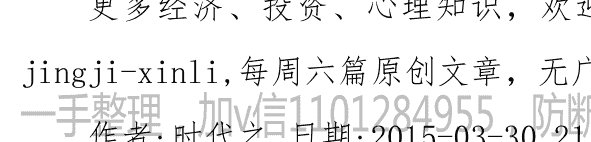
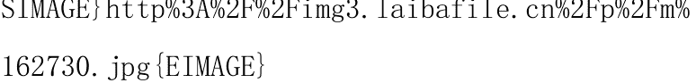
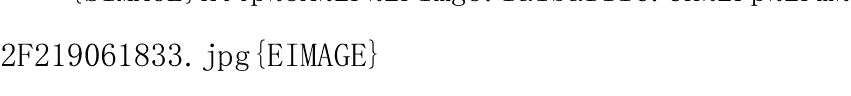

# 市场心理研究——贪痴慢疑的那些事儿，顺便分析分析当前市场

看到一些关于市场心理的书籍，总觉得过瘾（好吧，其实大多数都是很差劲），觉得大多数对市场心理理解并不深刻，甚至完全是错误的。比如大家常说的贪婪和恐惧。很多人都认为贪婪产生于市场偏向好的时候，实际上相反。比如去年的蓝筹行情，我再提醒大家等时候到了，但是绝大部分都是这么问我的：“已经拉了一个涨停板了！”这个才是真正的恐惧。还有一些市场心理现在危险啊！有些贪婪，害怕得，现在还有很多心理的书籍与说教，越拙越淫，并且得像些哲学术性的词了。可以说大部分普通人甚至都分不清这些描述心理的词汇到底是几个意思……恐惧、焦虑、贪婪、乐观、悲哀……

人类的心理背后其实都有自己的一套机制，很多心理机制的基础也已经被科学研究所证明了，比大家常说的恐惧，这一点我后面再说。作为一个专业的钻心理，在市场中浸淫多年的人，决定详细述一下市场心理，并结合市场的趋势进行分析。以前的成绩无需多言，想了解更多经济知识的人可以移步我以前的帖子。

希望大家多多支持，不荐股，可分析股。如果我没有回答你，那就是我水平不够，请谅。

作者：时代之鱼 日期:2015-02-25 10:51

心理学和经济学从来是对孪生兄弟，哈佛经济学系和心理学系原本就在在一起的，后来才闹了分家。从经济学最基本的一个假设——经济人的假设——这种假设最早由英国经济学家亚当·斯密（Adam Smith）提出。他认为人的行为动机源于经济诱因，人都都要争取最大的经济利益，工作就是为了取得经济酬。动机，就是一个典型的心理状态。

后来的经济学中最著名的名词，比如需求，比如效用或者边际效，都是基于人类心理的分析而进行的。这二词也构成了经典经济学的微观分析基础。

不过随着经济学对个体的忽视，而群体心理这类理论的加入，经济学开始了很多好玩的游戏。要在难以量化和描述，经济学逐渐脱离了心理学的某些概念，代以各种偏离社会学的理论或者偏离数学的模型。

直到心理学卡尼曼和特沃斯基获得诺贝尔经济学奖，又回到人们的视野之中。

作者：时代之鱼 日期:2015-02-25 12:03

@540506147 2015-02-25 11:13:04
好像就像是干货啊，支持支持。

谢谢

作者：时代之鱼 日期:2015-02-25 13:28

@kasper2013 3 楼 2015-02-25 11:15
路过帮顶

3q，常来啊。

作者:时代之鱼 日期:2015-02-25 18:50

@真味平浅 6 楼 2015-02-25 18:06
搬个板凳追帖

感谢支持，晚上更新

作者:时代之鱼 日期:2015-02-25 21:00

卡尼曼和特尔弗斯基都是心理学家，他们重新从心里的角度出来研究人类的行为，特别是对人性的假设提出了挑战。一方面，认为人类真实很多时候都不是理性的，也不是时刻时刻都是自私的。他们的前景理论现在已经在领域广泛应用于经济分析中，其中的一些概念，比损失厌恶，在股市的分析中都非常有用。

比如被套牢而不肯割肉的人，大多数都是损失厌恶的心理在作怪，如果只是暂时的亏，多少还有点套的希望，一旦割肉，则就会装死，成为失败，其实是在实在的损失。

套牢就装死可以是大多数散户的通病。

作者:时代之鱼 日期:2015-02-25 21:04

@芷多译 2015-02-25 19:42:29
码

# 新年好。

作者：时代之鱼 日期:2015-02-25 22:11

继续---

如果你是走技术分析的路线，对心理状况的要求是非常高的。因为技术分析是基于对过去事件的统计，胜率可能是百分之百，你就会怀疑自己的判断。理论上来说，找到两个胜率超过 50%的指标是很容易的，即便已经几十年历史的道氏理论，目前对美国股市的回测，依然可以有超过 50%的胜率，但有着赚钱的却没有几个。

很多人都有自己的交易系统，运用自己发现的一些指标在市场中赚钱。前提是你一定要懂统计知识，否则你发现的指标可能只是巧合，至少得明白什么叫做“统计学上的显著”，或者叫什么叫做“具有统计学意义”。它的，你的指标在过去股市的回测中，一定要包含交易成本和滑点。因为你对股票的买卖肯定会对股价造成波动，有些流动性不好的股票，甚至像我这样的小散建个仓都能拉起来一个百分点。如果你能找到这样的指标，只是盈利的第一步。

作者：时代之鱼 日期：2015-02-25 22:23
@ygswb 2015-02-25 19:57
偶然看到，观点与众不同，已收藏了LZ的2个帖子
谢谢。

作者：时代之鱼 日期：2015-02-25 23:36
@ygswb 2015-02-25 19:57
偶然看到，观点与众不同，已收藏了LZ的2个帖子
@时代之 13 楼 2015-02-25 22:33
谢谢。
@冰人 14 楼 2015-02-25 22:44
如此，如v持续支持宝宝们！加油
握手

作者：时代之鱼 日期：2015-02-26 07:43
@大小狸 17 楼 2015-02-26 07:05
支持。虚心学习。期待收获实用。早上好。
作者：时代之鱼 日期：2015-02-26 08:22
谢谢各位的支持。

作者：时代之鱼 日期：2015-02-26 09:43

继续，目前相当于序言部分。技术分析的本质是相信阳光之下并无事，实际上并没有东西会一成不变，所以技术派对自己的指标都是百分百相信的。就像猪天天喂饱，但你不可能一直喂他，总是会遇到意外事情。就像国外的高频交易一样，时不常遭遇黑天鹅的冲击，很多模型建立在均值回归的基础上，但很多时候等不到回归就挂掉了。相比之下，真的是价值派的信徒，你只需要耐寂寞，但寂寞是最难的。

如同前一段时间亚迪一样，我在《经济实谈》中提到，2014年12月18日，股市并没有什么变化，港股大跌30%，也是跌停。我说，如果你是价值投资，你应该贪婪，这是个加仓或者建仓的好机会，不应该感到恐惧。后来股市又涨了50%，一直是价值派的一个代表性股票。如果你是个技术派，实际上早就不应该持有此，然而如果你是短线的，踩到黑天鹅了，估计内心要崩溃了，而且后面再继续大跌。

作者：时代之鱼 日期：2015-02-26 09:58
@素颜 9999 2015-02-26 08:52
楼主是玩心理的。

作者:时代之 日期:2015-02-26 10:05
@吃鱼不腻 24 楼 2015-02-26 09:22
保证质量，谢谢支持。

作者:时代之 日期:2015-02-26 10:12
@吃鱼不腻 2015-02-26 09:22
严重顶上楼主，继续啊。结合股票实例讲心理研究也是好的！

作者：时代之 日期:2015-02-26 11:26
从2月9号分上调整结束，就在大家的犹豫中，上证连阳线。而小阴线的调整已经出现，如果明天能继续收红，上证将直奔高点而去，创新高日可待。

作者：时代之鱼 日期：2015-02-26 15:30
@寻海林煜签 31 楼 2015-02-26 15:10
对楼主的预测的确很佩服，不过想问，楼主到底是用技术还是用心理学的方法来判断的呢？

技术分析为主，这点我后面来说说。

作者：时代之 日期：2015-02-26 15:53

继续——

很多人都问我一些技术指标，其实技术指标可以止。各种策略或许就是胜负数，用计算机对过去的市场做回测，看似成绩都可以，为什么最后盈利的人并不多。答案在于心态对于你操作的影响，无数账户都曾有过类似的经验，随着股票下跌，本来还没卖出点，结果却忍受难以卖出，结果那只股票就蹦回来上涨，让你懊悔不已。有些时候已经发出卖出的信号了，你又想等等，结果越套越深。

为了避免情绪对交易造成影响，一般的机构投资者都会采取程序化交易。不过别以为这个就能万能了。我有一个朋友就是搞这个的，写了一个程序，跑很快的，不是自己掏包来操作。不知道是不是运气不好，用起来的时候显示了资金的大幅回撤，初期他还淡定，后来却越来越受不了，开始怀疑自己的程序是不是有什么BUG的，或者上了黑天鹅，最后被人人工止损了，干脆把电源线给拔了。就在他卖出之后，市场似乎又恢复了正常，他的程序在后来一段时间看来仍然有效的，只不过他再也不敢继续用那个交易策略了。

作者：时代之 日期：2015-02-26 16:04
@浓咖啡 1983 33 楼 2015-02-26 15:47

作者：时代之鱼 日期：2015-02-26 17:07
@soyabada 37 楼 2015-02-26 16:53
结合实际，大盘日线KDJ指标都处于超买，显示大盘肯定近期调整，不会出现新高；布林线随上涨都会破轨，股市布林线上还有空间，显示股市更稳。一些。但是，明明至今的上涨是深层回调，这样的趋势很难改变，这应该是股市的接下来的几天只要大盘上涨，心里会越来越紧张，越得失；一旦出现大盘回调，就会赶跑；一旦跑了，大盘又......少看KDJ，这种指标很容易修复了，而且只看个超买，布林线准确率还行，股票要少动，特别是在牛市行情中。

作者：时代之 日期：2015-02-26 17:21
很多人的心态都是这样的，牛市拿不住，股票换来去，熊才装死，想自己是不是这样的。今天天气多云，股市也上下震荡小阴线呢？估计还会站在日线上，成交量较昨日缩回。昨天说了，现在士气更大。

作者：时代之 日期：2015-02-27 09:59
@tuilish 43 楼 2015-02-26 22:10
一手资料，如110128495断断股市很多好处。羡慕楼主的跟来的，希望多多更新，让我们好好学习，能在股市运用！支持楼主！谢谢支持。

作者：时代之 日期：2015-02-27 10:17
@两眼空 47 楼 2015-02-27 10:07
追到顶热烈。

作者:时代之 日期:2015-02-27 12:06
@soyabada 57 楼 2015-02-27 15:56
楼主英明，今日大盘双双小阳线报收，成交额稳步放大……爱康科技启动，美呀!!!望楼主展望下周趋势。我觉得近期中小和创业板涨幅已较大，短线是不应该该获利出局，然后快速杀入中字头和券商板呀，沪市破3400的高点是否还需要这些股票推动吗？请楼主教!!!!

作者：时代之 日期：2015-02-27 13:14
@茫多 52 楼 2015-02-27 13:03
楼主快。

作者：时代之 日期：2015-02-27 15:03
上证这种十字线在此是我最喜欢的。今天对于上证的分析主要是基于心理层面，尽管KDJ指标需要调整，但可能是旁边不是。

作者：时代之 日期：2015-02-27 16:59
继续--当年我练时留下了技术分析的招，和贪痴慢疑说仙。每个人都有自己的操作指标，所以我希望各位找到自己的操作方法。这是一个佛教术语，一般来说都是负面的心理，是佛教修行路上需要极力克服的。这里简单说。

贪，自然是贪婪。在《沃尔街》中，著名的名言就是“greed is good”，贪婪是好的。但人类无数次泡沫都是由贪婪引起的。很多人进入股市的原动力都是贪婪，不然你把钱放在银行就可以了，没有人否认自己是为了获得超额利润进来的。但很多人因为贪婪，造成了自己的损失。综上所述，贪婪不是坏的，但一定要能够控制自己的贪欲。

嗔，是愤怒。特别是当自己面临损失的时候，面对自己错误的时候。有时候是不不要冲动，怎么忍不住买卖了呢？

痴，对各种方法的迷恋。以为技术分析就是一切，以为自己掌握了价值投资的真谛，以为自己可以靠点小道消息获利。

作者：时代之 日期：2015-02-27 17:05
@让人不好害 2015-02-27 15:16:47
喜欢心理。更多心理学和投资知识欢迎关注我个人公众号。

作者：时代之 日期：2015-02-27 17:09
@caolei8862008 2015-02-27 15:21:13
先做个记。再慢慢学习。感谢支持。

作者: 时代之 日期:2015-02-27 17:32

@暗恋萱 63 楼 2015-02-27 17:48
追到此，楼主加油，看你好。

作者:时代之 日期:2015-02-27 21:06
继续——慢，以自以为中心，以为自己掌握了宇宙真理，但无数人却亏。市场上一直都是八亏一胜，但是当市场出现买点或者卖点的时候，不够果断。有时候为了这分差价而错失机会。贪婪，每个人在投资中都绕不开，只要我们了解它，还要学会利用它。

投机也是一样，它的回报是不定的，有时候迟逛，有时候狂欢。就像男人约会一样，如果每次聚会都答应，男人很快就会失去兴趣。由于环境和自身的生理因素，这些都是隐藏在情绪背后的信号。就像罗宾斯的一个例子，当他感到胃痛发作的时候，自己可能面临危险。

作者：时代之 日期：2015-05-27 22:37
以上为序的部分，明天开始正文。

作者：时代之 日期：2015-05-27 23:34
为什么要投机？伟大的操盘手这种费力讨好的事情呢？这就从心理学上来找原因。其中一个比较流行的行为主义学派的间歇强化理论，就是那些能够对人类行为强化的刺激如果是间歇出现，而且不固定，对人的强化作用最好。心理学家斯塔·金纳做过老鼠的强化实验。他设计了一种拉杆，只要老鼠一踩拉杆，食物掉下来，不过食物的数量是不定的，有时候多，有时候少，有时候没有。对比另一种情况——每次食物掉落的数量恒定，前者让老鼠更加“上瘾”。至于上鼠，也有着一套生理因素，具体可以见诸《崩溃的边缘》中的分析。

赌博由于社会文化的因素，是个不太好听的词汇，比我们国家通常和黄、毒的人联系在一起，但赌博也是有些偏点的。对于个人来说，冒生命危险去一些事情并不太值得，但对整个人类来说，真是一种冒险行为，极大的拓展了人类的认知局限，我们登上了珠峰，深入到危险的丛林，还踏上了地球的两极，进入了浩瀚的太空。很多人都是为此出生，甚至大部分名字都没有在历史上留下来。


不过他们永远尊敬。另外对男人来说，这些行为也有一些特殊的意义。比如进化心理学就提出的一个信号代理理论。雄孔雀留了一条实的大尾巴，很容易引起天敌的注意，逃跑的时候也是一个累赘，几万年的进化后还留着？因为这个可以模仿孔雀传递信号——我很健康，跟我一起哈哈吧。

男人也是一样，通过冒险的行为，有时候为了向外界传达一个哥非常强大，哥有的信号，吸引异性的注意力，即使这些行为会让他们付出生命的代价。

所以，你看着那些围绕在赌钱的基础上都是男人了。

作者： 日期：2015-02-28 14:14
一对数据：2014年12月18日，比亚迪并没有什么变化，港股突然跌30%，A股也是一个跌停板。我说，如果你是价值投资派，你应该考虑才是，这是个加仓或者建仓的好机会，不应该感到恐惧。当然后来比亚迪又涨了50%。比亚迪一直是价值派的一个代表性股票。

----------------
@动力阿剑 2015-02-28 13:33:33
比亚迪，市值是净值的5倍——相当于你用1元买2块钱资产；
市盈率262倍，天哪，靠利润覆盖市值，你要260年

能回收投资。

比亚迪的汽车是电子发烧玩具，但不是汽车发友玩具。但电子发友是买 apple，不是比亚迪的。

比亚迪的电动汽车？历史上，100年前电动汽车就比汽油还要多；每次油价高涨，电动汽车都会热一贴；油价下跌，电动汽车消声匿迹。美国的电动汽车行业，很多企业已经倒闭了，……

不要以线性思维来看科技进步，技术进步很可能是跳跃性的，说不定哪天化石能源就能退出历史舞台，当然没有人能够准确知道这一天时候来。一手加入1110284955，防更并获取更多好处，电动汽车对传统汽车的冲击不仅是能源方面的，电动汽车对汽车制造几乎是颠覆性的，对营运也是颠覆性的，需要 4S，加上无人驾驶技术，这些才是汽车行业的未来。

作者：时代之 日期：2015-02-28 16:41

---@时代之 2015-02-28 14:14:00

不要以线性思维来看科技进步，技术进步很可能是跳跃性的，说不定哪天化石能源就能退出历史舞台了，当没有人能够准确知道这一天时候来。

电动汽车对传统汽车的冲击不仅是能源方面的，电动汽车对汽车制造几乎是颠覆性的，对营运也是颠覆性的，不需要4S店，加上无人驾驶技术，这些才是汽车行业的未来。

@动力阿凯 78 楼 2015-02-28 15:19

你不叫价值投资，叫玩概念。同样的话可以在以下领域套用：

- 1、医药。首可是可是抗癌药可能获得突破；其次是可以延缓衰老的新药；
- 2、超导。高温超导大幅降低电能损失，同时小型强大的电磁铁的制造成为，不再受安数字限制，应用前景不可限量。
- 3、3D打印，个性化定制，颠传统制造。
- 4、石墨烯、透明（显示屏）、墨烯（可靠性优）、低电阻（即低发热量，降低对冷却散热的需求），下一......

我本来不是价值投资，所以我的思维也不是价值投资的思维。只是巴菲特持有有比亚迪股票，他们是价值投资的代表。

作者：时代之 日期：2015-02-28 18:43

更多心理学、经济学知识可关注我个人公众号jingji-xinli

作者：时代之 日期：2015-02-28 18:29

@时代之 2015-02-28 16:41:14

我本来就不是价值投资，所以我的思维不是价值投资的思维。只是巴菲特还持有比亚迪股票，他们是价值投资的代表。

@动力阿凯 2015-02-28 17:03:36

巴菲特当年投石油是价值投资：涨太高没投资价值就抛掉；投比亚迪就纯粹玩，给自己贴上环保标签——美国的富人很讲这个的。

巴菲特是研究经济的，对动力电池他不懂，他以为和手机电池不一样——想当年比亚迪可是电池大王——但现在韩国的电池更贵了。

那还不如直接买环保股。

作者：时代之 日期：2015-02-28 21:59

@芷多泽 83 楼 2015-02-28 20:20

楼主快快更....

每日更新，多少不定

作者：时代之 日期：2015-02-28 22:27

@时代之 82 楼 2015-02-28 19:08:00

@时代之 2015-02-28 16:41:14

我本来就不是价值投资，所以我的思维不是价值投资的思维。只是巴菲特还持有比亚迪股票，他们是价值投资的代表。

@hillcygogo 86 楼 2015-02-28 22:21

@动力阿剑 2015-02-28 17:03:36

巴菲特当年中石石油是价值投资：涨太高没投资价值就抛掉；投比亚迪楼主看环保股 00026 现在能买入吗——一手整理，加信1101284955，防更并获取更多好帖，缺口多半会回。

作者:时代之 日期：2015-02-28 22:55

@时代之 87 楼 2015-02-28 22:27:00

楼主看环保股 00026 现在能买入吗

@hillcygogo 88 楼 2015-02-28 22:44

缺口多半会回

谢谢楼主

不用谢

作者: 时代之 日期：2015-03-01 11:10

继续——

男性对于求偶的动机可能是他们进行投机和冒险的内在驱动力，所以各种冒险活动和投机活动都是男性参与较多，就买彩票这种低风险的投机行为，男性的参与比例也更高。

女性喜欢的具有冒险投机精神的人吗？人类社会从最开始的狩猎社会，进入到采集社会，再进入到农耕社会，风险是越来越小的。狩猎的时候不仅会着生命的危险，更大的风险在于你不知道你一餐到底有没有吃的。运气好的时候，运气不好的时候，连辈子也打不到。

女性为了风险，会选择那些比较稳定的人来结婚和抚育后，所以大多数女性自身都愿望安稳，但是她们往往会选择和具有冒险精神的人偷情。

作者：时代之 日期：2015-03-01 11:16

@寻海林煜宣心签 2015-03-01 09:12:47

楼主快快，别磨蹭蹭的。

------------------------------------------------

来了。

作者：时代之 日期：2015-03-01 15:25

@dukezhu992 13 2015-04-14

写的不错，收藏了。

作者:时代之 日期:2015-03-01 16:35

@dukezhu012 2015-03-01 16:08

贪婪是人类进步的动力，本来也是，不然大家一直活刀耕中吧，这么多科技发明都是人类想偷了。可以这么理解。

作者:时代之 日期:2015-03-01 16:47

好吧，说降息的情绪。去年央行降息，论坛一片空的声音，说经济要崩，股市高开低走类，加息后股市跌得多惨，我是坚持看好后，为什么？这意味着大家期望的央行货币政策的转向，所谓的宽松，市场上直接的推动力量是资金，有了资金不涨。同样是股市，有时候是下降中，有时候是上涨中，如果是下降中，可能会高开低走，而上升通道的时候，大部分会走。为什么？这就是心理层面面对消息的。

作者:时代之 日期:2015-03-01 16:52

本次降息其实市场的已经充分反应了，能够预测出这次降息的人数不能胜，所以也没好吹的。作者：时代之 日期：2015-03-01 21:10

作者：时代之 日期：2015-03-02 07:36

@时代之 101 楼 2015-03-01 21:10

维持

@lcjf 102 楼 2015-03-01 21:59

维持！一手理，加微信1101284955，防更并获取更多好帖，感谢你的支持。作者：时代之 日期：2015-03-02 09:39

@soyabada 104 楼 2015-03-02 09:00

前来报道。央行降息，大盘高开，全天红收，这是我对天天的检测。风险是走出来的，机会是走出来的。中小板和创业板的风险逐渐大了，券商机会越来越大。本周大盘总体不太看，预计风险释放，或称之为利好放在下周。

抛个砖，望楼主指点。如果楼主可以以技术分析一下大盘趋势，那就真的等学习的好机会。谢楼主！预期实现，我在另一个帖子中说了。作者：时代之 日期：2015-03-02 12:43

@soyabada 2015-03-02 09:00:45

央行降息，大盘高开，全天红收，这是我对天天的检测。风险是走出来的，机会是走出来的。中小板和创业板的风险逐渐大了。本周大盘总体不太看，预计风险释放，或称之为利释放放在周后。

抛个砖，望楼主指点。如果楼主可以以技术分析一下大盘趋势，那就真的等学习的好机会。谢楼主！短期的技术指标没有意义，可能你交易成本都覆盖不了。

短期的技术指标没有意义，可能你交易成本都覆盖了。中期你自己找本书学的BOLL线都够用，关键是要活学用，什么叫，就是结合整个宏观和心态来分析。作者:时代之 日期:2015-03-02 13:23

继续------

对于不确定性的游戏，我们到底该不应该进入，或者应该什么样的进入，那要一个人的承受能力和市场的波动性而言。比起彩色，这种东西只有两块钱，每个人都能承受但是市场的预期收益是负数。所谓预期收益，就是所有收益的加权平均。对于这种市场，我是建议都不应该进入，彩票市场就是大数据定律，虽然你可能中奖，总的来一手1110284955，断并连续多持住说，赢家是发行彩票的人，说有些点伤疤的，彩票就是智商税。赌场也是类似的，所以它的名言就是一不怕你赢，就怕你不来。只要人足够，赌场是一定赢钱的。像任何俄罗斯赌场，老虎机之一，完全就是叫智商税的。不过赌场有很多博弈型的夜晚，比如扑克克理论高手是可以高手菜鸟的的当你在牌桌上试图找到谁是菜鸟，半天没找到的时候，别找了，那个菜鸟就是你自己！作者：时代之 日：2015-03-02 15:28

@540506147 109 楼 2015-03-02 14:11

佩服，看来楼主今天又要对了。最后还是拉小红了。作者：时代之 日期：2015-03-02 15:36

@shaw3023 110 楼 2015-03-02 15:04

必须支持。原来理论高手的操作也这么牛B。。谢谢，知行合一，方为王道。作者：时代之 日期：2015-03-02 17:29

@soyabada 114 楼 2015-03-02 16:26

爱康科技今天收盘前先出来了，等后几天择机再进吧。一回复 加:1101284955，防断并获取更多好帖。短期技术面回调。但此股很妖，注意去八月走势。作者：时代之 日期：2015-03-02 17:34

@soyabada 113 楼 2015-03-02 15:42

沪市收红，不容易的。感觉没有金融板块的带动，尤其是券商板块的冲击，大盘很难突破。盘中感觉中小似乎有力的形态，很多小板股票拉涨，不太妙。费这么大的劲，沪市不破有点说去。所以，测大盘明后两天继续红。楼主，你说呢？

@时代之 2015-03-02 17:34

今天k线收的不错，但短期指标需要修复，所以最好是收红带上线。@soyabada 123 楼 2015-03-03 08:24

昨晚静心来想，觉得自己有点了。为什么沪市一定要突破，谁规定的中小板、创业板创新高，沪市就突破前高点；为什么深市再突破前高点，沪市就突破前高点。一手处理 加微信1101284955，防范被抢夺。无论沪市突破还是自己突破，大盘现在的强势了，各路庄家不是这种，非要突破再回调，再整理，让每个人都满意——“我们判断很难呀”，傻子庄家才会这样。所以，指数……你这样的心态就很健康。作者：时代之 日期：2015-03-03 11:57

继续——@时代之 2015-02-27 21:06:51

慢，以自我为中心，以为自己掌握了宇宙真理，手握裸。市场上一直都是亏平一胜，但无人却对这个市场蜂拥而至，凭什么就认为那个赚钱的人就是自己。所以我常说，人人皆自信疑，优柔寡断，信心不足。特别是当市场的走势与自己的预期相反的时候，是不是开始怀疑自己犯了错误，甚至是违反自己的操作原则。当市场出现买点或者卖点的时候，不够果断，有时候为了两分钱的差价而错机会？贪嗔怀疑……@城市雪狐狸 122 楼 2015-03-03 00:22

其实这些道理很少从表面上看人都懂的，想问楼主，你是怎么克服贪嗔怀疑的，感谢！-防赚并获取更多好帖

第一个是认知层面，然后通过不停训练。后面我会写到的：作者：时代之 日期:2015-03-03 13:10

还靠各位多多支持额。作者：时代之 日期：2015-03-03 14:20

@素颜 9999 122 楼 2015-03-03 12:01

精彩，很有用啊。感谢额。作者：时代之 日期：2015-03-03 15:55

@soyabada 132 楼 2015-03-03 15:49

今日两市……（此处内容存在重复，根据OCR逻辑已处理）

者，而且这些经济学家几乎都会在投资银行或者私募中职，因为他们的期望很大程度上反映了人们的期望水平。

而中国投资者不同，百分之十以上的投资者都是散户，这些期望就比较难以衡量，随便点开一个财经网站的，都可以发现三教九流对市场的预期是五花八门。

作者：时代之 日期:2015-03-04 13:18

@大小狐狸 2015-03-03 22:55:53
@时代之 楼主关于保险的理论。很有趣。富人指的是？算不算一种避税手段呢保险。

富人的避税手段很多，最常见的是转移注册地。因为国外多累进税制，所以发很少的薪水，而持有股票等金融资产。

这里的富人没有特别的含义，大家通常理解的理解。

作者：时代之 日期:2015-03-04 14:14

@icemanjia 2015-03-04 14:04:50
技术贴，留名。
欢迎

作者：时代之 日期:2015-03-04 16:59

@alvincomer1 151 楼 2015-03-04 15:57
后续，晚上更新

作者：时代之 日期:2015-03-04 18:28

@暗恋吕秀逢 2015-03-04 18:00:27
财神，来支持你了。
谢谢

作者：时代之 日期:2015-03-04 19:12

@unc1b 156 楼 2015-03-04 19:10
在经济领域中，借用佛教中“五毒”作为类比的言论很犀手，在下在2008年左右的《吴畏相论》中就见识过了。

说完五毒，肯定就是上“戒、定、慧”的解药了哦。当然不是那么玄的，而是最新的心理研究成果。

作者：时代之 日期:2015-03-04 19:42

继续——

按照金玛的有效市场假说，市场的一切信息都已经反应到价格之中，目前的价格只是将未来的一个折现而已。市场的消息一旦发布，也会立即反应到价格之中，按照有效市场理论的解释，人们是不可能取得超额利润的。更有很多金融学家认为股票就是随机漫步，甚至有人做实验，把猴子让眼睛盯着靶子上是各种代码，哪种股票就买哪种，后来发现这样的选股居然比华尔街上大多数投资经理的收益还要。

不过有效市场假说虽然建立在“经济人”假说之上，人都是理性的。但实际上人们往往不理性，我们的认知是有局限的，所以你的预期就和现实不符。预期好现实，另外信息的获取也是成本的，每个人获取可能是不一样的，当然不可否，市场上百分之九十九的信息已经回应到了价格之中，但还有一些消息是没有回应到市场中的，比如合法股票对于消息的反应也不是同步的；一个市场越有效，这种时间差就越短。美国现在大多都是机构投资者，而且大部分都是程序化交易，成交量占70%。而中国市场就不同，经常对消息反应慢，所以也给人套利的机会。

作者：时代之 日期:2015-03-04 19:46
@时代之 146 楼 2015-03-04 12:57
继续------
友情提示：这个标志是我的正文部分。

由于未来具有不确定性，我们总是在描绘未来，未来就会形成一种模糊的轮廓，这就是期望。就像股市中，一些人会告诉你股市会涨到一点，自己心里有一个模糊的期待，这些合在一起成了我们对市场的期望。由于每个人的心理特征并不相同，所以期望是一个很难量化的东西。美国每个月都会公布经济学家对数据的预测，比如 CPI之类的，虽然估计就是加权平均了一下……

@lcffjk 2015-03-04 18:59
继续，学习！
作者：时代之 日期:2015-03-04 21:17
尤金玛的理论在2013年获得诺贝尔经济学奖。
作者：时代之 日期:2015-03-05 00:03
@吃鱼不腻 161 楼 2015-03-04 23:45
前来拷贝，顶场洛，顶顶顶！
谢了。
作者：时代之 日期:2015-03-05 09:52

@soyabada 163楼 2015-03-05 08:41
不过有效市场假说仍然建立在“经济人”假说之上，人都是理性的。但实际上人们往往不理性的，我们的认知是有局限的，所以你的预期就和现实不符。

==============================

我们总是在预测股市的涨跌，看空或多，但一旦与现实不符，就会出现几种状况：或是慌乱调整自己的操作-追涨跌，或是一根筋坚持自己的预测-踏空或越套越深，总之与现实格入。使我想到股......


我们的预期轨迹受多种因素影响，包括行为。有些人，总以一两个技术指标就可以吃饭了，幼稚。

作者：时代之 日期:2015-03-05 13:11 / 02:04

--------------------

对人们的期望造成影响的事很多，包括宏观经济状况，统计局数据，市场的消息，价格的趋势等等。为了简单易见，我们假设这些都能反应到价格之中（事实上必将反应，只不过不一定同步）。我们对市场的预期影响我们买入或卖出的行为，而这样的买卖是市场波动的直接推动力量。反过来，市场的价格波动也会影响我们的心态，如果市场并不按预期或者走磨人，你是否改变自己的预期而是改变自己的行为呢？

实际上，行为也是能够影响预期的。很多人对一些不确定的股票，由于一次冲动就买了，就变得对自己的股票非常看好了，会找很多证据来肯定自己的想法。这就是大家常说的心态决定脑袋。（word 坏掉了，不能传图表）

有些人本来只是想在下跌中抄一把，结果抄到半腰上，结果股票继续下跌。如果他们持有这只股票，他多半不会看到这样的走势，一旦持有了，就会不断补仓，然后自己欺骗自己：是主力在吸吞。

作者：时代之日期:2015-03-05 20:34

------

预期能够自我实现，港股就有著名的“丁蟹效应”。丁蟹是秋官在电视剧《大大时代》中饰演的一个人物，在剧中经常空倒。后只要秋官的电视出来，都会导致不同的程度。其实最开始可能是巧合，后来这个词在市场上上演之后，大众都有了一定的预期，于是大家都选择抛售，结果市场真的变好了。这是非常典型的预期自我实现的例子。

作者：时代之 日期:2015-03-05 21:03

@k721286 166 楼 2015-03-05 19:54
楼主快更...
作者：时代之 日期:2015-03-06 08:23

@soyabada 170 楼 2015-03-05 23:29
作者：时代之 日期:2015-03-05 13:11

@soyabada 171 楼 2015-03-05 23:32
有些人，总以内一两个技术指标就可以吃饭了，幼稚。

@冰霜 173 楼 2015-03-06 07:48
投资（投机）本质上是有心理因素的，老师讲课是正常的。
作者：时代之 日期:2015-03-06 09:25
过来，支持。

@yangmoon 176 楼 2015-03-06 08:58
感谢支持。
作者：时代之 日期:2015-03-06 13:28

@素颜 999 178 楼 2015-03-06 12:39
越来越好，很久在论坛看到这样高质量的帖子。没人看了。
作者：时代之 日期:2015-03-06 15:04

继续——

著名的哲学家卡尔·波普，在《富足与贫困》中，提出了一个名词“俄菲浦斯效应”，这个词基本上是。现在流行的词汇叫“俄菲浦斯情节”，通俗点就是恋母情节。伟大的心理研究者佛洛伊德也创造了这个词汇。故事是：话说有一个国王生了几个儿子，但是生下来就有人预言这位王子会弑父娶母，这太了吧。国王对这个预言感到十分惊慌，虽然在孩子生前这个预言就存在了，所以他尽量避免和皇后接触，但还是失败了。于是他把这个孩子遗弃到荒山中，想让其自然死亡。根据文学作品，坏事做过，将来会死的很惨。这个孩子俄菲浦斯被遗弃，被一个牧羊人扶养，后来这个孩子长大了，也是个胆悍的人物。有一次，他在路上和一群人发生冲突，几句话就把杀了，而这个人恰恰就是他老子，这位老国王。弑父的预言成真。

那个时候这个国家受到斯芬克斯（就是金字塔前的狮身人面）所困了，他喜欢跟人玩脑筋转弯，谁要是答不出他的谜题，他就喜欢跟人人体解剖，把人撕裂。这个斯芬克斯就是经典的那个：他有一个三条腿，早上的时候四条腿，中午的时候两条腿，晚上的时候三条腿。我一度认为三条腿的一定是晚上在床上的男人，两者就不解释了。当然我们的主角很容易就出了谜底——人！小时候的时候四条腿，长大了两条腿走路，老了拐杖有三条腿了。斯芬克斯谜底被解了出来，就一命呜呼了。于是俄菲浦斯成为国家的英雄，继承皇位，顺便也捡了皇后，也就是他的亲生母亲，于是娶母的预言实现了。

所谓俄菲浦斯效应，就是对一件事情的预言去采取措施，反而促使了预言的实现。这个现象如果用股票市场来说，如大家觉得某只股票会涨，于是去买这只股票，于是股票便真的上涨了。看到没，没有点索罗斯“反身性”理论的影子了？

作者：时代之 日期:2015-03-06 39

继续------

这年头，玩金融的，你要是不搞些数字，比如X,Y,Z之类的，都不好意思。最简单明了，还可以进行推理和运算。参与者的思维用X表示，Y表示。那么参与和思维之间的关系可以用两个函数表示：

```
y=f(x);
x=F(y).
```
也就是说，人的活动与思维有很大的关系，同理，人的思维受活动的影响，思维也是函数。数学上可以计算，根据这两个函数，也可以得到：
```
y=f(F(y))
x=F(F(x))
```
这就是，x和y都是自身函数——认识是变化的，行为是变化的。这两个递归函数不会产生均衡，只有正向的强化。

均衡的概念，简单易见，比如在某一个时刻，需求和供给达到平衡，那么价格也不变。索罗斯排斥这种观点，均衡是不存在的，只会产生变化。很多时候均衡是存在的，围绕价格上下波动。这就是价格和思维（结果是期望）之间影响的数字。

作者：时代之 日期:2015-03-06 50

@奎多洋 2015-03-06 19:29
@4915781 2015-03-06 21:25
mark
欢迎。
继续---

---

对于个人来说，冒大的风险来投机是决策中首先考虑的事情。前边讲到了期望的事情，另一个一个是波动性，波动性太大，可能让你死无疑。所以对于个人来说，对于收益为正的事情，只要你保证自己能够东山再起，就勇敢去投机吧。反之，如果冒险让你一蹶不振或失去生命，那就要罢手吧。而有时候我们的决策是超越个人的，有些人是从家族层面出发的，那么同样，我就在一个不选择的节点上，有点纠结了！可能是比较困难，本来想买房的，工作突然有变化打了我。我要注册公司，之前跟朋友合作。小孩也两岁了，不过我还是冒险放弃的工作，之前的客户给我管进货发货应该没有问题，也不差钱。另外我自己跟着哥哥学习，大哥是师傅学习半年就差不多了，就是有一技之长。这两个今年都可以做到！还有一个就是在家里试种......能够酷就基本没有后顾之忧。加油吧，祝你好运。

作者：时代之 日期:2015-03-07 11:14

@冰人 avv 2015-03-07 14:59
看楼主的文章获益匪浅，楼主没事要多更新啊！

作者：时代之 日期:2015-03-07 11:40

@zuotianyy033 193 楼
美指数 97 
楼主怎么看。
大多数人都认为望美元上100的，所以美元一定会上100。

作者：时代之 日期:2015-03-07 12:04

关于期望，在古典经济学中几乎没有涉及到。记得有次看到了两本微观经济学的教材，对期望的理解完全相反。

古典经济学认为需求和供给决定价格，但期望却闭口不谈，估计那个时候金融市场不发达，在商品市场期望的影响很大。比如你预期小麦涨价，那么你可能想买点小麦放着。同样人预期小麦会涨，他可能会积累起来留着价格涨起来再卖，结果需求增加，供给减少，价格就会真的上涨了。

古典经济学认为需求和供给决定了外部条件，比如需求是受收入影响的，而供给是有生产函数决定了，而忽视了作为市场参与者的思想，明显的思想会对需求供给造成影响。这在金融市场上尤为突出，人的预期对价格的影响是起主作用。买卖依据依据预期，将来的价格反过来受制于当前的买卖。

作者：时代之 2015-03-07 56

继续--

期望的运用。如果大多数人的预期一致，那么预期将会自我实现，除非有一个强大的力量将其反转。正如2014年中国股市从底部启动的时候，大部分人都认为价格最后超过3000点，那么3000点跌就不言而喻了。对上一次的高点3478，很多人都会犹豫，会不会形成双顶？会有很多乐观派认为股市上涨。趋势很多时候都是符合这种定价的，上一次的高点可能是压力，上一次的可能是支撑。

作者：时代之 日期:2015-03-07 13:21

作者：时代之之 日期:2015-03-07 17:49

@寻海林煜 199 楼 2015-03-07 17:30
追随楼主，表示脑子有点用了。慢工出活。
作者：时代之 日期:2015-03-07 21:58

@5405614 2015-03-07 11:40
作者：时代之 日期:2015-03-07 22:57

@hamfloor 205 楼 2015-03-07 22:09

大家周末好。作者：时代之 日期:2015-03-08 09:37

作者：时代之 日期:2015-03-08 11:34

作者：时代之 日期:2015-03-08 18:12

作者：时代之 日期:2015-03-08 21:14

期望也有另一面，就是非常容易形成执念。记得07年大牛市的时候，很多人都在喊股票上一万点，即便后面调整得非常明显，基本上都在大幅下跌，还是很多人说只是技术性调整，股票又要一万点。于是那些抱着执念的人站在了高之上。而当股票一路下跌，很多人都说股票跌到1000点。结果到了666点就开始反弹了，我一个朋友本来准备大资金准备市场，结果就是抱着这种想法错过了大部分的上涨期。他们仅仅认为那是技术性的反弹而已。期望不是理想，所以最好不要有期望。很多人拿到一只股票，都喜欢问我这样的问题：这股票能够涨到多少？当然我也会大概给个数，毕竟人都是有希望的，但我知道这样的数字没有技术性的支撑，只是我一厢情愿而已。好的做法是发现买入的指标，买入并持有，出现了卖出的指标，卖出就可以了。即便是价值投资也应该如此，价格低于价值买入，当外界环境变化的时候，导致价值发生变化或者安全边界发生变化，卖出就可以了。我们不是神，我们无法预知每一件未来的事情，实际上是绝大部分事情。我们祈祷这些事情发生的时候，我们还能及时做出反应而已。

作者：时代之 日期:2015-03-09

@KUBIKIRIBASARA 2015-03-09 00:16:26
很喜欢这篇文章，也想通过这个帖子和楼主探讨下，也望楼主给出这些建议。楼主所说，我和以前看到的行为经济学很相似，我认同，跟指标或技术分析炒股不是不行，也有很多大机会，分析很多但是本质上还是你对市场心理反应，所以我原来做私募或者老白，就是考虑到这一点，以认为几个指标就可以打天下的，自然的，我被市场上上了堂教育课，后来我就开始纠正我之前的失误，或者操作盲点和心理。以后来开始学习这些……不要期望太高，也不期望太低，我建议不要有期望，自然然后随着市场的信号走走就可以了。你的操作里面没有说到卖出系统，这个建议完善，这么多年的经验告诉我我卖出的比买入更为重要。


没有。另外市场资金流入或者流出这个指标不可靠，不同的券商，不同的程序统计差别都非常大。

作者:时代之 日期:2015-03-09 13:04

@KIBUKIRASASA 2015-03-09 00:16:26
很喜欢这篇文章，也想通过这帖子和楼主探讨讨论，也希望楼主能给出这些建议。

楼主所说，和我以前看到的行为经济学分析很相似，我认为跟随指标或者技术分析炒股，不是不行，也有很多大拿，但本质上还是属于一种市场心理反映，所以我原来做股市或做白银，就是考虑到这一点，不要以为靠几个指标就可以打天下的。

自自然的，我被市场上当了风风险教育课，后来我就试图纠正我以前的失误，或者说操作要点和积累更多帖。所以后来开始学了这些……目前发在下跌的通道中，没见到反转，就破位了，如果后市走好的话，还有机会。作者:时代之 日期:2015-03-09 13:07

@stormpal 2015-03-09 09:15:22
同为工毕业的特校友，说中走势终将完美。我个人认为其实应该是：1，在有大资金主导的股中，主要声音只有一个，涨跌都会很顺畅，会有太多折腾，看上去完美。2，分歧多的资金在一个股，非常的上下k线，看上去就让人感觉和谐。3，全是散户的票，走势必然跟随大盘，也很完美。任何资金最终结果只有两个，要一个资金占了主流，开始走的完美。要么散户……

缠论的走势终完美，理解很大。我认为市场大部分时候都是随机漫步的，但不是都在随机漫步。就像醉汉一样，虽然东倒西，下一步你不知道哪里，但最后多数还是朝着方向。作者：时代之 日期:2015-03-09 13:08

一手理加微信：1101284955 防并获取更多好帖@25607263 2015-03-08 22:26:27
谢谢。作者：时代之 日期:2015-03-09 13:13

@如飞如翰 2015-03-09 11:58:46
很喜欢，接加油！谢谢支持。作者：时代之 日期:2015-03-09 13:18

@冰霜恶灵 2015-03-08 23:56:14
感谢。作者：时代之 日期:2015-03-09 13:35

## 鼎
感谢。作者：时代之 日期:2015-03-09 19:16

晚上候。作者：时代之 日期:2015-03-09 14:11

@KUBIKIRASASA 2015-03-09 14:11:48
感谢楼主回复，您说的这些问题确我是急需解决的问题之一。卖出倒是有思路，还请楼主指数，理论上来说，最好是在最高点，这个我不考虑运气成分极大，次优选择应该是最高点之后反弹作为卖点，但是反弹多少为卖出，这里是死叉还是上涨百分比，最重要的是反弹又是反转，这里经验的成分非常大，以现在的能力根本无法推测。所以我现在执行的做法是根据05-07年这波行为来参照做一个……我建议你用顶背的指标作为卖出。这个指标在过去几年股票中日线级别的正确率是90%以上，但在牛市中正确率下滑很快。作为熊市中反弹结束的指标是非常好的。作者：时代之 日期:215-03-09 19:28

@bbzh1970a 的226楼 2015-03-09 17:22
欢迎。作者：时代之 日期:2015-03-09 19:34

@kjjxj108 2015-03-09 18:10:53
写的很好，非常有用。谢谢。作者：时代之 日期:2015-03-09 19:39

@millrebirth 2015-03-09 18:43:15
不要停，继续，呵呵。一手整理加v1101284955，防删并获取更多好帖。这个，呵呵，谢谢了。马上更新。作者：时代之 日期:2015-03-09 20:16

有人喜欢用博弈论来解释股市，你得尽量了解对手的底牌，但不能暴露自己的底牌。最好不要有自己的期望，以免形成执念，但可以去预测别人的愿望。在市场上比大多数人多想一步，意味着获胜的概率大大增加。

话说有这样一个小游戏，每个人都写下一个数字，数字位于1到100之间。最后写的数字最接近大家所写的数字的平均数的2/3，谁就能获得胜利。

很快有人想，随机在1 到100 之间数字和的平均数应该是50，所以除3应该是33.3。

不过不幸的是，要是大家都这么想，那么大家都会写33，所以以获胜的数字应该是22。

要是大家继续往下推，二三分之二，再继续三分之二，最后大家估计都写1。最后没有赢家也没有输家。虽然现实的情况并非如此，很多人玩这个游戏，最后获胜的数字是22。由于某些大学学生的智商和其他水平高于普通人群。从这个例子我们可以获得以下信息：并不是所有人的预期，比如我们假设的，很多时候都是理性的。其中非常重要的一点就是人都是理性的，现在的行为：

1. 大部分人都是学会了要获胜，其实不需要复杂，只需要比多数多一步就可以了。就像下棋，有的人比对手多一步。
2. 有时候太精明也不是好事，越精明的人可能会写一样，但是最后却是获胜的人。

要是这个例子运用到市场是什么样子的？举个例子，2012年3月12日日本地震，大家最先到的对A股的影响呢？那就是对的利空。

根据有效市场原理，消息几乎同时反应到市场中，所以股票基本上开盘就跌了。即便中国的股票可以做空（期货除外），也根本没有时间差。实在是大机构，有现在的计算机，可以搞高频交易。当然指数一路下滑，不过很多消息基本上只有一天反应。如果你比大多数多一步，就知道利空，对于新能源，位置有利。所以你14号开盘买入这些股票，两天内都会获得不错的收益。同样比普通人多一步，那么你会发现市场产生了质变，那么对的也是利好。所以14号你可以买入这些股票，如果电子，15号就被拉出一波拉升。还有其他股份，这些都是有时间购买的。

不过这里有个好笑的事情，就是对行业的炒作。市场居然会有传言，于是15号行业也开始疯狂上涨。我一直以为为科普还不错，没想到有多少人连一点科学概念都没有。看看中医争，作为一个常留意和技术宅，感到任重道远。作者：时代之 日期：2015-03-09 20:20

关于期望写到这里，接下来谈市场的随机性和焦虑。作者：时代之 日期:2015-03-10 12:32

@小淡定 235楼 2015-03-10 12:10
呼唤楼主。有空就来。作者：时代之 日期:2015-03-10 13:45

@小子无才 1983 2015-03-10 13:37:14
看来我是对贪婪和恐惧的理解误。就像创业板，这么高的点位了，它还在涨；而券商板块，都跌成这样了，它还在跌，明明有那么多新股要上市，每天有那么多成交量，这些对券商都是利好呀，搞不懂了。想教教楼主，目前的券商是涨还是跌，对当下的创业板是涨还是跌呢？

创业板是有风险的，但一切以观测为准，右侧见顶的时候我是会在自己公众号中说的。上证目前走势无忧，我还是之前的判断，如果券商破位就出来，现在好像还没破位吧。作者：时代之 日期:2015-03-10 14:05

晚上有点事，可能不能更新了，抱歉。作者：时代之 日期:2015-03-10 14:55

@吃鱼不咸 244楼 2015-03-10 14:29
爱康科技今天涨了，我昨天没赶上蹦了！！！楼主再推些好股啊~~~我每一天都在公布持仓，都是好股。作者:时代之 日期:2015-03-11 08:44

向各位问好。作者：时代之 日期:2015-03-11 10:13

@天意aV 2015-03-11 09:02:36
老乡好，我也是重庆的沙坪坝。老乡好，感谢支持。作者：时代之 日期:2015-03-11 10:18

## 要管理，加v1101284955，防删并获取更多好股票的基本绪是焦虑

在股市中的人，常常听许多这些描述情绪的词汇：恐慌、贪婪，但是有一种人类的基本情绪很少提及，这就是焦虑。

焦虑的本质是对未来的不确定性，由于人类认知的局限性，我们对未来几乎无知。由于人类追求确定的本性，我们总是千百想预测未来，所以焦虑起来，人们会感到无所适，表现为心烦意乱、坐立不安甚至会在夜晚辗转。无数大师告诉大家选股的标准，那就是买入股票之后能够睡个安稳，否则……

股市中，散户总是尽办法试图了解自己买入股票的信息。不幸，市场上的99%的消息都是噪音，毫无意义，因为有意义早就反映到股价中的。不过这一点不成熟的市场上表现得有些迟钝，比如中国的股市时候表现得要慢半拍，给人以利的机会。所谓的内幕消息，普通人可能知道的，几乎是理性的。比如去年10月份的时候，某银行人员告诉我，主力可以买入，未来至少回8%。当时我立了决不要买入，结果难得在市被套。一手手续。由于焦虑的情绪，我们本来可以理性的受到额外的影响，导致不知。如果我们能减少焦虑，就能控制自己的焦虑情绪，甚至是跟着内心的感觉，可能都会获得不错的收益。

减少减少的信息越多，你的不确定感反而增强。这些焦虑的情绪会影响你的判断，让你感受不到市场发出的信号。在股市中表现得无头苍蝇一样，感觉自己似乎不停地买卖。

@诸咖啡 1983 250楼 2015-03-11 10:21
学习。一手整理，加V1101284955，防并获取更多好运。欢迎。作者：时代之 日期:2015-03-11 13:11

持续。作者：时代之 日期:2015-03-11 16:00

@芷多泽 253楼 2015-03-11 13:50
学习。问好。作者：时代之 日期:2015-03-11 21:57

@soyabada 2015-03-11 21:30:37
学习中！GOOD!作者：时代之 日期:2015-03-11 22:17

@装甲车 123 2015-03-11 22:01:08
排队好好学。谢谢。作者：时代之 日期:2015-03-12 09:01

美指99，最惨的还是欧元。人民币贬值的都是胡扯，除了对美元，其他都是一路高歌。一手理，加V110124955 防并获取更多好帖。作者：时代之 日期:2015-03-12 12:54

@装甲车 123 260楼 2015-03-12 12:18
楼上快来。晚上更新。作者：时代之 日期:2015-03-13 14:11

不好意思，昨天晚上有点事情耽搁了。作者：时代之 日期:2015-03-13 21:00

## 案例分享：预期对操作的影响

说说南京港这只股票。看我文章的朋友都知道我是从年末开始接入这只股票的，平均成本10元左右，因为这只股票盘整了很久，而且后期概念丰富，形态上不错。来的走势也比较理想，一路上涨到了18元附近。

由于涨势过于剧烈，大概率是需要调整的。所以一般来说，会冲高回调放量收敛线，这是短期涨势结束的一个技术指标。本来按照计划我应该在3月6日卖出部分仓位，可是当时有点事情耽了，错过了最佳时机。

这个时候预期就起作用了。虽然预期是个无聊的东西，但我总觉得这只会到20以上，尽管目标很近，但还是有执念，只是小做了T。这样的操作让我损失了10个点。完全按照技术分析，应该是在日线站稳才能接回。可是我处理时由于分歧，很多时候这反转又是反转。

@avv 2015-03-13 16:18
楼主的坍塌的心情正在读中很多，了解他人升自己。有点少，期待楼主下大了……谢谢。作者：时代之 日期:2015-03-13 19:01

@装甲车 123 264 2015-03-13 20:38
又没？来了。作者：时代之 日期:2015-03-14 08:03

很多人喜欢问技术分析，问笑！随便一个懂计的，做一个蒙特洛模拟，都可以发现问题。作者：时代之 日期:2015-03-14 09:12

另外我们观察也是一个方面，你所分析很难包含市场所有的信息，大部分仅仅就是看到价格变化的基础，所以很多分析都包含了在价格之中。如果你去预测第二天的涨跌，几乎所有人都是随机漫步的，最后的结果跟想象一样。当然有些人连胜概率可以达到几次，其实很容易理解。

焦虑局限于市场短期价格波动，那么无疑很大程度上你是焦虑的。通过不断的强化，人类是可以克服这种情绪的，所以排除一些高手做到内心的淡定。作者：时代之 日期:2015-03-15 09:25

等待。作者：时代之 日期:2015-03-15 11:35

面对未来的不确定性，人们会有多少的心情，这个人的神经系统有关，由于背后的神经生理机制，人人都有。而焦虑水平的高低，可能会影响自己的发展。举个简单例子，我们每个人都试过考试，在考试前，你会担心题目不会难，还有知识点没有掌握，会因为堵车迟到……这些引起你的焦虑。焦虑水平太低也不是好事，这会让你产生远离。我以前没有把考试当回事，觉得意外是个无聊的事，所以考试的时候遇到题目会因为疏忽出错。中等程度的焦虑是一个合适的选择，适当的压力水平和紧张程度，让你保持警觉，更好的发挥自己的才。如果焦虑水平太高，同样会对发挥造成影响，可惜是负面的影响。很多运动员都有这样的体验，特别是在射击运动中，心理活动对成绩的影响更为显著。作者：时代之 日期：2015-03-15 15:21

@DeanwF 2015-03-15 13:47:03
更新好慢。业余习作，慢工细活，见功夫。作者：时代之 日期:2015-03-15 15:30

@南北西东呵 2015-03-15 15:07:29
一手理，加微信：110284955 防并获取更多好帖。欢迎。作者：时代之 日期:2015-03-15 19:37

@lengyc 278楼 2015-03-15 18:15
好文！谢谢！作者：时代之 日期:2015-03-16 10:34

@hamfloor 280楼 2015-03-15 21:37
楼主是看过诺贝尔奖得主的一本书——诺得主的书我是看过不少。作者：时代之作 日期：2015-03-16 12:21

## 案例分享

周五下午，上冲高回落，离3400点一步之遥。这个时候心理作用是十分关键的，所以我说最好的走势是周五收一根1%以下的阳线，然后一鼓作气，创出新高。这样来说气是最为合适的，因为面对高点应该经常会一而再，再而衰，三而竭的心理。

结果周五涨0.7%，然后在记录帖中说上创新高了。今天上证也是如此，一鼓作气，大涨1.8%，创出新高。这样的结果从技术分析上根本看不出来，只有通过市场心理的研究才可以得出。


@装甲车 123 285楼 2015-03-16 18:07
现在就很焦虑，怎么破。

不着急，适度的焦虑是可以接受的。作者：时代之 日期:2015-03-16 19:27

向朋友问好。作者：时代之 日期:2015-03-16 19:39

继续------

面对焦虑的时候，很多人认为增加摄入的摄会缓解

焦虑水平。就像很多人买股票后，开始收集有关股票的一切信息——领导层、媒体报道等等，先不说这些市场上的公开信息基本上都等于垃圾，而这种过分的关注实际上并不会减少焦虑的水平，反而会占用了我们的注意力带宽。

人的注意力是有有限的，我们不可能同时注意太多的事情，额外的信息会降低我们的注意力水平。这就会让你忽视掉一些真正对你有用的信息，比如股票的价格走势或者技术指标的信号，甚至是整个市场的趋势，这些才是对你决策真正有帮助的信息。很多人在技术指标发出之后，并没有立即操作，可能就是受到这些信息的干扰，特别是当这些信息的指向和技术指标相反的时候。当然更多的人是直接忽略了，直到那时候才会发现。

此外，焦虑会降低我们的控制力。自我需要消耗大脑的能量，人在焦虑的时候更多时候依据原始的冲动，而不是理性的判断。有一个实验说明了这个问题：让两组人在房间内活动，房间里放着两种食物，一种是水果，一个是蛋糕。其中一组需要记忆两个数字，这个几乎不用消耗能量，另一组需要记忆一个七位数数字。结果显示：只记两个数字的人大半选择了水果，而记忆七个数字的人多数选择了蛋糕。蛋糕富含热量，因此他们倾向于选择蛋糕。

心理学家认为肥者在焦虑时爱吃东西，就是一种减轻焦虑情绪的方法，通过嘴嚼食物，会使人的脸部肌肉紧张度减低，从而间接释放紧张情绪。所以很多胖子都会说自己缺乏安全感。

自我控制在交易中的重要性不言而喻，有过体验的人都知道，很多时候缺乏控制力的买进和卖出是多么糟糕，甚至会让人有一种剥夺的冲动。

所以很多投资大师都会告诉你投资的第一条定律：纪律，还是纪律。

半生投机半生狂
少年何发老夫夫
如是闲得凡训
英雄无惧破狼

楼主喜欢看了凡训？
内容一般，不过观点我是接受的。

感谢你的建议，群心理这部分就会多些一些。

顶起。
感谢。

晚上继续！

继续——

img/46a9aea00a08167c97c4a227f2699cda_71_0.png

对于焦虑，我们首先要承认认知的局限性，其实想如果都能准确的预见未来了，那生活估计也没啥意思。正是由于惊讶和意外，生活才会变得如此的丰富多彩。

这里推荐大家用“念”的方法来看市场的波动，那就是不做交易，注重当下。当你买入的时候，买入就好，别天天自己安慰自己这是一只大牛，然后去去找各种理由证明自己的判断，哪怕你找到了100条上涨的理由，市场依然可能是无情的下跌。同样，当你卖出一只股票的时候，就不再继续延续关注了。不能过两天看到又涨起来了，然后脑后一排声“哎呀，就错过了呢？”或者看到自己新买的不如以前卖的，开始后悔，影响到自己的判断。

不要试着去预测未来，不要对自己的预期产生，关注当下即可！

## 3. 概率与直觉

人类有一套快速系统，在几十万年的进化中，直觉的角色非常重要。原始人打猎的时候，碰到了一条蛇，直觉会立刻指示：要么上去，要么跑。但是概率问题是麻烦的，依靠大脑另一套系统，需要花时间思考。很多时候概率问题都是反直觉的，微博上最火的一个例子：一对孩子，已知其中一个是男孩，请问另一个男孩的概率是多少？百分之九十九的人在这个问题上犯错。你先算一下，是不是二分之一或者四分之一？

实际上，你选择换一扇门中的概率会更大？为什么？很简单，就是主持人替你排除掉了一个不定的门，这样的机会你肯定要重新选择一下。就是这样一个简单的动作，就成为一个条件概率。条件概率只是概率和直觉违背的一个简单例子。就跟股市中一样，你选择了一只股票，如果周围的环境发生变化，那么实际上股票上涨或者下跌的概率都会发生变化，还是那句话，不要有执念。

当然，还有一个绝大多数人都会犯的错误，就是对基础概率的忽略。这里有语义陷阱，如果问题是：第一个是男孩，那第二个是男孩的概率是多少？那么答案就是二分之一。而像其中一个是男孩这样的描述是非特指的。

另一个典型例子就是蒙特大厅难题。蒙特大厅难题也被翻译成蒙特霍尔问题，亦称为蒙特霍尔问题或三门问题（Monty Hall Problem），是一个源自博弈论的数学游戏，大致出自美国的电视游戏节目“Let’s Make a Deal”。问题的名字来自该节目的主持人蒙特·沃尔（Monty Hall）。这个游戏的玩法是：参与者会看到三扇关闭的门，其中一扇的后面有一辆车。节目主持人会开启两扇门，露出其中一扇是山羊。主持人之后会问参与者要不要换另一扇门？此时的概率发生很多变化。问题是：换另一扇门赢得汽车的几率？直觉是不是告诉你换不换都一样，反正都是二分之一？实际上选择换一扇门中的概率会更大？为什么？很简单，就是主持人替你排除掉了一个不定的门，这样的机会你肯定要重新选择一下。就是这样一个简单的动作，就成为一个条件概率。

关于对基础概率的忽略一个经典的例子是医学上的。现在对HIV（艾滋病毒）的检测是非常先进的，一般来讲漏诊的概率是1%，也就是100个感染者中只有一个漏掉了；同样，假阳性也就是误诊的概率就更低了，大约是万分之。那么问题来了：假如一个高中生被抽化验后，发现是HIV阳性，那么他得艾滋病毒的概率应该是多少？很多人的直觉都会至少90%吧，甚至很多人说是99%以上，因为误诊的概率非常低。那正确的答案是多少？大约只有50%！具体的数学计算就不必列出了，涉及到了贝斯分析，但有一个前提大家忽略了，就是高中生群体中的艾滋病发病率。

所以永远不要忽视环境带给我们的影响。就像你进入了一所女子大学，发现一个学生虎熊熊，发型就是一寸宽，胸前也是平淡无奇，听到声音粗横有力，千万别轻易判断是错，你进了女子大学，她更有可能是个女汉子而已。这种心法就是求远和大趋势作用！不是在大盘，轻大盘，重个股。实际上大盘是个股的一个整体反应，虽然在大盘下跌的时候，也有一些股票走势喜人，那永远只是小概率事件！问问那些职业的操作手或基金经理，有几个人是在股市中挣钱的？同样，一到牛市到来的时候，满街都是股神，好像说的每只股票都有道理，因为牛市嘛，总要轮到你的。


短期回调，如果 macd 再死叉的话很乐观。

作者:时代 之 日:2015-03-20 23:10

@AlbertEinstein 384 楼 2015-03-20 20:54
做个记号

欢迎！

作者:时代 之 日:2015-03-21 10:48

@时代 之 2015-02-26 15:53:39
继续——

很多人都问我一些技术指标，其实技术指标何止上千，还有各种交易策略也是数不胜数，用计算机对过去的市场做回溯，看似处理指标也可以，但为什么最后盈利的人并不多。业务在于心态对你操作的影响，无数客户都有类似的经验，随着股票下跌，本来还没卖出到位，结果难以忍而卖出，结果那股票就蹦蹭涨上涨，让你后悔不已。有些时候明明已经发出卖出的信号了，你想再等等等，结果却越套越深。

为了避免情绪妥交......

@一把直尺圈天下 391 楼 2015-03-21 00:24
楼主身边的事实再次证明了程序化交易的失败！啊呵呵！
其实程序化交易与狗熊走丝是同一本质，属于条件反射！

只是局限，程序化交易还是一个重要的方向：

作者：时代之 日期:2015-03-21 10:54
今天重庆这边天气很好，祝大家周末愉快！

作者：时代之 日期:2015-03-21 15:57

@时代之 2015-03-21 10:54:21
今天重庆这边天气很好，祝大家周末愉快！

@zb1989580504 396 楼 2015-03-21 13:07
楼主是重庆人吗？那算半个老了，我是四川的，上个暑假去重庆玩了一遍，非常喜欢重庆，以后去哪里工作感觉很不错，加v1011284955，防更新并获取更多好帖
欢迎来重庆！

作者：时代之 日期:2015-03-21 15:58

@爱羊的鸽子 396 楼 2015-03-21 15:25
楼主写的很好，值得学习！既然遇见了，就向你请教一个问题，目前大盘已创新高，很多高手认为 4-5 月恐怕要进行一个大调整，幅度最低2800，楼主你怎么看，你的观点是什么什？谢谢。

有调整，但没那么悲观。

作者：时代之 日期：2015-03-21 16:07

@按时发大水 398 楼 2015-03-21 15:47
是神就不是人，人不是神，知易行难人之天性。
希望楼主能说实话大盘走向的各种种可能

---

知行合一嘛，大盘今年 4000 点目标不变。

作者：时代之 日期：2015-03-21 22:48

@冰巾羽 2015-03-21 16:38:07
楼主，您好。帮忙看看 600566 和 600401，是不是要趋势早出来
说下 600566，小时级别顶高，来得中期还缓缓走完。

作者：时代之 日期：2015-03-21 22:50

@hillcygogo 2015-03-21 16:52:24
300129 楼主帮我看看要不要走，已经有 20 多多的利润，五分之一仓

---

整理后继续走高是概率的。

作者：时代之 日期：2015-03-21 22:51

@草原无崖子 2015-03-21 17:37:33
这个要顶，慢慢学习

谢谢支持

作者:时代之 日期:2015-03-21 22:54
@微风 这种 lz 的分析，原来自己也有那种不敢承认自己犯错的心理。比如，股价跌了，不敢走，然后手中的股票一直跌，就更走不了了。认识了这种心理，就希望自己以后能更理智吧！

失去的东西是沉没成本了，不要考虑。
作者：时代之 日期:2015-03-21 22:53
@懒人 avv 2015-03-21 21:52:03
一手蜀如蜀术好楼楼，防断并获取更多好帖
周末愉快！
作者：时代之 日期:2015-03-21 22:59
@hjh04233 2015-03-21 22:32
逻辑清晰，好文。楼主请问，601218 怎样？601218 周一可能下跌，看能不能站住日线，目前背离比较严重。
作者:时代之 日期:2015-03-21 23:01
@qq46096455 2015-03-21 22:39
先顶了！小白！好贴！麻烦看一下 600108，如何！还可以，估计下先抑后扬，不跌前低就拿着吧。
作者:时代之 日期:2015-03-21 23:08
@亲爱的绯迪 2015-03-21 22:57
支持楼主

作者:时代之 日期:2015-03-22 09:26
@小名周胜 2015-03-22 08:29
想问楼主对股票怎么看？相对来说，我刚入市的新手买股票会安全些，准备中长线。股票如果再大涨意味着牛市的尾声了。现在的节奏到了关键时刻就出来，虽然虽然低，但成长已经没有了。
作者:时代之 日期:2015-03-22 09:27
@tempvip 2015-03-22 07:43
好贴

作者：时代之 日期：2015-03-22 09:32
谢谢。

@耶律关金 2015-03-22 08:43
您好，因为投入少，只敢买点。现在进去三个月了，还在横盘。还是没套住，在成本附近。麻烦你看看，近期还能拉一波吗？不好意思，基金这个东西与技术面没什么关系，主要看大势。
作者：时代之 日期：2015-03-22 09:40
一手加v1102855 防断并获取更多帖
@开智慧 2015-03-22 09:25
先生，能帮看看002135吗？十分感谢！看你的文章感觉就要掌握了这种技能了。可是看股票时，脑子里又有频繁的念头，怎样才能掌握您的那种技能？谢了！

这股票上升通道中。如果你太焦虑了，就关掉电脑，少看K线，强制不看盘。每个心理都有产生的原因，要有正确的认识，另一个就要靠反复的锻炼。
作者：时代之 日期：2015-03-22 09:53

@冰中羽 2015-03-21 16:38:07
楼主，您好。帮忙看看600566，是不是要趋势早出来
@时代之 411 楼 2015-03-21 22:48
说下 600566，小时级别顶背离，不过中期还没走坏。

@冰巾羽扇 2015-03-22 09:47:17
谢谢楼主，是 60 分的macd顶背离吗
是的。

作者：时代之 日期：2015-03-22 10:36

@冰巾羽扇 2015-03-21 16:38:07
一手经理，加微信1101284955，断并获取更多好站楼主，您好。帮我看看 600566 和 600401，是不是要调整早出来
@时代之 411 楼 2015-03-21 22:48
说下 600566，小时级别顶背离，不过中期还没走坏。

@冰巾羽扇 2015-03-22 09:47:17
谢谢楼主，是 60 分的macd顶背离吗
@时代之 433 楼 2015-03-22 09:53
是的。

@沐冰中羽扇 2015-03-22 10:21:04
谢谢楼。
这种背离和缠中说禅所说的背驰它是是否相同
我就是简单的技术指标，MACD的背离。

作者：时代之 日期:2015-03-22 10:53

继续---

对于基础概率的忽略，还容易导致技术指标的失效。比在过去一百年的美国股市中，你发现一个买入指标的正确率是60%，是不是很开心？但是知道，过去一百年的美国股市就是上涨的，而且回报率大约是8%。如果你忽略了这一背景，所有的技术分析都是幻觉。毕竟，我们分析市场，不管方法，其目的都是战斗。不然的话，你买个指数就可以了。这也是大多数散户的建议，这......

@冰巾羽扇 2015-03-22 11:43
是不是可以反过来来看，牛市中的底成功率高
---
没错。

作者：时代之 日期：2015-03-22 12:49
@holex 2015-03-22 11:52
好文章！不过内容还在吧？期待，收藏了。

---

感谢支持，后面精彩。

作者：时代之 日期：2015-03-23 12:55
@时代之 272 楼 2015-03-25 11:35
一手处理—加微101284955，防断获取更多好帖面对未来的不确定性，人们多少会有一点焦虑的心情这个跟神经系统的递质有关，由于背后的生理机制，是人人都有，焦虑水平的高低，可能会影响自身的发展。举个简单例子，我们每个人都试过，在考试前，你会担心题目会不会太难，是不是还有知识点没有掌握，会还没到……这些都会引起你的焦虑。焦虑水平太大不是好事，这会让你产生很多疏忽。我以前没有把考试太当回事，觉得这玩意是个无聊的事情，所以考试的时候会有题目因为疏忽而犯错中等程度的焦......

@HLJ 极乐岛 448 楼 2015-03-22 12:33
焦虑的提法类似像是开创性的，这个必须顶。
谢谢！

作者：时代之鱼 日期：2015-03-22 14:13
@重庆华哥 451 楼 2015-03-22 13:07
我感到，KDJ应该是结合长期均线的一个逆市交易的短指标。一手处理，靠信110128955，防断并获取更多好帖感觉是靠不住的。

作者：时代之鱼 日期：2015-03-22 15:24
@月凉抒秋 452 楼 2015-03-22 14:12
顶顶!!!! 谢谢!!!!

作者：时代之鱼 日期：2015-03-22 20:06
@向往自由 3000 年 2015-03-22 19:08:36
概率是有一定道理的。牛市中一定要拿得上。大牛中都有机会。转熊市再牛的股和再熊的股都可能让你赔到破产。

一个简单的则是：牛市别乱动，熊市莫深套。

作者：时代之概率 日期：2015-03-22 20:14
继续------

如果某某事情发生的概率是60%，或者三分之一，这样还算是比较大的概率人类还能从感性角度抓住的话，对于一些极小的事情，感性几乎是错。一个简单的例子就是彩票。彩票的一等奖是1/172088，你觉得如何？反正大部分人都会占据这个概率不至于。换个说法来形容，下面一组数据或许作为参考：
- 同天的概率约为27万分之一；
- 同一月的概率约为10万分之一；
- 同三个月的概率约为20万分之一；
- 四个月的概率约为35万分之一；
- 以上的概率约为百万分之一。

以上这些事情发生的概率比很多。

作者：时代之概率 日期：2015-03-22 20:24

对于彩票你会高中奖的概率，对于一些极端时间很低。不是经常听过的新闻：“某市遭遇百年一遇”，这样的是五十年一遇，所以这件事只怪老天。百年一遇只是一个概率，具体的说法应该是“一年内大概有1%的发生”，可能百年发生几次，也可能发生。。内碰到的概率是1%，那么10年碰到的概率大约是9.5%，一年内碰上的概率是63%。而在资本市场上，极端时间造成的影响过于股市的黑色星期。

作者:时代之 日期:2015-03-22 20:31
@huifucirie 2015-03-22 16:24
马克欢迎

作者：时代之 日期:2015-03-22 21:58
继续---

1987年的10月19日，道琼平均指数一日之内暴23%，创下了单日最大跌幅。悲剧不仅发生在股市，交易者的套利策略错误也使期货市场陷入重击。它一度让人堪危是否重回世纪30年代的大萧条，因为1929年的10月，使用大量杠杆的投资者将在分钟内看着自己的财富为乌有。而1987的大跌幅还超过1929年。有统计学家统计过“黑色星期”发生的概率是六百万分之一，也就是百万之一。这种概率居然就发生了。大指数，如110128495的跌并取得许多关注，其实人类社会的事情远比自然界复杂，统计按照正态分布计算的，而人类社会并不是，往往是极端事件容易发生的，就像了一个尾巴（如图）。

正态分布


肥尾分布，这张图就是某个股票市场的：


作者：时代之 日期：2015-03-22 22:01
继续---

自然界很多东西都是正态的，比如人类的身高。而人类社会创造的东西，往往不是，比如财富，就是符合所谓的二八原则，百分之二十的人占有了百分之八十的财富。

而人类社会的变化是非常快的，像“黑色星期一”这样的崩溃，赌场和股市中杠杆的使用是密不可少的，如果股市严禁使用杠杆，后者严禁做空，那么这样的事情发生的概率就会小得多的。

作者:时代之 日期:2015-03-22 22:14

@周末煮夫 462 楼 2015-03-22 21:44
楼主写的很好，追随一手整理，加微信1101284955，防断并获取更多好帖谢谢支持！

作者：时代之 日期:2015-03-22 22:15

@如墟__善哉 461 楼 2015-03-22 21:41
有干货！谢谢！

作者：时代之 日期:2015-03-22 22:25

@煜令快跑 2015-03-22 22:15:36


系统去和一个已经形成了几十年的系统做斗争还是困难的。就像减肥一样，方法很简单，管住嘴，迈开腿就可以了，但是几个人做的呢？

我们在市场中的活动，归根底都是概率的游戏。如果你不靠理性的决策，不掌握基本概率和统计知识，可以说你在市场中到处都是在碰运气。

作者：时代之 日期：2015-03-23 20:11

@逍自在晚晓 2015-03-23 19:58:37
确实好文章，值得好好学习!

感谢支持。

一手资料：加微信110128495-防跌并获取更多好帖 作者：时代之 日期：2015-03-23 20:39

## 四、损失厌恶、止损与本质

散户们最大的特点，就是在市中一连串跌下，这个主要因素是着急的，一天涨胆心其他股票跌更快，于是是换回来去，手续费交了不少，结果大盘也没跑赢。而在熊市中呢，就是一套牢就死装。前段时间有人让我帮解套，我一看，所有股票都深套 50% 以上，不得不服啊~~

一旦止损，卖出股票，首先面临的是尴尬，你是当你承认了自己的错误一样，其实亏和亏都是一样，很多人就是不愿意承认后者。毕竟很少有勇气承认自己失败的。一直被套着，起码内心还是有点希望的。但就是这样，往往错过了其他可以涨起来的股票，一套几年的人大有的人在。

作者：时代之 日期:2015-03-23 20:47

@langyuhang 2015-03-23 20:26:54
好贴，继续学习。

欢迎回来。

作者：时代之 日期:2015-03-23 21:45
多来支持。

作者：时代之 日期:2015-03-23 22:06

@物极必反 111abc 503 楼 2015-03-23 21:55
大盘已经九连阳，请问楼主认为会不会创造十连阳？如果不是会怎么走？

从散户涌入来看，近期可能有大的回调，但持续时间很短。是不是明天就得知道了。明天先后后抑可能性的。

作者：时代之 日期:2015-03-23 22:15

@物极反反 111abc 503 楼 2015-03-23 21:55
大盘已经九连阳，请问楼主认为会不会创造十连阳？如果不是会怎么走？

@时代之 504 楼 2015-03-23 22:06
从散户涌入来看，近期可能有大的回调，但持续时间很短。是不是明天就不得而知了。明天先后后抑可能性。

@物极反反 111abc 505 楼 2015-03-23 22:12
谢谢，既然时间短，是不是买入的好时机，应该买什么板块的？

可以是买入机会。具体什么板块要看当时的技术指标，现在还预测不出来。

作者：时代之 日期:2015-03-23 22:33

@思过中 507 楼 2015-03-23 22:31
楼主说的明白，受教了。
一手理，另外问601318 中国平安您怎么看？业绩好，概念丰富，整天出新闻说外资抛售，今天居然跌了！

这种跳空阴线多半是要回补的。

作者：时代之 日期:2015-03-23 23:13

@时代之 502 楼 2015-03-23 21:45
多来支持嘛。

@雨过千秋 509 楼 2015-03-23 22:49
楼主好，道理讲得很很好，受教了。
麻烦帮看看000333，30.5的本，走之可惜，不走又觉走势太对不起大盘了。谢谢！
我会选择走人。

作者：时代之 日期：2015-03-23 23:28

@小名周胜 511 楼 2015-03-23 23:16
再次请教下楼，002097 怎么看？目前价位建仓，可长线拿着？

你才建仓啊？中期可以拿拿拿。

作者：时代之 日期：2015-03-23 23:34
提示：机器人上新闻联络，可看明日表现。

作者：时代之 日期：2015-03-23 23:41

@aakkc.jk 513 楼 2015-03-23 23:31
一口气读完楼主的贴，小女子真心佩服你的真知见见，一定会跟贴到底。
烦请百中帮看看 300058 如何，谢谢！
---------------- 盘子大，空间有限。
不过今天强势涨派，后面还会冲高。

作者：时代之 日期：2015-03-24 11:30

@冰人 avv 522 楼 2015-03-24 11:17
这会大盘跌得有点快，看我昨晚上的回帖。

作者：时代之 日期：2015-03-24 12:41

@物极反反 111abc 2015-03-24 11:55:27
请教楼主下午大盘走势大概怎么走，什么时候可以买入？
其实昨晚上的回帖就说了，是买入机会。

作者：时代之 日期：2015-03-24 12:42

@1234 跑 2015-03-24 05:57
听君一话，胜读书啊，股份300337已经装了，现在加仓(101284955)，防跌并获取更多好帖，操作，上升趋势中，今天已经回踩10日线，应该再跌。

作者：时代之 日期：2015-03-24 13:15
我说了，这是一次调整时间非常短的调整，买入机会而已。

作者：时代之 日期：2015-03-24 13:55
机器人派涨!!!!!!

@宁株等到明天 531 楼 2015-03-24 14:41
脑养，非常喜欢。感谢支持。

@周末煮夫 533 楼 2015-03-24 16:51
不错，概念大部分都涨了！机器人和一直说的控制，双涨停。

@下流故 2015-03-24 18:51
眼镜，如付101284955，防跌并获取更多好帖，今天的分析的就是市场心理。

作者：时代之 日期：2015-03-24 19:39

@狼夺快 2015-03-24 17:57
先生，十万火急，上个星期重仓5.78投资600069今天复牌，还要下跌，小白散户求助。再来跌停也不意外。

作者：时代之 日期：2015-03-24 19:40

@妙观察 2015-03-24 19:32
老大，今天被吓到了最低点。你看明天买啥股票呢？如果你昨天晚上看到我发的贴，也许你就卖了。至于股票就不推荐持有002638。

作者：时代之 日期：2015-03-24 20:12
案例分析：关于大盘，昨天从客户端感受到新加入股市散户的热情了，一般情况之后1-3天大盘都会调整。由于前期大幅上涨，仍然处于牛市之中，这种大幅的调整意味着更多的获利出逃，表现为调整的幅度非常大，但是非常短，今天直接在盘中就完成了，是有点出乎意料的。在一个上涨周期中都会遇到这样的情况，以后我会详细描述一个牛熊周期的心理变化。

作者：时代之 日期：2015-03-24 20:25

--------------------为什么牛市拿不住，熊市容易套牢。两个简单的问题大家明白了：

1. 请在以下方案中选择：
- A 现在给你50块
- B 将会有50%的可能给你，也有50%的可能损失100。其实两种方案的期望收益都是样的，那就是50块，大多数人都会选择立刻拿到50，否则亏！和牛市拿不住的心态一样的。

2. 假如你犯错了，现在要在两种方案中选择：
- A 罚款50
- B 以后可能罚款，但也可能100，概率各一半。大多数人都会选择B，其实两种方案的期望损失都是50块。人类就是这种奇怪，对于收益，我们喜欢立刻兑换确定性的收益。对于损失，我们宁选择不确定的。

作者：时代之 日期：2015-03-24 20:30

@时代之... 542 楼 2015-03-24 20:12
案例分析：mcm101284955，防跌并获取更多好帖。关于大盘，昨天从客户端已经感受到新加入股市散户的热情了，一般情况之后1-3天大盘都会调整。由于前期大幅上涨，而仍然处于牛市周期之中，这种大幅的调整都是为了获利逸，表现为调整的幅度非常大，但是时间非常短。今天直接在盘中就完成了，是有点出乎意料的。在一个上涨周期中都会碰到这样的情况，以后我会详细描述一个牛熊周期的心理变化。

@浩哈爱水果 2015-03-24 20:10
002486嘉麟杰后期如何？6.4今天中午的时候收个长下影，虽然破了60MIN线，但中期趋势未破。

作者：时代之 日期：2015-03-24 20:38

继续------人类对于损失是邪恶的。你走路上，捡到了一块钱，不是很开心，计划晚上能够吃烧烤，喝点啤酒，开心一下了。你若是把钱装兜里去上班，结果等到中午的时候，你突然发现这一块钱掉了。你是什么心情？会不会后悔，痛苦苦恼，可能你整天都会闷不乐。而实际上这一天你其实一分钱也没有损失。

于教育加110128955，附件首页获取更多好处。同样的东西，得到它带来的快乐是远小于失去它的痛苦的，这个就是损失厌恶。这个和人类漫长的心理进化密切相关的。在原始社会里，你偶然捡几个果，可能会让你当天过得舒坦一些。但是不幸你藏在洞里准备好的干粮被野兽吃到了，你饿了，这种可能面临死亡的威胁。在原始社会中进化了几万年，这些心理都留下来了。

作者：时代之 日期：2015-03-24 21:44

@shengling 2015-03-24 23:38
楼主你好，我是个炒股新手，这个月1号开始，本金36万，14.5全仓（无知无畏）买入银行（朋友推荐），经历了一个涨停后，卖出，赚了3.4万（用马后来看，卖早了）。然后40万本金分两手，买了山腰股份300337和中金，后几天全部卖掉（用马后来看，山腰卖早了）。全仓买入了一只有内幕可能会涨50%的股票（但事实证明还没拉升），这几天一直绿，最后痛定，不能再这么。你三个想法都没有错。你的操作很激进，都是最近热门涨停，很容易被套。由于生日10128455，你是新手，买很多的，刚可能上涨，但我建议不要激进，后吃大亏。最后，永远相信道消息。

作者：时代之 日期：2015-03-24 21:08

@hengling.jun 2015-03-24 23:02
楼主你好，我是个炒股新手，这个月1号开始，本金36万，14.5全仓（无知无畏）买入银行（朋友推荐），经历了一个涨停后，卖出，赚了3.4万（用马后来看，卖早了）。然后40万本金分两手，买了山腰股份300337和中金，后几天全部卖掉（用马后来看，山腰卖早了）。全仓买入了一只有内幕可能会涨50%的股票（但事实证明还没拉升），这几天一直绿，最后痛定，不能再这么。你三个想法都没有错。你的操作很激进，都是最近热门涨停，很容易被套。由于生日10128455，你是新手，买很多的，刚可能上涨，但我建议不要激进，后吃大亏。最后，永远相信道消息。

作者：时代之 日期：2015-03-24 21:08

@时代之 549 楼 2015-03-24 21:44
你的思路，自回调，这两只股票可能被套？我现在的思路是到了4.5位就抛（当然如果不对就早抛），不贪它再涨。我感觉某些方面还行，赚了多少赔了也不会愁。总结，认错，错大了回到原点。有时候想，买个长线，一个月能涨10%就很不错了，但是现在的形势下，我就被夹在一股流里，不……这样的想法和操作都是可能的。

作者：时代之 日期：2015-03-24 21:09

为什么牛市拿不住，熊市容易套牢。持续更多心理投资、行为经济学内容，可以关注的个人公众号jingji-xinli

作者：时代之 日期：2015-03-24 23:06

@股市新新牧场 558 楼 2015-03-24 22:26
终于找到根据地了！加微信1101284955，防跌并获取更多好话。热烈欢迎！

作者：时代之 日期：2015-03-25 10:44

@蓝色画笔 2015-03-25 08:32
楼主早，很幸运前几天进入楼主持的002638，不过仓位轻，目前少盈利，想跟上楼主的步子，请问这股何时加仓好？突破前高就算了。

作者：时代之 日期：2015-03-25 12:34

@时代之 2015-03-24 22:47
上午一直在忙，无法回复大家的问题，见谅。

作者：时代之 日期：2015-03-25 13:11

@人2015-03-25 11:59
感谢支持。

为什么牛市拿不住，熊市容易套牢。两个简单的问题大家明白了：

1. 请在以下方案中选择：
- A 现在给你50块
- B 将会有50%的可能给你200，也有50%的可能损失100。其实两种方案的期望收益都是一样的，那就是50块，大多数人都会选择立马拿到50，否则不好会亏！

2. 假如你犯错了，现在要在两种方案中选择：
......

@bb1flg 2015-03-25 09:03:25
楼主老婆，烦请看看600500后势如何？我以前是20几买的，现在成本价16.21元，请问我现在该如何操作？求救求救

作者：时代之 日期：2015-03-25 12:38:06

@bb1flg 2015-03-25 12:51:57
呵呵，好像是07年买起就管了，密码都忘记了，还恳请你去，你这是年前买的？这股一副最多和大盘同步的样子，题材看不到，解套之路漫长。前年前去交易所重新设置了密码……我现在要做的就是承认损失，逢高减仓？？要是早点拜读到你的帖子就好了了……这只股票目前在上升通道中，不过从过去的表现来看，基本上行情才能跟大盘一起走。由于你亏损很多，建议选择强势股。

作者：时代之 日期:2015-03-25 15:08

@时代之 2015-03-24 20:25:47
继续：为什么牛市拿不住，熊市容易套牢。两个简单的问题大家明白了？加微信1101284955，防跌并获取更多好帖。

1. 请在以下两个方案中选择:
- A 现在给你50块
- B 将未来有50%的可能给你200，也有50%的可能损失100。其实两种方案的期望收益都是一样的，那就是50块，其实两种方案的期望收益都是一样的，但大多数人都会选择立马拿到50，否则搞不好不会会亏！这个和牛市拿不住的心态一样的。

2. 假如如你犯错了，现在要在以下两种方案中选择：


楼主威威，一直直贴，烦请看看600500后势如何？我以前是20万买入的，现在成本价16.21元，请问我现在该如何操作？求救求救。

@时代之 2015-03-25 12:38:06

我粘个手，你这是多少年前买的了？这股买入一副最多大盘同步的样子，题材目前看不到，解套之路漫长。

@bbl1flg 2015-03-25 12:51:57

呵呵，好像是07年前起就没管了，密码都快忘了，还是去年才去交易所重新设置了密码……现在我要做的就是处理它，6110128495，很多好机会，连可惜溃了吗？要是早点就能读到你的帖子就好了……

@时代之 2015-03-25 13:11:54

这只股票目前在上升通道中，不过从过去的表现来看，基本上没有题材，只能跟大盘一起走走。由于你亏损很多，建议选择强势股。

@bbl1flg 582楼 2015-03-25 14:07:00

楼主威威，你一解答我的困惑，结果就拉板了，谢谢，目前又找回点损失……再次谢谢。

勤上我是 16.2 进，结果昨天 16.9 的时候遭遇洗出来了，现在还能道么？？

突破前高的话才刚刚开始。

作者：时代之 日期:2015-03-25 16:23

有问题我晚上统一一回复。

作者：时代之 日期:2015-03-25 18:34

@杨凯 2001 2015-03-25 00:56:44

请问楼主对万华源后期走势怎么判断？

券商具有高度一致性，板块相关性非常高，银行也是。王经理 加:1101284955 判断股票获取更多好吗？如此。在银行和券商的角色就是关键时刻救生，等牛市走到最后的时候，猛然拉升。

作者：时代之 日期:2015-03-25 18:35

@浅蓝色笔 2015-03-25 08:32:49

楼主早，幸运前些天进了楼主持有的002638，不过仓位轻，目前少有盈利，想跟楼主的步走，请问这股何时算突破，何时加仓好呢？

@时代之 2015-03-25 12:34:49

突破前高就算突破。

@浅蓝色画笔 2015-03-25 12:56:47

请问楼主何时加仓好呢？

@时代之 2015-03-25 13:10:46

突破就就加仓。

@浅蓝色画笔 2015-03-25 13:31:36

知道了，谢谢楼主。

@浅蓝色画笔 2015-03-25 15:38:08

另烦请先生看下 002262 恩华药，今天出新高了，王经理，如今天1101284955，断更并获取更多好帖，有点意思，还能有吗？后面如何操作？

出了新高当然继续拿着。
作者：时代之 日期：2015-03-25 18:39

@周末末曼 2015-03-25 16:30:04

002337，楼主给冷静诊，是不出的。感觉这三天的组合是黄昏星了，明天收阴的概率很大。

这种爆炒股，如果已经获利丰厚，见好就好收吧。
作者：时代之 日期：2015-03-25 18:40

@pangxie123 2015-03-25 16:41:55

欢迎。作者：时代之 日期:2015-03-25 20:03

案例分享：因为本人不养俗的缘故，这两天很多人跟我随手打招呼，说自己被套了，心在滴前天买的的时候也提示了，对于昨天大盘的震荡，我已经很满意了。今天也有人说拿不住。这股的确很磨人，所以我只能回复，加仓10128955，断更并获取更多好帖。

从去年进入进出5回，不过去年运气特殊，做T几乎全部失败，还不如一直持有。我做T的技术成功率是80%以上。技术永远只是工具，世界都是内心的反应而已。作者：时代之 日期:2015-03-25 20:15

当年看了《天道》之后，自己适应。醒时看落，见老了。作者：时代之 日期:2015-03-25 20:59

被套牢后，由于损失厌恶，所以会装死止损。还有另外一种心理，采取更为激进的方法面对损失，那就是“赌徒心理”。也就是失败后，就愿意投入更多的筹码，以求翻本。加入1101284956后，他发现越来越多的人严重翻损。当然，并不是这些可能能够挽回损失。很多人因此了赌眼睛，最终得家破亡，永无翻身日。这也违背了我面对对风险的控制——一定要让自己有余地，无论如何失败，起码要有资本重山再起。理论上讲，赌徒的确有翻本可能。比如简单的筹码翻倍，一旦赌输了，就投入的筹码翻倍。这样的翻倍，可能让你投入的筹码成为天文数字，你还没有等到好运气就彻底破产。想想简单的彩票时时，也的就是一个小时一次吧，如果你不幸连续遭遇十次坏运，你基本上就完蛋了。而这种情况，你一个月就会遇到回。

对所有的市场活动来说，还需要你的逻辑、理性、冷静。赌徒是缺乏这些的，结局都是毁灭的。想想传奇盘利弗摩尔的一生，他曾经多次爆仓，也多次积累巨额财富，但最终失败，选择自杀了一生。作者：时代之 日期:2015-03-25 21:03

@一树微清 2015-03-25 20:34:46

我也来顶！一直关注楼主，感谢楼主分享的知识，门外汉学习了！欢迎！作者：时代之 日期:2015-03-25 22:03

一手经理，加微信1101284955，断更新并获取更多好帖。

@hamfloor 2015-03-25 22:06:49

很多人开贴是为了推销书，但是如果是好书，干嘛不买一个吧？楼主书出了吗？我愿意买一本。感谢支持，没有出书。作者：时代之 日期:2015-03-25 23:00

@generaluser2010 614楼 2015-03-25 22:51

楼主呢？继续买个智能机器人方面的股吧。

作者:时代之 日期:2015-03-25 23:03

待续。大家晚安！作者:时代之 日期:2015-03-26 10:10

@generaluser2010 614楼 2015-03-25 22:51

楼主呢？

@时代之 2015-03-25 23:00:32

继续买智能机器人方面的股吧。

@蓝色画笔 626楼 2015-03-26 08:31

一手资料，以及110128495的更新并获取更多好帖。概念概念块里没看到有智能机器人啊。

我每天都在说机器人和海德控制，看帖要仔细看啊。具体推荐票。作者：时代之 日期:2015-03-26 10:13

现在有问题，晚上统一回复。作者：时代之 日期:2015-03-26 12:42

@1234跑 2015-03-26 09:59:05

看新闻一冲买了600048保利地产，买了就套啊，请楼主指点！不知道你看了什么新闻。目前刚在30线，可以等等看反弹。一手整理，加V1101284955，防更并获取更多好帖。@1234跑 647楼 2015-03-26 17:08

感谢楼主，就是看中央频道，今天他们又说风险，真气人！唉没错自己叫小白呢！作者：时代之 日期:2015-03-26 18:00

@续水之 2015-03-26 17:13

想问中航骏怎么样？短期可能回调，不过建议继续持有。感谢！作者：时代之 日期:2015-03-26 23:30

@aakkc.jk 655楼 2015-03-26 12

楼主，今天冲进了乐视，都能看看？感谢！！作者：时代之 日期:2015-03-26 54

对于已经发生的损失，无论账面上的，都属于沉没成本。沉没成本是指已经发生或承诺支出，因错误导致的不可回收的投资。沉没成本是一种历史事实，对现有决策而言是不可的，不会影响当前的行为或未来。从这个意义来说，在投资决策上，应排除沉没成本的干扰。很多人可能都放不下，如果举个简单的例子，你可能就做出正确的判断。假如你买了一张票，下了班之后，对于过去的失败不必纠结，也没有死不认错，让止损的时候要杀伐果断。当然，对于价值投资者这个问题不大，因为只要股票的基本面没有发生变化，价格的变化是随意的，反而是越跌越要买入。现在世界上的价值派比例越来越少，量化投资其实和技术分析分析是一样的原理，从过去的数据中抓到机会，防止亏损并获取更多获利。止损有很多准则，其实，有人是用百分比来定的，比如回撤8%或10%就止损。有些人是用技术指标来设定止损原则的，比如跌破前的低点就止损，或者跌破某均线就止损。方法不能一种，一定要和自己的盈利配置，仔细计算。你不能每次四五点，止损却10%，你的胜率要80%以上，估计总体才能盈利。所以最好建立自己的。对于这种股票，还是敏而远离的好。作者：时代之 日期:2015-03-26 21:13

大盘无忧，现在还有大的机会。作者：时代之 日期:2015-03-26 21:35

谈到注重沉没成本而失败的例子莫过于诺基亚，这个曾经是手机界的霸主！不得不说，诺基亚的手机是经典，但连铃声里充满了情怀。在移动互联网的时代，诺基亚却被微软收购后，最终没有翻身。并不是诺基亚错过了移动互联网，错过了智能手机。相反，诺基亚早就开始开发手机操作系统，塞班系统也曾经是市场上的王者。随着苹果系统的推出和开源安卓系统的出现，手机界的操作系统开始诸繁。一来说，一个市场只会留下两个或者以下的头部，很不靠，塞班系统不是其中之一。当安卓系统随时可以免费使用，诺基亚在塞班上已经投入太多，一直不得放弃自己的操作系统——当然如成功的话，利润将不会输！应该是沉没成本不当作决策的依据，诺基亚依然死守不败，最终在智能手机市场溃于地。反观中国是手机水平的厂家，依靠安卓系统，各个青春焕发，特别是小米，更是势不可挡。后来诺基亚仍不悔，毕竟错是一件尴尬的事情。在被微软收购之后，开始使用微软的WINDOW系统，结果是一个死字。不仅是，包括微软的手机操作系统也是一样的结局。作者：时代之 日期:2015-03-26 21:53

作者：时代之 日期:2015-03-26 22:09

继续----对于过去的失败不必纠结，也没有死不认错，让止损的时候要杀伐果断。当然，对于价值投资者这个问题不大，因为只要股票的基本面没有发生变化，价格的变化是随意的，反而是越跌越要买入。现在世界上的价值派比例越来越少，量化投资其实和技术分析分析是一样的原理，从过去的数据中抓到机会，防止亏损并获取更多获利。止损有很多准则，其实，有人是用百分比来定的，比如回撤8%或10%就止损。有些人是用技术指标来设定止损原则的，比如跌破前的低点就止损，或者跌破某均线就止损。方法不能一种，一定要和自己的盈利配置，仔细计算。你不能每次四五点，止损却10%，你的胜率要80%以上，估计总体才能盈利。所以最好建立自己的。对于这种股票，还是敏而远离的好。作者：时代之 日期:2015-03-26 21:13

@上帝一样思考 2015-03-26 06:02

Mark一下，有机会再拜读！顺便问下楼主大盘及股市后市怎么看？

作者：时代之 日期:2015-03-26 21:35

楼主威威，昨天我求助你60500的问题后，下午就拉板了，今天看起来像又要拉，楼主厉害，我现在该出还是继续守呢？？这只股技术面上上升的，前几天我以为不是热点，不过王经理，加V1101284955，防守并获取更多机会。目前热点开始向中头上转向了，先看着吧。作者：时代之 日期:2015-03-26 16:23

@时代之 636楼 2015-03-26 12:45

兄弟啊，中国铁路18.6进的，目前大跌，我该如何处理。拿着。

@nonowj 644楼 2015-03-26 14:31

感谢，感谢指点，以后我就跟你们买了，就是拿不准买入时点，要慢半拍。心态啊。跟者买没关系，保持淡定。作者：时代之 日期:2015-03-26 17:28

@时代之 634楼 2015-03-26 12:42

@1234跑 2015-03-26 09:59:05

看新闻一冲买了600048保利地产，买了就套啊，请楼主指点！不知道你看了什么新闻。目前刚在30线，可以等等看反弹。一手整理，加V1101284955，防更并获取更多好帖。@1234跑 647楼 2015-03-26 17:08

感谢，就是看中央频道，今天他们又说风险，真气人！唉没错自己叫小白呢！作者：时代之 日期:2015-03-26 18:00

@续水之 2015-03-26 17:13

想问中航骏怎么样？短期可能回调，不过建议继续持有。感谢！作者：时代之 日期:2015-03-26 23:30

@aakkc.jk 655楼 2015-03-26 12

楼主，今天冲进了乐视，都能看看？感谢！！作者：时代之 日期:2015-03-26 54

对于已经发生的损失，无论账面上的，都属于沉没成本。沉没成本是指已经发生或承诺支出，因错误导致的不可回收的投资。沉没成本是一种历史事实，对现有决策而言是不可的，不会影响当前的行为或未来。从这个意义来说，在投资决策上，应排除沉没成本的干扰。很多人可能都放不下，如果举个简单的例子，你可能就做出正确的判断。假如你买了一张票，下了班之后，对于过去的失败不必纠结，也没有死不认错，让止损的时候要杀伐果断。当然，对于价值投资者这个问题不大，因为只要股票的基本面没有发生变化，价格的变化是随意的，反而是越跌越要买入。现在世界上的价值派比例越来越少，量化投资其实和技术分析分析是一样的原理，从过去的数据中抓到机会，防止亏损并获取更多获利。止损有很多准则，其实，有人是用百分比来定的，比如回撤8%或10%就止损。有些人是用技术指标来设定止损原则的，比如跌破前的低点就止损，或者跌破某均线就止损。方法不能一种，一定要和自己的盈利配置，仔细计算。你不能每次四五点，止损却10%，你的胜率要80%以上，估计总体才能盈利。所以最好建立自己的。对于这种股票，还是敏而远离的好。


作者：时代之 日期:2015-03-28 21:07

继续更新《股市心理研究》---

## 四、被忽视的恐惧

在市场上最臭名鼎鼎的情绪就是恐惧了，各种黑色星期、各种金融市场的崩盘都是在恐惧的情绪下推波澜。恐惧是人类的基本情绪之一，人类极的恐惧过于对死亡的担忧。

假设你是一个热爱户外运动的驴，某天在山林里面跋涉的时候，突然遇到一头棕熊，你会怎么办？这就涉及到了人类对危险的一个经典反应模式——逃跑\战斗\躲住。

这些反应几乎不需要通过大脑的反应，直接通过刺激的神经和激素的控制，就影响了人的行为，主要的激素与肾上腺、皮质醇（肾上腺素）有关。有的时候你甚至还没有发现危险来自哪里？有位心理学家外出游玩的时候，突然感觉到浑身汗毛竖立的感觉，当时他都没有意识到什么情况，后来仔细一看，才发现自己的脚部不远的地方有一条响尾蛇。

作者：时代之 日期:2015-03-28 21:17

继续---

当人们面对危险或者压力的时候，这些激素会释放到血液中，比如肾上腺素，它给你一股强大的力量，并在体内产生许多其他的变化。这些变化为你采取快速的行动做好准备。你的呼吸加快，运输更多的氧气到细胞中，以便为肌肉提供更多的能量；你的心跳加快，流到肌肉和其他器官的血液加速，有更多的血液为你的腰部和大腿所用；双眼的瞳孔放大，你看得更清楚。

这些生理反应在漫长的进化中对于我们保护自己至关重要。无论你是逃跑还是战斗，都需要自己的身体快速反应起来，对危险，我们没有太多的时间去思考，否则你在思考的那几秒，就会身于毒蛇猛口。

不在市场交易中，虽然我们有危险，远远不至于于危险危险这种状态，这些在本能或者体内激素控制下的反应往往会走向危险，让我们惊慌失措，失去了基本的理性思考。

在无数大崩溃中，你发现自己忙着搂住手中的腹股，想着毫不办法，恐惧目标只有自己，最后还是！很多时候你会慌忙失措，许多基金公司在售卖的时候，会将自己持有的资产以极低的价格卖出，而不会选择一个市场给出的公道价格。卖出的人在市场上相互践踏，导致价格越来越低。美国股市的星期一就是如此。

作者:时代之日期:2015-03-28 21:30:23

@我换了一个股5年了，有自己的交易系统，去年也有不少利润，从12月到2月大盘得不好，连续止损，尤其是1月19日那天，一天把两个个月的利润亏完，现在每次按照系统开仓极端恐，恐惧自己的趋势交易系统将来将遇到手中长期盘整的时候，会将赚到的利润赔得精光，害怕几年辛辛苦苦钻研的时间精力都浪费了。。这种本来正常期望的系统的潜在意识的排斥，但又得遵守纪律开仓，所带来的恐惧和焦虑心里理该怎么控制？

真的很煎痛，......

................................................

1. 行为改变思想。暂停你的交易，寻找其他事情来做，别看股票。检验你的交易系统，是否仍然有效。然后用非常少的钱来交易，但必须严格交易的原则，小钱嘛，就不要看了，通过这样的交易来重建自己的信心。

2. 你的交易系统我不评价，但一天赔光两个月利润，说明你的仓位和风险控制没做好。良好的交易系统应该包含这些因素在内的。

作者：时代之 日期：2015-03-28 21:53

------------------

还有一种属于呆住不动的心理。面对危险好像被冻结了一样，迈不开腿，叫也喊不出，处于极度恐惧之中。当然这种心理在漫长的进化过程中也是有用，将自己冻结住，屏住自己的呼吸，可以减少对猛动物的注意力。此外，呆住的表现还有降低自己的重心，抱头，抱住自己的裆部等行为，可以减少对重要器官的伤害。

作者：时代之 日期:2015-03-29 09:38

待续。

作者： 时代之 日期:2015-03-29 13:02

@时代之 709 楼 2015-03-29 09:38

待续。

@nonowjz 710 楼 2015-03-29 11:05

5 天炒股 2 天麻将

连这个你都知道了。作者：时代之 日期:2015-03-29 19:38

案例分享：某经理 加微信11101284955 彭其实获取太多好处，其实这块估算预测的。周五的时候证监会发布重磅消息，博元投资因信息违规和财务造假，被送至公安机关，并且将在 3 月 31 日启动退市重组。另外证监会发言人说还有 31 号公司在调查中。

马上网上就公布了被调查名单，而中国证券报告认为是自己发布的名单。时间里，中小们紧张不已。在这个节点，创业一直在历史高位，就需要调整，证监会再发布这个消息，开盘后中小板大幅跌，在恐惧情绪下，自然不会很好。

退市风险。但市场往往会非理性下跌。这种情绪下，很多股票都会被错杀，包括一些名单上的公司，实际上有些公司已经受到《行政处罚》。按照《行政处罚法》，只要执行了，就结算了，所以根本就不会出现退市风险。

在恐惧情绪下，自然是忙卖出。在这个时候反而是一个很好的机会。

作者：时代之 日期:2015-03-29 19:47

补充一次，从之前“预期”一章，谈到经济学对预期是忽略的，甚至是相反的。关于预期对供给的影响，一般有两种方法：
- 如果生产者对未来的预期看好，预期的价格会上，生产者会扩大供给。
- 如果生产者对未来的预期是悲观的，会缩减产量。

复旦大学尹伯主编的《西方经济学习指南》上却预计价格下降，生产者就会尽可能生产，以免受损，供给会向左移动。

作者:时代之 日期:2015-03-29 21:11

继续——人在面临危险的时候，会在酒精和肾上腺素的影响下，产生恐惧的反应，让人紧张、害怕，甚至是惊慌失措。但这些激素也会让人变得更有攻击性，做事情更为果断和冒险，所谓的男子汉概，这个对投资似乎有一定的帮助。果断的人不容易错过机会，敢于。华尔街的很多知名投资者都有这样的性格，比如索罗斯被称为“大鳄”，通过攻击其他国家的外汇储备，获取了超额的利润，当然让很多人入骨。通过攻击英国银行，让英镑与马克挂钩，就英国没有欧元区。通过 97 年对东南亚国家的攻击，让这些国家外汇市场动不已。但这些国家本身不是泡沫，不过俄罗斯的确加剧了波动，很多人甚至说是 97 年亚洲危机的幕后黑手。

现在索罗斯被称为华尔街的“独狼”，卡尔·伊帕克。《福布斯》更是美国界最危险的人卡尔·伊帕克（Carl Icahn）的办公室看起来像一座非同常的博物馆。用木装饰的办公室里，其列出的 30 年来美国史上的一些敌意收购（hostile takeover）、权力之争（proxy fight）以及董事会攻击（board assault）的战利品。

对这些所谓的攻击性男子汉概投资是否真的那么有效，缺乏明确的统计数据。因为交易行的大部分都是男人。就像我的公众一样，加我的百分八十都是男人。

作者：时代之 日期：2015-03-30 10:42

经典一战!

作者：时代之 日期：2015-03-30 11:59

对大盘和创业板的判断从未错。

作者：时代之 日期：2015-03-30 13:26

@时代之 724 楼 2015-03-30 11:59

对大盘和创业板的判断从未错。

@熵思十分 2015-03-30 12:43:39

勤上光电停了，楼主怎么看？一手整理，加微信1101284955，防删并获取更多好东西自己看我昨天晚上的预测和分析。

作者：时代之 日期：2015-03-30 13:43

这是今天一部分的成交

作者：时代之 日期：2015-03-30 13:48

节奏就是这么爽。

作者：时代之 日期：2015-03-30 14:03

主力账户纪念一下

作者：时代之 日期:2015-03-30 14:07

我去把账号都整上来了

作者：时代之 日期:2015-03-30 14:17

@反差皮毛朝外 729 楼 2015-03-30 13:18

日行一善，顶贴打算。感谢支持。

作者：时代之 日期:2015-03-30 14:19

一手教你加v/110128455 防并获取更多好帖 @勇者728 楼 2015-03-30 13:06

中国中铁如何，感觉盘子太大了看我前两天的分析，热点到中字头了。

作者：时代之 日期:2015-03-30 14:41

再提醒大家，热点已经转换，坚决放弃高位的小票。

@1234 溜 2015-03-27 09:55

楼主又来请求帮忙了，不懂真烦恼！复兴后市怎么操作?

@时代之 2015-03-27 12:18

可以先看看墨菲的打点基础

@surrogate 2015-03-30 12:39

楼主，墨菲的那本是《股市技术分析》、《期货市场分析》也可以用。

作者：时代之 日期:2015-03-30 16:03

有问题晚上统一回复。

作者：时代之 日期:2015-03-30 18:04

关于办理购获取很多好处：银行、住建部、监管会通知，拥有一套住房家庭二套房最低付款比例低于40%。关于房价的分析，请看我的帖《从房产看房价走势》。

作者：时代之 日期:2015-03-30 18:08

@猎令快跑 2015-03-30 16:27

楼主，梅花生物现在可不可介入？一代一路规划出台，所以港口基本炒完毕。梅花生物

作者：时代之 日期:2015-03-30 18:11

刚刚破了前高，但这种整理突破很有可能反复，注意短期险。

@浅蓝色画笔 2015-03-30 16:19

请先生看看002262恩华药，今天一根阴线，有点吓人，还能持有吗？本来技术面上比较差，但这股今天该调整，没想到高开了这么多。技术面上的下跌应该是概率事件。

一老师 感谢支持，对这个帖子的水平我是毫不逊色的。

@Night cool 745 楼 2015-03-30 16:48

锐很很，亮mark回看看，感谢你的支持。

作者：时代之 日期:2015-03-30 18:32

案例分享：其实这个昨天晚上我打算预测发出来了。证监会说31家公司在接受调查，而不是在玩而已，直接让博元投资退市，这中小创无疑是重磅炸弹。但市场在恐慌情绪下的下跌是非理性的，也就是下跌到理性的预期价格，这个就是套利的空间。我持有的光电也在31家名单之外，当然我知道实际上收到《行政处罚决定》，按照流程，只要处罚执行完毕就是结案。所以我知道这只股票肯定会被错杀，当然还有几家也是一样的情况。上周看到爱栗科技强烈买入指标，下午我主力仓位切到了爱栗，不好意思，由于是下午我没有及时看实盘。今天早上对爱栗冲击涨停，眼看是封不住的，我立马开始卖出，然后慢慢建仓上光电，没想到一出一进，比一个涨停板的收益还高。这就是对恐惧情绪的利用！我怕这边还会继续分析。

作者：时代之 日：2015-05-30 18:30:18

@周末煮夫 加101284955 一手卖出获取很多好站楼好，这就直随行情，今天买海暴水泥，您愁怎么看？

此股今天主要受房地产新政策影响创出新高，但技术面上短期风险较大。如果明天继续对消息比较强，继续持有。如果回撤 3%就卖出吧。

作者：时代之 日：2015-05-30 18:39

@浅蓝色画笔 2015-05-30 32:27

勒上后面的趋势看，昨天晚上其实我就上光电出了预测了，今天操作非常完美。

作者：时代之 日期:2015-03-30 18:41

@天意a 2015-03-30 11:16

大盘现在安全吗？不知道你为什么会对大盘空仓。看看我上周的文章想讲的。

作者：时代之 日期:2015-03-30 19:16

@浅蓝色画笔 2015-03-30 16:19

请先生看看002262恩华药，今天一根阴线，有点吓人，还能持有吗？本来技术面上比较差，但这股今天该调整，没想到高开了这么多。技术面上的下跌应该是概率事件。

@浅蓝色画笔 755 楼 2015-03-30 19:12

谢谢点评，这股昨天已经反映在股价中了。派，还需要吗？

作者：时代之 日期:2015-03-30 12:12

@时代之 752 楼 2015-03-30 18:36

大盘现在安全吗？不知道你为什么会对大盘空仓。看看我上周。

@周末煮夫 2015-03-30 18:29

楼主好，一直随看，今天买海螺水泥，您怎么看？

@katoon 758 楼 2015-03-30 02:06

楼主你好！看你的帖子，经常看到突破后可以加仓，怎么不是横盘后加仓呢？选择方向的时候，可能向上也可能向下。

作者：时代之轮2015-03-30 21:00

楼主，一直随看，这股今天主要受房地产新政策影响创出新高，但技术面上短期风险较大。如果明天继续对消息比较强，继续持有。如果回撤 3%就卖出吧。

面对恐惧造成市场崩盘，要么你跑的比人快，因为市场的非理性下跌会让你很无奈。

@surrogate 2015-03-30 12:39

楼主，墨菲的那本是《股市技术分析》、《期货市场分析》也可以用。

作者：时代之 日期:2015-03-30 16:03

有问题晚上统一回复。

作者：时代之 日期:2015-03-30 18:04

关于办理购获取很多好处：银行、住建部、监管会通知，拥有一套住房家庭二套房最低付款比例低于40%。关于房价的分析，请看我的帖《从房产看房价走势》。

有一个简单的方法可以衡量酒精的影响，那就是食指和无名指的长度，一般食指比无名指越短，说明受酒精的影响越大。由于受到酒精的影响，因此女性的无名指往往与食指一样或更短，男性的无名指往往长于食指。食指无名指越短的人，从性格讲，越是具有大男子主义，具有攻击性和冒险精神，在市场中也会更为激进，采取一些比较危险或者对他人友好的操作手法，使用更大的杠杆等。

人类虽然受到遗传和激素的影响，也受到环境影响，另外，尽管认知神经科学说意志越虚幻，但我坚信我们之所以能够成为伟大的灵类动物动物就是因为我们还有自由意志。

恐惧情绪很大程度上是由于体内激素引起的，所以很多时候不需要经过大脑的判断。以前大家会认为恐惧是因为看到或者看到了令人害怕或危险的，因此人类感到到恐惧。实际上根据认知神经科学的结果认为外部因素仅仅是个诱导。比如有一种叫做库欣综合症的疾病，有些患者通过长期的激素治疗，会导致肾上腺素分泌失调，严重的可能完全不能分泌肾上腺素。根据心理家的研究发现，这类无法分泌肾上腺素的患者，是根本体验不到恐惧的情绪的。

大多数时候我们恐惧的反应都会超过实际的需要，比竞争了。从进化角度来看，为了保命，宁缺毋渊。可是在市场中，这种情绪往往是过度的。比如美国的 20 世纪萧条时期的股票崩盘，那个时候人们疯狂卖出股票，或者为了防止被清盘，会售卖自己的一切，记得有一幅经典的照片，当时有人在交易所门口疯狂卖出自己的汽车，只要一美元！面对恐惧造成市场崩盘，要么你跑的比人快，因为市场的非理性下跌会让你很无奈。要在崩盘后逐渐买入，因为随着恐惧情绪的消除，市场会慢慢回到一个理性的价位。



由于恐惧情绪很大程度上是体内激素引起的，所以很多时候不需要经过大脑的判断。以前大家会认为恐惧是因为看到或者看到了令人害怕或危险的，因此人类感到到恐惧。实际上根据认知神经科学的结果认为外部因素仅仅是个诱导。比如有一种叫做库欣综合症的疾病，有些患者通过长期的激素治疗，会导致肾上腺素分泌失调，严重的可能完全不能分泌肾上腺素。根据心理家的研究发现，这类无法分泌肾上腺素的患者，是根本体验不到恐惧的情绪的。


赚一点。后面能继续持有，空间如何？谢拉

如果明天60min的 MACD死叉的话，就先卖出。

作者:时代之 日期:2015-03-31 09:06

@时代之 769楼 2015-03-30 22:34

@时代之 762楼 2015-03-30 21:06

更多经济、投资、心理知识，欢迎关注我个人公众号jingji-xinli，每周六篇原创文章，无广告，无鸡。

@响想十分 2015-03-30 21:55:59

一手理财如信110128455 实重并获取更多站跟。
想知道楼主生年大概年龄，股市新手，无经济基础，
但是肯学习，有时间，大概多久能自己选股呢？

+ 80后。股市流派很多，......

@响想十分 2015-03-31 05:12

夜半醒来看着帖子，忍不住冒泡表落在对楼主的崇拜之情，楼主知识渊博，分析有理有据，佩服彻底~~~~~~
借楼上的赞美之言，楼主小小年纪思想成熟，处事稳重，知识丰富，知行合一，期待楼主大成。希望能一直天涯看到你的身影。

感谢，过奖了。

作者：时代之 日期：2015-03-31 09:27

@时代之 2015-03-24 20:25:47

继续––——

为什么牛市拿不住，熊市容易套牢。两个简单的问题大家就明白了：

+ 1. 请在以下两个方案中选择：
   - A 现在给你50块钱
   - B 将来有两种方案：有50%的可能收益给你50，也有50%的可能亏损100。

其实两种方案的期望收益都是一样的，那就是50块钱，但大多数人会选择立马上拿到50，否则好好不容易好亏号！这和牛市拿不住的心态是一样的。

+ 2. 假如你犯错了，现在要在以下两种方案中选择：
   - A 罚款50
   - B 以后……

人类就是这么奇怪，对于收益，我们喜欢即刻兑换确定的收益。而对于损失，我们愿意选择不确定的。

@Mrallknown 780 楼 2015-03-31 09:18
人在盈利时时候风险偏好是小的
人在亏损时候风险偏好是大的。

bingo!

作者：时代之 日期:2015-03-31 13:44

爱康科技 30 元目标价达到。

作者：时代之 日期:2015-03-31 13:48

@hieagle 2015-03-31 13:39:48
lz 好眼力，爱康、勤力，讲讲其中的逻辑。
我以前的老三枪、南京港、勤力、爱康，我都在公众号文章中分析过。

作者：时代之 日期:2015-03-31 13:53
> 一对经理，加入110128455，防断并获取更多好帖
@icemanjia 2015-03-31 13:17:50
创业板涨了，楼主主怎么看。
一直都是牛市，我说了，只是爆炒股回跌，但创业板牛市没有结束。

作者：时代之 日期:2015-03-31 14:22

@hieagle 2015-03-31 13:39:48
lz 好眼力，爱康、勤力，讲讲其中的逻辑。
@时代之 2015-03-31 13:48:07
我以前的老三枪、南京港、勤力、爱康，我都在公众号文章中分析过。

@surrogate2012 2015-03-31 14:07:34
楼主的勤上太牛了，现在还能追追吗？
从技术层面来说，马上创新高，等新高后才可高。

作者：时代之 日期:2015-03-31 14:25
别追了，马上顶背离。

作者：时代之 日期:2015-03-31 15:51

@时代之 791 楼 2015-03-31 14:25
别追了，马上顶背离。
一手整理，加微信11011284955，防断更并获取更多好运。

@hieagle 2015-03-31 15:24:03
1z 指大盘。

@slowbird 793 楼 2015-03-31 15:38
楼主应该的是勤上光电。
没错，差一点，看明天了。
作者：时代之 日期:2015-03-31 18:12
@tianwei 2015-03-31 17:29
写得很好，楼主坚持。
谢谢支持。
作者：时代之 日期:2015-03-31 18:27。

@xie4421xie 2015-03-31 23:32
看了 lz 的帖子，深感佩服。买了地产，被套了，lz 分析下，如何操作？
消息出台，预期兑现，一般都是高开低走。
作者：时代之 日期:2015-03-31 18:36
案例分享：我处理，很多案例。相信跟我一起买入爱康的朋友都在等年报，因为我一直持有到年报前。
- 如果年报不及预期，明天很可能低走。
- 如果超过预期，那么高开高走。
- 如果高开后低走，说明有人趁利出货，短期就是卖出的指标。
当实年悬不大，最重要的是年度分配，无转送的。
- 典型的出态势，短期地产板块肯定是调整，具体的看个股。
作者：时代之 日期:2015-03-31 19:30
继续分享关于预期兑现案。保税科技从去年8月买入，到了附近，在东吧传得沸扬要高送了。结果果然高送转，第二天一字涨，很快涨，股票开始下跌。这就是一个典型的出货，所以以后股票又调整了很一段时间。然后技术面出现了回调，股票大跌，还是典型的兑现，但依然持有，毕竟是有送转的。
作者：时代之 日期:2015-03-31 19:47
继续...
一方面处理，群体的负性的情绪往往是我们利用的，但我们自己的恐惧呢？当然最好是由理性控制它。
如果你要跑在别人前面，如果你要买入，就在别人恐惧的时候买入。恐惧仅出现在市场大崩盘的时候，有时候也在牛市之中。比如去年中国股市蓝筹的大牛，当银行股集体涨涨的时候，很多朋友说：“哇！已经涨起来了，我怎么敢买啊，危险的很，还是算了吧！”
结果银行股继续疯狂，直到翻倍。这个时候的情绪在支配。实际上通过对市场的统计分析，强力的上涨之后，绝大多数情况下会惯性上涨，当然具体涨多少不一定，但起码一个较短期的利润还是大概概率保证的。所以我经常说，大部分人理解的恐惧其实是错误的！

作者：时代之 日期:2015-03-31 20:18
更多心理、投资、经济知识，欢迎关注我个人公众号jingji-xinli

@xie4421xie 2015-03-31 16:32
看了 lz 的帖子，深感佩服。买了地产股，被套，lz下，该如何操作？
@时代之 798 楼 2015-03-31 18:27
一手数据，加微信110128495，大部分都是离底出货的趋势。短期房地产板块肯定是调整的，具体的看个股了。
@xie4421xie 2015-03-31 19:18:00
天源，在高位买的，明天要抛兜。短期调整是大概率事件，自己决定吧。
作者：时代之 日期:2015-03-31 21:12
@力不如万人休息 809 楼 2015-03-31 21:04
路过帮顶。

3Q宁_丁
作者: 时代之 日期:2015-03-31 21:18

@霆令快跑 2015-03-31 21:07:20
今天涨停价了青松建化，连续两个涨停板了，这个时候不知道是福是祸？不管怎样愿意赌输。
胆子挺大啊。一般可以继续拿着，等那天收收长上影了或者高低走阴线了再说。
作者：时代之 日期:2015-03-31 21:41

@时代之 2015-03-31 19:47
爱康科技10转，还是在预期中，毕竟是有送转的，注意明天是否高低走。今天进了爱康就是等年利的。
作者：时代之 日期:2015-03-31 12:05:21
并多泽 2015-03-31 21:14
我错明天涨停。很多卖好多帖，注意明天是否低走。
10转预期中，季报稍利，技术面良好，明天走。
#利空。
作者：时代之 日期:2015-03-31 22:06
错明天涨停。10转预期中，季报稍利，技术面良好，明天走未来走势。
@冰羽翎 2015-03-31 22:01
你好，600401还拿着，前天利空昨天好。涨停后当然继续涨。
作者：时代之 日期：2015-03-31 22:22
延续---
作者：时代之 日期：2015-04-01 10:27
小幅度买入。
作者：时代之 日期：2015-04-01 11:22
作者：时代之 日期:2015-03-31 19:30
作者：时代之 日期:2015-03-31 14:25
作者：时代之 日期:2015-04-01 15:08
作者：时代之 日期:2015-04-01 19:07
楼主，你这段话我的理解是。
@lanfengtys 824 楼 2015-04-01 11:17
作者：时代之 日期:2015-04-01 11:24
作者：时代之 日期:2015-04-01 09:30
@小蜀战斗士 820楼 2015-04-01 07:34
作者：时代之 日期:2015-04-01 12:36
作者：时代之 日期:2015-04-01 15:08
作者：时代之 日期:2015-04-01 18:12
作者：时代之 日期:2015-04-01 21:47
作者：时代之 日期:2015-04-01 21:22
作者：时代之 日期:2015-04-01 21:49
作者：时代之 日期:2015-04-01 21:51
作者：时代之 日期:2015-04-01 15:08:23
作者：时代之 日期:2015-04-01 19:48:02
楼能帮我看看 600711 盛屯矿业。
作者：时代之 日期: 2015-04-01 21:53
作者：时代之 日期: 2015-04-01 21:53
@时代之 13楼 2015-03-31 21:18
@猩咎快跑 2015-03-31 21:07
@猩咎快跑 2015-04-01 16:54
作者：时代之 日期： 2015-04-01 22:05
作者：时代之 日期: 2015-04-01 22:10
作者：时代之 日期:2015-04-01 23:01
作者：时代之 日期:2015-04-01 23:1
作者：时代之 日期:2015-04-01 23:13
作者：时代之 日期:2015-04-01 23:42
作者：时代之 日期:2015-04-01 23:34:42
作者：时代之 日期:2015-04-02 09:30
作者：时代之 839楼 2015-04-01 21:47
@浅蓝色画笔 2015-04-01 21:22:05
作者：时代之 日期:2015-04-01 09:30
等待。
最近比较，抱抱。
一手理财：加群110284955，防骗并获取更多好帖。
作者：时代之 日期:2015-04-01 12:36
作者：时代之 日期:2015-04-01 15:08
作者：时代之 日期:2015-04-01 19:07
作者：时代之 日期:2015-04-01 21:47
作者：时代之 日期:2015-04-01 21:49
作者：时代之 日期:2015-04-01 21:51
作者：时代之 日期:2015-04-01 15:08:23
作者：时代之 日期:2015-04-01 19:48:02
作者：时代之 日期： 2015-04-01 21:53
作者：时代之 日期： 2015-04-01 22:05
作者：时代之 日期: 2015-04-01 22:10
作者：时代之 日期:2015-04-01 23:01
作者：时代之 日期:2015-04-01 23:13
作者：时代之 日期:2015-04-01 23:42
作者：时代之 日期:2015-04-01 23:34:42
作者：时代之 日期:2015-04-02 09:30
@时代之 839楼 2015-04-01 21:47
@浅蓝色画笔 2015-04-01 21:22:05
作者：时代之 日期:2015-04-01 09:30
等待。
最近比较，抱抱。
一手理财：加群110284955，防骗并获取更多好帖。


作者:时代之 日期:2015-04-02 18:46
@时代之 2015-04-02 10:22:07
002638 短期风险出现

@xukai198812 874 楼 2015-04-02 18:25
楼主你好，002638可以再入的的时候麻烦告知一声。
尾盘已经拉回，技术指标修复了不错。

作者:时代之 日期:2015-04-03 06:45
我去。

作者:时代之 日期:2015-04-03 10:58
关于理财加+110128455，贴车并获取更多好帖，昨天连续出了问题，我的id无法回帖，现在已经恢复了。

作者:时代之 日期:2015-04-03 11:54
@毛毛腿腿 878 楼 2015-04-02 19:59
@时代之 @时代之 楼主是个勤快的人，天天都更新，难得闲。最近天天都在看你的帖子和微信。赞一个，你能坚持下来就是我们广大友的福音。【鼓掌】【鼓掌】
谢谢你的理解，挺感动的。哈哈??

作者:时代之 日期:2015-04-03 12:42
@一树微凛 2015-04-02 21:52:48
楼主方便的话让我看看 600717和000778，717略有亏损，这两支股后续怎样操作，烦请指点，多谢！！
717估计还能回调调整。后面的代码是错的。

作者：时代之 日期:2015-04-03 12:43
@糊涂饺子 2015-04-03 11:12:33
请楼主帮忙看看倾向，感谢。
我的话会卖出。

作者：时代之 日期:2015-04-03 18:04
南京港已经到了选择方向的重要时刻，跌破30日线，就要处理，加v1110284955，防断并获取更多好帖。

作者：时代之 日期:2015-04-03 19:25
案例分享：
今天对上光电再次越界向上拉升，但很快就开始低走了，这样的情况我只能卖出手上最后一点上光电了。一般来说，利好的时候低位走是非常危险的，技术面上也是如此。

尽管我对上光电的后期概念非常看好，无论是家居，还是光通信，哪一个不是热门的概念。要是换做其他创板股票，估计得翻五六倍了。还是一切以技术信号为买卖原则，如果后期调整的话，我还是会买回来的。

作者：时代之 日期:2015-04-03 20:22
@xrrwan 2015-04-03 20:18:46
楼主，我也是天天看公众号和帖子的，很有见解。另外能否帮忙分析下隆基股份是不是该走了，刚入市，这两天震荡严重，不知如何是，非常感谢！
感谢支持，可以用60MIN的MACD的下一个死叉作为信号。目前日线反转信号未出现。

作者：时代之 日期:2015-04-03 20:64
继续--

## 五、价格和锚定效应

一手数据：1101284955...防断并获取更多好处。比如五毛钱，房子几十万一套，很多人会说这去比较一个哪一个便宜，因为大家清楚地知道这是两个不同类别的东西，无法进行比较。但股票也是不同的价格，本质上也不是用绝对的价格高低来衡量的。你不能说100元的茅台就比50元的创业板贵。因为每个公司的盈利能力、每个股票的市盈率和市净率也是不同的。虽然如此，很多时候人们还是会进行比较。经常有人喜欢比较，认为三元的银行比十几元的招商银行便宜。实际上才是一个行业，但本质上仍然够用的。价的绝对值衡量一只股票价格高低的。这些明显的现象，有点经验的人明白，但绝大多数人都会误地判断，那就是一只股票上涨的空间。

作者：时代之 日期:2015-04-03 22:08
等待。

作者：时代之 日期:2015-04-03 23:16
@时代之 2015-04-31 18:36
案例分享：
受周末证监会调查公司消息影响的股票有很多收益都不错，特别是被错杀掉的股票，上光电从周一低点到周五最高点，大概有20%的波动。另外还有风神股份，同样周一大幅低开，后面都涨了回来。其实年报不大，重要的是年度利润。

@李素方 136 楼 2015-04-03 22:37
请问楼主的怎么加入？好像不是你的。另外很欣赏楼主的分析，一直在关注你。感谢支持。在微信搜。

作者：时代之 日期:2015-04-04 09:10
周末愉快！

作者：时代之 日期:2015-04-04 16:35
@时代之 903 楼 2015-04-03 18:04
南京港已经选择了方向的重要时刻，跌破30日线，就止损。
@国家队潜水员 2015-04-04 13:06:43
不懂，楼主意思是说是跌破16.68就跑吗？呵意思。一手理财，关注加仓，防断并获取更多好帖。

@输了会发气 916 楼 2015-04-04 12:45
来看一眼。欢迎！

作者：时代之 日期:2015-04-04 17:52
@时代之 915 楼 2015-04-04 09:10
周末愉快！
@soyabada 918 楼 2015-04-04 13:21
祝大家假期快乐！节后再战！谢谢！

作者：时代之 日期:2015-04-04 19:49
@DeanwF 2015-04-04 19:39:25
一直追帖，到时候看看怎么实的，支持楼主。谢谢哈。

作者：时代之 日期:2015-04-04 20:10
案例分享：
受周末证监会调查公司消息影响的股票有很多收益都不错，特别是被错杀掉的股票，上光电从周一跌到最低点，到周五最高点，大概有20%的波动。另外还有风神股份，同样周一大幅低开，后面都涨了回来。

作者：时代之 日期:2015-04-04 22:40
今天休息，所以没有正文。

作者：时代之 日期:2015-04-05 08:52
@时代之 926 楼 2015-04-04 20:10
案例分享：
受周末证监会调查公司消息影响的股票有很多收益都不错，特别是被错杀掉的股票，上光电从周一最低点到周五最高点，大概有20%的波动。另外还有风神股份，同样周一大幅低开，后面都涨了回来。

@国家队潜水员 930 楼 2015-04-05 00:00
确实是个机会，可惜没关注。楼主南京港走了没？还是在等后面的走势？我才买进呢，哪这么快。

作者：时代代之 日期:2015-04-05 11:30
@林飘承扬慧 927 楼 2015-04-04 21:59
跟上了。欢迎！一手理财加微信1101284955——防断并获取更多好帖。

作者：时代代之 日期:2015-04-05 12:26
@输了会发脾气 933 楼 2015-04-05 11:35
好激动，不知道下样。有统计说最近几年后是上涨的。

作者：时代代之 日期:2015-04-05 19:36
继续--
很多人买入一只股票，心里都会想到一个问题——股票的增长空间有多大？因为中国市场上高价的股票也不过300，所以大家都会锚定这个最高价来衡量自己的股票是否便宜。很多人买入一些三元的股票，心里会有这样的想法：要是涨到100我就赚翻了；要是买入五十元的股票，心里要是涨到300就赚翻了。到时候股价涨到400几乎没有。在美国股市就不同了，很多股票，比如巴菲特的伯克希，这只股票目前是650美元，里面就不存在散户买不起，而一些较低的股票，反而很少青睐。主要是大多数是公司基本面，比很多都低于1元的股票。普通或十几元的股票并不会特别青睐。

作者：时代之 日期：2015-04-05 20:18
---
1974年，卡尼曼和特沃斯基通过实验进一步证明了锚定效应。实验要求实验者对数字进行估计分母为100，其实要求实验者随机地选择一个0到100之间的数字；接着实验者被暗示他选择的数字大还是小；然后要求学者对随机选择的数字向下或向上调整来估计分值。通过这个实验，卡尼曼和特沃斯基发现，不同小组确定的数字不同，这些确定的数字对估计有显著的影响。例如，两个小组分别选定10和65作为开始，他们对分值的估计分别为25和45。由此可见，他们对确定的数字有所调整，但他们将分值的估计在一个范围内。

作者：时代之 日期：2015-05-04 24:05
继续——
也许你会觉得锚定效应不够理性，没错！但是锚定效应也是有用的，比如对新股的定价。一方面，加权股票的定价是有好处的；另一方面新定价是非常负责又热门的金融研究课题。先有一大帮经济学家搞出了一个资产定价模型（CAPM），资本资产定价模型（Capital Asset Pricing Model简称CAPM）是由美国学者夏普（William Sharpe）、林特尔（John Lintner）、特瑞诺（Jack Treynor）和莫辛（Jan Mossin）等人在资产组合理论的基础上发展起来的，是现代金融市场价格理论的支柱，广泛应用于投资决策和公司理领域。后来经济学家斯库斯因为研究期权的定价，搞出了一个布莱克-斯尔斯期定价模型，并此获得了诺贝尔经济学奖。听起来是不是高大上，很负责的感觉。不过我们，用了锚定效应，新股上市的价格基本上就是参考行业的平均市盈率。只要看看当年的每股盈利，然后用平均市盈率乘以价格就是新股的价格了。自然，这样的价格是很科学的，加上我们新股是用的审核制，供应量较少，因此上市遭到爆炒也不奇怪了。

2015-04-05 22:32 待续——

作者：时代之 日期：2015-04-06 11:04
@时代之 937 楼 2015-04-05 20:48
接——
很多小伙伴会觉得锚定效应不够理性的，没错！但是锚定效应有时候是有用的，比如对新股的定价。关于股权的定价是个非常负责而热门的金融学研究课题。先有一帮子经济学家揭出了一个资产定价模型(Capital Asset Pricing Model简称 CAPM)是由美国学者夏普(William Sharpe)、林特尔(John Lintner)、特里诺尔(Jack Treynor)和莫辛(Jan Mossin)等人在资产组合理论的......

@一树微凉 2015-04-06 08:26:54
顶！楼主博学，由衷膜拜。

# 3Q

作者:时代之 日期:2015-04-06 19:29
@输输了会发表气 2015-04-06 17:33:28
楼主，我平时带孩子，实在没时间，短线跟不上，想挑两只长线的，帮看看02233和600150怎么样。

作者:时代之 2015-04-06 21:24
继续——加仓110128455这样可以获取更多好处。手续有效也是很多技术指标的来源。如常用的一只股票的高点和低点。我们通常将一只股票创出新高当作突破的指标，而把一只股票创出新低当作走弱的标准。此外，也有人用一只股票的历史高点来衡量一只股票上涨的空间。虽然这做法不够理性，但大多数人都是这样的，同样形成一种期望的自我实现。从中国股市的各种来看，很多翻了十倍左右的股票，一般都是10元以下开始的，极少有50元以上的拉升，2015-04-06 21:50
@一树微凉 2015-04-06 21:38
睡觉前再来看下，那根据楼主所述是在价格10元以内的股票中选择一只长期持有？可是怎么选？另外麻烦楼主帮我看看000778后续操作，多谢！大部分股都是从10元开涨，但并不意味着10元以下的股都是牛股，这样的概率要大。另外，也不想抓牛股，涨十倍。一手数据，加仓1101284955防断并获取更多好帖。

作者：时代之 日期:2015-04-06 23:06
晚安，等待--

作者：时代之 日期:2015-04-07 10:59
预期百分之九十可能大涨，结果预期自我实现，然而大涨。

作者：时代之 日期:2015-04-07 11:08
早上客户端又哑了，客户们真牛逼。

作者：时代之 日期:2015-04-07 11:28
一早逢高减仓南京港，卡要死！

作者：时代之 日期:2015-04-07 11:34
@Mrallknown 955 楼 2015-04-07 09:29
大盘这么凶，肯定要稳下4000点再说了。4000是我年初的基本预期。

作者：时代之 日期:2015-04-07 12:38
提示：早上南京港高开，我减仓了一部分，重新接回了上，因为我有99%的把握今天会低开。但不建议大家跟我一样操作，市值不要乱跑。南京港不跌30日线就持有，我还持有大部分，30日线的止损也就两个点而已。

作者：时代之 日期:2015-04-07 12:39
@杨逸俊子 2015-04-07 11:20:59
一手数据如1101284955顺跟我获取更多好帖。请问东亚刚、攀钢铁、五粮糖液呢？
只说一个吧。东亚一直在上升趋势中，今天高开，看上午上影长度，如果上影较长，估计会回补缺口，否则一直属于强势股。

作者：时代之 日期:2015-04-07 12:42
@u_100090522 2015-04-07 12:03:03
楼主南京港是否出口？今天高开我也考虑出仓了，我只是逢高减了一部分仓位。

作者：时代之 日期:2015-04-07 13:36
@时代之 960 楼 2015-04-07 11:34
@Mrallknown 955 楼 2015-04-07 09:29
大盘这么凶，肯定要稳下4000点再说了。4000是我年初的基本预期。

@国家队潜水员 2015-04-07 13:31:07
南京港可以买回吗？
你卖了？反正只要不破30日线，都可以的。

作者：时代之 日期：2015-04-07 15:06
关于处理加帖1110128495贴块获取更多好帖子不知道大家怎么沉不住，不到到时候各位别乱动！


上涨的时候，市场的一波行情就意味着中介。同样，在国外的股市中，低价股特别是低于一元的所谓的“仙股”，大多是有问题的股票，跟大蓝筹不同，他们被称为“大矮雾”，一般成交没浅，鲜有机投资者光顾，当他们也开始大涨的时候，意味着一波扩散涌入了。

这个魔鬼在过去七年的股市中，基本上都是有效的，但如果是大牛市的话，就不可能这样判断了。牛市中，几乎所有的股票都有翻身的机会，即便看起来暂时不怎么样，其其实不是不报的，时候未到而已。

作者：时代之 日期：2015-04-07 21:04

@Mr 国士无双 975楼 2015-04-07 18:59
一手经理加v1101284955，防骗并获取更多好帖。牛市来了，好多股票神在飞，楼主难难得这么低调。

--------------------
@畅想十分 2015-04-07 20:34:58

我也有同感。楼主是性格如此吗？另外我也要打赏楼主

感谢支持，在牛市中赚钱不算什么，所以也没有高调的。

作者：时代之 日期：2015-04-07 21:22

股价和锚定效应就写到这里，下一节谈谈是什么机会成底，说明这个问题哈佛经济都有70%错。

作者：时代之 日期：2015-04-07 23:02

晚安，待续。

作者：时代之 日期:2015-04-08 09:39
开盘出掉部分02638，回调。

作者：时代之 日期:2015-04-08 10:15

@畅想十分 989楼 2015-04-08 07:22
想打赏楼主还挺的，以前注册的号，手机号都换了，堆的验证码，等弄好了，总的，感谢楼主，跟着你，已经有了二十点的收益了，关键是一周的时间，你的回帖就是支持了。(img/46a9aea0a08167c97a227f2699da_192.png)

一手理加微信1101284955 防并获取更多好帖
作者：时代之 日期:2015-04-08 11:04

@时代之 991楼 2015-04-08 09:39
开盘出掉部分02638，回调。

@nonow.jz 996楼 2015-04-08 10:59
楼主好，是否适合补仓，感谢！我补仓

作者：时代之 日期:2015-04-08 11:56
无需多说，不破30线一直持有，这是自己的心态问题，还需要磨炼！

作者：时代之 日期：2015-04-08 12:46

@飞毛腿 1000楼 2015-04-08 12:25
@时代之 楼主之前不错，可是最近创业板调整，还能持有吗？明示，谢谢！短期别，可以选择主板方面的票。

作者：时代之 日期:2015-04-08 12:25
防范大盘风险，刚才减仓了。

作者：时代之 日期:2015-04-08 14:37
继续补仓02638

作者：时代之 日期:2015-04-08 15:05
如信加微信101284955，更新并获取更多好帖 春补仓后 (http://img3.laibafile.cn/m/21001040.jpg) 回调。

作者：时代之 日期:2015-04-08 15:11
上证4000点基本达到!!!!

作者：时代之 日期:2015-04-08 15:12
说过多少次，券商和银行就是在关键时刻点位出来用的!!!!

作者：时代之 日期：2015-04-08 15:26

@jcyin 1012楼 2015-04-08 15:13
楼大，帮忙看看600794现在可以介入吗？谢谢。短期还是没戏，预计四月底就要选择方向。

作者：时代之 日期：2015-04-08 18:26

@f1y200433 2015-04-08 16:25:45
楼应该看过《快与慢》这本书，其中很多理论都有相似之处。受益反馈...谢谢支持。这本书是我最喜欢的书之一，很多理论都是直接从论文中的。

一手理加微信101284955 防滑并获取更多好帖
作者：时代之 日期：2015-04-08 18:28

@夜静思思 2015-04-08 16:35:11
楼大，600714您怎么看？前期连续上涨，这个时候要整理要出货，一般回到最后一个跳空缺口就是13.5附近，再做方向抉择。

作者：时代之 日期：2015-04-08 18:31

@big奶油 2015-04-08 17:32:37
楼主，你好，一直在拜读你的文章，觉得很有道理。想请一下002556和600268后期怎么样，本人是新人小白，麻烦了。

辉隆股份注意10日的支撑，破掉的话就没戏了。

作者：时代之 日期：2015-04-08 18:31

@u_1000905222 2015-04-08 18:01:23
今日4000点已到，大盘跟随走势如何?大盘一般都不会倒在整数关口~~~

作者：时代之 日期：2015-04-08 19:40
这是我的公众号，以后更新在此。2015-4-08 一手教加微信101284955，防并获取更多好帖 昨天二合通过，这不是公司，证监会表示无通过，停牌了！从来没见过这样的行为，也没见过这种东西，竟然还能拉两个字！谁跟急，股市中的人已经照然了，纷纷涨，一切看起来都完美。不过对于外汇，我仍然保持判断，必定被破6.3（尽量离场）

### 资本
每次当客户的时候，股市就要大跌了，妈千万不可觑。上次的残码似乎重现了，一天交易死，第二天大幅震荡，仍然是底部的好机会，上涨上4000点，这是任务。创业板就不敢吹了，说了100倍市率非常危险，世界上还没有哪个100倍市率没有破的，我们何去赌那些小概率呢？现在的机会是盘中做T，早上开盘就跌了一些，没想到货跌这么多，让我又补了一些。在股市圈子的时候，我对自己的操作还满意的。至于酷，天天来问我，实际技术已经清楚了，不破30线一直持有，现在赶紧买入101284955 防并获取更多好帖

### 科技
最近微软surface3出来了，很多都在推广，新款硬件都一起。我没有用过，我知道买过了一些失败的电子产品，其中win8操作平板，后来感觉还是手机好用。对于办公，台式机或者笔记本方便得多。除此之外，我买过上网，好吧，没想到手机进步太了，这玩意就被扔在角落里吃灰了。以前买的单反，目前也有它的迹象啊

作者：时代之 日期：2015-04-08 20:46

@zhaoyanhui149楼 2015-04-08 20:29
000516国际医学，600567山鹰纸业，一个18元一个41.0，后市如何操作，楼主指点下。两只票一般只说一只。前者上升趋势中，可以持有。

作者：时代之 日期:2015-04-08 20:64

@big奶奶 2015-04-08 17:32:37
楼主，你好，一直在拜读你的文章，觉得很有道理。想请问002556和600268后期会怎么样，本人是新人小白，麻烦你了。

一手卖理加V1101284955 防获取更多好帖
@时代之 2015-04-08 18:31
辉隆股份注意10日的支撑，破掉的话就没啥了。

@big奶奶 2015-04-08 19:06:41
谢谢，那南电呢？两只票一般只说一只哈，大家都来问股，还是要体现公平。

作者：时代之 日期:2015-04-08 21:04
继续，说点技术面上的事情。很多人喜欢用波浪理论，然后有名句曰“千人千浪”！很多小散奉为至宝，我还没见过哪个牛B的操盘手用着理论的。说“千人浪”的一定是谎言，就算一样。准了，那是好事，算不准，那是你自己的问题，比如你心不够诚之类。一种理论必须要达到逻辑上的自治和可检验，千人浪就属于不可检验的范畴，因为他们说波浪理论是正确的，只是你自己对浪的理解错误，这不是扯脖子。今天002638，很多人都在补。怎么你也找个技术指标再补补，简单的方法是跌破5日线，接近10日线再补补。所以我今天全都加入19.90以下，最低的那几笔成交中就有我的单。

一手数据加1101284955 防雷并获取更多好帖
作者：时代之 日期：2015-04-08 22:03

@赵加布里埃尔 1031 2015-04-08 21:59
楼主，可以帮我看看000800吗，扛不住，19.0的。技术实在太好了，选择卖出。

作者：时代之 日期：2015-04-08 22:13
感谢各位，明日继续。

作者：时代之 日期：2015-04-09 09:32
19.80卖出部分02638

@nonow.jz 1045楼 2015-04-09 09:45
昨天没上，今天还能补吗？10日线再补。

作者：时代之 日期:2015-04-09 10:04

@时代之 1043楼 2015-04-09 09:32
19.80卖出部分02638

@春起 1046楼 2015-04-09 09:49
一手教加微信1101284955，跟并获取更多好帖 创业板的形势，02638还能看着吗？

作者：时代之 2015-04-09 09:56:33

@bbl1fg 1050楼 2015-04-09 10:09
18.7了19稳才补。

作者：时代之 日期：2015-04-09 10:19
昨天就这么惨。已经到主板，远离创业板。只是小盘也这么惨。处理加微信1101284955 防获取更多好帖

作者：时代之 日期：2015-04-09 10:26
还好一大早把南京港也卖光了 (http://img3.laibafile.cn/p/m/210084963.jpg)

@u_100090522 1055楼 2015-04-09 10:33
南京港慢拍...

作者：时代之 日期：2015-04-09 11:00

@时代之 1043楼 2015-04-09 09:32
19.80卖出部分02638

@nonow.jz 1057楼 2015-04-09 10:45
是不是恐慌性跌啊？是的，早上一看多头陷阱，只要先出来。

作者：时代之 日期：2015-04-09 11:02
02638站上19我就补仓了。

作者：时代之 日期：2015-04-09 11:09

@时代之 2015-04-09 11:02:10
02638站上19我就补仓了。一手理，加微信1101284955，更新并获取更多好帖

@bb1lg 1061楼 2015-04-09 11:08
南京港呢？刚挂16.7没出掉，直接下16.5了……现在如何操作？？002638今天19.6入的，来的没出的，呵呵，如果能收回30日线再看看是否补仓。

作者：时代之 日期：2015-04-09 12:55

@u_100090522 2015-04-09 11:27:12
今天到底被洗了还是持有，是否继续持有

持有。

作者:时代之 日期：2015-04-09 12:57

@lesstime579 2015-04-09 11:59:58
楼主，000760现在能进吗，请点一下。可以买进，但风险较大。

作者：时代之 日期：2015-04-09

### 经济
今天分享：经济吐槽

### 政经
国企改革的满，凡是带“中”字的，都是合并对象，所谓的强联合就是改革大潮。今天改革的风吹在了中头上，所以带“中”字的股那是纷纷涨，粮食，也是国家战略的，说不定哪天我们拿着上超市了。大盘筹都被炒天了，现在回来，那边价值贬了，当然暴涨了，唉这种钱没有价值观，道德的好。

### 资本
从周二开始，已经反复提示，股市中也算是泡沫了。今天创业板继续涨，虽然我已经知道中小板有影响，但没想到跌得像熊一样。临午的时候，创业板又拉回不少，看来短期的暴跌落了，以后跟大盘不温，还是小幅回调，都是可能的。大盘本来还挺坚，结果禁不住创业板的诱惑，跟着一起跳。目前仍然是银行和券商板块最为安全。我多次说过，到了这样的点位就要看银行和券商的。

### 科技
百度和莆田医疗最近打得真热。最近微软surface3出来了，很多都在推广，新款硬件都一起。我没有用过，我知道买过了一些失败的电子产品，其中win8操作平板，后来感觉还是手机好用。对于办公，台式机或者笔记本方便得多。除此之外，我买过上网，好吧，没想到手机进步太了，这玩意就被扔在角落里吃灰了。以前买的单反，目前也有它的迹象啊

作者：时代之轮日期：2015-05-14 15:20
```


作者：时代之 日期:2015-04-09 19:47

@杨想十分 1037 楼 2015-04-08 23:06

http://mp.weixin.qq.com/s?__biz=MzA5ODiNDIx0A=&mid=206002465&idx=6&sn=e1f4b5f3d2fc00abb2c64f40804f6de7#rd

[来自 UC 浏览器] ----

@杨想十分 2015-04-08 23:19:00

帮看看这篇文章说的有价值吗？

> 雪域大V 小小辛怡的文章，他的投资成绩自己看看哈哈他的主微信加1110284955，防断更新并获取更多帖子操作记录就如下

作者：时代之 日期:2015-04-09 20:33

------

经济学给大家提供了一个关于成本的新理解范式，那就是机会成本，是指一个人做一个选择后所丧失的不做该选择而可能获得的最大利益。举个简单的例子，小明高中毕业了，有两个选择，一个是去继续读大学，每年可能需要两万元的学费和生活费。他也可以选择去读富士，每年可以赚4万块。那么小明如果选择去读四年大学，机会成本就是16万。而大家常规理解的成本则是大学的花销。当然也可能小明不幸的成为那种“故人错失富士，生来投胎去蓝翔毕业去实习，麻佛还是富士君。”

别看这个概念比较简单，但很多专业学者都会犯错。举例子，假设你赢了一张美国大歌星斯特莱克·克莱普森（Eric Clap）今晚演唱会的免费门票。注意，你不能转售。另外美国大歌手鲍迪·迪伦（Bob Dylan）今晚也在开演唱会，你也很想去。迪伦的演唱会票价为40美元。当然，你别时候去看他的演出后，但是，你的心理承受价格是50美元。换言之，是迪伦的票价高出50美元，你就愿不看了，哪怕你别忘了要做的事。除此之外，看人的演出并无其他成本。试问，你去看克莱普森演唱会的成本是多少？

看克莱普森演唱会的成本，你必愿牺牲性的事情就是去看王道普加一看迪伦的演唱会。不去看迪伦的演唱会，你会错对你来说价50美元的表演，但同时，你省下了迪伦演唱会票所需的40美元。所以，你不看迪伦演唱会，你放弃的价值是50-40=10（美元）。如果你觉得克莱普森的演唱会至少10美元，那你就应该去看；不然，去找迪伦的演唱。

按一般的看法，机会成本是经济学概述概念之一。根据我们现在手边的可靠证据，无论从哪个角度来看，大多数学生都没有掌握这个概念。最近，经济学家保罗·费·雷罗（Paul Ferraro）和劳拉·泰勒（Laura Taylor）向刚组学生提出了上述克莱普森·迪伦题，看看他们能否做出正确回答。他们出的是选择题，只有4个答案：

- a. 0 美元
- b. 10 美元
- c. 40 美元
- d. 50 美元

如前所述，正确的答案是10美元，也就是你不去看看迪伦演唱会所牺牲的价值。可是，费雷罗和泰勤向270名最近上了经济学课程的大学生学生提出了这个问题，只有7.4%的人选择了正确答案。因为只有4个选项，哪怕学生是随机选择，概率率也有25%。看来，同学们似乎觉得掌握这些梗的知识很费脸。


为什么上经济学课程的学生表现更好呢？认为是，主要原因是，在典型的概念课上，教授会给学生输几百个概念，概念成本还是可以的，而且模模糊，一笔画。若学生没花功夫的时间在上面，没在不同的例子里复演一遍，就无法真正理解它。

但费雷罗和泰勤提出了另一种可能性：教经济学的美国经济学协会自己也没掌握机会成本的基本概念。2005年美国经济学家年会的时候，他向199名专业经济学家提出了同一个问题，只有21.6%的人选择了正确答案，25.1%的人认为去看克莱普演唱会的机会成本是0，25.6%认为是40美元，还有27.6%认为是50美元。

作者:时代之 日期:2015-04-09 20:34

以上这段例子子为直接COPY，不想改写了。

作者:时代之 日期:2015-04-09 21:03

@畅想十分 2015-04-08 23:17:28

天涯也了一些帖子，有几个不错的帖子楼主好像岁都不小，至少经历过一场战绩不错，颇有大师亮儿，和网友交流了，也有人说话不好，然后定了，楼主你还年轻，在许多地方却更显理性，不仅仅是心理学的原因，那些股看起来都是广泛、识渊博，楼主是否愿意分析一下网络上这类人的呢？那些梦想获得胜利的：

- 1. 不测做事人的目的，只看行为。
- 2. 广泛不算算，关键是思维模式。在这个市场中要懂统计，但不能迷信统计。如果写过生物、医学、行为之类的论文，都知道科学模式的重要性。
- 3. 我相信很多大师还是水平的。

作者:时代之 日期:2015-04-09 21:37

另外，今天说了，我02638站楼19就补仓，已经补仓了。作者：时代之 日期：2015-04-09 21:44

@圣布丁埃尔 1087 楼 2015-04-09 39

楼主看好上否入股？如果是这种概念，避免踩雷，P2大平台都踩雷，有的直接死。踩雷没死的就红岭创投和金。专注P2了，民资我看好红岭创投，也一直这个平台，最近达来看，可能性很大。国家队是陆金，万贷款就是噱头。我是看好智能家居。一手理加我获取更多好帖作者：时代之 日期：2015-04-09 23:04

@时代之 1086 楼 2015-04-09 37

另外，今天说了，我02638站楼19就补仓，已经补仓了。@xiaoqfd 1090 楼 2015-04-09 54

厉害的，楼主最近几天表现不错，咋没淘金，是嫌技术含量哟。有种东西叫做价值。作者：时代之 日期：2015-04-09 23:13 晚安，待续

作者：时代之 日期:2015-04-10 17

@1234 跑 楼主楼主好！每天早晚看，真心佩服！不建议你们都做T，上拿着就可以。或者准备成的，跌了就加仓，涨了就卖出。我做T亏仓。作者：时代之 日期:2015-04-10 00 盘面波澜不惊。作者：时代之 日期:2015-04-10 23

@zhaoyanhui1949 1098 楼 2015-04-10 12

一手资料，加如1028955，防守真再多好呀。楼主记得怎么样，买入后基本都在横盘，它也是便宜股多元，而且根据图形还肯定有一波攻势，只是我不太确定，请楼主主点。你的判断基本正确。作者：时代之 日期:2015-04-10 5

【经济吐槽】
【政策】
昨天南方方面的一篇关于袁隆“超级稻”的文章正如重磅炸弹，说超级稻导致，难道我们国家粮食连续八年大丰收这些年的温饱问题已经得到解决，所以粮食问题很少出现在大家的视野之中，而实际上，粮食安全从来到都是一个重点的考虑。昨天我说了中粮系都要合并了，自然有政治考虑。这些年来转基因一直处于舆论重心，大部分普通民众对转基因都是持反对态度。但看来，民众将不得不在以后对转基因作为问题，话先放在这里，关于方向的预见我从未错过。另一方面，我们的玉米每年增收，粮商高歌猛！粮食问题也是经济问题，农民也会选择用脚投票。

【资本】
今日上证继续涨，没什么妄念，因为一直在里面管理，不过市场反弹多久持续。昨天炸后我预测的短期阴影已经没有了，后面估计是大盘洗，今天的表现还算劲儿，远超我的预期，继续上涨，看来涨不到2730是不会收罢的。我一直大家，市场不要乱哄，也提醒大家不要学我一样做T，就是要做好，最好的方法就是准备20%的现金，跌就加仓，涨了就卖出这20%，在市场你也基本不用担心被套牢。昨天在贴中说了，只要粉丝站稳19元，你就会补仓，今天的持仓市值却再创新高。

【科技】
雷军说，小米是电商！哈意思，小米一直是电商嘛。其实深层的含义是，明明小米智能家居也不是主要方向，就要是成为京东、阿里、亚马逊的，玩意都美了。所以小米推出了插线板，这个玩意智能没多大的关系，算不上多少高端。好吧就把它有多高大，那也只是插线板而已，当然小米还推出了鼠标胆垫、自拍杆等一些无关智能家居的产品。要是一个产品做到极致，有的点工匠精神，倒没问题，要是这么这么乱做下去，我真的不知道小米是什么。我一直看好这两年的主要研究方向就是智能家居和4.0，这不控制就停了。祝大家周末快乐！作者：时代之 日期：2015-04-10 24

@气毛腿1106 楼 2015-04-10 17

一手理加我-防断并获取更多帖。@时代之 2015-04-10 51:21

【经济吐槽】
【政经】
昨天南方的一篇关于袁隆“超级稻”的文章如爆炸炸弹，说说超级稻导致一些份面积减收，这些年水稻产量并没有提高，难道我们国家粮食连续八年大丰收都是幻觉吗？这些年温饱问题已经解决了，所以粮食问题很少出现在大家的视野之中，而实际上，粮食安全从来到都是一个重点的领域，昨天我说了中粮系都要合并了，自然有政治考虑。这些年来转基因一直处于舆论重心，大部分普通民众对转基因都是持反对态度。但看来，民众将不得不在以后对转基因作为问题，话先放在这里，关于方向的预见我从未错过。另一方面，我们的玉米每年增收，粮商高歌猛！粮食问题也是经济问题，农民也会选择用脚投票。

【经济吐槽】
【政经】
（此处内容重复）
一手整理，加微信-防断并获取更多帖。作者：时代之 日期:43...

@bbbl1g 1108 楼 2015-04-10 30

何必。关于002638我的观点已经多次表达，长期战斗在此股，另外技术面做一些T，当然如果这只股日线破位，我也选择直接出局。技术分析就是要遵守指标发出的信号，即便可能这个信号这次是错误的，也无需后悔。作者：时代之 日期：2015-04-10 54

说了，002638不动就可以了。
http://img.laiba.cn/m/21024650.jpg 作者：时代之 日期:2015-04-10 59

尾盘卖出部分，准备T。作者：时代之 日期：2015-04-10 07

晚上统一回复。作者：时代之 日期：2015-04-10 19

前边说了，大盘从未倒在整数关口，一直坚定看到4000点。作者：时代之 日期：2015-04-10 34

（此处为大量重复回复内容内容）
王教授加v10128495，截断并获取更多帖@1234跑 1113 楼 2015-04-10 44

主楼帮忙看看银行股份300337，18元左右时候走，后后悔中！如果你有了几十点就拿着，如果没有，就先出来，反思一下心理。作者：时代之 日期：2015-04-10 14

@zuotianyy033 193 楼 2015-03-07 33

美指破9楼主看。@时代之 2015-03-07 40

大多数人都期望美元上100的，所以美元一定会开上100@天天下学习经济 2015-04-10 46:06

没有统计调查，怎么知多数人？虽然指早上100，但这句话的逻辑还是值得商榷。文章精彩，拜读学习不好意思，这个是个样子调查，不过就已经公开表达观点的经济人来说，大部分都是美指上100的。背后的逻辑是希望的自我实现。作者：时代之 日期：2015-04-10 28

一手整理，加微信110284955，防断并获取更多帖从《经济吐槽，事实流量》那个帖子开始，从98万潜南京港，在1月5日判断创业板见底，中小创迎来一波大牛市。三个月时间，市值做到215万。创业板的牛市将终止何时与何时，会在100倍市盈率的时候吗？我们拭目以待。南京港越是股权结构发生变化我就越兴奋，期待股东继续坚持。相信总有停牌的那天，但这个不是技术面上得到信号的，所以我建议大家跟随技术指标行动吧。作者：时代之 日期：2015-04-10 52

周五晚上，老规矩，不更新正文，大家玩得愉快。作者：时代之 日期:2015-04-10 59

@时代之 2015-04-10 13:57:42

关于002638的观点已经多次表达了，长期战斗在此股，另外技术面做一些T，当然如果这只股日线破位，我也会选择直接出局。技术分析就是要遵守指标出发的信号，即便可能这个信号这次是错误的，也无需后悔。@lestime579 2015-04-10 14:25:54

老师，之前买的002638，20.4出了002497雅化集团，现在还能跟吗？谢谢！一手整理，加微信110284955，防断并获取更多好@lestime579 2015-04-10 30:02

两只票的技术面差不多，可以跟。你这心态啊，我觉得一波翻倍的涨幅估计就能吃个60%左右。作者：时代之 日期：2015-04-10 45

@鲁年明 2015-04-10 18:28

路过直播帮助顶！谢谢。@又戒烟 2015-04-10 44

高手，时间没花张扬，沉稳负责，可见，主人品很好好。@一树微凉 1333 楼 2015-04-10 51

高手，时间从头到尾读了一遍，深入懂没有太多的花招，楼主实战与理论派都可见，感谢你热心的支持。一手经理：加群110284955，防断并获取更多帖作者：时代之 日期：2015-04-2 07

@李素方 136136 2015-04-12 02:05

现在对隆平高科不知道操作，请问主能点评一下吗？目前基本面上利空，水稻还是去年的事情，不知为何把这个事情拿出来，感谢!!技术面上很明显30日的时候还被强拉起来，可能能够修复。不过关于种子事件确定性，关系粮食安全，最终要看国家政策的转向@zqf0921 2015-04-11 38:50

继续，目前相当于序言部分，并无事，但实际上没有什么东西会一不变，所以哪个技术派对自己的技术指标是百分百相信的。就像天天吃好吃的，但你不可能指着他一样，总是遇到一些意外。就像国外的高频交易一样，那些量化投资的时不受到黑天鹅的冲击，很多人的模型建立在均值回归的基础上……你可以加我公众号。作者：时代之 日期：2015-04-11 42

招行退出了员工持股的激励方案，市场应该给予正面响应，整个银行板块都会被带动，相信短期应该还。作者：时代之 日期：2015-04-12 19:01

@夜半寒星 2015-04-12 14:15:57

楼主看兰花科创怎么样。此股无论一直跑不赢大盘，看来是尿性如此，所以不枉。作者：时代之 日期：2015-04-12 19:02


中国南车，股市已经结束，预计后市就是震荡或者下跌了。作者：时代之 日期:2015-04-12 21:07

@applequfen 163 楼 2015-04-12 20:58
@时代之 2015-04-12 20:47

前一次 530 点，可能有回调，但不一定是大回调，这点偏乐观。作者：时代之 日期:2015-04-12 21:26

延续！作者：时代之 日期:2015-04-12 21:38

@applequfen 167 楼 2015-04-12 21:35
@时代之 2015-04-12 21:07

前一次 530 大跌，可能有回调，但不一定是大回调，这点偏乐观。关注很久了，谢谢！

支持！作者：时代之 日期:2015-04-12 23:32

@李素方 13636 2015-04-12 02:01

现在隆平高科怎么操作，请问楼主吗？目前上面是利空，去年的事情，不知为何现在这个事情拿出来，感谢！！

@时代之 2015-04-12 10:07

技术面上很明显，30 日的时候被强拉起来，可能短期修复。不过关于种子事件，关系安全，最后加大防范，如果国家有转型，如果转型，就永远抛弃这支吧。

@李素方 13636 2015-04-12 21:50

其他事情，没有及时回复，感谢楼主，继续楼主，很多东西值得学习。今天的消息，隆平高科停售这种种子，所以以后也不好。作者：时代之 日期:2015-04-13 10:08

附近开始接。作者：时代之 日期:2015-04-13 10:46

2638 这股的尿性已经很清楚了。作者：时代之 日期:2015-04-13 10:53

@时代之 2015-04-13 10:46

2638 这股的尿性已经很清楚了。@输了会发脾气 1176 楼 2015-04-13 10:51

啊？什么意思？一些无关紧要的利好，然后拉高，再回来。简直就是用来 T 的完美对象。

 作者：时代之 日期:2015-04-13 10:56

@时代之 2015-04-13 10:46

2638 这股的尿性已经很清楚了。@输了会发脾气 1176 楼 2015-04-13 10:51

啊？什么意思？一些无关紧要的利好，然后拉高，再回来。简直用来 T 的完美对象。

@输了会发脾气 1178 楼 2015-04-13 10:54

什么价位进合适？作者：时代之 日期:2015-04-13 10:58

买入部分银行股，防范风险。@pgjhczccs 1182 楼 2015-04-13 10:03

帮我看看丽储股份，大神，专门为了你的贴注册的逛号儿呢。一手理，加信11011284955，并获取更多好。短期整理为，中期可继续持有。作者：时代之 日期:2015-04-13 11:10

@时代之 2015-04-13 10:58

买入部分银行股，防范风险。@输了会发脾气 1181 楼 2015-04-13 10:59

招商？追高啊。随便买的南京银行，知道在招商带领下高开低走，还是进去太早。作者：时代之 日期:2015-04-13 11:54

@时代之 1185 楼 2015-04-13 11:10

买入部分银行股，防范风险。@输了会发脾气 1181 楼 2015-04-13 10:59

招商？追高啊。随便买的南京银行，知道在招商带领下高开低走，还是进去太早。@nonow.jz 1187 楼 2015-04-13 12:28

一手资料，加信10128495，并获取更多帖。东北会议，对东北是不是利好？东北会议，对东北是不是利好。主要是人口问题。作者：时代之 日期:2015-04-13 12:44

@16562855 2015-04-13 12:31

帮看看 02217 怎么样？短期有没有风险？长期持有吗？多少位进合适？ST 的股就是垃圾，不过目前从技术上看，上升通道之中。这种垃圾的股还打算持有？作者：时代之 日期:2015-04-13 12:45

今天分享在公众号 jingji-xin 里的【经济吐槽】，欢迎订阅。

## 【政经】

根据目前的数据，国家已经达到 46 个，大家关心的重点是美国、日本不加入。可能性极小，让美国这个世界加入，脸上还挂不住，而日本，估计内心还是有点冲动的，但是大哥没头，只能硬着皮捏了。二者的利益规划跟加入根本不是一条路。而美国经过这段整理，也重回强势。前世家的中国，把人民币的汇率拉回去，现在就快成了铁。加入10128495，判断并买入很多落定，继续贬值也是合理的。预计美指近期就会突破100，人民币两个月左右就会突破6.3。

## 【资本】

周末在文章里说，招商银行推出了持股计划，无疑是一个巨大的利，直接字涨停了。而银行板块在这一带动下也是走高，整个大盘应该是无忧的。今天上午大股依然上涨。很多人预期在 450 点附近有回调，是因为上次 5.30 证监会造成的股灾。不过我预期回调不会太大，因为上次 5.30 大跌之后股市仍然是一波大牛。应该并没有人上套，都七八年的老在那个地方基本上属于智商问题了。本周就会挑战这些点位了，我们拭目以待。

## 【科技】

行业今年是一波大牛市，中国足球队的国际排名也到了 85 位，现在球市还是比较火爆的，几次看球的时候黄牛哥们都很活跃啊，上次胆对重庆，搞得重庆交通都堵塞了，多年未见如此盛况了。而资本市场对此也是宽泛的。彩票其实就是普通彩票网站，在美国上市后日子非常舒坦，而光电也是跟着体育概念，股价涨得非常快，光电就是球场广告牌子的那个。实际上上并未扩建，收益的应该是传媒概念。作者：时代之 日期:2015-04-13 13:12

一季银行股发力好，几个我是准备防范风险，男不是因为 20 以下接 02638 的时候在车上，完全成交，所以仓位就反了。作者：时代之 日期:2015-04-13 14:22

我去，看来明天还要 T。作者：时代之 日期:2015-04-13 17:28

逐渐向银行过度是接下来一个月我主要的战略方向。作者：时代之 日期:2015-04-13 17:57

@u_100090522 1197 楼 2015-04-13 17:54

楼主银行也做 T？我说的 02638，今天这个走势，明天我只有开盘就卖，看机会没。另外继续等待南京港，尼马已经箱体自己一个月了，布林口子已经收成这样的了，还选择方向了吧。作者：时代之 日期:2015-04-13 18:07

@u_100090522 1197 楼 2015-04-13 17:54

楼主也做 T？另外我是战略性建仓，逢低买入，一直加满仓。作者：时代之 日期:2015-04-13 19:09

美指将很快突破100，如果季度数据低于7%，美元可能会汇率破6.3。一手资料，加信11011284955，并获取更多好。同样的股票都有唯一性，那就是时间和资金，我们用时间来对待一件事，意味着不能同时做事情。这就是机会成本。资金是有限的，只有放在最合适的地方能够获得良好的收益。在市中也一样，你不能都买，不如买入指数，你需要做出决策。那你如何衡量你的资金成本？如果资金的贷款就是成本，不过这个只是意义上的而已，而不是机会成本。根据机会成本的定义，是你选择之后放弃其他的最大收益。有些人可能都会这样，已经选好了两只，但最后选中了一只比较烂的，另一只股票就像飙升一样。你以后又觉得机会成本太大了，本可以赚100%的，结果只赚了零钱。不是会遇到这样的情况，你在股票中浏览，哪怕是在熊市的时候，涨个倍。你觉得错过了这些股票都是机会成本，心痛后悔晚。作者：时代之 日期:2015-04-13 20:12

如果大家都错过了衡量机会成本的话，估计市场上没个人是真正赚钱的，因为谁错过几只股。牛市的随机性太大，你错过的那只股票，当初没有理性衡量未来的预期收益，只有事后才发现那是股。所以，我们需要一个更合理的指标来衡量。其中的方法是这笔资金在整个市场，包括债券、银行等一个平均收益率。比如按照市场衡量，过去几年市场的利率大概是7-8百分点，也就是说机会成本如此。另外一种方法是用指数的涨幅来衡量。虽然指数没有所有的股票，但是最代表市场走势的涨跌幅度的一个指标。世界上大多数共同基金或者对冲基金，都会将收益跟指数的涨幅进行对比，如果盈利了，却赶不上指数的涨幅，那么这支基金的投资水平就不怎么样。这也是我推崇的机会成本衡量方法，当然，从长期来看，过去指数的复合增长率大约在7-8个点。所以，永远不要因为错过牛股而痛心，也不要在牛市中赚了点钱就占便宜。你需要找到评价指标来衡量质量的投资水平，这个指标就是机会成本。最后，计算你的股票在持有的这段时间跑赢大盘了吗？整理，加v1101284955，防更新。作者：时代之 日期:2015-04-13 20:14

@时代之 1198 楼 2015-04-13 17:57
@u_100090522 1197 楼 2015-04-13 17:54

我说的 02638，今天这个走势，明天我只有开盘就卖，看看机会没。另外继续等待南京港，尼马已经箱体自己一个月了，布林线口子已经收成这样的了，还选择方向了吧。@nonowjz 2015-04-13 20:14

明天明天开盘大概委托什么价T啊，看样子我也得跟您一块T呀，呵呵呵呵。不建议你跟着做，明天可能再次触碰10日线，也就是19.90左右。当然，也有可能低开，那基本上就没有T的空间了。作者：时代之 日期:2015-04-13 20:17

@大江宁静 2015-04-13 20:11:13

马奇，感谢支持。管理员：作者：时代之 日期:2015-04-13 20:35

明天开始进入“贪婪”的讨论。作者：时代之 日期:2015-04-13 21:41

@沧海急流君 1209 楼 2015-04-13 21:10

@时代之：本豪股（金）楼主这么赞，更新这么快，打一下楼主以鼓励吧！谢谢，欢迎来。作者：时代之 日期:2015-04-13 21:46

@时代之 1208 楼 2015-04-13 20:35

预告，明天开始进入“贪婪”的探讨。作者：时代之 日期:2015-04-13 21:41。

@zuitian84 1210 楼 2015-04-13 21:38

顶，现在大家很难克服人性的贪婪。一手资料，加仓110128495，并获取更多帖。贪婪也是双刃剑。作者：时代之 日期:2015-04-13 09:05

今天上证可能冲高回。作者：时代之 日期:2015-04-13 09:26

集合竞价卖出。作者：时代之 日期:2015-04-13 09:33

准备开始买入。作者：时代之 日期:2015-04-13 09:34

已经接02638，感觉略早啊。作者：时代之 日期:2015-04-13 09:37

小仓位漫步者。@u_100090522 1224 楼 2015-04-14 11:07

南京港能量不大啊。半天还可以接受。作者：时代之 日期:2015-04-14 12:00

果断用第二个账户做了南京港。作者：时代之 日期:2015-04-14 12:03

今天却犯了一个低级错误！一手经理，加信110128495，并获取更多好处。昨天晚上就预期02638回购线，结果没细看，以为在19.90，实际上是19.78，我去，浪费一毛钱差价。这个错误太低级了。另外，我连低继续加南京银行。作者：时代之 日期:2015-04-14 12:59

这是今天分享到公众号 jingji-xin 里的get。

### 【政党】

希拉里准备竞选美国总统，如果成功的话，将成为美国历史上第一位女性总统。这样送美国的第一任黑人总统就迎来第一个女性总统，这种革新的面貌是很大的。如果能发挥社交媒体的优势，抓住青年人群，胜利的可能性非常大。从俄罗斯福这个电台总统，到里根这个电视总统，再到奥巴马这个互联网总统，媒体在选举中扮演的作用非常大。别选运气那么严肃的，很可能别人觉得自己选的那个长得帅。这不是胡说，有统计证明，长得高的人更容易获胜，当然如果双方在一米八以上，这个优势就不明显。而且头部向左的人获胜概率大大，因为头部向右的人看起来就要阴柔一些。

## 【资本】

现在牛市来了，股神漫天，章子怡炒股了10亿，赵薇炒股了30亿，就连北京豪车车辆，也是别人炒一手期货的博赛尼。港股说了牛大不信了，上周我就说行情是牛市，腾讯市值也突破2000亿美元。但很多人比我是非常担心牛市的终点的，我不预测牛市的终点，我只期望当信号发出的时候我能够识别，即便一月左右的回调我也不能提前发现足够卖。450的点位已经到了，大的回调没有，银行股没涨乖。所以主力继续开仓银行，半仓在我的几只自选中间切换，未来我主要的战略方向就是银行股。

## 【科技】

科技带来我们各种便捷，但很多东西越闲越有市场，那就是高端奢侈品市场。曾经感叹现在手机导航很方便，蓝牙接接上，分分钟语音导航全都有，还不花钱。


目前只持有南京银行和南京港。
作者：时代之 日期:2015-04-15 12:30
@畅想十分 2015-04-15 06:19:40

楼不是结束，牛市的中后段，持有银行是没错的。
作者：时代之 日期:2015-04-15 12:32
@593663291 2015-04-15 08:12:52
楼主早上好，

不好意思，上午事情有点多。不能及时回复，中午好。
作者：理 加v1101284955 访问重庆并获取更多帖子
作者：时代之 日期:2015-04-15 13:07

这是今天分享到公众号 jingji-xinli中的【经济吐槽】，
欢迎认订阅：

【正经】

我国一季度的GDP增长率出炉——7%，其实比我的预期还是高了一点的，我一直认为认为是6.9%左右。所以外汇市场波动不常，没有低于预期，当然也算不错多，所以今天的人民币甚至小了一点的升值。这个增长经济下行压力基本上这些年来对慢的一个，而且李总也说经济压力加大。

这对后市的货币市场倒是提出了不少想象空间。而市场化的改革，我也只能呵呵了，国企大合唱，预备~~~

楔子呢！

## 【资本】

今天经济数据出炉，股市应声大哭。创业板现在是有个风吹雨动都会草木皆兵，所以盘中跌个 3%、4%毫不意外，我反正是现在对创业板望而远之，从周一我就说了，我准备战略性建仓银行，目前持有半仓的银行。至于是哪支，在天津的贴子已经公布了。银行股具体只不重要，因为这个板块足够一致，只要是银行都差不多。办理这类经济数据一般股市都是先抑后后的，因为对国家政策和市场政策都有很大想象空间。

## 【科技】

国企最近流行大合并，不想些企业也是合并大潮，虽然实际上是兼并，只不过所谓的合并成本小一些，未来的走向和兼并是一样的。比滴滴和快的合并的现在传出 58 城和兼肃的合并。很久以前又是土豆和优酷的合并。你看合并之后，虽然还有土豆，但实际上已经是几老了。在国外市场上，如果是企业拆分，后市大概率都会股价高，如果是企业合并，一般股价都不枉样。像中国市场上上海南北二车这样刷刚往上涨的无桩行为，我也是醉了！

作者：时代之 日期：2015-04-15 13:26

再小接仓后，来做短线，主要是手痒。

作者:时代之 日期:2015-04-15 13:32

这就是节奏，银行雄起！

作者：时代之 日期:2015-04-15 13:46

@u_100090522 2015-04-15 13:34:34
楼主看看南山铅业及有色板块的分析，我上午入仓点，谢。
建议出，换银行。

作者：时代之 日期:2015-04-15 13:48
@飞毛腿腿腿 2015-04-15 13:40:24
楼主，我还有动上光电，来没得及以及，要持有还是减仓，望指点啊！

这种无量下跌，跌得快涨的快，建议反弹后换股。

作者：时代之 日期:2015-04-15 13:53

周一就建议大家策略建仓银行了。

作者：时代之 日期:2015-04-15 14:24

@一树微凉 2015-04-15 14:03:18
楼主帮我看看600717，成本 22.4，短期有无解套可能？继续持有还是割肉，多谢。

有效跌破 30 日线再割肉吧，目前还可以持有。

作者：时代之 日期:2015-04-15 16:17
@潜水教父 1277 楼 2015-04-15 14:03
一回高手都不见了，楼主良心贴真宝贵。

真正的高手在熊市中要还能继续跑指数，要敢于认错。不装逼，不嘴硬，用行动说明一切。

作者：时代之 日期:2015-04-15 16:20
@荣誉证书 2015 1280 楼 2015-04-15 15:59
跟着楼主做爱德科技，小持。

这种无量下跌，跌得快涨的快，建议反弹后换股。看均线能否支撑，后市一般，加入MA10。

作者：时代之 日期:2015-04-15 16:59
@初九夜 1285 楼 2015-04-15 16:52
心烦意乱，看楼主，焦虑很多。论坛已经没落，天涯还是转，楼主年轻啊，虽然一般的带头，但是是有干货的。像带头大哥，我不俗，也不收你们钱，自己实。

作者：时代之 日期:2015-04-15 19:02
@喵喵的太阳 2015-04-15 18:16
楼主，学习你的帖子，我想出了恒丰股份。

作者：时代之 日期:2015-04-15 19:02
楼主，受益浅，股去，帮我看看恒丰业吗？

作者：时代之 日期:2015-04-15 19:36
@pgjhz 2015-04-15 19:32
请教楼主，银泰这股你怎么看？感觉它高位整理，横盘放量，看不懂啊，这是要涨的节奏，还是怎样？未看出大涨的节奏。

作者：时代之 日期:2015-04-15 20:48
@明日日 2015-04-15 19:35
楼主能判断大盘未来的走向吗，谢谢。反正大盘不会倒。

作者：时代之 日期:2015-04-15 20:59
@shamozhihu 2015-04-10 51:37
楼主，每天看你的公众号，请教。昨天买华峰纶，今天又补仓了，结果最后收跌了。你觉得明天大盘还会继续跌吗？

明日很可能跟中小创的走势，还要下跌。

作者：时代之 日期:2015-04-15 21:02
@lingbo_gu 2015-04-15 20:57
楼主能帮忙看下龙友股份，复盘后连着的，追高，还能持有吗？增发价是多少？我懒得查了，增发价可以做一个底。

作者：时代之 日期:2015-04-15 21:05
不好意思，这两天做个 PPT，所以晚上没有正文。从明天开始接着。

作者：时代之 日期:2015-04-15 21:30
@showcar 2015-04-15 21:26
贵州股份与牢狼，看他们手里握大把，赌重组或者大行为。楼主可否点评？那我建议你看，也是持有大量现金，上一次重组谈崩了，估计很快又要谈。你说的那两只等到啥时候了。

作者：时代之 日期:2015-04-15 21:31
@pgjhczzcs 2015-04-15 19:32:17
请教楼主，银泰这股你怎么看？感觉它高位整理，横盘放量，看不懂啊，这是要涨的节奏，还是怎样？未看出大涨的节奏。

@时代之 1295 楼 2015-04-15 19:36
那请教大神这种横盘放量意味着什么？你要去看历史走势，这股一直就乖性啊，横盘一段于整理，拉点，然后再下跌点横盘一段时间，再拉点，就害怕死人。

作者：时代之 日期:2015-04-15 22:01
@qdf2015 2015-04-15 21:53:43
楼主，湖南发展后市如何，15.8的本，今天跌到13.8了。有破位的趋势，如果跌破 13.20，基本上就确定了。

作者：时代之 日期:2015-04-15 22:29
@shamozhihu10 2015-04-15 21:57:21
今天一看这样子，赶紧买了长江证券，结果也没扛住最后跌，还以为券商抗跌，不知道明天券商怎样。但看了长江证券，走势不乐观。

作者：时代之 日期:2015-04-16 08:03
感谢各位支持，中午回。

作者：时代之 日期:2015-04-16 11:00
@时代之 1321 楼 2015-04-16 08:03
感谢各位支持，中午回。

@lifeng101 1325 楼 2015-04-16 10:05
楼主，南京港怎么操作啊。我刚接了。

作者：时代之 日期:2015-04-16 11:50
@big牛奶 2015-04-15 23:55
楼主，你好，南京银行不是要增发吗，还能进吗？战略建仓，增发一般都要压，不过月内应该尘埃落定。

作者：时代之 日期:2015-04-16 11:52
楼主帮忙看东湖高缺口，谢谢！

@1234 跑 2015-04-16 10:24:29
回补，如果怕明天收红，应该后市还是涨。

作者：时代之 日期:2015-04-16 11:54
@古月湖 386 2015-04-15 23:48
楼主，帮我看看亚比特科技，已经20%，求楼主告知是等反弹还是肉。当然是等反弹。

已经破位，要补仓只能赚个短线。短期等反弹。

@物必反 2015-04-16 06:17
一直关注楼主，继续支持。请教一下如果息准对银行股的影响？牛市之中，是大利好，熊市之中是高开低走，都算利好。

作者：时代之 日期:2015-04-16 11:56
@u_100090522 2015-04-16 11:14
楼主之前跟着入了南京港，点位捡了今天破 30 天应该？

已经破位，技术面已经破位。我昨天就说了我卖了，这么好的机会还能持有？

作者：时代之 日期:2015-04-16 11:57
@天意aV 2015-04-16 11:55:46
600213 亚比特车16.2 买的半仓补不补老。

我特别喜欢听楼主说诸性‘其实每只股票和人都一样’都各有自己的性格。一支股票你会发现经常走出自己的特点的。@wjz1972abc 2015-04-16 10:56:07 比最近恰恰，就是刚出利好，拉高回落，搞了三次了。

作者：时代之 日期:2015-04-16 13:05

这是今天分享在公众号jingji-xinli中的【经济吐槽】，欢迎订阅：

## 【政经】

德国又在开始支持中国加入SDR，也就是特别拨款权，看来德国一直一直是比较务实的国家。虽然在某些问题上不让中国人有点痛恨，但是绝大多数中国人对德国还是有好感的。德国人严谨求实的风格一直都不符合我们的价值观，加上德国足球在世界上的地位，大家对德国喜欢也是可以理解的。作为一个德迷，不得不承认这点的影响。如果中国加入，那么对汇率无疑又是一支强心剂。现在就美日一直在调，对亚投行也是如此。不过打铁还需要自身硬，自己汇率没有足够的市场化，也没有足够的开放，就别老怪抓着不放。

## 【资本】

炒股还是最好没有价值观。记得有人在帖子中间我南北二车的看法，那是2月6号，虽然我准确的判断时候会有反弹，甚至是高，但价值观一直不允许我买入。这几是从连续一字板之后最好的买机会了。我一直以为我们赢了，我们的国企靠单是市场化的路径，没想到却却是这样的终局。或许在10年后，我们才能看到最后的。……今天上证缘，创板也大大幅度反弹，但创板要注意能的配合，否则就直能定义为反弹。继续加银银行，在南京里面T了一把。

## 【科技】

乐视发布了自己的手机---TV，我剪了个，手机取个名字叫“TV”到底是闹样的。网上到处吐槽之，说完像火肠，特别是无边框设计，原来就是盖了块玻璃，所以所谓的无边框思路还是很不错。那就是系统的生态链，所以这个泡泡乐视的市值不断创造新高。尽管大家看基本上都是优酷，但不妨乐视的市值超过优酷太多。创业板不需要业绩，只需要概念和泡泡。当然是婉的说，这个梦想，马云就说了万一不小心就实现了。

作者：时代之 日期:2015-04-16 13:17
@soyabada 2015-04-16 13:51:54
苹果手机换成白色屏也叫无边框。以前的票都可以离开。以前的票都可以离开。

作者：时代之 日期:2015-04-16 13:19
作者：时代之 日期:2015-04-16 17:48
作者：时代之 日期:2015-04-16 15:27
作者：时代之 日期:2015-04-16 15:27
作者：时代之 日期:2015-04-16 15:27
作者：时代之 日期:2015-04-16 15:27
作者：时代之 日期:2015-04-16 15:27
作者：时代之 日期:2015-04-16 15:27
作者：时代之 日期:2015-04-16 15:27
作者：时代之 日期:2015-04-16 15:27
作者：时代之 日期:2015-04-16 15:27
作者：时代之 日期:2015-04-16 15:27
作者：时代之 日期:2015-04-16 15:27
作者：时代之 日期:2015-04-16 15:27
作者：时代之 日期:2015-04-16 15:27
作者：时代之 日期:2015-04-16 15:27
作者：时代之 日期:2015-04-16 15:27
作者：时代之 日期:2015-04-16 15:27
作者：时代之 日期:2015-04-16 15:27
作者：时代之 日期:2015-04-16 15:27
作者：时代之 日期:2015-04-16 15:27
作者：时代之 日期:2015-04-16 15:27
作者：时代之 日期:2015-04-16 15:27
作者：时代之 日期:2015-04-16 15:27
作者：时代之 日期:2015-04-16 15:27
作者：时代之 日期:2015-04-16 15:27
作者：时代之 日期:2015-04-16 15:27
作者：时代之 日期:2015-04-16 15:27
作者：时代之 日期:2015-04-16 15:27
作者：时代之 日期:2015-04-16 15:27
作者：时代之 日期:2015-04-16 15:27
作者：时代之 日期:2015-04-16 15:27
作者：时代之 日期:2015-04-16 15:27
作者：时代之 日期:2015-04-16 15:27
作者：时代之 日期:2015-04-16 15:27
作者：时代之 日期:2015-04-16 15:27
作者：时代之 日期:2015-04-16 15:27
作者：时代之 日期:2015-04-16 15:27
作者：时代之 日期:2015-04-16 15:27
作者：时代之 日期:2015-04-16 15:27
作者：时代之 日期:2015-04-16 15:27
作者：时代之 日期:2015-04-16 15:27
作者：时代之 日期:2015-04-16 15:27
作者：时代之 日期:2015-04-16 15:27
作者：时代之 日期:2015-04-16 15:27
作者：时代之 日期:2015-04-16 15:27
作者：时代之 日期:2015-04-16 15:27
作者：时代之 日期:2015-04-16 15:27
作者：时代之 日期:2015-04-16 15:27
作者：时代之 日期:2015-04-16 15:27
作者：时代之 日期:2015-04-16 15:27
作者：时代之 日期:2015-04-16 15:27
作者：时代之 日期:2015-04-16 15:27
作者：时代之 日期:2015-04-16 15:27
作者：时代之 日期:2015-04-16 15:27
作者：时代之 日期:2015-04-16 15:27
作者：时代之 日期:2015-04-16 15:27
作者：时代之 日期:2015-04-16 15:27
作者：时代之 日期:2015-04-16 15:27
作者：时代之 日期:2015-04-16 15:27
作者：时代之 日期:2015-04-16 15:27
作者：时代之 日期:2015-04-16 15:27
作者：时代之 日期:2015-04-16 15:27
作者：时代之 日期:2015-04-16 15:27
作者：时代之 日期:2015-04-16 15:27
作者：时代之 日期:2015-04-16 15:27
作者：时代之 日期:2015-04-16 15:27
作者：时代之 日期:2015-04-16 15:27
作者：时代之 日期:2015-04-16 15:27
作者：时代之 日期:2015-04-16 15:27
作者：时代之 日期:2015-04-16 15:27
作者：时代之 日期:2015-04-16 15:27
作者：时代之 日期:2015-04-16 15:27
作者：时代之 日期:2015-04-16 15:27
作者：时代之 日期:2015-04-16 15:27
作者：时代之 日期:2015-04-16 15:27
作者：时代之 日期:2015-04-16 15:27
作者：时代之 日期:2015-04-16 15:27
作者：时代之 日期:2015-04-16 15:27
作者：时代之 日期:2015-04-16 15:27
作者：时代之 日期:2015-04-16 15:27
作者：时代之 日期:2015-04-16 15:27
作者：时代之 日期:2015-04-16 15:27
作者：时代之 日期:2015-04-16 15:27
作者：时代之 日期:2015-04-16 15:27
作者：时代之 日期:2015-04-16 15:27
作者：时代之 日期:2015-04-16 15:27
作者：时代之 日期:2015-04-16 15:27
作者：时代之 日期:2015-04-16 15:27
作者：时代之 日期:2015-04-16 15:27
作者：时代之 日期:2015-04-16 15:27
作者：时代之 日期:2015-04-16 15:27
作者：时代之 日期:2015-04-16 15:27
作者：时代之 日期:2015-04-16 15:27
作者：时代之 日期:2015-04-16 15:27
作者：时代之 日期:2015-04-16 15:27
作者：时代之 日期:2015-04-16 15:27
作者：时代之 日期:2015-04-16 15:27
作者：时代之 日期:2015-04-16 15:27
作者：时代之 日期:2015-04-16 15:27
作者：时代之 日期:2015-04-16 15:27
作者：时代之 日期:2015-04-16 15:27
作者：时代之 日期:2015-04-16 15:27
作者：时代之 日期:2015-04-16 15:27
作者：时代之 日期:2015-04-16 15:27
作者：时代之 日期:2015-04-16 15:27
作者：时代之 日期:2015-04-16 15:27
作者：时代之 日期:2015-04-16 15:27
作者：时代之 日期:2015-04-16 15:27
作者：时代之 日期:2015-04-16 15:27
作者：时代之 日期:2015-04-16 15:27
作者：时代之 日期:2015-04-16 15:27
作者：时代之 日期:2015-04-16 15:27
作者：时代之 日期:2015-04-16 15:27
作者：时代之 日期:2015-04-16 15:27
作者：时代之 日期:2015-04-16 15:27
作者：时代之 日期:2015-04-16 15:27
作者：时代之 日期:2015-04-16 15:27
作者：时代之 日期:2015-04-16 15:27
作者：时代之 日期:2015-04-16 15:27
作者：时代之 日期:2015-04-16 15:27
作者：时代之 日期:2015-04-16 15:27
作者：时代之 日期:2015-04-16 15:27
作者：时代之 日期:2015-04-16 15:27
作者：时代之 日期:2015-04-16 15:27
作者：时代之 日期:2015-04-16 15:27
作者：时代之 日期:2015-04-16 15:27
作者：时代之 日期:2015-04-16 15:27
作者：时代之 日期:2015-04-16 15:27
作者：时代之 日期:2015-04-16 15:27
作者：时代之 日期:2015-04-16 15:27
作者：时代之 日期:2015-04-16 15:27
作者：时代之 日期:2015-04-16 15:27
作者：时代之 日期:2015-04-16 15:27
作者：时代之 日期:2015-04-16 15:27
作者：时代之 日期:2015-04-16 15:27
作者：时代之 日期:2015-04-16 15:27
作者：时代之 日期:2015-04-16 15:27
作者：时代之 日期:2015-04-16 15:27
作者：时代之 日期:2015-04-16 15:27
作者：时代之 日期:2015-04-16 15:27
作者：时代之 日期:2015-04-16 15:27
作者：时代之 日期:2015-04-16 15:27
作者：时代之 日期:2015-04-16 15:27
作者：时代之 日期:2015-04-16 15:27
作者：时代之 日期:2015-04-16 15:27
作者：时代之 日期:2015-04-16 15:27
作者：时代之 日期:2015-04-16 15:27
作者：时代之 日期:2015-04-16 15:27
作者：时代之 日期:2015-04-16 15:27
作者：时代之 日期:2015-04-16 15:27
作者：时代之 日期:2015-04-16 15:27
作者：时代之 日期:2015-04-16 15:27
作者：时代之 日期:2015-04-16 15:27
作者：时代之 日期:2015-04-16 15:27
作者：时代之 日期:2015-04-16 15:27
作者：时代之 日期:2015-04-16 15:27
作者：时代之 日期:2015-04-16 15:27
作者：时代之 日期:2015-04-16 15:27
作者：时代之 日期:2015-04-16 15:27
作者：时代之 日期:2015-04-16 15:27
作者：时代之 日期:2015-04-16 15:27
作者：时代之 日期:2015-04-16 15:27
作者：时代之 日期:2015-04-16 15:27
作者：时代之 日期:2015-04-16 15:27
作者：时代之 日期:2015-04-16 15:27
作者：时代之 日期:2015-04-16 15:27
作者：时代之 日期:2015-04-16 15:27
作者：时代之 日期:2015-04-16 15:27
作者：时代之 日期:2015-04-16 15:27
作者：时代之 日期:2015-04-16 15:27
作者：时代之 日期:2015-04-16 15:27
作者：时代之 日期:2015-04-16 15:27
作者：时代之 日期:2015-04-16 15:27
作者：时代之 日期:2015-04-16 15:27
作者：时代之 日期:2015-04-16 15:27
作者：时代之 日期:2015-04-16 15:27
作者：时代之 日期:2015-04-16 15:27
作者：时代之 日期:2015-04-16 15:27
作者：时代之 日期:2015-04-16 15:27
作者：时代之 日期:2015-04-16 15:27
作者：时代之 日期:2015-04-16 15:27
作者：时代之 日期:2015-04-16 15:27
作者：时代之 日期:2015-04-16 15:27
作者：时代之 日期:2015-04-16 15:27
作者：时代之 日期:2015-04-16 15:27
作者：时代之 日期:2015-04-16 15:27
作者：时代之 日期:2015-04-16 15:27
作者：时代之 日期:2015-04-16 15:27
作者：时代之 日期:2015-04-16 15:27
作者：时代之 日期:2015-04-16 15:27
作者：时代之 日期:2015-04-16 15:27
作者：时代之 日期:2015-04-16 15:27
作者：时代之 日期:2015-04-16 15:27
作者：时代之 日期:2015-04-16 15:27
作者：时代之 日期:2015-04-16 15:27
作者：时代之 日期:2015-04-16 15:27
作者：时代之 日期:2015-04-16 15:27
2015-04-15 19:36
2015-04-15 21:17
那请教大神这种横盘放量意味着什么？你要去看历史走势，这股一直就乖性啊，横盘一段于整理，同，拉点，然后再下跌点横盘一段时间，再拉点，就害怕死人。

作者：时代之 日期:2015-04-15 22:01
@qdf2015 2015-04-15 21:53:43
楼主，湖南发展后市如何，15.8的本，今天跌到13.8了。有破位的趋势，如果跌破 13.20，基本上就确定了。

作者：时代之 日期:2015-04-15 22:29
@shamozhihu10 2015-04-15 21:57:21
今天一看这样子，赶紧买了长江证券，结果也没扛住最后跌，还以为券商抗跌，不知道明天券商怎样。但看了长江证券，走势不乐观。

作者：时代之 日期:2015-04-16 08:03
感谢各位支持，中午回。

作者：时代之 日期:2015-04-16 11:00
@时代之 1321 楼 2015-04-16 08:03
感谢各位支持，中午回。

@lifeng101 1325 楼 2015-04-16 10:05
楼主，南京港怎么操作啊。我刚接了。

作者：时代之 日期:2015-04-16 11:50
@big牛奶 2015-04-15 23:55
楼主，你好，南京银行不是要增发吗，还能进吗？战略建仓，增发一般都要压，不过月内应该尘埃落定。

作者：时代之 日期:2015-04-16 11:52
楼主帮忙看东湖缺口，谢谢！

@1234 跑 2015-04-16 10:24:29
回补，如果怕明天收红，应该后市还是涨。

作者：时代之 日期:2015-04-16 11:54
@古月湖 386 2015-04-15 23:48
楼主，帮我看看亚比特科技，已经20%，求楼主告知是等反弹还是肉。当然是等反弹。

已经破位，要补仓只能赚个短线。短期等反弹。

@物必反 2015-04-16 06:17
一直关注楼主，继续支持。请教一下如果息准对银行股的影响？牛市之中，是大利好，熊市之中是高开低走，都算利好。

作者：时代之 日期:2015-04-16 11:56
@u_100090522 2015-04-16 11:14
楼主之前跟着入了南京港，点位捡了今天破 30 天应该？

已经破位，技术面已经破位。我昨天就说了我卖了，这么好的机会还能持有？

作者：时代之 日期:2015-04-16 11:57
@天意aV 2015-04-16 11:55:46
600213 亚比特车16.2 买的半仓补不补老。

我特别喜欢听楼主说诸性‘其实每只股票和人都一样’都各有自己的性格。一支股票你会发现经常走出自己的特点的。比最近恰恰，就是刚出利好，拉高回落，搞了三次了。@wjz1972abc 2015-04-16 10:56:07

作者：时代之 日期:2015-04-16 13:05

这是今天分享在公众号jingji-xinli中的【经济吐槽】，欢迎订阅：

## 【政经】

德国又在开始支持中国加入SDR，也就是特别拨款权，看来德国一直一直是比较务实的国家。虽然在某些问题上不让中国人有点痛恨，但是绝大多数中国人对德国还是有好感的。德国人严谨求实的风格一直都不符合我们的价值观，加上德国足球在世界上的地位，大家对德国喜欢也是可以理解的。作为一个德迷，不得不承认这点的影响。如果中国加入，那么对汇率无疑又是一支强心剂。现在就美日一直在调，对亚投行也是如此。不过打铁还需要自身硬，自己汇率没有足够的市场化，也没有足够的开放，就别老怪抓着不放。

## 【资本】

炒股还是最好没有价值观。记得有人在帖子中间我南北二车的看法，那是2月6号，虽然我准确的判断时候会有反弹，甚至是高，但价值观一直不允许我买入。这几是从连续一字板之后最好的买机会了。我一直以为我们赢了，我们的国企靠单是市场化的路径，没想到却却是这样的终局。或许在10年后，我们才能看到最后的。……今天上证缘，创板也大大幅度反弹，但创板要注意能的配合，否则就直能定义为反弹。继续加银银行，在南京里面T了一把。

## 【科技】

乐视发布了自己的手机---TV，我剪了个，手机取个名字叫“TV”到底是闹样的。网上到处吐槽之，说完像火肠，特别是无边框设计，原来就是盖了块玻璃，所以所谓的无边框思路还是很不错。那就是系统的生态链，所以这个泡泡乐视的市值不断创造新高。---TV，我剪了个，手机取个名字叫“TV”到底是闹样的。网上到处吐槽之，说完像火肠，特别是无边框设计，原来就是盖了块玻璃，所以所谓的无边框思路还是很不错。那就是系统的生态链，所以这个泡泡乐视的市值不断创造新高。

创业板不需要业绩，只需要概念和泡泡。尽管大家看基本上都是优酷，但不妨乐视的市值超过优酷太多。当然是婉的说，这个梦想，马云就说了万一不小心就实现了。


勤上跌破20均线，该止损还是等反弹，今天走得那么弱，好像没有反弹哦。

30日线等反弹。

18, 30应该有波反弹，力度不会太大，不知道楼主怎么看。

反弹是有，力度不大主要要看当时的技术指标。
作者：时代之 日期:2015-04-17 20:13

楼主有时间还要继续更新心理啊！

好的，我会继续更新的。
作者：时代之 日期:2015-04-17 20:16

对楼主方法及判断甚为佩服，已加微信公众号学习。另请教一下两只股票的后续走势分析:

- 002005 德豪润达，目前盈利八个点，此股很怪异一直涨长，有可能是受限于公司股东内斗。
- 002439 启明星辰，今日建仓，目前亏一个点，属于信息安全龙头，高送转预期。

感谢楼主！

前者日线看起来不怎么样，如果真的公司内斗，建议不要留恋。

公平起见，两股之说只有一只。
作者：时代之 日期：2015-04-18 11:18

楼主，下周不妙啊。有何高见？

短期不妙，那又是何呢。我只知道，牛市还没结束。
作者：时代之 日期：2015-04-19 11:27

下周是清仓或守加仓？

说的这么清楚了，你还要怎样？主板跌了就加仓，创业板的疯狂就不要参与了，懂？
作者：时代之 日期：2015-04-19 19:18

降准了，楼主怎么看？

利好银行，我已经战略性建仓。如果高开低走或者因为周末消息低走，则面临短期调整。否则后市继续看涨。
作者：时代之 日期：2015-04-19 19:58

央行周末放出降准的消息，今年整个季度都是货币宽松的周期，所以不必意外，毕竟一季度的经济数据是七年来的低值。

周末说证监会鼓励做空，一时间搞得风声鹊鸣。其实完全不必恐慌，牛市还没走完，适当的调整而是好事，不过节奏也很重要，要是踩错了，一样死得惨。
作者：时代之 日期：2015-04-20 08:46

### 资本

央行在周末降准了，而且是1%，跟以前0.5%这样的节奏完全不同，防止市场出现很多好处。事实上GDP数据出炉后，央行的货币政策就到了时间上，今年基本上整个都是货币宽松的节奏。房地产市场虽然在同比下降，但环比上升的城市变成了12个，相信过一段时间，随着货币的宽松，环比上升的城市还会增加。预期到了下半年，房地产市场触底，衡量指标为70个城市平均价格环比上升或者环比上升的城市超过一半。比较而言，人民币倒还算稳定，今天小幅度贬值，这是有点出乎我意的。

周末的股市搞大家都很紧张，很多人都来问我，我的观点很清楚，不知道还要表达多少。大盘牛市还没走完，中小板风险已经够了。半个月前我就明确热点是中字头了，结果又一群问我中字头是啥意思，这些基础知识自己百度下吧。你打开上证50指数，这段时间上证50涨了都快30%了。这个周末可苦了分析师们，先说是要大跌，很多人说要跌4%以上，到了周六发现证监会不鼓励跌，然后要跌低低，结果昨天的消息出来，马上开开了，这样不断打脸也难为情的！！

拜读！楼主，有没有推荐股市一类的，想学习一段时间，最近买的股票心里还是很底。技术指标你之前说过布林线，目前学习中。比较容易上手的，我推荐《海龟交易法则》。

### 科技

最近很多人问到了众筹。这个是金融的一个重大进步，以前的门槛比如100万起，现在太高了。而是有了之后，门槛可以低到100元，对创业者来说也是福音。

## 第六章：贪婪与决策机制

贪婪，一向被认为是贬义词，在市场上也是打击的一种心理，泡沫都是贪婪造成的。但很多人连贪婪什么都明白。

如果说贪婪超过了需要的渴望，那么才是一个合理的物质需要呢。如果没有贪婪，简单的农耕文明就足够满足物质需要呢？所以说吃一日三餐，睡一张床。正是因为贪婪，人们才会不断进步，改变这个社会，于是我们有了飞机、互联网、宇宙船。就像《华尔街日报》里面戈登所言：“贪婪是好的(greed is good!)”。企业家愿意冒风险去创业，并不是为了给社会做贡献，或者为了自我实现，仅仅是对财富的渴望而已。正如洛克斐在给儿子的信中写道：“没有贪心的人，就会幻想出一整棵橄树”。我穿行了半世纪近十年来，我见过吃不饱的人，却没有见过一个贪心的人，尤其在商界，功利、背后只出一个单词，那就是贪婪。

我相信，在未来不贪心的将是地球上的稀有物。谁停止对美好事物的追求和占有呢？”“多少年来我在享受着在别人看来并不美妙的贪婪——贪心。”

经济学最基本的假设是理性的假设，人都是自私的，我们每一个念头都服于利益的动机。所以贪婪并不是一个东西，任何事物都具有两面性。如果非要说什么是坏的贪婪，或者大家理解的贪婪，我宁愿应用经济学来定义：当边际成本大于边际收益的时候，追求利益的死贪婪。

贪婪在交易上的一个典型表现，就是不会止盈！


@u_100090522 2015-04-21 11:58:19
南京港盘了一个月，唉，谢楼主了！

这个就是等等未来停牌的，重组可能非常大。不过时间点很难很难把握。

作者：时代之 日期:2015-04-21 12:55

@kdsdetysq 2015-04-21 12:42:01
借问楼主，中国重工该去留？这神会不会步中国车的后尘？

一手手教，加信11101284955，防断并获取更多好估计。他付的走势高度一致。
作者：时代之 日期:2015-04-21 12:57

今天分享在公众号 jing-xinli 中的【经济吐槽】，欢迎认购：

## 【政经】
传说中吸血鬼银行每年的服务性收费到了4000亿，李总强调银行能不收的就不不收，对银行造成了短暂的利空。的确，银行的服务态度估计在服务中排名垫底的，要收费，要受罪。记得某次去打印贷款明细，明明电脑加上打印机两分钟搞定的事情，非要第二天去拿，我是服了。不过这是短暂的利空而已，既然是大牛，银行总是在关关键时刻和尾声扮演着定海神针的作用。

## 【资本】
宇宙车（南北二车）和地球铁（中国中铁）今天终于萎瘪了，南北二车更是被封在了跌停板上。从昨日的天量成交来看，这些中字头占据了很大一部分，所以基本上中字头的炒作也就结束了。按照以前的例子，起码一个月没啥噱头，最后阶段估计是南北二车停牌正式合并，然后跟中万宏源一样的势了。今天创业板大幅反弹，最后还要成交量的配合的。如明天还能继续上涨，基本上反弹确立了。这个地方回踩了10天，多少都应该有反弹的。目前个人持仓南京银行、漫步者，通过做T，今日市值再创新高。

## 【科技】
各大汽车公司年报也都纷出炉，作为国产汽车的领先羊是非长城莫属，尽管去年的时候H8跳票，股价腰斩，我依然坚定的看向。那些长城没有自主创新的，发现大部分科研投入比例还远算不上长城。而长城的费用基本上也是最低，每辆车的广告成本和运输成本都是最低的。这样的企业还有什么可以非议的，而另外的长安和比亚迪，自主的部分都还在亏损里。长城却依然拥有车企最高的利润率。比亚现在完全就是孤注一掷了，新能源汽车还不知道路在何方，我依然认为汽车的下一个风口是从智能化开始的，比如车联网、无人驾驶，以及汽车的中控平台。

作者：时代之 日期:2015-04-21 13:17

@不一样的直男 1524 楼 2015-04-21 13:10
潜水这么久，特意注册一个 ID 来支持楼主。
谢谢支持。

作者：时代之 日期:2015-04-21 13:33

@zyzai605 1527 楼 2015-04-21 13:27
这个漫步者走势有点猛啊。
是的，完全感觉没买错，我上花了很长时间才把主力的账户清理了。加微信1101284955，防封并获取更多帖。

作者：时代之 日期:2015-04-21 13:53
整体而言，创业成交量小，大家还是小心。

作者：时代之 日期:2015-04-21 14:08

@不一样的直男 1532 楼 2015-04-21 14:01
@时代之：本土豪宅 10个...（此处省略OCR乱码的图片链接描述）

作者：时代之 日期:2015-04-21 14:19
作者：时代之 日期:2015-04-21 14:29
作者：时代之 日期:2015-04-21 15:58
作者：时代之 日期:2015-04-21 19:19

@anji0425 1537 2015-04-21 16:04
一手理财回复：这里的帖子简直收获多呀，这帖跟下来，越觉得楼主太谱了。强烈建议楼主不是专业的人开张书单，我愿意第一个买。非常感谢！感谢支持，以后遇到，我会解释一下的。之前写过推荐单，我晚上发上来。

@荣誉证书 20 2015-04-21 17:25
同问呀，国际可以出了不？复牌第一天，可谓冲高落绿……（省略）

# 技术面上没好，可以出了。
作者：时代之 日期:2015-04-21 19:22
经济学入门：
作为业余，或者不准备经济学之类的，就别玩数学了，那是靠智商的话。一般来讲高中数学或者高数就足够经济学了。我认为离开政治的经济学都是矮浮，毕竟一直以来政治都是连在一起的，特别是宏观经济学，所以一定要学政治。要系统引入，当想要曼昆或者萨缪尔森的《经济学原理》，宏观和微观一起的那种，一般是初级的。单独的宏观经济学或者微观经济学一般是中级的。主要要注意逻辑思维的训练，所以可以搭配《经济学的思维》这本书，然后再看看《经济学通》，用思维分析现实问题。然后搭配一点《货币银行学》，毕竟这个和宏观关系也比较大。以上就是打基础的。等这些好了，就可以涉及各个经济学分支，比如行为经济学、计量经济学、金融学。当然，再看看《经济学思想史》一类的，你基本就可以出师。

作者：时代之 日期:2015-04-21 19:33

@pgjhczczs 2015-04-21 17:56:24
重仓买了奥马电器，结果第二天就跌了，现在还亏6、7个点，楼主帮忙看看，这股未来会怎样？谢谢。
明天开盘涨，就拿着，否则就先出来，等下次踩30日线的时候进去。

作者：时代之 日期：2015-04-21 19:34

@时代之 1536 2015-04-21 15:29
今天创业板大幅反弹，但成交量未跟上，所以要警惕，如果明天继续收阴线，则后市还可以看。
楼主厉害，何时才能达到你的高度！能否帮看鲁西化工？目前轻套，今天出了一半，因担心调整未完，但不知道否，不容赐教。
继续调整可能性。

作者：时代之 日期:2015-04-21 19:38

@sunshine 胡 2015-04-20 22:51:23
80%你们加你的公众号，我就是那1%的大妈，喜欢你的心理学。今儿晚上才翻到贴，累啊！快到底了。

@时代之 2015-04-20 22:56:53
欢迎，太难得了。

@pgjhczccs 2015-04-21 17:52:07
那我是那1%的大龄青年，必须欢迎啊。
作者：时代之 日期:2015-04-21 20:03
管理。加微信1101284955，防断并获取更多好帖。

什么是边际收益？就是额外增加一个单位带来的收益。古典经济学的一个重要标志，“边际收益递减”是一个重要的原则。就像你肚子饿一样，第一碗带来的满足无疑巨大的，第二碗带来的满足感不如第一碗，如果你继续吃，只会吃撑。所以这个边际收益是递减的。同样，黄金的价值远远大于水。在沙漠中对于一个渴的人，水的价值非常恐怕。由于边际收益是递减的，所以一个人足够理性，就不会追求过多的物质财富。随着财富的增加，边际收益会逐渐变为零，甚至超过我们付出的成本，让人承担额外的风险。

@sunshine 胡 1550 2015-04-21 22:23
大师，南京银行可以进来吗？
作者：时代之 日期:2015-04-21 20:34

@zyznai605 2015-04-21 20:30
楼主对此怎么看？
离开股市的话，从各项指标看，中国的通缩已经是日益严重，固然保持了这么多高速增长，也该换个速度。预计年底会停止，以后维持一个左右的增长速度很长时间。

作者：时代之 日期:2015-04-21 20:45

——：边际收益大于边际成本的时候，人们一定会控制欲望。
还是我理解有问题？
谢谢，的确写错了，边际成本大于边际收益。

@sunshine 胡 1557 2015-04-21 22:13
就是让自己在股市里喝粥配小菜。自助餐大户与小餐的区别。
一手整理，加微v信1101284955，防断更并获取更多好帖。这就是要学会股市中边际分析的重要意义所在。

@畅想十分 1563 2015-04-21 23:07
勤上我还没出呢，明天走势如何？请指教。
无量反弹。

作者：时代之 日期:2015-04-22 09:06

@不一样的直男 1562 2015-04-21 22:56
跟着楼主买了漫步者，对于今天公布的年报应该怎么看？略预期，可能低开。

作者：时代之 日期:2015-04-22 09:07
感谢各位。

@yy540858 1566 2015-04-22 08:01
一早起来来看，居然还没有。楼主大大磅看看上周四的，未亏也赢利。先关注，持续持有。
一手：关注101284955，更新并获取好帖。

作者：时代之 日期:2015-04-22 09:51
中小盘走势较劲，反弹中，可以中字头一下。没有成交量的反弹，再次提醒大家。

作者：时代之 日期:2015-04-22 09:56

@shamozhihu 1575 2015-04-22 10:50
南京银行多少还可以进？随时。

作者：时代之 日期:2015-04-22 11:03
市值新。

@不一样的直男 2015-04-22 11:56
楼主，我今天离出了漫步者，你还在不在？我的账户还有几万股。

作者：时代之 日期:2015-04-22 12:46

@xrrwan 2015-04-22 12:14:04
楼主，能不能帮看看武汉中000785，拿了快两个拜了，12.5的本，还没回来。今天你说漫者没涨，这个也是无量拉高的。哈哈，每天看你更新新买，目前持有南京银行，漫者不敢买，昨天卖了。000785如果今天红了，技术面上就行，属于买点。注意布林线收口没，收口的话就要突破了。

作者：时代之 日期:2015-04-22 12:54

@fd166581 2015-04-22 11:42:34
请问楼主，东邦光电今天该怎么操作？先持住吧，如果今天下跌或者跌破11.38，就卖出。

作者：时代之 日期:2015-04-22 12:55

@u_100090522 2015-04-22 12:04
南京港盘了一个月，唉，谢楼主了！
这个就是等等未来停牌的，重组可能非常大。不过时间点很难很难把握。


作者：时代之 日期:2015-04-22 17:32

@杨想十分 1596 楼 2015-04-22 16:02

请教楼主，对券商里的西部证券怎么看，几年前有人高能上 200 吗，申万宏源后劲大吗？

风险已高。

作者：时代之 日期:2015-04-22 18:15

@u_1000090522 1602 楼 2015-04-22 17:42

楼主大盘这么疯狂 南京港涨了我都有点怕……

淡定，这次给自己定个位，比如至少两个点的盈利，其王经理，加微信1101284955 防守并获取更多好帖他时候看蓝，如果跌到这个位置，就止盈。

作者：时代之 日期:2015-04-22 18:18

@时代之 1598 楼 2015-04-22 17:15

这两天很多股都在涨，但要休息那些无量反弹的，没有成交量的，见好就收起吧。

@nonowjz. 2015-04-22 17:43:14

兄弟，勤上还没没回，下部怎么办？

先持吧，现在回踩了 30 日线。可以适当减仓，将一次低点当当作止损点。

作者：时代之 日期:2015-04-22 18:40

@xiao73016888 1608 楼 2015-04-22 18:38

002051 怎么样啊 老师 急

如果明天天下就出了吧。

作者：时代之 日期:2015-04-22 21:05

今晚上上面些急事，先发个老兄，投资不必读的经典：

2. 维克托·斯波莱迪《专业投资原理》

虽然我推荐大家来看这本书，但书还达不到经典的称号，对于初学者时间充足可以一看。书中介绍投资的三个知识点：宏观经济、技术分析、统计方法还是有些用的，不通过介绍的多，这三个方面都是半吊子的水平。所以看完以后跟日子要考虑这些方面就足够了。


文中的宏观经济学基本已经过时。技术分析介绍了波段法中的2B交易，趋势法中的1-2-3交易，这里就不详细分析，技术指标千万万，随便做个蒙特卡洛模型都可以找出一堆。

至于统计方法，我实在怀疑作者的概率方面的知识，因为其中出现了一个硬梗，就是举了某个德州扑克牌的例子，因为德州扑克中最大的叫 fullhouse，一共五张牌，有人已经抓到了其中四张牌，很明显这个时候再计算出现的概率，只需要考虑最后一张牌的概率就可以了，作者居然还是在计算 fullhouse 出现的概率，还要相信概率事件。

另外作者提到了一些仓位管理的方法，同样也是半吊子水平。

3. 约翰·麦戈戈的《心理博弈》

如果说前边两本书很有时间还可以一看，这本书简直就属于语义垃圾桶的水平。因为基本上股市心理的就这本了，所以被很多人当成经典。作者完全没有半点专业的心理学知识，也仅仅用过“内省”的方法了两句心理，这种方法是以前技术水平低的时候用的。然后作者就开始转向了稀里哗的人感悟，伪心理，关键的是这些近如梦话的自我感，跟哲学也不扯任何问题，我以前说这类为半吊子哲学的作品都是高看的<没过法，哥评审|我重新翻了一遍>

当然，其实买这本书怪我自己，人家复标题已经提醒过了，这个是关于股市的成功哲学，以后建议直接上成功学，洗脑。

作者:时代之 日期:2015-04-22 21:08

@shamozhihu10 2015-04-22 19:07

楼主学心理学还是经济学专业心理学，受过经济学的训练。

作者:时代之 日期:2015-04-22 21:19

@sunshine 胡 2015-04-22 20:52

楼主你这楼太冷如果你主动出击，分析行情，推股票再适时推出心理学边际效应会更大既有财气又有才气……谢谢你的建议，我每天分析大盘，但不推荐个股。

作者：时代之 日期:2015-04-22 23:04

感谢各位支持。明日更新，晚安。

作者：时代之 日期:2015-04-22 23:08

@sunshine 胡 2015-04-22 20:52

楼主你这楼太冷如果你主动出击，分析行情，推股票再适时推出心理学边际效应会更大既有财气又有才气……

@时代之 1620 楼 2015-04-22 21:19

谢谢你的建议，我每天分析大盘，但不推荐个股。

作者：时代之 日期:2015-04-22 23:09

@sunshine 胡 2015-04-22 22:24

楼主你这楼太冷如果你主动出击，分析行情，推股票再适时推出心理学边际效应会更大既有财气又有才气……

@时代之 1620 楼 2015-04-22 21:19

谢谢你的建议，我每天分析大盘，但不推荐个股。

作者：时代之 日期:2015-04-22 23:09

楼主你这楼太冷破坏的规则了，可是怎么让你的大作在这浮躁的股市里成为定海？最简单的原则，牛市少动，熊市要即止损，做到大部分人都会盈利。

### [经济]
### [资本]

作者：时代之 日期:2015-04-22 21:09

一手整理，加微信：1101284955，防断并获取更多好帖谢谢啊。

作者：时代之 日期:2015-04-23 12:36

@我悟空 2015-04-20 21:26:29

向楼主学习！来说我吧，4月1号 17.1 买入北京利尔，19高位没卖出，4月9号 14.3 买入丰满业，高位也没卖出，两只股票占之二位，现在被套，这能算贪婪吗楼主。呵呵。

作者：时代之 日期:2015-04-20 21:33

贪婪在交易上的一个典型表现，就是止盈！南京银行28号年报，只有几个交易日，那么下周应该进入上升期？为何今天出一半？明天涨跌吗？这还没有几个交易日吗？

作者：时代之 日期:2015-04-23 13:16

@shamozhihu10 2015-04-23 13:04

那么，周年报开始上行是大概率？增发后会大幅上涨。

作者：时代之 日期:2015-04-23 13:33

今天分享在公众号吐槽，处理：加微信101284955 获取更多好处。

### [政经]
- 上海浦东
- 天津滨
- 重庆江
- 浙江舟山
- 甘肃
- 广州南沙
- 陕西
- 贵州安
- 青岛西海
- 大连锦
- 四川天府
- 南京江北

作者：时代之 日期:2015-04-23 21:47

提示：国家级。四部委要提升国家级战略地位，目前的国家级有：
- 上海浦东
- 天津滨
- 重庆江
- 浙江舟山
- 甘肃
- 广州南沙
- 陕西
- 贵州安
- 青岛西海
- 大连锦
- 四川天府
- 南京江北

作者：时代之 日期:2015-04-23 21:50

@surrogate2012 2015-04-23 21:41

什么利空？没看到空，应该是新股 IPO 的批文吧，证监会新批准了23家。

作者：时代之 日期:2015-04-23 22:00

@两眼空放金光 2015-04-23 21:58

楼觉得航运和船舶传出来的合并传闻是真的假的？能像南北车那样涨吗？联通就知道了，传闻要移动合并，已经要涨疯了，消息一般都比官方准，至少对于市场炒作足够了。

佩服，之前由于某些原因自己心理咨询师。我觉得得很强的悟性，才能达到你的水平。可惜我思维深，对世界的理解总是极化的，追求终极答案。入市发现我被割的韭菜，不是因为专业知识的匮乏，而是人与生来的恐惧，短视等弱点被利用，自己成为韭菜。呵呵，多谈几次，你就会发现极化的思维多偏了。慢慢就改变了。

作者：时代之 日期:2015-04-23 10:29

要提取部分南京银行，买多久。

作者：时代之 日期:2015-04-23 10:30

我上午在讲课，有点忙，等会统一回复。

@tinayang0911 1631 楼 2015-04-23 10:08

今天可以进京银行吗？如果是中期的可以。刚上证高点4444.41是什么意义？

作者：时代之 日期:2015-04-23 10:52

我去，本来还线买的，来看抄底又早了，这就是身边没电脑的尴尬。

作者：时代之 日期:2015-04-23 11:02

卖掉半个南京。

作者：时代之 日期:2015-04-23 11:14

继续买入02351。

@rrrwan 2015-04-23 12:07:10

@时代之 : 本土豪赏1个爱心 (500 赏金)帖敬意，感谢楼主的无私分享，佩服楼主的操作，也希望自己能学点门道。楼这么勤，更新这么勤快，打赏一下楼主以示鼓励吧！【我也要打赏】一手整理，加微信1110284955，防断并获取更多好帖谢谢啊。

作者：时代之 日期:2015-04-23 12:36

@我悟空 2015-04-20 21:26:29

向楼主学习！来说我吧，4月1号 17.1 买入北京利尔，19高位没卖出，4月9号 14.3 买入丰满业，高位也没卖出，两只股票占之二位，现在被套，这能算贪婪吗楼主。呵呵。

作者：时代之 日期:2015-04-20 21:33

贪婪在交易上的一个典型表现，就是止盈！南京银行28号年报，只有几个交易日，那么下周应该进入上升期？为何今天出一半？明天涨跌吗？这还没有几个交易日吗？

作者：时代之 日期:2015-04-23 13:16

@shamozhihu10 2015-04-23 13:04

那么，周年报开始上行是大概率？增发后会大幅上涨。

作者：时代之 日期:2015-04-23 13:33

今天分享在公众号吐槽，处理：加微信101284955 获取更多好处。

### 很多中小盘的。
目前股仍处于市中，昨天说了，只要创业板收阳线，就会看到高点，今天创业板大涨。

作者：时代之 日期:2015-04-23 19:53

@zyzai605 2015-04-23 16:32:18

南京港是下一个漫步者吗，哈哈。

漫步者怎么了，我昨天就说了无量上涨，大家要当心。如果不是因为手机操作，我的接回位置会更好，且也只是次挂账，就在漫步者上也是盈利的。这只股票对大的看点是并预期，现在是时间点非常难把握。

作者：时代之 日期:2015-04-23 19:53

作者：时代之 日期:2015-04-23 18:11:50

漫步者怎么了，我昨天就说了无量上涨，大家要当心。如果不是因为手机操作，我的接回位置会更好，且只是只是次挂账，就在漫步者上也是盈利的。这只股票对大的看点是并预期，现在是时间点非常难把握。

@zyzai605 2015-04-23 19:33

南京港是下一个漫步者吗？哈哈。我的意思，现在的南京是出头时候，走势参考几个个月前的。

作者：时代之 日期:2015-04-23 20:05

另外，我跟楼主讨论了，看了他列的演讲。感觉他对发展比较信心。

### [阴谋论]
### [危机论]
### [货币战争]

提示：目前的国家级有：
- 上海浦东
- 天津滨
- 重庆江
- 浙江舟山
- 甘肃
- 广州南沙
- 陕西
- 贵州安
- 青岛西海
- 大连锦
- 四川天府
- 南京江北

作者：时代之 日期:2015-04-23 20:35

@qiuzhao603 2015-04-23 20:08

楼主，明天涨跌？如果明天涨就继续补仓，或者下跌就持有。

作者：时代之 日期:2015-04-23 20:36

@crecall 2015-04-23 23:08

明天南京银行会大跌，今天消息大利空，能分析南京银行的操作计划，全仓来。我盘中已经掉了一半。明天天下跌可加仓，你这样这底子只有不动了。

作者：时代之 日期:2015-04-23 20:50

@DeanWf 1672 2015-04-23 20:45

这个创业涨涨有点不安心啊。

作者：时代之 日期:2015-04-23 21:47

中国神创了几天吗？

作者：时代之 日期:2015-04-23 21:50

@recall 2015-04-23 23:08

明天南京银行会大跌，今天消息大利空，能分析南京银行的操作计划，全仓来一手整理，加微信1101284955，防断并获取更多好帖。

作者：时代之 日期:2015-04-24 22:24

作者：时代之 日期:2015-04-24 09:11

早上好，马上开盘了。

作者：时代之 日期:2015-04-24 09:33

两个南京各补了一点。

作者：时代之 日期:2015-04-24 10:12

创业板已经到了2730，泡沫泡随时破掉。

@soyayada 2015-04-24 12:02:24

楼主太英明了，昨天就卖出了南京银行，佩服！佩服！我手里的不动，下午能加仓吗？求楼主指点！谢谢！n我今天加仓了南京银行。

@soyayada 2015-04-24 12:33

楼主太英明了，昨天就卖出了南京银行，佩服！佩服！我手里的不动，下午能加仓吗？

作者：时代之 日期:2015-04-24 12:10

作者：时代之 日期:2015-04-24 12:33

作者：时代之 日期:2015-04-24 12:36

@rrrwan 2015-04-23 12:07:10

@时代之 : 本土豪赏1个爱心 (500 赏金) 帖敬意，感谢楼主的无私分享，佩服楼主的操作，也希望自己能学出点门道。楼这么勤，更新这么勤快，打赏一下楼主以示鼓励吧！【我也要打赏 】一手整理，加v信1110284955，防断并获取更多好帖谢谢啊。

作者：时代之 日期:2015-04-23 12:36

[content][/content]
作者：时代之 日期:2015-04-24 13:57

作者：时代之 日期:2015-04-24 13:57

晕，改了一遍还吃出问题，这是今天写的【科技】部分：

小米最近和宝马合作，建设智能家居体验。小米的战略方向一直都走得很，未来的风口肯定是在智能家居和物联网上，包括汽车的中屏。苹果的手表就可以当汽车的无钥匙进入系统，比腰上挂车钥匙要高端上档多的。这也是未来我所期望的生活，科技存在的目标就是让人类的生活越来便捷，让人们的生活越来舒适。我愿意投资恰符合自己价值观的公司，这也让我错失了很多机会——就像炒房，每当我看到有人为房产泡沫在煎的打拼甚至被商家欺骗了半子的积蓄的时候，我对那些炒房的人都深感痛绝!

作者：时代之 日期:2015-04-24 13:57

做了T，将早上补课的那部分南京出了。

作者：时代之 日期:2015-04-24 14:10

@shamozihi10 2015-04-24 14:05:08

一手教练，加微信1101284955，南京重买多挺好博付以后还是多和楼主聊心理学方面吧，更有意思。关于股票，可能理解指标越来越深。在当前位置放置了南京银行，比楼主早晨的低哦？？恩，你们的买点一般都可以比我低。

作者：时代之 日期:2015-04-24 13:55


对你的敬仰如涛涨江水！南京港和漫步者都赢了！看南京银行了！南京银行是长线，肯定不会马上赢的。

```
    时代之 日期:2015-04-24 14:10
```
    
    
    [content]


本来两天内就见到七八个点收益。

作者：时代之 日期:2015-04-24 16:16

@sunshine 胡 1735 楼 2015-04-24 15:01
既然你是老师，能否系统性讲讲？
从身边的人和事，希望能和同事打成一片，班术奔弃，不来一碗心灵鸡……

------------------------------------------------

有机会我从经济学角度来讲下。关注我的周末文章吧。

作者：时代之 日期:2015-04-24 16:40

@xrrwan 加v1101284955 防断更获取更多好帖

@时代之：来主家赏1个<span style="position:relative;padding: 2px 2px 2px 0;">五道道<span>（500 赏金）表示意，哈哈，看楼主的帖子慢慢成了习惯，发现慢慢找到了点买股的节奏，受益良多。楼主周末快乐!!!

楼主这么赞，......
3q

------------------------------------------------

作者：时代之 日期:2015-04-24 17:37

@阿郎 72 楼 2015-04-24 15:43
楼主才，昨天无意中看到贴子，早上看到楼主的操作提示，在 19.34 接了南京哥，只是没底仓无法卖出，感谢楼主。

不用谢，多多留言支持就好。

作者：时代之 日期:2015-04-24 17:39

@cyzx2005 1740 楼 经回复 2015-04-24 16:51
核能的寿命以及核废料处理，对岛屿国家来说，目前的人类科技水平，几近无解，代价沉重。这个问题不解决，我回复：如110128495...拦截并获取更多好帖，日本民族睁睁看着日本沉灭。

看来中国不能将核能全面布局国土，最好只在沿海，否则以后国人可能无生存之地。
内陆不能建立核电站。

我也不喜欢核能，整个就是一黑壳。还是喜欢光伏一些，并且现在的科技水平，几年内成本就下来了。

作者：时代之 日期:2015-04-24 19:54

@lanlan9810 1748 楼 2015-04-24 19:05
好贴，支持楼主。
3q

作者：时代之 日期：2015-04-24 20:55
晚上有点事儿!

作者：时代之 日期:2015-04-24 21:44
晚上好

作者：时代之 日期:2015-04-25 09:27
祝大家周末愉快。

作者：时代之 日期:2015-04-25 20:30

@按时发大水 2015-04-25 00:23:30

@shamozhihu10 1762 楼 2015-04-24 22:58:00
看了些量的基本知识，明白昨天楼主提醒的无量上涨不要处理，关键是大概意思。1101284955 防断更获取更多好帖。

高位大量吊须线是什么意思？形态只是表象，要跟踪盘面买卖情况，理解主力的想法才是。
单独K线意义不大。

作者：时代之 日期:2015-04-25 21:16

@zyzai605 2015-04-24 21:47:17
问个股票，002202，金风科技，刚出的财报业绩很好，楼主帮把把脉。

周一很可能收阳线，如果是中阳的话，后市就继续看好。

作者：时代之 日期:2015-04-25 21:47

@zyzai605 2015-04-25 21:41:20
@时代之 2015-04-25 21:16:05.0
周一很可能收阳线，如果是中阳的话，后市就继续看好。

感谢，南京周周还可以吗，总共计划入 10 手，按照三段的法则，上周 19.8 入了 3 手。

如果 KDJ 指标开盘就修复，可以买入，否则 KDJ 修复超买后再买。

一手数据，加1101284955 防断更获取更多好帖。

作者：时代之 日期:2015-04-25 22:10

@一样的男 1775 楼 2015-04-25 21:51
祝楼主快乐。
感谢。

作者：时代之 日期:2015-04-26 09:36

@zyzai605 1770 楼 2015-04-26 02:12
楼主可否说如何修复超买的趋势？
一手数据，同的，我没看出 KDJ 线有什么问题？

@阿郎 72 2015-04-25 23:29
如果股票强势，单日就可以一般是通过低开或者冲高回。如果不够强，就需要日线的下探来修复。

作者：时代之 日期:2015-04-26 10:13

@BG_Insomnia 2015-04-26 00:40
mark 欢迎来到个人公众号 jingji-xinli，查看最新的周末文章《牛市何时终结》。感谢各位的支持，阳光不错，祝玩家玩愉快！

作者：时代之 日期:2015-04-26 10:22

@时代之 1783 楼 2015-04-26 10:22
欢迎来到个人公众号 jingji-xinli，查看最新的周末文章《牛市何时终结》。感谢各位的支持，阳光不错，祝玩家玩愉快！

@shamozhihu10 2015-04-26 10:37
策略性建仓银行股，是否对牛市还能走远信心足？
是的，准备再吃一波银行拉到了。虽然目前不超过半仓，只是特别有把握的时候做全仓的T。

作者：时代之 日期:2015-04-26 16:53

@地鸡毛飞上天 2015-04-26 11:35
楼主主人，特认同楼主观点，本人炒股主要是懂大势，同时主要分析庄空，至今看不懂K线，这波牛市竟然收获16%。
追想楼主大师，怎么联系？本人还在工作。你可以加我个人微信交流。
加微信1101284955 防断更获取更多好帖。

作者：时代之 日期:2015-04-26 16:56

@畅想十分 2015-04-26 13:34
最后的疯狂里还有券商吗？
有，但是不如银行。

作者：时代之 日期:2015-04-26 16:57

@时代之 1783 2015-04-26 10:22
欢迎大家到个人公众号 jingji-xinli，查看最新的周末文章《牛市何时终结》。感谢各位的支持，阳光不错，祝大家得愉快！

@shamoszhihu10 2015-04-26 10:37
战略性建仓银行，是否对牛市还能走远信心足？

@时代之 1785 楼 2015-04-26 10:41
是的，准备再吃一把银行股票拉到。当然目前不超过半仓，只是特别有把握的时候做全仓的T。

@shamoszhihu10 2015-04-26 11:09:48
能说理由吗？国家不会让牛市这么快终结吧？注册制尚未推出，降低小企业融资门槛的目的还没达到，从步骤上来看，路还远吗？还是说可投入的存量资金大部分都被赶入股市了，难以攀上高峰吧？随着注册制推出，盘子大了，稀释了？请教教。
注册制应该是明年出台，牛市也就是出台的那段时间。

作者：时代之 日期：2015-04-26 18:57

@时代之 1783 楼 2015-04-26 10:22
欢迎来到个人公众号 jingji-xinli，查看最新的周末文章《牛市何时终结》。感谢各位的支持，阳光不错，大家玩得愉快！

@shamozhihu10 2015-04-26 10:37
战略性建仓银行股，是否对牛市还能走远信心不足？

@时代之 1785 楼 2015-04-26 10:41
是的，准备再吃一波银行股了。当前不超过半仓，只是特别有把握的时候做全仓的T。

@shamozhihu10 2015-04-26 10:09:48
能说理由吗？国家不会牛市这样终结吧？注册制尚未推出，降低小企业融资门槛的目的还没达到，从步骤上看，路还远一步？
注册制应该是明年出台，牛市最早也就出台的那段时间。

@时代之 1802 楼 2015-04-26 15:57
@shamoszhihu10 1803 楼 2015-04-26 23:33
为何如此悲观？楼主认为牛市还没走完？
为何如此悲观？楼主认为牛市还没走完？
这个叫悲观吗？
一手整理，加微信1101284955 防断更获取更多好帖。
牛市没结束，一般主板调整不超过15%。

时代之 2015-04-27 09:03
新的一周开始，祝大家好。

作者：时代之 日期:2015-04-27 09:12

@慎贤 1809 楼 2015-04-27 08:02
@时代之 1807 楼 2015-04-26 22:29
提示：第12个国家新区已经批，是长沙的江湘新区。东部和西部都有了，有中部还没有，前段时间国家还下下了长江中游城市规划，这种想法，推出江湘新区也是顺理成成的。
说南京北新区被否了，原因是过江收费了，江湘新区带动了整个长江带的炒作。
只是高开了，卖出了南京港，补进南京银行。

作者：时代之 日期:2015-04-27 09:41
南京港利失效，本来是盘中要修复KDJ，卖出过早了。一般一定要等到收盘附近。

作者：时代之 日期:2015-04-27 10:18

@yy540859 1813 楼 2015-04-27 10:13
一手操作加了很多好处，楼老大这次卖出南京港卖错了吧？不过进的南京银行也不错。

作者：时代之 日期:2015-04-27 11:07
卖掉了漫步者。下面又接回了漫步者，人在外边，不好看。

作者：时代之 日期:2015-04-27 12:42
今日分享在公众号 jingji-xinli 中的【经济吐槽】，欢迎订阅：

【政经】

中国版QE推出在即，央行通过直接购买商业银行的方式投放基础货币，以此推动信用投放、拉低全社会的长期融资成本、减缓通缩压力并推动经济增长。以前分析过了，QE是一种非常不错的货币政策，其他国家都会跟着学的，以前我们都在看着伯克的笑话，结果自己快成笑话了。另外我们的财长延续说中国有50%的概率会陷入中等收入陷阱。这是很多发展中国家转变为发达国家的跨越的一道坎，难道我们借用国企合并就可以过去吗？以后会有机会详细说明。

【资本】

今天继续涨大，我都认为牛市还没有结束，但是王建利如110124958股市真的挺好，很多人看到银行上涨，就问我是不是太焦虑了！这我一点都不悲慌，即使最快的疯狂来得比想象的晚，现在在局内认为也不算，当然而言我保持着半仓的银行股，其余仓位都在小中盘做T，不要等到风来的时候，又后知道了。国家公布了第12个国家新区，这次湖南长沙的江湘新区。东部和西部都有了，有中部还没有，前段时间国家还下下了长江中游城市规划，这种想法，推出江湘新区也是顺理成成的。创业缓冲后还跳水，反正创业，我是不会再进去玩的，要疯狂的我也拦不住。

【科技】

百事通和东方明珠合并后，势也非常非常疯狂。不要

注重百事通和东方明珠的合作，一直在犹豫到底买哪个，按照来说可能拥有更好的商业模式，体感做得非常棒，无论是医疗还是在线，都有不错的前景。作为死忠，从高中就开始玩的玩家来说，有点纠结。所以如果是个人的话，我建议选择，如果是想体验不同的话，现在还有人玩单机游戏吗？

时代 2015-04-27 12:42

@shamozhihu10 1740 2015-04-27 11:09:52
南行没问问题吗？一手整理，加信1101284955 防断获取更多好利，银行股的好处。

作者：时代之 日期:2015-04-27 13:11

@丽雨 2015-04-27 12:57
你好，最近一直都在读你的好文，帮忙看看。可以先拿着，过两天就会选择方向。

时代之 2015-04-27 13:58

@xiaoqfd 2015-04-27 13:31
楼主，漫步者上来了，这票好难T。可惜不能卖了，不然又卖掉。天天低开，天天无量。能T的话，早把漫步者卖了，这就是小小的悲哀！！！

时代之： 2015-04-27 14:28
总体而言，今天T算成功。

作者：时代之 日期:2015-04-27 15:05

时代之： 2015-04-27 15:50
南京港今天出年报，我仓位加了一些，果断并获取更多机会。

作者：时代之 日期:2015-04-27 16:48

@soyabada 1842 楼 2015-04-27 15:17
请教楼主，明天南京银行操作，能T吗？等年报出了，明天就可以随时应变。明天万一高开呢？所以短线很难给你建议。中期来说，肯定加仓了。

时代之： 2015-04-27 17:13

@时代之 1847 楼 2015-04-27 16:48
南京港今天出年报，我仓位加到了三分之二以上。

@xrrwan 1850 楼 2015-04-27 17:03
楼大，是不是笔误了？南京银行今晚年报？啧黑，武汉中实在拿不住，还在跌，一个月了，今天卖了一半，没亏也没挣，不知对错。跟楼主补了南行。谢谢指出，是南京银行年报。

作者：时代之 日期：2015-04-27 18:59

@留香2 2015-04-27 16:50:23
楼主：你好，烦看看中信证券600030，36.15进的，后期处理，加v1101284955，断更获取更多好帖后期如何操作。谢谢。目前不在风口，很长时间都会比大盘弱吧。

作者：时代之 日期:2015-04-27 19:01

@pgjhczccs 2015-04-27 15:43:31
@时代之 2015-04-27 15:05:34
楼主，请帮我看看我的丽鹏股份还能持有吗？今天这样跌，会继续深跌吗？

有带你涨涨，可能会继续下跌，不过日线级别还没有反转。

时代之:2015-04-27 19:11
今天央企50又上演出纷纷涨停的戏码，原因是传言“央企要进入大合并”了，看来时候波冷水了。

作者：时代之 日期:2015-04-27 19:51

@shamozhihu10 2015-04-27 19:31:07
不知为何，对这种央企股票的暴涨有种说不出的反感，可能是因为我没买吧哈哈。

我也反感，主要是价值观不和，比如军工涨我也觉得不错，特别是军民融合。

会暂时减仓，保持半仓。

@木柱Q 2015-04-27 21:45:21
不分配不转赠是担心填坑影响股价而影响增发的。这个动作也说明这段期间为什么涨在最后跟底在最前的了。短线估计不会太涨了吧？

@时代之君 2015-04-27 21:54:17
对，主要是怕影响增发。这说明，增发还没有黄掉，从时间来看，增发也不会太远。

一手整理，加微信1110284955，防删并获取更多好帖

@木柱Q 2015-04-27 22:30:56
手里有银行，稳健啊，我也跟着楼主买了半仓头寸南京银行，自己还有半仓的600759，通过T 现在 50% 的利润，大神帮我看看，刚刚也是也出了季报，有不咋地，看看还能持有。。

600759 技术面上上有调整整理的需求。

作者：时代之君 日期：2015-04-27 22:51:53

@zuanshanshu 2015-04-27 22:51:09
楼主，你好，漫步者明天可进点不，谢谢了。

目前不是买点。

作者：时代之 日期：2015-04-27 23:01

@骚令快跑 2015-04-27 23:00:33
楼再请教一下，民生银行，兴业银行，中国银行，三选一，布局建仓选哪一个？

其实银行的一致性非常高。不过非要我的话我选兴业吧。

作者：时代之 日期：2015-04-28 08:37
各位早上好。

作者：时代之 日期：2015-04-28 09:44
关于跟公告1101284955 的南京银行跟多好帖按照昨天计划，卖出了一部分南京银行，剩余半仓。

作者：时代之 日期：2015-04-28 09:45
@zyzai605 1891 楼 2015-04-28 09:38
南京银行猛啊

你们都不看公告？昨天我就卖出了，也告知大家了。晚上的公告大股东减持。

作者：时代之 日期：2015-04-28 09:48
@时代之 1893 楼 2015-04-28 09:44
按照昨天计划，卖出了一部分南京银行，剩余半仓。

@shamozhihu10 1894 楼 2015-04-28 09:45
为何卖出?

这是我的操作计划，昨天就说了，主要是是仓位管理。

作者：时代之 日期：2015-04-28 09:53
我操，手机操作啊，昨天本来该卖出漫步者，可以不能，今天手机坏了半天卖出!!!!!

作者：时代之 日期：2015-04-28 10:11
银行刚刚开始，南京港我昨天就卖掉了。

作者：时代之 日期：2015-04-28 12:38
@soyabada 2015-04-28 10:41:08
一手数据加微信1101284955，防滑并获取好帖子
@时代之回：本地豪赏50个赞（5000资金）

聊表敬意，感谢楼主无私奉献!!

楼主这给赞，更新这么勤快，打赏一下楼主以示鼓励吧！

【 我也要打赏 】

谢谢。

作者：时代之 日期：2015-04-28 12:38

@shamozhihu10 2015-04-28 10:51:20
宁波银行也要板块了，今天什么节节奏啊，看来资金要妙小银行了

小银行的业绩确实非常亮眼，就营业额增长都 reality爆发一些成长股。

作者：时代之代 日期：2015-04-28 12:39
@zyzai605 2015-04-28 11:13:03
楼主此股版很多所谓大神牛多了

谢谢，我要对自己的资金负责。

作者：时代之代 日期：2015-04-28 12:46
@recall 2015-04-28 11:52:33
请问从心理角度度，现在南京银行开板是洗盘还是拉不要要跌，我看卖出的很多都是一笔，不是散户行为
一手整理，加微信1101284955，防删更新并获取更多帖

盘底还是拉不住，是一个事后的分析，反正我是不会动的。
作者：时代之 日期：2015-04-28 12:51
今天分享在公众号 jingji-xin 中的，欢迎订阅：

## 国企改革或已误
昨日写了专题文章《国企改革或已误》，这里简单述认为国企改革的关键是市场化和股权的改革，完全没想到以二车的开始，以至于最开头要说，大家都笑话看。结果是失望，所以二月份联通的涨停开始，我就说，市场以价格反映道消息，比官方更为可靠。后来央企50指数竟发的上涨，实际企业并购以失败多，这种同质化企业合并的协同效应从实证研究看，也基本不存在。更不用说这些国企，这一块，就是最精明的管理者被拉低。

### 资本
今天创业板跳水，继续看空。

### 资本
今天创业板跳水，继续看空。

## 南京银行继续不动吗？
断线可以出局，我半仓是不动的。

作者：时代之 日期：2015-04-28 19:25
@u100090522 1956 楼 2015-04-28 14:44
南京港沽 10 均线了！明天再低开！必须走了！唉！早上开个会损失巨大！短期走势已经坏掉了。

作者：时代之日期：2015-04-28 19:30
提示：我最近短线进入的票请大家留意这个贴子，我买和卖出基本上都写在贴子里说了，大家及时抓住我的话，可以比我的收益更高。这样被套的，实在是很枉。

作者：时代之 日期：2015-04-28 19:51
@shamozihihu10 2015-04-28 17:30:32
楼主，你昨天的文章又上首页头条了。

谢谢，主要是关于国企改革，不吐不快。

作者：时代之 日期：2015-04-28 20:50
继续——

这两天没有更新正文内容了。
关于贪婪，一直流传这些通话或者寓言故事来鞭辟这种思想。比如著名的《渔夫和金鱼》的故事，相信大家都读过，故事太长，大致是渔夫救了一条金鱼，于是金鱼就决定报恩，只不过渔夫的老婆贪得无厌，一次次要求更多，导致最后金鱼干收了所有的报答。

这个故事小朋友就可以了，问题再哪里？如果这是贪婪，那么错误也在金鱼，而不在老婆。你自己让别人要求的，并没有要求，只不过符合当时情境下的最优选择而已。当然，现实生活中，每当大降临到头上的时候，请先默：无缘掉馅饼，是不是背后有巨大的困难难察的。
作者：时代之 日期：2015-04-28 21:03
@时代之 1966 楼 2015-04-28 19:51
楼主，你昨天的文章又上首头条了。

感谢，主要是关于国企改革，不吐不快。

作者：时代之日期：2015-04-28 21:15
@soyabada 1971 楼 2015-04-28 20:57
楼主，你这帖子火了！可别引火烧身！有些人故意把你的帖子往政治上还是专心给我们讲经济学吧，顺便分析当前股市。

作者：时代之日期：2015-04-28 23:10
继续——

童话和寓言往往适合你用通俗生动的方式给小孩听。关于贪婪，有些游戏是个很好的模型。很多人都看过电视里面的答题，只要题目正确，就会获得奖励。一般过关之后就会奖励，然后问你愿不愿意参加下一关，如果过，还有厚的奖励，要是过失败了，你的奖励将归于零！第一关每个人都会参加，没有什么可以失去。从第二关开始，就考验你的贪婪和对风险的决策。因为你有成本，成本你刚刚获得的奖励，而你的回报是下一关。如果你将第一关当作零，那么你不应该参加第二关或者第三关，因为后续边际效益是递减的。这个时候就是贪婪！实际情况下，很多人会把第一关当作成本的，毕竟参加花费了时间，所以以后分析和判断就要复杂一些。

很多赌桌上的，在冲动的情况下喜欢孤注一掷，玩一把大的，结果最后死在这个之上。实际上，最好的决策，当你赢了一不错的回报，要么见好就收，要么下注，直到你特别有把握再加大的筹码。通过神经影像的研究，人们的贪婪情绪往往与大脑伏核有关。当我们获得时，伏核就会比较活跃，让我们冒险，做出加大的决策。

有一个有趣的故事是这样的：认知科学的学生，让她男朋友来恋爱，让他男朋友看到自己的照片。结果通过FMRI（功能共振成像），发现激活的是伏核。后来恋爱半年，做同样的实验，发现激活的是杏仁核。

伏核通常与贪婪、欲望和一些成瘾行为有关，而杏仁核呢，通常和恐惧情绪相关的。所以一个人是否贪婪，也可以通过FMRI来判断。现在有些医生针对成瘾行为，比如海洛因成瘾，就采取对伏核采取点损，相信这样可以治疗贪婪的。不过安全性还有很大的争议。

继续

华为的手机都有 6.8 寸，你看看 iPad mini 的尺寸吧，7.9 寸。以后出现 7 寸以上的手机你也不要吃惊。
手机就 OK 了，要办公的话，还是笔记本或者台式机方便。随着手机越来越大，平板预计未来会满足所有的需求。平板虽然，但分辨率并没有提升，而且用户体验并不是很好。我自己买的平板基本上落在后了，因

入手了 10000 股上，准备来看季报的。
作者：时代之 日期：2015-04-28 13:15
一手理，加v: 1101284955 - 防更并获取更多好帖

@zyzai605 2015-04-28 13:03:59
支持

谢意。

作者：时代之 日期：2015-04-28 14:24
创业板继续跳水，继续看空。

作者：时代之 日期：2015-04-28 14:28
创业板继续跳水，继续看空。

@时代之 1949 楼 2015-04-28 24:24
创业板继续跳水，继续看空。

@shamozhihu10 1951 楼 2015-04-28 14:28
# 南京银行继续不动？
断线可以出局，我半仓是不动的。

作者：时代之 日期：2015-04-28 19:25
@u100090522 1956 楼 2015-04-28 14:44
南京港沽 10 均线了！明天再低开！必须走了！唉！早上开个会损失巨大！短期走势已经坏掉了。

作者：时代之日期：2015-04-28 19:30
提示：我最近短线进入的票请大家留意这个贴子，我买和卖出基本上都写在贴子里说了，大家及时抓住我的话，可以比我的收益更高。这样被套的，实在是很枉。

作者：时代之 日期：2015-04-28 19:51
@shamozihihu10 2015-04-28 17:30:32
楼主，你昨天的文章又上首页头条了。

谢谢，主要是关于国企改革，不吐不快。

作者：时代之 日期：2015-04-28 20:50
继续——

这两天没有更新正文内容了。
关于贪婪，一直流传这些通话或者寓言故事来鞭辟这种思想。比如著名的《渔夫和金鱼》的故事，相信大家都读过，故事太长，大致是渔夫救了一条金鱼，于是金鱼就决定报恩，只不过渔夫的老婆贪得无厌，一次次要求更多，导致最后金鱼干收了所有的报答。

这个故事小朋友就可以了，问题再哪里？如果这是贪婪，那么错误也在金鱼，而不在老婆。你自己让别人要求的，并没有要求，只不过符合当时情境下的最优选择而已。当然，现实生活中，每当大降临到头上的时候，请先默：无缘掉馅饼，是不是背后有巨大的困难难察的。
作者：时代之 日期：2015-04-28 21:03
@时代之 1966 楼 2015-04-28 19:51
楼主，你昨天的文章又上首头条了。

感谢，主要是关于国企改革，不吐不快。

作者：时代之日期：2015-04-28 21:15
@soyabada 1971 楼 2015-04-28 20:57
楼主，你这帖子火了！可别引火烧身！有些人故意把你的帖子往政治上还是专心给我们讲经济学吧，顺便分析当前股市。

作者：时代之日期：2015-04-28 23:10
继续——

童话和寓言往往适合你用通俗生动的方式给小孩听。关于贪婪，有些游戏是个很好的模型。很多人都看过电视里面的答题，只要题目正确，就会获得奖励。一般过关之后就会奖励，然后问你愿不愿意参加下一关，如果过，还有厚的奖励，要是过失败了，你的奖励将归于零！第一关每个人都会参加，没有什么可以失去。从第二关开始，就考验你的贪婪和对风险的决策。因为你有成本，成本你刚刚获得的奖励，而你的回报是下一关。如果你将第一关当作零，那么你不应该参加第二关或者第三关，因为后续边际效益是递减的。这个时候就是贪婪！实际情况下，很多人会把第一关当作成本的，毕竟参加花费了时间，所以以后分析和判断就要复杂一些。

很多赌桌上的，在冲动的情况下都喜欢孤注一掷，玩一把大的，结果最后死在这个之上。实际上，最好的决策，当你赢了一不错的回报，要么见好就收，要么下注，直到你特别有把握再加大的筹码。通过神经影像的研究，人们的贪婪情绪往往与大脑伏核有关。当我们获得时，伏核就会比较活跃，让我们冒险，做出加大的决策。

有一个有趣的故事是这样的：认知科学的学生，让她男朋友来恋爱，让他男朋友看到自己的照片。结果通过FMRI（功能共振成像），发现激活的是伏核。后来恋爱半年，做同样的实验，发现激活的是杏仁核。

伏核通常与贪婪、欲望和一些成瘾行为有关，而杏仁核呢，通常和恐惧情绪相关的。所以一个人是否贪婪，也可以通过FMRI来判断。现在有些医生针对成瘾行为，比如海洛因成瘾，就采取对伏核采取点损，相信这样可以治疗贪婪的。不过安全性还有很大的争议。

继续

当我们面对一个机会的时候，应该如何衡量起风险。一个简单的方法就是本文最开头的那样，如果你本钱很少，没有什么好失去的时候，自然可以孤荡一掷。如果你已经是亿万翁，就可不必这样冒险，因为你的边缘收益是递减的。

假设你只有1元钱，你面临着一个机会或者是一项投机游戏，潜在收益是100，几率假设1%，这个还算公平吧，失败了就所有，你大可以一试。如果你有1万，成功几率是1%，在潜在收益是多少时你才赌一把。如果你不是贪婪，那么收益就要大于100万，你应该参与与进退。

作者：时代之 日期：2015-04-28 21:51:03
@shamozihu 2015-04-28 21:51:03
突发巨量，后面理应该有个调整对不？

是的，一般这种都会有个调整，多空分支较大。
作者：时代之 日期：2015-04-28 22:10

勤上光电一季报出，虽然满血满状态复活了!!! 尼玛
四季了8000万，一季度就盈利3千万，同比增长33%
作者：时代之 日期：2015-04-28 22:14
不过点是股东人数，基本上翻倍，开户了很多多。

作者：时代之 日期：2015-04-29 08:55
大家早上好。

作者：时代之 日期：2015-04-29 09:59
@soyabada 1988 楼 2015-04-29 08:40
楼主，今天都在大肆染，消息面好像只有央企重组被证实确切的思路。是不是央企成为接下来的主线呢？不是接下来的，央企50指数已经被炒上了。

作者：时代之 日期：2015-04-29 09:00
@qiuzhaao603 1992 楼 2015-04-29 08:59
楼主，勤快开盘吗？防断并获取好帖
最好不要，因为没有t加0。

作者：时代之 日期：2015-04-29 09:43
开盘卖出，补南京银行。

作者：时代之 日期：2015-04-29 09:47
开盘调整料中，没想到勤上的小散反应太大，若是主仓，我肯定会补。小仓亏几千懒得玩。
作者：时代之 日期：2015-04-29 09:48
@zuanshanhu 2002 楼 2015-04-29 09:47
楼神好，勤上怎么整。

作者：时代之 日期：2015-04-29 09:52
短线走，主仓补。

作者：时代之 日期：2015-04-29 10:17
买入漫步者，求反弹。

@zuanshanhu 2008 楼 2015-04-29 10:01
南京银行多少进去呀，楼主17.60左右。

作者：时代之 日期：2015-04-29 12:53
看来散户的思维确是有别的。昨天勒业出，回归正常，本来是一个很好的消息，不过年报差劲，股东回报翻倍，整体而言是偏多的。不过晚上我特意去看了吧，发现大多数都在哭娘，为什么？没有高送转！送转就是个数字游戏，根本没多少实际利益，但很多人都重这个，对背后的季报视而不见。由于散户太多，今天低开了，然后回踩30日线反弹。所以按照操作来，越反弹的时候越补仓。由于自己为了控制仓位，补仓南京港后，懒得玩了，所以才会卖出。

作者：时代之：2015-04-29 17:04
输入法里南京后面直接跳出来，所以经常弄混。

作者:时代之:2015-04-29 20:08
@wj19972abc 2026 楼 2015-04-29 17:55
今天勤上回来的均线进展了一些，请问楼主事如何操作，能创新高吗？
明天收公的话，创新高是大概率。

作者：时代之2015-04-29 20:16
@pp34375670pp 2028 楼 2015-04-29 20:00
请教老师 北京银行怎么看？现在持有北京银行。

一手理，加微信1110284955，防骗并获取更多好帖银行很安全。

作者：时代之 日期：2015-04-29 22:16
@shamozhihu10 2027 楼 2015-04-29 18:44
楼主认为明天银行表现会一把???今天洗洗也洗了，总不至于就撤起那一下吧可能性大。

作者：时代之 日期：2015-04-30 08:63
本周最后一个交易日，希望大家好运，才能安心过节。

作者：时代之 日期：2015-04-30 08:51
很好。

作者：时代之日期：2015-04-30 10:27
早上出跌掉了涨慢，中小创强力反弹，这货居然只吃了两个点的反弹。

作者：时代之日期：2015-04-30 11:06


南北二车合并成为世界上最大的铁路装备制造企业。之后，神车这次又准备放大大招，据说要收购最大的竞争对手哈罗巴迪，当下一步可以收购西门子，然后对于铁路继续收购丰田、波音，成为宇宙级巨头。不过这条消息多半不靠谱，无疑神车的确定性股价上已经涨跌回报了。况且这南北二车合并，还有一大摊烂事没有搞定呢，比如在国企中涉及最为敏感的人事问题。在自己内部这一团乱码的时候，收购其他公司可能不大。况即便你有收购，别人还不一定买账呢！

## 【资本】

股市的跳跃效应依然明显，创业板创出新高，继续大涨。然而，沪银行（601128）跌得明显。今天的成交量正式超过了一亿手。而涨极还在小幅震荡，看到指数年会告诉大家投资是有用的，当然还还是希望不要搞出什么半夜鸡鸣、提高花粉一类，虽然这种手段在农村来是要被骂成生没涅眼的，但我觉得还像是鲁鲁先生所说的那样，不意味着最大的坏意来撼动证监会。目前来讲，无论主板还是创业板都没有什么样的调整，这个时候调整一下，换换风格，才是真正的慢牛，才能让股市慢走得更远。

## 【科技】

现在有一个概念叫“互联网+”，一般没有换代技术的时候，都喜欢取个潮流的名字，比如“+”“plus”“mini”“note”类的。腾讯发布了了自己的互联网计划，三巨头中我不止一次说过，最好看的是腾讯：有虎大的用户基础，擅用用户体验。这次北京银行也宣布和腾讯合作，看来也要往金融方面伸出自己的触角了。马云是否准备好了接受挑战呢？

PS：祝大家 5.1愉快，我们周末再见。

作者：时代之 日期:2015-04-30 20:07

@nowonjz 2066 楼 2015-04-30 15:57
@时代之 2062 楼 2015-04-30 14:54
买入一点勤，看来不能创新高。
期待，一点没出，就等楼主开腔。
一手整理，加微信1101284955，防更新并获取更多好处

@wjz1972abc 2015-05-30 19:57:47
我也是8000 股是相当期待，不过短期 KDJ 超买，我希望是周一低向拉出新高。

作者：时代之 日期:2015-05-01 12:21
节日出门旅行，祝大家过得安逸!

作者：时代之 日期:2015-05-03 12:33
假期回来，问候大家。好好休息，明天准备战斗。
作者：时代之 日期:2015-05-03 19:22
@xrrwan 2094 楼 2015-05-03 19:04

## 楼好，星巴克写的真赞

谢谢。
作者：时代之 日期:2015-05-03 22:11
@yy5408589 2015-05-03 16:14:28
@时代之 认真看了一遍帖子，非常受益。另外麻烦楼主帮看600426 华鲁恒升，微信。感觉不好，恳请楼主指点一二。
技术面有回调的需要。
作者：时代之 日期:2015-05-04 10:47
关于技术：公告：1101284955 防更新并获取更多好帖已经创新高了。上华比较乱，没看懂。
作者：时代之 日期:2015-05-04 10:52
@zuanshanhu 2104 楼 2015-05-04 10:51
楼主好，勤上创新高了，你怎么操作的呀？目前继续持有。
作者：时代之 日期:2015-05-04 11:10
刚才才卖出勤光电。
作者：时代之 日期:2015-05-04 11:14
中小创系统风险太大，目前热点仍然是国企合并潮，钢铁和电力，南北车已经没戏了。
作者：时代之 日期:2015-05-04 12:42
今天分享在公众号 jingji-xinlin 中的文章，欢迎大家订阅：

## 【政经】

京津冀的规划出台，今年三大战略一带一路、京津冀、长江经济带，最火爆的无疑是一带一路，由习总主导，在国外具有比较较大的影响，配套的亚投行也吸引了世界的关注。而后面两个主要是国内的范围内，如果说前者是未来中国主要的战略布局，那么后面两个就是国内的增长的重要性，是李总着重的事情。目前来看，二者进展是比较缓慢的，国内下行的态势比较明显，特别是沪银行，创业板的PMI为48.9，政策出台的时候，大家哈哈“府院”，这个就没有必要了，我们的领导层是活泼的，等下半年再看看。

## 【资本】

股市的跳跃效应依然明显，创业板创出新高，继续大涨。然而，沪银行（601128）跌得明显。今天的成交量正式超过了一亿手。而涨极还在小幅震荡，看到指数年会告诉大家投资是有用的，当然还还是希望不要搞出什么半夜鸡鸣、提高花粉一类，虽然这种手段在农村来是要被骂成生没涅眼的，但我觉得还像是鲁鲁先生所说的那样，不意味着最大的坏意来撼动证监会。目前来讲，无论主板还是创业板都没有什么样的调整，这个时候调整一下，换换风格，才是真正的慢牛，才能让股市慢走得更远。

## 【科技】

现在有一个概念叫“互联网+”，一般没有换代技术的时候，都喜欢取个潮流的名字，比如“+”“plus”“mini”“note”类的。腾讯发布了了自己的互联网计划，三巨头中我不止一次说过，最好看的是腾讯：有虎大的用户基础，擅用用户体验。这次北京银行也宣布和腾讯合作，看来也要往金融方面伸出自己的触角了。马云是否准备好了接受挑战呢？

PS：祝大家 5.1愉快，我们周末再见。

作者：时代之 日期:2015-04-30 20:07

@nowonjz 2066 楼 2015-04-30 15:57
@时代之 2062 楼 2015-04-30 14:54
买入一点勤，看来不能创新高。
期待，一点没出，就等楼主开腔。
一手整理，加微信1101284955，防更新并获取更多好处

@wjz1972abc 2015-05-30 19:57:47
我也是8000 股是相当期待，不过短期 KDJ 超买，我希望是周一低向拉出新高。

作者：时代之 日期:2015-05-01 12:21
节日出门旅行，祝大家过得安逸!

作者：时代之 日期:2015-05-03 12:33
假期回来，问候大家。好好休息，明天准备战斗。
作者：时代之 日期:2015-05-03 19:22
@xrrwan 2094 楼 2015-05-03 19:04

## 楼好，星巴克写的真赞

谢谢。
作者：时代之 日期:2015-05-03 22:11
@yy5408589 2015-05-03 16:14:28
@时代之 认真看了一遍帖子，非常受益。另外麻烦楼主帮看600426 华鲁恒升，微信。感觉不好，恳请楼主指点一二。
技术面有回调的需要。
作者：时代之 日期:2015-05-04 10:47
关于技术：公告：1101284955 防更新并获取更多好帖已经创新高了。上华比较乱，没看懂。
作者：时代之 日期:2015-05-04 10:52
@zuanshanhu 2104 楼 2015-05-04 10:51
楼主好，勤上创新高了，你怎么操作的呀？目前继续持有。
作者：时代之 日期:2015-05-04 11:10
刚才才卖出勤光电。
作者：时代之 日期:2015-05-04 11:14
中小创系统风险太大，目前热点仍然是国企合并潮，钢铁和电力，南北车已经没戏了。
作者：时代之 日期:2015-05-04 12:42
今天分享在公众号 jingji-xinlin 中的文章，欢迎大家订阅：

## 【政经】

京津冀的规划出台，今年三大战略一带一路、京津冀、长江经济带，最火爆的无疑是一带一路，由习总主导，在国外具有比较较大的影响，配套的亚投行也吸引了世界的关注。而后面两个主要是国内的范围内，如果说前者是未来中国主要的战略布局，那么后面两个就是国内的增长的重要性，是李总着重的事情。目前来看，二者进展是比较缓慢的，国内下行的态势比较明显，特别是沪银行，创业板的PMI为48.9，政策出台的时候，大家哈哈“府院”，这个就没有必要了，我们的领导层是活泼的，等下半年再看看。

## 【资本】

股市的跳跃效应依然明显，创业板创出新高，继续大涨。然而，沪银行（601128）跌得明显。今天的成交量正式超过了一亿手。而涨极还在小幅震荡，看到指数年会告诉大家投资是有用的，当然还还是希望不要搞出什么半夜鸡鸣、提高花粉一类，虽然这种手段在农村来是要被骂成生没涅眼的，但我觉得还像是鲁鲁先生所说的那样，不意味着最大的坏意来撼动证监会。目前来讲，无论主板还是创业板都没有什么样的调整，这个时候调整一下，换换风格，才是真正的慢牛，才能让股市慢走得更远。

## 【科技】

现在有一个概念叫“互联网+”，一般没有换代技术的时候，都喜欢取个潮流的名字，比如“+”“plus”“mini”“note”类的。腾讯发布了了自己的互联网计划，三巨头中我不止一次说过，最好看的是腾讯：有虎大的用户基础，擅用用户体验。这次北京银行也宣布和腾讯合作，看来也要往金融方面伸出自己的触角了。马云是否准备好了接受挑战呢？

PS：祝大家 5.1愉快，我们周末再见。

## 360酷派发布了自己的手机，大家来说足够好，360酷派发布了自己的手机，周鸿祎说自己最有诚意的手机！有的时候还要看者的，各大厂商都在推出自己的新产品，看着各个热门榜测评，如果不是周鸿祎，估计都快被遗忘了。
作者：时代之 日期:2015-05-04 12:47
@lib2009 2015-05-04 12:55:54
证券是否可以？已经调整好多天了。
作者：时代之日期:2015-05-04 13:48
@时代之 2107 楼 2015-05-04 11:14
中小创系统风险太大，目前热点仍然是国企合并潮，钢铁和电力，南北车已经没戏了。
@nowow.jz 2015-05-04 13:32:22
现在只有三分之一的银行仓，下部如何买入望楼主点。等待机会，适当买入银行。不过大盘预计随创业板调整。
作者：时代之 日期:2015-05-04 13:50... Wait，此处应为作者：时代之日期:2015-05-04 13:50
银行现在是被国家政策所割肉了。作者加101284955 防守好。国家一直希望慢牛，如果银行一涨，指数很快就能拉去了，所以人都说银行负责，创业板负责。现在创业板风险高，不建议任何人买进。如果调整一波，下一次涨的百分九十就是银行。
作者：时代之日期:2015-05-04 14:20
@u_10009522 2015-05-04 14:05:31
勤上我继续放这个量还可以继续持有，技术面上还可以继续持有。注意明天不能2%以上回调，很容易成双顶。
作者：时代之日期:2015-05-04 16:12
补了一万股南京银行。
作者:时代之日期:2015-05-04 19:20
@时代之 2117 楼 2015-05-04 14:20
@u_10009522 2015-05-04 14:05:31
勤上我继续持有 这个量还可以继续持有，技术面上还可以继续持有。注意明天不能2%以上回调，很容易成双顶。
@nonowjz 2015-05-04 16:19:59
南京港已到30日线，能入吗？一手整理，加微信1110284955，防孩子并获取更多好帖。前边有次踩30日线反弹失败，最好不要进去。
作者:时代之日期:2015-05-04 19:22
@时代之 2015-05-04 12:42:33
今天分享在公众号 jingji-xinli中的文章，欢迎大家订阅：

【京津冀】
京津冀的规划出台，今年三大战略一带一路、京津冀、长江经济带，最火爆的无疑是一带一路，主要是习总在主导，在国外具有较大的影响力，配套的亚投行也吸引了世界的关注。而后两个主要是在国内的范围进行，如果说前者是未来主要的战略布局，那么后面两个就是国内的增长的重要性，是李总着重的事情。目前来看，二者进展是比较缓慢的，国内下行的态势比较明显，特别是沪银行，创业板的PMI为48.9，政策出台的时候，大家哈哈“府院”，这个就没有必要了，我们的领导层是活泼的，等下半年再看看。

## 如何克服贫穷？

贪婪产生于尝到一些甜头之后。无数的骗局或是泡沫，都会画出美好的蓝图。当然正常的人，心里都会咯噔一下，心里想天下没这样的好事吧，这不会是骗子吧。所以很多人都会拿出一笔钱来玩玩，就算是碰瓷（骗子或者风险大的事情，大不了把这笔钱赔了，无所谓。

而你投入一点钱的时候，获得了一点回报，就像传销公司给你的一点利的时候，你会觉得钱来太容易了，以前辛苦苦的工作钱就像个傻逗，你开始倾向于冒险的活动，胆子变得越来越大了，你大脑的内核被激活，你的投入越来越大，直到你投入全部的家当。最后骗子跑路或者是泡沫破灭，自己血本无回。
作者：时代之日期:2015-05-05 21:01

继续------
我们有贪钱的动机，但一定会做出贪钱的决策。就像博弈中最喜欢的通牒游戏一样。如果现在给你100块钱，和你另外一个人分这100块钱，分配权在你手上，你怎么分就做什么，这个叫做真正的公平性。另外一个人只有拒绝和接受的。

一手素材101284955
如果你足够穷，你可以选择一分钱都不给对方。当然如果对方足够穷，无论你分多少钱给他，他都应该依然接受，否则一分钱都没有。实验的结果具有我和私的经历一遍再次打击：如你的钱非常少，另一个人一般会宁愿一分钱不要，也要拒绝你，是不是有种气节。当然，并不是每个人都会那么穷，都会多或少给对方一些钱，而不是一毛不获。

所以我们有战胜贪婪的心理机制。通过对心理学的研究，自我意识是能够控制贪婪的。在最后的通牒游戏中，只要被试的面前放上一张镜子，他分钱的时候都会比没有镜子的时候分得更多。这是因为通过镜子中的自我观察，形成的自我意识。

所以在市场中也是，最好在你的电脑前放一张镜子。


证监会目的达到，压主板蓝筹，把人赶进创业板。

这个怎么感觉是往诸股涨起的感觉。

作者：时代之 日期：2015-05-06 11:12

银行大反弹，如果明天继续，我就满仓了。

作者：时代之 日期：2015-05-06 12:34

@时代之 2193 楼 2015-05-06 08:34

大家早上好。

@ny_sz 2015-05-06 09:29:48

楼主好，一直默默看帖。

想问，南京银行上周冲高停，主力消耗了20亿！但是没被套。是否可以视为风险机会？断更并获取更多好帖

另外银行降息预期，是否为利空？谢谢

上次降息银行板块大涨，走出一波翻倍行情。

如果是熊市，一般都是高开低走。

作者：时代之 日期：2015-05-06 12:35

@zuanshanhu 2015-05-06 12:29:03

楼主好，漫步者没有还设。

作者：时代之 日期：2015-05-06 12:43

@crecall 2015-05-06 11:33:18

请问您说的满仓是打算满满南京银行吗？南京银行大股是法国国银行，这个对他有影响吗

作者:时代之 日期:2015-05-06 12:50
今天分分享在公众号 jingji-xinli的内容，欢迎订阅：

## 【政经】

最近国外消息都比较平静，几乎没有搞头条的事情发生。
美指继续震荡，看来加息基本上是没有没影了，现在还在相近一周，美联储加息的估计越少。美国几大指数板块在高位盘整，这都快半年了吧。只是欧创个高点，但一直没有脱离这个盘整的区间。纳斯达克和我们的创业板都是泡沫齐飞，难道真要等到未来两者一起破灭。原油倒是创造了半年的新高，终于到了60 美元的了。这种平静下反而在酝酿这一种山雨收获的感觉，下半年难道就是美指崩，美国股市暴涨的戏码吗？

## 【资本】

前上证刚涨了一点，结果就放话，股市无视证监会警告，继续上涨，结果昨天就给你拽回来了。马上新华连发文，说股市还是涨的，慢点涨。创业板就疯狂了，持续创新高。上次创业板的泡沫是在120倍盈率爆掉的，这次呢？反正是最后的疯狂最好不要参与。不过最后的疯狂一般都涨幅巨大的。看看任何一只疯狂拉升的股票，往后的时候才叫疯狂！昨天银行板块体验了30日志，所以我说暴弹是有的，今天涨幅还是不是，如果明天延续，我将把仓位加到8倍以上。为什么选择南京银行当作银行板块的龙头？第一，业绩最好，第二，盘子最小，第三，QFII持股最多。当然理由都是淡然的，我的交易主要还是基于技术。

## 【科技】

今天说暴风技术。其实这个公司本来是不会进入我的眼睛的，以前大叔都用暴风影视，不过现在大选题材大得多的，如果不是快播被查遍了，哪能从暴风出来撒撒。但是这个公司在资本市场实在是太亮眼了，连续拉出30个涨停。要知道，这个公司不是初创公司，也基本不上移动互联网的潮流，实际上向前未来还一般，财务上更是垃圾，一季度还亏损了。可以说创业的东风，猪脑也会飞上天。就像手机的风暴一样，创造了中青宝---当时一直看不起这个公司，因为做的游戏《抗战》简直是垃圾中的战斗机!!!不知道20年后后这些公司还在吗？

作者：时代之 日期：2015-05-06 09:13:13

@crecall 2015-05-06 04:47:49

昨天上午抄底抄了个山顶，赔了万多……

作者:时代之 日期:2015-05-06 14:16

刚才卖掉一把仓位，剩余四分之一。

作者：时代之 日期:2015-05-06 14:17

反弹夭折，继续调整。

作者：时代之 日期:2015-05-06 14:47

请大家控制仓位!!

作者：时代之 日期:2015-05-06 14:51

很多人还要高位站岗了。证监会功不可没啊-

一手理加微信1101284955 防骗获取更多好运

作者：时代之 日期:2015-05-06 15:12
明天择回南京银行。

作者：时代之 日期:2015-05-06 18:31

@zuanshanhu 2015-05-06 16:59:13
漫步者没有走，仓位，马上到30日线了，看看有支撑。

作者：时代之 日期:2015-05-06 19:13

@shamozhihu 2015-05-06 18:06:02
我的鲁西化工，套了8点了，唉！一直跟楼主，多以为是突破，全追进去亏了不少

作者：时代之 日期:2015-05-06 19:14
这票昨天跌的趋势应该先出来。明天看反弹，否则就破位了。

作者：时代之 日期:2015-05-06 20:37

友情提示：虽然不再持有，但是还有有望。这只票的卖出指标为MACD死叉，时间范围是3个交易日左右。如果没有出现，就可以持有。

作者：时代之 日期:2015-05-06 20:31

@Deanwf 2015-05-06 20:03
一直关注楼主，不能帮忙看看30日。一手整理，加微信1101284955，防守并获取更多好帖

作者：时代之 日期:2015-05-06 22:23

30日线就开始稳，几天好了，价格是32，如果这里能稳盘，那么后期将不错。

作者：时代之 日期:2015-05-06 22:25

@素质999，很多股开始了。楼主还计算比较稳。股市有内在逻辑，起码逻辑上自洽吧。

作者：时代之 日期：2015-05-06 21:41

@qiuzhao603 2015-05-06 21:34
请问楼主，国家现在的是慢牛，如果银行涨那就是快牛了。所以银行会继续盘整，而中小创可以继续涨，因为他们涨起来不会带动指数大涨。这样理解对吗？前段时间的逻辑是，不过现在中小创风险已高，今日长影，如果一天收回，短期就见顶了。

作者：时代之 日期:2015-05-06 21:43

@yy5408589 2015-05-06 21:30:15
@时代之 楼主，是走是留？这几天一直犹豫不决，该股10天收盘15.89 元，转12派主题，先感谢。看看这个帖子的分析，妙的是否预期，虽然方案已经出了，这个消息毫无价值可言。此股技术面已坏，建议逢高减。

作者：时代之 日期:2015-05-06 22:08

突然不能直接回复了？楼上反弹减仓，已破位。

作者：时代之 日期:2015-05-07 09:10

大家好早上。注意仓位。

作者：时代之 日期:2015-05-07 09:35

低开补南京银行。持有半仓。

作者：时代之 日期:2015-05-07 10:09

上次说 4130 附近 30 日是回调目标。4100 也是回撤 15%的地方。

作者：时代之 日期：2015-05-07 10:10

反弹的时候看大银行了。

作者：时代之 日期：2015-05-07 12:14

下一波看银行能否扛起大旗。

@zuanshanhu 2015-05-07 10:14:13
楼主，漫步走没有呀没走吧，我仓位很小，计划是30日线稳稳的。现在看收盘能否站住了。一手卖掉，加仓以防守并获取更多好帖

作者：时代之 日期：2015-05-07 12:24

@shamozhizhu10 2015-05-07 12:17:11
楼主，今天会企稳吗？本次调整还会继续深蹲吗？看收盘，有企稳的迹象。

作者：时代之 日期：2015-05-07 14:10

漫步者实际上昨天技术面就卖出，但联系在第一次停牌前走势，所以没走，仓位小，赌一把了。

作者：时代之 日期：2015-05-07 17:40

分析：从5.4第一个交易日开始，就一直提醒大家调整来，控制自己的仓位。所以我仓位都没超过一半，一度减仓到四分之一。错误的操作就是买了漫步者之后没有及时卖出，因为这个走势太像跌前的走势了。由于仓位非常重要，有点赌博的意思！现在银行就是跌时的定海神针，就看明天能否带动大盘反弹？

作者：时代之 日期：2015-05-07 17:41

@时代之 2276 楼 2015-05-07 14:10
漫步者实际上昨天技术面就卖出，但联系在第一次停牌前走势，所以没走，仓位小，赌一把了。

@nowowjz 2015-05-07 16:13:33
等待反弹了。一手理加微信1101284955 防屏蔽并获取更多好帖

@时代之 2015-05-07 17:41
本来也不等反弹的，就是停牌。

@nonowjz 2015-05-07 17:53
还能停牌吗？

@lanfengqs 2015-05-07 15:08:63
楼主，一手失错了。股份，今天停了，后续如何操作？非常感谢！这票拿中线如何？有效破30日线就走。现在已经套了，先拿着。

作者：时代之 日期：2015-05-07 17:44

## 【政经】

据传证监会准备修改《银行法》，取消银行存款金。不过银行似乎并不领，任性的一跌。既有存款准备和风险敞口，存款准备这个东西其实没有太大的必要。如果是它的开放，对小银行来说是有利的。而保险方面，试点，也就是购买健康保险，可以适当减税。这个措施是不错，对保险业无疑大大利。保险和银行这两个金融巨头也该了吧。

## 【资本】

昨天在帖子里说了，反弹失败，调整是确定的，第一目标是4130附近，因为这个地方是30日线。一般回调大概是15%左右，所以4100附近。这个时候都会反弹，然后再看技术面的走势决定下一步。今天跌到了4138看来企稳的迹象，建议适当补仓。早盘南京银行一路走我就重新补仓成二分之一，现在就差差。至于其他破位的股票，还是早点放弃，换入强势股更好，当然你是价值投资者，当我没错。

## 【科技】

广州Uber被查封后，成都Uber也被查封了。依据仅仅是一个所谓的《条例》《法》。出租车行业一直受人扰，典型的这种，只要是个人，我相信都有打车的闷经历。出租司机也抱怨每天，辛苦了一天，要交不少份子钱。一边司机不挣钱，一边乘客打车困难，世界上还有比畸形的市场吗？这次5.1正好来到成都，同学用的Uber，非常方便，还有双向的评价机制，实名认证，也根本不用担心资金安全。至于所谓的事故赔偿之类，完全可以交给保险。所以Uber被人们称为“优步！”相信市场在查封后如何，看你横行到几。

作者：时代之 日期：2015-05-07 19:32

发布时间：2015-05-07 18:46:52

@时代之 2281 楼 2015-05-07 17:00:00

分析：从5.4第一个交易日开始，就一直提醒大家调整来，控制自己的仓位。所以我仓位都没超过一半，一度减仓到四分之一。唯一的错误的操作就是买了漫步者之后没有及时卖出，因为这个走势太像跌前的走势了。由于仓位非常重要，所有的有点赌博的意思。现在银行就是跌时的定海神针，就看明天能否带动大盘反弹？

这股明显破位咩。只有期待整体的反弹了。

作者:时代之 日期:2015-05-07 19:33

@时代之 2276 楼 2015-05-07 14:10
漫步者实际上昨天技术面就卖出，但联系在第一次停牌前走势，所以没走，仓位小，赌一把了。

@nonowjz 2015-05-07 16:13:33
等待反弹了。一手理加微信1101284955 防屏蔽并获取更多好帖

@时代之 2015-05-07 17:41
本来也不等反弹的，就是停牌。

@nonowjz 2015-05-07 17:53
还能停牌吗？

@lib209 2015-05-07 22:58
咨询一下个股，看看：兴业银行、浦发银行、华泰证券是否已经企稳，能否反弹?

作者：时代之 日期：2015-05-07 42:
没有企稳。

@shamozhihu10 2015-05-07 21:24
楼主，会不会银行来跌？昨天今天都没跌，很多破了30日线之后，一切皆有可能。目前没有企稳的迹象。等这波到位了。

作者：时代之 日期：2015-05-07 09:53
大家好，有问题统一回复。早上卖出四分之一。一手理，加微信1101284955，防屏蔽并获取更多好帖

早上还追了三泰科技。

作者：时代之 日期：2015-05-07 11:33

调到鲁西化工的，虽然长期看好，可是没办法，扛不住。

作者：时代之 日期:2015-05-07 12:27
掉了南京银行，损失要不少。

作者：时代之 日期:2015-05-08 12:55

啪的打脸啊，今天再换回鲁西化工可能继续打脸。银行是定海神针

作者：时代之 日期:2015-05-08 55

@zuanshanhu 2015-05-08 12:27
楼主，看不好银行了，卖了？还有四分之一的仓位。

作者：时代之 日期:2015-05-08 12:55

这是今天分享在公众号 jingji-xinli中的文章，欢迎订阅，可以查看更新并获取好帖。加微信101284955，防屏蔽并获取更多好处

国务院推电商，今年已经提到几次互联网+，由于以前A股严苛的上市制度（实际上漏洞也很大），很多企业为了上市，努力提高股市前景，上市了。所以大部分的互联网企业选择纳斯达克或港股上市，像BAT巨头，全是在境外的。一方面随着注册制实施，一方面A股市场的疯狂，在国家政策的助力之下，相信越多的互联网公司会选择A股，或者在境外执行私有化，然后回国上市。前者就有分众传媒，说实话也要准备在A股借壳。不知道优酷看到在A股上市的乐视，心里想想呢？

上证今天有所反弹，但目前看来量能不济，形态也不是很好，所以这个第一目标点4100左右可能就抵抗一阵子就会击穿。所以今天和周一非常关键了，如果这两天形势不佳，那就只有回到3800-3900之间了。另外银行总是在玩角色扮演，昨天上证大跌，眼看就要击穿30日线，就靠银行定海神针。今天创业板大涨，又靠银行负慢牛。不知道现在的政治任务是市场心理还是证监的安排。所以上达掉了南京银行，进入了三泰控股和爱康科技，提高资金使用效率。

定位不准确。所以经常司机找不到乘客，或者走的路线有问题。昨天曝光出消息，Uber准备花费30亿美金并承诺这样的地图。诸诺表示的HERE地图用过，感觉还是不错的，这样的并购能够减少少数的短板，不是30亿美金的价格是有有点贵了。不过对于市值400亿美金的土豪来说，这也不算什么了。

漫步者依然在行，目前有7000股，除非非牛市终结，我会一直放里面等停牌。

作者：时代之 日期：2015-05-08 13:07


这两天大股东通过集合竞价开始实现自己的增持承诺。

不过貌似股东也跟着一起挨了套。看到这段时间一直是在震荡，加上今日技术面上的买点，因此买进。不过需要防范中小创的整体风险。

作者：时代之 日期：2015-05-08 19:36

@lanlan9810 2015-05-08 18:56:33

按时学习

--------------------------------------------------

赞。

作者：时代之 日期：2015-05-08 20:23

@yy54085859 某股票61101284955 防跌后复用很多好处。

爱康科技的买入理由已经分析了，其实技术面上，昨天就可以试仓了，回踩30日线的影子。今天早上是手机操作，非常方便，所以31块才买进。不过好处是，今天的走势要更稳健。

至于三泰控股，从复涨以来连续几个涨停板后震荡了这么长时间，也应该选择方向，林线收窄，30日附近波动，只要高开就可以介入，属于典型的技术面买入。

各位，一直说我不分享技术指标，我都分享这么了。不过帖子的主题是心理研究啊，这个是策略，技术分析只是战术！说了这么多技术指标，是不是该努力回帖支持下？

作者：时代之 日期：2015-05-08 22:22

@时代之

只不过帖子的主题是心理研究啊，这个是策略，技术分析只是术的！讲了这么多技术指标，是不是该努力回帖支持一下？

@yy54085859 2015-05-08 21:56:47

感谢楼主的答复！
楼主你的关于心理研究的内容，我专门复制后看了2遍，受益匪浅！感觉楼主是在理论和经验双重指导下进行操作，比一般的仅仅依赖经验操作的高出一个档次（当然经验是非常重要的）。但是，要通过市场心理的理论，转化成实际操作策略，感觉非常困难，主要是影响心理的因素太多，而且股市动态变化，操作需要当机械果断，常常容不得冷静思考，等自己明白过来，常常太晚了，这是令我非常困惑的。

心理层面的东西肯定不是很准确，就像现在流行的行为心理层面，也仅仅是统计上的差异而已，不是每个人都完全一样的。所以心理层面的东西更适合策略层面的建构和对自己心态的修炼。你持仓能否拿到，你是否因为冲动而买卖股票？

另外心理层面对事件反映比较快从而引导价格变化，对于作为事件驱动的交易策略之一。

最后，战术上的肯定要技术面的配合。

作者：时代之 日期：2015-05-09 09:38

周末愉快！

作者：时代之 日期：2015-05-09 19:46:51

@shamozhihu10 2015-05-09 19:46:51

【影博】：证会建议机构投资者调低对创业板的投资仓位。证会近日向多家机构投资者口头提示，注意控制创业板投资风险。其表示，证会此举之一的是防止散户投资者被误导，盲目追高创业板。

楼主，分析一下呗。

可以对证会买吗？如果不可以，就没有什么好说的了。

作者：时代之 日期：2015-05-09 21:37

@shamozhihu10 2015-05-09 19:46:51

【影博】：证会建议机构投资者调低对创业板的投资仓位。证会近日向多家机构投资者口头提示，注意控制创业板投资风险。其表示，证会此举之一的是防止散户投资者被误导，盲目追高创业板。

楼主，分析一下呗。

@时代之 2360楼 2015-05-09 20:42

可以对证会买吗？如果不可以，就没有什么好说的。

@shamozhihu10 2015-05-09 21:30:43

根据前几次市场对证会的反应，创业板下跌，肯定也会带动主板下跌，创业板回调到就是机会。整理，加v10128495，防跟并获取好帖。

作者：时代之 日期：2015-05-10 10:21

开始转好，像大家。

作者：时代之 日期：2015-05-10 10:46

@输了 2015-05-10 10:36

开始转好？哦，离还远。

作者：时代之 日期：2015-05-10 16:27

下周如果走势在预期中，剩余的仓位我会满。

作者：时代之 日期：2015-05-10 17:26

已经降了。

作者：时代之 日期：2015-05-10 18:46

@时代之 2372楼 2015-05-10 17:26

已经降了。

@ny_sz 2015-05-10 18:42:56

块越低，总感觉对银行利啊！！

说是这种的人，其实都不懂。银行的本来都不算，现在的下降是有有限的。

作者：时代之 日期：2015-05-10 18:55

一手处理，加v10128495，防跟并获取好帖。@shamozhihu10 2015-05-10 18:49:53

楼主，此时是否意味着本次调整结束？

说了，第一调整目标是4100点，周五回踩30日线还是不错，就等周一再确认这样的走势了。如果周一得到确认，那么认为是调整结束了。

作者：时代之 日期：2015-05-10 19:02

@1234跑 2015-05-10 18:33

楼主，下周能进入吗？

最好不要追高，周五尾盘竞价的时候封停，一般这种情况不是好事。

作者:时代之 日期:2015-05-10 19:14

@shamozhihu10 2015-05-10 18:49:53

楼主，此时是否意味着本次调整结束？

@时代之 2379楼 2015-05-10 18:55

说了，第一调整目标是4100点，周五回踩30日线还是不错，就等周一再确认这样的走势了。如果周一得到确认，那么认为调整结束。

@shamozhihu10 2015-05-10 19:04:01

一理，加油v10128495，防跟并获取好帖然后就加仓？OK。

作者:时代之 日期:2015-05-10 21:49

@u_1011248966 2015-05-10 20:08:54

@时代之 2372楼 2015-05-10 17:26:00

已经降了。默默关注楼主好久，终于可以回复了，先顶楼主一个。感谢支持。

作者：时代之 日期：2015-05-11 09:29

大家好。今天准备卖出三泰。

作者：时代之 日期：2015-05-11 09:39

创新高就先拿着。

作者：时代之 日期：2015-05-11 09:44

三泰继续涨停！就怕创新高，没想到这么快就给惊喜。

@zuanshanhu 2403楼 2015-05-11 09:52

楼主，漫步者现在可以进点。技术面未修复，如果你和我一样是堵牌自然可以。一手处理，加点防守并获取好帖。

作者：时代之 日期：2015-05-11 10:07

@zuanshanhu 2407楼 2015-05-11 09:57

楼主，现在可以进点，请指点，万分感谢。等收盘，现在买的爱康。

作者：时代之 日期：2015-05-11 10:39

@zuanshanhu 2414楼 2015-05-11 10:17

楼主，漫步者现在不算修复吗？看收盘。作者：时代之 日期：2015-05-11 12:45

银行还是中小创落地之后进入主升浪，这两天大概率走出上证形态。

作者：时代之 日期：2015-05-11 12:50

@时代之 2015-05-11 12:40

银行还是中小创落地之后进入主升浪，这两天大概率走出上证形态。错了，是上升形态。作者：时代之 12:50

@zyzyai605 2015-05-11 11:24

楼主，这些看，加v信10128495，防跟并获取好东西。你还在？随一起大弹而已，如果把这两个做一个箱体，仍然在箱体之内。作者：时代之 日期：2015-05-11 12:51

这是今天分享在公众号的文章，原创，欢迎订阅。

## 【政经】
央行宣布降息，PMI公布之后，窗口再次打开。估计还有1-2次降息，宽松的货币政策是无疑的，我们的货币政策一直稳健的。

很多人认为银行是利空，其实根本不懂。这个消息对银行是有影响，但实际上对银行利润影响很小，所以这样的消息对银行就是利空。至于股票走势，牛市中一切利空都是高低走，可以当做利好；熊市中一些利好都是高低走，期待上涨时也能编出一个理由来。

## 【资本】
五月的调整已经到了第一目标位，即4100附近。然后回踩了30日，今天如果继续收阳线，那么走势将会得到确认，就可以认为调整结束。对于银行，至少要等到2-3K线，所以最好等确认再加一手。周五将会会有反弹，可以短线，中天三泰两个涨弹，爱康算涨势不错，就看能不能封住跌。创业板最疯狂的时候没有人说顶，但是风险是明显的，如果应用的话，可能会超过上次泡沫破灭时的市盈率。如果今天上证不能收阳线，建议大家加仓或者补仓的那部分仓位就可以出来。

## 【科技】
周末下了视手机发布会，看了北京的表演。说实话，作为一个领头人对公司发展是非常巨大的，视频行业的老大优酷土豆抱着网站不放的精神，明显。

作者：时代之 日期：2015-05-11 12:52

目前持仓跟一样：目前持有半仓南京银行，6600股三泰，12000股爱康，7000股望者，还有两成现金。

作者：时代之 日期：2015-05-11 13:16

于调整，加v10128495，跟并获取更多好。出了秦奎，加上了南京银行。

作者：时代之 日期：2015-05-11 13:27

如果爱康科技不涨，尾盘我就会卖掉2000股。

作者：时代之 日期：2015-05-11 13:38

今天这种资金利用效率还是不错。

作者：时代之 日期：2015-05-11 15:08

凡事说降息对银行大利空的，基本上是不懂股市，分析半个吊子的人。只不过牛神又来了，股满天飞。

作者：时代之 日期：2015-05-11 16:01

南京银行如果确认趋势，我就清仓了。

作者：时代之 日期：2015-05-11 16:15

@时代之 2015-05-11 16:01:38

南京银行如果确认走势，我就满仓了。

@输了 2015-05-11 16:06

你还没满仓啊？有分之二仓位出来，跟中小板反弹，买了三泰和爱康。今天涨停了，尾盘卖了三泰，出了2000股爱康，都补仓了南京银行。

作者：时代之 日期：2015-05-11 16:16

明天南京银行收阳线，走势确认！一手教练，加权10128495，防守并获取好帖。

@zuanshanhu 2439楼 2015-05-11 16:14

漫步者，是不是上升趋势确立了？漫步者应该没人套吧。@shamozhihu10 2015-05-11 16:22

楼主，之前那么强势，这两天这么磨叽，股市一直都是强弱交替。

作者：时代之 日期：2015-05-11 16:40

@Bin 2447楼 2015-05-11 16:33

支持楼主！大盘后续如何？今天差点创新高了！走势，上证等待新高。

作者：时代之 日期：2015-05-11 20:10

@一样的直男 2015-05-11 19:44

星期四按照楼主的提示加仓，这两天行情太疯狂了，下一步还是小心，先出来一部分。如果你是全仓，明天还好控制到7成左右。一手处理防暴跌机会。

---

上次提到贪婪。其实贪婪在市场中有一个典型的表现，那就是放弃了一整片森林。有些人喜欢固执的，给自己设定个买入价，哪怕没有价值坚决不买入，但实际上即使是技术指标，很多均线系统并不是说刚刚到的。就像我上证回调的第一目标是430点附近，那是30日线，这种线一般会有误差，而且破解比不要要（当然最好日线回到30日线以上，当然，我也说了可能是400点，因为这是回调10%左右的地方。后来回调到了408，迎来大反弹。如果你非要等到400点，可能会错失良机。一种情况常常出现在股价突然启动的时候。有些人喜欢用第一档买单买入股票后用第一档买的价格来股票，当然还有可能会用的价格来买。当股价波动快的时候，这种挂单的方法经常成交不了，因为你的报价给券商，券商要发送到交易所，一般的都快1-2秒的延迟。如果你不是光纤接入交易所的话，最好是用五档即时成交的方法买入或者卖出。想把每一利润都干吃干净都是贪婪，想每一次买卖，要在最高点，那是疯人的说获取好帖。记住，指标出现的时候要果断买入，不能小失大。

作者：时代之 日期：2015-05-11 10:26决定调整写作计划，这一章先介绍市场中的“情绪”。

作者：时代之 日期：2015-05-11 22:37

晚安，明日继续。

作者：时代之 日期：2015-05-12 09:24

大家早上好。

作者：时代之 日期：2015-05-12 12:15卖掉了爱康科技。

作者：时代之 日期：2015-05-12 10:478成南京银行了。

作者：时代之 日期：2015-05-12 11:50接了一成爱康回来。目前持有八成南京银行，一成爱康，一成现金。7000股漫步是用来赌停牌的。

作者：时代之 日期：2015-05-12 12:25@时代之 2015-05-12 10:47:488成南京银行了。

@lanfengtysq 2015-05-12 11:11:22

楼主，你打算建个 QQ 群吗？我可以建一个，群名字由我王处理，加。

@lanfengtysq 2015-05-10 20:08

一理，加油v10128495，防跟并获取好帖。@yy54085859 2015-05-08 21:56:47

感谢楼主的答复！楼主你的关于心理研究的内容，我专门复制后看了2遍，受益匪浅！感觉楼主是将是在理论和经验双重指导下进行操作，比一般的仅仅依赖经验操作的高出一个档次（当然经验是非常重要的）。但是，要通过市场心理的理论，转化成实际操作策略，感觉非常困难，主要是影响心理的因素太多，而且股市动态变化，操作需要当机械果断，常常容不得冷静思考，等自己明白过来，常常太晚了，这是令我非常困惑的。

心理层面的东西肯定不是很准确，就像现在流行的行为心理层面，也仅仅是统计上的差异而已，不是每个人都完全一样的。所以心理层面的东西更适合策略层面的建构和对自己心态的修炼。你持仓能否拿到，你是否因为冲动而买卖股票？


## 八成仓位南京银行。

作者：时代之 日期：2015-05-12 16:07

三泰控股三连板!!!

昨天为了补仓南京银行，涨停卖出了三泰，预计今天收星，没想到又涨跌停。技术面上没有涨跌卖出的道理，不过为了控制仓位，只能如此了。

作者：时代之 日期：2015-05-12 16:56

牛市中赚钱的方法有两个，一个是抱住不动，这是懒人的方法，有效性绝对大多数人好。

一种是跟准节奏。我看五月 6 号中午的文章，对上证点位的分析，说了回到 4100 点，最后是 4099 点。我昨天 K 线看错，犯了不小错误。

作者：时代之 日期：2015-05-12 18:45

> @lestime579 日期：2015-05-12 14:35:35
> @时代之 老师，请看您目前比较好银行，我持有的光大银行，1100 5.464，将有近一个月了，一直在盈上上下浮动，快没耐心了，后续操作请老师指点一下，谢谢！

银行股整体还未走出低谷。不过大概率跟大盘一起反弹。

作者：时代之 日期：2015-05-12 18:46

@时代之 2516 楼 2015-05-12 16:56

牛市中赚钱的方法有两个，一个是抱住不动，这是懒惰的方法，有效性远大多数人好。

一种是踩准节奏。看我 5 月 6 号中午的文章，对上证点位的分析，说了回到 4100 点，最后是 4099 点。我昨天 K 线看错了，犯了个小错误。

@shamozhihu10 2015-05-12 17:17:09

错错错误？有人说上证可能到 4600 左右，再来一次调整，你怎么看

看情况，如果金融三驾发力，大概率直接到 5000，主王理加：我看我是推！防断并获取更多好帖

作者：时代之日期：2015-05-12 18:47

@BinVA 2015-05-12 16:47:29

中友卖换勤奋！上证从 4099 开始今天收盘，依旧没有产生 15 分钟级别的第二买点。上涨还是要持续！

今天的趋势是可以先卖为上。高位放量十字字，我的时候说过了，这种股票最好先回避。

作者：时代之日期：2015-05-12 19:48

继续——
应该是第五章来着？好像忘记了，这章我们说的是市场的“禀赋效应”

禀赋效应也是行为经济学的一个重要概念，在了解之前，我先讲一个故事：

读高中的时候，有一次我寝室一个大学生病了，本着仁道主义精神，我和另外一个同学决定出去帮他买药。在买药回来的路上，我在前面过马路，我同学在后面大吼一声：所以基本上没有受伤。而摩托车手就像电影里的情节一样，我道：“赔……”，他并且赔了我很多钱，从摩托车上了出去了，摩托车手被摔得挣扎。我当时的反应是：“我这摩托车得多少钱，我的生活费完全不够赔啊！”

当然，我是不需要负责的，而摩托车的运气也不错，飞出去了之后也没有受伤。我发现我戴的眼镜被撞倒的时候压坏了！这是我妈妈送我的生日礼物，足四百大洋！当时在我们那个小城里，也算是个奢侈的物件了！

这就涉及到了赔偿问题。我觉得这东西是生日礼物，要错赔我一个模型一样的，要么怎么赔我 450，毕竟这个眼镜还是很有感情的。而摩托车手认为眼镜已经使用了这么久了，只能按照二手眼镜。就在我们两人坚持不下的的时候，我同学建议我去医院照个 CT 啥的，这个时候摩托车手终于认怂了，按照原价赔给了我。

人们对于自己已经拥有的物品，往往会对其高的判断其价值，这个就是行为经济学上的“禀赋效应”。

作者：时代之 日期:2015-05-12 21:06

从去年下半年到现在，对于市场 10%以上的调整全部判断准确的。整体节奏也未出错。

作者：时代之 日期：2015-05-12 22:00

禀赋效应在做 T 的时候往往让人成本越做越高。

作者：时代之 日期：2015-05-12 22:19

我说是曾经二逼的自己！

作者：时代之 日期：2015-05-12 22:40

关于理，其实创业已经是加速起顶的过程中，但疯狂不在言顶，顶层层面要等等出来再说。

至于约谈，实际上周末彭博也有类似消息，不过关注的人不多。这次证券时报，也许是个契机。至于银行，起码对南京我是有心的。作者：时代之 日期：2015-05-12 22:53

地方债抑是利银行，谁当龙头分析不大。作者：时代之 日期：2015-05-13 09:20

地方债又要约谈了。作者：时代之 日期：2015-05-13 09:27

地方债本来该一场吧。地方债也仅仅是一种债务，只要风险是可以控的，就没有问题。即便是有风险，那么风险也是可以定价的，多少钱承担风险就 OK 了。跟金融衍生一样的道理，本来是非常好的金融工具，但是在 08 年出现了金融危机，然后“次级债”就被钉在了耻辱柱上。

## 【政策】

央行开始对地方债进行干预，万亿地方债纳入贷款范围。其实这个方式对解决地方债问题是有利的，对商业银行来说也是有利，对投资者来说机会多了。但是很多人都觉得是利空，因为觉得这个东西风险太大。

## 【资本】

股市这两天消息漫天飞，如果靠小道消息炒股，那估计早就得亏内裤都没了。我一直强调要关注价格——这个才是问题的重点。证约谈了几家基金，他们控制买入创业板的节奏。实际上这样的消息周六的时候彭博发布过，不过市场没当回事。当然，这个消息早几大基金经理辟谣了。这个时候出现这些消息，说明大家对创业板的担忧都比较较大，但这种担忧往往出现在泡沫狂热的时候而不是顶点，因为顶点的时候几乎没有人质疑了。这个时候更多的是加速顶点的过程。当然这样的分析只是心理层面的，具体时间点很难把握。每当创业板大跌，银行就会出来当定神针，当然创业板一来，银行立马又加了！

国务院常务会议决定一步推进资产证券化，新增信贷证券化规模 5000 亿元；部署政府和社会资本模式，汇聚社会力量增加公共产品供给；确定加快高速宽带网络促进提速降费的措施。不知道银行是利好还是利空，然而是利好的。

## 【科技】

中央谈了几次要发展农村人口在城镇化过程中不开的问题。幸运的是，随着科技进步一方面推进城市的发展，农村和城市的发展差距正在缩小。典型的例子是大多数农村人口就直接进入了移动互联网时代，而他们很多可能都没有 PC。好是智能手机的价格越来越便宜，1000 元以下也可以买到性能不错的手机，4G 信号也基本能够覆盖。如果农村电商可以将城市中用过的技术套上去，那就大错特错了。现在农村的生活还是不错，除了一些娱乐场所比如电影院，其他的城市来生活反而更为舒适了，当然，如果得了大病，还是得奔到大城市寻求治疗。

作者：时代之 日期：2015-05-13 13:17

上周新股户数出现环比下降，这个趋势如果成立，那么指数见顶的第一个指标就出现了。作者：时代之 日期：2015-05-13 12:58

今天分享的内容：
（注：后续内容存在大量重复及OCR乱码，已根据语义逻辑进行合并与纠错）


实际上很多拆迁涉及的赔都是一个市场的价格。但是由于禀赋的影响，很多人对自己房屋的定价是高估的，也是超过市场价格的。比如说“我的租屋”或者“我第一个孩子就是在这个房子里出生的”。是拆迁就说不挣了。

对于强拆先表现态，坚决反对。对于拆迁增加的成本，最终只有全社会买单，是不利于社会福利的。

作者：时代之 2015-05-14 21:27

禀赋效应在市场中的一个典型表现就是，往往往你卖出一只股票，当你想买回来的时候，都会付出更高的价格！！

先进提到了每年做T。参与投机海南公司股票的时候就是如此，他发现自己手中的股票上涨已经超过了一个合理价格的时候，他选择卖出。但是卖出之后，股票继续上涨，牛顿发现自己原来是卖掉了宝贝男孩啊，于是以更高的价格买回来的。

很多人发现股票上涨后，其实大多数人都不会去追高，这个大家想象中的散户“追涨杀跌”不同。但是当自己曾经卖出的股票大幅上涨的时候，很多人都会选择去追高，因为这是你曾经拥有过的东西，所以禀赋效应会让你付出更高的价格。

很多人股票交易喜欢做T。也就是说当然买入一部分仓位


位，当价格升高后卖出，或者是卖出一小部分仓位，当价格回落的时候接回，大多数都是短线，以日内交易为主。而很多人心里素质过关，自己持股的往往越T越高。我自己就有过这样的经历。

作者:时代之 日期:2015-05-14 21:38

前边我做乐康光电的时候就发生过一次。不过自己脸皮比较薄，也不太好意思，这里分享一下，希望大家引以为戒。

首先，我对买入后的判断，是中期会涨出新高，这也是我很多私下里问我这只股票的统一回复。我说的中期一般是3个月左右。在3月11号这天，勤上冲高回手，收了个倒锤线，由于1101284955，又买了很多仓位，收个倒锤线，如果这种情况下股票会有低点，适合回合T。（注意），如果是底部倒锤线，放量，上涨很险，这种情况很可能是金陷阱。所以我之前爱康科技和漫步者都是这样的趋势，爱康调整了，而漫步者第二天就拉了涨停，区别此处也是如此）。

我当然卖了一部分，准备第二天接回。开头还算符合预期，我接回一般至少都是要跌线的，所以在5日线等。结果估价还没跌5日线，就有一小波反弹。我生怕自己的宝贝飞了，于是立马追回，结果本身还没被拉高了几分。更让人懊悔的是，此后，估价和预期一样，跌了5日线！

作者:时代之 日期:2015-05-14 22:12

@时代之 2679 楼 2015-05-14 21:38

前天我做乐康光电的时候发生过一回。不过自己脸皮比较薄，也不好意思说，这里分享一下，希望大家引以为戒。

首先，我对买入后的判断是，中期会上涨出新高，这也是我对很多私下问我这只股票的人的统一回复。我说中期一般是3个月左右。在3月11号这天，勤上冲高回，收了个倒锤线，一般情况下，第二天股票都会个低点，很适合做T。（注意，如果是底部倒锤线，放量，上影响长，这种情形......


楼主，我就把自己成本越搞越高。南京银行最近可做t吗？

今天还是个机会。开盘前我就说了高会开低走。现在银行都怕白好了。

作者：时代之 日期：2015-05-14 22:30

@流年NO 2683 楼 2015-05-14 22:17

银行、证券、保险这些有业绩支撑的股票国家刻意打压是不是怕国内、国外的资金、热钱位套套，然后换成美元流出呢？创业板中的外资很少创业板可以随意涨？因为打算用股市来留住资金是命的。创业板就是一群愣头青的基金经理，比散户水平还不够。

作者：时代之 日期：2015-05-14 22:50

@古古月湖 386 2684 楼 2015-05-14 22:18

楼主，看到我。我买了你手中三只票，希望你出票时告一下。我仓位变化的时候都会在这里。

作者：时代之 日期：2015-05-15 08:46

今天消息面偏空啊。

一手经理：加微信1101284955 防骗并获取更多好帖

作者：时代之 日期：2015-05-15 09:25

注意仓位，我开盘会减仓。

作者：时代之 日期：2015-05-15 09:30

坚决清仓创业板。

作者：时代之 日期：2015-05-15 09:38

还给我减仓爱康科技的机会。

作者：时代之 日期：2015-05-15 09:48

还留了1000股漫步者观察。

作者：时代之 日期：2015-05-15 09:56

接回爱康科技。

作者：时代之 日期：2015-05-15 10:22

天天冲高回对银行是常态了，我继续加仓到 8.5 成。有效破 30 日线就来打脸吧。

作者：时代之 日期：2015-05-15 14:15

南京银行这个吕叫犀线，不叫破掉。8.5 仓位。

作者：时代之 日期：2015-05-15 16:08

@soyabada 7252 银行：2015-05-15 12:45

创业板，我看基金坐庄和抱团的现象，不仅仅是基金自身行为，背后应该有更深层次的原因。我周围的朋友，基本没有再持有创业板股票了。相反持有银行和证券，以及其他蓝筹股票居多。我相信这是普遍现象。所以就会出现板块警示，越强势越。

微信加110128495，分析并获取了很多帖胆心风险？散户亏了，仅仅是资金的亏损，那基金亏了还有个人前途和官帽子的风险。基金如此肆无忌惮，只能说明一个问题，亏损和帽子风险很小。......银行行情性太强了。其他板块就是熊，有上天的，也有涨的。而银行一种。实际上南京银行的成长性和市值，要是换个板块，早上的了。小板要选强势股。昨天差点就买入证券，我去，操作方便。作者：时代之 日期：2015-05-15 19:50

如果有买基金的朋友，特别是重仓创业板的，尽快赎回。作者：时代之 越之：2015-05-15 20:03

祝大家周末愉快！作者：时代之 越之：2015-05-15 20:51

今天恒生减持了，被瑞吃下，折百分三。作者：时代之 越之：2015-05-15 20:54

@时代之 2741 楼 2015-05-15 19:50

如果有买基金的朋友，特别是重仓创业板的，尽快赎回。我感觉楼主中有很多圈套。很久没发了不能分看创业板。 这种空，目标是目标位，目标位跌了 20 左右。不是我过这份空，很明显出了货。不过对银行也没必要看好，我只是觉得更好，而且最终会有波的。作者：时代之 越之：2015-05-15 21:54

@shamozihihu 2741 楼 2015-05-15 21:19 现在已经亏10个点了，何时回本要求不高。不要着急。作者：时代之 越之：2015-05-15 22:12

@shamozhihu 2749 楼 2015-05-15 21:19 现在已经亏10个点了，何时回本要求不高。不要着急。作者：时代之 越之：2015-05-15 21:54。

@shamozhihu 2751 楼 2015-05-15 22:01 楼主我决定了，回本的那天，我至少要减一半，再也不奢乎直仓了。最好的时光我也全。我理，加仓断并获取好帖。没的。作者：时代之：2015-05-16 12:05

@shamozhihu 2755 楼 2015-05-15 23:17 国院发：对融资平台盲目抽。这个重磅其实一点都不重。作者：时代之：2015-05-16 19:13

@wei423144 2015-05-16 14:42 说说长城汽车吧，我有50块钱的成本，在线等从日线上看，还没有止跌迹象。可能下周及44左右跌，虽然这只是提前的预测，不是技术分析。建议先出来，进入。作者：时代之：2015-05-16 19:53

@shamozhihu 2764 楼 2015-05-16 23:38创业板，我看基金坐庄和抱团的现象，不仅仅是基金自身行为，背后应该有更深层次的原因。我周围的朋友，基本没有再持有创业板股票了。相反持有银行和证券，以及其他蓝筹股票居多。我相信这是普遍现象。所以就会出现板块警示，越强势越。看雪球账号多少？雪球账号主要是浏览段子用，一般不发言。@时代之 2765 楼 2015-05-16 03:59 整理，加v信101284955，防更。网络+，中国智造这些东。这年初，股东坚持都是大爷，尽管很多公司都减持了，都挡不住股价的飞奔。所以昨天说了准备买入金刚玻璃，尽管公布了减持，我一点都不担心，反而有点惊喜，这意味着可以拿到更低的筹码了。反观增持的股票，如此两市持。

说说长城汽车。这是我非常喜欢的国产汽车品牌，中国这么多汽车品牌有几个敢参加达喀尔汽车拉赛的，长城就是其一。当年长城染SUV蓝海市场，赚了不错钱，估值到了50元以上。后来H8跌了几伏。而以后中国股市进入牛市，长城汽车也仅仅回到高点而已。目前SUV已经成为红海市场，更多国内自主品牌加入进来，不过长城在国产SUV中还是很有强的竞争力的，从车辆的广告成本来看，利润率高看来，是享受了不少品牌溢价的，在国产汽车中极为难得，其他国产汽车几乎可靠性性价比比。如果经过这段市场培育期，H8\H9能够销量涨起来的话，长城100没有问题，何况还有。目前主要要是多少故事。不像比特迪，有新能源的概念，盈率上还是倍的。长城还在深耕汽车，虽然也有转型，但是新能源的，不是主要的。另外就是长城的皮卡是在国内的，看美国销量高的都是。

看雪球，金三胜真的是墙倒众人推，小小辛巴放弃了，现在就云蒙比较坚定。从别人的分析中，金融还得还有一块，后面货币持续宽加码，银行才有机会，楼主咋看？前边说了，技术层面上，银行整体还在30日线下，但优质的个股当整体复苏后，大概率会成为龙头。主要是银行一-致性太高了。反观汽车板块，蓝筹一样受到压，上汽、长城、长安这段时间都走势向低，但一样有些走势强于大势的。作者时代时代：2015-05-17 10:59晚上详细说说。作者：时代之：2015-05-17 18:20我去，爱康科技停牌。虽然预料到增发可能有变，但没想到这么快！本来说好的10送10，股东大会都开了一个月，一直都没有公布除权，所以大概率是增发了。跟南京银行一样。作者：时代之：2015-05-17 20:56@qiuzhao603 2772 楼 2015-05-17 20:19楼主，爱康的停牌是利好还是利空？看看增发调整后的方案，目前看来是利好大于利空。作者：时代之：2015-05-17 21:49明天我会减仓南京银行，因为爱康科技被关了，南行重仓基础不够，只有点现金出来玩戏其他股票，保持盘感。明天看情况看看金刚玻璃如如何。作者：时代之：2015-05-17 21:59说说长城汽车。


作者：时代之 日期:2015-05-19 09:10

悲剧啊，昨天刚出了点买了刚玻璃，又停牌了。

被关了两只票。
作者：时代之 日期:2015-05-19 09:23

只有漫步者了，祝大家交易愉快。

@BLagezp 2855 楼 2015-05-19 09:28

楼主今天准备买入漫步者？不打算买。
作者：时代之 日期:2015-05-19 10:05

南京及更新并获取更多帖子，看收益。
作者：时代之 日期:2015-05-19 10:17

刚玻璃上重组失败，股东继续减持，等几个重组的可能性非常大。
作者：时代之 日期:2015-05-19 10:18

如果银行涨，龙头大概是南京银行。
作者：时代之 日期:2015-05-19 10:30

为了止损要设8%，是有道理的。希望金融再接力。
作者：时代之 日期:2015-05-19 10:40

@时代之 2854 楼 2015-05-19 09:23

只有漫步者了，祝大家交易愉快。

@5936329 2862 楼 2015-05-19 10:28

楼主你的南京银行涨了出手没有？没有。
作者：时代之 日期:2015-05-19 11:26

这一次看强度，如果强度足够强，金融就会崛起。
作者：时代之 日期:2015-05-19 12:41

@潜水教父 2872 楼 2015-05-19 12:01

南京银行多少人差了那一手，加10128495 防暴雨获取好处。设置止损线很重要，最低离止损点不到点的距离了。
作者：时代之 日期:2015-05-19 12:56

@qiuzhao063 2015-05-19 12:44

楼主是所有股票的止损都是百分之八，还是每个股票都不相同？如果都是8%，那止损点有什么科学之处呢？根据自己的盈利预期和股票的走势设立，不过都是8%。
作者：时代之 日期:2015-05-19 12:58

这是今天分享在公众号经济心理中的文章，欢迎订阅。

### 政经

中央印发中国制造2025，机器人成为重点领域。关于这点我在年初的文章中说过了，随着人口老龄化加速，人力成本将极大提高，未来一个重要的方向就是机器人。鉴于中国在这个方面的原创技术问题，重点是系统集成方向。后来国务院提出了中国制造2025，也就是整个十年的一个发展方向。虽然在这个大潮中，还应该有所谓的制造业4.0，包括3D打印和数据采集的一系列变革。这些都会极大的降低制造业的成本，也许真的有一天我们就进入了零成本社会吧。对于此，我是一个理性的乐观派。

### 资本

银行、券商、保险在雪球上已经被戏很久了，被视为“金融三剑客”，也有人说“金三牌”。在3月上证冲新高的时候，我就说了，金融也有自己的角色，那就是定海神针的角色。比如牛市中要冲击重要关口的时候，金融就站出来了，或者股市大跌的时候，金融也会站出来。这两天创业板大涨，看着后继乏力，我准备大跌的时候金融就站出来了，纷纷大涨。我目前重仓南京银行，已经多次说了，如果银行涨，南京银行就是空头，不多解释。

### 科技

今天收到了公众号读者发来的消息，问“在互联网的大潮中，自己有什么样的机会？”其实每个人都有自己的天赋，这次互联网大潮最大的历史作用让我们每个人有机会去发挥自己的才干，并获得了很大的收益。看有些人可能只是汽车爱好者，但在喜马拉雅上开了汽车的频道，拥有众多粉丝。有些人仅仅是厨艺爱好者，靠拍做菜的视频，也拥有了十万订阅，能够卖产品或者广告。还有我一直不能理解的那些平平无奇的奇，也可以成为视频主播，几十万粉丝，这些都是他们小长的发挥而已。所以，如果要问机会，先要看你的长处和喜好，如果你的爱好能够超过那个领域50%的专业人士，那么你就能通过网络落肉吃。

看着以前那些地摊书的作者，现在据身作态，都成了写手。
作者：时代之 日期:2015-05-19 13:22

漫步者再次涨。
作者：时代之 日期:2015-05-19 13:44

@一树凉 2015-05-19 13:34

一直看不明白，楼主今天里说“如果银行涨，南京银行就是空头”，是不是领头啊，还是我理解打错了，是领头。
作者：时代之 日期:2015-05-19 13:52

@丽晶湾 2015-05-19 13:36

@时代之 2015-05-19 13:22

漫步者再度涨。是停牌前的征兆吗？一般停牌没这么胆。
作者：时代之 日期:2015-05-19 14:02

破局就减仓部分南京银行，不然被关了两只。
作者：时代之 日期:2015-05-19 14:39

一手加仓110128495 防守并获取好帖@BinVA 2889 楼 2015-05-19 14:25

难道主要是抛吗？不好看？如果在16.95左右，反弹概率大。再加上头，被关了两只，要弄点手感。
作者：时代之 日期:2015-05-19 15:33

@surrogate20 2893 楼 2015-05-19 15:09

问楼主没理，再问一次，看到我，楼主为啥不买券商？券商弹性大，质量差，我没选取中。
作者：时代之 日期:2015-05-19 15:38

很容易选出南京银行。
@shamozhi10 2894 楼 2015-05-19 15:16

楼主，如果明天涨幅超过今天，需要减仓等等。
作者：时代之 日期:2015-05-19 17:22

@丽晶湾 2897 楼 2015-05-19 17:20

@时代之 2015-05-19 13:52:08

一般停涨没这么胆的。一手加11028495 防止更新并获取更多帖子金刚玻璃就是说这么高了闭了。连续两个涨停一般不会，一个停涨或者大涨7.8个点的多见一些。
作者：时代之 日期:2015-05-19 19:56

被关了两只票，有人问股没有，找盘感。
作者：时代之 日期:2015-05-19 20:07

@qiuzhaao063 2015-05-19 20:05

隧道股份楼主怎么看！对了，今天券商表现，明天银行表现吗？银行已经不错了，还要指望银行来集体涨，估计很多人都要破胆。隧道股份如果近两天MACD死叉，就形成了顶背离。最好先出来，今年大牛市，顶背离成功只有50%多一点。话回来，好票那么多，不必搞个有风险的。
作者：时代之 日期:2015-05-19 20:11

@fd1665851 2015-05-19 20:04

请问楼主，精伦电子怎么样？横盘这么久，目前在30日线上方，很快选择方向，拿着吧。


作者：时代之 日期:2015-05-19 20:14

@1849370001 2015-05-19 20:03

帮看看600767好吗，谢谢。90亿的市值，一季度营业额只有300万，你这就是在赌博。
作者：时代之 日期:2015-05-19 20:16

@1849370001 2015-05-19 20:03

帮看看600767好吗，谢谢。如果不是中国的退市制度，这种垃圾股早该退市了。
作者：时代之 日期:2015-05-19 20:18

@tyfs2010 2015-05-19 20:01

高位十字星，如果明天不是长阳创造新高就先出来。
作者：时代之 日期:2015-05-19 20:26

为了避免“割肉效应”对你的影响，当一只股票出现变坏了，而你正在犹豫要卖出的时候，那就直接卖出。同样，这样的态度非常实用到生活中的事情。装修的时候，我加110128495说一定要多做，实际上我妈妈并不靠谱，因为她家里很多旧衣服、被子，恐怕几年都没有穿过的，还是放在里面舍不得扔。折腾这些东西浪费了精力。相信这种经验的人很多，结果柜子里满了还没做。所以对于这些不是喜欢的东西，在你犹豫要扔掉。如果比较新鲜的话，也你们能够倒出去。顺便再看看里面，是不是有过期的？这些东西占据你的空间，更严重的是一旦卖出的安全隐患。了。
作者：时代之 日期:2015-05-19 20:30

@是我诸空 2015-05-19 22:31

处理逻辑，如V10128955 这种更新并获取好帖。今天来说这几只吧，还是费脑力。
作者：时代之 日期:2015-05-19 20:35

@是我诸空 2015-05-19 20:33

真是神速啊，不用谢，苏宁这种热门股，一般的都会当做方向标。
作者：时代之 日期:2015-05-19 20:51

@u_10009052 2015-05-19 20:46

晚上了，界龙其实麻烦楼主！
作者：时代之 日期:2015-05-19 21:01

连续两天冲高回落，暂不考虑。

@时代之 2918 楼 2015-05-19 20:34

今天就说这几个，还是耗费脑力。

@nonowjz 2015-05-19 20:59

楼主南京银行有新动态及时开腔！南京银行我几乎每天都会。
作者：时代之 日期:2015-05-19 21:32

继续——我打算加仓，股票都很少换，因为前面已经经历过了，散户最大的忌讳就是：牛市频繁换仓，熊市连套撞死。如果看我的帖子，起码知道牛市还是熊市吧，其实能够这一点已经是高手了。我对大多数人的建议都是，牛市你就好就行，风水轮转，总有一天你。熊市中就不要参与了。无论牛熊，我的选股频率比较稳定，大概一个月就会选出一个，当然也会抛掉一只票，而是大家会看到我自己自己的股票池子里只有三支，一个是资金量的考虑，二是精力有限，多了我也看不出来。从去年的老三票：南京港、爱康科技、瀚上光电，后来逐渐关注南京港，开始关注南京银行。
作者：时代之 日期:2015-05-19 21:33

再后再推出撼上，关注漫步者，再到周一的金刚离。中途只有三套控股进去了做了个短线（当然，如果我是主关注对象的话，三套控股这波起码可以吃到50%的涨幅）。自己不熟悉的票我一般持有比较短线，也就从技术面上练练手感而已。
作者：时代之 日期:2015-05-19 21:41

证书有效期讲完，接下来的我会谈谈：为什么你卖出的都是牛股！

牛市来了，人人都是神啊。大家可以看看我在熊市股票和黄金的投资记录。一手交易，如何在市场中多一步是什么样的？
作者：时代之 日期:2015-05-19 22:19

看书了，大家晚上。回复第2902 楼，2015-05-19 22:43

@时代之 2015-05-19 22:33

回本问题不大，止损是30日线。这种位置都有反弹。
作者：时代之 日期:2015-05-19 22:46

大家早上好。看金三胖延续势力。
作者：时代之 日期:2015-05-19 22:57

@时代之 2939 楼 2015-05-19 08:46

大家早上好。看金三胖延续势力。
@shamozihi10 2940 楼 2015-05-19 08:55

希望吧，增发，什么意思？一手整理，加110128495，删并获取更多帖。意味着股价不涨起来，增发失败。
作者：时代之 日期:2015-05-20 09:10

@shamozihi10 2945 楼 2015-05-19 09:26

开盘不怎么样，正常，因为它是股，大的利好也不会走出行情，只有强弱之。
作者：时代之 日期:2015-05-20 10:33

总共就主要三只，两只被关了，看着这么好的趋势，只能干着急。
作者：时代之 日期:2015-05-20 10:35

@shamozihuhu 2950 楼 2015-05-20 10:33

三胖集体哑哑，哈哈意思啊。最近一直这尿么，好奇怪的。
作者：时代之 日期:2015-05-20 11:06

@树微凉 2953 楼 2015-05-20 10:57

楼主帮看看完全就涨啊。还敢追不？有deal的，完全就涨啊。有消息？
作者：时代之 日期:2015-05-20 11:32

一对漫步者加入110128495，断并获取更多帖。
@丽晶湾 2015-05-20 11:47

@时代之 2015-05-20 10:33:51

只能干着急。楼主，不能忘了给你买菜的漫步者啊，漫不经心间又要...每天几千块，其实也不错。
作者：时代之 日期:2015-05-20 12:44

@小美 1989111 2015-05-20 11:34:10

楼主南京银行下午会不会像昨天一样跌回去？昨天那个也不叫就跌回去了啊。
作者：时代之 日期:2015-05-20 12:46

@1206wk 2015-05-20 11:21:52

楼主，002297帮忙看一下吧！感谢。明天不创新高涨就出了。
作者：时代之 日期:2015-05-20 12:50


股票用来观察的，成本成都负责的，哈喽。
{IMAGE}http://img3.laibafile.cn/p/p/214117544.jpg {IMAGE}

作者：时代之 日期:2015-05-20 13:16

这是今天分享在公众号经济心理中的文章：

【政经】

妖汉说薄发天天遭遇天鹅，上午跌去46%，市值蒸蒸发一千多亿。汉董董事长---现的中国首富也几乎创造了。

就持股80%，随便再来个小基金商量就可以完全控盘。
所以涨的时候没量，跌的时候没量，10个亿就砸下去1000亿市值。创业板很多股票都是如此。

看全通教，跌停开货，涨停出货，手段都用完了，最后还是跌啊。

作者:时代之 日期:2015-05-20 19:18

@高安高 2015-05-20 18:51:57
楼主，我跟你买了漫步者900股，请问你明天如何操作漫步者，明天漫步者会调整吗？

你是哈谁买的？今天这个长上影，明天调整可能性的手办理，加微信1101284955，防错并获取更多好帖

作者:时代之 日期:2015-05-20 19:37

@lanlan9810 2015-05-20 19:06:20
楼主，各位简来说，有个问题问问大家的看法。我有位堂弟，快要结婚了，在一个三四线的小城市里买了一个小商铺，不知道把余款付好还是投给别人8%的利息。付完全款就是婚前。想听听大家的看法。谢谢大家。坐等。

民间贷8%的利息也投？你堂弟是钱太多了吧。

作者:时代之 日期:2015-05-20 19:48

继续----

# 今天说说散户思维。

其实本质所说的那些贪婪怀疑之类，是人类的通病，是个人都会犯这些错误。很多基金经理在市场上表现得就像个笑话，受这些因素的影响并不比普通人小。不过一些交易员通过严格的纪律训练，过着高度自律的生活，能够和人性做斗争。

不过很多散户表现出来的思维是高度不专业的，实际上通过很多学习就可以避免的。很多人对市场上的基本术语都搞不懂就冲进来了，当然不少在牛市中也赚了钱。不过这样的来得快去得快。

如果要参与市场，那么最起码的要求是基础知识要懂，交易要理性。如果没有基础，你也得明白散户费要多少，没有锁定等等。

就像盲目冲上光电一样。散户太多了，很容易被套牢。冲上光电年报出来的的时候，业绩巨大，这都是预期之中的事情，公司也预告了，根本对估值影响不大。但是季报报告显示公司继续盈利，回归正常，这就相当于解决了一个很大的风险。由于散户多，第二天开盘后下跌了4%，最后拉红，然后上涨了30%。

同样是这股票，前两天公告前董事长增持完毕，实际上等于没增持，因为第一次公布增持计划的当天买了一点，然后再也没有买了。很多散户认为是天大的利，第二天集合竞价的时候还高开3点，当然最后收了阴线。

想要在市场中赚钱，你就得学习，这是对你自己的尊重，也是对市场的尊重。

作者:时代之 日期:2015-05-20 21:27

@lanlan9810 2015-05-20 21:10:11
抱歉，手机党，误操作多发了一遍。楼主，我在三四线城市，大家都没好的投资渠道，一般不是房子，商铺，就是这种利息水平也很满意了。但问问题是我堂弟好像对他的婚姻没有安全感，所以才有把商铺交付成为婚前的想法。多谢楼主的回复。

那就全款吧。8%的民间利率低得吓人，很多银行企业贷贷款都要学会早，还有抵押。

作者:时代之 日期:2015-05-20 21:28

@soyabada 2015-05-20 20:53:32
今天大盘涨到4520，南行在15.7左右，当时真是让铁上的我纠结，因为我自己给自己了准则：如果大盘新高，南行没有新高的话，就直接出来一半。后来集体跳水，反倒安心了，看来南行不新高，大盘的确也创新高。

今日南行尾盘被砸回，而且没有收回当日均价17.29之上，显得还是弱势。如果明天开盘半个小时内不能站在17.29之上，那可能本次反弹又要结束了。如果后市的确是这样的话，那真的是要出去顶低，底给……

技术面上的分析基本靠谱。

作者:时代之 日期:2015-05-20 21:30

爱康明日复盘。

如果不能涨停我就会卖出。

作者:时代之 日期:2015-05-20 22:05

@时代之 2992 楼 2015-05-20 19:18
@高安高 2015-05-20 18:51:57
楼主，我跟买了漫步者900股，请问你明天如何操作漫步者，明天漫步者会调整吗？

一手处理，加微信110128455 防守并获取多好帖。你是哈时候买的？今天这个长上影，明天调整可能。

@高安高 2015-05-20 21:50:15
楼主，漫步者成本34元，明天如何操作，感谢你。

明天可能调整，如果尾盘收红继续持有。如果不能收红，估计得继续调整几天。整体上的趋势没有改变。

作者:时代之 日期:2015-05-20 22:37

无犀头的下跌，一直都是很好的抄底机会。今天汉能时候了说英绿色能源了，这货昨天也跌了33%，汉能跌了46%，所以很多人开始喊光伏板完蛋了。实际上光伏也有上游下游，先不说这二者的头部下要拉回去也是分中的事情，这二者主要是多晶，薄膜的，跟光伏站基本挂钩，要是跌了，对电站来说，原材料价格下降而是好事。看明天爱康的表现了。刚刚看利绿色能源已经恢复了。

作者:时代之 日期:2015-05-21 09:57
爱康涨停都打开，需谨慎。

作者:时代之 日期:2015-05-21 10:08

@丽晶涛 3026 楼 2015-05-21 09:59
@时代之 2015-05-21 09:57:32
一手教，加微信101284955，防错并获取更多好帖。爱康涨停都打开，需谨慎。楼主，如何谨慎？第一天封，明天冲高回。出现这两个情况我都会掉。

作者:时代之 日期:2015-05-21 11:32
今天外面，不方便回复，见谅。

作者:时代之 日期:2015-05-21 12:01

@nonowjz 3026 楼 2015-05-21 10:15
南行节奏还是慢了，不过安全。

作者:时代之 日期:2015-05-21 13:05

中国证券讯，21日，有媒体援称，长江带发展规划已经上报国务院，等待国务院常务会议通过，即可公布。澎湃报道，去年9月，国务院发布《关于长江带发展指导意见》，此后安徽、江西、四川和等地陆续落实了实施意见。相比《指导意见》，长江带规划的内容具操作性，一方面有利于，除了交通，还会涉及产业分工、机制协调、人才等。

@丽晶湾 2015-05-21 12:19
发布了图片这些人根本不懂光伏市场。

作者:时代之 日期:2015-05-21 13:27

@BinVA 2015-05-21 14:07
其他股涨的疯狂手拿南行走势很健康。

作者:时代之 日期:2015-05-21 13:27

@zyai605 2015-05-21 13:17
南京港要解套了，楼主，不容易啊你还在。

作者:时代之 日期:2015-05-21 13:44

@zyai605 3042 楼 2015-05-21 13:31
楼主，说实话你的老三之一，南京港，近期走势如何？有必要回回吗？主回复：加微信101284955，防错并获取更多帖。先不忙。

作者:时代之 日期:2015-05-21 14:42
漫步者还牛逼!

作者:时代之 日期:2015-05-21 16:35
尾盘买了点。

作者:时代之 日期:2015-05-21 18:29
这么多跟的?

作者:时代之 日期:2015-05-21 19:16
今天四只股票，两个涨停，一个停牌，主力仓位南京银继续温火，不太担心。我短线的股票一般不超过万股，所以各位要跟随一起操作，要注意自己的仓位。

作者：时代之日期:2015-05-21 19:20

这两天中小创虽然涨得，但是前期的龙头股反而涨得一般甚至街，比如亚视、中科金财、全通教育，反而是中小板开仓涨幅惊人，证通电子10天拉9涨，而且没有任何消息的刺激下出现的，估计后面没涨的中小板还有一波补涨行情。然后中小创牛市结束。

作者:时代之 日期:2015-05-21 20:10

@pangxie1423 2015-05-21 08:47:34
楼主，是否可以帮看下湘股份，600416？成本19，这关系没时间查看和操作。加油1101284955，防断并获取更多好帖。

----------
日线级别没有卖出指标，但是昨天倒垂头，而惊量能一般，短期可能有1-3根的调整。

作者:时代之 日期:2015-05-21 20:12

@小美 19891111 2015-05-21 10:10:10
楼主可否帮看看002702海欣食品，想入手还请楼主大家指点一二。

----------
典型的填权走势。不过今天的封单很小，先拿着吧。

作者:时代之 日期:2015-05-21 20:17

这是今天分享在公众号jingji-xinli中的文章，白天有事陈，及时分享。

## 【政经】

这两天关于中泰两国合作修建克拉运河的事情在网上又被炒作了起来。实际上看地图，泰国的克拉峡运河的话，对中国的战略布局是非常重要的，不再受制于印尼、新加坡所控制的马六甲海峡，航程也节省了1200公里。如果可以完成，对新加坡的打击也是巨大的。政治压力巨大，中国急赶官方没有这个消息。我们只能通过民间来进行，压力要小，出手回来还是在海湾。

## 【资本】

今天创业板继续涨。有人问金融到底什么时候大行情，那一定是在创业板之后。现在点开一只疯狂的中小板，看十大，属于完全控盘，跌也无量。像昨天的汉能一样，涨的时候让许多空砸去千0亿市值，原因就是一个真正的散户，赌一把亏了也轻松回头，否则坚决不能参与爱康。

作者:时代之 日期:2015-05-21 09:57
爱康涨停都打开，需谨慎。

作者:时代之 日期:2015-05-21 10:08

@丽晶涛 3026 楼 2015-05-21 09:59
@时代之 2015-05-21 09:57:32
（此处内容重复内容）
一手教，加微信101284955，防错并获取更多好帖。爱康涨停都打开，需谨慎。楼主，如何谨慎？第一天封，明天冲高回。出现这两个情况我都会掉。

作者:时代之 日期:2015-05-21 11:32
今天外面，不方便回复，见谅。

作者:时代之 日期:2015-05-21 12:01

@nonowjz 3026 楼 2015-05-21 10:15
南行节奏还是慢了，不过安全。

（重复）一手教，加微信101284955，防错并获取更多好帖。爱康涨停都打开，需谨慎。楼主，如何谨慎？第一天封，明天冲高回。出现这两个情况我都会掉。

（重复）
（重复）
（重复）
作者:时代之 日期:2015-05-21 09:57
爱康涨停都打开，需谨慎。

作者:时代之 日期:2015-05-21 10:08
（重复）
（重复）
（重复）
（重复）
（重复）
（重复）
（重复）
（重复）
（重复）
（重复）
（重复）
（重复）
（重复）
（重复）
（重复）
（重复）
（重复）
（重复）
（重复）
（重复）
（重复）
（重复）
（重复）
（重复）
（重复）
（重复）
（重复）
（重复）
（重复）
（重复）
这是2017年炒的热题，在现在央企国企大整合的年代，其没有任何消息。奇怪航天在去年的那波军工行情中已经被炒作了，现在不炒了，自然就没有什么消息了。

作者:时代之 日期:2015-05-21 21:12

@wei423448 2015-05-21 09:21:32
现在说网费，我想这个可能利好烽火通信和中兴通讯，因为一个是光纤龙头。李总要提高网，很多网络通信已经被炒作起来了，王建理加微信110128455防错并获取好处。烽火印象中前几天涨停了吧。中兴涨大了，也算赶上了东风。

作者:时代之 日期:2015-05-21 21:45

@丽晶湾 3079 2015-05-21 21:34
@时代之 2015-05-21 19:16:46.0
今天四只股票，两个涨停，一个停牌，主力仓位南京银继续温火，不太担心。我短线的股票一般不超过万股，所以各位要跟随一起操作，要注意自己的仓位。

最好保持在多少几成仓位以下？

两成以下。

作者:时代之 日期:2015-05-21 22:07

@丽晶湾 3082 楼 2015-05-21 21:59
@时代之 2015-05-21 21:45:12.0
两成以下。

楼主明天不会出三泰控股吧

目前看不会，到谁也不敢保证市场第二天如何。如果我出去掉，尽快在贴中提示。

作者:时代湾 日期:2015-05-21 22:33
一理，加微信1110284955，防错并获取更多话。

晚安。作者: 时代之 日期:2015-05-22 08:37
早上好，祝大家愉快。

作者:时代之 日期:2015-05-22 09:33
@shamozhihu10 3092 楼 2015-05-22 09:28
楼主，今天若南行冲高了，要减仓么？我怕又是一日游。有可能，建议六成仓位。

作者:时代之 日期:2015-05-22 09:42
两个板都没有，失望。

作者:时代之 日期:2015-05-22 09:53
卖掉了漫步者，留了100股。代表这行情没有动作。

作者：时代之 日期:2015-05-22 10:02
（重复）
作者:时代之 日期:2015-05-22 10:22
三泰还不错，我买的票第二天更好的，绝对让大家追。

@丽晶湾 3102 楼 2015-05-22 10:11
@时代之 2015-05-22 10:02:24
一手教，加微信1101284955，防错并获取更多帖。减康。凡仓？1000股，然后收盘。

作者:时代之 日期:2015-05-22 10:29
创业板带着中小板跳水啊。

作者:时代之 日期:2015-05-22 10:38

@shamozihui10 3111 楼 2015-05-22 10:35
机会来了？关任务，后续还要两个交易确定。

作者:时代之 日期:2015-05-22 11:08
金终于起来了。

作者:时代之 日期:2015-05-22 11:55
恭喜跟着买入三泰控股的朋友们。

作者:时代之 日期:2015-05-22 12:35
真的狂，敢于合一。

王凯加微信101284955防错并获取更多帖。

@shayabada 3120 2015-05-22 12:03
楼主好！大盘已创新高，南行没有创新高，还是按照原来的计划，卖出一半呀？有些犹豫。请楼主指点！等明天。

作者:时代之 日期:2015-05-22 12:47

@时代之 3118 楼 2015-05-22 11:55
恭喜跟着买入三泰控股的朋友们。

@sunshine 胡 2015-05-22 12:36
没有跟上，等忙完已经5多点了，让我哭会儿。昨天就说了，而且还回调了，极好的机会。

作者：时代之日期:2015-05-22 13:17
恭喜三泰控股封涨停！！！

（重复内容）
又成功抓住一只。

@shamozhihu 2015-05-22 13:15
南京怎么破了呢？一手整理，加微信1101284955防删并获取更多帖。创新难度大，也不需要要今天创新高。

作者：时代之 日期:2015-05-22 14:20

@zuanshanhu 2015-05-22 13:19
很牛逼，楼主，今天有没有股票要买？正在观察西南证券，可惜目前仓位不允许。

作者:时代之 日期:2015-05-22 14:36

@zuanshanhu 2015-05-22 13:55
很牛逼，楼主，今天有没有股票要买？

@时代之 2015-05-22 14:20:15
正在观察西南证券，可目前仓位不允许。

@zuanshanhu 3137 楼 2015-05-22 14:27
我还有三分之一色，一直想买点票，但没有你的指导，心里买起来不踏实，感谢楼主。今天是技术性买点，不过安全边际不够。

作者：时代之 日期:2015-05-22 14:52
用一成南京银行换了券商。注意金融股都是战略性的，想吃短线请勿跟。

作者：时代之 日期:2015-05-22 15:05

@shamozhihu10 3146 楼 2015-05-22 14:56
楼主，南京银行还剩多少？

接近六成。

作者:时代之 日期:2015-05-22 15:07

@zuanshanhu 3151 楼 2015-05-22 15:05
（重复内容）
@时代之 2015-05-22 15:05
（重复内容）


是的。

作者:时代之 日期:2015-05-22 15:25

再次声明，西南证券安全边界还不够高。我自己都没有之前刚玻璃和三泰买进时的信心。

作者:时代之 日期:2015-05-22 15:46

@小美 19891111 3157 楼 2015-05-22 15:32
楼主关注你半年了，真心是越越佩服你！而且这个帖子里的氛围也非常正常！祝楼主和所有关注这个帖子的兄弟妹妹发发财！

一手资料，加我 1101284955，防断并获取更多好帖支持。祝你也好。

作者:时代之 日期:2015-05-22 16:38

@时代之 2015-05-22 15:25:39

再次声明，西南证券安全边界还不够高。我自己都没有之前刚玻璃和三泰买进时的信心。

@zb1989585054 3159 楼 2015-05-22 15:43

楼主，请问下三泰控股买进的依据是什么啊？感觉已经很高了呢

技术面好看，无他。当然是我自己的一套技术指标。

作者：时代之 日期:2015-05-22 16:43

什么是不专业的思维：

东财的股吧是一个很好看户思维的地方。刚看到有人说爱康已经完全控盘了，理由是最后几分钟买1 和 卖1 完全一样。还让别人不懂就别咧！

我牙都笑炸了。

作者：时代之 日期:2015-05-22 17:24

@时代之 3163 楼 2015-05-22 16:43

什么是不专业的思维：

东财的股吧是一个很好看户思维的地方。刚看到有人说爱康已经完全控盘了，理由是最后几分钟买1 和 卖1 完全一样。还让别人不懂就别咧！

王经理，加微信 1101284955，防更新并获取更多帖

我牙都笑炸了。

@shamozhihu10 3164 楼 2015-05-22 17:16

虽然我也是小韭菜，可是股吧真心觉得没干货，很少有深的分析。包括南京银行的股吧

股唯一的用处就是感受市场情绪。

作者：时代之 日期:2015-05-22 19:50

@qiuzhaoz0603 2015-05-22 19:07:32

祝楼主周末快乐!

感谢，也祝各位周末快乐。

作者：时代之 日期:2015-05-22 20:27

爱柯科技下周四股权登记，下周五除权。当初的利润方案出来之后，股吧里骂声一片，说狗日的居然没有送股，第二天暴跌。这种多半会往下跌，但是盘中就会拉回来。

现在爱柯正式除权了，反倒是小散们开始欢呼了。

另外，很多前期震荡的蓝筹股都走出了技术性买点，下风格很可能会转换，观察中。

作者：时代之 日期:2015-05-22 21:08

@时代之 3171 楼 2015-05-22 20:27

一手资料：加上爱柯科技下周四股权登记，下周五除权。当初的利润方案出来之后，股吧里骂声一片，说狗日的居然没有送股，第二天暴跌。这种多半会往下跌，但是盘中就会拉回来。

现在爱柯正式除权了，反倒是小散们开始欢呼了。

另外，很多前期震荡的蓝筹股都走出了技术性买点，下风格很可能会转换，观察中。

@shamozhihu10 2015-05-22 20:46:37

楼主，南京银行因为定增，没有分红，是否意味着后面有分红可能性？

如果在在中报前搞定定增，那是必然的。

作者：时代之 日期:2015-05-22 21:10

将长城汽车纳入我大蓝筹自选股。

作者：时代之 日期:2015-05-22 22:14

@7023700 2015-05-22 21:55:08

楼主 600547 怎么样？

可以先拿着者。

作者：时代之 日期:2015-05-23 08:46

先祝大家周末胜利！

作者：时代之 日期:2015-05-23 09:23

一手数据加微信 1101284955 关注并获取更多好机会

@时代之 3184 楼 2015-05-23 08:46

先祝大家周末胜利！

@shamozhilu1 2015-05-23 09:11

楼主周末愉快！有两个事情请教，一个是长城商，二是将被纳入。这两个影响有多大？对银行上都是利好。

作者：时代之 日期:2015-05-23 12:49

案例分析：现在玩重组的是越精了，很多从技术面上完全掌握，都是走累了然后突然消息足够的。当然有些票还是能抓住的。就像泰亚股份，第一次重组失败而这个公司主业基本无望，肯定要第二次重组的，此后就有几个变动，一切都是重组准备。当时我在年末一弹，中国经济的新态中说过我对这只票的看法，也给出了买点。

另外一些重组股也是重组失败，然后几个个月不重组，这类时间自然也没有进去等了。平格先生是如此，不过这家伙不重组，或者四个月就够了玩法，就是增发，20亿的公司增发70亿（而且资金已经敲定）股东也换人，其实和重组一样，换了个甲而已。我后悔了10倍。现在前期同期技术面极度坏，前期都大幅跌，止停，技术上的人大多跑了。马上就要诞生的大牛股当宏达材料了，被充分传媒借。停牌前一天跌停跌破30日线，相信很多人赶得差不多看来很难停牌。所以我进入漫步者也是如此，从第一次重组失败后约着时间到了，这次走势是非常好，而且连线几个涨停，所以以这种情况从心理层面来说，停牌的可能性反而变小了。而且大股东刚复用，所以周五越红盘基本上清了。注意，这只是代表重组可能性小，不代表技术已经反转。入手金玻璃心理层面也是这个。虽然我是纯技术流，但我非常注意心理上的预期。金玻璃之前重组失败，所以后面再次重组或者换个马也是可能的，是在周的一低点买，没料到今天就涨停后停牌了!!

好吧，这样的案例分析都是干货啊，大家多多支持哈！

作者：时代之 日期:2015-05-23 12:50

@尚安高 2015-05-23 11:55:13 回复防断更并获取更多帖

楼主，下周我想买票，南京银行、长城汽车、西南证券你来推荐哪个好点？麻烦你了，我是小散户，刚入市，想跟您走。

----------------

南京银行我买入的时候16 元，西南证券我昨天刚刚入，长城汽车我是放入选中。你自己看着吧。

作者：时代之 日期:2015-05-23 12:54

@lanlan9810 2015-05-23 10:26:40

看楼主这么久，有点楼主在抓鱼的感觉，而且有理有据！

抓鱼是什么意思？

作者：时代之 日期:2015-05-23 20:56

@shamozhihu10 3204 楼 2015-05-23 19:43

楼主，周末央视点了很多创业板股的名字，包括三奉控股啊！

很可能会低开向下，但后面会拉回来收益或者小跌。

作者：时代之 日期:2015-05-23 21:32

@wj1972abc 分析大康：2015-05-23 21:05:46

楼主，帮助看看大康牧业，分析哈不能拿准，重仓媳妇天天吵要要费，万分感谢，防断并获取更多好帖

无论是技术还是质地都非常一般，即便上涨，估计都跑不过大盘，最好换一持。

作者：时代之 日期:2015-05-23 21:34

@shamozhihu10 2015-05-23 19:53:10

最近操作大项目。准备收购一些公共厕所，取名为“生物科技”，这个粘性特别大，人有三急，谋求上市。处理一下大小就有环保概念，检验一下大小小便，就是医疗大健康，再加上WIFI，就互联网+，新疆，浙江收购几个，就一带一路。加上电子留言板，就是厕所文化产业化。

卖给农户就是绿色农业；还有可能净化一下做纯净水再生能源。再简单补充几点：连锁化经营，滴滴手机在线搜索......这个故事讲得太离谱了，股价必须是100啊。

作者：时代之 日期:2015-05-23 22:13 提示：

@时代之 2015-05-23 22:52 提示：刚上雪球，看三泰被中央点名了，改了一个名字后股价翻倍。当然不用这些编辑有多傻了。实际上是三泰在牛市中停牌，搞了个定增，然后来了几个字板的。以中国今年的行情，这样的走势简直太普遍了，跟改名关系不大。改名骗理的小散，真的用的话，拿中云应该是中国第一股了，字头，科技，云计算、网络，其实就是开饭的。这种题材特别是中央的点，对股价的短期影响是很普遍的，前我对“恐惧”情绪的分析的时候举了系列，而而且正好上证监会处罚31家公司，自己的……

@ny_sz 2015-05-24 10:42:07

楼主，中国WTO保护期即将结束，这个对股市会有哪些影响？哪些股会受益？

影响不大。

作者：时代之 日：2015-05-24 19:14

@1206wk 2015-05-24 09:01:58

楼主，早上好！有没有时间给年轻人推荐一些好书呀？想培养一些投资思想。

一手数据 加微信 1101284955，防更并获取更多好帖！技术类可以看《海龟交易法则》，投资思想类可以看看《随机漫步的傻瓜》、《滚雪球》。另外享有盛名的《笑傲股市》一般，特别是技术层面的带绿杯形态，在中国股市中基本不出现。

作者：时代之 日期:2015-05-24 19:21

@nihaoma2211 2015-05-23 23:40:38

楼主啊，看到我看到我，我再次问下600595。确实不懂现在停牌增发是啥情况，请指教。

牛市中一般是利好，复牌板就拿着，不能封就走人。

作者：时代之 日期:2015-05-24 19:33

@cxg1223 3236 楼 2015-05-24 18:47

楼主牛逼！低调、专业！

谢了。

作者：时代之 日期:2015-05-24 20:13

@sunshine 胡 2015-05-24 20:05:17

楼主不打算周末消息面的解读？

没什么好解读的，一些利空消息，而且都是没有新意的。王经理加/微信1101284955防守就开始提取获利。创业板基本上不关心了，暴跌3%的话，走势是很健康的。

作者：时代之 日期:2015-05-24 20:14

@时代之 3220 楼 2015-05-23 23:23 楼主好!! 请帮忙下梦家乐。

@pc_sky 2015-05-23 22:44 趋势没有反转，但是可以减仓。多谢楼主，看下周一的开盘吧！不过26日除权，祝大家愉快！

作者：时代之 日期:2015-05-24 12:58 今天有，晚点回复祝大家玩开心。

作者：时代之 日期:2015-05-24 19:12


@时老之 2015-05-23 22:13 提示：刚上雪球，看见三泰被中央点名了，说了名字后股价翻倍。当然不用这些编辑有多傻了。实际上是三泰在牛市中停牌，搞了个定增，然后来了几个字板的以中国今年的行情，这样的走势简直太普遍了，跟改名关系不大。改名骗理的小散，真的用的话，拿中云应该是中国第一股了，字头，科技，云计算、网络，其实就是开饭的。这种题材特别是中央的点，对股价的短期影响是很普遍的，前我对“恐惧”情绪的分析的时候举了系列，而而且正好上证监会处罚31家公司，自己的……

作者：时代之 日期:2015-05-25 09:11 这种利好一般，好吧？

作者：时代之 日期:2015-05-25 09:26 这种威力，虽然低开，到没想到直接跌停。

作者：时代之 日期:2015-05-25 09:32 这种利好一般，这根本不需要。一手期加仓101284955直接跌停，没有做过机会了。你可以直接跌停加仓，拉起来后卖出这部分。

作者：时代之 日期:2015-05-25 09:33 风格转换来看是大概概率。

作者：时代之 日期:2015-05-25 09:41 楼主，准备加三套，ok吗？不加择机卖出，换金融。

@丽晶湾 3264 楼 2015-05-25 09:34 @时代之 2015-05-25 券商差异巨大，波动比银行剧烈。银行我很容易选龙头，但券商我就没住了。目前第一仓南银，第二西南证券，第三爱康。

作者：时代之 日期:2015-05-25 10:00 卖出了三套。

作者：时代之 日期:2015-05-25 10:01 这个就叫节奏。一手理财，加微信1101284955

@soyabada 2015-05-25 12:29:35 @时代之 : 本土豪赏5个赞（500赏金）聊表敬意，感谢楼主指点，上周五听楼主的，没有出行南。楼主这赞，更新这么勤快，打赏一下楼主以示鼓励吧！

【 我也要打赏 】谢谢打赏。

作者：时代之 日期:2015-05-25 13:36 再把一成南京银行换成了西南证券。学心理，玩投资，就关注时代之，公众号 jingji-xinli

## 【资本】

在周末重大暴空利的袭击下，创业板令天命悬一线，早一大跌4%，被视点的股票都是跌停开盘。所以我们一直强调不要忽视视的力量，被点名之后很多，被点名后第三天涨停跌停的情况太多了，股市还是要看新闻的。其中有三泰控股，虽然证券编辑的专业程度等于狗虏，但心中是非常容易蔓延的。早对三泰的最佳操作就是跌停加仓，拉起来后做T，现在看来这样的方法完全正确。不过我在拉起来的时候卖掉了，现在加码了南证券。目前仓位分别是南京银行、西南证券、爱康科技。

## 【科技】

今天不谈科技，说说自己的偶像约翰·纳什，博弈论的先驱，诺贝尔经济学奖获得者，昨日在美国不幸遭遇车祸。一部《美丽灵魂》，多少次我当做教学电影放给自己的学生，告诉他们，即便是分裂症这种疾病，仍然可以正常的活下去，取得伟大的成就。因为他，我大学的时候就开始努力学习经济学，学习各种经济理论。让我发现原来我们可以用经济学这一特殊的视角来看人类。有人说天才和疯子只在一念之间，而纳什就是完美的结合了二者，他在天堂安息。


一些不错的买点，只不过是当时仓位的原因，也就腾不出出手玩这只股票了。

我多次强调，大家一个肺病就是牛市中拿不住股。现在你们去翻炒市场的股票，其实大部分都翻了，很多中小盘都是 2-5 倍的涨幅。很多人买股票喜欢买小盘股，这个跟喜欢低价股票一样的心理基础，就是觉得未来增长的空间更大。所以你错过一只小盘股，可以说错过了一只大牛股。你这只票买过去，跳起来，跳下来，手续费花费的不少先不说，很难获得一个良好的心态。你会越越浮躁，轻度的涨跌让你卖掉手中的股票的。

但如果一只股票拿住了，已经上涨了 50% 左右，你的心态会很好很多，你会更加的淡定，因此会让你持股的时间更长一些。去翻看这些股票的走势，其实这些涨停和跌停都很常见。如果你是长线持有者，自然这样的波动对你影响不大。但是如果你是刚刚进这票，连续两个涨停后你可能会非常开心，你马上接着一个跌停，你马上就止出局了。等段时间回回头来看，发现这样的波动是牛股的一个重要特征。

作者:时代之 日期:2015-05-25 21:20
@shamozhihu10 3321 2015-05-25 21:17
我拿过的股，大部分都在我卖出后，大涨正常。

作者：时代之 日期:2015-05-25 22:11
明天如果爱康科技低开，我将择机接回。

作者：时代之 日期:2015-05-25 22:12
@sunshine 胡 2015-05-25 22:05:12
楼主，快到 5000 了，连续上涨，zjh 会不会出来敲打敲打？

敲打是不影响牛市的。涨的凶猛了，他们是肯定要出来露头的。

作者：时代之 日期:2015-05-25 22:51
晚安。

一手数理 加微信1101284955 - 防断并获取更多好帖
作者：时代之 日期:2015-05-26 08:17
各位早安

作者：时代之 日期:2015-05-26 08:40
@sunshine 胡 3341 楼 2015-05-26 08:23
楼主，西南会像可儿的三秦杀吗？

不会。有影响，但不大，跌我就会加仓。

作者：时代之 日期:2015-05-26 09:05
@guoyanj1982 3336 楼 2015-05-26 01:09
新都化工，32 的本，目前盈利 40 个点，请楼主看看后应该如何操作？何时出货？

现在大盘这么疯，这只股也涨了不错，感觉越来越危险，是不是这只股的庄家开始出货跑路了？所以想在庄家出货前撤离。

可以减仓，不过技术一般是事后反应。

作者：时代之 日期：2015-05-26 09:19
回复第3320 楼，@时代之继续--

根据市场心理的原理来看，你错过的股票终将成为牛股。在大波牛市中，我自己就错过了中金财。当初反复研究几个月，最终由于要去过蜜月，所以掉了这只股票，没能处理好。加1110128491101284955，然后它本来还有很多机会，没想到反弹涨了 10 倍，当然，其实这只股票后来还是出现了一些不错的买点，只不过当时没有仓位了，也腾不出来玩这错过的股票了。

我多次强调，大家一个贫闲就是牛市中拿不住股。现在让你们回翻股市中的股票，其实绝大部分都翻了，很多中小盘都是 2-5 倍的涨幅。而且很多人买股票喜欢买小盘股，这个跟喜欢低价股有一样的心理基础，就是觉得未来增长的空间更大。所以你随便错过一只小盘股，可以说错过了一只牛股。你这只票不涨就票跳过去，跳过来，手续费花费了少不少不说，很难获得一个良好的心态。你会越来越越浮躁，轻度的涨跌会让你卖掉手手中的股票。

如果一只股票你拿住了，已经上涨了 50% 左右，你的心态会好很多，你会更加的定力，此会让你持股的……

@wei4231448 3345 楼 2015-05-26 09:13
昨天我试探性的在跌停附近买入爱康，是不是未来的牛股

不一定是牛股，但短期几个点没问题。

作者：时代之 日期:2015-05-26 10:00
按计划接回了爱康科技。

作者：时代之 日期:2015-05-26 10:12
老剧本上演、神创、压锤、拉神、所以风格转换还是要靠k线来确认的，是在两天之内就拉回。

作者：时代之 日期:2015-05-26 12:01
爱康科技当初31 元建仓，后来补仓做T，加上今天，成本将将倒了 30。不过只有一成仓位。

作者：时代之 日期:2015-05-26 12:33
@时代之 3362 楼 2015-05-26 12:01
爱康科技当初31 元建仓，后来补仓做T，加上今天，成本将将倒了 30。不过只有一成仓位。

@shamozhihuu10 3363 楼 2015-05-26 12:22
楼主，看到银行股在下降，请问怎么看？好事
作者:时代之 日期:2015-05-26 12:43

### 政经
日报早报发现经济，要说放水的幻想。我就纳闷了，以年的货币政策，半年降了三次，这不叫放水，难道这是传说中的“细水长流”？实际上直接推出几亿的，不然这样的货币政策就可以说放水。他们的媒体和央行十分意放水的说法，好像是天大的。符合经济走势的市场，这没有什么好争。这两天价格似乎要跌，经济没有继续下滑，那么押也算是正确的选择。

### 资本
上证继续大涨，按照这个架势准备连拉红线，一口气直接到5000点啊。我说，所谓的整数关其实实底，基本上又不到支撑力，所以不必在意的。上证的趋势反正我没错过。上证的趋势反正我进入股市以来从未错过。创业板今天大幅度反弹，所以风格转换可能不是一蹴，我一直强调用几根K线来确定，因为创业板今年都是下跌。

### 科技
很快就拉回的节奏。目前持仓变，昨天尾盘卖出了爱康，告诉大家准备早低接回，一切都在预料之中。一直以为中国的行业非常垄断，所以有一个打车软件简直没错。其实不仅是中国，美国如此，而且美国车牌被炒了300万美元，可想其中的优劣就横。司机能够赚很多钱，乘客也能获得很大的优惠，一些受损的就是垄断者。这种估值仅400亿美元又如。想尽办法提高行业准入，说政府相关部门，在科技进步的洪流之下，最终会被抛入大部分准入标准，包括最为严格的执业证书！

作者：时代之 日期：2015-05-26 12:45
@时代之 3354 楼 2015-05-26 10:12
老剧本上演，金融，拉神，所以风格转换还是要几根线来确认的，神创两天之内就拉回。

@lcfjj 2015-05-26 01:43
早上买了三互联，兄弟觉得如何？好像是央视点名股，本该昨天跌停买入，短期吃个七八个点没问题。今天最好能够新高，不然还是兑现利润，安全一些。

作者：时代之 日期:2015-05-26 14:46
@BinVA 2015-05-26 11:44
涨幅透支太大，楼主有啥判定？决定下午减仓。你说上证？

作者：时代之 日期:2015-05-26 13:19
@59366291 2015-05-26 13:07
楼主，西南证券还能入手吗？一手整理，加微信1101284955，获取更多好话。长期股，可以。

作者：时代之 日期:2015-05-26 13:19
@zyzai605 2015-05-26 11:46
西南证券被我T飞了。这只有好的。昨天出了利空，但是对这样的金融股的影响是可以忽略的。

中午就说了，券商可补仓，没想到这么快就拉起了。

作者：时代之 日期:2015-05-26 14:06
@dollyhg 2015-05-26 13:39:12
一直关注楼主公众号跟楼主做中线。我买的股票一般都要持有30天以上。不过短线不错，除了金融股，我所有的其他仓位进入股票几天内大阳线。

作者：时代之 日期:2015-05-26 14:09
@喵喵的太阳 2015-05-26 14:04:14
楼主你自选的长城汽车可以准备了吗？想赚快钱就不要，现在投入这一个月可以见到效果吧。一手理加微信：1101284955，获取更多好帖。

作者：时代之 日期:2015-05-26 14:26
@输了发脾气 3384楼 2015-05-26 14:15
楼主，现在50.44，入长城汽车如何？可以。不过赚钱来会很慢。

作者：时代之 日期:2015-05-26 14:57
@xrrwan 3393楼 2015-05-26 14:53
楼主，这两天大盘这么疯涨，总觉得不踏实，会不会？楼主大别笑哈！黑黑。

有句话叫牛市不言顶，所以技术面回调百分之二十回底，在见顶后的反弹中清仓。

作者：时代之代 日期:2015-05-26 15:03
@zuanshanhu 3386 楼 2015-05-26 14:17
楼主，爱康现价不可？我会继续持有。现在进入就没有边界。一手操作，加1101284955，获取更多好帖。

作者：时代之 日期:2015-05-26 15:38
@ny_sz 3398 楼 2015-05-26 15:47
我一直直南行，跟楼主成本差不多，也涨不错。这种票的好处就是睡觉。然后创业板崩盘的时候，你还是很淡定。

作者：时代之 日期:2015-05-26 16:33
@时代之 3396 楼 2015-05-26 15:38
爱康科技收益50%，虽然比不上大牛，也算接受，不知道跟我一起买的。刚发现一个17块的时候买入。一手操作，加1101284955，获取更多好帖。

@sunshine 胡 3403 楼 2015-05-26 16:18
早上进不了系统，还是没跟上。客户加微信1101284955，获取更多好帖。

作者：时代之 日期:2015-05-26 18:32
@lanlan9810 3408 楼 2015-05-26 17:08
大部分准入标准，包括最为严格的执业证书！十分奇怪了，楼主能否解？现在看来还是严格，一块比几年多了。但现实中实用不强，因为内容太多了，解释成为历史。

作者：时代之 日期:2015-05-26 19:31
晚上要玩四人游，有问题晚点。

作者：时代之 日期:2015-05-26 23:41
@准失 3415 楼 2015-05-26 21:15
楼主，能帮看看双星新材吗？涨停新高先持有。

@时代之 3396 楼 2015-05-26 15:38
爱康科技收益50%，虽然比不上大牛，也算接受，不知道跟我一起买的。刚发现一个17块的时候买入。一手操作，加1101284955，获取更多好帖。

@1234 跑 3412 楼 2015-05-26 20:29
跟进的，昨晚看走了，还想今天出？看到楼主后来的帖了。恭喜，也不错了。

作者：时代之 日期:2015-05-27 08:37
@shamozhihu1 3422 楼 2015-05-27 00:39
楼主，证券还能入吗？大部分可以。

作者：时代之 胡 日期:2015-05-27 08:38
早上好。

作者：时代之 胡 日期:2015-05-27 09:35
@丽晶湾 3429 楼 2015-05-27 09:10
@时代之：土豪赏200个（20000黄金）表示敬意，实际行动下楼，继续加油。楼主这么勤快，打赏一下楼主以此鼓励吧！

@sunshine 胡 2015-05-27 09:21:24
一手处理如川（1101284955），获取更多好帖。跟，跟得紧吃肉，土豪啊。

@丽晶湾 3432 楼 2015-05-27 09:22
跟得紧才能赚更多。感谢支持。

作者：时代之 日期:2015-05-27 09:36
今天大指数最好调整，涨了这么多天，整理下更健康。

作者：时代之 日期:2015-05-27 09:57
今天调整的一天。

作者：时代之 日期:2015-05-27 10:02
@时代之 3436 楼 2015-05-27 09:57
今天调整的一天。

@shamozhihu10 3437 楼 2015-05-27 10:01
楼主，我刚才26买的西南证券，安全吗？

中期票，问题不大。

作者：时代之 日期:2015-05-27 10:04
三泰泰创造新高，我说了，央视的嘴炮只是机会而已。

@shamozhihu10 3443 楼 2015-05-27 10:19
一手资料，加1101284955，获取更多好帖。楼主，今天消息外资抛售，利空肯定是，但影响不大。

作者：时代之 日期:2015-05-27 10:36
@zuanshanhu 3438 楼 2015-05-27 10:01
楼主，爱康还在吗？在。

作者：时代之 日期:2015-05-27 12:02
@丽晶涛 2015-05-27 10:46
楼主，爱康今天不要卖？如果不出意外，就不卖。

作者：时代之 日期:2015-05-27 12:44
@高安 2015-05-27 12:39
楼主，现在50.44，入长城汽车如何？可以。不过赚钱来会很慢。

作者：时代之 日期:2015-05-27 14:57
@高安 2015-05-27 12:45
楼主，大盘调整不要？建议大家不要乱乱的。

作者：时代之 日期:2015-05-27 13:38
@高安 2015-05-27 12:34
楼主，大盘调整不要？建议大家不要乱乱的。

其实从5.8上证开始反弹以来，领头羊基本上都换了。现在每天成交巨大，说明市场波动较大，更预示着热点和风格的转换。前期龙头可以清仓，转为涨幅不大的中小盘。

当然配备半身的金融三剑客至少会觉得睡觉很安稳，基本会有提心掉胆的感。

作者:时代之 日期:2015-05-27 19:32
@淡然坦然熟然 2015-05-27 18:55:56
干货不少，顶楼了。谢过支持。

作者：时代之 日期:2015-05-27 20:14
继续——

前边讲到了，你在牛市中卖掉的大股多数都是牛股，因为大部分时候没有动的远比你上涨下跌的收益多。但熊市中你卖掉的股票，实际上是卖低买高，但熊市中你卖掉的股票，实际上还是赚的，只不过你天大多数都选择性遗忘了。

人类总是习惯性记住那些不幸的，而对当时的幸运经常就抛脑后。你一旦错过某只股票，心里就会反复的这种纠结，我怎么就这么哒，当时为什么不能多拿一个，你后悔、痛苦、甚至是愤怒！这些负面情绪往往很容易占据人类的大脑，当你经常这样思考的时候，你的记忆就得强化了。所以越慢的，你总是能够记住这些曾经的不幸运事情。

而你卖掉的熊股呢？可能过一段时间你看看以前卖掉的股票，发现价却跌了，你会想到：哦，还好当初卖掉了了

呢。可能短时间的沾沾自喜后，你就把这件事情忘忘倒九霄云外了。

就像我曾经关注过的股票而且试探性买过的股票估计上百，其中的狗股股已经不记得了，现在错过的的大牛中中科金股我几乎每天都能看到。而买过的青龙管业，当初卖掉之后估计又跌了20%，后来一直半死不活，在波牛市中也表现非常一般。不是以前的记录，我甚至不记得自己还买过这只股票。

对于已经发生的，我们会倾向于挣盈利的快乐而记住旧损的痛苦，同样，对于没有发生的，我们会倾向于记住错利痛苦若忘掉避免的快乐。

作者：时代之 日期：2015-05-27 20:34

@时代之 3465 洛 2015-05-27 19:22

分析：
今天几大指数都调整了一番，不过最后都收了小阳线。创业板则是开盘大跌，依照以前的尿性再也拉回来了。虽然股指看起来不怎么样，但盘面非常精彩，涨停股票有380支，我大致翻了一下，发现基本上都是前期没怎么大涨的股票纷涨停。以前的领头羊们基本上都开始沉默，比如乐视、神教、中科金财等，而涨幅较小的中小盘股开始演绎主角。这跟我之前的分析是较为一致的，其实从5.8上证开始反弹以来，领头羊基本......

@shamozihu10 3468 楼 2015-05-27 20:21
楼主，老雪球，各种言论让人不知所措。今天算放量滞吧？担心调整啊。这一天就澎胀的话，那算一下算什么？不要自己吓自。

作者：时代之 日期:2015-05-27 21:48

分析：说券商。实际上券商这个行业，本来可以成为公司差异巨大的行业，不过现在就在银行里好一点，也在股市上表现出度的一致性。虽然银行的盈利差距比较较大，但如果说股市的风险是风险的，核心的核心是风险的，那么现在在市场上表现出的高度一致性还可以理解。但券商就不同了。

说券商的服务，这个不同券商差异非常大，银行的利息虽然有差距，基本上都基于利率上下波动。而券商的手续费从万之三到万分之一都有，这个差距就是三倍啊！另外券商其实跟互联网接触非常紧密，现在股民的操作基本都是电子化的，大多是手机和电脑，这个讲就用户体验的地方差距更大。

我用过西南证券和申万宏国还用过国泰安君。其中 JB 烂的莫过于申万宏国，当现在就申万宏源了。从来没用体验这么差劲的服务，如果是互联网公司我估计他妈倒闭了。

现在雪球推出了一件交易，东方财富也收购了一家券商。如果这些互联网公司来做交易软件，我信传统券商都会被虐成狗爬。东市值超过两家商城行不是没有道理的如如果以后雪球上市，也弄个券商牌照，我会给出高于东财的估值。

当然，以上发现包含人情绪化的表达。可以说因为申万个垃圾券商，至少让我少吃那个账户30%的利润。

作者：时代之 日期：2015-05-27 22:09
今天几家券商都分别要求保证金比例，在主动降红压力下，加大很多市值，短期对股市有负面影响，不过这样的才会让上涨更为持续。

作者：时代之 日期：2015-05-27 22:56

@shamozhihu10 3478 楼 2015-05-27 22:45
觉得自己接触股票太晚了，26，在大牛市进去的人最后多都会成为那7负债，4月开户，折了快两个月，刚好没赚赔。牛市剩下日子越来越少了，只敢买安全边界高的带着安全边界高的，总会会有收获。

作者：时代之 日期：2015-05-28 09:08

@喵喵的太阳 3478 楼 2015-05-28 08:18
我也是每天学习，受益匪浅，微信公众号一更新立刻刻读，不过终端外汉不会看走势~说起用户体验，天涯多年潜水党表示天涯的用户体验也挺跟不上节奏啊！可惜！

楼主今天爱康科技记股权会有什么动作吗？

很多企业都会出现抢权行情，不过除权后走势就一般。有的正好相反相反。

作者:时代之 日期:2015-05-28 09:22
大家早上好

作者：时代之 日期:2015-05-28 11:07
刚一直在忙，爱康科技明天除权如果不涨，我就清手理。

作者:时代之 日期:2015-05-28 109
三泰控股不解释。

作者:时代之 日期:2015-05-28 112
今天没看懂，独立于银行板块啊，难道是定？

@明日G 3511 楼 2015-05-28 11:24
大哥，南京银行和后期操作有计划吗说了很多了，这票我是长线。偶尔做t。

作者：时代之 日期：2015-05-28 12:44

@1234 跑 2015-05-28 11:25
西南证券可以补仓吗？

@soyabada 2015-05-28 31:46
跌24.5 左右我会补仓，目前静其变。可以，

作者：时代之 日期：2015-05-28 13:04
心理，投资氛围，关注。

## 政策
去年的收入结果出炉，去年人均收入9969元，也就是月均收入应该是4000元，不知道多少人挣了。多年后跟鞭，因为这个指标不能良好的反应，而中位数是一个更为近的选择。这个数据统计肯定是有，这点表示非常同意，不用担心，还有背后站台。

### 资本
昨天晚上几大券商纷纷公布提高保证金，降低杠杆水。这样主动的降低风险是取的，不然融资余额是不断攀升只是聚积风险。所以提示大家，短期对股市长期的发展是非常好的，这个时候调整一下会非常健康。倒是南京银行大意外，今天独立银行股，涨得还行，初步措定性的事情有着落了。目前市场热点已经是创业板了，而是前期涨幅较小的中小板，要轮到蓝筹的。

### 科技
这是最好的时代，时间好像发了钱根本不用花一样，哪怕这就是大泡泡，对于实体经济也是。视觉不断在股市讲故事，圈了不少钱，因此可以从小视频网站发展。每一个创业老板也给粉丝披上了“布特斯”的称号，比如小米的雷布斯，乐视的莱布斯，还有已经成为笑话的同洲电子的莱布斯，等等。其中，肯定最后有人像泡泡一样烟消散，但最后中国互联网类之后，新一代领军也在。

## 自我实现
分析：其实从这两个晚上以来，雪球上的热门话题都是5.30 是否否会议期间。上次大牛市中，也是中小板一路赢的，结果证监会半夜鸡鸣，在5.30当天宣布印花税。结果第二天股市就陆跌跌，后来又持续小跌了一段，上证才开始往6000点发起进攻。后风格一路转换，中小板基本上上盘和小跌，只剩下蓝筹独立拉近指数。如果今天的大跌是市场预期的自我实现，就像我前几天到的“丁丁效应”一样，那么这两天很快就可以见到分晓。仓位自然是希望如此，如果市场预期继续如此，我相信后边将是蓝筹的天下。当然一切以技术面为准。其实股市的大跌往往不需要太多理由，市场的消息往往只是一个契，你很难说上次提高印花税如此。这次大跌也有些利空，看起来历史又是惊人的相似，包括外资对银行的坚持，几大券商杠杆等等。但市场涨到这个程度，早就已经人心懂，所以有风吹草动，便以大幅度的下股市回调。

作者：时代之 日期：2015-05-28 19:28
偶然不是政府的政策还没有结束。今天银行的表现，我开玩笑认为是苏宁消费公司的造绿，因为银行是这个公司第二股东，但我马上找到了苏宁云，结果跌得像狗一样。所以不知道为。

作者：时代之 日期：2015-05-28 21:41
全教育、安顺信息这种初期的创业大牛，最近一段时间的放量下跌，后来只有跌停货，估计这些进去要几年了。

作者：时代之 日期：2015-05-28 22:44

@山二十一 2015-05-28 16:07
看中国铝和中国建筑这两只，买了有些日，没料到今天跌铁套里头了，万分中国铝业就是垃圾股，这种公司应该远离。说实话我在这只股票上赚钱我都觉得是耻。

作者：时代之 日期：2015-05-28 21:04

@戏子 2015-05-28 21:27
帮我看看002200 明天不要出来。一手蜀理，已经停牌了。不知道道咯，估计是增缓。

作者：时代之 日期：2015-05-28 21:46

@时代之 3562 楼 2015-05-28 19:28
今天银行的表现诡异，我开头以为是苏州消费开，因为银行是这个公司第二大股东，但我马上找到了大股东，结果跌像狗一样。所以我不知道为。

@nonow.jz 2015-05-28 21:25
睿。

作者：时代之 日期：2015-05-28 23:45
楼主，我感觉今天出的几个消息，大多是老调，唯一行回购是新消息，之前对股市的信心很大，今天的大跌可能是致命的。

@shamozhi10 2015-05-28 22:18
楼主，我感觉今天出的几个消息，大多是老调。

@sunshine 3579 楼 2015-05-28 07:44
一手理，加v信110128495，防断更并获取好帖早啊，星期五红黑？

作者：时代之 日期：2015-05-29 08:12
早。

作者：时代之 日期：2015-05-29 08:32
早啊。

@sunshine 3579 楼 2015-05-29 07:44
早啊，星期五红黑？

@时代之 3581 楼 2015-05-29 07:57
红。

@shamozhihu10 3583 楼 2015-05-29 08:27
假如今天反弹，南行用不用减仓？怕跌鸭看情况。

作者：时代之 日期：2015-05-29 08:41
红。

@时代之 2015-05-29 12:00
早。

@一个人的河浪 3585 楼 2015-05-29 08:38
一手处理，OV110284955，防更并获取更多估单上好嘞，老师。老师咨询，机器人：

| 300024 三丰智能 |
| 300276 银邦股 |
| 300377 新时达 |
| 002527 |

这4支股票未来趋势会怎么样？我比较好智能机器人与打印这些概念。牛市炒股就是概念，当下创业板被爆过度，像机器人优秀的这样的股票连跌20天都没有。是不是还有潜力？注意中小盘的系统性风险。如果创业板下跌，这些票也难以善其身。

作者：时代之 日期：2015-05-29 10:34
减仓了南京银行和西南证券。

作者：时代之 日期：2015-05-29 10:40
目前六成南京，一成西南。

作者：时代之 日期：2015-05-29 13:20
今天脑袋有点痛，没有更新。

@时代之 3607 楼 2015-05-29 13:20
今天脑袋有点痛，没有更新。

@shamozihihu 3608 楼 2015-05-29 13:22
注意休息，加v信110128495，防断更并获取更多话谢谢关注。

作者：时代之 日期：2015-05-29 13:40
入手一万五千胡爱科技。就当做了个 t。

作者：时代之 日期：2015-05-29 14:07
继续减证券，加银行。

作者：时代之 日期：2015-05-29 14:18
我对南银还是比较满意的。

@zuanshanhu 3619 楼 2015-05-29 13:56
楼主，爱康全抛了，我46的成本，是留还是走还是吗？留着，明天有可能反弹。明天不涨再抛。首席调理，加入110128455防割并获取更多好帖。

作者：时代之 日期：2015-05-29 16:07
5.30的自我实现。

作者：时代之 日期：2015-05-29 18:37
希望这次大跌后风格转换。

作者：时代之 日期：2015-05-29 19:21

楼主今天爱康科技记股权会有什么动作吗？

很多企业都会出现抢权行情，不过除权后走势就一般。有的正好相反相反。

作者:时代之 日期:2015-05-28 09:22
作者：时代之 日期:2015-05-28 11:07
刚一直在忙，爱康科技明天除权如果不涨，我就清手理。

作者:时代之 日期:2015-05-28 109
三泰控股不解释。

作者：时代之 日期:2015-05-28 112
今天没看懂，独立于银行板块啊，难道是定？

@明日G 3511 楼 2015-05-28 11:24
大哥，南京银行和后期操作有计划吗说了很多了，这票我是长线。偶尔做t。

作者：时代之 日期：2015-05-28 12:44

@1234 跑 2015-05-28 11:25
西南证券可以补仓吗？

@soyabada 2015-05-28 31:46
跌24.5 左右我会补仓，目前静其变。可以，

作者：时代之 日期：2015-05-28 13:04
心理，投资氛围，关注。

### 资本
去年的收入结果出炉，去年人均收入9969元，也就是月均收入应该是4000元，不知道多少人挣了。多年后跟鞭，因为这个指标不能良好的反应，而中位数是一个更为近的选择。这个数据统计肯定是有，这点表示非常同意，不用担心，还有背后站台。

### 科技
这是最好的时代，时间好像发了钱根本不用花一样，哪怕这就是大泡泡，对于实体经济也是。视觉不断在股市讲故事，圈了不少钱，因此可以从小视频网站发展。每一个创业老板也给粉丝披上了“布特斯”的称号，比如小米的雷布斯，乐视的莱布斯，还有已经成为笑话的同洲电子的莱布斯，等等。其中，肯定最后有人像泡泡一样烟消散，但最后中国互联网类之后，新一代领军也在。

### 政经
足协主席蔡振华表示，中国有迫意愿举办世界杯。当然的，如果在习近平任上，那必须参加世界杯预选赛直接进入决赛圈。要注意，体育产业获得重要机会，市场化，对电视或是媒体企。

## 蒙提霍问题
蒙提霍尔问题（Monty Hall Problem），也被翻译成蒙提霍尔或三门问题，是一个源自博弈论的数学游戏，出自电视节目“Let's Make a Deal”。这个玩法是：参赛者会看到三扇关闭的门，其中一扇门后面有一辆车，另外两扇是门。主持人会开启下两扇，露出其中一扇，其中一只山羊。主持人其后会参赛者要......

## 洛特
（注：OCR文本中存在大量识别的“洛特”或“蒙提”字样，根据语义应为“蒙提霍尔问题”）

## 蒙
（注：OCR文本中存在大量识别的“蒙提”字样，根据语义应为“蒙提霍尔问题”）

## 蒙提霍


# 什么是卖出信号，求楼主不吝赐教

高送转的票如果实在股权登记日下跌，百分之八十的票后还会下跌。

作者：时代之 日期：2015-05-30 08:55

向大家问好，祝大家周末愉快。

作者：时代之 日期：2015-05-30 08:56

@喵喵的太阳 3652 楼 2015-05-30 07:48
楼主好了了吗？好好休息啊！

好了了，谢谢关心。

一手理：加群110128455 防断并获取更多好帖
作者：时代之 日期：2015-05-30 11:21

## 说明

爱康科技短线技术面上是不可能的，所以很可能会震荡一个月左右的时间，但中期来看，爱康再创新是必然的，半年半年报一出来就知道了，瞬间盈亏率就会到100左右，后边的高涨是必然的，故事也有。所以前两天的高点肯定不是今年的高点，最坏的预期就是估值去回踩30日线。

至于我自己的操作在这个贴子里，可以说我发布的任意一只票，跟的人都会比我更便宜的买点，我卖出的时候，跟的人也会比我更高的卖点。盈亏自负，我赚得比你还少，就别唧唧歪歪了。

作者:时代之 日期:2015-05-30 11:24
就拿爱康科技来讲，我周清仓的时候 45，我公布之后估价一度到了 45.6。

我昨天补仓的时候是除权后股价 21，后边不说了，估价最低到了 20。

作者：时代之 日期:2015-05-30 11:29
这波爱康科技如果是从开关一直跟着操作的，现在还有40%的盈利比。

作者：时代之 日期:2015-05-30 11:31
@wzj1972abc 2015-05-30 23:26:00
请问楼主，除除权下的股票，可以用复权的形态，判断它要整理，加v信1101284955，防断并获取更多好帖
整体趋势可以。但除权那几天一般波动较大。

作者：时代之 日期：2015-05-31 11:32
@soyayabad 2015-05-31 09:56:05
大盘在4600到5500 成交量巨大，连续四个交易日过2万亿，如此成交量，如果不能很快调整完整，将形成巨大压力，对新股发行也将形成巨大压力，预计政府不会视而不见。但是势而为，风险也极大。政府陷入两难境地。破局估计还是靠中小炒。因此，下周大盘会缩量筑底，中小创业会继续强势攀升。具体到手里的股票，维持南行6仓位不减，4 成仓位的西南证券择机调整为楼主的爱康。

估计爱康科技贴会继续波动，技术面上不佳，不建议接入。

作者：时代之 日期：2015-05-31 16:23
@shamozhihu10 2015-05-31 14:54:06
楼主你自选的长城汽车何时下手啊？
等 5 月销量出来，看看 H8 有没有好转，再结合技术面建仓。

作者：时代之 日期：2015-05-31 16:49
@shamozhihu10 2015-05-31 16:12:03
一手经理加微信1101284955 方便获取更多好帖。还有，汽车为何不选长安选长城呢？长安似乎像矮子更小，也稍微强势（显然是矮子里挑将军）一点啊？
不太好看长安的成长性。

作者：时代之 日期：2015-05-31 17:18
@shamozhihu10 2015-05-31 14:54:06
楼主你自选的长城汽车何时下手啊？
@时代之 3683 楼 2015-05-31 16:23
等 5 月销量出来，看看 H8 有没有好转，再结合技术面建仓。

@shamozhihu10 2015-05-31 17:13:27
h8目前销量不太好，技术面上，向下到多少可建仓？
我预期 44 的位价已经到达，但是日线上还还没走出反转形态。

作者：时代之 日期：2015-05-31 19:15
@qiuzhao0603 3688 楼 2015-05-31 19:07
楼主，这两天新闻再说医药的事，能选医药股做短线吗？一手理，加微信1101284955 防断并获取更多好帖，实际周五就有消息了。

作者：时代之 日期：2015-05-31 19:17
@qiuzhao0603 3688 楼 2015-05-31 19:07
楼主，这两天新闻再说医药的事，能选医药股做短线吗？不过医药周五的时候已经涨停了。

作者：时代之 日期：2015-05-31 19:59
@sunshine 2015-05-31 19:50
医药怎么样？跌破了线其他没关注。医药以前一直选的，每次新闻这类，这种货一般都会涨停。

作者：时代之 日期：2015-06-01 09:25
@bblig 3699 楼 2015-06-01 09:21
楼主，西南证券26 的成本，今天如何操作啊？？？？破低止损，否则一直持有。

作者：时代之 日期：2015-06-01 09:31
我已经卖出爱康。一手理：加微信110128955，防断并获取更多好帖爱康中长期还可以持有。

作者：时代之 日期：2015-06-01 09:48
加仓了南京银行，买入部分医药。

作者：时代之 日期：2015-06-01 09:51
哎！周四就知道了医药的事情，由于原因没有买医药，错过了涨停。

作者：时代之 日期：2015-06-01 09:53
@时代之 2015-06-01 09:48
加仓了南京银行，买入部分医药。

@丽晶湾 3710 楼 2015-06-01 09:52
买几仓位合适呢？南行一直是六成，新医药不到一成，尾盘保持住就加到一成。

作者：时代之 日期：2015-06-01 09:56
再次说明，爱康科技如果是中线，打算持有三个月以上，仍然没有问题。

作者：时代之 日期：2015-06-01 12:38
目前仓位：南京银行7成、西南证券1成、新医药和刚瑞玻璃1000股。

作者：时代之 日期：2015-06-01 13:05
学习，投资，关注时代之，公众号jingji-xin

### 【政治】

继南北之前，第二个开始合并的国企集合是中电投和国家核电，如果合并成功，有望创造最高的市值公司。以国企改革的趋势说是并没有错误，只是不知道这次用的理由，难道还是为了增强竞争力，核电这块国家想也不容易。至于核电，我个人是非常看不好的，这个东西非常难以控制，所以以未来的能源来看，我最好的是太阳，发电成本持续下降已经没有什么悬念，就等储能技术获得突破了。

## 【资本】

四大指数如今天开红，欢庆儿童节，创业板更是再创新高。中国神话已经势不可挡，到了没人唱号的时候，这个时候才是最危险的。但我也不敢盲测高点，毕竟疯起来没有人能够预测。上证回踩了30日线，还是非常健康的。说说准备要设立战略新兴板块，到时候和注册制一起推出。注册制滋了这一创业板的大牛市，而战略新兴板块说是主蓝蓝孵化器，那么它能否给蓝筹也打一只鸡血，我认为概率很大。另外时间上说是2016年初，那么牛市也将持续到2016上半年。

## 【科技】

一手整理，加上1101284955 防广抢多好事。作为占据全球无人市场70%以上的深圳题材可以说是创业圈的大明星。这两两年在电影里频繁露脸，比如《战狼》，这种以监控为主的无人机在民用市场可以说是有巨大潜力，看到现在就买了几架无人机替人广告或者拍个婚礼的，年收入都过百万了。在公共领域，各种急灾害的救援也是必不可少的。可惜的是还没上市，不然怎么样也得估值200亿人民币吧。看来果然是创业最好的时代啊。

作者：时代之 日期：2015-06-01 13:57
@shamozhihu0 2015-06-01 13:49:37
可以，不过我建议补南京银行。

作者：时代之 日期：2015-06-01 14:26
@165628527 2015-06-01 14:05
楼主您好，能不能帮我看看30点，追高买入，目前被套了，下次很难用技术面，不过风险很高。

作者：时代之 日期：2015-06-01 15:21
@qiuzhao0603 3734 楼 2015-06-01 14:32
楼主，加仓新医药了吗？一手理，加微信110128955，防断并获取更多好帖按计划操作。

作者：时代之 日期：2015-06-01 15:22
@shamozhihu10 3732 楼 2015-06-01 14:26
楼主，长城可建仓？没到时机，如果都在预期中，等到周五。

作者：时代之 日期：2015-06-01 15:53
@时代之 3740 楼 2015-06-01 15:53
作为银行股，南京银行难得一个月赢指数。

作者：时代之 日期：2015-06-01 18:09
@shamozhihu10 2015-06-01 16:38
楼主，今天急了，建仓了长城，明天出什么？仓位不重的话没必要，可以投入买入仓位的50%，多了可以先出掉。

作者：时代之 日期：2015-06-01 20:38
@时代之 3723 楼 2015-06-01 12:38
目前仓位：南京银行7成、西南证券1成、新医药和刚瑞玻璃等10000股。一手整理，加微信110128955，防断并获取更多好帖@lesptime579 2015-06-01 19:36
楼主，明天还能跟南京银行和新医药吗？南京银行一直是中长线。新医药目前技术面还在。

作者：时代之 日期：2015-06-01 20:39
@时代之 3740 楼 2015-06-01 15:53
作为银行股，南京银行难得一个月赢指数。

@shamozhihu10 2015-06-01 16:38
楼主，今天急了，建仓了长城，明天出什么？

@时代之 3750 楼 2015-06-01 18:09
仓位不重的话没必要，可以投入买入仓位的50%，多了可以先出掉。

@shamozhihu10 2015-06-01 18:26:49
你准备在44买入吗？实际上上周已经到了44我的目标价位，不过目前的仓位无法抽出资金来买长城。

作者:时代之 日期:2015-06-01 21:52
加v信1101284955，防断并获取更多好帖。对于盈利和亏，人们习惯用百分比来衡量，这样就造成了一点假象，虽然是相同的数字，但盈利和亏是不对等的，很多人都会忽略这个问题。所以人们对错过了几倍的牛股遗憾，而对于避免了损失70%的股票可以说是没有引起同样的感受的。如果股票昨天跌停，你损失为10%，现在好像像打了血一样，用一个涨停回调了你，你可能觉得没有什么影响，而实际上却亏了0.1% (1-10%*90%)。虽然这个数字看起来很小，但如果是多个跌停和同样的涨停呢，你损失就大了。

人们对于上涨可以富裕的空间，5倍、10倍、甚至100倍，但是下跌呢，最多就下跌100%嘛。如果你亏损50%，那股票要上涨两倍才能回本。如果你亏损90%，那股票上涨10倍才能回本，如果是亏损99%呢？永远不要小看了亏损的百分比，这样的衡量方式让很多大家都会心不在焉，以为自己的股票变化不大。无论上涨多少跌，哪怕是一万倍，亏损100%的结果都是一样的。

具体的办法是这样的，价格除以旧价格取对数。对数应该是数学里的概念，对数的写法就是ln。比如第一个月，1万变2万，那么盈利为ln(2万/1万)=0.69=69%，不是100%而是69%。第二个月，2万变1万，那么亏损为ln(1万/2万)=-0.69=-69%，不是50%而是69%。总共60%-69%=0。不亏，实际情况一样。不用担心计算出来的数字发生匹配的情况了。如果你对盈利进行记录，最好用对数的方法画坐标，否则会被图形欺骗。我见到一些技术分析的，特别是用角度的，居然连对数都没用，而且坐标的单位限定，就说“起飞大于45度”的是牛股的特征之一。以后这种技术直接无视。

作者：时代之 日期：2015-06-01 22:17
去年在海底遭遇冷水砸死了，至少8亿的损失。市场连续两个跌停。然后管理层买入进底。然后今天公布又回来了。我简直比中国行业无整理，加微信110128955，防断并获取更多好帖。

作者：时代之 日期：2015-06-02 08:54
大家早上好。作者：时代之 日期：2015-06-02 08:57
今天上证的位置从心理上讲有些尴尬，一下冲过5000点吧，还有82点的距离，有点近。要是没冲过，士气就有打击。所以最好直接过，要么就涨两个点。

作者：时代之 日期：2015-06-02 09:40
又搞银行一日游？

作者：时代之 日期：2015-06-02 09:52
@zyai605 3769 楼 2015-06-02 09:49
西南证券回本了，要出吗？我的金融股都是中长线，没有拿三个以上的，就不要跟。跟中小盘就行了。

作者：时代之 日期：2015-06-02 10:34
银行发力，上证是冲不了的。

作者：时代之 日期：2015-06-02 10:36
@同抄1377 楼 2015-06-02 10:30
现在真的是垃圾满天的时代，什么指标都是失灵的，就是赌一把的节奏。


市场中描写，技术分析的作用是判断回调后的事实。

作者：时代之 日期：2015-06-02 10:39
七成南京银行，准备三个月不动。

{IMAGE}http://img3.laibafile.cn/p/m/15387961.jpg

作者：时代之 日期：2015-06-02 11:07
@丽晶湾 3777 楼 2015-06-02 10:44
三秦今天除息还在涨，后市看涨吗？
一般不登记日那天权的，后世还不错。

作者：时代之 日期：2015-06-02 11:08
卖出了新医药。

作者:时代之 日期:2015-06-02 11:10
新闻联播唱唱三肃对三肃又是一次极好的机会。和预期完全符合，不过自己没做到知行合一。

作者：时代之 日期：2015-06-02 11:34
@时代之 3782 楼 2015-06-02 11:10
新闻联播唱唱三肃对三肃又是一次极好的机会。和预期完全符合，不过自己没做到知行合一。

@shamozhihu10 3784 2015-06-02 11:31
子弹打光了，刚才又加南京。留着现金的时候怕空，全处理加信息，防更新并获取更多好帖永远不满意，上不上杠我的操作。

作者:时代之 日准:2015-06-02 13:14
学习，投资，关注时代之，公众号jingji-xin不好意思，文章忘记，晚了一点。

作者：时代之 日期：2015-06-02 13:21
这两天倒了，主要原因是对美储加息的担忧。这两天关于美储加息的消息又泛滥，就像大姨一样，每隔一段时间都会出来炒菜一下，非农数据出炉，最快在六月加息。关于美储加息的问题我已经分析多次，不赘述。只说如果美储加息，美国几股现在的水平，横盘这么久，拿是要暴跌的，搞不好股市崩盘也有可能。

作者：时代之 日期：2015-06-02 13:31
楼主选择的短线股非常强势，我卖出的时候说了，后面还有高点，不想等短期调整了。

作者：时代之 日期：2015-06-02 16:52
一手理，加VIP110128455 防断并获取更多好帖。

@BinVa 2015-06-02 15:44
西南今天除权登记日不知道明天如何这种发放股息送转的不同，影响不大。不过明天大盘要过5000的话，只有靠金融。

作者：时代之 日期：2015-06-02 17:03
@shamozhihu10 3802 楼 2015-06-02 16:28
楼主，南行定增收到批复了，后市咋走？总体而言，是利好。

作者：时代之日期：2015-06-02 17:35
@浓咖啡 1983 3792 楼 2015-06-02 13:35
美利加息，对A股也是灾难吧。利空是肯定的。

作者：时代之 日期：2015-06-02 17:54
@淮叔已经人能Index3806 楼 2015-06-02 17:42
可否从心理的角度来分析下降对股市的影响，谢了。这个问题我之前分析单多次了，找找。

作者：时代之 日期：2015-06-02 19:37


@shamaozhihu10 3808 楼 2015-06-02 19:26
今天出了大存单和定增两个消息，我感觉从今天股价趋势来看，应该没大家想的那么利好，影响不大。银行股对消息反应都很敏锐，今天银行总体也就这个水平。

作者：时代之 日期：2015-06-02 20:47
分析：
关于南京银行增发的事情，本身当然越快越好，不过银行股增发和其他中小盘不同，中小增发无论是加码主业还是讲故事，一般都两个涨停。银行股对这意外反应很


钝化，甚至是以小幅下来应对的。

看看平安银行，很多参与增发的机构都套牢了呢。北京银行为了补充资本，肯定是越快越好，只要定价日越确定，几乎就没有什么担心的。不过很可能会继续压价。

作者:时代之 日期:2015-06-02 21:21

@mangoshini94 2015-06-02 20:59:16
您好，为给银行B溢价率那么高呢

------------------------------------------------

不好意思，没有研究过分级基金。

作者:时代之 日期:2015-06-02 21:33

@qiuzhao0603 2015-06-02 21:26:04
一楼 回复 @110128495 看来蓝筹涨势好看来，明天如果冲击5000点，银行肯定得涨好好吧！南京银行应该能冲到前头！如果大盘不冲击5000点，按以往的情况，南京银行会高开低走！不知猜的对不对？

差不多就是这个样子。

作者:时代之 日期:2015-06-02 21:43

@u_102419709 2015-06-02 21:43:00
楼主 今天忙工作时间看盘 上网 下班回家上网看到楼主留言新宜已出货 想咨询楼主明天是否出货新宜？

------------------------------------------------

不创新高就先出来。

作者：时代之 日期:2015-06-02 22:19
刚扫了一遍中小盘，发现没有几个安全边际高的。只等待自己熟悉的票回调了。

作者：时代之 日期:2015-06-03 10:24
上午在监控。

作者：时代之 日期:2015-06-03 10:48
南京银行中午还是冲了下。

作者：时代之 日期:2015-06-03 11:54

@高安常 3842 楼 2015-06-03 11:24
楼主，我前段时间买的东方明珠停了一个，今天转为百视通第一天，狂狂，你能帮我看看这只百视通吗？谢谢！一手整理，加v信1101284955，防骗并获取更多好帖

这种股已经被炒成调渣了，别贪心，早该走了。

作者：时代之 日期:2015-06-03 11:55

@时代之 3839 楼 2015-06-03 10:48
南京银行中午还是冲了下。

--------------------------------------------------------------------------------
@shamozhihu10 3843 楼 2015-06-03 11:46
雪球上各大就开始推销南京银行了，好怕，别北京银行一样被大V们搞坏了

我去，我也担心这群所谓的V。

作者：时代之 日期:2015-06-03 12:11
@bblflig 3847 楼 2015-06-03 11:58
楼主，南行还能进去吗？

## 南京银行
南京银行我都说了一个了一个一个半月了，现在还问这个问题？看我昨天的仓位。

作者：时代之 日期:2015-06-03 12:58
学理，玩投资，关注 时代之，公众号 jingji-xinli

## 【正经】
昨天看了美美的周线图，完成了 30 周的回测，这个时候一般都会有一波上涨，而且非常可能创造出新高。当然，只有美联储不加息，股市还是维持高位。。而人民币市值还是一次下跌，不意外的是，股市跌了我的目标价 6.30。这两天中国开始在中缅边界进行军事演习，是时候显下肌肉了，前一整子缅政府军队和果敢武装打仗，结果炮弹涨保险，老老往中国境内挣，外界外交哪些是抗议以下的，结果后来获弹又飞一来，可是忍直不可忍啊。

## 【资本】
昨天已经说过了，股市在没有银行发股的情况下，想冲过 5000 关口基本是不可能的，所以上午上证微信冲高后跌了。银行股也只有南京银行独领风骚，可能和增发有关。比起 A 里多如牛毛的增发，南京银行算是厚道的了，定价是定价日前 20 日的平均价格，所以快的就是把今天就设定为定价日，必须在半年以前增发完毕，补充核心资本。

至于创业板，虽然又创造了新高，但却出现了跳水，可以说只要要创业板不跨，基本上上金三就没行情，自然二者只是输赢，谁先跑谁就是赢，后面的就是输了。

## 【科技】
格力大企业一把好锥，不过似乎就输了。今天和小米搞了个 10 亿的局，看着赌是要败了，这下又开始轰到格力抓人了，可说是要鼓励创业，不是人。实际上的竞争是非常正常的，每个人自己的小算这很有前途，面对万何况自然不会的。所有时候觉得有些实在有点大的风格，跟德国默尔克倒是有相似。我不是对女性偏见，比哈希拉克这种感觉了。

作者：时代之 日期：2015-06-03 12:59
@喵的太阳 2015-06-03 12:51
楼主进了汽车？准备开盘蓝筹，不过我建议别跟，还没有买点。作者：时代之 日期：2015-06-03 13:19
卖出最后 100 股，代表我的技术面已经淡。

作者：时代之 日期：2015-06-03 13:57
注意，汽车在我眼里属于蓝筹，所以别望大起落。刚才在开盘买入，有两个原因，一个是昨天出了新宜之后，这部分位置太浪费了，而是这个早开盘还好，后来跟着大盘跳水，有点被累了。如果按照操作，也要等到周四或者周五买入。作者：时代之 日期:2015-06-03 14:00

@zyzai605 2015-06-03 13:18
楼，你推慢者左右，喷喷。恩，三泰控还要卖得一些。我卖出的主要是仓位控制，作为带中生存的人，还是谨慎多。主力仓位就是要求稳，今天算不错。作者：时代之 日期:2015-06-03 14:16
卖出了两成南京银行。作者：时代之 日期:2015-06-03 14:59
加仓了部分汽车。作者：时代之 日期:2015-06-03 15:04
@时代之 3876 楼 2015-06-03 14:56
卖出了两成南京银行。

@shamozhihu10 3878 楼 2015-06-03 14:59
为什么啊？今天进来不少小散，明天低开接。作者：时代之 日期:2015-06-03 15:32
不建议大家做 T，今天还有人在粉丝问我把南京银行卖飞了怎么办。都有气了。牛市中拿准就行。作者：时代之 日期:2015-06-03 18:31

@时代之 3882 楼 2015-06-03 15:52
不建议大家做 T，今天还有人在粉丝问我把南京银行卖飞了怎么办。都有气了。牛市中拿准就行。一手整理，加v1101284955，防骗并获取好帖

@shamozhihu10 2015-06-03 15:43:22
为了管住双手，我已经把软件和安装包全删了。够狠。作者：时代之 日期:2015-06-03 18:33

@BLageTzp 2015-06-03 14:05:27
楼主看来海南高速吧，问了多次了，从来没有回复过我。不好意思没注意。海南就是跟中小板的走势一致不算强势，注意这两天中小板的回调风险，目前上升通道中，建议明天上涨的话可以减一部分仓位。作者：时代之 日期:2015-06-03 18:34
谁问的西南证券找到了，目前我西南证券的仓位没有变化。作者：时代之 日期:2015-06-03 20:51

@lingbo_gu 2015-06-03 18:52:24
@时代之 3891 楼 2015-06-03 18:34:00
谁问的西南证券找到了，目前我西南证券的仓位没有变化。一手教程，加微信1101284955，判断并获取好帖。楼主，能帮我看看美菱电器吗，单仓，9.5的成本，想拿着做中线的。如果这是你的思路，那不如拿着格力。作者：时代之 日期:2015-06-03 20:53

@戏子 50 2015-06-03 20:23:41
楼主帮我看看60166还可以吗？7.4的，明天如果继续下跌大于3%就出了，当然也可以现在出。作者：时代之 日期:2015-06-03 22:00

今天很多说创业板4000点是起点，果然有人。发现周围的炒股可是越来越多了，就连学生都在谈论自己赚了多少，难怪。发出警告，说个股不能涨，炒股有风险。最好的警示就是市场，每天都歪，不懂哈肯就要慢。结果都是创业板负，金三负责。如果不诚上嗓子，可能股市的走更为健康。这两天换拉，是交通拉个，昨天是大涨，今天是南京银行。不过需求上所谓的优道，是在低位，自己的粉丝买入南京银行接盘，这不扯。股票。加V:110284955，又要获取了。最烦的就是所谓的网络，意见领袖呼千万的，不知行的，都是流氓。明天如果金融发力，就会化解上的空间，只能有望如此。作者：时代之 日期:2015-06-03 22:33
预期交通银行还会受到炒作，就是盘子大了，不过足够了。作者：时代之 日期:2015-06-03 23:13

@青枫浦 2015-06-03 22:52:35
老大，拜托分析一下600497，重仓拿了几个月了，一直在震荡，该怎么办！老大，苏宁商002024股套，业绩差，后市怎么操作，自己看着办。作者：时代之 日期：2015-06-04 09:24
一会接南京银行，某大V就是猪！！！作者：时代之 日期：2015-06-04 09:29
不知道繁这块垃圾的投资能力是怎么成大V的。虽然可以做T，但他没有更好。昨天晚上说了，交通银行会受到炒作，引领银行。作者：时代之 日期：2015-06-04 09:55
一切如意料之中。作者：时代之 日期：2015-06-04 10:02
跟1101284955，防骗并获取更多帖。风格转换概率80%。作者：时代之 日期：2015-06-04 10:09
@时代之 2015-06-04 10:02:31
风格转换概率80%

@lestime579 3930 楼 2015-06-04 10:06
楼主，今天想再跟进一些南京银行，大概多少点位能进啊。今天这么好机会，说了我低开接回，不知道在犹豫什么。作者：时代之 日期:2015-06-04 10:22

@shamozihu10 3935 楼 2015-06-04 10:18
南京银行没有大单，封不住啊。这货一直这样。作者：时代之 日期:2015-06-04 10:25

@shamozihu10 3935 楼 2015-06-04 10:18
南京银行没有大单，封不住啊。一手整理，加V信1101284955，防骗并获取好话。@时代之 日期:2015-06-04 10:22
这货一直样。

@丽晶晶 3939 楼 2015-06-04 10:25
封不住涨跌的话，可以做T吗？那也是尾盘的事，技术不过关不要做。作者：时代之 日期:2015-06-04 10:36

@毛飞龙 3942 楼 2015-06-04 10:33
楼主这个地方买长汽车什么理由？最近比较放量啊。没有到点，数量极少，为了拉低建仓，我预计进仓价会更高，因为买点是向上出来的。作者：时代之 日期：2015-06-04 10:42

@shamozhihu0 3935 楼 2015-06-04 10:18
南京银行没有大单，封不住啊。作者：时代之 2015-06-04 10:22
这货一直这样。@丽丽漪 3939 楼 2015-06-04 10:25
一手处理，+101284955，防骗并获取好帖。封往涨停的话，可以做吗？作者：时代之 3941 楼 2015-06-04 10:26
那也是尾盘的事，技术上关不要做。@shamozhihu10 3946 楼 2015-06-04 10:39
都说金融负责，今天大涨，指数也没涨起来。创业板的权重早就超过银行了。作者：时代之：2015-06-04 10:45 @shamozhihu10 3950 楼 2015-06-04 10:43
楼主，为何南京银行在涨停位置总有大单？主力现在懒得介入。这种涨法，总有人出货。作者：时代之：2015-06-04 11:44
如果不是脑残球，南京银行健康的多。需要猛洗。作者：时代之：2015-06-04 12:01
楼主，爱康可以拿三个月吗？一手理，加101284955，防骗并赚很多好处。@1234 跑 2015-06-04 11:25:24
最坏的算是回踩30日线，所以可能是漫长的过程。作者：时代之：2015-06-04 12:03
南京银行的大额卖单，初步估计是融资的人为了减少风险出的，所以我对后市是有期待的。作者：时代之：2015-06-04 12:06
创业板见顶概率大于80%。作者：时代之：2015-06-04 12:08 @BinVA 2015-06-04 12:04
关注的是大盘拍的是今天大盘收5日线以下跌两个%。西南有点拿不住26块是个顶压力很大。不知道为什么成本这么高，我的成本不到25，不破低点前不会认亏出门的。作者时代时代：2015-06-04 12:11
发现经济上有几个骗子，老悠悠人高位接盘。上次被打脸原以为就此销匿迹，没想到过了低潮后开始装神弄鬼。我就不点名了。作者：时代之：2015-06-04 12:12
可以说，不敢实盘的要在流氓。作者：时代之：2015-06-04 12:21 @高安 2015-06-04 12:19:17
一手接，如微信101284955，防骗并获取更多好处。套调整，我朋友说要减仓到五成以上，蓝筹调整。你觉得吗？是要调整。没买的股一成仓位都没用。建议蓝筹五成仓。作者：时代之：2015-06-04 12:23 学心理，玩投资，关注时代之，公众号 jingji-xinli 【政经】
商业银行的主要改革思路是混合所有改革，这两天说交行的混改方案已经上报给了国务院了。很多人不明白底混改是个啥，混来去有点搞清楚。实际上我国的商业银行大部分都是混合所有制，包括国有资本、国外资本、民社会资本。比如我最喜欢南京银行，股东是南京国资委，n二股东是法国巴黎银行，当然还有其他的。这种混合所有制只是股权上的，外国资本虽然占股权，仅享受股东红利和资本收益，对公司治理毫无意义。混改就是要让这些股东参与公司治理中，比如对事人的任免、战略布局有所表决权并且参与进来。国外很多公司都是被股东买入股票后参与公司治理的，比卡尔、伊欢，经常是买个公司然后换波人，再把估价做上去，赚钱，巴拉巴拉…… 【资本】
昨天晚上在天津的子里说了，交通银行还会受到炒作，n虽然盘子比较…… (注：由于原始OCR文本存在大量重复和乱码，以上部分已根据语义进行了逻辑合并与去重处理，以下为纠正后的完整内容：)

[content]
钝化，甚至是以小幅下来应对的。

看看平安银行，很多参与增发的机构都套牢了呢。北京银行为了补充资本，肯定是越快越好，只要定价日越确定，几乎就没有什么担心的。不过很可能会继续压价。

作者:时代之 日期:2015-06-02 21:21

@mangoshini94 2015-06-02 20:59:16
您好，为给银行B溢价率那么高呢

------------------------------------------------

不好意思，没有研究过分级基金。

作者:时代之 日期:2015-06-02 21:33

@qiuzhao0603 2015-06-02 21:26:04
一楼 回复 @110128495 看来蓝筹涨势好看来，明天如果冲击5000点，银行肯定得涨好好吧！南京银行应该能冲到前头！如果大盘不冲击5000点，按以往的情况，南京银行会高开低走！不知猜的对不对？

差不多就是这个样子。

作者:时代之 日期:2015-06-02 21:43

@u_102419709 2015-06-02 21:43:00
楼主 今天忙工作时间看盘 上网 下班回家上网看到楼主留言新宜已出货 想咨询楼主明天是否出货新宜？

------------------------------------------------

不创新高就先出来。

作者：时代之 日期:2015-06-02 22:19
刚扫了一遍中小盘，发现没有几个安全边际高的。只等待自己熟悉的票回调了。

作者：时代之 日期:2015-06-03 10:24
上午在监控。

作者：时代之 日期:2015-06-03 10:48
南京银行中午还是冲了下。

作者：时代之 日期:2015-06-03 11:54

@高安常 3842 楼 2015-06-03 11:24
楼主，我前段时间买的东方明珠停了一个，今天转为百视通第一天，狂狂，你能帮我看看这只百视通吗？谢谢！一手整理，加v信1101284955，防骗并获取更多好帖

这种股已经被炒成调渣了，别贪心，早该走了。

作者：时代之 日期:2015-06-03 11:55
@时代之 3839 楼 2015-06-03 10:48
南京银行中午还是冲了下。

--------------------------------------------------------------------------------
@shamozhihu10 3843 楼 2015-06-03 11:46
雪球上各大就开始推销南京银行了，好怕，别北京银行一样被大V们搞坏了我去，我也担心这群所谓的V。

作者：时代之 日期:2015-06-03 12:11
@bblflig 3847 楼 2015-06-03 11:58
楼主，南行还能进去吗？

## 南京银行
南京银行我都说了一个了一个一个半月了，现在还问这个问题？看我昨天的仓位。

作者：时代之 日期:2015-06-03 12:58
学理，玩投资，关注 时代之，公众号 jingji-xinli

## 【正经】
昨天看了美美的周线图，完成了 30 周的回测，这个时候一般都会有一波上涨，而且非常可能创造出新高。当然，只有美联储不加息，股市还是维持高位。而人民币市值还是一次下跌，不意外的是，股市跌了我的目标价 6.30。这两天中国开始在中缅边界进行军事演习，是时候显下肌肉了，前一整子缅政府军队和果敢武装打仗，结果炮弹涨保险，老老往中国境内挣，外界外交哪些是抗议以下的，结果后来获弹又飞一来，可是忍直不可忍啊。

## 【资本】
昨天已经说过了，股市在没有银行发股的情况下，想冲过 5000 关口基本是不可能的，所以上午上证微信冲高后跌了。银行股也只有南京银行独领风骚，可能和增发有关。比起 A 里多如牛毛的增发，南京银行算是厚道的了，定价是定价日前 20 日的平均价格，所以快的就是把今天就设定为定价日，必须在半年以前增发完毕，补充核心资本。

至于创业板，虽然又创造了新高，但却出现了跳水，可以说只要要创业板不跨，基本上上金三就没行情，自然二者只是输赢，谁先跑谁就是赢，后面的就是输了。

## 【科技】
格力企业一把好锥，不过似乎就输了。今天和小米搞了个 10 亿的局，看着赌是要败了，这下又开始轰到格力抓人了，可说是要鼓励创业，不是人。实际上的竞争是非常正常的，每个人自己的小算这很有前途，面对万何况自然不会的。时候觉得有些实在有点大的风格，跟德国默尔克倒是有相似。我不是对女性偏见，比哈希拉克这种感觉了。

作者：时代之 日期：2015-06-03 12:59
@喵的太阳 2015-06-03 12:51
楼主进了汽车？准备开盘蓝筹，不过我建议别跟，还没有买点。作者：时代之 日期：2015-06-03 13:19
卖出最后 100 股，代表我的技术面已经淡。

作者：时代之 日期：2015-06-03 13:57
注意，汽车在我眼里属于蓝筹，所以别望大起落。刚才在开盘买入，有两个原因，一个是昨天出了新宜之后，这部分位置太浪费了，而是这个早开盘还好，后来跟着大盘跳水，有点被累了。如果按照操作，也要等到周四或者周五买入。作者：时代之 日期:2015-06-03 14:00

@zyzai605 2015-06-03 13:18
楼，你推慢者左右，喷喷。恩，三泰控还要卖得一些。我卖出的主要是仓位控制，作为带中生存的人，还是谨慎多。主力仓位就是要求稳，今天算不错。作者：时代之 日期:2015-06-03 14:16
卖出了两成南京银行。作者：时代之 日期:2015-06-03 14:59
加仓了部分汽车。作者：时代之 日期:2015-06-03 15:04
@时代之 3876 楼 2015-06-03 14:56
卖出了两成南京银行。

@shamozhihu10 3878 楼 2015-06-03 14:59
为什么啊？今天进来不少小散，明天低开接。作者：时代之 日期:2015-06-03 15:32
不建议大家做 T，今天还有人在粉丝问我把南京银行卖飞了怎么办。都有气了。牛市中拿准就行。作者：时代之 日期:2015-06-03 18:31

@时代之 3882 楼 2015-06-03 15:52
不建议大家做 T，今天还有人在粉丝问我把南京银行卖飞了怎么办。都有气了。牛市中拿准就行。一手整理，加v1101284955，防骗并获取好帖

@shamozhihu10 2015-06-03 15:43:22
为了管住双手，我已经把软件和安装包全删了。够狠。作者：时代之 日期:2015-06-03 18:33

@BLageTzp 2015-06-03 14:05:27
楼主看来海南高速吧，问了多次了，从来没有回复过我。不好意思没注意。海南就是跟中小板的走势一致不算强势，注意这两天中小板的回调风险，目前上升通道中，建议明天上涨的话可以减一部分仓位。作者：时代之 日期:2015-06-03 18:34
谁问的西南证券找到了，目前我西南证券的仓位没有变化。作者：时代之 日期:2015-06-03 20:51

@lingbo_gu 2015-06-03 18:52:24
@时代之 3891 楼 2015-06-03 18:34:00
谁问的西南证券找到了，目前我西南证券的仓位没有变化。一手教程，加微信1101284955，判断并获取好帖。楼主，能帮我看看美菱电器吗，单仓，9.5的成本，想拿着做中线的。如果这是你的思路，那不如拿着格力。作者：时代之 日期:2015-06-03 20:53

@戏子 50 2015-06-03 20:23:41
楼主帮我看看60166还可以吗？7.4的，明天如果继续下跌大于3%就出了，当然也可以现在出。作者：时代之 日期:2015-06-03 22:00

今天很多说创业板4000点是起点，果然有人。发现周围的炒股可是越来越多了，就连学生都在谈论自己赚了多少，难怪。发出警告，说个股不能涨，炒股有风险。最好的警示就是市场，每天都歪，不懂哈肯就要慢。结果都是创业板负，金三负责。如果不诚上嗓子，可能股市的走更为健康。这两天换拉，是交通拉个，昨天是大涨，今天是南京银行。不过需求上所谓的优道，是在低位，自己的粉丝买入南京银行接盘，这不扯股票。加V:110284955，又要获取了。最烦的就是所谓的网络，意见领袖呼千万的，都是流氓。明天如果金融发力，就会化解上的空间，只能有望如此。作者：时代之 日期:2015-06-03 22:33
预期交通银行还会受到炒作，就是盘子大了，不过足够了。作者：时代之 日期:2015-06-03 23:13

@青枫浦 2015-06-03 22:52:35
老大，拜托分析一下600497，重仓拿了几个月了，一直在震荡，该怎么办！老大，苏宁商002024股套，业绩差，后市怎么操作，自己看着办。作者：时代之 日期：2015-06-04 09:24
一会接南京银行，某大V就是猪！！！作者：时代之 日期：2015-06-04 09:29
不知道繁这块垃圾的投资能力是怎么成大V的。虽然可以做T，但他没有更好。昨天晚上说了，交通银行会受到炒作，引领银行。作者：时代之 日期：2015-06-04 09:55
一切如意料之中。作者：时代之 日期：2015-06-04 10:02
跟1101284955，防骗并获取好帖。风格转换概率80%。作者：时代之 日期：2015-06-04 10:09
@时代之 2015-06-04 10:02:31
风格转换概率80%

@lestime579 3930 楼 2015-06-04 10:06
楼主，今天想再跟进一些南京银行，大概多少点位能进啊。今天这么好机会，说了我低开接回，不知道在犹豫什么。作者：时代之 日期:2015-06-04 10:22

@shamozihu10 3935 楼 2015-06-04 10:18
南京银行没有大单，封不住啊。这货一直这样。作者：时代之 日期:2015-06-04 10:25

@shamozihu10 3935 楼 2015-06-04 10:18
南京银行没有大单，封不住啊。一手整理，加V信1101284955，防骗并获取好话。@时代之 日期:2015-06-04 10:22
这货一直样。

@丽晶晶 3939 楼 2015-06-04 10:25
封不住涨跌的话，可以做T吗？那也是尾盘的事，技术不过关不要做。作者：时代之 日期:2015-06-04 10:36

@毛飞龙 3942 楼 2015-06-04 10:33
楼主这个地方买长汽车什么理由？最近比较放量啊。没有到点，数量极少，为了拉低建仓，我预计进仓价会更高，因为买点是向上出来的。作者：时代之 日期：2015-06-04 10:42

@shamozhihu0 3935 楼 2015-06-04 10:18
南京银行没有大单，封不住啊。作者：时代之 2015-06-04 10:22
这货一直这样。@丽丽漪 3939 楼 2015-06-04 10:25
一手处理，+101284955，防骗并获取好帖。封往涨停的话，可以做吗？作者：时代之 3941 楼 2015-06-04 10:26
那也是尾盘的事，技术上关不要做。@shamozhihu10 3946 楼 2015-06-04 10:39
都说金融负责，今天大涨，指数也没涨起来。创业板的权重早就超过银行了。作者：时代之：2015-06-04 10:45 @shamozhihu10 3950 楼 2015-06-04 10:43
楼主，为何南京银行在涨停位置总有大单？主力现在懒得介入。这种涨法，总有人出货。作者：时代之：2015-06-04 11:44
如果不是脑残球，南京银行健康的多。需要猛洗。作者：时代之：2015-06-04 12:01
楼主，爱康可以拿三个月吗？一手理，加101284955，防骗并赚很多好处。@1234 跑 2015-06-04 11:25:24
最坏的算是回踩30日线，所以可能是漫长的过程。作者：时代之：2015-06-04 12:03
南京银行的大额卖单，初步估计是融资的人为了减少风险出的，所以我对后市是有期待的。作者：时代之：2015-06-04 12:06
创业板见顶概率大于80%。作者：时代之：2015-06-04 12:08 @BinVA 2015-06-04 12:04
关注的是大盘拍的是今天大盘收5日线以下跌两个%。西南有点拿不住26块是个顶压力很大。不知道为什么成本这么高，我的成本不到25，不破低点前不会认亏出门的。作者时代之：2015-06-04 12:11
发现经济上有几个骗子，老悠悠人高位接盘。上次被打脸原以为就此销匿迹，没想到过了低潮后开始装神弄鬼。我就不点名了。作者：时代之：2015-06-04 12:12
可以说，不敢实盘的要在流氓。作者：时代之：2015-06-04 12:21 @高安 2015-06-04 12:19:17
一手接，如微信101284955，防骗并获取更多好处。套调整，我朋友说要减仓到五成以上，蓝筹调整。你觉得吗？是要调整。没买的股一成仓位都没用。建议蓝筹五成仓。作者：时代之：2015-06-04 12:23 学心理，玩投资，关注时代之，公众号 jingji-xinli 【政经】
商业银行的主要改革思路是混合所有改革，这两天说交行的混改方案已经上报给了国务院了。很多人不明白底混改是个啥，混来去有点搞清楚。实际上我国的商业银行大部分都是混合所有制，包括国有资本、国外资本、民社会资本。比如我最喜欢南京银行，股东是南京国资委，n二股东是法国巴黎银行，当然还有其他的。这种混合所有制只是股权上的，外国资本虽然占股权，仅享受股东红利和资本收益，对公司治理毫无意义。混改就是要让这些股东参与公司治理中，比如对事人的任免、战略布局有所表决权并且参与进来。国外很多公司都是被股东买入股票后参与公司治理的，比卡尔、伊欢，经常是买个公司然后换波人，再把估价做上去，赚钱，巴拉巴拉…… 【资本】
昨天晚上在天津的子里说了，交通银行还会受到炒作，n虽然盘子比较…… (注：由于原始OCR文本存在大量重复和乱码，以上部分已根据语义进行了逻辑合并与去重处理，以下为纠正后的完整内容：)

预料之中

@poly8888 3993 楼 2015-06-04 14:37
楼主，新海盈如何操作？

涨得相当继续持有。
作者：时代之 日期：2015-06-04 17:57
@soyabaya 3995 楼 2015-06-04 16:42
南行这是要等增发价出来后才能再开盘吗？
请楼主多指点！

一手处理 加微信1101284955 靠断并获取更多好帖
@时代之 3994 楼 2015-06-04 17:02
是的。

@shamozhihuu10 3997 楼 2015-06-04 17:47
别啊，刚好银行行情来了停牌，停几天啊

很快。预计下周一。
作者：时代之 日期：2015-06-04 18:35
@shamozhihuu10 4002 楼 2015-06-04 18:31
一般定增走到这一步要停牌多久呢

现在算出来是十八块多。最多一周。

作者:时代之 日期:2015-06-04 23:41

@烟令快跑 2015-06-04 19:00:05
楼主，我在4月份的时候跟了你的建议建了一半的银股，剩余的一半仓位在16.38建了徐工机械000425，银行股你分析的比较清楚，靠谱一些，徐工能帮我看看吗？

弱于大势，不过无效跌破30日线或者顶背离不能算下跌趋势趋势形成。建议换股。
作者：时代之 日期：2015-06-04 23:41

今天之所以大家盘中不要叫T南京银行，要等到下午尾盘再理，以防突破后取好吧。盘再来说，就是怕大家叫T了。想看看如果是不是上年T的，肯定已经飞掉了。
作者：时代之 日期：2015-06-05 07:53

早
作者：时代之 日期：2015-06-05 08:32

大家早上好。如果今天蓝筹再发力，就要捉李大宴了。
作者：时代之 日期：2015-06-05 09:22

按仓位，目前分别持有南京银行，西南证券，金刚玻璃长城汽车。
作者：时代之 日期：2015-06-05 09:23

还有点现金，准备试5000湖北京港。
作者：时代之 日期：2015-06-05 09:26

@zyzai605 4023 楼 2015-06-05 09:24
楼主准备回南京港了！

谢都是小钱，我战略仓位被锁，手痒了。
作者：时代之 日期：2015-06-05 09:27

上证直接高开，破 5000点
作者：时代之 日期：2015-06-05 09:29

尼马，可以用南京银行被关，不然昨天加今天肯定是15%
以上的利润。
作者：时代之 日期：2015-06-05 09:31

一手操作加v信1101284955，防断并获取更多好帖

加仓西南
作者：时代之 日期：2015-06-05 09:36

刚买了 5000 股西南，还有 30 万现金，还是不动。
作者：时代之 日期：2015-06-05 09:55

@nonowjz 4030 楼 2015-06-05 09:45
刚买了长城汽车，好像买高了，正跌呢
我是前天买的，只是为了拉低成本，现在有买点。
作者：时代之 日期：2015-06-05 10:22

@1234 跑 4033 楼 2015-06-05 09:59
老师帮忙看看复兴吧？走不下去。医药前两天受了涨幅还可以，短期可能调整，长期仍然持有。
作者：时代之 日期：2015-06-05 10:40

再加长城汽车。
作者：时代之 日期：2015-06-05 10:41
创业板是要跳水的节奏啊。目前日还不错。
作者：时代之 日期：2015-06-05 10:56

看向南京港，但先加西南，控制仓位，没买入失了。
一手操作加微信1101284955 防断并获取更多好帖
作者：时代之 日期：2015-06-05 12:27

昨天晚上了，创业板的长下影别开心。
作者：时代之 日期：2015-06-05 12:11

说南京港，这票已经横盘三个月了，点不断抬高，也是典型的整理走势。希望布线能够收口，回踩中轨或者下轨，会有更好的买点。
作者：时代之 日期：2015-06-05 12:13

@畅想 2015-06-05 11:56
楼主再看看明星辰吧，后面怎么样？
作者：时代之 日期：2015-06-05 11:56

虽然目前没有技术单，但是风险明显了，建议卖出。
作者：时代之 日期：2015-06-05 12:37

### 政经
看到新闻，药品价格市场化之后，某药品涨了十倍。我一看，原来是瓶装涨到了68。其实药品价格很好用的衡量方法，就是看有没有商品名，同样的化学品，带个商品的名字价格要高十倍。如果直接的结果就是这些便宜药物市场上根本买不到。加上101284955，其实大家都得好。看着新闻报道中，即使涨了十倍，但是在市场上比较难买。这就是扭曲了市场。其实这种便宜买不到的情况非常多，问问的人就知道。当然所谓的市场化肯定不只是定价的开放，还应该是经营模式的开放，垄断的打破，不然像一样

### 资本
今天早上在贴子里发“老李”，有些人不明白什么意思。老李是市场典型的反向指标，东方证券的首席经济学家大家看到首席两个字以为是牛，其实跟银行里面叫热闹一样在熊市中唱了多年，次次被打脸。我记得我还说过：“总有被蒙对的一次。”后牛市来了，然后就开始疯狂狂唱，什么地球球、宇宙顶之类的。我当然也是被打脸，然后他说过了5000点。所以我才说留心，今天为止突破了5000点。昨天市场剧烈荡，后来尾盘收回，但我提醒大家不要以为创业板有个长下影就开心了，创业见顶的概率大于80%。现在依然保持这个判断。另外南京银行停牌。

### 科技
在资本市场炒得热的暴风科技最近推出了自己的虚拟现实设备暴风魔。虽然我并没有实物，但看了照片，我无法理解，何况他的什么搞笑逻辑。我们在创业龙火爆发后开始讲故事越来越多，暴风科技也不例外。不过实际上并不是一家创业公司，上大学就有公司了，如果不是资本市场的泡沫，这就是一小公司。现在在股市离不开平台、生态系统这些词汇，但是最终90%以上都和泡沫一样破掉了，拭目待毙。
作者:时代之 日期:2015-06-05 15:13

@fd166581 4057楼 2015-06-05 14:13
楼主看看东亚光谱，拿了段时间了，就是不涨，郁了两个月，不知道怎么走，恳托楼主指教!
走势很弱，建议换股。
作者：时代之 日期：2015-06-05 18:09

@Hardie 4068 楼 2015-06-05 17:30
楼主，今天大盘上5000了，但是金融股总体都不好，下周你怎么判断啊
涨！
作者：时代之 日期：2015-06-05 18:18

@高安 2015-06-05 17:51
楼主，我听你的，南京银行半仓不能动，加仓西南。
刚买了5000股西南，还有30万现金，还是不动。
心里没底，您能帮我加仓（101284955）判断一下更新吗？
作者：时代之 日期：2015-06-05 19:36

@Hardie 2015-06-05 21:02
下周中车出来了，像中铁这种票可以买吗？
中车参照申万宏合并后的走势。如果是主力，就利用第一天出货。
作者：时代之 日期：2015-06-05 21:32

@shamozhihuu10 2015-06-05 19:27
浦发也停牌了，而且动作小，以后要发力。南京银行干脆收购了。
作者：时代之 日期：2015-06-06 09:36

@xie4421 4088楼 2015-06-06 10:07
长城汽车到了，下周还可以买吗？价格差不多，不过技术形态还不确认。
作者：时代之 日期：2015-06-06 13:54

@像上帝思考 4091楼 2015-06-06 13:53
楼主，求教：中信证券、江苏银行后市怎么看？
今晚欧冠决赛，顺便帮下中国西电，周一可以入场吗？
作者：时代之 日期：2015-06-07 12:05

@丽晶湾 2015-06-06 22:54
周末愉快。
作者：时代之 日期：2015-06-07 12:07

@吴豆腐儒 4103楼 2015-06-05 14:43
上周我把股票账户转移到某手续费低的证券公司，转入当天盈利3000多元，收益率两个多个百分点，软件显示“近一个月领先60.77%”。对这个数据有点吃惊，我只赢两个多个就能领先60%多吗？难道一半还处于亏损状态？
完全可能。
作者：时代之 日：2015-06-07 17:39

搞不懂为什么这么多人在期待中车的表现。
作者：时代之 日：2015-06-07 19:42

继续——

案例分析：上证从未倒在整数关口
最近有人给股市梳理了一个神规律，叫上证从未倒在整数关口之前，换句话就是整数关口必破。所以在大牛市中，很多人认为4000点或者5000点是牛市的终结。上市者的反向指标——东方证券的首席经济学家李大王经理在加入101284956后，对股市多指标实证了，5000点是上证的地球锚。不过这次规律又一次验证了，在6月5日，上证终于突破了5000点。

这里先要说明的是，所谓的整数关口，对于上证来说就是“千”的关口。中国股市二十多年的历史来看，牛市中上证从未在整数关口之前跌，只要涨到了千八九百点，就会冲过去。历来上证的终结基本上是某整数千五百点以下的位置，比如1449、2245以及07年6124，之后如今都是上证的历史最高点。

19世纪的数学家加利德·克罗说：“上帝创造了整数，其余则是我们人类的事了”，整数在人们心理上总是和普通的数是不同的，经常被赋予不同的含义。由于人们


脑的容量是有限的，所以习惯性记住那些简化的东西。奥德维·克拉克心理学关于短期记忆的研究表明，人类短期记忆是有限的，所以习惯性记住那些整数。如果你问牛市的顶是多少，大多数人都记得是5000点，而不是能够说出具体的数字，比如5784点。这种现象在心理学上常见，记忆是有限的。
作者：时代之 日期：2015-06-05 12:11

说南京港，这票已经横盘三个月了，低点不断抬高，也是典型的整理走势，目前还不错。希望布线能够收口，回踩中轨或者下轨，会有更好的买点。
作者：时代之 日期：2015-06-05 12:13

@畅想 2015-06-05 11:56
楼主再看看明星辰吧，后面怎么样？
作者：时代之 日期：2015-06-05 11:56

虽然目前没有技术单，但是风险明显了，建议卖出。
作者：时代之 日期：2015-06-05 12:37

## 心理
脑的容量是有限的，所以习惯性记住那些简化的东西。奥德维·克拉克心理学关于短期记忆的研究表明，人类短期记忆是有限的，所以习惯性记住那些整数。如果你问牛市的顶是多少，大多数人都记得是5000点，而不是能够说出具体的数字，比如5784点。这种现象在心理学上常见，记忆是有限的。

整数关口一旦突破，大家都会松口气，小心。
作者：时代之 日期：2015-06-05 12:11

一手操作加微信1101284955 防断并获取更多好帖

加仓西南
作者：时代之 日期：2015-06-05 09:36

刚买了5000股西南，还有30万现金，还是不动。
作者：时代之 日期：2015-06-05 09:55

@nonowjz 4030 楼 2015-06-05 09:45
刚买了长城汽车，好像买高了，正跌呢
我是前天买的，只是为了拉低成本，现在有买点。
作者：时代之 日期：2015-06-05 10:22

@1234 跑 4033 楼 2015-06-05 09:59
老师帮忙看看复兴吧？走不下去。医药前两天受了涨幅还可以，短期可能调整，长期仍然持有。
作者：时代之 日期：2015-06-05 10:40

再加长城汽车。
作者：时代之 日期：2015-06-05 10:41

创业板是要跳水的节奏啊。目前日还不错。
作者：时代之 日期：2015-06-05 10:56

看向南京港，但先加西南，控制仓位，没买入失了。
一手操作加微信1101284955 防断并获取更多好帖
作者：时代之 日期：2015-06-05 12:27

昨天晚上了，创业板的长下影别开心。
作者：时代之 日期：2015-06-05 12:11

说南京港，这票已经横盘三个月了，低点不断抬高，也是典型的整理走势。希望布线能够收口，回踩中轨或者下轨，会有更好的买点。
作者：时代之 日期：2015-06-05 12:13

@畅想 2015-06-05 11:56
楼主再看看明星辰吧，后面怎么样？
作者：时代之 日期：2015-06-05 11:56

虽然目前没有技术单，但是风险明显了，建议卖出。
作者：时代之 日期：2015-06-05 12:37

### 政经
看到新闻，药品价格市场化之后，某药品涨了十倍。我一看，原来是瓶装涨到了68。其实药品价格很好用的衡量方法，就是看有没有商品名，同样的化学品，带个商品的名字价格要高十倍。如果直接的结果就是这些便宜药物市场上根本买不到。加上101284955，其实大家都得好。看着新闻报道中，即使涨了十倍，但是在市场上比较难买。这就是扭曲了市场。其实这种便宜买不到的情况非常多，问问的人就知道。当然所谓的市场化肯定不只是定价的开放，还应该是经营模式的开放，垄断的打破，不然像一样

### 资本
今天早上在贴子里发“老李”，有些人不明白什么意思。老李是市场典型的反向指标，东方证券的首席经济学家大家看到首席两个字以为牛，其实跟银行里面叫热闹一样在熊市中唱了多年，次次被打脸。我记得我还说过：“总有被蒙对的一次。”后牛市来了，然后就开始疯狂狂唱，什么地球球、宇宙顶之类的。我当然也是被打脸，然后他说过了5000点。所以我才说留心，今天为止突破了5000点。昨天市场剧烈荡，后来尾盘收回，但我提醒大家不要以为创业板有个长下影就开心了，创业见顶的概率大于80%。现在依然保持这个判断。另外南京银行停牌。

### 科技
在资本市场炒得热的暴风科技最近自己的虚拟现实设备暴风魔。虽然我并没有实物，但看了照片，我无法理解，何况他的什么搞笑逻辑。我们在创业龙火爆发后开始讲故事越来越多，暴风科技也不例外。不过实际上并不是一家创业公司，上大学就有公司了，如果不是资本市场的泡沫，这就是一小公司。现在在股市离不开平台、生态系统这些词汇，但是最终90%以上都和泡沫一样破掉了，拭目待毙。
作者:时代之 日期:2015-06-05 15:13

@fd166581 4057楼 2015-06-05 14:13
楼主看看东亚光谱，拿了段时间了，就是不涨，郁了两个月，不知道怎么走，恳托楼主指教!
走势很弱，建议换股。
作者：时代之 日期：2015-06-05 18:09

@Hardie 4068 楼 2015-06-05 17:30
楼主，今天大盘上5000了，但是金融股总体都不好，下周你怎么判断啊
涨！
作者：时代之 日期：2015-06-05 18:18

@高安 2015-06-05 17:51
楼主，我听你的，南京银行半仓不能动，加仓西南。
刚买了5000股西南，还有30万现金，还是不动。
心里没底，您能帮我加仓（101284955）判断一下更新吗？
作者：时代之 日期：2015-06-05 19:36

@Hardie 2015-06-05 21:02
下周中车出来了，像中铁这种票可以买吗？
中车参照申万宏合并后的走势。如果是主力，就利用第一天出货。
作者：时代之 日期：2015-06-05 21:32

@shamozhihuu10 2015-06-05 19:27
浦发也停牌了，而且动作小，以后要发力。南京银行干脆收购了。
作者：时代之 日期：2015-06-06 09:36

@xie4421 4088楼 2015-06-06 10:07
长城汽车到了，下周还可以买吗？价格差不多，不过技术形态还不确认。
作者：时代之 日期：2015-06-06 13:54

@像上帝思考 4091楼 2015-06-06 13:53
楼主，求教：中信证券、江苏银行后市怎么看？
今晚欧冠决赛，顺便帮下中国西电，周一可以入场吗？
作者：时代之 日期：2015-06-07 12:05

@丽晶湾 2015-06-06 22:54
周末愉快。
作者：时代之 日期：2015-06-07 12:07

@吴豆腐儒 4103楼 2015-06-05 14:43
上周我把股票账户转移到某手续费低的证券公司，转入当天盈利3000多元，收益率两个多个百分点，软件显示“近一个月领先60.77%”。对这个数据有点吃惊，我只赢两个多个就能领先60%多吗？难道一半还处于亏损状态吗？
完全可能。
作者：时代之 日：2015-06-07 17:39

搞不懂为什么这么多人在期待中车的表现。
作者：时代之 日：2015-06-07 19:42

继续——

案例分析：上证从未倒在整数关口
最近有人给股市梳理了一个神规律，叫上证从未倒在整数关口之前，换句话就是整数关口必破。所以在大牛市中，很多人认为4000点或者5000点是牛市的终结。上市者的反向指标——东方证券的首席经济学家李大王经理在加入101284956后，对股市多指标实证了，5000点是上证的地球锚。不过这次规律又一次验证了，在6月5日，上证终于突破了5000点。

这里先要说明的是，所谓的整数关口，对于上证来说就是“千”的关口。中国股市二十多年的历史来看，牛市中上证从未在整数关口之前跌，只要涨到了千八九百点，就会冲过去。历来上证的终结基本上是某整数千五百点以下的位置，比如1449、2245以及07年6124，之后如今都是上证的历史最高点。

19世纪的数学家加利德·克罗说：“上帝创造了整数，其余则是我们人类的事了”，整数在人们心理上总是和普通的数是不同的，经常被赋予不同的含义。由于人们


脑的容量是有限的，所以习惯性记住那些简化的东西。奥德维·克拉克心理学关于短期记忆的研究表明，人类短期记忆是有限的，所以习惯性记住那些整数。如果你问牛市的顶是多少，大多数人都记得是5000点，而不是能够说出具体的数字，比如5784点。这种现象在心理学上常见，记忆是有限的。

整数关口一旦突破，大家都会松口气，小心。
作者：时代之 日期：2015-06-05 12:11

一手操作加微信1101284955 防断并获取更多好帖

加仓西南
作者：时代之 日期：2015-06-05 09:36

刚买了5000股西南，还有30万现金，还是不动。
作者：时代之 日期：2015-06-05 09:55

@nonowjz 4030 楼 2015-06-05 09:45
刚买了长城汽车，好像买高了，正跌呢
我是前天买的，只是为了拉低成本，现在有买点。
作者：时代之 日期：2015-06-05 10:22

@1234 跑 4033 楼 2015-06-05 09:59
老师帮忙看看复兴吧？走不下去。医药前两天受了涨幅还可以，短期可能调整，长期仍然持有。
作者：时代之 日期：2015-06-05 10:40

再加长城汽车。
作者：时代之 日期：2015-06-05 10:41

创业板是要跳水的节奏啊。目前日还不错。
作者：时代之 日期：2015-06-05 10:56

看向南京港，但先加西南，控制仓位，没买入失了。
一手操作加微信1101284955 防断并获取更多好帖
作者：时代之 日期：2015-06-05 12:27

昨天晚上了，创业板的长下影别开心。
作者：时代之 日期：2015-06-05 12:11

说南京港，这票已经横盘三个月了，低点不断抬高，也是典型的整理走势。希望布线能够收口，回踩中轨或者下轨，会有更好的买点。
作者：时代之 日期：2015-06-05 12:13

@畅想 2015-06-05 11:56
楼主再看看明星辰吧，后面怎么样？
作者：时代之 日期：2015-06-05 11:56

虽然目前没有技术单，但是风险明显了，建议卖出。
作者：时代之 日期：2015-06-05 12:37

## 心理
脑的容量是有限的，所以习惯性记住那些简化的东西。奥德维·克拉克心理学关于短期记忆的研究表明，人类短期记忆是有限的，所以习惯性记住那些整数。如果你问牛市的顶是多少，大多数人都记得是5000点，而不是能够说出具体的数字，比如5784点。这种现象在心理学上常见，记忆是有限的。

整数关口一旦突破，大家都会松口气，小心。
作者：时代之 日期：2015-06-05 12:11

一手操作加微信1101284955 防断并获取更多好帖

加仓西南
作者：时代之 日期：2015-06-05 09:36

刚买了5000股西南，还有30万现金，还是不动。
作者：时代之 日期：2015-06-05 09:55

@nonowjz 4030 楼 2015-06-05 09:45
刚买了长城汽车，好像买高了，正跌呢
我是前天买的，只是为了拉低成本，现在有买点。
作者：时代之 日期：2015-06-05 10:22

@1234 跑 4033 楼 2015-06-05 09:59
老师帮忙看看复兴吧？走不下去。医药前两天受了涨幅还可以，短期可能调整，长期仍然持有。
作者：时代之 日期：2015-06-05 10:40

再加长城汽车。
作者：时代之 日期：2015-06-05 10:41

创业板是要跳水的节奏啊。目前日还不错。
作者：时代之 日期：2015-06-05 10:56

看向南京港，但先加西南，控制仓位，没买入失了。
一手操作加微信1101284955 防断并获取更多好帖
作者：时代之 日期：2015-06-05 12:27

昨天晚上了，创业板的长下影别开心。
作者：时代之 日期：2015-06-05 12:11

说南京港，这票已经横盘三个月了，低点不断抬高，也是典型的整理走势。希望布线能够收口，回踩中轨或者下轨，会有更好的买点。
作者：时代之 日期：2015-06-05 12:13

@畅想 2015-06-05 11:56
楼主再看看明星辰吧，后面怎么样？
作者：时代之 日期：2015-06-05 11:56

虽然目前没有技术单，但是风险明显了，建议卖出。
作者：时代之 日期：2015-06-05 12:37

### 政经
看到新闻，药品价格市场化之后，某药品涨了十倍。我一看，原来是瓶装涨到了68。其实药品价格很好用的衡量方法，就是看有没有商品名，同样的化学品，带个商品的名字价格要高十倍。如果直接的结果就是这些便宜药物市场上根本买不到。加上101284955，其实大家都得好。看着新闻报道中，即使涨了十倍，但是在市场上比较难买。这就是扭曲了市场。其实这种便宜买不到的情况非常多，问问的人就知道。当然所谓的市场化肯定不只是定价的开放，还应该是经营模式的开放，垄断的打破，不然像一样

### 资本
今天早上在贴子里发“老李”，有些人不明白什么意思。老李是市场典型的反向指标，东方证券的首席经济学家大家看到首席两个字以为牛，其实跟银行里面叫热闹一样在熊市中唱了多年，次次被打脸。我记得我还说过：“总有被蒙对的一次。”后牛市来了，然后就开始疯狂狂唱，什么地球球、宇宙顶之类的。我当然也是被打脸，然后他说过了5000点。所以我才说留心，今天为止突破了5000点。昨天市场剧烈荡，后来尾盘收回，但我提醒大家不要以为创业板有个长下影就开心了，创业见顶的概率大于80%。现在依然保持这个判断。另外南京银行停牌。

### 科技
在资本市场炒得热的暴风科技最近推出了自己的虚拟现实设备暴风魔。虽然我并没有实物，但看了照片，我无法理解，何况他的什么搞笑逻辑。我们在创业龙火爆发后开始讲故事越来越多，暴风科技也不例外。不过实际上并不是一家创业公司，上大学就有公司了，如果不是资本市场的泡沫，这就是一小公司。现在在股市离不开平台、生态系统这些词汇，但是最终90%以上都和泡沫一样破掉了，拭目待毙。
作者:时代之 日期:2015-06-05 15:13

@fd166581 4057楼 2015-06-05 14:13
楼主看看东亚光谱，拿了段时间了，就是不涨，郁了两个月，不知道怎么走，恳托楼主指教!
走势很弱，建议换股。
作者：时代之 日期：2015-06-05 18:09

@Hardie 4068 楼 2015-06-05 17:30
楼主，今天大盘上5000了，但是金融股总体都不好，下周你怎么判断啊
涨！
作者：时代之 日期：2015-06-05 18:18

@高安 2015-06-05 17:51
楼主，我听你的，南京银行半仓不能动，加仓西南。
刚买了5000股西南，还有30万现金，还是不动。
心里没底，您能帮我加仓（101284955）判断一下更新吗？
作者：时代之 日期：2015-06-05 19:36

@Hardie 2015-06-05 21:02
下周中车出来了，像中铁这种票可以买吗？
中车参照申万宏合并后的走势。如果是主力，就利用第一天出货。
作者：时代之 日期：2015-06-05 21:32

@shamozhihuu10 2015-06-05 19:27
浦发也停牌了，而且动作小，以后要发力。南京银行干脆收购了。
作者：时代之 日期：2015-06-06 09:36

@xie4421 4088楼 2015-06-06 10:07
长城汽车到了，下周还可以买吗？价格差不多，不过技术形态还不确认。
作者：时代之 日期：2015-06-06 13:54

@像上帝思考 4091楼 2015-06-06 13:53
楼主，求教：中信证券、江苏银行后市怎么看？
今晚欧冠决赛，顺便帮下中国西电，周一可以入场吗？
作者：时代之 日期：2015-06-07 12:05

@丽晶湾 2015-06-06 22:54
周末愉快。
作者：时代之 日期：2015-06-07 12:07

@吴豆腐儒 4103楼 2015-06-05 14:43
上周我把股票账户转移到某手续费低的证券公司，转入当天盈利3000多元，收益率两个多个百分点，软件显示“近一个月领先60.77%”。对这个数据有点吃惊，我只赢两个多个就能领先60%多吗？难道一半还处于亏损状态？
完全可能。
作者：时代之 日：2015-06-07 17:39

搞不懂为什么这么多人在期待中车的表现。
作者：时代之 日：2015-06-07 19:42

继续——

案例分析：上证从未倒在整数关口
最近有人给股市梳理了一个神规律，叫上证从未倒在整数关口之前，换句话就是整数关口必破。所以在大牛市中，很多人认为4000点或者5000点是牛市的终结。上市者的反向指标——东方证券的首席经济学家李大王经理在加入101284956后，对股市多指标实证了，5000点是上证的地球锚。不过这次规律又一次验证了，在6月5日，上证终于突破了5000点。

这里先要说明的是，所谓的整数关口，对于上证来说就是“千”的关口。中国股市二十多年的历史来看，牛市中上证从未在整数关口之前跌，只要涨到了千八九百点，就会冲过去。历来上证的终结基本上是某整数千五百点以下的位置，比如1449、2245以及07年6124，之后如今都是上证的历史最高点。

19世纪的数学家加利德·克罗说：“上帝创造了整数，其余则是我们人类的事了”，整数在人们心理上总是和普通的数是不同的，经常被赋予不同的含义。由于人们


脑的容量是有限的，所以习惯性记住那些简化的东西。奥德维·克拉克心理学关于短期记忆的研究表明，人类短期记忆是有限的，所以习惯性记住那些整数。如果你问牛市的顶是多少，大多数人都记得是5000点，而不是能够说出具体的数字，比如5784点。这种现象在心理学上常见，记忆是有限的。

整数关口一旦突破，大家都会松口气，小心。
作者：时代之 日期：2015-06-05 12:11


不算。这股股票是看的技术面和炒作预期。

作者：时代之 日期：2015-06-08 11:20

@1206wk 4154 楼 2015-06-08 10:43
银行今天失血，可是南行错过了，会认账的。

作者：时代之 日期：2015-06-08 11:38

刚看到其热，创业板涨的时候踏空，结果上周五又在唱多，我都怀疑是托了。

作者：时代之 日期：2015-06-08 11:31

一手资料，加微信1101284955，懂其获取更多帖学理，股权投资，关注时代之，公众等经济新汇。

## 【政经】

国家深化改革领导小组周五的研究了国企改革的问题，要防止国有资产流失。如何防止，那就是让资产回归到正常的估值水平。很多国家资产没有上市，所以估值比较困难，那么最好推行资产的证券化。而上市的企业中，银行比起全球同行的估值水平也是偏低的，正好又要推进银行的混改，难道要让外国人便宜，所以至少也要让银行回归一个正常的估值水平，这个水平是15倍左右的市盈率，你们懂的。

## 【资本】

周五已经非常明确的告诉了大家股市的走向，我不喜欢模棱两可那套。今天在金融股的带领下，大蓝筹开始崛起，观创业板却大幅下跌，这完全在料之中，以前很多分析就不详细描述。市场是有其内在逻辑的，我不指望每个人都能懂这套逻辑，重要的是你自己脑子里不要一团乱絮，逻辑相互矛盾。回归乃王道。学过心理学的都知道，行为认知的改变远远超你的想象。目前主力仓南京银停牌，早上开盘减仓了部分南证券，加了长城汽车和买少量南京东。注意，南京不是蓝筹概念，完全是技术买入的。

## 【科技】

一手数据加码1101284955 防跌转蓝筹很多好处。

百度数据说要推出大爱汽车了。我只想呵，我多次说过 BAT 三大巨头里面，最不看的就是百度。一个把自己行业内的程序员水平拉低了公司，实在想不到还有多大前途。不过执着搜索这个金池，随随便便就可以过得得很滋润了。我也不太喜欢 360，现在已经习惯了用 360 来搜索，而不是用百度了，不知道在百度搜索市场还有多少空间。以前觉得 360 无底的，想肯定没有更无底的公司了，后来看到百度，发现真的有卧呢。

作者：时代之 日期：2015-06-08 13:33
好无聊。

作者：时代之 日期：2015-06-08 13:40
南行我两个板。

作者：时代之 日期:2015-06-08 13:48

@zuanshanhu 2015-06-08 13:44:16
楼主，长城汽车到了的技术买点没有？我早上加了仓。目前只出现了 MACD 的底离。

作者：时代之 日期：2015-06-08 14:01
回复 4167 楼，@时代之
好无聊。

> > @喵的太阳 2015-06-08 13:57:51
>一手理相信1101284955，防单再获取更多好帖。楼主再带我看看集成交吧，老爸被套了，要不要出来先呢谢谢呀。

这个位置都能被套，得有多贪婪。看看明天有无反弹再决定吧。

作者：时代之 日期：2015-06-08 14:07
南京港，不解释。

作者：时代之 日期：2015-06-08 14:13
本人的哪一只短线不是三个交易日内至少吃一涨停板。

作者：时代之 日期：2015-06-08 14:17

@poly8888 4178 楼 2015-06-08 14:12
楼主太牛了，还可以加仓？

@poly8888 4180 楼 2015-06-08 14:14
加仓南京港！
晕，加仓是可以，不过你是新买入的话风险就大了。

作者：时代之 日期：2015-06-08 14:24

@明日G 2015-06-08 14:23:16
楼主大哥的南京港，和长城汽车，真的是佩服得五体投地呵!!楼主南京港是做短线还是中长线啊？能透露点思路，呵呵。一手整理，加V1101284955，防并获取更多好帖南京港看情况，等长城规划的一波炒作。我的蓝筹都是持有三个以上的。

作者：时代之 日期：2015-06-08 14:49
@zuanshanhu 4190 楼 2015-06-08 14:41
楼主，西南小赚了，怎么样操作？金融蓝筹持有。

作者：时代之 日期：2015-06-08 15:14
@丽昌涛 4194 楼 2015-06-08 15:03
长城汽车，楼主几成仓位，给我们这些参考一下。不到成，我大部分仓位都被锁了。

作者：时代之 日期：2015-06-08 15:19
@poly8888 4178 楼 2015-06-08 14:12
楼主太牛了，还可以加仓么？

@poly8888 4180 楼 2015-06-08 14:14
加仓南京港！
晕，加仓是可以的，不过你是新买的风险就大了。一手整理，加V1101284955，防并获取更多好帖。

@nonowjz 4196 楼 2015-06-08 15:15
2.9 新买入的，不知风险大不大。明天不回，记住亏点就止损吧。

作者：时代之 日期：2015-06-08 16:00
@zuanshanhu 4206 楼 2015-06-08 14:48
楼主，如果你的南行没关，会不会把长城当作主力仓操作？不会。

作者：时代之 日期：2015-06-08 16:02
@BinVA 4207 楼 2015-06-08 15:50
西部证券是否还可以入了？发觉老板竟然是十大股东之一。这周除了，金融应该还有行情。银行是龙头。

作者：时代之 日期：2015-06-08 18:04
@红旗泡泡 2015-06-08 17:57
楼主你好，我是一个看客，看了三年的观点和经济。在今年四月份看到您的帖子，印象深刻，首先关于房产的帖子，最后不更新了，然后一直跟这个贴，看来您的确实高。加信101284955，防并提取更多帖子，我是小白，跟楼主多多学习，请楼主多多指教。欢迎。

作者：时代之 日期：2015-06-08 19:31
南京银行没有公告，看来还要停牌，这样的行情两个涨停，看能否收回来。金刚玻璃还要策划重大事项，如果引入战略投资者靠谱，生命一样，翻倍可期。

作者：时代之 日期：2015-06-08 20:42

谈谈所谓散户思维的事情。前面提到其实没有散户的思维模式，贪嗔这些普通人会犯的错误，专业人士一样会犯。散户有一个问题就是专业的。另外一个问题就是对权威的盲目。这些权威包括经济学家、券商分析师、金融相关从业人员。

经济学家就不用说了。自己经济领域内部的事情都没弄清楚，经常两种相反的理论同时获得诺贝尔经济学奖。当年的长期资本管理公司，由一群投资大师创立，其中就有罗伯特·莫登，他的资产定价学获得了诺贝尔经济学奖。长期资本管理开始的回报还不错，这群聪明的经济学家用自己的模型获得了超过市场的回报，但一场俄罗斯债务危机将长期资本套牢，宣告破产。这不是偶然的例子，经济学家的投资水平大部分都不怎么样，费雪在19世纪20年代的股在非洲破产了，他的经济和金融理论看上去那么美妙，但现实却是残酷的。经济学家中凯恩斯的水平好一点。

券商分析师就更不用说了，卖方报告值得一看，可其他的都是垃圾，如果靠券商报告来炒股的话，亏得内裤都丢了。对于券商来说有一个优势，属于跟风者，那就是内幕——股东的情况。特别是这两年资本市场上一些凶猛的资金和私募，比如徐翔，只要看到徐翔出现在某某十大流通股中，即便在季报时追入，都能捡到烟底股上一口。而券直接就足够谁开了户，买了什么股票。

对于股价，很多时候公司内部都不清楚。对财务状况肯定是一的，但是股价有时候无关。表示看好未来发展。但在牛市中，高层减持一切都是。所以别以为高层知道走势，内幕消息，这些人的能力也跟着散户。

作者：时代之 日期：2015-06-09 02:16
一方面加V10128455的股票更多。汉和英利跌的时候我觉得空，南京行两个两个板。

作者：时代之 日期：2015-06-08 14:01
回复：时代了。

作者：时代之 日期：2015-06-08 14:10
作者：时代之 日期：2015-06-08 23:03
@4218 2015-06-08 24:16
同样

@sunshine 2015-06-08 22:01
今天光伏产业升级的新闻，对利好吗？

作者：时代之 日期：2015-06-09 09:25
作者：时代之 日期：2015-06-09 09:33
作者：时代之 日期：2015-06-09 10:11
作者：时代之 日期：2015-06-09 10:13
作者：时代之 日期：2015-06-09 09:47
作者：时代之 日期：2015-06-09 10:03
作者：时代之 日期：2015-06-09 10:16
作者：时代之 日期：2015-06-09 10:24
作者：时代之 日期：2015-06-09 10:55
作者：时代之 日期：2015-06-09 11:55
作者：时代之 日期：2015-06-09 11:46
作者：时代之 日期：2015-06-09 12:04
作者：时代之 日期：2015-06-09 12:44
作者：时代之 日期：2015-06-09 12:47
作者：时代之 日期：2015-06-09 12:52
作者：时代之 日期：2015-06-09 12:53
作者：时代之 日期：2015-06-09 13:13
作者：时代之 日期：2015-06-09 13:33
作者：时代之 日期：2015-06-09 14:00
作者：时代之 日期：2015-06-09 14:10
作者：时代之 日期：2015-06-09 14:22
作者：时代之 日期：2015-06-09 14:41
作者：时代之 日期：2015-06-09 14:47
作者：时代之 日期：2015-06-09 18:22
作者：时代之 日期：2015-06-09 18:26
作者：时代之 日期：2015-06-09 19:07
作者：时代之 日期：2015-06-09 19:20
作者：时代之 日期：2015-06-09 20:14

作者：时代之 日期：2015-06-09
 补了 2000 长城汽车。
作者：时代之 日期：2015-06-09 13:33
作者：时代之 日期：2015-06-09 14:00
作者：时代之 日期：2015-06-09 14:10
作者：时代之 日期：2015-06-09 18:22
作者：时代之 日期：2015-06-09 12:53:47

## 【社经】

5月的 CPI 在货币政策不断放宽的前提下环比下降，同比增长了 1.2%。说明目前经济形式仍然有通缩的危险，预计下半年货币政策持续宽松。而猪肉价格却小幅上涨，这个在 CPI 一篮子货物中所占的比例较大，如果猪肉价格涨太多，会导致通胀。CPI持续低于 3% 以下成为常态，预计年底结束都不会变化。看看欧美这几年都是在通缩斗争，所以不必担心通胀很快到来。

## 【资本】

A股是否会被纳入 MSCI 新兴市场指数明天就会晓。如果 A股被纳入，无疑是很大的利好，特别是这些权重较大的蓝筹股，只要纳入，明天将会。银行混改的消息就不会此终结，请大家足够重视，这是非常大的磅消息，如果混改出台，可能会拉升银行估值不止。至于创业板，今天无力的反弹很快结束了，预计会跌30点附近稍作整理会有像样的反弹，也不太抱幻想了，早日换才是上策。

## 【科技】

马化腾在演讲中说 A股的互联网股在互联网中不是原型。这个说法总体没错，想全教之类的未来会跌。作为创业第一股乐视，目前看来发展良好，虽然做的手机被人诟用，但基本上也是达到了行业内所涉及，只是还没用过，具体体验如何不好评价。重要的是这种闭环生态能否成型，我个人是比较好的，未来跻身互联网巨头是有可能的。

一手处理加Q110284955 防并获取更多帖


沪，像满血状态复活，业绩又变成正常的了，是盈利3000多万，同比增长率，还预告二季度继续保持。结果昨天了业绩修正，二季度又亏损了，变成同比下降。

这个公司财务报表一天一样，对财报的真实性怀疑。鉴于大股东多次有诚意的表现，如果还有当初我买入的朋友，建议卖出!!!

作者：时代之 日期：2015-06-09 09:53

## 案例分析

昨天说了中国车，我说我是主力的话就会直接拉高出货，也就是涨停开盘，然后撤掉挂单，然后开始出货。没想到的是昨天居然没有开盘，让我颇为意外。回头看，昨天仍然最好的卖出时机。昨天还是最好的出来。

今天虽然也是涨停开盘，但恐怕你键盘还没敲上去，就直接打下跌开始出货，然后一次倒跌板。然后跌跌打开，造成很多人抄底的假象，不知道多少散户是跌崩捡入的。这些都是典型的手法。今天跌崩捡入的，明天能够亏卖就谢你了。

作者：时代之 日期：2015-06-09 21:22

@1301320349

@时代之 ：本土豪赏8朵鲜花（800黄金）

露表敬意，一直学习您的帖子，从天涯到微信，感谢啊楼主这么够给，更新这么勤快，打赏一下楼主以此鼓励吧！


## 【 我也要打赏 】

感谢支持。
作者：时代之 日期:2015-06-09 21:28

@qiuzhao0603 2015-06-09 21:25:05
@时代之 : 本土豪赏8朵鲜花（800黄金）
露表敬意，对您的敬仰如滔滔江水连绵不绝。楼主这么赞费，更新这么勤快，打赏一下楼主以示鼓励吧！

## 【 我也要打赏 】

感谢支持。
一手理加微信1101284955防断更并获取更多帖
作者：时代之 日期:2015-06-09 18:35:22
正在参加天涯社区最具影响力原创作品的评，希望大家多多多多支持。

@丽晶湾 2015-06-09 21:34:56
已支持，非常感谢。
作者：时代之 日期:2015-06-09 21:47

@时代之 2015-06-09 20:53:54

## 案例分析

昨天说了中国车，我说我是主力的话就会直接拉高出货，也就是涨停开盘，然后撤掉挂单，然后开始出货。没想到的是昨天居然没有开盘，让颇为意外。不过回头看，昨天仍然最好的卖出时机。

今天虽然也是涨停开盘，但恐怕你键盘还没敲上去，就直接打下跌开始出货，然后一度倒跌板。然后跌跌打开，造成很多人抄底的假象，不知道多少散户是跌崩捡入的。这些都是典型的手法。今天跌崩捡入的，明......

@晶湾 2015-06-09 21:39:33
一手教练如加微信101284955，防断更并获取更多好帖
看到个老话，分享下



以后可以和中国石油股民相互安慰了。

作者：时代之 日期：2015-06-09 21:50:00

@小美 19891111 2015-06-09 21:49:05

@小美 19891111 4313楼 2015-06-09 21:48
http://shang.tiya.cn/jsp/huodong/finance/201506/index.html 这个网址是投票的。楼主你看这个网址？

是的。
作者：时代之 日期：2015-06-09 22:00

@我是小韭 518楼 2015-06-09 21:52:01
楼主：证券我买天的重仓，今天大跌了，心急如焚，请问一下此股几天上涨的可能？我一直说的，这只股票长期持有。不过我的成本是25，而且不是重仓，你自整理，加v110128495，防更新并获取好帖。
作者：时代之 日期：2015-06-09 22:09

@qiuzhao0603 2015-06-09 22:06:26
给楼主投票了！非常感谢。
作者：时代之 日期：2015-06-09 22:36

@喵喵的太阳 4322楼 2015-06-09 22:35
100朵花感谢楼主，请楼主收下，坚决支持你！跟着楼主不断学习！非常感谢。
作者：时代之 日期：2015-06-09 22:40

感谢支持。
作者：时代之 日期：2015-06-09

@tyfs2010 2015-06-09 22:35:48
已投！3Q。
作者：时代之 日期：2015-06-09 22:47

@丽晶湾 4308楼 2015-06-09 21:34
@时代之 2015-06-09 18:35
正在参加天涯社区最具影响力原创作品的评，希望大家多多支持。已支持，一手整理，加v11012...防更新并获取好帖。

@nonowjz 2015-06-09 22:40:10
怎么弄的告知一下
```
http://shang.tianya.cn/jsp/huodong/finance/201506/index.html
```
这个投票链接。
作者：时代之 日期：2015-06-09 22:49

@xrrwan 2015-06-09 22:46:59
已支持，50朵送楼主，十分感谢楼主几个月的陪伴，学到很多!!!!强烈支持。非常感谢。
作者：时代之 日期：2015-06-09 23:02

@soyabada 2015-06-09 23:01:23
支持是必须的！50个鲜花！哈哈......知道不会你了，谢谢拉。一手资料，加入群110128495-防断并获取更多好帖。
作者：时代之 日期：2015-06-09 23:07

@soyabada 2015-06-09 23:01:23
支持是必须的！50个鲜花！哈哈......
@时代之 2015-06-09 23:02:49
知道不会你了，谢谢拉。
@soyabada 2015-06-09 23:06:12
明天办公室继续充值，在家里手机太方便了。呵呵^^谢谢，心意到了我就开心。
作者：时代之 日期：2015-06-09 23:13

@红旗泡泡 2015-06-09 23:07:56
@时代之 支持，3Q
作者：时代之 日期：2015-06-09 23:18

谢谢大家的支持，晚安。
作者：时代之 日期：2015-06-10 08:44

@高安高 2015-06-10 06:03:42
```
一手教程，如何使用1101284955爬取并获取多好站图片{IMAGE}http%3A%2F%2Fimg3.laibafile.cn%2Fp%2Fin%2F216179869.jpg {IMAGE}
```
thx
作者：时代之 日期：2015-06-10 08:59

@丽晶湾 4308楼 2015-06-09 21:34
@时代之 2015-06-09 18:35
正在参加天涯社区最具影响力原创作品的评，希望大家多多支持。已支持。

@nonow.jz 2015-06-09 22:40:10
怎么弄的告知一下
@时代之 2015-06-09 22:47
http://shang.tianya.cn/jsp/huodong/finance/201506/index.html 这个是投票链接。
@骨女青蛙 4342楼 2015-06-10 08:26
投了一小，楼主辛苦了！一手整理，加v1101284955，防断并获取好帖非常感谢。
作者：时代之 日期：2015-06-10 09:04

@nonowjz 4349楼 2015-06-10 09:03
@时代之：本土豪赏8朵鲜花（800黄金）露表敬意，对您的敬仰如滔滔江水连绵不绝。楼主这么赞费，更新这么勤快，打赏一下楼主以示鼓励吧！(1000黄金)
http://static.tianyai.com/global/dashang/images/prop_v2/40/002.png 感谢支持。
作者：时代之 日期：2015-06-10 
作者：时代之 日期：2015-06-10 09:09

@nonowjz 4353楼 2015-06-10 09:09
已投，谢谢支持。一手经理，加微信防断并获取好帖。
作者：时代之 日期：2015-06-10 09:23

@时代之 2015-06-10 09:50
谢谢大家支持。南京银行继续停牌，看戏。
@ny_sz 4357楼 2015-06-10 09:09:18
长城太恐怖了，45.55！！！主力意思啊？9.20之前的盘都是可以撤销的，故意洗盘或者。
作者：时代之 日期：2015-06-10 09:30
上证未纳入新兴市场指数，低开。

作者：时代之 日期：2015-06-10 09:31

@冰人 avv 4359楼 2015-06-10 09:26
已投楼主！谢谢支持。
作者：时代之 日期：2015-06-10 09:49

@冰人 avv 4363楼 2015-06-10 09:46
大家觉得民生银行怎么样？没题材，不在风口。一手管理：加1101284955，防断并获取更多帖。
作者：时代之 日期：2015-06-10 09:59
没有银行，大盘还是弱啊。
作者：时代之 日期：2015-06-10 09:59
抄了2000股南京港。
作者：时代之 日期：2015-06-10 10:06

@喵喵的太阳 4370楼 2015-06-10 10:03
刚发送就看你你说去了，那我也不跑了，拿着吧。
作者:时代之 日期：2015-06-10 10:17

@lm1375260 4372楼 2015-06-10 10:08
已投票顶楼，谢谢支持。
作者：时代之 日期：2015-06-10 10:18

@时代之 2015-06-10 09:09:50
谢谢大家支持。南京银行继续停牌，看戏。
@ny_sz 4357楼 2015-06-10 09:09:18
长城太恐怖了，45.55！！！主力意思啊？
一手理加微信1101284955防断并获取更多帖
@时代之 2015-06-10 09:23:40
9.20之前的盘都是可以撤销的，故意洗盘或者。
@lanfengtsq 4374楼 2015-06-10 10:16
楼主，长车明显的洗盘，而且板块也落后了。你觉得洗到什么时候？你说中国车？这个出货，哪里洗盘了。30日线有反弹是清仓的最佳机会。
作者：时代之 日期：2015-06-10 10:27

@lanfengtsq 4377楼 2015-06-10 22
长城汽车，呵呵。我觉得45是最后的支撑，中车就是熊，这种票我是不碰的长城目前形态还没有，受压30日线，只有MACD背离，看情况，目前超过。
作者：时代之 日期：2015-06-10 10:57
一手理加V(110128495)防断并获取更多帖
@soyabada 4382楼 2015-06-10 34
充值成功！100个鲜花！不成交！呵呵~~~~多谢。
作者：时代之 日期：2015-06-10 12:41

@戎子 50 2015-06-10 32
以前没过，今天操作半个小时终于上，楼主辛苦了！感谢，握爪。
作者：时代之 日期：2015-06-10 12:42

@soyabada 2015-06-10 39:53
支持是必须的！50个鲜花！哈哈......堵。
作者：时代之 日期：2015-06-10 12:51

@简单易 4393楼 2015-06-10 42
开贴一直，没有发表过，佩服楼主主盘和理论特去载不了了。一手微信加1101284955防断并获取更多帖天天打成功，您给时代之打赏了50朵鲜花。
作者：时代之 日期：2015-06-10 12:54
已经看到，谢谢。学心理，玩投资就认准。
作者：时代之 日期：2015-06-10 公众号：政治

## 政治

这两天关于各大国员工卷款的消息报道。前有兴业银行员工捐款30亿，后者有中国女经理捐款5亿跑路。由此可见这些公司的内部管理是有很大漏洞。出了这些事情把责任给个人是不合理的。毕竟这些卷款跑路或者资金诈骗案，犯罪嫌疑人是利用职务上的便利，这个显然是管理的漏洞，这些国家应该负首要责任。现在社会集资兴盛，各种P2P的项目繁多，请各位管好自己的钱袋子，对于任何承诺回报的资金平均回报率（一般定义为8%）的事情都要打起十二分精神，天不会塌掉。

### 资本

MSCI明延公司表示，暂时未把A股纳入新兴市场指数。

昨天分析，如果纳入对权重是很大的利好，当然没有一手，加注：110128495，新股持股占多的，自然对权重也是利好的。不过这样的消息就是短期的，一天就可以被消化，后市蓝筹还是该干嘛就干嘛。对于创业，昨天反弹几乎几天，今天趁着权重暴息继续反弹，不过可以看力度还是很弱的。如果是一波快速走跌，30日线可能会反弹，但是这种半路钝刀割肉的，反不是很好。最后再跟踪，不要看新闻热度怎么样，银行上涨都是巨大的利好！

### 科技

中手游拟于22美元每股的价格私有化。这里稍微解释一下所谓的私有化，指的是上市公司全部回收自己在二级市场的流通股，然后推出上市交易。阿里巴巴曾经从港股私化之后到了美国上市。现在美国上市的中国概念股也开始私有化，看来是准备重新投入股市，看看这神的估值，多少公司眼红。最近回归的是分众传媒，已经依靠宏达新材。这股当年洗的大猛，完全是把散户赶尽杀死然后突然停牌。而强哥也呼大家回A上市，相信更多不作样的后会选择这条道路的。猜猜下一个停牌的是谁

作者：时代之 日期：2015-06-10 14:53

@soyayada 4398楼 2015-06-10 14:51
神车换手达到5%，要买吗？一手整理加1101284955防断并获取好帖，当然是左右互博。
作者：时代之 日期：2015-06-10 15:43

@观察准扣 4402楼 2015-06-10 14:59
本土豪赏8朵鲜花（800黄金）露表敬意，对您的敬仰如滔滔江水连绵不绝。楼主这么赞费，更新这么勤快，打赏一下楼主以示鼓励吧！(1000黄金)
http://static.tianyai.com/global/dashang/images/prop_v2/40/002.png 感谢支持。楼主楼主辛苦了。
作者：时代之 日期：2015-06-10 
作者：时代之 日期：2015-06-10 09:09

@时代之 2015-06-10 09:50
谢谢大家支持。南京银行继续停牌，看戏。
[/content] (Wait, I发现最后断了, 重新整理结尾)

今天大量新股上市，带动次新股大涨，次新股是这波股市涨幅的龙头，其次是创业板，然后是中小板，最后是蓝筹。但这种新股的上涨是不可持续的，很多涨幅过高的次新股都出现了明显的破位趋势，所以市场依然不乐观。当这类跌，多单又要带动创业板下跌。

作者：时代之 日期：2015-06-11 08:36

大家早上好。
作者：时代之 日期：2015-06-11 10:37

蓝筹继续整理，不过慢慢下周再度崛起。
作者：时代之 日期：2015-06-11 10:39

继续维持对创业板的判断。一手资料：加微信1101284955，判断并获取好帖。
作者：时代之 日期：2015-06-11 10:41

昨天抄的南京港吃到一个板的利润了。
作者：时代之 日期：2015-06-11 10:44

@zyzai605 4425股 2015-06-11 08:53
楼主，同个票，000860，谢谢。不算好股。
作者：时代之 日期：2015-06-11 11:09

卖出了南京港。
作者：时代之 日期：2015-06-11 11:10

@我爱你 213620 2015-06-11 10:56:40
[/content] (Wait, the user wants the final output. I will provide the clean cleaned version based on the logic.)

[content]
沪，像满血状态复活，业绩又变成正常的了，是盈利3000多万，同比增长率，还预告二季度继续保持。结果昨天了业绩修正，二季度又亏损了，变成同比下降。

这个公司财务报表一天一样，对财报的真实性怀疑。鉴于大股东多次有诚意的表现，如果还有当初我买入的朋友，建议卖出!!!

作者：时代之 日期：2015-06-09 09:53

## 案例分析

昨天说了中国车，我说我是主力的话就会直接拉高出货，也就是涨停开盘，然后撤掉挂单，然后开始出货。没想到的是昨天居然没有开盘，让我颇为意外。回头看，昨天仍然最好的卖出时机。昨天还是最好的出来。

今天虽然也是涨停开盘，但恐怕你键盘还没敲上去，就直接打下跌开始出货，然后一次倒跌板。然后跌跌打开，造成很多人抄底的假象，不知道多少散户是跌崩捡入的。这些都是典型的手法。今天跌崩捡入的，明天能够亏卖就谢你了。

作者：时代之 日期：2015-06-09 21:22

@1301320349

@时代之 ：本土豪赏8朵鲜花（800黄金）

露表敬意，一直学习您的帖子，从天涯到微信，感谢啊楼主这么够给，更新这么勤快，打赏一下楼主以此鼓励吧！


## 【 我也要打赏 】

感谢支持。
作者：时代之 日期:2015-06-09 21:28

@qiuzhao0603 2015-06-09 21:25:05
@时代之 : 本土豪赏8朵鲜花（800黄金）
露表敬意，对您的敬仰如滔滔江水连绵不绝。楼主这么赞费，更新这么勤快，打赏一下楼主以示鼓励吧！

## 【 我也要打赏 】

感谢支持。
一手理加微信1101284955防断更并获取更多帖
作者：时代之 日期:2015-06-09 18:35:22
正在参加天涯社区最具影响力原创作品的评，希望大家多多多多支持。

@丽晶湾 2015-06-09 21:34:56
已支持，非常感谢。
作者：时代之 日期:2015-06-09 21:47

@时代之 2015-06-09 20:53:54

## 案例分析

昨天说了中国车，我说我是主力的话就会直接拉高出货，也就是涨停开盘，然后撤掉挂单，然后开始出货。没想到的是昨天居然没有开盘，让颇为意外。不过回头看，昨天仍然最好的卖出时机。

今天虽然也是涨停开盘，但恐怕你键盘还没敲上去，就直接打下跌开始出货，然后一度倒跌板。然后跌跌打开，造成很多人抄底的假象，不知道多少散户是跌崩捡入的。这些都是典型的手法。今天跌崩捡入的，明......

@晶湾 2015-06-09 21:39:33
一手教练如加微信101284955，防断更并获取更多好帖
看到个老话，分享下


以后可以和中国石油股民相互安慰了。

作者：时代之 日期：2015-06-09 21:50:00

@小美 19891111 2015-06-09 21:49:05

@小美 19891111 4313楼 2015-06-09 21:48
http://shang.tiya.cn/jsp/huodong/finance/201506/index.html 这个网址是投票的。楼主你看这个网址？

是的。
作者：时代之 日期：2015-06-09 22:00

@我是小韭 518楼 2015-06-09 21:52:01
楼主：证券我买天的重仓，今天大跌了，心急如焚，请问一下此股几天上涨的可能？我一直说的，这只股票长期持有。不过我的成本是25，而且不是重仓，你自整理，加v110128495，防更新并获取好帖。
作者：时代之 日期：2015-06-09 22:09

@qiuzhao0603 2015-06-09 22:06:26
给楼主投票了！非常感谢。
作者：时代之 日期：2015-06-09 22:36

@喵喵的太阳 4322楼 2015-06-09 22:35
100朵花感谢楼主，请楼主收下，坚决支持你！跟着楼主不断学习！非常感谢。
作者：时代之 日期：2015-06-09 22:40

感谢支持。
作者：时代之 日期：2015-06-09

@tyfs2010 2015-06-09 22:35:48
已投！3Q。
作者：时代之 日期：2015-06-09 22:47

@丽晶湾 4308楼 2015-06-09 21:34
@时代之 2015-06-09 18:35
正在参加天涯社区最具影响力原创作品的评，希望大家多多支持。已支持，一手整理，加v11012...防更新并获取好帖。

@nonowjz 2015-06-09 22:40:10
怎么弄的告知一下
```
http://shang.tianya.cn/jsp/huodong/finance/201506/index.html
```
这个投票链接。
作者：时代之 日期：2015-06-09 22:49

@xrrwan 2015-06-09 22:46:59
已支持，50朵送楼主，十分感谢楼主几个月的陪伴，学到很多!!!!强烈支持。非常感谢。
作者：时代之 日期：2015-06-09 23:02

@soyabada 2015-06-09 23:01:23
支持是必须的！50个鲜花！哈哈......知道不会你了，谢谢拉。一手资料，加入群110128495-防断并获取更多好帖。
作者：时代之 日期：2015-06-09 23:07

@soyabada 2015-06-09 23:01:23
支持是必须的！50个鲜花！哈哈......
@时代之 2015-06-09 23:02:49
知道不会你了，谢谢拉。
@soyabada 2015-06-09 23:06:12
明天办公室继续充值，在家里手机太方便了。呵呵^^谢谢，心意到了我就开心。
作者：时代之 日期：2015-06-09 23:13

@红旗泡泡 2015-06-09 23:07:56
@时代之 支持，3Q
作者：时代之 日期：2015-06-09 23:18

谢谢大家的支持，晚安。
作者：时代之 日期：2015-06-10 08:44

@高安高 2015-06-10 06:03:42
```
一手教程，如何使用1101284955爬取并获取多好站图片{IMAGE}http%3A%2F%2Fimg3.laibafile.cn%2Fp%2Fin%2F216179869.jpg {IMAGE}
```
thx
作者：时代之 日期：2015-06-10 08:59

@丽晶湾 4308楼 2015-06-09 21:34
@时代之 2015-06-09 18:35
正在参加天涯社区最具影响力原创作品的评，希望大家多多支持。已支持。

@nonow.jz 2015-06-09 22:40:10
怎么弄的告知一下
@时代之 2015-06-09 22:47
http://shang.tianya.cn/jsp/huodong/finance/201506/index.html 这个是投票链接。
@骨女青蛙 4342楼 2015-06-10 08:26
投了一小，楼主辛苦了！一手整理，加v1101284955，防断并获取好帖非常感谢。
作者：时代之 日期：2015-06-10 09:04

@nonowjz 4349楼 2015-06-10 09:03
@时代之：本土豪赏8朵鲜花（800黄金）露表敬意，对您的敬仰如滔滔江水连绵不绝。楼主这么赞费，更新这么勤快，打赏一下楼主以示鼓励吧！(1000黄金)
http://static.tianyai.com/global/dashang/images/prop_v2/40/002.png 感谢支持。楼主楼主辛苦了。
作者：时代之 日期：2015-06-10 
作者：时代之 日期：2015-06-10 09:09

@nonowjz 4353楼 2015-06-10 09:09
已投，谢谢支持。一手经理，加微信防断并获取好帖。
作者：时代之 日期：2015-06-10 09:23

@时代之 2015-06-10 09:50
谢谢大家支持。南京银行继续停牌，看戏。
@ny_sz 4357楼 2015-06-10 09:09:18
长城太恐怖了，45.55！！！主力意思啊？9.20之前的盘都是可以撤销的，故意洗盘或者。
作者：时代之 日期：2015-06-10 09:30
上证未纳入新兴市场指数，低开。

作者：时代之 日期：2015-06-10 09:31

@冰人 avv 4359楼 2015-06-10 09:26
已投楼主！谢谢支持。
作者：时代之 日期：2015-06-10 09:49

@冰人 avv 4363楼 2015-06-10 09:46
大家觉得民生银行怎么样？没题材，不在风口。一手管理：加1101284955，防断并获取更多帖。
作者：时代之 日期：2015-06-10 09:59
没有银行，大盘还是弱啊。
作者：时代之 日期：2015-06-10 09:59
抄了2000股南京港。
作者：时代之 日期：2015-06-10 10:06

@喵喵的太阳 4370楼 2015-06-10 10:03
刚发送就看你你说去了，那我也不跑了，拿着吧。
作者:时代之 日期：2015-06-10 10:17

@lm1375260 4372楼 2015-06-10 10:08
已投票顶楼，谢谢支持。
作者：时代之 日期：2015-06-10 10:18

@时代之 2015-06-10 09:09:50
谢谢大家支持。南京银行继续停牌，看戏。
@ny_sz 4357楼 2015-06-10 09:09:18
长城太恐怖了，45.55！！！主力意思啊？
一手理加微信1101284955防断并获取更多帖
@时代之 2015-06-10 09:23:40
9.20之前的盘都是可以撤销的，故意洗盘或者。
@lanfengtsq 4374楼 2015-06-10 10:16
楼主，长车明显的洗盘，而且板块也落后了。你觉得洗到什么时候？你说中国车？这个出货，哪里洗盘了。30日线有反弹是清仓的最佳机会。
作者：时代之 日期：2015-06-10 10:27

@lanfengtsq 4377楼 2015-06-10 22
长城汽车，呵呵。我觉得45是最后的支撑，中车就是熊，这种票我是不碰的长城目前形态还没有，受压30日线，只有MACD背离，看情况，目前超过。
作者：时代之 日期：2015-06-10 10:57
一手理加V(110128495)防断并获取更多帖
@soyabada 4382楼 2015-06-10 34
充值成功！100个鲜花！不成交！呵呵~~~~多谢。
作者：时代之 日期：2015-06-10 12:41

@戎子 50 2015-06-10 32
以前没过，今天操作半个小时终于上，楼主辛苦了！感谢，握爪。
作者：时代之 日期：2015-06-10 12:42

@soyabada 2015-06-10 39:53
支持是必须的！50个鲜花！哈哈......堵。
作者：时代之 日期：2015-06-10 12:51

@简单易 4393楼 2015-06-10 42
开贴一直，没有发表过，佩服楼主主盘和理论特去载了。一手微信加1101284955防断并获取更多帖天天打成功，您给时代之打赏了50朵鲜花。
作者：时代之 日期：2015-06-10 12:54
已经看到，谢谢。学心理，玩投资就认准。

## 政治

这两天关于各大国员工卷款的消息报道。前有兴业银行员工捐款30亿，后者有中国女经理捐款5亿跑路。由此可见这些公司的内部管理是有很大漏洞。出了这些事情把责任给个人是不合理的。毕竟这些卷款跑路或者资金诈骗案，犯罪嫌疑人是利用职务上的便利，这个显然是管理的漏洞，这些国家应该负首要责任。现在社会集资兴盛，各种P2P的项目繁多，请各位管好自己的钱袋子，对于任何承诺回报的资金平均回报率（一般定义为8%）的事情都要打起十二分精神，天不会塌掉，排除有人赚钱的，但风险不会消失。

### 资本

MSCI明延公司表示，暂时未把A股纳入新兴市场指数。

昨天分析，如果纳入对权重是很大的利好，当然没有一手，加注：110128495，新股持股占多的，自然对权重也是利好的。不过这样的消息就是短期的，一天就可以被消化，后市蓝筹还是该干嘛就干嘛。对于创业，昨天反弹几乎几天，今天趁着权重暴息继续反弹，不过可以看力度还是很弱的。如果是一波快速走跌，30日线可能会反弹，但是这种半路钝刀割肉的，反不是很好。最后再跟踪，不要看新闻热度怎么样，银行上涨都是巨大的利好！

### 科技

中手游拟于22美元每股的价格私有化。这里稍微解释一下所谓的私有化，指的是上市公司全部回收自己在二级市场的流通股，然后推出上市交易。阿里巴巴曾经从港股私化之后到了美国上市。现在美国上市的中国概念股也开始私有化，看来是准备重新投入股市，看看这神的估值，多少公司眼红。最近回归的是分众传媒，已经依靠宏达新材。这股当年洗的大猛，完全是把散户赶尽杀死然后突然停牌。而强哥也呼大家回A上市，相信更多不作样的后会选择这条道路的。猜猜下一个停牌的是谁

作者：时代之 日期：2015-06-10 14:53

@soyayada 4398楼 2015-06-10 14:51
神车换手达到5%，要买吗？一手整理加1101284955防断并获取好帖，当然是左右互博。
作者：时代之 日期：2015-06-10 15:43

@观察准扣 4402楼 2015-06-10 14:59
本土豪赏8朵鲜花（800黄金）露表敬意，对您的敬仰如滔滔江水连绵不绝。楼主这么赞费，更新这么勤快，打赏一下楼主以示鼓励吧！(1000黄金)
http://static.tianyai.com/global/dashang/images/prop_v2/40/002.png 感谢支持。楼主楼主辛苦了。
作者：时代之 日期：2015-06-10 
作者：时代之 日期：2015-06-10 09:09

@nonowjz 4353楼 2015-06-10 09:09
已投，谢谢支持。一手经理，加微信防断并获取好帖。
作者：时代之 日期：2015-06-10 09:23

@时代之 2015-06-10 09:50
谢谢大家支持。南京银行继续停牌，看戏。
@ny_sz 4357楼 2015-06-10 09:09:18
长城太恐怖了，45.55！！！主力意思啊？9.20之前的盘都是可以撤销的，故意洗盘或者。
作者：时代之 日期：2015-06-10 09:30
上证未纳入新兴市场指数，低开。

作者：时代之 日期：2015-06-10 09:31

@冰人 avv 4359楼 2015-06-10 09:26
已投楼主！谢谢支持。
作者：时代之 日期：2015-06-10 09:49

@冰人 avv 4363楼 2015-06-10 09:46
大家觉得民生银行怎么样？没题材，不在风口。一手管理：加1101284955，防断并获取更多帖。
作者：时代之 日期：2015-06-10 09:59
没有银行，大盘还是弱啊。
作者：时代之 日期：2015-06-10 09:59
抄了2000股南京港。
作者：时代之 日期：2015-06-10 10:06

@喵喵的太阳 4370楼 2015-06-10 10:03
刚发送就看你你说去了，那我也不跑了，拿着吧。
作者:时代之 日期：2015-06-10 10:17

@lm1375260 4372楼 2015-06-10 10:08
已投票顶楼，谢谢支持。
作者：时代之 日期：2015-06-10 10:18

@时代之 2015-06-10 09:09:50
谢谢大家支持。南京银行继续停牌，看戏。
@ny_sz 4357楼 2015-06-10 09:09:18
长城太恐怖了，45.55！！！主力意思啊？
一手理加微信1101284955防断并获取更多帖
@时代之 2015-06-10 09:23:40
9.20之前的盘都是可以撤销的，故意洗盘或者。
@lanfengtsq 4374楼 2015-06-10 10:16
楼主，长车明显的洗盘，而且板块也落后了。你觉得洗到什么时候？你说中国车？这个出货，哪里洗盘了。30日线有反弹是清仓的最佳机会。
作者：时代之 日期：2015-06-10 10:27

@lanfengtsq 4377楼 2015-06-10 22
长城汽车，呵呵。我觉得45是最后的支撑，中车就是熊，这种票我是不碰的长城目前形态还没有，受压30日线，只有MACD背离，看情况，目前超过。
作者：时代之 日期：2015-06-10 10:57
一手理加V(110128495)防断并获取更多帖
@soyabada 4382楼 2015-06-10 34
充值成功！100个鲜花！不成交！呵呵~~~~多谢。
作者：时代之 日期：2015-06-10 12:41

@戎子 50 2015-06-10 32
以前没过，今天操作半个小时终于上，楼主辛苦了！感谢，握爪。
作者：时代之 日期：2015-06-10 12:42

@soyabada 2015-06-10 39:53
支持是必须的！50个鲜花！哈哈......堵。
作者：时代之 日期：2015-06-10 12:51

@简单易 4393楼 2015-06-10 42
开贴一直，没有发表过，佩服楼主主盘和理论特去载了。一手微信加1101284955防断并获取更多帖天天打成功，您给时代之打赏了50朵鲜花。
作者：时代之 日期：2015-06-10 12:54
已经看到，谢谢。学心理，玩投资就认准。


楼主，帮我看看中国工，被套7个点，还会涨上去吗？

@丽晶湾 4438 楼 2015-06-11 11:05

{IMAGE}http%3A%2F%2ig3.laibafile.cn%2Fp%2Fm%2F216310021.jpg {IMAGE}

不方便看图。作者：时代之 日期:2015-06-11 11:39

@我爱你 2362 2015-06-11 10:56

楼主，帮我看看中国工，被套7个点，还会涨上去吗？

中国工前期技术比较差，建议卖出！作者：时代之 日期:2015-06-11 12:51

楼主，玩投资要认准。作者：时代之 日期:2015-06-11 12:51

### 经济
楼主，今年得了一个亮号，叫“创业板”，因为其经营在各个场合下也坐了。有些反对者认为说明了大家工作，昨天李总说要发展，其实这个并不是东西，主要是为了各种贷款的。以前买房买车，不过依托互联网，可以为了更多的消费品。

### 资本
昨天分析了这几天几十只新股，上来就直接44%涨停，所以带来了次新股的大涨。次新股是中小创的先，今年涨幅最大的次新股，其实是创业板，再就是中小板。昨天带动创业板大幅反弹。不过我也指出这个反弹还是非常的，保持不变。呵呵，昨天个人消失，还打脸了。第一，即使创业板出新高，我判断也没有损失，因为我是月号判断错，大不了创新高追回去也损失了。第二，我只知道仓位和判断是一致的。谢谢。

### 科技
如果你参与到清洁能源中，现在网上已经推出了一些产品。光伏的一个好处就是未来的收益是比较稳定的，除非行星撞了。所以非常适合作为产品来发，将未来的收益当做各种产品。刚才在网上找了一些光伏产品，名字不用说了，免得广告的嫌疑。

收益基本上都是8%左右，我相信这个东西比多数理财产品要可靠得多。如果你追求稳定的过去的收益，不妨试一试。PS: 明日外出，无法更新文章，大家见谅。作者：时代之 日期:2015-06-11 13:40

消费金融公司的消息影响，苏宁一度触及涨停。我搭，南京银行一直是停得好牌。错过多少涨了！！！作者：时代之 日期:2015-06-11 13:42

@晚睛的天空6 2015-06-11 13:37:37

@时代之:本土豪1朵 鲜花 (100赏金)

回帖感谢，thanks。楼主，加费110128455，断胜东获取更多惊喜。楼主这赞，更新这动态，打赏楼主以此鼓励吧！

# 我也要打赏
3Q 作者：时代之 日期:2015-06-11 13:43

@枫寒厉厉 2015-06-11 13:07:10

楼主对上海电气、东方电气如何看日线难看。作者：时代之 日期:2015-06-11 13:47

@时代之 2015-06-11 13:40:55

消费金融公司的消息影响，苏宁一度触及涨停。我搭，南京银行是停得好牌。错过多少涨停了！！！

@ny_sz 2015-06-11 13:45:53

我喜欢，如果不我不指定拿不住。让它来得更猛烈吧！老大你明天不来，先评下长城吧，小心重仓了！

受压30日线。不站稳30日线不加仓，不破低清楚。中间自己把握。作者：时代之 日期:2015-06-11 13:52

关于教水加V_1101284955，防断并获取更多好帖。感觉跳水一下很有影响啊。作者：时代之 日期:2015-06-11 15:13

@九月登高 4456 楼 2015-06-11 14:40

支持楼主，投票了。

----------------

感谢。作者：时代之 日期:2015-06-11 17:10

@我是小攀攀 518 4462 楼 2015-06-11 16:13

可是把东方并购重组的召开股东大会是要改名字了，现在很多人取了个新名字叫“东方星”！！

前边回答过了，这种股票已经被炒成渣了，远远。作者：时代之 日期:2015-06-11 18:58

@zhengweiog2007 2015-06-11 18:04

在湖岸这个混杂的地方看到楼主的帖子，慢慢学习一只股票目前被套6个点。下一步如何操作？如果此时有效跌破30日线，基本上没戏了。或者是3个交易日跌破收回。作者：时代之 日期:2015-06-11 20:19

@shamozihu010 2015-06-11 19:59

一手理，加微信1101284955断破并获取更多好帖。楼里，南京银行开关，哈哈也说了啊。就是玩儿都没说，不过应该补涨一下。作者：时代之 日期:2015-06-11 20:38

@sunshine 胡 4471 楼 2015-06-11 20:21

@时代之:本土豪赏1个(1000赏)

聊敬意，对您的敬意滔江水绵绝。楼主这赞，更新这么快，打赏楼主以示鼓励吧！谢谢，鼓掌。作者：时代之 日期:2015-06-11 20:43

@shamozhihu 4472 楼 2015-06-11 20:33

楼主，定价基准日为发行日，这是什么意思？22.16%？不是，发行期还没定，不过快。作者：时代之 日期:2015-06-11 21:37

@shamozhihu 4472 楼 2015-06-11 20:33

楼主，定价基准日为发行日，这是什么意思？22.16%？

@时代之 4474 楼 2015-06-11 20:43

不是，发行期还没定，不过快。

@shamozhihu 4475 楼 2015-06-11 20:52

那意思是后面某个日子的实价作为发行价？靠，那定增的机构肯定要把股价打下来啊，如果来两个涨停，那发行价就不高了。看明天走势，估计明天还有公告。作者：时代之 日期:2015-06-11 21:37

@sunshine 胡 4477 楼 2015-06-11 21:33

不容易啊！一直都是手机操作，搞了两天。原谅我民工，白天忙，晚上要做饭做家务。跟着楼主，鲜花会源不断的......

### 必须顶！一手理财，加微信1101284955防滑并获取更多好帖。作者：时代之 日期:2015-06-11 21:53

@shamozhihu10 4480 楼 2015-06-11 21:43

楼主，这种定价模式，跟直接在二级市场买，有何区别呢？定价基准日还有折扣的。作者：时代之 日期:2015-06-11 22:20

@SYnmg 2015-06-11 21:30:32

好帖~学习中~欢迎。作者：时代之 日期:2015-06-11 22:32

M2 的数据有点不是很好，未来的货币政策空间仍然不小。作者：时代之 日期:2015-06-11 22:38

南京银行的公告搞的棱两可，而且还有很多事项没有说。读起来似乎是应完成增发的相关工作了。首期待补派。作者：时代之 日期:2015-06-12 09:49

今天外地开。作者：时代之 日期:2015-06-12 09:52

南行中线，我自主一手处理加爬并获取好帖。作者：时代之 日期:2015-06-13 12:47

周末愉快，会议结束，一身轻松。作者：时代之 日期:2015-06-13 19:48

案例分析。这两天出差，无法回复大家。南京银行复牌后大跌，逻辑上无法理解，因为周四的公告语言晦涩，说实话这样不负责的实际上在A股是非常常见的，出现在银行身上是有点出乎。所谓的发行期首日，到底是哪天，增发“完成”到哪一步了，没人知道。就连专业人士都无法给出答案，只能对公告太狗，而这个公告无法理解，所以复牌后的下跌也无法理解。当然，金融股停牌后复牌一般情况都不忍，不想中。商城即将迎来上市的日子，相信能够带领板块上涨一波，而上周...@wei42314448 2015-06-13 30:23

看起来南京银行的趋势很好，中线应该等太久吧。不会会。小创，停牌重组涨三倍，停牌重组失败也要涨5%。技术面上是很清楚的，复牌后如果不能直接涨停，冲后的回落是最好的时机，按照我的操作纪律，是不允许冲回落的股票而不减仓的，由于周五出差，而且很多事情，我偶尔归一股票，所以无法即时操作，所按照中线逻辑持有。作者：时代之 日期:2015-06-13 20:54

@时代之 4552 楼 2015-06-13 12:47

周末愉快，会议结束，一身轻松。@shamozhihu10 2015-06-13 12:56:37

楼主点评一下南京银行呗。此点评。作者：时代之 日期:2015-06-13 20:55

@丽晶湾 2015-06-13 11:18:01

华能集团、中建总公司（中国建筑）、中远集团、船工、武钢、宝钢，被中央巡视组点名，腐败等违纪现象，各种问题。这完全是国企改革造势啊。作者：时代之 日期:2015-06-14 11:10

@时代之 4552 楼 2015-06-13 12:47

周末愉快，会议结束，一身轻松。@nonow.iz 2015-06-13 21:11:46

一手理，加信1101284955防断并获取更多好帖。上升趋势中，目前没有看反转指标。作者：时代之 日期:2015-06-14 11:20

@Hardie 2015-06-14 06:28:54

楼主600491如何，现在真心看不懂了。高位震荡，跟南京港有点像，要么选择强势股，要么破位就死拿。作者：时代之 日期:2015-06-14 11:45

@网游 1e 2015-06-14 46:35

请问楼主600066能否买入。作者：时代之 日期:2015-06-14 19:58

## 守主义、怀疑与投资
我，不记得了：保守主义、怀疑与投资。让人觉得股票其实是一个悲剧的事情，你推荐一只股票赚了，由于运气比较好，今年大市，有时候无奈也会推荐，所以复牌后的下跌也无法理解。当然，金融股停牌后复牌一般情况都不忍，不想中。

我们不得承认，人类的认知是有限的，我们不可能识别到事物的全貌，即便被人都接受的公理，环境的变化就被推翻。牛顿的经典物理学一旦到了原子的层面就失去了作用，或者速度超过万公里每秒，就失效了。毫不客气的说，我们所有的认知在宇宙层面来说，和盲人摸没有区别。说不定的一切都是上帝开的一个玩笑，或者说我们所有的认知不过是一个放在玻璃瓶中的大脑。“缸中脑”一直是哲学上一个著名的争论。这个问题出现与精神人的治疗之中，精神医生在一个多岁的女孩治疗癫痫的过程中，通过用电流刺激小女孩大脑


的臀，女孩清楚的看到了自己以前发生过的经历——这个也可能是幻觉产生的生理机制。所以谁能保证自己眼见的东西就是真实，而不是精神人的想象或者是一个放在玻璃缸大脑的想象呢？没有人能够证明，当然也没有否定。回到我们的投资中来，我们所有知道的那些投资理论，最多也经历了100多年的检验。查尔斯的理论回顾了过去的股市走向，正确率大约60%左右，而且随着这条理论被更多人知晓，正确率在下降，你怎么确定未来还会遇到经历呢。所有的技术流派都是如此，都是通过有限的技术推测未来的。即便昨天都是正确的，并不能确保未来还会正确。就像它，它的庞大每天都吃掉好好的，它要不要等到杀猪台上的一天，它可以一直生活在这样的幻想之中。我们跟那头猪不一样。

我们可以对自己所知的一切进行怀疑，但如果怀疑而不行动或者采取相反的行动，那人类就是真正的精神病而没有任何进步了。如果你怀疑一种东西不能吃，最好的办法现在不吃，并不是永远不，我们会得到其他东西来帮助我们的判断，比如这个东西其他动物吃了没事，那说明很可能吃了也没事，所以就可以试探性的吃一点。

土豆传到欧洲的时候就是这样，人们觉得那玩意不能吃。


为什么不跟我一起卖。这个股短期没戏。中期要看30日线。

作者:时代之 日期:2015-06-15 10:54

@lesstime579 4583楼 2015-06-15 09:29
{IMAGE}http%3A%2F%2Fimg3.laibafile.cn%2Fp%2Fm%2F216660660.jpg

投票顶贴

感谢支持，牛。

作者:时代之 日期:2015-06-15 11:02

关于股理，加+101284955，防断并获取更多好帖到10日线最好。

作者:时代之 日期:2015-06-15 11:07

再加了6000

作者:时代之 日期:2015-06-15 11:56

如果10日线不能反弹，我会清掉一半的仓位。

作者:时代之 日期:2015-06-15 12:33

@简单生活之 2010 2015-06-15 12:08:34
@时代之: 本土豪赏100个赞(10000赏金)
聊敬意，对您的敬仰如滔滔江水连绵不绝。

楼主这么赞，更新这么勤快，打赏一下楼主以示鼓励吧！
我也要打赏。

谢谢土豪打赏。

作者:时代之 日期:2015-06-15 12:56

@不一样的直男 4610楼 2015-06-15 12:45
继续投票支持！
上周五看完南京银行水位，见势不对，出了了一半，现在可以接回不？

谢支持，如果那天我有空，我也会如此操作。理想的补仓点是10日线，但不用太贪，现在这个价位也可以接受。

作者:时代之 日期:2015-06-15 13:04

一手理，加关注1101284955，防断获取更多好帖。学会理，玩投资就找时代之，公账号Jingji-xinli。

## 【宏政】

上个月公布的CPI和货币总量M2都不是理想，整个经济态势没有走出通缩的趋势。按照央行的节奏，每个月都有货币政策的改变来看，6月下旬或者周末就会公布新的货币宽松手段，当然以后降为主要手段，预计这轮贷宽松政策会将存款准备金率一直下降到15%的水平（针对的是大型银行，目前国内的小型金融机构存款准备率本来就低一些）。目前整个经济没有有效上升手段，主要是投资意愿降低，可以说财政政策（注意，是货币政策）一直都没有把气花在正确的地方。

## 【资本】

说是许总的生日，很多人开始想要给许总生日庆祝一下，上证迎来大红线。但是技术决定短期走势，明显呈现缺乏金融拉动作用的上证在这个位置是乏力的，而创业板我依然保持之前见顶的判断。现在中小板是指望不上了，只能依靠韭股的发力才能将上证推动一波，哈哈玩慢牛，都是领导层的一厢情愿，真把自己全能的当了皇帝。闰五年的城行上市又要重新启动，希望新股能够整合整个银行股的市值水平，给银行带来行情。现在期望是期望，一切技术面要做指标。

## 【科技】

前两天闽州的专营司机遭遇严重执法。虽然目前私家车参与营运是被法律法规禁止的，当然背后保护的是执法者的利益，主要是出租车，然后是部分出租车司机。但随着社会文明程度的提高和科技的进步，这些阻碍生产力发展的最终都会进入历史的垃圾堆。所谓天下大势，浩浩荡荡，顺我者昌，逆我者亡！多少年前，一个网络接口连接两个电脑都说违法，多少年前，WIFI也是违法，多少年前，SKYPE也是违法，最终，这些东西都成为了日常生活中司机习惯的事物，私家车参与到市场中，也会一样！

作者:时代之 日期:2015-06-15 13:13
002638勤上光电，这股管理层不诚信啊，又是看到技术买点，所以买2000玩玩玩。

作者:时代之 日期:2015-06-15 13:41

@shamoizhihu10 4617楼 2015-06-15 13:36
雪球大V们上闲急了，很多人进入南京银行站岗。嗯，这种大V危害极大，打乱我操作计划。

作者:时代之 日期:2015-06-15 14:12

@晚晴的天空 6 2015-06-15 13:55:55
前几天南京银行停牌，买了交通银行，今天没钱跟老王理股票，买进南京银行，加1101284955，防断并获取更多好帖。
等待混改正式出台，交行还有行情的。

作者:时代之 日期:2015-06-15 14:25
希望南京银行快到10日线，别磨迟。明天就可以减换股。

作者:时代之 日期:2015-06-15 14:51

@BLageTzp 4622楼 2015-06-15 14:47
反弹了，诱多嫌疑。

作者:时代之 日期:2015-06-15 15:09

@lanfengtysq 4627楼 2015-06-15 14:52
今天习习大大生日，生日快乐。所以不要意淫，特别是买入之后。

作者:时代之 日期:2015-06-15 15:56

@soyabada 4629楼 2015-06-15 15:13
抽风一样，又周五在21.2左右来了一个万，这是在做什么呢？观望兄弟们指点迷津。一手理，加1101284955，防断获取更多好帖。多数时候都是诱多。

作者:时代之 日期:2015-06-15 18:28
明天就看金融带大盘了。

(此处省略大量重复的互动回复及OCR错码，已按要求去重并保留核心逻辑内容)

作者:时代之 日期:2015-06-15 21:54
我是29.54进的？谢谢。盈利的股票肯定是按技术指标卖出。没盈利的状况，一般是止损。不过我一般都要看买点和卖最低点的差距，如果差大于10%，我一般都不会考虑买入。所以我技术指标止损一般选择低于8%的位置。

作者:时代之 日期:2015-06-15 21:22:27
近年来，股市火爆，就连学校的大学生都在开始讨论炒股了，很多人都是从父母那里借了几千钱就参与了这场投机盛宴。不过盛宴背后，却是血淋淋的现实。
周五的时候新闻报道长沙某170万入四倍杠杆买入了股票，没想到一天就被爆仓，家里老老婆又说了几句。然后看房网的新闻，今天无锡一个证券中心有人跳楼，疑似炒股失败。由于我自己持有南京银行，今天股吧里面有人说自己买了股票，还两倍融资，现在在失败准备自杀。后两消息不知真假，无论真假，不免令人唏嘘。


[PAGE 635]

2F216765333.jpg {EIMAGE}

@老莉抽雪茄 2015-06-16 10:37:11
原来跟楼主一样的成本，不过19块出了21又接回来了。
顺便问下楼主，长城汽车50的本，现在亏了8个点了，要不要割？？

我5成仓位是16买入，后边仓位就成了17了。

作者：时代之 日期:2015-06-16 10:40
创业板30日线处开始反弹。

作者：时代之 日期:2015-06-16 11:12
@手教我 加v:110128455 防断并获取更多好孩子
@喵喵的大陆 2015-06-16 10:57:28
中国建筑和好似白菜的样子，请教楼主可以加吗？

错位的票，我不会选择加仓。

作者：时代之 日期:2015-06-16 11:12
@时代之 2015-06-16 10:40:24
创业板30日线处开始反弹。

@zf20120212 2015-06-16 10:45:42
楼主能帮我帮解答解答，我29.54进的中洲控股000042，
本来打算做中期的，但是这两天的厉害，已经已经过了止损点。

[PAGE 636]

8%，求教本来来看中期的，遇到这种短期跌过止损点的，是奈
么处理？

昨天已经很说过了。

作者:时代之日期:2015-06-16 12:19

@时代之 77楼 2015-02-28 14:14
@时代之 2015-02-26 09:43:24

2014年12月18日，比亚迪本身并没有什么变化，港股突然大跌30%，A股也是一个停板的。我说，如果你是价值
投资派，你应该高兴才是，这个是个加仓或者建仓的好机会，
不应该感到恐惧。当然后来比亚迪又涨了50%。比亚迪一直
一无割理，加仓中代表性股票。110128495，防更新并获取更多好帖。

2015-02-28 13:33:32
比亚迪，市值是净值的5倍——相当于你用1元买2
角钱资......

@魔魔兽86 2015-06-11 22:38:01

其实这个关系到国内能源战略问题，石油美元挂钩，减
少石油进口，就可以削弱对美元影响力。所以国家一直在
努力推动电动汽车，新能源汽车等。这是战略布局。

[PAGE 637]

@动力阿酋 2015-06-16 11:52:08

1、削弱美元影响力，不需要减少石油进口。只需要增加从俄罗斯、伊朗的进口量就行了，这两国家，对中国出口石油，减少可不收美元的。

2、减少石油进口，天然气是最佳替代。用天然替代石油是一个笑话。

(1)重油发电是普遍的发电方式，重油同样来源于石油，氢裂就能得到汽油和柴油，设备工艺都是成熟的。如果用替代石油，请千万禁止石油发电。

(2)国内还有大量的天然气发电站，上网电价接近7角度，国家....

一手处理，加微信1110284955，防删更并获取更多好帖。

如果你按这个成本本来估算，用电更加便宜的。

当用气怎么也比烧油好，不然出租司机就不会排队去加油气了。

作者:时代之日期:2015-06-16 12:42
学心理，玩投资就认时代之，公众号jingji-xinli

【政经】

李总为了推进大家创业，这次国务院出台了《国务院关于大力推进大众创业万众创新》，这个劲头实在是有点大，怎么感觉有点大炼钢铁的热情。创业是一个环境，一个是一个文化。好的，最近几年中国的创业文化还是不错，卖个包子

[PAGE 638]

称号是创业者，吸引大批粉丝，这点在东亚的文化圈中是不同的，比如日本和韩国。至于创业环境，主要是机遇问题，前十年多数年年轻人都被房子绑架，现在在多数 90 后身上是看不见的，所以说他们幸运的一代，未来在他们身上。

## 【资本】

从1月5日判断创业板底部，进入主浪行情，到6月号判断创业板见顶，这波创业板波涛汹涌的大市让不少人目瞪口呆。只有在潮水退去的时候，才知道谁在裸泳。之前已经分析过，创业板会杀到30线处企，今天创业板一度大跌6%，不过这个位置是有支撑的。能否走出一波反弹，还要看后两波的反力足够。昨天也说了，主板在在这个位置回踩，如小米（601248.958）后，虽然创业板还有好机会，只有靠金融板块来救了，不过金融虽然是蓝，但也非常弱，看看下方的走势，否则主板都要跟着调整了。其实很多创业板领头羊已经破位。

## 【科技】

小米和乐视最近活跃热闹，说都是电视的节目最丰富。这两者的路线非常相似，基本上都是产业链的路子。为什么电视活跃，因为这是未来智能家居最重要的入口。我个人觉得小米可能会被乐视超越。毕竟乐视影视这些都是实地，小米难以从方面取得。而乐视移动被估值45亿美元。

[PAGE 639]

竞争门槛太低，整个智能家居没有生态，所以前景堪忧。

作者：时代之日期:2015-06-16 13:11
@时代之 2015-06-16 12:41
如果你按这个成本本来估算，用电更加便宜的。当然用气怎么也比烧油好，不然出租司机也不会排队去加油气了。

@动力阿凯 2015-06-16 12:57
一手精力101284955 防堵更获取更多好站。电，充电桩到处，万百里耗电15度，20元，确实便宜。但电池加上管理系统形成的电池总成本3500元/度，放电次数为600次（单体2000个），后就趋近水平，6.5/度，每百里耗电15度，电池摊销为90元，加上电费合计110元。燃油车，7升/百公里，6.5元/升，合计45.5元。现在国家给电动汽车补贴，相当于送钱划算。如果没补贴，买电动汽车的，只能......

[PAGE 640]

现在主要的瓶颈就是电池。如果电池取得突破，也就没传统汽车事情了。特斯拉的工厂可以将现在的电池降低40%左右，当然还是得望进步水平了。

作者：时代之日期:2015-06-16 13:19
反弹乏力，减掉3成仓位，准备做T。

作者：时代之日期:2015-06-16 13:25
@时代之 4739楼 2015-06-16 13:19
反弹乏力，减掉3成仓位，准备做T。

@shamozhiulu10 2015-06-16 23:32
一手理，如其110128495...防更新并获取更多好帖符才不会，怕把成本弄高了。成本高了，就其股票。

作者：时代之日期:2015-06-16 13:44
创业板的反弹，完全是因为指标，比如乐视的拉升，可以判定是创业板的自救行为。果断抛掉。

作者：时代之日期:2015-06-16 13:48
目前持有四成现金，等待一波急速跌，好补仓。

作者：时代之日期:2015-06-16 14:18
先补一成回来。

作者：时代之日期:2015-06-16 14:47

[PAGE 641]

@shamozhihu10 4748楼 2015-06-16 14:44
楼主刚才应该又补仓了吧？跳水常态了，这种暴跌的市场，归根到底应该是规则，不怪人，人性都是一样的。刚再补了一成。

作者：时代之日期:2015-06-16 17:03

@bushipinyin 2015-06-16 15:50:26
@时代之 2015-06-15 21:51:49.0
盈利的股票肯定是按技术指标卖出。没盈利的情况，一般是止损。不过我都要看点和卖出最低点的差距，如果差大于10%，我一般都不会考虑处理，我加仓110128495防守并采取很多帖子卖买。所以我的技术指标止损点一般低平8%的位置。

楼主这里的卖出最低指的是什么？年线价格上的低点？还是这只股票发行以来的最低点？

@lanfengtsq 4754楼 2015-06-16 16:52
楼主，请问你盈利按技术指标卖出具体指什么？kdj死叉？破5日线？还是什么？顶背离或被破30h线。

作者：时代之日期:2015-06-16 17:21

[PAGE 642]

剩余仓位，明天打算了。作者：时代之日期:2015-06-16 18:14
@bushipinyin 2015-06-16 15:50
@时代之 2015-06-15 21:51:49
盈利的股票可是按技术指标卖出。没盈利看情况，一般是止损。不过我都要看点和卖出最低点的差距，如果差距大于10%，我一般都不会考虑买入。所以我的技术指标损点一般低于8%的位置。楼主这里的卖出最低的是什么？年线价格上的低点？还是这只股票发行以来的最低点？

@lanfengsq 4754楼 2015-06-16 16:52
楼主，请问你盈利按技术指标卖出具体指什么？kdj死叉？破5日线？还是什么？顶背离或被破30h线。

作者：时代之日期:2015-06-16 17:05

[PAGE 643]

目前日线MA5位于27.53，MA30位于25.63，今天收于27.33。我个人的策略是明天收27.53继续持有，否则清仓。如果按操作方式请问楼主你会怎样？谢谢。自然清仓。作者：时代之日期:2015-06-16 19:16
@时代之 2015-06-16 17:21
一手数据，加110128495防删更获取好帖，剩余仓位，明天打算了。

@millrebirth 2015-06-16 19:06:45
准备哪儿？随便，一般中签率的涨幅高，涨幅小。当然选个小的，锚定效应应该。作者：时代之日期:2015-06-16 19:21
回顾了自己的帖子，从3月4日在这个帖子里，我的主力账户从160万增长到了315万市值。不算A股的涨幅。而且大家按照贴中的操作方式，完全获得比我更高的收益。因为经常买了之后低点，我卖出之后高点。而这样的仓位也完全避免了上证和创业板的几次跌。不知道各位收益如何？？这波牛市已经完成200%的收。只等最后一波南京银行，我预估南京银行还能起来......一波的话，牛市就基本结束了。祝大家好。我会更多放在学术上。如果熊市到来，我也准备去读者的研了。作者:代之:2015-06-16 19:21
@代之 2015-06-16 19:21:44
回顾了自己下过的帖子，从3月4日在这个帖关注，加V110128495，贴子的市值增长好顺利，我的主力账户从160万增长到了315万市值。不算A股的涨幅。而且大家按照贴中的操作方式，完全获得比我更高的收益。因为经常买了之后低点，我卖出之后高点。而这样的仓位也完全避免了上证和创业板的几次跌。不知道各位收益如何？？这波牛市已经完成200%的收。只等最后一波南京银行，我预估南京银行还能起来......。

[PAGE 644]

@langfengqtys 2015-06-16 19:26:48
楼主，等这波牛市后，你考虑一下我建群的提议吧？等牛结束再起吧。作者：时代之日期:2015-06-16 19:53

@zuanshanhu 4768楼 2015-06-16 19:46
楼主，你是一个热心无私的好人，在你的带领下，真的受益浅，对我们小散户的帮助很大，不仅学到了一些技术精华，跟着你炒股一点也不累，还赚了钱。在此衷心的感谢你！祝你学习、炒股、学术研究几不误。谢谢。作者:时代之日期:2015-06-16 20:13
关于某交通：楼主:110128495，多多多多趁银行混股通过，将扛起银行板块的旗，现在交易是龙头。作者：时代之日期:2015-06-16 20:14
@满楼微风 2015-06-16 20:08:40
楼主，让我看看600596如何操作，今日快跌停了，吓得我灵魂都破了！尾盘急跳拉，明天可能缩量整理，建议换股。作者：时代之日期:2015-06-16 20:26
@永远的de 阿贵 2015-06-16 20:23:44
想教一下楼主，对大盘怎么看，牛市结束了没？这个问题我已经多次回答了。作者：时代之日期:2015-06-16 20:38
@u_10226398 4777楼 2015-06-16 20:37
楼主提前告知的。托定的！创业板见顶我第一时间说了。大盘也一定的，前提是我足够。作者：时代之日期:2015-06-16 22:29
@shamozihi10 2015-06-16 21:54:36
云蒙在号召明天浦发，不知浦发运如何，不过浦发择时比好，这个傻女人。作者：时代之日期:2015-06-16 22:34
@浓咖啡 1983 2015-06-16 21:04
楼主是真，真好再次赞。作者：时代之日期:2015-06-16 23:10
@zuanshanhu 4790楼 2015-06-16 23:07
楼主好，明天看表演，那西南证券呢？你走了，我坚守，今天大盘跌，它小涨，明天怎样操作？是否可补仓？明天红盘的话可以补仓。作者：时代之日期:2015-06-16 23:24
各位晚安。作者：时代之日期:2015-06-17 08:54
大家早上。作者：时代之日期:2015-06-17 09:35
力度很小，谨冲跳水。若跳水，减仓一半。属于卖出了，加信110128495，防断更获取好话。作者：时代之日期:2015-06-17 09:45
@浓咖啡 1983 4820楼 2015-06-17 09:51
是你们砸下来的，都是大户。作者：时代之日期:2015-06-17 09:58
不是我，4毛卖出，卖出后涨了。知道雪球大嘴脸了吧，号召买浦发的货。作者：时代之日期:2015-06-17 10:02
20.05是我挂的单单在等。作者：时代之日期:2015-06-17 10:05

[PAGE 648]

察，先20接点。作者：时代之日期:2015-06-17 10:09
@ny_sz 4828楼 2015-06-17 10:05:12:35
接吗？这是老大的底线吗？不是，不过不要太贪心，做T能降低成本就可以的。作者：时代之日期:2015-06-17 10:31
20已经接回一次。加上110128495防断并获取好帖。作者：时代之日期:2015-06-17 10:37
19.95再接。作者：时代之日期:2015-06-17 10:45
还是补早了。作者：时代之日期:2015-06-17 10:47
@soyabada 4839楼 2015-06-17 10:42
我想将1/3仓甫换成交行，楼主觉得如何让？现在不好。作者：时代之日期:2015-06-17 11:00
我又回到8成南京银行，昨天和今天成本将2毛。

[PAGE 649]

@毛飞龙 4847楼 2015-06-17 10:56
楼主的长城汽车跑了吗？暂时没动，少到可以忽略。作者：时代之日期:2015-06-17 12:37
@毛飞龙 4847楼 2015-06-17 10:56
楼主的长城汽车跑了吗？@时代之 2015-06-17 11:01:06
暂时没动，少到可以忽略。一手整理，加加V信1101284955，防封更新。


盘中。

作者:时代之 日期:2015-06-17 13:22

@zuanshanhu 2015-06-17 12:47:53
楼主说的长城破前低，是指盘中瞬时跌破还是收盘呀？

@ny_sz 2015-06-17 13:11:33
@时代之 2015-06-17 12:58:07

盘中。

长城起来了，这走势是有春天还是要减仓呢？一手整理，加V信1101284955，防更并获取更多好帖

从技术面上看，应该减仓。

作者:时代之 日期:2015-06-17 13:53

@zuanshanhu 2015-06-17 12:47:53
楼主说的长城破前低，是指盘中瞬时跌破还是收盘呀？

@ny_sz 2015-06-17 13:11:33
@时代之 2015-06-17 12:58:07
盘中。

长城起来了，这走势是有春天还是要减仓呢？

@时代之信 2015-06-17 13:22:23
从技术面上看，应该减仓

@ny_sz 4870 楼 2015-06-17 14:32
能割的已割。想起来建楼主说目标价是4块，是否到了建仓价呢？

那是我的目标价，不是技术面上得到的。

作者：时代之 日期：2015-06-17 14:18
关于跟仓，加仓1101284955，断仓并获取更多好帖。卖了20000股险矿、能电力，作为国企观察般。

作者：时代之 日期：2015-06-17 14:32
卖出了19.95接入的那一成南京银行，加仓准电力10000股。

作者：时代之 日期：2015-06-17 14:33
卖出了19.95接入的那一成南京银行，加仓准电力10000股。

作者：时代之 日期：2015-06-17 15:15
@永远的阿责 4882 楼 2015-06-17 15:07
今天很开心，套着的-10%涨了3%回，入手的南京银行20.32也稳住了，第一次做T，竟然让我弄了0.5%回来，但是深感觉做T很考验技术，深怕卖掉后，股票直接飞走了。
楼主有80%的做T成功率，让人羡慕不已！

我晚上谈谈做T的心态调整。

作者：时代之 日期:2015-06-17 15:19
南京银行初步估计要等增发完成后才才出了公告才能反击。

作者：时代之 日期:2015-06-17 15:24
@shamozhihulu0 4887 楼 2015-06-17 15:20
我觉得交行可能会小调一下了，不知对否

技术面上看是这样的。一手理，加110128495-防重并获取更多好帖！

作者：时代之 日期：2015-06-17 15:33
@shamozhihulu0 4887 楼 2015-06-17 15:20
我觉得交行可能会小调一下了，不知对否

@时代之 2015-06-17 15:24:12
技术面上看是是这样的。

@lanfengtys 4890 楼 2015-06-17 15:31
今天看盘面上午高的都都被套了。这种冲高高跳水最好减仓。要追等收盘时看形态也不迟。

作者：时代之 日期：2015-06-17 16:58
@时代之 2015-03-17 19:30:17
继续---

对于焦虑，我们首先要承认人类认知的局限性，其实想……如果我们都能准确的预见未来了，那生活估计也没啥意思。正是由于惊喜和意外，生活才会变得如此的丰富多彩。

这里推荐大家用“正念”的方法来看市场的波动，那就是不做评价，注重当下。当你买入的，买入就好，别天天自安慰自己买的是一只大牛股，然后去找各种理由来证明自己的判断，怕怕你找到了100条上涨的理由，市场依然可能是无情的下跌。同样，当你卖出......一手整理，加v101284955，防断并获取更多好帖

@城市雪狐 4892 2015-06-17 16:34
这个说的好！这几天一直潜看看楼主，忍不住个泡！感谢支持。

作者：时代之 日期：2015-06-17 18:24
@时代之 2015-03-22 10:53
继续---

对于基础概率的忽略，容易导致技术指标失效。如在过去一百年的股市中，你发现某一个买入指标准确率是60%，是不是开心？但要知道，过去一年美国股市就是上涨的，而且每年复合回报大约是8%，如果你忽略了这背景，那么所有的技术分析都是幻觉。

一手数据，代码101284955，断其获取多好帖。能够成功判断熊市和牛市的临，投资就成功了90%。剩下的就是心态的修炼。

作者：时代之 日期：2015-06-17 18:30
@时代之 2015-03-22 22:01:59
继续——
自然界很多东西都是正态分布，比人类高。而人类社会创造的东西，往往不是，就是符合所谓的二八原则，百分之二八占了百分之八十的财富。自然规律一般比较稳定，十万可能发生变化。而人类社会的变化是非常快的，像“黑色星期一”这样的崩盘，和股市中使用杆是密不可的，如果股市禁止


杠杆，后者禁止做空的话，那么事情发生的概率就会小得多的。

@城市雪狐 2015-06-17 17:35:24
13年4.12崩盘损失巨大，后来说这种概率好像是极小概率的事件，当时就想，运气没出现黑遇到给我，哈哈！如果是技术面自动止损应该不会很大，除非整个市场的流动性消失了。另外黄金经常周五晚上，在国内还不适合。

一手数据：加101284955防断并获取更多帖

作者：时代之日期：2015-06-17 20:20:19
盘面分析：
今天上午大指数大跌，唯有银行行来当海神针。创业板回落30日后还有反弹，昨天也是如此，技术面是有支撑的。不过成交量没放大，还需要看明天的反弹力度。如果明天还是缩量小阳甚至是阴线的话，创业板还会下跌。

至于银行股，其实最大的利好就是创业板下跌。现在的跳跌板块还非常明显，所以只要是基本面，就是一个心理的博弈。另外国企改革的一些概念股还会受到一些炒作。一带一路可以认定火，国企改革中很多概念股和一带一是重合的，所以前期已经涨了不少，估计很难出现中国神车这样的现象。

作者：时代之 日期：2015-06-18 08:42
早上好。

作者：时代之 日期：2015-06-18 09:19
@晚晴的天空 64915 楼 2015-06-18 09:12
@时代之：本土豪赏2<span style="position:relative; padding: 2px 30px 2px 0;">鲜花</span>吴经理加五(1101284955)，断断并获取好帖 original="http://static.tianyui.com/global/dashang/images/prop_v2/40/02.png"><span>（200赏金）</span>联系敬意，thanks<br >楼主这这么赞，更新这这么勤快，打赏一下以示鼓舞吧！<a class="dashang-btn" href="javascript:void......

----------------------------------------------------------------

谢谢

作者：时代之 日期：2015-06-18 09:25
今天要上演了。开盘先减仓。

作者：时代之 日期：2015-06-18 09:25
@chenlei1526 4918 楼 2015-06-18 09:25
老大，长城汽车搞？减仓？昨天说了。

作者：时代之 日期：2015-06-18 09:31
@时代之 2015-06-18 09:25:36
今天要上演了。开盘先减仓。

@ny_sz 4921 楼 2015-06-18 09:26
哪支？长城，浙能？一路跌？一手理，加信101284955更新并获取好帖

作者：时代之 日期：2015-06-18 09:33
卖出了浙能。

作者：时代之：2015-06-18 10:42
@soyabada 4928 楼 2015-06-18 10:03
有点犹豫，是不是出一部分南京行。楼主指点。谢谢！不出。

作者：时代之：2015-06-18 10:44
昨天创业板是技术性反弹无疑。估计上证也要回到30日线支撑。

作者：时代之 日期：2015-06-18 10:57
本周没戏。

作者：时代之 日期2015-06-18 11:16
@soyabada 4928 楼 2015-06-18 10:03
有点犹豫，是不是出一部分南京行。楼主指点。谢谢！不出。

@时代之 2015-06-18 10:42:31
@lanfengtsq 4941 楼 2015-06-18 11:14
昨天特意搜集了一下南京行的资料。这个票虽然是银行股，但胆子小，伸缩相对行情那种大象要自如的这次打定注意个价楼主进退。我就不信这个价抱到牛市结束。我希望回到布林中轨。

@时代之 2015-06-18 11:16:06
@lanfengtsq 4946 楼 2015-06-18 11:22
中轨价现在是19.09。最近一个月本资金成本大约在19.3一线。破19.3的可能性不大。如果真破了这条线，我还有做T的资金。这次准备打持久战。我只是希望，毕竟还有现金在。

作者: 时代 日期：2015-06-18 12:37
@不一样的直男 2015-06-18 12:34:55
楼主昨天没有回我，今天刚好高掉了南京港，只赚了两个点，也算不错，谢谢楼主。能否帮忙看看中远运。一手整理，加信101284955，防更并获取更多帖

你是看我自己选股了吧。目前观察中，跟南京港技术面差不多，都是箱体突破，不过没有找到好的买点，尾盘不跳水，明天可以买。

作者：时代 日期:2015-06-18 12:41
@lanfengtys 2015-06-18 11:52
呵呵在这一下。明天开板后小幅反应。反弹后猛烈压缩尾盘收量。之后连续4至5天，股价约30左右，进入左右的盘整。之后连续冲板或十字星，破板新高约35%左右，进入二次下跌盘整。卖出的时机最好等回调。横盘整理到30日线。学习，就，跌的。

作者：时代之 日期：2015-06-18 13:24
作者：时代之鱼：2015-06-18 13:24
数据出炉，下半年就会见底。70个城市环比上涨，70个城市的平均上涨（实际上这个指标应该比早出现），看来实现是大概。预测主要看货币政策和增速，其他学家可以在现实中问题。很多人预测上涨后将进入熊市。实际上二者其实并不是竞争的状态，可以参考过去二十年股市的趋势对比。


## 【资本】
创业板昨天在30日附近大幅反弹，可惜成交量没有有效放大，而是极度萎缩。所以提醒大家，如果今天创业板还是缩量，小阳线或者阴线的话，反弹就宣告失败了。对金融股来说，其实不需要基本面，对金融股现在只有一个因素就是心理层面的，创业板下跌对金融股就是利好。另外企业改革也会发酵一段时间，所以一些二线表现是不错的。目前正在寻找。

## 【科技】
好久没有听到锤子的消息了。一项傲娇的锤子加入101284955后转身很多。进行降价热门板块，透露市值是30亿，比起在一个数量级。其实锤子本身外观还不错，用户体验也是一流的，刚毕业的时候，也一度视老罗为理想主义者。不过随着自己成长，越来越像一个保守主义者了。老罗嘴跑得太多，卷入太多社会事件，自干才是赚钱的道路。

@永远的de阿贵 4957 楼 2015-06-18 13:43
紧急求救，000042现在MACD顶离，是价格创新高，我是要卖出？收盘保持强势的话，还可以拿。

作者：时代之 日期：2015-06-18 13:58
龙头混乱，银行还是只有南京。

作者：时代之 日期：2015-06-18 14:10
@丽晶湾 2015-06-18 13:55:55
突然又没了。。@lanfengtys 2015-06-18 14:04:59
被吃掉了。现在的，加信101284955，防断并获取更多利。现在多方空夯很足。难道今天晚上出公告？一周时间，晚上出公告差不多。反正不会太久了。

作者：时代之 日期：2015-06-18 14:17
@喵喵的太阳 2015-06-18 14:16:48
楼主长城破前低了......昨天说了卖出。

作者：时代之 日期：2015-06-18 14:18
@永远阿贵 2015-06-18 14:16:26
(^_^我这个心态看来真是只能拿住股票不去看，不然赚不到钱。我看他拉高后又急，就赶快卖了，结果卖在27.9上了，现在又弹到28了...雾，刚那种情况MACD顶背离我是看的日K、“收益保持强势的话，还可以拿”是用来什么指标判断的呀？就是长阳线。如果不是就卖卖。

作者：时代之 日期：2015-06-18 14:20
说了创业板反弹无力，随天折。

作者：时代之 日期：2015-06-18 14:44
各位跟短线的朋友，如果无法及时跟贴，就不要跟。一手整理，加信101284955，防更并获取好帖。

@时代之 2015-06-18 14:52
@wei4231 4976 楼 2015-06-18 14:49
今天跌了。跌的，没了。

作者：时代之 日期：2015-06-18 15:05
@soyabada 4991 楼 2015-06-18 15:55
这种跌的早走为上。


非常感谢。

作者: 时代之 日期:2015-06-18 21:30

@时代之 5004 楼 2015-06-18 20:23
上证最好破掉 30 点线，未来会走得更好。

@老杨抽雪茄 2015-06-18 21:28:41
老师我长城 50 的本现在亏了 14 个点了，这股还能中长期多吗？现在割了含不得。

都停牌了，复牌再再说。

作者: 时代之 日期:2015-06-18 22:09

来处理，加微信1101284955，防断并获取更多好帖

作者: 时代之 日期:2015-06-18 22:46

回复第 4977 楼，@时代之

@wei423148 4976 楼 2015-06-18 14:49
打脸了。北京上午早点不叫，现在来。

@wei423148 4996 楼 2015-06-18 17:21
楼主可能误了，我不是攻击你的帖子，我是说形成打脸了。

作者: 时代之 日期:2015-06-18 22:56
晚安，牛市不结束，不用忧。

作者: 时代之 日期:2015-06-19 08:51
大家早上好。

作者: 时代之 日期:2015-06-19 09:50
有点忙，无法操作中（此处原文可能有误，应为：有点忙，无法操作）

作者: 时代之 日期:2015-06-19 10:00
如果运气好到布林线就可以再补仓。

作者: 时代之 日期:2015-06-19 10:09
数据处理，加微信101284955，防断并获取更多好帖

@VA 5050 楼 2015-06-19 10:05
@时代之：本土豪赏，敬意！楼主全赞，更新这么快，打赏一下楼主以鼓励吧！

作者: 时代之 日期:2015-06-19 11:19
谢谢。

@永远的阿贵 2015-06-19 11:54
你这T的风险好高，差点就飞了。

@soyabada5056 2015-06-19 12:12
楼主关于T的大作，如雷贯耳，梦中惊醒！昨天拜读了楼主关于T的大作，哈哈大不了就飞了，再换证券就行了，于是今天胆操作，两次T，多出100股。下午不准备T了，计划10日线减仓1/3，因为我是满仓，以后就拿准1/3的资金南行。一手整理，加v信101284955，防断并获取更多好帖。

哈哈，可以出师了。

作者: 时代之 日期:2015-06-19 11:27
成交量大小。

作者: 时代之 日期:2015-06-19 12:31

@lanfengtsq 2015-06-19 12:05
看到今天长城汽车停牌，有感而发两句。散户对于股市这个赌场来说，从实力到规则都处于明显的劣势。好比人家拿着俩猫四个二，还能看你底牌，你说这怎么打才能赢？无非以下情况：

- 赌场派发红利吸引散户入口，前期给点好处。散户如果建良好通过派发红利阶段实现盈利，不过能做到极少。
- 市场给我的教训就是永远不要低估人类无耻的下限!!!!!

作者: 时代之 日期:2015-06-19 12:32
一手整理加+101284955--防删更并获取好帖

@1221之酱 2015-06-19 12:28:48
楼主好，签到。你好。

作者: 时代之子 日期:2015-06-19 12:48

## 【政经】

近两日朋友都被刷屏了，特别那些孩子妈妈们。都要求立法对拐卖儿童的人判处以死刑，对于参与买卖的人判处以无期徒刑。大家爱子之心都溢于言表，可以理解。不过不动就死刑的话未免有些乱。实际上我们国家对拐卖人口还有判处比较重的，情节严重的时候也会处死刑。其实有句话：没有买卖就没有杀害，同样，国内对于购买儿童的一方是比较松的，情节轻的甚至可以免除刑事处罚。不提提高到无期徒刑，应该加大处罚力度。至于国内对于失踪人口的警力投入不敢竞争，感觉一些NGO组织都得比警察还。

## 【资本】

很多人还在期望上证在30日内止跌，我晚上所说两次都是30日内反弹，根据市场心理，一般力度逐渐减弱，所以概率会被掉。至于创业板，我个人认为是回调15%-20%的，概率会跌到上次的一个4550左右。大叔说：“这可是技术层面的判断，目前见底。如果这个周末到位的话，那么可能会启动，上证见底。”

## 【科技】

乐视遭遇看空报告，以前蓝田造假案，结果在洪水后蓝田都不见了。不过证监会给面子让蓝田退市。现在A股很多造假公司还很润，估值以上都创造了，这不是正式的初衷么？

作者: 时代之 日期:2015-06-19 13:26
成交量呵，没成交最好回布林轨吧。

作者: 时代之 日期:2015-06-19 13:41
正常啊，这个地方没有成交量，只有支撑。

作者: 时代之 日期:2015-06-19 13:46
上证基本达到了我的目标价位，我预期4550还有18点。

@poly8888 2015-06-19 13:56:33
一手教练，如微信101284955，防断并获取好帖。楼里，可以加仓了吗？虽然上证回调到了我的目标价位，但是银行没有？可以少量加仓。

作者: 时代之 日期:2015-06-19 14:38
懂撤。

作者: 时代之 日期:2015-06-19 14:45
我已经成了。

@混元一气 5089 楼 2015-06-19 14:23
@时代之：本土豪赏，敬意！楼主全赞，更新这么快，打赏一下楼主以鼓励吧！诸过了。

作者: 时代之 日期:2015-06-19 15:00
一手处理，我去，高点下来15%是4400，刚怎么算成4550了？

作者: 时代之 日期:2015-06-19 15:05

@丽丽湾 5100 楼 2015-06-19 15:02
@时代之 2015-06-19 15:00:25.0
我去，高点下来15%是4400，刚怎么算成4550了？哭晕在厕所了。。我凭印象算数的，我勒个去，脑子被踢了。

作者: 时代之 日期:2015-06-19 15:25

@bushipyin 5104 楼 2015-06-19 15:12
我觉得怎么得打个20%以上足够味？15到20，再多就直接转向了。

作者: 时代之 日期:2015-06-19 15:44

@丽昌之 5103 楼 2015-06-19 15:11
@时代之 2015-06-19 15:05:20.0
我凭印算算的，我靠捏去，脑子被踢了。同花顺刚才的推送，求楼主分析分析。

@ny_sz 5110 楼 2015-06-19 15:39
一手理加v信101284955，防并获取好帖。醉了，那外资不是直接抢筹码！同花顺的消息是可以看的。

作者: 时代之 日期:2015-06-19 16:53

@我爱你 5112 楼 2015-06-19 15:48
楼主，你今天加仓了吗？19.20加仓成了。

作者: 时代之 日期:2015-06-19 18:55

@shamozhihu10 2015-06-19 18:40
楼主说的15%是指从顶部下来吧？不是现在再跌，那就恐怖了。另外从顶部掉下来15%-20%，是的。

## 案例分析

案例分析：我说了，永远不要低估人类无耻的下限。

作者: 时代之 日期:2015-06-19 19:08
刚看到，在官方微博公布的公告，竟然没有任何正式消息和财经新闻！要知道，很多人的技术指标成交量都是至关重要的，而且很多基金都是程序化交易，这叫那些成交量写入指标的交易者如何？一手数据：沪101284955，防跌并获取好帖。我不知道基金的成交量的原因……

作者: 时代之 日期:2015-06-20 08:31
给位得真早，祝大家端午安康。

作者: 时代之 日期:2015-06-20 10:00

@喵猫的太阳 5125 楼 2015-06-20 08:59
看了一下楼主的调仓历史，原来楼主还有一点西南证券？我还有仓位，0.5%的西南，50%的南京银行，10%的长城，剩余现金。下周想捡点白菜，南京银行还好还是西南证券好呢，纠结，还有爱康也去到16.977~白菜价好像目前不到百分之一，是为了观察才放的。

作者: 时代之 日期:2015-06-20 13:22

@寂寞失落落 2015-06-20 03:27:31
从昨晚看到现在全部看完楼主的话，开篇觉得楼主博闻强引据经典的能力很厉害，不过那些理论都有所耳闻，从来打算再去深刻思考了。以前我只对政治经济感兴趣，这轮牛市来了没想到还能靠政治挣钱。把握好舵重心和二八风格转换就可以收钱。如果能早几天看到楼主的帖子，这几天就不会在这几天乱加套被牢了。看完最后决定认真学习技术分析。请教楼主个问题，你说你的股票药物是在自选里，一般的网站推送的新闻都不熏。早了了解没有好处，如我常常觉得国内的股票在反应上应该比较，同顺却有重消息推送，还没编辑的眼光就一般了。有钱的你也可以自己购买博客的消息，对于客户没有那个必要了。

作者: 时代之 日期:2015-06-20 13:29

@寂寞失落落 2015-06-20 03:27:31
从昨晚看到现在全部看完楼主的话，开篇觉得楼主博闻强引据经典的能力很厉害，不过那些理论都有所耳闻，从来打算再去深刻思考了。以前我只对政治经济感兴趣，这轮牛市来了没想到还能靠政治挣钱。把握好舵重心和二八风格转换就可以收钱。如果能早几天看到楼主的帖子，这几天就不会在这几天乱加套被牢了。看完最后决定认真学习技术分析。请教楼主个问题，你说你的股票是在自选里，一般的网站推送的新闻都不熏。早了了解没有好处，如我常常觉得国内的股票在反应上应该比较，同顺却有重消息推送，还没编辑的眼光就一般了。有钱的你也可以自己购买博客的消息，对于客户没有那个必要了。

## 案例分析

案例分析：我说了，永远不要低估人类无耻的下限。刚看到，在官方微博公布的公告，竟然没有任何正式消息和财经新闻！要知道，很多人的技术指标成交量都是至关重要的，而且很多基金都是程序化交易，这叫那些成交量写入指标的交易者如何？一手数据：沪101284955，防跌并获取好帖。我不知道基金的成交量的原因……

作者: 时代之 日期:2015-06-20 08:31
给位得真早，祝大家端午安康。

作者: 时代之 日期:2015-06-20 10:00

@喵猫的太阳 5125 楼 2015-06-20 08:59
看了一下楼主的调仓历史，原来楼主还有一点西南证券？我还有仓位，0.5%的西南，50%的南京银行，10%的长城，剩余现金。下周想捡点白菜，南京银行还好还是西南证券好呢，纠结，还有爱康也去到16.977~白菜价好像目前不到百分之一，是为了观察才放的。

作者: 时代之 日期:2015-06-20 13:22
[/content] (Wait，重新整理输出)

[content]
非常感谢。

作者: 时代之 日期:2015-06-18 21:30

@时代之 5004 楼 2015-06-18 20:23
上证最好破掉 30 点线，未来会走得更好。

@老杨抽雪茄 2015-06-18 21:28:41
老师我长城 50 的本现在亏了 14 个点了，这股还能中长期多吗？现在割了含不得。

都停牌了，复牌再再说。

作者: 时代之 日期:2015-06-18 22:09

来处理，加微信1101284955，防断并获取更多好帖

作者: 时代之 日期:2015-06-18 22:46

回复第 4977 楼，@时代之

@wei423148 4976 楼 2015-06-18 14:49
打脸了。北京上午早点不叫，现在来。

@wei423148 4996 楼 2015-06-18 17:21
楼主可能误了，我不是攻击你的帖子，我是说形成打脸了。

作者: 时代之 日期:2015-06-18 22:56
晚安，牛市不结束，不用忧。

作者: 时代之 日期:2015-06-19 08:51
大家早上好。

作者: 时代之 日期:2015-06-19 09:50
有点忙，无法操作。

作者: 时代之 日期:2015-06-19 10:00
如果运气好到布林线就可以再补仓。

作者: 时代之 日期:2015-06-19 10:09
数据处理，加微信101284955，防断并获取更多好帖

@VA 5050 楼 2015-06-19 10:05
@时代之：本土豪赏，敬意！楼主全赞，更新这么快，打赏一下楼主以鼓励吧！

作者: 时代之 日期:2015-06-19 11:19
谢谢。

@永远的阿贵 2015-06-19 11:54
你这T的风险好高，差点就飞了。

@soyabada5056 2015-06-19 12:12
楼主关于T的大作，如雷贯耳，梦中惊醒！昨天拜读了楼主关于T的大作，哈哈大不了就飞了，再换证券就行了，于是今天胆操作，两次T，多出100股。下午不准备T了，计划10日线减仓1/3，因为我是满仓，以后就拿准1/3的资金南行。一手整理，加v信101284955，防断并获取更多好帖。

哈哈，可以出师了。

作者: 时代之 日期:2015-06-19 11:27
成交量大小。

作者: 时代之 日期:2015-06-19 12:31

@lanfengtsq 2015-06-19 12:05
看到今天长城汽车停牌，有感而发两句。散户对于股市这个赌场来说，从实力到规则都处于明显的劣势。好比人家拿着俩猫四个二，还能看你底牌，你说这怎么打才能赢？无非以下情况：

- 赌场派发红利吸引散户入口，前期给点好处。散户如果建良好通过派发红利阶段实现盈利，不过能做到极少。
- 市场给我的教训就是永远低估人类无耻的下限!!!!!

作者: 时代之 日期:2015-06-19 12:32
一手整理加+101284955--防删更并获取好帖

@1221之酱 2015-06-19 12:28:48
楼主好，签到。你好。

作者: 时代之子 日期:2015-06-19 12:48

## 【政经】

近两日朋友都被刷屏了，特别那些孩子妈妈们。都要求立法对拐卖儿童的人判处以死刑，对于参与买卖的人判处以无期徒刑。大家爱子之心都溢于言表，可以理解。不过不动就死刑的话未免有些乱法治。实际上我们国家对拐卖人口还有判处比较重的，情节严重的时候也会处死刑。其实有句话：没有买卖就没有杀害，同样，国内对于购买儿童的一方是比较松的，情节轻的甚至可以免除刑事处罚。不提提高到无期徒刑，应该加大处罚力度。至于国内对于失踪人口的警力投入不敢竞争，感觉一些NGO组织都得比警察还。

## 【资本】

很多人还在期望上在30日内止跌，我晚上所说两次都是30日内反弹，根据市场心理，一般力度逐渐减弱，所以概率会被掉。至于创业板，我个人认为是回调15%-20%的，概率会跌到上次的一个4550左右。大叔说：“这可是技术层面的判断，目前见底。如果这个周末到位的话，那么可能会启动，上证见底。”

## 【科技】

乐视遭遇看空报告，以前蓝田造假案，结果在洪水后蓝田都不见了。不过证监会给面子让蓝田退市。现在A股很多造假公司还很润，估值以上都创造了，这不是正式的初衷么？

作者: 时代之 日期:2015-06-19 13:26
成交量呵，没成交最好回布林轨吧。

作者: 时代之 日期:2015-06-19 13:41
正常啊，这个地方没有成交量，只有下垂。

作者: 时代之 日期:2015-06-19 13:46
上证基本达到了我的目标价位，我预期4550还有18点。

@poly8888 2015-06-19 13:56:33
一手教练，如微信101284955，防断并获取好帖。楼里，可以加仓了吗？虽然上证回调到了我的目标价位，但是银行没有？可以少量加仓。

作者: 时代之 日期:2015-06-19 14:38
懂撤。

作者: 时代之 日期:2015-06-19 14:45
我已经成了。

@混元一气 5089 楼 2015-06-19 14:23
@时代之：本土豪赏，敬意！楼主全赞，更新这么快，打赏一下楼主以鼓励吧！诸过了。

作者: 时代之 日期:2015-06-19 15:00
一手处理，我去，高点下来15%是4400，刚怎么算成4550了？

作者: 时代之 日期:2015-06-19 15:05

@丽丽湾 5100 楼 2015-06-19 15:02
@时代之 2015-06-19 15:00:25.0
我去，高点下下来15%是4400，刚怎么算成4550了？哭晕在厕所了。。我凭印象算数的，我勒个去，脑子被踢了。

作者: 时代之 日期:2015-06-19 15:25

@bushipyin 5104 楼 2015-06-19 15:12
我觉得怎么得打个20%以上足够味？15到20，再多就直接转向了。

作者: 时代之 日期:2015-06-19 15:44

@丽昌之 5103 楼 2015-06-19 15:11
@时代之 2015-06-19 15:05:20.0
我凭印算算的，我靠捏去，脑子被踢了。同花顺刚才的推送，求楼主分析分析。

@ny_sz 5110 楼 2015-06-19 15:39
一手理加v信101284955，防并获取好帖。醉了，那外资不是直接抢筹码！同花顺的消息是可以看的。

作者: 时代之 日期:2015-06-19 16:53

@我爱你 5112 楼 2015-06-19 15:48
楼主，你今天加仓了吗？19.20加仓成了。

作者: 时代之 日期:2015-06-19 18:55

@shamozhihu10 2015-06-19 18:40
楼主说的15%是指从顶部下来吧？不是现在再跌，那就恐怖了。另外从顶部掉下来15%-20%，是的。

## 案例分析

案例分析：我说了，永远不要低估人类无耻的下限。刚看到，在官方微博公布的公告，竟然没有任何正式消息和财经新闻！要知道，很多人的技术指标成交量都是至关重要的，而且很多基金都是程序化交易，这叫那些成交量写入指标的交易者如何？一手数据：沪101284955，防跌并获取好帖。我不知道基金的成交量的原因……

作者: 时代之 日期:2015-06-20 08:31
给位得真早，祝大家端午安康。

作者: 时代之 日期:2015-06-20 10:00

@喵猫的太阳 5125 楼 2015-06-20 08:59
看了一下楼主的调仓历史，原来楼主还有一点西南证券？我还有仓位，0.5%的西南，50%的南京银行，10%的长城，剩余现金。下周想捡点白菜，南京银行还好还是西南证券好呢，纠结，还有爱康也去到16.977~白菜价好像目前不到百分之一，是为了观察才放的。

作者: 时代之 日期:2015-06-20 13:22
[/content] (抱歉，上面的处理重复了，这里是最终纯净版)

[content]
非常感谢。

作者: 时代之 日期:2015-06-18 21:30

@时代之 5004 楼 2015-06-18 20:23
上证最好破掉 30 点线，未来会走得更好。

@老杨抽雪茄 2015-06-18 21:28:41
老师我长城 50 的本现在亏了 14 个点了，这股还能中长期多吗？现在割了含不得。

都停牌了，复牌再再说。

作者: 时代之 日期:2015-06-18 22:09

来处理，加微信1101284955，防断并获取更多好帖

作者: 时代之 日期:2015-06-18 22:46

回复第 4977 楼，@时代之

@wei423148 4976 楼 2015-06-18 14:49
打脸了。北京上午早点不叫，现在来。

@wei423148 4996 楼 2015-06-18 17:21
楼主可能误了，我不是攻击你的帖子，我是说形成打脸了。

作者: 时代之 日期:2015-06-18 22:56
晚安，牛市不结束，不用忧。

作者: 时代之 日期:2015-06-19 08:51
大家早上好。

作者: 时代之 日期:2015-06-19 09:50
有点忙，无法操作。

作者: 时代之 日期:2015-06-19 10:00
如果运气好到布林线就可以再补仓。

作者: 时代之 日期:2015-06-19 10:09
数据处理，加微信101284955，防断并获取更多好帖

@VA 5050 楼 2015-06-19 10:05
@时代之：本土豪赏，敬意！楼主全赞，更新这么快，打赏一下楼主以鼓励吧！

作者: 时代之 日期:2015-06-19 11:19
谢谢。

@永远的阿贵 2015-06-19 11:54
你这T的风险好高，差点就飞了。

@soyabada5056 2015-06-19 12:12
楼主关于T的大作，如雷贯耳，梦中惊醒！昨天拜读了楼主关于T的大作，哈哈大不了就飞了，再换证券就行了，于是今天胆操作，两次T，多出100股。下午不准备T了，计划10日线减仓1/3，因为我是满仓，以后就拿准1/3的资金南行。一手整理，加v信101284955，防断并获取更多好帖。

哈哈，可以出师了。

作者: 时代之 日期:2015-06-19 11:27
成交量大小。

作者: 时代之 日期:2015-06-19 12:31

@lanfengtsq 2015-06-19 12:05
看到今天长城汽车停牌，有感而发两句。散户对于股市这个赌场来说，从实力到规则都处于明显的劣势。好比人家拿着俩猫四个二，还能看你底牌，你说这怎么打才能赢？无非以下情况：

- 赌场派发红利吸引散户入口，前期给点好处。散户如果建良好通过派发红利阶段实现盈利，不过能做到极少。
- 市场给我的教训就是永远低估人类无耻的下限!!!!!

作者: 时代之 日期:2015-06-19 12:32
一手整理加+101284955--防删更并获取好帖

@1221之酱 2015-06-19 12:28:48
楼主好，签到。你好。

作者: 时代之子 日期:2015-06-19 12:48

## 【政经】

近两日朋友都被刷屏了，特别那些孩子妈妈们。都要求立法对拐卖儿童的人判处以死刑，对于参与买卖的人判处以无期徒刑。大家爱子之心都溢于言表，可以理解。不过不动就死刑的话未免有些乱法治。实际上我们国家对拐卖人口还有判处比较重的，情节严重的时候也会处死刑。其实有句话：没有买卖就没有杀害，同样，国内对于购买儿童的一方是比较松的，情节轻的甚至可以免除刑事处罚。不提提高到无期徒刑，应该加大处罚力度。至于国内对于失踪人口的警力投入不敢竞争，感觉一些NGO组织都得比警察还。

## 【资本】

很多人还在期望上证在30日内止跌，我晚上所说两次都是30日内反弹，根据市场心理，一般力度逐渐减弱，所以概率会被掉。至于创业板，我个人认为是回调15%-20%的，概率会跌到上次的一个4550左右。大叔说：“这可是技术层面的判断，目前见底。如果这个周末到位的话，那么可能会启动，上证见底。”

## 【科技】

乐视遭遇看空报告，以前蓝田造假案，结果在洪水后蓝田都不见了。不过证监会给面子让蓝田退市。现在A股很多造假公司还很润，估值以上都创造了，这不是正式的初衷么？

作者: 时代之 日期:2015-06-19 13:26
成交量呵，没成交最好回布林轨吧。

作者: 时代之 日期:2015-06-19 13:41
正常啊，这个地方没有成交量，只有下垂。

作者: 时代之 日期:2015-06-19 13:46
上证基本达到了我的目标价位，我预期4550还有18点。

@poly8888 2015-06-19 13:56:33
一手教练，如微信101284955，防断并获取好帖。楼里，可以加仓了吗？虽然上证回调到了我的目标价位，但是银行没有？可以少量加仓。

作者: 时代之 日期:2015-06-19 14:38
懂撤。

作者: 时代之 日期:2015-06-19 14:45
我已经成了。

@混元一气 5089 楼 2015-06-19 14:23
@时代之：本土豪赏，敬意！楼主全赞，更新这么快，打赏一下楼主以鼓励吧！诸过了。

作者: 时代之 日期:2015-06-19 15:00
一手处理，我去，高点下来15%是4400，刚怎么算成4550了？

作者: 时代之 日期:2015-06-19 15:05

@丽丽湾 5100 楼 2015-06-19 15:02
@时代之 2015-06-19 15:00:25.0
我去，高点下下来15%是4400，刚怎么算成4550了？哭晕在厕所了。。我凭印象算数的，我勒个去，脑子被踢了。

作者: 时代之 日期:2015-06-19 15:25

@bushipyin 5104 楼 2015-06-19 15:12
我觉得怎么得打个20%以上足够味？15到20，再多就直接转向了。

作者: 时代之 日期:2015-06-19 15:44

@丽昌之 5103 楼 2015-06-19 15:11
@时代之 2015-06-19 15:05:20.0
我凭印算算的，我靠捏去，脑子被踢了。同花顺刚才的推送，求楼主分析分析。

@ny_sz 5110 楼 2015-06-19 15:39
一手理加v信101284955，防并获取好帖。醉了，那外资不是直接抢筹码！同花顺的消息是可以看的。

作者: 时代之 日期:2015-06-19 16:53

@我爱你 5112 楼 2015-06-19 15:48
楼主，你今天加仓了吗？19.20加仓成了。

作者: 时代之 日期:2015-06-19 18:55

@shamozhihu10 2015-06-19 18:40
楼主说的15%是指从顶部下来吧？不是现在再跌，那就恐怖了。另外从顶部掉下来15%-20%，是的。

## 案例分析

案例分析：我说了，永远不要低估人类无耻的下限。刚看到，在官方微博公布的公告，竟然没有任何正式消息和财经新闻！要知道，很多人的技术指标成交量都是至关重要的，而且很多基金都是程序化交易，这叫那些成交量写入指标的交易者如何？一手数据：沪101284955，防跌并获取好帖。我不知道基金的成交量的原因……

作者: 时代之 日期:2015-06-20 08:31
给位得真早，祝大家端午安康。

作者: 时代之 日期:2015-06-20 10:00

@喵猫的太阳 5125 楼 2015-06-20 08:59
看了一下楼主的调仓历史，原来楼主还有一点西南证券？我还有仓位，0.5%的西南，50%的南京银行，10%的长城，剩余现金。下周想捡点白菜，南京银行还好还是西南证券好呢，纠结，还有爱康也去到16.977~白菜价好像目前不到百分之一，是为了观察才放的。

作者: 时代之 日期:2015-06-20 13:22


## 【资本】

上证在上周疯狂暴跌。其实从6月4号判断创业板见顶，就说了创业板的跳水也会带动主板下跌，不过我的预期还是偏向乐观，所以自己的持仓尽量在6.12日发出了卖出信号，自己由于在开会没有及时卖出，错过了卖点之后就是减仓做T，跟自己的理想操作相去越来越远。周五说了上证估计会下跌15%到20%，不过当时没有精细计算，实际上点位应该是4400-4150，由于有60日均线，所以上证调整的最好标志是收在60日线上，金融板块全面稳。所以上证能否企稳，看今天了。

## 【科技】

中国的低端制造业在出口方面已经增长，内需在爆发之后，很多企业都在转型。要么上市成为一个空壳，要么随便买个游戏公司，结果都是在市场大放，而业绩像幻影一样跃迁，搞起了投资，然成为金融股。老板能力很强，说今年就赚了60亿，而且在大跌前，记得伯克尔原来也是小纺织厂，难道雅戈也要走这条路线。现在调整结束的概率是60%。下午加仓一成，无论是否上涨，为了控制仓位，我都会减仓出来。卖出一成仓位，目前继续南京银行。如果上证不再来跳水，我的判断基本正确，无需多说。手上还有资金，该如何操作？参考我中午的操作。自然如果今天形态符合，上证成交量超过周五了。我去，我的中远航运，中午的仓位补了南京银行，我就没补仓中远。标准30日线回踩，不知道有人买入没有。我暂时买个，昨天晚上我就说了，我只会关注南京银行和中远，结果结果忘记了，还是南京银行用太深了。楼主中远航运是不是错过了，一天从8%跌到6%，是已经没法买了？可以买入，不过如果明天收阴线就卖出。中远涨停！！！指数我从未错过，最大的错误就是过于乐观望上证被创业板带阴里的幅度。

南行出售公告了，增价20.15，终于尘埃落定。会补涨还可以。南京银行的增价是超过我预期的，不过银行，口碑好。沪上证可以说完全完全符合我的预期。今天上证可以说完全完全符合我的预期。楼主预期一下几天吧，明天只要南京银行和中远不冲高，大胆持有。前方阻力重重，站60日线还要回调！明天走势如何，我是不太忧的。上证可能会在30日线附近，这样是最健康的。鉴于中小创，还是中远运。明天机会减持一成南京银行，换成中远运，主要为风险考虑。有些人是真心不做股票，基本知识去掌握，对市场的不尊重。我可以关注，我已经在交流组里直接调整了，因为所以我60%的可能性结束。自己更是用位来说，我分析中的指标，上证长线之上，全部实现了。如果完美了，结果收盘时四个指标完全实现。没想到还有一群人问我上证企稳没有。

上证未来可能会在30日内再度冲110个交易日。目前有五成南京银行、三成中远航、一成左右的金刚玻璃。

海底捞引起了不少关注，海底捞也开始投资乐观。其实很多公司的投资说明自己的本业开始萎缩。如前两周，旅游行业表现非常活跃，投资圈子的流量加速，鸿网加速器，实际上完全是托了我们四川的电信，随着电信改善业务，旅游业就会成为历史。海底捞一直是商学旁边提到的案例，一本《海底捞教你学会》成为了商业畅销书。我很奇怪的是，位于四川的海底捞居然只在重庆找到一家店面，为啥？味道不正宗，餐饮业噱头比较多，但味道是基础。所以海底捞即便在重庆庆，也绝对竞争不过本土的商家。

PS:由于周四和周五又要出差，而且几乎没有休息时间，不能及时更新。对于股市最新的判断，我会尽量在天涯发表。非常歉，感谢大家。

## 【政经】

央企改革的趋势，改革中最复杂的人事改革，所以先搞定人，才能做好国企大。虽然我是正确的道路是混改、市场化、去行政化，但预计未来的改革还是以合并为主。国电力已经停牌，电力系统又将搞上一波了。一消息，中央派出数量可见的巡视组各地进行巡视，某国又被巡视组曝光腐败问题。今天消息说央企基本封闭。有人认为这是中央在深化反腐的问题。取消存贷打算显然是利好，而且是大利好。最近事情太多，严重干扰了我的写作计划，保守主义、怀疑主义与投资这一章，至今只写了一半，等周忙完了一定要补上。

楼主好，你天天不在，我们没有底了，中远明天能冲击前高吗？如果盘中冲高，应该怎样操作？谢谢了。如果冲击前高成功当然继续持有，如果冲高失败，先减一部分。如果是震荡没有直接去冲高，那么还可以继续持有。

晚安，明日再战。大家早上好。开盘后换了一成中远航运。身边好多老韭民说反弹到4750/5000要减仓，二次底部可能比昨天还深，搞得害怕。我在别人的看法，到时候看市场信号。


作者：时代之代 日期:2015-06-25 11:31

@boothdnc 5354 楼 2015-06-25 11:27

你好，加老师必涨股教大家【选股】，如何【把股票买卖点】，领取短线必涨！个股分析操作，无需支付任何会员费！仓位有限，先到先得验证：911

滚!

作者：时代之代 日期:2015-06-25 11:43

@nonowjz 5357 楼 2015-06-25 11:35

楼主，首创股份是怎么回回事呢，个人觉得很异常，帮我瞅吧，0(∩_∩)0 谢诸你一手整理，加微11101284955，防更并获取更多好帖。

正常走势，就是比大盘差。

作者：时代之代 日期:2015-06-25 12:11

@nonowjz 5357 楼 2015-06-25 11:35

楼主，首创股份是怎么回回事呢，个人觉得很异常，帮我瞅吧，0(∩_∩)0 谢诸。

@时代之代 2015-06-25 11:43:53

正常走势，就是比大盘差。

@lanfengtysq信5359 楼 2015-06-25 11:58

这票就没比大盘强。

水石十条利好的时候，庄有拉升意图。

结果空一方打压撤了。

弱庄一个。

所以最好换股。

作者：时代之 日期:2015-06-25 13:33

@时代之 2015-02-25 21:00:26

卡尼曼和特沃斯基都是心理学家，他们重新从心理的角度出来研究人的行为，特别是对理性的假设提出了挑战，认为人类很多时候都是理性的，也不是时时刻刻都是自私的。他们的前景理论已经应用于经济分析中，其中的一些概念，比如损失厌恶，在股市的分析中都很有用。

比如被套牢而不割肉的人，大多数损失厌恶的心理在作怪，如果只是账面的亏，多少还有点解套的希望，一旦割肉，则承认自己的失败，成为实......

@醉亦怀文复荣豪 5369楼 2015-06-25 13:19

楼主，一直关注很久了，昨天涨了好多，我加群了，我加的是这个 384167268，验证码的是T21，没写错吧，我对这个很感兴趣，想问下楼主，你这个股票推荐群每天推荐几只股票啊。

死告，滚。

作者：时代之 日期:2015-06-25 13:45

又鸡巴跳水，围绕不收回，减仓！

作者：时代之 日期:2015-06-26 09:39

昨天已经说了，如果不收回就减仓，目前仓位5成，开盘补了一一成。已经卖了中远。

作者：时代之 日期:2015-06-26 10:01

再补一成。

作者：时代之 日期:2015-06-26 10:23

@时代之 2015-06-26 10:01

一手理如再补一成@v信1101284955，防更并获取更多好帖。

@coldtulip 5415楼 2015-06-26 10:15

请问楼主补了一成行吗？还是中远？漫步者昨天跟买入，现在如何操作？谢谢。

当然是北京银行。

作者：时代之 日期:2015-06-26 10:43

@时代之 2015-06-26 10:01:01

再补一成。

@coldtulip 5415 楼 2015-06-26 10:15

请问楼主补了了一成南行？还是中远？漫步者昨天跟买入，现在该如何操作？谢谢。

@时代之 2015-06-26 10:23:59

当然是南京银行。

@coldtulip 5418 楼 2015-06-26 10:31

漫步者呢？现在还是出来等等？

一手代理：加微信...防断并获取更多好帖。

作者：时代之 日期:2015-06-26 10:59

不知道持有南行还有不满意。

作者：时代之 日期:2015-06-26 11:32

@时代之 2015-06-26 10:59

不知道持有南行还有不满意。

@lanfengqsy5423 楼 2015-06-26 11:05

多少重要，是份心。感谢支持。

作者：时代之 日期:2015-06-26 21:23

出差归来，休息一下，我会写几天股市的文章。

作者：时代之 日期:2015-06-26 21:35

@时代之 5454 楼 2015-06-26 21:23

出差归来，休息一下，我会写几天股市的文章。

@shamozhihu10 2015-06-26 21:28

今天识了，难道熊来了？月线还没到5月的位置，上证不能判断临。

作者：时代之 日期:2015-06-26 21:50

@明日G 2015-06-26 21:28

目前全仓南银，下周怎么操作？无论走势如何，请控制仓位，不要超过8成。我目前持有6成，明天就走势进行分析的。

@sunshine 5460 楼 2015-06-26 21:47

@时代之 2015-06-26 22:06

本土豪赏，这种判断的。

作者：时代之 日期:2015-06-26 22:37

管理，加微防并获取更多好帖。@zuanshan5468 2015-06-26 22:18

本土豪，这种判断的。楼主赞，更新这这么快，打一下楼主示鼓吧！

谢谢。

作者：时代之 日期:2015-06-27 10:11

@明日G 2015-06-26 21:28

目前全仓南银，下周怎么操作？

@时代之 2015-06-26 21:50

无论走势如何，请控制仓位，不要超过8成。我目前有6成，明天就走势进行分析的。

@ceming2013 2015-06-27 09:55

刚看到有人说昨天融资才逃十分之一，所以下周处理，争取好处。年底继续去杠化是必然的，对大盘抱有希望了。这真的是吗？跌了千点才去掉比例？其中两成是周五的时候补仓的南京银行。

作者：时代之 日期:2015-06-27 10:39

祝大家周末快乐。另附上自己的分析：

牛市结束了吗？

这两周股市的走向可以用风声哑来形容，继上周大盘暴跌13%，本周大盘再度下跌6%，特别是周五，两只股票跌停，创业板更是集体跌停，也算得上的一大奇观了。所以很多人都惊讶牛市结束了。根据各大网站的调查，大约70%的人认为牛市结束了。不过我认为目前判断牛市结束还不成立，当然创业板不多恐，6月4日判断以前，尽管有反弹，但仍然只是反弹而已。

首先是心理预期的层面。A股煎了8年，才迎来这一波牛市，也太对不住观众了。全世界主要的资本市场早就一波大牛市，而且创造了07年的新高。我不喜欢讲什么政策，股市所承担的历史责任之类的，但从心理预期来看概率可能会实现，而股市急跌往往都是恐慌性变成的结果，所以一旦恐慌形成，股市下跌常迅速，但反弹也会很快。如果这波牛市就开始崩调的话，整个国家的市场就会失败，完全就是一个金融危机的景观。

另外从技术上来说，股市这波涨几乎没有像样的回调，月线级别就是两根均线。一个大的牛市都会像样的回调，幅度15%-20%左右，当然会有时候略微大于20%。这波从高点下来实际上还没有超过07年的幅度，对比美国指数则在这一波长了5月左右。所以那些玩靠谱，不如天气具有统计学意义上的相关性，具体研究发表在哪个杂志我忘记了。上证的月线都没有接过，所以按照幅度。

均线的位置，可能会碰到40点附近。另外月线也没有出现明确卖点。一般建议减仓，如果月线出现卖点，那就是清仓了。最后说说银行。本来是比较大的，但周四当天后大盘一起走。其实也不算意外，因为早就这种根了，所以短期影响很大，周五直接低开，又回了两成南京银行。我从未错过任何波牛市。

@BinVA 2015-06-27 12:36

加微防断并获取更多好帖。

@时代之 2015-06-27 12:36

本土豪，这种判断的。楼主赞，更新这这么快，打一下楼主示鼓吧！

感谢。

作者：时代之 日期:2015-06-27 12:53

@BinVA 2015-06-27 12:36

本土豪，这种判断的。楼主赞，更新这这么快，打一下楼主示鼓吧！

@时代之 2015-06-27 12:55

这种这种判断的。楼主赞，更新这这么快，打一下楼主示鼓吧！

谢谢。

作者：时代之 日期:2015-06-27 13:55

大盘下跌，目前还是银行和中航运。

作者：时代之 日期:2015-06-27 18:09

案例分析：

刚看电影出来，收到央行降息和定调准。在周三的分析中，CPI和广义M2的数据都不太理想，按照央行每月一次货币政策的节奏来看，六月底或者周末就会新的货币政策。上个周末没有新的货币政策，股市继续调整，整个股市暴跌。这次终于坐不住了，在周末公布了降息的消息。由于股市已经惯性下跌，因此周一将会直接高开，后面继续高的概率很大。如果继续在利好的消息下回，注意减仓。

作者：时代之 日期:2015-06-27 18:14

冲高落还有，我将回到四成位。目前准备开盘加一成。

作者：时代之 日期:2015-06-27 18:32

如果上证高开走的话，139就是这波调整的低点。周末的时候，我明确说过以后只关心两只股票，南京银行和中远航运，好的这两只股票本周都是红的，在大盘跌的时候真不容易。潮的时候才知道谁在裸泳。

作者：时代之 日期:2015-06-27 19:01

@时代之 2015-06-27 18:51

获取很多好处。我觉得大盘离高可能是回调的，我觉得高开回，然后再涨。


途中有回调没关系，重要的是收盘的时候是红的阳线。

作者：时代之 日期:2015-06-27 20:52

@时代之 5492 楼 2015-06-27 18:32

周末的时候，我明确说过以后只关心两只股票，南京银行和中远航运，好的这两只股票本周都是红的，在大盘跌的时候真不容易。潮的时候才知道谁在裸泳。

@sunshine 胡 2015-06-27 28:38

周一要补中远航运吗？要看技术指标。我已经准备补南京银行了，所以仓位上允许再补中远。

作者：时代之 日期:2015-06-28 10:06

大家好，周末愉快。

作者：时代之 日期:2015-06-28 10:29

继续正文内容，插播一场：天气与股市心理

2015年6月26日，上证指数来了7年来最大的跌幅。行情其实非常好，上证一度大跌8%以上，板块跌幅更是接近9%，虽然上全线跌。很多人认为这次大跌非常意外，虽然下跌是可以理解的，但这次大幅可是进入A股的历史了。其实，造成这场大跌的原因很可能是上海的那场暴雨。你或许觉得不可思，但天气和股市确实有一些具有统计学意义的相关关系的。

其实天气和经济一直密切相关的，特别是在农业经济的时代，天气是直接影响农作物的产量，不过这种联系一般都是中长期的影响，某天的天气只要不是极端恶劣对农作物的生长就影响不大了。古代很多人和商人都通过对天气的预测来实现对经济的预判，从而可以获取利润。


你这楼层与你的水平不匹配啊。呵呵呵呵。难道真的是世高手皆敛？

@sunshine 胡 2015-06-28 08:58:45

楼主是学者型，急于近利的在这儿待不住，自自有眼界！

其实我也不是学者型，应该是知行合一，我比真正搞研究的学者还差远了。

作者：时代之 日期：2015-06-28 13:11 继续——

现在随着电子信息技术的发展，人们其实不用到交易员了。手机交易似乎多简单。那种看交易的天似乎并不靠谱。其实不然，

虽然交易员遍布世界各地，但在交易所下单的交易量仍然非常巨大，大到能够影响市场走向的地步。

现在美国基本上都是计算机下单，高频交易随着计算机能力的提升，光纤的传输加快而逐步完善。高频交易的成交量占成交量从2000的不到10%上升到近年的70%。而这些高频交易基本上都是交易所内或者华尔街成的。对于高频交易用秒争秒已经不能形容，现在的竞争已经是毫秒级的，所以为了争夺这一点时间，大部分对冲基金公司都会直接在交易所内自己架设光纤来进行交易。

中国的散户要多一些，据信中国散户的交易量达到了市的80%，不过十分分散。国内A股市场一样受到交易所或者主要交易城市天气的影响。根据重庆大学陆静的文章，在A股股市市场也可以发现天气和股市涨跌明显的相关关系。

作者：时代之 日期：2015-06-28 17:25

@随机妙化 2015-06-28 17:14:58

这样的暴跌主归于天气，感觉有点可可笑了。

其实这是我豆豆专栏文章，这样写只是作为段开头更有吸引力，目的是为了引起后文。

作者：时代之 日期：2015-06-28 20:46:54

@丽晶涛 如j v1101284955 防断并取多好运郭远处远运还可以继续持有了，另外漫步者还可以继续持有吗？

目前我没有持有。另外技术方面需要修复，明天最好高开后有个回落再起点。

作者：时代之 日期：2015-06-29 09:03:44

恐惧之中，慌不择路啊。

作者：时代之 日期：2015-06-29 09:02:42

恐慌性抛售，我等待仓机会。

作者：时代之 日期：2015-06-29 09:06:46

已加

作者:时代之 日期:2015-06-29 09:51

@丽晶湾 5535楼 2015-06-29 09:50

中远航运达到楼主的预期的么，高开，回调，再升，技术面算修复了吗？

不够低

作者：时代之 日期：2015-06-29 09:55

@时代之 2015-06-29 09:46:15

已加

@zuanshanhu 5537楼 2015-06-29 09:53

一手理，加微信:1101284955，防更并获取更多好帖楼主，加我的南京北京吗？

是的

作者:时代之 日期:2015-06-29 09:56

买入 5000 中远。

作者：时代之 日期：2015-06-29 10:12

上证如预期在修复形态，就是低点不够低。

作者：时代之 日期：2015-06-29 10:43

@big 奶油 5548楼 2015-06-29 10:41

楼主大大，漫步者走了没？谢谢。

我说了，用来试验的别跟，破30日线就出。

作者：时代之 日期：2015-06-29 11:16

OK，等修复，已回踩

作者：时代之 日期：2015-06-29 11:21

@丽晶湾 5556楼 2015-06-29 11:19

@时代之 2015-06-29 11:16:55.0

OK，等修复，已回踩

可以放心抄底了？

还要修复，收红线

一手管理：加1101284955微信防断并获取更多好帖

作者：时代之 日期：2015-06-29 11:33

退潮的时候，才知道谁在裸泳。

作者：时代之 日期：2015-06-29 11:59

开盘后我会再加5000股中远运。

作者：时代之 日期：2015-06-29 12:28

@时代之 5556楼 2015-06-29 11:59

开盘后我会再加5000股中远运。

@shamozhi10 2015-06-29 12:03

南京银行不加

作者：时代之 日期：2015-06-29 12:42

我早上已经加成了，不能超。

@永远德阿贵2015-06-29 12:37

楼主我有点太浅懂，请教一下楼主买股票的时候考虑大盘吗？现在大盘明显不好，还没跌，为什么要买个股呢，是纯粹看个指标吗？当然会考虑大盘，所以上周四才会减仓位。不过的指标是卖出的标准，出现了指标我才会卖掉。买入的时候我会看大盘，也看个股。

作者：时代之 日期：2015-06-29 12:45

一手经理，加1101284955微信防断并获取更多好帖一手理，加V:1101284955断并获取更多好帖一手理，加微信:1101284955防断并获取更多好帖一手理，加微信:1101284955防断并获取更多好帖

## 政策

希腊危机即将爆发，希腊政府宣布关闭银行。有人说希腊危机跟雷曼兄弟破产有联系，实际上完全不同。雷曼破产属于典型的黑天鹅，就是重大不可料，而希腊已经垂死了多年。德国在欧洲大宰的领导下，不会牺牲多少精神的，而且其他欧洲国家早就对这次危机应对，对金融市场的影响应该是有限的。央行息降，被股民亲切之为央妈。关于这次货币政策我在之前的文章中分析过，CPI和M2都比较看好，因此月末或者周末就会出台新的货币政策。开盘后，上证高开后立即跳水，很多人慌跌，后来股市在创业板带领下再度跳水，但最终还是被拉起，已经到了我的目标价位，也就是4050点。如果上证继续下跌，尾盘不拉回，上证就会非常危险，直接转熊市，这是所有人都不希望看到的，这个位置，如果不抬头，我下午就会减仓。这波下跌，这波下跌，无网路上的大神被打回原型，很多人推荐的仓的继续盈利的。所以说，潮了，才知道谁在溺水。一手理如小米10128495联并获取更多好处。手机的市场向以狗血著称，雷莱酷20亿却毫不酷，搞得周鸿祎措不及，前段时间红衣大炮连个手机的影子和操作系统都没看见，就看了发布开始给大家画饼了，说是酷一起把自己的品牌手机，乐视这一溃，而且是拿出了真金银的，如果搞坏硬件的酷掉了360，周又要哭了，要知道乐视比三个月就搞出了外形算不错的手机，在移动市场肯定比老周要强。

作者：时代之 日期：2015-06-29 13:07

我去，好狼，还是按计划买入了5000股中远运。

作者：时代之 日期：2015-06-29 13:15

炒股还是看天气靠谱啊。

作者：时代之 日期:2015-06-29 13:24

再买入5000股中远运。

作者：时代之 日期：2015-06-29 13:26

有哈好悲观的，我反而很兴奋啊。

作者：时代之 日期：2015-06-29 13:27

现在持有1500股中远运，7成南京银行。看戏了。

作者：时代之 日期：2015-06-29 13:29

错了，是15000股。

作者：时代之 日期：2015-06-29 13:32

@永远的贵2015-06-29 13:31:52

一手理加微信:1101284955防断并获取更多好帖为愁兴奋啊60，抄底么？拿着南京银行，抄了点中远，有点兴奋。

作者：时代之 日期：2015-06-29 13:35

如果你们的特仓跟我一样，也不用这么悲观吧。

作者：时代之 日期：2015-06-29 13:39

在这样的走势下，我挑选出的两只股票表现良好。是有兴奋的。

作者：时代之 日期：2015-06-29 13:43

可以说，退潮的时候才知道谁在裸泳，牛市里随便弄两只票，不是翻倍以上。

### 资本

利好当然是利好，不过现在这个阶段还是镜花呀，最近一段时间的好。彭博社今天出了小道消息，说可能暂停IPO，如果是真的话，对大盘是非常利好，前几次停了IPO，股市都走出来了一波不错的涨，虽然不大，但有足够的机会。个人认为可能不大，但彭博的小道消息经常比官方准。

### 科技

一手理如小米101284955联并获取更多好处。手机的市场向以狗血著称，雷莱酷20亿却毫不酷，搞得周鸿祎措不及，前段时间红衣大炮连个手机的影子和操作系统都没看见，就看了开始给大家画饼了，说是酷一起把自己的品牌手机，乐视这一溃，而且是拿出了真金银的，如果搞坏硬件的酷掉了360，周又要哭了，要知道乐视比三个月就搞出了外形算不错的手机，在移动市场肯定比老周要强。

## 政策

楼主选股水平实在太高！请教楼主为何会在国企改革概念中选远航板而不是粮食块？为什么会选中远航运不是中国远洋？

前边说过，我会选国企改革中的蓝筹，也就是绩效要好。中国远洋曾经的亏损耗排除。而航运业主要是BDI指数好转。

作者：时代之 日期：2015-06-30 09:26

开盘减仓。创业板已疯。

作者：时代之 日期：2015-06-30 09:27

减掉一成南京和5000股中远。

再减了一成。一手运，加信101284955防断并获取更多好帖重码。

作者：时代之 日期：2015-06-30 09:48

@nonowjz2015-06-30 09:46

刷新

作者：时代之 日期：2015-06-30 09:57

接回5000股中远。

作者：时代之 日期：2015-06-30 10:02

@永远的阿贵5710楼2015-06-30 09:50

楼主卖掉是因为创业板吗？是的。

作者：时代之 日期：2015-06-30 10:17

观看。

作者：时代之 日期：2015-06-30 10:20

短短三周时间，多少人赔完了半年的利润。本来贴前两天收到消息是要推条的，后来被放鸽子了，不然可以救。

@93740575721楼2015-06-30 10:17

楼主，牛市真的结束了吗？要不要割肉？一手理财，加仓半仓。微信加101284955防断更获取更多好帖我包了。

作者：时代之 日期：2015-06-30 11:27

全线反击，刚开结束了。

作者：时代之 日期：2015-06-30 11:31

加仓一成中远运。

作者：时代之 日期：2015-06-30 11:37

@明日G5747楼2015-06-30 11:34

@明日G5746楼2015-06-30 11:32

今早清了南京，准备做T呢，结果飞掉，还好中远成功了。南京挂挂底了五分钱，没吃到，T就可以了，为什么要清掉？

作者：时代之 日期：2015-06-30 12:05

@明日G2015-06-30 11:48

@明日日5749楼2015-06-30 11:46

只有六百股，贪了点，全进全出楼主大哥哥下如果加仓的计划麻烦告诉我们哦，下午准备把中远运补到3成仓位。一手处理加码1101284955，断更获取更多好帖

作者：时代之 日期：2015-06-30 12:27

今天市值再创新，撇花~~~

作者：时代之 日期：2015-06-30 12:44

@丽晶湾2015-06-30 12:41:39

我的漫步者走不出来了，求求支招。还没出来？躺下死是没用的。

作者：时代之 日期：2015-06-30 12:48

这个世界上，有太多股神，一碰到错误就躺下死，至于套了的10%、20%最后一直套下去。因为一旦割肉意味着错误，股神的光环也就破坏了。有些股神慢慢在牢套中死掉。有的，有些股在大盘的好转中有满血复活，小散们还感恩戴德。我说过，我的任何短期股票都不会跌过8%，一旦到了止损线，打算打算掉（而实际上我选择买点的时候，会估计止损的技术点位，这两个点位的差距要小于8%我才买进，否则尽管出现了技术性买点我也不会买入），人类心理一个最大的弱点就是熊不止止损，躺下就装。

@1652685572015-06-30 12:30:27

楼主是牛人，特别是在暴跌的情况下依然游刃有余，让人人佩服！更可贵的楼主既才又有德，赚钱之余不忘教育小散，感谢楼主加油！1101284955，防断更并赚取更多帖感谢支持。

作者：时代之 日期：2015-06-30 12:50

（后续内容重复整理）
上证收盘敛在了4050点上方，我就没有减仓，晚上没消息的话明天可能还会开。明天如果继续跌，我还是减仓的。从6月4号判断创业板以来，就告诉大家远离中小创，当时就掉了自己的小盘股。不过我自己中途手痒重新接下了漫奢，好在基本没钱就卖除了。


@明天G 2015-06-30 14:23:16
很多跌停板都变红盘了，真眼红呢。
无力的反弹而已。注意减仓。

作者：时代之 日期：2015-06-30 14:26
再减去 10000股的中远航运，比昨日仓位下降一成多。

作者：时代之 2015-06-30 18:18

@lanfengtysq 5814 楼 2015-06-30 17:55
楼主这个贴被置顶了，看来天涯没放你鸽子，呵呵。可惜稍晚了几天。

加关注110128455 贴更新并获取更多好帖。未来的是聚焦焦点，就是天涯肯干。

作者：时代之 2015-06-30 18:37

@shamozihihu10 5817 楼 2015-06-30 18:32
今天不少前期强势股都弱了，不知道南京银行回调幅度多大，前高破不了。
明天走势，我只有四成南京银行了。如果低开向下，考虑补仓。

作者：时代之 日期：2015-06-30 18:56

（注：此处为OCR识别中的重复内容，已按逻辑去重）

@shamozhihu10 2015-06-30 18:54:53
南京银行是唯一资金流出的，明天若低开就补，高开就卖吗？
低开后不要马上上，应该还有一个向下的过程。高开看情况，成交量加大说明底部吸取多方机会，如果低开就买，如果高开至创新高自然就留着。

作者：时代之 日期：2015-06-30 19:13
分析：
今天中午说了反弹，但是这么大的反弹幅度是有有些意外的，很多股票都直接从跌板拉到了涨停板。因为这段时间大家估计非常压抑，因此这种反弹是包含很多情绪在里面的，也就是大家常说的恢复性反弹。
但是市场本质里不可能被扭转过来，是因为某些基金控盘程度太大，根本不出货，这样的反弹用来再合合适太合适了。所以中午的时候我认为小板可能有10-20个点的反弹，但是能跑的尽量跑。

未来更多的应该看到以银行为代表的金融和国改概念的蓝筹上。前面已经选择了中远航运，就是这个原因。中集集团、中远航运、招商轮船，概念都是一致的，你看最近的走势也一致（今天集中表现不好），之所以选中远，就是因为市场率最低。至于为什么没选电力或者是中粮系呢，是因为看到了最近BDI波罗的海干散货指数有见底的趋势，而且也出了一个波上涨，所以才会选择航运。

今天南京银行涨涨涨，只不过到了前高就开始被破了，这也是我最担心的地方，所以减仓了。中远航运绿盘的时候买了两成，看来还是操作得不错。目前仓位7成。

作者：时代之 日期：2015-06-30 20:17

@小宝的逝水流 2015-06-30 20:17
楼主一个在看你的贴子，我是新手刚学，帮忙看看600303和600960后续怎么样，谢谢。
跟大盘反弹，如果反弹不能有效突破30日线就出。建议早点换股。

作者：时代之 日期：2015-06-30 20:33

@永远的阿贵 2015-06-30 15:09:27
我想问下楼主一个问题，关于支撑线、压力线，楼主觉得BOLL线的上下轨、K线上的高/前低，哪种作为支撑线、压力线更可靠？布林线上下轨和均线位置是重合的，都可以来说，具体看习惯。前高和前低看近月的高点和低点，短期的高点没什么用。

作者：时代之 日期：2015-06-30 20:43

（注：后续OCR文本存在大量重复的回复及乱码字符，已根据语义提取核心操作逻辑并纠正形近字，如“复复性”修正为“恢复性”、“高盖”修正为“高开”、“达远”修正为“减仓”等。）


标准普尔一向对中国银行低看一等。标普早已不是那个公正的机构，年初因为评级违背自己标准被纽交所罚了几千万美金。

作者:时代之 日期:2015-07-01 23:14

@wwtwxy 2015-07-01 23:10:21

楼主南京银行今天跌板神马回事？江苏银行过会对它是利空?

今天回调在预料之中，昨天已经说了，冲击前高回回落，且强势股今天都全回调。

但是跌得有点出乎我的意了，主要是一手处理，加110%判断，并取了很多帖子。是天下下午2点进后撑不住，南京银行就顺势跌了。

江苏银行的这个巨无霸对整个市场都是利空，对南京银行影响不大。

作者:时代之 日期:2015-07-01 23:45:36

@而晶湾 2015-07-01 22:59:39.0

@时代之 2015-07-01 22:59:39.0

前边说了，如果牛市结束，就是中国的金融危机，政府还是忍不住要继续救市的。降低了A股的交易税，这种利好是非常大的，可以说比前两天降准降息还要大。

明天不像周一那样高开后跳水，那么还可以继续维持，如果又跟周一样，我会减仓4成，只留两成来玩了。

如果是低开呢？低开高走继续持有，低开杀跌也是减仓，n是这样吗？

是的。
作者：时代之 日期:2015-07-02 09:26
开盘加仓加一成

作者：时代之 日期:2015-07-02 09:33
@nowowjz 6077 楼 2015-07-02 09:31
楼主，南行低向上继续持有，操作对不对

一手理，加微信1101284955，防断更并获取更多好占
跳水就减仓
作者：时代之 日期:2015-07-02 09:37
19.20 再加一成，银行板块是红的。

作者：时代之 日期:2015-07-02 09:44
8 成南京银行了。
作者：时代之 日期:2015-07-02 09:48
@时代之 2015-07-02 09:44:19
8 成南京银行了。

@wicky1 6085 楼 2015-07-02 09:46
楼主中远还要减仓么

我昨天已经清了，今天应该有反弹。

作者：时代之 日期:2015-07-02 10:19

下午不反弹，我将只留两南京银行。基本清仓。

作者：时代之 日期:2015-07-02 10:21

这是赤裸的做空。

作者：时代之 日期:2015-07-02 10:22

一群买办!!

作者：时代之 日期:2015-07-02 10:26

下午走人。

作者：时代之 日期:2015-07-02 10:46

关于理财，关注1101284955，防断并获取更多好帖
减了今天加的仓位

作者：时代之 日期:2015-07-02 11:13

再减一成

作者：时代之 日期:2015-07-02 12:45

学心理，玩投资 就准时代之，公众号 jingji-xinli

## 【政经】

不好意思，昨天中午被临时拉去有事情，没有及时更新，先说抱歉。

最近中国资本市场上谣言四起，很多消息都有模有样，不乏一些社会上知名之人转发。其中关于外资做空中国最为流行的。我一向不喜欢阴谋论，但我从不否认这个世界上存在在战略规划的。外资做空中国最大的不可或是我我国目前是一个外汇管制的国家，QFII的额度也极为有效，单凭外资很难成事实的，但口口否认现在有人在蓄意做空市场，局面是非常明显的，至于这些人是谁，我也不好意思揣测。我知道如果中国股市此崩，是一场非常大的金融危机。

## 【资本】

昨天美国为救市放大了，降低了股市交易费用，但是和前几次救市政策一项，都弄昂了。目前的技术面是很糟糕的，修复技术面的方式有两种，一种是连续长阳，恢复市场信心，一种是在这个点附近慢慢缓，不再再下跌，如果再将下跌，信心基本上就没有了，又会迎来一波急速下跌。不要以为“为国接盘”是么充分的事情，维持钱不容易，控制自己的位，为我们为国家的事情，是汇金主基金的事情，他们如果进入了，我们现在九成位，我只持有五成位，今天如果技术继续坏，将减至两成

## 【科技】

世界上的评级很多，最为著名的就是标普和惠誉国际，不过评级最重要的不是评级的指标，而是正义的立场。标普已经违背了自己的立场，在美国金融危机中，那么多违约的债券评级都是AAA，而美国评级对中国一向都是看不不了，所以这两天先有高华证券行为卖出，目标价几乎腰斩，后有标普将南京定位垃圾级。要知道年初才因违规自己评级标准在市场上获取不义之被罚了几千万美金。

这篇文章的意思是大家不要为国接盘，尽量清仓，国对大家援之后才人才。我自己等到尾盘的时候，目前五成仓不动，尾盘还是乌鸟，就会留两成位随便大盘怎么折腾了。一手处理加v101284955，断腰并赚多好处，网传此次既得利益中，也可能是外资做空，楼主们怎么看。谁不知道，不过肯定是恶意做空的。先减一成。再减一成。19元以上已经清仓，还有两成卖不掉的，今天买入的。还好，目前继续还有20%以上的利润。现在才开始金融，估计国家队才进场，不过人心散了。没水平的国家队，如果上午就拉升金融或者沪深300，保险、汇金、国家主基金都来场，市场还能被九转魂。这个时候被彻底拉底，只能无力回天。弱智！政策面上，就只有花税和暂停IPO了，不过我宁愿空仓，也不希望国家改变市场进程，除非市场崩溃，跌后直接注册制，这不是不可能的。明天视情况买少量工商银行。国家队是菜姆。现在的弹药应该是在股指期货去爆发沪深300，而不是来尾盘投资。@时代之 6204楼 2015-07-02 16:47 为什么国家队是菜姆。现在的弹药应该是在股指期货去爆发沪深300，而不是来尾盘投资。@shamozhihu10 2015-07-02 18:40:00 楼主，南京银行还有希望吗？明天或者后天收回30日线的话还有希望，否则技术面破位加双头，中期难以翻身。为什么救市是个戏召？这波牛市上涨非常频繁，如果市场是自然回调，顶多也就20%这个幅度差不多了，救市这玩法必须讲究一击必。如果救市后失败，对市场信心的负面影响比市场自然的下跌要大得多。每次出一次小利好，最终都无力回头，心。下次救市后国家拿出自己的自己的真金白银，我会让自己的主力资金回去吃一周左右的短线。千万别听为什么国家接盘，中午我的文章出来后，一些人认为我满仓，所以我赶紧警告大家要清仓。现在除了连续阳线抽回阳线的极小概率事件，就继续寻寻底之路。到里面的大多数人都失去了信心，成交量极度萎缩的时候。其实周二的盘底就该选择清仓，但错了了把大盘反弹，一拖到现在。身边已经以前说再不进市的人来抄了，而且已经在级基金上套了两个跌板了。周二的时候告诉，我就先出来观望了。从证监晚上的看，确实有人在做空，不是市场的自发行为，而是意的分，都是为了赚钱的。当然，其实说“恶意”并不准确，姑就当他们是为了赚钱的。至于有没有，大家早上好。如果不是连续三根中阳或者大阳或者汇金出手，我是不会进的。即便汇金出手，只是短线而已。楼主帮忙看6001开盘快跳了，如何解套，求教前几天说了，所有的反弹都是跑路机。资金翻倍的目标没有实现，来想周三如果行情好，做个t就够了。这点贪念让我损失了15%。重仓太钢，7.8的成本，现在是要留吗？全部清仓。一直在寻找中，因为没找到哪只没破位的或者在买点上的，哪怕没破位我都去赌反弹。
[content]
作者:时代之 日期:2015-07-03 13:25
一直在寻找中，因为没找到哪只没破位的或者在买点上的，哪怕没破位我都去赌反弹。

作者：时代之 日期:2015-07-03 15:23
@我我是小攀518 楼 2015-07-03 14:23 楼主，葵业00237，你看看，不错，一直跌下去，是不是向大家推荐

@BinVA6288 楼 2015-07-03 16:23 楼主中套了两个板了出了外面没法跑啊!手机啊。
作者：时代之 日期:2015-07-03 19:58
一直在寻找中，因为没找到哪只没破位的或者在买点上的，哪怕没破位我都去赌反弹。

一直在寻找中，因为没找到哪只没破位的或者在买点上的的。
作者：时代之 日期:2015-07-03 13:25
@u_103484486289 楼 2015-07-03 23:34 感觉这支股的底已经出来了，一直利用大神帮看看?

作者：时代之 日期:2015-07-03 23:34
作者：时代之 日期:2015-07-04 08:53
作者：时代之 日期:2015-07-04 22:42
作者：时代之 日期:2015-07-05 09:49
回复。作者：时代之 日期:2015-07-05 11:03
周末好，看到底。没水平的国家队，如果上午就拉升金融或者沪深300，保险、汇金、国家主基金都来场，市场还能被九转还魂。这个时候被彻底拉底，只能无力回天。弱智！政策面上，就只有花税和暂停IPO了，不过我宁愿空仓，也不希望国家改变市场进程，除非市场崩溃，跌后直接注册制，这不是不可能的。明天视情况买少量工商银行。国家队是菜姆。现在的弹药应该是在股指期货去爆发沪深300，而不是来尾盘投资。@时代之 6204楼 2015-07-02 16:47 为什么国家队是菜姆。现在的弹药应该是在股指期货去爆发沪深300，而不是来尾盘投资。@shamozhihu10 2015-07-02 18:40:00 楼主，南京银行还有希望吗？明天或者后天收回30日线的话还有希望，否则技术面破位加双头，中期难以翻身。作者：时代之日期：2015-07-02 02:18 为什么救市是个戏召？这波牛市上涨非常频繁，如果市场是自然回调，顶多也就就20%这个幅度差不多了，救市这玩法必须讲究一击必。如果救市后失败，对市场信心的负面影响比市场自然的下跌要大得多。Structure每次出一次小利好，最终都无力回头，心。下次救市后国家拿出自己的自己的真金白银，我会让自己的主力资金回去吃一周左右的短线。千万别听为什么国家接盘，中午我的文章出来后，一些人认为我满仓，所以我赶紧警告大家要清仓。现在除了连续阳线抽回阳线的极小概率事件，就继续寻寻底之路。到里面的大多数人都失去了信心，成交量极度萎缩的时候。其实周二的盘底就该选择清仓，但错了了把大盘反弹，一拖到现在。身边已经以前说再不进市的人来抄了，而且已经在级基金上套了两个跌板了。周二的时候告诉，我就先出来观望了。作者：时代之 日期:2015-07-02 22:36
从证监晚上的看，确实有人在做空，不是市场的自发行为，而是意的分，都是为了赚钱的。当然，其实说“恶意”并不准确，姑就当他们是为了赚钱的。至于有没有，大家早上好。如果不是连续三根中阳或者大阳或者汇金出手，我是不会进的。即便汇金出手，只是短线而已。楼主帮忙看6001开盘快跳了，如何解套，求教前几天说了，所有的反弹都是跑路机。资金翻倍的目标没有实现，来想周三如果行情好，做个t就够了。这点贪念让我损失了15%。重仓太钢，7.8的成本，现在是要留吗？全部清仓。一直在寻找中，因为没找到哪只没破位的或者在买点上的，哪怕没破位我都去赌反弹。


作者：时代之 日期：2015-07-05 23:32
我要等到尾盘稳住再说。

作者：时代之 日期：2015-07-06 07:40
@时代之 6334 楼 2015-07-05 23:32
我要等到尾盘稳住再说。

@ny_sz 6337 楼 2015-07-06 06:19
希腊选了no，会有什么影响吗？
对全球都是利空，但是市场已经反应了很多了，后期影响应该不大。

一手数理 加微信110128455，防断并获取更多好帖

作者：时代之 日期：2015-07-06 09:13
大家早上好。

今天股民都打血了。

作者：时代之 日期：2015-07-06 09:37
反正尾盘再说。没有后续政策，反弹估计就一两个交易日。

作者：时代之 日期：2015-07-06 09:53
我上午不会买，对救市不要盲目乐观，尾盘再说。

作者：时代之 日期：2015-07-06 09:59
@时代之 6350 楼 2015-07-06 09:53
我上午不会买，对救市不要盲目乐观，尾盘再说。

@mengmenglonglong 6351 楼 2015-07-06 09:57
楼主，请问南京银行怎样操作，减仓还是持有？
如果我还在里面，开盘就减一半。

作者：时代之 日期:2015-07-06 10:21
我说看尾盘，就是为了对冲跳水。

作者：时代之 日期：2015-07-06 11:31
说了，要淡定。

作者：时代之 日期：2015-07-06 12:10
我再强调要等尾盘再做决定。
今天网络出了问题，中午不能发文，非常抱歉。

作者：时代之 日期：2015-07-06 12:30
@sunshine 胡 6369 楼 2015-07-06 11:43
拜托楼主下午第一时间告知怎么抄？
什么怎么抄？下午不拉大盘只能继续下跌。

作者：时代之 日期：2015-07-06 13:06
叫你们尾盘再做判断，早上就去抢，什么叫贪婪！！回去复习

作者：时代之 日期：2015-07-06 13:31
@晚晴的天空 本 6 6378 楼 2015-07-06 13:16
@时代之：本土豪赏 1 个 <span style="position:relative;padding: 2px 30px 2px 0;"> 赞 </span>(100 赏金)联表敬意，对您的敬恰如渺滔江水连绵不绝。
楼主这赞，更新这么勤快，打赏一下楼主以鼓励吧！一楼办理，java?v=1101284955，防断更新并获取更多帖

3q

作者：时代之 日期：2015-07-06 13:33
@wicky1 6384 楼 2015-07-06 13:32
楼主，这个时候是不是该远离股市了
反正空仓就可以了。投资对我个人而言是持续一生的事。

作者：时代之 日期：2015-07-06 13:44
@zzm33 6387 楼 2015-07-06 13:42

## 到底发生了什么？恒创恒指全暴跌

外围主要受希腊崩投失败的影响。

作者：时代之 日期：2015-07-06 13:46
要尊重市场规律啊

作者：时代之 日期：2015-07-06 14:59
尽管尾盘拉伸，我今天不会操作。

作者：时代之 日期：2015-07-06 15:17
不到3000-3400的区域，我不会大规模建仓。

作者：时代之 日期：2015-07-06 15:24
尾巴拉了一波，无数雪球小散就塌了，我看到的是市场进一步恶化。加入101284955，防断并获取更多帖

作者：时代之 日期：2015-07-06 15:29
如果晚上欧美股市大幅下跌，希腊问题再发酵，明天上证预计不会好看。

作者：时代之 日期：2015-07-06 15:52
@云洛 MT 2015-07-06 16:14
@时代之 6402 楼 2015-07-06 15:29
如果晚上欧美股市大幅下跌，希腊问题再发酵，明天上证预计不会好看。
今天一天爬楼，发现自己没有卖出系统，导致深套40个点，600382每天跌，望老师个意见！
无论有无反弹，先出来吧。

作者：时代之 日期：2015-07-06 20:53
@时代之 2015-07-06 15:29
如果晚上欧美股市大幅下跌，希腊问题再发酵，明天上证预计不会好看。
@丽晶湾 2015-07-06 15:37
国家队继续护盘吗？一手整理，加信101284955，防断并获取好帖，今天护成这个样子，别指望国家队。

作者：时代之 日期：2015-07-06 21:22
我自选里的中小盘纷纷停牌。爱康科技，光电，这么下去估计都要停牌了，不如干脆暂停交易了。

作者：时代之 日期：2015-07-06 21:23
@云洛 MT 2015-07-06 16:14
@时代之 6402 楼 2015-07-06 15:29
如果晚上欧美股市大幅下跌，希腊问题再发酵，明天上证预计不会好看。
今天一天爬楼，发现自己没有卖出系统，导致深套40个点，600382每天跌，望老师个意见！
@时代之 6407 楼 2015-07-06 15:52
无论有无反弹，先出来吧。
@shamozhiulu 10 2015-07-06 21:07:36
南京银行呢？还差点解套，今天推荐明天不涨就卖吧。涨的话就先拿着。

作者：时代之 日期：2015-07-06 22:11
一手处理加微信:101284955 防断并获取好帖

@丽涵 2015-07-06 21:34:14
@时代之 2015-07-06 20:53:05
今天护成这个样子，别指望国家队。
国家队应该不会放弃银行吧
不是放弃的问题，是能力足够的问题。

作者：时代之 日期：2015-07-06 22:25
学心理，玩投资就认准时代之，公众号 经济心理
不好意思，中午网络故障，分析文章只有晚上发出，非常抱歉。

## 【政经】

先来说希腊公投的事情。希腊总理号召的公投结果终于出台，不过德国等国家失望了，多数希腊人都不愿意接受紧缩的援助方案，所以说诸欧四国。他一边躺在沙滩上晒太阳，一边想着欧洲国家救自己，天下哪有掉馅饼的事情？不过公投失败意味着希腊很可能会退出欧元区，对欧元来说是不稳定因素。今天亚洲主要股指都下跌，港股更是大跌，今天晚上欧美股市大，希腊问题可能进一步发酵，造成全球金融市场的动荡，但由于这次这种冲击肯定没有次贷那样的威力了。

## 【资金】

一手整理，今日上证在周末迎来核弹级的救市措施将利好落地，开盘时跌涨倒，蔚为大观。昨天再次提醒大家：一定要等到尾盘决定是否进入。实话我对政府的这种表示，这样的措施效果怀疑，这样的措施也就几个交易日的力度，一般来说市场还会继续下跌。今天美联储坐直升飞机撒钱，市场也一度继续深探。今天看来国家只是救蓝筹股了，特别是证券银行两桶油，这点昨天已经分析过了，但明天显示表现力不济，只有尾盘偷袭才收红两个点。如果国际市场不怎么样的话，明天上证形势是很危险的，不知道为什么很多人像撞了鸡血一样乐观，上证再强势也需要修复技术，这样直接上去几乎没有可能。这次救市，完全算不上成功。

- 德国的机器人出现了所谓的“杀人事故”，一度让那些对人工智能的未来担忧。从AI诞生，一直伴随着争议，伟大的科幻小说阿西莫夫在《机器人》中描述了，那就是不能伤害人类。其实德国的事故失误，目前的AI还是比较可靠，比如谷歌的无人驾驶，除了撞过人以外。
- 机器人这些公司连个转型的希望都没有，以后必然死掉的，当然现在还抱着一笔现金还可以去装天使投资。

作者：时代之 日期：2015-07-07 09:02
今天看反弹能否持续。创业板再跌超过5%。

作者：时代之 日期：2015-07-07 09:03
至于买票与，之前等到中午再决定。

作者：时代之 日期：2015-07-07 09:08
@wicky1 6426 楼 2015-07-07 09:06
楼主，今天如果高开，手里票是拿着还是跑
中小创应该远离。

作者：时代之 日期：2015-07-07 09:18
@wicky1 6426 楼
楼主，今天如果高开，手里票是拿着还是跑
中小创应该远离。

作者：时代之 日期：2015-07-07 09:25
@时代之 2015-07-07 09:08
中小创应该远离。

@wicky1 2015-07-07 09:12
楼主，今天如果高开，手里票是拿着还是跑
中小创应该远离。
我拿的中远航，都快跌了。

@wicky1 6430 楼 2015-07-07 09:16
晕菜了，又跌，楼主我是不是割肉了，求救
一手理，加微信101284955，防断并获取好帖早被割了，你越套越深。

作者：时代之 日期：2015-07-07 09:20
@tebato 6428 楼 2015-07-07 09:10
中证500指数内单向开限1200，这个对股市有何？
限制航空，自损一千。

作者：时代之 日期：2015-07-07 09:30
昨天技术面十分悲观，不知道雪球那些打了的人怎么想的，他们的心理跟我不同。看中国国家队是否还有。

作者：时代之 日期：2015-07-07 09:35
国家队继续狂拉银行两桶油，只能呵呵。

作者：时代之 日期：2015-07-07 09:51
@我是小笨攀 518 6446 楼 2015-07-07 09:48
石油，金融倒了引起恐慌！大盘都会跌停!!完全是昏招。

作者：时代之 日期：2015-07-07 10:15
中石的市盈率超过创业板了，国家队护好盘啊。

作者：时代之 日期：2015-07-07 10:15（注：此处OCR时间重复）
中石油的市盈率超过创业板了，国家队护好盘啊。

作者：时代之 日期：2015-07-07 10:36
一手跟加v101284955 防断并获取更多好帖

@时代之 2015-07-07 10:15:42
中石油的市盈率超过创业板了，国家队护好盘啊。

@丽晶昌 6454 楼 2015-07-07 10:27
国家队只想拉指数吗？
是的。

作者：时代之 日期：2015-07-07 11:06
救市基本失败，等待市场底部。

作者：时代之 日期：2015-07-07 13:31
@shamozhihu0 6473 楼 2015-07-07 12:44
楼主，银行的到底是净资产吗？到净资产就安全了吗？

@sunshine 胡 6474 楼 2015-07-07 13:04
破净值啊银行破净的情况经常发生。

作者：时代之 日期：2015-07-07 13:32
几大银行基本上都创新高了。

作者：时代之 日期：2015-07-07 13:38
@时代之 2015-07-07 11:06:29
一手数据，加微信101284955... 防更并获取好... 教市基本失败，等待市场底部。

@lesstime579 6469 楼 2015-07-07 11:33
@时代之 麻烦楼主给看2015-07-07 09:33
华闻吧，停牌前买的，停牌后送了，现在成本是20.782，现价20.75，今天的公告说是其控股子公司华商数盛业公司财务，开始觉得停牌了挺幸运，现在很想忘体会不会卖不出，烦请楼主分析下，至少也有准备了。谢谢楼主！

2015-07-07 13:45
@shamozhihu10 6473 楼 2015-07-07 12:44
楼主，银行的到底是净资产吗？到净资产就安全了吗？

@sunshine 胡 6474 楼 2015-07-07 13:04
破净值啊银行破净的情况经常发生。

作者：时代之 日期：2015-07-07 13:32
几大银行基本上都创新高了。

作者：时代之 日期：2015-07-07 13:38
@时代之 2015-07-07 11:06:29
一手数据，加微信101284955... 防更并获取好... 教市基本失败，等待市场底部。

作者：时代之 日期：2015-07-07 14:11
破净不是残差吗？比余额多了吃股票就足够润。

作者：时代之 日期：2015-07-07 14:20
两桶油宣告撤回，只有银行上资金正在鏖战。

作者：时代之 日期：2015-07-07 14:51
几大行和保险上的封单就有600多亿，国家队这是在大战。

作者：时代之 日期：2015-07-07 15:26
@wwwtxy 6492 楼 2015-07-07 15:01
@时代之 6490 楼 2015-07-07 14:51
凡大行和保险上的封单就有600多亿，国家队这次是在大

作者：时代之 日期：2015-07-07 16:31
什么信号？这个从心态上叫孤注一掷的。


学理，玩投资就认准时代之，群众经济心理

## 【政策】
国家队散基本失败，这A股的股权是否会演化成金融危机的问题扰了大家面前。实际上现在的跌，实在算不上，实体经济也没有大的风险。这个时候需要担心的上市公司的股权质押问题。
如果不能在恐慌情绪前有点力度，那么面恐慌情绪蔓延后几乎不会成功。股市从来就只喜锦上花，对雪中送炭的情从从来都不感冒。08年的四亿万也已经在见底的情况，有用之。所以降低分红税这种招数最好出现在反弹的时候放出去。否则还是然卯？至于底部是哪里，要走出来才知道，我心理价位是3000-3400之间，不过操作只会根据技术整理，加v信110284955，防窜并获取好帖。

## 【资本】
至于在市场上怎么走。其实作为一个2000点就入场，而且成功顶的人来遣，只想说四个字：尊重市场。

## 【科技】
这波浪科技创业的热潮顺随着创业板泡沫的破，估计也要冷却不少。说实话，像暴风科技、迅游科技这样已经被时代所抛弃的科技公司完全算不上创业公司，他们代表不了未来。谁还在用暴风的播放器，至于硬件设备不说也要。现在的宽带加速，现在10M的宽带比前1M还便宜，谁还用你什么网游加速器。这些公司连个转型的希望都没有，以后必然死掉的，当然现在还抱着一笔现金还可以去装天使投资。


支持。这 2000 股污染，也只是皮毛。

作者：时代之 日期：2015-07-08 09:57

国家队开始对创业板动手。

作者：时代之 日期：2015-07-08 10:03

现在不仅是 A 股，H恒生指数都被爆了。

作者：时代之 日期：2015-07-08 10:11

我在买纯粹是感情用事，这点资金对我没有影响，大一家一定要对自己的资金负责。

作者：时代之 日期：2015-07-08 10:30

有些人还在问走不出去，国家就是救援你们的，提供流动性，刚跟救之后开始萎瘪了!!!还想着能不能回本，能不能赚点是吧，加微信 11101284955，防断并获取更多好帖

作者：时代之 日期：2015-07-08 10:50

@我是小攀举 518 6564 楼 2015-07-08 10:46

仔细看了一下，很多天跌停的股票，最近 3-4 天每天都有成交量，且比以前的成交量差，无人购买，何来的成交量，这不是说明股民信心还在，抄底大军仍然坚持持底，当然，现在也不可能是底部，是否可能随着底部正在慢慢形成，股民握钱想入市的期盼慢慢开始强烈，前天开盘，1200 股涨停，股民像打了鸡血，是不是也说明了这个，请楼主明示？

自然的底部都是缩量的。

作者：时代之 日期:2015-07-08 12:26

@julin_reborn 6572 楼 2015-07-08 11:59

楼主能否推荐一些学习心理学的书籍，感谢！

如果了解大众心理，主要看社会心理学，《群体动物》首选。

作者：时代之 日期:2015-07-08 12:27

@醉卧一方 6569 楼 2015-07-08 11:23

时代之先生您好，一直看您的帖子和微信信号，非常感谢您的无私分享，由于贪婪上周五，抢反弹买了 000570，14.56一手股票，加v:110124955，断然后并获取了很多帖的，目前连续跌停，且一直停板，请教楼主对这股的看法。谢谢。

开板走人。

作者：时代之 日期:2015-07-08 12:29

@丽晶涛 6567 楼 2015-07-08 11:05

请问：如果国家队不停的买，交易量一直不来，那么底部会以怎样的走势形成？



哪里可能不停地买，说无限弹药那都是表态，难道真要国家做所有上市公司大股东啊。

作者：时代之 日期：2015-07-08 13:22

@时代之 2015-07-08 12:26:33

@julin_reborn 6572 楼 2015-07-08 11:59 楼主能否推荐一些学习心理学的书籍， 感谢！

如果..

@ABC_111 6577 楼 2015-07-08 12:33:33

关于行为心理学，楼主有好的推荐吗

一手理，加信 1101284955，防断并获取更多好帖

怪诞行为，比较有趣。

作者：时代之 日期：2015-07-08 13:23

@recall 6578 楼 2015-07-08 13:20 现在这个阶段应该不会大跌了吧市场应该还有低点。

作者：时代之 日期：2015-07-08 13:28

@qwbdd 6579 楼 2015-07-08 13:21 两市流入 400 多亿跌成这样，因为开盘几乎没有成交量，所以净流入还是跌。

作者：时代之 日期:2015-07-08 13:46

@crecall 6578 楼 2015-07-08 13:20 现在这个阶段应该不会大跌了吧市场还有低点。

@ABC_111 6584 楼 2015-07-08 13:42 昨天换手率都很高，价格也是超跌了，没有金刚就撇离，不是人人都可以的。

作者：时代之 日期:2015-07-08 15:00 创业板的，别说国家没给你机会，感谢国家团队让你逃场。

作者：时代之 日期:2015-07-08 15:12 股还在继续屠杀。

作者：时代之 日期:2015-07-08 15:16

@时代之 2015-07-08 15:00:09 创业板的，别说国家没给你机会，感谢国家团队让你逃场。

@Ghn_PLC 6593 楼 2015-07-08 15:14 现在的小创的票到了去年的价格，动态盈率不到 25 倍（即使熊市这个盈率对于小票也不算高），中报大幅增长，所以小票不盲目卖出的，不少票具备投资价值，但是还有不少题材，虚着拉是提供流动性，不是让你抄底的。

作者：时代之 日:2015-07-08 15:18 现在这个阶段应该不会大跌了吧市场应该还有低点。

@recall 6578 楼 2015-07-08 13:20 一手整理，加信 1101284955，防断并获取更多好帖

作者：时代之 日期：2015-07-08 13:23:29 @丽亦晶 6592 楼 2015-07-08 15:14 从“应该”、“还”两个字解读，看来底部快到了？一切技术指标为准。

作者：时代之 日期:2015-07-08 15:19 看看香港股，惨忍睹。

作者：时代之 日期：2015-07-08 15:27

@时代之 2015-07-08 15:19:01 看港股，惨忍睹。

@ABC_111 6598 楼 2015-07-08 15:23 明天怎么看你看港股创业板就知道了，明天还是悲剧。现在不只是 1507 合约，其他远期合约也全线跌停。

作者：时代之 日期：2015-07-08 16:03 海南的上市公司还是拿出了金白银自救的。昨天海矿，今天也不错，还有海马汽车。

一手理加仓 110128955 停重并获取更多好帖

作者：时代之 日期：2015-07-08 16:52 @两年又半 6610 楼 2015-07-08 16:33 楼主我的几个股票（非龙头股）下午发现在跌停板处有很多大单买入，跌停板就收手了，然后继续大单买入，是否机构在建仓了呢？以小见大，是否说明大盘快要企稳了 否。

作者：时代之 日期：2015-07-08 17:34 @wwwtxy 6613 楼 2015-07-08 17:06 楼主，问下，有人说 3600 点守不住，极端的会跌到 2000 点，就算跌到 3000 点做空股期货也赚钱啊。那我们是可以也可以顺势而为，去开股期货呢？空单已经被限制，可以开，但估计只能开。另外看账户的钱够

作者：时代之 日期：2015-07-08 18:01 @shamozihu10 6612 楼 2015-07-08 16:56 南京银行第四个跌停，真不知道底，从估值上看不算贵，亏了，死循环，不知市场不是部队，国家不管。不过其他银行，南京银行也不算低。目前技术面已经坏。

作者：时代之 日期：2015-07-08 22:07 @时代之 2015-07-08 15:19 看港股，惨忍睹。明天还是看。

@ABC_111 2015-07-08 15:23:29 明天怎么看

作者：时代之 日期：2015-07-08 22:11 @julin_reborn 6572 楼 2015-07-08 11:59 楼主能否推荐一些学习心理学的书籍，感谢！

@时代之 2015-07-08 12:26:33 如果了解了社会心理学，《群体动物》首选。

@BLagezp 2015-07-08 18:43 楼主在网上没找到《群体动物》这本书，请问是不是《群体众》这本书呢？不好意思，是《社会性动物》

作者：时代之 发布：2015-07-08 22:11 @soyayada 2015-07-08 22:40 东方财富网证监会日晚公告，从日起6个月内，上市公司控股和持股5%以上股东（以下股东）及董事、监事、高级管理人员不得通过二级市场减持股份；上市公司股东、监事、高级管理人员违反上述规定，中国证监会将给予严肃处理；上市股东、监事、高级管理人员在6个月后减持股份的具体办法，另行规定。这招挺狠吧，请教楼主和兄弟们，在此证监会根本就没有权力!!!

作者:时代之 日:2015-07-09 07:48 @zkstevenchina 6634 楼 2015-07-09 07:36 京东上没有搜到这本书呢

@时代之 2015-07-08 12:26:33.0 如果了解大众心理，主要看社会心理学，《群体动物》首选。一手卖理加值 1101284955，防眠并获取更多好帖差异意思，是社会性动物。

作者:时代之 日期：2015-07-09 08:36 大家早上好，看国家队今天战术如何。

作者：时代之 日期：2015-07-09 08:58 @sunshine 胡 6638 楼 2015-07-09 08:53 转：普林斯顿大学经济学教授 Reinhardt 表示，全球金融系统的无序，证明了经济学家实际上不知道世界的运转规律，所以他认为没有没有传授经济学理论了，从今天开始教教《现代戏剧》。这不是段子，Reinhardt 在普林斯顿官网贴出了新课程的讲义：http://t.cn/8kXtTpP 宏观经济分析对金融是无效的，全球宏观分析策略的基金收益最惨淡，没有跑赢指数的。因为你不知道无赖的政府会搞出什么蛾子 作者：时代之 日期：2015-07-09 09:01 雪球已经涨了五个点了。

作者：时代之 日期：2015-07-09 09:02 @时代之 2015-07-09 08:36:42 大家早上好，看国家队今天战术如何。

@ABC 111 6640 楼 2015-07-09 09:00 一手经理，加我微信：1101284955，通过验证后，防断更新并获取更多好帖楼，动物精神这本书态怎么样 诺奖作者的书，如果你不抱着特别高的期望，值得看一看。

作者：时代之 日期：2015-07-09 09:11 @时代之 2015-07-09 09:01 雪球已经涨了五个点了。

@shamozhihu10 6643 楼 2015-07-09 09:03 要不是看雪球跟她跑了，不至于亏损这么多

作者：时代之 日期：2015-07-09 09:31 @shamozhiihu 6650 楼 2015-07-09 09:27 楼主，银行全部平开，咋够得？我以为低了我说了，在天涯实盘，雪球不能及时更新。

作者：时代之 日期：2015-07-09 09:34 现在的要用熊思维，不做t，等出现点后三分之一仓位介入。

作者：时代之 日期：2015-07-09 09:38 现在指数面严重失真，1600只停，超过一半。一手数据，如：110128955，防断并获取更多好帖个股技术面还是意义的。

作者：时代之 日期：2015-07-09 09:48 管住手，抄底创业板的人会很惨。目前涨幅最高的板块是农业，因为割肉两票，其他全部停。

作者：时代之 日期：2015-07-09 09:56 典型的多头陷阱。创业板最高就涨百分二。

作者：时代之 日期：2015-07-09 10:08 恐慌盘止住了。从来没有过股涨停的底部。

作者：时代之 日期：2015-07-09 10:10 从来没有过股涨停的底部。

@soyabada 6673 楼 2015-07-09 10:19 翻手为云，覆手为雨！我们强大的政府和庄家呀不可能，尊重市场。我们不断发现并获取更多帖子

作者：时代之 日期：2015-07-09 10:32 @sunshine 胡 6674 楼 2015-07-09 10:30 Ic1507涨停，恐慌也止住，市场应该好转吧?止住了恐慌，不是市场见底。

作者：时代之 日期：2015-07-09 11:22 @soyabada 2015-07-09 10:53:39 你这种软文发股，还是真的做亏呀？如果是跟学习，现在明确了，还没见底；如果是内部消息，靠技术分析也很把握呀？

@wmbupit 6680 楼 2015-07-09 10:57 我写这么多，就是不想被大家误会我是推销股票来的......不过想想有点像要证明妈妈一样困难。真的，我确实想选一只靠谱的股票翻盘，如果股票基本面好，就算没有消息面，楼主认证一下，推荐给粉丝们，也不是什么坏事呀。目前无法判断是否反转。

作者：时代之 日：2015-07-09 12:06 @shamozhihu10 6692 楼 2015-07-09 12:06 一手资料，加我1101284955，更找获取更多好帖楼主后面如果再大，还会考虑银行吗？考虑。

作者：时代之 日期：2015-07-09 13:06 创业板全部跌停。这就是所谓的救市 作者：时代之 日期：2015-07-09 13:32 大时代上映，出现了丁饕照。可以说可以用《小时时代》对冲，今天小时代上映！！！感谢小四。

@晚晴的天空 66704 楼 2015-07-09 13:22 真实连赌场都不如的确。

作者：时代之 日期:2015-07-09 13:64 事实上大股指差不多涨停了。右侧交易。

作者：时代之 日期：2015-07-09 14:11 卖出了昨天买入的2000股。

作者：时代之 日期：2015-07-09 16:03 前两天市场极低，因此有很多话，今天涨涨，也说了。其实我一直反对。作者：时代之 日期：2015-07-09 16:52 交易机会。作者：时代之 日期：2015-07-09 17:34 交易作者：时代之 日期：2015-07-09 19:56 卖出了昨天买入的2000股。

作者：时代之 日期：2015-07-09 16:03 交易机会。作者：时代之 日期：2015-07-09 16:52 交易机会。作者：时代之 日期：2015-07-09 17:34 交易机会。作者：时代之 日期：2015-07-09 19:56 交易机会。作者：时代之 日期：2015-07-09 21:07 交易机会。作者：时代之 日期：2015-07-09 22:32 交易机会。一般来说和效率很难兼顾的，但都不愿就太简单了。

作者：时代之 日期：2015-07-09 22:44 证监会要求上市公司五选送利好，要增持员工持股等，虽然是21世纪报道的消息，但只说是某上市公司高管，所以我一直认为是假消息，觉得证监会如此野蛮，但看到自己选股粉丝发布类似公告的时候，不得不信了。一手整理，加v1101284955，防断并获取更多好帖

@shamozhihu10 2015-07-09 21:07:57 今天的涨停让我的银行亏到了10黑点以内，如果明天有机机会回本，要不要大幅减仓？----------------明天的行情决定反弹高度，可以看看。

作者：时代之 日期：2015-07-10 09:25 我买股出现了自己交易系统中的买入指标，当然，指标不止一种。我现在只能判断大盘不是明显的卖出指标，但心理上是。

作者：时代之 日期：2015-07-10 09:40 @时代之 2015-07-10 09:25:22 我买股出现了自己交易系统中的买入指标，当然，指标不止一种。我现在只能判断大盘是不是明显的卖出指标，但心理上是。

@ny_sz 6758 楼 2015-07-10 09:34 http://iguba.eastmoney.com/978209430053492 @时代之 这个人最近很火，说是周易预测，我从不相信这些，也可能是个托扑。楼主看了没，有什么看法？

本周股市预测：一手吴如111101284955 防暑并复重多好杜本周股市预报（6月15日至6月19日）本周股市将会有暴雨来袭，伴有龙风。请做好防护！大暴雨，下午可能有台风。6月16（周二）：大暴雨，全天龙风。6月17（周三）：大暴雨，6月18（周四）：有可能。6月19......股吧每天上千千个帖子，总有这样的人。就像看一个人的长期投资水平的时候，百分之九十九九的股神都被打回了原型。

作者：时代之 日期：2015-07-10 09:41 经过拯救的市场，比原来更恶心了。

作者：时代之 日期：2015-07-10 09:46


## 报告政府，有人恶意做多!!

作者：时代之 日期:2015-07-10 10:38

@时代之 2015-07-10 09:46:53

报告政府，有人恶意做多!!

@ny_sz 6780 楼 2015-07-10 10:27

老大，顺势而为的应该加入你的分析系统。

行政干预也应该加入你的分析系统。

昨天才说了，宏观策略无效，对手出手什么牌，要怎么无法预测。我坚持自己的观点，目前仍然没有买点。

一手数据，加入你的分析系统吧。

作者：时代之 日期:2015-07-10 10:52

防守并获取更多好帖

很幸运，暴跌和暴涨都没赶上，有种在动物园看马戏团和小丑戏表演的感觉。

作者：时代之 日期:2015-07-10 11:14

@时代之 2015-07-10 09:46:53

报告政府，有人恶意做多!!

@ny_sz 6780 楼 2015-07-10 10:27

老大，顺势而为吧。

行政干预也应该加入你的分析系统。

@时代之 2015-07-10 10:38:43

昨天才说了，宏观策略无效，对手出什么牌，要什么无赖无法预测。我坚持自己的观点，目前仍然没有买点。

@永远的阿贵 2015-07-10 10:46:49

楼主能否给我们总结下，政府的救市策略有哪些，又会起到多大的作用；策略累积对心理会有有多大的影响，什么时候会爆发。如果能把这个研究好了，也算是个课题哈，给我们分享下。

@lanfengtys 2015-07-10 10:51:10

一手卖加入群1101284955，防删并获取更多好帖

楼主是个理智技术型投资者

如果你把你这个总结了，那就就成了跳大神的。

顺便说一句，真心不建议 4000 点以后入市的新朋友再留在这个市场了，投资除了这个赌场市场还有很多渠道，最不济玩赌场主都比这个赢面大。

@永远的阿贵 6802 楼 2015-07-10 11:06

不太同意，楼主是技术+心理分析为主的交易策略，政府救市策略对人心理影响是非常重要的，强烈建议楼主发挥才能给我们总结分析一下哈。

不好意思，我只分析政策，对要无赖无法分析。就想 08 年金融危机，美联储救了贝尔斯登，然后让雷曼破产，然后又去救两房。无论如何，以技术面为准就可以了。

作者：时代之 日期:2015-07-10 13:06

@时代之 2015-07-10 09:46:53

报告政府，有人恶意做多!!

@ny__sz 6780 楼 2015-07-10 10:27

老大，顺势而为。
行政干预也应该加入你的分析系统。

一手整理，我加信11011284955，防删并获取更多好帖

@时代之 2015-07-10 10:38:43

昨天才说了，宏观策略无效，对手出手什么牌，要什么无赖无法预测。我坚持自己的观点，目前仍然没有买点。

@永远的阿贵 2015-07-10 10:46:49

楼主能否给我们总结一下，政府的救市策略有哪些，又会起到多大的作用；策略累积后对心理会有多影响，什么时候会爆发。如果能把这个研究好了，也算是个课题哈，给我们分享下。

@lanfengtsq 2015-07-10 10:51:10

你太难为楼主了。

楼主是个理智技术型投资者

如果你把你这个总结了，那就就成了跳大神的。

顺便说一句，真心不建议 4000 点以后入市的新朋友再留在这个市场里了，投资除了这个杀肉场还有很多渠道，最不打算玩赌场主都比这个赢面大。

@永远的阿贵 6802 楼 2015-07-10 11:06

不太同意，楼主是技术+心理分析为主的交易策略，政府市策略对人心影响是很重要的，强烈建议楼主发挥才能，才我总结分析完毕，防删并获取更多好帖。

@时代之 2015-07-10 11:14:02

不好意思，我只分析政策，对要无赖无法分析。就想 08 年金融危机，美联储救的贝尔斯登，然后让雷曼破产，然后又去救两房。无论如何，以技术面为准就可以了。

@ny_sz 6809 楼 2015-07-10 11:41

老大，98 年港市也是一片，全世界都在朝。但保住了，香港没有像东南亚一样崩溃。无赖是无赖，但是它是客观存在，就要认知它。香港股市是成功的？只是没到便宜了。

作者：时代之 日期:2015-07-10 16:59

@山七一 6823 楼 2015-07-10 16:13

老师你好，我上手今天股份，昨天起来的时候抛了。想做 T，结果一路涨没接，今天上午追高买了，不知周一继续持有还是高抛就卖出。

作者：时代之 日期:2015-07-10 20:58

一手理，加微信1101284955，防删并获取更多好帖

@shamozhi 6830 楼 2015-07-10 18:16

楼主下南京行吗？这两天的涨猛，今天卖了。周一可能回调，日线是强弱边界，目前很弱。

作者：时代之 日期:2015-07-11 09:26

祝大家周末愉快。作者：时代之 日期:2015-07-11 11:05

@zkstevenchina 2015-07-11 06:52

老师麻烦看看大众，昨天涨后买了一，周一需要接回来，就怕连续涨了？大盘不连续涨，这股票就不会连续涨停，你觉得大盘可持续吗？

作者：时代之 日期:2015-07-11 11:06

@sunshine 胡 2015-07-11 10:27:43

@时代之: 本豪赏8个赞！敬意，对您的仰滔长江水绵绝楼主这赞，更新这么快，打一下楼主以示鼓励！我也打赏。感谢周末愉快。

作者：时代之 日期:2015-07-12 10:40

关于理财技巧，防骗并获取更多好帖这两天请大家老实，有点花。

作者：时代之 日期:2015-07-12 10:50

各位，除了个别之外，尽量不要在此处评价其他贴的楼主，感谢合作。我说的这些大家都懂。

作者：时代之 日期:2015-07-13 09:00

大家早上好。今天再顶的话，估计政府就要恶意做空。作者：时代之 日期:2015-07-13 09:26

@sunshine 胡 6872 楼 2015-07-13 09:15

今天有 335 只股票复牌和昨天继续打击融资的新闻楼主，要降温？看看看板和收盘的情况，基本上决定后面的走势。

作者：时代之 日期:2015-07-13 09:45

@浓咖啡 1983 6874 楼 2015-07-13 09:29

大家好，真热。今天该调整了吧？应该是应该。

@物极必反 111abc 6876 楼 2015-07-13 10:06

楼主早，始终关注，很少发言，支持楼主！一手资料，加微信1101284955，防删并获取更多好。谢谢。

作者：时代之 日期:2015-07-13 10:38

@1206wk 6878 楼 2015-07-13 10:21

等待是痛苦的。有人等待的时候痛苦，跃成翔的时候反而麻木了。

作者：时代之 日期:2015-07-13 15:08

@我是小攀哔 518 6891 楼 2015-07-13 13:32

我认为股指期货的作用，不是改变上涨、下跌的方向。股指期货是个加速器，它会加快、加油上涨、下跌的步伐!!不是期货的问题，期货本来就是用来对冲风险，降低波动的。

作者：时代之 日期:2015-07-13 15:19

@suying明1983 6895 楼 2015-07-13 15:10

楼主明天要不要进场啊，行情这么好手。无量涨停有什么好。很多票连国队的影子，趋势好自救而已。

@suyingjun1983 6902 楼 2015-07-13 16:38

楼上问题好的，我也搞明白股指怎么交割，王总理101284955，跌不达时间不给我们科普下这些知识。ok，晚上。

作者：时代之 日期:2015-07-13 16:64

其实期货市场本来是用来对冲风险，金融重要的作用就是对风险的分担。国内主要的股指期货是 IH IC IF，分别是上证、中证和沪深指数，其实国内的指数方法各有不同，很多人喜欢上证，尽管这玩意不太合理，但大多数看，所以成就了一个风向标。期货和现货市场可以是相互影响的东西，一般都是未来的预期。所以期货有贴水和升水的说法，贴水就是期货比现货低，升水正好相反。期货需要交割，所以每个期货合约都会交割日期，比如IF1507，就是沪深300在15年7月交割，一般都是5月月就开始交易了。这个合约在7号交割，用现金交割。如果现货价格高，那么持头的合约就可以赚钱，而空头的就亏钱。如果交割的时候期货比现货低，那么多头亏钱，空头亏钱。印象中是300块。

作者：时代之 日期:2015-07-13 20:51

@时代之 2015-07-13 20:56

一手期货，如IF11028455，期权并多好，其实期货市场本来是用来对冲风险，金融重要的个人就是对风险的分担。国内主要的股指期货是 IH IC IF，分别是上证、中证和沪深指数，其实国内的指数方法各有不同，很多人都看涨，尽管这游戏不太合理，但大多数看，也就成就了一个风向标。期货和现货市场可以说是一个相互影响的东西，一般都是未来的预期。所以期货有贴水和升水的说法，贴水就是期货比现货低，升水...

@丽晶湾 2015-07-13 20:37:54

期货是如何影响到股市的？

作者：时代之 日期:2015-07-13 20:55

作者：时代之 日期:2015-07-13 21:10

作者：时代之 日期:2015-07-13 21:43

@时代之 6905 楼 2015-07-13 20:08

恒生电子通过HOMS系统，为外配提供口——外配一直一直被视为这场市场的跌幅祸首。不知道证监会这次查得吃什么药，可能是恒生提供了一些非法接口，为一些神秘资金提供了进入股市的通道，这也应该了马云力量恶意做空A的传言。目前恒生电子未正面回应，马云认为自己认错了。

@ny_sz 2015-07-13 21:07:31

## 开大小朋友!!!这完全就是赌嘛，而且钱多的可以控制点抽老千！我能说话吗？习惯了就好。中国改革一项都是进步的，只有一个地方越来越退后，就是金融市场。以前有 T+0，有权证，没有跌停，一切和世界主流接轨，现在都是中国特色的。这个关系，重要的是今天这么弄，明天就可以否决了。我喜欢麻将，有赢有输，看不起那种输赢的人。

作者:时代之 日期:2015-07-13 21:51

一手教程，加微信：101284955 防更新并获取更多好帖

@时代之 6908 时代 2015-07-13 20:55

> @zzmm3 2015-07-13 21:45:23
楼主怎么看恒生电子和恒生事件？加你微信公众号了，经常看的推文。恒生电子顶的就是一个平台而已，提供一个交易的手段，不知道有啥好意的。难道是开了很多不允许的接口或者可以让虚拟的单接入交易中？这些都是技术问题。如果不是技术问题，那就是找个替羊了。

作者:时代之 日期:2015-07-13 22:17

@时代之 2015-07-13 20:08:56

其实期货市场原本是用来对冲风险的，金融重要的一个作用就是对风险的分担。国内主要的股指期货是 IH IC IF，分别是上证、中证和沪深指数，其实国内的指数方法各有不同，很多人喜欢上，尽管这玩意不太合理，但大多数看，所以成就了一个风向标。期货和现货市场可以是相互影响的东西，一般都是未来的预期。所以期货有贴水和升水的说法，贴水就是期货比现货低...

一手理加微信101284955 断更并获取更多好帖@丽晶湾 2015-07-13 20:37:54

期货是如何影响到股市的？

@时代之 2015-07-13 20:51

目前还有一成南京银行，是去还是留？主力净流入最近这两天都是红的，明天很可能继续回调，如果能收阳线就可以拿着。作者：时代之 日期:2015-07-14 20:30

学心理 玩投资 就认准时代之，公众号 jingji-jinli

## 【政经】
证监会入驻恒生电子，说是要调查情况。恒生电子是市场的明星，又有了马云这个大股东，今年头可是和马云占了一手理，正如一小，都鸡大并开。恒生电子通过HOMS系统，为外配提供口——外配一直一直被视为这场市场的跌幅祸首。不知道证监会这次查得吃什么药，可能是恒生提供了一些非法接口，为一些神秘资金提供了进入股市的通道，这也应该了马云力量恶意做空A的传言。目前恒生电子未正面回应，马云认为自己认错了。

## 【资本】
前两天中小纠纷停徘跃，这两天行情纷纷纷纷搅着复牌，很多股票前几天是无量跌，今天涨星。


@时代之 6969 楼 2015-07-14 20:16

@凡本是道 2015-07-14 18:59:54
楼主看到我。

楼主怎么看 600019 这支票，看 macd 走势应该上涨，为何今天大跌，本人刚入市不久，请楼主解惑。

MACD 的指标看不出来，跟大盘一起反弹，不过比大盘弱。

@凡本是道 2015-07-14 21:07:58

楼主，MACD 是周线还是日线，不能详细讲解下 MACD 怎么看，有的周线走势和日线相反，此时以哪个为准？一手整理，加我信1101284955，防断更获取更多好帖。

@时代之 6974 楼 2015-07-14 21:13

MACD 我主要用来看背离，比如昨天上证出现了一个 15MIN 的顶背离离，不懂背离可以自己去百度一遍的。

@shamozhihu10 2015-07-14 21:37:57
今天呢？尾盘看着样子银行有戏吗？

@时代之 6976 楼 2015-07-14 21:39
尾盘是国家在拉两个银行和两桶油。一般这种情况第二天第二天都不是好事。

@shamozhihu10 2015-07-14 21:48:25
你在等待大盘找到多少呢？

中文的文章已经分析了，不过某些个股可能会在两天出现买点。

作者：时代之 日期：2015-07-14 22:25

@时代之 6974 楼 2015-07-14 21:13
@时代之 6966 楼 2015-07-14 20:16
@凡本是道 2015-07-14 18:59:54
楼主看到我。一手整理，加我信1101284955，防断更获取更多好帖。楼主怎么看 600019 这支票，看 MACD 走势应该上涨，为何今天大跌，本人刚入市不久，请楼主解惑。MACD 的指标看不出来，跟大盘一起反弹，不过比大盘弱。

@凡本是道 2015-07-14 21:07:58
楼主......

@凡本是道 2015-07-14 22:16:07
感谢楼主，我懂得。通常用什么技术指标作为买入或卖出？刚开始学习，各种技术指标不同，不知哪个准。关键是要一致性，用一个系统的买点对应另一个卖点。我自己主要运用均线、成交量、布林线和心理结合。最重要的是你判断是牛市还是熊市，是反弹还是反转。

作者：时代之 日期：2015-07-14 22:48

@时代之 6974 楼 2015-07-14 21:13
@时代之 6966 楼 2015-07-14 20:16
@凡本是道 2015-07-14 18:59:54
楼主看到我。一手整理，加我信1101284955，防断更获取更多好帖。楼主怎么看 600019 这支票，看 MACD 走势应该上涨，为何今天大跌，本人刚入市不久，请楼主解惑。MACD 的指标看不出来，跟大盘一起反弹，不过比大盘弱。

@凡本是道 2015-07-14 21:07:58
楼主......

@凡本是道 2015-07-14 22:16:07
感谢楼主，我懂得。通常用什么技术指标作为买入或卖出？刚开始学习，各种技术指标不同，不知哪个准。关键是要一致性，用一个系统的买点对应另一个卖点。我自己主要运用均线、成交量、布林线和心理结合。最重要的是你判断是牛市还是熊市，是反弹还是反转。

【政经】
- 恒生电子通过HOMS系统，为场外配置场外配置一直被认为是大跌。
- 恒生电子提供了一些接口，为一些神秘资金进入股市，这也应付了神秘力......
- 证监会这次查得什么药，可能是 恒生电子通过HOMS系统，为场外配置场外配置一直被认为是市场大跌的罪祸首。

@yyz22101 2015-07-14 22:45:16
长城汽车公告定向增，价格43但是复牌就跌停。这是什么信号？庄家洗盘而已。

作者：时代之 日期：2015-07-15 07:09
大帮忙分析。昨天看市场猛，实际上港股已经大跌了。

@六阿飞 6990 楼 2015-07-14 23:36
楼主没有合理仓位控制？个人觉得合理的仓位控制可以一定程度上克服心理弱，还有公式，不过得考虑利得。关于管理加信1101284955，防更新并获取更多好帖。

作者：时代之 日期：2015-07-15 08:52
今天早上好。

作者：时代之 日期：2015-07-15 09:59
石油跌，国家队还在强拉两桶油。

作者：时代之 日期：2015-07-15 10:02
买入1000股西南证券。

作者：时代之 日期：2015-07-15 10:05
又是中信和两桶油，国家队就这水平？？

作者：时代之 日期：2015-07-15 10:18
@时代之 2015-07-15 10:02:53
买入1000股西南证券。

@丽晶湾 7016 楼 2015-07-15 10:14
才1000股，这么低调备。谨慎惯了。

作者：时代之 日期：2015-07-15 10:28
@时代之 2015-07-15 10:02:53
买入1000股西南证券。

@丽晶湾 7016 楼 2015-07-15 10:14
才1000股，这么低调备。谨慎惯了。

@时代之 2015-07-15 10:18:13
谨慎惯了。

@poly8888 7019 楼 2015-07-15 10:27
是要回调，二次探底么？
七成概率。

作者：时代之 日期：2015-07-15 10:32
国家队还在两行两两油，就说明市场并不乐观。

作者：时代之 日期：2015-07-15 11:00
无量涨停的股票昨天开板后又被打回跌停。

作者：时代之 日期：2015-07-15 11:08
@丽晶湾 7022 楼 2015-07-15 11:00
今天很挺的样子，主力资金不停流入。

作者：时代之 日期：2015-07-15 11:11
买入1000股西南证券，休息是。

作者：时代之 日期：2015-07-15 11:16
买入5000股中信，吃个断线。

作者：时代之 日期：2015-07-15 11:17
记住，国家队就赖信中国银行两桶油。经理，加1101284955，防断并获取更多好帖。

作者：时代之 日期：2015-07-15 11:39
@时代之 2015-07-15 11:23
买入5000股中信，吃个断线。

@u_102688488 7036 楼 2015-07-15 11:32
LZ觉得大盘又要崩了吧，就像之前估计崩时候，国家队已经拉了。

作者：时代之 日期：2015-07-15 12:53
@u_10226398 7039 楼 2015-07-15 12:01
楼主到底是买的西南还是啊？各买了一点。

作者：时代之 日期：2015-07-15 12:54
@sunshine 许萌 7040 楼 2015-07-15 12:11
基金和大股东都不允许，3800能下吗？这里有支撑，就看力度。

作者：时代之 日期：2015-07-15 13:13
买入2000股西南证券。

作者：时代之 日期：2015-07-15 13:19
@时代之 2015-07-15 13:19:13
依然还是要二次探底。

@陶朱朱 3721 7050 楼 2015-07-15 13:23
既然二次探底，现在二次买入是不是早了些啊，楼主？手痒，所以用了仓位的百分之三。

作者：时代之 日期：2015-07-15 13:30
国家队再拉中信。

作者：时代之 日期：2015-07-15 13:38
@zf2012012 7053 楼 2015-07-15 13:35
我看K线图，第二次探底应该在3600点左右，不知怎么看。心理期望还是3400。

作者：时代之 日期：2015-07-15 13:42
现在知道我为什么要批评政府搞乱市场了吧。一手理：加油！110128455 防更新并获取更多好帖。

作者：时代之 日期：2015-07-15 13:30
@明日G 7060 楼 2015-07-15 14:28
西南过可以再进吗？几百股还是是可以买的。

作者：时代之 日期：2015-07-15 14:37
中信看来还要给碗汤汤。

作者：时代之 日期：2015-07-15 15:58
@1206wk 7067 楼 2015-07-15 15:31
小盘股一跌，就买入中石，石油不行，就买入中国银行。差不多就是这个节奏。

作者：时代之 代 日期：2015-07-15 18:35
@物极必反 111abc 7070 楼 2015-07-15 16:45
请问楼主，如果人民币大幅度贬值，黄金是涨还是跌，谢谢。人民币对黄金没有定价权。黄金价格要看美元。

作者：时代之 代 日期：2015-07-15 21:28
@时代之 2015-07-15 11:16
买入5000股中信，吃个断线。一手整理，加信1101284955，防删获取更多好帖。

@leslie 哥哥 2003 2015-07-15 12:35
感觉不对了，短线要亏****不过还是希望自己判断了，毕竟我空仓。

@leslie 哥哥 2003 2015-07-15 21
误认为是了，国家队护盘的。

@物极必反 111abc 7070 楼 2015-07-15 16:45
请问楼主，如果人民币大幅度贬值，黄金是涨还是跌，谢谢。人民币对黄金没有定价权。黄金价格要看美元。

@时代之 2015-07-15 11:16
感觉不对了。

@物极必反 111abc 7072 楼 2015-07-15 19:16
我是想，如果现在用人民币大幅贬值，黄金是涨能跌，对人民币汇率定涨。一手数据：加11128495 防断获取更多好帖。

作者：时代之 日期：2015-07-15 21:49
@lu13817 2015-07-15 21:08
楼主，今天早上上了西南证券的明天怎么操作，继续加仓不超过一成。

作者：时代之 日期：2015-07-15 22:00

【政经】
- 央行行为半年的货币政策调控：稳健货币政策适度流动性。以前分析过央行的表述，应当宽向多一个维度来理解。稳健就是适度宽松的意思。
- 宽其实就是放水的意思，这说明明年还会继续降准。而广义货币M2的增长还算不错，仍然是两位数的增长，没有明显转折的趋势。这个崩利论者失望了。
- 另外，二季度数据出炉，GDP增长7%，统计局出来解释原因，我们很放心，老大们都说了，我们有信心保证7%。

【资本】
- 明年还会继续降准。而广义货币M2的增长还算不错，仍然是两位数的增长，没有明显转折的趋势。这个崩利论者失望了。
- 另外，二季度数据出炉，GDP增长7%，统计局出来解释原因，我们很放心，老大们都说了，我们有信心保证7%。
- 昨天上证收蓝，成交量有所放大，创业板更是放了一周量，今天午后又拉得挺多，量缩线，技术面上都不好看，今天双回调。唯一的亮点是金融，国家队昨天蓝盘就开始拉中信银行和两桶油，今天继续这一招，有点马扶的感觉。指数回去做双底的概率很大。看到一些大连续涨停的票是好票，涨，完全没有成交量，明显主义自强而，今天大部分又回跌板上挂脚了，仍然远离中盈中小型。

【科技】
- 暴风科技继续创业，上市就业变的套路，现在发行制度下就没什么好批评的。上次分析了这货的播放器都已经退出主流市场了，现在的主要的发力是虚拟现实，虽然是科技公司的一个热点，但毕竟市场容量有限，很难撑起300亿的市值。而且这玩意在在国内不太流行，就像家庭游戏在在国内几乎没有市场一样，国外卖得火热的PS和Xbox，在国内几乎没有几个人玩。现在是男的基本上就玩网络游戏，女的就玩手游游戏或者自拍了。

作者：时代之 日期：2015-07-16 08:43
@sunshine 胡 7080 楼 2015-07-16 08:35
各位早，昨天看到一个图，剔除调油和金胖，上证的真实指数才3100点。感觉有点儿可怕了，试试能否坚持？一手理加微信1101284955，防更新并获取更多好帖还有一堆传牌的呢。上证本来编制就不科学，中证500更能响应市场总体水平。

作者：时代之 日期：2015-07-16 09:05
@小子无才 1983 7083 楼 2015-07-16 08:54
管他上证真实的点位是多少，找只是指基，大跌买、小跌买、不跌不买、小涨小卖、大涨大卖、不涨不卖。可行。06年到14年，上证年复合收益率有14%，非常不错了。

作者：时代之 日期：2015-07-16 09:27
@时代之 2015-07-16 09:31
所有账户不能增！卖出中信，赚钱。买入1000股西南证券。

作者：时代之 日期：2015-07-16 09:36
@时代之 2015-07-16 09:45
买入1000股西南证券，一成仓位。

作者：时代之 日期：2015-07-16 09:51
@时代之 2015-07-16 09:54
买入1000股西南证券，一成仓位。

作者：时代之 日期：2015-07-16 09:56
加到两成仓位。加，一成仓位。去，一成仓位，中小板就起来了。

作者：时代之 日期：2015-07-16 10:04
@busipin 7098 楼 2015-07-16 10:41
买入一成乐视。都买...很乐观啊。

作者：时代之 日期：2015-07-16 10:46
@时代之 2015-07-16 09:56
买入一成乐视。

作者：时代之 日期：2015-07-16 11:05
@suyingjun1983 7102 楼 2015-07-16 11:02
楼主，你中信你怎么就跑了没看见，搞的我被套了3个点。你中信卖很准确啊，怎么判断的昨天本来说了短线。

作者：时代之 日期：2015-07-16 11:16
关键是成交量，启稳的关键。一手处理，加微信110128455，防断并获取更多好帖。

作者：时代之 日期：2015-07-16 11:49
@明日G 7107 楼 2015-07-16 11:46
不看好？楼主，西南证券明天怎么操作？红红就加仓，收阴线就减仓。

作者：时代之 日期：2015-07-16 20:32
@滚戏 50 7127 楼 2015-07-16 20:11
楼主，十万火急，我的云生态半仓，明天复牌，想跑，明天怎么操作？求指点，谢谢了！一手股票，加关注110128455，断更获取更多好帖。这股多半会跌停，一字停。能跑是运气好。

作者：时代之 日期：2015-07-16 21:47
@我是小韭攀 518 2015-07-16 17:43:36
迫切想知道你对大众交通和四川长虹的意见，因为明天准备西南为主，大众交通和四川长虹为次仓，准备8仓位进去！大众交通跟多数中小股差不多，目前技术面上没什么特殊，四川长虹也差不多。这些股都是跟随大盘走势，但是波动幅度比大盘要大，所以重要的是明天大盘走势。

作者：时代之 日期：2015-07-16 21:49


早上好，交割日不知道有什么样的动作。

主力合约都已经移仓了，应该波动不大。

作者:时代之 日期:2015-07-17 07:45

@丽晶湾 7133 楼 2015-07-17 07:00

早上好，交割日不知道有什么样的动作。

主力合约都已经移仓了，应该波动不大。

作者:时代之 日期:2015-07-17 11:05

是的，上午在开会。

作者:时代之 日期:2015-07-17 11:06

关于处理，加仓1101284955，防断更并获取更多好帖继续加仓西部证券到4成。

作者:时代之 日期:2015-07-17 12:37

@tinayang0911 7149 楼 2015-07-17 11:23

楼主，乐视看着么？

已出。

作者:时代之 日期:2015-07-17 13:06

目前大部分分票都受限于布林线中轨道。

作者:时代之 日期:2015-07-17 13:37

买入一成中信银行，五成仓位。

作者:时代之 日期:2015-07-17 13:43

@时代之 7152 楼 2015-07-17 13:37

买一成中信银行，五成仓位。

@老褚抽雪莱 7153 楼 2015-07-17 13:43

老师以后能贴个买入价格？对我们这些新手还是很有指导意义的。

基本同步。

作者：时代之 日期:2015-07-17 15:32

@soyabada 7163 楼 2015-07-17 14:42

长城汽车敢不敢买呀，楼主？呵呵~~~一手整理，加v11101284955，防断更并获取更多好帖。

@老褚抽雪莱 7166 楼 2015-07-17 15:07

我昨天刚割了，亏了30个点。

哪个时候都不应该选择昨天和今天。

作者：时代之 日期:2015-07-17 15:37

@时代之 2015-07-17 13:37:46

买一成中信银行，五成仓位。

@llllist 7165 楼 2015-07-17 14:49

请教下，今天大涨无需护盘，而且中信的60分钟MACD 似乎还有往下的趋势，为何现在买入呢？

一个字：稳！

作者：时代之 日期:2015-07-17 15:38

@u_103937146 7159 楼 2015-07-17 14:24

楼主，你的西部证券呢？卖了？

西部和西南的走势是一致的，将来也差不多。我尾盘买掉了。

作者：时代之 日期:2015-07-17 15:42

走势基本稳定，周一继续走高的话，短期将无阻力。

作者：时代之 日期:2015-07-17 16:38

手理加V[110128455]--断更并获取更多好帖。

@soyabada 7175 楼 2015-07-17 16:13

奇葩的601929 古市传媒：n股仓---7月8日停牌，救市---7月14日复牌，7月15日连涨停，收盘跌---7月16日又停牌。

我靠，上市公司还能这样玩呀！呵呵呵~~~~~~

上市公司为了自己的利益正常，但这种戏的停牌居然被批准，真他妈是奇葩。

作者：时代之 日期:2015-07-17 16:38

@cathryndong 7173 楼 2015-07-17 15:57

老师！你好！我之前手中有两个股票，一个是重庆水务，一个是顾地科技，但是走势都不是很好，我打算换掉一部分。我现在选了蜀中能源、华泰股份、招商轮船，你觉得这几个怎么样？中长线未来的成长性好吗？谢谢您了。

晚上回去看。

作者：时代之 日期:2015-07-17 17:26

@我是小攀攀 518 7180 楼 2015-07-17 16:51

周一把西南卖了，跟楼主买中信银行，西南今天有点冲高了，楼主，你觉得长安00625怎么样，业绩利好底，才是一直涨起来，不跌。

作者：时代之 日期:2015-07-17 22:41

@shamozhi10 7184 楼 2015-07-17 19:13

楼主，南京银行还有希望吗？楼主曾经看好，我一直守呢！有希望，不过没明显点。

作者：时代之 日期：2015-07-17 22:58

@__HAPPY 7185 楼 2015-07-17 20:06

为什么说这几年不好？增长空间有限。确说是行业，不是汽车，股票走势和基本面不是常态。

作者：时代之 日期:2015-07-18 08:57

@zuanshanhu 7192 楼 2015-07-17 23:53

二次探底不是成功了？基本算是，符合底。处理，加上，防断并获取更多好帖。

作者：时代之 日期:2015-07-18 08:59

大家周末愉快！

作者：时代之 日期：2015-07-18 12:00

大家都很淡定啊，是不是害怕了吗？

作者：时代之 日期：2015-07-18 17:47

@小子无才 1983 7211 楼 2015-07-18 15:21

估计一下：这波牛市还能走多远？心理预期4600点。一切以技术面为准。

作者：时代之 日期2015-07-18 18:07

@zhaofang514 7212 楼 2015-07-18 16:37

楼主，请问一下是反弹还是反转啊。有人问现在是反弹还是反转。其实这个操作的影响只是仓位的，根据上涨幅度的预期和技术指标来决定仓位。我目前看好超过前高，所以应该是反弹，不过目标价大概到4600，目前4仓位。如果30日线能有效突破加仓到6-7成位，一旦处理，加到1101284955，防断并获取更多好帖如果创新高，那就会8成位了。

作者：时代之 日期：2015-07-19 21:08

@zuanshan 2015-07-19 15:18:26

楼主，能不能考虑次新股，因为筹码少，弹性大。次新股就是炒作，不符合我的风格。

作者：时代之 日期：2015-07-20 09:36

新的一周到来，祝大家好运。

作者：时代之 日期：2015-07-20 09:52

@冰人avv 7235 2015-07-20 09:41

楼主早上好。爱康怎么样，我想买点。

可以。少量。

作者:时代之 日期:2015-07-20 10:27

@u_102266398 7243 楼 2015-07-20 10:24

老师：新海宜怎样操作啊。还亏20多个点的。不出又怕跌下去的，创业板到30日线的时候出来。

作者：时代之 日期:2015-07-20 10:31

@冰人avv 7238 楼 2015-07-20 09:53

OK 感谢楼主！一手整理，加v信1101284955，防更并获取更多好话。快涨停了。

作者：时代之 日期:2015-07-20 10:32

@soyabada 7242 楼 2015-07-20 10:23

又加仓西部证券了，目前7成仓位了。不要太快，过一个均线再加一成。我目前四成。

作者：时代之 日期:2015-07-20 10:40

上证布林线中轨压力很大。

作者：时代之 日期:2015-07-20 10:45

减仓一成。

@小子无才 1983 7251 楼 2015-07-20 10:44

上证如果破中轨，是否意味着短期无忧，压力很大。一拉就跳水。

作者：时代之 日期:2015-07-20 10:53

买入中信5000股。

作者：时代之 日期:2015-07-20 10:59

再买入中信5000股。

作者：时代之 日期:2015-07-20 11:03

减仓一成。

@tebate 7259 楼 2015-07-20 11:04

分析分析今天，近期持续大跌对A指数的影响。上涨，创新低，全都跌。这种预期会越来越强势。

作者：时代之 日期：2015-07-20 11:13

@时代之 2015-07-20 11:05:08

买回减仓一成。

@丽晶湾 7266 楼 2015-07-20 11:13

是西南证券吧？打错了，是西南证券，目前四成仓位。

作者：时代之 日期：2015-07-20 13:28

买回减仓一成。一手理加仓1101284955，防断并获取更多好帖。

@时代之 2015-07-20 11:05

南京银行，不是西南证券。

@nonowJz 7270 楼 2015-07-20 11:19

晕，写错了，确实是西南证券，今日做了T，18.85卖出一成，接回。

作者：时代之 日期：2015-07-20 13:30

国家队护盘选中中信银行和石油，不错。

@u_102266398 7287 楼 2015-07-20 13:34

那怎样判断国家队护盘了呢？一般直线拉起两个点。

作者：时代之 日期:2015-07-20 14:59

布林线中轨，保持仓位不变。

@我是小攀攀 518 7291 楼 2015-07-20 15:13

上午竟然有人发布假消息说研究资金退出！！妈的。中午分析过，不可能，不过上证监会已经辟谣了。

作者：时代之 日期:2015-07-20 16:21

一手处理加信110128495防删更并获取更多好帖。

@时代之 7290 楼 2015-07-20 14:59

上证形态还没有破坏，仍然受压布林线中轨，保持仓位不变。

@pgjhczscs 7292 楼 2015-07-20 15:30

楼主，你看紫光股份怎么样？能不能买点做个中线？马上30日线，过了再说。

作者:时代之 日期:2015-07-20 16:22

@流氓小自 7293 楼 2015-07-20 15:34

老师对600429三元股份怎么看。我9.88的成本。谢谢。中小板中的弱势股，联系换股。

作者：时代之 日期：2015-07-20 16:40

@丽晶湾 7297 楼 2015-07-20 16:52

中科金财楼主怎么看，可以入吗？有反弹，这种爆炒股最好远离。再大跌前这股就已经下跌了。

作者：时代之 日期：2015-07-20 17:08

@u_10268848 7299 楼 2015-07-20 16:52

最近选的股票好像不上大市，乐视和西南证券，感觉都是被大市抛了。是不是方向错了？您是长线做的，乐视是短线，周五就出了。从周三开始买入，我做的都是盈利，证券目前是弱势了。

@2015-07-20 15:52

经理，加仓1101284955，防更并获取更多好帖。

作者：时代之 日期：2015-07-20 17:16

@qianbwuj 7302 楼 2015-07-20 17:00

过来学习，欢迎！

作者：时代之 日期：2015-07-20 20:56

@u_102266398 2015-07-20 17:42

老师：今天下午也进南京银行，至少30日线吧。不过操作太弱了。

作者：时代之 日期：2015-07-20 21:02

@狐令跑 2015-07-20 17:35

我再问一个，600673阳光科，能解套吗？这票比大多数都弱。一手理微信1101284955，防断获取更多好帖。作者：时代之 日期：2015-07-20 21:03

@BLagezp 2015-07-20 19:35

沪深300指数水200点，楼主怎么看，明天？

作者：时代之 日期：2015-07-20 21:07

@时代之 2015-07-20 21:32

建议选股的时候都看看相对弱指标，对于中短期，一定要选强大势的股票。

@丽晶涛 7316 楼 2015-07-20 23:50

楼主明确，相对弱指标是哪些？简单的这个指标，一般大于80的。作者：时代之 日期：2015-07-21 08:44

大家早上好，享受吧。

作者：时代之 日期：2015-07-21 08:57

@晚睛的天6 7317 楼 2015-07-21 08:22

昨天，西南证券错过了T的机会。一手整理，加微信1101284955，防断更获取更多好帖。

@nonowjz 7321 楼 2015-07-21 08:51

昨天T做了一把，不过只用了成仓位。开盘卖出两成西南证券。集合竞价就出。开盘卖出两成西南证券。@时代之 2015-07-21 09:34

@陶朱公 3721 7327 楼 2015-07-21 09:24

为什么啊楼主，行情有变化吗？太弱了，没啥量，技术指标又被压制。

作者：时代之 日期:2015-07-21 09:35

再买1000股中信，看国家队的。

作者：时代之 日期:2015-07-21 09:40

再卖出一成西部证券。买入一成大华华。一手处理加仓110128455，防断并获取更多好帖。清掉券商。

作者：时代之 日期:2015-07-21 09:46

@时代之 7318 楼 2015-07-21 08:43

@时代之 2015-07-20 21:03

建议选股的时候都看看相对弱指标，对于中短期，一定要选强大势的股票。

@丽晶湾 7316 楼 2015-07-20 23:50

楼主明确，相对弱指标是哪些？简单的这个指标，一般大于80的。作者：时代之 日期：2015-07-21 08:44

@wlingyj 7338 楼 2015-07-21 09:45

RIS吧？是的，写错了。券商现在被压了，等回到下轨。作者：时代之 日期：2015-07-21 09:50

@我是小笨 518 7338 楼 2015-07-21 09:52

楼主，今天低开不少，如果能挺，大盘收红，预示着明天可以反弹吗？4200左右套了很多，还是很大，冲上去吗？如果大盘下行，应该不会吧？最码前底，还是看军队吗？布林线中轨都进不去，难。作者：时代之 日期：2015-07-21 09:55

@guoyanjun1982 7348 楼 2015-07-21 10:18

中信后还不红。这货是关键时刻发力的。再买了一成大康。大华农涨停。大康牧业涨停。一手数据加上1101284955，防断并获取更多好帖。哎，退买猪肉，虽然两个涨停，想想挺悲哀的。券商尼妈现在成了空头了。作者：时代之 日期：2015-07-21 10:31

@1206wk 7361 楼 2015-07-21 10:43

一个同事在大康牧业大涨之前跟我说，可以买大康牧业，猪肉最近涨价了。他家有养猪场。可是我听了……这真事，你逛下超市知道了。我主要是不想买中小创，其实猪肉股一直在关注。作者：时代之 日期：2015-07-21 11:19

买入一成西南证券。

作者：时代之 日期：2015-07-21 11:27

@明日G 7366 楼 2015-07-21 11:24

楼主哥，西南证券今天可以加仓吗？看收盘，是否在中轨以上。@明日日 7366 楼 2015-07-21 11:24

楼主哥，西南证券今天可以加仓吗？一手整理，加V11101284955，防断更并获取更多好运。@时代之 2015-07-21 11:27:58

看收盘，是否在中轨以上。

@陶朱公 3721 7371 楼 2015-07-21 11:33

中轨怎么看啊，楼主。找到 boll 这个指标，中间这条线。作者：时代之 日期：2015-07-21 13:15

@shamozhihu10 7373 楼 2015-07-21 12:30

楼主，南京银行磨了好几天了，今天上午缩量非常非常厉害，下午如果还这样，就创了4个月最低量了，而且上面万手大单压盘，这是什么信号啊？请赐教。压盘，慢慢磨。作者:时代之 日期:2015-07-21 14:35

@时代之 7376 楼 2015-07-21 13:15

[content]
。中信后还不红。这货是关键时刻发力的。再买了一成大康。大华农涨停。大康牧业涨停。一手数据加上1101284955，防断并获取更多好帖。哎，退买猪肉，虽然两个涨停，想想挺悲哀的。券商尼妈现在成了空头了。


@时代之 2015-07-21 11:27:58
看收盘，是否在中轨以上。

@陶朱公 3721 7371 楼 2015-07-21 11:33
中轨怎么看啊，楼主

@时代之 2015-07-21 12:14:49
找到 boll 这个指标，中间这条线。

@zf20120212 7374 楼 2015-07-21 13:08
其实就是 20 日均线，加v信1101284955，防断并获取更多好帖
没错

作者：时代之 日期：2015-07-21 15:08
上证今日收到了4000 点以上，中午说了，这个问题不大，后市仍有走逆的态象。只是短期指标有些买贵了，需要修复。

作者：时代之 日期：2015-07-21 15:26
@小子无才 1983 7385 楼 2015-07-21 15:19
今天收在中轨上面了，若明天站稳，是否可以加大仓位？

是的。
作者：时代之 日期:2015-07-21 17:16

@时代之无无才 2015-07-21 15:26:43
@小子无才 1983 7385 2015-07-21 15:19 今天在在中轨上面了，若明天站稳，是否可以加大仓位？
...

@ABC_111 7387 楼 2015-07-21 15:40
楼主，南方航空怎么看
受益于油价下跌，强势，不过目前被炒得高高估了。
作者：时代之 日期:2015-07-21 17:57

@云浩 7390 楼 2015-07-21 17:35
明天突破前高点 4035 能否继续看？
今日已经创出了新高，4035已经没大意义了。
作者：时代之 日期:2015-07-21 20:34

学心理，玩投资 就认时代之，公众号 jingji-xinli

## 【政经】

昨天开始，媒体开始报道猪肉价格暴涨，从低点上涨了大概40%了。其实只要逛超市，就知道两周多前猪肉价格开始上涨。有人问，猪肉这些柴米油盐的事情有啥好心的。

其实不然，因为 CPI 数据包含食品价格，而猪肉在其中的占比比较重。曾经因为猪肉价格上涨，统计局长还说过：“猪肉涨了，你们吃牛肉喽”这样的脑残，跟历史上的晋惠帝“为不吃肉死”得一批。这两年 CPI一路下行，经济紧缩，若在经济还没有复苏的时候，CPI 又上涨，那对贯货币政策影响较大，弄不好搞成通胀就麻烦了。

不过目前的 CPI 编制存在很大问题，一篮子物品编制的不合理，又到了统计局长奇遇的时刻了。

## 【资本】

目前上述的形态已确，唯一的遗憾是成交量不足，不过成交量只是参考指标。现在在 4000 点口，一般来说，整个指数如期波动，数据波动不是问题，大家不必担心。上半年小时商发力，带动指数回回 4000 点。如果其金融板块再动一动，应该站稳 4000 口了。中小蓝盘里面主要是猪肉和农业股被炒作很厉害，早追进了大华农和大康牧业，纷纷涨停。目前有一华农，两成大康牧业，一成西部证券。

## 【科技】

昨天有“金融市值”之称的黄奇帆批判了 P2P，说这种游戏就是大赌场，只提供了赌桌，让借款的和贷款的市场上玩赌博游戏。其实无论局势怎么变，什么互联网金融，金融的核心本质是不应该缺失的，那就是风险的控制。互联网网的好处是可以可以通过大数据对接双方的信用来进行评估。只要数据足够大，那么现行的评估体系都要靠谱得多。现在 P2P 乱浩丛生，我几个同学都在这样的公司里面混得风声水起。不过一旦风险出现，一个都裸溜泳了。

作者：时代之 日期：2015-07-21 20:48
明天如果不涨涨，就出掉大康牧业。准备加西部证券。
作者：时代之 日期：2015-07-21 21:18

@leslie 哥哥2003 2015-07-21 20:50:22
明天准备入手九牧王、千金药业、中小板、贝美，等科技和大洋落后在买入，总起来 1/2 仓，到 4300 减，到 4400 在减，4500 减，帮你看看股票如何加v信1101284955，防断并获取更多好帖。一般你还能买一点不？建议改成两只，看都看。
作者：时代之 日期：2015-07-22 08:44
早上好。
作者：时代之 日期：2015-07-22 09:01
@sunny2w 7407 2015-07-22 09:00
楼主，你昨天买的中信呢？还是暂时不要买，我说可能出来。
作者：时代之 日期：2015-07-22 09:19
今天应该要了。
作者：时代之 日期：2015-07-22 09:20
大华农意外会创造新高，难得跌幅收回，否则继续持有。大康牧业看 30 日线能否有效突破。如果不能就减仓。
作者：时代之 日期：2015-07-22 09:25
@时代之 2015-07-22 19:32
一手整理，如：1101284955，防断并获取更多帖。今天应该要了。
@wicky1 7413 楼 2015-07-22 09:22
楼主中信今天可以买入？不是这个意思。现在还是不要护盘。卖出大康牧业，换大华农。
作者：时代之 日期：2015-07-22 09:33
一成仓位。
作者：时代之 日期：2015-07-22 09:33
加仓一成证券。目前持有两成大华农，两成西部证券，一成大康牧业。
作者：时代之 日期：2015-07-22 09:41
虽然跳锁，卖出一成大华农，一成大康。
作者：时代之 日期：2015-07-22 09:46
加仓一成证券。
@zf20120212 7426 2015-07-22 09:50
跳楼的话楼主怎么判断不是庄家洗筹而是散户抛售呢？经理，如云(1101284955) 防断获取更多帖。如果是洗筹它还会反攻？这个位置是敏感位置，安全第一。大华农是创新高，大康是 30 日线。
作者：时代之 日期：2015-07-22 09:58
再加仓一成证券。券商你妈天天都是主力。
作者：时代之 日期：2015-07-22 10:12
@wjxmgzc 7431 楼 2015-07-22 10:02
刷新不及时啊，刚跟大华农，请教楼主明天大华农该如何操作呢？新高跳水，短期都要调整。
作者：时代之 日期：2015-07-22 10:27
还要回到牛市的预期，还是靠券商。否则一到关键技术点，中小板就跳水，对信心影响更大。
作者：时代之 日期：2015-07-22 10:33
@冰人 avv 7435 楼 2015-07-22 10:29
中远今天还可以哦！！楼主
是的。一手理：加信101284955 - 防断并获取更多好帖。
作者：时代之 日期：2015-07-22 10:36
必须拉券商。
@晶晶湾 7438 楼 2015-07-22 10:46
用胆主教的一些皮毛，找了一只中航机电，疑似符合你的选股要求 RSI 80 左右，突破三十日线，突破布林线中轨，今天冲高回，短期可能回到30 日线。
作者：时代之 日期：2015-07-22 10:57
券商不涨，难牛市。现在其他板块基本上不动，就看券商波动了。刚发现一波跳水，原来中信又护盘了。帮你一把，再加一成证券。
作者：时代之 日期：2015-07-22 11:09
中信肯定要护盘。
作者：时代之 日期：2015-07-22 11:13
@丽晶涛 7448 楼 2015-07-22 11:17
五成西部了吧。一手整理，加v信101284955，防断获取更多好话。四成。
作者：时代之 日期：2015-07-22 11:32
@创人 avv 7449 楼 2015-07-22 11:19
感觉中信像打游戏，露头就打一棒，不露头就继续装！对，其中中信最好。
作者：时代之 日期：2015-07-22 12:28
@我爱你 7455 楼 2015-07-22 11:42
那中信证券可以买吗？这货也带两个字，简直就是后生的，目前的券商里也弱势。
作者：时代之 日期：2015-07-22 13:11
@抖音人 avv 2015-07-22 12:06:53
楼主交流呗！你怎么看@soyabada 7459 楼 2015-07-22 12:29
是呀，这么利好，股票走出了高开低走行情，不可思议。请楼主指点。一手经理avv110128495，防断获取更多帖。是这样的。这种消息就关了。
作者：时代之 日期：2015-07-22 13:22
@抖音人 avv 7460 楼 2015-07-22 13:10
非加油股票！感觉我DANG，在一步步挑战底线！燃油税，长期长期等等。是有哑人的冲动，不过很多股票都破。
作者：时代之 日期：2015-07-22 15:00
减仓一成，明日做t。
作者：时代之 日期：2015-07-22 19:31
@当我我想你 2015-07-22 15:04:23
楼主，请帮忙看看000731 四川美芙，后续可补仓吗？短期风险已高。
作者：时代之 日期：2015-07-22 19:37
@Hardie 2015-07-22 19:05:02
楼主，军工现在还可以进吗？很多军工股已经冲过了30 日线，站稳后再看。
作者：时代之 日期：2015-07-22 23:00
@shamozihu10 7477 楼 2015-07-22 19:41
现在这个行情，实在是难，振幅越来越小，估计到选择方向了吧！王杰加:1101284955，断更新并获取更多好帖。是的。
作者：时代之 日期：2015-07-23 09:12
@我是小笨攀 518 7482 楼 2015-07-23 08:33
已经横盘三天了，没事，今天是一个大决战的日子，选择方向，楼主你怎么看今天的决战？我昨天卖出了两程仓位，现在只有三仓了，这样做不知道是不是错？我感觉大盘向上的概率会更高一些!! 我昨天尾盘也卖出了二成，防范风险。现在群众的热情还是高的，但技术面上出现了一个15分的背离。估计还是低开，能否收红就不一定了。
作者:时代之 日期 2015-07-23 09:36
@cathryndong 7484 楼 2015-07-23 09:23
楼主：你好，请问能入西部证券吗？如果下跌两个点，我会接回。作者：时代之 日期2015-07-23 09:47
@tinayang011 7487 楼 2015-07-23 09:40
大华农竟然停牌了...一手资料，加微信实时更新。临时停牌，应该是无关的事情。作者：时代之 日期：2015-07-23 09:49
@冰人 avv 7492 楼 2015-07-23 09:45
楼主帮我看看中远什么时候出？30 日线了，就现在。作者：时代之 日期：2015-07-23 10:06
上证已经超买，靠护盘，实际下跌一点。
作者：时代之 日期：2015-07-23 10:15
@时代之 2015-07-23 10:06
上证已经超买，靠护盘，实际下跌一点。
@陶朱公 3721 7509 楼 2015-07-23 10:11
那今天需要减仓吗，西部？我本来就三仓位。没满就不变。作者：时代之 日期：2015-07-23 10:24
@1206wk 7512 楼 2015-07-23 10:23
大盘这是要稳上了？牛市的预期必须靠券商实现，管理，加入防断获取更多好帖。现在要金融中小板块，才能修复指标。不然拉起累。每日卖出大于买入，还有来都说经济不好，对股市有多大影响？沪港经济是不好，但只要不出现衰退，对股市影响不大，沪港参考意义不大。
作者：时代之 日期：2015-07-23 10:35
@tebato 7515 楼 2015-07-23 10:50
中小创的反弹已经达到目标位。不争气的券商啊。
作者：时代之 日期：2015-07-23 14:30
@时代之 2015-07-23 11:17:41
中小创的反弹已经达到目标位。
@lanfengqtys 7523 楼 2015-07-23 11:29
楼主依据是什么？主力做多愿意做空。另外技术指标上也没有背离的倾向，一手数据，如1101284955 防断获取更多好处。至少从技术上来说，还应该再涨一段30 日线处跳水。
作者：时代之 日期：2015-07-23 15:15
@zhuanshanhu 7530 楼 2015-07-23 14:19
西部明天不会向30 日线进攻。可能的。
作者：时代之 日期：2015-07-23 15:27
@冰人avv 7543 楼 2015-07-23 15:08
楼主，南京港短线不会有一波上涨，短线跟中小板一致，没有特殊。
作者：时代之 日期：2015-07-23 15:55
@zkstevenchina 7548 楼 2015-07-23 15:47
石老师，麻烦看看大众交通深套中，下一步该如何操作？反弹中比较弱的，明天如果冲高跳水就换吧。
作者：时代之 日期：2015-07-23 16:28
@zuanshanhu 7552 楼 2015-07-23 16:25
楼主大华农因重组组合停牌，请分析下复牌后是好事坏事？加v信1101284955，防断更并获取更多好帖。合并成功就是好事。
作者：时代之 日期：2015-07-23 16:43
@晚晴的天空 6 2015-07-23 14:38
中信能进不？@sunny2wlb 7554 楼 2015-07-23 16:30
中信会玩掉的。是的。
作者：时代之 日期：2015-07-23 17:22
@shamozhihu10 7556 楼 2015-07-23 17:16
楼主，如果牛市还有，为何证券不发力？今天证券还可以，可是银行太烂。如果牛市，证券和银行肯定缺席。目前属于超跌反行情。
作者：时代之 日期：2015-07-23 17:41
@shamozhihu10 7560 楼 2015-07-23 17:39
可是牛市已经走了，那银行和券商还有？目前还没有压力位，如果没有牛市，券商也应该反弹到压力位。
作者：时代之 日期：2015-07-23 18:08
@晚晴的天空 6 2015-07-23 14:38
中信能改进点？@sunny2w1b 7554 楼 2015-07-23 16:30
中信会玩掉的。是的。
作者：时代之 日期：2015-07-23 16:43
@陶朱公 3721 7559 楼 2015-07-23 17:33
楼主的中信还留，我手里还有一部分，接下来怎么操作？我还有一点，后两个交易日应该有机会。
作者：时代之 日期：2015-07-23 20:09
@时代之 7562 楼 2015-07-23 18:08
是的。
@shamozhihu10 7563 楼 2015-07-23 19:17
楼主你曾经的爱股形态怎么样？股是我拿的时间最长的形态一般。60分的k线不错，日线还欠点火候。
作者：时代之 日期:2015-07-23 20:56

学心理，玩投资 就认准时代之，公众号 jingji-jinli

## 【政经】

最近房产似乎开始红火起来，房价的全面转折应该就在不久的月内发生。有人开始认为资金将从股市流向房地产。实际上这二者从不是此消彼长的关系。房价以前黄金价格倒是正相关，不过目前看来也没有关系。未来黄金继续低，至于房地产，也只能说是一个普通的投资，而且不算好的投资品。现在房价问题基本上不是在一个社会问题了，周围的90后大部分人都已经买房。80后的相当一部分人是被牺牲了。

## 【资本】

中小创连续几天红线，在12个交易日内只有一天是阴线。目前短线是超买，而且中期也到了30日的关键压力。一些强势股在这个位置显得纷纭斑水，个别军股有突破的架势，后面可以继续关注，如果成功回踩即可入。目前风险已高，建议规避。蓝筹似乎又像泥粘不上，完全无法形成二八转换，如果不能转换，那么两周之后反弹都结束了。未介绍。V1101284955，断并重启多丰富。V现在在A市场上还是一个赌场，国家队算是白交了，很可能是割了一个大泡沫。

## 【科技】

作为自主手机中的领导者，最近几年也是风生水起。现有技术上的积累，也值得顺势而为，在设计和营销上发力，是我个人非常敬佩的一个企业，正不是我很敬佩的企业家，不过幸运的是他已经退出了。比以前关注的漫步者境界高出不少。想想如果苹果当年不是乔布斯而是沃兹尼亚克来带领辛果，估计早就没影子了。得不承认，领导者的个人能力对

公司的发展至关重要。所以股市中选股一定要关注，看达科技和乐视的领导者，你就能估计这个企业能走多远。

当年一度选中中洲电子，后来看到了 CEO 袁明的演讲，果断抛弃，成了不要事。

作者: 时代之 日期:2015-07-23 21:33
@shamozhihu10 2015-07-23 22:23:49

还是简单总结下任泽平的文章相关的内容吧，免得费神。

文中有数据表明下半年 cpi 可能会破，经济回升，造成货币政策观望，股市退潮，而年底年初经济回升证实之之后才可能继续松上正轨，如此，则下半年市场忧理想，

现在猪肉涨价，这个对 CPI 影响比较大，所以也是我比较担心的。看国家能否通过国家储备系统进行调节。如果继续涨上，不排除统计局改变 CPI 一篮子商品权重，毕竟目前的权重也就不合理。

后边应该还有 2-3 次降息降准的货币宽松措施。

作者: 时代之 日期:2015-07-23 22:09
@bushipinyin 2015-07-23 22:07:51
@时代之 2015-07-23 20:56:18.0

学心理，玩投资 就认知 时代之，公众号 jingji-xinli

## 【政经】

最近两个月房产似乎又开始有些红火起来，房价的全面转向应该于不久的几个月发生。有人又开始认为资金将股市流向房产。实际上这二者从来都不是此消彼长的关系。房价以前跟黄金价格则是正相关，不过目前来看也没有因果关系。未来黄金继续走低，至于房地产，也只能说是一个普通的投资品种了，而且不算好的投资品种……

很多减持的股民在这个市场中也不算不少见。

作者: 时代之 日期:2015-07-23 22:17
@u_99270080 2015-07-23 22:15:30
--一手房产加微信1101284955--断产权并获取更多好帖
@时代之 2015-07-23 22:09:49

很多减持的股民在这个市场中也不算不少见。

老师，你说的房价的全面转向是指涨吗？还是再次开启暴涨模式？望黎明，谢谢。

家里有换房需求，不知道什么时候出手合适。

要换房，就现在。

作者: 时代之 日期:2015-07-23 23:15
@_Speard 7755 楼 2015-07-23 23:04

楼主看涨市吗，请明示。

是的。

作者: 时代之 日期：2015-07-24 08:44
大家早上好。

作者: 时代之 日期：2015-07-24 09:04
@云语 MT 7586 楼 2015-07-24 05:08

时大哥，请教下你说的军工突破是哪里，还有回踩是指回踩哪里，能帮我讲解下吗？大部分股票都会有这个动作吗？

有几军工股大阳线突破了30日线，如果后面再下跌触及 30 日又不不破就就算回踩成功。

一手数据：加微信1101284955 防破并获取更多好帖 作者: 时代之 日期：2015-07-24 09:10
@cathryndong 7586 楼 2015-07-24 09:05

老师：您好！我想问下，今天可以入海航投资吗？感谢。

已错过最佳买点。如果今天回踩 20 日线可以买入。

如果强势突破 30 日线，等回踩买入。

作者：时代之 日期：2015-07-24 09:13
@cathryndong 7586 楼 2015-07-24 09:05
@时代之：本土豪

老师：您好！我想问下，今天可以入海航投资吗？感谢。

已错过最佳买点。如果今天回踩 20 日线可以买入。

如果强势突破 30 日线，等回踩买入。

作者：时代之 日期：2015-07-24 09:13

早上好
楼主。
作者：时代之 日期：2015-07-24 09:15
谢谢。
@冰人 avv 7593 楼 2015-07-24 09:14

早上好楼主一手整理，加信1101284955，防断并获取更多话。

早上好。
作者：时代之 日期：2015-07-24 09:25
@cathryndong 7595 楼 2015-07-24 09:20

老师：您好！我想问下，今天可以入海航投资吗？感谢。

已错过最佳买点。如果今天回踩 20 日线可以买入。

如果强势突破 30 日线，等回踩买入。

作者：时代之 日期：2015-07-24 09:13

老师：您好！我想问下，今天可以入海航投资吗？感谢。

已错过最佳买点。如果今天回踩 20 日线可以买入。

如果强势突破 30 日线，等回踩买入。

看向航空，目标吗？
作者：时代之 日期：2015-07-24 09:34

错了。
作者：时代之 日期：2015-07-24 09:36

不要。
作者：时代之 日期：2015-07-24 09:37

加仓一成证券。
作者：时代之 日期：2015-07-24 09:52

买入一成银行。
作者：时代之 日期：2015-07-24 09:58

南京银行年报，应该不错。
作者：时代之 日期：2015-07-24 09:59

再买入一成南京。
作者：时代之 加码1101284955 防断并获取好帖

再买入一成南京。
@时代之 2015-07-24 09:59:11

@陶朱 3721 7614 楼 2015-07-24 10:24

楼主现在几成仓位？不少了吧，后市好看吗，呵呵

5 成。
作者:时代之 日期:2015-07-24 10:29

不是好看，但是选择方向的时候，一旦有误，就可以全部清仓。

作者：时代之 日期：2015-07-24 11:15

卖出 3 成西南证券，加仓一成南京银行。
作者：时代之 日期：2015-07-24 13:48

券商不起起来，我周一全部清仓。
作者：时代之 日期：2015-07-24 13:51

@BLageTzp 7626 楼 2015-07-24 11:36

老师，国信证券怎么样？

我出掉了三成西南，反弹结束概率 70%
作者：时代之 日期：2015-07-24 14:16

@surrogate2012 7636 楼 2015-07-24 14:14

一手操作加一倍 1101284955，防断并获取好帖楼里不是看反弹目标 4600吗？

看到券商被砸盘，改变看法。
作者：时代之 日期：2015-07-24 14:44

无券商无牛市。
作者：时代之 日期：2015-07-24 14:48

@shamozhihu 10 7642 楼 2015-07-24 14:45

楼主，南京银行能走出独立行情吗？今天比较坚挺啊。

可惜被 30 线压住，也没有突破 19

30 日线最关键。建议先减仓。

作者：时代之 日期：2015-07-24 14:51

没戏了。目前 30 日线跳水。最乐观的是震荡，毕竟趋势还没掉，坏掉，整个反弹也就结束了。没有券商参与健康的。
作者：时代之 日期：2015-07-24 15:25

现在 30 日线，震荡是最乐观的。震荡幅度是不破布线下轨。不破中轨还是下轨啊下轨。
作者：时代之 日期：2015-07-25 08:52

大家周末好。
作者：时代之 日期：2015-07-25 10:56

@clj2008ABC 2015-07-25 10:34

周末了，楼里很安静啊大家开帘了才出来冒泡。
作者：时代之 日期:2015-07-25 20:49

@看者动漫 2015-07-25 20:26:43

楼主是否继续持有，35的本呢，哈，不知道楼主周末是否有时间：

我没有持有过赛灵智能。是不是看错了，35的本质比较的。

一手理 加微信1101284955-防封并获取好帖
作者：时代之 日期：2015-07-25 21:54

@冰箱恶灵 7684 楼 2015-07-25 21:05

喜欢 LZ 的帖子

- 贪嗔愚慢，乃人性中，成功路上的五大障碍

谢谢支持。
作者：时代之 日期：2015-07-26 10:52

@guoyanjun1982 2015-07-26 10:50:19

楼主偏爱证券和银行

这个倒不偏爱。只是是在高风险的时候配置更多。上半年4300 点的时候，我几乎都是中小板。
作者:时代之 日期:2015-07-26 17:53

@82mousefym 2015-07-26 17:09:40

楼主，下周还有戏吗？

下周预计会先调整，后拉起。应该会在布林线的通道内。
作者:时代之 日期:2015-07-26 19:24

@soyabada 2015-07-26 17:28:12

又要开载河会议了，大会必跌会不会再现呢？周五杀跌又在这种敏感时间点出现，让人抓愁不已

周五我午出了西南证券，中午又进去再取好时候被套6个点，事故咋！楼主帮忙指点下中亚国际，下午王经理下中亚国际，好还是该如何操作？多。同样，不破地下可以暂时持有。
作者:时代之 日期:2015-07-26 20:21

@我是矮攀 518 2015-07-26 20:23

楼主，南京银行新增，多，要去一把！跌的股票很多。南京银行是已经成功的，目前两成仓位。
作者：时代之 日期：2015-07-26 22:05

@shamozihu10 2015-07-26 21:59

我周五跑了，主要大盘不明，关键时刻盯着的快，又没有时间，我上午就卖出了，准备周一回。。

早上好。
作者：时代之 日期：2015-07-27 09:01
作者：时代之 日期：2015-07-27 09:02
@shamozihu10 7705 楼 2015-07-27 08:20

楼主你今天准备西南证券接回来？那南京银行呢？一手整理，加微信1101284955，防断并获取好帖保持不变。
作者：时代之 2015-07-27 09:29
@nonowjz 7713 楼 2015-07-27 09:13

西南是怎么操作啊，我还没没，是不是可以T一把，开盘蓝，是不是不是看手是否够。估计两个百分点的差。加一成南京银行。
作者：时代之 2015-07-27 09:45

作者：时代之 日期：2015-07-27 09:48

作者：时代之 日期：2015-07-27 09:52

三成南京，持有到半年报告，马上就分晓了。
作者：时代之 日期：2015-07-27 10:21

接回一成西南。
作者：时代之 日期：2015-07-27 10:25

三成南京，持有到半年报告，马上就分晓了。
作者：时代之 2015-07-27 09:52

@nonowj 7725 楼 2015-07-27 10:05

半报是这周刚一手整理，加微信1110284955，防更并获取好帖是的，29号出，28号晚上就可以看到。
作者：时代之 日期：2015-07-27 10:30

@冰人 avv 7729 楼 2015-07-27 10:26

中航运，在5日线这里为什么不穿30日线，是出货吗？

不是。
作者：时代之 日期：2015-07-27 10:49

@时代之 2015-07-27 10:21:35接回一成西南。

@ny_sz 7732 楼 2015-07-27 10:43

今天证券银行砸盘是为了啥？银行券商天天砸盘，说明市场预期只是反弹而不是牛市。
作者: 时代之 日期： 2015-07-27 12:19
@时代之 2015-07-27 10:25:33
@时代之 2015-07-27 09:52:48 三成北京，持有到半年报告，马上就分晓了。

@nonowjz 7725...一手整理，加微信11110284955，防更新并获取好帖
@ABC_111 7741 楼 2015-07-27 11:54

银行都是 29 号出半年年报吗？出半年报是利好吗

不是，大多数都 8 月出。出的早的一般情况都比较好作者: 时代之 日期：2015-07-27 12:54
@xie4421xie 7743 楼 2015-07-27 12:29

楼主中信银行还拿着么？

是的。
作者: 时代之 日期：2015-07-27 14:16

@zuanshanhu 7747 楼 2015-07-27 13:41

楼主，西南还没卖吗。我是今天接的，怎么卖嘛。不拉券商，去拉泡沫，救市。
作者：时代之 日期：2015-07-27 14:17

卖出两南京银行。
作者：时代之 日期：2015-07-27 14:40看来震荡也没了。恐慌再度形成，救市。
作者：时代之 日期：2015-07-27 15:08一手抄，加1101284955，防更获取好帖养老不来，深港通不来，没戏。作者：时代之 2015-07-27 15:55

@wicky1 7784 楼 2015-07-27 15:59

楼主~南行会涨回来~南行报漂亮~在这种环境也是清呀！明天开盘是不是要清仓呀也是清仓的机会。
作者：时代之 日期：2015-07-27 17:05

这就是我们的市场，如果其他违规，已经习惯了，你一个证券生的公司，一个国有企业，一个在金融管理的企业居然搞。时代之 2015-07-27 17:25

会有反弹吗明天？时代之 2015-07-27 17:37

老师，我现在几乎全仓，是明天开盘就减仓还是等反弹再减仓啊感谢真被搞伤了心熊市，难。
作者：时代之 日期：2015-07-27 19:43

国家应该立即集体诉讼制度，这些违法的上市公司进行集体诉讼，这才是证会应该做的事情。
作者：时代之 日期：2015-07-27 21:57

楼主，你认定股市就闹了吗现在不是在谈B浪C浪的含义意义小散道理觉得很可怕波浪理论在我眼中属于正常理论，跟象是一类。时代之 2015-07-27 19:37

@u_100090522 7789 楼 2015-07-27 17:18

处理一对处理:时代之 加南1101284955 防南方再好多好处时代之：@u_99270080 2015-07-27 17:40

时代之 2015-07-27 17:05:52

这就是我们的市场，如果其他违规，已经习惯了，你一个证券生的公司，一个国有企业，一个在金融管理的企业居然搞。

18，回本了！今天继续低开走的话熊市无疑。
作者：时代之 日期：2015-07-28 08:45

@陶朱公 3721 7808 楼 2015-07-28 08:45

楼主，昨天上午买的南行，是等年报，还是开盘就出了呢？

等年报作者:时代之 日期：2015-07-28 09:23
@wicky1 7810 楼 2015-07-28 09:01

楼主西南证券开盘你出你 出了。
作者：时代之 日期：2015-07-28 09:29
@Hardie 7812 楼 2015-07-28 09:27

楼主，中信银行还要留吗一手整理，加V信1101284955，防断更获取更多好运留啊。
作者：时代之 日期：2015-07-28 09:36
@时代之 7813 楼 2015-07-28 09:29:00
@Hardie 7812 楼 2015-07-28 09:27
楼主，中信银行还要留吗

@wicky1 7814 楼 2015-07-28 09:33

留啊。

楼主多少中信？


国家对肯定要来拉中信啊，尾盘出掉。

作者：时代之 日期:2015-07-28 09:48

卖出中信，拉着费力。

作者：时代之 日期:2015-07-28 10:20

目前只有一成南京银行和 5000 股中信银行。

作者：时代之 日期:2015-07-28 10:24

买入 10000 股中海海盛。

作者：时代之 日期:2015-07-28 10:56

加仓了 10000 股海海盛。

作者：时代之 日期:2015-07-28 12:01

一手处理 加仓 1101284955 防止断并获取更多好帖

都拉成一条直线了，可不可以告诉他们恶意操作？

恶意还是善意，他们说了算。

作者：时代之 日期:2015-07-28 12:56

券商必须被大幅度拉起。

作者：时代之 日期:2015-07-28 13:01

上证刚刚踩到布林线下下轨，看今天是否有一线生机。

作者：时代之 日期:2015-07-28 13:49

买入 10000 股中海海盛。

作者：时代之 日期:2015-07-28 14:12

@wicky1 7850 楼 2015-07-28 14:03

楼主你中海海盛将近一成仓位了吧

是的。

作者：时代之 日期:2015-07-28 14:17

国家队水平越来越均衡，我一再强调券商才是核心所在。

作者：时代之 日期:2015-07-28 14:45

必须二八转换，股市才能继续上涨，中小创才能慢跌。

作者：时代之 日期:2015-07-28 14:55

晚上就就可以看到南京银行年报。

一手理：加入微信 1101284955 防断（防止被拦截）并获取更多好帖

作者：时代之 日期:2015-07-28 15:55

@u_99270080 7864 楼 2015-07-28 15:30

@时代之 2015-07-28 14:55:14.0

晚上就可以看到南京银行年报。

时代老师，这次调整预计回到三千点吗？都心意冷了

看二八转换能否成功，如果成功，不必如此悲观。

作者：时代之 日期:2015-07-28 15:59

@u_99270080 7864 楼 2015-07-28 15:30

@时代之 2015-07-28 14:55:14.0

晚上就可以看到南京银行年报。

时代老师，这次调整预计回到三千点吗？都心友意冷了

@时代之 2015-07-28 15:55:22

看二八转换能否成功，如果成功，不必如此悲愁：

@丽晶汪 7666 楼 2015-07-28 15:56

二八转换再投入成功的标志是什么，求楼主明示

券商，银行等大蓝筹收长阳线。中小创跌。

一手理，加上110128955，防更新并获取更多好帖

作者：时代之 日期：2015-07-28 16:29

@时代之 2015-07-28 10:20:04

目前只有一成南京银行和 5000 股中信银行。

@lllist 7870 楼 2015-07-28 16:22

请教下，上午 8.6 元买了中信银行，现在被套了。

南京银行就出年报了，情况视而定。中信拿着。

作者：时代之 日期：2015-07-28 16:44

目前持有3 万股中海盛。

作者：时代之 日期：2015-07-28 17:11

@u_99270080 7873 楼 2015-07-28 17:07

@时代之 2015-07-28 16:44:12.0

目前持有3 万股中海盛。时代老师，能说是为什么入中海盛，想跟学习您的思路。

目前属于强势股，大盘还未破。

作者：时代之 日期：2015-07-28 19:46

南京银行半年报炉，其实不错，依然保持这高速增长，王加1101284955 断筹获取好多帖增长，送个行业是在增之后的，所以业绩是被摊了。当然很多散户是比较失望了，因为没有高转，在牛市中送会被炸，现在高转就是一个弄。另外，南京银行准备发行股 100 亿，这是国际上的做法，但在民营中属，长期是个利好。我会继续持有。

作者：时代之 日期：2015-07-28 21:04

@zuanshu 2015-07-28 21:09

楼主，请问大华如果吸收成功，这样的大势下会不会遭遇跌呀？

不一定，看主力资金的情况。

作者：时代之 日期:2015-07-28 21:23

@130132049 2015-07-28 21:17

楼主不在微信上，我从微信上过来问下有一票，今天下午准备停牌，最快什么时候停牌？求了！谢！

出了公告及停牌了。没出公告属于内幕。

作者：时代之 日期:2015-07-28 21:34

@130132049 2015-07-28 21:24:31

就是下午开的会，这内幕到底能落实吗？一手整理，加微信1101284955 防断更获取更多帖 哪只票，开的什么会？

作者：时代之 日期:2015-07-28 21:17

@130132049 2015-07-28 22:04:43

楼主一般有没有几个交易日的要求？没有，董事会召开后，可以马上停牌。

作者：时代之 日期:2015-07-28 22:28

明日择机一成仓南京银行。

作者：时代之 日期:2015-07-28 22:53

希望明日券商继续引领大盘。

作者：时代之 日期:2015-07-29 09:21

大家早上好。

作者：时代之 日期:2015-07-29 09:22

继续买入 10000 股中海海盛。

作者：时代之 日期:2015-07-29 09:30

@时代之 2015-07-29 09:21:57

继续买入 10000 股中海海盛。

@u_102688488 7907 楼 2015-07-29 09:29

感觉今天券商又在磨盘啊 LZ 如何看 一手操作，加更新并获取好帖 收盘再看，才知道不是一日游。

作者：时代之 日期:2015-07-29 09:32

开盘加了一成南京银行

作者：时代之 日期:2015-07-29 09:42

@u_102266398 7915 楼 2015-07-29 09:39

楼主：你中海又加了 是的。

作者：时代之 日期:2015-07-29 09:44

又跳水了。看来只能吃个反弹。

作者：时代之 日期:2015-07-29 09:46

再加 10000 股中海盛。和券商再砸盘，说明还是反弹。卖出 20000 股中海盛。不拉南京银行，将会人心尽。还好中海比较给力。我会继续持有南京银行，如果转换。卖出 20000 股中海盛。如果不能转换，没戏。作者：时代之 日期:2015-07-29 10:06

这次南京银行成本多少？

作者：时代之 日期:2015-07-29 10:16

如果算上天的仓位，18块了。今天是二八转换的时机!!!

作者：时代之 日期:2015-07-29 10:25

不过我只有南京银行，决定再买一成。南京银行有趋势，还需要整个板块的联动。

作者：时代之 日期：2015-07-29 10:03

@明日 7966 楼 2015-07-29 10:02

西南下面接盘的人很多，楼主看看是的。不过对于违持的，都进入黑名单。再买入一成南京银行。

作者：时代之 日期：2015-07-29 11:07

@zuanshu 7970 楼 2015-07-29 11:15

中海还可买入？一手理，加入1101284955，防更并获取好帖华年不晓观说可以。

作者：时代之 日期：2015-07-29 12:40

@ABC_111 7971 楼 2015-07-29 11:35

看收盘的架势，下午要暴跌啊，楼主怎么看没怎么出来。作者：时代之 日期：2015-07-29 13:04

@nonowjz 7977 楼 2015-07-29 12:57

中信只有在大盘巨跌的时候才动使者。作者：时代之 日期:2015-07-29 13:46

中信来了。接回 20000 股中海盛。作者：时代之 日期:2015-07-29 14:24

@tebato 7987 楼 2015-07-29 14:14

俗话说：君子不立于墙之下。现在股市处于下跌趋势中，每一天都担心明天会不会大跌。王凯，jxv_110128455，断更获取更多帖，楼主对什么还要维持在这个市场呢？手痒，保持盘感。仓位不重，一般到四成仓位还是中海盛给力。

@冰人 avv 7995 楼 2015-07-29 15:02

楼主总结一下今天的大盘吧！为什么会这样走？学习下去看布林线。都在通道内。作者：时代之 日期:2015-07-29 17:09

指数并不乐观，今天乱行情。作者：时代之 日期:2015-07-29 20:14

@时代之 8003 楼 2015-07-29 17:09

指数并不乐观，今天乱行情。@shamozhihu10 2015-07-29 17:27:00

楼，最近感觉有点困惑，事实上，现在还在撑着是由于国家球队市，这一点是不否认的，也是很多人选择参与的重要原因。但是，国家队已经出了一些不太合的招了，防止堵塞洪决，充分说明了向下的力量很大。目前存量资金和存量股票在玩，这也是基本事实，流动速度减缓，及时又无限暂停，现在是供给脆弱的平衡，向下的力量是市场，向上的支撑点是国家。。主要指数:310112895 市场并跟股票下降通道中，还没有破位。目前新账户下降，进场的人很少。我目前只是基于技术指标做趋势短线。作者：时代之 日期:2015-07-29 20:58

明天中海海盛可能会创反弹后的新高，目前技术面不错，在 17 元的时候大概会听到布林上线轨，如果冲高跳水，则减仓 2 万，如果到这个位置小幅下跌或者震荡都可以继续持有。作者：时代之 日期:2015-07-30 08:31

大家早上好。作者：时代之 日期:2015-07-30 09:02

@u_102266398 8014 楼 2015-07-30 08:35

楼主：早上好！请帮忙看广汽这票怎么样？进不，不错。作者：时代之 日期:2015-07-30 09:04

@小子无才 1983 楼 2015-07-30 08:44

我感觉现在的情况最大的就是：国家队进去了，如果股票指下走，国家队就被套了。国家队里面已经套了。至于新股，老退也不是办法。达年的，不要着急退出。作者：时代之 日期：2015-07-30 09:07

早，求帮忙分析光线算是比较安全的。@130132049 8018 楼 2015-07-30 08:51

楼主，求帮忙。作者：时代之 日期:2015-07-30 09:10

大家早好。@时代之 8011 楼 2015-07-30 08:31

老师，这次调整预计回到三千点吗？都心友意冷了看二八转换能否成功，如果成功，不必如此悲愁：@时代之 2015-07-28 15:55:22

二八转换再投入成功的标志是什么，求楼主明示券商，银行等大蓝筹收长阳线。中小创跌。一手理，加上110128955，防更新并获取更多好帖作者：时代之 日期：2015-07-28 16:29

@时代之 2015-07-28 14:55:14

晚上就可以看到南京银行年报。目前只有一成南京银行和 5000 股中信银行。目前持有3 万股海。@lllist 7870 楼 2015-07-28 16:22

时代老师，这次调整预计回到三千点吗？都心友意冷了看二八转换能否成功，如果成功，不必如此悲愁：@时代之 2015-07-28 15:55:22


原来，这个才是拉大旗，吐虎皮，扛着红旗反红旗。我多次强调国内股市缺乏监管，是股灾的根本原因之一。昨天上证有二八转换的迹象，不过国家队乱拉一拉，盘面搞得非常之乱。如果今天继续上涨，那么明天也会不错。泡沫该破的还得破。

## 【科技】

号称台湾的光之 HTC 这两年不好，市值从最高 300 多亿元跌落到了 20 亿美元。昨天更是传出被 360 收购的消息。不过小米很快就认了。HTC 的手机还是不错，比如 M8，堪称金属外壳手机中最美的一款，比率好看看多了。

由于在大手机市场高端被苹果占据，而中低端被国内本土厂家分割，HTC 就不好活了。我还是很希望能够出困境，毕竟怎么也算是中国制造吧，难得有自己设计风格的品牌了。

作者：时代之 日期：2015-07-30 23:01

@牛奶山 2015-07-30 23:22:21
老师能不能帮我看看苏钢 15.3 的本还能解套不

刚好 30 日线的样子，完全看大盘，此股基本跟随大盘走势，如果不破布林线下轨，有机有机。

作者：时代之 日期：2015-07-30 23:41

@丽晶涛 2015-07-30 23:24:00

@时代之 2015-07-18 21:14:00

明日接一中海，出两成南京银行，出掉中航控，安心旅游。

中航控没希望了吗？

本来就是预期的短线

作者：时代之 日期：2015-07-31 09:04

大家早上好

作者：时代之 日期：2015-07-31 09:23

看开盘又不乐观，执行预定操作。

作者：时代之 日期：2015-07-31 09:28

一手教育：加110128495，断筹后复取多好多帖恒生指数继续红蓝，明天很可能下后会被拉起。

作者：时代之 日期：2015-07-31 09:30

@时代之 2015-07-31 09:23:55
看开盘又不乐观，执行预定操作。

@陶朱公 3721 2015-07-31 09:28:23
开盘就清吗，南京银行清了？改成中海？

预计拉起后再卖。银行有护盘的。中航控卖掉。

作者：时代之 日期：2015-07-31 09:39

卖出南京银行

作者：时代之 日期：2015-07-31 09:40

接手中海。

作者：时代之 日期：2015-07-31 09:53

不动了，随便拉，旅游了。一成南京一成中海。

作者：时代之 日期：2015-07-31 10:02

@丽丽滴湾 2015-07-31 09:57:13
楼主帮分析一下恒生电子，感觉超跌了很多人

如果以后 HOMS 都不能用了，这个是基本的重创。看

看500万彩票网的状况吧，二季度营业额是 0

作者：时代之 日期：2015-07-31 10:15

一手理加v1101284955 ... 更新并获取更多好帖

@求沐avv 2015-07-31 09:26:54
楼主我中还有时候出来，是开盘吗？

说了，BDI 指数还涨，看看今天能否站上30日线。

作者：时代之 日期：2015-07-31 10:54

南京银行也卖掉了。

作者：时代之 日期：2015-07-31 10:58

剩下一成中海蓝看重组。对指数已经不抱希望。

作者：时代之 日期：2015-07-31 11:21

银行终于开户盘了。

作者：时代之 日期：2015-07-31 11:26

已经不信了。

作者:时代之 日期：2015-07-31 11:57

买入中海威的理由，主要是因为目前在 30 日线上之上，董事会将会全部换人，基本上是借壳的架势，虽然已经连续多个涨停了，但后续一般会炒作一波。由于不确定性高，因此此不敢逢仓，等会再入手一成仓位，下周应该没有操作。

作者：时代之 日期：2015-07-31 12:33 心理，玩准时时代之，公众号 jingji

## 【政经】
【资本】

昨天十分钟跳水，让人非常失望，对整个市场情绪相当大，今天大幅度低。如果前面跌国家队就跌停上接力中小板，无可非，现在还在

拉中小板，就是拯救泡沫。国家应该引导市场方向，向蓝筹，才能实现最终的。BAT 三巨头里面，我最看不好的百度。在沃尔尔街日子也不好，尽管中概前两天涨幅不错，百度却逆势大跌。想想一个公司，过半的收入却是百度，百度的口碑都是垃圾。好吧，好久没用过百度搜索，用了自带的一些搜索。

作者：时代之 日期：2015-07-31 13:08

@小美19891111 2015-07-31 12:37
楼主可否帮忙看看，我买的目前亏了，烦请指点。

@时代之 2015-07-18 21:14:00
@时代之 2015-07-31 09:23:55

开盘就清吗，南京银行清了？改成中海？

预计拉起后再卖。银行有护盘的。中航控卖掉。

作者：时代之 日期：2015-07-31 09:39

卖出南京银行

作者：时代之 日期：2015-07-31 09:40

接手中海。

作者：时代之 日期：2015-07-31 09:53

不动了，随便拉，旅游了。一成南京一成中海。

作者：时代之 日期：2015-07-31 10:02

@丽丽滴湾 2015-07-31 09:57:13
楼主帮分析一下恒生电子，感觉超跌了很多人

如果以后 HOMS 都不能用了，这个是基本的重创。看

看500万彩票网的状况吧，二季度营业额是 0

作者：时代之 日期：2015-07-31 10:15

一手理加v1101284955 ... 更新并获取更多好帖

@求沐avv 2015-07-31 09:26:54
楼主我中还有时候出来，是开盘吗？

说了，BDI 指数还涨，看看今天能否站上30日线。

作者：时代之 日期：2015-07-31 10:54

南京银行也卖掉了。

作者：时代之 日期：2015-07-31 10:58

剩下一成中海蓝看重组。对指数已经不抱希望。

作者：时代之 日期：2015-07-31 11:21

银行终于开户盘了。

作者：时代之 日期：2015-07-31 11:26

已经不信了。

作者:时代之 日期：2015-07-31 11:57

买入中海威的理由，主要是因为目前在 30 日线上之上，董事会将会全部换人，基本上是借壳的架势，虽然已经连续多个涨停了，但后续一般会炒作一波。由于不确定性高，因此此不敢逢仓，等会再入手一成仓位，下周应该没有操作。

作者：时代之 日期：2015-07-31 12:33 心理，玩准时时代之，公众号 jingji

## 【政经】
【资本】

昨天十分钟跳水，让人非常失望，对整个市场情绪相当大，今天大幅度低。如果前面跌国家队就跌停上接力中小板，无可非，现在还在

拉中小板，就是拯救泡沫。国家应该引导市场方向，向蓝筹，才能实现最终的。BAT 三巨头里面，我最看不好的百度。在沃尔尔街日子也不好，尽管中概前两天涨幅不错，百度却逆势大跌。想想一个公司，过半的收入却是百度，百度的口碑都是垃圾。好吧，好久没用过百度搜索，用了自带的一些搜索。

作者：时代之 日期：2015-07-31 13:08

@小美19891111 2015-07-31 12:37
楼主可否帮忙看看，我买的目前亏了，烦请指点。

@时代之 2015-07-31 09:23:55
看开盘又不乐观，执行预定操作。

（重复省略）

明日接一中海，出两成南京银行，出掉中航控，安心旅游。

中航控没希望了吗？

本来就是预期的短线

作者：时代之 日期：2015-07-31 09:04

大家早上好

作者：时代之 日期：2015-07-31 09:23

看开盘又不乐观，执行预定操作。

作者：时代之 日期：2015-07-31 09:28

一手教育：加110128495，断筹后复取多好多帖恒生指数继续红蓝，明天很可能下后会被拉起。

作者：时代之 日期：2015-07-31 09:30

@时代之 2015-07-31 09:23:55
看开盘又不乐观，执行预定操作。

@陶朱公 3721 2015-07-31 09:28:23
开盘就清吗，南京银行清了？改成中海？

预计拉起后再卖。银行有护盘的。中航控卖掉。

作者：时代之 日期：2015-07-31 09:39

卖出南京银行

作者：时代之 日期：2015-07-31 09:40

接手中海。

作者：时代之 日期：2015-07-31 09:53

不动了，随便拉，旅游了。一成南京一成中海。

作者：时代之 日期：2015-07-31 10:02

@丽丽滴湾 2015-07-31 09:57:13
楼主帮分析一下恒生电子，感觉超跌了很多人

如果以后 HOMS 都不能用了，这个是基本的重创。看

看500万彩票网的状况吧，二季度营业额是 0

作者：时代之 日期：2015-07-31 10:15

一手理加v1101284955 ... 更新并获取更多好帖

@求沐avv 2015-07-31 09:26:54
楼主我中还有时候出来，是开盘吗？

说了，BDI 指数还涨，看看今天能否站上30日线。

作者：时代之 日期：2015-07-31 10:54

南京银行也卖掉了。

作者：时代之 日期：2015-07-31 10:58

剩下一成中海蓝看重组。对指数已经不抱希望。

作者：时代之 日期：2015-07-31 11:21

银行终于开户盘了。

作者：时代之 日期：2015-07-31 11:26

已经不信了。

作者:时代之 日期：2015-07-31 11:57

买入中海威的理由，主要是因为目前在 30 日线上之上，董事会将会全部换人，基本上是借壳的架势，虽然已经连续多个涨停了，但后续一般会炒作一波。由于不确定性高，因此此不敢逢仓，等会再入手一成仓位，下周应该没有操作。

作者：时代之 日期：2015-07-31 12:33 心理，玩准时时代之，公众号 jingji

## 【政经】
【资本】

昨天十分钟跳水，让人非常失望，对整个市场情绪相当大，今天大幅度低。如果前面跌国家队就跌停上接力中小板，无可非，现在还在

拉中小板，就是拯救泡沫。国家应该引导市场方向，向蓝筹，才能实现最终的。BAT 三巨头里面，我最看不好的百度。在沃尔尔街日子也不好，尽管中概前两天涨幅不错，百度却逆势大跌。想想一个公司，过半的收入却是百度，百度的口碑都是垃圾。好吧，好久没用过百度搜索，用了自带的一些搜索。

作者：时代之 日期：2015-07-31 13:08

@小美19891111 2015-07-31 12:37
楼主可否帮忙看看，我买的目前亏了，烦请指点。

（后续重复内容逻辑处理，已按要求合并并清理）


这是预料之中的，因为中海集团已经退出了股东的行列，基本上是把笼子卖了蓝海上。所以此股的概念是另外一个层面的。看着龙股份，也是用这样的方式来借壳，后来龙生一连翻十多倍。中海蓝是没有趁上好时候，正好被出众了，不过也算是强势股。以上是我最近的精力一直在航运股的主要原因。上一波股市3000点的上涨就是源于南北车的合并，带来了大家投资的热情，希望这次“中国神运”的组建，能够唤回大家的热情，带领指数站30日线。

美元现在是在100以下不而决，很多人预期在9月进入通道。不过我前几天分析过了，可能性大，从美联储的一手数据推算(1101284955)，市场的表现来看都还是比较温和的，虽然很强的暗暗示没有。而人民币的汇率基本上是一条电线，如同死寂的心电一样，长时间在6.20这个位置没有波动。如此稳定的汇率都是在外汇市场干预的结果。所以外汇行业仍然不好，我的出口出来相比同比下降。现在是维持在6.30上方我觉得是没有问题的，如果按照隐含的估值来看，就应该是6.30左右，只要不崩溃达到预期的6.50就可以了。这也是我年初对人民币汇率的一个预期。

CPI的上涨是一个让人担忧的问题，所以我一直关注猪肉价格，这个东西在CPI里面占的比重较大。一旦CPI上涨，将会对货币政策形成掣肘，要知道，今年以来央行几乎每个月都出了新的货币政策，而7月却是货币政策的真空期，而7月也是猪肉价格上涨最猛的一个时期。现在的CPI一篮子货物构成已经非常不合理了，建议重新编制。否则明明是通缩的情况，居然被搞成了温和通胀就太不好看了。

下周会将精力重新放在投资和公众号上面来，再次感谢大家的支持。

作者：时代之 日期:2015-08-09 15:02

怎么都回这么多回。

作者：时代之 日期:2015-08-09 15:14

@ycyc99 8292 楼:2015-08-09 12:40
一直一直看楼主的帖子，跟楼主要了中海，盈利20个点，周五又出了，想问下周还有没有必要进？

恭喜。中海蓝会不会参与这场重组，我已经分析很清楚了，是另一个概念。周五有人估计是奔着这个概念来的。如果走低还还可以进入。

作者：时代之 日期:2015-08-09 16:29

@u_104411537 2015-08-09 16:10:52
楼主，券商要割韭肉吗，赔了不少，一直跌！

市场的预期是熊市，券商就会跌大盘。反之，就会涨过大盘。很明显，现在的市场展望仍然是熊市，就看下周是否成功站上 30 日线，不行，就割肉。

作者：时代之 日期:2015-08-10 09:11

大家早上好，新的一周，战斗开始。

作者：时代之 日期:2015-08-10 09:21

中海海盛涨停价开盘。

作者：时代之 日期:2015-08-10 09:24

先出一成，准备接回。

作者：时代之 日期:2015-08-10 09:27

神船系也借抄势，可以关注短线机会。

作者：时代之 日期:2015-08-10 09:52

一手整理，加仓1101284955，断并获取更多好帖

@cyc99 8325 楼 2015-08-10 09:43
海盛回落了，我已经卖出一成。

作者：时代之 日期:2015-08-10 09:54

现在各大指数又接近 30 日线，不要加仓。

作者：时代之 日期:2015-08-10 10:08

@时代之 2015-08-10 09:54:15
现在各大指数又接近 30 日线，不要加仓。

@丽晶湾 8328 楼 2015-08-10 10:01
今天突破 30 日线的可能性大吗？
不大。如果昨天去试图突破，大概率会跳水。

作者：时代之 日期2015-08-10 10:11

@露露 1lu2006 楼 8330 2015-08-10 10:08
新手一下。
感谢支持。

作者：时代之 日期:2015-08-10 10:17

今天面临强压力线，不要加仓。

作者：时代之 日期:2015-08-10 10:24

对于处理如信1101284955 防断并获取更多好帖总有一种银行要来砸盘的预感。

作者：时代之 日期:2015-08-10 10:28

等待机会接回南海。

作者：时代之 日期:2015-08-10 10:45

已接回。

作者：时代之 日期:2015-08-10 10:56

厦门港务还不错。

作者：时代之 日期:2015-08-10 11:29

@时代之 2015-08-10 10:24:59
总有一种银行要来砸盘的预感。

@ny_sz 8346 楼 2015-08-10 11:21
你没有以前的淡定了，也不太接受自己的失误了。你想帮人，但更多的人想骂。自己看我的操作。我17.20卖出一成，16.80接回。

作者：时代之 日期:2015-08-10 11:30

@1206wk 8348 楼 2015-08-10 11:27
站上 30 日线了，可以加仓吗？不着急，等明天站稳。

作者：时代之 日期：2015-08-10 11:48
不知道你们是海盛亏了还是厦门港务亏了，还想骂人。我海盛从三成位上来已经是20个点了。

作者：时代之 日期：2015-08-10 11:55

@时代之 2015-08-10 11:48
不知道你们是海盛亏了还是厦门港务亏了，还想骂人。我海盛从三成位上来已经是20个点了。

@ny_sz 8347 楼 2015-08-10 11:53
银行呢？
老子从三成17.50的成本，后来在16.80左右换了中海。一直跟着操作你会亏？？

作者：时代之 日期:2015-08-10 12:23

@时代之 2015-08-10 11:48
不知道你们是海盛亏了还是厦门港务亏了，还想骂人。我海盛从三成位上来已经是20个点了。

@ny_sz 8347 楼 2015-08-10 11:53
银行整理，加微信1101284955，防断并获取更多帖。

@时代之 2015-08-10 11:55
老子从三成17.50的成本，后来在16.80左右换了中海。一直跟着操作你会亏？？

@ny_sz 8352 楼 2015-08-10 12:12
海盛跟我比差点。我不懂什么劲？既然你赚钱了开心，何必找。证券发力，好现象。

作者：时代之 日期:2015-08-10 12:52

@nonow.jz 8363 楼 2015-08-10 14:07
证券和银行今天表现不错，而且证券涨幅超过大盘，是否意味着市场预期是有这个趋势，不过由于前期银行和券商一日游，明天确认。

作者：时代之 日期:2015-08-10 15:35

@nonow.jz 8363 楼 2015-08-10 14:07
证券和银行今天表现不错，而且证券涨幅超过大盘，是否意味着市场预期是一手整理，加微信1101284955，防断获取更多好帖。

@时代之 2015-08-10 14:16
有这个趋势，不过由于前期银行和券商一日游，明天确认。

@小蚕米 duola 8369 楼 2015-08-10 15:27
楼主请问你现在几层位了，今天减了3成，不知道对不对，跌怕。

作者：时代之 日期:2015-08-10 19:23

非常抱歉，最近对市场有一些情绪化的表达。不过操作上我认自己是非常理性的，毕竟是真金白银，我还是要对自己负责的。

作者：时代之 日期：2015-08-10 19:38

@时代之 2015-08-10 12:23
@时代之 2015-08-10 11:48
不知道你们是海盛亏了还是厦门港务亏了，还想骂人。我海盛从三成位上来已经是20个点了。

...一手处理，加帖1101284955，防删并获取好帖@海永正蓝 507 2015-08-10 17:46:11
楼莫跟这种脾气，如果他有银行而且还是南京，他就不会买。论坛里很多人是跟着楼主买了一次，亏了，不相信楼主。然后就不会第二次了，结果楼主对了，他们的小心脏就受不了了，于是在上面回复。

有点情绪化的。其实 ny-sz也是这里老熟人了，只是我对这段时间的操作还是比较满意的，有人说想骂人，实在有点不通而已。

当然，肯定有人比我做得更好，我任何时刻都以安全第一法则，这也是这轮股中我几乎全身而退的主要原因。我只有这个水平，抱歉。

作者：时代之 日期:2015-08-10 21:00

@sunshine 胡 2015-08-10 20:57:25
关键很多时候跟不上楼主的步伐，明显最近楼主的操作是短线，板块轮动的厉害，一不小心就跌了，所以我空仓了一段时间。

没有把握的事做，没有买就没有伤害，尽管看着楼主操作的那么完美，我们我们没有高深的道行。楼里各种各样的同学都有，所以，楼主向对自己的学生一样一样110284955，防断获取更多好帖。

我中海已经买了一周了，不算太短。

作者：时代之 日期:2015-08-10 21:02

@cgz30516 2015-08-10 20:56:49
楼主啊，中海在出货呀，这也愿意？如果你用什么资金流入来判断，就太简单了，我们不用这个指标，属于垃圾。今天跳空，大不了回来把缺口上，正好加仓做T。这股的很多兑现。

作者：时代之 日期:2015-08-10 22:24

@sunshine 胡 2015-08-10 21:41
咦，给楼主的打昨没有？本来想安慰一下楼主的，谢谢。

作者：时代之 日期:2015-08-11 08:44
大家早上。

作者：时代之 日期:2015-08-11 09:06

@nonowjz 8408 楼 2015-08-11 09:02
如果今天表现良好，还请楼主拆一股。中海没现在加微信1101284955，防断获取更多。战略略入，应该带动一波炒。可以找个短线。

作者：时代之 日期:2015-08-11 09:27

@cathryndong 8420 楼 2015-08-11 09:59
楼主：您好！问问今天的股会是一日游吗？还是后期上涨一日游。

作者：时代之 日期:2015-08-11 10:22

@shamozhi10 8417 楼 2015-08-11 09:47
一手经理，加微信1101284955 防骗取电好站，人民币汇率主动贬值了，对股市是有影响啊？早该贬值了。单贬值这一利好。

最大的担忧就是银行和券商不能上。

作者：时代之 日期:2015-08-11 10:27

@1206wk 8428 楼 2015-08-11 10:39
厦门港务，楼主还拿着吗？拿着。

作者：时代之 日期:2015-08-11 10:44

今天狗日的申又等去了。错过了短线的机会。京东永辉，阿里对江苏，是明显带动炒的。

作者：时代之 日期:2015-08-11 10:51

@cathryndong 8433 楼 2015-08-11 10:47
老师：你好！我想问下中海盛的最佳买点是什么位啊？因为我预计这两天应该调整一下了，我想逢低一些，请指点，谢谢！回补缺口。

作者：时代之 日期：2015-08-11 11:15

说了不要过乐观。加了1101284955，防断获取好帖。

作者：时代之 日期:2015-08-11 11:28

@冰人 avv 8437 楼 2015-08-11 11:05
老师缺口是怎么看的？
严格的缺口是今天的最低价比天的最高价，就形成缺口。

作者：时代之 日期：2015-08-11 13:13

@冰人 avv 8441 楼 2015-08-11 13:11
刚才13.23买入厦门港，我也加了一成。

作者：时代之 日期:2015-08-11 13:58

@云浩 MT 8444 楼 2015-08-11 13:37
楼主加仓海盛了吗？没有，依然3。

作者：时代之 日期:2015-08-11 14:47

@段星顺 8447 楼 2015-08-11 14:31
楼主，关注你很久了，我加群了，我加的是这个原油379238607，验证码的是0919，没错吧，我对这个原油感兴趣，好像现在很火啊！想问下楼主，真的比股票好吗？股市伤我的心了……

一手整理，加V信1101284955，防断并获取更多好帖。

作者：时代之 日期:2015-08-11 14:48

@zuanshanhu 8446 楼 2015-08-11 14:24
楼主，可以加仓了吗？今天确定站稳30线是大概事件。看我午中的文章。今天不是加仓的时候。

作者：时代之 日期:2015-08-11 14:49

卖出一厦门港务。

作者：时代之 日期:2015-08-11 15:07

看看我中午对人民币命的分析，汇率直接破6.30。

作者：时代之 日期:2015-08-11 15:54

今天券商砸盘，指数收阴，又一日游行情。依然在30日上方，还有一线机。另外，人民币贬值倒算中期好。如果明天砸盘，又要挑战3600点。如果不砸，横盘整理，还有机会。

微信加信1101284955持续并获取好运。

@陶朱 3721 8460 2015-08-11 16:20
楼主微信号多少？可以加吗？你可以加我微信jingji-xin。

作者：时代之 日期:2015-08-11 21:24

中航旗下停牌，国企改革继续加速。

作者：时代之 日期:2015-08-12 08:48

@时代之 2015-08-11 21:53
电脑不能登录。中航旗下停牌，国企改革继续加速。

@南网 8463 楼 2015-08-11 21:27
楼主有国企改革方面的股票推荐吗？
电脑不能登录。

作者：时代之 日期:2015-08-12 09:06
大家早。

作者：时代之 日期:2015-08-12 09:27
一手处理，购入1101284955，防更新好帖。依然没有表现。减仓一成中海。接厦门港务，保持仓位不变。

作者：时代之 日期:2015-08-12 10:17
盘面没啥看，1点再看。

作者：时代之 日期:2015-08-12 10:34

@ycy99 8478 楼 2015-08-12 10:24
海盛多少可以接回？16.15左右。当然如果新高说明错误，强势加仓。

作者：时代之 日期:2015-08-12 10:48
人民币再度贬值前点。金融股不拉，今天又要破位。

作者：时代之 日期:2015-08-12 11:01

@时代之 2015-08-12 10:52:05
金融股不拉，今天又要破位。

@秦泉岛劳资 8484 楼 2015-08-12 10:59
人民币贬值对股市应该是利好吧？一手整理，加v1101284955，防更新更多好处。是的。但是股市不受这一个影响。

作者：时代之 日期:2015-08-12 11:51

@1206wk 8486 楼 2015-08-12 11:06
今天会低高走吗？下午可能拉升！--------------------------------我也希望如此。目前看不出来。

作者：时代之 日期:2015-08-12 14:50

出掉成厦门港务。三成仓位。

作者：时代之 日期:2015-08-12 15:00

@云浩 MT 8503 楼 2015-08-12 14:55
海盛回补加仓吗？明天再看。

作者：时代之 日期:2015-08-12 15:08
今天的走势明天大盘处于相当危险的境界，减仓一成。明日大概概率会有缺口。预计16元接回，然后锁仓。

作者：时代之 日期:2015-08-12 15:27

@我是小笨举 518 8503 楼 2015-08-12 15:17
反弹无力，尾盘收回一点，散沙，很危险!!明天低王理加V:110128495防守就有很多好处。开是一定了，不知道今天上涨的国企改革、黄金板块能否继续抗暴，抗不住又麻烦，不知道券商明天会如何表现，是要低开买券商？

不买。

作者：时代之 日期:2015-08-12 16:04 (Wait, the text says 16:04) 

@lanfengtys 8512 楼 2015-08-12 16:02
49.07买入西藏药，看庄家到底要怎么个玩法。你这个就叫接飞刀。

作者：时代之 日期:2015-08-12 17:00

@云浩 MT 8515 2015-08-12 16:57
楼主准备好位锁呵还是三成。

作者：时代之 日期:2015-08-12 17:17

我中午在微信公众号中说，虽然人民币值顺应市场，但如果明天这样就会引起恐慌，预计央行会出手。下午的时候，人民币被拉起来了百分之一，应该是央行行为。那么人民币估计稳定一段时间了。

作者：时代之 日期：2015-08-12 17:40:41

@我是小笨攀 518 2015-08-12 19:54
一手楼，大趋势仍然看好，楼，我看到明天好很多站，楼，现在我听到两种声音：一种是3800点还有强势支撑，会在3800左右回来震荡；第二种是，大今天反弹无力，每天一盘散沙，只有几个热门问题上涨，其他板块仍然幅度较大，而且大涨大跌一天，后两天天线连续的震荡，没有反弹力，上涨不能持续，这都是典型的熊市大盘。你更倾向于哪种看法？？妙妙就是掌握大方向，如果是第一种情况，那么明天我就买入，忽视大盘震浮，坐等4200点收盘，如果是第二种......

我期待是围绕30日震荡，像今年年初一样的那波调整。但如果放量跌破30日，那么还要回到3600点附近。
甚至创新低。

作者：时代之 日期:2015-08-12 20:08

@我是小韭辈 518 2015-08-12 17:23:40
今天把厦门港务全抛了，不知明天低开可否重新买入？？？？

可以。

作者：时代之 日期:2015-08-12 20:30

@云浩沐 2015-08-12 17:38:10
楼主请教个问题，怎样让自己买的票有信心？自己买的票拿不住，别人推荐的却又耐心！

一手微信加v1101284955，防坑并获取更多好帖

既然问到这个问题，就谈谈如何让自己买的票有信心？至于别人推荐的，我不信，我自己也不推荐股票，我都是自己持有操作，你们跟不跟都随意。

信心一个重要的来源是自己对这个市场和自己持有股票的认识。这个需要大量的学习，不是一朝一夕就可以成的，所以暂时不谈。

另外信心来自仓位、止盈和止损。如果只轻仓的票，比不到一成仓位，我只要好看，随便这只股票怎么折腾去，我都不会在意，哪跌去90%，对我的影响也不大。所以永远做好仓位管理，你仓位的应该跟随你对这只股票的信心相关，无论心有多强烈，永远不全仓，不用杠杆。（当然的，如果你整个投入股市的钱很少，全仓和杠杆也无所谓，但是杠杆容易上瘾，我不认为对一个人尝了杠杆的甜头之后能够控制住自己的欲望）

另一个止损。前边提到了，我们其实对股票最怕的就是买股票那几天。所以给自己设定一个心理价位或者以技术价位来作为止损。在止损之前，无论如何都要保持信心，不乱卖股票。

然后是止损。一般股票每涨 10%，我就给自己的止损提高4点。跌破这个位置就卖掉（当然，实际操作中，我做得不是很好，经常中期走势跌破了我止损）

> 作者：时代之日期：2015-08-12 20:20:41@浩沐 2015-08-12 20:39:04
楼主好人，谢谢！

不用这些，我居然还写了这么多，下次可以写个专栏了。

作者：时代之日期：2015-08-12 21:35
货币贬值有两个好处，一个当然是外贸，有利于净出口，有时候外贸的净利润就能增加这几个点，现在直接贬值3%，很多公司都可以扭亏的。净出口当然是直接计入 GDP 的，属于三驾马车之一。

另外一个好处就是对股市的刺激。一般来说，本币的贬值都会有利于股市的，二者常常出现负的相关的关系。日元这几年的贬值，让日本的股市跑出了几年的慢牛行情。所以我认为从这点来看，股市中长期看来，依然是乐观的。只是我们主动贬值，很快，来不及传导到资本市场上去。

另外，货币贬值基本一段落了。那些看到人民币贬值就像看打了血的人，就就像看舞台上的小丑一样。

作者：时代之 日期：2015-08-12 21:27
@黄河之木 2015-08-12 21:41:48
中海海盛是上海自贸区的概念吗？

中海海盛是海南的公司。目前股东是上海的，算是有王经理，不过操作这个概念还不到海南的，可以获取更多好帖

作者：时代之 日期：2015-08-12 21:50
@xxbj.nd 2015-08-12 15:49:53
楼上能帮忙看看601918吗？我也觉得大盘不妥的感觉。

马上要挑战高前，如果盈利中可以先卖出为宜。

作者：时代之 日期：2015-08-12 21:52
@zksteven 2015-08-12 21:18
楼主好，谢谢！

不用这些，我居然还写了这么多，下次可以写个专栏了。

作者：时代之日期：2015-08-12 21:35
货币贬值有两个好处，一个当然是外贸，有利于净出口，有时候外贸的净利润就能增加这几个点，现在直接贬值3%，很多公司都可以扭亏的。净出口当然是直接计入 GDP 的，属于三驾马车之一。

另外一个好处就是对股市的刺激。一般来说，本币的贬值都会有利于股市的，二者常常出现负的相关关系。日元这几年的贬值，让日本的股市跑出了几年的慢牛行情。所以我认为从这点来看，股市中长期看来，依然是乐观的。只是我们主动贬值，很快，来不及传导到资本市场上去。

另外，货币贬值基本一段落了。那些看到人民币贬值就像看打了血的人，就就像看舞台上的小丑一样。

作者：时代之 日期：2015-08-12 21:27
@黄河之木 2015-08-12 21:41:48
中海海盛是上海自贸区的概念吗？

中海海盛是海南的公司。目前股东是上海的，算是有王经理，不过操作这个概念还不到海南的，可以获取更多好帖

作者：时代之 日期：2015-08-12 21:50
@xxbj.nd 2015-08-12 15:49:53
楼上能帮忙看看601918吗？我也觉得大盘不妥的感觉。

马上要挑战高前，如果盈利中可以先卖出为宜。

作者：时代之 日期：2015-08-12 21:52
@zksteven 2015-08-12 21:18
楼主好，谢谢！

不用这些，我居然还写了这么多，下次可以写个专栏了。

作者：时代之日期：2015-08-12 21:35
货币贬值有两个好处，一个当然是外贸，有利于净出口，有时候外贸的净利润就能增加这几个点，现在直接贬值3%，很多公司都可以扭亏的。净出口当然是直接计入 GDP 的，属于三驾马车之一。

另外一个好处就是对股市的刺激。一般来说，本币的贬值都会有利于股市的，二者常常出现负的相关关系。日元这几年的贬值，让日本的股市跑出了几年的慢牛行情。所以我认为从这点来看，股市中长期看来，依然是乐观的。只是我们主动贬值，很快，来不及传导到资本市场上去。

另外，货币贬值基本一段落了。那些看到人民币贬值就像看打了血的人，就就像看舞台上的小丑一样。

作者：时代之 日期：2015-08-12 21:27
@黄河之木 2015-08-12 21:41:48
中海海盛是上海自贸区的概念吗？

中海海盛是海南的公司。目前股东是上海的，算是有王经理，不过操作这个概念还不到海南的，可以获取更多好帖

作者：时代之 日期：2015-08-12 21:50
@xxbj.nd 2015-08-12 15:49:53
楼上能帮忙看看601918吗？我也觉得大盘不妥的感觉。

马上要挑战高前，如果盈利中可以先卖出为宜。

作者：时代之 日期：2015-08-12 21:52
@zksteven 2015-08-12 21:18
楼主好，谢谢！

不用这些，我居然还写了这么多，下次可以写个专栏了。

作者：时代之日期：2015-08-12 21:35
货币贬值有两个好处，一个当然是外贸，有利于净出口，有时候外贸的净利润就能增加这几个点，现在直接贬值3%，很多公司都可以扭亏的。净出口当然是直接计入 GDP 的，属于三驾马车之一。

另外一个好处就是对股市的刺激。一般来说，本币的贬值都会有利于股市的，二者常常出现负的相关关系。日元这几年的贬值，让日本的股市跑出了几年的慢牛行情。所以我认为从这点来看，股市中长期看来，依然是乐观的。只是我们主动贬值，很快，来不及传导到资本市场上去。

另外，货币贬值基本一段落了。那些看到人民币贬值就像看打了血的人，就就像看舞台上的小丑一样。

作者：时代之 日期：2015-08-12 21:27
@黄河之木 2015-08-12 21:41:48
中海海盛是上海自贸区的概念吗？

中海海盛是海南的公司。目前股东是上海的，算是有王经理，不过操作这个概念还不到海南的，可以获取更多好帖

作者：时代之 日期：2015-08-12 21:50
@xxbj.nd 2015-08-12 15:49:53
楼上能帮忙看看601918吗？我也觉得大盘不妥的感觉。

马上要挑战高前，如果盈利中可以先卖出为宜。

作者：时代之 日期：2015-08-12 21:52
@zksteven 2015-08-12 21:18
楼主好，谢谢！

不用这些，我居然还写了这么多，下次可以写个专栏了。

作者：时代之日期：2015-08-12 21:35
货币贬值有两个好处，一个当然是外贸，有利于净出口，有时候外贸的净利润就能增加这几个点，现在直接贬值3%，很多公司都可以扭亏的。净出口当然是直接计入 GDP 的，属于三驾马车之一。

另外一个好处就是对股市的刺激。一般来说，本币的贬值都会有利于股市的，二者常常出现负的相关关系。日元这几年的贬值，让日本的股市跑出了几年的慢牛行情。所以我认为从这点来看，股市中长期看来，依然是乐观的。只是我们主动贬值，很快，来不及传导到资本市场上去。

另外，货币贬值基本一段落了。那些看到人民币贬值就像看打了血的人，就就像看舞台上的小丑一样。


重做。如果别人愿意用原来的装修，自然多少愿意多出一点。建议看看有没有其他买主。可以等两个月，两个月内没有更好价格就卖了吧。

作者：时代之 日期:2015-08-17 20:09

我一直强调买点的重要性，在我的眼里，股市大部分时候都是无意义的运动，在买点和卖点出现之前，我都会假设趋势不变。

一个好的买点，让你拥有更大的安全边际。就像今天的厦门港务一样，如果我上周五没有买进去，那么在今天这样高开后，我肯定是不会追的。但是由于自己有 15 个点的利润，所以敢于再加一成仓位，即便跌下来，大不了我再出掉。加微信1101284955，防损并获取更多好帖。

一个人持有股票的心态，不仅受到他认知水平影响，也就是许多对股票和市场的了解情况，同样也受到自己的仓位和盈利水平的影响，这个就叫跟股决定脑袋。

作者：时代之 日期:2015-08-17 22:28

@zkstevenchina 8737 老师 2015-08-17 21:25
老师我要好好跟你学习了。。

欢迎。

作者：时代之 日期:2015-08-17 22:43

@时代之 2015-08-17 20:09

我一直强调买点的重要性，在我的眼里，股市大部分时间都是在无意义的运动，在买点和卖点出现之前，我都会假设趋势不变。

一个好的买点，让你拥有更大的安全边际。就像今天的厦门港务一样，如果我上周五没有买进去，那么在今天这样高开后，我肯定是不会追的。但是由于自己有15个点的利润，所以敢于再加一成仓位，即便下来，大不了我再出掉。

一个人持有股票的心态，不仅受到他认知水平影响，也就是许多对股......

> 一手的股票理，加入#1101284955 进并获取更多好帖
@老杨粉丝 2015-08-17 20:28:27
老师帮我分析下长江投资和中航黑狗这两只股票吗？还有您对以后军股票的看法是怎样的呢？谢谢老师了

长江投资跟大盘趋势比较一致，所以一样，只要上证有效突破30日线都可以拿着。军工股很多都要创前高，而不是要大盘出来的时候。

作者：时代之 日期：2015-08-18 08:36
大家早上好。

作者：时代之 日期：2015-08-18 08:51

今天的回帖怎么全没刷新出来？？

作者：时代之 日期：2015-08-18 09:23
中信今天如果能带动券商的话，今天就不错。

作者：时代之 日期：2015-08-18 09:34
卖出一成港务。

作者：时代之 日期：2015-08-18 10:03

@cathryndong 8751 楼 2015-08-18 09:50
老师：您好！短线的高低吸主要是主要是看布线的上轨的下轨吗？可是我昨天看到了两个股票破了上轨还在上涨，这是说明什么趋势呢？

这点晚上讲，手机不方便。

一手资料，加微信1101284955 防重并获取更多好帖

作者：时代之 日期：2015-08-18 10:16

@明日G 8755 楼 2015-08-18 10:07
银行股冲上日线，
银行现在是砸盘主力。

作者：时代之 日期：2015-08-18 10:31
今天海盘如果收低线，我会再减仓一成，预计明天接回。

作者：时代之 日期：2015-08-18 11:28
卖出了两成海盛。

作者：时代之 日期：2015-08-18 12:47
今天不出公告的话，海盛就要进入调整了。先减仓，再跌就清仓，至少保证 25%的利润。下午接回港务，择机买入云南盐化。

作者：时代之 日期：2015-08-18 13:50
已经接回厦门港务。

作者：时代之 日期：2015-08-18 13:59
盐化我一买股价就上上去了，正在试探。

作者：时代之 日期：2015-08-18 14:00
@我是小举升 518 8768 楼 2015-08-18 13:55
接了几成港务，两成。

一手理加微信：1101284955 防重并获取更多好帖
作者：时代之 日期：2015-08-18 14:21
除了中海盛，保留两成厦门港务。上证已经破位。

作者：时代之 日期：2015-08-18 15:42
@soyabada 8775 楼 2015-08-18 15:02
最大的悲观，也不上现实呀。还好早减了成仓位，又接回一成。

作者：时代之 日期：2015-08-18 16:18
不破3537，趋势不结束。围绕30日震荡是我预期的最好情况。

作者：时代之 日期：2015-08-18 16:59
@我是小饕 518 8786 楼 2015-08-18 16:35
完全支持楼主观点，如果明天早开向下，你目前两成介入，明天是否再加。其实明天早开起，空间不大，比如厦门港务，你认为怎样？还是买入云南盐化。

作者：时代之 日期：2015-08-18 18:20
我还没入云南盐化。

一手经理，加微信1101284955 防重并获取好帖
作者：时代之 日期：2015-08-18 21:04
@xie441xie 2015-08-18 21:02
楼主，准备入几成盐化，大概什么价？预计两成。

作者：时代之 日期：2015-08-18 21:35
今天股市市场仍然处于熊之中，但是原本以为市场虽然处于熊之中，但是还是疯狂下跌，这个市场的非理性超出我的预期。别说了，目前最好的情况是围绕30日上下震荡，现在望回到4500点是不现实的，这个调整需要。

作者：时代之 日期：2015-08-18 21:53
月时间，如果破3500点的话，那么以为震荡失败，市场百分之九会创新的低。虽然大跌，但整个布林线是在收口的，所以趋势没有改变。

说说布林线，我用布林线只是一个辅助指标，一般不会做短线的技术指标，短线指标还是要看均线。一般跌的时候布林线的收口都是越来越接近，这个时候意味着你要选择方向，再结合其他指标可以作为买入。我选择厦门港，就是布林线收口和突破30日线两个指标。后厦门港优势短周涨幅就有20%以上。

一手数据好吧，加V1101284955防并获取更多指标。
作者：时代之 日期：2015-08-19 08:35
@u_10176836 8804 楼 2015-08-19 07:41
那新华医疗是不是符合楼主的买入指标？
算是。

作者：时代之 日期：2015-08-19 08:36
@lifeng101 8803 楼 2015-08-19 06:48
楼主，BOLL是看多少天的？系统默认20天。
系统默认的足够了。

作者：时代之 日期：2015-08-19 08:45
今天低开，祝大家好运。

作者：时代之 日期：2015-08-19 09:22
目前持有两成厦门港务，我会减仓一成。

作者：时代之 日期：2015-08-19 09:24
@时代之 2015-08-19 09:22:35
目前持有两成厦门港务，我会减仓一成。

@zxwlove1206 8815 楼 2015-08-19 09:23
楼主已没有机会啊，直接接地板...一手卖停吧。加微信1101284955，防重获取更多好帖
作者：时代之 日期：2015-08-19 09:29
@时代之 2015-08-19 09:22:35
目前持有两成厦门港务，我会减仓一成。

@zxwlove1206 8817 楼 2015-08-19 09:25
看错了，情况似乎不是那么糟糕，还是要减？冲高的时候卖出。

作者：时代之 日期：2015-08-19 09:33
卖出一成厦门港务。

作者：时代之 日期：2015-08-19 09:38
港务和银行，不是要靠市场的力量，又跌了。

作者：时代之 日期：2015-08-19 09:39
可以做短线。

作者：时代之 日期：2015-08-19 09:45
@702370 8823 楼 2015-08-19 09:39
楼主，昨天的盐化还拿吗？都比我还急。

作者：时代之 日期：2015-08-19 09:46
微信加V1101284955，防重获取更多好帖。买了，只有拿着。

作者：时代之 日期：2015-08-19 09:58
@1lm375260 8829 楼 2015-08-19 09:49
可以买中信吗？

作者：时代之 日期：2015-08-19 10:01
银行还是券商。买入了两成盐化。

作者：时代之 日期：2015-08-19 10:15
@big牛奶 8834 楼 2015-08-19 10:05
多少钱买入的盐化，谢谢楼主26.80的平均成本。

作者：时代之 日期：2015-08-19 10:41
@1lm375260 8832 楼 2015-08-19 09:59
银行还是券商。马上上低了，可以买入，跌破就出。

作者：时代之 日期：2015-08-19 11:00
一手加V1101284955防重获取更多好帖。云南盐化还能买吗？我又买了一成。

作者：时代之 日期：2015-08-19 11:20
跌停扫了一成。

@我是小攀 518 8846 楼 2015-08-19 11:30
楼主：总共几成了盐化？四成。

作者：时代之 日期：2015-08-19 13:21
@我是小攀 518 8846 楼 2015-08-19 13:30
楼主：总共几成了盐化？四成。

@时代之 2015-08-19 11:37:57
重仓了，后市可期。

@我是丽晶湾 2015-08-19 13:02:08
@股市第一游击队 8850 楼 2015-08-19 13:11
一手整理，加仓(1101284955)，防重获取更多好帖。天好，云南盐化才会涨！是的，要看大盘，也不一定涨，只要不恐慌大跌就可以了。

作者：时代之 日期：2015-08-19 14:06
目前盐化一成港务。

作者：时代之 日期：2015-08-19 14:41
总市值再创新高!!!!

作者：时代之 日期：2015-08-19 14:47
总市值再创新高，跌停扫过的感觉不错。

作者：时代之 日期：2015-08-19 14:57
接回一成海盘。

作者：时代之 日期：2015-08-19 15:04
昨天上午减仓了三成，结果昨天下午接了一成飞刀。基于对大盘的认识，果断今日扫货。不过盐化我仓位略高，明日减仓一成。

作者：时代之 日期：2015-08-19 15:62
@冰人av 8873 楼 2015-08-19 15:04
我目前手里有航运！商务！还有盐！海盘出了！航运好啊，出来四个板。一手处理，加V1101284955防重获取更多好帖。上证布林线收口。

作者：时代之 日期：2015-08-19 15:48
@时代之 2015-08-19 15:57
上证布林线收口。

@tinayang0911 8881 楼 2015-08-19 15:56
是大盘震荡区间越小的意思么？是的，是我本人非常喜欢的形态。

作者：时代之 日期：2015-08-19 17:43
@zkstevenchina 8889 楼 2015-08-19 17:09
到哪个方向呢？一手处理加微信1101284955，防重获取更多好帖。向上概率。

作者：时代之 日期：2015-08-19 19:40
@敏沫 2015-08-19 19:30
你好，请问，如果美股走熊或者暴跌，对A股算利好吗？当然是利空！如果美股崩盘，那是一场金融危机的前奏，全球都不会太好。美股走熊如果回调百分左右，对A股也是利空，只不过不太明显了。

作者：时代之 日期：2015-08-19 19:50
市场仍然在预期之中围绕30日震荡，不破3500的低点趋势不变。今天虽然盐化的技术面很差，但出于上证的判断，所以我敢于跌蹲。上次3380点的反弹必须要等到技术面走出才能买进，那时候是下跌趋势，而这次不同，趋势仍然震荡中，所以可以左侧买入，就当一样。

作者：时代之 日期：2015-08-19 20:31
@前世不修在川 2015-08-19 20:26:35
欢迎，你傻呆。我不收费，又不收。一手理加防重获取更多好帖

作者：时代之 日期：2015-08-19 20:57
感谢楼主，今天超过了盐化，以后多和楼主学习，我要了解了，一定重谢！楼主加油!!!感谢支持，我努力。

@u_104411537 2015-08-19 20:43:53
@混元一气剑 2015-08-19 21:43:29
跟随操作。说了，经常在我买入后，还会会有低点。不过盘中做T的话可能你们跟上。看看我最近买入的三只股票，都是买入后还有更好的买点。

作者：时代之 日期：2015-08-19 23:06
@明日G 2015-08-19 22:40:09
@面世的牧民 8907楼 2015-08-19 22:34:09
目前天涯关注了楼主，收藏了此贴！说实话，天涯的APP真的不好！天涯里面藏卧虎，但是APP超烂，随便找个网络公司的APP都比天涯好。一手教你如何防爬，防止获取更多帖子。天涯还是在移动互联的时代落退了？

作者：时代之 日期：2015-08-20 08:47
大家早上好。

作者：时代之 日期：2015-08-20 09:24
按计划减仓一成云南盐化。

作者：时代之 日期：2015-08-20 09:39
卖出了一成盐化，清掉了港务，换入了海盛。

@我是丽晶湾 8932楼 2015-08-20 09:42
@时代之 2015-08-20 09:39:03
卖出了一成盐化，清掉了港务，换入了海盛。总共两成。

作者：时代之 日期：2015-08-20 10:28
@明日之G8941楼 2015-08-20 10:14
盐化的量缩得很紧，缩量是好事。再减仓一成盐化，跌下来就补回。

作者：时代之 日期：2015-08-20 11:00
继续持有，下午如何，保持不变。接回一成盐化。

作者：时代之 日期：2015-08-20 11:20
跌停扫了一成。

@我是小攀 518 8846 楼 2015-08-19 11:30
楼主：总共成了盐化？四成。

@时代之 2015-08-19 11:37
明天挑战30日线，继续买入盐化。如果上证破3537，就标志震荡结束，全部清仓。

作者：时代之 日期：2015-08-20 16:28
@tinayang0911 2015-08-20 16:44
明天挑战30日线，继续买入盐化。如果上证突破3537，就标志震荡结束，全部清仓。

作者：时代之 日期：2015-08-20 16:54
有长期持有的股票吗？云南盐化就可以当长线。

@u_104411537 2015-08-20 18:41
楼主，明天站30日线吗？是不是难度加大！一手处理，加权1101284955防重获取更多好帖。

作者：时代之 日期：2015-08-20 19:40
现在的市场上热点散，缺乏带动市场的板块，重要的是银行和券商一直下降通道之中，连震荡都没有两个板块都创造了新低。

@时代之 8711楼主认为明天大盘上涨？可是到30线还早啊。不是这个意思，如果跌破3537，那么就进入下跌趋势了。

@陶朱公 3721 8979 楼 2015-08-21 08:14
早上好！有的一些负面影响。不过最近一年A股受欧美股影响很小了。

作者：时代之初 日期：2015-08-21 09:41
清仓。欧美几大股纷纷纷纷破位，你也可以等到最后3537再说。我还是留着两成海盘的底仓，其余全部清仓。

作者：时代之初 日期：2015-08-21 09:47

不破3537，趋势不结束。围绕30日震荡是我预期的最好情况。

@llllist 2015-08-20 21:03:23
现在的上证指数会不会有点失真？或许早就已经跌破真正的3537，因为郭敖救市拉权持股的关系，5000点套牢的银行，3000点解套了。所以当前的3537还有意义吗？银行和券商早就破位了。

作者：时代之 日期：2015-08-20 22:35
迎接明日的决战。一手数据，加1101284955防重获取更多好帖。

@时代之 8972 楼 2015-08-20 22:35
迎接明日的决战。

@shamozhihu10 8973 楼 2015-08-20 22:51
迎接明日的决战。

作者：时代之 日期：2015-08-21 08:48


@我是丽晶湾 9037 楼 2015-08-21 11:29
云南盐化是不到底了，大盘在跌，他却跌不下去了。

如果是炒题材就可以持有，我题材是参考，技术面是根本。

中海现在还有两成，就是赌了。

作者：时代之 日:2015-08-21 13:58

@soyabada 9044 楼 2015-08-21 12:25
我们的政府现在来欢迎欧美而撑面子，所以今天下午大可能还会拉起来。但这仅仅是一时的面子，后续该跌还会跌。

一手理财 加:1101284955 时更获取更多好帖。早听到，自己已判断10日线有强支撑，跌破3550就满仓的判断所有改变，改为跌破3550最多2/3仓，但是抛出不能再等3750，到3700附近就得减为1/3仓，3850就得全部清仓了。

个人操作：
下午收盘如果能拉到3650以上，就减仓了，留下一成盐化，一成中工国际。

如果下午收盘低于3550，继续持仓，目......

券商完全没机会。

作者：时代之 日:2015-08-21 15:00

@u_104411537 9049 楼 2015-08-21 15:06
楼主给支撑位都破了，下一步看多少点，是不是很乐观！

挑战 3378 点低前。目前不宜持有股票。周末可能降准，但不改趋势。

作者：时代之 日期：2015-08-21 15:31

@我是晶浩源 2015-08-21 11:53:07
@时代之 2015-08-21 11:48:37.0
如果是炒题材就可以持有，我题材是参考，技术面是根本。

一手主理 加信1101284955 防断更并获取更多好帖中海现在还有两成，就是谐了。

云南盐化是什么国题材吗，还有就是中海胜算题材吗？

@lanfengtysq 9043 楼 2015-08-21 12:02
安徽水利和斯塔尔都是比较型的题材股

安水重组喊了两年了，一个拖延子诀

斯塔尔洗盘洗洗到你绝望的时候突然停盘重组，一个洗字决

这个没有内幕的话，就是不能看技术面，锁仓，赌

是的，这种题材股就是赌。虽然时间不确定，资产注入却是百本之九十确定的。

作者：时代之 日期：2015-08-21 20:58

@u_10441137 2015-08-21 20:24:57
楼主，这次大跌与老金入市有直接关系吗，感觉是给养老金砸坑！

国家肯定也不想跑，毕竟基金已经近万亿。养老金要走程序，不是一两个月的事。

作者：时代之 日期：2015-08-22 23:16

美国几只大指继续大跌，一副山雨欲来的感觉。看来美股简直快要加大充了。1101284955，防断更获取更多好帖

作者：时代之 日期：2015-08-22 08:26
大家周末好。昨夜美股暴跌，道琼斯指数跌百分之三以上，一场金融危机的前奏。

作者：时代之 日期：2015-08-23 17:51

@zkstevenchina 9061 楼 2015-08-22 10:13
@时代之 2015-08-22 08:26:45
大家周末好。昨夜美股暴跌，道琼斯指数跌百分之三以上，一场金融危机的前奏。

我们该做什么呢

少持有风险资产。

作者：时代之 日期:2015-08-23 18:08

@时代之 9063楼 2015-08-23 17:51:00
@zkstevenchina906 1楼 2015-08-22:10:13:13
@时代之 2015-08-22:08:26:45
大家周末好。昨夜美股暴跌，道琼斯指数跌百分之三，一场金融危机的前奏。

我们该做什么呢

一手处理，加时更新，防断并获取更多好跌幅

@明日G 2015-08-23 18:05:51
少持有风险资产。

A股受影响会很大吗如果是系统性风险，全球市场相关性很大，如果进入熊熊，那么影响不大。

作者：时代之 日期:2015-08-23 21:04
国务院批准养老金入市，入市比例高于净值的30%。这条利好对股市应该有一定的作用，但养老金流入的时候，难以撑起一个好的行情。顶多就短线的一日或两日行情。现在的股市对养老金而言还是比较高的估值水平，特别是中小创，普遍盈率高达50倍以上，这样对稳健的养老金并不太大的吸引力。一些蓝筹股估值便宜，目前从股的水平来看，吸引力也不太大。

作者：时代之 日期：2015-08-24 09:04
意见就是A股的技术面坏掉了，而欧美股市也不好，所以不如再砸出一个黄金，让养老金入市更好。新的一周，天气不错，早上好。

作者：时代之 日期：2015-08-24 09:35
现在技术面一路糊。一手运：加V101284955-断重并获取更多好帖

作者：时代之 日期：2015-08-24 09:38
@时代之 9065 楼 2015-08-23 18:08
@时代之 9063 楼 2015-08-23 17:51:00
@zksteven906 1楼 2015-08-22:10:13
@时代之 2015-08-22:08:26:45
大家周末好。昨夜股市暴跌，道琼斯指数跌百分之三，一场金融危机的前奏。

我们该做什么呢

@明日G 2015-08-23 18:05:51
少持有风险资产。

@巨蟹座的忧伤 9069 楼 2015-08-23 22:21
美国会让系统性风险发生吗，概率很小吧？可能是小，不过与政府的愿望无关，尊重市场，尊重纪律。发生可能是小，概率概率很小。

中海每跌一块钱我就加两股，加到不超过3仓位。一手教训 加:1101284955，实断获取更多好帖中海就是死赖，无关技术面，但仓我会做T，其余建议清仓。

作者：时代之 日期：2015-08-24 09:40
@时代之 9074 楼 2015-08-24 09:04
新的一周，天气不错，早上好。

@沉淀 1982 9089 楼 2015-08-24 09:57
楼主，今天上海下雨上海天气差的时候，一般行情都不好。

作者：时代之 日期：2015-08-24 10:48
全球金融市场一片动荡，风险资产遭到抛售，只有黄金勉支撑。

作者：时代之 日期：2015-08-24 10:56
注意，黄金有很强的避险属性，并不意味着黄金股也有。

@时代之 9102 楼 @2015-08-24 10:57
注意，黄金有很强的避险属性，并不意味着黄金股也有。

我几年前买的实物黄金现在还在斥，以后留给娃了！早看看我的贴，你就几年前买黄金了。

作者：时代之 日期：2015-08-24 11:20
现在不是中国的问题，全球股市都是风雨飘摇之中，系统性风险很强。

作者：时代之 日期：2015-08-24 13:37
看日经指数，也是进入下降通道。

作者：时代之 日期：2015-08-24 13:49
@qiuzhao0603 9113 楼 2015-08-24 13:45
楼主中石油又来了！每到这个时候，石油和银行都要护一把。

作者：时代之 日期：2015-08-24 20:33
@sunshine 胡 2015-08-24 20:26:38
楼主，今天跌了，还有趋势吗？这个也叫跌？一段时间跌了6.44，你看亚也是下跌的。希望大家上周顺利离了。我的中海要跟的话加1101284955，并且良好，也非常轻松的仓位，因为这个就是赌，没有技术面，我不知道发生。

作者：时代之 日期：2015-08-24 21:04
美股继续暴跌，全球泡沫破无可避。

作者：时代之 日期：2015-08-24 22:08
时代之 9123 楼 2015-08-24 22:31
美股继续暴跌，全球泡沫破无可避。

@shamozhihu10 2015-08-24 22:28
又拉回来了？怎么看？雪球已经有人说明明天要进了这跌下的拉升而是逃命的时机。美股已经达到，顶多就是一个预期减弱，但不会直接给大家说，我们以后都不加了。

作者：时代之 日期：2015-08-25 09:02
大家早上好。作者：时代之 日期：2015-08-25 09:15
@时代之 2015-08-25 09:02
大家早上好。@soyabada 9129 楼 2015-08-25 09:14
基本上所有银行股票全部跌破净资产，请教楼主，是不是银行板块整体酝酿上涨的机会，近期领先大盘止跌反弹呢？一手资料！加微信1101284955，防堵并获取更多好处请教楼主，股市有的老话“底不反弹，反弹不是底”，有没有道理？帮忙解释一下。谢了！！没有道理。因为没有标准来定义反弹，所以无法定义底部。

作者：时代之 日期：2015-08-25 09:48
继续按计划对接2000股中海。作者：时代之 日期：2015-08-25 10:06
@冰人av 9138 楼 2015-08-25 09:48
这种情况股市的散户都跑了吧！有多少深套着呢！套牢的人很多。作者：时代之 日期：2015-08-25 10:21
@sunshine 胡 9142 楼 2015-08-25 10:15
重庆半兽人在他的帖子里借钱，昨晚听信微信群里的朋友说半兽人就是一个菜鸟，性格偏执，不过还是觉得很遗憾，股市是个杀人不见血的地方。作者：时代之 日期：2015-08-25 10:56
@shamozhihu10 9146 楼 2015-08-25 10:39
一手处理，加微信1101284955，防更并获取更多好帖零来看有惊喜！楼主主怎么看？哈惊喜？作者：时代之 日期：2015-08-25 12:33
@qiuzhao0603 9151 楼 2015-08-25 11:47
楼主，中海海胜等大盘稳盘后会报复性上涨吗？毕竟有资产注入预期概率，但时间无法确定。作者：时代之 日期：2015-08-25 12:34
今天看有惊喜啊！楼主怎么看？哈惊喜？今天可能反弹啊？
@shamozhihu10 9152 楼 2015-08-25 12:28
今天可能反弹啊？亚洲其他股市都弹了a股一向是个奇葩啊。作者：日期：2015-08-25 15:42
@soyabada 9157 楼 2015-08-25 15:00
一手管理，如何/1101284955...新的政策并获取更多好处基本上所有银行股票全部破跌资产，很教授来说，是银行板块整体翻上涨的机会，近期领先大盘止反弹呢？如果全球资本市场泡沫演变成了金融危机，银行首当其冲。如果没有这个担忧，你有长线投资者的心态，买入持有3年以上。

作者：时代之 日期：2015-08-25 15:43
@我是小笨攀 518 9160 楼 2015-08-25 15:19
一个星期跌1000点，我去万岁，祖万岁!!你出来没？作者：时代之 日期：2015-08-25 15:52
@时代之 9154 楼 2015-08-25 12:34
今天看来有惊喜啊！楼主怎么看？啥惊喜？@shamozhihu10 9152 楼 2015-08-25 12:28
一手教如1101284955，防守并获取更多机会今天可能反弹啊？亚洲其他股市都弹了。@巨蟹的忧 9155 楼 2015-08-25 13:14
海量公告大股东增了上一次也是在这个价位增持了一个亿。反正没跌一块我加两前股。作者：时代之 日期：2015-08-25 21:21
@时代之 9147 楼 2015-08-25 10:56
今天出来吗？@shamozhihu10 9146 楼 2015-08-25 10:39
今天看有惊喜啊！楼主怎么看？@时代之 日期：2015-08-25 21:21
作者：时代之 日期：2015-08-25 21:42
大盘的持续止跌，是不是熊市的事也干完了？牛市涨，熊市跌，现在大盘在半年内把所有事情做完了，如果大涨来几天大跌，实际上已经到了熊市迷点，最低点才1900多，如果再高到2600左右实际上也差不多，因为这几年涨幅......大被套的都是，跌的股也很多。作者：时代之 日期：2015-08-25 20:43
央行降息，有点急睁路，因为很少有周二的晚上，一般都会选择周末的，为了降低对市场的影响。而在这样做的目的，就是明显冲着市场的。目前的市场来看，高开低走是正常反应，后回下跌通道。如果低开基本上没救了。作者：时代之 日期：2015-08-25 21:07
@我是小笨 518 2015-08-25 17:03
想请教老师主问问题，今天石油，中石化双跌停，这好像是没发生，意味着什么，没有国家的作用，中油，中石化双跌的概率很小，为啥直接跌？？作者：时代之 日期：2015-08-25 17:13
大盘跌跌了。作者：时代之 日期：2015-08-26 10:04
@cgjw307 9208 楼 2015-08-26 09:53
老实说，真有悟性，投身途比股市强。人各有志。作者：时代之 日期：2015-08-26 11:49
@shamozhihu10 9217 楼 2015-08-26 11:07
楼主，今天是买还是卖为主？没跌一块我加2000股，涨一块我就减仓1000股，目前还没够3成。作者：时代之 日期：2015-08-26 13:43
@明日G 9219 楼 2015-08-26 13:07
楼主，海量要减点出来做T吗？一手整理，加微信1101284955，防更获取更多好运我已经说得很清楚了。我卖出了1000股。作者：时代之 日期：2015-08-26 14:52
抄底的被埋了一波。作者：时代之 日期：2015-08-26 15:25
@小宝 SI 9227 楼 2015-08-26 15:24
楼主小白请教一个问题，假如我有1000股股票在震荡期资金不加仓的情况下先全部卖掉再接回一天操作吗？只能一天一次，不能反复操作。作者：时代之 日期：2015-08-26 19:17
@我是小笨辈 518 2015-08-26 17:05:42
明天又会低不开。@soyabada 9231 楼 2015-08-26 17:39
我不认为明天会低开，很有可能会平开或高开几个点，即使低开，也就是几个点，依据有两条：
- 1、5分钟技术指标止跌
- 2、期货股指盘翘尾。大幅低开的条件：欧美市今夜大戏。一手交易，加V:110128455，断链并获取更多好站交流沟通，抛锚引圣，望楼主和兄弟们指点。呵呵哈哈看欧美。作者:时代之 日期:2015-08-26 21:09
今天A股属于中规中矩的高开低走，也选择了可能性大的一种走势。所有的救市措施都已经被宣告失败，现在唯一的可能就是市场自然探底，这也是我一直坚持的观点，可惜政府还是忍不住去救市，让多少小散户得得更多，如果不是政府救市，很人都已经斩仓，也有许多人不去接盘。目前估计形势并不明，如果继续下跌，跌幅超过30%，

那么发生一场金融危机的可能性就会很大。

个股方面也没多少好的选择余地，只有中成药股票这两只比较稳健，不过未来补跌大概概率事件。

目前按照以前的计划，中海海盛每涨一元钱加仓2000股，每涨一元钱，减仓1000股。加到三成仓位为止。海盛的大股东不增不减，不过都抵不住大势，这段时间大股东的大多数都被埋了。

作者：时代之 日期：2015-08-26 21:10

更正：是国际形势并不明朗。

作者：时代之 日期：2015-08-26 21:46

@sunshine 胡 2015-08-26 21:32:44
一手期货加仓1101284955，防断并获取更多好帖
错别字多，将就错......

不好意思，敲完完。

作者：时代之 日期：2015-08-26 22:08

@时代之 9236楼 2015-08-26 21:10
更正：是国际形势并不明朗。

@巨蟹座的忧伤 2015-08-26 21:58:38
现在现货市场已经全看期货市场的脸色了，楼主可以分析一下期货市场到底是谁在做空，难道他们拿我们一点办法都没有？

合法合规。而且谁说他们在做错事，有些人只是套期保值，有些人说不只是想让市场回归合理估值，毕竟现在的点位大多数中小创还是高估的。

作者：时代之 日期：2015-08-26 23:21

这一年，在网上乞讨都能挣钱了？

作者：时代之 日期：2015-08-27 07:52

大家早上好，昨夜美股大涨，给A带来一些好消息，

上涨我会计划减仓。

作者：时代之 日期：2015-08-27 09:23

港股大幅高开，今日反弹是大概率，需防跳水，按计划整理，加微信1101284955，防断更新并获取更多好帖

作者：时代之 日期：2015-08-27 09:31

减仓一千股。

作者：时代之 日期：2015-08-27 10:07

无力上攻。

作者：时代之 日期：2015-08-27 10:48

骗子麻横帮举报，手机似乎举报不了。

作者：时代之 日期：2015-08-27 11:04

@陶朱公3721 9265 楼 2015-08-27 11:02
今天的量好啊，楼主这预示着什么？好事坏事？

今天受欧美影响高开，但最多就是一天行情，注意跷。成交不算小。

作者：时代之 日期：2015-08-27 11:52

前期强势的西藏板块已经开始补跌。

作者：时代之 日期：2015-08-27 13:10

@时代之 9269 楼 2015-08-27 11:52
前期强势的西藏板块已经开始补跌。

@shamozhihu10 9270 楼 2015-08-27 12:24
补跌是不是意味着短期企稳?

一手整理，加微信1110284955，防断更并获取更多好材料。

作者：时代之 日期：2015-08-27 14:33

已接回 1000 股。

作者：时代之 日期：2015-08-27 14:40

如果不是银行和两桶油拉升，指数实际又破位了。

作者：时代之 日期：2015-08-27 15:06

银行是本身低估，沪港流入，所以被拉升，昨天就显示出强势。

作者：时代之 日期：2015-08-27 15:59

@1206wk 9285 楼 2015-08-27 15:37
涨这么多，明天要不要大力加仓呢？云南盐化涨停！

我会按计划操作，行情未明前不会超过三成仓位。明日看情况买入点银行。

作者：时代之 日期：2015-08-27 18:51

@陶朱 3721 9280 楼 2015-08-27 14:50
今天收红（譬如 3%），明天大概会是什么情况？楼主
明天大幅低开就直接离人，其他情况可能意味着小反弹。

作者：时代之 日期：2015-08-27 19:26

@u_10441537 2015-08-27 19:00
反弹会持续吗？一手整理，加微信1101284955，防断更并获取更多好帖
大幅低开，应该延续。

作者：时代之 日期：2015-08-27 19:29

今日上证在两点还是绿，最后十分钟，资金规模拉升，最终拉升了5%。
根据博道消息，是国家再度出手。这个可能性很大，毕竟国家对于这样的事情不是回两次。不过这样的盘拉升不是好事，由于受到美股暴涨的影响，完全可以开始做的，但最后看位置，国家才抬头，实际市场上做多力量是很弱的，不然不用落。。

不知道是不是下个月的情绪，如果是，那么加仓的资金不要超过周三。

作者：时代之 日期：2015-08-27 19:58

@时代之 9306楼 2015-08-27 19:29
今日上证在两点还是绿，最后十分钟，资金规模拉升，最终拉升了5%。
根据博道消息，是国家再度出手。这个可能性很大，毕竟国家对于这样的事情不是回两次。不过这样的盘拉升不是好事，由于受到美股暴涨的影响，完全可以开始做的，但最后看位置，国家才抬头，实际市场上做多力量是很弱的，不然不用落。。

不知道是不是下个月的情绪，如果是，那么加仓的资金不要超过周三。

@sunshine 胡 2015-08-27 19:49
同时在9月3日有一个比较好的面，未来还是期待？反正没有什么期待，一切按计划操作。

作者：时代之 日期：2015-08-27 19:58

@时代之 2015-08-27 15:06
银行是本身低估，沪港流入，所以被拉升，昨天就显示出强势。

强势。

@我是丽清湾 2015-08-27 15:37
还有保险证券，应该怎么分析？

@soyabada 2015-08-27 16:47
2点之后和2点之前的盘，说明做多力量很弱。保险证券属于跟风盘。这两天亮点就是前两天重破净值的板块，但是看成交量，如果继续放大，这个板块也就有了行情。

一手理，加微信1101284955，防断并获取更多好帖

作者：时代之 日期：2015-08-27 20:55
明天开盘减1000股，本来就拉起来了，可以没有。

作者：时代之 日期：2015-08-27 21:55

@时代之 9308楼 2015-08-27 19:58
@时代之 9306楼 2015-08-27 19:29
今日上证在两点还是绿，最后十分钟，资金规模拉升，最终拉升了5%。
根据博道消息，是国家再度出手。这个可能性很大，毕竟国家对于这样的事情不是回两次。不过这样的盘拉升不是好事，由于受到美股暴涨的影响，完全可以开始做的，但最后看位置，国家才抬头，实际市场上做多力量是很弱的，不然不用落。。

@soyabada 2015-08-27 21:09
像呀这A股倾向是逢跌。呵呵呵~~看吧，也许这次来个惊喜？
分析一下：9月3日，日本人比较变态，可能会让指数涨一下，显示自己没有输，让A股就会跟风，政府又要面子，这样起来，说不定A股真的会涨一下呀！哈哈哈哈......纯属瞎扯，大家一乐。

估计跌的可能性更大。

作者：时代之 日期:2015-08-27 22:00

@xiaowu11568 9313楼 2015-08-27 21:33
m 欢迎。

作者:时代之 日期:2015-08-27 22:39

@sunshine 胡 2015-08-27 22:26:21
楼主，交行员工股权激励的方案，而且是首个，是否可入？
推出股权激励的银行有几个了，没有什么好炒的，你可以自己去看看其他推股权激励银行的走势，没有比大势更强。

作者:时代之 日期:2015-08-27 22:40

@巨蟹座的忧伤 2015-08-27 22:22:03
楼主还是看不好这几天的行情一手整理，加v|1101284955，防更并获取更多帖
行情出来之前，我一直保守。明天预计买入一万股南京银行，前提是今天美股不跳水。

作者:时代之 日期:2015-08-27 22:47

@巨蟹座的忧伤 2015-08-27 22:22:03
楼主还是看不好这几天的行情
@时代之 9318楼 2015-08-27 22:40
行情出来之前，我一直保守。明天预计买入一万股南京银行，前提是今天美股不跳水。

@sunshine 胡 2015-08-27 22:45
紧跟着呢！其余不变，按照计划操作，昨天今天做了一次T，这样波动起来很爽。

作者：时代之 日期：2015-08-28 08:42

@zuanshu 9324楼 2015-08-28 07:54
楼主，做T+0的时候，是如何判断低点和高点的？我以前说过。但是时候很快，也会用价位，比如一点的差价。大家早上好，美股昨夜收敛，A股应该惯性冲。

@时代之hu 9322楼 2015-08-28 07:39
留个名，学习下。

作者：时代之 日期：2015-08-28 09:28
买入了1000股海盛，不过半小时内就会做T2000股。已卖出，等待接，接不了。

作者：时代之 日期：2015-08-28 09:37

@陶朱 3721 9333楼 2015-08-28 09:32
南京银行呢，楼主买了吗？没有，主要是底仓，我做T，跳水就麻烦了。

@1206wk 9336楼 2015-08-28 09:41
蓝化回本了。感谢111，防更并获取更多帖 恭喜。

作者：时代之 日期：2015-08-28 09:44
今日金融护盘的话，跳水是概率事件。

@云浩 9343楼 2015-08-28 10:05
楼主是不是在等大回缺口在补回？没，我设定的是原来的买价回补。

作者：时代之 日期：2015-08-28 10:18
再减1000股。

作者：时代之 日期：2015-08-28 11:13
军工板块迎来疯狂。

作者：时代之 日期：2015-08-28 11:22

@云浩 MT 9354楼 2015-08-28 11:21
@时代之 9352楼 2015-08-28 11:13
军工板块迎来疯狂。海盛什么时候接了？楼主明示下。12.10左右，这是我自己设定的价格。一手处理加仓1101284955...判断并获取更多...

作者：时代之 日期：2015-08-28 11:28

@面世的敏民 9356楼 2015-08-28 11:22
@时代之 9352楼 2015-08-28 11:13
军工板块迎来疯狂。应着阅兵吗？？是的。

作者：时代之 日期：2015-08-28 13:12

@时代之 9355楼 2015-08-28 11:20
@云浩 MT 9354楼 2015-08-28 11:21

@时代之 9352楼 2015-08-28 11:13
军工板块欢迎疯狂。

@云浩 MT 9359楼 2015-08-28 11:30
12.10左右，这是我自己设定的价格。这还有十个点呢！我昨天这个价格回调的，不到就算了。我不打算卖出并获取更多帖

作者：时代之 日期：2015-08-28 13:14

@soyabada 9358楼 2015-08-28 11:30
盐化小错一下，会不会三级跳呢？呵呵呵~~~大概率，一般破日均线，就是跳水。当然，后边也可拉回，但安全第一。

作者：时代之 日期：2015-08-28 14:09
再卖出1000股。

作者：时代之 日期：2015-08-28 14:22
我只是按照自己原定计划操作而已。

作者：时代之 日期：2015-08-28 15:13

再次说明。我是两成底仓，从15元起每跌一元加2000股，每涨一元减1000股。我只是按计划操作。

作者：时代之 日期：2015-08-28 16:24
港股后跳水。

作者：时代之 日期：2015-08-28 16:48
@时代之 2015-08-28 16:24
港股后跳水。

@pande2013 9381楼 2015-08-28 18:33
港股估值似低了，请问内地股市往下走，但欧美向，哪边可能性大吗？一手整理，加v1101284955，防更并获取更多帖跟楼主。作者：时代之 日期：2015-08-29 08:45祝大家愉快。作者：时代之 日期：2015-08-29 21:48

@zkstechina 9389楼 2015-08-29 12:03
楼主看一下神奇星期五是在出货吗大概率是出货。

作者：时代之 日期：2015-08-30 13:08
今天天气不错，祝大家开心。作者：时代之 日期：2015-08-30 22:21

@面世的牧民 2015-08-30 04:51
市场，明天大盘有冲3300。明天压力位是3260，如果不能成功越过，就摸不到3300，当然我个人认为已经接近尾声。

作者：时代之 日期：2015-08-30 22:28
现在市场暴低，券商不用说，牛市的预期那时只能熊，连震荡的面子都不会给，因为友越来越惨。银行，目前增速乏，工行只有1%，大部分银行都入了几个数字，这个重要的是银行的坏账，增速仍然较高，以以前来看，这是不可能的。

作者：时代之 日期：2015-08-31 09:20
大家早上好。今天可能接近尾声。如果冲我会按计划减仓1000股。

作者：时代之 日期：2015-08-31 09:25

## 明日银行概率哑火，大盘比较悲观。

作者:时代之 :2015-08-31 20:26
今天南京和宁波两大股份银行虽然比较强势，但银行板块整体实际上在最开始的时候并不强势。一直等到尾盘的时候开始突然袭杀，几个票更是在最后几分钟才拉涨停，第一次看银行股这样涨，一般这么玩的都是那些民营公司。银行的基本面我已经给出了分析，不多说，如果说二八化，那么不应该只有银行，所以对整个指仍然保持周末的判断，应该反弹进入尾声。

### 金融
楼主今天收盘金融，明日怎么看？

作者：时代之 日期：2015-08-31 20:20

@1206wk 9419楼 2015-08-31 12:17
楼啥时候继续漫步呢？感觉这股还是不错。董事长脑太死了，这个公司品牌和技术都不不错，但如果没有题材和想象力，这个估值也差差不多。

作者：时代之 日期：2015-08-31 15:23

@我是丽清湾 9429楼 2015-08-31 15:07
国家队这算偷袭吗？典型伦俏啊。一手理，加1101284955-防封并获取更多帖

作者：时代之 日期：2015-08-31 15:42

@tebate 9427楼 2015-08-31 15:04
中国中车，已经从最高点40跌到现在的13，建议楼关注。爆炒之后的股票我一年内都不关注，不管走势如何，都是我的菜。

作者：时代之 日期：2015-08-31 20:20

@云浩 MT 2015-08-31 19:49:31

@nowowjz 9411楼 2015-08-31 09:55
不妙，大盘仍然是在下降通道之内。作者：时代之 日期：2015-08-31 10:17

@cyc99 9413楼 2015-08-31 10:00
上周五出来的，今天入口否？可回补少量仓位。接回了1000股。作者：时代之 日期：2015-08-31 10:50

本以为今天会摸小时级别的均线，但今天直接低开比我想象还弱。如果晚上上美股跳水，又一波抄底会被埋掉。现在每天的波动很剧烈，美股也是如此，市场很不稳定说明市场还没到底。作者：时代之 日期：2015-08-31 12:27


过几年再来看看。

作者：时代之 日期:2015-08-31 20:43

@熠令快跑 2015-08-31 16:17:43

老师上周五进了一只股，002506 今天横盘一天，
尾盘 10 分钟杀，是利空来袭主力出货走人吗？
请老师帮忙看看，明天要不要提前卖？
成本 8.9，拜托了！

不是利空，大部分中小股都在尾盘下跌，而银行股在
尾盘突袭，有银行股护盘大盘出货的嫌疑。如果明天银行低就开始卖掉吧。
作者：时代之 日期:2015-08-31 21:08

目前银行股在强势大盘。虽然目前银行市盈率不错，但
市场预期并不乐观，毕竟不良率还是在上升的，而浙江一代
银行多数净利润是负增长了，宁波银行倒是个特例啊。
这个不是大家期望的二八转换，一日银行中的强势
股也要快到 30 日线了，如果就开始直接接埋了。
作者：时代之 日期:2015-08-31 21:52

现在的 A 股独立性逐渐减少，全球市场的波动性和相关
性都增加了，整个全球资本市场都进入了熊市，不能单独来看。
关于整个世界经济的角度的分析，大家可以移步我这个帖子

作者：时代之 日期:2015-08-31 22:00

@海水正蓝 507 2015-08-31 21:48:52

早盘进了了一成仓位南京银行，依楼主所言，应该不容乐观
但收收益翻了下自选股，邻近尾拉的不仅仅仅有银行，很多优质的票都有急沽，自然很多也是急跌。一会再去复盘复盘，会有另外一种可能：买入急拉的这些票不是什么场外资金，而是很多仓位调换股份所致?
也有可能，从小板板转入银行，但是场内资金采取的防御措施而已。

一手经理 加仓110128495 防断重并获取更多好处

作者：时代之 日期:2015-08-31 22:50

@犀利个球 2015-08-31 22:40:07

上周刚开账户，还不知道买哪个呢，看看有没有什么推荐的。
不推荐股。最好回去买个理财，我还是那句老话，对于普通散户除了低位的指数基金，不鼓励买任何股票。
作者：时代之 日期:2015-09-01 09:00

早上好。今天看银行如何表演。

作者：时代之 日期:2015-09-01 09:23

银行低开。

作者：时代之 日期:2015-09-01 09:38

@记忆 1012 9456 楼 2015-09-01 09:28

楼主，中海海盛今今天开盘这个价能进来吗
技术面上不能改进，搞赌博的不要超过两成仓位。
作者：时代之 日期:2015-09-01 09:41

@nonow.jz 9458 楼 2015-09-01 09:39

楼主海盛如如何处理
我一切按计划。
作者：时代之 日期:2015-09-01 09:43

一手教海盘是我自己的赌博行为，希望大家能够判定风险。
作者：时代之 日期:2015-09-01 09:48

@时代之 2015-09-01 09:43:06

海盛是我自己的赌博行为，希望大家能够判定风险。

------------------------------------------------------------------------------------------------------------------------------------------------------------------------------------------------------------------------------------------------------------------------------------------------

@u_102688488 9461 楼 2015-09-01 09:46

意思是长期持有有吗 最近2天感觉走得很弱啊这票

------------------------------------------------------------------------------------------------------------------------------------------------------------------------------------------------------------------------------------------------------------------------------------------------

是的，你最好忘了这事，我自己会做t来降低成本。从 15 元多两成进入，现在成本 14.80

作者：时代之 日期:2015-09-01 10:08

银行低就直接埋人。

作者：时代之 日期:2015-09-01 10:10

接了 1000 股海盛。
作者：时代之 日期:2015-09-01 10:27

@小虾 duola 9466 楼 2015-09-01 10:25

补到 5 层仓了，不知道下午怎么怎么样，能否做个T了

### 五成？？？？

如果下午拉起来，肯定要先卖一部分。

作者：时代之 日期:2015-09-01 10:40

银行股再赌盘。加大后防断并获取更多好灶
作者：时代之 日期:2015-09-01 11:00

@明日G 9469 楼 2015-09-01 10:54

云南盐化真的太牛逼了
盐化化可以关注，最爱化一点~~~股东人数下降了。
作者：时代之 日期:2015-09-01 11:05

@时代之 2015-09-01 10:10:15

接了 1000 股海盛。
@ABC_111 9475 楼 2015-09-01 11:01

楼主，海盛的特大单比买单多很多，资金也是流出，
是不是主力在出货啊，您平时参考这些指标吗
{IMAGE}http://img.laiba.cn/22260826.jpg 不看。不过这股的技术早就破位了，我说过

作者：时代之 日期:2015-09-01 11:31

@让我好疼 9478 楼 2015-09-01 11:16

@时代之 群内每天 10 点左右发布汇总，推荐2-3 强势股大家参考，欢迎加入，多多关注没有什么美丽的语言，只有每天的牛股资料，一手并获取更多帖子号：11028495 922504 滚！
作者：时代之 日期:2015-09-01 12:41

@u_10441537 9482 楼 2015-09-01 12:39

楼主，蓝筹见底了吗，您觉得多少点？我不认为蓝筹见底。
作者：时代之 日期:2015-09-01 12:53

@zkstevenchina 9480 楼 2015-09-01 12:12

@时代之 2015-09-01 11:00:52

盐化可以关注，最爱盐化~~~股东人数下降了。哪里可以看年报。一般的财经网站上。
作者：时代之 日期:2015-09-01 13:10

@zkstevenchina 9480 楼 2015-09-01 12:12

@时代之 2015-09-01 11:00:52

盐化可以关注，最爱盐化~~~股东人数下降了。哪里可以看一手整理，加微信110284955，防断并获取更多话
作者：时代之 日期:2015-09-01 12:53

年报。一般的财经网站上。
我是丽晶湾 9485 楼 2015-09-01 13:02

年报之类的实时更新。如果你是股东，你可以要求上市公司提供股东名单，但不是公司都会给。你也可以问董秘股东人数，同样，也不是每个人都会告诉你，像爱康科技就不错，一问就告诉你。
作者：时代之 日期:2015-09-01 14:55

@zkstevenchina 9480 楼 2015-09-01 12:12

@时代之 2015-09-01 11:00:52

盐化可以关注，最爱盐化~~~股东人数下降了。哪里可以看年报。一般的财经网站上的。
我是丽晶涛 9485 楼 2015-09-01 13:02

年报之类的实时更新。一手整理，加川101284955，防断并获取更多口碑
@时代之 2015-09-01 10:45

如果你是股东，你可以要求上市公司提供股东名单，不是每个公司都会给。你也可以问董秘，同样，也不是每个人都会。一问就告诉你。
@我是丽晶涛 9486 楼 2015-09-01 13:12

原来还能这样...其实这个东西就应该公布的。比如券商内部人士很容易知道股东是谁，而这些信息不是内幕信息，但因此获利。

@u_10441537 9487 楼 2015-09-01 14:38

今天太荒垃圾股了，救市不如散，大家一起起！银行是要给祖献吗？
作者：时代之 日期:2015-09-01 15:25

有相当一部分人都打算跑路，国家足够忙的。
作者：时代之 日期:2015-09-01 20:26

@云洛 MT 2015-09-01 19:37:38

海盛又发增持股维持公告一手经理，加川110284955，防断并获取更多好估。是的，这个价位大股东维持持股的意愿很强烈。不过大股东的平均成本是8.5左右，目前如大盘稳定，目前价位就很安全，如果大盘不稳定，那么8.5就是一个很安全的价格。
作者：时代之 日期:2015-09-01 20:51

继续------

今天上证在银行和券商的盘下微跌，但是中小创却很差，跌幅大多在5%以上。想起上一波反弹的时候，如果国家队足够许多银行和券商，大盘不会如此不济。国家队不做多，银行和券商一度成为护盘的主力。现在破位了就想起来拉融资，想起来价值投资？卖梅的时候没想到，接盘炒垃圾的时候怎么没想到？只想说三个字：滚蛋子。

军工大概最后的反弹都已经结束，毕竟大多数人都是奔着9.3号来的成为反弹的急锋，但现在任务完成。金融的护盘只是为了掩饰出货而已，继续轻仓面对，继续做T降低成本。
作者：时代之 日期:2015-09-01 20:59

今天的文章：投资心理，经营观天下。准时代之，公众号。

### 政经

数据PMI101.2，8月下跌，仅49.7%，处于收缩之间。目前依然严峻，暂时看不到好转的迹象，虽然筑底的希望，但是算不错的市场上打得七糟。外汇仍然稳定，这一点经历过了，人民币贬值经历了一段，这也是政府尽力维持的一个目标。

### 资本

银行护盘的力度依然减，银行已经拉了5根阳线。今天市场一度跌，但这个时候是银行在发力，带动大盘继续下跌。银行目前仍在30日线之下，外卖也值300亿了。现在这些外卖的补贴，但没有有效办法，外卖的规模化外外外外外外外外外外外外外外外外外外外外外外外外外。

互联网行业是国家干涉最少的行业，近几年也只是在论坛上加强了管理。互联网是中国为少数可以在国际竞争的行业，某些方面还是世界领先的。

### 科技

外卖的电商我听说过也值30亿之一——代表最先进的发展方向。全球股市大概回到下降趋势，反弹结束。

全球主要的资本市场反弹了两天后，都重回下降通道。马上开了。中小创全全部低。预计银行还会护盘。估计银行也护不住了，银行目前的基本面难以让人满意。国家插手的东西太多了！凡是它等等触到的，它都想控制！之前的互联网估计ZF智囊团并没有那么大远见，早就了马云。再看看其他钱的领域，管的太多了。

盘面没热点，仍然是典型熊市特征。
作者：时代之 日期:2015-09-02 10:57

银行低就直接埋人。接了1000股海盛。盘面没热点了。
作者：时代之 日期:2015-09-02 11:05

@时代之：本土豪5个赞（500金）联表敬意，江湖有相连，相远有人高，小心意请纳。楼主这么赞，更新这么快，打赏一下楼主以鼓励吧！

# 我也要打赏

感谢支持。大家好。金刚发布公告，和我以前分析的一样，引入战略。楼主好呀，昨晚美国股市大跌，是否影响今天股市？多半跳水。还记得那天买入就停牌，其中创业板腰斩，我却还有1000股在里面，是死是活听命了。

作者：时代之 日期:2015-09-02 08:23

一手理财交流。是的。最近一段时间相关性很高。但由于明天的事情，或许一波拉升，或要走。


作者：时代之 日期:2015-09-02 13:54

@巨蟹座的忧伤 9563 楼 2015-09-02 13:38
请教楼主问题，中海如果注入资产会存在溢价问题吗，如溢价 10 倍，8.5 的成本变 0.85。实在不懂

[来自 QQ 浏览器]

@巨蟹座的忧伤 9565 楼 2015-09-02 13:46
# 股东成本

唏嘘的，股东大会和证监会通过过的。

作者：时代之 日期:2015-09-02 14:17
一手经理，加V110128455，防堵并获取更多好帖
@gIg1000 9564 楼 2015-09-02 13:39
问楼主，底部量算好事吗？底部你是说是好事不好？

作者：时代之 日期:2015-09-02 14:24
以前流行两点半跳跳，现在流行国家队伍偷袭。

@小宝 SIQ 9570 楼 2015-09-02 14:31
楼主看看是不是大资金在扫蓝筹。没用，每天这个时候都来。

作者：时代之 日期:2015-09-02 14:50
国家队天天尾盘来自自海，现在完全就一跳梁小丑。

作者：时代之 日期:2015-09-02 14:59
下周的走势估计会非常困难。

作者：时代之 日期:2015-09-02 15:06
今天在公众号的文章说了，今天最好就是开盘买进，下午卖出，防止跳水。不是银行每天尾盘来的话，几大指数跌幅都会大于百分之二。

作者：时代之 日期:2015-09-02 15:16
@冰人 avv 9577 楼 2015-09-02 15:12
一手处理 加V:1101284955... 断开并拉取更多好处。又放假了！最近这两两年讨厌放假！本来不放假都没生意了，放假更无聊。做什么生意?

@冰人 avv 9577 楼 2015-09-02 15:12
又放假了！最近这两两年讨厌放假！本来不放假都没生意了，放假更无聊。
@时代之 2015-09-02 15:16:05
做什么生意?

@冰人 avv 2015-09-02 15:57:40
硅油和润滑脂

@冰人 avv 9584 楼 2015-09-02 16:04
贸易，买来卖出！此行不行了解，祝好运。

作者:时代之 日期:2015-09-02 16:27
@时代之 2015-09-02 14:59:51
下周的走势估计会非常困难。
一手整理，加v信1101284955，防断并获取更多好话

@宝宝 SIQ 9587 楼 2015-09-02 16:23
都在说还有一波下跌，清仓等待了。现在清仓比你好。

作者:时代之 日期:2015-09-02 18:24
@浓咖啡 1983 9590 楼 2015-09-02 17:59
节日愉快！玩得开心。

作者:时代之 日期:2015-09-02 21:12
@时代之 2015-09-01 05:51
今天上证在银行和券商的护盘下微跌，但是中小表现很差，跌大部分都在5%以上。想起上一波反弹的时候，国家队能够多行银行和券商，一度成为护盘的主力。现在破位了就想起来拉，金融想起来怎么没想到？接盘炒垃圾？只说三个字：滚蛋。最后的概率反弹都已经结束了，毕竟大多数都是......一手整理，加微信1101284955，防断并获取更多好帖

@siweng 9603 楼 2015-09-02 02:08
楼主，你对白银、原油现货怎么看？下跌有限，基本底部。

作者：时代之 日期:2015-09-02 21:25
国家队再次在尾盘拉升银行整体板块，一天遥，加上本周最大的利好马上过去，如果这周没有刺激或者欧美继续下跌，那么上演大幅跌是大概的事情。

今天的走势符合之前的判断，盘中强势拉，然后最后在银行的护盘下勉强好看，但中小板几乎都是大幅度跳水破了。

作者：时代之 日期：2015-09-02 21:51
中海大股东在这个价位继续增持，现在展现出的信息是一个价位就增持。有人说股东有很多方法赚钱。比如溢价收购资产，其实上市公司由很多手段来保护，一般溢价高度在股东大会可以反对票，而且证监会也可否决，毕竟是关联交易，很敏感。如果是一个负责的证监会，这样的事情是不允许的。一手资料1101284955：获利很多好处。另外就是低价增持，这些靠股东大会和证监会的审批。当然，大股东不必搞这些甚至违规的手段来赚钱，把公司做大做强增值。哪怕在A股稳定的时候讲故事，也足够捞回来了。

作者：时代之 日：2015-09-02 22:44
这家公司，不仅看空其股价，整个公司都看空，大家那就是暴风科技。这家公司在180元的时候，董事长增持，还说员工要是亏了，公司就补贴。结果高管层面包括董事长一个增持都没有，真是让员工跑回啊。还说180元的时候被低估，老子当时就笑牙，也写过文章讽刺，现在估价70多元，其实就是这估价，你也是被高估了不好。没业绩，没前途。

作者:时代之 日期:2015-09-02 23:20
@时代之 9606 2015-09-02 21:51
中海盛在这个价位继续增持，现在展现出的信息是一个价位就增持。有人说股东有很多方法赚钱的。比如溢价收购资产，其实上市公司是由很多手段来保护，股东大会上可以反对票，而且证监会也可。一项幅度高在股东大会上可以反对票，此断并获得更多话。如果不负责的证监会，这件事是不发生的。

@巨蟹座的忧伤 2015-09-02 23:11:45
可是如果大盘继续跌的，增持不是一样被套牢吗？大股东真有信心，这钱一定能赚回来！

是的，我一直强调不能忽略基础概率，就是大环境，如果股市下跌增长一样被埋，只要选好增持的公司。能够抵挡大势一般都是有利的重组。

作者：时代之 日期：2015-09-03 09:16
看完兵了，祝大家假日快乐。

作者：时代之 日期：2015-09-03 15:00
@时代之 2015-09-01 20:51:28
今天上证在银行和券商的护盘下微弱，但是中小表现很差，跌大部分都在5%以上。想起上一波反弹的时候，国家队能够多行银行和券商，一度成为护盘的主力。现在破位了就想起来拉，金融想起来怎么没想到？接盘炒垃圾？只说三个字：滚蛋。最后的概率反弹都已经结束了，毕竟大多数都是......一手整理，加微信1101284955，防断并获取更多好帖

@siweng 9603 楼 2015-09-02 02:08
楼主，你对白银、原油现货怎么看？下跌有限，基本底部。

作者：时代之 日期：2015-09-02 21:25
国家队再次在尾盘拉升银行整体板块，一天遥，加上本周最大的利好马上过去，如果这周没有刺激或者欧美继续下跌，那么上演大幅跌是大概的事情。

今天的走势符合之前的判断，盘中强势拉，然后最后在银行的护盘下勉强好看，但中小板几乎都是大幅度跳水破了。

作者：时代之 日期：2015-09-02 21:51
中海大股东在这个价位继续增持，现在展现出的信息是一个价位就增持。有人说股东有很多方法赚钱。比如溢价收购资产，其实上市公司由很多手段来保护，一般溢价高度在股东大会可以反对票，而且证监会也可否决，毕竟是关联交易，很敏感。如果是一个负责的证监会，这样的事情是不允许的。一手资料1101284955：获利很多好处。另外就是低价增持，这些靠股东大会和证监会的审批。当然，大股东不必搞这些甚至违规的手段来赚钱，把公司做大做强增值。哪怕在A股稳定的时候讲故事，也足够捞回来了。

@时代之 2015-09-02 12:54
下跌空间，基本底部。

@siwenzeng 9614 楼 2015-09-03 14:15
感谢楼主，我的意思是从网上看到，交易平台都是骗人的，是这样吗，能进行投资吗？的，都是骗人的。

@时代之，都是基础的。

@zkstevenchina 9613 楼 2015-09-03 13:22
万是利好还是利空。一手整理，加V1101284955，防断并获取更多好帖。不过无论利好利空，军股炒一段。

@我如流星 9617 楼 2015-09-04 12:23
股指期货都炸锅了，看着真好戏，希望国家队这次是动真格。你相信国家队呢？

@时代之 日期：2015-09-05 10:58
昨夜非农人口不及预期，美股下跌，市场其实还是缓慢复苏的，不过通胀目标来看很难达成。目前看来9月联储加息的预期彻底落空。

@我如流星 9617 楼 2015-09-04 12:23
股指期货都炸锅了，看来真好戏，希望国家队这次是动真格的。你相信国家队吗?

@毛飞龙 2015-09-05 11:01:24
对指数新评价吧，简直是关闭模式啊。从最初鼓励股指期货，现在搞得基本上关闭了，把所有问题推到股指期货头上，是不客观也是不理性的。而且这样的方式也不能阻止下跌，尊重股市吧。

西部证券、光迅科技做个符号，没找到笔。

作者：时代之 日期：2015-09-06 09:00
@时代之 9623 楼 2015-09-05 22:07
西做个符号，没找到笔。

@shamozihu0 9624 楼 2015-09-05 22:38
做记号啥意思啊？进入观察。

作者:时代之 日期:2015-09-06 09:09
今日不开市，大家上班吧。

@谁的亚特兰蒂斯 9625 楼 2015-09-06 00:11
一手教理，加微信1101284955，防断并获取更多好运。

作者:时代之 日期:2015-09-06 12:39
@沉淀 1982 9632 楼的帖子，感谢楼主一路的陪伴。天涯打赏\我不会，好不容易找到微信打赏，不知道为啥还要登录微博账号，没弄明白，请问楼主，可以直接微信你的公众号发红包吗？谢谢。公众号好像是不能发红包的，心领了。

作者：时代之 日期:2015-09-06 20:39
明日开盘，周末大家对股指期货开了锅，看多看空都有。

如果国家队发力，拉爆空头不是没有问题，毕竟现在贴水几百点了。即便这样能够阻止下跌吗？对股指盯最深的就是叶檀，这个衍色连基础知识都不懂，这么多作家就只有了。

@混元一气 9640 楼 2015-09-06 21:25
证券能买吗？看情况，上面两只观察。早上在忙，市场未明之前，我保持仓位不变。时代之 2015-09-07 09:42
我还是计划减仓1000 股。

@时代之 2015-09-07 09:56
我还是计划减仓1000 股。

@小米 duola 9654 楼 2015-09-07 09:52
楼主，大概率是一日行情？

@时代之 2015-09-07 10:03
我还是计划减仓1000 股。

@我是小举举 9660 楼 2015-09-07 10:01
虽出了利好，但9月日收盘前，机构好像不太买。散户出来比较多，反倒是很多，抗也不住，就像楼主说的，自然的探底是非常必要的！一手处理 加信1101284955，获取多好多。

作者：时代之 日期：2015-09-07 10:05
减仓的主要原因是看银行的乌染，不得。

作者：时代之 日期:2015-09-07 10:22
@我是小举举 9666 楼 2015-09-07 10:17
今天虽然今天股票大涨，但是感觉拉车一样，不带力，这么叫利好，不知道会不会一天就消化了，如后面真不知道会怎样。是的。如果股市再跌，估计直接关闭股指期货了。

国家队又要总的样子。

从从来都不信国家队。

@海水迎蓝 507 9673 楼 2015-09-07 12:04
上午进了2成仓位南京银行，理由就是今天如果大盘想好看，银行不应该这幅样子。如果大盘今天还是原来鸟样，银行更不能这样。除非全面暴跌重启一手整理，加v信1101284955，防断并获取更多好占。可以。

作者：时代之 日期：2015-09-07 12:31
@我是小击击 9672 楼 2015-09-07 11:34
楼，我现在感觉短期形式还不不明，中期仍然看跌！所以就算短期有上涨，我也不打算冒然进去，现在直接埋人的大事太多了，不知道这样是否正确，你能不能给点建议？我仍然看空。

作者：时代之 日期2015-09-07 13:51
楼主，现在买个超市股，例如芭田股份，不再管，等半年可好！不想天天盯了，累。不好，如果等三个五年，可以。

@明日G 9679 楼 2015-09-07 13:54
楼主今天今天会接回减持的海盛码吗？应该会，看能否跌回来。

@1206wk 9677 楼 2015-09-07 13:00
一手经理如1110284955，防断并获取更多好帖。光迅科技狡傲不溜！技术面上还没出去，主要是去年期的基金还套在里面，减持期快到了。

@冰人 avv 9685 楼 2015-09-07 15:19
今天上证保留了，最近冲高跳水的尿性。明天低开，今天买的又进去了！非常可能的。

@我是小辈 9666 楼 2015-09-07 17:17
今天虽然今天股票大涨，但是感觉拉车一样，不带力，这么叫利好，不知道会不会一天就消化了，如后面真不知道会怎样。是的。如果股市再跌，估计直接关闭股指期货了。

@毛飞龙 9689 楼 2015-09-07 17:13
不可能关闭吧，真关了闹多大的笑话。一手整理，加v信1101284955，防断并获取更多好帖。现在是个笑话。

作者：时代之 日期：2015-09-07 20:50
今天中小板更多展示的是超级反弹。8月的外汇储备减少了900亿美元，说明央行在市场上抛售了外汇储备维持汇率稳定。这个数据虽然，少，1000亿美元是靠谱的。现在汇率基本上下来了，只有实体经济恶化或美元加息我们的汇率才会进一步下跌，今年年初判断基本没有问题，也就是6.30-6.50之内。

@zkstevenchina 9702 楼 2015-09-07 21:45
比来说，我关注的这几个都是，一般以后来买卖。一手理加微信:1101284955防堵并获取更多好帖。

@莫莫 9274 楼 2015-09-07 22:33
老师麻烦您帮看看002594亚迪有上走的趋势吗？谢谢！亚迪趋势和中小板一致，不会走出独立行情。

@莫莫 9705 楼 2015-09-07 22:33
老师麻烦您帮看看下002594比亚迪有向上的趋势吗？谢谢！比亚迪走势和中小板一致，不会走出独立行情。

@莫莫 9707 楼 2015-09-07 22:46
谢谢老师这这么快回复我！背离是指向上的趋势吧？一手整理，加v信1110284955，防断并获取更多好帖。是的。

作者：时代之 日期：2015-09-08 07:49
大家早上好。

作者：时代之 日期：2015-09-08 09:22
希望有机会接回中海海墨。

作者：时代之 日期：2015-09-08 09:34
补回了海墨。

作者：时代之 日期：2015-09-08 09:39
似乎补早了一点。

作者：时代之 日期：2015-09-08 09:52
@我是小笨攀 518 9720 楼 2015-09-08 09:41
权股昨盘利害，一定有甚事，不然整体昨。正常技术面走势。银行基本面上最大的缺陷是坏账未见底。

作者：时代之 日期：2015-09-05 10:09
@kunyaliu 2015-09-05 23:46:08
楼主有没有群啊，推荐个方便我们散户交流学习！我是没有群的，我朋友之前建了一个群，喊我去过去帮忙，我因为头部部落这边就没去，新手可以进去看看，群号238085242 验证码2580，有荐股和技术分析，前段时间推荐的股也还不错，不。群也会讲原油，多元化，大家可以相互交流学习下！


骗子注意。

作者：时代之 日期:2015-09-08 10:21

今日小震荡，比前两天大起大落是一种进步。

作者：时代之 日期:2015-09-08 10:59

中小板的走势还可以。加了 1000 股中海。

作者：时代之 日期:2015-09-08 11:39

刷新出问题了？

作者：时代之 日期:2015-09-08 12:30

缩量用来说比放量好，说明多空分歧小。

作者：时代之 日期:2015-09-08 13:05

军工从开兵前一天开始砸盘，这几个交易日都是最差，和最初的分析一样。

王经理加v1101284955，断更新并获取更多帖

作者：时代之 日期:2015-09-08 14:24

@时代之 2015-09-08 12:30:26

缩量用来说比放量好，说明多空分歧小。

------------------------------------------------

@7023700 9373 楼 2015-09-08 14:08

楼主，帮分析下云南盐化可以进吗？

------------------------------------------------

中小盘可少量买。

作者：时代之 日期:2015-09-08 14:30

今天多入了 1000 股大盘，对中小盘的判断没有错。

作者：时代之 日期:2015-09-08 14:47

@我是丽晶湾 9741 楼 2015-09-08 14:41

楼主的旧爱三泰和漫者早早涨停

康康也不错。

昨天晚上说了，我关注的几只中小型股都出了底离

但大盘太弱，不敢大幅加仓，只接回了仓位，顺便加了一点。

作者：时代之 日期:2015-09-08 14:54

中小创今天大幅反弹，可进一步观察。

作者：时代之 日期:2015-09-08 15:09

成本降为 14.20

一手理加仓110128455 - 防守并获取更多好帖

作者：时代之 日期:2015-09-08 16:15

@我是小笨攀 518 9749 楼 2015-09-08 16:09

买了中海，看样子还不错

中海并不算特别强势，不过好在题材不错

作者：时代之 日期:2015-09-08 16:24

@时代之 2015-09-08 12:30:26

缩量用来说比放量好，说明多分歧小。

@7023700 9737 楼 2015-09-08 14:08

楼主，帮分析下云南盐化可以进入吗?

@时代之 9738 楼 2015-09-08 14:24

中小盘少量可买。

云南盐化这么猛。

作者：时代之 日期：2015-09-08 16:31

明天如果继续收红，基本可以确定有一波反弹。

作者：时代之 日期:2015-09-08 16:32

@咸鱼的味道 9752 楼 2015-09-08 16:28

楼主，你好，有个疑问，为什么坚持波段做做中海盘？
从日线技术指标来看，不是很好！题材呢？央企改革？但是
我处理逻辑，加/(1101284956）防直接获取更多帖
可以规避的央企险！希望楼主指教，来避避激

因为最初就上了贼船，进来就是赌的。

作者：时代之 日期:2015-09-08 17:16

@露露lulu2006 9756 楼 2015-09-08 16:49

楼主帮忙分析一下，300315，握趣科技这个股，谢谢

跟随中小板走势，无特殊。

作者：时代之 日期:2015-09-08 20:58

晚上麻将～～～～

作者：时代之 日期:2015-09-08 21:29

@云浩 MT 9761 楼 2015-09-08 21:17

@时代之 9760 楼 2015-09-08 20:58:00

晚上麻将~~~~

三缺一就是的。

作者:时代之 日期:2015-09-08 22:42

明天预计买入商。

作者:时代之 日期:2015-09-09 08:30

大家早上。

一手经理加微信110128495 防重复并获取更多帖

作者:时代之 日期:2015-09-09 09:12

@云浩 MT 9773 楼 2015-09-09 09:09

@时代之 9769 楼 2015-09-09 08:30

大家早上。

楼主今天关注西部证券这只票吗?

是的的。

作者:时代之 日期:

卖出了2000 股中海，买入了2000 股西部证券。

作者:时代之 日期:2015-09-09 09:44

@时代之 2015-09-09 09:44

卖出了2000 股中海，买入了2000 股西部证券。

@yingyin2015 9777 楼 2015-09-09 09:46

楼主，西部证券您看高多少，我今天也买了先看缺口，再看30 日线，目前压力重。

作者：时代之 日期:2015-09-09 09:59

@yingyin2015 9777 楼 2015-09-09 09:49

楼主，华传媒您怎么看，连着5 个跌停终于开板了，接下还会跌吗

一手经理，加v信101284955 防更获取更多好估短期反弹，补是大概概率。

作者：时代之 日期:2015-09-09 10:22

一切都是预期的走势。

作者：时代之 日期:2015-09-09 10:28

中小创继续反弹走势。

作者：时代之 日期:2015-09-09 11:09

证券表现还是不错的。

作者：时代之 日期:2015-09-09 11:45

@冰人avv 9804 楼 2015-09-09 11:14

楼主我问个问题，我最近看到很多人都在谈生意难，网上很多，现实中的朋友都说生意难我也做点小，感觉我的客户是不好新款愁死人！现在的大不是很不是？这种情况能持续多久？我这边有一个大的，估计也要走了！实体经济是很差，周围朋友都在抱怨，这点空再说。

@tobagm 9807 楼 2015-09-09 12:02

mark学习一手整理，加微信110128495，防并获取更多运欢迎。

作者：时代之 日期:2015-09-09 12:54

@zkstevenchenia 9805 楼 2015-09-09 11:15

东方航空如何随着一起反弹，但同样到了缺口这个压力位置。

缺口的压力巨大，纷纷跳跃。

作者：时代之 日期:2015-09-09 14:33

@1206wk 9819 楼 2015-09-09 15:03

收盘红!明天还会继续吗！有回调的需要。

作者：时代之 日期:2015-09-09 16:17

@zyzai605 9814 楼 2015-09-09 13:33

好久没来，留留言

问好。

作者：时代之 日期:2015-09-09 20:42

@zyzai605 9814 楼 2015-09-09 13:33

好久没来，留留言

一手整理，加v信110128495，断更并获取更多运

@时代之 2015-09-09 16:17:58

问好。

@siwenzeng123 9826 楼 2015-09-09 20:37

楼主，2850 还会到吗目前有底的态势。

作者：时代之 日期:2015-09-09 21:01

今日中小创再度延续反弹，不过盘中出现一波跳水，好尾盘拉回了一些，但也显示出上方盘很强，特别还有一个跳空缺口的情况。此时如果是小幅下跌调整自然是最好的情况，现在蓝筹被晾了两天，短期也出现超买指标，如果强突不成，必然又是一波跳跳。

作者:时代之日期:2015-09-09 21:07

关于汇率问题，其实我已经表达过多次，今年的预期就是在 6.3-6.5 之间，这个位置也是央行乐于见到的位置，汇率或许，人民币小幅跌了一点。这个位置估计会维持很长一段时间，不会轻易打破，所以汇率基本该说的已经结束了。

作者:时代之日期:2015-09-09 21:23

一手加V110128495 防更新并获取好帖@小宁无才1983 2015-09-05 21:17

昨天的大涨纯属意外。今天说是顺势为若明天跌或小涨，只要没有跌，此次反弹可能走得远。

作者:时代之日期:2015-09-09 21:34

@u_10441537 2015-09-09 21:26

楼主，西部证券打算长期持有是短线目前试仓，还确定，我精力还是放在中海上面。

作者：时代之 日期:2015-09-09 21:46

明天继续加准备中海西部证券加到一仓位。

作者：时代之 日期:2015-09-09 22:11

@zuanshan 2015-09-09 22:06

楼主，为什么关注创业板？中小创是一致的，创业板没找到票而已，而且依然巨大。

作者：时代之 日期:2015-09-09 22:23

@冰人av 9804 楼 2015-09-09 11:14

楼主我问个问题，我最近看到很多人都在谈生意难，网上很多，现实中的朋友都说生意难我也做点小，感觉我的客户是不好新款愁死人！现在的大不是？这种情况能持续多久？我这边有一个大的，估计也要走了！实体经济是很差，周围朋友都在抱怨，这点空再说。

作者：时代之 日期:2015-09-09 12:52

@tobagm 9807 楼 2015-09-09 12:02

mark学习一手整理，加微信110128495，防并获取更多运欢迎。

作者：时代之 日期@zkstevenchenia 9805 楼 2015-09-09 11:15

东方航空如何随着一起反弹，但同样到了缺口这个压力位置。

缺口的压力巨大，纷纷跳跃。

作者：时代之 日期:2015-09-09 14:33

@1206wk 9819 楼 2015-09-09 15:03

收盘红!明天还会继续吗！有回调的需要。

作者：时代之 日期:2015-09-09 16:17

@zyzai605 9814 楼 2015-09-09 13:33

好久没来，留留言

问好。

作者：时代之 日期:2015-09-09 20:42

@zyzai605 9814 楼 2015-09-09 13:33

好久没来，留留言

一手整理，加v信110128495，断更并获取更多运

@时代之 2015-09-09 16:17:58

问好。

@siwenzeng123 9826 楼 2015-09-09 20:37

楼主，2850 还会到吗目前有底的态势。

作者：时代之 日期:2015-09-09 21:01

今日中小创再度延续反弹，不过盘中出现一波跳水，好尾盘拉回了一些，但也显示出上方盘很强，特别还有一个跳空缺口的情况。此时如果是小幅下跌调整自然是最好的情况，现在蓝筹被晾了两天，短期也出现超买指标，如果强突不成，必然又是一波跳跳。

作者:时代之日期:2015-09-09 21:07

关于汇率问题，其实我已经表达过多次，今年的预期是在 6.3-6.5 之间，这个位置也是央行乐于见到的位置，汇率或许，人民币小幅跌了一点。这个位置估计会维持很长一段时间，不会轻易打破，所以汇率基本该说的已经结束了。

作者:时代之日期:2015-09-09 21:23

一手加V110128495 防更新并获取好帖@小宁无才1983 2015-09-05 21:17

昨天的大涨纯属意外。今天说是顺势为若明天跌或小涨，只要没有跌，此次反弹可能走得远。

作者:时代之日期:2015-09-09 21:34

@u_10441537 2015-09-09 21:26

楼主，西部证券打算长期持有是短线目前试仓，还确定，我精力还是放在中海上面。

作者：时代之 日期:2015-09-09 21:46

明天继续加准备中海西部证券加到一仓位。

作者：时代之 日期:2015-09-09 22:11

@zuanshan 2015-09-09 22:06

楼主，为什么关注创业板？中小创是一致的，创业板没找到票而已，而且依然巨大。

作者：时代之 日期:2015-09-09 22:23

@冰人av 9804 楼 2015-09-09 11:14

（此处重复内容已根据OCR逻辑合并，去除了重复页码信息）

（注：冰人av 2015-09-09 11:14 处的重复段落已在文中按语义逻辑处理）

楼主我问个问题，我最近看到很多人都在谈生意难，网上很多，现实中的朋友都说生意难我也做点小，感觉我的客户是不好新款愁死人！现在的大不是？这种情况能持续多久？我这边有一个大的，估计也要走了！实体经济是很差，周围朋友都在抱怨，这点空再说。

@tobagm 9807 楼 2015-09-09 12:02

mark学习一手整理，加微信110128495，防并获取更多运欢迎。

作者：时代之 日期:2015-09-09 12:54

@zkstevenchenia 9805 楼 2015-09-09 11:15

东方航空如何随着一起反弹，但同样到了缺口这个压力位置。

缺口的压力巨大，纷纷跳跃。

作者：时代之 日期:2015-09-09 14:33

@1206wk 9819 楼 2015-09-09 15:03

收盘红!明天还会继续吗！有回调的需要。

作者：时代之 日期:2015-09-09 16:17

@zyzai605 9814 楼 2015-09-09 13:33

好久没来，留留言

问好。

作者：时代之 日期:2015-09-09 20:42

@zyzai605 9814 楼 2015-09-09 13:33

好久没来，留留言

一手整理，加v信110128495，断更并获取更多运

@时代之 2015-09-09 16:17:58

问好。

@siwenzeng123 9826 楼 2015-09-09 20:37

楼主，2850 还会到吗目前有底的态势。

作者：时代之 日期:2015-09-09 21:01

今日中小创再度延续反弹，不过盘中出现一波跳水，好尾盘拉回了一些，但也显示出上方盘很强，特别还有一个跳空缺口的情况。此时如果是小幅下跌调整自然是最好的情况，现在蓝筹被晾了两天，短期也出现超买指标，如果强突不成，必然又是一波跳跳。

作者:时代之日期:2015-09-09 21:07

关于汇率问题，其实我已经表达过多次，今年的预期是在 6.3-6.5 之间，这个位置也是央行乐于见到的位置，汇率或许，人民币小幅跌了一点。这个位置估计会维持很长一段时间，不会轻易打破，所以汇率基本该说的已经结束了。

作者:时代之日期:2015-09-09 21:23

一手加V110128495 防更新并获取好帖@小宁无才1983 2015-09-05 21:17

昨天的大涨纯属意外。今天说是顺势为若明天跌或小涨，只要没有跌，此次反弹可能走得远。

作者:时代之日期:2015-09-09 21:34

@u_10441537 2015-09-09 21:26

楼主，西部证券打算长期持有是短线目前试仓，还确定，我精力还是放在中海上面。

作者：时代之 日期:2015-09-09 21:46

明天继续加准备中海西部证券加到一仓位。

作者：时代之 日期:2015-09-09 22:11

@zuanshan 2015-09-09 22:06

楼主，为什么关注创业板？中小创是一致的，创业板没找到票而已，而且依然巨大。


作者:时代之 日期:2015-09-14 07:52
@时代之 2015-09-12 08:36:13
周末好。

@13814567777 9939 楼 2015-09-13 05:21
楼主你好。跟踪此贴半个月，倾恳楼主大度的分享；
较高的操作技能；丰富的经济学，心理学知识。已加了楼主的微信号学习。对楼主所写的：市场心理研究----贪婪慢疑的那些事也非常感兴趣，目前写到：保守主义、怀疑与投资的下半部分，期待楼主继续大作。感谢楼主大半年辛勤的劳动！一手整理，加微11011284955，防更并获取更多好帖

感谢支持，我会继续努力。

作者:时代之 日期:2015-09-14 09:36
新的一周开始，祝大家好运。今天最好继续延续反弹，自然也会概率如此。

作者:时代之 日期:2015-09-14 09:45
@浓咚咖啡 1983 9947 楼 2015-09-14 09:38
国企改革会掀起高潮吗？

不会，炒作完毕。

作者:时代之 日期:2015-09-14 09:49
已经补回。

作者：时代之日期：2015-09-14 10:17
@时代之 2015-09-14 09:49:10
已经补回。

@ny_sz 9952 楼 2015-09-14 10:07
海盛还是西部？
海盛。西部2000股里面了。

作者：时代之日期：2015-09-14 10:23
@时代之 2015-09-14 09:49:10
一手加微信11011284955，防更并获取更多好帖

@ny_sz 9952 楼 2015-09-14 10:07
海盛还是西部？
海盛。西部2000股里面了。

@ny_sz 9954 楼 2015-09-14 10:21
反弹会不会结束？
今天尾盘再看。

作者：时代之日期：2015-09-14 10:52
@明日G 9956 楼 2015-09-14 10:46
还是海盛可怜啊，上高下跳的是的，不过通过量化推测海盛的走势，两者都差不多。

作者：时代之日期：2015-09-14 10:53
@时代之 2015-09-14 10:17:38
@时代之 2015-09-14 09:49:10
已经补回。

@ny_sz 9952 楼 2015-09-14 10:03
一手加微信1101284955，防更并获取好帖

@yingyin 9957 楼 2015-09-14 10:49
西部不打算补了？
到前低再说。

作者：时代之日期：2015-09-14 11:30
如此下跌，看来要挑战底部。

作者：时代之日期：2015-09-14 12:05
@时代之 9961 楼 2015-09-14 10:62
如此下跌，看来要挑战底部。

@sunshine 9962 楼 2015-09-14 11:36
那会到多少？
2850

作者：时代之日期：2015-09-14 12:12
@zuanshanhu 9964 楼 2015-09-14 12:09
前低要被击穿。还会更低可能性比较大。

作者：时代之日期：2015-09-14 14:43
一方面加仓1101284955防守，不睡醒起来发现直接跌停，看来还是要挑战前低了。

作者：时代之日期：2015-09-14 15:34
@zuanshanhu 9975 楼 2015-09-14 15:14
尾盘3分钟股价从跌5%拉到涨5%，这样的票是不是庄家大半天震出去的筹码全部捡回。意思是洗盘，请楼主赐教。
不是洗盘，只是为了第二天的开高点而已。

作者：时代之日期：2015-09-14 16:46
@zuanshanhu 2015-09-09 22:06:01
楼主，为什么不关注创业板？

@时代之 2015-09-09 22:11:23
中小创趋势是一致的，创业板没找到好票而已，而且依然风险巨大。

@股海洋 9981 楼 2015-09-14 16:02
既然看空，再去抄海盛西部有何意义？跟盘的更不应该……
我不是韭，两成底仓海盛是不准备动的，就是赌博。西部就是试了下仓，两千股。防守重跌并获取更多好帖

作者：时代之日期：2015-09-14 16:50
市场再次大跌，回到之前的操作手法。

作者：时代之日期：2015-09-14 18:29
@lu13817 9988 楼 2015-09-14 17:26
楼主，现在的海盛成本多少？
13.90

作者：时代之日期：2015-09-14 20:03
@u_104411537 10004 楼 2015-09-14 18:37
楼主，美国近期加息吗？
不会。

作者：时代之日期：2015-09-14 21:11
只有海盛了。

作者：时代之日期：2015-09-15 08:31
早安~~~

作者：时代之日期：2015-09-15 08:40
按照以往的特性，今天大概低开。还是海盛了。

作者：时代之日期：2015-09-15 09:22
果然低开，看今天能否止跌。

作者：时代之日期：2015-09-15 09:39
一手加微信1101284955，防更并获取好帖

@时代之 2015-09-15 08:31
----------------
@yingyin 9957 楼 2015-09-15 09:27
西部可以补了吗？
----------------
不补的。

作者：时代之日期：2015-09-15 09:39
继续按照之前的计划。
底部是磨出来的。

作者：时代之日期：2015-09-15 13:30
中午临时，无法更新，抱歉。

作者：时代之日期：2015-09-15 14:17
@面世的民 10021 楼 2015-09-15 14:11
差不多了？成交量从高点萎缩到一千亿的时候，就是底部。

作者：时代之日期：2015-09-15 15:46
@u_104411537 10024 楼 2015-09-15 15:08
前景很悲观呀！
是的。


作者：时代之日期：2015-09-15 16:12
@我是小举 518 楼 2015-09-15 16:09
楼主，我总感觉大部分主力并没有出货，被套了。

作者：时代之日期：2015-09-15 20:24
今日指数持续下跌，低开走势。

作者：时代之日期：2015-09-15 20:38
我个人还是先预期2600附近的底部，目前只要创新低基本上就可以看到底部。

作者：时代之日期：2015-09-15 21:55
@我如流星 2015-09-15 26:43
可能我更悲观一点吧，觉得什么时候加仓随便买股票，安心放心三天（不是周末）也不担心会跌很多，就差不多了吧，现在的感觉是买一成都不放心。大涨大跌肯定不是底部，底部是磨出来的。

作者：时代之日期：2015-09-15 21:05
今日继续计划加仓了，目前二成位加15000股海盛，加了微信1101284955防守并取得更多好帖。如果继续下跌就继续加，到三成仓位。这波下跌还没有被拉上反弹的利润亏掉。

作者：时代之日期：2015-09-15 22:20
继续

## 保守主义与投资

保守主义的特征很多，不同时期有不同的政治家或学者给出了定义，很大程度上与政治相关的。概括一下，概有以下的特征：

1. 尊重传统。洛克在他的<人类理解>说：“我们的全部知识是建立在经验上面；知识归到底都是源于经验的。”保守主义主张经验作为主要的知识来源，所有判断也基于过去的经验。这和股市中的技术分析流派是一样的，虽然是从各种指标中来预测，但主要也是基于既往这些技术指标出现之后市场呈现的走势。当然，其背后的理论依据可能可能是心理作用，也可能是其他，现在无法给出准确答案。

2. 反对革命，张渐进的改革。这个和“保守”的意思是相近的。虽然更多是在描述政治，但在投资上是要反对激进的投资策略。巴菲特的投资思想中最重要的就是“安全边际”的概念。我也一向反对冒险，像我多年年前玩的老游戏 DOTA，很多人喜欢离线。

作者：时代之日期：2015-09-16 16:52
@时代之 2015-09-16 16:36
海盛。西部2000股里面了。
291916
2850。

作者：时代之日期：2015-09-16 17:32
跌停没啥好的，不可能创高，顶多是跟随大盘走势。

作者：时代之日期：2015-09-16 17:32
@海水正蓝 507 10066 楼 2015-09-16 11:40
20000股银行仓位是不是太大了点？
一成仓位。

作者：时代之日期：2015-09-16 14:40
@u_104411537 10069 楼 2015-09-16 12:34
楼主，感觉反弹无力！券商是最弱的，因为没有牛市预期了。

作者：时代之日期：2015-09-16 14:41
再减仓1000股海盛，目前持仓已经超过三成。

作者：时代之日期：2015-09-16 14:44
@海水正蓝 507 10066 楼 2015-09-16 11:40
20000股银行仓位是不是太大了点？
一手理，加仓1101284955防断并获取更多好帖

作者：时代之日期：2015-09-16 15:23
@ny_sz 10079 楼 2015-09-16 15:04
今天这个看不明白，银行轮伏，跌，大涨之后要出货了，而它的基本都板了，海盛跟西部这轮跌狗该加仓的呀？
我只是保守而已，银行我可以买一就成，海盛我还是1000。

作者：时代之日期：2015-09-16 15:21
@ny_sz 10085 楼 2015-09-16 16:00
嗯，明白了，雅戈尔如何？市盈率低过银行。价值投资者可买。

作者：时代之日期：2015-09-16 20:15
@小宝 SIQ 2015-09-16 19:49:47
楼主帮忙下300016和600613这两货哪个更强势点，准备杀入了。
总体上是后者，但反弹中前者。

作者：时代之日期：2015-09-16 20:03
@时代之 2015-09-12 08:36:13
周末好。

@13814567777 9939 楼 2015-09-13 05:21
楼主你好。跟踪此贴半个月，倾恳楼主大度的分享；
较高的操作技能；丰富的经济学，心理学知识。已加了楼主的微信号学习。对楼主所写的：市场心理研究----贪婪慢疑的那些事也非常感兴趣，目前写到：保守主义、怀疑与投资的下半部分，期待楼主继续大作。感谢楼主大半年辛勤的劳动！一手整理，加微11011284955，防更并获取更多好帖

感谢支持，我会继续努力。

作者:时代之 日期:2015-09-14 09:36
新的一周开始，祝大家好运。今天最好继续延续反弹，自然也会概率如此。

作者:时代之 日期:2015-09-14 09:45
@浓咚咖啡 1983 9947 楼 2015-09-14 09:38
国企改革会掀起高潮吗？

不会，炒作完毕。

作者:时代之 日期:2015-09-14 09:49
已经补回。

作者：时代之日期：2015-09-14 10:17
@时代之 2015-09-14 09:49:10
已经补回。

@ny_sz 9952 楼 2015-09-14 10:07
海盛还是西部？
海盛。西部2000股里面了。

作者：时代之日期：2015-09-14 10:23
@时代之 2015-09-14 09:49:10
一手加微信11011284955，防更并获取更多好帖

@ny_sz 9952 楼 2015-09-14 10:07
海盛还是西部？
海盛。西部2000股里面了。

@ny_sz 9954 楼 2015-09-14 10:21
反弹会不会结束？
今天尾盘再看。

作者：时代之日期：2015-09-14 10:52
@明日G 9956 楼 2015-09-14 10:46
还是海盛可怜啊，上高下跳的是的，不过通过量化推测海盛的走势，两者都差不多。

作者：时代之日期：2015-09-14 10:53
@时代之 2015-09-14 10:17:38
@时代之 2015-09-14 09:49:10
已经补回。

@ny_sz 9952 楼 2015-09-14 10:03
一手加微信1101284955，防更并获取好帖

@yingyin 9957 楼 2015-09-14 10:49
西部不打算补了？
到前低再说。

作者：时代之日期：2015-09-14 11:30
如此下跌，看来要挑战底部。

作者：时代之日期：2015-09-14 12:05
@时代之 9961 楼 2015-09-14 10:62
如此下跌，看来要挑战底部。

@sunshine 9962 楼 2015-09-14 11:36
那会到多少？
2850

作者：时代之日期：2015-09-14 12:12
@zuanshanhu 9964 楼 2015-09-14 12:09
前低要被击穿。还会更低可能性比较大。

作者：时代之日期：2015-09-14 14:43
一方面加仓1101284955防守，不睡醒起来发现直接跌停，看来还是要挑战前低了。

作者：时代之日期：2015-09-14 15:34
@zuanshanhu 9975 楼 2015-09-14 15:14
尾盘3分钟股价从跌5%拉到涨5%，这样的票是不是庄家大半天震出去的筹码全部捡回。意思是洗盘，请楼主赐教。
不是洗盘，只是为了第二天的开高点而已。

作者：时代之日期：2015-09-14 16:46
@zuanshanhu 2015-09-09 22:06:01
楼主，为什么不关注创业板？

@时代之 2015-09-09 22:11:23
中小创趋势是一致的，创业板没找到好票而已，而且依然风险巨大。

@股海洋 9981 楼 2015-09-14 16:02
既然看空，再去抄海盛西部有何意义？跟盘的更不应该……
我不是韭，两成底仓海盛是不准备动的，就是赌博。西部就是试了下仓，两千股。防守重跌并获取更多好帖

作者：时代之日期：2015-09-14 16:50
市场再次大跌，回到之前的操作手法。

作者：时代之日期：2015-09-14 18:29
@lu13817 9988 楼 2015-09-14 17:26
楼主，现在的海盛成本多少？
13.90

作者：时代之日期：2015-09-14 20:03
@u_104411537 10004 楼 2015-09-14 18:37
楼主，美国近期加息吗？
不会。

作者：时代之日期：2015-09-14 21:11
只有海盛了。

作者：时代之日期：2015-09-15 08:31
早安~~~

作者：时代之日期：2015-09-15 08:40
按照以往的特性，今天大概低开。还是海盛了。

作者：时代之日期：2015-09-15 09:22
果然低开，看今天能否止跌。

作者：时代之日期：2015-09-15 09:39
一手加微信1101284955，防更并获取好帖

@时代之 2015-09-15 08:31
----------------
@yingyin 9957 楼 2015-09-15 09:27
西部可以补了吗？
----------------
不补的。

作者：时代之日期：2015-09-15 09:39
继续按照之前的计划。
底部是磨出来的。

作者：时代之日期：2015-09-15 13:30
中午临时，无法更新，抱歉。

作者：时代之日期：2015-09-15 14:17
@面世的民 10021 楼 2015-09-15 14:11
差不多了？成交量从高点萎缩到一千亿的时候，就是底部。

作者：时代之日期：2015-09-15 15:46
@u_104411537 10024 楼 2015-09-15 15:08
前景很悲观呀！
是的。


作者：时代之日期：2015-09-15 16:12
@我是小举 518 楼 2015-09-15 16:09
楼主，我总感觉大部分主力并没有出货，被套了。

作者：时代之日期：2015-09-15 20:24
今日指数持续下跌，低开走势。

作者：时代之日期：2015-09-15 20:38
我个人还是先预期2600附近的底部，目前只要创新低基本上就可以看到底部。

作者：时代之日期：2015-09-15 21:55
@我如流星 2015-09-15 26:43
可能我更悲观一点吧，觉得什么时候加仓随便买股票，安心放心三天（不是周末）也不担心会跌很多，就差不多了吧，现在的感觉是买一成都不放心。大涨大跌肯定不是底部，底部是磨出来的。

作者：时代之日期：2015-09-15 21:05
今日继续计划加仓了，目前二成位加15000股海盛，加了微信1101284955防守并取得更多好帖。如果继续下跌就继续加，到三成仓位。这波下跌还没有被拉上反弹的利润亏掉。

作者：时代之日期：2015-09-15 22:20
继续

## 保守主义与投资

保守主义的特征很多，不同时期有不同的政治家或学者给出了定义，很大程度上与政治相关的。概括一下，概有以下的特征：

1. 尊重传统。洛克在他的<人类理解>说：“我们的全部知识是建立在经验上面；知识归到底都是源于经验的。”保守主义主张经验作为主要的知识来源，所有判断也基于过去的经验。这和股市中的技术分析流派是一样的，虽然是从各种指标中来预测，但主要也是基于既往这些技术指标出现之后市场呈现的走势。当然，其背后的理论依据可能可能是心理作用，也可能是其他，现在仍然无法给出准确答案。

2. 反对革命，张渐进的改革。这个和“保守”的意思是相近的。虽然更多是在描述政治，但在投资上是要反对激进的投资策略。巴菲特的投资思想中最重要的就是“安全边际”的概念。我也一向反对冒险，像我多年年前玩的老游戏 DOTA，很多人喜欢离线。

作者：时代之日期：2015-09-16 16:52
@时代之 2015-09-16 16:36
海盛。西部2000股里面了。
291916
2850。

作者：时代之日期：2015-09-16 17:32
跌停没啥好的，不可能创高，顶多是跟随大盘走势。

作者：时代之日期：2015-09-16 17:32
@海水正蓝 507 10066 楼 2015-09-16 11:40
20000股银行仓位是不是太大了点？
一成仓位。

作者：时代之日期：2015-09-16 14:40
@u_104411537 10069 楼 2015-09-16 12:34
楼主，感觉反弹无力！券商是最弱的，因为没有牛市预期了。

作者：时代之日期：2015-09-16 14:41
再减仓1000股海盛，目前持仓已经超过三成。

作者：时代之日期：2015-09-16 14:44
@海水正蓝 507 10066 楼 2015-09-16 11:40
20000股银行仓位是不是太大了点？
一手理，加仓1101284955防断并获取更多好帖

作者：时代之日期：2015-09-16 15:23
@ny_sz 10079 楼 2015-09-16 15:04
今天这个看不明白，银行轮伏，跌，大涨之后要出货了，而它的基本都板了，海盛跟西部这轮跌狗该加仓的呀？
我只是保守而已，银行我可以买一就成，海盛我还是1000。

作者：时代之日期：2015-09-16 15:21
@ny_sz 10085 楼 2015-09-16 16:00
嗯，明白了，雅戈尔如何？市盈率低过银行。价值投资者可买。

作者：时代之日期：2015-09-16 20:15
@小宝 SIQ 2015-09-16 19:49:47
楼主帮忙下300016和600613这两货哪个更强势点，准备杀入了。
总体上是后者，但反弹中前者。

作者：时代之日期：2015-09-16 20:03
@时代之 2015-09-12 08:36:13
周末好。

@13814567777 9939 楼 2015-09-13 05:21
楼主你好。跟踪此贴半个月，倾恳楼主大度的分享；
较高的操作技能；丰富的经济学，心理学知识。已加了楼主的微信号学习。对楼主所写的：市场心理研究----贪婪慢疑的那些事也非常感兴趣，目前写到：保守主义、怀疑与投资的下半部分，期待楼主继续大作。感谢楼主大半年辛勤的劳动！一手整理，加微11011284955，防更并获取更多好帖

感谢支持，我会继续努力。

作者:时代之 日期:2015-09-14 09:36
新的一周开始，祝大家好运。今天最好继续延续反弹，自然也会概率如此。

作者:时代之 日期:2015-09-14 09:45
@浓咚咖啡 1983 9947 楼 2015-09-14 09:38
国企改革会掀起高潮吗？

不会，炒作完毕。

作者:时代之 日期:2015-09-14 09:49
已经补回。

作者：时代之日期：2015-09-14 10:17
@时代之 2015-09-14 09:49:10
已经补回。

@ny_sz 9952 楼 2015-09-14 10:07
海盛还是西部？
海盛。西部2000股里面了。

作者：时代之日期：2015-09-14 10:23
@时代之 2015-09-14 09:49:10
一手加微信11011284955，防更并获取更多好帖

@ny_sz 9952 楼 2015-09-14 10:07
海盛还是西部？
海盛。西部2000股里面了。

@ny_sz 9954 楼 2015-09-14 10:21
反弹会不会结束？
今天尾盘再看。

作者：时代之日期：2015-09-14 10:52
@明日G 9956 楼 2015-09-14 10:46
还是海盛可怜啊，上高下跳的是的，不过通过量化推测海盛的走势，两者都差不多。

作者：时代之日期：2015-09-14 10:53
@时代之 2015-09-14 10:17:38
@时代之 2015-09-14 09:49:10
已经补回。

@ny_sz 9952 楼 2015-09-14 10:03
一手加微信1101284955，防更并获取好帖

@yingyin 9957 楼 2015-09-14 10:49
西部不打算补了？
到前低再说。

作者：时代之日期：2015-09-14 11:30
如此下跌，看来要挑战底部。

作者：时代之日期：2015-09-14 12:05
@时代之 9961 楼 2015-09-14 10:62
如此下跌，看来要挑战底部。

@sunshine 9962 楼 2015-09-14 11:36
那会到多少？
2850

作者：时代之日期：2015-09-14 12:12
@zuanshanhu 9964 楼 2015-09-14 12:09
前低要被击穿。还会更低可能性比较大。

作者：时代之日期：2015-09-14 14:43
一方面加仓1101284955防守，不睡醒起来发现直接跌停，看来还是要挑战前低了。

作者：时代之日期：2015-09-14 15:34
@zuanshanhu 9975 楼 2015-09-14 15:14
尾盘3分钟股价从跌5%拉到涨5%，这样的票是不是庄家大半天震出去的筹码全部捡回。意思是洗盘，请楼主赐教。
不是洗盘，只是为了第二天的开高点而已。

作者：时代之日期：2015-09-14 16:46
@zuanshanhu 2015-09-09 22:06:01
楼主，为什么不关注创业板？

@时代之 2015-09-09 22:11:23
中小创趋势是一致的，创业板没找到好票而已，而且依然风险巨大。

@股海洋 9981 楼 2015-09-14 16:02
既然看空，再去抄海盛西部有何意义？跟盘的更不应该……
我不是韭，两成底仓海盛是不准备动的，就是赌博。西部就是试了下仓，两千股。防守重跌并获取更多好帖

作者：时代之日期：2015-09-14 16:50
市场再次大跌，回到之前的操作手法。

作者：时代之日期：2015-09-14 18:29
@lu13817 9988 楼 2015-09-14 17:26
楼主，现在的海盛成本多少？
13.90

作者：时代之日期：2015-09-14 20:03
@u_104411537 10004 楼 2015-09-14 18:37
楼主，美国近期加息吗？
不会。

作者：时代之日期：2015-09-14 21:11
只有海盛了。

作者：时代之日期：2015-09-15 08:31
早安~~~

作者：时代之日期：2015-09-15 08:40
按照以往的特性，今天大概低开。还是海盛了。

作者：时代之日期：2015-09-15 09:22
果然低开，看今天能否止跌。

作者：时代之日期：2015-09-15 09:39
一手加微信1101284955，防更并获取好帖

@时代之 2015-09-15 08:31
----------------
@yingyin 9957 楼 2015-09-15 09:27
西部可以补了吗？
----------------
不补的。

作者：时代之日期：2015-09-15 09:39
继续按照之前的计划。
底部是磨出来的。

作者：时代之日期：2015-09-15 13:30
中午临时，无法更新，抱歉。

作者：时代之日期：2015-09-15 14:17
@面世的民 10021 楼 2015-09-15 14:11
差不多了？成交量从高点萎缩到一千亿的时候，就是底部。

作者：时代之日期：2015-09-15 15:46
@u_104411537 10024 楼 2015-09-15 15:08
前景很悲观呀！
是的。


作者：时代之日期：2015-09-15 16:12
@我是小举 518 楼 2015-09-15 16:09
楼主，我总感觉大部分主力并没有出货，被套了。

作者：时代之日期：2015-09-15 20:24
今日指数持续下跌，低开走势。

作者：时代之日期：2015-09-15 20:38
我个人还是先预期2600附近的底部，目前只要创新低基本上就可以看到底部。

作者：时代之日期：2015-09-15 21:55
@我如流星 2015-09-15 26:43
可能我更悲观一点吧，觉得什么时候加仓随便买股票，安心放心三天（不是周末）也不担心会跌很多，就差不多了吧，现在的感觉是买一成都不放心。大涨大跌肯定不是底部，底部是磨出来的。

作者：时代之日期：2015-09-15 21:05
今日继续计划加仓了，目前二成位加15000股海盛，加了微信1101284955防守并取得更多好帖。如果继续下跌就继续加，到三成仓位。这波下跌还没有被拉上反弹的利润亏掉。

作者：时代之日期：2015-09-15 22:20
继续

## 保守主义与投资

保守主义的特征很多，不同时期有不同的政治家或学者给出了定义，很大程度上与政治相关的。概括一下，概有以下的特征：

1. 尊重传统。洛克在他的<人类理解>说：“我们的全部知识是建立在经验上面；知识归到底都是源于经验的。”保守主义主张经验作为主要的知识来源，所有判断也基于过去的经验。这和股市中的技术分析流派是一样的，虽然是从各种指标中来预测，但主要也是基于既往这些技术指标出现之后市场呈现的走势。当然，其背后的理论依据可能可能是心理作用，也可能是其他，现在无法给出准确答案。

2. 反对革命，张渐进的改革。这个和“保守”的意思是相近的。虽然更多是在描述政治，但在投资上是要反对激进的投资策略。巴菲特的投资思想中最重要的就是“安全边际”的概念。我也一向反对冒险，像我多年年前玩的老游戏 DOTA，很多人喜欢离线。

作者：时代之日期：2015-09-16 16:52
@时代之 2015-09-16 16:36
海盛。西部2000股里面了。
291916
2850。

作者：时代之日期：2015-09-16 17:32
跌停没啥好的，不可能创高，顶多是跟随大盘走势。

作者：时代之日期：2015-09-16 17:32
@海水正蓝 507 10066 楼 2015-09-16 11:40
20000股银行仓位是不是太大了点？
一成仓位。

作者：时代之日期：2015-09-16 14:40
@u_104411537 10069 楼 2015-09-16 12:34
楼主，感觉反弹无力！券商是最弱的，因为没有牛市预期了。

作者：时代之日期：2015-09-16 14:41
再减仓1000股海盛，目前持仓已经超过三成。

作者：时代之日期：2015-09-16 14:44
@海水正蓝 507 10066 楼 2015-09-16 11:40
20000股银行仓位是不是太大了点？
一手理，加仓1101284955防断并获取更多好帖

作者：时代之日期：2015-09-16 15:23
@ny_sz 10079 楼 2015-09-16 15:04
今天这个看不明白，银行轮伏，跌，大涨之后要出货了，而它的基本都板了，海盛跟西部这轮跌狗该加仓的呀？
我只是保守而已，银行我可以买一就成，海盛我还是1000。

作者：时代之日期：2015-09-16 15:21
@ny_sz 10085 楼 2015-09-16 16:00
嗯，明白了，雅戈尔如何？市盈率低过银行。价值投资者可买。

作者：时代之日期：2015-09-16 20:15
@小宝 SIQ 2015-09-16 19:49:47
楼主帮忙下300016和600613这两货哪个更强势点，准备杀入了。
总体上是后者，但反弹中前者。


昨天美联储宣布利率不变，基本上市场已经反映了这种预期了。这是大部分人都预料到的，所以把昨天跌成这个原因都是没脑子。

作者：时代之 日：2015-09-18 09:08

@sunshine 胡 10149 楼 2015-09-18 08:47
这股市真磨人，这底要磨啥时候？

成交量极度萎缩的时候，成交量大，说明还有很多人死心。

作者：时代之 日：2015-09-18 09:26

中小盘依然高开，先接 1000 股海蓝。

作者：时代之 日：2015-09-18 09:28

@时代之 2015-09-17 20:50:22

今天跳出乎预料，不过好在按照计划操作了。

昨天南京银行提到到 30 日线后回落，所以昨天就决定减了。

中海按计划减了 2000 股，等待明天接回。

@ny_sz 10150 楼 2015-09-18 09:06
我昨天割了雅戈尔，这货太坑了，竟然持有两亿的股票，还是 6/30 号的。

难怪市盈这么低也没人抢!!

@sunshine 胡 10152 楼 2015-09-18 09:10
雅赛尔前期涨幅很大，曾经拥有过。

这股是股价投标的，不是拿来做短线的。

作者：时代之 日期:2015-09-18 09:55

再接回了1000 股海蓝。

作者：时代之 日期:2015-09-18 11:17

@我是小举鬓 518 10163 楼 2015-09-18 11:12
是不是人为的？像这样一点规律都没有，不能排除有人为的原因，昨天尾盘跳水，今天却反来到中小盘高开，打配资的节奏吗，管理层不想快打，想慢打!! 真是一头雾水。身边有些朋友都不怎么妙了，那些深套的人该怎么办！！今天天量也缩了，看看尾盘吧，如果再跳水或者下星期低开较多，那真是个阴谋!!

缩量中~~~

作者：时代之 日期:2015-09-18 12:11

@我是小举鬓 518 10163 楼 2015-09-18 11:12
是不是人为的不知道，像这样一点规律都没有，不能排除人为的原因，昨天尾盘跳水，今天反而来到中小高开，适配配资的节奏吗，管理层不想快打，想慢打！！真是一头雾水。身边有些朋友都不怎么妙了，那些深套的人该怎么办哟！！总量也缩了点，看看尾尾盘吧，如果再跳水或者下星期期低开较多，那真是个阴谋！！

@我是小笨辈 518 10163 楼 2015-09-18 11:12
不是人为的不知道，像这样一点规律都没有，不能排除人为的原因，昨天尾盘跳水，今天反而来到中小高开，适配配资的节奏吗，管理层不想快打，想慢打！！真是一头雾水。身边有些朋友都不怎么妙了，那些深套的人该怎么办哟！！总量也缩了点，看看尾尾盘吧，如果再跳水或者下星期期低开较多，那真是个阴谋！！

@时代之 2015-09-18 11:17:56
缩量中~~~

@ny_sz 10165 楼 2015-09-18 12:11
无量上涨，是不是可以减了？

尾尾盘。

作者：时代之 日期：2015-09-15 12:44

@冰人 avv 10161 楼 2015-09-18 10:16
最近在没事，在看天涯的一些帖子！

发转帖给给大家看看，不算广告，楼主不要删我！哈哈
转一个帖子！

幸好，李嘉诚跑了！

船要沉了，指责乘客是一种心直叵测的残忍。
李嘉诚撤离中国，只要没有违犯法律，就是一件通商行为，不需要向谁交代，也不需要承担道德责任。

因为他是李嘉诚，华人富豪里的领袖人物，这个事件就被政治化了。政治化的一个大背景是当下中国政治生态和经济生态的……

一手整理，加v信1101284955，防断并获取更多帖
如果是红顶，当然不是跑了那么简单。

作者：时代之 日期：2015-09-18 13:01

@时代之 2015-09-18 09:26
中小盘离开，先接 1000 股海蓝。

----------------

@股市第一游队 10169 楼 2015-09-18 14:44
我也认为目前行情。

作者：时代之 日期：2015-09-18 14:08

@股市第一游队 2015-09-18 12:44
@时代者 2015-09-18 09:26
中小盘居然高开，先接 1000 股海蓝。

@yingyin 2015 10171 楼 2015-09-18 14:00
楼主，暴风科技突然多了，之前的K线也对了。

作者：时代者 日期：2015-09-18 15:41
一手理：1101284955 防断并获取好处以为今天上证会缩量，但却拉了一波，上去了。

作者：时代者 日期：2015-09-18 16:24

@我如流星闪焰 2015-09-18 20:50
@时代者：本豪宾5个 赞（500金）表示敬意，给楼主提神，9月都过了一半，大盘还在慢悠悠晃，让人犯的节奏楼主这么勤，更新这么多，打赏一下楼主以示鼓励吧！

作者：时代之 日期:2015-09-18 21:33
# 我也要打赏
感谢，我一直坚信是磨出来的。

刚才复盘了美股。发现美股昨天冲高跳跃，而这波冲高很有可能是美联储公布利率不变的时候。美股也在30日线出现长影线，熟悉的的操作都知道，这一个很强的指标，如果市场再度担心美联储在10月加息，那美股又重回下降通道。

一手数据，加密1101284955账户取卖时候春天如果跌不2%，那我的判断概率是正确的上涨了，那么这个判断就可能错了。

作者：时代之 日期：2015-09-18 21:38
恭喜发财，大吉大利!【 】
作者：时代之 日期：2015-09-18 21:38
捡到了红包，价值0.66个天涯【 】
作者：时代之 日期：2015-09-18 21:44
上证今天成交量创6个月的新低，但是尾盘显示成交依然比较低，我期望的目标是两千亿。理想的见底方式是这样的成交在3250之下蹲上几个交易日，然后再来波下砸，跌破前，成交萎缩到1500亿左，估计就差不多。当然，这只是理想状态。实际还要像西瓜皮，溜到哪算哪里了。

作者：时代之 日期：2015-09-18 21:53
前段时间天涯的活动，奖励了800个天涯币，发点红包，祝大家周末愉快。

作者：时代之 日期：2015-09-18 21:53

@寻海林煜宣签 31楼 2015-02-26 15:10
对楼主的预测的确很佩服，不过想问，楼主到底是用技术还是用心理学的方法来判断的呢？
一手理，加信1101284955，防封并获取好帖@时代之 2015-02-26 15:30:55
技术分析为主，这点我后面会谈到。

@睁开眼全变了 2015-09-18 21:48:44
你是个推销软件，不用往下看我也知道你的心理。
你懂个尼！卖你爹的软件。
作者：时代之 日期：2015-09-18 22:11
恭喜发财，大吉大利！【 】
作者：时代之 日期：2015-09-18 22:11
@我如流星闪耀 2015-09-18 22:07
红包热闹呀，可下载太慢，唉，红包也不行，郁闷，没事，再发。
作者：时代之 日期：2015-09-18 22:21
抢到了红包，价值10个天涯
作者：时代之 日期：2015-09-18 22:21
刚看到新闻，中科大的尹希成成为哈佛教授。他的工作包括：
- 量子引力中的黑洞
- 弦论中的超对称束
- 物质场耦合的 Chern-Simons理论
- 在M膜中的应用
- 及其在引力场对应的
整理，加v信1101284955，防断并获取更多帖工作：
- 量子引力中的黑洞
- 弦论中的超对称束
- 物质场耦合的 Chern-Simons理论
- 在M膜中的应用
- 及其在引力场对应的

其次，这位“学神”级人物绝不是学术领域拿。认真对待一件事，他就会产生兴趣。他喜欢马拉松、攀岩等。在2004年，尹希的身影出现在了某马拉松跑道上。在这些人物魅力之一，尹希的模式点了一个巨大的“赞”。中科大的尹希创于1978年。这种争议不断，但同时也培养了精英。我一直觉得都是让人仰的，不过国内媒体报道为负面，什么毕业的卖肉，当和尚之类，认为都是培养的怪物。

作者：时代之 日期：2015-09-19 08:47
我认为不需要太高的情商，多会交际，当个天才就好，别人实际上就是分分钟的事情。上边提到的 Chern-Simons理论。

昨天道琼斯指数下跌1.7%，虽然没达到我说的2%，但也算是预期中的一根阴，符合我之前的分析，那么美股会继续到下降通道。当对A股的影响也是空的，但具体点位不好判断，只有等成交量膨胀，然后出现了指标再说。我预期即便2850不是底，低点也许就在下方250左右。作者：时代之 日期：2015-09-19 10:44

@时代之 1035楼 2015-09-19 08:47
大家周末快乐。

@刘割不完的韭菜 2015-09-19 24:06
日本强行通过安保案，是不是军工又要整一波啊军工股的炒作已经完结。日本通过安保案时候在预期之中，市场也基本反应了这种预期，军工即便上涨也是跟随大盘了。作者：时代之 日期：2015-09-19 11:14

9月18日，国家统计局数据显示，8月份70个城市新建住宅价格同比综合平均从上月下降0.4%转上涨1.7%，为自2014年9月份首次转正。一手数据：1101284955，防断获取更多帖完全符合年初的判断。作者：时代之 日期：2015-09-19 14:52

@夜静思空 2015-09-19 12:04:53
@时代之 2015-09-19 11:14:15.0
9月18日，国家统计局数据显示，8月份70个城市新建住宅价格同比综合平均从上月下降0.4%转上涨1.7%，为自2014年9月份首次转正。完全符合本人年初的判断。房价继续暴涨

@如流星闪耀 10314楼 2015-09-19 13:24
继续暴涨？那谁还做实业，所有人都去炒股，中国不是要死翘了？我只判断下半年迎来亮点，没说要暴涨。作者:时代之 日期:2015-09-19 18:15

@时代之 2015-09-15 22:05:15
继续----

# 保守主义与投资

保守主义的特征很多，不同时期有不同的政治家或者哲学家给出了定义，很大程度上是政治相关的。概括来说，保守主义有以下特征：
1. 尊重传统。
2. 保守主义主张以经验作为主要的来源。
3. 所有的知识都是建立在经验之上的。
4. 保守主义理解人类的局限性。
5. 保守主义认为演变应该是渐进的，而不是突然的。
6. 保守主义强调历史的连续性。
7. 保守主义重视社会秩序的维护。
8. 保守主义对个人权利的保护非常谨慎。
9. 保守主义对理性主义持怀疑态度。
10. 保守主义对宗教价值的重视。

@181456777 10316楼 2015-09-19 15:58
楼主愉快。期待楼主的文继续。现在市场不好，闲这段时间跟着楼主学习一下市场心理也是件的事情。再次感谢。

# 投资流派
技术分析是一样的，虽然是从……

@lifeng101 2015-09-20 03:13
楼主怎么看上等补跌，本来利好的，如果不是大盘跌这样，这股基本面我都算错，但是管理层有点诚信，这是风险的，会给出一个行业平均更低的估值足够。作者：时代之 日期：2015-09-20 21:33

@zkstevenchenina 10344楼 2015-09-21 12:05
时哥信威集团可以进去玩吗？什么叫玩玩。作者：时代之 日期：2015-09-21 13:23
又一次算成功的加仓。@zkstevenchenia 10348楼 2015-09-21 13:38
@时代之 2015-09-21 13:08:12.0
什么叫玩耍。轻仓买入，不超过一成可以。作者：时代之 日期：2015-09-21 14:39
关于数理，加仓:1101284955，防断并获取更多帖。莱规已经涨停。

@1206wk 10352楼 2015-09-21 15:48
时代哥居然也玩过dota，还看09，牛蛙的视频。。哈哈，突然拉近了距离，谁没有过年轻的时候呢。作者：时代之 日期：2015-09-21 17:04

@Hardie 10353楼 2015-09-21 17:00
今天海盛横盘横了一天，不知道什么情况，被套的多，压力大。作者:时代之 日期：2015-09-21 18:25

作者：时代之 日期：2015-09-21 18:47

@我流星闪耀 10358楼 2015-09-21 18:42
单边下滑，厉害的厉害的，厉害的。作者：时代之 日期：2015-09-21 20:59

@我流星闪耀 10358楼 2015-09-21 18:42
抢到了红包，价值10个天涯。作者：时代之 日期：2015-09-21 20:51


继续买入漫步。

作者：时代之 日期：2015-09-22 10:00

@zuanshanhu 10381 楼 2015-09-22 09:37
多少价进的

平均成本 19.15, 买入 10000 股。

作者：时代之 日期：2015-09-22 10:02
加仓 5000 股，如果 30 日线冲不过，今天就卖出昨天买进的部分。

作者：时代之 日期：2015-09-22 10:08
买入一成南京银行。加仓1101284955 防删并获取更多好帖

作者：时代之 日期：2015-09-22 10:18
卖出了乐视。

作者：时代之 日期：2015-09-22 10:47
创业板在缺口处压力重。

作者：时代之 日期：2015-09-22 11:06
@明日G 10392 楼 2015-09-22 10:59
楼主哥仓位超过三成了么？

已经四成。

作者：时代之 日期：2015-09-22 12:11
@时代之 10401 楼 2015-09-22 11:06:00
@明日G 10392 楼 2015-09-22 10:59
楼主哥仓位超过三成了

@明日G 10402 楼 2015-09-22 11:10
已经四成。
楼主看好后期走势？
一步看一步看。南京银行如果再次挑战 30 日线失败，我就卖掉。

作者：时代之 日期:2015-09-22 14:54
一手交易 加仓1101284955 防删并获取更多好帖
@时代之 2015-09-22 12:08
@时代之 10401 楼 2015-09-22 11:06:00 @明日G 10392 楼 2015-09-22 10:59 楼主哥仓位超过三成了

@yingyin2015 10411 楼 2015-09-22 14:38
30 日均线有何意义？是中长期趋势的参考吗？
是的的。

作者：时代之 日期：2015-09-22 14:54
2000 股西部证券已经卖掉。

作者:时代之 日期:2015-09-22 17:15
今天创业板两度挑战缺口后跳水，短期压力明显，明天开盘卖出乐视。

作者：时代之 日期：2015-09-22 21:49
南京银行和乐视今天冲击30日线，然后出现了小幅的跳水，如果明天不能稳定，那么很有可能重复上一次的走势。
中海按计划操作，目前按兵不动。漫者择机继续加仓。以上操作仅供大家参考。

作者：时代之 日期：2015-09-22 22:31
> @tyfs2010 加仓110128495，新单并再取多好帖请问楼主，今外围的暴跌对明天的A股影响大吗？
上周五的时候判断外围压力重回下降通道，这段时间联运还是比较强的。
目前上3250是强压力，创业板2100是缺口的压力，今天挑战两次都没有成功，明天先减仓再说。

作者：时代之 日期：2015-09-23 08:31
大家早上好。

作者：时代之 日期：2015-09-23 09:19
@zuanshanhu 10426 楼 2015-09-22 22:34
创业板回调对小板也有冲击，为何漫者还还要加仓？求不破前低，就认为是暂的回调。

作者：时代之 日期：2015-09-23 09:27
@时代之 2015-09-23 08:31:04
大家早上好。
@ny_sz 10432 楼 2015-09-23 09:21
早，全线低开，开盘减还是等一等呢？
直接卖出乐视。
一手卖出加仓:1101284955 - 防删并获取更多好帖

作者：时代之 日期：2015-09-23 09:27
卖出南京银行。

作者：时代之 日期：2015-09-23 10:21
@zksteven 10437 楼 2015-09-23 09:52
此时好看漫者是不是因为布林口很窄该选择方向了？大部分股票都出现了这个特征。

作者：时代之 日期：2015-09-23 10:26
今天漫者加仓中，都是几手，价格不定。

作者：时代之 日期：2015-09-23 10:37
@时代之 10305 楼 2015-09-19 08:47
大家周末愉快！
@割完韭菜 2015-09-19 24:06
楼主可以给我一个学习的地方吗，比如群什么的

@时代之 日期：2015-09-19 44:25
我是没有群的，你想找股票我可以给你一个，你有兴趣的话可以去看看，加V 101284955，防删并获取更多好帖
@yusuisvk 2015-09-23 10:32
求楼主指点，推荐两只股票，不胜感谢。从没推荐过，只有微信公众号，希望看清楚了来说。

作者：时代之 日期：2015-09-23 11:06
今天计划加仓10000 股。

作者：时代之 日期：2015-09-23 12:51
之前说了，继续加仓漫者啊。

作者：时代之 日期：2015-09-23 14:55
@zuanshanhu 10449 楼 2015-09-23 14:32
楼主，乐视站稳30日线了吗？
不算。

作者：时代之 日期：2015-09-23 14:58
市场依旧弱势，实体继续下滑，预计会继续货币宽松。

作者：时代之 日期：2015-09-23 15:00
目前持有20000 股，成本降至18.75。

作者：时代之 日期：2015-09-23 20:15
一手卖出，加V 101284955 防删并获取更多好帖
@zuanshanhu 2015-09-23 16:38:47
楼主是冲着货币宽松还是技术买点？明显震荡呀，大盘已到阻力位。主要是技术面，大多数中小盘都走出了背离，这只股票熟悉，所以选了这只。

作者：时代之 日期：2015-09-23 21:24
@云浩MT 2015-09-23 21:21:10
外围市场上涨了。明天会好吗？
哪里上涨了，主要看美股。
今天小幅调整了，目前日线背离的趋势还没被扭转，只有等待能否击过压力线。如果失败则减仓。

作者：时代之 日期：2015-09-23 23:01
这两天新能源汽车的趋势不错，今天国务院开会说要推进电桩的建设，估计明天上海普有不错的行情。开盘买入第二天卖出，应该还行。

作者：时代之 日期：2015-09-24 08:03
大家早上好。

作者：时代之 日期：2015-09-24 09:03
今天又被抓出来临时开会了，中午公众号暂停更新，实在抱歉。


作者：时代之 日期：2015-09-24 09:59
创业板目前符合技术趋势。

作者：时代之 日期：2015-09-24 10:03
现在创业板的缺口和30日线已经重合，这就就需要今天能跳水，明天继续强势。

作者：时代之 日期：2015-09-24 10:18
我去，乐视开板了。

作者：时代之 日期：2015-09-24 10:46
@1206wk 10477 楼 2015-09-24 10:18
楼主加仓了吗？
今天保持不动。

作者：时代之 日期：2015-09-24 10:52
恒生和继续下跌。

作者：时代之 日期：2015-09-24 12:01
@1206wk 10477 楼 2015-09-24 10:18
楼主加仓了吗？
今天保持不动。

作者：时代之 日期：2015-09-24 12:19
@zxwlove1206 10480 楼 2015-09-24 11:54
一手卖出，加仓101284955 防删并获取更多好帖，楼主，股市行情来了么？
反弹行情符合上面的话，还可以高一看。

作者：时代之 日期：2015-09-24 12:19
加仓了1000 股，中海盘继续了。

作者：时代之 日期：2015-09-24 14:25
谢谢。

作者：时代之 日期：2015-09-24 16:01
@时代之 2015-09-24 09:50
楼主早，你有没有群聊啊？
这里声明一下，我是没有群的，如果大家非要进，我给大家推荐一个朋友的群，我没去，太忙了。

@时代之 2015-09-24 09:53
好的，楼主处理，加我微信 101284955 防删并获取更多好帖
我会看看，是免费的吗？楼主

@时代之 2015-09-24 10:10
@kulese 2015-09-15 12:50
不要骗人了，我根本没有群。

作者：时代之 日期：2015-09-24 17:00
@时代之 2015-09-23 23:01:03
这两天新能源汽车的趋势不错，今天国务院开会说要推进充电桩的建设，估计上海普天有不错的行情。开盘买入第二天卖出，应该还行。

@yingyin2015 2015-09-24 08:29:57
上海普天很危险了。

@soyabada 10506 楼 2015-09-24 16:33
我今天买了1500 股，被套了4毛钱。
抱歉。看来充电桩是提前炒了。

作者：时代之 日期：2015-09-24 21:57
中央发布了混改的意见。可怜的中海还算改股了，第一只民营控股的上市公司。防删并获取更多好帖

作者：时代之 日期：2015-09-25 09:58
大家早上好，今天有点忙。

作者：时代之 日期：2015-09-25 11:40
今天一直在忙。创业板昨天分析了，不要跳水今天强势才行。所以卖出了漫者，下午接回。

作者：时代之 日期：2015-09-25 12:56
@时代之 10508 楼 2015-09-24 17:20
@时代之 2015-09-23 23:01:03
这两天新能源汽车的走势不错，今天国务院开会说要推进充电桩的建设，预计上海普天有不错的行情。开盘买入第二天卖出，应该还行。

@yingyin2015 2015-09-24 08:29:57
上海普天很危险了。

@soyabada 10506 楼 2015-09-24 16:33
我今天买了1500 股，......

@soyabada 2015-09-24 22:53:10
别别别，我自己决定的，楼主千万别在意。而且我觉得这类股票，解套不会很难，稍微震荡一下就好了。即使亏，也没有几个钱。继续支持楼主!

@soyabada 10521 楼 2015-09-25 10:40
卖出掉了个钱。呵呵~~~还好，今天新能源桩又强势了。接回了漫者。

作者：时代之 日期：2015-09-2
作者：时代之 日期：2015-09-25 13:06
仓位不变。

@soyabada 10531 楼 2015-09-25 01:01
认为现在具备暴跌的基础：
- 1、资金没有退出；
- 2、配置即将清理完毕；
- 3、指数做空基本废；
- 4、散户深套，不具备割肉条件。所以我觉得还是坚持一下，理由都认同。

作者：时代之 日期：2015-09-25 19:54
@soyabada 10535 楼 2015-09-25 16:16
沪市的K线已经被救市和维护得搞乱了，相对于深市、中小板和创业板比较真实：
- 1、连续四个月收影线的阴线；
- 2、阴线实体在本月大幅缩小，只有前三个月阴线实体平均的一半不到；
- 3、本月收盘点很大在上月最低点之上；说明市场下跌已经基本耗尽，或是叫做多空平衡，多方开始逐步占优。反弹还是可期的，只要自己不贪，赚小钱还是可期的。
与兄弟们交流，楼主指点......也许会有新低，但下跌空间不大。

作者：时代之 日期：2015-09-25 20:36
继续--保守、怀疑主义与投资。保守主义在投资中有两个特征，一个是重视经验的，一个是一个激进的态度。毕竟阳光之下，无新事。我们对陌生事物除了好奇，更多的是恐惧。送出一句俗语：第一个离开的人，说明很多人都是错的。如果你了解一件事，你就会害怕。哪怕你在其中赚了钱，也不知道自己是赚到的，也许就是运气而已。从理论上来说，价值投资是最能够说服人的，就像商业活动一样，大家都愿意低价买入低于价值的货物，只是这个价值难以评估。很多投资派中，只有价值派对自己最有心的，不会因为价格的波动改变自己的看法。而技术流派就相反，认为价格反映一切。对于技术流派来说，重要的是止损！基本没有变化，那么价格越下跌，越是买入机会，哪怕承受账面50%以上的亏损！这样的心态源于对投资理念的信心和认同。对于不明事物，最好不要去碰。巴菲因为不了解科技股，错过了2000年科技股的大潮，自然也错过了这次泡沫。这个案例把巴菲描述得像圣人一样，但却忽略了那些在科技股泡沫中赚得金满满满的人。意味着希望也不会太高，每年能够跑赢指数，在复利的威力下收入也会非常客观。而那些用各种技巧的，虽然可能在一年内赚上十倍，但长期跑赢指数的无几。如果要注意经验的话，那么怀疑主义更符合理性的力量。一手数据：加微信10128495 防删并获取更多好帖

作者：时代之日期：2015-09-25 20:38
@qiuzhao0603 2015-09-25 17:48:18
楼主中秋快乐!
感谢，大家中秋快乐。

作者：时代之日期：2015-09-25 21:40
@soyabada 2015-09-25 16:16:22
沪市的K线已经被救市和维护得混乱了，相对于深市、中小板和创业板比较真实：
- 1、连续四个月收影线的阴线；
- 2、阴线实体在本月大幅缩小，只有前三个月阴线实体平均的一半不到；
- 3、本月收盘点很大在上月最低点之上；说明市场下跌能量已经基本耗尽，或是叫做多空基本平衡，多方开始逐步占优。反弹还是可期的，只要自己不贪，赚个小钱还是可期的。
与......

@我如流星闪耀 10538 楼 2015-09-25 20:22
基本不懂技术，可能每个人看法不一样，人觉得目前不是底，而且离底还远，估计在2000点附近，目前的横盘应该是出货的可能性更大。楼主和朋友可以反驳，我101284956觉得这种技术的还是空仓或者放弃机会了，纯粹意见，觉得目前位置还有大级别的反弹必须是国家推动了进入了自我修复阶段。

作者：时代之 日期：2015-09-26 08:01
大家周末好。

作者：时代之 日期：2015-09-26 22:43
@soyabada 10531 楼 2015-09-25 15:01
认为现在具备暴跌的基础：
- 1、资金没有退出；
- 2、配置即将清理完毕；
- 3、指数做空基本废；
- 4、散户深套，不具备割肉条件。所以我觉得还是坚持一下。

@1btby 2015-09-26 07:46:18
认为现在也不连续遥远。哪个市场，哪个庄家敢震荡当？
- 1、资金没有出来。
- 2、配置来热闹。
- 3、市场总是叫闭。。现在国内指数完全失真，大家完了。
- 4、有一大堆筹码，上去解放。现在的格局是不现实，上拉也很很难，很多股已经进入......现在的成交量不足让最后的人死。

作者：时代之 日期：2015-09-27 10:27

再次祝大家中秋快乐
{IMAGE}http://img.laibafile.cn/p/m/22902633.jpg {IMAGE}

作者：时代之 日期：2015-09-28 08:43
大家早上好，今天教学。

作者：时代之 日期：2015-09-28 09:38
@新人时村 10566 楼 2015-09-28 09:37
楼主早上好。早。

作者：时代之 日期：2015-09-28 10:07
关于清理，加仓1101284955 防守确实取得了很多好处，整体上持续下降，但是不够。海盘的量已经很低了，接受。

作者：时代之 日期：2015-09-28 11:29
@奔跑的蛋蛋 10570 楼 2015-09-28 10:56
好久没有来了，楼主好。欢迎回来。

作者：时代之 日期：2015-09-28 11:38
目前持有三成海盘，20000 股漫者，预计方向选择加到5成，或者减仓至3成，这几个交易日应该选择方向。

作者：时代之:2015-09-28 12:13
@zuanshanhu 10573 楼 2015-09-28 12:06
楼主，向上概率大，还是向下概率大？
个人观点~~~ 冲过 30 日线。

作者：时代之 日期：2015-09-28 13:08
@lltby 10575 楼 2015-09-28 12:12
大盘如果有降的预期，向下已经被封死了。本月不会宽松了。

作者：时代之 日期：2015-09-28 15:53
一手处理加+1101284955防重并获取更多好帖
@面世的牧民 10582 楼 2015-09-28 15:08
楼主，今天的量满意吗？
满意。

作者：时代之 10584 楼 2015-09-28 15:53:00
@面世的牧民 10582 楼 2015-09-28 15:08
楼主，今天的量满意吗？
@面世的牧民 10585 楼 2015-09-28 16:04
满意。


我觉得接下来的这两天应该差不多也是这个量吧！

最好持续几个交易日。

作者：时代之 日期：2015-09-28 16:59

@soyabada 10579 楼 2015-09-28 14:22
上海普特太牛了，可惜没有再进呀!!!

新能源汽车和充电桩依然是市场热点。

作者：时代之 日期：2015-09-28 18:07

@我是小辈 518 10588 楼 2015-09-28 17:14
一手助理 回复：110128955 防守者再买电车好吧。哎……今天我严重错误，上午把割韭者全部卖出，因为上午开会，没注意看楼主的分析。上午主要是看到少的可怜，以为会继续星期五的走势，最起码会涨，没想到创业如此走势，超跌反弹竟然利了。后悔仔细看了楼主的分析和盘面情况，其实观望者走得很好，真是后悔不该卖。少了5个点多！！明天也可能会继续涨一点。这波错过了，还亏了点，唉哎！！以后炒股真要专心啊！！是不是不是又要等到十月中旬了!!横有多长坚有多高！

我一直强调专业性的心态，哪怕是在业余时间做。

作者：时代之 日期：2015-09-28 19:58

## 什么是专业心态。

一个是纪律，一个是精研。

纪律就是严格按照自己的操作规则来，哪怕只有 1000 块，也要搞好仓位管理。

精研就是刻苦钻研，每天分析走势，对第二天各种可能出现的情况准备好对策。每天都复盘，学习各种知识，总结，思考，写作。

作者:时代之鱼 日期:2015-09-28 20:50

刚看到一条新闻，新闻太搞笑了，每年贝尔公布 A 股市场都会收到相似的涨幅，其中这条简直太好了：

2013 年，贝尔物理学奖授予物理理论相对论物理学家弗兰克·维尔纳·海森堡和广义理论物理学家彼得·希格斯，以表彰他们对希格斯玻色理论的胜利。受此影响，A 股市场上，福晶科技（002222，股吧）（002222，SZ），量子高（300149，股吧）（300149，SZ）等相关概念股票表现不俗。

你认为你为量子高是高高大的高科技公司吧，其实就是兔龟的!!!!

作者:时代之鱼 日期:2015-09-28 21:26

今天放大成交量，上证更是回到 1 的水平，基本上成交量已经达到了我的预期。

位置问题我前边已经分析过了，下跌空间不大，而此时成交量的巨量萎缩是个好事，如果如预期选择向上，那么将带来一波 20%以上的反弹。

如果向下创新低，也估计就到 2600 点的水，总体而言是机会大于风险的。

作者：时代之 日期：2015-09-29 09:58

上好。昨夜欧美大跌，需小心。

作者：时代之 日期：2015-09-29 09:02

虽然全线低开。

作者：时代之 日期：2015-09-29 09:37

@2023700 10613 楼 2015-09-29 09:35
早上好，楼主不补仓涨了？

一手助理，加微信11101284955，防守再加，其他机会很多。已三成仓位，不会再加，除非非常日线级别的卖出信号。

作者：时代之 日期：2015-09-29 09:38

@qiuzhao0603 10611 楼 2015-09-29 09:01
楼主早上好！这是炒着中国股市，还操着美国股市的心！

没办法，在弱势行情中，全球股市关联性很高。

作者：时代之 日期：2015-09-29 10:12

@冰人avv 10616 楼 2015-09-29 09:59
这两天的成交量那么低，是不是跟放假也有关系！大家不想把钱放在股市那么多天！有关，相当一部分人不愿意持股过节。

作者：时代之 日期：2015-09-29 13:13

今天还是保持不变。

作者：时代之 日期：2015-09-29 13:29

港股和日经 225 都创出了新低。

作者：时代之 日期：2015-09-29 14:52

@明日 G 10626 楼 2015-09-29 14:17
证券突然暴涨!!

一手助理，加微信1101284955，防守并获取更多好细节没什么用。

作者：时代之 日期：2015-09-29 17:14

@时代之 10628 楼 2015-09-29 14:52:00
@明日 G 10626 楼 2015-09-29 14:17
证券突然暴涨!!

@明日 G 10629 楼 2015-09-29 15:06
没什么么用。

楼主对明天走势有什么么判断？还有明天有什么操作吗？

明日仍然是缩量，保持当前仓位不变。

作者：时代之 日期：2015-09-29 21:19

@冰人 cvv 10616 楼 2015-09-29 09:59
这两天的成交量那么低，是不是跟放假也有关系！大家不想把钱放在股市那么多天！

@时代之 2015-09-29 10:12
有关，相当一部分人不愿意持股过节。

@老褚雪 2015-09-29 20:17
一手助理，加微信1101284955，防守并获取更多好处。老师能帮我看看下行情吗？

@时代之 2015-09-29 09:59
我一直强调了，现在已经持了30个天了，这种题材的股票是不是很难再涨？是继续涨还是换票呢？

@时代之 2015-09-29 21:46
我说了，没有什么可操作的。国务院出台措施，拉动汽车消费，作为消费中指标，汽车扮演着重要的作用。通过减税的手段，是非常不错的。其中更是新能源汽车的消费。

作者：时代之 日期：2015
这段时间，新能源汽车和充电桩依然是市场的一大热点。

作者：时代之 2015-09-30 09:16
早上好。

@割不完的韭 10635 楼 2015-09-30 07:29
老师觉得大盘那样，股价几乎是历史最低点，参与吗？

@zksteven 10640 楼 2015-09-30 09:54
一手助理，加微信1101284955，防守并获取更多帖子。加仓到四成后不动，除非日线级别的卖出信号。

@时代之 2015-09-30 11:06
大部分股票其实到了日线的买点，但处于弱势中，所以我加仓到30日线。

@时代之 2015-09-30 11:30
创业板，大跌可能不大。

@cgjw307 10646 楼 2015-09-30 12:25
从盘面上看，基本上是稳住了。成交量继续萎缩。是的。

@时代之 2015-09-30 14:10
看了两分钟盘面，一切波澜不惊，安心等待节后的变盘。

@1206wk 10652 楼 2015-09-30 14:17
买还是不买..买了10000股，加仓中海10000股。

作者：时代之 日期：2015
希望大家假期玩得开心。

@我是小笨 518 10588 楼 2015-09-28 17:17
唉唉。今天我严重错误，上午把割韭者全部卖出，因为上午开会，没注意看楼主的分析。上午主要是看到少的可怜，以为会继续星期五的走势，最起码会涨，没想到创业板块如此强势，越跌反弹果然有利。后悔仔细看了楼主的分析和盘面情况，其实观望者走得很好，真是后悔不该卖。少了5个点多！！明天也可能会涨一点。这波行情错过了，还亏了点，唉哎！！以后炒股真要专心啊！！是不是又要等到十月中旬了!!横有多长坚有多高！

@时代之 2015-09-28 18:07:11
我一直强调专业性的心态，哪怕是在业余时间做。

@1381456777 10661 楼 2015-10-03 14:08
楼主节日快乐。也期待楼主大作国庆期间更新2、3篇。

感谢，国庆假期我会更新专栏。

作者：时代之 日期：2015-10-04 21:39
初步预计，十月会收一根回阳线。

作者：时代之 日期：2015-10-05 23:24
节后仓位加到5成。

@7023700 10667 楼 2015-10-06 01:25
@时代之 10666 楼 2015-10-05 23:24:00
节后仓位加到5成。

TPP达成协议楼怎么看，对中国形成制约。不过资本市场不相信阴谋论，对股市影响可忽略。

作者：时代之 日期:2015-10-07 16:51
我反正周一周加仓，大家随意的。

作者：时代之 日期：2015-10-07 16:52
错了，应该是周四。

作者：时代之 日期：2015-10-07 19:51
@7023700 2015-10-07 18:21:11
@时代之 10673 楼 2015-10-07 16:52
错了，应该是周四。老大，加的时候要告诉兄弟。一手助理，加微信1101284955，防守并获取更多帖子我就会加仓的。

@u_10430873 2015-10-07 21:43
加仓还是海盘？都会加仓。

@GS_ZHANG 2015-10-07 16:04
终于跟来了，来迟了，亏了很多。十分感谢老师的，还有好多空。

@60006 2015-10-08
节后应该有些不错的行情，不过这只属于小部分。

作者：时代之 日期：2015-10-08 07:56
就望点。年末行情了。祝大家开盘愉快。

作者：时代之 日期：2015-10-08 07:57
这两天的成交量那么低，是不是跟放假也有关系！大家不想把钱放在股市那么多天！有关，相当一部分人不愿意持股过节。

作者：时代之：
一手助理，加微信1101284955，防守并获取更多好。云语@时代之 10683 楼 2015-10-08 09:24
@时代之 10683 楼 2015-10-08 09:23
集合竞价什么价格买入。

作者：时代之 日期：2015-10-08 09:48
上证30日线压力，如果成功突破，就再加一成。

作者：时代之 日期：2015-10-08 09:53
如果没有，明日低开就开始减仓。

@浓咖啡 1983 10702 楼 2015-10-08 09:54
这个位置肯定有人卖出等收益再看。

作者：时代之 日期：2015-10-08 10:13
判断创业小时背离，到日背离，再到现在，创业板反弹了400点。

作者：时代之 2015-10-08 11:43
呵呵呵呵，判断小时背离，到日背离，再到现在，创业板反弹了400点。

@时代之 2015-10-08 10:34
长城和南京还在吗？一直关注，但不代表买进。

@ny_sz 10706 楼 2015-10-08 11:18
今天的趋势符合预期。

作者：时代之 日期：2015-10-08 12:07
作者：时代之 日期：2015-10-08 13:06
从3500点下来这段时间，终于赚钱了。

作者：时代之 日期：2015-10-08 15:15
今天触摸30日后依然收阴线，估计会有震荡。

作者：时代之 日期：2015-10-08 19:57

@冰人avv 10718 楼 2015-10-08 15:42
看来楼主的TPP帖子，希望中国也加入！我更希望TPP无疾而终。

作者：时代之 日期：2015-10-08 21:45
刚过了浦新股，只有两只还不错。

@zuanshanhu 10724 楼 2015-10-08 23:09
一手助理，加微信1101284956...防守并获取更多帖子，连拿新股出来大家跟一起炒嘛，非常感谢。目前还不是最佳买点，暂时保密。

作者：时代之 日期：2015-10-09 09:24
大家早上好。

作者：时代之 日期：2015-10-09 10:01
加仓了部分漫步。

作者：时代之 日期：2015-10-09 10:14
19.54 10000股，加仓中海10000股。

作者：时代之 日期：2015-10-09 11:34

@明日G 10748 楼 2015-10-09 10:59
海盛真能磨，云南盐化都升去了。我一直把盐化当作中海的先行指标。盐化已经是增发完成，海盛批文都不知道在哪里。

作者：时代之 日期：2015-10-09 12:02

@u_104411537 10747 楼 2015-10-09 10:46
楼主海盛成本多少？当前价格左右。

作者：时代之 日期：2015-10-09 17:11
一手助理，加微信1101284955，防守并获取更多帖子。最近有忙，没更新，抱歉。

作者：时代之 日期：2015-10-09 21:53
@zuanshu 10761 楼 2015-10-09 21:30
楼主现在几成仓了，还有机会吗？

@时代之 10683 楼 2015-10-09 22:19
还有一成，还有低，但不一定比这个低。

@soyabada 10759 楼 2015-10-09 17:11
这两天的大盘表现很好！呵呵~~~

楼主帮忙一下（002050）怎么样，值值得等一段时间？之所以选了，节前看它突破30日线，又回踩，节后顺利稳在30日线上，觉得后市应该不错。但是今天还是死的，让人心里闷。麻烦楼主指点。

作者：时代之 日期：2015-10-10 09:38
可以拿着。这个叫回踩。

作者：时代之 日期：2015-10-10 09:49
休市。有空就来。

@soyabada 10759 楼 2015-10-09 17:11
这两天的大盘表现很好！呵呵~~~

楼主帮忙一下（002050）怎么样，值值得等一段时间？之所以选了，节前看它突破30日线，又回踩，节后顺利稳在30日线上，觉得后市应该不错。但是今天还是死的，让人心里闷。麻烦楼主指点。

作者：时代之 日期：2015-10-09 22:27
可以继续。这个叫回踩。

@soyabada 10765 楼 2015-10-10 09:29
另外请教，这叫回踩，是不是应该突破30日后的调整？对不对，请楼主分析下。

@逍遥拓客 10771 楼 2015-10-10 11:26
楼主能看下长城汽车和中顺吗？9号都下跌，感觉还可以，不知道不对，谢谢，加微信1101284955，防守并获取更多帖子。长城可以持有。

@天源好秋 10769 楼 2015-10-10 10:58
看到楼主主要分析，我说这两，楼主可给点意见。北京君正是空头，一般跟中小创同步，可以继续。

作者：时代之 日期：2015-10-10 12:19

@u_106124174 10768 楼 2015-10-10 10:51
楼主麻烦看下000410沈阳机床，刚突破，可以持有或者回踩后买入。

作者：时代之:2015-10-10 12:29

@wangjw_tianya 2015-10-10 17:44
@时代之 {IMAGE}http://img3.laibafile.cn/p/1/23044598.jpg {IMAGE}
你怎么心理把大家这样？一手助理，加微信:1101284955，防守并获取更多帖子。

@yunanwudi 10777 楼 2015-10-10 12:22
楼主帮看北大荒和古月亮山，谢谢。北大荒向上突破成了，不过有回调的需要，回调可买入。古月这个票几年来都不温火，建议不要关注。

作者：时代之 日期：2015-10-10 12:50

@在最低谷的时候 10781 楼 2015-10-10 12:43
对楼主的预测的确很佩服，不过想问，楼主到底是用技术还是用心理学的方法来判断的呢？结合吧，技术面只是为了印证心理和基本面，而不是预测。

作者:时代之代 日期：2015-10-10 12:59

@xie4421xie 10780 楼 2015-10-10 12:38
时兄，帮看看亚大科技，深套中，后续应该怎么操作？跟大多数中小盘板一样，周可能回调，中期可以一直持有。

作者:时代之代 日期：2015-10-10 13:29

@时代之 10772 楼 2015-10-10 12:16
@逍遥落客 10771 楼 2015-10-10 11:26
一手数据v1101284955，现在买亚车好吗？可能能帮我看长城汽车和中顺吗？9号都下跌，感觉还可以，不知道不对，请楼主分析下，谢谢，加微信1101284955，防守并获取更多帖子。长城可以持有。

@天源好秋 10769 楼 2015-10-10 10:58
看到楼主主要分析，我说这两，楼主可给点意见。北京君正是空头，一般跟中小创同步，可以继续。

@u_106124174 10768 楼 2015-10-10 10:51
楼主麻烦看下000410沈阳机床，刚突破，可以持有或者回踩后买入。

@石猴 10806 楼 2015-10-10 14:20
难得昨天大跳。只能说跌破前低震荡之中，弱于大势，建议换只。

作者：时代之 日期：2015-10-10 16:42


一直关注楼主的分析市场心理学，值得学习。
请教一下楼主。

恒顺醋业后期行情是几何？

感谢支持，恒顺也是刚刚突破，准备回踩，可以继续持有的。

作者：时代之 日期:2015-10-11 23:42

@海水正蓝 507 2015-10-11 22:41:08

楼主怎么开始解贴了？是市场转了还是嫌楼里不够热闹啊

一对理 加微信1101284955 关注并获取更多好帖，加微信不毕竟就说不股！

作者：时代之 日期:2015-10-12 09:36

大家早上好，今天教学。目前接近六成仓位，如果下跌，就加仓逢凑到 6 成仓位。

作者：时代之 日期:2015-10-12 09:37

解禁从不是问题。

作者：时代之 日期:2015-10-12 10:33

市值离历史高点一步之遥

作者：时代之 日期:2015-10-12 11:09

加了。

作者：时代之 日期:2015-10-12 11:10

我已经 6 成位了。对指数的判断重没错过。

作者：时代之 日期：2015-10-12 12:43

不能直接回复楼层，晚上用电脑回复大家疑问。

作者：时代之 日期：2015-10-12 12:49

漫步者两成位，平均成本 19.60

作者：时代之 日期：2015-10-12 19:51

@zuanshanhu 2015-10-12 12:59:39

老师，今天加的今天中海还是漫步者。

作者：时代之 日期：2015-10-12 19:52

目前的仓位四成多一点，中海，两成漫步者。

作者：时代之 日期：2015-10-12 20:56

@shamozihihu 2015-10-12 17:50:45

楼主，我看很多人说今天周末收盘大资金出货，是不是短期回调吗？

有回调需求。出货是假的。

作者：时代之 日期：2015-10-13 08:39

大家早上好。

作者：时代之 日期：2015-10-13 09:19

漫步者是盘中消息问题，被强拉了一了一下，不是出货。

作者：时代之 日期：2015-10-13 10:05

上午有点忙的。

作者：时代之 日期：2015-10-13 11:07

今天保持仓位不变。

作者：时代之 日期：2015-10-13 12:38

这两天手机不能直接回复楼层。

作者：时代之 日期：2015-10-13 12:50

福耀玻璃虽然做汽车玻璃，但跟汽车股是两码事，相关系数很小。

作者：时代之 日期：2015-10-13 18:50

> @涵凌哥 2015-10-13 09:38:47
一手主理 加:110128495，防骗并取多好运
我一直关注你多年了，学到了些知识，麻烦您带我看看 002123 荣信股份，重组失败了，接下来如何操作。

消息影响不大，现在是补涨行情，应该说明明天还有长阳，等到放量的那天就可以出来了。

作者：时代之 日期：2015-10-13 18:51

@逍遥落拓慕 2015-10-13 15:48:56

老师继续关注长城汽车吗？谢谢

我说了，这股是个长线，别动来动去就好。

作者：时代之 日期：2015-10-13 19:06

去，这几天怎么这么多人跑我楼里来刷广告!!!!!

再次声明，我没有任何QQ群，也不推荐股票，所有让买的股票都是我自己实盘买入的。目前持有中海海运和漫步者。

个人只有一个微信公众号 jingji-xinli

作者:时代之 日期:2015-10-13 20:37

@u_104411537 2015-10-13 19:25:18

楼主 002225 长线持有吗

目前可以持有。长期长期不知道，要长期持有的股肯定会分析天才才会得出结论的。防断并获取更多好帖

作者：时代之 日期：2015-10-13 21:40

@时代之 2015-10-13 12:50
福耀玻璃虽做汽车玻璃，但跟汽车股是两码事，相关系数很小。

@所有所有日 2015-10-13 21:15
楼主帮分析长安汽车，国产汽车龙头之一，合资中的福特也是涨，市值比广汽集团低很多。长安合资的不错，自主品牌也就不足。如果真的要带动汽车方向，那么就看比亚长城了。

作者：时代之 日期：2015-10-14 08:21

@u_10655 2015-10-14 08:05
楼主你可以把楼上那些发布广告的账号直接拉黑。我已经拉黑了。

作者：时代之 日期：2015-10-14 08:23
这个帖子无论是什么观点，我都没有，因为我的观念就是所有人表达的权利。不过在发广告的无法忍受，只有拉黑了。

@时代之 2015-10-14 08:47 防断并获取更多好帖

作者：时代之 日期：2015-10-14 10:26
今天再拉，加了 10000 股漫步者。

作者：时代之 日期：2015-10-14 12:31
今天有点忙，无法更新。

作者：时代之 日期：2015-10-14 12:37
这两天涨这么多
这两天涨了这么多，回调点也是正常的。30 日线上基本不担心。

作者：时代之 日期：2015-10-14 12:55
CPI 的数据不错，货币可以宽松了。但实体依然不乐观。

作者：时代之 日期：2015-10-14 13:13
我手机不能举报，拜托一下。金融今天绩上月比涨了，很可能是股市反转。

作者：时代之 日期：2015-10-14 13:19
也不明白白海运哈，可能是中海和中远的重组很快有目了。

作者：时代之 日期：2015-10-14 13:24
看了下招商船也异动了，基本上确定中国船很快出炉。

作者：时代之 日期：2015-10-14 14:05
买入了 10000 股中海运。

作者：时代之 日期：2015-10-14 15:15
10000 股而已，怎么叫今天该减仓了？如果按技术指标，应该昨天卖出，今天接回，只是我没过。今天的拉高是个意外。

作者：时代之 日期：2015-10-14 20:54

@大可可 2015-10-14 15:20:12
楼上主人啊，我先收藏了。

--------------------------------

感谢支持。

作者：时代之 日期：2015-10-15 09:02

大家早上好。

只要在 30 日线上，我认为都是安全的。

作者：时代之 日期：2015-10-15 09:46

神船买的哪里，中远航运？

作者：时代之 日期：2015-10-15 10:12
昨天加仓后，仓位到 7 成，保持不动了。

作者：时代之 日期：2015-10-15 10:27
这两天手机不能直接回复楼层。

我说房价年底会有回调点，最好的时机应该是 7、8 月，现在有很多大城市都涨上了。

作者：时代之 日期：2015-10-15 10:32
昨天异，可能是某些小道消息。这种消息的刺激是非常短的，最终会平缓干净。

作者：时代之 日期：2015-10-15 11:16
从判断创业初步背离以来，创业板已累计上涨 30%。

作者：时代之 日期：2015-10-15 11:28
中海要把前两天追风的人洗干净够。

作者：时代之 日期：2015-10-15 12:10
中海 12.3
漫步者 20，这之前视和南京银行还赚了点，所以很快了。成本比正常，我是逐渐加仓的，抬高了。

作者：时代之 日期：2015-10-15 12:44
市值再创新高，离 30 点一步之遥。

作者：时代之 日期：2015-10-15 14:44
从最开始操作，应该也有 2 倍收益。

作者：时代之 日期：2015-10-15 14:50
感谢大家。

作者：时代之 日期：2015-10-15 16:16
今天开会，不好意思。

作者：时代之 日期：2015-10-15 19:25

：时代之 日期：2015-10-15 21:23
@gjfst 2015-10-15 14:29
人们啊，我收藏了。

作者：时代之 日期：2015-10-15 21:59
今天中午被赶开了，所以没有。说说趋势。

作者：时代之 日期：2015-10-16 08:21
很多人认为是压力是 3300，而创业板已经经过了 30 日线。

作者：时代之 日期：2015-10-16 08:58
大家早上好，昨天欧美走势还不错。

作者：时代之 日期：2015-10-16 09:29
可以减仓做 t。但是我不建议大家这样操作。

海盛是在等契机，建议先不管，精力放在其他股上。

作者：时代之 日期：2015-10-15 23:10

作者：时代之 日期：2015-10-16 10:32
我已经 7 成仓位，不会轻易加仓。

不知道上海普特的朋友还拿着没错。
一手处理，加仓 10%...断断并获取更多好帖

作者：时代之 日期：2015-10-16 10:46
加仓了中海，拉起来后就卖出。

作者：时代之 日期：2015-10-16 10:50
加仓了漫步者，一样，拉高后就会卖出。

作者：时代之 日期：2015-10-16 11:09
继续加仓，目标一成。

作者：时代之 日期：2015-10-16 12:01
回楼上，有一定关系。

作者：时代之 日期：2015-10-16 14:13
卖出抄底的一成，成功做 t。

作者：时代之 日期：2015-10-16 14:38
目前四成中海，三成漫步者。

作者：时代之 日期：2015-10-16 14:54
今天市场心理研究将继续，只是目前时间有限。

作者：时代之 日期：2015-10-16 15:34
除自己持有的股票，就提示买入上海普特。

作者：时代之 日期：2015-10-17 08:37

@sun 2015-10-17 10:09
海蓝我说了，时间上我也也不知道，所以昨天才转了一成王智理，加v信110284955。

作者：时代之 日期：2015-10-17 10:32
中海跟海运没关系。每次炒作海运的时候，中海都会点涨。另外，股价不会大涨，大跌。

作者：时代之 日期：2015-10-18 10:37

@时代之 2015-10-17 08:36
作者：时代之 日期：2015-10-17 08:36
祝大家愉快！

楼主好，一直关注您的帖子，学到了很多。

今天早上好。

想请教你两只股票，宝泰隆和广汽集团，这两只股票来怎么样？

宝泰隆刚上线了，股价冲高后回落，不过幅度上太大。短期会有回调的过程，不过中期还是大势看。

作者：时代之 日期：2015-10-18 23:16
不会清仓，是否减仓视情况而定。

作者：时代之 日期：2015-10-19 08:41
关于建议，今天早上就够了。

作者：时代之 日期：2015-10-19 13:27
买入 5000 股漫步者做 t。

作者：时代之 日期：2015-10-19 14:07
一手处理，加入1101284955，防断并获取更多好帖。卖出 5000 股。

作者：时代之 日期：2015-10-19 18:05

@tichengo 2015-10-19 16:52:48
楼主总仓位有变化吗？

总仓位没有变化。

@u_104411537 2015-10-19 15:33:40
楼主欢迎大级别的调整吗？

现在还没有 60MIN的背离指标，只有一些短期指标，来来讲就是两三天的样子的。

作者：时代之 日期：2015-10-20 09:05
大家早上好。

macd 一般要死灭后再结合高低来判断。

作者：时代之 日期：2015-10-20 09:48
已经t出。

保持7成仓位，一成是用来做t的。所以今天不会接回。

作者：时代之 日期：2015-10-20 13:02
海蓝我说了，时间上我也也不知道，所以昨天才转了一成王智理，加v信110284955。

作者：时代之 日期：2015-10-20 20:41
海蓝我买的时候就说了，这股很磨人，而且也不知道到底多久。漫步者是目前第一，风险，否则最多用一成仓位做T。

@picheng 2015-10-20 18:27:54
楼主漫步者有没有目标价位?

作者：时代之 日期：2015-10-21 09:13
大家早好。

再创新高，目标达到。

作者：时代之 日期：2015-10-21 10:22
从 90 万到 360 万，实战 2 倍收益。

作者：时代之 日期：2015-10-21 11:16
加一成漫步者。

如果尾盘不拉，我会卖出一成海，保持仓位。

作者：时代之 日期：2015-10-21 11:43
今天开盘，有人集合竞价直接到跌停，很快了，我估计会有异常。


如果上涨太长且放量，我会减仓。

作者：时代之 日期：2015-10-21 11:46
招商船处于洗盘中，如果持有可以保持，但不建议购买。

海盛短期技术指标是这样的，中期的逻辑不变。

作者：时代之 日期：2015-10-21 12:30
银行拉得真猛，看能否带动大盘还是跳水。

作者：时代之 日期：2015-10-21 13:18
一拉就大幅跳水。最后看尾盘，看来是逼我减仓。

作者：时代之 日期：2015-10-21 13:24
各减一成。

作者：时代之 日期：2015-10-21 13:26
等尾盘了。

作者：时代之 日期：2015-10-21 13:33
已减仓中海。

作者：时代之 日期：2015-10-21 13:50
再减一成海盘。

作者：时代之 日期：2015-10-21 13:52
一手处理加V101284955，防断并获取更多好帖

继续减仓二或漫步者。

作者：时代之 日期：2015-10-21 14:04
接回一成漫步者。

作者：时代之 日期：2015-10-21 15:18
上证和创业板都出现 60分的顶背离，目前一成中海，三漫步者。

回到 30 日线的时候我会加一次仓。

作者：时代之 日期：2015-10-21 16:42
今日意义!!

前天有人问我是不是背离了，我说 60 分钟还没有，要macd 死后再结合高低。

今天上午两个小时实际上上创业板已经死叉了，出现顶背离。

不过只是小时级别的，如果要日线的话，需要要有反弹至创新高。

作者：时代之 日期：2015-10-21 17:43
30 日线上我会回补到 7 成。如果破线就全线清仓，只留一成中海。

作者：时代之 日期：2015-10-21 23:46
我说了，我会在 30 日线上逐渐接回，如果破掉我就有清仓了。

作者：时代之 日期：2015-10-22 09:24
我会逐渐接回到 7 成仓位。


作者：时代之 日期：2015-10-22 09:57
接回了一成海蓝和一成漫步者。

作者：时代之 日期：2015-10-22 10:16
刚才又接了一成中海。

作者：时代之 日期：2015-10-22 11:16
目前七成仓位。

作者：时代之 日期：2015-10-22 12:22
成交量比较小。如果收个长上影，我会把接回的部分出。

作者：时代之 日期：2015-10-22 12:22
是的，30 日线上我认为都是安全的。


作者：时代之 日期:2015-10-22 12:32
卖出了漫步者。

作者：时代之 日期:2015-10-22 13:50
卖出了早上接回的一成。

作者：时代之 日期:2015-10-22 14:10
市值回到前日水平了。

作者：时代之 日期:2015-10-22 14:57


作者：时代之 日期:2015-10-22 16:36
感谢大家一直以来的支持。

作者：时代之 日期:2015-10-22 17:34
有人说要推荐书，那先推荐一本奥地利学派大师米塞斯的著作《人的行为》

作者：时代之 日期:2015-10-22 21:57
晚上有点事。

作者：时代之 日期:2015-10-23 08:13
大家早上好。广告刷屏了。

作者：时代之 日期:2015-10-23 10:08
今天开会。仓位到了7成，不解释，大跌市值再创新高。

作者：时代之 日期:2015-10-23 10:16
广告太多了，所以都是已删除的。

作者：时代之 日期:2015-10-23 10:20
我买了一成金海环境。

作者：时代之 日期:2015-10-23 11:43
又跳水，下午不拉就减两成。

作者：时代之 日期:2015-10-23 12:41
金海环境不红蓝就别了

作者：时代之 日期:2015-10-23 12:57
是的。
一手理：加群1101284955 防骗并获取更多好帖

作者：时代之 日期:2015-10-23 13:15
收到支持，感谢支持。

作者：时代之 日期:2015-10-23 13:41
云南盐化被我看只是中海的先行股。

作者：时代之 日期:2015-10-23 14:25
恭喜跟我一起买入金海的朋友。

作者：时代之 日期:2015-10-23 14:44
上海普天已经不是牛股，而是妖股了。

@soyabada
谢谢支持，希望多多赚钱。

作者：时代之 日期:2015-10-23 15:55
和小广告做做斗争，各位别上当

作者：时代之 日期：2015-10-23 16:12
3400不是什么重要的技术位点，所以就不谈什么站稳不站稳的。

作者：时代之 日期：2015-10-23 19:44
央行宣布双降。符合之之前的预期，股市今天的走势也分析的一样。

作者：时代之 日期：2015-10-24 08:29
祝大家周末愉快!!!

作者：时代之 日期：2015-10-24 11:23
一手操作如V信1101284955，防骗并获取更多好机会产品跟进

@296288176 2015-10-24 11:33:01
周末愉快

------------------------------------------------

周末愉快

作者：时代之 日期:2015-10-24 16:44
OK，说说买入金海环境的理由。
当然，买入指标都是看技术面，其实大部分小盘大不同异，只是强弱有别而已。主要是考虑这段时间雾露又来说，选址环保股等等等炒作的东风吧。

@chbang1459 2015-10-23 17:26:58
LZ，想请教您几个问题啊。
我看您应该也是有工作的啊，那既然您在工作上和股票时间是怎么安排的？从您平时发帖的时间看，有时候是不看的，有时候好像又是实时的。我个人也是有工作的，最忙玩股票后，感觉股票和工作之间安排得很乱。所以还请教 LZ，您是怎么分配时间的？看您处理得轻松自如，真是羡慕。另外，不想天天看股市的话，有没有长期的推荐呀？一手整理，加微信1101284955，防骗并获取更多好帖昨天在忙，闲的时候看看脑都是可以，但短线影响非常大，中海买入的时候就说了，会磨人，大盘不出，都可以拿着。漫步者是中小盘，健康中国短期炒作还行，并不是优秀的股票。

@shamozhihu10 2015-10-24 20:16:09
太烦人了！默默删除了

作者：时代之 日期：2015-10-25 10:22
早上在乎回答了一个关于“涨板主动撤单”的问题，分享一下干货。
技术分析一定是基于基础之上的。
这种情况看大盘：
- 如果大盘强势，撤单之后，大量成交后再不封停，后市大多是散户。
- 如果大盘震荡，撤单之后，或者不涨停。
- 如果大盘弱势，撤单的时候大盘跳水，后来再涨停，那么后市是可以期待的，当然前提是后市不出现单边下跌。一手处理，加微信101284955，防骗并获取更多好帖泛谈，永远不要忽略大盘。

@zuanshanhu 2015-10-24 22:50:54
楼主晚上好，你的能力非常强，能不能帮大家选当前热点？热点自然是每天涨最多的，但热点对应的是风险，未来的热点可能是环保吧，冬天来了这玩法常规会被一把。

央行双降后对股市影响：


明日股市大概率高开，
如果高开冲回落，短期将会调整。
如果高开高走，这一波就会直接挑战3550的压力中枢。
如果低开，直接减仓。

作者：时代之 日期：2015-10-26 11:11
上午一直在忙，保持仓位不变。可能是你做T的时候成本提高了。

作者：时代之 日期：2015-10-26 11:41
今天高开低走，不过强于预期。

作者：时代之 日期：2015-10-26 13:02
是否调整如何调整请看公众号的分析。一手调整，加入微信1101284955防骗并获取更多好帖各减一成。

作者：时代之 日期：2015-10-26 14:33
金海依然没动。

作者：时代之 日期：2015-10-26 14:54
接回了一成漫步者。

作者：时代之 日期：2015-10-26 20:32
今天最终收了一点回来，看来基本属于我说的一种情况，调整一两天。

@爱生活爱幻想 2015-10-26 21:21:36
上午高位卖了一半，尾盘很想接回，纠结半天没再操作，早点看到楼主的操作就好了。不着急，明天应该还有机会。

作者：时代之 日期：2015-10-26 21:58
十八届五中全会召开，生态文明建设写入规划目标。所说的“美丽”中国概念可能再度被炒作，反正环保股就是做短线的。
另一个概念是健康中国，注意是医疗行业而不是医药股。话说海基也算是医疗股，就是一直增发没过，未来还有很长的路要走。

作者：时代之 日期：2015-10-27 08:43
大家早上好，起床就发现被广告刷屏了。

作者：时代之 日期：2015-10-27 09:31
接回一成金海环境，仓位回到到7成。

作者：时代之 日期：2015-10-27 09:41
昨天晚上就分析了，会调整到两天。

作者：时代之 日期：2015-10-27 09:42
目前持有两成中海，两成金海，三成漫步者。

作者：时代之 日期：2015-10-27 09:58
金海环境强烈弥补下受伤的心灵。


作者：时代之 日期：2015-10-27 10:21
我操作之后判断能否进，这就是买点的重要性。

作者：时代之 日期：2015-10-27 10:32
卖出了漫步者。

作者：时代之 日期：2015-10-27 10:35
买入两成金海环境。

作者：时代之 日期：2015-10-27 10:39
接回一成中海。

作者：时代之 日期：2015-10-27 10:46
大盘无忧，海盘就是慢磨吧。

作者：时代之 日期：2015-10-27 10:55
三成漫步者都已经卖出换了两成金海环境和一成中海。

作者：时代之 日期：2015-10-27 11:10
今天来一字板，只有作者：2015-10-27 11:43
我对市场很乐观，没想到市场更乐观，恭喜今天跟随操作的朋友。

作者：时代之 日期：2015-10-27 14:19
我对市场很乐观了。

作者：时代之 日期：2015-10-27 14:22
这就是节奏。

作者：时代之 日期：2015-10-27 14:49
海盛的表现也是不错的啊。

作者：时代之 日期：2015-10-27 15:49
石墨也是日常炒概念。技术水平上应该不大，关键是成本。

@sunshine 2015-10-27 16:49:47
楼主的漫步者三泰，健康也不错，可惜没有多余的空间？前两个天就很想健康，但看到楼主推金海，楼主之前说过推新股，空仓了好多天呀！赶紧行动……次新股上半年被调，所以很难等到合适的的。这只票其实第一买点早出了，第二买（周五）的时候才进入。

作者：时代之 日期：2015-10-27 20:22
今天股市是预料中的，我原本以为会调整一整天，然后创业板率先开始重回上升通道的，结果比我预料的强势。早上的时候看到雪球某大V跳水不已，结果打脸得到这样了。目前创业板已经创造了反弹的新高。上证距离压力点位大约100点的位置。目前持有中海和金海，一个是美丽中国，一个是健康中国，只不过后者远未被市场所认识而已。

@chbang1459 2015-10-27 20:43:39
还有一个问题，记得 LZ 当时是说漫步看到26的啊现在还在远远看着呢是觉得这几天要调整吗？还有金海 LZ 第一目标看到多少多少
中期趋势不变，漫步者的目标价也不变，主要是发现了金海的买点了啊，所以就买入了。我又要控制仓位，所以只有卖出漫步者。

@时代之 2015-10-27 20:58
今天股市是预料中的，我原本以为调整一整天，然后创业板率先重回上升通道的，结果远比我预料的强势。上午的时候看到雪球某大V跳水不已，结果打脸得到这样了。目前创业板已经创造了反弹的新高。上证距离压力点位大约100点的位置。目前持有中海和金海，一个是美丽中国，一个是健康中国，只不过后者远未被市场所认识而已。

@时代之 2015-10-27 20:22:59
一手理，加微信1101284955，防骗并获取更多好帖。

@chbang1459 2015-10-27 20:40
健康中国？感觉没什么关系，海盛不意外是要往方向转型。

作者：时代之 日期：2015-10-27 21:00
明天复盘，已经快一个月了，现在大盘快要调整的时候复盘了，接下来大约是什么情况呢？

@米莱斯 2015-10-27 21:12
上次哪个停了，搞好久只能看不能，难受了，楼主，请帮我看一下02565怎么样，是太弱是在洗盘，我吃不准，今天买了金海，真不错，挣了！欢迎回来，02565不是洗盘，就是比较弱，跟着大盘走而已。

@看着 2015-10-27 22:02:46
楼里，直言关注，学习，很感谢，能告诉佑看这五本书，什么方面的，我想充电，最近看的：
- 《枪炮与钢铁》（应为《钢铁和病菌”）
- 《人性中的天使》
- 《魔鬼数学》
- 《世界序曲》
- 《设计心理学》

@u_10441537 2015-10-27 21:49
楼主两市主力资金连续六天流出1500多亿你怎么看？这就是个垃圾指标，我从来不用。

作者：时代之 日期：2015-10-28 08:27
回楼上，跟连涨可能不大，顶多也就一个涨停。哪会让人都吃块大肥肉。

作者：时代之 日期：2015-10-28 08:57
如果是冲高跳水，可以减仓。

作者：时代之 日期：2015-10-28 08:57
养老金明年入市，短期市场应该刺激。

作者：时代之 日期：2015-10-28 12:48
一手理，加V信110284955，防骗并获取更多好帖操作上高跳水就减仓，我也没来不及操作。

作者：时代之 日期：2015-10-28 13:20
将一成中海换成了金海。

作者：时代之 日期：2015-10-28 13:31
再卖出一成中海。

作者：时代之 日期：2015-10-28 13:36
继续买一成金海。

@面世的敏民 2015-10-28 19:26:25
目前楼主，6成金海，一成中海吧？？

作者：时代之 日期：2015-10-28 20:56
是的。

@xie44211xie 2015-10-28 20:29:02
时哥今天忙了一天了，还以为你上班炒股被抓了，哈哈。我如果空仓，那肯定是被抓去开会了。今天早冲高跳水就减仓，中海果然上演了这一幕，可惜时间不够操作啊。

@shamozhu10 2015-10-28 21:01:11
一手理，jov(1101284955)防骗并获取更多好帖，仓位这么高？

@zuanshanhu 2015-10-28 21:48
楼主比较好下的行情才七成。我最多是8成。

作者：时代之 日期：2015-10-28 22:28
看黄金又涨了，看来美国加息又落了。

作者：时代之 日期：2015-10-29 09:29
大家早上好。昨天联储按兵不动，股市大涨。

作者：时代之 日期：2015-10-29 09:50
尾盘不收回，我会减仓三成。暂时保持仓位不变，再说。

作者：时代之 日期：2015-10-29 10:21
我说大盘明天涨跌如何，月线已定局。

作者：时代之 日期：2015-10-29 12:45
电脑不上，连上了，排版都问题了。

作者：时代之 日期：2015-10-29 13:00
一手理，加群1101284955防骗并获取更多好帖回楼上，带一直都是流转的。

作者：时代之 日期：2015-10-29 14:25
减仓两成金海。

作者：时代之 日期：2015-10-29 14:37
买入一成海。

作者：时代之 日期：2015-10-29 15:54
无论明天涨跌如何，明天一成进二概念。

作者：时代之 日期：2015-10-29 19:55
全面开放政策，这是超预期的。

作者：时代之 日期：2015-10-29 20:06
可以选择稳妥点的，我会明天开盘竞价情况，或许买点玩。

@shamozhihu10 2015-10-29 20:06:39
楼主，今天缩量，变盘在即啊，准备明天如果低开就跑，可以吗？如果低开，可减仓1到2成，但日线没死完，建议不要清仓。

作者：时代之 日期：2015-10-29 22:27
是的，这股主要是新股，关注少，慢抗涨这样的老头显得得多。加V信110284955防骗并获取更多好帖。

作者：时代之 日期：2015-10-30 08:53
大家早上好。没有考虑换仓，今天如果计划买入一成，总仓位还是7成。

作者：时代之 日期：2015-10-30 09:23
直接来一字板，只有看奥飞动漫了。

作者：时代之 日期：2015-10-30 09:26
再减一成金海。

作者：时代之 日期：2015-10-30 09:37
留下一成金海，买入一成中海。

作者：时代之 期:2015-10-30 09:38
分级基金我不玩，券商仍然难说强势。

作者：时代之 日期：2015-10-30 09:41
再买入一中海，总仓位五成，今天应该不会再操作了。

作者：时代之 日期：2015-10-30 10:06
我说了，中期卖出指标出现前我不会清仓，顶多就是减一到两成。

作者：时代之 日期：2015-10-30 10:19
买入1000股奥飞动漫。

作者：时代之 日期：2015-10-30 10:37
奥飞加到一成。一手理，加110128495防骗并获取更多好帖。

作者：时代之 日期：2015-10-30 10:42
日线死叉可减仓，是否清仓看反弹。

作者：时代之 日期：2015-10-30 11:38
十月完美守官。

作者：时代之 日期：2015-10-30 13:02
奥飞动漫终于还是涨停了。

作者：时代之 日期：2015-10-30 16:19
下午开会去了，今天算是把握了节奏，恭喜大家。

作者：时代之 日期：2015-10-30 16:22
今天市值再创高。


@suyingjun1983 2015-10-31 08:18:45

@时代之 大神，一直看你的帖子感觉你节奏抓得
非常准，最近看了一只股东凌粮油想满仓守1个月，你看
可行否，大神你一定要回我呀。

技术面上不是很好，也不是市场热点。

作者：时代之 日期：2015-10-31 10:30
祝大家周末快乐。

作者：时代之 日期：2015-11-01 14:42
周末如约放出关于三十五的文章，新开了一贴，公众号
也更新了，不过帖子中的解答会更加细致。

作者：时代之 日期：2015-11-02 09:27
周末信息量很大。

作者：时代之 日期：2015-11-02 09:32
卖出金海环境。

作者：时代之 日期：2015-11-02 09:36
卖出奥飞动漫。

作者：时代之 日期：2015-11-02 09:38
加仓一成中海蓝盘。

作者：时代之 日期：2015-11-02 09:53
再入一成中海，目前仓位继续保持六成。


整顿金融市场中期来讲是好事。

作者：时代之 日期：2015-11-02 10:07
买回一成金海。

作者：时代之 日期：2015-11-02 10:24
早上集合竞价在控，没注意金海的异常。

作者：时代之 日期：2015-11-02 10:30
再加一成中海，总仓位8成。

作者：时代之 日期：2015-11-02 10:39
目前持有7成中海，一成金海。中期走势不变。

作者：时代之 日期：2015-11-02 10:57
开盘涨跌一般在测试支撑。一手数据，加仓10128495。

作者：时代之 日期：2015-11-02 13:05
解释，卖出一成金海，保持仓位。

作者：时代之 日期：2015-11-02 13:58
即便跳水，危险不大。

作者：时代之 日期：2015-11-02 14:20
奥飞开盘后已经卖出，中期以30日线为准。

作者：时代之 日期：2015-11-02 14:50
不操作了。

@小宝 SIQ 2015-11-02 17:55:11
楼主帮忙分析002244，套了8点了。

作者：时代之 日期：2015-11-02 20:01
明天估计继续跌，不破30日线就拿着。

@shamozhi10 2015-11-02 20:30
楼主，帮看下蓝筹还能拿吗？感觉还是太大了。

作者：时代之 日期：2015-11-02 20:38
明天估计大部分股票都不，明天挑战30日线，看看结果。

@big牛奶 2015-11-02 20:31
楼主，你好，今天中海发布《中国证监会行政许可意见反馈书（字101128495号）》公告，意味着后期停牌。有没有什么影响啊？中性的公告，好的公告直接通过。这股还剩，增发一三折。

@小宝 SIQ 2015-11-02 17:55:11
楼主帮分析002424，套了8点了。

作者：时代之 日期：2015-11-02 20:01
明天估计继续跌，不破30日线就拿着。

@小宝 SIQ 2015-11-02 20:12
好的，谢谢。还有个问题请教：看图是不是要除权后的？当时看的是没除权的图，后来看除权的图才知道高了。当然看除权之后的。

作者：时代之 日期：2015-11-03 10:09
卖出了金海环境。

作者：时代之 日期：2015-11-03 10:12
换入一成海盘，目前成了海盘。

作者：时代之 日期：2015-11-03 10:50
还好，创业板没有跌破20日线。

作者：时代之 日期：2015-11-03 13:08
如果拉起来，我会继续减仓两成，换入一成其他的。

作者：时代之 日期：2015-11-03 13:10
中午睡觉了。

作者：时代之 日期：2015-11-03 16:23
下午有点事。今天卖金海主要是调仓，趋势没有坏。

中海增发又要磨这点，昨天就说了，现在主要是在等待热点和中远的消息。次新股炒热点就说明热点没了，只有等新的热点产生。

作者：时代之 日期：2015-11-03 16:32
本月大盘先抑后扬，反弹高是大概的。当然，如果错了，破30日线我会清仓。

@picheng0 2015-11-03 18:24:23
可以买点次新股吗？楼主觉得应该还不错。一手操作，加微信1110284955。选的话，最好选环保增长的。

作者：时代之 日期：2015-11-04 09:27
买入10000股康强电子。

作者：时代之 日期：2015-11-04 09:34
再入10000股康强电子。

作者：时代之 日期：2015-11-04 09:38
集合竞价就买了，后来在19附近买了，平均成本18.60。

作者：时代之 日期：2015-11-04 09:43
昨天创业板调整结束，今天创业板大涨。

作者：时代之 日期：2015-11-04 10:04
市场会，福建板块全一字板。炒依然旺盛。

作者：时代之 日期：2015-11-04 10:07
卖出一成中海。

作者：时代之 日期：2015-11-04 10:44
目前6成海盘，一成康强电子。凡大指数完全符合预期。

作者：时代之 日期：2015-11-04 11:04
买入一成南京银行。

作者：时代之 日期：2015-11-04 11:33
等到了4倍收益就是50%的时候，我将停止实盘今后只谈指数。

作者：时代之 日期：2015-11-04 12:06
买入一成康强电子是纯层面。

作者：时代之 日期：2015-11-04 12:17
就是个短线。

作者：时代之 日期：2015-11-04 12:43
为何买入，看本帖的主旨应该是。

作者：时代之 日期：2015-11-04 12:44
下午将再买入一成证券，卖出一成中海。仓位依然8成。

作者：时代之 日期：2015-11-04 13:10
加仓证券，主要是为了深港通。

作者：时代之 日期：2015-11-04 14:10
蓝筹已溃。证券全涨。南京银行也拉来了。

作者：时代之 日期：2015-11-04 14:21
对于指数的判断不断的话，我还没有发现比更靠谱的。我会减仓一成。

作者：时代之 日期：2015-11-04 14:35
5月的消息，澄清了我。很久以前分析过，没有市场心理，根本无法。

作者：时代之 日期：2015-11-04 14:49
卖出一成中海。

作者：时代之 日期：2015-11-04 14:54
买入一成安凯车。

作者：时代之 日期：2015-11-04 14:57
上证反弹新高，本月预期实现。

作者：时代之 日期：2015-11-04 15:27
大部分指标都是默认设置。均线参数，大部分进入技术分析的误区。

作者：时代之 日期：2015-11-04 15:33
不好意思，过度拟合。除了自的指标，可以说是软件的默认设置。

作者：时代之 日期：2015-11-04 17:11
买入安凯车的理由是我一直买入新能源汽车。比亚迪盘太大，长城最后转型成功的，只能做传统车辆，因为日子太辛苦。

作者：时代之 日期：2015-11-04 20:47

@sunshine 2015-11-04 19:35
楼主，冒昧问一句，中海的目标价多少？资金只有这股。一手处理，加微信110284955，防并获取更多。

作者：时代之 日期：2015-11-04 21:12
大家看了这么久，我一向喜欢这种的。为什么今天会遇到？为什么买入康强电子？过几天我会来解答，目前我还没有满意的答案。

@chbang1459 2015-11-04 16:32:24
LZ，关于这些买卖指标的书，有没有哪本是经典的可以推荐一下的？我以前推荐，期货市场技术分析，就可以了。想单纯靠技术分析获利是不可能的，一些指标的有效性仅仅是高出50%，扣除交易成本和人性的缺陷，都会亏损。我觉得大部分技术分析的书都是垃圾，懂点量化的就知道。

作者：时代之 日期：2015-11-04 21:58

@时代之 12777楼 2015-11-04 21:12
大家看了这么久，这种不是这种。我一向喜欢这种的(110128495)，防更新。

夯哥今天会遇到？为什么买入康强电子？过几天我会来解答，目前我还没有满意的答案。

@刘不完的韭菜 2015-11-04 21:54:49
老师，我想上手一手石墨股票长线，现在可以吗？不推荐一直，谢谢。不推荐任何一只长线。

作者：时代之 日期:2015-11-04 22:01

@云浩 MT 2015-11-04 21:48:09
## 康强电子感得像去年黑马的比亚迪！
没错。

作者：时代之 日期：2015-11-04 22:14

@时代之 12785楼 2015-11-04 22:01:00
@云浩 MT 2015-11-04 21:48:09
康强电子感得像去年黑马的比亚迪！

@云浩 MT 2015-11-04 22:03:51
没错。一手理加微信1101284955，防并获取更多。那怎么确定是今天？集合竞价时放量了。

作者：时代之 日期：2015-11-05 09:21
卖出一成南京银行。

作者：时代之 日期：2015-11-05 09:34
加仓一成康强电子。

作者：时代之 日期：2015-11-05 09:42
之所以减海是因为周一进来本来是做T。现在持有四成，进来就是浪费，仓位太高。

作者：时代之 日期：2015-11-05 09:49
卖出了西南证券，加仓一成安凯车。

作者：时代之 日期：2015-11-05 10:08
卖出一成康强电子，买入一成安凯车。

作者：时代之 日期：2015-11-05 10:13
原本想杀回，接南京银行，这么快拉起来了，飞了。

作者：时代之 日期：2015-11-05 10:14
买入一成南京。主要的仓位是。

作者：时代之 日期：2015-11-05 10:15
蓝筹回来了。加仓110128495，防并。

作者：时代之 日期：2015-11-05 10:18
我说目标是3550，看看那些，在3400就受不了的。减仓一成安凯，减仓一成海盘。

作者：时代之 日期：2015-11-05 10:20
我以前分析过，年底有一波行情。所以尽管涨，我依然追进。

作者：时代之 日期：2015-11-05 10:29
3550目标已到位，我减仓是计划之中，跟技术面无关。

作者：时代之 日期：10:32
上证不要给面好吧3549.47。

作者：时代之 日期：2015-11-05 10:45
目前只是目标价，没有转向。7成是一个合理的仓位。

作者：时代之 日期：2015-11-05 10:53
还有一成康强电子。

作者：时代之 日期：2015-11-05 10:59
买入一成海，一把。

作者：时代之 日期：2015-11-05 11:00
奥飞可以卖出。

作者：时代之 日期：2015-11-05 11:17
已经T出。

作者：时代之 日期：2015-11-05 11:19
南京银行主要是为了留蓝筹。短期不会动。

作者：时代之 日期：2015-11-05 11:31
买入一成南京银行。

作者：时代之 日期：2015-11-05 11:39
是的，有蓝筹，心中愁。

作者：时代之 日期：2015-11-05 12:12
说是3550是我的目标位，并不是这就是高点。我又添加了一成南京银行，仓位8成。

作者：时代之 日期：2015-11-05 13:04
今天不动了，睡觉。

作者：时代之 日期：2015-11-05 13:06
决定再卖出一成海盘。

作者：时代之 日期：2015-11-05 13:19
中车也是蓝筹。

作者：时代之 日期：2015-11-05 14:06
接回一成海盘，然能磨。

作者：时代之 日期：2015-11-05 14:49
减仓一成海盘，短期风险已高。

作者：时代之 日期：2015-11-05 15:33
3550是第一个目标，这之前减仓到7成，站稳再加仓。站稳的标志是连续三天收价在3550之上。一手理：加微信661028955 -防并。

作者：时代之 日期：2015-11-05 21:03
@几个努力了很久了。楼主的想法和做法太感谢了。您的思路还有仓位管理上太值得我学习了。有两个问题请教您：一个是上证目标看到3550，这个数字怎么得出来的。另一个就是做T，如何去把握那个相对的低点、谢谢。

----------------------------------------------------------------
前边说了，3550是一次波反弹中最低和最高之间的震荡中枢。

作者：时代之 日期：2015-11-05 21:19

@我是小攀攀 666 2015-11-05 16:25:31
中海，也是中头，算不算蓝筹？不算。

作者:时代之 日期:2015-11-05 21:32

@吉檀迦伽 2011 2015-11-05 21:23:35
楼主，关于今天中国平安上新闻联播的事情你怎么看？
什么事情，在忙，没有看到。这个基金就是雷声大雨点小，现在在动不动就来产业基金几千亿，大多都是打个喇炮而已。

作者： 时代之 日期：2015-11-06 09:04
作者： 时代之 日期：2015-11-06 09:23
再重庆，6年没见雪。

作者： 时代之 日期：2015-11-06 09:24
作者：时代时代之 日2：2011-111000001:37。
作者：时代之 日期：2015-11-06 19:37
卖出一成南京。

作者：时代之 日期：2015-11-06 19:37
作者：时代之 日期：2015-11-06 20:01
作者：时代之 日期：2015-11-06 20:14
作者：时代之 日期：2015-11-06 20:34
作者：时代之 日期：2015-11-06 20:47
作者：时代之 日期：2015-11-06 21:12
作者：时代之 日期：2015-11-06 21:15
作者：时代之 日期：2015-11-06 21:32
作者：时代之 日期：2015-11-06 21:58
作者：时代之 日期：2015-11-06 22:14


@ny_sz 2015-11-06 15:28:37
那就放了，我不是怕它，我是怕它见光死。

中车是合并前暴涨，开出来反而就一个板然后无限跌停，因为利好出尽就是利空了。

南北二车是2014年10月停牌，然后公告重组，股价从6元升到了40元。

而最后正式的合并，开盘后一个板就开始跌停，这点当时分析过了，属于利好出尽。

作者:时代之 日期:2015-11-06 23:42
@财富管理 加V:110128955 断更并获取更多好贴
@吉普德利 2015-11-06 23:21:04

@时代之 2015-11-06 20:15:46.807
看我前提到的，券商的行情会到月底。

星期一李马入西南证券。

今天下午倒是是可以追，因为明显是有消息刺激，否则今天就应该是整理趋势。而周一的时候万一冲高回落，估计就要调整几个交易日，不过中期仍然看好。

作者:时代之 日期:2015-11-07 00:02

美国非农就业大涨，失业率降至5%，加息的第一个条件已经成熟。十二月还有几次会议，加息可能已经升到 50%。
作者：时代之 日期：2015-11-07 09:21

@zuanshanhu 2015-11-07 07:18:44
楼主，我不明白中国海运现仅持有中海海盛 13%的股份，中海运重组对中海盛影响大吗？

不大，海盛的航运资产要剥离，行情好的时候就是炒作的噱头，单边下跌的行情就是并拢。总体是利好的。
作者：时代之 日期：2015-11-07 09:21

@爱生活爱幻想 2015-11-07 08:16:21
@时代之：本土豪赏8个 赞（800赏金）聊回复我，加息1101284955，防守并回复多多帖感谢，江湖曾相连，相连肯高人，小心请微笑。你好。

楼主这么赞，更新这么勤快，打赏一下楼主以示鼓励吧！

【 我也要打赏 】

感谢，周末愉快。
作者：时代之 日期：2015-11-07 10:25

@传说中的东哥 2015-11-07 10:05:27
版主，您好！
可否分析下大部分股票上涨，康强电子低迷，您却如此？

是考量主力洗盘，吸码吗？（借助总总之事）利大众恐慌抛售之心理？谢谢？

徐翔就是个黑天鹅，这种恐惧情绪是被放大的，我以前举过多个例子的。
作者：时代之 日期：2015-11-07 14:43

海盛如果大盘好，很快，大盘不好，三年都有可能。
作者：时代之 日期：2015-11-07 15:33

安凯主要是新能源汽车方向，目前技术基本调整到位。也要等到市场的风倒到位，从基本面上上看此股一般，除非也得来个大定增，全面转向并及时获取更多好帖。
作者：时代之 日期：2015-11-07 18:32

少上股吧，我一般都是去那里里感受市场情绪的，股吧里每天都有各种各样的消息，看了会干扰你的判断。新能源汽车是前期的热点，这周步入调整，只要股市中期不走坏，很快就会回到正轨。
作者：时代之 日期：2015-11-08 12:44

发布了三十中投资机会的篇，主要关于市场。
作者：时代之 日期：2015-11-08 19:44
@明日G 2015-11-08 13:51
楼主下周会重杀股吧。我已经持有两成银行，由于仓位有限，不考虑蓝筹。
作者：时代之 日期：2015-11-08 20:02

@picheng 2015-11-08 18:31
请问注册制和加息怎么看？下周怎么操作？

注册制是改革的方向，不是望的话，本来年初就可以定，这个不是利空，从制度层面是利好。美国加息我之前说了，两个条件，一个是失业率到5%，另外一个是通胀到2%，两个条件都满足加息。
作者：时代之 日期：2015-11-08 22:59

@u_10521663 2015-11-08 22:52
@时代之 2015-11-08 20:02:45
注册制是改革的方向，不是望的话，本来年初就可以定，这个不是利空，从制度层面是利好。美国加息我之前说了，两个条件，一个是失业率到5%，另外一个是通胀到2%，两个条件都满足加息。

那么年内没有加息可能的，明年上半年大概率是？是的。
作者：时代之 日期：2015-11-09 08:38

大家早上好。厦门港说是学习的影响，整个福建都疯了。现在已经完毕，也没太好，进入出货行情了。
作者：时代之 日期：2015-11-09 09:38
卖出了康强电子，买入了南京银行。一手数据加仓110124955，断并获取更多好帖。
作者：时代之 日期：2015-11-09 09:42
说了，重开都不是事。我一直说都不是事，蓝筹行情来了，资金又创新高。
作者：时代之 日期：2015-11-09 09:57
这个太快了，还没来得及减仓就下来了。只有加仓成海盘，不管拉不拉，下午都卖出。如果不拉，下午多少一成。
作者：时代之 日期：2015-11-09 13:10

可能从明天调整。感谢明日G。
作者：时代之 日期：2015-11-09 13:17
中海就是明的压盘的。
作者：时代之 日期：2015-11-09 14:25
卖出一成南京银行和中海。买入一成亚马逊。
作者：时代之 日期：2015-11-09 14:56
再减仓一成南京，一成海盛。
中期不动。目标价不到。
作者：时代之 日期：2015-11-09 20:04

@shuanshanhu 2015-11-09 23:03
@时代之 : 本土豪奢1个 赞 (100 赏金)聊
表敬意，对您的敬恰如滔滔江水连绵不绝。
楼主这么赞，更新这么勤奋，打赏一下楼主以鼓励吧!
【 我也要打赏 】
3Q。
作者：时代之 日期：2015-11-09 20:34
今天市场冲高回，不过技术面上还很健康。短期可能面临2-3个交易日的调整，不过这个调整应该不会再到3550之下，这样看来，明天大概会在这个点位之上，就是连续三个交易日站上了3550，站稳后将挑战4000点以上。就是上一波反弹的高点。
作者：时代之 日期：2015-11-09 20:43

@泳人 avv 2015-11-09 17:09:25
2点半入了大康牧业，楼主看一下这个票后期可以持有吗？
目前技术面上还可以。
作者：时代之 日期：2015-11-09 20:44

@大白与二白 2015-11-09 20:33
一手处理 avv 101284955 断并再好多，低位成交量如此，但是拉得好，想拿几个月，可行吗？
作者：时代之 日期：2015-11-10 08:36
大家早上好。昨天说了，今天进入调整，总仓位6成，预计今天回一成。
作者：时代之 日期：2015-11-10 09:32
接一成回盘。再接一成海盘，拉起来后卖出。
作者：时代之 日期：2015-11-10 09:56
中海买入的时候已经很清楚了。无语。两成安凯还足够让今天不亏吧。
目前3成海盘，两成安凯，一成南京银行，一成亚顿。康强电子已卖出。
作者：时代之 日期：2015-11-10 15:40
一成凯V：110128955 断并获取更多好帖。安凯又本来就是散线中的。我投资股票的第一原则是安全。从这贴开始，我抓住大牛股，但是躲过两次大跌，所以从贴开始起码也有200%的收益。当然，我短线能力不比狗强，只是我的风格。每个人的投资风格都不同，就像技术分析的方法，必须通过统计检验，而投资风格方面和性格要合。否则你可能带有自己的情感，一样可能亏。
作者：时代之 日期：2015-11-10 21:39

双十一堪比春晚。大家早上好，回楼上的，这个消息算是利好了。上午开会中，保持仓位不变。上证按预期调整2到3个交易日，但应该不会破3550。中午发文休息会，下午继续开会。买入一金环境。感谢打赏的兄弟。110284955，断并获取更多好帖。海墨真会玩车。创业板从判断反转至如今，已经上涨60%，虽然不如买指数基金。不过安全第一，好歹还是跑了同期上证。发现康强电子停牌，筹划重组，意料之中，虽然不再持有，恭喜买入的朋友，只要出现六月那样的行情，无论结论如何，两三个板是有。
作者：时代之 日期：2015-11-11 21:55

@时代之 13368 2015-11-11 18:14
发现康强电子停牌，筹重组，意料之中，虽然不再持有，恭买入的朋友，只要不出现六月那样的行情，无论如何，两三个板是有。

@巨蟹的忧伤 2015-11-11 21:42:08
昨天尾盘上百只股票出现大额抛单，有的老鼠仓，说是汇金和汇金在跑，总之嗅到了不对劲的现象，楼主怎么看？
一手加V信1101284955，断更并获取更多帖。
汇金可能不大，毕竟国家队第一表了态，不会在4500点一下抛售。目前还跟套。
作者：时代之 日期：2015-11-11 22:09

@sunshine 2015-11-11 22:03
突发重磅！北京时间日上午，本周四（1月12日），MSCI首次在上市的中证股，新兴市场和中国指数。这是中国股票首次国际指数。中概先纳入，为A股纳入，奠定实基础。以韩国为例，纳入年后整体指数上涨80%。
作者：时代之 日期：2015-11-11 22:17

@时代之 2015-11-11 22:31
是利好，但是不够大。如果是A股纳入，那就是利好。我以前分析过这个明威的，当时说准备纳入A股，结果没有，这个期望就能让蓝筹一波大涨。只是中概股，不是A股。
刚来看，这个消息中午就出来了，但A股反应乎，晚上中概股也没有打血，所以是一般的利好了。
作者：时代之 日期：2015-11-12 10:33
卖出了两成海盘，加了亚马逊和南京银行。目前两成安凯，两成亚马逊，两成南京银行，一成海盘和金海环境。金海环境终于涨停！
作者：时代之 日期：2015-11-12 11:08
券商继续强势。加101284955，防守并获取更多好帖。券商我已经表示过三次了，现在就是错了了。南京银行我上午买入一成，你们自己看着。海盘就是磨，没有啥分析的，拿到三个涨停。但不知道时候。卖出金海环境，买入中海盘。
作者：时代之 日期：2015-11-12 14:57
金海昨天本来就是玩短线的。我的加减仓都是自己的目的，目的达到就OK了。八成，昨天就是八成。我说了，我有自己的操盘风格，即便是短线，我也不避任何人。
作者：奶奶油 日期：2015-11-12 20:03

@big 奶油 2015-11-12 18:36:08
楼主你好，铁块生态最近才复盘，停跌打开巨量交易，然后利好不断，这是庄家出货吗，能继续持有吗？
一手办理，加V110128955，断并获取更多好帖。不是出货，说明补缺到位。
作者：时代之 日期：2015-11-12 20:04

@时代之 2015-11-12 14:57:37
金海昨天本来就是来玩短线的。我的加减仓都是自己的目的，目的达到就OK。
@米拉莱斯 2015-11-12 16:01:20
金海到了34后面还有涨势吧？楼主帮忙看看英特集团怎么样，好像主力在里面潜伏很久了。从走势来看，应该里面有主力，可以继续持有。
作者：时代之 日期：2015-11-13 09:31
安凯签了一个新能源大单，一字板。出掉一成安凯，买入一成亚顿。仓减一成中海，换入南京银行。按照这个态势，只有银行回强势。一处理如凯110128955，断并获取更多好帖。还是要看看蓝筹。
作者：时代之 日期：2015-11-13 10:42

@sunshine a50 2015-11-13 19:35:32
楼主，A50快大跌，融资保证金提高到100%，这些让下周大盘有点吓人吗？不知道证监会这猪脑子在想什么，提高保证金，这王经理，加V110128955，拦截并获取更多好帖还涨靠泡沫了，骗蛋。
作者：时代之 日期：2015-11-13 22:51

@120704792 2015-11-13 22:24:19
楼主能帮他们看看绪数字吗？停了，好焦虑……谢谢！！！！
停了就等公告，有啥焦虑的，我分析有用吗，你不是得乖乖等！不知道停牌了有啥好分析的胡乱猜测简直是浪费时间和脑力，徒增烦恼耳！等公告出来不行？我10000刚玻璃还被关着呢，我都快忘了，只是公告的时候关注一下，乖乖等就可以了。
作者：时代之 日期：2015-11-14 10:07
祝大家周末愉快。

@jing082821987 2015-11-14 10:22:07
被关了半年的长江电力要复牌，心里毛毛的，如何应对？求主指点一下。
作者：时代之 日期：2015-11-14 19:59
从公告来看，自然是好消息。亚玛顿获专利，当然是利好，但不算大的利好。一手处理：加仓110128955...断电并获取更多好帖。
作者：时代之 日期：2015-11-14 20:02
目前仓位不利，八成仓位基本上是我最高仓位，偶加到九位，但一般都会当天出。


作者：时代之 日期:2015-11-15 11:15
不过足够对冲一下利好消息就是人民币即将加入 SDR，
目前的信息来看是大概的。

作者：时代之 日期:2015-11-15 14:50
是的，低价不拉回我会减仓半。

作者：时代之 日期:2015-11-16 08:58
大家早上好。
恐怖袭击影响不大。

作者：时代之 日期:2015-11-16 09:23
全线大幅低，就看能否收回了。

作者：时代之 日期:2015-11-16 09:29
关于处理加仓1101284955，防断更并获取更多好帖
安凯可以出庐。

作者：时代之 日期:2015-11-16 09:47
安凯放量，一般这个时候应该卖出。

作者：时代之 日期:2015-11-16 10:08
我说了，不拉回我会减仓。
目前持有的两只股票还没到减仓点。

作者：时代之 日期:2015-11-16 10:12
今天没有操作。

作者：时代之 日期:2015-11-16 10:16
卖掉一成南京银行，买入一成金。

作者：时代之 日期：2015-11-16 10:28
昨天写了新能源的文章。不愁股，只是用仓位来说明。

作者：时代之 日期：2015-11-16 10:32
减仓一成南京银行，换成中海。

作者：时代之 日期：2015-11-16 10:56
G20 这样的会基本上没啥影响。

作者：时代之 日期：2015-11-16 10:57
这个是市值创新再高的节奏。

作者：时代之 日期：2015-11-16 11:02
市值再创新再高。

作者：时代之 日期：2015-11-16 11:26
离我 5 倍目标还有一丝距离。
一手教：加微信1101284955 防骚并获取更多好帖

作者：时代之 日期：2015-11-16 11:27
最近三天，还好每天一只涨停。

作者：时代之 日期：2015-11-16 11:36
亚亚马逊暂时不减仓，我是重仓买入的，跟短线策略不一样。

作者：时代之 日期：2015-11-16 13:10
谢谢幽公主的打赏，我手机不能直接@了。

作者：时代之 日期：2015-11-16 13:11
不会离开，只是换个交流方式。

作者：时代之 日期：2015-11-16 13:14
谢谢梦里繁华落落。

作者：时代之 日期：2015-11-16 13:34
最近工作比较忙，年底一堆总结要写，一直想更新市场经理部分，但没有时间。

作者：时代之 日期：2015-11-16 14:28
我反正还有挺的。

作者：时代之 日期：2015-11-16 15:02
大盘走势得很清楚了，唯独出乎意料是盘中破线，不收盘应该没有意外。

作者：时代之 日期：2015-11-16 15:13
感谢 zuanshanhu

作者：时代之 日期：2015-11-16 16:28
感谢丫丫老妈。
关注+1101284955，防骗并获取更多帖子。

作者：时代之 日期：2015-11-16 17:45
感谢@爱生活爱幻想。

作者：时代之 日期：2015-11-16 20:10
感谢@picheng0

@suyingjun1983 2015-11-16 13:38:53
@时代之 : 本土豪赏10个赞 (1000赏金)
聊表敬意，这几天跟着楼主每天赚钱，不打赏实在有点良心过不去。
楼主这赞，更新这么勤快，打赏一下楼主以示鼓励吧！
【 我也要打赏 】

谢谢支持。
作者：时代之 日期:2015-11-16 20:12
为什么今天换了这两只小盘股，仅仅是因为由于小盘股而已，比较熟悉，技术面上比较熟悉。
今天分析了融资杠杆主要对蓝筹影响较大，而中小板大部分都不能融资，所以影响较小。
前天买入时间是为了降低和不降低仓位的考虑，今天没有时间选其他小盘股了，而是选了两只熟悉的，因为技术面上和大部分小盘股一样，中期向上。

一手股票，加1101284955 - 防骗并获取更多好帖 @picheng0 2015-11-16 19:02:23
北京银行降准。什么意思？
作者：时代之 日期:2015-11-16 21:41
上次降准的时候说了对符合条件的可以再降低0.5个百分点，所以就是执行上次的降准政策而已，没有特别的影响。

@传说中的东哥 2015-11-16 21:04:31
楼主，你好！
康强电子重组失败，是否明天会跌停情况？利空请帮忙忙看，谢谢！
利空自然是利空，但应该不会超过一个跌停，明天看量的情况，如果跌停打开开我会买进 10000 股。

@云浩 MT 2015-11-16 21:43:03
楼主，证券还会继续强势吗？
会。等待人民币纳入 SDR，蓝筹还有一波拉升。

作者：时代之 日期：2015-11-16 22:23
美指重回 99，看来加息预期强烈。不过看来也是铁了心，王经理，加不加息，来避避，防骗并获取更多好帖。

大家早上好。
作者：时代之 日期：2015-11-17 08:48
光线子（注：此处测为光线股份）虽然是创业板，但盘子太大了，传媒整个板块都不是热点。
买入是可以的，但对比创业板中的热点，涨幅是不理想。

作者：时代之 日期：2015-11-17 08:58
以前美大降准的时候，的确涨得很猛。现在电影的，涨幅很小。

作者：时代之 日期：2015-11-17 10:04
刚才忙，康强电子如昨天说，开盘就卖了 10000 股。另外卖出一成亚马逊，换成中海。

作者：时代之 日期：2015-11-17 10:12
蓝筹在加入 SDR 的预期下不会太差，就不用问。

作者：时代之 日期：2015-11-17 10:16
卖出一成中海。回到南京银行。

作者：时代之 日期：2015-11-17 10:17
目前仓位 3 成亚马逊，三成南京银行，一成中海，另外 10000 股康强电子预计明日卖出。

作者：时代之 日期：2015-11-17 10:19
卖出中海，买入西南证券。

作者：时代之 日期：2015-11-17 10:22
券商空头，西部证券已经创造出新高。

作者：时代之 日期：2015-11-17 10:26
西部证券这票实际上是我看中的，利润足够。

作者：时代之 日期：2015-11-17 10:38
西南证券是龙头，只不过起步太快，我没时间买入，所以跟着西南证券了。

作者：时代之 日期：2015-11-17 10:39
一成。再卖出一成亚马逊。

作者：时代之 日期：2015-11-17 10:55
不担心。

作者：时代之 日期：2015-11-17 11:49
回补这个缺口可能性不大。

作者：时代之 日期：2015-11-17 12:31
睡一觉发现跳了，接回一成亚马逊。

作者：时代之 日期：2015-11-17 14:26
卖出一成银行。

作者：时代之 日期：2015-11-17 14:50
再卖出一成南京银行，换成一成中海。

作者：时代之 日期：2015-11-17 14:52
目前持有三成亚马逊，三成中海，一成西南，10000 股康强。

作者：时代之 日期：2015-11-17 15:02
康强大约百分之五一点。

作者：时代之 日期：2015-11-17 17:20
亚马逊增持不是新闻，这个利好不大。

@86452474 2015-11-17 19:43
老大问生意，持有吗？30 日线不破，就有新高的可能。

@传说中的东哥 2015-11-17 20:54
楼主，你好！
康强电子今天一下，是否吸码，主力大抛，后面还要加戏的？想听听你的见解，感谢！
一手整理，加微信1101284955，防骗并获取更多好帖
这个票还是要走重组的路，不然没什么出路。

作者：时代之 日期：2015-11-17 22:11
哎，看来尼玛又要等几年，让人很生气，后果很严重。

大家早上好。
作者：时代之 日期：2015-11-18 07:50
今天先卖康强电子。

作者：时代之 日期：2015-11-18 09:36
卖出了西南康强，加仓了一成中海。
目前三成亚马逊，四成中海。
还有一成仓位，接回安凯客车。
证券龙头不死，就不会终行情。

作者：时代之 日期：2015-11-18 09:50
有哈悲痛的。

作者：时代之 日期：2015-11-18 11:27
卖出一成中海，换成亚马逊。加仓一手1101284955，防骗并获取更多好帖。

狗日的股票又跳水了。
作者：时代之 日期：2015-11-18 14:55
减掉一成中海。

作者：时代之 日期：2015-11-18 16:17
就呆个太，第一大盘我不担心，第二我重仓的两只票更担心。
最近几天不调仓，明天预计加亚马逊，尽量不动。

@不发广告不要乱封 2015-11-18 19:53:27
?? 还是可以发帖哒。

作者：时代之 日期:2015-11-19 08:53
大家早上好，开盘后我会买入一成亚马逊。

作者：时代之 日期：2015-11-19 09:16
维持之前，从外围来看，对加息的预期已经消耗差不多了。

作者：时代之 日期：2015-11-19 09:34
五成。一加一加，已经五成亚马逊。

作者：时代之 日期：2015-11-19 09:54
今天跳水的话就不操作了。

作者：时代之 日期：2015-11-19 09:55
南京银行发行的时候没啥用，现在这个消息显然也没用。

作者：时代之 日期：2015-11-19 10:19
目标是30。

作者：时代之 日期：2015-11-19 10:27
调整也到位了。

作者：时代之 日期：2015-11-19 10:38
决定陪你，买入一成安凯客车。
目前五成亚马逊，二成中海，一成安凯客车。

作者：时代之 日期：2015-11-19 10:39
威发通过，不会大涨。

作者：时代之 日期：2015-11-19 11:05
印象好像是30，这个位置好像特殊。

作者：时代之 日期：2015-11-19 11:12
记得了，买入的时候是26，这么小应该是目标。
一手操作，加仓1101284955，防骗并获取更多好帖。
刚睡一觉，如果不跳水，仓位就不会动。

作者：时代之 日期：2015-11-19 14:21
亚马逊中线。

作者：时代之 日期：2015-11-19 14:37
看来不会跳水，创业在短期破位的时候来了。

作者：时代之 日期：2015-11-19 15:09
市值创新新高。

作者：时代之 日期：2015-11-19 15:26
很久没看三泰了。技术上讲多数小盘一致。

作者：时代之 日期：2015-11-19 16:09
再次证明了这个位置是牢固的，现在主要不想快，到余额还是上涨，下周开始正式处理，加仓1101284955，防骗并获取更多好帖。

作者：时代之 日期：2015-11-19 17:23
可以考虑，我的仓位不会超过9成，这种几乎零的事可以剩余一成试一下。不过我运气好，去年打了几次，一次都没中。

作者：时代之 日期：2015-11-19 20:40
@zuitian84 2015-11-19 20:31:28
支持！这次可能中了。规则变了，我炒股当然少了，但不靠运气。

@时代之 2015-11-20 09:36
大家早上好，一直在忙。

作者：时代之 日期：2015-11-20 09:39
卖出安凯客车。
海盛投票无所谓，咱小根本不起作用，要投赞。
整理，加微信1101284955，防骗并获取更多好帖。
换成了海盛。
本月底，中国神运的消息就会出炉。
金刚玻璃的重组方案倒不错，但是历史高位停牌，来看情况了。

作者：时代之 日期：2015-11-20 09:55
今天有望实现目标。

作者：时代之 日期：2015-11-20 10:11
4倍盈利，5倍市值。
魔咒，不算吧。就是涨多了自然要回调而已。中海继续持续啊。

作者：时代之 日期：2015-11-20 10:56
上周有人在公众号问我长城车能到13不，我能说时间一周。
一手操作，加微信1101284955，防骗并获取更多好帖聚然！
目标实现。从 90 万到 450 万。

作者：时代之 日期：2015-11-20 11:01
我一大早早就卖了安凯成了中海，现在不持有安凯了。
从去年 6 月到现在，在这个帖子里也翻了 3 倍多吧。

作者：时代之 日期：2015-11-20 11:15
其实没啥跟上节奏的，我凡重仓买入的。


@shispe 2015-11-22 09:05:35
周末愉快，老师有制定下下一个目标吗

@时代之 2015-11-22 09:58:22
目前两只票先拿着。准备精研下下一只股票。

@米莱莱斯 2015-11-22 21:25:06
楼能否传授一下怎么精研一只股票?
有机会再讲吧。

作者：时代之 日期：2015-11-23 08:56
处理回V，如需要获取更多好帖。新的一周，悦交易愉快！

作者：时代之 日期：2015-11-23 09:30
等开盘后 10分钟左右，减仓一成海盛，接回亚玛顿。

作者：时代之 日期：2015-11-23 09:37
我去，时间太短，没差价了。
上周五的走势预计亚玛顿会低，所以周五下午我换了仓，今天准备换回去，怎么也有两个点差价，结果时间不够，差价只有一个点。

作者：时代之 日期：2015-11-23 09:38
目前仓位还是 5成海盛，3成亚玛顿。

作者：时代之 日期：2015-11-23 09:39
打几个字差价又出来了，改为两者各四成！

作者：时代之 日期：2015-11-23 09:40
眼看月底了，中国神运的预期越来越强了。

作者：时代之 日期：2015-11-23 09:52
长城汽车如此猛烈，符合预期。

作者：时代之 日期：2015-11-23 10:26
长城汽车是别人在公众号中间的，没在这里回复。

作者：时代之 日期：2015-11-23 10:28
感谢 zuanshanhu的打赏，不知道为什么帕子中不显示了。

作者：时代之 日期：2015-11-23 11:31
一手数据：http://v/1101284955... 的数据并获取更多好帖。中航运蓝要的概念是国企改革，所以虽然BDI不行，影响并不不大。
停前指数点位也不是很高，所以望是有几个涨停板的。

作者：时代之 日期：2015-11-23 11:32
减仓一成海盛，换成了亚亚马逊。

作者：时代之 日期：2015-11-23 12:45
我去，不小心把公众号文章发错了。

作者：时代之 日期：2015-11-23 12:51
不破支撑我不会减仓。

作者：时代之 日期：2015-11-23 15:18
目前三成海盛，5成亚玛顿。
我今天对海盛是减仓的，为什么要追高。

作者：时代之 日期：2015-11-23 18:13
实验室技术和商业应用差很远。天天看自然，科学或者细胞几大杂杂，跟科幻世界差不了多了。

作者：时代之 日期：2015-11-23 18:15
就像石墨烯炒了这么多年了，商业应用一个没有。
不过我自己对科技进步是持乐观态度的。

作者：时代之 日期：2015-11-23 20:08
@沐人 avv 2015-20:05:28
感觉在这个池电池技术是世界级的难题，国际的大公司都在研发！还望那天一旦突破，那将倾覆赠送不是世界！好帖

其实有很多替代技术的。比说电池一定要充电费时间，直接更换电池，几分钟搞定~~~

作者：时代之 日期：2015-11-23 20:36
@我是小笨笨 666 2015-11-23 20:32:16
楼主，海盛定量向增价6元多对海盛后有什么影响吗？
从云南盐化的增价和复复价格来看，这个溢价不算高。我一直把云南盐化当作先行指标，云南盐化已经停牌重组了。

作者：时代之 日期：2015-11-23 21:13
对于亚亚马逊，不仅仅是考虑到高送转。

作者：时代之 日期：2015-11-24 10:01
不解释。

作者：时代之 日期：2015-11-24 10:42
上午在面试新人，不空盘，扫了一眼亚亚马逊，虽然有些意外，但上涨是不意外的。以前海盛和亚凯涨，我很很快获利了。上周亚玛顿涨的时候，我告诉大家不要卖出，又有多少执行？

能拿准票是你对我的了解，更重要的是心态。

作者：时代之 日期：2015-11-24 10:45
感谢爱生活的打赏，现在帖子都不显示了，只有系统消息，不知道的。

作者：时代之 日期：2015-11-24 10:50
目前5成亚亚马逊，3成海盛，保持不变，市值再创新。

作者：时代之 日期：2015-11-24 10:56
买了海盛不要愁，我从买入就说了这支票的特点。这种种类最适合客户心理的，但确定性高。

作者：时代之 日期：2015-11-24 11:00
亚玛顿盘应该不会跌吧。

作者：时代之 日期：2015-11-24 11:07
其实说过多次，跌破支撑就减仓，反正这个位又远，大幅回撤。

作者：时代之 日期：2015-11-24 11:08
长城汽车一直都是市场热点。现在的走势，如果线不死就可以暂时拿着。

作者：时代之 日期：2015-11-24 12:56
说了，我完全担心海盛，太适合了。

作者：时代之 日期：2015-11-24 14:40
一手处理如1101284955防断并获取更多好帖。中午时不破支撑就没有操作。

作者：时代之 日期：2015-11-24 14:47
@湘江河里泳的鱼 2015-11-24 16:12
@时代之
我在去年写的一个帖子《洗脸桶，拆解经济学家的谎言》，这篇帖子是有质量的，可惜的是当时支持者较少，是一群喷子无端搅乱，再加上性人也动了，好的讨论帖，变成了骂战和混战。

作者：时代之 日期：2015-11-24 16:12 (根据上下文推测时间)
谈论的几个经济学家谎言，其中我是赞同的。

作者：时代之 日期：2015-11-24 20:55
比如土养老金制度，我觉得对于单位以外的人全就是一场骗局，拿我身边的例子来说，一些单位退休的夫妻一起忙……

@changbang1459 2015-11-24 16:18:22
哈哈，小心歪楼啊，这类问题还是私聊吧，不然万一这个帖子擦了完蛋了。这里就不谈这个话题。纯经济问题在今天都不受欢迎，逻辑混乱或者没有任何经济基础的帖子反而最火爆。

作者：时代之 日期：2015-11-24 20:49
@爱生活幻想 2015-11-24 15:13:58
重仓亚马顿和西部证券，还有9手海盛，终于接近了，我今天应该庆庆一下，嘻嘻恭喜。

作者：时代之 日期：2015-11-24 21:14
土耳其击了俄罗斯的战机，对故事会有短期的冲击。欧洲市场已经受控，预计美股也不好多少了。

作者：时代之 日期：2015-11-24 21:21
@u_104411537 2015-11-24 20:14:22
## 楼主安凯是高速转吗？今天在高速转板块里看到有他，能长线持有吗？
安凯没发现高速潜力。

作者：时代之 日期：2015-11-24 21:26
@时代之 2015-11-24 21:14:23
土耳其落了俄罗斯的战机，对故事会有短期的冲击。欧洲市场已经受控，估计美股也不好了了。

@yyz22101 2015-11-24 21:24:54
楼主会不会资金逃离欧美进入中国呢？哈哈一手整理，加v信1101284955，防断并获取更多好帖。这个只是对市场短期冲击，即便避险也是首选黄金和美元，不会往中国跑。

作者：时代之 日期：2015-11-24 21:43
继续谈谈技术分析：
虽然这个楼开头写来贪嘛，不过更多的是学术语。很多人是粉丝，于是我发信要求继续。虽然看过的博客，但无太多，建议大家多钻研。你可以说，但别说看不懂，毕竟对智商还是很有缘。这种事情算命的。

作者：时代之 日期：2015-11-24 21:46
至于波浪理论，那简直就是SHIT，凡是什么标准一律忽略。所以大家不用信这些理论来。

作者：时代之 日期：2015-11-24 21:46 (根据上下文推测)
@u_10264719 2015-11-24 21:41
波浪理论和实战在论坛真的是少见。最近关注了上海化，能点评吧。一手整理，加微信1101284955，防断并获取更多好帖。我不敢当，等来就麻烦了。

@u_10265419 2015-11-24 21:58:36
楼主，不好意思啊，我脑子里想着时代之，哈哈哈，就写成这样，不是有意的。没关系。上海化这只股票最近都是横盘，走势非常怪异，程度很高。高位的横盘而且走势如此怪异，我的选择是远离。

作者：时代之 日期：2015-11-24 22:10
@爱生活幻想 2015-11-24 21:50
打开软件对着手机看了，我以为今年回不了的。哈哈。楼主的是85后吗？感觉不像啊，比较像75后，呵呵。就是85后，明年就立。

作者：时代之 日期：2015-11-25 08:18
@yyz22101 2015-11-24 23:16:55
楼主请看什么能系统的学习的。一手数理加1101284955获取更多好处。股市成功的打法有百千，不过失败的特点差多少。比如仓位上的冒险，心理上的幼稚等等。技术分析我建议你看看基本的就可以了，然后自己盯着K线或者交易数据，看看也能发现一些规律，自己再去回测。如果你还没有计算机基础就好了，可以直接衔量化投资，无论是建模或者回测都方便。不过要避免错误的话，当我安利下自己的市场心理了。

作者：时代之 日期：2015-11-25 08:19
@戎子50 2015-11-25 08:05:30
楼主早上好，对土耳其事件今天楼主会不会降低仓位？
早上好。昨天晚上美股开后收红，说明市场对这个事情已经消化差不多了，这种事件就是个短期冲击。所以我不会降低仓位。

作者：时代之 日期：2015-11-25 09:22
K线不是价格，形态，量！
亚玛顿不开板不动，开板出一成。

作者：时代之 日期：2015-11-25 09:24
持仓市值中午突破5大关！一手数据，加微信110128455，防断并获取更多好帖。

作者：时代之 日期：2015-11-25 09:41
就是这个帖子，还没写完。
看看天涯以前的几尊大神，不是骗子跑路，就是被套云颜。很幸，没让大家亏钱。

作者：时代之 日期：2015-11-25 09:54
按计划减减了一成。买了一成中盛。

作者：时代之 日期：2015-11-25 10:15
高送转预期这属于股市基础知识。

作者：时代之 日期：2015-11-25 10:20
作者：时代之 日期：2015-11-25 10:23
国家队持股是4%，实际是尾盘收回的话还行。今天没有操作。海盛表现也还行。

作者：时代之 日期：2015-11-25 10:32
由于可能获取更多好处，尾盘亚玛顿不拉了，我就再翻倍换成海盛。

作者：时代之 日期：2015-11-25 11:33
收板。没有操作，海盛又给了惊喜。恭喜海盛打板！
这种票太适合心理。今天没有操作，因为海盛已经起来了。杠杆，不满仓，翻倍的牛股。

作者：时代之 日期：2015-11-25 14:50
作者：时代之 日期：2015-11-25 14:55
作者：时代之 日期：2015-11-25 15:03
感谢@时代之打赏。感谢冰人av的打赏。帖子不显示了。感谢大家的打赏！

作者：时代之 日期：2015-11-25 15:30
作者：时代之 日期：2015-11-25 16:34
作者：时代之 日期：2015-11-25 20:22
作者：时代之 日期：2015-11-25 20:52
作者：时代之 日期：2015-11-25 20:39
作者：时代之 日期：2015-11-25 20:57
这人在问为什么换了一成。
一手整理，加微信1101284955，防断并获取更多好帖。作者：时代之 日期：2015-11-25 20:39
这几天一直在两只股票倒手，一般都是5比3这样的换。本来是想换成的，也有人问。
主要还不确定亚玛顿的趋势，我对这票的期望不仅是技术面，群众后发现，很多时候只是转送。今天刚开放放出巨量，按照持股的来看，非常可能是国家队进入，看看VR概念的龙头，曾经出现过类似的形态。所以我才多留了一成。

作者：时代之 日期：2015-11-25 20:39
@zuanshanhu 2015-11-25 15:07
你们都高兴，我哭了一屁。前天看湖北卫视嘉宾说要调整。把仓位全部清了。悲欢，欢呀。

作者：时代之 日期：2015-11-25 15:10
@冰人 avv 2015-11-25 15:36
楼主说了，不要看这些乱七糟糟的股评！特别是媒体，电视，报纸，论坛，最好都不要看！我以前说过，电视的股评都是扯淡。一定要看一个人是靠股票吃饭，还是靠嘴炮吃饭，这是你采信的一个依据。

作者：时代之 日期：2015-11-25 20:55
以后将自己的一些问答转过来。

Q&A
今天是否走出了顶脊？
- 1. 重度又死又算。跟创业板有点像，还没到挣心的时候，加微信1101284955，防断并获取更多好帖。
- 2. 市中顶脊成功率只比50%多一点。
- 3. 别把技术分析学歪了，要结合合理和宏观层面分析。

作者：时代之 日期：2015-11-26 09:15
早上好。亚玛顿还需观察。最近明日应该亚玛顿可见分晓。目前仓位不变。

作者：时代之 日期：2015-11-26 09:52
亚玛顿目前还不能确定，所以我只是四成，否则会回到53的比例。目前没有目标价，需要这两天确定趋势。

作者：时代之 日期：2015-11-26 10:04
仓位已换。卖出一成海盛，买入一成亚玛顿。

作者：时代之 日期：2015-11-26 10:15
骗子一直都很多，每天都要举报一大堆。

作者：时代之 日期：2015-11-26 11:00
一手教程，如：1101284955，防断并获取更多好帖。
- 第一，我还有100股仓位的。
- 第二，我也有9成仓位的时候，无论如何，都是当天。
- 第三，养成一个好习惯，只要一次。

作者：时代之 日期：2015-11-26 12:45
大概率会带领大盘突破。

作者：时代之 日期：2015-11-26 13:36
恭喜海盛再吃板。这两周一共吃了个停板。亚玛顿不开板不动，开板出一成。跳水减仓一成亚玛顿。

作者：时代之 日期：2015-11-26 13:55
这种股我不想。暂时不补，明天海盛能否冲关。海盛明天开创新高并站稳。

作者：时代之 日期：2015-11-26 14:47
我说的是日线指标。首先考虑的不是涨幅的空间，而是中签率，所以中签率高的。海盛定增通过原本定三个板，但是昨天和今天已经连板了，如果放量将进入期的行情。明天预计卖出一。

作者：时代之 日期：2015-11-26 19:35
是的。如果继续板就不动。

作者：时代之 日期：2015-11-26 20:11
@u_10265419 2015-11-26 19:41
@时代之：本土豪赏1个元宝（5000赏金）。聊表意，跟着楼主买了点心，今天卖了，一点心不成敬意。楼主这云赞，更新这么快，打赏一下楼主以示鼓励！我也要打赏。

作者：时代之 日期：2015-11-26 20:45
加v1101284955关注并获取更多帖。

@ycy9925 2015-11-26 20:29:57
亚玛顿也出现消息了。这个就是个券商调研，不算消息。

作者：时代之 日期：2015-11-26 20:58
@shispe 2015-11-26 20:55:52
今天上午楼主卖出一成海盛，买入一成亚马逊是基于什么样的分析？当时判断雅玛顿应该整理的差不多了。

作者：时代之 日期：2015-11-26 21:24
@时代之 2015-11-26 19:35:36
是的。如果继续板就不会动。

@巨蟹的忧伤 2015-11-26 21:05:44
既然是中期出货行情了，为什么还要保留仓位呢？因为还有炒作预期，我会留两成仓位做T。

作者：时代之 日期：2015-11-26 21:25
@冰人 avv 2015-11-26 21:02:18
楼主新安股份的布林线打开近期还会涨？回复！感谢整理，加微信11101284955，防更获取更多好帖。布林线？大幅上涨或下跌的时候都是散发的，震荡的时候收敛。

作者：时代之 日期：2015-11-27 08:53
早上好。海亮股份是4月停牌，没跌跌就不够了。现在估计可以和大盘同步了。

作者：时代之 日期：2015-11-27 09:04
昨日江空头券被立案调查，大盘估计会开，看涨撑能否起作用了。


作者：时代之 日期:2015-11-27 09:29
按计划，减仓一成海盛。

作者：时代之 日期:2015-11-27 09:31
再减仓一成。

作者：时代之 日期:2015-11-27 09:32
买一成漫步者。

作者：时代之 日期:2015-11-27 09:33
补回一成亚玛顿。

作者：时代之 日期:2015-11-27 09:39
再买一成漫步者。

作者：时代之 日期:2015-11-27 09:46
由于处理问题，断开并获取更多帖子。剩余一成海盛，随随便波动，我就不管了！

作者：时代之 日期:2015-11-27 09:48
是的。

作者：时代之 日期:2015-11-27 09:53
新开仓是虽然虽然背离，但没破位，有点利润，胆子略大。

作者：时代之 日期:2015-11-27 09:55
好吧，其实是有点自大了。但还没有违背自己的操盘线。

作者：时代之 日期:2015-11-27 10:00
破位可能性不大。券商今天残了一半，只有靠银行了。

作者：时代之 日期:2015-11-27 10:48
军工本就没望，一群人想多了。

作者：时代之 日期:2015-11-27 11:25
清掉海盛，买入漫步。

作者：时代之 日期:2015-11-27 11:36
海盛要等正式拿回批文才会增加，然后再停牌，预计 10 个交易日没戏，等这段时间来回两回。

作者：时代之 日期:2015-11-27 12:09
每个公司拿到批文后定增时间都不一样，快的一周，慢两个月。

作者：时代之 日期:2015-11-27 12:59

海盛的先行指标参考云南铜化。

作者：时代之 日期:2015-11-27 13:01
云南铜亚弱势股，鸡肋。

作者：时代之 日期:2015-11-27 13:32
现在依然不动。

作者：时代之 日期:2015-11-27 13:41
上证回回 30 日线，收盘再决定是否减仓。

作者：时代之 日期:2015-11-27 14:25
还是太自信，知道大盘风险还如此。不过不套了几天的。

作者：时代之 日期:2015-11-27 14:46
清掉了亚亚马逊。

作者：时代之 日期:2015-11-27 16:23
是的，今天能把能卖的都卖跌了。

作者：时代之 日期:2015-11-27 17:06
晚上我会对今天的走势写写个总结。

作者：时代之 日期:2015-11-27 19:12
OK，来复盘一下。

今天大指数的跌虽然是意料之中，但跌幅如此大远超我的。毕竟从昨天开始创业就走出了日线的顶背离形态，今天这种背离进一步加大。

按照我的操作准则本来应该仓两成，但由于当时没有决定笔。首先是前期的利润我有些过度自信，认为自己所选的股票如SH110128495，跌后确实很多化的票属于比较抗跌的。如果今天还跌三个，很可能这些都是红的，上午都显示出抗跌的性质。无论无何都不要忽略大盘的风险，我说过再遇到的人也要注意基础概率。只要不是单边大盘，一般来说我都不担心的，震荡市时候反而表现得更好。

另一个原因是认为是反弹应该不会在此处止，毕竟新股还要发，而这次跌跟证监会少了关系，毕竟资金面上的利空是证监会出来的，国家的意志每次都是说是慢牛，不过都是一群脑脑子，真把自己当上帝了。今天的利空是对三大券商的立案调查，这对券商板块的打击是致命的，导致整个板块几乎跌停。

目前上已经破掉 30 日线中期支撑，不过创业板依然在 30 日线之上。如果不是周一再度出现大幅杀跌，几百股股票跳跌的话，那么还有好走的可能。当然如果周一再度如此，，不要留恋，直接清仓。

作者：时代之 日期：2015-11-27 20:18
亚刚领我周一看情况会补补一些回来。

作者：时代之 日期:2015-11-28 12:01
祝大家周末快乐，下周继续。

@周日G 2015-11-27 22:09:59
@我是小笨笨 666 14867 楼 2015-11-27 20:08:00
一手处理，加微信101284955，断手后就能取很多好处。楼，，大跌之后必大涨，今天为何清仓亚玛咯？不过与实我也怀着十分不舍的心情把亚刚和中海卖了，但是现在想起来又有点后悔了！

不知楼主有何打算？谢谢大家！

楼主仓位太重，如果周一再度出现大幅杀跌损失将非常重，如果周一情况转好后再杀回去，这样比较安全。

没错，我只想卖出，这样就能退能进。毕竟周一高开基本上是不可能的，如果低太太多可能直接被被理，所以到时候市场情绪如何，恐慌是否已经形成。

作者：时代之 日期:2015-11-28 13:12
@shispe 2015-11-28 13:11:04
昨天天中海盛通过证券公司给我发了一条信息，说是公司非公发行股票获得审核通过，奇怪了，海盛怎么知道我买了他们的股票？

是证券公司发的，你持有股票，然后持有股票的信息就推送给你了。

作者：时代之 日期:2015-11-29 12:01
周一股市低开幅度。我对后还是偏观的，只要低开不是很大，那么股价基本上不会发生。王经理 加110128455 拦截并获取更多帖。

作者：时代之 日期:2015-11-29 20:11
明天我的预期是低开大于1%，最后能够收阳线。

作者：时代之 日期:2015-11-29 20:36
@zuanshan 2015-11-29 30:48
明天开始发股，要是继续大跌，形成股灾，新股怎么？这样的情况以前没出现。

作者：时代之 日期:2015-11-29 22:19
@soyabada 2015-11-29 54:11
中国证券业协会周日（29日）紧急发做出详细解释，“叫停”仅限于融资类收益，停止，新增存量，但不延期，目前存量未解。

作者：时代之 日期:2015-11-29 22:20
楼主帮一下，这样的解释是不是越黑？也不是越黑，这个基本上没啥影响。

作者：时代之 日期:2015-11-30 09:01
@时代 2015-11-29 08:48
沪指低开多少啊？

作者：时代之 日期:2015-11-30 09:23
大家早上好。

作者：时代之 日期:2015-11-30 09:25
接回一成亚马逊。加仓一成慢步者，可进可退。

作者：时代之 日期:2015-11-30 09:42
今天低不算太多，基本上可以恐慌止住了。无论是不是转，但基本不会发生股灾。

作者：时代之 日期:2015-11-30 10:01
又加仓一成慢步者，如果破30日线，我会卖出。

作者：时代之 日期:2015-11-30 10:01
接回一成海盘，不动了。

作者：时代之 日期:2015-11-30 11:44
卖出一成亚亚马逊。下午再卖出3成漫步者。

作者：时代之 日期:2015-11-30 13:10
卖出3成漫步者。

作者：时代之 日期:2015-11-30 13:19
明天继续，今天不行。

作者：时代之 日期:2015-11-30 14:01
已经破位，不回30日线我不会回来。

作者：时代之 日期:2015-11-30 14:07
一成海盘，一成亚玛顿，两成漫步者。


作者：时代之 日期:2015-11-30 14:24
买入3成亚玛顿。

作者：时代之 日期:2015-11-30 14:58
目前不能说企稳，中小明天继续收红就差不多了。

作者：时代之 日期:2015-11-30 15:21
这两天主要是由于大盘破位，让我过于犹豫，应该选其一。

作者：时代之 日期:2015-11-30 15:46
如果看大盘，周五减仓中；如果看股，亚玛顿没位就不应该卖。

作者：时代之 日期:2015-11-30 16:02
是的，还再5倍市值之上。

作者：时代之 日期:2015-11-30 20:13
总有一群人，跟后结尾冷嘲热讽：哈，只要能在市场赚钱，打脸随便。

作者：时代之 日期:2015-11-30 20:30
今天大盘最终还是回来了，创业板也收在30日线之上，这说明还有好的。如果创业板继续红线的话，那么可以说企稳。

作者：时代之 日期:2015-11-30 22:13

楼主分析下漫步者和对漫步者操作了吗？目前套近五点，仓位四成了尾收在了30日线之上，同样，如果明天收阳线，那说明企稳。

作者：时代之 日期:2015-11-30 22:14
感谢各位的支持。

作者：时代之 日期:2015-12-01 08:04
大家早上好，加入蓝筹。

作者：时代之 日期:2015-12-01 08:57
作用只是加速进程，没有sdr，我们一样样的路。对股市有一定利好。

作者：时代之 日期:2015-12-01 09:27
银行大部分在30日线之下，谨慎点。

作者：时代之 日期:2015-12-01 09:47
今天漫步者破位我会清掉。

作者：时代之 日期:2015-12-01 09:53
亚玛还留着。只要还有题材炒作，就少不了高送转。

作者：时代之 日期:2015-12-01 10:05
将一成漫步者换成了亚玛顿。威亚玛顿了，防断并获取更多好估。

作者：时代之 日期:2015-12-01 10:39
5威亚玛顿了。我记得迪伊斯概念已经炒作过一波了，再炒空间不大，两天的行情还算有。

作者：时代之 日期:2015-12-01 10:45
省广股份，明天如果不保持强势，比如低开直接出或者开高跳水也出。

作者：时代之 日期:2015-12-01 11:10
漫步者换为金海。

作者：时代之 日期:2015-12-01 11:14
感谢楼上的支持。我只是普通人一个，偶尔得意妄张但敬畏大盘还是第一选择，市场永远是对的，尽管有时候反应过度，错的只能我自己。

作者：时代之 日期:2015-12-01 12:35
不意外，金海环境今天应该收阳线，那么基本上算作企稳。

作者：时代之 日期:2015-12-01 12:35
不意外，金海环境今天应该收阳线，那么基本上算作企稳。

作者：时代之 日期:2015-12-01 12:36
抽风了。

作者：时代之 日期:2015-12-01 14:35
一直抽风，清仓。

作者：时代之 日期:2015-12-01 14:35
一直抽风，清仓。

作者：时代之 日期:2015-12-01 14:36
一直抽风，清仓。

作者：时代之 日期:2015-12-01 14:36
一直抽风，清仓。

作者：时代之 日期:2015-12-01 14:43
仓位降到4成，2成亚马逊，2成海环境。

作者：时代之 日期:2015-12-01 14:43
仓位降到4成，2成亚马逊，2成海环境。

作者：时代之 日期:2015-12-01 15:11
下午是强势股开始跳水。

作者：时代之 日期:2015-12-01 15:39
网络有问题，跌本之三就减仓了。今天创业板再度跳水，不过最终收在30日线上方仍未企稳。等待企稳再加仓。

作者：时代之 日期:2015-12-01 18:45
题材股不死，但回调到哈时候不知道了。

作者：时代之 日期:2015-12-01 20:34
@米莱斯 2015-12-01 19:59
楼主，有没有养老金分批进场？一手整理，加微信101284955，防断更获取更多好帖。

作者：时代之 日期:2015-12-02 09:01
看不出来，不过应该没这么。

作者：时代之 日期:2015-12-02 09:01
创业板还在30日线上，有走可能可以做依然上升中。

作者：时代之 日期:2015-12-02 09:26
又是低开，创业板也要破位了。

作者：时代之 日期:2015-12-02 09:32
现在仓位不要超过5成，留在30日线上的。

作者：时代之 日期:2015-12-02 09:37
我再减仓一成亚玛顿。

作者：时代之 日期:2015-12-02 09:47
清掉海环境。

作者：时代之 日期:2015-12-02 09:57
亚玛顿回缺口，补回一成。

作者：时代之 日期:2015-12-02 10:18
基本上指数全部走坏了，没啥。

作者：时代之 日期:2015-12-02 10:43
现在拉蓝筹，不过拉小越跌。

作者：时代之 日期:2015-12-02 10:53
吃进一成亚玛顿。

作者：时代之
一手理，加微信101284955，防断更获取更多好帖。

作者：时代之 日期:2015-12-02 10:59
现在两成亚玛顿，随便吧。

作者：时代之 日期:2015-12-02 11:33
恭喜会成功杀反弹。

作者：时代之 日期:2015-12-02 12:00
抄底一两成位就行，没有稳稳，不超过5成。

作者：时代之 日期:2015-12-02 12:00
中午开，暂停更新。

作者：时代之 日期:2015-12-02 17:33
利润回撤是要止盈。

作者：时代之 日期:2015-12-02 17:42
我不会放弃亚玛顿这类票，两成是底。

作者：时代之 日期:2015-12-02 20:40
中午在开。

作者：时代之 日期:2015-12-02 21:32
中午空，现在将股市补。

作者：时代之 日期:2015-12-03 10:08
再加仓一成亚玛顿。如果不能涨4点以上，我会减掉两成。

前边已经总结了，没破30日线是底的股要选择没有有效破30日线，今天上穿的票。

最近一个月随着市值上涨，我会拿两成仓位进蓝筹，为长期投资，注意是长期投资，时间以此计算，所以不用跟着，加v信101284955，防断更获取更多好帖。感谢楼上的打赏。

作者：时代之 日期:2015-12-03 11:39
漫步者线的时候的是，不过我的判断指标都是看收盘价。

作者：时代之 日期:2015-12-03 12:25
蓝筹我会选保险。

作者：时代之 日期:2015-12-03 14:10
卖出了一成亚玛顿。

作者：时代之 日期:2015-12-03 14:14
再卖出一成亚玛顿。

作者：时代之 日期:2015-12-03 16:04
海盛后面参考云南盐镁化，资产注入是肯定的。

作者：时代之 日期:2015-12-03 16:21
创业板符符合我说的大阳线，基本企稳。

作者：时代之 日期:2015-12-03 16:53
谢谢打赏。

金刚玻璃，是死是活明天了，消息虽然不错，就是再高位停的。

一手经理 加微信1101284955 - 防断并获取更多好帖 @l1206wk 2015-12-03 17:37:58
感觉海盛还有戏！
题材未完。

作者：时代之 日期:2015-12-03 20:04
@海水正蓝 507 2015-12-03 12:31
作者：时代之 日期:2015-12-04 08:04
作者：时代之 日期:2015-12-04 08:57
大家早上好，加入蓝筹特别是。

作者：时代之 日期:2015-12-04 09:27
作用只是加速进程，没有sdr，我们一样样的路。对股市有一定利好。

作者：时代之 日期:2015-12-04 09:27
银行大部分在30日线之下，谨慎点。

作者：时代之 日期:2015-12-04 09:47
今天漫步者破位我会清掉。

作者：时代之 日期:2015-12-04 09:53
亚玛还留着。只要还有题材炒作，就少不了高送转。

作者：时代之 日期:2015-12-04 10:05
将一成漫步者换成了亚玛顿。威亚玛顿了，防断并获取更多好估。

作者：时代之 日期:2015-12-04 10:39
我记得迪伊斯概念已经炒作过一波了，再炒空间不大，两天的行情还算有。

作者：时代之 日期:2015-12-04 10:45
省广股份，明天如果不保持强势，比如低开直接出或者开高跳水也出。

作者：时代之 日期:2015-12-04 11:10
漫步者换为金海。

作者：时代之 日期:2015-12-04 11:14
感谢楼上的支持。我只是普通人一个，偶尔得意妄张但敬畏大盘还是第一选择，市场永远是对的，尽管有时候反应过度，错的只能我自己。


漫步者我说了。
作者:时代之 日期:2015-12-04 12:49

下午开盘接回一成亚马逊。
作者:时代之 日期:2015-12-04 13:51

接回一成亚马逊。
作者:时代之 日期:2015-12-04 14:41

海盘是典型的确定性高，但唐的票，很适合客户。
作者:时代之 日期:2015-12-04 15:13

金海在30日线之下。
作者:时代之 日期:2015-12-04 17:02

你100股也来问解套的问题？？？？？你可用资金是多整理，加v11101284955，防断并获取更多好帖。
作者:时代之 日期:2015-12-04 18:01

其实我并不担心亚马逊，下跌的话继续补仓做T。
作者:时代之 日期:2015-12-04 21:07

@章享 2015-12-04 20:18:16
楼上担心什么？

---

我只担心大盘，如果大盘跌势太猛，个股也不会幸免。
作者:时代之 日期:2015-12-05 11:01

祝大家周末愉快。
作者:时代之 日期:2015-12-06 21:39

@agression 2015-12-06 10:43:07
好帖，留名。

谢谢支持。
作者:时代之 日期:2015-12-06 21:40

@pichengo 2015-12-06 20:30:22
楼主能否帮帮看看永艺股份，谢谢。

不破线可以继续持有，而这个位置离 30 日线也不远，也可以买入。
作者:时代之 日期:2015-12-07 10:42

一手处理，如V:1101284955...断并获取更多好帖。实在在忙，早上加了一成亚马逊。
作者:时代之 日期:2015-12-07 12:45

三成亚马逊，两成海盛。一直开会，年末繁忙！
作者:时代之 日期:2015-12-07 13:32

反反落日调查基本上是预期之中，直接开放可能不大，看结果吧。
作者:时代之 日期:2015-12-07 14:06

今天上证指数一直在 30 日线破与不破，还是那句话，加息前都是垃圾行情，但不排除大跌，所以是风险大于机会，三分之一仓位是合适的，我只是海盛接早了。
作者:时代之 日期:2015-12-07 14:56

欢迎我的底。
作者：时代之 日期:2015-12-07 20:17

11 月外汇储蓄继续减少。继续干预。
作者:时代之 日期:2015-12-07 21:02

我不是本科出身的，好坏也是985的，其实从小到大基本靠自学，实在弄不懂才问。
作者:时代之 日期:2015-12-08 09:03

大家早上好。
作者:时代之 日期:2015-12-08 10:38

九点二十以前的涨停是不成交的，没多少意义。
刚一直在忙，股市继续进入垃圾时间。加上1101284955 防断电并获取更多好帖。
作者:时代之 日期:2015-12-08 10:45

卖出一成亚马逊。
作者：时代之 日期:2015-12-08 11:15

因涉及年底，需要材料，所以最近没太多时间看盘。
作者:时代之 日期:2015-12-08 14:32

接回了亚马逊，他真够磨。
作者：时代之 日期:2015-12-08 23:39

最近太忙，抱歉。
作者：时代之 日期:2015-12-09 10:04

依然弱势，控制仓位，进，股市要有进有退。
作者：时代之 日期:2015-12-09 10:27

指数越来越差，又到了破位的边缘。
作者：时代之 日期:2015-12-09 10:53

继续持有三成亚马逊中海。
作者：时代之 日期:2015-12-09 11:33

蓝筹每次快破位的时候都要扮演角色。
作者：时代之 日期:2015-12-09 12:27

技术面不好。今天收来的话可以继续持有，但不是买入的时机。
作者：时代之 日期:2015-12-09 12:45

可以买点。
作者：时代之 日期:2015-12-09 13:43

对于处理，加微信1101284955，防断并获取更多帖，减仓了加一成亚马逊。
作者：时代之 日期:2015-12-09 14:59

现在才发现错了，我是在20日线补了一成亚马逊。
作者：时代之 日期:2015-12-09 15:03

目前四成亚马逊，两成海。
作者：时代之 日期:2015-12-09 16:45

我并不是看好大盘，已经，只是踩了20日均线我就做t，不过还没卖出而已。
作者：时代之 日期:2015-12-09 22:08

@好吃的苹果啊 2015-12-09 21:23:12
比我大三岁的LZ，回我呀，人家都问过几次了，都不搭理我，委屈。。。02464，金利这票，帮看下，多谢多谢。

如果你是停牌前买的，就喜你，可以出来了。如果你是后边追高买的，胆子也大了，这就是赌博。
作者:时代之 日期:2015-12-09 22:30

@jianfboye2014 2015-12-07 15:32
楼主分析下亚马逊吧，创新高未站稳，应该清仓，从楼主那儿学来的，替楼主回答丽丽，让她回复私信1101284955，防断并获取更多好帖。

@jianfboye2014 2015-12-09 15:48:56
追高被套住了哎。冲动是魔鬼啊。

可以出师了。
作者:时代之 日期:2015-12-09 23:01

果然没戏人。
作者:时代之 日期:2015-12-09 23:07

@big 奶奶油 2015-12-09 23:03:44
楼主，铁汉生态能否分析下，谢谢。

不怎么样的。
作者：时代之 日期:2015-12-10 09:45

注册制度中中午再分析。
作者：时代之 日期:2015-12-10 09:59

买了两成太平洋。
作者：时代之 日期:2015-12-10 09:59

卖出一成亚马逊。
作者：时代之 日期:2015-12-10 10:32

海盛看消息拉升幅度。
作者：时代之 日期:2015-12-10 10:50

一手分析：如V110128955，股整体获取多利好前景分析，合并的消息肯定对海盛利好，就是不知道是延续升势，还是一日行情了。
作者：时代之 日期:2015-12-10 10:53

接回了一成亚马逊。
作者：时代之 日期:2015-12-10 10:59

卖出一成海盛。
作者：时代之 日期:2015-12-10 12:39

昨天做得很明显，是因为亚马逊破20日线。今天是跌幅，看。。总来说，如果到30日线，我仓位就可以加5成，如果不到，我就算4成，再寻找其他股票。
作者：时代之 日期:2015-12-10 13:14

作者：时代之 日期:2015-12-10 13:2文章已经要分析了。
作者：时代之 日期:2015-12-10 13:29

因为总仓位的问题，刚到了八成。行情最好的时候才会如此。市值只有5%左右，没放在心上了，我的技术是开板走。
作者：时代之 日期:2015-12-10 14:41

可以t。一手处理 加微信1101284955，防断并获取更多好。
作者：时代之 日期:2015-12-10 14:52

已经减仓了一成亚马逊。太平洋是长线，请不要。
作者：时代之 日期:2015-12-10 16:23

买入太平洋，是有举办的。未来价值首选！
作者：时代之 日期:2015-12-10 23:33

这是我在乎上对尾盘跳水的分析：尾盘对于我们的A股是常态，每点半，你看雪球就开始喊跳水了，这已经成为广泛的预期。但什么时候呢，一般是大盘比较弱的时候，如果大盘一直小幅震荡，而且处于下跌趋势中的时候，到了点半大概率跳水。如果行情强势，则很少出现。如果前边已经大跌了，点半以后反而可能反弹。
作者：时代之 日期:2015-12-11 08:54

我是本打算，结果看到停牌，就买了券商。
作者：时代之 日期:2015-12-11 10:33

我只有6成仓位。昨天就减仓了，我说过了。目前一成里面继续等。一手处理，加入了110128955，拦截并获取更多机会。
作者：时代之 日期:2015-12-11 11:01

我说了，这件事，大家就这么了，这是长线，起码两年，也不要。我的实际仓位是4成，请大家忘了太平洋，本来是不想公布的，你们又老问。
作者：时代之 日期:2015-12-11 11:11

早上忙，亚马逊按照我的风格本来是到了41.40，我是做的t。
作者：时代之 日期:2015-12-11 12:30

中海盛受消息影响走强，昨天减了一成，因为不知道水会不会突然来个停牌，所以留了一成底仓。按照进度，一个月内会完成增持，已股东的效率，停牌应该是很快的事情。
作者：时代之 日期:2015-12-11 13:36

停牌是不错啊，所以周一直接接回一成中海。
作者：时代之 日期:2015-12-11 13:42

成交极度萎缩，下周变盘。停牌的话可能是几个月。
作者：时代之 日期:2015-12-11 14:15

接回一成海。一手数据：加群101284955，防堵并获取更多好...
作者：时代之 日期:2015-12-11 14:20

5个点的差价，差差不多。当然是大盘。
作者：时代之 日期:2015-12-11 23:04

这是刚在知乎上的结果：
1.在联储加息结果出来之前，都属于垃圾时间，全球主要股票都不会有大的行情。这点我在上周公众文章中说过的了。
2.上证指数已经有效破 30日线，连续三天收在30日线之下，大概率会继续下跌，挑战前低。
3.成交交量进一步萎缩，变盘时间来临，时间肯定就是下周，一定会选择方向。
作者：时代之 日期:2015-12-12 08:59

大家周末好！
作者：时代之 日期:2015-12-12 10:49

中远运消息还没看，等。说说中海和中远集团的重组，把中远运一踢了出来，停牌4个月，浪费了还是不少。从面上来讲，无所谓利空还是利好，只能从停牌的相对位来看，停牌前3700点现在4000点，相对来说差不多的，加110128955，防跌并获取更多帖。
现在才发现错了，我是在20日线补了一成亚马逊。目前四成亚马逊，两成海。我并不是看好大盘，已经，只是踩了20日均线我就做t，不过还没卖出而已。
作者：时代之 2015-12-09 22:08

@好吃的苹果啊 2015-12-09 21:23:12
比我大三岁的LZ，回我呀，人家都问过几次了，都不搭理我，委屈。。。02464，金利这票，帮看下，多谢多谢。

接回一成亚马逊。
作者:时代之 日期:2015-12-04 13:51
作者:时代之 日期:2015-12-04 14:41

接回一成亚玛顿。
作者:时代之 日期:2015-12-04 13:51
作者:时代之 日期:2015-12-04 14:41

海盘是典型的确定性高，但唐人的票，很适合客户。
作者:时代之 日期:2015-12-04 15:13

金海在30日线之下。
作者:时代之 日期:2015-12-04 17:02

你100股也来问解套的问题？？？？？你可用资金是多整理，加v11101284955，防断并获取更多好帖。
作者:时代之 日期:2015-12-04 18:01

其实我并不担心亚马逊，下跌的话继续补仓做T。
作者:时代之 日期:2015-12-04 21:07

@章享 2015-12-04 20:18:16
楼上担心什么？

---

我只担心大盘，如果大盘跌势太猛，个股也不会幸免。
作者:时代之 日期:2015-12-05 11:01

祝大家周末愉快。
作者:时代之 日期:2015-12-06 21:39

@agression 2015-12-06 10:43:07
好帖，留名。

谢谢支持。
作者:时代之 日期:2015-12-06 21:40

@pichengo 2015-12-06 20:30:22
楼主能否帮帮看看永艺股份，谢谢。

不破线可以继续持有，而这个位置离 30 日线也不远，也可以买入。
作者:时代之 日期:2015-12-07 10:42

一手处理，如V:1101284955...断并获取更多好帖。实在在忙，早上加了一成亚马逊。
作者:时代之 日期:2015-12-07 12:45

三成亚马逊，两成海盛。一直开会，年末繁忙！
作者:时代之 日期:2015-12-07 13:32

反反落日调查基本上是预期之中，直接开放可能不大，看结果吧。
作者:时代之 日期:2015-12-07 14:06

今天上证指数一直在 30 日线破与不破，还是那句话，加息前都是垃圾行情，但不排除大跌，所以是风险大于机会，三分之一仓位是合适的，我只是海盛接早了。
作者:时代之 日期:2015-12-07 14:56

欢迎我的底。
作者：时代之 日期:2015-12-07 20:17

11 月外汇储蓄继续减少。继续干预。
作者:时代之 日期:2015-12-07 21:02

我不是本科出身的，好坏也是985的，其实从小到大基本靠自学，实在弄不懂才问。
作者:时代之 日期:2015-12-08 09:03

大家早上好。
作者:时代之 日期:2015-12-08 10:38

九点二十以前的涨停是不成交的，没多少意义。
刚一直在忙，股市继续进入垃圾时间。加上1101284955 防断电并获取更多好帖。
作者:时代之 日期:2015-12-08 10:45

卖出一成亚马逊。
作者：时代之 日期:2015-12-08 11:15

因涉及年底，需要材料，所以最近没太多时间看盘。
作者:时代之 日期:2015-12-08 14:32

接回了亚马逊，他真够磨。
作者：时代之 日期:2015-12-08 23:39

最近太忙，抱歉。
作者：时代之 日期:2015-12-09 10:04

依然弱势，控制仓位，进，股市要有进有退。
作者：时代之 日期:2015-12-09 10:27

指数越来越差，又到了破位的边缘。
作者：时代之 日期:2015-12-09 10:53

继续持有三成亚马逊中海。
作者：时代之 日期:2015-12-09 11:33

蓝筹每次快破位的时候都要扮演角色。
作者：时代之 日期:2015-12-09 12:27

技术面不好。今天收来的话可以继续持有，但不是买入的时机。
作者：时代之 日期:2015-12-09 12:45

可以买点。
作者：时代之 日期:2015-12-09 13:43

对于处理，加微信1101284955，防断并获取更多帖，减仓了加一成亚马逊。
作者：时代之 日期:2015-12-09 14:59

现在才发现错了，我是在20日线补了一成亚马逊。
作者：时代之 日期:2015-12-09 15:03

目前四成亚马逊，两成海。
作者：时代之 日期:2015-12-09 16:45

我并不是看好大盘，已经，只是踩了20日均线我就做t，不过还没卖出而已。
作者：时代之 日期 2015-12-09 22:08

@好吃的苹果啊 2015-12-09 21:23:12
比我大三岁的LZ，回我呀，人家都问过几次了，都不搭理我，委屈。。。02464，金利这票，帮看下，多谢多谢。

如果你是停牌前买的，就喜你，可以出来了。如果你是后边追高买的，胆子也大了，这就是赌博。
作者:时代之 日期:2015-12-09 22:30

@jianfboye2014 2015-12-07 15:32
楼主分析下亚马逊吧，创新高未站稳，应该清仓，从楼主那儿学来的，替楼主回答丽丽，让她回复私信1101284955，防断并获取更多好帖。

@jianfboye2014 2015-12-09 15:48:56
追高被套住了哎。冲动是魔鬼啊。

可以出师了。
作者:时代之 日期:2015-12-09 23:01

果然没戏人。
作者:时代之 日期:2015-12-09 23:07

@big 奶奶油 2015-12-09 23:03:44
楼主，铁汉生态能否分析下，谢谢。

不怎么样的。
作者：时代之 日期:2015-12-10 09:45

注册制度中中午再分析。
作者：时代之 日期:2015-12-10 09:59

买了两成太平洋。
作者：时代之 日期:2015-12-10 09:59

卖出一成亚马逊。
作者：时代之 日期:2015-12-10 10:32

海盛看消息拉升幅度。
作者：时代之 日期:2015-12-10 10:50

一手分析：如V110128955，股整体获取多利好前景分析，合并的消息肯定对海盛利好，就是不知道是延续升势，还是一日行情了。
作者：时代之 日期:2015-12-10 10:53

接回了一成亚马逊。
作者：时代之 日期:2015-12-10 10:59

卖出一成海盛。
作者：时代之 日期:2015-12-10 12:39

昨天做得很明显，是因为亚马逊破20日线。今天是跌幅，看。。总来说，如果到30日线，我仓位就可以加5成，如果不到，我就算4成，再寻找其他股票。
作者：时代之 日期:2015-12-10 13:14

作者：时代之 日期:2015-12-10 13:29文章已经要分析了。
因为总仓位的问题，刚到了八成。行情最好的时候才会如此。市值只有5%左右，没放在心上了，我的技术是开板走。
作者：时代之 日期:2015-12-10 14:41

可以t。一手处理 加微信1101284955，防断并获取更多好。
作者：时代之 日期:2015-12-10 14:52

已经减仓了一成亚马逊。太平洋是长线，请不要。
作者：时代之 日期:2015-12-10 16:23

买入太平洋，是有举办的。未来价值首选！
作者：时代之 日期:2015-12-10 23:33

这是我在乎上对尾盘跳水的分析：尾盘对于我们的A股是常态，每点半，你看雪球就开始喊跳水了，这已经成为广泛的预期。但什么时候呢，一般是大盘比较弱的时候，如果大盘一直小幅震荡，而且处于下跌趋势中的时候，到了点半大概率跳水。如果行情强势，则很少出现。如果前边已经大跌了，点半以后可能反弹。
作者：时代之 日期:2015-12-11 08:54

我是本打算，结果看到停牌，就买了券商。
作者：时代之 日期:2015-12-11 10:33

我只有6成仓位。昨天就减仓了，我说过了。目前一成里面继续等。一手处理，加入了110128955，拦截并获取更多机会。
作者：时代之 日期:2015-12-11 11:01

我说了，这件事，大家就这么了，这是长线，起码两年，也不要。我的实际仓位是4成，请大家忘了太平洋，本来是不想公布的，你们又老问。
作者：时代之 日期:2015-12-11 11:11

早上忙，亚马逊按照我的风格本来是到了41.40，我是做的t。
作者：时代之 日期:2015-12-11 12:30

中海盛受消息影响走强，昨天减了一成，因为不知道水会不会突然来个停牌，所以留了一成底仓。按照进度，一个月内会完成增持，已股东的效率，停牌应该是很快的事情。
作者：时代之 日期:2015-12-11 13:36

停牌是不错啊，所以周一直接接回一成中海。
作者：时代之 日期:2015-12-11 13:42

成交极度萎缩，下周变盘。停牌的话可能是几个月。
作者：时代之 日期:2015-12-11 14:15

接回一成海。一手数据：加群101284955，防堵并获取更多好...
作者：时代之 日期:2015-12-11 14:20

5个点的差价，差差不多。当然是大盘。
作者：时代之 日期:2015-12-11 23:04

这是刚在知乎上的结果：
1.在联储加息结果出来之前，都属于垃圾时间，全球主要股票都不会有大的行情。这点我在上周公众文章中说过的了。
2.上证指数已经有效破 30日线，连续三天收在30日线之下，大概率会继续下跌，挑战前低。
3.成交量进一步萎缩，变盘时间来临，时间肯定就是下周，一定会选择方向。
作者：时代之 日期:2015-12-12 08:59

大家周末好！
中远运消息还没看，等。说说中海和中远集团的重组，把中远运一踢了出来，停牌4个月，浪费了还是不少。从面上来讲，无所谓利空还是利好，只能从停牌的相对位来看，停牌前3700点现在4000点，相对来说差不多的，加110128955，防跌并获取更多帖。
现在才发现错了，我是在20日线补了一成亚马逊。目前四成亚马逊，两成海。我并不是看好大盘，已经，只是踩了20日均线我就做t，不过还没卖出而已。
作者：时代之 日期 2015-12-09 22:08

@好吃的苹果啊 2015-12-09 21:23:12
比我大三岁的LZ，回我呀，人家都问过几次了，都不搭理我，委屈。。。02464，金利这票，帮看下，多谢多谢。

如果你是停牌前买的，就喜你，可以出来了。如果你是后边追高买的，胆子也大了，这就是赌博。
作者:时代之 日期:2015-12-09 22:30

@jianfboye2014 2015-12-07 15:32
楼主分析下亚马逊吧，创新高未站稳，应该清仓，从楼主那儿学来的，替楼主回答丽丽，让她回复私信1101284955，防断并获取更多好帖。

@jianfboye2014 2015-12-09 15:48:56
追高被套住了哎。冲动是魔鬼啊。

可以出师了。
作者:时代之 日期:2015-12-09 23:01

果然没戏人。
作者:时代之 日期:2015-12-09 23:07

@big 奶奶油 2015-12-09 23:03:44
楼主，铁汉生态能否分析下，谢谢。

不怎么样的。
作者：时代之 日期:2015-12-10 09:45

注册制度中中午再分析。
作者：时代之 日期:2015-12-10 09:59

买了两成太平洋。
作者：时代之 日期:2015-12-10 09:59

卖出一成亚马逊。
作者：时代之 日期:2015-12-10 10:32

海盛看消息拉升幅度。
作者：时代之 日期:2015-12-10 10:50

一手分析：如V110128955，股整体获取多利好前景分析，合并的消息肯定对海盛利好，就是不知道是延续升势，还是一日行情了。
作者：时代之 日期:2015-12-10 10:53

接回了一成亚马逊。
作者：时代之 日期:2015-12-10 10:59

卖出一成海盛。
作者：时代之 日期:2015-12-10 12:39

昨天做得很明显，是因为亚马逊破20日线。今天是跌幅，看。。总来说，如果到30日线，我仓位就可以加5成，如果不到，我就算4成，再寻找其他股票。
作者：时代之 日期:2015-12-10 13:14


十二月节奏是应该是有一次大涨，不过大多是下周。

作者：时代之 日期：2015-12-19 15:26
祝大家周末快乐。

作者：时代之 日期：2015-12-19 21:59

@爱生活爱爱幻想 2015-12-19 21:21:52
大家周末快乐！刚看看完寻龙决，国产片的3D效果是越来越越来越好了，电影院里座座无虚席，所以光线华谊万达影院肯定会有行情，黑墨~~

刚好我也看了，票房肯定不错。不过每次都这么炒。

已经比当年西游降妖魔乱的时候。

作者：时代之 日期：2015-12-20 21:06
加微信防断群并获取更多好帖。

@Speard 2015-12-20 18:23:42
攀钢铁出公告澄清了，这这么明显的虚假消息，难道不该抓吗？

这些新闻机构尽出断章取义的新闻，如果有利益输送，当然该抓。不最多的就是在媒体上道个歉。

作者：时代之 日期：2015-12-21 10:05
买了一成星星科技。

作者：时代之 日期：2015-12-21 10:15
今天看来是蓝筹的天下。

作者：时代之 日期：2015-12-21 11:40
目前持有四成亚玛顿，两成太平洋，一成多星星科技。

作者：时代之 日期：2015-12-21 12:07
下午再加一成星星科技。

作者：时代之 日期：2015-12-21 14:23
星星科技加仓到了两成。

作者：时代之 日期：2015-12-21 15:37
八成仓位。

作者：时代之 日期：2015-12-21 21:11
@股市第一游击队 2015-12-21 10:40:11
重仓了000581，问下楼主，这优质的股票为何不涨！
一手整理，加我信1101284955，防删并获取更多好帖。

银行股和保险股，一堆蓝筹股都很优质，但不涨的多了。要么没盘子大，要么没概念，长期而言投资不会亏的。

作者：时代之 日期：2015-12-21 21:12
@suyingjun1983 2015-12-21 13:41:37
时兄，我自己另外外小仓位买了伯力，套了6个点你看着还有坏不。

上证走好，都有机会解套。

作者：时代之 日期：2015-12-21 22:05
@jingqili 2015-12-21 11:15:04
同仁堂涨停了，抢了点。

@Cat.JoanV 2015-12-21 11:22:56
这个我从 26 元左右一直盯着，就是一直不敢下手。

也是举牌概念。

作者：时代之 日期：2015-12-22 09:01
早上好。

作者：时代之 日期：2015-12-22 09:44
目前保持仓位不动。

作者：时代之 日期：2015-12-22 09:45
由于我加了v101284955，太平洋再取很多好帖，太平洋有举牌概念，昨天看到球类v写了推荐，分天在券商被拉起，打乱我节奏了。

作者：时代之 日期：2015-12-22 09:47
买了一成中海。

作者：时代之 日期：2015-12-22 10:04
亚玛顿今天创新高我就减仓一成。

作者：时代之 日期：2015-12-22 10:07
亚玛顿终于再创新高。

作者：时代之 日期：2015-12-22 10:46
太平洋本来打算加仓做t，结果大v推荐就没机会了。

作者：时代之 日期：2015-12-22 11:01
今天的市值再创新高。

作者：时代之 日期：2015-12-22 14:05
一觉醒来星星科技这是打鸡血了？

作者：时代之 日期：2015-12-22 14:26
减仓了一成亚玛顿。

作者：时代之 日期：2015-12-22 16:08
中期股市担忧。

作者：时代之 日期：2015-12-22 19:45
@米莱斯 2015-12-22 19:43
楼主，你今天的公众号里预计下午减仓是怎么说法？看收盘上影线是怎么说法，一手整理，加V1101284955，防跌并获取更多好帖。

作者：时代之 日期：2015-12-22 19:54
今天总结为上证冲击前高。

作者：时代之 日期：2015-12-22 21:27
前期行情点377附近反复并没有突破，现在回到这个位置，一下突破太实在，从60分钟来看，走势非常健康，预计明日反弹新高。盘面热点是蓝筹，前期潜伏一直没有炒作，今天类似某球大推荐，市场终于到了。

上证涨涨到认识了，仓位已经加到9成，市值再创历史高。

作者：时代之 日期：2015-12-23 09:43
最近一个月发现自己越来越看K线了...

作者：时代之 日期：2015-12-23 09:47
补回一成亚玛顿。

作者：时代之 日期：2015-12-23 10:02
仓位回到9成，跟昨天一样，四成亚玛顿，两成星星科技，两成太平洋，一成中海。

作者：时代之 日期：2015-12-23 10:51
随着举牌概念的崛起，市场对蓝筹包括格力电器、中医药等公司更加喜欢。今天蓝筹表现不错。

作者：时代之 日期：2015-12-23 11:00
处理加仓101284955，防断并获取好帖。卖出一成亚玛顿，加仓一成太平洋。

作者：时代之 日期：2015-12-23 14:23
减仓两成亚玛顿，分别加成星星科技和太平洋。

作者：时代之 日期：2015-12-23 14:47
上证出反弹新高，还得靠蓝筹啊。

作者：时代之 日期：2015-12-23 16:03
减仓两成太平洋。目前两成太平洋，三成星星科技，一成亚玛顿。

作者：时代之 日期：2015-12-23 17:25
我不是海龟。

作者：时代之 日期：2015-12-23 22:22
@Speard 2015-12-23 19:52
楼主对大盘走势怎么看，今天人都减仓了。其实中午就分析了，今天虽然出了新高，但是尾盘跳水，上证还是要回到30日线附近的。到了这个位置就把仓位补回来。

作者：时代之 日期：2015-12-23 20:00:36
@东山猪肉 2015-12-23 11:01
你好，朋友推荐而来，怎么你回帖老是刷新出来啊！欢迎。

作者：时代之 日期：2015-12-24 09:23
大家早上好，加仓一成星星科技。

作者：时代之 日期：2015-12-24 09:45
清掉了亚玛顿，加仓一成星星科技。

作者：时代之 日期：2015-12-24 10:05
昨天已经分析了，今天大盘回踩均线。

作者：时代之 日期：2015-12-24 10:08
目前四成星星科技，两成太平洋。

作者：时代之 日期：2015-12-24 10:17
大盘回踩30线最好。

作者：时代之 日期：2015-12-24 10:47
又接一成星星科技。

作者：时代之 日期：2015-12-24 11:13
创业板一度击穿了30线，不过目前被拉起。太平洋是长线股。

作者：时代之 日期：2015-12-24 14:32
我补仓仅仅是因为创业板踩线了，没啥特别的。
一手跟，加微信110128455，断重并获取更多好帖。

作者：时代之 日期：2015-12-24 14:42
反弹也很无力。

作者：时代之 日期：2015-12-24 15:57
今天好是没有破线，符合预期。

作者：时代之 日期：2015-12-24 20:10
我虽然清空了亚马逊，但我说过了，昨天没减仓的就不必减仓了，如果出现中期卖点，我会说的。

作者：时代之 日期：2015-12-24 20:46
祝大家平安夜快乐。

作者：时代之 日期：2015-12-24 21:56
欢迎大家关注我的知乎并向我提问。

@农夫笑笑 2015-12-24 22:31:33
楼主，资产注入大概会停多久？你看盐矿停多久，可以参考多长。

作者：时代之 日期：2015-12-25 09:30
大家早上好。

作者：时代之 日期：2015-12-25 09:38
加仓了一成太平洋。

作者：时代之 日期：2015-12-25 09:49
成交量持续低迷，之前已经无力了。成交量可以防风险并获取更多机会。目前仓位，等待宏观数据出。

目前八仓位，等待宏观数据的出。

作者：时代之 日期：2015-12-25 10:02
下周还有四个交易日，创新高站是最理想的。

作者：时代之 日期：2015-12-25 12:40
今天指数波动，成交量也萎靡，大家在排名差不多了。目前中期的行情依然表示乐观，不过行情可能等到明年再开展。昨天说了上证这个点位还是要回踩30日线，自然也不用担心，这个支撑牢固的。现在上证还有空间。

目前持有五成星星科技，三成太平洋。

作者：时代之 日期：2015-12-25 14:26
公布自己持仓情况，回到8成。

作者：时代之 日期：2015-12-25 15:30
卖出一成亚玛顿，亏了，感谢理解。

作者：时代之 日期：2015-12-25 21:58
我将写写如何系统的股市。

@微龙三哥 2015-12-25 17:47
一手运营加微信101284955横断并获取更多帖子。灰众，失连，一直看着呀，也去凑热闹。哈哈，感谢支持。

作者：时代之 日期：2015-12-26 10:24
大家周末好。

作者：时代之 日期：2015-12-26 11:24
@毛飞 2015-12-26 10:48
最近四年没有亏过。如果没有不错的悟性，一般需要5年才能稳定盈利。

@hillcygogo 2015-12-26 09:36
我一直关注的分析，辛苦了。

作者：时代之 日期：2015-12-26 11:54
完全自学还是高手？基本上从小到大的所有课程都是自学的。

作者：时代之 日期：2015-12-27 01
大家周末好。

@时代之 时代 日期：2015-12-27 11:18
作者：时代之 日期：2015-12-27 11:44
很多人都问我：如何学习股市？一个问题：如何学习股市？提记：在股市中失败的人都是相似，但成功的人各不相同。

作者：时代之 日期：2015-12-27 11:51
既然成功的方法有千条，很难说大家都应该怎么学习。计算机或者统计学的人可能直接从数据上手，这就是量化路线。财务分析大多走的是价值投资的路子。有些是没有这方面知识的人，大多从图形或者消息等方面入手，一般他们自称是技术派。

很多人也有一个疑问：为什么中国的散户喜欢技术分析？原因很简单，这玩意儿门槛低，小学没毕业都看得懂，均线、K线直观明白，但是对于这些指标是怎么计算出来的，99%的人只能看。财务分析这个路子，即便是CPA，没有十年的经验很难得出益的信息。当年的安然公司造假，顶级的会计事务所安达在背后签字，还有一大资深财经人士在分析，结果宣布破产，五大会事务所成了现在的四大。作为一个既有专业知识的人，对计算机一窍通的散户应该如何学习？基础的统计知识是必要的，然而这需要高中水平。如果没有统计知识，任凭多么失败的投资可能都是坏，都可以靠运气。现在技术指标成百千，哪些指标真正有效，靠的是统计知识的检验。这一点，在《市场心理分析》这个书中已经多次强调了。

投资获得收益的逻辑基本上三个：一个是投资到优质的，每年稳定的获得分红，就像在实体经济中的股股红一样（股市中的分红略有不同）。二是投资到成长股，等待小树苗成长为参天大树，这个在实体经济中就像风险和天使投资者做的一样。三是投入到热点之中，从早期进入泡沫破前退出，这个其实买房子以及大多数时候一样，肯定有赚钱的人，但大多数人都成了接棒的傻子！

每个人适宜的路子都不一样。作为一个基本没有财务知识的小散，我讲讲自己的学习过程以供参考。首先统计知识我是大学里面就学过了，其他课程基本混个及格，就统计和高数两门还差些。后来开始大量学习经济学，那个时候根本就没有赚钱的想法，只是觉得经济学是我们看世界的一个重要角度，而这个角度本身应该是高中普及的，但是大多数人都不具备。想通过这个玩意赚钱了，如果非要在股市投资带来什么效益的话，那就是培养好的投资直觉。

另外，由于专业原因，大量学习了心理学的知识，对社会学以及行为学最为感触。基本上读过这方面的著作和自己的论文。这点对于市场中的心理分析是极为重要的，其实大部分股市中的失败者都可以归于心理方面的弱点。以上为基础的知识储备。没有太多的财务知识，只有从技术分析入手。目前大多数指标已经不够用了。本质上量化数据会比原始的多，可以精确到每个账户。如果没有相关的计数，一般通用的检验，要求P值小于0.05，大约20次有一个失败。百万分之一的事情都会发生，就像“星期一”一样，到底你会遇到。所以一旦出错，必须要止损！在股市中进行交易，剩下的事情就是控制自己的心态，这是一个漫长的过程，而且和你的人格有关。

作者：时代之 日期：2015-12-28 20:27
以上基础的书单如下：
- 《经济学原理》
- 《微观经济》
- 《宏观经济》
- 《金融学》
- 《投资学要要》
- 《投资策略》
- 《社会动物》
- 《人的行为》
- 《期货市场分析》
- 《海龟交易法则》
- 《概率与统计》

作者：时代之 日期：2015-12-27 10:51
周末放出，希望大家点赞。

作者：时代 日期：2015-12-27 12:32
以上书单均为外国，购买的时候只需要看到排边的概率与统计好像是个俄罗斯人。

作者：时代之 日期：2015-12-27 19:33
感谢各位。

作者：时代之 日期：2015-12-28 10:17
一直在忙。

作者：时代之 日期：2015-12-28 10:32
八成仓位，今天没有操作，大跌和大涨都不大。一手经理，加微信1101284955，防骗并获取更多好帖。

作者：时代之 日期：2015-12-28 18:26
已经跟踩线，就看是否破位。依然保持现有仓位不变。

作者：时代之 日期：2015-12-28 20:01
@喂小饱C 2015-12-28 18:08:33
@无味蓝染 2015-12-28 17:25:20.327
发布了图片：
http://img3.laibafile.cn/p/1f238926062.jpg

有心人，今天这种涨幅在上证抓一大把，跟前几次5%以上的大跌不可日而语。

作者：时代之 日期：2015-12-28 20:55
指数已经出现顶离，看明天能否收回。

作者：时代之 日期：2015-12-28 21:15
今天的下跌跟B股还是有一定的关系的，下午的跳水更多是看到B股跌后的恐慌情绪的反映。但一般来讲，我们的AB股走势是相对独立的。

作者：时代之 日期：2015-12-29 10:16
一直在忙，下不忙拉清仓星星科技。

作者：时代之 日期：2015-12-29 17:44
处理：如V1101284955，防断并获取更多好帖。尾鼠终于拉回30日线。

作者：时代之 日期：2015-12-29 20:49
@爱生活爱爱幻想 2015-12-29 15:07:07
@时代之：本土豪赏8个赞（800黄金）表示敬意，第一次买创业板，入星星12手，小赚600 哦。楼主这这么赞，更新这这么快，打赏一下楼主以示鼓励吧！
【 我也要打赏 】
感谢支持。

作者：时代之 日期：2015-12-30 08:36
大家早上好。

作者：时代之 日期：2015-12-30 09:58
解禁这样的利空哑都不是。

作者：时代之 日期：2015-12-30 10:24
又加仓了一成星星科技。

作者：时代之 日期：2015-12-30 11:05
鸡肋。

作者：时代之 日期：2015-12-30 12:17
大部分分解，数目不是特别巨大的，其实都是往上的。

作者：时代之 日期：2015-12-30 12:18
上边把买入逻辑的很清楚了。


最终指数还拉红。

作者：时代之 日期：2015-12-31 11:29

下午不拉，全部清仓。

作者：时代之 日期：2015-12-31 14:39

星星科技已经在逐步清仓中，买入一成金龙机点。

作者：时代之 日期：2015-12-31 14:44

资金又撤回了6倍市值以下，今年目标达到，市值还是5以上，明年再战了。

作者：时代之 日期：2015-12-31 14:45

目前持有半仓过。

作者：时代之 日期：2015-12-31 14:48

亚钨领先在30日线上清仓，破位并获取更多好帖

作者：时代之 日期：2016-01-01 09:30

祝大家2016年获得一个好收成。

作者：时代之 日期：2016-01-02 22:20

@米拉莱斯 2016-01-02 22:10

楼主可以推荐一些学习看财务报表的书码？

----------------

入门版本看看雪大 V 唐唐的那本《手把手教你读财报》

作者：时代之 日期：2016-01-04 09:47

早上好，目前半仓，等待接回机会。

作者：时代之 日期：2016-01-04 09:58

目前还未破箱体。还未到清仓线。

作者：时代之 日期：2016-01-04 10:13

该大蓝筹发挥了力。

作者：时代之 日期：2016-01-04 10:19

刚才接回了一成星星星科技。

作者：时代之 日期：2016-01-04 11:17

上证再度跌到上次调整的低点，就是箱底，不破我就接点，破了就清仓。

作者：时代之 日期：2016-01-04 11:36

目前1月8号限制限购令，对股市的利空更多是心理层面的。

作者：时代之 日期：2016-01-04 13:19

还真你玛熔断了，棒槌！

作者：时代之 日期：2016-01-04 13:47

熔断后直接没有成交量，全部直接跌停。

证会有可以一篮到底了。

作者：时代之 日期：2016-01-04 16:54

第二次熔断本身就没机会卖出，流动性都没有，好在上周五清了一了一半。

作者：时代之 日期：2016-01-04 18:49

熔断机制可以看出非常不成熟，漏洞很大，应该立即停止。有涨跌停就足够了。即便是股卖的时候千跌停，好


还有成交，现在是直接扼杀了流动性。

作者:时代之 日期:2016-01-04 18:53

看看这弱弱的断誉，本来没怎么跌的股票，断誉后直接
失去流动性：

{SIMAGE}http%3A%2F%2Img3.laibfile.cn%2Fp%2Fm%2F23962849.jpg{EIMAGE}

作者:时代之 日期:2016-01-04 19:18

明天继续一接回来。

作者：时代之 日期：2016-01-04 20:54

@米拉莱斯 2016-01-04 20:27

@时代之 2016-01-04 19:18 一手卖今日回，防获取更多好帖接星星？是的。

作者:时代之 日期:2016-01-05 09:06 早上好，a股昨天在恐慌下选择破位，今天掉金龙机，接星星科技。

作者:时代之 日期:2016-01-05 09:23 上证已经选择方向。

作者:时代之 日期:2016-01-05 09:25 如果开盘触熔断，又将股跌停。证监会应该立即取消熔断。

作者：时代之 日期：2016-01-05 09:28 一成金龙成了星星。

作者：时代之 日期：2016-01-05 09:33 一成太平洋成了星星科技。

作者：时代之 日期：2016-01-05 09:41 减仓一成太平洋。

作者：时代之 日期：2016-01-05 09:43 今天成交出来了，不会出现流动性危机的。


作者：时代之 日期：2016-01-05 09:46 再加了一成星星科技。

作者：时代之 日期：2016-01-05 09:47 有流动性，就不像昨天股跌停。目前四成星星科技，两成太平洋。

作者：时代之 日期：2016-01-05 09:52 券商先红是正常的，换成星只觉得幅度要一些。

作者：时代之 日期：... 10:05 加仓了一成星星科技用来做t，今天这个成交量是不会重复昨天的故事。

作者：时代之 日期：2016-01-05 10:22 不要加仓，目前上证方向向下，可以做t换股。刚卖了星星科技。

作者：时代之 日期：2016-01-05 10:53 海蓝涨势早就到位了，现在就等停牌，要不是大出事了，效率这么慢。

作者：时代之 日期：2016-01-05 12:31 今天指数低性开启，这不是恐惧情绪趋势，放大了原本的跌幅。目前上证已经回收，中小创业依然乐观。从技术面上看，指数已经到位，想短期拉回已经不可能，指数又进入底部，好在今天成交量能够，不能再出现流动性枯竭式的下跌。底部具体形态可以参考9月一手数据：作者：时代之 日期：2016-01-05 12:35 刚看快讯，黄奇帆被调到国务院了，习近平总视重庆一番，就把搞经济的部长调走了。

作者：时代之 日期：2016-01-05 12:35 中午还有事，公众账号今天暂停一天，抱歉！

作者：时代之 日期：2016-01-05 13:52 再把一成太平洋换成了星星科技。

作者：时代之 日期：2016-01-05 14:00 证监会是该换人了。

作者：时代之 日期：2016-01-05 14:08 清掉了太平洋。

作者：时代之 日期:2016-01-05 14:25 又接了一成星星科技。今天把持仓都换成了星星，做了一把t，不看了了。

作者：时代之 日期：2016-01-05 20:10

# 对熔断机制的理性分析

熔断机制的本意是好的，那就是当市场非理性上涨和下跌的时候，大家给一个冷静情绪的时间，而对于程序化交易，防止触发卖出或者买入价格的时候，程序自动大量卖出或者买入。

但一切都不离开四个字：中国特色！

首先市场的成交量很多都是散户构成，程序化交易成交量比较少，而像美国这样成熟的市场，程序化交易的成交可以达到成交的70%，虽然美股的总成交量也会大于A股。而到了A股，15分钟的熔断时间，对程序化交易的影响可以忽略不，反而会让A股的股恐慌情绪放大，短短15分钟后就不会让情绪冷静下来，而是当15分钟之后，恐慌出现，很多股票都是直接被被打到跌停。

现在熔断机制刚刚出现，有一个完善和适应的过程，比起是否需要盯住沪深300，不是盯住上证50更更好？这些都还需要榷。例如熔断15分钟太短，是否达到熔断后直接停止交易，第二天看来，毕竟人类的情绪在睡觉后平复很多。大家都有类似的体验。未来的发展应该是10%的涨跌停，进一步完善熔断机制。可惜的是证监会这个机制根本就没有进行模拟，也没有小范围的测试就直接推出，对市场的伤害就不大了。去年最大的收获：作者：时代之：2016-01-06 08:55 可能继续接一成星星。

作者：时代之：2016-01-06 09:04 开盘接一成星星科技。

作者：时代之：2016-01-06 09:35 开盘的时候接了一成星星科技。

作者：时代之：2016-01-06 09:39 一手卖一成，成交太弱，只能做。

作者：时代之：2016-01-06 09:39 天涯把t吃了。

作者：时代之：2016-01-06 09:53 买了一成深华。

作者：时代之：2016-01-06 10:07 卖了一成星星科技，换成了深华。

作者：时代之：2016-01-06 10:19 国家队都不拉了，去接煤炭和钢铁这两个过剩产业了。

作者：时代之：2016-01-06 10:26 再接一成星星。

作者：时代之：2016-01-06 13:17 现在精力放在汇市，人民币继续创造新低。

作者：时代之：2016-01-06 14:06 减掉了一成星星科技。

作者：时代之：2016-01-06 14:22 仓位出错。

作者：时代之：2016-01-06 19:58 来处理加信，防断更获取更多好仗五个。

作者：时代之：2016-01-06 20:39 赞。

@Gorilla2016 2016-01-06 20:33:56 赞过了顺手楼主回答的其他话题也赞了。

https://www.zhihu.com/question/24319743/answer/7801255

来处理加信1101284955，防断更获取更多好帖龙。

------------------------------------------------

3QQ

作者：时代之：2016-01-07 08:55 大家早上好。

作者：时代之：2016-01-07 09:35 接回一成星星科技。

作者：时代之：2016-01-07 09:38 清掉5成位。

作者：时代之：2016-01-07 09:51 外汇市场才是重点!!!!

作者：时代之：2016-01-07 09:57 不意外，证监会取消熔断制了。

作者：时代之：2016-01-07 11:10 抄底的机会都不给，明天抄一成。

作者：时代之：2016-01-07 12:42 我剩两成深华和一成星星科技。

作者：时代之：2016-01-07 22:56 取消熔断预测之中，打脸的事情证监会还会干得少吗？？一手运用，作者：时代之：2016-01-08 08:52 加油1101284955-断重并获取更多好帖。

作者：时代之：2016-01-08 09:23 今天接成星星，一成深华法，然后出。

作者：时代之：2016-01-08 09:23 高开这么多，暂时不参与了。

作者：时代之：2016-01-08 09:31 我的期望价格，是要绿两个点才会。

作者：时代之：2016-01-08 05:50 清掉了深华发。

作者：时代之：2016-01-08 09:56 刚接了一成星星。

作者：时代之：2016-01-08 10:19 已经t出。

作者：时代之：2016-01-08 11:00 今天如果放出最近半个月最大量，可以做短期，反弹看到30日线。

作者：时代之：2016-01-08 14:46 目前上证趋势已经走坏，除了了短线，不参与。

作者：时代之：2016-01-08 15:28 当初买深华，是因为这是妖股，不过看来我的风格一样，hold不住。

作者：时代之：2016-01-08 22:29 趋势已破位，我留一成星星是做t的，未来的反弹我也做加信，防断更获取更多帖。

@冰人 2016-01-08 22:58 这种方向应该是选择，难道不是这样理解？

作者：时代之：2016-01-09 10:36 这种注册执行日，好好学语法了。

作者：时代之：2016-01-09 11:45 祝大家周末愉快。

作者：时代之：2016-01-11 09:20 大家早上好。黄金股是两回事。

作者：时代之：2016-01-11 09:26 目前仓位一体成，暂不考虑建仓，只做。

作者：时代之：2016-01-11 10:06 卖出星星科技，看能接回吗?

作者：时代之：2016-01-11 11:19 我的市值485。

作者：时代之：2016-01-11 12:21 我的接回星星科技怎么不见了。防断回获取更多帖子。作者：时代之：2016-01-11 14:27 大势向下没有什么好说，但是我要手上有一成，赚钱都是次要的，重要的是保持盘感！作者：时代之：2016-01-11 14:46 三次股爻我的资金回撤不超过10%。作者：时代之：2016-01-11 16:43 投资是持续终身的事业，巴菲特在60岁之前都默默无闻。

作者：时代之：2016-01-11 17:03 这里不荐股，只记录自己操作。别从高点跟亏了来人。

作者：时代之：2016-01-11 20:12 这波下跌我对自己的操作还是满意的。不服去找他们的股神去。好吃傲的他妈滚蛋！

作者：时代之：2016-01-11 20:27 感谢各位的支持。至于我为何发这个帖子，其实还是自诩为知识分子的一点虚荣，有点立言的意思。想着自己以后老了除了钱，还有其他东西留下来。

作者：时代之 日期：2016-01-11 20:53 我保留一成的仓位另外一点心理层面的意思：那就是随时准备市场的话。如果我心里空闲的话，我心理会跌跌，再多蹲几次1101284955，防获取更多帖。第一次收割的时候，我没有保留仓位，反弹又迅速，几乎连续三个涨派的形式来反弹，所以第一波只赚不到10个点。就是这样的想法在里面。

我在知乎回答了如何判断股市整体价位处于高位还是低位?
https://www.zhihu.com/question/39023648

作者：时代之：2016-01-11 22:05 蓝筹的配股影响不大一般中性偏空。

作者：时代之：2016-01-12 09:26 今天没有低开，应该有反弹。汇率在央行干预下，大幅收失。

作者：时代之：2016-01-12 09:27 决定买入一成星星科技t一把。

作者：时代之：2016-01-12 09:32 我去，这成交一会做t的空间封杀了，算了。

作者：时代之：2016-01-12 09:35 蓝筹不给力的，昨夜美股收收，预计我们差差不多。

作者：时代之：2016-01-12 09:42 刚买入了一成星星科技。

作者：时代之：2016-01-12 09:50 一要处理如1101284955，防断并获取更多好帖要卖一一星星科技。

作者：时代之：2016-01-12 14:00 想去看看股吧。

作者：时代之：2016-01-12 14:55 然收个星。

作者：时代之：2016-01-12 19:40 仍然看不好反弹。央行已经出了，昨天在香港离岸市场大幅买入人民币，导致HIBOR飙升至6%。这的利率，港股是血流地。A股也别望到哪里去。

作者：时代之：2016-01-12 19:55 @明日日 2016-01-12 15:23 楼主主位控制十分啊，但是去年年底出出，去年年底年初单边控，毕竟没神仙，而是面对行情做出正确操作，支持楼主！

作者：时代之：2016-01-12 23:03 清掉了星星科技，整体上相当于半仓了跌板。

作者：时代之：2016-01-13 09:07 向各位爱学习关于管理加信1101284955，防更新并获取好帖关注早好。

作者：时代之：2016-01-13 09:34 美股昨晚高低走，本打算开盘卖把t的，忙耽搁了。

作者：时代之：2016-01-13 09:35 现在卖出一一成。

作者：时代之：2016-01-13 09:57 反弹非常上证真墨迹，这种反弹太弱。

作者：时代之：2016-01-13 11:21 接回一成星星。

作者：时代之：2016-01-13 11:22 今天跟指数反着干我去!!!

作者：时代之：2016-01-13 15:22 指数跟预料一样的走势，星星的强势出了我的意外。

作者：时代之：2016-01-13 16:38 看到发改委的汽油调价机制40美元以下不变了。十年的时间可能长处于价格之下。

作者：时代之：2016-01-13 16:52 继续等待，辛苦难!!

作者：时代之：2016-01-13 18:33 数据加V1101284955防更新并获取好帖。

@时代之 2016-01-13 16:52 继续等待，辛苦难!!

@买飞龙 2016-01-13 18:00:00 辛苦难，哈哈，股市不好的时候不做期货呢？当然股指期货做好日内（手续费太高）做趋势是可以的。商品可做夜盘品种，有夜盘的交易时间太长我是不想看。

----------------------------------------------------------------

股市的波动性就足够获利了，我不用杠杆，这里足够。

作者：时代之：2016-01-13 20:01

@jujishou1112 2016-01-13 18:57:05

LZ，按照多想一步，发改这样调我们是不是关注电动汽车谐啊。电动汽车可以长期关注。比亚迪和安凯客车是两个主要的。作者：时代之：2016-01-13 22:36

路透社出了小道消息，跟我上周到的的小道消息一样。

作者：时代之：2016-01-14 08:58 大家早上好。昨夜美股大，今天空偏。

作者：时代之：2016-01-14 09:32 说上市的看法。底部是磨出来的，参考九月的行情。第一次反弹是国家很多的，快速而迅猛，除被里面的，其实大部分人都没有赚到钱。

作者：时代之：2016-01-14 09:39 留下一万股票星星科技，太平洋总仓位一线。

作者：时代之：2016-01-14 09:46 上证在偏低似乎支撑教强，上看上午决定是否操底的。

作者：时代之：2016-01-14 09:59 太平洋的利空已经现在现股份了。

作者：时代之：2016-01-14 10:00 加了了一万股票星星。


作者：时代之 日期：2016-01-14 10:32
卖出抄入的星星科技。

作者：时代之 日期：2016-01-14 10:51
我年初的几大预言后边加了一条，石油价格跌破 30 美元，布油已经跌破了。

作者：时代之 日期：2016-01-14 14:44
加仓了太平洋至一成。

作者：时代之 日期：2016-01-14 15:13
我是加仓至一成太平洋，不是加了了一成！目前仓位一成太平洋，10000 股星星科技。

作者：时代之 日期：2016-01-15 10:04
关于我加仓 101284955，防骗并获取更多好细节，来上好，重在。

作者：时代之 日期：2016-01-15 10:32
今天低开不是好事。

作者：时代之 日期：2016-01-15 11:48
今天参加配股。没有其他操作。

作者：时代之 日期：2016-01-15 12:45
中午的公众号文章发表了底部的看法，这里就不说了。

作者：时代之 日期：2016-01-15 15:05
今天上证继续暴跌，其实一大早看到低就开始知道今天好看。
下周大概会创造新低。

作者：时代之一 日期:2016-01-15 15:06
不会配股去百度，说的很清楚楚了。

作者：时代之一 日期:2016-01-15 22:26
原油继续暴跌，正式跌破 30 美元，预期兑现。
前几天看了储油委的常态调价机制，40 美元一下就不降价了，实际上原油不会再回到 70 美元了。

作者：时代之一 日期:2016-01-15 22:29
BDI 金融危机的时候还要忍，全球经济进一步萎缩。

作者：时代之一 日期:2016-01-15 22:41
美股几大指数大幅低开，纳斯达克创调整以来的新低。
难道老美也被 A 股杀了吗？
一手数据：加微信101284955，不断骗并获取更多帖子

作者：时代之一 日期:2016-01-16 11:38
大家不唱多和唱空，就像我永不满仓和空仓一样，随着等待市场的反转，因为我永远不知道市场下一秒事实会如何！

@风停了呀 123 2016-01-16 17:58:08
跌下来来有点怕哈。
是的，我已经饥渴难耐了。

作者：时代之一 日期：2016-01-17 09:41

## 市场心理研究之《高手如何死于杠杆》

在资本市场上，有句名言：“新手死于盯高，老手死于抄底，高手死于杠杆。”

杠杆也称杠杆融资，简单来说就是通过借钱来进行投资，相当于通过杠杆放大了自己的投入资金。当然，钱不是白借的，需要支付一定的成本，通常这个成本是高于银行的贷款利息，如果是通过第一的一些第三方平台，成本会更高。而借款人为保证自己的资金的安全，一旦你融资买入的资产价格下跌到一定，就会面临强制平仓的风险。

2015 年6 月，中国股市到了 5100点的近高位，国家开始场外融资，股市开始下跌，进而演变成一场股灾，股市更是连续多个交易日连续千千股跌停。这对于使用杠杆资金的投资者来说就是一场灾难。

有人这样形容自己：百万级的资金在7 月 7 日收到消息，自己的账户被强平，必须追加保证金。而当自己保证金准备好在第二天打入的时候，资金账户在半个小时前被强制平仓了。哪怕再坚持一个小时，股市就迎来了一波强有力的反弹。但是，一切都来不及，就这样，几百万资金灰飞烟灭，一个中产阶级就被消失了。

著名的基金经理彼得·林奇说过：“你拥有优异公司的股票，时间站在你的这一边，你可以等待。当你买的是期权时，时间却站在了你的对面。”同样，如果你使用了杠杆融资的话，时间就站在了你的对立面。

作者：时代之 日期：2016-01-17 09:44
------

在股市中，笔者一直反对使用杠杆，毕竟股市的波动性已经足够大了，不需要使用杠杆来增加额外的风险。而对于普通投资者来说，杠杆是一味让人上瘾的毒药。在之前的文章《人为什么会赌博》中，已经分析了所有的投资活动与其赌博心理机制都是一致的，都可以让人上瘾。

但如果使用杠杆，就像以前直接抽烟一样瘾了。它像海洛一样上瘾，能够让你获得更多的好处，但具有这种特点：是导致人的耐受必须增加的剂量。所以使用杠杆，一旦加上去停不下来，当尝甜头之后，还幻想着挣一把更大的赢。当资金回撤的时候，更是加大杠杆以能够翻扳。别说杠杆了，这多年的经历让我明白一个道理：每一次的资金回撤，虽然告诉自己：等等的这笔资金赚了，但实际上做起来极难克服自己的障碍，以至于这些年在投入的资金越来越多，回到原来的水平了。就像很多人玩筹码，一旦靠筹码，就再也回到百元水平。你还会玩小筹码游戏吗？那就索然无味。

在外汇市场，杠杆是一个常态了。这个是必然的，因为外汇市场波动太小，大部分时间每天的波动不足之一，可以使用杠杆来适当的放大，但别忘了，市场随时都有黑天鹅的存在。美元这样相对稳定的市场，也会有波动的时候（人民币汇率机制是每天都大于中间价的 2%），更不用说非主流货币，一天 10%以上的波动也是有的。有时候你去上厕所回来，可能就发现自己爆仓了。那些使用 100杠杆在外汇市场的，比赌徒还不如。

最后，记住比的那句话：还没有一个人是因为借钱而破产的！

作者：时代之 日期:2016-01-17 12:41
@我是小辈 519 2016-01-15 13:30
公众号是多少？
微信公众号 jingji-xinli

作者：时代之 日期:2016-01-17 21:31
一对处理 加v信10128455...防骗并获取更多好。

@在低谷的时候 2016-01-17 13:37:28
楼能不能再讲市场心里的时候，举一些实际案例的。这样就更完美了。尽量量，谢谢支持，今后出版会有更多的例子。

作者：时代之 日期：2016-01-18 09:23
大家早上好，今日低开是肯定的，能否放量反弹。

作者：时代之 日期：2016-01-18 09:37
买了 10000 股星星科技t

作者：时代之 日期：2016-01-18 10:10
底部等出来再说，现在判断为时尚尚早。

作者：时代之 日期：2016-01-18 11:19
大家别老盯着a股，看看全球市场。

作者：时代之 日期：2016-01-18 11:30
星星科技加仓至一成。

作者：时代之 日期：2016-01-18 12:24
我会开盘买入一成亚马逊。

作者：时代之 日期：2016-01-18 13:45
中海安全边界较高。

@风停了呀 123 2016-01-18 18:51:04
错了，是跌了 34%
一手整理，加v信101284955，防骗更并获取更多好消息
已经到了股东的增持价格了。

作者：时代之 日期：2016-01-18 19:25
等太平洋出来，我的仓位就到了四成。
今天太平洋尾盘洗了一波，造成了K线的难看，不过创业板 60MIN还是可以接受的，如果再度走坏，减仓一成。

作者：时代之 日期：2016-01-18 20:59
@风停了呀 123 2016-01-18 20:55
1个数据：2015年1月注册的私募基金管理人数量6000多家，到了2015年底这个数量则是惊人的，整个市场在2015年半年经历了一次大洗礼之后，私募基金规模从5万亿到了25000多家，春笋般的涌现出来。公募发展了1万，的基金规模，到2015年就只有8万左右，所以现在这个体量是非常大的。

--------------------------------
作者：时代之 日期：2016-01-19 09:35
大家早上好。

作者：时代之 日期：2016-01-19 09:35
一方面管理，加仓101284955，防守，再获取更多机会。

作者：时代之 日期：2016-01-19 09:45
零关GDP数据出炉。

作者：时代之 日期：2016-01-19 11:38
加仓一成星星科技。目前仓位5成。

作者：时代之 日期：2016-01-19 12:21
加仓一成星星科技。星星科技到了三成。

作者：时代之 日期：2016-01-19 12:22
上证继续缩量，即便不是底部，也不远了。

作者：时代之 日期：2016-01-19 13:33
上证指数大幅反弹？

作者：时代之 日期：2016-01-19 14:47
目前超过5成仓位，大家参考。

作者：时代之 日期：2016-01-19 14:52
大家多讨论，别光说话。

作者：时代之 日期：2016-01-19 14:59
60分的图走坏，就不减仓。日线走出来了，就加仓。

作者：时代之 日期：2016-01-19 15:03
希望后边上证再增量撑上一段时间。

作者：时代之 日期：2016-01-19 15:29
关于建议：如101284955，防骗并获取更多好帖
应该大幅韭界。

作者：时代之 日期：2016-01-19 22:04
空。低高走是最好的。我认为短期又是中性偏空。

@Gorilla2016 2016-01-19 18:04:35
楼主最新消息：证监会又要发七个新股，虽然不要冻结资金，但是目前没有增量资金入存量博弈阶段。楼主怎么看？

作者：时代之 日期：2016-01-20 09:09
大家早上好。

作者：时代之 日期：2016-01-20 09:44
如果不缩量整理，尾盘我会卖出亚玛顿。

作者：时代之 日期：2016-01-20 10:07
下午。目前有望这个短期指标需要修复。

作者：时代之 日期：2016-01-20 10:09
破净的港股还在创新低。港股这是闹哪哪？

作者：时代之 日期：2016-01-20 11:31
今天大概放量调整，卖出了成交亚玛顿。

作者：时代之 日期：2016-01-20 13:03
一对处理加V111228455，防骗并获取更多好机会
又减仓了星星科技，我去，减仓都得分几次

作者：时代之 日期：2016-01-20 13:12
又减仓一成星星科技，我去，减仓都得分几次

作者：时代之 日期：2016-01-20 14:42
等日线别买出来，我再大幅加仓。

@1206wkwk 2016-01-20 20:41:14
买不了创业板。继续等待楼主加仓的信号，快去开吧。

作者：时代之 日期：2016-01-21 09:05
破净的港股很便宜，长期来看，可以买入ETF，个股别碰，太了。

作者：时代之 日期：2016-01-21 09:32
保留10000股星星科技，其余卖出，等待缩量底部。

作者：时代之 日期：2016-01-21 09:37
希望太平洋能够补点涨。我已经基本空仓。

作者：时代之 日期：2016-01-21 09:58
反弹反弹，没有日线买点加仓。

作者：时代之 日期：2016-01-21 10:15
数据：101284955，防骗并获取更多机会。日线是缩量后阳线。

作者：时代之 日期：2016-01-21 11:02
我的仓位已经表明了我的判断。

作者：时代之 日期：2016-01-21 12:26
我去，高的港股瞬间被打出新低。

作者：时代之 日期：2016-01-21 13:35
明天低开，怎么T

作者：时代之 日期：2016-01-21 14:49
这周反弹抓的不错，上证收盘新低，我反弹两个。

作者：时代之 日期：2016-01-21 15:03
确实是个多头陷阱。

作者：时代之 日期：2016-01-21 15:08
为什么判断这里是个多头陷阱？主要是靠技术指标。又分享干货！一般指数上涨之后，KDJ短期指标会进入超买区，这个时候就需要修复，自然特别强的个股不需要修复，你接一字板的。如何修复我以前的文章说过。但是今天，虽然创业板低开，但短期指标居然没有修复，反而越加严重，那么从短期来看就是一个严重的超买指标。所以判断这里反弹随时结束。

@时代之 2016-01-21 15:08:31
为什么判断这里是多头陷阱？（重复内容）

作者：时代之 日期：2016-01-21 15:11
@lanfengtysq 2016-01-21 10:49
你这个技术含量太高了。我是根据全球股市大跌，A股跌难以独其身判断的，如果只看外围，就会错过周二的大反弹。

作者：时代之 日期：2016-01-21 15:20
前面有一章是关于天气和市场走向的文章，不知道大家忘记没有。数据都来源于严彦的学术文章。今天全国迎来了冷空气，连重庆这边都要0度了，上次这么冷的时候大家是否还记得。那就是08年的暴雪，加v信101284955，防骗并获取更多好帖

作者：时代之日期:2016-01-21 16:12
@潜水教父 2016-01-21 17:21:53
昨天是大寒。每个气节未会延续加强上升或下跌趋势。一手处理，加入101284955，断抄获取更多好帖。牢房的气节这个还没有仔细看。

作者：时代之 日期：2016-01-21 17:26
认真学习主的干货，不过，欧洲市场不稳定，A股也难有大作为吧，法国宣布进入经济紧急状态。是的，难有作为。目前金融市场不稳定，继续等待中。

作者：时代之 日期：2016-01-21 18:04
（重复内容）

作者：时代之 日期：2016-01-21 18:41
（重复内容/重复内容）

作者：时代之 日期：2016-01-21 19:36
（重复内容）

作者：时代之 日期：2016-01-21 20:34
（重复内容）

作者：时代之 日期：2016-01-22 08:13
（重复内容）

作者：时代之 日期：2016-01-22 09:17
（重复内容）

作者：时代之 日期：2016-01-22 09:25
（重复内容）

作者：时代之 日期：2016-01-22 10:10
（重复内容）

作者：时代之 日期：2016-01-22 11:00
（重复内容）

作者：时代之 日期：2016-01-22 12:30
（重复内容）

作者：时代之 日期：2016-01-22 13:25
（重复内容）

作者：时代之 日期：2016-01-22 14:24
（重复内容）

作者：时代之 日期：2016-01-22 15:05
（重复内容）

作者：时代之 日期：2016-01-22 18:40
（重复内容）

作者：时代之 日期：2016-01-22 20:52
（重复内容）

不过目前的数据，确实乐观不起来。

作者：时代之 日期：2016-01-26 08:58

大家早上好，不要被红包行情迷住双眼。

作者：时代之 日期：2016-01-26 10:09

昨天就说了，目前我对大盘谨慎看空。

作者：时代之 日期：2016-01-26 10:58

目前再度缩量，市场震荡期来临。局势明确确实确定是否加仓。

作者：时代之 日期：2016-01-26 14:14

抄什么底。

今天死的这底都是抄底的。关注更新并获取更多好帖。

作者：时代之 日期：2016-01-26 20:37

今天股市创造了新低。

还好管住了手，昨天上证两阳一阴的形态，按照震荡市我都会去抄一把底，但是对于市场中的判断和经济局面的悲观，决定还是等等看。

曾上证60MIN底都背后好多回了，但我说过，熊市这玩意准确率就低了。

作者：时代之 日期：2016-01-26 22:07

@风停了 123 2016-01-26 跌股股价吧，今天跌的是指数股。

目前指数没有跌迹象。太平洋我只有一个零头。

作者：时代之 日期：2016-01-27 09:28

昨天欧美都不错，A股也乐观了。

作者：时代之 日期：2016-01-27 09:32

创业板不创新低，大家都不踏实啊。

作者：时代之 日期：2016-01-27 09:39

实体经济现在进一步萎缩，没有见底迹象。

作者：时代之 日期：2016-01-27 09:43

又来拉拉给的煤炭油了。

作者：时代之 日期：2016-01-27 10:30

右侧交易，左侧不靠底。

一手交易，加V110128455-防守并获取更多帖。

作者：时代之 日期：2016-01-27 11:36

上证继续放量下跌，继续空仓等待。

作者：时代之 日期：2016-01-27 14:25

买入了一成星星科技。

作者：时代之 日期：2016-01-27 14:48

卖出 10000 股星星科技。

作者：时代之 日期：2016-01-27 18:37

明天如果低太多，就可能直接开仓。那我开盘就会卖出星星科技。

作者：时代之 日期：2016-01-27 22:21

@Gorilla2016 2016-01-27 22:03:04

星星科技送 10 楼主老大看明天是否利好出尽就是利空呢？

难怪今天直接直接拉涨停了。

明天大概高开，只要不跳水就有，跳水就卖出。

作者：时代之 日期：2016-01-27 22:36

刚看了星星科技的业绩预告，颇为失望，对于我个人预期。

明天的操作还是一样，高开高走就有，高遇一卖出。

作者：时代之 日期：2016-01-28 09:19

早大家早上好，卖出了星星科技，留了 10000 股。

作者：时代之 日期：2016-01-28 09:53

跟预测中的走势差差不多。

作者：时代之 日期：2016-01-28 10:01

别看拉得猛，继续谨慎空。

作者：时代之 日期：2016-01-28 12:32

中文已发，继续谨慎空。

作者：时代之 日期：2016-01-28 14:29

又拉拉给的石油了。

作者：时代之 日期：2016-01-28 15:14

说了，只要今天低开就会买。

作者：时代之 日期：2016-01-28 17:57

等待美股走势，个人认为金融危机已经发生，引爆的概率很大。

作者：时代之 日期：2016-01-28 23:33

@风停了 123 2016-01-28 29:40

现在这环境，新股会不会破？

后边会破，前几天只有多倍的市应该还好。

作者：时代之 日期：2016-01-28 23:34

@感谢相识 2016-01-28 31:06

一手数据加信1101284955-防并获取更多帖@时代之 1758 2016-01-28 17:57

等待美股走势，个人认为金融危机已经发生，引爆的概率很大。楼主对未来几年市有看法？还稳得住吗？

作者：时代之 日期：2016-01-29 08:21

大家早上好，今天开会，不能及时看盘。

作者：时代之 日期：2016-01-29 11:53

我去，日股是乌龙吗？

作者：时代之 日期：2016-01-29 12:03

日本真的是够狠。

作者：时代之 日期：2016-01-29 12:25

日本的负利率进一步反映了通缩的预期。

作者：时代之 日期：2016-01-29 17:06

今天没有操作，因为开会也没有看盘。不过分析依然成立。

作者：时代之 日期：2016-01-30 09:49

祝大家周末愉快！

作者：时代之 日期：2016-01-31 21:02

@米拉莱斯 2016-01-30 22:27:46

一手理，加微信110128495，可以真的取好多好处。楼主，你推荐的《宏观经济学》凯文胡夫写的，没找到，有一本《中级宏观经济学》凯文胡夫写的，不知道是不是曼昆的。

作者：时代之 日期：2016-02-01 09:49

大家早上好。中期趋势不变。

作者：时代之 日期：2016-02-01 10:14

目前仍然空。

作者：时代之 日期：2016-02-01 10:22

无聊就买几手做T。

作者：时代之 日期：2016-02-01 14:59

创业板有背离趋势，上证也缩到了 1500亿，二月份该有一次的行情。

作者：时代之 日期：2016-02-01 15:03

虽然有行情，但大部分涨幅应该在节后。到时候再决定是否持股过节。

作者：时代之 日期：2016-02-01 21:06

@lanlan9810 2016-02-01 20:06:25 老师能指点下房市吗？我在四线城市没什么戏。

今年货币已极度宽松，三四线城市的房价也几乎没涨。资金面在持续下跌，但货币周期转型期间，这些地方的房子根本就不值钱。

作者：时代之 日期：2016-02-02 09:50

差不多多反弹也该结束了。

作者：时代之 日期：2016-02-02 10:01

如果反弹太多，就是反弹，如果缩量，那么有彻底的可能。

尾盘再进。

作者：时代之 日期：2016-02-02 11:40

上证的量很小，创业板比较健康。

作者：时代之 日期：2016-02-02 11:41

日经 225 面临重要压力，不建议追涨。

作者：时代之 日期：2016-02-02 20:21

今天尾盘没有进入。

作者：时代之 日期：2016-02-02 20:31

央行宣布不限购的城市，首付只需20%。

作者：时代之 日期：2016-02-02 22:23

@时代之 2016-02-02 31:46

一手整理，加微信1101284955，防并获取更多好运@感谢相识 2016-02-02 21:59

为何？想听听楼主对房产的见解，明日再分析。

作者：时代之 日期：2016-02-02 22:28

B指数310，继续创新低。另外日经225已经到了30日线的重要压力位，看看在这个位置，A股也难。

作者：时代之 日期：2016-02-03 08:58

大家早上好。外围一片惨。

作者：时代之 日期：2016-02-03 09:25

我原本以为地产可以软陆，看来央行是引爆了。

作者：时代之 日期：2016-02-03 10:23

我是不看市的继续放水。

作者：时代之 日期：2016-02-03 10:32

现在全靠地产在撑。

一手加信1101284955，防并获取更多好帖出太平。

作者：时代之 日期：2016-02-03 12:36

@soyabada 2016-02-03 11:16:56 提前给楼主拜个年！！祝楼主春节快乐！安康！！！致礼！北京陈军感谢，也祝您新年吉祥，身体健康，合家欢乐，心想事成！

作者：时代之 日期：2016-02-03 15:49

强拉创业板不甜。

作者：时代之：2016-02-03 21:33

@仆行健 2016-02-03 19:21:44 楼主，有个问题请教下，当上升趋势来了，是一次性建仓还是逐步建仓？逐步建仓的话大概分几步，分别多少仓位？我个人建仓大概两次，一次是形态和能量出现买入，一次是在站稳30日线之后。如果是直接在30日线上，我可能就直接建仓了。

作者：时代之：2016-02-03 22:05

今天的逻辑其实好分析，就是地产在支撑，前几次行情政策出来大盘是涨的，今天已经走得差了。创业板现在需要回踩。

作者：时代之：2016-02-03 23:16

全球货币是在闭雷吗？

作者：时代之：2016-02-03 23:34

欧美股市都恐惧下跌。

石油和股市相关性达到90%。

作者：时代之：2016-02-04 07:29

虽然做多情绪高涨，但没有出现日线级别的买点，底仓也没有做T空间。

作者：时代之：2016-02-04 10:32

我决定持币过节，买入理财产品，春节期间饭钱足够了。

作者：时代之：2016-02-04 10:45

下午三点以前买入的理财，都还有收益，不知道有没有资金出来的。

作者：时代之：2016-02-04 16:13

大家都回了吧，人这么少了。

作者：时代之：2016-02-04 20:02

感谢大家，祝大家一路顺风。

作者：时代之：2016-02-04 22:41


有一款股票自动交易软件，给软件设定一个买入或卖出条件，然后软件开始监控股价，达到条件就执行。理论上应该是，就是他现在的软件都没有这个功能，可以自己开发，应该。

作者：时代之：2016-02-05 09:52

大家早上好，今天交易预计成交淡，跌都不大。

作者：时代之：2016-02-05 10:35

最后的交易时间我不参与，但收盘还是要。

作者：时代之：2016-02-06 08:10

美股昨夜暴跌，如果外围太惨，等开回来，A股也难。祝大家新年大运！

作者：时代之：2016-02-08 09:16

美股继续跌，现在只有。

作者：时代之：2016-02-08 23:38

日元贬值了，又涨回去了，日股大跌。

作者：时代之：2016-02-09 08:55

国债收益率破零了。

作者：时代之：2016-02-10 08:06

前边说过，石油还是要跌回去，果然如此。

作者：时代之：2016-02-11 11:57

今天休市，看汇率又创新高了，负利率白瞎！

作者：时代之：2016-02-11 16:38

情绪升温，日元大涨！

作者：时代之：2016-02-11 21:10

我已经配置了一成黄金。

作者：时代之：2016-02-12 13:55

实物黄金不是好的。我在知乎关于黄金的投资，欢迎点赞。

作者：时代之：2016-02-12 17:21

日本昨天没开市，我说了，无大跌。

作者：时代之：2016-02-12 20:03

这是我关于黄金的回答：https://www.zhihu.com/question/40288599/answer/85798521?from=profile_answer_card

作者：时代之：2016-02-13 21:56

@yyz2101a 2016-02-13 20:10:06 石油和黄金不是反向的，现在一起飙升。别看一天走势就觉得在一起飙升了。

作者：时代之：2016-02-15 09:24

大家早上好，今天大盘低开。

作者：时代之：2016-02-15 09:38 没有操作。创业板居然要强势一些。

作者：时代之：2016-02-15 09:58 A股复牌的还不错，外围大涨了。

作者：时代之：2016-02-15 10:32 依然不建议买入。

作者：时代之：2016-02-15 11:00 创业板强势的时候，股市才不会太差，但不是买入的好机。

作者：时代之：2016-02-15 12:21 日经大幅反弹，下午应该不会太差。

作者：时代之：2016-02-15 13:36 如果日经今天不大涨，我对自己的判断就不那么肯定，今天的大涨让我对自己的判断更加确定了。

作者：时代之：2016-02-16 09:40 我教大家加1101284955的股市取两个好帖。家里早上好。先扫底仓了，尾盘看情况是否减仓。

作者：时代之：2016-02-16 09:40 错了，是建仓。

作者：时代之：2016-02-16 09:56 最近股市看石油这个先行指标就行了，相关性大于0.9。昨天石油继续大涨，不过又面临30日线的压力位置了。

作者：时代之：2016-02-16 10:48 加仓了半成黄金。

作者：时代之：2016-02-16 12:34 一月的CPI还不公布，拖得足够。

作者：时代之：2016-02-16 15:43 很服。前几次行情政策出来大盘是涨的，今天已经走得差了。创业板现在需要回踩。

作者：时代之：2016-02-16 17:09 还是回归。

作者：时代之：2016-02-16 18:38 因为石油到重要位置，今天跌得没望，只是增加而已。

作者：时代之：2016-02-16 19:02 石油价格跳涨：https://www.zhihu.com/question/40342937/answer/8655685?from=profile_answer_card

作者：时代之：2016-02-16 21:09 为啥股市总是跟着石油走？

作者：时代之：2016-02-17 10:41 大家早上好，依旧观望。

作者：时代之：2016-02-17 11:11 创业板也到了30日线，至于上证，我对的担忧很大。

作者：时代之：2016-02-17 12:37 下午跳水。

作者：时代之：2016-02-17 18:11 再入手了半黄金，1200就是我的成本。

作者：时代之：2016-02-17 19:15 如何看待落空：https://www.zhihu.com/question/40473428/answer/86752231?from=profile_answer_card

作者：时代之：2016-02-18 10:37 上车在忙。继续，加微信1101284955，防范风险并获取更多好处。

作者：时代之：2016-02-18 11:18 昨天石油和股市又高度相关。重要的是石油是24小时，完全可以看着炒股。

作者：时代之：2016-02-18 16:27 依然空仓中。

作者：时代之：2016-02-18 19:24 @lanfengsys 2016-02-18 15:14:58 今天技术性回调，明天大概率延续趋势。如果回调不破前低，大概完成筑底形态。

破 5000 点时，大多数人看多；破 2850 点时，大多数人看空；破 2500 点，市场就是要和大多数人对着干。

作者：时代之：2016-02-18 19:41 短期反弹，2500大概率见到。今日股市分析和明日预测：https://www.zhihu.com/question/40505605/answer/86931047?from=profile_answer_card

作者：时代之：2016-02-18 19:59 关于今天公布的 CPI数据低于预期，只有1.8%，主要原因是统计局调整了食品所占的权重，从35%下降了一半，如果是原来的权重，CPI会破。见证奇迹的统计局，今年GDP增长无忧了。

作者：时代之：2016-02-19 09:09 黄金的波动性肯定比股市小，所以也比较放心。

作者：时代之：2016-02-19 09:30 周末好好好研究天下信贷去了哪里？

作者：时代之：2016-02-19 10:12 楼市泡沫必破。已经错过了软陆的机遇。

作者：时代之：2016-02-19 10:58 继续买入半黄金。

作者：时代之：2016-02-19 11:17 目前持有两成半黄金，七成半现金。

作者：时代之：2016-02-19 13:09 继续加仓半黄金。

作者：时代之：2016-02-20 09:55 大家周末愉快。


现在的位置很尴尬，稍微跳下水，技术面就会走坏。

作者：时代之 日期：2016-02-22 16:23

继续补仓黄金一成。

作者：时代之 日期：2016-02-22 16:38

金融市场的波动性正在进一步加剧。继续增持一成黄金。

目前黄金已增到五成。

作者：时代之 日期：2016-02-22 20:31

ok，股市分析老方法，先看石油市场。

因为在3月1号之前主要产油国要达成减产的协议，石油价格今天开盘就大涨了8%。已经说过了，40美元的油看石油炒股就好了，所以上周判断外围市场无忧，A股问题也大了。今天股市开盘放量上涨，另一方面是散跟随外围行情中对上任监会主席的期待，一方面也是跟外围走势如此。

不过今天这个位置已经比较尴尬了，这个位置跳下来，中小创很容易形成60MIN级别的顶部背离，而中小创才是反弹的先行指标，今天创业板几度跳水，如果不是在主板的带动下的，应该收得不是很看。目前收出了一放量吊头线。

短期来看，全球股市还在反弹之中，但中期来看，经济问题根本没有解决，经济危机正在升化，我已经连续写两篇经济危机的文章了，全世界都在放水，但危机不可避免免。

作者：时代之子 日期:2016-06-22 20:33

说黄金。

我买入黄金一直都是基于基本面分析，没有参考多少技术指标，几个月前我就说可以买入部分黄金了，只是那个价格是我可以接受的。

黄金市场逢连跌，我可能花那么多时间去盯着15MIN和60MIN看。前边也有人问我打算持有多久，我都说了我的中期持有不会低于三个月。

作者：时代之子 日期：2016-06-23 09:51

大家早上好，目前持有5成黄金，股票还在观察中。
一手数据，加微信110128495，防骗并获取更多好帖

作者：时代之子 日期：2016-06-23 18:21

白一天在忙，没有时间看盘。

作者：时代之子 日期：2016-06-23 20:45

说说最近的美股市场：
https://www.zhihu.com/question/39825641/answer/87749593?from=profile_answer_card

作者：时代之子 日期：2016-06-23 21:32

现在广告比主贴多。

作者：时代之子 日期：2016-06-24 08:57

大家早上好。石油依然和欧美市高度正相关。

作者：时代之子 日期：2016-06-24 09:22

今天预计继续回调，短期指标依然超买中。

作者：时代之 日期：2016-02-24 21:34

市值终于回到 500 了。

作者：时代之 日期：2016-02-25 09:05

大家早上好。

作者：时代之 日期：2016-02-25 11:12

均线交合处的放量下跌，杀伤是惊人的。

作者：时代之 日期：2016-02-26 09:30

早上好，石油和美股昨天在震荡中大涨。

作者：时代之 日期：2016-02-26 09:32

准备找个机会开美股空单了。

作者：时代之 日期：2016-02-26 10:14

最近广告泛滥，不少上当。

我从未公布任何 qq 号，qq 群。

只有一个微信公众号，具体可见我每天天下个人主页！其他一律都是骗子，请大家注意！！

作者：时代之 日期：2016-02-26 10:33

气场还在意淫g20，幻觉上瘾了。

作者：时代之 日期：2016-02-26 15:08

很多人看着美股幻想a股的反弹空间，其实美股也是个大泡沫！

作者：时代之 日期：2016-02-27 11:39

今天天气不错，祝大家周末愉快！

作者：时代之 日期：2016-02-28 14:21

谢谢，欢迎知乎点赞。

作者：时代之 日期：2016-02-29 08:39

大家早上好。

作者：时代之 日期：2016-02-29 09:00

一般三月行情都不太好，美国也一样。

作者：时代之 日期：2016-02-29 09:42

前几天说二月可能会收阴线，很多人觉得不可能，现在看来收阳很意外了。

作者：时代之 日期：2016-02-29 09:51

一手处理如加微信110128495，防骗并获取更多好帖护盘，不过大多数情况都是徒劳的。

作者：时代之 日期：2016-02-29 09:58

说了，创业板不创新我是放心的。

作者：时代之 日期：2016-02-29 11:00

那些说落空的，打脸的最终又失败了。

作者：时代之 日期：2016-02-29 19:28

@优优健 2016-02-29 15:42:06

好长时间没，过来支持楼主，最近楼主更新比较少，希望楼主不要弃楼。最近空仓，自然更新的少。不过文章没发。

作者：时代之 日期：2016-02-29 22:13

去年二月建立了一个估值模型，选出了两只低估的股票，分别是星星科技和晨光生物。两只高估的股票是美盛文化和雷柏科技。都是中小盘，而且前期振幅都不小。在下跌中，低估平均下跌了14%，高估下跌了39%。如果做一个对冲的话，那二月的行情可以获得25%的收益。这是下跌行情，在上方如何了。

作者：时代之 日期：2016-02-29 22:25

二月收闭意味着什么？一手整理，加关注110128495，防骗并获取更多好帖 https://www.zhihu.com/question/40859383/answer/88661951?from=profile_answer_card

作者：时代之 日期：2016-02-29 22:37

如果可以，我会从今天开始做空。

作者：时代之 日期：2016-03-01 08:38

大家早上好。昨夜难得美股没有和石油同步。

作者：时代之 日期：2016-03-01 09:25

大概概率会高开低走。

作者：时代之 日期：2016-03-01 09:29

全球经济大概陷入了流动性陷阱中，以后我会专门写文章分析。

作者:时代之 日:2016-03-01 10:11

一下房地产涨停，我们有机会欣赏这个巨大的泡沫。

作者：时代之 日期：2016-03-01 16:06

这样的拉起根本无助中期走势，修复短期指标而已。

作者：时代之 日期：2016-03-01 19:46

@yyz2210a 2016-03-01 18:26:14

沈阳房产新政，大学生首付购房已经是找不过库存的购买力了。一手整理，加微信110128495，防骗并获取更多好帖如果是，完全已经疯狂了！

作者：时代之 日期：2016-03-02 08:30

大家早上好。欧美昨夜大涨，初步预计石油在35左右及以上，和股市相关性减小，无法看石油股了。

作者：时代之 日期：2016-03-02 10:10

泡沫会被破掉的，现在把握越，一切都朝着预期方向演变。

作者：时代之 日期：2016-03-02 14:46

@只买市值率 2016-03-02 13:03:55

楼主我在运城OK论坛看一文。里面谈到西藏城投，当是一家之言。但我始终明白为什么人们都不买创新高的股票？这是什么心理？谢谢！创新高的股票应该还是有人买吧。毕竟创新高也是技术性买点之一，如果稍懂点技术分析的不会会有这个担忧。

作者：时代之 日期：2016-03-03 11:02

指数放量跳水，十分危险。

作者：时代之 日期：2016-03-03 19:50

@只买市值率 2016-03-03 13:44:19

楼主好！我刚看了下现在三市总市值约43万亿，我认为选择空仓有点可惜了。呵呵一手整理，加V信110128495，防骗并获取更多好估安全第一。

作者：时代之 日期：2016-03-04 09:12

黄金创新高。今晚非农出炉，先减仓一成。

作者：时代之 日期：2016-03-04 09:40

下周开始正式做空股。黄金保留五成仓。

作者：时代之 日期：2016-03-04 09:58

阿尔法策略今年会死得很惨！钢铁，银行，军工，有色，轮上上涨指数。

作者：时代之 日期：2016-03-04 11:14

还是这，还是要下去的。如果不是价值取向，我第一个。

@buwanguxin 2016-03-04 12:38:06

同意楼主，我不懂股票，但我凭直觉我觉得像人民币刚宽松且美元也没有走强，所以我这种更稳健的做法安全一些。一手整理，加微信110128495，防骗并获取更多好帖楼主觉得去产能力的力度对实体的作用有多大？以前在去产能力的力度，就是崩靡。

非农超预期，预期，黄金下跌，接回一成位。

作者：时代之 日期：2016-03-04 22:20

说了，非农无论好坏都是中期利好。对美股，都是利空，数据好，加息预期，数据不好，经济紧缩预期。

作者：时代之 日期：2016-03-04 22:45

能弄清今天晚上，非农，美股关系就算。

作者：时代之 日期：2016-03-06 11:13

大家周末愉快！一年中最好的日子来了，玩得开心。大家早上好，新的一周开始了。大搞搞了，连续几年说要改革，今年本开局之，结果提都不敢了。无数认为是利好，不做空，融券可以好吧。今天不会操作，晚上开美股空单。

作者：时代之 日期：2016-03-07 09:07

大家早上好。来说，跟群大家带来这么多乐观情绪。

作者：时代之 日期：2016-03-07 10:03

> 关于跟老师，加入群110128495，防骗赚取多好处来说，跟群大家带来这么多乐观情绪。我从来不是崩溃者，但危机不可避免。

作者：时代之 日期：2016-03-07 11:39

根据我的模型，银行已经处于极大的风险敞口之中。开始融证券。

作者：时代之 日期：2016-03-07 14:43

流动性陷阱主要是大家更愿意持有现金，货币乘数变小的原因。

作者：时代之 日期：2016-03-07 15:29

中国是准备当全球大宗商品的救世主吗？

作者：时代之 日期：2016-03-07 16:55

今天开始做美股空单了。为什么成了大宗商品的救世主？
https://www.zhihu.com/question/41112064/answer/89633712?from=profile_answer_card

作者：时代之 日期：2016-03-07 21:06

@Gorilla 楼主老王大融券标的是南京银行吗？具体杠杆比例选择了多少？证券杠杆比例选择了多少？一手理，加1110128495的杠杆很多好处杠杆比例很低。标的不限于南京银行，毕竟融券不太好。

作者：时代之 日期：2016-03-08 08:54

早上好。融券做空非我本意，只是狗日的非理性狂热太争气，非要送钱来。清掉了空头头寸。现在的市场没有半点。卖出一黄金。

作者：时代之 日期：2016-03-08 11:23

作者：时代之 日期：2016-03-08 11:28

寻找创业板的。

@海水蓝 507 2016-03-08 17:55:02

时代，我有一个统计，不知道有没有参考数量，自上上周开始，该增加了。整个数据参考，意义不大，否则变化很大。一手数据：加信1101284955，防骗并获取更多好帖。

作者：时代之 日期：2016-03-08 11:30

市值终于回到 500 了。

作者：时代之 日期：2016-03-08 17:52

而且是月中旬来的首次明显的增长。整个数据参考，除非比较大规模的增长。广告已经疯了。

作者：时代之 日期：2016-03-09 09:49

大家早上好。继续保持中期看，我现在五成位在黄金，一成在境内，两成在美股，现金。

作者：时代之 日期：2016-03-09 09:41

继续创业板股票。

作者：时代之 日期：2016-03-09 09:51

来看看国家队到底怎么样。继续。

作者：时代之 日期：2016-03-09 10:17

随着年报出炉，号称减持的国家队呢？感兴趣的中午在忙，无法更新，抱歉。不同的技术指标相互矛盾的非常多。

作者：时代之 日期：2016-03-09 12:18

作者：时代之 日期：2016-03-09 13:13

市场预期到欧洲宽松概率百分之百，黄金下跌。早了。

作者：时代之 日期：2016-03-09 22:46

很多人是不理解逻辑的，上回和莱霍王争论这个问题，然后就被封锁了。早上好。等晚上欧洲指数落定，我会补回一黄金。昨天融券仓位已满，我就是空头！我说，CPI一定会涨起来的，根本没多少货币空间了。

作者：时代之 日期：2016-03-10 09:44

有不同想法是正常的，都看空的话我是做空的。看到又在吹几千亿保险金，我就想到了aig国际集团。

欧股预期兑现，冲高后跳水。微信公众号可以看我个人主页。

2016-03-10 23:39

如何选择基金，感兴趣的朋友可以看：
https://www.zhihu.com/question/22774011/answer/90126453?from=profile_answer_card

回购一成黄金。目前六成黄金。加金110128495 防骗并获取更多好帖

作者：时代之 日期：2016-03-10 21:00

欧洲直接跳水水分百分之一这是来送钱的吧，市场的效率太低于预期了。欧洲央行不出意料全线宽松，继续走在不归路上。我会在公众号文章中解释为什么欧元降息会让欧元下跌。

作者：时代之 日期：2016-03-10 21:14

作者：时代之 日期：2016-03-10 21:18


我只是相信自己的判断，错误的风险也在我的可控范围内。

作者：时代之 日期:2016-03-14 10:33

说不好听的，证监会完全是在忽悠大家呢。

作者：时代之 日期:2016-03-14 11:28

三成融，这三成浮股三个点。目前低杠杆。

作者：时代之 日期:2016-03-14 13:32

还有券继续杠杆，明天美股的钱转回来。

作者：时代之 日期:2016-03-14 15:06

能量没有，银行板块又回来了。

作者：时代之 日期:2016-03-14 17:15

一处理加仓110128495断更并获取更多好打算，继续慢慢融资银行股，珍惜机会。

作者：时代之 日期:2016-03-14 21:02

今天融资银行，本来浮股，睡了一觉醒起来发现已经盈利了。

今天高开走主要受消息的影响——就是周末证监会主席刘士的讲话，让大家像打了鸡血一样，周末的时候情绪盘就涨了2%以上了，今天高开高符合预期。

但是现在看银行板块，上周五强行护盘之后，今天就冲高回落，显示出明显的国家推出态势。现在的行情几乎可以断定是两会的行情。

两会还有两天结束，上证高高回落，能量没有放起来，

按照我的技术指标，需要突破 10 日均量才算好，今天明显不够了。而创业板摸到 30 日线之后跳水，也是明显的回调指标。

预计明日开始进入回调。

作者：时代之 日期:2016-03-14 23:06

联储议息会议将来，加息预期转强。

作者：时代之 日期:2016-03-15 09:09

大家早上好。

作者：时代之 日期:2016-03-15 09:36

每天融一点，继续融资银行行。

作者：时代之 日期:2016-03-15 09:46

于老师教如：1101284955，防断并获取更多好帖已经做过保证融资。

作者：时代之 日期:2016-03-15 09:55

黄金回到 30 日线，等待消息，预计明天加仓一。

作者：时代之 日期:2016-03-15 10:08

大指数不断背离。然后又失败，成交量始终不足，很可能说明增量资金进场。

作者：时代之 日期:2016-03-15 14:49

银行又来护盘，太奇了，这气场已经乱七八糟的了。

作者：时代之 日期:2016-03-15 16:00

明天清掉自己的仓位，开始做空A股，简直是无暇了。

作者：时代之 日期:2016-03-15 16:02

两会期间，只有一根绿线。

作者：时代之 日期:2016-03-15 16:04

过去 28 个交易日，上证 21 根阴线，7 根阳线，就是涨了不到 10 个点。可笑。

作者：时代之 日期:2016-03-16 07:49

大家早上好，一则消息又让情绪盘大涨了。

作者：时代之 日期:2016-03-16 09:41

上证低开，创业板高开，跟我昨天在知乎的分析一致。

银行护盘后肯定走。

作者：时代之 日期:2016-03-16 09:59

股市和期货关系，要看是什么期货，大宗商品跟对应的个股有关，加权期货跟股票也是有关的，其他关系不关。

作者：时代之 日期:2016-03-16 10:27

看着跳水，李总又讲了，银行又跳出来了。

作者：时代之 日期:2016-03-16 10:27

必须开空单A。

作者：时代之 日期:2016-03-16 10:40

现在是比较确定的做空机会。

作者：时代之 日期:2016-03-16 10:48

一大早清了银行的头寸开空单，还运行。

这两天对某些人的表现是有点气愤和失望，但我不会会气用事。

作者：时代之 日期:2016-03-16 10:59

我昨天就说了一大早就会清掉银行头寸。不仅没浮，还涨着，你个货。

作者：时代之 日期:2016-03-16 11:00

因为券商对融限制太多，我说了，改做做指，决做空，欢迎打脸。

作者：时代之 日期:2016-03-16 11:06

第一，我做空的时候赔，第二现在没做空。

第三，银行一定会下来，我可以赌1000天涯逸。

作者：时代之 日期:2016-03-16 11:17

有种你就敢战，我们赌一周涨跌。

作者：时代之 日期:2016-03-16 11:22

有种就赌1000天涯，傻逼歪。

作者：时代之 日期:2016-03-16 11:23

我们就以上午银行的收盘点位，我赌一周后低点位。你有种高于这个点。

作者：时代之 日期:2016-03-16 11:36

我最喜欢市场的一点就是，不用打嘴，我本用实力来说。

作者：时代之 日期:2016-03-16 14:48


睡了一觉，发现证还在画图。

作者：时代之 日期:2016-03-16 16:42

黄金可以补仓破30日止损。也可以等美联储消息再补仓。

作者：时代之 日期:2016-03-16 22:32

补仓了一成黄金，明天会掉。

作者：时代之 日期:2016-03-17 07:41

大家早上好，已经出一成黄金，现在持有五成黄金。

作者：时代之 日期:2016-03-17 08:23

昨天央行又调低了中期利率。难怪一早发现自己的货币收益少一大截。加仓防跌并获取好帖。

作者：时代之 日期:2016-03-17 08:27

今天上课，没有时间看。

作者：时代之 日期:2016-03-17 09:57

央行不断调低利率，在超市看了下，蔬菜根本不是季节上涨，而不是一直涨。

作者：时代之 日期:2016-03-17 16:23

卖出一成黄金，逐渐加到六成做空仓位，杠杆1比1。

作者：时代之 日期:2016-03-17 16:28

中证自己的仓位自己负责，你们要做多，我又没拦着。


作者：时代之 日期:2016-03-17 18:31

自己的钱也是我自己负责，我对每一笔投资有数，真不是斗气，让大家担心了。

作者：时代之 日期:2016-03-17 20:53

日元他妈悲剧，都已经经利率了，对美元不断升值。

作者：时代之 日期:2016-03-17 21:17

我没有看空黄金，只是减了两成仓，本来就是做T的。

作者：时代之 日期:2016-03-17 22:33

目前大盘的热度实际上已经超过了六月。

作者：时代之 日期:2016-03-18 08:59

大家早上好。

作者：时代之 日期:2016-03-18 09:51

一对处理，加微信1101284955，防断并获取更多好帖。

作者：时代之 日期:2016-03-18 09:57

昨天打错了，是上证。

作者：时代之 日期:2016-03-18 10:53

中证昨天今天就涨两个点，这就逼空？

六成仓位已满，无杠杆，有盈利了我再加杠杆。

作者：时代之 日期:2016-03-18 14:52

老子自己的钱自己负责，滚滚子，有种赚到100万再说？

作者：时代之 日期:2016-03-18 14:59

还有那个傻蛋，你去买银行哈，涨这么多，银行还是没超过过周四！

作者：时代之 日期:2016-03-18 15:29

你个穷通就睁唧歪了。

作者：时代之 日期:2016-03-18 15:36

又赌起哄，利会嘴，穷逼。

作者：时代之 日期:2016-03-18 15:43

这个帖子，除了刷广告的，没拉过任何人。反正都可以看到，光明。

作者：时代之 日期:2016-03-18 18:03

目前持有四成黄金，六成空单。并不打算，因为黄金是盈利的，随时可以提出来，波动小。

作者：时代之 日期:2016-03-19 10:25

领取加微信101284955，防断更获取更多好帖，祝大家优愉。

作者：时代之 日期:2016-03-19 11:33

我一直是按照操作模型来的。现在的情况非常糟糕，目前的反弹也不意外。一方面是各国发行，另一方面在技术上的确是有空头的。需要其实技术面上，创业板、美股都走出了日线的底部。不过国家的问题更大。特别是银行，万一被证会处理了就不。

作者：时代之 日期:2016-03-19 12:29

不搞实体，天天说钢铁不行，你知道这几个月钢铁大涨，利润空间还有上涨吗？做空？就是要你做空，到时就知道死了！

别打嘴，你个穷逼，让我赌银行，你当什么缩龟？

作者：时代之 日期:2016-03-19 21:47

非常感谢那些反面意见，让我每天反思一下我的交易系统。至于兜底还是那句，要不要滚子，要不要白银起来。

目前的信号是正常的，还没证明错误，当然也证明正确，总体而言，风险是可控的，止损总仓位也就4.8%的亏损。加微信101284955，防断获取更多好帖。

作者：时代之 日期:2016-03-19 21:48

错了，也没有证明正确。

作者：时代之 日期:2016-03-20 07:51

现在的中国大师们，无论哪个行业，都觉得自己道成佛一样，动不动就眼界，心态，人格。就像那些下围棋的一样，结果毫无无眼界，心态，人格的发狗一来，死得毛都不剩。

很多玩投资的都假装佛论去了，这个普遍装得忽视下小白。

作者：时代之 日期:2016-03-20 08:43

@改革红豆 2016-03-20 08:41:10

@时代之 20399楼 2016-03-20 07:51:00 现在的中国大师们，无论哪个行业，都畏装自己成就佛一样，动不动就眼界，心态，人格。就像像下围棋的一样，结果毫无眼界，心态、人格的狗坏来，死得毛都不剩。很多玩投资的都畏假装佛论去了，这个畏装悠下小白。不是装逼，是你修为不到，还自以为是！一手理加微信1101284955，防骗并获取更多好消息。你曾见过吗？

作者：时代之 日期:2016-03-20 08:48关注我帖子的朋友，都知道我很关注中国铝业这个公司，因为这个公司的财报很有意思，这里就分享一下这个公司历年归属于公司的利润：

- 2011年，盈利2个亿。
- 2012年，亏损82亿。
- 2013年，盈利9亿。
- 2014年，亏损162亿。
- 2015年，盈利2个亿。

就是这样一个巨亏，一年微盈利。懂的自然懂。

作者:时代之 日期:2016-03-20 08:50@改革红牛 2016-03-20 08:47:01@改革红牛 2016-03-20 08:41:10@时代之代 20399楼 2016-03-20 07:51:00 现在的中国大师们，无论哪个行业，都觉得自己得道成佛一样，动不动就眼界，心态，人格。就像那些下围棋的一样，结果毫无无眼界，心态，人格的发狗一来，死得毛都不剩。很多玩投资的都假装佛论去了，这个逼装得忽视下小白。不是还是装，是你修为不到，还自以为是......你总装不愿意，我就在这里宣布，如果银行下周三中午收盘高于本周三收盘，我自己认错，拿100个天涯发在帖子里发。到时候以同花顺的指数为准。因为软件不同，这个指数是不同的，但是趋势是一致的。

作者：时代之 日期:2016-03-20 12:24

中国不仅仅是收购，而是在全球范围内重组。一方面来源于人民币的高估，另一方面是进行收购。至于大选，川普反正除了美国，人都看不顺，如果当选简直就是一场灾难。

作者：时代之 日期:2016-03-23 08:43 昨天比利时发生恐怖袭击，政治上影响巨大，计川普在美国的支持率又会上升了，成为后人基本无忧，如果当选，未来将面临巨大的威胁。对于上的影响，中午放出。

作者：时代之 日期:2016-03-23 09:35卖出黄金。这波总赚了不到3个点。为了仓位更好，继续加空。这个位置其实是在前期强拉，进入年报，应该还是好的，预计月底公布，业绩更差。

作者：时代之 日期:2016-03-23 10:14308已经减空了。

作者：时代之 日期:2016-03-23 10:32一手加微信110128455，防断获取更多好帖，继续3000点七八字。明天低开就开始加杠杆。

作者：时代之 日期:2016-03-23 11:33 OK，上周三和嘴炮打了赌，周三中午收盘1000天涯。不好意思，上周三同花顺银行板收盘时971，而现收盘时是965，尽管涨了这么多，银行就跟这个嘴怂。

作者：时代之 日期:2016-03-23 11:56

@lienx 2016-03-23 11:46:09中金、券融利率都在降，是不是一波杠杆要来了...救数已经亏了10%了，已经不及及找套了。刚跳水，银行就护盘了，清掉一成。无胜份，再次满上。

作者：时代之 日期:2016-03-23 13:37一手理，加微信110128455防骗并获取更多好帖。

作者：时代之 日期:2016-03-23 19:45刚才在同步顺玩了几局挑战，技术分析，裸k就了。

http://img3.laibafile.cn//2M24485493.jpg

作者：时代之 日期:2016-03-23 21:13说了，近期大宗都会受压，美元就要背离了。

作者：时代之 日期:2016-03-23 21:52上午卖出了最后一成黄金，黄金就暴跌了。不是，主要受美元升值影响，未来一个月会有宽松预期，只有加息预期，因此昨天判断大家和股市反弹结束。

作者：时代之 日期:2016-03-24 08:48大家早上好，今天略忙，按照昨晚的计划操作。

作者：时代之 日期:2016-03-24 09:23翻回沿线就把杠杆砍掉。

作者：时代之 日期:2016-03-24 09:39前提是要相信自己的策略。纯技术分析看裸k就够了，跑赢指数没问题。

星科技是我新研究的一个价值投资模型，和高估的对冲最好，在前两个月，这个对冲模型盈利30%，现在依然在继续盈利，加微信信110128455，防断更获取更多好帖。

作者：时代之 日期:2016-03-24 10:20继续加杠杆。

作者：时代之 日期:2016-03-24 15:02明天如果高开就清掉杠杆。现在继续持有。

作者：时代之 日期:2016-03-24 15:08市值今天创出了新高。

作者：时代之 日期:2016-03-24 21:41刚又完了几局，战绩还不错。


{SIMAGE}http%3A%2F%2Fimg3.laibafile.cn%2F%2Fm%2F244948995.png {IMAGE}

作者: 时代之 日期: 2016-03-25 09:22
今天按昨日计划操作。

作者: 时代之 日期: 2016-03-25 09:23
今天外盘进入复活假期，如果 a 股都不崩一下，那就彻底噶底。

作者: 时代之 日期: 2016-03-25 09:34
高送转炒炒已经过了。

作者: 时代之 日期: 2016-03-25 09:41
开撤撤了杠杆，现在加回。

一手资料：加仓 1101284955 防守并获取更多好处

作者: 时代之 日期: 2016-03-25 10:11
本贴不荐股，只是买入的时候实盘公布。

作者: 时代之 日期: 2016-03-25 15:00
依然空单，杠杆三倍左右。

作者: 时代之 日期: 2016-03-25 15:03
今天依然是盈利的，因为开盘减了杠杆，在高点加回。

@时代之 2016-03-25 15:03:19
今天依然是盈利的，因为开盘减了杠杆，在高点加回。

@shispe 2016-03-25 18:41:10
杠杆可以随时加减吗，那不是有点 T+0 的感觉？
股指期货就是 T+0。

作者：时代之 日期：2016-03-25 22:14
@时代之 2016-03-25 15:00:35
依然空单，杠杆三倍左右。

@毛飞龙 2016-03-25 21:49:26
股指百分之40 保证金，期货公司再加 3 个点，最大才 2 倍的杠杆，怎么 3 倍左右呢？防守并获取更多好帖。
有渠道整 5 倍没问题。

作者：时代之 日期：2016-03-26 08:40
祝大家周末愉快!!!

作者：时代之 日期：2016-03-27 09:53
最近天气又不错，吃茶去！

作者：时代之 日期：2016-03-27 12:50
@时代之 2016-03-27 09:53:05
最近天气又不错，吃茶去！

@大猫爱小鱼 2016-03-27 12:41:40
是不是下面那一扫全是广告啊？？？
是的，骗子的广告，大家注意，跟我无关。

作者：时代之 日期：2016-03-28 08:57
大家早上好。

作者：时代之 日期：2016-03-28 09:48
高开去掉了杠杆现在在加回。

作者：时代之 日期：2016-03-28 10:07
人们最后总会死于乐观。

于一教主 加+1101284955 防守要买更多好帖，别问我此时此刻。我不劝人，你们想买就买，我只说自己的判断，而且我的仓位也是判断一致，不会悠悠人接盘。

作者：时代之 日期：2016-03-28 14:40
市值实现 6 倍增长!!

作者：时代之 日期：2016-03-28 15:48
继续做空 1604。

作者：时代之 日期：2016-03-29 08:30
大家早上好，中午要开会，不能更新。

作者：时代之 日期：2016-03-29 10:16
风险可控，上午没有操作。

作者：时代之 日期：2016-03-29 15:11
中午开会。市值继续升，保持空单不变。

作者：时代之 日期：2016-03-30 08:23
大家早上好，昨夜又抽风了。

作者：时代之 日期：2016-03-30 09:22
按照以前策略。

作者：时代之 日期：2016-03-30 09:38
加回杠杆。

作者：时代之 日期：2016-03-30 09:57
加回杠杆。一手：加微信 1101284955 防守并获取更多帖。

作者：时代之 日期：2016-03-30 23:32
睡前说一句的话，中期走势。

作者：时代之 日期：2016-03-31 13:58
四倍杠杆。

作者：时代之 日期：2016-03-31 17:38
标下调了我们的预期，市场被拉起来，是在打谁的脸？

作者：时代之 日期：2016-04-01 09:53
大家早上好，没有多少分析的。有空来说。

作者：时代之 日期：2016-04-01 10:33
空单。

作者：时代之 日期：2016-04-01 10:47
日经这是抽风了。

作者：时代之 日期：2016-04-01 11:35
反正我四倍空单拿着，睡的人永远叫不醒的。

作者：时代之 日期：2016-04-01 15:28
拿出一部分保证金做空 1605 合约，继续加杠。

作者：时代之 日期：2016-04-01 15:31
这是国家队持续时间最长，动用资金最大的行为，但我只站在市场侧！

作者：时代之 日期：2016-04-01 20:04
由于我加入 1101284955，防守并获取多头，反弹的先行指标已经大概率可见，我的底部到了5 倍。不需要认同，我只是喜欢表达而已。

作者：时代之 日期：2016-04-01 21:34
欧洲和日本股市全部破线，石油也快了，符合我上周关于见顶的判断。

作者：时代之 日期：2016-04-02 11:06
祝大家周末愉快。

作者：时代之 日期：2016-04-05 08:57
大家早上好。

作者：时代之 日期：2016-04-05 09:37
无量拉伸，必须做空。

作者：时代之 日期: 2016-04-05 10:40
日经已经全面破位。至于 a 股我不预测，但是周期复苏将证伪，这个很有信心。

作者：时代之 日期: 2016-04-05 10:42
投资仅仅是我的副业，对于宏观经济分析才是我的拿手戏。

作者：时代之 日期: 2016-04-06 09:20
大家早上好。

作者：时代之 日期: 2016-04-06 09:42
不多说，空单保持不变，继续 1604 一手卖，加大码 1101284955 防守并获取更多帖。

作者：时代之 日期: 2016-04-06 11:19
一群弱智。老子做空的上 50 1604 合约，自己看我空单时间，破你妈的产，看不要价格够。

作者：时代之 日期: 2016-04-06 15:49
这波做完，我这里就停止实盘操作。群众号上公布仓位变化，因为一天只能发一次。有些，死到临头，还认为被断了财路。

以后不再做这种费力不好的事情。

作者：时代之 日期: 2016-04-06 20:20
@yawaw1012 2016-04-06 18:44
群众多少啊

作者：时代之 日期: 2016-04-06 20:24
看我天涯一人主。原本这个帖子是准备在几天后波市就停止更新的，当时也赚了 3 倍。现在的空单，等好等完了。

后来公众号有网友给我留了很长的言，讲了她的故事，于是给了我继续下去的动力。有了几个月的操作，也让资金继续上涨。我本来不是一个喜欢做空的人，做空从来都是卖的。而某些恰多的比买亚的那位，最近这还没解套，也不好烦。本开始只做空，银行现在还没涨到，银行限制太多。而某些政策又让我反感，只能用自己的立场证明自己的价值，赚到钱，自然是最好的。方便了，我也努力做好止损。谢谢关心。

作者：时代之 日期: 2016-04-06 20:29
最近我写了很多经济类的文章，表达了自己的观点。我本来对未来充满信心，当时也表明了我的预测，认为我们的经济会见底，房价会上扬。

年初的一系列政策，包括所谓的产能，都让我失望，这种逻辑决定了脑袋而已。这些就不多说了。

作者：时代之 日期: 2016-04-07 09:50
大家早上好，基本观点不变，也远到我亏损的时候。

作者：时代之 日期: 2016-04-07 10:41
很多人死到临头而不自，就说这么多，经济类的文章我也足够了。


作者：时代之 日期: 2016-04-07 20:18
我的分析一直在公众号和知乎每天更新。此贴中一直说明，没有出现日线的买点，看空的主要是因为宏观经济因素，这点我已经写了七八文章了，都是单发表在帖子。

作者：时代之 日期: 2016-04-07 22:03
每天的收盘分析，我都会发在知乎。首先，哥还活着，不用大家担心。作为一个空人的，这段时间一直不被待见，不好过无论股市多火热，1604 合约都没有创新高，也让我浮望着，那些天天准备看我爆仓的人，可能还等了。

创业板今天开冲高跳水，放出这几天来的巨量，已经大概率见顶。估值也是早晚的事情。今天虽然出了外储没有减少的消息，不过收益于美元的贬值，实际上排除净值和贸易的顺差，预计还净流出的。

日本和欧美已经见顶，符合我两周前的判断，美股不断吹着暖风，不过就会跟随走势了。现在做空的除了人对的，估计就一个人吧。

作者：时代之 日期：2016-04-08 08:33
大家早上好，知乎的名字一样。

作者：时代之 日期：2016-04-08 09:23
于一教主如1101284955 防守美股趁好时候。意外，港股也跌破，只剩股和美股两个最大的泡沫没破。

作者：时代之 日期：2016-04-08 09:43
如果今天放量破30线，那么就没戏了。目前看来，有放量的趋势。

作者：时代之 日期: 2016-04-08 10:24
经济如果下行，很多人都在骂过凶，估计时候上网的心情都没了。

作者：时代之 日期: 2016-04-08 15:07
今天市值一度创造新高，尾盘又被拉回了一些。依然在6倍市值之上。

作者：时代之 日期: 2016-04-08 16:36
尾盘无量拉升，周末最快就出一个三个月信贷数据。下周磅数据将会出炉。

作者：时代之 日期: 2016-04-08 18:06
影响另说，只是无所谓！

作者：时代之 日期: 2016-04-08 19:03
昨天说了，创业板放量跳水，大概概率见顶。今天的下跌意料，一直做空，市值也创出新高，只是尾盘又拉回去了。而尾盘的拉升，一般都是周末的。果然，证会被放出来了，可以说。处理，加上1月加杠杆，结果来得地，看着市场景气了，又悠悠加杠杆，活能脱离一副画面。我还是我那句话，政策最重要的预期，最妈妈的。改了。我本无意做空，只是单纯的空。但是最近政策却非常失望，想到某些人在裸玩就非常爽的。继续做空，也给大家看我的。

作者：时代之 日期: 2016-04-09 10:05
祝大家周末愉快！

作者：时代之 日期: 2016-04-11 09:18
大家早上好。今天可能高低走。纯粹瞎蒙，不当作的。周末的消息，会让外围已经破位，不多说，债务违约是越来越多了。

作者：时代之 日期:2016-04-11 09:23
可以软着陆的，非要搞成硬着的。本届好大喜已出。

作者：时代之 日期: 2016-04-11 09:45
统计今年以来违约情况，就知道所在。一手卖，加1101284955 防守并获取更多帖。

作者：时代之 日期: 2016-04-11 15:07
晚上一直在忙，回看了CPI的详细数据，说猪肉环下跌。

作者：时代之 日期: 2016-04-11 21:31
无力了。

作者：时代之 日期: 2016-04-12 08:51
大家早上好。

作者：时代之 日期: 2016-04-12 09:48
昨夜大涨，避险需求一直旺，资产也不错，似乎世界变得矛盾。

作者：时代之 日期: 2016-04-12 10:29
我也想做多，没有百分之的大盘我是不会操底。

作者：时代之 日期: 2016-04-12 10:48
感觉越来越近了。

作者：时代之 日期: 2016-04-12 16:16
看要破了，又来护盘。这段时间一直如此。

作者：时代之 日期: 2016-04-13 09:32
昨天俄罗斯和沙特握一把，起了一场高潮！

作者：时代之 日期: 2016-04-13 09:39
股指期货即将交割，今天会把仓位换到1605合约。一手操作，加入1101284955，防守并获取更多帖。无论石油达成减产，本周仍会形成顶离，双顶形成。

作者：时代之 日期: 2016-04-13 10:15
从周一开始的经济数据完全看不懂了，按照数据，中国经济已经U型复苏了，盛世，撒花吧。我解释不了。

作者：时代之 日期: 2016-04-13 10:17
还去哈哈，赶快干吧。以后只分析欧美数据。

作者：时代之 日期: 2016-04-13 10:26


为盛世欢呼吧。

作者：时代之 问: 2016-04-13 11:15
一夜之间，中国U型探底了。这也是我失去了软着陆的机会。

作者：时代之 问: 2016-04-13 15:15
昨天的经历了，今天大概外围走好，A股高开然后看经济数据好，摸摸。完全和我的预测一样。一夜之间，中国U型探底了，出口同比逆转，信贷天量，发电量和用量增大，CPI也在可控范围内，猪肉环下跌。这周的数据完全超出我的理解匮乏，还是表示已经欠费了。昨天外围要受石油大影响，沙特本来来说伊朗调不来现群的话，自己也不错，昨天突然表示，就算伊朗不来，日子和俄罗斯互摸，然后推出一片高潮，就连连观的股市也是高潮连连。无论石油是否还减产，本周都会大概形成率顶背，做出双头。而人倾向于恰减产完全都是小孩子过节。而国内的经济状况越好越坏，李总还说潜力，这好的数据不是打脸吗？中国的经济突然在夜之间就被翻转了，李总不得得诺贝尔经济学奖，我都不同意！回到股市，无论如何，心理层面的口风来说，IH600一摸碰到前高后跳跳，我也为了自己的单空仓到位了。


1605，马上就要交割了。不出意外，今天的天量就是股市来三个月的顶点。我对某个群体已经失去了最大的。1，，，，，，，，，了。

作者：时代之 日期: 2016-04-15 10:05
同样，同样的，，，，，，，，，了，方便了。

作者：时代之 日期: 2016-04-15 10:42
投资仅仅是我的副业，对于宏观经济分析才是我的拿手戏。

作者：时代之 日期: 2016-04-06 09:20
大家早上好。

作者：时代之 日期: 2016-04-06 09:42
不多说，空单保持不变，继续 1604 一手卖，加大码 1101284955 防守并获取更多帖。

作者：时代之 日期: 2016-04-06 11:19
一群弱智。老子做空的上 50 1604 合约，自己看我空单时间，破你妈的产，看不要价格够。

作者：时代之 日期: 2016-04-06 15:49
这波做完，我这里就停止实盘操作。群众号上公布仓位变化，因为一天只能发一次。有些，死到临头，还认为被断了财路。

以后不再做这种费力不好的事情。

作者：时代之 日期: 2016-04-06 20:20
@yawaw1012 2016-04-06 18:44
群众多少啊

作者：时代之 日期: 2016-04-06 20:24
看我天涯一人主。原本这个帖子是准备在几天后波市就停止更新的，当时也赚了 3 倍。现在的空单，等好等完了。

后来公众号有网友给我留了很长的言，讲了她的故事，于是给了我继续下去的动力。有了几个月的操作，也让资金继续上涨。我本来不是一个喜欢做空的人，做空从来都是卖的。而某些恰多的比买亚的那位，最近这还没解套，也不好烦。本开始只做空，银行现在还没涨，银行限制太多。而某些政策又让我反感，只能用自己的立场证明自己的价值，赚到钱，自然是最好的。方便了，我也努力做好止损。谢谢关心。

作者：时代之 日期: 2016-04-06 20:29
最近我写了很多经济类的文章，表达了自己的观点。我本来对未来充满信心，当时也表明了我的预测，认为我们的经济会见底，房价会上扬。

年初的一系列政策，包括所谓的产能，都让我失望，这种逻辑决定了脑袋而已。这些就不多说了。

作者：时代之 日期: 2016-04-07 09:50
大家早上好，基本观点不变，也远到我亏损的时候。

作者：时代之 日期: 2016-04-07 10:41
很多人死到临头而不自，就说这么多，经济类的文章我也足够了。


作者：时代之 日期: 2016-04-07 20:18
我的分析一直在公众号和知乎每天更新。此贴中一直说明，没有出现日线的买点，看空的主要是因为宏观经济因素，这点我已经写了七八文章了，都是单发表在帖子。

作者：时代之 日期: 2016-04-07 22:03
每天的收盘分析，我都会发在知乎。首先，哥还活着，不用大家担心。作为一个空人的，这段时间一直不被待见，不好过无论股市多火热，1604 合约都没有创新高，也让我浮望着，那些天天准备看我爆仓的人，可能还等了。

创业板今天开冲高跳水，放出这几天来的巨量，已经大概率见顶。估值也是早晚的事情。今天虽然出了外储没有减少的消息，不过收益于美元的贬值，实际上排除净值和贸易的顺差，预计还净流出的。

日本和欧美已经见顶，符合我两周前的判断，美股不断吹着暖风，不过就会跟随走势了。现在做空的除了人对的，估计就一个人吧。

作者：时代之 日期：2016-04-08 08:33
大家早上好，知乎的名字一样。

作者：时代之 日期：2016-04-08 09:23
于一教主如1101284955 防守美股趁好时候。意外，港股也跌破，只剩股和美股两个最大的泡沫没破。

作者：时代之 日期: 2016-04-08 09:43
如果今天放量破30线，那么就没戏了。目前看来，有放量的趋势。

作者：时代之 日期: 2016-04-08 10:24
经济如果下行，很多人都在骂过凶，估计时候上网的心情都没了。

作者：时代之 日期: 2016-04-08 15:07
今天市值一度创造新高，尾盘又被拉回了一些。依然在6倍市值之上。

作者：时代之 日期: 2016-04-08 16:36
尾盘无量拉升，周末最快就出一个三个月信贷数据。下周磅数据将会出炉。

作者：时代之 日期: 2016-04-08 18:06
影响另说，只是无所谓！

作者：时代之 日期: 2016-04-08 19:03
昨天说了，创业板放量跳水，大概概率见顶。今天的下跌意料，一直做空，市值也创出新高，只是尾盘又拉回去了。而尾盘的拉升，一般都是周末的。果然，证会被出来了，可以说。处理，加上1月加杠杆，结果来得地，看着市场景气了，又悠悠加杠杆，活能脱离一副画面。我还是我那句话，政策最重要的预期，最妈妈的。改了。我本无意做空，只是单纯的空。但是最近政策却非常失望，想到某些人在裸玩就非常爽的。继续做空，也给大家看我的。

作者：时代之 日期: 2016-04-09 10:05
祝大家周末愉快！

作者：时代之 日期: 2016-04-11 09:18
大家早上好。今天可能高低走。纯粹瞎蒙，不当作的。周末的消息，会让外围已经破位，不多说，债务违约是越来越多了。

作者：时代之 日期:2016-04-11 09:23
可以软着陆的，非要搞成硬着的。本届好大喜已出。

作者：时代之 日期: 2016-04-11 09:45
统计今年以来违约情况，就知道所在。一手卖，加1101284955 防守并获取更多帖。

作者：时代之 日期: 2016-04-11 15:07
晚上一直在忙，回看了CPI的详细数据，说猪肉环下跌。

作者：时代之 日期: 2016-04-11 21:31
无力了。

作者：时代之 日期: 2016-04-12 08:51
大家早上好。

作者：时代之 日期: 2016-04-12 09:48
昨夜大涨，避险需求一直旺，资产也不错，似乎世界变得矛盾。

作者：时代之 日期: 2016-04-12 10:29
我也想做多，没有百分之的大盘我是不会操底。

作者：时代之 日期: 2016-04-12 10:48
感觉越来越近了。

作者：时代之 日期: 2016-04-12 16:16
看要破了，又来护盘。这段时间一直如此。

作者：时代之 日期: 2016-04-13 09:32
昨天俄罗斯和沙特握一把，起了一场高潮！

作者：时代之 日期: 2016-04-13 09:39
股指期货即将交割，今天会把仓位换到1605合约。一手操作，加入1101284955，防守并获取更多帖。无论石油达成减产，本周仍会形成顶离，双顶形成。

作者：时代之 日期: 2016-04-13 10:15
从周一开始的经济数据完全看不懂了，按照数据，中国经济已经U型复苏了，盛世，撒花吧。我解释不了。

作者：时代之 日期: 2016-04-13 10:17
还去哈哈，赶快干吧。以后只分析欧美数据。

作者：时代之 日期: 2016-04-13 10:26


为盛世欢呼吧。

作者：时代之 问: 2016-04-13 11:15
一夜之间，中国U型探底了。这也是我失去了软着陆的机会。

作者：时代之 问: 2016-04-13 15:15
昨天的经历了，今天大概外围走好，A股高开然后看经济数据好，摸摸。完全和我的预测一样。一夜之间，中国U型探底了，出口同比逆转，信贷天量，发电量和用量增大，CPI也在可控范围内，猪肉环下跌。这周的数据完全超出我的理解匮乏，还是表示已经欠费了。昨天外围要受石油大影响，沙特本来来说伊朗调不来现群的话，自己也不错，昨天突然表示，就算伊朗不来，日子和俄罗斯互摸，然后推出一片高潮，就连连观的股市也是高潮连连。无论石油是否还减产，本周都会大概形成率顶背，做出双头。而人倾向于恰减产完全都是小孩子国内经济状况越好越坏，李总还说潜力，这好的数据不是打脸吗？中国的经济突然在夜之间就被翻转了，李总不得得诺贝尔经济学奖，我都不同意！回到股市，无论如何，心理层面的口风来说，IH600一摸碰到前高后跳跳，我也为了自己的单空仓到位了。


1605，马上就要交割了。不出意外，今天的天量就是股市来三个月的顶点。我对某个群体已经失去了最大的。

东西往往与现实宣传是反的。

这里就要说悟空的2个师傅，大家都知道，西游眼里，猴子拜过......

我也喜欢这首歌。

作者：时代之 日期：2016-04-21 09:07

大家早上好。

日本股市已疯了，天天都是跳空。债券被日本中央行买光了，估计内在开始买股票了。

作者：时代之 日期：2016-04-21 09:27

上证低开没有忧念，国家今天预计不会继续拉动金融。
作者：时代之 日期：2016-04-21 09:41

又他妈拉钢铁煤炭石油。
作者：时代之 日期：2016-04-21 09:54

无量拉升，自嘲自乐。
作者：时代之 日期：2016-04-21 16:05

现在期货市场的暴涨，让国内经济更加危险，不仅有拉通胀的可能性，更重要的是铁矿、焦炭这些期货上涨的主要因素就是中国！

作者：时代之 日期：2016-04-21 16:18

现在回头看供给侧改革，是不是像一个笑话？
作者：时代之 日期：2016-04-21 20:39


终于对期货下手了，调高手续费。

作者：时代之 日期：2016-04-21 22:00

欧洲维持利率不变，这个是意料之中。但黄金白银的反映也太慢了，无需高频就做空头。

期货市场明天可以杀空头了。

作者：时代之 日期：2016-04-21 22:00

错了，是杀多头。

作者：时代之 日期：2016-04-22 09:21

早上好。

作者：时代之 日期：2016-04-22 10:03

又是无量拉一下，别抱幻想，期待见到新低。

作者：时代之 日期：2016-04-22 14:51

今天严重缩量，诱多而已。

作者：时代之 日期：2016-04-23 19:43

你好，这里是赌场点点，请问你想点什么歌？

------我想给国家点点一首《独角戏》！

这就是今天的股市。市场的成交量再度接近上月的新低，国家在盘中死命扛着银行，后来差点没住，又好把券商拉一起。创业板是超跌反弹，也是一样的没有量。

昨天来说，今天的反弹一定要清仓，不知道有几人听进去，就像我说3097是高点一样，也几乎没人相信，哪怕是身边的朋友。目前的趋势已经破了，而货币政策趋近，市场会引起流动性的紧缩，这点我在前段时间分析过来，时间点就在4月初到5月中旬，因为目前的市场跟2013年6月的情况非常相似。而央行也在本周连续投放7天的流动性，下周一部分就会开始到期，如果不降准，很难抵御流动性的紧缩。但是央行会降准吗？除非真他妈疯了。

外围市场，如果美股和石油齐下跌，很快就会形成MACD的顶部背离，目前的市场下，背离成功概率高于90%。

作者：时代之 2016-04-23 11:12

大家周末愉快哦！

美股周末已经全部MACD日线级别背离了。

作者：时代之 2016-04-24 19:57

一对处理，加V110128955 防断并获取更多好帖
@毛龙 2016-04-23 18:02:09

从3月11日开始做空，大盘一路涨到4月20日破位涨了一个月，此时3097是高点没人信是正常的，期间看空银行基本横盘，看空美股却涨得做空简直历史新高，你对经济形势方面似乎并不不错做交易最后要以市场走势为准，这二者之间的关系是不好说不然几个诺贝尔经济学得主的基金应该不会关门。也不有战胜市场的妄想，因此惨败的大师也不少数。小散炒股就是想赚点银子，至于各种看法对错，都没有账户的......不好意思，你自己看看股指1604合约，3月份就是高点，虽然大盘在涨，但股指期货没有创出现高。我的整体仓位依然是在盈利中。即便是大盘，这个破位上涨？整个一个月最高都没有涨过4%，你的破位上涨我也理解不了了。更何况，现在大盘已经挣掉了。

作者：时代之 日期：2016-04-24 19:58

今天，央行没有新的货币政策，基本上宣布会有动作的。
作者：时代之 日期：2016-04-24 21:11
@recall 2016-04-23 23:08

今天题目你你怎么看？不公平的。一手资料，加微信110128955，防范并获取很多好处。去年的也不一样，最后亏了。
作者：时代之 日期：2016-04-25 12:01

上午一直在。
作者：时代之 日期：2016-04-25 15:04

本周的流动性都会紧张。
作者：时代之 日期：2016-04-25 15:53

我呀！病人入！
作者：时代之 日期：2016-04-25 19:23

哥来了，目前还没被打脸，感觉棒棒。上周了，央行释放的一些流动性会逐渐到期，资金面上的压力本周会显现，会面临一些压力。周末央行没有降准，这也基本上宣布了四月不会降准（当然还有4月30号，说不定那天就被轰一下）。周一开始，央行继续进行紧缩，我只能呵呵。你知道“水”有四种写法：MLF、SLO，大概会有一次跌（创业板5%以上或者上证5%以上），目前股市已经全面破位，3097清仓的，上周五反弹的，欢迎来打脸。继续做空！
作者：时代之 日期：2016-04-26 09:33

大家好。一手数，加入110128495，防堵并获取更多帖。
作者：时代之 日期：2016-04-26 09:35

国家就是护，本周还有一次暴跌。
作者：时代之 日期：2016-04-27 08:26

早上好。
市场正在等待一场暴跌。
作者：时代之 日期：2016-04-27 22:03

@8645247 2016-04-27 10:38

早上好。
作者：时代之 日期：2016-04-28 09:09

恰恰相反，今天暴跌可能性很大。
作者：时代之 日期：2016-04-28 09:44

早上好。
作者：时代之 日期：2016-04-28 12:48

早上好。今天上午一直在忙。日本央行看来让人失望了。
作者：时代之 日期：2016-04-28 12:10

其他无耻！
现在国家队不仅在金融，一大堆中小型创前大大股东可以看到。
作者：时代之 日期：2016-04-29 09:46


给你们说了可以买黄金的。
作者：时代之 日期：2016-04-29 09:47

时代之 2016-04-29 15:23

国家队现身1400多家上市公司，市值两万多亿!!唉~~
作者：时代之 日期：2016-04-30 11:15

总体趋势依然向下了。
作者：时代之 日期：2016-04-30 16:31

祝大家劳动节玩得愉快。
作者：时代之鱼 2016-05-01 10:58

预计下个月开始，我的空单盈利会大幅增长！
作者：时代之 2016-05-01 10:58

## 谈一点风险意识教育：这样养孩子，那就危险了。

大家看到题目，别以为我神经错了，假装成亲子专家。而是前段时间有人在公众号咨询关于这个方面的问题，发现很多人对于“风险”的理解都是极其危险的，作为一个思想财经文艺流的退，决定还是来给大家普及普及“风险意识教育”。新闻中常有小孩受到意外伤害的事件发生，现在的小孩都是宝蛋，家长一接收到这些信息，就会小心翼翼将自己的孩子保护起来，甚至是隔离了外界的正常接触。

比看到小孩踢球受伤就禁止踢球了。所以最近发现踢球的男孩越来越多。大家都说：“这样太浪费食物！”不能吃饭被烫了，就从此不吃或者改插输管了吧。

曾经在医院收过一名孕妇。到ICU的时候已经病危了，因是严重感染。她其实怀孕的时候只是小感冒，但是不知道哪里说了感冒药会导致肚子里小孩畸形的新闻，于是决定不吃药，准备硬扛过去。结果越严重，不得不住院。最后经过ICU的治疗，孕妇的命是保住了，但却丢失了肚子里的孩子。

我们对风险的认识很大程度上是依赖于自己的直觉，毕竟人类天生对概率都是不敏感的（详见《市场心理研究》中的分析）。对于一些大的概率我们勉强能抓住比如50%、30%这样的事情，日常生活中也会遇到。但对于极小概率的事情，绝大部分的人都是没有正确的认识，心理往往会放大概率事件的影响，因为极小概率的事情，大部分可能一辈子都碰不上一回。比如彩票这事，几千万分之一的概率你怎么可能感性上去认？这个概率极小，但不妨碍每年我们销售额出新高，每个人认为自己是幸运儿。基于人性中的“损失厌恶”，很多人对极小概率的负面判断还会更加偏离。为了避免损失，采取一些合理的方式。一个典型的例子是2001年恐怖分子劫持双架飞机撞向纽约大楼，世贸大楼塌，全世界为震惊。由于事件发生，很多人害怕相同的事情再次发生，于是不再乘坐飞机，而是坐汽车。这直接导致了之后的一段时间交通事故死亡率上升。交通事故死亡人数十倍。面对风险，少用直觉，多用理性。这也是我们要统计学。

作者：时代之 2016-05-03 09:40

早上好。
作者：时代之 日期：2016-05-03 09:58

完全就是死!!!
作者：时代之 日期：2016-05-03 10:29

经济复苏将被证实，但大家又开始放水了。
作者：时代之 日期：2016-05-03 12:20

明天又要开启暴跌了。
作者：时代之 日期：2016-05-04 19:23

各种，叫炒股成股东！有一种梦，叫炒市成大股东！这就是中国梦。全球股市都在暴跌，这边好吧？只是市场上9%的流动盘被控制，如果国家队没有持，那么在这个市场上15%左右的流通盘都被控制了。这就是最近一个月来，除了暴跌的那天，其余所有交易日。外围情况不好，债台高，是时候暴跌了。
作者：时代之 日期：2016-05-05 14:32

傻逼太多，无沟通。老子起码也赚了5倍，补你们这群穷逼还在高点，老子的空单也是盈利的。


此帖我不会再更新，滚！不再更新。
作者：时代之 日期：2016-05-05 14:36

永远叫不醒那些装睡的人，股市论坛交流会员高手适合你们。以后只在公众号回头回答问题，此帖一定会天涯获利最高的一个！
作者：时代之 日期：2016-05-05 14:45

感谢那些曾经支持我的人~~~
作者：时代之 日期：2016-05-05 16:52

我不想影响自己的操作，无论是获利了还是被爆仓，都会告知大家。
作者：时代之 日期：2016-05-06 15:10

记录下，570，市值创新高！
市值突破600大关。
作者：11:04
@小子无才 1983 2016-05-10 09:11:33

满仓冲进商级，博一下反弹......不是好操作。
作者：时代之 日期：2016-05-10 11:37

今天主要以缩量修复指标为主的。
作者：时代之 日期：2016-05-11 18:56

周四或者周五，又是回到大跌路上的日子了。
作者：时代之 日期：2016-05-14 10:13

标记：做空仓没有变化。
作者：时代之 日期：2016-05-17 21:09

明天数钱！
作者：时代之 日期：2016-05-18 11:12

不解释，哥就是这么自信。
作者：时代之 日期：2016-05-19 11:57

关于关注，可以获取更多好处。昨天国家控制了银行和券商，创业板不开了。今天券商和银行萧了，创业板就起来了。其实最近一个月都是这样的节奏，抓住这个节奏，想赚钱都不难。奇怪的是美联储的加息风在外市影响巨大，但是A股几乎没反应。这也从侧面看出大A可以自己关门自己玩了。如果不保持，那么A股明天还能冲高，不过目前的架势看，难！
作者：时代之 2016-05-21 10:16

@云浩 MT 2016-05-20 19:27:58

中海蓝停牌了，楼主有啥看哈

等了这么久，终于他妈停牌了。

这只股票我说了，停牌重组是百分之百的事情，就是不知道要拖到什么时候。反正我自己是没耐心了，当然避免了大幅的资金回撤。如果不着急，这个价位实际上是非常好的介入位，因为跟大股东的成本很接近了。你还能找到。
