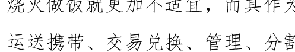
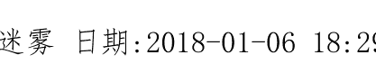
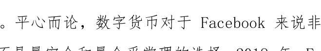
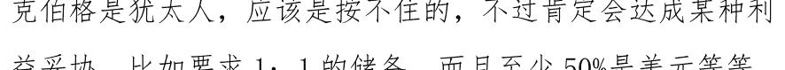

# 虚拟货币的秘密，兼谈比特币的未来和各国的战略布局...

东云迷雾

## 货币的货币价值和非货币价值

任何一种货币都有其货币属性和非货币属性。这两个属性分别对应了这种货币作为货币的价值和作为非货币的价值，简称为货币价值与非货币价值。比如金银，除了了作为货币的价值，它们还有作为工业、艺术原材料方面的价值。而从整个人类的发展来看，古今中外出现的各种货币，虽然琳琅满目、数目众多，但各种货币依次出现的规律是：非货币价值不断递减，而作为货币的价值却不断增加，而且跨度越长，这个特征越明显。

以中国为例，从古老的作为一般等物的粮食，发展到来的海贝，贝壳非货币价值就是在递减的，而货币价值在增加。而且人们很快发现，想要一个称称的货币，直接使用自然界自然形成的东西做货币，是远远不够的，必须自己对其进行加工，才能尽可能提升其货币价值，于是铜贝应运而生，这真符合意义上的货币就出现了。不过人类发现这仍然不够，于是货币的各种精细加工不断出现，这种不断的精细加工就是通过人工设计力来提升其货币价值。

当发现精心设计铸的金币银银之类依然满足需要之后，人类开始明白一个道理：自然物品做货币，其货币价值往往被其天然具备的非货币属性所束缚，无论怎么深加加工去提升都是有限的。要一种货币拥有最好的货币价值以满足需求，就必须完全脱离自然物品的依赖，完全由人类自己设计打造，并尽可能降低其非货币价值才能最终使其货币价值最大，于是纸币诞生了。纸币是一种神奇的货币，其货币价值接近于0，烧火做就不合适，而其作为货币的价值却巨大，运输、交换灵活、管理、分割、计量、均衡性等等远离人类的任何一种货币。而且纸币也不虚，自诞生之后，人类社会的经济发展一日千里，这其中纸币的优势是无可置疑的。

现在，在人类的考虑已经是这样带有哲学意义的问题：货币是否真的需要一个可以接触的实体作为载体，是否可以完全脱离有形实体，不被任何其实束缚，从而最优的货币属性、最大的货币价值和最低的货币成本。

为什么会这样？有人观点认为，原因在于交易的发展，交易的模式、品种、内容、数量、交易的距离、面对的客户群体等等都在不断发展，而引起了对货币提出的要求。而货币一直是交易，整个人类的历史，就是一部经济发展史。不是发展，不是交易，经济的所有方面都会对货币提出各种苛刻的要求。

满足这些货币繁复且极苛刻的要求，就能逐步放弃对其非货币价值的追求，甚至完全放弃其非货币属性，而竭尽全力去提升其作为货币的价值，这就是人类社会发展过程中货币形式不断变化的本质。

网友提出的这样的“观点”：“货币和劳动有个毛钱关系。”现在我们可以谈谈这个观点了。这句话原则上是正确的，但却还是没有破窗户纸。正确的说法是：货币的支付和劳动基本相关，而且这种正相关越相关越健康，但货币本身所包含的劳动，则是生产该货币的成本，应该在保证货币价值尽可能可能的情况下，越小越好！更白一点说，如果货币保证了尽可能可能的价值，就是为了经济因素。例如新币的发行提供了各种可能的动力，这种货币中劳动的动力则是在获得该货币时所付出的成本，这个成本然而越小越好。

当今社会已经进入信息时代，以互联网代表的新技术影响了社会的几乎每一个角落，这种有明显网络特征的经济，又怎么不可能对处在核心位置的货币方面提出的要求呢？数字货币/虚拟货币就是满足这种新要求的探索。其无形无相但拥有海量的特点使其很具有超越预想的货币价值，因此不能单纯认为因为它仅仅存在于计算机网络上的数字，就否定其价值，否则今天的我们可能重复中世纪欧洲人的笑话，说当马可波罗将从中国（元朝）带回的纸币交给欧洲的高官，声明在中国这种小纸片每张对于经济上的10个金币时，后者对其无嘈哑之鼻...

作者：东云迷雾 日期：2014-05-01 00:20

## 二 互联网时代的货币

上一节我们说到这个时代对货币的新要求，毫无疑问，总的要求一定是利用目前掌握的技术手段，来实现最优的货币属性、最大的货币价值和最低的货币成本，以满足在各个领域的要求。人类自从活动以来一直都在在这个目标上努力。那么虚拟货币/数字货币通过哪些创新，体现了最优的货币属性、最大的货币价值和最低的货币成本呢？

一项加入：虚拟货币/数字货币对经济方面都是巨大的影响并且可能产生巨大的变化，其中第一个最容易理解的就是无流通或简称无流动。无流动意味着，所有的交易也不需要数钱找零，也不需要防钞，再也不需要投入人力物力研发高精尖的钞票防伪技术，再也不需要投入特殊的纸张油墨和专门的印刷机械以及各种钞机，再也不需要IC卡和刷卡设备，也不需要存款，也不需要取现，也不需要去银行排队，也不需要看银行脸色，终于轮到你了。

甚至也不需要银行点，再也不需要监控，再也不需要各种的监控头和监控设备，再也不需要ATM机，也不需要每天荷枪。电子钱包的安全性，即便走钱包也无法使用。因此单纯的钱包没有任何意义，甚至街头上的抢劫都会大幅减少，平常会好很多。

许多管理，尤其是财务方面的工作都会从琐碎中解放出来。千万不要为了这些看似微小的，此前我们还不知道的余额，其核心就在于某种程度上借了。

所有的财富由于毫无出路都被锁在口锅里，某些人则吃得不亦乎……某些人则吃得的。

完全货币流通：随时购物、随时消费、随时理财，而无需任何操作，无需找零，省去了所有银行点，然后将剩余钱返回用户，对单个用户而言结果很明显，假如数量达到一定级别，比如多给余额几年，让其依托淘宝和阿里充分发展，尤其当越来越多的企业把工资直接接到余额或者...

黄金没有成为货币，一个重要的原因就是它稀少。不能凭载当今社会如此大的流量，比特币同样有着先天缺陷，至于更何况黄金，所以比特币没有有望成为货币。黄金的致命问题在于，它不能向下无限分割。所以稀少就是一个巨大的问题。比特币不存在，因为可以向下分割，哪怕全世界只有比特，只需要分割到小数点后无限位，虽然会有不便，但是因为计算机自动进行分割和计算，所以理论上仍然是行的，黄金就不行了。当然我说比特币就没有缺陷，实际上它有一个致命弱点，但如果我能找到并正确应对，那么它真的有可能完全取代。提取很多，目前银行的应对是有问题的，将可能帮助比特币达到这个目的。

作者：东云雾 日期：2014-05-01 15:02

再译一下... 作者：东云雾 日期：2014-05-01 16:09

## 三 货币霸权

谈到货币，就必须谈及信用。经常有人说信用是数字货币/虚拟货币的硬伤，因为没有机构对其背书，所以其价值难以保证，而货币最大的好处就是有强大的政府做背书，因价值有保障，真的是这样吗？大家有没有想过为什么国家政权要为一个货币背书，是出于良心吗？是出于正义吗？是出于道德吗？显然不是，每一种现象后面都有利益！没有任何人会平白为东西背书，国家政权更例外，之所以会为一个货币背书，只因为背后随着极大的经济和非经济利益，甚至是肆意掠夺的权力，对古今中外的任何国家例外！并列国家是一个阶级压迫另一个阶级的暴力工具，大家可以品品其中的味道。

这里有一个真实故事：http://news.sina.com/cn/s/2014-03-09/20272981085。 网页显示是宝鸭的刘先生22年前在某银行存了100元，时隔22年，现在这笔存款到了多少？经过银行核算，加之通胀后，变得好一点。值得一提的是，这并不是是刘先生的问题，而是刘先生那时存下的财富全部都被相同比例掠夺了。每一个普通工人，包括工程师和高级工程师，一生拿到的只有一个月月的工资。

千万不要为了这些微小的，此前我们还不知道的余额，其核心就在于某种程度上借了。所有的财富全部都被相同比例地掠夺了。

这种现象，是。

 货币霸权（继续）

对货币有了了解的人就会发现虚拟的，很多。这种趋势是不可逆的发生，因此大家其实在寻找一种方法，希望能对抗这种货币霸权。现在在土国家上下，包括所有体制内几乎都有一种非常明显的焦虑，都在急迫地寻找一种与其说发财或理，不如说是保全自己财富的方法。如果过去十年财富的唯一风港是房产，那未来还是吗？网上随处可见类似“未来十年最关注的投资领域”之类的讨论，其根本在于面对货币霸权的焦虑和恐惧。美国人也一样，美国目前的人均现金存款率比中国人低，是因为他们穷，实际上美国人的各种金融资产是中国人的32倍（央银行2010年公布的数据），这说明了什么？仅就美国的投资业发达？

数字货币/虚拟货币正是在这样的背景下出现的（虽然其大家所熟知，仍然是有特定的因素因素，这一点在下一章再读）。这种基于计算机网络，不依赖于任何有形实体的无形相反却有数量的货币，通过一种新货币形式，全流通方式和创新的信用模式，提供了一种确实可以在一定程度上打破了有货币霸权的有力手段。

这种货币在信用领域的创新在于，终结了以往货币从一个超级机构进行背书的历史，通过一种分布式背书的信用形式，在最大程度上避免了被超级机构通过单一背书进行操控而获得并使货币霸权。

具体来说就是：不需要超级机构对其背书，而是每一位小店家，小公司，甚至个人，都可以凭自己的产品和服务，接受数字货币进行的支付，来对数字货币/虚拟货币背书，其实这样的过程已经在各地开始了，只是还没有大量蔓延。一旦这样的小店、小公司、企业，人达到一定数量，就会在整个社会形成一种共识，使得普通人和普通机构都不构成整个体系，也就是所谓的去中心化。

同时发行，“推”的方式（如发行），“拉”的方式，使得货币发行更加透明和公允。实际上如果说货币流通仅仅是成本高，那货币发行就可以多了，如果房子可以，那货币发行完全是模式了。

很多时候只睁眼闭眼，至于国内一般商店都只收自己的货，其他店的毫不放心。而社会大动荡的时候各种问题很多，而偏偏这时最需要。以往兑换贬值也算一种办法，尽管同样面对美元贬值，不过随后由中国高高金融团队想出了一个软币对外贬值对内值的超级做法，导致其靠兑换美钞贬值已经彻底行不通了。是否黑市，是否伪铸，是否方便于存储、携带、变现，交易都已经不重要。于是在某国，所有的财富由于毫无出路都被锁在了一口锅里，某些。

毋庸疑，货币霸权每时刻存在，分割每时刻发生，因此大家其实在寻找一种方法，希望能对抗这种货币霸权。

由此可见，法币背书从其诞生开始就很免费午餐。甚至可以说，几乎所有政府对其背书都是伪善，在这伪背书之后隐藏的，几乎都是面容。古今中都是如此，尤其是当社会动荡的时候，比如常凯什与前苏联的那段日子，这种背书近乎毫无意义。

作者：东云雾 日期：2014-06-03 15:57

<!-- no content --><!-- no content -->

反复再讲，现在三多万的价格似乎提高，其实是低的不可忍的。比特总量只有 2100 万，再加上一些丢失和遗忘，这根本就不应该是全球每个人都能买得起的，可在这个价格，基本上中国每个人都能买得起的，这本身就不正常……

作者:东云迷露 日期:2017-10-25 18:37

前面已经说了很多很多，所有比较简单的问题我就不回复了……

作者:东云迷露 日期:22017-11-14 11:30

@经济财经 2017-11-03 21:18:35
需要经过审核才能显示，我该装了!

一手教程/1101284955...拦截后获取更多帖
熟悉，好在这里从根没有开始，来未来会越来越精彩的……

作者:东云迷露 日期:2017-11-14 21:12

是一必须要写的，可似乎很多人对这些都比较重要的内容感觉兄，已经有人多次提出要我分析一下山寨币价值和未来的发展，目前甚至直言不讳地提出对 ETH 和 ETC 哪个更好看，还有朋友对目前比较红的 BCH 关注想要我预判一下 BTC 和 BCH 未来的发展等等等等，这些内容是有分量、很有价值的，有可能给读者带来万万、十万乃至更多的收益，因此我可能要付费内容，不知道各位是否有心理准备。

我的这个帖子在 14 年发布，当时看了并且信了，应该少赚了二十倍吧，现在稍微回报一点应该也不算过。当然这么做更重要的是为了公平，看着这个帖子的，有一些是真的是相信，有些只不过随便看看，显然付费的肯定比随便看看的对我更加信任，因此我也应该给他们写一些更重要更有价值的内容，或者肯说得更明白一点，收费不是为了赚钱钱，是为了区分，区分那些更信赖我的……

作者:东云迷雾 日期:2017-11-16 22:25

不能回复了？
作者:东云迷雾 日期:2017-11-16 22:25

之前回复好几个帖子怎么都发了？
作者:东云迷雾 日期:2017-11-16 22:27

为什么你觉得这个分析不错好，其实这个分析很糟糕，我的处理加密Java110128495防断币比卖获取得多帖子法很美推销风格，很容易让人以为是比特币和数字货币是推销……
作者:东云迷雾 日期:2017-11-17 19:51

呵呵，前面已经说过了因为前面的种种已经非常详尽，这些对于简单的问题我就不多讲了……
作者:东云迷雾 日期:2017-11-19 01:14

呵呵..
作者:东云迷雾 日期:2017-11-19 22:43

@你和我宇宙 2017-11-19 01:34:54
最近听说央行发行数字货币，目前，各种山寨币层出不穷，而且混得也不不错，央行凭借大的技术实力，还有其权力，将来的是否可以超越比特，甚至取代比特高点的，

其实本楼中主宰的文字是“虚拟货币的密码”初稿中的一小部分，在这个“虚拟货币的密码”中我不单单分析了虚拟货币的特点，比特的优点，以及未来可能的巨大威力。还曾经提出过一个有些粗糙，但非常完整的战略策略，国家是要在这个计划基础上做调整，尽快制定并实施自己的虚拟货币策略，完全可以占据整个数字货币制高点，占据了这个制高点也就占据了未来的世界金融经济的制高点，极大地促进了国家发展和民族复兴。我在提出这个计划的时候，甚至在战略旁边写道：“锐利的虚空”！

如果在2014年亲手实施计划，现在的中国真的就一样了，乾坤大数据和数字货币森林体系（我非常详细地分析这两部分内容），就很可能朝着有利于中国的方向成型，比特币会被中国彻底控制，要么被另一个中国主导，看来现在一切可能了，太晚了，除非内部出现巨大的内斗和分裂，否则外部力量能够抗争……
作者:东云迷雾 日期:2017-11-19 22:46

有关部门甚至可能，我曾多次强调的：“尽早收集筹码，以备不时”都没有做吧。我现在是否已经建立的国家数字储备机制，如果现在还那我真的只能说，呵哈……
作者:东云迷雾 日期:2017-11-23 18:19

可以，正准备写相关内容，不过这些含金量高的收费，当然不会很高，大约100-200 元左右。真正收费的是货币战争方面的……
作者:东云迷雾 日期:2017-11-23 18:56

@公民权利 2013 2017-11-23 18:41
楼主，我想问一下，除了比特币，还有哪种虚拟货币觉得最有投资价值。谢谢。

对这个问题如果你只想想要简单的观点，其实完全可以仔细看我写的主贴和各回帖，里面字里行间都写过了，而且都是免费的。如果你想看比较详细的论述和经过细细梳理、归纳后的结论，尤其是如果你还知道这些结论的去向，请看付费贴。

我能确认的是，这些付费贴都是原创的干货，只在天涯发你不可能在任何其他地方看到。此外前面还有不少网友看过之后的感，你可以仔细看……
作者:云云露 日期:2017-12-03 22:54:20

@云云露 2017-11-30 22:54:20
下面就看这一波能否低到5万了，就能仅仅是卖房。不过那些在7万4场的也根本不需要担心，要不要多久就会涨上去的，我个人觉得最多一两个月吧，明年这个时候你自己会对自己说服五体地，居然在7万4这么低的价位盲跟，而明年在30万一个价位买的，当然对的，只不过他们恐怕必须等到这个时候才能服自己了……

所以数字货币可以说“当下进场永远都是正确的”，当然要寻找最优时机只能等类似的大跌，而遇到这种时候需要运气成分更多……
作者:东云迷雾 日期:2017-12-01 18:21

数据加微信11101284955获取更多好帖
@罗月如茵1111111 2017-12-01 05:49:33
楼主有微信吗，
有，不过暂时对付费帖子的朋友开放，当然如果你有什么问题的话可以在这里提，或者短信也没问题，我争取尽量回答……
作者:东云迷雾 日期:2017-12-03 22:09

@cjld188 2017-12-02 21:38:15
楼主的文章放着也是放着，就便宜卖了吧，这样也是一个成就呢，就是为了大家和社区做贡献。看网的网名，也是多年为中国的自由民主人士发声多年的，为了什么，也是为社会做贡献，体现自己的价值。当年在天安门广场也是通常没有睡觉的。知识本身无价，但国人花表面上的高价知识的习惯还没有建立，却是不是一天可以改变的。不是付不起，还是观念需要时间去。谁让我们中国人呢，楼主认为我

好真的不能改价格，似乎天涯的帖子都不能做改。不过也不用担心，我会继续写的，相关内容会在以后的帖子里贴出来，以后的这些帖子的价格我会尽量低一点。另外大家有什么问题，欢迎提出来，尤其是你，随时欢迎提问，这样我写的时候更有针对性。

再说一下眼的市场，有消息称机构即将在进场，从种种情况来看这显然不是空穴来风。虽然很多人觉得价格已经很低，但我认为涨幅没有开始，机会将大举场，涨幅不算开始。
作者:东云迷雾 日期:2017-11-28 19:50
作者:东云迷雾 日期:2017-11-28 19:56

这可能只是笑话，难道是一个投资者的坚持，绝对能帮助大家在圈中迅速做出决定，让人生少走弯路，绝对是超值的……
作者:东云迷雾 日期:2017-11-28 22:18

说到房价，欢迎去另一个主题：这是我在帖后发的唯一主体，也是一个神贴，在2016年月初预测房地产限购政策的出台，并精准预测限购将越来越远。
作者:东云迷雾 日期:2017-11-28 22:40

任何时候总有人说进场太晚，任何时候总觉得现在的位太高，任何时候总希望等跌了买。这种机会确实不多，而且我个人的观点是，在可见的未来没有任何事情让比特币持续低迷，所以各位的资金能耗半年，无需任何担心，当然我不建议各位借高利进场。

这可能只是为了说明问题，解决所有困惑……
作者:沫云雾 日期:2017-11-29 23:32

数字货币领域的经典……
@vernonhill 2017-11-29 22:58
非常感谢你的贴子，很可惜这么晚看到。感谢你刚才付费看了，很高能让你有所裨益，或许我提醒一下，现在看到真的一点都不晚……
作者:沫云雾 日期:2017-11-30 14:56

大家可以回去前面，9月7日，我发帖声嘶力地宣称卖买的时机第一次出现时市是多少，现在是多少。
作者:沫云雾 日期:2017-11-30 22:54

这是一个相对比较简洁的，仍然实在的干货，相对于而言，前一个倾注了我更多的心血，更有价值。看着第一个收费贴无需再看第二个收费贴，如果自己稍微有些基础，基本上对数字货币的未来发展有了然于胸的感觉。这两个帖子中的任何一个都足够大家在两年内翻倍，十倍甚至更多，并帮助大家避开很容易掉的投资陷阱。
作者:屯云零 日期:2017-11-28 18:51

其实我知道，只要我坚持，或者稍作说明，应该是两千的。不过，我要感谢你这么支持我，所以我看看天涯是否能够修改吧。
作者:屯云零 日期:2017-11-28 19:18

这是一个相对比较简洁的，仍然实在的干货，相对于而言，前一个倾注了我更多的心血，更有价值。看着第一个收费贴无需再看第二个收费贴，如果自己稍微有些基础，基本上对数字货币的未来发展有了然于胸的感觉。这两个帖子中的任何一个都足够大家在两年内翻倍，十倍甚至更多，并帮助大家避开很容易掉的投资陷阱。
作者:屯云零 日期:2017-11-28 。

@公民权利 2013 2017-11-28 15:25:27
楼主的文章放着也是放着，就便宜卖了吧，这样也是一个成就呢，就是为了大家和社区做贡献。看网的网名，也是多年为中国的自由民主人士发声多年的，为了什么，也是为社会做贡献，体现自己的价值。当年在天安门广场也是通常没有睡觉的。知识本身无价，但国人花表面上的高价知识的习惯还没有建立，却是不是一天可以改变的。不是付不起，还是观念需要时间去。谁让我们中国人呢，楼主认为我

这位兄弟恐怕暂时还不能算真的老夫。不过才半年能够做到这种程度，绝对也是相当有天赋的了……

作者：东云露 日期:2018-01-02 16:46

有个故事我必须说明一下，之前本来答应@公民权利：
2013年，将 170 楼那个 2 千元的帖子降价到 1000，然后重新贴出来。

不过前两天有两个高端用户，花 2 千元购买了这个贴，而且他是一出手就直接选择了这贴购买的，并且在看帖之后，还主动联系了我，要了我的微信，并主动加了我，这无疑是对我的极大支持，我非常感激。

而且，这个情况让我不得不改变之前的决定，因为现在再降价，虽然对这朋友不公平，所以请原谅我不贴，不贴才能涨价，防止被获取更多帖子。

但同时必须强调的是：我这边对公民权利2013的承诺依旧如初。如果公民权利2013还想看这帖内容，可以跟我联系，我们通过另外的方式单独私交付，我会直接把这帖内容完整地给给他。

最后再次感谢所有支持我的网友，祝大家在新的一年里，身体健康，快乐幸福，不仅有财富的增值更有知识和见识的提升！谢谢你！

作者：东云露 日期:2018-01-02 16:55

关于数字货币的一些讨论，我始终是小心翼翼的，因为有些内容稍微深入，稍微展开，就有可能触及到一些非常敏感的内容，所以不得不小心翼翼。

不过有些东西如果不说透，又仿佛如锥在喉，所以我接下来想试着发些有些敏感的内容。这些内容因为涉及到货币与金融的底层，因此会偏学术一点（我会将其转述成大白话，就像我之前的那些帖子那样），但相关内容都是原创的，并且是惊世骇俗的，毫不夸张地是彻底颠覆了整个金融界以来延续多年的领域，被所有人（是我说的是所有人，包括几年前的我）奉为法，视作天经地义。此非无他的根本性的观点，此一方面由于专业性极强，又一方面为了避免造成不必要的麻烦，打算用收费贴，不知道会不会有人想看...

一手理：加V:110124955，断更并获取更多好帖。
作者：东云迷雾 日期:2018-01-02 17:07

这部分内容将帮助大家从更深刻的角度理解包括比特在内的所有货币的内核价值和内涵，对金融领域的专业人士，尤其是学术相关的专业人士尤其有价值……

作者：东云迷雾 日期:2018-01-04 21:20

@波比小可爱 2018-01-03 19:16:08

楼主快点出吧，我一定会支持。

多谢多谢，呵呵，既要保证质量，同时还不踩红线，容易啊...

作者：东云迷雾 日期:2018-01-04 21:10

前面经济热门的：1.中国退出了比特币交易市场？2.比特币交易退出中国市场？哪个正确？对这个问题，我前面的内容其实已经做了回答。

我前面54楼曾经写过：我个人坚定地认为所谓封杀数字货币的行为没有任何可能取得成功，如果执意要做，其所有措施能够得到的唯一结果就是：花费大量人力物力财力，发现非但没有封杀数字货币，反倒自己被数字货币给封杀。

俄罗斯说这个倾向，但很快便醒过来，现在有消息，正大举购买比特币，投入到扩大矿产，而且在多个领域铺区块域名，而且还有消息称折算加密货币，所以现在我打算在前面54楼的基础上再补充一下，让它更加完善：加v1101284955，防断并获取更多好帖。

任何封杀数字货币的行为，都将被数字货币封杀...
任何拥抱数字货币的行为，都将被数字货币拥抱...

作者:连云迷雾 日期:2018-01-05 15:12:39

@baiyijackson 2018-01-05 13:52:39

楼主你好，我已经付费了两个贴，认同你的观点，请问目前有什么可以安全交易的比特币网站，说国内关闭了交易，但是为何像火币网就可以使用？不知道火币网安安全？

你好，多谢支持!

火币网之前一直是比较安全的，我自己已经在火币网就有账号。只是在去年境内禁数字货币交易平台之后，直接进行数字货币和法币之间交易的场内平台已经没有了，目前各大平台都转向了海外，而且把服务器搬到海外，依然只做比特币交易和场外法币交易，这种交易平台我暂时没有用过，所以没办法给你确切的建议了。但总体而言，火币网应该比海外、比 B 网、P 网之类的靠谱一些。B、P之类之前有很多网友说遇到过各种不快，甚至还麻烦。对于海外网站来说，火币网还是比较靠谱的，至少目前暂时还没有听到什么抱怨，而且买入的价格仍然比海外更低。

另外，我自己确实很想找一个有交易量、并且支持人民币与比特币、ETH交易的场外交易，并且同时接受比特币和ETH充值，支持比特币场内交易的平台作为自己的首选交易平台。不过目前为止仍然没有找到，如果大家用过这样的平台，并且感觉还不错，欢迎推荐。

作者：屯云迷语 2018-01-05 15:55

楼上网友的这些，看着好像像那样的其实都是是而非，都是根本不存在的问题，我在本帖前面其实已经重遍了，要学会忽略一些尽量极端，但其根本无所谓的问题。

这种问题其实任何时候，在任何领域都存在，但不管在什么时候，无论是数字货币还是生活、事业上，都要学会忽略这样的问题，否则不仅自己会非常，而且最要命的是是有可能被大量这样的问题困扰，影响了更重要的事情。

前面这位网友提到的这些，粗略了一眼，甚至都算不是那种存在但并不重要的问题，几乎都是一些不存在的问题，真心没多少回答的答案。如果这些问题逐个出来，诚恳请求，或许我心情还可以，免费帮你，改变你的认知，把你拉进这个大潮里，现在这样，呵呵。我完全可以买，可以进场，就用火币吧，火币应该比海外市场更靠谱。

作者：东云雾 日期:2018-01-16 18:29

@强子 2018-01-07 19:28

楼主太厉害了，如果早在半年年前看到这个贴就好了，当时在做分盘，当时是比特币为中交易的，7000-8000的一个随便买，可惜都将比特币换成人民币，最终购买卖出，崩盘，资金全亏完了，还欠。现在的比特币都两万一个了？财运。我想一想，当初拥有十几个，怎么没有早点看到这个贴呢？财运。

实在是佳。客气了，不过我要再次强调，现在也完全晓得……

作者:东云雾 日期:2018-01-11 00:23

@强子 18 2018-01-10 23:56

前几天成立的数字资产网站，据说是国内第一家国背景的。现在还没有正式交易，请问群主怎么看？无论是从数字货币发展的角度来，还是从国家的角度，或是从自身利益角度，都要注册！一手教你如何注册101284955，防断并获取更多好帖。任何封杀数字货币的行为，都将被数字货币封杀……任何拥抱数字货币的行为，都将被数字货币拥抱……

大家可以去筹钱，大家尽快恐慌。顺便说一句，这绝对是非常的事，看看这几个大平台对此解释，对比一下现在的市场，大家可以琢磨一下，这是啥意思，接下来应该发生什么……

作者:东云露 日期:2018-01-13 15:53

@轻舟二 2018-01-13 05:58

老大，EOS 怎么样？你是投资还是投机？

作者：东云露 日期:2018-01-15 02:02

@强子 18 2018-01-14 11:26

数字资产交易家里没有主流币，其余时间也不是全天交易，这样限制怎么吸引人气？另一方面，如果确实如你所说，那个官方背景很可能是真的，只有官方才能做出这种事情。如果民间乱奔，那就会被笑死的……

作者:东云露 日期:2018-01-15 14:44

那一年金融政策定性之后，没有大规模清洗，我就觉得应该还有，等消息确认之后再来写些东西吧，这些东西，可真有点吓人了……

作者:东云雾 日期:2018-01-17 22:52

@一set亚浊 2018-01-15 37:59

如果场外交易被关闭，怎么变现？有什么方法换回人民币，请高手解答。我个人数字货币迎定的五个阶段分别是初期、早期、发展期、繁荣期、稳定期……初期的特点是价格极，但风险也极其巨大，所以没有必要去靠近那些早期进入的。早期的特点是价格较低，风险较大，目前是早期的末尾。

我原本以为，在早期梭哈的机会基本上没有了，但现在看来，雷锋从未离开我们。目前比较遗憾的是韭菜比之前几次都要淡定，所以接下来的还会继续上几天，不排除有进一步更严厉的措施出台，但这些都不是在帮大家带来降低风险。希望韭菜们尽快恐慌。至于最终出手的具体，大家各自把握罢……

作者：冻云雾 日期:2018-01-17 23:00

通常，我是从不建议大家搞高低吸的，因为很难把握节奏准，十次里面一般可以做到六次准踩，但接下来的只要两次失误就会亏掉六次赚到的利润。所以炒的、玩儿高抛低吸的，偶尔单次有人很精彩，但从一个较长的时间来看，他们都是错的，都是手中的币越来越少的。

习主席说，房子是用来的不是用来炒的，这里面哲理很深。我觉得同样的道理似乎也完全可以用在数字货币领域，呵呵........

作者：冻云雾 日期:2018-01-18 01:12

> @一壹虚虚 2018-01-17 23:47

分享一段今天看到：在这里看到过几个人的看法：
- 1. 区块链这种新技术是不会被杀死的，任何东西都会经历过程，跟互联网一样，但是趋势不可逆的。
- 2. 我们也不是第一次经历了，在9月号的大地震中，很多人你们自己清楚，但是最终市场会给答案，现在的探是为了未来的上涨。
- 3. 加密货币就像打不死的小强，所以不要担心。
- 4. 我们可以看到这次的监管，所以大家加以区分，一定是没有真的币种。那么请你换到更有意义的币种。
- 5. 市场尘埃落定，账户需要实名制，以及做好资金准备，相反国内的一些不是真实的，，各种漫天飞，瞬间价格就下来了。
- 6. 关于跨市场交易不用担心，到时候就会很多时代的产物继续诞生。看到谁会动，只会想办法进场，因为法律是没有办法挡。
- 7. 在这个时候还是提到，要守好你们。多年以后你会发现现在拿的都是便宜的筹码。在一念之间，这种时候就是不动，一旦动了就是猎物。这是真正的老鸟，如果可能，希望他拉进这个帖子，大家相互碰撞一下，应该会有火花出来。

全球数字货币最后一次梭哈机会，即将到来……加v101284955，防断并更多。

作者：东云雾 日期:2018-01-19 17:09

唉，这哪跌得啊。就两个雷锋，全世界都在捡便宜货，自己ALL IN也就罢了，而且还撑着嗓子，搞得投资人都跟着，这样下去，雷锋全会被坏了。我觉得比较省事还是出一个数字货币规定，胆敢持有任何货币的，一律地决！胆敢从数字货币交易的，一律满斩！胆敢提供资金服务的，一律诛族！胆敢建交易平台的，一律诛族！

作者：东云雾 日期:2018-01-23 18:51

一对数据如加密X101284955，防断并获取更多好帖……

作者：东云雾 日期:2018-01-29 17:27

关键是大家都不惊慌害怕了，即使是最嫩的韭菜，这确实比较麻烦。

作者：东云雾 日期:2018-02-01 21:33

多谢领航！只是我个人不太喜欢热闹，所以是给别人鼓掌了……

作者：东云雾 日期:2018-02-05 19:41

梭哈！梭哈！！梭哈！！！

如前，我个人数字货币定义的五个阶段分别是初期、早期、发展期、繁荣期、稳定期……我原本以为，在早期阶段梭哈的机会基本上没有了，但现在大家早期阶段最后一次梭哈机会正式来临！

当前的价格：

| 平台 | 人民币价格 | 美元价格 |
| :--- | :--- | :--- |
| Coinbase | 47697.99 | $7632.26 |
| Bitfinex | 48252.32 | $7677.50 |

大家可以把房子卖了，把车卖了，把所有的卖了，甚至身上所有的东西，包括鸡蛋，全部卖一样。然后把钱砸进去！这一波暴蹲之后，虽然不能排除再次探底的可能性，最多两个月吧，市场可能在此长期徘徊。加信101284955，防耽并获取更多好帖万一失策！各位务必紧抓！如果我所料不错，人民币计价，比特币五位数价格将永远成为历史，就像之前三位数和四位数价格已经成为了历史一样。它让其他人去缅怀这样的历史吧，我们做的是全力参与每一次历史！！！谢谢大家！

作者：东云雾 日期:2018-02-07 00:22

今天的消息，已经卖了400万浦东的房子，然后一把哈的，哦，相当不错…

作者：东云雾 日期:2018-02-23 13:31

大家新年好！

作者：东云雾 日期:2018-02-25 14:15

大家可以注意一下委内瑞拉的石油，这个东西意义非凡的……

作者：东云雾 日期:2018-02-26 22:48

呵呵呵，石油如果能够成功，那就意味着米帝的美元霸权被拆了一个大口子，接下来俄罗斯的动作一定会更大，以往那种通过美元金融体系肆意对他国进行制裁的日子虽然不迅速结束，但会加速逐渐远离，所以媒体要是对石油还说好话就好了……

作者：东云雾 日期:2018-02-26 22:52

从这一刻开始，区块链、数字市场将日益具体、深刻、全面发展。如101289556，防美国市场并获得多样化，进入国际政治生活中，也将日益具体、深刻、全面进入到每一个普通人的日常生活中……

作者：东云雾 日期:2018-02-26 23:43

整个数字货币市场最近接近一下跌，毫无无疑跟石油的出口国华打压有关，比较有的是，今天人民币日报，突然地发了一个整版支持区块链，跟着市场应声而起，显然有关部门里也不全是审查。在下尽劲勃勃地看了相关报道。

基本规则，如果通过微信的方式让大家可以一次性看帖了，那无疑对天涯这个平台是不公平的，我肯定不会这么做，也不存在这种事情，过去没有，现在没有，将来来也不会有。

大家如果想看付费贴，要做的是先充值自己的天涯账号，然后确定一下自己看哪一楼，然后针对该楼付费，然后可以看了，每一楼的主题和具体内容都是不同的，因此价格往往都是不一样的，大家一定要先准确定好。

为了帮助大家，我在每个付费贴后面都有相关说明，介绍其内容，方便选择判断。由于这部分程序开发是天涯方独立完成的，因此操作方面大家还可以咨询天涯版主。

作者：汤云云雪 日期:2018-03-07 21:03

@汤云云雪 2018-03-06 18:53:47
@ 汤云雪 2018-03-05 22:53:16

@1j1110aaa : 当然，每一个付费帖的用户都可以加我微信。这里借着回复 1j1110aaa 网友，我再说明一下，大家付费看我的收费...

------------------------------------------------

@漫步登顶看日出 2018-03-07 15:29:07
谢谢楼主 我之前没放弃 我去试试我可以加你微信吗 楼主。

因为之前已经声明过，暂时只有付费帖的用户可以加我的微信，所以有问题在这里提问吧。否则恐怕对那些付费看帖用户就不公平了。

今后除非我的某个收费贴，天涯发出来，或者出发后很快就会被删除了，就像我之前的回复那样被删除了。在这种情况下或许许我会考虑其他渠道，比微信收费来提供供给用户。

当然大家也不用担心，有什么问题，或者观点或发现什么动向有疑问的，任何人，任何时候可以在这里通过回帖方式提出来，我会尽量给大家一个满意的答复。

再次感谢大家的支持！

作者:添云送 ayrıca 日期:2018-03-11 12:03

楼主好，用了两个时间把这个帖子全部看了，受益匪浅，很佩服楼主的见识。抽时间再看看的付费贴。春节前买了一些比特币，一直在火币平台，昨天火币平台交易登录不去，虚怕一是，不是我申请这个钱包转移到钱里面吗？那个钱包安全方便？怎么转移？我是菜鸟，很多技术性问题不懂，很想麻烦楼主指数一下，非常感谢。

--------------------------------------------------------------------------------

真抱歉回晚了，这几天白天事情多，我本打算上回，这些天天天天都不能晚上回回了，搞得我很被动。将数字货币长时间存放在任何交易平台都是有风险的。

门头和比特币这样的事情在圈内不新鲜，因此应当尽可能转移动到自己电脑或者手机的钱包里。

特别提醒一下，如果有大量数字资产，要尽可能建立自己的冷钱包，也就是用一台旧电脑，或者旧手机安装钱包软件并将数字资产转入，然后这个电脑或者旧手机再也不上网，这种方式相对安全，具体的钱包软件安装和冷钱包设置可以百度搜一下，相关的教程还是不少的。

再说一句，交易现在应该都大在用冷钱包交易吧，比特币的事情我还没有详细去了解，感觉准定不是普通黑客如此……

作者: 云云露 日期:2018-03-12 18:25

一手教程：Java F110128955 防断并获取更多帖好了老V，怎么还没看到？
作者: 云云露 日期:2018-03-12 14:10

@爱在天0涯 2018-03-12 10:46:25
春节前看着您的帖子，陆陆继续投了一百多万了不到20个比特币，平均成本接近7万人民币，我也是从支持自由、默默反抗的角度支持比特币的，而且准备长期持有，永远不抛，赔了就赔了，也是自由和反抗贡献一份力量。

我本来想坚持买到50个，但是最近看了一些其他关于比特币的文章，感觉比特币要取法币真的很难做到，毕竟已经形成了利益分配格局太强大，像比特币这样突然的财富转移，任何组织和个人为维护自己的利……

你的心态是完全正确的，而且非常棒，值得所有人学习！希望所有看帖子的每一个人都学习这种心态，以这种心态进场，稍后时日我保证大家都会有远超自己想象的收获！

这个世界上只要有一个人是你这种心态，就没有任何阻力量可以阻止比特币成为各国法定货币的补充而在全世界流通，虽然现在抱持这种心态的人只有万分之一，但可以肯定这样的心态的人只会越来越多，因为一个人一旦明白过来，就不可能再次重新回到过去，再将寻里胡涂的日子，而且还会这种方式影响其周围的人。

之前的很长很直都被天选择了，所以暂时只能这样多了，欢迎你常来，多发帖！

作者:沈云露 日期:2018-03-13 20:47

一个不太好的消息，从这几天的观察，花街为石油以及类似石油这样试图以数字货币挑战霸权的行为，可能会大力打击比特币，一下下跌到多少说，但可能低。此外，各位对流动性有要求的，包括之前在我的建议，相同收益，但有风险的朋友，可以酌情减。一般而言我不是主张做短期操作的，但还是提醒一下吧，有信仰，资金半年不动，无所谓的。

这种变化，这种变化，资金没压力。资金头的可以在低位加仓或者进场，价格可以参考我之前调时的价位，排除这一波跌至低。
作者：东云雾 日期:2018-03-17 14:48

@苍怒的佛 2018-03-17 08:00:26
这种变化，今年买十个比特币，胆大底，年底在看。非常好！希望这样的网友越来越多，这个世界上只要有一半人加入，就没有什么利益团体阻止数字货币成为各国货币的补充而在全世界流通...
作者：东云雾 日期:2018-03-19 19:14

怎么我说的贴子都不出来？？一手理财310128955这种更获取更多好处
作者：东云雾 日期:2018-03-20 14:11

刚刚有朋友跟我没点信了，让我确实有些难受。写这个帖子当然不是为了赚马的，而是希望来能像359楼的爱在天涯形成自己的理解和信念。虽然有些用户虽然从头尾看了，对数字货币的价值以及区块链的性还是没有形成理解，基本上只是听了看了其他的观点。所以我能把我的帖子从头尾再看一遍，然后再多思考，思考数字货币在哪里。

另外，大家还可以看看比特币的历史，这次大跌跌幅大于这次，最终都会涨回来，涨得更高，更重要的是认识其价值比之前更是大幅增长。这次下跌会导致自然会，时至今日对数字货币和区块链的各种否定依然是，新发现新，包括专业机构。

还是那句话，当人们明白，想清楚，这种变化，之后他就不可重回到过去种种糊涂日子，因此这样明白，这种变化必定会积累成质，等到回头看所谓的下跌和调整，只会一次...
作者：东云雾 日期：2023-08-20 14:36

一个很有意思的情况是：任何人都不认识区块链的价值和颠覆性，并且欢迎区块链技术在各行业应用。某些人也例外，这些人却唯独拒绝区块链在货币领域的价值，大肆攻击区块链在货币领域的应用，这岂非怪事？其实事实上周知，第一篇关于区块链的论文就是纯货币，第一个被应用的就是货币，第一个大型应用就是货币（比特币）...

作者:连云露 日期:2018-03-20 15:22

另若媒体报道，近日，美国总统特朗普颁布了一项委内拉加加密货币禁令——任何美国人或美国境内人员都不能买。据悉，这是第一个一名总统颁布的加密货币相关的行政命令。特朗普行政命令指出，petro是委内拉总统古洛斯·马杜试图规避美国制裁而采取的一个举措，另外它还宣布所有相关的交易都是非法行为。看了这个报道，大家对数字货币的现实价值和战略价值是否有更深刻的理解？我能和大家说的是，数字货币对于市场，锚性的五年前之前的虚拟货币的秘密之中已经明确指出了，而且仅仅是开始....

作者:连云露 日期:2018-03-25 21:42

@爱在天洛 2018-03-25 12:45:26
楼主好，今天又买了比特币，5.6万，在币法交易。另外想请教下楼主，除了比特币以太坊和EOS有必要买点吗？

----------------

本贴226楼的收费贴就是关于EOS和IOTA的，同时还了一些我个人的分析方法，帮助大家判断一个区块链项目是否具备投资价值。具体在这里就不说了，否则应对不利。

作者:泽云露 日期:2018-03-26 11:49

@公民权利 2013 2018-03-26 08:41:38
抱歉没想到图会这么大，楼主方便的话麻烦把226收费内容发到我邮箱：wutiekun@163.com

非常感谢楼主的帖子带入了这个门。很多年前就知道比特币，甚至想买一把，但很快就忘了这事。关注了，偶然看了楼主的帖子挺醒的，但投资太大随意导致几乎全部亏光。在货币社区培养，增加梦也被骗，哭的：sharex, soc, rnt等等，avh甚至直接接清。确实很无奈，只能吸取教训再逢点钱搞了，本金没了就没有了......

----------------

太让我伤心了，我前面反复反复强调的不要期货，不要杠杆，买好提现，守住比特币和以太，尤其在付费贴我反复反复强调的任何比特币和以太之外的币，包括eos和iota你怎么怎么不听？？？现在手中还有没有，如果有币那怕是寨币，也不要灰心，千万不要动了。将来还是机会。

大家都不怎么说话？大家怎么看？很想再点什么，但我发现大家似乎都不说话？
作者：东云雾 日期:2018-03-26 12:35

@baiyjackson 2018-03-26 13:27
请楼主，像324楼那种机会还有没有？谢谢楼主，可以打开了不用发邮件。
作者：东云雾 日期:2018-03-26 21:05

@公民权利 2013 2018-03-26 19:20
大家都不怎么说话？大家早已发了...
作者：沫云雾 日期:2018-03-29 23:14

@强子 18 2018-03-29 22:31:37
btc的价格最低，324楼说的价格还要低，为什么现在不能够梭哈？因为当时是急跌到，严格来讲在这个价位也没有问题，只是未来等时间可能会长。
作者：沫云雾 日期:2018-03-29 23:19

@强子 18 2018-03-29 22:31:37
沫云雾 日期:2018-04-04 18:51

呵呵，大家怎么看？
我想至少一点是可以肯定的：显然浊唐有了自己的见解了，否则不会这么坚定的...
作者：东云雾 日期:2018-04-05 22:29

其实我前面反复反复的其实已经足够大家判断了，浊唐上面发的两张图从一些侧面做了进一步的印证。我想他也是根据这些印证，越来越坚定的。下面要做的是对自身的判断，如果在一个相对较的时间里，你能承受的压力有多大，某些势力反复打压市场，各位是否能扛住，能多多久？

凡人怕怕，神佛怕怕：莱某抄涨，高手怕跌……
作者：东云雾 日期:2018-04-07 14:29

以前日子太好，不愿意舍很正常，但不是说你不想天亮，太阳就真的出来。对普通而言看着这个机会进场，尽快完成布局，然后耐心等着就行，千万不要像十八岁姑娘出嫁一样，心里七八下，一碗水怎么都睡不平。
作者：东云雾 日期:2018-04-01 01:34

这几天对当前的各种情况和消息做了一些分析，过几天可能会发比较重要的帖子，关于当前市场和未来行情的走势和判断的。总体来说不建议卖房进场或抄底，除非长时间持续而且资金压力大，只是我有些担心的，这贴本来是否会放出出来...
作者：东云雾 日期:2018-04-07 14:18

产生的维护之类的问题。

我感觉西子湖似乎似乎进入了这样一个牛角尖问题，即假如如某一天把全世界 2000 万比特币全部存在了银行，而有个大富豪一次将所有比特币全部借走了，等到他要还本付息的时候，突然发现全世界的比特币都只有 2000 万，本金他还能还但无论如何都找不到更多的比特币来做利息。这个问题真的是牛角尖问题，我都不知道怎么说了，总体来说市场会解决和调节的，完全不会出现你想想的情况。一个基本的做法就是，无论如何可能所有 2000 万比特币都存在了银行进入借贷市场情况，更不可能一次性被借走了，大致会以一种不断流动的方式进行，即每天有人借，每天都有人还，借的借借的都是总量的很小一部分，这样不断向前流动，并维持一种均衡，还有相当数量完全没有进入借贷市场，而在其他的领域使用和流通，随时可以作为补充，因此永远不会发生你所担心的事情。

黄金在地球总量是有确定数量上限的，从理论上说也存在超出之外的利息哪里来的问题，但全球黄金借贷好几千年何曾出现过这种问题？所以你不要再让自己在在一些牛角尖问题里，不是每个人都有热心、耐心和能力来拉你出来的....

作者:东云迷雾 日期:2018-04-22 14:12

呵呵，大错特错了，所有法币的供应量变化都是央行发行，强迫社会接受的。数字货币完全是根据市场供给调整的。没有需求时1万比特币才值一个披萨，需求旺盛时一币一璧，计算机不断细分至小数点N位来满足市场需求，法币不行，只能通过央行宽松收缓的操作来进来，一分钱可能拆成两半，优劣一目了然...

作者:东云迷雾 日期:2018-04-22 19:01

呵呵呀，永远纠缠在某些其实并无意义的牛角尖题目里出不去。我不多说些了，要么自己放弃，要么就付费贴吧，后一种方法更省事...

作者:东云迷雾 日期:2018-04-22 21:41

@东云迷雾 加如101284955-断币获取好帖 呵呵呀，永远纠缠在某些其实并无意义的牛角尖题目里出不去。我不多说些了，要么自己放弃，要么就付费贴吧，后一种方法更省事...

@baiyijjackson 2018-04-22 21:36:02

楼主谈谈这次行情吧，是不是改变之前的看法了？

之前专门发了一贴，天涯不放，我也没看到...

作者:东云迷雾 日期:2018-04-25 00:22

不如来说点别的吧，楼市调控目前似乎开始有某种松动，该不该买房的争论越发炽热。最近一段日子里，三位闲人已经给出了自己的答案。

- 第一位志强大炮：在前的杭州“2018诺亚财富房产金融高峰论坛”上表示，现在正是抄底的机会，只要是限购区域，你就买。
- 第二位奶奶：在上周央财经频道《中国经济大讲堂》中表示，年轻人如果工作还不是很稳定，还在变化、迁移过程中，就不如租一个小房子了。但是如果是说结婚了，并且小夫妻贴上有六个钱包都能用，父母一个钱包，爷爷奶奶一个钱包，姥姥姥爷一个钱包，爱人的奶奶姥爷爷爷奶奶和父母，这个六个钱包放在在一起能够足够支付首付的话，我建议还是买房。
- 第三位管清龙：在4月11日的博亚洲论坛表示，买不起房就多买两套。如果你觉得现在房价很贵，如果你现在有钱，你有这个实力买，就抓紧时间买。因为你嫌贵，以后更买不起。没钱就去借钱，你得去买买不起的东西。

作者：东云迷雾 日期:2018-04-25 23:42

我发的关于房子的消息，包括三位名士的发言，都是已经是大家熟知，并且在网上被多家媒体争相报道的，就这个也要删！

作者：东云迷雾 日期:2018-04-27 19:26

大家应该可以进场或补仓抄了，从种种的情况看应该花街多少明白了一些。我不确定明白到了哪一步，是初步明白了现在的形势，还是已经开始寻求建立自己的数字货币策略，亦或是更新一步……但基本上大跌应该很难出现了。当然不能绝对排除某些人执意要证明自己的愚蠢。所以大家应该可以发动了……

作者:亿云云露 日期:2018-08-27 19:48

顺便再说一句，我之前构想的金融战役，对中兴华为采取的手段其实应该出现在战役的第三阶段，而且形式上应该是完全独立的方式出现，也就是以能够独立的方式出现，并与其他一些毫不相干的事情一起组合攻击，对对手却有着明确的理由，这是整体性行动。现在这种方式，看似对手很弱，同时对方有充分理由予以回应，而不是将其当作独立事件进行回应。

作者:云云露 日期:2018-08-29 00:16

有这种可能吗？有这种就有手段和艺术，而且是各种手段，大家还是凑合吧……

作者:云云露 日期:2018-05-03 12:13

如果消息确认，可以认为某些事情即将开始，花街至少个家族已经明白过来，他们将在接下来的系列中占据先机……

作者:云云雾 日期:2018-05-03 21:56

最近事情不少，除了高盛动作之外，摩根（我留意还是摩根）一方面反复表态比特币是传销，禁止员工购买比特币，另一面则试图获取资金，结果然而而将宣布，前几天意料地被香港驳回。与此同时俄罗斯代表出席一个国际会议时表态：“互联网是美国的，但区块链属于俄罗斯……”

作者:云云雾 日期:2018-05-03 21:58

最近事情不少，除了高盛动作之外，摩根（我留意还是摩根）一方面反复表态比特币是传销，禁止员工购买比特币，另一面则试图获取资金，结果然而而将宣布，前几天意料地被香港驳回。与此同时俄罗斯代表出席一个国际会议时表态：“互联网是美国的，但区块链属于俄罗斯”，而且还有消息，纳斯达克直接交易，最早才开始……

作者:云云雾 日期:2018-05-05 16:49

说菲特再次发言他不会投数字货币，呵呵，像这样的人越晚进场越好，不进场才是最好的……大家记住不要去说服这样的人，因为在这个区块链时代里，你有更重要要做。如果你非要费尽舌说服，那真的说明你自己太蠢了。这也是我最后一次对菲特的话评价。诸神的黄昏，由此而去...

作者:壬云雾 日期:2018-05-08 19:36

@公民权利 2018-05-07 23:10
菲特发完后，世界首富比尔·盖茨表态做空现在大富豪们反应来了，比特币是在稀释他们的财富。他们晚上睡不着，比特币很危险，对这些传统金融的人；

> 王凯：加群101284955，防删并获取更多好

楼主的分析这些大佬们又早一步，哼哼，不如我们一起来聚一下，接下来的会发生什么？以他们的智商会做什么，怎么做……

作者:壬云雾 日期:2018-05-10 00:16

呵呵呵，谢谢楼上小爱的图！

我们在五年前有过一个比较粗略的金融战役构，就是希望中国有关部门用类似的方式压迫并演化比特币，用一个自己主导的数字货币取代之，从而获得未来对数字货币领域的主权，并获得未来全球金融体系的制高点，还将这个架构发布在一个自己的小网站上。

如果那时候高盛之类的花街大佬们认真看了这篇东西，并以此为本开始准备用一个新币去比特币，确实是有希望的，但是动手太晚了，不行。不过，如果不被人吃得舔渣不剩，他们确实必须 do something ASAP....

同时，我非常认真地建议所有本的读者，在这个区块链时代的机遇里，你们绝对不是的应该是简单的看客。我认为每个人应该立即开始自己的金融战略构，或者说更直白一点，每个人都应该开始思考并实施自己的数字货币布局，这个局布局成什么样，未来的目标是什么，收益我是少看你懂的防守！

在这里可以给大家保证的是，在不久的将来，我会写一些决定性的东西并发布出来，你们中的一部分将因此获得财富自由，即使是最信数字货币的人，我也希望你能够拿出3-4千元，开始自己的布局，有可能你会发现这区域几千元，在几年后会变成你笔下以前不想的财富……

作者：东云迷雾 日期:2018-05-13 11:08

就这点小涟漪？？呵呵，你看看这贴是哪年开的贴，这4年币圈风雨雨雨经历了什么，今年这点小涟漪算个P!

作者：东云迷雾 日期:2018-05-18 22:23

@比比可爱 2018-05-17 11:02
高盛刚刚推出新的加密货币很酷，您可以使用加密货币支付从早晨到深夜（或者也许有些不是饮料）。Circle是高盛旗下的一家支付创业公司，昨天宣布它将推出名为USDC的加密货币，基本是美元的数字版本，你可以交易购买真实的加密货币。金融机构发布的第一个加密货币。虽然这种做法与比特暂时看到更确切的资料，不好如下：

- 一、2018年3月，Circle近期在邮件中建议用户为了避免硬币带来的潜在面影响，应该卖掉手中的比特币。
- 二、2018年3月，Circle收购了Poloniex。
- 三、2018年5月，Circle将发行USDT...

有些事情早就开始...

作者:云云雾 日期:2018-05-21 19:03

判断比特币的价值不能拍脑袋，也不能靠那些狗估值模型。我个人倾向于用一种方式大致判断：首先需要计算一下全球总量，注意这个总量是不断增长的而且不断加速，工业革命百年创造的总和以前百年多，看看中国扩张，作为一种世界货币，它的市值必须达到多少？才能满足全球60亿人的需求，然后必须考虑这样一个人类史以来首次出现的不仅意义重大，而且具备极高价值的世界货币，定会有机会进行各项投机操作，在此上述价值的基础上，定还会出现大幅溢价。此时，还需要考虑到目前的比特币价格都是全球不断贬值几乎不可逆的趋势，此外其他因素，综合考虑了上述情况，才能对比比特币未来的价值，因此目前我不建议各位去判断，而且无需如此做。

我觉得，在未来一段时间里，我们都将处于比特以太等数字货币不断的价值发现和确认中，这个过程还是刚刚开始。在这种情况下依据所谓估值模型判定其价值，并没有大差别（数字货币是人类历史以来首次出现的新事物，人类社会之前并没有可靠的类比事物，因此其他事物和无关理论建立的估值模型对数字货币并不适用），所以我之前也说了一个大致的范围。我才了解不多，相对而言，对老熟悉一点，如果有人认识他们，欢迎他们来这个帖子，或许他们的加入能写得更深刻一些...

作者:李云set 日期:2018-05-21 19:03

一手资料：当年有人用1万比特币买入一个披萨，因为他按照目中的某个许可的方法给比特币估了一个值。折算一下现在5万的价格，大家可以自己算增长了多少倍，然后才是刚刚开始。像这种靠直觉，或者靠常识惯判断未来价格高点的情况屡不见，但这次这种判断不要多久就没例外被发现得粉碎。

今天的我们笑9年前用1万比特币买一个披萨的人，十年后的人们是否会嘲今天的我们？9年前数字货币刚刚诞生，没有人能那么快就发现它有多么重要，它和之前人类发明的各种东西有多么不同，可今天，已经有一种精确的证据，从多方面验证并且不断验证它的价值、重要性和独特性，在这种情况下我们今天以某种惯常法对于比特币在内的数字货币进行所属估值是否会在十年后，被当时的人认为是另一个披萨的泡沫？

所以，过去我喜欢：千万不要用“过去”的思维来判断数字货币，现在我喜欢：千万不要用“现在”的思维来判断数字货币……

作者:云雾 日期:2018-05-24 18:13

呵呵呵呵，大家记住上面这个帖子，十年后看看我是不是另一个披萨的……

我之前说过：在这千载难逢的机遇里，大家绝对不是的，我们如果它也不应该是单纯的看。相反每个人应该立刻开始自己的金融蓝构想，或者说更直白一点，每个人都应该尽快开始并实施自己的数字货币布局。

在不久的将来，我会写一些决定性的东西并发布出来，帮助大家实现自己的布局，你们中的相当一部分将因此获得财富自由……

记住我上面的话……

作者:云雾 日期:2018-05-26 00:18

第四回里，肖磊这个回答我是基本上认可的，只是他忽略了另外一些重要的事情。

作者:云露 日期:2018-05-28 17:13

擦，居然删了这么多？？

作者:云露 日期:2018-05-28 22:07

踏实实稳住！千万别跟姑娘出嫁一样，心里起伏忧。

特别强调的是，币市表面低迷，但底下绝对是暗流汹涌，高盛大涛都在各种小动作，俄罗斯一样都有各种动作，大家都在寻求数字货币进行布局。具体大家看收费贴，我不多说了。

再多一句吧，高盛和大涛都在借着币市的低迷，进行自己的布局，从目前出来的情况，主要集中在有些潜藏的交易平台和项目投资，所以如果读者中如果在币圈混的，尤其是自己有相关交易平台或有较高的项目，无论谁来收购者或参股，一定要坚固彻底，毫无地，没有任何底线，没有任何逞地漫天要价!!!

或者左右可以，拖他一年再说。

我个人认为是借着币市的低迷，花街想肥并且做最重要的事情，或者说目前币市低迷，最重要的原因在于人们需要其低迷来避免美元体系出现大的裂痕，并且掩护其在数字货币领域的布局的却是...

作者:云云雾 日期:2018-06-06 11:28

这种打压币市掩护布局，降低成本的行为的表面看似很好，其实更方便了其他的布局。这个其他人数量非常多，包括机构家族个人甚至国家。对这些其他人而言钱真的是钱，对掌控了美联储和美元的花街某些家族和机构

言，钱可是可以随时印的小片纸。因此这种用力打破市，为他人进行数字货币布局创造各种便利大幅降低成本的行为，毫无疑问就是我们前面反复提到的雷锋行为。

这两天的回复里有些东西本应该该的更透，然后放在收费贴的，现在机会还算难得，全都给大家发福利吧……

作者:汤云雾 日期:2018-06-07 16:32

时间的朋友吗？不知道那些连续多年看的人是否真的已经成为了时间的朋友。

我觉得我们现在的做法，包括上面五星上将的做法真正正是做时间的朋友，接下来需要做的就是静心来等。按照你的这个配置和布局，5年后大家一定会明白什么才是时间的朋友。

535 楼
作者：东云迷雾 日期:2018-06-22 00:24
@新生活的召唤 2018-06-21 07:01:12
持币三个月的，路过，支持楼主，相见恨晚。
一手理，加V信1101284955，防更并获取更多好孩子。

538 楼
作者：东云迷雾 日期:2018-06-24 17:32
今明两天我会发个重要的帖子，也许就在今晚，大家记得都一看，免费贴。

来自

544 楼
作者：东云迷雾 日期:2018-06-25 00:34
本贴的所有读者请务必认真阅读以下内容，并尽可能照做：

如果你面前五星上将还是那样，不但已经仓仓进入，而且属于自己的数字货币布局并实施完毕，那么从现在起，数字货币市场的所有风风雨都暂时跟你无关了，与你有关的是至少5年后的市场和币价，你现在需要的首先是过好自己的日常生活，其次是加深对数字货币内涵和实质的理解。数字货币和区块链对这个世界的意义绝非另外一种更好的货币或技术，我们投资数字货币绝对是为了钱，为了了所谓的财务自由……

对于其他人，尤其是那些对数字货币并非没有布局，而且甚至都没有什么想法或概念的人，你只是这本贴的读者，那么我斗胆以本帖者的身份要求大家：每个月从钱包花钱中抽省出一部分，可以是1000或2000元，可以是500元，甚至完全可以是100元（如果你是在校大学生的话）。将这笔钱用于购买比特币。我们有几种操作方法如下：

- 1、每个月坚持买入，一直这样坚持下去，直到其开始猛烈上涨，这时大家可以暂停购买，直到我们强烈提醒大家买入。
- 2、每个月坚持买入，一直这样坚持下去，直到其开始猛烈上涨，也不停止，直到我们强烈提醒大家暂停购买。

这里特别强调的是，如果比特币价格一直在目前这个位阶徘徊，或者即使温和上涨，那么大家就应该什么也没有发生，坚持毫不犹豫地定期买入，当然定期买入的金额可以自己决定，哪怕只拿100元，甚至50元都好，但一定要坚持买入，当然如果你财力足够，自然可以再拿出更多。

而如果你财力足够，同时对数字货币还有一定的理解，那建议你构建属于你自己的数字货币布局，现在的机会实在太难了。

其中的缘由我不想再多说，如果大家想知道，可以从头再看这个帖子，否则只跟着做就好。

其他我不想多说些了，诸如五、六年之后你会发现当初投入的几钱零硬币，现在他人必须等十年甚至更长时间的积蓄来换之，这种事情大抵而且在数字货币的历史上是理解的。很多币已经生生变化了。也许，当你老了之后，别回问起来，在那场人类有史以来最伟大最残酷又最正义的战争中你做了什么，你可以淡然告诉他们：“当年我省了两顿饭……”

546 
作者:添云迷雾 日期:2018-06-26 22:11
前面我反复看到市场表面低迷其实暗流涌，机构特别是某些机构一直在做布局。所以大家应该抓住机会建立自己的布局……
来自自

557 
作者:添云迷雾 日期:2018-06-26 22:23
前天文梵曾公开承认，他手中的比特已经达到1万，就是趁着这段时间市值低迷才顺利完成的，现在又过了几星期的了，估计在奎万去了。国内比特俄多了去了，只不过他们做事更低调，蔡胜胜进圈圈多久。所以我反复强调调每个人都要有自己的布局，当然雷锋也是要感谢的的。

来自

558 楼 
作者：冻云迷雾 日期:2018-07-05 02:05
千千万不要小看了前面五星上的这0.2比特币，市值总量只有2万，考虑到最初的几年开采量最大，但由于数理，加上11101284955，并取得很多好处并不被看好，因此这9年来哪怕零钱被遗忘、丢弃、挖矿、重装系统或格式化硬盘等带来的永久损失的，估计可以达到1-2万。全球人口到今年有74亿。这么一算，平均每个人大约只有0.0025。0.2比特币意味着差不多获得了全球平均80亿人的数字财富了。

而如果未来正如我早就坚信，这时几年也会被越来越越多的专家反复指出的那样：数字货币未来将会是未来人们财富的主要表现形式，那0.2比特币意味着什么就会变得非常有意思了……

所以，每一个本赖的读者，如果上个月已经如我前面的那样，将1000元或者100元用于购买比特币。

561 楼 
作者:冻云迷雾 日期:2018-07-05 21:20
特币，那这个月，请继续……400万这个我感觉有点大，按照这个计算，那0.2比特币就更值钱了。不过个人的习惯还是稍微保守一点。另外，任何时候都要尽量高低吸，玩这个的结果总是玩越少，尤其在目前这个低位的时候。

564 楼 
作者:冻云迷雾 日期:2018-07-14 21:44
一手交易加微信1101284955，防骗并获取更多帖@灾雾11lwizards 2018-07-14 19:08
我真的害怕被封杀，以后套现都难，很多人说比特币只是资金外的工具，完全不必担心，比特币那么容易被封，本来还可以分析一下，但有些话如果说了就被删，所以还是算了。记住不可能被删就行。

567 楼 
作者:冻云迷雾 日期:2018-07-14 21:51
@波比小 2018-07-14 01:27
一方面确实有些事情要处理，另一方面，目前的市场完全不出预料，大家按照之前的执行了，似乎没必要说什么。本帖想写个深刻的，颠覆传统观点的，帮助大家深刻理解数字货币的内涵，并做布局，但又觉得几百钱卖出去太便宜了，大家又喊闹，而且目前确实方便，所以这个贴只好等我再吧。

568 楼 
作者:冻云雾 日期:2018-07-15 00:10
这次说了很有趣的问题，将货币育成数字货币，到底是变现，确实值得考虑。

571 楼 
作者:冻云雾 日期:2018-07-15 13:13
另外还可以多说几句的是，每一个通过数字货币获得财富的人，都经历过低迷和类似这样的，这种时间相当长，肯定也例外。所以我之前叮嘱大家的，各位一定要走心。

572 楼 
作者:冻云雾 日期:2018-07-15 01:14
@灭霸11wizards 2018-07-15 09:26
如果国家疯狂印钞了呢？呵呵，大概是本贴最有幽默的一个回复了，欢迎你常来

574 楼 
作者:冻云雾 日期:2018-07-15 11:46
这个差别太大了。一手数学加微信1110284955，防更并获取更多帖。

576 楼 
作者:冻云雾 日期:2018-07-15 20:02
@灭霸11wizards 2018-07-15 16:33
为什么呢？买房只是你自己某种程度上避免了放水导致的损失，仅此而已，其本身并没有阻止的功效，也不在任何程度上帮助他人免于放水稀释，包括你自己仅仅是买房的那部分资产可以避免损失而已。数字货币则不同，具体我不能多说了。现在流行一种佛系思维，这种思维有其独特之处，但身井，可以认为是一种无奈的最后抗争手段，而投到数字货币就完全不同。因此所有佛系思想苗头的，请务必仔细阅读本帖。另一种深刻的，也容易被割韭的说法：买房并非不能改变什么，相反是用自己的财富支持了一些东西，而数字货币仅仅是在改变，更是在解构、颠覆某些东西……

579 楼 
作者：沫云雾 日期:2018-07-19 22:39
我前两天看到一个报道，里面列了一些数据，说到7月4日全球只有2586万比特币钱包地址，按照每天处理，加上1101284955获取很多帖。个人看到三块钱包计算，大约只有750万到1500万比特币持有者，而且其中有1个比特币的钱包，只有大约56万左右。所以，所有看本帖的读者，如果你们财力够的话，希望抓住现在拥有至少1个比特币，不要等以后后悔吧……

585 楼 
作者：沫云雾 日期:2018-07-21 22:07
@徐徐俊杰 2018-07-21 13:45:14
请教楼主推荐一个安全好用的比特币钱包，考虑到国内可能有一天禁止，我想买比特币，就是钱包不知道哪个安全，还没有国籍限制，硬件钱包可以吗？谢谢。钱包有很多，在线钱包反倒是要慎重，因为依托一个在线平台，而平台的稳定性往往不太好。实际上在各种钱包已经有很多，主流的都是可以的。硬件钱包理论上更安全，但我也不太推荐，因为之前发生过一些事情。推荐用主流手机软件，装在一个旧手机上，做一个冷钱包。

591 楼 
作者:东云迷雾 日期:2018-07-23 14:31
@优佳利 2018-07-22 15:06:10
一手操作，加V防更并获取更多帖。谢谢，已经入，看到30万还不用吧，即30万这个格局也有点小，加强学习，努力提高自己的视角和眼界。

597 楼 
作者:冻云雾 日期:2018-07-24 19:52
近期应该涨，但是牛市来了不好说，看那个SEC是不是批准。

602 楼 
作者:冻云雾 日期:2018-07-28 22:14
现在已经限制了，不过海外的中文交易平台不少，通常都有场外交易。只要该平台上中国用户愿意买入，就可以与之套现。还有一种方式就是去找靠谱国外平台，将比特币卖成美元，然后转账回中国，比较麻烦，一定要小心。无疑会有复杂的认证，包括照片、身份证以及一些报告方面的证明等等，但是走得通的。一方面来说，可以说数学是非常明确的，挡不住，这种渠道越来越方便。同时还要强调的是，无论将来对数字货币限制有多严，未来国内还是会有隐藏的。

607 楼 
作者:冻云雾 日期:2018-08-01 01:34
@五星上将 2018-07-31 13:36
分享：关于数字货币市场的动态，从某种程度来说，是可以预知的。也就是说，无论美国联储等什么时候会释放某种信息，第一步，从强势的角度，上线比特币，这不仅从属性建立了深远的影响，而且从根本承认了比特币存在的合理性；第二步，建立规模的二级市场，其中包括扶持两个国家的交易所。此我基本认同，可以这么说，即使这些通过，明年仍然要通过，意味着更宏大的市场，更多的资金。

613 楼 
作者:汤云雾 日期:2018-08-08 21:51
没啥担心的，严格按照546楼的要求去做，现在的这种波动，根本不需要担心，5年后买了就存了……

617 楼 
作者:汤云雾 日期:2018-08-09 10:46
目前这个价位不要留，而且要适当加大力度

619 楼 
作者：冻云雾 日期:2018-08-09 10:49
说句非常严肃真的话，我现在还是不建议大家买房，但真的可以考虑不用再吃晚饭了，反正吃了也就是长肉。

620 楼 
作者：冻云雾 日期:2018-08-12 22:13
@灭盛：比特币永远回不来了2018-08-12 19:36
【高盛】：比特币永远回不来了在最新发布的年中展望报告中，高盛投资策略团队表示，去年几个月比特币的价格已出现高达45%的下跌，并且可能会出现更大幅的下跌。嗯，在过去的十年里，说过这个话的人不过，再多几个无所谓。回归来说，比特币肯定会回来。

629 楼 
作者：冻云雾 日期:2018-08-14 14:25
不少开始恐慌，呵呵……

633 楼 
作者：冻云雾 日期:2018-08-14 14:25
现在大家应该明白从本帖开始，楼主就几乎只建议大家投比特币，一直都不跟大家推荐山币的原因了吧，包括那些分叉的子币。如果还有这么跌，那或许大家可以稍微关注一下山币了……还是那句话，没啥好心的，严格按照546楼的要求去做，佛系持！每一个通过数字货币得到财务自由的人，都经历过类似的低迷，更何况与以往相比，近期数字货币基本没有什么真正的利空，利好反倒是，而且数字货币至今也已经在相同程度上证明了自身的价值，所以真没好心的……

作者：东云迷雾 日期:2018-08-14 15:52
一手数据加微信1101284955，防断并获取更多好帖。很好！现在在这种局面，谁恐慌谁就是韭菜，能淡定买入说明已经不是韭菜了。严格来说，如果你财力足够，现在应该是用恶狠狠眼神凶狠地盯着整个市场的时候！！！当然，绝大多数普通人我还是建议用淡然的心态对待一切，如吃饭喝水一般淡风景地，按照546楼的要求去做……

636 楼 
作者：东云迷雾 日期:2018-08-16 00:23

# 马杜罗通!!!
638 楼 
云雾 日期:2018-08-16 21:47
土耳其正在努力遏一场持续到本周的货币危机，与此同时，土耳其交易所比特币和加密货币交易量大幅飙。据CoinMarketCap数据，土耳其最大的交易所Koinim报告称，比特币交易量增加了63%，而BTCTurk和Paribu交易所则表示，它们的交易量分别增长了。

2、如果你已经告诉了其他人，那记住不可以再告诫其他人都，你到底有多少比特币或数字资产，除非是你的至亲，即使是至亲在告诉之后一定要叮嘱他们们不可再告诫他人：

3、从现在起，妥善保管你的数字资产，数量较多的用冷钱包，包体看本本面的帖子，也可以到百度搜索。

4、大资金应该更多考虑直接从矿工手中购币，甚至自己直接投资矿工挖矿，理由由不解释。

以上内容不解释，尤其是其第四点不解释...

671 楼
作者：张云凌 日期：2018-08-30 00:51

@云星微博V:110128955，点击关注并获取更多好运

没有过疑问，假如我们能实现财富自由，大约得涨 20 倍吧，那么早期投资者如李笑来、马二等人的财富就会超过马云、马化腾的财富，甚至取代他们成为新首富，五年之内，哪怕十年之内，可能吗

马未不是早就说过吗，80 年代他把自己手中的余钱买了北京四合院，早就没马云什么事了。所以你说的这个事情一点都不稀奇。

如果马未未买了四合院，然后成了中国首富，这对这个社会其实并没有多大的正面意义，但数字货币就完全不同的。

像我之前反复过的，有些东西自从人类以来就一直存在，这些东西对人类的伤害非常巨大，人类也从未停止求索和抗争，但却至今都毫无办法。买房，通过房价猛涨可以财，但却同时并非不能改变这些东西，相反其实是支持这些东西的。而数字货币并非不能改变这些东西，而且从根本上结构，颠覆这些东西……

此通过投资数字货币获得的财富溢价，其本质是人类对这些先知并与自己的金钱进行这些改变的先行者的回报，跟买房子赚钱毫无两个事。

其实这个道理我本来是希望本帖的读者能自己写出来，但可惜并非没有等人，相反似乎之前有人对此有某种疑惑，sigh.加vf1101284955，防断更获取更多好沽

# 674 楼
作者:东云云 日期:2018-08-30 21:51

真心的，类似这样的谬论我早已经在本帖前面的某个楼层里批得要不要的了，结果还是有人再次提出来。

这谬论的逻辑类似：淘宝网是有限的，就一个，但是电商平台的种类却是无限的，淘宝网的每一个优点，其他各种样的电商平台都可以同样拥有，从这个意义上说，淘宝的价值最终是一一文不值。这种错误离谱的结论难得值得一

实际上电商平台可以有无数，但淘宝永远只有一个。任何人都可以在几小时内做一个页面功能和淘宝类似甚至某些功能更好的电商平台，但难道每个人都去做一个这样的淘宝出来，然后淘宝就因此变得不值一文了??

# 679 楼
作者:东云迷雾 日期:2018-08-30 22:38

所以网上各种平台网站论坛虽然多，但不能看到，到处处逸。有些地方多了，有些帖子这些文章看多了，有些人跟着跟着混久了，会把自己的见识和认知给带模糊的...

# 680 楼 
作者:东云迷雾 日期:2018-09-01 15:48

做时间的朋友是先找到最正确的事情，然后根据自己的处理逻辑买入！资源和当前的环境，找到一种环境下，最适合自己的方式，用这种去做那件最正确的事情，一旦你做了，你就成了时间的朋友。

此时其他的种种事情你都不再管，无需再操心，时间像你最好的朋友那样，超出你所有想象的方式，一声不吭地帮你把所有的其他事情做好，而且不需要你要为它赞......

# 687 楼 
作者:东云迷雾 日期:2018-09-06 08:35

加码买入! 加码买入! 加码买入!

# 691 楼 
作者:沫云迷雾 日期:2018-09-06 20:50

呵呵呵，恐慌指数 14……

# 696 楼 
作者:沫云迷雾 日期:2018-09-07 16:54

这就大伤元气了，呵呵呵。

前面@非常股票网友昨天在问：“现在价格买入是否是否算抄底。”这个价格当然是抄底。虽然昨天的价格包括今天的价格未必是最低的那个底价，但那个最低的底价神仙都不说，而且完全没有必要要求自己一定追求这个最低的底价。

类似的，我记得2015年比特币曾经跌到900元左右的底部，之后又出现了很多底价，但是这个价格无论在出现之前还是出现之后的相当长的时间，没有任何人能确认这个价格是否真的是最低的那个底价。但正如前面所说，大家完全没有必要纠结900元这个价格，实际上即便在900元买入了，现在回头看，这两个价格仍然是抄底，尽管比价格分别高了1、2、3倍。

# 700 楼 
作者:沫云迷雾 日期:2018-09-07 16:56

认为大伤的同学可以先看看从0年前开始的比特币多次大跌，然后再看看现在的价格，对比下大跌……

# 701 楼 
作者:屯云逸 日期:2018-09-07 17:07

下面这个情况在本帖前面的楼里我曾经仔细读说过，时间在一年前，大家再回头看看……伊朗比特币价格暴涨，最高达到3万美元。9月4日，伊朗承认加密货币挖矿为产业，负责外和货币政策。对于比特币来说无疑是一项利好。由于美国5月份宣布协定并加强了伊朗制裁，房价处于历史低位。由于货币贬值，伊朗为了避险成立了加密货币小组，计划建立加密货币。由于伊朗将数字货币合法化，比特币价格突然暴涨，最高达到3万美元，折合人民币5万。比特币正常价格维持在七千美元上方，目前伊朗只能通过场外交易平台 localcoins.com 上一枚比特币。按最新汇率计算，伊朗民众需要支付约2736美元，才能购买一枚比特币。

# 702 楼 
作者:东云雾 日期:2018-09-08 22:10

嗯，我不介意各位在本帖谈旅游。近期我可以去广州，如果本帖有广州的朋友，或许可以聚一下，请我喝茶，跟大家讲些收费的内容，但一起喝茶的人不能太多，否则我就亏了

# 705 楼 
作者:东云雾 日期:2018-09-08 22:15

如果各位愿意，也可以聊一下比较深刻的话题，比如货币的本质，金融霸权的层内涵等等……就这么波动

# 709 楼 
作者:东云雾 日期:2018-09-12 22:52

@灭霸111words 2018-09-12 23:32
http://m.sohu.com/n/54930119/
说了无数次不要用杠杆，不要期货，简单单地买币，踏实地持币，开启开心生活，平平淡地佛系操作......

# 715 楼 
作者:东云雾 日期:2018-09-14 06:20:39

@五星上将 2018-09-14 06:46:14

当下的美国，尤其是美元，由于负债水平的高企，贸易差的持续，实际上国家背书能力已经达到了某种极限，美元想制造持续的吸引力，除了让竞争对手出手也就是其他货币更弱之外，很难有其他办法，我们需要一个新的本位来崛起，重塑信仰。一手用完了黄金这个用尽之躯，才不得不用美元来防守，以免成为美元的垫脚石。是谁呢？这个时候，基于区块链技术的信任机制出现了。基于美元的稳定币发行，是一种数字货币......这个观点跟我4年前《虚拟货币的秘密》一文中某章的内容看来已经很接近了，但是有些不足，有些窗户纸没破，比如布雷森森林体系，特别是数字布雷森森林体系，乾坤挪移等等。关于稳定币，其实 USDT刚出来的时候我就写过一个东方不是太自己发的是在这里还是发在币中。现在再多说一句吧，稳定币包括 USDT，其本意就是某些人想“骑乘数字货币”，和布雷森体系本质是一样的，都是骑乘，点破了这个，所有这些林林总的招法都能看明白了。再说一句，这个骑乘，不是想骑乘就能骑乘的，大家要想一下为什么美元能黄金其他都不行，为什么即使美元也只是在某一段时间内能骑乘……

# 718 楼 
作者:庞云迷雾 日期:2018-09-16 23:12

做好持久准备，严格按照546楼的要求，不要用杠杆，不要碰期货，简单单地买币，踏实地持币，开心地生活，平平淡淡的操作

# 729 楼 
作者:东云雾 日期:2018-09-19

一手经理，加微信1101284955，防断更获取更多帖。像软妹也打算要骑乘，呵呵，确实也没什么可以的

# 733 楼 
作者:沫云雾 日期:2018-09-19 23:38

@云霸11w 2018-09-19 17:25

比特币未来有没有被其他虚拟币取代？我想这是很多人的疑问。在本帖里专门讲，付费过的网友对这个问题应该都是笃定的。而且确实没有看到过本帖的老的

# 736 楼 
作者:沫云雾 日期:2018-09-21

进入牛市吗？我的观点是今年肯定不用了，大概率一年都会涨，或者慢慢涨一点，但肯定接近之前的高点。大家再仔细看546楼，准着操作

# 747 楼 
作者:东云雾 日期:2018-09-30 18:30

之后，似乎大家都非常沮丧，其实可以。牛市肯定会来的，而且不要等五年，我保证大家亲眼目睹涨10万的壮观场面

# 751 楼 
作者:东云雾 日期:2018-10-09 21:58

在，只是感觉没啥好说的

# 758 楼 
作者:东云雾 日期:2018-10-10 01:30

这段时间以来，市场的种类动态不超过我半年前424楼提示的内容，对这种市场情况应该采取的早在四个月前的546楼做了非常明确和详细的提示。在随后更是反反复复，啰啰嗦嗦，不厌其烦地跟大家强调：不要动杠杆，不要碰期货，明明很简单千万不要复杂了。就是简单单地买币，踏实地持币，开启开心生活

# 759 楼 
作者:东云雾 日期:2018-10-30 09:24

关于加密货币，加110128495锁币并提取更多热门，最近行业没有冷套东西，市场却如死水一般，异常活跃。大家没必要跟外部世界的节奏，守住自己的心，按546楼的要求按部就班地操作

# 772 楼 
作者:东云雾 日期:2018-10-31 20:28

@比特特2018-10-31 17:22:02

又加仓了比特市。每逢暴跌就加。完全正确！这就是做时间的朋友的朋友，买了就放下，根本不在是否会涨，是否会跌。所有的事情都交给时间

## 深度专访王彬教授：区块链与稳定币的看法

火星财经：请问，您是如何看待区块链的落地问题，以及领域内的杀手级应用？

王彬：目前，区块链好像落不了。什么叫落地？很多人都在用了还不叫落地，这个观念是有误解。其次，大家看到的很多落地可能从逻辑上来说很难成立。首先区块链要改变什么？
- 贸易：首先国家与国家之间有边界，这是第一个前提。传统的工业化时代，贸易的内容是商品和劳务，贸易的形式是公司和公司之间。当下的社会发展，信息的传递越来越便利、快捷，效率逐渐提高，社会生产与协作，这不仅仅是协同。从这个维度来理解，贸易战是打不起来的全球全球增长动力已经改变，增长不再依靠传统的商品贸易。
- 货币：其次，哪个国家能出来，哪个主权国家优先支持它，甚至不惜放弃本国的法币，是否会产生一种基于新货币的全球局面？目前难以结论。我认为日本是一个很年轻的国家，从时间节点来看，日本极有可能成为首个放弃货币的主流国家，行为将对他国的现有体系造成毁灭打击。
- 社会：分工于不同产生的社会格局，区块链将会社会重新融合到一起，从而提高社会协作效率。在现在的银行体系中，转账的效率高，根本不需要区块链技术。而对方来说，只要中央银行允许，基本上没有问题。所以我个人认为区块链在银行开展大规模的应用。现在的银行体系的问题是货币的超发引发。说到杀手级应用，拿茅台酒来说，如果有人想屯一百箱茅台，但又困于没有地方存储这些，此时茅台酒发币，一瓶酒对应一币，我就可以选择存储与这些酒等值的币。届时，酒价上涨，酒价也会上涨。原本茅台酒有金融属性，只是个消费品，而现在将所有的流通、物理紧密的结合在一起，这不就意味着茅台酒本身带有了金融属性，意味着消费和金融紧密的融合在了一起，茅台股票就没有了，这不就是杀手级应用吗？我不知道这个市场期待什么样的杀手级应用，比特币就是杀手级应用，以太坊也是杀手级应用，它们都是杀手级应用。另外我想谈一点：我们不能单纯从技术的维度来解构区块链，区块链其实是一种思想，是一种分散化、自由化的思想，而非纯粹的技术问题。你认为这种思想，何时才能真正渗透到每一个人的意识之中？毕竟大部分对这个领域是比较陌生的。大家一下子这个领域完全明白，是不太实在的。从区块链的发展路径来看，它当与人工智能、互联网结合起来后，很快就会法币退出流通。这种情况的出现不需要太时间，这是人类历史上的又一次重大变革与转型。从这个角度来看，让许多人一下子去接受这种情况非常困难，可以说大家都是一点被市场教育出来的。在未来，财富的获取可能主要是源于认知的价值。法币数字化的可能性不太大。因为中央银行的本质是集中发行货币，如果运用区块链技术后，就意味着中央银行彻底放弃货币的发行权。传统中央银行的本质是印钞权和发钞权，通过控制印钞数量来适应经济的发展状况。造成电子货币的话还不大现实。

方面，与之对应的，数字货币的价格和市值也注定会越来越高……

## 786 楼
作者:汤云云雾 日期:2018-11-06 22:32

@灭雾 111wizards 2018-11-06 21:45:52

对这个问题，本帖读者应该说几句话就能彻底终结。

## 789 楼
作者:汤云云雾 日期:2018-11-12 23:27

现在的价格已经很低了，机构正在场外从矿工手里大肆收购比特币。各位，如果你是矿工，千万要慎重，除非万一处理，加仓101284955，断开并再多看帖子，千万不要售出你捡到的币。与此同时，其他机会要要有条件，一定要不要少买一个，再次建议认真阅读546 楼，并按照相关方法操作。

如我在半年多年前预言的，目前这种情况应该还会持续，大家简单操作即可，不要碰杠杆和期货……

## 797 楼 
作者:汤云云雾 日期:2018-11-15 21:14

@汤云云雾 2018-08-28 18:53:40

建议各位时不时回回看看之前的帖子，严格按照546 楼的要求去去做，目前这样的价位，小起伏根本不用考虑。而有一大一点的下跌，就可以考虑加码……

有些话我实在是在重复无数次了，不想再说了..

## 817 楼 
作者:添云迷露 日期:2018-11-15 21:36

我真的希望能有个机会，好上一句：沧海横流方显英雄。

本色！但其实才是到何时候呢？

希望天涯好保存本帖里的每一个回复，以便日后有所见证..

## 820 楼 
作者:添云迷露 日期:2018-11-18 14:39

@添云迷露 2018-08-28 18:53:40

一 管理员: 帖子已更新并获取更多好帖
建议各位暂时不要回回看之前的贴子，严格按照546 楼的要求去做，目前这样的价值，小起伏根本不用管理。而有一点一点的下跌，就可以考虑加码....

@添云迷露 2018-11-15 21:14:34

有些话我实在是在重复无数次了，不想再说了..

从种种情况看出，保险起见，有些话我以后恐怕必须几天就重复一次，恳请大家体谅。

另外，本帖欢迎不同意见的人发表观点并讨论，但如果发表一些缺乏理性的言论挑起事端，那就请离开本帖。

## 831 楼 
作者：壬云迷雾 日期:2018-11-19 18:31

感谢大家的支持和鼓励，本贴从 2014 年贴至如今，币圈风起云雨，历经各种大跌大涨，但都无人刻意找事，这两天就这么点波动，就有人在帖子里跳蹦，我觉得实不应该的。

在此之前我从未将任何人列入黑名单，而且可以完全不夸张地讲，我在天涯这么多年，从从未将任何人列入黑名单，直到昨天。希望其他人以此为戒。

## 834 楼 
一手理：加div=1101284955-断断并获取更多好帖
作者：壬云迷雾 日期:2018-11-20 14:02

这两天一直在研究这次的算力大，这是一个非同小的事情，可能会深刻影响未来的币圈生态，建议大家认真理解一下。接下来我会写下几个重量级的帖子，敬请大家捧场。

波比要记得密切关注盛隆的那个哈币，以往这些业内大佬们的注意力主要集中在交易所，接下来可能会有不同，而且可能会转向矿机、芯片领域。全球各国政府很可能会陆续高度关注国辖内的各大矿场和矿准，并加大控制力。

非常可惜的是我国在这个领域是一个独立绝尘的，但由于有关部门政策不对，现在的力量已经分散，其他国家有后道扬来的机会……

## 840 楼 
作者：冻云袭露 日期:2018-11-20 20:26

## 841 楼 
作者：冻云袭露 日期:2018-11-20 20:33

半年前，我发过一个收费贴，在贴里我预言了市场的趋势。这半年多年来市场几乎是严格按照我的预言走的。现在，市场出现了一些新的动向，有些全新的，以往从未有过的情况出现。因此在 841 楼里我做了一些分析和总结，并对接下来的市场和界动向做了预言，建议那些希望深入数字货币和市场动荡的大胆者...

## 842 楼 
作者：冻云袭露 日期：2018-11-22 14:49

@波比可爱 2018-11-22 14:02
?? 我本来是决定严格按照读者的思路去执行，可是途中被各种山寨币迷惑了，大量仓位都放在了山寨币上，损失惨，最大的跌幅达到十几倍，这些山寨币很有可能是回本无望的，这次教训深刻。

老实话对我打击很大，之前有个老用户这样。你们都是铁杆支持者，非常有信心让你们在五年内财富自由的。不过也没有，从现在开始一定要约束自己，虽然会有动荡，但所有这些波动都是人为出来的，跟比特币和数字货币的真实价值背离的，因此别看看，将来涨得更狠！还是之前那句话，现在的跌其实是在刻意压，将来跳得越高！

## 846 楼 
一手处理：dv+1101284955，断链并获取好帖
作者：东云露 日期:2018-11-22 22:58

@屯朋 2018-11-22 42:37
我认为最终要关闭微信和支付宝卡，因为那样改变了什么，也许能延缓，但代价是丧失多个领域...

## 849 楼 
作者：东云露 日期:2018-11-23 16:23

守住心，淡看风...

## 852 楼 
作者：东云露 日期:2018-11-23 21:39

@屯聪 2018-11-23 21:34
我估计比特币这轮熊很难有个人顶的，看k线现在跌了不到一年，看来还要跌4到5年，谁能受得了。你可以相信我，五年后的价格肯定不会是在泥潭的末尾，而会在云端。

## 855 楼 
作者：屯云雾 日期:2018-11-25 22:22

今天跟大家来说一下这些年的心得，相信对大家所有帮助。我的收费贴通常对市场很微的，尤其是预测后的时候，都会写清楚。这样大家很多事情。相对而言，业界很多人在评论的时候，往往避开这一点，只是单纯地靠一种感觉去，虽然有时候也，这对一般读者看来无益的，希望大家在平常学习的时候注意。

还有一些人就是就事论，只是根据当天或几天的盘面表现对待未来判断，我觉得这些是有问题的。个人觉得盘面表现，市场动态是一个结果，一定有一些背后真实的原因，这些原因才导致这样的盘面表现。这样一个市场动态，我们都要尽量去把这个东西找出来......这样做固然不容易，但是这是前进的方向……

## 864 楼 
作者:东云吐露 日期:2018-11-26 18:46

@火火火 2018-11-26 08:28:16
今天已经反弹了一些。不必太在意近期的波动和反弹，我们都要把眼光长远一些。记得比特币价格200左右时，因为我的好朋友说，身边也有人买了一点。然后每天看行情，时时看，反复分析，秒秒看，睁眼前最后一件事，睁后第一件事都是这个，是个200块心里甜得像一样，吃了蜜，跌了200跟被砍了一刀差不多，反反复复折了整整两年……

实际上现在回过头，200元的涨跌算个啥？还是建议大家心放，这种跌这种反弹都没有必要太上心，跌一个月，将来哪天两个小时内涨的都比得多，根本不用放在心上。

## 872 楼 
作者:东云吐露 日期:2018-11-26 21:41

据我所知，今年以来，机构也亏得厉害，包括大量专业投资。年初的时候，真格基金徐小平放言，“all in”数字货币。最近这几个月，风投公司全部手头都紧得厉害，包括真格这样的在内，各大风投投资的项目数比往年大幅下降，有些直接就不看项目了，呵呵……

## 874 楼 
作者:东云迷露 日期:2018-11-27 22:30

@比特通 2018-11-27 13:48:16
http://img3.laiba.cn/p/m/3026258.png

时间线拉直，这还好吗？这个图不错，十年的跨度，跟比较的只有一类加入，而如果涨潮看来，心里还好多……

## 887 楼 
作者:东云迷露 日期:2018-11-27 22:38

其实可以跟A股对比一下，那就更有意思了。同样从2009年起，十年里A股崩过吗？从2009年以来，A股牛市有过吗？当然不是，这是国家大力构建的，市场是整个金融体系的重要部分，是国家改革的重要成果。如果把图摆出来，对比一下，是非常意思的事情……

## 888 楼 
作者:冻云雾 日期:2018-11-29 23:39

@冻云雾 2018-08-28 18:53:40
建议各位时不时回看看之前的帖子，严格按照546 楼的要求去做，目前这样的价位，小起伏根本不用管。而有一大一点的下跌，就可以考虑加码……

有些话我实在是在重复无数遍了，不想再说了..

@冻云雾 2018-11-15 21:14:34
从种种情况看，保险起见，有些话以后恐怕必须几天就重复一次，恳请大家体谅。

## 900 楼 
@比特通 2018-12-02 07:18
比特币自2011年起，至今7年内，跑赢亚马逊的股票。我们看10年内市值能否超亚马逊，到时候记得一起庆祝。赌场完全没有悬念，我更希望大家10年内因财富自由而回到……

## 910 楼 
作者:连云雾 日期:2018-12-03 00:18

各位不妨给自己算一下，从546 楼发布以来，自己是否真正照着做了。一共积累的比特币有多少了，至于其他的事情，完全不用管。时间像你最好的朋友那样，替你料理一切……

## 911 楼 
作者:连云雾 日期:2018-12-03 19:42

@公民权利 2018-12-03 13:07:03
现在只剩无限的建议：不要买山寨。要参与ICO，不是归零就是被毁。来日方长。徐小平这样的几年都够一场崩，你就更不用愁了。对ETH、BTC、EOS以及诸多山寨币目前虽然有一些新情况，但从目前状况尚足以对其内在价值产生改变，因此维持之前的判断。如果我发现新的动态，尤其是足以改变之前判断的动态，我会第一时间来跟大家说的……

## 914 楼 
作者:添云雾 日期:2018-12-04 23:45

比特币归零这种话，这些已经被无数说过无数次，我也听了无数次，可以肯定将来还会人继续无数次，包括我在内大家也得继续听无数次。我想唯一能做的就是，确保这一次，是我最后一次此类观点评论……

## 917 楼 
作者:汤云雾 日期:2018-12-07 01:01

都说多少遍了，除非是打算涨幅较大准备加仓的，否则现在的价格与各位无关，有关的是五年后的价格。所以现在还是那句话，简单买币，踏踏实实买币，开心的生活，轻轻松松操作，难道还有心不定的……

## 923 楼 
作者:汤云雾 日期:2018-12-07 16:07

@咖啡 2018-12-07 15:36:04
近期看到您的帖子，也在准备买币。您说的布局，想在等以太坊的低些进场还有比特币，现在的EOS价格比较较低可以买抄会不会以后成了空气币，不懂向您求教。

关于山寨币和币的情况，包括EOS、BCH、IOTA等等，在我的之前的收费贴里都做过仔细分析，包括他们未来的出路。

## 934 楼 
作者:张云雾 日期:2018-12-07 18:45

说也是数字货币和区块链信仰者。今年6月，今天出现的区块链技术，也会导致新的时代。这个时代的革命强度可能是互联网革命的十倍、百倍。互联网时代只是信息交换时代，而区块链时代有了价值，我们可以拥有自己的数据，然后在交换过程中产生新的价值。

## 940 楼 
@yinwenbo 2018-12-12 22:42
也有很多比特币主义者，死守着比特币，虽然教了很多好处，在未来可能成功，证明自己的属性，但是突破现有的瓶颈，作为货币价值更加稳固。

## 954 楼 
作者:张云雾 日期:2018-12-16 00:38

## 972 楼 
作者:张云雾 日期:2018-12-16 00:41

@韦小姐 2018-12-12 38:24

## 973 楼 
作者:沫云雾 日期:2018-12-16 00:51

如果大家不甘心我反复强调的546 楼里介绍这种风险最小并且确保50年内财富自由的操作，一定要追求最优操作，并且愿意承担风险。那就看手续费，尤其是最近的，里面拷贝不同的思路，从发帖之后的整体走势看，完全符合我在贴中的分析，不知道是否有人获益。再次强调，只有付费用户才可以尝试，通常表明你对数字资金的理解与其他用户不同，并且有一定的实力。同时强调不去最优操作，严守546 楼其实已经足够。非付费用户切记！切记！！！

## 974 楼 
作者:沫云雾 日期:2018-12-26 00:24

@hanyi100 2018-12-25 22:46
楼主是转发的吧？这是本人的绝对原创！！！

## 990 楼 
作者:东云迷露 日期:2018-12-30 18:50

元旦快到了，祝本帖所有网友，节日快乐，国家幸福!!!

## 997 楼 
作者:东云迷露 日期:2018-12-30 18:56

不管新的一年是什么行情，有一点是绝对无疑的：我们离开一轮牛市更近了……所以大家要开心一点。而且真正展示各位实力水平、高高的，就是在目前这样时候，能否保持淡定平和的心态，加v1110284955，防断并获取更多帖

## 998 楼 
作者:东云迷露 日期:2019-01-02 22:40

呵呵，挺好的说法，其实没有熊市，我们只是在一个上升通道的某个平台上跳脚......

## 1006 楼 
作者:东云迷露 日期:2019-01-05 14:56

@@、表情帝、2019-01-05 14:11:29

自由港发展的都是小地区，政治气候决定的。创新不能成为逃避监管的理由，现阶段没有监管会有无数资源真假难分的创新会乱套的，例如贾老板的生态链。多少人，虽然缺的监管成了口韭菜，但可以。

## 1012 楼 
作者：董云迷露 日期:2019-01-10 00:57

跟大家说说事情，我想找两个合作伙伴，最好是法律和专利方面的资深人士。如大家所见2014 年我已经已经在天津

发了帖，但实际上做的远不止此了。

我还在2014年就申请过数字货币相关专利，有些专利技术方案就涉及到了上面单侧耳网友提到的资产数字化内容，现在情事情越越来越多，有些忙不过来，希望有人一起合作，合作方式可以谈，如果哪里遇到网友，尤其是我的收费用户，本身就是这样的资深人士，或者愿意推荐相关人士，只要合作成了，也会会有优厚的回报……

# 1019 楼
作者:东云迷雾 日期:2019-01-10 00:58

合作伙伴征长期有效，且不限于法律和专利，希望一波牛市将来临的时候，我们能做更多事情，而不仅仅是佛系持币，加v1101284955，断并获取更多好帖

# 1020 楼
作者:东云迷雾 日期:2019-01-10 23:28

@剑舞玄 2019-01-10 23:16:16

期待主楼能成功！

谢谢，谢谢！希望到时候不止能帮大家财富自由，同时还能给国家一些有价值的建议，并能做一些靠谱的事情......

# 1024 楼 
作者:东云迷雾 日期:2019-01-18 21:31

不知道天连是怎么回事，11月的提现，两个月到了现都在没账，而且这一一个月，我拼命在准，一点用都没有。

# 1028 楼 
作者:东云迷雾 日期:2019-01-18 21:47

目前的市场，跟我上一个收费贴里预言的情况完全吻合，基本没有什么需要多说的。在此我预祝大家春节快乐，国家幸福!!!!

此外，对于付费看贴的用户，所有人都真了我收费贴的网友一定发现了我发帖的特点：每当市场出现的情况，出现的新变量，市场将会发生与之前不同的变化时，我往往就在同一时间会发一个收费贴，在这个收费贴里，我会分析这个新情况，并预言未来一个时期的市场特征；直到市场再次出现的情况，新的变量。从最近的几个贴贴来看，泛而言，一个帖子能管约大半年的市场。因此我看收费贴的，绝大部分都是老客户，即前看过的一个甚至多个收费贴的老客户。对于所有这些付费看贴网友，特别是多次付费看贴的网友，感谢你们的热情支持！并接受我最真诚的感谢，和最热烈的祝福……。

# 1029 楼 
作者:东云迷雾 日期:2019-01-31 02:11

是大家都佛系了吗？

# 1030 楼 
作者：东云迷露 日期：2019-01-31 02:12

还是都在准备过年了？

# 1031 楼 
作者：东云迷露 日期：2019-02-05 23:31

祝本贴所有网友阔离福，万事顺遂......

# 1036 楼 
作者：东云迷露 日期:2019-02-23 22:24

俄罗斯通讯社华盛2月23日美国财政部长穆什钦表示，在与中国代表团谈判过程中双方就货币监管领域达成共识，防范并获取更多好帖

穆什钦在白宫与记者交流时称，这指的是货币监管领域的“最终协议”。

他还表示，双方在谈判中取得了“很大进展”，还称，中国代表团的访问将比预定时间延长两天。

该对媒体的表态是在与中国副总理鹤帅领的中国代表团进行会晤后做出的。谈判专门讨论贸易问题。

美中2月19日开始贸易问题的系列谈判，自2月21日起开始更高层会谈。据媒体体，双方在讨论关于非关税限制、技术和服务贸易以及知识产权的备忘录。投资者希望双方能够成长贸易协议，这将避免3月1日相互提高关税。

# 1046 楼 
作者:东云迷雾 日期:2019-02-23 22:32

另外，我已经好些天没看新闻间联了，但今天看的时候发现第一条就是政治召开金融监管方面的会议，大意是要把所有货币流动全部都监管起来。

# 1048 楼 
作者:东云迷雾 日期:2019-03-06 21:52

这段时间事情多，没来写东西，主要是觉得市场没什么可说的，可说的在之前都已经说过了。不过前几天有几个费用户突然微信找我，又来问我是否已经认为比特币彻底没有前途了，我当时就很激动，这都哪儿跟闹？我还是以为那是菜韭杀找我了，101284955，斯萨的事情活跃没不完，后来才知道，因为那萨儿在 1046 楼了找我了一个消息，是中国和美国可能联手对付货币领域的问题，可能是针对比特币的，于是这位网友觉得有危险，而且担心我是不是也玲骚了。其实都是没影的事情。我当场直接回复他，合压说是凑，我对数字货币始终有坚心的，任何势力试图我做都必失败！我之前546楼的建议依然有效，佛系操作，开开心过日子，等着时间帮我们做好所有事情，基本就够了。另外本帖所有读者强调以下点：

- 1、从现在起对任何人提起买了，无论什么币，
- 2、在546楼的基础上可以加大力度，但距离牛市还有段时间，因此不建议梭哈
- 3、如果可能尽量通过交易所买，最好是现金从工上手，是在确保安全的情况下，会在交易所留下记录。
- 4、妥善保管密码；
- 5、一次牛市后尤其要记得第点，亏了，斩仓离场再也不打算砸了，以后只打算买……

# 1055 楼 
作者:沫云露 日期:2019-03-22 17:58

有个数学方面的帖子，我这两天一直都在立面讨论，版主们不要掉了，有人在立面骂人就是希望天涯注意一下。

# 1057 楼 
作者:沫云露 日期:2019-03-25 22:04

@蝶坤 2019-03-18 13:14

每天来看看楼主有什么新消息。没有任何新消息，照我之前讲的就足够了，市场有新情

# 1058 楼 
作者：东云迷雾 日期:2019-03-28 17:11

啧，之所以要大家天天来是因为说不定哪天就会突然发帖，告诉大家牛市的号即将吹响。还记得我前面给大家说过，让大家看到涨吗？当然现在不到时候……

# 1060 楼 
作者：东云迷雾 日期:2019-04-03 09:42

一手教程，加入群101284955，所有人都注意自己已备份论坛，我也想寻找新的合适的论坛，微信群作为辅助。

# 1073 楼 
作者：东云迷雾 日期:2019-04-03 09:43

总体来说我还是很喜欢天的，希望天顺顺利……

# 1074 楼 
作者：东云迷雾 日期:2019-04-03 17:14

微信群目前还没有搞，因为事情太多，没精力维护，未来即便建微信群只能做辅助，以论坛为主。另外，大家如果有好的论坛倒是可以推荐一下，做个，避免万一每天出什么事情，大家找不到组织。

# 1078 楼 
作者：东云雾 日期:2019-04-21 20:37

哪里，天天来了。只是觉得没有什么特别说的需要而已。

# 1085 楼 
作者：东云雾 日期:2019-04-23 13:59

底部似乎已经在连续抬高了...一手经理，加v信1101284955，并获取更多好话

# 1090 楼 
作者：东云雾 日期:2019-04-23 17:27

@波比小可爱。波比不在，海旁边有什么什么动向吗？

# 1098 楼 
作者：东云雾 日期:2019-05-10 12:05

嗯，这波行情如果现在就是展开的话，那我不得不承认，确实比我预料的要快。而且如果真的就此展开的话，那么这一波能够到达的高度，有可能要超过我原本的高度。好吧，大家可以加大投入力度了。另外，那些能够承受一定风险，以及资金可以在一定时间内不动的，现在可以考虑考虑进场。

# 1105 楼 
作者: 东云迷雾 日期:2019-05-10 12:09

关于山寨市，投机的成分通常是要比投资的成分要大一点，而我们这个帖子一般来说，总是强调大家投资的，所以，啧，这个我就暂时不方便说的更多的。适当的时候，我会跟大家推荐两个我觉得特别特别别的山寨币。

# 1106 楼 
作者:东云迷雾 日期:2019-05-10 12:04

没啥好说了，可以卖了，只要资金能够扛住一段时间不动的，可以梭。

# 1116 楼 
作者:东云雾 日期:2019-05-15 12

其实我打算今年年底出一篇重量级的帖子，按我自己的判断，大概是今年年底，明年初，最多明年夏天。现在看来确实提前，即使调整和反复，牛市启动要提前，可惜现在不能卖。

# 1117 楼 
作者:东云雾 日期:2019-05-17 04

呵呵，呵呵，等什么时候你觉得已经赚够了，再这样下去没有意义了，而且还心烦，这时候你就可以不用定了。

# 1122 楼 
作者:东云雾 日期:2019-05-18 21:56

@烟花绽满地 2019-05-17 42

理财(101284955)真的想获取更多帖子

@简单方青蕊 2019-05-17 25

这波跌吗？

@简单方青蕊 2019-05-17 26

跟这么久了，应该知道这种波动

@简单方青蕊 2019-05-17 08

打错了，是这里，呵呵。

# 1131 楼 
作者:连云雾 日期:2019-05-19 18:46

很好，看来我这确实是有有效的，很多网友的水平越来越了。从现在开始，数字货币即将进入新的阶段，如果说前阶段还有反复说明，反复强调一些事情，那么现在在即将开始或者已经开始的这个阶段，每一个人都必须努力向前跑，包括我所说的先行者，包括我自己。从这一刻开始，我不再对过于简单单独回答了，特别是在本帖每个眼里反复，反复强调过的一个问题。因此，所有还有疑问的每个人，请仔细阅读本帖的内容，这些内容足够帮助解答数字货币内所有市场，投资，趋势，选择等方面的几乎所有问题，如果看了还不理解，或者理解了不敢接受，或者接受了不敢践行，或者实践了但不敢坚持，那只能说是自身的问题，请从自身解决。

尤其是那些因为自己洗脑而产生的问题，所谓没有信用支撑就不是货币，一钱不值，以及陷阱，庞氏骗局等等。这些问题非我自己不会的，而且我坚决反对本帖的任何读者回去纠正他们。在当下这个阶段，每个人的机会将会非常宝贵，极其宝贵。

一定要珍惜，否则就对不起了，如果还有时间和精力在值得的人身上，就不应该！对一个受过基本教育的成年人，自己被洗脑是一个自己应该时刻警惕、反省、检讨的事情，并且应该通过努力不断提高去摆脱，不要指望他人来提醒你被洗脑了，想要别人给你帮助就更应该，如果这种帮助还是无偿的，尤其和谐。特别是在眼下这个节节为难，极为宝贵的时候。可以说是和谐的第二次！

# 1134 楼 
作者:云迷雾 日期:2019-05-19 18:54

现在，我想我应该提前喜大家了，我想告诉你们很多好处：

如果你实在在本帖里，而没有沉溺在反复打折里；
如果你在尽可能的理解本帖，而没有强行用市面上、媒体里的各种洗脑概念对抗本帖；
如果你实在在本帖里反复提取和坚持的理念，而没有单纯的停留在这个帖子提供的有趣或者有理的层面

那么，恭喜你，你已经站在了财富的大门口，并且成为了时间的最好的朋友，现在你已经不再需要做什么了，倒茶（如果你愿意的话），然后微笑着看着那些浑浑墨墨的群众，等着时间来帮你打开财富的大门吧，而且这这一次，不再需要你张口喊芝麻开了门，时间作为你最好的朋友，他会帮你做好所有的一切，甚至都不需要对他说谢......

# 1135 楼 
作者: 东云迷雾 日期:2019

嗯，包括 BCH 等一些子币的情况，我很早，大约一年半之前就有一个收费的，是专门分析这个事情，并对比这些子币与比特币价值的，这一年下来，暂时还没有看到超出那个分析的情况出现。而且这个贴子一点儿也不贵，你可以看一下。在这里没有办法说了，因为说了就对那些付费看帖毫无疑问我是最重要的支持者，靠，加v101284955

# 1137 楼 
作者:东云迷雾 日期:2019-06-01 00:20

现在当然会有机会，就像我之前反复的，可以加大投入，只要没有压力，能在一定时间内不动，可以卖房离场！

# 1142 楼 
作者:东云迷雾 日期:2019-06-01 13

本楼主从未要求回复，除非是明确的广告或人身攻击。除此之外的任何回复只要数字货币有关，哪怕观点与完全不同，甚至无惮说数字货币是骗局的。

# 1147 楼 
作者:添云雾 日期:2019-06-02 46

呵呵，从来没有人身攻击，而且出口就是肚子，自然就删除了。除了骂人，连关于数字货币或者比特币的分析都没有，这怎么没个性。未免过于失败了吧，这样的人简直没素质

# 1149 楼 
作者:添云雾 日期:2019-06-02 18:06

可能还是过于宽容了，凡是这种一张口吐肚子的，而且没有任何技术含量，纯粹就是挑的帖子，应该直接删除。发帖人直接拉黑。我们这个贴现在为止已经五年了，帮助了很多人，讨论氛围一直很好，未来肯定还将继续帮助的人。

# 1150 楼 
作者:汤云雾 日期:2019-06-02 18:20

这个帖子从最开始很少人对数字货币或者是比特币，我们是有怀疑态度的。一直都有人在表达跟我们完全不同的，尤其是早期时候稀奇古怪的问题都无法触及，加101284955并在美国很多多，可以看看本帖前200楼的回帖。这条路是来的，我们对数字货币进行分析，我们对市场的判断，以及后生成者的具体事件，市场的具体演变，都在不断的说服这些人，试图改变他们，所以那些一度与我们有不同观点的人慢慢都不听了。现在我还是这个态度，有不同观点很好，你可以把你的观点说出来，把你的分析，把你的理解说出来一起讨论，除非特别的问题，或者是我们前面已经反复强调的问题，那我们可能不会再回答，因为你自己看前面的帖子就足够了。否则完全可以一起讨论，真理越辩越明。但如果是想挑想搞乱，我就不好意思了。

# 1151 楼 
作者:涤云雾 日期:2019-06-02 20:20

@中子星君 2019-06-02 18:52:13

今天我闲了，就跟你聊技术问题，比特币拥堵问题你有提到过，协议加入隔离对比比特币经济模型这些别告诉我你都不知道，你们这些瞎投资的最好搞清楚自己投资的是什么，现在btc基本上就是骗局一看一点技术都不懂，大概会写几行代码就以为自己懂技术，不过从字里间看，我更像是根本就不会写代码的。呵呵。101284955的技术多实话，比特币拥堵问题，这种老韭子的事怕还真当成个事，事实上讲根本不是技术问题，懂？哈哈呵呵。居然提到了隔离对比，而且好像还当成大个事儿，你这么做的呀，隔离对比的问题根本就不在于什么靠改经济模型，这个哪个不是来这里过吗，呵呵。本来，你要是老老实提问，我很可能细细说给你明白，毕竟这个贴对我久了，还几乎没人提过技术性问题，都是些市场方面跌的事情。而且关于比特币容量和拥堵的问题，其实很早，2017年，BCH刚出来的时候我就收费贴里专门分析过这个事情，并且要把比特的价值和包括BCH在内的一系列类似的，声称提高了比特币容量解决了增大问题的子（分币市）的价值做了对比和预测。

# 1195 楼

作者:冻云迷雾 日期:2019-06-15 22:20
还有那个麦麦咖啡，这几天已经不止一个人类公开会说涨到40 万刀了，呵呵...

# 1198 楼

作者:冻云迷雾 日期:2019-06-16 23:02
@格物致知人 2019-06-16 00:44:31
数字货币的诞生开启了人类脱被资本剥削的起点……

我基本同意你的观点，不同同时得不说说，你的观点是非常不完全的。资本对人类的剥削是有有了资本之后才出现的，人类表现，正如马克思所影响的，总之只能说数字货币对人类影响的一小部分。
从人类诞生以来，就一直被某些东西束缚困扰、自相残杀，虽然很早就先考虑到这些问题，并且人类从未停止对这些东西的抗争，几乎没有效果。

自从数字货币诞生，人类面对这些东西的时候，第一次有了胜利的信念，至少我是充满信心的……

# 1204 楼 

作者:冻云迷雾 日期:2019-06-16 23:02
@碑麟 2019-06-16 22:03:43
今天真疯狂还站上今年高位 9200，机构开始入场了吗？现在在定投少了水花都砸不起来了。

这才哪儿呢……

1205 楼 

作者:添云数字露 日期:2019-06-19 21:52

2019 年 6 月 12 日，Visa 宣布跨境支付区块链网络 B2B Connect

以上一系列事件表明，美国主流经济正在一步步的拥抱区块链和数字货币。但是上述事情的影响与即将推出的 Facebook 数字货币相比，都显得见逊肘。Facebook 数字货币将是 2009 年比特币启动的数字货币领域最大的事件，标志着非国家的数字货币应用从 1.0 升到 2.0，区块链、数字货币和通证经济此将一步步进入入互联网和金融科技的主战场，成为下一阶段数字经济的主角。

由于众所周知的，中国相关行业在这样的重大事件面前，无法有所回应，这非常令人振动。必须认识到，如果在数字经济革命的这个新的阶段，中国不能积极参与，不仅将在新的竞争中落于完全被动，而且在互联网和金融科技领域已经取得的优势也可能丧失殆。

通过媒体报道，人们对于 Facebook 发行数字货币的情况已经有一定的了解，但对于意义未必看清楚。因此，我们将在文中就此事件进行介绍和分析，主要围绕如下四个问题展开：

- 第一，Facebook 启动加密货币计划的动机是什么？
- 第二，Facebook 数字货币的战略目标和意义是什么？
- 第三，Facebook 数字货币会引起哪些后果？
- 第四，我们应该如何做？

本文将从目前已经被报道出来的事实，以及加密数字货币自身发展规律出发，沿着合理的逻辑路径就问题进行分析。我们希望这些观点能够激发更多关于 Facebook 数字货币和加密货币经济的研究和探讨。限于自身的学识，我们的观点难免有偏颇和误导之处，愿意接受各界批评指教。

Facebook 启动数字货币计划的动机相对单纯，它是 Facebook 决策层对于 2018 年隐私泄露丑闻的直接回应。

这一丑闻爆发于 2018 年 3 月。当时有内部美国媒体揭发，Facebook 违背用户协议，将超过五千用户的隐私数据提供给一家大数据分析公司，可能影响了民意和政治投票。由于特朗普治下美国独特的政治气候，此事件被放大，有关 Facebook 各种侵犯用户隐私的事实是一个被曝光。心高气傲的扎克伯格和他的助手桑德伯格被轮流拉到美国国会听证会上堂，大量员工倒戈相向，媒体纷纷落井下石，甚至他曾经的创业伙伴也公开建议拆分 Facebook。在这种情况情况下，Facebook 的前景自 2004 年创建以来第一次蒙上一层阴影。

不安之后的欧洲，加深了扎克伯格对 Facebook 前途的忧虑。2018 年 5 月，欧盟范围内《通用数据保护法》即 GDPR 正式生效。同时，扎克伯格在欧洲议会出席两次听证会，并接受质询。其中第一次相对温和，而第二次杀气腾腾。随后，扎克伯格因为拒绝赴英国接受质询以及遭遇逮捕，使他能够认识到，在德国，特别是在欧洲，Facebook 现在的商业模式将面临根本上的威胁。

简单地说，Facebook 的商业模式，就是通过无偿或者低成本占用户数据，通过高水平的数据分析准确预测用户特征和偏好，精准推送广告，赚取更多广告。

这个商业模式是由 Facebook 开创的，也是由它做到极致的。Facebook 投入了大量资源，汇集全球最优秀的技术精英，将实时数据分析和计算广告推到了无人能比的程度，推动了人工智能技术的发展。然而，这一模式有一种致命的问题，它需要获得分析用户权利。当欧美对数据保护的新规则开始成立时，用户的所有权和控制权明确归属于用户，Facebook 必须经过用户授权、支付之后对这些数据进行分析，事实上意味着原有商业模式的成本和风险将大幅提高，甚至在未来变得有利。

## Facebook 需要寻找的商业模式

想要激发巨大变革和创新，最有效的办法莫过于把一个掌握巨大资源又具备眼光的人聚集。据报道，最晚于 2018 年 6 月，扎克伯格和他的核心团队大致确定了加密货币作为新的战略突破，并且建立了 150 人的团队开始实质性推进。

具体的决策尚未被外界所知，但扎克伯格做出这个决策一方面是形势所显了他的勇气，另一方面，数字货币对于 Facebook 而言并非自然选择，不是安全和最合理的选择。2018 年，Facebook 的净利润达到 250 亿美元，用户数量超过 26 亿，市值超过 5000 亿美元，拥有世界上最大的用户群体和花不完的资金，站在产业领先上。如果要求安全，Facebook 完全可以跟其他巨头在电商、云计算领域竞争一下，就要跟金融科技，也有大量成熟模式可以选择。可以说，扎克伯格最终选择了区块链数字货币作为主要方向，是非同常的，已经超过了简单的“找路”的意义，有着更高的战略目标。

## Facebook 数字货币的战略目标

我们不预期 Facebook 会公开其数字货币计划的全部战略。但如果全面理解加密货币的本质，沿着合理的逻辑推演，可以得出 Facebook 发行数字货币之后，在未来可能达成三次战略目标分别是：

- 第一层，获得新的盈利模式。
- 第二层，成为全球数字经济的中央银行。
- 第三层，建立 Facebook 数字经济帝国。

## Facebook 数字货币：缘起、意义和后果

Libra 项目进入倒计时了。从目前已经露出来的信息来看，Facebook 数字货币将基于区块链创建，将于 2020 年第一季度正式发行。

根据区块链媒体 THE BLOCK 报道，该计划将建立 100 个合作联盟节点构成的数字经济体。目前 Visa、Mastercard、Uber、PayPal 等公司已经签约成为创始节点。此时，这一经济体会将 Facebook 以及 WhatsApp 共计27 的全球用户纳入其中。

Facebook 数字货币的推出不是孤立的，在此之前发生了一系列事件，包括：

- 2018 年 7 月，纽约证券交所的实际所有者 ICE 公司与安盛集团收购 LSE，防止其垄断过多热门；微软、波士顿咨询集团和星巴克合作，成立加密数字资产服务 Bakkt
- 2019 年 2 月，摩根大通发布了用于机构清算的数字货币 JPM币
- 2019 年 6 月 12 日，Visa 宣布跨境支付区块链 World Wire B2B Connect

以上一系列的事件表明，美国主流经济正在一步步的拥抱区块链和数字货币。但是上述事情的影响力和即将推出的 Facebook 数字货币相比，都相形见肘。Facebook 数字货币将是 2009 年比特币启动之后加密数字货币领域最大的事件，标志着非国家的数字货币应用从 1.0 升级到 2.0。区块链、数字货币和通证经济此将一步到位进入互联网和金融科技的主战场，成为下一阶段数字经济的主角。

由于众所周知的原因，中国相关行业在这样重大的事件面前，无法有所回应，这非常令人担忧。必须认识到，如果在数字经济革命的这个阶段，中国不能积极参与，将会在新的竞争中落在完全被动，而且在互联网和金融科技领域已经取得的优势可能丧失。

通过媒体报道，人们对于 Facebook 发行数字货币的情况已经有一定的了解，但对于意义未必看清楚。因此，我们将在文中就此事件进行介绍和分析，主要围绕如下四个问题展开：

- 第一，Facebook 启动加密货币计划的动机是什么？
- 第二，Facebook 数字货币的战略目标和意义是什么？
- 第三，Facebook 数字货币会引起哪些后果？
- 第四，我们应该如何做？

本文将从目前已经被报道出来的事实，以及加密数字货币自身发展规律出发，沿着合理的逻辑路径就问题进行分析。我们希望这些观点能够激发更多关于 Facebook 数字货币和加密货币经济的研究和探讨。限于自身的学识，我们的观点难免有偏颇和误导之处，愿意接受各界批评指教。

### Facebook 启动数字货币计划的动机

Facebook 启动数字货币计划的动机相对单纯，它是 Facebook 决策层对于 2018 年隐私泄露丑闻的直接回应。

这一丑闻爆发于 2018 年 3 月。当时有内部美国媒体揭发，Facebook 违背用户协议，将超过五千用户的隐私数据提供给一家大数据分析公司，可能影响了民意和政治投票。由于特朗普治下美国独特的政治气候，此事件被放大，有关 Facebook 各种侵犯用户隐私的事实是一个被曝光。心高气傲的扎克伯格和他的助手桑德伯格被轮流拉到美国国会听证会上堂，大量员工倒戈相向，媒体纷纷落井下石，甚至他曾经的创业伙伴也公开建议拆分 Facebook。在这种情况情况下，Facebook 的前景自 2004 年创建以来第一次蒙上一层阴影。

不安之后的欧洲，加深了扎克伯格对 Facebook 前途的忧虑。2018 年 5 月，欧盟范围内《通用数据保护法》即 GDPR 正式生效。同时，扎克伯格在欧洲议会出席两次听证会，并接受质询。其中第一次相对温和，而第二次杀气腾腾。随后，扎克伯格因为拒绝赴英国接受质询以及遭遇逮捕，使得他能够认识到，在德国，特别是在欧洲，Facebook 现在的商业模式将面临根本上的威胁。

简单来说，Facebook 的商业模式，就是通过无偿或者低成本占用户数据，通过高水平的数据分析准确预测用户特征和偏好，精准推送广告，赚取更多广告。

这个商业模式是由 Facebook 开创的，也是由它做到极致的。Facebook 投入了大量资源，汇集全球最优秀的技术精英，将实时数据分析和计算广告推到了无人能比的程度，推动了人工智能技术的发展。然而，这一模式有一种致命的问题，它需要获得分析用户权利。当欧美对数据保护的新规则开始成立时，用户的所有权和控制权明确归属于用户，Facebook 必须经过用户授权、支付之后对这些数据进行分析，事实上意味着原有商业模式的成本和风险将大幅提高，甚至在未来变得有利。

## Facebook 需要寻找的商业模式

想要激发巨大变革和创新，最有效的办法莫过于把一个掌握巨大资源又具备眼光的人聚集。据报道，最晚于 2018 年 6 月，扎克伯格和他的核心团队大致确定了加密货币作为新的战略突破，并且建立了 150 人的团队开始实质性推进。

具体的决策尚未被外界所知，但扎克伯格做出这个决策一方面是形势所显了他的勇气，另一方面，数字货币对于 Facebook 而言并非自然选择，不是安全和最合理的选择。2018 年，Facebook 的净利润达到 250 亿美元，用户数量超过 26 亿，市值超过 5000 亿美元，拥有世界上最大的用户群体和花不完的资金，站在产业领先上。如果要求安全，Facebook 完全可以跟其他巨头在电商、云计算领域竞争一下，就要跟金融科技，也有大量成熟模式可以选择。可以说，扎克伯格最终选择了区块链数字货币作为主要方向，是非同常的，已经超过了简单的“找路”的意义，有着更高的战略目标。

## Facebook 数字货币的战略目标

我们不预期 Facebook 会公开其数字货币计划的全部战略。但如果全面理解加密货币的本质，沿着合理的逻辑推演，可以得出 Facebook 发行数字货币之后，在未来可能达成三次战略目标分别是：

- 第一层，获得新的盈利模式。
- 第二层，成为全球数字经济的中央银行。
- 第三层，建立 Facebook 数字经济帝国。

6 月 18 日，Facebook位于瑞士的子公司 Libra（天秤网络）发布其加密数字货币项目白皮书。此前 BBC 报道数字货币叫做 GlobalCoin，翻译过来就是“全球币”。又传来消息，GlobalCoin 只是其员工在内部的昵称而已，该数字货币正式名称还是 Libra（天秤座）。虽然这个名字不如 GlobalCoin 那么锋利，但天秤座本身就象征平衡与公正，而且 Libra 似 LIBOR（伦敦银行同业利率），因此可以说名字仍然显了发起者的雄心壮志和一点叛逆精神。数字货币项目的惯例是先发布白皮书，之后半年左右发行数字货币。

### 2.1 获得新的盈利模式

Libra 能够在不侵犯用户隐私的情况下，使 Facebook 进入规模巨大的支付业务，并从高点切入金融科技领域，赚取巨量的投入和利润。

互联网支付是金融科技的基础，拥有巨大的规模和丰厚的利润。中国的互联网第三方支付在用户数量不到 6 亿的情况下，2018 年创造了大约 28 万亿美元的交易量。如果 Libra 转化用户，经过千年的发展，也能承载 80 万亿美元交易量，而非天方。谭。此时，经济体将会把 Facebook 以及 WhatsApp 共计 27 亿的全球用户纳入其中。

### 2.2 数字经济行

这意味着 Libra 只需要收取千分二的手费，收入就比 Facebook 全部运营还要高，而且这一切不需要过度获取数据。通过 Libra 统一的数字货币体系，Facebook 可以将用户这一方面的交易费用降低一个数量级，而它自己还能获得高额利润。

跨境支付是一块蛋糕。全球支付业务的总规模目前是 25 万亿美元，利润丰厚。经常出国旅游的人都知道，在国外换汇时，买入和卖出之间的价差可能有几十百分点。事实上意味着原有商业模式的成本和风险将大幅提高，甚至在未来变得有利。

Facebook 数字货币的推出不是孤立的，在此之前发生了一系列事件，包括：

- 2018 年 7 月，纽约证券交所的实际所有者 ICE 公司与安盛集团收购 LSE，防止其垄断过多热门；微软、波士顿咨询集团和星巴克合作，成立加密数字资产服务 Bakkt
- 2019 年 2 月，摩根大通发布了用于机构清算的数字货币 JPM币
- 2019 年 6 月 12 日，Visa 宣布跨境支付区块链 World Wire B2B Connect

以上一系列的事件表明，美国主流经济正在一步步的拥抱区块链和数字货币。但是上述事情的影响力和即将推出的 Facebook 数字货币相比，都相形见肘。Facebook 数字货币将是 2009 年比特币启动之后加密数字货币领域最大的事件，标志着非国家的发行的数字货币应用从 1.0 升级到 2.0。区块链、数字货币和通证经济此将一步到位进入互联网和金融科技的主战场，成为下一阶段数字经济的主角。

由于众所周知的原因，中国相关行业在这样重大的事件面前，无法有所回应，这非常令人担忧。必须认识到，如果在数字经济革命的这个阶段，中国不能积极参与，将会在新的竞争中落在完全被动，而且在互联网和金融科技领域已经取得的优势可能丧失。

通过媒体报道，人们对于 Facebook 发行数字货币的情况已经有一定的了解，但对于意义未必看清楚。因此，我们将在文中就此事件进行介绍和分析，主要围绕如下四个问题展开：

- 第一，Facebook 启动加密货币计划的动机是什么？
- 第二，Facebook 数字货币的战略目标和意义是什么？
- 第三，Facebook 数字货币会引起哪些后果？
- 第四，我们应该如何做？

本文将从目前已经被报道出来的事实，以及加密数字货币自身发展规律出发，沿着合理的逻辑路径就问题进行分析。我们希望这些观点能够激发更多关于 Facebook 数字货币和加密货币经济的研究和探讨。限于自身的学识，我们的观点难免有偏颇和误导之处，愿意接受各界批评指教。

等）抵押到一个智能合约中，来发行相对对于法稳定的数字货币。这一模式的代表是 MakerDAO 项目。这种方式可以被认为是拥有“部分币权”。一方面，智能合约可以自己选择数字抵押资产的类型，这是央行特有的权力，另一方面，这种方式出来的数字货币，是可兑的。用户随时可以通过智能合约将这些数字货币转换为背后的抵押资产，这又与发行货币不兑凭不同。

Libra 采用什么样的方式来实现呢？

我们认为，短期来看，Libra 会以债务抵押方式发行，长期来说，Libra 会采用一种混合模式来实现对货币权的实操规律。

有关媒体报道披露出来的信息，Libra 将不是锚定一种货币，而是锚定一篮子货币。这就是，在它的发展的早期阶段，Libra 会按货币篮子的比例确定储备一定现金，作为抵押发行数字货币，这是最简单的方式，也是最谨慎的、最能够监管所接受的，且凭借 Facebook 的能力足以以前未有的方式。

由于 Libra 锚定一个货币篮子，并且可以向多种法币兑换，为了实现这一点，Facebook 必须在全球寻找业务合作伙伴，方便用户自由地将 Libra 兑换成对应的货币。为此，Facebook 会将币权分享给这些合作伙伴。

真正有趣的事情发生在 Libra 稳定运行之后。届时，Facebook 网络将建立繁荣的电商、游戏、服务、金融等数字经济生态，大量产品和服务接入 Libra 计价，接受 Libra 支付。全球用户将逐渐建立对 Libra 本币的直接信任。也就是说，人们信任 Libra 的价值，不再是因为它可以方便地兑换为货币，不再是由于任何第三方资产的支撑，而仅仅它是 Libra，仅仅因为在整个 Facebook 社交网络中二级市场中有二十亿人愿意主动动用自己的资产、现金、产品与服务为 Libra 承约。

到了这一步，就意味着流通的 Libra 当很大一部分甚至是绝大多数，只在 Facebook 数字经济生态内循环，根本不会被兑现。Facebook 仍然会提供一个兑现承诺，但实际上不需要承担兑现义务，这就给了它一定的权利，可以通过购买或者交易各种资产来增发 Libra。而，就是事实上的币权。

这部分解释了为什么 Libra 不是直接锚定美元，而是要锚定一个货币篮子。如果 Libra 锚定美元，那么未来当 Libra 掌握铸币权的时候，Facebook 上就成为了美储之外的另一个美元银行。这件事无论是在政治上还是在观念上的冲击都太大了，必须规避。锚定一个货币篮子，就是事实上创造了一个独立的货币，也就是说，Facebook 要去做银行，但是一个独立的数字经济体的银行，而不是第二个美元银行。

### 2.3 数字经济帝国

可能人们要问，就算 Facebook 成为一家数字经济银行，又会怎样呢？我们认为，Facebook 将通过 100 个盟友节点建立自己的金融体系，并且以此为基础建立一个强大的数字经济帝国。

目前还不理解 Facebook 与其 100 个盟友节点之间是如何建立相互的治理关系，如何将铸币权与盟友分享，是否赋予它们信用扩张的权利。不管怎样，可以肯定的是，这些节点在足够的激励下，将成为 Facebook 数字经济体的各个区域、各行业的代表。它们将推动 27 亿用户在这个经济体中经营、创业、投资、贸易、彼此提供服务，以及从事各种金融活动。这将实在互联网上创建一个完整的数字经济帝国。假以时日，这个数字经济帝国的 GDP 可能超过世界上大多数国家，并能够逐渐建立自己的一整套治理制度。

而 Facebook 作为这个世界上政府和中央银行，将彻底进化为一个新的物种。当今世界上的其他一切商业组织，无论规模多大，利润多少，都已经与这样一个 Facebook 在完全不同的层次。

## 后果

长期来看，Facebook 数字货币将引起一系列复杂而深远的后果。全面分析这些后果已经远远超过了本文的范围，在这里我们重点讨论其中四个。

### 3.1 加密数字货币成为不可逆的趋势

2009年1月3日比特币网络启动之后，加密数字货币作为人类经济史上的一个新事物横空出世。经过十年发展，加密数字货币已经拥有了定的规模，取得了相当大的发展。与此同时，由于它对传统货币理论和体系的冲击，也意味着新事物本身的不成熟，加密数字货币也承受了巨大的冲击和压力，存在着许多力量希望将其捕获在婴儿期，把它从历史和现实中揉捏。应该说，在 Facebook 数字货币发行之前，逆转历史的可能性还是存在的。而在之后，在超过 100 家机构和 27 亿全球用户被卷入历史之后，这种可能性已经完全不存在了，任何人和组织都无法阻止加密货币的发展。

当然，对于加密数字货币行业内部来说，互联网巨头的加入，本身也是一个转折点。在此之前，这一运动基本上还是是由一小群理想主义者所引导的，他们提出了金融民主化、开放金融、通证经济、无边界金融、去中心化经济等一系列号，希望给全球带来一个不同的选择。当 Facebook 这样的巨头加入之后，这个运动将从理想主义的 1.0 升级为商业主义的 2.0。理想主义终会是这个运动的一部分，但资本和商业的力量将逐渐发挥主导作用。虽然无奈，但这是历史的必然。

好消息是，这一过程将再次大量的创新和财富创造，催生出一批新的数字巨巨人，带来又一个澎湃的创业时代。

### 3.2 货币竞争原子化

比特币创建的原始目标是为了确保每个人能够完全控制自己的资产。为此，比特币网络做成一个数学模型，这种这种灵活支付网络，使得渗透性成为区块链的原生性。其结果就是区块链上的数字货币可以直接渗透到日常生活中的每一个场景，从而导致了不同货币之间的原子化。

对于货币的定义有很多，但从 Facebook 的角度来看，应将其视为数字权的、开放的支付网络。通俗地讲，支付网络就是“走钱”，而金融网络还会走票据、证券和其他数据。今天主流的支付网络是中心化的，与我们熟悉的互联网是两个，由银行机构共同构建。

中国的第二代 CNAPS（国家支付系统）和 CNFS（国家金融网络）是世界上最先进的国家级系统，通过银行柜台、ATM 和第三方支付等方式，在账户之间进行流动。传统主权货币之所以能够在境内获得垄断地位，除了法律和意识形态之外，就是国家能够在其范围内只有该主权货币能够合法存在并排斥。比如人民币无法在境外流通，并不是因为政府监督各个商家，而是因为政府可以获取多种外币并让人民币渗透到境内，进行管理。

为什么政府很容易地管理呢？是因为中心化的金融网络结构非常复杂，规模和成本也很大，想要渗透到境内必须政府批准。但是区块链把一切颠覆了。区块链的本质是什么？就是把支付和金融网络直接连接在互联网上，不需要牌照、授权，搞一大基础设施建设。任何人只要愿意，只用手机就可以用极低的、接近零的成本自由进入支付网络完成交易。

事实上，在过去的十年中，比特币已经充分展示了主权支付网络的特点和威力。而以太坊为代表的技术，表明区块链有足够的潜力发展成为主权的金融基础设施，而不仅仅是支付网络。任何用户不需要任何人的批准，也不用拿照，都可以在区块链里创建、存储、支付数字资产，并且参与各种复杂的金融和贸易。除非政府完全切断互联网或者不断检查每一个终端设备，否则没有任何办法阻止这种行为。

然而，主权的全球金融网络直接渗透到经济体的末梢，传统的货币边界就不复存在了。每一个移动 App 都会变成 Libra 支付网络的一个“轻节点”或者“钱包”，任何用户都可以随时连接到支付网络之中。Libra 有望成为世界上第一个，也是现阶段规模最大的跨境、主权数字货币支付网络。在这种情况下，政府限制和管理支付网络的能力将被极大的削弱，几乎不可能实现这种支付网络的隔离。也就是说，这一支付网络可以随时渗透到任何主权货币区域之内，与之共存，与之竞争。Facebook 之后，还会出现一些新的跨国、主权的数字货币。未来每一个用户在日常支付中，都需要从若干货币中选择一个来运行，货币竞争直接在原子层面展开，这对于现有的国内货币垄断局面将形成极大的冲击。

### 3.3 跨国公司联盟主导非国家化进程

Facebook 及其商业联盟主导的数字货币是典型的非国家货币。这一局面的出现，完全证明了哈耶克对于货币发展的构想和判断。Libra 由一个超级互联网巨头主导，100 个合作伙伴支持的、跨行的非国家化数字货币。货币的铸造和收益将依据一套准则在 100 个“点”之间进行分配。因此，相对于比特币、以太坊来说，它是中心化的；但相对于现有主权货币来说，它又是去中心化的。它可能仍然是代表一个小集团利益的，但在具体治理模型上有更多的民主化和共享精神，相对于现有的主权货币是有一定超越性的。这一点，必须承认。

自货币出现以来，一直具有经济和政治双重功能。一方面，它是交换媒介、价值存储和记账单位，另一方面，它是国家政治权力的象征。正如奈尔所说：“强大的国家，拥有强大的货币”。一个国家能够强制其公民使用官方发行的货币，实现了这个政权对内的统治能力。与之相对应，一个主权货币能够在境外获得广泛的使用，也会被视为国家强大力量的溢出、扩张的标志。因此，货币之间的竞争被赋予了很强的政治意义。

但是，随着全球化的推进，国际贸易规模迅速扩大。为了降低交易成本，人们需要统一的世界货币，为此只有选择最强大的主权货币作为国际贸易和储备。在过去，雅典银、拜占廷金、佛罗萨银、荷兰银和英镑都扮演了国际贸易的角色，而今天，这一角色属于 Facebook。然而，由于一个主权货币充当世界货币会带来很多问题。一方面，世界货币的发行国向全世界征收货币本身就是一种巨大的风险；另一方面，各国都需世界货币，发行国就有义务提供额外的货币供给，就会导致该国长期的贸易赤字，进而削弱。理想的世界货币应该是单一的、效率最高、政治争议最小、交易费用最低的，就像以太坊一样——“是优数量”。如果是多个主权国。

### 3.4 开启数字经济大国博弈的新战场

Facebook 当然不是生活在一个无法统一的世界里，包括美国在内的政府都不会愉快地放弃好不容易建立起来的主权货币体系。如果 Libra 一就要和所有国家的主权货币对立，那是不会有机会的。Facebook 必须考虑在现有制度的缝隙中为 Libra 找到立足之地。我们认为，在这个过程中，Libra 可能与美元结合。美元作为当今的世界货币，其霸权地位很时期还无法被挑战。但是它的霸主地位主要体现在国际贸易、投资和外汇储备上。美元支付网络同样可以被各国主权国家日常支付和企业贸易中使用，特别是数字生活中。然而，美元做不到的事情，Libra 可以。如前所述，Facebook 数字经济中的用户，完全可以围绕 Libra 创造新的数字生活，在其中创作、购物、旅游、消费、保险等等。更重要的是，Libra 是一个“民间”货币，不具有美元那样强政治色彩。与此同时，Libra 一程度上的分布式治理结构和“利益共享”的激励机制，也会比美元更好的平衡各方的利益，更容易被人接受。

反过来，对于 Libra 来说，它在相当的时间里会位于数字经济之中，也不会进入到国际贸易和大宗投资领域去挑战美元。相反，如果没有美国的支持和推动，其发展必然遇到很多阻力。因此，它也有助于成为某种形式的结盟。当然，在一些具体场景中，Libra 与美元是有竞争性的，但更多的是互补的。在双方需要的情况下，美元与 Libra 的连接是一个大概事件。

我们判断，目前美国政府和美联储可能尚未形成对于 Libra 主权数字货币的定，但是他们的体制和习惯允许 Libra 这样的项目走向很远。第一批公布的 Libra 都是美国企业和实体，它们都不可能抗衡与美元结盟的压力和诱惑。由于 Libra 以某种方式成为美元在全球数字空间中成为事实上的利益者，几乎是必然的。从技术上来说，这不是一个多么困难的事，但从结果来说，意义重大，将使得美国在数字经济竞争中取得先发优势。

Libra 与美元的联盟关系一旦形成，从长期来看，尤其是民主国家政府，很难有效阻止 Libra 对于其数字经济的渗透。更合理的选择，只能是与 Facebook 及其盟友合作，寻求在税收、监管、防范犯罪等领域的解决方案。

综上所述，尽管数字货币是以加密朋克发起的，但数字货币的发展是不可阻挡的。

其亲和是不可同日而语的。中国如果要在国际市场上跟这样的数字货币竞争，硬推数字化人民币恐怕是不行的，必须站在人类命运共同体的高度上，拿出更大、更无私、更开放、更国际化、更具共享精神的方案来。我们认为，如果能够拿出这样的胸怀来竞争，中国没有理由不在新一轮数字经济竞争中占据一席之地。

最后，面对现实，开放对加密货币的学术和技术讨论

从今年根发布以来，美国主流机构拥抱加密货币的态势进展之快，大大超过了许多机构和专家的判断。中国的金融科技领域似乎都缺乏准备，显得有些迟钝。这一一段时间以来对相关话题的讨论还没有直接进行抑制的要素。

我们理解，数字货币容易被用来进行非法金融活动，并此以后进行适当抑制，是金融维度的现实需要。我们相信，在学术和技术领域开放相关讨论，不是必须的，且与金融维度的目标不相符。现在的全球数字竞争，关键是金融思想，是激励模型，是治理机制，是监管合规水平和国际化运营的经验，这些东西，不进行广泛的交流、充分的讨论，是不出来的。

因此我们建议在一定范围内，开放对加密货币的学术和技术讨论，允许相关会议和交流活动召开，快速提升中国相关人士对这个话题的认识水平。

对我们来说，Facebook 数字货币项目的启动应当是一声起床号，不管是真的，还是装睡的，现在都应该清醒起来，面对现实，培养坦诚地思考和讨论，这是赢得成功的前提。（完成）

此文得到了著名经济学家朱嘉明教授的亲自审读，并提出大量宝贵意见，在此表示衷心感谢。

参考资料：

- [1] The Block, Facebook’s cryptocurrency partners revealed, https://www.blockcrypto.com/2019/06/14/facebookooks-cryptocurrency-partners-revealed-we-obtained-t-一手经理-加信1101284955-防删并获取更多好孩-he-entire-list-of-inaugural-backers/
- [2] 本明·科恩，“货币强权”，中信出版集团，2017.10
- [3] 弗里德里香·玛·哈格拉克，“货币的非国家化”，海南出版社，2019.5

另外，确实是有美参议员对 Libra 提出质疑，并有进一步进行听证的传言，但政府方面似乎未对其做出明确的禁止的正式决定。同时，美联储方面面对 Libra 的态度是十分明确，没有对其提出任何异议，同时明确了不会对其进行监管。

如果哪里有进一步的消息，欢迎贴出来……

1224 楼
作者:冻云迷雾 日期:2019-06-22 12:02
你的想法根本就对了，比特币诞生现在已经有十年，从技术上讲，比它高明、比它先进、比它更好的币其实已经了很多，但比特币的价格现在是下降了没有？归零了没有？实际上这些更先进的比特没有影响降低比特币的价值，反而更提高了比特币的价值。

来自

1231 楼
作者：冻云迷雾 日期:2019-06-23 11:55
关于教程如/index110128455-断开并获取多好处。肯萧写的东西不少，但除了偶尔有个别观点让人称道之外，其文章总体而言都都很一般……

来自

1234 楼 
作者：冻云迷雾 日期:2019-06-23 15:47
每当我打算写一点硬货干货，只要一想到害怕六七年，甚至十年之后，才会有人理解，就立刻没了激情……

来自

1235 楼 
作者：冻云迷雾 日期:2019-06-23 15:49
即使这个帖子，五年下来，真正能够完全理解并接受这个帖子的人怕也不多吧……

基本都是觉得好像有那么点道理，而且好像确实还挺能赚钱的，于是就半信半疑试试试...

来自

1236 楼 
作者：东云迷露 日期:2019-06-23 23:10
@泉侧角洞围 2019-06-23 06:19:48
肖磊：比特币市场，如果你是在 2011年2月9日加入，到当时一个比特币的价格是1美元，后来比特币价格高涨到2万美元，那么回报就是2万，这种回报，创业大者，没有本质之别，尽管很多人从认知和心理层面对投机狂者充满遗憾，但市场并因此需要改变，比特币这样的案例层不胜数。这就是初始分配，也是它的威力所在，但这阶段终究要过去。

那些你耳熟能详的富豪，如果你不相信他们的身份会在未来几年，出现……

我觉得这个观点未免太小看比特币的意义了，前面物格致问网友说，数字货币的诞生开启了人类摆脱被资本剥削的起点，这显然只是重要之一，而我们通常所说的创业是不可能让人摆脱被资本剥削的宿命的，甚至是在自身财力帮助下。

在整个人类历史上，试图改变某些东西的努力很久，包括激烈的革命，比如工业的革命等等，在我个人看来，比起这些，投资恐怕要正确得多，而且无疑更加有效。

1246 楼 
作者:亥云雾 日期:2019-06-26 13:34
上次我告诉大家要入场，现在才不过一个月吧，已经涨了差不多倍，呵呵。

来自

254 楼 
作者:冻云雾 日期:2019-06-26 14:45
何止你们，很多人都在调整。你们可以看看这架势，哪里有调整。这玩意儿就是这样的，一旦发生，连蹦带回，今天还是小，将来还会涨。

来自

260 楼 
作者:冻云雾 日期:2019-06-27 17:46
估计雷也在看帖子吧……

来自

265 楼 
作者:冻云雾 日期:2019-06-29 08:45
日报发的那篇分析实在太差劲了，就是打开世界那一篇，基本概念错得一塌涂，来看必须写。

来自

273 楼 
作者:冻云雾 日期:2019-06-29 01:56
陈伟星在微博表示，Libra 推出以后，银行和金融认真研究了一遍，依然一脸懵，就不是一个清算系统吗？在我看来，Libra 目前就是一个金融项目，和区块链没有太关系，无非放大了而已。

来自

274 楼 
作者:冻云雾 日期:2019-06-29 02:05
在此关于 Libra，正反两个方面我都转了，大家可以看看，陈伟星这个观点有一点跟我接近的。

来自

275 楼 
作者：冻云雾 日期:2019-06-30 23:47
这个东西从目前公布的种类看，至少从目前的主要功能和技术框架来说，是不必要的，甚至不适用区块链的……

276 楼 
作者:东云迷雾 日期:2019-07-01 22:45
Libra 所言这个游戏会有更多，超出我们想象的玩法。

1280 楼 
作者:冻云迷 日期:2019-07-01 22:56
有确切的消息，USDT 近期已经连续减少至少两次了……

1281 楼 
作者:冻云迷雾 日期:2019-07-02 00:32
一手数据加密v1101284955，防断并获取更多好帖。

1283 楼 
作者:冻云迷雾 日期:2019-07-02 23:56
按照我个人的之前的判断，应该是在2万左右，也就是在前期历史高位附近调整，回踩会比较好，现在这么搞，搞不好就是我来的吧，呵呵哈哈……

@比特 2019-07-02 08:52:33
汇报一下，给此轮像样的回调准备的子弹已经打完85%了，剩下的最后的15%挂单挂在了10010，昨晚差40万就成交了。

在价格创新高之前的涨涨跌跟我已经没关系了。比特币一旦进入了新一轮的上行周期，哪还能再用看价买的思维？

你要是总看它的价格可能只有跌回3000才才会让你满意。

在此轮上行周期中跌破新高回调25%就是我的最大预期，所以基本上在回调到20%的时候就开始分批建仓。

直接...

你这个操作很精彩，但我确实是很认同，刀尖上走钢丝，如果这次回踩没那么深，你会有相当部分空仓。我也很怕，加入110128956并回复更多关于各种类型的操作师傅来歇，也来大家每次都都。带大10次3-4次最容易损失或空仓，所以一段时间后来看，相较那些简单的操作，未能有多大盈利，同时还要很多随着行情起伏。这个游戏如果规模太大，太频繁，肯定是不行的，但只要做得足够稳和心态，对于某个圈子的人而言，这个游戏是绝对能玩得转，而且玩得很High 的。而 Libra 的手笔显然要大多了。

这也是很好的消息，说明很多人已经看清楚了数字货币一方面肯定是无法消除的，另一方面也是一次让自己统一江湖的重大机遇。联储对 Libra明确放弃的态度，都毫无疑问地证明了这种情况。

现在已经可以，很多关键性人物和机构，已经至少准备粉丝蹲！另外一些人和机构不想被宰割，就必须有明确行动了，而且要快!

1319 楼
作者:冻云雾 日期:2019-07-10 14:51
从目前的种种情况来看，想要对抗比特币（目前看来只能是比特币），只能是央行数字货币联盟，或者是某种联盟数字货币。

1327 楼
作者:冻云迷露 日期:2019-07-10 15:00
不过以我目前对传统金融界人士的种种种了解和判断来看，这帮人利欲熏心，私心极重，知识老旧，行动迟缓，其中还不乏混进第五队的，而且每个国家的金融体系的相关核心任务中间都不乏混进其他国家的第五队的，除了坐等被于外，基本上没有任何办法。

1305 楼
作者：冻云雾 日期:2019-07-06 11:38
数字货币则不同，他实际上是在改变而且颠覆某些东西。我希望不止我一个人明白这个道理，而是所有的人都要深刻明白这个道理。

1306 楼 
作者:冻云迷露 日期:2019-07-07 00:03
呵呵，发言还是谨慎更好，尽量避免可能有些敏感或偏激的言词。

1316 楼 
作者:冻云迷露 日期:2019-07-07 11
另外前面推荐大家看那个关于房产的那个帖子。他的许多观点确实是非常棒的，并且了时间检验，还能跟我们这个帖子相互印证。不过他的另外一部分观点，我个人并不认同，尤其是后面它写的一些内容。

认为比特是传销，是庞氏骗局，是洗钱等等等等，夹带了不错货，所以大家看的时候要仔细。

1317 楼 
作者:冻云迷雾 日期:2019-07-08 07:29
据 bitcoincoin 分析文章指出，传统银行业越来越受到地缘政治不确定性、人工智能、比特币等新技术的威胁，因此德意志银行这样的巨头正实在努力从根本上改变他们的商业模式。7月7日，德意志银行 CEO Christian Sewing 表示，新技术可能已经破坏了现有的银行和金融系统，银行现在必须重建才能生存。为了实现这一转变，德意志银行宣布一项计划：比特币对银行带来了好影响，计划退出其股票销售和交易业务，同时保留重点股权市场业务，并创建一个新的资本发行单位计划。此外，其计划到2022年投资130亿欧元用于技术，同时减少18,000个工作岗位，此外还有一位管理委员会成员将负责数字化，数据和创新服务。

发生金融危机和比特币这两件事情到底是哪个先哪个后，哪个是因哪个是果，这个要先搞清楚。如果是经济危机的情况下，那比特币一直是赢的，这个没有什么好讲。已经有多个国家发生的事情，包括委瑞拉发生的事情，很明确证明了这一点。

如果是比特币赢的情况下是否会发生经济危机，这个我认为应该不会。我认为会出现一种围绕比特币或围绕某种数字货币而构建的新的经济形式。Usdt这个事情其处理加密，防御并获取更多好处其实已经出现了了很多种类。

我相信 Facebook 搞也是因为这个理由，而且从种种情况看，我觉得是有可能构建一种新的经济模式。这种新的经济模式到底是什么样子，这个谁都不敢说，但确实可能会出现的。而且我们不能理解为引发金融危机，应该是到了数字时代的一种全新的社会发展情况。这种新情况未必会引发危机，我是觉得更有可能会引领社会向一个更高更新的情况去发展。

迅雷不及掩耳铃响叮之势就刷了，呵呵哈哈呵……

一直以来华尔街，唯一能让我点头的大概就是高盛了吧，但是从这一多年两年的情况来看，真是让我不得不摇头。摩根这样的你别看他拼命毁比特币，甚至直接给出了这样的文明规定，只要旗下员工工作中如果有任何人购买了比特币就立即开除。搞得好像对数字货币的深恶痛绝。但实际上私下走专利，发币，收 USDT等等等等，一样都没落下，一刻也没闲着。

而高盛这两年来基本上是什么都没了，光着闲眼睛看着，加微信1101284955，防断更并获取更多好帖。

探讨国内政策立刻就会特别深刻，还是说国外比较安全一点。

探讨国内政策，立刻会被删，还是说国外比较安全一点。

央行已经慢了，摩根和 USDT 都已经到了前面。市场这个东西，先机非常重要，原本是个小东西，但因为占了先机，现在就很难对付了。再加上现在如果高盛不是蠢到没，肯定也会不管前程了，混战的局面应该是难以避免了。

这么大的市场，而且是在不断的成长当中，怎么可以这么拱手给别人呢？某大国央行这个我就不去说了，高盛这个睁涨眉的，怎么会任这种通当让人目睁睁睁的事啊，被摩根亏怨了了吗？实实在是在想不通。

觉得 USDT 动了某些奶酪，所以找机会下了手。至于 Libra，同样也是有人担心会动自己奶酪，实际上美联储之前已经表态，说是不管的，这几天就改口了...

看来不少高手加持了我们这个帖子，欢迎！

其实鲍威尔说的这些东西，无非就是我 5 多年前就已经反复反复复说的这些东西而已。但至今日，难以置信的是仍然有非常非常非常多的人对我 5 年前的这些东西，仍然不理解，或者理解了不接受。而且还要刻意出一些其他的明显的完全不成立的一些理由来反驳。我个人是很不理解这是为为什么的。

有话就好说，这个贴子其实一直都不错的。哪怕你不看好或者是不认同都没有问题，只要你说出的道理出来。甚至对一些直接看着眼睛瞎话的，什么洗钱啊，还是骗局，传销什么的都很宽容。

但本贴不接受人身攻击，尤其是没脑子来就直接对他人攻击的。

看了一下那个知识星球，感觉不是太好。我简单说上两句吧，首先感觉有些封闭，所有内容几乎对收费用户开放，非用户想要参与讨论就很难。另一方面我搜索了一下数字货币，然后发现好多打不开，似乎被管理员经常刷帖。

- 没脑子来就直接对他人攻击的。
- 没脑子来呆。
- 我原本还打算留着，以便做个反面教材，但实在忍不住了，已经加黑名单了。加微信101284955，防断更并获取好帖。
- 我可以断言，从现在起，十年内任何一个人只要认真在这个帖子里混，只要他坚持在这个帖子里混，对你肯定是有好处的。
- 只要他认真在这个帖子里，都会获得财富自由。
- 同样把脑子的话发出来的那些人，注定会被读者嘲笑。
- 你只需要花一点成本，不过几年，这个成本基本可以忽略计。
- 我觉得自己已经经历了，在这个新阶段，懒得再说了了……
- 你的第一个问题，请看我写了收费贴，我记得最早的是那个收费贴里面专门写了，关于比特币未来的发展会有什么样的替代比特币，什么样的情况下比特币将会彻底没。
- 我特别强调一下你这个思维模型非常有严重的问题，就是来说比特币的缺点，然后针对这些缺点而去寻找能够替代比特币，这个思维模型是有重大问题的，这个在另一个社会贴里面都讲了。
- 你有足够的悟，能够从里面出来，你就只能看天天。
- 我看到之后，就私下里跟我联系，然后在微信聊天的时候，我也是第一时间发现他在思维方面有类似的问题，然后跟他稍微聊了一下，你这个思维模式不行。
- 我在另一个帖子里找他发现有一个回复。回复是：“我说过这个帖子是套路来大家洗脑。”从这句话就可以看出，这一波他肯定没有赚到，好歹亏了，显然他这段时间都没有在这个帖子里混了，应该是进了别的帖子，跟了别人的思路走歪了。这就有点危险，我把这话写在这里，希望他有时间能看到。

你的第二个问题，我在这前面的帖子其实也写了。虽然你没有看，那我现在简单再来说一遍吧，比特币未来的价格呢暂时先不要考虑，你只要知道它一直是往上涨就行了。

当时我还写了一句话，这个话理解就能理解，不能理解就用力把它背下来吧；以前我喜欢说不要用过去的思维来判断比特币，现在我喜欢说不要用现在的思维来判断比特币。现在请本帖的所有读者都尽量把这句话背下来。

确实已经买了，那现在的波动就跟你没有关系了，跟你有的是两年到三年之后的价格。这话我已经说过了，跟你有过的数次了吧。如果听进去了，那么今年三月以来这一波的涨幅你肯定就吃到了。如果没有听进去的话，那就只能怪自己了。

以后的涨幅你能不能吃到，还是看这句话是不是真的理解了，是不是真的做到了，是不是真的坚持了。翻来覆去讲，其实还是那踏实实做的朋友，让时间去掌握所有的事情，就是简单。

感谢大家的信任和支持！

保加利亚有超过 20 万比特币（价值约 20 亿元）的储备，然而，该国家的黄金储备仅为 40 吨（价值 18 亿美元）。据悉，这是第一次一个国家持有的比特币价值高于黄金储备。

不着急，先搞一点饥饿营销……

另外建议大家做一个较大的硬课程，就是把这个帖子里的所有的篇幅比较长的，比较重要的内容，不仅是我写的，还有其他网友回复的内容全部都拷贝下来，贴到另外一个文件里加入群 110128496，新建并提取很多适合一个文件里备份下来，然后每天都做这样操作，不停的迭代。

本群为收费群，主要是为了跟志同道合者深入交流，所以我想建个微信群，听听大家的意见。此外建群还有以下目的：
1. 避免某些人捣乱，首先，我会适当收取费用，当然不能太高。
2. 担心因为某些缘故帖子被隐藏或藏，大家可能会失去联系，因此要有建群。
3. 有比较重要的信息，希望有一个地方跟同志一起交流，同时不希望某些好奇的人打扰。
4. 有比较敏感的东西，希望在在这里交流。
5. 不是有多少网友都在私信我，首要问题，有些问题不方便在帖里回答，这些网友精力有限，不想再爬楼，希望即使付一点群费也无所谓。
6. 未来市场发展肯定会有很多情况，因此必须迅速给出判断，微信群反映大家共享这些新情况，便于判断和分析。

想听大家的看法，包括建群收费多少，欢迎通过评论或者回帖的方式建议，同时谢谢。

比特币出来后黄金可能被献祭，这是很有可能的。在最开始的时候明确提到了黄金的货币价值和非货币价值，并且明确指出：数字货币其货币价值因为没有实体的支撑（如比特币），数字货币的很多地方趋势远远高于黄金。涵盖设计制造、发行、兑换、存储、变现、运输、可分割性、均衡程度、防范、交易安全、隐私保护、防灾备份等的所有方面，都远远优于黄金。

此外，在《虚拟货币的秘密》里，曾经有专门的一章讲到事情，标题是《数字布雷顿森林体系和乾坤大移》，乾坤大移就是指储在黄金中的价值被移动到数字货币中！在 14 年我就曾经发在某个小众网站（某某军事论坛）上。

之所以乾坤大移至今未发生，我认为原因在于且仅在于，美方面没有做好数字货币布局，一旦发生移动，黄金中所储价值的转移将难以控制，可能会转到其他敌对资产中。但现在，Libra 的出现后，特别是近期世界范围内，双方对其进行了全面的评估后，美帝内部对其进行了全面的重新评估，从其内部出的种种情况和各种利益协调，美帝数字货币布局很可能以美元为重要支点全面展开。至此，黄金的献祭可能在将来未来以某种我们想象不到的方式突然展开！

各位，人类自以来创造的所有财富都储在黄金中，而且近年来各国对数字货币采取歧视和抗拒态度，因此对经济的不稳定和美元的疲弱，甚至潜在的美元压力下，各国都在增加黄金，而且是不断增加，因此我们看到被提取。黄金的献祭开始，就是美帝对全球最大规模、最后的级别的羊毛！！这个级别的羊毛可能是整个人类史以来最大规模，是足够美帝通过近期规律的！

与此同时，美帝试图移动资产放在黄金中，早已是公开的秘密，现在美帝本身的黄金空缺已经是无法填满的洞洞，并且已经不少国家开始向美帝陆，并且排除在未来某个时机集结。割。很多人说美帝是个企业，其实更说是美帝伪装成银行，最怕被割。在这种情况下，从避免被割的角度来看，美帝最优策略！

因此，一旦美帝方向内部利益协调完成布局，数字货币市场可能开始波动，紧跟着献祭可能展开，雷不及掩耳铃响叮之势就刷了，呵呵哈哈呵……

而这一切根源于各国，尤其是某大国对数字货币采取种种歧视和抗拒态度，和种种试图打压扼杀的政策。为了避免麻烦，有些深刻的话不敢说，建议各位第一时间回复，因为可能删。

那个朋克商店我试了一下，感觉也是相当不好的。如果不注册登录的话就什么都看不到，然后注册的话居然还要一个邀请码，而且就没有办法注册。越来越不懂现在做互联网的，现在思维模式都变成什么样了。

扩大了。

来自
1461 楼
作者:东云迷雾 日期:2019-07-24 18:04
@羁绊 2019-07-24 17:20:40

Facebook 那么就会按不住了，没多少机会施展了。
Facebook 应该是按不住的，Fb 来头很大，而且本身扎克·布格是犹太人，应该是按不住的，不过会被达成某种利益妥协。比如要求 1:1 的储备，而且至少 50% 是美元等等等，

就是某种利益的妥协。
总体而言，来自已，双方都已经看到了，尤其是 USDT 已经获得巨大成就，从名不见经传变变成了一个重要玩家。以往现在现在都应该明白了，现在最重要的就只有一件事：看谁更快！越快就越能抢占先机！

简单来说，现在已经是图穷匕见的时候了......

1464 楼
作者:东云迷雾 日期:2019-07-27 00:33
中国已经挣吨了太多时间，而且在某种程度上帮对手走了几步非常重要的棋，现在需要警醒了！

1468 楼 
作者:东云迷雾 日期:2019-07-29 09:12

为了了解普通人的看法，CNBC Futures Now 发起民意调查，了解交易者是否更喜欢比特币、黄金还是白银。该调查涉及 4221 名参与者，其中 75% 选择比特币作为安全交易。黄金和白银分别获得 19% 和 6% 的选票。

认为是推测的朋友，可以上面这条消息，和我们 5 年以前的分析判断做个对比，证一下……

来自
1472 
作者:冻云译雾 日期:2019-07-29 10:01

关注价格的朋友比较多，那我接下来再贴一个，好吧，嗯，我个人认为更重要的事情。
一手加：1101284955
根据 Bitcoin 文章，美国证券交易委员会批准区块链游戏 Pocket of Quarters (PoQ) 可以在太坊上发行币募集资金，还批准去中心化互联网公司 Blockstack 发币销售申请。此外，德国联邦金融监管局 Bafin 批准柏林区块初创币 Fund Group 通过货币募集 2.5 亿欧元资金。根据 Bitcoin.com 分析，这很可能是监管机构放宽初始发行（ICO）融资监管的一个信号。

希望有关部门能认真真看看这个变化。从比特币出现之后，区块链技术就被大家所认知，到为止，区块链领域里头所有重要的发明创新，所有重要的，所有重要的应用。几乎无一例都是通过 ICO 实现的，包括太坊包括其他的品种，我们现在所认可的，而且是寄予厚望的各种项目。

本来 17 年的时候，中国的 ICO 已经出现了一个很好的势头，就是一些顶级医院的专家，特别是一些顶级专家开始进入到这个领域，进入到这个行业中来通过各种 ICO 项目。但是这种情况下被遏制了，我看了一下现在各大平台里面那种 ICO 的这种项目，几乎是纯渣，也就是这个政策，非没有起到应有的作用。相反，他把那些好的人才好意的全部都挡在了门外。只留了那些我一心奔着钱的胆子大之外，除了这些的什么都没有的，一些烂目目。

一手整理加微信 1101284955，微信获取更多好消息。Facebook 一个 Libra，还是比较对付的，但是世界上其他国家有多个好项目不断出来，而我们这边都是一些垃圾，这种情况如果持续一段时间后结果就严重了。

来自
1476 楼
作者：汤云迷雾 日期:2019-07-29 11:21
区块链初创公司 Libra 日前宣布，已在测试网上推出首款 Libra 钱包速度是真 TM，还是我前面说的，各方都已经看出苗头了，现在比的就是谁更快，快快就能占据先机，就有了优势，现在是图穷匕见的时候……

来自
1478 楼
作者: 东云迷雾 日期:2019-07-31 22:56
我在犹豫是不是不要把群里面的的一些讨论的一些情况，分一部分产出来给大家...

来自
1481 楼 
作者:东云迷雾 日期:2019-08-01 23:09
群主，
如下是您 5 月 10 号的观点：
啧，这波行情如果从现在就是开展的话，那我不得不承认，确实我预期的来得妥，防断并获取更多帖子。
而且如果真的就开始开展的话，那么那波能够达到的高度，有可能超过我原先预期的高度。

好吧，大家可以加大投入力度了。另外，那些能够承受一定风险，以及资金可以在一定时间内不动的，现在可以考虑卖房进场。

@faiji2 2019-08-01 09:53:59
网上查了这波行情的大致情况，发现客户进来的并不多，有数据统计 17 年那波用户新增了 100%，这次只是增加了 60% 左右。因此前期的上涨很可能是机构提前进入布局，借着 Facebook 发币炒了一波。目前短期内被压了下去，还有接近一年才到来，若无利好刺激，感觉币价没有理由继续升高啊，无利好刺激的情况下，会不会现在开始三个个月内……

老实说，这话让我觉得有点伤心。感觉自己 5 年来布局几乎没有效果。一手加微信 1101284955，防断并获取好帖。

1483 楼 
作者:东云迷雾 日期:2019-08-02 00:24
建议还是进群吧，哪呆都是极大帮助的。欢迎大家加入！大家好，本群为收费的，主要是为了志同道合一起探讨一些与数字货币相关的，并且比较深入和专业的问题，同时希望无聊者或一般好奇者参与，尽快退出。本群每年总计约 960 元，每月收取一次，每次收取 160 元，暂定在每月收取，希望大家配合并再次感谢！微信群：数字货币密码：{IMAGE}

1486 楼 
作者：东云迷雾 日期:2019-08-02 11:11
{IMAGE}
加微信 1101284955，防断并获取好帖{IMAGE}

1487 楼 
作者：东云迷雾 日期:2019-08-08 22:45
没有进群的朋友，给大家的建议是反复看我写的东西，最好从头开始，细心地整理到一个文件里，然后定期回顾读这个文件，相信会有远超想象的收获！

1489 楼 
作者：东云迷雾 日期:2019-08-10 22:1
我看了一下那个数字货币的框架，感觉很失望，基本上，某些人之前啥都没做，直接把那个电子货币套拿过来。真想把数字做好，来咨询我吧，当然我是收一点费用的。

1493 楼 
作者：云露 日期:2019-08-11 08:57
数字货币是前所未有的挑战，希望有关部门能够把国家放在第一位，尽快跟我联系。从媒体上的种种文章里的种种情况来看，放眼整个中华人民共和国，对传统金融，数据货币，区块链底层技术，加之国际政治等多个方面都能研究我这个感兴趣的人，她也关注以及其他论坛发表的贴子，验证一下。事实我相信这个贴子，有关部门早就就在关注，包括海外的某些势力某些的人肯定也早就关注了，那个收费里，各个方面，各种势力的人也不会少，到这个时候大家都没必要藏着……

来自
1494 楼 
作者：云露 日期:2019-08-15 17:06
@faiji2 2019-08-14 19:23:36
首先在信任楼主在数字货币以及金融方面有较理解的基础上，提了过质疑和建议。
看了历史记录，并查询了当时的比特币价格。楼主 17 年 1 月 30 号-18 年 2 月（此期间比特币价格最低在一万美金，有时在一万多），有几次号召大家梭哈甚至是卖房入，18 年 3 月 13 号提醒大家注意风险，资金要求急的可以退一部分（3 月 13 号比特币价格在 9000 元左右），不急用钱的继续放置。17 年 1 月-18 年 2 月期间入场的……

首先，我想说的是，从 2014 年 5 月发这个帖子起，经历 5 年多年，有过多次精准的预言，帮助许多获得财富自由，提高认知。包括在许多金融行业的学者们说，很多贝尔奖获得者都将比特币看成传销骗局、赌博。时候，我在本贴一开始直接阐述其货币内涵，并在第 10 楼首次提出数字黄金、数字货币这一概念，整个全球金融行业界联储通过了几乎 5 年在不久之前达到了当年的高度，正式承认了这一性。众多所谓大佬大神，至此今日观点仍不过是抄我 5 年之前的原话，但不幸的是所有这些都被你轻蔑地掠夺了。你为精准地抓住了过去 5 年多年，市场最为风云变幻，云诡波诡，最难判断的这几个月时间，来质疑我，这原本应该让我感觉非常荣幸，因为这无疑是只有真正的顶尖高手才有这种待遇。

可惜的是即使忽略其他时间，仅仅针对这几个月时间的质疑，你并不真正客观，而且显然前面很多我费了大量血的帖子你根本没有认真看，却大言不停皱着脸要求我“能不能多用点逻辑的东西出来？”什么嘛“甩”？什么嘛甩？我写的这些不是逻辑上的东西？你觉得你这些是逻辑上的？

更让人不能接受的是，你还把这个推了出来，好像因为我不肯更错了，因为我讲的东西“不是逻辑上的”，这些都是什么意思？谁都知道反霸的问题完全是个人的方面毫无关系，市场的好友，这个人说话各种各种，好听，市场被波动到跳街，什么都不不管。

@faiji2 2019-08-01 09:53:59
网上查了这波行情的大致情况，发现客户进来的并不多，有数据统计 17 年那波用户新增了 100%，这次只是增加了 60% 左右。因此前期的上涨很可能是机构提前进入布局，借着 Facebook 发币炒了一波。目前短期内被压了下去，还有接近一年才到来，若无利好刺激，感觉币价没有理由继续升高啊，无利好刺激的情况下，会不会现在开始三个个月内……

老实说，这话让我觉得有点伤心。感觉自己 5 年来布局几乎没有效果。一手加微信 1101284955，防断并获取好帖。

1499 楼 
作者:东云迷雾 日期:2019-08-15 17:20
我在犹豫是不是不要把群里面的的一些讨论的一些情况，分一部分产出来给大家...

来自
2019-08-15 17:23
引起楼主如此激烈的反应，表示很惊讶。我提问的前已经说明了，第一句话就是“首先在信任楼主在数字货币以及金融方面有深理解的基础上”。因为来看这个贴子的网友，大多都是比较认可楼主，并不是被蚕足了。引起楼主误解了吗？好，那我重申一下，楼主作为数字货币很多先行之一在这一领域有很深的理解和造诣，我深表认同。就和之前看到的 13 年 10 月份货币帖子的楼主一样，都是我等望的对象。

过激，呵呵。我觉得这一个人觉得，心态和认知方面缺失并不是什么问题，毕竟没有谁天生就高明，智商极高的人其实是少数，而且智极高往往有着方面的问题，上天基本上都是公平的。但我现在反感的就是那种对自己要求极低，对他人要求极高，而且觉得自己这么做挺正常，冒犯了别人觉得别人反应过激了。

什么叫“是一个长期的4000 的时候被召唤进来，是波段性行情8000 的时候被召唤进来”“哪种能坚持的更久？”当价格跌到 4000 的时候，谁能知道它是底部？神仙都不知道，其实这个道理我面对的子里反复说过，我记得 15 年的时候比特币最低到 900，在回来看显然是机会，问题在于当时这很低的价格有几个人敢进？原因就在于虽然 900 是很低很的价格，这个价格出现。有时候，没有人能确定这是底部，甚至这个价格出现后的好几个月，都没有人敢确认这个价格是底部，在当时则没有任何人敢保证它不会继续下去，跌一半只是 50%，但从一半涨起来，则必须要涨 100%，更何况就是确定它绝不会再涨，而且确定未来一定会涨，但谁能保证他能多久涨？谁知道它会不会在这个价位再一年，甚至更久，如果那样完全可以先用钱赚点的一后再进来。这也是我为什么很少在低价位时迎招的原因之一。如果在低价位时迎招。17 年 1 月-18 年 2 月期间入场的……

[content]
1498 楼 
作者:东云迷雾 日期:2019-08-15 17:20
1500 楼 
作者:东云迷雾 日期:2019-08-15 17:23
1501 楼 
作者:东云迷雾 日期:2019-08-16 12:28
1504 楼 
作者:东云迷雾 日期:2019-08-16 17:33

该楼比较难的地方是明确提出主货币这一概念。这是他从自身角度对去中心化的诠释，很不得了，应该是全网第一次，可惜的是民主这个历代先贤披肝沥胆追寻的词汇已经被有些人彻底玩坏了，因此该楼的这一概念至今未被大家认可，非常可惜。尤其可惜的是后面他完全走向了引抄炒作的层面，而且帖子似乎还开始推一些那些山寨诸如无限（不知道现在无限什么情况），确实很少听过的了），这就尤其可惜了......

## 1508 楼 

作者: 沈云逐 铭日期: 2019-08-16 18:03

其次，我要说明的是，作为一个理科科生，一直以来我一直都是说实话：101284955，不过真的重过很多好帖。自己都想说我是一个非常慎重的人，至于我曾经失去过这很多的机会，但仍然枉改了这个毛病，尤其是当它涉及到切利益的时候，更是如此。

梭哈可不是一件小事情，如果你仔细完整地看过本帖的话，就会知道，梭哈是最高级别的投入。我曾在某个回复里说过的，梭哈意思是你不可以可以把房子卖了，可以把车卖了，而且还可以把所有的东西都压上，甚至都可以把身上所有两样的东西都卖掉一件，肝脏肺等等，也正如此，在本帖里发出梭哈称号是非常慎重的事情。一般而言必须必须确认价格已经低优于当时市场的公允价值之外，还必须须有很多其他特征，以尽量保证即使未来还会有各种波折（毕竟市场瞬息万变，各种无法预知的突发事件，谁都讲不清，但至少在梭哈之后的若干天里，价格要有相当的上涨，这样，即使未来再有什么波折，大家也有足够的时间和空间（盈利）来采取措施）。因此我们有时候甚至还会出现有些网友不理解的情况，为什么价格更低的时候不适合梭哈，而价格高一点反倒可以够梭哈的，因为价格更高的时候，可能更接近启动，价格更低的时候，未必会马上启动，搞不好要折腾几个月也也不定，这是很难很难判断准的，因此往往我会更加保守一些。

也是如此，从本起14年开始，在长达5年的时间里，我只有发布过很少的两次哈信号，倒是用接近梭哈无理加价(101284955)防梭哈这样便宜好多多点，接近梭哈就简单一些，买价远远低于当时隐含的公允价格即可，即便徘徊几个月甚至半年年也无所谓，终归要涨上去，而且徘徊越久越越高。

我仔细看了你所说的2017年11月30日到2018年2月的帖子，其中在11月30日202楼，我的原话是：“下面就看这一波能否涨到5万的，能到就不仅仅是卖房买币，而是梭哈的时候了……”请注意我在这里说明的是可以卖房买币，而不是梭哈，不全进去的时候，因为还距离5万差差不多，按照我比较慎重的习惯，这还不到梭哈的程度，但即便如此，在我发出该贴之后，比特币随后后几日的价格如下：

http://img3.laibafile.cn/p//311346388.png

也就是说在我发出该召唤后，半月左右，比特币涨到11月30日的两倍的。在这里我把这一事实仔细抠出来，我更想强调的是我的慎重，而不是我的预见性，我的预见性从这5多年的情况大家应该可以自行判断了。以上价格均来自第三方网站：英为财情，欢迎验证哥，链接就发不了，免得麻烦你们难做。

然后，在228楼，12月23日，我发了一个帖子，原话是：“这基本上我之前反复跟大家提到的：梭哈的机会!!!”因为这个价格不仅低于当时均值，而且有上攻的可能。很多数据加上K10128495，底部底部有很多信号，在这里可能让大家都理解了，因为在当天我接着发的收费贴，并没有认可这是一个梭哈的机会，收费贴里的原话是：“我个人觉得这次下跌，是一次极好并且难得的机会，其级别应该已经经过卖房买入，接近底部梭哈，如这一波能到5万，或许就是底部梭哈的机会真的到了，”那我之后跟着若干天的价格走势如何，大家可以看看图，以及强势网友在218楼的回复。

http://img3.laibafile.cn/p//311346490.png
http://img3.laibafile.cn/p//311346493.png

当随后发生了一些奇怪的情况，比如一些平台开始强行禁止新用户注册，这是一种将新进场资金强行挡在门外的行为，此外还有一些比较诡异的事情，走势确实有些诡异，非常有明显的外力强行压制价格的情况。是在2月5日，在324楼我发出了号召，这是一次我认为可以梭哈的机会，按照我在324楼所写前的价格是：Coinbase ¥4769.99 / $7632.26；Bitfinex ¥4825.32 / $7677.50。后的价格走势：一个月时间从2月5日到3月5日，价格以7千多到万千涨幅超过50%。不过这些倒不算什么，随后真正离谱的是3月日，在趋势改变之前的几天，在整个圈内其他人几乎没有察觉，在334楼，精准地确认市场出现了全新状况，并提前提醒了大家：“一直在牛市，只是暂时缓。”明确告诉大家涨势将缓一段时间，我相信大家都是能看到的（不应该装看不）。然后跟着一位叫漫漫出的网友：

http://img3.laibafile.cn/p//31134654.png

敏锐地看到了我写的话，为了提醒其他人，特别在3月4日和6日，在346楼、47楼连续引用了我写的内容：“一直在牛市，只不过暂时一会儿。”显然，我们这个帖里还有高水平的网友。

http://img3.laibafile.cn/p//311346596.png

而值得一提的是，在3月13日，在整个圈对市场动向完全没有预期的情况下，本人再次首次预言了市场的动向，并在364楼明确通知了大家并做出了非常明确的操作：

http://img3.laibafile.cn/p//31134610.png

后，在18年6月25日，本人发出了署名的546楼号召大家定投，并在之后的帖子子里反复告大家价格在低位，一定要有定力，坚持持有，不要横杠。回这5年来，本人认为并不是神仙，具备能够计算的能力（虽然真的研究过八柱和奇门遁甲），但自问还对得起每一位帖子里跟随我的网友！尤其是在过去多年，市场风云诡幻，最危机时刻，在不下能够及时地给出比较精准的投资建议，其中还包括极为精准，极为难得，我经常反复讲即使神仙也说不清的短线机会和紧急预警。

把这些整理出来，自然不是为了别的，只是回溯自己在市场最复杂时候的表现，总结一下自己的得失。总体来说，我对自己的表现也是不满意的，未来一定会做得更好，但无论是谁，在自下心无愧，对比圈其他的大佬更是如此。

1509 

感谢大家的支持！其实回溯过去，还有比较精彩的时刻，比如2017年11月底之前，市场遭遇的多次打击，由于涨幅已经不低，因此这种时候业界普通都是看的，当一部分人甚至极其悲观，尤其是大家面前完全没有有力的直接打击时，整个圈表满一片，来第一时间等召关注进行，仅需三天时间，涨达4-5千：

http://img3.laibafile.cn/p//311374519.png

随后，针对价格上涨后，后续还能投入这个问题，比如在44楼光明暴落网友：“请教域主现在比特币已经三万了，还能再进去吗？会不会买在高位点了？对于类似这样已经在三万价位这样的高位是否还能投入这样的问题，在当时整个业界大佬普遍战略支吾语模棱两可的情况下，本人连续发帖召大家全力投入，极为明确的本地帖47楼发了下面这个帖子：

http://img3.laibafile.cn/p/m/2311374449.png

后面这张幅什么的我就不用说了。总体来说，我必须再次承认自己并非神仙，特别过去这一年里，确实有些让我不满意的地方，我想整个圈还是高手能一样在一些关键位，一针见血地指方向，大家也不用底。大家看的时候，一定要注意这些高手过去的表现如何，若是大家都有勇气做出处理，尤其如果遇到那种预判错了就赶紧崩掉，那么意义就太大了。同时还早就有了数字货币的思考，对数字货币的本质和内涵是否有足够深刻和全面的体现，并形成属于自己的认知，愿意把这些自己的心得写出来，否则对大家的帮助也是有限的。最后，考虑到种种令人愉快的情况，对未来可能太久。只要涉及数字货币必然反复强调大家记不住的一些专业术语如：“洗钱”“传销”“赌博”“骗局”等等，可能也难以见到，反而“科技”“潮流”“趋势”“发展”等正能量词汇出现。此对于已经理解本帖内容的你，现在怎么做我相信一定知道。对于不理解本帖，并且一直反对本帖的网友，请务必小心，到时候哪一醒来，你就像死鱼一样被晾在河滩上了，这另外某些是无所谓的，从一开始他们没相信过自己写的东西，但你怎么办？从今往进场的机会还是存在的，但梭哈的机会就不好说了……

楼上的观念没有错。货币不会消失，而是以一种全新的方式处理以及很多呈现，在这种新的方式下，货币将具有比以前强大得多的威力。这种威力一方面体现在新型货币对全球经济的支持，全球的金融经济将会巨大的发展，并呈现出一种与以往的金融经济完全不同的情况。另一方面，这种威力还体现在资本对全球金融经济的控制力上，新货币对资本的呈现出两个方面，对于新货币工具的资本而言，由于资本将以货币的形式体现，它对全球经济的控制力会极大。那些不善于利用该工具的，甚至拒绝该工具可能会被淘汰。胜利者通胀的情况可能会更加明显。与此同时普通个人和普通机构，如果善于利用该工具的话，也将可能有大的减轻既往资本对其施加的种种割削和掠夺。而对于不善于利用的，或者完全拒绝的则被资本成百倍地掠夺。割币有所呼之欲，但我看到一种奇特的现象，就是加密、区块链行业的从业者，像是捡到了央行的微信群里最大的红包一样。加密货币加入了央行数字货币喜欢的很多网站，央行数字货币喜欢的加密媒体或区块链媒体从业者们，你们可能真的好好考虑一下自己是否应该继续从事该行业业。数的叫好，就是对加密的背叛，对自由的侮辱。我这么说，语气一点都不体会。前段时间，中国人民银行支付结算副司长赖长春在三届中国……呵呵，不要太激动，淡然一点。

置之死地而后生，搞得这么吓人，一点波澜而已，不过千万别碰杠。从过去的历史来看，中国曾可能照顾某些人的认知让房价降低，以便他们能更舒适地接受？所谓我那句话，经过前面熟悉的科普后，我已经把该说的都说了，能明白的想想，就不进群圈，在这个氛围里，你会比较容易明白。大家以为如……联系最近的情况，大家以为如……楼主不常发文了。又开始吃回复了！噢大致同意楼上观点，同时应对多个方面，国内还有种问题，短期内看不到解决的。Libra 是机会，有可能将转换成某种机遇，我是在微信里反复提到的，像 USDT 那样实现一把货币，在比特币之上，这时非恒常对其重构成胜，反而还能成为助力。中国无疑也看到了这种机遇，在加速速度，但米帝似乎这段时间一直在 Libra 的事情而扯皮，内部分一直都没多久，这大概就是国运吧。官军进山，有消息说是要剿剧，搞得人心惶惶的。我觉得官军进山实只是剿剧的话，那还好，也怕官军进山压根儿是为了剿剧，而是要清场！清场？岂不是没得玩，而是没有其他场地了，大家基本都只能在朝廷的范围内，按朝廷要求的方式玩儿，如此一来，就变成了第二个A股。沉住气，定住神，天塌不下来。

势，如此如果我判断不错的话，未来全球的主要资产就应当是以数字形式存在。

此全球资产，从传统模式转换为数字模式的这种大趋势应该是不可逆的，在这样一个大趋势当中，尽快获取数字资产的定价权，并成为全球整个数字经济当中作为重要的媒介数字货币，即首席媒体数字货币，就是一个极端重要的事情，而要得到这个定价权和首席媒体货币的位置，现在就是要看谁更新更快，Libra无疑也是朝着这个机会过去的。

从某种情况来看，米方方面应该也意识到了问题的严重性，但可慎内部党激烈渲染，始终无法达成统一，战机在逐渐消失。

一方面，中国在区块链方面的发展已经取得了良好的发展，中国高层现在明显已经达成了统一，高层是深刻意识到了区块链的价值和力量，而群众周知区块链到为止其最主要的应用，成功的应用都集中在货币领域，远远远远领先于任何其他领域，我想这就是中国正在加速推出央行数字货币最重要的原因之一。

这只是我个人目前从一些公开的信息判断出来的情况，相信高层能够得到的信息应该比我们普通人要得多，所以这个区块链的战略包括央行数字货币和整个数字经济战略，还有更加宏大、更加深远的内容，未来我们将会逐渐看到。

比较搞笑的是有关部门确实有个人，包括基础的个别对于中央高层的区块链策略、数字经济、数字货币策略，完全没有理解，直到现在还在拒绝数字货币，死磕比特。实际上比特作为一种虚拟商品可以正常进行买卖，这个好几年前就已经明确国家的政策了，但这些人似乎直到今天还是没有搞明白状况，至今还在跟比特死磕，打算把任何数字货币交易都彻底取缔。显然这些人这些年来对数字货币、对于区块链的认知没有丝毫不的提高，对于高层的区块链策略、数字货币和数字经济策略更是没有丝毫不的理解和认知，以及依靠这样一些人是否能够真正落实，中国的区块链策略和数字货币、数字经济策略，这是一个非常值得思考的问题。

一手数据：加v11防封并获取更多好帖

作者:东云迷露 日期:2019-12-30 20:55

能够在这么长时间里，始终坚持，异常执着，异常坚持地，确保自己对区块链和数字货币的认知没有丝毫不的提高，完好地停在原始状态，这确实是非常很难做到的事情，所以我个人对这些人们还是相当佩服的……

1590楼

作者:东云迷露 日期:2019-12-31 21:25

祝大家节日快乐！诸事顺遂……

我不知道幸福哪一天会降临，但我知道他/她已经敲门了……

# 1594 楼

作者：冻云迷雾 日期：2020-01-01 11:03

虽然某些特殊时候对，但总体而言短期的涨跌是没人能够看出来的，神仙也不行（所以我5年来极少要大家建合），大家也就不要太把短期的盈亏放在心上。

在群里我之前曾经说，期货、合约、杠杆这些东西，对普通人有百而无一利，对金融大鳄则利刚相反，这些大鳄的能力其实也不像我们认为的大，只不过他们善于利用金融工具。期货、合约、杠杆这些东西能够成千倍放大他们的力量。所以关于比特币的金融产品，各种被戏，唯独比特币期货产品则是以雷速及铃儿叮当之势就通过了，大家可以琢磨一下，这是什么。防断并获取更多好帖

所以按期合约杠杆这些东西大行其道，短期的价格走势就越难以判断了，要一年两年，甚至三年为周期来判断。

坚持定投是对的，坚持不碰期货，不碰合约，不碰杠杆，坚持持比特这些都是对的，剩下的就是平平淡淡的日子...

# 1597 楼

作者：冻云迷雾 日期：2020-01-06 13:56

哈哈....

# 1604 楼

作者：东云迷雾 日期：2020-01-07 14:08

戈恩逸的具体情况我就不多说了，我以前总觉得日本方面对东方文化和智慧的理解一直都不在线，从他们这么多多年一心想脱亚并入欧就可以看得出来，完全没有开窍，不明白东方文化和智慧到底在哪里。

而且跟西方混了这么久，从这100多年的情况来看，甚至有日益下滑的颓象，米帝这么明显的颓势，中华这么蒸蒸日上，还没一直找清楚状况，直到最近，贸易战打到这份上，算终于过回味来：一个时代已经结束了，应该尽快姿态站好，否则没办法对未来，甚至自己都将被沉没的航母吸水。

不幸庆的是，日本方面总是被华文化影响千年，虽说底子比较小，学了那么多年，多少还是学了点东西，只要一旦过回味来，就开始用孙子兵法对付西方。

戈恩的事情，由于戈恩对日本汽车、乃对整个日本产业、甚至整个日本经济都是有重大贡献的，包括中国这个全球最大的汽车市场都有贡献，尤其是这两年中国汽车市场有明显的萎缩，但即便在这种情况下，2018年中国汽车行业份额：

| 品牌系 | 2018年市场份额 |
| :--- | :--- |
| 日系 | 27% |
| 韩系 | 26.8% |
| 美系 | 23% |
| 其他 | 23% |

（注：此处OCR文本存在混乱，已根据逻辑恢复表格）

戈恩的事情，由于戈恩对日本汽车、乃对整个日本产业、甚至整个日本经济都是有重大贡献的，包括中国这个全球最大的汽车市场都有贡献，尤其是这两年中国汽车市场有明显的萎缩，但即便在这种情况下，2018年中国汽车行业份额：日系27%，韩系26.8%，美系23%，其他23%。（注：原文中份额数据在OCR中错乱，已根据语义还原）

雷诺-日产联盟的形成，戈恩的具体情况见其能力。而在国内，雷诺凭铁手段，坚决去掉了日本企业的顽疾（靠日本人根本不可能），但也拯救了自己。这也促成了雷诺-日产联盟成为全球最大的联盟。2016年，雷诺作为日产多年的合作伙伴，偶然发现了三菱汽车油耗造假，立刻通过媒体曝光了消息，导致三菱汽车股价跌。戈恩再次运筹施，看准时机收购了34%的股权，雷诺-日产联盟再添员，由此催生。而日本方面没有任何的回，反而还想桃子，甚至打算一把桃子，给西方洗脸。这个事情搞得非常大，非常热闹，日本人想再全身而退，基本上是很困难的。不过毕竟是学习了千年的东方文化和智慧，小技能倒是学了不少，所以日本方面打算实施一手策略。戈恩的事情，其实任何时候来看，其实就是孙子兵法所说的“围城必围”，却出一个缺口让你跑，这个缺口绝对不是给你的逃生之路。从种种情况下，日本方面对戈恩却是早就挖好了坑，并且迫不及待希望其快离开，只要戈恩在局里非常被动，而且难以脱身。

就主动了，立刻就好了，原本很多需要清楚的地方立刻变得不再觉得清楚了，本非如此，立刻就变得那样的理，而原本非常占优，这下立刻就那么占了，原本很清楚的事情，立刻就变得不清楚了，而且因为出逃过程中牵到了很多人的，变得尤其说清楚，如此一来，日本方面全身而退就很容易了。本来这件事我是打算揭破的，东方来说君子应报，更何况西方没有这个说法，所以我即使穿了西方也未必体会感谢，因此其实是不应该揭破的。但两个事情我觉得自己必须有人发声。一个事情是教学，加上反对西方还有好处，而是有媒体正在大肆渲染，说整个逃亡事件是富有传奇色彩的逃亡，可以说拍摄了一场世界大片了。我认为这次戈恩的国际性逃亡，则反映了日本司法制度的某些端倪。确实让我觉得不能说一下，否则这种辩论出来，再被描写成装流的恶心媒体炒作，最终让世民尤其是东方民族将会发现：某些人不仅是被卖了，还在帮助数钱，甚至在窘着自己数钱，由此洋洋、志高气扬，这不由我的同情心、圣父心开始泛泛。另一个事情是，日本方面甚至在近期公开了这样的：说是日本方面没收了戈恩的多个护照，唯独找了各种借口，给戈恩留下了一个法国护照，而且这个护照居然装了模型作用的塑料装置封住，然后把钥匙交给了戈恩日本籍的辩护律师。这就太离谱了，堪欺负人了。难道你有智商就可以这样无忌惮地欺负智低的吗？很显然这已经不是得了还耍脸的问题，完全是得手之后还故意作妄姿态地鄙视西方的智商，这确实太分了，中华文化中华智慧哪里是这样的。而且大家都是场面上奴，以后让你怎么叫人呢？

所以我想还是把这个情况大致说一下，希望那些想炒作、打算拍电影的都洗洗澡吧，乖起来多学英语...

1607楼

作者：东云迷雾 日期:2020-01-07 14:23

现在我在天涯给这个贴子回复，居然都要审查了!!

1608楼

作者：东云迷雾 日期:2020-01-08 21:24

请版主删掉 1607楼，谢谢。另外，我去年有两笔提现，时至今日仍未到账，其中一笔是去年6月份的，现在都快过年了，希望天涯能尽快处理，谢谢。

1611楼

作者:沫云迷雾 日期:2020-01-10 13:54

我现在越发体会到这样句话：“比特币不出万古长夜”。

1614楼

作者：沫云迷雾 日期:2020-01-12 14:21

我觉得老大的定投是完全正确的，比特币真的出路，玩过这些庄家还是老实点。坚持到今天应该已经一定成果，积少多变整理。

1616楼

作者：沫云迷雾 日期:2020-01-15 22:12

@哈土 2020-01-15 20:09

这波涨大家怎么看？1621楼

作者：沫云迷雾 日期:2020-01-15 22:19

@月入一万 2020-01-15

给你的国家，你还会理解吗？

大概是本贴以来，最深刻的问题了，这个问题其实很早就想过，从政权角度思考一下，数字货币对国家的意义和价值，是洪水猛兽还是别的。思考的结果，数字货币对任何政权有积极的正面意义，当然除非掌控政权的唯一目的就是割百姓、离散天下、割骨髓，那自然没有。1623楼

作者：陈云豪 日期:2020-01-16 11:57

对于数字货币，对于那些底层的人，数字货币是他们破解这种盆，获取真正独立的极好的工具。委内瑞拉就是做的，朝鲜也是做的。听说现在世界上已经拥有8万比特币了。对于那些已经掌握霸权的人，数字货币是一个极好的工具，只要用好了就可以在从来没想过的尺度和维度上，实现进一步的货币霸权，对整个世界以前没有设过的统治，以往有一种真正意义上的全球货币实现从高山之巅到沙漠深处的直接统治，现在不一样了，Libra基本上就是奔着去的，某国家似乎看到了这一点。

在两个极端之间还有无数种选择，各国可以根据自己的定位来决定，关键看你如何进行选择，如果把脑袋装在沙子里装鸵鸟，进行抗拒，那将来会有最坏的结果...1624楼

作者：汤云迷露 日期:2020-01-16 12:05

如果只是想安稳地寄生、醉生死，那这个数字货币，特别是比特币，确实是抚人清幽，非常可恶...1625楼

作者：汤云迷露 日期:2020-01-16 15:18

刚的一个回复又被删了...1627楼

作者：汤云迷露 日期:2020-01-23 14:44

@泰坦神族 2020-01-19 12:59

教主把1624楼重新发一次呗？以后经常，会有更重要的东西...1630楼

作者：汤云迷露 日期:2020-01-27 17:20

难不成现在的我写的回复又要审查了？这天地也太恶心了，去年6月份的提到今天已经半年多年了，还没账，而且居然发帖审核通过，明明没有任何敏感内容。现在连写个回复都要审核？？1632楼

作者：东云迷雾 日期:2020-02-09 21:30

@旷东c 2020-02-09 20:03

比特币破了，楼主怎么看？没有时间看了，我琢磨很久决定写个东西给我群里的铁杆粉丝，推荐点山寨，他们催我好久了...1637楼

作者：东云迷雾 日期:2020-02-16 19:47

@剑舞幽玄 2018 2020-02-16 18:52:03

阶段段？各位应该知道，我是不看阶段的...1639楼

作者：东云迷雾 日期:2020-02-17 14:27

@剑舞幽玄 2018 2020-02-17

楼主对数字怎么看的，我。@剑舞幽玄 2018 2020-02-17 04:54

另外，我从这两年看，暂时没有任何超出，今后应该也不会出现。不过没法在这里公平。建议通过通过涯，出现，发过之后，各国的央行数字货币瞬间加速了，由其美联储预计发行货币计划。1641楼

作者：沫云迷雾 日期:2020-02-18 01:27

@沫云迷雾 2020-02-18

一旦世界进入“数字货币”新体系竞赛中。1642楼

作者：沫云迷雾 日期:2020-02-27 23:13

@沫云迷雾 2020-02-27

不用想了，今年肯定爆发经济危机，米蒂的股市大跌就在眼前，中国要抓住机会！危机危机，从来是危机中有，抓住口罩等医疗物资全球需求极具增加的机会，全力扩大产能为世界其他地方的疫情准备是当务之急，同时要采取和封城同样果断的措施阻断二次输入。最终世界将会发现，只有中国是安全的……金融方面，遭遇琼斯这几天已经跌得不像话了，但很明显只是刚开始，因为从K线上上看，道琼斯已经非常明显的连续三年的顶离！连续三年的顶离！连续三年的顶离！连续三年的背离！连续三年的顶离！连续三年的顶离！很显然之前的大市都是有人在用天量资金强硬托，而现在疫情并不可能盖住，并且从美国的制度和体制及国情，极可能全面爆发的严峻情况下，美股已危如卵。建议相关早决断，切勿迟...1647楼

作者：东云迷露 日期:2020-02-28 19:51

再次提醒一下，刚才我看了一下琼斯，这两天已经跌得很不像话了，但很明显只是刚开始。jiav110128495 关注并获取更多好帖欢迎诸位上闲网友，微信信号时间付费看粘贴用户或者是付费群用户，如果各位确实想加入的话，通过站联系我，如果不付费也没关系，同样欢迎大家经常...1652楼

作者：东云迷露 日期:2020-03-09 22:10

@zhangshuying2018 2020-03-09 21:47:40

什么都不能独善其身，包括比特--------------------沧海横流，方显英雄本色，慢慢看吧......1655楼

作者：东云迷露 日期:2020-03-10 23:15

我在想米体会不会玩耍，直接把插头？比如，发个声明由于发生不可抗的自然灾害，因此停止股市交易一个月？我估计还是可能的吧，所以能跑路的赶紧跑路，千万不要犹豫....1657楼

作者：东云云雾 日期:2020-03-10 23:44

今天这个情况是高开，而且是开盘后迅速下跌，显然是用了很大力气想强行拉，但无论拉都拉不住，由此为难判断美股未来是不稳定的。花自己也看出来了，因此一方面稳定美国金融市场，另一方面锁定全球资本，不许我们处理。1658楼

作者：东云迷雾 日期:2020-03-13 22:01

是刚刚开始。有消息称盛世、花旗已经齐发……

我大概是第一个明确判断爆发全球经济危机的吧。
现在看来，有一些新的，非常重要的情况，必要对接来的全球形势形势要做一个细致详细的分析。之前我在本楼的讨论都以数字货币为主。政治、经济方面的内容只是附带内容，但现在我认为恐怕要反过来，所以接下来我会在群里发表我是认为是比较重要的内容，有要加入的请私信联系我...

1672 楼
作者:沫云迷雾 日期:2020-04-01 14:02

今天我来做回小人吧，西方现在的傲娇其实说白了不是美国，https://bilibili.com/1101284955-其实其实还有好多忙就是形势越不顺越闹而已，中国何愁别人还想我们，他们脸贴冷屁股，呵呵……

我这里特别要提点的是，从另一个更加宏观、更深刻的角度来看，新冠疫情或许是一个机会，一个君临天下的机会，而且很显然，只有当海外疫情蔓延到足够，社会蔓溃到足够，经济崩溃到足够，海外大多数人的心态才能回归正常，而且延续时间越长，形势越惨越痛，其对抗中华的情绪才会越平复，资金技术才不会不得不，因此，关键就看我们是否有勇气、有能力、有定力，有办法坐稳某些事情一步一步变足够惨烈!!

顺带说一句，注意我前面所说的从海外进来的仅仅是技术，而不包括其他，特别是我从来不认为海外还有什么人才，从这次对抗疫情的情况来看，只有中国才有所谓的人才，海外有一个算一个，基本上全部都是愚呆，有相当一部分是愚呆中的愚呆，越少放进来越好，就连对中国人出去之后，只要等待长时间长，都会某种程度地上变傻，因此绝对对控制人员进入....

最后来一点更狠的：昔天逸越吴，而吴不受；天逸以吴越，越离越不能听？今新冠天下下来，倾献于堂之，帝受之拒？败待其后天华中复而于天下？

# 1673 楼

作者:陈云逸 日期:2020-04-04 13:33

美国:1101282955 防范并获取好处带来全球撤销可不是小事儿，目前这种全球撤销的情况下，美国其实是风险最高的区域之一，没有看出全球撤销的必要性，但从对移民的语气来看似乎相当严厉，此不排除有重大的图谋，必须高度警惕。

我的判断是，不排除用大杀器对全球所有美国以外地区发动攻击，这个大杀器是什么，国内或其他情报部门应该有一点风声吧？应该是核的可能性很小，有可能是粮食，或者气候武器吗，有必要高度关注美的方面的一切举动...

# 1678 楼 

作者:东云迷露 日期:2020-04-04 21:53

连五眼国家都撤，这个就比较奇怪。另外有消息，几天前美国方面已经开始启动紧急计划将美军北方司令部的战略指挥官送至可以防御核爆炸的夏延山军事基地“末日掩体”内办公，说是要保护防御处境疫情中的美军最核心的指挥部门。

这几件事情事情起来来看，尤其古怪，我想我们国家高层，或许也应该早日分散到早就准备好的地下指挥所，千万不可大意，至于部队，我想应该早就进入至少二级甚至战斗状态了吧...

1680 楼 

作者:东云迷露 日期:2020-04-16 15:13

一手理加入@1101284955-粉丝更新并获取更多好帖@粉丝奇94 2020-04-15 19:54:49

请教楼主如何看待央行数字货币对比比特币等虚拟货币的影响？

--------------------------------

这件事，以及疫情条件下数字货币的情况，我之前些天专门在群里写了长文，这些天的情况看，事情正在按我初的判断发展，只是不太方便在这里说太多。

或者如果你每天时时刷刷这个帖子，应该就能看到之前1624 楼的内容，从中也能判断很多事情的走向...

1684 楼 

作者:东云迷露 日期:2020-05-04 16:07

昨天看到人民日报钟声的文章，感觉这篇文章问题很大，想写点点东西，可惜找不到合适的发声途径、

1688 楼 
作者:添云迷雾 日期:2020-05-20 11:59

除了一季度投资亏了545 亿美元（约合人民币3850 亿元），割肉航航空、执掌的伯克希尔股价跌跌不休，估值降至30多年来的最低水平……近日，又被曝德国国家企业骗了6.43 亿美元（约合人民币45 亿元[注：原文50可能可能有误]）。

据莱媒体报道，德国一家企业涉嫌财务造假，将企业估值抬高了近4倍，欺骗投资人。其中，2017年美国巴菲特，被曝骗了6.43 亿美元（约合人民币50 亿元）。这家企业名为威廉·舒尔茨(Wilhelm Schulz)公司，是德国当地一家小型企业，主要生产配件。这一领域恰好是德国的强项，前景被许多人认可。基于这一判断，2017年2月，巴菲特旗下的伯克希尔斥……

1688 楼
作者:添云迷雾 日期:2020-05-20 12:01

其实从海外进来的仅仅是技术，而不包括其他，特别是我从来不认为海外还有什么人才……（重复）还记得我之前说过的，虚拟货币的以往，最后一条标题是什么——数字黄昏……

# 1689 楼
作者:冻云迷露 日期:2020-05-20 12:02

现在如果还不迅速货币化，黄昏会来比想象更快……

# 1690 楼
作者:冻云迷露 日期:2020-06-09 22:15

注意，底部在逐渐抬高……

1692 楼
作者:冻云迷露 日期:2020-07-08 15:54

今天随口说一下，我个人的认为中国经济的核心问题，我认为的核心问题有几个。昨天先说一个吧，从国家最近的这个财政部，和央行互扯这件事起，我认为这个事情的本质是对央行垄断了货币发行，但是没有对实体经济产生足够的作用。虽然表面上双方都冠堂，但本质上都是财政部试图用国债为抓，分一部分货币发行，而央行敏锐地发现了这一点，开始不愿一切反击。不想多说，我个人的原则上支持着，通过国债这种形式或者其他形式，分一部分货币发行给财政部，同时也要密切监控财政部通过国债发行的这部分货币，看其能够对实体经济积累的作用。这种积极的作用包括两个方面：一个是直接进入实体经济，另一个是通过一些并非完全实体经济，但能够对实体经济产生巨大的推动和引导作用的跨境领域。无法明确这些跨境领域是否能对实体经济产生巨大推动和引导作用。

1697 楼
作者:添云迷雾 日期:2020-07-08 14:55

上面这一楼和下面这一楼的信息非常重要而且敏感，估计不了多久就会被删，希望大家保存……

1698 楼 
作者:添云迷雾 日期:2020-07-08 15:09

要像以往那样，货币发行之后进入了他的那一个小弟商业银行里，任由这些商业银行倒闭，甚至被这些商业银行倒进了他的小弟影子银行里。而这些小弟的小弟占据了实体经济尤其是民营企业急需资金的命门，不断抬高资金成本，于是无论国家发行多少货币，都到不了实体经济尤其是民营制造业，而是成为了央行的一班小弟以及小弟的赚钱工具。

而且尤其糟糕的是，从目前的观察，这些小弟以及小弟的小弟已经意识到这样一个本质：只要永远保持实体经济的极度匮渴，国家就不会大量放水，持续放水，他们的财富水就会滚滚而来，无穷无尽。而且实体经济那么匮渴，可能就不再需要那样放水，他们的财富就可能随时中断。因此各位不妨猜，当他们掌握大量资金面对实体经济尤其是制造业的时候，他们是用手中资金对方，还是确保对方始终处于极度匮渴呢？

其实就是这些经济的核心问题之一（还有些更深、更敏感的我不敢说）。现在以后货币发行，我想国家还是两条腿走路，相互调剂，同场赛马。作为货币发行的主体，但货币发行权不能完全一家独占。

同时对财政部的国债发行也要密切监管，不能发了就算，完全让财政部成为另一个发行行，而且又养了一群小弟，然后这些小弟们各自也养了一群小弟，如果是这样，那不如完全交给央行，毕竟他带的这帮小弟，这些年基本吃了，再来一群，谁知道什么时候能喂饱……

作者:查云迷雾 日期:2020-07-15 22:10

我个人觉得，明天还是不要官方公布第二季度的GDP，相反，官方宣布暂停公布GDP，然后通过非渠道将GDP增长“泄露”出来。如果未来有必要，甚至可以再官方正式“辟谣”……

1701 楼
作者:茫云迷雾 日期:2020-07-26 08:53

应该是开始了，先走，再小跑，可能还是会停一停，甚至退两步，但应该是开始了……

1703 楼 
作者:茫云迷雾 日期:2020-07-27 17:22

黄金现在不是回光返照而已，了解数字货币的越多，摒弃黄金的人越多，这个趋势是神仙都无法逆转的。一手整理，加v信1101284955，防更并获取更多好帖
