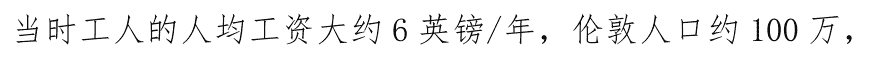
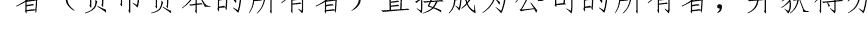
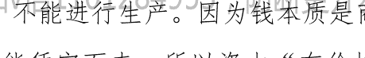
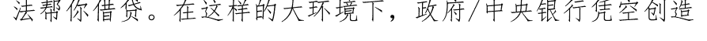

# 掌握经济大势和个人财富密码必须读懂现代金融的魔幻之力

引子

过去几年，我在学习金钱，研究金。除了想挣钱，更懂得得钱。一晃 10 多年后，现在终于有点学习感，慢慢写下来与大家分享。

钱与史俱来。几千年，乃至几万年前，凡是有人类居住和活动的地方，就有钱。千万年来无论钱的形态是什么？贝壳、羽毛、牛羊，或是金、银、铜、铁，还是在印制精美的纸币……我们是规划个大运起伏的生命？写下生存永恒的主题。

中国西晋年代（公元 266-316），有一个“视钱如命”的“隐士”曹嵩（说是“钱居住不住，人无所依”，但竟然载入史书，名垂青后），在《钱论》文中，将钱左右运生死的力量和神奇画得入骨三分：

> “钱之为体，有乾坤之象，内则其方，外则其圆。其积如山，其流如川。动静有时，藏有有节，变便易，不思耗折。折义长寿，不置象道，堪能长久，为世神宝”，“失之则贫弱，得之则富昌”，“钱之所在，危可使安，死可使活。钱之所去，贵可使贱，生可使杀。”

美国作家安雅·兰德将金钱的神奇提升到社会运行的层面。

在 1957 年发行量仅次于圣经的小说《阿特拉斯耸肩》（Atlas Shrugged）中，她认定，“金钱是构成社会各种运作机制中最核心的主轴，整个社会政治、经济、军事、文化、艺术、历史等方面，实际上都围绕着金钱在运行。”

在兰德关于金钱是社会运行的核心的说，强调的是钱的“社会动力”，认为有史以来人类对于金钱（财富）的追求就是左右历史进程的主线。几乎所有的历史进程的背后动力都是人们对财富的贪婪和不妥措的争夺。

正是千万万金钱左右，甚至宰夺个人命运的历史和人类的衰败，我们拥有浩如如海的关于金钱的描述。但对于金钱的认识，我们有太多的误解和浅薄。最大的误解是将会决定命运的钱和影响经济运行和进程的“一视同仁”，混为一谈，结果却是洋洋无奇。但是这些错误错误，尤其是对经济运行中金钱基础的动态与相同的金钱左右经济进程作用的盲目，造成了对经济大势的误判，失去了个人财富开拓和积累的良机。

现代金钱的发生和发展无情覆了经济运行和财富创造的历史，重新开启了一个全新的经济形态和创造财富之路。正在这个意义上，读懂，至少不要误解现代的金钱，不仅可以理解为何许多现代经济理论和规律被现实颠覆，了解真正的《你不可不知道的经济常识》必不可少，更重要的是“懂才才能赚钱”，免被那些高高地奉在学院里的庙堂之上《宏观经济学》、《微观经济学》引领规划人生，安排日常生计，投资未来的基。

当然，想要指点江山，把握社会经济进程的大势，懂得现代的钱更是敲门砖。

现在让我开始来说。

## 一、钱只是钱

在浩瀚如海的《货币起源》的书籍中，对于钱的来历和功能已有详尽的述，无须重复。

我只想强调的是在 1760 年工业革命之前的千千万万中，钱，无论是什么形式，钱都仅仅是钱，不过交换的媒介，不过财富的标签，其他的货币功能都无微不足道。

有人声称“世界是部金钱史”，从自古开天地，钱就可以左右社会的经济进程，书写历史传奇，却是过言其实。

美国哈佛大学历史经济学教授尼尔·布格莱斯在其流传甚广的著作《财富崛起》（The Ascent of Money）中，曾经经历了金钱的历史，由此断言“世界每一次重大现象背后都隐藏着货币与金融秘密”：

- 文艺复兴标志着艺术市场的繁荣，原因在于意大利商业
- 荷兰崛起，哈布斯堡帝国成立的现代市场的成功
- 法兰西是苏格兰操控的股票泡沫而引发的衰灭，工业革命的间接结果
- 阿根廷在货币和金融方面犯了愚蠢的错误，使得 19 世纪 80 年代的萧条
- 20 世纪到处通货膨胀而生机的国家

但仔细观察，他的例子都是工业革命之前的。钱不过交换媒介，财富象征，基本上没有左右经济的力量。钱和金融的兴起，与 GDP 没有关系。

- 钱的崛起，与 GDP 的关系，基本上没有。
- 财富的扩张，基本上都是工业革命后的事。
- 这种时代西晋，居然是中国历史上最短的王朝，不到 500 年，成为中国历史上第一个被消灭的王朝。

## 生存经济的基础没有增长

在论货币起源时，诸多将其归于“剩余产品”、“市场繁荣”，但在工业革命之前，这样的判断是不准确的。钱的发生，在绝程度上是同“互通有无”，因为在工业革命前的千万年，人类社会的经济形态是“生存经济”。生存经济最基本的特征是满足人类需要的“供给”，整个社会而言，很少剩余产品。

在生存型社会中，绝大多数社会成员目标是生存，是为了获得生存需要的产品，主要是食品、衣物、住房。生存型社会生产的主要目的是维持简单再生产，包括劳动力的再生产。由于剩余产品有限，社会交换规模不足，市场需要是互通有无和少数富豪为了满足非生存需求和“奢侈需求”进行的。

生存经济的基础是没有增长的经济。现在都什么时候了，经济论还在谈房子，谈房价，一个没有含量的东西，被我们捧上天。谈房子，谈房价，原因其实很简单。房产价值将近 4 万亿，不仅是中国，而且在全世界，都是价值最高的“资产/财富”，一个百分点的波动，中国的“资产/财富”就会涨跌，这能成为经济论坛的话题吗？

生存经济的形成基础是没有增长的。工业革命之前，人力是生产最基本的动力，农业生产是社会经济的主要部门。据历史学家估计，春秋战国时期（公元前 770 年到公元前 400 年）粮食产量是 45 斤，到 1800 年，中国粮食产量达到 150 斤，经历了 2570 年，粮食单位人均增加了 10%，但总产量增长了 58%，年均增长率几乎为零。而长期均粮食产量，也是从 640 斤增加到 780 斤，2570 年增长了 2%。这些数据说明，工业革命之前漫长的岁月，以人力作为基本动力的社会生产力，基本上没有增长。

生产力徘不断，历史学家对世界人均国内总值（GDP）的估算提供了有力的佐证。根据英国著名的经济历史学教授安格拉斯·麦迪逊，从公元元到工业革命之前（1700 年）的 1700 多年间，世界人均 GDP 指数仅从 467 增加到 615，增幅仅为 31%。平均来说，这期间，世界人均 GDP 几乎没有增长。

生产力徘前的根源，是几千年以来人类和体力为生产动力的基础没有改变，人类的工作时间，劳动能力都面临着不可逾越的生理极限。同时，农业受自然再生生产过程的制约，在人力不能改变自然的前提下，自然气候成为决定农业生产的关键因素，它提供的光、热、水、空气等能量和物质，决定农业生产的产量。简单来说，大自然的阳光和雨露制约农业生产。而靠人力和铁工具生产的人类，无力自然抗争，只能依靠“靠天吃饭”是主旋律。

生理极限的制约，大自然的任性和为所欲为，注定人类生产力低下，只能生产人类基本需求之外的一手产品。当时“农业发展”的中国人均粮食产量 700 千斤左右，除了满足的需求，几乎没有有多少剩余产品。

没有剩余产品，以自给足为特征的生存经济中，钱仅仅是交换手段，财富象征，基本上没有。钱的扩张，基本上没有。用白话来说，在生存经济中，没有剩余产品，钱对社会运行无足重，金融最多是点缀，绝非现代，金融描述的那么神奇。

## 总结

人类在生存经济漫长的月中，这样的萧条——繁荣周期，周而复始。然而，作为繁荣（基本生产力）人口增长以几何级增长，人口总量与农业生产能力之间必然出现巨大差距，这将引起贫穷和饥荒，由于战争、瘟疫等，最终导致社会崩溃，食品匮乏，饥荒延续数年，数十年，甚至百年，又将人类推回最初的起点。

在农业革命之前的千万年历史上，这样的萧条，人类是在起点上徘徊。这一证明了，在生存经济中，钱对社会运行无足重，不能通过增加货币发行来影响经济运行，不可靠增加货币发行来提高 GDP。

## 二、钱能生钱

工业革命改变了世界，让钱能生钱。自从盘古开天天地，以农业为主的生存经营主宰人类千万年后，终于在 1760 年前后画上了句号。1764 年，英国兰郡布哈格福斯发明了“珍妮纺织机”，5 年后的 1769 年，英国格拉斯哥的瓦特发明了改良蒸汽机，这两项发明了“工业生命”的大幕。

蒸汽的发明创造新的动力，通过利用机器速度、规律、精确，通过不疲劳的机器转化，产生一种在力量和功率上远超过人力和体力的动力。以超过人力体力千万倍的无生命动力替代了生命的动力，以巨大的机器动力替代了有限的人工动力，不仅让人生产满足需求的过程摆脱了千年来和自然的束缚，而且大大扩张了社会生产力。

同时，以“珍妮纺织机”为代表的机器，为机械动力的运用开辟了广阔的天地。机器替代手工，极大地提高了生产的效率和能力，并且打破了手工劳动“无力”和“无能”的局限，进行并完成许多手工不能完成的生产。机器在社会生产中的广泛的运用，人类不仅可以生产出更多的产品，而且创造出大量的全新的满足生活需求的产品。

机械动力和机器结合，人类如虎添翼，史无前例地拥有了巨大的生产力。据史载，英国 1780 年用“珍妮纺织机”织布，其产量是一个手工人的 20 倍，而当纺织技术的发展，工业革命的进行，让人类的的，，工业的扩张，工业00000000000000000000000000000000000的增长，0增长。

| 200000000 |
| 1 |
| 2 |
| 3 |
| 4 |
| 5 |
| 6 |
| 7 |
| 8 |
| 9 |
| 10 |
| 11 |
| 12 |
| 13 |
| 14 |
| 15 |
| 16 |
| 17 |
| 18 |
| 19 |
| 20 |
| 21 |
| 22 |
| 23 |
| 24 |
| 25 |
| 26 |
| 27 |
| 28 |
| 29 |
| 30 |
| 31 |
| 32 |
| 33 |
| 34 |
| 35 |
| 36 |
| 37 |
| 38 |
| 39 |
| 40 |
| 41 |
| 42 |
| 43 |
| 44 |
| 45 |
| 46 |
| 47 |
| 48 |
| 49 |
| 50 |
| 51 |
| 52 |
| 53 |
| 54 |
| 55 |
| 56 |
| 57 |
| 58 |
| 59 |
| 60 |
| 61 |
| 62 |
| 63 |
| 64 |
| 65 |
| 66 |
| 67 |
| 68 |
| 69 |
| 70 |
| 71 |
| 72 |
| 73 |
| 74 |
| 75 |
| 76 |
| 77 |
| 78 |
| 79 |
| 80 |
| 81 |
| 82 |
| 83 |
| 84 |
| 85 |
| 86 |
| 87 |
| 88 |
| 89 |
| 90 |
| 91 |
| 92 |
| 93 |
| 94 |
| 95 |
| 96 |
| 97 |
| 98 |
| 99 |
| 100 |
| 101 |
| 102 |
| 103 |
| 104 |
| 105 |
| 106 |
| 107 |
| 108 |
| 109 |
| 110 |
| 111 |
| 112 |
| 113 |
| 114 |
| 115 |
| 116 |
| 117 |
| 118 |
| 119 |
| 120 |
| 121 |
| 122 |
| 123 |
| 124 |
| 125 |
| 126 |
| 127 |
| 128 |
| 129 |
| 130 |
| 131 |
| 132 |
| 133 |
| 134 |
| 135 |
| 136 |
| 137 |
| 138 |
| 139 |
| 140 |
| 141 |
| 142 |
| 143 |
| 144 |
| 145 |
| 146 |
| 147 |
| 148 |
| 149 |
| 150 |
| 151 |
| 152 |
| 153 |
| 154 |
| 155 |
| 156 |
| 157 |
| 158 |
| 159 |
| 160 |
| 161 |
| 162 |
| 163 |
| 164 |
| 165 |
| 166 |
| 167 |
| 168 |
| 169 |
| 170 |
| 171 |
| 172 |
| 173 |
| 174 |
| 175 |
| 176 |
| 177 |
| 178 |
| 179 |
| 180 |
| 181 |
| 182 |
| 183 |
| 184 |
| 185 |
| 186 |
| 187 |
| 188 |
| 189 |
| 190 |
| 191 |
| 192 |
| 193 |
| 194 |
| 195 |
| 196 |
| 197 |
| 198 |
| 199 |
| 200 |
| 201 |
| 202 |
| 203 |
| 204 |
| 205 |
| 206 |
| 207 |
| 208 |
| 209 |
| 210 |
| 211 |
| 212 |
| 213 |
| 214 |
| 215 |
| 216 |
| 217 |
| 218 |
| 219 |
| 220 |
| 221 |
| 222 |
| 223 |
| 224 |
| 225 |
| 226 |
| 227 |
| 228 |
| 229 |
| 230 |
| 231 |
| 232 |
| 233 |
| 234 |
| 235 |
| 236 |
| 237 |
| 238 |
| 239 |
| 240 |
| 241 |
| 242 |
| 243 |
| 244 |
| 245 |
| 246 |
| 247 |
| 248 |
| 249 |
| 250 |
| 251 |
| 252 |
| 253 |
| 254 |
| 255 |
| 256 |
| 257 |
| 258 |
| 259 |
| 260 |
| 261 |
| 262 |
| 263 |
| 264 |
| 265 |
| 266 |
| 267 |
| 268 |
| 269 |
| 270 |
| 271 |
| 272 |
| 273 |
| 274 |
| 275 |
| 276 |
| 277 |
| 278 |
| 279 |
| 280 |
| 281 |
| 282 |
| 283 |
| 284 |
| 285 |
| 286 |
| 287 |
| 288 |
| 289 |
| 290 |
| 291 |
| 292 |
| 293 |
| 294 |
| 295 |
| 296 |
| 297 |
| 298 |
| 299 |
| 300 |

1700 年，世界人均 GDP 是 650 美元，1900 年达到 1260 美元，比 1700 年翻了一番，这标志着人类突破了千年徘徊前的历史，步入了发展、增长的新天地。在随后的 117 年经济增长的时钟不断拨快，2017 年 GDP 超过 10,000 美元，同 1900 年相比翻了 8 倍；

1700 年，在世界上几乎所有国家，农业是国民的主导产业，农业的产量占 GDP 的份额大多超过 90%，而到 2017 年，世界农业产值对国内经济的贡献率下降到 15%，在诸多工业化国家，这个比例小于 5%，像中国这种转型经济国家，农业占国民经济的份额也不到8%。%。满足人类生存所需的食品和衣着需要的农业，在经济中落入这种微不足道的境地，在很大程度上反映了人类的丰饶并获取了更多。

工业革命启动的生产力爆发，打破了人类生存经济的千年困局，也创造了社会剩余产品的不断增加。然而，工业革命并没有带来水长高的全民式收入提升，不同人对于剩余产品的占有并不均等，换句话说，不是每个公民都在同一条船上，平均分享工业革命大潮下的“财富”盛宴。

“二定律”总是从剩余产品向少数人手里集中，剩余产品以不同的规模和方式被不同所有人，并以货币的方式“贮”。

与此时同时，工业革命在创造辉煌的同时，更铺开展未来潜在的、更大的生产剩余产品的机会。为了生产更多好的商品，需要购买新的技术，开办新的工厂，建设新的道路……而这些都要钱。随着工业革命的深远发展，促进生产力提高的新技术和生产方式创造了日益增加的对钱的渴望。

## 19 楼
作者：税尚楠 日期：2020-01-29 10:15

@越越越越替补 2020-01-29 11:58:43
删了？那就回复简单些。

楼主，如果“生存经济”是你的首创，你足以因为这个首创而骄傲了，因为在“生存经济”的目的首光审视这个世界，这个世界将完全是另外一个样子。

“生存经济”不是我的首创，而是一个千万年一直存在的历史事实，我感悟到的钱在这种经济环境下“只是钱而已”。

## 24 楼
作者:悦尚 日期:2020-01-29 13:55

工业革命在创造史无前的社会生产方式和生产增长的同时，也创造了全新的功能：钱可以转化为满足投资需求的资本。从此，钱不再仅仅是“交换媒介”，“价值计量”和“财富储藏”，与人类生存经济的周期共舞的金钱，财富，可以转化为资本，通过投资获得“资本收益”，演变为“钱生钱”的奇迹。

钱可以转化为“生钱”的资本，赋予钱全新的功能，钱不再只是商品的索要权，财富的代言人，而是可以增值的资本。但钱向资本并不是水到渠成。

工业革命带来的生产力爆发，创造了巨大的剩余产品，但刚刚出生的他们们，面对爆发的剩余产品大多是手足无措，不知如何是好。史载，1780年之后工业革命引发了英国人的收入速度加速，尤其是其企业家的利润暴增，按平均而言，伦敦人均为消费支出4倍，大量的钱（剩余品）沉淀下来，1800年伦敦的“闲钱”还有很多，将将600万镑。

当时伦敦的人均收入约6镑/年，伦敦人口约100万，人均“闲钱”是一年的收入。

有门道的人，将闲钱用于投资，回报让人人艳羡。典型的例子是“麦肯内尔与肯尼迪织纺厂”创立和发展的历程。詹姆斯·麦肯内尔与约翰·肯尼迪生于苏格兰土地地区的贫困农家，到英格兰的兰昂萨芬织纺工厂机械工程学谋生存。在掌握了纺织技术后，1791年初麦肯内尔与肯尼迪自立门户，以技术入股，乡绅萨福德提供资本，合伙在曼彻斯特开办了一家生产（合伙）“走梭织纺机”的作坊，同时兼营棉纺业。合作终止后，1795年麦、肯二人凑成1769年英镑13先令一士的初始资本。

成立了“麦康内与肯尼迪棉纺厂”，但仅6年就成为英国最大的棉精纺企业，其资产总额就达到近9万英镑，比他们最初的投资翻了将近50倍。

## 27 楼
作者:税尚尚 日期:2020-01-29 16:50

正是巨大的资本供给和资本潜力，让当时英国的投资率和储蓄率从占收入的5%提高到15%。社会规模和日益增长的资金供给和需求，体现了剩余产品的转化更加方便的途径。于是，金融应运而生。

钱（货币）史以来，但货币不是“金融”。“金融”是人类对FINANCE的直译，源自英语，“FINANCE”的中文由“金”与“融”组成。金指的是黄金；融最早指固体，变成液体，是流动的意思。所以，金融最简单的意思是以黄金为基础来实现价值交易。

## 28 楼
作者:税尚尚 日期:2020-01-29 18:09

@越越越越替补 2020-01-29 13:55
金融，这一词的使用，将人的注意力吸引到社会的根本问题，并因此理解这种经济状态下的本质和人际关系，且不易被一些所误导。

既然如此，我就要给“生存经济”下个第一的定义。

## 29 楼
作者：税尚楠 日期:2020-01-29 20:35

@越越越越替补 2020-01-29 13:55
金融，这一词的使用，将人的注意力吸引到社会的根本问题，并因此理解这种经济状态下的本质和人际关系，且不易被一些所误导。

@税尚楠 2020-01-29 18:09
既然如此，我就要给“生存经济”下个第一的定义。

@越越越越替补 2020-01-29 19:48
如果有机会，我一定会。

## 31 楼
作者：税尚楠 日期:2020-01-30 09:43

在人类发展的漫长过程中，“金融和货币”是个要素。在大多数时期，最初是最基本的功能是经营货币，将钱（剩余产品）转化为资本，进行跨时间和空间的配置。在此基础上建立起来的金融机构，银行，基本是资本运动。

世界上最早的“金融”可以追溯到：
- 巴比伦：公元前3000年，庙就已经经营金银、发放贷款。
- 希腊：公元前2000年，都可以找到银行的雏形。
- 罗马帝国：公元前200年。

世界上最发达国家，中国的金融业更是悠久：
- 周朝：公元1000多年前就有“泉府”办理贷款业务。
- 唐代：开启了“飞钱”，还出现了“质库”即当铺。
- 宋末：置了“便钞”。
- 元代的“质库”。
- 明代的“钱庄”。
- 清代：“票号”，都是从事货币经营业务。

然而这些所谓的“金融”，是以货币为中心，演绎了个人钱和财富的传奇。

## 32 楼 
作者:倪尚 日期:2020-01-30 10:59

中介运行的最简单的方式就是采用付息的方式聚集资金和分配资金，调节企业和个人的资金盈缺。作为金融体系的主体，银行等金融机构，利用自己的资本基础和良好信誉，把分散、闲置的资金集中起来，变成高效、稳定、长期的资本，通过借贷、投资等方式，在全社会实现利润最大化进行资本配置。

## 33 号 
作者：税尚尚 日期：2020-01-30 16:43

金融体系的功能和触角随着工业革命的开展不断提升。经济历史学家丹尼尔·菲尔森（Niall Ferguson）在其《货币浪潮：世界金融》（THE ASCENT OF MONEY: A FINANCIAL HISTORY OF THE WORLD）中获取许多信息，详细描述了工业革命命定的早期的金融创新：
- 提供投资稳定来源的金融机构日益强大，体现在规模宏大，业务多样化，可以规避借贷引发的风险的银行继续建立；
- 促投资便利，高效的服务不断创新，以标准货币为基础的账户系统和直接转账或过户作为银行的业务，使得越多的商业交易不需要现金，只需要银行在交易双方进行“支出和收入”转账；
- 中央银行的建立，对商业银行实行保证金融安全的准备金体系，为金融体系的健康，尤其是银行的信用提供了保障；

随着金融体系的建立与成长，金融市场以股市和债券市场为主的资本市场崛起，这不仅体现了金融创新，更是搭建了金融长袖善舞广阔的平台。

## 35 楼 
作者：祝尚崩 日期：2020-01-30 17:00

股票，可能是工业革命以来现代金融最大的创新，它创造了一种资本供给和需求直接连接的方式，作为股份公司募集资金给投资者的公司所有权的凭证，让投资者（货币资本的所有者）直接成为公司的所有者，并获得公司发展的红利。这不仅开启了投资的“直通车”，还以“无限未来”的诱惑刺激了投资。

来源于：鉴于股份公司发行的股票股东对企业拥有一个基本单位的所有权，巨大的股东可以在一定程度上干预公司的管理。与此同时，工业革命也将公司的经营同投资者的利益紧密联系起来。债券也是金融创新的成果，本质上为资本供给和需求提供了方便途径。债券是贷款凭证，是投资者和企业（金融机构）以固定回报（利息）之间的债务关系。从风险和收益来看，债券风险低收益低，股票风险高收益高（只是可能的）。同时，股票是发行的，而债券是政府发行的。

## 36 楼 
作者：税尚瑞 日期：2020-01-30 23:27

@王淼 2020-01-30 23:27
这次真的太大了。

首先是货币不能超越。在工业革命过程中，金融依然依赖实体经济。白话说，就是金融本身不直接创造财富，而是通过跨空最有效的资本配置来最大化创造财富。源源不断的钱（财富）依靠实体经济通过市场去实现。金融帝国的衰落主要原因是在全球企业被战争摧毁，或是没收所致。

## 38 楼 
作者:倪楷 日期:2020-01-31 09:00

工业革命带来的财富暴发，通过金融市场转化为大量资本，驱动了工业革命。随着工业革命的推进，金融开始以独特的步走姿态书写国家经济进程。然而，这一时期的金融拥有垄断并获取更多好处。

## 42 楼 
作者：税尚楠 日期：2020-01-31 12:59

随着工业革命在世界上不断的纵深推进，发展的金融对于社会经济的繁荣，对中国民生日益增强，甚至影响了左右社会经济进程和国家政治和经济兴衰。在那些金融左右社会经济进程的历史中，欧洲的罗斯柴尔德家族和美国的摩根是最著名的金融大鳄。他们于工业革命浪潮全球，先后通过建立金融机构，交易金融产品，发展成为世界上资金规模最大、不可一世的金融王国，演绎了以金钱征服世界，用金钱为神奇的传奇。

罗斯柴尔德在1833年英国废奴隶制后，提供了200万镑基金用于补偿奴主的损失，帮助了新旧制度的平稳过渡；1850年代，英法联军在克里米亚的战争当时欧洲的“霸主”德国的战争中，以其新的战争手段包括新式线壕枪、蒸汽动力战、铁路、无线电通讯等科技发明，在一年内就将不可一世的俄罗斯赶出了其占领的土耳其，沙俄尼古拉一世服于自己。战争中罗斯柴尔德提供的1600万镑的贷款，对于英法联军军事而言增强了保障能够提供重要的作用；在欧洲范围内国内建立金融机构后，提供资金给盟国，帮助打败了企图称霸的法国国王拿仑，一直是罗斯柴尔德家族金融帝国可以支配世界的例证。

## 44 楼 
作者：冯尚梅 日期：2020-01-31 17:22

与罗斯柴尔德家族相比，美国的金融大鳄摩根家族更是金融神话的主角。在横跨19世纪和20世纪的岁月中，摩根家族，尤其是J.P.摩根一代，在鼎盛时期，摩根家族控制着欧洲和美国之间大量的资金往来。

## 45 楼 
作者：税尚楠 日期：2020-02-01 16:16

工业革命启动的生产力爆发，打破了人类生存经济的千年困局，也创造了社会剩余产品的不断增加。然而，工业革命并没有带来水长高的全民式收入提升，不同人对于剩余产品的占有并不均等，换句话说，不是每个公民都在同一条船上，平均分享工业革命大潮下的“财富”盛宴。

## 46 楼 
作者：倪尚柏 日期：2020-02-01 12:12

工业革命过程中，无论金融如何奇，金融不能脱离实体经济而自成一体，一旦金融脱离实体经济，金融危机就会而至。随着工业革命的深入展开，货币和金融的舞台更加强势，更加“盛气凌人”，更加“不可一世”，并且不能改变其对实体经济的依赖，这也是历史上金融创造的泡沫最终被打破的根源。从股票第一次买卖到现今400多年间，世界各国金融泡沫再次出现，但是无一不是烟灰飞灭告终。因为资本需要真实价值的利润来满足，而现实的财富（公司利润）需要实体经济通过市场来体现。

根源在于，金融提供了流动性并避免了破产。

## 48 楼 
作者：税尚楠 日期：2020-02-01 15:50

而工业过程中从未消失的经济和金融危机，在一定程度上也是随实体经济的辩证。实体经济创造的产品只是“潜在的财富”，产品和服务必须通过市场去实现价值”。正是这样的过程决定了金融和经济机的产生。对于此，马克思的社会生产相对剥削危机是最经典的解读。马克思认为资本主义经济危机是相对剥削的危机，资本为了追求利润，一方面盲目扩大生产，另一方面拼命生产，造成生产增长的趋势导致劳动群众对购买力之间的矛盾。结果，尽管需求存在，但由于没有购买力，结果是大量商品过剩，不能实现生产的价值，产品卖不出去，生产大幅下降，失业工人急剧增多，信用关系遭到严重破坏，物价下降，金钱缺少，整个社会经济生活处于极端混乱和瘫痹之中。这在根本上是实体经济的危机，作为随实体经济的金融无论多强势，但也无力。

## 50 楼 
作者：税尚旭 日期：2020-02-02 10:53

第二，政府不染指金融。政府的货币政策可以调控经济在工业革命以来的很长时期中几乎是前所未闻的，原因很简单，国家没有“中央银行”，即使有“中央银行”，但不属于政府。世界上最早

一“中央银行”，该属1694 年在英国成立的“英格兰银行”，它是一家私有银行。1694 年英国威廉王给予其特许，允许在社会上募集 120 万英镑，为此银行发行作为货币的120 万英镑债券，然后将所募集的英镑交给威廉王与玛丽皇后，作为政府与法国作战的军费开销。

100 多年后，1844 年，英国王国由首相罗伯斯尔主持并通过了一个银行特许条例，即“英格兰银行特许条例”，赋予英格兰银行发行货币的垄断权，但银行私有机构的毫无改变。特许的，其作为政府的“政府资金管理机构”的职能依然如此。

而工业革命中起的新兴大国，美国在 1913 年之前甚至不存在中央银行这样的机构，因为法律不允许政府垄断金融成立中央银行。自美国独立战争胜利后，联邦政府也曾多次尝试建立一个中央银行，但因为政府和总统担心中央独自坐大，或被少数利益集团捆绑而未能实行。

美国的第一财政部长历山大·汉密尔顿（10 美元纸币上的那个帅哥）竭力劝众，其于 1791 年在费城成功建立了美国第一银行。尽管第一银行不是为主要美国财政部服务的银行，负责帮助美国各国发行债券，逐步偿还独立战争时期积累的债务，帮助保管财政部的存款及处理其他联邦政府财务上的收支，但国内只会批准第一银行经营20年。

1811年，第一银行的经营期限到了之后，美国国没有批准继续存在。在1812年，英美再次战争冲突，由于缺乏一个有效的中央银行系统和全国统一的金融市场，美国的州银行陷入混乱。为了恢复银行秩序和处理战争债务，1816年由美国国会通过，麦迪总统签署法案建立了美国第二银行。和第一银行类似，第二银行也是一个全国性的私有商业银行，国会也给第二银行颁了20年执照。

插图：纸币的采用和美元纸钞纸币获取的历史

纸币是世界上各国普遍使用的货币形式，最早使用纸币的国家是中国，时间约在公元前九世纪，甚至更早的公元前春秋战国时期。但是，由国家发行的强制使用的纸币成为最普遍的货币形式，却是随着工业革命的进程不断发生和发展的。工业革命带来了社会分工的日益深化，生产力不断提高，交换成为经济运行的核心，没有实现产品价值的交换，各业的再生产不能继续。而随着工业革命席卷全球，交换的规模和频率不断扩张，传统的金属货币大量携带运输，交割清算的成本越来越高，不能满足经济发展对交换的需求。由国家出手担保的“纸币”应运而生。

1661年瑞典银行发行了首次在欧洲使用的纸币；1694年，英国政府支持英格兰银行创立，开始发行英镑；1775年美国独立战争爆发后，美国大陆会议开始发行纸币，称为美元，几经波折和反复，1792年颁布的美国法律《铸币法案》，对美元采用了金银本位制，奠定了现代意义上的美元。目前世界上有百多种纸币，流通于世界193个独立国家和其他地区。

纸币的出现和广泛流通，只是货币形式的改变，在各种货币本位制下，纸币之所以有价值，因为它是商品代理。正是如此，纸币为社会和大众接受，成为交换的价值单位或价值尺度，成为财富的象征，历史上没有商品基础的纸币最终都和金融泡沫殊归，烟消云散。即便是“世界货币”的美元，也有例外。

美国从1775年发动了独立战争，为了筹措战争资金，美国国会（美国大陆会议）发行了200万美元的纸质信用证——美元。这种纸币没有任何形式的支持，基本上是以美国会未来税收的期望为基础。一方面，战争对美元价值带来了许多不确定性，另一方面，为了支付军费，国会不得印制纸币，在此后的5年里，总额超过2亿美元。美元迅速贬值，几乎一文不值。鉴于仅仅以“信用”作为纸币不可靠的，1787年美国宪法，颁布时明确提出禁止“将金币和货币以外的任何东西作为债务偿还的凭证”。

随后美元的发行都是遵从宪法以金银作为指标的基础。1791 年美国财政部属下的美国制造的联邦货币——美元硬币，取代独立战争时期行的纸币后，直到 1861 年纸币才卷土重来。1913 年的《联储储备法》建立了联邦储备系统，并赋予了发行美联储票据（即纸币）的权力。法案更是明确要求发行货币必须以黄金储备为基础。这实际上就是众所知的“金本位制”。

在人类的发展的长河中，如科学发现、技术创新、艺术一样，纸币都是人类想象的产物。在国家的支持下，纸币作为一种惊人的创新，重塑了社会运行的方式。尤其是纸币成为普遍接受的“中介”，成为他人账单、购买商品获得报酬的基本方式。然而，其神奇之处源于人们对政府的信任。换句话说，政府保证了纸币与商品的交换，这决定了政府干预经济的潜在能力。

由于利益冲突，第二银行成立后遭到州银行的强烈反对。反对者认为第二银行业务取得垄断利润，而且只帮助美国东部地区的富人和农民。在第七任总统选举中，安德鲁·杰克逊胜出，兑现了自己的承诺，把存款全部转移到州银行，这从上动摇了第二银行的基础。结果，1836年，美国银行并没有得到国会的续照，被迫关闭。

之后的70多年，美国的金融市场经历了自由式的发展。但随着工业革命进程，金融资本在经济中的作用增强，开始主导经济。与此同时，金融市场急剧扩张引发的挤兑造成市场崩溃。然而，美国在1873年、1884年、1890年、1893年、1907年都发生过挤兑造成银行大规模倒闭的金融危机。尤其是1907年的金融危机，导致在股票市场上一些投机者试图操纵银行和信托公司，损失惨重，造成银行和信托公司破产。1907年10月，纽约三大信托公司破产，引发了一场席卷美国的金融海啸。存款者人人自危，纷纷提款，银行也失去信任，相互间的借贷完全冻结，并发生挤兑，很快延到全国各地。如果不是金融大摩根组织救市，美国银行体系将面临灭顶之灾。

注入流动性1.2万亿，平常3-5天交易额的总和，依然挡不住暴跌，可见在金融市场上，恐慌比钱更强大。

1907年的金融危机结束后，美国参议员尼尔森·奥尔德里增加了好处（注：此处原文应为“奥尔德里奇”，且“地震”应为“危机”）。他建立了委员会调查金融危机的成因以及教训：认为依赖金融市场本土化解危机不可靠，最好用法律形式赋予某个机构稳定金融市场的职能来预防应对危机。在考察欧洲国家的中央银行，并对欧美金融市场进行了系统的比较分析之后，提出了名为“奥尔德里计划”的提议，主张美国应该模仿欧洲国家成立一个统一的中央银行。今后再发生类似1907年的金融危机时，该中央银行可以向被挤兑的银行提供紧急贷款，以此稳定金融市场。

但“奥尔德里计划”由于受到议会很多成员的强烈反对而难产，直到威尔逊于1912年当美国总统后，建立中央银行的设想才“死灰复燃”。威尔逊总统认为“奥尔德里计划”整体框架有价值，认真修改后实施，将对美国金融和金融市场的发展和稳定助力。因此，在威尔逊总统的支持下，议员欧文和众议员格拉斯以《奥德德里奇计划》为蓝本，在1913年起草了《联邦储备法案》并最终在国会通过，正式宣告美国中央银行——美联储成立。

## 小结

工业革命带来了生产力的飞跃，结束了人类万年的生存经济，创造了不断增加的剩余产品，这为金钱搭建了广阔平台。钱可以生钱，带来了钱的功能改变，让钱更加魔幻。然而，尽管通过金融转化为资本，钱能生钱，但钱生钱的过程离实体经济需要通过商品生产和市场来实现利润。这样，无论钱有多魔幻，钱都离不开实体经济。

钱必须以实体经济为基础，背离实体经济运行轨迹会导致爆发“金融危机（钱荒）”。一个根本原因是工业革命进程中，钱是有价值的商品，因此，钱生钱的本质是商品生产。商品必须生产，因此，钱不能离开实体经济。同时，工业革命带来了剩余产品并由于财富积累，社会中仍人人为生计奔波，所以，钱依然具有生存作用，而存在是以实物为基础的。

- 成为凭空创造的“信用”。千万年来，用什么当钱，形式万千，贝壳、羽毛、牛羊、金属都当过钱，最后由政府控制印刷精美不易仿造的纸币接受、流行，成为社会大众接受的钱。但不管钱的形式如何变化，钱是商品这个本质没有任何改变。正如诺贝尔经济学奖主米尔顿·弗里德曼所说：“从直到1971年，每种主要货币都直接或间接地与一种商品联系起来。偶然与固定关系脱离的情况也出现过，但那通常都是在危机时期。正是这个1971年，千万年的钱被完全颠覆了。”

- 成为“官合营”。这种设置初衷是要确保美联储在制定货币政策时兼顾政府和立法部门意愿，避免货币政策完全集中在政府里。美联储由委员会组成，成员由总统提名，经国会批准。作为独立的中央银行，它接受政府监督，国会定期检查其运作并赋予其权利。在总体框架下，美联储负责制定货币政策和发行货币并且对金融机构进行监管，其职责也是维护金融系统稳定的作用。

- 是一种“自动”运作。严格来说，美联储的决策除了货币供给的错误，恶化了经济环境，将衰退。遵循金本位制也是一个主要原因。按照金本位制，国家作为储备，在金本位制的束缚下，世界上其他国家的中央银行绝比美联储强势，甚至更“弱”。

简单，直观，如此微不足道。

无论是有意还是无意，尼克松总的“胆大妄为”，实质上改写了千万年来货币以商品为基础的历史。而宣布美元不再再以黄金为基础，颠覆了货币的商品基础，即货币本身不再具有商品的属性。货币（广泛采用的纸币）所以“有价值”，仅仅是因为发行它们的政府说它们“值钱”。纸币的“价值”也是宣布了算，印有乔治·华盛顿头像1美元，印上本杰明·富兰克林就比一美元100亿（100美元），完全用纸币印刷文本无效，而是美国财政部说算了。

颠覆了货币的商品基础，尼克松开启了以信用作为货币的基础的新经济——信用经济的大幕。在这个意义上，说尼克松是现代信用经济的缔造者，一点都不为过。

## 79 楼
作者：税尚楠 日期:2020-02-08 10:31

“钱”不再是变

尼克松发发的金融政变，废除了金本位，表面上看并没有改变货币，也没有重新发行货币，纸币还是纸币，美元票还是原来的模样，连尺寸、大小都没有改变。然而，仔细探究，尼克松金融政变，从根本上改变了钱的本质，钱的功能，用白话来说，就是后的钱和信用经济，工业革命时代的钱完全不是一回事。

传统的金属货币本身是商品，需要生产，因此是具有价值的商品。当钱的商品基础被废除，由政府垄断，强制发行纸币就是钱，纸币不是商品，印刷成本很低，可以说“钱不值”，所以“值钱”是因为大众所相信的，而政府说它“值钱”。所以政府的信用成了钱的基础。

## 88 楼
作者：税尚楠 日期：2020-02-08 10:34

钱不再以商品为基础，仅仅是信任，而信任不可量化，甚至充满了主观和个体的心理判断，这样，基于信用的钱就没有错，也不再是一个定数。而不能用量来界定的钱，规模就可以趋向无涯。说一点，就是以信用为基础的钱可以虚空创造。

可以无中生有，哲学上说“虚构事物可以中生生有”，这样的事物虽然无限多个，但此时刻不在产生。

现代经济中钱是经济的血脉，又可以转化为资本，引导社会经济运行。出于主权国家政府的信任赋予政府发行信用货币的权利，在事实上赋予了政府和政府货币当局（中央银行）操控经济、指江山的“洪荒之力”。因为可以凭空创造，无中生有，货币发行的洪荒之力就有无穷大的特质。

# 89 楼 
作者：税尚楠 日期：2020-02-08 10:39

钱从商品变为信用，是对钱的最根本的颠覆，从根本上改变了钱的来源，钱的规模，钱的性质，也改变了货币的传统功能。

以金银或以金银为基础的钱，作为流通手段，不仅在国内流动，也可以在国际上流动。但钱成为“主权国家信用”后，就只能在主权国家内流动。钱的流通手段残废了；

以金银或以金银为本位的钱作为价值尺度，是因为钱（金）本身有价值，可以用去衡量有价值的商品，并确定商品的价值是多少。当钱体现的是信用，信用自身无价值或价值不能确定，因此，货币“价值尺度”这一功能不能由商品价值客观界定。钱的客观价值尺度不存在了；

## 90 楼 
作者：税尚楠 日期:2020-02-08 11:46

当以商品为基础的钱，被信用“钱”替代，那些以商品为基础的钱奠定的古典货币理论，自然而成为陈词滥调，不再对社会经济和个人赚钱具有任何指导意义。

## 91 楼 
作者：税尚楠 日期:2020-02-08 11:52

小结

尼克松发发的金融政变，废除了金本位，从根本上改变了钱的本质，钱的基础，钱的功能。钱不再是有值的商品，而成为“主权国家政府”的信用，信用没有商品基础，可以凭空创造，无中生有，从而改变了社会经济的命运，个人的“钱途”。

## 92 楼 
作者：税尚楠 日期：2020-02-09 10:09
@sliverhawkwp 2020-02-08 21:38:48

继续顶

感谢支持
一手理，加信1101284955，防断并获取更多好帖

## 94 楼 
作者：税尚楠 日期:2020-02-09 11:19

尼克松金融政变为何能成功？

尼克松突然发动金融政变，在美国国内大受欢迎，美国股市道琼斯指数竟然暴涨，但很快遭到国际社会，尤其是欧洲和日本等主要经济体的反对。反对的理由很简单，一方面是尼克松妄行，背叛盟友，另一方面是《布雷顿森林协议》建立以来稳定的体系，颠覆一个必然带来巨大的混乱。作为回应，十国集团（G10）签订了《史密森协定》，这个协定配合美元贬值（美元兑黄金贬值8.5%），试图继续维持1971年12月以美元为基础的货币体系，可惜很快短命。

从1973年2月开始，美元面临日益巨大的贬值压力，美元相对于黄金价一路下跌，很快跌到每盎司44，迫使各国放弃《史密森协定》，采用浮动汇率。十国集团（G10）实施了一项战略，要求五个国家将其货币绑在一起，共同对浮动，这宣告挽救布雷顿森林体系和固定汇率制度彻底失败。随后，各国后继走上无锚化的之路。

## 95 楼 
作者：陈凯梅 日期：2020-02-09 33

严格地说，尼克松引发的金融变革真的不是他的创新。用政府信用来代替货币，早在19世纪法国，皇帝急需贬值，后来为了发行纸币臭名昭著的约翰（John Law），他在法国引入纸币，大量发行，恶意炒作，制造出“泡沫”……这些王朝和政府统帅、大臣，无论指点如何英明，但最终失败而告终，导致王朝衰落，个人败名裂。

尼克松的金融变革之初，不少人并不看好这场变革，甚至可以说是昙花一现。然而，尼克松金融政变至今已经半个世纪，信用货币遍及，不仅成为世界潮流，而且不断创造一些国家经济繁荣。无论结局如何，但现在，问题是：尼克松为何能成功？

## 96 楼 
作者：税尚楠 日期:2020-02-10 24

插图：袭的故事 - 金融创新天才约翰劳(John Law)

所有历史记载证明，没有什么东西跟那个时代法兰人的放荡、浮动所开启的许多对抗。“回忆录”1719年的巴黎，普希谢写道：“那时约翰劳出现了，食得无厌、纸醉金迷、听天由命这三者结合在一起，结果是产业荡扬，在欢笑，而在算账时，国家在讥刺戏剧中荒荒。”

然而，另一个声音则这么看，孟德斯写道：“约翰劳更多爱他的思想，而不是爱金钱。”有人称他是十足的大脑和居心险险的谋家，有人称他是最优秀的金融家和天才的理想主义者。但无疑的是，他建立的金融体系，使法国陷入无可遏制的贪婪狂潮，并最终走向泡沫破灭的冰点。

1671年，约翰劳出生于苏格兰爱堡的一户富裕。他父亲是一个银行家。作为家中的长子，刚满14岁的约翰劳在父亲的会计事务所在做了3年学徒。17岁那年，并未因父亲去世而感到悲伤。他带着一大笔遗产来到伦敦，成为了伦敦各家赌场中的常客。他用一种数学的周复计算，成为赌场上的常胜将军。

不过，在约翰9年的浪荡生活中，对约翰劳来说也总是一帆风顺。他招惹了一个名为威威尔德的情敌，两人决斗。约翰劳不幸地——或者说幸运地——杀死对方，对于杀人而入狱。在一个秘密友人的帮助下，他得到了神秘人士，竟更为绝望之天。最新的研究揭示，这帮助他的导师，《流浪流派》的作者——蕾爵士。约翰，留下了帮助，约翰劳得以在海外流荡了14年之久。他一方面为了成为一名学术技术的资深赌徒，在欧洲各大赌场里显赫；另一方面对于欧洲各国家的经济形势、金融体制和货币走向心中有数。好运，就在这个时候降临了。

在法国宫廷，约翰劳看到了处于困境中的摄政王奥兰公爵。当时法国政府外债高筑，税收不支，只能选择发行货币，将货币的贵金属含量降低到原来的1/5，从而迅速使货币贬值数量。与此同时，波士监狱内塞满了非法征税的商人。法国政府以铸币获得的1.8亿法尔，不到一年就销殆尽。当时法国政府的信用大差，所以政府发行值为100法尔的国债，市场交易价格只有21.5法尔，比今天的垃圾债券还要差，信用评估接近破产。

海绵里再也挤不出水了。此时，约翰劳带着他的疯狂念头，站在了几乎绝望的摄政王面前。这个念头就是发行纸币代替银行币和金币。在约翰劳的《货币和贸易》中，他主张增加货币供给，从而增加就业机会。货币扩张，能够吸引外部资源，进一步增加国民产出。国民产出增加后，对货币的需求也会相应上来，使得货币需求和国产在更高的水平上维持均衡。为了发行和管理新货币，需要建立一家专管财政税收的银行，并以这些税收和政府掌握的不动产收入作为基础，定量发行纸币。应该说，这一套理论在今天的金融教科是非常平庸的。然而在当时，这完全是让人心驰神往的神话。

约翰·劳奥兰公爵提交了两份报告，指出只有金币而缺少银币，货币永远处于常态。他们引用英国和荷兰的例子，来说说明纸币的优越性。另一句话是，当时法国货币已经乱了，为了填补巨大的财政窟，选择了约翰劳的建议。

## 100 楼 
作者：税尚楠 日期:2020-01-20 30

插图：袭的故事 - 金融创新天才约翰劳(John Law)

1716年5日，皇室发布命令，授权约翰劳与他的兄弟威廉一同成立一家“银行”。公司的资本为600万法尔，以股份形式募集。每股500法尔，股份中的四分之一可以用金购买，另外四分之三由政府持有，体现为公债的形式。公司发行一种新的纸币，这种纸币可以随意兑换，还可以用来缴税。为了保证公司拥有足够的本金来保持纸币的实际价值，公司从政府获得了大批海外民地的矿产特权。这些收入支撑着纸币很快在贸易领域流通起来，甚至超过了等值的金属。与此同时，金币回到政府手中，法国政府得以偿还外债，还有贵族享受。此前内外的局势仿佛瞬间迎刃而解。政王和法国贵族在惊喜之余，约翰劳成为法国的英雄。约翰劳到了人生的巅峰，摄王竟然同意将公司更名为法兰西皇家银行，并授予其铸造金币的权力。1720年1月，约翰劳被任命为法国财务总长和监督长。他一手控政府财政和皇家银行的货币发行，另一手控法国海外贸易与殖民地发展。和其他公司负责替国征税，拥有巨大的权力。在人类的历史上，从来没有一个经济学家有如此好的机会来实现自己的理论。

由于危机，约翰劳试图改革并获得许多好处。然而物被极穷，那个时代的金融学或银行学理论，还试图找到银行发行与实货储蓄的金融比例。在摄政王的无忌和约翰劳的自我膨胀中，法兰西皇家银行——开始无节制地发行货币。到一年内，10亿法尔的新币被发行出来，此时，约翰劳寄希望着的“下蛋母鸡”——密西比公司——还未带来实际的收益。尽管此时法国政府继续制定美好的蓝图，授予密西比公司在印度洋群岛、中国、太平洋岛以及法国印度洋所属各地进行贸易的特权，并增加了5万新股。约翰劳承诺，每年将向股东按每股200法尔的份额派红利。这使得这些股份越越“巴黎起来，至少有3万人热切地要求购这5万新股。

为了满足人们的热情，密西比公司继续发行新股——这次发行的数量却是上一次的6倍，30万股每股面额500法尔的公司新股投入市场。共15亿法尔的巨款似乎从底部钻出来一般，而向约翰劳和他的密西比公司涌来。而这些购得股票的幸运儿，有大半转手就能把股票以两倍价格卖出。一时间巴黎出现无数。随着这家公司再度获得一项十万利占特权——法国烟草市场的垄断销售权——股价疯狂更为顺理章。

公众解释为专制的运动（或许指的正是几十年后的大革命），从根本上改变了人民对君权的态度的。”

约翰·劳也陷入了极端的绝望，只得往威尼斯。他的财产很快被充填补了“他个人造成的损失”。然而，人们发现，这位传说中的可救国的金融家，竟然家产不超过 5000 英镑。他并没有置办过任何金器皿或珠宝首饰，只是购买了一些房产。所以他逃离法国时，几乎一文不值。

1729 年，当约翰·劳在威尼斯去世时，晚景凄凉异常。人们为他写下这样的墓志铭：“一个著名的苏格兰人眼里，他的算术天才举世无双，他用简单的代数法则，把法国弄得病入膏肓。然而在他偶然回国那个年代，这位因危机而复兴的金融家亨斯获得了名遥垂青的金融巨擘；在法国的贪婪中获得了一切，失去了一切，而他关于纸币、股权和金融体系的设想，在今天仍然警醒——或者说醒着随时可能在贪念中消失的每一个人。

约翰·劳是个金融创新天才，只是生不逢时而已。

插曲故事（fact），下面是正文。

根据我的探讨，主要原因有 3 点。

第一是最基本的原因：世界主要经济体在经历300 多年工业革命带来的高速发展之后，先后进入“丰裕社会”，这是数学证明中的“必要条件”；

第二和第三原因是，说是“充分条件”。第二是1970年初发起的全球性浪潮，而第三是各国中央银行/政府通过不断实践，经历各种危机和繁荣，在运用“货币政策”调节金融和社会经济近乎火热的境地。

虽然可能有罗列之嫌，为了真正领悟尼克曼开启的“经济学”，有必要对这 3 个原因逐一展开地探讨。

“丰裕社会”是20 世纪伟大的美国经济学家约翰·加尔布莱特(John Galbraith) 提出的。这位经历过二战，做过罗斯福和肯尼迪总统顾问，当过联邦物价局长，美国印大的哈佛终身教授，在1958年发表的《丰裕社会》(The Affluent Society)一书认定经历了工业革命几百年发展，尤其是经过二战之后几十年的高速经济增长，美国已进入一个“丰裕社会”的时代。

但是，英国经济学家亚列列·诺诺夫不同意见，他提出，真正的“丰裕”，应该定义为“在价格为零时对需求的充分满足，同时，任何通情达理的人都不会感到满足或追求更多的东西”。就是说只有当社会中白给都没人要时，才可以称为“丰裕”。他的定义是完全符合经济理论的，但按此定义，“丰裕”是不可能出现的，因为在商品经济中，价格为零时，商品供给也是零。更不用说“千人千面”，喜好各不相同。

然而，如果只是看着现实世界千变百态，几乎是无所的事物——用于社会生产和生活消费的商品，尤其是满足人类基本需求的产品，如食品、衣物等等，工业革命以来，其过去百年人类大力创造的满足人类所需供给的“丰裕”却不容否认。

消费，尤其是维持生存的消费的丰裕”在经济学中是垄断并获取更多的。发达国家新兴经济体不存在，表现在很多方面，几个主要的。

### 1. 生产过剩

工业革命引发的人类生产力爆炸，终结了人类在生存经济中千年轮回的恶性循环，但是生产能力的突飞猛进，竟给人类带来了新的“危机”——“生产过剩”。

围绕“生产过剩”的“政治纠结”，所谓“生产过剩”就是生产了太多的产品，吃不光，经济学界定为“供给超过需求”。而资本需要通过市场销售产品，一旦产品卖不出去，价值不能实现，厂商就没有利润，甚至破产。极具讽刺的是与供给不足，“生产过剩”也危及人类生活，而且可能是世界性的危机。

自从1637 年荷兰金狂引发的金融危机以来，世界范围内各国大小小的危机此起彼伏，其中最近的是2008 年次贷危机。相比之下，各国危机的规模并不相同，但生产过剩对劳动者的影响是百倍。

关于生产过剩的解释：
- 生产过剩本质上是一种现象，是资本主义生产制度的
- 生产过剩相对于劳动者需求，经济危机总是隔几年爆发一次，并且波及的范围越来越广，影响的程度越来越大，危机爆发周期也越来越短
- 危机使生产过剩的基本矛盾得到解决，生产和消费平衡得到暂时恢复，为新的增长奠定基础，直到下次爆发
- 收入分配的不公平造成相对过剩，从实物的角度看，生产过剩是社会的结果。

### 2. 广告铺天盖地

广告源远流。“广告”一词来源于拉丁，用白话来说，就是“大喊大叫”，引人注意的意思。据传古罗马做生意时，常人在街头闹大叫，鼓动行人到商店去购买。但是真正的广告，却是随着工业发展起来的，商家为了自己的商品打广告，传递信息，塑造产品形象，创建商品品牌。广告的作用就是刺激消费。

主流经济学理论对于消费有两个基本点：
一是消费者选择的商品和种类越多越好；二是消费，“效用”越大越。

通过广告激励消费，提高社会消费，就是“名正言顺”的。然而，近年起的“行为经济学”发现，由于绝大多数消费者并不是主流经济学假设的“理性人”，广告是那些针对人们非理性的弱点精心炮制的，很可能诱导人们一时冲动，或贪图便宜，或攀比，或炫耀，去购买不需要的商品。无论广告造成消费还是促进消费者的“效用”，广告的制作与投放都是让消费者买更多的商品。

随着通讯技术的快速发展，在当今社会广告无处不在，无处不在。现在的数字广告甚至让广告有针对性的满足消费者“需求”，直接送到消费者的电脑屏幕、邮箱、手机技术。广告也成为全球诸多国家经济的“支柱产业”。

2018年全球广告支出将接近7500亿美元，超过全球经济总产值的1%。其中世界上最大的“消费国”美国的广告支出将近3000亿美元，占全球广告支出的40%。相对于工业革命初期的全球广告支出，现在是那时期的千倍、万倍，因为当时的广告支出不到1亿美元。广告的花样也越来越多，而异军突起的自称“人工智能”制作的“个性化”的数字广告，成为广告的“主体”，在2018年的总广告支出中，独占40%。

商品依靠广告来推销，消费要广告来刺激，这不仅影响了“生存经济”的颠覆，也昭示了工业革命以来随着生产力的突飞猛，满足人类需求的社会商品的“极大丰富

插播：今天美东时间上午，美联储鲍威尔在国会“受审”。密歇州议员质问他，为何中央银行拒绝购买地方政府的债券（拒绝借钱）给地方政府，任由地方政府破产。鲍威尔说（1）这是财政问题而非金融问题；（2）没有先例。但议员反驳说，美联储有支持地方政府的规定，应该设法解决这个问题，而不能为大银行服务，要为“人民服务”。

### 3. 奢侈品和天天低价

奢侈品异曲同工的是“天天廉价”。低价是一种商业定价策略，商品供应商通过提供较低的价格，刺激产品销量和获取市场份额。“天天低价”则是低价策略发挥淋漓尽至，打造名正言顺的“消费陷阱”。根据行为经济学，“非理性”的消费者在购物决策时，不仅看着商品的“效用”（比如买衣服可以避寒，买电视可以丰富文化生活等等），还关注购买过程的满足（体验）——基本上是生活中白话“买得高兴”。低价就是针对非理性消费者这样的心理，让消费者因为“高兴”而购买，而“高兴”却是“便宜”“划算”激发的。由于“高兴”影响消费者购买决策，因为“高兴”而购买的商品并不一定满足“效用”所需。最好的例子这是我们储藏室，车库中堆积了为了“高兴”买来的，但从未使用过的。

低价捆绑的销售还有“批发”“买一送一”“俱乐部制”之类的。商家以“薄利多”为利，“销”“批发”就成了“低价”的条件，商品的单位从一件增加到一箱（10包，20包），从一件增加到一筐……商家眼的是销售量，对于批发商品能否充分消费并不在意的。

社会绝大多数人都面临可支配收入的约束，因而“低价”可能比奢侈品增长对社会消费量增加有更大的影响，“低价”的市场更加巨大，“低价”的诱惑更加充分。然而，无论是奢侈品还是“天天低价”，目的一样；刺激社会消费。

### 4. 需求饱和

原本是一个现象，是说在一定量下，需求不能继续增长，就之为需求饱和。这个概念在经济学中的运用，主要是指消费达到一定程度后不再增长，即便价格下降，需求量也不增加，需求饱和。在世界范围内各国大小小的，需求饱和并不罕见。

人类是社会性的动物，我们都希望和自己身边的人——同事、朋友生活得一样：一样的车，一样的房子，甚至一样的包。一方面我们相信自己身边的人做出的消费都是明智的。另一方面我们不希望被“比较”，所以可以为攀比和面子购买奢侈品。更糟糕的是为炫耀和攀比而“奢华”。奢侈品不是为了消费而是“炫耀”。历史上尖酸刻薄著称的经济学家凡肯斯、托尔斯坦斯，将奢侈消费的根源和危害归于为了“炫耀”，一方面需要拥有更多的财富，想要标准，另一方面要以某种方式炫耀自己的储蓄。奢侈消费的目的不是消费本身，而是消费。这种“炫耀性消费”造成资源浪费，引发社会不满。无论对奢侈品如何进行社会和判定，奢侈品销售日益增长说明一个简单的事实：人类需要创造更多的供给。

在丰裕社会中，一方面生产过剩是社会的结果，另一方面生产过剩相对于劳动者需求，经济危机总是隔几年爆发一次，并且波及的范围越来越广，影响的程度越来越大，危机爆发周期也越来越短。在在，，，，，，，，，，，，，，，，，，，，，，，，，，，，，，，，，，，，，，，，，，，，，，，，，，，，，，，，，，，，，，，，，，，，，，，，，，，，，的的的的的的。

在全世界大多数国家，按照热量衡量的食品消费趋于饱和，和趋势。根据联合国农粮组织的分析，2018年世界人均热量消费为2900千卡，比20年前的2820千卡增加了2.8%，比50年前的2360千卡增加了22%。更重要的是，在过去20年间，热量消费没有明显的增长，在发达国家和新兴经济体之间的热量消费也趋同。从具体国家和食品消费来看，面包和趋势也非常明显。比如美国，在经历了1960年代肉类高速增长之后，人均肉类消费量在1971年达到170磅/年，但在2010-2018年间量几乎持相同。同时，人均谷物的消费几乎持平。中国人均食品的变化也不例外，在1995年至23年间，人均谷物没有明显变化，而肉类的消费在1980-2010年间迅速增长后，过去几年不再增加，还略有减少。对于饱和的另一个实证，是供给潜力，在工业品供给上尤为突出。经过近十年的迅猛扩张，目前中国已经是世界最大的工业品生产和供应国，在产品中，中国依靠“一己之力”可以生产满足全球需求的商品。以2017年为例，手机总产量是15亿部，中国总产10亿部，占全球总产量的65%。彩电总产量是1.9亿台，中国总产1.2亿台，占全球总产量的62%。空调产量是1.38亿台，中国总产1.1亿吨，占全球总量的80%。冰箱总产量是1亿台，中国总产7000万台，占全球总量的50%。的的的的的的的的的的的的的的的的的的的的的的的的的的的的的的的的的的的的的的的的的的的的的的的的的的的的的的的的的的的的的的的的的的的的的的的的的的的的的的的的的的的的的的的的的的的的的的的的的的的的的的的的的的的的的的的的的的的的的的的的的的的的的的的的的的的的的的的的的的的。

在全世界大多数国家，按照热量衡量的食品消费趋于饱和，和。根据联合国农粮组织的分析，2018年世界人均热量消费为2900千卡，比20年前的2820千卡增加了2.8%，比50年前的2360千卡增加了22%。更重要的是，在过去20年间，热量消费没有明显的增长，在发达国家和新兴经济体之间的热量消费也趋同。从具体国家和食品消费来看，面包和趋势也非常明显。比如美国，在经历了1960年代肉类高速增长之后，人均肉类消费量在1971年达到170磅/年，但在2010-2018年间量几乎持相同。同时，人均谷物的消费几乎持平。中国人均食品的变化也不例外，在1995年至23年间，人均谷物没有明显变化，而肉类的消费在1980-2010年间迅速增长后，过去几年不再增加，还略有减少。

世界精英和政的“见闻录”。作者以自己亲身经历和所见所闻，叙述了“世界是平坦的”故事。

作为那个时期在美国阿斯彭小镇举办的、被认为是美国的达克斯论坛的“思想节”上风头最盛的演说达人，弗里德曼是个传奇。

由阿斯协会和“大西洋期刊”共同主办的“思想节”，是全球各行业顶尖精英人物的聚会。在这个到处是美美食和精品店的小镇，科学家、艺术家、政客、学者和企业界人士在短短的时间里以放松和个人化的方式进行密集的脑力激荡，相互激发灵感，寻找火花。

而作为一个“思想节”的贵宾，弗里德曼每到一处，你都会看到记者、有人拦住他说不完的、前来交谈的名流、精英、蜿蜒富豪流水不息。说出他成为“专家”，得益于他足迹遍布以及全球世界的亲身体验，更是因为他有本事“把错综复杂的世界上事归纳成简短精巧的词语、耳畔能听型的趣味和简单易懂的选择题”。总之，他的“世界是平坦的”一书不仅征服了大批批评精英、企业家，还有全球的政治家。

133 楼
作者:汝楠 日期:2022-02-16 05:26
@一抹妥香 2022-02-10 14:38:29
经验难得一见的好文章！
感谢楼主，楼主加油！

## 感谢

135 楼
作者：悦尚博 日期:2020-02-16 08:41

《世界是平坦的》精装本的销量很快就会超过一百万册。比单纯的数字更重要的是谁在买这本书；州长和国会议员们……大学把该书推荐给行政管理人员和新生。它成了商务人士的必读之书。书中，弗里德曼带读者从美国出发，跨越太平洋到班加罗尔的印度硅谷，再奔赴中国东部的大连……交流中“世界正被平推”。

一项加入通过普通玩家、聚会、体验和交互，弗里德曼解释了“全球化”的“来龙去脉”，描述了全球推平世界的十大动力：计算机的运用和创新时代的来临；互联网时代的开启；电子文字处理的应用与发展；网络社区的发展；外包；距离；供应链管理；快递和物流管理；网络信息服务；数字化和移动成为生活的组成部分。

他进而提出，同历史上的全球化不同，推平世界的全球3.0版不仅在于它缩小和平坦化了整个世界，关键是个人在全球范围内大展拳脚和开展合作创造了前所未有的良机。机不可失，时不再不再，当今世界的竞技场已经变为，把握全球化的机会参与知识型工作的竞争的挑战。

一句话，全球化为每个人搭建实现自我的平台，地域空间不再是机会的天花板，处处是发展的机会。

作者:禹尚 日期:2020-02-16 10:51

尽管现实远比弗里德曼描述的“平坦世界”要深奥、神秘、也复杂很多，更非人类可以在平坦世界上随心所欲地展现舞足充满抒情意念，全球化的开展是实在为跨国垄断资本无限扩张的平台，重新定义了生产和市场，通过资本和技术的自由流动，创造了现存技术条件下生产成本最低的供给链，基本上消除了“成本拉动的通货膨胀”的基础，让许多人社会上添花。

人类变得平坦，世界都是信息，信息传递方式的演进促进了社会的发展和全球化的历程，也激发了生产力的飞跃和驱动而来的财富爆炸。1970年新信息革命的发端，开启了人类历史上首次财富爆发增长的资源来源。这次信息革命完全改变了人类信息传递方式，突破了信息传递的时空壁垒，创造了一个全新的资源配置的方式：在全球的平台上，不受传统时间和空间对资源配置的约束，使资本、技术、劳、其他自然资源可以在生产率最高、成本最低的空间中，以最优化的规模和方式实现有效的配置。

结果，无论全球化是否有利，拆人工资本，但全球化促进了资本流向劳动成本的洼地，生产种类更多，成本更低的商品，让“富裕社会”更加富裕，锦上添花。

## 小结

全球化创造出了一个全新的资源配置的方式，极大提高了生产力，而资本自由流向土地开启了商品成本下行趋势，结果，更多的商品进入市场，各种商品可以以更低生产成本出售，一则吸纳流通创造的货币，二来压抑任何价格向上的冲击，在这种状态下增发货币，“钱”感觉不到任何值钱的危机。

## 138 楼
作者:税尚楠 日期:2020-02-17 00:12
回帖如有敏感词，很快就被屏蔽 加微信11011284955，防断并获取更多好帖

作者:税尚楠 日期:2020-02-17 09:28

第三，政府/中央银行调节经济能力不断增强

市场作为一种交易活动或交换的场所，是人类原始社会以来就已存在的历史。但在市场配置社会资源的市场经济的形成则是工业革命的产物。随着工业革命发展的市场经济是以自由和完全竞争为特征的。

亚当·斯密认定这样的市场经济是最理想的：市场所有的参与者在经济生活中只考虑自己利益，生产者追求利润最大化，消费者追求效用最大化，在完全竞争的市场上，市场价格充分反映供给的变化，就象“看不见的手”来实现最优配置稀缺资源，并让逐利的市场参与者各自得其利，资本家获得利润，工人得到工资，地主收取租租，在市场“看不见的手”的调节下，通过自由竞争，整个经济体系达到一般均衡。

这样的自由放的市场经济在工业革命发生的过程中之一一直是主流，整个经济运行完全由市场力量调节，没有政府干预，甚至政府也依靠市场生存。所以，我们有罗斯柴尔德家族打败拿破仑，摩根拯救美国免于破产，德国帝国结算。西方的自由市场经济是同政治相关的。

宗教和王权共存是历史最基本的特征，但中世纪神权与世俗权力之后，封建制成为社会的主体。封建制度由领主、臣、土地构成，核心是土地所有权。领主是拥有土地的，臣是拥有领主的，而这些分给领主的土地，不仅是领主作为战士参加战争的回报，而且还要分给臣的土地。

在这种封建制度下，国王只是形式上的君，因为各个领主在领地内享有政治、经济、司法等独立的权力，国王不得干涉各个领主的领地，各自为政，本质上是独立的国家。

随着王权的加强，国家的统治机构日益完善，管理机构和法庭继续建立，拥有领主之间的权力斗争，不能改变格局。而这也是一种“各自为政”的，孕育了启蒙运动，开启了自由之旅。1776年的《独立宣言》，1789年的法国《人权》，承认人生自由并享有的剥夺的天赋。

作者:禹尚 日期:2020-02-17 12:26

在“自由”基础上的经济体制，必然要求个人自由。在“自由”的理论上，资源配置、生产组织和市场交换，是最有效的调节机制。但是这种自由市场运作，要求所有参与者理性的实现各自利益，使得生产者取得利润最大化，消费者获得收益。

然而，绝大多数市场不能满足“理性”的要求，相反，自由市场中非理性的行为（贪婪、恐惧等）创造了各种金融泡沫。结果，自由市场支配经济，让人的平均收入超过50倍。1920年代以前以金本位制，货币创造必须遵循金本位。这样，货币管理基本上是一种市场“自动”运行的结果，约束了货币政策“随心所欲”。

1920年代以来的大萧条，几乎摧毁了美国近50%的经济。20世纪伟大的经济学家凯恩斯认为，工业革命带来的生产力大决定了就业水平，总需求不足是市场失衡的根源。因此，只靠调整供给来减少生产过剩不能化解危机，反而会加剧危机，因为减少生产会导致工厂关闭，造成社会需求的进一步下降。而要增加总需求需要政府的干预，通过政府政策和货币政策刺激消费、投资和政府支出，预防和化解危机。

42 楼
作者：禹尚 日期：2020-02-18 09:21

但是，政府采用货币政策调控经济在很长时期中是“无所作为”，手段简单，就是通过公开市场操作，影响市场运作。即便没有“中央银行”，也是“公私合营”，不是独立的决策机构。比如，现在如日中天，让全球敬畏的，联储。

后也是不靠谱的“货币政策命中理论”，说是在“理性预期”之下，人们对中央银行任何“预期”的货币政策都没有对策，所以不管货币当局玩什么花招，对国民经济一点影响没有，而是理性人对各种货币政策见招拆招，让货币当局无计可施。

## 143 楼
作者：税尚尚 日期:2020-02-18 18:34

在多年后，尤其是尼克松金融风变革之后，美联储等中央银行逐渐开始了其大展举措，指点江山的历程。首先是中央银行货币政策的手段，工具日益多样化，除了传统的利率、准备金等，各种向金融市场注水的手段，如国债货币化，市场债券直接购买，甚至接入公司，让人眼花缭乱，目不厌眼。

更重要的是中央银行财政气粗，无论信贷需求有多大，都不会认输。

中央银行运用货币政策干预经济的熟练和强势，在应对2008年美国次贷危机引发的全球金融危机中展现得淋漓满尽。2008年全球金融危机的规模和烈度远大于1930年代的“大萧条”，几个西方国家甚至主权债务违约，政府破产的境地。然而，就是一场意外，卷席全球的金融危机，在全球主要经济体合力之下，在短短的一年之内便被化了，并且由此开启了世界主要经济体历史上持续最长的，没有衰的经济繁荣周期和股市的牛市。在那之前，世界上主要经济体发生大小小的经济，金融危机，都在中央银行的干预下花一现。这充分意味着中央银行应对危机力游刃有余。

相当，经济发展长盛不衰，无论如何调，中国经济不仅没有“时衰”，反而一路高。内涵丰富，几乎超越我们想象，而这个“中国特色”包含了政府运用各种货币政策，展现了熟练的范例。

不知何时开始，自从美国前总统比尔·克林顿（Bill Clinton）1992年詹姆斯·卡维尔（James Carville）提出竞选策略。

145 楼 
作者：税尚 日期:2020-02-18 12:58

小结

全球化创造出了一个全新的资源配置的方式，极大提高了生产力，而资本自由流向土地开启了商品成本下行趋势，结果，更多的商品进入市场，各种商品可以以更低生产成本出售，一则吸纳流通创造的货币，二来压抑任何价格向上的冲击，在这种状态下增发货币，“钱”感觉不到任何值钱的危机。

政府的货币工具，尤其是在尼克松之后，逐渐成为经济发展中大展拳脚的关键节点。政府的作用宣告了自由市场经济的终结，不需要对资本低头，才能救助免于破产，才能胜利。政府的篇章，这种章宣告了政府的扩张，政府运用各种货币工具去写自己的历史。

145 楼 
作者：税尚楠 日期:2020-02-19 06:22
@追云 2020-02-18 23:33
期待继续。

## 147 楼
作者：税尚楠 日期:2020-02-19 10:49

四. 信用经济

历史千年，经济形态的转变不是一蹴而就的，是长期积累的结果，萌芽，不断更迭，各种。科学技术，甚至文化的变化，最终创造了质的。经济形态延续千年，信用经济也是在1970年代才启动，工业经济已经持续了近300年。工业革命300年以其生产力爆发，创造出人类生存（无忧），在“全球化”和“政府干预”的推动下，人类进入了“信用经济”。

什么是信用经济?我们所说的“信用经济”，简单的定义是“以政府信用为基础的经济”。信用在这里有两个含义，一个是“钱”，二是对政府的信任。印刷美的一张纸说是钱，仅仅是因为政府它是钱，钱值多少都是政府说了算。所以，相信政府保证任何物的承诺，政府的信用成为中心。“信则有，不信则无”，信用可以“无中生有”，就可以“凭空创造”。同时，当不能用量来界定和判断其规模就有无穷大的趋势。因此，当信用成为货币的唯一基础，这事实上赋予了政府和政府当局（中央银行）无中生有、凭空创造货币的权力，让货币发行当局具有自己的意志，随心所欲创造的能力。正是在意义上，我们可以说，信用经济是以政府/中央银行行为为核心的，政府可以通过创造信用，真实实现社会资源的分配。用白话说，信用经济就是体现政府政治、社会和经济意志，由政府/中央银行操控的。

149 楼
作者：税尚尚 日期:2020-02-20 11:03

世界上政府/中央银行操控的经济有两种主要形式，一是国家政府通过属下的中央银行直接参与和管理社会经济，二是国家与金融资本合谋操控社会经济运行，政府和中央银行看似独立。无论政府直接参与或是操控，信用经济宣告了自由市场经济的终结，在一些国家是“计划经济”的强势回归。

那些时间，一个大佬依靠大数据，“未来30年计划经济会越来越大”，结果导致不少学者、精英的围剿。

事实上，体现形式和运行方式不同的计划经济，早已行其道，只是太多的人将信用经济下的计划经济，同存在经济中的计划经济混为一谈了。太多的所谓专家、学者迷恋过时的“自由经济”，不过是刻舟学舌，刻舟求剑而已。

150 楼
作者：禹尚满 日期:2020-02-20 21:59
又不能回复?

151 楼 
作者：禹尚满 日期:2020-02-20 21:59

一方面，加强货币好处，其实很重要，当行政当局可以通过信用来贯彻其意愿和目标来配置资源，看不见的手变成了看得的手，所以，自由经济就不存在，而市场也“沦落”为体现意志的工具。所以，信用经济下的自由是行政当局操控经济的自由，绝非亚当·斯密理想的那种竞争，毫无约束的自由。

152 楼 
作者：禹尚满 日期:2020-02-21 10:08

政府利用信用创造（货币发行）和其他货币政策（利率和准备金率）来计划和操控国民经济的例子很多，在政府直接参与与操控经济的中国，成就光彩夺目。实例多多。

需求。钱作为胜利的记录。人类喜欢竞技，与其它动物相比，有更为强烈的胜出的本能。而“赚钱”是人类自己发明的，最容易上瘾的博弈。所以人们是欢迎信用经济的，信用经济的出现是“历史必然”。

不知道是因为什么敏感词，几段都被屏蔽了。

159 楼
作者：税尚楠 日期:2020-02-23 13:20
小结
信用经济是政府信用为货币基础的经济，当政府可以创造空虚转化为资本的钱，政府就有通过信用创造，按自己的理解加入，获取更多自己的意愿去计划和操控经济之。由于信用可以无限的，这就赋予了政府指点江山的洪荒之力。

160 楼
作者：税尚楠 日期:2020-02-23 14:29
## 信用经济——全新的经济形态
信用经济建立在工业经济之上，不是发展，更多的是对工业经济的颠覆，作为一个全新的经济形态，信用经济的改变或终结了工业经济建立的运行规则和律律，我行素地制定出自己的新规则。

### 资源不再稀缺
在生存经济中，没有剩余产品，钱以满足生存的实物为基础，钱只是钱，同时，由于生产力低下供给匮乏，“稀缺”是主题。工业经济是生存经济的起点，求生，脱贫，致富是追求。在传统经济学中，因为创造财富的“生产要素稀缺”，因此“自私，理性和唯利是图的经济人”在“看不见的（市场）”的引导下，通过“利润最大化”、“效用最大化”的决策，以最小的资源获取最大的财富（产出用）。而市场的均衡毫不留情地惩罚“效率”，奖励“优化智慧”，在一定的意义上，传统经济学可以被概括为：优化和均衡，而基础是“稀缺”。

工业经济中钱可以转化为资本，资本是生产要素，资本是具有决定性的生产要素——在很多贫困社会资本（投资）表现为缺，没钱，不能进行生产。因为资本本质是商品，有价值，必须生产，不能空穴而生，所以资本“有价格”，获得资本必须付出一定的代价。在一定的意义上，价格是稀缺的映射，工业经济中体现了剩余的钱（资本）稀缺。

信用经济爆发了工业经济中钱的稀缺。由于钱可以虚空创造，只要政府愿意，想创造多少钱，就有多少钱，一句话“不缺钱”。钱可以转化为资本，不缺钱，稀缺的资本应该应有尽有。这是根本性的颠覆，传统经济学的“生产要素稀缺”不复存在。事实上，这就是传统经济学现在漏洞百出的根源，没有基础的经济理论不过是“无米之夯”，不能说明，解释经济现实就是逻辑必然。

## 162 楼
作者: 税尚楠 日期:2020-02-23 14:35
@我似春风无管束 2020-02-23 13:46:59
教科书式论述，内容完整详实。
呵呵呵，是想写成畅销的。

## 163 楼
作者: 税尚楠 日期:2020-02-24 10:49
## 储蓄与投资分手
经济增长投资是以为主，因为企业增加生产，扩大规模，前提是增加投资。在工业经济中，增加的投资——无论是从一方面增加银行借贷，还是自界的积累，用实物量，都是社会现存可用的剩余产能，即社会储蓄。在任何一个特定的时期，尤其是在一个较长的时期中，社会投资总量必须等于社会储蓄总额，俗话说就是“有多少钱，才能用多少钱”。用行话就是“投资和储蓄（恒等）”。

依照市场规律，如果社会投资需求大于储蓄，那储借贷的成本（利率）就会飙升，反过来压抑投资需求，实现社会投资需求和储蓄供给之间的均衡。而一种均衡在很大程度上确保了社会投资的效率，因为企业在投资不能支付借贷成本时，继续借贷投资。

信用经济不动声色地改写了社会投资和社会储蓄之间的恒等式。当政府/中央银行可以凭空创造信用，并通过商业银行，将其借贷给企业用于投资，社会储蓄的作用就弱化，随着时间的推移，企业的扩张以信用为基础，而不是储蓄。
因为信用投资无需储蓄为基础，可以凭空创造，投资就最具爆发性和相对有的持续性，只要中央银行不停止信用创造，规模投资就可以继续进行。在中国这种以信用为基础的投资“来独往”，更势不可挡，创造着增长的辉煌。

在中国40多年的高速增长奇迹中，不少投资占比GDP的比率超过60%，最低也是40%左右，有人将其归结于“中国社会储蓄率高”，这显然是误导。如果不是政府凭空创造总量信用（钱），社会储蓄就不可能支撑大量的投资。政府直接接手项目，拨款国企，其基础是信用而非社会储蓄。依靠社会储蓄来投资，增长的奇迹不可能。

## 165 楼
作者：税尚楠 日期:2020-02-24 13:33
回复不见了？

## 166 楼 
作者：税尚楠 日期:2020-02-25 06:43
没有明显的理由，美国股市暴跌近30%。说是武汉问题在全局扩散，但仔细细看，称之为“飙升”的南韩，问题扩散只是市场的借口了。

## 167 楼 
作者:陆尚梅 日期:2020-02-25 08:46
收入和消费无关，“量入出”是自古以来来，家庭和个人基本准则。在传统经济学中，对个人优化消费，专门设置了一个约束条件——此时收入相等。话说在20世纪80、90年代，当“预期收入理论”认为人类自己能赚多少钱，一旦独立，就会按照收入来安排消费，年轻时会花费，老年后由于工资增加，还会欠债。即便如此，收入和消费必须相等。

在富裕社会基础上的信用经济，颠覆了收入和消费相等的关系。通过消费增长，社会的剩余产品价值实现，政府和商家用各种手段让消费者廉价。政府要改变消费观念，商家利用各种促销。而“多吃多占”没有人愿意，这时如果银行贷款成本很低，银行对贷款者有要求，别提银行帮助借贷。在这样的环境下，政府/中央银行凭空创造信用，供给给消费者，借贷不是收入成为消费的主要源泉。

## 168 楼
作者：税尚楠 日期:2020-02-25 09:46
在富裕社会基础上的信用经济，颠覆了收入和消费相等的关系。由于消费带动GDP的增长，社会的剩余产品价值实现，政府和商家用各种手段让消费者廉价。政府要改变消费观念，商家利用各种促销。而“多吃多占”没有人愿意，这时如果银行贷款成本很低，银行对贷款者有要求，别提银行帮助借贷。在这样的环境下，政府/中央银行凭空创造信用，供给给消费者，借贷不是收入成为消费的主要源泉。

贷款趋势自从政府可以凭空创造信用，将不断加速。美国家贷款总额在1970年达到200亿美元，2018年底个人债务（包括学生贷款）总计16.5万亿，是82.5倍，超过当年GDP的80%。中国家庭历史上的负率几乎为零，但目前超过60万亿人民币，主要是用来买房的。世界上算作“富裕社会”的国家，平均家庭贷款总额超过GDP的60%。

# 169 楼
作者：税尚楠 日期:2020-02-25 11:19
信用扩张最大的影响是改变消费者行为。由于非理性的消费者消费决策在很大程度上取决于“周围”。

的即“攀比”形成的，而且注重当下，贪便宜，自我控制能力不强，因此凭空创造的信用左右消费者的决策，改变消费者的行为。如果再有信用扩张造成储蓄负利率的诱导，借贷成为消费者增加消费的动力便是逻辑必然。

最近有一个来自美国的报道，说在美国去世的老人中，68%的人有未还的债务，人均超过6万美元。这个事实不仅无情打脸“终身收入平衡理论”，更映射出经济信用扩张造成的过度消费，尤其是严峻的社会债务后果（美国没有债务的“造”和“继承”，这种不能还的债务最终将由社会承担）。

与此相似的政府收入和支出，其背离就更加加剧。自从凯尼斯金融政策生效之后，政府的财政收入逐渐超出政府的支出。1970年美国政府支出超出3900亿美元左右，占当年GDP的37%，但到2020年1月，政府超出23万亿美元。世界上几乎所有进入“富裕社会”的国家，政府支出是普遍现象，欧盟、日本等国政府支出大多超过一年多GDP。加美国、中国，政府支出总额超过700万亿美元。如果政府没有凭空创造信用能力，无论向谁，都不可能借到如此巨额的钱。显而易见，政府支出同税收的约束，在信用经济中不存在。

## 170 楼 
作者：倪尚橘 日期:2020-02-27 06:57
信用扩张最大的变化属于政府行为。政府支出不再受税收的节约，可以发行债从市场上借贷，而中央银行通常是政府管辖，花钱就到了绕一圈。两者本质都一样，似乎是天经地的壮举。

## 172 楼 
作者：倪尚橘 日期:2020-02-27 09:09
随着外流，导致国内货币发行量下降。货币发行量下降，物价相应下降，导致国内商品的相对价格上涨，进而压抑对进口的需求，减少进口，实现平衡。同理，贸易差也不可能长期保持。因外流获得的增加，以货币为基础增加。

## 173 楼 
作者：税尚楠 日期:2020-02-27 10:29
在贸易中充当了均衡的调节器。当年清朝由于没有出口，必须用白银来支付丝绸等商品，白银流失导致恐慌，不得不发动战争。当金本位废除之后，中央银行可以凭空创造美元来支付，维护不断增加的贸易差加剧。这就是最有力的例子。从1985年的不足到1986年的开始，规模扩大，到2018年底达500万亿美元，约占GDP的35%。如果美元不是货币，如果美联储可以凭空创造美元来支付，中国的不断增加和积累贸易差就不发生。

## 174 楼 
作者：税尚楠 日期:2020-02-27 12:24
明日再续。闹大了，国外新增病例大于国内新增病例。

## 175 楼 
作者：禹尚楠 日期:2020-02-27 14:44
股市暴跌两天又涨了一天，今天又是涨，几个明星公司翻了近10倍。

## 176 楼 
作者：税尚楠 日期:2020-02-28 13:35
申请天涯论坛置顶帖，什么股大牛市，崩溃的新闻帖子却行其道，唉.....

小结
投资者、消费者和贸易商是经济的主要参与者，他们的行为和决策决定国民经济的运行。然而，政府可以凭空创造信用，完全改变了经济体系中生产者、消费者、贸易商和政府政策和行为的基础。所以经济的主要参与者们以不再是传统经济学的“资源稀缺”作为出发点。事实上，这就是为什么建立在“稀缺”基础上的宏观、微观经济学的诸多理论和规律被现实颠覆，成为堆废纸的根源。中央银行不断凭空创造信用，直接改变了经济主体——生产者、消费者、贸易商和政府的行为，进而改变了经济运行的内在推动力和边界，在政府的操控和计划下可以“无限制”扩大经济规模，改变经济结构。同时，总量信用改变了经济和市场原有的约束条件的平衡”，这种经济和市场均衡，传统经济学中叫做“帕拉托最优”，是经济中所有主体实现利益最大化和均衡的经济稳定、平衡状态。改变这种均衡，就是改变经济中各行为主体的利益，用白话说，这是凭空创造的社会利益的再分配和新的冲突，我们在后面要更详细探讨。

在信用经济也改变了经济主体的市场行为，比如市场参与的行为完全违背了经济理论的市场规律，房价一方面并没有持续暴涨，需求萎缩，房价平稳，下跌时需求却软，购房者竟然是“买涨不买”，完全是“价格上涨，需求下降”的规律格格不入。

奢侈品价格越高，购买者的社会地位、味道就越高，就越适合“耀”。正是价格和辉耀的，在《苹果公司》的带动下，智能手机的价格下降趋势流行而从初几百美元一路涨到现在的几千美元，竟然还畅销，显见经济参与者在我们信用经济下不同的行为和决策方式。

依照定义，国内总值（GDP）是社会总投资，消费，政府支出和净出口（出口减进口）之和。在信用经济中，由于政府可以凭空创造信用，让社会投资，消费，政府支出和出口扩张的边界趋向无穷（理论上的），因此，作为这几大支柱之一的 GDP 自然而也有巨大的趋势。政府信用创造，直接和间接地推动了 GDP 增长，所以我们才有几十年不断增长的奇迹。政府凭空创造是所有经济增长的奥秘自从工业革命以来，没有一个经济体经历过繁荣与衰替的周期，这是市场的动态均衡。根据百年来的数据发现宏观经济小周期一般5年，大周期25年。然而，经济超速增长40年，无论富裕还是完蛋，增长是不停。综上所述，我认定“信用经济”是新经济，现在那些在学院堂之上的宏观经济学、微观经济学基础是错误的，被那些信奉了。

## 178 楼 
作者：倪尚梅 日期:2020-03-01 08:49
## 金融产业
在工业经济体系中，由银行和资本为主，作为储蓄（投资人）和借款人的中介，功能是社会储蓄。由于资本具有决定性的生产要素，资本是生产要素，钱可以转化为资本，钱只是钱。然而一旦中央银行可以凭空创造信用，金融扩张就不停止，规模扩张彻底改变了工业经济，不再稀缺的商品。因为资本本质是商品，有价值，必须生产，不能空穴而生，所以资本“有价格”，获得资本必须付出一定的代价。在一定的意义上，价格是稀缺的映射，工业经济中体现了剩余的钱（资本）稀缺。

信用经济爆发了工业经济中钱的稀缺。由于钱可以虚空创造，只要政府愿意，想创造多少钱，就有多少钱，一句话“不缺钱”。钱可以转化为资本，不缺钱，稀缺的资本应该应有尽有。这是根本性的颠覆，传统经济学的“生产要素稀缺”不复存在。事实上，这就是传统经济学现在漏洞百出的根源，没有基础的经济理论不过是“无米之夯”，不能说明，解释经济现实就是逻辑必然。

## 182 楼 
作者：周尚栩 日期:2023-03-01 10:10
## 金融化
金融化将商品转化为金融市场上的交易品，“证券化”将所有债务和资产转化为可以交易的证券，还有与此相应的可以交易的金融衍生品，如“信用违约掉期”（CDS）和“抵押债务担保”（CDO）等。这样一来，商品、资产、债务等等成为了金融市场的交易品。“交易产生暴利”，“交易创造财富”很快成为金融的主旋律。

## 184 楼 
作者：尚尚 日期:2020-03-01 15:50
金融产业，产品是钱，交易是生产过程。一天交易20万亿美元，要生产出售至少10亿辆车辆才能实现。

## 186 楼 
作者：尚尚 日期:2020-03-02 09:25
这种金融交易创造出来的“钱”历来被经济学定义为“虚幻”，但对于企业和个人而言，“钱”，无论是金融市场赚来，还是出售商品获得，都具有相同的社会产品和服务的索要权，在银行的账户上无毫差异，都是财富的象征。交易出来的钱的社会意义，同实体经济销售产品得到的钱也完全等同。钱是钱，一点都不“虚”。

虽然实体经济也创造了利润，但当“产能过剩”发生，价值实现后，资本却流向利润丰厚的“投资”，是逻辑的必然。而当购买金融资产（股票、房市、汇市……）的钱远多于经营实体经济，还有“爆发”的可能性，追逐利润的资本就会远离实体进入资产市场，也叫“脱实向虚”。

50 万亿美元，同期全球 GDP 增加了约 10 万亿美元；2008 年以来，中国房价平均暴涨了 3 倍，房产增值超过 120 万亿人民币，而 GDP 增长了不到 60 万亿美元。

## 186 楼
作者：税尚尚 日期:2020-03-02 12:10

金融业“制造”钱，远于实体经济销售产品获得的钱，这让以“钱”为单位的财富有了全新的形态。马云之所以成为中国首富，因为他有 200 亿美元的股票，过去一年价格翻番，马云“利润”暴增 100 多亿美元，而黑龙江省千万农民一年生产 1500 亿公斤粮食，创造的“利润”远不及马云的股票增长。

一方面，股市套困，但从我的跨度来看，“脱离贫穷”是合理选择，是智慧之举。既然如此，简单抱住“实体经济”才创造财富的老皇历，在追求财富的竞争中落伍，是什么偶然事件。

## 187 楼 
作者：税尚尚 日期:2020-03-02 13:34

## 小结

在丰裕社会为基础的信用经济中，金融是国民经济中最大的产业，也是成本最低，利润最大的“制造业”。无需建厂，无需开店，金融产业通过交易实现“钱生钱”。也许只是如此，金融被捧上了神坛，钱是金融产业生钱的前提，

所以“交易大门敞开，有理无钱莫进来”。

## 188 楼 
作者：祝尚尚 日期:2020-03-02 16:28

今日中国股市表现让人意外。周末发生的 3 件事都是股市暴跌的理由：第一，美国股市因担忧病毒造成全球经济衰退而暴跌；第二，中国 2 月制造业经理指数 36，不仅远低于景气的 50，且低于预期的 44，还低于 2008 年金融危机的 38；第三，疫情引发航运业重组 —— 中国第二大的“民企”因债务问题，说培就妥，别的企业，尤其是中小企业能抓住吗？

但股市不仅不跌，竟然暴涨 3.1%，能让人意外吗？
一手素材加v1101284955，防断并获取更多好帖。

## 188 楼 
作者：祝尚尚 日期:2020-03-02 19:07

@祝尚尚 2020-03-02 16:28:20

今日中国股市表现让人意外。周末发生的 3 件事都是股市暴跌的理由：第一，美国股市因担忧病毒造成全球经济衰退而暴跌；第二，中国 2 月制造业经理指数 36，不仅远低于景气的 50，且低于预期的 44，还低于 2008 年金融危机的 38；第三，疫情引发航运业重组 —— 中国第二大的“民企”因债务问题，说培就妥，别的企业，尤其是中小企业能抓住吗？

但股市不仅不跌，竟然暴涨 3.1%，能让人意外吗？

海航商务违约是非常经典的现代信用经济中金融作用的实例，下面会进一步分析。

# # 191 楼 
作者：税尚楠 日期:2020-03-03 09:22

在前面的章节，我们讨论了“信用经济去脉，形成根源，本质特质，尤其是信用经济作为一种全新的经济体系对工业革命以来建立的经济体系的颠覆，这为了我们进一步探讨的社会现实和个人现实，打下了坚实的理论基础。

# # 192 楼 
作者：税尚楠 日期:2020-03-03 10:38

## 整理：如类防断并获取更多好帖类，为信用经济打算做好好。

### 没有极限的增长

20 世纪 70 年代，世界上一切政策，专家，学者成立了“罗马俱乐部”，随后发表了一份震撼世界的报告《增长的极限》，其意思是地球资源是不变的，相对于人口，人类可利用资源有限，因此增长不可能无休止地进行下去，人类应该到此为止。

后来这个报告被许多人归因于两个原因：一是信息革命大潮，开启了人类新的增长历程，二是这个报告被视为国家发展的闭锁。实际上，更为根本的原因是尼尔克金融变，开启了信用经济的大幕，改变了“稀缺”限制。依靠创造的信用，可以实现“没有极限的增长”。鉴于丰裕社会中，钱不是实物才是最大的需求，钱可以是更好的经济增长指标。如果我们只看钱来看增长，不仅看 GDP，也看金融市场，那么信用经济中，人类真的是“没有极限的增长”。

## 193 楼 
作者：税尚楠 日期:2020-03-03 14:46

评论：海航违约投资者的钱在海外买，却没带回。李嘉威的眼光，按照海航还没抵债的地步，老百姓就不愿放弃。许多扩张的公司大多因为债务违约，如果借到钱，债务就不会有问题。同时，海航是上市公司，还有许多上市公司卖债券，要对付亏损不是问题。

## 197 楼 
作者：税尚楠 日期:2020-03-03 23:23

鲍威尔引导的美联储运作，为了帮助竞争，竟然以疫情为借口，今日突然宣布降息50个点（0.5%），这把美国市场利率压低至1.25%，这是2019年次降息0.75%之后再降息。现在金融市场泡沫已经严重，美联储这做法加速了“狂奔”。

## 198 楼 
作者：税尚楠

这是多年没有发生过的事。本周二，美联储意外地将利率去掉1/3（从1.5%降至1%），美国国债利率创历史新低，低于1%，这对金融市场完全是利好。但让人意外的是已经暴跌一周的美国股市竟然在大跌之后（标普500内回升近6%），主要股票指数崩3%左右。

短期金融市场的动态，主要是交易员们的预期和行为为主，鉴于市场非理性预期和行为为准，所以市场一天的起伏不是趋势。后周二的意外反常，不能完全用“非理性”来解释。

美联储“超级黑”是一个解释。美联储知道市场都是共识，美联储突然紧急降息，完全可以解释为“疫情对全球经济的影响比大家知道严重很多”，如果不可收拾，美联储必要提前两周大幅降息（美联将在两周后召开例行会议），所以疫情蔓延导致全球经济萧不再是传说。

再解释是美联储在“激化矛盾”。疫情造成的最大问题是全球停产断供，不是没钱生产而是不能生产，这就像通过放水只能激化供给矛盾，引发通货膨胀。

## 199 楼 
作者：税尚楠 日期：2020-03-04 10:15

我信任经济的基础构建基本完成，接下来按顺序还要贴的是（1）为信用经济做打算；（2）信用经济的“局限”；
（3）信用经济中的生存之道，财之道。为了能够更好的完成，我决定不按顺序，随心所欲地用故事和实例来表达这层意涵。

加v信1101284955，防断并获取更多好帖。

## 200 楼 
作者：税尚楠 日期:2020-03-04 11:33

美国意外降息，中国25万亿基建，都是益于信用经济。否则，钱没有出处。

## 201 楼 
作者：税尚楠 日期:2020-03-04 16:36

鉴于丰裕社会中，钱而不是实物是最大的、最高的需求，钱可以是更好的衡量经济增长的指标。如果我们看着钱来看经济增长，也就是不光看GDP也看金融市场，那么信用经济中，人类还是真的“没有极限的增长”。

以美国为例。1970年美国实际GDP（扣除通货膨胀）是5.2万亿美元，2019年到达20万亿美元，年均增长率2.85%，关键的是在将近50年中，GDP只有两年是负增长。而这样的持续增长，在工业革命之后的几百年中是前所未见的。在1800—1950年间，美国的GDP连续增长，平均增长率高于10%。

## 202 楼 
作者：税尚楠 日期:2020-03-04 17:32

@人生需要抱 2020-03-04 17:58

楼主，想要钱，只需关注过程，而无需太在意“到顶时候”。是的，所以想要钱，不需要太在意到顶时候。这种信用膨胀到顶峰时候，不是不到了。这种信用增长的增长中，债务没有问题。

## 203 楼
这种凭空创造的钱，本质上都是为了扩张，这种的的是无限的贷款。

## 204 楼 
作者：税尚楠 日期:2020-03-04 18:22

中国的经济增长更是奇迹。从1978年开始，中国实际GDP从1500亿美元到2019年超过145万亿美元，翻了近100倍。这一切经济增长的背后没有什么深奥的道理，只有简单的常识：在社会经济体系中，一个人的支出是另一个人的收入。如果某人通过贷款的方式扩大支出，也就增加了另一个人的收入，而这些人获得的收入又扩大其他人的收入。以此类推，只要政府凭空创造信用，并将钱用于让另一个人增加收入和支出，金融市场产业或投资实体经济，那么就可以形成“贷款增加-生产增加-收入增加”的循环，结果就是“经济增长”。

## 205 楼 
作者：悦尚渝 日期:2020-03-05 10:03

## 207 楼 
作者：税尚崩 日期:2020-03-05 14:07

在新经济中，信用是中心，信用可以创造新的投资和消费需求，正如俗语所说“有钱能使鬼推荐”，而强势的政府可以任性地凭空创造信用——印钱，任性地开工项目，大规模向经济体系注入“流动性”，生产出更多的钱，就可以扭转任何经济下行势，改写经济周期。正如马克思所说，“资本就是信用的经营），只要政府可以凭空创造信用，规划，管理，操控经济，任何形式的挑战都会被击败。虽然疫情重建，按照现有的GDP，25万亿（占GDP25%）的基建工程计划，绝非数字。

相对于差异资本主义，高度集中能够凝聚力量的特色制度优于信用，能经济增长更加有效。还有一个更重要的因素是土地的国有，这对于任性开工启动千亿、万亿基建项目减少了不必要的“磨损”。在大的程度上解释了为何特色经济“长盛不衰”的根源。

## 209 楼 
作者：税尚崩 日期:2020-03-05 16:10

不崩溃的金融市场

信用经济中，金融是GDP的“基础产业”。由于生产过程是“交易”，而“交易”又是一个充满“想象”、“预期”的非理性行为过程，金融产业的大起落必然是“家常便饭”。

然而，如果分析全球金融市场（股票市场和房地产市场）有史以来的动态，你会发现1972年以后，金融市场的动态发生了翻天覆地的变化，主要有三点：

## 211 楼 
作者：税尚尚 日期:2020-03-05 17:43

- 1. 不断加速的金融市场增长率。

工业革命以来，在1974年以前，几乎所有工业化国家的股票市场，股市指数年度平均增长率在2-3%之间，这个增长率大致与各国GDP的增长率是相当的。但1974年之后，各国股市指数的年度平均增长率开始爆发，1974-2020年增长率在8-10%之间，是每个GDP增长率的3-4倍。作为全球经济后，中国股市表现平平，房地产市场却超越了美国股市。我2006年在北京海淀买了一套涨到了8万，现在价是120万，涨了15倍，平均一年涨一倍。

## 212 楼 
作者：税尚尚 日期:2020-03-06 09:27

- 2. 涨多跌少，甚至几乎不跌。比如，标普500从1974年的68点涨到现在的3100点，翻了46倍，平均一年涨一倍，而在45年里，只有8年下跌，某些年份全是涨。再如中国的房市，在过去的十多年，有哪年房产明显跌过吗？精彩的是在中国房产市场从未跌神话的同时，美国股市也写出破历史记录的下跌的传奇。

- 3. 资产价格波动，但波动幅度收敛，关键是任何金融资产的价格崩溃都是昙花一现。1930年代股市崩盘经历了近20年，最终还要经历一场世界大战，直到1945年才恢复到1929年崩盘前的水平。2008年次全球金融危机，与1929年金融危机相似，由于加入互联网导致的情况，甚至有着更严重的危机，但在中央银行联手协助下不到一年就化解了。而主要经济体指数在不到4年时间内又开启了创造“历史新高”。

# 23 楼 
作者：祝尚楠 日期：2020-03-06 12:18

疫情造成全国停产一个月。

## 七、信用经济的局限

过去十年，信用经济创造了，正创造着人类历史上前未有的经济和金融的繁荣，但信用经济并不完美，在我看来，信用经济有两个根本的局限，这两个局限在很大程度上决定了政府凭空创造信用，不可能无中无止地进行下去。

第一个局限是边际效率递减

“边界”是一个动态概念，简单来说就是“新增所得”，比如，多投资100元，能多赚多少钱。现代经济学中广泛采用的“资本边际效率”，是由凯恩斯定义并推广的。鉴于信用本质是，所以凯恩斯定义“资本边际效率递减”的规律，加上信用效率，防止崩溃。

凯恩斯关于“边际效率递减”的治理认定，随着资本使用量的增加，每单位资本增加带来的收益逐渐减少。这理由很直观，因为随着投资规模的扩大，用于投资的。

## 216 楼 
作者：倪尚楷 日期:2020-03-07 09:32

国际金融协会（IIF）估算，中国债务总额超过350万亿人民币（50万亿美元）。同2000年的不到2万亿美元相比，中国债务总额在不到20年内翻了25倍，这样的增速也同中国经济增长奇迹一样，前无古人，后者。2020年中国债务总额为50万亿美元，是GDP的3.2倍。如果按14亿人，中国人均负债3.6万美元。

222 楼
作者：税尚梅 日期:2020-03-07 22:14

@盐丁刘888 2020-03-07 21:09:00
后面靠股市了。

> 一手股票、微信1101284955的分享获取更多好处。这真不是不是。中国股市天然不是，并不是几十年没有这样的。就出一个阿里巴巴这样的公司，加上散户依然是市场主力。这样的股市真靠不稳。

225 楼
作者：税尚梅 日期:2020-03-08 07:47

@1 天无双 111 2020-03-07 22:22:24
钱只是一个信用！没有美国的存在就是废纸。这是这个，没有主权国家信用，哪有钱？

228 楼 
作者：税尚梅 日期:2020-03-08 10:08

债务的增长没有减缓的迹象，根据国际金融协会（IIF）估算，未来几年全球债务将继续创写历史新高记录。

债务最大的问题是“还不起钱”，造成“债务违约”被“破清算”，2008年全球的经济、金融危机几乎是因为雷曼债务违约引发的。

过去几十年，世界上所有的经济危机都是债务违约引发的，70年代拉美的经济危机，90年代亚洲金融危机，2000年代的美国次贷危机，以及接下来韩国欧葡金融危机，等，都是债务违约——债务人“破产”，“跑路”造成银行流动性匮乏，金融系统紊乱，引发经济危机。受经济危机冲击，没有国家经济甚至此陷入困境，然而近十年不崩盘，当年处于美洲的“富国”，倚美廷，还有委内瑞拉，甚至当年的“欧葡4国”都是真实的例子。

229 楼
作者:税尚楠 日期:2023-03-08 11:52

“可喜的”，虽然媒体、研究所、甚至国际金融机构天天在拉全球债务危机的警报，有人还有美国政府债务建立了一个读表的网站，但全球债务危机竟然“遥遥无期”。比如中国债务危机在最近几年，已成为全球财经媒体的主要话题，但中国并没有发生什么债务危机。

乍看去，3倍 GDP之多的债务，3年不吃不喝能偿还，离奇超车进入世界债务最重国家的行列，而且贷款速度还在加快，这不能让世界担忧中国债务危机爆发。一些预言家们，甚至开始中国债务危机倒计时。

## 230 楼
作者:倪尚楠 日期:2020-03-08 13:10

面对中国债务危机的喧哗器，中国政府格外从容：中国债务处在可控范围内，爆发债务危机是小概率事件。也许，象是说大话，但细品，却体会到简单的哲理。过去几十年中国政府创造了200万亿的信用，创造了350万亿的，其中政府和政府的企业借了220万亿，这也是一张硬币的两面：政府既是债务人，政府又是债权人。自己向自己借债，债务就不是债务。

未办理，由于不让银行重组，让所有政府和国企业的债务不可大笔债务...账并取得多许多处。总之，债务危机是小概率，因为本质上是“缓和”、“有欠债还钱”的问题。

债务危机小概率的一个重要前提，是中国有足够的外汇储备来应对。只要自改革开放以来来在中国的投资的外企不会套变涨的资产出逃，中国就没有外债问题。中国政府自己借给自己的债务，是内债，只要政府的银行不工作，停止印钞票，就很难有债务危机。前面几个发生债务危机国家的例子，阿根廷和委内瑞拉都是欠的外债，而欧葡4国是受限于欧盟银行，自己不能印钱。

对于进入了信用经济的国家，政府和国企债务不大可能引发债务危机。

## 231 楼 
作者：税尚楠 日期:2020-03-08 16:45

私人企业的80万亿债务是个问题，但企业借新还旧还贷的“借贷穷延骗局”，在很大程度上化解了私人企业“破产”、“跑路”问题。但私企债务也有两个“危机”问题：是同银行的经营支付的关系，一是企业经营支付利息。

## 232 楼 
作者：税尚楠 日期:2020-03-08 17:22

海航集团是个例子。这个成立于1993年的“公私合营”公司，在1994年集资2.5亿元，只用来买买一架飞机，开启了第一条航线和扩张之路。同时，在这一系列花里绿绿的版权变更之后，虽然股权结构比较复杂，一般人都不懂，但集团改变了性质，在不到10年后成了“私营企业”。

这个“私营企业”在2003年后，通过“收购”开始拆除主营的航空，拓展旅游、商业、物流、房地产、零售、金融等众多产业领域。从此，这是一场持续漫长的并购扩张。数据显示，在2004到2008年期间，海航收购来的子公司总数多达700家。2010年之后，除了继续在境内通过并购疯狂扩张业务之外，海航登上了国际舞台，在欧美国家大肆“扫货”，花销近600亿美元，其中包括100亿美元收购CIT旗下飞机。

## 233 楼 
作者:税尚楠 日期:2020-03-08 20:43

海航集团是个例子。这个成立于1993年的“公私合营”公司，在1994年集资2.5亿元，只用来买买一架飞机，开启了第一条航线和扩张之路。同时，在这一系列花里绿绿的版权变更之后，虽然股权结构比较复杂，一般人都不懂，但集团改变了性质，在不到10年后成了“私营企业”。

这个“私营企业”在2003年后，通过“收购”开始拆除主营的航空，拓展旅游、商业、物流、房地产、零售、金融等众多产业领域。从此，这是一场持续漫长的并购扩张。数据显示，在2004到2008年期间，海航收购来的子公司总数多达700家。2010年之后，除了继续在境内通过并购疯狂扩张业务之外，海航登上了国际舞台，在欧美国家大肆“扫货”，花销近600亿美元，其中包括100亿美元收购CIT旗下飞机。

## 234 楼 
作者:税尚楠 日期:2020-03-08 53

由于65亿美元拿下全球最大的酒店分销商之一的希尔顿。

## 235 楼 
作者:税尚楠 日期:2020-03-09 09:48

虽然信用本质是债务。事实上，过去几十年，中国的信用创造就有这样的经历。最初政府创造一个单位的信用，GDP增加一个单位，现在开始趋向零。2019年GDP净增8万亿，广义货币总量（M2）从182万亿增加200万亿，净增18万亿，两者的比例远低于1的合理值。

## 236 楼 
作者：税尚楠 日期:2020-03-09 12:08

当空创造信用用于实体经济，用于修路、建厂等，而不是直接进入金融业，信用扩张就会带来资产跨时配置。如果这样的分配是低效，甚至无效的，空创造扩张就会造成资源浪费、掠夺和透支未来。最直观的例子就是“产能过剩”。短视且自私的小组织通常愿意把握今天，对未来不仁，结果常造成所有人面临自然的惩罚和生存环境的恶化。

## 237 楼 
作者：税尚楠 日期:2020-03-09 13:50

现在在全球股市暴跌，仅两周，跌去10%以上，今日美国股指数又跌了近5%，再继续一两天，全球股市就将落在熊市（下跌20%）。

## 238 楼 
作者：倪尚禹 日期:2020-03-09 14:58

大A莫名其妙地涨了几天，几乎收回了疫情造成的所有跌幅。现在突然暴跌，而且是放量暴跌。通常有交易量随涨跌才是真实的。疫情对经济的影响远大于其他任何事件，即毁灭需求，也是毁灭供给。在信用经济中，这种双重同步影响，后果严重。需求是信用经济中最大的需求，提供的服务是信用经济最大的也是最有力的供给，其服务业务超过经济总量的50%，其供给和需求萎火，对经济的影响是毁灭性的。

也许，这是为何全球股市才如此暴跌。

## 239 楼 
作者：倪尚禹 日期:2020-03-09 19:10

@倪尚禹 2020-03-09 14:58:27
大A莫名其妙地涨了几天，几乎收回了疫情造成的所有跌幅。现在突然暴跌，而且是放量暴跌。通常有交易量随涨跌才是真实的。疫情对经济的影响远大于任何事件，即毁灭需求，也是毁灭供给。在信用经济中，这种双重同步影响，后果严重。

## 240 楼 
作者：税尚楠 日期:2020-03-09 21:46

@税尚楠 2020-03-09 14:58
大A莫名其妙地涨了几天，几乎收回了疫情造成的所有跌幅。现在突然暴跌，而且是放量暴跌。通常有交易量随涨跌才是真实的。疫情对经济的影响远大于任何事件，即毁灭需求，也是毁灭供给。在信用经济中，这种双重同步影响，后果严重。需求是信用经济中最大的需求，提供的服务是信用经济最大的也是最有力的供给，其服务业务超过经济总量的50%，其供给和需求熄火，对经济的影响是毁灭性的。

## 241 楼 
作者：税尚楠 日期:2020-03-10 10:32

@税尚楠 2020-03-09 14:58:27
大A莫名其妙地涨了几天，几乎收回了疫情造成的所有跌幅。现在突然暴跌，而且是放量暴跌。通常有交易量随涨跌才是真实的。疫情对经济的影响远大于任何事件，即毁灭需求，也是毁灭供给。在信用经济中，这种双重同步影响，后果严重。需求是信用经济中最大的需求，提供的服务是信用经济最大的也是最有力的供给，其服务业务超过经济总量的50%，其供给和需求熄火，对经济的影响是毁灭性的。

## 242 楼 
作者：税尚楠 日期：2020-03-10 09:13

@税尚楠 2020-03-09 21:46
大A莫名其妙地涨了几天，几乎收回了疫情造成的所有跌幅。现在突然暴跌，而且是放量暴跌。通常有交易量随涨跌才是真实的。疫情对经济的影响远大于任何事件，即毁灭需求，也是毁灭供给。在信用经济中，这种双重同步影响，后果严重。需求是信用经济中最大的需求，提供的服务是信用经济最大的也是最有力的供给，其服务业务超过经济总量的50%，其供给和需求熄火，对经济的影响是毁灭性的。

## 243 楼 
作者：税尚楠 日期:2020-03-10 09:24

美国总统首席经济顾问拉里·库德洛（Larry Kudlow）坐在火炉上，2月25日在电视中鼓励人们买股票，说是疫情创造机会。这如今，标普500下跌了13%。人们还记得他2005年在电视上说拉斯维加新增的房地产市场没泡沫，那之后，拉斯维加新增的房价下跌了50-80%。有人调侃，一个金融市场爬队的，除了“高调”别的什么不是。

## 244 楼 
作者：税尚楠 日期:2020-03-10 11:47

目前美国股市是在打脸时拿准股市来证明自己执政力大。气不过，立马抛出个“工资减税”，股指应声暴涨2%。现在美股技术上很关键，再跌1%，就进入熊市了。

## 247 楼 
作者：税尚楠 日期:2020-03-10 14:11

@活成一个好人 2020-03-10 12:14:22
楼主，感谢继续。请继续讲信用效率为零之后的故事，这条路怎么继续下去。这不是故事，而是领导的选择。如果将经济增长视为唯一的真理，加入1101284955，中断并购买好处，那么信用规模不断扩大是必然的。如果是难看的，但因为短视看不，大家都急忙把握今天，没有几人在意意的。

## 249 楼 
作者：税尚楠 日期:2020-03-10 18:18

@18799955172 2020-03-10 17:47:10
写得不错。

----------------

谢谢

## 252 楼 
作者：税尚楠 日期:2020-03-11 10:19:10

## 第二。富裕社会中的财富差距日益扩大

这是信用经济带来的第二个大问题。

在信用经济中，“金融制造业”通过“交易”直接产生钱，投入是钱，产出是钱，“生产过程”是交易。这样，参与金融制造业的前提是“有钱”，而由……

## 255 楼 
作者：倪尚禹 日期:2020-03-09 09:48

虽然信用本质是债务。事实上，过去几十年，中国的信用创造就有这样的经历。最初政府创造一个单位的信用，GDP增加一个单位，现在开始趋向零。2019年GDP净增8万亿，广义货币总量（M2）从182万亿增加200万亿，净增18万亿，两者的比例远低于1的合理值。

## 256 楼 
作者：税尚楠 日期:2020-03-08 53

由于65亿美元拿下全球最大的酒店分销商之一的希尔顿。

263 楼

作者: 税尚楠 日期:2020-03-12 15:36

@禹尚楠 2020-02-22 09:29:10

我写了几段，主要意思是说信用经济的大幕开启，也是顺应丰裕大众新需求，在温饱满足后，人们有了更高的需求，当钱是成功的象征，地位的标志，钱就是最合适的新需求。钱作为胜利的记录。人类喜欢竞技，与其他动物相比，有更为强烈的出的本能。而“赚钱”是人类自己发明的，最容易上懂的博弈。所以人们是欢迎信用经济的，信用经济的出现是“历史必然”。

一手理，加1101284955，防断并获取更多好帖
应该怎么办能量的话

264 楼

作者: 税尚楠 日期:2020-03-12 17:01

@ty_渔涵 547 2020-03-12 16:33:32

信用不能凭靠创造，信用需要有借有贷的双方才能创造，不是国家或谁能单方面创造的。银行有钱，没人创造贷款,或者银行不贷或没钱（存款不足），都不能创造信用货币。楼主举的债赖子，实际上是社会贷款给国家投资，如没人买，也不是不能产生信用货币的，如果是央行发行，那就涉及央行印钞的锚（而且违法《中国人民银行法》）。存款能够新增多少信用（钱），由货币乘数限制，不是无限的。

理论上没错，但实际上6年100多亿创造出来后，市面上银行还剩“缺钱”。债务的庞氏骗局，房市的火爆，再加XX直接开工项目，让信用需求高涨。所以换句话，只要当局追求增长，信用创造就有无穷的倾向。至于什么违法，那就是无稽稽之谈了。

## 270 楼

作者:禹尚楠 日期:2020-03-12 20:57

美国股市通常都是同川大宕站在同一条战线上，但这次反水了，暴跌5次回来应对对欧洲的旅行禁令。不知道是川那个川萨的满意。首先，旅行禁令没有任何实际用处，一方面美国反而得到了好处，因为欧洲主要是意的意大利疫情严重，别的国家问题不关，这搞得朋友不值得；其次川川自己说过无数次，疫情是不大问题，在突发禁令下，不仅自己打脸，让人觉得美国疫情不简单；最后，旅行禁令严重伤害服务业，旅行社，航空公司，酒店等... 股市暴跌。结果引发震。

# 272 楼 

作者:禹尚楠 日期:2020-03-12 21:41

2008年金融危机以来第一次，美国股市跌停板!

## 273 楼 

作者:禹尚楠 日期:2020-03-12 21:42

美国各大大股暴跌7%以上，以来首次跌停板。

274 楼 

作者: 税尚楠 日期:2020-03-13 09:20

去另开一贴，专门讨论股市，房市，不知能不能通过：
美国股市再创历史记录。道琼斯暴跌 2352 点，历史点数暴跌，跌幅 10%，是 1987 年闰崩盘后的第一次。自然，纳斯达克和标普也曾下跌的历史记录，都下跌近 10%，股票股票最惨，指数暴跌近 12%。

在短的两个月，美股跌去 30%，这是什么节奏啊！接下来会发生什么？

股市的暴跌，对美国经济，对全球经济，对中国经济，中国股市，中国房市有什么影响？

一手管理，加微信1101284955，防断并获取更多好孩子

让我们一起来探讨。审核通过后再继续。

275 楼 

作者: 税尚楠 日期:2020-03-13 10:04

换了个绝对对能量的题目，竟然还是通过了？

天涯社区：
您在《经济论坛》版块发表标题为《全球金融市场崩盘中国一花独涨在被审核中？》的帖子正在被审核当中，请勿重复发帖。
谢谢！
来自:天涯社区

276 楼 

作者：税尚楠 日期:2020-03-13 12:11

新开了一个帖，来讨讨债务危机

277 楼 

作者: 税尚楠 日期:2020-03-13 22:33

书归正传。

第二。富裕社会中的财富差距日益扩大

这是信用经济带来的第二个大问题。

在信用经济中，“金融制造业”通过“交易”直接参与“生产”，投入是钱，产出是钱，“生产过程”是交易。这样，参与金融制造业的前提是“有钱”，而由人参与的“金融贸易”是“智慧博弈”，也是理性的“随大流”。因此，金融制造业有两个基本的特征：排斥性和变性。

在信用经济中，这种排斥性很真实。没有钱买股票，没有钱买房，所以，没有钱参与和分享金融制造业的过程。股市暴涨，房价暴涨也只有。全世界进入富裕社会的，至少40%的家庭没有房，85%的家庭没有投资。在美国，自有房率超过70%，结果一场金融危机，又让大多数“危”转化“机”。丰裕社会中，基本需求不再是问题，因此贫富差距不带来生死对抗，但危害社会稳定。金妹到21岁成为世界上最年轻首富，而且都是“白手起家”。

## 279 楼 

作者:禹尚 日期:2020-03-14 18:45

在一个特定时期，社会商品和服务的总量是一个定数，当货币总量急剧增加，货币依然是计量和服务的单位，购买和服务所需货币必然增加。因此，央行凭空创造信用，引发并推动“金融制造业”的“生产的增值”——资产上涨，就是要在社会实行再分配。

假如一个社会中只有个人，共有1000元，一个人有800元，另一个人有200元，社会上有10件商品，每件100元。

信用创造的金融造富后，社会有了2000元、800元的人因为有钱投资，钱增值到1800元，另一个人没有投资收入，还是200元。由于社会商品总量没有增加，现在每件价格就是200元，于是这另一个人的200元只能买1件商品了。所以在这个意义上，“虚拟经济”不“虚拟”，以排斥大多数人为特征的金融造富，是以稀释他人现有财富和收入为代价的。

## 281 楼 

作者：税尚尚 日期：2020-03-14 21:56

几年前曾被轰动一时的书，叫《二十一世纪资本论》，作者以数据分析为基础，发现在收集数据的300来许多资料，资本投资回报平均维持在每年4%-5%，GDP平均每年增长1%-2%的投资回报意味着财富每14年就能翻番，而2%的经济增长意味着财富翻要35年。

在最近一百年的时间里，有资本的人，其财富平均增长128倍，而没有钱的平民（大致就是依靠自己吃饭）财富只比100年前增加了8倍。虽然有资本和没有资本的人都变得更加富有，但是有资本的比工资收入家庭间的财富和收入拉了几倍。

## 282 楼 

作者：税尚尚 日期：2020-03-15 09:56

[img/3965fc54b2c0208b20857bbb2c0a33_148_0.png]

## 284 楼 

作者:税尚 日期:2020-03-15 39

这种帖子也被封了？唉。进一步考虑信用经济中增长的差异，根据我的分析，1972年以后，增长率将近10%。2008年以来，由于央行疯狂发放信用，这种“资本为王”的问题更加突出，资本收益5-10倍，而GDP增加了不到25%。只要当局追求增长，信用创造就有无穷的倾向。至于什么违法，那就是无稽稽之谈了。

## 285 楼 

作者:税尚 日期:2020-03-15 12:52

一手理财，加微信101284955，防断并获取更多好帖

小结：信用经济最大的优势是政府凭空创造信用可以力挽狂。但信用创造也不是毫无限制，际趋于零，增加社会债务，同时财富分配不公平，都是信用创造的“天花板”。然而这些和未来相关，以及“其他因素”相关，并不能阻碍。因此，摆在平民百姓面前唯一的选择：为了不落伍，如何在信用经济中找到自己的“钱途”，这是我在以后章节要讨论的。

## 288 楼 

作者:禹尚 日期:2020-03-17 09:02

## 八、钱途

在一定意义上，如果你读完了前面的章节，对于钱途在那里应该大致明白了。因为很直观：第一，钱是政府凭空创造的，如果同政府好了，“钱途”光明是逻辑错误的。认识一位高人，1992年在政府的支持下组了一个以“全国”开头的“为企业提供服务”的公司。高人最精明之处，是在设计的“服务范围”内，加上了一个“发展步基金”，这顺理成章让国家财政给予3亿元的启动资金。当然，高人虽然不是，但有权力的影子，不靠财政的钱也不能不到。人才拿到钱后，做了几个大手：一是在北京买地装修公寓，二是以参股方式“支持”了近20个公司，三是在若干特区买地建分公司（项目中心）。因为公司有“国”字头，1990年代初期是“淘金时代”，所以，几年之中，亿万资金都在享受各种政府优惠下转换成了土地，资产和股权。

## 292 楼 

作者:禹尚 日期:2020-03-17 10:05

这种玩法在短期内只有支出，没有收入，倘若不去重新[img/3965fc54b2c0208b20857bbb2c0a33_151_0.png] 评估土地和资产价值，经营亏损是必然的。员工工资，支出，一年上百万，都是公司亏损。因为是国家的服务公司，亏损并不是问题，账就就好，但仍然可称为“惨淡经营”。后来，起国家头的“清理”委支持的公司 - 退股，这个国字头的服务要“私有化”，看起来高人陷入了困境。但高人却看到了机遇，先把几个股份上了，再从银行抵押部分钱，就把公司完全到自己手里。

## 293 楼 

作者:吴尚 日期:2020-03-17 13:59

一手处理，加微信101284955，防断并获取更多好帖
告知：拥有所有，一方面继续投资，继续投入，一方面布局，在洛杉矶和纽约，他的公司一直到12年，他离开了北京，深圳，他持有的8个公司的股权，全。房产，包括纽约，洛杉矶，房产早了，如果卖了，翻了两倍。

## 295 楼 

作者:倪尚涛 日期:2020-03-17 17:14

这种“钱途”，不是人人有机会，也不是人人经理，加微信101284955，防断并获取更多好帖

## 296 楼 

作者:倪尚涛 日期:2020-03-18 11:52

世界上超级富豪，基本上都是金融市场造的。所以开办公司，然后上市，几十亿甚至几千亿股票到手了，小的套现点，“首富”的“小目标”实现了了。

## 298 楼 

作者:税尚 日期:2020-03-18 12:36

金小妹10岁以他们家庭为故事的真人秀，14岁和大岁的姐姐（时下红模特）开始同一服装合作推出青少年系列服装，接着在“美国淘宝”上开启网店，还与妈妈的合作推出卖服装，卖遍了。

18岁时被网民嘲笑的（金小妹喜欢自己的薄嘴唇），不知道做了“手术”，还是用了什么唇膏，反正嘴唇厚厚的。网民发现后，把她前后的照片贴到网上，嘲笑她“整容”。金小妹把嘴唇当商机，开发出“金小妹膏”，说是“可以咬”。结果，上万唇膏上网上销售，几个小时就被一把抢空，年轻人都想要金小妹一样的嘴唇。

## 299 楼 

作者:税尚 日期:2020-03-18 13:32

全世界年轻人的“拥抱”，金小妹唇膏发展了“金小妹化妆品公司”，没有核实的2018年销售额是650亿美元。小妹妹本人也成了除中国之外的世界红，有1.7亿粉丝，也成为媒体的宠儿，被誉为对世界上年轻人影响最大的人。影响有多大呢？美国有多个人抖音”相似，但专门以年轻人为对象的社交媒体公司，金妹妹也是这个公司产品（Snapchat）的用户，有一天金小妹妹在她的《美国微博》上发布了抱怨，说可是不再玩这个产品了。当日，这个市值100多亿的公司，股票暴跌6%，将近10亿美元烟消云散了。在有人用一个站立的鸡蛋的图片，在<微博>创造了2000万的“喜欢”之前，金妹妹女儿（STORMI）的照片超过1860万的喜欢创造“世界纪录”。

去年11月，一家老牌。

作者：税尚楠 日期:2020-03-19 12:52

后来去参加了一个“日交易培训班”，虽然我对这些也深奥的“股票技术分析”不以为然，但教训老师关于交易的说法，让我深思：

（现在的数据）单日全球股市交易额大约4-5万亿美元，其中，美国股市交易总额约有两万亿美元，这个钱是美国一年 GDP 的 10%，钱是在钱中，没理由见了这巨大的一堆钱要统统开斥。而且，在万亿之中，弄个几千、几万的完全是九牛毛，应该不会否。

自认为太笨，所以我不愿身跳进迷圈，参加交易。

## 顶柱学习

现在的美国股市，基本上为交易设置的。

首先，挑出几个几十个公司打捆组成“交易基金”，对于买个股，打捆的交易基金更抗风险，而且降低交易成本。因为正常的市场交易中，大指数能够涨跌超过 1%的可不能大，打捆的基金也类似，为了让交易更加刺激，证券公司又在交易基金的基础上推出了“倍数交易基金”，这样基金涨跌 1%，倍数交易基金（大多为 3 倍）就是 3%；

其次，杠杆：允许借去买股票(50-70%)，让股票购买力翻倍；

再次，允许借卖股票（做空）

再开发衍生产品 - 期权。过去“期权”至少是一个月，近年来对交易活跃的股票，推出了一周为期的期权。而期权又是“双向”的即可做多，也能做空。

这种不断加码的杠杆操作，让交易更加有利可视（当然方向反了就很快玩），让交易盈利一天翻番，甚至翻几番。秀“现实”这样的可能性让交易变得格外好挣。

举个实例。

3 月 18 日，纳斯达克 100 家公司的基金 QQQ 收价是 177 元，买 100 股需要 17700 元，但如果你去买下一周 177 元的期权，只需要 800 元（在没有现在的恐慌弥漫，可能 2-300 元就能买到）。如果你再去买 QQQ 的 3 倍基金 TQQQ，只要 3900 元，而其下周 40 元的期权，只要 500 元就能控制 17700 元的股票，而且还有 3 倍的波动。期权，充分体现了杠杆的威力。

在具体操作中，通过交易“周期权”，可以实现一天或几天盈利翻番。比如，3月18日，如果我在TQQQ 开盘后价格达到41元时买入40的的周五到期的做空正期权，成本是240元一个合同。由于我认定它会下跌的“方向正确”，盘中TQQQ 跌了33 元，这个期权的价格是8 元，我在这时卖出，10个合同2400元，就翻倍了3.3倍成8000元，一天就赚5600元。

这个例子说明短期股票盈利翻番不是传说是，而是现实。鉴于中国股市不存在这样的设计，这种操作没有模仿和复制的意义。大家就当个故事听听而已。

书订正传，让我们来说说炒股赚钱，或许可以借鉴的基本规则，其实很简单，就两条：

- 第一。有规矩，守规矩；
- 第二。追涨杀跌。

- (1) 有规矩，守规矩。

规矩很简单，就是止损。我只想买下股票，第一件事就设置“止损”。一般情况下，对于日交易的股票，我的止损点是“低于当日股票的最低位”；买来说持有几天的，损点是“低于买价的15%”。如果股票价格破了当日最低位，意味着上涨的动力，同时有涨势一般回调超过10%，为了避免过度波动，选择15%。“认输”是人类在博弈中最大的弱点，败乃兵常事，所以只有“止损”、“认输”才能全军获复，才能保护你的本，才能翻盘。因为一般情况下，一只股票下跌15%，一定会更多，甚至归零。如果股票到手涨了，需要按新的价格修改止损不断更新。

- (2) 追涨杀跌

追涨：做多（买）股票。我做过几种追涨测试：

第一，买入盈利超过预期，尤其是对下一季度盈利超过预期，或是新产品上市类的消息，引发股票暴涨，交易量暴涨，且股价创年度高的。在没有股市崩盘的前提下，6个月之后，幅在50%以上，20%在30%以上，20%在5%以上，只有10%的不涨或跌。

第二，买入公司各种新闻，比如病毒的新闻引发暴涨，多是几天中，这些股票可以再涨几倍。所以，买涨且持有的股票最好满足这些条件：

- (A）企业前景良好；
- (B）股价涨；
- (C）年度高。

跌：做空（卖）股票。设置止损最关键：

- (A）企业前景黯淡；
- (B）股价跌；
- (C）年度低。

不过，我们很少去做空，大多是买空。林奇的理论：永远不涨的股票，没有涨到顶的股票，没有到底的股票。

炒股需要点技术分析，理由是人性，一定会同样的事，尤其是在金融市场上。线条和图表是对过去市场行为的归纳和表述，所以技术分析就一般在股市上优，从历史见现实和未来。然而，读过几本著作后，才算学会了不少，但在买进、卖出的实践中，依然不知道如何。有趣的是，发现一个可交易股票，然后立刻查各个均线，历史趋势，计算 RSI指标这类，回头来看股价，通常早就翻番了。所以，对于技术分析，以为无需太多，知道几个指标就足够。我通常是从股价直接看几个指标：

- 2周新高/低；
- 10天均线；
- 支撑点和顶点；
- 交易量，还有一个非常重要的指标是股票大小（总流通数量），通常流通量越小，上去概率越大。

此外，我还常用两个判断趋势改变的技术分析——“趋势改变件”，是“费波拉西回调”。趋势改变条件是预测股市转变，对买股票赚钱用处很大，因为股市上涨，股市通常是水涨船高，股市下跌，大家一起塌，所以预测趋势转变对赚钱很重要。具体来说表明股票/指数将结束下跌趋势，由涨，必须满足下列条件：

- （1）近期股市下跌；
- （2）当日最低点是近期最低；
- （3）当日最低点比前一交易最低点低；
- （4）当日收盘高于前日的收盘价；
- （5）当日收盘高于前日的开盘价；
- （6）交易量放大；
- （7）上述条件一个不缺。前6个条件反过来，预测股市由涨转。费波拉西回调提供较为正确的关于股票/指数走势的预测（细节网上有）。楼主的货币经济学论点清晰、逻辑充分、论证引古通今、讲的透彻、好！使用平实的语言、细细道来、不拽专业术语、让底层民众也能看到。这一点尤为可贵！现今这样的文章几乎绝迹。真诚感谢传递、解馋！一口气读了一遍、这会洗澡、回过来读一遍。顺便看到王文凯、阿文微信，断章获取很多好趁。上所述研究趋势转变、多一嗅。研究那些未明朗的结构、怕休息，研究单边已形成大概的趋势多简单，研究是要多费力，但为了先机，多花点力气终不亏。掌握得好，日交易可以赚大钱，但是比较辛苦，早上开盘前一个小时，甚至更早，就要看金融新闻，看期指动态，寻找交易对象，制定交易计划；而在正确时间，正确股票，正确价格交易，更不容易；当然，还有交易的心态，等等，总之，日交易赚的是血汗。关键在于不能保证钱。所以，要从金融市场赚钱，也需要做长线，白话说，就是买了不卖，当股东。现实中，长线做好了，省心力躺着挣钱。我做两种长线：一个是积累；二是增长同行的。储蓄股。股市历史如日，月间，年有涨。1929年崩盘之后，直到1944年才恢复到崩盘前的水平，而2000年互联网泡沫灭后，股市经历了近7年才恢复。同样是1970年代以100点为起点，现在是7000点（接近10000点），年涨了3倍。我们说过，信用经济中价格上涨的势不可挡。当央行宽松，市场随着推移，绝对是上涨的。而且过去50年，增长率是8%。即便目前跌了30%，纳斯达克指数比2009年3月最低点跌了近倍。还有，历史上涨幅本质上与增长（GDP）同步，自从尼尔拉克风变后，增长率是3倍。储蓄指数最大的好处是不会归零，个别公司破产，股票可以为零，而且跌进狗窝，定跃门。因此，我们可以定期储蓄-买指数。操作简单，就是定量买入。从2005年开始，我们每月买纳斯达克指数（QQQ）。现在已经是一笔很大的钱。从2009年以来几乎什么涨，随着全球化和金融开放，百姓可以买的。我查了一下，国泰纳斯达克100指数QDII（006479）、国泰纳斯达克100ETF（513100）、博时标普500ETF（05025）就是其中以美国股市为基础的基金。这些基金在中国股市上市，具体的操作应该比较简单，账户可以直接接入的，不要管名字是什么，像股票一样直接买入就行了。购买QDII还有一个优势和劣，那就是汇率。因为用人民币买了这些基金后，由于变动兑换成了美元。如果人民币换美元成了1:1，套现时你就亏；但如果结果你就赚。等待最佳时机买入QDII美国基金。美国股市在跌跌休，按照琼斯2009年3月最低点7000和2012年2月的最高点29568，费波拉西38%的回调是20967，前几天破了，而50%的回调是18300，技术上，这应该是美国股市的底，应该可以守住。目前是19174，再跌874点就破了，但上破或下破，一般以连续3天为准，今天可能跌破，但如果明天回来，就不算破。如果守住了，甚至反弹回21000，那么美国股市反弹有望，但如果18300再跌破，下一个支撑点是15300了。所以，关注这几个关键点。一般情况下，在道琼站上21000点3天之后开始迈入比较保险。美联储以“无限创造信用”为武器来拯救美国股市，但仍然遭遇空头猛烈回调，盘中道琼一度跌破了18300，这是绝对焦点。据说这是市场“威胁国会”通过2万亿的紧急救援补助法。目前这个法案有两个争论点：一是“不能又像2008危机一样去帮公司买错单”，二是民主党不想给川莱表现的本钱。为了得市场好发现没有这个法案关系不大，因为美联储都大包揽为公司买单了，法案主要是一人发1000元的问题了。（1）尾盘上涨，走出年度低。这是市场趋稳的信号。（2）指数大幅回落，VIX在收盘前40%，是恐慌衰减，市场就可以趋稳；3）一些大佬开始公开“抄底”。这都是翻盘的征兆。

## 新经济框架

- 第一，属于“新经济”。工业革命初期是纺织厂，后来是铁路，然后电气……进入新经济后，以网络为基础的公司、生物科技、全新的产品和服务。智能手机从零开始，不到10年，现在销售额到万亿，加上配件服务的销售2.5万亿美元，占全球GDP的3%。所以我们有了苹果、三星和华为这样的公司。
- 第二，独一无二。世界上没有相似的。公司要赚钱，必须要有垄断的能力。全球化，就要垄断自己的产品。实际上，这也是判断最好的标准。数年前，有一个生产、外科手术、机器人……
- 第三，市场无限大。买下符合3个条件的股票，就能赚大钱。

## 为什么不入中国股市？

A市场不足，众所周知。当年开股市的目的是帮国企解困、筹资（圈钱）。所以能够上市的主要都是“国企”，这些企业有3个基本问题：

第一，大多都是“旧经济”——没什么增长长潜力；第二，官僚管理，管理者关心的是官位、职位，因此急功近利；第三，且只婚不虞实。再加是……这些公司注定不可能实现高速增长。增长是股价的动力和基础，没发展，不增长，所以现在股价比股市会跌去80%以上。

在信用经济中，资产价格和信用创造同步上涨是规律。2001年中国的M2是16万亿，现在是200万亿，翻了12倍，年均增长率是14%。相对于大A的无动于衷，实在是毫不无理。在充满特色、不缺奇迹的国度，信用创造大A不同不得惊怪，但是明白20年A股“牛牛”的根本原因，却是赚钱需要明白的问题。对这个问题，最直观的解释是凭空创造的信用没有进入股市。

的问题了。所以，(1......

由于国会，白宫就2万亿救助方案达成一致，美国股市继续暴涨，在昨天创纪录暴涨的京津城市，道琼斯期指，此刻再涨900点。一个V反弹就这样开始了？

342 楼
作者：税尚楠 日期：2020-03-26 09:43

@非理性 777 2020-03-25 23:05:35

在美的无限货币制下，空头一袭千里。预计黄金价会创新高，白银也会大幅反弹，是否新高要看情况；美的股市将迎来反弹。但是美的信用大幅下降，动摇其世界货币的基础。

一无服理，加v信11101284955，防断并获取更多帖子

昨天的反弹技术上竟然不会成立。但无论如何，对美元的基础影响都不会太大，至少是未来几年、十年中。除了军事和经济实力，无耻放水是“世界趋势”，在对比的情况下，美元是最好的。2012年到现在，特色M2从100万亿增加到200万亿，是GDP的2倍，涨幅100%；美帝从10万亿增加到15万亿，涨幅50%，是GDP的75%。

344 楼 
作者：税尚楠 日期：2020-03-26 10:05

认识大，最简单的看“上证50”，总市值近14万亿，但50家公司中银行、保险和证券公司占 40%，重工、基建类公司占 30%，然后是几家医药公司和电器公司，50家公司中没有一家“高科技公司”。

《贵州茅台》是《上证50》的龙头，市值超过 1.3 万亿，是《上证50》总市值的 10%。它也是垄断企业，但只能垄断中国，因为产品受限于地域需求局限，同时还受需求群体体制约，所以，“市场有限”。其他《上证50》中的公司，不少类似，只是地域垄断程度和产品垄断程度较低。大概就是如此，这个指数 2007 年是 2800 点，2020 年3月24日收盘才 2639，13年无增长，最高时 2015 年就 3250 点。

这些公司，几乎都是国企，都是“旧经济”，所以“死气沉沉”。没有增长，尽管市盈率只有 10 倍，但没有增长，股价就没有涨势，股价不涨，为什么人们要花钱买《上证50》的股票？加微信1101284955，防更并获取更多好帖。

345 楼 
作者：税尚楠 日期：2020-03-26 10:56

上市公司的资质不高，这也是原因。这也是众所周知的，无需细节。

印象中，一个苹果手机加工手机玻璃盖的公司，被奉为高科技明星上市；汽车驾竟然也能上市；还有那些什么电影的工作室也大量上市。

为了上市，财务作假，经营浮夸。很多公司上市的目的是为了个人圈钱，而不是要去发展，去世界争夺自己的一席之地。

结果，股市建立几十年，没有造就一个可以和微软，谷歌媲美的公司。稍微质量高的公司，竟然都“卖国投债”进了美国股市。

鉴于公司的质量垃圾，又充满了欺骗，投资人真的没有理由买垃圾公司的股票。

346 楼 
作者：倪尚涛 日期:2020-03-26 11:51

其他的原因是股市建设不完全，没有权限，太多限制（涨停），参与结构不合理（大多数个体），但对于大A股来说，天然缺乏流动，这些都是微不足道的，很容易量化的问题。

大量进入股市，还有一个更为基本的原因：地方政府有自己的算盘。

347 楼 
作者：倪尚涛 日期:2020-03-26 12:37

对于政府而言，是否推股市有2个考虑：

首先，股市对经济的影响是间接的，不能体现当年的政绩。旺的股市让融资更加便利，也成了低成本，促成企业扩张。企业扩张带来就业增长，经济增长；同时股市创造财富，增加家庭“收入”，进而增加消费；而政府可以从股票交易和股市套现增值，收取税收，进而拉动“投资”、“消费”和“政府支出”三马车。这种对经济的影响是间接的，而且有不确定性，还是滞后的。对于急功近利的行政当局，推动股市并非最优的选择。

尤其是从股市兴旺中得到的费和税是微不足道的，政府，尤其是地方政府不能从兴旺的股市中获得应有的、足够的收益。

348 楼 
作者：禹尚橘 日期：2020-03-26 19:06

欢迎点赞。

349 楼 
作者：禹尚橘 日期：2020-03-27 10:05

关于股市，加信110284955，防断并获取更多好帖。90年代基本上解决了生存需求，步入富裕社会，富裕社会要创造需求。与此同时，富起来的人逐渐增多，富裕社会要更高层次需求。这个时候中国股市和房市并没有同行，股市慢牛房市不停，根本原因是，尤其是地方政府偏好房市，90年代财政改革“分税制”。

所谓“分税制”，是90年代初的财政改革大手。从源头上，将税收分成三种：中央税、地方税、共享税。这一来，不仅确保了中央财力，加强了中央对的控制，而且让地方政府丢失了权限。在这场“游戏”中，地方政府需要钱。

350 楼 
作者：税尚楠 日期：2020-03-27 10:25

特色体制下，土地是公有的。在历史上废除私有制之后，土地基本上没有价格。住房商品化后，土地需要价格，土地不是买卖。讲一遍“市场规律”吧，地价最高占大半，拥有土地的地方政府就变成了暴富，巨大的“财富”啊。此外，房产交易还要收、营业税、利润税。既然地价和房价同步，房价越高，政府为什么要去控制房价上涨？

351 楼 
作者：税尚楠 日期：2020-03-27 13:42

报道，2019年全国300个城市总卖地13亿平方米，平均单价2500/平方米，虽然卖地总量增加1%，但单价涨幅是17%，卖地的总收入达32.5亿元。2019年全年地方政府总收约10万亿元，卖地的收入超过总收入30%。对于如此巨大“财源”，需要钱来创造政绩的政府，尤其是地方政府会自断财路，打压房地产市场？顺便的问题：土地价格上涨，房价会下跌吗？

353 楼 
作者：税尚楠 日期：2020-03-27 14:23

据报道，2019年全国300个城市总卖地13亿平方米，平均单价2500/平方米，虽然卖地总量增加1%，但单价涨幅是17%，卖地的总收入达32.5亿元。2019年全年地方政府总收约10万亿元，卖地的收入超过总收入30%。对于如此巨大“财源”，需要钱来创造政绩的政府，尤其是地方政府会自断财路，打压房地产市场？顺便的问题：土地价格在上涨，房价会下跌吗？

354 楼 
作者：税尚楠 日期：2020-03-27 19:13

天涯“大佬”怎么做？

355 楼 
作者：税尚楠 日期：2020-03-28 12:13

房产直接拉动GDP，效应直接也显著。只有小区设计划批准，房产商开始施工，修房要钢材、要水泥、要机器、工人、要修路、要美化，房屋卖出后，要装修……有一个很长的产业链，不断创造需求，不断转移收入……不断增加GDP。房地产爆发后，有报告对GDP的贡献率是37%。实际上，大小看房产的威力。如果从家庭支出构成来看，房地产对GDP的贡献率不该低于15%。而且房地产的增长直接增加货币乘数，不象股市进入后就沉淀了，而房地产却有典型的乘数作用，这对于GDP的贡献更是功不可没。

1990年以来，我们生活中能够增加最多的是什么？房屋、汽车和公路、铁路。没有房屋，哪有GDP年年凯旋？除去这几大项目，别的哪举措能创造GDP，创造出政策？加v111028495，防链并获取更多好帖。

359 楼 
作者：税尚楠 日期：2020-03-28 14:00

中国房地产自1990年初“住房商品化”以来，虽然各种论论、各种政策、各种研究报告，试图证明“房价太高”、“房价要下跌”、“房市要崩溃”，但房价却是上涨的。这十年内，北京三环内的房价在1995年时大约2000元/平方米，现在是50000元，涨幅是50倍。房价涨了25倍。

需求是基础，需求后的满足。住房刚需是骗人的鬼话，真正的刚需是对资产增值的愿望。买房的逻辑很简单，就是与政府共济，别的实在是在增加需求。需求后的更高的满足。

360 楼 
作者：税尚楠 日期：2020-03-28 15:48

房产创造了巨大的“虚拟财富”。14亿人口，人均50平方米，每平米5000元，加上350万不算高。这么巨大的“财富”不是容易崩溃的。更关键的是，谁来砸？房产占比超过90%，市场崩盘都是参与者恐慌踩踏造成的。股市被砸的本质是赚大钱，房市没有赢家。这是房产短期（5年）内可能崩盘的根本原因。

361 楼 
作者：税尚楠 日期：2020-03-28 16:57

欢迎点赞。

362 楼 
作者：禹楠 日期:2020-03-28 17:41

美国股市最近暴跌30%，对冲基金的亿富翁比尔·阿克曼（Bill Ackman）却因为“做空股市”在不到周的时间，将2700万美元的头寸变成了26亿美元的“意外之财”。实际上，在股市下跌时，做空就可以发财，一般赚20倍、30倍，甚至更多。2月19号，风险指数1.5基金（UVXY）创下历史低；3月18号，其创下年度新高，一个月赚25倍，38万变成100万。所以，美国股市市场做空的动力会被爆盘。天然是利益至上，获利不止，没有多久消耗自己的。

363 楼 
作者：禹楠 日期:2020-03-28 21:38

我还是天涯禁了，结果：天涯社区：抱歉，您在《经济论坛》发表标题为《预测帖：大通胀下的萧条2020》的帖子未被审核通过，请见天涯社区言论规则。

364 楼 
作者：税尚楠 日期：2020-03-29 12:11

@游客2020_3 2020-03-29 12:07:54

这次毫无无疑是一场战役，中国不遗余力的积极发挥生产力，让他们帮助，效果应该是最好的。说是出口口罩的发财了。现在纽约一个N95的口罩，黑市价开到75美元。

368 楼 
作者：税尚楠 日期：2020-03-29 12:39

好了，书籍正传。

369 楼 
作者：税尚楠 日期:2020-03-29 12:43

纵观历史，古今无例，信用制造泡沫必然销毁，作为资产市场的中国房地产市场（强调“作为资产市场”）崩盘不可避免的。虽然“天欲其亡，必先其其”，人有千算有一算，是不报迟未到；但是，我在房地产市场旺盛之初，大概是2000年就说：“泡沫，不破就不是泡沫。”

尽管房产市场有其内在的逻辑，尽管房地产市场短期无忧，但是，在房地产饱和之后（人均25-30平米），社会管理者继续将房地产作为“增长动力”和“蓄水池”，其危害是巨大的，尤其是30、50年之后。

370 楼 
作者：税尚楠 日期：2020-03-29 13:05

@晓可乐 2020-03-29 14:46

听听楼主对能源的走势分析，感谢对黄金、白银、铜，这些大宗商品如何看待：

- 1. 以美元定价的大宗商品都是，几乎所有大宗商品都下跌。
- 2. 黄金之所以上涨，是因为世界上还有“刚需”，由于需求增加，恢复本位，不能任由美元控制。
- 3. 短期内，钢铁、铁矿类与基建有关。
- 4. 我做过，大宗商品有周期性（超级周期和小周期），但在长期中，它们的趋势是下行，因为科技进步发明了更多的替代品。
- 5. 我观察到，在大宗商品中，石油价格相对独立，所以油价上涨，是全球疫情导致的根源。
- 6. 特别是，一直呆。总之，油价应该在40以上。

372 楼 
作者：税尚楠 日期：2020-03-29 14:01

首先，房价有天花板，因为土地没有上限。房价的负面影响：房价驱动。过去二十年，中国产业从东向西转移，东部地区太高。所以房价阶梯式上涨，一线城市先涨，二线、三线、四线城市跟随。如果继续，只有将产业推向国外。由于这种趋势，房价无限升。

375 楼 
作者：税尚旭 日期：2020-03-29 15:58

房地产最大的危险，是绝了后孙代，毁灭强国。食品，主要是粮食，是人类生存的基础。工业革命以来，生产技术的创新（种子）、技术的改进（大棚、灌溉），各类谷物的单产大幅提高，一般涨30-50%，但耕地作为粮食生产的基础，依然不可替代。虽然近期人口增长减缓，但14亿的人口基数依然非凡。随着“消费升级”，中国人对粮食的总需求一直在增长（但对至少需要3-6倍粮食转换的肉类需求一直攀升），尤其是在餐饮均增长速度。过去30年，餐饮业一直维持着15%的平均增长率，人均食品量一直是一直是。

379 楼 
作者：倪尚涵 日期：2020-03-29 16:22

结果，当凡人在土地上高楼林立时，中国不得不进口食品。2018年，中国谷物进口1792万，大豆进口8851万，油菜进口274万，食用植物油进口153万，猪肉类进口310万，牛羊肉进口210万，奶粉进口140万，棉花进口200万。我大致估算了一下，按中国平均亩产，生产这些进口食品需要至少7亿耕地。如果这些进口食品换算成谷物，中国14亿人，人均进口粮120公斤左右。无论按地面积，还是人均进口粮，进口都占消费的25%以上的。民以食为天，没有吃饭，房子能填肚子？在耕地上建房，具有不可逆转性，所以，将耕地转换为水泥，本质是以牺牲千千万人的生存来换取并没有幸福意义的GDP。这是房地产发展的最大危险。

380 楼 
作者：倪尚涵 日期：2020-03-29 18:11

多年来，国人一直被灌输“立于世界之顶”的“大国梦”，古今中外，仔细看看，能找到一个依靠进口食品生存的国家，能在世界上称霸吗？没等你称霸，一抬头就被被人粮食禁运打淘汰。说太远了，1980年美国对前苏联实行粮食禁运就是一个警示。20世纪末，苏联的计划经济体制陈旧僵硬，效率低下，农业连年减收，不得不大量进口粮食。1972年与1975年度，粮食净进口分别为2100万和2500万。苏联的计划经济体制陈旧僵硬，效率低下，农业连年减收，不得不大量进口粮食。1972年与1975年度，粮食净进口分别为2100万和2500万。苏联的计划经济体制陈旧僵硬，效率低下，农业连年减收，不得不大量进口粮食。1972年与1975年度，粮食净进口分别为2100万和2500万。苏联的计划经济体制陈旧僵硬，效率低下，农业连年减收，不得不大量进口粮食。1972年与1975年度，粮食净进口分别为2100万和2500万。苏联的计划经济体制陈旧僵硬，效率低下，农业连年减收，不得不大量进口粮食。1972年与1975年度，粮食净进口分别为2100万和2500万。苏联的计划经济体制陈旧僵硬，效率低下，农业连年减收，不得不大量进口粮食。1972年与1975年度，粮食净进口分别为2100万和2500万。苏联的计划经济体制陈旧僵硬，效率低下，农业连年减收，不得不大量进口粮食。1972年与1975年度，粮食净进口分别为2100万和2500万。

把自己的事情做好，虽然需要与时俱进，但实现也不是可以随心意事的时候。

# 390 楼
作者: 税尚尚楠 日期:2020-03-30 13:59

观察者网讯，18日，巴西总统的儿子、巴西联邦众议员爱德华多·博索纳纳罗（Eduardo Bolsonaro）在推特上无端指责中国抗击新冠肺炎的举措，转发推称新冠肺炎是“中国的”，甚至指中国政治制造，发表反华言论。

当天，我驻巴西大使杨万明发表推特回应表示，中国对爱德华多·博索纳纳罗的推特表示严厉谴责，要求他撤销此条文，并向中国人民道歉。杨万明还：“我将向巴西外交交涉并获取更多好处”，外交部和众议员表示中方的严重不满抗议。

驻巴西大使馆推特同步发表多条推文，严厉批批爱德华多：“你的言论并不陌生，无非是在学你的朋友。你最近去了一趟迈阿密（美国），带回了思想病毒，害毒的是中巴两国的好感情。你缺乏基本常识和国际视野，对世界无知，对历史无知。奉劝你要争当美国在巴西的代言人，否则会栽大跟头。”

## 391 楼 
作者: 税尚尚楠 日期:2020-03-30 14:01
这是外交辞令，还是警察护斥？

## 392 楼 
作者: 税尚楠 日期:2020-03-30 14:59

美国和巴西供应中国进口大豆的90%，棉花的60%，猪肉、奶品的50%，40-60%的谷物。而且，这是没有其他任何地区可以替代的。当供给充足的时候，买家是爷爷，但当供应紧张时，卖家就是爷爷。所以交易中，不可以“凌霸”，没有底气的不要称霸，最终会害民。

国际粮食贸易，大多控制在 ABCD 四大国粮商手中，他们要兴风作浪，那就是浪风四起，那么粮食价格危机就是现实。

## 393 楼 
作者: 税尚楠 日期:2020-03-30 16:11

中国无限放量，也是粮食爆发的卖方。之一是要寻找钱途，要提高粮价来赚钱。更重要的是金融资本将粮食金融化，让粮食成为可以炒作的金融产品，甚至通过“期货”的方式，让粮食金融化。一旦粮价成为暴利的源泉，要不暴涨都难。

## 394 楼 
作者: 税尚楠 日期:2020-03-31 17:23

 信用经济中的石油价格

所有大商品价格运动和趋势都有周期，通常的特征是：

- (1) 商品价格在数年、数十年的下行趋势之后，开始飙升，并在很短的时间内（几个月，最多一两年内），价格从它的前期低点倍暴涨；

- (2) 价格在高位运行多年，甚至十年后最终触顶，价格迅速下跌，并进入新轮漫长的价格低迷周期，虽有反弹，但趋势向下；

- (3) 自工业革命以来，尤其是 20 世纪以来，商品超级周期价格的走势，呈下行趋势，形成向下倾斜的正弦波。同时，下跌持续的时间长，上涨维持的时间短。根源是科技进步创造出替代产品。

## 408 楼 
作者: 倪尚梅 日期:2020-03-31 19:08

3月30日，石油价格在过去周断崖式下跌的基础上，由于美国、亚洲需求增长缓慢，再次暴跌，甚至暴跌 20 美元/桶，创下 18 年以来最低价，较 2019 年底的 60 美元/桶跌了 65%。

石油价格历史最低是在 1998 年发生的，油价跌至 9.75 美元/桶。下跌的原因是亚洲金融危机爆发，导致全球增长减速，全球石油需求减速至 0.5%。

在此后的 20 多年中，相对于其他大宗商品，油价的大起落十分显著。

## 408 楼 
作者: 倪尚梅 日期:2020-03-31 19:19

1998 年底价触底后逐渐开始攀升，在 2001 年 9 月高到 29.4 美元/桶，比 1998 年翻了 3 倍多，但又在 2 个月中暴跌至 17.7 美元/桶，跌幅 40%。

油价从 2001 年底开始上涨，到 2008 年 7 月创了 144.5 美元/桶的历史记录，相对于 2001 年，油价翻了 8 倍多。接着，又是暴跌，在 5 个月中被截，暴跌 75% 至 36.6 美元/桶底部，跌幅 75%。

但很快又开始上涨，2014 年 6 月又冲上 115.1 美元/桶的高位，又是暴跌，2016 年 1 月，油价是 27.8 美元/桶，接着逐渐复苏，一路到 2019 年的 60 美元/桶。

## 409 楼 
作者: 禹楠 日期:2020-04-01 09:16

诸多分析认定，油价的涨跌主要是供给决定。例如，由于需求增长，一般情况下，全球需求旺盛，油价就会上涨，反之就跌；此外， OPEC 限产政策引发了油价的波动。

但是，我认为自从尼克松金融危机以来，尤其是大宗商品金融化以后，供给决定价格的规律就不再成立，更重要的是“金融化大宗商品的需求”，商品本身的变化不是价格涨跌的借口。

## 413 楼 
作者: 禹楠 日期:2020-04-01 10:33

金融化大宗商品的需求与大宗商品的需求完全不同。前者的购买是为了赚钱，而后者是购买或消费。

所以，全球大宗商品期货平均每天交易额超过 1000 亿美元，但最后真正成交（兑现）不到交易额的 1%。无需溯得太远，看过去 20 年，石油价格的涨跌都可以看到金融资本泡沫和崩盘的影响。在1998 年到现在，石油价格暴涨暴跌，几天可以腰斩，几天可以翻番，但供给和消费并没有增加。比如，2008 年油价下跌了 75%，原油消费量下降不到 20 万桶，占日消费量 0.2%。而在这一轮断崖式暴跌中，纽约的几家对冲基金却做空油价上涨千亿。所谓石油价格的需求被忽视了。

## 414 楼 
作者: 税尚楠 日期:2020-04-01 10:54

从广义来说，货币也是商品。货币泛滥只是说明供给失衡。它的实质是权力与资本扩张产生的恶果。无论如何也不能描述为政府创造信用。我前面讲得很清楚：尼克松金融变后，货币不再是商品，货币也不具有商品的功能。

## 416 楼 
作者: 禹楠 日期:2020-04-01 12:14

最近油价暴跌 65%，说是沙特和俄罗斯的价格战，再加全球蔓延，有分析指出，目前石油消费减少了 25%，所以一旦疫情结束，沙特与俄罗斯停产，那么油价就会复苏。但是，如果你相信石油价格是由需求决定，那么即便现在油价很低，也不能贸然建仓，因为没有跌到底的底部。

## 417 楼 
作者: 禹楠 日期:2020-04-01 14:23
欢迎点赞

## 418 楼 
作者: 禹楠 日期:2020-04-02 16:00
重新开启了一个帖，专门讨论疫情的影响：

## 429 楼 
作者: 禹楠 日期:2020-04-02 18:38

在 COVID-19 病毒发生之初，即便最乐观的预测，谁也没有料到世界会形成这样的混乱局面。尤其是欧美国家，病毒蔓延的速度前所未有，在不到一个月中，感染的人从几万暴增到超过 10 万。

意大利 3 月 1 日确诊人数不超过 1000 人，但一个月之后的今天确诊人数超过 10 万，增长千倍。对于国土面积 30 多万平方公里，600 多万人口的国家，完全陷入疫情之中，每 3 公公里，每 600 个人中有一个患者，这个发病的密度也实在太大了。还有美国，病例从 1000 到 22 万，历时 20 天。要命的是，疫情并没有完全控制住的状况，而且大量的“人命关怀”相随（大概是当时断言“不会人传人”绝对没有料到的发展）。

问题的严峻，联合国秘书长也坐立不安了：“疫情威胁到每一个人，冲击到经济衰退，影响所及可能是近代史上无可比拟的”。

## 430 楼 
作者: 税尚涵 日期:2020-04-02 18:47

正是如此，不少分析开始讨论二次探底和低更新的问题，处理我们 IMF，防断并获取更多主题。萧未有两条：

- 当需求不是钱的问题，所以不是用钱化解；
- 当疫情可能失控，但可能比预期更痛苦，结果上，影响也更大。

在此，最糟糕的时候到来，自然股市会继续下跌。

## 431 楼 
作者: 税尚涵 日期:2020-04-02 20:52

油价暴涨 10%，又是由于沙特和俄罗斯达成停产协议，油价上涨。未来几周，需求变动将决定石油价格。

## 433 楼 
作者: 倪尚楠 日期:2020-04-02 21:02

美国劳动部周四发布新数据，显示新冠病毒对就业的影响。截至 3 月 28 日，申请失业救济人数激增至 648 万。在 3 月 21 日之前，申请失业救济人数是 328 万；在 3 月 21 日到 3 月 28 日这一周内，申请失业救济人数的记录是 70 万。

## 434 楼 
作者: 倪尚楠 日期:2020-04-02 22:16

我月初发了个瑞幸咖啡的故事，没人关注。说是由叫钱瑞亚的女士在 2017 年 5 月发起，拉着“大数据”和“互联网”大旗的咖啡店。根据公司的自我介绍，截至 2019 年，门店达到 4507 家。这比 2017 年的 500 家翻了 9 倍，从最初的几个城市到现在的无处不在。正是这种疯狂增长，让瑞幸咖啡这样一个烧钱公司在成立仅仅两年后，就在美国纳斯达克斯上市。

但 1 月 31 日“浑水”公司发布了一份匿名的报告，指控瑞幸咖啡业绩假造。当时瑞幸矢口否认，甚至和“浑水”公司打官司。结果在一定程度上救回了股价。但十家律师事务所先后站出来，控告瑞幸咖啡“欺骗”。

公司无可奈，成立了一个由三名独立董事组成的特殊委员会，发现公司首席运营官及有关人员不当行为，包括捏造某些经营数据。该委员会调查跨度为 2019 年第二季度至第四季度，涉及金额为人民币 22 亿元（约 31 亿美元）。相关人员与其他员工一起被拘留。该公司表示，调查处于初步阶段，并且对于过去的财务报表并不计算。结果，今天开始，股价暴跌 80%，从 26 跌到 5 美元。由于公司本身是靠经营，再靠官司，公司破产是 100%。根据预测，我买了 10 个 5 美元的期权。

## 436 楼 
作者: 税尚楠 日期:2020-04-03 10:02

防断并获取更多好运
@不寒平 2019-04-03 08:10:57
一手数据：101284955
楼主意是中国房价大跌？与经济规律无关。按照我所说的信用经济的规律，只要信用创造停止，资产价格没有理由下跌。

## 443 楼 
作者: 税尚楠 日期:2020-04-03 15:06

@税尚楠 2020-04-02 22:16:23
我月初发了瑞幸咖啡的故事，没人关注。说是由叫钱瑞亚的女士在 2017 年 5 月发起，拉着“大数据”和“互联网”大旗的咖啡店。根据公司的自我介绍，截至 2019 年，直营门店达到 4507 家。这比 2017 年底 500 家翻了 9 倍，从最初的几个城市到现在的无处不在。正是这种疯狂增长，让瑞幸咖啡这样一个烧钱公司在成立仅仅两年后，就得以在美国纳斯达克斯上市。但 1 月 31 日“浑水”公司发布了一份匿名的报告，指控瑞幸……这个故事，仅仅是一个故事，今天上了“天涯的头条栏目”。

## 444 楼 
作者: 倪禹楠 日期:2020-04-03 17:34
欢迎点赞 加微信 101284955，防删并获取更多好帖

## 445 楼 
作者: 禹楠 日期:2020-04-03 22:15

不要追涨石油。道理很简单，OPEC 和其伙伴们可能达成减产协议，但又如何？COVID19 病毒封锁了全世界，石油的需求几乎完全消失。还有一个更关键的问题，由于石油需求的突然消失，生产并没有立刻停下，结果现在全球石油储藏的设备到达极限。因此，在石油需求恢复前，不要追涨，分析师预测油价将跌破 9 美元/桶，创下历史低。

## 447 楼 
作者: 倪尚楠 日期:2020-04-04 12:21

@晓可乐 2017 2020-04-04 05:55
楼主，为什么 OPEC 不减产？你对油价怎么看？
- 1. 如果沙特和俄罗斯达成减产协议，油价上涨到 100 万桶/日，世界消费减少 200 万桶/日，所以减产不足；
- 2. 石油的根本目的是供给决定，所以沙特和俄罗斯已经减产，油价就会涨到 100 万桶/日，需求并没有增加；
- 3. 关键是石油储藏能力够，石油生产者出来卖不出去，停产。疫情结束，需求恢复，石油价格就有负荷的后果；
- 4. 高盛的分析师也是这么说的，预测价格下破 10 美元/桶。还是那句话，别激动。

## 451 楼 
作者: 倪尚楠 日期:2020-04-04 25:55

@晓可乐 2017 2020-04-04 37:55
楼主回复，有个疑惑为什么 OPEC 不减产，或者他们的目的是为了石油定价权老大？是不是可以这样解释：沙特需要石油，如果美国成了出口国，不再需要沙特石油，所以沙特要把美国和加拿大的油砂矿几乎都破产了。油价从 100 美元/桶下跌，这些小岩油公司的股票大多跌 20%。

## 453 楼 
作者: 税尚楠 日期:2020-04-05 13:06
信用经济中，最大的问题之一是债务危机。

## 455 楼 
作者: 税尚楠 日期:2020-04-05 17:06

为什么美国股市还要下降？随着疫情的快速蔓延，美国在不到 20 天的时间，确诊人数从 1 万增加到 31 万多，结果造成了全球性的“社会隔离”，生意“关门”，人们“宅家”。于是所有的经济活动戛然而止。对于一个服务业占国民总值近 80% 的经济体，服务供给消失，停业停产对经济的影响是巨大的。现在，美国经济普遍认为，美国 GDP 在 2020 年第二季度将比去年减少 15% 至 25%，最悲观的估计是 50%。无论 15% 还是 50%，都将是美国经济史上最大的收缩。

# 457 楼 
作者: 倪禹楠 日期:2020-04-05 19:06

即使乐观的预测，美国经济可能会在第三季度恢复环比增长，但其充满了很大的不确定因素，因为病毒疫情的传播速度完全是失控的态势。同时，即便美国复苏，COVID-19 被很好的控制在 12 个月内，否则甚至是直到发现 COVID-19 的疫苗或找到完全治愈方法之前，强制性和或自愿性“社会隔离”将继续，从 COVID-19 对美国经济的损害将继续。只要实行“社会隔离”，酒店，体育赛事，航空旅行，音乐会，会议，购物商场和旅游业将无法按照原来的模式开展，浅经营是大概率。所以，即便是 2020 年第三季度经济开始恢复，但 2020 年的经济损失，甚至到 2021 年二季度的经济增长，依然会在挣扎。显而易见，COVID-19 对经济造成的衰退和累计损失，将是自 1929 年以来最严重的。损失的绝对值，必然是史无前例的，因为一个月停工，1.6 万亿美元的 GDP 就是 0。

459 楼 
作者: 祝尚涵 日期:2020-04-05 19:39

COVID-19 带来的史无前例的经济衰退，同时带来史无前例的失业率。按照目前的失业申报人数推算，4月底美国失业率可能超过 20%。

印度竟然也跳出来了。印度的国际法学家委员会（International Commission of Jurists, ICJ）和印度律师协会近日已向联合国人权委员会提出申诉，要求中国就新冠肺炎病毒在全球范围内蔓延造成的巨大损失赔偿。还污匿“秘密地”研发了大规模杀伤的生物武器。

## 467
作者：税尚楠 日期：2020-04-06 12:12

我们的生之父母巴基斯坦，其前内长、巴基斯坦民党议员拉赫·马里克（Rehman Malik）近日竟然也写信联合国秘书长古特雷斯，建议其组建新冠病毒专项委员会，调查这一病毒是否是人造的，及其来源。

数据处理：加v信110284955，防断并获取更多好帖。

## 468
作者：税尚楠 日期：2020-04-06 12:44

## 469
作者：税尚楠 日期：2020-04-06 12:51

即使公司和家庭可以借债度过危机，免于破产，净债务巨大增加。以美联航为例，3月的经营收入不及过去的25%，4月会更低，为了维持经营，公司每天亏近1亿美元，2个月就是60亿，这是绝对的损失。如果美联航可以从政府基金中借到60亿美元，免于破产，但债务增加却难免。目前美联航的债务总额为210亿，疫情持续一天，债务就增加1亿。债务增加，公司的价值就下降。

推而广之，由于经营亏损，美国上许许多公司将面临破产，这些公司的普通股股票价值将降至零。对于大多数设法脱破产的公司而言，由于债务增加（为弥补亏损而筹集资金），公司的价值萎缩，股票内在价值的急剧下降。目前市值计算的社会财富，将全面萎缩。财富效用应扭转而压抑投资和消费，造成更长时间的经济萧条。

## 470 楼
作者:禹尚 日期:2020-04-06 13:37

鉴于美国经济在全球的经济和贸易中的重要地位，美国经济萧条，将带动全球经济萧缩，这反过来又将拖累美国经济复苏。疫情引发的美国和全球经济萧条，可能预期的要维持更长的时间。

## 471 楼
作者:禹尚 日期:2020-04-06 14:14

说了半天“废话”，最基本的是：由于当前和即将来到来的经济危机和衰退的严重性，将大大大萧条以来的任何经济和金融危机的严重性，因此，与当前和即将来到来的经济危机相关的熊市，将比大萧条以来的任何城市都要严重。

1929 年的大萧条造成股市暴跌 82%，历时15 年才恢复，期间还有世界大战。而大萧条之后，内在严重的经济和金融危机中，美国股市的跌幅均数都是下跌 51%。历时最短的严重萧条2008年，也持续了近8个月。既然当下和即将到来的经济萧条比1929年以来任何一次经济危机都严重，那股股市暴跌 50%，是最乐观的估计，更不可能在一个月内V反弹。

上周五道琼斯在21052 收市，比高点下跌 29%，如果道琼斯暴跌 50%，那么道琼斯还将下跌 30%。

如果你相信这种判断，那么现在每一个反弹，都是做空的好机会。还有，美国股市崩盘，中国A不可能一花独放。

## 472 楼
作者:税尚尚 日期:2020-04-07 11:04

4月6日，美国股市高高高走，以暴涨 7%收市。理由是纽约患病人数和死亡人数急减，欧洲死亡率回落。

事实上美国确诊人数昨天是3万，比前一日的2.6万增加的，而且还有一天将增加10万的预测。

技术上昨日的暴涨，创下3月8日以来的最高位，也拔回道琼斯21300的回调，牛象。

但是……

## 475 楼 
作者:税尚尚 日期:2020-04-07 11:36

4月6日，美国股市高高高走，以暴涨 7%收市。理由是纽约患病人和死亡人数略减，欧洲死亡率回落。

事实上美国确诊人昨天是3万，比前一日的2.6万是增加的。而且还有一天将增加10万的预测。

技术上昨天的暴涨，创下3月8日以来的最高位，也拔回道琼斯21300的回调，牛。

但是……

不少分析师认为，一场前所未有的财富摧毁浩劫，全世界停工停产，两个月就轻松结束了，怎么说太夸张了。美国股市还有一个低要发生。所以每一次反弹都是逃生的机会。一手数据：加v信110284955，防断并获取更多好帖。

作者：禹尚 日：2020-04-07 12:23

由于疫情影响，美国第二季度GDP将下降40%。如果疫情结束，第三季度经济回升至少5%。

作者：禹尚 日：2020-04-07 12:46

石油主产国的部长们开始讨论减产，总目标是一天减产（1）即便总目标达成，但各国间分配不容易；2）美国表明，油价暴跌已经迫使石油生产大幅下降，所以该参与减产，沙特和俄罗斯会同意根本问题是减产，因为现在需求减少。明天减产，总目标是减产1000万吨，油价还会继续下降。

## 478 楼
作者：税尚尚 日期：2020-04-07 14:55

最后，疫情结束，会不会被狼围？最新指控：在处理新冠疫情上涉违反《卫生条例》，七国集团(G7)可以就此提起诉讼。仅七国集团经理：加万亿，防断获取更多帖。

作者：税尚尚 日期2020-04-07 15:47

认定美国经济短期内复苏具有不确定性，巴菲特当时卖掉所持的航空公司，这些股票已经被斩。时下，美期继续高涨，说疫情不是趋势，是股市上的真理。

## 480 楼
作者：税尚尚 日期：2020-04-08 11:00

周一美国各大股市暴涨7%，周二开盘再涨3%以上，慌的是竟然略收市。

## 482 楼
作者:禹尚:2020-04-08 12:06

世界卫生组织在本次新冠疫情中扮演的角色受到许多质疑，美国总统特朗普周二激烈抨击世卫组织“搞砸了！”

## 483 楼
作者:禹尚 日期:2020-04-08 12:25

2008年金融危机爆发后，在2013年，美联储、欧洲央行、瑞士央行、英国央行、加拿大央行和日本央行这六大银行，彼此之间临时双边流动性互换协议转换成了长期协议，而且，任何央行都可以在自己的司法辖区内以另外五种货币中的任何一种提供流动性。这六大央行的货币联盟被称为“C6”。意味着，在主要发达经济体中，一个长期、多边、多币、无限的超级货币网络已经织形成。发达经济体之间货币互换平台上的协同，这是变相地替代了国际货币基金组织为代表的原有治理机制。

## 484 楼
作者禹尚 日:2020-04-08 12:26

为缓解“美元荒”，3月15日，美联储联合加拿大央行、英国央行、日本央行、欧洲央行和瑞士央行宣布采取协调措施，利用货币互换额度为美元流动性提供支持，各央行一致将货币互换价格下调25个基点。3月20日，美联储宣布，将与上述五大央行的互换操作从每周提高到每天。

此外，3月19日，美联储宣布与另外9家中央银行建立临时美元流动性互换安排，其中，美联储与澳大利亚、巴西、韩国、墨西哥、新加坡和瑞典各自达成不超过600亿美元的互换安排，与德国、挪威和新西兰各自达成300亿美元的安排。

此举其实就是美联储将其货币互换网络在原有基础上向C6的扩展。通过两次危机的冲击，以美联储为中心的C6+C9逐渐增加，美元体系实际上实现了“危机之伞”的扩张，原先以IMF为中心的全球金融治理体系出现了分裂的现象。

这个以美元为中心、以西方国家货币互换的网络已经发展出治理功能，在汇率、货币供应量、金融稳定等逐渐形成机制化的合作。

C6+本质上是一个排他性的美元体系，中国作为全球第二大经济体，对全球金融市场的稳定至重要，但被排除在外。这无疑会弱化甚至替代IMF为中心的全球多边金融治理体系。在全球贸易和投资体系中也可以看到类似的安排。

485
作者:税尚楠 日期:2020-04-08 12:59

上面这段消息对真是不利好

## 487 楼
作者：税尚楠 日期:2020-04-08 15:34

……C6+C9本质是一个排他性的美元体系，中国作为全球第二大经济，对全球金融市场的稳定至重要，但被排除在外。这无疑削弱了IMF为中心的全球多边治理体系。……LZ讲的精简扼要、一针见血、顶！一手整理，加微信110284955，防断并获取更多好帖。

## 489 楼
作者：税尚楠 日期:2020-04-08 18:38

## 490 楼
作者：税尚楠 日期:2020-04-08 19:39

为什么要继续做空股市？因为疫情，股市下跌20%。最近有见顶的迹象，股市开始反弹。股市下跌不是因为疫情，而是因为疫情造成的萧条，既然萧条暴起，股市怎么可能平安了？

## 491 楼
作者：税尚尚 日：2020-04-09 10:23

@税尚尚 2020-04-08 19:34

几天不相信这个道理。周四又是暴涨，而且以高位收盘。截至周四，美国股市从最低点上涨了20%以上，按照传统股市定义，美国股市重返牛市，或者说开启牛市。股市是有两派，乐观认为疫情影响是短暂的，一切很快恢复；悲观派认为疫情不是结果，疫情启动了大萧条的序幕，短期内恢复不可能。

## 493 楼
作者：倪尚橘 日期:2020-04-09 11:32

在没有趋势的金融市场，最安全的都不做 - 等。趋势永远是钱的前提。当然，可以交易。只是“追涨杀跌”有效，卖涨买跌是一种操作方式，这种操作不能贪心，即不能持有，赚了就跑。

## 494 楼
作者：倪尚橘 日期:2020-04-09 12:02

## 495 楼

作者：倪尚橘 日期:2020-04-09 15:40

全球化的问题？

有关部门统计，去年12月武汉爆发疫情以来，到2月3日美国对中国关闭边界，从中国进入美国的人群总在76万左右，这部分是美国早期发生的病例并被他们感染的二代病人。这是美国最初的一群传染源，但对全美带来的疫情冲击似乎在“可防可控”的状态下。最终传染源是来自欧洲人的。据统计，在欧洲爆发疫情后，直到3月中旬对欧洲禁航期间，仅从英国、意大利和西班牙三个国家进入美国的人数，就达到了260万以上，这部分美国疫情爆发后进入医院治疗的主要群体。

## 496 楼
作者：税尚楠 日期：2020-04-10 16:38

周四，股市波动中收涨，并创造了3月23日以来的最高位。相对于3/23最低点，道琼斯上涨了30%，纳斯达克上涨了23%，都是绝对的牛市。同时，这两个指数已经领跌了下跌20%的熊市。技术上，做空必须谨慎 - 牛市不能做空；现实中，做多必须小心 - 大萧条没有可能迅速结束。

## 499 楼 
作者：税尚楠 日期：2020-04-10 17:19

一手理财加微信1101284955 防断并获取更多好帖。

疫情危机：历史事件对比:

| 事件 | 描述 |
| :--- | :--- |
| 4月9日美国 | 总诊断数47万，死了1万7千。哈慨念？ |
| 珍珠港 | 美帝被炸后，也不太过了2400多... |
| 3月23日一天 | 纽约港被打死81万，美帝打了几年阿富汗 | 从2016年到现在也过了75天。 |
| 只有越越战 | 近6万。没有对比就没概念。 |

只有越越战死了近万。所以疫情带来的逆象，现在预计是6万。

## 500 楼 
作者：税尚楠 日期2020-04-10 18:23

@zhang 2020-04-19

价格=(M2/商品)这个等式永远成立，只要央行放水，价格必然上涨（通胀）。在信用经济中，人类由商品和资产构成，只要央行放水，商品或资产，价格必然上涨（通胀）。没有任何人可以改变。

## 501 楼 
作者：税尚楠 日期2020-04-11 11:45

过去三个个月，中国M2从98万亿增加到208万亿，净增加10万亿。此前，2017年底M2是169万亿，2018年底是183万亿。现在三个个月M2增加相当于一年的增量。一手数据加v信110284955，防断并获取更多好帖

## 503 楼 
作者：税尚楠 日期2020-04-11 12:39

联合国秘书长表示，疫情结束后，将新冠病毒的起源进行全面调查。其实即便是联合国秘书长不说，各国也会调查新冠病毒的起源责任。如果是个人行为，则将追责；如果是国家行为，日本和纳粹主义时期的德国便是“例证”。

## 504 楼 
作者：税尚楠 日期2020-04-11 12:45

"4月，刚迎来外贸企业因疫情加剧再次遭受。政府必须尽快(1)救济这些企业；(2)开源基建项目，确保经济正常运行。"

## 505 楼
作者：税尚楠 日：2020-04-12 11:33

疫情严峻，加拿大联邦薪津贴（wage subsidy program）法案正式通过，为受疫情影响的企业和员工解决燃眉急。该法案规定公司发放工资的75%，由政府补贴，每周最多领1400元，最多领12周。每个人的最高补贴达8000元的紧急救金（CERB）已经开始发放，且补贴回溯到3月15日。说白了，就是政府每人发工资的75%。而在之前，失业津贴每月领2000元。

## 507 楼 
作者：税尚楠 日期2020-04-12 17:00

据《华尔街日报》报道，特朗普下午发布了一条推文，敦促美国和中国政府合作，对抗病毒大流行。接下来又说：“随时欢迎中国，享受在街上与任何人交谈的自由。”结果被人提出要和个人交谈，请帮忙安排。

## 509 楼 
作者：税尚楠 日期2020-04-13 12:27

钱去哪里了？

在经济学中，有一个货币数量规律，说是在一定点，货币发行增加，价格必然上涨，因为价格等于货币总量除以总量，即价格=M2/商品，和世界上物质不变规律一样，经济学中，这个恒等式永远成立。

在我定义的信用经济中，社会商品分为两大类，一类是生活必需，一类是资产商品。当中央银行增加货币发行，需求增加，可能会出现疫情：第一，三种商品上涨；第二，如果新增货币进入生活必需市场，生活必需价格暴涨；如果新增货币全部进入资产商品，资产价格暴涨；第三，如果新增货币分别进入生活必需和资产市场，两类商品上涨，涨幅比例进入生活必需品。

在货币发行后，通常还有一个乘数作用，央行规定商业银行的准备金率是25%，这个乘数就是4，即，央行发行1元，社会货币供给增加4元。

## 512 楼 
作者：税尚楠 日期：2020-04-13 12:36

为应对突如其来的疫情，各国以大开门放水来对抗。美联储优先实行零利率并无限增加货币。美国的广义货币发行（M2）从2019年底的15.3万亿增加到4月9号的16.7万亿，增加1.4万亿。而迅速增长发生在3月。

美联航：3月的经营收入不及过去的25%，4月会更低，为了维持经营，公司每天亏近1亿美元，2个月就是60亿，这是绝对的损失。如果美联航可以从政府基金中借到60亿美元，免于破产，但债务增加却难免。目前美联航的债务总额为210亿，疫情持续一天，债务就增加1亿。债务增加，公司的价值就下降。

推而广之，由于经营亏损，美国上许许多公司将面临破产，这些公司的普通股股票价值将降至零。对于大多数设法脱破产的公司而言，由于债务增加（为弥补亏损而筹集资金），公司的价值萎缩，股票内在价值的急剧下降。目前市值计算的社会财富，将全面萎缩。财富效用应扭转而压抑投资和消费，造成更长时间的经济萧条。

鉴于美国经济在全球的经济和贸易中的重要地位，美国经济萧条，将带动全球经济萧缩，这反过来又将拖累美国经济复苏。疫情引发的美国和全球经济萧条，可能预期的要维持更长的时间。

说了半天“废话”，最基本的是：由于当前和即将来到来的经济危机和衰退的严重性，将大大大萧条以来的任何经济和金融危机的严重性，因此，与当前和即将来到来的经济危机相关的熊市，将比大萧条以来的任何城市都要严重。

1929 年的大萧条造成股市暴跌 82%，历时15 年才恢复，期间还有世界大战。而大萧条之后，内在严重的经济和金融危机中，美国股市的跌幅均数都是下跌 51%。历时最短的严重萧条2008年，也持续了近8个月。既然当下和即将到来的经济萧条比1929年以来任何一次经济危机都严重，那股股市暴跌 50%，是最乐观的估计，更不可能在一个月内V反弹。

上周五道琼斯在21052 收市，比高点下跌 29%，如果道琼斯暴跌 50%，那么道琼斯还将下跌 30%。

如果你相信这种判断，那么现在每一个反弹，都是做空的好机会。还有，美国股市崩盘，中国A不可能一花独放。

4月6日，美国股市高高高走，以暴涨 7%收市。理由是纽约患病人数和死亡人数急减，欧洲死亡率回落。

事实上美国确诊人数昨天是3万，比前一日的2.6万增加的，而且还有一天将增加10万的预测。

技术上昨日的暴涨，创下3月8日以来的最高位，也拔回道琼斯21300的回调，牛象。

但是……不少分析师认为，一场前所未有的财富摧毁浩劫，全世界停工停产，两个月就轻松结束了，怎么说太夸张了。美国股市还有一个低要发生。所以每一次反弹都是逃生的机会。一手数据：加v信110284955，防断并获取更多好帖。

由于疫情影响，美国第二季度GDP将下降40%。如果疫情结束，第三季度经济回升至少5%。

石油主产国的部长们开始减产，总目标是一天减产（1）即便总目标达成，但各国间分配不容易；2）美国表明，油价暴跌已经迫使石油生产大幅下降，所以该参与减产，沙特和俄罗斯会同意根本问题是减产，因为现在需求减少。明天减产，总目标是减产1000万吨，油价还会继续下降。

最后，疫情结束，会不会被狼围？最新指控：在处理新冠疫情上涉违反《卫生条例》，七国集团(G7)可以就此提起诉讼。仅七国集团经理：加万亿，防断获取更多帖。美国经济短期内复苏具有不确定性，巴菲特当时卖掉所持的航空公司，这些股票已经被斩。时下，美期继续高涨，说疫情不是趋势，是股市上的真理。

周一美国各大股市暴涨7%，周二开盘再涨3%以上，慌的是竟然略收市。 (Wait, 原文是“慌的是竟然以略收市”)

世界卫生组织在本次新冠疫情中扮演的角色受到许多质疑，美国总统特朗普周二激烈抨击世卫组织“搞砸了！”

2008年金融危机爆发后，在2013年，美联储、欧洲央行、瑞士央行、英国央行、加拿大央行和日本央行这六大银行，彼此之间临时双边流动性互换协议转换成了长期协议，而且，任何央行都可以在自己的司法辖区内以另外五种货币中的任何一种提供流动性。这六大央行的货币联盟被称为“C6”。意味着，在主要发达经济体中，一个长期、多边、多币、无限的超级货币网络已经形成。发达经济体之间货币互换平台上的协同，这是变相地替代了国际货币基金组织为代表的原有治理机制。

为缓解“美元荒”，3月15日，美联储联合加拿大央行、英国央行、日本央行、欧洲央行和瑞士央行宣布采取协调措施，利用货币互换额度为美元流动性提供支持，各央行一致将货币互换价格下调25个基点。3月20日，美联储宣布，将与上述五大央行的互换操作从每周提高到每天。

此外，3月19日，美联储宣布与另外9家中央银行建立临时美元流动性互换安排，其中，美联储与澳大利亚、巴西、韩国、墨西哥、新加坡和瑞典各自达成不超过600亿美元的互换安排，与德国、挪威和新西兰各自达成300亿美元的安排。

此举其实就是美联储将其货币互换网络在原有基础上向C6的扩展。通过两次危机的冲击，以美联储为中心的C6+C9逐渐增加，美元体系实际上实现了“危机之伞”的扩张，原先以IMF为中心的全球金融治理体系出现了分裂的现象。这个以美元为中心、以西方国家货币互换的网络已经发展出治理功能，在汇率、货币供应量、金融稳定等逐渐形成机制化的合作。

C6+本质上是一个排他性的美元体系，中国作为全球第二大经济体，对全球金融市场的稳定至重要，但被排除在外。这无疑会弱化甚至替代IMF为中心的全球多边金融治理体系。在全球贸易和投资体系中也可以看到类似的安排。

上面这段消息对真是不利好。……C6+C9本质是一个排他性的美元体系，中国作为全球第二大经济体，对全球金融市场的稳定至重要，但被排除在外。这无疑削弱了IMF为中心的全球多边治理体系。……LZ讲的精简扼要、一针见血、顶！一手整理，加微信110284955，防断并获取更多好帖。

(Note: The OCR text contained many repetitive comments and fragmented snippets from a forum format. I have cleaned the core narrative and logical flow as requested.)

@税尚楠 2020-04-08 15:34:49

现在义和团天天要灭了美帝，尾脚部的战狼们在外张牙舞爪要引领世界，结果让人排除。

秋后算账来了吗？川普在白宫举行的新闻发布会上说：“世卫组织没有履行其基本职责，必须追究责任。”“他们的错误造成了如此多的死亡。”美国资金暂停立即生效。美国在 2019 财年向世卫组织提供了 4.53 亿美元。

522 楼
作者：税尚楠 日期：2020-04-15 10:12

结果是 V 反弹！
美国股市 V 反弹，至少到 4 月 14 号的股市运动是如此。

3 月 23 日道琼最低点是 18213，纳斯达克是 6631；对于年度最高高位，分别下跌了 38.5% 和 32.6%。

仅仅过了 20 天，道琼和纳斯达克在创造了一系列暴涨历史记录，分别上涨了 31% 和 28%，所有指数摆脱了“熊市”陷阱，仅比最高位下跌 15-20% 左右。尤其是纳斯达克，现在仅比年初跌 5% 左右。

523 楼 
作者：税尚楠 日期：2020-04-15 11:14

如果从个股看，几大泡沫科技，诸如亚马逊、NFLX，等创造历史新高，几个万亿市值公司如苹果、微软等也接近完全收复失地。

总之，什么公司因为疫情停产停工，营收和利润下降，好像都没发生过。

## 527 楼 

作者:倪尚橘 日期:2020-04-16 10:10

股市上市时常有两种截然相反的趋势分析，正如现在的美国股市。

对于对最近股市上涨 30%，有分析师说，市场前瞻 6 个月，已经看到经济复苏，所以股市见底了，因为技术上股市已经出了熊市；但也有分析师说，现在的 30%上涨纯属“熊市陷阱”，疫情对实体经济的损害现在根本没人说得清，关键点是疫情对经济造成的危害——“史无前例”所以股市不可能取得多好处事事都发生发生。

在这种情况情况下，该怎么交易？

## 528 楼 

作者:倪尚橘 日期:2020-04-16 10:33

有 3 种“玩法”

- 1. 等待突破支撑点去做空，突破上限点去做多，耐心等待；
- 2. 买涨；看着市场龙头头部；
- 3. 站队。做空或是做多，选择一队，加入后设置止损点 (15%)。

## 529 楼 

作者：税尚梅 日期：2020-04-16 11:32

现在这是大问题了！这是“白宫”新闻发布会出来的：“虽然 XX 病毒是自然产生的病毒，但它来自 WH 一家病毒实验室，因为其安全措施如此松懈。一名实习生后来感染染了她的男朋友，然后去了 WH 的 HX 市场，然后就开始扩散。”

而且，声称有证据的。

530 楼 
作者：税尚梅 日期：2020-04-16 14:04

全球金融市场风险上升。最近几家跨国银行季报，虽然第一季度利润少不少，但所有银行都疯狂提款几十亿，以应对银行后几个月可能发生的坏账。这意味着企业和个人债务违约，造成债务危机；将导致美国经济逐步恶化。

531 楼 
作者：税尚梅 日期：2020-04-16 18:57

说德国计划修改其“关门”到 5 月 3 号的决定，引发欧洲股市暴跌。而有人，是华尔街不顾亿万人的生命，试图以此来减少跨国垄断资本的损失。

532 楼 
作者：税尚梅 日期：2020-04-16 21:18

石油价格要上涨；
川普也开始复工，今天要提出“复工”的指南。

如果美国也复工，石油需求会恢复，目前大于需求的石井油市场转向。

533 楼 

作者：禹尚楠 日期：2020-04-16 22:02

天涯论坛：

通知：您发表在《经济论坛》内的贴子《全球央行无限放水后，钱去哪里了？》已被隐藏，原因：wxtz，若有异议，请点击进行复复：值班编辑操作复专帖。

来自：论坛

有人知道 WXTZ 是什么原因吗？

534 楼 
作者：禹尚楠 日期：2020-04-17 10:29

一类数据：加入群 1101284955，防断并获取更多好帖
华尔街真是不理喻，因为亚马逊，NFL（网络）的股票推向历史新高：华尔街上涨是什么道理的。

535 楼 
作者：税尚楠 日期：2020-04-17 12:03

美国股市 V 反弹还有这个原因，新冠是有药可治。据 STAT News 报道，吉利的新药《瑞德韦》（remdesivir）在芝加哥大学的三期临床效果很好，大多数患者“发热和呼吸症状迅速好转”，并在不到一周内出院。芝加哥大学招募了 125 名肺炎患者参加了瑞德韦后期临床试验，其中 13 名病情严重。

536 楼 
作者：税尚楠 日期：2020-04-17 14:15

# 华尔街的骗局？

疫情发生以来，华尔街深谙理财之道，在短时间内将发生五次大熔断，这样是一割散户的韭菜，二是盯上的政府救市，结果三万亿美元以上通过各种途径勒入华尔街里的垃圾口袋，非常成功！拿着韭菜的，储储三万亿美元以上，纳斯达克好韭菜，又让哈马不停地撑开万巨大的美国国民哀叹中，亚马逊勇创新高，微软，苹果不甘落后。

537 楼 

作者：税尚楠 日期：2020-04-17 15:59

# 股市 V 反弹了

错了，要输。
原本差点准确。在几天内，但后来读了某个文章，说是“疫情净损体现在股价上”，而且巴菲也在卖他的股票，让我在过去几天把赚了 50%全军覆，一定不能固执己见，认输，转向，至少少再做空。

538 楼 
作者：税尚楠 日期：2020-04-17 18:35

亚马逊老板提出：“下一步要做的，是处理所有员工的定期测试，包括没有症状的无症状者。”在家里范围内，不仅可以帮助人们安全，还可以恢复经济。为此，我们社会需要比目前可用的能力得多。封城是选择，但这种假所有人都是坏人的做法对经济危害太大，成本高，远比停产成本低。

540 楼 
作者：税尚楠 日期：2020-04-17 21:27

油价再度雪崩，暴跌 2002 年以来新低，17.6 美元/桶，半小时内又反弹回 18.5 美元。但再创新低，下跌无底线。暴跌原因说是占 25%。

541 楼 
作者：倪尚楠 日期：2020-04-18 13:42

按照信用经济的规律，大概率深圳房市跟上了。

542 楼 
作者：倪尚楠 日期：2020-04-18 15:13

一线加微信 1101284955，防断并获取更多好帖

543 楼 
作者：倪尚楠 日期：2020-04-18 16:04

# 疫情制造通胀和资产泡沫

原因简单：各国政府和央行过度应对疫情。疫情在范围内以来，为应对疫情造成的经济影响，主要的是避免债务危机（现在总债是 GDP 的 2.6 倍，历史最高倍数），各国政府“开仓放粮”补贴企业，补贴家庭，中央银行一马当“无限量”放水，购买政府债券，企业债券，收购各种坏环。政府和央行的很多做法都是前所未有的。10 万亿美元，甚至是 20 万亿美元灌世界主要经济体，当应对过渡必然引发通胀和资产泡沫。如果这个观点成立，那么美国、欧洲、日本的股市再创新高，中国的房市会创新高。

544 楼
作者:税尚楠 日期:2020-04-18 16:16

# 科技泡沫吹的更大的

SHOP是个类似亚马逊的公司，提供网络平台让大家开商店。

2015年在纽约上市之后，一直表现平稳，股价 28 元左右，因为不盈利，一直不涨。直到 2017 年底才开始露角，因为开始盈利，一股涨 2 分钱，但这就是这两分钱，促成其天才基因，成为华尔街的新宠，而一发不可收，并开始了关天奕的历程。

到了 2020 年 2 月，股价已经达到 580 元，比 2 年涨了 20 倍。

疫情开始，公司开始说软话，并宣布过去对今年的预期不算数。结果，在疫情行情中没有紧跟亚马逊，反而随大市。但在美联储无限放水的推动下，开始暴力反弹，昨日再创下历史新高。

545 楼

作者：税尚梅 日期：2020-04-19 13:37

## 华尔街唱空

做空美股理由如下：

- 1. 疫情对实体经济的影响比预期的更严重，时间更长；
- 2. 疫情造成全球经济萧条，加上美元升值，对跨国公司的需求和利润影响巨大；
- 3. 现在股市反弹，主要是亚马逊等高科技公司拉起的纳斯达克指数的 47%，标普的 20%，反映实体经济；
- 4. 历史来看，这一次巨大的危机可以轻易化解，加上信息更新泡沫也不可能。所以建议：(1)买利息高额存单之类的固定资产；(2)金矿上涨，这些公司的增加。

548 楼 
作者：税尚梅 日期：2020-04-19 15:28

# 疫情制造通胀和资产泡沫

但资产泡沫破了。

549 楼 
作者：税尚梅 日期：2020-04-19 18:27

一项研究表明，最近美国股市大幅波动，是高频交易占交易量的 80%。

551 楼 
作者：税尚楠 日期：2020-04-19 18:33

## 高频交易是散户的最大对手

计算机程序为针对人性弱点的高频交易是散户的掠夺。这一方面告诉散户，我提出的“定期储蓄”是一种简单对策，另一方面告诉散户在股市中千万落入高频交易陷阱。

552 楼 
作者：税尚楠 日期：2020-04-20 12:53

就想知道现在还可以买房吗？这不是一个三言两语可以回答的。如此，不可以买房需要考虑很多因素，首先是目的，来自住还是出租，目的不同；其次，在家里买房，房子的位置是核心问题。故宫旁边的小院没有任何替代和竞争，湖北黄梅县的房子由于二。这些前提了，全款还是分期，20 年还是 30 年的选择就很简单，有公式计算。

554 楼 
作者:倪尚梅 日期:2020-04-20 13:39

# “六稳”工作力度

加大“六稳”工作力度、保居民就业、保基本民生、保市场主体、保粮能源安全、产业产业链稳定、保基层市场活力、加大资金运行，稳妥实施内需战略、维护经济发展和社会大局，确保完成决战胜脱贫攻目标任务、全面建成小康社会。石油价格再创 2001 年以来新低，15.4 美元/桶。相对于 OPEC 减产协议造成的油价上涨，最高 31 美元，完全是腰斩。

555 楼 
作者：倪尚梅 日期：2020-04-20 14:11

# 这是放水的决定吗?

会议指出，要以更大的宏观政策力度对冲疫情影响。积极的财政政策更加积极有为，提高赤字率，发行抗疫特别国债，增加地方政府专项债券，提高资金使用效率，真正发挥稳定经济的关键作用。稳健的货币政策更加灵活适度，运用降准、降息、再贷款等手段，保持流动性合理充足，引导市场利率下行，把资金用到支持实体经济特别是中小微企业上。

557 楼 
作者：税尚楠 日期：2020-04-20 17:52

@永远不撒谎了 2020-04-20 17:29:59

又看了这么多天，现在越来越失望。这次的危机是前所未有的，和我们经历过的很不不一样，尤其是危机造成的不可弥补的损失，面临的将来将面临的国际环境完全不一样。过去是“患难之交”，现在是“秋后算账”，需要不同的对策，可是...

559 楼 
作者：税尚楠 日期：2020-04-20 18:34

560 楼 
作者：税尚楠 日期：2020-04-20 19:56

@税尚楠 2020-04-20 18:34

561 楼 
作者：倪尚绪 日期：2020-04-21 13:44

此言一出，美股瞬间变负：朝鲜人术处于危险中。

565 楼 
作者：倪尚绪 日期：2020-04-21 13:43

566 楼 
作者：税尚楠 日期：2020-04-22 10:20

567 楼 
作者：税尚楠 日期：2020-04-22 12:17

568 楼 
作者：税尚楠 日期：2020-04-22 19:49

## 569 楼 

作者:倪尚绪 日期:2020-04-23 12:14

## 571 楼 

作者：倪尚绪 日期：2020-04-23 13:54

# 572 楼 

作者：禹楠 日期：2020-04-25 11:48

574 楼 
作者：倪尚绪 日期：2020-04-25 12:04

575 楼 

作者：倪尚绪 日期：2020-04-25 12:31

576 楼 

作者：倪尚绪 日期：2020-04-25 12:50

这必然带来在美上市的中概股下跌，计划上市的退缩。

作者：税尚楠 日期:2020-04-26 15:19

## 关于中行《原油宝》的阴谋论

中行《原油宝》本来是一个中行的开源的骗局。搞这么个“理财基金”是为了让中行稳赚不赔。这个基金吸引了国内想通过做市石油赚钱的“空头”和“多头”，鉴于“期货”合同对赌的特征，买入100个多的合同，就同时卖出100个多的合同。中行作为开赌的场主，与石油价格涨还是跌无关，都是坐地得利。油价的涨跌与《原油宝》的买家和卖家有关。

加信1101284955，防断更并获取更多好帖

作者：税尚楠 日期:2020-04-26 15:35

2013年，工商银行独家推出“账户原油”的投资，和纸黄金一样，通过只计份额、不提取实原油的方式，为客户提供以人民币或美元买卖原油期货，用银行自己的说法：

> 该业务具有交易方式灵活、起点低、通道便捷、时间长、实时清算等优势，交易品种涵盖了挂钩WTI原油的账户北美原油和挂钩Brent原油的账户国际原油。”

作者：税尚楠 日期:2020-04-26 15:35

工商银行开了个头，然后建设银行跟，中国银行作为“纸黄金”的鼻祖，当然不能落后呀，于是有了“原油宝”这样的产品。

对银行原油的这个躺赢，和原有的纸黄金、白银业务的躺赢完全不在一个档次。

如果说，纸黄金业务赚钱相当于小作坊的话，账户原油业务，简直相当于银行开发的可以无成本持续开的超大型金矿。

## 582 楼

作者：税尚楠 日期：2020-04-26 15:38

为什么“超大型金矿”？
因为原油的运作和赚钱方式，与国家一直打击的一场战争，如出一辙，防守并赚取很多好处。各种黄金、“平台”没有区别，最终目的的，是把投资者的钱全部卷走。

首先，就是银行自己做了一套模拟海外原油价格波动的系统（注意，它是自己做的，和人家海外的交易所有任何关系），但是这个系统被设置跟海外原油期货的价格波动，而投资者登陆这个系统，可以看到原油期货价格的波动，然后投资者就可以发出买入或者卖出的指令。

然而，所有投资者发出的关于账户原油的指令和报价，并没有被传送到交易所，全部都是在银行自己的模拟系统中运行，而银行本身就是投资者的对手盘，剔除手续（产品价格差）之外，你个人赔了，就是银行赚了，你赚了就是银行赔了。

所以，我们那些投资原油的投资者，其实不过都是是在中国银行开设的平台上对赌而已，而不是真的在期货交易所交易。

## 583 楼 

作者：税尚楠 日期：2020-04-26 15:53

实际上，所有这些品种，其实都不是银行自己设置的一个数字——除了强行把人的价格数字拿过来之外，和海外交易所的原油期货价格，一分关系也没有。

账户原油的品种，跟踪的是最近的海外原油期货价格。如果海外原油的期货到期，银行规定投资者也必须进行转期，否则就会无法提取，很多好处。这看来，用户每年都必须进行 12 次移仓了，所谓的“连续产品”，其实就是银行自动帮你移仓，但买和卖的两次手续费就是你要付的了。

所有的秘密，都藏在这次 12 次移仓中。

以“人民币北美原油 2006”为例，按照银行的规定，到了 5 月初以后，就必须进行转期，将 2006 转期到未来的 2007 那里去。

人家银行是活雷锋，不收你手续费，但是，你注意看，银行买你的“账户北美原油 2006”的价格是 112.65，但你买，却是 115.45，这么一下，就亏了你 2.88 元，折算比例大约 2.5%。

你会说，2.5%，just so so啦！

不不不，请注意，什么叫转期，就是你卖掉2006，还要买入2007，这一买一卖，价差就是2.5%，变成了银行的每月“利润”。

你可能还会说，2.5% 也还好啦！

不不不，请注意，我说的是一个月的利润，人家每个月都强制你来一次转期，意思是，不管你赚还是亏，每个月你必须把 2.5%的资金交给银行当利润，折算到 1 年里，就是 30%。

就是说——

即便考虑原油价格的涨跌，也不考虑不同月份期货的价差问题，假定原油期货价格不涨，你的资金白白的送给银行之外（前面跟我说了），银行只是卖给你了一个数字，你每年还必须把 30%的资金，白白的送给银行！

## 584 楼 

作者：禹尚尚 日期：2020-04-26 15:38

这次暴雷，原因是多做的合同太多，为了减少自己的风险，中行下了真正的多单。而自己不懂交易的厉害，被空头打。

## 585 楼 

作者：禹尚尚 日期：2020-04-26 17:10

银行会将投资者所有的账户看多、看空位进行汇总，多空抵消之后，可能是有多或看空的仓位——为了处理这部分风险，银行才专门在美国的 NYMEX（纽约交易所，北美原油）和 ICE（伦敦交易所，国际原油）各自开了一个账户，将出来的多单或空单抛售到国际期货市场上，从而规避了原油价格波动的风险。完美再完美了!!!

对银行来说，一年收取30%的本金，而且不用承担任何风险，世界上有比更好的生意吗？如果一个投资者在银行交易，过了这么久，他的资金全部变成了银行账户业务的“利润”，对投资者来说，一年之内就被收取了30%，这和平台什么区别？

## 586 楼 

作者：税尚楠 2020-04-26 18:00

在这次事件爆发之前，账户原油业务几乎是银行最挣钱的“理财业务”，而这个无比无风险业务，既不占用一分钱（而是白白使用资金），又不涉及外部融资，没有任何风险，所以不需要纳入国家的金融体系。

因为如此，账户原油的利润（就是投资者的本金），也成为各大银行的小金库，投资者的钱通过手续费（账户价差）源不断进入这个小金库，成为了银行领导们分配。这么赚钱，银行自然会开发其他大宗期货，如账户铜、大豆、天然气等等……这些账户运作都跟原油一样，只要你想炒，资金都免费送给银行，每年还要额外上50%左右给银行，然后银行再把多余的仓位拿到国际期货市场上对冲。我可以肯定的说——赌场里的规则都比银行这些“理财产品”公平多了!

## 587 楼 

作者:杨楠 修正日期:2020-04-26 18:26

我竟然想到了，为什么 CME 和 ICE 还要针对这几家银行的账户开展“包饺子”活动？因为国内银行账户的这种吃相和无赖程度，真的是人神共愤了！想来，本次中国银行的原油事件，绝不是什么偶然的事件，而是 CME 有意的针对这几家机构，具体参见：

“油价是鬼故事吗？不，是针对散户的精准猎猎！”

因为“原油宝”之类的账户品种，本质上是各大银行和投资者之间的对赌，对赌之后，银行为了规避风险，才拿着额外的头去海外的原油交易所进行对冲，所以，从交易对手判定的角度来说，中国银行在海外交易所的亏是它自己的责任，和国内的投资者无关，如果它想要追缴损失，它应该起诉的是 CME。

## 588 楼 

作者：税尚楠 日期：2020-04-26 19:29

为什么中国银行在4月20日晚上22:00，就限制账户原油投资者的操作，却反过来要所有的投资者承担4月21日2:30（WTI原油收盘时间）的 CME结算价格亏，其实就是因为银行要利用收空的时间来汇总所有交易，然后汇总之后的交易（多空抵消之后），拿到 NYMEX来对冲。现在，这简直就是黑主在对冲中挣扎，转过来，要求国内的中小型投资者来承担他们的损失（甚至还要利用这个机会暴利投资者来一把的黑暗思维）——我真不知道该用什么词汇来形容这种无耻的程度。

至于本次在原油事件中的亏损者，原本就是黑平台的受害者，即便接受黑平台的规则，应该承担的也只是22:00之前原油价格下跌的亏，而不承担负价的亏——那个负价价格亏，完全是银行本身出的问题，却转过来说利用当初的霸王条款，强制普通投资者承担这种损失。

有鉴于此，建议所有在本次原油事件中亏损的投资者联合起来，通过集体诉讼的方式，大胆寻找司法途径解决，同时也好好去揭开“账户原油投资”这个隐藏在银行系统的黑平台内幕。

## 589 楼 

作者:禹尚楷 日期:2020-04-27 15:17

油价涨了两天，又开始暴跌，有人说合同到期发生负油价。敢去做空？

## 591 楼 

作者:禹尚楷 日期:2020-04-27 16:09

@老孩 现在已经跌回去了，14.7美元/桶，跌13%。虽然有人说美国产地区的供需格局短期内得到改善，WTI6月合约在5月日前可能出现负油价，但取决于有多少人想做空，到时候会被反杀。

## 592 楼 

作者:禹尚楷 日期:2020-04-28 14:41

周一，油价暴跌27%。原因是美国石油生产过剩，到月底不会缓解，库存饱和。

## 603 楼 

作者:禹尚楷 日期:2020-04-29 13:40

@ttott 2020-04-28 22:37 顶一下，原来我有两个账号，现在都空仓了，每次都是这个账号。

## 647 楼

作者:税尚楠 日期:2020-04-29 17:34

这几天油价买涨。现在油价14.3美元/桶，涨1.9美元。美国股市涨，中行买石油的丑闻，让人不信任。所以要买国内股市，你需要判断一下这个基金是不是真的，而且美股交易是没有手续费。

## 607 楼 

作者：税尚楠 日期：2020-04-30 12:06

美国股市暴涨，夏季季度报低于预期，新冠药停止后美国试验有效，再美联储宣称将改变其政策，激发大股暴涨3%左右。收盘后，脸书称广告收入涨，而微软净收益突破100亿美元大关，甚至好疫情前的预期，爆发后继续上涨。昨日收盘，道琼斯和纳斯达克指数比3月23日的最低点上涨了35%左右，毫无悬念的“牛市”，比2月中创的历史最高，纳斯达克跌9%，道琼斯跌16%。两大股都走出“熊市”，纳斯达克连“调整”都不算。一场让季节GDP暴跌4.8%的瘟疫就这样化了？这种不寻常的V反弹，再次显示了信用、联储和政府操控经济的威力。

## 608 楼 

作者：禹尚涵 日期：2020-05-01 12:59

4月底，美国股市暴涨，因为脸书称广告收入涨，微软季度利润突破蓝牙。但上市前，上周新增失业数据高达385万，超过预期的350万，总失业250万，占美国劳动力的20%，这是前所未有的。第一季度的GDP下跌4.8%，第二季度会更糟，因为大部分“居家令”是3月下旬发出的。结果股市开市后，除科技股外大多下跌，盘中加剧，纳斯达克跌近100点，但结果道琼斯还在技术调整内，而纳斯达克依然没有跌入“调整”。不过，盘后后期下跌，因为苹果公司不给下季度的预期，亚马逊预计亏损。

## 614 楼 

作者:倪尚楠 日期:2020-05-03 15:39

四月，美股创造历史，道琼斯、标普和纳斯达克涨幅均在30%左右或之上，这是几十年的，甚至是有史以来的第一次。但4月的最后一天和五月的第一天，股市转向向下。这是上升上的调整，还是又一个跌开始？

## 627 楼 

作者：税尚楠 日期：2020-05-03 16:38

巴菲特确认，伯克希·哈韦已经卖出了美国四大航空公司（美国航空、达美航空、西南航空和美国联合）。巴菲特说，他在评估航空公司股票时犯了一个“可以理解的错误”，由于新冠疫情几乎全球范围内旅行停止，它们的价格急剧跌落。

## 628 楼 

作者：税尚楠 日期：2020-05-04 13:13

表面上看，是疫情导致估值改变，因为航空公司停飞，没有收入。然而，交通运输是经济的枢纽，油价便宜，如果疫情后恢复，所有航空公司的股价只有最高时的25%左右，在这个价位，必然会有其他的考虑。

## 630 楼 

作者：程禹 日期：2020-05-04 17:50

“人类公敌”竟然不知悔，反而声称“大量病毒来自某实验室”，“担心‘冷战’导致全球股市”。A股怎么走？

## 631 楼 

作者：程禹 日期：2020-05-04 18:49

从周末开始，全球金融市场遭遇了普遍巨震。上周末，欧美股市、中东股市等全球市场已经动荡，美股三大指数跌2%，沙特股市跌7%，澳大利亚也跌5%。5月4日，亚洲股市，斯里兰卡、印度股市跌近6%，韩国综合指数、日经指数跌近2%。今天股市再跌4%，中国尾盘跳水和星宇控股闪崩8%，都是暴跌的预兆。

## 633 楼 

作者：税尚楠 日期：2020-05-05 10:26

我说过“信用有荒之力”，美国股市如此强势。开盘跌幅超过1%，但收盘时纳斯达克还暴涨1.3%，比历史新高8%。病毒毒不侵。

## 634 楼 

作者：税尚楠 日期：2020-05-06 12:13

自从油价跌40元后反弹，油价涨了几天但又跌近10元。然而过去周，几乎是天天涨，现在已经到了24元，10天涨了140%。而油价上涨的原因是美国各州开始开放，这将带来石油需求的回升。

## 637 楼 

作者：税尚楠 日期：2020-05-07 21:01

上一周，又有317万美国人申请失业救济，这让过去7周申请失业救济人数累计达到300万，占总劳动力的20%以上。如此多的失业人口，是自从1929以来最多的，而增加的速度史无前例。就业状况如此糟糕，美国股市却格外兴旺，纳斯达克指数历史新高仅一步之遥（不到5%），好像疫情只影响就业，但和股市完全无关。

## 639 楼 

作者：税尚楠 日期：2020-05-08 11:01

规定要包括六方面内容：一是数据市场合格境外投资者（以下简称合格投资者）境内证券投资额度管理要求，对合格投资者跨跨境资金出入和兑换实行登记管理。二是......实......

----------------------------------------------------------------

两个问题：一个是引进外资并不能改变A的先天不足；
二是CCAV指名姓的天天骂“人类公敌”怎么可能就都没有。

## 643 楼 

作者：税尚楠 日期：2020-05-08 17:27

据周四纽约股市收市的数据，纳斯达克指数在去年暴涨34%的基础上，这已经比去年上涨了0.1%，而由于中美贸易代表电话，目前期指上涨1%左右。这样看来，什么疫情蔓延，什么美国150万人口感染，什么3000多万人失业，什么GDP下降4.8%...好像都与股市有关。

## 646 

作者:税尚楠 日期:2020-05-09 13:06

周五，美国劳工部显示4月新增就业240万，远超预期的100万，但失业率从3.8%升至4.4%，这又是可能的。

已经“转正”2020，离历史新高也不过 5%的距离。

## 市场真的疯了？

从股市板块的涨跌来看，市场很理性。

首先，那些受疫情影响的行业，包括旅游、航空公司、石油、银行、房贷等公司大多股票依然在低润。不少公司股票价格从最低价反弹后，仍然及疫情前的30%。

上涨，甚至不断创下历史新高的公司股票，主要是科技股，最近几天生物科技爆发，跟涨，开始同科技股并齐驱。

这些动态说明，市场充分认识到疫情的影响，热卖的都是受疫情影响的公司。

一手数据：加息(101284955)更新并获取更多好估

> 所认为我们常说“市场永远是正确的。”

653 楼
作者：税尚楠 日期：2020-05-14 11:15

美股要2次探底？

周一，美国股市连续两周上涨，高开。但收市时暴跌，跌没有明显的理由。

周二，暴跌继续，理由是美联储鲍威尔认为疫情对美国经济的影响可能比我们预期的长久。现在的预期是二季度 GDP 跌48%，但三季度跌29%。

价格指数也很奇怪，发了这么多钱，消费者价格居然是负增长。不过这好像同实际不符，现在美国各商店，尤其是餐饮业，在征收“疫情费”，销售的 5%，说是疫情期间原料和劳动成本上涨。

虽然过去一个月美股上涨的理由不充分，风险指数近两天也明显大幅上升，但这意味着要2次探底吗？

## 659 楼 

作者：税务尚梅 日期:2020-05-14 11:32

从指数涨跌的幅度看，目前跌仅3%左右，远不构成熊市（20%）的调整，而几个高科技的龙头股，即便在周一跌的市场上，依然创新高，好说2次探底开始，为时已迟。

但是，我简单计算，似乎纳斯达克指数周一的动态，符合我常用的“均线”趋势转技术指标：更新并获取更多很多。

具体来说表明明显股票/指数将结束上涨趋势，由涨转跌，必须满足的下列所有条件：

- (1) 近期一直上涨；
- (2) 当日最高点（9251），是近期最高；
- (3) 当日最高点（9251），比前交易日最高点（9242）高；
- (4) 当日收盘价（9002）低于前日的收盘价（9192）；
- (5) 当日收盘价（9002）低于前日的开盘价（9055）；
- (6) 交易量放大（43亿），过去上周在37亿股有右。

## 660 楼 

作者：税尚楠 日期:2020-05-14 11:37

在过去一些年，除了我 2015 年预测中国股市崩盘时和一些股有过完全满足这种转势条件的情况外，这种“完全满足”并不可见，因此，技术指标说明美国股市由涨转跌。

## 661 楼 

作者：税尚楠 日期:2020-05-14 14:48

### 巴菲特卖银行股票

巴菲特原来是银行股的粉丝，但最近开始抛售其持有的银行股。
负利息是银行的大问题 - 没利息，银行不仅生意受损，而且也难赚到利差。

这不是根本问题，债务违约才是。疫情导致公司倒闭，债务违约，借出去的钱收不回，银行是头大。

所以巴菲特开始担心债务危机?

# 662 楼 

作者：税尚楠 日期:2020-05-14 14:50

### 巴菲特卖银行股票

巴菲特原来是银行股的粉丝，但最近开始抛售其持有的银行股。
负利息是银行的大问题 - 没利息，银行不仅生意受损，而且也难赚差利。

但这不是根本问题，债务违约才是。疫情导致公司倒闭，债务违约，借出去的钱收不回来，银行是头大。

所以巴菲特担心债务危机？

## 663 楼 

作者：税尚楠 日期:2020-05-15 11:26

美国股市周四低开，又是300万人申请失业救济，让失业救济压力超过3300万，占总劳动力的25%左右。但股指竟然在午后翻盘，最后暴涨1%以上收盘。不过金价在下跌和横盘几日后上涨，又接近年度新高。过去一年，金价上涨25%以上，今年以来表现最好的资产，上涨了15%。

作者：税尚楠 日期：2020-05-15 19:42

中国4月工业生产比同期增长3.9%，对股市毫无影响，但却推高欧洲股市1%。看来外国人比中国人统计局。

## 670 楼 

作者：税尚楠 日期：2020-05-15 20:09

美股市暴跌，原因也是据报道，川普将采取行动禁止半导体厂商出售产品给华为。

## 671 楼 

作者：税尚楠 日期：2020-05-16 17:57

从指数涨跌的幅度来看，目前下跌3%左右，远不构成熊市（20%）调整，而几个高科技的牛头股，即便在周一下跌的市场上，依然创新高，好像二次探底开始，为时太早。

但是，我简单计算，似乎纳斯达克指数周一的动态，符合我常用的“均线”趋势转技术指标：跌并获取更多好帖。具体来说表明股票/指数将结束上涨趋势，由涨转跌，必须满足的所有条件：

- (1) 近期一直上涨；
- (2) 当日最高点（9251）......

----------------

# 技术分析的“矛”“盾”

根据上面这个技术分析，可以得到美国股市的趋势由涨转跌。有人提出“支撑”和“破位”的技术分析。认定标普500指数的2783是美国股市支撑点，只要不破此位，那么美国股市就不会二次探底。

实际上，当美股在5月12日技术上“转势”之后，5月14日盘中跌2783到2767，但收市时恢复到2852。技术上，美国股市没有跌破支撑。如果支撑没破，哪里转势？这就是股市的问题，太多的技术分析，相互之间。

## 672 楼 

作者：倪尚禹 日期:2020-05-16 20:52

巴菲特还没买股票，巴菲特清空了所有航空公司的，结果持有的现金增加了一千亿，但他没有任何股票。所以，要么巴菲特踏空了4月的暴涨，要么4月暴涨只是昙花一现？

## 673 楼 

作者：倪尚禹 日期:2020-05-16 22:41

The Bureau of Industry and Security (BIS) today announced plans to protect U.S. national security by restricting Huawei’s ability to use U.S. technology and software to design and manufacture its semiconductors abroad. This announcement cuts off Huawei’s efforts to undermine U.S. export controls.

BIS is amending its longstanding foreign-produced direct product rule. BIS and the Entity List to narrowly and strategically target Huawei’s acquisition of semiconductors that are the direct product of certain U.S. software and technology.

## 674 楼 

作者：侯尚楠 日期：2020-05-16 22:48

美国工业和安全局（BIS）今天宣布了一项计划，通过限制华为使用美国技术和软件在境外设计和制造其半导体的能力，来保护美国的国家安全。该报告称华为为破坏出口管制的努力，增加其长期在境外生产的直接半导体规则并加入实体名单，以更准确和战略性地针对购买某些美国软件和技术直接生产的半导体。这个计划不是禁运，而是需要审批控制。

## 676 楼 

作者：侯尚楠 日期：2020-05-17 11:18

从指数涨跌的幅度来看，目前下跌仅3%左右，远不构成熊市（20%跌）调整，而几个高科技的牛头股，即便在周一下跌的市场上，依然创造新高，好像二次探底开始，为时太早。但是，我简单计算一下，似乎纳斯达克指数一周的动态合乎我常用的“均线”趋势逆转技术指标：具体来说表明股票/指数将结束上涨趋势，由涨转跌，必须满足的下列所有条件：

- (1) 近期股市一直上涨；
- (2) 当日最高点（9251）......

@柯尚尚 2020-05-16 17:57:59

技术分析的“矛”“盾”

根据上面这个技术分析，可以得到美国股市的趋势由涨转跌。有人提出“支撑”和“破位”的技术分析。认定标普500指数的2783是美国股市支撑点，只要不破此位，那么美国股市就不会二次探底。

事实上，当美股在5月12日技术上“转势”之后，5月14日盘中跌2783到2767，但收市时恢复到2852。技术上，美国股市没有跌破支撑。如果支撑没破，哪里转势？这就是股市的问题，太多的技术分析，相互之间。一位技术分析专家说，把两个技术指标同时参考就不存在矛盾，决定股市走向更有把握。

## 678 楼 

作者：禹尚梅 日期:2020-05-17 19:13

@yiwen501 2020-05-17 17:53 没有二次探底的过程。只有人相信自己踏空了，股市才会跌。四天之内不在20日上方稳住，基本就有路。从技术来说，踏空，“没有二次探底的过程”。2009年没有探底，所以二次探底是靠不住的事。现在的问题是。

## 680 楼 

作者：禹尚梅 日期：2020-05-18 11:08

美国股市大涨，约1%。原因是周末美联储鲍威尔在电视采访中（1）美联储开始收购企业债务基金，而很多对（2）不用对下半年经济就能复苏。

## 682 楼 

作者：禹尚梅 日期：2020-05-18 18:54

4月末，上证指收2860.08点，较上月末上涨9.79%；深证指收2721.78点，较上月末上涨759.47点，涨幅7.62%。4月份，沪市日均交易量2415.11亿元，环比下降29.31%；深圳日均交易量3862.89亿元，环比下降26.64%。量暴跌1/3，这样的上涨一点都没有。

## 683 楼 

作者：税尚楠 日期：2020-05-19 10:52

美国股市暴涨，说是（1）美联储鲍威尔在周末的电视访谈中“威吓”空不要美国经济和消费者对；（2）新冠肺炎第一阶段实验结果令人振舞；于是，因为疫情受灾严重的旅游、航空、银行等股票暴涨，涨幅超过10%。

作者：税尚楠 日期：2020-05-19 10:58

@税尚楠 2020-05-19 10:52:13 美国股市暴涨，说是（1）美联储鲍威尔在周末的电视访谈中“威吓”空不要美国经济和消费者对；（2）新冠肺炎第一阶段实验结果令人振舞；于是，因为疫情受灾严重的旅游、航空、银行等股票暴涨，涨幅超过10%。但问题是（1）疫苗还有第二第三阶段实验，途中可能失败，即使成功，也要几个月甚至一年的时间；（2）虽然估计经济一定会恢复，但明确了“股市是风险之地”，(3)疫情造成的经济损失是绝对的，而且会改变人们的行为方式，据估计，至少1/5的中小企业在疫情之后可能存在，所以经济即便恢复，也不是一天几天的事。股市如此暴涨没道理。

## 685 楼 

作者：税尚楠 日期：2020-05-19 22:39

金融市场上资本掌握话语权，怎么说都是。一个月前，5月石油期货结算是负37美元/桶。给你的理由是结算实物油运输和储藏成本37美元/桶打不住，因为到处石油都装满了。现在时间过了不到一个月，6月结算的油价现在是正的32.6美元/桶，5月结算价增加70%。过去2周就涨了70%。给出的理由是欧克产量控制严格，中国便宜疯狂扫货，居家令解除需求回暖。现在还说石油价格将顺着涨上去。他们总是有理！

## 686 楼 

作者：税尚楠 日期：2020-05-20 11:34

金融市场上资本掌握话语权，怎么说都是。一个月前，5月石油结算时是负37美元/桶。给你的理由是结算实物油运输和储藏成本37美元/桶打不住，因为到处石油都装满了。现在时间过了一个月，6月结算的油价现在是正的32.6美元/桶，5月结算价增加70%。过去2周就涨了70%。给出的理由是欧克产量控制严格，中国便宜疯狂扫货，居家令解除需求回暖。现在还说石油价格将顺着涨上去。他们......

## 688 楼 

作者：税尚楠 日期：2020-05-21 11:08

美国股市再暴涨。标普500的争议已经是3000点。从技术上看，3000点形成三个顶，如果不能突破2860又守住，那么二次探底。如果突破并守住3000点，那么股市下跌。尽管外围十分热闹，我以为

## 689 楼 

作者：税尚楠 日期：2020-05-21 13:56

在停牌43天后，瑞幸20日后复交易，但美股开盘后跌36%。与此同时，瑞幸关店、裁员信息被曝出。一方面射出民营实体资金来源困难，一方面质疑管理层的事、事前都在干嘛，所谓大力持民营吗？实际上民营实体资金并没有什么关系。根本上是一伙玩游戏的骗子曝光出来，靠烧钱买吆喝，被切断了来源，破产是必然的。

## 692 楼 

作者：税尚楠 日期：2020-05-22 14:00

通过涉法法案，港股大跌，未来多事之秋，有好戏看了，精彩不断...美国对中华人民共和国的战略方针的发布影响更大

## 693 楼 

作者：禹尚楠 日期：2020-05-22 17:26

要发万亿的疫情国债，太小气，所以大A下跌。随着战狼继续招惹是非，外部环境继续恶化，万亿杯车薪。此外，10年前一个金融危机波及都是4万，现在M2的盘子翻了5倍，来20万，会有什么刺激作用的。

## 696 楼 

作者：禹尚楠 日期：2020-05-23 12:19

过去3个月，中国M2从198万增加到280万，净增10亿，月均3.3亿。此前，2017年底M2是169万，2018年底是183万。现在3个月的M2增加，就相当于过去一年增量，央行也是拼了。看来指鼻子插崽装真的还不错，又来一个马兜——

- 1. 央行发了那么多钱，但贷款总量够吗（多数2、30年）
- 2. 商品，比如，铝制品最先使用时，价格奇高，只有皇家才能使用，但当铝制品多到一定程度后，就不值钱了。

## 699 楼 

作者：禹尚楠 日期：2020-05-23 16:30

美国股市暴涨，说是（1）美联储鲍威尔在周末的电视访谈中“威吓”空不要美国经济和消费者对；（2）新冠肺炎第一阶段实验结果令人振舞；于是，因为疫情受灾严重的旅游、航空、银行等股票暴涨，涨幅超过10%。

9096万元，净利润增长率 7.28%。

但奇葩的是，华盛昌的董事会构成“别开一格”，63岁男董事长与4位女董事，年龄39岁到58岁不等。对此此，

5月22日，大V侯安杨发帖：“今天刚知道一家上市公司，它的董事会是个男董事长，和4个女董事。这4个董事，都是男董事长的太太太太太太、二太太太太、三太太太太、四太太太太，没领证的那种，而且都有孩子”。

如果是真实的，这种公司居然可以上市，简直显了社会道德堕落，在钱的面前，没有任何底线了。

---

## 702 楼

作者: 尚楠 日期: 2020-05-25 12:13

## 征收房产税加1101284955，防断并获取好帖房产税是趋势

房产税是一笔非常可观的收入来源，现在房产总值近500万亿，1%就是5万亿。美国有个新泽西州，房产税近3%，还要每年随地价上涨调房产价值。

房产税将增加持有房产的成本，并不一定造成房产下跌，房租上涨是大概概率。

---

# 703 楼 

作者：税尚楠 日期: 2020-05-26 12:14

## 美国股市暴涨

美国股市指数暴涨，各大股指数上涨2%左右。按这种节奏，纳斯达克只需要两个交易日，就将创造出历史新高。疫情造成经济停摆2个月，但股市居然可以创造历史新高，这不能说是奇迹的。而美联储过去2个月放水3万亿，是奇迹的缔造者。

---

# 704 楼 

作者：税尚楠 日期: 2020-05-26 12:46

@税尚楠 2020-05-26 12:46

## 美国股市暴涨

美国股市指数暴涨，各大股指数上涨2%左右。按这种节奏，纳斯达克只需要两个交易日，就将创造出历史新高。疫情造成经济停摆2个月，但股市居然可以创造历史新高，这不能说是奇迹的。而美联储过去2个月放水3万亿，是奇迹的缔造者。

------------------------------------

今天将暴涨2%以上还未进圈里。

{IMAGE}http%3A%2F%2Fimg3.laibafile.cn%2Fp%2Fm%2F317028522.jpg {IMAGE}

---

# 705 楼 

作者：税尚楠 日期: 2020-05-27 18:21

@税尚楠 2020-05-26 12:14:46

## 美国股市暴涨
美国股市期指暴涨，各大股指数上涨2%左右。按这种节奏，纳斯达克只需要两个交易日，就又将创造出历史新高。疫情造成经济停摆2个月，但股市居然可以创出历史新高，这不能说是奇迹。而美联储过去2个月放水3万亿，是奇迹的缔造者。

@税尚楠 2020-05-26 18:27:09

今天将暴涨 2%以上还未涨进图里。
{IMAGE}http%3A%2F%2Fimg3.laibafile.cn%2Ffp%2Fm%2F王经理.jpg?v=IMG_011284955，防断并获取更多好帖 2F31720285222.jpg![IMAGE]

现在的期指无疑是暴涨态。旅游，航空，银行等继续领涨。

---

## 708 楼 

作者：税尚楠 日期: 2020-05-28 11:46

周三美国股市再暴涨，技术上，标普500，纳斯达克均站上200天均线，突破了大顶，牛回头如虹。尤其是疫情灾难股大幅反弹2天暴涨30%，是明确告诉投资人，“疫情已经结束”。

---

## 709 楼 

作者：税尚楠 日期: 2020-05-28 12:02

@税尚楠 2020-05-28 11:46:01

周三美国股市再暴涨，技术上，标普500，纳斯达克均站上200天均线，突破了大顶，牛回头如虹。尤其是疫情困难股大幅反弹2天暴涨30%，是明确告诉投资者，“疫情已经结束”。

美国股市的反常，我测度政治有关。今年是选举年，股市大跌，川普要落选，因为大家的退休金都在股市，有钱人的财富在股市，加上川普这些年执政的最大成就是股市兴旺。华尔街大多数人是捆持川普的，所以他们要把股市撑起来。那哪里现在“3000”人失业，政府字宇昂昂，也不能不能摇股市。

---

## 710 楼 

作者：税尚楠 日期: 2020-05-28 22:09

@ttott1028 我最近因为投资信基金，而这些基金又是借钱给3城市的房地产商，所以对这些地方的房地产导致了了解了一。基本感觉是风险大，所以不买基金。在评价房产时，这个小城市的经济发展很重要。如果经济一般，缺内在在动力，尤其是可以修房的土地很多，房价就缺乏动力。所以，你要具体分析。

---

## 711 楼 

作者：税尚楠 日期: 2020-05-29 11:21

周四，失业人数超过4000万近劳动力的25%，新冠造成死亡超过10万，还有人顶不住疫情关门破的...经济状况很糟糕。但美股市却继续延续其“天天向上”不屈不挠的牛奔。如果不是尾市市场受川普关于周五要发布“回应瓷国锦法的措施”消息的打击而下跌，周四又是2月新高。

现在又有一个“股市上涨理论”，说是股市会继续离经济现实一直涨到8月底，股市2月创出的历史新高是目前股市牛市的大顶，不到那里，就不会停稳的。

---

## 712 楼 

作者：税尚楠 日期: 2020-05-29 13:12

最近有些事情让推特红人川普同志打扰，自从推特检查“推特内容真实性”后，川普同志最近的两条推特，被上了“内容不真实”的标签，川川是很生气的，一点办法也没有。这让他十分聚墨的好朋友了。

---

## 713 楼 

作者：税尚楠 日期: 2020-05-29 15:28

有分析称“国金融风险加大”。一是大小银行都面临处理资产、筹集新资本，以及处理不良贷款的压力。金融市场面临的危机，主要是欧美从C国进口减少的冲击，没有订单企业，主要是中小企业面临破产，大量工人失业，企业和个人破产，银行就没殃。债务违约引发金融危机。所以，如没有欧美类似的政府对中小企业的金融扶持，金融危机将免。

---

## 714 楼 

作者：税尚梅 日期: 2020-05-29 23:32:26

发达城市的房价我研究了一下，建筑成本大概占50%，地价也是50%。美国一套房的价格中位数是25万美元，建筑成本大约是5万，香港的房价大概是15万，如果按深圳的建筑面积不计的话，应该乘以75%，15万，就是深圳的价格，但是深圳的建筑成本占33%，建筑成本提高十倍，香港的房价高有两个关键因素：一个是“没修房”，二是大陆有钱转移资产。由于什么“法”，这个地方不再是，所以几年一定会跌，深圳的房价是带动的。

---

## 718 楼 

作者：税尚梅 日期: 2020-05-31 16:16

4800万人失业，新冠确诊超过18万人，因为警察执法引发的暴力抗议以及所有城市，但美国股市依然我素，继续上涨。技术上，美国股市牛市冲天。

---

## 721 楼 

作者：倪尚橘 日期: 2020-06-01 14:30

股市和现实对立，还能涨多少？周五美国股市从暴跌转为涨差不多。川普是个商人，凡事经济优先，所以在政治上狮子开口，那种冷战说是，而不是做的。

---

## 723 楼 

作者：倪尚橘 日期: 2020-06-02 11:50

金条疯狂涌入纽约，发生了。从3月以来，约有550吨进入Comex的仓库。以目前计算这些黄金价值300亿美元，且与全球金矿产量相当。金融市场上每天交易只有一部分在伦敦、苏黎世和纽约。随着新冠疫情蔓延，供应链改变。今年月末，除了南非、阿根廷、加拿大等主要产地被迫缩减或停止开采，瑞士的精炼厂也关了。

## 727 楼 

作者:尚楠 日期: 2020-06-02 16:16

@尚楠 2020-05-31 16:16

一手交易加利不错。4800万亚洲新增，新冠确诊超过18万，因为警察执法引发的暴力抗议以及大城市，但美国股市依然我素，继续上涨。技术上涨，美国股市牛市冲天。股市和现实对立，还能涨？美国股市可谓“不屈不挠”，继续上涨，即便股市下跌，盘中也能回来。而暴涨的股市也邪门。一个提供网络视频服务的公司，净利润一分钱，但因为分析师高评，“盈利一分钱高于分钱的预期，股价暴涨20%，到210美元，公司市值创下60亿美元。这也太离谱了。周二行情预期一个春天。

---

## 728 楼 

作者：税尚楠 日期: 2020-06-03 12:54

大街上有多少人游行，美国股市好像都不在意。警察执法，蓄意谋杀黑人是现在的引导，但新冠疫情中凸显的贫富不均的恶果是根源。4800万人失业，大多是黑人和拉丁人，没有储蓄，没有其他收入来源，所以闹事。幸运的是，华尔街天天走自己的路，继续创造公平。

---

## 729 楼 

作者：税尚楠 日期: 2020-06-03 16:11

现在去回顾美国股市3月底来的走势，我在贴子中的重建要点加入一些细节并获取更多的关键要点——完全正确！

---

## 730 楼 

作者：税尚楠 日期: 2020-06-03 20:01

由于警察软弱无能，昨晚纽约商业区被砸一塌糊涂，少数名牌被劫，但仅仅隔几站地铁的华尔街完全看不见，今日股市继续上涨趋势。

---

## 731 楼 

作者：税尚楠 日期: 2020-06-04 10:17

@税尚楠 2020-06-03 20:01:26

由于警察软弱无能，昨晚纽约商业区被得一塌糊涂，少数名牌被劫，但仅仅隔几站地铁的华尔街完全看不见，今日股市继续其上涨趋势。股市暴涨，理由是私人企业解雇的人数是220万人，低于280万人的预期。

---

## 732 楼 

作者：税尚崩 日期: 2020-06-04 13:19

天涯论坛：通知：您发表在《经济论坛》内的贴子《摆地摊之我见》已被隐藏，原因：不符合栏目宗旨，若有异议，请点击进行复复：值班编辑操作复复专帖。来自：论坛一手加信11011284955，防断并获取更多好帖。

---

## 733 楼 

作者：税尚崩 日期: 2020-06-04 13:23

前几天报道了大妈的推特：I cannot breath！结果上面回复：I cannot Tweet。

---

## 734 楼 

作者：税尚崩 日期: 2020-06-04 16:44

@淡然无 2020-06-04 16:06:52

失业的人一点希望，毕竟一大群没收入的人是很危险的！这是明显撒赖，不想想出钱。

---

## 736 楼 

作者:倪尚胤 日期: 2020-06-05 10:55

过去的两个月，美联储疯狂放水近3万亿，“洪水”引导进入股市，无论大街上闹，满是负能量，但股市异常坚定。华尔街精英聚会不至于自欺人。

---

## 738 楼 

作者：倪尚胤 日期: 2020-06-05 22:26

市场是正确的，美联储永远充足。道琼斯指数今日开盘涨了2%以上，上涨了700多点，创下3月日以来的最高水平。标普500指数上涨了2%以上，是2月26日以来的最高水平。纳斯达克综合指数上涨了1.7%，是2月19日以来的最高水平。涨原因是劳动力市场让所有人意外。周五上午的就业报告显示，上个月增加了250万岗位，而市场普遍将减少800万岗位。同时，失业率为13.3%，远低于19.5%的预期。

---

## 739 楼 

作者：税尚楠 日期: 2020-06-06 14:44

这真是奇迹啊！标题都封杀的。

---

## 742 楼 

作者：税尚楠 日期: 2020-06-06 15:18

就是说，美国股市创历史高信息不在传播。

---

## 743 楼 

作者：税尚楠 日期: 2020-06-06 15:19

就是说，美国股市创历史高信息不在传播。

---

## 744 楼 

作者：税尚楠 日期: 2020-06-06 19:07

@税尚楠 2020-06-06 14:44:56

这真是奇迹啊！标题都封杀的。

---

## 745 楼 

作者：倪尚楠 日期: 2020-06-06 22:22

过去10年多，我们振兴东北、西部开发、一带一路、上海自贸区、雄安新区、粤港湾区、海南自贸区、深圳先行示范区、大众创业万众创新、互联网金融、全面小康、中国制造。现在全球率先走出疫情危机，但股市2930点，低于2008年。自己搬起石头自己的脚，一砸再摔，现在石头都找不了，但股市却在2008年翻了4/5倍，不断创造历史新高。说股市是经济的晴雨表，为什么不灵？

---

## 746 楼 

作者：倪尚楠 日期: 2020-06-07 14:54

这是3月23日发的，踩点很准吧？

楼主：倪尚楠 Lv8 时间:2020-03-23 10:22:06

在国内买股票指数基金，可以通过“国内有资格机构投资人”基金（QDII基金）来操作。所谓QDII基金，是在国内成立的，在境外投资的一种基金。首先，机构申请并得到政府批准，同时获得一定的汇度，然后机构用外汇购买海外的金融资产，再通过一定的组合，在国内发行基金。购买了这个基金，就等于间接持有海外的股票等资产。截止2020年1月1日，国内成立的投资于美国单一市场的QDII基金总计15只，投资纳斯达克100和标普500指数类基金为主。这些基金的涨跌美国股市的相关指数同步，而与大无关。

我查了下，广发纳斯达克100指数C(QDII)(006479），国泰斯达克100(QDII-ETF)(513100），博时标普500ETF(050025)就是其中以美国股市指数为基础的基金。由于这些基金在中国股市上市，购买这些基金的具体操作应该比较简单，股票账户可以直接买入的场内基金。

苏不是立竿见影的事。经济要是这样，凭什么创下历史高？

还是美联储威威！

755 楼
作者:税尚崩 日期:2020-06-12 11:40

美国股市暴跌，三大指数收盘被洗血。从3月中旬以来股市最糟糕的一天。到周四收盘，琼斯指数下跌约7%，和1,861 点，为该指数自3月16日以来最糟糕的一天，也是有记录以来的第四次大跌。标准普尔500指数和纳斯达克指数均下跌5%。

市场认为，在3月份的低点，价格上涨了40%以上之后，股票早就应该回调，因为对于两个月涨40%的经济前景过于乐观的结果。现在，一方面有更多的COVID-19在南部和西部的几个州中传播，而美联储对经济恢复的低调认为为套利提供了理由。

某些地区新出现的冠病毒病例增加，加剧了投资者在周四交易时的焦虑，引发了风险资产尤其是旅游和休闲股票的急剧抛售。得克萨斯州的官员表示，鉴于当地病例的最新增加，他们正在考虑重新实施“居家”的限制措施，得克萨斯州报告了自疫情大增以来最大的单日新增病例。

美联储 杰普罗姆·鲍威尔(Jerome Powell)的评论增加了市场的不确定性。尽管央行强调了“最糟糕的情况已经结束”，但却提出复程缓慢。鲍威尔在周三的新闻发布会上，对美联储还认为经济前景有“高度不确定”问题（这让标普风险指数暴涨 35%），并警告，由于与病毒相关的破坏，可能有“数百万”的美国人持续长期失业。

不过突然火爆的小盘股，依然是市场交易的对象，几个“教育”股开市不久涨几倍，炒股，依然有人在。

756 楼 
作者：税尚楠 日期：2020-06-12 15:10

股市暴跌的同时，风险指数狂飙，一天暴涨近 30%，这 3 倍的基金 TVIX 一天就几乎翻番。根本的原因是市场新宠再推高，过去，州新冠感染人数创下历史最高，由于美国断供获取许多物资，经济又要面临调查的威胁；一旦复衰再起，明年经济崩盘是泡影。

银行股也惨，咨花旗银行跌下跌 13%。

现在面临的问题是赌 V 还是赌 W?

757 楼 
作者：税尚楠 日期：2020-06-13 12:52

川普 6 月 11 日发布了一项行政命令，认定国际刑事法院在未经美国同意的情况下，对美国人员行使其宣称的权力，是在侵犯美国的主权。

根据这个行政命令，只要美国国土卿龚佩奥认为是国际法院对那些对美国人员进行调查的官员是未经授权的，美国的财政部，就可冻结他们的财产且限制其签证。

鉴于世界上所有的美元存款都在美国银行的控制之下（存在中国银行的美元也同样），冻结美元资产这是对“贪官”们最大的打击。这在很大程度上是世界上许多国家政府不敢跟美国翻脸的原因。

## 759 楼 
作者：税尚楠 日期：2020-06-13 13:30

可能的新冠二浪是美国股市四周暴跌的基本原因。现在经济恢复在半途，如果疫情再次加剧，过去几个月的“搏斗”就前功尽弃。股市走出W很奇怪。由于不确定，周五的反弹很困难，一度所有指数涨涨幅转负，下午2点才再度拉升，收盘低于开盘，不是好兆头。

## 760 楼 
作者：税尚楠 日期：2020-06-13 13:30:27

@税尚楠
可能的新冠二浪是美国股市四周暴跌的基本原因。现在经济恢复在半途，如果疫情再次加剧，过去几个月的“搏斗”就前功尽弃。股市走出W很奇怪。由于不确定，周五的反弹很困难，一度所有指数涨涨幅转负，下午2点才再度拉升，收盘低于开盘，不是好兆头。

美国和北京出现的新冠二浪预兆，美国各地黑人运动又因为亚特兰警察击毙一名持枪的黑人引发了新的动荡，在很大程度上会引发短期股市下行。

## 761 楼 
作者：税尚尚 日期：2020-06-15 11:04

在京和美国德州新冠病例增加，印度成为疫情蔓延热点关闭铁锁国，各国股市承压。美国股市三大期指目前降幅1.5%左右，但我恐大A无于忧。

# 762 楼 
作者：税尚尚 日期：2020-06-15 13:04

@税尚尚 2020-06-13 13:30:27

可能的新冠二浪是美国股市周四暴跌的基本原因。现在美国市场，经济恢复在变缓，如果疫情再次爆发，近几个个月的“搏斗”就付于尽。股市表现出W不奇怪。由于不确定，周五的反弹很难，一度有所指数涨幅转负，下午 2 点才再度拉升，但收盘低低于开盘，不是好头。

此刻，美国道琼期指跌幅加剧，暴跌900多点，其他指数都在跌幅3%左右。

# 765 楼 
作者：税尚尚 日期：2020-06-16 13:14

@税尚尚 2020-06-13 13:30:27

可能的新冠二浪是美国股市周四暴跌的基本原因。现在经济恢复仍在半途，如果疫情再次加剧，过去几个月的“搏斗”就前功尽弃。股市走出 W不奇怪。由于不确定，周五的反弹很难，一所有指数涨幅转负，下午 2 点才再度拉升，但收盘低于开盘，不是好兆。

@税尚尚 2020-06-15 15:04

此刻，美国道琼期指跌幅加剧，暴跌900多点，其他指数均在跌幅3%左右。美联储威威！对于新冠二浪的担忧，周一中最糟糕时，道琼指数跌近800点，然而，美联储发布扩大企业债券计划，加之疫情打击，面临债务违约。美联储强调了“最糟糕的情况已经结束”，但却提出复程缓慢。
- 这种不确定让股市继续向上，最终所有指数继续涨。
- 这种不确定，让股市继续向上。
- 这种不确定，并警告，由于与病毒相关的破坏，可能有“数百万”的美国人持续长期失业。
- 这种不确定，这种债务要还钱，你还会违约吗？
- 这种不确定，让股市继续向上。
- 最终所有指数继续涨。
这让不少空头哀嚎：美联储才是真正的老板！

# 766 楼 
作者：税尚尚 日期：2020-06-16 14:14

这几天，美国股市的共同感受到，是“老大”在带他们们炒股。几乎每天涨幅最大的都是空股，明显的特征是：
- (1) 盘子小，只有几百万股；
- (2) 价格低，几千万乃至上亿成交量；
- (3) 没有任何新闻，很刺激吧？

# 766 楼 
作者：倪尚 日期：2020-06-16 22:26

戈登·克莱纳，是加州大学洛杉矶分校（UCLA）的教授，因为拒绝给黑学生提供特殊对待，他先被扣了“种族主义”的帽子，接着又被校方停职。

一方面，另一方面防范。有关黑人运动的故事，让你看看美国股市的不确定性。事件起因，是克莱纳教授最近的一封电子邮件，邮件里说：
“大家正在为黑人争取权利，希望我们万众一心，也请您给黑人同学一些特殊对待。”

什么叫“特殊对待”？媒体报道存在，说是推迟期末考试时间，也有说是期末考试给黑学生评分高分，总之，是有考试公平性的特殊要求。

这一不合理要求，被39年龄的克莱纳教授断然拒绝，他洋洋洒洒地回复了一封邮件，既谢谢了这位学生的建议，又解释了拒绝的理由：
你知道哪些同学是黑人吗？现在上课了，要如何分辨？混血的同学怎么办？比如一半黑人的同学怎么办？我们门课的考核标准，就是期末考试，如果存在“特殊待遇”，怎样才能给出一个伤害任何人的解决方案？结尾处，克莱纳教授引用了马丁·路霍·金的名言：
“人们不应该以肤色评价他”，你觉得你的要求违反马丁·路霍·金的忠告？

这份回复虽有礼貌，却彻底击溃了 UCLA大部分黑学生，他们认为克莱纳教授的这封信充满了白人教授高上的优势，还以“极端种族主义”为理由，向学校投诉克莱纳教授。

在当下如火的“反种族歧运动”之下，学校当局不得不发抖，与舆论压力之下，向黑人学生致意，同时把克莱纳教授给停职了。

如果说发生这样的事不奇怪，但自灯塔的美国就是天方夜谭了。

# 768 楼 
作者：倪尚尚 日期：2020-06-16 22:32

克莱纳教授离职之后，事件又发生了意想不到的进展。在 change.org 平台上，有两人正在同时发起请愿。
一部分请愿，要求 UCLA彻底开除克莱纳教授，现在已有超过2万人签名。

另一部分人请愿，要求 UCLA尽快让克莱纳教授复课，并向教授道歉，目前已超过4万人签名。为了推广支持克莱纳教授的请愿，还有人发起了捐款，很多人为此捐了几十到一百美元，而捐助者名字显示，这些支持克莱纳教授的请愿者，多为华裔亚裔。而教授本人的白人同胞，竟然不敢噤声。

# 769 楼 
作者：倪尚尚 日期：2020-06-18 11:47

虽然美国股市涨势很猛，但这种认为美国股市上涨是持续的，因为现在股市上涨完全靠 FANG 和 MAN 这几个股票，这些股票大部分是由于基金，散户是“空头”，他们要追赶的压力，一旦复衰再起，明年经济崩盘是泡影。

目前这7家公司市值，占纳斯达克30%左右。而这7家公司中，最贵的2600美元/股，微软单价2800美元/股，买不起。这些股票大基金，一直是市场的主力。

# 771 楼 
作者：税尚楠 日期：2020-06-19 13:27

虽然美国股市，尤其是纳斯达克还是跌，但美国市内的动态反映出市场认为第二波疫情是大概率。这导致三类公司：
1. 受疫情影响的，如旅游、航空、石油等股票不再涨；
2. 各种防疫产品在过去两个月中迅速提升，创下新高；
3. 科技股不受二波影响，继续创新高。

市场是正确的。

# 775 楼 
作者：税尚楠 日期：2020-06-20 13:34

美国股市日益严重。分析师说，目前美联储和散户的行为完全是非理性的。除了这7家公司市值，高不可思议，是市场参与者的行为完全没有任何差别。这种股市暴涨，超过总量的几倍，就是泡沫。

# 778 楼 
作者：税尚楠 日期：2020-06-23 14:41

美国股市为何平？

# 780 楼 
作者：税尚楠 日期：2020-06-24 11:01

这种不确定让股市还要历史高。美国顾问的出版对川是一个致命打击，这种表现很多好，纳斯达克指数再创新高，当然赢的是 FANG 和 MAN。只要股市上涨，只要赚钱。

# 781 楼 
作者：税尚楠 日期：2020-06-24 15:12

过去半年，燃料电池车（FUEL CELL CAR）开始在华尔街走红。

美国几个州染病毒，进医院的人数增加，疫情不退。几个开发药物的公司暴涨，生产防护用品的公司暴涨，而旅游、邮轮、航空公司股票下跌。

# 782 楼 
作者：税尚楠 日期：2020-06-24 22:54

# 784 楼 
作者：税尚楠 日期：2020-06-25 13:33

这种防疫规定很有趣。从今天凌晨点点，纽约和新泽西规定所有从美国疫情高州的人，必须“自我禁锢”14天。无论用交通工具来纽约和新泽西，都不会接受身份检查，这次自我禁锢完全是自觉的。如果不自觉被抓住，那么关押巨额罚款，绝不轻饶。

# 786 楼 
作者：税尚楠 日期：2020-06-25 17:05

国际货币基金组织（IMF）进一步下调了2020年和2021年全球经济的预期，预测全球经济在2020年将收缩4.9%，4月份预测的3%萎缩有所下调。全球产出的4.9%是《世界经济展望》历史上最糟糕的下降。

根据IMF, 2020年美国GDP下降8%，欧盟10.2%，印度4.3%。中国出口增加1%。预计的2021年反弹也大幅调低，美国GDP增长从4.7%降为4.5%。如果疫情衰情，那么IMF的预测还将下调。

# 787 楼 
作者:税尚尚 日期:2020-06-27 14:15

周五股市大幅下跌且收在最低位，因为在美国半以上的州冠状病毒病例激增，这个压力实在，乐观的投资者不能忽视。一方面，较早结束家里令的德州和佛罗里达州在成为美国疫情爆发中心，两州不得不在周五采取了一种措施，关闭酒吧并限制餐馆的容量人数，这一消息市场感到惊恐，导致三个主要指数均跌了2%。越来越多担心COVID-19感染会再次流行，这使得政府，美联储和大众复经济的努力化为泡沫。那么市场崩溃不可避免。

# 788 楼 
作者：税尚尚 日期：2020-06-27 14:49

黄金价格暴涨，接近1800美元/盎司。看来2000美元/盎司不是梦。全世界主要经济体放水，利息又是负值，买黄金也成了钱。

# 789 楼 
作者：禹尚楠 日期：2020-06-29 09:50

我的短命贴子太多，仅仅活了一天。天涯论坛：通知：您发表在《经济论坛》内的贴子《全面对抗下的经济》已被隐藏，原因：不符合宗旨，请点击进行复帖。 (注：此处有重复的“原因：不符合宗旨，请点击进行复帖”)

# 790 楼 
作者：禹尚楠 日期：2020-06-30 01:51

美国股市暴跌，创历史高。这种理论上美国放水会造成美元贬值，但前提有两条：
第一，美元和人民币贬值，导致中国出口；
第二，人民币本身放水。但实际上，人民币汇率是被控制的，同时过去几个月，中国的M2也暴增了，过去一年多增加近30万，20亿万美元。美联储目前的资产总额不到8亿美元，美联储放水只是小巫见大。如果不汇率控制，人民币就会崩塌。

# 791 楼 
@zhang 2020-06-30 19:31

禹尚楠：请教楼主：美国放水对我最终造成哪些影响？
美国放水对我没影响。 (重复)

# 793 楼 
作者：税尚楠 日期:2020-07-01 12:20

川普在媒体上写道，“当我看到疫情在全球范围内展现其丑目，包括给美国的伤害，我感到发愤怒，人们可以看到，美国疫情严峻，遭遇欧盟在边界开放之外；国家传染病研究院（NIA）院长提出警告，若政府和民众不采取适当防疫措施，未来每日确诊数恐达1万以上。”

# 794 楼 
作者：倪橘 日期：2020-07-02 10:33

纳斯达克再创历史高，几个股票演绎着只涨不跌的神话，天天涨。现在的股市除了无视疫情对经济的破坏，也忽视了选举的不确定性。万一当选，市场如何应对?

# 795 楼 
作者：倪橘 日期：2020-07-02 11:11

上半年46家A股易主国资！国资接盘主力，山东、浙江活跃。上半年，国资入主上市公司案例频频，不少民营企业被纳入国资之下。数据显示，上半年逾百家公司易主，超过获国资接盘，国资接盘潮起。这种玩法从根本上改变了股市的性质和作用，但结果为地方政府的“财源”，那么股市可以替代房价上涨。

# 796 楼 
@倪橘 2020-07-02 11:44

上半年46家A股易主国资！国资接盘主力，山东、浙江活跃。上半年，国资入主上市公司案例频频，不少民营企业被纳入国资之下。数据显示，上半年逾百家公司易主，超过获国资接盘，国资接盘潮起。这种玩法从根本上改变了股市的性质和作用，但作为地方政府的“财源”，那么股市可以替代房价上涨。

这是新布局了。当股市上的公司都是地方政府的，公司一定不会破产，业绩一定不会不好（领导要批准财务报表），上涨大家都有利，时不时地方政府可以通过增发股份，或是套现股份来满足财政需求。难怪这些证券公司涨停板（光大不到周周了番）。

# 797 楼 
作者：税尚尚 日期：2020-07-04 12:31

# 799 楼 
作者：税尚尚 日期：2020-07-08 20:13

自己“庆祝”一下：历时近6个月，此书的点击终于突破10万！

# 804 楼 
作者：税尚尚 日期：2020-07-09 16:17

@心与骨髓 2020-07-09 12:34

还是实实在讲干货、积善、积德、积脉、赠人留香。股市那个江湖，水声浪、鱼龙混杂、弄不好。在信用经济中，为了不致贫，必须参与和倒卖资产。没有房子，没有舒适的生活，没有相对的财务自由，那不是真人生。

市场已进入战略撤退期……一份报告即将引发员工的观点发布，引来微博 V 的关注和转载，并在网络上迅速传播。

对此，东吴证券今日发布官方声明，关于研究所“市场进入抄值行情尾声”“杀估值阶段”“战略撤退”等网络言论被一些网络营销账号发布并通过网络传播，对其造成的极其恶劣影响。

# 810 楼
作者:禹尚楠 日期:2020-07-20 13:02

当下的美国股市，如同千禧年前后的真的很像。

除了指数不断创新高，股市天天天有“奇迹”——总有几个股票翻倍，一倍不稀奇，几个小时翻 5 倍 10 倍才能排上当天的头部。前几天，一个交易日几几千的市值、几百万的小公司，股票几个小时内就被从 2 元炒到 28 元。转眼就翻了 14 倍，太刺激了。

再一个是打新股（IPO），最近上市的几个公司不仅定价提高，当天开始交易就翻倍。只要 IPO 开盘，不问价格，用市值买进，第二天翻倍几乎是板上钉钉。这些都是当年我第一桶金的来源。现在在一切都再现。

# 811 楼 
作者：禹尚楠 日期:2020-07-20 19:40

### 一个有趣的投资思维
由于疫情，股市上站在研发新冠疫苗之前的公司股票很红火。但有分析师提出，买这些疫苗公司的股票是赚不了什么钱的。首先，疫苗研发有失败的风险，尤其是投资风险较大的股票；其次，这些疫苗公司即便研发成功，利润能配得上现在的股票天价吗？再有，现在研发疫苗的公司很多，要是大家都成功了，竞争结果利润为零。

所以，如果你抄疫苗公司，不输你抄受疫苗成功的公司。疫苗成功，生活恢复正常，旅游、餐饮等是最大的受益部门，大多数这些公司的股票还在狗里洞里，应该是疫苗成功最大的股票赢家。

# 812 楼 
作者：禹尚楠 日期:2020-07-21 13:31

@ttott1028 2020-07-26 17:36:16
楼主来怎么不更新了呢，给我们分析下最近局势，及我们听不见的所听所闻，了解了外外的世界。

PC莫名其妙被黑了，突然不能启动，费了很多时间去保硬盘上的数据，最终失败，一切重新来。

# 817 楼 
作者：倪尚尚 日期：2020-08-02 11:00

### 美国股市科技股泡沫越吹越大
疫情造成 GDP 历史性暴跌，但不少科技股从中收益，于是就造成一种科技股股价一般的上涨，不少的错误。当时的纳斯达克2000 年初看起来相似：（1）IPO 上第一天翻倍；（2）英股阿里、腾讯天天有一天翻倍，甚至 10 倍涨；（3）龙头股非理性爆发，苹果公司这种万亿亿美元市值的公司，一天居然可以暴涨 10%，增长 2000 亿。如果要看股票净收益，更是不靠谱，一个网点平台，盈利一元，股价1000 多元，还有分析师说“买”。

在钱的推动下，股市蒸蒸日上，泡沫也越吹越大。

# 818 楼 
作者：倪尚尚 日期：2020-08-02 11:15

### 外围环境恶化可能是缺乏“底线思维”
我们常常告国，不可打破我们的“底线”，但战狼狼行为时，却不在意他国的底线。结果：

继美国、新西兰、加拿大、澳洲、英国所谓“五眼联盟”国家之后，德国政府在当地时间 7 月 31 日也做出暂停与香港引渡协议等一系列反华决定。

## 820 楼 
作者：税尚楠 日期:2020-08-02 11:23

@波波波波波波 2020-08-02 11:06:26
中国股市看起来价格不高，可实际怎样呢？最近新股发很猛，就像溜溜洪水。

这就是大 A 的基本问题 - 抽血。为少数人富豪服务（也从中受益）而践踏了股市的基本功能。

# 821 楼 
作者：税尚楠 日期:2020-08-03 10:40

### 金价还会涨吗？
过去几个月，黄金价格与美国股市共舞。破 2000 美元/盎司，创历史新。主要原因是：
- 1. 美储漫灌，有限的黄金比无限的美钞更适合积蓄
- 2. 美国大选在即，无论人们多少不喜欢川普，但市场喜欢川川，但现在拜登民调大幅领先，避险股市暴跌而买黄金；
- 3. 最近美元走低。

如果这些因素没改变，金价还会涨。

# 822 楼 
作者：祝禹楷 日期:2020-08-03 10:47
但是，金融产品通常在创历史新高后调整。因此短期金价可能回调，1900 美元/应该是坚强的底，但不排除破底位跌至1800，如果真的发生，这是买入的好机会。

# 823 楼 
作者：祝禹楷 日期:2020-08-04 13:17
新冠造成全球经济活动停滞，经济产量暴跌，但却创造出资产市场史无前例的繁荣。结果，经济萧条造成的“财富损失”，都加倍的从资产市场补了回来。比如，美国 GDP 第三季度暴跌33%，约净减少1.65 万亿美元，但是仅有优良上市的大公司 - 苹果、微软、亚马逊、脸书、谷歌因为股价翻番，“创造出的财富”超过 2.5 万亿美元。

信用经济中，资产创造“财富”远比实体经济更强势，也更容易。
