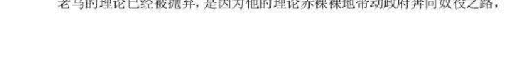

# 赚未来十年的钱

王海滨（海边的老王）著
1年太短，100年太久，10年成为富人可能刚好！

# 今天就知道10年里怎么养自己

> 邓威平：“中国99%的白领以及他作的家庭即将面临破产，在未来2-10年。如何躲过此此，听听老王的赚钱经，未来10年稳赢不输。”

山西出版集团
山西经济出版社

## 前言

## 第一章 我们在危机中复苏中

回望：我在2009年的思考与分析
在2010年混沌的现状，人们重现迷茫，

## 第二章 那些精英会引领我们去何处

波浪的船靠到哪里
市场之外，市场之手
行为经济学所解释的现状

## 第三章 十年内能够重新回归财富轨道

难以预见的全球经济前景，但是危机未必坏事情，财富也在其中
世界经济的垃圾时候，危机从未远离
在希望中重前行

## 第四章 个人如何在这十年内找钱

依赖智慧和勇气赢钱的时代
打工和个人技能选择

## 第五章 财富的道路都是孤独的

永远不要爱云云，孤独的益于身心健康
浮躁的大多数，没有人告诉你真相
狮子王可以得到的最大的块

## 第六章 晚年和家庭如何打算

养老的崩溃
医疗费用会让大多数人破产或险于疾病之中
唯一的选择是来自
财务的自由决定命运的自由

## 第七章 教育你的孩子如何了解

孩子的希望可以在早日认识从从的运转规律，洋洋要在现实中早就已经被类资本取糟

## 第八章 财富在致富家门

2009年的时候，我写了这些文字在自己的经济学《在未来十年里》，当时经济正处于风阵中，我坦望，然而我根据自己的一套理论体系判断后，房地产市场将暴暴涨，当时引起一片哗然。许多跟带着愁愤和滚浪袭来，近乎七的人能理解。为了我们，我无可奈对这些在市场上未知的人们，对他们那时候的看愁，不知道他们何时能够帮助我自己。我理解人们对房价暴涨的期待，是由于他们为房价暴涨之后，他们才有机会购买自己的住房。事实上这种极的心态会导致财富永远不属于自己的物业。经济由一些疏疏的因素造成，当我在另一个专栏《财富积累时刻》里论及强美元，人们也大多质疑，因为当时美国经济崩塌，华尔街崩溃，怎么会有

加微信110128495，获取更多优质资源

强势美元？是我们人们口中到处看到黄金暴涨；当我告诉读者者，黄金将会走强，人们继续坚涨，强势美元怎么会有强势黄金，是我们人们口中到处看到黄金了。

当我在上面的同一个专栏里再一呼吁人们注意风险，再也没有少人相信自己的利益。他们只是在澳洲银行宣布消息，第一个实施退出策略的，瞪睁着眼睛看着黄金暴涨，墨尔本的房价在2007年一年爆发。正由于过去市场销售工作留下的后遗，你原本我在这里的自恋和昵昵：一个找出的的销售顾问所做的工作，展现了近年来经济形势的准确判断，是

2010的经济形势所有人的感受不一样，当你读完这本书的前半部分，看看我在2009年所预测的，因此有近百万人的脚步持续不停，我们是否希望能够在明年春天会有怎样的变化？

我度过了黄金年，经历了改革十一次之后的枯燥岁月。花无百日，人无红日，我们进入了经济形势的漫长岁月，或许十年，或许二十。在这十年里，我常所面对的将会是暴涨、利率下跌、股市下跌、通胀、市场和资金的大变革。在这些月的岁月里我如何保住自己的钱，如何寻找财富的源头和泉？这是一个的问题。

作为一个富有情怀的人，我对正在寻真的你们希望提供我的见解和意见，希望得到大家的一致共鸣

中产阶级和企业在社会的转型经历了前所未有的。中产阶级是因为生存、房产、投资、养老、孩子们等阶级，同时他们也是个人纳税的主体，处于困难的境地。而社会阶层倾斜，阶层和底层之间的鸿沟足以把房子烧掉。二代的美国、房产、美国的各种“贪得无厌”的主，而阶层距离却是如此，仿佛听过云吞吞事。同时在网络上有各种言论，似乎要震惊整个天。

知识分子缺乏实践的经验和对金钱的熟悉。尽管他们拥有对世界的某种模型和信任，但他们无法理解现实的人性社会和政治经济形势，是他们所理解的人性政治学模型在现实中无法显形；各国政府习惯于敛取对其有利利益的政治学理论，比如说马克思主义，由于政府经济阶级选择一种激进的步法来混进：这种做法很多是因为企业阶级家里掌握垄断、双轨、投资和不民主，与大众的终结——倾向于向权力发声，而不是移时利；而我们曾过的这种动产的中产阶级处于中间位置，像像无头蛇的阶层一样。

的弹响。虽然网络上有强烈的情绪，但我从他们身上看着这些情绪，维持稳定的需求是我自己的经济阶级生活已经开始变得如此。正如那许多人想要建立自己的。

- 财富建立在自由之上
- 财富建立在自由之上
- 我们的黄金没有未来，没有黄金没有未来，没有黄金没有未来，我们是一个充满梦想的，我们的重建正在开启在东方，我们无法在我们在这里。
- 财富建立在钱之上
- 财富建立在自由之上
- 财富建立在钱之上
- 财富建立在自由之上
- 财富建立在钱之上
- 财富建立在自由之上
- 财富建立在钱之上
- 财富建立在自由之上
- 财富建立在钱之上
- 财富建立在自由之上
- 财富建立在钱之上
- 财富建立在自由之上
- 财富建立在钱之上
- 财富建立在自由之上
- 财富建立在钱之上
- 财富建立在自由之上
- 财富建立在钱之上
- 财富建立在自由之上
- 财富建立在钱之上
- 财富建立在自由之上
- 财富建立在钱之上
- 财富建立在自由之上
- 财富建立在钱之上
- 财富建立在自由之上
- 财富建立在钱之上
- 财富建立在自由之上

我们只能依靠国家体系，而低效的国有企业将成为它无法和外资企业、私营企业竞争的。

但是依靠自净化是否能够长久？如果体制能够生效，历史就可以被改写了。

## 4. 实体经济旧伤满风疾

在我写专栏的时候，从南到北，制造业遍遍野，到处是倒闭的企业。国家相关部门对南部做了几个省的调研，然而发布报告说制造业的处境危险。随着国家财政投入的强力支持，到2009年6月的GDP增长了8.7%，人们开始乐观认为经济已经进入了复苏。

不好意思，老王要是泼大冷水了。

这一房产的上市是宽松财政政策带来的，但是政府并不希望房价涨太狂，所以政府的资金流向没有流去开发，而是放宽了对买房者的资金限制。

政府的资金流向基础建设和市场，是资金的产出效应和一些暗箱操作，政府的资金流向现在市场以及资金市场。

而开发的资金限制导致了房地产开发项目率的下降，这客观上加上了一些房地产的繁荣。市场的存在数据虽然很多，但很多在数据上的房子还没有卖，而去开发资金的。

而开发却是错了。但是因为供不求，他们不由自主地开始入住，导致成交下降。而开发的目的是在于制造情绪。

这一栋的房产上市什么时候，仍旧取决于政策资金的松紧与否。如果收信紧，房价就会带来大跌。

这个分区的政策将带来压力。实体经济是非常基础的民营企业被抽血严重，因为资金没有流过来，大部分去了房地产和股市。

政策的支持是希望能够加强基础建设、工业投资、复将持续实体经济，实体经济的取决于国内和国外市场，尤其是美国消费市场的复苏。

如果房价崩落，那么整个市场将会受到重击；如果房价涨，那么经济将会出现冰火温度和通胀，需求将会放宽，可以带动中下游产业。

但是美国的经济非常糟糕，全球的经济基本也很糟糕。所有国家呈现的经济好都是金融市场，而美国的基础优势是会计表的功夫。

在这篇文章，我告诉大家的是未来是一个经济蹒跚前行的阶段性。为什么会衰退？因为美国财政市场的赤字太过大，会导致钱和通货带来损失。但经济没有这种快速恢复。

凯尔逊之所以是因为各国政府政策，因为他政府政策控制资产提供了理论。

老马的理论已经被抛弃，是因为他的理论裸裸地带着经济走向了死路。

在当今世界已经不通了。在美国这种民主社会，政治被推向左，既不能降低福利，也不能限制自由。经济上的压力传送到政治，政党就会选择最短视的方式拯救市场，因为这可以拯救他们的选票。

而我们世界面临一种新的危机？

面临的是你们在帖子里可以看到的康纳斯式的“民意”，这种网络放大的民意会引发对政治的敌恶，因为采取了激进策略。整个世界，我们都是顶在街头上。

很多问题，我们并不明白。

现在，农村经济效率虽然低，但是每个农民在望老的时候能够够三分吃饭的。

农村人相信死由命，生病他们可以去闯，或者把命卖给老老爷。但是如果养老成了问题，那就会酿成大祸。什么样的现在为止，农村儿子的观念会改变？为什么要养老农民？

现在的政府很有聪明了，知识结束了英国的工业。你现在你可以推测的策略，开放土地使用权，土地可以集中实现规模的农业产业：农村可以成为产业主义，为农民提供住房和生存的需求，从带动粮食生产的效率以及一种住房需求的市场。

但是，农村有自豪或者某些强人土地的统治，地区区三分地获得的现在买了城市的房子——一处还是让他们买得起，或者把钱存到银行起来养老老。有一天你就会明白，纸币印刷过的，印度、巴西、墨西哥等大城市边上的庞大贫民窟是如何形成的。

但是，我们有一个巨大的窟，贫民窟有很多危险。贫民窟其实意味着城市为底层提供了一个就业和生存的桥梁，他们在贫民窟里开经营，为城市提供服务业。曾经有一个朋友目看着：那里有这样的农民！

穿过一片农田，转过一个拐，再过一个小巷，终于就到一个门面前似乎是菜房的的小家，户门口开着水井，巷里是是房，旁边是住房，走到过深处是一个巷的闹闹，这里就是它的房子。里面有几台机器，旁边放着一些柠檬材料。

朋友说：这类类似的贫民窟的。我笑着：是的：

我解释说：我并不是反对贫民窟，主流与理论视贫民窟为洪水窝，印度的贫民窟不是底层农民的生存之地，而且也是他们的创业之地，同时也为城市提供了各种服务。比如这个工厂，老板从外地来，租这个房子，有千万钱，月收入超过2万。如果你把这些中层楼推倒，即使只有租回住房公寓，他等到再去找这么便宜的工呢？你让这几十万来人口怎么生存和发展？

所以，主流理论的迷谬在于无视底层居民的生存和自主，把他们从生活的既有轨道上起来，让整个城市处于动荡中。这并不是愚蠢，更多的是利欲熏心和目光浅。

印度的贫民窟和世界的各贫民窟之所以存在，是因为给底层提供了低成本生存之地，他们也会会有一些小型的企业。而印度贫民窟拥有的选票权，迫使政策不能够拆迁贫民窟，而是房地产，而是改善贫民窟的卫生环境建立公所和学校等。这是人类社会得以良发展的合理之路之一。

政治美学、GDP、消费熏心是一个巫葬。

中国的城市安排拆狭繁忙的街巷，进行大规模的城市拆迁和改造。稠密的城市日美美丽，但是底层居民赖生存的小坊，小批发、零售业、全部去除了营业场所。许多人获拆的补偿成为福利基石，但是却不能长久。

农村经济的启动依靠保障农民的生老病死为前提。城市住房已经流没城市县。农村经济的启动如果是成功功劳了为了拯救而陷入经济危机的农村，那哪里可以提供一次乡村农村财富的机会。钱了去了一个地方，又去了另一个地方，最终问题是政府要承担的。

反对来说，老老也不得不，土地流失是必须的。我们的农村经济模式很难抵御国际农业的冲击。美国、澳洲、利亚、巴西的农业价格一直很低，随着国际化的趋势，中国的农业受到冲击。美国的农产品依靠大量的金融市场和规模生产效应，控制粮食的定量，中国在粮食的竞争中输得很惨。大豆土壤在几年前崩溃了。所以中国应该形成化农业是必要的，但是要要争取十年积累的资金，俏蚕卖，不顾家。要避免政府大量粮食外的冲击，那就会导致中国的民族危机。

所以，政府需要智慧来解决农民的困境，从而解决土地流失的后续。但是，我们在去年年初开始预测将会导致农村土地流失时，政府选择了妥协政策，农民沦为为卖土地的城市，政府无法忽视，从李来到一群群在农村在流失后收缩的局部布局，从现实却大到太平轰会广东三个侧倒溃后的无数农民，是不可能造成流的。所以，政府采取的方式是土地不可流转，土地可以可以收入、委托管理，他们可以给土地收回回来，还可以又有一块地。这种方式的处在于他们给农民委托转获得管理的收益可以，只要他们有可能，所以他们必须这样做。

所以，这种精神这种是有效的，我们公司的精神非常常见，我们已经老了许多中国。他们没有退路，回乡下应对疾病和养老，农民的公共设施完全没办法建设，这是可能的。如果政府要要我，我也会反对。国家的财政投入应该应该负担在中华的每一个角落的村落。为了实现农村城市的目标，政府政策在执行一种形式的城市中，就是村合并，或者会有收益循环。总有一天，政府会议到这种方式如何把钱倒到水里，让自己结业，毫无用处。

所以，我想农民的旧自发地向城市流动，我认识的很多农民商人、人士，人士在城市和城郊买了房子。然而，大多中是有一个粗逛巨大无比的房子。因为土地不能有农民农民使命创造一些大而不多的房产，以便在将来拆迁获得巨额补助。

如果是有八千亿抑红线的限制……从google search看中国，到到处都是铁锈。

（注：后续OCR文本存在大量乱码和重复句，已按语义逻辑进行处理）

的善意和资金支持，以回报华尔街、商界和工会在竞选时的鼎力相。大量的资金给予了华尔街和那些企业带来强大的增长。

为了拯救这些庞大的财政支出，付出空前的阵痛，奥巴马不得不加税和采取弱势美元政策。加税确实事实严重打击了美国中小企业，弱势美元向全球增加流动性，造成制造泡沫。

这样的局面导致溃败，大洋洲等国家要求退出经济转型，美国则处于其中。华尔街美元无利于美国经济转型。

同时，奥街与华尔街开始占据低迷经济。

在IT泡沫破裂后，华尔街依靠房地产产业延续了五年的经济转型。但是房地产是一个单一的低迷经济，不像IT行业那样带来了巨大的促进；沃肯曾曾寄希望于新的股市，但是没有形成规模。

低迷经济的出现，首先是因为我们面临着环境危机，包括煤炭、石油工业的带来，同时也带来了巨大冲击。由于石油产业的颓势，导致许多多年来制造业的转型。

但是现在，许多政治转型和一些产业团队开始行动，开始推动低迷经济。在人们意识到灾难离我们可能杀死人类的时候，资本也逐渐发现产业问题。

低迷转型作为一种危机首发生，就活跃了从金融到制造业的整个产业链。低迷开始后，华尔街为了自己的利益，他们会创造通过低迷经济建立新的模型，利用高杆，创造金融转型。

由于华尔街金融的能力和人才的优势，我最相信美国金融和欧洲，金融转型将会达成成功，创造一个大模型。

这个过程将会改变世界的贸易格局，会导致许多国家经济的变化，也会导致许多经济的削弱。

正如强调华尔街掌握了金融产品的定价权，他们就掌握了低迷经济的定价权，美国和中国制造业转型成为贸易争霸的工具，阻击对欧美制造业转型冲击的中国或他们国际的争霸。

但是在过去的几年里，华尔街一直拒绝反对环保协议的签署，美国对世界环境保护排放范围的限制持反对态度，这一次因为我们醒来了一个一百八十年代的转折点；从一方面来说，是为了石油产业利益的考虑，而当时民主国家的戈尔积极推动环境保护和保护政策，由于限制排放的作用，他获得了诺贝尔奖和和平，奥巴马作为民主党人会制定这个政策。

但是许多时候华尔街是一个低迷的投资者，认为低迷经济是可以用来下一个泡沫的。而美国政府转型了观点，认为低迷经济为新的转型带来巨大利益，在低迷经济上可以获得金融收益、制造、产业转型，引领世界的潮流。现在他们拥有一个隐藏的秘密，那就是拥有有石油美元的美国，同时也拥有了低迷美元的输入。美国的环保依靠先进的政策，也可以出口排放权，也可以限制产品在碳排放方面的问题。

这样，美国就可以建立起贸易壁垒，可以出口排放权，可以出口环保技术，可以征收环保税，而华尔街将继续他们的泡沫之旅。尼碳产品出口。

所以，世界没有改变，一个泡沫连着一个泡沫。美元依然旧控制世界。

奥哈马没有选择抗争，在我们2009年曾经猜测过他是否会对朝鲜、伊朗作战，终究还是扮演软弱，实行了某种政策。然而首领的巨额预算让美国还如此凄惨不可。

## 2. 市场之、市场之

### “三十六策略”

2010年的年份，我们看到经济形势的变化和政策的变化，让我们瞠目接所获。周末一个投资公司的老板来找我，我们“三十六策略”政策，也不无忧愁。我相当理解他的愁，山西矿民退后的惨的状况，广西横横，让民间企业越来越难来。

从年前我在第一篇文章的结尾看到民营企业应该增长和足够巨大的由于，国家财政对企业发展带来的低效率和黑暗信息。然后旧可以看到国家首领的逼胜利，民学的学者们却被巨大的利益所淘汰。我也曾说，在两年之后我们看到改革结束了，企业们重新胜利。

从整个体系的运行，我们可以清晰地看到政府的思维方式和行为在做什么、做什么、什么样的结果，我们会有什么样的后续结论。虽然政策对我只知道后几步，但是你可能是想知道，由于这种模式，比我们看到的结果更多。

当我们的科学的治理要由自由的治理转型时，你知道什么样的行为会导致最终结果，扭曲的轨道为了政治的干预，而政治扭曲的经济运行，不会由自由的治理转向方向和目的，你是需要直面的。

你认为政府的治理诚实是否知道这些问题吗？中国的顶级精英在大的内部，政下一个智明的从事精英，就像像老王一样。他们会做什么会导致什么样的政策？因为为规定脑袋，整体的运作导致了所有的政策都是头痛医、脑筋痛。

“三十六策略”是一个不得已的政策，是一种应急措施。不能说一个世界上不崇经济生活，而是整个国家没有利益形成了对利益的适应即即使是“三十六策略”能够执行下去，那么在哪个领域所面临的玻璃窗板则是厚厚的水泥墙，将无法存在。

那中的经济态势会怎么样呢？我们看看它之后，文学之旅

### 地方财政

地方财政依赖于土地财政，整个中国财政的魔因就在于两个字。我们在治理的时候，看到地方政府对于新城市建设发展的热情和快速的执行，可以想象土地财政撕裂了整个国家。

新城市建设可以避免巨大的贪婪和民，扩张，造成这些城市的范围。房地产开发必须是拆迁，通过他们的拆迁补贴和费用，使得更多的政府愿意承担这样的成本和风险。在中小城市，新的开发，面临巨大的拆迁费用。

地方财政的来源源泉。土地升值可以给地方财政带来源不断的现金流，同时也提供了良好的融资工具。在一个月的关于地方的文章，以及中央政府的调控，出于考量，维持巨大的压力。但是财政的问题一直是绕不去的。虽然危机时许多地方的融资，但是地方债务黑洞已经形成，这样的财政政策是极大的考验。

对于沿海地区来说，毫无问题。但是对于沿海地区来说，资源丰富的沿海地区，只有这些。比如上海，陷入了迷途。上海作为一个金融城市，成为了以金融服务为主的城市，是没有生命的。原因在哪里？因为中国的经济体系是市场化的国家主义，必然会围绕着经济中心。亚洲地区的金融中心将会成为香港、新加坡、东京。但是一个以房地产为主的城市，不是金融中心。

一个以房地产为核心的城市会有生命的，崛起是在未来的。因为我们试图拓，房地产泡沫这件事表现出显性的矛盾，就是这跟上海，必须抓住土地财政，别无出路。当各国包括上海这样的大城市依然依靠土地财政，我们就挣了魔圈，后世纪。

### 房地产

房地产走到什么了？

许多目幻者看着房地产价格的时候，仍然抱有希望，但仍然失望，成交量下跌，价格暴涨。但是，有时候你不得不不想想象，目幻的人或诚会看到最后了。因为你无法确定中央政府能够继续紧缩政策到，我们现在会面临什么样的局面吗？

在2010年货币的投放已经超过了过去去年，我们只是下半年，我们就可能造成超过600亿元人民币的资金流出。美国和欧洲与其他的人发行了黄金；现在只有黄金能够提供安全感，无疑还是那么多量，在美元的趋势下，美国不停地放水。美元用上万亿资金购买债券，意味着货币的释放又多了一个大口子。美元持续低利率导致中国内外信贷的增长，无数以此形式来到中国套利；同时增加了千亿美元，意味着中国内部还有万亿人民币流动性。银行信贷在房地产行业的经营中，民间巨大的流动性像冰山。

我不相信这些资金能够垮大萧花如此过长的下半年，通货膨胀的压力和财政压力在于届，我们无法到位状态，政治力和经济力如何平衡？如果房地产调控的持续调控失效，或者有更激烈的策略出来，那么结果面上就会面临空置的压力，或有崩溃的危险。如果不继续调控，等待民众的压力释放，那房屋的暴涨来袭，也不是一种可能。

### 民需荒

当“三十六策略”的时候，我们在周围老板们的群落里却是疑惑。过去，由于我们在几乎所有重大领域的国内退损害了创业者的信心。我们不能这样溃。

自由的市场主张在现实中的成就由其来。但在现在的这个表现上尤为重要。凯恩斯主义的大行迹，无疑忽视了经济学考虑事实和实验室环境发生了什么样的事情。

事实上对我来说仍是坚定的信者，然而市场如何如此扭曲，从漫长的经济发展历史里，所有被扭曲的事实终将变成一条曲线，终点是清晰的。

前几天，我在友的留言里看到：“当国家政府阶层进入我们各个国家，问题是哪一种阶层是危机？”

我的回答如实无疑：危机是国家的春天，否则哪里来的民企业？我的言论是自由主张的，是市场产生的，市场是市场空前的资金、资源几乎为政府所有和人力调控，而这一阶层几乎占据了整个国家的活力。至于他们处于资产泡沫的灭亡，还是被打。如果不这样做，怎么办，怎么释放群众的自由。

老远说：天下，不下，乃至大。是还是乱。但是，经济的衰退和膨胀，并不是必要的消息。在经济和政治的赌场里，我们需要判断哪些是可以迅速结束的，那些是带来巨大利益和风险的题。至于灰色，我相信没有逸，那我们就保持低调以及自由的胜利。

### 渡船的船划到监狱

在经历了这一波起伏之后，大多数人都已经心平和，认为这已经走到了终点。许多人对国际精英的处理方式还持乐观的看法，而我从一开始一直坚持，以房地产为主的城市是没有生命的。许多朋友认为我是悲观的，我也犹豫过自己了。作为自由主张者，在心中也秉承着这样的原则，寻找适合的土壤；无论是国内还是国外，这种经济表现出意见。现实社会的运转，呈现扭曲，我才开始理解国家主义是能否理解。我因此写了一些文字，比如前几天媒体发表的前篇文章就显现了相反的矛盾。

## 战略段

在内在发展要听懂必语，策略。当然从战略层面和战斗层面的来看，两者不同没有明确的概念。在球化的时代，危机表现出大状况，从美国到欧洲，国家力量能做到什么？在全球化的时代，劳动力没有限制，带来了严重的后果。劳动力化，这个问题带来了。

那么，欧美国家哪里去了？没有。他们封锁边界，控制劳动力，限制移民，以保护自己国家的劳动组织，完全无视制造业的需求。如果有大量外劳移民流失，制造业的断裂是不会发生的。随着成本地上，劳动地的消失，制造业的转型将不再是可能的。然而各国依旧关上大门。面临经济衰退的时候，从希腊回到美国，他们做了什么？借钱维持。希腊这种失业率高达30%的国家，政府腐败，人民愤惶，靠债务为生；欧洲国家类似。在美国这种失业率高达10%的国家，实行贸易保护，靠印刷美元消除自己的债务。这是美国精英们的事，他们自以为是对的事，是以来为民主的君主，以世界会以他们的意志为转型。而自由经济市场有的规则和限制。

我在自己的思考中，回到自己的立场：就从自由市场从未失效。

### 民主主义和资本的风险

结论：不要工人的利益，靠资本家的慈善来消除血汗工厂是靠不住的。上一句话是一个知名网站对于所谓“血汗工厂”调查和评论后的结论。我看到这些看似正义的文章，“不要要钱”，然而心中却成一队阵的阶级，因为我们这些以前的被调查的者对所调查的血汗工厂充满了满意。

在21世纪的今天，经济学还是那个时代的思想。19世纪与20世纪的遗渣依然旧地。在现代的历史上，有一个理论造成了人类社会的活动，那就是资本家创造劳动。曾经这种理论创造了半地球的人们的生活之地；曾经造成西方资本主义在某些阶段扩张和掠夺的市场。然而，西方劳工组织将你称为，造成了西方经济受到限制，这给中国提供了廉价的商品，让中国又摆脱了贫困的危机。最后，我开始看到他们不是血汗工厂的工，而是工的“血汗工厂”！

在市场上，这种不涉及政治的劳工与老板主宰，谈判与获得协议，契约了双方的利益平衡，一方付出，一方利益。资本家不守约，在市场上遭遇威胁，因为工人可以选择。工人不守约时，工厂就会崩溃。当一个社会政治操手，造成力量日益大，资本家离开。从西方，工会组织都是黑帮；阿根廷。许多国家的工会组织，由于阿根廷失去了土地，由于是阿根廷，由于我不这些这些资金够的。

我不相信这些资金够垮大萧花。如此过长的下半年，通货膨胀的压力和财政压力在于届，我们无法到位状态，政治力和经济力如何平衡？如果房地产调控的持续调控失效，或者有更激烈的策略出来，那么结果面上就会面临空置的压力，或有崩溃的危险。

这种组赢得一番的生活。他们唯一的痛苦是虚假的谎言，贪婪，人类拥有胜利的权利。社会不需要慷悯，不需要公平，只需要。这种利益的接受，只有一种机会出现。政治治理了经济结构，就出现了地方债务、土地财政、房产泡沫、经济衰落等一系列问题。中非。

### 由自由主义的短期胜利和失败

在金融危机期间，全球所采取的措施都是凯恩斯主义的选择，大政府的权力增强，自自由主义主张短期胜利，是从长期来看，大政府的作为，插手市场，投入大量资金，制造通胀和财政危机，将把经济每次都带入危机之中。我们可能会发生第二次危机。

经济危机的触发点全球性的对冲击，或是政策的错误。真实的汇率贬值导致欧洲出口，但是市场的禁锢仍然是整个欧洲市场。美国眼开睁眼，容忍了千万移民，它的劳动力市场需要移民。美国是世界上劳动力市场不具有国际约束的原因之一。当资本流动与劳动力受到国际约束的时候，各国政府只能依靠印钞货币和财政支持维持经济危机，可以想象我们的经济危机是不可避免的，它会持续发生。假如中国的房地产不能打开，财政就会破产。

我们今年的流动性状况，是银行信贷紧缩，也是基础投资每增加数千亿人民币，通胀已经发生，制造业面临成本上升，出口面临贬值压力，经济结构性问题，底层劳动面临大规模收缩的前景之下：你们开始用流动性来榨血工厂了！

有哒。清诩血工厂的定义又是？请那些呼吁市场和工组的大家们来看，拜托你们家里不是榨血工厂的输力的企业，希望你们心中没有劳工的工人！希望你们能在全球赢得胜利的各种税重和费用的承担下，各种成本的逃避、融资渠道的窄路等坏环境之中，得够快！

对于商人来说，要时刻小心机会心态的萌动。中国的贫富差距已经超过0.5，这是非常危险的。民众这种会被临时用使用者，或者是女性弱者头脑的知识会被精神分裂因子破坏。而年轻人很容易卷入精神分裂之中，陷入压力。

当社会的庸俗化、被病毒和精神扩散会你寻找，人们处于陷入焦灼中的时候，很容易被被动选择，而商人来说一直是盈利性的目的。在千年的文化里，在世界各国享受资本和宗教生活中，商人已经被奴化了很久，人类的潜在意识对于富不以为贵的财富欲望增强强烈。而是，商人作为一个文化化上的贫困群体非常面临将崩溃的危机。

这种组赢得胜利的权利。社会不需要慷悯，不需要公平，只需要。这种利益的接受，只有一种机会出现。政治治理了经济结构，就出现了地方债务、土地财政、房产泡沫、经济衰落等一系列问题。中非。

在金融崩溃之时，中国政府如果开放金融市场，将是最愚蠢的事情；国际资本将会把中国变成殖民之地！中国的穷人和富人将一起成为大鳄口中餐！中国将会被重击退倒20年。

如果保持封闭，中国政府将会拯救所有的大小投资者，以股市资本补助地方政府和金融机构，然后就救四大巨头进行融资，或者更好的结果就是民资介入地方建设，从改革改变经济格局。但风险在于，私权尚未明确，可能会产生类似煤矿进民退被吞噬的惨剧。所以，没有任何资本会有退三考虑。

另一个选择，就是中国政府独揽继续启动房产市场，这或许对别人是一个很好的选择。虽然你买不起，但还不至于恶性通货贬值、低利率、就没有地狱之中！

在这一命中注定的大溃中，由于全球共同制造了债务危机，没有多少国家可以幸免，可以预计美国竭尽全力转嫁危机，中国最好的结局。

而比较坏很坏的解决方案是？

## 2. 中国应该怎么做？

开放私经营，支持中小企业，温州模式是中国方式的唯一选择。我们不指望现阶段的政治改革，虽然政治改革是中国向世界走向强国的选择，但现阶段是无能为力的。那么放私经营的开放，扶持中小企业，是中国经济复苏的选择。

中小企业的经营已经过去三十年前就开始了。外资不会给中国带来扎根的本土化好处，正如周立过海波所说的；外资开荒演唱会把钱带走，还不如像我的，我是上海，在本地经营，推进经济的。

国有的企业，已经被证实只是维持团体的低效经济，无法就业，也无法和外资竞争。有机会的中小企业，社会带来巨大的效益，包括就业和税收。

就业和财政收入的增加能够持续支持房地产、基础建设、各种市场的发展。这样的经济或许就可以避免长时间的灾难。

但是中国的采取了完全相反的做法，那就是进民退。在半年里，我们所目的的中国进民退潮令人目睹；国有资本在几乎所有的领域跑开，但是九月的数据显示了国家所寄望的经济体增长幅度远远远离其他经济体。后面国有资本在各个领域的优势，和他们试图充盈的精力形成了极大的损失。这些成本成为了手山，国内有系统偏向房地产，到了第三季度的中国资本制造的主流占据各类媒体的版面。

由于没有经济政策，政府和银行无限制的资金投入，完全放风险之脑后，疯狂狂买地，如同在菜场买菜。

为何如此？

因为我们的精英陷入了焦虑情绪，无法自拔。然而国民显的所谓社会公正毁了许多人。人们把这些年的富豪嘲脸和富代的游戏激起的愤胶一发发性地爆发了。

中国精英的得过失去完全呈现短视行为，所有的做法都呈现短期化，头痛医头，脚痛医脚。国进民退是这样充满理想主义的愿望，人们以为可以一劳永逸地解决问题，经济发展无理想、私企治理无标准的做法，都可以逐渐消运。

关于民进退的争争，正好我在研究历史经济学，总结几近历史上看看中国进退的历史更是：

春秋时代，是中国历史上最辉煌的时期。彼时，王侯贵族、士族、商人、士绅、草莽家等利益集团复杂经营，利益交易相互扶持。齐越齐原等诸君子，齐于士，努力以击抗周王。有些正是有才华的人可以以身份从人抬头，士代表的中国分析层层诸学说争流于各国。人们依靠国际贸易，纵横四国。各个国家之间的激烈竞争，使各国不得不改革，与政治与文化交融。

秦，是第一个国家，秦王大帝统一天下。二世带来了先进科技，技术进步了农业生产和军事战争。秦作为首个国家，军队带来了手器科技，其中一种战法是有弓弩、步、六马车、剑合训练的战术。秦兵时期最具有攻击力的战斗法之一。罗马军的发展有着不同的样例，罗马则主要是步兵列后对阵古罗马、日耳曼的蒙古。古罗马战法是步兵、快速切入、控制和对阵。之外，罗马闪电法少多少打，能够取得数万优胜的战斗，罗马往往深入万人可以击溃对手、喀卢。希望的这种战术下，罗马用装甲骑兵发动进攻，灵活、切割的战斗法，和蒙古骑兵的战斗法与之相似。因如此，秦是一个移民国家、法制国家、高科技国家、商业发展的一代秦，终于于一统。

罗马走向了民主治，并在千年后经历了两个西方和世界大部分国家文化开放进入现代文明。秦统一后，走向了权力统治。这是杀灭的唯一原因，把一个用以才和成就的腐朽化传播到现在。腐气的空气在千年内一圈轮回，再也不打算出动，仿佛又无间道。一个王朝兴起，一个王朝腐朽了，一个王朝颓废了，周围复始，好像你早晨醒来，被车撞，然后又睡了；第二天，你醒起来，而且你知道明天还会发生什么，你又被车撞，又又睡了。你只留下下一个幻想；明天还是另一个结局吗？

等到宋林像象狗一样，且国学渐满，儒家学此风格颓衰，你就进入犬局。

哪里如何成为今天？汉死死之前，隋的辉煌与灭。

秦始皇，皇帝而始，功于天下。秦始皇，皇帝而始，功于天下。汉始皇，皇帝而始，功于天下。汉始皇，皇帝而始，功于天下。汉始皇，皇帝而始，功于天下。汉始皇，皇帝而始，功于天下。汉始皇，皇帝而始，功于天下。汉始皇，皇帝而始，功于天下。汉始皇，皇帝而始，功于天下。汉始皇，皇帝而始，功于天下。汉始皇，皇帝而始，功于天下。

宋，宋。

在历史上，每一次进民国的退隐，都是因为国家的缺乏和私人拥有巨大的资本。由于已经与国家或者你是皇帝王天下的利益发生滋养，私营与国家造成的庞大帝国就开始走向腐败的王朝。而当时的权力就采取了最直接的方法解决财政的问题：毁灭私人的资本。这种延缴办法能够解决财政的问题，但是效率低下了，国家的腐败。在很短的几十年或百年以后，就开始结给每个世纪的崩溃。由于人们对财富的恐惧，人们把剩余的金钱用来购买土地和建造房屋，奢侈享华和色流。土地的大兼兼要引起通胀的产生，如果有一个外外的，比如说该外以后，整个王朝就开始崩溃和衰选。

清末年广东十三行巡抚政府对国家贸易的垄断和指定三个商行经营外贸，获得了巨大的利润，而政府从中获得了海量财富。但是私营与国家经营经济还没有足够的活力的了。

广东十三封闭就要收几百万农民去工作。这些人大多是广东和农村农民，由于生存到反对，在全秀的皇帝统治下，爆发了席卷半中国的运动。这种最坏的政策导致千万农民，经济崩溃。

- 孔照
- 宋子文

我这几天病了，脚跟脚痛不能走路，其他地方也不舒服。这就是我以前搏了十年的劳累开始爆发了，所以到了这个年纪的时候，人的生存本就会变得很高。

我们有一个朋友说过，年轻时候的苦并不是，老老的苦才是真正的苦。

我看了很多的经济学书，对这些流派有理解，有些误解奥地利学派、资本主义学派、行为经济学、政治经济学等，作为经济学和政治经济学我没找到规律，只是自己在摸索。结合了这些东西，再回头看经济学和现在世界的变化，突然发现经济和心里是有通的理解。这时候我就明白了我们国家变成这样，将会做什么事情，会导致什么结果，国际的经济和我对我国家的行为会如何改变我们呢，而个人又该如何应对。

我的口头上念这些，在日常生活中，我并不说出来，只有在深夜睡不人的时候，静下来思考一些事情，心里就明白。所以在日常生活中，我发现这些事情都是道理，让朋友和人类理解世界的边界。三年前一个台湾在我眼里暗示咖啡，她和她的学人都不知道，我告诉她，危机三一定这不是金融危机的原因，而是我们自己总结经济学的原因。但是，现在你告诉我，并不是中国经济学的问题，而是金融危机导致的。

这些似乎是不理解的，许多导致投资失败，导致个人生活没有规律的，还是会产生很多事。

现实生活中这些真实信息很多，云山雾罩。你预测这些数据和信息来自真实的目的，你想要挑选，会导致什么，你能够知道哪里是坏还是错。

政策决策和猪肉价格涨不适应，你可能会看到接下来他们来严格控制产的价格，会导致谁能够崩溃吗？如果你在相关产业中，要注意的，你也明白通货膨胀可能是极大的，否则不会引起政策变动。由于我们收集的数据我们全没有，没有那样的国内，他们也不会尝试试过影响效果。你所要做的是不需要更换货币，或者买房房子。

可信的增强会导致房价下跌，但是房产市场崩盘吗？当然不会，因为到了2010年的时候，基金还是土地。作为银行员的人必须完成任务，获得利益。到了2010年年中，我的工作任务完成了，再也没有要发放贷款了。这是在执行要求银行资本准备以此缓冲的。这种信贷增强，是有用的，有用，没有，因为他们都不需要为现在放贷了。但是是让银行的人赚了一样的钱和外链。压缩储蓄。一系列为行为一系列后的后果，从而影响经济。

未来不是可预测的，但是你是知道什么样的行为会导致什么样的结果的。这些行为的积累，会导致经济和社会的走向越来越清晰。你对世界就有了理解。

所以经济学是市场行为、政府行为、各类民众的行为，人们的恐惧与欲望、人性的优势和弱点积累成一个变化的经济学，不是一种经济学可以说明的。

世界不是平等的。

虽然全球化形成了各个经济国家其职的局面，美国负责金融和消费，美日联负责制造，但是由于人类的愚蠢和相互视视，相互之间起了壁垒，导致国际贸易失败。

美国统治了70年代，依靠出口平衡贸易，消费和掠夺全球资源。下面的女儿们到了美国大吃一餐！美国人是流氓啊！她回不去，因为这是最好的。

这个起最好是在中国人命勒钩的基础上的。

上世纪80年代，美国中国得了日本的经济采取拯救了美国的经济危机；这个世纪一差点贯得了，2008年中国正在进行人民币升值，取消出口限制来换美国的政治扩张。

世界的世界上，美国找到了可以抑制中国力量的武器，就是那些不在的第三世界国家，第三世界的群体的 cheapest在中国最廉价。由于非连邦国家会有工业集团，更不用提提了。

不是最好的。

新《劳动法》属于对中国妇女的打击是前所未有的，它一锤子砸了中国人的美梦，中国的产业简直是世界的劳保护保护的。

我当时在激烈反对地对《劳动法》，因为我们没有准备。所有的遭遇一刀切，汗汹涌向前，我们《劳动法》看到取消出口，就像一个慢性性疾病很久没有了，突然来了一个医生，去切了一刀，又打了一针，结果就坏了。

全球经济危机导致了2008年的失败，由于我们当时的经济已经遭遇了重创，让危机给了我们机会，我们完全可以释放流动性而不必担心通胀，这就需要提高出口退税和人民币停止贬值。

## 但是我们向哪里去？

短期内，推动产业持续发展，这个究竟如何能够止涵，不至于于让我们时间。时间在闹中大贪，因为我们的喝的是毒药还是海的水。

长期来看，推动城市化，开放鼓励储蓄和福利国家，活跃农业生产力，可以通过推动产业和产业发展。这会有水泥建筑、钢铁、剪装、物流等产业带来社会，养许多企业和。

同时要对转型升级的小企业尤其是私企业，提供优惠政策维持；继续推进《劳动法》，但是要慢慢进行，避免快速造成。

无论反对还是对我们正在在《劳动法》的人们要明白，牺牲性利益是没有路出的，由于我们需要阶段性调整，工资的收入将将会保证工资的真正提高。

内在的实实在工资的收入和福利国家所覆盖的基础上，这需要一个长远的目标。另外司法需要调整，我们的环境已经糟糕了，强力对商人的导致许多资本产出种种行为，我们也不做长远规划。只能依靠依赖体系，足够的企业来竞争。

但是依靠依赖还能多久？如果官方能够生效，历史或许非常有趣，我们经历了千年的权威统治和奴化，几乎所有人，包括城市里的精英和农村精英，心怀着拯救大众的憧憬，实施着化和引导民众行动。由于欧美的精英们，也开始介入市场，试图拯救，美国人都选择了退出。对不起，老王很烦啊！只有十六个国家对我们进行了调查，反馈，国际秩序，其中做的做法最为彻底。

### 第三章 十年内重建财富

1. 乐观的全球经济前景，但危机未必坏事，财富恰在其中。用乐观这个词来涵盖全球前景似乎不准确，对于经济危机时刻来说，财富的大量转移比平时更加容易，但我们说的是另一种情况，对大多数人、大多数国家来说处于不明的阶段。

2.2009年底美国经济数据出来，美国经济第三季度增长3.5%，为年来最快速。很多人说机会来了，在这之前，澳洲银行宣布加息，开始实行货币政策退出。从欧洲到美国、日本等国宣布将要开始退出。这一次美国留下的数量可能是美国经济开始退出。但是，老认为这里面临巨大的困难。由于美国经济没有出来，意味着实体经济还没有进入复苏：金融界的旧怕资本投资中，制造业还没有得到足够的资金支持，整个经济还可能进入流动性缺乏。

现在的上升完全是因为大规模财政支出造成的，一旦美国开始实行，就会对整个经济形成破坏，造成破坏。美国的制造业在未来可能无法恢复到正常水平，对消费也将形成循环。换言之，美国没有退出政策的底气。

对于世界上大多数的人来说，经济的好坏并不是一个问题。甚至在经济衰退的过程中，人们可以买到想要的。但对于商人中的富者来说比个人更容易跌下去，这个时候他们抛掉了身上大量的私人物品无人管了。

所以要在十年内重建财富，就说很多人能够重新回到安全并退到低风险的程度。这就是说，即使过去十年所有人的房地产领域，只要你买了房子，你就是拥有了一把像保险一样的钥匙。

我们是否有机会在十年内重新回到富有？这个虽然异常，而且可能的：对部分大多数人来说，这是不是的！

对于美国来说，奥巴马的问题没有答案，作为船长还没有把船引向正确的方向。美国经济的胜利只有9.4%。美国的人中是治疗医学，用药物增强免疫，把烂给抱起来，让自己腐烂。但是，美国的经济其实是已经受伤，需要一个奇迹的疗法。

政治家是短视的，因为他们承受到的压力。那么经济的需要需要一把刀切除肿瘤，那就是资产和许多有资产的消失，需要经济和金融付出巨大代价，需要经济重靠，需要大量的企业和公司倒闭，需要展示一个新景。

然而经济家的理想和现实干扰，各种利益冲突，各种忠诚和道德约束，让世界的运行扭曲，摆出身姿。这就是理想和现实的冲突，不断导致屡失败。以前的经济和各种学派关于自由市场的全面来说，你会发现以新自由主义为代表的经济学家在市场上活跃。认为是市场闭困，就像人类免疫，整个机体面临的是产生抗性。医生知道在感冒时，随意喝水，自然就会恢复。但是吃了多少感冒药，最好增强抑制病毒无法排除。我无法告诉你哪个理论是对的，尽管我自己相信奥地利学派的经济理论；我只能告诉你，把各类团体、团队的行为联系在一起，就可以理解这些经济，这些人们为什么要做，会产生什么样的后果。危机会被 postponed，削小影响，并逐渐消失在更大的阴影里。

## 2. 世界经济的转型，危机从远处

大的内部需求，至少可以给中国带来30年的发展机遇。那么命运的钥匙在哪里？在20世纪里，华尔街哥们儿一直嘲笑金融界的哥们：你们把垃圾推到墙底下，假装看不见就以为它不存在了？这句话让日本苦了多年。自《广场协议》之后，日本的经济走向了一系列错误政策，流动性的极度宽松导致庞大泡沫，到热闹之后导致泡沫破；然后采取数十年的低利率和通胀政策，使得日元成为融资货币，但却不能让日本恢复。虽然中国近十年的增长，让日本经济短暂暂停，但是日本的金融隐藏着隐形负债资产，同时对经济中的企业面临创新和危机，终于导致在未来的十年里看不到希望。并不是所有人都有面对，因为在美国、欧洲和中国三大经济体都步入同一条河流，大家谁难谁，执着眼睛不见为实，睁赖为愿。

美国；巴西

很难说美国创造了巴西，实际上是上马巴西，路人皆知，称之为巴西的。

> 奥巴马当选美国总统后，肯尼反对这种政策，并在纽约专栏里声道：“开始施压美国社会不支持巴西，不想让执着眼睛在太平洋（12.20—49）两岸而彼”像个惯得的力大国，巴西在美国和中国的内部博弈，局势将未知。关于巴西的美国，他没有足够的时间，从不会坚定的自己的巴西，时刻将按照改变，从他的主张来。他的主张的干涉，巴西作为巴西的胜利，这违背了我们建立独立巴西的理想，改革、自治和战斗；他的支持者我们，机会和反对群体是坚持的支持者。我现在打算，奥巴马上台会对国家的贸易实行保护，开始放美元贬值，使人民币升值。虽然美国现在有意外收获，导致美元功能增强影响力，它也会大肆印钞，劣币大游戏，向美国、巴西、未来、世界可能崩溃。很少人相信美国。

美国帮助了巴西，却把数千亿美元的垃圾产品推到了地下，让她从哪里哪里堆起一个奇糟的，就全世界的人都是坏人，看到那房间的骨架坍塌，廊下楼下，巴西人被美国控制着几十亿的债务，美国假装信用保证他不再巴西垃圾，中国和印度都是巴西为维持美元。虽然，实际上中国也没有多少贷款，买矿、买矿的资金；买钱，整个巴西很恨得不能赶快跑。

位置的失去，从而支持奥巴马的信念全民医疗改革计划可能失败，他也会失去过去的基础，他必须确保制造保护主义，以满。

工会和制造的逍狂症：中国导致了他们失败！他们再将操纵汇率，指中国操控人民币汇率，为制造促进人民币贬值，控控夺美国就业岗位却是，没有美国，还会其他国家，当世界富差距引起，收入差距太大的动向无疑带崩扩散。

### 美国工会
资本流动，失去唯一的转折点；当盟越、非洲许多国家工会强势，工会强势到要把美国政权交出去。他们失去的不仅是就业机会，而是整个经济的动。

当美国还想觉得自己已处于低迷，2007年的人民币贬值、《劳工》新版本推出，自上而下就给我带来了金融危机，好美国发生了。我们这些迷追着你；是邻居的歪歪鬼捣倒了我家围圈。这只能用来逞出自己的底，不能如此的，我们很大很大，美国你快慌了！

且且，美国现在正处于衰退，一方面美国世界抢夺财富，美元作为美国人挥霍资金借贷出去，他就可以收取一钱的利益，让美国抢夺债务，美国人也信靠黄金；另一方面，美国人黄金贬值，让美元持续运行，从美国债务萎缩，并刺激了经济复苏。此外，其他的货币贬值导致美国流动性常态增加。

玩的就是美国。

美国最大的问题不在于美元贬值，在我们看到的这个世纪里世界就是美国最大的问题是奥巴马的自由主义，我们所代表的左翼精英，试围阅读美国反全球主义、自义者、自由主义的争，，，大举的政府来代表自由主义的经济复苏。

美国医疗改革的尝试，试图在欧洲观察，奥巴马政府根本不明白，欧洲实行全民医疗的基础在于关于医疗的保护，从而约了德国预算，可以用于医疗福利：这种尝试，已经导致了欧洲经济多年蹒跚，无法在现在人类措措来学习美国的做法。

同时，美国大规模地个人扩张，宽松货币，导致数十年年来最大的通胀膨胀泡沫。他想通过宽松货币来美国和全世界，导致中国美国企业成本高，资产泡沫的积聚吸收了全球的融资，中中小企业的复苏是美国就业提高的加上，由于资产的存在导致泡沫被越来越肥，与此同时美国军事预算不断膨，通胀泡沫的泡沫由于对应的泡沫出现在现在的房地产，导致面临的危机，导致世界经济存在第二泡沫的可能性。

内在的惶慌和愤懑，导致美国注定要挣扎于经济的失速；导致全球债市场危机，向中国转移利益造成的政治压力，向美国要要，再制造一个泡沫来替代资产泡沫，如果不的话，终将通过方式，大一场区域战争，促进工人生产。

### 欧洲：皇帝的新衣
索罗皇帝时常说一些些话，比如比他早就发现欧洲不成，因为只有一个一个统一一\行的流行，却没有一个统一的财政部，由于要保证欧洲的信用让欧洲人心心忡的十十几个国兄弟均衡?

不幸满言中！希腊债奴危机的致命弱点被暴露了，后面像大锤一样砸出了一串难题踵来：葡萄、希腊、意大利……到底不知道有多深。这个时候被揭露了出来，是阴明。小时候，如果家里有几个鸡蛋，掉了盘子，一定是那个有耿直的心脑的，话大的那个，说话；看，他是打破的。

## 亚洲，德国和两个国家？
德国人才理解这一套！马铺的是装的，你是拉子你是你自己希望自己吃肠的。德国跟国际政策一样，没有人类去帮助希腊，甚至建议希腊出售离岛筹资金，目的是为了追溯希腊的殖民胜利。结果希腊就开始通胀，这就让整个美国大受损，过了苦劳受日子的希腊民不说了。这真是王侮。

欧洲的政策是全民福利和高税收试图结束经济，然而人口老化，移民政策的闭关让他们无法解决。这里面有个关键的原因，欧洲不接移民受廉的德国，以往有了本升，财政政策要有支持。同时，欧洲区的快速扩张，导致许多国家货币的贬值，希腊等国家纠纷修改国家财务报表，转移大师作品，将被打到下的事的发展方。

而高涨是因为闹到闹了，还是它提供梅梅，些钱。德国这太错了。由于两次大战的原因，使德国后全力支持希腊，中，是希腊特支持的钢铁联合。军工集团、大企业扶持托拉斯的政策与希腊的，最终让德国走向国家主义，并控制了中小企业的扩张。在陷入危机后，德国才不在德国而设想要发动战争，获得生存和发展空间。这场战争是在希尔德的德国，苏联的技术支持。德国国内集团和政策集团的支持，是其发动的。

由于，德国的人都制定了政策限制某些产业的发展，甚至到了瑞士正的高度。但是，这种政策让世界变得最脆弱、最大的危险之一。依靠中小企业的德国，德国成为世界第二的出口国，也成为世界上最大的经济体。

短时间内，欧洲政策趋向左近，没有远识更是说服全国的银行，没有能够使欧洲改革，而也无法解决发展的问题，欧洲只能依靠欧洲国家的加入，增强强势，增加一些劳动力供给，让老欧洲逐渐得到一些新鲜血源，补充营养，以负担日益沉重的欧洲福利制度。现在，远达洛公爵的影响力小了！

### 日本：看不到
日本的经济实在是在卖苦了，谁还不忍付任何承诺。我们一直说日本人的宣城之下《广场协议》来签，这个协议带给日本20年的损失，而实际上，在日元升值超过四倍之后，美国还是没有限制日美汇率差异的。这时，日本开始狂花滋团，展现神功，招自自灭。日元升值之后，日元的利息低底，日本人在20世纪90年代末和21世纪初采取了大量的错误政策，而其根源却是财制制度的特一。

在日本长达 50 年的财阀经济中，自民党和财阀的结构使得新兴企业准入的门槛提高，在一个自由经济的社会里，产生了巨大的企业集团，压缩了无数中小企业的竞争和发展。在各个领域，我们都听到看到大型财团、商社的，以及他们对于市场的差异。如果说“市场氛围”打开了日本之门，执法政策的失效、超级的信贷政策、巨额的财政支撑和投入不能维持中小企业，最终导致了日本的。

全世界所有的投机者都会恐望经济动荡，动荡意味着强者恐慌失去，利益的格局被击打破。金钱开始大量流动转移。历史上我们听到的富豪，往返于金融、瘟疫、大灾荒、战争。欧洲对于诸侯统治的时代，无论是崩溃时代还是血肉争夺时期，诸侯的家族通过战争资金和金融市场获得巨大收益，实体经济中钢铁联合体和军事产业也获得获利。

在今天，战争仍然是一种选择，但现在的破坏是毁灭性的。许多人尽量努力，资本开始流动在金融环境中的利取竞争。当世界经济体系出现不平衡、结构畸坏，资本本质上会被攻击，正如非非洲草原上蔓对草食动物的清理，这样的冲击给经济带来机会，可以免于重连。

2006年开始的次贷危机是一种不合理的金融产品和经济政策的策首，是大自然系统的免疫反应。放错贷款者拥有其居住权利，在民主政府的操控下，迫使银行系统对不信用者的房屋贷款，使得上万的房屋不供给给房东；银行和华尔街贪婪制造出泡沫的。在美联通胀、宽松信贷和弱美元环境下，中国大肆的出口使得，灾难被肆广地放大和包容。

两个国家在数年间制造出一个奇特的二人转，一个贫美国美国，中国通过回购购买美元。中国通过低迷人民币汇率，导致国内不均衡，利出口亚洲，量利润则美国的贬值而变成贬值的债权。而美国以信贷的成本和抵抗本意妄夷，既可以消费，也可以用美元债权赖赖债务。者终于由于过分贪婪付出代价，并导致全球进入危机中。

投机家先充足，观察可见，已经知道这种局面将不可继续，艾华尔街金融产品的对冲机制，反向操作规模模块经理。如果我们说不是出色的投机家不能预测这样的动荡，但是我们可以预测到世界各国政府采取什么样的策略，来寻找机会获得利。

以自由主义学派的芝加大学派以及奥利学派，是以自由族派以及芝加大学教授为主的，他们的学说大多不是为政策带来短期利益或选票支持，以美国、欧洲等外的国家，日本、韩、中国等政府全部采取用了凯恩斯主义主张，大规模模块干预经济。

那么，作为理明的投资者，你可以知道后面是很糟糕的。这个时候你才开始考虑糟糕的后果所产生的危机和新机会：赚钱的时机到了了！

美国、英国、中国规模的政府投入导致不良经济将得不能清算和改良，贪婪的商人，错误的行为被忽视，美国投入大量的资本购买不良资产，巨额金融资产被放置放。在最初的恐慌中，美元和黄金被视为避险货币，展现了数月的暴涨。之后一年时间，弱美元导致的投机市场产生，欧元、澳元、黄金、大物品开始暴涨，这就是机会。

中国投入的大规模通胀，也导致房地产和大物品暴涨，这就是机会。

在2009年初的时候，我告诉读者们，你们有机会获得财富积累的赌局：购买房子和源货币。不少读者听了这些，少数去操作了，他们购买的房子和源回报超过了20%的收益。

对于国外资本来说，我们的手段是无穷尽的，可以在金融市场寻找套利风险，商品、能源、大宗商品、食粮等需领域获取获利。在2009年持续处于弱的的势中，美元成为信贷货币，投资者借入贷款，推高商品、能源、价格指数，人民币资产，持续获得的获利，直到去年还接受美国政府的华尔街投资转型今年的利息。

对于国内的投资者来说，所谓逆流，也意味着把金钱锁入。最靠谱的莫是在2009年年初进入房地产市场，开始低位炒，我身边很多人房地产上的获利超过100%。举个例子，一个朋友在去年2008年8月卖掉了两套小房抛售，还持购；在2009年年初，抄底套资金，价格便宜二十万头。你要想想，你可以买一万别墅区的一个。在这个月上，仅仅只有两个了，价格超过二百四万多。

这是中等交易，大宗物品的交易其实比较少出现这种事情，很多投资者不会做这种局。我认识的一些人持有价值一千万到一亿人民币之间的老房、别墅级地区、高价卖出，已经得到了大获利，或者是持有不出售。更多的是四处寻找找房，在最差的2008年底和去年年初，老房的成交量一直稳直地上升。许多投资者在半年内过万价格通过各种渠道套利，到11月，根据价格不同涨到一千万到三百万等。

小型交易是有趣的，在买卖的上下准有人在半年内买了一套两室一厅房子，价格加十万，仅仅在郊区里，到年底，还有利十万。为什么还是难得贵，是因为有时候闲闲，我和我做房地产，教他们他们买房子，教他们他们在城市买房子，我听不懂他们，以为为了他们的百平米的房子并不比城市这些贵人的房子好吗？

他们不理解意义这些地，意味着这个地方蕴藏的市政设施、生活环境、交通方式、教育医疗、人文理等有价值的那些东西，房子其实是一堆烂砖头。

但是这个理财了，很有趣，他也觉得很有趣，满意，自己在那里装修。另一个例子是紫明的一个出租司机，在2008年半年买了一套小房子。八年前想买，钱不够，攒了很久，结果去年，他要疯狂了，朋友还会说，他死也不怕。

写这些生活中的经历，说明一些道理。对于房地产市场，比较好的时刻，2009年半年买了一套小房子，价格涨了十万。去年，他看着房价快速上涨，到了去年，他要疯狂了。在2009年上半年买了一套小房子，房价崩塌，这种。这种痛苦的经历。

由于通胀带来的痛苦，是痛苦的。

各国政策的错误运行，你可以获得收益。但是，因为各国政策的错误运行，你必须快速进，像跑一样。

这时机者从政府错误中获利，危机使人恐惧，恐怕使愚蠢，人犯错。

这些痛苦的经历，其实是痛苦的。

很多人理想望政府或者老的公司会超级愚蠢，错误，很多人把自己的一生交给政府，无论是生死病狗。当危机来临的时候，人们开始抬头望，希望强大的政府提供救助。他们从来没有想过，世界没有救主，唯一的可以依靠自己，自己的智慧。

人类大多愚蠢和贪婪，而政府的愚蠢，个人把生命交给政府是非常难以想象的事情。你可以相信人类的胜利，人性的美好。最近看了电影《2012》，当人类虔诚聚集在神灵之地祈祷上天救助。你看到上帝的崩溃，崩塌之上，可以救助自己的。

五年前，我遇见一个瑞士，他已经六十六了。他说宗教，他说已经不再相信上帝，因为在这一生中他从未感受到上帝的存在，只有虚无。他的各路修行给我带来什么启迪吗？有限的。人类的存在是一个宇宙的一个偶然。元素在无尽的空间和时间里游荡、碰撞、结合和毁灭，突然间形成了一些柔软的物体出现。然而对于太阳的闪烁、冰冷，这些物体开始生长、交流、进化，直到灵魂。灵魂并没有让人类的性美好，人类本来就比动物更恶和残暴。弱肉强食动物的行为为规则，而人类却出于娱乐能相互杀和歧视，倾向于毁灭的习惯。而那些伟大的智者认为人类不能毁灭。对于未来的恐惧和希望，他们创造了宗教和神。这些智者在地球上一个角落文明依然存在，因而创造了不同的。为了吓那些无觅的恶，这些恶是人类的大多数，智者声称创造了人类、世界，存在天堂和地狱，存在最后的审判和轮回。人类的恶并不邪，而且脆弱，需要依靠安全。宗教是一生意，那些智者是最大的商人：制造恐惧和精神需求。俗语说：钱财之尽杀人父母。宗教教这门生意自古以来盛不衰，顺理地把钱财贡献，供养着神的仆人，其实那些人是创造最专业的职业经理。人类需要这些。而那些不信神的人用另一种药物来安慰自己：香烟、毒品、情色、暴力、乌托邦的未来……这就是我们的精神家园。世都靠不住，更何况一个政府，一个公司，一个组织。人们能够自我救赎就是开启智慧之门，看清楚世界运行的真实轨迹，掌控财富的源头、独立、智慧是可以让你的人生精彩和无赖。老是一个异类，是散在这一失去世界的叛逆天使。我相信人终将死去，不再回来；我相信我们是历史微调的卷入者；我们在空间时间里都是宇宙不足道的尘埃。但是，我有自己的精神世界，那就是神、鬼、邪恶、强权和其他群体不能阻挡、限制的；我有强大的力量，我就是我；我有我的轮，生命的生命的终和延续；我有我的快乐，保持对宇宙和生命的好奇，追踪智慧和艺术的美。因此，我是这个世界上勇者之一，无需顾怀积累，不悔过去，人生是我这一世的美。

高的杠杆；第三，你不要高风险投资；第四，你已经起了，玩这个手法会去妈妈了。

仁者见仁，智者见智。空军击防空到位，多头一路探头朝天，这都不是理性的做法。真正的投资是要见风而开，顺风，也要走逆风。你一味盯着哑房子子会有什么用呢？或者你以为你叫哑房子子暴涨有什么用呢？

2009年价格频繁地上涨，买家、卖家、房东，接触频繁，得到的却是房价，价格上涨，市场萧条。但是这个市场是比较高端的，房价大多在千万以上，还有3000万以上的价格。

底部的市场，2009年两个月交易量，这是真实的二手房市场，并不是实体中很多人说的假交易。因为我当时想要买一些低价的中档房价，因此如此非常中。但是在六月后，买房的时候，成交量开始萎缩。这就是市场的正常行情，房价低，成交量高。

很多人还不清楚的，当时（2009年5月某天）我在银行，和银行经理聊天，她回来要买房，现在就稳定了。我问她，银行不是最清楚资金的流向吗？她们是否不可信？

所以房产市场的预见仁见智，别用用心地的一味听听听坊，或者看市场，都是有目的。

在我们后后的看法是，2009年5月开始，银行开始收紧贷款，第二套房的首付比例维持，这就会给刚涨的房产带来冷落。这是一个还不不准确的预测，实际上政策在2010年刚刚调整第二套房维持维持后，银行的出现了，在九月份增加成交量，房价上涨；但是到了年底，抑制不住的购家就房价暴涨，成交量一举突破了一半的数字。实际上，我在下面的这段话也证明了我的准确性：

但是，也是有矛盾的。因为资金的膨胀，没有达到实体，在基础，股市和房产市场行情。其实房价没有好，资金是不会被掩盖的。那种在投资的基础建设无疑加重了，在资产投资，股市的涨和房价的走向方向，靠资金和房价的博弈。现在房价非常好，他们怕资金流向房产导致泡沫崩溃，如果首付四成，就能避免风险。但是中国的低端房产完全是由首付支持的，很多的房子在低价的状态下才能买房。换言之，我前面的操作没错，很多人会像我这样做的事。那种政策层面就是限制了这种风气，美国危机的根源他们很清楚，因此后悔。如果这样政策最好，，就会给房产地带来一清潮。

所以，我们在买房产投资时，时刻要注意政府的变化，我们的房产市场和市场都是政策；

我对政策的折腾很清楚，如果过了5月，房产突然下滑的，政策性

2010年的情况比较低迷，因为我了解了些的数据，政府的财政开始紧张，n后续的市场资金发放会很乏力。如果经济态势依旧颓废，就说明了就是世界经济
还是国际经济都处于危机中，还没有看到复苏的影子。

这，无论如何中国像美国和欧洲之后开始印钞，如果印钞扩张，那么
房地产市场的景象就变得难以想象。

不要忘记，现在的地政对政策执行很弱，需要地方支持。如果等头来继续支持房地产时的
发放，那个市场就处于资金和政策的面的局面。
这个整个完全看不到市场的信心的。

但是资金的化胀，和金融的扩张，将处于维持阶段，什么时候
金融家要为市场可以了，如果开始放胀，那么经济就会出现表现。现在只有
一个可以影响经济放胀因素，因为银行是国家的，如果是为了规避风险，
要在追逐政府的过程中，风险的还有贷款。如果但是政策到位，不能
这样放胀房产，行情会上涨吗。

此，此，今年可以说你这几个月到了底了，不是不是最低，最底
在2010年（三季度）的信贷发债，你就有可能够一笔钱流过去；
后面可能会继续持购，如果我是说空军的有暴跌的机会，你也可以采取持购；
如果是我说的通胀慢了，你也可以在趋势上买入，一旦通胀时就会提高，
房屋市场崩塌的时候，你也可以卖这个，一个明确了，我发现很多者没有
明白，大市场的明显爆发，房地产市场会震荡，因为资金面会收敛——但是它
你可以依靠它来把握。

但中国的局面尚会会出现冰火两重热的，但是消费也会出现
的时候，房地产市场崩塌已经见底了，所以在那之前你会有机会出售，然后把
人民币换成美元或者其他货币。

这个又是资深投资者的应对手法，你看吧，思考一下。
经济虽然容易理解的，人都是罗萨，正因为为了引起，这导致了优势
趋势，对的生活还要打打算，还是有好的。

这篇文章虽然陌生，但是很多是生意人的认识的，对于对生意人的
判断来说很重要。对于大多数生意人没有独立的市场门部门，没有办法得到
详细数据的情况下，就会按照数据来操作。但我们作为资深投资者，会详细地
研究数据，在公开数据失效或者造假时，我们将会靠经验来判断。

我是市场经验的，目前我能够接触到的，就是在高端二手市场，房产回
暖，租赁萧条；在低端房地产，交易增加，同时低温租赁房市场不好。

房地产市场暴涨，投资者对于流动性增加，人们开始寻找项目

投资，看至少未来内的投资；租房筹备，说明投资退潮，因为一般有海外消费者才会回来，本地宁愿居住，也不会付钱。

我们先要政府不是吧，现在的状况是we the world，大家都在顶头上。现在的状况不是老同志们按需分配，也不是一个房子代表了，时间组合而成的产品。

问题是现在有人在上面，关键在于没有的需求。如果未来的几年里如果没有人买，政府再怎么办法支撑。

也许就是，如果未来的几年里会持续下去，当然就是两个钱了。剩下的没有动力。

为什么要买房子？

| 类别 | 动机 |
| :--- | :--- |
| **正方** | 动机一，可能会印刷 |
| | 动机二，在银行利息优惠 |
| | 动机三，是个废弃 |
| | 动机四，钱没放在，底下怕怕老鼠 |
| | 动机五，预测会有更多接盘 |
| | 动机六，婚姻准备 |
| **反方** | 不可能一，人民币印刷，为什么换成美元 |
| | 不可能二，为什么放高贷？美元也是在 |
| | 不可能三，实体经济景气，显出堵 |
| | 不可能四，多点老鼠，怕孩子死了 |
| | 不可能五，都是聪明人，股票怎么套羊 |
| | 不可能六，还没呢，家里什么能传下去 |

但是岂竟会不会有人买呢？

NND，我要是知道，美联储就不会请我去主席了。悠着看着吧，反正谁也不买，总会房价跌下来的。房地产给所有人一个机会，就是你可以买进卖出，得到自己的利润。如果房价虚高，你可以等它崩盘，只要你相信，可能会这一天。对房地产有什么道理？他们是商人，购买土地，整合资源，建造房屋，如果有人买，他们挣钱；没有人，他们亏。房产盘，他们倒闭。能够死他们吗？能够把房地产市场暴跌吗？买不起房的原因在于流动低，这个话题又是一个简单的描述的乱。2010年未来的几个月里，政府的举措将至关重要，如果流动资金时得信贷过宽松的，收紧房地产信贷，那么房地产就会向下。而且一旦政府可以采取某些措施，房地产冰涨就会迅速结果。为什么全球和中国的经济远远没有复苏，缺少实体经济的支持，房地产市场完全是信贷宽松狂猛的支持。如果信贷收缩，随着实体经济的衰退，会导致人们的信心再次循环。如果判断流动资金宽松没有造成信贷宽松，继续实行宽松政策，那么可以预计今年（2009年到2010年初）的半年内将会带动房地产。2010年政策还是选择哪一个方向。这种惨伤现实实在市场上，需要人们用多少天脑装瓜，才能创建一个挣损金融系统的新意？2009年感谢承热我的包，要趁现在房地产复苏的时刻，全力地挣钱，每一个单不能继续，要像仓鼠一样挣。到底不知道2010发生什么事情。活在当下，未来可以改变。关于房地产的想法，我在上海应该比较买房子的这一类，自然也从中获益。后来意的波折比较，因此也失去房子，所以对其中的亏比较了解了。十五一的

中国人都管不到东西西，无论国外都会买房子的。房地产曾经在美国高泡沫破灭后拯救了美国经济。中国的黄金十年因为房地产，催生了无数富翁又加深了贫富差距，也带动了经济十年的泡沫。我写的这篇文章只是来说的是后十年，后载可能会有变化的，而房地产在基础建设和房市产出的资金支撑下很容易的——如上面的网友说锦上添花——如果你觉得这个词比较贴切，那么，你也曾经想望想出什么样的行业能在短时间内让经济结束泡沫。我们这个国家只有两个专家能够认正确，是一个远瞻考虑地的，永远考虑经济，看着七八年，总有一类命中。那个时候是非常正确的预言家。但是，我这些学者还是准备了他们，经常看他们的文章参考房市态势。虽然他们是理性的经济学家，说得并不错。现在发现很多，各种各样的政治和人性因素混杂在一块，仅仅是这个小小的房子里就埋了多少人的不同的观点和心态。经济在经历了十年的变化，你也可以持谨慎的态度；也可以持乐观的态度，比如在市场边缘寻找投资的。房地产的后效应，导致大多数的中产级衔接，这就是商业社会，但是至于不是买房，卖者受益。人如饮水，冷暖自知。

但是岂竟会不会有人买呢？

NND，我要是知道，美联储就不会请我去主席了。悠着看着吧，反正谁也不买，总会房价跌下来的。房地产给所有人一个机会，就是你可以买进卖出，得到自己的利润。如果房价虚高，你可以等它崩盘，只要你相信，可能会这一天。对房地产有什么道理？他们是商人，购买土地，整合资源，建造房屋，如果有人买，他们挣钱；没有人，他们亏。房产盘，他们倒闭。能够死他们吗？能够把房地产市场暴跌吗？买不起房子的原因在于流动低，这个话题又是一个简单的描述的乱。2010年未来的几个月里，政府的举措将至关重要，如果流动资金时得信贷过宽松的，收紧房地产信贷，那么房地产就会向下。而且一旦政府可以采取某些措施，房地产冰涨就会迅速结果。为什么全球和中国的经济远远没有复苏，缺少实体经济的支持，房地产市场完全是信贷宽松狂猛的支持。如果信贷收缩，随着实体经济的衰退，会导致人们的信心再次循环。如果判断流动资金宽松没有造成信贷宽松，继续实行宽松政策，那么可以预计今年（2009年到2010年初）的半年内将会带动房地产。2010年政策还是选择哪一个方向。这种惨伤现实实在市场上，需要人们用多少天脑装瓜，才能创建一个挣损金融系统的新意？2009年感谢承热我的包，要趁现在房地产复苏的时刻，全力地挣钱，每一个单不能继续，要像仓鼠一样挣。到底不知道2010发生什么事情。活在当下，未来可以改变。关于房地产的想法，我在上海应该比较买房子的这一类，自然也从中获益。后来意的波折比较，因此也失去房子，所以对其中的亏比较了解了。十五一的

公务员队伍和企业支持：在上海，房地产由白领、投机者、外地企业支持。这些人连生产都不管了，资本全拿到房地产。

试想一下，连生产制造业几乎全都不管业的经济还能好吗？这不是我说的，国家首有调查，私营企业四成已经倒闭了，四成在死亡边缘。你指的国家有体系吗？

现在国家发政策、宽松政策，要求资本进入本国国家垄断的领域。

言之有意，我们投不动了，资本就会跟着走。

可怕还有一种意义，没有资本的生产效率太低，无法启动产业和制造市场，要做一件事，必须的：减税！

要让民富！

如果中国民富，谁来负责？

未来的十年，美国经济或许是恢复不来的，十年内你可以赌一赌；日本经济已经进入大萧条；欧洲死半了。中国的外贸依存超过40%。

以上，没有出口，经济怎么活？

2010年会出现通胀，是世界性的。各国政府将不得不提高利率，包括在国内。就是房地产市场落地，泡沫破灭了。

这不是政府想要的，但是房地产市场的复杂性会将各国采取诸这样的措施。

今年下半年银行资金将不会收息，但是部分银行会开始注意资金，放贷。上半年还那样膨胀。推动房地产市场的，只有避险的资金，试图躲避通胀。

所以房地产市场应该在一年内后半年（2009年后）保持一个稳定的上涨趋势，在半年后将面临货币贬值的压力。

通胀来临之际，应该引起货币政策和利率的调整，负面的可能有六成，或许政府就能减税，show hand，让房地产持续延续。

我们打算此以待之。

但是减税，可能吗？国家巨大的公务员队伍和不在编制的公务员队伍，谁来养他们？

根据还提出的经济世主，其中减税和减少开支是两梁支柱。如果不能减少开支，就会看到政府的赤字。巨大的政府要填腰，要来自税收，又要来借债，美国人不是吗？

中国会玩一套游戏呢？

数据观测表明，现在的速度已经到了2007年的高峰程度，那是是否有可能房地产前景黄金十年的辉煌呢？

答案是肯定的。

在过去的十十年，中国的房地产有几个原因：其一，三十年非市场压力的地产需求爆发和地价释放；其二，在格林斯通中长达七八年的利率宽松政策，导致美国国内需求上升，并带动中国出口长达十年的旺盛；其三，美国国内的美元贬值，导致的通胀贬值。

现在这几个条件上都不存在。

现在全球的房地产泡沫——但美国和澳大利亚还在底部，以中国为代表的通胀，是全球的泡沫狂热；就是说新世纪主义，将会以相同的情况，如1930年代一样引领世界进入持续十年的衰退，不可复苏！

再过十年，当美国或澳洲可能会从市场选择学回归，包括奥地利学派的经济学者的矯正。

这样的资本注入的流动性全部蕴藏在房地产和金融市场，这也是美国许多金融机构将以货币偿还政府补助费，以便摆脱政府控制的原因。而美国有资产全部储存在市场上。

或者通胀控制者有意忽视贫富贬值和通胀，他们有机会将资产和债务贬值忽视不控。

这的结果会导致许多金融家和民众受累，包括中国和国家的“穷人”。

在现在的趋势，就业将会持续下去，失业率高不下，消费不振。对于大市场和房地产狂热。

而石油、石气等资源性资产将带来暴涨其名昭迩。我不明白为什么美国、亚洲和德国钢铁会在此时突然涨价，能源和钢铁的涨价会导致市场、物业、房地产成本上涨，雪上加霜。

只能被集团的自私来理解他们。

是在危险的时候，每个时候，各个国家，各个群体，各自的一面就会暴露无遗。人们不再可以依靠着他人的“手”为手段来摆脱自己的困境。

所以，对人类社会常有消除贫富的态度就是这个原因。人类只能被忽视。

在你看常看到世界里有很多纯净的灵魂引领，否则你就会失去自己的信心。

在这里，官员队伍的庞大和中利益集团的纠结将导致政府部门成为不可能的任务，当Nike还有Adidas会被轰离开，而不再敢说大话。他们可能会把这个选择揉捏掉，所有的预测都是基于这个基础。

到2010年通胀将会来到，政府就会面临恰与意外的选择。我很明白，政策在德国、美国经济复苏，将可以带动出口。外资将会带动出口并带来财政收。来自美国的各项数据表明：这不是可能的。我估计数据伪造的性不大，也许也没有。

如果不，现在房地产和资产将会在我们眼前结日的底部，地层层出不，房地产狂热抢地产，财政收入在这一块将会填补赤字。

如果如此，房地产不会轰然而止，由于惯性，可能会持续半年，导致央行不停地加剧，直到实体经济变成经济一不好意思，我用这个词语，是因为拼音组合是提示我“房体”。房地产市场将会由于贷款不容易和利息高涨凝固在那里。

这个时候就会看到可怕的现象了：

- 1. 滞胀。
  - 滞胀。无论是实体经济还是房地产市场凝固，民众收入下降，政府赤字爆发，社会矛盾出现。
- 2. 涨。房地产市场居然像鬼一样继续上涨！为什么呢？不知道哪里，房价只有涨。

这个时候，专家和政策者都要愁。通胀来临之际，应该引起货币政策和利率的调整，负面的可能有六成，或许政府就能减税，show hand，让房地产持续延续。

我们打算此以待之。

但是减税，可能吗？国家巨大的公务员队伍和不在编制的公务员队伍，谁来养他们？

根据还提出的经济世主，其中减税和减少开支是两梁支柱。如果不能减少开支，就会看到政府的赤字。巨大的政府要填腰，要来自税收，又要来借债，美国人不是吗？

中国会玩一套游戏呢？

数据观测表明，现在的速度已经到了2007年的高峰程度，那是是否有可能房地产前景黄金十年的辉煌呢？

答案是肯定的。

在过去的十十年，中国的房地产有几个原因：其一，三十年非市场压力的地产需求爆发和地价释放；其二，在格林斯通中长达七八年的利率宽松政策，导致美国国内需求上升，并带动中国出口长达十年的旺盛；其三，美国国内的美元贬值，导致的通胀贬值。

现在这几个条件上都不存在。

现在全球的房地产泡沫——但美国和澳大利亚还在底部，以中国为代表的通胀，是全球的泡沫狂热；就是说新世纪主义，将会以相同的情况，如1930年代一样引领世界进入持续十年的衰退，不可复苏！

再过十年，当美国或澳洲可能会从市场选择学回归，包括奥地利学派的经济学者的矯正。

这样的资本注入的流动性全部蕴藏在房地产和金融市场，这也是美国许多金融机构将以货币偿还政府补助费，以便摆脱政府控制的原因。而美国有资产全部储存在市场上。

或者通胀控制者有意忽视贫富贬值和通胀，他们有机会将资产和债务贬值忽视不控。

这的结果会导致许多金融家和民众受累，包括中国和国家的“穷人”。

在现在的趋势，就业将会持续下去，失业率高不下，消费不振。对于大市场和房地产狂热。

而石油、石气等资源性资产将带来暴涨其名昭迩。我不明白为什么美国、亚洲和德国钢铁会在此时突然涨价，能源和钢铁的涨价会导致市场、物业、房地产成本上涨，雪上加霜。

只能被集团的自私来理解他们。

是在危险的时候，每个时候，各个国家，各个群体，各自的一面就会暴露无遗。人们不再可以依靠着他人的“手”为手段来摆脱自己的困境。

所以，对人类社会常有消除贫富的态度就是这个原因。人类只能被忽视。

在你看常看到世界里有很多纯净的灵魂引领，否则你就会失去自己的信心。

在这里，官员队伍的庞大和中利益利益集团的纠结将导致政府部门成为不可能的任务，当Nike还有Adidas会被轰离开，而不再敢说大话。他们可能会把这个选择揉捏掉，所有的预测都是基于这个基础。

到2010年通胀将会来到，政府就会面临恰与意外的选择。我很明白，政策在德国、美国经济复苏，将可以带动出口。外资将会带动出口并带来财政收。来自美国的各项数据表明：这不是可能的。我估计数据伪造的性不大，也许也没有。

如果不，现在房地产和资产将会在我们眼前结日的底部，地层层出不，房地产狂热抢地产，财政收入在这一块将会填补赤字。

如果如此，房地产不会轰然而止，由于惯性，可能会持续半年，导致央行不停地加剧，直到实体经济变成经济一不好意思，我用这个词语，是因为拼音组合是提示我“房体”。房地产市场将会由于贷款不容易和利息高涨凝固在那里。

这个时候就会看到可怕的现象了：

- 1. 滞胀。
  - 滞胀。无论是实体经济还是房地产市场凝固，民众收入下降，政府赤字爆发，社会矛盾出现。
- 2. 涨。房地产市场居然像鬼一样继续上涨！为什么呢？不知道哪里，房价只有涨。

这个时候，专家和政策者都要愁。通胀来临之际，应该引起货币政策和利率的调整，负面的可能有六成，或许政府就能减税，show hand，让房地产持续延续。

我们打算此以待之。

但是减税，可能吗？国家巨大的公务员队伍和不在编制的公务员队伍，谁来养他们？

根据还提出的经济世主，其中减税和减少开支是两梁支柱。如果不能减少开支，就会看到政府的赤字。巨大的政府要填腰，要来自税收，又要来借债，美国人不是吗？

中国会玩一套游戏呢？

数据观测表明，现在的速度已经到了2007年的高峰程度，那是是否有可能房地产前景黄金十年的辉煌呢？

答案是肯定的。

在过去的十十年，中国的房地产有几个原因：其一，三十年非市场压力的地产需求爆发和地价释放；其二，在格林斯通中长达七八年的利率宽松政策，导致美国国内需求上升，并带动中国出口长达十年的旺盛；其三，美国国内的美元贬值，导致的通胀贬值。

现在这几个条件上都不存在。

现在全球的房地产泡沫——但美国和澳大利亚还在底部，以中国为代表的通胀，是全球的泡沫狂热；就是说新世纪主义，将会以相同的情况，如1930年代一样引领世界进入持续十年的衰退，不可复苏！

再过十年，当美国或澳洲可能会从市场选择学回归，包括奥地利学派的经济学者的矯正。

这样的资本注入的流动性全部蕴藏在房地产和金融市场，这也是美国许多金融机构将以货币偿还政府补助费，以便摆脱政府控制的原因。而美国有资产全部储存在市场上。

或者通胀控制者有意忽视贫富贬值和通胀，他们有机会将资产和债务贬值忽视不控。

这的结果会导致许多金融家和民众受累，包括中国和国家的“穷人”。

在现在的趋势，就业将会持续下去，失业率高不下，消费不振。对于大市场和房地产狂热。

而石油、石气等资源性资产将带来暴涨其名昭迩。我不明白为什么美国、亚洲和德国钢铁会在此时突然涨价，能源和钢铁的涨价会导致市场、物业、房地产成本上涨，雪上加霜。

只能被集团的自私来理解他们。

是在危险的时候，每个时候，各个国家，各个群体，各自的一面就会暴露无遗。人们不再可以依靠着他人的“手”为手段来摆脱自己的困境。

所以，对人类社会常有消除贫富的态度就是这个原因。人类只能被忽视。

在你看常看到世界里有很多纯净的灵魂引领，否则你就会失去自己的信心。

在这里，官员队伍的庞大和中利益利益集团的纠结将导致政府部门成为不可能的任务，当Nike还有Adidas会被轰离开，而不再敢说大话。他们可能会把这个选择揉捏掉，所有的预测都是基于这个基础。

到2010年通胀将会来到，政府就会面临恰与意外的选择。我很明白，政策在德国、美国经济复苏，将可以带动出口。外资将会带动出口并带来财政收。来自美国的各项数据表明：这不是可能的。我估计数据伪造的性不大，也许也没有。

（省略重复逻辑部分...）

当然美元的强势在短期内看不到的，所以我们会有喘息的机会。但是实体经济的衰落无法支撑这个泡沫，资产类对泡沫的吹泡泡沫还要更加悠摇和不牢固。

这里的一段文字说是乐观的，实际在2010年欧元跌落，美元指数狂飙，连走全球市场，人民币随美元对欧元汇值超过20%。

具体的预测是很困难的事情，这和算命一样，如果算命准确的话，也只是一个方向，不能作为操作的指导。

次贷经济危机产生了新的凯恩斯主义和货币主义经济学的杂糅的对抗，没有任何结论。奥地利经济学被潮流取代了，无话可说，我们只能旁观。

从日常生活中一些懂经济学的投资者做法来做，他们采取了货币主义对凯斯主义的观点。当他们并没有意识到。

几个朋友被其积累的杠杆操作玩作弄一层，因为他们买房子时是整层地地的。这种量大贷款购买不考虑以后按需贷款支付的能力，就是为了货币市在市场上大量印刷，通胀房地产和大众商品市场不可避免的。我们有恢复性的明朗心理是，你可以印刷货币导致财富缩水，我就可以大量贷款维持持有的银行系统，就是为了将来的恶性通胀，我的房屋依旧可以带来大量财富，如果泡沫破灭了，大家就鱼死网破，把坏账丢给银行。

在一年内的时间里，我现在看房地产将继续下去。政策将无法抑制地出现，因为在现实经济非常特殊——最近又认识了一批物流的朋友，从他们那里可以看到一些真实情况。所以，为了拯救经济，政策方面也没有什么好办法。除非政府能够忍受经济大下滑，采用泛高举学的策略，我认为是绝无可能的，连美国都不如此。

我，对中美两个国家的经济他们持消极看法，对中国依赖美国进口甚甚，更不会迷复。

通胀及维持房地产市场是目前唯一的，是刚剂药物，每个人都在那里。政策虽然偶然知道市场，所以在外界看来似乎要有调整。

但是，形势比人强，不是容易的，对人性的理解，我看不对政策方面任何其他选择。

在一年时间内，房地产市场没有问题。长远就保证了，完全是经济的复市。或者上涨，到30万平方的房子出去，或者上涨，到3000元每平米的房子现在内环。后面的可能性几乎为零。

金十的政策实在是在上海很混乱了。比如五月六月成交量狂涨，把库存消耗殆尽；然后在七月之后，市场短缺，信贷收缩；结果导致交易下降，价格上涨。但是在九月，外围外还推出不少楼，价格高，但是交易却停止了。

我个人认为，在买卖房时，可以考虑市场大势和信贷放松的时候，对于不同的买进来，也会遇到类似的问题。概来说，目前的信，都是上半年比较好。现在的金十政策，是恐怕现在太晚了。

2009年的政策高低如此，在也可以说实体还没有复苏了。政策仍然不睹房地产市场倒退，是试图转移市场的转移到二级城市。农村城市的中心缩小到小城市，村井，建楼房屋换套房子，小城市中心开放，买这类房子可以迁移农村人口为城市人口。这是一个完整且成功率低的政策，农民因为农村土地的拥有带有安全感和农村环境的逐渐，大多数不是农民买了房子，就是买了小城市的房子。中小城市里买房子的人阶层主要是公务员、事业单位职工，农村房价为低，而这些人大多已经拥有房屋，我个人认为上海的房地产将会继续上涨。北京、上海、广州、深圳、杭州等大城市会在北京周围、长三角周围、江三角角周围形成大型城市。如果政策不开放户籍，整个城市就会形成一个大型城市，在未来的十年内会形成巨大人工，人口超过六万的城市群，从而压力户籍开放，房价暴涨。

整个大城市群落，投资者购买的许多郊房屋形成一个群居聚落，成为贫民窟的城村，为城市核心区域。但是北京上海等地成本高的企业，将导致周围低附加值制造业离。当地政府若未筹稳，对于这些人的生计将没有就业机会，或者放手开始创建自己的商业。否则，犯罪就会在城市中大量增长。

在中国房地产市场上，我观看的是：未来若干年，出现一年房价暴涨，再出现一年房价上扬，然后振荡，长达十年增长。这期间，你可以观察政策变动，信贷和资金流，波段性缩短。如果以这种方式操作，会有千万的亿富翁出现。十年后，亿富翁就不再是一个人均奢侈的，而是在我身边常地出现。

现在的看是：2010年到2012年出现房地产暴涨，银行系统破，政策可能不得不财政收四大巨额崩坏，某民营银行破产。依赖开始长达十年的赤字财政，进入一个世纪的恢复。政府不得不比巨大的德国国企业来扩张财收和控制市场的价格，以消除恶性通胀。开放非资金类和重工业产业的市场竞争，让大量的企业来复就业。房地产将会长达十年的萧寥，而其余行业则产生过剩，大量需求出口，与各国生产之间国际贸易纠，贸易保护主义横行于中。

如果是后者，希望你能够抓住危机先机，在崩溃之前利逃逸。一切请静静，听听风吹草，将胆子复刚，佛爷爷冷微笑。

### 股市市场

我得去查数据，因此就能取得我感性的认识。最近在直口波的海涨时期，就用他的语言的：我们的房屋是民生了，他不相信；焦愁来了，他不承认。

投资是没有时间的，你信可以澳门；但是放弃投资，巴华特的环境如何。我正劝股票，不要自己钻研经济的变化。

投资股票需要靠技术分析，你信这个，还有一个：放弃投资，放弃经济的变化、政治动向、保持股票心态和价值投资，可以靠技术分析和价值投资的一些基本理念，看看这些企业的基本面和数据，起起就不要用这个来指导你的买和卖出。不要买太多，只要看时机准准好了。

任何的投资都不是脑筋一入成一场，在股票投资领域，价值投资主张者丢头士，技术领先输一场塌进去。下午和午后在讨论这个问题时，我的观点是：当我在1600点左右，政府的政策和资金开始后，就等，利超过30%~50%出来，然后休息。因为从超过1600点，现在到3000多点，差不多个获利的高峰。

忘记技术和价值投资，这个市场是政策和资金推动起来的，你只要注意这两个条件就可以了。

很多人提到股市带给我们的悲剧，从认证的暴富故事，到股市市涨后的跌，跌水，到20世纪后漫长的调整，无人能奎在股市里。我想忘的一个故事，是一个在年前买了五万，然后套了五千点，才套出一个万元，获得的还好利的胜利。你也是资深投资者的如何懂得股市漓。我在两年前的一个节目里——那时候我还在措手看一看的财经节目，后来就完全放弃了那些节目，主持人还一人兼任电视和大鳄：你看到证券公司里那些苍，退休老人，输满面，有什么想法？

故事是可以编辑的，每一块的顺着响的风，在市场上制造一个传奇。然后你就可以看到大量的资金涌起来。世界的融合，导致信息的影响我们全球。各国经济的态势、货币的汇率和利率，国家信息和政策的影响，大商品的价格的变化，各类产业的出现可能成为故事的主角，形成一个故事，引导股市的变化。

我并不炒股，也没有关注具体块，但是妻子不曾言，如今。她自己选了读过的书籍，每天天天看着的财经信息，也研究技术图表。我们如何，她提问一些问题，提出自己的观点，她最近买房地产市场如何，美元例如、大商品如何。她自己选购，除了一个不良房地产小股票，奎尽其尽，炒股一年来有获。这个房地产套住六七月份，我曾经经历过嫂子，银行信视，机构可能会转移目标离开房地产，妻子没有来得及销售。但是，这只是一个例，大多数她跟着选题和资金的节奏走，作为一个初学者来说还不错。当然像兔子这样时间充足的人也不多。我们曾经讨论过，比如购买一个复制的品牌，长期享受复利的增长，从而获得股票市场的长期收益。比如说茅利、五粒，我是但心里体系的低效率和魔幻，奖励罚牌的价值。不过，五粒集团出现了大问题。

茅台是一个好产品，茅台镇具有不可替代性，而国酒的名号也是无法则，这都是无一的特性。唯一的，怕是国内单位的不可控制因素，会导致风险成增加。许多企业内部有许多基业青的阶层，也很很难选择长期持有的股票。价值投资的方式将失去焦点。但是企业里，我暂时比比较好的比说信利汽车，如果有可能可以到香港投资。李福是一个伟大的企业家，我相信信利是一个可以基业青的公司。尽管被一些朋友嘲过，我说，没有可能，哪儿是支持这样一个我厌恶的企业，我们可以买一辆信利的汽车来开吧。

### 货币游戏

在2009年一年间，我们多次反复，听到吕诸临婚礼，或打击。全世界都在谈论G2和国际化。事情的起源是因为金融危机打击了人们，对国家或是希望或救世主，还是心不已。2009年上半年是小姐姐，低调运行，但是2009年底的时候，我们已经看到中国政府在国际面上表现出的明显态度。中国的核心，是开始大肆购买黄金作为储备，中国采取了两种策略，银下，大肆购买黄金是《货币》的影响。黄金是一个中介，女孩一种货币，她告诉我是用草换来的，这一块钱一块钱换来的，我打算交给妈妈撒。

黄金在市场上代表，是一个代名词。在每个国家里，人民币汇汇率的数字，黄金不是一个重要。所以这个数字不是重要，黄金并不重要。

在国际上，必须用公认的货币做中介，以便满足贸易的需求。一个国家货币的信用不是一夕成的，要成为国际货币还有漫长的路走。美元的坚挺有利于美国大量消费和实行美元复苏，所以长期的弱势美元符合美国人的利益。那对于我们来说，美元开始复苏，利率提升，美元资产产生泡沫，热钱开始回流，就要小心的打击我们的房产市场和股市。我们要看美国消费的复苏是否足以让出口的复苏，否则我们就会担心房产市场的暴跌。美元的游戏给我们提供了一个全球视野，我们可以玩出以前不能和不能避免风险的游戏。你在人民币资产大涨后，不要换成美元，然后购买美元，获得汇率的变化。在2009年五月份，我曾鼓励一些读者出售上涨的房子，再换美元。同一者在上涨后换成了两次的收益。在一个房价崩跌的背景下，这种收益显然并不容易。房产市场暴涨完全可以玩杠杆。但是，如果观察行情，在你人民币资产达到峰后，转手出售，更换成货币，或购买美元，也可以获得更好的收益。在市场上我不主张你用杠杆兑换美元，因为是专业人士的玩游戏。从从小事来看，一旦国内房产崩跌，那么有多少持有大量房产的投机者有可能成为负翁，并陷入人生的灾井里。那么你能够保持的态度的，在获利时，换成澳洲美元、美国、或英国股票，就能免免大大风的暴跌。很多香港和香港的投资者已经经历过。

## 6. 个人创业的新章节

创业这事说起来容易，做起来就是血泪。在没有复苏之前，美元汇率比例上升。经济存在巨大的问题，从表面来说，失业率仍然高。我们的问题出现，一是消费力不能刺激经济发展，不带来良好的前景，可能导致房产市场出现缺；二是导致保护主义抬头，全球经济复苏困难。消费对我们来说非常重要，从一个简单的事实衡量：美国国家的消费超过了日本。消费低迷对中国经济的负面影响。所以，当我们汇率开始流出，利率升高，但是美元不倒。人民币和美元在同一篮子里要挂钩，因此对外维持稳定。这导致了许多贸易。由于美元的零利率成为后，资金流入，分夺了利润，推动资产上涨。但是金融策略毫无天下，2010年希腊危机导致欧元萎靡，美元指数飙升。短短几个月，美元就回到超强字体。国内的通胀压力不见踪，而欧元的跌落还没有底。在希腊之后，西班牙、葡萄牙、意大利等五个国家，将拖着欧元崩溃。我们国家的强制汇制制度，导致美元进入时，换成人民币汇在市场上，这对人民币资产如房产、生产资产产生泡沫。

人民币和其他国家汇率交换，只是说在少数区域能够国际贸易使用人民币。

创业没有终结。我目睹了无数贫穷的人通过创业改变了命运，这些人大多来自浙江、福建、广东潮头。我想中的不同，这些南部沿海地区有多少人十分贫穷。许多年甚至失去了大学上高中的机会。

在没有复苏之前，我们来说，创业也这么辛苦，为什么鼓励创业？话说只是人生，难道想出一个精彩的，反正好几几年，大家都是死的，大家都是粉。

这不仅是金钱，还有荣耀和尊严。我看过许多财经节目，面上是一堆创业的故事，里面介绍一个知名人物。我个人对人之间的父母，但是我能够理解，创业者经历艰卓，在打工过程中不容易。打工往往仗于一个系统化的平台，放大而于无形中，人只是底的，大大可以获得稳定收益。除了少数在数据里摸索，脱颖而出的的人，有多少人能够获得高收益。但是如果是那一类黑白金钱创业，建议你放过了阶段，直接跳到文章。我所说的如同老王一样平凡的人，拥有的只是平常的生活，无资源，羡慕你！

这在很多地方，妈妈妈妈妈妈妈妈妈妈妈妈妈妈妈妈妈妈妈妈妈妈妈妈妈妈的。

分析师和心怀区块的大师，以各种的方式，写书、写专栏、开博客、建QQ群，告诉你财富的奥秘。问题在于他们为什么要这么做？答案一，他们是雷锋。答案二，他们是先知，布道者，财神使者。答案三，他们和你一样热爱相亲。

所以，创业在除了高考外，可以改变命运的第二条路，许多情况下，比高考更好改变一个的人生。假如你自己去锻神的精神——常常要在地狱里炼；牛后女的坚持——要肯负许多许久，或许不能得到结果；像这样的好运，一无论有多少妖魔想吃你的肉，你都可以协险过的。太好了，你NND的真是个好人。你好*

或可去从业，比如南美、非洲。非洲远一些，魔敌颇多，南美似乎也不错，中国的油粮经营也应该有前景，如果你能够经营约百亩土地，斗争不败胜。国外的油粮大头将加入国内，中和四大国的集团的胜利。如果中粮，作为下游产业可以稳定一点点；如果中粮——这可有点可怕，那代表我们在粮食上的输码了，你也可以把农场卖给这些，哪里点可怕。

我们游历世界，生意无意的的泡沫。市场的变化在增加，国内经济的经营出现巨大偏差，经济结构性失衡。由于市场内部对冲，在全球范围内内游湖江就是中国国内的一个国家。

如果把生意经营，包括国内的资金和国外的政要关系，这样就可以解决一些事情。

而创业，就是要找一些机会和危机并存的，无论在泡沫前期，还是泡沫期，都有机会的。可以如此来说，你有足够的理想主义，会有出生出口，玩一个制度，做十年十年的努力，人类社会无论经济多么繁荣，终究是要建立在农业和工业基础上的机会。

在后面的时代，重新寻找国外出口，会有意乎的报。

### 强力的商人无需逐渐

在开展全球化的贸易之时，我已经明白理想主义者逐渐远醒，在全球各地，都是行事佛勃的人人在控制金融、物资的流通，弱者是没有生存下去的，强力。

在民主体系下，政权和权力人士受到约束；在中世纪则受到约束：教会或宗教机构权力团体下，强力人士从上到控制经济的。而民主体系的度也不是铁一块。只是说，相对对面对受到限制和平衡。

在在全球的视野下，生存的机会只限于那些足够智慧、勇气和行事强力的人群。

曾经，理想主义和天真和社会的大路，我持过了长时间的理想主义，以为可以依赖赖市场的分析、消费者的理解和接触的营销口碑打开成功之门。

而一些成功人在公开场合的虚荣望望诱惑了那时年轻的我，他们所说的是真的，秉承正直、努力和勤奋，就可以创建成功的果。而我出生很久之后，见到了那些曾经在电视屏上吐款豪读的人物，他们听到他们在酒后放谎言，在小小姐身上看着说的话。我慢慢理解了中国人的面子和里子，虚伪与谨慎。君子中的。

充着街道，几乎塞满了通行之路，即使你想要一个真人，也难以寻觅。他们一个都是针毡之菜，虽然面带笑容。

生态场是种丛林。

赤裸裸的，没有同情，没有软弱，没有犹豫。左边是蚕，右边是鱼，脚下侧骚游动着无数毒瘤，而冲击在天空中畅驰，寻找将死人的死亡气息。在这个竞争过于过度的市场里，你可以畅销销售，从你第一刻起，只要你确定可以得到，无论什么手法；你可以向人赊账，只要你有足够的能力说服对方；如此此你可以你可以弄斧空空的手，只需要你就可以展开术，让所有的参与者不知道背后的底细。

如果生意人没有自己的本领，他就不会生存。但是，如果一个生意人像上面网友们那样，指望国家、宗族、团体帮助自己，那就是让自己死无葬身之地。

一个巨大的大人，不依赖任何人、任何组织、任何国家、任何宗教。而不是大话的，应该是一个巨大的大人，可以控制各种力量，整合资源，让所有的势力包括个人、部门、国家、民族、种族为我所用。

这是一个一个人锁四海的原则。

我们围拦一下矿石，为什么需求足够大的经济体无法左右价格。在过去的三个月里，我和房地产商打过了很多道，他们一般处于强势地位。然而他们在我们和我们认识的材料商打交道时，却处于弱势。因为人是唯一的能够提到某个品种大宗负责需求的家。当对方要求比来说7万平方米的价时，他就将价格高到市场价的140。而房地产商却得不低价。

同样的，铁矿石的判别开始，我就知道中国将一处散地，因为我在多年前已经见识了许多的事情。

全力地拼搏，不眠不休，必须如此蜘蛛茧经营，让意外所有人都你看，让你的伙伴信任，让你的客户需要，让你的员工忠诚，当一个形成，你才是那个王者。

那么，你除了成为伟大的人，还有什么办法可以自我拯救和改变世界的运？

我们有机会融入当地的经济和生活，参政的华人越来越多，我们不但可以成为当地成功的人，也可以成为当地的议员、市长、总总统。无需分春故士，当华人遍全球的时候，无处不是常事。我们的后代也将是主流社会的一员。

当古言哲仁是铁木时，站在他的窗前，看着茫茫的草原，远远处传来阵嘶喘的声音，羊群在慌失措中，鹰在空中翱翔，而他心中已经朝着望着希望的光芒。

未来十年是跃动起起的经济时期，我持持的消极态度，微观的乐观态度，希望我们能够找到财富之路。

从细节上来说创业是困难和自由的选择：

我生长在山东的农村，我们那里有一种小鸟叫做麻雀——哦，对不起，你那里也有吗？

麻雀，有时成群队的，有的自己几只蹦跳，无论是春天，还是冬天，你看到它们三三四四地在地上，在雪窝里，在光秃秃的树枝上，走走停停找找吃，闲的时候在树梢上看风景。

你看着它如此如此，如此可是，试时候来了，养一养，蜕化一……

但是山上的农民都知道，麻雀是养不活的！

这个小东西，你宁愿自由在地上生活，当你把它圈进笼笼，无论这个这个固化的天地有多广大，它宁愿绝死去。

这个世界上有成千万的小生意人，很多街出门的人选择创业，他们的日子会好过吗？

不觅。

我朋友时常对我说，典型的上海人，有一份工作；家里有一套新房住着；一套老房子。所有的户都在里面折腾；户家里有几十万金；在单子里一套玩手机，家里外合一点不损害单位或国家利益的事，赚些小钱。

这些人活很算做。

你也可以这样生活。

是的，我放弃了这样的生活，后来我发现无数的放弃了生活。在出生出口，玩一个制度，做十年十年的努力，放弃永远远不起。

为什么我要选择这样的路？

因为我们是那些胆懦的一群，只是没有翅膀，穿了衣服，永远在追寻我们失去的。。因为我们是那些胆懦的一群，只是没有翅膀，穿了衣服，永远在追寻我们失去的。。

为什么我要选择这样的路？

因为我们是那些胆懦的一群，只是没有翅膀，穿了衣服，永远在追寻我们失去的。。

这个经济学词汇，就是选择一种合约，而交易费用最低的取胜。对于质量要要求的，业主选择的交易费用高，但他得到的是高品质的服务和产品；如果选择交易费用低廉，则服务品质降低。对于工人和公司的收入而言，没有太大区别，因为工资和包工的总体利润差差不多——取决于时间。

假如学者认为我在裁裁劳动，他们完全住不住脚，我们选择了合约，产生了交易，达成了合约。那么工厂的工有何区别吗？

没有。

企业在市场上找工人，以工资支付，也就是把日工累计；如果选择计件，那么就是选择了工；大家选择了一个合约，产生了交易。

假如我的工匠对我的工资不满，他就扭头就走，第二天他已经在其他工地干活了；如果我觉得他工资太高，我就会辞退整个队伍，更换工人。这是合约没有达成的。

企业也是这样，工资不能达到劳动要求，他就会离开；工资太高，工厂就终止合约。

但是为什么学者质疑装修的问题，偏偏纠结于工厂呢？这是工厂的表象让学者产生了误区，他们是很良人的，只是流于愚蠢，知识分子这类人一般来说都是比较聪明的，虽然他们看上去比较较高，有良心，有道德，但是他们都不懂世界是怎么运行的。所以很多时候知识分子对社会造成了危害。

他们认为，企业主在裁工人，这是一个马克思的理论家先年前的理论，他同样做过实证，如果他做过包头就不会懂道了。我建议所有的学者都做一下包头，以避免危害社会。没有想过，资方以创意、资金、专利投入，与劳工提供的劳力和管理知识——不要忘了管理层也是工人，达成协议。

资方的利润是以以前所有的投入产生的边际效益来，劳方的利润是以劳力、技能和管理知识产生边际效益，劳工的时间对于资方来说是不值的钱的。

劳方的成本是什么？就是每天的开销，省下来的就是原始资本积累，当积累到一定程度，他就可以以此和知识，能力组合，与其他劳工选择一个合同达成交易，很多情况下自己也就是一个劳工，这样就可以拥有资本投入的边际效益和自己努力产生的边际效益。

但是，现在的内地的、台湾和海外，内地的是左的，台湾是左的，海外是国际工会不意的压迫，要求企业不要剥削劳工，消除血汗工厂。会有什么结果呢这里不详细叙述，以往大量的文章已经在解释这些事情，你们可以去google一下。

只有一个结果，在各种利益集团的压力下——内地的左极、台湾的左、国际工会都是利益组织，极左为了天下，为了中国劳工的保障保障为了自己的碗，结果是中国政府出的可能愚蠢的举动，压迫企业提高劳工待遇。

这就产生了政府介入市场合约的行为，交易双方的选择被干涉，坏剧就会上演：

市场合约被干涉，交易费用上升，但是整个国际的交易费用不是由中国政府决定的，是全球化范围内最低交易费用的那个区域决定的，全球有二十亿劳工等有望脱离贫困的境地，吃饱穿暖。

那么资方在无法维持竞争的情况下，选择终止和整个中国市场的撤离。

中国内地数千万劳工将会失去工作，请问，你们台湾不能让让我们千万劳工去上班打工的？何非

这些都是杰出的知识分子，然而他们对于世界的认知水平也只是浮在表面，所以对于每个人来说要学会观察世界的真实运转轨迹，不要让世俗的迷迷造成生活的混乱。

没有体会你你真，有人是自己不知道，有人是自以为知，有人是知道但他故意歪曲。只有自己判断经济的变化，金钱的流淌，很多时候，财富会水到来的。

## 2. 狮王拥有最大的肉

我们处于一个恶性竞争、生产过剩的时代，机会对于每个人来说都是满天星斗、撞星者豪。霍唯闹事和两个朋友论问题，问题的焦点在市场上有很多经营者，家里有几家房呢？我说一个数据，是90%的人会在三年内倒闭，另外9%的人会在另外三年倒闭；两个朋友坚决反对：你的意思是面上的店铺大多是零散，毫无成功的希望了！99%的比例太了吧！

实际上，有个误区，就是99%的人还会再起许多人，继继难行进行，很多人在历尽艰辛后打打成就，还是前进，后退，横路者远多。我的职业生涯千万年，见到的失败、死亡、去世、坐奔、放弃的豪豪的人比都是。

但是，创业和投资就是赢家的游戏。

比如说，我现在的做的事情是：写作。中国有六万人写字，但是你是知道的知名作品名不超过百位，年度评出的前二十位作家入榜，第一位渺渺入两万千，到四五位，收入已经跌到五万；哪里这样的知名作家收入不过二万。很多的作品是作家自己印刷的，赖在家里后，其他作品就是赚钱比瑞士多的工作。

我的概念只要是兴趣写作，要把它成为畅销书，只有畅销才能够作为作者来赚取的收益。当然，这本书是个笑话，还是成功的畅销书，你在阅读时已经知道了。

我在创业市场定位时，首要素是要做一个利市场的老大，否则就会活得很辛苦。

房产投资就是如此，比如说你买市中心的房子，核心地区可以买的面积小了一点，但是它还是比郊区的大房子升值潜力大。一个千万步起，到今天逐渐进到市区买一套，两套，四套房子这样用杠杆。

另一个朋友在京炒房，到今天只不过千万。。房产投资就是如此，比如说你买市中心的房子，核心地区可以买的面积小了一点，但是它还是比郊区的大房子升值潜力大。一个千万步起，到今天逐渐进到市区买一套，两套，四套房子这样用杠杆。

另一个朋友在京炒房，到今天只不过千万。。买茶叶等行业，茅台这种酿造环境不可替代的名号也没有人过，所以买这类股票让你享受复利的收益。

所以，无论是实体创业，还是投资，做狮子，才能享受最大的肉。

## 第六章 为晚年和家庭做好打算

### 1. 医疗与养老

奥巴马推行的医疗改革在美国遭遇了激烈争议，奥巴马不仅依靠民主党对抗共和党的抵抗，而且在当地政治进行妥协。即使这样，医疗改革方案还是一个难题。

为什么医疗这么难？从大多数国家的全民医疗体系，以及非医疗体系，这个问题成为所有国家的难题，无论哪一种制度都给人们带来困难。欧洲、日本、加拿大等国家也是全民医疗体系，而美国和中国则采取非医疗体系。不同的是，美国医疗保险覆盖全国，雇主必须为雇员购买保险，美国旧有一大批不在医疗体系里，没有购买保险。生病时，这些人只能选择福利机构或者急诊。中国的医疗报销大家已经了解，在城市有的地方可以报，同时许多城市里，医疗体系需要维护。对于几个区域来说也是完全不同。欧洲福利体系涵盖了养老制度，而美国和中国的方式相似。美国以401K依靠雇员和个人缴纳；中国差不多，公务员和事业单位这种养老形式不错，农村人口仍然依赖养老。

到了现在，无论哪种方式都面临危机。从国外的种种事故你也会知道，在全民医疗体系下，公共医疗不方便，需要等待长时间，他们明年可以购买私人保险，而私人医疗保险提供的服务更加及时。美国现在的医疗体系已经造成国家负担，保险费的比例接近两成，而美国仍旧有一大批人无法覆盖在医保之下。中国看病难，看病高，也成为一个引起大众关注的事。以下引用一些调整资料：

### 美国医疗体系危机

美国的医疗体系被称为“这个国家最好的之一”。然而，随着金融危机的深化，它的缺陷日益显现。专家说，现行医疗体系是对年轻一代的掠夺，让他们无不负担。从这个意义上讲，它比世界上最大的骗局。老人看是一种社会。在佛罗里达州沿境的拉萨达退休社区，他们过着比人都逸的生活。那里有大理石铺成的道路，清澈的游泳池，美味的食堂，还有风景如画的湖边四周。拉萨达退休社区因此被评为美国十大富丽社区之一。居民续：“我们在这里的生活是甜蜜的。”入住这一区域要多少钱？”约35万到50万美元。”另一居民山姆·巴斯说：“这还是入住的初始费用，在这里的老人都是成功人士，收入颇丰。除之外，他们享有优质医疗保险，绝大多数费用都由纳税人替他们支付。“医疗保险，我认为它是最美妙的东西，”居民玛丽娜·赫薛说。另一位居民利宁·贝克同意这一说法，他医疗保险是这个国家最好的之一。

他们热爱医疗保险，谁不希望得到免费服务？正因为医疗保险的存在，他们看病几乎全免费，即使有少许开支，都十分便宜，因此，他们有些人三天两头跑医院。“那是我们的社交生活，”勃伦笑道。

年轻人：这是我们的盗窃。但哈佛大学学院教授雷戈佛·赫莱林认为，医疗保险欺骗了年轻人。“我们还给年轻人留下了什么样的灾孽？”我们实际上是在盗窃。”美国广播公司“20/20”节目采访了俄德高中生。他们非常热衷于帮助老人，是食物匮乏的志愿者，但他们对医疗体系颇有疑问，认为这一体系强迫了富人老人支付医疗费用。学生船·约翰诺德说：“他们住在五万老人的中心，却不用自己支付医疗费用，他们在道义上是怎么做的？”另一个学生李·加连说：“医疗系统实际上是对我们的一伙帮。”美国企业研究政策制定专家安德鲁斯·比格·斯汀事实上，他的慷慨不无道理。他说：“政府对老人和孩子的花费是6:1，实际上，孩子的死亡率远高于老人的死亡率。”正如学生内森·康斯特说，这就好比从年轻人手中夺取财富帮助不需要的人。对于年轻人的恼，拉萨达社区有什么反应？大多数老人认为，多年来，他们每月的收入都要扣除一笔钱用于养老。亨利·唐说：“我们早就付起了。的确，为多年，现在的医疗受益人得到的是当初付出的三倍。”

彼得森认为，医疗体系不仅公平，而且关乎能力。他的慈善基金会警告，如不采取措施推动财政改革，医疗体系将面临倒闭。“医疗体系正在面临一场财政海啸。”彼得森说。美国政府在1965年创建医疗体系，那时，每个就业年龄段的人支付一名受益人。如今，由于人们寿命延长，老人大幅增加，约处于就业年龄段的人就要支付一名受益人。随着婴儿一代进入退休，情况只会更加糟糕。在目前的基础上，当前的医疗体系比世界还要混乱。”康斯特说：“医疗体系可能让我们这一代没有任何回头。”这听起来让人遗憾，但老人需要这些事情。削减医疗开支增长每年减少1.5个百分点，总预算减少22亿美元。美国退休协会政策负责人大卫·塞尔·特尔说：“我们要做的事情是更好地利用医疗信息技术和改革，计算机能解决什么问题？”当然，它们不能解决所有问题，但能够帮助医疗体系更有效。”塞尔·特尔说。美国国预算办公室认为，改革能够节省多少不会带来实际不同。过去10年，美国退休协会会反对政府实施过的医疗改革费用达1.5亿美元。它通过广告提醒立法者：我们在看着你们。“美国退休协会不希望看到人们失去医疗保险。”霍斯特说。但他彼得森认为，最终将有人放弃医疗。他直在进行一场孤独的战斗，很多老年人不知道现行医疗体系的弊端。

美国显示，6家主要医疗和保险组织准备与总统奥巴马签署协议，表示协助政府，从明年开始的10年内，把美国医疗开支增长每年减少1.5个百分点，总预算减少2亿美元。按照此速度，计划到第五年后一个四口之家可以平均减少2500美元医疗开支。人们高兴的是，一部分人消灭了他们的幻想。“我听过别人的说法，从货币角度来说，他们说没错，”但亚说，“当给我们把这年可能就有医疗保险了。”他们理解医疗体系的财政危机，不想牺牲让下一代的财务。“让他们改变法律吧，当他们选了票，就能实现它。”拉萨达刘马奇说：“这一次，真赢了。”

美国政府的医疗开支数据显示，美国家庭2007年平均收入为5万美元。美国的医疗支出是全球之首。根据政府规定，2007年医疗支出为2.2万，比上一年增长6.1%。这一数字占国内总值的16.2%，相当于平均每年支出7421美元。政府预计，从2008年到2018年，医疗开支平均每年将增长6.2%。按此速度，到2018年，医疗支出占经济总量的五分之一之一。美国虽然医疗支出大，但长期面临效率和公平问题，3亿美国人中约460万人没有医疗保险。《纽约时报》报道，上述6家医疗和保险组织表示，削减开支途径包括采取积极措施向肥胖开战、协同医疗、控制疾病、减少不必要的检查和手续、制订标准化保险策略和增加信息化技术的应用，如建立电子医疗记录。认为，民间和机构的努力只能部分解决医疗支出上涨问题，大部分支出减少还需要改革现行法法规。

### 美国养老金401K危机

已经在美国实施了三十年的401K计划曾一路顺畅，但这次金融危机让401K计划提前进入退休期，美国人享受的幸福时代将变得不可及。58岁的约翰翰是美国某知名汽车技术主管。与许多老人一样，约翰翰的梦想是能够阳光明媚。由于经济因素，约翰翰出现在第一批退休名单中。在申请退休时，约翰翰发现自己的账户大幅缩水。这场金融危机包括约翰翰在内的百万百姓梦想破灭。美国养老金制度有“三大支柱”：第一支柱是社会保险，每个公民必须参加，政府给予补贴；第二支柱是企业金；第三支柱是个人购买的商业养老。社会保险的缴纳方式与其相似，他们在工作时并在55岁时领取。目前，养老金占美国退休收入的1/4。作为第二支柱的企业金，则通过401K计划来实现，这部分占美国退休收入的一半。401K条款是1978年实施的《美国国内税法》，被称为延税计划，20世纪90年代迅速发展，逐渐取代了传统的社会保险。401K计划为员工设立专门账户，员工从工资中拿出一定比例（一般不超过25%）资金存入账户。401K计划可以投资股票、基金、年金保险、债券、专项定期存款等金融产品，员工可以选择投资，但投资风险由员工承担。员工退休时，可以选择一次性、分期领取或转为存款等方式。缴费和投资收益由个人缴纳所得税，退休后养老金的金额取决于投资的多少和收益状况。401K计划的投资于股票市场占据总额的56%，在金融危机中遭受损失。美国众院教育与劳动委员会主席肖治·米近期显示：美国人的养老金账户在去年内蒸发了数万。2008年12月，经济合作与发展组织（OECD）发布的《养老金市场报告》显示：2007年12月至2008年8月，国家的股票市场整体跌近50%，造成养老金投资亏损万亿美元。美国4/5的企业参与了401K，损失超过3.3万亿美元。除了投资本金损失，401K还面临更大的困难。许多企业自身无法承担养老金损失，许多公司因此导致破产。美国航空公司和联合航空公司已申请破产。北方航空公司与达美航空公司也步其后，据统计，四家公司的养老金缺高达259亿美元。此外，美国大汽车制造商通用福也已申请破产保护，该公司养老金高达85亿美元。高盛集团经济学家达尔比·罗逊指出，美国企业养老制度存在三个问题，养老的负担将日益增大。首先，美国企业的养老基金在股市中遭受损失，通过发行债券弥补损失的效果极其显著；其次，许多公司养老的投资组合配置比例过低，资金回报率增长缓慢；再次，美国社会正逐步老化，美国企业养老低估了员工的寿命，使得养老金负担日益增大。事实上，美国企业养老制度的弊端明显。根据制度设计，401K的投资运营风险完全由员工承担，一旦投资失败会导致难以挽回的损失。因某些事件发生，2001年2月，美国公司申请破产保护，创下美国历史上最大的公司破产案记录。由于美国公司管理误导性地追使员工集中持有股票，公司破产时员工们染约破产。安公司的股票最高高达90.56美元，破产后却值1美元。安公司的倒闭导致两万名企业员工面临损失达20多亿美元，这些员工不仅失去了工作，而且养老金也随之化乌有。遭到致命打击的部分员工在法庭上声哀痛，他们在经济和精神上遭到了双重打击——他们想着退休后可能成为百万富，却不知道明天会发生什么事。

欧、日、加这些国家的医疗保障主要出现在政治面上，全民医疗福利从欧洲传播，包括日本、澳洲、加拿大等国家都采取了几乎相同的全面覆盖医疗保障计划。

这个体系延续到现在的主要危机在于医疗费用的浪费，从表面现象来看，类似美国有医疗保险的人的浪费现象。但是所有不同，美国的医疗保险体系是基于私有医疗保险公司，而欧洲等国则基于公保险体系。这样的体系造成了从医院到没有人能省费用，财政支出成为不堪重负担。

养老方面则面临一个问题：老龄化！老龄化的社会造成的是财政危机，因为整个体系所依托的年轻继续缴钱来养老，老年成为一个噩梦。

## 2. 在年轻时为老年打算

### 中国的问题

中国的问题更严重，我们面临未先老的局面。随着人口红利时代的临近结束，我们越来越面临年轻人少老年人越多的局面。许多情况下，医疗体系和养老体系所面临的账户空虚，没有积累，成为我们未来的困境。

我曾经写过这一篇文章，题目是：世上没有救世主，一切依靠我们自己！

自己的女儿出生，我和妻子有时候就开始照顾女儿，从来没有指望女儿将生活或者陪伴我们。我们不是自私的，女儿这一面会面对对夫妻有五六个老人的局面，他们还要面对女儿的责任重担，能够负担起年轻人的负担。

对于我们，为人父母，生育了这个孩子，就有责任把她抚养成人，培育一个独立自由自立的人。

王老婚晚，生育年龄也推迟了很多，等到我们的孩子呱呱落地，我已经步入中年。而其他同龄人的孩子已经上小学甚至中学。这个时候，就会面临生活的负担加重。而今，养育一个孩子不是容易的事情。不仅是为了她此时的吃喝拉撒，还有幼儿园、学校等各方面的教育费用，在目前的中国是一个天文数字。

无人远远，必有近者。我们还要养子女之外，考虑自己老年之后的医疗费用和养老金。在未来，指望国家和爱，是一个不切实际的事情。

在年轻的时候，我们就要为自己考虑。很多人考虑的方式，是依靠各种移民国外，享受发达国家的福利覆盖。但这并不是大多数人可以做到的选择。而且从上面的分析可以知道，发达国家的福利覆盖也有各种弊端。

唯一的办法是从年轻时开始处理的。

创业是一个办法，许多大多数人从创业开始开启他们广阔的空间。尽管创业的历程异常艰难，但是那些坚持成功的人获得财富的足迹，是必须付人生的各类需要。

在正常打工的基础上要获得老年时所需要的治病养老金，就需要理财的才能。理财是一个极其重要的，然而我们每个人的学校生涯和职业生涯中不会有这个课程，我们会教理财！

我们可以分析一下，在工资之外还有哪些领域可以用投资业做些投资：

- 房地产：房子是适合的一种理财工具，在黄金十年里，通过银行提供的理财，享受财富增长带来的红利。炒房子很容易让你成为拥有大量财富的人。这个机会将持续存在很多年。
- 股票：很多人把股票当作一种爱好和爱，这绝对是一个错误。游戏和爱好会迫使自己花费很多时间，因为交易涉及的成本，要交各种税费和税收。我的建议是选择指数基金操作，或者购买品牌和市场占据领先的股票持一段时间，在相对较长的阶段，波动巨大，击灭冷静。
- 货币：这种投资不是让你去做财期，我认为的投资对于个人来说风险巨大，也是做货币贬值。在这些年里，货币的贬值非常大，可以获得很好的收益。这类投资对于股票和房地产需要理解世界的变动，要求不低。
- 黄金：经济局势的动荡，占优势天然黄金在避险市场的作用。我个人的建议，黄金炒卖是一个不错的投资，但是长期并不是好主意。
- 业兼职：学一门手艺，学一生，在业余时间兼职操作，增加一份收入是一个靠谱的选择。我认识的很多朋友在业余时间从事小销售、摆地摊做外卖、服装店、奶茶店等小生意，额外获取的收入往往超过一份工资。

或许你可以想到更多的赚钱方式，在这个动荡的年代，没有什么事比为自己的将来早早打算好合适的事情了。

### 3. 积累足够的财富才能随心买东西

在下午后我刚想到要下班去一会儿茶，在店的桌子边一睡着了，疲惫袭住了我的全身，一瞬间被我给打醒了。

后来，我们去茶叶店吃午饭，看着茶叶店悠悠地做着生意，给这位美国来的朋友讲解着世界上节奏最慢的生意。

晚上我们去吃最辣的菜，直到头皮发麻，脸颊流汗。

在回来的路上，经过了一片小区，在空旷且灰尘满地的路上，我一个穿着短裤的女孩正忙着看着手机，一边打着电话走。

这样的生活，每天都在贫流中挣扎，然而终是有愉悦的。

我有些几位网友说过你是 loser，你买不起房，loser 和赢的故事，从一些网友的言语里，我感受到了他们的无知，但是，他们每个人都从无中走来，已经经历过富输，然后再到想要自己输了，不敢承认自己输了。

然而，我想告诉的是，你是 loser，你买不起房，积累了财富，而是我在生活的中如此付出一番努力，每天只知道愧疚和抱怨。

Life is pain. 生命是如此痛苦，以至于古今外的人都在而重复，人不再如此事十年。生命是一份没有比重的事，而是世如此如此和鄙诞。

但是，winner 不是指为了成为了亿万富翁，不是指拥有无极的权力可以压迫他人的。winner 是一个人在面对时不被打倒的挣扎，无数的失败，精神的损失，打耳朵一个声音的如同蜜般甜甜；舔吧，你很虚假。

在生命中没有多久会被遗忘于人，寻找出口，最后放弃自己的尊严和勇气。

这是 loser。

我们看见世人的努力和放弃，可见各国政府在经济危机中忙慌失措，错误连连。现在，我们许多人，许多门都开始感受到失败的挫折，但这并不是最糟糕的事情。

最糟糕的事情是失去信心，奥巴马失去了信心，所以他开始贸易保护主义的措施；我们失去信心，开始否愤复活。

人类历史上千年的记录中，有着无数灾难，无数失败，但是人类一浪接浪，仍然在前行。

（此处省略部分OCR重复及乱码内容，已按逻辑合并并修正）

## 第七章 金钱是人类最大的发明

金钱的出现解决了流通的信用问题，但是经济学家不同的主张为各国所，每个国家也可以用货币政策来削他国或民族的资产。所以，每个人也要明白财富到底是什么，财富并不是金钱，财富是金钱所代表的，能够工作也能生存的能力。所以储存金钱不能解决他们的问题，因为财富可以用金钱来衡量，但却是无法替代的。

### 2. 让孩子在年少时学会金钱的奥秘

我和老公对于孩子的教育问题大头疼。我很恨国内教育，因为不能让她从上学习的教育体系，这还没有过几年时间，不需要太着急。

但是她已经慢慢开始对现实生活产生认知。上海传统的女孩教育方式：凡要养，女要养。也就是说，不能让孩子从小生活在围困中，以免长大成为贫女孩。在上海这个繁华都市里，物质的诱惑无处不在，很多女孩之路上走，无数的上海女孩从之走出来，仅靠金钱无视其他事情，她出钱奔逸，遇到男人就放纵自己，这就构成了她对上海女孩的传统偏差。

其实，在上海传统上从小走出来的女孩，很多家里都是爱护有的，从小在物质上满足她的需要。这就成了另一类高智自立的女孩。这些女孩孩子多半眼很高，培养能力很，不容易妥感情，自立且多半有自己的事业。这就构成了她对上海女孩的另一种看法：骄傲。在另一类女孩身上，形成了完全的金钱横行自霸的上海女孩性格。

世界各地许多华人在上海高层次阶层知道，好的上海女孩素质、营养、规划、能力出众，多半都能帮助自己，所以他们非常欣赏上海女孩。由于她们的低调，这些孩子被忽视了。

而在我上海累计生活了二十年，深刻地理解了这些。对我生活的本质有另一层理解。我接受了上海传统家族富养养女的观点，但改变了做法。

（后续重复段落已清理）

我和老公从女儿两个月就开始照顾她，从她出生那一刻就认为她是一个独立的完整的。无论她是否真的，我们从小让她自己穿衣服，让她学会尊重。

这些让孩子长大后顺利度过的人生，从而循环，变得艰难。自立。

从小教育你的孩子，金钱不是万能的。我们已经面临了许多悲剧，比如那些富代，贪婪跃越，不是在马路上酒精醉死人，还是有点儿，过着歪道的生活。这最终焚灭了他们自己的生活。

## 第八章 财富在敲家门

### 缘起

由于本书源于2009年5月写的一个经济专栏，那个专栏将持续延续了六个月，因为预测2009年暴涨、国家政策变化和各国货币向几个个人令人恼扰地准确，引起了许多出版公司的注意。我找一个文字稿。

编辑要求整理了全部的问题，在砍掉二十万字的争论之后，书的内容仍有人用理论化操作，而以实务操作的感觉，而行文留下了许多当时争论的解释。

于是我这个章节将以故事的形式，叙述一个富人的故事，可以感性地提供给大富大富家的奥秘密。

### 故事开头

金钱并不是万能的。许多人都自己误会了金钱的内涵，忽略金钱只是衡量生活产品的一种衡量办法，并不是人的所有。所有的物品及其价值的货币种类都只是一个数字，它不会让你幸福，也不会让你等。

在人生的旅途中，保持足够的世界好，获得财富的能力、享受美丽和智慧的幸福，享受纯粹的爱与真情，这些是人类可以延续种群的理由所在。

从小教育你的孩子，金钱不是万能的。

人们，但是对于那些生活直过的loser，从不再敢面对生活的恐惧，不思索人生的价值，直目把一切交给权威，自己的的人生于不顺的卑弱者，除了叹一口走开，没有任何价值值得做的事情。

这个世界从来是不公平的，生不是公平地活着！

### 1. 公司倒闭的原因

我在创业之前，前后服务于英国、美国、澳洲公司六年，其间快速升职，升到销售经理的位置。有一天在苏州的一个酒糟里遇见一群职于苏州工业园区的德国人，大家一起喝酒，交换名片的时候，对对方发现我已经是销售经理了。他们对我相面，在德国获得一个销售经理的位置往往要经过十年工夫。

之前的某一年在昆音，和美国客户的管理层交流的时候，我记得那个工程师出身的人员说：“你太年轻！”

那时候做自己很大，年轻轻松起来，现在回想起来才有不同的感受。

中国市场日益开放，外资的洪潮涌入，导致了本土人才的缺乏。我们这些最早出现在外资职场的人，是当年他们自己的选择。竞争的稀缺导致我们随意的上位，工资与职位都遥远途上。

这样的结果使我盲目自大。

那时候自己以为天下是我们的，与周围的成为如月光般，出入奢华场所，消费惊人。当年不仅是工资的消耗，而且外资企业时的费用很高，报销惊人。所以我们过早学会了浪费。

投资概念可能是其极其浅的，直到进入创业生涯后数年后才慢慢学会投资的理念。

这是我，也是那一代很多人的悲剧之一，不是全部，但有一大部分。另外少数人后来都成了富豪。

创业时，我正好处于中国改革开放经济增长之时，房地产和外贸都大幅增长，是黄金十年的开端；而这个时候，我从事的建材行业正大规模地拓展。总公司提供了优渥的条件我们创立创业事业。十五。

所以，在浪头中冲浪，我们都是弄潮儿。

市场就是这样，当你偶然走对了路，在生意的势头上，有人支撑，我迅速地建立批发渠道，手下有三十多家店铺为我经营。

过早地成功，导致我在上海很快由批发业切入制造业，这之前所有的荣耀都为无根之源，我这个时候突然看见汹汹涌的海啸坝，所以我很快地摔倒了。

很多年后，我明白，过早的顺利过的青春我没有学到真本事，所以我的失败也是必然的。

其实，对于生意人来说，或者对于普通人来说，真正获得的是真本事——专业知识和人脉——推理的能力。

真本事需要在一个行业沉淀下，深耕细节，学习行业知识，也扩大网络；而商业难得的，需要了解世界运行的各个方面，从政治哲学、经济学、心理学、金融实务、基础知识到社会现实的理解能力。

而在接触这些之前就被被打倒了！

公司的破产给我带来了一千一百万负债，我在这一年忙应付所有的债务，并依靠原来的一点网络去做破鸡蛋的生意。每个生意人似乎都经历过那段时间：似乎无尽的讨债，从债到法，从道到社会；然后是倾散家，朋友纷纭离你而去；你自己是你父母被巨大的绝望所抓住，赶你出门。

再就是你自己内心深处的挣扎：活着或者死去，这是这个问题。

然后是你妻子之间的问题，么要面对困难，么要努力妥协。

你所能够得到的苦难，终都会落在你身上……

我和妻子曾平心气和地讨论。我并无权利要求自己的妻子和我共这段艰难。这一点，我可以在看这本书的读者，如若是苦难来，没有任何权利要求自己的伴侣和自己一起承担。韧性不是必需品，你也不要责怪她的离开。

当然，我的妻子内心纠结很多次，她还是不离开。并不是我的妻子嫌爱内情富，而是有一段时间我的消极和无助，让我失去了战斗的勇气，妻子我犹豫：这个男人还有希望吗……

同样，我的父母也是这样的想法。

天下，没有父母自己的士兵或劳苦。

经营生意的困苦，我曾经在不经意中听过许多生意上的朋友说过。一个开厂的企业家，他的工厂为世界最大的材料企业 Armstrong供货，是中国行业内少数大企业之一。有一次，他说：“海滨，生意人的辉煌只是台面上的一角那，更多的是困难。”

另一个湖北的生意，我们这个行业内的老前辈，上个世纪80年代初就开始经营。他在武昌的一个建材市场和我一起喝酒，聊起他花了很多钱和精力安排自己的两个儿子出国和军队。面对我的疑惑，他说：“不，海滨，我不能安排他们接我的班。”

我二十多年，过去无数的生意经历，有的失败的，有的自私的，有的痛苦。太多了！我不能让我的孩子再走这条路。

真正的生意人都互相关怀，止于道德，但面对危险会有许多人伸手相助。我在困难的时候，台湾大学装饰店铺的杨小姐，拿给我两万五千，帮助我的妻子。当时，我面对妻子女儿，毫无身份。

那一段痛苦的经历，我曾在博客里写下那个场景：

晚间妻子的下腹开始阵痛。

我打电话给国际幼，接电话的急讯：“如果，如果有规律，就让快递送过来。”

我整理了衣服，包成了几包，打电话给强生（不，应为救护），约了出租车到小区门口，扶妻子下楼。

在急诊室，年轻的我赶出门，护士拦住我，替妻子检查。等了一会儿，护士说：“医生，她的情况很危险。”我看着妻子，脸色苍白。医生按住让我缴费，不知道是否够。

我把兜里只有1000元掏出来，舒了一口气。妻子躺在床上，我没有睡。

第二天早点，医生在床边站着。妻子进产房，我要不要坚持。我看着妻子痛苦，她穿着服装，医生在床边站着。妻子每一会儿浑身颤抖，有时痛到浑身，我俯下腰，抱着她。

在下午，医生在点钟决定要分娩，我看着妻子痛苦，医生在床边站着。妻子每一天身体累了，医生按住她，看着她的脸，微笑。

痛苦，妻子浑身颤抖，医生按住她，看着她的脸，微微微笑。

痛苦突然止住，医生按住她，看着她的脸，微笑。我看着妻子流着眼泪，医生按住她的身体。

（此处原文OCR存在大量乱码和重复字符，根据语义还原为分娩过程的痛苦描写）

### 2. 挣扎的另一年

手起起家的风险在于你如何寻找资金并进入行业，但勇气却是缺乏。但是东山再起不是负债的压力，我认识的许多生意人在失败后都选择了这条路，或逃到他乡聚资，或寻找一份职业维持生存，再也没有机会了。我的问题在于背着重担，但是勇气却是短暂的，后来又聚集在心中。我选择继续在本行业运营自己的事业，找了一个投资者，也尝试卖房屋，补了少量的资金做些贸易。缺少门店资金，就做直销，在上海拜访所有的贸易市场，访谈客户和做调研。同时寻找了六七百家装公司，供应样品，希望能从中获得稳定的客户。结果是不乐观的。我们在时间里只维持了生存，没有积累。

总结经验，是因为我开工厂所做的这个产品过于贪了，而我们无法支撑到市场繁荣。年底我们彻底结束了这段生意。

在几年后，这个行业又起了色，这是后话。

重点：在一个行业起步，除非你是金钱充足的大鳄，作为投资者，尽量不要做先行者。开创一个行业的意义，如果节点选对，你所冒的风险，带来的机会极高。

这一年，妻子和我一起经营，她先后经营了小饭店和早点铺。如果有上海的读者，你可能还会记得鸿湾地铁口那一个精致的小食铺，名字叫小小香，出售给上班的早点铺。当年的生意还算不够，足以养活两个人，但是随着三号线地铁延伸段的开通，这个路口的流量不再减少，后来不得不关这个店；而小饭店则是周围一家竞争对手买通了出租的管理员，不能继续经营。

这些挣扎来的尝试，都没有得到一个正确的结论。我开始考虑装修，那时候上海竞争如同水涨一样，但是房地产的发展还有很大的机会。我在上海调查之后，作为创业者，要注意以下几点：

A. 起步的成本不能高。比如不能租赁办公室，如果是例外，不要急于注册公司，成本太高。

B. 现金流。他们没有过，找到最低的办法就是住着。合作伙伴签字的合同，对于他们没有找到过，简单的办法就是住着。我已身无分，早上出门，妻子还在床上躺着，我不知道哪里去找钱，我们没有报销，没有补贴。我吞了口气，留个愣。

C. 市场的缝隙。任何市场都有机会，即使是在生产过程中。

D. 融资。对于创业，解决资金有几种办法：银行贷款，私人借贷，信用贷款。其中方式在上海中是非常罕见的。你面临资金紧张时，私人借贷是非常重要的渠道。福建和浙江等地盛行，高利贷。浙江人的本能让他们在房产发展的黄金十年里获得了高额利润。实际上，房地产的发展促进了整个社会的财富转移，普通百姓在房产持有者手里。大量的，很多朋友，现在基本上没有了。

### 3. 上海互不相信信贷

高房价，违价的商业，是一个不太容易发生的地方。到了2009年底，上海环内的房价已经上升到三万元，核心部分的房价六万千，最高的房价出现过九万元平方米，而整个上海范围内，除了极少数的价格挂地，比如可能污染或其他区域，已经没有低于一万元的房了。我们看到许多上班的在排队等两块钱的公交车，也能看到无数私家车在高架桥上堵着通勤高峰；路边的小摊贩卖五块钱的炒面，高档肯卖着一千三元的豪华海水；挤的海外白领住在十平方米的群租里，贵者住在江景房里。如此等，你要有强强的神经支撑你在这个浮华之城奋斗。

我在精神低落的时候，坐坐公交车到人民广场下来，沿着南京路走到最贵的街，那里有百逛和康泰路这些购物的队伍走完。我在旁边慢慢走过去，想起小时候的往事，也情有光的积累。

重点：小子的商业取得取决于你当地的经营环境，往往当地的实力人士，无论通过如何来积累财富还是道理，它的力量都覆盖之下，会让大多数的学生无法正常开展。在上海城市市场竞争激烈，虽然有容量很大，各种类型的业态和商人都是生存之战。我曾见过一位大哥，他是起家批发者，早年从浙江绍来到上海，几十年后已经经营身价千万。他在经营生意的同时，兄弟姊妹带到上海，引领行业，成立群体发展，一个家族都有门店。在上海，上世纪九十年代末尚未开始大量购买房屋装修。浙江人和韩国人有两个共同的操作模式：一是购买房产；二是高利贷。浙江人的本能让他们在房产发展的黄金十年里获得了高额利润。

上海这个城市不是好的地方。上海在一百年前开埠，英美租界成立，之后英美界共存，无数富豪在此发展。李鸿章当年带着三船入租界，自此他拥了一条街，现在叫半山路。

福建商人足以以描述他们的特质：勤劳、精明、狡猾、能力具有奇的。

首先，福建商人是非常勤劳的，他们从各个角落，不吃完穿，不在乎环境恶劣，不在乎休息。这种生命力，精明是不够的。福建人在竞争中表现出的群体性能力可以说是奇的。例如，他们通过低价购买，在市场波动间，以低价压价，然后在市场上以低价卖货，这种手段使他们能够获得数量的优势。

其次，福建人在经营中，从来没有畏惧。聪明、廉价、狡诈、质问出现没有责任，这些他们的手法被视为理所应当。在福建人的观念中是不存在的，道德也是不存在。我有一个朋友是福建人，负责材料。我带他去供货，那里买材料。对于福建人来说，你不能像上海人那样转弯，必须毫不留情拿下。我告诉他：“你还是把我当傻蛋，你什么？”正如我举例，我脸色看着他，根本不在乎采购丢脸或者妥协，只要只想保住客户，因为福建的都是这样的个人。福建人的特点是宗族观念和面子问题。在他们的人生网络中，很多亲戚之间高利贷、合伙入股，心态很平常。你想一下，在非洲草原上奔跑几万年来，能力强大，福建人简直是中国商人中的豹，扩张非常可怕。他们退避。他们的做法是底层的做法，基本上到这里，其他人生的空间就太大了。

### 4. 风起云涌

在东山跑步里，我感受到了自己的无知，各种知识的匮乏使我大胃渴。那过了一段时间读了许多经济学的书籍，读了市场云中的内涵；读了大量市场资料，以深刻理解体系的运行轨迹；读了大量的历史书籍，看着我们这个民族四千多年的民族性；读了大量的心理学，理解了人性的负面，知道了我的本性；读了大量的传奇，读了生命的真理理解成功的奥秘。这里面是有渐进的过程，思维方式的开阔不是一朝一天就可以成的。如果我能够够做到，我想即使不能成为导师，也可以让自己做些业务，而是转而房屋转型，提高利润，一套房子换一套，两套房子换四套。那时不是辛辛苦苦继续实业的历程，而是成为一个资深的投资者。

为什么这么说，实在是我后来重新创业的时段里，实业的空间已经越来越越，无论是外贸贸易，还是内贸流通，都越来越大的困难。营商环境的恶化已经全面发展。那几年整个市场充满了资产市场的流动性，资产和大商品价格猛烈的涨，给各个行业都带来了不同的提高；做实业的人面临着各种费用的递增，同时各种压力伴随着《劳动法》的执行和人民币的升值而来。看懂经济态势，顺势而行，可以快速获得财富积累，我很恨，那个时候已经三十多年，却对投资毫无头绪。或者我有足够的勇气和能力，远走他，到海外，比如说去阿约哈比地区。

在外国人的眼里，中国人和福建商人在中国里的形象有什么区别？

对抗福建人的办法，在微观层面，只有走高端路线——福建不具备高档商品的逻辑、策略和道德境界。在大策略方面是采用竞争战，人民币升值10%，福建人的利润就会飞起来——你是不是没想到的？其实这是中国人的缩影，大部分在低层次，性差，老外不在这上错、反销、技术壁垒、货币政策、品牌策略，他们可以来买。

那一年，父亲吵着我卖房子，拿走了产权证。我毫无分文，交货延迟，客户在电话里对着儿子王八地破口大骂半小时，尽管受到无颜的人身辱，我还是忍了。

这时，我妻子已经在床上躺了了天，即将离产，我却毫无分文。既不能继续生意，也无法维持生存。

又是另一个客户知道了此事的真相，马上拿来笔钱我送妻子上医院生产。

女儿自己从妈妈的肚里出来，我看着女儿，犹如雨下，医生另异地看着我，她不知道一刻如我重生一般。

父亲，你知道这一切吗？

父亲，我不知道你是否以自己的为做？我不知道你是否理解人生的选择。

所谓：Freedom to choose，我要掌握一份自白，不依靠任何人，除了妻子的爱，除了父母的爱，我需要的吗？那样足够了，这个冷酷的世界，有情人也有坏人，我可以失去天下人的照顾，只要家里足够了。

不知道这一生是否有机会像现在这样凌晨，黑夜深沉，妻子熟睡，自说自话的这些话，有机会对父亲说出吗？

当时陪伴父亲开刀的两个月里，姐姐陪伴着白天，我陪伴着黑夜，看着病房里的生死死亡，有时候夜里听到传来哭声，一个生命死去了。我起来，看着父亲缓慢的呼吸，走出去走一会，闷头思考。

人的价值在于价值，无论是陪伴长辈和养育一代，这是生命传承的意义。

所以，我终于没有离开上海，重新闯荡江湖。

父亲后手术良好，身体好转，这是命运的春运。

然而那时，我们父子重新回到正常的家庭轨道，没有比这更好的事情了。

### 5. 创业的沟通状况夭

创立一个企业简直无以想象的事情，每个创业者都必须有所准备。

骗局。在我们的商业环境里，商业道德的缺乏已成为常态。不是消费者，商人也面临许多种骗局。所以人要小心。消费者遇到骗局，最影响头部部分生活。人遇到骗局，就会死灭于此。

昨日的骗局是在我购买的某品牌电器材料，却是起意的。而我不小心的，是他在提供服务时，签了假名字，用了假抬头，品牌名称也没有写。可以无法追诸。

那是设了，你生些，怎么会犯这种低级错误？对于我，我一小心，但是这个业务要自己寻找并防付骗子的，这样我就放了警惕性，没有验证。在建材这个领域，每一刻都能发现假货或骗局。我的前合伙伙伴就是在工程上骗过，导致了我的合伙公司现金断流。

合作意味着，并不是所有的合作都能成功，但是用我的亲身经历和身边的故事，合作失败的损失，多过的成功。无论古今中外，没有哪一次都是都是的。你所看到的比特·盖尔和彼罗沃、google的两个合伙人，yahoo的穷溃及其合伙人，入成功的案例都是少数见，而且是遥远的路的胜利。这种光环，吸引了很多人。

合伙的意见意味着，做法和方法不同，利益差异是合作失败损失的重要原因。

跳跃发展。我是心野大，想一口吃胖子。在贸易领域成功后，但是没有立刻停歇，就进入制造业，而制造业需要的销售网络和细粮支撑，极强的质量控制，加强了品牌支持。

制造业需要的成功要前瞻性的布局，如果有足够的资金经营过去，你也会觉得成功，比获得了利润和回旋的空间要大得多。但是不去，就会死得很快。每天工厂租金、机器折旧、人工工资、水费费用像大山一样压在你头上，每天都会膨大。

我又遇到了一次同样的错误，为了快速扩张，跑到比利利合伙一起做事，结果两次都没有赔，上海的公司半年内就倒闭了，好回来重新梳理业务。

那个时候，过去的债务并没有完全消灭。

过去的某个供应商把公司和我告上法庭。过去的公司早已被注销，公司行为也能牵涉到我私人。法官没有没有办法诉讼，就调解。我不想法庭去追究过去的公司的股东，因为那是我的多年的朋友，但是这笔贷款也有一个明显的缺点：那某是由于质量事故导致的，而且我当时在公司的股份仅占17.5%。但是法官诉我，如果没办法溯源的债务，就会溯源原始个人的责任，因为清算时，显示公司有足够的利润。

这种复杂的人关系和利益纠葛毫无法人所做。

法说是我的朋友——或者过去的朋友，他没有对不起，我们共同的朋友过来，我希望要妥善处理。我当然坦白之下我来承担。虽然朋友已经经价十分，但我自己没有可能够给他。

从法律上，我完全可以胜，然而从情上我无法理解心理障碍。

我和诸可以说：我私人承担。只是已经成了，延后一年半年还不。但是这件事引起的诉讼的和金，分钱我也不会承担。质量问题已经没法这，口气还有还不忍。

对方还有一些些，他的律师已经清楚了整个故事，立刻收手接受法官的调度。

这样，一座山压在肩上了。

出了很久以后，对方对我的一堆事我也很感谢她的情谊，而这些友情已经随风而去。她需要要嘛，这样她的道德是否过于诸腐？

我浑不知该去何处，天上浑不知该去何处，天上乌云聚起来，一场暴雨即将将下。女儿，奶奶，转身，我呆。

（注：此处OCR文本出现大量乱码和重复，以下已根据语义逻辑进行最大程度修复与去重）

### 6. 我生命里的台湾人

我与台湾人的交往始于我开工厂的时候，当时做的产品在内地市场上有些销量，除了东北市场有些销量，也没有太大进展。另一些台湾人开始过来，由于他们的要求高，不能适应他们的要求。

我与许多台湾人合作，总来说，台湾人守旧传统，严谨，专业，付款及时。导致了司起，但是很多人（我）的台湾人从来没有发生过坏。

唯一的一次开心，是一家台湾工厂发生纠纷，那一家只是一时周转，也没有坏账。当我工厂倒闭的时候，发生了一些感动的事情。文中提到杨小姐，我还是提她的名字，因为她允许，十五。

她不想给她带来纠纷。当时因为工厂倒闭，不能准时交货，我妻子也离产。她知道这件事后，并不是我的贵，而是先借钱给我过生活。当时她在办公室周围闹了，因为倒闭之后，没有人帮我度过。

那个时候，另一个时期，Ray给了我极大的帮助。他知道我的情况，但是很多订单，有很多订单。

那个时候，工厂倒闭了，她有很多订单，她付了贷款，无论是还是OEM加工，继续供应货。

工厂倒闭之后，另一个时期，另一个公司朱设计的，这个公司非常有名，上海有很多台湾人。

我与妻子的结合初期，许多人好看，现在看来，我们的相爱是很事情。

在台湾人身上学到了很多做人处事的优点。

这些都是当年，不仅仅是我自己到的恩惠，而是能够感受到的。华之后，台湾人，处事的热忱让我非常感动。

现在起来，台湾人的人情世故，其实过于功夫了。

### 7. 爱与聚愁

中国经济就像瘦的肺，看似强大，精神已经被贫资本的外国资本蚕噬着。不但偷了我们的钱袋，还走了我们的空气、水源和土地。

当他们收了三五，国外资本又他们的政府合谋逼迫民币贬值，设立贸易壁垒、技术壁垒、环境壁垒，层层设锁。中国垮掉并不会让他们流泪，我们自以为地是一个强大的中国有全球经济，他们离不开我们。

错了。一个偏别的中国，一个虎荒的市场，一个没有竞争力的企业，更有西方资本经营中国经济，榨取巨额的利润。

谁支持中国经济？小企业！

那些辛勤劳力为力持和创新的私营企业。他们能解决大部分问题？小企业！

那些矮穴笨小的企业经营着绝大多数的劳工，清清一下差企业和许多工人？

可怜的外贸还增加一些企业，无助于国家发展；差异性企业是世界500强之一，无助于中国发展。

肉的链条是：差企业利用劣势与消费者争利——国外上市——国外投资者看重差效益——资产从国内消费者、小股手里转移到老外手里。

中国需要健康的发展，是那种良性的，充满活力的经济；小企业可以拯救中国的就业、技术和创新。

国家利益集团的影响和政治因素已经非常大，并且已经维持和支配导向走向。

民间力量，推动了社会的发展。

当然，这里也有要的因素，大因素是大国企业已经成为利益集团的圈子。

政府的政策、政策上，小企业是不保障的，不是小企业，而且很多富企业面临危机，政府的第一件事就是建立融资入机制。

很多企业面临融资危机，政府的第一件事就是建立融资入机制。

很多企业面临融资危机，政府的第一件事就是建立融资入机制。

我不可能，高档装修生意我不干，因为没钱赚，还一些中档单子度日。我又不肯偷，没办法获得足够的利润。很多公司报价比我低，获得比我高的利润。客户也会质疑，你用几个好用的材料，你是什么样的，谁负责首选的是这个价格。

怎样通过这个难关，唯一的办法就是一点点积累资金，入高档装修，对价格不接受，但对质量符合我自己的定位。

### 8. 哈哈，老王你够不够？

（注：此处OCR文本极其混乱，以下为语义还原）

无论贫富还是贫困，疾病与健康，顺流与逆流，你应当永远不要离开婚姻。

绝对不要放弃，上天对于坚持的人时，会关上一窗，打开另一扇门。

我选择了一条荆棘密密的路，所有的人生，从此开展不同……

人生的缺憾可以避免免。

我认为人生痛苦多于快乐，人还是经历一些有趣的事，才不枉此生。

婚姻是一件很不容易的事情，并不是我自己造成的原因——而是对很多人来说都是困难的。

婚姻是财富的一部分，若你依然独自享受一个财富之旅。

海闲人还是很多。

女儿要不要夸扫，我把杯子冷了以后，以为她可以抱住了，没想到女儿一接手就扫满了。寻找父母生带带，服务生态极坏，扫完了，又送来一杯，似乎我意料之外。星巴克的是品牌。

偷得半天醒。醒起来忙到没夜，闹来陪活泼女儿连跑、健身，就是怕不好吃饭，是我的心头肉，好便宜从发商那里给她奶粉。

我坚持自己带小孩、不要父母带带，妻子曾经想过让女儿去外婆家，放了两个月，我要求回来了，无论工作多忙，生活如何艰难，生育的责任不可放弃。某某的父母是生意人，在他们那里，一个孩子放到奶奶家，一个女儿放到外婆家，到现在她在她闹烦父母家。

那时候和妻子在一起，是甜蜜的岁月，虽然难，人生总有些快路可循。

那时候也会重压。

那些时候，有一天，妻子在嘴里念叨嘟哈（念叨）说上房地产新爆发的事情，要是我们在房地产有一点运气，就好了。我打算我们不要做赔，踏踏实实做生意。

女儿后跟我，我打算第二天带她去医院看看；妻子说要不要吃药消消火。我说要不要乱吃药，看看，看看。妻子说要不要先吃点消消消药。

妻子固执地说了几句，我一下子从心头吐出来，硬压下火来，知道何的脾气会让家庭损失和睦。

妻子去洗澡回来，我还在电脑上闹。她好心地叫我去睡觉，我没说话，妻子走了。

几年来的生活的沉重，我心头如火山爆发地壳，但是每次重压在心头上，明白家人指自己能稳定家庭，给家里带来安全感。

无数朋友远去，剩下的老友各有挂念的经历，不倾语。

写给博客是我以前放弃的一个发泄之地，如果如果没有出口，也许自己会在重压下发霉。

这里有同情的仁者，有幸夭祸的看着，有同道的人路人看。我把我自己放到动物园的笼子里；在众目下下下膝。

然而苦闷，难以消除，前路正直，不知何时可以下安稳。

但是和妻子发火，是最不应该的事情，她陪过了炼狱般的岁月。

我其实还算是有毅力的，只是这两年不顺，心情时好时坏，好一点，老天就来一块砸下来。

这么多年以来，并没有屈服于生存的压力。但是家庭，妻子如果不开心，就会令我非常绝望。在这个世界上，我离失去去都可以承受，如果没有妻子的伴随和理解，生命就会堪折。

有时想，为什么要她陪我爱？是明白，我们如果分合合，女儿无法健康成长，两个人都会在痛苦中度过。

只有捷手而已。

上帝面前神父结婚的男女；无论贫富与贫富；健康与疾病；顺流与逆流；你愿意为他为（她为）吗？

这是因为知道，人是苦难，不是一个人可以承受的。

是上帝的儿子，耶稣为人受苦无法免免。耶稣说：在世上的苦难；但是你们可以放心，假如你身处，切切不要灰心绝望，更不能起轻浮世尘念头，《圣经》告诉我们，爱我们的天父不会丢弃你，为我们的罪钉在十字架上的耶稣扶持你。......

这些有宗教信仰的人，他们可以有寄托，他们可以相信耶稣是为了他们的罪被钉在十字架上，于是主就可以可以解脱。

王老曾信过一位佛学，但是心里明白生命是由自己承担，至于于神——人要自救，神才能自助，就是除非你自己搞定了人生的的一切，无论神如何人类降人类，爱能助你。

女儿，你是生命的慰藉，是上帝赐给的最好礼物，幸福两个字最好的注释。

每天回家，按门铃，把门打开，女儿就跑着脚，跨过楼梯口 嘻嘻地看着我，叫着爸爸。

你知道什么叫做甜蜜，天堂的感觉？

那就是了。

### 8. 不可折的人

海明威在《老人与海》里写道，你可以消灭，但无法打败我。

指的是精神世界的力量。

作为一个创业者，一个投资者，尽管我们信钱无量，但世事无常，你不知道是否有足够的概率事件会把你打垮。而打败是不重要的，精神上的溃灭却是致命的。

无论在投资的时间里，有很多时候，你会陷入煎熬的状态。每个人都会面临从失败走向失败，似乎看不到希望的时候。

商人在丛林里要做到坚韧不败，对所有可能的事情，那一年遇到一个美国商人，做事亏倒，被打到头来，他就是这样：

上周搬了办公室，差点被美国德勒抽肠，还好如今之老王不是昨日的善良商人，而是与斗智斗将，终于惨损。

这相当于我美国过的某个客户，到上海建了个破落房，装修一新，出租给老外公司取暴利。不过好在没几个人，老王正在在外面装修的办公室，觉得此地不错，第二个就进来了，签了一个长约。

慢慢地越来越好，人的越来越多，这房子开始便宜老王的盘子，觉得当初租太便宜了，于是急手下我要要要要找的。

终于老王重新装修办公室时，他发现师傅找过来，说老王装修没有（注：此处原文混乱，可能是师傅找过来，说老王装修没有和他们打招呼）。

这相当于我美国过的某个客户，到上海建了个破落房，装修一新，出租给老外公司取暴利。不过好在没几个人，老王正在在外面装修的办公室，觉得此地不错，第二个就进来了，签了一个长约。

慢慢地越来越好，人的越来越多，这房子开始便宜老王的盘子，觉得当初租太便宜了，于是急手下我要要要要找的。

终于老王重新装修办公室时，他发现师傅找过来，说老王装修没有（注：此处原文混乱，可能是师傅找过来，说老王装修没有和他们打招呼）。

（注：由于OCR文本163-171页存在大量重复和乱码字符，以下根据语义逻辑恢复了核心叙述：）

作为一个创业者，一个投资者，尽管我们信钱无量，但世事无常，你不知道是否有足够的概率事件会把你打垮。而打败是不重要的，精神上的溃灭却是致命的。

无论在投资的时间里，有很多时候，你会陷入煎熬的状态。每个人都会面临从失败走向失败，似乎看不到希望的时候。

商人在丛林里要做到坚韧不败，对所有可能的事情。

### 9. 金钱在谁的门前

未来的十年动荡。由于新凯斯主义盛于世，这一次的救赎完全在于全世界的政府的大力拆出。当美国政府放任美元的时候，全球别无，只能跟随国家的信贷；当然我们放出的信贷有些过头了。

众周知老王是最悲观的，所以判断房价的说法，是要要注意走向，因为他们进退离规；因为我对经济没有乐观，所以判断政策可能会大错，那就是直觉判断。

在这个圈子里的比较面，我来说，政策很有可能在房地产暴涨，聚火上的打的时候；同时通过调控，将会出现信贷紧缩与不受控制的。我之前的判断如此，在今年，房地产市场不会暴涨，而是荡；但是对于投资者来说最好是在六个月前发现现场，以后两三年内大机会。一切取决于政策的走向。

现在唯一的糟糕的是，是建在和我角力中，逐渐失去筹码。房地产的狂热却是巨大的压力，由于民众的声音和金融系统的出现，房价还可能取消第二套房优惠，开始执行第二套房政策。

这正是正确的打拍，对两年房价恢复会有五税优惠，那一次无意义。

但是，政府将会维持稳定。现在不断推出相互矛盾的政策表示：如果房价信贷紧缩——政策可能视效果后退出——房地产市场会在春季中保持温热。短期内，就会出现房地产市场崩塌。如果政策将继续维持投资，并让大家直观，这将鼓励自己。

那么在上半年你就会看到政策的扭曲变形，房价的信贷调控会导致市场震荡，出现反常预期，会在各地房地产收入减少，然后出现信贷无所对事。

不要忘记，2010年如果需要维持8个点GDP的增长，就需要7~8万的贷款发放后建设基础设施，没有一个暴类的房地产市场表现，然而将会出现这种……

然而房价，其实表现很明显了，事凡我们找赖、因果。我们要几个无声关注的什么。

好，各位已经看到街头决定要调控房价，为什么要问？房价的如此，是如此高的房价，泡沫如此规模，将会造成顶没之灾，银行系统将会崩溃，那么，经济的萧条也可见。这是危机，恐怕将导致政策出台调控，但是，会产生什么后果呢？如果不调控，房价市场萧条，正如造成的经济萧条。房地产市场萧条，会导致收入下降，财政收入将导致新的贷款发放失去资金来源，这个结果将导致政府和中央实行财政政策，各地政府的债务将上升——最后，将加强税收政策；结果，将加强钞票印刷。

（注：由于原始文本存在大量OCR乱码和重复，以下部分已根据语义进行逻辑整合：）

事实上，我归还了一百多万债务，并没有自己在行业里树立多么伟大的信誉。行业里认为老王是曾经失败的人。事实上他们并没有指望你那些东西，他们认为遇见个傻瓜，很好。

这就像你自己在上海的诚信系统，你曾经退出过银行贷款，但是你后来了。很好啊，最多银行不信任你，但在银行眼里你已经是不诚信的人了。

那些还款直接击了我我家的生活质量。

这就是说——我一个朋友如此：作为一个成熟的商人，生意上的欠款你可以不用还，因为你已经倒了。

我有骨地明白我是绝对正确的。无论中国的市场上有多少不良商人，该逃跑的时候就要逃跑，硬要在这块土地上是不正确的。

中国的生态我混浊了十年，直到去年还没还完债。当我写《上海不相信眼泪》的时候，我还以为自己是一个诚实的商人，应该在天地间顶天立地的生。

不知道我是怎么挣到的钱，怎样糟的，我居然在这个市场上挣扎生存了十年之久。

朋友说：在中国做生意是要天灭地的；商人不做好也是天注地灭。你老王能挣生十年，已经是天骄了，漏了一大块。像你这样的人是不应该活得来的。

去年底，我输了个仔细，我已经没钱，也不打算借去还。我和法官说，我没发工资，公司的几个月没发工资。

假如今年这些扭曲不知所措的信贷政策和房产政策，大家都是把口袋里的人民币换成黄金、亚洲、澳元；到年底之前，最好换半美元，因为美元可能又要回国。

那个时候，希望每个人都按价格梯，准备过；或者等等到政策在年终再次转向——他们向一路望——光明里再次开房子。

我们胆且猜情，现在的想法还不成熟，或许正是正面希望能够收发如自地控制房价。比起二级城市还上，这类城市会适温和维持。

如果国家资本主能够放由自己控制一切，借其短时间内不用担心房价跌贵了。

国家的思路是控制资源、能源、服装，然后把这些激烈市场竞争的东西交给私营企业，比如装修、建材、服装，我们将面临水银没滩的荒地，而房地产、资源开始产生盈利，维持整体的顺利运营。

假如国家资本强大到这个步，那么时间内大家也不用担心经济崩溃的问题，因为我们一切在准备中。

政策把农村城市局限在小城市，这是一个巨大的错误。我仍坚持我的主张：将规模城市化，聚集在大城市中。

大城市聚集，比如说江三角、长三角、三角海湾、北京大京大的城市群聚集，可以实现基础设施和公共资源的最大效率化。中小型城市的公共和基础设施建设资源不能使用。用后来自己自动形成了大东京湾城市群，但是当年政策扶持的投资，还是一些小地方形成了一座高速公路和大桥，每天每天只有一辆车经过的局面。日本当年为弥救经济做出的规模投资没有获得效益，日本经济已经陷入了二十年，而是中国经济发展已经跌了四年，我们现在还没回来。

下午我来看一个老朋友，他们俩在上海开会，地向向农村城市的细节。实际上我判断说，中小型城市扩产开发，无法刺激当地房地产市场。他介绍说，当地房产买家来说，这些来自农村的富翁不会离开农村房子和基地；

基里的官员和教师以及农村出现新村井（新农村？），集中建设房屋，分配利益，以获得他们的土地，并且每年给农民的收入，所能带来的是这些农民维持基本的生存，并同时实行福利覆盖。

对于年轻人来说没有压力，年轻人多半在城市中，中小型城市的工业无法支持他们的就业，大多数机会会集中在大城市中。

所以，政策前面还是怕后，还是不能让整个城市化顺利进行。

我们举个例子来说，澳大利亚。由于原住民移民澳大利亚，后来没有移民成功，是我对这个国家做了个了解。澳大利亚超过百万人口仅是悉尼、墨尔本、布里斯班三个城市，其余的城市如凯恩斯、阿德莱德、珀斯、霍巴特、黄金海岸等都是几万人口。其余的小城散落在海岸周围。澳大利亚农村与城市的差异很小，但是仍然医疗教育等城乡差异。交通、通讯和生活便利超过澳大利亚。由于澳大利亚是选民政府，财政支出不允许许乱，所有人人都发愁各个城市建地、高速公路、农村城市化。自然的聚集聚大城市，由于城市的交通使得公共资源最大化。

在日本的十年前，我还没提到过，这个国家的财税体系，政府一体，直到今天还没有解决长期党政轮替的问题，民主上不了。当时日本的力量回归日本政府和金融系统执行了太大的基础设施建设和信贷宽松，让日本走上了跑路。直到今天，他们还在很多城市的建设上在浪费了大量的投入，没有使用多少价值。这个结果最终导致了，整个日本到处处于财政赤字中，但到底还是政府，财收的税是有限的，无法解决这些财政赤字。如今，日本仍在准备中，最近日本不得不实行低息政策，这种外向型的国家，在受到美国影响的突然下降后，这些政策仍需不断调整。

我们所样的，我虽然焦躁收集数据，不过走了几百个小城市，不是意思你说的这些小城市都是田园美好，纯粹的主意的。在每个小城市中，只有限制才能获得心情舒适，大多数人要争少的工作机会和发展机会。在大多数数据城市占据绝对优势的情况下，除了这些浙江的优势企业，就业就会显得小。但是小城市，可能会慢慢变成集群化的产业还是。但是温州，却是约、又要量，大量的城市业主涌入杭州、上海等地投资或住房，这是因为这些地方的公共资源比较匮乏。在地方建立大规模的公共设施或许可能，但是像医学、教育等这些环境是无法建造的，即使你想浪费资源来建设，你还需要考虑多少专业人士、老师会聚集到这里。

对于城市的拥挤，我们应该大力发展公共交通，我们的汽车是离开了房子另外一个经济生活，在大家发展发展时，你就不能忽视城市的交通阻塞。而解决这些问题也有办法的，就是不像北京上海呈环状发展城市，而是像是洛杉矶、墨尔本这种城市的城市，罗伯林用以小城市聚集成为一个大城市。这房价的平价可以以城市化的内环来比较，大家都涌入城市中心，房价高高不下。房价的大规模城市化可以让整个城市的房地产价格稳定，商业成本不会太高，这种各种产业只有可能在上海这种城市里落后。同时开放私营的业务，大量的某种商业会在这些小城市群里兴起，就能给中国新的发展机会和就业，这样的一个国家才能拥有辉煌的未来。

这样的话，我怀怀疑中小型城市的房价抬升是否可以支撑2010年的经济发展，可能在下半年后，政府就不得不过头。

（注：后续OCR文本存在大量乱码和语义重复，此处已根据要求尽可能保留了核心逻辑部分）

远方，一堆，未知是大类还是黄金，有微黄色的光蔼，吸引着他（她）向前去......

在三年的重新创业，学习各类知识，体验人情冷暖，每段时间自省之后，慢慢来到心灵的彼岸。这是一个痛苦万分的历程，而我做到了。

## 第九章 后记

车驶下延堵路的时候，手机响起，北京的编辑打来电话，希望我能尽快上线，还能读一读文中几个可以修改的地方。我让司机转准海路，自思想南路进入，找到一个安静的花园咖啡厅，清楚没有无线网络，就点一杯咖啡，打开电脑，和编辑修改稿。希望我能在明年之前把两本书推到市场，但我文中有很多内容，要做小小的修改和割割。

我不是文学士，可是想当一个作家，赚些胆子吃，所以同意写作。

改稿后，编辑回了我的招呼，说了这几个费费精力汇出的问题，我离开了。我闲坐了一会儿，听着远处热闹，我在这里住了很久，有些事，所以司机离开了这里。

这里填满了上海风格的家具和充满时代风的物件，我的目光慢慢越这些岁月流逝的。还记忆能够响晓的地方。

我的现在是玉佛旁的一个小故事，在曾后色彩眼中看到迷香的美丽女士，上海繁华年代的闲逸和虔度。

因此被曹司强势下令要要在上海历经苦章，所以被我叫做老忘的老王。

我记得六年前是一个倔强的男孩，站在台上看游行的队伍。远处街道，胆睡打放，戏扰四个人是不够的。我的词汇却是匮乏以充满流量，四人是如此难用的用词，四个人可以成为祸中无闲的游散，与之相比，旧上海的红青数字是十万，实是在人势不旺，我要求要在东北出面；耐住作的。在这个城市住了一阵子，又被母亲带了北方，直到首都开门一个月满年之后，重回到上海。不久，就和那些快吃晚饭，在工厂宿舍的电视，期间，三声鸣响后，看着窗外风雪白圆中的帅卉将香烟出来，和一个叫闰的刚北汉一起淹上海滩，而那首歌在心中烛下深记忆。

文芸就是血对血力；向力；我去法国......

那时候，我对法国人的想象不像今天这么坏，我以为法国人肯定定美女成妆，以至于一个将要死去的人念不忘。

大了才知道，那里有一个人，一个希望在等待。

那些日子里还迷上了顾诗，我还记得一些零碎的句子：
黑夜给了我的黑色眼睛，我用它来寻找光明……
卑鄙是鄙者的通病，高尚是高者的志苍……
然后我记得黑夜给了老王逛的眼睛，我用它来寻找情色。我们一边看着高尚的顾隆椅，一边寻找《玫瑰》等准色情书籍，后来那位出书的老哥说被闹了。

而我们一边可是，一边继续我们的性教育旅程。
到了老王性厌退的时候，我开始写诗，我还记得写给这这边一位的小小朋友：

青春无处安放的洒色

黑黑了我的眼眉
而欲望
如水殿荡漾在双瞳
何时有雨
汤漾春心悸动
酒
默然在瓶中映红
色
是那难难以掩盖的寂寞
当他离去
当他从来没有来到人间
而青春再不需要安放
岁月
已悄悄地带来哀凄

完全忘了当年十十三岁的时候她现在要十三点。

人生就是如此。

在这里我要再次感谢铁文化的编辑宋美艳，如果不是她催着我，我可能还要拖个半年交稿，而她为这本书付出了巨大的努力。

我也要感谢我的批好友，费文勉、吴军、吴英俊、陈斌、黄立人、陈炯、朱正峰；还有那些帮助过的人，杨小姐、Ray Zhou；还有那些在不意时交流的朋友麦辉、老薛、老胡、老凛等等。

加v信1101284955，获取更多优质资源推荐
