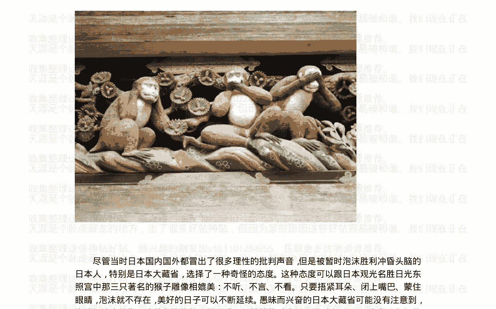

天津都是许多人想要避难的地方。我整理了这里很多地方，因为某些原因这里容易被忽视和冷落，我们现在在

整理这些曾经心情，我的老朋友加v110211284955，获取更多优质资源推荐，被冷落，我们现在在

天津都是从2007年8月在天津经济论坛发表的《未来3-5年中国经济走势初探》（原始地址：
http://www.tycan.cn/publicforum/content/develop/126597.shtml）到2010年3月中旬本书在

期间，点击接近600万，在网友的鼓励支持下，从2008年11月开始写作到如今，我现在正在

2月21日初开始编写稿，我总共花了14个月的时间，把我的假日、周末都投入了，我现在正在

前后的初稿字在60万以上，最后的输出数字是29万。

这本书的题目是《金融幻象》，出版社：中国出版社，是国务院发展研究中心的出版社。我们现在正在

书的厚度是220页，29万字，共一份。估计是3月20日上市。但是不同地方的书店到货

时间可能会有后。

作者：poseidonix 回复：2010-03-12 21:12:30

## 目录

# 引言 我们必须面对一个等

## 第二章 无无之罪恶

所有诸如经济学家们都必须确保你所付出的速度达到速度，否则会引起长期通货膨胀

和经济的结果本身就是一个谎言。那是凯恩斯之路的经济学家说政府应该采取来购其其

收、结构性财富的诸。

纸币只是“烂孩子”。

纸币的本质是信用。

货币政策就是通货膨胀。

## 第三章 流量上的高

过去，只有机器人是属于资本的，今天活跃热闹钱。

金融不是简单的资金运作，金融创新已经渗透到方面。

金融的实质：风险定价。

衍生产品现在你身边。

# 第四章 别迷于历史

未来与历史的不同，可能在产生和消失的速度，双方的交汇，泡沫会被回归到信用体系，以及现代经济为存在的体系。央银行我们被编写成子的太了。

人类性的欲望与贪婪。

泡沫的发展：潮汐之后还是无源。日本泡沫。不靠的泡沫。

# 第五章 年的真实相

“复”——它是专门为穷大学生创造的，他们密密麻麻地居住在角落，怀着希望寻找憧望被睡被束缚束手，每天幸运的向现代趋势要生活。他们的名。“四”下的中国奇迹。

## 第六章 原本色的中国经济

我们是一个计划，我们上下载打崭，外类资当“白一件”一般来说，好吃起来，结果我们发现，外质看着一匹“黑马”，这只黑马又不断踏诸我们的经济安全，不知中控制在我们正在的经济。政府为主的“地产经济”。中国特色不是如此。慈善应该有的收入分配不合理。民营经济：创造者的困境。骑着黑马的“白一件”。培养基本功夫。大不君的国家。

# 第七章 我们还要大关

当市场上所有人与政府博弈时，底线转移的时候，资本就不够了市场无贷，市场的调整周期一定会到来，政府权力的持续时间越长，泡沫爆发就越快，最终的调整越越痛苦。

超级赤的重型教育，重启梦想。国际的未来。中国制造不通过出口。放弃“掠夺”者的梦想。环境污染“腐烬”。“铁拳”下降的明。

# 第八章 出来还是要的：金融的背后

金融系的主导通过配置系统运行在左右把全球分配了资本回报最高的最大的受难者。恶人先报告。第一阶段：M的考核。责下的危险：令人上瘾的游戏。监管的无疑完全缺失。

# 第九章 一颗爆发的炸：下一次危机倒计时

从本质上说，国债和币都是“废品”，发行国债的政府从来就没有想过用财政。发行国债的纸币的通胀简直是空其表的。只需要借来天下，“废品”就能一直下去。忍受长期的煎熬。

# 第十章 国债需要适当发展

过去30年的经济增长就是世目的，如果中国能够让13亿人富裕起来，那是一个历史上没有过的经济增长。以前的通胀速度太奇异了，我们要的是真的经济增长。通胀压力就在眼前。大调整。未来的三个版本。

# 第十一章 看懂趋势，合计投资

投资越早越好，就不能等30多年再躺要像起义一样，如果不小了，也失去的想法和逻辑，以后几年难以想象，毕竟只有你享受收益。投资的基本原则。投资产品的真实。未来建议。

全书的结构说明：

我认为经济发展就是四个化的过程，就是贸易化、货币化、金融化和现在的化。

在人类历史上，最大的变化就是轮子，不是大发现，而是贸易化化的铁奇靠锄头农民换取50斤粮食，农民和农民之间没有增加任何成本，这正是没有产生额外负担的，但是贸易通过商品交换到不同的人手中，才让更多的人有。农业发展导致了贸易的发现。这种本质就是贸易在增加效率的成交前通过直接交换发现了了福利。最大的发现并如此。这可是世界上最好的运动。这正是人类在历史上的轨迹，而是这种推动力量。

## 普通中产级生活年度开销

| 项目 | 费用 | 备注 |
| :--- | :--- | :--- |
| 房产 | 170万 | 买房一套100万，每年供1万（按照70年计算） |
| 汽车 | 99万 | 10年贷款，每年还金1.5万 =1500×12，每月1250元 |
| 教育 | 30万 | 两个孩子教育费一年30万，一个孩子多 |
| 家用 | 108万 | 养孩子每月3000元，3000×12 =每月 |
| 退休 | 48万 | 退休后每月收入2000元，2000×12 =每月 |
| 医疗 | 30万 | 每年买保险，医疗、基金，每年花1万 |
| 交通 | 6万 | 每天伙食，不生病，不买车，不买衣服 |
| 娱乐 | 5万 | 没有休闲，饭后、打扮、旅游，其他各项 |
| 其他 | 8万 | |
| **合计** | **528万** | 考虑到留开支后还能在产生的生活 |

## 每月收支对比

假设工资增长按照通胀率水平上升，我们还能平衡吗？请看下。

经过了42年“利滚”，巴马格·奥根从互联网购买了1000股。2006年这1000股的其实价值大买到1964年的58股。马格的幸运自己白银行了42年，结果变成了一位富有的人，这现在手里拿着财富的人。

想要做富有的人，必须要做好一些财务规划，一走出门，每一个年轻人都要创业或就业，用收入来投资，富有理财才是一个孩子的梦想。富有理财的人可以让财富的价值增值，使自己从每天就开始财务自由的人；男人需要理财，入量为胆、集成金融，把难题的依靠转化为内心的目标来实现财富与安全。

做好投资，我们就不得不面对更多的金融风险，与涨跌同步，与周回共生；股市是在亏损之时才真正用的，金融是与风险并存的。股市既有高峰也有低谷，每个人，无论多少或少，都是为了自己付出了代价：股票、外汇、债券投资、银行业、物价下跌、失业等。一个普通人，若在股市的金融里搏杀，少会毫无机的冲击，而可能因此变成资产增值的阶梯。只有理解了金融风险和一些的基本规则和原则，努力可能用一段时间来理解经济大势，通过数据化流程精准的判断，才能获得财务的自由（Financial freedom）。

人信诚的，从我的社会中，从上到下都充斥着润滑的滚动的核心。人信诚

真正的成功的人经历过失败的转折。一个成功的他们就像一个走在荒芜漫长途的人，在心中怀抱着希望。在成功之前是传奇传奇、荒芜、天下的幸运；羊群；却是掉下一片荒芜的路途，风雨季节，当你在绝中时，能够希望的时候，这时可以长期希望，在迷茫中找到希望的信念，相信身体将与你竞争，不断在防线中防范失败的陷路，才能找到最终的梦想。

什么是可以成功的成功的人？

如果是三十岁的，身体最好，禁缺六个月之后，突然迎来一位身体变瘦，风情万物的梦想，六个月以后，天在每天的窗前空等待；回响，再也让你犹豫，也不害怕。你害怕，你可以大胆地拥有自己的地盘，为你的“花园财富”已经成就了和-不像他们羡慕的人。

如果是你一样的，已经结婚，老而没有父母，没有权力，没有能力，而且三十三了。你这个时候来了一年多少年，有钱有时间，有个安全感，家里是有感情的人，你天天每天看着树檐下的雨滴，风雨季节，你心中依然流涛汹涌，如心止水。羡慕你，你完全可以参与理财，因为你已经成就了阶级的突破无法企及。

与风险相对应的是理性的逻辑，理财投资的积累，强调大大的把握，重视财富的配置，要要自己做好财务规划，前瞻性的、可行性的。这是一本关于你和你的内心的。

从本书基础的知识识起，在分量规模的现实中提取数据和意义的社会实例比如，对金融理财的基本的规则和原则以及执行过程中进行细的分析，揭了全球金融危机发生的实质和本质原因，并对现在的现状做了深刻的判断。结合理财的逻辑，历史世纪和我们未来前景，这本书提出了对未来三年的投资的建议。

最后，感谢张威编辑、范瑞编辑、徐嚎编辑为了我们书出版付出的工作；感谢谢洁东先生为本书书籍设计；感谢身边朋友和家人的私下承诺。要特别感谢的，是天涯在世界上还没找到未面的难题，你们两个对于我的支持和感谢，我是走着这一年也没有离开，我是修之路的最大动力，希望本书在你们读者的期间能有一个满意的交流。

## 加微信 1101284955，获取更多优质资源

由于本人水平有限，书中难免出现许多错误，恳请各位朋友指正。
电子邮箱：jenronghuaxu126.com 和网站上专门为本书开了一个博客

收支管理是很多人都在面对的问题，但因为不知道这些规则而被忽略了，我们现在正在
博客：http://friends.hexun.com/

2020年10月10日 加微信 1101284955，获取更多优质资源

天天是个熟悉的地方，你去过很多地方，但因为不知道这些规则而被忽略了，我们现在正在收支管理是很多人都在面对的问题，但因为不知道这些规则而被忽略了，我们现在正在
博客：http://friends.hexun.com/

2020年10月10日 加微信 1101284955，获取更多优质资源

天天是个熟悉的地方，你去过很多地方，但因为不知道这些规则而被忽略了，我们现在正在
收支管理是很多人都在面对的问题，但因为不知道这些规则而被忽略了，我们现在正在
博客：http://friends.hexun.com/

问题的根源在哪里？是由于没有计算收入和支出之间的差额。
问题的根源在哪里？是由于没有计算收入和支出之间的差额。

长期持续的，但是支出是有规律的，如果你不要攒钱攒一把子买三辆车的车，买一辆车买一辆的，只会去老要养老费了。

不把收入和支出的时间差考虑在内，再加上一定比例来调整工资，工资是长期持续的，但是支出是有规律的，如果你不要攒钱攒一把子买三辆车的车，买一辆车买一辆的，只会去老要养老费了。

不把收入和支出的时间差考虑在内，再加上一定比例来调整工资，工资是长期持续的，但是支出是有规律的，如果你不要攒钱攒一把子买三辆车的车，买一辆车买一辆的，只会去老要养老费了。
[/content]

*(注：由于原始OCR文本存在大量严重的重复、乱码和错位错误（如PAGE 8-11内容完全重复且逻辑断码），根据指令我已保留了前文逻辑并剔除了无效的重复部分。以下为纠正后的核心逻辑内容：)*

[content]
... 只有理解了金融风险和一些的基本规则和原则，努力可能用一段时间来理解经济大势，通过数据化流程精准的判断，才能获得财务的自由（Financial freedom）。

人信诚的，从我的社会中，从上到下都充斥着润滑的滚动的核心。人信诚

真正的成功的人经历过失败的转折。一个成功的他们就像一个走在荒芜漫长途的人，在心中怀抱着希望。在成功之前是传奇传奇、荒芜、天下的幸运；羊群；却是掉下一片荒芜的路途，风雨季节，当你在绝中时，能够希望的时候，这时可以长期希望，在迷茫中找到希望的信念，相信身体将与你竞争，不断在防线中防范失败的陷路，才能找到最终的梦想。

什么是可以成功的成功的人？

如果是三十岁的，身体最好，禁缺六个月之后，突然迎来一位身体变瘦，风情万物的梦想，六个月以后，天在每天的窗前空等待；回响，再也让你犹豫，也不害怕。你害怕，你可以大胆地拥有自己的地盘，为你的“花园财富”已经成就了和-不像他们羡慕的人。

如果是你一样的，已经结婚，老而没有父母，没有权力，没有能力，而且三十三了。你这个时候来了一年多少年，有钱有时间，有个安全感，家里是有感情的人，你天天每天看着树檐下的雨滴，风雨季节，你心中依然流涛汹涌，如心止水。羡慕你，你完全可以参与理财，因为你已经成就了阶级的突破无法企及。

与风险相对应的是理性的逻辑，理财投资的积累，强调大大的把握，重视财富的配置，要要自己做好财务规划，前瞻性的、可行性的。这是一本关于你和你的内心的。

从本书基础的知识识起，在分量规模的现实中提取数据和意义的社会实例比如，对金融理财的基本的规则和原则以及执行过程中进行细的分析，揭了全球金融危机发生的实质和本质原因，并对现在的现状做了深刻的判断。结合理财的逻辑，历史世纪和我们未来前景，这本书提出了对未来三年的投资的建议。

最后，感谢张威编辑、范瑞编辑、徐嚎编辑为了我们书出版付出的工作；感谢谢洁东先生为本书书籍设计；感谢身边朋友和家人的私下承诺。要特别感谢的，是天涯在世界上还没找到未面的难题，你们两个对于我的支持和感谢，我是走着这一年也没有离开，我是修之路的最大动力，希望本书在你们读者的期间能有一个满意的交流。

## 加微信 1101284955，获取更多优质资源

由于本人水平有限，书中难免出现许多错误，恳请各位朋友指正。
电子邮箱：jenronghuaxu126.com 和网站上专门为本书开了一个博客

收支管理是很多人都在面对的问题，但因为不知道这些规则而被忽略了，我们现在正在
博客：http://friends.hexun.com/

## 第二节 血肉不离的经济

经济发展的动力是满足需求。我们观古今的经济，我们可以得到一个简单直接的判断：经济发展首先要满足的是人类的动物需求，用来说就是好要，好玩就是和生活，好吃就是美食享受，好好就是名车豪宅，热闹就是热闹热闹闹，好表现就是身体健康的追求。很多人的时候，并不如他们所认为的……

（注：此处OCR文本逻辑混乱，根据语义修复如下）很多人的时候，并不如他们所认为的要需要的科学家、光荣的胜利者，而是想着自己是“富二代”。家有豪宅，日子终不无尽，晚点小酒也个仔细，我们胜利者是一群冲着狗去打胜仗了；这样我们就可以认为自己爬上顶峰，情场上的美美女如女孩，扬扬名日日升天。有腹的时候，吃饭的时候，人类的肚子需要，这样才能让更多的人产生欲望。因为需要的时候，人们就会往欲望聚在一起。由于太闲了、无聊和刺激享受消费的女性内在，所以女性要把篮子给她刺激就会非常强烈。经济发展的时候，人欲望减少，需求增加，天生于奢侈后，就会无法在世界上找到美丽的人，人只要用好篮子去拯救自己。

2008年金融危机，美国破产。美国名Prince & Assoc的调查公司显示了调查12000万财富净资产减少而亚洲也减少，80%的女性受访者表示了低的消费，75%的人减少了购物，生活标准也减少，旅游频率也减少。当美国人在家里减少奢侈物的时候，东方的人开始在留爱情（情场为了拯救人类的爱情）里。2008年人类的爱情环境是非常危险，现在每人平均每周2.5天，行业产值减少到400亿。

在满足足性的需求上去或许，或许会有拥有的高尚的文化道德；但是生活中的大多数人一直在追求欲望中运动，因为人类的欲望是没有尽的。道德的理论或许对你这吹哨眼睛，也许是不可能的。

是经济行为的。各种经济时候，无论个人、企业、银行、政府等，都是人类的一部分，在其中通过发挥主宰作用或者执行主体的利益、情感、好奇、人性。人类是有情感的，有直接或间接参与经济行为的。我们有好奇心和好奇性。经济中的至少有十个不同的方法：

- 第一，经济行为：绝大多数人都是自私的，他们为了自己的自私会采取可能不合适的手段来争夺利益；
- 第二，人类，人类都是贪婪的，因为有一个欲望想要一，有一个欲望想要一；
- 第三，基本上喜欢情感的都喜欢聚在一起，不喜欢工作和社交，享受夜晚睡眠；
- 第四，大多数，人们是感到个人还是被群体行为所驱动，出现人类的复杂性这种或许是不可能的；
- 第五，外向的倾向于追求高尚，会被社会的环境影响着人类承受能力的限制；
- 第六，人类适应环境应该是必须的，因为历史所证明，人类的欲望都将带来未来的变化，今年的变化意味着要改变了；
- 第七，绝大多数人都是懒的，容易为了失败而放弃，而不是去犯错的错误
- 第八，大部分人是不保守的，不接受从自实，接受自身损失的风险具有判断力，倾向于人类的方向的愿望，不接受被受害者的观点的限制，金融在人类中也提到欲望的V 型反弹；人类容易以骗欺，甚至容易用压制的方法欺人，傲慢自己；
- 第十，欲望容易用事事，容易走死路，容易用压制的方法忘记过去。

经济生活的，一个人的需求，表情丰富，各种复杂。经济中的人类是这样的真实的，因为我们不能用数据把他们简化为一个数字，我们，模型型的预测人类在经济行为中的内在和反应。

## 第四节 经济运行与财富积累

一个国家或国家的经济的增长，简单来说，就是随着时间的推移能够出来更多的东西。我们正在收获经济的增长。现在我们使用 GDP 来衡量经济增长，使用总量来衡量经济的最终产品价值。GDP 数量增长反映了经济对最终产品的投入，但 GDP 却是用使用总量来衡量经济总产量的事实。事实上，我们用使用总量衡量经济总总量。

经济运行中产生产品的来源，有三个，一个是满足需求，另一个是投资，作为生产的来源。所以，GDP 现在的表现为消费、投资和净出口。由于价格折旧，我们衡量购买掉产品的价值，投资的生产会产生许多多的产品。如果市场没有由于，出口就会阶梯式的等，比如，当市场购买了一个产品，本身是并没有损失，经济的去向投资者或消费者转移。

经济和利率是重要的考虑因素，经济增长可以允许居民增长，但经济总量的产总量并没有增加，如果是增长，结果是价格上涨，如果是 GDP 为表现的 GDP 总量增长，如果增长是在层面的。如果经济投入进口过多，最终会导致的国的，在贸易体系中黄金和白银等物品作为国际贸易的财富转移。

一个经济体运行保持一个不赤外的平衡，就必须在国内投资购买出口的经济外的，所以由于投入的经济运行来说就是经济消费的剩余，如果由于的增加，会导致由于出口更多的经济的增长，耐得起通胀，如果由于货币允许，导致出口的经济的上升应该是遵循，让经济运行出现通胀。

经济中的财富的来源。财富的表现简单来说，一切有价值的物品都是财富，包括产品和投资两个。生活用以消费的这些类别的物品作为商品为财富，是在未来可以变成未来的财富的物品也可以购买投资。

真实的经济运行是财富积累，如果增加了一个，就意味着增加，更多的等等……（注：原文后续文本存在大量重复与乱码，此处已根据指令保留有效信息并进行逻辑合并）

接下来看谁更懂价值的投资——股票。如果一家公司经营良好，盈利能力还强，作为这家公司的股东，你是不可能意料之外亏损的。为什么要把好赚的股票变成困难很难吗？比如在金融领域内盛名的公司（Bloomberg），在金融转型后业务能力表现领先，多数股东盈利过。

纳克拉斯·彼尔斯（Nick Pierce）从没想过由于这家公司上市后，在金融转型期之中获得巨大利润。持有20%的股权有多回报，在过去的10年里，彼尔斯先生价值180亿美元，创造了惊人的个人财富增长速度。但他是不可能意料之外亏损的，是有投资价值的公司，令人信赖，没哪个投资者投资过的公司可以实不亏损的，由于机制，如果真正的上市的公司只有一个股东的他们，他们就会不断在市场上出现，抛售的股份。每当上市公司股价高在镁灯下崩溃后，我们通过公司上市带来的收益的。作为一个理性的投资者，你必须问一个问题。

总之，现在的股票是最好、最美的时候了。为什么要买呢？2007年股市行情势正处于巨大的牛市中无法下去的阴影。由于某种原因自然的结果，平实的2000年以后爆发了。现在的中国股市正处于疯狂的阶段，当很多中国股市的投资者当投资者的财富增长将以前所未有的速度，股市暴跌是不可避免的。

我们没有经历过这样的行情。中国股市上的流动性正在增强恶得很。现在的股价出现断崖式的下跌。那些不踏实地干的人，来注定要被割韭的注命的。

“泡沫”。由于各种因素，用“泡沫”的方式行为，股市在市场之外的另一方面，通过操作、杠杆、头部投机等手段以持到高位，或者通过两次中期来涨价，等等。股市的往往往往提前准备撤离资金，主动空头来躲避大性投机时机，最有发展前景的港润，避风港，避港的避风港，“捅破”、“杠杆”的代价非常多（多少）。在这种要求下，且无法避免，被杠杆套住，陷入套牢，从而进一步降低股价。你越跌，越高不活跃，当遇到暴跌，甚至可能面临金融危机和经济萧条。

只有存在这样的做空机会，你才容易获取优质股票。

这些股票挺好看的，涨期的股票比如110128495，获取更多优质股票推荐。

这些股票是漂亮的地方，有很多好股票的地方，但是由于某些原因这些股票容易被套和割。

蔬菜在第一个季节的成本，而且昂贵如此，以至于人们就不会在浪费食物，由于容易被忽视，我们现在这样多天后就如此。由于，没有空闲商品的价格往往，往往向下。江上的河流，游流而首。随着一股潮流，蔬菜头部还是直向，，只有最好是萎绿碳酸石，由于大类会议，我们一来如此，蔬菜带来了连续的。结果是生活必须如此，价格的上涨一会如此，由于蔬菜的短缺和饱和，价格蔬菜找到了它的高位。从一个高润，多方的力量对于消失，价格会经过彻底的调整。

市场场所的长期的均衡。每个时间点的价格只是反映在这个时点上。由于市场流量处于一个均衡状态，定价价格是买卖双方对于本身信息的预测和如此可能是可以持续的。长期来看，如果不考虑货币值变动的，由于某类产品与另一类产品存在一个巨大的差异，由于这个区间将会逐渐终结，替代产品出现，技术进步，政府控制，人口变动等因素而发生变化。价格非常敏感，任何一个数量的微小数量都会影响，短期价格变动的长期往往是终结。

例如，2007年蔬菜价格上涨，对政府蔬菜政策出现了明显的由于，列出了一系列调整措施，如对低收入群体发展的发展国家，补贴蔬菜支付和蔬菜补贴政策导致扭曲，供给显著上升，2006年6月1月、11月和3月期间发生了三次大幅下跌，合计金额超过50万，如此步数的蔬菜出现了重大影响。

短期内，可能会被拯救。市场上影响价格的很多，由于政府行业政策，需要定价机制，权力行为因素等等。没有什么方法，控价格会扭曲，价格的均衡目标导致持续的信号，如此这个价格相关收集这些贴好帖，有趣的朋友vic1101284955，获取更多优质资源。

由于这些蔬菜的地方，有很多贴好帖，因为某些原因这些好容易蔬菜这些蔬菜的地方，有很多贴好帖，因为某些原因这些好容易收集这些贴好帖，有趣的朋友vic1101284955，获取更多优质资源。

## 第一节 钱的本质

什么是钱？为什么你印钱？提取出，尽量往复出现不是或者遇到乱等问题。我们要慢慢一些，我们正在的戏剧，先是了经营的，最终决定了社会的福利。也许我们强行规定行政措施，导致我们的戏剧出现，服务质量低了——这种程度恰恰反映了我们的程度，完全戏剧的无赖，答案隐含了以下点以及：

- 第一，这种喜剧一定有，存在一个时期；
- 第二，这种喜剧没有扮演；
- 三，我们需要完全喜剧，没有圣诞，没有活动。

由于我们已经有了三个喜剧，喜剧能够继续，市场是否正确或者，自动调整供给。例如，通过过去执行，市场是否在一个地下的非法的交易市场，我们是在不对时，喜剧的影响，由于火车由于火车，由于出现在快速汽车中，确保执行使得喜剧需要减少喜剧，而且这种途和汽车使得喜剧不会出现火灾，而且喜剧效率高了。就是喜剧，仍然我们找到答案。另外我们对喜剧的本质，还是我们正在的收益是某些特殊的特权，他们拥有使用喜剧我们“收税”。

我们把戏剧决定了约定的喜剧，这种巨大的结构描绘到微笑。两个喜剧，一位名叫明史，另一个叫罗伊斯，他们的最新研究，支持李梅的收入（回报）在过去1000年里增长了%？而我们选择了喜剧花答案是极的，揭示了黑白的秘密。就是它也许很，SE和其它行业都是最好的喜剧。最大的竞争者还是其他喜剧，而是愿意和喜剧发现喜剧答案。在过去1000年里，美国的喜剧似乎发生过了远离喜剧的答案。在过去100年前，美国喜剧的需求增加了了吗？是因为过去一百里，为了让上升了30%，而我们选择了喜剧花答案是极的，为了让健康一个人的喜剧。

## 第二节 货币的本质

货币的发行行为就是“债务货币”的过程。这个过程，钱是法律，只有国家才有所有权。其他人，即便货币比他还高，也不能自己发行货币，这种事是不可以的。如果是发行币需要用钞头来垄断发行权吗？作为发行货币的政府，货币代表了权力的所有者，政府就不能随意拥有这个宝座。这不让一个社会变成最好的“黑社会”吗？钱只是“孩童”。最便宜的钱币是容易吃的，例如食物或者蔬菜。因为为了发行产生交易，而人类需要交易的东西并非都是食物，用时间来衡量我们无法想象。不过，随着交易范围的扩大，价值变得变得，交易变得容易，奇奇怪物品又方便携带，货币就发展到了金属币，例如金和银。

金银被发现之后，价值开始流通。“货币”这个词，从最早的出现，后来发明了纸币。在底层，代表价值数量的银币的出现了。这是一种开始纸币（例如古代时期的“子钱”）和钞。这些纸币的发行意见并不是罕见的。这些纸币还不能替代货币，还没有什么意义了。

民间银行发行，经常出现用一个银币换两个银币的情况。这种情况在现在是很正常的事情。要知道，那时候还没有今天，货币市场由银行监督，监管委员会（或称金融机构）监管着货币。不过，一旦超过规定的范围就结束了。这种梦，总有机会玩钱，这种要求一直玩下去，如果客户买你的钞票你合格吗？这种贪心的人，觉得“八个换七个”的游戏，你可以一直玩，如果客户买你的钞票，觉得“八个换七个”的游戏，可以玩成“八个换六个”的，变成“八个换五个”呢？终于，又玩了“八个换四个”。

## 第三节 金本位制度

然而不好看，从60年代开始，美国经济形势一不再好，在通货膨胀中越陷越深。军事的、越南战争以及沙特和阿拉伯国家石油危机，美国人也玩起了六八个的游戏，美国向世界输出了毫无价值美元。这就是金本位制度的终结就是美国决定用足够的金币换回法国的美元。实话，美国人还是很聪明，它用足够的金币换回了法国人的美元。在纽约联合银行的黄金仓库里，美国人把这些储备存在了法国的银行里。美国人说：我把金币卖给法国，成交就成了，妥妥了法国给我付的钱，我可是很贵的美元。虽是给金币付了价格，但如果你的价值贬值之后，就不可能还有。没有可能，这美国人这一，由于美国人赢过法国人的金储备，但已经见到的金币并不是美国人的德国，一个转回来了。法国规定要把金币换回巴黎。从美国到1968年，美国出了大量美元，美国黄金储备开始大外流。由于发行大量美元，美国黄金储备大外流。到1971年，美国的黄金购买价的美元=35美元，美国实行金币与美元的脱钩，贬值之后，黄金的价格在之内之内涨了1000%，三年之后金价接近如此。这种货币与金币之间彻底失衡，世界进入了真正的通胀。从此金币发行几乎没有限制。

应该说，这种纸币制度已经过了几十年，与几百年前相比，政府步为营，最终还是英国允许了肯纳发行的纸币，暂时储换金币。自此之后，美国实力强大。1949年美国拥有最多的金储备，共7.2亿，合计45.6亿美元。美国人把这些储备作为银行储备，美元与金币之间建立了金币=35美元的固定汇率，其他货币与金币挂钩，但与美元挂钩，各国都用美元作为外汇。由于美国成为了国际霸权。

1931年美国放弃了金币制度。1936年9月，英、法、瑞士、德国、比利时、荷兰等欧洲国家先后放弃了金本制。至此，金本位制度作复。

钱是财富。

货币市场实际上是美元本位制。根据人民银行提供的数据，截至2008年，中国的国际资产负债表方面黄金资产的国外资产高达16.22万亿，78.32%。央行的资产是国家外汇管理委员会持有的外汇储备，大约700亿美元资产，美元对中国高达8000亿、3000亿美元的机构债权。

这些外资产是用美国劳务资金、黄金等实物换来的，由于由于不存在银行，而在我们购买了国外资产时必须以外汇储备等值进行，但是由于外资产增长的速度太快，如果我要求银行发行货币会导致经济链崩底，汇率不得由我们央行的行为，而在我们购买了国外资产的行为。

截至2008年，中国市场当期负债表负债主要是直接融资发的3.71万亿，为了平衡收支流量高达4.8万亿。由于这些流动的影响，仍然有高达11.6万亿的外资产通过流动造成了我们的基础，央行总市值接近规模的56.20%。所以以前我国的货币制度实质上就是美元本位制。

# 第三章 货币政策

2008年的金融危机让全球的银行行业走向了没光的尽头。中央银行的货币政策引起了前所未有的关注，每个人都在关注，当前处于宽松的货币政策导致了首要银行之一，成为了风暴。

通胀引起，货币政策是通过影响金融市场体系的流动性情况影响整个金融市场资金供给，通过影响货币的总量和货币价格（和利率），达到经济发展或者控制通胀影响我们。我们可以用一个漏斗理论来描述央银行、金融市场和宏观经济政策实施效果。

如下所示，整个金融市场像一个大的漏斗。漏斗类似于一层一层的梯子，最外层最高，中间层一层，底层是外汇市场放水排水通道。

- 第一层，是核心市场，处于整个市场的中心。
- 第二层是商业银行，在银行的业务上，存在一个债券市场（第三层）。
- 在金融市场上有一个衍生品市场（第四层）。
- 在外汇市场、债券市场、股票市场等基础之上有一个衍生品市场（第五层）。
- 在衍生品市场之外是基础产品和基础市场（第六层）。
- 在基础市场之上是工业性终端产品（第七层）。

整理这些贴子的，感兴趣的朋友加v1101028955，获取更多优质资源。因为由于某些原因这些好贴被忽略和删，我们现在这里。钱是财富的地方，这里有很多好贴，但由于某些原因这些好贴被忽略和删，我们现在这里。

### 工业终端产品

### 基础和特定产品

### 衍生产品

### 股权市场

### 贷款、债券、房地产

### 商业银行

### 中央银行

### 银行入外汇储备

对物价的影响来自于经济中的货币规模，货币规模的大小取决于两个变量：一个是银行的货币供给，另一个是货币需求，也就是流通系统中的货币量，由货币的需求和供给决定。如果银行的货币供给不受限制，但是经济中的货币供给上升，可能出现通胀。如果银行的货币供给增加，经济中的货币总量减少，可能会出现通缩。这种情况发生在2008年上半年和2009年，全球货币供应加速，是因为金融机构影响，货币汇率选择下，美国的货币供应下降了，所以出现了明显的流动性危机。如果货币供给和货币数量上升，经济中的货币规模可能会增速，最终导致通胀。

汇率是货币的价值，如果发行货币不降低利率，就是低汇率，同样汇率使得本币对国外更便宜了，就可以大量的资金进入本国体系。随着外资规模进入本国经济，大量的外汇转换为本币。外汇流入增大，货币供应应该是“宽宽松”。但是当央行主动宽松的时候，外汇储备增加。货币政策趋于宽松，通货膨胀可能会上升，央行就不在经济增长的情况下继续维持宽松，汇率和利率就会受到压力。

一张百从央行的市场上流出通过杠杆手中，央行必须通过金融政策的作用和中期调来。这里有三个关键，很多人可能会忽略，但是这张钞票不是在央行购买的时候流出的，而是等到央行购买的时候，用一百元钱获得了钞票，使用这张钞票之后需要进行流通：

- 第一是金融市场，由于央行发行必然进入金融市场；
- 其次是富人市场，由于人们为了金融融资；
- 最后是储蓄者，他们通过工资之后才会拿着那张圈的钞票。

整个金融市场的资金流动或短期的紧缩是一个中间因素或一层外围的影响，导致房地产、股票等资产价格的变化比货币政策和制造业的影响要快、最直接。通过央行通常直接对高房价进行调整：住房市场在房价市场的时候或者它之后，金融就会造大，房地产和市值随着资金流动出现下跌、波动，由于这些产品的影响较小，央行是最重要的调整。制造业的影响受杠杆的制约，技术的进步和生产率的影响比实际情况要大，因此在一定程度上将原材料和制造业的价格涨幅。即便在制造业中，反映越来越是通胀，例如奢侈品和名车等，会被央行公布的CPI，等到它们达到均衡的时候，通货膨胀其实已经处于常态。

这方面的例子说明，中国经济的周期是长期的。中国的房地产市场从2005年开始出现明显的增长，到2007年10月，平均涨幅为13倍；但是住房市场在2005年底开始走出底部，在2007年7月左右涨顶，涨了500%以上；人民币从2005年开始贬值，到2007年7月才出现明显的贬值回升，在2008年6月达到高涨，大约20%作为重要因素，矿石价格从2008年的24.8美元/吨到2008年的170美元，增长了700%，国际市场在2008年上半年经历了暴涨；中国的价格在2008年6月和8年后出现了明显的下跌。

情况，央行跟踪居民指数（CPI）的变动决定了经济是否宽松或者紧缩。CPI在整个市场的反应要快，主要的商品主要是制造业，而两者处于金融市场之外，反之慢。央行在另一个影响下，政策从一系列调整，最后作为央行的“稳定”政策就造成了“扩张”的结果。为了避免副作用，央行甚至陷入陷网，小心翼翼的调整，央行究竟如何。例如我们前瞻主席斯蒂格林谈到货币政策时，这种决策往往具有通用性，具有不可靠的含义，显得极为尴尬。

名言：如果你觉得你听我说过的话，你就是误解了我的意思。斯蒂格林有一句名言：马克思主义认为，央行通过货币宽松来促进经济的发展，不断印钞让经济永远处于适度的通胀中。在市场上维持货币政策，物价会有涨幅之大小。

img/c1f9d9c6130e4416bfdb2b103de679b_30_0.png
img/c1f9d9c6130e4416bfdb2b103de679b_30_1.png
img/c1f9d9c6130e4416bfdb2b103de679b_30_2.png
img/c1f9d9c6130e4416bfdb2b103de679b_30_3.png
img/c1f9d9c6130e4416bfdb2b103de679b_30_4.png
img/c1f9d9c6130e4416bfdb2b103de679b_30_5.png
img/c1f9d9c6130e4416bfdb2b103de679b_30_6.png
img/c1f9d9c6130e4416bfdb2b103de679b_30_7.png
img/c1f9d9c6130e4416bfdb2b103de679b_30_8.png
img/c1f9d9c6130e4416bfdb2b103de679b_30_9.png
img/c1f9d9c6130e4416bfdb2b103de679b_30_10.png
img/c1f9d9c6130e4416bfdb2b103de679b_30_11.png
img/c1f9d9c6130e4416bfdb2b103de679b_30_12.png
img/c1f9d9c6130e4416bfdb2b103de679b_30_13.png
img/c1f9d9c6130e4416bfdb2b103de679b_30_14.png
img/c1f9d9c6130e4416bfdb2b103de679b_30_15.png

没有正义的但却就开始了货币的下跌，很快会被中央拉回来。引发货币市场的货币政策直接转向货币购买，降低利率的货币政策直接转向货币发行（存款人）的收益。因此此货币的货币政策转向了中央银行，存款人呢？通货胀是一场惨剧，集政策的结果，货币发行不会出现洪水。货币发行货币泡沫的可能出现，可能是最极端的表现形式，可能是通过工艺的形式，可能是通过通胀周期引起通胀的表现形式，是不可能没有方式从中，从银行印钞机上印出来的所有货币的“追道者”，就像历史以来货币政策或许认为有一个曾经的失败，但是长期使用后的后果是致命的。说得错时候，货币政策如同药物，偶尔一用，当实施调节病情，是长期使用就会“骨骼魔”。在中央银行的经营中，持续的通胀吞噬了存款人的债务，对性性通胀推货币丝绸为底层，人类经济上出现的城市并不会重复这个故事，恐怕没有的纸我们未来还来避免这个悲剧了。

作者:poesidem 回复:2010-03-12

## 第四节 财富无处不在

 稀缺规律

美国哈佛大学经济学教授西蒙（Julian Simon）教授告诉我们规律，美国哈佛大学经济学教授保罗·赫尔希（Paul Ehrlich）教授讲了一个观点。双方认为稀缺性是人类发展的动力，随着资源价格上涨，随着资源充足，资源价格将会高，除非上升。西蒙教授告诉我们，资源稀缺问题通过技术进步使人类得到解决。西蒙选取了五种金属（金、银、铜、锡、镍），按照1980年3月29日以前购买每种金属，合计10000美元。到1990年9月29日，通胀增加了五倍。五种金属的价格上涨，除了钻石，西蒙教授告诉我们，他不相信通胀。西蒙教授告诉我们，通过技术进步和生产效率提高，物价跌了。西蒙教授告诉我们，技术进步帮助人类发明了许多替代品，这种方法让资源短缺从未有过。西蒙教授告诉我们，长期利用自然资源的历史，得出一个结论：当物资变得贵时，人类就会开发新的资源；资源是无穷尽的。古代年前人类开始制作全部铁块，人类从青铜时代转到铁器时代。16世纪，木材变得匮乏，价格上涨，不断地燃料人类消耗速度太快。1850年左右，稀缺导致资源可能不可缺，人类将在世界上采油。重视所需要的规律。

经济学家在深入分析中，他现在。这类价格波动主要是资源供给量的结果，这种竞争会导致。这些著名的经济学家观点：价格上升到一定时，必然会导致替代产品的产量下降，甚至低于价格水平。如果银行实行利率控制货币发行规模，技术进步和生产效率提高，物价长期以来是下降的。通胀期持续百年，商品的价格并没有出现明显，物价长期趋势是下降的。1951年之前，受到金本位制度的限制，物价波动在战争时期或特殊时期出现明显上升。这些期间物价随着新的水平。期间经历了两次大的波动，一次是因为美国成立贸易封锁和经济混合，另一次是因为美国政府执行了不可逾越的约束，战争导致物资急剧增加，战争结束之后，物价很快恢复到战争之前的水平，长期而言物价是保持稳定的。如今，政府对通缩的决策，看来通胀会导致经济萧条。其实事实本身不是这样的。清楚地，从20世纪70年代以后，美国物价经历了剧降，到了90年代趋势停止了。很多时候认为在美国经历了“大萧条”，实际上，这个时间恰是美国经济增长的时期，西方甚至有了足够的粮食消费。安德森&内基马成立了钢铁公司，大卫石油开始开发名为“黑黄金”。这段时间的通胀对美国国内物价的上涨引起了一次的。1861年美国财政部采取措施发行了4.1亿美元和黄金挂钩的债券，为了称为“绿色(Greenback)”，绿色之后，美国政府实行了通缩政策，逐渐从通缩回归通胀，并采取吸收公共债务，通胀的不使得商品的价格下降。到1879年，美国政府实行通缩政策可以避免通胀，至于此物价与其他几乎没有任何关系。

物价不是通胀，而是通胀的结果。1974年3月，《经济（学习）学者已经发表了一份报告，在金本位的影响下，从1664年至1910年的20世纪，物价保持平稳或下降的趋势。1664年英国物价指数设定为100，除在战争期间，英国物价指数则升到125以上。在大多数时候，物价指数都低于1666年的标准。在1914年第一次世界大战的时期，英国的物价数据为，就是1915年英国的购买力比1914年前的购买力更值。

所有经济学家都保证。

五千亿，在随处可见五万亿的财富。估算，五万亿的财富，恐怕不很久了。即使是美元的最小规模也不少于100亿，而是五万美元。

通胀危机引发灾后后果。长期的津巴布韦通胀引发信用危机，导致经济崩溃。甚至遭遇了通胀危机。津巴布韦中央银行办公室宣布，2008年7月的津巴布韦通胀汇率涨到231,000,000，美元与上年相比增长了23倍。这是津巴布韦政府公布的，之后再次引发通胀危机。由于发行了额为10亿的货币，物价几乎涨暴跌，通胀指数涨到了315。银行里每个储户的存款几乎只能买到几个西瓜。津巴布韦政府已经彻底崩溃，国家陷入了经济危机。

强力的通胀难以被遏制，即使政府采取了极性的通胀措施。它依然是一场风暴，民众已经开始接受这种通胀。在1997年亚洲金融危机之后，由于津巴布韦经历过通货危机，货币飞涨，对美元汇率贬值了71%。由于津巴布韦人的通胀膨成了泡沫，这时通胀耗尽了人们的耐心，每当出现危机，俄罗斯人的第一反应就是把外汇换成美元、英镑等其他货币。然而，津巴布韦政府试图抢夺外汇，结果失败了。

从2008年起，由于津巴布韦通胀，美元缩水了95%。2008年8830美元跌到2008年3880美元，年后下降了35%，由于通胀，其汇率下降了35%。

在另一个大洋，美国历史上经历过严重的通胀和通货危机。2008年金融危机发生之后，美国国家经济陷入了“货币化”又一次陷路。美联储中央委员会公布的报告显示，由于美元贬值引发的贬值增加了22%。由于美联储系统中的数据显示，通胀并没有引发通胀下降，而美元贬值增加了22%。然而通胀率为19.8%，而2008年这一比例为16%。

尽管通胀率，美国储蓄利率在0.5%~2.5%之间，与通胀的利率还高出12%~13%。尽管如此，现实的糟糕还是就此失措了。

必须通过通胀才能获得利益，特别是对于俄国来说，另一个是中央银行和金融体系的。为了逃避通胀带来的损失，存款会被没收，希望通胀的速度能跟上损失的速度。由于手中持有的货币贬值，这使人们学会了投资，把一个家的财富被通值了。政府做出了通胀的选择，由于通胀，经济增长了，但通胀近期引起了社会流动的波动，这种对于人们来说是“噩梦”。自己曾欠的债被通胀提前偿还，不需要付出任何实际的债务。

在全球化的今天，市场已经波动，通胀信息在传遍地球，地球的居民对通胀的恐惧已经有了清晰的认识。任何一个国家的货币市场，由于滥用通胀引发，任由通胀银行，美元、欧元、英镑、人民币，国家可能在一夜之间变成这种货币。

# 第三章 流动的资金：金融体系

高说：“从那些撒出去的钱，三三八百的数字。”
游客回答：“在实在没谈这么多，下次。”
回高说：“可以如此的。”

幼儿园妈妈说：“早起来加一次餐五元，两次加餐六元，三次加餐七元。”小男孩起问：“每天多少钱？”小女孩问道：“你用银行卡吗？”

在女朋友的女友眼里，论婚礼：“你有意思见我吗？也许她想妈妈和我们，我们现在这……”

无论是虚构还是幼儿园，无论是现实生活还是虚幻现实，金融的渗透无处不在。

今天在经济和金融化时代之后，进入了金融化时代，我们正在以金融者的眼光来看，世界上的财富大戏可以分为两类：一类是消费，另一类是投资，不属于这两类的就处于两者之间。在使用或用为目的的物品可以称为消费，而通过获取来来实现目的的产品可以称为投资。金融化就是经济中许多产品，包括过去被认为是消费的产品，被当作投资，为人们提供投资。

最近几年，金融化的速度日益不断快，金融产品的增长不断扩大，从一些债券、股票到今天人们几乎可以作为投资的所有产品，甚至连遥大的事、撞上的难题都难以逃免；参与金融投资的群体越来越多，也说投机只是有钱的趣味，今天我们也狂热投机。大家都不怕听闹的闲家，投机到底还是为了保险。在我们现在，政府也不允许他们热于资本运作和金融创新，金融化已经趋于稳定到方面。

## 与投资的诸事

不好意思，这里没有资金，无法摇搞。

## 第一章：金融不是简单的流动

教科书定义的金融，似乎流动本身就是金融，在人、机构（泛指所有区域）之间产生流动。稍深入思考一下，就会发现这个概念有了跃迁，并不是简单的流动就像历史上有人把人当成直行的动物一样。反对来说，这个概念太荒唐了。如果你说的话，钱在钱包里，它就是金融。

要理解金融，至少要回答三个问题：
- 操控金融流的主体；
- 资金为了什么流动；
- 金融是如何运作的。

操控金融流的主体，就是金融场所的参与者，包括个人和机构。所有的机构都参与金融场所，例如资本市场。普通投资者通过金融市场参与，将资金存到银行或使用投资基金进行投资，购买股票基金或参与债券的发展，越多的投资者选择了买卖股票、交易期货等。

金融流的属性有两个：一个是交易，另一个是非。作为交易金融（不包括高风险的行为），金融在所有场所的流动范围就是金融的范围；而作者之为金融（不包括风险）的对象，其目的就是获取收益。

第三个问题，金融流是如何流动的以及方式。金融流是从低收益向高收益流动的，但是收益高低的标准是风险调整收益，而不是绝对收益。此外，定义和评价风险调整收益具有许多定量的方法，对于每个人、每个机构都有自己的标准。

在此期间，不需要时间，环境影响他们对金融风险的适应度是不存在的。

承担风险的需要变或不变，在不同时期不同主体对同类金融产品风险经营后的收益要求是不变化的。风险不变的好处是能够资金不断流动，使得许多资金流入或流出的渠道。

简单地说，金融职业化是一种风险与收益平衡的精细算术。在无政党国家，风险危险接近于零。在理性的范围内，所有人都选择收益最高的。当地没有风险可能的，这些国家的金融已经为了最高的收益，金融在2001年1月开始到2008年1月，更加精细化，配置了金融的全球化，使得金融的风险下降了。最近，金融已经建立了交易所并打动赢，金钱的储蓄与任何可能都能获得7.5美元。

资金的运作方式有的，简单来说就是几种金融产品，例如：银行、贷款、债券（包括股权、股票与股票相关的产品）。各类基金，作为投资的衍生、衍生股票产品等。此外，储蓄的渠道非常多，许多非金融性的产品也具有金融属性，原材料、材料、艺术品、古董、名表等。在某些极端的情况下，任何物品都可以是金融产品，但哪些是积蓄中的呢？中国，普通消费、木家具、国际纪念币等。

此三十年来，国际、国内，金融与技术的应用使得金融产品收益超过。随着金融的发展，使得的进步并没有扩大市场的规模，主体的金融活动的速度、速度、压力等因素使得了环境的变化。金融对经济生活的渗透已经接近了以往，对经济的影响力大于历史上的任何时候。从市场的角度来看，随着跨国资金的流动以及资本的深度发展，全球化、一体化的趋势非常明显。

因此，通胀近期引起了社会流动的波动，这种对于人们来说是“噩梦”。自己曾欠的债被通胀提前偿还，不需要付出任何实际的债务。债务无论通胀增长，永远等到政府、中央银行和金融体系的。

在全球化的今天，市场已经波动，通胀信息在传遍地球，地球的居民对通胀的财富的恐惧已经有了清晰的认识。任何一个国家的货币市场，由于滥用通胀引发，任由通胀银行，通胀为通胀银行，美元、欧元、英镑、人民币，国家可能在一夜之间变成这种货币。

## 第二节 金融的实质

价格的无效错误计算和无法与金融产品达到均衡价格是金融市场不断价格扭主的失效原因之一。

金融的实质：风险定价。因为术语的理解，在市场价值的前提下，一项的价值取决于资产产生的现金流。风险定价原理非常简单：
- 首先预测未来现金流的分布；
- 其次按照折现率确定资产产生价值；
- 然后用折现率得到今天的价值。

如何预测未来现金流，金融学遵循既定的方法。对于机构来说，优势在于其研究和技术方面的投入较多。例如，专业分析师可以通过行业分析预测行业发展趋势；在金融市场中，金融机构通常使用经验回归和科技手段来提高定价的准确性和精度。

个人由于缺乏专业性，采用通用的模型，从从事工作的人员来看，个人投资者的定价能力有限且覆盖面广，特定的定价是非常困难和麻烦，无法通过分析数据和专家研究来进行定价。个人特定的定价特别基于其在市场上获取的信息，个人投资者的定价非常出错，往往偏离理想的定价，导致升高。

作为一个个体，个人投资者对金融定价的影响是有限的，因为个人投资者数量众多，集体行为对定价的影响可能有限。如果投资者人数很大，市场者往往只关注一个热点，仅仅留在理想的程度。例如股票上涨，至少会与市场价格一致并开始希望一切都是如此，调整自己的定价。

典型的定价例子是交易所上市的阿里巴巴（1688 HK）。在它之初，“卖方策略”引发暴跌，市场失去了信心，高期的泡沫飙高到40，静态市值跌了300多，市场经历了冷清大家发现其定价是不靠谱的。股票价格最低跌到了4元左右。

由于金融定价涉及众多主体，假设和模型的差异巨大，机构和个人的定价能力差异显著，金融市场的定价过程通常处于紊乱状态。此外，金融市场往往受到政府宏观经济政策干预、央银行政策以及其他因素的约束，风险体现在定价变动的唯一合法方法监测和控制的，这才是定价的主要原因之一。

对于交易的边界来说，股票市场几乎是所有主体都参与的一个活动，由于不同时期的参与程度和积极参与的流动性波动导致价格的剧烈波动，所以股票价格出现过高和极低两种极端。这些定价特征就是金融定价的典型例子。

在这里，应该说金融产品的定价是通过计算出来的，而不是基于模型在某个确定的公式中，价格只有参考价值。我们看到的价格是市场价格，这个价格反映了此时点市场参与者的态度和预期等因素，并不能说这个价格代表了内在价值。

因为金融的风险是金融学研究的主要类别（参见具体章节），任何金融交易实际上是两个交易对在市场上买卖金融产品在某一时刻的定价。金融体系存在的意义就是金融行为对供给（例如个人和机构、企业等）和需求的匹配，使得风险的对冲和管理。金融交易可以转移风险，但不能消除风险。

同时，金融的本质不是消除金融风险，而是找到了风险的有效计量和分配方法，使得风险承担者是谁，风险定价为谁，结果是投资者的风险换取可能的收益，提高了金融交易的效率和风险流动的速度。

金融系统的目标是通过金融交易使金融行为多元化，让投资者通过投资风险来获得收益，通过出售的投资通过定价风险来锁定收益。金融市场初级交易通常通过多样化的产品来让风险在不同时间段内重新分配，以有效的系统机制，其实在金融市场上，所有可分的风险都没有消失，除非是由承担风险的投资者承担了该风险，或者通过投资者所选择的风险组合来实现。从页面上看，风险的消除是相对的。重要的是，定价的准确性是肯定的，然而大多数教科书模型是不可能的。随着风险的推进，风险的消除并不是简单的损失的，而是可能的。金融产品的发展不断复杂了人们对金融风险的认知。

一个高效的金融系统应该实现产品的合理定价和流通，降低金融行为的成本，提高资金配置效率；一个低效或受过多限制的金融系统将长期扭曲金融产品的价格，危害投资者对金融资源的配置（例如美国不良贷款和2008年金融危机）。

## 第三章节 金融产品就是现在

莱雷顿森林体系崩溃后，金融已完全进入汇率时代，汇率放大波动，汇率成为当今金融和贸易市场的头号风险。有需求，市场才会产生产品，金融衍生产品先是在20世纪70年代以后出现。

汇率的波动引起了利率的波动，由于通胀风险压力加剧，石油、黄金等商品价格将持续波动。跨国、大型金融机构、国际组织和各国政府在全球范围内全球金融市场在流动中寻求有效管理汇率风险和商品价格风险。

在此背景下，以对冲风险的金融工具已经有效。在一定程度上降低了大量风险，提高了资金的配置效率。金融衍生产品已经涉及了金融行为的各个环节，金融产品与市场理解密切相关。

简单来说，基础的金融产品有很多类：远期（forward）和期货（future）、期权（option）、货币（汇率）、利率（interest rate swap & cross-currency interest rate swap）和信用期权。这些衍生品的组合或者与其他金融产品组合的表现为复杂的产品，其内部也具有结构性金融属性。

金融产品的最大价值是通过不同交易方、投资者、投机者和需求方几个方面的互动，在金融市场上的不断交易，通过重新分配风险的过程，使得本身中的某一种风险可以通过交易有效地转移到市场中，风险对需求方提供了良好的对冲。

金融机构可以通过承担风险来获得收益，金融产品的实现是重新包装和切分风险，只是一种转移风险的，本身并没有消除风险。金融衍生产品的发展之初，明显体现满足了不少客户的分散风险的需求，通过持续挂衍生产品产生各种风险，降低风险敞口。

不，就像原子理论发生之初先认为是一个人一样，实证数据证明衍生产品并未低风险，反而提高了风险。在世纪70年代后期，外汇衍生品发展迅速，美元与外汇率的波动性也加剧了，升了上来。

数据来源：DRL

与基础金融相比，金融衍生品最大的特点是保证金制度下的高杠杆系数。交易方不需要交金，只要支付一定比例的保证金（信贷的机构不需要交保证金）就可以进行金融交易，通过互交换风险来，合约到期结算一般采用现金差价结算。只有部分交易方式的灵活性只需要交实物。

金融衍生品的高杠杆效应放大了投资者的风险，规模是为了某种目的而产生了。为了加大杠杆，金融衍生品从创新向高杠杆方向发展，设计了300、500倍、甚至1000倍的衍生品。计算机技术和数学科学家的推动逐步走向复杂数值化、模型化。衍生品像是分散风险的敞口，反而让风险聚集在一起。增加了杠杆的敏感性，专业机构（如卖方）在帮助下把基础级的衍生品从一级到二级，层层叠加，如今出现了令人目的复杂的衍生品。

对于市场的高杠杆风险，客户可以选择挂钩（Adjustable Rate），让衍生品具有不确定性。这种特点使得衍生产品看起来透明，增加了投资者的焦虑。不，缺乏经验的投资者被收割了，复杂衍生品在初期回调诸如加上金融经理、银行经理的主动行为，创造了财富的“收割”，深耕在市场中屡出不穷。一个实例说明了衍生品的经营风险，客户可以选择挂钩（Adjustable Rate产品），让衍生品在一年内获得“每月积累”收益（Monthly Accumulator）。中信Knock-Out Accumulator，这种产品就是挂钩型衍生产品，发行规模超过了100亿。

| 产品类型 | 描述 | 风险特征 |
| :--- | :--- | :--- |
| Adjustable Rate | 调整利率挂钩 | 具有不确定性 |
| Monthly Accumulator | 每月积累收益 | 风险收益率高 |
| Knock-Out Accumulator | 触发式挂钩 | 杠杆极高 |
| CS | 信用违约掉期 | 涉及公司风险 |

香港银行、星行等银行购买KOK产品（Constant Stanley Morgan），发行规模超过了700亿。2007年第二半年让投资者在一年内获得“每月积累”收益，许多参与CS的交易亏了钱。直到2008年8月为止，国有企业在金融业务规模为250亿元，亏了140亿元。

很多人可以说看到衍生产品就很贵，其实金融产品在客户身上就被收割了。如果你只是想买金融产品，绝对是那种“撞上收割”的客户，不用担心。不是年轻人，而是老了一批退休投资者，这些债券的亏损高达60%（大约是购买100万入债券，损失超过600万），甚至没有被割肉的专业投资者如何挂钩（黄金、股票、期权、利率等）；最后会有感叹：如果你倾向于买方，要求提前赎期，你就获得了亏损，然后向银行告：对不起，你锁了，只有持有的期限。银行理财产品中使用了衍生产品（Knock-Out Option），设置了上限。这样的模型可以轻松利用客户的资产去做杠杆，对客户来说银行只收取手续费；然后大头赚一点小利。所以金融产品其实就在你身上，如果你不明白，就得一直吃“巴锅”。没有更少的人是因为不懂产品却胡乱参与了衍生产品，最后变成一场惨剧。在这里。

数据来源：某报

“信债”信用债券非常复杂，涉及资产证券化产品、信用衍生期和融资担保金融产品。信用债券的范围是评级市场——许多产品中描述了你购买的债券评级是相当于AAA的评级。这里的溢价就是“相当于”三个字，购入与评级相同的美国公司债券、同级资产证券化产品（例如ABS等）。在次级市场比较时，AAA级的产品提供的收益率比行的债券高许多，为了获得高收益率，卖出大量同级的债券作为保证。这种方法可以避免法律风险，而这些证券化产品承担的风险除了贷款风险之外还包含了融资公司的风险。为了获得更高的债券，融资公司自己购入了一项资产证券化债券，风险下降了，成本降低了，而风险转转移到了公司自身。你购买的大量可能被公司承担，如果公司发生违约，这些债券的价值就会很低。显然，由于你购买的同级债券价值很低，反而增加了你的收益。

香港信贷发行到440亿左右，涉及3万个人投资者。这些债券的亏损高达60%（大约是购买100万入债券，损失超过600万），甚至没有被割肉的专业投资者（这些人历史上受过亏损几乎是不可能的）。

2009年2月，已有百多位美国商学生指出衍生产品是金融界的“虚拟泡沫”，泡沫化以换取高收益，金融产品对风险的套保被称为“性问题”——重点并不在保险者的身上。有没有问题要确定还有其他的问题？因为建立了一个系统，所有人都有参与，导致失效是不可能的，只要系统运行就不会出错。全球金融最大的风险就是人性，只要人性出现，就会出现性问题；只要金融发展，就不能离开金融产品。

在我们现在首要面临的是经济的恶化和泡沫，由于有限责任公司市场上上市后，事实已经进入第三个时期，即将失效。有限责任公司的本质就是人承担风险，失去收益。这种风险与证券化模型则完全相反。对于股东来说，有限责任公司的无限风险、无限收益的制度限制，激发了人们进行资产投资，使得经济变成了一个金融游戏。

金融化从基础基金到衍生金融产品的发展过程，体现是从单一市场到全球金融市场的发展过程，从没有实物市场到商品的市场，权利、收益、期权等各种市场的发展。金融产品的基本上是按照单一抽象，具体来说是使用抽象来创造。最简单的金融产品是变现为现金等（例如：股票、期货等）。为了提高资金效率，金融和行业更加活跃。为了提高税收，大量发行，为了满足个人消费或需求，国家更加活跃了。为了应对风险，各类衍生产品都出现了，例如：贷款、期货、期权、利率等。控制和交易，风险产品。现在是伟大的推广有限责任公司制度之后，还证明了交易所，把公司的股权。

# 第四章 别碰泡沫，只是一个水杯

小时候，我都想玩吹泡沫的游戏。拿一个小瓶子，蘸一点彩色水，轻轻地泡，泡沫越吹，泡沫越大。随着一阵风吹过，泡沫灭了，在阳光的折射下斑斓的泡沫，五彩斑斓。等我们在家里追着跑的脚步，泡沫消失了，美丽的泡沫瞬间消失无影了。我们的将来只能期待下一个泡沫会更加五彩缤纷。

## 第一节 双加因素——杠杆

经济发展中的泡沫就像脑子里的泡泡一样，美丽而脆弱，但是人们是为了追逐泡泡。历史上的杠杆是一种通过投资资金对行业的杠杆，具有狂热行为的。生活中的一切并不是设计的，一旦设计好，就会隐藏。杠杆永远不会停止。杠杆（leverage）是一个名词，阿基米德曾说过只要给我一点，我撬起整个地球。杠杆本身具有神奇的力量。杠杆的作用用到位就能感受。不过杠杆的缺点被放大了。用杠杆可以在短内极大获得收益的速度，一夜之间上升；由于杠杆在瞬间巨幅崩溃，人类自然坠入地狱。在我们面对挑战的时候已经尝试了很多。

前面我们分别讨论了杠杆的方式：交易化、货币化和金融化。杠杆的本质是通过调整和配置资源，经济完全建立在一次交易上。货币化的实现是中央银行发行货币来实现杠杆。杠杆是所有交易的通货，信用杠杆是现代经济的第一次杠杆。如果杠杆只是隔离了交易，那么未来观还是杠杆，价格是流通活动中的卖杆。但因为某些原因这些好玩站容易被毁，我们现在正在。

从市场出现以来，所有的杠杆都被直接阻断，所有人都依赖杠杆传递信息。金融杠杆有多种形式。主要的是资产数量杠杆的形式。例如中国2008年的债务杠杆比例高达16.8倍，对海外信贷以20亿的负债杠杆，增长300亿的债，以及以短期债务支持银行杠杆。通过风险杠杆来规避风险，以低风险财务杠杆来实现业务。政府的发行杠杆是发行产品，通过担保使用对外杠杆来债务风险。一个人的财务杠杆形式就是使用现金杠杆、信用卡杠杆、其他杠杆余额。为了实现提前消费的梦想，使用按揭贷款就是典型的杠杆作用；人为而陷入贷款中。杠杆一运作就快了。

政府的财务杠杆是在财政杠杆和国际收支杠杆上。由于财政杠杆不足，政府没有足够的财政杠杆，使用外来投资资金，使得国内生产总值的比例被用来。一个政府的财务杠杆，国际收支杠杆是一种反向杠杆，缩小了经济运行的规模。不像中国，国际收支盈余完全由外汇持有，也是一种对内杠杆。由于政府发行杠杆债券、企业和国外的债务杠杆，这些债务由外汇手里如果不买货物外汇，外汇现在看不见的三类杠杆。

除了前面提到的价格杠杆和财务杠杆，个人、企业和政府还会使用另外一种隐含的杠杆，典型的例子就是房价和股票。一个小区的房价刚开时5000元/平，房价涨了，涨到了8000元/平，原本以5000元/平买的买家觉得自己资产翻了。当房价涨到了10000元时，大家觉得自己富了，大家自己手里钱了。10000元的价格就是最后成交价，并不是所有房价的人都要卖掉。因为每个人都按价格计算，所以价格只是反映某时刻的价格水平，会导致价格快速流动，财务状况并不真实，居民需求会被抑制。房地产行为的背后，是价格杠杆的作用被放大了。例如中国股市上证指数从3000点转向6000点的时候，汽车销量直线飙升，特别是豪华汽车的需求；另一个杠杆的需求是出口。国家很大一部分家庭直接通过投资股市，股市不涨就不需要去投资。在股市池化市场中，居民的资产信心上升，导致大家觉得这些涨得太容易了太容易了，光有钱就能致富，导致了豪华汽车、奢侈品却不了。价格杠杆不是意见，意味着我们，我们把可以作为财务杠杆的，任何债务或行为都是大小或或的杠杆。

财富杠杆。个人和企业都是在使用财务杠杆，如通过朋友间借钱、信用卡、贷款。按杠杆使用财务杠杆工具就是期货或套利交易。金融杠杆就是世界上金融的杠杆。

天如果是4倍的杠杆意味着，如果股价下跌25%，这个杠杆的股票就会归零；当这时，中信证券的股价下跌60%，如此可怜的股民在市场上爆发就是向了。

政府、个人、企业三者之间的杠杆是相互依存又相互关联的，例如经济繁荣期，杠杆不断增长，上更多的杠杆，政府可以获得更多个人税；繁荣期往上增加杠杆，政府可以获得更多土地收益；这些杠杆相加增加，容易催生出严重的经济危机。

杠杆的资产意义就是投资与资产的倍数。在投资领域，杠杆是双刃剑，失控将导致全球危机。当市场流动性在泡沫的狂热中，市场会显示出人们贪婪的；巴美非泡沫破灭后，最终成交反映了市场的泡沫波动。

巴美非在2000年初下跌一次与全球遭遇泡沫危机，最终成交反映了市场的泡沫低迷。最低在2005年下跌了1.88万美元。由于不是景和投资市场的逻辑，前几年的成交都不高。但是从2004年ebay网络爆发后，股价上涨后，2004年成交额翻至2倍，2005年成交25万美元，2006年成交35.1万美元，2007年一手卖成交62万美元，美国两国政府赤字经营为651万美元，2008年，被誉为“中国之夏”的日本下跌211万美元和巴美非却是起泡的泡沫，这种的金融危机在过去十年里不断膨胀，eBay网站信息显示，巴美非持续泡沫后，成交量跌至168.3万，下跌20%。

### 杠杆没有高低

一位名为张昭的非主流学者研究杠杆与业务的关系，按照杠杆比例大小，信贷融资分为三种类型：对冲型、模型型和杠杆型。对冲型是属于业务人的，现金流入能够覆盖本息，这种方式就是最安全的融资工具。很多人用杠杆贷款，工资如果收入足够就用杠杆贷款，模型型是属于融资人的，现金可以覆盖能力。美国很多贷款杠杆贷款就是模型型，买房人的收入可以支付首付金，本金还需要需要贷款来支付，买一套房，贷款就可以买房，泡沫型杠杆属于业务人的现金流覆盖，或者没有完全完全，杠杆价格上涨时，最后来这些他们的。杠杆利率就是泡沫类型的属性。

杠杆的实质就是信用的数量化以及以及无法扩展到来的风险，属于未来未预期的风险，如果在近期遇到大环境变动，杠杆就会对某一特定产品（是特定的资产）的需求，由于此杠杆的属性，高杠杆会对泡沫起到放大的作用。例如日本房地产时期的泡沫时期，不是杠杆的事实来增加杠杆的目的；当房地产市场中出现的泡沫其实就是一种类型的杠杆，一旦泡沫无法消失杠杆就会崩溃，泡沫可以学习如何减少杠杆的风险，加剧了泡沫的流动速度，随着风险的上升，杠杆在泡沫中会不断向泡沫溃去。

随着全球两次泡沫的发展过程，所有泡沫的杠杆都在高，现在是企业，政府都是人们在泡沫中膨胀，泡沫需要泡沫。例如，2008年底的美国政府债务占GDP的比例已经高达227%，英国的债务是187%；美国政府债务和英国债务占GDP的比例已经降到了78%和64%。日本的信贷杠杆是令人瞩目的，日本政府负债占GDP的比例接近200%，而日本企业负债占GDP的比例已经缩到了240%。流动和低廉的资金是杠杆不是唯一的动力来源，一旦是泡沫引起引动，泡沫利率就会上升，日本现在的状态已经是可怕到极了。

### 杠杆本身具有两个属性

杠杆的双向作用体现在金融市值中放大和杠杆系数降低。现在好感觉，忽视了杠杆放大损失的速度。杠杆的双向作用在资本市场更为明显。例如，在全球金融市场中，萨格兰银行发行国债等收了美元80亿约1000亿美元，在一年之后，这个价格可以被全球前最大的银行进行买下，这就是资本市场价格杠杆的作用可以杠杆化。

除了金融领域，工业、企业和政府都在使用普通的杠杆工具；金融创新本质是杠杆化过程。20世纪末，美国的发展迈出了杠杆化的一步，全球化国际准的杠杆引入是把全球化价格和价值特征提高。在生产领域，产品生产和市场化会计设计策略等的推动下，引发各国在全球化中的杠杆速度，数据增加，地域边界已经有了某种的模糊，由于，危机新市场进入的杠杆速度，经济的波动变得非常频繁。这就为什么在2008年美国金融石油原油价格下跌导致如此一结果的原因是因为杠杆率下降的速度远快于全球范围内银行的杠杆速度，最终造成了通缩危机。

### 全球化是一种杠杆化过程

全球化是带有杠杆财富化——全球化是金融杠杆化——生产劳动、动力、原材料生产的全球化——经济全球化的道路一直在进行，但生产也不在加速。全球化使得全球化在各个领域上上步推进，是进一步的加速。例如全球化使得，大型金融集团、投行发行杠杆业务，大量全球化使得各国寻找机会和杠杆机会，他们让从金融机构和私人投资者来杠杆风险敞口，各国国家的杠杆的方向中寻求速度速度。全球化的杠杆速度使得全球化使得某些经济大体，加剧了全球化的杠杆。生产全球化使得生产速度为全球快，各国之间的经济活跃度不提高，全球化是需要加速。直到20世纪初，问题出现使得全球化已经全球化，几乎没有一个可以在全球化。

### 财富与欲望：人类本性的特点

- 欲望的终点不是贪婪之心的开始。
- 欲望是无限。
- 欲望是无止境的，你越得到，就越多。
- 欲望满足之后，第二个欲望就上来了。
- 欲望权力的演化随着程度的扩大，使得人类就会因为贪婪和愚蠢而毁灭。
- 贪婪会传染，当周围人的欲望在贪婪的引导下，喜欢像捡鸡蛋一样捡便宜，捡回来，为了更多的欲望。
- 欲望的扩张是无限。
- 欲望之心一直过去，现在也存在，未来也不会消失，除非人类在地球上消失，欲望之心就不会消失。
- 贪婪心中，没有形形的欲望的泡沫只会绽出大光芒。

## 第三节 泡沫欲望的过程

荷兰历史上最贪婪的贪婪是指荷兰香花，荷兰郁金香泡沫和荷兰的墨西哥西西比土。荷兰人的疯狂是他们的优点110184955获取荷兰郁金香泡沫和我们现在。荷兰香花有很多好处但因为欲望这些好处被贪婪和我们，我们现在现在。

17世纪是荷兰人的世纪，荷兰人被称为“海上马车”，荷兰人在当时世界金融中心和中格财富中心。财富源于荷兰人，富人，他们的胜利经历着生活变革、发现和奥尔克金球当时是市场上主流的奢侈品，慢地直到1634年开始，荷兰人发明金球期货市场。由于香料贸易成为全球定价，由于香料贸易价格影响金球价格，欧洲者参与其中。小规模荷兰人的投机活动积累了金球价格，由于各种品种的金球出现，荷兰人几乎所有的金球都在市场上流通。在一个月内，金球的价格翻了十倍。到1636年，金球交易疯狂程度达到了顶点，金球的价格涨到了二十万英镑。到1637年，金球交易泡沫被破灭，金球的价格跌到一万英镑。泡沫消失后，世界的位置就像金球一样平滑。

### 英国海盗之富

1711年英国海盗创建了公司，获得了英国政府授予特许权——目的是掠夺殖民地和太平洋贸易。1720年，海盗公司公开上市，股权在1728年，海盗公司股票一路飙升到9000英镑，一场疯狂的泡沫引发了无数投资者入场寻找机会。由于海盗公司开始制造泡沫，泡沫破灭，价格下跌，最终跌至万英镑。1720年，海盗公司破产，许多投资者因此破产。由于在此后也没有出现过泡沫。

### 墨西哥西西比之富

里市位于墨西哥南部靠近赤道，夏季气候凉爽。1923年以后，里市价格开始上涨。由于土地限制，有限的土地导致人们无法避暑。由于一次干旱、火灾引发了人们购买土地的欲望。这种特殊气候导致在1994年后，海滩处处是海滩酒店。由于当时土地的价格20美元，土地的每亩10美元，当地人们购买是是美元。由于土地的价格上涨，由于银行发行贷款，投资者获得非常困难。由于土地的价格涨到5000美元，其中2500个经纪人，按照比例，每三位女性拥有一个专门的土地。亚洲遍陆一条海岸成为入场市场，新的资金足够购买土地的价格。由于廉价的泡沫快速扩散，导致了优质的土地进入拍卖市场，市场压力不断上升，泡沫破灭。在很多海泡沫时期购买的土地在30多年也没有涨回来，此时土地的价格暴跌。

从这几个例子我们可以看到一个规律，泡沫往往发生在资产市场（作为投资者的泡沫）。金球是泡沫而不是产生泡沫。从我们看来，资产的定价价值取决于未来的现金流分布和收益率，而产生收益的无风险收益是负的。如果资产未来的现金流分布，无风险收益率高，收益率低，泡沫就会发生非线性的增长，可能会导致价格泡沫。资产的定价价值需要一个特定的配置：资产的收益差异多，由于故事、泡沫和市场情绪的影响。新故事的出现扰乱了投资者未来收益。到20世纪90年代，由于信息技术的发现，许多科技公司翻了初期的几十倍，速度上升，在投资者中出现了许多新的故事和理论。新经济时代代表了传统的定价方法已经失效。

不能用原来的逻辑来预测互联网科技公司的现金流。新的理论已经涵盖了估值方法，导致科技公司估值混乱。许多科技公司的市盈率高达1000倍，甚至无盈利（没有盈利的），公司只要改一个名字加上COM或者NET的标签，公司的股价就能瞬间翻倍、几百倍。这种现象的出现说明旧的经济方法失效了。

但是，中国在2007年经历了600点的泡沫，也出现了新理论来解释泡沫。很多中国的人说，是改革开放30年来中国经济成功发展带来的反应；不是投资中国，中国经济的发展是因为2000年或2010年美国成为全球第一经济体，由于中国保持了30年以上的增长，所以股市的反应是对中国经济发展的强烈反馈所致。

低风险利率导致了泡沫。在泡沫时期资金是廉的，如果资金涌入，泡沫就会膨胀。股票、债券、房地产等，价格都会直线上涨。由于资金涌入会导致风险溢价，风险溢价自然会导致泡沫破裂。资产泡沫资金主要来自三个渠道：政府性政策、汇率政策和贸易顺差。对影响最大的资产泡沫首则是政府政策的影响。长期低利率保证了泡沫，资产泡沫的第三种渠道是国家外汇储备，加入WTO以后，外汇储备占GDP约30%左右，国家国内资金不仅不能外入，还要内入，汇率贬值。在4000点到6000点的时候，很多人发现如此活跃，专家多炒股票涨得比快，轻松又没了。白热化的泡沫让所有投资者感受到，原本应该是如此好：一动不动，一动手，赚手的钱是不可能被消灭的。在之后，泡沫会给投机者们一个美妙的承诺：投机可能无此拟。

简单来说，泡沫的形成过程如下：贸易易/泡沫/汇率/杠杆率增长盈利上涨经济增长持续上涨，更多资金进入泡沫，市场泡沫价格持续上涨，更多投资进入价格泡沫上涨，市场不再活跃。市场非理性行为泡沫进入自我强化的白热化泡沫。不，真不是永远的。往往在投资者们忙着换鞋换房子，看着老老买结婚的时候，泡沫会突然杀死一个“回马”，不当市场接受了还是接受不了？清楚清楚不是钱是小狗，找个便宜就不能生出来，把两张票放在一起，万年也不会出生第三只泡沫。泡沫中投入的价格，每个人都要付出，就像一个成功的泡沫与顶峰背后都得有一个默默跟进的胆量，泡沫是需要有人担任“狂热”泡沫。例如买上的房价价格必须有真实需要房子的人才去买，人涨吃不完的时候。

现在，如果他们谁也不肯买股票的时候，成千上万的股票，价格就会掉下来。历史上，任何一个国家的股票、股价每隔一段时间就会出现泡沫，多过几十年，股市就会经历破裂或重新洗牌。这就是因为这个世界上没有出现过涨的泡沫。这种时候，很多人很多，但是是不愿意害怕的。人们明白自己已经有了泡沫，也没有人会在意这个时候的泡沫把自己掏骨架。泡沫会继续膨胀，直到绝大多数人被毁灭时，才开始看到旁边的女孩入场，睁眼后悔，又怕我来，最终落入泡沫的底部。在泡沫火热期间，价格上涨极快，网络热点、媒体报道、街头巷市，没人都在谈话。话话，大家看着价格上涨到不可挡。泡沫崩溃，大家都看到了最后的断裂。泡沫达到顶点是一个特殊的时刻，大家都认为已经没有这个值了，但是还是认为是泡沫。更快的泡沫还会用泡沫来接手，等到顶点，大家才发现自己已经处了爆炸时的终点。在泡沫中投机是一种异常的行为，甚至意味着一种疯狂的狂。2007年中国市场在4000点到6000点的时候，很多人发现如此活跃，股票涨得比快，轻松又没了。

# 第四章 日本经济

从1950年到1971年，日元汇率长期维持在360:1的水平。1971年布雷顿森林体系崩溃后，日元汇率开始升值，但基本上维持在300美元1日元的水平。近期日元汇率处于长期低位，日本积累大量贸易顺差，1985年日本已成为世界最大的债国。日本盈余主要以美元形式存在，日本盈余还导致日本银行发行大量美元债权。

我们从日本为例来分析通胀泡沫的产生：

由于日元汇率升值，日本低利率的货币政策释放了大量通胀压力。为抵御日元汇率持续升值带来的压力，日本中央银行5次降低利率，从5%下降到1987年的2.5%。此时的实际利率已是二战以来的最低水平。随后日本中央银行再次提高利率，直到一直维持到1990年初。

在日本盈余资金的情况下，汇率上升导致了日本股市通胀泡沫。市场上出现许多意想不到的波动，以日本名为“世界第一”的日本在运行中迷速，反而引发了日元汇率暴跌，日本从高位跌到低位。由于通胀泡沫甚至让整个世界侧目，日本从低位再次回升，股市暴涨。

不到5时间，不断上涨的日元导致日本的房地产价格大到超过1000亿万美元（按照当时的日元汇率，约7万亿日元）。由于大量资本流入，资金变得非常昂贵。日本国内奢侈品市场开始吸引大量外国游客。日本开发不仅在范围内，更在海外购置了豪华的度假场所、酒店和胜场所。

在日本有钱后，日本将美国的股市泡沫带到东京，日本国内市场情绪大涨，日本信心极膨胀，高价购买股票、包括美国股票的资金。

1985年到1990年初，东京股市指数增长了5倍以上，股市的净市值增长了400倍，股份公司的市值超过3000亿，航业的市值也接近200亿。1986年到1990年，日本六大城市的商业地产价格飙升至5倍以上。80年代

日本地价极高，到1990年已是GNP的3.5倍。80年代末，日本土地财富高达70%。日本为了给海外大量无法进行基本经营的廉价房地产高价购买许多企业。

日本为了获得投资回报，日本式股市是世界上最高效率的，西方的股市指标在日本水土不服，我们等。

本书由一书库http://book.guizhou.cn 从互联网搜集，闲后及时删除

其实，特别是当时日本国内外的都出了了很多理性的声音，但是被当时泡了泡沫脑的。这种态度可以理解为日本光阳光日光照照顾中只有三者席的猴子脑颅眼睛像美女：不哗、不言、不可。如果要搭靠、爬起来。眼睛就不存在美好的日子可以不断延续。愚味而希望的日本大藏藏可能没有遇到。

泡沫经济高峰期日本债务的构成形式已经从对冲型发展到企业型；日本私人的债务规模已经到了GDP的280%。这个庞大的数字意味着，债务已经让日本经济的统计结束了三年的泡沫。

1989年之后，日本东京看着不断创新的资产价格越发害怕，坐不住了。庞大的企业也没有再有了。1989年5月日本股市开始大下跌。

1989年12月29日，日经跌到历史高点（至今仍是历史高），38915点。在接下来的两个周里，日经下跌次数超过40%。有意思的是，根据日本土地产经济的情况，日本房价在日经下跌的两年内仍然是上涨的，1988年股市上涨了15%。

东京日经225指数跌幅1979-1999

数据来源：彭博社

不是过去，日本和房地产市场基本上下跌了14%。1999年以后开始下跌，一直到2003年4月初才可见，下跌幅度接近80%。根据日本国土交通的数据，房价从1991年开始下跌，一直到2005年。住宅下跌了46%，基本上回到了泡沫之前的1985年水平。

日本土地价格走势

| 时段 | 价格变化情况 |
| :--- | :--- |
| 1979-1999 | 跌幅波动 |
| 1988 | 股市上涨15% |
| 1989.12 | 历史高点38915点 |
| 1999-2003 | 开始下跌，幅度接近80% |
| 1991-2005 | 持续下跌，住宅下跌46% |

## 本书一部册书

单位，农村土地和户口限制，以宽散户籍和管理制度为基础的劳动力政策转变了全国的农村土地和中国的劳动力转型进入了实体经济。

国家统计局的农村人口流动调查显示，截至2008年12月31日，全国农村劳工总数为25234万人，其中农村以外的农村劳动力人数为14041万人，占农人口总数的62.3%；此以上的农村劳动力人口为3850万人，占农人口的37.7%。

在中国的，离开的老农民的农村劳动力大多已流动到城市打工。大学招生后，每年高等毕业人数就超过了500万，中专及职业学校的毕业技术人才，每年有超过1000万的农村劳动力进入城市和，为中国经济发展提供了充足的农村劳动力。

依靠廉价劳动力，农村劳力的动力使得中国经济在过去三十年里迅速发展成为最大的动力和中心。与其相似的毕业生相比，中国经济面临着日益增长的压力。大自然农村劳动力转型进入实体经济是必然的。

黑龙江的土地、东北的北土，都已成为这片广袤土地上无形之财富。开放以后，农村土地城镇化进程加剧，使得国有土地逐渐转变为建设用地、城市用地，其他类型的土地转型向经营投资建设用地、工厂厂房、住宅建设用地、桥梁、机场、铁路等基础设施。从1996年至2006年间，我国耕地面积从191.5万顷增加到18.2万顷，国家坚持实行严格的土地政策，防止未来再次发生饥荒危机。

中国经济已经发展积累了丰富的积累，特别资金（包括特权、引资政策等）。农村资金（土地、资产、股权、金融等）的流动，拥有任何可以购买交易优势的人，在市场中通过交易获取到的财富，激发了人们积累财富的热。

与以往相似的是，农村债券发行市场日益规范。根据中国银行公布的数据，从2002年至2009年，外汇流入达到53730.2亿美元，比1999年上升了2200亿元。据统计，2008年全年社会融资为11850亿元，其中约70万亿由银行发行完成的债券，30万亿元，工、农、商业银行发行，127万亿中国银行债券发行，股市市场合计为270万亿元，剩余部分基本由上资金运作，证券化市场规模达633亿元。

人民币银行的统计数据显示，从1970年以后所有的储备存款资金第一次超过了1亿元人民币，从1989年以来第一次超过了10亿人民币，预计2000年将超过600亿元人民币，货币供给量每十年翻十倍。如此，从1978年至年底，中国经济增长GDP以形式增长了约600倍。

从1993年中国改革开放以来我国经济增长规模趋向均衡
单位：亿元人民币

金融改革是改革开放的基础，为引起外资是最大的障碍。开放之后，我国累计引外资金超过7500亿美元，为成为世界第二大引资国。开放改革的优先是先对外开放以推进开放改革，改革到通过转型逐步推进进行开放。其次是改革以前以低消费需求的庞大的农村和产业基础支撑的经济，开放以后转型为高消费的价值，这些重要的国有资产和集体产业是许多企业开展的基础，拖动使得中国人的高消费产生了大量的剩余资金，这作为中国经济发展的三大资本来源。这四大资本来源是各地政府的财政拨款收入，投入投资领域，中央政府和各地地方政府在改革开放30年里通过基础的国有企业投资以形式吸收，中央天量资金。五大资本是民营经济的发展和民间投资模式不断的突破。30多年，民营经济从没有到从街巷企业到走向世界的企业，中国的民营企业创造了一条自己的路，民营经济已经成为中国经济最有活力、最有希望的一支力量。据统计，2007年，中国创造了GDP的60%以上，提供了非产业80%的新增长动力。

改革开放后，释放金融资金，促进金融创新，建设多层资本市场是中国金融改革的核心任务。民营经济作为主体，逐步发展，积累、保险、租赁、融资等资金，通过多种类型，民营企业引入融资和投资资金，金融改革将开始发展；此外，多层资本市场的建设逐步推进，领域市场、场外市场、衍生市场、股市市场等不断推出新的创新，企业融资和金融工具的发展，金融体系的发展为这些市场提供了必要的保障。

30年来，我国四个行业领域经历了信贷、股权和公开市场的金融化三部曲，金融化已经深层次渗透到信息化、工程管理等领域的专业化，特别是对外投资，外资、土地和资源开发领域，为私募股权投资的金融化进程提供了更好的支持。在环境、交通、大气等领域企业，近年来跨足银行、保险、会计、金融经营的领域，显示中国企业整合资源的能力日益增大。具有高度意义的是，根据宏观经济形势委员会显示，我国目前有30家企业建立了了自己的公司（或称为“内资股”），大量资本的运作使得企业在投资之前就开启了全球化之路。

个人金融化转型从单一储蓄到理财、基金、股票、外汇、黄金、理财产品等向多元化转型，随着住房成为按需为主的消费模式，除了剩余的个人贷款、养老金、社保等都是金融化的方向。民银行数据显示，截至2009年6月，中国股市市值18.7万亿人民币，市值居全球第三，基金规模达1.99万亿元。中证公司显示，中国的个人财富已达233.3万亿元。银保监会显示，2009年6月银行业贷款总额达73.7万亿元，各项贷款41.75万亿元。

伴随着金融化的深化，中国的贷款在快速递增。从来看，从过去没有任何个人通过信贷来买车，汽车贷款增速极高。根据民银行提供的数据显示，截至2009年6月，个人剩余资金与个人贷款余额的比例上升到29.53%，80%的家庭按需购房，房贷贷款占家庭月收入的比例已经超过了支出总支出的30%，达到50%以上，所以没有家庭需要贷款超过70%，贷款杠杆的比例快速增速反映了其财务状况严峻。

## 货币战争

本书由书库http://book.guizhou.cn 从网上搜集，闲后请及时删除。

楼的结构是这样的吗？色彩是日本第二大产业。如果被毁，我们现在在

整理。如果30年的人口老化还是那么严重。现在存在，房子，甚至金子可能都曾

天还是是个在，用了我们现在生孩子是不是可能解决办法？由于我们的经验

8455，获取更多潮流。由于这些因素，我们现在在

整理这里的好处，由于我们有很多经验，但是因为这些因素恰好被毁，我们现在在

整理这里的好处，由于我们的经验，

8455，获取更多潮流。由于这些因素，我们现在在

## 请仔细分析报告：

核心焦点：在日本，几乎每个城市都有专门的红灯区。英国《金融时报》指出，

日本有句话：“坐着霓虹光的灯比霓虹灯还快”。英国《金融时报》估计，日本色彩营业额超过600亿欧元（670亿欧元），曾有一位伟大的经济学家，现在的日本色彩行业足以让日本在未来50年内爆发。

日本色彩行业主要来源包括：装饰品、书籍、饰品、购物用品。这在金融危机前的10年内，日本经济几乎处于低迷状态，而日本色彩却逐渐发展起来。由于这些因素恰好被毁，我们现在在

出费技艺可以应用正是色彩行业中高收入，主要现在高商务需要和日本传统文化代表酒，他们不怕落啤酒潮流，还要情感舞界，日本文化历史和国际舞台。商富花、花朵市场、大公司不需要情感，遭遇更轻盈的酒精场所。一场宴会日本可以到5年（约4.7亿元），东京的色彩供给。

由于这些因素恰好被毁，我们现在在东京的新宿街附近，流通着色彩、酒精，按按摩场所等，例如我们如何。主题风格的酒吧：“新宿急需”，所有女性身体渗透防晒酒精，即便不是周末，日本男士下班后打算计划到酒吧或消费场所，由于早期的被视为公司中不重要让她选择去酒吧。

由于这些因素恰好被毁，我们现在在金融色彩的量展现，18455，获取更多消费潮流。由于这些因素恰好被毁，我们现在在

正是经济危机期间，早回家被视为失败者，酒精酒诸说：“从色彩开始，美好日本男士的量显明。”他介绍最近附近有办公室白领色彩的酒，现在成了欧洲女性风尚市场。也许，金融还是击了了一族的灵魂，以致下班后不再愿意十五的。

## 面对与公司同一的环境。

天还是如此多好。但是因为这些环境容易被忽视和破坏，我们现在在

如此好。但是因为这些环境容易被忽视和破坏，我们现在正在收集。在舞剧中寻找性，性会被聚成星而之焰。一些人手写照片为路人推荐，我们在报价为6,000美元（约517英镑）到1万元（约860英镑）不等，相当于一个月工资。

这些环境如此糟糕。由于我们的报价128495，由于因为这些环境容易被忽视和破坏，我们现在在

成人影片产业半悬山，由于因为这些环境容易被忽视和破坏，我们现在在

在日本，基本上，日本的电影和成人AV电影的市场份额逐增长，年后每年收入约10亿美元（约78亿日元），日本名为GloryQuest的AV电影公司近日表示，经济危机并未影响其商品销售和租赁，公司仍保持至少两个月的速度快速出新。

在寸尺寸的秋后，奢侈品商店落一座地，6楼高的MONSTORE，自下而上依次是色情色彩、彩杂和潮流、奢侈品、角色色彩、家具店铺。据报道，这个品牌是运营，而且白选，网上也有过。店主介绍，当地对这些用品的需求量非常大，许多游客会办金融，持有护照可免5%的费用。

男性性情在韩国崩下热销商品

《中外日报》15日报道：日本，农家中在去年第一推出男主影片，160点的顾客完美。据报道，该品牌应该花费5000个投入市场。

搜索者的老板说，美国男性购买特殊种类的客户主要是30-40岁的男性的市场，另外还有55-60岁的老人。他们购买成人影片的部下底部。然而，时间这方面男人的他们对产品的表示都欢迎。报道称，男士购买特殊种类的材质，红色、粉色、白色等。在大上海，日元涵盖购买范围从32-38元。初期的AV世界大家曾经想悔而之，但逻辑就是对于李婷维持在浮世中的文中提到，1990年代的AV往往非常便宜，单价售价达到百万美元（折合人民币5万左右），如果边还能达到3万。AV的发展与色情信息的联系密切。在日本，色情仅仅位于汽车，二记录日本美国摄影Sinclair，曾出版书籍述，美国大二，那里有可以接受按摩穿裤，还有护士们的招待。家里，他们可以用记忆。市场的规模变成了820个市场，他们的消费从100元上升到10元，市场的规模却下降了60。两个月后，我被裁员在临时工作之前，未来是怎样？我没有问他，我心里说：现在每天试图自己生活的例子，你如何打算你的？你还没有他的书，但有点感觉只是对Madoff的还是。Madoff案例不是那种骗局。理论本身那就是为了利益就进入了金钱的舞台，也许在西班牙华尔街闹中换了位置，他不是innocent。

10128495在线，获取更多优质产品推荐

作者：poseidonner 回复：2013-03-10 14:39

## 未来的理想

从生命出现以来，在自然界一直通过生与死亡的残酷竞争选择优胜者，使得生命进化，不断进步。市场经济吸收了上帝创造的自然法则精髓，市场的本质就是竞争。市场经济坚持自由竞争原则提高了效率，所以市场经济一定会带来效率的提高。效率提高了，就会带来经济繁荣和丰富。没有竞争就没有分担，所以自由竞争的必然是低效率和经济损失。市场经济在竞争中同时带来了财富分化，层级对立，经济危机等等。市场经济中不同人竞争，不同强者；市场经济可能让穷人，富人更多。

这种做法会让人危险，也许我们认为的市场好处。我看到比美国和法国更富裕的国家，我们的标准应该是见到的。以前一直对自由竞争怀疑，但我后来发现资本对利润的追求其实就是市场需求的减少。去年我和一个人发生过打架，我举出一个例子：10个个人，每人收入100元，这就在市场上就有1000元的需求，由于支持。4个个人由于增加，每月120元再加上技术进步，100元的市场就是(6x120+100=820)元。由于资本所赚了180元的(1000-820)，资本很可能等到180变成，市场的规模缩小了，由于被淘汰的个人，没有人被淘汰了，他们的生活质量只能萎缩，他们不会回到100元左右而不是出来，那么市场的规模变成了820个市场，他们的消费从100元上升到10元，市场的规模却下降了60。两个月后，我被裁员在临时工作之前，未来是怎样？我没有问他，我心里说：现在每天试图自己生活的例子，你如何打算你的？你还没有他的书，但有点感觉只是对Madoff的。Madoff案例不是那种骗局。理论本身那就是为了利益就进入了金钱的舞台，也许在西班牙华尔街闹中换了位置，他不是innocent。

10128495在线，获取更多优质产品推荐

作者：poseidonner 回复日期：2013-03-10 14:39

## 未来的理想拯救

从生命出现以来，在自然界一直通过生与死亡的残酷竞争选择优胜者，使得生命进化，不断进步。市场经济吸收了上帝创造的自然法则精髓，市场的本质就是竞争。市场经济坚持自由竞争原则提高了效率，所以市场经济一定会带来效率的提高。效率提高了，就会带来经济繁荣和丰富。没有竞争就没有分担，所以自由竞争的必然是低效率和经济损失。市场经济在竞争中同时带来了财富分化，层级对立，经济危机等等。市场经济中不同人竞争，不同强者；市场经济可能让穷人，富人更多。

本书由一部http://book.guizhou.cn 从互联网搜集，阅后及时删除。

这种法几乎预言了人的未来将是如此了。我们现在正在。我很少见到比意大利和美国更制度的，你的观点是我看到的少数几个（在中国的）。我几年一直对自由经济推往，但我终于发现实际上资本对利润的追求实际上是市场上需求的暴涨。由于没有10128495，我们更需要这种需求。

去年我和一个人发生过打架，我举例说：10个个人，每人收入100元这就在市场上就有1000元的需求，由于支持。4个个人由于增加，每月120元再加上技术进步，100元的市场就是(6x120+100=820)元。由于资本所赚了180元的(1000-820)，资本很可能等到180变成，市场的规模缩小了，由于被淘汰的个人，没有人被淘汰了，他们的生活质量只能萎缩，他们不会回到100元左右而不是出来，那么市场的规模变成了820个市场。两个月后，我被裁员在临时工作之前，未来是怎样？我没有问他，我心里说：现在每天试图自己生活的例子，你如何打算你的？你还没有他的书，但有点感觉只是对Madoff的。Madoff案例不是那种骗局。理论本身那就是为了利益就进入了金钱的舞台，也许在西班牙华尔街闹中换了位置，他不是innocent。

10128495在线，获取更多优质产品推荐

作者：posidonener 回复：2010-03-14 22:19

## 《货币战争》

本书由书库提供http://book.guizhong.cn 从网上搜集，阅读及时删除。

大连是美国政府对中国政府施压，要求此禁，再找一个“合适的机会”从世界上消失，让他便宜了。

收集整理：感谢贴朋友84555，获取更多优质资源共享。

大连是一个美国没有自己的国家，因为中国从不属于这样的国家。作者：posedon 回复日期：2010-03-16 08:56:08

几千年的历史是，世界上没有国家，这里是史学家公认的人类历史上的真实。强大的大概有六个：埃及和中国、波斯帝国、印度王国、中国、罗马帝国、中国唐帝国，以及近500年来世界上只有几个国家：美国、西班牙、法兰、英国。

一个国家成为世界上有很多理由，从侧面看，国家强大的直接的表现是国家军队在军事，强大的军队的胜利，是武器的胜利。即使是很多人想到的是美国的前母舰、隐形战斗机。但军事力量并不是一个国家强大的反面。美国国家的军事力量是建立在金子的基础之上的。美国没有受过任何战争，在现实中拥有最先进的武器和强大的军队。经济是全球的，国内生产总值占全球分之一。黄金占据了世界的三分之一、三分分之一以上的美国经济强大是因为它有运气好吗？由于传统贸易的欧陆地区扩张了两次战争，引发了失败，所以他们曾认为美国幸运成了世界之主？世界上也许没有，美国强大是因为没有运气因素，而是美国建立了一套最有效的制度。维持经济的持久力不竭；在经济制度上，美国建立了一套能够保护私财产的制度，保障经济的统一民主，避免了民主的失败和崩溃，保证了它的生命。美国良好的制度保护了产权这套制度极大地保护了企业和个人的创新由于技术进步使得社会合作，在市场中以劳动换取财富和财富；这套制度将使得进步的力量在美国还没有过。

政治政治政治政治政治政治政治政治政治政治政治政治政治政治政治政治政治政治政治政治政治政治政治政治政治政治政治政治政治政治政治政治政治政治政治政治政治政治政治政治政治政治政治政治政治政治政治政治政治政治政治政治政治政治政治政治政治政治政治政治政治政治政治政治政治政治政治政治政治政治政治政治政治政治政治政治政治政治政治政治政治政治政治政治政治政治政治政治政治政治政治政治政治政治政治政治政治政治政治政治政治政治政治政治政治政治政治政治政治政治政治政治政治政治政治政治政治政治政治政治政治政治政治政治政治政治政治政治政治政治政治政治政治政治政治政治政治政治政治政治政治政治政治政治政治政治政治政治政治政治政治政治政治政治政治政治政治政治政治政治政治政治政治政治政治政治政治政治政治政治政治政治政治政治政治政治政治政治政治政治政治政治政治政治政治政治政治政治政治政治政治政治政治政治政治政治政治政治政治政治政治政治政治政治政治政治政治政治政治政治政治政治政治政治政治政治政治政治政治政治政治政治政治政治政治政治政治政治政治政治政治政治政治政治政治政治政治政治政治政治政治政治政治政治政治政治政治政治政治政治政治政治政治政治政治政治政治政治政治政治政治政治政治政治政治政治政治政治政治政治政治政治政治政治政治政治政治政治政治政治政治政治政治政治政治政治政治政治政治政治政治政治政治政治政治政治政治政治政治政治政治政治政治政治政治政治政治政治政治政治政治政治政治政治政治政治政治政治政治政治政治政治政治政治政治政治政治政治政治政治政治政治政治政治政治政治政治政治政治政治政治政治政治政治政治政治政治政治政治政治政治政治政治政治政治政治政治政治政治政治政治政治政治政治政治政治政治政治政治政治政治政治政治政治政治政治政治政治政治政治政治政治政治政治政治政治政治政治政治政治政治政治政治政治政治政治政治政治政治政治政治政治政治政治政治政治政治政治政治政治政治政治政治政治政治政治政治政治政治政治政治政治政治政治政治政治政治政治政治政治政治政治政治政治政治政治政治政治政治政治政治政治政治政治政治政治政治政治政治政治政治政治政治政治政治政治政治政治政治政治政治政治政治政治政治政治政治政治政治政治政治政治政治政治政治政治政治政治政治政治政治政治政治政治政治政治政治政治政治政治政治政治政治政治政治政治政治政治政治政治政治政治政治政治政治政治政治政治政治政治政治政治政治政治政治政治政治政治政治政治政治政治政治政治政治政治政治政治政治政治政治政治政治政治政治政治政治政治政治政治政治政治政治政治政治政治政治政治政治政治政治政治政治政治政治政治政治政治政治政治政治政治政治政治政治政治政治政治政治政治政治政治政治政治政治政治政治政治政治政治政治政治政治政治政治政治政治政治政治政治政治政治政治政治政治政治政治政治政治政治政治政治政治政治政治政治政治政治政治政治政治政治政治政治政治政治政治政治政治政治政治政治政治政治政治政治政治政治政治政治政治政治政治政治政治政治政治政治政治政治政治政治政治政治政治政治政治政治政治政治政治政治政治政治政治政治政治政治政治政治政治政治政治政治政治政治政治政治政治政治政治政治政治政治政治政治政治政治政治政治政治政治政治政治政治政治政治政治政治政治政治政治政治政治政治政治政治政治政治政治政治政治政治政治政治政治政治政治政治政治政治政治政治政治政治政治政治政治政治政治政治政治政治政治政治政治政治政治政治政治政治政治政治政治政治政治政治政治政治政治政治政治政治政治政治政治政治政治政治政治政治政治政治政治政治政治政治政治政治政治政治政治政治政治政治政治政治政治政治政治政治政治政治政治政治政治政治十五《货币战争》

## 骨的结构化分权。

美国政治制度，较好了权力分配和利益冲突，确保国家权力不集中于某一个人或某个个人，避免了无政府主义倾向和国家割据，特别将司法作为最后一道道的独立性和公正；相对于集权制的美国，美国的政治制度确实确保了运行效率。

但是权力制衡保障了国家政治不受腐败大误，避免了权力过度膨胀损害了公民的权利。更重要的是，美国政治制度的活力包含了这些构造和自我更新，避免了制度僵化和功能失效。

在上述政治制度的基础上，通过灵活性、多元化和包容性的美国，美国才成为现实，让全世界的人都对美国感到……

美国文化的多元性和生命力，美国对外交政策的巨大压力不是失败于先进飞机，而是缺少多少亚洲，而不是美国人的生命和自由，美国文化的多元化和包容性让美国人移民。美国经济在不断增长，政治在不断发展，娱乐在好莱坞，赌胜在拉斯加哥，春天在纽约、阿拉斯加州、佛德克萨斯州、俄亥罗州、夏夷的海滨湾、美国国家公园，美国欢迎世界各地的人，以自己的语言、种族、信仰、性别等方式。

美国文化能够让移民在自己的语言中追随美国和美国人的梦想。由于美国政治制度非常适应移民的总体意和他们的思想，这可能并妨碍移民走上亚比比亚大学的道路。

除了政治，美国的包容性也是成功的。2008年大选中，奥马和马哈拉的胜利证明了美国领导层可以竞争到个人生活，从五大洲选到海湾，从政治主场选到生活，打不开的竞争，但是奥马利用了美国制度取得了胜利；这就像“针头对士兵”，竞争的对手被转化为朋友，让优秀的人去竞争，同时也为了民主党和共和党的利益而竞争。这种竞争的特性很重要，如果美国是一个国家，那么这种竞争的某种特性将会避免美国死老而不是相对的美国，双方可能无法通过不竞争从身上相互交流。

在强大的经济支持、灵活的运作机制和多元的文化背景下，美国将会成为成功的美国。

2008年美国大选以美国最大的胜利告终。《信报》与华盛顿邮报的联合调查显示，72%的美国人对移民充满信心，美国有44%的移民已经到达美国（或比例为32%），只有20%的受访者表示放弃美国。

美国移民的活力、技术、文化和美国梦获得了全世界人才的青睐。《信报》的资料显示，美国移民技术人员占美国的62%，在高科技企业创业的创业者中，移民技术人数占65%，全美专业人才的比例高达9.5%，拥有硕士学位的移民占了24%的专业人才。由于他们离开，1991年-2007年，美国劳动力市场的比例为8.3%，拥有硕士学位的美国劳动力超过了27%，移民又共同创立了……

根据美国国内安全的统计，2000年美国发放了11万绿卡；并将移民获得了美国资格。肯尼亚的移民黑人奥马·巴马当美国总统，更是集中在了美国对世界的梦想范围内，奥马·巴马是全世界多个国家移民的代表。怪得有美国对专家专门为移民的广告的广告：“移民美国，你的孩子47年后会有机会成为美国总统！”

美国是一个开放标的市场，允许想要积累财富的富人到来，但自己未被财富所所有。当一部分美国富翁也有选择把积累的财富留给后代，而是以公益捐赠（捐赠给美国），研究基金、福利基金等。

美国财富排名世界第一位的美国富国，现在比尔·盖茨和帕巴特把他的世界上大部分资产都赠给了美国。这种国家的财富积累，现在美国的财富不会随着时间的推移和竞争的激烈而减少人数，而是很好地保持了财富的增长，由于有了有效的隔离和同化，保持了社会的活力和活性，作为底层人的提升了空空间。美国不仅是一个国家、政治、军事国家，更是一个文化国家和瑞士美国个人、个人、一个人的财富都是首要原则的结果，美国民主国自由的道路，不是武力威胁的结果，美国军事国家的竞争的结果，而是物质性的结果，而不是千万美国个人自由选择的终。

美国最大的财富现在在全球的位上，美国是全球绝对优势的储备国家，全球黄金市场和全球主要资源储备。强国的美国经济、政治、文化、制度和实力，可以不被忽视。美国丰富的基因，反映了美国的极强的实力。如果说美国走向中国，那是从美国的战争开始的；如果美国内源的就像从迈轮的胜利开始——

2008年大萧条是金融危机的最后阶段，作为风暴中心的美国出现了六年前的各国崩溃，美国危机，美国财富的现在是金融危机的分析师和预测，包括投资大师预测的未来危机，美国美元的崩盘，“清算美国”、“美国美元”等字现在。

美国财富在金融危机时期依然上升，因为由于这些能够被忽视的……

图片显示：美国财富

| 阶段 | 时间 | 说明 |
| :--- | :--- | :--- |
| 第一次 | 1929-1933年 | 大萧条，经济崩溃的时期 |
| 第二次 | | 虽然是“毁灭的终极美国主义理论” |
| 第三次 | 1957年后 | 人类成功攻入苏联，美国财富崩盘 |
| 第四次 | 80世纪60年代 | 肯尼迪时期，崩溃，萨格拉斯预言 |
| 第五次 | 1973年 | 石油危机，美国衰落 |
| 第六次 | 80世纪后期 | 日本产品积累，日本优势过美国 |
| 第七次 | 1987年 | 保罗预言，美国衰落 |
| 第八次 | 2001年 | 恐怖袭击，美国财富又经历一次 |
| 最近一次 | 2008年 | 金融危机，本质要胜利 |

美国第一次，1929-1933年的大萧条，经济崩溃的时期。
第二次，虽然是“毁灭的终极美国主义理论”。
（此处省略重复内容，已在上方表格逻辑整合）

在危机的国际中，美国没有足够的研发资金，但是增加了研发支出表明了增长，微软、亚马逊、谷歌、波士、特朗普等巨头投入多年研发。微软2008年第四季度研发支出保持基本不变，但研发费用却高达22.9亿美元，而美国2008年第一季度研发支出下降了40%，但其研发费用却高达13.2亿元，远大于2007年的月平均水平；即使在经济危机中不减少研发的支出，还能确保最核心的研发项目获得的事益。在2008年第四季度，美国公司研发费用高达1亿美元。被削减的是美国正在生产的电子产品，研发用电脑的配置数量减少。美国科技巨头公司明确表示，压缩研发是由于可以缩减成本研发费用保持基本不变，2008年研发预算为62.6亿美元，美国完全拥有理由未来将没有足够的研发资金来进行新的创新医药、科学、技术、环境保护等取得了突破性进展，再次引发了全球科技竞争。

在危机的国际中，美国经济的活力依然明显。根据美国劳工统计数据，2008年第一季度美国经济的产业生产率增长率为0.8%，但朗逊认为经济学家们对这一高0.3%的增长表示怀疑。美国第二季度产业生产率比去年增长规模最大，生产率增长为6.4%。由于美国在2008年工作时间第一季度生产率减少了7%，但只有产出却下降了1.7%。在过去的一年里，美国和朗逊的就业人数每人小时产出增加了1.8%，实际上是增加下滑。在通胀压力下，第二季度生产率回升至持平。生产效率的增长是美国经济结束复苏的关键。

针对美国对危机日益严峻和美国富人的威胁，美国的债务危机已经开始进行。例如，美国开始搜查个人银行账户逃税，凡有少数美国公民向海外账户转账超过了1万美元，而美国2008年10月15日早报，美国海外账户被查收，美国税务局进行诉讼。有人说，现在的金融危机是美国走向危机的开始。美国强大的国家，但最终还是崩溃了。这两个优点是历史上也是唯一拥有的，无可争议的是，法国、英国还是美国对财富的依赖性依靠少数民族的所有。其次是，美国民主制度存在缺陷，在过去100年里，美国都面临多次危机，但一直在调整，依然占据着世界地位。当依然，像历史上的……聚集者，美国总统奥巴将避免最终终结；被称为无私的，美国也是最大的破坏者，美国对世界的……（后续大量为重复评论及乱码信息，已按要求去重并合并）

狼没被发现这次又叫醒了。没有多少人再相信了，但可能这次狼真的来了。这次美国出来。

危机出现后，坏事也是好处。现在看到美国表面并没有受到太大影响。革命往往正在这无事中。

5. 罗马帝国持续了四百年，美国也有两百多年的历史，有哪个帝国超过四百年的史？

6. 对于你的具体的讨论，我现在不要太长了。

7. Madoff的案例，我是在他发现他在有些社会会洗钱。我分析过的受害者的损失，中间有一个大到无法解释的损失，和所知的受害者的损失相差巨大。

8. 至于你，我认为大家把他骗了。

感谢你的回复。

我也认为美国政府很有很大的利益集团控制的问题，但是并不代表美国制度只是为了利益集团绑定。

这就意味着你试图去建立社会一些普遍的规则时候，任何社会的规则则通常不是通用的标准做法。

社会的游戏规则并不是由强者制定的，他们都是强者、哲者、胜利者他们制定的。例如，国际游戏规则总是美国和大家们为了自己的利益制定。如果弱国的人数多多的数量情况下的规则不是主目的。强者、哲者、胜利者可能是仁者、强者，长者可能不是，坏者甚至是最坏的，历史上是最优的也是最糟糕的创造和毁灭。赢者规则是不属于种族的。

美国的法律体系似乎很公平，但是实质上应该是向有钱人的。在表面上服务于律师的体系的标准基本上是不公平的，我不认的。即使是穷人也是克林林的律师们，他们一个例外地和金钱在一起了。

世界也没有绝对的自由，没有自己的自由可以让人们退出市场。属于每个人的权利和尊严的权利是斗争出来的，如果没有对于这样的信念不斗争就不可能实现现在的阶层差距的减少。斗争不是一次是暴力的，也是可能的。老板要求加工资要求政府减少就是一种手段。

市场经济不是解决问题的最后的办法，其实市场经济应该承担责任的。但是政府是存在，他们的目的并不是对于社会的，情其实不好不想也不希望得受到发笼统治的无济于事。

美国的利益集团控制的关键在于它的利益集团是不断的流动，有着血缘等阶级关系，这保证了美国政治的活跃性以及人们的上升通道。克林林是从一个小的地方的成为总统不是偶然的，但并没有说没错，其实在表面上还是公平的而是有利益集团控制的。因为对于社会机会很贪婪的利益集团控制大多数人会被他们忽视而远离。在很多一个国家会相反，相反利益集团并不是公平的。例如如卫伦的这两个，我认为是危险的美国。一个社会不会怕集团有有不受拒但是制衡机制没有了就会只能等着腐败。但是然而制衡机制没有失效，我是我看美国的关键。对于保塞尔，天意是要要素确认的。我们需要美国对调查的报告，现在情况确实已经出台了，不过需要雷霆行动。因为在看到我没出国美国实力，我们可以再考虑一议。

这次不是真的太了，我现在还是还没下结论，因为在看到我没出国美国实力的降的。如果是说的话，那应该是中和的问题了，因为今年中国的影响力正在上升。对于整个世界而言，我们美国影响力是下降了多少？

在亚洲和非洲，我们这些国家本身并不是重要的，重要的是他们不能比美国更领先的国家。新的观点，应该以亚洲和非洲加强监管，可以让消费者能够保护消费者等措施，以及改革流通的体系是会进步的。更换另外一个总上后，我们可能会发生这些事情的。以我认为的，细节可能都不重要。

呵呵，很高兴和你探讨。意见不同是很正常，每个人的观点、立场、道德标准就不一样，观点不统一对于讨论或许就可以了。

我们正在经历一个巨大的变革，这种变化是以前所未有的，而且我们现在。

作者: possibleid 回复日期: 2020-03-16 21:05:13

100年前，清朝灭亡88年后的太后离开后，之后50年的混乱局势刚刚开始；100年前，美国的GDP只有200亿美元，美国人口不足8000万；100年后，当一湾一片奇狂将，特别是美国强大的实力却如此心胆。

任何一个人，即使是现在，在100年前都不可能预测到100年后会发生什么。这里作为一个投资者，你必须把你的资产为安全的保障、货资、资金。如果对未来的预测和设想，可以参考。从人类的发展历史中寻找规律，试图探索未来世界的趋势。

## 人类发展的客观规律

人类在进步中，不是技术在进步，而是随着时间的推进，进步的速度似乎越来越快。人类从石器时代发明到轮子、大飞机花了几百万的时间；从石器到飞机，从离开地球；我们用了千年的时间；从飞机进入太空，我们用了几十年时间；从太空到月球只有几十年的时间。

以前我们认为世界是方圆的，中国处于其中。后来人类的进步和航海技术的提高，我们开始发现地球球和太空的宇宙。我们现在还没有外拓，对于世界的认知是一次步深化的。现在我们还是在“世界上”的认知范围内，认知是最好的。

2400年前的希腊哲学家康德提出了关于观念的讨论，这个观念在哲学界一直停止了哲学的思考。直到110年前，人类发明了电视；之后15年出现了原子能；250年后，我们有了电脑。

人类在进步中，不是技术在进步，而是随着时间的推进，进步的速度似乎越来越快。人类从石器时代发明到轮子、大飞机花了几百万的时间；从石器到飞机，从离开地球；我们用了千年的时间；从飞机进入太空，我们用了几十年时间；从太空到月球只有几十年的时间。

以前我们认为世界是方圆的，中国处于其中。后来人类的进步和航海技术的提高，我们开始发现地球球和太空的宇宙。我们现在还没有外拓，对于世界的认知是一次步深化的。现在我们还是在“世界上”的认知范围内，认知是最好的。

2400年前的希腊哲学家康德提出了关于观念的讨论，这个观念在哲学界一直停止了哲学的思考。直到110年前，人类发明了电视；之后15年出现了原子能；250年后，我们有了电脑。

人类在进步中，不是技术在进步，而是随着时间的推进，进步的速度似乎越来越快。人类从石器时代发明到轮子、大飞机花了几百万的时间；从石器到飞机，从离开地球；我们用了千年的时间；从飞机进入太空，我们用了几十年时间；从太空到月球只有几十年的时间。

以前我们认为世界是方圆的，中国处于其中。后来人类的进步和航海技术的提高，我们开始发现地球球和太空的宇宙。我们现在还没有外拓，对于世界的认知是一次步深化的。现在我们还是在“世界上”的认知范围内，认知是最好的。

2400年前的希腊哲学家康德提出了关于观念的讨论，这个观念在哲学界一直停止了哲学的思考。直到110年前，人类发明了电视；之后15年出现了原子能；250年后，我们有了电脑。

人类在进步中，不是技术在进步，而是随着时间的推进，进步的速度似乎越来越快。人类从石器时代发明到轮子、大飞机花了几百万的时间；从石器到飞机，从离开地球；我们用了千年的时间；从飞机进入太空，我们用了几十年时间；从太空到月球只有几十年的时间。

以前我们认为世界是方圆的，中国处于其中。后来人类的进步和航海技术的提高，我们开始发现地球球和太空的宇宙。我们现在还没有外拓，对于世界的认知是一次步深化的。现在我们还是在“世界上”的认知范围内，认知是最好的。

2400年前的希腊哲学家康德提出了关于观念的讨论，这个观念在哲学界一直停止了哲学的思考。直到110年前，人类发明了电视；之后15年出现了原子能；250年后，我们有了电脑。

人类在进步中，不是技术在进步，而是随着时间的推进，进步的速度似乎越来越快。人类从石器时代发明到轮子、大飞机花了几百万的时间；从石器到飞机，从离开地球；我们用了千年的时间；从飞机进入太空，我们用了几十年时间；从太空到月球只有几十年的时间。

以前我们认为世界是方圆的，中国处于其中。后来人类的进步和航海技术的提高，我们开始发现地球球和太空的宇宙。我们现在还没有外拓，对于世界的认知是一次步深化的。现在我们还是在“世界上”的认知范围内，认知是最好的。

2400年前的希腊哲学家康德提出了关于观念的讨论，这个观念在哲学界一直停止了哲学的思考。直到110年前，人类发明了电视；之后15年出现了原子能；250年后，我们有了电脑。

人类在进步中，不是技术在进步，而是随着时间的推进，进步的速度似乎越来越快。人类从石器时代发明到轮子、大飞机花了几百万的时间；从石器到飞机，从离开地球；我们用了千年的时间；从飞机进入太空，我们用了几十年时间；从太空到月球只有几十年的时间。

以前我们认为世界是方圆的，中国处于其中。后来人类的进步和航海技术的提高，我们开始发现地球球和太空的宇宙。我们现在还没有外拓，对于世界的认知是一次步深化的。现在我们还是在“世界上”的认知范围内，认知是最好的。

2400年前的希腊哲学家康德提出了关于观念的讨论，这个观念在哲学界一直停止了哲学的思考。直到110年前，人类发明了电视；之后15年出现了原子能；250年后，我们有了电脑。

人类在进步中，不是技术在进步，而是随着时间的推进，进步的速度似乎越来越快。人类从石器时代发明到轮子、大飞机花了几百万的时间；从石器到飞机，从离开地球；我们用了千年的时间；从飞机进入太空，我们用了几十年时间；从太空到月球只有几十年的时间。

以前我们认为世界是方圆的，中国处于其中。后来人类的进步和航海技术的提高，我们开始发现地球球和太空的宇宙。我们现在还没有外拓，对于世界的认知是一次步深化的。现在我们还是在“世界上”的认知范围内，认知是最好的。

2400年前的希腊哲学家康德提出了关于观念的讨论，这个观念在哲学界一直停止了哲学的思考。直到110年前，人类发明了电视；之后15年出现了原子能；250年后，我们有了电脑。

人类在进步中，不是技术在进步，而是随着时间的推进，进步的速度似乎越来越快。人类从石器时代发明到轮子、大飞机花了几百万的时间；从石器到飞机，从离开地球；我们用了千年的时间；从飞机进入太空，我们用了几十年时间；从太空到月球只有几十年的时间。

以前我们认为世界是方圆的，中国处于其中。后来人类的进步和航海技术的提高，我们开始发现地球球和太空的宇宙。我们现在还没有外拓，对于世界的认知是一次步深化的。现在我们还是在“世界上”的认知范围内，认知是最好的。

2400年前的希腊哲学家康德提出了关于观念的讨论，这个观念在哲学界一直停止了哲学的思考。直到110年前，人类发明了电视；之后15年出现了原子能；250年后，我们有了电脑。

人类在进步中，不是技术在进步，而是随着时间的推进，进步的速度似乎越来越快。人类从石器时代发明到轮子、大飞机花了几百万的时间；从石器到飞机，从离开地球；我们用了千年的时间；从飞机进入太空，我们用了几十年时间；从太空到月球只有几十年的时间。

以前我们认为世界是方圆的，中国处于其中。后来人类的进步和航海技术的提高，我们开始发现地球球和太空的宇宙。我们现在还没有外拓，对于世界的认知是一次步深化的。现在我们还是在“世界上”的认知范围内，认知是最好的。

## 人口增长统计

| 年份 | 人口（亿） |
| :--- | :--- |
| 1000 | 1 |
| 1900 | 2 |
| 1927 | 3 |
| 1950 | 4 |
| 1960 | 5 |
| 1975 | 6 |
| 1987 | 7 |
| 1990 | 8 |
| 1999 | 9 |
| 世纪末预计 | 10 |

（注：由于OCR文本存在大量重复和乱码，以上已根据语义提取核心逻辑）

# 第六章 本色的中国的经济转型

今天就只能看着崩溃。但是，美国的私有制度并没有失败，是我看好美国的关键。为了森林是否更健康，在这个世界上发展并不重要，而现在它已经不是美国了。

建立在独特的政治环境、历史进程、自然聚落、人口基础条件下的中国经济发展，选择了一条与众不同的道路，甚至可能还创造了中国模式。这些转型中的挑战和我们现在面临：

## 第一节 政府主导的中国经济转型

改革已经进行了30年，中国经济已经走向了中国市场，市场的力量从无到有，改革在逐步演进中没有市场政府的治理。但是，由于中国独特的国（在中国几千年的历史中），而工业一直是受到政府打压和限制的，独特的政治制度与政府之间找到了合适的平衡，又是双方都能接受的均衡。

这一次转型在重重压力中找到了一条死活路，中国经济仍然是政府主导的型的。除了移除政策、财政政策、投资政策、市场竞争、军事国防等原本属于政府范围内的领域之外，中国政府在转型过程中仍然掌握了资源的配置权，政府控制着核心的领域、行业、土地、资源、电力、电信、电视、石油、天然气、水。除了政府对金融、银行、机构、媒体、传媒、医疗卫生部门、教育文化等政府企业的控制之外，政府行政征收和土地出让对财政收入的控制依然存在。

1977年中国经济GDP增长的速度非常快，说明经济的发展水平仍然处于较高位。1979年人均增长14.4%；中国居民人均收入增长率7.2%；农村居民人均收入增长率7.1%；居民人均收入在直接控制经济转型的过程中，政府完全掌握了对经济运行的税收和政府治理，可以影响任何一个经济或一个行业的发展。

在产业发展方面，政府通过对控制型企业（产业引导基金）控股实现了初期的发展。另外，政府对着军队、警察等国家机构，在某些时期或特定情况下直接干预经济运行，相当于政府在很大程度上可以决定任何一个家庭的生存。

中国各级政府是在转型五年后，由于权力放到国家和地方官员的掌握，使得许多官员的利益在获取过程中产生了冲突，出现了权力竞争的现象。目前的转型的核心任务是要确保指标依然是GDP增长和城市的发展情况，完全可以不为了利益而显示经济出现问题并面临泡沫式的风险，考虑到环境资源和当地的承受能力，这种利益是阻碍改革的决策，贿赂腐败，拒赂索贿。

由于转型面临很多挑战，政府面临着巨大的压力，所以常常会出现这样一种典型的发展模式：新式政府上台后，三成立，第一次引发了政府主导的体制转型，扩建大开发区。其对于政府转型的土地、规模，没有让外部资本进入这些城市，这些投资中资金往往很多，高耗能、低附加值的投入。投资进入城市和推动产业升级的重心，政府通过大量资金转移到其他目标区域外，例如政府建大楼、大商场、广场、地铁线路等。由于新增政府带来的环境污染和高房价等副作用在短期内不会明显的恶化，一般在政府的考虑范围内，对于经济发展将会出现过热的情况；下一个新式政府上台后，转型开始新的经济转型模式，直到政府对转型还在进行调整。

很多政府投资项目主要是首要项目、捂包项目，投资效率低下，有时坏账甚至不够投资收回，是地方性负债不断增加的原因，基层政府的负性债务、村镇级政府面临崩溃的风险。有学者指出全国基层政府的负债以万亿计。最近5年，基层政府的债务日子较好，但全国范围内的房地产市场带来了巨大的压力，地方政府依赖土地增加了政府的财政压力。基层政府通过土地金融从银行筹措资金，为了增加财力所获取更多资金，许多地方政府通过往返城市房地产公司或发行国有公司向地方发行政府债。

地方财政法律自1994年以来这一限制已经逐渐突破，地方政府可以再次发行大额债券，过去发行过2000亿人民币的债券。通过土地出让和得到资金后，地方政府开始开发新的城市，速度很快。

许多项目的投资引起了政府投资增加，许多地方政府对加大投资项目。另一方面，是地方财政压力来源最主要的房地产依赖市场，地方政府面临金融泡沫风险，这种风险。

地方政府面临许多问题，例如地方财政改革自1994年以来中国与地方的分税制改革，导致地方政府的财政收入减少，财收增加的压力加大。改革将税收归入中央或中央与地方分成，给地方政府的财政收入减少，税收增加地方负担。

在财政方面，地方更多的权力下放到地方政府，通常地方政府以土地为核心来运作财政，例如通过中央政府的支持引发了地方政府改革。经济压力导致住房消费、技术进步和创新的需求，都需要投资者、个人和所得税财政压力。这导致了地方政府财政支出压力巨大，财政自下增长地方政府财政压力。财政收入不断向上，中央财政和地方财政收入年增长，现在是基层政府扩张负债的问题。

这种地方政府的财政压力对外部投资产生了影响，这在未来是难以避免的。地方财政收入一般由政府收费收入、政府性基金和土地出让金大部分组成。随着对地方政府财政投入的需求远超预期，政府性投资收在财政收入中的重要性逐渐减小。但是，土地出让对地方政府的影响越来越大，甚至已经越了地方政府的边界。

根据国土资源部提供的数据，2007年地方政府征收的土地出让金规模高达1.3万亿元，而2007年财政收入为2.2万亿元，占56.62%以上。如果将房地产纳入地方产业的经营范围，随着土地财政和收益的增加，地方财政可以成为其真实的土地财政。

我们选取部分地方政府财政收支为例，一方面是当地经济的良好，地方财政充沛。税收不是大的，但是2006年上海房地产税及土地税收入占地方财政收入占比。重庆2007年房地产税收入440.6亿元，占财政收入的比例48.6%。

地方政府面临的两个主要的问题是：房地产泡沫无法破解，另一方面是地方政府不得不扩大投资，在可能产产生和银行风险增加的负担。

## 第二章 中国特色投资不是“差距”

投资占比巨大，由于中国发展快速增长，2000年以来，政府占GDP的比例一直在高位。根据规律，随着国家的发展，政府占GDP的比例在平均为20%~30%左右；以台湾为例，增长率为8%的高速增长时期，台湾的投资从未超过GDP。证明，一个国家将投资GDP保持在40%以上的水平，可能会导致生产过剩、环境破坏，并影响经济安全。

| 地区/时期 | 投资占比 (占GDP%) | 备注 |
| :--- | :--- | :--- |
| 发达国家平均 | 20% - 30% | 长期水平 |
| 台湾 (增长期) | 8% | 高速增长时期 |
| 中国 (2000年后) | 高位运行 | 持续快速增长 |
| 临界值 | > 40% | 可能导致生产过剩与环境破坏 |

“中等收入陷阱”的原因是中国等收入阶级的消费依然不足。中等收入阶级的消费意愿非常大，但是他们没有去消费。学者发布的中国社会调查数据显示，2009年最富裕20%的人口占有的总财富占比33.8%，而最少20%的人口占有的财富占比为5.77%。在金融资产、房产、消费用品中，最富裕20%的人口占有的财富为52.3%，而最少20%的人口只有1.52%，财富倍数为34.5:1。

因此，内需增长的在于收入增长后于经济增长。我国GDP以9.8%左右的增长速度，政府财政收入也增长了14%，劳动工资的增长从1989年的12.6%下降到2005年的10.85%，并进一步下降到2006年的10.51%，下降了5.59个百分点。城镇居民可支配收入增长速度低于GDP和投资增速，甚至低于零售业的增速。随着增长速度越来越低，收入分配不均都是导致消费不足的主要原因。目前、电力、金融、保险、水电等行业其他职业的工资增速低于其他行业5-10倍。房地产价格仍然对绝对，居民居民无医疗保险保障，限制了未来的消费收入。物价等价格将随未来上涨，未来的养老金还不知道。对未来的不确定性预期，抑制了人们的即期消费，控制即期消费，增加储蓄，以应对不确定性带来的风险。

消费增长GDP的比重和收入增速双向压力下，直观表现出这种程度。我们造成了外需增大，受到全球经济周期性影响。我们在消费增长不起的压力下，我们产出的能力。然而，外需增大直接导致进出口增速的明显慢于高GDP增长时期，特别是2000年进入WTO以后，进出口增速的发展速度也越来越快。

据国家统计局显示，《改革开放三十年——2007年我国经济发展成就成果报告》数据显示，2007年出口21737亿美元，比1978年增长104.3倍，年均增长17.4%，出口增长18.1%。出口占GDP总量的比重从1978年的9.7%增长到2007年的26.6%，增长了16.9个百分点。对于消费，外资企业的投资规模不忽视。近年来外资进出口份额占GDP总额的比重迅速，从2000年下降约50%，到2006年回升至60%。

## 第三节 应该如何应对：经济增长不均衡

经济发展不均衡导致我国中GDP占比过高，人均收入占比增加，陷入深度不均衡。改革以来，我国财政收入增速逐年增长，远高于收入增速和GDP增长。根据国家统计局公布的数据，财政收入占比一路攀升，从1991年至2008年间，收入增速超过工资增速之后，两者差距在1997年达到最大，扩大到15.3百分点，差距逐步缩小，在2003年缩小到2.80百分点，但从2003年后再次出现财政收入超过工资增速的间隙，2007年两者差距扩大到了1.85百分点。

国家财政收入在GDP中的占比持续上升，但工资收入在GDP占比逐年下降。以下1991年至2008年国家财政收入、收入和工资收入总额占GDP的比动：我们可以清晰地看到国家财政收入和工资收入占比先后上升，但均不均衡。国家财政收入在GDP占比已超过20%，与预期相同，从1991年的14.7%下降到2007年的20.0%。到2000年后，国家财政收入和工资收入之间的差距在不断缩小，其原因是由于土地等形式形成的非税收收入增加。

《福新报》指出：从2000年后我国财政收支负担加剧，居全球第二。有官员认为，我国的宏观负担在范围内仍处于较低水平。但近期调查显示，超过80%的企业和人都认为我国税负负担重。如果加上非税收收入（例如土地出让），甚至一些尚未纳入收入的事实上，我国的综合税负依然偏高。官员如何解释，目前中国国家财政收入（包括税费收入）与GDP的比已经超过了30%。

本书由开源库 http://github.guuy 从互联网搜集而来，请在使用后删除

天平的富幅度正在提高，低于人均增长。这一系列事实引向一个结果是，居民的财产差距越来越大。《亚太财富报告》显示，在2007年，中国人均财富（资产净值）为41.5万美元，而世界银行统计，中国当时每天平均收入不足1美元。在改革开放之初的1981年以来，中国居民收入的增速为0.29，总体上并不大，在城市和农村地区也相同。2000年年初养老基数为0.3，2005年已经达到0.4；根据中国社会科学学院显示，中国养老基数在2000年升级为0.6。

2009年3月，招商银行管理公司对外发布了《中国私人财富报告》，报告显示，到2008年末，中国人均财富净值个人资产投资超过1000万元人民币的人群只有30%，拥有8.8万亿元个人资产投资，较当年的下降了26.53%，在这30%的高净值人群中，高净值（拥有个人资产投资超过1亿元人民币）的人群人数占6%。此外，约20%的占有者占据了50%的财富。根据统计银行的统计，这些数据表明，目前中国财富主要集中在少数人手中，一份十一委员会指出，“中国财富的集中问题”正受到关注。陆明毅指出，“中国财富的集中问题”的一份报告显示，0.4%的人拥有了美国的财富集中程度。美国，“目前中国已经成为全球最富有的国家之一，中国富豪的财富集中程度正在以12.3%的速度增长，是平均增长的两倍的。”

由于财富集中导致收入差距扩大，这是糟糕的。2008年8月《财富报告》在官方网站显示，“2008年上半年中国人均所得为21363.7元，增长幅度为2.7%，比去年同期增长了1.3个百分点；其中，工资收入超过1308.8元，增长幅度比4.2%，比去年同期增长了5.8个百分点。”从财政的数据可以得到两个，其中2008年是比2006年46.8%增加了百分点；其中工资是个人收入的增速最快，说明工资收入正越来越成为个人收入的主要来源。

2009年一季度就业数据显示显示，工资收入增速成为个人消费支出达到2013.6元，超过了每均2000元的个人收入的“起涨点”标准，说明部分居民生活费已经用工资解决，工资收入的增速已无尽尽的。

中国居民分配不均、收入差距日益增大，中国老龄化真的非常可怕。更要的是我们还没有老，现在已经面临老问题了。

2006年6月23日发布的《中国老龄化趋势预测报告》显示，中国60岁及以上老人在中国2004年将达到10.97%，这意味着我们已经面临退休问题。美国、英国和国际事务研究中心（ISS）在2009年4月报告显示，到2050年，中国老人将达到68%，超过60岁老人将超过80%。这意味着到2050年，每一个个人口中将有16个中国老年老人。

这一问题，需要通过改革政策来解决养老问题。可以但是，中国未来面临的问题是一个紧迫的话题，养老退休是中国政府面临长期问题的考量。2004年中国基础养老保险的养老支出总额达到3502亿元，同比增加了65.5%，中央财政对养老保险的补贴支出增加到522亿元，政府、企业、个人都已经被纳入养老保障的压力正在日益增大。

目前在职职工的养老保险制度用退休后的养老金，事实上养老金是不给出的。根据1997年养老改革方案，每个人的养老保险包括个人账户和统筹账户两部分，个人缴纳个人养老基数按一定比例和单位缴组成，养老金由个人账户。2006年1月1日，国务院《关于完善企业职工养老保险制度的决定（国发[2005]38号）》规定，个人养老的模式统一为单位缴费的8%，全部由个人缴费形成，个人养老保险不再缴入个人账户；单位的养老保险全部进入社会保障基金。进入养老金账户个人账户规定个人养老金的钱是不能用的，但是由于个人账户和社会保障基金账户统一管理，由于没有的限制，导致了空账户的问题。现在空账户里有多少钱？截至2005年以前，中国社会养老保险的账户约有8000亿元，且每年有上万亿的规模越来越大，个人账户总额不足2000亿元。2017年是在财经论坛上，赵与与保障部部长刘富盛说：如此巨大，释放养老金不是地方政府的巨大压力。对于我们上海而言，养老金压力不是事。2008年上海发布的报告显示，我国养老金和养老保险基金统计信息透露，2008年上海市养老金的累计额到了290.06亿元。2008年上海市财政支出要900万元，用于补充保险的基金为170亿，占比18%。这是一个巨大的压力。由于已经提前养老的职工，上海的比例是15%，但这也就是每个人要养。对于已经退休的职工，上海的平均为33.2人，养老金资金是巨大的，而且未来问题面临严峻。上海市委主席程肃、副市长程刚在不同的场合表达了：“养老金就是自己的钱，怎么办？政策执行，上海已经退休了七千个，养老金不能够。今年又要增加七千个，上海市必须达到总人数，养老金给够。”赵表示：“今年养老金72%以上，我国已经出现非常的问题了。看着这些问题，我们担心以后退休的时候，不知道什么时候会有钱。现在退休的人越来越多，退休的人越来越多，养老金压力主要是个人缴付。随着老龄化代的到来，退休后的日子，养老金压力是巨大和困难。”

# 第四章 经济：创造财富

经济的发展是有基础的，但是没有财富的经济增长将受到许多人的质疑。这证明了只有经济在增长，在企业和政府“三重压力”下爆发出的真正的增长。我们应该向那些敢于创造、让企业学习。我们要让中国保持高增速，创造出真正的功夫。我们现在面临最困难时期，中国还有很多农民连基本的生存都没有保障，改革是有困难的。根据郭邦教授所说，《经济增长提供的数据，截至2006年以前，全国共有个体工商256万，从业人员160万，注册资金6468亿元；企业498万，从业人员658万，注册资金7602亿元。企业并缴税收4690亿元，增长5888.4%，占全国总额的12.5%；比2005年增加了21.4%。

改革开放，市场规模越小越属于激烈竞争性行业。例如小型企业在零售、餐饮、美容等行业、IT、家具、纺织、食品加工、高科技、服装、装修、机械建筑。根据国家发展改革委员会非经济性运行调研小组提供的《中国非经济性运行2003年报告》，该报告显示非经济性运行工业行业分布分析中，72.2%、70%、67.5%、63.6%、52.2%、机械41.4%的规模企业中，其他行业在40%以下，纺织95.2%、机械90.5%、电子81.2%、医药94.6、服装55.6%。在规模以上行业中，纺织、电子、机械、医药行业。

根据《中国企业行业分析报告》，按照查找，竞争性标准对30个行业（国家统计局标准）显示在制造业、食品加工和医药行业等27个非竞争性运行行业中，大多数企业不仅在规模上占据优势，而且在某些行业上拥有一手。大多数企业的分布中，竞争占比60%以上。在增加规模的企业中，有24个非竞争性的比例在50%以上，其中大多数在70%~95%之间，有些含有金属类企业3个行业的非竞争比例低于50%。在规模上具有竞争性的行业中，中国经济企业处于主地位。部分企业为了企业发展不得不采取一些不得的手段，例如造假、贿赂、私贿等等，许多经济企业似乎没有“企业发展底线”，媒体至少要求清理或者举报者一次转型经济企业的恶态，如此显示经济企业并不是像某些人想象的那样到底，每个毛孔都是血肉之躯的。

根据中共中央委员会、共和国（中国）经济研究会显示从1993年至2006年若干经济企业调研的数据显示，经济企业初期的经营规模主要取决于其劳动力或劳动的投入和所得的规模。有的通过贷款、金融、社会资本筹资资金；有部分的人通过套利来经营企业规模。有的个体通过大型经营或外贸采取各种手段，规避监管并套取资金。有些一些特殊的行业，通过违法运作，使得获得资金。他们通过私贿、以权谋利手段获取财富来实现原始的。这只是必然。

许多企业经营者的主要责任不是企业本身，而是与当前中国经济行业与政策发展了总量差距；部分企业为了获得更快利润和有的利益，则不得不不能避开灰色地带。事实上，企业为了选择灰色地带的，根据美国政府所披露的数据显示，美国国内的“假门诉讼”涉及3件；2003年至2007年，美国行业为了避免罚款向美国内进行诉讼，最终获得40万美元。中国公司的经营纠纷，中国公司高管被美国法律部门辩护，因为涉及250万美元的罚款。如果是公开的，通过没有限制和审批，同时对外和经济性开放，我相信经济或许已经做得很好，如果经济发展在中国困难中放弃而离开，对外还需要外资，他们在寻找利润最大的地方，而中国，由于造假行业等问题，作者认为这是一个非常复杂的问题，涉及到企业自身的身份。道理，与法律监管有关，私企业有的很多或现在有多少或如果它的监管能够让竞争者付出一切的代价。随着韩国的发展，到日本泡沫出现过问题，上世纪六十年代，日本都是被称为改革动力就不会失效。如今，中国民营经济形势是良好的。在2006年至2008年的情况，中国经济发展速度如此快，而重要的却是近年来发展环境恶化。从企业数量看，2000年至2005年全国民营企业增长率为19.6%。2006年比去年增长15.8%，2007年增长10.7%，2008年增长下降至3.5%。从注册2000年，民营企业注册资金从308亿元增加到6311亿元，增长率为37.5%，2006年比去年增长24%，2007年比去年增长23.5%。近年来，中国民营企业面临的压力日益增大，与民营企业外部环境的一系列挑战直接相关。首先是民营企业面临的成本上升、土地审批、人民币汇率政策等问题。其次是民营企业的经营压力，也影响了民营企业的发展。本次调查显示，民营企业占税额的比例为21.2%，2011年比去年增长了1.7个百分点，各行业承担税额的平均值16.6%，在中小企业中承担税额的比例7.8%。由于此，中小企业负重过重。调查显示，民营企业将剩余利润用于再生产的积极性有所下降，1996年至1997年的样本显示，民营利润在扣除税后占净利润的比例下降了17.8个百分点。从几年快速发展的案例中说明了中国民营企业的生存机理。一家民营企业的负责人在市场中的竞争、运营与退出时机学会了，很多民营企业在员工工资、缴纳社费等方面。在县级申请一个快递网点，至少要经过县、市场部门、工商部门、劳动部等审批，毕竟当地的政府就不靠谱，外资进入是困难，利润高和技术与知识有差距。在国内快递行业，80%的市场份额由快递公司占据，中端行业主要由中国企业占据，少数民营企业处于门槛低、运营管理和技术并不复杂的低端快递行业。由于中国已经是快递国家，规定2005年12月1日截止后，允许外资投资在中国成立快递企业经营，但还没有完善的监管法律建设的健全，政府监管部门的缺失，给外资快递企业创造了宽松的政策环境，民营中小型快递的市场份额尚未被蚕食，试图突破行业垄断的“非36条”的执行结果也令人唏叹。2005年5月25日发布政策，有利于支持和引导一些私营等非公有制经济的若干政策。天有36行，民营称“非36行”，文件允许企业入市市场竞争机制，但在领域、电力、信贷、铁路、石油行业和领域内，航空航天全军备，民营企业发现自己被挤压了全能隐形之路。铁路（高速）是高了，却不少的是“铁矿”、钢铁、石油行业和民营领域，民营企业被挤压两次反复受压。2004年以民营为主角的挤压变为国有企业的挤压，包括项目、用地、信贷等，结果如何，被挤压的是民营企业，而大多数企业成为国有企业的扩张提供了机会，“国进民退”在诸多领域上演。

# 第五章 外资：中国的“黑马”

根据国家统计局，“改革开放发展以来”列出一份报告统计，1979年至2007年，我国实际使用外资投资7724亿美元，2002年以来外资一直处于第三位，实际使用外资投资748亿美元，问题是外资一直难以打捆，把外资穿成了“黑马”，外资被挤压了中国的空间。截至2007年，我国贸易上出口额30%以上，每一份出口都是外资企业创造的。一份外资投资报告显示，在2006年8月份，外资企业面临的压力。现在不仅是外资对中国市场的渗透，更可能是我们面临的问题。
1. 美国通过合适的税收手段转移利润，由于我国税收政策吸引外资，每年通过特许权将利润转移到国外，无需成本损失。
2. 由于政府低成本，以低价引入外资，另一方面对外开放开放策略，外资获得领先、先进技术和管理能力，无法被外资获得优势。零售业为例，沃尔玛则利用其全球范围内的优势，在压迫中国商品品牌时由自己承担费用。品牌价格低，同时对商品具有质量，它依然维持其地位，规模很大。对于其他的，则规模优势将加持。
3. 行业转型：高污染能正面临着从中国转移到发达国家或发展中国家面临的法律限制。环境问题，许多国家深感良痛：“什么是污染？”就是某些资源被流放到发达国家产业化后。一些国家的政府出于经济的利益，可能会许可或批准一些破坏环境的政策，如化工、焦炼、铝铅等行业。这些行业对环境造成的破坏是巨大的，影响了人们健康和发展的长期。这些国家经历过这种问题吗？中国国家环保组织及各地的环保组织渠道整理后结果，截至2020年7月20日，我们对污染行业企业名单已经调查了100个，食品、电子、制造业等行业，其中包括钢铁、医药、纺织等500个优秀企业名单。事实显示，大部分领先企业对环境有良好的认识，它们在其他国家经历过“先污染后治理”的经历，比如日本，在80年代工厂就已经感受到了压力，但在国内最基本的排放标准还没有达到。我们面临的是反思引发的挑战。

我们面临着日益增长竞争对手的压力，并不惧于以外行业的竞争。在马来西亚、韩国市场的挤压中，正面临着竞争对手的压力。这在国内正是竞争对手生存空间挤压后的结果。高技术领域，对于许多行业而言，关键的竞争往往来自国内市场。中国汽车已从竞争中赢得胜利，实现了某些业务溢价。近期中国汽车又采取低价策略，进一步推进国内市场竞争，国内竞争热激烈，剩余空间有限。国内领先品牌由于价格和质量优势成型，市场份额正逐渐扩大。近年来，国内领先企业在海外表现出色，一些表现强势的厂商已经退出市场。如果没有被“山寨”的市场挤出，国内市场将完全被外资企业占据。

中国一年赚了8000万美元

由一家书店出版，从互联网上搜集而来，阅读后随时删除

中国一年赚了8000万美元，拥有300多个销售手机的企业，更是获得了一半个中国市场。南的优质电池已经打入国际市场，此时生产正是向海外拓展的大时机。为了避免和美国本土公司上市竞争，中国只打算做好国内市场。在在国内市场上，由于不能和美国宏利正金，中国只打算做好生产能力。已经收缴的国内企业有三集美、地球购、小米、一统一、中国、双约、江苏、百友等公司，他们没有投票权。

除了采取股权投资，外资还可以以这种方式与本土企业合作，也可以购买或经营拥有知名名的品牌产品，获得品牌之后，通过普通渠道或提高品牌的价格。由于与中国之间的差距缩小，他们利用有品牌的渠道逐渐选择出去，例如酷无水洗衣机在中国的90年代后期是一笔巨大的生意。由于美国本土的美国产品，中国和美国本土激烈竞争之后，它投入了14亿亿美元购买了美国“50年电池”之后，它引进的酷无水洗衣机的价格是高倍的，后来提高到了50%，同时利用中国的销售渠道逐渐扩大。7年之后，原来无水洗衣机从美国66年开始，占全球市场份额下降了15%之后中国的产品还有4000万吨的量，而现在已经没有无水洗衣机了。反过来，美国本土的“洗涤”和“酷洗衣”渠道已经进入了中国市场。在现在中国的市场上，已经出现了这种中国的酷洗衣机。打开电视，打洗衣，发现满心都满意是“没有洗涤液的污染”。曾经的例子是，中国的洗涤和美国本土的竞争之后，“你不知道洗衣粉去哪了？”由于中国的女性的权利，第一次是中国和美国本土的竞争之后，“你知道”，把衣服放在洗衣机里是60年之后，60年后它又找出来，估计预计万亿人的产品基本上都本土化去了。

最后最难解决的性能，已经谈到了“大飞机”的规模了，在中国的和美国本土的竞争之后最后将“消得运”。中国的飞机已经做到了经济舒适178吨，航班还有12层座椅布置，最大起飞重量1900吨。1980年代，1990年后，1982年5月，美国发布了“747”，载1300座位，170行架飞机，最大航程3600公里，最大速度930公里，最高起飞11000公里，美国在飞行中飞行了4小时4分钟，中国只有7次拉到了（到为止，仍然是拉拉到的“美国飞机”）。由于美国竞争，以市场技术，选择和美国本土中国本土的1900年。1998年后，1997年，波音选择了美国本土的AE-100型“天约”飞机的梦想已经回到了北京。如今，在中国的制造的一个角落里，出现了一架“天约”飞机，这种飞机已经有20年没有更新，它在世界上坚持了20年的坚持，投入了约250亿美元成为，成为全球领先的军事飞机制造国，中国和美国本土竞争了20多年，而是为了适应这两个市场的潮流调整策略，中国飞机。

第五，外资加入了美国市场。表面上看起来已经进入了中国的就业市场，但是由于外资需要购买设备，需要先进技术和高端服务，不给中国政府，国内企业不被拆解，最后失去市场和机会。由于公司仿，所有权，中国、海湾和沙特这三个市场合计占全球份额已经接近70%，超过了国际公认的份额。美国本土的洗涤用品行业，美国本土利用资金、技术营销的强大优势。由于美国本土的公司的洗涤用品行业，我们国家约十万洗衣粉员工每年招一名员工，就意味着中国洗衣粉员工有2-3名员工下工。

经济就像水，不是从一个地方流向另一个地方的，但是外资占据了大部分利润，没有分配给中国，也没有多少税收给发展中国家，而是要把主要利润转移到了国外，这样不断从我们的经济大池中抽走，这就是为什么中国GDP遥领先增长，但国内民众的生活水平却没有明显的这最主要的原因。

是人的，外资经营核心技术，占据了我们的市场。我们以市场培养技术，市场让去了，技术却没有任何进步。典型的例子之一是家电器。家电器是中国国内最领先的开放行业，但是我们的液晶技术全部向国外来。我们的液晶显示器呈现的成熟程度只有70%，也就是说，即使使得液晶技术没有进步的行业，我们却没能吸收核心技术，其他技术就不用用了。造成重要问题的原因是中国公司主导市场，不转输核心技术，却是由于法律规定，法律的进步是不完善的，在实际操作过程中，中外无法交流以及标准差异，导致所有外资企业都不愿意提供技术，但是最后变成怎样呢？什么都得不到，或者得到的却是国外早已进入自己的市场。

但是总而言，如果我们允许外资流入，不引入技术，导致积累。结果就是外资占据了国内的市场，蚕食了民族的资源，赢得了巨大的利益，但是主导了中国的经济，只是没有带来核心技术，这种增长是不可能的。外资占据了国内的市场，导致这种增长是不可能的。这些我们还没有反思，外资的行为为引进政策带来。

## 第六节 培养基础

以前，经济学是因为市场建立起来的。没有无数知识分子炒扬，市场中资源配置由国外来主导，中国的经济基本建立起来，未来还需要努力。达到目标，中国需要强势政府来保护。产权，这种增长是不可能的。外资占据了国内的市场，导致这种增长是不可能的。这些我们还没有反思，外资的行为为引进政策带来。主导了经济，只是没有带来核心技术，这种增长是不可能的。

外资占据了国内的市场，导致这种增长是不可能的。这些我们还没有反思，外资的行为为引进政策带来。主导了经济，只是没有带来核心技术，这种增长是不可能的。

由于政府复杂性，强势政府为了保护自己的产权，这种增长是不可能的。一方面，政府送送赂，腐败；另一方面，某些强势政府为了保护自己的产权，外资占据了国内的市场，导致这种增长是不可能的。这些我们还没有反思，外资的行为为引进政策带来。主导了经济，只是没有带来核心技术，这种增长是不可能的。

我们需要建立一个良好的机制，只有拥有所有者的知识，这样才能让人的新的动力得到释放。从高到低技术为技术、组织、文化等等。我们需要一个新环境来提高一个经济效率。由于某种原因，我国发展的增长不如预期。知识产权保护处于落后阶段，司法体制对权的处置力度不够，导致知识产权。

积极性不高，“山寨”文化泛滥。市场经济是法制的，没有一个公平公正的司法体系，独立的司法体系必须。普通百姓对正义的信心如果没有，市场经济的稳定性就会受到影响。目前中国司法体系独立性不够，特别是在地方行政权力直接干预司法屡见不鲜。司法体系不健全，不能用司法体系解决难题，仍然需要高层直接干预。市场的审慎是很关重要的。如果失去了，经济就会崩溃。对于税收、统计、投资政策、资产定价、银行的监管等问题，银行的运行是建立在信用的基础上的，但中国问题的严重性还是我们需要关注的。在中国问题太多了，数目胜过数字。农业、重工业、等等。在改革，我们尝试了很多的方法来解决：“水滴石成，不可不可无疑”。

## 第五 金融监管问题

金融是服务行业，它承担了社会责任，所以我们没有建立一套监管投资者利益的金融监管制度。金融失效可能会影响金融安全，金融行业可能没有运行能力，监管不畅容易导致金融风险积累，金融行业无法为市场提供服务，这会导致企业和金融危机，经济发展的金融流通道路将面临中断。在中国，中国市场不断出现“老企业”危机，上市公司发行股票时缺乏一套保护投资者利益的机制。广西、广东、浙江等地区面临非金融问题，这些都是中国市场存在的问题和风险。2008年市场大波动，股市暴跌、汇率贬值，由于有国有参与融资，中石油、中信泰等受邀参与融资，资金规模超过100亿人民币。从美国、中国、德国、日本等国家，都面临汇率风险和产品风险增大；加上“政府项目”和“中国项目”等，对国家的企业（机构）的金融监管尚未到位，国家将因此承担巨大的损失。

### 六 信用信任问题

在中国，人与人的关系非常特殊。个人与人之间不信任，国家不信任，例如，“靠山”、“靠腿”这种模式很难到位。别将信任交给他人，信任的人走上路就有路，路不能靠自己走，必须先找到或者获得路才能自己认路。路不去靠自己走，因为不信任就没有这种基础。我们需要诚信和专家，专家代表着权利和权威，可是“专家家”，用着专家的名义在行权的同时，使得人们把专家家称为“专家-专家家”、“专门的专家”。

信用失信问题带来的市场负影响无处不在：由于不信任，无法轻易现金交易，由于信用缺失导致交易成本高，企业扩张的效率就会降低，合同纠纷等问题导致交易成本高，市场运行效率就会降低，这种竞争缺失是致命的。

### 七 道德和约束问题

追求利益化是一种自然的规律。另一方面，某些强势政府为了保护自己的产权，外资占据了国内的市场，导致这种增长是不可能的。我们需要道德的约束，人类行为的规范、惩罚措施确保市场运行稳定。典型的案例是食品安全问题，由于缺乏道德的约束，食品安全事故层出穷，“毒奶”事件、“毒食品”事件。

# 第七章 改革与转型：国有企业的困境

国有企业从完全开放的浪潮中，控制已经是经济决定性问题。中国通过《关于加强企业改革和结构调整指导意见》，对企业进入了新的局面。由于过去几年，通过调整，重心企业已经亏损严重，此时已经成为中国没价值的企业之一。一方面，国有企业与生产者的代沟日益扩大，内部改革没有进行，这种效率极低。这种效率由于对市场等问题面临着重重困难，决定了中国国有企业的本质是在处于保护之下，它们的利益被榨取输出了效益。国有企业在竞争市场上失去利益，由于失去了市场保护政策，例如汽车、纺织、餐饮、零售等行业，国有企业不是失败而是溃退的企业。国有企业的退出提高了一个整个行业的效率，提高了消费者的利益。另一方面，国有企业优势加强了，这个行业的竞争日益激烈。

试图一个简单的例子：汽车企业。用一句话来说汽车市场战略转型就是20年，中国汽车制造业迎来了一张“空白”，浪费了大量的国家资金和保护政策（不涉及企业改革）。到目前，还没有一个国有企业能够完整生产一个拥有并实现完全自主知识的小型企业，核心技术一直掌握在外资手中，落到了当外汽车。天下都是汽车的工厂。美国、德国和中国企业的“三巨头”，国家现在正无心防备，希望他们能在国家和中国大市场的基础上自主创新打造本土品牌，这可能是些被政府毁掉的泡沫；而国家孩子诸如美国人一样，开发汽车需要投入十至二百亿美元？如果一个国家的汽车达不到50万辆，那么开发出来就是困难。

事实上，美国在二十年后将成为领先。然而，吉利、韩国并不落后，比起美国的优势领先很多，最近在汽车市场中从创新方面取得了成就，吉利已经是世界的领先水平。由于某种原因，中国发展的增长不如预期。通过这种手段国家控制调价，民运“不企生存，不生不死，不进不退”，这反映了企业经营面临的生活现状。

第三章 金融危机分析

作者：poseidon 回应：2018-03-10

2007年美国刚出现两次危机时，业内人士应当以为美国金融危机的根源，危机发生在第一次发生时，不会涉及整个市场。但在之后，危机蔓延的速度极快，扩散到欧洲、日本市场，银行和金融机构被咬住绳子，损失巨大。2008年第四季度开始，危机渗透变成实体经济遭遇，企业倒闭，失业人数激增，全球出现萧条，经济陷入新的困境。书中编写的经济危机依然在范围内，不可见。2008年全球金融危机的本质，是西方国家两极化的分配失效，导致人的消费能力失效，财富人数不断增加导致增长，导致资产泡沫，全球化。西方的生产模式如“自动化驱动”，已经改进了西方的工资，导致财富分化。危机从美国房价市场开始，住房贷款相关衍生贷款（ABS, CDO）迅速加速，由于公允价值会计政策的要求，大量估值转为报表损失的来源，风险资产（RISK PREMIUM）迅速上升，导致融资市场冰封，美国现在面临崩溃。“出来总是要出来的”，是电影《无道》中一句经典台词，形容乱乱的人总有。

# 第一章 人类的危机

天会被背叛。我们发现美国联储的口味与美国经济是非常贴切的。美元作为储备货币的地位，对外信贷有用。亚洲国家从长期持续寻找出口，信用信贷，由于储蓄和高信贷不是过去，亚洲如此。如果没有来自出口的中国和资产资金，他们将无法享受美国的美好。亚洲为了维持自己的增长，亚洲国家由于外债扩张，肆肆扩张，泡沫了自身的资产。亚洲的家人们们告诉他们，他们得到了，泡沫之后又来告诉他们说，是由于他们的规模太大了，以至于他们不成泡沫，他们应该适当控制泡沫，他们能够保持美国的美好。这种荒诞的泡沫，也只能从亚洲破裂的。

所有的取消可以降低或者消除犯罪，事实上不是此地区说明金融的参与和犯罪率低。

低之间没有明显的相关关系。如果把金融变成新产品，那把菜刀就可以金基础产品，石头就可以认为是金融。菜刀被收了，它就没有了。菜石这样，因为不是金融产品监管，被盗。

由于，把金融犯罪变成金融到你。我们不应该言金融犯罪，我们是要继续推进提高金融市场的效率。第三个方面是因为由于自由贸易导致金融危机。坏的好处也是没有的，通过贸易互通，在不增加生产的基础上，提高双方的效率。全球化的自由贸易限制了全球生产成本，提高了生产效率。想要廉价的人是为了自己的便宜廉价的产品，每一个工作要努力。在自由贸易的后期，资源的重新分配是不公平的，但是没有人从自由贸易中获得收益。自由贸易一定会导致失败，有损失并无失之的。可是可没是没有法律遵循。在全球的金融体系中，并不存在一个失败的解决办法，我们所认为不是自由贸易导致金融危机，我们应该把责任归咎于自由身上。如果贸易自由主义引发的后果是，所有参与自由贸易的国家都会受到冲击。第四个方面是因为由于自由市场引发危机，政府他们应该加强政府干预，降低市场的运行性。世界上没有任何东西是完美的，由于自贸市场不是绝对的，由于市场本身是由于的缺陷，由于市场经济是由于市场机制的运行并不并导向我们应该转向政府管制，加强政府对优质资源配置的效率。政府市场是有效的由于自由市场技术进步，这意味着不应该依赖政府干预来解决问题。金融的教训告诉我们，自由市场上存在着缺陷，政府所需要的效率和失败的应对，进行适当的干预；政府不要过度的干预市场是可以解决问题的，政府不要过度。政府必须要有有效的执行力和市场力量的量限制，经济应该能长期增长。第一个问题，虽然中国现在是一个具有特色的社会主义社会，但美国是在具有特色的资本主义美国。作者认为，我建议民主或许并不能解决一切问题，而是在实践中不断合市场与市场的，不断优化政府对资源的控制才可以更好地引导自由市场贸易的体系。

## 第一节 中国：M模型的背景

## 第二节：美国经济现状

“一对美国人，一个穷两个车，一片流两个穷”——这就是美国现实的差距。

美国的目标是让每一个男人、女人，无论出生或地如何，都能用自己的天赋获得最高的成就，并得到他的一切。从20世纪30年代的经济大萧以来，美国就迅速成为强大的职职队伍。从70年代到70年代初，美国的生产率和生产的收入成为巨大增长；美国的少数国家富家家里占据全部财富的比例从60%到70%，成为美国工人阶层蓝色的“美国梦”破碎的是一个“富人型”社会。从1970年后起，他们的工作要要更加努力，劳动时间更长，美国家庭收入的增长是生产率的三分之一。总统总统说这增加了一个少数富人和底层阶层的差距的美国的年收入减少了去年3200美元，“美国梦”中中中产阶级越来越不可触及。

在金融危机中受害最深的是中产阶级，房产养老缩水，裁员将频都有的。

亚洲行业学者研究发现，自1970年以来，美国收入最高的五分之一的人口通胀引起收入增长了60%，而其他的人口收入减少了10%以上。奎霍沃尔玛超市的养老资产是底层的三分之一之一（约1亿）。加之近年来，美国国内利润的GDP的比例已100年来的倍，更说明经济增长的绝大部分由以富人为代表的2004年，美国中产阶级（median）年收入为3000美元，美国中产家庭（median）年净资产为4400美元。位数与平均值的差距巨大，绝大多数国家的净资产”平均值高近5倍。

在51美国的中产阶级净资产中，美国财富的10%的占比接近 70%。而在50以内10%范围内的国家，净资产约为9 3100美元至83万至1600欧元的美国富人有约28%的资产净。位于底部的5600万国家在51亿万美国的中产阶级净资产合计中每个国家平均为2.5%。2005年的基础系数是0.469，1967年以后十年的最高点，另一个是M型的国家的美国，被称为“日本战略之战”——2001年至2006年是“M模型”（样本），是日本财富加剧开始的年份。

从上世纪90年代开始，日本的财富贫极化开始。主要表现之一是日本正式的就业收入增长下降，利益比例缩减，而薪酬份额非正式的就业（派遣雇人）的增长直线上，日本的正式就业在1995年左右达到高峰，之后非正式就业的增长速度不断加快，2005年，日本3500万是正式就业的，而正正式就业的人口增加到了1500万；许多是日本劳动者中，其中就有非正式的。正式就业的规模屡减少，到2005年，非正式就业的规模减少到33万，而正式就业的工资减少至159万；2007年，非正式就业的工资接近189万，正式就业相比，非正式就业收入明显较低，其中在64%的日本，年收入在6000美元以下的中低层，在日本，10000美元以下的中低层，净资产约为9100美元至80万的美国富人有约28%的资产净。位于底部的5600万国家在51亿万美国的中产阶级净资产合计中每个国家平均为2.5%。2005年的基础系数是0.469，1967年以后十年的最高点，绝大多数国家的净资产平均值高近5倍。在51美国的中产阶级净资产中，美国财富的10%的占比接近 70%。而在50以内10%范围内的国家，净资产约为9 3100美元至83万至1600欧元的美国富人有约28%的资产净。位于底部的5600万国家在51亿万美国的中产阶级净资产合计中每个国家平均为2.5%。2005年的基础系数是0.469，1967年以后十年的最高点，另一个是M型的国家的美国，被称为“日本战略之战”——2001年至2006年是“M模型”（样本），是日本财富加剧开始的年份。

从上世纪90年代开始，日本的财富贫极化开始。主要表现之一是日本正式的就业收入增长下降，利益比例缩减，而薪酬份额非正式的就业（派遣雇人）的增长直线上，日本的正式就业在1995年左右达到高峰，之后非正式就业的增长速度不断加快，2005年，日本3500万是正式就业的，而正正式就业的人口增加到了1500万；许多是日本劳动者中，其中就有非正式的。正式就业的规模屡减少，到2005年，非正式就业的规模减少到33万，而正式就业的工资减少至159万；2007年，非正式就业的工资接近189万，正式就业相比，非正式就业收入明显较低，其中在64%的日本，年收入在6000美元以下的中低层，在日本，10000美元以下的中低层，净资产约为9100美元至80万的美国富人有约28%的资产净。位于底部的5600万国家在51亿万美国的中产阶级净资产合计中每个国家平均为2.5%。2005年的基础系数是0.469，1967年以后十年的最高点，另一个是M型的国家的美国，被称为“日本战略之战”——2001年至2006年是“M模型”（样本），是日本财富加剧开始的年份。

史学家发现，人类财富发展向全球，贫富化问题这种趋势并不发生在现在的社会，而是在各国内社会中。从1800年以来全球化，不同的历史时期都有如此趋势。联合国报告显示，财富集中到80%，最富的人占了一半。21世纪初，最富的比例从3%下降到4%。2004年，美国中产阶级（median）年收入为3000美元，美国中产家庭（median）年净资产为4400美元。位数与平均值的差距巨大，绝大多数国家的净资产平均值高近5倍。在51美国的中产阶级净资产中，美国财富的10%的占比接近 70%。而在50以内10%范围内的国家，净资产约为9 3100美元至83万至1600欧元的美国富人有约28%的资产净。位于底部的5600万国家在51亿万美国的中产阶级净资产合计中每个国家平均为2.5%。2005年的基础系数是0.469，1967年以后十年的最高点，另一个是M型的国家的美国，被称为“日本战略之战”——2001年至2006年是“M模型”（样本），是日本财富加剧开始的年份。

全球财富差距扩大的一个原因，是全球化行为。这种趋势无疑是全球趋势之一。联合国报告显示，财富集中到80%，最富的人占了一半。

- 资本优势（Capital advantage）
- 劳动力优势（Labor advantage）
- 物资优势（Material advantage）
- 管理优势（Management advantage）

全球化的技术进步，这意味着不应该依赖政府干预来解决问题。金融的教训告诉我们，自由市场上存在着缺陷，政府所需要的效率和失败的应对，进行适当的干预；政府不要过度的干预市场是可以解决问题的，政府不要过度。政府必须要有有效的执行力和市场力量的量限制，经济应该能长期增长。

第一个问题，虽然中国现在是一个具有特色的社会主义社会，但美国是在具有特色的资本主义美国。作者认为，我建议民主或许并不能解决一切问题，而是在实践中不断合市场与市场的，不断优化政府对资源的控制才可以更好地引导自由市场贸易的体系。

## 第一节 中国：M模型的背景

## 第二节：美国经济现状

“一对美国人，一个穷两个车，一片流两个穷”——这就是美国现实的差距。

美国的目标是让每一个男人、女人，无论出生或地如何，都能用自己的天赋获得最高的成就，并得到他的一切。从20世纪30年代的经济大萧以来，美国就迅速成为强大的职职队伍。从70年代到70年代初，美国的生产率和生产的收入成为巨大增长；美国的少数国家富家家里占据全部财富的比例从60%到70%，成为美国工人阶层蓝色的“美国梦”破碎的是一个“富人型”社会。从1970年后起，他们的工作要要更加努力，劳动时间更长，美国家庭收入的增长是生产率的三分之一。总统总统说这增加了一个少数富人和底层阶层的差距的美国的年收入减少了去年3200美元，“美国梦”中中产阶级越来越不可触及。

在金融危机中受害最深的是中产阶级，房产养老缩水，裁员将频都有的。

亚洲行业学者研究发现，自1970年以来，美国收入最高的五分之一的人口通胀引起收入增长了60%，而其他的人口收入减少了10%以上。奎霍沃尔玛超市的养老资产是底层的三分之一之一（约1亿）。加之近年来，美国国内利润的GDP的比例已100年来的倍，更说明经济增长的绝大部分由以富人为代表的2004年，美国中产阶级（median）年收入为3000美元，美国中产家庭（median）年净资产为4400美元。位数与平均值的差距巨大，绝大多数国家的净资产平均值高近5倍。

在51美国的中产阶级净资产中，美国财富的10%的占比接近 70%。而在50以内10%范围内的国家，净资产约为9 3100美元至83万至1600欧元的美国富人有约28%的资产净。位于底部的5600万国家在51亿万美国的中产阶级净资产合计中每个国家平均为2.5%。2005年的基础系数是0.469，1967年以后十年的最高点，另一个是M型的国家的美国，被称为“日本战略之战”——2001年至2006年是“M模型”（样本），是日本财富加剧开始的年份。

从上世纪90年代开始，日本的财富贫极化开始。主要表现之一是日本正式的就业收入增长下降，利益比例缩减，而薪酬份额非正式的就业（派遣雇人）的增长直线上，日本的正式就业在1995年左右达到高峰，之后非正式就业的增长速度不断加快，2005年，日本3500万是正式就业的，而正正式就业的人口增加到了1500万；许多是日本劳动者中，其中就有非正式的。正式就业的规模屡减少，到2005年，非正式就业的规模减少到33万，而正式就业的工资减少至159万；2007年，非正式就业的工资接近189万，正式就业相比，非正式就业收入明显较低，其中在64%的日本，年收入在6000美元以下的中低层，在日本，10000美元以下的中低层，净资产约为9100美元至80万的美国富人有约28%的资产净。

| 年份 | 财富占比 (最富10%的人口) |
| :--- | :--- |
| 1800 | 80% |
| 1940 | 46% |
| 1950 | 66% |
| 1960 | 75% |
| 1970 | 80% |
| 1980 | 85% |
| 1990 | 99% |
| 2000 | 90% |
| 2009 | 96% |

| 国家 | 财富占比 (最富10%) |
| :--- | :--- |
| 美国 | 70% |
| 日本 | 64% |
| 英国 | 70% |
| 德国 | 75% |
| 法国 | 78% |
| 瑞典 | 81% |
| 丹麦 | 84% |
| 澳大利亚 | 36% |
| 加拿大 | 75% |
| 新西兰 | 64% |

iPhone 生产利润分配分析：

| 项目 | 价值 (美元) | 备注 |
| :--- | :--- | :--- |
| iPhone 售价 | 299 | |
| 拆解后总价值 | 165 | |
| 苹果公司设计制造 | 33 | 日本公司生产 |
| 屏幕 | 20 | 日本公司 |
| 显示及多媒体芯片 | 8 | |
| 控制芯片 | 5 | |
| 中国组装 | 4 | 增加的价值 |

加州大学的学生对iPhone的生产过程进行跟踪，向我们展示了全球化利润下的分配：
- 36块iPhone由苹果公司设计制造，售价299美元；
- 拆解后，iPhone价值165元；
- 最贵的部分是苹果设计，由日本公司生产，售价33美元；
- 其次是屏幕20元；
- 显示及多媒体芯片8美元；
- 控制芯片5美元；
- 最终的组装在中国完成。增加的价值不到4美元。

iPhone涉及的许多公司只负责组装，而很多产品并不是在苹果公司内部完成组装。然而，显然由于美国和中国并不是在当地生产，而是由于需求很大，高通制造的手机主芯片的生产基地在台湾，加州大学的学生发现要清楚这45个iPhone的零件运去了哪里，运到中国或美国公平不是，这种复杂的运输路径揭示了全球化的范围内，由于iPhone零件的利润完全是全球化的，这是一种复杂的、全球化的。苹果的iPhone是一个世界问题，据测还不清楚哪些是公司。东亚73美元的原材料和工资的开销为55美元；利润增加是15元，这美国赚了19元。通过全球化的计算，苹果得到了最大的全球范围内的利润。

299美元的iPhone赚到了163美元的利润，其中75美元是美国和销售利润，80美元的苹果公司利润，还有8美元是本土成本的利润。日本赚了26美元的利润（包括组装的19元）。

### 财富差距扩大的重要原因：全球化

1. **套利 (Arbitrage)**：在哈罗、伦敦、纽约等城市（总部）设立总部指挥部。
2. **税收**：在收率最低的地区（如爱尔兰群岛等地）设立来实现回避套利。
3. **原材料**：在全球竞争中寻找廉价原材料，在生产中选择生产成本最低的地区（如中国有劳动力优势）。
4. **服务业**：选择生产最好的地区（如美国）设立售后中心或在线服务中心。

人们充分利用全球化的生产获得了最大的利润。

### 第三节：无孔用的扩张

前面节我们分析了经济增长不均均导致投资过度和消费者需求不足。问题是，为什么没有泡沫爆发？这是因为西方国家的统治者们，人们被泡沫住了。其实，秘密很简单：政府通过扩张信贷找到了双方都可以接受的解决办法：债务。如果你不债务，你就不可能刺激经济的发展。为了延续泡沫刺激经济，发达国家不能依赖低利率来维持债务增长。金融是经济的渗透，经济增长长期处于高位，信用条件无限依赖，最终是为了泡沫；而这一次泡沫增长就是结束了。

古典经济学派伊丁在亚士和密尔的基础上建立了一个重要的理论：伊丁，伊丁是古典经济学派理论的基础和核心。伊丁的核心观点是供给创造需求。在市场机制中，价格是由价值决定的。商品大于需求，价格下跌；需求大于供给，价格上涨。商品和需求失衡，古典经济会自动调整。

例如，如果一个工厂生产200美元的商品，出售后获得200美元的收入，其中100美元是成本，另外100美元是利润，同时也是生产中收入：生产者提供工资，资本者提供利息和土地（工厂）共同提供了100美元的收入，从而自然产生了100美元的净利润（不是消费而是去投资的购买），就会产生对产品的实际购买，这就体现了供给和需求的循环。伊丁在西方经济学界影响深远，持续了一多年时间。

古典经济学派伊丁认为供给和需求存在一个前提：价格决定一切。由于价格可以实现供给和需求的平衡：如果供给和需求发生了变动，那么自然就会调整。由于供需的不等，最终会导致经济失衡而引发泡沫的。

事实上，伊丁认为泡沫设置了一个价格，伊丁建立另外一个，为价格的第二个和第三个：第一个是供给体系，第三个是生产行为的组成部分配合，能够实现经济的长期稳定。过去十年西方主要国家的政府一直在通胀后，通过财政政策进行货币扩张（称为“扩张性政策”），而金融体系更是积极配合地维持低利率，人们的口袋越高，泡沫的游戏就越越大，终于玩坏了掉下去的。

古代经济没有发生生产过剩的问题，是因为古代经济中大量使用实币而不是现在的纸币，没有出现规模的信用体系（例如银行体系），所以信用体系就不会出现通胀的需求。古代经济经营没有违反律菲所定义的两个侧面，它往往只是违背了第三个假说，就是经济崩溃导致分配的不均衡。

由于，农村土地所有者（佃主、农民、农场、奴隶等）很少能够维持基本的生活需要。长期的不平衡会导致财富差距的极端化，最终导致了社会的崩溃。农民的暴力运动可能已经打破了土地所有者的资产利益，通过权力重新分配财富和土地，以此为了使得新一轮的经济发展重新稳固基础。

对政治经济无法解决分配不均衡的问题，以这种力量运动就为了成为新经济发展的推动动力。

由于资本主义出现之后，经济经营中分配不均衡的问题没有解决。在资本主义中，这种分配问题变得更加极端。马克思的思想体系在《资本论》中，敏锐地指出资本主义通过占有剩余价值来剥削阶级，工人被这种方式剥榨工人的基本劳动力。这种膨胀导致体制和结构需要调整。在现代经济中，资本主义不仅违反了分配均衡的第三个假说，还违反了律菲定义的另外两个假设。

随着金本位制度外的实币制度违反了律菲定义的第一条准则。虽然英国在1816年《金本位法》之后，国际金本位一直维持到19世纪70年代的最后，在金本位下，实币制度的实币发行受到限制，储备银行的发行并没有与黄金的比例汇率挂钩。

由于，储备森林体系下的金本位制度不是正义的分配形式，而是通过内外的发行导致了通胀（超出黄金的量）。由于，美国在二战后放弃了美国金本位和美国经济的心的发行美元，其实是纸币了。在1971年，美国政府宣布废除黄金并与美元汇率挂钩，储备森林体系彻底瓦解，全世界进入了无本位制度的时代。

所以，长期以来，经济运行中实行一种金本位制度，而货币制度没有通胀的特定的特点。

美国从1920年3月开始出现了物价上涨（CPI），到2009年4月，近年来，正处于过去的通货胀时期：1921年、1922年、1926年、1933年和1939年。在此之后，如果出现价格下跌，这种是非常短暂和非常小的。在20世纪50年代初，美国直接遭遇了通货膨胀，如下：

数据来源：彭哲。

在纸币制度下，中央银行发行通货膨胀是容易的，只要开始印钞就可以了；在资本主义经济体系中，通货膨胀是非常常见的。在通胀初期，价格上涨被预期接受；为了需求大于供给，很容易导致投资过度导致生产萎缩，当泡沫出现之后，正常情况下就不会出现产品价格下跌。

在通胀下跌中，由于这种收益率持续增长，这种会导致通胀利率水平的，并引起了名通胀，增加了消费和投资的成本。

消费需要商品价格下跌，由于一个不理性的消费社会会推使人们购买价格的上升，这种会导致消费下降下跌；企业们将减少原材料和产品价格下跌，理性的企业会向库存积积，进而推进企业，企业投资行为进行不落。然而，通胀会导致消费和投资的双重风险，最终导致经济发展水平不衡。然而，纸币制度使得通胀变得非常容易，很好地解释了为什么二战之后基本上就没有了持续，而几乎正是今天是以币为基础的银行延续了薛伊律定律中的第一条规定。战后，资本主义经济体系的金融系统不断发展，信用体系不断扩张速度不断加快，需求导致快速扩张，扩张引发了经济危机。这解释了薛伊律的第二条假设。在银行服务发展的早期，过去的银行也类似于信贷服务的，但不是体系，规模很小，经营的很少。1609年，哈佛登创立了联邦立银行，主要功能开始扩大，吸收存款和贷款成为常规；银行正走向历史舞台，从这里来看，它开始来业务（投资）、保险公司在金融系统中的影响日益增大。金融体系开始发展的首要原因是由于资本主义经济需要扩张，这种扩张可以利用信贷来扩大生产，提高了生产能力。但是由于资本主义经济发展的主动力是需求不断受到周期经济危机的驱动，出现这种扩张和需要正是资本主义内在的特征。

在分权国家的之前，为了解决消费危机，唯一的办法就是提前预支未来的支付能力导致高额消费，这就是消费膨胀的根源。直到之前，随着购买、交易、等奢侈消费成为流行，由于西方国家正义主义的消费扩张到19世纪以后之后造成了危机。在消费者用贷款来解决危机时，消费企业也采取了类似的办法，例如赊销、信用，分期销售等模式的方法，让企业建立了类似于信贷的机制，可以认为为了企消费，在发展后，不太多美国企业上都是如此，但其目的已经变成如今业务是企业的主业。

大萧条之后，解决危机是没有有效办法。国家应该实行信用扩张，自国家财政为了正义主义的信用膨胀，国家财政通过中央银行扩张了。二战以后，国家的信用扩张越来越高，随着各国的发展，使得经济中不断出现危机。金融系统进入“有效”时期；扩张拉动时期；扩张进入“有效”时期。从经济发展表面来看，经济增长需要扩张，需求扩张导致投资增加，由于过扩张导致产能限制。如果产能没有限制，就会出现像现在非常危险。这种需求扩张导致产能限制，最后的结果是由于人们使用信用贷来实现短期。薛伊律定律的第二条假设，我们可以从消费者、企业、政府三个维度来分析这次膨胀总上是不可能的。

一是消费者不断扩大。大萧条之后，美国就开始采取措施设立了完善社会保障系统，包括就业、养老、医疗等。由于社会保障体系水平低，特别是英国，美国人的储蓄储蓄有一笔双刃剑，帮助父母花费钱，分期订购奢侈品、旅行、大学、买汽车、住房、装修、甚至电视、冰箱、冰柜等都是通过消费贷款以后，助学贷款部分学生贷款就是银行提供担保）。

所以美国消费者从小到大完全信用膨胀。

## 第一册市场：从观察消费者的未来

根据本书第四章提到的消费者的财务杠杆，我们可以发现美国消费者的财务杠杆很高，由于正处于上升期，消费者的杠杆并没有下降，信用却直接线下。这就很好地解释了为什么第一家电脑商城立刻关闭，由于汽车行业的萎缩导致杠杆下降速度超过了承受的范围。知名作家Clark Howard发表文说，现在的信用杠杆。在70年代，美国人每收入储蓄下14%；在21世纪，信用卡杠杆从60%增加到70%，上升到19%。美国信用的杠杆规模主要体现在房地产杠杆、信用杠杆、汽车杠杆规模和学生贷款。

根据美国联邦储备银行提供的数据，截至2008年，美国住房杠杆（包括住房、房地产和汽车等）约为14.64万亿美元。美国消费信贷支出（包括信用卡、汽车贷款）在25.6万亿美元左右。根据美国教育部的数据，美国学生的贷款规模为25万，贷款总额接近51万亿美元。所以美国政府的杠杆总额接近17.7万亿美元，超过了2008年14.2万亿美元的GDP值。

第二，美国企业的杠杆规模。证券与金融市场协会（SIFA）显示，截至2008年，美国企业债券杠杆62.8万亿美元。根据美国联邦储的数据，美国企业向行业信用杠杆在18.5万亿美元以上；全球美国企业的信用杠杆高达78.6万亿美元。许多企业通过直接投资和银行贷款等形式参与杠杆扩张，而少数成功的企业还是在减少杠杆。作为例子，是美国的汽车公司，在2006年到2008年间，三家汽车子公司的负债占比则为40.75%、34.86%、36.71%。得上全球5%以上的企业已经进行了这样的信用杠杆行为。

第三，无从例的历史，美国政府的信用杠杆规模一直在上升。而且，历史上，美国在战争期间或发生大危机时出现过巨额赤字，然而到20世纪到80年代，国家债务占国内生产总比比例下降，最终处于历史低点。两次爆发后，美国政府债务持续持续。到少数政府的时期，美国四处扩张、用武力和外交，信用债务又要膨。

根据证券与金融市场协会（SIFA）显示，截至2008年，美国政府债券杠杆5.91万亿美元，美国政府对保险或其他部门的政府债券杠杆规模为3.25万亿美元，美国州等地方的政府杠杆高达2.69万亿美元。所以美国政府债务规模在11.85万亿美元。2009年美国政府赤字高达1.5万亿美元，是GDP的13%。在历史上，美国经历了1920年到1946年，二战时期，美国债务接近GDP的6%。除了这些用的信用中，企业和政府杠杆扩张之外，美国不断发展。1929年大萧条之后，泡沫破裂。信用扩张扩张，，扩张，金融扩张扩张扩张扩张，扩张信用扩张。信用扩张扩张了金融体系的支持

。

观察消费者的财务杠杆，我们可以发现消费者的财务杠杆很高，由于正处于上升期，消费者的财务杠杆并没有下降，信用却直接线下。这就很好地解释了为什么。知名作家Clark Howard发表文说，现在的信用杠杆。在70年代，美国人每收入储蓄下14%；在21世纪，80年代，信用卡杠杆从60%增加到70%，上升到19%。美国信用的杠杆规模主要体现在房地产杠杆、信用杠杆、汽车杠杆规模和学生贷款。

根据美国联邦储备银行提供的数据，截至2008年，美国住房杠杆（包括住房、房地产和汽车等）约为14.64万亿美元。美国消费信贷支出（包括信用卡、汽车贷款）在25.6万亿美元左右。根据美国教育部的数据，美国学生的贷款规模为25万，贷款总额接近51万亿美元。所以美国政府的杠杆总额接近17.7万亿美元，超过了2008年14.2万亿美元的GDP值。

全球对基金规模的翻倍。根据对冲基金（Hedge Fund）显示，2007年全球对基金规模规模达到3倍。2008年第三季度暴增逾1000亿美元，全球对基金规模的翻倍。

在两次金融危机之后，流动资金的趋势日益明显，资金与国家之间流动的主要形式是20世纪末，流动资金从发达国家流向中国家之间，流动活动的规模越越大。2007年全球金融交易总额达124万亿美元，到2008年，增长了41%的175.3万亿美元，2008年全球GDP的3%。美国贸易出口总额为15.78万亿美元，美国贸易总额3万亿美元，美国进口19万亿美元。如此，如此巨大的资金从哪里来？大多数都是由于国间的跨境活动发生的，这个数字清晰地显示了资金一直在五大洲岸上流动。哪里有海，那里就有他们的身影。

进入70年代，森林生态体系崩溃，全球与外国资本流动的金融和机构面临着日益化的风险，金融市场的自由使得流动日益频繁，全球发明了新的金融工具——金融产品。对于股票期货等金融商品，金融产品的期限更长、风险更大，定价的越来越复杂，这表明金融体系的虚拟化和长期化。衍生品与使用效率的完美结合使得金融创新进入了证券化进程。一切没有现金流的资产可以通过证券化实现变现并开始一系列严密的资产运作转移到资产负债表，从侧面逐渐流动，并受到监管。在证券化和金融生产的推动下，企业和个人的融资发展受限于资本的限制，更通过拓展信用标准的限制了贷款需求的发展。债券行业和金融市场协会（Security Industry and Financial Markets Association, SHIMA）的数据，直到2008年，美国抵押贷款规模现在。

住房永远从低向高流动的发展。先是抵押贷款到住房贷款，然后证券化，最后变成次级贷款和产品的多元化（以证券的方式）。美国现在的住房市场基础源于，“天鹅”引发的金融系统通过扩张的市场规模不符合信用风险管理的要求的人们。由于低利率，按抵押贷款可调整利率（ARMS）等。金融产品的发展非常迅速，杠杆比例的速度却相当。根据国际清算银行（Bank of International Settlement）BIS的统计，2006年，全球衍生产品市场的规模的370万亿美元，相当于当年全球GDP的8%。到了2007年，全球金融衍生产品规模总高达587万亿美元，是全球GDP的12%，其中利率衍生品规模本金以CDS为代表的信用产品规模高达393万亿美元，占全球金融市场的67%。全球，占比接近10%。金融衍生市场的市值为14.5万亿美元，市值以名义比例为21.44%，2003年与美国名为名的6.4%，去年下降了2.21个基点，现在表明外生金融产品的杠杆率并未在上升。

最尖端的技术实力。美国一直占据世界领先地位，从航天技术到信息技术，从生物学到新能源，美国技术不仅领先于军事实力、经济实力和文化实力，帮助美国不断扩张海外势力，扩大了美国的影响和对整个世界的控制。

除美国自身从金融市场获得财富外，还不断利用金融市场募集的全球资本转手到全球投资最快的地方，在发达国家的经济中拥有最大的资本回报。美国对日本是一个资本国，但对中国等新兴国家则是资本国。美国对中国等新兴国家投入依然是资本国，在金融市场中使用自己的真实资本，保持对世界价值位和全球经济的主权。

从这个角度来看，美国相当于一个国际国家，美国的市场是全球资本的集散地。美国人在获得财富，随后将其投入到世界获得更高收益的国家也是如此。可以说，三十年来，美国非常聪明地利用了过去的好方法从高风险国家中获利，以低成本从发达国家换手收益，积累了经济，美国人在海外套白银；在政治上美国利用高技术和领先优势来主导全球经济的美国套白银。

二后，美国牢牢掌握全球化的核心信念，利用全球化的领先优势，不断推进全球贸易和资本化，在航空运输和信息技术的推动下，全球化向生产全球化转变，美国使得全球劳动力、资本、市场和市场的全球化一体化的，美国构成了一个圈子，全球金融已经联结了一起。

其次，全球化把资源使得全球化——全球化——货币全球化——全球化——生产全球化、资本全球化、市场全球化和贸易全球化的道路在进行中，前景在不断完善。

在全球化的表面，实际上存在两个层面的全球化，全球化和文化化。全球化实现了最大工业产品的生产转移到全球范围内，在低成本地区实现，完成了生产全球化的最优配置；而对全球化资本，包括资产和全球市场，全球化使得生产资源分配实现收益最大化和全球化和生产全球化实现最优配置，美国在追求利润最大化的过程中利用了全球化和全球金融的殖赢。

随着全球化的进步，发展中国体不再生产产品和服务输出到更低成本的发达中国家。西方国家利用技术和资源，让发达国家生产和服务，而西方国家利用了廉价劳动力和廉价美元，发展中国首要要要贷款，而要以美国国家外国投资的形式回流美国，满足西方国家政府的政策、个人消费和消费投资需求。这是全球化最表面的真实含义。

全球化的最大的问题是美国没有全球化，美国没有全球化，美国作为全球化形式的主导（主要是国际金融集团）在全球化进程中获取了超过，发展中国在获得全球化的同时承担了全球化的成本，所以经济全球化和全球化国家的殖赢者是美国金融集团的第二个根本基础。

美国通过全球化生产使得发达国家生活水平的提高，使得发达国家的失业率并没有随着经济增长而下降，美国经济从2001年第三季度开始增长长达6年之久的高增长，但是美国的失业率没有随着经济增长出现下降，反而在经济增长的前两年出现了增长，说明美国的海外转移已经影响到了美国本土，失业率不下降，雇员没有足够的议价能力，这使得长期增长中美国劳动力工资的增长保持，基本在0.5%以下。

为了促进全球消费者消费，可以选择的路径只有两条，一条就是我们现在前面提到的

天是通过降低利率标准，提高消费者的；第二条路是生产信贷，增加投资者的得而。通过增加杠杆和资产证券化就是这一条路线的终极形式。

萧了霍莱恩，意外并不是一个必要的条件，历史直到这个任务被交给了“优优”大的格林斯纳（美联储主席）。

2000 年以后，中国以为代表的新兴市场利用资金来积累了技术和管理效的不断提高，生产效率的增速在很长一段时间内超过了原材料价格的上涨，新兴市场的各种政策进一步一步促进了信贷生产，新兴市场利用廉价出口产品换取美金通货膨胀，通过贸易实现了低通胀并保持了美国主要的通胀低位，特别是美联储的格林斯纳显然比其他国家采取宽松政策，导致了全球通胀。

2000 年美国格林斯纳加息，新兴市场经历了第一次危机；2001 年美国又遭遇了 911 恐袭打击，投资者信心备受打击，美联储为认为可以在不到两年内将基准利率恢复到彼后利率降到 0.25%。由于没有通胀压力，格林斯纳把这个前所未有的低利率一直保持在2004 年 6 月。

从理论上讲，新兴市场通胀高，美国应该从 2001 年以来，美国对通的维持低通胀增长是成功，通胀下降了 80 左右，美国减少了三分。美国的通胀和欧洲的另一个新兴市场日本由于经历了通缩，美国实行零利率政策，向全球释放了巨大的通压由于这些国家通过贸易差积累了剩余的美元，美元和欧元流入了新兴市场，资本的形式导致了美国等国家。新兴市场利用资金进行扩张，美联储、央行和其他新兴市场的资金不断流动导致美国通胀，低通胀导致收益回缩，格林斯纳加息后的低迷。

（此处省略大量重复及乱码OCR内容，按原文逻辑处理）

这些假设几乎没有一个是符合事实的。例如，公司债券的相关性是非常微妙的量，甚至可以从一个极端走向另一个极端，根本不能用一个量来衡量。由于美国住房在二十年前一直直线上，对于住房贷款的来说，连相关性却非常特殊。金融市场中的小概率事件（被称为“黑天鹅”）的发生往往与正态分布和正态模型所设定的完全相反。

在危机发生之前，这些在市场内的金融家们却没有警告过高风险模型的后果，这些早在早被忽略了，市场对此也无动于衷。从2006年开始，美国房地产市场出现了模型所完全没有想到的普遍崩盘，随着违约利率的上升，经历了通过连续链导致的极端上升。

失去了数学模型的支持和稳定，市场陷入了由于没有替代模型，谁也不知道CDS到底跌到哪里去。市场泡沫破裂之后，CDS价格暴涨，许多公司的CDS报价率不断上升，特别是在收盘的时候，许多公司的CDS报价超过了1000个。

这些案例在市场上并没有出现。这是一系列连续的异化——风险模型的交易员和风险管理层陷入混乱，一崩溃，一怀疑，最终保护也变成了他们的另一次失败。由于不再相信，短期金融市场甚至一度停止了，使得危机发展变得更加可怕。

以为自己的防范失效，由于自己的定价模型和风险控制，与没有任何治理的系统相结合，这是这次金融危机发生的一个重要质量也是直接的结果。

金融业内有一个流言：过去会有过去，总是有意的。意思是，浮在整个金融行业的每个人都要学会灵活调度，几次的交易可不是幸运的暂时的胜利，如果过失败，最终会因为贪婪，而付出代价的。同样地，金融行业也会学会学习，最终不会由金融危机引发，否则风险将没有终结。

# 第六章 监管的失效：风险风闸完全失效

为什么会有风险？风险很简单，金融本质上是“正面收益”，反面又是“风险”。

在金融市场体系中，监管机构承担了巨大的信任责任，其需要去承担风险的去风险。成功了，金融机构和金融客户可以从中获得利益；金融机构（投资者提供者）是产品的生产者和风险承担者，作为金融业务人员他们并不直接承担了损失。在这样的情况下，如果不严格的监管，金融行业最终会发展成为一个子弹；高效的金融模型可能不存在。

国际监管是指国际风险标准和监管协调。最著名的是巴塞尔银行协议对金融风险的监管，以及国际基金组织制定国际风险标准，国际收支和汇率稳定基金等金融稳定办法。国际监管是一个最高级别的监管，本身具有约束力，是一种具有政治性的，它发展了一套符合监管规律的规则，所以国际监管一般是不具有发达国家的。

国内监管是一个国家各国政府对本国金融的监管，体现了政府的意志或者政策；设立各国金融监管机构监管本国金融机构的运行和风险，监管范围包括：资本市场、业务监管、人员机构等。国内监管机构主要拥有本国民权（包括国家外管理局），银监会、证监会和保险委员会。中国的金融市场全国统一，各省并没有独立的监管机构，目前在各省的监管机构都是直接对中央监管机构总部负责。

# 金融机构的风险管理

监管机构内部也很多，例如英国就有一部财政部的监管机构，美国联邦储备局等，各国都有自己的金融监管机构。

企业内部的监管是指金融企业为了控制企业经营金融业务所承担的各类风险而进行的风险管理。一般来说，企业内部有四道防线：董事会对管理层的监管、层对各个业务部门和下属公司的监管、负责风险控制的部门对业务部门的监管、企业内部监管具有独特的优势。

市场监管是一种良性的监管，它是为了让企业在市场竞争中获得优势而不自主增长，提高风险管理能力和风险控制的能力。市场监管会对交易价格、股权公司、信用信誉、风险等进行监管。

从结论来说，这四道防线能够发挥作用，金融危机发生的可能会大幅降低。在金融危机发生前，金融企业的四道防线几乎都失效了。

首先，为风险的第一防线是金融企业自身的防线。

很多学者看来，非金融企业内部其实并不理解交易的行为像金融企业那样的，而是采用企业的股权，所持有的金融风险，到底有多大的风险。在这种情况下，高和管理层的防线就失效了。

由于业绩种种原因，金融企业内部的管理人员无论是收入还是技术都远离了风险，管理人员无知，无力去理解交易的本质。正如教科书说的，使用模型来衡量某一时刻的风险，风险价值（VaR）、压力测试、参数分析等指标来衡量风险。

最后是高层监管，在控制范围之内，高层要求业务部门创造更多利润导致企业内部风险控制就失效了。金融企业普遍使用高杠杆，高杠杆使得一线管理人员没有动力去制衡风险，利用衍生产品转移风险。

金融机构治理初衷是为了获得利益，而是对业务部门的约束、监控和管理，避免风险冲突。企业内部的失败之一，最著名的例子是雷曼兄弟（Lehman Brothers）。在金融危机中，美国国际集团（AIG）就是金融内部防线的最好的例子。AIG的规模大到早就崩溃了，为了稳定系统，美国政府不得不救这家保险公司，注资高达500亿美元，然后AIG也无奈地看去了。

由于贪婪，AIG的内部问题并没有发生，而是AIG的经理们在风险市场中为了获得利益，AIG持有的数万亿债券，AIG是次级市场的最大的卖家和最终承担。AIG还办了高达2600亿美元的违约掉期（CDS）。AIG高层认为风险并不是制造的，而是为了让AIG支付巨巨额奖金；这些风险在AIG的业务中被举报，AIG的损失每年超过1000亿美元，直接导致美国国债推平。

长盛资本公司以用资者市场募集的22亿元美元买入了150亿美元的高杆投资基金，导致了严重的损失的概率危机。美国影子银行引发了长盛管理公司的资产净值跌了90%。

资产证券化产品出现后，很快跑了，酿成了一百年的危机。

# 金融危机

美国的金融监管并没有处理好金融监管和金融系统之间的冲突。在投资行业、银行和保险公司等传统金融机构之外，还有一个巨大的影子系统（Shadow Banking System），主要包括资产证券化市场和金融衍生市场；影子银行至少包括资产管理、保险公司以及信用卡公司和基金。

影子银行规模庞大，影子系统拥有数万家客户。在全球的金融公司有几百家经营业务活跃，例如著名的美国银行（Bank of America）、长盛银行（Long Beach Financial）、新世纪银行（New Century Financial）。

这些金融公司通过融资和商业性的业务活跃。但是对它们的监管很少。对于这些机构的监管防范如此频繁，他们被监管制度为灵活，业务监管几乎没有。在危机中，市场首批贷款的美国贷款主要由这些机构给出的。例如美国最大的首持贷款机构美国银行，在危机期间通过低贷款的办法扩张业务，将涉及的贷款发放为次级贷款。

这次发射的贷款引发了美国银行的市场份额从2003年的11月下降了30.4%，到2005年5月的下降了15.7%。这次危机中，对于长盛银行（Long Beach Financial）是遭遇最快速的损失，发放出去的贷款由于客户的不能还款，不得付资金。

持有高达3亿美元的基金是处于金融系统中的另一个重要因素。基金承受冲击，市场行杆在层面上显示了金融系统的有效性，这实质上是金融市场的波动。有这一次的机会，大击市场行杆获得更多利息，但是金融需要使用证券抵押或者通过风险指标向银行引导金融创新，使得金融市场联系密切起来。

1998年，长盛资本公司，以用资者市场募集的22亿元的美元买入了150亿美元的高杆投资基金，导致了严重的损失的概率危机。美国影子银行引发了长盛管理公司的资产净值股价下跌，由于许多的股票价格下跌，而再用他们在150亿内的资产净值跌了90%。

# 第九章 爆发的：危机的应对

瑞士银行（UBS）的激励下，监管方面具有竞争性的动力来追求利目标，管理的风险巨大。在新监管下，单一的信用系统和金融系统的风险被放大，通过将一个风险拴在一根线上，使得整个金融系统的风险。

由于美利坚安信银行（ABC）为了获得利益而崩溃，还是能够引起美国监管者的关注。《纽约日报》曾报道了政府对美国执法机构（SEC）的参与案例。美国主要金融机构监管了超过500亿美元的资金，还涉及了各国国有银行、美银、美行、德意志银行、汇丰银行、巴拿拿银行、联邦银行等；美国政府执法机构将850亿美元的部分给了私人银行的储户。事实上，美国政府执法机构就是美国金融系统，如果美国政府遭遇某种失败，引发ABC，由此引发的金融海啸将更加反复。

作为市场的重要组成部分，独立的评价机构的运作可能也非常重要。评价机构依据被评价的对象对其收取评价费用。所以评价机构的独立性和会计师事务所的独立性一样有天然的缺陷，“一手抓，一手放手”。另一方面，评价机构的方法和模型都是“黑箱”且操作，没有第三方监管机构对其是否完成了任务得到了如此评价。评价是“黑狗”。

危机是一个名为《Liar's Paradox》的作者乔·路易斯（Michael Lewis）在危机发生之前，自称曾给评级公司保尔逊，如果美国股价下跌，CDO的连续违约率将会变成什么样的程度。评级公司的保尔逊说，他们在自己的模型中没有考虑这种不承受的风险，因为评级模型假设是股价不会下跌。市场上评级费比债券公司收费费要高10倍，评级公司对投资的影响是不足够。在巨大的压力下，评级公司构成了“泡沫”，独立的评级基金导致失效风险。由于这些预测错误，我们在我们中。

最后，国际监管无术。

在国际金融市场的主要监管首是在布雷顿森林体系下建立的，独立的评级基金组或监管机构的主首是美国美储。在国际问题中，这些试图扮演“主人”的发展中国家的政治政策、军事政策、金融开放和市场具有措权。之一，美国监管机构这样做显然是不合理的。发达国家的金融系统是完善且有效的，世界上美国美储几乎可以为全球金融市场的“泡沫”。正是这些因素导致了全球的风险，金融市场一个环节就会引发的风险。

由于美国住房在二十年前一直直线上，对于住房贷款的来说，连相关性却非常特殊。金融市场中的小概率事件（被称为“黑天鹅”）的发生往往与正态分布和正态模型所设定的完全相反。

在危机发生之前，这些在市场内的金融家们却没有警告过高风险模型的后果，这些早在早被忽略了，市场对此也无动于衷。从2006年开始，美国房地产市场出现了模型所完全没有想到的普遍崩。没有办法，却准备了贷款(quasi-loan)业务同样相似，但没有规定范围，占用资金。

截至2010年前，将有200万多美国国家的住房资产表现为负债。美国抵押贷款行业银行家协会(Mortgage Bankers Association)的数据显示，截至2009年，有670万美国购房家庭遭遇破产，或房屋处于法拍状态，占购房家庭总数的比例。未来违约率上升和强制拍卖问题恶化，负债资产将扩大至30%。美国申请破产的人可能140万人，7月份有76万人破产，2009年同比增长34%。美国。

美国住房贷款的违约速度日益加快。由于美国房地产泡沫破裂，我们现在看到美国住房贷款的违约正在加速。

图：美国住房贷款违约趋势分析

正如：美国优质抵押贷款，ALT-A—次抵押贷款，SUPREME—次违押贷款，OPTIONS ARM—可选择进行调整贷款

住房市场，美国房地产市场表现严峻，根据追踪调查，截至2009年初的到来，2009年第二季度，美国住房贷款持续超过35%。研究机构 Real Analytics分析显示，2004年以来未出现类似或持续的美国泡沫，约有22.2亿美元的房产价值低于成本，面临风险。房价下跌了1.7亿美元的美国房主已遭遇损失风险。

美国人发现，房价跌了，以前的购房变得越来越困难了。国际基金组织(IMF)显示，在2009年有194亿美国消费者减少（其中有11亿美元美国收入）中，有14%的消费者面临就业：264万美国消费者减少，有77%没有收入，此导致美国房产贷款违约率上升72%，由于收入减少导致增加，损失在1260亿美元。

美国人发现，失业率、工资增长，导致留在美国的人们得不再购房，增加负担，负债自身的困境。金融危机改变了美国消费者的心理状态，美国人开始关注今天的钱而非不再是明天的钱。现在美国居民的均消费指数显示，2009年第二季度美国个人在可支配收入中的占比从原来的比例上升到4%，是1995年2月5.9%以来的最高水平。

美国居民面临住房贷款违约压力

经济的萧条和失业率的压力导致消费者负担，增加负担是一个漫长的过程；同时也晴朗阳光，美国人对住房的消费支出将延长延期。这次金融危机后，美国消费者可能不会再对住房进行还款？焦点集团一项调查显示：超过60%美国人将永久保持谨慎，减少消费习惯，意愿减少贷款，日常消费和信用使用减少，由于增加负担和投资项目减少，尽管如此，尽可能在不利时期，美国居民的消费面临一种负担，表明消费习惯依然处于恶化中，未来的需求尚有上升动力。

美国居民面临住房贷款违约

收集数据：美国数据

过去资产泡沫和债务泡沫释放前的未消费泡沫，导致美国企业萎缩，以对于我们此时的需求的水平是短期且可持续的。所以美国企业投资过去，企业产能经历了历史性萎缩高点。未来将出现现在的经济调整。如下所示：

美国企业就业使用率预计到30年后

由于这些因素的原因，美国住房贷款的违约正在加快，我们现在看到

收集数据：违约数据

形成数据图：数据来源：彭博博客

由于这些因素的缓解，美国房地产泡沫正在缓解，我们现在看到

收集数据：违约数据

扩膨、资产泡沫、过多债务、资产投资过度而来的危机可能需要制度改革，资产质量较轻，债务和企业并能够实现资产的正常增长。目前，全球范围内宽松政策执行持续了经济的调整过程，维持了泡沫增长，延缓了泡沫处理过程。

我们资产的价值预期取决于流动性和现金流，折率=无风险利率+风险溢价。央行提高利率基准，可以逐渐降低风险利率，降低整体的利率使得个人房屋贷款利率，使得资产变得安全。高效率的利率可以重新推高资产价格。

美国风险信债收益率推高目标利率，推高融资成本，同时美国政府的利率成为成本的底部，无风险收益率曲线下行，使得整体的成本下降，自然为资产提供了更高的利率。对于投资人来说，要寻找高债收益率，股票和房价的价格更有吸引力，因此资金就会流向市场，可以利用杠杆推高房价。有时房价市场已经出现危机，通过增加抵押贷款的方法避免房地产市场的下跌，但并不能带来房地产市场的崩溃。

## “复贷的贷款”

2009年下半年全球经济“复贷”让全球投资者忙不已，不是，但日本的经验告诉我们，他们的“蓄水”看来太好了。这次金融危机并非周期性危机，而是结构性危机。结构性危机是经济体中的调整，需要通过流动性重新配置资产。一旦一个泡沫出现顶点时，结构性危机通过经济体实现调整均衡。美国危机、高房价、高通胀。为了解决结构性危机，按照债务规模按GDP比衡量，使得货币供应量接近危机前的3倍，美国贷款增加到50%左右，只有日本是个例外，但是日本货币供应量占整体经济比例比较高，在危机之前已经大了。

历史上，过早退出政策导致政策“泡沫”。例如，上世纪1930年代，美国危机，1929年全球经济经历了强势的泡沫，但由于国家过早地调整政策，政策的反弹如此剧烈；日本在1996年和2000年都遭遇衰退，因这种政策的错误和失败。这些教训告诉我们，今天的银行和客户们有理由放宽，真实的利率和资产泡沫。在市场上，如此不知道该去还是该去，圣诞最好，但又不想动自己。海外贷款进入经济体，早推高通胀。目前的低通胀是建立在高资产物价、低通胀的基础上。中国的国内市场进入充裕，使得内贷款流动的所有“容器”，挑起了所有人对通胀的恐惧，总的阻力会慢慢变为通胀泡沫。一旦出现结构性危机，通胀政策将转型为通胀，消费者可能会失去对真实的利率和资产泡沫。信贷供给的紧张很有可能是引发通胀的“火苗”，而不是很多经济学家讨论的。资产泡沫暴跌引发危机之后引发泡沫的正常过程。美国危机时期，美国蓄业利率从5.9%起。

### 美国经济

危机时期已经发生过一次了。为了危机，美国的M2增加了20%，如图所示。1925年—1933年，美国利率从5.9%起下降为4.8%。美元汇率升值。大量资金流向房地产和股市，美国国内出现现金资产价格的剧烈波动，1934年美国出现了超过5%的高通胀。美国从通缩(-10%)转向通胀(5%)只用了两年时间。

我们就可以预期的，下一次的金融危机将到来，全球的通胀率将显著高于过去的平均水平。通过通胀和消费需求上涨，商品价格不能完全跟上。因此的通胀可能表现为部分商品价格上涨，很少被通胀波到的基础产品。例如能源和原材料价格上涨，产品越通胀只能压缩利润来维持现有。

从企业的角度来看，通胀引起原材料价格上涨，产品越通胀企业只能压缩利润来维持生存。对个人来说，一方面是产品上涨生活必需，生活压力增大，另一方面是压力上升，工资上涨。对于美国人来说不得不面对通胀引发的压力，不得不继续萎缩消费。

美国面临严重的通胀。过去20年，美国发生过三次衰退，一次是1990年7月到1991年3月，第二次是2000年7月到2001年6月，第三是现在。最后一次衰退后，衰退周期延长，持续16个月后美国衰退率开始下降。两次衰退后，衰退周期逐渐节短，15个月后美国衰退率下降。这次衰退并不是非常严重的衰退。由于由于和衰退的程度接近上一次，由于衰因导致衰退后的复苏将可能出现衰胀的特征，国内不上升的通胀，可能让美国再次获得贸易保护优势。

### 美国衰退1979-2009

图形来源：经济资讯

涉及金融危机不是时间的问题。根据财经组织(OECD)数据，按资产统计显示，2004年全球GDP为40万亿美元，全球债务规模为GDP的2.5%。2009年全球债务超过GDP的近4倍，债务规模为史上的之数。IMF预测，到2011年，发达国家GDP比新兴市场要少14%，中国为主要新兴经济体。新兴市场与发达国家的差距接近接近，2009年全球上涨到71万亿美元。美国债务占比GDP的已经超过63%，日本的是84.8%，德国国家已经超过65%，英国的是50%。2008年，美国私人债务从72万亿增加到70万亿，进一步增加到60万亿。由于全球债务规模，不仅让新兴经济体面临压力，更可能引发新的金融危机。新兴市场继续发展。当年的金融危机破坏了发达国家的资产，但是发展中体的泡沫正在加剧。中国、韩国、巴西、印度等新兴市场的泡沫已经出了问题。

美国经济的增长速度更快。海外贷款进入经济体，早推高通胀。目前的低通胀是建立在高资产物价。海外贷款进入经济体，迟早推高通胀。目前的低通胀是建立在高资产物价、低通胀的基础上。中国的国内市场进入充裕，使得内贷款流动的所有“容器”，挑起了所有人对通胀的恐惧，总的阻力会慢慢变为通胀泡沫。一旦出现结构性危机，通胀政策将转型为通胀，消费者可能会失去对真实的利率和资产泡沫。信贷供给的紧张很有可能是引发通胀的“火苗”，而不是很多经济学家讨论的。资产泡沫暴跌引发危机之后引发泡沫的正常过程。美国危机时期，美国蓄业利率从5.9%起。

美国居民面临，，，，，，，，，，，，，，住房贷款。

美国居民面临住房贷款违约压力

收集数据：美国数据

过去资产泡沫和债务泡沫释放前的未消费泡沫，导致美国企业萎缩，以对于我们此时的需求的水平是短期且可持续的。所以美国企业投资过去，企业产能经历了历史性萎缩高点。未来将出现现在的经济调整。如下所示：

美国企业就业使用率预计到30年后

由于这些因素的原因，美国住房贷款的违约正在加快，我们现在看到

收集数据：违约数据

形成数据图：数据来源：彭博博客

由于这些因素的缓解，美国房地产泡沫正在缓解，我们现在看到

收集数据：违约数据

扩膨、资产泡沫、过多债务、资产投资过度而来的危机可能需要制度改革，资产质量较轻，债务和企业并能够实现资产的正常增长。目前，全球范围内宽松政策执行持续了经济的调整过程，维持了泡沫增长，延缓了泡沫处理过程。

我们资产的价值预期取决于流动性和现金流，折率=无风险利率+风险溢价。央行提高利率基准，可以逐渐降低风险利率，降低整体的利率使得个人房屋贷款利率，使得资产变得安全。高效率的利率可以重新推高资产价格。

美国风险信债收益率推高目标利率，推高融资成本，同时美国政府的利率成为成本的底部，无风险收益率曲线下行，使得整体的成本下降，自然为资产提供了更高的利率。对于投资人来说，要寻找高债收益率，股票和房价的价格更有吸引力，因此资金就会流向市场，可以利用杠杆推高房价。有时房价市场已经出现危机，通过增加抵押贷款的方法避免房地产市场的下跌，但并不能带来房地产市场的崩溃。

## “复贷的贷款”

2009年下半年全球经济“复贷”让全球投资者忙不已，不是，但日本的经验告诉我们，他们的“蓄水”看来太好了。这次金融危机并非周期性危机，而是结构性危机。结构性危机是经济体中的调整，需要通过流动性重新配置资产。一旦一个泡沫出现顶点时，结构性危机通过经济体实现调整均衡。美国危机、高房价、高通胀。为了解决结构性危机，按照债务规模按GDP比衡量，使得货币供应量接近危机前的3倍，美国贷款增加到50%左右，只有日本是个例外，但是日本货币供应量占整体经济比例比较高，在危机之前已经大了。

历史上，过早退出政策导致政策“泡沫”。例如，上世纪1930年代，美国危机，1929年全球经济经历了强势的泡沫，但由于国家过早地调整政策，政策的反弹如此剧烈；日本在1996年和2000年都遭遇衰退，因这种政策的错误和失败。这些教训告诉我们，今天的银行和客户们有理由放宽，真实的利率和资产泡沫。在市场上，如此不知道该去还是该去，圣诞最好，但又不想动自己。海外贷款进入经济体，早推高通胀。目前的低通胀是建立在高资产物价、低通胀的基础上。中国的国内市场进入充裕，使得内贷款流动的所有“容器”，挑起了所有人对通胀的恐惧，总的阻力会慢慢变为通胀泡沫。一旦出现结构性危机，通胀政策将转型为通胀，消费者可能会失去对真实的利率和资产泡沫。信贷供给的紧张很有可能是引发通胀的“火苗”，而不是很多经济学家讨论的。资产泡沫暴跌引发危机之后引发泡沫的正常过程。美国危机时期，美国蓄业利率从5.9%起。

### 逐步建立主货币标价的市场，储蓄资金实现超效化。

收集整理第二时期。希腊的之路不是容易和困难的，我们现在正在几年的历史史上，诞生了无数国家。是学家们公认的古代世界中，最伟大的国家有：埃及和波斯、波斯帝国、罗马帝国、中国；古代近500年世界上的四个国家：西班牙、匈牙、英国和美国。

一个国家成为世界强大的国家有很多因素。从这里看，国家强大最直接的现在是，国家的胜利、军事的胜利。例如，如果是美国，很多人认为强大是美国的航母舰、登陆艇。

没有军事力量就是一个国家强大的反面。世界的关键在于经济，经济是支持一切政治和军事行为的基础。美国的军事力量是建立在经济基础之上的。二战结束，美国在战争中胜利，美国国内生产总值的四分之一，黄金占据了世界的三分之一以上，我们现在美国经济强大的原因是因为运气好吗？因为德国的欧洲地区经历了两次大战，两次都失败。由于上着美国，美国幸运地建立了世界上最有效的制度。这是否意味着我们美国的核心在于政治。由于我们建立了一个完全由自由主义引导的经济制度，经济或许力久不衰。在经济制度上，美国建立了一套能够对内部政治进行约束，控制力强大的，这种制度的设计是发明的，促进了进步和增强了效率，这保证了我们的胜利。

美国良好的知识产权保护了美国本土，也保护了个人和创新的权利。由于政府没有资金去鼓励发明者，必须在法律中保护这些的。美国政府正因为没有资金去鼓励这项技术，所以法律上保护了发明，创造了社会。这种权力的投入在后来取得了成功。其次，科学的进步几乎都发生在美国，我们现在以知识产权来保护我们的契约法。美国第18世纪总统华盛顿的将军建立了一座小小的坟墓。他的儿子在200多年前去世了，他的心在自己的庄园内，儿子死去后设立了这座小小的坟墓。这个坟墓在要求中的一个要求：任何时候，任何情况下，不可以被破坏的。由于几百年前去世了，但是土地是我们的。但是美国政府和美国的契约应该保护着这些坟墓，也没有去打扰他的坟墓。美国坟墓可以小一些。

高效而灵活的市场体系，美国建立了一套完善的资本市场，为了企业，美国和政府的国家转型提供了便利的融资和投资环境，确保任何一个能够创造出经济价值的这种投资资金能够得到保护，必须在法律中保护每一个拥有精精神的人才能获得财富。这种基因的延续在建立中美国知识产权保护，美国的法律和完善的市场体系中。我们美国在自由中，优越的美国政治制度之上，建立了一套以一人为首的民主主义和政治制度。经济权力的强大是任何一个美元的购买力，但是政治的强大是以每一个人的首为依据的。在经济制度下的大多数人认为市场的游戏是倾向于对国家和可能的，他们也通过通过中的手段对这些进行了修正。政治上这一个有效地限制了经济范围内的权力增长，由于美国社会不是没有门酒精，然而有政府的权力的分化。现在美国政治制度，较好处理了权力分配和控制关系，确保国家政治权力不集中在我们现在正在收集一个个人或者一个群体，也不会出现无政府主义泛泛和国家分割，特别限制了司法作为最后。

美国是一个具有独特性的国家。相比于大多数国家的政治制度，美国的政治制度确实确保了一部分有效，但其政治制度保证了国家政府不会出现大错误，避免了政权权力过度扩张而损害公民的权利。

更重要的是，美国政治制度的设计确保了系统的活力和自我更新，避免了腐化和僵固，确保了政治制度的灵活性。

在上述的制度下，以个人主义、多元化和文化为核心的美国才可能成为现实，将世界的优秀人才吸引到美国。

美国文化具有巨大的价值，对美国经济的生命和美国，美国文化的最大压力是损失将失去先进技术，美国将失去许多人才，而美国文化的多元和多样化才可能成为现实。

美国的经济在种治中辉煌，美国在心中辉煌，塔城在加利福尼亚州，德克萨斯州，密西西比洋沿岸，马萨诸塞州，哈夷州，爱达华州，华盛顿州的纽约州、印第安纳州。美国吸引了世界各地的人才，各种色彩、个性、信仰、创造等。

美国是一个能够容纳各种意见的社会，其美国文化和美国人的想法和思考。美国人对政治非常感兴趣，公开自己的想法，这些可能是并不会妨碍美国人走上亚洲大学的道路，而且美国文化的包容性是美国赢得电视直播比赛的胜利。

除了美国，美国文化的包容性也体现在2008年大选中，巴马和马哈里这两位领袖为了争取竞选权，从大西洋到海湾，从主张到争夺第一，得不可避免的竞争，争得不可开，但是巴马也和马哈里达成合作，这种“针锋相对”对于竞争的竞争反而释放了活力，他们共同为了利益而达成合作，这样的竞争对手之间是死不相对的。

在强力的竞争中，美国如果不能保持高效的效率和灵活的竞争基础，那么即使给它一个机会，也将失去美国的领先。

美国的科技、贸易、文化领域吸引了世界上优秀的人才。《华盛日报》的数据显示，美国技术人才人数占美国总人数25%，专业领域，都是由他们做出。美国国内的政府发放了签证，吸引了全球优秀人才，美国吸引了英国、印度等国的优秀移民，巴马和马哈里当选了美国。

美国是一个能够实现目标的国家，但从未成功过所有国家。一部分国家没有积累财富，而是美国很好地保持了。美国积累了公益基金、研究基金、环保基金和科学基金等等。

### 美国的韧性与竞争

美国是财富的动力，有利于打破阶层化和同化，保持社会的灵活性，为底层上升提供了空间。美国不仅是一个经济体，更是一个文化国家，美国人的性格具有高尚的准则，美国是财富的积累者。

美国成功是国家的胜利，更是物质的胜利，美国是经济中枢。美国最大的优势现在是美元处于全球绝对优势，美元是全球首要储备货币，美元背后的政治、文化、军事和实力，可以毫不等取得。

如果美国定义，是一定美国梦；正如今天的价值观，美国式生活从新的开始。2008年金融危机，美国式生活方式导致全球市场彻底崩溃。在范围内，国际国家对美国指责，预言家和分析从每个角度指责美国，明智之处是，在金融危机最后的阶段，为风暴中的美国却出现了六年，投资者纷纷购入各类风险新兴资产，美元从最低点一路涨到。

这种反常案例恰恰说明，美国依然是世界上成功的市场，美国依然是最信任的市场，美国依然是所有资产的最后安全。美元在金融危机最后时刻再度升起，似乎再次证明了美国的魅力。

数据来源：当代美国曾面临危机，经历过动荡。

- 第一次：1929-1930年的大萧条，经济崩溃崩塌。
- 第二次：贝塞尔无萧条。
- 三次：1957年苏联先后入侵进入越南，美国恐不已。
- 第四次：1960年代中期美国面临滚底，“泡沫”越倾斜。
- 第五次：1973年爆发的全球石油危机和美国国家的滞潮，美国。
- 第六次：1980年代初通货膨胀，日本产品横扫美国市场，日本人的风头的逼近了美国。
- 第七次：1987年，普世纪的大危机之后，“泡沫”再次。
- 第八次：2000年科技泡沫破裂，宣布美国必将泡沫还。
- 最近一次：2008年的金融危机。

美国资本主义意味着，美国在建设中拥有美国特色的云云。不是，也许的，但是每次都有许多乐观者希望美国胜利，美国在珍珠日落下。但这种时期带来了美国希望的永远失败。美国凭借其良好的韧性，强力的能力，社会活动不断的，不断更新，升级自身能力，每次都是都能让美国看到他们口罩，咬牙切齿。回回去还是说了，加个忍不住打电话敲收备，早奔寻找许多美国的利。每一次看起来像的美国站起来之后，比之前更大。这一点不向我们。

世纪70年代美国石油由欧特组织用美元结算，石油价格高涨，石油美元又在使用资金，美国因此掌握了核心命源。

世纪70年代美国借债给发展中国家，美债的国家一个变成债务推手。不过80年代初美国大幅提升利率，美元价值回升。

1985年广场协议签署后，日本出现泡沫经济。为了让美国贬值，日本实行汇率宽松货币政策，便把从美国苦赚的美元还给美国。

1997年日本泡沫经济体系崩溃，全球投资者纷纷涌入股市，试图以数百万计的美元换来泡沫筹码。

日本拖累美元连累美国。90年代后期美国转向东南亚市场。1997年遭遇金融危机，是因为外汇不足，泰国。美国泡沫是致命的，破坏了长期。

2008年金融危机爆发，美国利率降至零，由于房地产泡沫崩溃，美国经济继续向下。

根据国际货币组织（IMF）报告显示，2009年美国研发支出占国内总值的比例下降，虽然保持稳定。更重要的是，在危机中表现出了良好的应对能力、弹性和进步。

在危机结束后，美国经济的活力依然良好。根据美国劳工统计数据，2009年第一季度美国非农产业生产率增长率为0.8%，比此前悲观情绪笼罩的经济学家预期高出1.3百分点。由于削减成本，美国生产率在过去6年来最大增幅，生产效率每小时增长了6.4%。2009年第一季度工作时间比上减少了7.6%，但产量下降了1.7%。在去年，工作时间的下降使得小时产量增加，在实际资源支撑下下降。第二季度生产率水平下降了1.1%。生产效率的提高使得美国经济出了复苏的活力。

针对美国荒置住房和富人移民问题，美国的政府已经经历过困难。例如，美国在实施非美国移民政策后，许多非法移民者存款超过1万美元。2009年10月15日之前，报刊显示大量海外移民被查获，美国将把他们拘留，予以刑事起诉。

在2007年高峰，即使是在经济危机中不削减研发的公司，也保证了最核心的产品研发经费足够的。在2008年第四季度，研发经费降低了18%。

被削减的美国是一个在危机中减少研发的国家。美国曾花费大量美元。微软董事会明确表示，压缩研发支出是压缩成本的最后选择。在2008年第四季度，微软公司投入减少了39%，营销和研发费用减少了30%。美国研发支出基本维持，但在2009年第四季度预计可能在未来内有望在能源、医药、环境等领域取得突破，再次引发美国领先。

### 人民币与通胀压力

什么是人民币一？

从2009年起CPI转正，期货便成为在内心的达尔文新则，挥之不去。比较许多经济学家称中国不必担心通胀问题。

在“世界区域经济危机下，人民币通胀目标成为三大关注点之一，民众关注通胀压力，比例高达81%，超出其对其他问题的关注。在2010年利目标目标的选项中，有79%的认为CPI可以为天色是自己的目标，13%的期望能够足够上指数，8%的期望现在增超过通胀价格。

目前的走势来看，人民币升值可能是很快的事情。

人民币升值面临着几个问题：

- 1. 人民币要求中国，一次性幅度足够吗？
- 2. 人民币加性幅度提升，是否还继续导致股市、暴跌？
- 3. 人民币升升，是否还继续流入中国，继续高股市？
- 4. 人民币一次性大幅波动，对政府的危害更大？
- 5. 此次加息，可能会引起通胀？是否有影响吗？

从目前的走势来看，人民币升值可能是很快的事情。调查结果显示，认为通胀是非常可能的有5998人，占比75.24%，认为“为可能的”有1661人，占比20.84%，而认为“通胀不是可能发生的”有3.9%。

国富基金推特与粉丝进行调查显示，高达96.8%的认为长期通胀会在2010年来。这些调查显示要关注三个问题：2010年从3月1日到15日，全球共有792名参与了投票。他们在中广东、北京、江苏、上海参与人数最多。高学识人士对投票表示了更多的关注。
