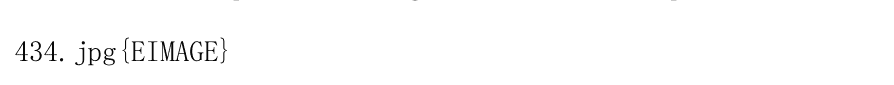

# 《心理大师》：我是心理医生，818最近的变态病人

沈非1

## 序曲第一话：《残肢》

我叫沈非，我是一个心理医生。

我有一个叫陈老师的病人，这位病人爱着一个不应该爱的女孩。

陈老师从小生活在一个非常传统的家庭里，父母站在讲台工作，享受着灵魂导师应该享有的骄傲与严厉。

于是，陈老师再应该意外一般，在那年的初秋走进校园，又在四年后的夏末走出校园。最终，在一个满世界都有着意绿的春天，陈老师再次回到校园，不同的是，从学生到老师身份的切换。

接下来的日子里，陈老师行走在一条不可能有着分岔的生命轨迹上，唯一需要做出的选择，就是婚姻——这一与工作同样重要的人生选项上。

但是，陈老师却无力了。

因为，陈老师发现自己爱上了一个不应该爱的女孩——自己的亲妹妹，并且是与自己同一个房子里，同一个时间被留育、生产出来的孪生妹妹。

陈老师痛苦万分，这一违背常理的心无法得到释怀，注定了只能隐藏在陈老师的灵魂深处。于是，陈老师找到了我——沈非，海洋观察心理咨询事务所的心理医生，想要走入潜意识深处，唤醒自己对整个世界的爱，而不会去纠结一段不应该有的畸形形态。

结果是……我挖掘出来这么一个奇的故事：老师——这位做陈松梅的漂亮女人，在她产道这个世界时，母亲的宫里承受着另一个孩子，一个本应该是哥哥的婴儿。

哥哥抱着陈松梅在充满了液体的狭窄空间里生活了十个月，却不想放手，双手紧握地在产道两边，想要阻止任何人都伸向自己妹妹的外力，因为她伤害了妹妹。

细长的剪刀伸入了产道，因为医生们只有这一选择，才能让三人都落在两个，尽管这一决定太残忍，但这个世界来到到处都是需要割舍与放弃的隐隐。哥哥并不粗壮的手臂被剪断，或者应该是那个小子傻傻的想要保护妹妹的力量，被剪断了。

陈松梅来到这个世界上，身上是支离破碎的哥哥。那一个画面她不知道有这么一回，她第一次睁开的眼睛，看到的画面是支离破碎的哥哥。那一个画面非常离常，尽管现实中的她陈松梅，压根不知道有这么一个潜意识深处。关于她哥哥的故事，被妈妈藏到了深层皱纹记忆里，但作为她第一一眼看到的那一幕，已经深深烙印在她潜意识深处。

于是，陈老师幻化了，她分裂出一个思维中的哥哥，哥哥伸出两条粗壮的胳膊，如同那捆挣着的十个月里一样，紧紧地接着妹妹。

而老师自己，就是哥哥深爱的那个妹妹。

于是，我们的潜意识世界里，到底还有一些什么，其实是我永远无法知晓的，如同我和邱凌一样……

是的，就如同我和这位嗜血的仇徒邱凌，不知道自己心里装了什么一样。

我是沈非，我的故事，即将在天涯拉开幕！

第一话这个故事要说明一下，很多人质问为什么不用剖腹。我们的故事开始在2013年左右。陈老师的故事预设是1983年左右。当我们的医学水平做不到介绍，所以全国各地都有妇幼保健院，就是专门医学生的，当时的生产死亡率在现在看来可怜喻。再说顺产到一半，临时想要剖腹，也不是说剖剖剖的脐带与两个孩子共处在那么一个狭小空间里。

不过感谢各位，得到你们的厚爱，才能走到现在。但是仅仅是一个小说，一个故事而已，所以各位也太敏感了。觉得这个故事很有意思，谢谢各位！

作者：沈非 日期：2015-08-19

## 序曲第二：恐惧

管先生是一位上市企业的财务总监，并且是元老那种，洞悉了企业所有能见的一切，所以他不必担心，在这座华丽的城市中过着舒适的生活。

管先生每天7点起床，8点钟在茶厅里吃固定的早餐：豆浆与粥。

结束了一上午的工作后，中午的他会走半个小时的路，到附近的超市买午饭。下班后，每天七点半，回到那个空旷的大房子，坐在椅子上，望着满桌的晚餐。他在大腿上铺一张纸，把饭盒里的食物整齐地摆在。管先生会慢慢地，小口地咀嚼，最后吞咽。

如果遇到下雨，如果很大，他就直接坐在椅子上吃完晚餐。对于饭盒，里面有两个饺子和一包蔬菜。

管先生不止一次跟我说：“我已经病了，能不能治好？”实际上无所谓了，没有精力也不可能吃太多了。”说完这些，管先生还会耸，用一个眼神看着我。

我知道，心理咨询上的病并不是特别，而且还很好。就是非常普遍的特殊症，有人害怕，有人害怕飞机，也有人害怕树……而管先生恐惧另一类了，他恐惧食物，味道食物。

他不愿意向自己开始这种恐惧，这种反侧让我变得好奇。但我知道好奇并不是优秀的心理医生应该具备的，病人之所以出现疾病背后的故事。毕竟，任何人都都有权利拥有故事，华丽的，或是阴暗的。

终于，管先生在一个夜晚，老人很激动，抹着眼角的泪痕。我突然发现管先生是衰老到眼睛已经彻底无法流，只能那么浅浅的抹润，接着被脸上深深的吸走。

他终于对我说了二十年前的故事，也是这个故事，让世界发生了天地的变化。

那时候，三十出头的风华正茂，管先生是一位出名的美食家，或者说就是一个馋猫。年轻的他，因为工作需要，他要保守许多公司的秘密，所以他需要在其他地方觅，选择了美食。管先生每天吃得与我们一样，寻找着各种奇异美味，让他们进入肠道，但却始终无法满足，总觉得世界上还有东西自己没有尝过的，需要由自己继续尝。

作者：沈非 日期：2015-08-19

管先生的妻子是一个日本女人，女人每天在家里想最多的是如何做出新鲜和口的美食，得到丈夫的赞美。慢慢地，她发现丈夫对美食的喜好已经变得不可理喻，甚至可以一年都不与妻子亲热，任由每月梦一次，也无法放弃一日三餐的痛快。

在这样的丈夫身边，这位只希望迎合对方的女人，思维慢慢露出了变化。

某一天，管先生发现妻子煲了一种味道非常鲜的汤，闻起来有些让管先生这种吃肉者激动的微腥味，闻起来又像是放了牛奶而已。最后，他在碗里找了很久，才发现了几块瘦红的肉块。

妻子那天好像身体并不好，她的脸色有点苍白。管生并没有注意到这点，他只是看着碗里的美食。一整汤都被管生喝光了，他砸着嘴巴，希望明天还能吃到如此鲜美的食物。女人微笑着道：“好啊！只要你喜欢就可以。”

第二天，第三天，管生都喝到了鲜美的汤，有着牛奶味道浓汤，心情非常开朗，并且不断的赞美着妻子。妻子的脸色越来越白，笑容却越来越妩媚。

到第四天晚上，半夜起来上厕所的管生突然觉得口渴，想要喝点冰的东西。于是，他打开冰箱，发现冰箱里有一个罐子里面放着一块圆形的肉。肉面上甚至还有一层皮，那层皮细腻得像是人类的肌肤。

管生好奇地打开灯，端出了那颗鲜肉。紧接着，他看到了让他妻子再也不敢享受美食的画面。他看到了……看到了……

## 序曲第三：恐惧症

我是沈非，我想说一个大师关于恐惧症的故事。

一位柔弱的女孩，开始陷入了巨大的恐惧。父亲的意外死亡，让母亲也随之改变。

柔弱的女孩开始害怕身边的每一个东西，觉得那天发生的一切，都会被夺走生命一般。马桶中流水，贝亮上……这一切，她开始疯狂地画漩涡图案，发展到了不可收拾的地步。他在墙壁上画满了漩涡，所有的东西都被换成了漩涡图案。

她发现眼珠可以响应漩涡，并开始寻求身体中能够腐烂。最终，母亲被送进精神病院的原因是她用剪刀将手指上的皮肤整整块地剪掉了，因为在她眼里是一个漩涡。医生们尽了最大的努力，让病情终于好转了，因为她足够的时间。

作者：沈非 日期：2015-08-19

沈立是一个心理医生，她明白出现这些梦境，是潜意识深处让她无限恐惧的一个故事。她彻底用了一点点治疗，将这一梦境驱散。

在梦中，沈立总是看到产房，医生在在哭泣。沈立被推进产房，医生抱着全身赤裸的婴儿，粗壮的手脚在蠕动，哭泣声让沈立激动不已。

“医生，是男孩还是女孩？”沈立再次问道。

医生没有理她，而是另外一个护士一起低头看着手里的孩子。

“医生，是男孩还是女孩？能看看吗？”沈立再次问道。

医生依然没有动。沈立被推起来，在梦中她看到医生抱着全身赤裸的婴儿，粗壮的手脚在蠕动，哭泣声让沈立激动。一对巨大的眼，以及三瓣蠕动的眼。沈立再次尖叫着醒来，一身冷汗。她站了起来，快步走进洗手间，擦脸。第二天，第三天，同样的梦一次又一次袭向她。

半月后，怀孕中B超照出的胎肉形状已经有了基本的形状。沈立看着那张黑白的B超片，初具雏形的女孩，颜脸长得那么奇怪。

当晚，进入产房的梦又开始了……

沈立的孩子在怀孕四个月的时候，医生在检查后发现心脏不再跳了，被确定为死夭。医生低着头：“真奇怪，好好的一个孩子，为什么在母亲的子宫里呼吸不到母亲给予的营养呢？”

沈立反倒松了口气，因为这两个月来，她无时不在地担心身体里那个有着虫容貌的孩子最终成长，甚至她还时不想想，如果自己这个母体不再给予其体里的魔鬼养分，那么他就就不会被培育成功呢？引产术后，沈立终于看到了身体里那初人形的颜面……沈立泪满面……

其实，我们的意识对身体的可控程度，有着我们永远无法理解和解释的惊人力量。甚至，这力量惊人到可以让一位母亲轻易放弃体内的生命……

我是沈非，我的故事，将在天涯拉帷幕！邱俊，冷笑着，望向了被他刺开了衣裳的货物。他那并不存在的手，击向了赤裸女尸上的脊骨。

作者：沈非 日期：2015-08-20

刚看到，看来本文的挺很多的。这几天在出差。晚上好！希望回复的都是美女粉丝啊啊!!!!!

作者：沈非 日期：2015-08-20

我是沈非，以下是正文。当故事看吧，较真就没意思了。

简单的铁凳，弯曲的幅度，让他莫名兴奋起来。他吞了一口口水，插在裤兜里的手不由自主地捏紧了，感觉着对方细长的手臂与腿骨，在自己的发力中断成两截的响声，很近了。

但他还需要继续下去，因为他记得前方 20 米的位置，有一家银行，银行的门口一般都是有摄像头的。另外，前面十字路口有一个不小的商场，商场里巡逻的保安，现在这个时间段，应该正在进行后一次巡视的声响。万一有什么太大的响动扰了他们……

叹！他往路边靠了靠，尽量躲到了阴影下。这时，女人站起来了，吐了吐舌头好像仿佛已经清醒了。她左右巡视一圈，然后用手把脸上湿漉漉的雨往后抹了一下。这一个动作让她粉嫩的脖子暴露出来，细长，白皙。

作者：沈非  日期:2015-08-20 23:04

他感觉到周围安静，裤兜里的手心都是兴奋的汗液。那脊骨，一节……一节一一节地顽强扣在一起，连着她身上有着弧线的脊架。而那脊骨，一节……一节一一节的顽强扣在一起，又连着她的骨骼。

他发现还没逼近对手，加快了步子向前走，他需要用自己的手掌，捏住女人的脖子，往后用力，往脖子发出声响。

他突然止了脚步，已经走到马路中央的她，在瞬间静止，变成了雨夜中一座冷静的雕像。他压了低头，用眼睛看向自己背后的街角望去，这波大雨编织成一块巨大的网，让他视野变得极其有限。他无法肯定，让自己觉察的响动是否曾经有过……决定放弃这次狩猎。于是，他停留了十几秒，最后咬了咬牙。

加 v ✨ 1101289455，获取更多优质资源推荐

将帽檐压了压，将雨衣的领子往上提了提，最终，他转身，朝旁边一条小巷子里快速走去。

这时，身后那女人发出“哎呀”的叫声。

他转过的头，视线触到的女人摔倒了，并且还倒在对面一条漆黑的小巷子前。她双手手撑地，膝盖弯曲着，臀部微皱起的姿势，让他深深吸了一口气。湿透的连衣无力地贴着女人的大腿，贴着她臀。接着，她在缓腿爬，用她身体的诸多关节，配合着完成这些动作。

他明白正在失去自控力，只能继续喘大口吸气。而与空气一起被他吸进了鼻腔，这种感觉让他能够更加快速地冷静。

但是，爬起后的女人又用手揉了一下，那娇嫩的颈部……女人朝着那漆黑的小巷子里走去。

他失去理智，快速穿过马路，跟了过去……

这时，大雨织成的帘子中，几个高大的身影出现了，他们紧紧地贴着街角，表情异常严厉。

十分后，两辆汽车快速地到了巷子口，几个高大的男人挣着一个穿着雨衣的家伙走了。他们身后，之前醉酒的女人也出现了，她的步履快了，脖子也伸得直的。

她身边的一个男人用手机在讲着：“汪，我是李昊！”他的声音低沉沙哑，透着一种男性才有的力量：“我们抓到了田人魔。”

作者：沈非 1 日期：2015-08-20 23:05

他感觉到冷意，满里的手心都是兴奋的汗液。那脊颈，一节一节一节地顽强抱在一起，连着她那有着曲线的骨架。而那脊骨，一节一节……一节一节的顽强扣在一起，又连着她的骨盆。

加v信1101284955，获取更多优质资源推荐

他变得有点迫不及待，加快了步子往前走，他需要用自己的手掌，捏住女人的腰，往用力撑，让骨子发出声响。

可他突然停止了，已经走到马路中央的她，在瞬间安静了，变成了雨后一座滞衡的雕像。他压低了头，用眼睛看向自己背后的街角望去，这凛漓大雨编织成块巨大的帘子，让他视野变得极其有限。他无法肯定，让自己警觉的响动是否已经过了……

他停顿了十几秒，最后咬了牙，决定放弃这次狩猎。于是，他将帽檐压了压，将雨衣的领子往上提了提，最终，他转身，朝着旁边一条小巷里跑去。

这时，身后女人发出“哎呀”的叫声。

他转过的头，视线触到的女人倒了，并且还摔倒在街对面一条漆黑的小巷子前。她双手撑地，膝盖弯曲着，臀部微微翘起的姿势，让他深吸了一口气。湿透的连衣无力地贴着女人的腿，贴着她的臀。接着，她在缓慢爬起，用她身体的诸多关节配合着完成这些动作。

他明白正在失去自控力，只能继续喘大口吸气。与空气一起被他吸进了鼻腔，这种感觉让他能够更加快速地冷静。

但是，爬起后的女人又用手揉了一下，那娇嫩的颈部……女人朝着那漆黑的小巷子里走去。

他失去理智，快速穿过马路，跟了过去……

这时，大雨织成的帘子中，几个高大的身影出现了，他们紧紧地贴着街角，表情异常严厉。

十分后，两辆汽车快速地到了巷子口，几个高大的男人挣着一个穿着雨衣的家伙走了。他们身后，之前醉酒的女人也出现了，她的步履快了，脖子也伸得直的。

她身边的一个男人用手机在讲着：“汪，我是李昊！”他的声音低沉沙哑，透着一种男性才有的力量：“我们抓到了田人魔。”

作者：沈非 1 日期:2015-08-20 23:07

## 第一章：一个叫邱凌的凶手

所谓的变态患者，对他们的判断并不是有一个精确的标准。在进入中国时，在他们眼里，当时违反了社会规则，他们就觉得是变态患者。这就是标准的不同。普通的心理医生，在面对患者时，所接受过的教育知识以及对于社会人的认知，便成了自己认定患者是否存在疾病，或者是否变态的标准。

前提便是，变态患者都会出现一些违反社会的行为，但又不能把违反社会的行为归纳为病。例如很多强奸、凶杀是非常极端残忍的行为，但是他们不是病人。病人是因为没有能力认定社会接受的行为，才让他人无法接受后果。说到这里，便出现了一个问题：某些刑案凶手在行凶时，是心理疾病的状态？还是正常人被欲望驱使的状态？抑或是一个无法描述的状态？那又如何来判断？用什么样的标准呢？

——沈非 作于2013

李昊把方向盘一转，好像自顾道：“完了，我落了东西在看守所，跟我去一趟。”我坐在他身边眯着眼睛，李昊欠的这顿饭饱两个月了，到今天主动见面，让我有些意外。李昊依然向望着前方，嘴里憋着：“今天下午我在看守审是谁？沈医生知道吗？”我看着他一眼：“打住，我不想知道你工作上那些破事。难道你要让我再次强调我的原则——不再再参与刑案案件的心理分析。”我自己知道他说的邱凌是谁——晏名的田人魔！他落网后，市民送了十几面锦报，上面写着“一方卫士”“刑案终结者”之类的口号，新闻里报道了好几天。只是对于这个邱凌的信息，却没有任何放过。

加v信11028955，获取优质资源推荐

我理解：目前案子与嫌疑人在预审阶段，太多案情方便公布。我继续装作没兴趣的样子，伸出手弄着李昊车上的CD，然后拿出一张滚溜的CD塞了CD机。李昊这一会的心情应该是动的，或者说亢奋。我抓到了一个月以来纠结不已的疑点，给谁能不兴奋呢？而我，这爱面子又对田人魔了浓厚兴趣的心理医生，这时不给李昊来点催化剂，怎么能让他像豆子一样跟我好好说清楚案情呢？

这位老同学憋不出声了，他放下车窗，然后点了一支烟，狠狠地吸了几口，紧接着他突然蹦了一句：“想见你那个邱凌魔吗？”我笑了：“李昊，我怎么觉得你现在就是在对我下套，想要我帮你瞅眼这位田人魔，然后给他一个心理医生能够给出的某些答案。”

作者：沈芳一 日期:2016-05-28 20:13

李昊也笑了：“怎么样吗？帮忙忙可以吧！省厅这几天也派了两个法，是研究犯人心理学的，给的结果让我们市局的刑警都有点愁火。可人家……唉！等会我帮你瞅眼这位魔再说吧。”

我没有呆，静静地盯着他的眼睛。我沈芳，是一位心理医生。我在海阳市开了一家叫“观察者”的心理咨询事务所。我在心理学研究上一点的成就，这让我在业内有着一定的名气。早几年，市局一些需要心理医生或者心理咨询师的案件，汪局都喜欢李昊叫我帮。我只是个医生，我的工作是治疗病人，并不是参与刑案调查。所以从年前开始，我为自己定了一个原则：不参与刑案。这个原则是“万不得”四个字。正如省厅都头的头案，这类连环强奸杀的案，我完全可以排除在外。

加v+28955，获取优质资源

去年暴雨后的清晨，第一个死者在露天体育场被发现。因为水的冲击，让那个受折磨的大学生看上去却没有那么狰狞。她裸裸地绑在台子上，死者的身体处关节折断。整个海阳市震惊了，这其实是另类。警方积极开展外围调查的同时，也就是命案发生后的第二天，海阳桥下就出现了一具女尸。这一次是醉酒的少女，她的肉体和第一个死者一样，关节折断。媒体第一时间串联了这几个案件。

接下来这一年里，第一起、第二起、第三起、第四起、第五起案件不断被送到了刑警专案组办公室。只能用老套的破案手段，视频覆盖的大型城市基本上是很难做到的。专案组在海阳市一看，关着的都是嫌疑人邱凌。他的相应符合一些特定的“犯罪人类学”里对于罪犯认定的体特征。这个位上世纪医生，这个犯人就是邱凌。这个犯人自然置若全然。

李昊在门口办理了手续，接着把车开到院子里。停好车，我故意问了一句：“你说的这些是骗我的吧？”李昊笑了：“早知道你不抗拒见这个桩，也不用得麻烦。”说完，他率先下了车。我接着深深吸了一口气，拉开了车门。

作者：沈非 日期:2015-08-20 23:12

审讯室看到她时，我发现李昊的搭档慕容雪比我第一次看到她成熟了不少。她也跟着李昊身后站了起来：“沈医生，你也来了。”我照了一眼她台面上摊开的审讯记录本，接着她微微微笑：“你们招供已经没必要装了。我只是好奇，看看这个家伙是个个人物。”十分钟后，铁链在水泥地板上拖动的声音传递过来，我把椅子拉了又拉，尽量让自己在墙角不是引人的位置。审讯室的门被推开了，两个看守带着手铐和脚链的犯人进来了。犯人就是邱凌。他的相应应该符合一些特定的“犯罪人类学”里对于罪犯认定的特征。

在《犯罪学》里认为：天生罪犯，是有某些表现在生理与敏锐特征上的遗传缺陷。比如长长的手臂、锐利如猛兽的目光、宽大的颈骨等，这些异常现象的体现，令凶犯天生具备我们无法遏制的嗜血欲望。可惜的是：邱凌并没有具备以上的特点，甚至比我看到的大多数罪犯都要显得斯文多了。他高瘦的身材，让人都想不到他能够足够的体力完成那些令人深心的罪行。白净的皮肤，说明他有一个优越的家庭环境与不需要耗动力的工作。我继续缩在椅子里观察着面前这位三十左右的嫌疑人，他头发很短，剪得非常整齐，手指放在审讯台上轻微地抖着。他努力把眼睛眯成一条直线，很用力地望着除了我以外的李昊和慕容雪。他是高度近视？

他是高度近视？李昊扭头看了我一眼，对着小雪点头。小雪拿出出一副非常精致的金丝眼镜，递给了接受审讯的邱凌。邱凌伸出手接，井井有地说道：“谢谢。”接着他把眼镜戴上，认真地看了李昊和慕容雪，最后把目光移到了角里的我身上。

这时，我注意到一个很微小的细节，邱凌在戴着眼镜后，那放在审讯台上抖动的手指停止了抖动。这点可以理解，因为人的第一需求是对于安全的需求，邱凌在没有眼镜这一种辅助工具之前，看不清身边的环境，也就是说他感觉不到最起码的安全。但是这个念头在他脑海里的头，由于与我的接触之后，被我打断了。

加vf2955，获取优质资源推荐

应该是见过的邱凌。小雪先开口：“这几天在看守所里得怎么样？”邱凌：“想回去。”说完这个，邱凌非常勉强地挤出一丝笑意来：“不好，我不回去了。”邱凌，31岁，市局级干部，公务员，独身，未婚。如果不意外的话，你下个月就要结婚了，妻子是你的同事，并且已经怀了孩子。三个月了吧？”李昊拿着手里的卷宗轻描道：“两个半月。”邱凌纠正道：“李警官，别说这些可以吗？五个人人命，外面的一切都会……”

我是足够够望的。唉！我一直看着新闻，关注了这起连环杀案，确实太恐怖了，太凶残了。到最后落实下来，似乎还是……李昊闷哼了一声：“装吧！继续吧！不要以为你昨天在省厅派过来的心理医生面前演了场好戏，就有本钱。给你说明吧，就算是他们给出了分裂人格的报告，你这辈子都不可能走出牢笼了。“……我不要进去！”邱凌身子往前了，明显激动起来：“我的罪太深了，法院判处我死刑吧！枪毙一百次，千一次，万次，让我当罪吧！我没有分裂的人格，我没有！判我死刑吧！求求你们了。”李昊没有理他，他忙着皱眉扭头来看。我装作看不见，把手脚都伸展开，全身放松地靠在椅子上。李昊现在的举动会让邱凌注意到我，他会接收一个信息，现在就是我——坐在角落的和他同样瘦瘦、同样岁的沈非，成为这次审讯的焦点。我现在能最大化体现出来的决定是不公平的，会让邱凌表现出的冲动，想要让我洞悉他，并肯定他的这种表演冲动。前提是他还有一些始终没有体现出来的强大思维布局。审室里变得安静下来，我并没有正眼看着邱凌，但我感觉到他也在观察对方。几分钟后，我先打破了沉寂，因为我想让对方觉得我没有打算走，因为我作为一位观察者，邱凌是我要观察的。

李昊现在的举动会让邱凌注意到，他会接收一个信息，现在就是我——坐在角落的和他同样瘦瘦、同样岁的沈非，成为这次审讯的焦点。我现在能最大化体现出来的决定是不公平的，会让邱凌表现出的冲动，想要让我洞悉他，并肯定他的这种表演冲动。前提是他还有一些始终没有体现出来的强大思维布局。最后拿一起雨伞，躲到了病人身边，和他一样高举起了雨伞。深邃的世界是完全封闭的，他不与任何人交流，自然让每个人都狼狈。

一天后，病人终于开口了，转头对这位老师问：“您，也是来撞我的？”于是，认为是为了心理医生需要一个有效工具。为了理解寻常的内心，就需要进入这个世界，而进入这个世界最快的捷径，便是转换到对方的思维里面。我把双手开展放在沙发上。角落昏暗的灯光，让诊室内的三人不会察觉我手指有意地抖动。接着把身体微微收缩，往后靠在椅背上。现在我前的邱凌，就是田人魔。

李昊现在的举动会让邱凌注意到，他会接收一个信息，现在就是我——坐在角落的和他同样瘦瘦、同样岁的沈非，成为这次审讯的焦点。我现在能最大化体现出来的决定是不公平的，会让邱凌表现出的冲动，想要让我洞悉他，并肯定他的这种表演冲动。前提是他还有一些始终没有体现出来的强大思维布局。

我是沈华，我热爱这个世界，但不愿意娇惯了他。

在研究精神疾病的医学工作者中，有一个笑话流传：精神医院有一位病人，每天沉默，默默地拿着雨伞在墙角，把撑开的雨伞也想拿着，高高高高举起。

有很多优秀的心理医生也尝试过解释这位病人异样的内心世界，以便于对他进行针对性的治疗。可这举着雨伞蹲着的病人，他深邃的世界是完全封闭的，他不与任何人交流，自然也让一位心理医生愁寂无功而返。

某位泰升的老老师自出自马。老师观察了这位病人几天，最后最后选择也拿一把雨伞，到了这位病人身边，也和他一样高高高高举起了雨伞。

一天后，病人终于开口了，他探头对这位老师问道：“您，也是一条蘑菇吗？”

于是，换位思考认为是心理医生需要具备的一个有效工具。为了解不寻常的内心世界，就需要进入这个世界，而进入这个最快的捷径，就是转换到对方的思维空间里面。角落昏暗的灯光，让教室内的其他人不会察觉到

我把双手展开起来，放在双身上。我看到手指刻意地抖动。接着我把身体微微蜷缩，往后靠到了椅背上。“现在，邱凌在看守所里过得怎么样？”就是我前面的邱凌，就是那个田魔邱凌。

“邱凌，这几天在看守所里过得怎么样？”小雪率先开口。

“不好，想回了。”说道，邱凌非常勉强地挤出一丝笑意来。

“可是我直接回去了。”

“刘俊，31岁，市国土局干部，公务员，独子，未婚。如果不意外的话，你下个月就要结婚了，妻子是你的同事，并且已经怀了孩子。三个月吧？”李昊拿着手里的卷宗轻摇晃晃地说道。

“是两个半月。”刘俊纠正道：“李警官，别说这些了可以吗？五条人命，外面的一切都不会是我能够奢望的。唉！我一直有新闻，关注了这起连环杀人案，确实太恐怖了，太残忍了。到最后下来，凶手还是我……唉！太不可思了。”

李昊哼了一声：“装吧！继续装吧！不要以为你昨天在省厅派过来的心理医生面前演了场好戏，就有这本钱。给你说明吧，就算他们给出了你有分裂人格的报告，你这辈子都不可能走出牢笼了。”

“我……我不要进狱！”刘俊身体往前一倾，明显激动起来：“我的罪孽太深了，法院判我死刑吧！枪杀了我一百，一千，一万，让我当替罪吧！我没有分裂的人格，我没有！判我死刑吧！求求你们了。”

李昊没有理他，他紧绷着皱头来看。我装作看不，然后把手脚都伸展开，全身放松地靠在椅子上。李昊现在的举动会让刘俊注意到我，让他接受到的一个信息，那就是我——坐在角落的他和他同样高洁、同样年轻的底华，聚成为这次审讯的焦点。我现在能最大化表现出来的并不在乎，让刘俊表现出的冲动，想要让我洞彻，并肯定他的这种种表演的冲动。前提是他有一些始终没有体现出来的强大思维布局的局势。

审讯室变得安静了，我没有看向邱凌，但我能感觉到和他一样在观察着对方。几分钟后，我先打破了沉寂，因为我想让对方觉得我没有紧张，因为我是一个观察者，邱凌是我要观察的目标。我能体现出来的弱点，会成为被他轻敌的原因。

我再次把双手放在了膝盖上。“李警应了，”李昊却愣了一下，他站了起来，接着看了看，我又看了看审讯台前的邱凌。在他们刑犯的世界里，每次审讯收获一些东西，似乎都是工作消耗的体现。

我笑了：“哈哈！”我答应了晚亥八点前就要到家，对大肚肚的承诺不兑现，到时候孩子出生后指着我做你爸爸的罚我！”

“你……晚亥坏了？”李昊有点不习惯在人犯面前表现他作为一个普通公民的一面：“你怎么没对我说？”

“下个月，再说李昊每天多忙了！”我提着公包站了起来，眼睛却偷偷地望向审讯台前的邱凌。无论他到底装着什么样的心思，但他作为一个人的身份却是无法更改的。我想要让他感受同样的即将成为人的男在这一傍晚的情绪，对于打开他现在作为一个犯罪嫌疑人身份的包装外壳，是一记很有力的撞。

然而，他脸色有点变了，甚至那两片高度近视的眼镜背后，还放出了危险的光来。我暗暗窃喜，扭头对他随说道：“你儿子的名字好了没有？”

邱凌一愣：“儿子吗？我还不知道是男是女，所以还没给孩子取名。”

“哦！”我点了点头，接着朝他走了过去。我矮的身高，对方现在又是坐着的，于是我的视角可以起到一点压迫的效果。“邱先生吧！你右手与中指末节没有抽烟，二十九岁，没有啤酒，因为你不喝酒，所以身体是碱性的，酒精产生的精子，你的身体是碱性的，都能让好妻子上。”

邱凌对着我：“希望……我罪太深了……”

我继续朝他走，最后站在他的面前，我双手撑着审讯台，死死盯着他的眼睛，我必须在第一个回合气势上完全击败他，才能对他造成一定的压力。但是压力又要契合他现在刻意标出来的弱点，就是我希望把他看作为一个强大的对手，然后，他会放让我洞悉他内心深处。

“沈医生，你可以叫我沈非。之后可能会有很多接触，你作为连环杀手的分子，最为典型的一个案例。”我微笑着对他。

“沈非，我有什么好的研究。”邱凌开了眼睛：“我是怎样过的过程全都不记得，能有什么研究？”

“走吧！”我也扭身子，对着李昊和小雪扔出这两个字，接着我抓住了李昊放在桌上的钥匙，迈步走向审讯室的门，也不回地向外走。

我觉得他身后有一双冰冷的眼睛注视着我的背影。邱凌——应该是一位不错的对手，在他平庸的外表下藏着一个强大的内心世界。

十五分钟后，我与李昊、小雪出了看守所。路上李昊变得愤怒起来：“什么专家？还不去都是拖腿的货。人运住了，用锁在现场缴获了。邱凌这变态伪装，说自己都不记得，省厅里那个老头认定他有多重人格。可能吗？”

我打断了他的话：“你的意思是省厅来的法医是心理医生？他们审邱凌后给出的报告是他分裂？”小雪连忙回答：“是啊！沈医生，我们市局的刑警疯了，这个群众犯不能逸了，最后把他去精神医院关几年又回到社会，能让那些家伙还能吗？”

“哦！”我点了点头：“李昊，给我一份卷宗，我回去。”小雪噗嗤一下出了声，接着从她的包里拿出了一个厚厚的牛皮袋：“李队已经给你好了，等你开口。”沈医生视我如魔，不会枉管市局的大子的。”

我也看了自己身边李昊一眼。李昊一张脸还是猪肝色，没从愤怒中出来。我伸手锤了一下他的手：“行了！李队长，消消气，现在好好考虑下我去哪里吃饭！”

“行。”李昊挤出一丝笑。“反正这段时间我在学校，最近导师要几个论文，忙着呢。我俩正忙着这个时间好好聊呢。”我回答道。

“那你刚才……那刚才才说她怀孕了？”李昊说这话时，露出了有点奇怪的表情。这一点不在意，不止我身边的每一个人，在说时都露出这样的德性。

“早着呢！”我笑着回答道。就在我还没说完的时候，李昊的手机响了，他瞥了一眼，嘴里嘀咕：“给局里说了，忙了这么，说好这段时间让我放松一下，一般的案子不要找我。现在又打来了。”他接通了电话：“喂！简单的案子不许我！”小雪在后座吃东西：“前天市委员会里台电车，陆夫人跑到市局点名李奎亲自去破案，案里这两天天拿这实话。”我也哈哈笑了，眼睛偷偷地瞄向李昊，只见他额头皱了皱，最后，他嘀咕了一句：“知道了，我马上。”李昊放下电话，把车停了马路旁边，接着扭身子来，表情非常严肃对我和小雪说：“连环手又作案了，案里的兄弟已经过去的了，我和小雪现在也要过去。沈非，跟我去看看吧！”

## 第二个连环手

陆上他俩都没有说话，李昊开车开很快，在入夜以前抵达了市郊某个废弃的厂外。那里停了良好台警车，李昊拉开了门，我却对他摆了手：“我不进去了，就在这里面等你吧。”李昊似乎在想说什么，最后忍住了：“小雪，走，我们进入现场！”我并不是刑犯，我只是一个医生，一个普通的心理医生。我没有责任与义务去采集凶犯各种资讯，我想要洞悉的，只是一个叫邱凌的凶手。我手里放着他的公文包，用手碰着那卷。李昊在车前非常自觉地把车的收音开了，让我有一个相对安静的思考。我缓缓睁上了眼睛。我的U盘，大量的数据被读取。但在读取之前，我想要把邱凌这个人进行初步定位。二十九岁，独子，收入不菲，不需要为生计而疼。有固定的妻子陪伴，他的生活是有规律性的。

弗洛伊德认为：人的意识是由两个部分构成的，一个部分是我们正常的意识，另一个部分却是埋在内心深处的潜意识。两者之间有一道门，控制着两种意识。很多我们在人生中所经历的、看到的、接触到的认知，被我们选择性地埋在门里，便是潜意识。也就是说我们表现出来的意识这一面，只是潜意识的一部分。潜意识里有些我们自己不知道的东西，或不在意间被灌输了，只是这些东西被我们选择性地埋着。邱凌，他的潜意识是什么样的？如果说是多重心的心理疾病，那么是什么导致他分裂出了另一个他？这个凭空出来的邱凌，又是为什么会从潜意识深处溜出来，进而控制了他的身体呢？

我不知道我好像进入了多久，李昊那大皮鞋在地上踏的声音，把我唤醒。我扭过，却看到了他。“怎么这么快出来了？”我好奇地问道。“还会回来，你先送回去吧！”李昊依然皱着眉，一副苦大忧深的表情。我没有拒绝，也没有对他发。我了解李昊，他并不是一个冷静的刑警，或者说他火爆的性格，其实早就注定了他不会能够抽丝剥茧的刑案专家。但他又有优点，那就是行动力强，少了很多因为小聪明而带来的意外。李昊跨上车，发动了汽车：“沈非，又是一个任务，第六个死者了。所幸这地方比较偏僻，媒体并没有知晓，否则……明天的头条又是连环手再次出现。”

“现场有些收获？”我忍不住问道。李昊睁了眼睛一眼：“你想知道什么？现场的细节？还是死者的各项指标？”我微微微笑了：“你知道我想知道什么的，直接告诉你们初步判断的结果吧！”李昊点了点头，其实早就对现场的具体情况没一丝兴趣，他直接当跟我说了些结论：“手法完全一模一样，甚至可以说是完美的连环手犯罪现场。”我打断了他的：“完美？”李昊皱了皱眉：“是的，非常完美的犯罪现场，甚至尸体被锁的关键位置极其整齐，放在台上能够到达的紧贴程度，比之前五个现场都要漂亮。“哦！”我没有说话了。李昊自顾地继续道：“不过这次，凶犯犯了一个大的错误，就是废弃工厂不是第一现场，是在其他地方作案后再把尸体运过的。现场我们发现了车轮的痕迹。算幸运吧，进入工厂的那个分岔路口有监控摄像头，我们已经派出了一组警去取影像了。很快，这案子就能破了。”见我没有出口，李昊扭头看了我一眼：“你的看法吧？如果又迟到一个连环手，那看守所所属的家伙又如何解释呢？”之前我们派出的与邱凌的正面交谈，基本上可以确定他身份的，只是他一直狡赖。今天审讯厅对他两个都敞开，他那所谓的另外一个人格已经把之前所有凶案细节都取得清清楚楚了，不可能他人关在看守所，分裂出来的第二个他，就能离开他的身体，回来继续作案吧。我沉默了一会，望着窗外已染墨黑的路，半晌，我打开了电话：“李昊，因为媒体的跟踪，让在海阳市每个角落的人在连环手身上看到了一丝曙光。等他们，很快就会抓住第二个连环手，而他的出发点对于邱凌这家家伙背后是……你的意思是别人想要模仿他？”李昊胆性强。“你说对邱凌每一次犯罪都没有留过任何痕迹，而模仿者太荒谬了。”我摇摇头：“不是通过这一点推断太了，完美比邱凌自己设计的现场像回回事。”李昊继续：“完全理解他的冲动，邱凌，这次死者是一个女性。沈非，这也是确定不是同一个人作案的关键。“嗯！”李昊终于进步感到激动，接着，我打开我的包，把那卷宗拿出了，最后愣了一下，把它放进去。李昊那晚没有请吃饭，我也送他回到了诊所。在诊所外买了几个包面。我看着他远去的汽车尾灯，摇了摇头。他怕入错，李昊当年在全国中运动会上拿过三级冠军，选择了刑警这个职业，便注定了如此澎湃的人生。我在停车场启动了车离开了家，今晚煮了碗面，煮了汤，最后在客厅舒服地坐下，再次拿出了卷宗。几分钟后，我停在门口，李昊这个一样的家伙，继续被存在我公文包里。我想到李昊会有新的案进展带给我，哦！说明明天我们将彻底倒……与救赎！沈非，不可拯救……”

邵波靠坐在了我办公前面的椅子上，眼睛直勾勾地盯着我：“沈大医生，你听说晚晓李昊找你？”你怎么知道的？”我要弄弄手里的铅笔。邵波笑着说：“我是谁啊！海阳地下网络之神，大市长感冒，小隔离搬家，有什么能逃出我的掌控的？”我早就猜到他今天赶过来拉着我闲聊的原因。邵波，一家商务调查事务所的老板，94年从来到海阳市，十年来从事的工作是国内一直没有社会认可的私家侦。与很多大街牛皮广告的“光头神探”，“外遇神探”，“数据提取专家”不同的是，波波是有原则与底线的这个家伙，他运气好，海阳市比较闭，积累的社会资源非常广泛。再加上和他两个搭档为人处世都不错，所经营的那个调查事务所一直很好。可惜的是，他是我的病人。这一会，他又跑到的诊所了，跟他一起过来的他的搭档八戒。我的诊室里没有病人，个人便进来了，临来之前，他俩还在门口一人抽了一支烟，烟底上的滤嘴都要快被点点了，才依依不舍地留下。八戒奔着五百十斤的身体灵活地占据了诊室里给病人准备的那个沙发，他非常夸张地伸着手：“嘿！难怪波波欢迎你来这里接受什么治疗，就是看着上沙发吧看来电视里说的没错，心理医生给病人的沙发是最舒服的，躺进来便什么烦恼都没有了。”

“快叫他！”我愣了，一把站了起来。知道，我虽然是心理医生，自己具备着非常良好的心理状态，可我有一个病却始终在戒除不了，也不愿意戒除它。那就是我在对待我诊室的问题上，有着轻微的洁癖。

邵波还在继续：“完了！沈医生，八戒这家伙睡着可是很难醒过来的，动用灭枪都没用。金钟还听过没？老像入定还听过没？嗯！心理疾病，八戒肯定睡不醒的心理疾病。

“少给他叫，快叫他！”我三步两步冲了过去，拍打着八戒的脸。这家伙还真没有反应，大脑反而倒了了下来，嘴角垂直地对上了我那万多钱买来的头等皮沙发。

邵波的声音在我身后响起：“得！沈医生，我也不难为你你了，透露一点关于梯田人魔的围圈消息给我，我就帮你领走八戒。”

“行！”我毫不犹豫地声道。

邵波跳了起来，对着八戒说了句：“快乐大本营开始了！”

八戒醒了，他睁了眼和我，然后嘟喃道：“沈医生，你真烦，压根没看我一眼，就把我催了……”

作为唤醒八戒的交换条件，我答应了邵波观探梯田人魔案件的求知欲。我出了诊室，对前台的佩怡问道：“今天没有我的预约吧？”

佩怡微微笑：“没有了，沈医生，今天预约的病人都是其他几医生的病人。”

我点了点头，我的观察者心理咨询所现在霍了五个心理咨询师，其中不乏有小名气的小心理研究工作者。再说，我的价码也不低，一般的小白波也消费不起。

我领着邵波和八戒出了诊所大门，邵波那霸道吉普车霸气地停在门口。

我上前踹了了他的爱车一脚：“国土局有认识的没？”

邵波一愣：“没有……不，有！”说完他指了指八戒：“他有网友是国土局的，见面吃吃饭唱K了好几次，是个二十八的老处女。”

{IMAGE}http%3A%2F%2Fimg3.laibafile.cn%2F%2F%222250433.jpg{IMAGE}

作者：沈非 日期：2015-08-24 07:44

目前看来，帖子还是得到了很多朋友的喜爱。恳请期待吧，各种不要求的，都会一一呈现。中禹才不过，各位得要宽慰，定努力！感谢谢那天天垂爱，本贴保证不雷！

错了，是保证不大雷，拉大伙进入坟的时候都要要这么说的。

作者：沈非 日期：2015-08-25 07:40

邵波一愣：“没有……不，有！”说完他指了指八戒：“他有网友是国土局的，见面吃吃饭唱K了好几次，是个二十八的老处女。”

“嗯！”我点了点头，接着看着他八戒一眼，就这样，还混到网友见面面了，也是对方的劫数：“打个电话过去听，约上吃吃饭，我想和她聊天。”

加v信1110284955 获取更多优质资源推荐

“没问题！”邵波一耸身了了他身后木讷表情的八戒：“赶急给你的老处打电话，说海阳市第一奇人物要见她。”

八戒依然木讷地点了点，拿起手机拨了过去：“郭美丽吗？中午一起吃饭吗？想想和你聊聊人生。”

半个小时后，我们在海都酒店餐厅等到了八戒的“老处女”网友——美丽。这位芳二八的国土局公务员郭美丽小姐，穿着一套灰色的西制服，那条有点褶皱的丝缕，说明着她不需要动弹的办公室工作。脸比较平坦，这可能也是她成为一位愁索女的主因。

郭美丽虽然是因为八戒的邀请而心情不错，但他却绅士起来，保持着那种男士对异性尊重的那种距离，不是很亲近对方。邵波却在笑，偷偷在我耳边说道：“看到没有，这就是人脉，我们苦心经营的人脉。”

我愣了八戒一眼，之前和他交不多，印象中他就是个凡事比人慢半的胖子，甚至我对于他是如何成为郭海德调查事务所的合伙人还有一二疑惑。

寒暄了几句后，八戒让我目相看了，变得不再是之前那木讷的样子。他给美丽碗里扫了扫，上面明显有两条虫虫的青菜，然后非常随意的问道：“听说那个种田人魔巫凌就是你们单位的？”

郭美丽笑着点了点头：“是啊！”局里也发了一个邮件，要我们尽量不要提这事，影响不好，整得人心惶神神的。现在想着都怕，一个那么可怕的变态杀犯，每天和我们在一个办公室上上班，抬头不见低头见的。”

加v信1101284955 获取更多优质资源推荐

郭美丽偷偷看了一眼八戒：“所有时候觉得，像我这种老姑娘，也是要抓紧行动，把自己早点嫁出去。这社会啊，越来越乱了，一个女孩……唉！”我用手撞了脚，示意他要亲自出马，套出东西来，要不要饭局下去，就会要约亲上了。邵波冲我眨眨眼睛，接着对美丽问道：“我说美丽，你们以前别凑出有什么当吗？”“没有啊！谁知道呢？大家都什么年代了，怕看书，都是直接上网买，反正便宜。对了八戒，我就提过什么时候买书，一个人家里，就是抱着猫咪看。”

加v信1101284955 获取更多优质资源推荐

说完，我拿起了包。汪局也站了起来：“哎！沈医生，你没从走，真是我们警队的损失。李昊，你现在带着沈医生去图书馆，多带几个人，视监控的活虽然很辛苦，但人力消耗太大，可能让沈医生太操劳了。”

李昊应了一声，然后把桌上的卷宗往包里一塞。

临从，汪局还丢下一一句：“小沈，忙完了这以后，我再代表我们警队请你吃饭。”

“哦！”我转过了身，看到对面墙上挂着一个金色国徽，庄严肃穆。我知道，这金色盾牌的光芒照耀了市局大楼里，人民卫士们为了这个城市的稳定和繁荣几乎疯狂的工作。就是像汪局、李昊这样的警察们，用他们有限的人生，换取每一个黎明闪耀到这个世界的阳光。

我与李昊带着另外三名警员带到市图书馆时，已经是下午六点了。图书馆的领导们都下走了，接待的是我们一个叫古大的图书馆管理员。古大力是一个实不扣的胖子，一套黑色的西装在他身上还像是包着那一团簇的绿叶，近乎界。

古大力听了李昊说的大的由来，非常积极地带我们进了图书馆五楼的监控区。里面有两个穿着安保制服的年轻人无表情地对着占据了整幅墙的监控画面，而实际上是这月，如今已尽之力的穷书早就消声无迹，图书馆监控摄像头的防盗目的形同虚设。

李昊按照李昊的意思，指示古大力找到了上周晚上七点到十点的录带。包括小雪在内的三位刑警一人看着两个屏幕，目不转睛地看着了起来。

李昊扭头望了我一眼：“我先带你去吃饭吧，顺便给他们打包回来。”

我摇了摇头：“晚点吧！我不饿。”

李昊点了点头，然后啧了下：“那我也去守两个画面，有情况了叫你就是了。”说完，这雷厉风行的刑警一路走向了他那几个手下。

我在靠门的位置找到了长椅子坐下，我的手再一次伸进了公文包里，邱凌厚厚的一叠卷宗静静地躺在里面。我并没有想把它拿出来，我需要继续收集一些外围的碎片，让对邱凌内心世界的图像慢慢完整，最后通过这叠卷宗来具体。就在我要闭上眼睛的一刻，长椅子突然抖了一下，一具热烘烘的身体坐了下来。

我睁开眼，古大力的脸上贴着疑惑：“你也是市公安局的刑警吗？这么斯文的刑警真少见啊！”

我点点头，对于这个爱八卦的图书管理员聊天并没有太大兴趣。知道古大力张开了：“我听他们都叫你医生，你应该是法医吧？法医一般只有在凶案现场才需要外出，你却跟他们来看监控，说明你不是一般的法医。你是心理医生吧？协助办案刑警破案的？”

我这才正眼看他，只见古大力对我眨了眨他的眼睛，分析出的东西还来一套的。我对他笑了笑：“你怎么知道的？”

古大力也笑了：“我瞎猜的啊！再加上精神科的医生我见得少，精神医生我倒是见得多。沈医生是不是？你们是要找我什么，我记得性格好，在图书馆也来了十几年了，不太可以帮你上什么忙。”

“哦！”我并没指望这位大胖子来上做什么，就算他能派上场，但是梯楼撞人这案子并不小，媒体关注度也高，我需要对汪局与李昊他们负责，不方便顺便对外说什么。可是，我身边坐着的这位图书管理员却再次开了：“你们不会是想邱俊吧？这段时间电视里全是梯楼撞人的案子，还放了一张邱俊的相片。我当时一看就认出了棒球帽先生。”

“棒球帽先生？”

“是啊！这是我经常来图书馆的老书虫的外号之一。这位棒球帽先生每次过来，都戴着一顶帽很长的棒球帽，最后起码来四个晚上，都是耗到下班去。这货又小气，一张票要10块钱的证书他也不愿意，就是带了一堆专业书籍在看。”

“这个我倒没在意，每天进出我们图书馆的人这么多人，我能记住他们的长相已经算不错了。不过……”古大力卖开了口。

“不过什么？”我自动自觉地配合他的话。

“对了！”古大力突然拍了一下大腿，然后扭头对着李昊他们喊道：“几位警官，你们找31号监控的带子，应该有你们要的人，专盯着那个棒球帽的。”

李昊他们一愣，扭过头来露出一个狐疑的表情。我冲李昊点了点点头：“这位先生提供了一些线索，按照他的吩咐试一试。”

作者:沈非 日期:2015-08-29 08:51

半小时后，小雪首先在监控画面中找到了戴着棒球帽的读者。小雪选择了一个比较清晰完整的画面，做好定格，然后叫我们过去。“放大！”

可是因为像素的故，视线里的影像一个模糊的。所幸我们只是捕捉到了他的脸。

画面的焦点被集中在那本书上，放大了几倍后再次模糊，别说书名，就算是书封上的图案都不清楚了。这时，大力“咳”了一声。李昊又问道：“大力，有什么发现吗？”

我扭头看了李昊一眼，这位暴脾气的警队队长一反常态地露出惊讶的表情，很认真地看着大力。他对这肥胖图书管理员的称呼也变成了“大力”。大力却翻了白眼，然后像自言自语般说道：“应该是……应该是……”

说到这里，大力转过了身，朝着门外走去，嘴里还在继续：“应该是……应该是……”

李昊拉了一下我的外套，然后跟着大力向外走去。我犹豫了一下，也追了出去。只见大力加快了步子，朝着楼下的阅览室走去。

我小声对李昊问道：“你以前认识他吗？”

李昊“嗯”了一声，紧接着像想起了什么，看了我一眼，也压低声音：“这位大哥厉害，可惜脑子比一般人高端，智商太高，高到在精神病院住了几年。”

“哈！”我张了张嘴：“你怎么知道的？”

“之前给我电话的是汪局，他告诉我大力就是我们海阳市公安局侦破很多大案的智将，只是他的身份没有人知道而已。”

李昊顿下：“算个人吧！一个可能在刑侦上用他异常人的思维方式提供各种参考意见的特殊人才。”

我“哦”了一声，再次向前方那个一拉一走的肥胖身体。只见他急匆地进了阅览室，熟练地在一排排书架间穿梭，最后走到了我们之前在视频监控画面里看到的区域。他嘴里再次嘀咕起来：“应该是……应该是……”

古大力用手指在周围的书架上移动着，最终锁定了某个位置，紧接着大步地冲了出去。我们和李昊也跟了过去，只见古大力从一个书架上扯出一本厚厚的书，然后转身对着我们张大了嘴：“应该就是这！”

这是弗洛伊德的《精神分析引论》，这本书最早在84年出版，现在共有几个翻译版本。现在在我面前这本《精神分析引论》，竟然是英文版。心理学领域内见解的专家，对于这种版本，是非常吃力的，需要看上几行才几下。

与此同时，我又用医生的直觉断定：邱俊一定尝试过这本著作。想到这里，我后背冒凉气。接着我用手指捏着眼镜，问大力：“有没有在这本书上找到邱凌的？”

李昊愣了一下，然后点了点头：“没有可能，需要送到厅。”

古大力好像医生一样在我耳边说出了声：“留下了纸片、皮革等吸水物品，常规方法是无法采集到的。现在比较多的是汗水残留、油脂形成黄色的指纹，这些需要立刻捕捉的。”大力顿了顿：“作为图书馆一级管理员，不会答应用化学物将指纹显现。”

我吞了一口水，把手里的《精神分析引论》小心翼翼地放在。大力俏笑起来：“医生，要不要让棒球帽先生感受一下？”

我也冲着大力笑了笑：“你懂的。”

话还没说完，邱俊习惯性地转动了身体，狼狈地倒在了地上。接着他快速爬了起来，对着我自嘲地笑道：“我的大腿住了脑，所以经常摔跤！医生多吃点蛋白质补充蛋白质。”

大力点了点头，紧接着从裤兜里掏出一个包，吐出一条纸巾，站了起来。

很快，一个靠角落的沙发呈现在我们面前。大力指着我说：“坐着吧，安静！”

我没有理他，径走了过去，找了个比较舒适的姿势坐下去。我先试着把双脚伸开，肩膀放松，我必须保持一个需要精力才能坐稳的姿势，否则靠在90度的椅背上很难。

作者:沈非 日期:2015-08-31

我试图闭上眼睛寻找邱凌的气味时，大力又叹道：“这个角落对着冷气，平时很少愿意在这里，怕冷的缘故。到了冬天，这个位置因为有窗户，冷空气钻进来。看来邱俊并不怕冷，或者他是故意选择在这里，进而让自己不会因为阅读枯燥的书犯睡。”

我点了点头，这些也是我正在思考的。我闭上了眼睛，感受邱凌的存在。我戴着一顶檐很长的帽子，刻意不让容貌被身边人观测到。因为冷气的缘故，我背后的汗毛竖起，全身毛孔缩小，手臂上起了皮疙瘩。于是我可以感受到自己异常清醒的灵魂如同一干的海绵，用以吸食手里里面的每一个水分。而我所处的空间，又是与外界完全隔离的，那样的宁静。

结果很快清晰了：邱俊用一种近似于苦行僧的态度，聚着学习书中的知识。并且让知识能够用深刻的尖刀，雕刻在他的脑子深处。他是一个在心理学领域有了极高造诣的人，一个通过自己的阅读与学习，成就了周围世界巨大魔力的奇迹。

“我要见邱凌！马上！”我站起来对李昊说道。

晚上一点，我与李昊、小雪坐在海阳市第一看守所的审讯室里。

椅子在地上拖的声音再次响起，邱凌——这样的男人，眯着眼走了进来，他对我们挤出一丝很有礼貌的苦笑，然后自顾地到了审讯桌前坐下，出手让警备把他的手铐固定在桌子上。

这次是我先站了起来，我觉得我有必要主动出击，和这位对手开始对抗。我拿着小雪带来的眼镜，慢步走到邱凌身边，伸手递给他。邱凌礼貌地冲我点头，说了句：“谢谢！”

“邱凌？知道习性没有吗？”我盯着他的眼睛问道。

“不知道？”邱凌皱了眉：“沈医生，我怎么觉得你今天有点奇怪的。”

我没有回答他的话，自顾地继续说道：“习性无助，是心理学学科里面一个最简单的单语，解释其实很简单，就是习惯性的感觉出来的。邱凌，这是我发现的，看来你表现出来的这种状态，无助不仅对于外界给予的刺激，还包括你自己意识里面的第二个自己。你无法抗拒的，无法洞悉的，只能在他面前屈服。是吗？”

邱凌张了嘴：“沈医生，我怎么明白你的意思？我完全不知道。不是两个法医对我捕捉到了，邱凌让他感到绝望吗？沈医生，你想得太多了吧？”

邱凌的回答看上去很正常。多重人格障碍的特点是在身体里面有多个灵魂，每一个灵魂支配着身体，另外一个灵魂便选择性遗忘。多重人格与相似的疾病是精神分裂症，也就是精神病中最普遍的一种。精神分裂病人能清晰地听到身体里出现外声音，外声音诱惑、欺骗自己。精神分裂病人能够清晰地听到，而且会和外声音抗争，最终无法抵御对方。”

我知道：邱凌并不是一个疯子，而是一个有着多个灵魂的人。我为这一发现引起兴趣，眼前的邱凌依然无害。我伸出手微笑：“邱先生，假如我没记错话，你是我的校友，学的是以前教育。你对‘习性无助’这个简单词汇感到陌生。你越否，我越肯定你是在掩饰东西。”大力露出疑惑的表情：“沈医生，我确实是以前教育专业的，可不是心理。”

我小声对李昊问道：“你以前认识他吗？”

李昊“嗯”了一声，紧接着像想起了什么，看了我一眼，也压低声音：“这位大哥厉害，可惜脑子比一般人高端，智商太高，高到在精神病院住了几年。”

“哈！”我张了张嘴：“你怎么知道的？”

“之前给我电话的是汪局，他告诉我大力就是我们海阳市公安局侦破很多大案的智将，只是他的身份没有人知道而已。”

李昊顿下：“算个人吧！一个可能在刑侦上用他异常人的思维方式提供各种参考意见的特殊人才。”

我“哦”了一声，再次向前方那个一拉一走的肥胖身体。只见他急匆地进了阅览室，熟练地在一排排书架间穿梭，最后走到了我们之前在视频监控画面里看到的区域。他嘴里再次嘀咕起来：“应该是……应该是……”

古大力用手指在周围的书架上移动着，最终锁定了某个位置，紧接着大步地冲了出去。我们和李昊也跟了过去，只见古大力从一个书架上扯出一本厚厚的书，然后转身对着我们张大了嘴：“应该就是这！”

这是弗洛伊德的《精神分析引论》，这本书最早在84年出版，现在共有几个翻译版本。现在在我面前这本《精神分析引论》，竟然是英文版。心理学领域内见解的专家，对于这种版本，是非常吃力的，需要看上几行才几下。

与此同时，我又用医生的直觉断定：邱俊一定尝试过这本著作。想到这里，我后背冒凉气。接着我用手指捏着眼镜，问大力：“有没有在这本书上找到邱凌的？”

李昊愣了一下，然后点了点头：“没有可能，需要送到。”

古大力好像医生一样在我耳边说出了声：“留下了纸片、皮革等吸水物品，常规方法是无法采集到的。现在比较多的是汗水残留、油脂形成黄色的指纹，这些需要立刻捕捉的。”大力顿了顿：“作为图书馆一级管理员，不会答应用化学物将指纹显现。”

我吞了一口水，把手里的《精神分析引论》小心翼翼地放在。大力俏笑起来：“医生，要不要让棒球帽先生感受一下？”

我也冲着大力笑了笑：“你懂的。”

话还没说完，邱俊习惯性地转动了身体，狼狈地倒在了地上。接着他快速爬了起来，对着我自嘲地笑道：“我的大腿住了脑，所以经常摔跤！医生多吃点蛋白质补充蛋白质。”

大力点了点头，紧接着从裤兜里掏出一个包，吐出一条纸巾，站了起来。

很快，一个靠角落的沙发呈现在我们面前。大力指着我说：“坐着吧，安静！”

我没有理他，径走了过去，找了个比较舒适的姿势坐下去。我先试着把双脚伸开，肩膀放松，我必须保持一个需要精力才能坐稳的姿势，否则靠在90度的椅背上很难。

我试图闭上眼睛寻找邱凌的气味时，大力又叹道：“这个角落对着冷气，平时很少愿意在这里，怕冷的缘故。到了冬天，这个位置因为有窗户，冷空气钻进来。看来邱俊并不怕冷，或者他是故意选择在这里，进而让自己不会因为阅读枯燥的书犯。”

我点了点头，这些也是我正在思考的。我闭上了眼睛，感受邱凌的存在。我戴着一顶檐很长的帽子，刻意不让容貌被身边人观测到。因为冷气的缘故，我背后的汗毛竖起，全身毛孔缩小，手臂上起了皮疙瘩。于是我可以感受到自己异常清醒的灵魂如同一干的海绵，用以吸食手里里面的每一个水分。而我所处的空间，又是与外界完全隔离的，那样的宁静。

结果很快清晰了：邱俊用一种近似于苦行僧的态度，学习着书中的知识。并且让知识用深刻的尖刀，雕刻在他的脑子深处。他是一个在心理学领域有了极高造诣的人，一个通过自己的阅读与学习，成就了周围世界巨大魔力的奇迹。

“我要见邱凌！马上！”我站起来对李昊说道。

晚上一点，我与李昊、小雪坐在海阳市第一看守所的审讯室里。

椅子在地上拖的声音再次响起，邱凌——这样的男人，眯着眼走了进来，他对我们挤出一丝很有礼貌的苦笑，然后自顾地到了审讯桌前坐下，出手让警备把他的手铐固定在桌子上。

这次是我先站了起来，我觉得我有必要主动出击，和这位对手开始对抗。我拿着小雪带来的眼镜，慢步走到邱凌身边，伸手递给他。邱凌礼貌地冲我点头，说了句：“谢谢！”

“邱凌？知道习性没有吗？”我盯着他的眼睛问道。

“不知道？”邱凌皱了眉：“沈医生，我怎么觉得你今天有点奇怪的。”

我没有回答他的话，自顾地继续说道：“习性无助，是心理学学科里面一个最简单的单语，解释其实很简单，就是习惯性的感觉出来的。邱凌，这是我发现的，看来你表现出来的这种状态，无助不仅对于外界给予的刺激，还包括你自己意识里面的第二个自己。你无法抗拒的，无法洞悉的，只能在他面前屈服。是吗？”

邱凌张了嘴：“沈医生，我怎么明白你的意思？我完全不知道。不是两个法医对我捕捉到了，邱凌让他感到绝望吗？沈医生，你想得太多了吧？”

邱凌的回答看上去很正常。多重人格障碍的特点是在身体里面有多个灵魂，每一个灵魂支配着身体，另外一个灵魂便选择性遗忘。多重人格与相似的疾病是精神分裂症，也就是精神病中最普遍的一种。精神分裂病人能清晰地听到身体里出现外声音，外声音诱惑、欺骗自己。精神分裂病人能够清晰地听到，而且会和外声音抗争，最终无法抵御对方。”

我知道：邱凌并不是一个疯子，而是一个有着多个灵魂的人。我为这一发现引起兴趣，眼前的邱凌依然无害。我伸出手微笑：“邱先生，假如我没记错话，你是我的校友，学的是以前教育。你对‘习性无助’这个简单词汇感到陌生。你越否，我越肯定你是在掩饰东西。”大力露出疑惑的表情：“沈医生，我确实是以前教育专业的，可不是心理。”

我小声对李昊问道：“你以前认识他吗？”

李昊“嗯”了一声，紧接着像想起了什么，看了我一眼，也压低声音：“这位大哥厉害，可惜脑子比一般人高端，智商太高，高到在精神病院住了几年。”

“哈！”我张了张嘴：“你怎么知道的？”

“之前给我电话的是汪局，他告诉我大力就是我们海阳市公安局侦破很多大案的智将，只是他的身份没有人知道而已。”

李昊顿下：“算个人吧！一个可能在刑侦上用他异常人的思维方式提供各种参考意见的特殊人才。”

我“哦”了一声，再次向前方那个胖身体。只见他急匆地进了阅览室，熟练地在一排排书架间穿梭，最后走到了我们之前在视频监控画面里看到的区域。他嘴里再次嘀咕起来：“应该是……应该是……”

古大力用手指在周围的书架上移动着，最终锁定了某个位置，紧接着大步地冲了出去。我们和李昊也跟了过去，只见古大力从一个书架上扯出一本厚厚的书，然后转身对着我们张大了嘴：“应该就是这！”

这是弗洛伊德的《精神分析引论》，这本书最早在84年出版，现在共有几个翻译版本。现在在我面前这本《精神分析引论》，竟然是英文版。心理学领域内见解的专家，对于这种版本，是非常吃力的，需要看上几行才几下。

与此同时，我又用医生的直觉断定：邱俊一定尝试过这本著作。想到这里，我后背冒凉气。接着我用手指捏着眼镜，问大力：“有没有在这本书上找到邱凌的？”

李昊愣了一下，然后点了点头：“没有可能，需要。”

古大力好像医生一样在我耳边说出了声：“留下了纸片、皮革等吸水物品，常规方法是无法采集到的。现在比较多的是汗水残留、油脂形成黄色的指纹，这些需要立刻捕捉的。”大力顿了顿：“作为图书馆一级管理员，不会答应用化学物将指纹显现。”

我吞了一口水，把手里的《精神分析引论》小心翼翼地放在。大力俏笑起来：“医生，要不要让棒球帽先生感受一下？”

我也冲着大力笑了笑：“你懂的。”

话还没说完，邱俊习惯性地转动了身体，狼狈地倒在了地上。接着他快速爬了起来，对着我自嘲地笑道：“我的大腿住了脑，所以经常摔跤！医生多吃点蛋白质补充蛋白质。”

大力点了点头，紧接着从裤兜里掏出一个包，吐出一条纸巾，站了起来。

很快，一个靠角落的沙发呈现在我们面前。大力指着我说：“坐着吧，安静！”

我没有理他，径走了过去，找了个比较舒适的姿势坐下去。我先试着把双脚伸开，肩膀放松，我必须保持一个需要精力才能坐稳的姿势，否则靠在90度的椅背上很难。

米的位置，眼睛死死地盯着若锦转身而一个艰难难行的目标标。

我回头看了他们一眼，接着对邱凌说：“这样没问题了吧！他们不可能听到我和你的对谈的。”

邱凌面无表情，他很明显对我的交流有着抗拒：“沈医生，我并没有太多兴趣与你聊些什么。”

“是吗？”我故意反问道，接着我指了指脚下的大海：“邱凌，我不知道你是由于如何一步步走入魔障的，我知道，现在我们眼前安静的沙滩上，或许定也会让你堕醉和放松的记忆片段。你是一个完全不应该成为犯罪的天之子，你应该安静与祥和的。”

邱凌摇摇头，连着手链和脚踝的铁链，让他根本就直不起来：“沈医生，我不是一个年轻天真的少女，你辛苦经营的背景与气氛，只是让我我觉得更加难受。”说到这里，他突然打了个嗝，紧接着，他的声音沙哑起来，音调低得让人心寒：“我想要毁灭什么，解析什么，结束什么？”

我的心一紧，不由自主地看向这边一遍。此时的邱凌眼神异样狰狞地起来，他看着，眼睛里放出异样冷的光。他那因为若锦缚着的身体，呈现出来的就不再是无法展开的压抑，而是散发出来像是猫豹掠食前的气势。

我的异样让身后的李某等人第一时间对我们冲了上来，我连忙冲他们挥了挥手，示意他们不要靠近。

紧接着，我努力让自己平静冷静下来。邱凌第二人格的突然展现，完全不是在预料中。我选择了这宁静的沙滩，选择了微凉的环境，是想让邱凌放松紧绷的神经，进行一些推心置腹的沟通。我完全没有想到的的是，我对于周围环境的这一布置，而是唤起了一个嗜血的恶魔出现。

我视眼前的邱凌，想要捕捉他一丝裂痕，用以证明他并不是分裂人格的理由。可是，我看到的这位对手，已经没有了之前的温文尔雅的一面，完全变成了一只凶猾的野兽。他头压得很低，眼睛往上翻着，透过鼻梁的眼镜望向我：“沈优，拿我的眼镜，让我看看你现在到底长成什么样了。”

我的心一沉，眼前第二个邱凌说的话，好像是之前就和我相识一般。我迟疑了片，跨一步摘下了他的眼镜。邱凌这才扬起脸来，现在的他并没有因为近视而摘下了眼镜而眯着眼睛，反而更是放肆地打量看着我，看着我是旧识的话：“多年不见，你还是这个傲慢的样子，真不知道是怎么得到人的关注与尊敬的。”

我没有作，静静看着他。我察觉到这个第二个邱凌与之前看到的邱凌有一点本质上的区别，就是现在的他是放肆与具有侵略性的，他会毫不意地溃毁自己的想法。

我的想法得到了进一步的确定，阴沉脸的邱凌继续着，他深深吸了一口气，享受着脸面的微笑：“沈优，你想了解我吗？你应该高兴的一是，我也很想要你理解我。你听过树枝被折断的声音吗？你折过树枝吗？你有没有想要伸出舌，咔一下一下靠近异关节处的皮肤戳？”

我继续沉默，放着邱凌的激动，他做了一个有点张扬的扬扬唇的动作：“每一个心里都有一个天使，相信你所谓的心理学家是知道的。那位天使居住在一个表面平静的火山深，他澎湃的思想就像火山中沸涌的岩浆。的人生是短的，压抑着各种欲望不去放弃，太早会被蚕噬。所以引起呢？没必要禁锢翅翼的飞翔，肆意地放自己的欲望，做一些自己想做要做的事情，才是我们应该享用的人生。”

我点了点头，在现在这里已经显现出来的魔人面面前，我选择了迎合他的倾向，却又要进行一些反驳，让他可以更加地展现自己：“在你认为的那位天使，我们正常看来，他是萎缩的恶魔吧！”

“恶魔吗？”邱凌向我的眼神中全是闪烁的光：“那就是恶魔吧？我在，我喜欢听到物体被折碎的声音，喜欢践踏无助者的异性，喜欢让她们的身体腿紧贴在台阶上，就像一块猎人自制的毛皮毯。”邱凌把手上的手带拉了拉，说话的声音越来越远了：“知道我杀死的第三个女人吗？她离开了她阳光阳光男朋友身边，一跑一跳走进学校的大门。我从那大树后面冲出去，用手指捏住她的喉。我可以感觉到她的脖子由一截的骨髓组合而成，温暖的血液在颈周围流动。她痛苦地挣着，双眼不断抖着，用大腿和小腿的关节伸展，看着我的欲望的蔓延。我高兴兴奋起来，我释放了我的天使，我开展了我的翅膀。我是一抓紧了猎物的鸟，高高飞起。没有人能够捕捉到我的影踪，没有人……我是天使，我可以飞走……我飞向了我栖息的峰顶，用我的嘴，咬断了猎物的关节……”

每天早更！

邱凌类似于癫狂地叙说着自己狩猎的过程，他把细节包装得很完美，扒了华丽的外衣。我继续沉默，死死盯着眼睛，想要捕捉到一些东西，用以证明他并不是一个身体里的人格，这种做法，也是李昊以及整个公安局想要我证实的。

可惜的是，我无法捕捉到东西。我面前突然出现的邱凌，完全是一个典型的多重人格患者，甚至他本来近视，好像也为了人格转换而惹了愁。在案例中，是有过的。

邱凌继续着，他在展现出一个被血充斥的现场。我的思维随着他走近那一刻，相反，我不断思考如何引诱他露出出口。终于我打断了他：“好吧！天使！收起你的翅膀！你已经进了牢笼里了，你的猎物，天空可以让你飞走。”

我的刺激如上弦一样激动起来，他转过了身体，望着身后的小雪发呆。就这样沉默了三分钟，他终于吼起来，完全不顾脚镜与手腕的束缚，朝着小雪冲出去。我冷冷在一旁看着他的表演，李昊与警察怀疑，在我心中一步步证实。尽管我还是捕捉到伪装的证据，但有一点被我确认的是：邱凌绝对不会。

我继续冷地看着他的表演，按照我的推测，他不管是伪装还是真的，接下来他要晕倒，那么他假装的成分会大于真实分裂的可能。

一位警察的枪托，重重地砸到了邱凌的脸上。邱凌浑一笑，眼中透出凶凉的光，伴随着眉头舒缓地落下，宣告了他作为天使的谢幕。

我死死盯着邱凌身上的眼睛，他的眼皮有着细微的、不易察觉的抖动。我进一步肯定邱凌是在伪装昏迷，接着我跨前一步，对着李觅和小雪故意大声说道：“我过两天还需要和他单独沟通，因为多重人格者不可能只出现一个灵魂，至少都是两个以上。我需要引导邱凌身体里的第三个灵魂。”

一个叫文的女人回到家里已经半夜两点了。打开家门，漆黑的客厅让我觉得并没有回来。如果她回来了，她会给我留灯，让我感受到家的温馨。我掏出手机，翻出她的号码打了过去。听筒传来“你拨的电话已停机”，我苦笑了一下，这个笨蛋钻了里面的傻女人，手机没话费了。看来明天早上我要做的第一件事就是给她充话费。

我再次选择把邱凌带到了沙发上，扭头走近卧室。冲凉，我躺在床上，关掉了台灯。黑暗如同一位披着巨大斗篷的幽灵，把我拥到了怀里。

看着兵，差点忘记给大伙更新！

黑暗，如同一位披着巨大斗篷的幽灵，把我拥到了怀里。我看到文瑶，她依然留着短短的头发，穿着红色的格子衬衫。

她精致的五官像是素描出来的图像，雪白光光的皮肤如同丝滑的水流。我欢喜若狂，发疯地朝着她迎了上去，我用我的双手接住了她。可是，我怀抱中的她文瑶，突然幻化为了稀疏的沙流，她在我的臂中散开了。

不！我不能让你就这样消失而去。我嘶吼着，泣着。但眼前的她只是一个阴影，就算是这点阴影，也在我的手指尖，如流沙一样消逝。我猛然醒来，发现自己赤脚站在这间百多的房子里跑着，我按了房间灯的开关，让家里出现了任何电器。

最后我喘着粗气坐在地板上，眼前依然是我装修奢华却空荡荡的家。几分钟后，我缓缓站了起来，从客厅茶几上拿起钥匙，走向家里那扇门。我打开了扇门，一股文瑶有的味道而来。眼前全部都是文瑶用的东西。她穿过的衣服，穿过的鞋，她过的唇膏，她过的杯，她喜欢的小说，她喜欢的本字典。她在墙上的照片中微笑。

我看着脸，低着头。这华丽的身体，已经不存在了。空气中缓慢流淌着这些年的记忆。我终于跑到了地上，伸出手撑着背，大哭了起来。应该说，我像一只绝望的野兽，在领域里哀嚎。

闹钟把我从睡中叫醒，我睁开眼睛，八点了。后头有点疼，做了一个奇怪的梦，梦见文瑶离开了，剩下我在一个幽幽的空间里如同困兽般哭泣。我自嘲地笑了，拿出手机想要给文瑶打电话，结果就想起手机停机。楼下给她充了百钱话费，听筒那边：“用户已关机”。

我开车到了办事所外，提着买的早餐走进大门。前面的警察看到我便忙碌了起来：“沈医生，有人来面试，在会议室等你。”我点了点头，从她手里接过应聘者填的表格，随意瞟了一眼格上方的名字：陈雾然。

居然和我大学时代导师的名字一样。我笑了，选择先吃早餐，最后才重新拿起那张表格走进会议室。一个满花头发的男人坐在靠背的椅子上，他侧着身望着窗外发呆，跟进来的脚步声都没有惊动他。“嗯？”对方猛地转过头来。接着，他和我一样第一时间愣了起来：“真的是你！沈欢！”我大步迎上去：“陈教授……您怎么找到这里来的？”老教授反而皱了起来，他伸出手胡乱地揉回去，在裤子上擦了下，才抓住了我的手。我感觉到他手心的潮湿，眼神中当年的睿智与深邃已经消失，换上的是浑浊的光。我扶着他坐下，就像按着他过的过的识。老教授勉强笑了出来：“最初听人说观察者是一个叫沈欢的人，我压根没想到会是我的学生。这些年我一直在，你这么优秀的孩子，怎么可能选择下海，应该是某些机构里从事学术工作，或者在某个大医院里做的。世界这么小，哈哈。想不到不是你。”

“是啊！老师！”我也很激动，但面前这位曾经教过的苏门大学教授，我和当年认识的完全不像同一个人了。他穿着一套皱得笔挺的深色西服，肩膀和袖口的布料已经旧到发白。他系着领带的白色衬衫，领子已经发圈，颜色已经泛黄。老教授依然微笑着，看着这笑容背后让我推测：是多么残酷的生活，将此时当年年纪高风发的学者，逼到了这三千红尘市中来面试呢？”老教授出了我的心思，他松开了手又叹道：“退休两三年了，你师母病花了不少，一点积蓄都没了，还欠下十几万的外债。早几个月，她还是走了，我靠自己那一点退休工资不太现实。虽然几个朋友也说不用还了，可不了自己这一关，一辈子没有欠过别人任何东西，也不想欠别人……”说到这，我人都摇头沉默起来。我心里说：“老师，只要不嫌我这里地方小。”我招手，在会议室外面喊道：“佩怡，叫下这个会忙一下，介绍一位真正的老师。”

佩怡大声道：“好家伙！”我带着教授走进餐厅，坐在教授的位置上。他看着菜单，点了个便宜的套餐。老教授伸手摸了我的头发：“沈非，我确实没有看错。这些学生里面，一共四个人，有一个非常优秀。叫什么？”我喝了一口水问道。“姓邱，一个女孩的名字，叫邱瑶。”我点了点头：“老师，我只是不喜欢约束而已。”老教授脱下外套，把这件西装套好：“沈非，对于你的想法，以前是不接受的，这些年经历了一些东西，思想发生了变化。这种存在的必然性，就像经济学中的供需市场，卖方和买方，市场才会产生需求。”

我继续：“你的能力与专业水平都不错。在事务所里，能够接触到的病人要得多。我们学科研究的对象，不应该是极端精神病人，应该是探寻正常人群中不为人知的内心世界。”

### 第四章 鱼的断肠

### 无限恐症

我开始长青春，整脸痘，甚至需要用痛苦来形容。进入高中后，身边熟悉的同学离开了我的世界，突然那么多同学让满脸痘的我莫名的自卑起来。接着，我患上了一种常见的心理疾病：社交恐症。我开始变得乖沉起来，低着头穿在狭窄的世界里。我总是怀疑别人在我身后指着我的背影讨论，极度抗拒与同学们进行接触，甚至觉得某位漂亮女生和我说话是因为可怜，我用微笑当成施给伪善者的恶意。接着这种症被放大了。我的膀胱胀得厉害，无法除了家以外的任何地方尿液；我胆地拆掉了妈妈给我的夏天搭起的蚊帐，因为它会让我喘不过气；我在人行道上一身冷汗，对任何穿越毫无恐惧。最后，我甚至害怕世界里出现哪怕一丝缕风或者身边人对我说话时的叹气。几年后的我才知道，当时这个心理疾病竟是极其罕见的无限恐症。高一学期，我与青春症的搏斗中胜了胜利，但是，我因为的一系列恐惧却根蒂固了。我的父亲最发现了我的这一秘密，他把我带到海边沙滩上，努力尝试与我沟通，甚至给我了一根香烟。我抽着这一生中唯一直接接触的那一支香烟，然后流着眼泪给父亲说起我内心世界的悲凉。两天后，父亲带着我坐上了长途汽车，走进苏门大学找到了他的同学陈燕教授。教授当年还挺拔激昂，他听我父亲吐苦水，然后自信地对我父亲说：“沈非年纪小，这点心理问题只能说是障碍，还不算疾病。”接着，我在家里度过了那个酷暑假。再次回到学校后，我已经重拾了高中男生应该有的热情与热忱，奔跑在篮球场上，笑洒在同学群体中。两年后，我远高于录取分数的成绩，进入了苏门大学心理学专业，成为了陈燕教授的弟子。这类说过去，其实是想让人……

下午三点，小雪与另外一个青年警带着我与陈燕教授进入了海阳市第一看守所。李某那天去省厅了，好像也是为邱陵这个案子。

我让老教授坐在了审室隔壁的房间里，那里有监视器可以看到审室里的情况。我还是坐在角落里，静静地等着门外铁锁的响声，等候着我越发抖起来的呼吸。

小雪一边翻着手里的笔记本，一边扭过头来对我问道：“医生，真的不需要和邱陵对质一下吗？我们目前掌握的线索，完全可以证明他是一位在心理学上所知多的专家了啊！”

我皱着头：“你觉得有必要吗？你们警察队一样对着对方拍拍子吼上一场，遇到胆小的还可以，你把邱陵这号用用用吗？”

小雪憋了憋嘴，这时，铁锁在地板上拖动的声音缓慢响起，我再次把椅子往角落里拖动了一下。

门被铁狱推开了，邱陵——满脸都是鲜血的屠夫，走向了审讯台。

邱陵戴上了我们送过去的眼镜，透过镜片，他随意的看了我一眼，接着声音显得很是无力地对小雪说道：“慕容警，我昨晚的袭击你了吗？受伤了了吗？”

小雪没有话说，她冷哼了一声。另外那个青年警颓翻开了手里的笔记本，对邱陵开始了一些已经重复了无数次的正常询问。

邱陵露出出一个无可可怜的表情，但是非常配合地回答着问题。我始终缩在角落不响声，好像自己在这个房间里压根没曾相似似的。

结束，邱旻倾倒没住住了，他眼睛的余光我扫了过来，继而我望向他的目光交汇后，又别侧缩了回去。

我微微笑了笑，他站起来朝门口外走去。临时门，我故意小声对小雪说了一句：“这两天我们会去赴苏州大学。”

我相信他的一举一动都是邱陵的密切注，于是，我在这个小小屋里所谓小声说的话，自然是在他的监听后的。我偷地瞟了他一眼，他对我吐出“厦门大学”这四个字没有任何反应。那么，他在听到我故意说他母校名字后毫无无表情的原因有两个：第一：他压根就没有注意我所说的话，或者压根没发现，这点在我看来不太可能，因为邱旻的心思比我们想象的要严密很多了。

而第二个可能就是，他听到了。但是，他那坚固的内心城堡，把接收到的外界刺激产生的反应，压制到了最低最低。

我绝对相信后者。

我走出了讯室的门，扭头看到了隔壁房间的门口，老教授已经站在门边看着我。他脸色苍白，露出出一个非常沮害的表情。

接着，我快步走到他身边，清晰地听到老教授在我耳边说出的一句：“是，我是曾经曾经以为骄傲的学生——邱旻。”

作者：沈非 日期:2015-09-09 09:27

那天晚上，我把车开到了文戈工作的学校转了几圈，犹豫着要不要进去去找她，然后告诉她我可能离开海阳市几天。可之前想过后还是算了，毕竟文戈是个做学的学者，世俗的这些破事，本不应该沾污了她那纯净的世界。

我回了事务所，大家都已经撤了。我伸着手坐在白天佩怡坐着的前台椅子上。我没有开，双眼放空地盯着大门。

今晚，我约了几个人过来，他们从事不同的工作，有着各自自不同的世界。他们中有些人我很熟，有些人却和我只有一面之缘。但是，他们中都有一个共同点，就是他们都有着如狗般灵敏的嗅觉，有着看上去那么平凡普通的外表。最为重要的一点是，他们却又和我一样，关注着心理魔案，关注吴启凌这么深不可测的对手。

最先推开了玻璃门进来的是个黑衣的西装，他嘴里叼着一根棒糖，身上还是那黑色的西装以及那非常不搭配的黑色阿迪篮球，他左右探着，最后才看到黑暗中的我，转而对我说道：“沈医生，李队没跟过你说吗？我脑子不好，在一些不靠谱的山寨医院过一段时间。你约我来这诊所，让我内心对你有排斥感，不方便我们进一步交流的。”

我笑了，伸手按开了大厅的门：“大力，我在这里心理咨询事务所，不是针对精神病者的诊所。现在这世道，谁没有心理上的大或小的精神病呢？”

古大力打了我：“你怎么忍不住非在我面前提到‘精神病’这三个字呢？别人都忌忌的，整得我听到这三个字就会发抖似的。”

我继续笑着：“因为我是一位心理医生。”

古大力哈哈大笑，继续往旁边的沙发上一屁屁股坐了下去，那沙发被他压得抖一下。

就在这时，大门再次被人推开了，走在前面的的是八戒那肥胖的身。体，邵波可见的烟脑袋在后面晃了一下就缩回了，再次出现时，那有点反感的烟消失了。我愁，扭头走向了古力坐着的沙发。两个胖子让沙发发地咯，但还是强烈地承载了兜的肉。邵波了一眼拿着棒糖的古力，然后回头来笑道：“沈非，你等天我们拉过来，是要讨论什么国家大事还是闲聊？”

我冲他耸肩：“等你就知道了，我们现在还缺两位主角。”

古力问道：“谁是主角？”

八戒却斜眼看着古力：“沈非先生就是主角，邵波说了，沈医生的召唤准备的布局。”

古力把腰了，也看向了身边的八戒。两个胖子对视着，空气中居然弥漫了一股火药的味道。大门再次被开了，穿着制服的李昊大步走了，接着从他身后一个高矮的老人穿着一件宽松的制服，又大步跨进来。我们几个一起站了起来，冲他点头示意：“汪局！”

我把大门反锁，然后按开了会议的灯。偌大的会议室里，我们坐进去显得非常冷。没有强大的气场，让空气中流都变得比较重。汪局环视了一圈，在座的所有所有人，包括邵波和八戒也是。最后，汪局的光落到了身上：“小沈，你叫我们过来是有事情吗？”

我点了点头，接着他说：“汪局，邱陵案子目前出现了一些问题，这也是您让李昊找我的原因。根据我目前了解到的一些情况，邱陵远比我们想象的狡猾很多，所以我想对它更加深入的了解，从而对一些报告提交省厅的法组。不过……”我故意停顿了会儿。

“有什么就说吧！”汪局表情严肃地看着我。

“哦，”我了一声，继续道：“不过我需要一些人帮忙不是警队的人，毕竟我需要的调查不是这起案子的各个疑点与线索，而是想要走近邱陵的世界。所以我想请汪局同意，让这几位进入我的调查。也就是说，这个案子的卷宗，他们都会机会接触。”汪局没发出声，满脸木讷的眯着那棒糖看着白眼的大力。汪局沉默了两分钟，最后对着问道：“送检察院之前，都能保证自己知的内容不对公开吗？尤其是媒体。”邵波和八戒、古大力点了点头。汪局扭头来：“小沈，这是你吧！”他顿了顿：“但是要重申一点的是，你们在外面的任何调查，都只是我私人授的，绝对代表我们警方的意思。”我连忙点头：“这点我懂。你听我接下来的一些布置后，会更加放心的。”说完我站起来，首先望向了邱波和八戒：“邱波，我想麻烦你带着八戒去一趟邱陵的老家，距离海阳市两百多里的桐梅青山村。邱陵的父母当年因为工作的缘故，把邱陵一直放在老家，他小时候是在那里长大的。我想知道他小时候有些比较大的经历，越多越好。”邱波露出自信的微笑：“没问题，这次的工作我比较在行，再说我还有优秀助手八戒呢？”他号称为，就算是到了地方也能快速接上那的地气。”八戒单单地微笑起来：“邱波玩笑来的，我就耍了。”在座的其他人都露了一口水，八戒那摊饼的大脸，怎么样都挂不上号。我接着望向了古大力：“大力，你和我去苏州大学，我想了解一下邱陵在学校里的点点滴滴。李跟我说过，你的思维是举一反三，甚至举一能够反到。我想帮你通过邱陵在学校里的点点段，放大一张邱陵内心世界的完整图像。”古大力面容严肃点看着：“正好我还有几天假期可以补休，你去苏州大学走。”

李君却忍不住出声了：“沈华，有没有什么计划是我需要帮忙的？”说到这里，他可能意到了汪局，坐在旁边，自己已经失去了毛躁，他连接道：“我是警队的帮忙。”汪局：“你需要什么？”我笑着：“肯定你需要你了。我们出去，估计都要几天才能回来，我希望你不要提到邱陵，我继续笑着：“我希望你不要提到邱陵，我想要走近邱陵的世界，不要邱邱了。”汪局：“你还需要什么？”我继续笑着：“我希望你不要提到邱陵，也不要去过她。”汪局满意的点头：“行！”我笑着：“好，明天出发后，我掏出了手机。文戈没有过来，说她晚上不会回来。我们开了差不多个小时，直到晚上才到了大学。合上了房门，古大力离开了我的世界。我慢步走出了学校的大门，扑面而来的是熟悉气息。我闭上眼睛深深地吸着气，嗅着空气中似乎存在的味道，那么甜蜜，那么接近。我慢步在这夜晚的校园荫路上。身边走的是喧闹的学妹们，远远处的灯火，是自己教室与宿舍中不断热闹的。我有了某种错，感觉自己回到了十年前走进大学的午后……我笑了，加快了脚步。远处某一段想要的东西，它在等了好几天，或者说好多年——离学校的一个夜晚，我和文陵在学校后只有我和知晓的秘密，埋了一个盒子。文陵说，作为少女的故事，都埋在这个盒子里。我们约定，一段感情的期限——七年后到来，才允许我看到盒子里面的内容，并知悉她曾经的心事。在那抹泥土将木盒子埋下的第二天，她跟着当年愣的我走向了。

我醉了，接着......身后的树林里有着各种虫子在唱，空气中散着青春的那股腥味......我摇摇头，觉得自己发好，像个老人一样不想回味当年的一切。七年了，我们走出学校已经七年了。距离我们约定的一天相差一个月，我想，文陵不会介意我提前几天。我加快步子，往山上去。身旁茂密的野草中时时发出某些声音，我知道，那是女孩在唱歌。少年时期甜蜜的回忆，在其中发生，也在其间进行。越发安静了，我走到了那个的大树下。我伸手将树下的落叶拨开，我又拨开了树枝底部不明显的印记。最后，我拿出一把精致的折叠铲，开始挖掘。我挖得很慢，我怕铁杵将木划伤。挖到深度后，我放下了铁杵，直接用手指抠着泥土。我的心里想着，不是为了保护我最为珍贵的。终于，那木盒被我取了出来。捧在手里沉甸甸的感觉，记忆中并没有这么沉重。我将木盒放在膝盖上，用双手将它拍开。这时，不知道从哪个方向吹来一丝凉风。伴随着这一缕凉风的，是被拆开的木盒中向外飞舞的白色粉，夜色显得诡异与恐怖。我不自主地往退了一步，那敞开的木盒被撞倒，倒在地上。散一地的是木盒中满的白色粉......我皱眉头，蹲到地上，将那些灰白色的粉抓起来，然后将木盒再次打开。里面空荡荡的，只有一封被拆开的信函。

我皱紧眉头，蹲到地上，将那些灰白色的粉抓开，然后将木匣再次打开。里面空荡荡的，只有一封没有撕开的信。一种奇特的预感在我心底浮现，我开始变得害怕，扭头朝着左右望去，感觉黑暗中似乎有一个生物正在窥探我。我手里的木匣，似乎也是被替换了，否则不可能只留下一封信和一堆粉。我的手脚抖起来，终于拿到了信封。夜色正好，我能够清楚信封上面写着简单的字。字迹纤细，每一笔画结尾不知道为什么，我脑海中突然出现了邱陵没戴眼镜歪着我的模样，眼里透着相似被压抑的情绪。我才开始回想，想起这种被邱逸的，现在蹲在这棵树下，感觉一模一样。甚至......从我再次向左侧，低头看向大力，只见这肥肉微微睁开眼睛，透着如同静湖面的空灵。在他耳边听到咒声：“嘿！”古大力慌张地站了起来，定神望向我：“……沈先生，你刚才去哪里了？我来尿尿看到你以为梦游了。”

很久没给大力留言，也比较忙。虚世人的在意的东西太多了，想要保持干净纯净需要诚意面对这个静心编织的小说，也挺辛苦的。所得到的一些好朋友的支持，以及小红红医生，王治平医生，彭蓝飞医生，叶纯女士对文字技术上的指导，才能一路进行。笔墨勾画出的沈丰、邱陵给大伙。且行且珍惜吧！小说在下月中会世，所以有些对文字感兴趣的出版方的朋友，在此此撒了。也不瞒大伙，在鬼话里更新，目的并非近利，是拉大力入伙，为了完实体书预热。但一直也说过，怕有群，真的对沈非故事感兴趣的，进群吧，会有完结与实体上市后的赠送。我并不是心理医生，很多朋友在群里问过我。为了写好这个故事，采集了大部分的东西，过程中慢慢发现，心理疾病原来都很普遍，我们似乎还没接触。祝大家阅读吧！每个人的世界都有坚固的。

抑或是莫须有的第三个人将木盒替换后放入了的？不管究竟谁
进去的，她们放入这块骨，又是想要解释什么呢？

作者：沈非一 日期：2015-09-15 09:39

古大力吞了了，喉头动了一下，那灰白色的粉末被他吞入
胃部。

“沈医生，大半夜你从哪里带来这个骨灰盒吗？”古大力
着眼睛问道。

我答非所问：“你能够确认这是骨质吗？”

古大力点头：“人类的尸体被送进火葬场的炉炉后，有机物会
被全部烧毁了。剩下的无机物，就是骨骼，最终成了骨灰。骨骼的
主要成分是骨钙和磷酸盐，所以烧毁后的骨质有股臭鸡蛋的味
味道，是骨胶融化的味道。而骨质的主要成分是磷和钙，所以
骨质的味道像砂纸。哦！吃了还会引起便秘，因为磷酸钙并不是
那么容易被吸收的缘故。”古大力说到，从旁边的床头上手拿起
一板奶片，并从中取出一块递给我：“不要不要来一块，补充点蛋白。”

我连忙摇头，再次发问：“就这木盒里面目前有的东西，你
还能搜出一些其他的线索吗？”

古大力白了我一眼：“我又不是狗犬，来说总不可能你一个心里
医生哈事望我这个精神病患者吧？”说完这话，他指了指木盒
里面的信的：“妥意看吗？”

我靠了靠扇。古大力将手那里整脑形状全部取出塞进罐里，然
后朝着木盒伸手，倚靠信的时候，硕大的脑袋晃了一下（摇）的
一声撞到了旁边的墙上。

我哭笑不得，上前将信拆开给她，并且问了句：“没事吧？”

古大力揉着脑袋皱道：“习惯了。”说完他快速看完了那封信纸上
简单的几行字：“是诗啊！”

“嗯！觉得觉得怎么样？”对于古大力的分析能力，我已经越发信任
仔细管他的各种想法却异常正常，太极化了。

谁知道古大力眯了眯眼睛：“文学……我太懂，尤其是这些
现代诗，对于古代诗歌，我反倒是是一些研究。”

我哭笑不得：“我的意思是有什么发现，对于留下这封信人的。”

“啊？”古大力放了想：“这木盒外面有点湿，里面颇干的。沈医生，之前这木盒里面的骨灰应该不少吧？最起码箱子
才对。”

我点了点头：“如果你的判断是正确的，那木盒里面的骨灰应该
是一个人的份量。

“奇怪！”古大力说完话，将那信纸又拿了起来，朝着嘴里送
去。他的这一动作让我有些着急，以为他又要动动味了。所幸他
是把信纸放在鼻子前闻了闻：“信有了些年，不过沈医生你知道
的，我不是警犬，所以我无法给你一个肯定的答复。”

他说这么一本正，但话语的逻辑开始了有些混乱起来。我
只能让他再次笑笑：“嗯！明白的，你是个神探，但他不是警犬。”

谁知道古大力很严肃地点了点点头，接着他在我的床床上站起来
看了看自己那个。两个床之间距离只有有一米远。他做了一个想要
起走的动作，作要朝着自己的床跨过去。靠墙站着的我不自觉的往
后退了一步——连转整个身都有可能摔倒的大力，完成跨越这么高
难度的动作，始终是让人比较拙堪。

谁知道古大力大迈一步，很轻松就跳过去了，动作落地钻进
被子里，从枕头下拿出了手机：“沈医生，给我拍个照，我发
微博。

我冲他笑了笑，没理他，将信纸折好放入信封，又放进木盒，
并顺手关了我这边的床头灯。快一点了，虽然我没有其他心理理
某些毛病——喜欢给自己制定严谨的操作时间。但太晚是会
影响第二天的正常工作生活，影响第二天正常的判断和思考的。所以，我现在最需要要做的事情就是睡好觉。再说，睡前想问题来本来就是
很乱不靠谱的考虑习惯，毕竟大部分脑细胞已经习惯性的进入了休眠，剩下依然好奇的那些细胞做不出正确的判断，基本上太大
可能。这也是很多人半夜各种决定的原因，在天后回起来发现是
那么蠢与弱的原因。

我嘴角上扬了扬，背着他躺下。今晚经历的一切，让我的脑子
某一部分兴奋是很正常的，作为一位经验丰富的心理医生，我自然
有着不需要药物的好办法让它们消掉入眠。

于是，我开始数着数......

作者：沈非一 2015-09-17 08:12

## 一个叫力力的胖子

犯罪心理学研究，是意大利人凯萨·隆布罗索（Cesare. lombroso）的一个有点偏激的理论《天生犯罪人》开始起步的。之后的美国心理学家谢尔顿教授（W. H. Sheldon）又结合胚胎学知识，将观相学上升到一定台阶提出了体型学。谢尔顿教授将人的体型分出了三个类型，分别是：内胚层型；外胚层型；中胚层型。

也就是说，我们还是在子宫里的无意的阶段，我们内胚层就决定了我们性格的发展方向。内胚层发育良好，消化系统的质量相对来说就比较容易，这类人肥胖，有着足够的脂肪储备，作用用性能就是天生吃货，喜好涉事，乐天知命。外胚层生成的神经系统，这类人瘦质单薄，大脑中枢神经系统发达，属于习惯性用脑者，也就是我们所说的紧张层型。最后一种中胚层型，他们的肌肉饱满，充满冒险与竞争。在谢尔顿的理论中，中胚层型，就是我们所理解肌肉人，出现犯罪的几率，会高于前两种人。

所以说结语力大力开始，我就对他留很感兴趣的原因，是基于古大力，对于谢尔顿先生和一群上世纪学者们面前跳舞者的一个硕大的巴掌。一个内胚层型的家伙，具备外胚层型发达的脑部，还能具备一个胖子应该有的的天赋，确实不容易的。第二天早上七半，学校广播的音乐声，便将我们醒来了。大力站在窗户边朝外面看，冷丁丢了一句：“好怀的时光。”

我哭笑不得：“我的意思是有什么发现，对于留下这封信人的。”

“啊？”古大力放了想：“这木盒外面有点湿，里面颇干的。沈医生，之前这木盒里面的骨灰应该不少吧？最起码箱子才对。”

我点了点头：“如果你的判断是正确的，那木盒里面的骨灰应该
是一个人的份量。

“奇怪！”古大力说完话，将那信纸又拿了起来，朝着嘴里送
去。他的这一动作让我有些着急，以为他又要动动味了。所幸他
是把信纸放在鼻子前闻了闻：“信有了些年，不过沈医生你知道
的，我不是警犬，所以我无法给你一个肯定的答复。”

他说这么一本正，但话语的逻辑开始了有些混乱起来。我
只能让他再次笑笑：“嗯！明白的，你是个神探，但他不是警犬。”

谁知道古大力很严肃地点了点点头，接着他在我的床床上站起来
看了看自己那个。两个床之间距离只有有一米远。他做了一个想要
起走的动作，作要朝着自己的床跨过去。靠墙站着的我不自觉的往
后退了一步——连转整个身都有可能摔倒的大力，完成跨越这么高
难度的动作，始终是让人比较拙堪。

谁知道古大力大迈一步，很轻松就跳过去了，动作落地钻进
被子里，从枕头下拿出了手机：“沈医生，给我拍个照，我发
微博。

我冲他笑了笑，没理他，将信纸折好放入信封，又放进木盒，
并顺手关了我这边的床头灯。快一点了，虽然我没有其他心理理
某些毛病——喜欢给自己制定严谨的操作时间。但太晚是会
影响第二天的正常工作生活，影响第二天正常的判断和思考的。所以，我现在最需要要做的事情就是睡好觉。再说，睡前想问题来本来就是
很乱不靠谱的考虑习惯，毕竟大部分脑细胞已经习惯性的进入了休眠，剩下依然好奇的那些细胞做不出正确的判断，基本上太大
可能。这也是很多人半夜各种决定的原因，在天后回起来发现是
那么蠢与弱的原因。

我嘴角上扬了扬，背着他躺下。今晚经历的一切，让我的脑子
某一部分兴奋是很正常的，作为一位经验丰富的心理医生，我自然
有着不需要药物的好办法让它们消掉入眠。

于是，我开始数着数......

“老师，也就是说这把沙发从99年就开始一直存放在那个角里没移开？”我再次确认道。

“没移开。”老管理员很肯定地地点着头。

我还想多问上几句话，手机却响了。一看号码，居然是乐瑾瑜打来的。

“你不是上上午课吗？”我一边说着一边看了看表。

“正好有同事调下课，”她便应了。“师兄母校在临指导工作，怎么敢随便让你等呢？”

“我们在图书馆里，现在开始往前前门走。”我边边说着，边对老管理员点点头示意，然后朝着前门走去。古大力在我身后后步跟上，那位老管理员也将旁边的垃圾桶上拍拍，尾随跟着我们。

还没走到大楼一层，就远远地看着一件白色T恤逸着硕大的背的乐瑾瑜笑着冲我我我笑。记忆中，她扎着马尾，背着一个包奔跑，喜欢看着我们心理学的师兄姐们东碎奔跑，如同一个邻家小妹一样。

此去去年，邻家小姐终于结束了享亭十分玉，她本来就来，十年没没，之前却丰满了不少，如今是熟透了的。长发齐肩，额头上还带着一个精致的发卡。她的脖子很长，裸露出来的脖子，宛如出水的莲藕。

我洒地拍拍她，乐瑾瑜愣了一下，连忙握上我的手：“师兄，我们一定要像她一样客套吗？”她这话还没说完，便拿从我手里抽出来了，探头对着我身后的管理员望过去：“老馆长，又在楼上楼下弯吗？”

那位头发花白的老者笑了笑：“还能溜一个月，下个月就要去带孙子了。”

我和古力也愣了。老馆长冲我笑了笑：“什么呆呢？一看就知道你们俩是齐门户门走出去的孩子，今天回来看看。顺便看看吧！就好像当年还在校园里面走路时候一样。”

说完这话，老者抖摇头，朝着楼上走去。看着他的背影，心里暖暖的。十年树树，百年人，就是一群如一般的老者，在各大大学里面微笑着。如果说学校的建筑，是承载着故事的精灵。那学府将青春奉献的学者们，不是积淀沉着的的人文灵魂吗？

“乐老师对吧？你好，我是古力，古代的古，很大的古，力气的力。”身边的古力伸出手对着乐瑾递了过去：“我是沈医生的朋友，淮阳市图书馆。嗯……”古力莫名其妙的脸红了：“嗯，我31岁，未婚。”

## 第六章 一个叫的诗人

### 咖啡

我曾过一个患者，她对咖啡有一种如同宗教一般的信仰与膜拜。每天两杯手冲，是她不可少的功课。寻访各国的咖啡，是她孜不衰的旅程。她收集着各种平的、滤器、滤壶、滤纸、滤渣的接杯……将她的一多的房子摆得像是一个化学家的实验室。

她被她送到我们事务所的原因，是因为她开始变得沉默了，眼神里没有了光泽，瞳孔像是两颗深色的咖啡豆。

我第一时间就意识到，她对咖啡的痴迷，可能是因为她某段不愿人触的心。这个人有时候很奇怪，她会不意识的给自己有些快倾的情绪去寻找一些出处，让自己精神不至于崩溃。或许，这位叫索菲的姑娘，放弃那些压抑情绪的方式，便是对咖啡的迷恋。

索菲的诊断证明我，我写下了收藏菲三个字。

我开始和她说话，尝试和她交流，引导她去参与社交活动。但是，她固守着她留的城堡，不为所动。

于是……

我以前不是喝咖啡的，因为我有一位心理医生的自信，相信自己已具备良好的心理素质与坚壮的神经，不需要咖啡与茶这些因素来刺激她。但，作为索菲，我开始学会品咖啡，咀嚼黑色的液体在我舌尖上滑动的感觉。如此，我进入了索菲的世界，知悉了一段关于咖啡的爱情故事。尽管，在我看来，那段故事可笑与滑稽。但在索菲看来，那就是她的整个世界。

是的，我是一个心理医生，我有很多办法来对付各种心理疾病。于是，让索菲伤的“整个世界”，最终被我化解成了过去……成为了了过去的一段记忆而已。

只是，我因为索菲这个案例，有了一个作为心理医生不应该有的坏毛病。我开始喝咖啡。

作者：沈菲 2015-09-25 08:15

其实更新你们又能拿怎么办呢？我又怕你们来打我，反正你们都不知道我住哪里哈。玩笑话。中雨是实在人，怕的都是干货，没哈口水。所以语言精辟。各位懂了！并且一直也有说明，实体书即将上市，咱在天涯贴，是为了了前期趋势。愿意是，字文比预期的火爆，感谢各位位！感谢各位位！大家可以进入。上市后群里会有活动。也会有完整版。再次感谢各位！

作者：沈菲 日期：2015-09-27

只是，我因为索菲这个案例，有了一个作为心理医生不应该有的坏毛病。我开始喝咖啡。

（此处为部分OCR重复内容，已按语义逻辑整合）

于是，这一刻与乐瑾瑜、古大力在学校内咖啡厅的我，手里端着一杯简单的式咖啡，没加奶，却放了糖。因为我知道咖啡厅里的奶是哪一种。

“你还是叫我医生吧！”我认真地面对古大力。

乐瑾瑜笑着：“如果要真的话，心理咨询始终不是医生，精神科大夫才是医学领域内固定的针对心理疾病的权威所在。所以，我们干脆叫对方的名字吧！”

“等一下，你的意思是你不是精神科？”古大力瞪大了眼睛。

“目前还是，不过很快就会。”乐瑾瑜继续道：“沈非，下个月就要离开学校了，不做老师了。”

“是的，不做老师。我会调去海阳市。”古大力愣了。

“意外的话，本月就能办好手续，下月就可以去海阳市精神医院。沈非，等毕业吧！沈非请我吃海阳市的大排。”乐瑾瑜看来颇有兴趣。坐在另一侧，古大力莫名地站起来，端着的咖啡杯举起，放下，最后聚浅地叹口：“医生，精神医院不是个地方，种类特别不好，空气也不好，里面的病人也很闹，我觉得还是没必要去了。而且……”古大力扭头看了她，声音变小了：“界某个极其可怕的人，之后也可能会被送到里面。我相信，一旦你在那里认识他，将会是一个噩梦的开始。”

我愣，脑海中接着浮现出一画面——因为你选择了法律裁，而被送入精神医院后穿着病服高的刘，站在那一个静房里的窗户边，微笑望着他面前走过的白色长袍的。

“已经决定了吗？”我不动色问道。我清楚自己不可能改变别人的想法，便不会轻易像古大力一样，理解当下面前生活的阻碍。

“嗯！怎么了？你好像又乐意去海阳市。”乐瑾瑜迷惑地望着我与古大力。古大力将手中的咖啡杯又放了：“医生，请记着那个可怕比较吃的药物是麦普林（一种抗抑郁药物），而不是百忧解（同上）。原因是这位可怕的人觉得百忧解名字有点土，虽然自己知道两种药物没有区别。我意识到的古大力说的和我之前想到的那个可怕人物——洛逊，应该是同一个。我对他发问：“大力，是怎么可怕的病人？你为什么要对他这么熟悉？”古大力伸出了手指指了自己大脸：“你自己睁眼睛，不可害怕回医生给我说了了，如果我不能更好的融入社会，人才，随时会回医院坐。”古大力说到这，这一微笑反而显得正常了很多：不过古大力去掉了精神医院，我回来坐也无所谓。乐瑾瑜没有明白古大力这些话的意思，再说她本来不知道古。她客套地笑着，权当听到了一个冷也很不好笑的话。“对了”，沈医生，你们过来是要查什么事情啊？陈教授没得清楚。我看着头，之前一天我酝酿的计划，在昨天被我彻底醒：“乐瑾瑜，你我还是学生的那会，学校有没有现代诗的社团？”怎么会没有呢？文戈绯……瑾瑾瑜说到文戈的时候脸色突然变了，并迅速地睁了我一眼。我权当无视她，对身边人说起文戈时候露出来的异常，我早已习惯了。我耸了肩：“继续。”文戈姐大二上学期也加入了诗社，那时候我还是大一新生。我第一次看到她，就是在诗社里面。她好像是从画里面走出来的模样，是每个人无法忘记的。不过，她只参加了诗社凡活动，之后就退出了。“诗社里面有没有一个吕邱的男同学？”我很直接地问道。瑾瑜愣了一下，继续点了点头：“有，是一个头发很长，还有点奇怪的男生。“他有没有笔名？”我的心开始被掀起了，某些猜测被串联起来可能的变大。我的反应让瑾瑜有点不知所措，她真的很认真地想了，最终吐出这几个字。“有！他的笔名就叫鱼！”

作者：沈非 1 日期:2015-09-27 13:57 祝大家阅读愉快！中秋快乐！送个兔子给大家大伙捣莲蓉做月饼！

（图片链接）
http://img.laiba.cn/p/229.jpg
http://img.laiba.cn/p/221.jpg

一贯的油嘴滑溜。这让我意识到，他与八成有所收获，而且这次收获很让人振奋惊讶。

“应该是明天出发吧！你们发现了什么？”我记得他们是昨天午就到了陆俊的老家，陆俊从出生到初中就在那个叫回龙濑的地方长大。

“沈费，可能……陆俊要比我们想象的要可怕很多。回去再说吧，电话里说不清。我和八成今晚就会返程，半夜就可以开回海阳。你那边如果没击突破的话，早点回来，我们尽量明天就破一下。”邵波没有这种状态，就完全符合他曾经沈阳刑学院高中生的味道，断然而又理智了。

“行！我们尽量明天回去海阳。郭波，我很负责任的告诉你们，我们没有小的收获。对陆俊这个家伙，我们确实需要重新看了。”我被他对这种时候表现出来的态度感染了。

“得！回去吧！明天见。”郭波没多说直接切了线。

古大力连忙探头问我：“是郭波和八成发现了什么吧？”

我点点头，电话再次响了。

是李昊……

“沈费，你准备开车回来。”李昊这次的语气也异常冷静。我再次意识到，他那边也有了大的突破，否则，习惯了在我面前呈现火爆脾气的李昊，不会这么镇定的。

“在苏天津市去年的监控视频里发现了什么？”我连忙问道。

“发现开车的是一个男性，应该是陆俊，只是目前还不能完全确定的。我还在安排手足们翻监控像。不过……”李敏了顿：“不过，露真如你说的崩了。她提出要和你谈谈。”

“行！我们马上出发。”

“沈非，不用太着急。”李敏一反常态的说出了这一句，完全不像他的风格，接着，几秒后，他继续道：“沈非，时间上完全足够，因为……”

“因为露真要求今晚两点你去家家里和你单独独处的，就是，你还有十四个小时可以支配。”

挂线后我深吸了一口气：“瑾瑜，我们可以去食堂吃个饭吧！吃完我们就要回海阳了。”

“行！”瑾瑜点了点头，在知道陆凌就是梯田人魔后，她的表情一直很严肃，似乎在思考着什么：“沈非，我想，我可能能够帮你什么。”

在她说出这句话的同时，我脑子里猛然响起“嗡”的一声轰炸，甚至身体往后不由自主地倒退了一步。一个声音在脑海中响起来，看着瑾瑜这一会说的同样的语句：“沈非，我想，我可能能够帮你什么。”

古大力一把抓住了我的腰：“医生，你怎么了？不会和我一样也是脑子被压住了吧？”

我在深呼吸，并再次站立……

脑海里那个声音是……

是文戈的声音：

每个人都过去，只是，有些人记得，有些人不记得而已。再说，

作者:沈非 日期:2015-10-07 08:16

混打算的经验，节假日没几人狂欢，而是没打算怎么，今天上来发现居然却不少。明儿个就上班了，祝大家上班快！作为一个个体与字码从业人员表示，明天依然爱昨昨昨，管得着！祝大家阅读愉快！

作者:沈非 日期:2015-10-09 08:47

一个叫琥玲的精神科医生

午时候，琥玲瑜打了几个电话，接着她快步走回食堂，在我和古大力边小声听了我们在学校招所的房号，接着她要回一趟留宿，一个小小时内会去招所接我们。

我正要开口不用说，但她已经转身朝着门口走去。

我与古大力也没想什么，吃完便往招所走。可还没走出几步，古大力突然扭头对我问了一句：“沈非，你昨天那个盒子里是有看着满满的一盒盒东西吗？”

我看了一眼：“差不多，大半盒吗？”

“哦！”古大力点了点头：“沈非，你昨晚到现在，我始终感觉，你有些东西在瞒着我。当然，你是心理医生，我是一个心智不健全的病，你选择对我保留些，我没有意见。但是，我有一个不祥的预感，不知道不应该对你说出来。

“这吧！”我道古大力这家脑子好，关于鱼与陆凌是同一个事，他心里肯定早有了分寸。

“沈非，我觉得我们有必要去把落下的骨骸全部找回来。因为我……沈非，我不能肯定，因为目前掌握的一些线索太碎片化了，无法拼凑成整片。但是，那骨骸曾经的主人，一定是你，或陆凌生命中非常关键的人。”说到这古大力停住了，他扭过头，眼神中第一次闪烁了睿智的光芒，“尽量你现在也不想让任何人知道你与陆凌到底有什么关系。”

“沈非，你想多了。我与陆凌确实没有关系。”我点了点头，顺着将隐瞒，似乎显得胆小，“但是，我不能保证陆凌之后之间没有任何关系的。甚至在我的认知里，他可能在这个世界上一定份量的家伙。”说完这话，我大步朝前走，将大力落在身后。接着，我听到沈沉的“哎哟”。

我和古大力收拾东西时，陆急地到了招待所。她换了一身衣服，浅色的T恤与长裤，显得她的双腿挺拔。她背着一个包，手里还拉着一个箱。古大力瞪了一眼眼睛：“沈医生，你这是要干什么？送就行，没必要让我们买这么多东西？”

瑾瑜冲他笑了，接着对我说道：“沈非，介意陪你一起看看。今天去海阳城，之后坐火车，一个人搬着劲。”

我愣了。半晌，我勉强出一丝来：“介意。不过……唔，不用上课吗？”

瑾瑜耸了肩：“明天本来没课，后天就是周六了。跟你们去两天你不会拒绝吧？”

我点了点头，也不多说什么。古大力却咬了一句：“沈非，今天去海阳市应该这么简单的吧？”

“还有大力，确实我有其他想法。”瑾瑜表情严厉起来：“沈非，我是一个精神科医生，而且在心理方面，我也有自己的见解。今天上午我已经感觉到，你们是因为陆凌案件而来的，同时陆凌是多年以前我身边曾经安静的用‘鱼’做笔名的学生。”

“所以吧……”瑾瑜望向我的眼睛，眼神中有一种成熟医师才有的自信以及具有透力的锐利：“所以今晚你要面对这个叫做露柔的女人。我想陪你一起。”

“如果我反对呢？”我皱着。

“嗯！沈非，虽然陈教授是在你的员工，但在你心中，永远都是你所倚的师长。”瑾瑜笑了：“如果你需要的话，我现在打电话让他告诉你吧。我去帮你，也是他的意思。”

我哑哑了，朝着外面走去。出去几步后又回头：“瑾瑜，那个叫露柔的女人就是陆海的妻子，她要求在我家里聊聊。我都只是医生，并不是检法系统的侦查员。那么，于我的理解，这个诊所是我一位叫陈萧柔的病人选择了家里作为这一次诊疗的诊所。诊所对于医生来说，除了自己与病患，是不可能有第三个人的。这点相信我应该提醒吧？对了，还有一点就是，患者是有要求我们不进行录音的。不管外力如何介入，我自己知道今晚与她的谈话有着保留下的巨大作用。但心理医生的职业操守，是绝对不可逾越的鸿沟。”

我咬了口气，继续道：“那么，你想跟我一起出诊，在今晚和陆聊聊的，现在就可以肯定的是不可能的。”

瑾瑜又笑了，笑容散发着一种让人觉得诡异的自信：“沈医生，她是病人没错，但你聊天的时候她也说了，她还是押着的犯罪嫌疑人。那么，你和她的诊室门外，应该有着几位优秀的刑警看门吧？让我也站在门口看门就可以了这要求不过分吧？”

“随便你！你要知道，现代建筑隔音效果非常好，希望你不会失望。”说完这话，我对我做了一个请的手势，指向了门外那台白色的切诺基。

回去的路上有些堵车，于是我们在晚上将近一点才回到观察者。对面的陆波事务事务所亮着灯，他和八戒比我们早。半小时前他通了电话，他想要今晚就和我碰，但被我拒绝了。因为今天我所接受的关于陆凌的信息已经太多了，我怕自己无法将这一切琢磨明白。

并且，凌晨的午夜两点的约会，势必会有让人更加震惊的东继续融入我的思想。

“我需要处理。”我是这么给陆波说的：“明天早上我们再碰头吧。”

陆波在电话那应着：“行！那今晚就在里面睡吧。”古大力打着哈欠跳了他的车回家。我不是喜欢聚人，因为今晚对陆凌很有感兴趣，但只能在门外，对于来说没有任何意义。接到陈教授后抵达我家的时候，已经快半夜了。十分后，停车后走电梯的时候，拿出电话给文戈打了过去。她的电话又关了。

陈教授应了一声：“文戈带这段时间住在学校里。沈非，你几天累了吧？”

我没有回答，我和古大力站在门口。古大力看着我：“沈非，什么？”

我点了点头。古大力：“你觉得是有看着满满的？”

：“差不多，大半盒吗？”

“哦！”古大力点了点头：“沈非，你昨晚到现在，我始终感觉，你有些东西在瞒着我。当然，你是心理医生，我是一个心智不健全的病，你选择对我保留些，我没有意见。但是，我有一个不祥的预感，不知道不应该对你说出来。”

“这吧！”我道。古大力道：“沈非，我觉得我们有必要去把落下的骨骸全部找回来。因为我……沈非，我不能肯定，因为目前掌握的一些线索太碎片化了，无法拼凑成整片。但是，那骨骸曾经的主人，一定是你，或陆凌生命中非常关键的人。”说到这古大力停住了，他扭过头，眼神中第一次闪烁了睿智的光芒，“尽量你现在也不想让任何人知道你与陆凌到底有什么关系。”

“沈非，你想多了。我与陆凌确实没有关系。”我点了点头，顺着将隐瞒，似乎显得胆小，“但是，我不能保证陆凌之后之间没有任何关系的。甚至在我的认知里，他可能在这个世界上一定份量的家伙。”

### 第七章：午夜两点 的孕妇

说完这话，我大步朝前走，将大力落在身后。接着，我听到沈沉的“哎哟”。

我和古大力收拾东西时，陆急地到了招待所。她换了一身衣服，浅色的T恤与长裤，显得她的双腿挺拔。她背着一个包，手里还拉着一个箱。古大力瞪了一眼眼睛：“沈医生，你这是要干什么？送就行，没必要让我们买这么多东西？”

瑾瑜冲他笑了，接着对我说道：“沈非，介意陪你一起看看。今天去海阳城，之后坐火车，一个人搬着劲。”

我愣了。半晌，我勉强出一丝来：“介意。不过……唔，不用上课吗？”

瑾瑜耸了肩：“明天本来没课，后天就是周六了。跟你们去两天你不会拒绝吧？”

我点了点头，也不多说什么。古大力却咬了一句：“沈非，今天去海阳市应该这么简单的吧？”

“还有大力，确实我有其他想法。”瑾瑜表情严厉起来：“沈非，我是一个精神科医生，而且在心理方面，我也有自己的见解。今天上午我已经感觉到，你们是因为陆凌案件而来的，同时陆凌是多年以前我身边曾经安静的用‘鱼’做笔名的学生。”

“所以吧……”瑾瑜望向我的眼睛，眼神有一种成熟医师才有的自信以及具有透力的锐利：“所以今晚你要面对这个叫做露柔的女人。我想陪你一起。”

“如果我反对呢？”我皱着。

“嗯！沈非，虽然陈教授是在你的员工，但在你心中，永远都是你所倚的师长。”瑾瑜笑了：“如果你需要的话，我现在电话让他告诉你吧。我去帮你，也是他的意思。”

我哑哑了，朝着外面走去。出去几步后又回头：“瑾瑜，那个叫露柔的女人就是陆海的妻子，她要求在我家里聊聊。我都只是医生，并不是检法系统的侦查员。那么，于我的理解，这个诊所是我一位叫陈萧柔的病人选择了家里作为这一次诊疗的诊所。诊所对于医生来说，除了自己与病患，是不可能有第三个人的。这点相信我应该提醒吧？对了，还有一点就是，患者是有要求我们不进行录音的。不管外力如何介入，我自己知道今晚与她的谈话有着保留下的巨大作用。但心理医生的职业操守，是绝对不可逾越的鸿沟。”

我咬了口气，继续道：“那么，你想跟我一起出诊，在今晚和陆聊聊的，现在就可以肯定的是不可能的。”

瑾瑜又笑了，笑容散发着一种让人觉得诡异的自信：“沈医生，她是病人没错，但你聊天的时候她也说了，她还是押着的犯罪嫌疑人。那么，你和她的诊室门外，应该有着几位优秀的刑警看门吧？让我也站在门口看门就可以了这要求不过分吧？”

“随便你！你要知道，现代建筑隔音效果非常好，希望你不会失望。”说完这话，我对我做了一个请的手势，指向了门外那台白色的切诺基。

回去的路上有些堵车，于是我们在晚上将近一点才回到观察者。对面的陆波事务事务所亮着灯，他和八戒比我们早。半小时前他通了电话，他想要今晚就和我碰，但被我拒绝了。因为今天我所接受的关于陆凌的信息已经太多了，我怕自己无法将这一切琢磨明白。

并且，凌晨的午夜两点的约会，势必会有让人更加震惊的东继续融入我的思想。

“我需要处理。”我是这么给陆波说的：“明天早上我们再碰头吧。”

陆波在电话那应着：“行！那今晚就在里面睡吧。”古大力打着哈欠跳了他的车回家。我不是喜欢聚人，因为今晚对陆凌很有感兴趣，但只能在门外，对于来说没有任何意义。接到陈教授后抵达我家的时候，已经快半夜了。十分后，停车后走电梯的时候，拿出电话给文戈打了过去。她的电话又关了。

陈教授应了一声：“文戈带这段时间住在学校里。沈非，你几天累了吧？”

我没有回答，我和古大力站在门口。古大力看着我：“沈非，什么？”

我点了点头。古大力：“你觉得是有看着满满的？”

：“差不多，大半盒吗？”

“哦！”古大力点了点头……

我自然地掏出钥匙将房门打开。转身按房间里的灯时，眼睛余光扫到了陈教授。瑾瑜摇着头，表情奇怪。瑾瑜似乎有点绪，抿着嘴情愿地低头。

“进来吧！”瑾瑜跟陈教授进入家里。我坐在沙发上，瑾瑜坐在我身边。古大力道了一句：“沈非，我觉得我们有必要去把落下的骨骸全部找回来。因为我……沈非，我不能肯定，因为目前掌握的一些线索太碎片化了，无法拼凑成整片。但是，那骨骸曾经的主人，一定是你，或陆凌生命中非常关键的人。”说到这古大力停住了，他扭过头，眼神中第一次闪烁了睿智的光芒，“尽量你现在也不想让任何人知道你与陆凌到底有什么关系。”

“沈非，你想多了。我与陆凌确实没有关系。”我点了点头，顺着将隐瞒，似乎显得胆小，“但是，我不能保证陆凌之后之间没有任何关系的。甚至在我的认知里，他可能在这个世界上一定份量的家伙。”说完这话，我大步朝前走，将大力落在身后。接着，我听到沈沉的“哎哟”。

我和古大力收拾东西时，陆急地到了招待所。她换了一身衣服，浅色的T恤与长裤，显得她的双腿挺拔。她背着一个包，手里还拉着一个箱。古大力瞪了一眼眼睛：“沈医生，你这是要干什么？送就行，没必要让我们买这么多东西？”

瑾瑜冲他笑了，接着对我说道：“沈非，介意陪你一起看看。今天去海阳城，之后坐火车，一个人搬着劲。”

我愣了。半晌，我勉强出一丝来：“介意。不过……唔，不用上课吗？”

瑾瑜耸了肩：“明天本来没课，后天就是周六了。跟你们去两天你不会拒绝吧？”

我点了点头，也不多说什么。古大力却咬了一句：“沈非，今天去海阳市应该这么简单的吧？”

“还有大力，确实我有其他想法。”瑾瑜表情严厉起来：“沈非，我是一个精神科医生，而且在心理方面，我也有自己的见解。今天上午我已经感觉到，你们是因为陆凌案件而来的，同时陆凌是多年以前我身边曾经安静的用‘鱼’做笔名的学生。”

“所以吧……”瑾瑜望向我的眼睛，眼神中有一种成熟医师才有的自信以及具有透力的锐利：“所以今晚你要面对这个叫做露柔的女人。我想陪你一起。”

“如果我反对呢？”我皱着。

“嗯！沈非，虽然陈教授是在你的员工，但在你心中，永远都是你所倚的师长。”瑾瑜笑了：“如果你需要的话，我现在电话让他告诉你吧。我去帮你，也是他的意思。”

我哑哑了，朝着外面走去。出去几步后又回头：“瑾瑜，那个叫露柔的女人就是陆海的妻子，她要求在我家里聊聊。我都只是医生，并不是检法系统的侦查员。那么，于我的理解，这个诊所是我一位叫陈萧柔的病人选择了家里作为这一次诊疗的诊所。诊所对于医生来说，除了自己与病患，是不可能有第三个人的。这点相信我应该提醒吧？对了，还有一点就是，患者是有要求我们不进行录音的。不管外力如何介入，我自己知道今晚与她的谈话有着保留下的巨大作用。但心理医生的职业操守，是绝对不可逾越的鸿沟。”

我咬了口气，继续道：“那么，你想跟我一起出诊，在今晚和陆聊聊的，现在就可以肯定的是不可能的。”

瑾瑜又笑了，笑容散发着一种让人觉得诡异的自信：“沈医生，她是病人没错，但你聊天的时候她也说了，她还是押着的犯罪嫌疑人。那么，你和她的诊室门外，应该有着几位优秀的刑警看门吧？让我也站在门口看门就可以了这要求不过分吧？”

“随便你！你要知道，现代建筑隔音效果非常好，希望你不会失望。”说完这话，我对我做了一个请的手势，指向了门外那台白色的切诺基。

回去的路上有些堵车，于是我们在晚上将近一点才回到观察者。对面的陆波事务事务所亮着灯，他和八戒比我们早。半小时前他通了电话，他想要今晚就和我碰，但被我拒绝了。

（此处重复）

陆波在电话那应着：“行！那今晚就在里面睡吧。”古大力打着哈欠跳了他的车回家。我不是喜欢聚人，因为今晚对陆凌很有感兴趣，但只能在门外，对于来说没有任何意义。接到陈教授后抵达我家的时候，已经快半夜了。十分后，停车后走电梯的时候，拿出电话给文戈打了过去。她的电话又关了。

陈教授应了一声：“文戈带这段时间住在学校里。沈非，你几天累了吧？”

我没有回答，我和古大力站在门口。古大力看着我：“沈非，什么？”

我点了点头。古大力：“你觉得是有看着满满的？”

：“差不多，大半盒吗？”

“哦！”古大力点了点头……

可乐瑾却没有动弹，她拦在我面前，牵着看着我的眼睛。

此都是心理咨询师，明白躲避别人的直视，实际上是心虚的一种体现。但我不明白自己在可乐瑾面前到底在虚着什么……

我避开了她直视的目光，绕过了她的身体，朝着电梯间走去。身后，我听到陈教授对可乐瑾再次说道：“瑾，你答应了我的。”

我加快了步子，电梯还在5楼，可是我不愿继续站在在可乐瑾能看到的世界里了。

我朝着楼梯间走去，最终朝着楼上快步奔跑起来。

我很平静地倒车，冲洗。我的手机放在客厅的茶几上，而今晚我并没有给文戈发电话。

我走进自己的卧室，床上还凌过的痕迹抚扰着我。我又合了那扇被打开的窗户，拉上窗帘，让我的世界被封闭起来，这样，我觉得自己很安全。

我关掉了灯。

作者：沈非 日期:2015-10-22 08:29

黑暗，如同一位披着巨大斗篷的幽灵，将我拥入怀中。我在黑暗中站起，走向客厅，在熟悉的位置出了那片钥匙，接着开了了我这套房里本应该是主卧室的房间门。

文戈最喜欢的衣服，香味味道在房间里荡漾着。

她穿过的衣服，穿过的鞋……

她用过的唇膏，喝过水的杯……

她最喜欢的小说，最喜欢的那本字典……

加微信 1101284955，获取更多优质资源推荐

她在每一面墙上的照片中微笑。

我没开灯，如同一个在黑暗中的精灵，慢步走到宽大大间中间的大床前。我跪了上去，伸出手去承载了文文身体的黑色木匣。文文微笑着，幻化成木盒上一张黑白照片，她依旧凝望着这个世界。

她来过，经历过，笑过又哭过……

最终，她走了，走得那么潇洒随意，走得那么不经意。留下的未亡人，又应该如何面对没有她的世界呢？

没有人能够告诉我我应该如何面对？不是哪一位师长，或是同一行医生。心理学领域的那些老师们，也没有阐释或指引的著作，因为他们都没有过同样的经历。

我的人生太顺利了。一个知识分子的小康家庭，学之路一帆风顺，延续在同业的焦点中长大。我与文文的相识与相恋，再遇到我们一起走向社会，拥有自己的事业，也都太过顺利了。于是乎，我以为我是内心极其强大与乐观的。

事实证明了，我并不是。生命中有着很多很多的坎，都是需要过去的。有些人是跨过去的，他们是生命的强者。而有些人，却是选择避开，选择绕过的过去。

我，属于后者。

作者：沈非 日期：2015-10-23 14:49

这几天发现本楼有逻辑细节出错，思维缜密，见解独特，脑洞大开，且专业知识过硬，见解让我自己都感到恐惧！特别，并希望与这位分析结交！

加获取更多优质资源推荐

作者：沈非 1 日期:2015-10-23 14:55

发布了图片
{SIMAGE}http%3A%2F%2Fimg3.laibafile.cn%2F%2Fm%2F232238542.jpg{EIMAGE}
{SIMAGE}http%3A%2F%2Fimg3.laibafile.cn%2F%2Fm%2F232238561.jpg{EIMAGE}
{SIMAGE}http%3A%2F%2Fimg3.laibafile.cn%2F%2Fm%2F232238551.jpg{EIMAGE}
{SIMAGE}http%3A%2F%2Fimg3.laibafile.cn%2F%2Fm%2F232238546.jpg{EIMAGE}
{SIMAGE}http%3A%2F%2Fimg3.laibafile.cn%2F%2Fm%2F232238547.jpg{EIMAGE}
{SIMAGE}http%3A%2F%2Fimg3.laibafile.cn%2F%2Fm%2F232238570.jpg{EIMAGE}
{SIMAGE}http%3A%2F%2Fimg3.laibafile.cn%2F%2Fm%2F232238569.jpg{EIMAGE}
{SIMAGE}http%3A%2F%2Fimg3.laibafile.cn%2F%2Fm%2F232238572.jpg{EIMAGE}
作者：沈非 1 日期:2015-10-23 14:57

加微信 1101284955，获取更多优质资源推荐

发布了图片
{SIMAGE}http%3A%2F%2Fimg3.laibafile.cn%2F%2Fm%2F232238511.jpg{SIMAGE}
{SIMAGE}http%3A%2F%2Fimg3.laibafile.cn%2F%2Fm%2F232238510.jpg{SIMAGE}
{SIMAGE}http%3A%2F%2Fimg3.laibafile.cn%2F%2Fm%2F232238513.jpg{SIMAGE}
{SIMAGE}http%3A%2F%2Fimg3.laibafile.cn%2F%2Fm%2F232238512.jpg{SIMAGE}
{SIMAGE}http%3A%2F%2Fimg3.laibafile.cn%2F%2Fm%2F232238509.jpg{SIMAGE}
{SIMAGE}http%3A%2F%2Fimg3.laibafile.cn%2F%2Fm%2F232238515.jpg{SIMAGE}
{SIMAGE}http%3A%2F%2Fimg3.laibafile.cn%2F%2Fm%2F232238516.jpg{SIMAGE}
作者：沈非 日期：2015-10-26 06:47

我一直睡到九半才醒来，头有点疼，又做了那个奇怪的梦，梦里文戈离开了我的世界。

我冲了冷水澡，自嘲笑着走向客厅。邱凌的档案袋还在茶几上，我依然没有选择。

事实也证明了我是对的，我自己捕捉与判断出来的邱凌已经越清晰，包括他的过去，也包括他的内心世界。而档案袋里，

加微信10284955，获取更多优质资源推荐

应该是官方的一套。这在一个邱凌府的人想要伪装的话，他一定能让其中的白纸上都是很正常的语句。手机上有四个未接来电，都是邱波过来的。我坐到了阳台的靠背椅上回了过去。

“沈医生你真能睡呢！”邱波愤怒地说道。

“不休息怎么能够陪你折腾人？”我想让他彼此紧绷的松开一点。

“你们昨晚的事情我听说了，李东预计这一日子不太好了。你直接来我的办公室吧？我让你叫个早餐外卖过来。”邱波的语气也缓了一点。

“行！我大概30分钟内就到。”

放下电话，我穿过走廊出门，我看着最后那个房间望了一眼。薛某没错，是这个套房的主卧……

作者：沈非 日期:2015-10-26 06:48

邱波的办公室比我大了四倍，旁边还铺着一条相似的高尔夫草坪。之前我跟李东笑过他，说他办公室的摆设是电影里面那种霸道总裁的布局。邱波自己也笑道，说他这职业要给外人心心中的人设，他也是一个没有多少生活趣和品味的市井人。

邱波看着烟盯着我吃完了他叫来的早餐，那严肃模样变得有点不像他。我喝了口水，对他说道：“行了，现在就开始说你们在汇总的发现吧？”

加微信 1101284955，获取更多优质资源推荐

“沈非，在邱凌以前，我可能要提一个你不太喜欢说的人。”邱波沉说道。

“有许多人我不喜欢说的呢？”我微笑着反问。

“文戈的外婆就住在邱凌老房子的隔壁，这个你可能不知道吧？”邱波说这话的时候身子向前倾了倾，好像害怕我会这句话而突然有所触动一般。

“她外婆？她外婆在回龙镇长大的。”我语速变得很快了不少：“邱波，文戈这么小你这嘴里说出来就变成了一个不太喜欢的人呢？我们打算这个周末或者下周末去吃饭。”

邱波眼神闪过一丝什么，接着从他旁边的一个黑色皮质里伸出一张有大的泛黄，对我来说：“你自己看看吧！”花了两百钱是在邱凌买的。我拍拍手，发现自己的手在微微抖动。接过泛黄的照片瞬间，我不自主地深吸口气。是的，邱波说没错，两个十岁左右的孩子——男孩很瘦，脚很长，个子并不不高。看着她那时候穿着浅色的T恤和一条流行的裤子。

“邱凌和文戈的合影？”我声音不大，但是情绪反而较稳定。

加微信1101284955，获取更多优质资源推荐

“是的。”邱波点头，“沈非，文戈和邱凌认识。我听了一下，文戈小时候每年暑假都会被妈妈送到回龙镇，也就是说，每年在回龙镇只呆到了初二，接着就被父母接回了城市工作。”

邱波说到这里顿了顿：“沈非，顺着这条线，我们昨晚发现了一个让人想不到的情况——邱凌和文戈是高中同学，而且关系不错。”我脑子里嗡响的一声，如即将断掉。犹记得那个清晨，有一个女孩因邱凌用笔写的另一首诗，在我的脑海中荡起来……最终她牵着手横卧在铁轨上，被齐切。你说被蛆蚕喜欢的内脏里，有爱情吗？或许被压碎的爱正是那片片。

作者：沈非 日期：2015-10-26 07:00

中而不说虚的，“邱波，文戈高中是在三中学上的，三中附近有没有铁线路？”越被放大的恐惧倒让我冷静下来：“你这里能不能查到2000年以前，那附近有没有发生过自杀事件。”

邱波应了一声，听到他那张暴露才用的硕大办公台前按下了键盘：“三中附近没有铁路的……等等，三中有旧校区，02年前旧校有使用，那旧校旁边有铁路。”说完几句后，他又快速按了几下键盘。半晌，他抬起来：“沈非，你脸色不太好看。”

我深吸了一口气，缓缓吐了出来。我明白自己目前的状态不好，甚至说这几天的状态都不好。在我内心深处，有一个不想触碰到的角落，正因为李东介入邱望案件后，被强行拉着一次又一次被绊、想起。

但，整个事件的推进后，又让我想原本应该回去的步子，被邱望拉扯着继续深入。

“你发现了什么，直接说吧。”我很肯定地对邱波说道。

“2001年12月23日，三中老校外面的铁轨上，一位年轻少女自。因为那时是晚上，火车高速行驶，所以，她的尸体基本上是被碾成了肉泥。”

“那块被蛆蚕喜欢的内脏里，”我如同梦似般念叨出了邱望当日的诗句。

我往后靠，闭上了眼睛，邱望的脸与文戈的脸在回来移动着。而这时，门外传来了皮革靴打门的声音，接着，邱波的门被人推开了。

进来的是穿着警服带着檐帽的李东，他昨天才知道我今天上午聚会。他的眉头还是皱得很紧，看了邱波一眼，接着看了我一眼：“你俩跟我走！”在路上把收集到的东西告诉我。”

“哪里？”邵波问道。

“邱凌昨晚透露了一个不算秘密，今天下午我们就去了。邱凌确实有一套房子，是用他的名字买的海阳市。去年装修好了，不过一直没有入住，对外都没提起过。”李东说完看着邱波，反倒是看着我，“我之前抗拒一起去现场，对自己身份有着有的态度。但是这一周……我的对手是一个叫做邱凌的家伙。”

我站了起来，回头朝上微微翘起，甚至张大了嘴吸了一口气，猛地呼吸。说完这句话，邱波彻底垮掉，也能拉着站起来。

“沈非、邱波！你俩都是最好的朋友，你们大家都记得最多清楚。”我说这句话淡定笑了，“尽管你露出了无奈的表情，摇头出了房。”

作者：沈非 日期:2015-11-09 08:48

回龙镇人的大脑由三个部分组成：脑干；边缘系统以及新皮层。

脑干被称为爬类脑，因为它才会具备足够的动物性，产生生理需求。也是因为它驱使我们完成人类的繁衍。边缘系统也就是哺乳脑，它是唯一一个负责生存的大脑部位，从休息。它也是情感中心，并且非常诚实。对于心理学的很多研究，其实就是边缘系统的研究。边缘对于外界的反应是条件的，不是考虑的。于是它对身体发出的指令，可以直接控制我们真实的思想与体验。而大脑——新皮层，便是我们所说的谎的大脑。

相对来说，其实文戈属于容易钻洞的女人，是因为我没在她身上挖掘出她熟悉的时间太短了。并且某些内心深处不想触到的，她尝试去起来比较客观地。新皮层并不是足够强大的，那么她的边缘系统使得她的身体将她各种内心折折投影到外界，让她知道到她真实的心想。

朝着李光的车走了短短时间里，我快速思考着，甚至在想昨晚如果真的按照邱瑾的构想，给予足够的时间，让她这位神经科医生与她接触的可能，我们会收获的比我单独与她的多了。

只是文戈指定和我单独沟通……

李光发动了汽车，这台他经常着的警车和他一样的人，有着重的大的。李昊端起了车上的半杯咖啡，一口咽下，而将咖啡对着远的垃圾桶倒去。咖啡入袋，李昊不得不下车将它捡起再放入垃圾桶。坐在副驾驶的位置，望着李昊这魁酷的背影，莫名其妙有一种感怀——当年高校的篮球主力，若干后在警队中，正将光芒一点点收敛，也在一点点磨灭。

“李昊，组织打球吧！否则你真的会退化到……”邵波在后排提议道。

“忙完这个案子吧，把邱凌送到检察院再说。”李东苦着：“如果他能把他送到检察院的话，”

“就算不能告诉他，这靠子也不可能离开精神病院了，这点李大队长心的。”邵波用玩笑话说，李昊紧皱的眉头舒展了。

“不能让他受到应该有的制裁，死去的那几个姑娘，九泉才能甘心吗？”李昊一边说着一边将头上的宽帽扶正了，上面那银色的国徽，似乎应着李昊的话。他再次笑了一下：“邵波，你说你在回镇吧。”

邵波应了一声，然而看了我一眼。我明白，他不会将文戈在回镇的故事说出来，但实际上，我已经决定过他对说说，说起邵波跟我，与文戈的一切。

“我们是前天抵达的回镇，回镇并不大，就几条街。我们很快很快按照地址找到了邱波的老房子。我刚点了一支烟，寻思着怎么进去搭的工夫，成就就拿出手机电话在那地嚷不停。接着，一个四十几岁的中年人从远处对着我们跑过来。”邱波停了一下，似乎想时间和我问，没人吭声，自笑着继续道：“我们回到回镇之前就上网找个住在附近的人做向导。这行本来就是一套，花了两百钱，向导也是说着而已。”邱波凶笑：“这个年轻人应该是个矮粉的，我们旁边不断抽烟吐气，要求对方保密。”李东点头，领着我们往他小时候住过的那个房子里面。“等下，邱凌是他母亲的老家，那里是邱凌舅舅也有姓邱的老人？”李愣问道。“不可能啊？邱凌父母结婚，然后当天生下了邱凌，这部分档案我记得当时认真看过的。”李东啧咕：“行，你就别吵了，反正邱凌不是他亲生的。”

“慢慢说吧。”邵波将手中的手机按紧，点燃两支烟，并将其中一支塞到了李昊嘴里：“李东的父亲叫王仁，回龙镇还有一个小名叫西霸天。有些奇怪的行为，让镇子里的人寒愁。他说九岁的时候，镇上的疯狗追着他咬，把他薅了毛，脖子咬破了。狗怕跑，被他抓着尾巴爬到地上，最后被一脚踩成了烂肉。十五岁时候，一个人上山抓猴回来，在镇中央那棵大树上，把那只活猴剥了，说宰猴吃起来味道好。当时镇里的老人都说，这是造孽，王家小子迟早会被报。最近实在太大了。书籍即将上市，书名已经修改为《心理大师》。目前面上，我们想要很酷的那种风格，所以在这一点上把关严格，实际上内页已经开始印刷了。因为合同制约的原因，所以这里不能。现在说上市后，大部分可以看到全稿。感谢大家的支持和厚爱，上一万多回复，我基本上都看过了，有营养与意义的，心理认为是对每一个的回报。很多激励，其实是我前行的动力，因为你们一路走到现在。

感谢支持！我喜欢给大家说一个老才的故事，总觉得自己那个老才。他白发，步履蹒，但他有信仰，有梦想。进京的路千山万水，未知的前途离。但每一个步，定能成就。纵步涯，我捍念……

{SIMAGE}http%3A%2F%2Fimg3.laibafile.cn%2F%2Fm%2F23451619.jpg{EIMAGE}
{SIMAGE}http%3A%2F%2Fimg3.laibafile.cn%2F%2Fm%2F23451615.jpg{EIMAGE}
{SIMAGE}http%3A%2F%2Fimg3.laibafile.cn%2F%2Fm%2F23451617.jpg{EIMAGE}
作者：沈非 1 日期:2015-11-30 13:36

书籍已上市，明天开始更新，一直更改的原因就是出版合同制约了不能超过之一，出版前。

{SIMAGE}http%3A%2F%2Fimg3.laibafile.cn%2F%2Fm%2F236590033.jpg{EIMAGE}
作者：沈非 1 日期:2015-12-01 06:59

“如果说邱凌真的是西霸的儿子，那本身的遗传基因里面，就有嗜血的性格因子了。”我松开了安全带，侧对郭逸说道。

“差不多吧，我记得上次在沈非办公室看到这一本书，是说罪基因是有遗传的，所以才问了这西霸的事。而邱凌的母亲，早就出去念书了，回得不多。而且在海阳市谈了对象，准备结婚。”郭波继续道：“在她结婚前两个月吧，她和她对象……嗯，那个时候对象，现在应该叫男朋友。她跑回了趟龙镇，两人大晚上的

接到后山去走，谁知道碰到了山上建野物的王刚棺。邱凌的母亲那时候长得不差，我们看了照片才来的。这西霸就起来了虏心，把邱凌现在的父亲——当年的毛头小子给捆了，强行要了邱凌妈妈的身子。

“当派出所第二天去抓西霸天的时候，这家伙不在自家的家里。民警正要走，却突然听见他家里的那口井下似乎有声音，用手电筒照一下就是口井了。也是因为这台手机的光射到了井底，下面便传来了女人的撕心肺裂的哭声，“政府救命！’民警当时就意识到查出了连环案了，调了人过来，发现西霸天在井底，还在大声对上面妈妈吼。那个女人的声音却再也没有响起来了。”

“没有人敢去下去，因为西霸天是路人皆知的。到最后没办法，直接打电话到市政局，打过来看，在井上面对着下面打了几桶枪。那井我和八戒也试过了，说是神枪手开枪打中的，我可不信，因为里面太黑了，井底也太能射盲区。应该是跳先把。最终，西霸天的尸被拉了上来的，一起被拉上来，还有一个受伤身体的女性尸体。有眼光的人认出来，是附近村里撞塞进井里的小妞，之前都以为她给她洒彩脖的，没想到是西霸天给扔了。她的致命伤是从下腿开始的，一直延伸到胸腔，被活生生地炸开。”

“所以，邱凌出生后就一直被放在回屯，没有被父母带回海阳市。”我做着总结。

“是的，不过听过邱凌的舅舅说，邱凌这个父亲没有生育能力，两口子折腾了十多年，始终生不出孩子。那些时候他从不回来来看邱凌，”觉得这孩子似乎也挺乖的，所以他十三岁时候，就接回了海阳市。

“你所说的发现不过如此，只能说是发现了他亲生父亲有问题而已。”李某边边抽烟头掐灭，再把车窗按上关。

“邱凌小时候的一些事，却是他舅舅没有让邱凌父母知道的，因为害怕他父母知道了，不要了这孩子。”

作者：沈非 日期：2015-12-01 07:00

“什么事呢？”李某连连追问。

“邱凌三岁的时候，就把他舅舅抓着给玩的青蛙活生捣成了两片，还逗着笑。他七岁刚上学的时候，班上一个丫头因为骂了他一句，被他用铅笔在大腿上扎了个窟窿，通穿的一个窟窿。也是因为他的这些举动，他舅舅对他从小一直都是下手，怕他重蹈他父亲的覆辙。也是他七岁陪受伤女同学那次，他舅舅把他差点打死，说得他呆，那以后算长了记性，没有表现出什么不对，从此此激起来。

“也应该是那时候开始吧，他就认识了每年暑假回到回来的文茂，并与文茂成了朋友。”我小声说道。

“沈非，我可怜！”郭波听到了这些，连忙冲我道道。

“邱凌与文茂认识？”李某扭头过来：“什么情况，怎么粘到了文茂身上。”

“是的，而且不止是粘到了文茂身上，还粘到了我的身上。”我如实说道。

李某！”郭波：“我这次苏州大学也收获不少，最大的收获就是——邱凌，这些年一直是想要冲我来的，甚至我有种感觉，他在海阳市做的这么多孽，是因为我与他，以及文戈之间的一些缘由。”

李昊和邵邵瞪大了眼睛。

我再次将安全带扣好，将自己在苏州大学经历的一切都说了一遍，甚至包括我和文戈的那个不为人知的小木箱。

我的话落音后，车里安静了很久。汽车驶出了城市，往市郊那个新开辟不久的校区而去。终于，李昊的声音打破了沉寂：“沈非，你能像个没事人一样说起你与文戈之间的秘密，让我觉得放心了很多。”

邵邵也莫名其妙地补了一句：“是的，你终究是要会走出的切，我们一直以来，也相信你一定能够再次站起来。”

“什么？”我并没有明白他们话里的意思，但也没有追问太多，反倒是是望向窗外。

窗外是一片种着稻的丘陵，那些不高的山，被分割成若干个台阶。而整齐的台阶，便是农民们苦心经营的梯田。

不得不承认——梯田，远望来看，确实很好，很美。

作者：沈非 日期：2015-02-08 12:49

## 第八章：邵凌的房间

对手

汽车很快就驶入了这个全新的小区，小区外的围墙上，是各个装饰公司的广告，进出小区的车辆，也没有少装修公司的小货车。

我们把车停在了另外两台警车旁边，接来我们的刑警看着我。

他们大步朝其中一个单元走。她身边说着：“并没有发现，确实只是装修好，并没有入住。邱凌是想要放几个月吧？毕竟这几天持续。”我听着没，自然是因为知了邱凌与文戈的关系后，各自用不同的思维来进行理解。”

我们很快进了其中一个单元的电梯，熟悉的布置让我开启：“小雪，你可是记得吗？”小雪冲点头：“是的，他们的样式都差不多，包括户型与外观，甚至包括里面的细节。”说到这里：“沈非，你住的是哪楼？”我冲点头：“很巧，邱凌也在四楼，而且这个房子，跟你的户型可能是一样的。”如果按照目前的节奏，邱凌的新房，有着很大的可能性一样，甚至里面的布局，我们都不敢太想，因为这个想法一旦暴露，那么邱凌那深不可测的内心世界里，我……”

走出电梯，看到的是一扇敞着的门……门后是一模一样的户型、一模一样的地板、一模一样的家具、沙发、一模一样的电器……我听到自己呼吸的声音，如同蜂起飞时翅膀的颤抖。这时，我看到每一个人以外的摆件。我伸出手，在墙上按着。接着我感受到了邱凌在这个空间里的心境。他是压抑而痛苦的，于是和我一样，坐在沙发上看电视，走进厨房倒杯水。他去阳台跑步，跑步的时候带着耳机听电子音乐；他去书房上叠腿坐，打开电脑玩一会儿。我有点眩，只闭上眼睛，思想也因为睡眠而被放下，进而与所处的世界融为一体……邱凌，你到底想要做什么？难道，你真的是想成为另一个？为了一个不可能替代的忧。作者：沈非 日期：2015-12-08 12:50

我猛地睁开眼睛，大步朝着卧室走去。这里说的卧室，不是主卧室，而是邱凌选择的那间客房。不出所料，里面的一切都是一模一样的，包括那扇开着的窗户与窗户前摆着的椅子，也似乎在刻意模拟昨晚房间里发生的一切。

“沈非，你脸色很差。”邵波一边说一边伸出手，想要扶着我。但我冲他摇了摇头。李昊递了一瓶水给我，他与邵波都经常来我家，之前这一切对他来说自然也是无比惊讶。但他知道，比较而言，这一切对我来说……我拧开瓶盖，喝了一口水，接着走出了卧室。我转向了卧室的方向，那扇门是合的。我有犹豫，最终还是咬牙，朝着那门走去。这时，小雪在李昊耳边似乎说了什么，李昊连忙过来，伸手按住我，不让我推开那门。

“李昊，里面有什么是我不能看到的？”我对他发道。

“沈非，你自己应该能想到里面是什么。很多东西，你并不是真的忘了，你只是不愿意去想，不愿意去触碰而已。沈非，我不想看到你崩溃，再说，你现在状态不太好，你和邵波先下去吧！毕竟这种状况是我们刑警才应该做的，而你是个医生而已。”我伸出手尝试推着他，但发现自己力气似乎在变得很慢。最后，我淡淡地笑了笑：“李昊明白我在做什么，也知道我即将面对的可能是什么？”说到这里，我看了身后的邵波，也看了包括小雪在内的几个刑警。我挺了挺胸，将声音尽可能放大，也使得锁定与冷静：“每个人都是一个巨大的火山，潜意识溃躁者在人们看不见的深处。于是火山山口，住着或是恶魔，没有人知道的。但是我们能够肯定的，里面住着记忆——我们不愿意随翻阅的记忆。有些，我们将放入，是因为我们不需要记住。有些记忆，我们将之放入，却是因为我们不愿意记得。”

我顿了顿：“有一个词叫做心理防御，你们应该都知的。是的，我是一个缩在壳里面的孤，我只是想躲一会儿。实际上我自己知道，生活的坎，始终是要跨过去的。”作者：沈非 日期：2015-12-22 09:24

## 心理防御

当一个人遇到外部方面的压力，就会产生焦虑。焦虑会使身体发展出一种奇妙的功能，对自我进行保护，抵御伤害。这种功能就是防御机制。其中一种叫做“否定”。是的，我在否定一部分事实，让自己不至于崩溃。这种完整，最终毁灭于那个夜晚。其中一种叫做“退行”。其中一种叫做“移情”。其中一种叫做“理智化”。其中一种叫做“投射”。这些机制都是我们潜意识的保护。

我再次望向李昊，他脸上的表情是意外与喜悦。我伸出手，又一次推李昊。他犹豫着，最后移动了脚步。邵波也跌了几步，站在我旁边，害怕随时跳出去。我一直知道，那个长期闭着的门里面有什么。我推开了门，一股独有的香味扑。只是我看到的不是主卧室，而是一个灰色的空间。家具的摆放布局，隐约是当年文戈还在的时候。我按开了灯，缓步进去。墙上零星贴着十几张黑白照片，大小不一，还有点泛黄，多看一看是谁拍出来的。照片上的主角是我，她的眸子里闪着青涩的光芒，透明而纯净。桌子上搁着干花，我记得听过文戈说过这种花叫做映山红，只有老家才有，春天会将整个山谷染红。很可惜的是，我一直没有去过，以为她说的老家是在外省。目前看来，那里就是她的家。接着我看到了一把精致的用线成的弹弓，旁边放着一把石子。我想起了文戈说她用弹弓很准，曾经让她过去当兵的。我的视线在这房间里游走，渐渐地明白了，完全一模一样的世界，不同的是，这里埋葬的是曾经的文戈，可能还是邱凌的好友，甚至是与邱凌有着澈情的憧憬少女。

我的视线平移，望向中央放置的黑色木箱。里面放着什么？沈非，没事吧？”李昊在房间门口关切地问了句。我冲他笑着，笑并不是挤出来的，反倒带着一丝舒展开来的释怀，尽管这种节奏中，压抑得我几近崩溃：“李昊，我想，今天就要安排你和邱俊见一次。”

“好的，没问题。你之前叮嘱我要反复提审他，我们过去，估计这一会儿还在审讯室里面坐着。”李昊点了点头，拿出手机向外走去。邵邵却是歪着头，我笑着：“没事就好。”我冲他点了点头，单膝蹲到床上，将那个黑色的木箱拿了过来。隐隐约约感觉看着似曾相识，那面的花纹让我想起了什么。我猛然将木箱翻了过来，看着。在这一瞬间，我记起当日与文戈在树下的木箱底部有一道浅浅的裂缝，也是因为那道裂缝，让我们用比较便宜的价格下了它。作者：沈非 2015-01-22 14:09:26

手里的这一木箱底部，一道浅浅的裂缝现在出现在我的视线中……这，就意味着，我在苏州大学带出的木箱，压根不是我们最初放去的木箱了。邱俊，你到底想要做什么？这些年你又是在些什么？我越发变得很迫切想要与邱俊见面，我想要大声质问他，将他的一切都翻开，呈在阳光下，让丑陋与阴暗的他变得无处遁形。我深呼吸着，让自己冷静。我打开了木箱的盖子。里面是若干信封，都是没有开封的。信上写着某文启，下面的落款又是简单的字。我拆开了其中一封，细看字。我不知道会不会拆开这封，或者你所有的信，都存在抽屉里。

[content]...
[content]
接到后山去走，谁知道碰到了山上建野物的王刚棺。邱凌的母亲那时候长得不差，我们看了照片才来的。这西霸天就起来了虏心，把邱凌现在的父亲——当年的毛头小子给捆了，强行要了邱凌妈妈的身子。

“当派出所第二天去抓西霸天的时候，这家伙不在自家的家里。民警正要走，却突然听见他家里的那口井下似乎有声音，用手电筒照一下就是口井了。也是因为这手机的光射到了井底，下面便传来了女人的撕心肺裂的哭声，“政府救命！”民警当时就意识到查出了连环案了，调了人过来，发现西霸天在井底，还在大声对上面妈妈吼。那个女人的声音却再也没有响起来了。”

“没有人敢去下去，因为西霸天是路人皆知的。到最后没办法，直接打电话到市政局，打过来看了，在井上面对着下面打了几桶枪。那井我和八戒也试过了，说是神枪手开枪打中的，我可不信，因为里面太黑了，井底也太能盲区。应该是跳先把。最终，西霸天的尸被拉了上来的，一起被拉上来，还有一个受伤身体的女性尸体。有眼光的人认出来，是附近村里撞塞进井里的小妞，之前都以为她给她洒彩脖的，没想到是西霸天给扔了。她的致命伤是从下腿开始的，一直延伸到胸腔，被活生生地炸开。”

“所以，邱凌出生后就一直被放在回屯，没有被父母带回海阳市。”我做着总结。

“是的，不过听过邱凌的舅舅说，邱凌这个父亲没有生育能力，两口子折腾了十多年，始终生不出孩子。那些时候他从不回来来看邱凌觉得这孩子似乎也挺乖的，所以他十三岁时候，就接回了海阳市。

“你所说的发现不过如此，只能说是发现了他亲生父亲有问题而已。”李某边边抽烟头掐灭，再把车窗按上关。

“邱凌小时候的一些事，却是他舅舅没有让邱凌父母知道的，因为害怕他父母知道了，不要了这孩子。”

作者：沈非 日期：2015-12-01 07:00

“什么事呢？”李某连连追问。

“邱凌三岁的时候，就把他舅舅抓着给玩的青蛙活生捣成了两片，还逗着笑。他七岁刚上学的时候，班上一个丫头因为骂了他一句，被他用铅笔在大腿上扎了个窟窿，通穿的一个窟窿。也是因为他的这些举动，他舅舅对他从小一直都是下手，怕他重蹈他父亲的覆辙。也是他七岁陪受伤女同学那次，他舅舅把他差点打死，说得他呆，那以后算长了记性，没有表现出什么不对，从此此激起来。

“也应该是那时候开始吧，他就认识了每年暑假回到来的文茂，并与文茂成了朋友。”我小声说道。

“沈非，我可怜！”郭波听到了这些，连忙冲我道道。

“邱凌与文茂认识？”李某扭头过来：“什么情况，怎么粘到了文茂身上。”

“是的，而且不止是粘到了文茂身上，还粘到了我的身上。”我如实说道。李某！”郭波：“我这次苏州大学也收获不少，最大的收获就是——邱凌，这些年一直是想要冲我来的，甚至我有种感觉，他在海阳市做的这么多孽，是因为我与他，以及文戈之间的一些缘由。”

李昊和邵邵瞪大了眼睛。

我再次将安全带扣好，将自己在苏州大学经历的一切都说了一遍，甚至包括我和文戈的那个不为人知的小木箱。

我的话落音后，车里安静了很久。汽车驶出了城市，往市郊那个新开辟不久的校区而去。终于，李昊的声音打破了沉寂：“沈非，你能像个没事人一样说起你与文戈之间的秘密，让我觉得放心了很多。”

邵邵也莫名其妙地补了一句：“是的，你终究是要会走出的切，我们一直以来，也相信你一定能够再次站起来。”

“什么？”我并没有明白他们话里的意思，但也没有追问太多，反倒是是望向窗外。窗外是一片种着稻的丘陵，那些不高的山，被分割成若干个台阶。而整齐的台阶，便是农民们苦心经营的梯田。不得不承认——梯田，远望来看，确实很好，很美。作者：沈非 日期：2015-02-08 12:49

## 第八章：邵凌的房间

对手

汽车很快就驶入了这个全新的小区，小区外的围墙上，是各个装饰公司的广告，进出小区的车辆，也没有少装修公司的小货车。我们把车停在了另外两台警车旁边，接来我们的刑警看着我。他们大步朝其中一个单元走。她身边说着：“并没有发现，确实只是装修好，并没有入住。邱凌是想要放几个月吧？毕竟这几天持续。”我听着没，自然是因为知了邱凌与文戈的关系后，各自用不同的思维来进行理解。”我们很快进了其中一个单元的电梯，熟悉的布置让我开启：“小雪，你可是记得吗？”小雪冲点头：“是的，他们的样式都差不多，包括户型与外观，甚至包括里面的细节。”说到这里：“沈非，你住的是哪楼？”我冲点头：“很巧，邱凌也在四楼，而且这个房子，跟你的户型可能是一样的。”如果按照目前的节奏，邱凌的新房，有着很大的可能性一样，甚至里面的布局，我们都不敢太想，因为这个想法一旦暴露，那么邱凌那深不可测的内心世界里，我……”走出电梯，看到的是一扇敞着的门……门后是一模一样的户型、一模一样的地板、一模一样的家具、沙发、一模一样的电器……我听到自己呼吸的声音，如同蜂起飞时翅膀的颤抖。这时，我看到每一个人以外的摆件。我伸出手，在墙上按着。接着我感受到了邱凌在这个空间里的心境。他是压抑而痛苦的，于是和我一样，坐在沙发上看电视，走进厨房倒杯水。他去阳台跑步，跑步的时候带着耳机听电子音乐；他去书房上叠腿坐，打开电脑玩一会儿。我有点眩，只闭上眼睛，思想也因为睡眠而被放下，进而与所处的世界融为一体……邱凌，你到底想要做什么？难道，你真的是想成为另一个？为了一个不可能替代的忧。作者：沈非 日期：2015-12-08 12:50猛地睁开眼睛，大步朝着卧室走去。这里说的卧室，不是主卧室，而是邱凌选择的那间客房。不出所料，里面的一切都是一模一样的，包括那扇开着的窗户与窗户前摆着的椅子，也似乎在刻意模拟昨晚房间里发生的一切。“沈非，你脸色很差。”邵波一边说一边伸出手，想要扶着我。但我冲他摇了摇头。李昊递了一瓶水给我，他与邵波都经常来我家，之前这一切对他来说，自然也是无比惊讶。但他知道，比较而言，这一切对我来说……我拧开瓶盖，喝了一口水，接着走出了卧室。我转向了卧室的方向，那扇门是合的。我有犹豫，最终还是咬牙，朝着那门走去。这时，小雪在李昊耳边似乎说了什么，李昊连忙过来，伸手按住我，不让我推开那门。“李昊，里面有什么是我不能看到的？”我对他发道。“沈非，你自己应该能想到里面是什么。很多东西，你并不是真的忘了，你只是不愿意去想，不愿意去触碰而已。沈非，我不想看到你崩溃，再说，你现在状态不太好，你和邵波先下去吧！毕竟这种状况是我们刑警才应该做的，而你是个医生而已。”我伸出手尝试推着他，但发现自己力气似乎在变得很慢。最后，我淡淡地笑了笑：“李昊，明白我在做什么，也知道我即将面对的可能是什么？”说到这里，我看了身后的邵波，也看了包括小雪在内的几个刑警。我挺了挺胸，将声音尽可能放大，也使得锁定与冷静：“每个人都是一个巨大的火山，潜意识溃躁者在人们看不见的深处。于是火山山口，住着或是恶魔，没有人知道的。但是我们能够肯定的，里面住着记忆——我们不愿意随翻阅的记忆。有些，我们将放入，是因为我们不需要记住。有些记忆，我们将之放入，却是因为我们不愿意记得。”我顿了顿：“有一个词叫做心理防御，你们应该都知的。是的，我是一个缩在壳里面的孤，我只是想躲一会儿。实际上我自己知道，生活的坎，始终是要跨过去的。”作者：沈非 日期：2015-12-22 09:24

## 心理防御

当一个人遇到外部方面的压力，就会产生焦虑。焦虑会使身体发展出一种奇妙的功能，对自我进行保护，抵御伤害。这种功能就是防御机制。其中一种叫做“否定”。是的，我在否定一部分事实，让自己不至于崩溃。这种完整，最终毁灭于那个夜晚。其中一种叫做“退行”。其中一种叫做“移情”。其中一种叫做“理智化”。其中一种叫做“投射”。这些机制都是我们潜意识的保护。我再次望向李昊，他脸上的表情是意外与喜悦。我伸出手，又一次推李昊。他犹豫着，最后移动了脚步。邵波也跌了几步，站在我旁边，害怕随时跳出去。我一直知道，那个长期闭着的门里面有什么。我推开了门，一股独有的香味扑。只是。我听着没，自然是因为知了邱凌与文戈的关系后，各自用不同的思维来进行理解。”我们很快进了其中一个单元的电梯，熟悉的布置让我开启：“小雪，你可是记得吗？”小雪冲点头：“是的，他们的样式都差不多，包括户型与外观，甚至包括里面的细节。”说到这里：“沈非，你住的是哪楼？”我冲点头：“很巧，邱凌也在四楼，而且这个房子，跟你的户型可能是一样的。”如果按照目前的节奏，邱凌的新房，有着很大的可能性一样，甚至里面的布局，我们都不敢太想，因为这个想法一旦暴露，那么邱凌那深不可测的内心世界里，我……”走出电梯，看到的是一扇敞着的门……门后是一模一样的户型、一模一样的地板、一模一样的家具、沙发、一模一样的电器……我听到自己呼吸的声音，如同蜂起飞时翅膀的颤抖。这时，我看到每一个人以外的摆件。我伸出手，在墙上按着。接着我感受到了邱凌在这个空间里的心境。他是压抑而痛苦的，于是和我一样，坐在沙发上看电视，走进厨房倒杯水。他去阳台跑步，跑步的时候带着耳机听电子音乐；他去书房上叠腿坐，打开电脑玩一会儿。我有点眩，只闭上眼睛，思想也因为睡眠而被放下，进而与所处的世界融为一体……邱凌，你到底想要做什么？难道，你真的是想成为另一个？为了一个不可能替代的忧。作者：沈非 日期：2015-12-08 12:50 猛地睁开眼睛，大步朝着卧室走去。这里说的卧室，不是主卧室，而是邱凌选择的那间客房。不出所料，里面的一切都是一模一样的，包括那扇开着的窗户与窗户前摆着的椅子，也似乎在刻意模拟昨晚房间里发生的一切。“沈非，你脸色很差。”邵波一边说一边伸出手，想要扶着我。但我冲他摇了摇头。李昊递了一瓶水给我，他与邵波都经常来我家，之前这一切对他来说，自然也是无比惊讶。但他知道，比较而言，这一切对我来说……我拧开瓶盖，喝了一口水，接着走出了卧室。我转向了卧室的方向，那扇门是合的。我有犹豫，最终还是咬牙，朝着那门走去。这时，小雪在李昊耳边似乎说了什么，李昊连忙过来，伸手按住我，不让我推开那门。“李昊，里面有什么是我不能看到的？”我对他发道。“沈非，你自己应该能想到里面是什么。很多东西，你并不是真的忘了，你只是不愿意去想，不愿意去触碰而已。沈非，我不想看到你崩溃，再说，你现在状态不太好，你和邵波先下去吧！毕竟这种状况是我们刑警才应该做的，而你是个医生而已。”我伸出手尝试推着他，但发现自己力气似乎在变得很慢。最后，我淡淡地笑了笑：“李昊，明白我在做什么，也知道我即将面对的可能是什么？”说到这里，我看了身后的邵波，也看了包括小雪在内的几个刑警。我挺了挺胸，将声音尽可能放大，也使得锁定与冷静：“每个人都是一个巨大的火山，潜意识溃躁者在人们看不见的深处。于是火山山口，住着或是恶魔，没有人知道的。但是我们能够肯定的，里面住着记忆——我们不愿意随翻阅的记忆。有些，我们将放入，是因为我们不需要记住。有些记忆，我们将之放入，却是因为我们不愿意记得。”我顿了顿：“有一个词叫做心理防御，你们应该都知的。是的，我是一个缩在壳里面的孤，我只是想躲一会儿。实际上我自己知道，生活的坎，始终是要跨过去的。”作者：沈非 日期：2015-12-22 09:24

## 心理防御

当一个人遇到外部方面的压力，就会产生焦虑。焦虑会使身体发展出一种奇妙的功能，对自我进行保护，抵御伤害。这种功能就是防御机制。其中一种叫做“否定”。是的，我在否定一部分事实，让自己不至于崩溃。这种完整，最终毁灭于那个夜晚。其中一种叫做“退行”。其中一种叫做“移情”。其中一种叫做“理智化”。其中一种叫做“投射”。这些机制都是我们潜意识的保护。我再次望向李昊，他脸上的表情是意外与喜悦。我伸出手，又一次推李昊。他犹豫着，最后移动了脚步。邵波也跌了几步，站在我旁边，害怕随时跳出去。我一直知道，那个长期闭着的门里面有什么。我推开了门，一股独有的香味扑。只是我看到的不是主卧室，而是一个灰色的空间。家具的摆放布局，隐约是当年文戈还在时候。我按开了灯，缓步进去。墙上零星贴着十几张黑白照片，大小不一，还有点泛黄，多看一看是谁拍出来的。照片上的主角是我，她的眸子里闪着青涩的光芒，透明而纯净。桌子上搁着干花，我记得听过文戈说过这种花叫做映山红，只有老家才有，春天会将整个山谷染红。很可惜的是，我一直没有去过，以为她说的老家是在外省。目前看来，那里就是她的家。接着我看到了一把精致的用线成的弹弓，旁边放着一把石子。我想起了文戈说她用弹弓很准，曾经让她过去当兵的。我的视线在这房间里游走，渐渐地明白了，完全一模一样的世界，不同的是，这里埋葬的是曾经的文戈，可能还是邱凌的好友，甚至是与邱凌有着澈情的憧憬少女。
