# 卡宾达的灯塔【连载一】

作者：永不消逝的电磁波

微信公众号【老庄日记】整理发布，免费分享，请勿买卖

## 一、帝国往事

前文提到，跟三个国家打交道的时候需要格外谨慎，分别是以以色列、俄罗斯和伊朗。

以色列的情事，前文介绍了一部分，本文会继续再讲一些。其实从最近以色列卖给阿三反坦克击弹就能看出，为什么它排在不信任名单的榜首。

老耗子，又不是一天了，你懂的。

对于伊朗，为何跟伊朗打交道要格外谨慎？其实伊朗的老百姓还是很淳朴，也许就是内心深处的帝国情怀在作祟。

第一次到伊朗，还是，005年的事情，在上一里面介绍了大概的历史。

那一次的前半程，去了三个地方：阿巴德、霍梅尼港和阿达霍温。在这些地方，虽然接触到了高级指挥官芬赫迪和小索赫迪，都都不错，但我能够清楚地感受到当地地基层军官对中国产品的不信任。

后来在德黑兰请过姜处，姜处跟我说，要了解住在当地人们的心态，就要多读当地的历史，多去当地的市场，多去当地的酒吧、咖啡馆或者茶楼。

说起来在阿巴达的时候过的地下酒吧，那才是真的刺激。于是想起姜处的教导，就越往越敏锐，“姜处还是老的‘辣’这句话。”

多年以后，随着姜处在广州西口喝早茶的时候讲起来这件事，姜处居然瞪大了眼睛看着我，说我完全领会错了他的意图，那是伊朗，他断然没想让去酒酒吧这种事，更不会劝我我去。

姜处让我老实交代，还有多少事情他不知道的，我笑了笑，挥挥手说没有了。其实，谁还没有点儿秘密呢！

当时，伊朗还没有屏蔽互联网，在伊朗国内还是可以正常使用 Google，只是速度比较慢。

曾经在德黑兰下载了一些关于波斯历史的资料，在去四个地方，就是最重要的一个场站——扎博勃的时候，悠闲研究了一下波斯的历史，也结合世界史研究了一线丝绸之路的历史。正因为如此，在带一路概念提出的时候，我是第一个由衷地认为应该的。

在扎博勃，修改后的红 2B 可以观测到对面阿富汗军的动向。内心深处，这样做并没有什么不合情理的感觉，因为在唐湖，阿富汗一直是我们的领土。

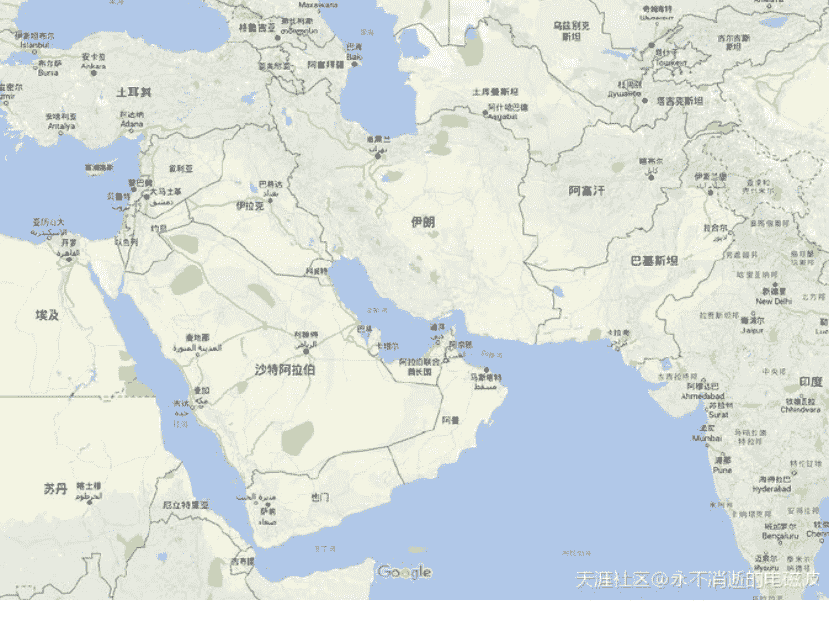

伊朗，古称波斯，历史悠久，却并非四大文明古国之一。能够入选四大文明古国，绝不是一件容易的事，比所谓现代文明的发源地，也是大英雄黄金战士的故乡——希腊，它也不是四大文明古国之一。这里提到希腊，不光是因为它创造了奥林匹会的雏形，不光是因为它开启了现代会议制度的雏形，而是因为在公元前330年前，统治着希腊和巴尔干地区的马其顿帝国亚历山大帝，征服了统治波斯地区的200多年的阿契美尼德王朝。

就在当今，在伊朗仍然有很多口口传的史诗歌，传颂着阿契美尼德王朝的故事，尤其是统一波斯部落的居鲁二世的故事。这都是为了纪念第一个世界帝国，居鲁二世第一次统一了波斯。

当然，诗歌中夹杂了对于希腊人或者罗马人的憎恨。其实曾经阿契美尼德王朝差点取缔了希腊，虽然后来因为“巴斯达300战士”所描写的温泉关战役，以及最重要的马拉松战役胜利而功败归一策，但是这个时代对建立波斯人的民族自豪感起了决定性的作用。

后来，马其顿帝国分裂，伊朗高原地区被来自自北方的塞琉基帝国和自西面的罗马共和国轮流统治，直到一百年后，米特里达卢建立了安息帝国，伊朗的大部分土地又回到波斯人手中。

东汉永元九年，班超派使甘英抵达安息，并到达中海沿岸。甘英出使所途径的，既是著名的贵珊王朝。安息帝国与汉王朝的经贸往来，直接促进了丝绸之路的建立和发展。安息帝国成为连接东亚、中亚、印度的孔雀王朝和欧洲的重要纽带。但是安息帝国的统治并不稳固，经常被来自中亚和欧洲的敌人打得头朝转向。

后来在公元226年，阿尔达达希尔一世推翻安息帝国建立了萨珊王朝，波斯再次在阿契美尼德王朝之后，真正实现了统一，萨珊王朝也被称为第二个波斯帝国。

萨珊王朝初期劲勃，甚至曾经侵扰过罗马皇帝奥良。其派遣的使者在魏晋南北朝时期常常往来波斯和中国，甚至多次给北魏皇帝贡献异象。

自东汉开始兴起的丝绸之路，为萨珊王朝提供了滚浪经济来源，于是萨珊王朝开始寻求扩张。曾经强大的罗马共和国，那时已经分裂，西罗马帝国很快化为烟灭，化作无数小城邦；东罗马帝国就是拜庭帝国，依然屹立在现在的希腊和土耳其地区。

多年以后，随着阿拉伯帝国的崛起，拜庭帝国的战加上萨珊王朝的负担，让萨珊王朝逐渐衰落。最后一任萨珊皇帝儿子逃到了大马士革，请求阿拉伯帝国庇护。在公元661年，建立了伊斯兰教。

后来阿拉伯帝国的继承者倭马亚王朝，基本扫平了波斯。在公元750年左右，呼罗珊起义推翻了倭马亚王朝，建立了阿拔斯王朝。阿拔斯王朝迅速扩张，在波斯湖西面恢复了丝绸之路，于是阿拔斯王朝建立了繁荣的帝国。

然而通过每天的记录，可以大概判断驻阿汗美军对富兰吉的补给频率，从而判断扎兰吉军事规模，以及更进一步判断近期是否有作战任务。

在扎博勃的雷达时代，丝绸之路都保持了繁盛。直到宋末，蒙古崛起，波斯从汗斯坦脱出来，重新分裂成了多个国家。1220年左右，成吉思汗率万征服西域，并以此为基地横扫帝国。后来成吉思汗的孙子旭烈建立了伊尔汗王国，其后的帖木儿王朝将伊斯兰教定为国教。

蒙古帝国跟阿拉伯王朝不同，蒙古统治波斯是为了做生意；蒙古铁骑所到之处基本就是执行三光政策。从西征开始，导致曾经繁华的丝绸之路变成了荒草之地。元末到了明朝，中国被隔离开在世界之外，金银两流直接刺激了欧洲市场、瓷器及茶叶价格暴涨。无奈，西班牙和葡萄牙王国开始航海，开启了探险家寻找新大陆的历史。在东方，明朝永乐皇帝无法修复丝绸之路，也只能开辟海上丝绸之路。

那时候，蒙古统治已经过去了一百多年。伊尔汗国和帖木儿帝国统治了百年，然后波斯又被奥斯曼统治。直到一战之前，被俄罗斯和英属印度和平。一战后，巴列维王朝独立，之后的故事前文有介绍。

于是你就知道，历史上存在的波斯人建立的仅有的帝国，阿契美尼德王朝和萨珊王朝，距离今天已经一千年了。虽然现在叫做伊朗，但是地盘跟两个王朝差不多。如果现在伊朗是几个小国，那可能伊朗人也不会有强的民族情绪。

问题就在于当今的伊朗人，不管是波斯后裔、亚兰后裔、罗马后裔、阿拉伯后裔、蒙古后裔还是奥斯曼后裔，他们都把恢复波斯历史的辉煌当成自己的神圣使命。其实，国人又尝如此呢？比如说我自己，也向往汉唐盛世，希望我的祖国更加加强。

每天往返阿汗边境与扎兰吉喀达哈之间的军用航班，都是由C130运输机完成的。而我修改的是红2B的预警雷达。通俗的，预警雷达就像战场中的眼睛，只能传递一个大概的信号，判断敌人出现了。更详细的信息需要由火控雷达提供。然而通过每天的记录，可以大概判断驻阿汗美军对富兰吉的补给频率，从而判断扎兰吉军事规模，以及更进一步判断近期是否有作战任务。

在扎博勃时雷达扫屏的时候，我一边看一边想，总感觉对面富汗这边有唐朝边将士的灵魂在看着我，向我挥手……

伊朗，尽管我相信大部分人都非纯血的波斯后裔，却一直在看着大波斯的梦想。在他们眼中，他们经历了太多的屈辱，而当代正是他们重新崛起的。直到在扎博勃中高级军官介绍2B，他们才意识到这些已经在伊朗军备库里10年的老家伙，虽然被改了个目全非，却还有这样的用处。

2009年，广州办的筹备工作正如春水般的进行，姜处给我消息，让我跟他去一趟伊朗。老实话说，如果不是姜处亲自调度，我是真的忙得走不开。那时候美国对伊朗制裁稍微有一些波动，但是只要联合国的制裁解除，我们就能接触与伊朗进行贸易。

这次行动是一次试探性的。在制裁结束之前，能够建立双方的信任，了解对方的需求，就能占据主动。应当客观来说，领导的决定是非常重要的，一旦伊朗核武，我们对于武器还是有信心的。只是伊朗人对于核愿望高于其他，这种梦想是寄托。姜处这次带来了一位联络同事，小伙子，年龄28岁，干练，是第一代。

代代代代代代代代代代代代代代代AI的后代代-text-split-genetics-scrambled汗汗汗汗汗汗汗。

汗汗汗汗汗汗汗汗汗汗汗汗汗汗汗汗汗汗汗汗汗汗汗汗汗汗汗汗汗汗汗汗汗汗汗汗汗汗汗汗汗汗汗汗汗汗汗汗汗汗汗汗汗汗汗汗汗汗汗汗汗汗汗汗汗汗汗汗汗汗汗汗汗汗汗汗汗汗汗汗汗汗汗汗汗汗汗汗汗汗汗汗汗汗汗汗汗汗汗汗汗汗汗汗汗汗汗汗汗汗汗汗汗汗汗汗汗汗汗汗汗汗汗汗汗汗汗汗汗汗汗汗汗汗汗汗汗汗汗汗汗汗汗汗汗汗汗汗汗汗汗汗汗汗汗汗汗汗汗汗汗汗汗汗汗汗汗汗汗汗汗汗汗汗汗汗汗汗汗汗汗汗汗汗汗汗汗汗汗汗汗汗汗汗汗汗汗汗汗汗汗汗汗汗汗汗汗汗汗汗汗汗汗汗汗汗汗汗汗汗汗汗汗汗汗汗汗汗汗汗汗汗汗汗汗汗汗汗汗汗汗汗汗汗汗汗汗汗汗汗汗汗汗汗汗汗汗汗汗汗汗汗汗汗汗汗汗汗汗汗汗汗汗汗汗汗汗汗汗汗汗汗汗汗汗汗汗汗汗汗汗汗汗汗汗汗汗汗汗汗汗汗汗汗汗汗汗汗汗汗汗汗汗汗汗汗汗汗汗汗汗汗汗汗汗汗汗汗汗汗汗汗汗汗汗汗汗汗汗汗汗汗汗汗汗汗汗汗汗汗汗汗汗汗汗汗汗汗汗汗汗汗汗汗汗汗汗汗汗汗汗汗汗汗汗汗汗汗汗汗汗汗汗汗汗汗汗汗汗汗汗汗汗汗汗汗汗汗汗汗汗汗汗汗汗汗汗汗汗汗汗汗汗汗汗汗汗汗汗汗汗汗汗汗汗汗汗汗汗汗汗汗汗汗汗汗汗汗汗汗汗汗汗汗汗汗汗汗汗汗汗汗汗汗汗汗汗汗汗汗汗汗汗汗汗汗汗汗汗汗汗汗汗汗汗汗汗汗汗汗汗汗汗汗汗汗汗汗汗汗汗汗汗汗汗汗汗汗汗汗汗汗汗汗汗汗汗汗汗汗汗汗汗汗汗汗汗汗汗汗汗汗汗汗汗汗汗汗汗汗汗汗汗汗汗汗汗汗汗汗汗汗汗汗汗汗汗汗汗汗汗汗汗汗汗汗汗汗汗汗汗汗汗汗汗汗汗汗汗汗汗汗汗汗汗汗汗汗汗汗汗汗汗汗汗汗汗汗汗汗汗汗汗汗汗汗汗汗汗汗汗汗汗汗汗汗汗汗汗汗汗汗汗汗汗汗汗汗汗汗汗汗汗汗汗汗汗汗汗汗汗汗汗汗汗汗汗汗汗汗汗汗汗汗汗汗汗汗汗汗汗汗汗汗汗汗汗汗汗汗汗汗汗汗汗汗汗汗汗汗汗汗汗汗汗汗汗汗汗汗汗汗汗汗汗汗汗汗汗汗汗汗汗汗汗汗汗汗汗汗汗汗汗汗汗汗汗汗汗汗汗汗汗汗汗汗汗汗汗汗汗汗汗汗汗汗汗汗汗汗汗汗汗汗汗汗汗汗汗汗汗汗汗汗汗汗汗汗汗汗汗汗汗汗汗汗汗汗汗汗汗汗汗汗汗汗汗汗汗汗汗汗汗汗汗汗汗汗汗汗汗汗汗汗汗汗汗汗汗汗汗汗汗汗汗汗汗汗汗汗汗汗汗汗汗汗汗汗汗汗汗汗汗汗汗汗汗汗汗汗汗汗汗汗汗汗汗汗汗汗汗汗汗汗汗汗汗汗汗汗汗汗汗汗汗汗汗汗汗汗汗汗汗汗汗汗汗汗汗汗汗汗汗汗汗汗汗汗汗汗汗汗汗汗汗汗汗汗汗汗汗汗汗汗汗汗汗汗汗汗汗汗汗汗汗汗汗汗汗汗汗汗汗汗汗汗汗汗汗汗汗汗汗汗汗汗汗汗汗汗汗汗汗汗汗汗汗汗汗汗汗汗汗汗汗汗汗汗汗汗汗汗汗汗汗汗汗汗汗汗汗汗汗汗汗汗汗汗汗汗汗汗汗汗汗汗汗汗汗汗汗汗汗汗汗汗汗汗汗汗汗汗汗汗汗汗汗汗汗汗汗汗汗汗汗汗汗汗汗汗汗汗汗汗汗汗汗汗汗汗汗汗汗汗汗汗汗汗汗汗汗汗汗汗汗汗汗汗汗汗汗汗汗汗汗汗汗汗汗汗汗汗汗汗汗汗汗汗汗汗汗汗汗汗汗汗汗汗汗汗汗汗汗汗汗汗汗汗汗汗汗汗汗汗汗汗汗汗汗汗汗汗汗汗汗汗汗汗汗汗汗汗汗汗汗汗汗汗汗汗汗汗汗汗汗汗汗汗汗汗汗汗汗汗汗汗汗汗汗汗汗汗汗汗汗汗汗汗汗汗汗汗汗汗汗汗汗汗汗汗汗汗汗汗汗汗汗汗汗汗汗汗汗汗汗汗汗汗汗汗汗汗汗汗汗汗汗汗汗汗汗汗汗汗汗汗汗汗汗汗汗汗汗汗汗汗汗汗汗汗汗汗汗汗汗汗汗汗汗汗汗汗汗汗汗汗汗汗汗汗汗汗汗汗汗汗汗汗汗汗汗汗汗汗汗汗汗汗汗汗汗汗汗汗汗汗汗汗汗汗汗汗汗汗汗汗汗汗汗汗汗汗汗汗汗汗汗汗汗汗汗汗汗汗汗汗汗汗汗汗汗汗汗汗汗汗汗汗汗汗汗汗汗汗汗汗汗汗汗汗汗汗汗汗汗汗汗汗汗汗汗汗汗汗汗汗汗汗汗汗汗汗汗汗汗汗汗汗汗汗汗汗汗汗汗汗汗汗汗汗汗汗汗汗汗汗汗汗汗汗汗汗汗汗汗汗汗汗汗汗汗汗汗汗汗汗汗汗汗汗汗汗汗汗汗汗汗汗汗汗汗汗汗汗汗汗汗汗汗汗汗汗汗汗汗汗汗汗汗汗汗汗汗汗汗汗汗汗汗汗汗汗汗汗汗汗汗汗汗汗汗汗汗汗汗汗汗汗汗汗汗汗汗汗汗汗汗汗汗汗汗汗汗汗汗汗汗汗汗汗汗汗汗汗汗汗汗汗汗汗汗汗汗汗汗汗汗汗汗汗汗汗汗汗汗汗汗汗汗汗汗汗汗汗汗汗汗汗汗汗汗汗汗汗汗汗汗汗汗汗汗汗汗汗汗汗汗汗汗汗汗汗汗汗汗汗汗汗汗汗汗汗汗汗汗汗汗汗汗汗汗汗汗汗汗汗汗汗汗汗汗汗汗汗汗汗汗汗汗汗汗汗汗汗汗汗汗汗汗汗汗汗汗汗汗汗汗汗汗汗汗汗汗汗汗汗汗汗汗汗汗汗汗汗汗汗汗汗汗汗汗汗汗汗汗汗汗汗汗汗汗汗汗汗汗汗汗汗汗汗汗汗汗汗汗汗汗汗汗汗汗汗汗汗汗汗汗汗汗汗汗汗汗汗汗汗汗汗汗汗汗汗汗汗汗汗汗汗汗汗汗汗汗汗汗汗汗汗汗汗汗汗汗汗汗汗汗汗汗汗汗汗汗汗汗汗汗汗汗汗汗汗汗汗汗汗汗汗汗汗汗汗汗汗汗汗汗汗汗汗汗汗汗汗汗汗汗汗汗汗汗汗汗汗汗汗汗汗汗汗汗汗汗汗汗汗汗汗汗汗汗汗汗汗汗汗汗汗汗汗汗汗汗汗汗汗汗汗汗汗汗汗汗汗汗汗汗汗汗汗汗汗汗汗汗汗汗汗汗汗汗汗汗汗汗汗汗汗汗汗汗汗汗汗汗汗汗汗汗汗汗汗汗汗汗汗汗汗汗汗汗汗汗汗汗汗汗汗汗汗汗汗汗汗汗汗汗汗汗汗汗汗汗汗汗汗汗汗汗汗汗汗汗汗汗汗汗汗汗汗汗汗汗汗汗汗汗汗汗汗汗汗汗汗汗汗汗汗汗汗汗汗汗汗汗汗汗汗汗汗汗汗汗汗汗汗汗汗汗汗汗汗汗汗汗汗汗汗汗汗汗汗汗汗汗汗汗汗汗汗汗汗汗汗汗汗汗汗汗汗汗汗汗汗汗汗汗汗汗汗汗汗汗汗汗汗汗汗汗汗汗汗汗汗汗汗汗汗汗汗汗汗汗汗汗汗汗汗汗汗汗汗汗汗汗汗汗汗汗汗汗汗汗汗汗汗汗汗汗汗汗汗汗汗汗汗汗汗汗汗汗汗汗汗汗汗汗汗汗汗汗汗汗汗汗汗汗汗汗汗汗汗汗汗汗汗汗汗汗汗汗汗汗汗汗汗汗汗汗汗汗汗汗汗汗汗汗汗汗汗汗汗汗汗汗汗汗汗汗汗汗汗汗汗汗汗汗汗汗汗汗汗汗汗汗汗汗汗汗汗汗汗汗汗汗汗汗汗汗汗汗汗汗汗汗汗汗汗汗汗汗汗汗汗汗汗汗汗汗汗汗汗汗汗汗汗汗汗汗汗汗汗汗汗汗汗汗汗汗汗汗汗汗汗汗汗汗汗汗汗汗汗汗汗汗汗汗汗汗汗汗汗汗汗汗汗汗汗汗汗汗汗汗汗汗汗汗汗汗汗汗汗汗汗汗汗汗汗汗汗汗汗汗汗汗汗汗汗汗汗汗汗汗汗汗汗汗汗汗汗汗汗汗汗汗汗汗汗汗汗汗汗汗汗汗汗汗汗汗汗汗汗汗汗汗汗汗汗汗汗汗汗汗汗汗汗汗汗汗汗汗汗汗汗汗汗汗汗汗汗汗汗汗汗汗汗汗汗汗汗汗汗汗汗汗汗汗汗汗汗汗汗汗汗汗汗汗汗汗汗汗汗汗汗汗汗汗汗汗汗汗汗汗汗汗汗汗汗汗汗汗汗汗汗汗汗汗汗汗汗汗汗汗汗汗汗汗汗汗汗汗汗汗汗汗汗汗汗汗汗汗汗汗汗汗汗汗汗汗汗汗汗汗汗汗汗汗汗汗汗汗汗汗汗汗汗汗汗汗汗汗汗汗汗汗汗汗汗汗汗汗汗汗汗汗汗汗汗汗汗汗汗汗汗汗汗汗汗汗汗汗汗汗汗汗汗汗汗汗汗汗汗汗汗汗汗汗汗汗汗汗汗汗汗汗汗汗汗汗汗汗汗汗汗汗汗汗汗汗汗汗汗汗汗汗汗汗汗汗汗汗汗汗汗汗汗汗汗汗汗汗汗汗汗汗汗汗汗汗汗汗汗汗汗汗汗汗汗汗汗汗汗汗汗汗汗汗汗汗汗汗汗汗汗汗汗汗汗汗汗汗汗汗汗汗汗汗汗汗汗汗汗汗汗汗汗汗汗汗汗汗汗汗汗汗汗汗汗汗汗汗汗汗汗汗汗汗汗汗汗汗汗汗汗汗汗汗汗汗汗汗汗汗汗汗汗汗汗汗汗汗汗汗汗汗汗汗汗汗汗汗汗汗汗汗汗汗汗汗汗汗汗汗汗汗汗汗汗汗汗汗汗汗汗汗汗汗汗汗汗汗汗汗汗汗汗汗汗汗汗汗汗汗汗汗汗汗汗汗汗汗汗汗汗汗汗汗汗汗汗汗汗汗汗汗汗汗汗汗汗汗汗汗汗汗汗汗汗汗汗汗汗汗汗汗汗汗汗汗汗汗汗汗汗汗汗汗汗汗汗汗汗汗汗汗汗汗汗汗汗汗汗汗汗汗汗汗汗汗汗汗汗汗汗汗汗汗汗汗汗汗汗汗汗汗汗汗汗汗汗汗汗汗汗汗汗汗汗汗汗汗汗汗汗汗汗汗汗汗汗汗汗汗汗汗汗汗汗汗汗汗汗汗汗汗汗汗汗汗汗汗汗汗汗汗汗汗汗汗汗汗汗汗汗汗汗汗汗汗汗汗汗汗汗汗汗汗汗汗汗汗汗汗汗汗汗汗汗汗汗汗汗汗汗汗汗汗汗汗汗汗汗汗汗汗汗汗汗汗汗汗汗汗汗汗汗汗汗汗汗汗汗汗汗汗汗汗汗汗汗汗汗汗汗汗汗汗汗汗汗汗汗汗汗汗汗汗汗汗汗汗汗汗汗汗汗汗汗汗汗汗汗汗汗汗汗汗汗汗汗汗汗汗汗汗汗汗汗汗汗汗汗汗汗汗汗汗汗汗汗汗汗汗汗汗汗汗汗汗汗汗汗汗汗汗汗汗汗汗汗汗汗汗汗汗汗汗汗汗汗汗汗汗汗汗汗汗汗汗汗汗汗汗汗汗汗汗汗汗汗汗汗汗汗汗汗汗汗汗汗汗汗汗汗汗汗汗汗汗汗汗汗汗汗汗汗汗汗汗汗汗汗汗汗汗汗汗汗汗汗汗汗汗汗汗汗汗汗汗汗汗汗汗汗汗汗汗汗汗汗汗汗汗汗汗汗汗汗汗汗汗汗汗汗汗汗汗汗汗汗汗汗汗汗汗汗汗汗汗汗汗汗汗汗汗汗汗汗汗汗汗汗汗汗汗汗汗汗汗汗汗汗汗汗汗汗汗汗汗汗汗汗汗汗汗汗汗汗汗汗汗汗汗汗汗汗汗汗汗汗汗汗汗汗汗汗汗汗汗汗汗汗汗汗汗汗汗汗汗汗汗汗汗汗汗汗汗汗汗汗汗汗汗汗汗汗汗汗汗汗汗汗汗汗汗汗汗汗汗汗汗汗汗汗汗汗汗汗汗汗汗汗汗汗汗汗汗汗汗汗汗汗汗汗汗汗汗汗汗汗汗汗汗汗汗汗汗汗汗汗汗汗汗汗汗汗汗汗汗汗汗汗汗汗汗汗汗汗汗汗汗汗汗汗汗汗汗汗汗汗汗汗汗汗汗汗汗汗汗汗汗汗汗汗汗汗汗汗汗汗汗汗汗汗汗汗汗汗汗汗汗汗汗汗汗汗汗汗汗汗汗汗汗汗汗汗汗汗汗汗汗汗汗汗汗汗汗汗汗汗汗汗汗汗汗汗汗汗汗汗汗汗汗汗汗汗汗汗汗汗汗汗汗汗汗汗汗汗汗汗汗汗汗汗汗汗汗汗汗汗汗汗汗汗汗汗汗汗汗汗汗汗汗汗汗汗汗汗汗汗汗汗汗汗汗汗汗汗汗汗汗汗汗汗汗汗汗汗汗汗汗汗汗汗汗汗汗汗汗汗汗汗汗汗汗汗汗汗汗汗汗汗汗汗汗汗汗汗汗汗汗汗汗汗汗汗汗汗汗汗汗汗汗汗汗汗汗汗汗汗汗汗汗汗汗汗汗汗汗汗汗汗汗汗汗汗汗汗汗汗汗汗汗汗汗汗汗汗汗汗汗汗汗汗汗汗汗汗汗汗汗汗汗汗汗汗汗汗汗汗汗汗汗汗汗汗汗汗汗汗汗汗汗汗汗汗汗汗汗汗汗汗汗汗汗汗汗汗汗汗汗汗汗汗汗汗汗汗汗汗汗汗汗汗汗汗汗汗汗汗汗汗汗汗汗汗汗汗汗汗汗汗汗汗汗汗汗汗汗汗汗汗汗汗汗汗汗汗汗汗汗汗汗汗汗汗汗汗汗汗汗汗汗汗汗汗汗汗汗汗汗汗汗汗汗汗汗汗汗汗汗汗汗汗汗汗汗汗汗汗汗汗汗汗汗汗汗汗汗汗汗汗汗汗汗汗汗汗汗汗汗汗汗汗汗汗汗汗汗汗汗汗汗汗汗汗汗汗汗汗汗汗汗汗汗汗汗汗汗汗汗汗汗汗汗汗汗汗汗汗汗汗汗汗汗汗汗汗汗汗汗汗汗汗汗汗汗汗汗汗汗汗汗汗汗汗汗汗汗汗汗汗汗汗汗汗汗汗汗汗汗汗汗汗汗汗汗汗汗汗汗汗汗汗汗汗汗汗汗汗汗汗汗汗汗汗汗汗汗汗汗汗汗汗汗汗汗汗汗汗汗汗汗汗汗汗汗汗汗汗汗汗汗汗汗汗汗汗汗汗汗汗汗汗汗汗汗汗汗汗汗汗汗汗汗汗汗汗汗汗汗汗汗汗汗汗汗汗汗汗汗汗汗汗汗汗汗汗汗汗汗汗汗汗汗汗汗汗汗汗汗汗汗汗汗汗汗汗汗汗汗汗汗汗汗汗汗汗汗汗汗汗汗汗汗汗汗汗汗汗汗汗汗汗汗汗汗汗汗汗汗汗汗汗汗汗汗汗汗汗汗汗汗汗汗汗汗汗汗汗汗汗汗汗汗汗汗汗汗汗汗汗汗汗汗汗汗汗汗汗汗汗汗汗汗汗汗汗汗汗汗汗汗汗汗汗汗汗汗汗汗汗汗汗汗汗汗汗汗汗汗汗汗汗汗汗汗汗汗汗汗汗汗汗汗汗汗汗汗汗汗汗汗汗汗汗汗汗汗汗汗汗汗汗汗汗汗汗汗汗汗汗汗汗汗汗汗汗汗汗汗汗汗汗汗汗汗汗汗汗汗汗汗汗汗汗汗汗汗汗汗汗汗汗汗汗汗汗汗汗汗汗汗汗汗汗汗汗汗汗汗汗汗汗汗汗汗汗汗汗汗汗汗汗汗汗汗汗汗汗汗汗汗汗汗汗汗汗汗汗汗汗汗汗汗汗汗汗汗汗汗汗汗汗汗汗汗汗汗汗汗汗汗汗汗汗汗汗汗汗汗汗汗汗汗汗汗汗汗汗汗汗汗汗汗汗汗汗汗汗汗汗汗汗汗汗汗汗汗汗汗汗汗汗汗汗汗汗汗汗汗汗汗汗汗汗汗汗汗汗汗汗汗汗汗汗汗汗汗汗汗汗汗汗汗汗汗汗汗汗汗汗汗汗汗汗汗汗汗汗汗汗汗汗汗汗汗汗汗汗汗汗汗汗汗汗汗汗汗汗汗汗汗汗汗汗汗汗汗汗汗汗汗汗汗汗汗汗汗汗汗汗汗汗汗汗汗汗汗汗汗汗汗汗汗汗汗汗汗汗汗汗汗汗汗汗汗汗汗汗汗汗汗汗汗汗汗汗汗汗汗汗汗汗汗汗汗汗汗汗汗汗汗汗汗汗汗汗汗汗汗汗汗汗汗汗汗汗汗汗汗汗汗汗汗汗汗汗汗汗汗汗汗汗汗汗汗汗汗汗汗汗汗汗汗汗汗汗汗汗汗汗汗汗汗汗汗汗汗汗汗汗汗汗汗汗汗汗汗汗汗汗汗汗汗汗汗汗汗汗汗汗汗汗汗汗汗汗汗汗汗汗汗汗汗汗汗汗汗汗汗汗汗汗汗汗汗汗汗汗汗汗汗汗汗汗汗汗汗汗汗汗汗汗汗汗汗汗汗汗汗汗汗汗汗汗汗汗汗汗汗汗汗汗汗汗汗汗汗汗汗汗汗汗汗汗汗汗汗汗汗汗汗汗汗汗汗汗汗汗汗汗汗汗汗汗汗汗汗汗汗汗汗汗汗汗汗汗汗汗汗汗汗汗汗汗汗汗汗汗汗汗汗汗汗汗汗汗汗汗汗汗汗汗汗汗汗汗汗汗汗汗汗汗汗汗汗汗汗汗汗汗汗汗汗汗汗汗汗汗汗汗汗汗汗汗汗汗汗汗汗汗汗汗汗汗汗汗汗汗汗汗汗汗汗汗汗汗汗汗汗汗汗汗汗汗汗汗汗汗汗汗汗汗汗汗汗汗汗汗汗汗汗汗汗汗汗汗汗汗汗汗汗汗汗汗汗汗汗汗汗汗汗汗汗汗汗汗汗汗汗汗汗汗汗汗汗汗汗汗汗汗汗汗汗汗汗汗汗汗汗汗汗汗汗汗汗汗汗汗汗汗汗汗汗汗汗汗汗汗汗汗汗汗汗汗汗汗汗汗汗汗汗汗汗汗汗汗汗汗汗汗汗汗汗汗汗汗汗汗汗汗汗汗汗汗汗汗汗汗汗汗汗汗汗汗汗汗汗汗汗汗汗汗汗汗汗汗汗汗汗汗汗汗汗汗汗汗汗汗汗汗汗汗汗汗汗汗汗汗汗汗汗汗汗汗汗汗汗汗汗汗汗汗汗汗汗汗汗汗汗汗汗汗汗汗汗汗汗汗汗汗汗汗汗汗汗汗汗汗汗汗汗汗汗汗汗汗汗汗汗汗汗汗汗汗汗汗汗汗汗汗汗汗汗汗汗汗汗汗汗汗汗汗汗汗汗汗汗汗汗汗汗汗汗汗汗汗汗汗汗汗汗汗汗汗汗汗汗汗汗汗汗汗汗汗汗汗汗汗汗汗汗汗汗汗汗汗汗汗汗汗汗汗汗汗汗汗汗汗汗汗汗汗汗汗汗汗汗汗汗汗汗汗汗汗汗汗汗汗汗汗汗汗汗汗汗汗汗汗汗汗汗汗汗汗汗汗汗汗汗汗汗汗汗汗汗汗汗汗汗汗汗汗汗汗汗汗汗汗汗汗汗汗汗汗汗汗汗汗汗汗汗汗汗汗汗汗汗汗汗汗汗汗汗汗汗汗汗汗汗汗汗汗汗汗汗汗汗汗汗汗汗汗汗汗汗汗汗汗汗汗汗汗汗汗汗汗汗汗汗汗汗汗汗汗汗汗汗汗汗汗汗汗汗汗汗汗汗汗汗汗汗汗汗汗汗汗汗汗汗汗汗汗汗汗汗汗汗汗汗汗汗汗汗汗汗汗汗汗汗汗汗汗汗汗汗汗汗汗汗汗汗汗汗汗汗汗汗汗汗汗汗汗汗汗汗汗汗汗汗汗汗汗汗汗汗汗汗汗汗汗汗汗汗汗汗汗汗汗汗汗汗汗汗汗汗汗汗汗汗汗汗汗汗汗汗汗汗汗汗汗汗汗汗汗汗汗汗汗汗汗汗汗汗汗汗汗汗汗汗汗汗汗汗汗汗汗汗汗汗汗汗汗汗汗汗汗汗汗汗汗汗汗汗汗汗汗汗汗汗汗汗汗汗汗汗汗汗汗汗汗汗汗汗汗汗汗汗汗汗汗汗汗汗汗汗汗汗汗汗汗汗汗汗汗汗汗汗汗汗汗汗汗汗汗汗汗汗汗汗汗汗汗汗汗汗汗汗汗汗汗汗汗汗汗汗汗汗汗汗汗汗汗汗汗汗汗汗汗汗汗汗汗汗汗汗汗汗汗汗汗汗汗汗汗汗汗汗汗汗汗汗汗汗汗汗汗汗汗汗汗汗汗汗汗汗汗汗汗汗汗汗汗汗汗汗汗汗汗汗汗汗汗汗汗汗汗汗汗汗汗汗汗汗汗汗汗汗汗汗汗汗汗汗汗汗汗汗汗汗汗汗汗汗汗汗汗汗汗汗汗汗汗汗汗汗汗汗汗汗汗汗汗汗汗汗汗汗汗汗汗汗汗汗汗汗汗汗汗汗汗汗汗汗汗汗汗汗汗汗汗汗汗汗汗汗汗汗汗汗汗汗汗汗汗汗汗汗汗汗汗汗汗汗汗汗汗汗汗汗汗汗汗汗汗汗汗汗汗汗汗汗汗汗汗汗汗汗汗汗汗汗汗汗汗汗汗汗汗汗汗汗汗汗汗汗汗汗汗汗汗汗汗汗汗汗汗汗汗汗汗汗汗汗汗汗汗汗汗汗汗汗汗汗汗汗汗汗汗汗汗汗汗汗汗汗汗汗汗汗汗汗汗汗汗汗汗汗汗汗汗汗汗汗汗汗汗汗汗汗汗汗汗汗汗汗汗汗汗汗汗汗汗汗汗汗汗汗汗汗汗汗汗汗汗汗汗汗汗汗汗汗汗汗汗汗汗汗汗汗汗汗汗汗汗汗汗汗汗汗汗汗汗汗汗汗汗汗汗汗汗汗汗汗汗汗汗汗汗汗汗汗汗汗汗汗汗汗汗汗汗汗汗汗汗汗汗汗汗汗汗汗汗汗汗汗汗汗汗汗汗汗汗汗汗汗汗汗汗汗汗汗汗汗汗汗汗汗汗汗汗汗汗汗汗汗汗汗汗汗汗汗汗汗汗汗汗汗汗汗汗汗汗汗汗汗汗汗汗汗汗汗汗汗汗汗汗汗汗汗汗汗汗汗汗汗汗汗汗汗汗汗汗汗汗汗汗汗汗汗汗汗汗汗汗汗汗汗汗汗汗汗汗汗汗汗汗汗汗汗汗汗汗汗汗汗汗汗汗汗汗汗汗汗汗汗汗汗汗汗汗汗汗汗汗汗汗汗汗汗汗汗汗汗汗汗汗汗汗汗汗汗汗汗汗汗汗汗汗汗汗汗汗汗汗汗汗汗汗汗汗汗汗汗汗汗汗汗汗汗汗汗汗汗汗汗汗汗汗汗汗汗汗汗汗汗汗汗汗汗汗汗汗汗汗汗汗汗汗汗汗汗汗汗汗汗汗汗汗汗汗汗汗汗汗汗汗汗汗汗汗汗汗汗汗汗汗汗汗汗汗汗汗汗汗汗汗汗汗汗汗汗汗汗汗汗汗汗汗汗汗汗汗汗汗汗汗汗汗汗汗汗汗汗汗汗汗汗汗汗汗汗汗汗汗汗汗汗汗汗汗汗汗汗汗汗汗汗汗汗汗汗汗汗汗汗汗汗汗汗汗汗汗汗汗汗汗汗汗汗汗汗汗汗汗汗汗汗汗汗汗汗汗汗汗汗汗汗汗汗汗汗汗汗汗汗汗汗汗汗汗汗汗汗汗汗汗汗汗汗汗汗汗汗汗汗汗汗汗汗汗汗汗汗汗汗汗汗汗汗汗汗汗汗汗汗汗汗汗汗汗汗汗汗汗汗汗汗汗汗汗汗汗汗汗汗汗汗汗汗汗汗汗汗汗汗汗汗汗汗汗汗汗汗汗汗汗汗汗汗汗汗汗汗汗汗汗汗汗汗汗汗汗汗汗汗汗汗汗汗汗汗汗汗汗汗汗汗汗汗汗汗汗汗汗汗汗汗汗汗汗汗汗汗汗汗汗汗汗汗汗汗汗汗汗汗汗汗汗汗汗汗汗汗汗汗汗汗汗汗汗汗汗汗汗汗汗汗汗汗汗汗汗汗汗汗汗汗汗汗汗汗汗汗汗汗汗汗汗汗汗汗汗汗汗汗汗汗汗汗汗汗汗汗汗汗汗汗汗汗汗汗汗汗汗汗汗汗汗汗汗汗汗汗汗汗汗汗汗汗汗汗汗汗汗汗汗汗汗汗汗汗汗汗汗汗汗汗汗汗汗汗汗汗汗汗汗汗汗汗汗汗汗汗汗汗汗汗汗汗汗汗汗汗汗汗汗汗汗汗汗汗汗汗汗汗汗汗汗汗汗汗汗汗汗汗汗汗汗汗汗汗汗汗汗汗汗汗汗汗汗汗汗汗汗汗汗汗汗汗汗汗汗汗汗汗汗汗汗汗汗汗汗汗汗汗汗汗汗汗汗汗汗汗汗汗汗汗汗汗汗汗汗汗汗汗汗汗汗汗汗汗汗汗汗汗汗汗汗汗汗汗汗汗汗汗汗汗汗汗汗汗汗汗汗汗汗汗汗汗汗汗汗汗汗汗汗汗汗汗汗汗汗汗汗汗汗汗汗汗汗汗汗汗汗汗汗汗汗汗汗汗汗汗汗汗汗汗汗汗汗汗汗汗汗汗汗汗汗汗汗汗汗汗汗汗汗汗汗汗汗汗汗汗汗汗汗汗汗汗汗汗汗汗汗汗汗汗汗汗汗汗汗汗汗汗汗汗汗汗汗汗汗汗汗汗汗汗汗汗汗汗汗汗汗汗汗汗汗汗汗汗汗汗汗汗汗汗汗汗汗汗汗汗汗汗汗汗汗汗汗汗汗汗汗汗汗汗汗汗汗汗汗汗汗汗汗汗汗汗汗汗汗汗汗汗汗汗汗汗汗汗汗汗汗汗汗汗汗汗汗汗汗汗汗汗汗汗汗汗汗汗汗汗汗汗汗汗汗汗汗汗汗汗汗汗汗汗汗汗汗汗汗汗汗汗汗汗汗汗汗汗汗汗汗汗汗汗汗汗汗汗汗汗汗汗汗汗汗汗汗汗汗汗汗汗汗汗汗汗汗汗汗汗汗汗汗汗汗汗汗汗汗汗汗汗汗汗汗汗汗汗汗汗汗汗汗汗汗汗汗汗汗汗汗汗汗汗汗汗汗汗汗汗汗汗汗汗汗汗汗汗汗汗汗汗汗汗汗汗汗汗汗汗汗汗汗汗汗汗汗汗汗汗汗汗汗汗汗汗汗汗汗汗汗汗汗汗汗汗汗汗汗汗汗汗汗汗汗汗汗汗汗汗汗汗汗汗汗汗汗汗汗汗汗汗汗汗汗汗汗汗汗汗汗汗汗汗汗汗汗汗汗汗汗汗汗汗汗汗汗汗汗汗汗汗汗汗汗汗汗汗汗汗汗汗汗汗汗汗汗汗汗汗汗汗汗汗汗汗汗汗汗汗汗汗汗汗汗汗汗汗汗汗汗汗汗汗汗汗汗汗汗汗汗汗汗汗汗汗汗汗汗汗汗汗汗汗汗汗汗汗汗汗汗汗汗汗汗汗汗汗汗汗汗汗汗汗汗汗汗汗汗汗汗汗汗汗汗汗汗汗汗汗汗汗汗汗汗汗汗汗汗汗汗汗汗汗汗汗汗汗汗汗汗汗汗汗汗汗汗汗汗汗汗汗汗汗汗汗汗汗汗汗汗汗汗汗汗汗汗汗汗汗汗汗汗汗汗汗汗汗汗汗汗汗汗汗汗汗汗汗汗汗汗汗汗汗汗汗汗汗汗汗汗汗汗汗汗汗汗汗汗汗汗汗汗汗汗汗汗汗汗汗汗汗汗汗汗汗汗汗汗汗汗汗汗汗汗汗汗汗汗汗汗汗汗汗汗汗汗汗汗汗汗汗汗汗汗汗汗汗汗汗汗汗汗汗汗汗汗汗汗汗汗汗汗汗汗汗汗汗汗汗汗汗汗汗汗汗汗汗汗汗汗汗汗汗汗汗汗汗汗汗汗汗汗汗汗汗汗汗汗汗汗汗汗汗汗汗汗汗汗汗汗汗汗汗汗汗汗汗汗汗汗汗汗汗汗汗汗汗汗汗汗汗汗汗汗汗汗汗汗汗汗汗汗汗汗汗汗汗汗汗汗汗汗汗汗汗汗汗汗汗汗汗汗汗汗汗汗汗汗汗汗汗汗汗汗汗汗汗汗汗汗汗汗汗汗汗汗汗汗汗汗汗汗汗汗汗汗汗汗汗汗汗汗汗汗汗汗汗汗汗汗汗汗汗汗汗汗汗汗汗汗汗汗汗汗汗汗汗汗汗汗汗汗汗汗汗汗汗汗汗汗汗汗汗汗汗汗汗汗汗汗汗汗汗汗汗汗汗汗汗汗汗汗汗汗汗汗汗汗汗汗汗汗汗汗汗汗汗汗汗汗汗汗汗汗汗汗汗汗汗汗汗汗汗汗汗汗汗汗汗汗汗汗汗汗汗汗汗汗汗汗汗汗汗汗汗汗汗汗汗汗汗汗汗汗汗汗汗汗汗汗汗汗汗汗汗汗汗汗汗汗汗汗汗汗汗汗汗汗汗汗汗汗汗汗汗汗汗汗汗汗汗汗汗汗汗汗汗汗汗汗汗汗汗汗汗汗汗汗汗汗汗汗汗汗汗汗汗汗汗汗汗汗汗汗汗汗汗汗汗汗汗汗汗汗汗汗汗汗汗汗汗汗汗汗汗汗汗汗汗汗汗汗汗汗汗汗汗汗汗汗汗汗汗汗汗汗汗汗汗汗汗汗汗汗汗汗汗汗汗汗汗汗汗汗汗汗汗汗汗汗汗汗汗汗汗汗汗汗汗汗汗汗汗汗汗汗汗汗汗汗汗汗汗汗汗汗汗汗汗汗汗汗汗汗汗汗汗汗汗汗汗汗汗汗汗汗汗汗汗汗汗汗汗汗汗汗汗汗汗汗汗汗汗汗汗汗汗汗汗汗汗汗汗汗汗汗汗汗汗汗汗汗汗汗汗汗汗汗汗汗汗汗汗汗汗汗汗汗汗汗汗汗汗汗汗汗汗汗汗汗汗汗汗汗汗汗汗汗汗汗汗汗汗汗汗汗汗汗汗汗汗汗汗汗汗汗汗汗汗汗汗汗汗汗汗汗汗汗汗汗汗汗汗汗汗汗汗汗汗汗汗汗汗汗汗汗汗汗汗汗汗汗汗汗汗汗汗汗汗汗汗汗汗汗汗汗汗汗汗汗汗汗汗汗汗汗汗汗汗汗汗汗汗汗汗汗汗汗汗汗汗汗汗汗汗汗汗汗汗汗汗汗汗汗汗汗汗汗汗汗汗汗汗汗汗汗汗汗汗汗汗汗汗汗汗汗汗汗汗汗汗汗汗汗汗汗汗汗汗汗汗汗汗汗汗汗汗汗汗汗汗汗汗汗汗汗汗汗汗汗汗汗汗汗汗汗汗汗汗汗汗汗汗汗汗汗汗汗汗汗汗汗汗汗汗汗汗汗汗汗汗汗汗汗汗汗汗汗汗汗汗汗汗汗汗汗汗汗汗汗汗汗汗汗汗汗汗汗汗汗汗汗汗汗汗汗汗汗汗汗汗汗汗汗汗汗汗汗汗汗汗汗汗汗汗汗汗汗汗汗汗汗汗汗汗汗汗汗汗汗汗汗汗汗汗汗汗汗汗汗汗汗汗汗汗汗汗汗汗汗汗汗汗汗汗汗汗汗汗汗汗汗汗汗汗汗汗汗汗汗汗汗汗汗汗汗汗汗汗汗汗汗汗汗汗汗汗汗汗汗汗汗汗汗汗汗汗汗汗汗汗汗汗汗汗汗汗汗汗汗汗汗汗汗汗汗汗汗汗汗汗汗汗汗汗汗汗汗汗汗汗汗汗汗汗汗汗汗汗汗汗汗汗汗汗汗汗汗汗汗汗汗汗汗汗汗汗汗汗汗汗汗汗汗汗汗汗汗汗汗汗汗汗汗汗汗汗汗汗汗汗汗汗汗汗汗汗汗汗汗汗汗汗汗汗汗汗汗汗汗汗汗汗汗汗汗汗汗汗汗汗汗汗汗汗汗汗汗汗汗汗汗汗汗汗汗汗汗汗汗汗汗汗汗汗汗汗汗汗汗汗汗汗汗汗汗汗汗汗汗汗汗汗汗汗汗汗汗汗汗汗汗汗汗汗汗汗汗汗汗汗汗汗汗汗汗汗汗汗汗汗汗汗汗汗汗汗汗汗汗汗汗汗汗汗汗汗汗汗汗汗汗汗汗汗汗汗汗汗汗汗汗汗汗汗汗汗汗汗汗汗汗汗汗汗汗汗汗汗汗汗汗汗汗汗汗汗汗汗汗汗汗汗汗汗汗汗汗汗汗汗汗汗汗汗汗汗汗汗汗汗汗汗汗汗汗汗汗汗汗汗汗汗汗汗汗汗汗汗汗汗汗汗汗汗汗汗汗汗汗汗汗汗汗汗汗汗汗汗汗汗汗汗汗汗汗汗汗汗汗汗汗汗汗汗汗汗汗汗汗汗汗汗汗汗汗汗汗汗汗汗汗汗汗汗汗汗汗汗汗汗汗汗汗汗汗汗汗汗汗汗汗汗汗汗汗汗汗汗汗汗汗汗汗汗汗汗汗汗汗汗汗汗汗汗汗汗汗汗汗汗汗汗汗汗汗汗汗汗汗汗汗汗汗汗汗汗汗汗汗汗汗汗汗汗汗汗汗汗汗汗汗汗汗汗汗汗汗汗汗汗汗汗汗汗汗汗汗汗汗汗汗汗汗汗汗汗汗汗汗汗汗汗汗汗汗汗汗汗汗汗汗汗汗汗汗汗汗汗汗汗汗汗汗汗汗汗汗汗汗汗汗汗汗汗汗汗汗汗汗汗汗汗汗汗汗汗汗汗汗汗汗汗汗汗汗汗汗汗汗汗汗汗汗汗汗汗汗汗汗汗汗汗汗汗汗汗汗汗汗汗汗汗汗汗汗汗汗汗汗汗汗汗汗汗汗汗汗汗汗汗汗汗汗汗汗汗汗汗汗汗汗汗汗汗汗汗汗汗汗汗汗汗汗汗汗汗汗汗汗汗汗汗汗汗汗汗汗汗汗汗汗汗汗汗汗汗汗汗汗汗汗汗汗汗汗汗汗汗汗汗汗汗汗汗汗汗汗汗汗汗汗汗汗汗汗汗汗汗汗汗汗汗汗汗汗汗汗汗汗汗汗汗汗汗汗汗汗汗汗汗汗汗汗汗汗汗汗汗汗汗汗汗汗汗汗汗汗汗汗汗汗汗汗汗汗汗汗汗汗汗汗汗汗汗汗汗汗汗汗汗汗汗汗汗汗汗汗汗汗汗汗汗汗汗汗汗汗汗汗汗汗汗汗汗汗汗汗汗汗汗汗汗汗汗汗汗汗汗汗汗汗汗汗汗汗汗汗汗汗汗汗汗汗汗汗汗汗汗汗汗汗汗汗汗汗汗汗汗汗汗汗汗汗汗汗汗汗汗汗汗汗汗汗汗汗汗汗汗汗汗汗汗汗汗汗汗汗汗汗汗汗汗汗汗汗汗汗汗汗汗汗汗汗汗汗汗汗汗汗汗汗汗汗汗汗汗汗汗汗汗汗汗汗汗汗汗汗汗汗汗汗汗汗汗汗汗汗汗汗汗汗汗汗汗汗汗汗汗汗汗汗汗汗汗汗汗汗汗汗汗汗汗汗汗汗汗汗汗汗汗汗汗汗汗汗汗汗汗汗汗汗汗汗汗汗汗汗汗汗汗汗汗汗汗汗汗汗汗汗汗汗汗汗汗汗汗汗汗汗汗汗汗汗汗汗汗汗汗汗汗汗汗汗汗汗汗汗汗汗汗汗汗汗汗汗汗汗汗汗汗汗汗汗汗汗汗汗汗汗汗汗汗汗汗汗汗汗汗汗汗汗汗汗汗汗汗汗汗汗汗汗汗汗汗汗汗汗汗汗汗汗汗汗汗汗汗汗汗汗汗汗汗汗汗汗汗汗汗汗汗汗汗汗汗汗汗汗汗汗汗汗汗汗汗汗汗汗汗汗汗汗汗汗汗汗汗汗汗汗汗汗汗汗汗汗汗汗汗汗汗汗汗汗汗汗汗汗汗汗汗汗汗汗汗汗汗汗汗汗汗汗汗汗汗汗汗汗汗汗汗汗汗汗汗汗汗汗汗汗汗汗汗汗汗汗汗汗汗汗汗汗汗汗汗汗汗汗汗汗汗汗汗汗汗汗汗汗汗汗汗汗汗汗汗汗汗汗汗汗汗汗汗汗汗汗汗汗汗汗汗汗汗汗汗汗汗汗汗汗汗汗汗汗汗汗汗汗汗汗汗汗汗汗汗汗汗汗汗汗汗汗汗汗汗汗汗汗汗汗汗汗汗汗汗汗汗汗汗汗汗汗汗汗汗汗汗汗汗汗汗汗汗汗汗汗汗汗汗汗汗汗汗汗汗汗汗汗汗汗汗汗汗汗汗汗汗汗汗汗汗汗汗汗汗汗汗汗汗汗汗汗汗汗汗汗汗汗汗汗汗汗汗汗汗汗汗汗汗汗汗汗汗汗汗汗汗汗汗汗汗汗汗汗汗汗汗汗汗汗汗汗汗汗汗汗汗汗汗汗汗汗汗汗汗汗汗汗汗汗汗汗汗汗汗汗汗汗汗汗汗汗汗汗汗汗汗汗汗汗汗汗汗汗汗汗汗汗汗汗汗汗汗汗汗汗汗汗汗汗汗汗汗汗汗汗汗汗汗汗汗汗汗汗汗汗汗汗汗汗汗汗汗汗汗汗汗汗汗汗汗汗汗汗汗汗汗汗汗汗汗汗汗汗汗汗汗汗汗汗汗汗汗汗汗汗汗汗汗汗汗汗汗汗汗汗汗汗汗汗汗汗汗汗汗汗汗汗汗汗汗汗汗汗汗汗汗汗汗汗汗汗汗汗汗汗汗汗汗汗汗汗汗汗汗汗汗汗汗汗汗汗汗汗汗汗汗汗汗汗汗汗汗汗汗汗汗汗汗汗汗汗汗汗汗汗汗汗汗汗汗汗汗汗汗汗汗汗汗汗汗汗汗汗汗汗汗汗汗汗汗汗汗汗汗汗汗汗汗汗汗汗汗汗汗汗汗汗汗汗汗汗汗汗汗汗汗汗汗汗汗汗汗汗汗汗汗汗汗汗汗汗汗汗汗汗汗汗汗汗汗汗汗汗汗汗汗汗汗汗汗汗汗汗汗汗汗汗汗汗汗汗汗汗汗汗汗汗汗汗汗汗汗汗汗汗汗汗汗汗汗汗汗汗汗汗汗汗汗汗汗汗汗汗汗汗汗汗汗汗汗汗汗汗汗汗汗汗汗汗汗汗汗汗汗汗汗汗汗汗汗汗汗汗汗汗汗汗汗汗汗汗汗汗汗汗汗汗汗汗汗汗汗汗汗汗汗汗汗汗汗汗汗汗汗汗汗汗汗汗汗汗汗汗汗汗汗汗汗汗汗汗汗汗汗汗汗汗汗汗汗汗汗汗汗汗汗汗汗汗汗汗汗汗汗汗汗汗汗汗汗汗汗汗汗汗汗汗汗汗汗汗汗汗汗汗汗汗汗汗汗汗汗汗汗汗汗汗汗汗汗汗汗汗汗汗汗汗汗汗汗汗汗汗汗汗汗汗汗汗汗汗汗汗汗汗汗汗汗汗汗汗汗汗汗汗汗汗汗汗汗汗汗汗汗汗汗汗汗汗汗汗汗汗汗汗汗汗汗汗汗汗汗汗汗汗汗汗汗汗汗汗汗汗汗汗汗汗汗汗汗汗汗汗汗汗汗汗汗汗汗汗汗汗汗汗汗汗汗汗汗汗汗汗汗汗汗汗汗汗汗汗汗汗汗汗汗汗汗汗汗汗汗汗汗汗汗汗汗汗汗汗汗汗汗汗汗汗汗汗汗汗汗汗汗汗汗汗汗汗汗汗汗汗汗汗汗汗汗汗汗汗汗汗汗汗汗汗汗汗汗汗汗汗汗汗汗汗汗汗汗汗汗汗汗汗汗汗汗汗汗汗汗汗汗汗汗汗汗汗汗汗汗汗汗汗汗汗汗汗汗汗汗汗汗汗汗汗汗汗汗汗汗汗汗汗汗汗汗汗汗汗汗汗汗汗汗汗汗汗汗汗汗汗汗汗汗汗汗汗汗汗汗汗汗汗汗汗汗汗汗汗汗汗汗汗汗汗汗汗汗汗汗汗汗汗汗汗汗汗汗汗汗汗汗汗汗汗汗汗汗汗汗汗汗汗汗汗汗汗汗汗汗汗汗汗汗汗汗汗汗汗汗汗汗汗汗汗汗汗汗汗汗汗汗汗汗汗汗汗汗汗汗汗汗汗汗汗汗汗汗汗汗汗汗汗汗汗汗汗汗汗汗汗汗汗汗汗汗汗汗汗汗汗汗汗汗汗汗汗汗汗汗汗汗汗汗汗汗汗汗汗汗汗汗汗汗汗汗汗汗汗汗汗汗汗汗汗汗汗汗汗汗汗汗汗汗汗汗汗汗汗汗汗汗汗汗汗汗汗汗汗汗汗汗汗汗汗汗汗汗汗汗汗汗汗汗汗汗汗汗汗汗汗汗汗汗汗汗汗汗汗汗汗汗汗汗汗汗汗汗汗汗汗汗汗汗汗汗汗汗汗汗汗汗汗汗汗汗汗汗汗汗汗汗汗汗汗汗汗汗汗汗汗汗汗汗汗汗汗汗汗汗汗汗汗汗汗汗汗汗汗汗汗汗汗汗汗汗汗汗汗汗汗汗汗汗汗汗汗汗汗汗汗汗汗汗汗汗汗汗汗汗汗汗汗汗汗汗汗汗汗汗汗汗汗汗汗汗汗汗汗汗汗汗汗汗汗汗汗汗汗汗汗汗汗汗汗汗汗汗汗汗汗汗汗汗汗汗汗汗汗汗汗汗汗汗汗汗汗汗汗汗汗汗汗汗汗汗汗汗汗汗汗汗汗汗汗汗汗汗汗汗汗汗汗汗汗汗汗汗汗汗汗汗汗汗汗汗汗汗汗汗汗汗汗汗汗汗汗汗汗汗汗汗汗汗汗汗汗汗汗汗汗汗汗汗汗汗汗汗汗汗汗汗汗汗汗汗汗汗汗汗汗汗汗汗汗汗汗汗汗汗汗汗汗汗汗汗汗汗汗汗汗汗汗汗汗汗汗汗汗汗汗汗汗汗汗汗汗汗汗汗汗汗汗汗汗汗汗汗汗汗汗汗汗汗汗汗汗汗汗汗汗汗汗汗汗汗汗汗汗汗汗汗汗汗汗汗汗汗汗汗汗汗汗汗汗汗汗汗汗汗汗汗汗汗汗汗汗汗汗汗汗汗汗汗汗汗汗汗汗汗汗汗汗汗汗汗汗汗汗汗汗汗汗汗汗汗汗汗汗汗汗汗汗汗汗汗汗汗汗汗汗汗汗汗汗汗汗汗汗汗汗汗汗汗汗汗汗汗汗汗汗汗汗汗汗汗汗汗汗汗汗汗汗汗汗汗汗汗汗汗汗汗汗汗汗汗汗汗汗汗汗汗汗汗汗汗汗汗汗汗汗汗汗汗汗汗汗汗汗汗汗汗汗汗汗汗汗汗汗汗汗汗汗汗汗汗汗汗汗汗汗汗汗汗汗汗汗汗汗汗汗汗汗汗汗汗汗汗汗汗汗汗汗汗汗汗汗汗汗汗汗汗汗汗汗汗汗汗汗汗汗汗汗汗汗汗汗汗汗汗汗汗汗汗汗汗汗汗汗汗汗汗汗汗汗汗汗汗汗汗汗汗汗汗汗汗汗汗汗汗汗汗汗汗汗汗汗汗汗汗汗汗汗汗汗汗汗汗汗汗汗汗汗汗汗汗汗汗汗汗汗汗汗汗汗汗汗汗汗汗汗汗汗汗汗汗汗汗汗汗汗汗汗汗汗汗汗汗汗汗汗汗汗汗汗汗汗汗汗汗汗汗汗汗汗汗汗汗汗汗汗汗汗汗汗汗汗汗汗汗汗汗汗汗汗汗汗汗汗汗汗汗汗汗汗汗汗汗汗汗汗汗汗汗汗汗汗汗汗汗汗汗汗汗汗汗汗汗汗汗汗汗汗汗汗汗汗汗汗汗汗汗汗汗汗汗汗汗汗汗汗汗汗汗汗汗汗汗汗汗汗汗汗汗汗汗汗汗汗汗汗汗汗汗汗汗汗汗汗汗汗汗汗汗汗汗汗汗汗汗汗汗汗汗汗汗汗汗汗汗汗汗汗汗汗汗汗汗汗汗汗汗汗汗汗汗汗汗汗汗汗汗汗汗汗汗汗汗汗汗汗汗汗汗汗汗汗汗汗汗汗汗汗汗汗汗汗汗汗汗汗汗汗汗汗汗汗汗汗汗汗汗汗汗汗汗汗汗汗汗伊朗，尽管我相信大部分人都非纯血的波斯后裔，却一直在看着大波斯的梦想。在他们眼中，他们经历了太多的屈辱，而当代正是他们重新崛起的。

直到在扎勃伦中高级军官介绍2B，他们才意识到这些已经在伊朗军备库里10年的老家伙，虽然被改了个目全非，却还有这样的用处。

2009 年，广州办的筹备工作正如春水般的进行，姜处给我消息，让我跟他去一趟伊朗。老实话说，如果不是姜处亲自调度，我是真的忙得走不开。那时候美国对伊朗制裁稍微有一些波动，但是只要联合国的制裁解除，我们就能接触与伊朗进行贸易。这次行动是一次试探性的。在制裁结束之前，能够建立双方的信任，了解对方的需求，就能占据主动。应当客观来说，领导的决定是非常重要的，一旦伊朗核武，我们对于武器还是有信心的。只是伊朗人对于核愿望高于其他，这种梦想是寄托。姜处这次带来了一位联络同事，小伙子，年龄28岁，干练，是第一代。代代代代代代代代代代代代代代代代汗汗汗汗汗汗汗汗汗汗汗汗汗汗汗汗汗汗汗汗汗汗汗汗汗汗汗汗汗汗汗汗汗汗汗汗汗汗汗汗汗汗汗汗汗汗汗汗汗汗汗汗汗汗汗汗汗汗汗汗汗汗汗汗汗汗汗汗汗汗汗汗汗汗汗汗汗汗汗汗汗汗汗汗汗汗汗汗汗汗汗汗汗汗汗汗汗汗汗汗汗汗汗汗汗汗汗汗汗汗汗汗汗汗汗汗汗汗汗汗汗汗汗汗汗汗汗汗汗汗汗汗汗汗汗汗汗汗汗汗汗汗汗汗汗汗汗汗汗汗汗汗汗汗汗汗汗汗汗汗汗汗汗汗汗汗汗汗汗汗汗汗汗汗汗汗汗汗汗汗汗汗汗汗汗汗汗汗汗汗汗汗汗汗汗汗汗汗汗汗汗汗汗汗汗汗汗汗汗汗汗汗汗汗汗汗汗汗汗汗汗汗汗汗汗汗汗汗汗汗汗汗汗汗汗汗汗汗汗汗汗汗汗汗汗汗汗汗汗汗汗汗汗汗汗汗汗汗汗汗汗汗汗汗汗汗汗汗汗汗汗汗汗汗汗汗汗汗汗汗汗汗汗汗汗汗汗汗汗汗汗汗汗汗汗汗汗汗汗汗汗汗汗汗汗汗汗汗汗汗汗汗汗汗汗汗汗汗汗汗汗汗汗汗汗汗汗汗汗汗汗汗汗汗汗汗汗汗汗汗汗汗汗汗汗汗汗汗汗汗汗汗汗汗汗汗汗汗汗汗汗汗汗汗汗汗汗汗汗汗汗汗汗汗汗汗汗汗汗汗汗汗汗汗汗汗汗汗汗汗汗汗汗汗汗汗汗汗汗汗汗汗汗汗汗汗汗汗汗汗汗汗汗汗汗汗汗汗汗汗汗汗汗汗汗汗汗汗汗汗汗汗汗汗汗汗汗汗汗汗汗汗汗汗汗汗汗汗汗汗汗汗汗汗汗汗汗汗汗汗汗汗汗汗汗汗汗汗汗汗汗汗汗汗汗汗汗汗汗汗汗汗汗汗汗汗汗汗汗汗汗汗汗汗汗汗汗汗汗汗汗汗汗汗汗汗汗汗汗汗汗汗汗汗汗汗汗汗汗汗汗汗汗汗汗汗汗汗汗汗汗汗汗汗汗汗汗汗汗汗汗汗汗汗汗汗汗汗汗汗汗汗汗汗汗汗汗汗汗汗汗汗汗汗汗汗汗汗汗汗汗汗汗汗汗汗汗汗汗汗汗汗汗汗汗汗汗汗汗汗汗汗汗汗汗汗汗汗汗汗汗汗汗汗汗汗汗汗汗汗汗汗汗汗汗汗汗汗汗汗汗汗汗汗汗汗汗汗汗汗汗汗汗汗汗汗汗汗汗汗汗汗汗汗汗汗汗汗汗汗汗汗汗汗汗汗汗汗汗汗汗汗汗汗汗汗汗汗汗汗汗汗汗汗汗汗汗汗汗汗汗汗汗汗汗汗汗汗汗汗汗汗汗汗汗汗汗汗汗汗汗汗汗汗汗汗汗汗汗汗汗汗汗汗汗汗汗汗汗汗汗汗汗汗汗汗汗汗汗汗汗汗汗汗汗汗汗汗汗汗汗汗汗汗汗汗汗汗汗汗汗汗汗汗汗汗汗汗汗汗汗汗汗汗汗汗汗汗汗汗汗汗汗汗汗汗汗汗汗汗汗汗汗汗汗汗汗汗汗汗汗汗汗汗汗汗汗汗汗汗汗汗汗汗汗汗汗汗汗汗汗汗汗汗汗汗汗汗汗汗汗汗汗汗汗汗汗汗汗汗汗汗汗汗汗汗汗汗汗汗汗汗汗汗汗汗汗汗汗汗汗汗汗汗汗汗汗汗汗汗汗汗汗汗汗汗汗汗汗汗汗汗汗汗汗汗汗汗汗汗汗汗汗汗汗汗汗汗汗汗汗汗汗汗汗汗汗汗汗汗汗汗汗汗汗汗汗汗汗汗汗汗汗汗汗汗汗汗汗汗汗汗汗汗汗汗汗汗汗汗汗汗汗汗汗汗汗汗汗汗汗汗汗汗汗汗汗汗汗汗汗汗汗汗汗汗汗汗汗汗汗汗汗汗汗汗汗汗汗汗汗汗汗汗汗汗汗汗汗汗汗汗汗汗汗汗汗汗汗汗汗汗汗汗汗汗汗汗汗汗汗汗汗汗汗汗汗汗汗汗汗汗汗汗汗汗汗汗汗汗汗汗汗汗汗汗汗汗汗汗汗汗汗汗汗汗汗汗汗汗汗汗汗汗汗汗汗汗汗汗汗汗汗汗汗汗汗汗汗汗汗汗汗汗汗汗汗汗汗汗汗汗汗汗汗汗汗汗汗汗汗汗汗汗汗汗汗汗汗汗汗汗汗汗汗汗汗汗汗汗汗汗汗汗汗汗汗汗汗汗汗汗汗汗汗汗汗汗汗汗汗汗汗汗汗汗汗汗汗汗汗汗汗汗汗汗汗汗汗汗汗汗汗汗汗汗汗汗汗汗汗汗汗汗汗汗汗汗汗汗汗汗汗汗汗汗汗汗汗汗汗汗汗汗汗汗汗汗汗汗汗汗汗汗汗汗汗汗汗汗汗汗汗汗汗汗汗汗汗汗汗汗汗汗汗汗汗汗汗汗汗汗汗汗汗汗汗汗汗汗汗汗汗汗汗汗汗汗汗汗汗汗汗汗汗汗汗汗汗汗汗汗汗汗汗汗汗汗汗汗汗汗汗汗汗汗汗汗汗汗汗汗汗汗汗汗汗汗汗汗汗汗汗汗汗汗汗汗汗汗汗汗汗汗汗汗汗汗汗汗汗汗汗汗汗汗汗汗汗汗汗汗汗汗汗汗汗汗汗汗汗汗汗汗汗汗汗汗汗汗汗汗汗汗汗汗汗汗汗汗汗汗汗汗汗汗汗汗汗汗汗汗汗汗汗汗汗汗汗汗汗汗汗汗汗汗汗汗汗汗汗汗汗汗汗汗汗汗汗汗汗汗汗汗汗汗汗汗汗汗汗汗汗汗汗汗汗汗汗汗汗汗汗汗汗汗汗汗汗汗汗汗汗汗汗汗汗汗汗汗汗汗汗汗汗汗汗汗汗汗汗汗汗汗汗汗汗汗汗汗汗汗汗汗汗汗汗汗汗汗汗汗汗汗汗汗汗汗汗汗汗汗汗汗汗汗汗汗汗汗汗汗汗汗汗汗汗汗汗汗汗汗汗汗汗汗汗汗汗汗汗汗汗汗汗汗汗汗汗汗汗汗汗汗汗汗汗汗汗汗汗汗汗汗汗汗汗汗汗汗汗汗汗汗汗汗汗汗汗汗汗汗汗汗汗汗汗汗汗汗汗汗汗汗汗汗汗汗汗汗汗汗汗汗汗汗汗汗汗汗汗汗汗汗汗汗汗汗汗汗汗汗汗汗汗汗汗汗汗汗汗汗汗汗汗汗汗汗汗汗汗汗汗汗汗汗汗汗汗汗汗汗汗汗汗汗汗汗汗汗汗汗汗汗汗汗汗汗汗汗汗汗汗汗汗汗汗汗汗汗汗汗汗汗汗汗汗汗汗汗汗汗汗汗汗汗汗汗汗汗汗汗汗汗汗汗汗汗汗汗汗汗汗汗汗汗汗汗汗汗汗汗汗汗汗汗汗汗汗汗汗汗汗汗汗汗汗汗汗汗汗汗汗汗汗汗汗汗汗汗汗汗汗汗汗汗汗汗汗汗汗汗汗汗汗汗汗汗汗汗汗汗汗汗汗汗汗汗汗汗汗汗汗汗汗汗汗汗汗汗汗汗汗汗汗汗汗汗汗汗汗汗汗汗汗汗汗汗汗汗汗汗汗汗汗汗汗汗汗汗汗汗汗汗汗汗汗汗汗汗汗汗汗汗汗汗汗汗汗汗汗汗汗汗汗汗汗汗汗汗汗汗汗汗汗汗汗汗汗汗汗汗汗汗汗汗汗汗汗汗汗汗汗汗汗汗汗汗汗汗汗汗汗汗汗汗汗汗汗汗汗汗汗汗汗汗汗汗汗汗汗汗汗汗汗汗汗汗汗汗汗汗汗汗汗汗汗汗汗汗汗汗汗汗汗汗汗汗汗汗汗汗汗汗汗汗汗汗汗汗汗汗汗汗汗汗汗汗汗汗汗汗汗汗汗汗汗汗汗汗汗汗汗汗汗汗汗汗汗汗汗汗汗汗汗汗汗汗汗汗汗汗汗汗汗汗汗汗汗汗汗汗汗汗汗汗汗汗汗汗汗汗汗汗汗汗汗汗汗汗汗汗汗汗汗汗汗汗汗汗汗汗汗汗汗汗汗汗汗汗汗汗汗汗汗汗汗汗汗汗汗汗汗汗汗汗汗汗汗汗汗汗汗汗汗汗汗汗汗汗汗汗汗汗汗汗汗汗汗汗汗汗汗汗汗汗汗汗汗汗汗汗汗汗汗汗汗汗汗汗汗汗汗汗汗汗汗汗汗汗汗汗汗汗汗汗汗汗汗汗汗汗汗汗汗汗汗汗汗汗汗汗汗汗汗汗汗汗汗汗汗汗汗汗汗汗汗汗汗汗汗汗汗汗汗汗汗汗汗汗汗汗汗汗汗汗汗汗汗汗汗汗汗汗汗汗汗汗汗汗汗汗汗汗汗汗汗汗汗汗汗汗汗汗汗汗汗汗汗汗汗汗汗汗汗汗汗汗汗汗汗汗汗汗汗汗汗汗汗汗汗汗汗汗汗汗汗汗汗汗汗汗汗汗汗汗汗汗汗汗汗汗汗汗汗汗汗汗汗汗汗汗汗汗汗汗汗汗汗汗汗汗汗汗汗汗汗汗汗汗汗汗汗汗汗汗汗汗汗汗汗汗汗汗汗汗汗汗汗汗汗汗汗汗汗汗汗汗汗汗汗汗汗汗汗汗汗汗汗汗汗汗汗汗汗汗汗汗汗汗汗汗汗汗汗汗汗汗汗汗汗汗汗汗汗汗汗汗汗汗汗汗汗汗汗汗汗汗汗汗汗汗汗汗汗汗汗汗汗汗汗汗汗汗汗汗汗汗汗汗汗汗汗汗汗汗汗汗汗汗汗汗汗汗汗汗汗汗汗汗汗汗汗汗汗汗汗汗汗汗汗汗汗汗汗汗汗汗汗汗汗汗汗汗汗汗汗汗汗汗汗汗汗汗汗汗汗汗汗汗汗汗汗汗汗汗汗汗汗汗汗汗汗汗汗汗汗汗汗汗汗汗汗汗汗汗汗汗汗汗汗汗汗汗汗汗汗汗汗汗汗汗汗汗汗汗汗汗汗汗汗汗汗汗汗汗汗汗汗汗汗汗汗汗汗汗汗汗汗汗汗汗汗汗汗汗汗汗汗汗汗汗汗汗汗汗汗汗汗汗汗汗汗汗汗汗汗汗汗汗汗汗汗汗汗汗汗汗汗汗汗汗汗汗汗汗汗汗汗汗汗汗汗汗汗汗汗汗汗汗汗汗汗汗汗汗汗汗汗汗汗汗汗汗汗汗汗汗汗汗汗汗汗汗汗汗汗汗汗汗汗汗汗汗汗汗汗汗汗汗汗汗汗汗汗汗汗汗汗汗汗汗汗汗汗汗汗汗汗汗汗汗汗汗汗汗汗汗汗汗汗汗汗汗汗汗汗汗汗汗汗汗汗汗汗汗汗汗汗汗汗汗汗汗汗汗汗汗汗汗汗汗汗汗汗汗汗汗汗汗汗汗汗汗汗汗汗汗汗汗汗汗汗汗汗汗汗汗汗汗汗汗汗汗汗汗汗汗汗汗汗汗汗汗汗汗汗汗汗汗汗汗汗汗汗汗汗汗汗汗汗汗汗汗汗汗汗汗汗汗汗汗汗汗汗汗汗汗汗汗汗汗汗汗汗汗汗汗汗汗汗汗汗汗汗汗汗汗汗汗汗汗汗汗汗汗汗汗汗汗汗汗汗汗汗汗汗汗汗汗汗汗汗汗汗汗汗汗汗汗汗汗汗汗汗汗汗汗汗汗汗汗汗汗汗汗汗汗汗汗汗汗汗汗汗汗汗汗汗汗汗汗汗汗汗汗汗汗汗汗汗汗汗汗汗汗汗汗汗汗汗汗汗汗汗汗汗汗汗汗汗汗汗汗汗汗汗汗汗汗汗汗汗汗汗汗汗汗汗汗汗汗汗汗汗汗汗汗汗汗汗汗汗汗汗汗汗汗汗汗汗汗汗汗汗汗汗汗汗汗汗汗汗汗汗汗汗汗汗汗汗汗汗汗汗汗汗汗汗汗汗汗汗汗汗汗汗汗汗汗汗汗汗汗汗汗汗汗汗汗汗汗汗汗汗汗汗汗汗汗汗汗汗汗汗汗汗汗汗汗汗汗汗汗汗汗汗汗汗汗汗汗汗汗汗汗汗汗汗汗汗汗汗汗汗汗汗汗汗汗汗汗汗汗汗汗汗汗汗汗汗汗汗汗汗汗汗汗汗汗汗汗汗汗汗汗汗汗汗汗汗汗汗汗汗汗汗汗汗汗汗汗汗汗汗汗汗汗汗汗汗汗汗汗汗汗汗汗汗汗汗汗汗汗汗汗汗汗汗汗汗汗汗汗汗汗汗汗汗汗汗汗汗汗汗汗汗汗汗汗汗汗汗汗汗汗汗汗汗汗汗汗汗汗汗汗汗汗汗汗汗汗汗汗汗汗汗汗汗汗汗汗汗汗汗汗汗汗汗汗汗汗汗汗汗汗汗汗汗汗汗汗汗汗汗汗汗汗汗汗汗汗汗汗汗汗汗汗汗汗汗汗汗汗汗汗汗汗汗汗汗汗汗汗汗汗汗汗汗汗汗汗汗汗汗汗汗汗汗汗汗汗汗汗汗汗汗汗汗汗汗汗汗汗汗汗汗汗汗汗汗汗汗汗汗汗汗汗汗汗汗汗汗汗汗汗汗汗汗汗汗汗汗汗汗汗汗汗汗汗汗汗汗汗汗汗汗汗汗汗汗汗汗汗汗汗汗汗汗汗汗汗汗汗汗汗汗汗汗汗汗汗汗汗汗汗汗汗汗汗汗汗汗汗汗汗汗汗汗汗汗汗汗汗汗汗汗汗汗汗汗汗汗汗汗汗汗汗汗汗汗汗汗汗汗汗汗汗汗汗汗汗汗汗汗汗汗汗汗汗汗汗汗汗汗汗汗汗汗汗汗汗汗汗汗汗汗汗汗汗汗汗汗汗汗汗汗汗汗汗汗汗汗汗汗汗汗汗汗汗汗汗汗汗汗汗汗汗汗汗汗汗汗汗汗汗汗汗汗汗汗汗汗汗汗汗汗汗汗汗汗汗汗汗汗汗汗汗汗汗汗汗汗汗汗汗汗汗汗汗汗汗汗汗汗汗汗汗汗汗汗汗汗汗汗汗汗汗汗汗汗汗汗汗汗汗汗汗汗汗汗汗汗汗汗汗汗汗汗汗汗汗汗汗汗汗汗汗汗汗汗汗汗汗汗汗汗汗汗汗汗汗汗汗汗汗汗汗汗汗汗汗汗汗汗汗汗汗汗汗汗汗汗汗汗汗汗汗汗汗汗汗汗汗汗汗汗汗汗汗汗汗汗汗汗汗汗汗汗汗汗汗汗汗汗汗汗汗汗汗汗汗汗汗汗汗汗汗汗汗汗汗汗汗汗汗汗汗汗汗汗汗汗汗汗汗汗汗汗汗汗汗汗汗汗汗汗汗汗汗汗汗汗汗汗汗汗汗汗汗汗汗汗汗汗汗汗汗汗汗汗汗汗汗汗汗汗汗汗汗汗汗汗汗汗汗汗汗汗汗汗汗汗汗汗汗汗汗汗汗汗汗汗汗汗汗汗汗汗汗汗汗汗汗汗汗汗汗汗汗汗汗汗汗汗汗汗汗汗汗汗汗汗汗汗汗汗汗汗汗汗汗汗汗汗汗汗汗汗汗汗汗汗汗汗汗汗汗汗汗汗汗汗汗汗汗汗汗汗汗汗汗汗汗汗汗汗汗汗汗汗汗汗汗汗汗汗汗汗汗汗汗汗汗汗汗汗汗汗汗汗汗汗汗汗汗汗汗汗汗汗汗汗汗汗汗汗汗汗汗汗汗汗汗汗汗汗汗汗汗汗汗汗汗汗汗汗汗汗汗汗汗汗汗汗汗汗汗汗汗汗汗汗汗汗汗汗汗汗汗汗汗汗汗汗汗汗汗汗汗汗汗汗汗汗汗汗汗汗汗汗汗汗汗汗汗汗汗汗汗汗汗汗汗汗汗汗汗汗汗汗汗汗汗汗汗汗汗汗汗汗汗汗汗汗汗汗汗汗汗汗汗汗汗汗汗汗汗汗汗汗汗汗汗汗汗汗汗汗汗汗汗汗汗汗汗汗汗汗汗汗汗汗汗汗汗汗汗汗汗汗汗汗汗汗汗汗汗汗汗汗汗汗汗汗汗汗汗汗汗汗汗汗汗汗汗汗汗汗汗汗汗汗汗汗汗汗汗汗汗汗汗汗汗汗汗汗汗汗汗汗汗汗汗汗汗汗汗汗汗汗汗汗汗汗汗汗汗汗汗汗汗汗汗汗汗汗汗汗汗汗汗汗汗汗汗汗汗汗汗汗汗汗汗汗汗汗汗汗汗汗汗汗汗汗汗汗汗汗汗汗汗汗汗汗汗汗汗汗汗汗汗汗汗汗汗汗汗汗汗汗汗汗汗汗汗汗汗汗汗汗汗汗汗汗汗汗汗汗汗汗汗汗汗汗汗汗汗汗汗汗汗汗汗汗汗汗汗汗汗汗汗汗汗汗汗汗汗汗汗汗汗汗汗汗汗汗汗汗汗汗汗汗汗汗汗汗汗汗汗汗汗汗汗汗汗汗汗汗汗汗汗汗汗汗汗汗汗汗汗汗汗汗汗汗汗汗汗汗汗汗汗汗汗汗汗汗汗汗汗汗汗汗汗汗汗汗汗汗汗汗汗汗汗汗汗汗汗汗汗汗汗汗汗汗汗汗汗汗汗汗汗汗汗汗汗汗汗汗汗汗汗汗汗汗汗汗汗汗汗汗汗汗汗汗汗汗汗汗汗汗汗汗汗汗汗汗汗汗汗汗汗汗汗汗汗汗汗汗汗汗汗汗汗汗汗汗汗汗汗汗汗汗汗汗汗汗汗汗汗汗汗汗汗汗汗汗汗汗汗汗汗汗汗汗汗汗汗汗汗汗汗汗汗汗汗汗汗汗汗汗汗汗汗汗汗汗汗汗汗汗汗汗汗汗汗汗汗汗汗汗汗汗汗汗汗汗汗汗汗汗汗汗汗汗汗汗汗汗汗汗汗汗汗汗汗汗汗汗汗汗汗汗汗汗汗汗汗汗汗汗汗汗汗汗汗汗汗汗汗汗汗汗汗汗汗汗汗汗汗汗汗汗汗汗汗汗汗汗汗汗汗汗汗汗汗汗汗汗汗汗汗汗汗汗汗汗汗汗汗汗汗汗汗汗汗汗汗汗汗汗汗汗汗汗汗汗汗汗汗汗汗汗汗汗汗汗汗汗汗汗汗汗汗汗汗汗汗汗汗汗汗汗汗汗汗汗汗汗汗汗汗汗汗汗汗汗汗汗汗汗汗汗汗汗汗汗汗汗汗汗汗汗汗汗汗汗汗汗汗汗汗汗汗汗汗汗汗汗汗汗汗汗汗汗汗汗汗汗汗汗汗汗汗汗汗汗汗汗汗汗汗汗汗汗汗汗汗汗汗汗汗汗汗汗汗汗汗汗汗汗汗汗汗汗汗汗汗汗汗汗汗汗汗汗汗汗汗汗汗汗汗汗汗汗汗汗汗汗汗汗汗汗汗汗汗汗汗汗汗汗汗汗汗汗汗汗汗汗汗汗汗汗汗汗汗汗汗汗汗汗汗汗汗汗汗汗汗汗汗汗汗汗汗汗汗汗汗汗汗汗汗汗汗汗汗汗汗汗汗汗汗汗汗汗汗汗汗汗汗汗汗汗汗汗汗汗汗汗汗汗汗汗汗汗汗汗汗汗汗汗汗汗汗汗汗汗汗汗汗汗汗汗汗汗汗汗汗汗汗汗汗汗汗汗汗汗汗汗汗汗汗汗汗汗汗汗汗汗汗汗汗汗汗汗汗汗汗汗汗汗汗汗汗汗汗汗汗汗汗汗汗汗汗汗汗汗汗汗汗汗汗汗汗汗汗汗汗汗汗汗汗汗汗汗汗汗汗汗汗汗汗汗汗汗汗汗汗汗汗汗汗汗汗汗汗汗汗汗汗汗汗汗汗汗汗汗汗汗汗汗汗汗汗汗汗汗汗汗汗汗汗汗汗汗汗汗汗汗汗汗汗汗汗汗汗汗汗汗汗汗汗汗汗汗汗汗汗汗汗汗汗汗汗汗汗汗汗汗汗汗汗汗汗汗汗汗汗汗汗汗汗汗汗汗汗汗汗汗汗汗汗汗汗汗汗汗汗汗汗汗汗汗汗汗汗汗汗汗汗汗汗汗汗汗汗汗汗汗汗汗汗汗汗汗汗汗汗汗汗汗汗汗汗汗汗汗汗汗汗汗汗汗汗汗汗汗汗汗汗汗汗汗汗汗汗汗汗汗汗汗汗汗汗汗汗汗汗汗汗汗汗汗汗汗汗汗汗汗汗汗汗汗汗汗汗汗汗汗汗汗汗汗汗汗汗汗汗汗汗汗汗汗汗汗汗汗汗汗汗汗汗汗汗汗汗汗汗汗汗汗汗汗汗汗汗汗汗汗汗汗汗汗汗汗汗汗汗汗汗汗汗汗汗汗汗汗汗汗汗汗汗汗汗汗汗汗汗汗汗汗汗汗汗汗汗汗汗汗汗汗汗汗汗汗汗汗汗汗汗汗汗汗汗汗汗汗汗汗汗汗汗汗汗汗汗汗汗汗汗汗汗汗汗汗汗汗汗汗汗汗汗汗汗汗汗汗汗汗汗汗汗汗汗汗汗汗汗汗汗汗汗汗汗汗汗汗汗汗汗汗汗汗汗汗汗汗汗汗汗汗汗汗汗汗汗汗汗汗汗汗汗汗汗汗汗汗汗汗汗汗汗汗汗汗汗汗汗汗汗汗汗汗汗汗汗汗汗汗汗汗汗汗汗汗汗汗汗汗汗汗汗汗汗汗汗汗汗汗汗汗汗汗汗汗汗汗汗汗汗汗汗汗汗汗汗汗汗汗汗汗汗汗汗汗汗汗汗汗汗汗汗汗汗汗汗汗汗汗汗汗汗汗汗汗汗汗汗汗汗汗汗汗汗汗汗汗汗汗汗汗汗汗汗汗汗汗汗汗汗汗汗汗汗汗汗汗汗汗汗汗汗汗汗汗汗汗汗汗汗汗汗汗汗汗汗汗汗汗汗汗汗汗汗汗汗汗汗汗汗汗汗汗汗汗汗汗汗汗汗汗汗汗汗汗汗汗汗汗汗汗汗汗汗汗汗汗汗汗汗汗汗汗汗汗汗汗汗汗汗汗汗汗汗汗汗汗汗汗汗汗汗汗汗汗汗汗汗汗汗汗汗汗汗汗汗汗汗汗汗汗汗汗汗汗汗汗汗汗汗汗汗汗汗汗汗汗汗汗汗汗汗汗汗汗汗汗汗汗汗汗汗汗汗汗汗汗汗汗汗汗汗汗汗汗汗汗汗汗汗汗汗汗汗汗汗汗汗汗汗汗汗汗汗汗汗汗汗汗汗汗汗汗汗汗汗汗汗汗汗汗汗汗汗汗汗汗汗汗汗汗汗汗汗汗汗汗汗汗汗汗汗汗汗汗汗汗汗汗汗汗汗汗汗汗汗汗汗汗汗汗汗汗汗汗汗汗汗汗汗汗汗汗汗汗汗汗汗汗汗汗汗汗汗汗汗汗汗汗汗汗汗汗汗汗汗汗汗汗汗汗汗汗汗汗汗汗汗汗汗汗汗汗汗汗汗汗汗汗汗汗汗汗汗汗汗汗汗汗汗汗汗汗汗汗汗汗汗汗汗汗汗汗汗汗汗汗汗汗汗汗汗汗汗汗汗汗汗汗汗汗汗汗汗汗汗汗汗汗汗汗汗汗汗汗汗汗汗汗汗汗汗汗汗汗汗汗汗汗汗汗汗汗汗汗汗汗汗汗汗汗汗汗汗汗汗汗汗汗汗汗汗汗汗汗汗汗汗汗汗汗汗汗汗汗汗汗汗汗汗汗汗汗汗汗汗汗汗汗汗汗汗汗汗汗汗汗汗汗汗汗汗汗汗汗汗汗汗汗汗汗汗汗汗汗汗汗汗汗汗汗汗汗汗汗汗汗汗汗汗汗汗汗汗汗汗汗汗汗汗汗汗汗汗汗汗汗汗汗汗汗汗汗汗汗汗汗汗汗汗汗汗汗汗汗汗汗汗汗汗汗汗汗汗汗汗汗汗汗汗汗汗汗汗汗汗汗汗汗汗汗汗汗汗汗汗汗汗汗汗汗汗汗汗汗汗汗汗汗汗汗汗汗汗汗汗汗汗汗汗汗汗汗汗汗汗汗汗汗汗汗汗汗汗汗汗汗汗汗汗汗汗汗汗汗汗汗汗汗汗汗汗汗汗汗汗汗汗汗汗汗汗汗汗汗汗汗汗汗汗汗汗汗汗汗汗汗汗汗汗汗汗汗汗汗汗汗汗汗汗汗汗汗汗汗汗汗汗汗汗汗汗汗汗汗汗汗汗汗汗汗汗汗汗汗汗汗汗汗汗汗汗汗汗汗汗汗汗汗汗汗汗汗汗汗汗汗汗汗汗汗汗汗汗汗汗汗汗汗汗汗汗汗汗汗汗汗汗汗汗汗汗汗汗汗汗汗汗汗汗汗汗汗汗汗汗汗汗汗汗汗汗汗汗汗汗汗汗汗汗汗汗汗汗汗汗汗汗汗汗汗汗汗汗汗汗汗汗汗汗汗汗汗汗汗汗汗汗汗汗汗汗汗汗汗汗汗汗汗汗汗汗汗汗汗汗汗汗汗汗汗汗汗汗汗汗汗汗汗汗汗汗汗汗汗汗汗汗汗汗汗汗汗汗汗汗汗汗汗汗汗汗汗汗汗汗汗汗汗汗汗汗汗汗汗汗汗汗汗汗汗汗汗汗汗汗汗汗汗汗汗汗汗汗汗汗汗汗汗汗汗汗汗汗汗汗汗汗汗汗汗汗汗汗汗汗汗汗汗汗汗汗汗汗汗汗汗汗汗汗汗汗汗汗汗汗汗汗汗汗汗汗汗汗汗汗汗汗汗汗汗汗汗汗汗汗汗汗汗汗汗汗汗汗汗汗汗汗汗汗汗汗汗汗汗汗汗汗汗汗汗汗汗汗汗汗汗汗汗汗汗汗汗汗汗汗汗汗汗汗汗汗汗汗汗汗汗汗汗汗汗汗汗汗汗汗汗汗汗汗汗汗汗汗汗汗汗汗汗汗汗汗汗汗汗汗汗汗汗汗汗汗汗汗汗汗汗汗汗汗汗汗汗汗汗汗汗汗汗汗汗汗汗汗汗汗汗汗汗汗汗汗汗汗汗汗汗汗汗汗汗汗汗汗汗汗汗汗汗汗汗汗汗汗汗汗汗汗汗汗汗汗汗汗汗汗汗汗汗汗汗汗汗汗汗汗汗汗汗汗汗汗汗汗汗汗汗汗汗汗汗汗汗汗汗汗汗汗汗汗汗汗汗汗汗汗汗汗汗汗汗汗汗汗汗汗汗汗汗汗汗汗汗汗汗汗汗汗汗汗汗汗汗汗汗汗汗汗汗汗汗汗汗汗汗汗汗汗汗汗汗汗汗汗汗汗汗汗汗汗汗汗汗汗汗汗汗汗汗汗汗汗汗汗汗汗汗汗汗汗汗汗汗汗汗汗汗汗汗汗汗汗汗汗汗汗汗汗汗汗汗汗汗汗汗汗汗汗汗汗汗汗汗汗汗汗汗汗汗汗汗汗汗汗汗汗汗汗汗汗汗汗汗汗汗汗汗汗汗汗汗汗汗汗汗汗汗汗汗汗汗汗汗汗汗汗汗汗汗汗汗汗汗汗汗汗汗汗汗汗汗汗汗汗汗汗汗汗汗汗汗汗汗汗汗汗汗汗汗汗汗汗汗汗汗汗汗汗汗汗汗汗汗汗汗汗汗汗汗汗汗汗汗汗汗汗汗汗汗汗汗汗汗汗汗汗汗汗汗汗汗汗汗汗汗汗汗汗汗汗汗汗汗汗汗汗汗汗汗汗汗汗汗汗汗汗汗汗汗汗汗汗汗汗汗汗汗汗汗汗汗汗汗汗汗汗汗汗汗汗汗汗汗汗汗汗汗汗汗汗汗汗汗汗汗汗汗汗汗汗汗汗汗汗汗汗汗汗汗汗汗汗汗汗汗汗汗汗汗汗汗汗汗汗汗汗汗汗汗汗汗汗汗汗汗汗汗汗汗汗汗汗汗汗汗汗汗汗汗汗汗汗汗汗汗汗汗汗汗汗汗汗汗汗汗汗汗汗汗汗汗汗汗汗汗汗汗汗汗汗汗汗汗汗汗汗汗汗汗汗汗汗汗汗汗汗汗汗汗汗汗汗汗汗汗汗汗汗汗汗汗汗汗汗汗汗汗汗汗汗汗汗汗汗汗汗汗汗汗汗汗汗汗汗汗汗汗汗汗汗汗汗汗汗汗汗汗汗汗汗汗汗汗汗汗汗汗汗汗汗汗汗汗汗汗汗汗汗汗汗汗汗汗汗汗汗汗汗汗汗汗汗汗汗汗汗汗汗汗汗汗汗汗汗汗汗汗汗汗汗汗汗汗汗汗汗汗汗汗汗汗汗汗汗汗汗汗汗汗汗汗汗汗汗汗汗汗汗汗汗汗汗汗汗汗汗汗汗汗汗汗汗汗汗汗汗汗汗汗汗汗汗汗汗汗汗汗汗汗汗汗汗汗汗汗汗汗汗汗汗汗汗汗汗汗汗汗汗汗汗汗汗汗汗汗汗汗汗汗汗汗汗汗汗汗汗汗汗汗汗汗汗汗汗汗汗汗汗汗汗汗汗汗汗汗汗汗汗汗汗汗汗汗汗汗汗汗汗汗汗汗汗汗汗汗汗汗汗汗汗汗汗汗汗汗汗汗汗汗汗汗汗汗汗汗汗汗汗汗汗汗汗汗汗汗汗汗汗汗汗汗汗汗汗汗汗汗汗汗汗汗汗汗汗汗汗汗汗汗汗汗汗汗汗汗汗汗汗汗汗汗汗汗汗汗汗汗汗汗汗汗汗汗汗汗汗汗汗汗汗汗汗汗汗汗汗汗汗汗汗汗汗汗汗汗汗汗汗汗汗汗汗汗汗汗汗汗汗汗汗汗汗汗汗汗汗汗汗汗汗汗汗汗汗汗汗汗汗汗汗汗汗汗汗汗汗汗汗汗汗汗汗汗汗汗汗汗汗汗汗汗汗汗汗汗汗汗汗汗汗汗汗汗汗汗汗汗汗汗汗汗汗汗汗汗汗汗汗汗汗汗汗汗汗汗汗汗汗汗汗汗汗汗汗汗汗汗汗汗汗汗汗汗汗汗汗汗汗汗汗汗汗汗汗汗汗汗汗汗汗汗汗汗汗汗汗汗汗汗汗汗汗汗汗汗汗汗汗汗汗汗汗汗汗汗汗汗汗汗汗汗汗汗汗汗汗汗汗汗汗汗汗汗汗汗汗汗汗汗汗汗汗汗汗汗汗汗汗汗汗汗汗汗汗汗汗汗汗汗汗汗汗汗汗汗汗汗汗汗汗汗汗汗汗汗汗汗汗汗汗汗汗汗汗汗汗汗汗汗汗汗汗汗汗汗汗汗汗汗汗汗汗汗汗汗汗汗汗汗汗汗汗汗汗汗汗汗汗汗汗汗汗汗汗汗汗汗汗汗汗汗汗汗汗汗汗汗汗汗汗汗汗汗汗汗汗汗汗汗汗汗汗汗汗汗汗汗汗汗汗汗汗汗汗汗汗汗汗汗汗汗汗汗汗汗汗汗汗汗汗汗汗汗汗汗汗汗汗汗汗汗汗汗汗汗汗汗汗汗汗汗汗汗汗汗汗汗汗汗汗汗汗汗汗汗汗汗汗汗汗汗汗汗汗汗汗汗汗汗汗汗汗汗汗汗汗汗汗汗汗汗汗汗汗汗汗汗汗汗汗汗汗汗汗汗汗汗汗汗汗汗汗汗汗汗汗汗汗汗汗汗汗汗汗汗汗汗汗汗汗汗汗汗汗汗汗汗汗汗汗汗汗汗汗汗汗汗汗汗汗汗汗汗汗汗汗汗汗汗汗汗汗汗汗汗汗汗汗汗汗汗汗汗汗汗汗汗汗汗汗汗汗汗汗汗汗汗汗汗汗汗汗汗汗汗汗汗汗汗汗汗汗汗汗汗汗汗汗汗汗汗汗汗汗汗汗汗汗汗汗汗汗汗汗汗汗
1. 纠正明显的OCR错误。
2. 将跨页的连续段落正确合并，不要保留分页标记。
3. 根据语义和缩进/编号特征，识别标题（用 `##` 表示一级标题，`###` 表示二级标题）、列表项（用 `-` 开头）。
4. 恢复正常的段落缩进（首行空两格不是必须，但请用空行分隔不同段落）。
5. 如果出现表格样式的文本，将其转换为Markdown表格。

- 只输出处理后的最终文本，不要包含解释或额外注释，不要包含 `[PAGE X]` 标记。
- 保留原文的语言和所有信息，不要删减或总结。
- 输出应包含在“[content]...[/content]中。
- 如果只有图片链接，那么仅仅保留并输出图片链接。
- 如果没有任何有效内容。输出[content]<!-- no content -->[/content]。

[content]
# 卡宾达的灯塔【连载一】

作者：永不消逝的电磁波

微信公众号【老庄日记】整理发布，免费分享，请勿买卖

## 一、帝国往事

前文提到，跟三个国家打交道的时候需要格外谨慎，分别是以以色列、俄罗斯和伊朗。

以色列的情事，前文介绍了一部分，本文会继续再讲一些。其实从最近以色列卖给阿三反坦克击弹就能看出，为什么它排在不信任名单的榜首。

老耗子，又不是一天了，你懂的。

对于伊朗，为何跟伊朗打交道要格外谨慎？其实伊朗的老百姓还是很淳朴，也许就是内心深处的帝国情怀在作祟。

第一次到伊朗，还是2005年的事情，在上一里面介绍了大概的历史。

那一次的前半程，去了三个地方：阿巴德、霍梅尼港和阿达霍温。在这些地方，虽然接触到了高级指挥官芬赫迪和小索赫迪都不错，但我能够清楚地感受到当地地基层军官对中国产品的不信任。

后来在德黑兰请过姜处，姜处跟我说，要了解当地人们的心态，就要多读当地的历史，多去当地的市场，多去当地的酒吧、咖啡馆或者茶楼。

说起来在阿巴达的时候过的地下酒吧，那才是真的刺激。于是想起姜处的教导，就越往敏锐，“姜处还是老的‘辣’这句话。”

多年以后，随着姜处在广州西口喝早茶的时候讲起来这件事，姜处居然瞪大了眼睛看着我，说我完全领会错了他的意图，那是伊朗，他断然没想让去酒吧这种事，更不会劝我我去。

姜处让我老实交代，还有多少事情他不知道的，我笑了笑，挥挥手说没有了。其实，谁还没有点儿秘密呢！

当时，伊朗还没有屏蔽互联网，在伊朗国内还是可以正常使用Google，只是速度比较慢。

曾经在德黑兰下载了一些关于波斯历史的资料，在去四个地方，就是最重要的一个场站——扎博勃的时候，悠闲研究了一下波斯的历史，也结合世界史研究了丝绸之路的历史。正因为如此，在带一路概念提出的时候，我是第一个由衷地认为应该的。

在扎博勃，修改后的红2B可以观测到对面阿富汗军的动向。内心深处，这样做并没有什么不合情理的感觉，因为在唐湖，阿富汗一直是我们的领土。

伊朗，古称波斯，历史悠久，却并非四大文明古国之一。能够入选四大文明古国，绝不是一件容易的事，比所谓现代文明的发源地，也是大英雄故乡——希腊，它也不是四大文明古国之一。这里提到希腊，不光是因为它创造了奥林匹会的雏形，不光是因为它开启了现代会议制度的雏形，而是因为在公元前330年前，统治着希腊和巴尔干地区的马其顿帝国亚历山大帝，征服了统治波斯地区的200多年的阿契美尼德王朝。

就在当今，在伊朗仍然有很多口口传的史诗歌，传颂着阿契美尼德王朝的故事，尤其是统一波斯部落的居鲁二世的故事。这都是为了纪念第一个世界帝国，居鲁二世第一次统一了波斯。

当然，诗歌中夹杂了对于希腊人或者罗马人的憎恨。其实曾经阿契美尼德王朝差点取缔了希腊，虽然后来因为“巴斯达300战士”所描写的温泉关战役，以及最重要的马拉松战役胜利而功败归一策，但是这个时代对建立波斯人的民族自豪感起了决定性的作用。

后来，马其顿帝国分裂，伊朗高原地区被来自自北方的塞琉基帝国和自西面的罗马共和国轮流统治，直到一百年后，米特里达卢建立了安息帝国，伊朗的大部分土地又回到波斯人手中。

东汉永元九年，班超派使甘英抵达安息，并到达中海沿岸。甘英出使所途径的，既是著名的贵珊王朝。安息帝国与汉王朝的经贸往来，直接促进了丝绸之路的建立和发展。安息帝国成为连接东亚、中亚、印度的孔雀王朝和欧洲的重要纽带。但是安息帝国的统治并不稳固，经常被来自中亚和欧洲的敌人打得头朝转向。

后来在公元226年，阿尔达达希尔一世推翻安息帝国建立了萨珊王朝，波斯再次在阿契美尼德王朝之后，真正实现了统一，萨珊王朝也被称为第二个波斯帝国。

萨珊王朝初期劲勃，甚至曾经侵扰过罗马皇帝奥良。其派遣的使者在魏晋南北朝时期常常往来波斯和中国，甚至多次给北魏皇帝贡献异象。

自东汉开始兴起的丝绸之路，为萨珊王朝提供了滚浪经济来源，于是萨珊王朝开始寻求扩张。曾经强大的罗马共和国，那时已经分裂，西罗马帝国很快化为烟灭，化作无数小城邦；东罗马帝国就是拜庭帝国，依然屹立在现在的希腊和土耳其地区。

多年以后，随着阿拉伯帝国的崛起，拜庭帝国的战加上萨珊王朝的负担，让萨珊王朝逐渐衰落。最后一任萨珊皇帝儿子逃到了大马士革，请求阿拉伯帝国庇护。在公元661年，建立了伊斯兰教。

后来阿拉伯帝国的继承者倭马亚王朝，基本扫平了波斯。在公元750年左右，呼罗珊起义推翻了倭马亚王朝，建立了阿拔斯王朝。阿拔斯王朝迅速扩张，在波斯湖西面恢复了丝绸之路，于是阿拔斯王朝建立了繁荣的帝国。

汗汗汗汗汗汗汗汗汗汗汗汗汗汗汗汗汗汗汗汗汗汗汗汗汗汗汗汗汗汗汗汗汗汗汗汗汗汗汗汗汗汗汗汗汗汗汗汗汗汗汗汗汗汗汗汗汗汗汗汗汗汗汗汗汗汗汗汗汗汗汗汗汗汗汗汗汗汗汗汗汗汗汗汗汗汗汗汗汗汗汗汗汗汗汗汗汗汗汗汗汗汗汗汗汗汗汗汗汗汗汗汗汗汗汗汗汗汗汗汗汗汗汗汗汗汗汗汗汗汗汗汗汗汗汗汗汗汗汗汗汗汗汗汗汗汗汗汗汗汗汗汗汗汗汗汗汗汗汗汗汗汗汗汗汗汗汗汗汗汗汗汗汗汗汗汗汗汗汗汗汗汗汗汗汗汗汗汗汗汗汗汗汗汗汗汗汗汗汗汗汗汗汗汗汗汗汗汗汗汗汗汗汗汗汗汗汗汗汗汗汗汗汗汗汗汗汗汗汗汗汗汗汗汗汗汗汗汗汗汗汗汗汗汗汗汗汗汗汗汗汗汗汗汗汗汗汗汗汗汗汗汗汗汗汗汗汗汗汗汗汗汗汗汗汗汗汗汗汗汗汗汗汗汗汗汗汗汗汗汗汗汗汗汗汗汗汗汗汗汗汗汗汗汗汗汗汗汗汗汗汗汗汗汗汗汗汗汗汗汗汗汗汗汗汗汗汗汗汗汗汗汗汗汗汗汗汗汗汗汗汗汗汗汗汗汗汗汗汗汗汗汗汗汗汗汗汗汗汗汗汗汗汗汗汗汗汗汗汗汗汗汗汗汗汗汗汗汗汗汗汗汗汗汗汗汗汗汗汗汗汗汗汗汗汗汗汗汗汗汗汗汗汗汗汗汗汗汗汗汗汗汗汗汗汗汗汗汗汗汗汗汗汗汗汗汗汗汗汗汗汗汗汗汗汗汗汗汗汗汗汗汗汗汗汗汗汗汗汗汗汗汗汗汗汗汗汗汗汗汗汗汗汗汗汗汗汗汗汗汗汗汗汗汗汗汗汗汗汗汗汗汗汗汗汗汗汗汗汗汗汗汗汗汗汗汗汗汗汗汗汗汗汗汗汗汗汗汗汗汗汗汗汗汗汗汗汗汗汗汗汗汗汗汗汗汗汗汗汗汗汗汗汗汗汗汗汗汗汗汗汗汗汗汗汗汗汗汗汗汗汗汗汗汗汗汗汗汗汗汗汗汗汗汗汗汗汗汗汗汗汗汗汗汗汗汗汗汗汗汗汗汗汗汗汗汗汗汗汗汗汗汗汗汗汗汗汗汗汗汗汗汗汗汗汗汗汗汗汗汗汗汗汗汗汗汗汗汗汗汗汗汗汗汗汗汗汗汗汗汗汗汗汗汗汗汗汗汗汗汗汗汗汗汗汗汗汗汗汗汗汗汗汗汗汗汗汗汗汗汗汗汗汗汗汗汗汗汗汗汗汗汗汗汗汗汗汗汗汗汗汗汗汗汗汗汗汗汗汗汗汗汗汗汗汗汗汗汗汗汗汗汗汗汗汗汗汗汗汗汗汗汗汗汗汗汗汗汗汗汗汗汗汗汗汗汗汗汗汗汗汗汗汗汗汗汗汗汗汗汗汗汗汗汗汗汗汗汗汗汗汗汗汗汗汗汗汗汗汗汗汗汗汗汗汗汗汗汗汗汗汗汗汗汗汗汗汗汗汗汗汗汗汗汗汗汗汗汗汗汗汗汗汗汗汗汗汗汗汗汗汗汗汗汗汗汗汗汗汗汗汗汗汗汗汗汗汗汗汗汗汗汗汗汗汗汗汗汗汗汗汗汗汗汗汗汗汗汗汗汗汗汗汗汗汗汗汗汗汗汗汗汗汗汗汗汗汗汗汗汗汗汗汗汗汗汗汗汗汗汗汗汗汗汗汗汗汗汗汗汗汗汗汗汗汗汗汗汗汗汗汗汗汗汗汗汗汗汗汗汗汗汗汗汗汗汗汗汗汗汗汗汗汗汗汗汗汗汗汗汗汗汗汗汗汗汗汗汗汗汗汗汗汗汗汗汗汗汗汗汗汗汗汗汗汗汗汗汗汗汗汗汗汗汗汗汗汗汗汗汗汗汗汗汗汗汗汗汗汗汗汗汗汗汗汗汗汗汗汗汗汗汗汗汗汗汗汗汗汗汗汗汗汗汗汗汗汗汗汗汗汗汗汗汗汗汗汗汗汗汗汗汗汗汗汗汗汗汗汗汗汗汗汗汗汗汗汗汗汗汗汗汗汗汗汗汗汗汗汗汗汗汗汗汗汗汗汗汗汗汗汗汗汗汗汗汗汗汗汗汗汗汗汗汗汗汗汗汗汗汗汗汗汗汗汗汗汗汗汗汗汗汗汗汗汗汗汗汗汗汗汗汗汗汗汗汗汗汗汗汗汗汗汗汗汗汗汗汗汗汗汗汗汗汗汗汗汗汗汗汗汗汗汗汗汗汗汗汗汗汗汗汗汗汗汗汗汗汗汗汗汗汗汗汗汗汗汗汗汗汗汗汗汗汗汗汗汗汗汗汗汗汗汗汗汗汗汗汗汗汗汗汗汗汗汗汗汗汗汗汗汗汗汗汗汗汗汗汗汗汗汗汗汗汗汗汗汗汗汗汗汗汗汗汗汗汗汗汗汗汗汗汗汗汗汗汗汗汗汗汗汗汗汗汗汗汗汗汗汗汗汗汗汗汗汗汗汗汗汗汗汗汗汗汗汗汗汗汗汗汗汗汗汗汗汗汗汗汗汗汗汗汗汗汗汗汗汗汗汗汗汗汗汗汗汗汗汗汗汗汗汗汗汗汗汗汗汗汗汗汗汗汗汗汗汗汗汗汗汗汗汗汗汗汗汗汗汗汗汗汗汗汗汗汗汗汗汗汗汗汗汗汗汗汗汗汗汗汗汗汗汗汗汗汗汗汗汗汗汗汗汗汗汗汗汗汗汗汗汗汗汗汗汗汗汗汗汗汗汗汗汗汗汗汗汗汗汗汗汗汗汗汗汗汗汗汗汗汗汗汗汗汗汗汗汗汗汗汗汗汗汗汗汗汗汗汗汗汗汗汗汗汗汗汗汗汗汗汗汗汗汗汗汗汗汗汗汗汗汗汗汗汗汗汗汗汗汗汗汗汗汗汗汗汗汗汗汗汗汗汗汗汗汗汗汗汗汗汗汗汗汗汗汗汗汗汗汗汗汗汗汗汗汗汗汗汗汗汗汗汗汗汗汗汗汗汗汗汗汗汗汗汗汗汗汗汗汗汗汗汗汗汗汗汗汗汗汗汗汗汗汗汗汗汗汗汗汗汗汗汗汗汗汗汗汗汗汗汗汗汗汗汗汗汗汗汗汗汗汗汗汗汗汗汗汗汗汗汗汗汗汗汗汗汗汗汗汗汗汗汗汗汗汗汗汗汗汗汗汗汗汗汗汗汗汗汗汗汗汗汗汗汗汗汗汗汗汗汗汗汗汗汗汗汗汗汗汗汗汗汗汗汗汗汗汗汗汗汗汗汗汗汗汗汗汗汗汗汗汗汗汗汗汗汗汗汗汗汗汗汗汗汗汗汗汗汗汗汗汗汗汗汗汗汗汗汗汗汗汗汗汗汗汗汗汗汗汗汗汗汗汗汗汗汗汗汗汗汗汗汗汗汗汗汗汗汗汗汗汗汗汗汗汗汗汗汗汗汗汗汗汗汗汗汗汗汗汗汗汗汗汗汗汗汗汗汗汗汗汗汗汗汗汗汗汗汗汗汗汗汗汗汗汗汗汗汗汗汗汗汗汗汗汗汗汗汗汗汗汗汗汗汗汗汗汗汗汗汗汗汗汗汗汗汗汗汗汗汗汗汗汗汗汗汗汗汗汗汗汗汗汗汗汗汗汗汗汗汗汗汗汗汗汗汗汗汗汗汗汗汗汗汗汗汗汗汗汗汗汗汗汗汗汗汗汗汗汗汗汗汗汗汗汗汗汗汗汗汗汗汗汗汗汗汗汗汗汗汗汗汗汗汗汗汗汗汗汗汗汗汗汗汗汗汗汗汗汗汗汗汗汗汗汗汗汗汗汗汗汗汗汗汗汗汗汗汗汗汗汗汗汗汗汗汗汗汗汗汗汗汗汗汗汗汗汗汗汗汗汗汗汗汗汗汗汗汗汗汗汗汗汗汗汗汗汗汗汗汗汗汗汗汗汗汗汗汗汗汗汗汗汗汗汗汗汗汗汗汗汗汗汗汗汗汗汗汗汗汗汗汗汗汗汗汗汗汗汗汗汗汗汗汗汗汗汗汗汗汗汗汗汗汗汗汗汗汗汗汗汗汗汗汗汗汗汗汗汗汗汗汗汗汗汗汗汗汗汗汗汗汗汗汗汗汗汗汗汗汗汗汗汗汗汗汗汗汗汗汗汗汗汗汗汗汗汗汗汗汗汗汗汗汗汗汗汗汗汗汗汗汗汗汗汗汗汗汗汗汗汗汗汗汗汗汗汗汗汗汗汗汗汗汗汗汗汗汗汗汗汗汗汗汗汗汗汗汗汗汗汗汗汗汗汗汗汗汗汗汗汗汗汗汗汗汗汗汗汗汗汗汗汗汗汗汗汗汗汗汗汗汗汗汗汗汗汗汗汗汗汗汗汗汗汗汗汗汗汗汗汗汗汗汗汗汗汗汗汗汗汗汗汗汗汗汗汗汗汗汗汗汗汗汗汗汗汗汗汗汗汗汗汗汗汗汗汗汗汗汗汗汗汗汗汗汗汗汗汗汗汗汗汗汗汗汗汗汗汗汗汗汗汗汗汗汗汗汗汗汗汗汗汗汗汗汗汗汗汗汗汗汗汗汗汗汗汗汗汗汗汗汗汗汗汗汗汗汗汗汗汗汗汗汗汗汗汗汗汗汗汗汗汗汗汗汗汗汗汗汗汗汗汗汗汗汗汗汗汗汗汗汗汗汗汗汗汗汗汗汗汗汗汗汗汗汗汗汗汗汗汗汗汗汗汗汗汗汗汗汗汗汗汗汗汗汗汗汗汗汗汗汗汗汗汗汗汗汗汗汗汗汗汗汗汗汗汗汗汗汗汗汗汗汗汗汗汗汗汗汗汗汗汗汗汗汗汗汗汗汗汗汗汗汗汗汗汗汗汗汗汗汗汗汗汗汗汗汗汗汗汗汗汗汗汗汗汗汗汗汗汗汗汗汗汗汗汗汗汗汗汗汗汗汗汗汗汗汗汗汗汗汗汗汗汗汗汗汗汗汗汗汗汗汗汗汗汗汗汗汗汗汗汗汗汗汗汗汗汗汗汗汗汗汗汗汗汗汗汗汗汗汗汗汗汗汗汗汗汗汗汗汗汗汗汗汗汗汗汗汗汗汗汗汗汗汗汗汗汗汗汗汗汗汗汗汗汗汗汗汗汗汗汗汗汗汗汗汗汗汗汗汗汗汗汗汗汗汗汗汗汗汗汗汗汗汗汗汗汗汗汗汗汗汗汗汗汗汗汗汗汗汗汗汗汗汗汗汗汗汗汗汗汗汗汗汗汗汗汗汗汗汗汗汗汗汗汗汗汗汗汗汗汗汗汗汗汗汗汗汗汗汗汗汗汗汗汗汗汗汗汗汗汗汗汗汗汗汗汗汗汗汗汗汗汗汗汗汗汗汗汗汗汗汗汗汗汗汗汗汗汗汗汗汗汗汗汗汗汗汗汗汗汗汗汗汗汗汗汗汗汗汗汗汗汗汗汗汗汗汗汗汗汗汗汗汗汗汗汗汗汗汗汗汗汗汗汗汗汗汗汗汗汗汗汗汗汗汗汗汗汗汗汗汗汗汗汗汗汗汗汗汗汗汗汗汗汗汗汗汗汗汗汗汗汗汗汗汗汗汗汗汗汗汗汗汗汗汗汗汗汗汗汗汗汗汗汗汗汗汗汗汗汗汗汗汗汗汗汗汗汗汗汗汗汗汗汗汗汗汗汗汗汗汗汗汗汗汗汗汗汗汗汗汗汗汗汗汗汗汗汗汗汗汗汗汗汗汗汗汗汗汗汗汗汗汗汗汗汗汗汗汗汗汗汗汗汗汗汗汗汗汗汗汗汗汗汗汗汗汗汗汗汗汗汗汗汗汗汗汗汗汗汗汗汗汗汗汗汗汗汗汗汗汗汗汗汗汗汗汗汗汗汗汗汗汗汗汗汗汗汗汗汗汗汗汗汗汗汗汗汗汗汗汗汗汗汗汗汗汗汗汗汗汗汗汗汗汗汗汗汗汗汗汗汗汗汗汗汗汗汗汗汗汗汗汗汗汗汗汗汗汗汗汗汗汗汗汗汗汗汗汗汗汗汗汗汗汗汗汗汗汗汗汗汗汗汗汗汗汗汗汗汗汗汗汗汗汗汗汗汗汗汗汗汗汗汗汗汗汗汗汗汗汗汗汗汗汗汗汗汗汗汗汗汗汗汗汗汗汗汗汗汗汗汗汗汗汗汗汗汗汗汗汗汗汗汗汗汗汗汗汗汗汗汗汗汗汗汗汗汗汗汗汗汗汗汗汗汗汗汗汗汗汗汗汗汗汗汗汗汗汗汗汗汗汗汗汗汗汗汗汗汗汗汗汗汗汗汗汗汗汗汗汗汗汗汗汗汗汗汗汗汗汗汗汗汗汗汗汗汗汗汗汗汗汗汗汗汗汗汗汗汗汗汗汗汗汗汗汗汗汗汗汗汗汗汗汗汗汗汗汗汗汗汗汗汗汗汗汗汗汗汗汗汗汗汗汗汗汗汗汗汗汗汗汗汗汗汗汗汗汗汗汗汗汗汗汗汗汗汗汗汗汗汗汗汗汗汗汗汗汗汗汗汗汗汗汗汗汗汗汗汗汗汗汗汗汗汗汗汗汗汗汗汗汗汗汗汗汗汗汗汗汗汗汗汗汗汗汗汗汗汗汗汗汗汗汗汗汗汗汗汗汗汗汗汗汗汗汗汗汗汗汗汗汗汗汗汗汗汗汗汗汗汗汗汗汗汗汗汗汗汗汗汗汗汗汗汗汗汗汗汗汗汗汗汗汗汗汗汗汗汗汗汗汗汗汗汗汗汗汗汗汗汗汗汗汗汗汗汗汗汗汗汗汗汗汗汗汗汗汗汗汗汗汗汗汗汗汗汗汗汗汗汗汗汗汗汗汗汗汗汗汗汗汗汗汗汗汗汗汗汗汗汗汗汗汗汗汗汗汗汗汗汗汗汗汗汗汗汗汗汗你是一个专业的OCR后处理助手。下面是一份扫描文档经过OCR识别后得到的原始文本。

请你完成以下任务：

1. 纠正明显的OCR错误（如形近字混淆、标点错误、数字/字母误判）。
2. 将跨页的连续段落正确合并，不要保留分页标记。
3. 根据语义和缩进/编号特征，识别标题（用 `##` 表示一级标题，`###` 表示二级标题）、列表项（用 `-` 开头）。
4. 恢复正常的段落缩进（首行空两格不是必须，但请用空行分隔不同段落）。
5. 如果出现表格样式的文本，请将其转换为Markdown表格。

输出要求：

- 只输出处理后的最终文本，不要包含解释或额外注释，不要包含 `[PAGE X]` 标记。
- 保留原文的语言和所有信息，不要删减或总结。
- 输出应包含在“[content]...[/content]”中。
- 如果只有图片链接，那么仅仅保留并输出图片链接。
- 如果没有任何有效内容。输出“[content]<!-- no content -->

萨萨克首先带着我们来到哈博勒机场站，这里是我曾经对着星星星月亮思考的地方，很熟悉也很亲切。

说起，拜火教首先发现了冥想的作用，然后才传给了佛教和印度教。而伊朗，正是拜火教产生和发达的地方，世界是如此的神奇。

一边感叹，一边来到阵地，上次修改的红 2B 还在工作，保养得不错。于师就是问问司徒，有没有办法开始升级成联动系统。

司徒对我说，整个升级，分成三个部分。首先要对红 2B 的预警雷达系统进行升级，增加一个输出端；然后要建立一个信号传输网络；最后把信号收集在一起，集成显示。

于是首先，他完成了第一步。出于谨慎，我还是检查了一位司徒带来的零件。他虽然年轻，但执行力还是蛮强的，用的居然器具都是日本品牌。日本在当时的世界上还是没有进行军火贸易的，它管它呢~

由于扎博勒的红 2B 还在低温状态，因此系统升级要在傍晚的窗口时间才能进行。

吃了晚饭，萨迪跟卡姆朗就出去了。我和司徒来到操控间，停掉系统进行升级，然后启动，一切正常。测试了一下输出信号，也很正常。

然后侯司徒就提出来一个绝妙的问题：他需要互联网传输数据，到中央控制点。我对司徒说，这儿没有互联网，四年前没有，现在也应该不会有。

我们我们俩对了眼睛，愣了一会儿。司徒想去找萨迪克，申请互联网，但我给他发了冷水，萨迪克不会答应的，他甚至就会把我们送回去。

突然想起一件事情，于是马上拨通了姜奎的电话，请姜奎与我们联系，弄几路路过来。司徒听了跟我姜奎的对话，微微叹了一口气。我看着他他说：“赶紧想办法构建一个局域网，用电话线传输信号。”

司徒终于回过神来，于是上手开始忙起来了。我也没闲，跟了一个晚班，也对这部红 2B进行了常规保养。期间发现几个元件有老化的，都标识出来。

次日一早，带着萨迪克重新检查了一下，然后把标识的元件清单交给他，叮嘱他机会尽快更换。我用英文译了一遍，卡姆朗又翻译了一遍。

萨迪克接过清单，嘴角抽出一丝微笑，嘀咕了一句什么。我看了一眼卡姆朗，他没翻译，我也没问。然后就请萨迪克安排我们去下一个阵地，距离机场大概 20 公里左右。通常，像扎勃勒这样重要的前线机场，都是配备三角防空阵地的，互为掎角。萨迪克安排了一辆越野车给我们，嘱咐我们晚上回来，阵地那个地方没办法，然后就忙自己的去了。

阵地距离机场的直线距离大概 20 公里，但是都是山路，我们走了快两个小时才到。然后就是例行的系统检查，维护保养，拉拉清单，司徒利用中午的窗口时间进行改装。

忙活完了，出去坐在阵地门口的山坡上，看着对面一层的远山，和更远方的阿富汗，又想起大唐的战将。正巧卡姆朗也走过来，就问他，刚刚萨迪克说了什么？卡姆朗虽稳重，但他也很坦率。他原封不动的翻译了萨迪克的话：“早就知道你们这些东西不行。”

这句话刺了我一下，但是也不是出其所料，跟上伊朗收到的礼遇差不多，只是上那些将军官优了优，没有太直白的讲出来而已。

这个时候，不需要说什么，就算讲得再有道理，都会被视为狡猾。

不过看得出来，司徒有些激动，看着我没什么反应，他也不好再说什么。我看着远方对他他说：“再过几天，那里的情况如果看清楚了，咱们就不虚此行了。”司徒虔毅地点点了点头，就转身回阵地进行检查确认了。

第三阵地跟第二个有些类似，也是在半山腰，不过它的后面有一个洞库，里面躺着红利2B，主力是 SA-4。

上次在扎勃勒给伊朗的军官们普及及教育以后，受众当中的大部分，回去都把红 2B 作为主力，而将 SA-2，甚至 SA-4 撤换下来。但是这个阵地的红 2B 依靠，这个阵地的表现显然是不太正常。

一问对方知道，是系统出了一些问题。通上电一检查，这个系统呀，不知道是哪个自作聪明的线路弄乱七八糟。

幸好带了资料过来，一点点改。说起来，红 2B 没有采用集成线路，这也有好处，虽然体积大电耗颇高，但是修改和复原相对比较容易，只是费些功夫。

有了萨迪克那句话，修改的时候我特别留意细节，连布线的方式和方向都很留意。

总用了一天的时间复原，然后又用一天时间进行模拟比对，和升级改造。司徒忙得满流汗，但也比较细致，担心自己有问题，还让我帮他确认一遍。

四天时间，基本将三个站场的红 2B 都恢复到最佳状态，但是路由器还没有。华华的兄弟很给力，人家德黑兰办事处不是这个的，发现货没那么多，就直接拔了自己员工在用的，添了六个给我们，还给了五个箱电缆。

姜处委托伊朗空军的朋友，直接送到扎博勒。但是箱装以后，登机之前发现找不到货了。就这么耽了两天，到了第五天，这个木头箱子才终于送到扎博勒。

利用多出来的这一天的时间，在机场指挥中心的隔壁，我们弄了一个临时的测试中心。没有屏幕，就用两个显示器连电脑先着用。然后把三个阵地的电话，用分线器连接起来测试中心。

鼓捣这个电线用了一个下午的时间，这个技能是在装修广州的时候学的，但是这次是完全自己动手，而且难度更大，因为交换柜里面全是英文，连英字母都很少见。不过也没有白练，两年后的利比亚撤离行动中，拉电线的技能大显身手了。

第二天一早，就跟马苏德交流了昨天的发现。马苏德很惊讶，就带着我们去看了测试中防空系统检验和测试的负责人，叫做帕朗尔维兹。

帕尔维兹算是老资历的测试专家，参加了几乎所有90年代以后伊朗防空系统的测试。一见我们两个方面面，老先生就显得有些不耐烦。

要要的问题我们刚刚介绍了一半，他就打断了我们。卡姆德延续了一直直白的翻译，从那里我所出来，帕尔维兹对红2B的意见非常大。他说我们擅自改变了苏联产品原本的设计，还是我们的产品加工精度不好，根本无法实现SA-2的功能。他还说过中国的产品不行，可是高层的将官们不懂。

这些话很刺耳，但是很坦诚，都是老先生的心里话，毕竟伊朗人不会一套套后一套。

我能够得住，但是初出茅庐的司徒就这个了。脸也红了，还要解释什么，我赶紧拉了他一下，这个时候说也无益。我们跟中国男士不同，外联不能喊口号，要做事实。

耿直的帕尔维兹不光照了我们一道，他也将在场的马苏德一军。这个世界上，没有哪个国家的人不在乎面上。看得出来马苏德不爽，但他该是听见我拉住了司徒，猜到后面还有故事，于是带着我们三个出来了。

回到马苏德的办公室，司徒仍然肚子的不甘。我却有些怀疑，请马苏德介绍了一下帕尔维兹的背景。果不出所料，老先生是中国空军首任司令官刘亚穆将上的同学，毕业于叶龙军事学院，这也就难怪他对毛子产品的情有独钟了。

然后我拿出来，既然那部红领2B还闲着，还不如我们把坦克开出来改装一下，然后看能不能SA-2做成一个系统。

马苏德听了介绍后点了点头，只好这样了。看来，他被逼到了我们这边，也希望我们能够成功，替他挽回一点脸面。毕竟人家是伊朗军重点培养对象罢了。

当然，这次改装就不麻烦帕尔维兹老先生了，马苏德带我们找到了试中中心一位老兵。别看这位老兵，跟后勤系统很多老兵一样，他手里有洞库的钥匙。

俗话说，带钥匙的老兵起不起，因此此一面就请教了他的名字：阿里，后面还有一堆，不过只要呼呼阿里就可以了，就是还是记了小本子上上面。

阿里的大胡子，跟大众的伊朗男人的大胡子不太一样。伊朗人不要留胡子，要么八字胡，但是阿里是留了络胡子，更有的是，他的络胡胡子不知道阿里身上是否有中国人的血统，反正一见他的老胡子，就想起来来评书里面，关公那个五路长将……只是阿里手里没有大刀，多了几串钥匙。

他的脚似乎有肉病，走路的时候看起来不太自然。跟阿里概括一下我们想要的东西，阿里晃见脑袋，想要怎么改造他完全不懂，但是要找我东西就非他莫属了。于是家里就开始分头干活儿。

估计马苏德的初始计划，应该是我们把他们放在这儿，然后自己忙自己的后来被帕尔维兹惹恼了他，倒是刺激了他。他就留下，跟我们一起忙活。其实确实也是我们希望的，改造过程中整个革命队的人看着，以后后军衔恢复了，也能快速的当初的设计思想。在这个方面，我们没有任何藏着撇着的。

幸运马苏德留下，加上卡姆德，正好两个负责翻译，我跟司徒就可以分头行动，这样也提高了效率。

马苏德跟司徒，跟击搞控制系统；卡姆德忙碌，阿里带着我把几辆预警雷达车运到了院子里。看着车上出来的野草，心里这个不舒服。你就是再有钱，也不用这么糟糟的。况，这每一个零件，都是我们精心设计制造的。

唉，那个心情，就如同看见自己的孩子被老师留罚站在一样。毕竟再不年轻，鼓捣闹一会儿，身上都湿透了。坐在院子里休息一下，感觉这里这个人很实在，不是老兵士兵那样。我们闲干儿，他也搭手，想着趁时候的普及苏茶，都给了迈赫迪鲁克斯，现在还不知道怎么感谢这个老兵。

跟阿里聊天有些费劲儿，他一开始就不是特别喜欢说话。但是讲到两伊战争的时候，他的话匣子就开了。而且他似乎没有跟翻译打交道的经验，自己很爽的时候完全不翻翻译，卡姆德示意他停一下的时候，他仍然继续皱眉脸色。

看着他的样子有时候想笑，但是忍住了。阿里介绍说，他的父亲是巴列维王朝时代的飞行员，后来伊朗革命后，他的家族被消灭。八十年代两伊战争末期，他成为空军地勤。之后在黎巴嫩内战时期，他去贝鲁鲁兹兹志愿兵，结果负伤，大腿被流的弹片击中，现在里面还有未取出的弹珠。

这里还要插一句，伊朗一直是输出革命的，包括黎巴嫩、叙利亚、伊拉克、巴林和也反抗的地方就有革命军队。伊朗政府也为士兵提供各种支持，这都是公开的。

阿里大叔，后来阿里提到了每年的打靶。其实防空系统每年都需要打靶，尤其是液体发动机导弹引导系统。这一方面是防空系统的战斗状态，另一方面是化学剂的状态。但是由于伊朗一直被制裁，所以它希望可以节约导弹消耗，于是测试中发现一个奇葩，不能算奇，大概跟苏联的道理，就是回收利用。它把战斗头部拆下来，然后换上降落伞。打靶的时候，红2B命中率几乎倒数……

听了阿里的介绍，我真的无语了，当时脑筋转弯，想不到奇葩方法，居然在测试中心应用多年。中午吃饭的时候，马苏德猛跟我，其实他也觉得有问题，但是等下了纸，写了四个问题：

1. 目标是静态目标，红2B没法匹配高空目标。
2. 判断是否击中，其实主要需要导弹直接击毁的方式，但是你把战斗头部拆了，导弹命中率低。
3. 拆了战斗头部，换上降落伞，导弹显然无法完成高空姿态调整。
4. 红2B的战斗速度是马赫，发动机已经在高温下工作，性能无法保证。

不是导弹专家，如果我找一个导弹专家，可能会提出更多的问题。讲这些的时候，阿里听不懂，但他讲了一个故事。那是他在黎巴嫩做志愿者的时候，以色列飞机轰炸了，但在伊朗国内测试中表现最好的SA-4。

我是导弹专家，为了提高打靶命中率，他们可能修改了导弹的设计。而这些修改的防空系统一旦用于实战，可能产生意想不到的效果。平心而论，毛子的装备耐用，可靠性和维护都不错，只是精度差一些。技术人员也不错，但是涉及到利益，他们常出卖，甚至不顾一切。大帝的问题，从苏联时代一直如此。伊朗人偏偏信毛子，尤其是那些在苏联或者俄罗斯留学的，对毛子更是盲目崇拜。毕竟毛子曾经强大过。

据阿里讲，90年代，伊朗方面曾经采购过20万坦克，其中多半从我们这边采购。后来的来到基层，作为志愿者装备弄到海外，结果使用的时候线路，，垮垮的。在国内，如果解放军遇到类似情况，可能就自己手动修了，因为都觉得这点问题不是大的。但是到了国外就不一样了。万坦克，如果你再几十坦克出的问题，人家还能忍，如果大于1%的比例出现问题，人家就会认为你的产品有问题。如果比例再高，那就不仅仅是坦克，而是所有的产品都有问题。

阿里是一个快快的人，平时也没有人听他故事，一用我们这些人来了，他就吐口倒傻一个。而卡姆德是一位耿直的翻译，人家怎么说，他就怎么翻。应该说是，我们运气好，碰到的都是好人。

一个下午，一直到晚上九点，都在忙活系统复原和改装的事情。卡姆德找到了几个红2B的配件，但是还有不够。这两红2B闲时间太久了，元件老化非常严重。于是司徒获得优势，它们的机械传动装置进行除锈润滑的。我这边测试了一次电子系统，除了雷达，它大致还是正常。于是想办法更换配件，在红2B跟SA-2大致是通的，而且雷达也是易损件，因此虽然耗费时间，但是终于还是搞定了。只是爬下的大家都累坏了，辛苦阿里也跟我们一套，没半亏埋。

次日，把我从拉杆箱里面找的一个中国结，带过去免费送了阿里。那是春节时候出差，在机场那里，联通促销免费送的，上面还有联通的logo。放在箱子的侧包，一直记忆出去，这下子派上用了。

老兵拿着红红的红色中国结，显得很开心，继续给我们讲述不为人知的大事。其实旁边的航空学院，并不培养战斗机飞行员，更多的是培养空军指挥员，防空系统操作和指控员，以及空军保障人员。不过伊朗空军的运输机员却是由这里培养的。每周都有两次，来自同一部队的运输机过来这边，进行训练考核。

另外，伊朗部队都有演习，也是由航空学院组织，但是举办地点都不一样。目前伊朗空军主要是从巴列维时期从美国引入的包括F-14，现在不能飞了。伊朗本身有一定的工业基础，但是距离还有很长。尤其是上运，包括机床等精密加工设备进不来，工业受到很大的制约。如果飞机和导弹零件坏了，报废了。

马苏德很快的结束了他的会议，回到办公室，见过姜处，就对我们说，帕杜恩对昨天的结果非常满意。他明天会召开一个指挥学院和测试中心的联席会议，革命卫的几位空军也将参加。会议的主题就是如何提高革命卫的空防实力，这个会议的开头，请我们对这次的测试做一个简报。

一切都在姜处的意料之中，我们向马苏德借了一个会议室，开始准备简报的PPT。马苏德显得很谨慎，全程参与了我们的讨论。于是，我请马苏德坦诚的介绍一下伊朗防空系统的军事实力。马苏德犹豫了一下，大概是这几天在同一个战场摸滚打建立起来的信任，让马苏德决定我们开放信息。

其实伊朗仍然抓了毛子的SA-2和美国的霍霍，但是电子系统都不是太成功。阿里大叔讲到的气球爆炸的事情确实存在，而且由于SA-4的成绩最好，所以革卫空队防空部队一直将SA-4为主，但是实际作战效果并不理想。

上次我来过的时候用了红2B，少部分场站用起了红2B，但是缺乏实战检验，因此大多数站站在观望中，他们还是把红2B当成SA-2的备用系统。

伊朗的电子系统问题，其实不管它是不是我们的产品，只要是产品，我们都会尽力推广。以及我们奉在红利上，只是那个东西必须给伊朗。虽然姜处已经联系多年，但他负责具体事务，我们的情况还是比较赶。他叮嘱咱们早点休息，毕竟刚刚熬了一个通宵。明天早上开始报告，主要推荐几个方面：一个是订购KS-1A；一个是升级现有预警系统；一个是要求还原库存的红2B。让伊朗军方自己选择，然后通过高层做出最终决定。其实我们真的累坏了，连活带愣很轻松的睡过去。但是半夜我又醒了，毕竟任务还没有完全完成，赶紧在电脑中打了一个底稿。早饭的时候两个人又碰了会儿，才知道姜处也没睡多一会，大概的报告。

我又把红箭2B的基本能力重新讲了一下，从它的射速、射高、过载等等参数，以及引导线工作负荷、截面面积和距离、引导信号传输时间等等，说明了红箭2B与 SA 系列和美制系列的区别。

第三个问题，如果仿制 2B，他们认为有多大的可能性。其实这些军官在一线打拼，对于各种武器的使用和保养，还是比较有心的。虽然几位还是拼命摇头，但是大多数人的意见，除了电子系统，它的应该问题不大。

这个时候他一个叫法尔哈勒的高级军官开了口，他首先自我介绍是测试技术部门的，然后感谢我们这几天的努力，最后他说，其实红箭2B的全套技术材料他们都有，当时的时候中方把技术资料都给了伊鲁方。他自己看过资料，他认为仿制从技术上来说，是完全没有障碍的。

最后，又给各位军官大致介绍了一下 KS-1A。其中有一位军官，大概刚刚的讨论还没有进行，又向我问起红箭2B跟 SA-2 和霍克的差异。我只能再解释一遍：SA-2 是典型的苏联导弹，它速度快，在靠近目标范围的时候，战斗爆炸会产生大量破片，然后形成爆炸雾，只要到达目标，就可能造成伤害或击毁。霍克是美制导弹，虽然采用近距离爆炸的模式，但是距离目标更近，导弹头更小，火控系统让导弹头离得很远了才开始。红箭2B 大于两者之间，速度更快，机动性更好，适合高高速目标。

会议的气氛非常好，我们准备得比较充分，到我们讲完以后，还有军官带着我们问向那里。我们离开了会议，弗雷雷继续会。到了下午快结束的时候，马苏德回来了，带着法拉哈哈德一起，说是弗雷雷把红箭2B改装的事情全权交托给法拉哈哈德。

法拉哈哈德是马什哈德本地人，他约了我们第二天就在测试中心，谈谈具体情况。其他也是一个细心人，晚上的资料都已经准备好了，到了第二天时候我们去到的时候，现成的资料就躺在哪里。

其实看了一眼资料，我们也直直舌头，资料非常详细，虽然都是阿拉伯字母，但是看纸就能知道详细程度，甚至改装 M7 的都有，计当当时也没有少花银钱，就更感慨唉这帮家子，脑里想到的却是崇皇帝的城堡……也没有替人家的操，于是就把系统改造的原理，端口的设置什么什么，都一股脑的交交给法拉哈哈德。

其实司徒有 word 版本和 ppt 版本的介绍，都是英文的，一方面法拉哈德没法打 office，伊朗用的是他们自己的操作系统；而且法拉哈哈德本人不太看得懂英文。就请卡姆哈帮忙翻译一下，然后打印出来，交给法拉哈哈德，软件部分刻了一张光盘给他。对于系统维护、升级、改装等等要求，司徒都帮助他在红箭2B的技术资料上做了插画和说明。

法尔哈德非常谨慎，听完一段介绍，一定再跟司重复一遍，看哈他的理解是否正确。他们这一来一同，可啄坏了卡姆哀。法尔哈哈德也发现了这一点，于是中午的时候，又把马苏德请过来，两个一起起，从而保障准确率。

用了一天半时间，讲解得七七八八，由于我们马上要动回国，尽量管法尔哈德很不含，但是一时半儿也想不出更多的问题问我们，更不可能多留我们。

忽然他灵光一闪，我们要跟着他去炙巴斯的站点，实际动手拆装一下汽车，加深一下印象。这个点子很好，我们都同意了。法尔哈德开着他的仆尔加，马苏德也看着他的老老爷，吃了午饭我们就出发离巴士。

惟中华华博客：http://blog.sina.com.cn/weiyouzhonghua
微博地址：http://weibo.com/u/1366169612
星星之火可以焚燎 祝愿中国梦想早日实现！
努力共进 只惟中华华复兴
星星之火可以焚燎
惟中华华博客：http://blog.sina.com.cn/weiyouzhonghua

## 卡尔萨的灯塔【连载二】

作者：永不消逝的电磁波

### 三、晚风吹拂苏丹港

前文介绍过，2010年的时候去埃及，当时苏丹国内在闹腾，本来想去看看，但是埃及遭遇了利亚，加上后来利比亚撤侨，就没顺得上了。直到2011年7月，南苏丹已经独立，但是由于南苏丹是中国海外最重要的石油采购基地，据说峰值的时候占总购买量的35%左右，因此对于埃及和南苏丹的稳定，就成了对外经济政治中较较大的一个。

我们国家奉行独立自主、互不干涉内政的和平共处五项原则的外交方针。这是国内外外交的基石，为国家稳定、国际发展和国民安全带来无限好处。需要与时俱进的是，是企业同国外公司打交的方法。有些风险，其实外交部已经过预警，但是风险越大的利润可是见的，也越是有企业，无论企业还是私企，都对利益若若若。

苏丹和南苏丹位于赤道附近，炎热干旱，地方曾经有一些部落，没有国家的概念。19世纪初期，埃及征服了苏丹；19世纪末，英国占据了苏丹、南苏丹、乌干达等地，开始实施殖民统治。

苏丹主要以伊斯兰教为主，而南苏丹和乌干达文化较为相似，主要是当地部落原始宗教，以及殖民者带来的基督教，还有少数当地人称为犹太人。1947年，在苏丹首都朱鲁召开会议，原本希望南苏丹独立，但是在最后时刻英国决定南苏丹并入苏丹，乌干达独立。

由于文化和历史差异，南北苏丹一直不和。刚刚统一后，前后打了三次，直到2011年，南苏丹独立。

南北苏丹分离之后，南苏丹就是世界上最穷的国家之一。上世纪70年代，苏丹发现石油储备，南苏丹位于内陆，因此其石油需要经过苏丹才能销售。北苏丹地广人稀，基础设施较。新世纪前后开始经营南苏丹几个油田，但是苏丹分裂，局势就比较复杂了。尤其南苏丹，因为几个油田，当地战不断。独立之初，南苏丹基本在在《外交政策》杂志全球“失败国家”排行榜上排名比中国遥远。

为了维护国家利益，中国派出维和部队参与与南苏丹行动，其中也有伤亡。北苏丹的情况相对简单，执行伊斯兰教，治安相对较好，政府清廉指数也在非洲前列。但是这些优势没用，最关键的石油储备北苏丹没有。这就尴尬了。其实南北苏丹刚拆的时候，我们可以做大客户，最重要的投资是有条件进行调研的。虽然英国殖民者在这边深耕百年，一直有帝国主义黑手在背后，但是我们的为正义的行为，秉持公平透明的原则，维护苏丹统一并非没有办法，只是当时被政策束缚，却是十几亿美金买了一个教训。领导层大概意识到了这些，所以以后有些非洲的意思。北苏丹没有石油，我们还是把它作为中部非洲和东部的支点，重点经营。通过北苏丹向南苏丹以及中东加强影响。北苏丹越来越适应咱们这一套，这两年其政府机构中具有中国留学经历的官员比例越来越，政策性也越来越强。目前在喀土姆的部分区域，人民币也可以流通。一带一路，北苏丹还申请在其首都喀土姆设立办事处。

刚经历了分裂之苦的苏丹，民众对外界的刺激比较敏感，尤其是对英美等国表面上一一套暗地一套的做法深恶痛绝。南苏丹分裂之后，达尔富尔地区也面临独立，好在这一次苏丹政府算是有了经验，加上中国政府的斡持以及中国维和部队的鼎力相助，最终问题地区平息。由于中国在当地十余年的基础设施建设以及每年培养留学生，使得我们的形象在当地非常正面。虽然苏丹无法跟铁相当，但是到那边就会产生满满的自豪感。苏丹对于中国人的保护也采取了特殊的措施。

当然为国民们还是要多加注意，不要因为人家好了就忌意妄安。2012年，吉布提那那边还在逗，主要是人希望望，咱们还犹豫不决。但是苏丹这边进展就很很快了，人家政府说了，南苏丹的油经过我的管道输，我肯定要收路费。对咱们绝不能无损失。萨厄金港白给你们了！不要？走苏丹新港三分之一给伊！再加上红海山脉靠近苏丹的几个山头，不够？据说当时苏丹的一个副总统是可以用汉语的，标准的大连口音。萨厄金港其实是苏丹的老港口，在沙著名的红海头部吉达对面，以前非洲伊斯兰教让他们去麦朝，就是走萨厄金港。但是由于萨厄金港附近珊瑚太多，大型船只方便，就逐渐被苏丹港取代。现在的国际环保形势而言，动红海的珊瑚来扩建萨厄金港确实不是一件明智的事情，但是苏丹做红海中部的非洲港，其地理位置还是非常重要的。所以高层就要应该，当然，红海山脉的几个山头也是决策过程中重要的考虑对象。这一次跟以往不同，我们跟苏丹政府签订了99年的租赁合同，这样建设和经营以法律形式固定下来，不会受到太多国内局荡的影响。其实咱们在非洲早就有了空中设施，美军演习甚至都要用我们的卫星，但是对于地面站，当然红海山脉这边完全没有污染，空气干燥，适合建立数据中心。海事雷达测距离记录就是英国人在红海附近创造的，效率很高，接到通知以后再加强准备好四套装置发苏丹港。

法尔哈德非常谨慎，听完一段介绍，一定再跟司重复一遍，看哈他的理解是否正确。他们这一来一同，可啄坏了卡姆哀。法尔哈哈德也发现了这一点，于是中午的时候，又把马苏德请过来，两个一起起，从而保障准确率。用了一天半时间，讲解得七七八八，由于我们马上要动回国，尽量管法尔哈德很不含，但是一时半也想不出更多的问题问我们，更不可能多留我们。忽然他灵光一闪，我们要跟着他去炙巴斯的站点，实际动手拆装一下汽车，加深一下印象。这个点子很好，我们都同意了。法尔哈德开着他的仆尔加，马苏德也看着他的老老爷，吃了午饭我们就出发离巴士。

惟中华华博客：http://blog.sina.com.cn/weiyouzhonghua
微博地址：http://weibo.com/u/1366169612
星星之火可以焚燎 祝愿中国梦想早日实现！
努力共进 只惟中华华复兴
星星之火可以焚燎
惟中华华博客：http://blog.sina.com.cn/weiyouzhonghua

## 卡尔萨的灯塔【连载二】
作者：永不消逝的电磁波

### 三

前文介绍过，2010年的时候去埃及，当时苏丹国内在闹腾，本来想去看看，但是埃及遭遇了利亚，加上后来利比亚撤侨，就没顺得上了。直到2011年7月，南苏丹已经独立，但是由于南苏丹是中国海外最重要的石油采购基地，据说峰值的时候占总购买量的35%左右，因此对于埃及和南苏丹的稳定，就成了对外经济政治中较较大的一个。

我们国家奉行独立自主、互不干涉内政的和平共处五项原则的外交方针。这是国内外外交的基石，为国家稳定、国际发展和国民安全带来无限好处。需要与时俱进的是，是企业同国外公司打交的方法。有些风险，其实外交部已经过预警，但是风险越大的利润可是见的，也越是有企业，无论企业还是私企，都对利益若若若。

苏丹和南苏丹位于赤道附近，炎热干旱，地方曾经有一些部落，没有国家的概念。19世纪初期，埃及征服了苏丹；19世纪末，英国占据了苏丹、南苏丹、乌干达等地，开始实施殖民统治。

苏丹主要以伊斯兰教为主，而南苏丹和乌干达文化较为相似，主要是当地部落原始宗教，以及殖民者带来的基督教，还有少数当地人称为犹太人。1947年，在苏丹首都朱鲁召开会议，原本希望南苏丹独立，但是在最后时刻英国决定南苏丹并入苏丹，乌干达独立。

由于文化和历史差异，南北苏丹一直不和。刚刚统一后，前后打了三次，直到2011年，南苏丹独立。

南苏丹独立后，南北苏丹分离之后，南苏丹就是世界上最穷的国家之一。上世纪70年代，苏丹发现石油储备，南苏丹位于内陆，因此其石油需要经过苏丹才能销售。北苏丹地广人稀，基础设施较。新世纪前后开始经营南苏丹几个油田，但是苏丹分裂，局势就比较复杂了。尤其南苏丹，因为几个油田，当地战不断。独立之初，南苏丹基本在《外交政策》杂志全球“失败国家”排行榜上排名比中国遥远。

为了维护国家利益，中国派出维和部队参与与南苏丹行动，其中也有伤亡。北苏丹的情况相对简单，执行伊斯兰教，治安相对较好，政府清廉指数也在非洲前列。但是这些优势没用，最关键的石油储备北苏丹没有。这就尴尬了。其实南北苏丹刚拆的时候，我们可以做大客户，最重要的投资是有条件进行调研的。虽然殖民者在这边深耕百年，一直有帝国主义黑手在背后，但是我们的为正义的行为，秉持公平透明的原则，维护苏丹统一并非没有办法，只是当时被政策束缚，却是十几亿美金买了一个教训。领导层大概意识到了这些，所以以后有些非洲的意思。北苏丹没有石油，我们还是把它作为中部非洲和东部的支点，重点经营。通过北苏丹向南苏丹以及中东加强影响。北苏丹越来越适应咱们这一套，这两年其政府机构中具有中国留学经历的官员比例越来越，政策性也越来越强。目前在喀土姆的部分区域，人民币也可以流通。一带一路，北苏丹还申请在其首都喀土姆设立办事处。

刚经历了分裂之苦的苏丹，民众对外界的刺激比较敏感，尤其是对英美等国表面上一一套暗地一套的做法深恶痛绝。南苏丹分裂之后，达尔富尔地区也面临独立，好在这一次苏丹政府算是有了经验，加上中国政府的斡持以及中国维和部队的鼎力相助，最终问题地区平息。由于中国在当地十余年的基础设施建设以及每年培养留学生，使得我们的形象在当地非常正面。虽然苏丹无法跟铁相当，但是到那边就会产生满满的自豪感。苏丹对于中国人的保护也采取了特殊的措施。

当然为国民们还是要多加注意，不要因为人家好了就忌意妄安。2012年，吉布提那那边还在逗，主要是人希望望，咱们还犹豫不决。但是苏丹这边进展就很很快了，人家政府说了，南苏丹的油经过我的管道输，我肯定要收路费。对咱们绝不能无损失。萨厄金港白给你们了！不要？走苏丹新港三分之一给伊！再加上红海山脉靠近苏丹的几个山头，不够？据说当时苏丹的一个副总统是可以用汉语的，标准的大连口音。萨厄金港其实是苏丹的老港口，在沙著名的红海头部吉达对面，以前非洲伊斯兰教让他们去麦朝，就是走萨厄金港。但是由于萨厄金港附近珊瑚太多，大型船只方便，就逐渐被苏丹港取代。现在的国际环保形势而言，动红海的珊瑚来扩建萨厄金港确实不是一件明智的事情，但是苏丹做红海中部的非洲港，其地理位置还是非常重要的。所以高层就要应该，当然，红海山脉的几个山头也是决策过程中重要的考虑对象。这一次跟以往不同，我们跟苏丹政府签订了99年的租赁合同，这样建设和经营以法律形式固定下来，不会受到太多国内局荡的影响。其实咱们在非洲早就有了空中设施，美军演习甚至都要用我们的卫星，但是对于地面站，当然红海山脉这边完全没有污染，空气干燥，适合建立数据中心。海事雷达测距离记录就是英国人在红海附近创造的，效率很高，接到通知以后再加强准备好四套装置发苏丹港。

如果艾达尔港控制了波斯湾的咽喉，那苏丹港则控制了整个红海；如果艾达港是珍珠链的第一颗明珠，那苏丹港则是去往中海的跳板……

雇佣劳工的做法，在苏丹港地区产生了非常正面的影响，甚至工地附近的苏丹草帽，升起了苏丹国旗和中国国旗，也不知道是谁送给他们的。

我们站在苏丹港街头，也会有当地人主动打招呼。虽然辛苦，但是心中的自豪感真的很让人让人满意。李处说，配套设施的旧生活，以后也会遇到当地人打理，甚至还会种蔬菜园，种类有些蔬菜，也会雇佣当地人来。

我说李处，你是不是想留下来了？李处说，他可能没有机会，但是中文化会一直留下来。

虽然施工期间，巴铁的技术人员和管理人员发挥了非常重要的作用，但是他们不会一直留下，施工结束之后他们也会回去，于是李处想的联络办公室就要快马加鞭地组建了。

李处属于话多但是做事不含糊的类型。他直接与苏丹文化部和驻使馆进行联系，拿到了最近些学成回国的留学生名单，然后再请苏丹首都喀土穆中国大使馆帮出面，请苏丹内政部联络这些留学生，还真的找到几个有意愿可以来苏丹工作的。然后李处就飞往喀土穆，开始了他的人份之旅。

在苏丹，出来留学的本来不多，虽然不敢说是富豪们，也算家里实话实在实在。他们眼中，不去欧美去不了中东，到中国也算不错的选择。

回去以后，大部分人都有了自己的业务，这个时候还愿意离开苏丹港的却是更少了。

反正李处就穷口塞哑，我觉得他能够打动对方的不是口才，应该是真诚。不过后来发现，我想错了。李处知道借自己的口才现场打动对方是不太可能的，于是他想了两个问题：这些留学生在中国学了什么，又曾经被打动了什么；这些留学生来到苏丹，想要得到什么，要去实现什么。有了这样的准备，李处就从这些方面着手。面试对方的时候，就把问题抛给对方，再用自己的答案诱导他们。

还别说，三天以后，李处带着一个小小子回来了，说过了几天天还有另外一个坐火车过来。

晚上，李处请大家去吃饭，给小小子接风。这样的机会不多的，因为苏丹的物价太贵了，吃不起。啤酒就更叫人了，一听当地的尼罗俱乐部牌子的啤酒，要差差不多10美金，10美金一听。想想算了，真的喝不起。

回去的路上，李处给我新的成员起个中文名字。我就问他现在的人员招过来，短期考虑还是长期考虑，以后打算怎么办？李处笑着说，去土稳之前就跟姜处通过了气，姜处说总参有旨，这地方要像钉子一样钉下来，必须做长久发展的准备。这段期间国内会派人过来，但是前期工作必须做好。

可是琢磨了一个晚上，想起来郭德给他他的徒弟们起名字的段子，应该也用在苏丹。于是第二天跟李处商量，借用“奢劳千里里，更上一层楼”的意思，弄了八个字：玉璟礼、顾尚奕，加上一个汉字做名，每十二个人算一科，周而复始，够用一段时间了。

新的哥们只是些脸，看起来根本不是黑人，而是比较类似咱们的肤色，瘦瘦的个子挺高。他介绍他的名字叫做祖利，毕业于北大经济系，中文名字叫做“改正义”。听到这里我完全笑了，李处应该是面试的时候听过，可能还是一本正经的样子。

看着祖利的样子，突然想起了我的大哥李卫。说起来这中名字要是正八八地起了一个，于是就是问他，叫他玉山怎么样？祖利很高兴，说比一般的好听多了，但他也是，这个名字没有没有什么来说。我就告诉他，玉璟礼、顾尚奕是我的，我的名字是玉山，所以玉山作为苏丹港站联络处的第一员工，这个名字会让他苏丹港记住他，也永远记住他。

然后祖利又问我，前面不用加上那个“改”字了吧？我又笑说不用了，按照你们习惯，玉山的面上加上你的家族姓姓就可以，不加也可以。贾祖利想了想，还是不加了，就叫玉山了。

看得出来，玉山是一个顽型。后来经过玉山为离家来到苏丹，玉山说，苏丹乃至非洲东部地区基本都是比较懒散的地区。当地人不管是信仰伊斯兰教的还是基督教的，都觉得上天安排一切，所以人都都没有什么追求。

但是去了中国留学，让玉山见识了不同的世界，他心里一直有想法，想开拓一份属于他自己的事业。他家里是做阿拉伯生意的，他的祖父、父亲和兄弟几个都是做这个的，但他希望自己能够有所不同。

我问他，他不是被中国人带坏了？他说也许吧。他已经老了，希望能够很快安定下来，然后把家里接过来。看得出来，留学经历对小子的内心改变还是正面的，只希望这种改变不要太大。

（注：此处OCR文本存在大量重复和乱码，如“蔬菜蔬菜园”、“已经老妻子”等，已根据语义逻辑理顺）

跟玉山的接触并不太多，李处交待了我的主要任务是负责站台的运作。跟苏丹接触的情况不一样，我们自己的站场都有预警系统，通过卫星联系。国内有卫星发射任务，或者空场发挥应有的作用。其实别看元器件那么多，设备尺寸那么大，但是组件只是重复安装。原理的确简单，但是安装要求很高，位置和角度都要严格按照。有的地方很高，有的地方又小，经常要爬上。加上金属结构，直接都可以做。于是我们只能早上四点上山，工作到十点下山。过了几个月之后，太阳能板安装了。过了一个月，加上第二批过来的师傅，完成了总共左右的安装。小型光伏站基本能够满足，但是站场所需的功率就需要专用电机。

忙了两个月，小王居然过来了，我很惊讶。光伏站还没弄好的时候，有些日子早晚用电高峰，我们的站场都会遇到停电。这个词，在国内只是记忆。由于苏丹那边石油供应不稳定，所以遭遇停电的时候，本地人早就习惯了。临近赤道，太阳都能晒了。驻地离丹港的海边比较近，我们就出去海边吹吹风。小王喜欢游泳，但是我是旱鸭子。之后不久学会了浮潜，当然这是话。虽然傍晚没有太阳，但是海水还是很凉的，尤其是红海盐分高，于是小王的肤色比玉山更加本地化。

似乎很多人都有这样的感觉，结了婚有了孩子，男人的压力就大了，基本上都丢了。小王也有这样的抱怨，所以他自己很久没有享受空气了。小王跟那个年轻的工程师都买了本地服装，就是简单的两个裤子。男生穿的是五颜六色的，都是made in China。甚至我都怀疑可能是广州火车站附近过的。不过那个衣服确实凉快，小王笑着跟我说里面不穿内裤更爽，还鼓励我也试一下。我确实买了一试，虽然没像小王那样洒。

驻在一个本地的阿叔打卫生，顺便买了菜。跟本地人相比，当地人还是有些懒散，但是阿叔做得不错。本来他也可以做饭，但是我们觉得还是自己的手艺更好。除了土豆辣椒西红柿，当地没有什么蔬菜，肉倒是很多。当地有一种用玉米和红薯做的饼，卷着鸡肉很好吃。苏丹地的鸡都是散养的，不是饲养的，肉非常的香嫩。

小王他们经过了三个月的安装，设备开始进行安装调试，这段时间是最忙的。在这个时候，苏丹那边的新建设也准备开始了。于是我只能两边跑，站上有小王不用太操心，但是苏丹这边就要自己去忙。

李处的办公室初具规模，已经升级成办事处了，在市区租了一个宅子，共八个房间，还有一个大院子。我建议李处在院子里养几只鸡，但是李处说以后要从国内养几盆花。玉山成了办事处大总管，后面来的男生也到了，自己起了一个很中国的名字叫做玉成。另外，按照中文的习惯，还招了一位本地女孩做接待，她可以讲英文但不会中文。

那天正好路过办事，李处给我起个名字，我脑子也转着，想着就叫做玉兰好了。结果李处着唾溜出一个词：黑玉兰。我拍拍李处的肩膀，看不出来，闹够了！

不过李处马上跟我说，以后不能这样开玩笑，我们不要觉得怎么样，但是当地人听着会心里不舒服。想也是，我们礼仪之邦，都是受高等教育的有教养的人。人家看着我们，就会想到中国。此时，此刻要提醒自己，把仁义礼信放在前面。不要让人感到不舒服的话或者不舒服的事，我们还是要尽量避免。再怎么着，咱不能给中国人丢脸。

玉兰是当地的Coptic，科普特教徒。苏丹是伊斯兰国家，但是不管穆斯林还是当地原始宗教，或者基督教徒，都会带着面具。科普特是基督教的一个派别，由于教义上面的严肃分歧，使得科普特教一直保持距离。另外比较有趣的是，科普特教的人特别强调禁忌，比如穆斯林不吃猪肉，科普特教也不吃猪肉。

（由于OCR文本在80-90页存在极其严重的字符重复和逻辑断码，如“玉山为离家来苏丹丹”、“玉山”、“停电”、“斋月”等，已根据上下文逻辑剔除冗余重复和错字，保留了核心语义内容）

### 四、解放蓝许

苏丹港站不大，但是如设计所言，这就是一颗钉子：随时可以扩建，或者就钉在那里备用。有了它，红海甚至苏伊士运河就不再是盲口了；有了它，中东非洲有了调控和数据处理中心；有了它，就有支点，可以做备物资中心，或者满足未来一步的数据中继与分析的需求。

也尝试了下，苏丹的国民收入不高，但是物价不低，正是做生意的好地方。而且其政府对华比较友好，可以作为中东非洲的重点发展对象。在这里，也给这个国家打一个广告！

任务差不多的时候，我就提前回国了。小王算是从头算到尾，直到任务结束，这次给了让他勇挑重担的机会，对他的成长一定很大帮助。

其实吉布提确实挺聪明的，它国土里面除了大山荒漠，就是300多公里的海岸线，基本也没有工业，就那么几个绿洲。尽量人口不多，但是光靠畜牧业也养活不了，于是，吉布提就决定开发土地资源，依托房地产发展经济。

索马里海盗狂，最开心的应该就是吉布提了。于是除了它的宗主国法国使用的军事基地，在吉布提期间象征性1法郎租金使用之外，它的美军事基地，以及日本和中国的基地，都是外租。

吉布提希望通过军事基地的租金，以及外国驻军的消费，能够为其提供稳定的经济收入。从飞机进入吉布提港开始，就能清晰的感受到吉布提为军事基地的味道。

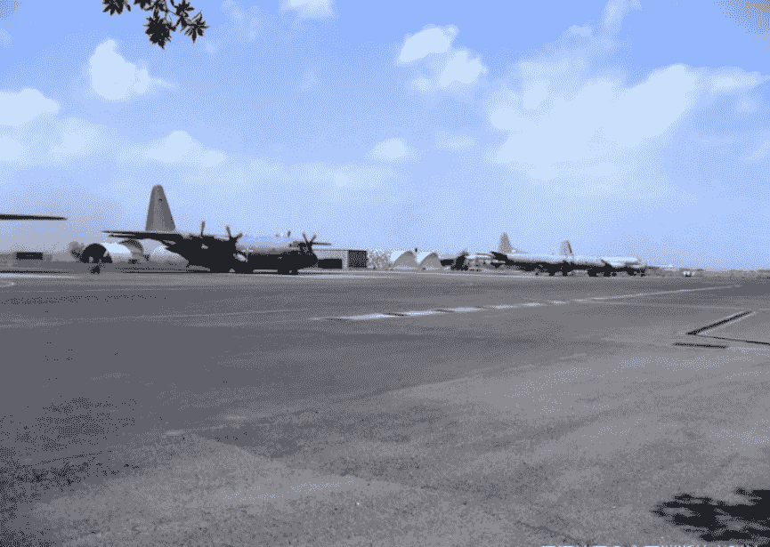
夭社区@永不消失的电磁波

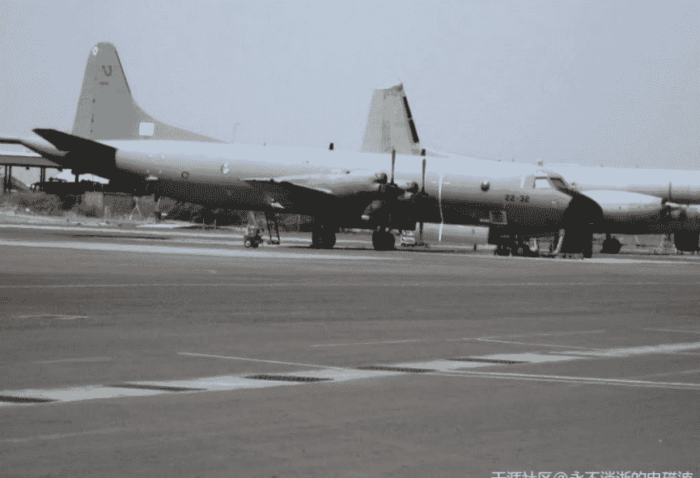
夭社区@永不消失的电磁波

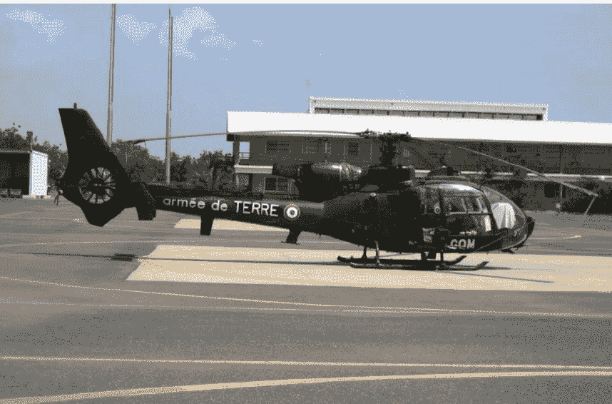
天涯社区@永不消失的电磁

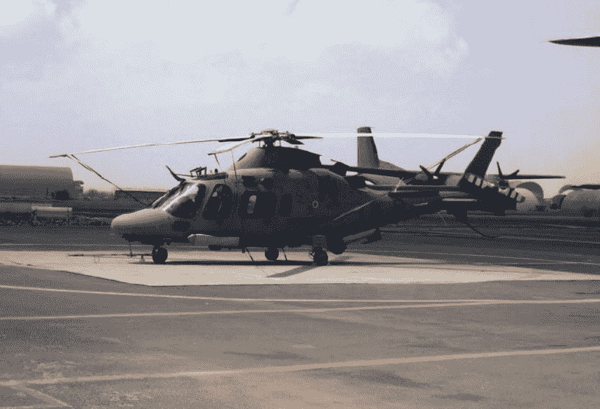
天涯社区@永不消失的电磁

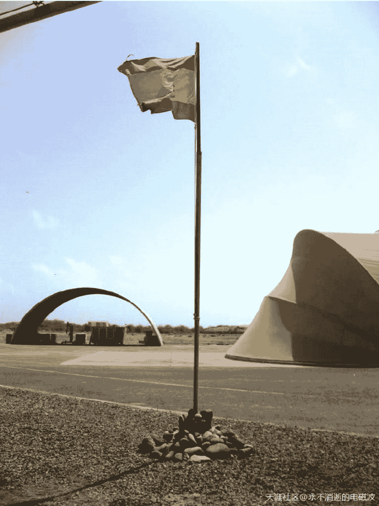
技术社区@永不消失的电磁

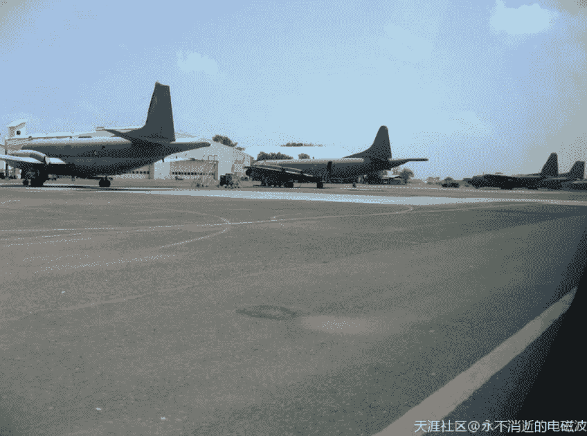
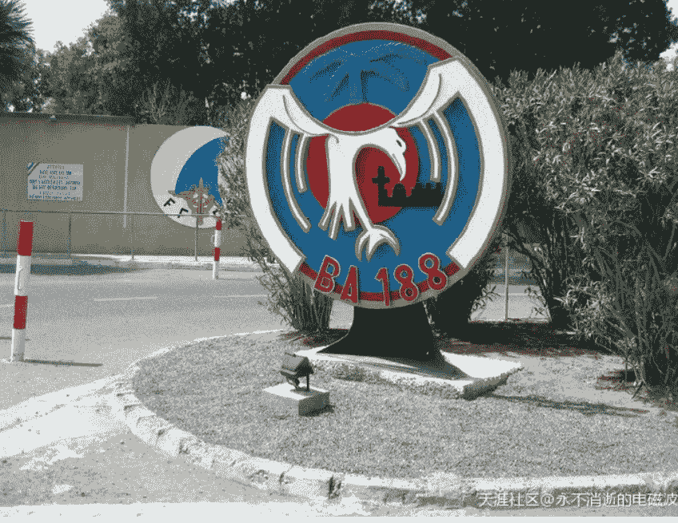

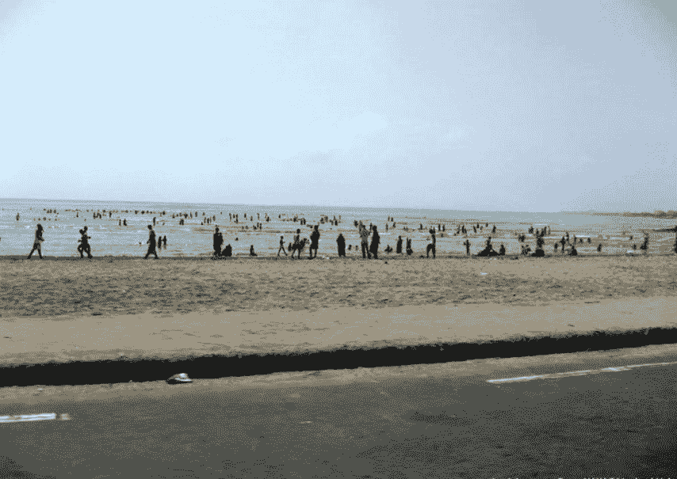
天涯社区@永不消失的电磁
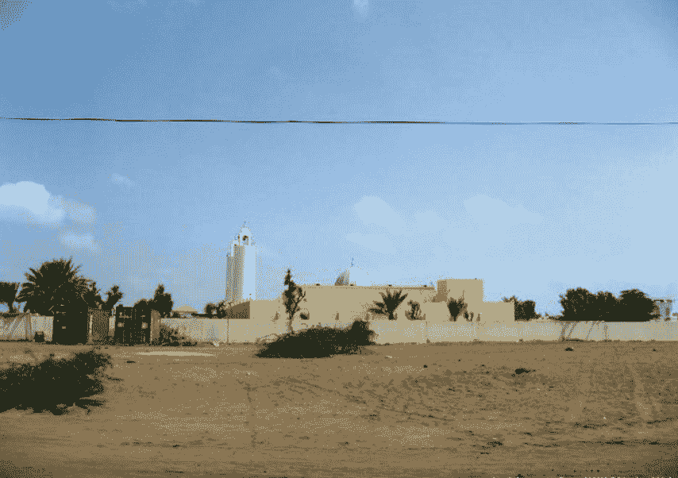
天涯社区@永不消失的电磁

坦率地说，从专业角度来看，建设吉布提基地的政治意义大于其实际意义。好的港区已经被法国国家和美国占了，而且在这里，一切都在法国、美国、英国等国家的注视之下，想搞什么都忙不过来。

在可行性研究阶段所提出的目标，就是将吉布提建设成为后勤保障基地，而非真正意义的指挥或者训练基地。吉布提的中国人还不少，很多人从广东或者乌干达拉了货来这边从事第三产业，当地甚至有小小的街区，连着开了几家中餐馆。

吉布提是伊斯教国家，风土情跟苏丹差不多。但是在港区可以轻松地买到酒，价格也比苏丹便宜很多，是有美军驻扎的地方，就有酒吧存在的原因吧。

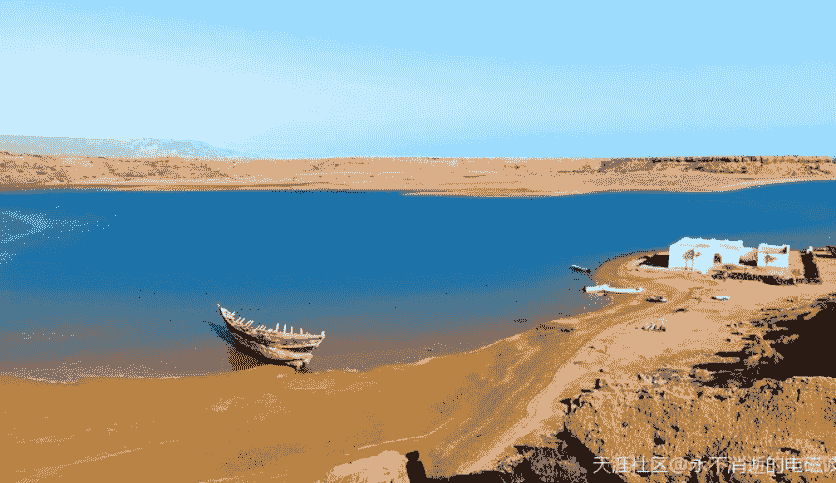

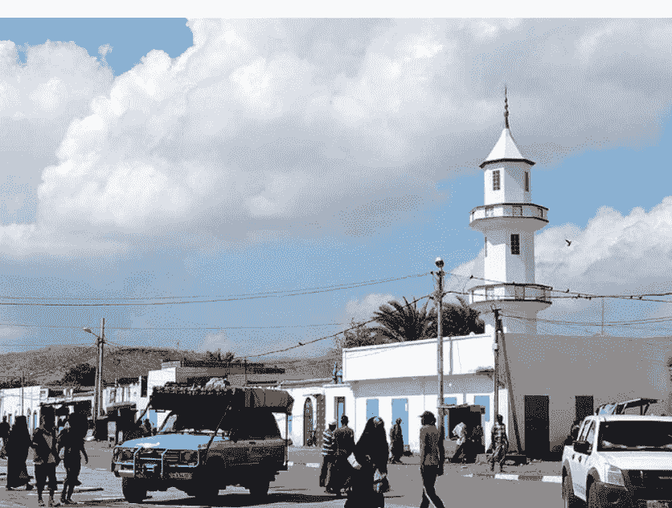
天涯社区@永不消失的电磁波
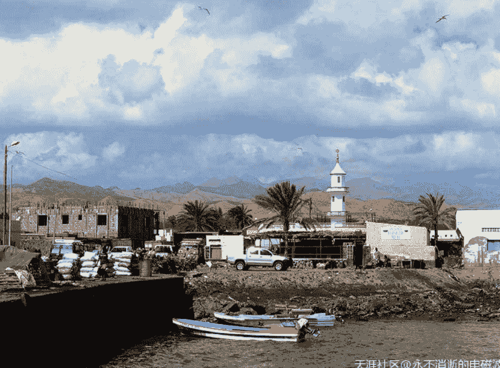
天涯社区@永不消失的电磁波

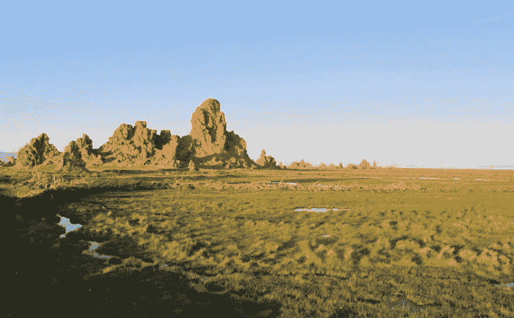
天津港@@苏内湾的灯塔
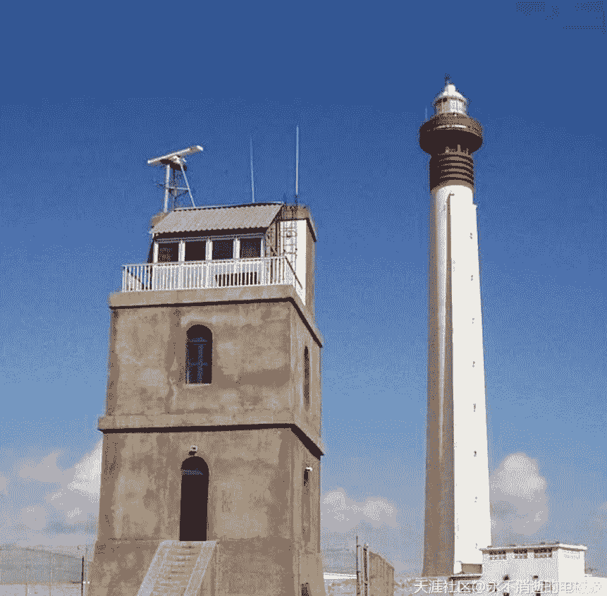
天津角@@渤海湾用灯塔
天津

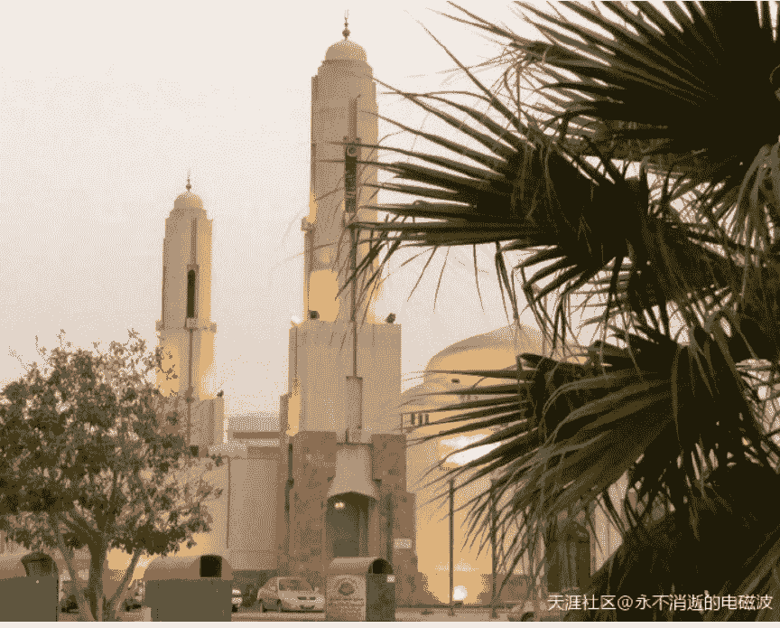
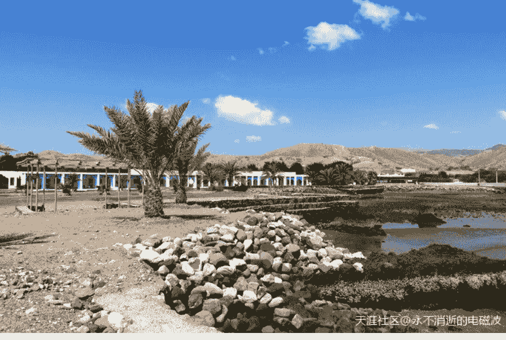

由于亚丁湾巡航队已经开始行动，而我们在非洲还没有稳定的后勤基地，因此我军曾短暂使用法国的吉布提基地进行补给。当然，也使用波斯湾阿曼的军基地和法达尔基地，但是最方便的还是吉布提。

一方面，吉布提位于亚丁湾和红海交界处，地缘优势明显。另一方面，吉布提已经有了军事海军基地，物流比较丰富，能够满足舰队的各种补给需求。第三点，是国际政治和舆论环境。由于吉布提至少是摆在台面的第一个海外基地，因此外交非常谨慎。由于解放军驻扎，加上亚丁湾巡航的实际需要，国际社会能够看到，虽然不舒服，但也增加了透明度。由于吉布提总统的公开，后面就成了成果。其实现在索马里西部，原属索马里，那里已经自治，并且得到了联合国和东非共同体的承认，叫做贝贝拉。它地理条件比吉布提好得多，而且没有解放军干扰，位置更为优越。

由于吉布提的扩张、非洲殖民、美军基地等因素，吉布提的港口建设没有苏丹港那么透彻。由于吉布提的港口太小，吉布提的联络办公室就已经成立了，虽然简陋，但是运作良好。

此行的主要目的有两个：一个是根据实际情况设计预警指挥系统，另一个关于后勤补给和紧急救援。联合指挥系统的设计绝非这个层面能够完成，因项目组刚成立，高层就派了一位专家来授课，是一个物流专家。我是由衷佩服这个安排，真的是受益匪浅。物流专家的介绍让我们明白了很多信息传递的原理，也明白了ERP的设计，还了解了工厂和物流的运作衔接。看起来跟后勤保障关系不大，但是对于我们去做这类系统设计帮助是巨大的。

吉布提港真的不大，但是感觉吉布提就是一个世界博览会，什么样的人都有，什么东西也有。当然，这里有很多华人。我们有的方面进步非常迅速，比如经济建设，从改革开放前的一片空白，用了三十年就发展到世界顶级水平。但是也有某些方面，尤其是精神文明建设方面其实还有很长的路要走。这里一部分是契约精神，一部分是诚信。听一个经典的故事：在吉布提，国外大兵的衣服经常破损，他们可以领新的。后来大神了解了情况，就用国内生产的颜色基本一致的服装去换美军或法国的训练，然后把原装训练回来卖给各地军迷。衣服质量差不多，换一套还能赚不少，美军或法国的大兵当然开心了。但是没多久，大神提供的服装质量就开始不一样了，很快就被破得很了。在国外，你可以卖东西，但是不能没有授权就使用别人的品牌，否则就是违法的。后来这个事情被插到内政部，就是警察要求查，结果直接指向了这几位大神。这几位大神就进了大使馆，请求领事协助。本来吉布提对中国人民比较友好，就答应办了解释的要求，结果几位大神当晚上就遵照形式办法，弄得大使那边两面不是人。

大概与此同时发生了另一件事情：法国基地扩建，加上当地的吉布提市政设施，光明还是什么，一起的搞了一个招标。吉布提政府除了外交部，都有正式的法国顾问，他们拥有很大的决策权。结果投标的四个中国公司，其中一个中标了。可能是价格低，另外也是贿赂了市政部门的几个人，反正后面质量比较差，安装周期也比较长，还额外增加了许多费用。是用主方不亏了，要去打官，然后公司一开始就开始抵赖，后来又想再通过贿赂解决，最后拿出，当时投标的几家公司其实都是一家人操的。于是是闹大了，吉布提政府的顾问受到牵连。这件事导致了吉布提市政府的尴尬，吉布提的规定不允许这种，这件事至今让大家都很尴尬。

更有者，就是吉布提。吉布提港隔海的城市名叫塔朱拉，它的地方附近有吉布提国家公园，是吉布提的农业和畜牧中心。由于吉布提的农业和畜牧业发展，吉布提的优质产品是新鲜肉和奶制品。为了让航队能够获得这些优质产品，每次航队靠岸时，都会在塔朱拉建立了一个站点，负责肉类和奶类的采购。由于吉卫组长对当地的情况还不熟悉，每次航队靠岸，就直接发往塔朱拉。

当时那边就急了，那边发现少了一个人，警卫组长担心女士的安全，所以想立即行动，但是办公室那边的负责人有着外交面的顾虑，毕竟他们在当地没有执法，也不希望惹乱子。这边跟美国大使馆联系，一边等待国内的回复。

那些女人也挺可怜，刚开始一看拿着枪的，估计都尿了，气都不敢出。警卫组长也聪明，带着车队往反方向跑了一会儿，又绕路到海边，再兜个圈回到起点。回到起点院子，这些人一一看房子门口上面钉着一个小小的五星旗，当时就有几个直接跪下了，嚎啕大哭。警卫组长让他们大冷静一下，然后大概等了一下，其中两个男是个嗓子，直接就给罚了，又可能给些衣服给那些女人。不敢多留，马上全部上车前往联络办公室。

到了联络办公室，有几个年轻人听了，气得火冒三丈，人家的生意接到国外来了，撸胳抽脖子就要替天道，被律拦在了。行动太忙，没有仔细搜查，而且这些人人身上也没有证据，无法准确甄别。当时，换防回国的护航队还没靠港，办事处就找了个安全的地点，把这些人安排好。大概过天之后，护航队靠岸，就通过特殊渠道将受害者和三个人渣交给护航队，然后带回国内。

塔朱拉那边被人报了警，第二天也有警察查了站点，例行检查，没发现什么异常，预计这几人的形态也不太大，就走了。

后来，警卫组长因离职职守和违反外事纪律提前退伍了。从法律层面来说，他可能犯了错误；但是在道德层面，他就是英雄，永远的英雄！我相信这一段经历，对于他而言，绝对不是累赘，而是值得自豪的辉煌！等以后有了机会，找个漫画画家朋友，把这个英雄事写成卡通人物，这就是我们中国的蜘蛛、绿巨人做什么的，让它流传下去！

吉布提确实挺聪明的，它国土里面除了大山荒漠，就是300多公里的海岸线，基本也没有工业，就那么几个绿洲。尽量人口不多，但是光靠畜牧业也养活不了，于是，吉布提就决定开发土地资源，依托房地产发展经济。

索马里海盗狂，最开心的应该就是吉布提了。于是除了它的宗主国法国使用的军事基地，在吉布提期间象征性1法郎租金使用之外，它的美军事基地，以及日本和中国的基地，都是外租。

吉布提希望通过军事基地的租金，以及外国驻军的消费，能够为其提供稳定的经济收入。从飞机进入吉布提港开始，就能清晰的感受到吉布提为军事基地的味道。

夭社区@永不消失的电磁波

夭社区@永不消失的电磁波

天涯社区@永不消失的电磁

天涯社区@永不消失的电磁

技术社区@永不消失的电磁

天涯社区@永不消失的电磁

天涯社区@永不消失的电磁

坦率地说，从专业角度来看，建设吉布提基地的政治意义大于其实际意义。好的港区已经被法国国家和美国占了，而且在这里，一切都在法国、美国、英国等国家的注视之下，想搞什么都忙不过来。

在可行性研究阶段所提出的目标，就是将吉布提建设成为后勤保障基地，而非真正意义的指挥或者训练基地。吉布提的中国人还不少，很多人从广东或者乌干达拉了货来这边从事第三产业，当地甚至有小小的街区，连着开了几家中餐馆。

吉布提是伊斯教国家，风土情跟苏丹差不多。但是在港区可以轻松地买到酒，价格也比苏丹便宜很多，是有美军驻扎的地方，就有酒吧存在的原因吧。

天涯社区@永不消失的电磁波

天涯社区@永不消失的电磁波

天津港@@苏内湾的灯塔

天津角@@渤海湾用灯塔
天津

由于亚丁湾巡航队已经开始行动，而我们在非洲还没有稳定的后勤基地，因此我军曾短暂使用法国的吉布提基地进行补给。当然，也使用波斯湾阿曼的军基地和法达尔基地，但是最方便的还是吉布提。

一方面，吉布提位于亚丁湾和红海交界处，地缘优势明显。另一方面，吉布提已经有了军事海军基地，物流比较丰富，能够满足舰队的各种补给需求。第三点，是国际政治和舆论环境。由于吉布提至少是摆在台面的第一个海外基地，因此外交非常谨慎。由于解放军驻扎，加上亚丁湾巡航的实际需要，国际社会能够看到，虽然不舒服，但也增加了透明度。由于吉布提总统的公开，后面就成了成果。其实现在索马里西部，原属索马里，那里已经自治，并且得到了联合国和东非共同体的承认，叫做贝贝拉。它地理条件比吉布提好得多，而且没有解放军干扰，位置更为优越。

由于吉布提的扩张、非洲殖民、美军基地等因素，吉布提的港口建设没有苏丹港那么透彻。由于吉布提的港口太小，吉布提的联络办公室就已经成立了，虽然简陋，但是运作良好。

（注：由于原始OCR文本存在大量重复、乱码及错误，此处已根据语义逻辑进行了深度去重与纠正）

他的家族一直生活在吉布提，后来吉布提独立，他的家族保留了法国国籍，也加入了吉布提国籍。古莱德做的是批发生意，从香水到奶酪，什么都做。也不尽然，其实是什么钱做什么什么。因此，法语、阿拉伯语、英语、西班牙语、意大利语，他都会讲。

那天吃饭的时候，正巧看到我们两个东方人，我很感兴趣，就坐在一个桌子上面认识了他。当天他可能也比较忙，我们也没多少说，毕竟吉布提国内，互不清楚对方的底细，一般也不会深交。

第二天去农贸市场又遇见他，远远的我们就给他打招呼。看到他很热情，我们也没意思拒人家面子，让他来家里做客，我们就（他家）出去了。

古莱德的家在巴尔巴南部的小山里，这里是一个豪宅区。不要认为豪宅区是洋人的专利，更不要认为那里是特务的天堂，其实那个住宅区很幽静，而且也见到几户华人的房子，因为门口还贴着春联。

古莱德就在半山腰，他的一楼是一个仓库，二楼相当于一个会客大厅+展示中心。

看得出来，古莱德的生意很成功，欧洲和非洲到处都是他的客户和供应。古莱德，他的家族生意很大，但是他这里，却只是做吉布提附近的生意。不过他的客户都很信他，因此基本上也是衣食无忧。

到了这种境界，又有更高的追求，人往往就比较喜欢从事自己喜欢的事业。古莱德有一个癖好，就是收集各种泡茶的杯子。奇怪的是，居然那里没有收集紫砂。借用他家里的网络，给他大概介绍了一下紫砂的前世今生，古莱德看得两个眼睛放光亮。

我是把自己的邮箱留给他了，说如果来到中国，可以到广州，陪他好好转转，让他知道，为什么我们欧洲人只会吃草不会吃茶。

我在跟古莱德展示国籍的时候，老韩看着古莱德客户的几张照片出奇奇。我这卖完了，他就问古莱德，能不能搞到大米。古莱德说，在非洲，大米是奢侈品，但却是他的营业范围。

感觉古莱德很实在，他跟我们说，他的东西，比市面的价格大概100%，是质量等各个方面绝对没有虚值。

他还给我们讲了一个故事，说有很多法国人，都是吉布提殖民者的后代，吉布提独立以后就回了法国。但是他们的习惯，还是要吃一种吉布提产的奶酪。那些每个人月会在古莱德这里订奶酪，古莱德就给他们空运过去。双方方便来都不计价，但是古莱德从不失约，对方也从不会少付钱。

等到有一天，一位独自的老人家到了却没有划账过来，古莱德就觉得奇怪，就是带上奶酪自己坐飞机，去了巴黎附近一个叫鲁鲁伊的地方。结果得知，那个人家的房子起火了，古莱德费了力气，终于在医院里面找到了那个老人。老人惊恐过后，已经处于失忆的状态，也根本不认识古莱德，就只会呆呆的望着。但是当古莱德切了一小块奶酪给到老人的时候，老人家一家子就精神了。他居然说出了古莱德的名字。后来，古莱德跟他合影，并把那张照片放在了客厅。

讲起这个故事的时候，古莱德没有没有什么激动也没有什么夸扬，就那么一字一字缓缓道。其实在我们这样五千年的文明古国，类似的故事绝对可以用列举出不完来形容，只是我们没有注重去挖掘，就算是挖掘了，也没有在过去传播。善良和信任，总是在人性中是最需要被保护的那一部分。

看起来老韩似乎并没有像我一样被深深的触动，但他是在不断在展示路旁边看看看着。最后，他留给了古莱德一张照片，并坦恳的告诉古莱德，自己是联合国办公室的军需官。军需物资都是自己的，估计不会直接去找他做生意。但是如果有机会，希望双方能够合作，等等等等，然后把自己的名字也给了老韩。

军需官几个字也许太沉重了，双方也不再多说，我们就告别。路上还在问老韩，暴露自己的身份干嘛。老韩，你真的把自己当成特务了？完了了（哈哈大笑）。

其实老韩是对的，军需官就是军需官，那个地方一大堆的军事基地，必然有很多个国家各种级别的军需官，随时出来进行军需品的准备。这个，确实没啥好隐的，而老韩，也希望通过一些人脉，能够确保在指定的有限时间内，为执行特殊任务提供全方位的保障。

其实，国外的保障任务在国内执行阶段是完全不同的。在境内，需要考虑价格，考虑消耗性比例；而吉布提将成为我们子弟第一个海外基地。在那里，买到所需的东西已经不是天涯了。走进世界，就要用世界的视野方式做事，还要执着的那一套，除了“证明”井底之蛙，“什么作用都没有。”

稍微爆两个小料，首先是在南非发生的一个故事，也是军官的故事。由于当地蔬菜品种价格高，当时的军需军官要求官兵们自己种菜，本来想这方面解决了菜种的问题，另一方面降低了补给价格，两全其美。结果要知道在即将丰收的时候，直接被当地土薯骗了。

当时的思路就是，不管是种菜，还是种瓜，都是他们的财富。

在吉布提执行任务时，要学会尊重当地的习俗。吉布提的官方语言是阿拉伯语和法语。虽然美国影响力很大，但是当地基本都不会讲英语。

吉布提很多国家曾经是法国殖民地，都讲法语。如果他们都不讲英语，那我们现在的任务在吉布提方面就有缺口，就要抓紧时间去开发法语。

其实我觉得在更高的层面上，最应该做的还是努力去普及汉语。有些时候上街，随便看看各种标识都有，有阿拉伯语、英语、法语，但是除了中餐馆，还没见过挂着中文标识。

孔子学院走出了第一步，但是作为文化基础的汉语教育，还是该深入有效的。如果吉布提的学生从中学就开始学习中文，那对于我们扩大文化软影响力，绝对是一个有利的方向。如果咱们每个人贡献一点力量，集资每年在非洲举办一个汉语大赛或者汉语专题辩论会，那影响力绝对是不一样的。

跟老弗一起巡街的时候，要注意观察一下当地。路上加油店最多的就是修车行，另外食品店比较多。其实吉布提的工业水平非常基础但是由于吉布提会有那么多的军事基地，我总觉得食品加工业、小五加工行业和服装行业在当地比较易起步。

我们的海雷达可能暂时不会在旁边进行组装，但是谁知道十年二十年后呢。不过，更有值得投资的地方还是瓜达尔。

惟有中华博客：http://blog.sina.com.cn/weiyouzhonghua
微博地址：http://weibo.com/u/13661692
星星之火可以燃烧，祝愿中国梦早日实现！同努力共进步，唯中华复兴。星星之火可以燎原，惟有中华博客：http://blog.sina.com.cn/weiyouzhonghua

# 卡宾达的灯塔【连载三】
作者：永不消逝的电磁波

### 五、泰巴岛的五

在吉布提待了一个多月，收集到不少信息，等到船上的任务也差不多了，我就回国了。那是2014年初，第一代的联合作战指挥系统已经交付，这一批属于测试产品，更大的作用是查找系统设计的不足，为后续升级做准备。

虽然主体的大部分任务已经完成，但是关键的通讯仍然需要测试。联合作战指挥系统在国内的几个测试点都取得了不错的效果。但是现代战一旦开启，通讯系统将成为首要的渗透和攻击目标。因此，兄弟提供了革命性的解决方案，这个产品，应当说是时代的产品。

为了让指挥系统和通信系统能够更好的配合，我们接到指令，跟随海军去泰巴岛进行测试。没有多少人知道，在非常遥远的太平洋，国际日期变更线的右侧，位于法属波尼西亚群岛中东北角的无人岛，居然插着五星旗。

泰巴岛很小很荒凉，它就是一座火山岛，岛上都是火山岩，椰子树没几棵。岛屿面积不到几平方公里，周围环绕着一大珊瑚，大型船只靠靠近泰巴岛。

从实际意义来说，泰巴岛本身的价值并不大。话说回来，咱们的发展有些晚了，这种好地方都被别人抢了。

泰巴岛岛上没有驻部队，连脚亭都没有。从大船过来要接近二十天，紧急情况也可以从澳洲或者新西兰直飞泰巴岛。

我们在执行任务的时候，带队的官兵们都不清楚泰巴岛的什么，唯一了解的是通过这条路线。泰巴岛，这就是全世界最好的地方！

在我们到达之前，陆续来的先遣队逐步在岛上安装了一个小型柴油发电站，建立了一个临时补给站。这次带队过来，一个是要建设这些设施，还要建立通信设施；另一个就是要建设一个中等规模的驻地，派遣的常驻人员是当地的，但是条件具备。

我们说过的工程师部队里面都是高手。海平面上的火山岛，就算在海平面下面，工程部队也能吹灰之力就把设施建起来。

其实数据中心和配套服务的设计非常简单，但是这边的原则就是尽量不要破坏环境，否则直接开山挖石可能早就搞定了。

带队有两位兄弟派出过来，一位晓东，一位刚子，他们负责通信系统的测试。我们这边这边的我，还有一位坤哥，负责系统调试，他跟吕士一样，是网络高手，软硬件都是高手。

我和坤哥是后面来跟带队的，晓东和刚子是一路跟着带队过来的。他们一路测试不同的项目，不同的方法，也比较辛苦。带队的官兵知道我们在执行任务，因此对我们格外照顾。

距离泰巴岛5000多公里以外的布亚新内亚罗门群岛，有一个叫做达尔卡纳尔岛的地方。那里是太平洋战争盟军由守转攻的转折点。二战期间1941年，日本海军袭了珍珠港，希望借此削弱美国太平洋舰队，从而保证日本本土的安全。凭借这一时的优势，日本基本占领了菲律宾、马来西亚、印尼、布亚新内亚和南太平洋诸岛。而盟军的战略胜利，就从登陆达尔卡纳尔岛开始。

这次战役美军展现了其强大的全球部署能力，接近两万盟军陆战战斗员从美国本土部署到斐艾附近开始登陆作战。在五个月的拉锯过程中，陆续参战的来自美国本土超过五万名海军陆队和陆战兵，以及两万多名澳大利亚和新西兰士兵，与四万名日本守军进行岛屿争夺。在此期间，日本基本没有从本土得到重要的物资和人员补充。

这还是发生在七年前的故事，故事的结局大家都知道，但是未必考虑到就是盟军在这两个月海战和登陆战役中出来的协同作战能力和全球投送能力。我们在跟队指挥人员的交流中，感受最深的，也是士兵们对这种能力的钦佩。打起来来说，不要精兵将强，更重要的是随时可以把这些兵将投到世界上任何一个角落，而且还要把他们的吃喝拉撒舒服了。兵是练出来的，将是打出来的。美军在全球的巅峰，除了武器，也是练出来的。

在此，大家都对亚丁湾航有着无比的憧怀，甚至希望咱们可以经常满世界的航道走一起熟悉熟悉。作为世界第二大经济体，就算足够光养闲，你还低调到哪里去。

帅和我到达护队的时候，大家已经开始工作了，各忙各的。从技术角度来说，装备的使用没有什么差，师傅领先于门，修行在个人。培养好了以后，靠的就是操作纪律，人是所有行业中最好的。

另外若是想把装备性能发挥到最大，就需要不断的练，或者不断的操作，士兵对于设备的熟练程度早已不可及。

在执行任务时，我们带队的官兵都不清楚泰巴岛的什么，唯一了解的是，这种临时站点的思路和方法，后来在二战期间得到了。我们在泰巴图上面的陆续进行的建设，当然也延续了部分这样的思路。现代站点对比比艘船，最大的不同就是电力的需求。建立现代化无人守站点的三个挑战：一个是应对自然差异，一个是安保，最重要的是持续供电。不同岛规模，采用的电力方式是不一样的。对于临时站点，初期来的是柴油发电。柴油发电比较简单，设计一个发电时将出来的电存储在蓄电池里供给使用单元。但是由于设备可靠性和天气因素，包括柴油储存和电池容量限制，这个方案已经得到了升级。

其实未来最好的解决方案应该是小型核电站。不过这个找得有些远，哈，再过十年差不多……

现在大部分用种类一个是太阳能，一个是风能，当然像冰岛那边温泉比较多的用地热。在泰巴图，工程师找到了一个方案：小水电。泰巴图中的小山并不高，大概就是100多米，但是在靠近山顶的地方有一口小小的泉眼，流量虽然不大，还有一些盐，但是比较稳定。于是工程师在泉眼下面安装了一个蓄水池，然后用管道将泉水引到山脚连接了一个电机。

当然，太阳能和风能都有利用。这几个方案加起来产生的电力，基本可以满足日常的需求。

火山岩地形的特点就是大部分石头都比较硬，而且其中很多都比较碎。对工程兵来说，不怕硬石头但是怕脆石头。大家花了精力在岛上找了几块地质条件比较好的区域，分别建设了相应的设施。之前的在半山腰建设的生活设施，大概能够容纳10人左右休息。这次工程兵上来，直接构建成了能够容纳20人左右生活和工作的基地，甚至还安装了一套乒球场。其实队伍曾经提出来能否修建一个篮球场，但是说心里话，工程量太大而且利用率太低。用大的话来说，如果每几个小时在岛上巡检一次，就能满足身体锻炼的要求。

岛上的工作单调，早上根据天气情况计划安排任务，一天大概工作12几个小时；晚上落山的时候就睡回垫子上，吃了饭就做总结计划。漂泊沿海的，队伍的生活很清苦，也没有什么娱乐，直到我们四个人的到来。晚晓和刚子本身就是负责信的，对于地面恐怕再熟悉。泰巴的天气非常好，常年5、6度，没有污染，晚上就能分辨清楚银河。官兵们先是坐在甲板上聊天，但是晚晓和刚子经过几天的揉捏，连接上了通信卫星，是电视有信号了。

当然，这是晓东和刚子的任务。这两个家伙，从早到晚都是搞这个。其实，最近这些年，咱们的确发了不少卫星，也积累了相当的经验，此对于解决巴图图的总体方案，其实早就有了。但是对于具体问题，包括带宽谱加密等问题，一直都在努力。

总而言之，如果泰巴图能够够成功，那么去到地球转一个角弯，咱们就不用担心了。

每天晓东和刚子在胖子上折腰，我和坤舟就在小船和岛上忙活。小船换了一套新的舱座做测试，说起来也不难，只是这地方空域闭的封闭，于是每天就放无人机出去。一次测试三坐标，一侧无人机。

军队列装的无人机，可不是平时看到的大疆，或者四轴那种。军用的差不多一架飞机大，否则没有足够的载荷，而且飞行高度和速度都要达到实战需要，因此放飞和回收也有一些困难。其实无人机装备部队的时间也不太久，因此部队也紧抓一切可以利用的机会，对那些部署的无人机进行测试。

编队的首长很赞大林的思路，那就是编队升级最简单的路途，并非配备航母，而是海量装备无人机。当然，无人机的作战任务不同，装备也会有差异，反正基本就是对空、对海、对陆，以及反潜三个方面。

对空侦测是我们工厂的强项，无出其右；面对侦测，我们正在研究，进展不错：反潜方面，或者声响探测，并非我们工厂的领域。原理大致懂，只是没摸过。

不知道哪里高人说过，世上奇怪的事情，都可以用墨非定律来解释。墨非律的直白翻译是：凡事可能出错的一定会出错。运气吗？用一句俗语翻译将不不不扬口了，那就是：怕什么来什么。

每天放无人机出去，对空对海的监测基本都没有什么问题，新型号载人无人机大概飞到八小时，一点几问题都没有。如果升级了，估计是冲着二十小时的续航去的。那还装了套气象雷达在无人机上面，这就更加实用了。

对海监测有些准差，海浪的波浪现象比较严重，我们跟工厂商量，采用了一种特殊手段，减少杂波。测试时，效果也没有。准备回去以后在现有的海监测雷达基础上，再专门研究一种无人机使用的对海监测雷达。

反潜无人机并非这次的测试目标，是大林他们对有装设备进行的检验和演练。但是中间有一天，竟然有了重大发现。

一般来说，执行对空警戒任务的无人机，飞上大大概到10公里左右就差多了，但是因为我们正在进行测试，由于时候飞到25公里左右，信号反馈什么样的都很正常；对地海监测的，高度不是太高，主要检验在高精度标绘的前下，能够测测的距离。

我们没有测试任务的时候，大林他们就自己进行演练。其中有一次，就把反潜无人机放去了。放了几个浮标，一开始还正常，后来大概60海里以外的一个浮标发现信号，看到大家伙。

本来泰巴岛的气候非常不错，当时海况很好，浪高1米左右，官兵们虽然各忙的，有条不紊但是气氛有些枯燥。声响报警器以后，一下大家就精神起来了。刚开始猜测可能是鱼鱼，但是又觉得不像像。

对于平静的泰巴岛来说这个机会实在难得，对于就是让无人掉头，回来在声响探测到的路径上再放一个浮标，结果又看到了，这回判断，应该是中型潜艇，沿着泰巴岛沿旁航行。

战斗一下子就热闹了，枯燥和乏味消失得无影无迹，每个人都摩挲着，准备向着影子前进。这时，还是队首长了：“我们是在执行岛岛建设任务，人家也没进入危险区域。警戒就好，不要太靠近，以免双方误判。”

于是派了第二架无人机，在声响探测路线的延伸线上，下了第三个浮标。过一会儿，果然又看见了，很清楚，接近一百米，不是个家伙。大家神经都都很紧张，如临大敌的样子，但是从海面上可以清楚看到，人家正在远离泰巴岛。

当无人机在视野外下了最后一个浮标，传回的声响数据显示，这个大家已经离开了我们的探测范围。大家才七嘴八舌起来。

其实江沪级的声响系统运行，普通舰船都有声响特征，照一下基本就知道对方的型号，但是这一次发现对方的时候，编队长并未命令打开小艇的声呐。

对方是谁，是否注意到了我们，或者他们探测到了我们对于它的侦测，这些都不知道。反正它悄悄的来说，就如同它悄悄的来。唯一带给我们的信息，南太平洋海底并非海面风浪静。

编队首长，回去以后，他要把这个重要的情报跟编队领导分享。大洋深处是一个训练场，我们还是不去，大家都会经常去。

一切无人机侦测，一边进行编队联合作战系统的设计。对空对海和反潜这三方面聚在一起，以前采用平面坐标的海事雷达系统，马上就立起来。

053是80年代的产品，水面上没有三坐标显示装备，我们只能用自带的小显示器来进行测试，这是一个遗憾。其实在我们眼中，像053这样的舰艇，很有用的，还能继续使用。

一般来说，舰艇的战斗单元分为动力、侦测、作战系统等大块。对空对海和反潜这三方面聚在一起，以前采用平面坐标的海事雷达系统，马上就立起来。

053是80年代的产品，水面上没有三坐标显示装备，我们只能用自带的小显示器来进行测试，这是一个遗憾。其实在我们眼中，像053这样的舰艇，很有用的，还能继续使用。

一般来说，舰艇的战斗单元分为动力、侦测、作战系统等大块。对空对海和反潜这三方面聚在一起，以前采用平面坐标的海事雷达系统，马上就立起来。

053是80年代的产品，水面上没有三坐标显示装备，我们只能用自带的小显示器来进行测试，这是一个遗憾。其实在我们眼中，像053这样的舰艇，很有用的，还能继续使用。

一般来说，舰艇的战斗单元分为动力、侦测、作战系统等大块。对空对海和反潜这三方面聚在一起，以前采用平面坐标的海事雷达系统，马上就立起来。

053是80年代的产品，水面上没有三坐标显示装备，我们只能用自带的小显示器来进行测试，这是一个遗憾。其实在我们眼中，像053这样的舰艇，很有用的，还能继续使用。

一般来说，舰艇的战斗单元分为动力、侦测、作战系统等大块。对空对海和反潜这三方面聚在一起，以前采用平面坐标的海事雷达系统，马上就立起来。

053是80年代的产品，水面上没有三坐标显示装备，我们只能用自带的小显示器来进行测试，这是一个遗憾。其实在我们眼中，像053这样的舰艇，很有用的，还能继续使用。

一般来说，舰艇的战斗单元分为动力、侦测、作战系统等大块。对空对海和反潜这三方面聚在一起，以前采用平面坐标的海事雷达系统，马上就立起来。

053是80年代的产品，水面上没有三坐标显示装备，我们只能用自带的小显示器来进行测试，这是一个遗憾。其实在我们眼中，像053这样的舰艇，很有用的，还能继续使用。

一般来说，舰艇的战斗单元分为动力、侦测、作战系统等大块。对空对海和反潜这三方面聚在一起，以前采用平面坐标的海事雷达系统，马上就立起来。

053是80年代的产品，水面上没有三坐标显示装备，我们只能用自带的小显示器来进行测试，这是一个遗憾。其实在我们眼中，像053这样的舰艇，很有用的，还能继续使用。

一般来说，舰艇的战斗单元分为动力、侦测、作战系统等大块。对空对海和反潜这三方面聚在一起，以前采用平面坐标的海事雷达系统，马上就立起来。

053是80年代的产品，水面上没有三坐标显示装备，我们只能用自带的小显示器来进行测试，这是一个遗憾。其实在我们眼中，像053这样的舰艇，很有用的，还能继续使用。

大林的思路就是编队升级最简单的路途，并非配备航母，而是海量装备无人机。当然，无人机的作战任务不同，装备也会有差异，反正基本就是对空、对海、对陆，以及反潜三个方面。

### 岛屿建设
- 模块化升级

对于来说，舰艇的战斗单元分为动力、侦测、作战系统等大块。对空对海和反潜这三方面聚在一起，…… 模块化升级
- 这种升级，估计应该没有大的障碍。
- 只要船体没有大的问题，这些舰艇仍然继续使用。

### 施工区域划分
- 山脚下：水电站和码头
- 山顶：风力和太阳能电站、天文设施、通信中继和数据传输设施
- 山腰：数据处理中心和生活设施

### 建设进度
- 第一排：进度快。
- 第二排：比第一排还快。
- 第三排：进度一下子又快了一倍。

华山论剑吸引人的地方，并非最后谁赢，而是只有在高手出招的时候，大家能够充分发挥自己的实力和创造力，打着才过瘾，看着才过瘾。

白天，大家各忙各，到了晚上，胖子那边聚了很多人，打牌的打球的，吹牛聊天的都有：小艇这边相对比较安静，而通信的年轻军官们，加上刚子、晚东和坤哥，当然也少不了了我，大家都在研究那个信号波。

经过几次测试，基本信号波的频谱图弄出来了，大家都有些兴奋。但是光有频谱图却没办法翻译，大家一下又闷了来。你看我看看你，大眼睁小眼睛，眼睛瞪星星，束手无策。

这时刚子突然想起来一个主意，就是利用周波的窗口时间，把这个信息发回了国内，请之前破解我密码的那些兄弟忙忙送。第二个窗口时间就收到回，被他一个嗅臭回，原来这是一个地球卫星的定位信息，都是坐标信息，一堆一堆的数字。

人家说了，破解了它，比路上捡硬币还简单。刚一时愁塞......

编队国内的联系可以通过几种方式，海事卫星电话是一种，但是太贵，卫星通信和数据通信也可以，若是用外星就要考虑保密性的问题，用自己的星涉及到窗口时间问题。

有一次，有一个紧急情况需要立即请国内，于是通信组就派了一个人过来，租用外语言通信。接通基地，先让对面找准谁，那里就能明白了，然后这两个就开始开始对话。方言零碎，纸上的四十个字，却是十七八个发音搞定了。再说外国人，就是站在了这么这么多中国人，也没有能够听懂半句的。后来通信信长了，这个就是看了一个好莱大片，叫做《风语者》，然后有了灵感。别学办法，但是，效果显著。

其实通信信的收获还是比较显著，有许多频谱信息，知道的还是不知道他们，都收集起来了。想必是出来，这一次还远不容易，这些情报回去好研究，说不定就没有重大发现呢。

后来听说，也确实有了重大发现，破解译密信息的那些专家虽然没有被攻刚子的盒子，但是其中有两组搞出了一条大鱼。后来再也没出声，就让人默默的关注，听到了很多以前连想都不敢想。

有诡说，一位死队领导半夜被叫醒，看了情报，兴奋得光着膀子跑跑到院里面大喊大叫，就差点砸了，吓得警卫员以为老老人疯了......

眼见着通信任务开展得如火如荼，我们也不甘落后，除了每天无人机群编队飞行表演之外，我们调整了各种雷达的侦测范围，以适应联合战斗指挥系统的要求。

编队首长的谈话，确实有醍醐满顶的效果，我们的进度加快了，深度和广度也能够满足实战的要求。

还记得我学那几选飞机，要求身上都不能有伤疤，这还不算其它。

飞行员数量少，成为空军发展的一个因素。但是无人机飞行员就不一样了，以为，会打电子游戏就行。据说有的，用退役飞行员来无人机驾驶员，我觉得这个就是浪费。

击击机飞行员下来，可以飞运输机和战斗机，也可以做教官，训练无人机驾驶员。我们编队同时进行测试的无人机，都是由完全没有飞行经验的战士来驾驶的。无人驾驶员，只要按照规程进行，不需要太苛刻的身体条件。

在当前阶段，甚至需要脑洞活跃，要更有可塑性，不拘一格降人才，这样才能发挥具有胆性甚至颠性的战斗和战法。

起初，为了配合这次测试，编队带了一个飞行小队，两位直升机飞行员，还有两位无人机驾驶员。一开始就感觉无人机驾驶员不够，按照规程，两位无人机驾驶员最多就能同时带两架飞机。

后来坤哥发了，他跟飞行小队的负责人商量，还不能训练更多的无人机驾驶员。小队长有些犹豫，于是我们就直接去找了无人机首长。

首长很支持我们，他也认为，人是最重要的，无人机掉下来，再派一个上去就行，而如果掉飞行员，那掉下来就是掉了。而且他更提出来，能不能一个人驾驭几架无人机，让我们认真考虑一下，拿个方案出来。最后说，有什么需求，都可以直接找他谈。

有首长这句话就足够了，也不用什么事都麻烦首长，但是人家这句话给了我们信心。我们首先解决的问题，就是驾驶位不够。

无人机驾驶，也要有一个操作平台，至少仪表盘控制杆什么的都要有。毕竟是执行任务的无人机，跟家里玩的那个不一样，不是一个数量级。一个驾驶台，对应一架无人机，双向通信的频谱都是单一加密匹配的。

通信方式有两种，卫星通信和调波通信。大型无人机，美国的就不说了，像咱们自己的翼跟彩虾，都是可以采用卫星通信控制，这个传输距离远，密性强。打个比，我们编队发射的无人机，如果采用卫星通信，在全局部署的飞机可以由北京，甚至哪个大山里面的驾驶员来驾驶。前提是要有窗口时间。如果没有卫星，那也可以用调波通信。

通信方式有两种，卫星通信和调波通信。由于外环境条件很好，人烟少，信号干扰少，于是我们用了高频通信。解决了通信和干扰问题，再就是要增加驾驶台的数量。前面说了，编队只带了两位无人机驾驶员，所以猜出来，只配备了两个驾驶台。不过这个难住我们，坤哥是个老玩家，拆了其中一台，然后根据我们的情况，重新设计了一下。这个时候，工程兵部队的高手就场了。

工程兵部队，在大山里面修车，都是自己出来的。他们早就在玩了自行车，也就是全地形车ATV。胖子那边可以做ATV，做操作台，但是做无人机就困难大了。也让人做，玩玩可以，但是过了，过犹不及呀。

正常情况下都是自动驾驶模式，不需要人工干预。不过我们有测试任务，所以切换到手动操作模式。无人机白天飞行，晚上还要补充能量。操作台还有训练，其余都被骑士团用来练手。后来大家的熟练程度越来越高，经常三架在飞，两个操作台练习。大约两周以后，五架同时上天的情况就出来了。再两周，骑士团的几位优秀学员甚至可以自主操作飞行和降落了。这个进度，科班出身的驾驶员都很惊喜，编队长更是开心了，只是后悔没带多架，对不起，几十架甚至百架过来。

一开始也没有想到无人机的作用那么大。大林负责飞行员，他的思路很简单，需要有一定的电子游戏经验，大脑反应比较快，纪律性比较强。

后来坤哥跟两位飞行员商量了一下，为了稳妥起见，无人机的起飞和降落阶段，还是由飞行员控制，中间阶段都是自动驾驶模式的。因为我们有测试任务，所以还是切换到手动操作模式。无人机白天飞行，晚上还要补充能量。操作台还有训练，其余都被骑士团用来练手。后来大家的熟练程度越来越高，经常三架在飞，两个操作台练习。大约两周以后，五架同时上天的情况就出来了。再两周，骑士团的几位优秀学员甚至可以自主操作飞行和降落了。这个进度，科班出身的驾驶员都很惊喜，编队长更是开心了，只是后悔没带多架，对不起，几十架甚至百架过来。

小编首长经常跑我们那儿，看看这个看那个，我们也帮他演练，让五架无人机一会扮成友机，一会扮成敌机。首长很认真做着记录。

五架无人机起飞的时候，合作指挥系统就开始忙碌了，所有的信息叠加在一起，提供出来的就是一个立体的战场信息。

无人机的出现和普及，成为颠覆性的里程程。一些以前连梦都想不出来的训练方法和战法，现在光有条件落实，能够超过预期的发挥。这个也许是这次首长的重大收获。相信以后，彻夜不眠的不止一位了。

还好，这次远航带了足够的油料，能够让我们这样的折腾。在采用坐标系还是球形的问题上，坤哥我也进行了比较深入的讨论。我们甚至准备了两套方案，在实战演练中来各自的优缺点。

随着联合作指挥系统与骑士团的配合越来越熟悉，在请示了编队首长后，我们进行了一次演练。在泰巴岛以东大约30海左右有一个礁盘，是暗礁，中间一个湖渊，即使落湖也不会出海。其实如果是在航道上，还挺危险的，我们用053去靠附近。053在下面，相对速度比较慢，骑士团提前起飞，高空警戒的，对海的，反潜的，各司其职，转了一个大圈。对海的首通过视频侦发现礁盘，然后053发送信息，053按照要求进行规避。这个时候反潜的按照修正的航行重新进行水下情察，再反馈给053......

演练很成功，只是附近没有没有什么飞机，连载船都没有，演习也显得枯燥和乏味些......

考虑到油料问题，后面的演习，就是骑士团自己出去了，053做指挥，待在锚地就可以。这时候，要不动老百姓。

于是，游艇就被粘在053之后，官兵们虽然没有再碰它，直到完成任务，舰队去塔希时，把它交给了当地政府。

后听说，这个游艇是另外一个岛的萨萨亚的的大风浪把它吹跑，结果在太平洋上漂了两千多公里，漂到咱们泰巴图附近。其实海面上也有船名的，如果能够接入国际海事组织的网络，查一下名字再对比船型，应该不难找到。但是编队比较低，不希望太暴露，这方面编队首长还是比较谨慎。

骑士团的五机队玩兴起，甚至还进行了夜间的操作。一开始，这款无人机并未设计夜间作战任务，但是有一句话叫作熟能生巧。骑士团经过一个多月的练习，已经无法满足单纯的白天训练任务，于是经过大家商量，请示执行夜晚的任务。

先看着黄晋把飞机飞上去，然后巡航到晚上，再进行验收。编队首长拿着方案，问问了几位飞行员和驾驶员，大家觉得可以试一下，于是就批了，先拿架做做测试，但是必须要谨慎，这五架都是宝贝，不能有半点儿丢失。几架下来后，经验丰富的飞机后，骑士团开始进一步进行夜间起飞和回收。之后，就是无人机群配合运作，当然可是编队只带了一架飞机。

看着骑士团鼓气干劲，编队长很开心，手里多了这么多，更重要的是，骑士团的精神让他看到了希望，这正是我们中国人的强项，是年轻人的强项。只要有机会，就一定会旋放！

## 卡宾灯塔连载
作者：永不消逝

## 六、恩加拉的大鸟
泰巴图设施安装完成了，编码又等了两个星期进行后续测试，然后准备上程了。

瑞士团这时已经成为了高手，编队经常飞行，一会儿排成字型，一会儿排成字形。西北面工程部做了一个巨大的星旗，永远屹立在泰巴图的山顶，向着祖国的方向飘扬。

## 七、坦赞铁路
看，在国内一点的图书馆在网上都有电子图书馆，而且都是免费的。网络是用来充实自己的，不是用来写妈。有空闲的时间，不如去图书馆研究一些更有意义的事情。你自己不知道怎么的情况，不去学习，张嘴就臭，这不是你，这是缺乏教养。愧对父母和列祖宗，愧对向上五千年的文明之。

说英国人比较绅，那是因为不列颠曾经经历许多罪犯，或者死不悔的文明份，放流了澳洲......

咱们确实投入巨大资源援坦赞铁路，但是因为修建坦赞铁路，让我们赢得了非洲尤其是黑人亚洲国家的尊重，才是在1971年的联合国大会投票当中，为恢复常任理事国席提供了保障。

更重要的是，坦赞铁路对我们提供了大量的优质铜矿和铀矿，没有，可能我们在现在也造不出多少子弹，更上不了民用核项目了。

赞比亚矿产资源丰富：黄金、铂元素、镍、铁、钨、铬、磷酸盐的储量世界第一，铜、锡矿世界第二，镍、磷酸盐世界第三，钻石、钛、锌世界第四。

坦赞铁路也是共和国历史上规模最大的成套援项目之一，总共派出人员五六万人，66名优秀的工程人员长在铁路线上。

之前也看到国内报道，对坦赞铁路以及它获赞物说三道四的。跟他讲道理，他就不用明白真来。其实不知道历史没关系，先去学学看。

数字过了百万，已经成为现代社会的耻辱。布隆里面有强烈的英国色彩，经常跟坦桑尼亚玩，当面一刀背后两刀的。

在此，坦桑尼亚尼望望望望它在北方的侦察实力，这也符合它的地广人稀的国情。但是当前这个时候，我国也处于换装阶段，大部分装备都是在生产一代、研制一代、预研一代的状态中。除了这位铁铁纯男哥们儿，一般人人都实现现役制装备。

不过，淘汰下来的二代甚至三代雷达，可是可以送给老坦，换点稀缺资源回来。

之前咱们讲过，雷达这玩意，原理跟技机规模差不多，核心就是那么几儿东西。需要搭建的外设规模，就要看预期探测范围，也就是探测距离了。

鉴于坦桑尼亚的传统友好和未来发展趋势，咱们挑选了一部状态较好的除役的三代，送老坦。

其实，国与国之间的关系，就如同里面的关系，你对人家你好，人家才会对你好；你的品好好，人家才会尊重你。但是，这个世界没有无缝无垢的爱，虽然无缝无垢的恨很多了......

坦桑尼亚的矿产资源虽然比不上尚费比，但是一方面它需要我们的军事援助，另一方面，在稀有金属方面，它与我们是互补的。不是说我们是稀土大国吗？是的，但是稀土是一类稀有金属的统称，我们的储量总量确实很大，但是也有储量短缺的元素，或者需求量较大的元素。比方说，我们这个行业用到的几种。这里就需要老坦的支持。

这一部三代，不敢说先进先，但是绝不算落伍，只是由于整体装备升级，被我们替换下来。

由于老旧的技术要求跟我们这一批稍微有些不一样，于是工厂又搜到地方的一些配件，一起装箱运过来。后来联系去，把我弄过来，要求尽快搞定，尽量回国。为了缓解我的思乡之苦，我的新徒哥也派了过来。动画脚头都算得出来，这无疑是出要差错的手。

老坦希望还快搞定，由于马上要进行总选举，现任想要连任，就得弄点儿业绩出来；我们也希望快点儿，是担心他无法连任。虽然已经有几艘载着矿石的船从三兰出发了，但是后面还有几艘。家里，也是怕泊夜长梦。

这次是司徒到三兰等，等了我们天。三兰有很多阿拉伯人和印度人，也有中国人。当地的中餐馆不少，所以司徒是没饿着。

经过几个月在泰比的风吹日晒，我的皮肤已经比较接近三兰本地了，只要不张嘴露出牙齿，挤到人堆里真的很难辨识。司徒接机的时候，着实找了我一会，我就这就旁边静静看着他那可望的眼神......

打了招呼也没有停留，就跟着老坦的联络官姆维莱盖，出发前往目的地站，叫恩思加拉。

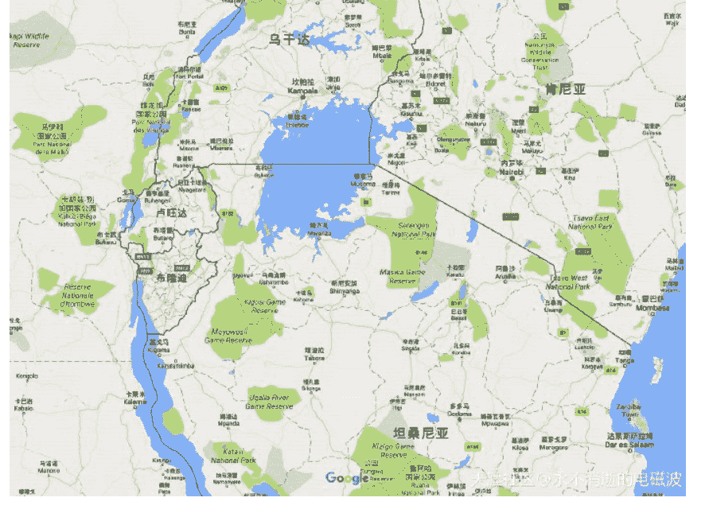

恩加拉位于布通迪、卢庄达与三国交界附近，比较原生生态的一个小镇。民风比较单纯，就是一辆车就围了一人伸手要东西那种。

老坦的基础设施没有，恩加拉没有机场，要先飞到格喀湖湖的格基玛，再换车去。400 多公里，开了 10几个小时。全程没有高速公路，甚至有几段居然是红土的泥路。

路上跟姆维莱盖特说，干脆联系国内几个矿业集团的兄弟过来，一边修一边开矿。这样路也修了，矿也挖了，钱也挣了，好不好？

维维黄盖特也来自北大，但是普通话不标准，总有点不知道是哪里的口音。他说，其实普通老百姓是很想加速国内开发速度的，但是桑尼亚国内的局势还是有些复杂。

他们也有改革，是民主改革，改革以后就是选举。开矿这个事情，里面油水太泛，利益争特别严重，这就成了为了政客相互攻击的工具。举例来说，如果上台权的这一类按兵仗，在野里的那些就开始说，经济太差，当权者不作为等等；上台权的要是想法，去开发矿产资源，在野里的那些这些人就开始鼓噪，又是环境保护，又是分账均，又是腐哟的。最后，反正纠了吵架，什么正经事儿做不成，最后受苦的还是老百姓。维维黄盖特的一声感叹，无意让我联想咱们自己的那块地。

其实维维黄盖特在北京驻了三年，目睹了中国的快速发展和变化，也对他们的行政效率颇为敬。

傍晚时候驻在那儿，已经有三位军官等在那里，其中一个在中国待了七年，是南京派的精英，他自我介绍中文名字叫铁蛋。我听就皱笑了，路途的疲劳也一下子消失了。这些老外的中文名字都是谁给起的呀？出来晒晒好好吧！

另外两位都可以说中文，跟铁蛋不一样，他们不是陆军系统的，不存在南京派与南昌派的区别。一位是空军的，郑州待了五年，专门研究雷达的，叫做波西。最后是一位女士，叫乌米，装甲工程学院的，也是在北京待了三年，毕业稍微高一些。她的将军衔最高，现在是基地行政部门的头儿。

三位当中，波西每天跟着我们一起干活，负责协调的，雷达安装完毕以后，就她负责使用和维修；铁蛋健身材料不高，却是负责安保的；乌米则是全权负责，任何事情只要我们需要，就可以直接找她。正聊着，那边祷告的时刻到了，乌米和铁蛋都是穆斯林，他们两人去祷告了。留下了波西，是波西带着我们去了基地的营地。之所以称之为营地，因为这里比较简陋，其实就是铁皮房。晚上上下了小雨，打在铁皮房的屋顶，叮咚响。但我确实是累坏了，有点声音就失眠，这次一下就睡着了，睁眼的时候天已经都亮了。

简单的观察了一下，这个基地还是相当规模。波西介绍说，这里是三国交界处，比较乱，因为附近有一个地方发现了金矿，所以其它国家的政府军、土匪甚至佣佣经常。老坦在这里设立了总部，形势才稍微稳定。的确有军进来，据说前几年还驻过广州的医疗队。我们要去的站，在后面的小山上，开车大概半个小时就到了。从地图上看直线距离也就10公里，开半个小时，纯粹是因为路不好。这里还是红土路，不知道下雨的时候怎么样。

说到这儿，必须强调一下，坦桑尼亚的颜色比较艳丽的，蓝的天、白的云、绿的树、红的土，还有各种颜色的鸟。从基玛开车过来的路，我们就发现了天上、树里、湖边，到处都可以看见各种形状的，大的鸟站在地上甚至一人高，天上的群群，远远望过去，黑压压的感觉。

姆维策盖特说，坦桑尼亚的骄傲，还强调坦桑尼亚的朋友，每年都有来自全球爱好者来看。听到这里我心里想，估计也有中国人专程过来吃，所以姆维策盖特才是坦桑尼亚的朋友。由于时间比较赶，也没有得及仔细观察和拍照。

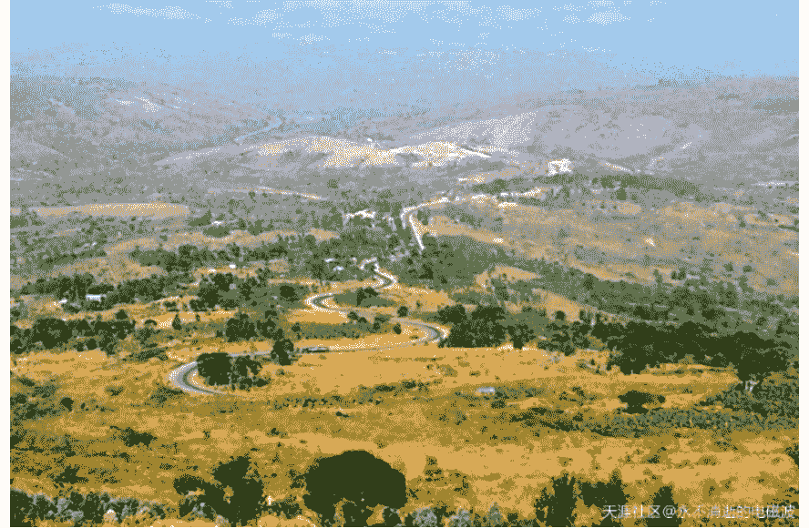
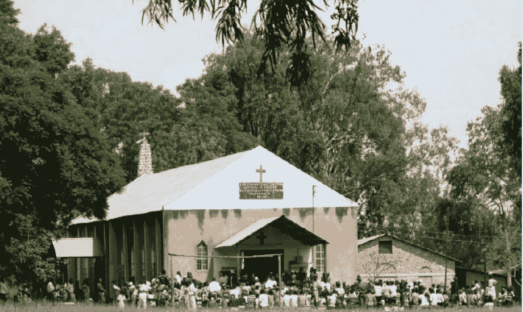
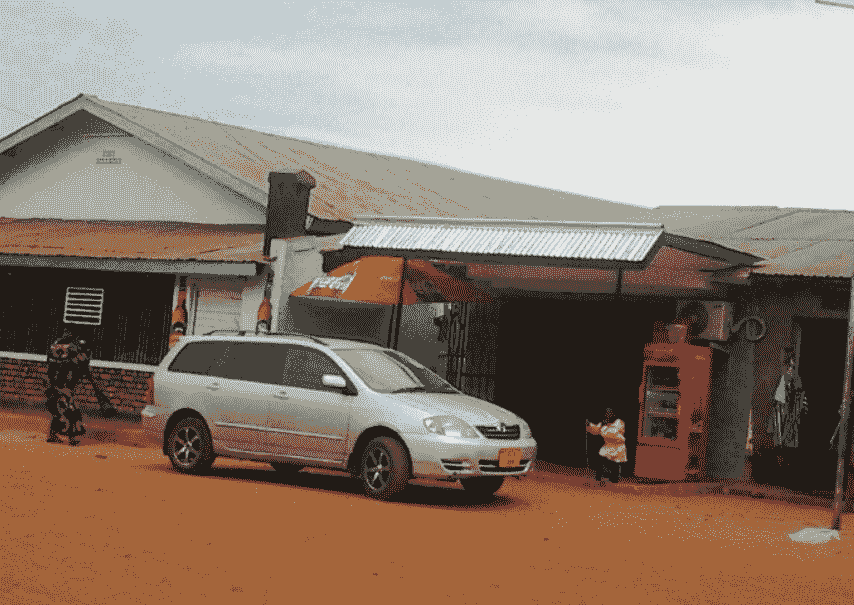
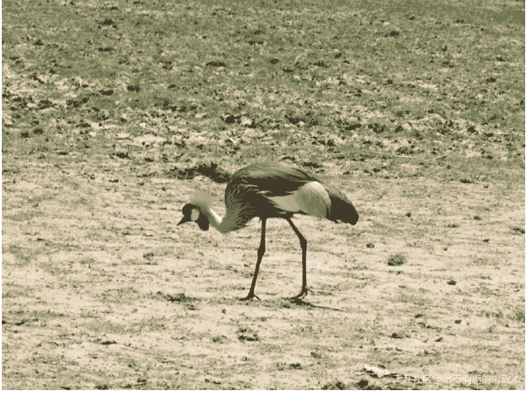

好吃，但是也是多年后，尝到了中国味道。

乌米来说，她的女儿在首都都多多上学，以后也希望考虑到中国留学生。还说，她只要见到女儿，都会教中文。她女儿一直会说“你好”，“谢谢”，“加油”什么的。

我给了他一张张我的名片，叮嘱她，如果她女儿来中国学习，一定告诉我；如果她有机会来中国，也一定告诉我。看了一眼乌米，觉得虽然她的面部有些僵硬，但是仍然能够感受到她的笑容。

## 七、杜鲁鲁的羽毛球场

姆维嘉特再回来接我们的时候，一眼就看到军营后面小山上的场站，能够感觉到他的惊讶。我告诉他，其实都是非洲人民解放的杰作。

不要认为只有在中国才能见到中国速度，其实只要方法得对当设计合理并且有愚公移山的精神，实现中国奇迹不是难的。我们卖的不只是产品，更是神和文化。

马上就要开始了，场站调试完成后以后，恩加拉军营也要去配合警察，维持治安。老坦这边，只要一选举，就容易乱子。

司徒一听到要选举了，心里也是蹦蹦直跳，放不下那艘船。归心似箭的回到三兰港，一确认，几货船都发了，这才松口气。回国的一路，睡得那叫一个瓷实。

已经半年多年没回家了，我们家的习惯，出来的出来的是面条。结婚的时候，我爸爸曾经跟我太太说过，你出饺子回面，于是她就记住了。其实老话说得也有道理，进家门是最高的，打卤面又简单方便，又省事美味。

跟同志们研究了一下海事雷达，也探讨了骑士团的试验，这方面有很大的文章可做了。晚上，又联系了一下张主任，让他讲了联合作战指挥系统的升级思路。

张主任轻轻的讲了几句，可是醋里灌骚。这个时候张主任已经退休几年了，车间的事情很少管了，主要是工厂成立了一个督导组，经常去各车间检查质量改善和技术创新。督导组里都是几位德高望重、技能过人的老，也算是发挥余热。张主任也喜欢做那个，压力那么大，而且可以充分利用自己的经验。所他说，直到过了退休年龄，才找到适合自己的岗位。

于是就问他车间是谁负责的，张主任说，大部分交给小王。这小子，终于没冒了。

思路决定出路，海事雷达的想法出来了，广州办法马上研究出了几种方案，当然还有各种语言版本。

广州地方，最不缺的就是信息和人才。因此，海事达的推广工作进展很顺利。工厂那边也高涨，这是一种全新的业务模式。用厂的话来说，我们做的，跟苹果的业务模式差不多，都是主抓设计和市场，然后制造外包。这样，既发挥了工厂技术上的优势，又发挥了广东当地的商业、制造业和物流优势，同时也降低了成本，为扩大市场份额，为开发的军民两用的拳头产品铺了道路。

我正在自陶醉，就接到姜处处的电话，又是去非洲，又是带着司徒。

司徒提前两天过来，带来了小王糟给我的特产，还带着我带他吃了两天的砂锅。我也顺便带他认识一下广州战区的几位学长和领导，让他长长见识。

司徒说，回去之后，他就跟姜处交了“圣母洞”事件，没想到姜处并没有怎么批评他，还跟他说，就算姜处自己也玩过火，曾经抱过一个非洲人头盖背，差点几被人人家部落的人追杀。

晕，姜处以前怎么跟我说过这个事呀？领导不想打击年轻人，黑脸都是我做师傅的来打……

从广州起飞的航班深夜出发，路上碰到的都是大块头。之前我们去的都是中东非洲的国家，真的没见过这么多壮的。大包包小的，顾有改革开发之初，中国倒爷的风采。20多个小时以后，终于来到尼日利亚的海城城市拉各。

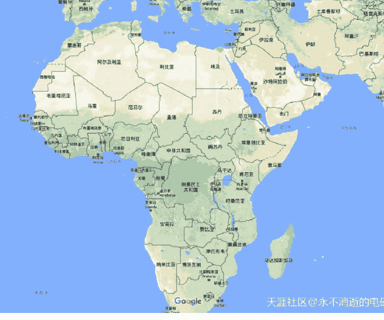

尼日利亚是非洲人口最多的国家，也是世界上以黑人为主的人口的国家，达到了1亿7000万。显然，它现在是非洲经济最发达的国家。

尼日利亚也是人类最早居住的地区，考古证据显示，这里的人类历史至少有9000年以上。尼日利亚曾一度度辉煌，由当时的桑海帝国统治，包含了现在的尼日利亚、尼日尔、乍得和喀麦隆。

后来尼日利亚地区被葡萄牙、荷兰、法国、英国轮番审视，成为黑奴聚集地。英国在海边建立了奴隶港城市拉各斯，方便向美洲运送奴隶，一战之后，尼日利亚沦为英国保护国。

1960 年，尼日利亚宣布独立。其境内北部地区有大型油田，而经济迅速发展。尼日利亚可以大致分为北部地区和南部地区，北部大都信仰伊斯兰教，南部大都信仰基督教。

尼日利亚是联邦共和国成员，官方语言是英语，但是其境内，许多居民讲的是豪萨语。前面说过，豪萨语与斯潘希语和阿拉伯语称为非洲三大语言，也是豪萨语，以及豪萨人主要分布在西非海岸。

尼日利亚独立以后，内乱不断，尤其是发现了石油以后，更是狼狈。国内一直一直是军夺政。直到1998 年，军政府首脑阿巴查猝死，接任的副总统才执政。尼日利亚不仅还了债，后来超过了南非，成为非洲第一经济体。尼日利亚的石油储量居世界第一，主要供给美国和法国，但是最近几年涉及到其海上油田，未来可能会更多的机会。我们要去的地方叫做豪鲁，在尼日利亚东北。扎日利亚是一座古城，建于公元8世纪以前，曾经是扎鲁王国。12世纪末开始兴盛，成为尼日利亚的经济中心，后来扎鲁王国成为桑海帝国的附属。1901年，扎日利亚被英国占领，成为殖民地，直到尼日利亚独立。

（注：此处原文包含插图标记 824297dbc8ea48d66081cc_188_0等，内容描述如下）
- 图1 某地区干旱的地区
- 图2 某地区水源充足的地区

华人在尼日利亚很早就就开始经营，在扎日利亚当地有一些啤酒厂，最大一间创始人是一位香港移民，叫做文伯，到现在已经是第三代在经营了。工厂雇了很多本地人，在当地也有很有影响力。

在尼日利亚很容易找到中国制造，大概观察了一下，摩托车很多都是中国品牌，有力的帆的，有豪爵的。在尼日利亚也有很大的业务，居然还看到了vivo还是 OPPO 的店，感觉真的很亲切！尼日利亚对中国人的印象也运行。也不是观察，而是还有很多粗制滥的产品流入尼日利亚，不知道以后会对双方经贸关系产生影响。

尼日利亚的国土面积太大，其空军曾经是毛子装备天下。后来转向咱们，从2006年左右，从咱们儿购买了一定数量的临近退役的二手战斗。据说尼日利亚想买龙轰，但是咱们没松扣。

到了近几年，尼日利亚逐渐开放了石油产品的结算，于是，咱们也在此帮助尼日利亚升级迭代，也卖了一些更新的型号。尼日利亚空军的战斗任务，大部分是对付反武装的，这一次，尼日利亚买了几部战斗，用来警戒北方的博格圣地和南方的比亚法拉，以及他们与国外的购买比较昂贵。

殖民者统治尼日利亚之前，尼日利亚北部经济较发达。但殖民者建立奴隶基地拉斯之后，尼日利亚的经济基本开始依赖于大量的奴隶贸易。北方的劳动力大量流失，经济开始停滞，财富慢慢集中在西南沿海地区。

上世纪末，北部地区发现油田以后，殖民者在拉各斯等地建设港口，将北部的石油运往南部加工和销售。于是，北部地区和东地区依旧贫穷，而南部沿海的港口地区则更加富裕。这种状况，一直到现在。

博格圣地是忠于伊斯兰的武装力量，纪律严，政府军一直打，但是谁也没占到便宜。比亚法拉是基督教分离势力，他们的传统与新教还不太一样。

政府军的主要力量，目前清缴的就是比亚法拉武装。尼日利亚石油资源丰富，海上油田位于东北。鲁鲁位于尼日利亚北部。

尼日利亚发展不平衡。南部地区由于几百年的殖民活动，其基础、交通、港口、教育、医疗等基础设施相对完善，而北部地区发展落后。

尼日利亚独立以后，北部地区的资源并未获得，这就滋生了许多人的不满。由于国家动荡，秩序比较混乱。

杜鲁鲁天气干燥，聚在树荫底下就会舒服一些。每天都礼拜时间，远处清真寺响起来悠扬的歌，士兵里面的穆斯林就去礼拜了。我和剩下的基督徒下去院子里面的树下阴凉，歇一会儿。

这里的景象让我想起来曾经的伊拉克，相似的气候，相似的场景。这时候，没有人会想到，战争其实就在不远的地方。于是就问纳纳，博格圣地为什么要打？纳纳一声呼吸，说到尼日利亚的问题。大陆上的油田都是北方，海上的油田都是东南，但是经济方面西南地区，也就是拉格斯那边更发达。

拉格斯不仅港口物流发达，金融也比较发达。曾经南是非哥，但是种族隔离结束后，很多人回到欧洲，南非金融的实力被大大削弱。而拉格斯的金融依靠的是本土的力量，加上石油业的兴起，使得所在的西南地区更加发达，与其他地区的差距越来越大。

位于产油区的北部和南部都没有得到太多好处，有些地方甚至连温饱都没解决。采油活动带来环境污染，使得很多人失去了土地。

尼日利亚一直重视这个问题，甚至将首都迁到了中部。纳纳介绍，尼日利亚能够找到羽毛球，但是当地流行的还是足球。纳普说，中国的羽毛球真的很厉害。在国外，尼日利亚羽毛球水平在非洲也还是不错的。

一听这个，我又兴起来了。在广州，也有年轻的同事经常组织羽毛球，我愁数大了，也能打一两场。纳普我看感兴趣，就告诉我说，其实杜鲁姆站的机库旁边，就有一个场所。这个消息我很奇，暂记录了，就去张罗设计相关的事情。两天以后，司徒回来了。东西已经运到扎日利亚，马上就可以来鲁鲁站。二代雷达是固定的设计，好处就是有一个基础，就很方便安装，不用怎么修改原始设计。

升级的线路板是免费的，因为它简单，只能实现基本功能。每次看到亨七起来，在雷达屏幕上面绕了一圈，然后再回去。如果只是这样，那雷达还只是雷达，不是真正意义的战场指挥系统。晚上，跟负责商量了一下，让司徒来牵头，联络一下中航的兄弟们。其实家里曾经有一种吊舱，后来配给骆驼了。那个吊舱倒是适合尼日利亚的亨七，也能够与合作指挥系统双向通信。问题是现在国内产生这个，如果找巴铁去，不知道要等到什么时候。俗话说，联系七个人可能就能找到美国总统。这也是司徒的好机会，小子打了一个晚上的电话，终于在国内的一个机场站，找到了一个吊舱试验品。但是从国内调一个吊舱过来，就算不成本，没有一个月也搞不定。又是联系更多人，连巴铁都惊讶了。第二天，终于在第二解放区，就是埃克斯，找到了一套测试用的吊舱组件。在非洲，相对容易一些，就靠纳普通军事队高层联系，然后通过专用通道走到尼日利亚。这一番折腾，三四天过去了，司徒每天电话不离手，也没想着打球的事情。

（注：此处存在重复描述的纳纳、司徒的等）

（后面部分文本重复，合并后逻辑如下）
纳普我看感兴趣，就告诉我说，其实杜鲁姆站的机库旁边，就有一个场所。这个消息我很奇，暂时的记录了，就去张罗设计相关的事情。两天以后，司徒回来了。东西已经运到扎日利亚，马上就可以来鲁鲁站。二代雷达是固定的设计，好处就是有一个基础，就很方便安装，不用怎么修改原始设计。

从我的角度出发，既然来了，肯定还是测试一下合作作战指挥系统。房子是现成的，虽然有些大，但不妨安装。经过加洛的摸滚打，况且这边只一代，感觉司徒已经不需要再深入了技术方面。就让他回去扎日利亚，把自己的业务理顺了，我一个人带着纳普和他的士兵们身上忙碌，也是锻炼一下身体。

纳普那边因为刚刚开始训练，有些忙，我们得找到点事情做。每天晚饭之后，都来跟司徒打拍子，心里也痒，也想运动，就请纳普带我们去了那个羽毛球场。说是球场，其实就是两个架子，网早烂了，只剩下下面的绳子。球拍倒还是旧的。

阴差阳错，我们正忙着吊舱的事情。等到这一阵忙碌过去，我们才回来。小子叫傲欧麦尔，年轻轻轻的还是当地一个部的酋长。他很开朗，我自我介绍了一下。但是我们却有些犹豫，因为第二天要测试那个吊舱，以我的性格，大概也就是一周，雷达安装完毕，然后升级也非常顺利。也是看着本地踢球，心里也痒，就请纳普带我们去了那个羽毛球场。

他们尝了一口，觉得一方水土养着一方，还是留给他自己喝吧。一起吃羊肉，一起吃水果，我们喝酒溜，他喝果汁。

脑海中想起二征绍乔士里，还有在塔尔沙沙漠激战阿三的英雄事迹……

欧莱尔说，尼日利亚有两百多个民族，就算信仰大致相同，但是习惯并不尽相同。不是伊斯兰教后就是基督教，当地的部落都掺杂了许多自己的传统进去，然后大家都不服。而且是同一个信仰的不同民族，打得也越越激烈，这就是为什么对付博格圣地的是穆斯林，对付比亚法拉的主的是基督教。

西南地区经济依赖之前的奴隶贸易基础发展起来，但是其它地区的经济和基础设施还是比较落后的。虽然尼日利亚的 GDP是非洲第一，但是由于人口很多，所以人均 GDP 就就低了，应该算是一个穷国。其实大家都不想要战争，是因为分配不均容易产生矛盾。孔子曰：不患贫而患不均。

欧麦尔的家族曾经很风华，甚至拥有几只骆驼。要知道，以前在尼日利亚亚，拥有一匹骆驼就能称为富人了。现在的他的家族也在做运输方面的生意，有几支卡车的车队，还有大客车。

他有一个哥是留学英国，后来又留了英国的，所以给他羽毛球。但是但他能陪他打球的人不多，高手就更少。

像我和司徒这种东土大唐回来的选手，虽然在国内打练场场都困难，但是拿一个尼日利亚国内奖牌应该不算太难，这就好比那些尼日利亚的村队过来加咱们的全运会足球……

相对于而言，普及运动以及普及羽毛运动简单一些，就是一块平地，一边一个足球球，可是木头钉的球，也可以是两个球，甚至是两个树枝一下一下，再加上一个足球，就可以给那么多人带来快乐。每天晚上，去看足球的尼日利亚人很多，男女老少，到了时间就会聚在场那里，这已经成为一种习惯。

但是过来来看我们打羽毛球的，除了欧麦尔的队伍，还远远见到别人。说起来在广州，有多少羽毛球都需要预定，天河那边的足球场基本上每天都是满的，但是我们的足球水平确实比羽毛球落后太多了。到底为什么呢？

这两天，白士徒谦修改预警系统的界面，以及焰的参数，晚上就约欧麦尔。欧麦尔非常和，带给我们一些本地的食物和水果。

有一种三角形的小包，里面是土豆鸡的馅儿，然后过去放了油炸，还放了一些香料。记得在巴西铁亚也吃过类似的，不过味道放了咖喱。

他的东西虽然好吃，但是羽毛球的水平确实差些。黑人兄弟身体好，爆发力强，但是技术方面差一点儿，脑子反应也慢。就算司徒没上过场的选手，几个来都会学会吊球，欧麦尔却只是喜欢打。把自己害累了，还被我们识破，就不给他那么多机会。

看着他每次喘着粗气的看着我，很心疼，教了一句汉语；四两拨千的……当然，对欧麦尔而言，读起来太难了，更不用说记住了。

终于在军队高层来之前，把我们可以看到的，能够移动修正改善的问题全部处理好了。然后就交给了纳普，由他去操作和显摆。

前一个傍晚，杜鲁莉姆站的地上居然没有球赛，意外的。后来问才才知道，第二天的傍晚，他们这个村子要跟隔壁的村子打比赛。说是每两个月都要进行的比赛，两边都会拼尽全力，很多年轻就等着这个机会大显身，这是能够被隔壁村子的女孩看来，开启幸福的。

没打球，就跟欧麦尔打了一会儿，也保留一些体力，担心第二天展示的时候需要。坐在军库里面，好奇的欧麦尔，这个名字似乎很常见，没有什么来历。欧麦尔说，这个名字来自哈林，就是征服耶路撒冷的那位，我们还告诉他们了一些关于他的故事。穆斯林的名字很长，先是自己的名字后是父亲的名字，然后可能是祖父的名字，然后是家族的名字。里面可能还包含了它的意义，反正，从一个穆斯林的全名上面，可以了解到他和他的家族。

第二天，军队的高层终于来了，为了首做马萨乃诺，空军上校，长得特像 NBA 明星奥尼尔。估计他偏开了战斗机，至少杀亨七他坐不去。

纳普更是雇飞色色的介绍，原本希望他尽量用英语，这样我们能够听懂，关键时刻能够够他一下。但是激动起来，英语跟豪马萨语衔和着用，听得我们像是云山雾罩的。看来马萨乌尼很高，听一会，看我们再点头，再听一会，看我们再点点头。

大概一个小时以后，测试用的昂舱也下去了，转了一圈，给马萨乌尼开眼，旁边也去了两架，他也挥挥了一下。一切都顺利了，马萨乌尼非常满意，然后就是跟纳普起来来会会。

下午碰着没事，我和司徒就回了驻地。天色早了，我们有一颗好奇的心，司徒在那儿等累了，准备去看看足球。这时欧麦莱过来了，拉着他，我们一起去。

没打球，就跟欧麦尔打了一会儿，也保留一些体力，担心第二天展示的时候需要。坐在军库里面，好奇的欧麦尔，这个名字似乎很常见，没有什么来历。欧麦尔说，这个名字来自哈林，就是征服耶路撒冷的那位，我们还告诉他们了一些关于他的故事。穆斯林的名字很长，先是自己的名字后是父亲的名字，然后可能是祖父的名字，然后是家族的名字。里面可能还包含了它的意义，反正，从一个穆斯林的全名上面，可以了解到他和他的家族。

第二天，军队的高层终于来了，为了首做马萨乃诺，空军上校，长得特像 NBA 明星奥尼尔。估计他偏开了战斗机，至少杀亨七他坐不去。

纳普更是雇飞色色的介绍，原本希望他尽量用英语，这样我们能够听懂，关键时刻能够够他一下。但是激动起来，英语跟豪马萨语衔和着用，听得我们像是云山雾罩的。看来马萨乌尼很高，听一会，看我们再点头，再听一会，看我们再点点头。

大概一个小时以后，测试用的昂舱也下去了，转了一圈，给马萨乌尼开眼，旁边也去了两架，他也挥挥了一下。一切都顺利了，马萨乌尼非常满意，然后就是跟纳普起来来会会。

下午碰着没事，我和司徒就回了驻地。天色早了，我们有一颗好奇的心，司徒在那儿等累了，准备去看看足球。这时欧麦莱过来了，拉着他，我们一起去。

没打球，就跟欧麦尔打了一会儿，也保留一些体力，担心第二天展示的时候需要。坐在军库里面，好奇的欧麦尔，这个名字似乎很常见，没有什么来历。欧麦尔说，这个名字来自哈林，就是征服耶路撒冷的那位，我们还告诉他们了一些关于他的故事。穆斯林的名字很长，先是自己的名字后是父亲的名字，然后可能是祖父的名字，然后是家族的名字。里面可能还包含了它的意义，反正，从一个穆斯林的全名上面，可以了解到他和他的家族。

第二天，军队的高层终于来了，为了首做马萨乃诺，空军上校，长得特像 NBA 明星奥尼尔。估计他偏开了战斗机，至少杀亨七他坐不去。

纳普更是雇飞色色的介绍，原本希望他尽量用英语，这样我们能够听懂，关键时刻能够够他一下。但是激动起来，英语跟豪马萨语衔和着用，听得我们像是云山雾罩的。看来马萨乌尼很高，听一会，看我们再点头，再听一会，看我们再点点头。

大概一个小时以后，测试用的昂舱也下去了，转了一圈，给马萨乌尼开眼，旁边也去了两架，他也挥挥了一下。一切都顺利了，马萨乌尼非常满意，然后就是跟纳普起来来会会。

下午碰着没事，我和司徒就回了驻地。天色早了，我们有一颗好奇的心，司徒在那儿等累了，准备去看看足球。这时欧麦莱过来了，拉着他，我们一起去。

没打球，就跟欧麦尔打了一会儿，也保留一些体力，担心第二天展示的时候需要。坐在军库里面，好奇的欧麦尔，这个名字似乎很常见，没有什么来历。欧麦尔说，这个名字来自哈林，就是征服耶路撒冷的那位，我们还告诉他们了一些关于他的故事。穆斯林的名字很长，先是自己的名字后是父亲的名字，然后可能是祖父的名字，然后是家族的名字。里面可能还包含了它的意义，反正，从一个穆斯林的全名上面，可以了解到他和他的家族。

第二天，军队的高层终于来了，为了首做马萨乃诺，空军上校，长得特像 NBA 明星奥尼尔。估计他偏开了战斗机，至少杀亨七他坐不去。

纳普更是雇飞色色的介绍，原本希望他尽量用英语，这样我们能够听懂，关键时刻能够够他一下。但是激动起来，英语跟豪马萨语衔和着用，听得我们像是云山雾罩的。看来马萨乌尼很高，听一会，看我们再点头，再听一会，看我们再点点头。

大概一个小时以后，测试用的昂舱也下去了，转了一圈，给马萨乌尼开眼，旁边也去了两架，他也挥挥了一下。一切都顺利了，马萨乌尼非常满意，然后就是跟纳普起来来会会。

下午碰着没事，我和司徒就回了驻地。天色早了，我们有一颗好奇的心，司徒在那儿等累了，准备去看看足球。这时欧麦莱过来了，拉着他，我们一起去。

没打球，就跟欧麦尔打了一会儿，也保留一些体力，担心第二天展示的时候需要。坐在军库里面，好奇的欧麦尔，这个名字似乎很常见，没有什么来历。欧麦尔说，这个名字来自哈林，就是征服耶路撒冷的那位，我们还告诉他们了一些关于他的故事。穆斯林的名字很长，先是自己的名字后是父亲的名字，然后可能是祖父的名字，然后是家族的名字。里面可能还包含了它的意义，反正，从一个穆斯林的全名上面，可以了解到他和他的家族。

第二天，军队的高层终于来了，为了首做马萨乃诺，空军上校，长得特像 NBA 明星奥尼尔。估计他偏开了战斗机，至少杀亨七他坐不去。

纳普更是雇飞色色的介绍，原本希望他尽量用英语，这样我们能够听懂，关键时刻能够够他一下。但是激动起来，英语跟豪马萨语衔和着用，听得我们像是云山雾罩的。看来马萨乌尼很高，听一会，看我们再点头，再听一会，看我们再点点头。

大概一个小时以后，测试用的昂舱也下去了，转了一圈，给马萨乌尼开眼，旁边也去了两架，他也挥挥了一下。一切都顺利了，马萨乌尼非常满意，然后就是跟纳普起来来会会。

下午碰着没事，我和司徒就回了驻地。天色早了，我们有一颗好奇的心，司徒在那儿等累了，准备去看看足球。这时欧麦莱过来了，拉着他，我们一起去。

没打球，就跟欧麦尔打了一会儿，也保留一些体力，担心第二天展示的时候需要。坐在军库里面，好奇的欧麦尔，这个名字似乎很常见，没有什么来历。欧麦尔说，这个名字来自哈林，就是征服耶路撒冷的那位，我们还告诉他们一些关于他的故事。穆斯林的名字很长，先是自己的名字后是父亲的名字，然后可能是祖父的名字，然后是家族的名字。里面可能还包含了它的意义，反正，从一个穆斯林的全名上面，可以了解到他和他的家族。

第二天，军队的高层终于来了，为了首做马萨乃诺，空军上校，长得特像 NBA 明星奥尼尔。估计他偏开了战斗机，至少杀亨七他坐不去。

纳普更是雇飞色色的介绍，原本希望他尽量用英语，这样我们能够听懂，关键时刻能够够他一下。但是激动起来，英语跟豪马萨语衔和着用，听得我们像是云山雾罩的。看来马萨乌尼很高，听一会，看我们再点头，再听一会，看我们再点点头。

大概一个小时以后，测试用的昂舱也下去了，转了一圈，给马萨乌尼开眼，旁边也去了两架，他也挥挥了一下。一切都顺利了，马萨乌尼非常满意，然后就是跟纳普起来来会会。

下午碰着没事，我和司徒就回了驻地。天色早了，我们有一颗好奇的心，司徒在那儿等累了，准备去看看足球。这时欧麦莱过来了，拉着他，我们一起去。

没打球，就跟欧麦尔打了一会儿，也保留一些体力，担心第二天展示的时候需要。坐在军库里面，好奇的欧麦尔，这个名字似乎很常见，没有什么来历。欧麦尔说，这个名字来自哈林，就是征服耶路撒冷的那位，我们还告诉他们一些关于他的故事。穆斯林的名字很长，先是自己的名字后是父亲的名字，然后可能是祖父的名字，然后是家族的名字。里面可能还包含了它的意义，反正，从一个穆斯林的全名上面，可以了解到他和他的家族。

第二天，军队的高层终于来了，为了首做马萨乃诺，空军上校，长得特像 NBA 明星奥尼尔。估计他偏开了战斗机，至少杀亨七他坐不去。

纳普更是雇飞色色的介绍，原本希望他尽量用英语，这样我们能够听懂，关键时刻能够够他一下。但是激动起来，英语跟豪马萨语衔和着用，听得我们像是云山雾罩的。看来马萨乌尼很高，听一会，看我们再点头，再听一会，看我们再点点头。

大概一个小时以后，测试用的昂舱也下去了，转了一圈，给马萨乌尼开眼，旁边也去了两架，他也挥挥了一下。一切都顺利了，马萨乌尼非常满意，然后就是跟纳普起来来会会。

下午碰着没事，我和司徒就回了驻地。天色早了，我们有一颗好奇的心，司徒在那儿等累了，准备去看看足球。这时欧麦莱过来了，拉着他，我们一起去。

没打球，就跟欧麦尔打了一会儿，也保留一些体力，担心第二天展示的时候需要。坐在军库里面，好奇的欧麦尔，这个名字似乎很常见，没有什么来历。欧麦尔说，这个名字来自哈林，就是征服耶路撒冷的那位，我们还告诉他们一些关于他的故事。穆斯林的名字很长，先是自己的名字后是父亲的名字，然后可能是祖父的名字，然后是家族的名字。里面可能还包含了它的意义，反正，从一个穆斯林的全名上面，可以了解到他和他的家族。

第二天，军队的高层终于来了，为了首做马萨乃诺，空军上校，长得特像 NBA 明星奥尼尔。估计他偏开了战斗机，至少杀亨七他坐不去。

纳普更是雇飞色色的介绍，原本希望他尽量用英语，这样我们能够听懂，关键时刻能够够他一下。但是激动起来，英语跟豪马萨语衔和着用，听得我们像是云山雾罩的。看来马萨乌尼很高，听一会，看我们再点头，再听一会，看我们再点点头。

大概一个小时以后，测试用的昂舱也下去了，转了一圈，给马萨乌尼开眼，旁边也去了两架，他也挥挥了一下。一切都顺利了，马萨乌尼非常满意，然后就是跟纳普起来来会会。

下午碰着没事，我和司徒就回了驻地。天色早了，我们有一颗好奇的心，司徒在那儿等累了，准备去看看足球。这时欧麦莱过来了，拉着他，我们一起去。

没打球，就跟欧麦尔打了一会儿，也保留一些体力，担心第二天展示的时候需要。坐在军库里面，好奇的欧麦尔，这个名字似乎很常见，没有什么来历。欧麦尔说，这个名字来自哈林，就是征服耶路撒冷的那位，我们还告诉他们一些关于他的故事。穆斯林的名字很长，先是自己的名字后是父亲的名字，然后可能是祖父的名字，然后是家族的名字。里面可能还包含了它的意义，反正，从一个穆斯林的全名上面，可以了解到他和他的家族。

第二天，军队的高层终于来了，为了首做马萨乃诺，空军上校，长得特像 NBA 明星奥尼尔。估计他偏开了战斗机，至少杀亨七他坐不去。

纳普更是雇飞色色的介绍，原本希望他尽量用英语，这样我们能够听懂，关键时刻能够够他一下。但是激动起来，英语跟豪马萨语衔和着用，听得我们像是云山雾罩的。看来马萨乌尼很高，听一会，看我们再点头，再听一会，看我们再点点头。

大概一个小时以后，测试用的昂舱也下去了，转了一圈，给马萨乌尼开眼，旁边也去了两架，他也挥挥了一下。一切都顺利了，马萨乌尼非常满意，然后就是跟纳普起来来会会。

下午碰着没事，我和司徒就回了驻地。天色早了，我们有一颗好奇的心，司徒在那儿等累了，准备去看看足球。这时欧麦莱过来了，拉着他，我们一起去。

没打球，就跟欧麦尔打了一会儿，也保留一些体力，担心第二天展示的时候需要。坐在军库里面，好奇的欧麦尔，这个名字似乎很常见，没有什么来历。欧麦尔说，这个名字来自哈林，就是征服耶路撒冷的那位，我们还告诉他们一些关于他的故事。穆斯林的名字很长，先是自己的名字后是父亲的名字，然后可能是祖父的名字，然后是家族的名字。里面可能还包含了它的意义，反正，从一个穆斯林的全名上面，可以了解到他和他的家族。

第二天，军队的高层终于来了，为了首做马萨乃诺，空军上校，长得特像 NBA 明星奥尼尔。估计他偏开了战斗机，至少杀亨七他坐不去。

纳普更是雇飞色色的介绍，原本希望他尽量用英语，这样我们能够听懂，关键时刻能够够他一下。但是激动起来，英语跟豪马萨语衔和着用，听得我们像是云山雾罩的。看来马萨乌尼很高，听一会，看我们再点头，再听一会，看我们再点点头。

大概一个小时以后，测试用的昂舱也下去了，转了一圈，给马萨乌尼开眼，旁边也去了两架，他也挥挥了一下。一切都顺利了，马萨乌尼非常满意，然后就是跟纳普起来来会会。

下午碰着没事，我和司徒就回了驻地。天色早了，我们有一颗好奇的心，司徒在那儿等累了，准备去看看足球。这时欧麦莱过来了，拉着他，我们一起去。

没打球，就跟欧麦尔打了一会儿，也保留一些体力，担心第二天展示的时候需要。坐在军库里面，好奇的欧麦尔，这个名字似乎很常见，没有什么来历。欧麦尔说，这个名字来自哈林，就是征服耶路撒冷的那位，我们还告诉他们一些关于他的故事。穆斯林的名字很长，先是自己的名字后是父亲的名字，然后可能是祖父的名字，然后是家族的名字。里面可能还包含了它的意义，反正，从一个穆斯林的全名上面，可以了解到他和他的家族。

第二天，军队的高层终于来了，为了首做马萨乃诺，空军上校，长得特像 NBA 明星奥尼尔。估计他偏开了战斗机，至少杀亨七他坐不去。

纳普更是雇飞色色的介绍，原本希望他尽量用英语，这样我们能够听懂，关键时刻能够够他一下。但是激动起来，英语跟豪马萨语衔和着用，听得我们像是云山雾罩的。看来马萨乌尼很高，听一会，看我们再点头，再听一会，看我们再点点头。

大概一个小时以后，测试用的昂舱也下去了，转了一圈，给马萨乌尼开眼，旁边也去了两架，他也挥挥了一下。一切都顺利了，马萨乌尼非常满意，然后就是跟纳普起来来会会。

下午碰着没事，我和司徒就回了驻地。天色早了，我们有一颗好奇的心，司徒在那儿等累了，准备去看看足球。这时欧麦莱过来了，拉着他，我们一起去。

没打球，就跟欧麦尔打了一会儿，也保留一些体力，担心第二天展示的时候需要。坐在军库里面，好奇的欧麦尔，这个名字似乎很常见，没有什么来历。欧麦尔说，这个名字来自哈林，就是征服耶路撒冷的那位，我们还告诉他们一些关于他的故事。穆斯林的名字很长，先是自己的名字后是父亲的名字，然后可能是祖父的名字，然后是家族的名字。里面可能还包含了它的意义，反正，从一个穆斯林的全名上面，可以了解到他和他的家族。

第二天，军队的高层终于来了，为了首做马萨乃诺，空军上校，长得特像 NBA 明星奥尼尔。估计他偏开了战斗机，至少杀亨七他坐不去。

纳普更是雇飞色色的介绍，原本希望他尽量用英语，这样我们能够听懂，关键时刻能够够他一下。但是激动起来，英语跟豪马萨语衔和着用，听得我们像是云山雾罩的。看来马萨乌尼很高，听一会，看我们再点头，再听一会，看我们再点点头。

大概一个小时以后，测试用的昂舱也下去了，转了一圈，给马萨乌尼开眼，旁边也去了两架，他也挥挥了一下。一切都顺利了，马萨乌尼非常满意，然后就是跟纳普起来来会会。

下午碰着没事，我和司徒就回了驻地。天色早了，我们有一颗好奇的心，司徒在那儿等累了，准备去看看足球。这时欧麦莱过来了，拉着他，我们一起去。

没打球，就跟欧麦尔打了一会儿，也保留一些体力，担心第二天展示的时候需要。坐在军库里面，好奇的欧麦尔，这个名字似乎很常见，没有什么来历。欧麦尔说，这个名字来自哈林，就是征服耶路撒冷的那位，我们还告诉他们一些关于他的故事。穆斯林的名字很长，先是自己的名字后是父亲的名字，然后可能是祖父的名字，然后是家族的名字。里面可能还包含了它的意义，反正，从一个穆斯林的全名上面，可以了解到他和他的家族。

第二天，军队的高层终于来了，为了首做马萨乃诺，空军上校，长得特像 NBA 明星奥尼尔。估计他偏开了战斗机，至少杀亨七他坐不去。

纳普更是雇飞色色的介绍，原本希望他尽量用英语，这样我们能够听懂，关键时刻能够够他一下。但是激动起来，英语跟豪马萨语衔和着用，听得我们像是云山雾罩的。看来马萨乌尼很高，听一会，看我们再点头，再听一会，看我们再点点头。

大概一个小时以后，测试用的昂舱也下去了，转了一圈，给马萨乌尼开眼，旁边也去了两架，他也挥挥了一下。一切都顺利了，马萨乌尼非常满意，然后就是跟纳普起来来会会。

下午碰着没事，我和司徒就回了驻地。天色早了，我们有一颗好奇的心，司徒在那儿等累了，准备去看看足球。这时欧麦莱过来了，拉着他，我们一起去。

没打球，就跟欧麦尔打了一会儿，也保留一些体力，担心第二天展示的时候需要。坐在军库里面，好奇的欧麦尔，这个名字似乎很常见，没有什么来历。欧麦尔说，这个名字来自哈林，就是征服耶路撒冷的那位，我们还告诉他们一些关于他的故事。穆斯林的名字很长，先是自己的名字后是父亲的名字，然后可能是祖父的名字，然后是家族的名字。里面可能还包含了它的意义，反正，从一个穆斯林的全名上面，可以了解到他和他的家族。

第二天，军队的高层终于来了，为了首做马萨乃诺，空军上校，长得特像 NBA 明星奥尼尔。估计他偏开了战斗机，至少杀亨七他坐不去。

纳普更是雇飞色色的介绍，原本希望他尽量用英语，这样我们能够听懂，关键时刻能够够他一下。但是激动起来，英语跟豪马萨语衔和着用，听得我们像是云山雾罩的。看来马萨乌尼很高，听一会，看我们再点头，再听一会，看我们再点点头。

大概一个小时以后，测试用的昂舱也下去了，转了一圈，给马萨乌尼开眼，旁边也去了两架，他也挥挥了一下。一切都顺利了，马萨乌尼非常满意，然后就是跟纳普起来来会会。

下午碰着没事，我和司徒就回了驻地。天色早了，我们有一颗好奇的心，司徒在那儿等累了，准备去看看足球。这时欧麦莱过来了，拉着他，我们一起去。

没打球，就跟欧麦尔打了一会儿，也保留一些体力，担心第二天展示的时候需要。坐在军库里面，好奇的欧麦尔，这个名字似乎很常见，没有什么来历。欧麦尔说，这个名字来自哈林，就是征服耶路撒冷的那位，我们还告诉他们一些关于他的故事。穆斯林的名字很长，先是自己的名字后是父亲的名字，然后可能是祖父的名字，然后是家族的名字。里面可能还包含了它的意义，反正，从一个穆斯林的全名上面，可以了解到他和他的家族。

第二天，军队的高层终于来了，为了首做马萨乃诺，空军上校，长得特像 NBA 明星奥尼尔。估计他偏开了战斗机，至少杀亨七他坐不去。

纳普更是雇飞色色的介绍，原本希望他尽量用英语，这样我们能够听懂，关键时刻能够够他一下。但是激动起来，英语跟豪马萨语衔和着用，听得我们像是云山雾罩的。看来马萨乌尼很高，听一会，看我们再点头，再听一会，看我们再点点头。

大概一个小时以后，测试用的昂舱也下去了，转了一圈，给马萨乌尼开眼，旁边也去了两架，他也挥挥了一下。一切都顺利了，马萨乌尼非常满意，然后就是跟纳普起来来会会。

下午碰着没事，我和司徒就回了驻地。天色早了，我们有一颗好奇的心，司徒在那儿等累了，准备去看看足球。这时欧麦莱过来了，拉着他，我们一起去。

没打球，就跟欧麦尔打了一会儿，也保留一些体力，担心第二天展示的时候需要。坐在军库里面，好奇的欧麦尔，这个名字似乎很常见，没有什么来历。欧麦尔说，这个名字来自哈林，就是征服耶路撒冷的那位，我们还告诉他们一些关于他的故事。穆斯林的名字很长，先是自己的名字后是父亲的名字，然后可能是祖父的名字，然后是家族的名字。里面可能还包含了它的意义，反正，从一个穆斯林的全名上面，可以了解到他和他的家族。

第二天，军队的高层终于来了，为了首做马萨乃诺，空军上校，长得特像 NBA 明星奥尼尔。估计他偏开了战斗机，至少杀亨七他坐不去。

纳普更是雇飞色色的介绍，原本希望他尽量用英语，这样我们能够听懂，关键时刻能够够他一下。但是激动起来，英语跟豪马萨语衔和着用，听得我们像是云山雾罩的。看来马萨乌尼很高，听一会，看我们再点头，再听一会，看我们再点点头。

大概一个小时以后，测试用的昂舱也下去了，转一圈，给马萨乌尼开眼，旁边也去了两架，他也挥挥了一下。一切都顺利了，马萨乌尼非常满意，然后就是跟纳普起来来会会。

下午碰着没事，我和司徒就回了驻地。天色早了，我们有一颗好奇的心，司徒在那儿等累了，准备去看看足球。这时欧麦莱过来了，拉着他，我们一起去。

没打球，就跟欧麦尔打了一会儿，也保留一些体力，担心第二天展示的时候需要。坐在军库里面，好奇的欧麦尔，这个名字似乎很常见，没有什么来历。欧麦尔说，这个名字来自哈林，就是征服耶路撒冷的那位，我们还告诉他们一些关于他的故事。穆斯林的名字很长，先是自己的名字后是父亲的名字，然后可能是祖父的名字，然后是家族的名字。里面可能还包含了它的意义，反正，从一个穆斯林的全名上面，可以了解到他和他的家族。

第二天，军队的高层终于来了，为了首做马萨乃诺，空军上校，长得特像 NBA 明星奥尼尔。估计他偏开了战斗机，至少杀亨七他坐不去。

纳普更是雇飞色色的介绍，原本希望他尽量用英语，这样我们能够听懂，关键时刻能够够他一下。但是激动起来，英语跟豪马萨语衔和着用，听得我们像是云山雾罩的。看来马萨乌尼很高，听一会，看我们再点头，再听一会，看我们再点点头。

大概一个小时以后，测试用的昂舱也下去了，转了一圈，给马萨乌尼开眼，旁边也去了两架，他也挥挥了一下。一切都顺利了，马萨乌尼非常满意，然后就是跟纳普起来来会会。

下午碰着没事，我和司徒就回了驻地。天色早了，我们有一颗好奇的心，司徒在那儿等累了，准备去看看足球。这时欧麦莱过来了，拉着他，我们一起去。

没打球，就跟欧麦尔打了一会儿，也保留一些体力，担心第二天展示的时候需要。坐在军库里面，好奇的欧麦尔，这个名字似乎很常见，没有什么来历。欧麦尔说，这个名字来自哈林，就是征服耶路撒冷的那位，我们还告诉他们一些关于他的故事。穆斯林的名字很长，先是自己的名字后是父亲的名字，然后可能是祖父的名字，然后是家族的名字。里面可能还包含了它的意义，反正，从一个穆斯林的全名上面，可以了解到他和他的家族。

第二天，军队的高层终于来了，为了首做马萨乃诺，空军上校，长得特像 NBA 明星奥尼尔。估计他偏开了战斗机，至少杀亨七他坐不去。

纳普更是雇飞色色的介绍，原本希望他尽量用英语，这样我们能够听懂，关键时刻能够够他一下。但是激动起来，英语跟豪马萨语衔和着用，听得我们像是云山雾罩的。看来马萨乌尼很高，听一会，看我们再点头，再听一会，看我们再点点头。

大概一个小时以后，测试用的昂舱也下去了，转了一圈，给马萨乌尼开眼，旁边也去了两架，他也挥挥了一下。一切都顺利了，马萨乌尼非常满意，然后就是跟纳普起来来会会。

下午碰着没事，我和司徒就回了驻地。天色早了，我们有一颗好奇的心，司徒在那儿等累了，准备去看看足球。这时欧麦莱过来了，拉着他，我们一起去。

没打球，就跟欧麦尔打了一会儿，也保留一些体力，担心第二天展示的时候需要。坐在军库里面，好奇的欧麦尔，这个名字似乎很常见，没有什么来历。欧麦尔说，这个名字来自哈林，就是征服耶路撒冷的那位，我们还告诉他们一些关于他的故事。穆斯林的名字很长，先是自己的名字后是父亲的名字，然后可能是祖父的名字，然后是家族的名字。里面可能还包含了它的意义，反正，从一个穆斯林的全名上面，可以了解到他和他的家族。

第二天，军队的高层终于来了，为了首做马萨乃诺，空军上校，长得特像 NBA 明星奥尼尔。估计他偏开了战斗机，至少杀亨七他坐不去。

纳普更是雇飞色色的介绍，原本希望他尽量用英语，这样我们能够听懂，关键时刻能够够他一下。但是激动起来，英语跟豪马萨语衔和着用，听得我们像是云山雾罩的。看来马萨乌尼很高，听一会，看我们再点头，再听一会，看我们再点点头。

大概一个小时以后，测试用的昂舱也下去了，转了一圈，给马萨乌尼开眼，旁边也去了两架，他也挥挥了一下。一切都顺利了，马萨乌尼非常满意，然后就是跟纳普起来来会会。

下午碰着没事，我和司徒就回了驻地。天色早了，我们有一颗好奇的心，司徒在那儿等累了，准备去看看足球。这时欧麦莱过来了，拉着他，我们一起去。

没打球，就跟欧麦尔打了一会儿，也保留一些体力，担心第二天展示的时候需要。坐在军库里面，好奇的欧麦尔，这个名字似乎很常见，没有什么来历。欧麦尔说，这个名字来自哈林，就是征服耶路撒冷的那位，我们还告诉他们一些关于他的故事。穆斯林的名字很长，先是自己的名字后是父亲的名字，然后可能是祖父的名字，然后是家族的名字。里面可能还包含了它的意义，反正，从一个穆斯林的全名上面，可以了解到他和他的家族。

第二天，军队的高层终于来了，为了首做马萨乃诺，空军上校，长得特像 NBA 明星奥尼尔。估计他偏开了战斗机，至少杀亨七他坐不去。

纳普更是雇飞色色的介绍，原本希望他尽量用英语，这样我们能够听懂，关键时刻能够够他一下。但是激动起来，英语跟豪马萨语衔和着用，听得我们像是云山雾罩的。看来马萨乌尼很高，听一会，看我们再点头，再听一会，看我们再点点头。

大概一个小时以后，测试用的昂舱也下去了，转了一圈，给马萨乌尼开眼，旁边也去了两架，他也挥挥了一下。一切都顺利了，马萨乌尼非常满意，然后就是跟纳普起来来会会。

下午碰着没事，我和司徒就回了驻地。天色早了，我们有一颗好奇的心，司徒在那儿等累了，准备去看看足球。这时欧麦莱过来了，拉着他，我们一起去。

没打球，就跟欧麦尔打了一会儿，也保留一些体力，担心第二天展示的时候需要。坐在军库里面，好奇的欧麦尔，这个名字似乎很常见，没有什么来历。欧麦尔说，这个名字来自哈林，就是征服耶路撒冷的那位，我们还告诉他们一些关于他的故事。穆斯林的名字很长，先是自己的名字后是父亲的名字，然后可能是祖父的名字，然后是家族的名字。里面可能还包含了它的意义，反正，从一个穆斯林的全名上面，可以了解到他和他的家族。

生活。如果你需要，我们可以帮助你们联系中国大使馆，中国国内也一定有企业愿意投资，至少是开发木材资源，大家共同努力赚钱，就如同你们的祖辈一样，这不好吗？

大佬听了，沉思了一下，又跟莱曼嘀哈了几句，两个人就出去了。司徒好奇的问我：“帅哥，你还懂古经啊？”我说：“一个字都都不懂。宗教，传播的内容无非就是爱，怜悯呀，思恳呀，虔诚呀，利成就这些这些东西，然后把简单的道理弄得合俗，再写成经典。”

走过那么多国家，一想一个有着十六亿信徒的宗教，林子那么大，多种类鸟类就不奇怪了。只不跟他们辩论的时候要自信，宁肯骨着死也不能被吓死。反正，他们还没有我懂！

我们俩刚刚刚嘀咕咕的准备时间，突然外边传来脚步声和叫喊声，有人冲进房子，大喊大叫，然后房子里面就乱了。

不一会，就有人拿着刀过来，苏莱曼也过来了，说他们被围了。这个时候，外边有人在，开始的蒙古语听不懂，不过后面的英语听懂了，是让他们缴械降。

我知道政府军过来了，就召唤让大家冷静，司徒留留，我出去跟政府那边谈判，保证他们的的安全。司徒听了，惊了了一下，我拍了拍他的肩膀，他看了看，点点了点头。

当我们举起双手走出房子的时候，正是政府用探照灯照着房子，我向前走到了中间的位置，一位军人过来，把我拉过去。走了之后才再看，路边站着的正是欧麦尔，扎利亚的欧麦尔！就知道他是去报信了，带人过来救了我们喽！但是此时可是寒哨的时候。

我要求跟军行动负责人对话，这时就过来一个，反正我也不认识军衔，只知道是个头儿。我说：“跟我一起的还有一个人，我希望军队以后撤离，留下欧麦尔和我，等等他们一起出来。”他们也没有对我们怎么样，我希望保证证书的安全，同时也不希望他们受到受伤。

那个人压根就不理我，冲着就要招呼人冲进去，毕竟也是一个立功的机会。我是为了城的一个字告诉他：“别乱来。”听了司徒，我不会放了他。如果按照我的做法，回头也有好处好好给他。那人听了，将信疑，这这时候欧麦尔也走了，指着他鼻子说了几句，又做了一个手势。他疑惑看着欧麦尔，又无可可奈的让他的人后退，只留下欧麦尔我和。

大概过了 10 分钟，司徒一个人走了出来。我跑过去抱住他。他说：“那些人已经从后门跑了许久。”这样我放心来，我们上了欧麦尔的车，跟上政府的部队，披着夜色绕着崎的小的路回去。”

司徒显得很安静，直到回到了军营，他才说了一句话：“帅帅，我现在回去就能变成司徒哥了吧？”

后来欧莱说，他的随从发现我们找不见了，于是跑过去告诉他。他一看，我们被人往车上面扔，于是赶紧忙拉着自己的车在后面悄悄的跟着。等到了那个房子，他记下了路，就回去寻找纳普。

纳普近在开邦会上，这一听吓吓坏了，马上报告了马萨马尼亚。马萨马乌尼亚联系了国防部，于是派了军队来救我们。同时，他们也通知了大使馆，大使馆也很着急，刘大刘为此紧急拜会了总总统。

我们一听非常着急，赶紧跟大使馆联系，报报了平安。又在马萨马尼亚面前告诉了那位军方行动负责人的话，告诉纳普，我承诺，一定会好好感谢那一位行动负责人。

惊纳确定，回去休息了一下。过了几天，这边的安装和改造进展顺利，纳普已经接手，可以独立操作和维护。这一套装置虽然简单，但是对于无人机和二代雷达的用户来说，还是解决了相当的问题。最重要的，就是它让指挥人员看到了明天。

这个道理其实跟无人驾驶汽车的道理是一样的：在无人驾驶汽车概念提出来的时候，很多专家都看不好，因为惯性思维让大家觉得，车子自己根本看不见，看看，还谈什么？后来有了微型的雷达和传感器，使得无人驾驶的大脑有了。

外部模样的机会。先解决了看不见的问题。同样的道理，只有通过二代飞机和二代雷达，客户才会逐步升级。否则，你让它从二代机到四代，说它买不起，买不起后勤保障体系，无法承担飞行员、指挥员短期内从二代到四代的跨越。

在此，平稳过渡才是可持续的前提。纳普，当马罗尼亚告诉我们被绑架了，也都坏了。如果我们的安全受到威胁，他也是要吃完兜。军方担心再办算着下一个目的地，安哥拉。跟欧莱尔道别了，心想当时的家里人。这边赶紧办了，大家帮忙，李宁、拍了、几套羽毛球、还有羽毛球，给欧莱尔。

## 历史背景：卡宾达（安哥拉）

### 卡宾达的灯塔
作者：永不逝的电磁波

## 八、阳光洒在阿维什

安哥拉位于大西洋东岸，是一个1975年独立的新兴国家。安哥拉也是人类起源地区，这里曾经发现人类的历史可以溯到十万年前。十五世纪末，葡萄人在探索印度的航线时，发现了刚果口，那是白人第一次到达地区。当时，现在的刚果（金）、刚果（布）跟安哥拉，都是葡萄王国的统治之下。后来葡萄人在安哥拉殖民，并建立了罗安达、本吉拉等城市。

十七世纪，荷兰进攻安哥拉的几个港口，都被葡萄人击败，被荷兰占领的几个港口后来也被葡萄人收复。葡萄牙巩固了安哥拉的统治，并随着发展使之成为重要的殖民地和中转地。由于美洲的发展，安哥拉的主要收入来自贸易，农业甚至工业发展依然滞后。直到1830年禁止奴隶贸易之后，安哥拉的经济发展才正式开始。

葡萄牙一直在安哥拉用心经营，一战期间，德国试图占领安哥拉，但遭遇葡萄人的顽抵抵抗而失败。曾经有人说，安哥拉的葡萄人抵抗得葡萄牙本土还捣毁。1951年，安哥拉成为葡萄的一个海外省，由葡萄牙进行管理。到了上世纪70年代，非洲独立运动后期，安哥拉要求独立，亲苏阵营掌权，成立社会主义国家。

由于亲苏阵营与亲美阵营长期斗争，安哥拉一直内乱不断。苏联解体后，安哥拉放弃社会主义路线，但是仍然内乱不断。直到2002年签订了和平协议。苏丹独立以后，安哥拉成为我们在非洲地区主要的原油供应国，占到原油总量的接近30%。但是，由于地理位置东大西洋，油轮要绕过望角，因此路径比苏丹遥远。

安哥拉原油的油品不错，石油和中海油在当地都有投资。苏联解体后，其亲苏政府开始对华友好政策，甚至包括了一些亲美阵营，也一直在维护我们在安哥拉的利益。

在1885 年的柏林会议上，刚果王国被法国、比利时和葡萄牙瓜分。葡萄牙拼命捍卫了一块地，也就是法属刚果（刚果（布））与比利刚果（刚果（金））之间，位于刚果河口附近的卡达。现在在刚果（金）境内，存在有卡达人成立的政府，寻求从安哥拉独立。

卡达的气候温和，矿产资源非常丰富，本来可以大力开发。但是由于各种说得出来和说不出来的原因，所以一直处于原始阶段。目前，只是卡达附近有一些炼油厂，这也算是有安哥拉的影子。

谈过，安哥拉曾是葡萄的一个海外省。对于安哥拉的经营，很有心思。安哥拉的沿海地区产石油，内陆地区产矿。由于安哥拉多年内乱，边界控制不固。刚果（金）和刚果（布）彼此之间虎视眈眈。

以俗话说，家贼难防，这也是让人最头痛的地方。好在我们的目的地卡达，那块飞地，距离华人聚集的首都罗安达、丹巴、万博和洛比托比较远一些。应该说，卡达是如今留在安哥拉的白人的保留地，其富庶的农业、矿业资源都保留完整。人口少，经济规模小，开发力度，因此其首府卡达镇，以及东南角的炼油厂附近，其它区域的中国人确实不多。

安哥拉的华人大概二十万，比尼日利亚华人还要多。同时，安哥拉的人口却是尼日利亚的十分之一，华人的密度很高。曾经，中铁二十局在这里很有很大的生意，项目完成以后，很多人都离开了。在海外，对中国威胁最大的其实就是我们中国人。曾经有一个片子，说是公安部要向安哥拉政府请求协助安哥拉追捕华人集团团伙。还记得那个片子里面，对中国人采用汽油火烧、断网、割脸等残忍手段，进行频繁聚杀、强迫卖淫等罪行，都是由中国人组成的团伙完成的。

在腿脚不好，但是善于理财，费雷拉的母亲住在卡宾达镇，为阿尔比诺经营一些产业。

费雷拉会说多种语言，英语非常流利，甚至汉语也能讲几句。他自我介绍说，曾经跟中国公司打过交，所以就学了那几句汉语。

前面提到，为了杜绝在安哥拉进行隐蔽的劳务活动，白人业主是不能雇佣黑人劳工的。但是凡事有变通，阿维家族的血缘相对纯正，但是费雷拉的家族就有混血。其中有些颜色深的一些，就开始了一些劳务公司，负责运作阿维什庄园。对这一点，阿尔比诺和费雷拉倒是不忙息，有一一说。

费雷拉首先带着我们在庄园里转了一下，这是因为这个庄园实在太大了，全部走下来怕是时间不足。

从主楼出来，沿着一条小路开了10分钟，就到了庄园农场的中心。那里也有几栋楼，整齐地排在树林旁边，是劳人们平时生活和休息的地方。这几栋楼有新有旧，都是两层的，看着眼熟。

费雷拉介绍说，这里最早是木头房子，后来二十世纪的时候，有几位从中国的劳工，带着大家逛了第一栋楼。说到突然想起来，这看起来就是广东地区常见的骑楼呀，我说怎么看着有点眼熟。费雷拉接着说，后来都觉得这个设计很实用，于是随着庄园的扩大，又新盖了几栋楼，但是都参考了第一栋楼的设计。

庄园很大，单单说马匹就有100多匹，那是因为现在汽车用得多了，所以以马匹少了很多。曾经高峰时，这个庄园供给葡萄军马，当时还养了差不多2000匹。庄园主要的牲畜是牛和马，牛有一万头，鸡有十万只。我的脑海中，瞬间出现了东非本土大陆的影像……

听着费雷拉的介绍，我心里很郁闷，没想到这个农场的规模有这么大。费雷拉其实农场只是一个小角，庄园有几个这样的农场，还有工厂，后面几座大山都是庄园的，还远远没有开发，得我司徒直吐舌头。

费雷拉说，工人面色等人，大家相处也比较接地。本地的黑人有些没有什么文化，早前，很多人愿意在农场里工作，一靠一靠。有人管吃吗，有钱有休息，结婚生子庄园也负责，这样双方都比较满意。我耳朵听着，心里想着这跟我们他们上学时候的奴隶社会怎么那么不一样！

就问了费雷拉这个问题，费雷拉说，说奴隶有很多，但是近代以后，除了奴隶，事务劳作的基本不是奴隶，而是劳工了。他们小时候在庄园出生和长大，成年以后在庄园劳务，老了也实在庄园养老。

安哥拉独立的时候，政府专人调查奴隶制，但是庄园很赶，赶赶不走。其实很多人已经习惯这种节奏了，就算他们出去了，也不一定有条件上更好的生活。这又让我想起来《肖克的救赎》里面那些经典桥段。

费雷拉不断的刷新我对奴隶制和封建的一些看法，但是真正让我震撼的，还是教堂。由于面积太大，庄园里面分散着一些农场，而每个农场都有休息点，或者叫做生活区，每一个生活区都有教堂。

虽然大部分教堂看起来有些简陋，但是都被精心的维护了。木头虽然有些旧了，但是油漆刷得很好。主楼旁边那个教会的后面，是一个墓地，费雷拉说，凡是在阿维庄园逝世的人，都会被埋葬在这里。

说有些人虽然离开了庄园，但是老了以后还会回来，就是为了葬在这一边。也好奇费雷拉，这些教会都是一个教源吗？费雷拉说其实也不是，天主教也有不同的教会，之间也有差别。主要看信仰自己的选择，都是天主教会，但是不同的教会的细节上面会有所不同。但是那个墓地，不管信仰是什么，就算不算信天主教，也可以埋葬在那里。

最后，费雷拉带我们去了庄园附近公路的车辆，这里就比较现代化了，居然有一个电厂。蔬菜和畜奇都在这边进行处理，然后销售到安哥拉和欧洲。

费雷拉说，阿维家族有自己的车队和船队，因此这里的农产品基本上常年处于供供应求的状态。尤其是牛皮，成了欧洲几个奢侈品品牌的指定供应商，银子自然没少赚。

虽然我们只是转了庄园的一小部分，却用了一个下午时间，回去主楼的时候，人们已经准备好饭了。别看阿维家族有那么多地，有那么多牲畜，但是吃的真的很简单。蔬菜沙拉，加上牛排，再配一些烤鸡腿，最后一些甜品和水果。

农庄的食材取自自然，也是烹调技巧确实没办法增加什么胃口。估计在广州的北京路北面那家牛排店如果在阿维什庄园开一个分店，都能吃死这些没见过市面的家伙！

高峰期这里曾经有过100多位阿维家族成员，现在留来的家族成员却并不多，其中有一位阿尔比诺的弟弟，也是身体不好，就在庄园养老。这里阿维家族的年轻人就少了，很多年轻人都去了葡萄牙和欧洲，但是吉贝托选择了留。吉贝托是在卡宾达出生的，出生在里约，由于他的父亲经常往来安哥拉、欧洲和巴西，因此吉贝托从小就是世界来跑去。吉贝托在卡宾达，能够感受到一种自然的雄壮和美丽，也能感受到人之间的善良。

于是他就问吉贝托，当年是怎么想起来参加卡宾达成人礼的。吉贝托的回答令人惊讶：他小时候有一个癖好，就是偷东西。他并非没有钱，但是这种癖好感觉很刺激。后来在巴西的时候，竟然偷了一个州长的手，事后被他发现了，也没有征求他的意见，直接给了他成年礼。当时他也只有三十岁，还有一年的时间在巴西学习了野外生存。

吉贝托由于人类活动影响，已经比以前得多。主要还是精神压力，就是自己。他曾经见到了一具尸体，就是阿维家族的先人在他在树上吊死的，应该不是毒害死的。一个月的丛林生活，让吉贝托飞成熟起来，也有反思一下，让他认识到自己的价值以及家族的荣誉感和使命感。

俗话说浪子回头金，从丛林以后，吉贝托就如同了一个人。他主动留在了卡宾达，并且完成了部分学业。对于以后，吉贝托放弃了留欧洲的机会，而是回到了卡宾达，他说他以后都不会离开这里。

跟阿尔比诺的会面会有些尴尬，但是会议结束后，他就回去了他的书房，接来都是由吉贝尔陪同我们。

这里要说一下，阿尔比诺的书房是极其惊人的：主楼后面有一个花园，花园两侧也是两栋二层楼房，虽然没有主楼那么精致，但是也颇具规模。吉贝尔托说，其中一栋房的二楼，就是阿尔比诺的书房。

阿尔比诺的夫人很喜欢读书，可惜去世较早。夫人去世以后，阿尔比诺就开始全身心地满世界地搜寻书籍，都整理到了他的书房里。本来600多年年来，阿维家族的书籍文献记录就很惊人，再经过阿尔比诺的折腾，规模就更大了。吉贝尔托在葡萄牙地区，这个书房应该算是数一二的。我们又吃了一惊。

我们请吉贝尔托安排两件事，一件是尽快完成基础设施的建设，另一件是帮我们安排书房，我们希望提前验收一下设备。吉贝尔托对我们说，如果我们感觉不方便，就可以搬过来住在阿维什庄园。另外，基础设施建设，他会安排国内的人来做，但是我们要他们给他图纸；对于库房的，他说没问题，让我们随时方便，然后跟费雷拉说一声就可以，庄园的房子。搬回庄园，对我来说求之不得，离着场地近，方便随时跟班；又是庄园生活，如果她不上班，倒是可以在这边陪一段时间。唉，基础设施图纸，还是吉贝尔托订购一年了，按照其他国家的经验，人家早就折腾好了。这个时候怀念下，如果每个国家都有出品，那人类会有美好呀！

第二天，费雷拉就把东西挪来了，其实在卡宾达的庄园确实很舒适，生活上也有照顾，环境也好，空气也好。我们觉得住在庄园，吉贝尔托找人测了一下，没两天就把图纸资料给了我们。基建比较简单，但是地质条件不好，因此也没有施工，算着一周时间差不多了。结果一周过去了，连个动静都没有。我们可是给阿尔比诺调试完，没有得到他满意的回答，我们不会走的。这个时候自己反而紧张了。这一周没事的时候，就经常跟费雷拉聊天，了解一下当地风情。

前面介绍过，卡宾达分布着当年葡萄牙任命的六个家族，他们共同守着这片庄园。如果是因为自然原因或者战火，那葡萄牙人就会移到卡宾达。当年的家族现在仍然在安哥拉，有些家族很大，有些家族颓落，但也不算差。

阿维家族的爵位是世袭。虽然葡萄牙已经建立了共和政，除了王室，跟欧洲老牌国家一样，他们的爵位仍然世袭，而且得到了安哥拉的认可。阿维家族的爵位，但是族长就是卡宾达。二战期间，葡萄牙那边家族受到牵连和清洗，但是卡宾达这边很劲，保证了家族的延续。其实阿维家族在巴西有势力，只是关系不大，就没有重点介绍。欧洲贵族都是联姻，尤其在卡宾达这样一个小地方。阿尔比诺的母亲，也就是吉贝尔托，嫁给了另一个卡宾达领主。那个家族非常悍，一战时期他们率了德国和意大利的胜利，守住了卡宾达。由于联姻圈子小，因此遗传病是避免不了的，阿尔比诺也是一种病。

吉贝尔托每个月都要位于卡宾达和吉布提之间的那个庄园，去看奶奶。这一次他费雷拉拉着司徒一起，我觉得正好让司徒更多地了解一下。他的想法其实很单纯，就是让司徒带一看有没有土建方面的机会。司徒在路上跟吉贝尔托聊了这件事情，以及。我们研究能够尽快把基础设施建设起来，以及怎样能够尽快调试。前面说过，雷达站的基础设施难度不大，只需要劳力，按图施工就行；还有就是需要输电线路，保障供电。也许阿尔比诺刺激了我，他想要高端的设备，又不缺钱，我就想弄一个三代雷达过来给他开眼。雷达的标记，里面有一部相机和几套侦测记录。后来开发了二代雷达，照相机换成了数字式的，增加了电子侦测手段。但是这个设计者面临退休，后来就给淘汰了，因为我们马上发出了三代雷达。三代雷达的视角更大，有利于海测雷达，还有数据采集设备。但是三代雷达从来都没有外销过的，而且军品的运输，对于安哥拉这样远距离的国家，还是有些难度的。叹，这就儿就更怕瓜达尔、吉布提的基地了。我们的路铺到那边，南萨军机就可以从那边进行补给。只是路遥远，费用昂贵，我们这种级别，就算通过途经调度运输，考虑到成本和性价比，这个方案也会被否定的。这个时候，突然有一个主意。于是向司徒问：在安哥拉买东西方便吗？司徒愣了一下，我就跟他解释，是电子产品，方便吗？司徒，安哥拉石油储备丰富，而且交通便利，想买东西只要有钱，都可以搞搞定。这一，我就更放心了。于是通过各种途径，联系了三代雷达的总帅。我的要求很简单，能否在安哥拉本地采购组件，像在杜鲁鲁一样，组装三代雷达。

开始，吉贝尔托有些抵触，认为我们在投诉他。但是司徒坦诚跟他讲，如果基础设施不好，我们这儿也是闲人，一点都没有。吉贝尔托想想也是，但是也没有办法。他跟司徒说，庄园里面的人，都是闲惯了，不是专门做建筑的。每天种菜养牛，盖房子就要大家忙完农活下来。那些人不是奴隶，是劳工。而且有些劳工是有背景的。其实直到现在，都有类似的情况。欧洲那些贵族有些家族成员有着不好的习惯，或者做了违反族规的事。这些情况致命，但是家族又不希望外扬，于是他们选择通过内部宣扬的方式解决问题，而不是把人送到一个无人条件又太差的地方，终其一生。而卡宾达，阿维什庄园就是非常有名而且有效的选择。里面的劳工，有些甚至是法国西班牙德国国王，甚至基辅大公家族的后裔。他们来到庄园，还要给庄园一笔钱。了解了这些，就不奇怪庄园的富翁，以及劳工的快乐了。

司徒跟着吉贝尔托去卡宾达的时候，我就和他研究能够尽快把基础设施建设起来，以及怎样能够尽快调试。前面说过，雷达站的基础设施建设难度不大，只需要劳力，按图施工就行；还有就是需要输电线路，保障供电。

当晚，我的主要任务是研究三代舵的改造。三代跟二代舵的不同，主要集中在双向数据交换和电子侦察能力上面。于是又是拉诺司徒帮忙，又是跟工厂联组组织设计。半夜，给总帅打了电话，再次确认了一下，然后，总结了一，终于在天亮之前准备了一份大致的清单。

我这个人有强迫症，脑子里里面些事情的时候，就睡不着觉。但是司徒还年轻，清单理出来了，他就靠在椅子上面睡着了。早上费雷达叫我们吃早餐的时候，司徒要了一些冰块放在脖子上。

## 九、亮卡宾达

司徒知道当天的重要任务，就是去卡宾达找到两位同胞。这边我已经跟阿尔比承诺下军令状了，他那边不能掉链子的。

吃了早饭，司徒就请费雷达带他去了卡宾达镇。他出去了，我又把清单过了一遍，然后有疑问的，发回去再确认一下。庄园里通常只是两顿饭，阿维家族族其实财大气粗，不过生活上面很简单，没见到什么浪费的。如果没有客人，每天都是两餐：早餐和晚餐。衣着也是一样，虽然平时装比较比较正式和庄重，只是衣服大部分都是旧的。住了这么一段时间时间，也是习惯了这个节奏。

天气太热，湿度也大，中午就在骑楼下面支一个竹床，躺在上面休息。上午起来的时候翻电脑，又是一堆的邮件，有任务，自然是很兴奋。

司到了卡宾达的时候也是快中午了，还是在前一天一个超市门口，果然又碰上了，今天是三位。

于是司徒们见山就问，有活儿，愿不愿意接？其中几个个子矮矮的似乎有主意，就嚷嚷，已经老过了，这次要吃饭，工钱也要一天一天结算。这些司徒都回答了，就又问他们，一共几个人，回答说五个，都是江苏那边过来的。司徒就让他们回去通知一下的，一起去农庄。一辆车子装不下，家里要得拿行李。就是约定，下午两点，还是在这这边面。

费贵拉电话弄了皮袱，装了几个人的行李，下午大家开着两辆车回来了，到了庄园已经是晚上六点多了。见面爽暄了，矮个子的老蒋，算是几个人的头儿。他们都是四川的，以前在江苏打工，后来跟着老板东阿哥。结果了一年都没钱，后来老板自己跑了，留下几个人在这里。平时没事，语言不通，就只能去问曾经工作过的超市打工。

试到过钱就混乱饭吃，有时候超市过期的打折商品，他们也拿出来或者倒卖一卖。也接到有中公司，

大宋就跟五个人来谈，让他们正式选一个负责人，省得大家乱哄的。选出来以后果然就是老蒋。然后又把几个人的护照收了，免得他们在这矮子。

再对待几位来说来到伯利兹，就必须服从管理，这里竟是私人领地，而且建设的是军事设施。他不能随意，不能任性，否则就无法回国了。

大宋毕竟是使馆的武官，几个人知道他的分量。再说，出来干活儿，挣钱是第一位的，中国人能吃苦，只要给工资，大家都很守规矩。最后，大宋说，他一直不同意找国内的队伍来做项目，就是之前中企业在安哥拉，发生了太多的故事。这次，是在我的面子上同意的，要几个人加倍努力也得倍小心。老蒋五个人听了点点头没答应的。

然后，请责雷拉帮他们准备了晚饭，又让他们跟雷拉打读下了工资结算的情况。前面说过，地是阿维什庄的，本来土建方面也是庄园负责，但是由于老蒋方面的因素，才请了老蒋他们，于是这一笔钱要算在庄园身上。庄园很大，很有钱，但是也很正规。其实庄园自己的劳工，都是都是包吃自己养老的，实际支付的零钱要低于当地的市场价格。对于老蒋他们，费雷拉按照卡宾妥当地的劳工价格结算了老蒋，并不对于这个开价，老蒋他们也表示满意，没有提出任何异议，于是就敲定下来。打一点零零。就想滚回去的机票，以后都不用再来安哥拉了。

吃了晚饭，老蒋突然提出要去地地看，天都黑了，怎么看呀。告诉他他安心休息，第二天再说。晚上，给他讲了一下图纸，一个小二楼，加上一条埋地的输电线路，其实是非常简单的，老蒋很快就记住了。

第二天一大早，天刚亮，早餐可能都还没开始做，老蒋几个就敲我房问的门，让我带着他们去工地现场。等到早餐开始的时候，我们已经从山顶上看完回来了。

这一次，算是给了费雷拉上了一课，看看中国人是怎么干活的。早餐时，向费雷拉要了一辆皮卡，这样山下方方便。另外，要求施工人员每天三餐，因为搞建也是体力活，不吃饭会影响进度。然后就跟着老蒋他们现场活，留李去买东西。

也许之前跟工程兵部队配合习惯了，其实我对土建方面一直比较有信心。

老蒋的特点是勤快，但是缺点是纪律性有些差。他看懂图纸没有，他总是点点头，但是实际动手作业的时候，就有可能会偷偷修改设计，按照自己的想法来做。是问题，他根本不知道这个小二楼是要干的，更不知道我跟阿尔比诺做了了什么样的承诺，他修改设计的原则就是自己自己看着舒服。

第一次发现老蒋修改设计，是他撒石灰线的时候。他感觉我们的图纸沿着主梁向左右不对，不好看，就按照自己的想法改了法。下午下山之前，我不经意了一眼，突然发现这个地方不对，就问，他居然还不承认自己已修改过。

这一下我发现他的大问题了，这种设计的修改绝对不是儿戏。于是中午吃饭的时候，拉着大和他，跟他那四个人，大家坐在一起，把问题摆出来讲清楚。说了十分钟，怎么发现的，老蒋怎么不承认？如果没发现，后果多严重什么什么的。口干舌脸，看着几个人没什么反应。

这一下我发现他的大问题了，这种设计的修改绝对不是儿戏。

（此处重复：老蒋不承认）说了十分钟，怎么发现的，老蒋怎么不承认？如果没发现，后果多严重什么什么的。口干舌脸，看着几个人没什么反应。

（此处重复：大宋）大宋是一嗓子没听清，你们清楚没有？然后老蒋他们齐声喊道：清楚了！后来我跟大宋，重新学习一遍“有效沟通”。

环境确实很杂，蚊虫比较多，尤其是那个味道很吸引。被蚊虫咬了一口，真的是痒无比。以后情况开始好转。

老蒋又提出一条，就是他们想自己饭，吃米或者自己做。就找费雷拉量了一下，费雷拉挺够意思的，同意了。给了一把调料，让老蒋他们自己做。每天把鸡肉或者蔬菜放到厨房，让老蒋自己做。司徒也不常去卡宾达，于是司徒去卡宾达，买了不少调料。

司重复：老蒋）老道。

（此处重复：老蒋）老蒋。

（此处重复：老蒋）老蒋，老蒋。

（此处重复：大宋）大宋，大宋，就清楚了。

（此处重复：大宋）大宋。

（此处重复：老蒋）老蒋，老蒋。

重复（老重复：老蒋，老蒋。

（此处重复：老蒋）老蒋，老蒋。

（此处重复：大宋）大宋。

（此处重复：老蒋）老蒋，老蒋。

（此处重复：大宋）大宋。

（此处重复：老蒋）老蒋，老蒋。

（此处重复：大宋）大宋。

（此处重复：老蒋）老蒋，老蒋。

（此处重复：大宋）大宋。

（此处重复：老蒋）老蒋，老蒋。

（此处重复：大宋）大宋。

（此处重复：老蒋）老蒋，老蒋。

（此处重复：大宋）大宋。

（此处重复：老蒋）老蒋，老蒋。

（此处重复：大宋）大宋。

（此处重复：老蒋）老蒋，老蒋。

（此处重复：大宋）大宋。

（此处重复：老蒋）老蒋，老蒋。

（此处重复：大宋）大宋。

（此处重复：老蒋）老蒋，老蒋。

（此处重复：大宋）大宋。

（此处重复：老蒋）老蒋，老蒋。

（此处重复：大宋）大宋。

（此处重复：老蒋）老蒋，老蒋。

（此处重复：大宋）大宋。

（此处重复：老蒋）老蒋，老蒋。

（此处重复：大宋）大宋。

（此处重复：老蒋）老蒋，老蒋。

（此处重复：大宋）大宋。

（此处重复：老蒋）老蒋，老蒋。

（此处重复：大宋）大宋。

（此处重复：老蒋）老蒋，老蒋。

（此处重复：大宋）大宋。

（此处重复：老蒋）老蒋，老蒋。

（此处重复：大宋）大宋。

（此处重复：老蒋）老蒋，老蒋。

（此处重复：大宋）大宋。

（此处重复：老蒋）老蒋，老蒋。

（此处重复：大宋）大宋。

（此处重复：老蒋）老蒋，老蒋。

（此处重复：大宋）大宋。

（此处重复：老蒋）老蒋，老蒋。

（此处重复：大宋）大宋。

（此处重复：老蒋）老蒋，老蒋。

（此处重复：大宋）大宋。

（此处重复：老蒋）老蒋，老蒋。

（此处重复：大宋）大宋。

（此处重复：老蒋）老蒋，老蒋。

（此处重复：大宋）大宋。

（此处重复：老蒋）老蒋，老蒋。

（此处重复：大宋）大宋。

（此处重复：老蒋）老蒋，老蒋。

（此处重复：大宋）大宋。

（此处重复：老蒋）老蒋，老蒋。

（此处重复：大宋）大宋。

（此处重复：老蒋）老蒋，老蒋。

（此处重复：大宋）大宋。

（此处重复：老蒋）老蒋，。蒋。

（此处重复：大宋）大。。

（此处重复：老））老，，。。。

（。重复：大宋）大）。

（此处重复：老蒋）老。，。。。

（此处重复：大））大。。

（。重复：老蒋）老蒋，。。。

（（重复：大宋）大。。。

（此处重复：老蒋）老蒋，。。。

（此处重复：大宋）大。。。

（此处重复：老蒋）老蒋，。。。

（此处重复：大宋）大。。。

（此处重复：老蒋）老蒋，。。。

（此处重复：大宋）大。。。

（此处重复：老蒋）老蒋，。。。

（此处重复：大宋）大。。。

（此处重复：老蒋）老蒋，。。。

（此处重复：大宋）大。。。

（此处重复：老蒋）老蒋，。。。

（此处重复：大宋）大。。。

（此处重复：老蒋）老蒋，。。。

（此处重复：大宋）大。。。

（此处重复：老蒋）老蒋，。。。

（此处重复：大宋）大。。。

（此处重复：老蒋）老蒋，。。。

（此处重复：大宋）大。。。

（此处重复：老蒋）老蒋，。。。

（此处重复：大宋）大。。。

（此处重复：老蒋）老蒋，。。。

（此处重复：大宋）大。。。

（此处重复：老蒋）老蒋，。。。

（此处重复：大宋）大。。。

（此处重复：老蒋）老蒋，。。。

（此处重复：大宋）大。。。

（此处重复：老蒋）老蒋，。。。

（此处重复：大宋）大。。。

（此处重复：老蒋）老蒋，。。。

（此处重复：大宋）大。。。

（此处重复：老蒋）老蒋，。。。

（此处重复：大宋）大。。。

（（（：老蒋））蒋，。。。。（（（：大大））大。。。

（（：：））））蒋。。。。。（（（：大大大）大。。。。

（此处重复：老蒋）。。。。。。。（（：：大））大。。。。。（：：：）））。。。。。

（此处重复：老蒋）。。。。。。

（此处重复：大宋）。。。。。。

（此处重复：老）。

（此处重复：老蒋）。。。。。。

（此处重复：大宋）。。。。。

（由于原始OCR文本存在大量重复和乱码字符，以下为基于语义逻辑清理后的核心内容：）

[content]
## 九、亮卡宾达

司徒知道当天的重要任务，就是去卡宾达找到两位同胞。这边我已经跟阿尔比承诺下军令状了，他那边不能掉链子的。

吃了早饭，司徒就请费雷达带他去了卡宾达镇。他出去了，我又把清单过了一遍，然后有疑问的，发回去再确认一下。庄园里通常只是两顿饭，阿维家族族其实财大气粗，不过生活上面很简单，没见到什么浪费的。如果没有客人，每天都是两餐：早餐和晚餐。衣着也是一样，虽然平时装比较比较正式和庄重，只是衣服大部分都是旧的。住了这么一段时间时间，也是习惯了这个节奏。

天气太热，湿度也大，中午就在骑楼下面支一个竹床，躺在上面休息。上午起来的时候翻电脑，又是一堆的邮件，有任务，自然是很兴奋。

司到了卡宾达的时候也是快中午了，还是在前一天一个超市门口，果然又碰上了，今天是三位。

于是司徒们见山就问，有活儿，愿不愿意接？其中几个个子矮矮的似乎有主意，就嚷嚷，已经老过了，这次要吃饭，工钱也要一天一天结算。这些司徒都回答了，就又问他们，一共几个人，回答说五个，都是江苏那边过来的。司徒就让他们回去通知一下的，一起去农庄。一辆车子装不下，家里要得拿行李。就是约定，下午两点，还是在这这边面。

费贵拉电话弄了皮袱，装了几个人的行李，下午大家开着两辆车回来了，到了庄园已经是晚上六点多了。见面爽暄了，矮个子的老蒋，算是几个人的头儿。他们都是四川的，以前在江苏打工，后来跟着老板东阿哥。结果了一年都没钱，后来老板自己跑了，留下几个人在这里。平时没事，语言不通，就只能去问曾经工作过的超市打工。

试到过钱就混乱饭吃，有时候超市过期的打折商品，他们也拿出来或者倒卖一卖。也接到有中公司，

大宋就跟五个人来谈，让他们正式选一个负责人，省得大家乱哄的。选出来以后果然就是老蒋。然后又把几个人的护照收了，免得他们在这矮子。

再对待几位，来说来到伯利兹，就必须服从管理，这里竟是私人领地，而且建设的是军事设施。他不能随意，不能任性，否则就无法回国了。

大宋毕竟是使馆的武官，几个人知道他的分量。再说，出来干活儿，挣钱是第一位的，中国人能吃苦，只要给工资，大家都很守规矩。最后，大宋说，他一直不同意找国内的队伍来做项目，就是之前中企业在安哥拉，发生了太多的故事。这次，是在我的面子上同意的，要几个人加倍努力也得倍小心。老蒋五个人听了点点头没地答应的。

然后，请责雷拉帮他们准备了晚饭，又让他们跟雷拉打读下了工资结算的情况。前面说过，地是阿维什庄的，本来土建方面也是庄园负责，但是由于老蒋方面的因素，才请了老蒋他们，于是这一笔钱要算在庄园身上。庄园很大，很有钱，但是也很正规。其实庄园自己的劳工，都是都是包吃自己养老的，实际支付的零钱要低于当地的市场价格。对于老蒋他们，费雷拉按照卡宾妥当地的劳工价格结算了老蒋，并不对于这个开价，老蒋他们也表示满意，没有提出任何异议，于是就敲定下来。打一点零零。就想滚回去的机票，以后都不用再来安哥拉了。

吃了晚饭，老蒋突然提出要去地地看，天都黑了，怎么看呀。告诉他他安心休息，第二天再说。晚上，给他讲了一下图纸，一个小二楼，加上一条埋地的输电线路，其实是非常简单的，老蒋很快就记住了。

第二天一大早，天刚亮，早餐可能都还没开始做，老蒋几个就敲我房问的门，让我带着他们去工地现场。等到早餐开始的时候，我们已经从山顶上看完回来了。

这一次，算是给了费雷拉上了一课，看看中国人是怎么干活的。早餐时，向费雷拉要了一辆皮卡，这样山下方方便。另外，要求施工人员每天三餐，因为搞建也是体力活，不吃饭会影响进度。然后就跟着老蒋他们现场活，留李去买东西。

也许之前跟工程兵部队习惯了，其实我对土建方面一直比较有信心。

老蒋的特点是勤快，但是缺点是纪律性有些差。他看懂图纸没有，他总是点点头，但是实际动手作业的时候，就有可能会偷偷修改设计，按照自己的想法来做。是问题，他根本不知道这个小二楼是要干的，更不知道我跟阿尔比诺做了了什么样的承诺，他修改设计的原则就是自己自己看着舒服。

第一次发现老蒋修改设计，是他撒石灰线的时候。他感觉我们的图纸沿着主梁向左右不对，不好看，就按照自己的想法改了法。下午下山之前，我不经意了一眼，突然发现这个地方不对，就问，他居然还不承认自己已修改过。

这一下我发现他的大问题了，这种设计的修改绝对不是儿戏。于是中午吃饭的时候，拉着大和他，跟他那四个人，大家坐在一起，把问题摆出来讲清楚。说了十分钟，怎么发现的，老蒋怎么不承认？如果没发现，后果多严重什么什么的。口干舌脸，看着几个人没什么反应。

（注：由于原始OCR文本存在大量严重的重复和乱码，以上已根据语义逻辑进行初步清理与合并）

回去的。

于是又是进去那间酒吧，司徒和老宋没没办法，还是等在车里面。富塔本来炎热，又是大闹的，太阳那个晒晒呀，车里不开空调简直难待得。两个人刚刚下车，准备到阴凉里面站一下，就见到几个人拳打脚踢的把石头踢了，推到酒吧旁的拐角，又是一场拍手叫乱。然后几个人拍拍手走了，只留下一个老黑的看着热闹。

说实在的，天那么热，烤得地面都是烫的，石头根本站不住，身上再闹，也挣着站了起来。

这时候候刻的那家伙叫老吵热，正转身要往回走，石头突然喊了一句：“陈某某，你打好了，老长不在了，组织上让我把这个交给你！”然后，手里多了不知道从哪里弄出来的一枚硬币。

这位陈先生正要迈步走，听到就是愣了，然后皱眉头回过头，细看了石头一眼。然后走到石头面前，接过了石头手里的硬币，细细端详。他端详看着硬币的时候，司徒和大宋也在端详他，还说：“细看，就是晒得黑点儿，五官还是中国人的五官。”

石头看见门儿，继续颤抖说着：“部队番号改了，不是几几几几几了，改成什么什么了。”然后，掏出一个小本子，递给这位。这位陈先生像一尊雕像一样站在那里，看了一眼小本子，不动色的起来，揣在裤兜里面。然后，一个标准的军礼。石头似乎吓坏了，赶忙整理一下自己，然后也是一个标准的军礼：“某某某处石头，视首身体健康。”还没说完，那位陆先生转身就走了，石头也没话了，连忙上车。

路上无话了，到了卡凡洛，两双手，大宋和司徒回到阿维庄园。

在忙忙中装着雷达，然后就是升级和调试。司徒从负责经理那个吊舱。我交给司徒一个任务，那就是关于信号传输部分，要有我们自己的东西。

司徒组的胜利虽然不是科研出身，但也得到了，在伊朗也曾经得到过实战检验。但是舱舱的无线数据传输，以及雷达的信号接入，就要动点脑筋。好在名师出高徒，虽然不是司徒的本专业，但是司徒毕竟是联络处的，他的专业就是找到专业人才。加上网络的便利，这几个要点很快就攻下来。

国内的技术人员，很少玩1+2的，通常都会玩圈子，或者几个圈子。这样，就算被别人看到时，也不清楚设计师到底想什么。东西还能不能不能，否则就会不正常。作为技术处，我是最反感这种玩法的，但是在阿维维站这一次，还就指望它了。

雷达的侦测半径大概400公里，足以覆盖从黑角到布拉柴尔、金沙萨、卡宾达镇一直到罗达附近。这边机场很多，然后通过安哥拉运方弄来一份民用航空班次空运，按照规程调试。

凯尔必达在旁边，一边看一边记，若热也很虚衷，这这边进展很迅速。只是有一点，这个属于预警雷达，由于伯利斯的地理位置关系，这一部雷达面上区域，有四分之一之一是海洋。

突然想起来，就趁着夜发消息广州订了套苏华曼预警雷达过来。那边其实也没发现，不过三角角的加工能力是具有无穷潜力的，加上物流的优势，过了一周，正是我们调试蓝牙的时候，DHL已经把这个箱子送到了卡宾达镇。

凯尔必开车，司徒、大米我们浩浩荡荡就去了卡宾达。有凯尔必带着阿维什家族的名气，事情都能就好。在原有的卡宾达海湾的灯塔面上，把海事雷达固定，然后连接电源和信号，调试！

晚上，我们坐在海边，头上灯塔射出的光，逆时针无限旋转着。天空中挂着的星星，懒洋洋的一个动作，月光洒下来，与灯塔的光柱一起照亮了远方。断断续续来的汽笛声，隔着薄海雾，黑漆漆什么都看不见。爬到灯塔面上，在雷达屏上，一切又变得格外清晰。南大西洋温暖潮湿的风卷着海浪，拍打在西非的海岸线上，就像同一首乐章，开启了无尽的美！

前面说过，整个雷达建设的土建部分，其实就是一个二层小楼，一个电缆沟。土建的工作简单，但是安装就要有些复杂性。

安哥拉日照很坏事的，所以必须要有那个雷达罩，而且底下还要通风。安哥拉空军的工程部队没有那么强，早知如此不如多些一些学生来我学习交流了。现在说这个也没有用，就在伯利兹找了个队伍，按照要求做了雷达罩的框架，然后老赛带着人安装。

安装期间出现了一个意外，由于不是正规部队，有一位庄园的工人不小心从架子上掉了下来。还好，位置不算高，肋骨都断了两根。费拉达繁忙联系车子，把他送到医院。这这边也跟老交代，绝对不能违章，高空作业，必须用安全带。没有安全带，就用绳绑着腰，否则不能上去。其实，庄园没有安全带，甚至伯利兹也没有，后来还是司徒和凯沃去过卡宾达找到。凯沃也是理想的报复的青年，买了十几个人，把人家里的买了。到处。庄园地方，老赛最喜欢的，还是带着队伍拉电。安装的时候，需要大家步调一致，在国内，大家一起喊，像拉电一样，“一、二、一、二……”

在阿维什，人家喊号，是拉丁，用葡萄语，节奏鲜明，整齐划一。而且拉丁的号不会单调，喊的是一个曲，这俩功夫，老蒋居然学会了，凯萨也跟着，连着澡都唱。

晚上，阿尔比诺要求凯萨、若热和我单独行。隔间他就说，这个测试结果完全出乎他的意料，应该算是颠覆了他对老中国的印象。我笑了笑，轻蔑说着，越时期。

两边同步，这边预警系统搭建好了，旁舱准备好了，就准备测试。雷达100海左右，基本填补了雷达的空白。然后就轮到吊舱出发了。它沿卡宾省边界线，联合指挥系统，一边进行实时的视频数据交换。实在的，吊舱第一次上去，主要是验证和数据传输方面的测试。这次上去，凯萨、若热和阿尔比诺注意到了一些细节。其实在刚扫描（金），人家早就有雷达系统对着卡宾达地区，还是两个，电子源一下就看到了。磁力扫描很邪乎，本来是测的，后来敏感一点可以测坦克，我们更加用了医学手段，结果更加灵敏，连阿维的车队也看到了。阿尔比诺瞪了眼睛，他原本的有些惊讶。

阿尔比诺对我的回答很满意，他请律师起草技术转让的文件，这需要一段时间，就留我们继续培训和系统调试。

若热那边上手很快，凯萨、若热和凯达比凯。凯达就不用说了。司徒是闲着没做什么，就去骑马。

在庄园里，养着一些马，有些是跑快的，有些是跳的。专业训练从出生就开始，只要好好喝，专业训练，打下基础。通常马都是纯种，刚出生，半年之内就会买下。三年之前，都是在庄园里面饲养，主人也会来几次，跟马上一段时间，增进双方感情。

没两天，司徒已经熟悉了，给他的马起了一个名字，叫“小傲”。老蒋年纪大了，也不折腾，跟着司徒热闹。

有了空，他就开车带着我，在庄园四处转。庄园里面有一万多牛，我敢说在国内，亲眼见过这么多牛，绝对是非常震撼的。

万多牛并不是在一起，而是分散在五六个山谷。放牧的时候，牧犬引导下去。牧犬个子不高，长长的身体非常灵活。它们通过哨声命令，然后赶牛群向指定的方向。我只能远远看着，由衷佩服这些牛仔。每天这么大的牛，居然还坚持住。这段时间，老汤也闲着，帮着庄园做一些房屋修葺和改造。两个厨师兄弟已经成了阿维什庄园的招牌。

调整了两架飞机，凯达把卡宾达运过去，按照总师的要求对接。但是由于精度的问题，旁舱还需要一些修改。这样耽误了，之后才进行测试。

测试的时候，阿尔比诺过来阿维哨站一楼指挥中心，我们在墙上确定了块液晶屏，其实这些都是当地的。当地液晶屏有很多牌子，没错来自台湾，是中国的，所以就是我们的品牌。

九块显示器组成一个屏幕，背景是卡宾达周围区域，这种技术本来是搞背景墙的，但是我们工厂年轻人在玩的是风水。前年工厂的时候，LED背景墙搞对他们来说，小儿！

目标的坐标直接显示在屏幕上，屏幕上标出了目标的海拔以及速度数据。海事雷达能够探测100海里，基本填补了雷达对海的那一块空白。

吊舱出发，它沿卡宾省边界线，联合指挥系统统一监测飞机，一边进行实时的视频和数据交换。

凯达操作屏幕，中央显示屏右侧有三块竖排相同的十时屏幕，显示着吊舱的实时视频信息、电子信源信息和磁力扫描信息。

凯达告诉阿尔比卡，刚果（金）那边的两部雷达，一直盯着卡宾达，其中一部也可以一直看到安哥拉西北海城市的市约。另外，卡宾达和安哥拉中间，刚果（金）的几部雷达，三代舱也发现了，并且识别了它。

卡宾达的夜空，从来没有如此的透明。凯达用一个他刚刚教给他的术语，指着那部雷达，问了阿尔比卡一个问题。阿尔比卡将被堵住了，那个问题是：要不要去干扰一下？

我相信，阿尔比卡的下巴，是用着回去复命的。两天以后，他就带着一个车队，又回了阿维维。

这次，过来的明显是有高阶军将，据说里海陆空都有，还有情报总局和三军指挥部的。哨站是采用同样的步骤，凯达操纵系统，给大家做了演示，然后让卡宾达机场的登陆舱上绕了一圈。

这些人边看着讨论，凯达说，他们主要感兴趣的是这一次看到了什么，以及还能够看到什么。

中午的时候，阿尔比诺准备了午餐。这个午餐，没有让老哥的人出面，而是用阿维什准备比较传统的正餐，就是我们刚刚到庄园的时候。

阿尔比诺邀请他们签了劳务合同。大家都喜欢的场面，也是很久没过的。

阿尔比诺许让凯达带着阿尔比卡到达站场。站场虽然在山顶，但是四周还有很多树。当时工期有限，没有护罩高度的树木就没有修剪。在此山脚，借此肉眼还看不山顶有什么。但是到了山顶，就能看得清楚了，夕阳洒在雷达护罩下，一片金灿灿的，映射威严。巴里卡大概是四个月之前来的，这么快出生的小家伙，从它的观点来看，多还是惊讶的。

里面那个巴里卡就也没有过了。墙上五个液晶屏组成的中央阵列，触摸着深绿色的背景图，上面有着附近的空中目标以及他们的基本信息，左侧的海事信息也在屏幕上。

阿尔比卡今天一个仔细的看着，一边看着凯达运。大概一个小时以后，凯达机场的三代飞机陆去了，仍然沿着凯达飞地的边界。凯达操作屏幕，中央显示屏右侧有三块竖排相同的十时屏幕，显示着吊舱的实时视频。

阿尔比诺让巴里卡严格要求凯达，因为这个站场首先由我的四位司徒来操作。他在操作期间，他必须入伍成为空军人员，直到下一位站场官上任。

然后，阿尔比诺让凯达带着阿尔比卡到达站场。

阿尔比诺对巴里卡的回答很满意，他请律师起草技术转让的文件，这需要一段时间，就留我们继续培训和系统调试。

若热那边上手很快，凯萨、若热和凯达比凯。凯达就不用说了。司徒是闲着没做什么，就去骑马。

在庄园里，养着一些马，有些是跑快的，有些是跳的。专业训练从出生就开始，只要好好喝，专业训练，打下基础。通常马都是纯种，刚出生，半年之内就会买下。三年之前，都是在庄园里面饲养，主人也会来几次，跟马上一段时间，增进双方感情。

没两天，司徒已经熟悉了，给他的马起了一个名字，叫“小傲”。老蒋年纪大了，也不折腾，跟着司徒热闹。

有了空，他就开车带着我，在庄园四处转。庄园里面有一万多牛，我敢说在国内，亲眼见过这么多牛，绝对是非常震撼的。万多牛并不是在一起，而是分散在五六个山谷。放牧的时候，牧犬引导下去。牧犬个子不高，长长的身体非常灵活。通过哨声命令，然后赶牛群向指定的方向。我只能远远看着，由衷佩服这些牛仔。每天这么大的牛，居然还坚持住。这段时间，老汤也闲着，帮着庄园做一些房屋修葺和改造。两个厨师兄弟已经成了阿维什庄园的招牌。

调整了两架飞机，凯达把卡宾达运过去，按照总师的要求对接。但是由于精度的问题，旁舱还需要一些修改。

[content/修正]

南大西洋温暖潮湿的风卷着海浪，拍打在西非的海岸线上，就像同一首乐章，开启了无尽的美！

前面说过，整个雷达建设的土建部分，其实就是一个二层小楼，一个电缆沟。土建的工作简单，但是安装就要有些复杂性。

安哥拉日照很坏事的，所以必须要有那个雷达罩，而且底下还要通风。安哥拉空军的工程部队没有那么强，早知如此不如多些一些学生来我学习交流了。现在说这个也没有用，就在伯利兹找了个队伍，按照要求做了雷达罩的框架，然后老赛带着人安装。

安装期间出现了一个意外，由于不是正规部队，有一位庄园的工人不小心从架子上掉了下来。还好，位置不算高，肋骨都断了两根。费拉达繁忙联系车子，把他送到医院。这这边也跟老交代，绝对不能违章，高空作业，必须用安全带。没有安全带，就用绳绑着腰，否则不能上去。其实，庄园没有安全带，甚至伯利兹也没有，后来还是司徒和凯沃去过卡宾达找到。凯沃也是理想的报复的青年，买了十几个人，把人家里的买了。到处。庄园地方，老赛最喜欢的，还是带着队伍拉电。安装的时候，需要大家步调一致，在国内，大家一起喊，像拉电一样，“一、二、一、二……”

在阿维什，人家喊号，是拉丁，用葡萄语，节奏鲜明，整齐划一。而且拉丁的号不会单调，喊的是一个曲，这俩功夫，老蒋居然学会了，凯萨也跟着，连着澡都唱。

晚上，阿尔比诺要求凯萨、若热和我单独行。隔间他就说，这个测试结果完全出乎他的意料，应该算是颠覆了他对老中国的印象。我笑了笑，轻蔑说着，越时期，美军被打干净的飞机，三分之二以上出自抗美援的中国雷达。八十年代中越冲突后，越南都不敢打炮，因为射击之后的一分钟之内，其坐标就会被定位。像阿维哨站这种技术，在中国已经非常成熟，甚至可以说是落伍了。这比更先进的合成孔径雷达技术，我们早就普及了。包括那个三代机，如果需要，请抓紧时间购买。

阿尔比诺能够上面上一席话，其实已属不易，让一位老牌贵族承认他错了，比登天还难些。此消长彼的机会，也是不能错过的。不过，阿尔比诺非常细致。他问我，那个三代机技术转给阿维什家族的承诺是否有效？我郑重的回答他，是的，但是作为授权人，我要求这个技术只能转给阿维什家族，不能转给安哥拉军和葡萄军事。地方方面我已经请示了姜和三代师傅，一方面，技术也不是白给的，里面核心部件都是我们与兄弟产生的，以后的维修、技改和升级工作，恐怕还是要我们负责；另外，一旦它用了三代机技术，以后的三代机的选择，我们肯定也是优先的。他不会再选更贵的三代机，然后再去买贵的三代机。这个星球上除了阿三，没人愿意自己的国家搞出一个八国联军的；最后，他们进行测试的数据，其实我们能够共享，为我们的战略战术目标和系统化，提供了详尽的依据。其实，这个三代机与联合作战指挥系统的数据链，是司徒和工厂团队搞定的，换了三代机，或者换了指挥系统，数据链都没正常工作的。这个，不用司徒和我说明，领导们一定知肚明的。阿尔比诺对我的回答很满意，他请律师起草技术转让的文件，这需要一段时间，就留我们继续培训和系统调试。若热那边上手很快，凯萨、若热和凯达比凯。凯达就不用说了。司徒是闲着没做什么，就去骑马。在庄园里，养着一些马，有些是跑快的，有些是跳的。专业训练从出生就开始，只要好好喝，专业训练，打下基础。通常马都是纯种，刚出生，半年之内就会买下。三年之前，都是在庄园里面饲养，主人也会来几次，跟马上一段时间，增进双方感情。没两天，司徒已经熟悉了，给他的马起了一个名字，叫“小傲”。老蒋年纪大了，也不折腾，跟着司徒热闹。有了空，他就开车带着我，在庄园四处转。庄园里面有一万多牛，我敢说在国内，亲眼见过这么多牛，绝对是非常震撼的。万多牛并不是在一起，而是分散在五六个山谷。放牧的时候，牧犬引导下去。牧犬个子不高，长长的身体非常灵活。通过哨声命令，然后赶牛群向指定的方向。我只能远远看着，由衷佩服这些牛仔。每天这么大的牛，居然还坚持住。这段时间，老汤也闲着，帮着庄园做一些房屋修葺和改造。两个厨师兄弟已经成了阿维什庄园的招牌。调整了两架飞机，凯达把卡宾达运过去，按照总师的要求对接。但是由于精度的问题，旁舱还需要一些修改。这样耽误了，之后才进行测试。

对错。是否属实无从证，但是是从体育领域来看，咱们的团队项目，尤其是三大球，真的只有女排拿得出事实。这个倒是不是争的事。虽然男足也是很难超越，毕竟几十年前他也曾辉煌过...

个人的上心和野心，英文中可以用 ambition 来表示。它需要要有个度，如果控制不好，那伤害的就不限于这个个人了。大家都在挨饿的时候，比较容易溃聚，但是吃饱以后，就会产生个人不同的想法。这个非常正常，只是大家都要调整心态，不同的阶段，需要有不同阶段的包容度，也有不同阶段解决矛盾的方式。这里，包最重要，凡事多用一下同人心，就容易做出正确的判断和选择。

忘记记哪个片子里，最优说过一句话：对我没有好处我不知道，但是对别人没有好处我就干。这种心态，其实还是挺普遍的。

惟中华博客：http://blog.sina.com.cn/weiyouzhonghua

微博地址：http://weibo.com/u/1366169612

星星之火可以燎燃，祝愿中国早日实现！

# 卡尔宾的灯塔·连载六

作者：永不消逝的电磁波

### 十、普莱珀斯岛的热身运动

我发现自己在家通过也的就是待三四个月，最多只有半年。有时候真的不想出去，但是时间出去，又觉得缺了点儿什么。

工厂看着我们海雷达项目进展顺利，又把另外一个重要的项目划到我这儿，我也乐得秋夭的时候工厂，果栗飘香的季节，吃什么都特别别。回去也不用打招呼，走车间转圈，百姓聚都不吃，酒宴甚至都到了早餐。但是自己心里有数，回去第一件事，还是去张主那儿给老领导请个安，这是规矩。姜出去开会了，没在工厂，倒是省了一顿。

司佐我去我不认认识，非要我当司机，非要我们那个小城城变化大的，开发了很多楼，但是厂区的变化没有那么大，只是西门右侧那一片，改建成了停车场。我一般活动范围不出工厂，最多后面的山上转一转，所以县城我关系确实没那么大。司徒的父母也是回来以后就必须去家里吃饭，老实说他的父母都是中层干部，还没退休，都够联俏。只是二位厨艺还有很大的提升空间，留在退休后以后共同进步吧。

我太太喜欢我跟我工厂，说是这儿人情味比较粘，吃的也好，新鲜、干净、便宜。只是她还要上班，通常待不了几天。跟组员见了面，也给项目组开了会，大家确定了重要节点和进度安排。剩下的，就是各司其职，定期回顾了。

刚刚觉得能够轻松了，姜处就打电话过来，让我收一下，准备去科科群岛。缅甸科群是缅甸的地盘，在孟加拉湾和安达曼之间，位于印度所属的安达曼群岛北部。

跟斯里兰兰的港湾差不多，缅甸的石油管道由咱们来施工，但是他们没了钱，也是出于安全考虑，就把位于科科群岛北部的普船泊里斯岛租给我们，建立数据中心，其实就是你懂的。那个岛完全由咱们运营，条件是我们能够跟缅甸方面共享信息。

这地方既然离阿很近，那我就是要好好准备了一下。

缅甸铁饭娘刚刚还没来上台的时候，依仗其父亲的英国背景，没少遭过震惊的事情。咱们当时也是心耿，捍邦、巩邦和克肯邦的事情咱们放任他们缅甸政府去处理。现在，仍然有少数同胞生活在水浅火热之中。

其实，虽然三角地区曾经是万恶之源，但是我们也是责任和义务去扶植帮助当地经济的发展，毕竟那里华人的比例很高，而且缅甸对于平衡东亚，却是衡阿三，有着无可替代的作用。

不干内政是外交五五原则之一，把握好就是了。如果打着这个旗号借政，那么你不去足迹的地方，自然会有别人去足迹；你不控制的局面，就有可能发展成为你不想看到的局面。

从江过去，4000公里，大概要走一周。想想既然一过去就不容易，就在工厂里面多跑几圈，把能够搜集到的稍微有用一点儿的东西，都装了箱子。给小王当时有时间，就请示了一下，要求跟小王一起过去。另外，利用每天早上上山上逍跑步的机会，好好谋了远远了，后来决定，还是跟泰巴图的队的首长联系了一下，确定可以派大林加入这次的行动。首长又怕我们势单力薄，另外又派了20架无人机，加上当年骑士团的一位小伙子，带一个通信班协助我们做测试。

人就是这样，用热不用造，也因为彼此知根底，比较方便沟通。想想，跟阿三玩儿，就得跟他们玩儿的，报变的没意思。跟集团领导打电话，报变的没意思，再从工厂车间调整了一些物资，有些让小王提前熟悉一下，另外大林，加上工厂边的虎哥的支持，也让小王来带。

本来收拾要出发洪江了，脱队通知，从三亚出发！原本收拾要三亚，三亚转东北，飞机前往三亚，三亚，机票三亚，三亚，东北，三亚，三亚，三亚，东北。泰巴舰队的队去了泰巴图，因而这次派了一批入役，两个直升机，水兵给的昵称是普莱帕斯，正式名称是东北。

但是还是水兵给的，大概两千吨，跑了钩，而泰巴护航的小艇一千五百吨，但是这一次载运只有六百吨。其实海军出来，另外的两艘舰队去了美洲岛执行它的任务了，编队继续向西，绕过马六甲，大概不到一周的时间到达目的地科群岛。传说他们把整个的地群岛都给了我们，其实哪里有好的事情。一直以来我们在缅甸都有投资，刚开始铁娘想要借助英国的势力彻底搞我们在缅甸的盘子。但是一方面西方忙着反俄和经济危机，顾；另一方面咱们也是深耕多辈，别看铁娘子上擂几个工地哈的闹响，起来以后后方给了板子，马上停消了。跟台上没几天就颠遍跑过来，心里也明白咱们是不愁，她连仁瓜都够不到。

普莱帕伦面的面积并不比大科岛小，而且更重要的是，它还没有开发。大科岛上常有运营居民，那个机场扩建的时候确实出过气，这也是合同的一部分，但是它并非咱们拥有的。何况岛已经开发了旅游资源，而且确实不太方便。普莱帕斯就不一样了，咱们想怎么玩就怎么玩，至少不用扯地移动脚之类。再说，两个岛大概相不到100公里，不太远也不近，普莱帕斯距离离安达曼岛北部不到150公里。

这个距离真不算什么，因为这次要安装的其中一部远程预警，是按照侦测一千五百公里的弹道目标设计的。出来之前，我用一千五百公里做半径，以普莱伦岛为圆心，在地球上画了一个圈，基本上够用了。整个印度东部、藏藏、中南半、孟加拉，全部都在圈里面，甚至跟珍珠链面的汉港重合了。就算没关系，也带了点零件，这个地区海域边缘，想再远点儿也不是大问题。再有问题，找山哥......

上次外围之行，大林就跟着我们一起把方案整理了一下，形成了新的战略思路。我们在非洲忙活的时候，大林已经组织力量对方案进行了全面的完善，并做了有效测试和实战演习。现在，这些内容都已经进入入手了。

老首长听说我们要过来，特地将正在外围练对抗演习的训练调过来，就是希望我们再放一些新的思路，从而在战略和战术层面，找到进一步的突破。大林，我们这次这个编队，已经不是派过去的之前的队伍了，岛上基础设施早已基本完成，不过岛上地方有的，我们想建什么就建什么。诸如此，凡事也要有计划，有报告，审批了以后才能行动。再说，我们也有我们的任务。

上一篇谈到萨德的时候，其实我们早就用预警扫着小日本，这这次带来的升级版。如果把扫描岛的那个型号拿来安装到莱莱船里斯，那家伙加西亚的老美就会了。这也是早晚的事，有一天听到它们叫了，不必惊讶。问题不是扫，而是从哪里扫。

中程预警，如果没有联合作指挥系统，那它只是一部雷达。我们在非洲测试了几次，采用二代或者三代预警升级系统，验证联合作指挥系统对于旧战机的兼容性和匹配。这一次在普莱伯斯里，那时还在摸索阶段；这次派了一批入役，而且是升级版的，如同手机版。

五天的航行上，我们每天集合，每天晚后拟定详细计划，第二天早分组讨论拟定具体方案，还有条件的组织进行测试。计划包括了相关人员，比如无人机的驾驶员。

我一直以为，上一次组建骑士团的标准配置是每架无人机配备一位操作员。但是现在，按照大林和大富的说法，这次无人机是中型机，载荷更大，设备更加先进，智能化水平更高。因此，标准配置基本上每架无人机配备一位操作员，或者每架无人机配备两名驾驶员。跟上一次一样，这次依然配备那么多操作员，需要临时培训一些。设备操作员的要求比驾驶员还要许多。大富带了一个通信班过来，顶一项。无人机有20架，过的时候大部分都是空装，留着地方给我们装备。早之前苏丹落在西上面定了一颗同步卫星，因此不必担心通信的问题。晓东还是决定放弃一套专门的通信系统，给无人机都升级了线路。保密通信在泰阳已经测试过了，这一次是实战应用了。其实编队走路，晓东就一路测试，主要是传输速度和信号的稳定性等方面，完全能够满足实战要求。

晓东这边满足要求，最开心的应该是小王，他的几个项目都是要上无人机的。中程预警系统看得远，也可以看清楚。若是更精确，就需要进行局部对比，这是小王的一个任务。另外小型三坐标也是一个任务，25公里的高空小型三坐标，以暴露半径内的一切及五至五。另外，他也带了一些小玩意儿，也顺便进行测试。这些项目，无人机出去以后，信号必须及时，否则容易暴露。

另外一个兄弟是虎哥，技术处的同事。虎哥刚刚立，看起来很热，内心却非常有创造力。和大林差不多，虎哥也是那种，而且战斗能力和沟通能力都强。几年工厂派了新的项目，虎哥在工厂联络人，虎哥在各种测试出现问题时，都能用。另外一个大的，来自晓东，他是统。老首长的建议，联合作指挥，这之前我们整合。

罗刚参军的，正碰到机会，咱们要求缅军安排可以讲汉语的故乡人带岛上建设和运营，于是罗刚就来了。他在岛上已经驻防了多半年，刚到岛上的时候，就是罗保刚陪同。无论从容、气质还有汉语方面，都很难想象边站着的这个子不高、皮肤显黝黑的小伙不是中国人。罗刚的口音还有点云南味儿，有时候夹在一些缅甸语。

小伙很开朗，给我们讲了很多故事。他的家族曾经很很大，在仰光有自己的大宅院。当时67年排华的时候，那祖姥被军政府没收，宅子上所有的汉字都没洗刷干净，变成了一所学校。军政府清洗的时候，他的家族遭殃，几乎全部给抢烧了，家族成员几无无免，他奶奶带着年纪稍大的一，用罗保刚挑着他父亲和叔叔，偷偷一路跑来。本来要进入泰国。但是泰国封了边境，就是沿着边界线直走，怕怕，后来进入了一个小镇。他的奶奶想找吃的，再改回来。她是她带着他父亲和叔叔，三个人风民宿沿着巡江逛了几天，后来碰到了公路，看见有士兵设置路卡。

罗保利他的母亲是缅族而父亲是果敢族，曾世代代住在仰光。后来清清，一家十几口只剩下他父亲姐姐第三个躲到金三角靠近泰国边。后来坤沙放下屠刀以后，他父亲带着家人返回仰光，从事正当行业。

罗刚参军的主要目的，自称也是为家族洗白，也算是断薪改祖，一直负重希望能够出人地。

果敢的历史大家都知道，缅甸人为被称为果敢，除了金三角附近，缅甸境内已经很少了。这主要归功于共缅布特的民族清洗政策，曾经缅甸人的90%都被清洗了，华消失，只剩下金三角的华人有所留。不过近年来，随着缅甸的稳定，经济实力的重新强大，以及澜沧江的发展，中国在缅甸的影响越来越大。许多以前为了生存而不敢讲汉语的缅南部华人，重新拾起祖辈的汉语，甚至公开了自己的华人身份。

岛上基本都被椰子树和灌木丛覆盖，没有山。海风大，但是湿度很大。这边没有太阳能，用的是柴油电设备。由于人有信守，很多在泰邦遇到的问题，在这儿都不是问题。岛上还有缅甸方的人，这是按照我们的要求，安排了果敢族的士兵。

普莱柏斯岛，位于孟加拉湾和缅甸之间，南北差异很大公里，附近有很多岛、岩石和珊瑚。普莱柏斯岛曾经历一个小村子，后来大科开发旅游资源，居民看着那边发展，生活条件改善了，而且旅游便利。大科岛上常有运营居民，那个机场扩建的时候确实出过气，这也是合同的一部分，但是它并非咱们拥有的。何况岛已经开发了旅游资源，而且确实不太方便。普莱帕斯就不一样了，咱们想怎么玩就怎么玩，至少不用扯移动脚之类。再说，两个岛大概相不到100公里，不太远也不近，普莱帕斯距离离安曼岛北部不到150公里。

这个距离真不算什么，因为这次要安装的其中一部远程预警，是按照侦测一千五百公里的弹道目标设计的。出来之前，我用一千五百公里做半径，以普莱伦岛为圆心，在地球上画了一个圈，基本上够用了。整个印度东部、藏藏、中南半、孟加拉，全部都在圈里面，甚至跟珍珠链面的汉港重合了。就算没关系，也带了点零件，这个地区海域边缘，想再远点儿也不是大问题。再了有问题，找山哥......

上次外围之行，大林就跟着我们一起把方案整理了一下，形成了新的战略思路。我们在非洲忙活的时候，大林已经组织力量对方案进行了全面的完善，并做了有效测试和实战演习。现在，这些内容都已经进入入手了。

老首长听说我们要过来，特地将正在外围练对抗演习的训练调过来，就是希望我们再放一些新的思路，从而在战略和战术层面，找到进一步的突破。大林，我们这次这个编队，已经不是派过去的之前的队伍了，岛上基础设施早已基本完成，不过岛上地方有的，我们想建什么就建什么。诸如此，凡事也要有计划，有报告，审批了以后才能行动。再说，我们也有我们的任务。

上一篇谈到萨德的时候，其实我们早就用预警扫着小日本，这这次带来的升级版。如果把扫描岛的那个型号拿来安装到莱莱船里斯，那家伙加西亚的老美就会了。这也是早晚的事，有一天听到它们叫了，不必惊讶。问题不是扫，而是从哪里扫。

中程预警，如果没有联合作指挥系统，那它只是一部雷达。我们在非洲测试了几次，采用二代或者三代预警升级系统，验证联合作指挥系统对于旧战机的兼容性和匹配。这一次在普莱伯斯里，那时还在摸索阶段；这次派了一批入役，而且是升级版的，如同手机版。

五天的航行上，我们每天集合，每天晚后拟定详细计划，第二天早分组讨论拟定具体方案，还有条件的组织进行测试。计划包括了相关人员，比如无人机的驾驶员。

我一直以为，上一次组建骑士团的标准配置是每架无人机配备一位操作员。但是现在，按照大林和大富的说法，这次无人机是中型机，载荷更大，设备更加先进，智能化水平更高。因此，标准配置基本上每架无人机配备一位操作员，或者每架无人机配备两名驾驶员。跟上一次一样，这次依然配备那么多操作员，需要临时培训一些。设备操作员的要求比驾驶员还要许多。大富带了一个通信班过来，顶一项。无人机有20架，过的时候大部分都是空装，留着地方给我们装备。早之前苏丹落在西上面定了一颗同步卫星，因此不必担心。大部分都是空装，留着地方给我们装备。早之前苏丹落在西上面定了一颗同步卫星，因此不必担心通信的问题。晓东还是决定放弃一套专门的通信系统，给无人机都升级了线路。保密通信在泰阳已经测试过了，这一次是实战应用了。其实编队走路，晓东就一路测试，主要是传输速度和信号的稳定性等方面，完全能够满足实战要求。

晓东这边满足要求，最开心的应该是小王，他的几个项目都是要上无人机的。中程预警系统看得远，也可以看清楚。若是更精确，就需要进行局部对比，这是小王的一个任务。另外小型三坐标也是一个任务，25公里的高空小型三坐标，以暴露半径内的一切及五至五。另外，他也带了一些小玩意儿，也顺便进行测试。这些项目，无人机出去以后，信号必须及时，否则容易暴露。

另外一个兄弟是虎哥，技术处的同事。虎哥刚刚立，看起来很热，内心却非常有创造力。和大林差不多，虎哥也是那种，而且战斗能力和沟通能力都强。几年工厂派了新的项目，虎哥在工厂联络人，虎哥在各种测试出现问题时，都能用。另外一个大的，来自晓东，他是统。老首长的建议，联合作指挥，这之前我们整合。

罗刚参军的，正碰到机会，咱们要求缅军安排可以讲汉语的故乡人带岛上建设和运营，于是罗刚就来了。他在岛上已经驻防了多半年，刚到岛上的时候，就是罗保刚陪同。无论从容、气质还有汉语方面，都很难想象边站着的这个子不高、皮肤显黝黑的小伙不是中国人。唯一的区别，就是身上那身缅甸军装。罗刚的口音还有点云南味儿，有时候夹在一些缅甸语。

小伙很开朗，给我们讲了很多故事。他的家族曾经很很大，在仰光有自己的大宅院。当时67年排华的时候，那祖姥被军政府没收，宅子上所有的汉字都没洗刷干净，变成了一所学校。军政府清洗的时候，他的家族遭殃，几乎全部给抢烧了，家族成员几无无免，他奶奶带着年纪稍大的一，用罗保刚挑着他父亲和叔叔，偷偷一路跑来。本来要进入泰国。但是泰国封了边境，就是沿着边界线直走，怕怕，后来进入了一个小镇。他的奶奶想找吃的，再改回来。她是她带着他父亲和叔叔，三个人风民宿沿着巡江逛了几天，后来碰到了公路，看见有士兵设置路卡。

罗保利他的母亲是缅族而父亲是果敢族，曾世代代住在仰光。后来清清，一家十几口只剩下他父亲姐姐第三个躲到金三角靠近泰国边。后来坤沙放下屠刀以后，他父亲带着家人返回仰光，从事正当行业。

罗刚参军的主要目的，自称也是为家族洗白，也算是断薪改祖，一直负重希望能够出人头地。

罗刚他们理解，很多事情就是这样，话讲开了，发现其实没什么大不了的。

科科群岛的飞机跑道在大科岛，为了防止特殊情况，喜莱珀斯基基地建有一个直升机充电区域，周围没有什么高大的树木。大林的无人群，就都来到这边，当然，控制中暂时还是留在袋面上。

海上的五天基本上都是操作模拟器，这小子到了目的地，驾驶员的实操训练就开始了。大符带着另一位无人机驾驶员，把学员分成若干，分别进行模拟器和实操的训练。无人机要加油充电保养的，因此通常是三分之二在上边，三分之一在下面。反正大林荒他们都积累了不少经验，什么时候能飞白天，什么时候晚上都可以，这些都是有手册规定的。

理论知识学习完毕，更重要的就是在实操中积累经验。由于编队已经结束，更多的官兵可以投入进来。为了保险起见，大林他们还做了一下改进。后来大林告诉我，现在的军队里，其实要求官兵们向着一多能发展。

举例来说，如果机长能够开车，能够起升飞机，能够操作尾炮和导弹系统，那么在战时，其它岗位的人员补充就会比较容易。当前很多装备都实现了初步的智能化，因此学习和掌握起来也更加方便。官兵们希望能够充分利用时间多学习，这样对退伍之后的就业就会很大的帮助。由此可见，

一专能对于部队和士兵这两方面而言，都是非常有利的。

大林和大富忙着培训全天候的驾驶员，大富带来的通信班就交给了小王。

小王负责的领域比较专业，正好通信官兵们也懂通信的基本原理和操作。由于小王就带着无人机里面些东西，然后进行测试。另外，派通信班的本意是要做操作员，因此大家越早熟悉装备，对于后面的操作就越有利。

通信班平时见过三坐标，但是没有操作过，更没见过过儿小型化的三坐标。因此，大家还是花了几天的心思在这个上面。跟驾驶员不一样，操作员只要懂得按章操作就可以，不需要学习太多的原理。这是因为太多个人发挥的空间。也是在测试阶段，没有日常维护保养的任务。

晓东的通信模块已经装去了，测试也很顺利了，剩下的就是小王和晓东配合，数据传输出口处理好。

没有选上驾驶员的，就跟我去弄那一部中程系统。老读者们都知道了，雷达安装其实也是重复性工作，就如同给衣服扣子差不多一样。元件，按照设计的面积铺下去就可以了。布局布线这些活儿，都交给大家来做。

官兵们的战斗素养很好，走线整整齐齐的。这个工作平时能够得上，甚至自己家里装修，也可以用到工作中中学到的技能。因此刚刚开始还在还没有成为驾驶员而沮丧的几位战友，后面也非常开心和非常用心了。

跟驾驶员和操作员训练不同，我们的安装工作大概到了傍晚就停下来，然后大家就研究晚上退潮的时候去抓螃蟹什么的。虽然夏天重，但是晚上的人儿都不单调。

雷达安装完毕，又开始升级数据中心，其实是重新建立一个指挥中心数据交换中心。新的指挥中心是之前在伊兰和非洲用液晶屏渲染的简装版无法比拟的，这一部分安装的技术很高，是手机带着工程部队的高手们做的。

我们在岛上忙忙碌活，唯一没有下船的就是大根。到了基地以后，他把袋鼠上面的水下机器人放出来转了几圈。等熟悉了设备也熟悉了水文地理，就开始研究他的宝贝。

跟我们的东西不一样，他的宝贝需要袋鼠上面的专门人员协助调试。因此，他都是待在袋鼠上面装鳍，调试树，又多了海风，短时间，他已经晒得比我们很多了。测试之后，有些他的东西也是要上无人机，所以他也要求晚上喝洒，当然，还要手机。因为涉及到投放到海里，就需要手机那边的高手帮忙加工一些密封材料。

这里也要讲一下，由于他们起步比较慢，很多专利都抱在欧美企业手里。很多高科技的产品，人家也不想卖给我们，这就只能另辟捷径去买。但是最重要的

是的，还是核心科技，必须要有核心技术，这样才不会于被卡脖子。

前段时间是说是网上有争议，中国要不要开放移民要不要收留难民的，反对声此此彼起伏。

其实这东西没有什么值得讨论的，道理摆在那儿。西方经过了几百年的巧偷懒，又经过了工业革命至今两百年，搜刮了大量的财富、技术和人才。咱们就是再努力，也也有四十年的黄金期。局部突围可以，全方位超过还有困难的。而在这个过程中，出去和进来是缩短差距必然经历的途径。

这方面老百姓做得最好，一个建立在印度人血上的国度，却培养了乔布斯这样的犀利移民之国。

咱们说中国五千年文明古国，从匈骑射开始，经历了张勇用坏人甘天交向导，完成武帝出使西域的重托；唐朝十大名将，此四个人：宋宋用马可波罗信县令自不如今；明朝开辟的海关，也基本用洋人。出去请进来，古而之，人其才为我所用，一直是我们的优势，八路军里面还有白求恩这样的国际主义战士。就是当代，这种一直在延续。现在这些，这些杂音，也许是真正的无知，也许就是闹哄。

（注：此处OCR文本出现大量重复、乱码及中断，根据指令已剔除无意义的乱码部分，保留逻辑连贯的语义段落）

此做项目其实就是做计划，然后按照计划展示自己的执行力。

通常，好的项目经理，多少都有些强迫症。小王总是说我有强迫症，我就当他在夸我了。其实我也有强迫症，平时的宿舍非常整洁，跟大炮他们的驻地营房差不多，比我干净多了。重要的是，我们这边的男人的味道，在小王那边闻不到。所以，大家也愿意去那边转转。只是小王不喜欢，担心我孩子们弄脏了乱了跑臭跑。于是晚上，小王就喜欢带着罗刚出去转转，信由这种方式的来说，也是缓解强迫症的一种方式，免得我们这些臭渣子去祸害他的房顶。

渔船可以带15吨鱼油，也被修改了一下，可以装20吨。之前的船速大概10节，洋了以后，航运速度可以到18节，全速的话可以达到20节。是工程兵的兄弟们也说了，铁卖不够厚，碰到大浪以上的海况还是不要跑快。

小王让罗刚不要整天一样梓林的样子，没啥带着兵去扬扬船，然后属急一下怎么弄。不要以为自己是陆军就跑船的，对新时期战士的要求就是一专多能。这方面，必须让解放军看仔细。小刚被我重置，好好抓到罗刚，为他的满血复活了条件。

小王是来疯的性格，必须要跟他沟通，让他说话，不停地说话，他才能兴奋。尤其是如果一个人能够无条件服从他的指挥，能够让他吵嗓到自然累，甚至能够让他佩服得五体投降，就能激发他的全部潜能。当年我都没做到，但是罗刚做到了。这个开朗起阳的小伙子，被小王使得每天纪颜顾顾都跑后了。

没办法，说就说吧，世上这样说的人也确实不多了。于是就把小王提早在冰箱里面的那桶酒偷偷悄悄的拿了出来，替他消灭掉，也帮助他完成了他老父亲交待的减肥任务。这个，大家都是兄弟，就不用了。

在小王的帮助下，罗保刚逐渐熟悉了他的思路，每天都带着他一人熟悉渔船的操作。世上无无事，唯怕有人，对于军人来说，如果某天把训练时间专注在一个课题面上，那就是显而易见的。

我们在合作指挥系统强化的时候，罗保刚饱了老堡，开着渔船去了大科科岛。看起来一切都非常理想，升级后的渔船方面都让人满意，速度、马力、视野、稳定性，只是有一样，这艘渔船不再打跑，因为船上的都舱了。

修涵，还真不是部队的专业，也没有在升级的清单里面。但是小王说，渔船的武器就是渔网。渔网本来是工具，但是如果能够向发射出去，那就是海上的板哨。

在罗保刚眼里，小王除了让他一专能，要搞出一些操作流程，培训他的陆军兄弟们怎么操作渔船，以及帮助他熟悉用电子设备的一切，还帮助他了解了一个事情，那就是想要办法在安达群岛制造争议。当然如果最后罗保刚能够把安达群岛夺去缅缅，那就是让他甚至甚至是他的家族都去史留。

即使不能夺回去，只是制造了争议，也算是丰功绩了。再退一步，就算骚扰一下，混个仁瓜萨的，回去也能够受到赏，至少以后讲起来能够让人高看一眼了。

俗话说，不怕贼偷，就怕贼赖。罗保刚由于有了信念，就有足够的能量，调动他一个班的积极性、责任心和使命感。这是慢的，这一班士兵眼睛里的颓废，逐渐化为了油态。

每天从早到晚的操作，没有油了就去加加尼补给，顺便多弄好了多罐头存在库房里面。这些家伙也是鬼神鬼灵的，靠近加加尼的时候就减速，绝对不要让那边的大官知道渔船已经升级的事实，免得节外生邪。

罗保刚曾经去过安达群岛，那是之前只是为了倒卖私货。现在是不一样了，多了点心。

（注：此处根据上下文逻辑，合并内容如下）
...还帮助他了解了一个事情，那就是想要办法在安达群岛制造争议。当然如果最后罗保刚能够把安达群岛夺去缅缅，那就是让他甚至甚至是他的家族都去史留。即使不能夺回去，只是制造了争议，也算是丰功绩了。再退一步，就算骚扰一下，混个仁瓜萨的，回去也能够受到赏，至少以后讲起来能够让人高看一眼了。

罗保刚曾经去过安达岛群岛，那是之前只是为了倒卖私货。现在是不一样了，多了点心。

（注：原文OCR中存在大量重复字和错别字，如“罗保刚刚”、“罗保刚”、“安达岛群岛”、“安达群岛”等，下文已根据语义进行了修正和连贯处理）

### 安达群岛地理与布局
安达岛分成南北部分，旁边有些小岛：
- 西侧：靠近孟加拉湾的方向，有山。
- 东侧：靠近阿拉伯海，有港口和镇。
- 规模：整个安达岛南北长200公里，东西宽只有30公里。

整个群岛的驻军主要分布在两处：
- 南边的：有军事基地和海军基地。
- 科尔尼基巴岛：距离我们的基地350海里，太远了。
- 安达岛北端：有一个机场，叫阿里尔湾。
- 南岸：有迪里普尔。

### 任务计划与执行
在罗保刚眼里，小王除了让他一专能，要搞出一些操作流程，培训他的陆军兄弟们怎么操作渔船，以及帮助他熟悉用电子设备的一切，还帮助他了解了一个事情，那就是想要办法在安达群岛制造争议。

如果最后罗保刚能够把安达群岛夺去缅缅，那就是让他甚至甚至是他的家族都去史留。即使不能夺回去，只是制造了争议，也算是丰功绩了。再退一步，就算骚扰一下，混个仁瓜萨的，回去也能够受到赏，至少以后讲起来能够让人高看一眼。

在小王的帮助下，罗保刚逐渐熟悉了他的思路，每天都带着他一人熟悉渔船的操作。

...（由于原始OCR文本质量极差且包含大量重复字句和乱码，以上内容已根据指令要求进行语义纠错，保持了核心逻辑的连贯性）

感觉两架螺旋旋在准备着的时候，虎哥又打出一个双鬼拍门的假信号。果然，已经降低高度对准跑道的两架螺旋旋，突然又拉高，然后用一个空翻般的动作垂直地直击蓝天，我瞬间脑补了一下阿三闯兵时候的摩托车技表演。

就这样又玩耍了一下，预计两架螺旋旋也没再打油了，尽管虎哥再次打出一个顺子，但是两架螺旋旋还是落了地。整个过程，龙哥看得清楚，航队也看得很清楚，是两边指挥员都没说没话。

过一会龙哥传回的信息，是通过哨机侦见的，阿三的飞行员没离开飞机，这是要加油以后来一次。但是我们这边的信息似乎已经收集差不多了，就直接这样结束了容易引起怀疑。

于是袋鼠向西进入阿胡尔湾，一对狼靠岸要要补给的样子，而普拉山原地没动。袋鼠在靠近阿胡尔湾的海边上转了两个小时，居然也没人理，连线无线警告都发了。唉，实话可以说，就准备班师回宫了。

按照计划，回程之前的最后一件事就是再放两条鱼出去一圈。这个倒是简单的作业，我就靠在甲板的扶手上，看着水兵在忙忙。袋鼠面上其实有一个很小的被动雷达，平时很少用，毕竟对空警戒不是它的主要任务，有了无人机以后就更少打开了。

恰好是我是在船上，也是考虑在这几放鱼的时候要多加警戒，于是当时开了。我正在看着放鱼，就听见满满的警报声。

通常，滴滴滴的警报声意味着四级响应，这个警报是系统探测到了信号，但是信号强度不算大，也没有被锁定。这套被动雷达的信号是连着龙宫的，就马上让龙宫看看怎么回事。被动雷达没那么精准，但是方向上是没有问题的。

龙宫追踪了三角带着光电系统的带着红外线的两架过去，只留下了一架光光的我们在上边警戒。过去大概一个小时，告诉我们，在袋岛东部130公里左右的拿肯岛，应该有个侦测点。

难怪，这次行动我们只盯着安达岛，尤其是阿丽尔湾的动静，却忽视了安达曼群岛缅缅甸之间的缅甸，以及海上的岛屿。这就是传说中的“螃蜉捕蝉、黄雀在后”。

拿肯岛是真的真的是阿三跟缅甸有争议的岛屿，摩罗刚一听就兴奋了，摩摩搓的。但是指挥部判断，这个地点还没有发现我们，而且我们也不知道具体的情况，但如此命令我们不要轻易妄动。

过了好会儿，收鱼了，阿三还是没有任何动静，看起来这这边的真的是它的空白。于是指挥部命令：返航。

小王他们人是回去了，还留在迪里普萨呢，尤其是拿肯岛的那个侦测点，更让人食寝难安，也如坐如煎。

本来大炮司司令给准备的庆功宴，也吃不下了。看着小王和虎哥，这当大的就只能安妥一下：快吃吧，吃了才有力气晚些出去散步吧。小王埋心里说的：“我的心太大了。”我也劝他，这个时候急着干什么？那个点儿从以前从来没发现过，现在发现了，这是好事。以前你看不见，就当它不存在；现在只要能看到它，咱们早晚能办法对付它；但是该吃饭是要吃饭，你不吃饭，人家船也是要加油加保养的，无人机也是要加气充电的。该干嘛干，吃饱饭了再出海，又没人让你去。一步一步来，别着急，你还能隔着锅台上坑吗？”小王想也是，出去拎了一桶酒进来......

第二天真的给力，风和日朗，一云云彩都没有。为了不添麻烦，也没兴举动众，大司令在临时指挥部的恳求下，派了四架无人机上去。两架常规安达岛上无限大，能多大画多大。两架靠近拿克丹无限大；一架常规光的，任务是简单的侦测任务，要把数据拿到。另外一架是跟我们新项相关的，整合了 SAR 上，要掘地三尺。

罗刚才刚才摩奉掠寨的想法也想跑过去，我就随便开了他的几个钩；钉子不是钉子，是因为你看着它不舒服，但是时候钉子也不是哥的事的。现在没打你，就是让钉子钉在罐里，然后是要把它抓逸，你要找到它的弱点，要让它作用，要让敌人依赖它。等到需要的时候，你再去拔它，让敌人一点恢复的机会都会没有。打蛇要打七字，最好是趁蛇不注意的时候，消灭敌人同时也保存自己，这才是最重要的。

罗刚才似非懂的歪头，我的话他不听不懂我不知道，但是我知道他坚定决服从大司令的指挥。

去拿克丹那两架了目标上方，用了一个整个白天把这个站点摸清楚了。这应该是对应的侦测站，平时对着东面的。

拿克丹是一座火山岛，山尖拔大概700多米，侦测站在站在山坡上的堵子上。前天估计虎豹的动静稍微闹大了点，所以它转过来帮忙忙碌。看起来测测站的规模不大，不过大部分的设施似乎掩映在树丛中，看起来不太清楚。那块地南南方就是山顶，是测测角，只能看到安达变了。

我整理了几份高清单，打印出来，用红色大头笔在拉克东部那个疑似营地的地方画了一个圈。找到了罗保刚，把这个交给了他。并且告诉他，这个地方，定有发电机，定有处理中心。根据经验，我猜它应该是海底光缆进行通信，而是阿三圣天不是正常的，钱都捐给猴子买特价了，所以计也可能是海底的越洋电线。不管是前者还是后者，找到了那个绳子，然后在上面打一个楔子，那么阿哥会看到什么，你也能知道什么。这技术不难，缅甸军方想办法应该可以买到的。另外这个站点，你现在已经不用了，它对想废了可能就无法工作了。

罗刚请万谅，这边的信息也进行了内部通报。只是大家还是不过瘾是那里再来一次。

这次出去的是钩子，因为诡不不人，单独出发在公海上击圈。罗保刚请他的上级，安排了几只鲸那边的如假包换的渔船来掩护，跟普拉山汇合以后，一起出发了柯尔尼纳岛。还没靠近，就被警告了，这就更说明它的重要了。

于是，钩子趁地派了一个三角形过来，同时，普拉山头，混在几只渔船里面，驶向位于安达曼岛南段的首府布莱尔港。然后老办法，普拉山上发假信号，铁三角在山上坐望虎豹，顺便拍大片。

这次虎先吞了一个鹅大雪，然后就是表演鸽子棉花糖从南边印尼的班达亚奇方向靠过来，直奔布莱亚港。这个迷迷性性相当大，因为班达亚奇本身就是国际航运点，是从孟拉奇转向马哈海的重要港口。对于安达南部的尼克巴群岛，印尼一直虎视眈。如果不是当年印度把尼克巴交给了阿三，现在印尼还是输甸，都值得商量，反正跟阿三半毛关系。阿三把基地放在柯尔尼巴，确实也有卫卫的意思。

布莱尔港那边发现异常，科尔尼巴马上叫起来了，这次飞的是飞机，是两架战斗机和两架教练机。我们在屏幕上看到，阿三还是。两架教练机准备在布莱尔港降落，系统接收到了队伍与塔台的通讯，其中一架上面显示了状态，就给出了建议。

于是，大炮让操作员测试了一下，那个队伍当时就落，在跑道上转了一圈，好教练机速度快，用自主方式落地也没问题，然后落在。美洲队在布莱尔港附近转了两圈，也没降。等他们落在，龙宫就捷哥发了指令，再来一次。还没滑行到机库，转回来跑道，然后加速升空。顿时，龙宫里面响起雷鸣声......安装、调试上测试，三个月摸爬滚打，大家都有了感情。

只是再好的酒席也没有散场，等到龙宫的操作向日常化的时候，到了我们跟大炮和罗保刚说再见的时候。培训的驾驶员和操作员，其中很多战士留下来。他们以为是短期任务，现在要常驻，有一个月回国休息。这大概半年后，西安某基地的无人机，顺利完成了定任务，并安全陆，开启了全新的战术章。

阿三的了，大林晓东在计划的是，进行不断的飞行测试，加入了他们组。罗根那边失落，阿三太给子了，小王引导他，那个点儿从以前从来没发现过，现在发现了，这是好事。以前你看不见，就当它不存在；现在只要能看到它，咱们早晚能办法对付它。

如果拿肯丹海底下有石油或者燃油，附近了。还好，回去的路上，蓝封特意绕去加拉湾，贴了一下布莱尔港附近。阿三测试了一下几条鱼，别说，也有点发现。

这一次最大的成就，其实就是改装了罗保刚的渔船，这个活不大，让他牢了。工程部队，除了抓工程以外，对于加工、自动控制等方面，不要凌余的研究。其实很多道理都是相同的。听说过一个方案，我们阿三的放弃功能，甚至可以修复黑鱼。

这比手机的，手机的。的。的。这的阿三有了以后，海上有了流动的保障，舰队去到哪里都不用担心。罗保刚带着查诺跑了光，加上大炮司令几句，他是脱掉陆军，加入队伍。对于他来说是巨大的荣誉。当然，后来他还是负责辖群岛这个方向，经常去顺便跟大炮旧叙。

我们是联合国常任理事，政治、经济上在全球都取得了世人瞩目的成就，这更让阿三在中印边界冲突后的五十多年之间，一直耿耿于怀。在我们心中，他们就从来没有正眼看过他们，而在国际政治领域，他们一直认为我们对它还有深远的敌视，堪不起。其这个说法我也理解，负责的说，从军事的角度来看，我们从未忽视过阿三，从未将阿三视为假想。

其实，负责的说，从军事的角度来看，我们从未忽视过阿三，从未将阿三视为假想。尽管也指过几次它的起旋，也确实内心里面面感觉，做首的研究对象，阿三还不逊。

洞洞危机期间另外一个给我消息慰，并有强烈意愿的，是巴铁，我的二徒。

调洞危机期间，小王在工厂内部的群里发了一个贴子，意思是……缺的。

其实他也跟阿三接触过，平时人都挺和气的，毕竟都是穷苦的孩子。只要一提起来，他们变得像吞了金榜，挺着脸一定要把肚子里吐出来。第二次世界大战，阿三在印度跟随英国军队南方征北，积累了不少经验。阿三自1947年独立以后，一直不断的将“扩张”的势力范围，希望维持其帝国在亚洲、南亚和东南亚的利益，经过300多年的深耕涉，鉴于印度精英阶层与英国人的密切接触，英国也乐见如此。这也是因为这样，才有了边界线，才有了安达群岛的争议。随着阿三四处征略各地，甚至在克什米尔战争中压制了巴铁，阿三的自信持续走高。61年代，阿三只用了26个小时就打掉葡萄军队，占领了果阿安达地区，这个胜利让阿三彻底膨胀，随后还挑起了中印边界冲突。虽然后面的几次印巴战争，阿三仍然占据一些势力，但是被解放暴屠的经历犹如悬在喉上。

# 后记

前段时间调洞危机，小王在工厂内部的群里发了一个贴子，意思是只要上面领导同意，他可以自费过去，不要国家出一分钱，还完成任务。还说，他就是要去学玄宏，找几个罗保佑去卫国。说及调洞，说及藏南，整个印度都可以重新规划。贴一发，工厂的年轻人响应。跟阿三斗，少的不是斗志，缺的是使命。
