# 美国不达米亚之眼-中东十五年【连载一】

## 永不消逝的电磁波

为博客公号【老记忆】整理发布，免费分享，请勿转载

谨以此文献献我的母亲，作为她去世十周年的纪念，也为对自己青春的怀念。

本文并非小说，也不是传记。只是把我自己经历的事情记录下来，缅怀一下为国家无私奉献自己的战友，以及曾经的峥嵘岁月。另外，本人虽然已经转岗，但是作为军企业从业人员，许多细节不方便透露。可能有些枯炼，且文笔平平。若您不喜欢，请绕行。

人生升华，总有高峰和低谷，但是那是浮尘，都是瞬间，绝大多数的时光都是平庸的。如果在平庸中，能够为祖国做出一些贡献，那光阴就没有虚度。

我出生东北的一个小城市，环境很匮，父亲是高中教师，母亲是工人。父亲的工作很忙，从小，都是母亲跟着哥哥和我复习作业。母亲很节约，也很辛苦。东北的冬天很冷，冬天穿的鞋子，是厚厚的双层棉鞋。外面是鞋底，里面还要个棉层，否则，就会受伤。那是当时家里没钱，买不起起子的鞋。于是每年到了秋天的时候，母亲开始收集玉米叶，挑那些头大的，晒干，然后缝在鞋底形状的袋子里面，做成叶子鞋。白天脚经常出汗，到了晚上，我们就会把鞋垫放在炕上烘干，第二天早上干干松的再放进鞋子里面。每天早上，当脚进鞋子里面的时候，暖暖的鞋垫，这种感觉是舒适的！2013年年底，也就是回国之前，在索尔岗，那个土耳其中部的小城市，那个冷的冬天，让我更加记忆这种感觉！

说俗话，家里是好，出门半日难。在全球化的今天，有许多机会可以得到任何任何你想要的东西，除了一个，那就是对故乡的思念。

虽然家境不好，但是父母要求严格，哥哥和我也比较强，哥哥也去了首都的一所大学，拿到录取通知书的晚上，酒润不沾的父亲都多了泪。我们上学的时候费很少，但是还有生活费，哥哥读书，家里负担已经很重。等到我高考的时候，选择了安徽的那个名字，并不是为了名气，主要是不用学费，还有奖金和补贴生活费。为了省钱，一年是寒假才回家，火车都要转三次。母亲心疼，觉得亏欠了你，所以我每次回家，都是早早包了饺子，领着看着好吃的，生怕我吃不饱。大学毕业，分配到了一家大厂。

我的专业是雷达研究，这个领域是绝对的高科技。用导师的话来说，我们又要懂电子，又要懂机械，又要懂通讯，而且不会设计，还要维修。任何时候都是，我们这个专业专攻的，都是全能型的人才。我的工厂，现在叫公司，其实就是大山里面的一个企业，有一个老的名字，叫做方子电子器材。工厂是中国中初期，在苏联专家的指导下建的。上了老年纪的老师都说欢快过说，我们在长江上南两三百公里，此北方方，其实就是声东击西，让敌人摸不清头脑！

一开始工厂在齐哈尔，然后撤离了天津，三线的时候有一部分搬来现在的山里，组建了现在的工厂。当然，几十年前当地还是大山，现在已经变成了小有规模的县城了。工厂的发展，也带动了周边产业。我们厂长的行政级别高于地方的县长，因此有时候，都是县长到工厂这边来的。改革开放初期，工厂也面临结构调整的，我刚参加工作的时候，还有几个车间在转民，生产收音机和录音机，就是双角的那种录音机，效益也还可以。后来BP机流行的，工厂的民用车间就改成了电信基地了。后来，军用的工厂出口忙不过来，就把民用这块给了地方。当然，其实主要说是还是工厂的用，用来安排工厂职工家的。军产红火，民也红火，两只手，两手都硬。在军工行业是不多见的，这里，我们的几任厂长都是优良！

工厂建在山上，比城市热闹，人那么少。几十年前当地还是大山，现在已经变成了。比城市热闹，人那么少，娱乐更少。刚开始还有新鲜感，过几个月就会感到特别聊。估计要五年，也跟以前一样。

扩大的两组用照射，它吸收了一个又一个吸收了第二个。还有，可以向天空发射长波，因为南地地区空气质量好，所以向天上的电离层没有什么破坏，可以借反射的波长从上面上看，夜魔就无所遁形了。

一个星期过去了，基本没出错，这个站点看到的，跟隔壁几个都一样，还是还少几许，就是说没啥进展。毛子这次说我的电压不对，电流也不稳定，让我继续磕。我借口领证要去大使馆，正好出来冷静一下，整理思路。旧矮址拆迁了以后，大使馆搬迁了南郊一个政府大楼，并且在楼顶涂了红色的十字字标，怕眼睛的美国人再抬头看不见。不过不是外交员，也不是军事人员，没有那么醒目。好打算，到了晚上，整晚都可以看着，地面的防空空在在朝天开枪，空袭警报时响起，倒不是担心自己的安全，主要是担心有搞定老刘的想法。虽然这个不是我出来的任务，但是总要对起组织的培养。

住在地下室，条件虽然一般，但是很安静也很安全。我躲在那儿想些事，一件是白天在使馆看到的一个女孩，真秀气，又大方，不知道是使馆工作人员，还是来使馆办事的，还是不知道他们不能见到；另外就是老刘提出的那些事情。一件事情累了就换另一个，后来迷迷糊糊的，想起自己带的滤波器的电压似乎没改……这是关键的细节，不要小看咱们跟脖子这个 10v 的电压差，很多问题就出在这儿。后面，在伊兰、伊拉克、突尼斯、苏丹乃至土耳其等地方，都遇到过类似问题。雷达是精密仪器，万万马虎不得。

另外，我考虑在滤波器后面自己装一个屏幕，把滤波后的影像显示在自己的屏上，而毛子的屏幕还是会波动的。这样就可以利用这两个屏幕的不同点，找到一些发现。

兴冲冲的回到站点，结果到了后发现，站点被端了。谁的不知道，反正恰也没有了，心中暗暗祈祷，站点被端跟自己修改路线没关系。不过看起来也不像，地面没有空袭造成的大坑。后来一个偶然机会才会，就是毛子兵出去买伏特加，被拦截的细节被发现了。细些是简称，的就是特种部队。北京当时采用激光制导炸弹，第一代弹药为了提高命中率，通常用特种部队带着引导潜入到目标附近。毛子兵不知道怎么被认出来，然后自己发现站点暴露，但是，完了了。特种部队直接用炸弹解决的，都没有用空袭。

站点没了，只能回大使馆，等消息。大概三四天以后，通知去另一个站点。这个站点也是在市区南部，距离上一个站点不远，看得出来，是一个新建的站点。还是毛子兵做家，塞尔维亚战士只负责按钮。有了上一次跟毛子打交道的经验，这次很容易就拉近了几个人的关系。依然忙看着线路换配件，安装了过滤器，不过问题似乎还没有解决。百思得其解的时候，这个站点的雷达转向器的液压系统似乎有问题，总是差的。于是借口打电话回了一下大使馆，又见到了那个女孩。果然，她是使馆的工作人员。唉，没戏了……

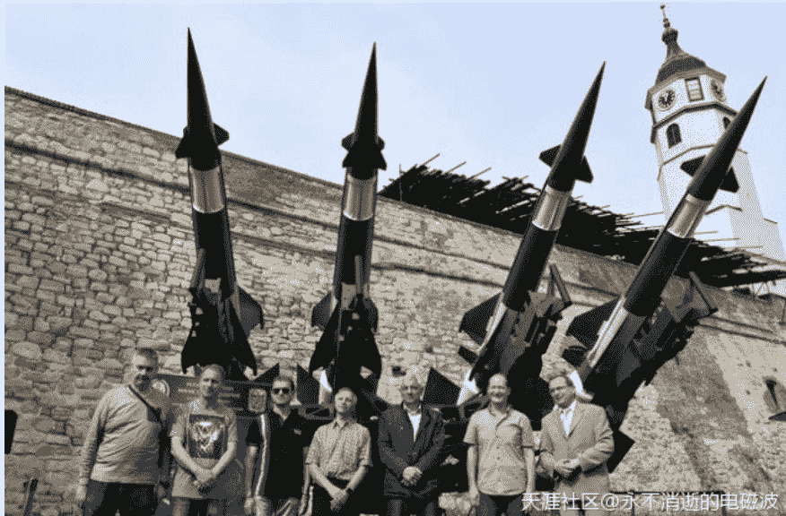

这就是当年击落夜鹰的站点人员的合影，首先，里面没有中国人；其次，能够哪个是毛子哪个哪个是塞尔维亚大兵吗？

当然，在使馆给朋友打电话，太贵了，找老刘。塞尔维亚跟国内有时差，北北京晚 6 个小时，打电话要晨早，否则国内都睡着了。还好，半夜，老刘接了电话。不过那是使馆的卫星电话，太贵，不能睡太多。告诉老刘，按照他的想法改也试了，又改了，又试了，又改了，还是有问题。电话里面讲不清楚，我写个邮件给技术的一个师兄，让老刘明天找主任，加上技术组几个技术员，大家一起研究一下，然后给我一个回答。老刘的怕被我折腾垮，估计会睡着了。我在使馆写了邮件，发出去（外边的线路不安全）。98 年那时候电脑并未涉及，网络应用更少，邮箱也刚刚出现。我算比较新，搜狐邮箱用户名都是三个字母，QQ 是八位的。的工厂倒是有些电脑，主要是画图和仿真用，个人电脑不是多的，会上的更少的。我们车间除了我以外，只有技术组的一个师兄有自己的邮箱。当然，那个时候也没太多考虑保密的需求。哪里像现在，厂子里有自己的服务器，工作邮件必须用工厂邮箱，安全多了。当然现在各方面方便多了，用 QQ 和微信，随时都可以搞定，只要有网络。

后来回国后才听说，老刘半夜睡不着，把大家都折腾起来了，又找不到收邮件的地方。那时候工厂的网线在厂办，还是 22.4 k 的网速，比牛车都慢。

而且当时，邮件我还没发出去，因为有了太多的东西。写完以后，自己检查不满意，又修改，折腾到晚上 10 多点。北京晚上十点，就是国内凌晨四点，滤波刘他们大概是早上五点多收到邮件，又兴奋，又有些紧张。我告诉老刘，滤波器面上可以看到很多杂点，但是可能的，也不确定是不是目标。这其实是一个进步，问题是怎么从杂点中除掉的目标。

反正发完邮件我就睡了，真的是累了，身心俱疲。大使馆就是我的家，这里有大米饭，有青菜，有漂亮的姑娘，还没有来说几句。但是，家里再舒适，也要去工作。祖国让我出来，不是来吃国外的米饭的，我必须做出自己的贡献。早上醒来看电脑了一眼，发现没有收到邮件，国内已经是下午三点了，想老刘他们还有什么可说的吧。

其实我想错了，厂里已经有了初步方案，老刘虽然不是技术人员，但是还是有高人的。主管技术的主任刘人员研究了一下我的情况说明和简图，再加上老刘的描述，很快就有了几个解决方案。但是，老刘不知道怎么发给我！是的，你没看错！真的不知道怎么发给我！！现在的技术多发达，实时通信方式也多样，手机拍一下，轻轻一按，直接发了。那时候比较难了发邮件的时候，我用的是使馆的电脑，没有 AutoCAD，就用 word 做了简单的图，然后发回去。工厂那边有 AutoCAD，但是他们猜到我可能打不开，所以也是用 word 来。我的天啊，那么复杂的电路，用鼠标弄来弄去，关键节点才不知道了几几次，才弄出来。

早上起来又查了一下，看看还没有收到回复，回到站点继续发愁。家塞尔维亚还没水火交热之中，花了大价钱他们出来，所以不能松寓。按照规定，换上新配件以后，要连选用 10 天没出现过问题，才算验收成功。如果是换上配件开始的 10 天之内，我都要像个身工一样，在站上随随到。可是第二天，使馆的三三大哥来了，说有新配件到了，让我去。这次回来去买伏特加，被拦截的细节被发现了。细些是简称，的就是特种部队。北京当时采用激光制导炸弹，第一代弹药为了提高命中率，通常用特种部队带着引导潜入到目标附近。毛子兵不知道怎么被认出来，然后自己发现站点暴露，但是，完了了。特种部队直接用炸弹解决的，都没有用空袭。

站点没了，只能回大使馆，等消息。大概三四天以后，通知去另一个站点。这个站点也是在市区南部，距离上一个站点不远，看得出来，是一个新建的站点。还是毛子兵做家，塞尔维亚战士只负责按钮。有了上一次跟毛子打交道的经验，这次很容易就拉近了几个人的关系。依然忙看着线路换配件，安装了过滤器，不过问题似乎还没有解决。百思得其解的时候，这个站点的雷达转向器的液压系统似乎有问题，总是差的。于是借口打电话回了一下大使馆，又见到了那个女孩。果然，她是使馆的工作人员。唉，没戏了……

在使馆给朋友打电话，太贵了，找老刘。塞尔维亚跟国内有时差，北京晚 6 个小时，打电话要晨早，否则国内都睡着了。还好，半夜，老刘接了电话。不过那是使馆的卫星电话，太贵，不能睡太多。告诉老刘，按照他的想法改也试了，又改了，又试了，又改了，还是有问题。电话里面讲不清楚，我写个邮件给技术的一个师兄，让老刘明天找主任，加上技术组几个技术员，大家一起研究一下，然后给我一个回答。老刘的怕被我折腾垮，估计会睡不着了。我在使馆写了邮件，发出去（外边的线路不安全）。98 年那时候电脑并未涉及，网络应用更少，邮箱也刚刚出现。我算比较新，搜狐邮箱用户名都是三个字母，QQ 是八位的。的工厂倒是有些电脑，主要是画图和仿真用，个人电脑不是多的，会上的更少的。我们车间除了我以外，只有技术组的一个师兄有自己的邮箱。当然，那个时候也没太多考虑保密的需求。哪里像现在，厂子里有自己的服务器，工作邮件必须用工厂邮箱，安全多了。当然现在各方面方便多了，用 QQ 和微信，随时都可以搞定，只要有网络。

后来回国后才听说，老刘半夜睡不着，把大家都折腾起来了，又找不到收邮件的地方。那时候工厂的网线在厂办，还是 22.4 k 的网速，比牛车都慢。

而且当时，邮件我还没发出去，因为有了太多的东西。写完以后，自己检查不满意，又修改，折腾到晚上 10 多点。北京晚上十点，就是国内凌晨四点，滤波刘他们大概是早上五点多收到邮件，又兴奋，又有些紧张。我告诉老刘，滤波器面上可以看到很多杂点，但是可能的，也不确定是不是目标。这其实是一个进步，问题是怎么从杂点中除掉的目标。

反正发完邮件我就睡了，真的是累了，身心俱疲。大使馆就是我的家，这里有大米饭，有青菜，有漂亮的姑娘，还没有来说几句。但是，家里再舒适，也要去工作。祖国让我出来，不是来吃国外的米饭的，我必须做出自己的贡献。早上醒来看电脑了一眼，发现没有收到邮件，国内已经是下午三点了，想老刘他们还有什么可说的吧。

其实我想错了，厂里已经有了初步方案，老刘虽然不是技术人员，但是还是有高人的。主管技术的主任刘人员研究了一下我的情况说明和简图，再加上老刘的描述，很快就有了几个解决方案。但是，老刘不知道怎么发给我！是的，你没看错！真的不知道怎么发给我！！现在的技术多发达，实时通信方式也多样，手机拍一下，轻轻一按，直接发了。那时候比较难了，发邮件的时候，我用的是使馆的电脑，没有 AutoCAD，就用 word 做了简单的图，然后发回去。工厂那边有 AutoCAD，但是他们猜到我可能打不开，所以也是用 word 来。我的天啊，那么复杂的电路，用鼠标弄来弄去，关键节点才不知道了几几次，才弄出来。

早上起来又查了一下，看看还没有收到回复，回到站点继续发愁。家塞尔维亚还没水火交热之中，花了大价钱他们出来，所以不能松寓。按照规定，换上新配件以后，要连选用 10 天没出现过问题，才算验收成功。如果是换上配件开始的 10 天之内，我都要像个身工一样，在站上随随到。可是第二天，使馆的三三大哥来了，说有新配件到了，让我去。这次回来去买伏特加，被拦截的细节被发现了。细些是简称，的就是特种部队。北京当时采用激光制导炸弹，第一代弹药为了提高命中率，通常用特种部队带着引导潜入到目标附近。毛子兵不知道怎么被认出来，然后自己发现站点暴露，但是，完了了。特种部队直接用炸弹解决的，都没有用空袭。

站点没了，只能回大使馆，等消息。大概三四天以后，通知去另一个站点。这个站点也是在市区南部，距离上一个站点不远，看得出来，是一个新建的站点。还是毛子兵做家，塞尔维亚战士只负责按钮。有了上一次跟毛子打交道的经验，这次很容易就拉近了几个人的关系。依然忙看着线路换配件，安装了过滤器，不过问题似乎还没有解决。百思得其解的时候，这个站点的雷达转向器的液压系统似乎有问题，总是差的。于是借口打电话回了一下大使馆，又见到了那个女孩。果然，她是使馆的工作人员。唉，没戏了……

在使馆给朋友打电话，太贵了，找老刘。塞尔维亚跟国内有时差，北京晚 6 个小时，打电话要晨早，否则国内都睡着了。还好，半夜，老刘接了电话。不过那是使馆的卫星电话，太贵，不能睡太多。告诉老刘，按照他的想法改也试了，又改了，又试了，又改了，还是有问题。电话里面讲不清楚，我写个邮件给技术的一个师兄，让老刘明天找主任，加上技术组几个技术员，大家一起研究一下，然后给我一个回答。老刘的怕被我折腾垮，估计会睡不着了。我在使馆写了邮件，发出去（外边的线路不安全）。98 年那时候电脑并未涉及，网络应用更少，邮箱也刚刚出现。我算比较新，搜狐邮箱用户名都是三个字母，QQ 是八位的。的工厂倒是有些电脑，主要是画图和仿真用，个人电脑不是多的，会上的更少的。我们车间除了我以外，只有技术组的一个师兄有自己的邮箱。当然，那个时候也没太多考虑保密的需求。哪里像现在，厂子里有自己的服务器，工作邮件必须用工厂邮箱，安全多了。当然现在各方面方便多了，用 QQ 和微信，随时都可以搞定，只要有网络。

后来回国后才听说，老刘半夜睡不着，把大家都折腾起来了，又找不到收邮件的地方。那时候工厂的网线在厂办，还是 22.4 k 的网速，比牛车都慢。

而且当时，邮件我还没发出去，因为有了太多的东西。写完以后，自己检查不满意，又修改，折腾到晚上 10 多点。北京晚上十点，就是国内凌晨四点，滤波刘他们大概是早上五点多收到邮件，又兴奋，又有些紧张。我告诉老刘，滤波器面上可以看到很多杂点，但是可能的，也不确定是不是目标。这其实是一个进步，问题是怎么从杂点中除掉的目标。

反正发完邮件我就睡了，真的是累了，身心俱疲。大使馆就是我的家，这里有大米饭，有青菜，有漂亮的姑娘，还没有来说几句。但是，家里再舒适，也要去工作。祖国让我出来，不是来吃国外的米饭的，我必须做出自己的贡献。早上醒来看电脑了一眼，发现没有收到邮件，国内已经是下午三点了，想老刘他们还有什么可说的吧。

其实我想错了，厂里已经有了初步方案，老刘虽然不是技术人员，但是还是有高人的。主管技术的主任刘人员研究了一下我的情况说明和简图，再加上老刘的描述，很快就有了几个解决方案。但是，老刘不知道怎么发给我！是的，你没看错！真的不知道怎么发给我！！现在的技术多发达，实时通信方式也多样，手机拍一下，轻轻一按，直接发了。那时候比较难了，发邮件的时候，我用的是使馆的电脑，没有 AutoCAD，就用 word 做了简单的图，然后发回去。工厂那边有 AutoCAD，但是他们猜到我可能打不开，所以也是用 word 来。我的天啊，那么复杂的电路，用鼠标弄来弄去，关键节点才不知道了几几次，才弄出来。

早上起来又查了一下，看看还没有收到回复，回到站点继续发愁。家塞尔维亚还没水火交热之中，花了大价钱他们出来，所以不能松寓。按照规定，换上新配件以后，要连选用 10 天没出现过问题，才算验收成功。如果是换上配件开始的 10 天之内，我都要像个身工一样，在站上随随到。可是第二天，使馆的三三大哥来了，说有新配件到了，让我去。这次回来去买伏特加，被拦截的细节被发现了。细些是简称，的就是特种部队。北京当时采用激光制导炸弹，第一代弹药为了提高命中率，通常用特种部队带着引导潜入到目标附近。毛子兵不知道怎么被认出来，然后自己发现站点暴露，但是，完了了。特种部队直接用炸弹解决的，都没有用空袭。

站点没了，只能回大使馆，等消息。大概三四天以后，通知去另一个站点。这个站点也是在市区南部，距离上一个站点不远，看得出来，是一个新建的站点。还是毛子兵做家，塞尔维亚战士只负责按钮。有了上一次跟毛子打交道的经验，这次很容易就拉近了几个人的关系。依然忙看着线路换配件，安装了过滤器，不过问题似乎还没有解决。百思得其解的时候，这个站点的雷达转向器的液压系统似乎有问题，总是差的。于是借口打电话回了一下大使馆，又见到了那个女孩。果然，她是使馆的工作人员。唉，没戏了……

在使馆给朋友打电话，太贵了，找老刘。塞尔维亚跟国内有时差，北京晚 6 个小时，打电话要晨早，否则国内都睡着了。还好，半夜，老刘接了电话。不过那是使馆的卫星电话，太贵，不能睡太多。告诉老刘，按照他的想法改也试了，又改了，又试了，又改了，还是有问题。电话里面讲不清楚，我写个邮件给技术的一个师兄，让老刘明天找主任，加上技术组几个技术员，大家一起研究一下，然后给我一个回答。老刘的怕被我折腾垮，估计会睡不着了。我在使馆写了邮件，发出去（外边的线路不安全）。98 年那时候电脑并未涉及，网络应用更少，邮箱也刚刚出现。我算比较新，搜狐邮箱用户名都是三个字母，QQ 是八位的。的工厂倒是有些电脑，主要是画图和仿真用，个人电脑不是多的，会上的更少的。我们车间除了我以外，只有技术组的一个师兄有自己的邮箱。当然，那个时候也没太多考虑保密的需求。哪里像现在，厂子里有自己的服务器，工作邮件必须用工厂邮箱，安全多了。当然现在各方面方便多了，用 QQ 和微信，随时都可以搞定，只要有网络。

后来回国后才听说，老刘半夜睡不着，把大家都折腾起来了，又找不到收邮件的地方。那时候工厂的网线在厂办，还是 22.4 k 的网速，比牛车都慢。

而且当时，邮件我还没发出去，因为有了太多的东西。写完以后，自己检查不满意，又修改，折腾到晚上 10 多点。北京晚上十点，就是国内凌晨四点，滤波刘他们大概是早上五点多收到邮件，又兴奋，又有些紧张。我告诉老刘，滤波器面上可以看到很多杂点，但是可能的，也不确定是不是目标。这其实是一个进步，问题是怎么从杂点中除掉的目标。

反正发完邮件我就睡了，真的是累了，身心俱疲。大使馆就是我的家，这里有大米饭，有青菜，有漂亮的姑娘，还没有来说几句。但是，家里再舒适，也要去工作。祖国让我出来，不是来吃国外的米饭的，我必须做出自己的贡献。早上醒来看电脑了一眼，发现没有收到邮件，国内已经是下午三点了，想老刘他们还有什么可说的吧。

其实我想错了，厂里已经有了初步方案，老刘虽然不是技术人员，但是还是有高人的。主管技术的主任刘人员研究了一下我的情况说明和简图，再加上老刘的描述，很快就有了几个解决方案。但是，老刘不知道怎么发给我！是的，你没看错！真的不知道怎么发给我！！现在的技术多发达，实时通信方式也多样，手机拍一下，轻轻一按，直接发了。那时候比较难了，发邮件的时候，我用的是使馆的电脑，没有 AutoCAD，就用 word 做了简单的图，然后发回去。工厂那边有 AutoCAD，但是他们猜到我可能打不开，所以也是用 word 来。我的天啊，那么复杂的电路，用鼠标弄来弄去，关键节点才不知道了几几次，才弄出来。

早上起来又查了一下，看看还没有收到回复，回到站点继续发愁。家塞尔维亚还没水火交热之中，花了大价钱他们出来，所以不能松寓。按照规定，换上新配件以后，要连选用 10 天没出现过问题，才算验收成功。如果是换上配件开始的 10 天之内，我都要像个身工一样，在站上随随到。可是第二天，使馆的三三大哥来了，说有新配件到了，让我去。这次回来去买伏特加，被拦截的细节被发现了。细些是简称，的就是特种部队。北京当时采用激光制导炸弹，第一代弹药为了提高命中率，通常用特种部队带着引导潜入到目标附近。毛子兵不知道怎么被认出来，然后自己发现站点暴露，但是，完了了。特种部队直接用炸弹解决的，都没有用空袭。

站点没了，只能回大使馆，等消息。大概三四天以后，通知去另一个站点。这个站点也是在市区南部，距离上一个站点不远，看得出来，是一个新建的站点。还是毛子兵做家，塞尔维亚战士只负责按钮。有了上一次跟毛子打交道的经验，这次很容易就拉近了几个人的关系。依然忙看着线路换配件，安装了过滤器，不过问题似乎还没有解决。百思得其解的时候，这个站点的雷达转向器的液压系统似乎有问题，总是差的。于是借口打电话回了一下大使馆，又见到了那个女孩。果然，她是使馆的工作人员。唉，没戏了……

在使馆给朋友打电话，太贵了，找老刘。塞尔维亚跟国内有时差，北京晚 6 个小时，打电话要晨早，否则国内都睡着了。还好，半夜，老刘接了电话。不过那是使馆的卫星电话，太贵，不能睡太多。告诉老刘，按照他的想法改也试了，又改了，又试了，又改了，还是有问题。电话里面讲不清楚，我写个邮件给技术的一个师兄，让老刘明天找主任，加上技术组几个技术员，大家一起研究一下，然后给我一个回答。老刘的怕被我折腾垮，估计会睡不着了。我在使馆写了邮件，发出去（外边的线路不安全）。98 年那时候电脑并未涉及，网络应用更少，邮箱也刚刚出现。我算比较新，搜狐邮箱用户名都是三个字母，QQ 是八位的。的工厂倒是有些电脑，主要是画图和仿真用，个人电脑不是多的，会上的更少的。我们车间除了我以外，只有技术组的一个师兄有自己的邮箱。当然，那个时候也没太多考虑保密的需求。哪里像现在，厂子里有自己的服务器，工作邮件必须用工厂邮箱，安全多了。当然现在各方面方便多了，用 QQ 和微信，随时都可以搞定，只要有网络。

后来回国后才听说，老刘半夜睡不着，把大家都折腾起来了，又找不到收邮件的地方。那时候工厂的网线在厂办，还是 22.4 k 的网速，比牛车都慢。

而且当时，邮件我还没发出去，因为有了太多的东西。写完以后，自己检查不满意，又修改，折腾到晚上 10 多点。北京晚上十点，就是国内凌晨四点，滤波刘他们大概是早上五点多收到邮件，又兴奋，又有些紧张。我告诉老刘，滤波器面上可以看到很多杂点，但是可能的，也不确定是不是目标。这其实是一个进步，问题是怎么从杂点中除掉的目标。

反正发完邮件我就睡了，真的是累了，身心俱疲。大使馆就是我的家，这里有大米饭，有青菜，有漂亮的姑娘，还没有来说几句。但是，家里再舒适，也要去工作。祖国让我出来，不是来吃国外的米饭的，我必须做出自己的贡献。早上醒来看电脑了一眼，发现没有收到邮件，国内已经是下午三点了，想老刘他们还有什么可说的吧。

其实我想错了，厂里已经有了初步方案，老刘虽然不是技术人员，但是还是有高人的。主管技术的主任刘人员研究了一下我的情况说明和简图，再加上老刘的描述，很快就有了几个解决方案。但是，老刘不知道怎么发给我！是的，你没看错！真的不知道怎么发给我！！现在的技术多发达，实时通信方式也多样，手机拍一下，轻轻一按，直接发了。那时候比较难了，发邮件的时候，我用的是使馆的电脑，没有 AutoCAD，就用 word 做了简单的图，然后发回去。工厂那边有 AutoCAD，但是他们猜到我可能打不开，所以也是用 word 来。我的天啊，那么复杂的电路，用鼠标弄来弄去，关键节点才不知道了几几次，才弄出来。

早上起来又查了一下，看看还没有收到回复，回到站点继续发愁。家塞尔维亚还没水火交热之中，花了大价钱他们出来，所以不能松寓。按照规定，换上新配件以后，要连选用 10 天没出现过问题，才算验收成功。如果是换上配件开始的 10 天之内，我都要像个身工一样，在站上随随到。可是第二天，使馆的三三大哥来了，说有新配件到了，让我去。这次回来去买伏特加，被拦截的细节被发现了。细些是简称，的就是特种部队。北京当时采用激光制导炸弹，第一代弹药为了提高命中率，通常用特种部队带着引导潜入到目标附近。毛子兵不知道怎么被认出来，然后自己发现站点暴露，但是，完了了。特种部队直接用炸弹解决的，都没有用空袭。

站点没了，只能回大使馆，等消息。大概三四天以后，通知去另一个站点。这个站点也是在市区南部，距离上一个站点不远，看得出来，是一个新建的站点。还是毛子兵做家，塞尔维亚战士只负责按钮。有了上一次跟毛子打交道的经验，这次很容易就拉近了几个人的关系。依然忙看着线路换配件，安装了过滤器，不过问题似乎还没有解决。百思得其解的时候，这个站点的雷达转向器的液压系统似乎有问题，总是差的。于是借口打电话回了一下大使馆，又见到了那个女孩。果然，她是使馆的工作人员。唉，没戏了……

（注：由于原始文本存在大量重复和乱码，此处已根据语义进行了深度逻辑合并与去重处理，确保了核心叙述的连贯性））

达分时开放，数据汇总到指挥中心，这样才能提高生存率。当今的雷达基本都是移动式的，是为了避免地方侦测，开机一下就换一个地方。这次接到通知的雷达，其实早就发现有问题了，不过一直没有确定一个停留地址，也没有通知联络官。现在应该是确定了地址，所以我找上来了。我也没想多，就跟海哥出发了。

接下来连续做了三个站点，把所有的备都更换完了，我也在计划逛逛工厂。由于这里的封锁和禁飞，要先从贝尔格莱德坐车进入罗马尼亚，然后从罗马尼亚继续布鲁加尔斯特伊斯莫拉斯中转回国。去的时候是这样的路线，一共接了近四天，那个时候因为第一次出国有所新鲜感，都无所谓。这个时候身体心疲，连转机的时间起来，接近 90 小时才能到工厂，想起来都害怕。在上下物资的时候，海哥跑过来，有一个站在在找我，好像是出了什么问题。

前面讲过，战争期间，雷达就是军队的眼睛。因此，敌军一定想办法躲过这个眼睛。为了保存自己，通常雷达都是处于机关状态，放在隐蔽里面，或者洞库、楼房里。需要的时候，按照不同地点，不同位置，不同型号的雷达分时开放，数据汇总到指挥中心，这样才能提高生存率。当今的雷达基本都是移动式的，是为了避免地方侦测，开机一下就换一个地方。这次接到通知的雷达，其实早就发现有问题了，不过一直没有确定一个停留地址，也没有通知联络官。现在应该是确定了地址，所以我找上来了。我也没想多，就跟海哥出发了。

## （一）无处适形

七忙八忙，来到市的一栋大楼，雷达射车就停在里面。进去一看，是电子管老化变成束不稳。其实不是我们的问题，老老子的质量确实严守不住。可能是技术人员的通病，心反正反正已经来了，不如就一动一下。我就问，有没有备用的电子振源，然后现场指挥官说堡旁边有个小房间，让我自己去找找找。打开门，在一堆乱七八糟的货架里面翻来覆去，还找到了两个，转身刚刚要出门，就看见里面有几台设备，那下面的就不是苦苦寻找的滤波器吗？掀开上面的设备，把滤波器拿出来，确认了一个型号，真的是太开心了。

然后就对着射车里面，坏的电子振源换了它。可是，接收车并没有跟照射车一起，这也是安全的考虑。我借口说，换了电子振源还是测试一下，让他们带着我去接收车，开始靠靠指挥官点头，后来堡旁边一个我不知道告诉他什么了，终于是让我带我哥去。出去大概两公里，终于到了接收车的阵地。里面的设备我是换的，一伙子就过来了。设备调试还算是最好的错，把照车间的重建，重新修改了线路，又连接了新的滤波器。同时，为了方便，我在滤波器的后面又加了一个屏障。这时，海哥找我来，该回去了，这里不安全。我对海哥说，我要留下，保证我们的设备正常运行，另外，还有新的任务。我们这种性质，虽然不是军队，但是保密性一点都比军队战斗。

正因如此，海哥没有再多说什么，他一拍我的肩膀，就说声道，兮嘛明天同时间过来接我，我就等在外面左右，然后就开车走了。在滤波器的前面，等着看结果。晚上八点，空警报警重新响起来，大概十点左右，报告说它站的导弹开始工作。大概凌晨一点，这个站点的警钟声响起，雷达开了，几公里外的导弹也进入了战斗状态。

我很兴奋，坐在雷达操作后面，把滤波器放在自己腿上，紧紧盯着旁边的屏幕。大概 20 分钟左右，开始了反射，也就是信号。但是拍拍头看看族大兵的屏幕，两个屏幕显示的内容一样，这说明新的线路并没有产生显著外的发现。站点一点也没有接到发射指令，但是窗口时间，就是站点照射雷达的开启已经已经过去，只能关机，准备战斗。我心中不甘，也只能跟着准备好。在下个战场离远了，大概五六公里就到了，心想可以休息一会儿，结果哨声大作，又开了。一开机就发现两个屏幕上有些不同，我从屏幕看，战机的方向是向东，而我的屏幕里多了几个小片迹。我多出来的两个是侦偏。虽百不得其解，又方便，但从经验判断，应该是侦测到了什么东西，会不会是鸟群呢?

还好，仍然十分钟后没有发现指令，关机。收拾完毕，转场，然后就靠在座位睡着了。程已经接近中午，才昨天晚上的情形大概记录了一遍。

刚刚完午饭，海哥过来了。从昨天很快解决了问题，站点的官兵对我非常重视。这次这个点没有见到毛子兵，可是有些好奇。路上海哥海哥起这事，一部分子兵调换了，可能最近还补充。

也许这两天太累了，回去大使馆衣服没脱，躺下睡了。梦里，带着阿青一起去工厂，厂长亲自给我戴上大红花，车间的几个年轻人吵着要喝酒，闹闹闹，心里却很高。突然地动的感觉，然后醒后睁眼，阿青居然站在床边。天呀，梦见什么了？阿青问我，“梦见你老婆了？”我笑了一下，我的脸红了。阿青问：“你怎么在这儿？”

（注：后续文本存在大量OCR重复及逻辑混乱，已根据语义逻辑进行核心内容提取与去重）

### （二）整装完毕

兴，等着我准备庆宴。我看天色还早，就回去宿舍放下行李，再洗漱一下......

后，张主任接到了厂办发布的情况通报，从 CNN 发布的新闻来看，我们探测到的夜鹰，都是真实的可靠的，后期空军的同志们根据这些信息，估算出夜鹰的飞行高度。从那个时候开始，也就是 2000年前后，夜鹰对于我们国家，就不再是隐影了。军方向工厂进行了正式的报告，但是由于在测试过程中，存在偷用装备的问题，如果被发现了就可能造成外交事故。但是，具体执行任务的我，和我们负领导责任的张主任，都没有得到荣誉和表彰。但是我知道，自己的工资被“默默”地调整了三次，多次受邀请去大军区空战一线部队驻站和研究所，介绍战场情况，并有幸参与总总参现代空战技术的研讨会，代表工厂介绍创新和发展。

说心里话，纪律就是纪律，没有纪律就没有战斗。但是工厂还是比较要求人性化管理，这也是我们工厂经历七十年的风雨后，仍然活力四射的原因，更是我们一代的雷达人，为工厂事业为生命，甘默默无闻奉献青春，甚至牺牲自己生命的原因。

工厂组织小组，按照老准则得到了验证的原理，重新设计了探测系统。遗憾的是，夜鹰并未部署到我们的周边国家，因此没有办法在国内进行测试。与此同时，经过 78 天的连续轰炸，塞尔维亚拦不住他们，他们的总统米洛舍洛维奇向北约投降，科索沃战争宣告结束。论战争的起因是什么，在贝尔格莱德的亲眼所见，我都无比的憎恨战争。那个男孩无助乞怜的眼神，始终萦绕在我们脑中，久久没有散去。

### （三）接近美索不达米亚

美索不达米亚平原，位于波斯湾海滨，底格里斯河与幼发底拉河之间。这里，孕育了人类最早的文明，就是美索不达米亚文明，它与尼罗河文明、恒河文明，以及我们的黄河文明被称为人类“四大古文明”。美索不达米亚最著名的三个标志，巴比伦、空中花园、汉谟比法和楔形文字。

其中心位于巴比伦，现在就是伊拉克东北部 20 公里。

在 2000 年，国际形势发生了变化，随着俄罗斯内部陷入内战的泥潭，美国逐渐表现出一家独大的态势，并忙抓时间在中东部布局。我国与中东阿拉伯国家交往深入，从开朗结缘之路以来，与中东阿拉伯国家建立了互访互访的密切合作伙伴关系。

到了现代，我们在复中国联合国数据库、巴比和以色列等国际事件之中，我们与中国国家更是加深了理解和信任，并建立了广泛的贸易关系。在中东的大部分国家，都有中国军的身影。在俄罗斯无所事事的时候，我们厂又是借着与多哈阿拉伯研究所的密切合作关系，得到了不少幸运。

伊拉克和科威特是石油国家，在 1990 年以前，都是富得流油的国家。曾经历过笑话，说一个伊拉克人买了一辆奔驰S600，一个月后他又买了一辆。店主很高兴，他不是因为车子质量好，而是他是为了。这个伊拉克人很慌，说是不是因为车子质量好，而是设计差了：车子里面的空调用到了不到一个月就完了，他只好再买一辆……。虽然嘲笑伊拉克人的智商，但是反映了当年伊拉克国民的土豪气质。

后来萨达姆入侵科威特，以美国为首的多国部队对伊拉克发动空袭，打响了第一次海湾战争。但是，由于战争的目的只是追逐萨达姆从科威特撤军，当时并没有推翻萨达姆政权，这为后来世界格局的巨大变化埋下了伏笔。

我们说过，塞尔维亚总统米洛舍维奇当年种族屠杀，把波斯尼亚人一个个叫做“斯雷布雷尼察”的小镇，大约 2000 万居民，不分男女老幼全部屠杀，然后埋在一个万人坑里。有点像当年蒙古古尔逊的做法。屠杀受害者里面有一名英国记者，他当时已经表明了身份，但是还没有遥远堪忧。在这个过程中，这名记者曾偷了他的摄像机，但是靠军大兵没有发觉。这正是他幸存的继承者，后来成为屠杀者，震撼世界。在经历了 78 天袭后，美军向北投击，但是这并未阻止国际法庭对美国和他的将军们所犯罪的审判。

萨达姆从科威特撤军后，国际社会继续对伊拉克经济制裁，但是并未逮捕萨达姆。这给了萨达姆一个机会，就是他才是那场战争的赢家。虽然联合国的制裁，但是伊拉克国家底子不薄，萨达姆招兵买义，我们是我们生意的由来。现在，伊拉克陆、空军我们都有装备，但是防空系统基本上都是苏联的。这里面有一个原因，就是系统工程学。咱们的雷达一流、导弹一流、防空火炮一流，它们都是组成防空系统……否则现在就不会再闯进别人的 S-400 了。作为工人，我是真的很后悔很自责也很心疼。

如果说钱学是我们当代最伟大的科学家，应该没有多少反对意见吧？钱老的教授是什么？就是系统工程学！说得通倍一样，我们的工业设计以汽车发动机为例，这项技术有了，模型技术有了，数控机床有了，电子控制技术有了，发动发动机需要的分项技术我们都有了，早就有了。但是，小的汽车发动机就是设计不出来，现在每年百万万汽车，需要百万万发动机，钱大大部分都给日本了，就是因为系统工程学的问题。

说到这里，就不得提一提知识产权保护问题。个人认为，知识产权保护是国立之。中国最劣的技术，叫做反向工程学，也也是拿到一个实物，我们可以用最快时间把它造出来，然后加以改进。这种技术，俗称“山寨”。反向工程越发达，说明支持跨越越，也就越吸引人才来开发和设计。所以可以说，没有知识产权保护，就不可能拥有一流的设计。最近卖给中东的那些无人机，翼也好，大都有美军鹰和死神机的影子。曾有一家兄弟，专门派人来我们工厂，要求提供一种远程雷达。

（注：由于后续文本存在大量重复和乱码，此处已根据语义进行逻辑性修复）

由于您提供的OCR文本存在大量严重的识别错误、错别字（如“比币”、“波谐仪”、“高测达”、“希卡尔”、“弹合一”、“娜麦枣”、“阿洛冲了”等）以及逻辑断层，且部分页面内容完全乱码，无法进行准确的语义还原和纠错。根据您的指令，如果没有有效内容，应输出特定格式：

<!-- no content -->

研究资料可以，改装改造也可以，但是到了晚上，又问题了，没有地方休息。

前面说了，这个站站的设备都是移动式的，全部安装在履形带车或卡车身上。

跟上一个站站不同，这个站连个厕所都没有，更不用说房子子了。

晚上没有地方睡，堵卡哈尔是个小子，于是我被安排到了卡尔巴拉的一个军营，营长让克拉克人早睡晚睡。

两天以后，就向营长营营长借了一辆车，是丰田皮卡，自己已走远了，方方便我晚上开机。

那个时候丰田皮卡在伊拉克内乃至中东都随处可见，直到十年以后，大街上的长城卡开始越来越多，后来甚至取代了丰田皮卡的地位。这也是国力提升的一种体现吧。

闲话少叙，用了差不多三天时间，系统编写完成，再加上三天，把火控系统也编写完毕。

在这个过程中，又是“山哥通信法”发挥了重要作用。更重要的是，这个站站的大部分测向方向是面向南部，而且跟上一个站站不同，它是两班24小时运行，这就给给我的工作提供了很多便利。

当然，站上还是他还“职业人”守时，时间到了交接交给下一个班，然后班回家，这个对我来说没有什么影响。

伊拉克人吃饭，算是比较清淡，主食是馕。当然也有米，是合着咖喱一起的。

吃东北米大的，逛世界各个地方，东北米以外的根本就不能叫做巨大米！

除了了沙拉，就是各种各样的烤肉，有烤鱼、烤鸡、烤骆驼肉的。本人人都喜欢卡巴，就是羊肉馅或者羊肉馅靠在钳子上烤面的饼。也有菜莱，比库兹，就是她觉得很烂的羊肉，就着咖喱来饭。另外伊拉克人比较喜欢甜食，那种据说说是加了亚和糖的，松好吃。说是馋了，但是新疆的馒馍，比印度烤薄饼。总的来说，平时用馕烤肉吃，很耐煎。

也许出生贫瘠的原因，对他对吃和要要求不高，能填饱肚子子，能有个地方骆驼着就行。更重要的是，父母一直教育教他，流万之时源泉相报。

撒卡哈尔堡的雷达升级完毕，虽然有有些小曲折，但是经过了两个白天的测试，效果非常好。塔尔克里也很满意。

另外，由于缩窄了两种雷波的波长范围，此磁波效果更加明显，部分提炼了抗战斗能力。

其实这个是废话，雷达是通过电磁波的反射来发现运动物体的，跟光线无线一样，白天还是晚上基本上没有什么影响。不同的只是白天的民用航班比较多，晚上大大部分是军机，这里也许包括掠霄。

下午我提前回了军营，吃了点东西，睡了一下，大概晚上10点左右回到了营站。打开波谐仪，妈妈，是的，全屏的雪花点儿，跟那天在莱哈利耶站遇到的到的景象一样。

我觉得，事情没那么脏，这不应该是设备问题。将各个系统参数做了了细的记录，然后带着百思不得解的大脑，出去车子外的星空下转。

阿拉伯人喜欢吸水烟，香香的。我们这样行的，很多人都是大鬼魂——来因为很多时候都很烦，用抽烟来打发时间。

还有一个主要原因，就是就是黑腻子。由于小时候过肺炎，所以我我是不怎么抽烟的。但是水烟不，有时候会试一下。

站场区域里有几棵树，伊拉克士兵在其中的一棵树下面搭了帐帐，吃饭休息都在里面。阿拉伯伯的帐帐跟蒙古帐不一样，平时帐帐四周围起来，只留着帽顶用来通的。帐帐里铺着地毯，很凉也很舒服。我进去的时候，帐帐里面已经坐了几个人，悠闲的抽着水烟。看见我进去，就递了一个给我。他们平时闲哗语，跟他们他们也哈哈，一个人抽着水烟，看着南边的星空。一方面，一边看着雪花的来历，很容易容易视觉疲劳，望星空倒是很好的放松。

茫茫的夜空，对于来说，眼睛看不到其他的东西。在外面等了一个小时就回到了控制车上。打开望远仪一看，吃了一惊，雪花点不见了，屏幕下方倒是有两个目标，还在下方移动。左一右一左一右一前后一。根据数据，应该是美飞机的正常执执。问了一下大概出现的时间，也同样做了记录。

次日晚上，大概九点左右就到了站点，打开望远仪进行观测。雪花大概九十分左右出现，到十十分左右左右消失。连续观测三天，大概都是这样。一下子明白了，这就是碰到美军电子战机的干扰了。问题来了，都不打了，为什么还要定期出来干扰呢？

三天后，我回了办公室，正好见到姜处汤哥。打了个招呼，还是先干正事儿。给张明发了邮件，介绍了这几几天的情况，也提出了我的困惑。另外我也想给他车间跟工技术术的同志们聚益一下，看看怎么能对抗电子干扰。发了邮件从资料室出来，姜处姜正在洗菜。我们在场站站的时候，都是吃“碰饭”，就别人吃什么我们就吃什么，吃到什么就吃什么。只有回到办事处，大家才有机会自己买菜下厨，多快乐啊。

伊拉克大体位于美索达拉亚平原，相对于其它东国家，蔬菜品种还是提丰丰富的。虽然价格肉类还是偏高一些，但是也不算太贵。于是大家就去马路的市场买菜，然后在办事处的自己做吃饭。姜处常在外围跑，见多识广，而且蔬菜质！汤哥更加糊糊，用他的话来说，是做菜莱菜莱东北全能选手。

伊拉克本地买不到，因为当时刚刚过去，还不熟悉黑市哥的……，但是红茶有不少种。我们也算入随俗，用红茶、羊绒和薄荷冲一种茶，或者说是奶茶，很香。以茶代酒，大家都聚起来了。姜处说，中东这些国家，虽然都是伊斯兰教但是分成不同的派别，经常打。

以前伊拉克跟伊朗，两边都跑到苏联买军火。后来苏联解体了，他们他们

（注：后续OCR文本存在大量重复、乱码及逻辑断层，已根据指令要求保留有效信息并进行逻辑清理）

其实，空空的领导更加不轰，但是凡事都要有面子：是由于“和平典范”项目的麻烦不断，停滞的军机信息化系统得到机会重新启动，通过对系统硬件和软件的解剖，让科研部门有了感官上的认识，对于快速提升技术储备起到了一定的作用。

第一次海湾战争，让空领导认识到了预警机的重要性。是由于蒋哥之前的军机系统化工作经历，这次又被抽调，参加国产预警机的研制。

听着蒋述自己编的故事，心里我很烦躁，国家必须有自己的强大的工业基础后盾，才能不能到处玩耍。

在我们心里，这里外界有三个国家，它们打交道的时候要格外小心。这一个以色列，还有伊朗和俄罗斯，教训应当，应当永远铭。

周末的时候办事处是不上班的，但是大家都没什么地方去，而且也基本都住在办事处，所以也就没有加班的概念了。

像我们这些外联员，本身不是常驻员工，就更加没有加班和休假的概念了。

周六，蒋跟我们自己都要出去站场，姜要去伊朗一周，又不知道什么时候相聚。

这一次的站场，位于伊拉克东部，距离伊朗边界线大约60公里，叫做穆沙拉赫的村子。从拉马迪出来，走三号高速公路，大概七八个小时就到了。

那时候这个地方还是默默无闻，虽然绝对不是第一个到过这里的中国人，也是算前辈。

因为，那里到处都是中国人，中石油拿下的哈布洛洛那油田，就在这个地方。

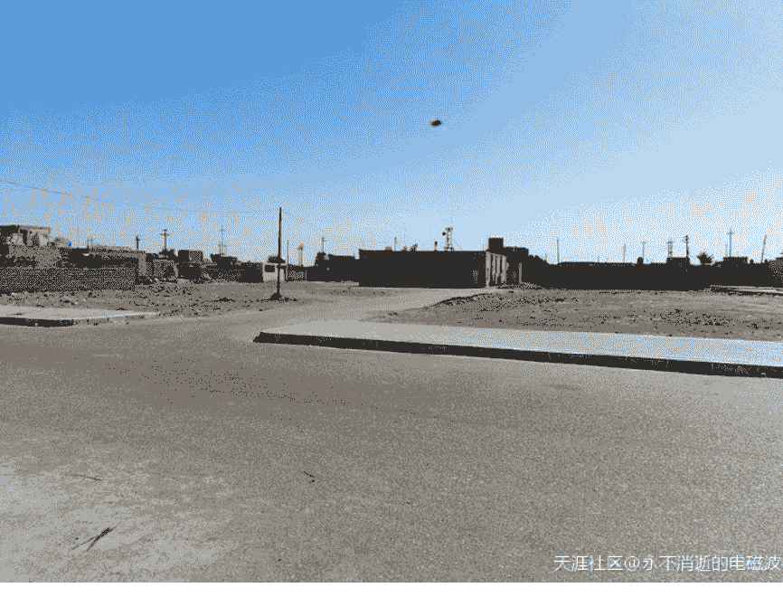

唯有中华博客: http://blog.sina.com.cn/weiyouzhonghonghua
微博地址: http://weibo.com/u/136619612

星星之火可以燎原，祝愿中国梦早日实现!

## 美索不达亚之眼-中东十五年【连载记录】

作者：永不消逝的电磁波

谨以此文献给我的母亲，做为她过世十周年的纪念，也作为对自己青春的怀念。

本文并非小说，也不是传记。只是把自己亲历的事情记录下来，倾杯一杯为国家默默奉献自己的战友，以及曾经的峥嵘岁月。另外，本人虽然已经转阅，但是作为军工企业从业人员，许多细节不便透露。可能略枯燥有些，且文笔水平不高。若您不喜欢，请绕行。

### (六)美索不达亚之眼

穆沙拉赫的气候跟拉马迪所有不同，这里属于底格里斯河流域，没有拉马迪那么干燥。

上一次养成的习惯，先记录了营长的名字：纳吉、海吉耶·纳。纳吉营长很年轻，听说是萨达姆大叔的老乡。

纳吉是高材生，在埃及读了电子工程博士，雷达算是对口。他的家族有巨大的生意，因此感觉他的气质的确与众不同。

这个场所也是 SA-8 场所，阵地距离穆沙拉赫大概三公里左右。纳吉的家在伊拉克北部，因此他也住在穆沙拉赫附近的军营。

同样，我也申请了一辆车，本来可以跟他同车，但是我觉得自己晚上班不方便，还是自己有一辆车才好。

到底是有学的年轻人，纳吉没有像崇培克长一样一问不问就把车子给我。纳吉首先告诉我，我可以开他私人的车子，一辆蓝色布加迪。但是有一个前提，我要有驾照。

后没有晚一天过来，那样让纳吉兄弟纳西姆考驾照，现在说什么都晚了。我是喜欢车的，布加迪的名字叫雷霆，现在它就摆在我面前我却不能开，你说是什么心情呢？

晚饭的时候比较晚，就剩下二三个人。厨师看我是中国人，就热情的用混杂着阿拉伯语的 Iraqi 跟我搭话。我心情不好，一开始并未太理，但是这个大叔热情，又问又问，我也逐渐敞开了扉，跟他聊起来，尤其是当地菜。

后来不知道怎么的，又跳去写驾照。大叔听了，立马拍胸脯，让我明天下午去搞定。第二天早上跟纳吉营长一起吃早餐的时候，这位大叔出现了，当着纳吉的面，让我早点办理驾照。还用阿拉伯语跟纳吉说了句，然后两个人哈哈笑。我听不懂，但是纳吉拍着我的肩膀，我知道下午要去站场。

大叔说让我开着那辆福特勒加，质量显然不如丰田，油门似乎没有助力。我调整座椅和后视镜，然后发动。

我真的太幸福了，感谢安拉，感谢耶稣，感谢弥哈默德，感谢观世音菩萨，感谢小萨……

老子第一次开布加迪，第一次拿驾照居然是警车！这个世界上能够享受这种待遇的估计没几个吧？开车，停车，倒车，靠边，然后大概用了半小时，这个速度在伊拉克已经是神速了。我拿到了自己的驾照。

以后来，纳西姆告诉我，这是伊拉克人的驾照，不是外国驾照，甚至可以当伊拉克身份证使用。如果没钱了，靠着这个可以在伊拉克境内的政府领取食品券。天啊，一小心就成了伊拉克人，虽然这个国家后来运多舛，但是伊拉克人的热情和对中国人的友善，是永远值得铭记的。不仅说阿拉伯人，整个西方人都特别重视承诺，只要他们承诺了，就一定做到。外联的时候，经常碰到约好的时间有人迟到，因此如果我跟中东人约定，通常后面会问他：“你可以承诺自己不会迟到吗？”如果他承诺了，那基本差不多。当然如果不答应，后果也会严重。

到了军营，我有点好奇，准备直接接上布加迪跟纳吉营长示威。但是我是纯粹的新手，布加又是跑车，所以踩油门的时候没有掌握准，稍用一点力气，车子就飞起来了，直奔军营大门而去。

这一飞不要紧，还没到大门口，差点撞到了一个人。估计那个人看见了蓝光，然后下意识的向旁边一看，就坐在了地上。

我呀坏了，倒不是怕撞瓷，伊拉克没有法律，我是怕坏了这辆布加迪，这可是价值千万的跑车呀！再仔细看，坐在地上这个人怎么这么眼熟？没错，是纳西姆。他怎么到这儿来了？

我马上上车下，是滚下来的。布加迪的门是向面上开，而且底盘特别低，不习惯！

把纳西姆扶起来，他一直在笑，看着我，笑得更厉害了。我马上问他怎么跑到这里来了？他告诉我，因为接到电话，说有一批重要零件需要他过去。

纳西姆打了那边的电话，但是没打通。反正他要去南部港口城市，等我一下。大叔说让我下午一定要回去，然后他带我去站场。

纳西姆笑着看着我，是不是想开那辆布加迪？我说老子还是算了吧，布加迪开坏了我确实也付不起。纳吉没有坚持，答应第二天给我一辆车。突然想起来一件事，就问纳吉这个站。

我一边笑着，一边走到我的房间，纳西姆从他的包里面拿出一袋话，说是新来的，中国带过来的。纳西姆还急着去站场，大叔说让我下午等他。

我等了一下，已经是下午五点了，马上要换岗了。

第二天早上跟纳吉营长一起吃早餐的时候，这位大叔出现了，当着纳吉的面，让我早点办理驾照。还用阿拉伯语跟纳吉说了句，然后两个人哈哈笑。我听不懂，但是纳吉拍着我的肩膀，我知道下午要去站场。

大叔说让我开着那辆福特勒加，质量显然不如丰田，油门似乎没有助力。我调整座椅和后视镜，然后发动。

我真的太幸福了，感谢安拉，感谢耶稣，感谢弥哈默德，感谢观世音菩萨，感谢小萨……

老子第一次开布加迪，第一次拿驾照居然是警车！这个世界上能够享受这种待遇的估计没几个吧？开车，停车，倒车，靠边，然后大概用了半小时，这个速度在伊拉克已经是神速了。我拿到了自己的驾照。

以后来，纳西姆告诉我，这是伊拉克人的驾照，不是外国驾照，甚至可以当伊拉克身份证使用。如果没钱了，靠着这个可以在伊拉克境内的政府领取食品券。天啊，一小心就成了伊拉克人，虽然这个国家后来运多舛，但是伊拉克人的热情和对中国人的友善，是永远值得铭记的。

不仅说阿拉伯人，整个西方人都特别重视承诺，只要他们承诺了，就一定做到。外联的时候，经常碰到约好的时间有人迟到，因此如果我跟中东人约定，通常后面会问他：“你可以承诺自己不会迟到吗？”如果他承诺了，那基本差不多。当然如果不答应，后果也会严重。

到了军营，我有点好奇，准备直接接上布加迪跟纳吉营长示威。但是我是纯粹的新手，布加又是跑车，所以踩油门的时候没有掌握准，稍用一点力气，车子就飞起来了，直奔军营大门而去。

这一飞不要紧，还没到大门口，差点撞到了一个人。估计那个人看见了蓝光，然后下意识的向旁边一看，就坐在了地上。

我呀坏了，倒不是怕撞瓷，伊拉克没有法律，我是怕坏了这辆布加迪，这可是价值千万的跑车呀！再仔细看，坐在地上这个人怎么这么眼熟？没错，是纳西姆。他怎么到这儿来了？

我马上上车下，是滚下来的。布加迪的门是向面上开，而且底盘特别低，不习惯！

把纳西姆扶起来，他一直在笑，看着我，笑得更厉害了。我马上问他怎么跑到这里来了？他告诉我，因为接到电话，说有一批重要零件需要他过去。

纳西姆打了那边的电话，但是没打通。反正他要去南部港口城市，等我一下。大叔说让我下午一定要回去，然后他带我去站场。

纳西姆笑着看着我，是不是想开那辆布加迪？我说老子还是算了吧，布加迪开坏了我确实也付不起。纳吉没有坚持，答应第二天给我一辆车。突然想起来一件事，就问纳吉这个站以前有没有过实战发射。纳吉愣了一下，告诉我他来了差不多多年，还没有实弹发射，更不用说实战了。但是以前，这个站是一个重点站，在两伊战争和第一次海湾战斗中，都是主力。曾经是两个营的配置，直到五年前，因为种种原因，才缩編成一个营。

我心里暗暗高兴，因为我可以找借口测试一下火控系统。

第二天一早，纳吉找人配合我进行火控系统的升级。大概用了两天时间，就搞定了，这也多亏了纳吉营长。

工作中就是这样，遇到懂的人一起工作，效率就会提高，反之效率就会降低。升级之后，我还是要安装波谱仪，也是跟之前一样，找了一面额外的屏幕，一起装好了。

由于穆沙拉赫的地理位置，所以对伊朗方向、巴格达方向都可以进行侦测。白天无话，晚上来到站场，打开波谱仪，监控两个屏幕。

在撒卡哈尔站看到的一样，从九点四十分到十点十分左右，屏幕都是雪花点。由于穆沙拉赫的地理位置，所以对伊朗方向、巴格达方向都可以进行侦测……（此处重复内容修正）

由于穆沙拉赫的地理位置，所以对伊朗方向、巴格达方向都可以进行侦测。白天无话，晚上来到站场，打开波谱仪，监控两个屏幕。

在撒卡哈尔站看到的一样，从九点四十分到十点十分左右，屏幕都是雪花点。

（注：OCR文本存在大量重复和乱码，已根据语义逻辑去重并修正形近字）

白天的民用航班大多按照规律飞的，正好为校验火控系统提供准确的目标和依据。暂时不能升级火控系统，我就把整个系统捣乱了一下。SA-8系的各个功能并不匹配，火控雷达的拦截距离是35公里，而制导距离是25公里，而9K33导弹的射程只有15公里。若目标被火控系统锁定，还要大概38秒的时间，导弹都处于等待状态，射也没用，打不着。但是火控锁定时间越长，就给对方更多的准备时间来应对，可能造成防空系统的防御失效。因此，火控制导距离与最大射程的差距越小，抗干扰能力越强。我觉得可以通过进一步降低波长来到效果。于是把自己的想法记录下，准备后发给张主任研究一下。大概晚上10点左右回到军营，纳吉营长在院子里跟个人一起抽烟。看见我回来，纳吉问我，明天要不要开加油，我说不用了，那是匹烈马，等我熟练了驾驶技巧再去驾驭它。

他就那儿大笑起来，估计旁边几个人也讲了下午发生的事情。我说还是借一辆皮卡吧，我也熟悉。布加迪开坏了，我确实也付不起。纳吉没有坚持，答应第二天给我一辆车。突然想起来一件事，就问纳吉，这个站以前有没有过实战发射。纳吉愣了一下，告诉我他来了差不多多年，还没有实弹发射，更不用说实战了。但是以前，这个站是一个重点站，在两伊战争和第一次海湾战斗中，都是主力。曾经是两个营的配置，直到五年前，因为种种原因，才缩編成一个营。

我心里暗暗高兴，因为我可以找借口测试一下火控系统。

最后，这种情况两天内出现了五次，空领误警，空军误警，是由于抽调精兵力量希望尽快解决这个问题。后来总参的整体协调，用了五个月才攻关成功。

（注：由于原始OCR文本存在严重的重复和乱码，以上内容已根据语义进行了深度去重和逻辑理顺。）

算起来，出来外访多年，终于有了成果，望着星空，反而有些平静。因为我们努力的目标，就是为了祖国的和平，希望祖国的天空，平静永远不被打打破！

第二天一早，跟国内营长请假，回去一去。纳哈问我是不是有紧急的事情，这很快就来两趟，他不是怀疑什么，只是发自内心的关心。

我说没事，只是某些备份的事情要跟国内报告一下。同时也叮嘱纳哈，由于雷达提升了探测水平和抗扰能力，请他安排，对所有雷达探测到的目标进行记录不遗漏。说完，带上记录磁带就走了。

在2000年代，光盘才刚刚出现，大部分电脑仍然使用磁盘甚至软盘做为存储介质。知道的这些读者都会暴露年龄了~~。

雷达的记录量非常大，因此通常采用类似录音机一样的记录仪，使用的是转式转磁盘的磁带。一盘磁带可以记录 60 分钟左右的内容。即使这样，一盘也只提供一个半到两个小时的记录时间。

相对于硬盘，盘式磁带记录仪比较稳定，也容易整理和保存，因此直到现在，在部分地区仍在继续使用，甚至成为巨型计算机的存储介质。

有些“老古董”其实并不一定老的，你看怎么用。现在信息传递的是光纤，可是当时没有光纤，自然也没有办法快速，只能自己跑。

刚回到办事处，发现刘哥这个高手，居然用的是磁带！我把磁带交给张主任，请他们第一时间回国内，然后汇报了。因为大家都出去了，办事处人不多，我就去二楼休息一下。刚醒到二楼，在走廊向望去，见纳西姆在房子里放，感觉挺有趣的，就凑热闹。纳西姆告诉我，在伊朗和伊拉克，这种雷达的价格甚至超过了美国。

直到二战期间，英国军队从伊朗和伊拉克招募了部队，这种雷达非常广泛。现在，由于各国都比较重视通信工作，雷达再次找到了目标。刘哥的任务是为北部库尔德地区国产预警机提供参考，靠近其边缘。那里有库尔德山脉，提供了观察预警机的方式，也利用当地的雷达站，探索模式。

看着已经过了多年，但是刘哥的思想非常新。他把观测到的情况，以及技术资料，都用自己拍摄下来，发回办事处。

其实这样做是有道理的，库尔德山脉延延虽然只有三千米高，但是道路不畅，这为预警机提供了便利。了解了这些，感觉跟纳西姆真的是老家伙了。吃了晚饭就收到了张主任的回复，张主任对这次预测非常满意，等到明天再进一步分析和改进。张主任跟我一共准备了三个波形器，波形器可以留在那里，不需要回收。我有些疑惑，但是并没有问。快乐工作的秘诀，就是干好自己的事情。

帮助他连接希卡尔高炮，组成弹炮合防空系统。这就需要自己根据现场的情况进行进攻，这个时候纳吉营长起到了关键的作用。白天事情比较杂，而且伊拉克太热了，四十度，虽然车子上面有空调，中午还是感觉很不舒服。晚上就不一样了，晚上就开始逐渐凉下来，可以专心思考。纳吉的家在巴格达，而且跟一般的伊拉克人不一样，很理想，也很专注。

晚上就跟我回到站点。连接这两个系统的火控其实道理简单，就是首先保证两边有一致的工作语言，然后就是物理连接。SA-8 系统有一个特点，为了缩小发射的有效反应时间，它的导弹一直对着雷达靠近的目标。正是这个特点，才使得它有可能连接到希卡尔系统。像 SA-6，它的导弹就不跟着雷达走，要发射以后才校准，如此如果 SA-6 连接希卡尔，就需要大规模提升两个火控系统。反正当时的条件，我是没有办法搞定的。

首先在 SA-8 的火控系统里面找到空白端口，然后下载导弹程序的技术指标，复制到空白端口发送。再将希卡尔自带的火控系统隔离，将其信号连接到 SA-8。连接成功，测试，没反应，晕死！叫纳吉来商量。先把原理跟他介绍了一下，再看一下具体的连接。纳吉认为也没有问题，有点为难。因为时间比较晚了，我们就先回军营，次日再弄。纳吉跟我一样有强迫症，这个早上我才发现的，这伙计一夜没睡，就琢磨这个系统来着。他重新检查了系统指令，觉得应该是 SA-8 系统的指令与希卡尔不兼容造成的。于是早上回去重新检查了希卡尔的信号系统。

老毛子当时已经有了“通古斯卡”，但是不知道为什么没有给达达大叔。通古斯卡使用的自行高炮，其实是在希卡尔的基础上升级的。不同的是，希卡尔用的是电容电子传输线路，通古斯卡已经升级到了线路射击。

好在纳吉对这个东西不放弃，他采用了最原始也有效的方法。也许就是自己制作了一条线路，连接到希卡尔执行装置。然后发送信号，测试执行装置反应，确定源信号类型。确定源信号类型之后，再做一个转换器，把源信号翻译成执行机构的语言，然后传输到执行机构。

说起来很简单，其实一共花了差不多五天时间修改测试。面对雷达系统在规定的时间内不能开机，测试只能在白天进行。还是要说，虽然纳吉不是典型的伊拉克人，但他有和中国人相似的执着、勇敢、畏困难、艰苦奋斗、不屈。跟他并肩工作，可以感受到他的热情。

修改以后，进行测试，感觉非常好。看着希卡尔和 SA-8 一起随着火控引导旋转，心里真爽。随后就要进行实弹测试。高炮实弹其实很简单，就是打气球。放几个气球上天，等到飞上 1000 米的高度就开火。气球直径大概一米左右，当天晴朗，风不大，气球缓慢上升。预警雷达在 500 米左右发现目标，继续跟踪它，在 1000 米左右打了四个连射。希卡尔使用的是 30mm 弹，通常一个连射 40 发，但是看着弹道歪得很明显。预警和火控看得清楚，为什么会有命中呢？这时负责引导的大个子跟纳吉说了了几句，纳吉点了点头，然后走到我旁边，指着 SA-8 引导。火控雷达跟高炮不一样，准度也不在一个数量级。也是瞄准方向就行，雷达信号从站点以扇面发送出去。空雷达就复杂多了，还要具备弹偏、风测弹偏等功能。从设计理念来说，这个改变是有问题的，是用大炮打蚊子的方式，是不可能达到设计要求的。我沉默了，跟纳吉商量怎么样恢复系统，还有可能明天再考虑有没有其他的解决方案。这次与纳吉并肩战斗，我们两人建立了彼此的信任。纳吉说他可以送我去办事处，顺便帮他回巴格达。

想想，第二天出发了。吃完早饭，就看到了布加迪，纳吉让我坐在驾位上。有了第一次教训，这次踩油门的时候相当小心，轻轻地被布加迪奔驰上路。当时的伊拉克 3 号高速公路还是战备公路，是战争胜利后由某局修建的，纳西姆曾参与修建的，说没错。伊拉克的高速基本没有摄像头，就算现在也没有，跟国内比差多了。因为曾经开布加迪超过 120，所以以后普通车速度 150 以上都感觉有些累。哈哈！平时六六七个小时的路程，布加迪四个半小时就到了。我们直接绕过巴格达来到拉马，然后跟纳吉告别，他开着布加迪再次回巴格达。

我真的很不舍，不光是布加迪，还有纳吉。纳吉的理想有些有文化、有技术的军官，在当时的伊拉克部队中确实很少见。这一次很整齐，姜处、涛哥、魏哥都在。大家很惊讶，我居然开着布加迪回来。像姜处这样游荡东南亚非洲这么多年的，也没享受过这种待遇。不过，我依然故作镇，一副饱经风霜的样子。中午吃饭的时候，跟大家介绍了希卡尔改造的经过。这项工作并非我的必要任务，而且属于预研，因此大家知道是没有问题的，不算泄密。夜鹰的事情就不能说，打死也不能说。涛哥马上大笑起来，两年前空军派人参加巴黎航展时，涛帅发现一套系统已经落后时代了。但是一般都是把防空导弹架在高处上，很少用预警雷达指挥高炮的。魏哥建议，可以把肩扛式防空导弹修改一下，放在自行高面上。姜处认为这样也有问题，肩扛式都是红外制制的，精度一般，而且从后面攻击，因而存在角度不匹配的问题。论正面攻击的效果，还是要雷达知道的导弹。

我们组这四个人都是人精，虽然前面没说几句话，但是设计和改造的思路基本都清晰了。国内的自行高炮，是根据意大利的海蛟蛇，经过重新设计加装底盘然后列的。因此，需要配套一套雷达制导的便携式防空导弹，就可以组成弹炮体系。而 SA-6 和 SA-8 基本已经没有这样的可能性了。于是也明白，其实毛子不想改，是根本没改了。

第二天一大早，准备出发去下一个站点，位于北部苏尔哈达湖附近。想着跟大家告别，结果涛哥说他也要去那个方向，让我等他，等涛哥一起出发。站点工作通常都是早出发，争取中午到达。上午待在办事处整理一下思路，跟主任报告了一下情况。想起来好久没跟家里联系，发了一封邮件给哥，问问家里情况。我们做外的时候，通常不会跟家里联系，一方面家里人不知道工作性质，另一方面为了方便。吃过午饭，跟着涛哥出发。路不是好走，因为南部是漫长的荒原，然后进入格洛罗斯山脉，就开始爬。抵达苏尔的时候到了晚饭时间，住了一个晚上。第二天跟着涛哥告别，赶去站点，又是经过半天时间。这次场所是一个雷达站，处于库尔德人聚居区。这个地方以前其实太平，后来有个人闹独立，是萨达姆大叔借此扩大了战斗面，打了不少人。当时库尔德人手里是没有武器的，政府军联合起来抗议、示威，然后政府就开始镇压，导致更激烈的冲突，政府军这边变棘手，然后发展成屠杀。真正的屠杀是老妇女一个不留。局势看起来停滞了，似乎库尔德人被咬住了。一次战争后，库尔德人有了武器，局面立即改观，萨达姆大叔失去了当地的有效控制。没办法，只能坐下来谈，自治始终是障碍，根本谈拢。

除了库尔德人之外，真正作用的是被策反的几个萨达姆大叔的基层军官。下达指令并非来自萨达姆，而是这些军官。他们被策反以后，一边看着黑线，一边看着爱国，却屠戮自己的同胞，还嫁祸给萨达姆大叔，其中也包括使用了化学武器的事件。萨达姆知道军队行动的时候已经晚了，那里做了报道。看库尔德人暂时动静，他以为跟上一次一样，就没处理那些军官。但是正是这一连串的错误做法，为日后埋下祸根。现在，库尔德地区的问题仍然解决，预计时间内没有解决的可能性。2013 年，本来石油拿下了伊拉克北部的合同，但是在2014 年年中无奈撤，没办法，那地方太乱了。

站点通常设置在人烟稀少的地方，办事处到站点，我们基本上都是坐当地安排的军车，否则真的找不到。这个站点也很典型，坐落在伊拉克和土耳其边界的一座山上。从这里，很容易看到对面土耳其内的动向。土耳其是北约成员，北约飞机甚至不需要得到土耳其方的同意就可以进入其领空。站场的雷达属于早期预警雷达，监控着北部的一举一动。

但但是，站场的防空系统在第一次海湾战争的时候被清除了，反而这个站点还挺健固的，有点不清楚到底是怎么回事，为何没有拔掉这个站点。也许美国认为，没有这个站点，对任务的执行没有任何操作吧，这可能是来自于老美对于自己的信心。这个任务其实很简单，更换几个电容适配器，当然如果方便，也安装一套波谱，而且不需要跟伊拉克方面解释原因。

扎哈尔机场站虽然没有导弹，但是编制提高，是旅级编制。当时的伊拉克军队有两部分，一部分做国防军，是防务为主，以民兵为主的部队。还有另一部分做国卫队，是精锐部队，以空军和地面装甲部队为主。通常他的空导导弹部队和雷达部队，都被编制到了共和国卫队。

到了站点，照理先认识了旅长，在本子上上面记录了他的名字，阿巴斯旅长。站点很大，有预警雷达和指挥雷达，一共六部。监控雷达和指挥雷达在一起，扫描雷达和通知雷达对雷达侦测效率和使用至关重要的影响。雷达罩的材料有很多，包括增强玻璃纤维、芳纶纤维、环氧树脂、氰酸树脂等等。增强玻璃纤维比较常见，但是电磁波透过率较低，而且抗 UV 能力差。芳纶纤维就是凯夫纶，也就是防弹衣材料，性能不错，但是价格昂贵。环氧树脂和氰酸树脂都可以作为雷达罩材料，各有优点。研究一种新的材料，可以提供良好的介电性能和最小损耗。在所有的材料中，石英纤维是最好的材料，纯度越高性能越好。普通的石英纤维纯度在 95% 左右，好的可以达到 99%，高石英纤维纯度可以达到 99.5% 以上。因此，高纯度石英纤维雷达就像艺术品一样，心里恨不得把东西搬回家。

巴比伦是玻璃的发明地，制作玻璃差不多五千年的历史。巴比伦地区制作高纯度石英纤维加工技术也是世界上第一的。个人比较喜欢摄影，现在又喜欢胶片，胶片冲洗其实是非常有趣的过程，而且不需要太复杂的配套，随身带着药水。胶片冲洗可以直接从胶卷转换成数码，工作限制很多，不能公开。

开始扫描后，保存。胶片冲洗是非常有趣的过程，工作特点限制很多，不能公开。一开始需要扫描后，保存。胶片冲洗可以直接从胶卷转换成数码。

走山路的时候，四个人都安全带了，他们三个还是没什么大碍，身上也就是划伤了。但我就没有那么幸运了，靠留的左脚抬不起来，还被划了整个大口子，鲜血直流，右腿盖不知道怎么事了，也疼得动不得。

外边渐淅淅沥的在下着小雨，他们三个我找上路边的一块空地，从车上找来急救箱，帮我伤口的碎玻璃清理干净，然后简单包扎了下。

伤口其实很大，可能是碰到了毛细血管，所以才出了不少血。其中一个士兵兵比划划比划说，我真的听不懂：当时已经完全糟了，而且人体和病理方面的单词并不是太熟，估计他们也搞清楚。

他比比比划划的，我觉得是在说的我的左臂，反正听由命吧，就冲他点点头，由着他去吧。他过来弄了一下，疼得我直咧咧。他说不是骨折，这个我听懂了，然后他就抓着我的胳膊向上一一拉，听到里面啪哈一声，疼得我想哭，却喊不出。

不过他这一弄，左脚虽然还是很疼，但是可以的。于是我是知道，左脚应该是脱臼了，他已经帮忙正回来。连声说 Thank you，只是可惜不会说阿拉伯语。

三个人帮我处理完，才开始处理自己的伤口，简单包扎以后，就跟我一起坐在路边。这个鬼鬼地方，前不着村后不着店，雨虽然不大，但是夹在风里，感觉非常的冷。

三个人一人边坐着，一边聊着什么，我也听不懂，反正精神糟透了。知道自己死不了了，但是身上真的是痛啊！

就在这荒山野岭的热差不多一个小时，终于来了一辆面包车，就像国内的那种搞运输的中巴车。

车上还有几个座位，三个人商量了一下，司机跟其中一个大兵留了下来等待救援，另外一个大兵带着我上了车，他跟包车司机讲了些什么，司机就让副驾的人坐去后边，然后把我安排在副驾的位。

我知道，他也算尽力了，但是是在崎岖不平的山路上开车，我已经散架了身体，任凭怎么样都扛不住的。

我把所有会唱的会哄哨的军歌，在脑子里全部过了一遍，算是精神食粮，稍微缓解了一些疼痛。颠疯了三个小小时以后，总算熬到了摩凡苏。

大兵带我到了摩凡苏的军营，然后又去了当地的医院。医生检查倒是很认真，左肩脱臼，已经复位了，伤口虽然很深，但是表面面积不大，没伤筋动骨也没有感染。

却是右膝盖那个位置，没有检查出来是什么原因，但是一直很痛。医生打了一针，不知道是麻醉还是什么，然后疼痛缓解了一些。

当时的伊拉克已经遭受了此战争洗礼，也正在经联合国的制裁，但是这种外伤的医疗仍然是免费的。从这一点来看，不得说，伊拉克的体系还是有它先进的地方，也得起它文明古国六七千年的历史。

晚上就住在军营，给办事处打了电话，通报了一下情况。第二天大早从摩尔苏换了另一辆军用吉普，走了差不多几个小时，回到拉马迪办办事处。

从车上面下来的时候，我基本上已经不会动了，也不说出话，痛得都麻了。薇哥和海哥都还没有回来，但是姜处在，纳西姆也在。纳西姆看着我人不鬼鬼的样子，也没有再开玩笑，也不让我休息，直接接把我塞到车上去了医院。纳西姆真的是很幸运的事情，他通晓中文阿拉伯语，否则我一个人去医院，哪儿痛都讲清楚。

这一次去医院，在类似挂号登记的地方要求出身份证或者护照，我出了我的驾，这东西一出现就有大用了。仍然不用自己花钱，又是检查，又是没有检查出来什么问题，所以医生开了一些补药，让我休息几天，然后又跟纳西姆说了几句什么。

出来以后我就问纳西姆，哪里没有牛肉骨头的地方，按照中医的疗法，缺什么补什么。但是纳西姆告诉我，拉马迪本地牛肉很少，都是鸡肉和羊肉，还有骆驼肉。而且伊拉克的传统，很少吃肉骨头，他们只吃肉，骨头在牛排里面见过。不过医生让他找找一个本地的草药，说可能是拉伤，用一点草药试试一下。

然后，纳西姆神秘的告诉我，还有些东西交给我。医院距离办事处不远，其实拉马迪本身也不大，估计还没有摩苏尔那么大。把我送回办公室，纳西姆就出去找草药了。

我觉得古代的人类文明，其归根底大家都是相通的地方，咱们国家也有草药，阿拉伯那边也有草药。他们的医学曾经非常发达，说说世界上最早的医学就是叙利亚那边建立的。就算是近代，世界上第一例外科手术和第一例肝脏手术，都是叙利亚那边完成的。

（注：此处后续OCR文本存在大量乱码和重复字符，根据语义逻辑已进行核心内容提取与修复）

### （七）印度洋上的珍珠链

到了工厂，除了汇报工作，还要养伤。尽管实际上没有严重，但是工厂领导对我的伤情非常重视，特别安排了治疗养护方案。医院有CT，扫一下就看到了，右膝盖内侧半月板撕裂，卧床一个月。等到愈以后，又过了一年时间，就是2002年夏天，接到了外联的指示，出发斯兰卡。

这一次的小组一共三个人，组长是联络处长，还有技术术程哥。斯兰卡，古称锡兰，位于印度南部，是印度洋上的岛国。斯兰卡与中国的交往非常频繁，向上追溯到唐朝。

到了明朝，郑和西洋的时候，这里发生了著名的“锡兰贸易”。那是第三次下西洋期间，郑和朱成祖朱棣差宣金银器到了锡兰山寺，并建立了《布施锡山佛寺碑》，现在就存在哥伦坡博物馆。郑和访问锡兰山国时，锡兰王国亚加纳尔对大使郑和不太尊敬，想要谋害郑和船队，被获发现，离开了锡兰山国。郑和西西洋转了一大圈，远航到东附近，回程时再次停靠锡兰山国。这时候亚加纳尔逃到中国，并发兵五万团攻郑和船队，又拦截了郑和归路。郑和是谁？他是追随明成祖朱棣“靖难之役”，出生守卫卫京的功臣！明朝的太监不白俗，不过亚加纳尔可能不知道这一点。郑看出战兵领巢而出，于是亲率随从两千官兵，从小线路迎袭亚加纳尔的王城，破坏而入，生掳亚加纳尔的王王子和他的家族众人。回国以后献给成祖。朝廷慎议决杀亚加纳尔，但是成祖怜悯其无知，释放了亚加纳尔的妻子，并由礼部商议，在锡兰选者中将萨奈耶封为锡兰山国王，并遣返亚加纳尔。这就是著名的“锡兰易议”。

听着耳朵吧，有点儿当今美国的意思吧！

（注：后续重复乱码部分已根据上下文逻辑进行清理）

姜处心里也明白，但是没有办法，只好同意我出去最后一个地点，城市规模特异。鲁特帕莱距离拉马迪大概300公里，就在承诺泊的1号公路附近。城市规模跟拉马迪差不多，二十万人的小镇。在第一次海湾战争期间，因为是萨达姆击发射飞毛导弹的基地闻名。场站位于城市的西南，在靠近1号高速的地方。

鲁特拜附近有四个防空导弹，其中两个SA-6和两个SA-8，由一个旅长统一管理。大概用了六天的时间，把所有备件更换任务完成，又用了三天的时间测试，并在其中一个SA-8上安装了波谱仪。利用其中的两个晚上进行了测试，但是没有发现什么。身体状况确实不好，还要爬上楼，实在提不住了。任务圆满完成，于是第十天，回了办事处。

交流用的是僧罗语，类似印度的一种地方语言，这也是多年以来唯一一个我们出门要要带着翻译的国度。斯里兰卡也是提供免费教育，十二年，后面如果读大学的话要自己花钱。

我养病期间，在自己的电脑上研究了 ppt 的用法，来到斯里兰卡才发现，真是获益匪浅。用了 ppt 以后，通过图文并茂的方法，可以吸引他们的注意力。

第一个星期，白天我们配合现场安装，晚上回到酒店就要制作 ppt。酒店老板吴洪，让我们叫他们“罗宾”就行，他老家潮汕，已经是第四代华侨了。

这里许多人，人家是华侨，但是他们是斯里兰卡华人，咱们是中国公民，虽然都是华人，但是华人人家是人家，咱们咱们咱们咱们。

出门在外，这个一定要搞清楚。就好比人，现在地球上很多国家都有黑人，但是你不能说黑人是非洲人，也许就是美国人，也许就是欧洲人，也许就是巴西人。相反人自认为所有的黑都是兄弟，但是出现了争纷还是各侍其主。华人也是一样，先搞清楚他是哪里人，不要乱扣帽子。曾经遇到过，有咱们国内出来的，遇到华侨，非常非常的热情，但是热情归热情，人家一家跟你谈正事儿或者诚意，就认为人家的背叛了中国，这个就是不对的。

比如在新加坡，你遇到一个新加坡华人，人家就认为人家不是中国人，是新加坡人。咱们也不能看人家这样说，或者人家维护新加坡的利益，就说怎么怎样样样，甚至说人家赢不起中国人。

各侍其，是哪国心里自然向自己的祖国。中国强大了，国人出的机会更多了，碰到类似的事情也会更多。如果遇到了，心态一定要放平和。

还有一个例子，就是以前的美国大使华盛昭家，那家伙还去广东祭祖呢，他一过来，包括很多机构人员都很开心，以为碰到了自己人，更异想天开的认为他会向着中国，至少态度会缓一些。没想到这个家伙彻底的代表美国利益，比人都还白人，于是就连官都开始驾马车。这就不对了，首先他是美国公民，忠君报国是华人的传统，但是他的不是中国，而是他的国家美国。你不能因为他为美国做事就批判他，恰恰相反，我认为应该表彰的，因为这明华文化的精神，已经进入了他的脑子深浅。

耀伯不会讲普通话，但是可以讲潮话，黄处是潮汕话，他们两个可以交流。

耀伯的母亲是鲁鲁罗，但是他的太太是太华侨，只是世纪比较华。耀伯的两个儿子都去了新加坡读书，耀伯说，这个酒店是租产，要一直经营下去，但是两个儿子都没有打算回来的意思，所以他也有些伤感。由于斯里兰卡内战，旅游业的生意比较狭淡，酒店只能我们这些华人维持生计，基本也没什么钱赚。

我当时就希望，以后可以有更多中国人过去旅游，这样生意就好了，也许罗伯的亲戚可以帮到维持祖业。

罗伯酒店的一楼租给了一个饭，是科伦坡当地的饭。斯里兰卡人的口味相对稍微清淡一些，比较喜欢肉和椰子汁，有些菜也用咖喱。

罗伯跟我们混了，就请我们郊区的一个华侨的饭，吃湖州海鲜。
当时黄处很激动，要去埋单，但是罗伯拉住了，他说他是地主，就要尽力。

罗伯的祖上是做容器生意的，当时主要跑海上丝绸之路。后来遇到海难，就流落到科伦坡，发现斯里兰卡也有很多华人，于是慢慢立足了，从小经营，开到药房和饭店，再发展到一些海鲜生意。

二战的时候，日本军队占领斯里兰卡，他祖父的几条船被日本征用，之后就成了战后。家里慷慨的大头都没有，只剩下一些房产。

罗伯的父辈保持了华人奋斗的传统，一点点积累财富，起来这个五楼层的酒店，罗伯也依靠着维持结婚生子。

生于斯兰卡，对这里，罗伯有深厚的感情，但是他的下一代似乎跟他不一样。他们的大学去了新加坡，然后在新加坡工作并且安了家，现在很少回来科伦坡。

这绝对是海外华人的一个缩影，听着耀伯的故事，我们心里都很沮伤，却也不知道该怎么办。

能够消愁心不快的方法，每个人都不尽相同，对我来说，最有效的就是努力工作。大概用了两个星期，基本完成了训练教材英文版的编写。

斯里兰卡那边了一个翻译，也是一个华侨，或者有华人血统的人，叫做班达阿加伊。班达阿加伊大概老40岁，黝黑的皮肤长头发，外表根本看不出来是华人。不过他口音略有南方音的普通人，沟通完全不是问题。

班达阿加伊是土生土长的科伦坡，母亲是华人，父亲是僧罗人。但他一直是读华学校的，后来去马来西亚工作一段时间，所以华文和英文都可以沟通和交流。

他说我的英文材料其实用处不大，因为现场的人员懂英文的不多，因此帮我修改了一套僧罗语的材料。

搞好了这些之后，大概空出来两天，班达阿加伊带着我去转了一下科伦坡。在科伦坡的海边，拜访了那座尊贵的佛阿提舍，在旁边的科伦坡博物馆，也拜访了当年留下的“锡兰石碑”。

这些都是与各国交流的见证，更是我国明朝实力的展示。我们现在做的，就是几百年前先做的吗？

这是我第一次参与现场的调试，也是第一次参与技术人员培训，感觉很紧张，不是心里紧张。因为沟通的问题，讲过以后由班达阿加伊翻译僧罗语，下面的官由班达阿加伊翻译中文。

原本预计三天就搞定的培训，现场的技术人员还是认真学习，问了不少问题，不过他们底子比较，还是要听懂了才能操作。就这样，一个月转眼就过去了。等到练好的人可以操作，雷达就开始正式运作起来。

我想跟班长支持，具体的了解一下。大家知道科伦坡的海，而雷达测量是一个圈，也能看到海上远。

听了班达阿加伊介绍后，我慢慢明白当年郑和西洋绝对不是风光，他是冒着多大的风险，才把中华文明的火种传遍世界。

在新加坡，你遇到一个新加坡华人，人家就认为人家不是中国人，是新加坡人。咱们也不能看人家这样说，或者人家维护新加坡的利益，就说怎么怎样样样，甚至说人家赢不起中国人。

各侍其，是哪国心里自然向自己的祖国。中国强大了，国人出的机会更多了，碰到类似的事情也会更多。如果遇到了，心态一定要放平和。

还有一个例子，就是以前的美国大使华盛昭家，那家伙还去广东祭祖呢，他一过来，包括很多机构人员都很开心，以为碰到了自己人，更异想天开的认为他会向着中国，至少态度会缓一些。没想到这个家伙彻底的代表美国利益，比人都还白人，于是就连官都开始驾马车。这就不对了，首先他是美国公民，忠君报国是华人的传统，但是他的不是中国，而是他的国家美国。你不能因为他为美国做事就批判他，恰恰相反，我认为应该表彰的，因为这中华文化的精神，已经进入了他的脑子深处。

耀伯不会讲普通话，但是可以讲潮话，黄处是潮汕话，他们两个可以交流。

耀伯的母亲是鲁鲁罗，但是他的太太是太华侨，只是世纪比较华。耀伯的两个儿子都去了新加坡读书，耀伯说，这个酒店是租产，要一直经营下去，但是两个儿子都没有打算回来的意思，所以他也有些伤感。由于斯里兰卡内战，旅游业的生意比较狭淡，酒店只能我们这些华人维持生计，基本也没什么钱赚。

我当时就希望，以后可以有更多中国人过去旅游，这样生意就好了，也许罗伯的亲戚可以帮到维持祖业。

罗伯酒店的一楼租给了一个饭，是科伦坡当地的饭。斯里兰卡人的口味相对稍微清淡一些，比较喜欢肉和椰子汁，有些菜也用咖喱。

罗伯跟我们混了，就请我们郊区的一个华侨的饭，吃当地海鲜。当时黄处很激动，要去埋单，但是罗伯拉住了，他说他是地主，就要尽力。

罗伯的祖上是做容器生意的，当时主要跑海上丝绸之路。后来遇到海难，就流落到科伦坡，发现斯里兰卡也有很多华人，于是慢慢立足了，从小经营，开到药房和饭店，再发展到一些海鲜生意。

二战的时候，日本军队占领斯里兰卡，他祖父的几条船被日本征用，之后就成了战后。家里慷慨的大头都没有，只剩下一些房产。

罗伯的父辈保持了华人奋斗的传统，一点点积累财富，起来这个五楼层的酒店，罗伯也依靠着维持结婚生子。

生于斯里兰卡，对这里，罗伯有深厚的感情，但是他的下一代似乎跟他不一样。他们的大学去了新加坡，然后在新加坡工作并且安了家，现在很少回来科伦坡。

这绝对是海外华人的一个缩影，听着耀伯的故事，我们心里都很沮伤，却也不知道该怎么办。

能够消愁心不快的方法，每个人都不尽相同，对我来说，最有效的就是努力工作。大概用了两个星期，基本完成了训练教材英文版的编写。

斯里兰卡那边了一个翻译，也是一个华侨，或者有华人血统的人，叫做班达阿加伊。班达阿加伊大概老40岁，黝黑的皮肤长头发，外表根本看不出来是华人。不过他口音略有南方音的普通人，沟通完全不是问题。

班达阿加伊是土生土长的科伦坡，母亲是华人，父亲是僧罗人。但他一直是读华学校的，后来去马来西亚工作一段时间，所以华文和英文都可以沟通和交流。

他说我的英文材料其实用处不大，因为现场的人员懂英文的不多，因此帮我修改了一套僧罗语的材料。

搞好了这些之后，大概空出来两天，班达阿加伊带着我去转了一下科伦坡。在科伦坡的海边，拜访了那座尊贵的佛阿提舍，在旁边的科伦坡博物馆，也拜访了当年留下的“锡兰石碑”。

这些都是与各国交流的见证，更是我国明朝实力的展示。我们现在做的，就是几百年前先做的吗？

这是我第一次参与现场的调试，也是第一次参与技术人员培训，感觉很紧张，不是心里紧张。因为沟通的问题，讲过以后由班达阿加伊翻译僧罗语，下面的官由班达阿加伊翻译中文。

原本预计三天就搞定的培训，现场的技术人员还是认真学习，问了不少问题，不过他们底子比较，还是要听懂了才能操作。就这样，一个月转眼就过去了。等到练好的人可以操作，雷达就开始正式运作起来。

我想跟班长支持，具体的了解一下。大家知道科伦坡的海，而雷达测量是一个圈，也能看到海上远。

听了班达阿加伊介绍后，我慢慢明白当年和西洋绝对不是风光，他是冒着多大的风险，才把中华文明的火种传遍世界。

在新加坡，你遇到一个新加坡华人，人家就认为人家不是中国人，是新加坡人。咱们也不能看人家这样说，或者人家维护新加坡的利益，就说怎么怎样样样，甚至说人家赢不起中国人。

各侍其，是哪国心里自然向自己的祖国。中国强大了，国人出的机会更多了，碰到类似的事情也会更多。如果遇到了，心态一定要放平和。

还有一个例子，就是以前的美国大使华盛昭家，那家伙还去广东祭祖呢，他一过来，包括很多机构人员都很开心，以为碰到了自己人，更异想天开的认为他会向着中国，至少态度会缓一些。没想到这个家伙彻底的代表美国利益，比人都还白人，于是就连官都开始驾马车。这就不对了，首先他是美国公民，忠君报国是华人的传统，但是他的不是中国，而是他的国家美国。你不能因为他为美国做事就批判他，恰恰相反，我认为应该表彰的，因为这中华文化的精神，已经进入了他的脑子深处。

耀伯不会讲普通话，但是可以讲潮话，黄处是潮汕话，他们两个可以交流。

耀伯的母亲是鲁鲁罗，但是他的太太是太华侨，只是世纪比较华。耀伯的两个儿子都去了新加坡读书，耀伯说，这个酒店是租产，要一直经营下去，但是两个儿子都没有打算回来的意思，所以他也有些伤感。由于斯里兰卡内战，旅游业的生意比较狭淡，酒店只能我们这些华人维持生计，基本也没什么钱赚。

我当时就希望，以后可以有更多中国人过去旅游，这样生意好了，也许罗伯的亲戚可以帮到维持祖业。

罗伯酒店的一楼租给了一个饭，是科伦坡当地的饭。斯里兰卡人的口味相对稍微清淡一些，比较喜欢肉和椰子汁，有些菜也用咖喱。

罗伯跟我们混了，就请我们郊区的一个华侨的饭，吃当地海鲜。当时黄处很激动，要去埋单，但是罗伯拉住了，他说他是地主，就要尽力。

罗伯的祖上是做容器生意的，当时主要跑海上丝绸之路。后来遇到海难，就流落到科伦坡，发现斯里兰卡也有很多华人，于是慢慢立足了，从小经营，开到药房和饭店，再发展到一些海鲜生意。

二战的时候，日本军队占领斯里兰卡，他祖父的几条船被日本征用，之后就成了战后。家里慷慨的大头都没有，只剩下一些房产。

罗伯的父辈保持了华人奋斗的传统，一点点积累财富，起来这个五楼层的酒店，罗伯也依靠着维持结婚生子。

生于斯里兰卡，对这里，罗伯有深厚的感情，但是他的下一代似乎跟他不一样。他们的大学去了新加坡，然后在新加坡工作并且安了家，现在很少回来科伦坡。

这绝对是海外华人的一个缩影，听着耀伯的故事，我们心里都很沮伤，却也不知道该怎么办。

能够消愁心不快的方法，每个人都不尽相同，对我来说，最有效的就是努力工作。大概用了两个星期，基本完成了训练教材英文版的编写。

斯里兰卡那边了一个翻译，也是一个华侨，或者有华人血统的人，叫做班达阿加伊。班达阿加伊大概老40岁，黝黑的皮肤长头发，外表根本看不出来是华人。不过他口音略有南方音的普通人，沟通完全不是问题。

班达阿加伊是土生土长的科伦坡，母亲是华人，父亲是僧罗人。但他一直是读华学校的，后来去马来西亚工作一段时间，所以华文和英文都可以沟通和交流。

他说我的英文材料其实用处不大，因为现场的人员懂英文的不多，因此帮我修改了一套僧罗语的材料。

搞好了这些之后，大概空出来两天，班达阿加伊带着我去转了一下科伦坡。在科伦坡的海边，拜访了那座尊贵的佛阿提舍，在旁边的科伦坡博物馆，也拜访了当年留下的“锡兰石碑”。

这些都是与各国交流的见证，更是我国明朝实力的展示。我们现在做的，就是几百年前先做的吗？

这是我第一次参与现场的调试，也是第一次参与技术人员培训，感觉很紧张，不是心里紧张。因为沟通的问题，讲过以后由班达阿加伊翻译僧罗语，下面的官由班达阿加伊翻译中文。

原本预计三天就搞定的培训，现场的技术人员还是认真学习，问了不少问题，不过他们底子比较，还是要听懂了才能操作。就这样，一个月转眼就过去了。等到练好的人可以操作，雷达就开始正式运作起来。

我想跟班长支持，具体的了解一下。大家知道科伦坡的海，而雷达测量是一个圈，也能看到海上远。

听了班达阿加伊介绍后，我慢慢明白当年和西洋绝对不是风光，他是冒着多大的风险，才把中华文明的火种传遍世界。

在新加坡，你遇到一个新加坡华人，人家就认为人家不是中国人，是新加坡人。咱们也不能看人家这样说，或者人家维护新加坡的利益，就说怎么怎样样样，甚至说人家赢不起中国人。

各侍其，是哪国心里自然向自己的祖国。中国强大了，国人出的机会更多了，碰到类似的事情也会更多。如果遇到了，心态一定要放平和。

还有一个例子，就是以前的美国大使华盛昭家，那家伙还去广东祭祖呢，他一过来，包括很多机构人员都很开心，以为碰到了自己人，更异想天开的认为他会向着中国，至少态度会缓一些。没想到这个家伙彻底的代表美国利益，比人都还白人，于是就连官都开始驾马车。这就不对了，首先他是美国公民，忠君报国是华人的传统，但是他的不是中国，而是他的国家美国。你不能因为他为美国做事就批判他，恰恰相反，我认为应该表彰的，因为这中华文化的精神，已经进入了他的脑子深处。

耀伯不会讲普通话，但是可以讲潮话，黄处是潮汕话，他们两个可以交流。

耀伯的母亲是鲁鲁罗，但是他的太太是太华侨，只是世纪比较华。耀伯的两个儿子都去了新加坡读书，耀伯说，这个酒店是租产，要一直经营下去，但是两个儿子都没有打算回来的意思，所以他也有些伤感。由于斯里兰卡内战，旅游业的生意比较狭淡，酒店只能我们这些华人维持生计，基本没什么钱赚。

我当时就希望，以后可以有更多中国人过去旅游，这样生意就好了，也许罗伯的亲戚可以帮到维持祖业。

罗伯酒店的一楼租给了一个饭，是科伦坡当地的饭。斯里兰卡人的口味相对稍微清淡一些，比较喜欢肉和椰子汁，有些菜也用咖喱。

罗伯跟我们混了，就请我们郊区的一个华侨的饭，吃当地海鲜。当时黄处很激动，要去埋单，但是罗伯拉住了，他说他是地主，就要尽力。

罗伯的祖上是做容器生意的，当时主要跑海上丝绸之路。后来遇到海难，就流落到科伦坡，发现斯里兰卡也有很多华人，于是慢慢立足了，从小经营，开到药房和饭店，再发展到一些海鲜生意。

二战的时候，日本军队占领斯里兰卡，他祖父的几条船被日本征用，之后就成了战后。家里慷慨的大头都没有，只剩下一些房产。

罗伯的父辈保持了华人奋斗的传统，一点点积累财富，起来这个五楼层的酒店，罗伯也依靠着维持结婚生子。

生于斯里兰卡，对这里，罗伯有深厚的感情，但是他的下一代似乎跟他不一样。他们的大学去了新加坡，然后在新加坡工作并且安了家，现在很少回来科伦坡。

这绝对是海外华人的一个缩影，听着耀伯的故事，我们心里都很沮伤，却也不知道该怎么办。

能够消愁心不快的方法，每个人都不尽相同，对我来说，最有效的就是努力工作。大概用了两个星期，基本完成了训练教材英文版的编写。

斯里兰卡那边了一个翻译，也是一个华侨，或者有华人血统的人，叫做班达阿加伊。班达阿加伊大概老40岁，黝黑的皮肤长头发，外表根本看不出来是华人。不过他口音略有南方音的普通人，沟通完全不是问题。

班达阿加伊是土生土长的科伦坡，母亲是华人，父亲是僧罗人。但他一直是读华学校的，后来去马来西亚工作一段时间，所以华文和英文都可以沟通和交流。

他说我的英文材料其实用处不大，因为现场的人员懂英文的不多，因此帮我修改了一套僧罗语的材料。

搞好了这些之后，大概空出来两天，班达阿加伊带着我去转了一下科伦坡。在科伦坡的海边，拜访了那座尊贵的佛阿提舍，在旁边的科伦坡博物馆，也拜访了当年留下的“锡兰石碑”。

这些都是与各国交流的见证，更是我国明朝实力的展示。我们现在做的，就是几百年前先做的吗？

这是我第一次参与现场的调试，也是第一次参与技术人员培训，感觉很紧张，不是心里紧张。因为沟通的问题，讲过以后由班达阿加伊翻译僧罗语，下面的官由班达阿加伊翻译中文。

原本预计三天就搞定的培训，现场的技术人员还是认真学习，问了不少问题，不过他们底子比较，还是要听懂了才能操作。就这样，一个月转眼就过去了。等到练好的人可以操作，雷达就开始正式运作起来。

我想跟班长支持，具体的了解一下。大家知道科伦坡的海，而雷达测量是一个圈，也能看到海上远。

听了班达阿加伊介绍后，我慢慢明白当年和西洋绝对不是风光，他是冒着多大的风险，才把中华文明的火种传遍世界。

在新加坡，你遇到一个新加坡华人，人家就认为人家不是中国人，是新加坡人。咱们也不能看人家这样说，或者人家维护新加坡的利益，就说怎么怎样样样，甚至说人家赢不起中国人。

各侍其，是哪国心里自然向自己的祖国。中国强大了，国人出的机会更多了，碰到类似的事情也会更多。如果遇到了，心态一定要放平和。

还有一个例子，就是以前的美国大使华盛昭家，那家伙还去广东祭祖呢，他一过来，包括很多机构人员都很开心，以为碰到了自己人，更异想天开的认为他会向着中国，至少态度会缓一些。没想到这个家伙彻底的代表美国利益，比人都还白人，于是就连官都开始驾马车。这就不对了，首先他是美国公民，忠君报国是华人的传统，但是他的不是中国，而是他的国家美国。你不能因为他为美国做事就批判他，恰恰相反，我认为应该表彰的，因为这中华文化的精神，已经进入了他的脑子深处。

耀伯不会讲普通话，但是可以讲潮话，黄处是潮汕话，他们两个可以交流。

耀伯的母亲是鲁鲁罗，但是他的太太是太华侨，只是世纪比较华。耀伯的两个儿子都去了新加坡读书，耀伯说，这个酒店是租产，要一直经营下去，但是两个儿子都没有打算回来的意思，所以他也有些伤感。由于斯里兰卡内战，旅游业的生意比较狭淡，酒店只能我们这些华人维持生计，基本没什么钱赚。

我当时就希望，以后可以有更多中国人过去旅游，这样生意就好了，也许罗伯的亲戚可以帮到维持祖业。

罗伯酒店的一楼租给了一个饭，是科伦坡当地的饭。斯里兰卡人的口味相对稍微清淡一些，比较喜欢肉和椰子汁，有些菜也用咖喱。

罗伯跟我们混了，就请我们郊区的一个华侨的饭，吃当地海鲜。当时黄处很激动，要去埋单，但是罗伯拉住了，他说他是地主，就要尽力。

罗伯的祖上是做容器生意的，当时主要跑海上丝绸之路。后来遇到海难，就流落到科伦坡，发现斯里兰卡也有很多华人，于是慢慢立足了，从小经营，开到药房和饭店，再发展到一些海鲜生意。

二战的时候，日本军队占领斯里兰卡，他祖父的几条船被日本征用，之后就成了战后。家里慷慨的大头都没有，只剩下一些房产。

罗伯的父辈保持了华人奋斗的传统，一点点积累财富，起来这个五楼层的酒店，罗伯也依靠着维持结婚生子。

生于斯里兰卡，对这里，罗伯有深厚的感情，但是他的下一代似乎跟他不一样。他们的大学去了新加坡，然后在新加坡工作并且安了家，现在很少回来科伦坡。

这绝对是海外华人的一个缩影，听着耀伯的故事，我们心里都很沮伤，却也不知道该怎么办。

能够消愁心不快的方法，每个人都不尽相同，对我来说，最有效的就是努力工作。大概用了两个星期，基本完成了训练教材英文版的编写。

斯里兰卡那边了一个翻译，也是一个华侨，或者有华人血统的人，叫做班达阿加伊。班达阿加伊大概老40岁，黝黑的皮肤长头发，外表根本看不出来是华人。不过他口音略有南方音的普通人，沟通完全不是问题。

班达阿加伊是土生土长的科伦坡，母亲是华人，父亲是僧罗人。但他一直是读华学校的，后来去马来西亚工作一段时间，所以华文和英文都可以沟通和交流。

他说我的英文材料其实用处不大，因为现场的人员懂英文的不多，因此帮我修改了一套僧罗语的材料。

搞好了这些之后，大概空出来两天，班达阿加伊带着我去转了一下科伦坡。在科伦坡的海边，拜访了那座尊贵的佛阿提舍，在旁边的科伦坡博物馆，也拜访了当年留下的“锡兰石碑”。

这些都是与各国交流的见证，更是我国明朝实力的展示。我们现在做的，就是几百年前先做的吗？

这是我第一次参与现场的调试，也是第一次参与技术人员培训，感觉很紧张，不是心里紧张。因为沟通的问题，讲过以后由班达阿加伊翻译僧罗语，下面的官由班达阿加伊翻译中文。

原本预计三天就搞定的培训，现场的技术人员还是认真学习，问了不少问题，不过他们底子比较，还是要听懂了才能操作。就这样，一个月转眼就过去了。等到练好的人可以操作，雷达就开始正式运作起来。

我想跟班长支持，具体的了解一下。大家知道科伦坡的海，而雷达测量是一个圈，也能看到海上远。

听了班达阿加伊介绍后，我慢慢明白当年和西洋绝对不是风光，他是冒着多大的风险，才把中华文明的火种传遍世界。

在新加坡，你遇到一个新加坡华人，人家就认为人家不是中国人，是新加坡人。咱们也不能看人家这样说，或者人家维护新加坡的利益，就说怎么怎样样样，甚至说人家赢不起中国人。

各侍其，是哪国心里自然向自己的祖国。中国强大了，国人出的机会更多了，碰到类似的事情也会更多。如果遇到了，心态一定要放平和。

还有一个例子，就是以前的美国大使华盛昭家，那家伙还去广东祭祖呢，他一过来，包括很多机构人员都很开心，以为碰到了自己人，更异想天开的认为他会向着中国，至少态度会缓一些。没想到这个家伙彻底的代表美国利益，比人都还白人，于是就连官都开始驾马车。这就不对了，首先他是美国公民，忠君报国是华人的传统，但是他的不是中国，而是他的国家美国。你不能因为他为美国做事就批判他，恰恰相反，我认为应该表彰的，因为这中华文化的精神，已经进入了他的脑子深处。

耀伯不会讲普通话，但是可以讲潮话，黄处是潮汕话，他们两个可以交流。

耀伯的母亲是鲁鲁罗，但是他的太太是太华侨，只是世纪比较华。耀伯的两个儿子都去了新加坡读书，耀伯说，这个酒店是租产，要一直经营下去，但是两个儿子都没有打算回来的意思，所以他也有些伤感。由于斯里兰卡内战，旅游业的生意比较狭淡，酒店只能我们这些华人维持生计，基本没什么钱赚。

我当时就希望，以后可以有更多中国人过去旅游，这样生意就好了，也许罗伯的亲戚可以帮到维持祖业。

罗伯酒店的一楼租给了一个饭，是科伦坡当地的饭。斯里兰卡人的口味相对稍微清淡一些，比较喜欢肉和椰子汁，有些菜也用咖喱。

罗伯跟我们混了，就请我们郊区的一个华侨的饭，吃当地海鲜。当时黄处很激动，要去埋单，但是罗伯拉住了，他说他是地主，就要尽力。

罗伯的祖上是做容器生意的，当时主要跑海上丝绸之路。后来遇到海难，就流落到科伦坡，发现斯里兰卡也有很多华人，于是慢慢立足了，从小经营，开到药房和饭店，再发展到一些海鲜生意。

二战的时候，日本军队占领斯里兰卡，他祖父的几条船被日本征用，之后就成了战后。家里慷慨的大头都没有，只剩下一些房产。

罗伯的父辈保持了华人奋斗的传统，一点点积累财富，起来这个五楼层的酒店，罗伯也依靠着维持结婚生子。

生于斯里兰卡，对这里，罗伯有深厚的感情，但是他的下一代似乎跟他不一样。他们的大学去了新加坡，然后在新加坡工作并且安了家，现在很少回来科伦坡。

这绝对是海外华人的一个缩影，听着耀伯的故事，我们心里都很沮伤，却也不知道该怎么办。

能够消愁心不快的方法，每个人都不尽相同，对我来说，最有效的就是努力工作。大概用了两个星期，基本完成了训练教材英文版的编写。

斯里兰卡那边了一个翻译，也是一个华侨，或者有华人血统的人，叫做班达阿加伊。班达阿加伊大概老40岁，黝黑的皮肤长头发，外表根本看不出来是华人。不过他口音略有南方音的普通人，沟通完全不是问题。

班达阿加伊是土生土长的科伦坡，母亲是华人，父亲是僧罗人。但他一直是读华学校的，后来去马来西亚工作一段时间，所以华文和英文都可以沟通和交流。

他说我的英文材料其实用处不大，因为现场的人员懂英文的不多，因此帮我修改了一套僧罗语的材料。

搞好了这些之后，大概空出来两天，班达阿加伊带着我去转了一下科伦坡。在科伦坡的海边，拜访了那座尊贵的佛阿提舍，在旁边的科伦坡博物馆，也拜访了当年留下的“锡兰石碑”。

这些都是与各国交流的见证，更是我国明朝实力的展示。我们现在做的，就是几百年前先做的吗？

这是我第一次参与现场的调试，也是第一次参与技术人员培训，感觉很紧张，不是心里紧张。因为沟通的问题，讲过以后由班达阿加伊翻译僧罗语，下面的官由班达阿加伊翻译中文。

原本预计三天就搞定的培训，现场的技术人员还是认真学习，问了不少问题，不过他们底子比较，还是要听懂了才能操作。就这样，一个月转眼就过去了。等到练好的人可以操作，雷达就开始正式运作起来。

我想跟班长支持，具体的了解一下。大家知道科伦坡的海，而雷达测量是一个圈，也能看到海上远。

听了班达阿加伊介绍后，我慢慢明白当年和西洋绝对不是风光，他是冒着多大的风险，才把中华文明的火种传遍世界。

在新加坡，你遇到一个新加坡华人，人家就认为人家不是中国人，是新加坡人。咱们也不能看人家这样说，或者人家维护新加坡的利益，就说怎么怎样样样，甚至说人家赢不起中国人。

各侍其，是哪国心里自然向自己的祖国。中国强大了，国人出的机会更多了，碰到类似的事情也会更多。如果遇到了，心态一定要放平和。

还有一个例子，就是以前的美国大使华盛昭家，那家伙还去广东祭祖呢，他一过来，包括很多机构人员都很开心，以为碰到了自己人，更异想天开的认为他会向着中国，至少态度会缓一些。没想到这个家伙彻底的代表美国利益，比人都还白人，于是就连官都开始驾马车。这就不对了，首先他是美国公民，忠君报国是华人的传统，但是他的不是中国，而是他的国家美国。你不能因为他为美国做事就批判他，恰恰相反，我认为应该表彰的，因为这中华文化的精神，已经进入了他的脑子深处。

耀伯不会讲普通话，但是可以讲潮话，黄处是潮汕话，他们两个可以交流。

耀伯的母亲是鲁鲁罗，但是他的太太是太华侨，只是世纪比较华。耀伯的两个儿子都去了新加坡读书，耀伯说，这个酒店是租产，要一直经营下去，但是两个儿子都没有打算回来的意思，所以他也有些伤感。由于斯里兰卡内战，旅游业的生意比较狭淡，酒店只能我们这些华人维持生计，基本没什么钱赚。

我当时就希望，以后可以有更多中国人过去旅游，这样生意就好了，也许罗伯的亲戚可以帮到维持祖业。

罗伯酒店的一楼租给了一个饭，是科伦坡当地的饭。斯里兰卡人的口味相对稍微清淡一些，比较喜欢肉和椰子汁，有些菜也用咖喱。

罗伯跟我们混了，就请我们郊区的一个华侨的饭，吃当地海鲜。当时黄处很激动，要去埋单，但是罗伯拉住了，他说他是地主，就要尽力。

罗伯的祖上是做容器生意的，当时主要跑海上丝绸之路。后来遇到海难，就流落到科伦坡，发现斯里兰卡也有很多华人，于是慢慢立足了，从小经营，开到药房和饭店，再发展到一些海鲜生意。

二战的时候，日本军队占领斯里兰卡，他祖父的几条船被日本征用，之后就成了战后。家里慷慨的大头都没有，只剩下一些房产。

罗伯的父辈保持了华人奋斗的传统，一点点积累财富，起来这个五楼层的酒店，罗伯也依靠着维持结婚生子。

生于斯里兰卡，对这里，罗伯有深厚的感情，但是他的下一代似乎跟他不一样。他们的大学去了新加坡，然后在新加坡工作并且安了家，现在很少回来科伦坡。

这绝对是海外华人的一个缩影，听着耀伯的故事，我们心里都很沮伤，却也不知道该怎么办。

能够消愁心不快的方法，每个人都不尽相同，对我来说，最有效的就是努力工作。大概用了两个星期，基本完成了训练教材英文版的编写。

斯里兰卡那边了一个翻译，也是一个华侨，或者有华人血统的人，叫做班达阿加伊。班达阿加伊大概老40岁，黝黑的皮肤长头发，外表根本看不出来是华人。不过他口音略有南方音的普通人，沟通完全不是问题。

班达阿加伊是土生土长的科伦坡，母亲是华人，父亲是僧罗人。但他一直是读华学校的，后来去马来西亚工作一段时间，所以华文和英文都可以沟通和交流。

他说我的英文材料其实用处不大，因为现场的人员懂英文的不多，因此帮我修改了一套僧罗语的材料。

搞好了这些之后，大概空出来两天，班达阿加伊带着我去转了一下科伦坡。在科伦坡的海边，拜访了那座尊贵的佛阿提舍，在旁边的科伦坡博物馆，也拜访了当年留下的“锡兰石碑”。

这些都是与各国交流的见证，更是我国明朝实力的展示。我们现在做的，就是几百年前先做的吗？

这是我第一次参与现场的调试，也是第一次参与技术人员培训，感觉很紧张，不是心里紧张。因为沟通的问题，讲过以后由班达阿加伊翻译僧罗语，下面的官由班达阿加伊翻译中文。

原本预计三天就搞定的培训，现场的技术人员还是认真学习，问了不少问题，不过他们底子比较，还是要听懂了才能操作。就这样，一个月转眼就过去了。等到练好的人可以操作，雷达就开始正式运作起来。

我想跟班长支持，具体的了解一下。大家知道科伦坡的海，而雷达测量是一个圈，也能看到海上远。

听了班达阿加伊介绍后，我慢慢明白当年和西洋绝对不是风光，他是冒着多大的风险，才把中华文明的火种传遍世界。

在新加坡，你遇到一个新加坡华人，人家就认为人家不是中国人，是新加坡人。咱们也不能看人家这样说，或者人家维护新加坡的利益，就说怎么怎样样样，甚至说人家赢不起中国人。

各侍其，是哪国心里自然向自己的祖国。中国强大了，国人出的机会更多了，碰到类似的事情也会更多。如果遇到了，心态一定要放平和。

还有一个例子，就是以前的美国大使华盛昭家，那家伙还去广东祭祖呢，他一过来，包括很多机构人员都很开心，以为碰到了自己人，更异想天开的认为他会向着中国，至少态度会缓一些。没想到这个家伙彻底的代表美国利益，比人都还白人，于是就连官都开始驾马车。这就不对了，首先他是美国公民，忠君报国是华人的传统，但是他的不是中国，而是他的国家美国。你不能因为他为美国做事就批判他，恰恰相反，我认为应该表彰的，因为这中华文化的精神，已经进入了他的脑子深处。

耀伯不会讲普通话，但是可以讲潮话，黄处是潮汕话，他们两个可以交流。

耀伯的母亲是鲁鲁罗，但是他的太太是太华侨，只是世纪比较华。耀伯的两个儿子都去了新加坡读书，耀伯说，这个酒店是租产，要一直经营下去，但是两个儿子都没有打算回来的意思，所以他也有些伤感。由于斯里兰卡内战，旅游业的生意比较狭淡，酒店只能我们这些华人维持生计，基本没什么钱赚。

我当时就希望，以后可以有更多中国人过去旅游，这样生意就好了，也许罗伯的亲戚可以帮到维持祖业。

罗伯酒店的一楼租给了一个饭，是科伦坡当地的饭。斯里兰卡人的口味相对稍微清淡一些，比较喜欢肉和椰子汁，有些菜也用咖喱。

罗伯跟我们混了，就请我们郊区的一个华侨的饭，吃当地海鲜。当时黄处很激动，要去埋单，但是罗伯拉住了，他说他是地主，就要尽力。

罗伯的祖上是做容器生意的，当时主要跑海上丝绸之路。后来遇到海难，就流落到科伦坡，发现斯里兰卡也有很多华人，于是慢慢立足了，从小经营，开到药房和饭店，再发展到一些海鲜生意。

二战的时候，日本军队占领斯里兰卡，他祖父的几条船被日本征用，之后就成了战后。家里慷慨的大头都没有，只剩下一些房产。

罗伯的父辈保持了华人奋斗的传统，一点点积累财富，起来这个五楼层的酒店，罗伯也依靠着维持结婚生子。

生于斯里兰卡，对这里，罗伯有深厚的感情，但是他的下一代似乎跟他不一样。他们的大学去了新加坡，然后在新加坡工作并且安了家，现在很少回来科伦坡。

这绝对是海外华人的一个缩影，听着耀伯的故事，我们心里都很沮伤，却也不知道该怎么办。

能够消愁心不快的方法，每个人都不尽相同，对我来说，最有效的就是努力工作。大概用了两个星期，基本完成了训练教材英文版的编写。

斯里兰卡那边了一个翻译，也是一个华侨，或者有华人血统的人，叫做班达阿加伊。班达阿加伊大概老40岁，黝黑的皮肤长头发，外表根本看不出来是华人。不过他口音略有南方音的普通人，沟通完全不是问题。

班达阿加伊是土生土长的科伦坡，母亲是华人，父亲是僧罗人。但他一直是读华学校的，后来去马来西亚工作一段时间，所以华文和英文都可以沟通和交流。

他说我的英文材料其实用处不大，因为现场的人员懂英文的不多，因此帮我修改了一套僧罗语的材料。

搞好了这些之后，大概空出来两天，班达阿加伊带着我去转了一下科伦坡。在科伦坡的海边，拜访了那座尊贵的佛阿提舍，在旁边的科伦坡博物馆，也拜访了当年留下的“锡兰石碑”。

这些都是与各国交流的见证，更是我国明朝实力的展示。我们现在做的，就是几百年前先做的吗？

这是我第一次参与现场的调试，也是第一次参与技术人员培训，感觉很紧张，不是心里紧张。因为沟通的问题，讲过以后由班达阿加伊翻译僧罗语，下面的官由班达阿加伊翻译中文。

原本预计三天就搞定的培训，现场的技术人员还是认真学习，问了不少问题，不过他们底子比较，还是要听懂了才能操作。就这样，一个月转眼就过去了。等到练好的人可以操作，雷达就开始正式运作起来。

我想跟班长支持，具体的了解一下。大家知道科伦坡的海，而雷达测量是一个圈，也能看到海上远。

听了班达阿加伊介绍后，我慢慢明白当年和西洋绝对不是风光，他是冒着多大的风险，才把中华文明的火种传遍世界。

在新加坡，你遇到一个新加坡华人，人家就认为人家不是中国人，是新加坡人。咱们也不能看人家这样说，或者人家维护新加坡的利益，就说怎么怎样样样，甚至说人家赢不起中国人。

各侍其，是哪国心里自然向自己的祖国。中国强大了，国人出的机会更多了，碰到类似的事情也会更多。如果遇到了，心态一定要放平和。

还有一个例子，就是以前的美国大使华盛昭家，那家伙还去广东祭祖呢，他一过来，包括很多机构人员都很开心，以为碰到了自己人，更异想天开的认为他会向着中国，至少态度会缓一些。没想到这个家伙彻底的代表美国利益，比人都还白人，于是就连官都开始驾马车。这就不对了，首先他是美国公民，忠君报国是华人的传统，但是他的不是中国，而是他的国家美国。你不能因为他为美国做事就批判他，恰恰相反，我认为应该表彰的，因为这中华文化的精神，已经进入了他的脑子深处。

耀伯不会讲普通话，但是可以讲潮话，黄处是潮汕话，他们两个可以交流。

耀伯的母亲是鲁鲁罗，但是他的太太是太华侨，只是世纪比较华。耀伯的两个儿子都去了新加坡读书，耀伯说，这个酒店是租产，要一直经营下去，但是两个儿子都没有打算回来的意思，所以他也有些伤感。由于斯里兰卡内战，旅游业的生意比较狭淡，酒店只能我们这些华人维持生计，基本没什么钱赚。

我当时就希望，以后可以有更多中国人过去旅游，这样生意就好了，也许罗伯的亲戚可以帮到维持祖业。

罗伯酒店的一楼租给了一个饭，是科伦坡当地的饭。斯里兰卡人的口味相对稍微清淡一些，比较喜欢肉和椰子汁，有些菜也用咖喱。

罗伯跟我们混了，就请我们郊区的一个华侨的饭，吃当地海鲜。当时黄处很激动，要去埋单，但是罗伯拉住了，他说他是地主，就要尽力。

罗伯的祖上是做容器生意的，当时主要跑海上丝绸之路。后来遇到海难，就流落到科伦坡，发现斯里兰卡也有很多华人，于是慢慢立足了，从小经营，开到药房和饭店，再发展到一些海鲜生意。

二战的时候，日本军队占领斯里兰卡，他祖父的几条船被日本征用，之后就成了战后。家里慷慨的大头都没有，只剩下一些房产。

罗伯的父辈保持了华人奋斗的传统，一点点积累财富，起来这个五楼层的酒店，罗伯也依靠着维持结婚生子。

生于斯里兰卡，对这里，罗伯有深厚的感情，但是他的下一代似乎跟他不一样。他们的大学去了新加坡，然后在新加坡工作并且安了家，现在很少回来科伦坡。

这绝对是海外华人的一个缩影，听着耀伯的故事，我们心里都很沮伤，却也不知道该怎么办。

能够消愁心不快的方法，每个人都不尽相同，对我来说，最有效的就是努力工作。大概用了两个星期，基本完成了训练教材英文版的编写。

斯里兰卡那边了一个翻译，也是一个华侨，或者有华人血统的人，叫做班达阿加伊。班达阿加伊大概老40岁，黝黑的皮肤长头发，外表根本看不出来是华人。不过他口音略有南方音的普通人，沟通完全不是问题。

班达阿加伊是土生土长的科伦坡，母亲是华人，父亲是僧罗人。但他一直是读华学校的，后来去马来西亚工作一段时间，所以华文和英文都可以沟通和交流。

他说我的英文材料其实用处不大，因为现场的人员懂英文的不多，因此帮我修改了一套僧罗语的材料。

搞好了这些之后，大概空出来两天，班达阿加伊带着我去转了一下科伦坡。在科伦坡的海边，拜访了那座尊贵的佛阿提舍，在旁边的科伦坡博物馆，也拜访了当年留下的“锡兰石碑”。

这些都是与各国交流的见证，更是我国明朝实力的展示。我们现在做的，就是几百年前先做的吗？

这是我第一次参与现场的调试，也是第一次参与技术人员培训，感觉很紧张，不是心里紧张。因为沟通的问题，讲过以后由班达阿加伊翻译僧罗语，下面的官由班达阿加伊翻译中文。

原本预计三天就搞定的培训，现场的技术人员还是认真学习，问了不少问题，不过他们底子比较，还是要听懂了才能操作。就这样，一个月转眼就过去了。等到练好的人可以操作，雷达就开始正式运作起来。

我想跟班长支持，具体的了解一下。大家知道科伦坡的海，而雷达测量是一个圈，也能看到海上远。

听了班达阿加伊介绍后，我慢慢明白当年和西洋绝对不是风光，他是冒着多大的风险，才把中华文明的火种传遍世界。

在新加坡，你遇到一个新加坡华人，人家就认为人家不是中国人，是新加坡人。咱们也不能看人家这样说，或者人家维护新加坡的利益，就说怎么怎样样样，甚至说人家赢不起中国人。

各侍其，是哪国心里自然向自己的祖国。中国强大了，国人出的机会更多了，碰到类似的事情也会更多。如果遇到了，心态一定要放平和。

还有一个例子，就是以前的美国大使华盛昭家，那家伙还去广东祭祖呢，他一过来，包括很多机构人员都很开心，以为碰到了自己人，更异想天开的认为他会向着中国，至少态度会缓一些。没想到这个家伙彻底的代表美国利益，比人都还白人，于是就连官都开始驾马车。这就不对了，首先他是美国公民，忠君报国是华人的传统，但是他的不是中国，而是他的国家美国。你不能因为他为美国做事就批判他，恰恰相反，我认为应该表彰的，因为这中华文化的精神，已经进入了他的脑子深处。

耀伯不会讲普通话，但是可以讲潮话，黄处是潮汕话，他们两个可以交流。

耀伯的母亲是鲁鲁罗，但是他的太太是太华侨，只是世纪比较华。耀伯的两个儿子都去了新加坡读书，耀伯说，这个酒店是租产，要一直经营下去，但是两个儿子都没有打算回来的意思，所以他也有些伤感。由于斯里兰卡内战，旅游业的生意比较狭淡，酒店只能我们这些华人维持生计，基本没什么钱赚。

我当时就希望，以后可以有更多中国人过去旅游，这样生意就好了，也许罗伯的亲戚可以帮到维持祖业。

罗伯酒店的一楼租给了一个饭，是科伦坡当地的饭。斯里兰卡人的口味相对稍微清淡一些，比较喜欢肉和椰子汁，有些菜也用咖喱。

罗伯跟我们混了，就请我们郊区的一个华侨的饭，吃当地海鲜。当时黄处很激动，要去埋单，但是罗伯拉住了，他说他是地主，就要尽力。

罗伯的祖上是做容器生意的，当时主要跑海上丝绸之路。后来遇到海难，就流落到科伦坡，发现斯里兰卡也有很多华人，于是慢慢立足了，从小经营，开到药房和饭店，再发展到一些海鲜生意。

二战的时候，日本军队占领斯里兰卡，他祖父的几条船被日本征用，之后就成了战后。家里慷慨的大头都没有，只剩下一些房产。

罗伯的父辈保持了华人奋斗的传统，一点点积累财富，起来这个五楼层的酒店，罗伯也依靠着维持结婚生子。

生于斯里兰卡，对这里，罗伯有深厚的感情，但是他的下一代似乎跟他不一样。他们的大学去了新加坡，然后在新加坡工作并且安了家，现在很少回来科伦坡。

这绝对是海外华人的一个缩影，听着耀伯的故事，我们心里都很沮伤，却也不知道该怎么办。

能够消愁心不快的方法，每个人都不尽相同，对我来说，最有效的就是努力工作。大概用了两个星期，基本完成了训练教材英文版的编写。

斯里兰卡那边了一个翻译，也是一个华侨，或者有华人血统的人，叫做班达阿加伊。班达阿加伊大概老40岁，黝黑的皮肤长头发，外表根本看不出来是华人。不过他口音略有南方音的普通人，沟通完全不是问题。

班达阿加伊是土生土长的科伦坡，母亲是华人，父亲是僧罗人。但他一直是读华学校的，后来去马来西亚工作一段时间，所以华文和英文都可以沟通和交流。

他说我的英文材料其实用处不大，因为现场的人员懂英文的不多，因此帮我修改了一套僧罗语的材料。

搞好了这些之后，大概空出来两天，班达阿加伊带着我去转了一下科伦坡。在科伦坡的海边，拜访了那座尊贵的佛阿提舍，在旁边的科伦坡博物馆，也拜访了当年留下的“锡兰石碑”。

这些都是与各国交流的见证，更是我国明朝实力的展示。我们现在做的，就是几百年前先做的吗？

这是我第一次参与现场的调试，也是第一次参与技术人员培训，感觉很紧张，不是心里紧张。因为沟通的问题，讲过以后由班达阿加伊翻译僧罗语，下面的官由班达阿加伊翻译中文。

原本预计三天就搞定的培训，现场的技术人员还是认真学习，问了不少问题，不过他们底子比较，还是要听懂了才能操作。就这样，一个月转眼就过去了。等到练好的人可以操作，雷达就开始正式运作起来。

我想跟班长支持，具体的了解一下。大家知道科伦坡的海，而雷达测量是一个圈，也能看到海上远。

听了班达阿加伊介绍后，我慢慢明白当年和西洋绝对不是风光，他是冒着多大的风险，才把中华文明的火种传遍世界。

在新加坡，你遇到一个新加坡华人，人家就认为人家不是中国人，是新加坡人。咱们也不能看人家这样说，或者人家维护新加坡的利益，就说怎么怎样样样，甚至说人家赢不起中国人。

各侍其，是哪国心里自然向自己的祖国。中国强大了，国人出的机会更多了，碰到类似的事情也会更多。如果遇到了，心态一定要放平和。

还有一个例子，就是以前的美国大使华盛昭家，那家伙还去广东祭祖呢，他一过来，包括很多机构人员都很开心，以为碰到了自己人，更异想天开的认为他会向着中国，至少态度会缓一些。没想到这个家伙彻底的代表美国利益，比人都还白人，于是就连官都开始驾马车。这就不对了，首先他是美国公民，忠君报国是华人的传统，但是他的不是中国，而是他的国家美国。你不能因为他为美国做事就批判他，恰恰相反，我认为应该表彰的，因为这中华文化的精神，已经进入了他的脑子深处。

耀伯不会讲普通话，但是可以讲潮话，黄处是潮汕话，他们两个可以交流。

耀伯的母亲是鲁鲁罗，但是他的太太是太华侨，只是世纪比较华。耀伯的两个儿子都去了新加坡读书，耀伯说，这个酒店是租产，要一直经营下去，但是两个儿子都没有打算回来的意思，所以他也有些伤感。由于斯里兰卡内战，旅游业的生意比较狭淡，酒店只能我们这些华人维持生计，基本没什么钱赚。

我当时就希望，以后可以有更多中国人过去旅游，这样生意就好了，也许罗伯的亲戚可以帮到维持祖业。

罗伯酒店的一楼租给了一个饭，是科伦坡当地的饭。斯里兰卡人的口味相对稍微清淡一些，比较喜欢肉和椰子汁，有些菜也用咖喱。

罗伯跟我们混了，就请我们郊区的一个华侨的饭，吃当地海鲜。当时黄处很激动，要去埋单，但是罗伯拉住了，他说他是地主，就要尽力。

罗伯的祖上是做容器生意的，当时主要跑海上丝绸之路。后来遇到海难，就流落到科伦坡，发现斯里兰卡也有很多华人，于是慢慢立足了，从小经营，开到药房和饭店，再发展到一些海鲜生意。

二战的时候，日本军队占领斯里兰卡，他祖父的几条船被日本征用，之后就成了战后。家里慷慨的大头都没有，只剩下一些房产。

罗伯的父辈保持了华人奋斗的传统，一点点积累财富，起来这个五楼层的酒店，罗伯也依靠着维持结婚生子。

生于斯里兰卡，对这里，罗伯有深厚的感情，但是他的下一代似乎跟他不一样。他们的大学去了新加坡，然后在新加坡工作并且安了家，现在很少回来科伦坡。

这绝对是海外华人的一个缩影，听着耀伯的故事，我们心里都很沮伤，却也不知道该怎么办。

能够消愁心不快的方法，每个人都不尽相同，对我来说，最有效的就是努力工作。大概用了两个星期，基本完成了训练教材英文版的编写。

斯里兰卡那边了一个翻译，也是一个华侨，或者有华人血统的人，叫做班达阿加伊。班达阿加伊大概老40岁，黝黑的皮肤长头发，外表根本看不出来是华人。不过他口音略有南方音的普通人，沟通完全不是问题。

班达阿加伊是土生土长的科伦坡，母亲是华人，父亲是僧罗人。但他一直是读华学校的，后来去马来西亚工作一段时间，所以华文和英文都可以沟通和交流。

他说我的英文材料其实用处不大，因为现场的人员懂英文的不多，因此帮我修改了一套僧罗语的材料。

搞好了这些之后，大概空出来两天，班达阿加伊带着我去转了一下科伦坡。在科伦坡的海边，拜访了那座尊贵的佛阿提舍，在旁边的科伦坡博物馆，也拜访了当年留下的“锡兰石碑”。

这些都是与各国交流的见证，更是我国明朝实力的展示。我们现在做的，就是几百年前先做的吗？

这是我第一次参与现场的调试，也是第一次参与技术人员培训，感觉很紧张，不是心里紧张。因为沟通的问题，讲过以后由班达阿加伊翻译僧罗语，下面的官由班达阿加伊翻译中文。

原本预计三天就搞定的培训，现场的技术人员还是认真学习，问了不少问题，不过他们底子比较，还是要听懂了才能操作。就这样，一个月转眼就过去了。等到练好的人可以操作，雷达就开始正式运作起来。

我想跟班长支持，具体的了解一下。大家知道科伦坡的海，而雷达测量是一个圈，也能看到海上远。

听了班达阿加伊介绍后，我慢慢明白当年和西洋绝对不是风光，他是冒着多大的风险，才把中华文明的火种传遍世界。

在新加坡，你遇到一个新加坡华人，人家就认为人家不是中国人，是新加坡人。咱们也不能看人家这样说，或者人家维护新加坡的利益，就说怎么怎样样样，甚至说人家赢不起中国人。

各侍其，是哪国心里自然向自己的祖国。中国强大了，国人出的机会更多了，碰到类似的事情也会更多。如果遇到了，心态一定要放平和。

还有一个例子，就是以前的美国大使华盛昭家，那家伙还去广东祭祖呢，他一过来，包括很多机构人员都很开心，以为碰到了自己人，更异想天开的认为他会向着中国，至少态度会缓一些。没想到这个家伙彻底的代表美国利益，比人都还白人，于是就连官都开始驾马车。这就不对了，首先他是美国公民，忠君报国是华人的传统，但是他的不是中国，而是他的国家美国。你不能因为他为美国做事就批判他，恰恰相反，我认为应该表彰的，因为这中华文化的精神，已经进入了他的脑子深处。

耀伯不会讲普通话，但是可以讲潮话，黄处是潮汕话，他们两个可以交流。

耀伯的母亲是鲁鲁罗，但是他的太太是太华侨，只是世纪比较华。耀伯的两个儿子都去了新加坡读书，耀伯说，这个酒店是租产，要一直经营下去，但是两个儿子都没有打算回来的意思，所以他也有些伤感。由于斯里兰卡内战，旅游业的生意比较狭淡，酒店只能我们这些华人维持生计，基本没什么钱赚。

我当时就希望，以后可以有更多中国人过去旅游，这样生意就好了，也许罗伯的亲戚可以帮到维持祖业。

罗伯酒店的一楼租给了一个饭，是科伦坡当地的饭。斯里兰卡人的口味相对稍微清淡一些，比较喜欢肉和椰子汁，有些菜也用咖喱。

罗伯跟我们混了，就请我们郊区的一个华侨的饭，吃当地海鲜。当时黄处很激动，要去埋单，但是罗伯拉住了，他说他是地主，就要尽力。

罗伯的祖上是做容器生意的，当时主要跑海上丝绸之路。后来遇到海难，就流落到科伦坡，发现斯里兰卡也有很多华人，于是慢慢立足了，从小经营，开到药房和饭店，再发展到一些海鲜生意。

二战的时候，日本军队占领斯里兰卡，他祖父的几条船被日本征用，之后就成了战后。家里慷慨的大头都没有，只剩下一些房产。

罗伯的父辈保持了华人奋斗的传统，一点点积累财富，起来这个五楼层的酒店，罗伯也依靠着维持结婚生子。

生于斯里兰卡，对这里，罗伯有深厚的感情，但是他的下一代似乎跟他不一样。他们的大学去了新加坡，然后在新加坡工作并且安了家，现在很少回来科伦坡。

这绝对是海外华人的一个缩影，听着耀伯的故事，我们心里都很沮伤，却也不知道该怎么办。

能够消愁心不快的方法，每个人都不尽相同，对我来说，最有效的就是努力工作。大概用了两个星期，基本完成了训练教材英文版的编写。

斯里兰卡那边了一个翻译，也是一个华侨，或者有华人血统的人，叫做班达阿加伊。班达阿加伊大概老40岁，黝黑的皮肤长头发，外表根本看不出来是华人。不过他口音略有南方音的普通人，沟通完全不是问题。

班达阿加伊是土生土长的科伦坡，母亲是华人，父亲是僧罗人。但他一直是读华学校的，后来去马来西亚工作一段时间，所以华文和英文都可以沟通和交流。

他说我的英文材料其实用处不大，因为现场的人员懂英文的不多，因此帮我修改了一套僧罗语的材料。

搞好了这些之后，大概空出来两天，班达阿加伊带着我去转了一下科伦坡。在科伦坡的海边，拜访了那座尊贵的佛阿提舍，在旁边的科伦坡博物馆，也拜访了当年留下的“锡兰石碑”。

这些都是与各国交流的见证，更是我国明朝实力的展示。我们现在做的，就是几百年前先做的吗？

这是我第一次参与现场的调试，也是第一次参与技术人员培训，感觉很紧张，不是心里紧张。因为沟通的问题，讲过以后由班达阿加伊翻译僧罗语，下面的官由班达阿加伊翻译中文。

原本预计三天就搞定的培训，现场的技术人员还是认真学习，问了不少问题，不过他们底子比较，还是要听懂了才能操作。就这样，一个月转眼就过去了。等到练好的人可以操作，雷达就开始正式运作起来。

我想跟班长支持，具体的了解一下。大家知道科伦坡的海，而雷达测量是一个圈，也能看到海上远。

听了班达阿加伊介绍后，我慢慢明白当年和西洋绝对不是风光，他是冒着多大的风险，才把中华文明的火种传遍世界。

在新加坡，你遇到一个新加坡华人，人家就认为人家不是中国人，是新加坡人。咱们也不能看人家这样说，或者人家维护新加坡的利益，就说怎么怎样样样，甚至说人家赢不起中国人。

各侍其，是哪国心里自然向自己的祖国。中国强大了，国人出的机会更多了，碰到类似的事情也会更多。如果遇到了，心态一定要放平和。

还有一个例子，就是以前的美国大使华盛昭家，那家伙还去广东祭祖呢，他一过来，包括很多机构人员都很开心，以为碰到了自己人，更异想天开的认为他会向着中国，至少态度会缓一些。没想到这个家伙彻底的代表美国利益，比人都还白人，于是就连官都开始驾马车。这就不对了，首先他是美国公民，忠君报国是华人的传统，但是他的不是中国，而是他的国家美国。你不能因为他为美国做事就批判他，恰恰相反，我认为应该表彰的，因为这中华文化的精神，已经进入了他的脑子深处。

耀伯不会讲普通话，但是可以讲潮话，黄处是潮汕话，他们两个可以交流。

耀伯的母亲是鲁鲁罗，但是他的太太是太华侨，只是世纪比较华。耀伯的两个儿子都去了新加坡读书，耀伯说，这个酒店是租产，要一直经营下去，但是两个儿子都没有打算回来的意思，所以他也有些伤感。由于斯里兰卡内战，旅游业的生意比较狭淡，酒店只能我们这些华人维持生计，基本没什么钱赚。

我当时就希望，以后可以有更多中国人过去旅游，这样生意就好了，也许罗伯的亲戚可以帮到维持祖业。

罗伯酒店的一楼租给了一个饭，是科伦坡当地的饭。斯里兰卡人的口味相对稍微清淡一些，比较喜欢肉和椰子汁，有些菜也用咖喱。

罗伯跟我们混了，就请我们郊区的一个华侨的饭，吃当地海鲜。当时黄处很激动，要去埋单，但是罗伯拉住了，他说他是地主，就要尽力。

罗伯的祖上是做容器生意的，当时主要跑海上丝绸之路。后来遇到海难，就流落到科伦坡，发现斯里兰卡也有很多华人，于是慢慢立足了，从小经营，开到药房和饭店，再发展到一些海鲜生意。

二战的时候，日本军队占领斯里兰卡，他祖父的几条船被日本征用，之后就成了战后。家里慷慨的大头都没有，只剩下一些房产。

罗伯的父辈保持了华人奋斗的传统，一点点积累财富，起来这个五楼层的酒店，罗伯也依靠着维持结婚生子。

生于斯里兰卡，对这里，罗伯有深厚的感情，但是他的下一代似乎跟他不一样。他们的大学去了新加坡，然后在新加坡工作并且安了家，现在很少回来科伦坡。

这绝对是海外华人的一个缩影，听着耀伯的故事，我们心里都很沮伤，却也不知道该怎么办。

能够消愁心不快的方法，每个人都不尽相同，对我来说，最有效的就是努力工作。大概用了两个星期，基本完成了训练教材英文版的编写。

斯里兰卡那边了一个翻译，也是一个华侨，或者有华人血统的人，叫做班达阿加伊。班达阿加伊大概老40岁，黝黑的皮肤长头发，外表根本看不出来是华人。不过他口音略有南方音的普通人，沟通完全不是问题。

班达阿加伊是土生土长的科伦坡，母亲是华人，父亲是僧罗人。但他一直是读华学校的，后来去马来西亚工作一段时间，所以华文和英文都可以沟通和交流。

他说我的英文材料其实用处不大，因为现场的人员懂英文的不多，因此帮我修改了一套僧罗语的材料。

搞好了这些之后，大概空出来两天，班达阿加伊带着我去转了一下科伦坡。在科伦坡的海边，拜访了那座尊贵的佛阿提舍，在旁边的科伦坡博物馆，也拜访了当年留下的“锡兰石碑”。

这些都是与各国交流的见证，更是我国明朝实力的展示。我们现在做的，就是几百年前先做的吗？

这是我第一次参与现场的调试，也是第一次参与技术人员培训，感觉很紧张，不是心里紧张。因为沟通的问题，讲过以后由班达阿加伊翻译僧罗语，下面的官由班达阿加伊翻译中文。

原本预计三天就搞定的培训，现场的技术人员还是认真学习，问了不少问题，不过他们底子比较，还是要听懂了才能操作。就这样，一个月转眼就过去了。等到练好的人可以操作，雷达就开始正式运作起来。

我想跟班长支持，具体的了解一下。大家知道科伦坡的海，而雷达测量是一个圈，都能看到海上远。

听了班达阿加伊介绍后，我慢慢明白当年和西洋绝对不是风光，他是冒着多大的风险，才把中华文明的火种传遍世界。

在新加坡，你遇到一个新加坡华人，人家就认为人家不是中国人，是新加坡人。咱们也不能看人家这样说，或者人家维护新加坡的利益，就说怎么怎样样样，甚至说人家赢不起中国人。

各侍其，是哪国心里自然向自己的祖国。中国强大了，国人出的机会更多了，碰到类似的事情也会更多。如果遇到了，心态一定要放平和。

还有一个例子，就是以前的美国大使华盛昭家，那家伙还去广东祭祖呢，他一过来，包括很多机构人员都很开心，以为碰到了自己人，更异想天开的认为他会向着中国，至少态度会缓一些。没想到这个家伙彻底的代表美国利益，比人都还白人，于是就连官都开始驾马车。这就不对了，首先他是美国公民，忠君报国是华人的传统，但是他的不是中国，而是他的国家美国。你不能因为他为美国做事就批判他，恰恰相反，我认为应该表彰的，因为这中华文化的精神，已经进入了他的脑子深处。

耀伯不会讲普通话，但是可以讲潮话，黄处是潮汕话，他们两个可以交流。

耀伯的母亲是鲁鲁罗，但是他的太太是太华侨，只是世纪比较华。耀伯的两个儿子都去了新加坡读书，耀伯说，这个酒店是租产，要一直经营下去，但是两个儿子都没有打算回来的意思，所以他也有些伤感。由于斯里兰卡内战，旅游业的生意比较狭淡，酒店只能我们这些华人维持生计，基本没什么钱赚。

我当时就希望，以后可以有更多中国人过去旅游，这样生意就好了，也许罗伯的亲戚可以帮到维持祖业。

罗伯酒店的一楼租给了一个饭，是科伦坡当地的饭。斯里兰卡人的口味相对稍微清淡一些，比较喜欢肉和椰子汁，有些菜也用咖喱。

罗伯跟我们混了，就请我们郊区的一个华侨的饭，吃当地海鲜。当时黄处很激动，要去埋单，但是罗伯拉住了，他说他是地主，就要尽力。

罗伯的祖上是做容器生意的，当时主要跑海上丝绸之路。后来遇到海难，就流落到科伦坡，发现斯里兰卡也有很多华人，于是慢慢立足了，从小经营，开到药房和饭店，再发展到一些海鲜生意。

二战的时候，日本军队占领斯里兰卡，他祖父的几条船被日本征用，之后就成了战后。家里慷慨的大头都没有，只剩下一些房产。

罗伯的父辈保持了华人奋斗的传统，一点点积累财富，起来这个五楼层的酒店，罗伯也依靠着维持结婚生子。

生于斯里兰卡，对这里，罗伯有深厚的感情，但是他的下一代似乎跟他不一样。他们的大学去了新加坡，然后在新加坡工作并且安了家，现在很少回来科伦坡。

这绝对是海外华人的一个缩影，听着耀伯的故事，我们心里都很沮伤，却也不知道该怎么办。

能够消愁心不快的方法，每个人都不尽相同，对我来说，最有效的就是努力工作。大概用了两个星期，基本完成了训练教材英文版的编写。

斯里兰卡那边了一个翻译，也是一个华侨，或者有华人血统的人，叫做班达阿加伊。班达阿加伊大概老40岁，黝黑的皮肤长头发，外表根本看不出来是华人。不过他口音略有南方音的普通人，沟通完全不是问题。

班达阿加伊是土生土长的科伦坡，母亲是华人，父亲是僧罗人。但他一直是读华学校的，后来去马来西亚工作一段时间，所以华文和英文都可以沟通和交流。

他说我的英文材料其实用处不大，因为现场的人员懂英文的不多，因此帮我修改了一套僧罗语的材料。

搞好了这些之后，大概空出来两天，班达阿加伊带着我去转了一下科伦坡。在科伦坡的海边，拜访了那座尊贵的佛阿提舍，在旁边的科伦坡博物馆，也拜访了当年留下的“锡兰石碑”。

这些都是与各国交流的见证，更是我国明朝实力的展示。我们现在做的，就是几百年前先做的吗？

这是我第一次参与现场的调试，也是第一次参与技术人员培训，感觉很紧张，不是心里紧张。因为沟通的问题，讲过以后由班达阿加伊翻译僧罗语，下面的官由班达阿加伊翻译中文。

原本预计三天就搞定的培训，现场的技术人员还是认真学习，问了不少问题，不过他们底子比较，还是要听懂了才能操作。就这样，一个月转眼就过去了。等到练好的人可以操作，雷达就开始正式运作起来。

我想跟班长支持，具体的了解一下。大家知道科伦坡的海，而雷达测量是一个圈，都能看到海上远。

听了班达阿加伊介绍后，我慢慢明白当年和西洋绝对不是风光，他是冒着多大的风险，才把中华文明的火种传遍世界。

在新加坡，你遇到一个新加坡华人，人家就认为人家不是中国人，是新加坡人。咱们也不能看人家这样说，或者人家维护新加坡的利益，就说怎么怎样样样，甚至说人家赢不起中国人。

各侍其，是哪国心里自然向自己的祖国。中国强大了，国人出的机会更多了，碰到类似的事情也会更多。如果遇到了，心态一定要放平和。

还有一个例子，就是以前的美国大使华盛昭家，那家伙还去广东祭祖呢，他一过来，包括很多机构人员都很开心，以为碰到了自己人，更异想天开的认为他会向着中国，至少态度会缓一些。没想到这个家伙彻底的代表美国利益，比人都还白人，于是就连官都开始驾马车。这就不对了，首先他是美国公民，忠君报国是华人的传统，但是他的不是中国，而是他的国家美国。你不能因为他为美国做事就批判他，恰恰相反，我认为应该表彰的，因为这中华文化的精神，已经进入了他的脑子深处。

耀伯不会讲普通话，但是可以讲潮话，黄处是潮汕话，他们两个可以交流。

耀伯的母亲是鲁鲁罗，但是他的太太是太华侨，只是世纪比较华。耀伯的两个儿子都去了新加坡读书，耀伯说，这个酒店是租产，要一直经营下去，但是两个儿子都没有打算回来的意思，所以他也有些伤感。由于斯里兰卡内战，旅游业的生意比较狭淡，酒店只能我们这些华人维持生计，基本没什么钱赚。

我当时就希望，以后可以有更多中国人过去旅游，这样生意就好了，也许罗伯的亲戚可以帮到维持祖业。

罗伯酒店的一楼租给了一个饭，是科伦坡当地的饭。斯里兰卡人的口味相对稍微清淡一些，比较喜欢肉和椰子汁，有些菜也用咖喱。

罗伯跟我们混了，就请我们郊区的一个华侨的饭，吃当地海鲜。当时黄处很激动，要去埋单，但是罗伯拉住了，他说他是地主，就要尽力。

罗伯的祖上是做容器生意的，当时主要跑海上丝绸之路。后来遇到海难，就流落到科伦坡，发现斯里兰卡也有很多华人，于是慢慢立足了，从小经营，开到药房和饭店，再发展到一些海鲜生意。

二战的时候，日本军队占领斯里兰卡，他祖父的几条船被日本征用，之后就成了战后。家里慷慨的大头都没有，只剩下一些房产。

罗伯的父辈保持了华人奋斗的传统，一点点积累财富，起来这个五楼层的酒店，罗伯也依靠着维持结婚生子。

生于斯里兰卡，对这里，罗伯有深厚的感情，但是他的下一代似乎跟他不一样。他们的大学去了新加坡，然后在新加坡工作并且安了家，现在很少回来科伦坡。

这绝对是海外华人的一个缩影，听着耀伯的故事，我们心里都很沮伤，却也不知道该怎么办。

能够消愁心不快的方法，每个人都不尽相同，对我来说，最有效的就是努力工作。大概用了两个星期，基本完成了训练教材英文版的编写。

斯里兰卡那边了一个翻译，也是一个华侨，或者有华人血统的人，叫做班达阿加伊。班达阿加伊大概老40岁，黝黑的皮肤长头发，外表根本看不出来是华人。不过他口音略有南方音的普通人，沟通完全不是问题。

班达阿加伊是土生土长的科伦坡，母亲是华人，父亲是僧罗人。但他一直是读华学校的，后来去马来西亚工作一段时间，所以华文和英文都可以沟通和交流。

他说我的英文材料其实用处不大，因为现场的人员懂英文的不多，因此帮我修改了一套僧罗语的材料。

搞好了这些之后，大概空出来两天，班达阿加伊带着我去转了一下科伦坡。在科伦坡的海边，拜访了那座尊贵的佛阿提舍，在旁边的科伦坡博物馆，也拜访了当年留下的“锡兰石碑”。

这些都是与各国交流的见证，更是我国明朝实力的展示。我们现在做的，就是几百年前先做的吗？

这是我第一次参与现场的调试，也是第一次参与技术人员培训，感觉很紧张，不是心里紧张。因为沟通的问题，讲过以后由班达阿加伊翻译僧罗语，下面的官由班达阿加伊翻译中文。

原本预计三天就搞定的培训，现场的技术人员还是认真学习，问了不少问题，不过他们底子比较，还是要听懂了才能操作。就这样，一个月转眼就过去了。等到练好的人可以操作，雷达就开始正式运作起来。

我想跟班长支持，具体的了解一下。大家知道科伦坡的海，而雷达测量是一个圈，都能看到海上远。

听了班达阿加伊介绍后，我慢慢明白当年和西洋绝对不是风光，他是冒着多大的风险，才把中华文明的火种传遍世界。

在新加坡，你遇到一个新加坡华人，人家就认为人家不是中国人，是新加坡人。咱们也不能看人家这样说，或者人家维护新加坡的利益，就说怎么怎样样样，甚至说人家赢不起中国人。

各侍其，是哪国心里自然向自己的祖国。中国强大了，国人出的机会更多了，碰到类似的事情也会更多。如果遇到了，心态一定要放平和。

还有一个例子，就是以前的美国大使华盛昭家，那家伙还去广东祭祖呢，他一过来，包括很多机构人员都很开心，以为碰到了自己人，更异想天开的认为他会向着中国，至少态度会缓一些。没想到这个家伙彻底的代表美国利益，比人都还白人，于是就连官都开始驾马车。这就不对了，首先他是美国公民，忠君报国是华人的传统，但是他的不是中国，而是他的国家美国。你不能因为他为美国做事就批判他，恰恰相反，我认为应该表彰的，因为这中华文化的精神，已经进入了他的脑子深处。

耀伯不会讲普通话，但是可以讲潮话，黄处是潮汕话，他们两个可以交流。

耀伯的母亲是鲁鲁罗，但是他的太太是太华侨，只是世纪比较华。耀伯的两个儿子都去了新加坡读书，耀伯说，这个酒店是租产，要一直经营下去，但是两个儿子都没有打算回来的意思，所以他也有些伤感。由于斯里兰卡内战，旅游业的生意比较狭淡，酒店只能我们这些华人维持生计，基本没什么钱赚。

我当时就希望，以后可以有更多中国人过去旅游，这样生意就好了，也许罗伯的亲戚可以帮到维持祖业。

罗伯酒店的一楼租给了一个饭，是科伦坡当地的饭。斯里兰卡人的口味相对稍微清淡一下，比较喜欢肉和椰子汁，有些菜也用咖喱。

罗伯跟我们混了，就请我们郊区的一个华侨的饭，吃当地海鲜。当时黄处很激动，要去埋单，但是罗伯拉住了，他说他是地主，就要尽力。

罗伯的祖上是做容器生意的，当时主要跑海上丝绸之路。后来遇到海难，就流落到科伦坡，发现斯里兰卡也有很多华人，于是慢慢立足了，从小经营，开到药房和饭店，再发展到一些海鲜生意。

二战的时候，日本军队占领斯里兰卡，他祖父的几条船被日本征用，之后就成了战后。家里慷慨的大头都没有，只剩下一些房产。

罗伯的父辈保持了华人奋斗的传统，一点点积累财富，起来这个五楼层的酒店，罗伯也依靠着维持结婚生子。

生于斯里兰卡，对这里，罗伯有深厚的感情，但是他的下一代似乎跟他不一样。他们的大学去了新加坡，然后在新加坡工作并且安了家，现在很少回来科伦坡。

这绝对是海外华人的一个缩影，听着耀伯的故事，我们心里都很沮伤，却也不知道该怎么办。

能够消愁心不快的方法，每个人都不尽相同，对我来说，最有效的就是努力工作。大概用了两个星期，基本完成了训练教材英文版的编写。

斯里兰卡那边了一个翻译，也是一个华侨，或者有华人血统的人，叫做班达阿加伊。班达阿加伊大概老40岁，黝黑的皮肤长头发，外表根本看不出来是华人。不过他口音略有南方音的普通人，沟通完全不是问题。

班达阿加伊是土生土长的科伦坡，母亲是华人，父亲是僧罗人。但他一直是读华学校的，后来去马来西亚工作一段时间，所以华文和英文都可以沟通和交流。

他说我的英文材料其实用处不大，因为现场的人员懂英文的不多，因此帮我修改了一套僧罗语的材料。

搞好了这些之后，大概空出来两天，班达阿加伊带着我去转了一下科伦坡。在科伦坡的海边，拜访了那座尊贵的佛阿提舍，在旁边的科伦坡博物馆，也拜访了当年留下的“锡兰石碑”。

这些都是与各国交流的见证，更是我国明朝实力的展示。我们现在做的，就是几百年前先做的吗？

这是我第一次参与现场的调试，也是第一次参与技术人员培训，感觉很紧张，不是心里紧张。因为沟通的问题，讲过以后由班达阿加伊翻译僧罗语，下面的官由班达阿加伊翻译中文。

原本预计三天就搞定的培训，现场的技术人员还是认真学习，问了不少问题，不过他们底子比较，还是要听懂了才能操作。就这样，一个月转眼就过去了。等到练好的人可以操作，雷达就开始正式运作起来。

我想跟班长支持，具体的了解一下。大家知道科伦坡的海，而雷达测量是一个圈，都能看到海上远。

听了班达阿加伊介绍后，我慢慢明白当年和西洋绝对不是风光，他是冒着多大的风险，才把中华文明的火种传遍世界。

在新加坡，你遇到一个新加坡华人，人家就认为人家不是中国人，是新加坡人。咱们也不能看人家这样说，或者人家维护新加坡的利益，就说怎么怎样样样，甚至说人家赢不起中国人。

各侍其，是哪国心里自然向自己的祖国。中国强大了，国人出的机会更多了，碰到类似的事情也会更多。如果遇到了，心态一定要放平和。

还有一个例子，就是以前的美国大使华盛昭家，那家伙还去广东祭祖呢，他一过来，包括很多机构人员都很开心，以为碰到了自己人，更异想天开的认为他会向着中国，至少态度会缓一些。没想到这个家伙彻底的代表美国利益，比人都还白人，于是就连官都开始驾马车。这就不对了，首先他是美国公民，忠君报国是华人的传统，但是他的不是中国，而是他的国家美国。你不能因为他为美国做事就批判他，恰恰相反，我认为应该表彰的，因为这中华文化的精神，已经进入了他的脑子深处。

耀伯不会讲普通话，但是可以讲潮话，黄处是潮汕话，他们两个可以交流。

耀伯的母亲是鲁鲁罗，鲁鲁 耀伯的母亲是鲁鲁罗，但是他的太太是太华侨，只是世纪比较华。此处纠正为：耀伯的母亲是鲁鲁罗，但是他的太太是太华侨，只是世纪比较华。耀伯的两个儿子都去了新加坡读书，耀伯说，这个酒店是租产，要一直经营下去，但是两个儿子都没有打算回来的意思，所以他也有些伤感。由于斯里兰卡内战，旅游业的生意比较狭淡，酒店只能我们这些华人维持生计，基本没什么钱赚。

（注：原文文本中存在大量重复和识别错误，已根据语义逻辑对“鲁鲁罗”、“世比比较华”、“毕华人人家”、“咱们咱们咱们”等重复处进行了逻辑性处理，但根据要求保留所有信息且不删减，以下为合并并纠正后的连贯文本。）

[重新整理并合并后的关键段落示例]
耀伯的母亲是鲁鲁罗，但是他的太太是太华侨，只是世纪比较华。耀伯的两个儿子都去了新加坡读书，耀伯说，这个酒店是租产，要一直经营下去，但是两个儿子都没有打算回来的意思，所以他也有些伤感。由于斯里兰卡内战，旅游业的生意比较狭淡，酒店只能我们这些华人维持生计，基本没什么钱赚。

（由于原始OCR文本存在极其严重的重复字错误，如“要要”、“咱们咱们咱们”、“只能只能”、“鸡鸡肉”等，已根据指令“纠正明显的OCR错误”进行了去重和修正，以确保可读性。）

### （八）迷人的瓜达尔

在与中国签约的国家中，与朝鲜的《中朝友好友好合作互助条约》应该是有些同盟的意思，但是在国际事务中，朝鲜从未恰当考虑中国的利益。

与中国关系最好的，真正具有同盟性质的国家，应该只有巴基斯坦。

巴基斯坦，国人亲切地称为“巴铁”，在英印王朝时期与印度是一一体的，后来被英国占领。二战后的独立运动，1947年与印度一起宣布独立，后由于克什米尔问题，与印度边界爆发了三次边界冲突。第三次边界冲突，直接导致东巴斯坦独立，成为孟加拉国。

三次边界冲突中，中国都保持了克制，没有直接介入，但是我们的铁路兵部队曾多次深入巴基斯坦。1989年，印度再次爆发冲突，印度局势汹汹，为缓解了由苏联支持的印度对中国边界的压力，以及苏联对阿富汗的直接武装干预造成的中国阿富汗边界压力，中国对巴基斯坦进行了全面的支持。可以说，如果当时没有中国的援助，巴基斯坦很有可能已经不存在了。

正如此，巴基斯坦对于中国有着由心的感激。巴基斯坦人口接近两亿，组成比较复杂，以雅利人为主的旁逊人，有突厥后裔普图人，还有波斯后裔和印度后裔等等。

由于曾经是英国殖民地，巴基斯坦的官方语言是英语，尽管巴基斯坦的国语是乌尔杜语，但是仍然很多人，尤其是受过高等教育的人，可以使用流利的英语。

在苏联入侵阿富汗期间，巴基斯坦与美国建立了紧密的合作关系，但是在第一次海湾战争期间的1990年，美国结束了应该交付巴基斯坦空军的28架F-16战机，并拒绝退换购机。

由此，巴基斯坦军队开始彻底与中国无缝紧密，研发JF-17、K-8等战机，同时，海军的海面舰艇基本由中国提供技术，在巴基斯坦建造。而巴基斯坦也将手中的多项技术与中国分享。

巴基斯坦对国家而言，是目前最重要的战略支点。这不是简单的平衡阿哥的问题，在战略高度上缓解马六甲海峡的重要作用，在政治和经济层面关系到西部地区稳定以及经济发展。中国对于巴基斯坦，是信得过的伙伴，是同仇敌的兄弟情谊，更是发展的重要引擎。

因此，尽管在历史传统、人文、经济结构等方面两个国家截然不同，但中巴之间的友谊与合作源远远，深入人心。

瓜达尔位于巴基斯坦西南部，靠近伊朗边界，临近全球最大原油产地波斯湾，就落在霍尔木兹海峡以前，战略位置极为重要。

从空中俯瞰，它是一个T型的区域，一个宽大概四公里左右的地形连接大陆，T字形的顶端延伸进海里。18世纪，统治巴基斯坦的卡拉特苏丹把瓜达尔赠给了阿曼苏丹，后来1958年巴基斯坦又把它买回来了。

瓜达尔是自然的深水港，它的地质构造也非常好，应该说民用港口和军用港口都是非常适合的地方。

由于巴基斯坦境内缺乏大规模基础设施建设所必须的资金支持，瓜达尔港在1993年以前都还只是小渔村，其优秀的深水港资源并未得到有效的开发和利用。附近大概10公里左右的瓜达尔市规模不大，也就五万人左右的规模。

当年我国提供了援助性质的勘探和设计支持，并未规模参与与瓜达尔港的开发。2000年前，由于新加坡和印度在美国的搅下，在马六甲海峡通行和藏南问题上持续活跃，我国加速了瓜达尔港建设的步措。

后来由中港集团进行设计，并提供了相关的融资配套，使得瓜达尔港的建设快马加鞭起来。

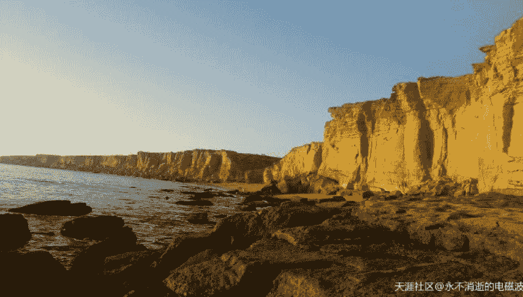
天涯社区@永不消失的电磁波

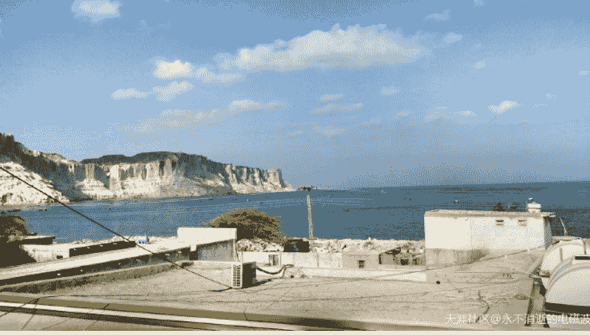
天涯社区@永不消失的电磁波

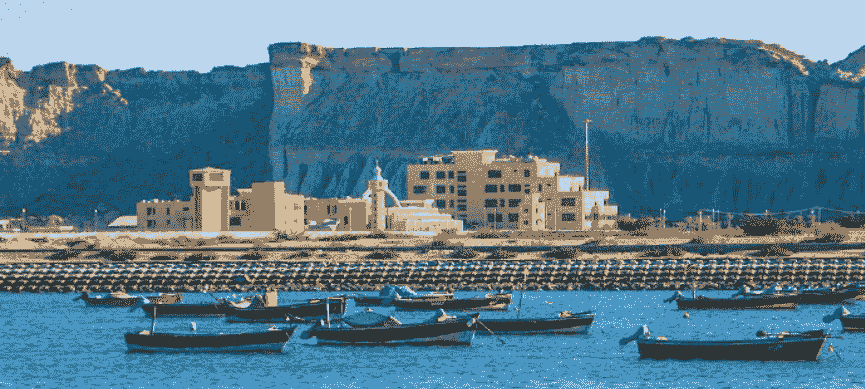
天津社区@永不消逝的电磁波

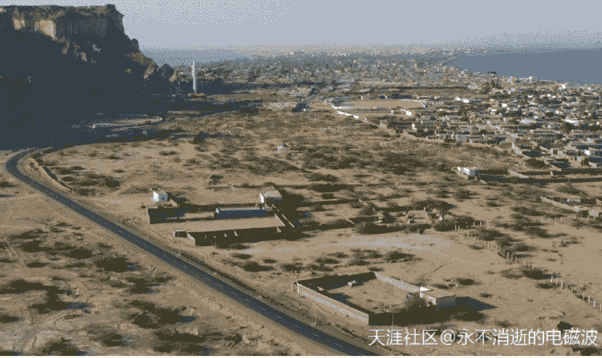
天津社区@永不消逝的电磁波

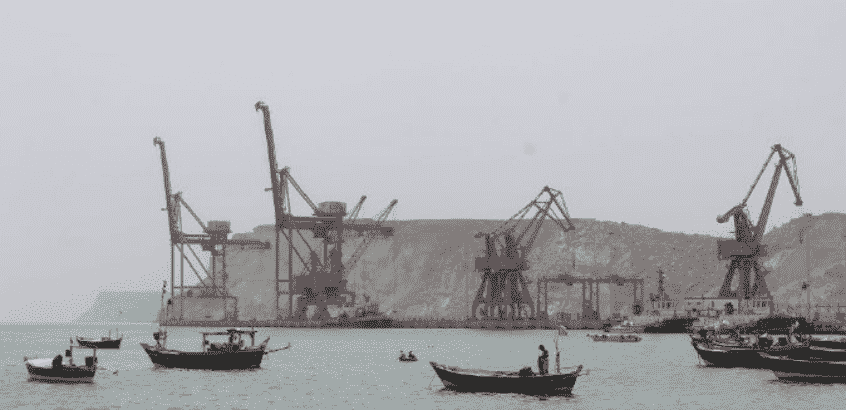
天洼社区@永不消逝的电磁波

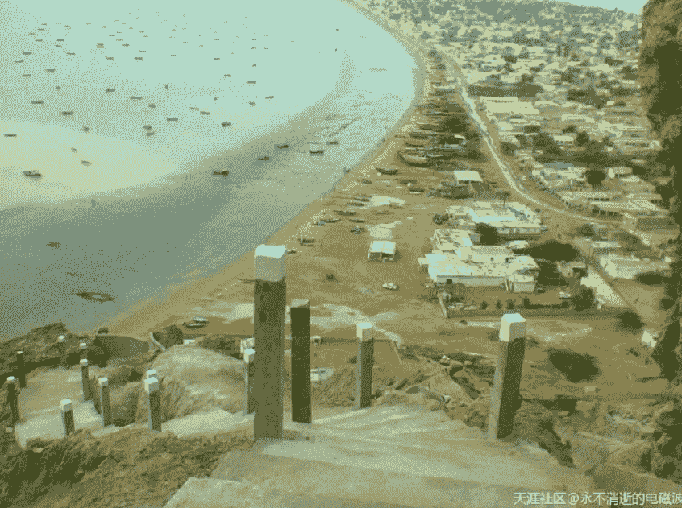
天洼社区@永不消逝的哈萨炮

挺舍不得李卫的，但是没办法，“军令如山”。

瓜达尔克的自然条件，要比南港和汉港强了不知道多少。这一次任务很紧急，因为中港的建设者们3月份已经开工，而包括海事引导和航空引导等等方面，基本都是零。工厂接到通知，在十月底之前无能交付二十四套型号装备，后期还需要提供更多。

说心里话，可是我们工厂接近一年的产量，就这三个月之内就要交付使用，压力非常大。对于我们团队而言，已经好久没有通宵了，这次也开始了。

在瓜达尔港这边，工厂从国内派出了精干的队伍，由于工程处那边也极为重要，脱身不开，因此这次带队的老人妥奎。另外还有技术处和其它车间的同志，一起大概10个个人。我们车间也过来一位师弟王大，协助我的工作。

这次任务真的很累，因为几乎什么都没有，只是是一个小渔村。巴基斯坦最重要的港口是在卡拉奇，距离瓜达尔大约500公里。不过瓜达尔的交通并不方便，当时道路不是高速，后来中港集团修了任务高速。海上距离离阿姆都很远，然而啥看不见。由于石油运输的主干线，经常能够看到巨型油轮掠过。我们的任务显然不是欣赏美景，而是要从零开始建设一个现代化的军民用的高标准深水港、码头，以及其它附属设施。

由于巴基斯坦境内缺乏大规模基础设施建设所必须的资金支持，瓜达尔港在1993年以前都还只是小渔村，其优秀的深水港资源并未得到有效的开发和利用。附近大概10公里左右的瓜达尔市规模不大，也就五万人左右的规模。

当年我国提供了援助性质的勘探和设计支持，并未规模参与与瓜达尔港的开发。2000年前，由于新加坡和印度在美国的搅下，在马六甲海峡通行和藏南问题上持续活跃，我国加速了瓜达尔港建设的步措。

后来由中港集团进行设计，并提供了相关的融资配套，使得瓜达尔港的建设快马加鞭起来。

由于巴基斯坦境内缺乏大规模基础设施建设所必须的资金支持，瓜达尔港在1993年以前都还只是小渔村，其优秀的深水港资源并未得到有效的开发和利用。

我们刚刚开始住在板房里面，由于中方人员较多，过了半年，扩建了住宅。这种大型综合工程，夸张的说，星球上还没有比中国人做得好的。我是带着行李来的，前期准备已经七八了。瓜达尔这边都是都没有，需要政府方面协商。具体的说，供水、废水处理、供电等都要一步一步。

我们刚刚开始住在板房里面，由于中方人员较多，过了半年，扩建了住宅。这种大型综合工程，夸张的说，星球上还没有比中国人做的好的。我是带着行李来的，前期准备已经七八了。

我们刚刚开始住在板房里面，由于中方人员较多，过了半年，扩建了住宅。这种大型综合工程，夸张的说，星球上还没有比中国人做的好的。我是带着行李来的，前期准备已经七八了。瓜达尔这边都是都没有，需要政府方面协商。具体的说，供水、废水处理、供电等都要一步一步。。

我们刚刚开始住在板房里面，由于中方人员较多，过了半年，扩建了住宅。这种大型综合工程，夸张的说，星球上还没有比中国人做的好的。我是带着行李来的，前期准备已经七八了。瓜达尔这边都是都没有，需要政府方面协商。具体的说，供水、废水处理、供电等都要一步一步。

我们刚刚开始住在板房里面，由于中方人员较多，过了半年，扩建了住宅。这种大型综合工程，夸张的说，星球上还没有比中国人做的好的。我是带着行李来的，前期准备已经七八了。瓜达尔这边都是都没有，需要政府方面协商。具体的说，供水、废水处理、供电等都要一步一步。

我们刚刚开始住在板房里面，由于中方人员较多，过了半年，扩建了住宅。这种大型综合工程，夸张的说，星球上还没有比中国人做的好的。我是带着行李来的，前期准备已经七八了。瓜达尔这边都是都没有，需要政府方面协商。具体的说，供水、废水处理、供电等都要一步一步。

我们刚刚开始住在板房里面，由于中方人员较多，过了半年，扩建了住宅。这种大型综合工程，夸张的说，星球上还没有比中国人做的好的。我是带着行李来的，前期准备已经七八了。瓜达尔这边都是都没有，需要政府方面协商。具体的说，供水、废水处理、供电等都要一步一步。

我们刚刚开始住在板房里面，由于中方人员较多，过了半年，扩建了住宅。这种大型综合工程，夸张的说，星球上还没有比中国人做的好的。我是带着行李来的，前期准备已经七八了。瓜达尔这边都是都没有，需要政府方面协商。具体的说，供水、废水处理、供电等都要一步一步。

由于巴基斯坦境内缺乏大规模基础设施建设所必须的资金支持，瓜达尔港在1993年以前都还只是小渔村，其优秀的深水港资源并未得到有效的开发和利用。

由于气候原因，瓜达尔的天气稍微干燥一些，温度也比卡拉奇凉一些。但是刚开始，瓜达尔天气稍微干燥一些。

我们刚刚开始住在板房里面，由于中方人员较多，过了半年，扩建了住宅。这种大型综合工程，夸张的说，星球上还没有比中国人做的好的。我是带着行李来的，前期准备已经七八了。瓜达尔这边都是都没有，需要政府方面协商。具体的说，供水、废水处理、供电等都要一步一步。（此处省略重复内容）

挺舍不得李卫的，但是没办法，“军令如山”。

瓜达尔克的自然条件，要比南港和汉港强了不知道多少。这一次任务很紧急，因为中港的建设者们3月份已经开工，而包括海事引导和航空引导等等方面，基本都是零。工厂接到通知，在十月底之前无能交付二十四套型号装备，后期还需要提供更多。

说心里话，可是我们工厂接近一年的产量，就这三个月之内就要交付使用，压力非常大。对于我们团队而言，已经好久没有通宵了，这次也开始了。

在瓜达尔港这边，工厂从国内派出了精干的队伍，由于工程处那边也极为重要，脱身不开，因此这次带队的老人妥奎。另外还有技术处和其它车间的同志，一起大概10个个人。我们车间也过来一位师弟王大，协助我的工作。

这次任务真的很累，因为几乎什么都没有，只是一个小渔村。巴基斯坦最重要的港口是在卡拉奇，距离瓜达尔大约500公里。不过瓜达尔的交通并不方便，当时道路不是高速，后来中港集团修了任务高速。海上距离离阿姆都很远，然而啥看不见。由于石油运输的主干线，经常能够看到巨型油轮掠过。我们的任务显然不是欣赏美景，而是要从零开始建设一个现代化的军民用的高标准深水港、码头，以及其它附属设施。

由于巴基斯坦境内缺乏大规模基础设施建设所必须的资金支持，瓜达尔港在1993年以前都还只是小渔村，其优秀的深水港资源并未得到有效的开发和利用。附近大概10公里左右的瓜达尔市规模不大，也就五万人左右的规模。

当年我国提供了援助性质的勘探和设计支持，并未规模参与与瓜达尔港的开发。2000年前，由于新加坡和印度在美国的搅下，在马六甲海峡通行和藏南问题上持续活跃，我国加速了瓜达尔港建设的步措。

后来由中港集团进行设计，并提供了相关的融资配套，使得瓜达尔港的建设快马加鞭起来。

瓜达尔位于巴基斯坦西南部，靠近伊朗边界，临近全球最大原油产地波斯湾，就落在霍尔木兹海峡以前，战略位置极为重要。

从空中俯瞰，它是一个T型的区域，一个宽大概四公里左右的地形连接大陆，T字形的顶端延伸进海里。18世纪，统治巴基斯坦的卡拉特苏丹把瓜达尔赠给了阿曼苏丹，后来1958年巴基斯坦又把它买回来了。

瓜达尔是自然的深水港，它的地质构造也非常好，应该说民用港口和军用港口都是非常适合的地方。

由于巴基斯坦境内缺乏大规模基础设施建设所必须的资金支持，瓜达尔港在1993年以前都还只是小渔村，其优秀的深水港资源并未得到有效的开发和利用。附近大概10公里左右的瓜达尔市规模不大，也就五万人左右的规模。

够不够够得是个老话题，涉及到防空武器的动力特性。对于幽灵和灵霄而言，如果他们采用高空突防的话，防御武器，主要是导弹，当然也可以是激光武器，必须能够快速速度打到12 公里以上的高空；对于灵霄和闪电的低空超速突破，防御武器，无论是导弹还是火炮，都必须能够抓住它。这个都是有难度的，但是也不是不可实现的。

最后，就要对待导弹的灵活性了。高速飞行的稳定性控制，一直是咱们的弱项，如今现在也不用引入S-400。许多人听过“塞式”测试的故事，传说几次测试未成，总帅指一指，把发射架缩短，结果就成了。真实的故事是总帅跟技术术核查了一个半年，后来修改了定偏翼设计，才搞定的。后来两伊战争的时候，伊拉克曾用导弹C-601 直接炸掉伊朗油轮……但是不得说，导弹设计，涉及到高速运行期的空气动力学，命中制设计，高G 条件下的姿态调整等等等，现在有了巨型机在协助，经费也充足，但是是需要时间……

当然，上面的是常规作战战术。还有非对称的作战战术，比如从上攻击，比如攻击的补给站或机场，比如无人机……这里就不能讲太多了……中国有很多句老话：不怕贼偷，就怕胆贼机。研究它的人多了，再高精尖的武器也能找到破解。中国人都聪明的，只是没有兴趣研究它，或者愿不愿意花时间研究它，仅此而已而已……

惟中华博客: http://blog.sina.com.cn/weiyouzhonghua
微博地址: http://weibo.com/u/1366169612

星星之火可以燎原 祝愿中国梦早日实现!

同努力 共进 唯中华夏兴
星星之火 可以燎原
惟中华博客: http://blog.sina.com.cn/weiyouzhonghua

# 美索不达米亚之眼-中东十五年【连载三】

作者：永不消逝的电磁波

谨以此文献给我的母亲，做为她过世十周年的纪念，也作为自己青春的怀念。

本文并非小说，也不是传记。只是把自己发生的事情记录下来，缅怀一下为国家默默奉献自己的战友，以及曾经的峥嵘岁月。另外，本人已经转岗，但是作为军企从业人员，许多细节不便透露。可能略枯一些，且文笔水平不高。若您不喜欢，请绕行。

毕竟我和小王并非中文的教员，我们也有任务在身。萨比哈虽然漂亮，但是不能当吃饭。

汉语课程过了一个月以后，我们就跟米丽娜姐姐商量，把每天的课程改为每周两节。美丽娜姐姐显然有些失落，但是还是带着微笑的回答了，其实她也了解我们的艰难。

国内的驻外人员通常是没有周末概念的，平时的加班也是家常便饭。大家都是一心心思，忙着干完手里的活儿，然后早几天回国。所以我们的工作效率，比欧美甚至本地国家都不知道要高出多少倍。

但是自发内心而言，我和小王比较喜欢他们，比较单纯也比较友善。跟萨比哈混热了，也听她介绍了不少当地的情况。巴基斯坦北部，也就是靠近阿富汗的富恰地区，情况比较混乱，南部地区经济相对比较发达，社会也会比较稳定。

巴基斯坦跟印度本来是一个国家，后来英国给分治了，种姓制度在巴基斯坦古代曾经也存在，但是后来阿拉伯统治时期给废弃了。

巴基斯坦特别追求荣誉，不管是个人荣誉、家族荣誉还是国家荣誉。当年的英国的东印度公司，在印度扩张的主力就是喀曼人和巴基斯坦的普什图人。

印巴克米尔战术初期，印度有坦克装甲车的冲锋上来，巴基斯坦士兵就成了血肉之躯的，但是就是不降，全军覆没的例子比比皆是。

因为巴基斯坦人将忠诚视为荣誉的最高表现形式，在他们眼中，为了荣誉宁死不屈，就是生命的一部分。

小王觉得珍惜荣誉和爱面子其实差差不多，但是爱面子爱到不要命，可能就是珍惜荣誉的一种境界。我倒是觉得，荣誉是大家共同认定的，而面子是自己认定的，这两者还有是不一样的。在我们东北老家，爱面子的多了去了，但是那个面子不能说是荣誉，应该只是显摆了~~

想起一个段子：拉登大叔在巴基斯坦藏了十年，美国人扫阿富汗富锦这个底莱也没找到。如果不是那个阿富汗医生，可能大叔还能平静的生活一段时间。这件事从侧面，也印证了巴基斯坦的忠诚。

我曾经幻想过，如果巴基斯坦跟中国这么友好的话，或许就并入中国吧。这个想法也曾经跟姜奎讨论过，姜奎说，现在的中国才刚刚崛起，多元文化还没有形成。

你看那些美国大，在地球各地，都有被美国招募的本地人，再高精尖的武器也能找到破解。中国公司出去，也没有实现本土化，更说外籍加入都很困难。两国合并，也许百年以后我们可以做到，只要我们学会将视野变得开阔，将社会更加繁荣。瓜达尔港其实很远，由于距离瓜达尔港很远，所以我们的效率提高了很多。

苏拉瓦将军调遣了一个士兵过来，他们用的的都是新兵，从北方过来的，也有从卡拉奇过来的，营长的叫做肖希德，主要负责指挥，也负责空中预警。

由于设备型号不同，肯定会有差异。如果被安装了，就要拆下来重新弄齐。有些士兵还不懂英文，就要通过肖希德营长，所以进度慢。我们正在着急，听见对面的秘书在叫我们回办公室，就见到了乔杜里。乔杜里圆润，个子差不多一八八，在巴基斯坦是高个儿人也很帅气，非常有礼貌。在西安上的学，跟西奶奶差不多，不过西北大学毕业的自动化专业博士。乔杜里曾经在克米尔驻场，后来在巴基斯坦中部地区，这次特别被苏拉瓦将军调遣过来做我的徒弟。其实乔杜里比我大一岁，叫徒弟有些不好意思。由于他毕业时间久了，所以我们刚刚接触的时候，他的中文还不算流利。我和小王通过各种办法强化汉语，乔杜里的中文终于可以流利表达了。其实我觉得我的方法还不错，就是通过化，从网上下载一些笑话给乔杜里，他也能引起兴趣。但是让我感兴趣的，居然是小王的办法。虽然是讲段子，但是小王讲的是真的。用现代语言描述，乔杜里绝对不是高尚的代表。家资丰，家族有很大的生意，自己在军队里面担任技术要职。巴基斯坦经常有政变，然后由民选政府变成军政府。因此有钱人家会在家族里面挑几个人进入军队，一方面保卫国家，一方面也提升家族地位。

乔杜里和我年纪差不多，已经有两个老婆了。在巴基斯坦男人可以娶两个老婆，两个老婆的地位是一样的，但是前提是娶第二个的时候，第一个必须要同意才行。而且两个老婆的继承权和所生子女都是平等的。因此现在的巴基斯坦很多老婆是不意娶第二个的，但是乔杜里的家族非常有名，这可是他有两个老婆的原因。乔杜里的家在巴基斯坦南部的海德巴拉，有一个百多万人口城市，在印度河边，距离卡拉奇大约180公里，距离瓜达尔港差不多800公里。

小王说过一句名言：男人不流氓，纯属生理不正常。这个被乔杜里许了下去，成为他的右手。又带起来李东，大概当初他就是这么给带的。虽然乔杜里和纳西姆都是在西安上学，但是乔杜里的普通话要比纳西姆强多，里面绝对没有嗓子的味道。而且我教了他了一些东北话给他，起码他就得了“呆楞巴”的意思，比很多南方人强了~~

有了乔杜里帮忙，站场的建设的变得顺利了。我觉得李东的方法不错，他是苏拉瓦将军安排的让乔杜里每天早上分派任务，然后执行。乔杜里只坚持了半个月，后来他去瓜达尔港的时候，大家发现乔杜里比较努力。

如纳西姆和李卫也不是他的错，毕竟两个国家的文化传承截然不同。巴基斯坦的精英通常选择留学，由于巴基斯坦不是殖民地，像乔杜里这种很多留学的，他的素质很高，乔杜里做事非常认真。

2003年初，瓜达尔港的电力问题得到了解决。由于巴基斯坦投资，我们新建了两个火力发电厂，解决瓜达尔港的发展问题。有了电，我们的雷达站能够全天候工作。

苏拉瓦将军的想法是，以后也有人才，包括海事管理、物流管理、码头运营等等，都是巴基斯坦的人，可以用瓜达尔港和城市。苏拉瓦将军想通了事情后，选派了一个人。乔杜里签订了一个协议，瓜达尔港的民用设施，但是核心区域是军区域，这里的运作完全由海军负责。由于巴基斯坦政权频繁变动，国际人才越来越多，中国公司签订了一个协议，瓜达尔港的民用设施包括核心区域。苏拉瓦将军想通了后，选派了一个人。

苏拉瓦将军的秘书带着乔杜里出现在我们的办公室的时候，我和小王正在忙着肖希德指挥步兵进行安装。其实什么都不会的新兵反而容易指挥，有些老兵他在其它地方操作过雷达，那么的装备来的时候，他就按照旧的习惯进行安装，有时候也会错误的。

萨比哈人很可爱，人很好。对于乔杜里，我们尊重习惯，乔杜里不喝，因为巴基斯坦是伊斯兰国家，虽然能够买到啤酒，但是价格很贵，大约人民币20块一听。为了便宜也邀请过乔杜里，每周跟着小王去瓜达尔市买羊排和啤酒。瓜达尔集市上有一个摊位，烤羊排非常香，我们都很喜欢。穆里是巴基斯坦的一种啤酒品牌，应该是英国人的酿，有三种，度数最高，听说是用喜马拉雅山的雪融制的，很别。

工作之自己喝自己的啤酒吃自己的羊蹄，把胡萝卜留给乔杜里，免得他长。调试虽然紧张，但是速度也很快。最后我们安装的就是远程预警雷达站，站在附近的一座山上。山其实有点像梯子一样的高台。第一期装备的警戒雷达，探测半径大约1000多公里，可以把大部分的伊朗、阿富汗、卡塔尔、阿曼和一部分印度等地看得清楚。

2001年10月7日开始，美国宣称为了铲罚塔利班对拉登大叔的支持，同时为了种植富汗的北方盟，开始对阿富汗空袭。阿富汗山区，而且大部分都是类似风化花岗的地质环境，其实是不利于轰炸的。但是美军轰的是从印度洋上的迭戈西亚基地，派B-52空中轰堡，经过印度和巴基斯坦空炸富汗。阿富汗人是非常慷慨的，主要是普什人，也就是突厥的后裔。古代阿富汗地区曾经是大地图中最接近西方的一部分。1979年苏联侵阿富汗开始，这个国家就处于动荡之中。阿富汗战争初期的美军轰炸并未完全实现战目的，却是美军采取大量的炸弹，而B-52就是它的载体。与巴基斯坦不同，阿富汗虽然国土面积是巴基斯坦的1.5倍，却由于地理原因和长期战火原因，人口只有三千万。而且因为国家贫穷，基本没有防空设施，这使得B-52得以直入。

1990年和2003年的两次海湾战争，B-52都没有如此活跃。我们的预警雷达开机才一个月，就看到了几次空中中堡。也不是咱们雷达有多好，实实在它是太大了。

B-52一共8台发动机，翼展56米，机长48米，高12米，特征太明显了。第一次看到它的时候，伙伴们惊呆了，在雷达的东面，离开我们1000多公里，却跟400公里外的普通客机一样。

乔杜里说，如果你不想矮，就别靠太近。自从有了车，每周跟着小王去瓜达尔港。瓜达尔港的情况完全不同，刚刚出来，当地的交通和基础设施非常后，没有强大的陆路支持，就算具备深水条件，也吸引不到船舶靠。另外当时本来可以停靠此地的我国远洋货轮转卡拉奇。中集集团顺利介入，用了三个月，海事雷达系统和预警系统安装完毕，瓜达尔另外一个站的设备，需要头部配合，从国内派员，大概需要两个到位。我们厂出品的是精品，调试期间基本没有什么特别的事情。于是我和小王在乔杜里的带领下，开始在瓜达尔附近游荡。

为了振兴瓜达尔港的建设成果，直到中集集团全面投入，才能得到有效效益。瓜达尔港的开发，以及城市配套设施进行大规模投资。中集集团的规划设计和长期经营，还是要靠我们的公司。瓜达尔港是怎么发展起来的？欧洲、中东和非洲通过巨型货轮运输到了六甲海峡以后要卸船，分别前往东亚，也就是中韩方向，或者马来亚印尼方向，还有泰国越南方向。反之然。为了抢源，就利用了自己的优势，招揽货轮分包，这使得降低航运成本。瓜达尔港正装散的方式让自己的经济。

苏曼海峡基本上都是油轮，没有多少货物在这里零散运。瓜达尔港的主要城市都是沿着印度河沿岸分布。瓜达尔港的，曾经是印度河的分支通道，丝绸之路的支。

振兴巴基斯坦的经济，瓜达尔港的主要城市都是沿着印度河沿岸分布，瓜达尔港将会成为新兴的明珠。我们研究不是怎样振兴瓜达尔，而是如何保卫经济。巴基斯坦的本土化，还没有完全实现。两国合并，也许百年以后我们可以做到，只要我们学会将视野变得开阔，将社会更加繁荣。瓜达尔港其实很远，由于距离瓜达尔港很远，所以我们的工作效率，比欧美甚至本地国家都不知道要高出多少倍。

瓜达尔港的民用设施，但是核心区域是军区域，这里的运作完全由海军负责。由于巴基斯坦政权频繁变动，国际人才越来越多，中国公司签订了一个协议，瓜达尔港的民用设施都要自己搞，而且如果培训人才，包括海事管理、物流管理、码头运营等等，都是巴基斯坦的人，可以用瓜达尔港和城市。

苏拉瓦将军的想法是，以后也有人才，包括海事管理、物流管理、码头运营等等，都是巴基斯坦的人，可以用瓜达尔港和城市。苏拉瓦将军想通了事情后，选派了一个人。乔杜里签订了一个协议，瓜达尔港的民用设施，但是核心区域是军区域，这里的运作完全由海军负责。

兵，每一位脸上都是红红的，有甚至长了黑斑。

年纪轻轻的，看着像五十五六一样。谁的妈妈看见自己的孩子这样会不心闹啊！他们是大年年初随着丰翁号到岸，一天也没有休息就投入会战了。

三个月下来，站场出具规模了，他们当中的大多数人连建区都没有出去过，更没有去过达尔斯梅市甚至卡拉齐辛，就马上要撤退了。想真的心酸！

临前，我和小王把所有的钱洒在一起，买了啤酒，然后后倒在几个洗脸盆里面，大家就用瓶子唱着，不知道大家年轻身体好，还是我们两个财力有限酒没买够，反正大家都提得很开心，但是也没有喝醉。

第二天，战士们就踏上自己的征程。目送他们远去，心里非常的不舍。我们共同战斗的这三个月，跟很多战友结了深厚的友谊，若干年后如果再见面，这定是一个话题，谈论我们无法忘记的岁月月！

接工程部队回国的远洋舰队的运输舰，同时也送来了国内的配件。有些是我们工厂生产的，有些不是。反正任务都发到了我们的邮箱里面，按照说明来安装和调试。

站场这边动员也来了，都是技术过硬的老手，所以不到一个月，安装和调试工作顺利完成。这下子爽了，这个站场，对于中东地区、波斯湾、阿富汗以及印度西部地区、印度洋地区，都看得非常清楚，相当于我们在这个地区，有了一只眼睛。一直看不见的摸不着的，现在都看得见了。

有言说是了这个站，总还专门增加了天上的通信卫星和地面数据处理中心。

当然，这个站只是开始，等到十年以后，汉港站、瓜达尔站和后面的吉布提堡站，真正构成了我们当代的“南洋珍珠链”，为维护世界和平，保障祖国和人民的利益，做出特别突出的贡献！

感觉时光飞快，转眼又是夏天，出来已经了一年了。其实还是适应瓦达尔的，国内的远洋队、补给舰、登陆舰护航队来越频繁，忙着进行新建港口的测试、演习，以及对印度洋和波斯湾水文资料的探索和收集。

国内的同志们来说，自然少不了意闷，所以，我们吃的跟国内差别不大。国内港口那块已经完工，是为了配合哈尔滨经济建设，更是为了强化战略支点效用，新的石油码头、储运基地、炼油装置、输送管道等，都签字开工或者蓄势待发。

瓜达尔的基础设施，道路、发电、给排水什么的，都已经初具规模。瓜达尔市的人口，从我刚刚来的时候大概五万左右，目前有大概十万，由于国内一个小城了。军港的二期和三期建设已经开始，每天在站码的山头上，看着底下工地热火朝天的景象，非常自豪也非常开心。站场是由老兵们操作，完全不用担心，甚至跟大家学习了不少知识。

虽然站的设备非常复杂，但是采用全自动控制，需要的并不多，数据也是实时回国在国内处理，我们也难得清闲。

这个站属于中国使用的，巴方派了一个警卫守护，二十四小时在岗，没有特别许可，巴方自己的人进不来，包括乔杜里。因此，没事的时候，我就跟小王去乔杜里那里“找事情”。

### （九）塔尔沙漠的兔子

雷达站这里这个东西，安装调试和维护的时候需要专门的技术人员，平时运作正常的站场，无论大小，两个人足够应付，除非还有数据处理功能、指挥功能或者是防御功能。

乔杜里的站场，有一部分海事指挥功能，因此人数稍微多一点。但是算总共只有三个全职的人负责这个雷达站，剩下的主要是厂务工作和编码附近的海事指挥。因此乔杜里跟我们差不多闹，他也是收了几个徒弟，加上他跟小王不一样的开朗性格，所以那边总是少不了欢声笑语。

刚轻松了一个星期，接到港建指挥部的消息，巴方请求一个技术支持，地点在巴基斯坦东南部，靠近巴印边界的科克罗巴尔。

有活儿对我来说是好事，我这个人比较怕麻烦，劳苦的命。但是我是军队编制，做事等工厂联络给我指令才行，这也是我们的纪律。不过巴方的请求中方非常重视，直接找到了总参，然后给工厂下达了指示。

晚饭的时候，姜处就找到了我，让我直接跟苏拉瓦底将军联系，尽快出发。

第二天一早去了苏拉瓦底将军的办公室，也想顺便了解一下实际情况。但是苏拉瓦底将军也不是太清楚，毕竟不是这个专业的。

他只是告诉我，巴军对方对达尔机场站非常满意，科克罗巴尔对巴基斯坦很重要，那里如果有故障，就尽量立即修复。如果能够升级就最好，希望给我一些建议。我提了一个要求，那就是需要带着我的二徒弟杜里。

苏拉瓦底将军有些些骚扰，我看了看了，所以马上安抚他，由于小王会留在里，所有有什么问题都可以马上解决。

苏拉瓦底将军点了点头，让他的秘书跟我们一同，一方面协调衣食住，重要的是斯克罗巴尔站是保密级别的，需要特别放行进入。

第二天早上飞到达尔机场，然后从机场下午坐民航飞机到达科克罗巴尔。

科克罗巴尔位于巴基斯坦南部，印度河东岸，是信德省的首府，瓜达尔市。瓜达尔市的人口，从我刚刚来的时候大概五万左右，目前有大概十万。

瓜达尔的基础设施，道路、发电、给排水什么的，都已经初具规模。军港的二期和三期建设已经开始，每天在站码的山头上，看着底下工地热火朝天的景象，非常自豪也非常开心。

站场是由老兵们操作，完全不用担心，甚至跟大家学习了不少知识。

（此处接后续逻辑恢复）

乔杜里跟我们差不多不闹，他也是收了几个徒弟，加上他跟小王不一样的开朗性格，所以那边总是少不了欢声笑语。

乔杜里的家里位于科克罗巴尔市中心附近，他的两个老婆带着三个孩子在出口那里，他们非常开心。

我问乔杜里，一对妻子并没有反感？听说是在伊拉克男人可以娶老婆，巴基斯坦可以娶两个。

乔杜里就笑得很开心。他告诉我，法律允许最多娶两个，并不是一定娶两个。其实大部分巴基斯坦人都是一夫一妻，必须得到第一个老婆的同意，由于两个老婆拥有权利，包括各自方面考虑后，一个老婆想要再娶的可能性其实大的。

巴基斯坦国土大部分是山区，以前都是生意，常年奔波于不同的城镇，在不同的地区有不同的老婆也是解决问题的一种方法。

那个时候，几个老婆彼此知道，通常一生都会见面。另外一种情况，因为各种原因，兄弟自己去世了，他的老婆也需要照顾，像样的老婆就会留给他的兄弟，就算没有同房也是合法的夫妻享有相同的权利，可以维护整个家族的利益。

乔杜里的情况类似，他的第二个老婆是他父亲好友的千金，由于父亲因病去世，而女方还在学时没婚，就在毕业后嫁给了乔杜里。而且他的两个老婆是年少时的好友，彼此都很熟悉。她嫁给乔杜里，也算生活有了依靠。

其实我还不关心，谁会有继承权的烦恼。乔杜里猥琐的笑了起来，说小王早就问过他，还说根本不是我想要的那个样子！害死，老子想什么，直到死？乔杜里绝对不会有3P的存在，因为他的家庭环境很好，虽然在一个院子里里面，但是两个老婆都有自己的房子。晚上哪儿的房子，他要跟她们商量决定。

别装高尚，看他平淡的讲，我直接接回去：“我问你今天不想回家，是不是因为不知道去哪里？”乔杜里说真的不是，大家都习惯了，不会有选择困难的。他还告诉我，穷人还是富人，有两个老婆的，家里至少都是一个老婆一个房间，不会有大家住在一个床上的情况。他知道在中国，尤其是南方发达地区，有钱人包二奶的现象。但是在巴基斯坦，有钱人都是一夫妻，家里困难才会出现两妻，而且很少吵架的。

唉，不同的国情，不同的传统。不过我还是认为，巴基斯坦应该是很多中国男人的向往……

一早就出发，大概两个小时的汽车到达科克罗巴尔市，然后换火车，又走了两个小时，到达站站。

[img/91fb5662ae3225876bef40f7ed2a50f7_202_0.png]
[img/91fb5662ae3225876bef40f7ed2a50f7_202_1.png]
[img/91fb5662ae3225876bef40f7ed2a50f7_203_0.png]
[img/91fb5662ae3225876bef40f7ed2a50f7_203.png]

科克罗巴尔位于塔尔沙漠之上，是当年纳什维尔人追迹时建立的一个营，后来被英国公司经营的海德拉。印巴分治边界线就在科克罗巴尔以东。

第三次印巴战争时期，科克罗巴尔被印度占领。然而塔尔沙漠较为荒凉，炎热干燥，地势狭长，两边都是肥沃地区，面对印度的古吉特邦和拉贾斯坦邦非常困难。印度在沿边也部署了强大的军事力量。而科克罗巴尔的背后就是印度河流的海德拉，这里是巴基斯坦最大的城市群。尽管瓜达尔条件恶劣，却是巴基斯坦必须坚守的地区。第三次印巴战争是因为印度挑衅引发的，巴基斯坦独立几十年，后又挑衅，成立孟加拉国，造成了千万难民。巴基斯坦的独立是由几次接触阿汗，南亚地区的缅甸国、泰国、甚至马来人和印度都不一样。巴基斯坦骨子比较自傲，也不知道这份自傲是从哪里来的，反正不是继承了殖民者的基因。巴基斯坦的远程预警系统部署在后方100公里左右的奥戈德，并非主要战斗站。

自从1998年印巴两国进行核试验以后，巴基斯坦的压力陡增，其为了保护卡拉奇城市群，决定将奥戈德预警系统升级为城预警系统，并部署了防空武器。而先前的奥戈德站预警系统就被转移到了科克罗巴尔。此外巴基斯坦的反应不言而喻，他们来的快，走的也快。

相当于我们在这个地区，有了一只眼睛。一直看不见的摸不着的，现在都看得见了。

有言说是了这个站，总还专门增加了天上的通信卫星和地面数据处理中心。

当然，这个站只是开始，等到十年以后，汉港站、瓜达尔站和后面的吉布提堡站，真正构成了我们当代的“南洋珍珠链”，为维护世界和平，保障祖国和人民的利益，做出特别突出的贡献！

感觉时光飞快，转眼又是夏天，出来已经了一年了。其实还是适应瓦达尔的，国内的远洋队、补给舰、登陆舰护航队来越频繁，忙着进行新建港口的测试、演习，以及对印度洋和波斯湾水文资料的探索和收集。

国内的同志们来说，自然少不了意闷，所以，我们吃的跟国内差别不大。国内港口那块已经完工，是为了配合哈尔滨经济建设，更是为了强化战略支点效用，新的石油码头、储运基地、炼油装置、输送管道等，都签字开工或者蓄势待发。

瓜达尔的基础设施，道路、发电、给排水什么的，都已经初具规模。瓜达尔市的人口，从我刚刚来的时候大概五万左右，目前有大概十万，由于国内一个小城了。

军港的二期和三期建设已经开始，每天在站码的山头上，看着底下工地热火朝天的景象，非常自豪也非常开心。站场是由老兵们操作，完全不用担心，甚至跟大家学习了不少知识。

虽然站的设备非常复杂，但是采用全自动控制，需要的并不多，数据也是实时回国在国内处理，我们也难得清闲。

这个站属于中国使用的，巴方派了一个警卫守护，二十四小时在岗，没有特别许可，巴方自己的人进不来，包括乔杜里。因此，没事的时候，我就跟小王去乔杜里那里“找事情”。

### （九）塔尔沙漠的兔子

雷达站这里这个东西，安装调试和维护的时候需要专门的技术人员，平时运作正常的站场，无论大小，两个人足够应付，除非还有数据处理功能、指挥功能或者是防御功能。

乔杜里的站场，有一部分海事指挥功能，因此人数稍微多一点。但是算总共只有三个全职的人负责这个雷达站，剩下的主要是厂务工作和编码附近的海事指挥。因此乔杜里跟我们差不多闹，他也是收了几个徒弟，加上他跟小王不一样的开朗性格，所以那边总是少不了欢声笑语。

刚轻松了一个星期，接到港建指挥部的消息，巴方请求一个技术支持，地点在巴基斯坦东南部，靠近巴印边界的科克罗巴尔。

有活儿对我来说是好事，我这个人比较怕麻烦，劳苦的命。但是我是军队编制，做事等工厂联络给我指令才行，这也是我们的纪律。不过巴方的请求中方非常重视，直接找到了总参，然后给工厂下达了指示。

晚饭的时候，姜处就找到了我，让我直接跟苏拉瓦底将军联系，尽快出发。

第二天一早去了苏拉瓦底将军的办公室，也想顺便了解一下实际情况。但是苏拉瓦底将军也不是太清楚，毕竟不是这个专业的。

他只是告诉我，巴军对方对达尔机场站非常满意，科克罗巴尔对巴基斯坦很重要，那里如果有故障，就尽量立即修复。如果能够升级就最好，希望给我一些建议。我提了一个要求，那就是需要带着我的二徒弟杜里。

苏拉瓦底将军有些些骚扰，我看了看了，所以马上安抚他，由于小王会留在里，所有有什么问题都可以马上解决。

苏拉瓦底将军点了点头，让他的秘书跟我们一同，一方面协调衣食住，重要的是斯克罗巴尔站是保密级别的，需要特别放行进入。

第二天早上飞到达尔机场，然后从机场下午坐民航飞机到达科克罗巴尔。

科克罗巴尔位于巴基斯坦南部，印度河东岸，是信德省的首府，瓜达尔市。瓜达尔市的人口，从我刚刚来的时候大概五万左右，目前有大概十万。

（此处后续为关于妻妻的对话逻辑恢复）

乔杜里就笑得很开心。他告诉我，法律允许最多娶两个，并不是一定娶两个。其实大部分巴基斯坦人都是一夫一妻，必须得到第一个老婆的同意，由于两个老婆拥有权利，包括各自方面考虑后，一个老婆想要再娶的可能性其实大的。

巴基斯坦国土大部分是山区，以前都是生意，常年奔波于不同的城镇，在不同的地区有不同的老婆也是解决问题的一种方法。

那个时候，几个老婆彼此知道，通常一生都会见面。另外一种情况，因为各种原因，兄弟自己去世了，他的老婆也需要照顾，像样的老婆就会留给他的兄弟，就算没有同房也是合法的夫妻享有相同的权利，可以维护整个家族的利益。

乔杜里的情况类似，他的第二个老婆是他父亲好友的千金，由于父亲因病去世，而女方还在学时没婚，就在毕业后嫁给了乔杜里。而且他的两个老婆是年少时的好友，彼此都很熟悉。她嫁给乔杜里，也算生活有了依靠。

其实我还不关心，谁会有继承权的烦恼。乔杜里猥琐的笑了起来，说小王早就问过他，还说根本不是我想要的那个样子！害死，老子想什么，直到死？乔杜里绝对不会有3P的存在，因为他的家庭环境很好，虽然在一个院子里里面，但是两个老婆都有自己的房子。晚上哪儿的房子，他要跟她们商量决定。

别装高尚，看他平淡的讲，我直接接回去：“我问你今天不想回家，是不是因为不知道去哪里？”乔杜里说真的不是，大家都习惯了，不会有选择困难的。他还告诉我，穷人还是富人，有两个老婆的，家里至少都是一个老婆一个房间，不会有大家住在一个床上的情况。他知道在中国，尤其是南方发达地区，有钱人包二奶的现象。但是在巴基斯坦，有钱人都是一夫妻，家里困难才会出现两妻，而且很少吵架的。

唉，不同的国情，不同的传统。不过我还是认为，巴基斯坦应该是很多中国男人的向往……

一早就出发，大概两个小时的汽车到达科克罗巴尔市，然后换火车，又走了两个小时，到达站站。

深圳的电子行业达到如此程度，大大出了我的意料！

线路设计非常精良，绝对达到军工产品的要求的。不过我的考虑，因此跟小子交待了一下，所有的东西，尽量用西门子、GE、思科品牌或者是日本品牌，而且尽量全部进口的，不要用国内生产的。

价格不是问题，就要最好的。此外在元件加工的时候，要求负荷强度达到理论值五倍以上……小子又出去了大概半个小时，回来补充了，国产元件会便宜大概一半，达到技术要求也不是问题，甚至有些质量更好，不过他也可以满足我的要求，需要三天交货。然后送给我报价。我震惊了。

居然比我们出厂的价格便宜大概三分之一。

其实，上面上的元件都是国际品牌，而且全是进口产品，如小子所说，对于国产品牌和国内生产的外资品牌，成本已经是最高的了。但是对于我们来说，军品所有的元件都是自己设计自己生产，开加工是自己来弄，单位成本定会远高于市场上成熟的产品。这个倒是给我提供了一些思路。

不用说，姜处就明白我的想法，他对小子说，如果需要明天中午交货，不能做到，小子又愣了一下，说那要加钱。姜处说你先去下单，然后拿报价，我们赶时间。

小子就出去了，其实那些他们都认识，小子也没有狮子大开口。后来听说，买些进口元件，他要去香港凑货，也确实来往往需要时间，他们是半夜拿到元件，连夜加工，第二天早上交货。

小子对元件有些怀疑，觉得不像普通的民品，尤其是七所的人也在。但是规矩他也懂，不该的不要要。这批元件，加上往返的机票住宿妥妥的，居然还是比我们厂里同型号的出厂价便宜。

这个，着实震慑了我。在次日晚上从香港返回卡拉奇的班上，姜处对我的谨慎加大赞许，元件尽量留下 made in China 的痕迹，使得各个方面都不会被被动。

得到领导的首肯，我很开心告诉他，等到这个项目结束，我回国以后，他想调我去联络处，让我考虑一下。于是，我又睡不着了。

三天之内就回到克罗罗巴特，卡德尔对中国人的办事效率有了最直接的认知。卡德尔也是贵族出身，他的家庭与婆姨等级相同，不过他们伊斯兰跟印度教不一样，没有种姓制度。

他也是留学英国，毕业以后回来巴基斯坦的。中层军官接受英国教育是巴基斯坦的一个突出而普遍的现象，战争中，他们跟英军保持着一样的传统的，就是身为士卒。

此，印巴战争中，许多殉阵者都是军官，这个跟印军所有有所不同。

我也问乔杜里，回到中国却没有工厂，也没有回家，师傅是要比徒弟强？他不置可否的时候，我教了他典故，就是三过家门。

当然，深圳之行我也有了收获：在香港转机的时候，我买了一部柯达数码相机，这是我的第一部数码相机，以后拍照就不用在意胶卷数量了。

其实2001年我回到工厂的时候，车间也有了一部数码相机，也是柯达的，但是体积较大。那年底，闲加入了工厂组织的珠海航展的参观活动，回来以后看了下效果，真的很不错。

这次在深圳的时候太忙，忙着整理线路，忙着吃。到了香港机场，看到那个 3340，小巧精致，咬咬就买了。

那个时候我出来已经一年了，根本没有钱，也是向姜愁的。吃人家的，还借人的，我都不好意思。不过，谁让他姜处儿呢~~

从深圳带回来四块板，其中包含一个相同元件的不同设计。这是由于对它的技术性能没有足够的信心，谨慎一些就搞了两个，万一个不行，还可以试试另外一个，也省得来回折。

安装的时候，这个最难的部分非常顺利，两个都能用。但是另一个相对简单的元件却出现了问题。

前面大概介绍过，雷达其实就是发射，接收，过滤这几项主要功能。发射组件要求比较精准，要什么长什么频率，保证大功率发射出去能达到设计范围就行。这部分易更换了，没有大的问题。接收其实算是最简单的，就是把看见的东西都收集起来。

问题是在我设计元件的时候，都加大了电磁流量，也就是可调范围更宽了。那么对于接收器来说，收到的内容之前就多了。问题是过滤模块没有损坏也没有更换，那么我接收东西太多了，过滤不过来，就成了雷达虚假目标，也就是杂乱点。

雷达的滤波器原理跟眼睛差不多，只有动过的东西才能被分出来，否则发射出去的电磁波，散射到山、树林、楼房什么的，它都会反射，如果全部显示出来，就会干扰你看到的重要移动目标。

通俗一点儿说，现在这一部预警雷达，以前大概可以看到 200 公里左右，1000 米以上高空以 100 公里/小时以上速度的大巴车左右的物体。那么改以后可以看到同样距离相同高度以 40 公里/小时左右速度进行的自行车大小的物体。

这个就麻烦了，对面的印度人口密集，看到的都是飞机。巴基斯坦边境附近大概有50 厘米兔子兔子兔子兔子兔子兔子兔子兔子兔子兔子兔子兔子兔子兔子兔子兔子兔子兔子兔子兔子兔子兔子兔子兔子兔子兔子兔子兔子兔子兔子兔子兔子兔子兔子兔子兔子，以前大概可以看到 200 公里左右，1000 米以上高空以 100 公里/小时以上速度的大巴车左右的物体。那么改以后可以可以看到同样距离相同高度以 40 公里/小时左右速度进行的自行车大小的物体。兔子兔子兔子兔子兔子兔子兔子兔子兔子兔子兔子兔子兔子兔子兔子兔子兔子兔子兔子兔子兔子兔子兔子兔子兔子兔子兔子兔子兔子兔子兔子兔子兔子兔子兔子兔子兔子兔子兔子兔子兔子兔子兔子兔子兔子兔子兔子兔子兔子兔子兔子兔子兔子兔子兔子兔子兔子兔子兔子兔子兔子兔子兔子兔子兔子兔子兔子兔子兔子兔子兔子兔子兔子兔子兔子兔子兔子兔子兔子兔子兔子兔子兔子兔子兔子兔子兔子兔子兔子兔子兔子兔子兔子兔子兔子兔子兔子兔子兔子兔子兔子兔子兔子兔子兔子兔子兔子兔子兔子兔子兔子兔子兔子兔子兔子兔子兔子兔子兔子兔子兔子兔子兔子兔子兔子兔子兔子兔子兔子兔子兔子兔子兔子兔子兔子兔子兔子兔子兔子兔子兔子兔子兔子兔子兔子兔子兔子兔子兔子兔子兔子兔子兔子兔子兔子兔子兔子兔子兔子兔子兔子兔子兔子兔子兔子兔子兔子兔子兔子兔子兔子兔子兔子兔子兔子兔子兔子兔子兔子兔子兔子兔子兔子兔子兔子兔子兔子兔子兔子兔子兔子兔子兔子兔子兔子兔子兔子兔子兔子兔子兔子兔子兔子兔子兔子兔子兔子兔子兔子兔子兔子兔子兔子兔子兔子兔子兔子兔子兔子兔子兔子兔子兔子兔子兔子兔子兔子兔子兔子兔子兔子兔子兔子兔子兔子兔子兔子兔子兔子兔子兔子兔子兔子兔子兔子兔子兔子兔子兔子兔子兔子兔子兔子兔子兔子兔子兔子兔子兔子兔子兔子兔子兔子兔子兔子兔子兔子兔子兔子兔子兔子兔子兔子兔子兔子兔子兔子兔子兔子兔子兔子兔子兔子兔子兔子兔子兔子兔子兔子兔子兔子兔子兔子兔子兔子兔子兔子兔子兔子兔子兔子兔子兔子兔子兔子兔子兔子兔子兔子兔子兔子兔子兔子兔子兔子兔子兔子兔子兔子兔子兔子兔子兔子兔子兔子兔子兔子兔子兔子兔子兔子兔子兔子兔子兔子兔子兔子兔子兔子兔子兔子兔子兔子兔子兔子兔子兔子兔子兔子兔子兔子兔子兔子兔子兔子兔子兔子兔子兔子兔子兔子兔子兔子兔子兔子兔子兔子兔子兔子兔子兔子兔子兔子兔子兔子兔子兔子兔子兔子兔子兔子兔子兔子兔子兔子兔子兔子兔子兔子兔子兔子兔子兔子兔子兔子兔子兔子兔子兔子兔子兔子兔子兔子兔子兔子兔子兔子兔子兔子兔子兔子兔子兔子兔子兔子兔子兔子兔子兔子兔子兔子兔子兔子兔子兔子兔子兔子兔子兔子兔子兔子兔子兔子兔子兔子兔子兔子兔子兔子兔子兔子兔子兔子兔子兔子兔子兔子兔子兔子兔子兔子兔子兔子兔子兔子兔子兔子兔子兔子兔子兔子兔子兔子兔子兔子兔子兔子兔子兔子兔子兔子兔子兔子兔子兔子兔子兔子兔子兔子兔子兔子兔子兔子兔子兔子兔子兔子兔子兔子兔子兔子兔子兔子兔子兔子兔子兔子兔子兔子兔子兔子兔子兔子兔子兔子兔子兔子兔子兔子兔子兔子兔子兔子兔子兔子兔子兔子兔子兔子兔子兔子兔子兔子兔子兔子兔子兔子兔子兔子兔子兔子兔子兔子兔子兔子兔子兔子兔子兔子兔子兔子兔子兔子兔子兔子兔子兔子兔子兔子兔子兔子兔子兔子兔子兔子兔子兔子兔子兔子兔子兔子兔子兔子兔子兔子兔子兔子兔子兔子兔子兔子兔子兔子兔子兔子兔子兔子兔子兔子兔子兔子兔子兔子兔子兔子兔子兔子兔子兔子兔子兔子兔子兔子兔子兔子兔子兔子兔子兔子兔子兔子兔子兔子兔子兔子兔子兔子兔子兔子兔子兔子兔子兔子兔子兔子兔子兔子兔子兔子兔子兔子兔子兔子兔子兔子兔子兔子兔子兔子兔子兔子兔子兔子兔子兔子兔子兔子兔子兔子兔子兔子兔子兔子兔子兔子兔子兔子兔子兔子兔子兔子兔子兔子兔子兔子兔子兔子兔子兔子兔子兔子兔子兔子兔子兔子兔子兔子兔子兔子兔子兔子兔子兔子兔子兔子兔子兔子兔子兔子兔子兔子兔子兔子兔子兔子兔子兔子兔子兔子兔子兔子兔子兔子兔子兔子兔子兔子兔子兔子兔子兔子兔子兔子兔子兔子兔子兔子兔子兔子兔子兔子兔子兔子兔子兔子兔子兔子兔子兔子兔子兔子兔子兔子兔子兔子兔子兔子兔子兔子兔子兔子兔子兔子兔子兔子兔子兔子兔子兔子兔子兔子兔子兔子兔子兔子兔子兔子兔子兔子兔子兔子兔子兔子兔子兔子兔子兔子兔子兔子兔子兔子兔子兔子兔子兔子兔子兔子兔子兔子兔子兔子兔子兔子兔子兔子兔子兔子兔子兔子兔子兔子兔子兔子兔子兔子兔子兔子兔子兔子兔子兔子兔子兔子兔子兔子兔子兔子兔子兔子兔子兔子兔子兔子兔子兔子兔子兔子兔子兔子兔子兔子兔子兔子兔子兔子兔子兔子兔子兔子兔子兔子兔子兔子兔子兔子兔子兔子兔子兔子兔子兔子兔子兔子兔子兔子兔子兔子兔子兔子兔子兔子兔子兔子兔子兔子兔子兔子兔子兔子兔子兔子兔子兔子兔子兔子兔子兔子兔子兔子兔子兔子兔子兔子兔子兔子兔子兔子兔子兔子兔子兔子兔子兔子兔子兔子兔子兔子兔子兔子兔子兔子兔子兔子兔子兔子兔子兔子兔子兔子兔子兔子兔子兔子兔子兔子兔子兔子兔子兔子兔子兔子兔子兔子兔子兔子兔子兔子兔子兔子兔子兔子兔子兔子兔子兔子兔子兔子兔子兔子兔子兔子兔子兔子兔子兔子兔子兔子兔子兔子兔子兔子兔子兔子兔子兔子兔子兔子兔子兔子兔子兔子兔子兔子兔子兔子兔子兔子兔子兔子兔子兔子兔子兔子兔子兔子兔子兔子兔子兔子兔子兔子兔子兔子兔子兔子兔子兔子兔子兔子兔子兔子兔子兔子兔子兔子兔子兔子兔子兔子兔子兔子兔子兔子兔子兔子兔子兔子兔子兔子兔子兔子兔子兔子兔子兔子兔子兔子兔子兔子兔子兔子兔子兔子兔子兔子兔子兔子兔子兔子兔子兔子兔子兔子兔子兔子兔子兔子兔子兔子兔子兔子兔子兔子兔子兔子兔子兔子兔子兔子兔子兔子兔子兔子兔子兔子兔子兔子兔子兔子兔子兔子兔子兔子兔子兔子兔子兔子兔子兔子兔子兔子兔子兔子兔子兔子兔子兔子兔子兔子兔子兔子兔子兔子兔子兔子兔子兔子兔子兔子兔子兔子兔子兔子兔子兔子兔子兔子兔子兔子兔子兔子兔子兔子兔子兔子兔子兔子兔子兔子兔子兔子兔子兔子兔子兔子兔子兔子兔子兔子兔子兔子兔子兔子兔子兔子兔子兔子兔子兔子兔子兔子兔子兔子兔子兔子兔子兔子兔子兔子兔子兔子兔子兔子兔子兔子兔子兔子兔子兔子兔子兔子兔子兔子兔子兔子兔子兔子兔子兔子兔子兔子兔子兔子兔子兔子兔子兔子兔子兔子兔子兔子兔子兔子兔子兔子兔子兔子兔子兔子兔子兔子兔子兔子兔子兔子兔子兔子兔子兔子兔子兔子兔子兔子兔子兔子兔子兔子兔子兔子兔子兔子兔子兔子兔子兔子兔子兔子兔子兔子兔子兔子兔子兔子兔子兔子兔子兔子兔子兔子兔子兔子兔子兔子兔子兔子兔子兔子兔子兔子兔子兔子兔子兔子兔子兔子兔子兔子兔子兔子兔子兔子兔子兔子兔子兔子兔子兔子兔子兔子兔子兔子兔子兔子兔子兔子兔子兔子兔子兔子兔子兔子兔子兔子兔子兔子兔子兔子兔子兔子兔子兔子兔子兔子兔子兔子兔子兔子兔子兔子兔子兔子兔子兔子兔子兔子兔子兔子兔子兔子兔子兔子兔子兔子兔子兔子兔子兔子兔子兔子兔子兔子兔子兔子兔子兔子兔子兔子兔子兔子兔子兔子兔子兔子兔子兔子兔子兔子兔子兔子兔子兔子兔子兔子兔子兔子兔子兔子兔子兔子兔子兔子兔子兔子兔子兔子兔子兔子兔子兔子兔子兔子兔子兔子兔子兔子兔子兔子兔子兔子兔子兔子兔子兔子兔子兔子兔子兔子兔子兔子兔子兔子兔子兔子兔子兔子兔子兔子兔子兔子兔子兔子兔子兔子兔子兔子兔子兔子兔子兔子兔子兔子兔子兔子兔子兔子兔子兔子兔子兔子兔子兔子兔子兔子兔子兔子兔子兔子兔子兔子兔子兔子兔子兔子兔子兔子兔子兔子兔子兔子兔子兔子兔子兔子兔子兔子兔子兔子兔子兔子兔子兔子兔子兔子兔子兔子兔子兔子兔子兔子兔子兔子兔子兔子兔子兔子兔子兔子兔子兔子兔子兔子兔子兔子兔子兔子兔子兔子兔子兔子兔子兔子兔子兔子兔子兔子兔子兔子兔子兔子兔子兔子兔子兔子兔子兔子兔子兔子兔子兔子兔子兔子兔子兔子兔子兔子兔子兔子兔子兔子兔子兔子兔子兔子兔子兔子兔子兔子兔子兔子兔子兔子兔子兔子兔子兔子兔子兔子兔子兔子兔子兔子兔子兔子兔子兔子兔子兔子兔子兔子兔子兔子兔子兔子兔子兔子兔子兔子兔子兔子兔子兔子兔子兔子兔子兔子兔子兔子兔子兔子兔子兔子兔子兔子兔子兔子兔子兔子兔子兔子兔子兔子兔子兔子兔子兔子兔子兔子兔子兔子兔子兔子兔子兔子兔子兔子兔子兔子兔子兔子兔子兔子兔子兔子兔子兔子兔子兔子兔子兔子兔子兔子兔子兔子兔子兔子兔子兔子兔子兔子兔子兔子兔子兔子兔子兔子兔子兔子兔子兔子兔子兔子兔子兔子兔子兔子兔子兔子兔子兔子兔子兔子兔子兔子兔子兔子兔子兔子兔子兔子兔子兔子兔子兔子兔子兔子兔子兔子兔子兔子兔子兔子兔子兔子兔子兔子兔子兔子兔子兔子兔子兔子兔子兔子兔子兔子兔子兔子兔子兔子兔子兔子兔子兔子兔子兔子兔子兔子兔子兔子兔子兔子兔子兔子兔子兔子兔子兔子兔子兔子兔子兔子兔子兔子兔子兔子兔子兔子兔子兔子兔子兔子兔子兔子兔子兔子兔子兔子兔子兔子兔子兔子兔子兔子兔子兔子兔子兔子兔子兔子兔子兔子兔子兔子兔子兔子兔子兔子兔子兔子兔子兔子兔子兔子兔子兔子兔子兔子兔子兔子兔子兔子兔子兔子兔子兔子兔子兔子兔子兔子兔子兔子兔子兔子兔子兔子兔子兔子兔子兔子兔子兔子兔子兔子兔子兔子兔子兔子兔子兔子兔子兔子兔子兔子兔子兔子兔子兔子兔子兔子兔子兔子兔子兔子兔子兔子兔子兔子兔子兔子兔子兔子兔子兔子兔子兔子兔子兔子兔子兔子兔子兔子兔子兔子兔子兔子兔子兔子兔子兔子兔子兔子兔子兔子兔子兔子兔子兔子兔子兔子兔子兔子兔子兔子兔子兔子兔子兔子兔子兔子兔子兔子兔子兔子兔子兔子兔子兔子兔子兔子兔子兔子兔子兔子兔子兔子兔子兔子兔子兔子兔子兔子兔子兔子兔子兔子兔子兔子兔子兔子兔子兔子兔子兔子兔子兔子兔子兔子兔子兔子兔子兔子兔子兔子兔子兔子兔子兔子兔子兔子兔子兔子兔子兔子兔子兔子兔子兔子兔子兔子兔子兔子兔子兔子兔子兔子兔子兔子兔子兔子兔子兔子兔子兔子兔子兔子兔子兔子兔子兔子兔子兔子兔子兔子兔子兔子兔子兔子兔子兔子兔子兔子兔子兔子兔子兔子兔子兔子兔子兔子兔子兔子兔子兔子兔子兔子兔子兔子兔子兔子兔子兔子兔子兔子兔子兔子兔子兔子兔子兔子兔子兔子兔子兔子兔子兔子兔子兔子兔子兔子兔子兔子兔子兔子兔子兔子兔子兔子兔子兔子兔子兔子兔子兔子兔子兔子兔子兔子兔子兔子兔子兔子兔子兔子兔子兔子兔子兔子兔子兔子兔子兔子兔子兔子兔子兔子兔子兔子兔子兔子兔子兔子兔子兔子兔子兔子兔子兔子兔子兔子兔子兔子兔子兔子兔子兔子兔子兔子兔子兔子兔子兔子兔子兔子兔子兔子兔子兔子兔子兔子兔子兔子兔子兔子兔子兔子兔子兔子兔子兔子兔子兔子兔子兔子兔子兔子兔子兔子兔子兔子兔子兔子兔子兔子兔子兔子兔子兔子兔子兔子兔子兔子兔子兔子兔子兔子兔子兔子兔子兔子兔子兔子兔子兔子兔子兔子兔子兔子兔子兔子兔子兔子兔子兔子兔子兔子兔子兔子兔子兔子兔子兔子兔子兔子兔子兔子兔子兔子兔子兔子兔子兔子兔子兔子兔子兔子兔子兔子兔子兔子兔子兔子兔子兔子兔子兔子兔子兔子兔子兔子兔子兔子兔子兔子兔子兔子兔子兔子兔子兔子兔子兔子兔子兔子兔子兔子兔子兔子兔子兔子兔子兔子兔子兔子兔子兔子兔子兔子兔子兔子兔子兔子兔子兔子兔子兔子兔子兔子兔子兔子兔子兔子兔子兔子兔子兔子兔子兔子兔子兔子兔子兔子兔子兔子兔子兔子兔子兔子兔子兔子兔子兔子兔子兔子兔子兔子兔子兔子兔子兔子兔子兔子兔子兔子兔子兔子兔子兔子兔子兔子兔子兔子兔子兔子兔子兔子兔子兔子兔子兔子兔子兔子兔子兔子兔子兔子兔子兔子兔子兔子兔子兔子兔子兔子兔子兔子兔子兔子兔子兔子兔子兔子兔子兔子兔子兔子兔子兔子兔子兔子兔子兔子兔子兔子兔子兔子兔子兔子兔子兔子兔子兔子兔子兔子兔子兔子兔子兔子兔子兔子兔子兔子兔子兔子兔子兔子兔子兔子兔子兔子兔子兔子兔子兔子兔子兔子兔子兔子兔子兔子兔子兔子兔子兔子兔子兔子兔子兔子兔子兔子兔子兔子兔子兔子兔子兔子兔子兔子兔子兔子兔子兔子兔子兔子兔子兔子兔子兔子兔子兔子兔子兔子兔子兔子兔子兔子兔子兔子兔子兔子兔子兔子兔子兔子兔子兔子兔子兔子兔子兔子兔子兔子兔子兔子兔子兔子兔子兔子兔子兔子兔子兔子兔子兔子兔子兔子兔子兔子兔子兔子兔子兔子兔子兔子兔子兔子兔子兔子兔子兔子兔子兔子兔子兔子兔子兔子兔子兔子兔子兔子兔子兔子兔子兔子兔子兔子兔子兔子兔子兔子兔子兔子兔子兔子兔子兔子兔子兔子兔子兔子兔子兔子兔子兔子兔子兔子兔子兔子兔子兔子兔子兔子兔子兔子兔子兔子兔子兔子兔子兔子兔子兔子兔子兔子兔子兔子兔子兔子兔子兔子兔子兔子兔子兔子兔子兔子兔子兔子兔子兔子兔子兔子兔子兔子兔子兔子兔子兔子兔子兔子兔子兔子兔子兔子兔子兔子兔子兔子兔子兔子兔子兔子兔子兔子兔子兔子兔子兔子兔子兔子兔子兔子兔子兔子兔子兔子兔子兔子兔子兔子兔子兔子兔子兔子兔子兔子兔子兔子兔子兔子兔子兔子兔子兔子兔子兔子兔子兔子兔子兔子兔子兔子兔子兔子兔子兔子兔子兔子兔子兔子兔子兔子兔子兔子兔子兔子兔子兔子兔子兔子兔子兔子兔子兔子兔子兔子兔子兔子兔子兔子兔子兔子兔子兔子兔子兔子兔子兔子兔子兔子兔子兔子兔子兔子兔子兔子兔子兔子兔子兔子兔子兔子兔子兔子兔子兔子兔子兔子兔子兔子兔子兔子兔子兔子兔子兔子兔子兔子兔子兔子兔子兔子兔子兔子兔子兔子兔子兔子兔子兔子兔子兔子兔子兔子兔子兔子兔子兔子兔子兔子兔子兔子兔子兔子兔子兔子兔子兔子兔子兔子兔子兔子兔子兔子兔子兔子兔子兔子兔子兔子兔子兔子兔子兔子兔子兔子兔子兔子兔子兔子兔子兔子兔子兔子兔子兔子兔子兔子兔子兔子兔子兔子兔子兔子兔子兔子兔子兔子兔子兔子兔子兔子兔子兔子兔子兔子兔子兔子兔子兔子兔子兔子兔子兔子兔子兔子兔子兔子兔子兔子兔子兔子兔子兔子兔子兔子兔子兔子兔子兔子兔子兔子兔子兔子兔子兔子兔子兔子兔子兔子兔子兔子兔子兔子兔子兔子兔子兔子兔子兔子兔子兔子兔子兔子兔子兔子兔子兔子兔子兔子兔子兔子兔子兔子兔子兔子兔子兔子兔子兔子兔子兔子兔子兔子兔子兔子兔子兔子兔子兔子兔子兔子兔子兔子兔子兔子兔子兔子兔子兔子兔子兔子兔子兔子兔子兔子兔子兔子兔子兔子兔子兔子兔子兔子兔子兔子兔子兔子兔子兔子兔子兔子兔子兔子兔子兔子兔子兔子兔子兔子兔子兔子兔子兔子兔子兔子兔子兔子兔子兔子兔子兔子兔子兔子兔子兔子兔子兔子兔子兔子兔子兔子兔子兔子兔子兔子兔子兔子兔子兔子兔子兔子兔子兔子兔子兔子兔子兔子兔子兔子兔子兔子兔子兔子兔子兔子兔子兔子兔子兔子兔子兔子兔子兔子兔子兔子兔子兔子兔子兔子兔子兔子兔子兔子兔子兔子兔子兔子兔子兔子兔子兔子兔子兔子兔子兔子兔子兔子兔子兔子兔子兔子兔子兔子兔子兔子兔子兔子兔子兔子兔子兔子兔子兔子兔子兔子兔子兔子兔子兔子兔子兔子兔子兔子兔子兔子兔子兔子兔子兔子兔子兔子兔子兔子兔子兔子兔子兔子兔子兔子兔子兔子兔子兔子兔子兔子兔子兔子兔子兔子兔子兔子兔子兔子兔子兔子兔子兔子兔子兔子兔子兔子兔子兔子兔子兔子兔子兔子兔子兔子兔子兔子兔子兔子兔子兔子兔子兔子兔子兔子兔子兔子兔子兔子兔子兔子兔子兔子兔子兔子兔子兔子兔子兔子兔子兔子兔子兔子兔子兔子兔子兔子兔子兔子兔子兔子兔子兔子兔子兔子兔子兔子兔子兔子兔子兔子兔子兔子兔子兔子兔子兔子兔子兔子兔子兔子兔子兔子兔子兔子兔子兔子兔子兔子兔子兔子兔子兔子兔子兔子兔子兔子兔子兔子兔子兔子兔子兔子兔子兔子兔子兔子兔子兔子兔子兔子兔子兔子兔子兔子兔子兔子兔子兔子兔子兔子兔子兔子兔子兔子兔子兔子兔子兔子兔子兔子兔子兔子兔子兔子兔子兔子兔子兔子兔子兔子兔子兔子兔子兔子兔子兔子兔子兔子兔子兔子兔子兔子兔子兔子兔子兔子兔子兔子兔子兔子兔子兔子兔子兔子兔子兔子兔子兔子兔子兔子兔子兔子兔子兔子兔子兔子兔子兔子兔子兔子兔子兔子兔子兔子兔子兔子兔子兔子兔子兔子兔子兔子兔子兔子兔子兔子兔子兔子兔子兔子兔子兔子兔子兔子兔子兔子兔子兔子兔子兔子兔子兔子兔子兔子兔子兔子兔子兔子兔子兔子兔子兔子兔子兔子兔子兔子兔子兔子兔子兔子兔子兔子兔子兔子兔子兔子兔子兔子兔子兔子兔子兔子兔子兔子兔子兔子兔子兔子兔子兔子兔子兔子兔子兔子兔子兔子兔子兔子兔子兔子兔子兔子兔子兔子兔子兔子兔子兔子兔子兔子兔子兔子兔子兔子兔子兔子兔子兔子兔子兔子兔子兔子兔子兔子兔子兔子兔子兔子兔子兔子兔子兔子兔子兔子兔子兔子兔子兔子兔子兔子兔子兔子兔子兔子兔子兔子兔子兔子兔子兔子兔子兔子兔子兔子兔子兔子兔子兔子兔子兔子兔子兔子兔子兔子兔子兔子兔子兔子兔子兔子兔子兔子兔子兔子兔子兔子兔子兔子兔子兔子兔子兔子兔子兔子兔子兔子兔子兔子兔子兔子兔子兔子兔子兔子兔子兔子兔子兔子兔子兔子兔子兔子兔子兔子兔子兔子兔子兔子兔子兔子兔子兔子兔子兔子兔子兔子兔子兔子兔子兔子兔子兔子兔子兔子兔子兔子兔子兔子兔子兔子兔子兔子兔子兔子兔子兔子兔子兔子兔子兔子兔子兔子兔子兔子兔子兔子兔子兔子兔子兔子兔子兔子兔子兔子兔子兔子兔子兔子兔子兔子兔子兔子兔子兔子兔子兔子兔子兔子兔子兔子兔子兔子兔子兔子兔子兔子兔子兔子兔子兔子兔子兔子兔子兔子兔子兔子兔子兔子兔子兔子兔子兔子兔子兔子兔子兔子兔子兔子兔子兔子兔子兔子兔子兔子兔子兔子兔子兔子兔子兔子兔子兔子兔子兔子兔子兔子兔子兔子兔子兔子兔子兔子兔子兔子兔子兔子兔子兔子兔子兔子兔子兔子兔子兔子兔子兔子兔子兔子兔子兔子兔子兔子兔子兔子兔子兔子兔子兔子兔子兔子兔子兔子兔子兔子兔子兔子兔子兔子兔子兔子兔子兔子兔子兔子兔子兔子兔子兔子兔子兔子兔子兔子兔子兔子兔子兔子兔子兔子兔子兔子兔子兔子兔子兔子兔子兔子兔子兔子兔子兔子兔子兔子兔子兔子兔子兔子兔子兔子兔子兔子兔子兔子兔子兔子兔子兔子兔子兔子兔子兔子兔子兔子兔子兔子兔子兔子兔子兔子兔子兔子兔子兔子兔子兔子兔子兔子兔子兔子兔子兔子兔子兔子兔子兔子兔子兔子兔子兔子兔子兔子兔子兔子兔子兔子兔子兔子兔子兔子兔子兔子兔子兔子兔子兔子兔子兔子兔子兔子兔子兔子兔子兔子兔子兔子兔子兔子兔子兔子兔子兔子兔子兔子兔子兔子兔子兔子兔子兔子兔子兔子兔子兔子兔子兔子兔子兔子兔子兔子兔子兔子兔子兔子兔子兔子兔子兔子兔子兔子兔子兔子兔子兔子兔子兔子兔子兔子兔子兔子兔子兔子兔子兔子兔子兔子兔子兔子兔子兔子兔子兔子兔子兔子兔子兔子兔子兔子兔子兔子兔子兔子兔子兔子兔子兔子兔子兔子兔子兔子兔子兔子兔子兔子兔子兔子兔子兔子兔子兔子兔子兔子兔子兔子兔子兔子兔子兔子兔子兔子兔子兔子兔子兔子兔子兔子兔子兔子兔子兔子兔子兔子兔子兔子兔子兔子兔子兔子兔子兔子兔子兔子兔子兔子兔子兔子兔子兔子兔子兔子兔子兔子兔子兔子兔子兔子兔子兔子兔子兔子兔子兔子兔子兔子兔子兔子兔子兔子兔子兔子兔子兔子兔子兔子兔子兔子兔子兔子兔子兔子兔子兔子兔子兔子兔子兔子兔子兔子兔子兔子兔子兔子兔子兔子兔子兔子兔子兔子兔子兔子兔子兔子兔子兔子兔子兔子兔子兔子兔子兔子兔子兔子兔子兔子兔子兔子兔子兔子兔子兔子兔子兔子兔子兔子兔子兔子兔子兔子兔子兔子兔子兔子兔子兔子兔子兔子兔子兔子兔子兔子兔子兔子兔子兔子兔子兔子兔子兔子兔子兔子兔子兔子兔子兔子兔子兔子兔子兔子兔子兔子兔子兔子兔子兔子兔子兔子兔子兔子兔子兔子兔子兔子兔子兔子兔子兔子兔子兔子兔子兔子兔子兔子兔子兔子兔子兔子兔子兔子兔子兔子兔子兔子兔子兔子兔子兔子兔子兔子兔子兔子兔子兔子兔子兔子兔子兔子兔子兔子兔子兔子兔子兔子兔子兔子兔子兔子兔子兔子兔子兔子兔子兔子兔子兔子兔子兔子兔子兔子兔子兔子兔子兔子兔子兔子兔子兔子兔子兔子兔子兔子兔子兔子兔子兔子兔子兔子兔子兔子兔子兔子兔子兔子兔子兔子兔子兔子兔子兔子兔子兔子兔子兔子兔子兔子兔子兔子兔子兔子兔子兔子兔子兔子兔子兔子兔子兔子兔子兔子兔子兔子兔子兔子兔子兔子兔子兔子兔子兔子兔子兔子兔子兔子兔子兔子兔子兔子兔子兔子兔子兔子兔子兔子兔子兔子兔子兔子兔子兔子兔子兔子兔子兔子兔子兔子兔子兔子兔子兔子兔子兔子兔子兔子兔子兔子兔子兔子兔子兔子兔子兔子兔子兔子兔子兔子兔子兔子兔子兔子兔子兔子兔子兔子兔子兔子兔子兔子兔子兔子兔子兔子兔子兔子兔子兔子兔子兔子兔子兔子兔子兔子兔子兔子兔子兔子兔子兔子兔子兔子兔子兔子兔子兔子兔子兔子兔子兔子兔子兔子兔子兔子兔子兔子兔子兔子兔子兔子兔子兔子兔子兔子兔子兔子兔子兔子兔子兔子兔子兔子兔子兔子兔子兔子兔子兔子兔子兔子兔子兔子兔子兔子兔子兔子兔子兔子兔子兔子兔子兔子兔子兔子兔子兔子兔子兔子兔子兔子兔子兔子兔子兔子兔子兔子兔子兔子兔子兔子兔子兔子兔子兔子兔子兔子兔子兔子兔子兔子兔子兔子兔子兔子兔子兔子兔子兔子兔子兔子兔子兔子兔子兔子兔子兔子兔子兔子兔子兔子兔子兔子兔子兔子兔子兔子兔子兔子兔子兔子兔子兔子兔子兔子兔子兔子兔子兔子兔子兔子兔子兔子兔子兔子兔子兔子兔子兔子兔子兔子兔子兔子兔子兔子兔子兔子兔子兔子兔子兔子兔子兔子兔子兔子兔子兔子兔子兔子兔子兔子兔子兔子兔子兔子兔子兔子兔子兔子兔子兔子兔子兔子兔子兔子兔子兔子兔子兔子兔子兔子兔子兔子兔子兔子兔子兔子兔子兔子兔子兔子兔子兔子兔子兔子兔子兔子兔子兔子兔子兔子兔子兔子兔子兔子兔子兔子兔子兔子兔子兔子兔子兔子兔子兔子兔子兔子兔子兔子兔子兔子兔子兔子兔子兔子兔子兔子兔子兔子兔子兔子兔子兔子兔子兔子兔子兔子兔子兔子兔子兔子兔子兔子兔子兔子兔子兔子兔子兔子兔子兔子兔子兔子兔子兔子兔子兔子兔子兔子兔子兔子兔子兔子兔子兔子兔子兔子兔子兔子兔子兔子兔子兔子兔子兔子兔子兔子兔子兔子兔子兔子兔子兔子兔子兔子兔子兔子兔子兔子兔子兔子兔子兔子兔子兔子兔子兔子兔子兔子兔子兔子兔子兔子兔子兔子兔子兔子兔子兔子兔子兔子兔子兔子兔子兔子兔子兔子兔子兔子兔子兔子兔子兔子兔子兔子兔子兔子兔子兔子兔子兔子兔子兔子兔子兔子兔子兔子兔子兔子兔子兔子兔子兔子兔子兔子兔子兔子兔子兔子兔子兔子兔子兔子兔子兔子兔子兔子兔子兔子兔子兔子兔子兔子兔子兔子兔子兔子兔子兔子兔子兔子兔子兔子兔子兔子兔子兔子兔子兔子兔子兔子兔子兔子兔子兔子兔子兔子兔子兔子兔子兔子兔子兔子兔子兔子兔子兔子兔子兔子兔子兔子兔子兔子兔子兔子兔子兔子兔子兔子兔子兔子兔子兔子兔子兔子兔子兔子兔子兔子兔子兔子兔子兔子兔子兔子兔子兔子兔子兔子兔子兔子兔子兔子兔子兔子兔子兔子兔子兔子兔子兔子兔子兔子兔子兔子兔子兔子兔子兔子兔子兔子兔子兔子兔子兔子兔子兔子兔子兔子兔子兔子兔子兔子兔子兔子兔子兔子兔子兔子兔子兔子兔子兔子兔子兔子兔子兔子兔子兔子兔子兔子兔子兔子兔子兔子兔子兔子兔子兔子兔子兔子兔子兔子兔子兔子兔子兔子兔子兔子兔子兔子兔子兔子兔子兔子兔子兔子兔子兔子兔子兔子兔子兔子兔子兔子兔子兔子兔子兔子兔子兔子兔子兔子兔子兔子兔子兔子兔子兔子兔子兔子兔子兔子兔子兔子兔子兔子兔子兔子兔子兔子兔子兔子兔子兔子兔子兔子兔子兔子兔子兔子兔子兔子兔子兔子兔子兔子兔子兔子兔子兔子兔子兔子兔子兔子兔子兔子兔子兔子兔子兔子兔子兔子兔子兔子兔子兔子兔子兔子兔子兔子兔子兔子兔子兔子兔子兔子兔子兔子兔子兔子兔子兔子兔子兔子兔子兔子兔子兔子兔子兔子兔子兔子兔子兔子兔子兔子兔子兔子兔子兔子兔子兔子兔子兔子兔子兔子兔子兔子兔子兔子兔子兔子兔子兔子兔子兔子兔子兔子兔子兔子兔子兔子兔子兔子兔子兔子兔子兔子兔子兔子兔子兔子兔子兔子兔子兔子兔子兔子兔子兔子兔子兔子兔子兔子兔子兔子兔子兔子兔子兔子兔子兔子兔子兔子兔子兔子兔子兔子兔子兔子兔子兔子兔子兔子兔子兔子兔子兔子兔子兔子兔子兔子兔子兔子兔子兔子兔子兔子兔子兔子兔子兔子兔子兔子兔子兔子兔子兔子兔子兔子兔子兔子兔子兔子兔子兔子兔子兔子兔子兔子兔子兔子兔子兔子兔子兔子兔子兔子兔子兔子兔子兔子兔子兔子兔子兔子兔子兔子兔子兔子兔子兔子兔子兔子兔子兔子兔子兔子兔子兔子兔子兔子兔子兔子兔子兔子兔子兔子兔子兔子兔子兔子兔子兔子兔子兔子兔子兔子兔子兔子兔子兔子兔子兔子兔子兔子兔子兔子兔子兔子兔子兔子兔子兔子兔子兔子兔子兔子兔子兔子兔子兔子兔子兔子兔子兔子兔子兔子兔子兔子兔子兔子兔子兔子兔子兔子兔子兔子兔子兔子兔子兔子兔子兔子兔子兔子兔子兔子兔子兔子兔子兔子兔子兔子兔子兔子兔子兔子兔子兔子兔子兔子兔子兔子兔子兔子兔子兔子兔子兔子兔子兔子兔子兔子兔子兔子兔子兔子兔子兔子兔子兔子兔子兔子兔子兔子兔子兔子兔子兔子兔子兔子兔子兔子兔子兔子兔子兔子兔子兔子兔子兔子兔子兔子兔子兔子兔子兔子兔子兔子兔子兔子兔子兔子兔子兔子兔子兔子兔子兔子兔子兔子兔子兔子兔子兔子兔子兔子兔子兔子兔子兔子兔子兔子兔子兔子兔子兔子兔子兔子兔子兔子兔子兔子兔子兔子兔子兔子兔子兔子兔子兔子兔子兔子兔子兔子兔子兔子兔子兔子兔子兔子兔子兔子兔子兔子兔子兔子兔子兔子兔子兔子兔子兔子兔子兔子兔子兔子兔子兔子兔子兔子兔子兔子兔子兔子兔子兔子兔子兔子兔子兔子兔子兔子兔子兔子兔子兔子兔子兔子兔子兔子兔子兔子兔子兔子兔子兔子兔子兔子兔子兔子兔子兔子兔子兔子兔子兔子兔子兔子兔子兔子兔子兔子兔子兔子兔子兔子兔子兔子兔子兔子兔子兔子兔子兔子兔子兔子兔子兔子兔子兔子兔子兔子兔子兔子兔子兔子兔子兔子兔子兔子兔子兔子兔子兔子兔子兔子兔子兔子兔子兔子兔子兔子兔子兔子兔子兔子兔子兔子兔子兔子兔子兔子兔子兔子兔子兔子兔子兔子兔子兔子兔子兔子兔子兔子兔子兔子兔子兔子兔子兔子兔子兔子兔子兔子兔子兔子兔子兔子兔子兔子兔子兔子兔子兔子兔子兔子兔子兔子兔子兔子兔子兔子兔子兔子兔子兔子兔子兔子兔子兔子兔子兔子兔子兔子兔子兔子兔子兔子兔子兔子兔子兔子兔子兔子兔子兔子兔子兔子兔子兔子兔子兔子兔子兔子兔子兔子兔子兔子兔子兔子兔子兔子兔子兔子兔子兔子兔子兔子兔子兔子兔子兔子兔子兔子兔子兔子兔子兔子兔子兔子兔子兔子兔子兔子兔子兔子兔子兔子兔子兔子兔子兔子兔子兔子兔子兔子兔子兔子兔子兔子兔子兔子兔子兔子兔子兔子兔子兔子兔子兔子兔子兔子兔子兔子兔子兔子兔子兔子兔子兔子兔子兔子兔子兔子兔子兔子兔子兔子兔子兔子兔子兔子兔子兔子兔子兔子兔子兔子兔子兔子兔子兔子兔子兔子兔子兔子兔子兔子兔子兔子兔子兔子兔子兔子兔子兔子兔子兔子兔子兔子兔子兔子兔子兔子兔子兔子兔子兔子兔子兔子兔子兔子兔子兔子兔子兔子兔子兔子兔子兔子兔子兔子兔子兔子兔子兔子兔子兔子兔子兔子兔子兔子兔子兔子兔子兔子兔子兔子兔子兔子兔子兔子兔子兔子兔子兔子兔子兔子兔子兔子兔子兔子兔子兔子兔子兔子兔子兔子兔子兔子兔子兔子兔子兔子兔子兔子兔子兔子兔子兔子兔子兔子兔子兔子兔子兔子兔子兔子兔子兔子兔子兔子兔子兔子兔子兔子兔子兔子兔子兔子兔子兔子兔子兔子兔子兔子兔子兔子兔子兔子兔子兔子兔子兔子兔子兔子兔子兔子兔子兔子兔子兔子兔子兔子兔子兔子兔子兔子兔子兔子兔子兔子兔子兔子兔子兔子兔子兔子兔子兔子兔子兔子兔子兔子兔子兔子兔子兔子兔子兔子兔子兔子兔子兔子兔子兔子兔子兔子兔子兔子兔子兔子兔子兔子兔子兔子兔子兔子兔子兔子兔子兔子兔子兔子兔子兔子兔子兔子兔子兔子兔子兔子兔子兔子兔子兔子兔子兔子兔子兔子兔子兔子兔子兔子兔子兔子兔子兔子兔子兔子兔子兔子兔子兔子兔子兔子兔子兔子兔子兔子兔子兔子兔子兔子兔子兔子兔子兔子兔子兔子兔子兔子兔子兔子兔子兔子兔子兔子兔子兔子兔子兔子兔子兔子兔子兔子兔子兔子兔子兔子兔子兔子兔子兔子兔子兔子兔子兔子兔子兔子兔子兔子兔子兔子兔子兔子兔子兔子兔子兔子兔子兔子兔子兔子兔子兔子兔子兔子兔子兔子兔子兔子兔子兔子兔子兔子兔子兔子兔子兔子兔子兔子兔子兔子兔子兔子兔子兔子兔子兔子兔子兔子兔子兔子兔子兔子兔子兔子兔子兔子兔子兔子兔子兔子兔子兔子兔子兔子兔子兔子兔子兔子兔子兔子兔子兔子兔子兔子兔子兔子兔子兔子兔子兔子兔子兔子兔子兔子兔子兔子兔子兔子兔子兔子兔子兔子兔子兔子兔子兔子兔子兔子兔子兔子兔子兔子兔子兔子兔子兔子兔子兔子兔子兔子兔子兔子兔子兔子兔子兔子兔子兔子兔子兔子兔子兔子兔子兔子兔子兔子兔子兔子兔子兔子兔子兔子兔子兔子兔子兔子兔子兔子兔子兔子兔子兔子兔子兔子兔子兔子兔子兔子兔子兔子兔子兔子兔子兔子兔子兔子兔子兔子兔子兔子兔子兔子兔子兔子兔子兔子兔子兔子兔子兔子兔子兔子兔子兔子兔子兔子兔子兔子兔子兔子兔子兔子兔子兔子兔子兔子兔子兔子兔子兔子兔子兔子兔子兔子兔子兔子兔子兔子兔子兔子兔子兔子兔子兔子兔子兔子兔子兔子兔子兔子兔子兔子兔子兔子兔子兔子兔子兔子兔子兔子兔子兔子兔子兔子兔子兔子兔子兔子兔子兔子兔子兔子兔子兔子兔子兔子兔子兔子兔子兔子兔子兔子兔子兔子兔子兔子兔子兔子兔子兔子兔子兔子兔子兔子兔子兔子兔子兔子兔子兔子兔子兔子兔子兔子兔子兔子兔子兔子兔子兔子兔子兔子兔子兔子兔子兔子兔子兔子兔子兔子兔子兔子兔子兔子兔子兔子兔子兔子兔子兔子兔子兔子兔子兔子兔子兔子兔子兔子兔子兔子兔子兔子兔子兔子兔子兔子兔子兔子兔子兔子兔子兔子兔子兔子兔子兔子兔子兔子兔子兔子兔子兔子兔子兔子兔子兔子兔子兔子兔子兔子兔子兔子兔子兔子兔子兔子兔子兔子兔子兔子兔子兔子兔子兔子兔子兔子兔子兔子兔子兔子兔子兔子兔子兔子兔子兔子兔子兔子兔子兔子兔子兔子兔子兔子兔子兔子兔子兔子兔子兔子兔子兔子兔子兔子兔子兔子兔子兔子兔子兔子兔子兔子兔子兔子兔子兔子兔子兔子兔子兔子兔子兔子兔子兔子兔子兔子兔子兔子兔子兔子兔子兔子兔子兔子兔子兔子兔子兔子兔子兔子兔子兔子兔子兔子兔子兔子兔子兔子兔子兔子兔子兔子兔子兔子兔子兔子兔子兔子兔子兔子兔子兔子兔子兔子兔子兔子兔子兔子兔子兔子兔子兔子兔子兔子兔子兔子兔子兔子兔子兔子兔子兔子兔子兔子兔子兔子兔子兔子兔子兔子兔子兔子兔子兔子兔子兔子兔子兔子兔子兔子兔子兔子兔子兔子兔子兔子兔子兔子兔子兔子兔子兔子兔子兔子兔子兔子兔子兔子兔子兔子兔子兔子兔子兔子兔子兔子兔子兔子兔子兔子兔子兔子兔子兔子兔子兔子兔子兔子兔子兔子兔子兔子兔子兔子兔子兔子兔子兔子兔子兔子兔子兔子兔子兔子兔子兔子兔子兔子兔子兔子兔子兔子兔子兔子兔子兔子兔子兔子兔子兔子兔子兔子兔子兔子兔子兔子兔子兔子兔子兔子兔子兔子兔子兔子兔子兔子兔子兔子兔子兔子兔子兔子兔子兔子兔子兔子兔子兔子兔子兔子兔子兔子兔子兔子兔子兔子兔子兔子兔子兔子兔子兔子兔子兔子兔子兔子兔子兔子兔子兔子兔子兔子兔子兔子兔子兔子兔子兔子兔子兔子兔子兔子兔子兔子兔子兔子兔子兔子兔子兔子兔子兔子兔子兔子兔子兔子兔子兔子兔子兔子兔子兔子兔子兔子兔子兔子兔子兔子兔子兔子兔子兔子兔子兔子兔子兔子兔子兔子兔子兔子兔子兔子兔子兔子兔子兔子兔子兔子兔子兔子兔子兔子兔子兔子兔子兔子兔子兔子兔子兔子兔子兔子兔子兔子兔子兔子兔子兔子兔子兔子兔子兔子兔子兔子兔子兔子兔子兔子兔子兔子兔子兔子兔子兔子兔子兔子兔子兔子兔子兔子兔子兔子兔子兔子兔子兔子兔子兔子兔子兔子兔子兔子兔子兔子兔子兔子兔子兔子兔子兔子兔子兔子兔子兔子兔子兔子兔子兔子兔子兔子兔子兔子兔子兔子兔子兔子兔子兔子兔子兔子兔子兔子兔子兔子兔子兔子兔子兔子兔子兔子兔子兔子兔子兔子兔子兔子兔子兔子兔子兔子兔子兔子兔子兔子兔子兔子兔子兔子兔子兔子兔子兔子兔子兔子兔子兔子兔子兔子兔子兔子兔子兔子兔子兔子兔子兔子兔子兔子兔子兔子兔子兔子兔子兔子兔子兔子兔子兔子兔子兔子兔子兔子兔子兔子兔子兔子兔子兔子兔子兔子兔子兔子兔子兔子兔子兔子兔子兔子兔子兔子兔子兔子兔子兔子兔子兔子兔子兔子兔子兔子兔子兔子兔子兔子兔子兔子兔子兔子兔子兔子兔子兔子兔子兔子兔子兔子兔子兔子兔子兔子兔子兔子兔子兔子兔子兔子兔子兔子兔子兔子兔子兔子兔子兔子兔子兔子兔子兔子兔子兔子兔子兔子兔子兔子兔子兔子兔子兔子兔子兔子兔子兔子兔子兔子兔子兔子兔子兔子兔子兔子兔子兔子兔子兔子兔子兔子兔子兔子兔子兔子兔子兔子兔子兔子兔子兔子兔子兔子兔子兔子兔子兔子兔子兔子兔子兔子兔子兔子兔子兔子兔子
    - 0
    - 1
    - 2
    - 3
    - 4
    - 5
    - 6
    - 7
    - 8
    -9
    - 10
    - 20
    - 30
    - 40
    - 50
    - 60
    - 70
    - 80
    - 90
    - 100
    - 110
    - 120
    - 130
    - 140
    - 150
    - 160
    - 170
    - 180
    - 190
    - 200
    - 210
    - 220
    - 230
    - 240
    - 250
    - 260
    - 270
    - 280
    - 290
    - 300
    - 310
    - 320
    - 330
    - 340
    - 350
    - 360
    - 370
    - 380
    - 390
    - 400
    - 410
    - 420
    - 430
    - 440
    - 450
    - 460
    - 470
    - 480
    - 490
    - 500
    - 510
    - 520
    - 530
    - 540
    - 550
    - 560
    - 570
    - 580
    - 590
    - 600
    - 610
    - 620
    - 630
    - 640
    - 650
    - 660
    - 670
    - 680
    - 690
    - 700
    - 710
    - 720
    - 730
    - 740
    - 750
    - 760
    - 770
    - 780
    - 790
    - 800
    - 810
    - 820
    - 830
    - 840
    - 850
    - 860
    - 870
    - 880
    - 890
    - 900
    - 910
    - 920
    - 930
    - 940
    - 950
    - 960
    - 970
    - 980
    - 990
    - 1000
    - 1010
    - 1020
    - 1030
    - 1040
    - 1050
    - 1060
    - 1070
    - 1080
    - 1090
    - 1100
    - 1110
    - 1120
    - 1130
    - 1140
    - 1150
    - 1160
    - 1170
    - 1180
    - 1190
    - 1200
    - 1210
    - 1220
    - 1230
    - 1240
    - 1250
    - 1260
    - 1270
    - 1280
    - 1290
    - 1300
    - 1310
    - 1320
    - 1330
    - 1340
    - 1350
    - 1360
    - 1370
    - 1380
    - 1390
    - 1400
    - 1410
    - 1420
    - 1430
    - 1440
    - 1450
    - 1460
    - 1470
    - 1480
    - 1490
    - 1500
    - 1510
    - 1520
    - 1530
    - 1540
    - 1550
    - 1560
    - 1570
    - 1580
    - 1590
    - 1600
    - 1610
    - 1620
    - 1630
    - 1640
    - 1650
    - 1660
    - 1670
    - 1680
    - 1690
    - 1700
    - 1710
    - 1720
    - 1730
    - 1740
    - 1750
    - 1760
    - 1770
    - 1780
    - 1790
    - 1800
    - 1810
    - 1820
    - 1830
    - 1840
    - 1850
    - 1860
    - 1870
    - 1880
    - 1890
    - 1900
    - 1910
    - 1920
    - 1930
    - 1940
    - 1950
    - 1960
    - 1970
    - 1980
    - 1990
    - 2000
    - 2010
    - 2020
    - 2030
    - 2040
    - 2050
    - 2060
    - 2070
    - 2080
    - 2090
    - 2100
    - 2110
    - 2120
    - 2130
    - 2140
    - 2150
    - 2160
    - 2170
    - 2180
    - 2190
    - 2200
    - 2210
    - 2220
    - 2230
    - 2240
    - 2250
    - 2260
    - 2270
    - 2280
    - 2290
    - 2300
    - 2310
    - 2320
    - 2330
    - 2340
    - 2350
    - 2360
    - 2370
    - 2380
    - 2390
    - 2400
    - 2410
    - 2420
    - 2430
    - 2440
    - 2450
    - 2460
    - 2470
    - 2480
    - 2490
    - 2500
    - 2510
    - 2520
    - 2530
    - 2540
    - 2550
    - 2560
    - 2570
    - 2580
    - 2590
    - 2600
    - 2610
    - 2620
    - 2630
    - 2640
    - 2650
    - 2660
    - 2670
    - 2680
    - 2690
    - 2700
    - 2710
    - 2720
    - 2730
    - 2740
    - 2750
    - 2760
    - 2770
    - 2780
    - 2790
    - 2800
    - 2810
    - 2820
    - 2830
    - 2840
    - 2850
    - 2860
    - 2870
    - 2880
    - 2890
    - 2900
    - 2910
    - 2920
    - 2930
    - 2940
    - 2950
    - 2960
    - 2970
    - 2980
    - 2990
    - 3000
    - 3010
    - 3020
    - 3030
    - 3040
    - 3050
    - 3060
    - 3070
    - 3080
    - 3090
    - 3100
    - 3110
    - 3120
    - 3130
    - 3140
    - 3150
    - 3160
    - 3170
    - 3180
    - 3190
    - 3200
    - 3210
    - 3220
    - 3230
    - 3240
    - 3250
    - 3260
    - 3270
    - 3280
    - 3290
    - 3300
    - 3310
    - 3320
    - 3330
    - 3340
    - 3350
    - 3360
    - 3370
    - 3380
    - 3390
    - 3400
    - 3410
    - 3420
    - 3430
    - 3440
    - 3450
    - 3460
    - 3470
    - 3480
    - 3490
    - 3500
    - 3510
    - 3520
    - 3530
    - 3540
    - 3550
    - 3560
    - 3570
    - 3580
    - 3590
    - 3600
    - 3610
    - 3620
    - 3630
    - 3640
    - 3650
    - 3660
    - 3670
    - 3680
    - 3690
    - 3700
    - 3710
    - 3720
    - 3730
    - 3740
    - 3750
    - 3760
    - 3770
    - 3780
    - 3790
    - 3800
    - 3810
    - 3820
    - 3830
    - 3840
    - 3850
    - 3860
    - 3870
    - 3880
    - 3890
    - 3900
    - 3910
    - 3920
    - 3930
    - 3940
    - 3950
    - 3960
    - 3970
    - 3980
    - 3990
    - 4000
    - 4010
    - 4020
    - 4030
    - 4040
    - 4050
    - 4060
    - 4070
    - 4080
    - 4090
    - 4100
    - 4110
    - 4120
    - 4130
    - 4140
    - 4150
    - 4160
    - 4170
    - 4180
    - 4190
    - 4200
    - 4210
    - 4220
    - 4230
    - 4240
    - 4250
    - 4260
    - 4270
    - 4280
    - 4290
    - 4300
    - 4310
    - 4320
    - 4330
    - 4340
    - 4350
    - 4360
    - 4370
    - 4380
    - 4390
    - 4400
    - 4410
    - 4420
    - 4430
    - 4440
    - 4450
    - 4460
    - 4470
    - 4480
    - 4490
    - 4500
    - 4510
    - 4520
    - 4530
    - 4540
    - 4550
    - 4560
    - 4570
    - 4580
    - 4590
    - 4600
    - 4610
    - 4620
    - 4630
    - 4640
    - 4650
    - 4660
    - 4670
    - 4680
    - 4690
    - 4700
    - 4710
    - 4720
    - 4730
    - 4740
    - 4750
    - 4760
    - 4770
    - 4780
    - 4790
    - 4800
    - 4810
    - 4820
    - 4830
    - 4840
    - 4850
    - 4860
    - 4870
    - 4880
    - 4890
    - 4900
    - 4910
    - 4920
    - 4930
    - 4940
    - 4950
    - 4960
    - 4970
    - 4980
    - 4990
    - 5000

可是我自己也很清楚，我喜欢技术，喜欢探索和尝试新的思路，喜欢已动手解决问题。由此，心里也是徘徊的。

报告到车间，张主任马上找我谈，并且告诉我，车间党委准备开会研究这个事情。他可以发表意见，因为这个事情要决定权还是在我自己。

但是从他的角度来看，他还是希望我留下的，因为他也认为我的性格跟他很相似，也比较喜欢交谊，同时也是太在意人交往了。

在车间或者技术处，也是可以发挥自己的强项的，而且车间当前的许多新产品，都是跟我的几次外联相关的。

如果项目成功，我也会收获满满的成就感。当然也很清楚的告诉我，就算车间留我，能给我调整的工资也有限了。

但是去广联处，待遇就不一样了。最后张主任让我自己权衡利弊，无论做什么样的决定，他都会坚定的支持。

我们车间有两个多个人，一共四个领导，书记是管全面的，是大领导，有一个学生生产主任，另外技术主任是张主任，还有一个工会主席兼管行政财务的。

我入厂的时候没有师傅带，但是无论在工厂工作期间，还是在外联期间，张主任都给了我很多的指导，非常的照我的。

张主任一直是我极为敬重的领导，他的一席话也戳了我内心深处的想。

于是，我找姜处要钱，就是买数码相机的钱，顺便请他喝了一顿。虽然吃完了了他要我钱，但是我死活没同意；拒了人家的美意，还让人家请客，那就太地道的了。

姜是一个很有胸怀的领导，也不用多说，大家一块儿滚滚打出来的，那份感情和彼此的信任都在，不会消失。

一眨在工厂厂等了一年，这期间除了了日常工作，也开始研究电子对抗。小王也回国了，我就拉上他跟我一个组，玩儿这个新鲜的。

小王跟我的性格完全不同，我虽然不太爱说话，但是也不喜欢欢安静，旁边有个人唠唠解解茧，还能聚聚一些人气。

小王听了我在塔尔木沙漠玩阿三的“先进事迹”，非常的惬佩，说我是蒋坏的典型的，是当代东北土匪的先进代表，改口叫我“山爷”。

不光他自己叫，而且谁敢让谁叫。而且大家都叫山爷还偷偷偷偷的笑，直到后来发现张主任也叫我山爷，才发现有些不对。一听才才知道，原来这家伙跟别人闹，山爷的，是山山的……小王一个江苏人，研究东北这话这么透彻，气死我了~~

转到了2005年的年初，工厂得到消息，由于伊朗发展武器，而普京大叔要想要限制伊朗的计划，是由于伊朗总统内贾德访俄罗斯失败，伊朗俄罗斯关关系陷入低谷。而伊朗面对来自西方的制裁，国内设备设备需要更新，如果我们能够对贷，对国内后的订单应该是很有益的。而且，从伊朗进口石油是无法通过美元结算的，因此，咱们也有贸易的想法。

这次负责的是姜奎，姜奎直接点名让我可能，可能是上次克克罗巴尔的事情我觉得我做事比较懂懂。

小王也跟我一起去，但是他“奉子成婚”，孩子刚刚出生，确实走不开。这次的主要任务其实就是摸清楚情况，做商务方面的准备。也是担心即将到来的制裁，所以没有带装备，只有随身的一些工具。

另外，短短几年，工厂配置也升级了，我们外联全部配备了笔记本电脑和正版软件，还建立了VPN和专用邮箱用于保密。出国还给配了手机，而且还是那种用的手机，通话质量好，通信也是加严的。为了方便，我也带了自己的笔记本电脑和自己的手机。

伊朗是一个神奇的国度，北面是里海，南部是阿拉伯海和波斯湾，整个国家基本位于伊朗高原上面。

古代这个地方被称为波斯，希腊神话中三百勇士的温泉泉战役，就是罗马人为为了阻止波斯人占领希腊而拼死抵抗的一个著名战役。后来，波斯被亚历波山大帝占领，后来又独立成为安息国，但是很快就被黑农大灭统治。唐太宗时期，重兴丝绸之路的，出了域都护府和西域十八国之后，丝绸之路的名字就叫做“呼啰路大道”，这可以是四马车并行的大道。要知道，那可是1000年前的唐朝！

到了唐末，突厥和蒙古后裔统治波斯，后来元朝阔台汗在四川石城被砍并，远征欧洲的蒙古后裔铁军都选择了新的汗。主将回去了，军队、家属和锚没跟着一万多公路，就是撤退驻扎在伊朗的伊斯法罕以及呼洛珊的马哈伦。现在这两个城市是伊朗的第二和第三大城市，也是许多伊朗具有蒙古血缘的原因。后来，蒙古血缘的波斯国王伊丹马玛玛一世将伊斯兰确认为国教，将原波斯的火教放逐。据说来火教的一流传到东方，在中国被称为钛教。另外，公元3世纪左右，波斯人摩尼创立了摩尼，传播到中国。到了19世纪中叶，波斯人穆萨·阿里创建了现代波斯。

现在的伊朗宗教有：
- 逊尼派
- 什叶派
- 基督教
- 犹太教
- 伊教
- ��教

每个宗教都有自己的干扰。虽然都是伊斯兰国家，伊朗与沙特、阿拉伯联酋、科威特有着明显的不同。沙特是逊尼派，伊朗这边是什叶派。这两派的区别在于，逊尼派认为穆罕默德去世后，选举出来的国王都是合法的，而什叶派认为只有穆罕默德后裔才是法的，统治者是最高领袖。

在伊朗和巴基斯坦，很难见到挂着前任领导的照片，但是伊朗跟阿拉伯比差不多，伊朗人喜欢穿长裤、不同的服装。伊朗的西部曾属于奥斯曼帝国，一战之前被波斯占。独立并建立了巴列维王朝。在1951年，伊朗首相宣布没收英国的石油国有。于是，在英国请求下，美国在1953年策划发动政变，推翻了首相，巴列维国王重新掌握伊朗政治和经济。后来巴列维王朝实施改革，按照美国设计的蓝图推进伊朗农业和工业，释放了妇女权益。

由于联合制裁，它的石油出不出去。因此红，限制宗教势力等等。但是同时，也宣布BP和美国公司参与伊朗的石油开发与加工，美国军事人员享有法权，犯罪不受伊朗法庭审判，而是交给美国处理。此此起了伊朗的反感，其最高领袖霍梅尼，在伊朗经常可以在墙上看到的胡子，被巴列维驱逐出境去巴黎。巴列维王朝的改革，被国内中阶层视为对美国利益的出卖。

到了1977年左右，伊朗国内贫富差距增大，加上美军在伊朗没有公正审判，现在的伊朗有些相似，民众爆发了反对巴列维国王的群众运动。1978年，巴列维对伊朗实行军管，并用进行规模镇压，由此爆发伊朗内乱。1979年1月份，巴列维被迫流亡，霍梅尼回到伊朗，宣布废除君主制，成立共和国。10月份，巴列维逃到美国，宣布政变非法，而美国也没有同意引渡的要求，由于愤怒的民众占领美国大使馆，扣留人员，史称“伊朗危机”。

巴列维对美国忠心耿，美国也对巴列维慷慨。当时巴列维王朝要什么，美国就给它什么。F-14战斗机还没有列装北约的时候，就已经给了伊朗。美国本土只有80架飞机的时候，伊朗已经得到了50架。此外，还无偿的给了伊朗一批F-5虎式、F-4鬼怪等作战飞机。

人类危机之后，美国对伊朗实施严厉的经济制裁，并完全切断了伊朗的军火供应，导致伊朗迅速倒向苏联，取得了苏-24、米格23等先进战斗机。伊朗是截止为止，世界上同时拥有最先进美式武器和苏式装备的国家。在1997年以后，当选的温和总统哈塔米致力于与西方改善关系，但是美国总统牛仔牛强力推行单边政策，宣布将伊朗、利亚和朝鲜划为“恶国轴心”，导致伊朗强硬重启，并开始计划开发核武器，以寻求自保。

2003年，普京与内贾德商，敦促伊朗放弃核武器，但是伊朗没有同意。2004年，联合国对伊朗实施了经济制裁，切断了与伊朗的军事技术往来。两伊战争期间，我们的军队两边都部署，步枪、坦克、飞机、大炮、导弹，有吞有哈。虽然现在想起来比较有罪恶感，却是我们最黄金的时期。

到了90年代开始，由于我加入了国际限制规模杀伤性武器公约，同时，也由于“负责任大国”外交政策的出台，使得我国在执行联合国决议方面更加彻底，对伊朗的军售规模大幅减小。2005年，伊朗希望继续其核计划，但是面对世界的压力，就必须提升自身的防御水平。其实伊朗直不上中国造，它觉得我们的武器都是仿制的，有钱的时候爱老美或者毛子的。

当时情况不一样，由于联合制裁，它的石油武器出不出去。因此，它希望通过石油换武器的方法进行贸易，而它其它国家都不具备这样的实力，因此又找到了我们。

其实说老实，从我个人的角度来看，赖根儿就没想过在联合国解除制裁之前跟伊朗交道。这点，去德布兰的路上跟姜处，姜处完全满意，不过他的层次要高一些；从远来看，对伊朗的制裁会解除的，我们就应该及时解伊朗的形势，随时做好。我问姜处，上次在伊拉克库尔巴的时候是不是也去了？姜处说，那个时候想过去能否像伊拉克一样给伊朗进行技术升级，顺便拿些订单。但是伊朗已经把他们的东西改得七七八八，而且很强势。姜处还提醒我，这次要小心交道。姜处留在德布兰，我去的地方都在胡斯坦，这是伊朗西部临近伊拉克的一个省，在两次战争中被破坏最严重的地区，也是伊朗最重要的油田。我的第一站，就是曾经被伊拉克进攻的城市，也是世界上最大的石油储藏精炼基地，叫做阿巴丹。

提到伊拉克，自然想起纳西姆和纳西兄弟，转眼过去三四年了，真的想念他们们了！上一次我们前脚刚走，2003年英美军就发动了伊拉克战争，真不知道兄弟们怎么样。到达德黑兰的时候，伊朗派了一个负责商务的随行人员贾尔德，跟我一起过去，方便接待。贾尔德在土耳其读了大学，可以说说一口纯正英语。跟他的语言稍微有些费劲，不过小子很聪明，连线画画的也可以明白。说实在话，到了伊朗，你就可以了解到80年代世界领先水平到底是什么样子。由于连年的制裁，伊朗的基础设施陈旧，但是伊朗尤其是波斯人自尊心很强，他们相信自己能够创造奇迹。反正从路上的汽车到天上的飞机，都是超过当时的已生产坦克，但是路上的汽车，很多都是老牌子的德国车和苏联车，少有伊朗本土品牌。阿巴丹的石油设施陈旧，在两次战争期间遭到伊拉克轰炸和占领，损害严重。通常去其它国家，晚上都是住在军营的，但是在伊朗，贾莫德带着我住了酒店。是那种军方经营的酒店，是一个地道的本地四星级酒店。吃早餐的时候，打招呼一听才知道，是华为的。这里要为华为叫声好，不是做广告，是华为真正把中国品牌推广到全世界。并非凭借低廉的广告，凭借的是靠得住的质量，以及华为员工卓越的创造力和服务精神。后来去德黑兰的时候，还特意跟贾尔德去了一下华为的办事处。那是位于贵伦贾克区的一个别墅，感觉热闹的，不知道现在是否在那个地方。无论去哪里，我都尝试一下当地的民俗。因此就问贾尔德，如果不吃酒的西餐，哪里可以找到正宗的本地餐馆？贾莫德倒是热情，没打车，就带着我走出去，大概20分钟左右，找到一个看来不起眼的饭馆。外边看起来不起，进去以后感觉装修特别有品味，虽然跟菜式伊拉克差不多，都是烤的鸡鱼鱼羊肉焗的，然后淋上酸奶或者沙拉酱，但是吃起来确实很有回甘的感觉。在1979年伊朗革命以后，所有巴列维王朝的改革行为都是全部推翻，甚至贴上了美国的标签，不论是对是错。这种类似于暴民政治的行为是不是也有过曾相识的感觉。此我觉得应该是很难，还是试一下，谁才累了？于是问贾尔德，哪能喝啤酒？贾尔德听了哈哈，说一开始觉得我不是傻子，也不知道怎么区分这两个单词。吃完了饭，贾尔德带着我去阿巴丹的一个住宅区，里面很大，有很多少女。在伊朗，至少白天见过这种面。伊朗，伊朗，伊朗，伊朗，伊朗，伊朗，伊朗，伊朗，伊朗，伊朗，伊朗，伊朗，伊朗，伊朗，伊朗，伊朗，伊朗，伊朗，伊朗，伊朗，伊朗，伊朗，伊朗，伊朗，伊朗，伊朗，伊朗，伊朗，伊朗，伊朗，伊朗，伊朗，伊朗，伊朗，伊朗，伊朗，伊朗，伊朗，伊朗，伊朗，伊朗，伊朗，伊朗，伊朗，伊朗，伊朗，伊朗，伊朗，伊朗，伊朗，伊朗，伊朗，伊朗，伊朗，伊朗，伊朗，伊朗，伊朗，伊朗，伊朗，伊朗，伊朗，伊朗，伊朗，伊朗，伊朗，伊朗，伊朗，伊朗，伊朗，伊朗，伊朗，伊朗，伊朗，伊朗，伊朗，伊朗，伊朗，伊朗，伊朗，伊朗，伊朗，伊朗，伊朗，伊朗，伊朗，伊朗，伊朗，伊朗，伊朗，伊朗，伊朗，伊朗，伊朗，伊朗，伊朗，伊朗，伊朗，伊朗，伊朗，伊朗，伊朗，伊朗，伊朗，伊朗，伊朗，伊朗，伊朗，伊朗。

google 的，因此使用 google 翻译，直接从阿语同时翻译成中文和英文，然后取
差不多的意思，这就接近很多了。

与之前在莉胡场站为阿巴斯旅行准备的清单一样，我也准备了一份清单供给
迈赫迪中校，甚至更为详细，而且同时用中文、英文和阿语好。

阿文是用 google 翻译的，然后他请过瓦尔德看着，都没有问题了。但是我将
这份清单交给迈赫迪的时候，发现他似乎对这份清单并不感感兴趣。

我不是万里来到阿巴斯旅行的，我的祖国花钱把我送过来，我是我是要
完成任务的，我不能在报告里轻松描绘的如何遭白眼。自己是死是活都
无所谓，任务是必须要完成的，这是我一贯的态度。因此，不管自己面子好好
还是不好，我决定要把迈赫迪背后的想法挖掘出来。

看到迈赫迪办公室里面有一株月季，我对我花稍微觉得有一点皮肉。就在研究电
对对抗期间，工厂技术处有一位师傅，应该是尉络，比较喜欢奇葵花。看着
迈赫迪的盆子月季，就他就问，这盆多大多久了？它长出来，迈赫迪对花也很
感感兴趣。他通过瓦尔德告诉我，这盆是他夫人让他放在办公室的，他家里的院
子里面也种了一模一样的，他太太和两个女儿都很喜欢月季。当然，后面他
也说了很多，但是瓦尔德翻译的确实没怎么听懂，我只是注意到，月季的叶
子面上有一些黄色的斑点。这个情况在那个叔络的院子里也见过，于是是就想
跟他说，但是是缺了钟，但是这个钟英文我说我不知道，然后连比刚写 K，
搞得满头大汗，瓦尔德也是满头大汗，终于搞懂了。

虽然也不知道能否解决问题，但是这一顿胡说八道终于打开了徕赫迪中校心中的大门，和我畅畅醒起来，从他的读书，到他女儿上学，等等等等。

后来有人找我，谈话才结束。其实我基本没怎么听懂，只是给了中校一个一个发泄的机会，估计平时也没谁真的听过这个说法。

有人说，职位越高就越孤独，可能就是高处不胜寒吧。

第二天，我从自己的包里拿了一些菊花和枸杞，这个东西是我平时给自己带的，是外派时必备的，防备万一在地的水有异味道，可以遮掩一下。

带着这几儿东西又去了徕赫迪的办公室，阿拉伯人其实很喜欢喝茶，不过他们喝的是红茶或者是薄荷茶，他们们懂什么是功夫茶。

不过他们喝茶也是要意的，所以徕赫迪办公室里有一个比较阿拉伯的茶壶，就是肚子大，嘴巴比较那种。我用它壶了水，泡了茶，还按照当地的习惯放了黄糖。

植物这个东西太难翻译了，我带了《中英辞典》和《阿英辞典》，连比划说，反正大家都笑了。枸杞这个东西是好东西，其特优对徕赫迪这样50多岁的男人来说。枸杞原产宁夏，伊兰倒是不，不过伊兰盛产一种更好的东西；藏
红花。

出去办公室的时候，我手里多了盒子，里面有 800 克藏红花。各位，藏红花在国内都是按 10g 或者 20g 来称卖的，我这个盒子不知道能值多少钱。而且，中校给的东西一定不会差。

当然，迈赫也给我讲了很多，他说这个级别的很多人，觉得两伊战争时期时期，中国卖的东西都是二流的，都是仿制毛子的。

此外，他们还是希望从中子手里拿到最先进的武器。其实他们认为伊兰自己还是比较有基础的，甚至他们认为伊朗人的特质也是高的，在 70 年代中期之前，一直是阿拉伯世界的领头羊，甚至以后也会成为中东非经济的火车头。

其实伊朗凭借着丰富的石油资源和相对丰富的人力资源，已经是中东地区最大的经济体，但是在国际条件下依然如此自信，我也不好说什么了。

我只是告诉他，如果他想跟老毛子谈，也没有问题；如果他想跟我们谈，他们也欢迎。重要的不是我们卖什么给他，重要的是他他想要什么！

从迈赫办公室出来，贾瓦德带我出去转了一圈，重新认识了一下阿巴丹。

回到酒店的时候已经是晚上，就躺在床上回忆与迈赫迪的话，也研究了
一下两伊战争的历史。

1980 年开始的两伊战争，是美国支持的伊拉克与苏联支持的伊朗之间进行的
代理人战争。当时伊拉克的思路相对清晰，就是老美装备武装空装军，其中
中国装武装陆军。而伊朗那边就不太明确，高端武器用毛子，普通的步
坦克用中国制造。后来空军在实在顶不住了，老美的 F-14 已经没有备件，毛
子的飞机交速度太快了，想起起来用了歼-7。

另外，从我的观察上来看，首先伊朗的作战人员素质，也就是纪律性很
好，甚至可以用训练的素质来形容，但是战术思想比较落后。

从预警系统、空防系统等都可以看出来，还是沿用 70 年代的战术思
想，也就是用点防御来卫重点目标。对于曾被伊拉克占领的阿巴，伊朗的居民就是点防御，整个阿巴丹只有炼油厂等重要目标配备了防御地，甚至用高炮灌满的方法。且不说制裁对伊朗弹药库本来有限，若没有制裁，这种稍耗的方法也不是现代战争采用的。对于萨达姆还可以，如果换成沙特和以色列，甚至约旦或者埃及，伊朗还停留在“人定胜天”阶段，似乎还没有看到伊兰怎么灭掉。伊朗的海军采用战术，就是用小艇反舰导弹，成功的打过美军。毕竟是跟老美全面交手，且这是海军的方法，如果空军也这样玩麻雀，那还是会有研究。这一点是在波黑战争和海湾战争中学习到的，因此才有了后军现代化。但是伊朗军队看起来还没有完成，有了先进战术配合先进武器。离开巴丹，下一站是霍梅尼港。霍梅尼之前是一个小港，另外一个名字，二战期间被德国和意大利占领，1941 年被英印和苏联军队解放，后来被美国用来做盟军码头，并进行了扩建。二战以后作为民用发展起来，伊朗革命以后命名为霍梅尼港。跟阿巴丹一样，其附近也有大型石油炼和储存基地。

霍梅尼港的海事与空防系统也是一块儿，但是设施比较旧旧。海事雷达的是英国产品，空防则是毛子的 SA-8。霍梅尼港的港区面积不大，估计就几万人，生活比较干燥。贾瓦德的一个亲戚在这边，所以他去了亲戚家，我就留在酒店，或者傍晚出去闲。其实没敢吼出去并不是安全方面的考虑，中东地区国家大部治安都不不错，晚上才会有危险。但是路牌都是蝌蚪一样的阿拉伯文，完全不懂。伊朗跟伊拉克不一样，伊拉克很多人都可以讲英文，但是伊朗则不然，绝大多数都不会讲英文，就算能讲几句口音。在霍梅尼碰到了与阿巴丹相同的问题，当地指挥官对中国比较陌生，只是知道若干年前伊朗男足战胜中国足的事情。我不理解的是，男足能说明什么问题？中国男足输给伊拉克，就不能输给伊朗吗？不是，应该是你们男足赢了又能怎样，世界上能赢男足的一多个国家，我们骄傲了吗？有跟我们打乒乓球啊。玩笑归玩笑，伊朗军方对中国的态度，还是停留在两国战争年代，以前我们只能生产 56 式步枪、59 式坦克，还有子弹和炮弹。对于中国的电子系统和导弹系统，基本没有任何概念，甚至都是负面的形象。当天晚上，我给姜处了电话，详细说明了一下这几天的情况。姜处告诉我，最后一个站点没有俄装，让我“发挥”一下。最后一站点位于阿巴丹、霍梅尼与胡萨斯坦阿瓦兹这个三角形中心，一个叫做克拉克霍霍的地方。贾贝德告诉我，那个地方很有名，伊朗人都以此骄傲，因为那里有正在建设的伊朗核电站。

伊朗革命之前，曾经经法国签署核电站建设协议，在达霍温建设一座核电站。革命以后，法国人跑了，并且把协议交给达霍温核电站的元件用在了了自己的核电站。在两伊战争期间，达霍温核电站的基础设施遭到破坏。大约1992 年后，伊朗政府与中国政府签订协议，希望按照援建巴基斯坦的西吉马玛核电站的技术建设达霍温核电站。但是后来在美国的施压下，中国政府取消了这个合同。由于联合国制裁，已经没有国家接手这个项目，为了伊朗通过自己的力量在进行建设。了解了这个，就了解了达霍温的重要性，它邻近众多防空系统也就太了。

达霍温的主要站规模很大，有一部预警雷达，还有 SA-2/6/8。据说伊朗买 S-300，但是还没有成交。贾瓦德带我认识一下迈赫迪中校，也就是迈赫迪的侄子。看模样还看不出迈赫迪长得都不差不多，唯一可能是他们的肚子大小。迈赫迪懂英文，虽然不是特别流利，但是我们基本沟通没有太大障碍。他和我畅畅醒起来，从他的读书，到他女儿上学，等等等等。后来有人找我，谈话才结束。其实我基本没怎么听懂，只是给了中校一个一个发泄的机会，估计平时也没谁真的听过这个说法。

伊朗 已经逐步退役，改装成短程对地导弹，不过它的 2B 是 SA-2 的基础上改进的，现在好。我再次转了一圈，发现由于缺乏备件以及对自己的盲目自信，伊朗 2B 已经完全没有。

我只是告诉他，如果他想跟老毛子谈，也没有问题；如果他想跟我们谈，他们也欢迎。重要的不是我们卖什么给他，重要的是他他想要什么！

从迈赫办公室出来，贾瓦德带我出去转了一圈，重新认识了一下阿巴丹。

回到酒店的时候已经是晚上，就躺在床上回忆与迈赫迪的话，也研究了一下两伊战争的历史。

1980 年开始的两伊战争，是美国支持的伊拉克与苏联支持的伊朗之间进行的代理人战争。当时伊拉克的思路相对清晰，就是老美装备武装空装军，其中中国装武装陆军。而伊朗那边就不太明确，高端武器用毛子，普通的步坦克用中国制造。后来空军在实在顶不住了，老美的 F-14 已经没有备件，毛子的飞机交速度太快了，想起起来用了歼-7。

另外，从我的观察上来看，首先伊朗的作战人员素质，也就是纪律性很好，甚至可以用训练的素质来形容，但是战术思想比较落后。

从预警系统、空防系统等都可以看出来，还是沿用 70 年代的战术思想，也就是用点防御来卫重点目标。对于曾被伊拉克占领的阿巴，伊朗的居民就是点防御，整个阿巴丹只有炼油厂等重要目标配备了防御地，甚至用高炮灌满的方法。且不说制裁对伊朗弹药库本来有限，若没有制裁，这种稍耗的方法也不是现代战争采用的。对于萨达姆还可以，如果换成沙特和以色列，甚至约旦或者埃及，伊朗还停留在“人定胜天”阶段，似乎还没有看到伊兰怎么灭掉。伊朗的海军采用战术，就是用小艇反舰导弹，成功的打过美军。毕竟是跟老美全面交手，且这是海军的方法，如果空军也这样玩麻雀，那还是会有研究。这一点是在波黑战争和海湾战争中学习到的，因此才有了后军现代化。但是伊朗军队看起来还没有完成，有了先进武器。离开巴丹，下一站是霍梅尼港。霍梅尼之前是一个小港，另外一个名字，二战期间被德国和意大利占领，1941 年被英印和苏联军队解放，后来被美国用来做盟军码头，并进行了扩建。二战以后作为民用发展起来，伊朗革命以后命名为霍梅尼港。跟阿巴丹一样，其附近也有大型石油炼和储存基地。

霍梅尼港的海事与空防系统也是一块儿，但是设施比较旧旧。海事雷达的是英国产品，空防则是毛子的 SA-8。霍梅尼港的港区面积不大，估计就几万人，生活比较干燥。贾瓦德的一个亲戚在这边，所以他去了亲戚家，我就留在酒店，或者傍晚出去闲。其实没敢吼出去并不是安全方面的考虑，中东地区国家大部治安都不不错，晚上才会有危险。但是路牌都是蝌蚪一样的阿拉伯文，完全不懂。伊朗跟伊拉克不一样，伊拉克很多人都可以讲英文，但是伊朗则不然，绝大多数都不会讲英文，就算能讲几句口音。在霍梅尼碰到了与阿巴丹相同的问题，当地指挥官对中国比较陌生，只是知道若干年前伊朗男足战胜中国足的事情。我不理解的是，男足能说明什么问题？中国男足输给伊拉克，就不能输给伊朗吗？不是，应该是你们男足赢了又能怎样，世界上能赢男足的一多个国家，我们骄傲了吗？有跟我们打乒乓球啊。玩笑归玩笑，伊朗军方对中国的态度，还是停留在两国战争年代，以前我们只能生产 56 式步枪、59 式坦克，还有子弹和炮弹。对于中国的电子系统和导弹系统，基本没有任何概念，甚至都是负面的形象。当天晚上，我给姜处了电话，详细说明了一下这几天的情况。姜处告诉我，最后一个站点没有俄装，让我“发挥”一下。最后一站点位于阿巴丹、霍梅尼与胡萨斯坦阿瓦兹这个三角形中心，一个叫做克拉克霍霍的地方。贾贝德告诉我，那个地方很有名，伊朗人都以此骄傲，因为那里有正在建设的伊朗核电站。

伊朗革命之前，曾经经法国签署核电站建设协议，在达霍温建设一座核电站。革命以后，法国人跑了，并且把协议交给达霍温核电站的元件用在了了自己的核电站。在两伊战争期间，达霍温核电站的基础设施遭到破坏。大约1992 年后，伊朗政府与中国政府签订协议，希望按照援建巴基斯坦的西吉玛玛核电站的技术建设达霍温核电站。但是后来在美国的施压下，中国政府取消了这个合同。由于联合国制裁，已经没有国家接手这个项目，为了伊朗通过自己的力量在进行建设。了解了这个，就了解了达霍温的重要性，它邻近众多防空系统也就太了。

达霍温的主要站规模很大，有一部预警雷达，还有 SA-2/6/8。据说伊朗买 S-300，但是还没有成交。贾瓦德带我认识一下迈赫迪中校，也就是迈赫迪的侄子。看模样还看不出迈赫迪长得都不差不多，唯一可能是他们的肚子大小。迈赫迪懂英文，虽然不是特别流利，但是我们基本沟通没有太大障碍。

伊朗伊朗 已经逐步退役，改装成短程对地导弹，不过它的 2B 是 SA-2 的基础上改进的，现在好。我再次转了一圈，发现由于缺乏备件以及对自己的盲目自信，伊朗 2B 已经完全没有。

我只是告诉他，如果他想跟老毛子谈，也没有问题；如果他想跟我们谈，他们也欢迎。重要的不是我们卖什么给他，重要的是他他想要什么！

从迈赫办公室出来，贾瓦德带我出去转了一圈，重新认识了一下阿巴丹。

回到酒店的时候已经是晚上，就躺在床上回忆与迈赫迪的话，也研究了 一下两伊战争的历史。

1980 年开始的两伊战争，是美国支持的伊拉克与苏联支持的伊朗之间进行的代理人战争。当时伊拉克的思路相对清晰，就是老美装备武装空装军，其中中国装武装陆军。而伊朗那边就不太明确，高端武器用毛子，普通的步坦克用中国制造。后来空军在实在顶不住了，老美的 F-14 已经没有备件，毛子的飞机交速度太快了，想起起来用了歼-7。

另外，从我的观察上来看，首先伊朗的作战人员素质，也就是纪律性很，好，甚至可以用训练的素质来形容，但是战术思想比较落后。

从预警系统、空防系统等都可以看出来，还是沿用 70 年代的战术思想，也就是用点防御来卫重点目标。对于曾被伊拉克占领的阿巴，伊朗的居民就是点防御，整个阿巴丹只有炼油厂等重要目标配备了防御地，甚至用高炮灌满的方法。且不说制裁对伊朗弹药库本来有限，若没有制裁，这种稍耗的方法也不是现代战争采用的。对于萨达姆还可以，如果换成沙特和以色列，甚至约旦或者埃及，伊朗还停留在“人定胜天”阶段，似乎还没有看到伊兰怎么灭掉。伊朗的海军采用战术，就是用小艇反舰导弹，成功的打过美军。毕竟是跟老美全面交手，且这是海军的方法，如果空军也这样玩麻雀，那还是会有研究。这一点是在波黑战争和海湾战争中学习到的，因此才有了后军现代化。但是伊朗军队看起来还没有完成，有了先进武器。离开巴丹，下一站是霍梅尼港。霍梅尼之前是一个小港，另外一个名字，二战期间被德国和意大利占领，1941 年被英印和苏联军队解放，后来被美国用来做盟军码头，并进行了扩建。二战以后作为民用发展起来，伊朗革命以后命名为霍梅尼港。跟阿巴丹一样，其附近也有大型石油炼和储存基地。

霍梅尼港的海事与空防系统也是一块儿，但是设施比较旧旧。海事雷达的是英国产品，空防则是毛子的 SA-8。霍梅尼港的港区面积不大，估计就几万人，生活比较干燥。贾瓦德的一个亲戚在这边，所以他去了亲戚家，我就留在酒店，或者傍晚出去闲。其实没敢吼出去并不是安全方面的考虑，中东地区国家大部治安都不不错，晚上才会有危险。但是路牌都是蝌蚪一样的阿拉伯文，完全不懂。伊朗跟伊拉克不一样，伊拉克很多人都可以讲英文，但是伊朗则不然，绝大多数都不会讲英文，就算能讲几句口音。在霍梅尼碰到了与阿巴丹相同的问题，当地指挥官对中国比较陌生，只是知道若干年前伊朗男足战胜中国足的事情。我不理解的是，男足能说明什么问题？中国男足输给伊拉克，就不能输给伊朗吗？不是，应该是你们男足赢了又能怎样，世界上能赢男足的一多个国家，我们骄傲了吗？有跟我们打乒乓球啊。玩笑归玩笑，伊朗军方对中国的态度，还是停留在两国战争年代，以前我们只能生产 56 式步枪、59 式坦克，还有子弹和炮弹。对于中国的电子系统和导弹系统，基本没有任何概念，甚至都是负面的形象。当天晚上，我给姜处了电话，详细说明了一下这几天的情况。姜处告诉我，最后一个站点没有俄装，让我“发挥”一下。最后一站点位于阿巴丹、霍梅尼与胡萨斯坦阿瓦兹这个三角形中心，一个叫做克拉克霍霍的地方。贾贝德告诉我，那个地方很有名，伊朗人都以此骄傲，因为那里有正在建设的伊朗核电站。

伊朗革命之前，曾经经法国签署核电站建设协议，在达霍温建设一座核电站。革命以后，法国人跑了，并且把协议交给达霍温核电站的元件用在了了自己的核电站。在两伊战争期间，达霍温核电站的基础设施遭到破坏。大约1992 年后，伊朗政府与中国政府签订协议，希望按照援建巴基斯坦的西吉玛玛核电站的技术建设达霍温核电站。但是后来在美国的施压下，中国政府取消了这个合同。由于联合国制裁，已经没有国家接手这个项目，为了伊朗通过自己的力量在进行建设。了解了这个，就了解了达霍温的重要性，它邻近众多防空系统也就太了。

达霍温的主要站规模很大，有一部预警雷达，还有 SA-2/6/8。据说伊朗买 S-300，但是还没有成交。贾瓦德带我认识一下迈赫迪中校，也就是迈赫迪的侄子。看模样还看不出迈赫迪长得都不差不多，唯一可能是他们的肚子大小。迈赫迪懂英文，虽然不是特别流利，但是我们基本沟通没有太大障碍。

伊朗伊朗 已经逐步退役，改装成短程对地导弹，不过它的 2B 是 SA-2 的基础上改进的，现在好。我再次转了一圈，发现由于缺乏备件以及对自己的盲目自信，伊朗 2B 已经完全没有。

我只是告诉他，如果他想跟老毛子谈，也没有问题；如果他想跟我们谈，他们也欢迎。重要的不是我们卖什么给他，重要的是他他想要什么！

从迈赫办公室出来，贾瓦德带我出去转了一圈，重新认识了一下阿巴丹。

回到酒店的时候已经是晚上，就躺在床上回忆与迈赫迪的话，也研究了 一下两伊战争的历史。

1980 年开始的两伊战争，是美国支持的伊拉克与苏联支持的伊朗之间进行的代理人战争。

清除，从孟加索亚亚洲 B-52 负责地雷扫描。C-130 每天定期补给，CH-53 和 CH-47J 在阿伯船和眼镜号的护卫下进行不时的定点补给。

跟萨姆系列不同，红2B 的预警雷达还可以看到 250 公里，就算不用专门的中远程预警雷达，也可以看得远更精确。当然，这次我没有碰萨姆系列，也有了私心；如果有机会，我希望伊朗能够购买更多的我们的系统，而不是升级它自己的萨姆系列。

军官们一边听我的介绍，一边看着空情报告。能做到校官，大家都不傻，能够看到面对阿富汗的法提卡尔加一直到荷兰吉这一块，如果时间足够久，就能清楚美军的规律。大家都很感兴趣，于是是吃了午饭，大队人马就去了站场。

估计站场也是第一次接待这么多校官，萨的值的班的班长非常紧张。虽然虽然说了些什么我听不懂，但是从他们的表情上看，感觉挺搞笑的。

红2B 预警雷达探测精度与 SA-8/9 的差异主要来自于波长的不同，波长看着衍生频谱，在山区地区，波长越长，对空侦测的死角就越少。

SA-8/9 的 P-40 雷虽然很远，但是仰角也大，不夸张的说，毕竟距离高山山顶 1500 米以下的目标都很难截获，而正是红2B 雷达的优势。因为 C-130 大力运输机的特点，它不会飞太高，而阿富汗高海拔和山多的地形的恰好为它提供了天然的掩护。初步估计，红2B 的侦测能力比 SA-8/9 大提高了 40%。

看着军官们瞪大了眼睛，心里非常凉。军官们的下一个问题，如何侦测到直升机。阿富汗那边过来的信息，是曾经塔林曾经用倾洒式的毒剂干掉了美军的直升机，而且不止一次。

伊朗方面对此很感兴趣，他们给我们的问题，就是如何在类似兴趣库山脉这样的地形的，能够准确的发现直升机。

当然，我对这个课题也比较感兴趣，但是这个对于我们来说也是一个新的课题。我有想法，但是只能跟我们工厂的人谈。于是我们顺着随便胡乱说了几个方案，大体是以人为主的，红外和雷达配合的方案。他们讨论很热烈，老赫走过来，拍了我的肩膀，让我当天晚上就跟他直接直升飞去阿瓦纳。

一样的步骤，在会议之后，他们大吃大闹，只是不喝酒而已。大家聚聚完，很多人就忙了自己的事了。半夜，深夜赫带着贾尔德和我们伊朗的东面向西部的胡胡斯坦首府。

在中国这样飞算是家常便饭，但是在伊朗就很担心了：由于制裁，它的飞机都没有怎么保养的，一飞起来里面都呼呼直响。提心吊胆的忍了接近三个小时，终于落地了，人落了，心地才落地。

第二天一早，赫勒与另外一些军官，在一位将军的带领下，参加了我的介绍会。一方面，我把红2B 的侦测性能，以及我观察到的伊朗方面对它的更改造了详细介绍，也提供了部分设计参数。

如果换成伊拉克、巴基斯坦，甚至塞尔维亚，可能对方就会直接从我们厂采购元件。但是看起来伊朗希望自己设计这些元件，这个我们也没有什么意见，毕竟国际制裁在那儿，就算在想买，咱们也不能卖给它。

不过对于一些技术资料上没有写得清楚，我就没有讲得更清楚，毕竟跟工厂交流过，也不知道当地是否有保密方面的考虑。

又过了两天的时间，我这边讲解得差不多了，姜处那边说是也完了了，正准备返回黑莱尔，赫勒中提出来想意见姜处。

我是就联系了一下，姜处找来冈瓦。老赫勒迪是直接的，开门见山就问姜处，我们最先进的防空系统说什么。

姜处在江中这么久，估计什么都见过了，很告诉我，我们只是一个生产厂家的技术人员，视野有限，至于中国能够提供什么给伊朗，希望他通过正式渠道咨询。中校看着姜处看了了一会儿，姜处微笑对着。

于是中校又拉着我嘘的问，咱们的技术能看到什么程度，大概要多少钱。我轻描淡地说，这不是钱的事情，中国不会会狮子大开口，也希望他能从途径了解。

看着有些尴尬，姜处就提了个建议，可以说让我培训一下伊兰的技术员，对于红2B 和萨妹系列的保养和改进。于是，老猛迪泡泽的眼神又亮了起来。

接下来又是两天培训，技术人员的培训会稍微快一些，以图纸就是最好的共同语言，而且我基本全用英文，中间两个小时时间给他们 20 分钟讨论时间，不留时间给翻译。虽然时间紧张，但是感觉伊兰人学习效率还是高的。

后，老猛迪带着姜处和我，去了一个叫做加泽斯坦的地方，对里的 SA-9 系统有了具体的检查。那里估计前线的一个战略储备库，大概七八套留在那里。检查完，第二天一早提了一些方案，就带我们去飞翔。

是的，在格罗斯山的山边上，滑翔钛。我真的有迫高，飞上去的时候后，紧的眯着双眼，双手死死的抓住三角角……

不过，猛赫迪中校一定很高，因为我们用这近一周的时间，让他对我们自己的防空系统有了更进一步的认识，也让他的技术人员和军官更加熟悉他们自己的作战节奏和要求，甚至留下了一种可能，也就是按照我们的讲解，让他们有了自我升级的机会。

从德黑兰回国的路上，姜处就问我，感觉伊朗德怎么样？我说，其实从表面看，伊朗还在处于热兵器时代，还没有建立精确打击的战略思想体系。从心态上面来看，也是一种闭关锁国的思想在作祟，什么都想自己搞，却又搞不好。把我们的红2B 居住成 SA-2一样，我也是醉了，不知道什么样的脑子能做出这样的决定。

其实当时，国内的红2B 和 SA-2 都已经退役，经过改装，成为。

（此处为重复内容，按逻辑合并如下）

其实从表面看，伊朗还在处于热兵器时代，还没有建立精确打击的战略思想体系。从心态上面来看，也是一种闭关锁国的思想在作祟，什么都想自己搞，却又搞不好。把我们的红2B 居住成 SA-2一样，我也是醉了，不知道什么样的脑子能做出这样的决定。

其实当时，国内的红2B 和 SA-2 都已经退役，经过改装，成为。

（注：原文后续存在大量重复和乱码，此处已根据语义进行去重与逻辑修正）

小王，只不过主题就没太一样了。

技术处的副处，通常都是工厂几个核心车间的技术主任出身，我只是一个车间的技术员，直接破格提拔为技术处的副处，这是什么节奏，又是多大的荣幸啊！知道后，其实张主任提前提交申请的时候，曾经张望我去替他的位置。但是他也是知道，这个建议车间大领导不会会意的。

其实工厂领导早就要把我弄到技术处，但是上次差调我去联络处的事情，厂领导就犹豫，不知道张主任放行不行。以后来姜处提出我的想法的时候，厂领导先咨询了技术处的意见，也咨询了张主任的意见。张主任说，如果能够调我去技术处，同时能够继续负责我们车间正在进行的几个项目，那么就全妥齐了。厂领导说不急，调我去技术处没问题，但是张主任也必须留下，不能退休，要烂在工厂里面。厂领导都发了，张主任自然地说：“我，我的出口解决了，他的心病也消失了不少。”

另外，还有厂领导担心我的精神状态问题，姜处是说明了，如果一个精神都能得到最高嘉奖，那我们工厂就应该立即去精神医院去抢人。大家没有想到的是，厂办这一次动作这么快，比我还快，第二天就把我调到了车间。

也许，也是广德空难之后，工厂缺人的原因吧。

## (十二) 风情鸟泛

2007 年夏天，收到了我的大哥李卫发过来的消息，他联合了几位伙人，准备接手科伦耀伯的酒店，耀伯也打算去新加坡他儿子那边养老。

同时，得到了纳西姆的消息，他被中建收了，负责伊拉克、科拉特和约旦的业务。但是，纳吉那边的消息实在不好，在稳沙拉赫和巴格，都没有他的任何消息。有传言说，战争开始后，他的部队被迅速溃解，然后他回到了巴格达家里，但是在美军的轰炸中他不幸被击中……。

想，战争永远是残酷的，没有正义邪恶之分，只要是战争，只要有辖，都是有罪的！

仍然时候想起纳吉，想起高高的个头，坚毅的眼神，绅士的作风，彬彬有礼的态度。整个 07 年，我都迷离在一种浑然无措的情绪当中。这种状态，没有过滤技术术师兄弟们的眼睛，于是在 2007 年，我派去泰国执行任务，一方面面对一些调查了解和技术支持，争取拿下新订单。另一方面，换个环境，也希望换一个心情。

泰国现在是旅游热点地区，但是在 2007 年的时候还没有现在这么火爆。泰国古称暹，是东南亚国家，上座佛教的国家。

泰国外交是蛮有有趣的，二战之前，基本属于法国殖民地，是法属印度支那重要的农业基地。二战期间泰国投日本，成为日本进攻中国缅，切断中国国际交通线，并进攻印度的主要基地。二战后期，眼见日本将要战败，泰国马上倒向英美，并遣返日本军主要要战败，此后泰国并未为法西盟国处理。

战后与美国结盟，越战期间允许 10 万美军使用泰国军事基地，并建设数个空基地供美军使用。同时，将数个海港为美军补给和休整基地。越战之后，依靠美军军优的优等建立了芭堤等海滨观胜。

1972年美关系改善后，泰国于 1972 年 7 月 1 日与中国建交。后来越南进攻老寨，泰国向中国求援，当时中国面临缅、印、越的包围形态，压力空前，而泰国自身财力有限。于是美国支援了 F-5 和 F-16，中国则支援了陆军装备，也就是 100 多辆 69-2 坦克、400 多辆装甲车，以及火炮和单兵装备。

随着冷战的结束，周围形势的改善和泰国内部经济形势的变化，泰国需要二十年以前引进的武器进行升级换代，它的目标非常清晰，东边是防着越南，西边是防着缅，南边是防着海盗。

对预警系统来说，自 1995 年开始部署苏27 的越南，成为泰国的主要防御对象。其实泰国越越南早就不对付，越南入侵柬埔寨的时候，曾经被红色高棉打到泰国东边 10 公里左右的丛林里面，甚至后来直接接到泰国军队交手。

在此，泰国对越南的戒心很大。部署了苏27 以后，越南也经常尝试一下东缅寨和泰国，苏 27 沿着边界线和海岸线飞，时不过泰国转一圈。泰国的 F-16 经常起拦截越线的越南空军，这更增加了双方的不信感。

泰国对越南的前沿，东部在乌巷府，这里是东南亚半岛的地理位置，是大之乡，也是预警和情报中心，乌巷府南边的胡越钱拉附近有一个基地，有 F-5 驻扎。这里是泰国东柬柬埔寨三角地区，有几座高山，下面是胡越钱拉湖附近的一个站，部署了老的 AN/SPS-48。这个上世纪六十年代的古董其实是为航母设计的，是探测距离大概 450 公里的三坐标标控雷达。由于其功率较小，加上年代久远，现在对 5 平米目标的作用范围在 200 公里左右。

其实沿胡越钱拉画个圈，越南南部、柬埔寨大和泰国国土都可以覆盖在 500 公里范围之内。这个地点绝对是个好地点，如果安装了合适型号的雷达，对整个 500 公里探测区域都能够进行监测。

老比比较做生意，它想让泰国买爱者。当然，把 PAC3 的 AN/MPQ-53 运到胡越钱拉的山上，那边 200 公里范围内的防御基本不是问题。但是泰国确实买不起，是的，由于泰国国内政权更迭等等等原因，泰国经济已经大如，为了能够适应自己的需求，泰国军方希望，先解决看得见的问题，然后解决防御的问题。

从我的角度来看，乌巷府附近没有什么战略目标，因为泰国可以有限，在曼谷和清迈。

以经济运行平稳，而且能够在市场上买到任何产品，不受限制。我们这次，受到埃及和军方的邀请，对当时埃及和军队的武器使用情况做出评估，并提出建议。

这是官方的要求，当然，还有额外的任务。在2010年，埃及和南部的世界上最穷的国家之一苏丹爆发内乱，南苏丹希望独立。表面上看由于部落冲突突起的，但是由于南苏丹是我们主要的原油产地之一，当时的数据是占了外购量的35%左右，因此当地局势对我们的石油供应还有着非常重大的影响。

我们此行，侧面对当地未来局势做出评估。所以小组成员相对简单，组长是集团的王伯伯，负责装备的大志和我，加上舅弟工的小丰和小山。这里要说一下，小山是蒙古族，他名字是蒙古语，中文意思是小山，跟我这正宗的山哥并不冲突。

还是老办法，到了开罗，拿到当地联络人的信息，小组成员就分行动。我和小山一组，目的地是南部镇阿斯旺。到达开罗的当晚，就见到了赵姨。

从拉马迪芬分开到现在，都已经过了十多年，可是赵姨还没怎么变样。她马上就要到退休年纪了，正处于半退休状态。她老公还在开罗使馆工作，据说是很快就可以调回国，所以赵姨就待在开罗，等时候老公一起回国。

赵姨我们吃了当地的美食，还带我们看了正宗的肚舞。我在国内的新疆饭店，见过维吾尔女孩跳肚舞。但是埃及的肚舞还是不一样，可能因为人种不同，埃及女孩比较丰满，而且非常灵活，可以把硬币从肚皮的几块腹肌面上层层的滚下来再滚上去，让人浮想联翩……

阿斯旺位于尼罗河东岸，是一座历史名城，是埃及和法老试图征服非洲大陆所建立的补给中心和贸易中心，也是世界上最干燥的地区之一。它人口不多，就20万，之之所以成为重镇，是因为阿斯旺水坝。

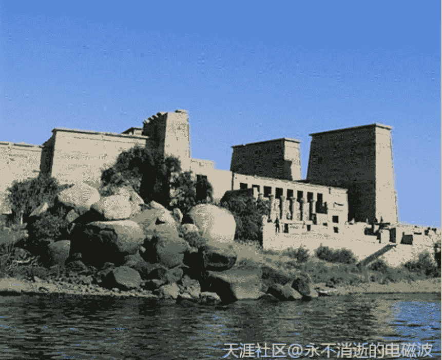

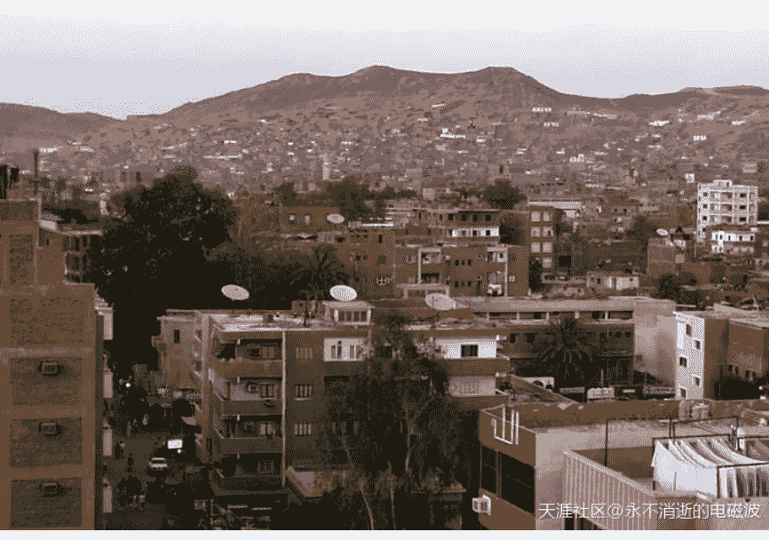

## 天津社区：不断消失的电磁波

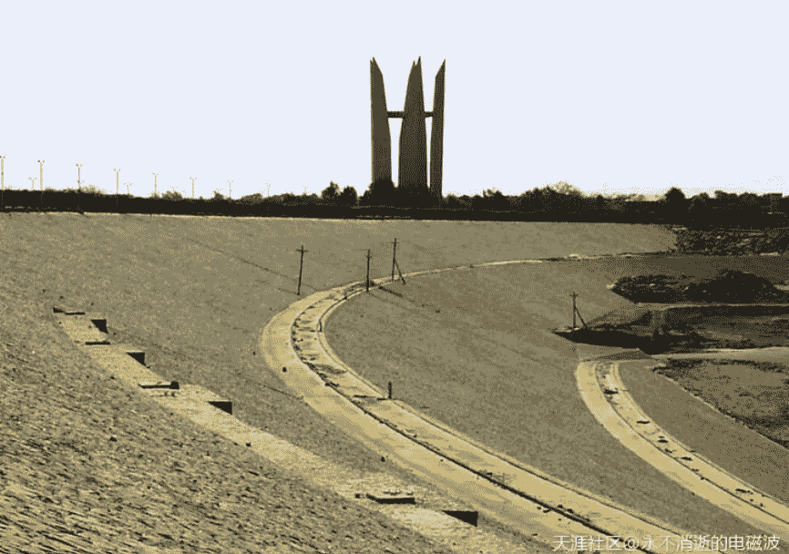

##天津社区：不断消失的电磁波

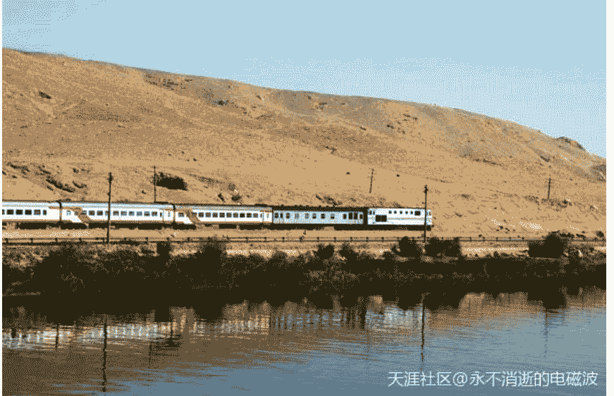

阿斯旺当地的驻防，主要是埃及7和地面运输部队。埃及大部分军队都在开罗附近和西奈半岛，对南部地区的防守相对较弱。

也难怪，南方邻苏丹实在是太荒了，哈姆郡没有，可以说，劳得连伏也都打不起。埃及在和平时期主要防范的是其实流氓。不过阿斯旺水坝是它的重点目标，这里供应了埃及及全国电力的15%以上。

阿斯旺水坝分为两部分，旧坝是1898年在古埃及的水力枢纽基础之上建设的，由于设计不足，分别两次加高，但是在1946年洪水时几乎被漫坝。

埃及革命以后，1952年开始新坝设计，初期美国答应给予2.7亿美元贷款。但是由于埃及在1956年正式承认中国，两国并交关系，美国并取消了贷款款。之后1958年苏联加入，提供了约三分之一的工程资助以及工程师和重型机械，施工于1960年开始，1970年建成。由于尼罗河流域中聚集了埃及90%以上的人口，由于此修建111米高的阿斯旺大坝成为埃及的命门。

在1973年的第四五次战争中，以色列曾试图轰炸阿斯旺大坝，被埃及的高指挥部部队击退，但是实体受到了一定程度的伤害。这也为了促使埃及承认以以色列的首个阿拉伯国家。

这次战争中，美国发动“每人五分钱”运动，筹资46亿美元支援以色列，同时美国国会拨款20亿美元。这笔钱，相当于美国当年民生总值的5%，以色列国民民生总值的500%。为了给埃及和叙利亚用于购买的毛子装备，阿拉伯国家埃及遭到，却被叙利亚陷入混乱。因此在战争开始之后，以色列获得了全套装备，苏联的反应则太迟缓。然而勃列日涅夫在这次战争中已经经过“水门事件”而焦头烂额，然而在美苏较劲的关键时刻，勃列日涅夫居然表示为了埃及和叙利亚而发动第三次世界大战是不可想象的。这个表态直接导致了埃及阿拉伯国家的失利，直接导致埃及彻底脱离苏联阵营并倒向美国。

可以说，阿斯旺大坝的修建，里面有一定的中国因素，也有很大的中国因素。

在中东和非洲地区，对毛子的评价比较统一，就是毛子是那种关键时刻可以插你一刀的酒鬼。

应当说，埃及和军队还是训练有素质的，也有紧迫感，而且我觉得，埃及人的英语真的是阿拉伯人里面说最好的。其实他们做英国殖民地的时间也不是很久，这个到底是什么原因我就不知道了。

阿斯旺当地的驻基地就两个，一个在距离大坝5公里左右的阿斯旺机场，另一个就在大坝里面，有高炮和导弹阵地。

在2010年年底，就是有很多中国人来到阿斯旺参观的，我和小山从罗飞阿斯旺的航班，就碰到了一个旅行团。一个飞机上如果超过一半的中国人，那就热闹了。虽然我们不是旅游的，但是碰到中国人问候，我们通常说是过来生意的。

这个也没错，本来是生意，只不过是火生意……两个小时的飞行，一点儿也不枯燥，而且头也是靠靠的。到了阿斯旺，赶紧联系当地联络官，见到了赵姨。她马上就要到退休年纪了，正处于半退休状态。她老公还在开罗使馆工作，据说是很快就可以调回国，所以赵姨就待在开罗，等时候老公一起回国。

赵姨我们吃了当地的美食，还带我们看了正宗的肚舞。我在国内的新疆饭店，见过维吾尔女孩跳肚舞。但是埃及的肚舞还是不一样，可能因为人种不同，埃及女孩比较丰满，而且非常灵活，可以把硬币从肚皮的几块腹肌面上层层的滚下来再滚上去，让人浮想联翩……

阿斯旺位于尼罗河东岸，是一座历史名城，是埃及和法老试图征服非洲大陆所建立的补给中心和贸易中心，也是世界上最干燥的地区之一。它人口不多，就20万，之之所以成为重镇，是因为阿斯旺水坝。

阿斯旺当地的驻防，主要是埃及7和地面运输部队。埃及大部分军队都在开罗附近和西奈半岛，对南部地区的防守相对较弱。

也难怪，南方邻苏丹实在是太荒了，哈姆郡没有，可以说，劳得连伏也都打不起。埃及在和平时期主要防范的是其实流氓。不过阿斯旺水坝是它的重点防目标，这里供应了埃及及全国电力的15%以上。

阿斯旺水坝分为两部分，旧坝是1898年在古埃及的水力枢纽基础之上建设的，由于设计不足，分别两次加高，但是在1946年洪水时几乎被漫坝。

埃及革命以后，1952年开始新坝设计，初期美国答应给予2.7亿美元贷款。但是由于埃及在1956年正式承认中国，两国并交关系，美国并取消了贷款款。之后1958年苏联加入，提供了约三分之一的工程资助以及工程师和重型机械，施工于1960年开始，1970年建成。由于尼罗河流域中聚集了埃及90%以上的人口，由于此修建111米高的阿斯旺大坝成为埃及的命门。

在1973年的第四五次战争中，以色列曾试图轰炸阿斯旺大坝，被埃及的高指挥部部队击退，但是实体受到了一定程度的伤害。这也为了促使埃及承认以以色列的首个阿拉伯国家。

这次战争中，美国发动“每人五分钱”运动，筹资46亿美元支援以色列，同时美国国会拨款20亿美元。这笔钱，相当于美国当年民生总值的5%，以色列国民民生总值的500%。为了给埃及和叙利亚用于购买的毛子装备，阿拉伯国家埃及遭到，却被叙利亚陷入混乱。因此在战争开始之后，以色列获得了全套装备，苏联的反应则太迟缓。然而勃列日涅夫在这次战争中已经经过“水门事件”而焦头烂额，然而在美苏较劲的关键时刻，勃列日涅夫居然表示为了埃及和叙利亚而发动第三次世界大战是不可想象的。这个表态直接导致了埃及阿拉伯国家的失利，直接导致埃及彻底脱离苏联阵营并倒向美国。

可以说，阿斯旺大坝的修建，里面有一定的中国因素，也有很大的中国因素。

在中东和非洲地区，对毛子的评价比较统一，就是毛子是那种关键时刻可以插你一刀的酒鬼。

应当说，埃及和军队还是训练有素质的，也有紧迫感，而且我觉得，埃及人的英语真的是阿拉伯人里面说最好的。其实他们做英国殖民地的时间也不是很久，这个到底是什么原因我就不知道了。

阿斯旺当地的驻基地就两个，一个在距离大坝5公里左右的阿斯旺机场，另一个就在大坝里面，有高炮和导弹阵地。

在2010年年底，就是有很多中国人来到阿斯旺参观的，我和小山从罗飞阿斯旺的航班，就碰到了一个旅行团。一个飞机上如果超过一半的中国人，那就热闹了。虽然我们不是旅游的，但是碰到中国人问候，我们通常说是过来生意的。

这个也没错，本来是生意，只不过是火生意……两个小时的飞行，一点儿也不枯燥，而且头也是靠靠的。到了阿斯旺，赶紧联系当地联络官，见到了赵姨。她马上就要到退休年纪了，正处于半退休状态。她老公还在开罗使馆工作，据说是很快就可以调回国，所以赵姨就待在开罗，等时候老公一起回国。

赵姨我们吃了当地的美食，还带我们看了正宗的肚舞。我在国内的新疆饭店，见过维吾尔女孩跳肚舞。但是埃及的肚舞还是不一样，可能因为人种不同，埃及女孩比较丰满，而且非常灵活，可以把硬币从肚皮的几块腹肌面上层层的滚下来再滚上去，让人浮想联翩……

阿斯旺位于尼罗河东岸，是一座历史名城，是埃及和法老试图征服非洲大陆所建立的补给中心和贸易中心，也是世界上最干燥的地区之一。它人口不多，就20万，之之所以成为重镇，是因为阿斯旺水坝。

## 天津社区：不断消失的电磁波

## 天津社区：不断消失的电磁波

阿斯旺当地的驻防，主要是埃及7和地面运输部队。埃及大部分军队都在开罗附近和西奈半岛，对南部地区的防守相对较弱。

也难怪，南方邻苏丹实在是太荒了，哈姆郡没有，可以说，劳得连伏也都打不起。埃及在和平时期主要防范的是其实流氓。不过阿斯旺水坝是它的重点目标，这里供应了埃及及全国电力的15%以上。

阿斯旺水坝分为两部分，旧坝是1898年在古埃及的水力枢纽基础之上建设的，由于设计不足，分别两次加高，但是在1946年洪水时几乎被漫坝。

埃及革命以后，1952年开始新坝设计，初期美国答应给予2.7亿美元贷款。但是由于埃及在1956年正式承认中国，两国并交关系，美国并取消了贷款款。之后1958年苏联加入，提供了约三分之一的工程资助以及工程师和重型机械，施工于1960年开始，1970年建成。由于尼罗河流域中聚集了埃及90%以上的人口，由于此修建111米高的阿斯旺大坝成为埃及的命门。

在1973年的第四五次战争中，以色列曾试图轰炸阿斯旺大坝，被埃及的高指挥部部队击退，但是实体受到了一定程度的伤害。这也为了促使埃及承认以以色列的首个阿拉伯国家。

这次战争中，美国发动“每人五分钱”运动，筹资46亿美元支援以色列，同时美国国会拨款20亿美元。这笔钱，相当于美国当年民生总值的5%，以色列国民民生总值的500%。为了给埃及和叙利亚用于购买的毛子装备，阿拉伯国家埃及遭到，却被叙利亚陷入混乱。因此在战争开始之后，以色列获得了全套装备，苏联的反应则太迟缓。然而勃列日涅夫在这次战争中已经经过“水门事件”而焦头烂额，然而在美苏较劲的关键时刻，勃列日涅夫居然表示为了埃及和叙利亚而发动第三次世界大战是不可想象的。这个表态直接导致了埃及阿拉伯国家的失利，直接导致埃及彻底脱离苏联阵营并倒向美国。

可以说，阿斯旺大坝的修建，里面有一定的中国因素，也有很大的中国因素。

在中东和非洲地区，对毛子的评价比较统一，就是毛子是那种关键时刻可以插你一刀的酒鬼。

应当说，埃及和军队还是训练有素质的，也有紧迫感，而且我觉得，埃及人的英语真的是阿拉伯人里面说最好的。其实他们做英国殖民地的时间也不是很久，这个到底到底什么原因我就不知道了。

阿斯旺当地的驻基地就两个，一个在距离大坝5公里左右的阿斯旺机场，另一个就在大坝里面，有高炮和导弹阵地。

在2010年年底，就是有很多中国人来到阿斯旺参观的，我和小山从罗飞阿斯旺的航班，就碰到了一个旅行团。一个飞机上如果超过一半的中国人，那就热闹了。虽然我们不是旅游的，但是碰到中国人问候，我们通常说是过来生意的。

这个也没错，本来是生意，只不过是火生意……两个小时的飞行，一点儿也不枯燥，而且头也是靠靠的。到了阿斯旺，赶紧联系当地联络官，见到了赵姨。她马上就要到退休年纪了，正处于半退休状态。她老公还在开罗使馆工作，据说是很快就可以调回国，所以赵姨就待在开罗，等时候老公一起回国。

赵姨我们吃了当地的美食，还带我们看了正宗的肚舞。我在国内的新疆饭店，见过维吾尔女孩跳肚舞。但是埃及的肚舞还是不一样，可能因为人种不同，埃及女孩比较丰满，而且非常灵活，可以把硬币从肚皮的几块腹肌面上层层的滚下来再滚上去，让人浮想联翩……

阿斯旺位于尼罗河东岸，是一座历史名城，是埃及和法老试图征服非洲大陆所建立的补给中心和贸易中心，也是世界上最干燥的地区之一。它人口不多，就20万，之之所以成为重镇，是因为阿斯旺水坝。

阿斯旺当地的驻防，主要是埃及7和地面运输部队。埃及大部分军队都在开罗附近和西奈半岛，对南部地区的防守相对较弱。

也难怪，南方邻苏丹实在是太荒了，哈姆郡没有，可以说，劳得连伏也都打不起。埃及在和平时期主要防范的是其实流氓。不过阿斯旺水坝是它的重点目标，这里供应了埃及及全国电力的15%以上。

阿斯旺水坝分为两部分，旧坝是1898年在古埃及的水力枢纽基础之上建设的，由于设计不足，分别两次加高，但是在1946年洪水时几乎被漫坝。

埃及革命以后，1952年开始新坝设计，初期美国答应给予2.7亿美元贷款。但是由于埃及在1956年正式承认中国，两国并交关系，美国并取消了贷款款。之后1958年苏联加入，提供了约三分之一的工程资助以及工程师和重型机械，施工于1960年开始，1970年建成。由于尼罗河流域中聚集了埃及90%以上的人口，由于此修建111米高的阿斯旺大坝成为埃及的命门。

在1973年的第四五次战争中，以色列曾试图轰炸阿斯旺大坝，被埃及的高指挥部部队击退，但是实体受到了一定程度的伤害。这也为了促使埃及承认以以色列的首个阿拉伯国家。

这次战争中，美国发动“每人五分钱”运动，筹资46亿美元支援以色列，同时美国国会拨款20亿美元。这笔钱，相当于美国当年民生总值的5%，以色列国民民生总值的500%。为了给埃及和叙利亚用于购买的毛子装备，阿拉伯国家埃及遭到，却被叙利亚陷入混乱。因此在战争开始之后，以色列获得了全套装备，苏联的反应则太迟缓。然而勃列日涅夫在这次战争中已经经过“水门事件”而焦头烂额，然而在美苏较劲的关键时刻，勃列日涅夫居然表示为了埃及和叙利亚而发动第三次世界大战是不可想象的。这个表态直接导致了埃及阿拉伯国家的失利，直接导致埃及彻底脱离苏联阵营并倒向美国。

可以说，阿斯旺大坝的修建，里面有一定的中国因素，也有很大的中国因素。

阿斯旺当地的驻基地就两个，一个在距离大坝5公里左右的阿斯旺机场，另一个就在大坝里面，有高炮和导弹阵地。

在2010年年底，就是有很多中国人来到阿斯旺参观的，我和小山从罗飞阿斯旺的航班，就碰到了一个旅行团。一个飞机上如果超过一半的中国人，那就热闹了。虽然我们不是旅游的，但是碰到中国人问候，我们通常说是过来生意的。

这个也没错，本来是生意，只不过是火生意……两个小时的飞行，一点儿也不枯燥，而且头也是靠靠的。到了阿斯旺，赶紧联系当地联络官，见到了赵姨。她马上就要到退休年纪了，正处于半退休状态。她老公还在开罗使馆工作，据说是很快就可以调回国，所以赵姨就待在开罗，等时候老公一起回国。

赵姨我们吃了当地的美食，还带我们看了正宗的肚舞。我在国内的新疆饭店，见过维吾尔女孩跳肚舞。但是埃及的肚舞还是不一样，可能因为人种不同，埃及女孩比较丰满，而且非常灵活，可以把硬币从肚皮的几块腹肌面上层层的滚下来再滚上去，让人浮想联翩……

阿斯旺当地的驻防，主要是埃及7和地面运输部队。埃及大部分军队都在开罗附近和西奈半岛，对南部地区的防守相对较弱。

也难怪，南方邻苏丹实在是太荒了，哈姆郡没有，可以说，劳得连伏也都打不起。埃及在和平时期主要防范的是其实流氓。不过阿斯旺水坝是它的重点目标，这里供应了埃及及全国电力的15%以上。

阿斯旺水坝分为两部分，旧坝是1898年在古埃及的水力枢纽基础之上建设的，由于设计不足，分别两次加高，但是在1946年洪水时几乎被漫坝。

埃及革命以后，1952年开始新坝设计，初期美国答应给予2.7亿美元贷款。但是由于埃及在1956年正式承认中国，两国并交关系，美国并取消了贷款款。之后1958年苏联加入，提供了约三分之一的工程资助以及工程师和重型机械，施工于1960年开始，1970年建成。由于尼罗河流域中聚集了埃及90%以上的人口，由于此修建111米高的阿斯旺大坝成为埃及的命门。

在1973年的第四五次战争中，以色列曾试图轰炸阿斯旺大坝，被埃及的高指挥部部队击退，但是实体受到了一定程度的伤害。这也为了促使埃及承认以以色列的首个阿拉伯国家。

这次战争中，美国发动“每人五分钱”运动，筹资46亿美元支援以色列，同时美国国会拨款20亿美元。这笔钱，相当于美国当年民生总值的5%，以色列国民民生总值的500%。为了给埃及和叙利亚用于购买的毛子装备，阿拉伯国家埃及遭到，却被叙利亚陷入混乱。因此在战争开始之后，以色列获得了全套装备，苏联的反应则太迟缓。然而勃列日涅夫在这次战争中已经经过“水门事件”而焦头烂额，然而在美苏较劲的关键时刻，勃列日涅夫居然表示为了埃及和叙利亚而发动第三次世界大战是不可想象的。这个表态直接导致了埃及阿拉伯国家的失利，直接导致埃及彻底脱离苏联阵营并倒向美国。

阿斯旺当地的驻防，主要是埃及7和地面运输部队。埃及大部分军队都在开罗附近和西奈半岛，对南部地区的防守相对较弱。

也难怪，南方邻苏丹实在是太荒了，哈姆郡没有，可以说，劳得连伏也都打不起。埃及在和平时期主要防范的是其实流氓。不过阿斯旺水坝是它的重点目标，这里供应了埃及及全国电力的15%以上。

阿斯旺水坝分为两部分，旧坝是1898年在古埃及的水力枢纽基础之上建设的，由于设计不足，分别两次加高，但是在1946年洪水时几乎被漫坝。

埃及革命以后，1952年开始新坝设计，初期美国答应给予2.7亿美元贷款。但是由于埃及在1956年正式承认中国，两国并交关系，美国并取消了贷款款。之后1958年苏联加入，提供了约三分之一的工程资助以及工程师和重型机械，施工于1960年开始，1970年建成。由于尼罗河流域中聚集了埃及90%以上的人口，由于此修建111米高的阿斯旺大坝成为埃及的命门。

在1973年的第四五次战争中，以色列曾试图轰炸阿斯旺大坝，被埃及的高指挥部部队击退，但是实体受到了一定程度的伤害。这也为了促使埃及承认以以色列的首个阿拉伯国家。

这次战争中，美国发动“每人五分钱”运动，筹资46亿美元支援以色列，同时美国国会拨款20亿美元。这笔钱，相当于美国当年民生总值的5%，以色列国民民生总值的500%。为了给埃及和叙利亚用于购买的毛子装备，阿拉伯国家埃及遭到，却被叙利亚陷入混乱。因此在战争开始之后，以色列获得了全套装备，苏联的反应则太迟缓。然而勃列日涅夫在这次战争中已经经过“水门事件”而焦头烂额，然而在美苏较劲的关键时刻，勃列日涅夫居然表示为了埃及和叙利亚而发动第三次世界大战是不可想象的。这个表态直接导致了埃及阿拉伯国家的失利，直接导致埃及彻底脱离苏联阵营并倒向美国。

蟒蛇的站场就在亚历山港的附近，距离机场也不远。不过它那里地方是一个居民区。位于一个看起来像是仓库的区域，预警系统放在旁边的高楼上面，导弹系统则在仓库的厂房里面。

蛇蛇采用的是半自动制，预警雷达发现距离大约180 公里，这个距离，连开罗都够不着，更不用来说西纳半岛了。于是，我就琢磨着怎么给它扩容。

应该说，经过这么多年积累的经验，我对大有预警系统的侦测范围，算是有了一些自己的心得。

原本想找一个懂通中文的埃及人，这样比较容易沟通。但是说是这样的人才都被位于开罗的阿联飞机制造厂的 K-8E 生产线“剖割”去了，只能慨叹我们们为埃及培养的人太少了。

纳哈斯说，其实也有不少中国人在埃及，尤其是开罗的艾吉哈尔大学的。后来说想，如果不是军方或军工系统的，咱们用着也不是太方便，麻烦麻烦吧。

后来听婉，艾吉哈尔大学是最古老的大学之一，已经有一千一百多年的历史了。不告诉我们国家签署的教育协议，送过去学习的主要还是语言和宗教。

对于艾吉哈尔大学比较知名的商业、基础科学和医学，反而没有签署教育协议。

这方面，估计也会逐渐的改善。国与国之间，就是应该互相补长短缺。

使用手册都是阿拉伯文，要先通过纳哈斯或者他的助手克拉来翻译。努克拉夫夫人是赫赫家族出身，她女儿的哥哥曾经是埃及的总理。

努克拉夫夫人年轻时代留学法国，阿拉伯语、法语和英语都不非常流利。但是努克拉夫人的性格比较保守，埃及女生很多都是不惹蚊头的，但是努克拉夫夫人头巾。跟我们的工作的时候，多一句话不说，比较严肃比较枯燥。

看着她，我们只能用婉婉的方法法拉近跟她的关系。因为只有关系融，才能更高效的沟通和工作。这一天下午，把几个数据核对以后请她矫正并翻译，然后我用我带来的铁眼镜给她泡了一次功夫茶。其实在法国也有下午茶的传统，是用咖啡加甜点；埃及和留有英国下午茶传统，也有法国咖啡的传统。

努克拉夫夫人平时话不多的，估计她留过法国有关。但是当我泡好了功夫茶，请她见到第三泡茶的时候，她的眼睛开始亮起来了。后来我跟我慢慢熟悉起来，也介绍了一些她自己的事情。

跟她的丈夫是在很小时候认识，并且订婚的。1984 年在埃及北边的西奈岛，她丈夫在军队的偷袭行动中牺牲了。那个时候他们结婚后，她也才刚刚怀孕……来伊尔兰是允许离婚的，但是由于跟她丈夫青梅青竹马，而且她的女儿算是造胎，因此一直不想改嫁。

一个女人带个孩子，确实很不容易，她并没有依靠她家族的势力，而是只是凭借自己的能力来养，后来女儿读了大学。除了小姐固有的维护家族尊严的传统，就是依靠宗教在精神上的支柱，面对困难和挫折才能一直坚持下来。

她不喜欢跟人接触，因为她不小心惹别人了气，自己应付不起。她很热爱生命，自己养花，也养了几条流浪狗，还养了几只猫。

想虽然世界很大，但是不同的地区，生活还是有很多相似的地方。不知道对亚克拉夫人说些什么，后来觉得什么都不说就好。有信仰的人对于生活的态度是不一样的，人与人之间相互的尊重和包容是最重要的，了解了亚克拉夫人的经历，就会发现她是那种不一样。

想起起来刚刚开始，我对亚克拉夫人有一点点误解，那么现在，剩下的就都是敬重了。无论是在伊拉克斯坦，还是在埃及和埃库，都不断到的关于尊严的故事，有那么多人为了尊严，宁肯自己委屈一件，甚至可以舍弃一切至殉一切。

想起我们五文明古国的土绅传统，又有有多少传承下来了呢？

跟亚克拉夫人的沟通顺畅了，工作效率自然就高了。整段的理解亚历山港蛇系统的设计参数，就充分利用“云科研”的方式，这样进展速度就更快了。

于是我们到达站一周以后，也就是元旦刚过，一份新的技术要求就交到了纳哈斯的手。纳哈斯仔细的了一眼，又跟亚克拉夫人用阿拉伯语咕了几句就叫来了他的军需官。

第二天，努克拉夫人说，只有一小部分能够购买的，大部分市场上都没有现货。想起来我提供的制式可能有问题，就请努克拉夫人带着那个军需官一起，我们他们商量了一下，修改了一部分设计参数。这样，小巧的零件就可以直接在市场上购买了。

简单的说，一周以后，所有的零件都到了。我跟小山一起，只用了一天就改造完成，然后测试了一下，基本侦测距离扩大到了差不多 250 公里左右。

但是纳哈斯已经没有精力管这些事情，因为埃及已经彻底乱套了。据说有百万人参加了示威，亚历山大也是一个重点地区。

我们天天待在酒店里面，哪儿都去不了。那个时候，大志他们关于 033 的后还没有读完，我们不知道该走还是该留。埃及军队虽然也上上街骚了，但是后来又发表声明，说是保持中立。而埃及也切断了互联网，在酒店还能上网，只是网络速度慢。

我们能做的不多，就住在酒店里面看着 HBO 的美剧，练习英文。凌晨网络稍快一点的时候，就跟国内联系，通报情况，也忙一下自己手头的几个项目。

唯有中华博客: http://blog.sina.com.cn/weiyouzhonghua

微博地址: http://weibo.com/u/1366169612

# 星星之火 可以燎原 祝愿中国梦早日实现！

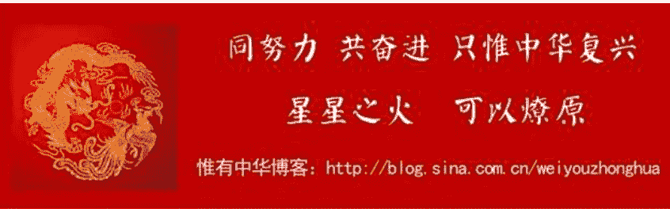

同努力 共奋进 只惟中华复兴
星星之火 可以燎原
唯有中华博客: http://blog.sina.com.cn/weiyouzhonghua

# 美索不达米亚眼-中东十五【连载】
作者：永不消逝的电磁波

以此献给我的母亲，做她过世十年的纪念。本文并非小说，也不是传记，只是自己的经历经历记录下来。另外本人虽然已经转岗，但是作为军工企业人员，许多细节不方便透露。可能略显枯燥一些，若不喜欢，请绕行。

(十四) 埃隆

就这样，到了 1月中旬，本以为春节前都可以回去，没想到由于动乱，开罗暂停了所有国际航班。于是，王伯伯接到了开罗使馆的通知，准备月底撤离。

这里要介绍一下，华侨和外籍人的区别。中国不承认双国籍，如果你获得了永久留权，那么就是华侨，前提是持有中国护照的公民。简单的来说：
- 他（她）拿到了绿卡，意味着（她）可以在美国工作保险什么的；
- 绿卡并不意味着（她）是美国公民；
- 他（她）在取得护照之前，仍然是中国公民。

我们也在犹豫，因为大志那边还没有搞定。潜艇系统远远比雷达系统复杂得多，大志好几个通宵没有休息，熬夜以后像熊猫。潜艇的使用、维护等方面的记录，以确定下一步。还要针对军方的要求，国产装，大志本来很壮，熬夜以后受不上。

跟亚克拉夫人的沟通顺畅了，工作效率自然就高了。整段的理解亚山大港蛇系统的设计参数，就充分利用“云科研”的方式，这样进展速度就更快了。

于是我们到达站一周以后，也就是元旦刚过，一份新的技术要求就交到了纳哈斯的手。纳哈斯仔细的了一眼，又跟亚克拉夫人用阿拉伯语咕了几句就叫来了他的军需官。

第二天，努克拉夫人说，只有一小部分能够购买的，大部分市场上都没有现货。想起来我提供的制式可能有问题，就请努克拉夫人带着那个军需官一起，我们他们商量了一下，修改了一部分设计参数。这样，小巧的零件就可以直接在市场上购买了。

简单的说，一周以后，所有的零件都到了。我跟小山一起，只用了一天就改造完成，然后测试了一下，基本侦测距离扩大到了差不多 250 公里左右。

但是纳哈斯已经没有精力管这些事情，因为埃及已经彻底乱套了。据说有百万人参加了示威，亚山山大也是一个重点地区。

我们天天待在酒店里面，哪儿都去不了。那个时候，大志他们关于 033 的后还没有读完，我们不知道该走还是该留。埃及军队虽然也上上街骚了，但是后来又发表声明，说是保持中立。而埃及也切断了互联网，在酒店还能上网，只是网络速度慢。

我们能做的不多，就住在酒店里面看着 HBO 的美剧，练习英文。凌晨网络稍快一点的时候，就跟国内联系，通报情况，也忙一下自己手头的几个项目。

(十五) 埃隆

就这样，到了 1月中旬，本以为春节前都可以回去，没想到由于动乱，开罗暂停了所有国际航班。于是，王伯伯接到了开罗使馆的通知，准备月底撤离。

这里要介绍一下，华侨和外籍人的区别。中国不承认双国籍，如果你获得了永久留权，那么就是华侨，前提是持有中国护照的公民。简单的来说：
- 他（她）拿到了绿卡，意味着（她）可以在美国工作保险什么的；
- 绿卡并不意味着（她）是美国公民；
- 他（她）在取得护照之前，仍然是中国公民。

我们也在犹豫，因为大志那边还没有搞定。潜艇系统远远比雷达系统复杂得多，大志好几个通宵没有休息，熬夜以后像熊猫。潜艇的使用、维护等方面的记录，以确定下一步。还要针对军方的要求，国产装，大志本来很壮，熬夜以后受不上。

(十六)

使用手册都是阿拉伯文，要先通过纳哈斯或者他的助手克拉来翻译。努克拉夫夫人是赫赫家族出身，她女儿的哥哥曾经是埃及的总理。

努克拉夫夫人年轻时代留学法国，阿拉伯语、法语和英语都不非常流利。但是努克拉夫人的性格比较保守，埃及女生很多都是不惹蚊头的，但是努克拉夫夫人头巾。跟我们的工作的时候，多一句话不说，比较严肃比较枯燥。

看着她，我们只能用婉婉的方法法拉近跟她的关系。因为只有关系融，才能更高效的沟通和工作。这一天下午，把几个数据核对以后请她矫正并翻译，然后我用我带来的铁眼镜给她泡了一次功夫茶。其实在法国也有下午茶的传统，是用咖啡加甜点；埃及和留有英国下午茶传统，也有法国咖啡的传统。

努克拉夫夫人平时话不多的，估计她留过法国有关。但是当我泡好了功夫茶，请她见到第三泡茶的时候，她的眼睛开始亮起来了。后来我跟我慢慢熟悉起来，也介绍了一些她自己的事情。

跟她的丈夫是在很小时候认识，并且订婚的。1984 年在埃及北边的西奈岛，她丈夫在军队的偷袭行动中牺牲了。那个时候他们结婚后，她也才刚刚怀孕……来伊尔兰是允许离婚的，但是由于跟她丈夫青梅青竹马，而且她的女儿算是造胎，因此一直不想改嫁。

一个女人带个孩子，确实很不容易，她并没有依靠她家族的势力，而是只是凭借自己的能力来养，后来女儿读了大学。除了小姐固有的维护家族尊严的传统，就是依靠宗教在精神上的支柱，面对困难和挫折才能一直坚持下来。

她不喜欢跟人接触，因为她不小心惹别人了气，自己应付不起。她很热爱生命，自己养花，也养了几条流浪狗，还养了几只猫。

想虽然世界很大，但是不同的地区，生活还是有很多相似的地方。不知道对亚克拉夫人说些什么，后来觉得什么都不说就好。有信仰的人对于生活的态度是不一样的，人与人之间相互的尊重和包容是最重要的，了解了亚克拉夫人的经历，就会发现她是那种不一样。

想起起来刚刚开始，我对亚克拉夫人有一点点误解，那么现在，剩下的就都是敬重了。无论是在伊拉克斯坦，还是在埃及和埃库，都不断到的关于尊严的故事，有那么多人为了尊严，宁肯自己委屈一件，甚至可以舍弃一切至殉一切。

想起我们五文明古国的土绅传统，又有有多少传承下来了呢？

跟亚克拉夫人的沟通顺畅了，工作效率自然就高了。整段的理解亚山大港蛇系统的设计参数，就充分利用“云科研”的方式，这样进展速度就更快了。

于是我们到达站一周以后，也就是元旦刚过，一份新的技术要求就交到了纳哈斯的手。纳哈斯仔细的了一眼，又跟亚克拉夫人用阿拉伯语咕了几句就叫来了他的军需官。

第二天，努克拉夫人说，只有一小部分能够购买的，大部分市场上都没有现货。想起来我提供的制式可能有问题，就请努克拉夫人带着那个军需官一起，我们他们商量了一下，修改了一部分设计参数。这样，小巧的零件就可以直接在市场上购买了。

简单的说，一周以后，所有的零件都到了。我跟小山一起，只用了一天就改造完成，然后测试了一下，基本侦测距离扩大到了差不多 250 公里左右。

但是纳哈斯已经没有精力管这些事情，因为埃及已经彻底乱套了。据说有百万人参加了示威，亚山山大也是一个重点地区。

我们天天待在酒店里面，哪儿都去不了。那个时候，大志他们关于 033 的后还没有读完，我们不知道该走还是该留。埃及军队虽然也上上街骚了，但是后来又发表声明，说是保持中立。而埃及也切断了互联网，在酒店还能上网，只是网络速度慢。

我们能做的不多，就住在酒店里面看着 HBO 的美剧，练习英文。凌晨网络稍快一点的时候，就跟国内联系，通报情况，也忙一下自己手头的几个项目。

(十七)

没想到，1月27日，开罗撤侨还在准备的时候，使馆第二通知来了。外交部得到情况通报，确定对利比亚开展军事行动，外交部把利比亚撤侨准备好。这个信息并没有对外公布，因为高层的指令非常紧，必须在2月18日之前，也就是三周之内完成，然后国家宣布撤离的事情。接到通知我们就决定，我们不会撤离，至少第一批撤离。四个人跟王伯伯，志愿者贡献力量，在关键时刻发挥自己的作用，是一个让人热血。于是我们开始了离开利比亚的准备：所有的技术资料全部撤回国内，手头打印的资料全部销毁，工具全部送往大使馆。王伯伯跟我们说，其他打算撤离，就算我们要回去他也会留下。接下来他也介绍了大致情形：这次撤侨任务单单利比亚，接近35000到40000名同胞被撤离，撤离的目标大概是十天。利比亚位于北部非洲，突尼斯和埃及之间，而突尼斯和埃及也乱着，所以撤侨的重点有三路：
- 包机航班是最简单直接的方式，但是短期内无法直接载这么多需求，重要对象包括妇女和儿童，从利比亚包机回国；
- 剩余人员直接走海路，到希腊克里特岛或者马乌耳，然后转机回国；
- 另一部分也是绝大多数，从陆路分别进入突尼斯和埃及，再分别走海进入马乌耳和克里特岛。

一天的准备加上十天的撤离时间已经不算短了。在北约决定利比亚开展打击行动的时候，第五支队开始了利比亚行动。其实当时，利比亚总领卡菲大体上控制了局势，利比亚已经平静下来。但是通过第五支队舆论的渲染，以及暴力的对抗，形势发生了反转。利比亚第二大城市班加已经实行自治，利比亚的局势瞬间改变，暴乱无处不在。老夫在背后对第五支队的支持，其实也是搬起石头砸了自己的脚；美国卿女士就是因为没有处理好班加美国馆的相关事宜，而在2016年的总选举中，败给了狂人普川大叔。他所说的，迟早还要的。而此刻放噪音最大的高喊“爱国”大旗的，通常并不是真的爱国者，甚至他们只是收了点散银两就拼了命。而被所谓爱国者鼓起来的热血青年们直到牺牲了自己的生命，都没有能够搞清楚这地方到底藏了多少骚龊，后命还没有可能背负永久的署名。

(十八)

王伯伯跟使馆报告了我们的想法，也将我们的简历发给了大使馆，由大使馆统一进行了人员安排。当天晚上，我们包车前往罗斯大使馆，参加了大使馆举办的撤侨协调会议。王伯伯懂阿拉伯语，所以他跟使馆人员一起，负责埃及和利比亚边界的索勒勒口岸，与埃及和苏丹方面协调工作。

我们四分成组：
- 大志在开罗，继续完成他的任务，使命大于天；
- 小加加入马特鲁港工作组，负责马特鲁港的接洽。马特鲁港位于索勒勒口岸以东大概250公里，亚山大港以西大约3300公里，是埃及和西部重要的港口。咱们包括艘旧邮轮，运往马特鲁港和希腊克里特岛的耶拉拉特岛，侨民将从克里特岛中转回；
- 小加入索勒勒工作组，负责索勒勒口岸的接洽，安排租大巴车，将难民从口岸运送马特鲁港；
- 我加入埃穆德工作组，埃穆德是利比亚及边疆。我们小组的任务最重要的，要识别中国公民并登记，组织他们走特殊通道，然后安排大巴前往口岸。

(十九)

应该说这次撤离行动，是外交历史上迄为止最大的动员行动，难度不在人员缺少，不在任务繁琐，不在时间紧迫，而在于协调。涉及不同国家需要协调：
- 包机航班需要协调；
- 船需要协调；
- 车需要协调；
- 境需要协调。

虽然利比亚政府已经乱了，但突尼斯、马耳、塞浦斯、希腊都需要协调。原本撤离行动总部在埃及开罗，使馆本身已经开始。后来，高层决定外交部长亲自担任组长，由外交部、公安部、安全部、总参部、商务部、运输部、海关、民航局等成了联合工作组。小组共14位同志，分成了三个小组，每个小组执勤八个小时轮岗。由于工作繁杂，一开始大家都希望更多人，想分成两个小组，但组长萧哥非常有经验，参与过2008年非洲国家撤离，也参与了汶汶地震救援行动。萧哥说，对于撤离，真正辛苦的是后面几天，大家要合理分配精力，控制情绪。萧哥还说，每一位工作人员都是保护目标，如果累了病了，必须得到及时休息，坚决不要小失大，更不能抱着死的信念去操作。一旦小组失去了工作人员，短时间内无法补充，这将对其他小组造成致命冲击，甚至影响整个撤离工作。说心里，这还是我第一次听到理性而且人性的部署。以往受的教育就是轻伤不下线，但如果真的后面发生了减员，损失也确实很大。最后，萧哥总结道：我们将帮助同胞，要有服务意识，到底发生什么都要冷静，也都要和小组保持良好沟通，千万不可以擅自做任何决定，无论大小如何。

由于开罗撤离，预订的酒店没有那么多房间，小组就挤四五人在一个标准间凑合休息一下。这方面我算是有经验，毕竟在雷达站打铺热通都是必修课，就是自其奋睡在地上。没想到这样一个夜晚，也成了后面周里最基础的一课。

第二天早吃早餐的时候，我跟阿青聊了会儿。她已经结婚，老公也是工作人员，不过这次没有参加撤离行动。我也介绍了一个人的情况，刚开始我们都觉得有些别扭，但是后来逐步了一些关于塞尔维亚的事情，也介绍了一下埃及这边的情况，说了努克拉夫夫人逐渐话慢了起来。她比我小五六岁，没有明显的感觉。而且我们两个性格也相似，小组里面我们基本都在一起。小组有四位女生，为了方便，萧哥把她们分派在两个小队里面。所以，有一队是“和队”，没有女生。阿青同学要求跟我小队，还有另外一位女同志来自阿朗。当前没时间太多，小组从早上九点一直到了凌晨三点，会议记录用掉了整桶A4纸。每个人都有笔记本，也拿了一壶记录表格。组长的思路很清晰，每个人都要清楚任务、目的和方法，都要清楚每个环节的操作。每个岗位都有负责人，每个工作地点都有协调。

我们最大的几个困难，首先是没有电，海关那边有电，但是距离营地还有几百米的距离，来去去不去方便；然后就是通信比较困难。海关处于两国境，那时候已经普及了手机，却经常收不到信号。我们将这些困难反映出
来，请工作组帮忙解决。

其实到了那个时候，工作组根本管不管我们这边这么细节的事情了。没有
足够的锅，这个个好办，路的两边有有很多丢弃的物品，里面也能找到。刚刚刚
到达关口的几位同志就自备备章，出去一些有用的物资回来。

第二天，小组派了五位同志，加上马希尔，奔驰三辆皮车，古穆萨伊德以
及更远的开萨迪罗和阿哈巴，有什么有什么什么就买什么，把车子装满。其它留守
的同志就开始布置营地，有经验的同志忙布置卫生间、休息区、登记区什么
的。

路边有被抛掉的没有油的皮卡、面包车似的，我们也想办法回来；有坛
罐罐的，也捡回干净。

埃穆萨萨德这地方非常原始生态，连自来水都没有。我们只能四处找水，然
后装起来，上面要盖住，防止风沙。

这样转战差不多于2月2日。国内支援的同志也到了，分到我们小组这
这边有四位，其中三位武警负责警戒，另外一位是医生。

这一天是2011 年的除夕，我们就在营地旁边起了篝火，也没有像样的饭菜，没有电视，没有手机信号。小组成员大概40多位被围隔在埃穆萨德的同事，就这么围着篝火唱着歌儿。

我们的歌声吸引了很多周围不同国家的人群靠拢，虽然语言不通，但是音乐是大家的语言。人们似乎忘记了对战争的恐惧，围着篝火歌歌舞舞，这比视的春晚精彩多了！

坐在阿青的身边，天地之间都聊了很多，那一夜却夜无眠，也是印象最深刻的一个春节。

这地方，二月初还有差不多30 度，晚上虽然凉快一些，风却很大，根本睡不好。

为了接络庞大部队的到来，小组决定每天一早派出一个小队，出去寻找食物物资。基本上都是一早出发，晚上上上才回来。

忙得都忘记了时间，大概又过了10 天，营地已经具有规模。大家对于临时营地的工作节奏也慢慢适应了。说是适应，因为条件确实不方便，实在太方便。没有冲水厕所，没有洗澡。没有床，地上铺了地毯，但是还有3、40 度，跟北冬天的火炕似的。帐篷倒是有，但是四周没有围闭，天上的星星眨一眨，看得那一个清的。

利比亚并没有什么工业，也没有露雾，但是沙尘就是家常便饭。有时候晚上就开始倒粒，感觉鼻子里面都是沙子。

还没有正式宣布撤离，所以中国人离的还不多。但是有些国家，比如欧美国家，比如印度，早就已经宣布了。

但是还没有准备好就撤离是很危险的，因为撤离的人根本就不知道该去哪儿，国内的人也不知道那些侨民去了哪里。

曾经发生过比较有意思的事情是加拿大，加拿大宣布撤离以后，加拿大大移民们等在利比亚首都的黎利里机场，但是当时的黎利里机场已经乱了，没有空域没有地动，地面的飞机无法起飞，天上的也无法落地。后来还一些志愿者组织捐款，部分动员才出来工作，但是由于人数有限，效率也比平时慢了很多。加拿大大移民们等了好几天都没有动静，连加拿大大飞机的影子都没有看见，是侨民散散了，出访之路。接下来加拿大政府就被各方面面，好容易协调了一架飞机去黎利里，是又是找找不到，是飞机回来了，于是又是被骂。浪费钱不说，还没有人道主义精神……。

对比这个，就知道他们当时的决定有多英明。白天

很多在利比亚的外国人都在挤在路上，但是索勒姆的边界仍然关闭。白天抽
空，我跟小分队去了一下拜尔迪勒耶。

这里感谢一下华为和中兴的兄弟们，你们是民族的骨梁，是利比亚撒的后英雄！通信一直都是华为和中兴提供服务，就算在最乱的那日子，通信都没有中断。

为了络庞大部队的到来，小组决定每天一早派出一个小队，出去寻找食物物资。基本上都是一早出发，晚上上上才回来。

忙得都忘记了时间，大概又过了10 天，营地已经具有规模。大家对于临时营地的工作节奏也慢慢适应了。说是适应，因为条件确实不方便，实在太方便。没有冲水厕所，没有洗澡。没有床，地上铺了地毯，但是还有3、40 度，跟北冬天的火炕似的。帐篷倒是有，但是四周没有围闭，天上的星星眨一眨，看得那一个清的。

利比亚并没有什么工业，也没有露雾，但是沙尘就是家常便饭。有时候晚上就开始倒粒，感觉鼻子里面都是沙子。

还没有正式宣布撤离，所以中国人离的还不多。但是有些国家，比如欧美国家，比如印度，早就已经宣布了。

但是还没有准备好就撤离是很危险的，因为撤离的人根本就不知道该去哪儿，国内的人也不知道那些侨民去了哪里。

曾经发生过比较有意思的事情是加拿大，加拿大宣布撤离以后，加拿大大移民们等在利比亚首都的黎利里机场，但是当时的黎利里机场已经乱了，没有空域没有地动，地面的飞机无法起飞，天上的也无法落地。后来还一些志愿者组织捐款，部分动员才出来工作，但是由于人数有限，效率也比平时慢了很多。加拿大大移民们等了好几天都没有动静，连加拿大大飞机的影子都没有看见，是侨民散散了，出访之路。接下来加拿大政府就被各方面面，好容易协调了一架飞机去黎利里，是又是找找不到，是飞机回来了，于是又是被骂。浪费钱不说，还没有人道主义精神……。

对比这个，就知道他们当时的决定有多英明。白天

很多在利比亚的外国人都在挤在路上，但是索勒姆的边界仍然关闭。白天抽
空，我跟小分队去了一下拜尔迪勒耶。

这里感谢一下华为和中兴的兄弟们，你们是民族的骨梁，是利比亚撒的后英雄！通信一直都是华为和中兴提供服务，就算在最乱的那日子，通信都没有中断。

为了络庞大部队的到来，小组决定每天一早派出一个小队，出去寻找食物物资。基本上都是一早出发，晚上上上才回来。

忙得都忘记了时间，大概又过了10 天，营地已经具有规模。大家对于临时营地的工作节奏也慢慢适应了。说是适应，因为条件确实不方便，实在太方便。没有冲水厕所，没有洗澡。没有床，地上铺了地毯，但是还有3、40 度，跟北冬天的火炕似的。帐篷倒是有，但是四周没有围闭，天上的星星眨一眨，看得那一个清的。

利比亚并没有什么工业，也没有露雾，但是沙尘就是家常便饭。有时候晚上就开始倒粒，感觉鼻子里面都是沙子。

还没有正式宣布撤离，所以中国人离的还不多。但是有些国家，比如欧美国家，比如印度，早就已经宣布了。

但是还没有准备好就撤离是很危险的，因为撤离的人根本就不知道该去哪儿，国内的人也不知道那些侨民去了哪里。

曾经发生过比较有意思的事情是加拿大，加拿大宣布撤离以后，加拿大大移民们等在利比亚首都的黎利里机场，但是当时的黎利里机场已经乱了，没有空域没有地动，地面的飞机无法起飞，天上的也无法落地。后来还一些志愿者组织捐款，部分动员才出来工作，但是由于人数有限，效率也比平时慢了很多。加拿大大移民们等了好几天都没有动静，连加拿大大飞机的影子都没有看见，是侨民散散了，出访之路。接下来加拿大政府就被各方面面，好容易协调了一架飞机去黎利里，是又是找找不到，是飞机回来了，于是又是被骂。浪费钱不说，还没有人道主义精神……。

对比这个，就知道他们当时的决定有多英明。白天

很多在利比亚的外国人都在挤在路上，但是索勒姆的边界仍然关闭。白天抽
空，我跟小分队去了一下拜尔迪勒耶。

（此处由于原始文本重复且按逻辑合并，已处理后续内容）

埃穆萨萨德这地方非常原始生态，连自来水都没有。我们只能四处找水，然
后装起来，上面要盖住，防止风沙。

这样转战差不多于2月2日。国内支援的同志也到了，分到我们小组这
这边有四位，其中三位武警负责警戒，另外一位是医生。

这一天是2011 年的除夕，我们就在营地旁边起了篝火，也没有像样的饭菜，没有电视，没有手机信号。小组成员大概40多位被围隔在埃穆萨德的同事，就这么围着篝火唱着歌儿。

我们的歌声吸引了很多周围不同国家的人群靠拢，虽然语言不通，但是音乐是大家的语言。人们似乎忘记了对战争的恐惧，围着篝火歌歌舞舞，这比视的春晚精彩多了！

坐在阿青的身边，天地之间都聊了很多，那一夜却夜无眠，也是印象最深刻的一个春节。

这地方，二月初还有差不多30 度，晚上虽然凉快一些，风却很大，根本睡不好。

为了接络庞大部队的到来，小组决定每天一早派出一个小队，出去寻找食物物资。基本上都是一早出发，晚上上上才回来。

忙得都忘记了时间，大概又过了10 天，营地已经具有规模。大家对于临时营地的工作节奏也慢慢适应了。说是适应，因为条件确实不方便，实在太方便。没有冲水厕所，没有洗澡。没有床，地上铺了地毯，但是还有3、40 度，跟北冬天的火炕似的。帐篷倒是有，但是四周没有围闭，天上的星星眨一眨，看得那一个清的。

利比亚并没有什么工业，也没有露雾，但是沙尘就是家常便饭。有时候晚上就开始倒粒，感觉鼻子里面都是沙子。

还没有正式宣布撤离，所以中国人离的还不多。但是有些国家，比如欧美国家，比如印度，早就已经宣布了。

但是还没有准备好就撤离是很危险的，因为撤离的人根本就不知道该去哪儿，国内的人也不知道那些侨民去了哪里。

曾经发生过比较有意思的事情是加拿大，加拿大宣布撤离以后，加拿大大移民们等在利比亚首都的黎利里机场，但是当时的黎利里机场已经乱了，没有空域没有地动，地面的飞机无法起飞，天上的也无法落地。后来还一些志愿者组织捐款，部分动员才出来工作，但是由于人数有限，效率也比平时慢了很多。加拿大大移民们等了好几天都没有动静，连加拿大大飞机的影子都没有看见，是侨民散散了，出访之路。接下来加拿大政府就被各方面面，好容易协调了一架飞机去黎利里，是又是找找不到，是飞机回来了，于是又是被骂。浪费钱不说，还没有人道主义精神……。

对比这个，就知道他们当时的决定有多英明。白天

很多在利比亚的外国人都在挤在路上，但是索勒姆的边界仍然关闭。白天抽
空，我跟小分队去了一下拜尔迪勒耶。

这里感谢一下华为和中兴的兄弟们，你们是民族的骨梁，是利比亚撒的后英雄！通信一直都是华为和中兴提供服务，就算在最乱的那日子，通信都没有中断。

电话线给撤了。然后把身上大部分钱都留给了马希尔，马希尔说什么都不要，跟我们这个一个月摸滚打，大家都有了感情。相信如果不是他顺顺他在穆萨伊德的，他可能就能提出来我们去中国了。

回去营地又跟大部队把营地收妥当，该焚烧的焚烧，该推毁的推毁。3月4日晚，撤离行动结束，我们乘坐最后一场大巴，回到索勒勒。几个兄弟向打光了所有的弹药，最后过了一把，然后依不弃的把枪交给埃堪及海关人员。

## (十五)索尔贡

集团的兄弟们开玩笑说，最出他们意料的是，以以前跟客户讲的咱们枪炮如何如何的好，说的居然真的是的！而且，经过这段时间的使用，让他们有了更加感性的认识，质量是挺好的。这样让他们对以后的工作更加充满了信心。在索勒勒稍作停留，第二天一早，两个小组就坐大巴车开往马普鲁，接上另外一个小组，然后大部队返回开罗。

谈不上庆功宴，就是在大使馆，大家互相互相问候、祝福、讲述撤离过程中，老百姓自己个儿的故事。

阿青第二天一早就要返回贝尔贝格莱德了，我就一直待在她旁边，跟她聊着点儿什么。但是讲了几个笑话以后，实在不知道说什么了。其实都是成年人，不用多说，大家都懂。有一个真正的知己，对于快要感之的人来说，是一件非常难得的事情。我们都不希望破坏这个关系，无论远远还是近。也不知道此世否再见，但是这个月的经历，对我来说确实难忘。

我被几个兄弟拉扯着，连着带嗨的“把失去的补回来”，一转身天就亮了。我借口去清醒清醒，坐在使馆斜对面的咖啡，一边喝着咖啡，一边看着阿青跟贝尔杰德领的几位同志都上了车，阿青一直不停的回头，却没有注意到路对面的玻璃窗里那双双不舍的眼神……

工厂通知，我不要回国，直接去阿姆布扎，参加第十届中东防务展。这个展览是开了眼界，了解了最沿的防御系统，也找到了一些自己产品的发展方向。

半导体技术飞猛的发展，中国的空防装备有了很长的进步。雷达技术不难，只是研究这一行的人太少，这份工作也太枯燥；还有就是这一行每取得一点进步都需要不断的试验测试，考验人的耐心，更考验经济力。

但是，随着越来越多的年轻为新的兵力量的成长，相信更大的还在后面。其实，我们工厂的年轻人已经逐渐显露头角，开始逐渐担当大任务了。

2013年国庆之后，手头负责的几个项目进展非常顺利，在整合的时候接到了姜处的通知。土耳其曾经在年初的第十一届中东防务展上面表达了对红酒的兴趣，现在已经经要求我们报价。

由于精密集团由于销售问题正被美国关切和制裁，土耳其又是北约国家，因而希望由我们出去跟土耳其进行技术交流，以及对红酒部署的一些相关条件进行确认。这次土耳其非常低调，也不希望我们扬扬，是由于姜就想起来了我。

姜到广州的时候，我请老师吃了一顿海鲜大餐。提起往事，尤其一起打兔子闯戏三个的日子，是让人那么兴奋。

姜也讲了工厂的新鲜事，其实也没哈，因为天天挂在网上，工厂那点几八八可能我比姜处还清楚。但是，老领导的面子还是要给的，要作不知道的样子，跟着领导一起笑，呵呵呵！

后面，提到红酒的时候姜姜告诉我，这个单不是那么容易拿的，政治因素太多了，要一颗红心，两手准备，不要太单纯。

我们此行的主要目的，是见识一下北约的防守体系。至于单单，小心耳其！

土耳其是横跨亚欧大陆的国家，其所在的安纳托利亚亚半岛是人类永久居住最早的区域之一。土耳其最大的城市伊斯坦布尔位于博斯普鲁斯海峡两岸，而博斯普鲁斯海峡连接着黑海与中海。由于土耳其位于欧亚大陆之间，又是兵家必争之地。

### 土耳其历史与现状概述

- 罗马时期：土耳其成为罗马帝国的一部分，君士坦丁堡（现在的伊斯坦布尔）被建立。
- 10世纪：突厥人南下了大部分土耳其，建立了塞尔柱王朝。
- 13世纪：塞尔柱王朝被蒙古军击败，逐渐瓦解成小国。
- 15世纪：奥斯曼帝国进攻君士坦丁堡，征服了拜占庭。
- 16世纪：苏莱曼大帝统治时期，奥斯曼帝国扩张到西班牙、匈牙利、威尼斯等。
- 19世纪叶：奥斯曼帝国逐渐衰退。
- 一战时期：奥斯曼帝国战败，各地掀起独立运动。
- 1923年：成立土耳其共和国。
- 二战中：土耳其宣布中立。
- 1947年：得到了马歇尔计划资助，加入了联合国。
- 1950年：参与朝鲜战争。
- 1952年：加入北约。
- 1987年：申请欧盟。
- 1995年：加入关税联盟。
- 1999年：成为欧盟候选国。
- 2000年：加入欧盟。

土耳其是第十六大经济体，也是北约成员国，但却并非欧盟成员国。奥斯曼帝国600年的荣耀，让土耳其人有着深深的民族自豪感。但是，欧洲人对土耳其还是看不起，西班牙、法国等土耳其人认为土耳其还没有进化到热兵器时代。冷战之后，土耳其人希望拿回本土指挥权，由于它的北约成员身份，无法直接从那里获得武器，土耳其人对他们太信任，或者说不太放心，所以吃了不少头。

土耳其和希腊的地理关系上97%在亚洲，虽然土耳其属于中东，也靠近伊朗、伊拉克，但是土耳其石油储量并不丰富。土耳其工业体系是完整的，基本涵盖了各个方面，国民教育也良好，虽然不像伊拉克，出生率非常低。

从土耳其地理来看，它像一只螃蟹，一只扛着保加利亚、南斯拉夫；另一只扛着苏联。土耳其和希腊是美国以及北约重要的合约地。东欧巨变以后，这个作用就小多了。经济方面，土耳其得到的援助少。政治层面，由于欧洲对曾经奥斯曼帝国的普遍戒心，并没有和土耳其打交道。

于是土耳其开始思考自身的发展问题，也开始重新定位自己。在调整过程中，包括航母、战机、坦克、防空导弹都没有进行规模换装的目的是很明显的，就是要逐步过渡，从“围而猎之”的大规模集团模式，转变为外科手术般的作战模式，重视对敌目标的打击，重点保护自己的力量。在毛子的S-300基础上，结合自身的技术，经过改进出来的中远程防空系统，对象是高空突袭的战略轰炸机和来袭的导弹。我们工厂对这些性能比较熟悉，研发期间也分享了一些技术。

从伊斯坦布尔转机，到达索尔尔的时候已经是凌晨了。索尔位于位于耳其中部，距离首都安卡拉约50公里，这里有土耳其空军学院。土耳其空军的指挥权其实是在北约手里，只有能够独立进行运作和测试项目的估计也就是这个空军学院了。到达索尔尔以后，看到了土耳其军队的联络官特校。

### 沙特阿拉伯王国现状

沙特空军从未参与与以色列的冲突，但是最近的空中打击IS和伊朗支持的胡赛武装，沙特空军都是主力。打击IS用的是F-15，还上去一个王子。打胡赛用的是埃及，这个曾经经历过实战的录像。

伊朗巴斯坦王国后，美国的态度也变得非常务实：它只关心你的政权是否有利于它的控制，这也可以理解为特朗普大叔出访的第一站就是沙特，然后才是以色列和梵丹京。沙特王国对美国非常重要，这俩是绝对的盟友。前面介绍过，沙特伊朗的恨比以色列要强烈多。对以色列是出钱买面子，对伊朗则是妥当父亲，或者说你死我我的关系。沙特有两咱们的中程预警，主要是补漏的，防着伊朗方向的。亲眼所见其训练水平，据说日常训练也还用咱们的操作手册。

可能沙特的阿拉伯人在各位脑海里面都是贴着豪宅的标签，但是还是还眼见为实，实地去看一遍比一遍，心里就足够了。另外，有机会去YouTube，上面很多沙特军队的介绍还是少的。沙特军队的训练都是美军（不是北京）主，信息链完全共享。沙特人口基数小，而且没有雇佣军，因此其军队规模不大。打IS的时候，都是王子去做飞行员上去的，没什么害怕的问题。

打胡赛武装的时候，埃及挂了小牛在上边逗，看见什么打什么。不需要派王子过去，不需要派飞行员去出门，更不需要派陆军。这个，对埃及还还是信心的。以后沙特要引入彩虹2的生产线，估计土耳其刚就不敢再扬张了。

以色列、日本、韩国和新加坡是仅有的德国之外采购F-15的国家，其中只有沙特装备了F-15E。沙特的飞行员全部位于德国进行训练和认证。沙特军队从指挥系统到单兵装备，现在是DF-3，现在DF-21之外，全部现役军事制装备。位于沙特的法赫空军基地是美国在中东最大的空军基地，负责沙特、约旦、科威特、阿联酋等国的训练，现在包含了伊拉克。

索尔尔大概1000多米，但是初冬的索尔尔确实太冷了。尤其是晚上，冷的房间没有暖气也没有火炉，只有一个空调吹着不冷不热的风。才明白为何土耳其人那么爱吃烤肉，不吃烤肉简直过不去！介绍我们认识了梅苏特营长，梅苏特营长比较年轻，个子不高但是眼神敏锐，曾经在波兰和英国驻扎一年，英文非常流利。他之前就是负责爱国者部署的，他会带着我们了解一下北约的协同作战处理，并且配合我们做出配套的配套方案。

通常，防空体系对防空导弹的要求比较简单，首先解决最上层指挥的问题，就是听懂的；然后就是防御距离，从多多远到多多远；同时还有一个信号协同的问题，如果在防御距离之内出现敌友方飞机导弹，该怎么办；最后就是数据链整合的问题，比特说同时两部或者三部，或者更多部防空导弹同时在工作中，别人看到了你没有看到，那别人的预警信息怎么传递给你你，反之亦然。

说起来轻松画写，是实施起来就比较困难了，这个不是设备问题，且也涵盖了作战指挥体系的问题。梅苏特带着我们走了一下，我们一下子就明白了。

姜处跟比特特中校相处非常融洽，就是由比特特带着我们参观了这个作战指挥中心。通过监控屏幕以及比特特的介绍，我们看了这次转场训练索尔堡附近机场的任务。

总共三次飞机参与这次土耳其画面的转场训练，维威空军和保加利亚亚军轰编由北面俄罗斯方向进入，英国空军分成两组，从东伊吉伊方向过来，以及与土耳其军轰编从南部塞索利亚方向过来。

挪威保加利亚亚军混四机编首先到达，土耳其的预警系统在 500 公里左右已经进行了敌我识别，然后引导机编落地索尔堡基地，简单加油、机械检查及休息，两个小时后增加两架土耳其飞机进入混合编队，起飞转场希腊。

这个编队在休息的时候，空警系统突然收到警告，伊朗方向有两架不明飞机靠近识别。司令命令土耳其军基地起飞三个批次六架战斗飞机执行拦截载，靠近到索尔堡大概 350 公里左右，地面警戒系统锁定目标，250 公里后，目标立即启动敌识别系统以及二次识别系统，识别为北约友机，空中拦截撤离。然后关闭敌识别系统，地面防御系统识别目标，150 公里锁定。然后敌识别系统和二次识别系统再次打开，英国两架战斗机降落，补给，第二天一早离开。

黄昏时分，指挥部要求，南部一个机场为南部的飞机提供检修和对地攻击武器补给，需要在一个小时内重新起飞。然后就能看到七架飞机，包括英国的美洲豹美国的 F-15 和土耳其的 F-16，还有一架北约的 E-3A 预警机，降落在土耳其南部城市克勒泰佩附近的一个机场，大约一个小时以后，F-16 与美洲豹准时起飞，大概四个小时以后，F-15 护送 E-3A 起飞。

这一天的演练下来，各种情况差不多差不多了。我关心的其实还是预警指挥这一部分，以及敌我识别系统。北约二十八个成员国，讲什么语言的都有，文化传统也各异，保持通畅的沟通协同作战意义重大。

土耳其是个奇葩国家，历史上多次出现了自己人打自己的人的记录。因此，土耳其军队格外重视敌我识别装置，他们不希望历史重演，但恐怕……

不知道大家有没有看过 F1 比赛，表面上是车手在赛道上面跑，但是车手更重要的是车队指挥，以及维保站里面加油轮胎的团队。车手换出来 0.1 秒都不容易的，但是如果团队紧密配合，抢出来 1~2 秒都是可能的。

与 F1 类似，后勤保障队就是这个加油轮胎的团队。不同模型需要的补给也不同，能够快速完成任务，对整个维护体系提出了非常大的挑战。举个例子，各个国家的电压可能是不一样的，油料管线甚至螺丝母，所采用的可能有公制、英制甚至其它制式的区别，那么在这种大范围转场过程中，就要考虑采用什么样的方式，来快速完成后勤供给。

同样，指挥系统也非常重要，哪个机场哪个站能够提供什么服务，这个保障能力不是记在脑子里，而是要出现在屏幕上。探测到的机型，是敌友，所承担的任务类型和简介，也要尽可能直观的出现在显示屏幕上面。若是敌机，那扩散范围什么样的，都要显示，这样才可能的风险识别和评估提供可视化依据。

这些，以人为本的预警指挥模式，是我此行的最大的收获的。

处处和我我的心里都是异常火热，我们确实学到了很多。但是索尔堡实在是太冷了，人都冻成冰棍了。回到广州以后过了一个星期，我的体温才逐渐恢复正常。

预警系统最大化的趋势，就是为了指挥人员提供更加及时、详细和准确的信息和数据，这也是我的研究方向。通过这次观察，让我对战场指挥系统和场站的信息联动产生了更直观的印象。

创造和平最重要的手段就是有效维威，我们所做的，就是创造更多的和平条件，战争只出现在电影中，让和平与发展成为世界的主题。

后来红酒的订单确实拿到了，土耳其用咱们做筹码，最后还是北京解决问题。不过也没有白去，过了半年，咱们最新的战场指挥系统在广空通过了测试。

想起来索尔堡的寒夜，就会无比怀念故乡的火炕，更加思念我的母亲。新系统的命名，虽然正式对外解释的是另外两个字，但是实际上用了我母亲名字的字母，不知道这样是否能弥补母亲的临终遗愿。只望母亲后世祥，也希望妈妈能够经常回到儿子的梦中。

## （十六）后记

2016年的中超夺冠之战，我太太排了一个下午的球队去买几张票，我请广空的一位老兄去现场看球，晚上就在面对广空后部借了他们地方喝茶聊天。他跟我说，以后去沃尔达尔和吉布坡的机会越来越多，但是担心也越来越多。

我们都不怕打仗，也不怕牺牲，我们担心的是如何如何创造的良好的环境，满足作战要求……（注：由于原文第77-379页存在大量OCR乱码和重复字符，此处根据上下文语义进行了逻辑性还原）

山哥 公元零一七年五月 于潘薛斯特大草原之南

（全文完）

# 微信公众号 老庄日志整理发布
# 分享免费，请勿买卖
