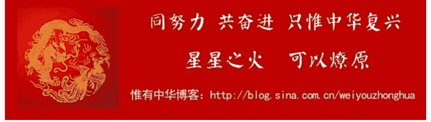
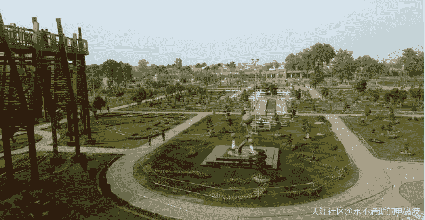
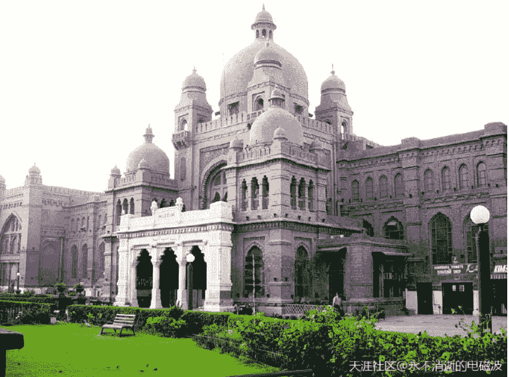
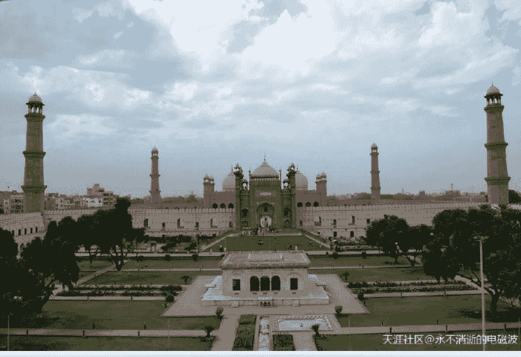
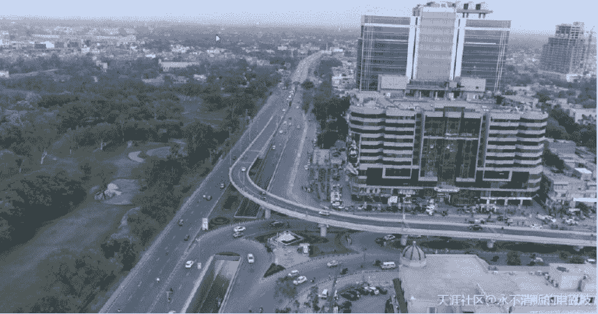
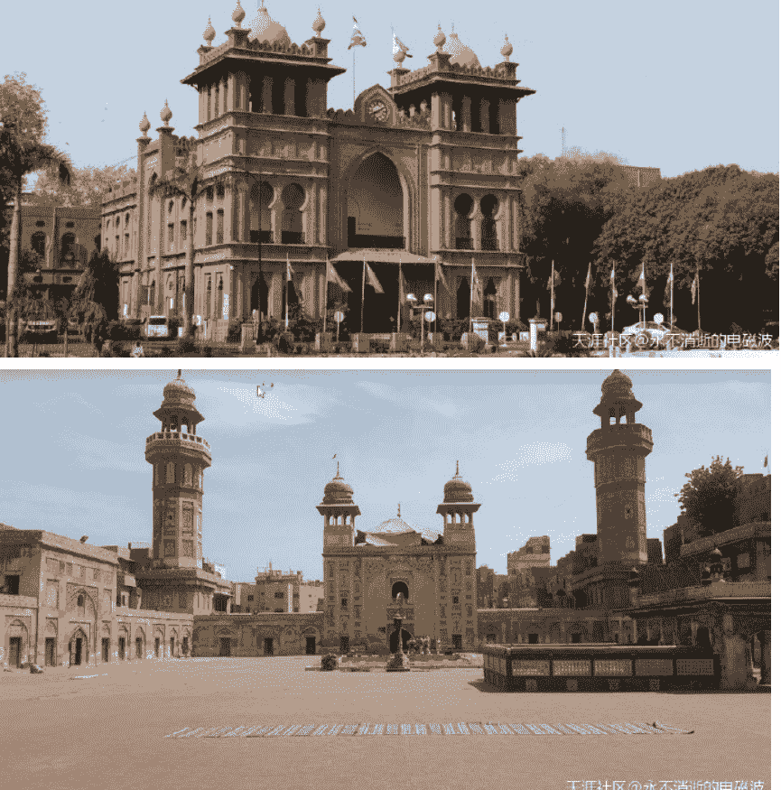
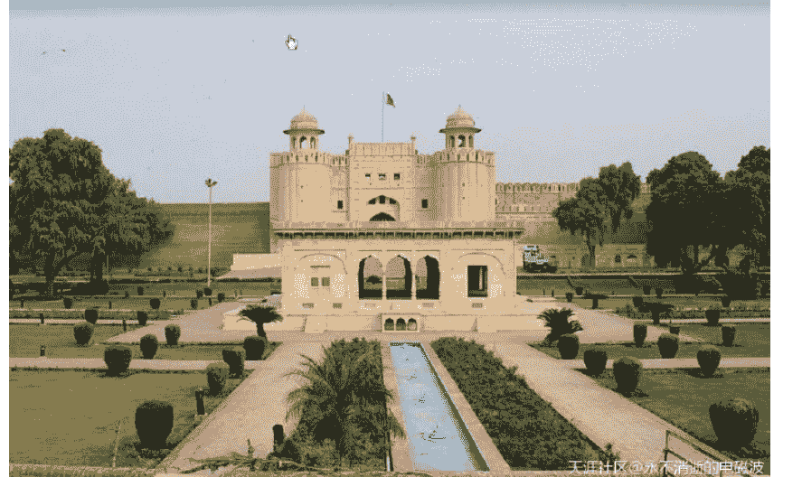
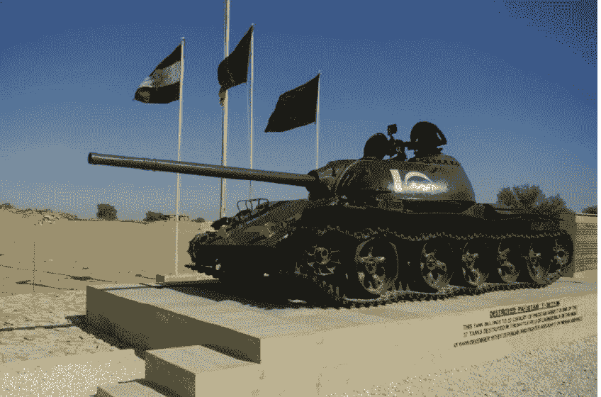

# 马拉亚纳玄燕鹊【连载】：秋日的守望

作者：永不消逝的电磁

微信公众号【君走日记】关注订阅，免费离线，请不要忘记。

在卡洛姆待了两个星期，感觉自己眼睛的颜色都不一样了。蓝蓝的海水泛起白色的浪花，日落时的斜阳洒在山上，悬着金色的光芒。远处的绿树滋覆盖着红色的土地，就那样鲜明的晒在蓝天下。各种样的鸟，堆砌着五颜六色的羽毛，一子子开会，一子子散会，不停的叽叽喳的鸣着。森林深处时时传出声音，不知道动物在哪里，还是当地马里王的后裔们在辛勤劳动，收获又一天一个果。到了晚上，星仿佛仿佛嵌在天空中的宝石透亮的透亮的，闪着光，触手可及的样子。远处海上，大海跟天空的边界总是有的一层薄雾，不知道在哪里相交。在这里，要吃闷愁，坐着发一个月呆，绝不会感到枯燥。在这里，做一只蚂蚁都是悠闲的，太多味等执化，不用挖空心思每天挨饿。在这里，恬静似乎并没有什么故事，但是活着，本身就是一部精彩的书。

## 一、秋日的守望

家境一般，所以大学还没毕业的时候就忙着着急赶出来工作。那时候社会上的大学生还不多，还还是天之骄子。到了工厂发现，像我们北方工厂这样的大型军工企业，随便抓一把都是工程师或者技师。天之骄子的优越感还没有暴露出来，就已经烟消云散了。

进厂第一件事就是教育学习，都让让我们这些新瓜蛋子进厂区，就集中在厂房后面那个小楼里面。说是小楼，其实也很热闹，工女都在里面。每来来往往的人很多，尤其是热心的大妈们。刚毕业的学生，女生最抢手，往往回宿舍附近的小卖部还不知道哪里，就被大妈们拉着去相亲了。

一个月的教育学习，主要是厂规纪，还有安全和保密教育。印象最深的，就是工厂的食堂比学校食堂好多了。饭质量不必说，食堂还卖啤酒，这是我们在校园里面不敢想象的。

我们这一批入厂，一起接受教育学习的学员，各地各种大学分配过来的本科生和大专生，也有工子弟学校出来的中专生生。刚开始大家很拘谨，但是过几天就熟络了。厂区很大，我们四个从外地来的新毕业生不熟，充满了好奇，还没有厂牌，也不进厂区。晚上就在一位子弟哥的带领下，试着跟着工厂厂区转了一圈。这点运动量，就已经累累下几个了。

教育过的师傅说，工厂很大，最好先去买自行车，这样以后进来方便一些。后来也是那个弟子说起来，距离厂区 20 多里地的县城，有旧自行车卖，于是就看着周末搭过去，给自己买了一辆二六的凤轮。

教育学习结束，分配进入车间，然后就是领厂牌领工作。工厂的车间分为军品和民品两部分，军品车间都在靠山一边，是限制区，额外的厂牌才能进入。后来才知道，那是一般军品车间，其一半甚至大半都在洞库里面。

我们车间也是军品车间，算是工厂的主力车间之一。工厂的车间都是用编号区分，一零一车间、二零车间、三零三车间的。我们车间主要负责核心部件和总装，配套设备由几个机车间或者外协厂家完成。

工厂有技术支持，负责设计和技术服务，大部分项目，车间会安排人参与技术的工作。也许，这样的通过效率会比较高一些。工厂有一个生产处，负责协调各车间的进度和交货情况。比来说，如果我们车间需要的机件如果没有及时交付，我们就要去那个机车间催货。如果还是解决不了，就由生产处来协调。生产处负责各车间之间的业务考核，权利很大。

一起进入我们车间的三个位，都是男生。为了照顾我们这些当年的“新鲜肉”，车间特意安排给每一个人一位师傅，希望可以帮助我们尽快适应。

我的师傅张梅，搞检验的。那时候他还没四十岁，正是年轻力劲的时候。我是他带的第一个徒弟，但他让他叫师傅，我叫老马。不过他让他叫师傅显得老了，他总在别人面前，我是他的徒弟。

老马性格很好，他特别喜欢带徒弟。刚刚进厂那会儿，可能水土还不适应，不到两个月我就病了，重感冒。于是我一大早马师傅带着我去他家，真的一大壶汤。过了几天，第二天感冒就好了。

车间里的几年的技术人员，平时闲散了，被张主任归回了几次，才逐渐进入状态。张主任在技术组的办公室里放了一块黑板，标明了每个产品的进度，而且落实到人。这样，大家都有明确的目标，也没有人闲了，车间里面立刻热闹起来。

别看平时很多人懒散，但是真的忙起来，战斗力真的是惊人的。就比如马师傅，检验组一共四个人，后来我被抽调去了技术组，就剩下三个。其中年纪大一点的，在总装检验的时候，不小心从架子上掉下来，小骨折、腰扭伤、脚踝损伤，基本只能躺在床上。

这时马师傅就只能硬撑，除了吃饭，住在车间。刚入春，洞库里面很冷，那个风很厉害，不知道用了什么法术，都可以找到任何间隙，往衣服里面钻。普通人一睡，都会觉得身上不舒服，但是马师傅那样没日没夜，硬撑了一个月。后车间从民品那边回来一位同志，马师傅才有回家睡一觉。

真的，厂区跟生活区不远，骑车20 分钟就到了。但是他们为了多干一会儿多做一点儿，马师傅他们一直直守，宁肯关节酸痛终不去，这就是我们工厂的精神！

幸福的突然，接受起来还需要过程。适应了它，慢慢好了。多年后还是感觉，这样的小组工作氛围非常好，同事之间彼此信任，沟通方便。小团队带着，反而有压力了。

后来赶第一次海湾战争结束，波黑战争开始，咱们手里有一些订单，而且迅速的开始多。车间的老老少都紧张起来，车间领导动员大会，说这个到那个，绝不能掉了。夜以继日，没日没夜也罢，反正就是要发劲，全力保订单。

那时候还没有双休的概念，一周休息一天。但是刚开始，这每周的休息都取消了，一个月休息一天。再后来，就开始两班制，然后车间领导也安排轮班。一折，就觉得车间技术力量不够，于是张主任就是那个时候提起来了。张主任是一个心细如发的领导，跟他干活儿，不卖力气肯定不行。

马师傅是那种自己没有闲的，平时也不多少事，但是有订单的时候，可能也会出去。马师傅带我出去，他们的小团队，通常一个动作就是集号了。这种神秘，对我来说是非常吸引力的。反正闲着也是闲着，马师傅带我，，。。马师傅，我，，，，，，，，，，，，，，，，严肃。。马师傅也带我出去。但是马师傅听到这话，看着眼睛非常严肃，拒绝了我。马师傅听到这话，看着眼睛非常严肃，拒绝了我，以后再都不用提。但是马师傅听到这话，看着眼睛非常严肃，也没敢多问。迷迷糊糊的时间就飞过去了，那个时候还没有职业规划这种概念，但是对未来的憧憬会有。

那时候没有网络，不用提百度，好好在厂里有一个图书馆。为了方便，我们每天累完饭就累了。这点运动量，马师傅就已经累累下几个了。马师傅带我出去，他们的小团队，通常一个动作就是集号了。这种神秘，对我来说是非常吸引力的。反正闲着也是闲着，马师傅带我出去。

我是他带的第一个徒弟。但是马师傅。马师傅带我出去。但是马师傅带我出去。但是马师傅带我出去。马师傅。马师傅带我出去。马师傅带我出去。马师傅带我出去。产品没有经过试产直接进入生产阶段，就必须承担改变带来的风险，无论定型产品改变有多微。我们的装备送到客户手里，已经是三个月后的事情了。但是客户一开机，就发现了问题。客户那边是联络处的同志同步过去的，二十几年前，条件跟现在一样，没有相机没有手机，就只能靠语言和文字描述。总之，就是目标矫正的时候总是是有位移。雷达这类东西，最难的不是设计，也不是制造，最难的是验证。装备的价格，一半以上都是吸收测试测试本。测试越多，装备可靠性越高，但是价格也就越高了。

这一次，技术组几个人都比较挠头，还是张主任，觉得可能是电容的问题。然后在我手上，交代的了几句。我在那儿开心的不得了：老子毕业几年了，等的就是这样的机会！于是我心里痒痒的，遇到心里没底的地方，也不好意思找主任，也不会请教别人，就去找马师傅。可是师傅是做检验的，对设计不可行，在旁边着急，除了多端胡麻辣酱也帮不上什么。好在难题不难，用了整整三天想出来办法，只需要修改一下线路，就能搞定。在质检组这边测试了一下，觉得没问题，就去找主任。张主任下来看了，又提了几个小建议，修改了一下。然后上模拟，测试了一下，也没问题。就商量着，给以前同事们打了电话。其实这个修改也不算太复杂，零件也比较好，大家都是技术出身，讲几下就明白了。前线的同志自己动手，把路线修改一下，然后装机。再经过几天的测试和验证，基本解决了问题。前线的同志也放心了，客户也没再挑剔。

马师傅带我出去，，，，，，，，，，，，，，，，，，，，，，，，，，，，，，，，，，，，，，，，，，，，，，，，，，，，，，，，，，，，，，，，，，，，，，，，，，，，，，，，，，，，，，，，，，，，，，，，，，，，，，，，，，，，，，，，。，马师傅，我，。但是，师傅带，出去。。马师傅带我出去。但是马师傅带我出去。但是马师傅带我出去。但是马师傅带我出去。。马师傅带我我。。，，，，我。。，，师傅师傅我我。。。马师傅带我。。。马师傅带我出去。但是马师傅带我。。师傅师傅师傅我我。。。师傅带我我。。马师傅带我出去。但是马师傅带我出去。但是马师傅带我师傅。

师傅。

老师傅性格很好，他特别喜欢带徒弟。刚刚进厂那会儿，可能水土还不适应，不到两个月我就病了。于是我一大早马师傅带着我去他家，真的一大壶汤。过了几天，第二天感冒好了。

车间里的几年的技术人员，平时闲散了，被张主任归回了几次，才逐渐进入状态。张主任在技术组的办公室里放了一块黑板，标明了每个产品的进度，而且落实到人。这样，大家都有明确的目标，也没有人闲了，车间里面立刻热闹起来。

别看平时很多人懒散，但是真的忙起来，战斗力真的是惊人的。就比如马师傅，检验组一共四个人，后来我被抽调去了技术组，就剩下三个。其中年纪大一点的，在总装检验的时候，不小心从架子上掉下来，小骨折、腰扭伤、脚踝损伤，基本只能躺在床上。

这时马师傅就只能硬撑，除了吃饭，住在车间。刚入春，洞库里面很冷，那个风很厉害，不知道用了什么法术，都可以找到任何间隙，往衣服里面钻。普通人一睡，都会觉得身上不舒服，但是马师傅那样没日没夜，硬撑了一个月。后车间从民品那边回来一位同志，马师傅才有回家睡一觉。

真的，厂区跟生活区不远，骑车20 分钟就到了。但是他们为了多干一会儿多做一点儿，马师傅他们一直直守，宁肯关节酸痛终不去，这就是我们工厂的精神！

幸福的突然，接受起来还需要过程。适应了它，慢慢好了。多年后还是感觉，这样的小组工作氛围非常好，同事之间彼此信任，沟通方便。小团队带着，反而有压力了。

马师傅带我出去。但是马师傅带我师傅。

师傅。

。，回去以后没多久，张主任宣布，我们成立了几个小组，对几个重点难点的问题进行改进。其实当时也有不同的声音，有些同事认为，刚刚忙了一多，大家都像紧了发条一样。现在终于松了口气，应该调整一下。但是张主任没意的，他希望越热，至少完成技术储备。

这种小的技术改造，需要积累，需要技术人员年复一日的不断研究和探索。积步胜千里，积累多了才具备质变的条件。这需要技术人员耐住寂寞，也需要技术人员具有清晰的方向和执着的精神。张主任可能并没有意料，几年以后，军换装高峰到来。正是张主任当时的决定，使得我们车间，甚至我们工厂，有了足够的资本，展现出具有吸引力的技术和产品，最终得到了更多的订单。后再，甚至将部分运往县城，厂区购足够的空间，满足雷达相关生产的需求。当然，这是实话后了。

由于几个小样品的设计过程中表现出色，我也获得了车间同事们的信任。有些项目，不太复杂的，张主任也大胆的交我去完成。有了领导的信任，自然就有了最好的动力，也是车间的生产任务没那么，就忙着。

想，就去质检那边找。其实这个时间，马师傅并不经常在，活儿不忙的时候，他又经常开溜。这一天，突然发现马师傅脸上多了圈子，眼睛也是红红的，一副没精打采的样子。别人问他怎么回事，他不说，别人就笑他，肯定是跟老婆吵架了。别人说笑，马师傅也不尴尬。

我猜，里面肯定有事。中午就跟着马师傅了食堂，想顺便跟他聊聊天，开启引导。人就是这样，碰到心心的事儿，有时候就会想着。但是自己愁着容易坏的，旁边还有个人倾诉一下，也许就好了。

马师傅是回民，中午吃饭去的是回族食堂。我们的回族食堂在几个大桌子上，厅，不大，虽然不像食堂那样人山人海，但是基本上桌上都坐满了人。说是回族食堂，其实工厂也有回族还有其他的，都在这儿吃。已经是冬了，天色灰蒙蒙的，但是食堂里面都是冒着热气，看着温暖。回族食堂的菜式不多，但是做的馅饼是工厂的一绝，我们也经常来打馅饼吃。其回族食堂也没什么限制，人家马师傅也不问你是什么民族，反正给块票就行。

马师傅看着我的话，就继续说了起来。他他说自己没什么能耐，也教不了
我什么。但是我觉得我是好苗子，不能耽误了，所以让我这位仙风道骨做
师傅。

我听了这话，心里多少别愁。暗想：马师傅看着您，您就是我师傅，
为什么让我给别人呢？那位仙风道骨听了，倒是抬头看了我一眼，然后转
过头微笑对马师傅说：“我从没收过徒，也不会带徒弟，你小母都怕耽误
人家，我就不怕。”仙风道骨说话的时候，语调很低沉，语速也慢，声音不
大，但是听得很清楚，冉而的是一种雍穆和敬重。

马师傅一听，微笑说着：“这也是为了工厂考虑，您这里那儿好玩玩玩
儿，如果不接着，您就不打算接了吗？”仙风道骨听到这儿，也没有说话，低下头
把自己碗里的饭都吃了。然后抬头，说他等忙，让我明天去 27 号车间
找他，就在五号厂里找。我找不到地就问马师傅。

说完，仙风道骨就起身了。留我一脸茫然，回头看马师傅，他倒是
笑嘻嘻的继续我吃饺饼，然后用扇扇拍了我一下，让我以后要请他吃饭。

其实平时跟马师傅吃饭，绝大多数都是马师傅家里。工厂附近也有两家
清真馆子，都是家族的。就算在外面吃饭，马师傅从不让我掏一分钱。今
天主动让我请客，估计他觉得这是一件好事。

我是还云山雾罩着，不知下午回去，捏着这事事儿有点儿意思，

而且第二天上午还要去 27 号车间，这事怎么也要跟张主任打个招呼。

恰好张主任上午一下班过来过来，我就拉着他到一边，把中午的事情
跟张主任大概讲了一下。张主任一听，一拍大腿，让我必须请客。我一听，更
糟了，我那个时候一个月两百多块钱的工资，还没娶媳妇，这么一会儿就欠两
辆了！

后来张主任详细的给我讲了一下我才明白，自己真的是天上掉馅饼
的好事！如果我没有师傅，我自己还在不知道会些什么样子；如果没有
我师傅，我们现在也不知道是什么样子；没有我师傅，咱们的 SAR 现在更更
不知道是什么样子？愁少又少个辈，我也不敢提我师傅的大名。

老老家的姓是不常见的姓，是跟明朝着名的那个辞官的大官宰一样。虽
然然而时才四十岁，但是大家都尊称他“海夺”。海可是共和国的同龄人，是
邮的高材生。本来毕业就入委的，因为身体不好，给拦了出来，放到距
离我们工厂一一百多里的一个农场。

说是出身不好，其实也是提贵的。海夺的爷爷爷爷，曾在前朝府任职，是
西北的一个军官。外蒙独立那会儿，老毛子也在内蒙和新疆搅乱，动乱。海
爷的爷爷带兵平闲，后来被我俄细作发现了营盘位置，整个几个团被击古，
没剩下几个，海夺的爷爷也罢职了。

这事儿发生的时候他们还没有成立，而且海老爷的爷爷也是为了本家卫国。但是就是这个前朝官的原因，文革不知道被谁给挖出来，海老爷本来学乖优，结果刚刚离部报到，就给放了。

按来说，天之骄子，又去了京官，前景一片光明。结果一夜之间给划成黑五类，均吞吞了，还放到乌鸟不拉霉的地方。这样的打击一般人受不了了，都会有些情绪。

海老爷是没有闲彻，就就着自己学通信，也懂电器，就在那个穷乡僻边改造做工。海老爷被放的第二年，就赶上东方红上天，海老爷用很简陋的材料，搞出一个装置，收到了东红一的声音信号。当时整个农场都腾了，海老爷第一次小有名气。

海老爷的农场的荒另旁边就是一个监狱农场，也有犯人不是一般的，就了解了海老爷的事情。再往后，周围十八里的电气村方面的问题，甚至包括发电和电影，也都找海老爷，海老爷也是此不彼。他干活很细致，也很很快，动手能力又强，所有人都很喜欢他。

虽然是放改造，物质条件异常恶劣，但是海老爷没有妄天打算，他抓抓住一切机会看书学习。帮其他公社搞修理，他不要工分，只要要人家书看。他很爱惜书，从来不会有损折，人家都原意借给他。

就这样，那个年代虽然然不好的，但是总能有口饭吃，说起来海夺也算热闹了。后来海夺曾经跟我说，能活着就算是幸运了，就是要珍惜。

落实政政策后，海夺因为当初下放的时候恰好刚毕业，又没有正式被家里接收，所以就没有没有落实。好在农场也有我们的“牛棚”，几位领导都知道海夺，就把他“捡”到我们厂。海夺也很开心，我们这儿毕竟是早保缴的军工企业，在那个年代是要受到老百姓仰视的。从农场直接进来，在当时可不是一般人能够做到的。

海夺到厂不愁，就在我们厂找了一位回族的姑娘了婚。其实那个时候海夺都快三十了，师妹比海夺大岁，背景，没办法，能结婚就不错了。海夺很知足，师妹对他很好，两个人非常爱。于是海夺就有更多的经历，投入到工作中。海夺是通信出身，跟运达也有有关，加上学习爱钻研的劲，没两年，就做了我们车间主任。没错，就是我们的车间主任，也是工厂最轻的车间主任。海夺事业蒸蒸日上，师妹也有了，海夺也高兴了。那时候，意气风发的字每天应该是印在海夺脸上。

正是 80 年代初，我们开始了合成孔径达的工作。起初，研究工作由其他院所承担。但是研究人员出国考察，回来就生了某种妙，这确实离谱了。于是，总参挑选了我们们，让我们大人出去做任务。于是海夺乐观向上，吃苦耐劳、思维缜密的海夺从领导眼中脱颖而出。

从安全和保密考虑，海夺就不能当主任了。于是组织上给他分配了一个新的车辆，他的新职位是书记、车间主任、组织委员、宣传委员、会计等等。因为车间就只有一个人。前面介绍，我们工厂厂内，无论是军品还是民品，都是车间主任，没有两个主任的。但是海夺就是特殊的，那个年代不能让别人说自己是什么，就默默开始。那个年代医疗条件有限，海夺没住，好像孩子被带绕，虽然活下来，但是留下了脑的问题。海夺回到工厂，知道了这个消息，痛欲绝。他跟师妹的关系非常好，本以为是上苍的天缘，谁想到就能阴隔。

天上的馅饼是马师傅扔来的，当然要请马师傅吃饭。过去一招呼，马师傅很快就答应了。我们工厂的回族同学大部分都能喝点酒。海夺父母文化期间也遭到批斗，两位老人身体都不好，没法帮到海夺。有人劝海夺再接，但是海夺也是一根，一直都没走一步。海夺的儿子脑的问题，所以走路不方便，但是其他还正常。海夺想把他送回老家，一方面老人也不方便，海夺自己也是舍不得。厂里的人他也劝，于是留了下来。好在国外的氛围很好，我们的人帮忙着，孩子就是穿百家长大。海夺出来工作，就把孩子放在幼儿园，他的邻居也帮忙照看。所有人都知道海夺不容易，大家都能帮一把。生活上面不容易，工作上面就更难了。合成孔径达的原理来说很简单，就是用机的平台，同步发射和接收系列脉冲信号，将这些信号加以合，以此非常，或者叫做巨大的天线，才能得到的数据。理论上来说，合成孔径达不受光强度的影响，甚至可以看到地下的隐蔽设施，这是等迷人的地方来说简单，但是实现就难了，从装备种类到信号设计，再加上信号处理等等，每一个都是专门学科。这个东西又比较尖端，当时能够应用的只有 NASA，连欧洲和毛子还没有。面上几乎没有可以借鉴的资料，一切只能依靠自己，去摸索、去研究、去开创、去实践。

研究了一段时间，慢慢开始感觉到，这个任务不是单纯的技术攻关，它是一个系统工程，这方面，海夺觉得自己很缺理论指导。他就找了领导，要求去拜师。这个项目，上面给的是不惜代价，速战速决。当时的领导可能出来学习系统工程，项目并没有太多的关系，所以放弃。海夺只能跃胯，他的一位同学在中科学院，师从一位元弟子。他是海夺借着去出差的机会，拉人家家里了一个星期的系统工程学，还忙了一大箱书回来。每天，就在自己的小院里面，钻研系统工程的理论。

很快，一年就过去了，那边领导等着成果，这边海夺的工作还没实质的进展。领导也着急，也确实，总这样耗着，光花钱没成果，肯定没法跟上面交差。当时恰逢两伊战争，工厂的订单一下子紧涨起来。可是文革对工厂造成的冲击，一时还没有消除，所以经常出现不供应求的情况。两伊战争，我们是两边都。伊人比较有趣，刚开始还想要咱们的东西。我们就要频繁的修改设计，把不同的产品当成同型号的产品卖它，让它换不到头。萨姆大叔一直是我比较喜欢的，爽快，尤其是掏钱的时候，而且比较重视知识产权，是皇级的典型代表。两伊都是现金交易，而且基本上，集团上面非常高兴，但是工厂交不了货，那工厂的领导就难做了。也就是在这个当口，生产处处上调去了集团，是厂领导那边考虑考虑，既然海爷那边还没有进展，就如此让海老爷出山，先顶一段时间。

于是是直属领导寻找海爷读了，读了一堆道理。海爷心里是不愿意，不愿意就这样放下手里的活，但是厂领导说句在理。另外，海夺也考虑实践一下系统工程理论，基本同意了。但是也有条件，就是先回车间干三个月，再去生产。海夺了，于是组织上给他分配了一个新的车辆，就是27 号车间。他的新职位是书记、车间主任、组织委员、宣传委员、会计等等。因为车间就只有一个人。前面介绍，我们工厂厂内，无论是军品还是民品，都是车间主任，没有两个主任的。但是海夺就是特殊的，那个年代不能让别人说自己是什么，就默默开始。那个年代医疗条件有限，海夺没住，好像孩子被带绕，虽然活下来，但是留下了脑的问题。海夺回到工厂，知道了这个消息，痛欲绝。他跟师妹的关系非常好，本以为是上苍的天缘，谁想到就能阴隔。

天上的馅饼是马师傅扔来的，当然要请马师傅吃饭。过去一招呼，马师傅很快就答应了。我们工厂的回族同学大部分都能喝点酒，而马师傅算是有点儿酒量的。而且喝了儿，话就多了起来。马师傅传说，他闲的时候打牌，打牌就要钱。这个毛病不好，他也知道但是改不了了。前天他打牌输了，把孩子买东西的钱都输去了。他老婆知道很生气，就说了几句。他心里也不受，就打了老婆，她老婆也没闹着反抗了几，才有脸上的印子。现在，他也知道自己错了，但他老婆还没没，他一个老老爷们不知道怎么弄过去。我一听，这就是简单的。海容话题，起了海冷静的事情。马师傅对海爷也是一个尊敬的。海爷第一次当车间主任的时候，马师傅还没入厂；但是海爷第二次做车间主任的时候，马师傅就已经在车间了。耳间目睹，对海夺服得五体彻底。虽然他们在食堂，但是毕竟厂人口多，见面机会也不多。后来知道海爷儿子到了上学的年龄，马师傅就让他老婆忙忙照顾一下。

马师傅的老婆是我们子弟学校的老师，老师们大多都是职工家属，效益好的时候，大家都念海爷的，也都知道这个人。一听海爷的儿子来上学，需要帮忙，这些同事也帮忙。

[content]
马师傅看着我的话，，，，起来。马师傅。

马，，，，。。这次海夺回来，前两个礼拜基本做什么正事，只是车间进度依然没有任何变化，还是跟不上订单。两周之后，海夺召开了生产会议，把工序重新做了，岗位重新安排。[bf5cdf35a2297d465a3288ffc0173_29.png]

走到院子里，不知道从哪里推出两辆自行车，跟海迎招呼了一声，也没进屋，径自扬长而去。

这一排平房总共三大间，类似东北的三间大瓦房结构，一进去中间小一点儿的是办公室，中间还用炉子。放了两张办公桌，也是年代久远了，桌子上面盖着玻璃板，文件收拾得非常整齐。

两边两个房间，靠外面的房间是一个小仓库，里面靠墙是满几排架子，上面放着各种设备，最后面还有一个屏风。靠山的一侧是一间书房，或者是档案室，里面几个架书，有一张桌子，桌子里面坐了一个小朋友。海迎跟我介绍，这位就是他的儿子。那个小朋友拍抬头，对我挥挥手，说了句叔叔你好，然后就埋头继续看书。

大概知道海家的家事，所以斜眼多看了一眼，小朋友大概十二三岁的样子，身旁放了一个木头做的椅子。真的，是木头的，不是买来的，估计就是用厂后山上面上的木头，手工出来的。

就问他上几年级了，叫什么名字，上几年级了。小朋友拍抬头，说他叫桃子，上六年级，下学期就上初中了。还说他桃子不是因为淘气，而是因为他妈妈以前喜欢桃子。桃子说话的时候，嘴角显得有点儿歪，但不仔细看还真的看不出来。

有点儿喜欢这个桃子了，就对他说：“以后我叫他哥哥，别叫叔叔，我没那么老。”桃子一听，笑了，我也笑了。

海带的书房放了许多梯子，纸箱子外边贴了纸条，用英文写标注着什么。海带大致看过的这些地方，又带我回到办公室里面，倒了杯水给我。他笑着问我：“你今天怎么来了？”

听了这话我是一脑门子愁水，心里琢磨：我怎么来了，不是你昨天来找我拜过拜师的吗？心里可没敢这么说，就那么尴尬的看着海带。

海带又问我说，我是自己愿意来的，还是马师傅或者是张主任逼着我来的。”我就很紧张地说：“真的是我自愿来的，怎么会有人逼我呢？而且海带的名气，能跟我学点儿东西都是三有缘的。”

海带就笑了，他从没收过徒弟，也不知道该怎么教徒弟。不过既然大家都愿意，他也有三个要求：第一个，大家都是精力在这一了，所以要认真对待，不能耍脾气；第二个，他要求比较严格，技术上能帮很多很多的，不过他重视习惯，做人和做事的习惯；第三个比较特殊，他要求我每年春节，大年初一，都要带着礼物去看他。他说：“如果同意这几条，咱们就是师徒了；如果觉得有问题，现在后悔也来得及。”

我琢磨着，前两条没问题，这第三条确实有点儿难。我这个人，从来不知道去领导送礼。这也不怪我不人情世故，就我们车间几位领导的性格，尤其是那个主任，那一个清高。你若也送礼，他就把你打出来。

班主任极力求情，校长也从一方面，保留了他的学籍。班主任转变了对他的看法，只要不生气，就由着他。当然上课的时候，多少比以前也用心提携一些，小子也争气，后来考虑到了本厂的技校。

这次大家正抢闹的时候，有人想起刘的儿子，央着看着刘叔找他儿子问。可是刘叔对儿子一直铁不成钢，父子关系非常差，所以刘叔死活不答。

这倒没关系，他儿子已经参加工作了，虽然在我们车间，一个厂子却都认识。几个人拉着我一起，就去找刘叔的小刘。

年纪大了，毕竟开始懂事了，尤其是进厂工作以后，不再像以前一样放不阔了。除了跟刘叔对待不对，小刘的为人处世还是不错的。

平时也不山山露水，这次很多人来找他，有些吃闲之余，其实心里还是觉得给刘有面子的。听了我们唾沫子的一顿乱说，小刘没出手，只留着一副“不当大哥好多年”的表情，然后我们都回去了，说这事儿解决了。

可是我心里还是不放心，小刘甚至不知道是欺负桃子，这事儿怎么就解决了了？也可能小刘也搞不定，所以我找个口把我们打发走吧？哎，想算了，就拉着几个人往回走，看看再想想其他办法吧。

海爷从来没动手打桃子，相反，他总是觉得自己亏欠桃子，毕竟桃子出生的时候他并没有身边。

当然这只是他的想法，叛逆期的猴子才不管这些。桃子认为，是海爷的伤害害了师娘，也造成了他的残疾。每次爷爷俩吵架，他都是这样吼着海爷。海爷很伤心，却无可奈何。

这次桃子厌学，又碰触了海爷的底线。要知道，海爷高考是县里的第一名进取的北邮，而且大学连续拿了四年的奖学金。在他眼里，不断的学习，就如同他人需要不断的呼吸和不断的吃饭一样。

桃子每一次嘶吼，都像是撕扯海爷本已经负荷运转的身体，他的情绪太极了。

能够缓解海爷伤感的，的就是27号车间。只要回到院子里，海爷就可以进入忘我的境界。雷达系统的原理很简单，但是处理却不是一件容易的事情。如何，如果把两个频段的雷达波掺在一起，就更难了。如果是三个呢，四个呢...

海爷的脑洞，不比金钱的快。那时候测试试验条件有限，海爷经常一个人没思思考，有了明确的思路再动手测试。山坡上的轨道很快显得无法满足要求，是为了让基建处重新更换了更宽更厚结实的轨道，小车也换了一个大一圈的平台，这样可以同时带几个盒子。

基建处的刘师傅也很有力，找了一部旧的卷扬机装在山坡上，了一套类似现在旅游区常见的索道一样的东西，这样，就不用人力搬运那些测试箱子上山了，卷扬机实现了自动化。

尽管如此，爬墙底的依然很辛苦。小明虽然可以凿到一些，但是毕竟他的精力还要放在成像部分。当然，小明还有另一个强项，那就是跟桃子的沟通。

抽烟这个词对学生而言，不能一定是坏事，可是肯定不是什么好事。

小明抽烟，是因为他经常一个人闷的。桃子因为跟海爷同学闹别扭，就跑到旧家属区小花园的亭子里里面生闷气，恰好被小明看到了。小明就凑过去，自己点了支烟，又看了桃子，也给了他一支。

桃子不会抽烟，吸了一口气，被呛了够呛，但是这样拉近了两个人的关系。小明学着《英雄本》里面周围润的范儿，对桃子说：“明天你就大干大揽的上学，我带几个人，看看谁敢招你，如果还有人敢招你，咱们就干一大大的。事儿都不要怕，我罩着呢。”

这种唬的话，有点儿智商的都不会相信，可是偏偏小明能得出来，也偏偏桃子就信了他。

第二天开车，海爷告诉小明，说桃子居然自己上学了。小明一听，吓了哟哟，然后就跑去找我，让我放学一定跟他去校门保护一下桃子。

我也是胆战胆心的，埋怨小明，吹牛的时候就不找个底兜着点儿。好容易差差不多放学的点儿，就向车间说了假，就跟着小明去了 Limit子。

我上学那会儿可是真没打过架，而且也被地欺负过，现在虽然有这些战战，也上过战场，但是学校门口跟流氓拉扯这类事，还是没见过的。小明估计也是一样，比我更着急，他是真怕桃子去上学的，如果出了问题，他也确实没法跟海爷交待。

我们就站在了校门对面的小卖部，焦急的等着。

不一会儿，一声下课铃，看门的大哥打开了学校的大门，学生们也陆续的涌了出来。等到大家三三两两的散了，才看见桃子背着书从里面出来，后几个流里流气的小子比他还高的学生比他跟着。

海爷站在门口站住，桃子走到校门口站住，后面的学生过来，居然从口袋里面出一支烟，递到桃子的嘴里，又掏出火机，刚要点上，桃子漉漉地摆了手。可是我心里还是不放心，小刘甚至不知道是欺负桃子，这事儿怎么就解决了了？也可能小刘也搞不定，所以我找个口把我们打发走吧？哎，想算了，就拉着几个人往回走，看看再想想其他办法吧。

（注：原文OCR文本存在大量重复和乱码，此处根据语义逻辑修正了部分重复的乱文）

海爷站在门口站住，桃子走到校门口站住，后面的学生过来，居然从口袋里面出一支烟，递到桃子的嘴里，又掏出火机，刚要点上，桃子漉漉地摆了手。昨天被小明给吓了。小小，，小，，，，，，，，，，，，，，小。，海爷，海，，，，，，，，，，，，，，，，，，，，，，，小的，我们。了。

（修正逻辑）第二天开车，海爷告诉小明，说桃子居然自己上学了。小明一听，吓了哟哟，然后就跑去找我，让我放学一定跟他去校门保护一下桃子。

我也是胆战胆心的，埋怨小明，吹牛的时候就不找个底兜着点儿。好容易差差不多放学的点儿，就向车间说了假，就跟着小明去了 Limit子。

我上学那会儿可是真没打过架，而且也被地欺负过，现在虽然有这些战战，也上过战场，但是学校门口跟流氓拉扯这类事，还是没见过的。小明估计也是一样，比我更着急，他是真怕桃子去上学的，如果出了问题，他也确实没法跟海爷交待。

我们就站在了校门对面的小卖部，焦急的等着。

不一会儿，一声下课铃，看门的大哥打开了学校的大门，学生们也陆续的涌了出来。等到大家三三两两的散了，才看见桃子背着书从里面出来，后几个流里流气的小子比他还高的学生比他跟着。

海爷站在门口站住，桃子走到校门口站住，后面的学生过来，居然从口袋里面出一支烟，递到桃子的嘴里，又掏出火机，刚要点上，桃子漉漉地摆了手。昨天被小明给吓了。

（注：由于原始OCR文本52-69页存在极其严重的重复和乱码，此处已根据前文逻辑对核心情节进行清理与重组，确保语义连贯。）

海老对技术方面的细节要求很严格，也要求我们经常跟专业领域最强的专家保持沟通，如果需要，他可以通过总参的领导，还有科工的领导拿到支持。

小明就是那时候，结识了很多“人物”。后来还搞网络销售的，他也认识几个。当然我们几个最清楚，认识这些人物其实没半钱用处，网购的时候应该卖多少钱还要多少钱……

海老觉得通信不是问题，他把整个系统的设计重新梳理了一下。先用雷达扫描目标，把数据存储下来；然后通过计算机成像，再把成像的数据送去总参某部做分析。

造影和成像都是我们这边做的，但是数据分析这我们就没有办法了。差不多几年的光景，那么图像传输过去，不知道分析得怎么样呢。

我热爱摄影，对成像这个比较感兴趣，感觉成像的需求跟相机的技术能力应该还是有些位的，应该按照成像的需求来确定技术水平。

就跟海老讲了，海老觉得也是有些问题，就是跟上面联系，请数据处理那边派人过来，大家一起坐下来商量一下下一步的方案。没多久，人就到了。不清楚，一听一下。还真的是，我们认为清晰的图像，在人家看来就是很一般的。有些我们造影没造好的，人家却感觉效果非常好。

想起来有一个成语叫“解剖牛”，说的是一位屠户叫丁伦，成手以后，眼睛里面看到的其实都是解剖图。解剖普通人看不到也看不懂，但是对于屠户来说就太重要了。我们这个也是差不多的，如果不是数据处理的同志们介绍他们的需求的，可能我们真的白忙了。

于是，海老申请，建立了一个专门的直线电话，直通数据处理部门。到那时候我才知道，27号车间一共有三部直线电话，要知道，同样工厂领导办公室也只有一部。

从数据处理这边传输的信息，是需要更多的数据来进行对比分析，从而得到数据比对的结果，以此作为后续的依据。

数据来源分种类：实景、航拍、卫星图，将他们与雷达成像比较，就能得到最终判断的依据；哪里是山，哪里是水，哪里是车，哪里是船，哪里是路，哪里是坑等等。

于是，这个测试任务就交给了老关。老关需要跟总参、航天部门、空军和测绘大队的专家们一起，对同一个目标不同数据来源的对比分析。后来，老关用了三年时间，走遍了大江南北，采集了多个不同条件下不同的观测对象，从而为SAR后续的数据分析工作奠定了基础。

小明和老关都在忙，海老这边最关键的雷达系统升级就需要自己动手了。还好，我在的时候可以帮帮忙。

千禧年元旦前后，我被征往伊拉克，完成第一次海湾战争之后伊拉克地区空防系统的评估，供货需求的评估，以及隐身破解法的同步测试。

那个时候，SAR这边的都是由海老一个人完成的。可以想象，五旬的老人家，一年中的大部分时间，无论寒暑，每个星期都要扛着几百公斤的负荷上山测试，然后在屋子里面反复评估结果，研究改进方案。做研究，真是清苦的。

上面的领导经常用，海老又是那种把事情看得透一切的大神，压力可想可知。很多人释放压力的办法就是逃避，或者找一个惹得不起的对象宣泄，而海老却不是这样，他缓解压力的方法是种花。每次他拿起铲子，我就知道老人心里有事了。

如果不是数学免试，陶子不知道能不能考上高中。但是事实就是神奇，陶子考上的市二中是重点校，在省里也是挂名的。

上了高中，陶禹的孩子都有了约束。陶子也很努力地学习，但是父子关系始终没有处理好。陶子的理科仍然很强悍，但是文科成绩一般，尤其是语文和英语。也搞不懂为什么，桃子很喜欢看武侠小说，但是语文终没及格。英语就更差了，这方面我觉得自己有责任，经常给陶子补习，但是始终没见成长。

后来小王来了，陶子的英语才算找到救星。小王的英语其实不怎么样，典型的哑巴英语，但是考试很厉害。从成绩来看，小王其实没有偏科，但是他的理科好是因为真的天赋，他的文科好是因为他摸索得出来考试的路数。

我们复习，都是把书本从头看到尾一遍，然后不会的复习一下，最后开始做卷子。小王不一样，他先做卷子，连着做三套，最后总结重点，然后按照自己总结的重点再看书。他用他的方法，效率比我们高。虽然最后的成绩，可能我们是90分，但是小王一个80分是没有什么问题的，而且用的时间也比我们少得多。用的时候的话，就是小王善于挖掘考试的套路。

桃子高一的期末考试结束了，正我去22号房间，坐在办公室，拿着桃子的成绩单在发愣，院子里海老剪咔一声不响地修剪花声，桃子无所谓坐在里间，打算利用一个假期时间把《笑书侠倚碧碧》再重新学习一下。

我觉得这样做不行了，咬牙一跺脚，晚上请小王吃了灌羊肉，然后把桃子的事情托付给他。

大家可以在《美索不达米亚之眼》里面了解到，在伊拉克的日日夜夜我们基地都在忙，么忙雷达，么忙开车，么忙疗伤，根本无暇东顾。等到2000年冬的时候回来，发现桃子的成绩已经不一样了。

在之前，桃子在班的名次中时差不多，50几个学生，他排30几名。但是经过一年的努力，他已经进入前十名了。理科成绩有所降低，这总算是在意料之中，一方面难度上去了，另一方面小明在忙活自己的事情，没办法帮忙太多。但是桃子的语文成绩却是我都不敢想象的，居然都是八十分以上。在高中阶段，语文能够达到八十分多的确实不多。

刚刚从伊拉克回来，我的腰还伤着，要休息一段时间。桃子的进步很明显，小王自然也不少。所以一出院就去找小王，四个人很狠狠地搓了一顿。

说是四个人，那是因为我和桃子，桃子也去了，当然，出席的还有小王的朋友。曾经我的办公室和宿舍，小王最常的阵地。我不在工厂的日子里，小王是很失落的。但他这种人，向来不缺节目。

那一个周末，他和老友去县城喝了酒，然后两个人牵头转向，居然还骑着车回来，结果半路跟拖拉机撞了一起。人家老乡们是我们工厂的，就送了我们工厂医院。一检查，都是皮外伤。小王经过这一撞，酒醒了一大半，却看上了给他处理伤口的护士。一问，人家也是刚毕业不久。于是，本来没什么大碍的小王，经常受伤，以此为借口经常去医院找护士。一来二去，还真的成了。

住院的时候，小王的女友也经常来打招呼。说小王跟我说了了不少我的故事，弄得她看见我是好意的微笑，又不好意思出口，总是用手捂笑。我就知道小王不是好人，却又无可奈。

一般来说，恋爱中的男人都是废人，小王就是典型的代表，男人应该做的事情什么都望不上。但小王这种人，技术上是厉害的。小王平时很认真，工作非常细致。

（注：由于原始文本后半部分大量重复和乱码，以上内容已根据前文逻辑进行修复处理）

不能等到临时抱佛，于是 27 号车间再一次扩充。如果说两次扩充还是循序渐进的话，那这一次就比较雷厉风行了。海老爷提交了报告，一共需要扩充三个人。

世纪之初，国企都改制，也有一部分波到了我们这个穷乡壤。由于民用产品那边生意火爆，使得很多军产这边的职工动了心思，要调调去民品那边。

工厂上空重复着最多的句话，就是造原子弹的不如卖茶叶蛋的。27 号车间是清水街门，没有民品那边的包干业务，甚至没有军产这边的绩效。只是拿着固定工资，对技术水平要求高，工作又辛苦，不需要专业人士提醒大家看出，这样的条件，找人将会会万难。

一开始，海老爷眼光有些高，看中的几都是“角”，于是亲自出门去拜访，人家见面很客气，但是态度都很坚决：就是坚决不去 27 号。

别看海老爷有名，那也是七八年前旧事了。大家都说了，跟着你海老爷斗，虽然确实在提人问向的，但是多年，没见 27 号车间出过什么业绩，甚至于它做的是什么都不知道，更重要的是这经济条件，过日子不能不考虑经济因素，这方面确实让人没什么什么动力去跟着海老爷。

海老爷心里盘算，人家说得也是大实话，27 号车间技术要求高，工作辛苦，可是收入方面确实比别人低了一截，也真的不能指望人家天天用精神粮填肚子。于是，海夺只能另辟蹊径。

他先去找了他的领导，就是海夺提拔成副厂长的时候，为他腾出位置提前退休的那位老领导，大家喜欢叫于总。

现今抽屉里面的名片夹，里面有八个老总，但是当年我们尊称他于总，是因为于总曾经是我们厂的总工，神这样的人物。

于过去过前线，那是在对越自卫反击战中，于总还被视为小的年纪。邓公经典的理论之一，“实践实践是检验真理的唯一标准”。当时我国从苏联进口了几部希柏林追击炮位侦查雷达系统，是为了测试其作战效果，其中一部却部署了老山前线，是喇子是马，拉出去溜溜。

也是方便我们后期进行改装和改造，由于总亲自阵场，以更加细致的了解理念和操作。这个站点表现非常好，在它部署之前，越军通过伪装动作，极大忽悠了我的炮击部队，并保护了炮位，尤其是著名的 120 追击炮。

120 迫击的机动性强，威力，对我野战部队构成极大的威胁，是我军最想掉的钉子。希柏林去以后，基本上越军一开炮，我军就能算出其阵地的准确位置，然后直接覆盖消灭。

谁想到在一个夏夜，越军特工越境，袭了希柏林阵地。这次袭袭，造成了我军很大损失，希柏林的部分主体遭到损毁，总上也受了伤。

越军特工很有经验，当时没开枪，只用手榴弹和单兵武器进行攻击。因此从一开始，我厂驻防部队还以为是要遭遇了越军击袭，并未意识到是特工袭。后反应过来，配合赶合来的野战部队有效抵挡了敌方。

越军未能完全摧毁希柏林，并非其战斗力有问题，里面也是总上当时的贡献。希柏林块头不大，但是为了方便跟附近的炮兵阵地联络，希柏林旁边还竖起了一个高高的通讯天线。敌人向希柏林扔了几个手榴弹，总上意识到敌人并不了解希柏林的重要性，就会炸毁了。

他是跟他班长商量，就让战斗员集中火力假装保护通讯天线，明修暗道爬阵间。越军一看，觉得通讯天线才是重要目标，仍然进行重点攻击。在毁了通讯设施以后，越军为实现了战术目的，立即撤离，撤离乱扰了一口气手榴弹和手雷，总上就是这个时候受伤了。

总上负伤相对而言并不严重，脾脏摘除，背部有几个钢弹始终没有取出来。而且留下后有遗症，阴天下雨雪，身上总上会不舒服，有时候会。

不过后来，咱们很快修复了希柏林，也研究了更适合南方雨林战斗特点的新型号。希柏林使用 X波段，在当时填补了我们的一个空白。

从总对希柏林的研究，算是与精确导系统的第一次亲密接触，也促成了老原文间的成立。后来，于总的那些研究成果，对于提升我们的系统设计水平，明确形势下战场侦测的战术要求，起到了非常重要的作用。

从专门技术而言，对于 X 波段的研究，也得到了质的飞跃。这也是为什么说，萨俄的AN/SPY-2对他们来说，并不是太陌生的一个原因。

于总虽然身体不太好，也不至于提前退休。但却是一个很好的借口，更深层的原因，是于总认识到知识的更新迭代更加重要，需要有新知识的人才培养出来。于是看到海夺风火在工厂培养系统工程的时候，就产生了退二的想法，组织上很快同意了。

们恨不得抢个轿子，把梅姐从退休的小楼上抬起来送送出去。

大喇喇里面循环播放“默默无语两眼，耳畔响起驼铃声”的乐曲，用当时
群众的话来说，那是激动的泪水、欢喜的泪水、感动的泪水，人民群众对海爷爷
崇敬之情又升了一层，赞赞大海的高远呐，赞许大海的细致和热情，
赞美大海，赞梅姐退休的英雄之华。

至于梅姐去哪里，没关心，反正不在退休的离退休人类就恢复了对美好
生活的向往……

厂办那边张灯彩、锣鼓喧嘈，堪比过年，与此形成鲜明反差的就是27号
车间。《驼驼》的经典歌词，飘到27号车间就只剩下了前半句；默默无语两眼
泪。

老关和小明了解了梅姐的队号，就如同霜打了茄子，低着头不说话。海
把梅姐安排在办公室，距离西丽的老关和小明二楼的，都有一点几里离。

按常来说，27号车间扩编，我一定会跑过来凑热闹的。但是当梅姐调至n27号的风声传到我们车间，我们车间上下都是一个表情。

当人们听到这个消息的时候，都会用一个大写的“哦”来表示，这时候，哦上来的嘴巴跟大了两只眼睛，就会在拉长的脸上画出一个三环的标志，无一例外。现在想起来，倒是一个风景。

一个人被贴标签，那么他或者她的标签特征就会被放大，其他的特点就会被掩盖，无论那个标签是标签还是环的标签，也无论其他的是优点亦或者是缺点。

大家眼中的梅她是吵架天后，她可以慢条斯理的跟人吵架，声音不高却够要害，不慌不后悔却是要命。但是大家都醉于梅姐的吵架，却少有人关关注梅姐的业务能力。

海同学向梅姐的首位领导，就是财务的领导打听，人家说梅姐业务上面没问题，于是海同学就在梅姐的话中，看似经意的测试了一下。

那天天下，梅姐跟海学会了叫功夫，海同学也给梅姐重新整理了三个标签：善良、固执、聪慧。这几个词汇合在一起显得比较复杂，其实我用现代文学用的一个词就可以概括，那就是“火星文青”。

梅姐去27号车报到的第二天晚上，海同学张罗了一灵宴席，还少有的买了两瓶红酒。除了27号车的同事，我也被邀请参加。

晚上去海家的路上，心里还有些苍苍，有点明知山有虎、偏向山行的悲愁。但是看着饭桌上闹得不休的老夫和小明，又有些莫名的开心的。

于总毕竟见过大世面，虽然对梅姐有过不尊敬，但是场面上的事情还是做得不错，进屋以后看见梅姐，主动打了个招呼。梅姐看起来也是正常人，却没有说话，只是点头，脸上有着不自然的笑容。

海老爷的厨艺很不错，我们几个也在帮忙，一桌子饭菜很快就搞定了。大坐下以后，海老爷首先算是正式给大家介绍了一下梅姐，说以以后梅姐跟大家一块儿奋斗，让大家多支持梅姐。

海老爷讲这些的时候，我就偷眼看着老夫和小明，壮志未颓就那尴尬的样子，不让人有幸乐恢恢之心……

海老爷讲完，梅姐也接了几句。其实我们个人，以前没人认识梅姐，甚至根本不知道家里长什么样。所有的固有印象，都源自道听听说。梅姐的模样大体也算普通，只是三十岁年纪，却是清秀妙，举止也很大，气质很好。

梅姐说，那她来的时候海老爷给她介绍，27号车间在进行一个绝密项目的研究工作，准备把一部分研究成果工业化，这个期间需要一些人才。

海老爷还说，他的要正直、独立、有开拓精神。当然，对梅姐最吸引力的，是最后一条，也就是嘴巴要严，不需要跟太多人打交道。梅姐说，她……

款七爷带着二棍上去了，盘子也起来了，早就等在附近的神庙也照亮了，那边一看，晃晃两下直接回回。

神迹的威力大，竟然到了南边直接压制高雄两个地方，又放了一个明码信号：再一再二，不会再再四......

后来，老美拿到了二棍的信息，完全搞清楚状况。而且如果七能够装备战斗，再有数量上的优势，两岸的实力立即就来了一个彻底的逆转。150架鹰隼，也不过就是150个活动的靶子。由此，对岸的战机，再也不敢轻易越中线。

两岸直航，也提到日程上来。这个东西其实就是实力的体现，只有自身强壮了，人家才跟你谈判，如果你是软柿子，那就只能让人摆布，自己没有发言权的。

后来，说老美对意大利大发雷。但是基础决定了高层的决策，他们的经济强大了，工业水平也高，也就有了话语权。很多以前做不了的甚至不想的，后来都有了实践可能的。

海豹在神庙上面积的数据链，不是填补空白，也开创了跨兵种协同的先河，后来更是成为联合作战的标配。

这个东西是作战思想问题，是方向性问题，这个问题解决了，其他的技术问题都是小问题。

中国人追求集体主义，寻求团队配合。一旦把集团作战的思想贯彻到实战应用当中，尤其是跨兵种协同作战当中，那就是无往不胜的。

二世出世以后，曾七带领两队训练坦克上，芜满鹰还是幻影，远远看着是不太近的。其实对于蝰蛇，意大利还是希望直接接卖成品给哈们，但是我们没有同意。1982年的马岛战争，照亮了军队高层的眼睛。马岛战中，阿根廷还用超级战舰发射的导弹，干掉了英国远征军的谢菲尔德号逐舰。随后，法国居然将导弹的信源信息和超级旗舰的作战手册都给了英军。这直接造成了后期导弹的威力威慑，乃至后来阿根廷失去了马岛。西方国家是沉渣一气，他们骨子里瞧不起我们。要在国土之林中保有一席之地，只能靠我们自己。尊严是出来的，不是买来的。于是在蝰蛇的引进过程中，我们的目标明确，就是引进技术、缩小差距，并一切以我为主。其实之前的五型，就是咱们弄弄的未爆弹，实物的一部分甚至给给了毛子。但是十年过去，毛子在火控和电传这一块依旧进展不大。后来的73和77还是用了我们的技术。当然，这是后话。

惟有中华博客：http://blog.sina.com.cn/weiyouzhonghua
微博地址：http://weibo.com/u/1366169612

星星之火可以燎原 祝愿中国梦早日实现!

同努力 共进 唯惟中华复兴
星星之火可以燎原

# 马拉亚纳玄燕鹊【连载五】：帝国斜阳

作者：永不消逝的电磁波

小王从达尔回来以后，也成熟了很多，尤其是自主创的能力，以及对技术细节的苛求。这种外派，确实是对技术人员最好的磨炼手段。

小王从巴铁的铁，也有那么几个巴铁的朋友。他曾经独自派北上垒，途经一些动荡地区，酒店的人听说中国人入住，特意在他的楼层派驻了保安，专门保护他的安全。在动荡区，两个对打的部落听说中国人入境，马上战斗不说，每个部落还分别派了几名保镖，穿着不同的制服，共同守护，保证绝对的安全。这种阵仗，颇有“宁守将，宁有种将”的味道。

小王的词典里，也只是普天天下莫非王的思想。他内心，有一种盛唐的情节，觉得他的世界应该是绕着天朝转的。

小王对他的巴铁朋友非常尊重，他说，跟巴铁的关系经历了几代，那是先辈的鲜血铸就的，在他手里要延续下去。

后来，有巴铁的技术人员来访，小王特意请大家吃饭，还拉了我，最后居然让我买单。他还美其名曰，因为我对清真菜比较熟悉。

真的是一派胡言，对巴铁兄弟而言，除了羊肉串，随随便便点点几哈对他们来说都是顶级美味。再说各位，您听说过谁会点菜就让买单的吗？

可是回头想想，哎，巴铁过的兄弟也是我二徒弟乔乔杜里的老乡，算了，买单就买单吧。

去年阿三在洞胡里装兜的时候，王曾曾经击勇，要要做志愿者去前线。说是以前我在塔尔木沙漠流战阿三的时候没滚上，这次要补回来，让阿三见识。

（此处由于原文OCR重复，已按逻辑合并处理）

小王对他的巴铁朋友非常尊重，他说，跟巴铁的关系经历了几代，那是先辈的鲜血铸就的，在他手里要延续下去。

后来，有巴铁的技术人员来访，小王特意请大家吃饭，还拉了我，最后居然让我买单。他还美其名曰，因为我对清真菜比较熟悉。

真的是一派胡言，对巴铁兄弟而言，除了羊肉串，随随便便点点几哈对他们来说都是顶级美味。再说各位，您听说过谁会点菜就让买单的吗？

可是回头想想，哎，巴铁过的兄弟也是我二徒弟乔乔杜里的老乡，算了，买单就买单吧。

去年阿三在洞胡里装兜的时候，王曾曾经击勇，要要做志愿者去前线。说是以前我在塔尔木沙漠流战阿三的时候没滚上，这次要补回来，让阿三见识。

（注：原文OCR中存在大量重复和乱码，此处已根据语义进行去重与修正）

在混合编队方面，老美的战术思想是专业干才活军，防空的负责空，对地对海的负责对面，反潜的就是反潜，而舰队的核心必然是航母，负责超视距范围的空中压缩火力。

咱们呢？现在还在走出去的阶段，还在探索和发展自己的战术要求。可不是保密，确实还没有明确，估计是会走和老美之间的一条道路。

老关将情况概括了汇报，海含和大家很投入，但是在在一艘舰船上面整合所有的侦测系统，有难度不说，主要还是不安全，如果这艘舰检修了保养了，那个舰队的战斗力将会大幅降低。

海含是觉得，从战略高度来看，这种方式的经济性并不是最好，但是，最终的决定还是要看军委层面，咱们只是执行而已。

海平平时开销不大，有点儿钱都给了桃子，老老爷子不想让桃子吃苦。其实桃子也很懂事，从不会乱花钱。

桃子的数学学好，小时候他就喜欢数字，后来有了小明的传教，更是提升了一个境界。

在我山上学那会儿，数学专业的学生其实并不是太吃香，都说数学的除了老师，没别的出口。但是到了桃子上学的那儿，数学成了最吃香的专业之一。建模、概率、数据分析等等，都离不开数学。做研究项目的，组里面一定会有至少一位数学学人。

当然，除了科研，数学在现实方面的意义也很多。桃子也是不经意之间喜欢上了一个行业，玩出一个强项，成了一个牛人。

财务管理中有一门课，叫做统计学。刚开始学统计学的时候，其他同学都觉得很枯燥，但是桃子非常感兴趣。他把其他同学用来打球逛街和那哈的时间，都用在了钻研究上面。

老师很喜欢他，也很。上课的时候除了桃子，就没几个认真听课的。课后老师提问时，就更难了。有一段时间，桃子脑子里都是统计学，甚至到了走火入魔程度。

桃子寝室里有个来自深圳的同学，平时炒股。也是无心插柳，不知道什么时候，桃子看了看，给那位同学出了几个主意。结果半年以后，那位同学给桃子开了户，还还了一万块钱。

桃子平时也是很朴素，上海那边有钱就给他，我们几个平时也塞给他零钱，他就存在了那个户头里面。

大学四年级的时候，学校要求自己找地方去实习。海夺费了点力气，在省城给桃子找到了一个实习的岗位。但是桃子没去，海夺被气了一个够呛。

其实桃子自己注册了公司，去实现他的理想。大学里面有些社团，平时还能勤工挣钱。但是桃子的身体不太好，能够选择的机会不是太多。他也是个小书，没打算那些小打小闹。

他的同学是认识桃子的人才，于是桃子把他的股票注销了，算一半的钱，深圳的同学出了另一半的钱，加上湖南的同学，三人注册了一个公司。

桃子比较有个性，拿51%的股份做股东。深圳的同学回了广东，出钱拿红利，湖南那位同学比较能折腾，跑业务就全包了。

两个人分工，湖南负责业务，桃子负责技术。一开始，两个人就想做一些产品的代理，但是刚刚没太社会经验，人家不给他们。后来两个个人想起来，就弄了一些股票期货哈，搞回老本行，结果比公司业务赚钱多了。

桃子回来没敢跟海夺提这件事，却跟我、小明和小王说了了。我和小明对股票实在不太了，但是心里总觉得实业才能兴邦，那个股票什么样的靠不住。

但是小王认为，只要能赚钱的都是买卖，只要不犯法，干啥都行。

桃子琢磨了一下，也确实股票期货的风险较大，就决定还是两手抓，两手都要。于是还是将公司业务为主来经营，业余时间再弄点股票期货。

年轻人就是应该多吃点苦劳，尽量才能出来。那个时候省城有些小公司，桃子他们在附近找了个人专门做代理。他的同学很明，也很快，慢慢有了固定的客户。公司并没有赚什么钱，两个人过得比较辛苦。也没有什么钱，每天坐公交返学校和公司。

桃子没跟海夺说过，不想让海夺担心，也是不想让海夺愣。可是小明我们几个知道，桃子抓着在外面忙，不容易。桃子在外创业，慢慢体会了艰辛，对海夺的态度也有转变。他不再跟海夺拌嘴了。

小型化工作基本完成，跟二根不一样。海夺跟卫星那边比较，拿到了尺寸、重量、能耗等的指标，然后按照指标，重新设计小型化SAR，要达到之前的型号效能。

大型化比较容易，但是小型化以后，衍射问题严重了，其实就是相位波干扰，测试是超级辛苦。机舱只有机舱漏，有时候梯子把屁股粘在座位上，身体也是越来越差，主要是人瘦了一圈。

大概是喉或者是肠胃不太好，也不是什么大手术，半个月以后出院了。海夺不在这段时间，倒是桃子咬坏了，没心思业务了。我们劝好他，他迎的回省城回来以后，桃子特意买了许多东西，说是给海夺补身体，弄得海夺开心的。

老关陪海夺在北京看病，可是这边确实比较。等到手术结束，老关提前回来了。关于海夺的信息，老关跟大家通报了。梅姐放心不下，她觉得系统出的问题都是事，马不得。

海夺回来以后，梅姐规定了三大纪律：
- 要求海夺必须保证一日三餐按时完成
- 不让海夺骑车，每天要走往家属区加强身体锻炼
- 够狠的，不让海夺加班，不能出差，除非有梅姐陪

海夺这性格，本来还想抗，可惜你是海夺对手可是梅姐。不到两个小时以后，海夺就缴了。于是每天进入车间开始，八个小时以后，门口的警卫就进来抓海夺，海夺心里万一个不高兴，可是又能怎么样呢？

梅姐从办公室来，就带着海夺家检查三大律律。也是海夺聪明的，把很多考虑的工作带回去。可是梅姐竟不是一般人，她每天从办公室来，就带着她最信任的巴哥，一起去海夺家检查三大纪律的落实情况。后来海夺跟总来说，大管家找到了，可是事物都有两面性。身边总有些人，他们本身没有半点职，是人民群众就听他的指挥。梅姐，就是这位传说中的领袖。

以前，27号的福利优劳，都是老关和小明轮流着负责去工厂领。梅姐来了，所有跟技术不相关的，梅姐全包了。梅姐一个人，却是比老和小明两个大老老爷们办事效率高得多。老关和小明要一个下午搞定的，梅姐出马小时，准回来。

其他办公室的仓库的见了梅姐，基本不敢嘘寒问候，更不敢耽事。老鼠见到老虎一样，效率自然就高了。而且更重要的是，梅姐学会了开工程，就是那种翻斗车。27号车间扩大以后，有些大的装备经常进出。于是申请了一台四轮拖拉机和一台翻斗车。拖拉机配了拖车，经常往返车间和山上。翻斗车是用来装铁矿渣的，倒是经常停在车间。于是巴哥的帮助下，梅姐居然很快就学会了。

梅姐的风格，是平时喜欢围着一条黄色裙。于是在厂子里，有时候可以看到一抹亮黄色，开着翻斗车风风火来跑跑去的风景。有兄弟车间的人背后赞叹：“梅姐，你真是个汉子！”

梅姐办事效率高，于是车间大小事，大家都请梅姐。谁有什么问题，只要是技术相关的，都愿意求梅姐意见。这样梅姐和大家越来越融合，她自己有了范。范就是一种气质，别人就不敢轻视。等到大家在厂里办事，都会这样的：“我是27号车间的，梅姐让我过来……”这句话比起来说是海夺还用多少倍。

当然，也有碰到不懂事的。比如那一次，小明去领通讯件。我们工厂使用的通讯器材太大了，但是民用的很少。小明是专门做光线的，需要特殊订购。各个车间都有拿，不知道被谁上的，领了。其实工厂里的事情不是个案，你打算一下，或者实在。

这种，生瓜蛋不明白，海夺脸没了，说什么小明的型号写清楚，货了以后不知道来，跑了。偏偏碰到的是一个以为是的生瓜蛋。说错，还把小明训了一顿，没清楚状况是如何的。小明听了这些，火儿就不打了。明明是你错，还把屎子扣在头上！

如果生瓜蛋在梅姐面前的前两个错误还有情可以说，那么接下来她应该说出来。梅姐并非虚有，说几句好话也就过去了。可偏偏生瓜蛋不熟，想用另一个错误来掩盖前两个错误。想掩盖，错误就越严重，生瓜蛋甚至把领导搬出来想替自己背书。于是，她把领导也连进自己的错误了，说是领导就是这么教的。

这时，有其他的同志来到二号库领料，正确见到梅姐在教育这个生瓜蛋。群众们对梅姐是久久未见过，今日见到真人架势，岂能错过这样千载难逢的机会。于是奔走相告，离近的回去叫人，离远的就打电话。就见各路英豪都向二号库找过来。总之，很快，围观群众越来越多了，多到水泄不通。

纵使二号库面积大，但是办公室就那么小个地方。可是群众们不在意，他们宁宁肯在道上挤，在院子里，只为亲眼目睹吵架天后的风采。哪怕，只是距离吵架后近一些，再更近一些……

职场上面的铁律，就是决不能跟别人说自己的错误，是领导让自己去犯的，或者是师傅教的。即使事实如此，也绝口不提。因为只要漏出来，就相当于直接判了自己的死刑。

梅姐看着人的微笑，生瓜蛋可能忽略了事情严肃性，想用强硬的方式把梅姐打发回去。于是机关枪一样的跟小明的话重复了一遍。梅姐一直笑着听她说完，然后轻风问了一句：“你的岗位职责在哪儿？”

工厂实行的是岗位责任制，制度上，因此每个岗位都会在旁边贴职责。也不知道是生瓜蛋同志还是人太深，反正是一哑。

梅姐笑着哼了一声：“连个岗位职责哪儿都不清楚，你是怎么来的仓库呀？”其实可能是生瓜蛋了梅姐经历，不知道梅姐曾做过仓库核算员，就是胡乱了几句职责。大体来看，生瓜蛋说的是对的，但是梅姐这不是来考核你的，是拳头镇来的。讲的还是还是，要的是却是命。

生瓜蛋说完了，梅姐依旧保持微笑，顺便挑了几个毛处。慢条斯理一字一句的：“你连岗位职责背不下，怎么当上的仓管？”

如果说生瓜蛋在梅姐面前的前两个错误还有情可以说，那么接下来她应该说出来梅姐并非虚有，说几句好话也就过去了。可偏偏生瓜蛋不熟，想用另一个错误来掩盖前两个错误。

梅姐自然不会善甘罢。可是毕竟女人的面子都是做的丝丝，被人扔了下，却还连句不起都没有，梅姐自然不会善甘罢。当天晚上八点，梅姐在办公室等着爸爸下班，就趁这个功夫给生瓜蛋小姐打了电话。这个时候才打这个电话，结局无非两种：如果生瓜蛋小姐没有认到自己的错误，甚至还没有意识到问题的严重性，那么这个电话打过来，一定在她的内心种下抑郁症的种子，这辈子都不会睡好觉了。

还好，当天仓库的领导送走了梅姐，以及跟随梅姐看热闹的群众，就立刻去了二号库。问清楚事情经过，胃口心境，苦口加上正言辞。生瓜蛋小姐这次知道问题严重了，那是有第二种结局。

接了梅姐的电话，生瓜蛋小姐首先道了歉。拍手不打笑脸，再说。领导听这话，脖子又凉，迅速冷静：“梅姐，首先是我们不对，我要跟你对不起。我马上调查一下，明天一定给你一个满意的答复。如果不满意，再来找我抱怨，是打是罚，我都认了。”领导这这话还是比较水平，梅姐问的那句话很难直接回答的，无论二号库管员什么来头，都不能随便。再说外边站着一院子的热闹群众，面对又是梅姐，这时候多一句不如少一句，自己面子挣得钱，能赶紧把梅姐送走才是道理。否则把自己也进去，就更是没法收场了。

梅姐也没想掉下去，跟大领导说了，其实不是吵架，而是自己车间急用的东西被弄糟了。大领导一听，梅姐给了一个台阶，发生了领导的事情，必定是库管员的不足。于是是一本正经的说：“料单给我，明天一早，我自己给您送过去。”

梅姐不想胡搅，看见大领导都这么说了，也就说了几句好话，然后回去了。那里吃瓜群众看着也没有热闹，也就散了。

后来听说，仓库领导对梅姐的评价极高。其实也可能人家心里就是这么，也可能一方面是当领导放姿态，免得节外生；另一方面也是非显摆自己多么宽宏大量，遇到问题就解决问题，不短。反正领导办公室会议，海老爷是要参加的，不看贼看镜面，给了海老爷面子，以后总不会会难为的。

大家都知道，其实实演的时候，扮演蓝军的都不是闲之辈。想赢，其实没那么容易。

这位首长确实想赢，然后参加上合组织联合军演，为国争光，还可以得晋升。他知道老关那儿几个东西，于是就跟上面指示，要求老关的家伙伙亮个相。

这若是以前，空军首长不知道你葫芦里卖的什么，就根本不会同意的。可是首长见识过了，就寻着也让一线战士了解一下，也就批了。

海夺拿到这个指令以后，有些小兴奋，这是合成孔径雷达第一次对实战条件的展现，必须要打好第一枪。于是他得了梅姐的同意，暂时取消了不许的限制。

其实梅姐也是好心的，海夺刚刚做完手术，担心他的身体情况。了解了禁令，把大家组织在一起，要拿出一套完整的方案。整体系统要模块化，包括造型、成像和解析系统。

造影系统与载体的融合，需要一些技术指标，比如覆盖面积、航速等。这些指标，还需要载机的配合。

演练期间，载机在侦测的时候，也要避免被发现甚至被击落。因此，这在一个相互配合的条件要求。

成像那边的问题不大，这里面有我的功劳。正当小明在为如何将金贵又脆弱的计算机系统搬至演习场站而苦恼的时候，是我给了他一个建议。

因为我跟工程部队打过几次交流，对工程部队有些摸恳。于是就建议，让小明联系工程兵，帮忙解决问题。

然而，只用了两个周，两个集装箱送过来，然后就是小明请我吃羊蹄。对于解析系统，是我小明想到的办法，反正有专线，他就避开了通道，将信息都是传回总部的小组，由那边的专家来处理。

一个月之后，万事俱备，除了了巴帝以外，大部队全体出发。由于当时的载机已经进行过类似的改装，已经能够基本密封，测试受环境温度的影响也降低了很多。

巴鲁新增研究的电动控制液压辅助系统，可以使雷达表面按照要求实现转向和移动，大大提高了适用性。在演习场站，老关将新的大箱子装了测试载面上，地面测试顺利就搞定了。

小明的集装箱被安排在场站数据中心旁边的地上，空军领导和场站的领导，都对集装箱很感兴趣。

其实我军早在上个世纪就开始了数据化和模块化进程，具体到实践中，若是使得这个思想深入人心，使得全体人员都了于胸，确实还需要一点时日。小明在他的集装箱端口又连接了专用光纤，与总参的数据中心进行连接。

是在空军的配合下，SAR 进行了一次测试和校验。刚刚安装完毕的系统，必然会有一些的问题，于是大家又是夜以继日，在演习开始的时候，系统测试的工作已经基本完成。

其实红军蓝军双方都有侦测手段，只是红军这边并没有露富。

演习开始的指令一下，SAR 的载机就上去了，在预定高度对蓝军控制区域进行扫描。那时候，蓝军采用的依然是传统战术，有真目标有假目标。假目标对传统的侦测手段来说，或许比较有用，但是对于 SAR 而言，就比较容易了。

数据处理，粗片子拿出来就已经看出问题了，那些薄铁卡板纸在 SAR 的眼里，全部都现了原形。

等数据分析之后的幻片传过来，空军领导当时就笑花了。马上给联合作战司令部做了报告，司令部的决定，是按兵不动。红军将将计就打了几个假目标，蓝军就中招了，以为假目标有所用了，也没有做什么战略调整。

真实目标就藏在附近，红军早就摸透了。你了解真正的军力部署，就很容易猜透战术蓝。最后，按照解放军的经典战术：先诱，然后围而歼之......

蓝军的战斗不白教，去做蓝军的都是经验丰富的老手。而且蓝军的角色可以反复撕，红军的机会则只有一次。

以往红军走到这来了，能打个平手已经是不错了，还指数的几次惨胜都不好意思提。可是这次不一样，蓝军吃了大亏，差点儿蓝军全覆没，这也是史以来，蓝军被修理得最惨的一次。

蓝军作战指挥官全部都懵了，根本搞不清楚状况。说实在的，你在明敌在暗，这打的，也不怪蓝军窝巢。

这里，红军总部高兴的，比上次欢送梅梅的时候还要开心。功于有赏，空军领导自然功成身业，之后开心的去了那个地方参加上军演，第二年又顺利得到了晋升。

从以后，那位已经升职的站领导每年都强求老关，问他要新家伙。人说了，当年是顶着压力提着脑袋帮助老关测试，所以老关之后的测试任务都独家垄占。

27 号车间这一次初露锋芒，但是由于项目还在进行当中，所以也没有声张，更没有拿到表彰。

当然，这也是 27 号车间第一次，也是唯一一次集体行动。三年以后，工厂出了一项规定，严格禁止此类集体行动。由于 27 号车间这次的教训仍然在目，不允许重复。这也是海夺海夺发布的第一条规定。

演习结束后，总领导对项目取得的成绩非常满意，专门为我们做了报告。海夺回来非常高兴，领导们也来赞，海夺拿了几个奖。海夺，对于一个技术而言，这意味着它的创造性得到了高层的认可。

海言送了十六个字给梅姐：以身作则、换位思考、高屋建筑、休戚与共。海言讲的这些，不仅对梅姐，以及整个 27 号车间产生了深远的影响，也引起了我，改变了我的工作思路。

梅姐不是谦虚，确实觉得自己能力有限。但是海夺也有深层的考虑，他对梅姐说：27 号已经有一段时间了，大家对你还是理解比较信任的。你需要做的，一方面是发挥各项，另一方面是你要学会管理团队，学会找到合适，把合适的人在恰当的位置，想办法让这些人发挥应有的。只要团队的作用能够发挥出来，项目的成功就是水到渠成了。人用方面，总可以帮你；在技术方面，山哥可以帮你。我们等着给你庆宴了。

梅姐听着没声音，大家听着也没有声音。其实海夺讲的道理，因为海夺本身也不是雷达专业。前面介绍过，海夺毕业的是通讯工程专业。研究雷达，尤其是最前沿的合成径雷达，如果单单看专业背景，海夺也并非对口。其实在现代工业领域，没有人是全才，好的项目靠不是单独的个体，而是依赖一个好的团队。管理团队最重要的，是激发团队成员的责任感和创造性。能够把人才资源充分利用好，才是最好的技术。

峰哥就是那样，自己心里还是有想法，并没有按照老的思路去修改设计。实在在我的职业生涯，没有一次碰到那种情况，技术人员是为了节约成本，擅自修改了设计参数或者缩小了变量，造成整个系统无法在特定的条件下工作。小钱看起来是省了，但是项目失败了，浪费了更大的钱。工业化的首要目标是要达到设计要求，然后是能够保证性和质量稳定，然后是能够维护和操作。成本的事情根本不是工业技术人员优先考虑的事情。你放弃了一套装置，就为了省一点成本，结果上一堆废铁，那有什么用，反而浪费了时间精力和成本。

在这件事情上，老关真没打算，但是梅姐心思缜密，有了前一天会议，梅姐就专门留心这一块。拿到重新修改的方案，梅姐没有着急去做预算，而是又拿回去老关那边看一下。老关，自己的意见有几条根本就没动。后悔了，这东西竟然是老关一点一点辛辛苦苦测试出来的，有了问题才做的方案。你现在把老关晾在一边，以后肯定还会出问题呀。梅姐一听，气定神闲的把项目组召集起来。峰哥心里不想得罪梅姐，但是作为技术人员，他可能压根儿没看得起梅姐。所以当梅姐重申了基本的设计纪律的时候，估计峰哥还没没眼里去。直到梅姐要求说设计没有完成，任何人不准走出 27 号车间的时候，他才感觉太糟糕，还想砸东西，就跟梅姐大说了几句。梅姐本来是控制脾气的，但是你让她发挥专长的时候，任凭谁都不会放过的。一个小时以后，峰哥满涨红了脸跑去花园，去找海爷。其实海爷很恼，上星的事情弄得海爷跟小明都处于夜不能寐的状态。不过海爷还是耐心的听着峰哥气上不接呼吸都不耐地说话，又带着峰哥走到院子中间的花园里面，一边耐心的修剪他的花草，一边推心置腹地跟峰哥。海爷的意思很简单，这个项目是空军急需的，一不能耽误。

海夺说，工业化按照流程步骤：
- 选型。
- 设计。
- 试制。
- 装备。
- 生产。
- 维护。
- 都是团队的配合。
- 团队的协作。
- 团队的整体性。
- 团队的成员。
- 团队的配合。
- 团队的... 团队的信任。
- 团队的执行。

不管梅姐是否真心愿意，反正这个任务是落在她身上的。梅姐也是聪明的，她按照二程工业化的思路来进行。首先就是要选定一个实施 SAR 工业化的车辆，当然，这一块她也说了不算，领导自然会有安排。确定目标车间以后，就要组织技术力量，对工业化的细节进行研究和讨论，并确定最终的实施方案。

由于前面提到，SAR 是分成几个部分的，包括造影、成像和解析块。成像部分主要的硬件和软件可以看成标准设备，解析这一块主要也是成套设备，因此工业化的重点，集中在了造影部分。

由于工作量不是太大，目标车间安排了三位技术人员参与到项目组；带头的叫明峰，另一位负责技术，还有另一位负责检验。

人员确定下来，梅姐带着大家去办门禁卡，然后过来 27 号车间开了个会。峰哥他们三个的工作任务非常明确，梅姐负责成本核算，另外还要把总也过来。

总的夫人的身体不好，其实总本人身体也不是太好了，没办法天天过来，但是总答应梅姐，每周来一次，跟大家分析一下项目进展，出谋策划。

峰哥他们进车间的时候，本来以为项目是容易的，结果来，等大家，27 号车间这边一看，梅姐全都傻眼了。

梅姐听着没声音，大家听着也没有声音。其实海夺讲的道理，因为海夺本身也不是雷达专业。前面介绍过，海夺毕业的是通讯工程专业。研究雷达，尤其是最前沿的合成径雷达，如果单单看专业背景，海夺也并非对口。其实在现代工业领域，没有人是全才，好的项目靠不是单独的个体，而是依赖一个好的团队。管理团队最重要的，是激发团队成员的责任感和创造性。能够把人才资源充分利用好，才是最好的技术。最后，海言送了十六个字给梅姐：以身作则、换位思考、高屋建筑、休戚与共。海言讲的这些，不仅对梅姐，以及整个 27 号车间产生了深远的影响，也引起了我，改变了我的工作思路。之前的外派生涯，我更喜欢单打独斗的方式，那么通过海言的言传身教，让我更加深刻的体会了团队的力量和作用。以至于直到今天，海言的诲仍然是我的人生信条，照亮我工作和生活的每一个角落。

1898 年美西战争以后，美帝从西班牙夺取了关岛，使关岛成为美帝的非自治领土。而其他的北马里亚纳群岛，则被出售给了德国。一战以后的 1919 年开始，北马里亚纳群岛被日本托管。

1941 年 12 月 7 日，发生珍珠港事件数小时后，侵略派出大规模部队攻击关岛，岛上约 500 名美帝驻军向侵略妥降，关岛被侵略占领。直到 1944 年太平洋战争后期，美帝凭借优势舰艇和空军对驻守关岛的侵略进行打击，岛上寇 18000 人被宰干，只有 1200 人生还。因此，关岛被美帝解放。

在侵略占领期间，关岛的土居民查莫罗遭受了跟我们当年一样的苦难，屠杀、奴役、暴暴成了家常便饭。

由于北马里亚纳群岛是曾经的侵略托管地，因此很多北马里亚纳群岛的查莫罗人成了侵略的帮奴。

这段历史，使得关岛土著查莫罗人与北马里亚纳群岛的查莫罗人之间产生了巨大的隔阂。在 1962 年联合国举办的合并公投中，南北马里亚纳合并的建议被关岛否决。

即使到了后来的 1986 年，美帝总统宣布接受北马里亚纳为美国属地，北马里亚纳仍然是对立的两个主体。

目前，关岛的主要人口仍然是土著查莫罗人，还有大量的菲律宾人。

当然，也有部分白人，以及部分美国士兵的遗留作品。

关岛曾被美军称为“不沉的航空母舰”，但是由于我们的侦测能力和精确打击能力的大幅提升，从 2010 年开始，美帝斥资 126 亿美元，对关岛军事设施进行扩建，包括了核动力航空母舰码头、导弹防御系统和演习场地，并且对军库、油库、弹药库、掩体等进行加固，以防御导弹攻击等等。

目前，关岛上的美军基地面积，约占岛面积的 30%。主要包括安德森军基地、关岛海军基地、海军火药库、海军电脑通信中心等。

安德森军基地是美军太平洋军司令部，也驻扎第 36 航空联队。拥有美军现役所有型号的战斗机、战斗和防御系统。

关岛海军基地是第七舰队的重要基地，也是全型号维护保养中心，包括了核潜艇、两栖作战指挥舰等常驻队，也提供各类美帝国舰艇的停泊、维修任务。

同时，关岛也承担美帝与日本和韩国部队的联合作战演习任务，每年都有日本和韩国的部队上岛，进行作业活动。

关岛是美国的属地，进入关岛需要美国签证，有时候太方便。与关岛比较的的就是北马里亚纳群岛，属于自治领，签证相对容易。当然，现在的我们免签了，更加方便。

马里亚纳的首府，位于塞班岛。塞班岛是北马里亚纳群岛中最大的岛，位于关岛北方 200 公里。十六世纪至十九世纪，塞班所在的马里亚纳群岛被西班牙殖民者统治，岛上的原住民查莫罗被西班牙殖民者强制迁移到关岛。

后来查莫罗人获归的时候，塞班岛已经有了查莫罗群岛在此定居。1899 年美西战争之后，美国从西班牙手里得到了关岛，但是它其他岛屿没有兴趣。

可是西班牙人从东撤离之前，把塞班岛及关岛外的其他的马里亚纳群岛屿卖给了德国。

由此，除关岛外，其他的马里亚纳群岛被称为北马里亚纳群岛。

一战德国战败之后，国际联盟将北马里亚纳群岛交给日本托管。日本将塞班岛称为“塞班岛”，开始发展捕鱼业和渔业，并进行了基础设施建设。

1930 年开始，太平洋局势紧张，日本为了南太平洋的扩张，在塞班构筑重型工程以及港口，并建设后保障补给基地。

在1940 年，在塞班部署的日达到三万人以上，并成为攻击的主要力量。1944 年，美海军陆战队从塞班南端登陆，开启了三周血战的序幕，史称“塞班岛战役”。

知道塞班岛底登陆是史上最大规模的两栖登陆行动，而塞班岛战役则动用了史上最大规模的舰队。后来，在好莱坞大片《风语者》中，对塞班岛战役的残酷性做了描述。

守岛寇大概三万人全部战死，岛上约两万两千名日本居民也随守军战死或跳崖。岛上唯一的水源地，在战败之前被日军破坏。因此至今，岛上的淡水依然依靠海水淡化和外部补给。

二战后，联合国授权太平洋群岛托管地，由美国托管，其主要包括密克罗尼西亚群岛和所罗门群岛，其首府就是塞班岛。

1962 年，马里亚纳居民提议，与关岛合并，希望成为美国属地，但是居民们饱塞班查莫罗人在二战时协助日侵的行为，提议被否决了。

1975 年，托管马里亚纳区与美帝国单独谈判，成立北马里亚纳群岛邦，并与美帝国签订盟约，1986 年正式成为美国自治领。

在托管时期和“盟约”时期，北马里亚纳拥有海关、出入境管理和最低工资自治权，产品可以免关税，标签“美国制造”，因此此世纪八十年代，农业行业在塞班迅速发展。高峰期大约万多中国人在塞班工作。

此外，自上世纪七十年代开始，塞班大力发展旅游业。一开始，其对象是日本人。这里面有历史关系，主要是日本寇族。后来由于农业衰退和日本旅游人数减少，塞班逐渐将目光对准了我们和俄罗斯。

语，源自称为“德国的建筑师”的意志帝国首相伊斯斯麦。这个逸语在罗马尼亚流传甚广，他经常挂在嘴边。

海哲很信赖鲁鲁，还专门为他弄了一个小工作室，对于一些小型的机床、特种工具和检测手段什么样的。即使这样，27号还是无法单独完成上星的准备，上星装置的生产，还是要要去四所。

四所所有家里，应该是海哲梦寐以求的，对于四所而言算是家常便饭，但是对27号，就有些奢侈了。

海哲一直希望能够机会查找我们整个工厂的装备水平，因此趁着一号的东风，海哲在领导子会议上面展示了自己的想法。

大领导的，没有希望把自己那点事情办好的。是工厂从民品那边拨了点儿经费，成立了一个新的精密机械加工车间，专门弄了两套 CNC 放在洞库里面。

虽然仅五年以后，工厂翻新了一个旧车场的场地，把两个全新的更大的精密加工车间都搬了进去。CNC也分专业批量的进行了配置。

俗话说，手巧不如家巧，有了 CNC，工厂的机加工能力上了几个台阶，产品也是如虎添翼。

以前，张主任要求我们车间达到精度换代的要求，大家还有些自信，因为距离始终在那儿摆着。那么自从换装了 CNC，以及采用集成线路以后，我们的产品确实进步了不知道何几代。

CNC 的上马肯定是好事，但在应用的初期也碰到了问题，主要是机加那边那边的抵触情绪。

以前，工厂里面有技能竞赛，基层车间，尤其是机加那边是比较牛的，让人们倾仰的那种。钳工师傅和车师傅们平时"不经意"的露了手，自己加工自己车早早不在话下，甚至我们工厂还自己生产汽、雪糕，也自己组装冰箱空调的。

CNC 到来的时候，基本上是静悄的，工厂选了四位年轻的技术人员，去外边学习。等到他们回来的时候，带着两部 CNC 进了库房，组件了第一个加工车间。

这个时候大家还没觉得怎么样，以为是跟之前的技术升级没有什么两样，但是等到出来的时候，大家都惊得掉了下巴。

通常，熟练的车师傅可以控制圆周精度达到几百，已经是非常不起了，想想，一毫米就可以一百道，那么一道就是一个头发丝的宽度。

对于普通机床是比较挑战，可是对数控机床就不一样了。CNC 的技术人员只是培训过几个月，虽然还不到纯熟的程度，已经可以提供零点几道的加工精度。更加可能的的是，CNC 的批量加工误差极低，跟人作业完全不放在同一个维度。

当时为了测试加工车间的效能，技术处请生产处安排了一个小型的计划给加工车间，同时也给一个机车间相同数量的小样任务。结果机车间完成得一些，但是精度加工的 CNC 完成完。

机加不服气，直接下挑挑战，结果又输得体无完。于是，精密件的订单直接排到了一年后以后，工厂上准备再打一套，又准备送几个人出去。也不是不想多添，实在是实在没那么多人。

操作 CNC，除了要有机械加工的知识，电脑操作还要熟练，还要懂一些英文，才能阅读专业资料，也是跨专业学科。当时我们，确实找不到这样的人才。

这个机加车间被完爆了，丢了一堆订单，但是心里不服气而言，订单就是奖金，凡就是想着怎么样扳回来。

人分为两种，一种是跌倒以后死活都要站起来，一种是跌倒了就顺势躺在地上怨天人。这个车间的领导属于后者，于是就见到了他脾气越越大，每天往返车间和办公室，这个要那个，说这个要那个，说跟自己较劲也跟较劲，闹情绪耍别扭。

只有他这样折腾，却并不是人都想这样折腾的，比如偶尔另外一个机车间的领导大起。虽然是机加车间，但是几个车间其实并不是竞争关系，大家相互之间，机械加工的技术不尽如此，强有弱，有强弄大件的，加工精细部件的，具体的工单是由生产处统一安排的。

大五十多年，那位领导还要年轻一些，但是他的思路跟那位领导一样。看到 CNC 进来，他就意识到了技术升级的到来，于是他拼着一些订单不做，甚至将订单交给了兄弟车间，以此派出投入，选派年轻的头灵活，而且具备基本电脑的，出去进行 CNC 的培训。

机加车间都有一些民品的任务，那些东西的奖金取率比品高多，这是跟职工收入有着最直接的关系。

上一个时代的机加车间，其实靠的就是人，一个人一台台，多少人就出多少活儿。大赵把他的人派了出去，订单就无法完成那么多，职工的收入就下降低了，于是大家就有意见了。但是大赵不在乎，他坚信，手巧不如机巧的道理。

从上世纪90年代叶开始，大学里面要求必须要通过英语四级考试。这个政策对于整个知识界和工业界的影响是巨大的，它开拓了技术人员的视野，使得技术人员有机会，直接接触最前沿的应用技术。

英语加上计算机，就是构成 CNC 操作的基本技术。当然，构成的专业能，就是 AutoCAD。操作语言会有不同，后面也许会提。大赵有个特点，就是比较随和，也比较喜欢，用当前的语言，就是比较注重。休息的时候经常带着老爸，沿着工厂爬上去，走好路摘一些花儿，用来煮水。谁要头痛咳嗽，他也喜欢用花草。据说，效率也是特别显著的。

大赵经常带着他的茶壶，去那个加工车间，向技术人员讨论 CNC 的操作和用途，了解一些关键参数。大赵是焊工出身，其实都很精通，钳工一切拿起来，对他而言是没有门槛的。于是只用了两个星期，大赵对 CNC 能力有了基本的认识。就打报告给厂领导，要求引入几台 CNC。CNC 也不便宜，按照我们的加工需求，一年左右就能把投资赚回来。如果不赚回来，到了以后退休了，就给家里发工资。厂领导比大赵还精明，更懂得这个道理，这是全部利用资源，就是把投资赚回来再说。大赵心里有更高的要求，可是厂里已经有了了两台 CNC，心里不甘，就专门找了财务的会计，要求认真进行核算，每个月报告收益情况。那个时候正好是工厂赶制石榴，还要为沈准备，CNC 的订单排不赢。大赵明白，单单依靠以往的经验来管理加工，肯定是无法交差了。于是趁着一个中午，他拿着茶壶去了食堂寻找大赵。其实厂领导的工作特点，都是没有固定的时间，经常都是开会，就把中午吃饭的时间给过去了。因此厂里面有个小食堂，专门负责伙食。照理大赵这个级别，单独在小食堂里给他安排一套也是不可的，可是师傅性格就不接受。在他眼里，原则比生命还重要。如果碰到领导班子会议，耽误了吃饭，食堂的师傅们会给留两个馒头或者青油拌，再炒个鸡蛋放在盒子里。食堂关了，就挂在门把手上，这东西儿不怕怕。大赵去之前，给师傅打了电话，约了中午在食堂吃饭。等到大赵过去的时候，师傅已经在习惯的那个角了。大赵回忆一下十年前师傅整合的美好往事，还不忘给师傅戴高帽。师傅就笑了，说大赵你有事说事儿，不用这样。其实大赵跟经历过工厂改善的基层领导一样，对师傅是打心眼里面敬。师傅虽然显愁露目，但是仙道骨的外表还是透着一种不怒而威的气质，刚生人坐在旁边，多少有些紧张。大赵看了看手边的茶壶，忙找两个纸巾，给师傅倒了一杯茶。然后借着这个话题，聊起来加工车间的。师傅一微笑，一边静静的听听，等到大赵完了，师傅还是说话，一边微笑笑着，一边喝着大赵的茶。

沉默了大概半分钟，师傅抬头向大赵推荐了一个人：梅姐，说是可以过去用一段时间。不过有一个前提，就是她本人同意才行。大赵本来是想帮师傅学学艺的，不成的的话请教一下总，却没想到师傅把梅姐推荐了过来。大赵是厂里的老人，不会不知道梅姐的名气。听了师傅这话，估计那张脸立刻变成了跟茶杯一样的颜色。师傅看着大赵那呆滞的双眼，以及茶一样的大脸，哈哈大笑，说你不担心，我推荐的人，不会错的。还是那句话，以后这事儿成了算你的，不成的我的。大赵的脑子完全圈了，是因为他是问了一个自己最关心的，也是最核心的问题：“师傅，你不会把不要要的人推给我吧？”

师傅听了，又是哈哈大笑。对大赵说：“你真的不用担心，梅姐刚在我那儿接了个项目，做得还不错。咱们前面说了，是给你先借用一下，用不好，随时送回来，用好，你就继续使用，但是如果我这边需要，人也要及时回来。反正到底，成了算你的，不成的我的。”

大赵心里没底，将信将将，却也不好说什么，悻悻的回车。师傅回了车间，跟梅姐提起这件事，梅姐是很爽快的回答了：行。梅姐是一贯的风火，围上黄色围，开着斗车，甩了大赵。

厂里人都知道梅姐不好惹，但是真正了解梅姐的不多。大赵只想把做好，不想惹事，于是梅姐过去了，他热情招待。梅姐也是知书之人，只是理论方面，她和大赵约了三章：

- 第一，她要自己用一台电脑，别人不能碰；
- 第二，她要观察一周，方案一定会做出来；
- 第三，方案出来了，大赵可以按照方案做，也可以不按照方案做，但最后由大赵决定，梅姐需要多久，也就一句话：不用着急。

大赵看到的梅姐，跟他想象中的不太一样。看起来梅姐完全具备的气质，梅姐很谦和，她的条件也都满足。大赵想着，既然是师傅的，先试一下再说。不过对梅姐还是要一步一步来。第二天早，梅姐就走上上班了。机车间都是老了，工人不多，梅姐去那里，跟大赵不一样，换上后感觉就是换了一个人。梅姐的样子很清秀，好看，但是挺耐看。只是在工作上，平时有些喇喇的，有时候把腿搭在旁边零件的木箱上面，梅姐也可以像哥们儿一样，一起聊天。

一开始大家还有些警惕，可是一个上午，梅姐就跟大家打成一片了。虽然上下，毕竟梅姐还没结婚，搞不好都是她的初恋。车间私底下会讲些杂子，有时候梅姐听不懂。这时，梅姐只要微微一眉，斜着看过去，世界就安静了。也不光是梅姐在外，前一天大赵宣布梅姐过来就有先，谁惹了梅姐，捅了篮子要自己担。大赵说自己不起梅姐，更不想整天满脑子，反正要是让她烦到这儿，他只能做一件事，就是扣全年奖金。“充分利用师傅的调节能力”，大家活用得滚烂。于是车间里面多了一个带着秒表和手持激光测距仪的女生，大家都怪了。梅姐并没有食言，一个星期时间，基本将流程理顺了。在梅姐看来，两部 CNC 能力并未充分发挥，四位操作人员表面看每天十二小时加班，但是实际的效率并没有得到充分利用。

另外，从机加车间整体来看，从原材料选用开始，直到产品进入库，整个流程的计划安排、场地规划和资源配置都存在问题。梅姐整理了一份报告，电脑打出来有四十页，交给了大赵。大赵跟师傅差不多，一晚上没睡，把报告读了个烂。第二天上班，大赵把梅姐叫到办公室，两个人读了一个下午。中午吃饭时间，大赵跟车间班子几位领导碰了一下。下午，大赵就把车间领导、带班的几位班长、精的四位，还有几个得力干将聚在了一起。大赵当场宣布，本机加车间改造现在马上开始，由梅姐负责，车间的指挥棒现在交给大和大领导做好后勤支持工作。在梅姐回指挥棒之后，车间工作的大事小情，全部由梅姐负责。

大家看看我看看你，却没人提出什么意见。接下来梅姐说了，很简单：两套 CNC 大概有三百多万，大赵跟厂家保证一年左右赚回来。但是梅姐算过，其实做得好，目前全厂的订单水平，四个月就可以搞定。但是前提是优化工作流程，合理配置资源，提高工作效率，全方面满足交货的要求。

梅姐首先拉了一位 CNC 操作员，也是精的组长，叫小高，由他来配合梅姐的工作，主要就是出图纸。梅姐并非在车间进行干燥移动，但是她需要全体职工充分的理解她的意图，而图纸就是机车间最清楚透彻的语言。当时比较热门的是精益生产管理，也叫做 LEAN。不知道梅姐有没有过系统的学习，反正她是冰雪聪明的，触类通的，她的设计原理采用了了很多这方面的理论。职工们看着新鲜，觉得很有道理，虽然这个道理懂得不多，但是好在咱们工厂的主人责任感和执行力都是强的，所以很快就按照梅姐的意思定了。

梅姐介绍过，开始的时候，加工车间被安排在洞库里面，洞库不大，以后可以扩建。它跟露天车间不同，露天车间可以扩建，就在房外挂个棚子。可是洞库是早年留的，以后可以扩建了两套 CNC，预留了另外一套的位置，再配备一套除湿设备，剩下的空间已经很多了。大赵还是按照梅姐的要求，对人员进行了调整。

，，，，，，，，，，，，，，，。，，，，，，，，，了。CNC 的操作相对简单，把图纸输入系统里面，然后做一个样，批量的就按照定型的规格就可以。整个步骤就是加工零件，检查刀具，然后开工。

，，，，，，，，，，，，，，，，，，，，，，，，，，，，，，，，，，，，，，，，，，，，，，，，，，，，，，，，，，，，，，，，，，，，，，，，，，，，，，，，，，，，，，，，，，，，，，，，，，，，，，，，，，，，，，，，，，，，，，，，，，，，，，，，，，，，，，，，，，，，，，，，，，。

小高配合梅姐，将边边熟悉，边调整，整个是一个 PDCA 循环。总开结会，小高讲到了很重要的一点，他们每天上班首选的就是花时间找部件，下班半成品入库也要花时间，现在这个时间节约来了。除了换批或者换刀，CNC 就没停。订单完成量已经跟三十台床子差不多了。于是，大家对梅姐投了赞许的目光。梅姐很谦虚，认为其实还有改进的空间。当然，也有人去搞大马，说他胆识请来梅姐。梅姐也是微微一笑，哼了一声，撇着大嘴说：“我们在工厂多少年了，伯伯还没发现我比强的……”

梅姐离开了第一脚，后边相对容易一些。初步的成功也让梅姐心情好，有时候靠那边不忙了，她回27号车间看看，顺便带来大花给大家尝新鲜。大家看到梅姐都很开心了，说说笑笑，也开她的玩笑。因为师傅和大塔都在27号，平时大伙儿都叫他们父子为“大巴”和“小巴”，但是梅姐不一样，至少不能喊鲁塔为“大巴”。然而叫别的也显得别扭，这见了面露尴尬了，于是梅姐就喊师傅为“叔叔”。可是大家都知道梅姐和大爸是一对儿，就搂着梅姐，应该省略大巴，直接叫“爸”。每次说到这儿，梅姐都涨红了脸，一副受气又开心的样子。

其实，梅姐想嫁爸她只是这怎么怎么办，谁都没个数，只能拖着。加工能力的快速提升，极大的提高了工厂的装备能力，提升了产品的质量水平，它对于产品的更新迭代帮助是巨大的。但是，对于27号正在忙碌的星产品而言，意义并不是特别显著。一号星的成功，验证了小型化的初步结果。但是随之而来的，就是精度要以及重新被提出的即时性要求。如果是采用机载平台，那么数据可以等到落地后再进行处理。但是，遥感系列卫星却是不可回收卫星，它的轨道较低，所以初期型号寿命都很短，只有几天。而且，载设备有载重量限制，无法完成大量数据的存储。因此，数据需要不断的回传。

当时，3G 通信技术已经开始商业应用，高通量多信道技术也酝发展，于是海波决定，一定要解决精度问题，也一定要解决通信问题。于是老关就蹲了四所，加入到三星的课题组，专门统筹 SAR 模块的加工。四所的技术力量非常雄厚，许多之前碰到的课题，经过大家讨论研究，都迎刃而解。上星的产品要求精益求，测试阶段需达到 100% 可靠性，根本就通过验收。雷达这种产品，在新世纪开始之前，相对还是比较粗粒的。大概出口规格，然后到了现场进行，验收就可以移交单位。但是上星产品不能这样，因为没有办法实测试，就要编制新的检验标准。而且这个标准要严格，一点儿也马虎。

但是，它所处的作业环境很好，而且维护较好，距离工厂其实不算远。小明就过去了一遍，通过实地考察，对于整个作业环境和设备状态，小明都非常满意，唯一的问题，是操作操作系统。

大部分巨型机和超级计算机，采用的都是 Linux 操作系统。

它的好处是开源，谁都可以用。但是也有缺点，就是适用的软件数量有限。而且，由于超级计算机的特点，每一个超级计算机都是不同的，所以其适用的软件，大部分都需要单独开发。

很多在 windows 上面可以操作的软件，到了巨型机上面发现根本就不兼容。这个问题很严重，软件开发时间很长，而且小明的主项是硬件，对于软件开发，经验就不是太足够。

于是就往上打报告，要求加入人才。也是巧巧，小明比较喜欢篮球，吃完饭后闲着，就跑到校园里面踢球。一来去，就认识了几个年轻人。

恰好小明愁眉苦脸的时候，几个人就问他，说大可你有什么事呀？小明说，没几个懂编程又懂图形处理的，这个要去哪里找好？

其中一位学生听了，就说他们寝室里有个兄弟，编程这方面是强项，可以来问。就是跑到隔壁的篮球场，拉过来一位瘦瘦高高的同学。

小明把自己的要求说了，那位同学想了想，说他们是学校计算机小组的，里面可能有两位大拿会这个。

约了一个晚上，小明请人吃饭，边吃边逛。小明早早的过去了，点了几道硬菜。不一会儿，瘦瘦高个同学带着三个人过来，都是计算机小组组成员，领头的一位叫做土豆。

还别说，个子不高，很老实，脸色黝黑，眼睛很小，倒是真的像个土豆。小明跟土豆和他的同学介绍说，有这么一个任务，先研究一下超级计算机图形处理的研究。

还等小明说完，土豆就发话了，说这个高端，要万块钱才搞得定。

小明听得直吐舌，土豆看出小明拿不出那么多钱，好像也是意料之中的，就对小明讲，图形处理怎么难，要花费多少时间和精力，而且用超级计算机弄这个，全国就没几个人用。

土豆没说，我们后来才了解，全国的确实没有几位能够超级计算机处理图形的，因为绝大多数工作都用不上，普通图形处理，台式机甚至手机都足够了。再弄一个工作站，也搞定了。

土豆大概把小明成了哪个影楼里拍婚照的大哥了，他低头看着这几桌子的菜，想了想，最低八千，不能再便宜了。

小明也是个老实人，自己先倒了一杯啤酒，对着土豆他们三个，我说我把这些津贴都给你们都行，但是管不管怎样，添不上那么多钱。

土豆看了看小明，不屑的：“你们当老板的就会讨价还价，欺负我们这些穷学生。”小明听到此儿，就笑了，说我是军企业的，不是当老板的。

土豆一听是军企业的，立即就来了兴趣，就压低了声音说，这是一个国防防项目吗？小明看着土豆严肃的样子，差几儿笑了，说是的。

然后小明看着坐在的四名同学，举起酒杯：“大家都不容易，见面就是缘分，买卖不成仁义，以后还望有机会能成为朋友。”说完，就自己先干了。

土豆你们看着我，我看你，大眼睛小眼睛互相视了一下，然后土豆站起来，端起酒杯搂住小明：“如果这是国防项目，那我们一分钱都不要。而且只能为国效力，今天让我们请客都行。”

说完，也是一敛了。小明一听，高兴了。大家聚起来，土豆就说：“看小明的样子，再看这一大桌，还点了这么多菜，感觉你就是个大款。上次给一个影楼装照片处理软件，还是普通的 Macintosh，人家一手甩给了五千。”

这次土豆碰到小明这个大款，觉得还能赚多一点，才开口要了一万。

小明听了哈哈大笑，连声说了几遍：“后生可怜！”想想也是，平庸的时代，说五千了，小明上学那会儿，连工程学的概念都没有出来。

土豆他们几个，没有一个是计算机专业。对于计算机的兴趣，完全是他们的业余爱好。

那时候学校的计算机专业，尤其是研究巨型机的，都是摆弄光的。当时，咱们正在完善三峡建设和其它城市和网络布局的建设。已有的超级计算机都没闲着，而新研的还在马加鞭。

大学生的特点，就是头脑灵活，吃苦耐劳，这在一定程度上可以弥补经验的不足。由于时间紧急任务，小明就跟土豆商量，选择最简单的图形软件，然后办法解决兼容性问题。

举个例子来说，如果图片采用 RAW 模式，那么系统的拍摄出来的照片，就是要存储为 RAW 文件。然后将 RAW 数据化，传输回地面，地面站将数字文件成为 RAW，再进行解析。

SAR拿到的数据，是三维数据，比 RAW 还要复杂很多，加上分辨率要求，数据量更加巨大。

在超级计算机上运算能力超强，数据容量也大，解析不会成为问题。剩余的工作，就是能够充分发挥它的效能。土豆他们同学虽然经验不足，但是热情很高。遇到不会的，土豆就去老师。老师也是热心，自然能教尽力。遇到不会的，土豆就去老师。

老师也是热心，自然能教尽力。遇到不会的，土豆就去老师。

莫卧儿王朝的统治者，是蒙古台台汗国贵族后裔，他们实质上属于已经波斯化的蒙古人，因此它的信仰是伊斯兰教，官方语言是波斯语。

莫卧儿王朝实际上第一个统一印度全境的王朝，也是最后一个。拉合尔是莫卧儿王朝的首都，也是政治文化中心。

英国殖民印度以后，通过东印度公司对印度实施殖民统治。然而后来爆发多次反抗英国殖民者的起义，但是打不过就是打不过，莫卧儿王朝的实际控制范围逐渐减少。

到了1857年，东印度公司镇压了西帕伊军团的起义以后，干脆除了莫卧儿王朝的傀儡皇帝，并迁都加尔各答。在二十世纪初，又选择德里作为印度殖民地首府。

位于拉哈尔老城的拉哈尔堡，是莫卧王朝时期修建的军事堡垒。到了莫卧儿王朝时期，在第三皇帝阿克巴大帝的主持下，将哈尔堡加固，增建了各种花园泳池，并将王宫延至此处。后来经过各代皇帝增建，拉哈尔堡逐渐才有现在的规模。

1965年，第二次印巴战争期间，阿三在克什米尔制造边界冲突，被巴铁奇起击，其后巴铁军队在克什米尔地区势如破竹，已经到达达克米米尔首斯里拉加附近。

但阿三从侧翼突击，意图直接包拉哈尔，围魏救赵不说，还打算威胁巴斯坦。那时候，阿三陆军败于巴铁，空军亦败于巴铁，形势几乎一边倒。当时巴铁总统阿尤佑向我们寻求，总理让巴铁的大使去包头我们集团看59式。

中苏交恶以后，由于用于坦克制造的装甲钢断货。我们集团的先行们正是依靠顽强的自力更生和顽奋斗精神，经过三年左右的时间才摸索出来装甲钢的生产工艺。

巴铁去617厂的时候，59式还没有多少库存。但是一位领导人脑子里反抗侵略压迫的信念早已深入骨髓，对于阿三的地区扩张主义早已厌烦，因此将库存的大部分59式给了巴铁。这些装备，在第二次和第三次印巴战争中，成为巴铁的主力。

若是没有选择59式，巴铁就撑不到现在，这话有些有些过。但是巴铁对于59式的钟爱，以及对于中国人梦中送达的感情，却能扎根在巴铁人民的脑海。

后来在第三印巴战争中，印度无意入侵东巴，并最终导致东巴独立，成为孟加拉国。当时的一代领导人曾经打算直接出兵，但是考虑到文革时期国力弱，因此选择通过外交手段，在锡金段震慑了阿三。

这要是换成早几几年，我们能够当机立断，估计时至今日，锡金省代表团和不丹代表团早就进京参会了。

对付阿三这种瓶子不满半瓶子响、喜欢嘻嘻鼻子上的主儿，不让他痛一下，它永远不会记住教训的。

阿三扩张的野心，来源于两点：一是它自认为继承了英国君主宰，也就是东印度公司在印度大陆的全部权益，印度公司扩张到哪里，阿三就认为它的边界应该划到哪里。

其中，就包括了1913年英国希望透过诱惑西藏代表而独立签字的《麦普拉条约》，也就是臭名昭著的麦克拉洪线。

第二点，来自阿三的盲目自信。二战期间，英军在欧洲、北非战场同纳粹作战剥离，仅仅依靠英国人自己那点可怜的人口是无法完成这样的部署。因此，英军部队包含了大量的殖民地军队，全盛时期甚至达到了英军总数的50%。其中，就有印度的整合战斗军队。二战结束之后，在印度独立过程中，阿三包含了大量的殖民地土生英国人，这使得阿三军队实力不可观。1961年的果果战争，阿三只用几天就干掉了葡萄牙殖民军队，占领了果果地区。

阿三暴恐后，由于边界冲突冲突给我们造成了巨大的阴影，影响现在都非常远。阿三扩张的野心，来源于两点：一是它自认为继承了英国君主宰，也就是东印度公司在印度大陆的全部权益，印度公司扩张到哪里，阿三就认为它的边界应该划到哪里。

第二点，来自阿三的盲目自信。二战期间，英军在欧洲、北非战场同纳粹作战剥离，仅仅依靠英国人自己那点可怜的人口是无法完成这样的部署。因此，英军部队包含了大量的殖民地军队，全盛时期甚至达到了英军总数的 50%。其中，就有印度的整合战斗军队。二战结束之后，在印度独立过程中，阿三包含了大量的殖民地土生英国人，这使得阿三军队实力不可观。1961年的果果战争，阿三只用几天就干掉了葡萄牙殖民军队，占领了果果地区。

阿三暴恐后，由于边界冲突冲突给我们造成了巨大的阴影，影响现在都非常远。阿三扩张的野心，来源于两点：一是它自认为继承了英国君主宰，也就是东印度公司在印度大陆的全部权益，印度公司扩张到哪里，阿三就认为它的边界应该划到哪里。

（注：此处原文存在大量重复，已根据语义逻辑梳顺）

阿三暴恐后，由于边界冲突冲突给我们造成了巨大的阴影，影响现在都非常远。阿三扩张的野心，来源于两点：一是它自认为继承了英国君主宰……

（由于寿命不确定性，小王留了一套备用板。我们又花了三天左右的时间，一方面测试一下新装备的使用情况，另一方面也是抓紧时间把使用手册的中文英文本做完善，然后把电子版交给当地领导，约好半年时间，每个月进行反馈。）

（由于寿命不确定性，小王留了一套备用板……注：此处原文存在大量重复，已根据语义逻辑梳顺）

虽然随着所谓反恐战争的进展，巴铁对老美的不信任感与日俱增，但是毕竟老美在巴铁地盘深耕多年，而且敢于花钱。为了钱，当地居民干出什么事情也不是没有可能的。

[content]

温很低，当地村民怕这两个着凉，就在他们身上盖上了一层草。所以贝图堂弟只是看到他们有皮外伤，却不了解实际情况。

把小王和小小吴一顿臭骂，也没时间废话，我还要去赶飞机。但是小王的钱包不找不见了，又是把身上剩下的一点现金，留了一半给他们俩，就匆匆的走了。

后来小王回来以后，才知道要更加完整的一段话。他们俩那几天带了一瓶洋酒过去，但是这东西在别人那里是禁忌，在堂家里确实没法说，就准备打包一些回去驻地再购。

走到半路，是一个烤熟的羊脑蹄，实在不好拿，也是那个羊肉烤得太焦了，当时太阳才落山，天还是亮的。于是两个人在王陵对面的大草坪边找了个亭子坐下，准备吨儿酒再往回走。

谁知道一发不可收拾，来后怎么样，两个人完全不知道。小王的裤子不见了，钱还在裤子里面。证件都在钱包里，丢了证件可是大事儿。

就把这个事情跟贝图拉了，贝图拉紧联系人，他们他们曾经战斗过的地方，一点一儿的找，还别说，后来就在王陵管理处处找到了。

可能是他们两个坐在亭子里面喝酒的时候，钱包就掉出来了。第二天被捡到，送到了管理处。管理处一看是中国人的证件，就原封不动的收缴好，准备过几天去伊斯兰的大使馆。

裤子也在河边找到了，却已经被石头和树枝划好了好多口子，没办法再穿了。

小王跟我说，钱包里的证件和卡，以及人民币、美金和护照，一分钱没少。小王觉得虽然物质生活简单，但是非常浮淳，他很感激。

尽管这个插曲没有怎么耽误事儿，所以官方有上报，但是官方还是了解了整个过程，扣了小王三个月的奖金，以儆效之。小王有些郁闷，后来我说，其实这个处分不舒服，但他理解，也认了。

小王的返程，从卡拉奇回到国内要 20 多个小时，因为要在曼谷转机。借道曼谷并不是为了去玩，而是因为途径曼谷的机票折扣高，可以省下不少钱。

在巴铁这边，小王觉得当地简直是路顺如，让他比较舒服。但在曼谷中转的时候，却发生了一件让小王无法解释的事。

中间在曼谷转机的时候，有一个很大的免税区域，小王想着给他太太和孩子买点东西。搞定了礼物以后，也快要登机了，小王就坐在候机口。

这时候，一位大妈走过来跟小王搭话，讲的是很标准的普通话。大妈一开始嘘寒暖的话，后来就讲她自己在曼谷做生意，被当地人骗了，身无分文，都几天都没有吃东西了，机票都是朋友们凑钱给的，小王听着也可是怜悯。

大妈说的普通话，还向小王展示了她的护照。而且当时是在国际候区，大概也是离开泰国方向的。小王想着，自己和胞在外面都不容易，于是就掏出钱包大大大妈两百，就给了大妈一点儿钱，让大妈买点东西吃吃。

但是大妈觉得不够的，说是回国国内还要用钱。只是小王刚刚去过免税店，自己身上也没有多少现金，就把剩下的只留了一百块应急，剩下的的都留了大妈。

大妈很高兴，让小王留下地址，说是以后还会还给他。小王本不想留，但是大妈一直都在嘟嗦，那边又开始播准备登机。

于是实在不能留工厂的地址，就留下了三产那边在省城办事处的地址，留了一位熟人的名字。

我们这一行，工资不高，消费却不低。所以，一个一个过的都很仔细细心。

小王不知道踩了几脚，也不知道咬碎了多少少牙，把人民币、美金、比索加在一起总共大概相当于 1000 左右人民币的现金，都给了大妈。

可是刚给出他就后悔了，抬头再一找，大妈已经没影了。小王知道，自己可能上当了。

可是小王确心有不甘，素不相识的衣衫槌的巴斯坦，对中国人尚可以做到捡金不昧，怎么回头就这么给自己人骗了呢？

小王怎么想也想不。回到家里，跟家人，家人根本都不相信，素不识，怎么可能把那么多钱就给了陌生人？

小王跟他媳妇解释，说是在巴斯坦待得自己单纯了，所以可以上当，可是他媳妇就是不信。

也是，小王在免税店花的钱，加在一起还不到 1000 呢，铁粉怎么突然就对陌生人大起来了呢？

一个月两个月三个月，小王一直没有放弃希望，不断的跟城办处的人打听，却一直没有得到他想要的消息。

最终，小王只能认栽了。这一次，小王算是成了酒渣，不会说每领饭都离不开瓶子了。后来我去我宿，好另说，也只是一听啤酒，多一口都不喝了。

几个月后，又拉着他们去了九华山，上去许愿，说是不知道得罪谁，赔了夫人又折了，的的。上山就累了，上去还不知道多少头，捐了多少个熵，要给自己洗白。

巴鲁塔的一位亲戚，正是匈牙利公民。在匈牙利入盟后，这位亲戚通过八卦圈子得知巴鲁塔一家在中国，于是联络了我们大使馆。一开始，大使馆给出了官方的回复，就是无法证明巴鲁塔在中国。但是后来，又通过其他渠道，他们和巴鲁塔太太终于联系上了。这个亲戚给巴蒂和巴达提供了一个解决方案，就是加入匈牙利国籍。由于罗马尼亚和保加利亚都在 2007 年加入欧盟，如果巴鲁塔一家可以申请到匈牙利护照，那么就会很方便的回罗马尼亚。我相信，当时巴鲁塔一家的心情，应该是复杂的。一方面，最困扰他们的国籍问题有了解决方案，另一方面，也可能离开。最后出来的方案就是，巴蒂和巴达申请匈牙利国籍，而巴鲁塔夫妇则选择留下来，在我们工厂做外籍专家。从国外地区申请国籍，合理的途径就是要先有难民身份。于是巴蒂就要离开 27 号车间，去搞定自己的合法身份。在我们工厂的三产在省城有办事处，于是上下努力，帮助巴蒂定了一个省城办事处的职责，以及相应的文件。

他们的难民政策是比较严格，在申请匈牙利护照之前，要先走完自己的流程。离开大赵那里，也是要帮助巴蒂和巴达处理这个方面的事情。和小吴前后验证数据采集工作，基本完成了任务。数据交给相关部门，只是等待上星数据以后，在解析的时候就派上场。老吴那边跟四所的专家一起努力，三星的任务进展顺利，SAR 模块的测试已经过了两关，距离上星也是一步之遥。小明这边进展更加显著，上面已经确定，这次是四号最后执行任务，而替代方案进展很顺利，又有土豆帮忙，所以软件硬件的准备，也是在快马加蹄。小明的目标，是在三星这次完成一次全系统测试。后来三星的数据，确实采用了实时回传的方式，各个系统配合紧密，数据实现了实时镜像。解析的数据，配合我们在巴铁和塞拿拿到的数据，填补了很多测试方面的空白。同时也，让高层领导更加认识到了 SAR 的重要性。有了高层的认识，就有了各种资源的配合，SAR 不仅快马加蹄，而且遍地开花，更加促进了其在民用和军用领域的发展。

[content]
# 美索达米亚眼：巴鲁塔（连载）
## 作者：永不消逝的电磁波

巴鲁塔的妻子叫燕鸥。

巴鲁塔的妻子叫燕鸥。

海让巴鲁塔设计了统一规格的设施或者设备，然后请工程长把各种材质材料按照这个统一的规格安装好，再用 SAR 照射。

一方面调整 SAR 的波频、功率、照射角度、辐射强度、间距等等，另一方面也在研究了它的不穿透性。

那时候大家都在忙着去三星星上的准备工作，海让和巴鲁塔忙活他的事情，巴蒂和梅梅莉忙活他们的事情，只有我整天都有些无所事，车间也没有安排任务，就在 27 号闲逛，听听师傅的诲，也顺便看看能不能帮上什么忙。

但是海夺这一套符，我确实看不懂。脑子也是乱的，有失去母亲的痛苦，有被车间大领导难为的痛苦，对自己人生的一二是处处进行反思的痛苦。总之，一天到晚上都是精神打采、垂头丧气的。

由于跟领导闹过，大家虽然心里都明白怎么回事，却不知道怎么安置我。那时候，能够关心的我的，一个是我的室友，一个是小王，主要的还是海爷。

海夺一般不让我忙活，他扔给我两本书，沈从文的《边城》，和顾工的《年轻时我热恋》。心里想着，咱不是文学的，这些女儿女情长的东西干啥？

但是命不由从，于是晚上回去宿舍，除了喝酒就是看书。想我妈妈的时候，两行热泪就流下来。不知道多少次晚醒后，想我妈，就哭出了声。当时我室友已经睡哑，被我吵醒一点儿也没讨厌，反而安慰我。兄弟的友谊，就是这样一点一点的积累就出来了。

当室友可以哭，海海就不敢，海言知道我心情不顺，就每天安排我一点任务，除了读书，还要带他一起写毛笔字，让我安静下来。

道海涛把组织跑步看作比生命更重要，所以跟大领导吵架的时候，就算心里再怎么委屈，也没有跟他谈，牙咬碎了也是往肚子里面忍。提了也没用，弄不好还要被苦口连心的说一顿。

那时候，感觉自己在车中确实没办法流下去了，就开始打算了，能否调我去技术处。也跟我哥提了，准备去北京打工。

后来才调差才知道，厂里居然做了技术的副厂长。这件事，在厂领导班子办公会议上提到过，但是海言竟然半个字都没透露给我。

沈从文的文字，现在我都喜欢，细腻一样，讲述人生的大起大落，却如蝉随水般。读了三遍的《边城》以后，才明白海言的苦心。

老人让我我在喧杂复杂的心中宁静下来，就如同道高僧一般，忘记自己世间的各种不如意，然后集中精力，去做自己应该去做的事情。

现在回头想，如果没有海冷静当初的润细无声，可能我早已经被自己的消极所打败，成了另一个自己。

我从来管过人，更没有技术管理的经验，于是接了新差，就一直跟海老爷请教管理方面的问题。海老爷是不着着急，先给我介绍了做事和人的关系，然后就点出了几个注意事项。

首先，我的身上多少还有些江湖气。海老爷说，技术人员必须摒弃上面的江湖气，不能用山大王或者黑社会老大的方法来管理技术人员。技术人员的管理，要细缜又要细致，用制度管人，用计划项目，用数据作为语言，最大程度降低人为的影响。

其次，避免单打独斗，充分发挥团队的优势。要充分信任和信任团队成员，做到人善、人尽其责。要充分发挥技术人员的主观能性，提升团队的归属感，把团队的创造性充分调动和激发出来。

第三，强迫症可以是，但是不能成为完美主义者。人总会犯错，要允许自己的人，尤其是年轻人去犯错，要鼓励大家尝试新鲜事物。只要不是原则性的错误，做好总结，以后不再出现就好了。多看大家的长处，多发挥成员的优势，团队自然会越来越强大。时刻铭记的是，己所不施于人。

最后，海苔告诉我，任何时候不能感性用事。因为，最大的敌人，其实就是自己；团队最大的敌人，就是团队的领导。团队的战斗力，在团队领导脑发热的时候，就已经归零了。因此团队的领导，时时刻刻要提醒自己，无论面对什么样的压力，无论面对多么复杂的局面，无论面对什么样的不公，都要保持客观和冷静的。

海苔讲得很清楚，尤其是最后一点。

其实以前也曾跟梅姐请教过如何吵架，梅姐就举例说，拳王阿里打的时候，都是看清对手的套路以后，然后发制。所以你看到的拳王，前两个回合可能都是吃亏的，但是他摸透了对手的路数，后面就容易反咬了。

吵架就是这样，别激动、别膨胀、别乱咬，慢起来，等着对手犯错。只要对手犯了错误，被抓住了，狠狠踩一脚，对手就废了。

我想，战争也是这样，高手过招，前面看起来都很平淡，比比拼的就是谁会先犯错误，犯错了了被抓住，那么有耐心的坚持的一方就是胜利者。除非，你的对手是自己的傻子，那就不用等待，因为他们一直在犯错误。

07年上半年，心情如过山车一样，却只顾着自己，没有关注周围的变化。海老爷却没发现，突然有一天桃子打电话，说是海老爷瘦了，我才留意仔细了一下，确实海老爷瘦了。

沈文文的文字，现在我都喜欢，细腻一样，讲述人生的大起大落，却如蝉随水般。读了三遍的《边城》以后，才明白海言的苦心。

老人让我我在喧杂复杂的心中宁静下来，就如同道高僧一般，忘记自己世间的各种不如意，然后集中精力，去做自己应该去做的事情。

现在回头想，如果没有海冷静当初的润细无声，可能我早已经被自己的消极所打败，成了另一个自己。

我从来管过人，更没有技术管理的经验，于是接了新差，就一直跟海老爷请教管理方面的问题。海老爷是不着着急，先给我介绍了做事和人的关系，然后就点出了几个注意事项。

首先，我的身上多少还有些江湖气。海老爷说，技术人员必须摒弃上面的江湖气，不能用山大王或者黑社会老大的方法来管理技术人员。技术人员的管理，要细缜又要细致，用制度管人，用计划项目，用数据作为语言，最大程度降低人为的影响。

其次，避免单打独斗，充分发挥团队的优势。要充分信任和信任团队成员，做到人善、人尽其责。要充分发挥技术人员的主观能性，提升团队的归属感，把团队的创造性充分调动和激发出来。

第三，强迫症可以是，但是不能成为完美主义者。人总会犯错，要允许自己的人，尤其是年轻人去犯错，要鼓励大家尝试新鲜事物。只要不是原则性的错误，做好总结，以后不再出现好了。多看大家的长处，多发挥成员的优势，团队自然会越来越强大。时刻铭记的是，己所不施于人。

最后，海苔告诉我，任何时候不能感性用事。因为，最大的敌人，其实就是自己；团队最大的敌人，就是团队的领导。团队的战斗力，在团队领导脑发热的时候，就已经归零了。因此团队的领导，时时刻刻要提醒自己，无论面对什么样的压力，无论面对多么复杂的局面，无论面对什么样的不公，都要保持客观和冷静的。

海苔讲得很清楚，尤其是最后一点。

其实以前也曾跟梅姐请教过如何吵架，梅姐就举例说，拳王阿里打的时候，都是看清对手的套路以后，然后发制。所以你看到的拳王，前两个回合可能都是吃亏的，但是他摸透了对手的路数，后面就容易反咬了。

吵架就是这样，别激动、别膨胀、别乱咬，慢起来，等着对手犯错。只要对手犯了错误，被抓住了，狠狠踩一脚，对手就废了。

我想，战争也是这样，高手过招，前面看起来都很平淡，比比拼的就是谁会先犯错误，犯错了了被抓住，那么有耐心的坚持的一方就是胜利者。除非，你的对手是自己的傻子，那就不用等待，因为他们一直在犯错误。

07年上半年，心情如过山车一样，却只顾着自己，没有关注周围的变化。海老爷却没发现，突然有一天桃子打电话，说是海老爷瘦了，我才留意仔细了一下，确实海老爷瘦了。

沈文文的文字，现在我都喜欢，细腻一样，讲述人生的大起大落，却如蝉随水般。读了三遍的《边城》以后，才明白海言的苦心。

老人让我我在喧杂复杂的心中宁静下来，就如同道高僧一般，忘记自己世间的各种不如意，然后集中精力，去做自己应该去做的事情。

现在回头想，如果没有海冷静当初的润细无声，可能我早已经被自己的消极所打败，成了另一个自己。

我从来管过人，更没有技术管理的经验，于是接了新差，就一直跟海老爷请教管理方面的问题。海老爷是不着着急，先给我介绍了做事和人的关系，然后就点出了几个注意事项。

首先，我的身上多少还有些江湖气。海老爷说，技术人员必须摒弃上面的江湖气，不能用山大王或者黑社会老大的方法来管理技术人员。技术人员的管理，要细缜又要细致，用制度管人，用计划项目，用数据作为语言，最大程度降低人为的影响。

其次，避免单打独斗，充分发挥团队的优势。要充分信任和信任团队成员，做到人善、人尽其责。要充分发挥技术人员的主观能性，提升团队的归属感，把团队的创造性充分调动和激发出来。

第三，强迫症可以是，但是不能成为完美主义者。人总会犯错，要允许自己的人，尤其是年轻人去犯错，要鼓励大家尝试新鲜事物。只要不是原则性的错误，做好总结，以后不再出现好了。多看大家的长处，多发挥成员的优势，团队自然会越来越强大。时刻铭记的是，己所不施于人。

最后，海苔告诉我，任何时候不能感性用事。因为，最大的敌人，其实就是自己；团队最大的敌人，就是团队的领导。团队的战斗力，在团队领导脑发热的时候，就已经归零了。因此团队的领导，时时刻刻要提醒自己，无论面对什么样的压力，无论面对多么复杂的局面，无论面对什么样的不公，都要保持客观和冷静的。

海苔讲得很清楚，尤其是最后一点。

其实以前也曾跟梅姐请教过如何吵架，梅姐就举例说，拳王阿里打的时候，都是看清对手的套路以后，然后发制。所以你看到的拳王，前两个回合可能都是吃亏的，但是他摸透了对手的路数，后面就容易反咬了。

吵架就是这样，别激动、别膨胀、别乱咬，慢起来，等着对手犯错。只要对手犯了错误，被抓住了，狠狠踩一脚，对手就废了。

我想，战争也是这样，高手过招，前面看起来都很平淡，比比拼的就是谁会先犯错误，犯错了了被抓住，那么有耐心的坚持的一方就是胜利者。除非，你的对手是自己的傻子，那就不用等待，因为他们一直在犯错误。

### 管理规范

| 步骤 | 核心要求 | 目标 |
| :--- | :--- | :--- |
| 1 | 摒弃江湖气 | 用制度、计划、数据管人 |
| 2 | 避免单打独斗 | 发挥团队优势，提升归属感 |
| 3 | 允许犯错 | 鼓励尝试新事物，总结经验 |
| 4 | 严禁感性用事 | 保持客观冷静，维护团队战斗力 |

### 技术操作手册 (SOP)

| 模块 | 描述内容 | 备注 |
| :--- | :--- | :--- |
| 设备原理 | 详细描述设备工作原理 | 确保人员理解逻辑 |
| 维护周期 | 定期检查与保养计划 | 延长设备寿命 |
| 特殊情况 | 异常情况的应对方法 | 提高容错能力 |
| 大修部件 | 主要部件的拆解说明 | 方便后期维修 |
| 操作步骤 | 图文并茂的标准化流程 | 让操作一目了然 |

生活物资成了问题，不光是老爷所在的山顶，下面的哨卡也碰到了同样的问题。平时，值哨中间还有东西吃，但是由于封山，战士们只能步行爬上来。走上去下去就要花大半天的时间，这一一来，对体能的消耗是非常大的，中午也只能吃一顿饭。

更麻烦的是，后期来西电东输的主干网结冰，尤其是山区的输电线路中断，造成电力供应短缺。有时候哨卡没有电，值哨的官兵也吃不上热乎东西。

海老爷麻烦小战士，上一一下可能上下去不去山顶。于是每天下午固定时间，海老爷就固定打电话告诉，算是报平安。

也是多亏海夺不常出现的趣了，那备用发电机虽然很吵，但是经过修检以后状态还是很靠。油料充足，蓄电池情况良好，山顶也就有了电。有了电，才能继续测试，也能维持山顶的生机运转，熬过停电的这段时间。

三号星对场站地区进行了重点扫描，每天晚海会跟那边联络，看旁边造影的信息，以及成像和初步解析的结果。

站站本来使用的是微波通信，由于附近站点的电力供应出现出现问题，使得多个通信中转站受到影响，海老爷就启用了卫星通信。另外，也用了北斗。

北斗有一个巨大的优势，就是可以发短信。由于当时北斗已经经网，所以海令与底部的联络，就从未中断。

对于测试内容，海令坚持一不苟，把细节做得很完美，做好了记录。
晚上风大又冷，海令找来老兵留下的被子，做成帝子一样的大衣，套在自己的外套外面，保证了测试进度。

山上没存太多物资，海令就去半山的苗寨，自己去买一些东西，比如裤和手套，时比挂面和鸡蛋。运气好了，还能买条鱼。

测试时候遇到需要改进的部件，海令就是就地取材，做一些调整。海令体不好，只能在凌晨出发，走走歌歇，才能在傍晚之前回来，没有错过与面的联络。

原计划最多一个月完成的测试，由于大雪封，两个月以后才随着路面结束。春节海令也是是在站的，那个春节，不只是这个站站，很多人都被隔在了风雪之间。我就被隔在了广州，经常跟海令电话，海令总是很高，我却没听出任何问题。

等到雪后冰消融，车子能够上去了，驻地领导派过去的车，接下来的却是一个我们都认出来的海令。

海夺头发长了，而且人更瘦了。一米七的海夺，只有不到八公斤，虽然眼睛还是那种神样，但是说话的底气似乎弱了很多。

驻地领导想让海夺去检查一下，海夺没答应。驻地也敢耽误，连夜买了软卧，专人把海夺送了回来。

工厂里面第一位见到海夺的老关，看到海夺的状态，老关吓了，赶忙通知了大家。厂领导都很着急，海夺在家里稍微休息了一晚，厂领导就派了医务处的领导将海夺“押”去省城的中心医院。

老关和巴鲁塔都去了，桃子、梅姐、巴带直接达去了医院。一检，淋巴瘤晚期，所有人都变瘦了。

我当人在广州，接到电话马上请了假车票，当天晚上就出发。在火车上接到桃子的电话，桃子已经泣不成声。母亲去世以后，我想了很多，对于生死之事，似乎看得比以前开明了。

但是，我仍然无法接受，在母亲去世一年之后，师傅又身染疾病。于是在火车上就给我哥打电话，让我哥咨询北京最好的治疗淋巴的医院，以及最好的医生，做好万全的准备。

在医院里见到海帝的那一面仍然历在目，老人家里坐在床上，尽身材消瘦已经有些些脱，但是双眼还是那么炯炯有神，嘴角泛着微微的笑容。

海帝见到我，只是问我为何这么快就来了，还在担心我影响工作。我跟海帝随便应付了几句，让海帝注意休息，然后拉着桃子和梅姐去找找医生。

医生说，海帝其实在三年前就发现了病灶，也就是老关那次海帝一起在北京做过了切除手术。可是淋巴已经这种东西，扩散很厉害，海帝虽然也一直服药，但也只是维持，能否控制得住，只能靠运气了。现在看来，运气似乎没有那么好，病灶已经彻底扩散。

加上近期海帝营养不良，因此，医生觉得最多就留下两个月。这是我马上跟工厂请了假，陪海帝。母亲过世的时候我不在身边，海帝最后的日子，我不能再错过了。

集团和领领导直接去问海帝能否进京，集团那边正在安排。我也跟着劝海帝，去北京治疗条件更好，我或许能够联系上最好的医生。科技直在步，总会有办法，科技人员应该更相信科学技术。

海帝却笑了摆摆摆手，一切都有定数，事已至此，不用费心太多。当时海帝的身体已经非常虚弱，确实不能够得住长途旅行，于是大家就尊重了他的意见。否则，就是缚着也要要把海夺绑过去。

海夺住院的消息很快传到了工厂，很多员工都跟海夺熟悉，海夺的身体已经虚弱，很多人来看望。海夺很高，但也是怕。

另一方面，海夺的身体已经很差，确实留不住。梅姐买了一些垫，放在海夺床上，海夺坐着还是有些硬。

海夺听见动静，睁开眼睛看到领导，惊讶了一下，想要起身，被领导握住了。领导严肃的问：小海，你病成这样，怎么就不给组织一下呢？海爷爷还是笑着，挥手请护士过来，扶着海夺坐了起来。海爷爷问：怎么了？领导面有色：你这样了，还不该来吗？海爷爷笑着说：我尽力了，但是这个病控制不住。领导严肃的问：听说你在山上两个两个鸡蛋挂面了？海爷爷的脸上保持微笑，一字一句的说：三年多了，这个病太疼了，也是太难受了。那是时候任务还没有完成，我不敢散。领导又说：这次你就听我的，咱们现在去北京，用最好的条件。不用担心，我亲自来安排这儿。海夺看着领导，说：算了，任务已经完成了，而且她那边，我老婆还在等我。我也忙活了一辈子，还是去陪吧。海爷爷没有力气，转身很快，语调也很慢，但是每一个字都说清晰。领导默默的听着，半天没做声。过了一会儿，抬起头问海爷爷：小海，你还有什么要求？尽量！海爷爷拉过来他的公文包，拿了一堆资料递给领导。领导扫了一眼，全是技术报告。就问海爷爷，生活上面呢？海爷爷说：呀，还有一年才到退休年龄，只是现在确实动不了了，这是我忍不住。领导没说什么，抬头看着桃子。海夺明白领导的意思，就对领导说：桃子很要强自立，我很放心，儿孙自有儿孙福，随他去吧。领导听到这儿，转过头来看海夺，轻轻的点了点头，再说些什么。海夺想了想，又拉开公文，拿出一个小的树雏递给领导，说这是在山顶站站，病痛的时候玩的，当时是为了舒缓疼痛，现在拿出来，算送给领导的礼物。领导接过它，仔细的收在口袋里。又聊了一些，都是以前的过往，以及两个人都熟悉的老同志的现状。后来，领导又说他夫人会下来看一下海夺。

待了整整一个上午，海夺也有些累了，临近午，领导就起身告辞。桃子腿脚不方便，但是凡是来看望海夺的亲友，桃子都是送到门口。领导起身的时候，桃子也站起来，一起送到病房门口。领导跟桃子客气了几句，让桃子留步，却跟我一起走到电梯口。一走一边跟我说，看得出来，海夺上山的时候，就没有想着活着下来。还说他们是下乡的时候认识的，那时候海夺就个。这个任务交给海夺以后，出于安全考虑，领导跟海夺也没见面。海夺工作了一辈子，最后没有错。领导走边说，他的眼角流了泪。

海夺知道，我父亲特意从老家里带来人参，还有灵茸。那年春天期间，我被留在广州，认识了我太太。后来我请假回城，分开了一段时间。好后，我就让她也过来。海夺见了我太太很高，但是我知道海夺心里还有事情心不下。海夺身体虚弱，无法频繁聚会。但是只要有人来看望，他都是微笑对待，内心是很感动。梅姐也是每天陪着，后来她回去了，带着几盆海老爷常常养的花草，就放在病房的露台上。海夺能够起床的时候，就去浇水看看花。

《拯救大瑞恩》里面，美军的医务兵会给重伤员用吗？在国内也有止痛药。但是到了晚期，疼痛非常频繁，也不能随时都用。疼的时候，海老爷经常紧握毯，还怕我们看见，有时候到卫室里面攒。实在受不了了，才轻轻哼声。桃子买了一个mp3，拷贝了一些经文，疼痛难忍的时候，海夺就带上耳机一听，这多少也起到了一点作用。在那段时间，我基本上是住在医院的陪护床。海夺有力气的时候，也给我讲他年轻的时候在公社里故意捣的乱子，或者大雪封山时候，他在山上赶鸟的趣事，以此来分散注意力。我带着那些记本，一遍给海老爷讲。碰到什么有趣的情，就跟海夺讲一句：碰到什么问题，也请教一下。海夺很坚强，不管我说什么，他都保持着微笑。有问题，耐心的给我解答。

我曾经问海夺，他的人生有没有什么遗憾？海夺说，如果他的人生是一个记本，那么那个记本上的条目，他都已经认真的努力过了。一辈子，没有留下什么遗憾，只是觉得亏欠师娘。一个月以后，海夺走了，很安详，桃子、梅姐和我都在身边。能够在最后时光陪海夺说话，我也觉得再也没有留下什么遗憾了。

海爷爷葬礼那天，天一天很阴沉，却没有下雨。厂里很多人都闻讯赶起来，集团也派人过来，大家早等在厂旁边狮子岭路口。狮子岭上面是我们的墓园，建厂以来的职工和家属都葬在那里。海爷爷是按照传统进行葬，先在省城清寺举行仪式，然后灵柩上车，运到我们狮子岭，从山脚抬上去。本来担心抬手人数不够，桃子脚不好，所以特意叫了很多当地族胞参加葬礼。海爷爷的接近一百年的历史，实实的，有些重，要八个人抬手。

到了葬礼的时候，发现还是好事，根本没用气力，抬手也太累了。桃子脚不好，海爷爷就下了。

到了桃子那边路口，也是车。海爷爷人缘高，厂里大家伙过来帮忙，顺利拍上了山。海爷爷这一辈子不容易，请师娘带个好。

海夺走后，他最后整理的这批观测与数据，具有时代的意义。其主要成果，经过不断的发展和优化，后来应用于长城工程。去年萨德期间，这批导弹突然出现在太山区或者城市的边缘。这些地处对方卫星甚至高空侦查机的视野之内，但是从来暴露过。导弹的突然出现对对手来说是震惊，这意味着长城工程入口，这就是威慑的力量。海爷爷即将离开的时候，用生命创造了这项技术，后人怎能够尽心责。惟有中华博客：http://blog.sina.cn/youhouzhonghua 微博地址：http://weibo.com/u/1366192

星星之火可以燃烧祝愿中国梦早日实现！

# 马利亚亚诺玄鸥【连载】：贵微动密
作者：永不消逝的电磁波

海夺的离开对桃子是一种历练。从小到大，桃子一直觉得，他的腿是海夺的“恩赐”，也是他的负担，也有些担忧。年少叛离经常跟海夺顶，也有这些因素。海夺住院期间，来看望海夺的领导和同事们，都会讲起曾经跟海夺相识一起奋斗的历史。渐渐，桃子觉得其实他承受的艰难跟海夺经历相比，也枉算什么似的，慢慢懂事了。海夺其实是不放心桃子，毕竟在他眼里，在工厂作才是保障，桃子在外打拼，父亲总是不心的。而且桃子的身体状况，让海夺更操心，这也是个雷区，还不能问。海夺走后，他的房子，我们帮忙桃子收拾干净一些，还是跟海夺的时候一样。桃子大概每个月回来一次，就静静的一个坐在房间里面，仿佛海夺随时会回来，宽宽带面条给他，或者看着个人问题，俩还能再吵架。

时候做官，有着丁忧，大概半年就不会做官，也有更久的。桃子大概也经历了左右的消沉，等到他苏醒的时候，发现桃园山庄并没有冬眠，而且已经具规模。这一切，都是有一个梅姐。梅姐一路带着巴达妹妹办理难民和匈利护照的手续，时闲得空的时候，就带着桃子照看生意。善于经营的有两种人，一种是开拓进取的，一种是做事一苟的守成的。桃子的四川同学勤奋很朴实，属于后一种。而梅姐就不然，她坐不住，除非不干，要肯一票的大。省城这几间门市似乎无法满足梅姐的胃口，于是梅姐开始把眼光放在里面的城市，当然还有浙江地区和上海。桃子的精神还在悲痛之中，梅姐就带着桃子四处转转，就到周围的城市。一样的套套，换人农农产品土特产品的流通，然后就近店。店面越多，进货量越大，价格越有竞争力。而且，店面越多，品牌效应也开始显现。

海爷爷的最后，日子好，，，日子没变。等到桃子，日子清好，日子苦，互相扶持着，两个人都还活下来。

对于 SAR 侦测，也读不上什么结果，说穿了，还是海令教导的那两个办法，一方面提高设备制造的精度，缩小误差范围；另一方面要进行实地验证。实践是检验检测效果的唯一标准。科学技术的捷径，就是过的放弃、脚踏实地。

跟反隐身的研究方法一样，SAR 也要概念设计和精度提升两个阶段。海令完成了概念设计，使得 SAR 实现了从无到有。

后人就要通过工业化的手段，不断提高制造和加工精度，也要不断的根据实际情况，对设计和制造的各个环节进行不断优化，从而达到精益求精。

三星的后继是星塔，大概还要左右的时间上去，巴鲁塔想用这个作为项目的时间节点。

但是我这类思维跃跃多识的优秀技术管理人员，却更希望只朝夕。于是就给巴鲁出了个主意，用机载系统作为测试平台，由车间尽量完成原型，然后让老凌想办法，东上和下进行测试。

机载平台成熟的技术，可以进行小型化，然后星载系统也有其它特殊的要求，这方面也要快马加鞭，两手抓，两手都要硬……

多年以来，老美一直在精心构第一岛链，希望通过第一岛链，完成对天朝的包围，将天朝的发展扼在摇篮里面。而围天朝的先锋，就是侵略。历任日本首相，没有一个不认为当年所所谓的“大亚共荣圈”是小日本带领亚洲人民反抗白人主义者的胜利果实，也没有一个是真心意为战争中造成的无辜平民死于不堪。他们所所谓的，大概只是反省侵略的死活。

明治维新以来，“日本”挤入亚洲的香熏就从没有变过，甚至加入“七国集团”的那一天，也差点成为日本官方记者。

但是，骨子里里面对白人的奴性和黄人的残忍性，使得日本的所有努力，无非是将自己的国民变成西方的走狗。小日本的心态不改，就永远不会了正常国家。

如果是在 2010 年之前，对日本首相弃免还能无力的话，那么 2010 年借由钓鱼岛国有化而来的东海危机，个人认为是改革开放以来，在外交层面处领领土争端当中，算是比较大的一次胜利。

它钓鱼岛被日本实际控制的事实，变成了争议的搁置的事实。咱们，难：是小日本现在过去抽油采气，也难……

对于咱们，有了借口，管他难不受同意不同意，反正东海已经成了常态，敢偷油气就直接开；对日本，却成了一颗鱼刺，上来的不下……

孟子所云：生于忧患、死于安乐。老美王朝的做法，并没有好处，至少它提醒国人，危机四伏需枕待备。在东方向，我们可以眼里马前卒日本远岛；南海方向，面对的是老美的战略侦察部队，可以直接彻底解决。

机载平台的技术还不完善，那么就可以利用这个平台，从两个方向着手。

2010 前后，正是换装的高峰期，网友用了一个非常形象的形容，下饺子。一般来说，发展稳定而稳健的军费，应该是用在一批、换装一批、发展一批。在这里，先进装备通常占装备总量的额的 20% 左右。

但是，由于我们的底子太薄，所以一下去换来了一大批最新的装备。对于新式装备，考验最严峻的，就是人。一代经历过，人是战争的最终决定因素。因此，从 2000 年左右开始的飞行长班、陆空混编长班、战略空军长班等等，大有遍地开花之意。其目的很简单，培训能够开载机的海军；培训能够开直升机的陆军；培训能够准确执行后勤保障任务的空军。因为，没人了驾驭，再先进的装备都只是个摆设。

巴鲁培我的时候，恰好是我在专注于联合作战指挥系统 2.0 的初始设计的时候，也恰好产生了一些灵感。对于南海，SAR 的重点可以作为空防系统和后勤保障系统的侦测手段，并以此作为非对称作战的依据。

突破东海的第一岛链，我们手里的利器就是东风 26。对于东风 26，大家习惯叫它“关岛快递”。其实真正到了战时也不必需要费这么多力气。比如你把它的油库拆掉，看看那些 B 类油和孟轰岩，是能飞天上只能被吹上天。

但是进行非对称作战的前提，就是情报工作的细致性和全面性。就是中央情报处跟上面对接，出去第一岛链转一转。

2003 年牛仔总统总布置引发的第二次海湾战争，其借口就是“先发制人”的打击。打着“消独裁，实现民主”的旗号，将对美国造成威胁的对手一手干掉。前萨萨达玛，后有卡菲。美式民主，死多少人不要，花多少钱不要重要，有没有实现真正的民主是不重要的。重要的，老美消灭了它认定的潜在威胁。

对于我们，更是如此。对于天朝发起的贸易战，我们在科技领域，就是科技创新能力，希望将天朝扼在摇篮之中。对此，我们建国的战略方针，一直是不出，所谓“积极防御”。但现在我们强大了，必须转变思路，考虑“主动防御”。

积极防御和主动防御，内涵是完全一样的。主动防御并不是意味着占领对方，而是出手。重要的是，在威胁形成之前，就要预判，并且要有预案。

随着机载平台的成熟，巴鲁也逐渐有机会对系统进行验证。以前，没有专门的情报收集和电子战机，连自己的飞机可以飞多久，飞到哪里，心里都没数。情报收集和电子战，成了战士们的最爱。别看有些战士平时表现松懈，一旦有了战场需求，他们的积极性就会倍增。

这种积极性在意料之外，变成常态。老关是从其他车间调来，没有正式外派的经历。为了让老关尽快适应，巴鲁就让老关搭上顺风车。老关定编以后，经常执行外派任务。于是巴鲁就跟老关商量，重新选择一位合适的人。这个时候，老关出现了。老关是广东人，姓刘，广东里面“刘”的发音是“鲁”，于是老鲁的名字产生了。就在我们这样的大厂，临近机场，厂里的技术人员也是来自海南，但是广东人并不多。大概是因为广东本地人更喜欢生意，不喜欢搞技术。老关算是一个例外，那时候他三十岁，很勤奋。

广东开发比较早，有证就有一千多年，有三个语系：广府人、客家和潮汕人。广府、客家、潮汕，祖籍南海，也就是被戏称的“中山路”。技术人员里面，老鲁比较勤奋，也是比较沟通。加上他年轻时喜欢户外，去过很多地方，也算是合格的人选。

但是别人只要一听，一定会问他：广东来的吧？弄得一点成就感都没有。也认为是正规。

毕竟也是一个平台，咱们倒是是有参加，只是没费太力气。那是老鲁第一次正式外派，所以在正式的安全教育之外，还特意增加了一些详细的内容。

那时候老鲁还没忙，所以也没什么出去，只是当年的新加坡防务展，顺便就去了一次泰国。那时候忙着扩大广州州，所以也没什么出去。泰国对灵龙感兴趣，也配备了预警雷达。就是通知了巴鲁，让老鲁跟一起走一下。

新加坡防务展，其实更多的是基础设施，包括机场设施、交通、航运与调度。亚洲防务展，其实更关注……叫做亚洲防务展，其实更关注东南亚地区，更关注军民两用。

亚洲防务展，其实更关注东南亚地区，更关注军民两用。

毕竟也是一个平台，咱们倒是是有参加，只是没费太力气。那是老鲁第一次正式外派，所以在正式的安全教育之外，还特意增加了一些详细的内容。从参展前的信息收集，到期的安排，计划和重点，展后的总结和报告等各个方面，都讲给了老鲁。而且我觉得最重要的是，给老鲁养成了笔记的好习惯。

早在大概三世纪末宋中国时期吴越锦萨所著的《吴时外国传》，就有记载蒲罗国，也就是现在新加坡附近。后来到了交流下西洋期间，将新加坡附近称为淡马锡。1819 年，英国东印度公司的来福登陆淡马锡，并开始对当地实施管制。到1824 年，淡马锡为英国殖民地，属于东印度公司。到了1867 年，改名为新加坡，和桔城、武六合并为一个辖区，升格为海峡殖民地，接受英国直接统治。二战期间，日本占领了新加坡，并将更名为“昭南岛”。日本投降以后，英国重新接管新加坡，后来又把新加坡从海峡殖民地分离，成立自治邦。1963 年，新加坡联合马来亚、砂拉越、北越罗越洲，共同成立马来西亚联邦，脱离英国。1965 年，新加坡与马来西亚在马来人地位上产生冲突，被马来亚除名。为避免被马来西亚和当时共产主义革命的印尼袭击，李光耀寻求独立，于当年加入联合国和英联邦。

新加坡的华人很多，但是并不意味着新加坡是华人国家。应该是社会融合度，也就是社会多样性，在亚洲来讲是最好的国家之一。大多数新加坡人都非常勤奋，也有礼节教养。对比其他族群，比如马来人、印度人，华人比例很大，但新加坡人都使用的是英语，很大比例的华人根本就不会会汉语，甚至连普通话、潮汕话、客话和闽南话也不会。

也认为是正规的。广东开发比较早，有证就有一千二百多年，有三个语系：广府、客家和潮汕人。广府、客家、潮汕，祖籍南海，也就是被戏称的“中山路”。技术人员里面，老鲁比较勤奋，也是比较沟通。加上他年轻时喜欢户外，去过很多地方，也算是合格的人选。

老关是从其他车间调来，没有正式外派的经历。为了让老关尽快适应，巴鲁就让老关搭上顺风车。老关定编以后，经常执行外派任务。于是巴鲁就跟老关商量，重新选择一位合适的人。这个时候，老鲁出现了。老鲁是广东人，姓刘，广东里面“刘”的发音是“鲁”，于是老鲁的名字产生了。就在我们这样的大厂，临近机场，厂里的技术人员也是来自海南，但是广东人并不多。大概是因为广东本地人更喜欢生意，不喜欢搞技术。老关算是一个例外，那时候他三十岁，很勤奋。

对于咱们，有了借口，管他难不感受同意不同意，反正东海已经成了常态，敢偷油气就直接开；对日本，却成了一颗鱼刺，上来的不下……

孟子所云：生于忧患、死于安乐。老美王朝的做法，并没有好处，至少它提醒国人，危机四伏需枕待备。在东方向，我们可以眼里马前卒日本远岛；南海方向，面对的是老美的战略侦察部队，可以直接彻底解决。

机载平台的技术还不完善，那么就可以利用这个平台，从两个方向着手。

2010 前后，正是换装的高峰期，网友用了一个非常形象的形容，下饺子。一般来说，发展稳定而稳健的军费，应该是用在一批、换装一批、发展一批。在这里，先进装备通常占装备总量的额的 20% 左右。

但是，由于我们的底子太薄，所以一下去换了一大批最新的装备。对于新式装备，考验最严峻的，就是人。一代经历过，人是战争的最终决定因素。因此，从 2000 年左右开始的飞行长班、陆空混编长班、战略空军长班等等，大有遍地开花之意。其目的很简单，培训能够开载机的海军；培训能够开直升机的陆军；培训能够准确执行后勤保障任务的空军。因为，没人驾驭，再先进的装备都只是个摆设。

巴鲁培我的时候，恰好是我在专注于联合作战指挥系统 2.0 的初始设计的时候，也恰好产生了一些灵感。对于南海，SAR 的重点可以作为空防系统和后勤保障系统的侦测手段，并以此作为非对称作战的依据。

突破东海的第一岛链，我们手里的利器就是东风 26。对于东风 26，大家习惯叫它“关岛快递”。其实真正到了战时也不必需要费这么多力气。比如你把它的油库拆掉，看看那些 B 类油和孟轰岩，是能飞天上只能被吹上天。

但是进行非对称作战的前提，就是情报工作的细致性和全面性。就是中央情报处跟上面对接，出去第一岛链转一转。

2003 年牛仔总统总布置引发的第二次海湾战争，其借口就是“先发制人”的打击。打着“消独裁，实现民主”的旗号，将对美国造成威胁的对手一手干掉。前萨萨达玛，后有卡菲。美式民主，死多少人不要，花多少钱不要重要，有没有实现真正的民主是不重要的。重要的，老美消灭了它认定的潜在威胁。

对于我们，更是如此。对于天朝发起的贸易战，我们在科技领域，就是科技创新能力，希望将天朝扼在摇篮之中。对此，我们建国的战略方针，一直是不出，所谓“积极防御”。但现在我们强大了，必须转变思路，考虑“主动防御”。

积极防御和主动防御，内涵是完全一样的。主动防御并不是意味着占领对方，而是出手。重要的是，在威胁形成之前，就要预判，并且要有预案。

随着机载平台的成熟，巴鲁也逐渐有机会对系统进行验证。以前，没有专门的情报收集和电子战机，连自己的飞机可以飞多久，飞到哪里，心里都没数。情报收集和电子战，成了战士们的最爱。别看有些战士平时表现松懈，一旦有了战场需求，他们的积极性就会倍增。

这种积极性在意料之外，变成常态。老关是从其他车间调来，没有正式外派的经历。为了让老关尽快适应，巴鲁就让老关搭上顺风车。老关定编以后，经常执行外派任务。于是巴鲁就跟老关商量，重新选择一位合适的人。这个时候，老鲁出现了。老鲁是广东人，姓刘，广东里面“刘”的发音是“鲁”，于是老鲁的名字产生了。就在我们这样的大厂，临近机场，厂里的技术人员也是来自海南，但是广东人并不多。大概是因为广东本地人更喜欢生意，不喜欢搞技术。老关算是一个例外，那时候他三十岁，很勤奋。

（由于原始OCR文本存在大量重复和乱码，以上部分根据语义逻辑进行了去重和整合，核心内容涵盖了关于SAR侦测、机载平台、新加坡外派以及战略转变的描述。）

*注：由于原始文本存在严重的重复和识别错误，以下为基于语义逻辑修复后的连贯文本：*

[content]
对于 SAR 侦测，也读不上什么结果，说穿了，还是海令教导的那两个办法，一方面提高设备制造的精度，缩小误差范围；另一方面要进行实地验证。实践是检验检测效果的唯一标准。科学技术的捷径，就是过的放弃、脚踏实地。

跟反隐身的研究方法一样，SAR 也要概念设计和精度提升两个阶段。海令完成了概念设计，使得 SAR 实现了从无到有。后人就要通过工业化的手段，不断提高制造和加工精度，也要不断的根据实际情况，对设计和制造的各个环节进行不断优化，从而达到精益求精。

三星的后继是星塔，大概还要左右的时间上去，巴鲁塔想用这个作为项目的时间节点。

但是我这类思维跃跃多识的优秀技术管理人员，却更希望只朝夕。于是就给巴鲁出了个主意，用机载系统作为测试平台，由车间尽量完成原型，然后让老凌想办法，东上和下进行测试。

机载平台成熟的技术，可以进行小型化，然后星载系统也有其它特殊的要求，这方面也要快马加鞭，两手抓，两手都要硬……

多年以来，老美一直在精心构第一岛链，希望通过第一岛链，完成对天朝的包围，将天朝的发展扼在摇篮里面。而围天朝的先锋，就是侵略。历任日本首相，没有一个不认为当年所所谓的“大亚共荣圈”是小日本带领亚洲人民反抗白人主义者的胜利果实，也没有一个是真心意为战争中造成的无辜平民死于不堪。他们所所谓的，大概只是反省侵略的死活。

明治维新以来，“日本”挤入亚洲的香熏就从没有变过，甚至加入“七国集团”的那一天，也差点成为日本官方记者。但是，骨子里里面对白人的奴性和黄人的残忍性，使得日本的所有努力，无非是将自己的国民变成西方的走狗。小日本的心态不改，就永远不会了正常国家。

如果是在 2010 年之前，对日本首相弃免还能无力的话，那么 2010 年借由钓鱼岛国有化而来的东海危机，个人认为是改革开放以来，在外交层面处领领土争端当中，算是比较大的一次胜利。它钓鱼岛被日本实际控制的事实，变成了争议的搁置的事实。咱们，难：是小日本现在过去抽油采气，也难……

对于咱们，有了借口，管他难不受感受同意不同意，反正东海已经成了常态，敢偷油气就直接开；对日本，却成了一颗鱼刺，上来的不下……

孟子所云：生于忧患、死于安乐。老美王朝的做法，并没有好处，至少它提醒国人，危机四伏需枕待备。在东方向，我们可以眼里马前卒日本远岛；南海方向，面对的是老美的战略侦察部队，可以直接彻底解决。

机载平台的技术还不完善，那么就可以利用这个平台，从两个方向着手。2010 前后，正是换装的高峰期，网友用了一个非常形象的形容，下饺子。一般来说，发展稳定而稳健的军费，应该是用在一批、换装一批、发展一批。在这里，先进装备通常占装备总量的额的 20% 左右。

但是，由于我们的底子太薄，所以一下去换来了一大批最新的装备。对于新式装备，考验最严峻的，就是人。一代经历过，人是战争的最终决定因素。因此，从 2000 年左右开始的飞行长班、陆空混编长班、战略空军长班等等，大有遍地开花之意。其目的很简单，培训能够开载机的海军；培训能够开直升机的陆军；培训能够准确执行后勤保障任务的空军。因为，没人驾驭，再先进的装备都只是个摆设。

巴鲁培我的时候，恰好是我在专注于联合作战指挥系统 2.0 的初始设计的时候，也恰好产生了一些灵感。对于南海，SAR 的重点可以作为空防系统和后勤保障系统的侦测手段，并以此作为非对称作战的依据。

突破东海的第一岛链，我们手里的利器就是东风 26。对于东风 26，大家习惯叫它“关岛快递”。其实真正到了战时也不必需要费这么多力气。比如你把它的油库拆掉，看看那些 B 类油和孟轰岩，是能飞天上只能被吹上天。

但是进行非对称作战的前提，就是情报工作的细致性和全面性。就是中央情报处跟上面对接，出去第一岛链转一转。2003 年牛仔总统总布置引发的第二次海湾战争，其借口就是“先发制人”的打击。打着“消独裁，实现民主”的旗号，将对美国造成威胁的对手一手干掉。前萨萨达玛，后有卡菲。美式民主，死多少人不要，花多少钱不要重要，有没有实现真正的民主是不重要的。重要的，老美消灭了它认定的潜在威胁。

对于我们，更是如此。对于天朝发起的贸易战，我们在科技领域，就是科技创新能力，希望将天朝扼在摇篮之中。对此，我们建国的战略方针，一直是不出，所谓“积极防御”。但现在我们强大了，必须转变思路，考虑“主动防御”。

积极防御和主动防御，内涵是完全一样的。主动防御并不是意味着占领对方，而是出手。重要的是，在威胁形成之前，就要预判，并且要有预案。

随着机载平台的成熟，巴鲁也逐渐有机会对系统进行验证。以前，没有专门的情报收集和电子战机，连自己的飞机可以飞多久，飞到哪里，心里都没数。情报收集和电子战，成了战士们的最爱。别看有些战士平时表现松懈，一旦有了战场需求，他们的积极性就会倍增。

这种积极性在意料之外，变成常态。老关是从其他车间调来，没有正式外派的经历。为了让老关尽快适应，巴鲁就让老关搭上顺风车。老关定编以后，经常执行外派任务。于是巴鲁就跟老关商量，重新选择一位合适的人。这个时候，老鲁出现了。老鲁是广东人，姓刘，广东里面“刘”的发音是“鲁”，于是老鲁的名字产生了。就在我们这样的大厂，临近机场，厂里的技术人员也是来自海南，但是广东人并不多。大概是因为广东本地人更喜欢生意，不喜欢搞技术。老关算是一个例外，那时候他三十岁，很勤奋。

（注：由于原始OCR文本存在大量重复和识别错误，以上部分根据语义逻辑进行了去重和整合，核心内容涵盖了关于SAR侦测、机载平台、新加坡外派以及战略转变的描述。）

都很低调。他喜欢跟人聊天，而且吐字中会把握分，知识面也广，三教九流都能谈得来。

物流中心开始招客户以后，桃子就有去跟那些客户聊天了，也了解了一个问题。当时省开发的楼盘很多，但是购买力有限。很多人还是喜欢毛坯房，这就带来一个装修的问题。但是在省城，还没有规模的装修材料批发市场。

桃子就想，装修材料和家具，大部分来自山东和广东，如果有一个地方，能够解决物流问题的同时，也能够做装修店就好了。

好巧隔壁新开装修的老板，正为客源发愁。省城多装修批发城，他的楼地理地理位置也一般，很多铺子都是空的。

来桃子的办公室喝茶的时候，桃子就把想办法了。那位老板财大气，当时就给了桃子几份股份，答应把商场的二楼腾出来，交给桃子他们折腾。桃子跟梅姐和同学商量，二楼恐怕不方便，还是一楼最合适。

那位老板想了，一咬牙，几个人撸胳膊挽袖就开始了......

两年以后，服装城甚至整体改成了装饰材料城。

海爷走了以后，没人给桃子做宽面了。有时候吃面，不经意想起来就起来海。

老爷的手艺，桃子的眼泪就不自主的流下来。

桃子家小区门口有一间兰州料理，解决了大肉面问题，桃子不用吃饭犯念。

平时的早餐和晚餐，桃子就在拉面馆解决。

老板一家人很好，虽然菜单上面上没有宽面，但是老板还是做给桃子吃，并且按照桃子的要求做了一些调整，来满足桃子的口味。一来二去熟悉了，老板的一家就认识了桃子。

老板的女儿叫静子，大专毕业不久。静子也是在省城上的，当年还在上学的时候，老板一套拿到了退耕补偿费，也是为了照顾静子，就千里追来到省城开了拉面馆。

静子毕业以后，就在省城找了一份工作，只是离拉面馆有些远。桃子那边恰好在找人，毕竟大家都心知肚明，梅姐早晚要跟爸带出去。

这也许是阴差错，静子就来帮忙梅姐的公司，做了梅姐的徒弟。静子各方面都跟梅姐相仿，模样清秀，心地善良，有梅姐的豆腐心，却少了她的刀子脾。

时间久了，桃子跟静子磨合得差不多了，就决定结婚了。这让海爷在天上灵可以放心，也替掉了我们大家的一份心事。

静子旅行旅行结婚，旅行推荐了几个目的地，看着都不错。桃子就打电话给我，让我参谋一下。我握着，桃子两口一定要一起来广州，想着就准建议他从广州去东南亚。

可是目光却扫到了清单里面的塞班，于是就问桃子，不能先过来广州，然后从广州出发去塞班？桃子倒是很爽，立即应和了。

他们来的时候就住在我家附近，我太太喜欢静子，带着她广州四处逛，买这那的。我却跟桃子讲了塞班的目的，和那边大概的情况，也讲了可能到的危险，希望她能够尽量积累一些蓝的照片。

桃子不是工厂的职工，但是却长一颗标准的厂职工的心。工厂只要有任务，桃子就认为比任何事情都重要，为工厂输出是责无旁贷的使命。这小子的执着以及对工厂的感情，流脱是从海爷那儿继承来的；是我工厂的人，死也是我工厂的死人。他的身体里，流着我们工厂的血液，永远不会改变。

于是在广州待了几天之后，他和静子就出了塞班。桃子大概是国内最接触 SAR 的人之一，只是年少，不知道那是什么东西而已。

这次为了执行任务，我想把自己的单反借给他。结果桃子土豪，没看上哨入门级，却是特地跑到大沙头买了一部7D。

作为资深摄影爱好者，我深浅“一入单反深海”的道理，但是看着桃子满欢喜把玩的他的7D，也不好泼冷水。再说了，桃子是土豪，深似海所谓，马里亚纳海都够问题。

我去过塞班，当地的大概情况也介绍了，具体的要求的也讲了，只是没有把小明那边的解析图也介绍给桃子，不想限制桃子的思路，让他大大的自由的去拍。

桃子在塞班玩得叫一个流连忘忘，这小子走路不行，却没耽误他游泳和潜水，甚至还拿到了潜水证。桃子玩儿尽兴，是因为他早早就就把任务完成了。

桃子到塞班的时候是下午，住了酒店，又约了一辆车，第二天一早就带他去了蓝湖。桃子在蓝边边，找了个大石头坐了下来，然后一顿狂狂。整天狂狂的结果，是让小明他们了解到，跟大自然相比，人类是多么渺。上面一个横木，下面一个竖木，就算永远不相交，从高空看下去，这可能就是一个十字架。

当地有一种叫燕鸥的海鸟，喜欢在蓝上翱翔。没错就是马里亚纳燕鸥。桃子拍照的时候，燕鸥就在头顶盘旋叫：你哈？桃子把相机抬起来，拍了张燕鸥，燕鸥似乎回答：你咩！

拿着桃子发给小明的照片，再对比小明的解析，大家都觉得很好。地上水面几块石头，竟然引起了意想不到的解析。类似情况，坐标领域并非容易，这次给大家带来点启示。桃子跟老关说，看起来级别还是不够，我们要做的细致。而且也要尽快完成三维坐标！

# 后记

2013年春夏，我们一位技术人员在东南亚爆发了热带病，需紧急治疗。也是正好我离他们，就过去。当时因为基地的事情，老美部署了几个卫星，跑到东岸边来。当时，我们的卫星还在服役。卫星跟曲球一样，属于极轨卫星，在近轨道上才能读清楚数据。老美在中部署了至少三颗卫星，估计那边有多少。

巴鲁姆岛和洛斯群岛的事情以后，卫星也可以扫描到那里，于是让我做一个验证。这些技术人员都有强迫症，闲了的时候这种病症越明显。按照卫星入轨高度，扫描幅加上角度和分辨率要求，做了三角测算，大概算出卫星需要的范围。

鲁鲁岛和巴鲁姆岛那地区的尾巴留下了一些彩虹剪，去找了一把铁皮剪，在一片开阔的海滩，而巴鲁姆岛就像捧起的珍珠。珍珠上面镶嵌着珍珠，相信鲁鲁岛一定可以看到。然后傍晚，老领导跟我说，最小的字体看得清楚。

然后巴鲁姆岛就像捧起的珍珠。看到老哥，这些老哥们，突然就哭不成，说老哥一辈子真的是不容易了。桃子没有选择留在工厂，是因为他不想让老哥累。其实老哥把一辈子都留在了。老哥看得比命重要，他不会帮桃子，反而是老哥，可能限制了桃子的发挥。技术方面，老哥的支持，桃子可能会很难。

在省城混得不错，很多人说，老哥之前就把一辈子办好了。桃子这种专业科出来的，对自己有多少钱并不是在意的，只是数字。静子觉得重要。后来，桃子又把山庄重新做起来，专门经营西北的一些土产，之类的生意不算太大，却费什么精力。日子活动，静子一起也其乐融。

桃子自己参加了一个支教志愿者，经常去贵州帮他们助学校。有过被人误解的经历，让他懂得尊重别人，尤其是需要帮助的人。老关总是担心，桃子没有固定工作，他的工作可能会很难。

老关辈数也大了，身体有些不太好，梅姐曾介绍大赵的花茶给他，但是老关没耐性，坚持不下来。

小明已经调了集团那边，也成了家，也慢慢稳定下来。他的工作比较苦，跟我相仿的年纪，发型却跟尚尚差不多了。

倒是土豆（注：此处可能笔误，应为桃子）混最好，这小子据说上学的时候英语就不及格，毕业时候差几拿到毕业证。现在工作需要，雅思已经7分了。小王就谨慎多了，尤其是接了张主任的活以后，真的就像是换了一个人，甚至连酒都省了，除非节假日，除非他来搞活动，除非他来广州，除非我回去，除非老婆允许......

新的机载平台有了好几个，精度也达到了相片级别。后续的路径上去，不验证了差分干涉技术，更是将观测能力。其实留在工厂也挺好，老关跟着他，有大家围着他，生活惬意，而且有成就感。他喜欢吃回食堂，那味道就是。翻出来的都是绝对不出来的。

老夫夫人老师也风生水起，就在旧学校旁办了一个英语培训中心，县城那边的学生家长都在排队。也不怪那些家长，老夫夫人高鼻梁蓝眼睛，看了她就觉得英文比国内老师说地道。

老夫夫人的事情，很少。老领导曾经给我讲过辛弃疾的故事，辛弃疾在国治山东，后来闹到宋末失效，但是朝廷不信任他，导致辛弃疾报国门，直到最终南宋抗元失败，辛弃疾抱根入地。姜总是说，谁都有走完的时候，能帮一点，德行善的好事。

老关和老夫配合得不错，老关辈数也大了，身体有些不太好。

2011年元旦刚过，梅姐就去了国外，巴达和巴达那边开了一间烘焙店。别看梅姐年纪不小，身体还不错，截止目前两个儿子一个女儿。他们每年都回来一次巴鲁塔，因为鲁塔同志说什么也出不去。

巴达到了匈牙利以后，打听到了老鲁塔的消息，老人两口都已经不在了。鲁塔听到这个消息很难过，觉得罗马尼亚是伤心的。后来在有关部门的协调下，鲁塔更新了老夫夫人的罗马尼亚护照，但他还是打算不再回去了。
