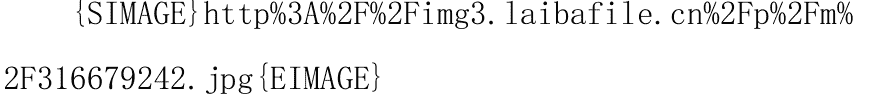

# 久违了

七剑战歌之风月

本文由公众号【老庄日记】整理编辑发布，
更多免费好文好书分享，请微信搜索关注
作者：七剑战歌之风月 日期:2020-03-22 17:44

沙发。

1 楼
作者：七剑战歌之风月 日期:2020-03-22 17:45
最近上班忙，不去都不行，如果不去单位以为为你发热了，就是事情。

7 楼
作者：七剑战歌之风月 日期:2020-03-22 17:45
安全点赞区。

9 楼
作者：七剑战歌之风月 日期:2020-03-22 17:45
安全点赞区。

10 楼
作者：七剑战歌之风月 日期:2020-03-22 17:49
前面都说了，如果有什么改变我会打字的字的，没有就没多少写的了，够多们都急疯了，各种晴暗乱，比房空都急急没用的，我现在就等着踏痒你们，不服就来。

24 楼 
作者：七剑战歌之风月 日期:2020-03-22 17:49
安全点赞区。

25 楼 
作者：七剑战歌之风月 日期:2020-03-22 17:49
安全点赞区。

26 楼 
作者：七剑战歌之风月 日期:2020-03-22 17:56
现在发生的一切都很好看，大家尽情的享受吧，百年不遇的大萧条。实际瘟疫没有多大关系，就像原油，本质是全球需求没有了，价格同盟也就就缓解了，不是因为瘟疫才跌，瘟疫只是浓缩了这一，给人们很强的视觉感受，美股一样，全球两大泡沫（美股、房产），都会爆掉，现在就是全球衰退滑入大萧条。

54 楼 
作者：七剑战歌之风月 日期:2020-03-22 17:56
安全点赞区。

55 楼 
作者：七剑战歌之风月 日期:2020-03-22 17:56
安全点赞区。

56 楼 
本文由微信公号【老庄日记】整理发布，免费分享，请勿买卖。
作者：七剑战歌之风月 日期:2020-03-22 18:06

作者：望 繁华落尽 Lv9 时间:2020-03-22 17:58:26

## 特稿 | 外贸易订单单暴 两周内从招工困难变无工可复

财新网 03-20

[财新网]（记者 原阳）短短两周，中国外贸行业历经反转。近日，多地外贸厂商反映，由于欧美地区疫情形势变化迅速，消费预期收缩，品牌纷纷取消或收回外贸订单规模，使得刚经历复工的外贸行业再次陷入冰点。

多数受财新采访的外贸企业感无助：“欧洲市场全面哑火”、“行情很不好，全世界感觉要瘫痪了”、“整体可能比08年还严重了”。

3月16日，商务部公布数据称全国重点外贸企业呈现加速恢复态势，除湖北外，全国66.7%的重点外贸企业生产率超过70%。商务部也提醒，外贸行业可能面临订单减少的情况。

这个就别想了，地主完蛋了，长一样完蛋，欧美没有需求了，挣俏的钱？现在进出口不好，再加中中平衡实现，外部对国内是紧缩的，国内是银根紧缩、市场紧缩，没有什么手段。不是美股崩了资本就会来中国，那是瞎拗悠悠，中国的房地产泡沫跟美股一样，谁来？没有傻钱，国内产能过剩引起的大萧条企业没有利润，资本不会再来了。

85 楼 
作者：七剑战歌之风月 日期:2020-03-22 18:06
安全点赞区。

86 楼 
作者：七剑战歌之风月 日期:2020-03-22 18:06
安全点赞区。

88 楼 
作者：品一杯酒 Lv9 时间:2020-03-22 18:07:40
顶一下，手握几十万的现金流。在家隔离的生活，也无半点压力！力挺七剑。

美国股市暴跌，美元流动性危机，国内一样，现金为王。美元紧缩人民币一样紧缩，汇率不敢出问题，只能被动紧缩，美元贬钱，人民币更值钱。

99 楼 
作者：七剑战歌之风月 日期:2020-03-22 18:10
安全点赞区。

100 楼 
作者：七剑战歌之风月 日期:2020-03-22 18:10
安全点赞区。

101 楼 
作者：七剑战歌之风月 日期:2020-03-22 18:19
在各种忽悠基建，都是徒劳。产能过剩的还没吃够？别想了，一个时代过去了，还想靠铁不行，要靠改革了，是个长期过程，债务顶，没钱了。现在是去杠杆过程，只是主动变为被动的，就是各种泡沫破裂，债务深化，现在就是加速爆发，债务危机也是好事情，走道路就要承受危机的爆发，没有什么软陆，不是谁能控制的。

139 楼 
作者：七剑战歌之风月 日期:2020-03-22 18:19
安全点赞区。

140 楼 
作者：七剑战歌之风月 日期:2020-03-22 18:19
安全点赞区。

142 楼 
作者：七剑战歌之风月 日期:2020-03-22 18:39
天涯各种忽悠什么通胀，让人愤怒，原油都几了，直接就是恶性通缩，诸忽悠都能流行，要正本源，我现在的只是以前的而已，没有什么改变的。

191 楼 
作者：七剑战歌之风月 日期:2020-03-22 18:39
安全点赞区。

192 楼 
作者：七剑战歌之风月 日期:2020-03-22 18:40
安全点赞区。

194 楼 
作者：七剑战歌之风月 日期:2020-03-22 18:42
作者：你去m的小厕 Lv2 时间:2020-03-22 18:38:02
七叔复出，痛打多狗他们现在急疯了，有本事卖出去，我没用的，我这时间割肉，看了我的帖子割肉的数早还顶了，就有些拆迁运闹，来羯完。

204 楼 
作者：七剑战歌之风月 日期:2020-03-22 18:42
安全点赞区。

205 楼 
作者：七剑战歌之风月 日期:2020-03-22 18:42
安全点赞区。

206 楼 
作者：七剑战歌之风月 日期:2020-03-22 18:46
作者：ty_小菜64 时间:2020-03-22 18:43:06
七剑大哥，比特归0还是大涨经济危机这次是国外的把国内的杀了惨，美元流动性，一切都被抛售，国内比特的基本。

211 楼 
作者：七剑战歌之风月 日期:2020-03-22 18:46
安全点赞区。

213 楼 
作者：七剑战歌之风月 日期:2020-03-22 18:46
安全点赞区。

214 楼 
作者：七剑战歌之风月 日期:2020-03-22 18:48
作者：搞出风采55 时间:2020-03-22 18:47:09
大师回来了，我也放心了！欢迎王者来！！国内一二线房价腰折稳的，这个不用想，大家不用担心。

218 楼 
作者：七剑战歌之风月 日期:2020-03-22 18:48
安全点赞区。

219 楼 
作者：七剑战歌之风月 日期:2020-03-22 18:48
安全点赞区。

220 楼 
作者：七剑战歌之风月 日期:2020-03-22 18:52
作者：米高扬手拉机 Lv10 时间:2020-03-22 18:51:03
七哥你还是开个星球的吧容易找到组织没什么什么，让写就写点，不让写就算了，反正我完了。

236 楼 
作者：七剑战歌之风月 日期:2020-03-22 18:52
安全点赞区。

238 楼 
作者：七剑战歌之风月 日期:2020-03-22 18:52
安全点赞区。

239 楼 
作者：七剑战歌之风月 日期:2020-03-22 19:02
房价现在就是暴跌，返乡空城，失业爆发，收入泡沫破，还有什么房价啊，吃饭问题讨论吧。指望救房价，谁敢散？拿什么散？内外都是被动收缩，真印出来一分钱了，说宽的都是不懂经济的。前面说了，人们的储蓄被消耗就是大洗牌，如果再刺激房地产，企业最后的资金进入，整个中国经济被毁坏，一切输进，恶性通胀爆发，结局就是拉美化，这个是不敢的，工业化社会一切都很快，再炒房子就是社会矛盾、政治矛盾一起爆发。

256 楼 
作者：七剑战歌之风月 日期:2020-03-22 19:02
安全点赞区。

257 楼 
作者：七剑战歌之风月 日期:2020-03-22 19:02
安全点赞区。

258 楼 
作者：七剑战歌之风月 日期:2020-03-22 19:05
作者：做些有趣的事 Lv4 时间:2020-03-22 19:04:06
感觉又要被封贴，实话有时候是不能说的实际发生的不能写？天涯小编是特朗？

263 楼 
作者：七剑战歌之风月 日期:2020-03-22 19:05
安全点赞区。

264 楼 
作者：七剑战歌之风月 日期:2020-03-22 19:05
安全点赞区。

265 楼 
作者：七剑战歌之风月 日期:2020-03-22 19:08
tigerxlg2008:2020-03-22 18:55:42 评论
现在想跑，很有魄力了！比如五折都得到韭菜，看了周围的人赢家们，没发现。二手房现在大概不掉，三折看看吧。

269 楼 
作者：七剑战歌之风月 日期:2020-03-22 19:08
安全点赞区。

271 楼 
作者：七剑战歌之风月 日期:2020-03-22 19:08
安全点赞区。

272 楼 
作者：七剑战歌之风月 日期:2020-03-22 19:12
大家都想多了，我的帖子就一言堂，写了这么久等来人，瞎BB的就是，我的帖子做主，不服可以去吗？

275 楼 
作者：七剑战歌之风月 日期:2020-03-22 19:12
安全点赞区。

276 楼 
作者：七剑战歌之风月 日期:2020-03-22 19:12
安全点赞区。

277 楼 
作者：七剑战歌之风月 日期:2020-03-22 19:24
作者：这个丢 Lv9 时间:2020-03-22 19:18:07
现在有钱的根本缺房子，有钱的房子也想卖，没钱的别说房子了，吃饭都成了，疫情才几天，看看多少人叫没钱了，多少人工作了，卖给鬼呀！我一个朋友运的。

294 楼 
作者：七剑战歌之风月 日期:2020-03-22 19:24
安全点赞区。

295 楼 
作者：七剑战歌之风月 日期:2020-03-22 19:24
安全点赞区。

296 楼 
作者：七剑战歌之风月 日期:2020-03-22 19:33
作者：ty_夜梦清 Lv9 时间:2020-03-22 19:18:35
大佬能不能谈一下美联储将下降到0对我们的影响？到零跟日本泡沫破裂一样，现在就在演危机爆发，流动性就是一切，有海量的宽松，就有海量的债务，黑洞，市面上都会吸走，国内一样，房价崩盘，流动性爆发，现在美股就在暴跌，美元流动性就是命，黄金都会抛售，别说你的资产以后会怎么样，现在先把命保住，至于美股泡沫破后的收护问题，就是长期出清问题，中美美联储就是死死也用，债务太多了，到零别说刺激，无效的，债务先搞清再说，至少很多年过去了。

317 楼 
作者：七剑战歌之风月 日期:2020-03-22 19:33
安全点赞区。

317 楼 
作者：七剑战歌之风月 日期:2020-03-22 19:33
安全点赞区。

318 楼 
作者：七剑战歌之风月 日期:2020-03-22 19:43
作者：ty_光年232 Lv4 时间:2020-03-22 19:42:24
楼主说一线腰斩大概是时？二手房现在就在下跌，说不定几个月之内就跌完了。

345 楼 
作者：七剑战歌之风月 日期:2020-03-22 19:44
安全点赞区。

347 楼 
作者：七剑战歌之风月 日期:2020-03-22 19:44
安全点赞区。

350 楼 
作者：七剑战歌之风月 日期:2020-03-22 19:45
作者：雅歌的谎言 时间:2020-03-22 19:43:31
主要是这段时间美股跌的人怕了，没做主在心慌看热闹不怕怕事，一切泡沫都破裂，前面都写完了，现在就是看。

353 楼 
作者：七剑战歌之风月 日期:2020-03-22 19:45
安全点赞区。

354 楼 
作者：七剑战歌之风月 日期:2020-03-22 19:45
安全点赞区。

355 楼 
作者：七剑战歌之风月 日期:2020-03-22 19:51
作者：hyperion007Lv10 时间:2020-03-22 19:43:54
又到全世界放水的时刻，美帝称号保守派的川普多要人发2000美元别瞎说了，一个少女被破处，不是讨论美好未来的时候，只能讨论以后找个傻瓜接盘或者乱为少妇的问题。美股泡沫破裂，债务危机即将爆发，暴完成后是还款问题，不是宽松了就恢复，能把债务危机塌弄过去，不死就是福，宽松不是什么时候起作用的。

363 楼 
作者：七剑战歌之风月 日期:2020-03-22 19:51
安全点赞区。

364 楼 
作者：七剑战歌之风月 日期:2020-03-22 19:51
安全点赞区。

366 楼 
作者：七剑战歌之风月 日期:2020-03-22 20:07
作者：明月刀万刀万啊 时间:2020-03-22 20:03:28
毛衣站提高关税第一，国内疫情停工第二国，国外疫情缺单订单第三，石油崩盘降低国外成本第四国。四连击之能有多少多少企业能挺过去？还有人说房事事看涨，我觉得这么话的该去。


那房税是不是也快了？

是，地产完蛋后就收，现在这局面是真没钱了，也只能收房产税了。

## 519 楼
作者：七剑战歌之风月 日期:2020-03-22 21:27
安全点赞区。

## 520 楼
作者：七剑战歌之风月 日期:2020-03-22 21:27
安全点赞区。

## 521 楼
作者：属于丝的华丽转身 6Lv 9 时间：2020-03-22 21:31:35

中国 2 月末 M0 货币供应（年率）实际值：4.8%；前值：6.6%。M1 货币供应年率 前值:0%预期:0.70%实际值 4.80%。中国 2 月 M2 货币供应年率 8.8%，前值 8.4%，预期 8.5%。

这个数据会滞后爆发出来，2月整个都停滞了，企业把所有的信贷额度都贷了，实际就是流动性危机中现金为王。

## 535 楼 
作者：七剑战歌之风月 日期:2020-03-22 21:34
安全点赞区。

## 536 楼 
作者：七剑战歌之风月 日期:2020-03-22 21:34
安全点赞区。

## 537 楼 
作者：ty_7 记忆亿25Lv 8 时间:2020-03-22 21:37:19

经济不好，环保是真的松了，政府胆子也大了，审查项目都能拿着就抱着，不能做就不做了，其他招标项目也不行。项目少，竞争激烈，之前对千万规模不屑一顾的企业也来参与，价格压得很低，为了能活下去！

----------

外需内都没有了，没用的。

## 545 楼 
作者：七剑战歌之风月 日期:2020-03-22 21:39
安全点赞区。

## 546 楼 
作者：七剑战歌之风月 日期:2020-03-22 21:39
安全点赞区。

## 548 楼 
作者：zhouli20024Lv 8 时间: 2020-03-22 21:38:49

2300 点见。

我不会炒股，注册制实施后我跟你们一起炒股。

## 550 楼 
作者：七剑战歌之风月 日期:2020-03-22 21:40
安全点赞区。

## 551 楼 
作者：七剑战歌之风月 日期:2020-03-22 21:40
安全点赞区。

## 553 楼 
作者：ddw200099Lv 时间: 2020-03-22 21:41:11

七剑救了许多人，负债的多少家庭在危机中活下来。

手里有现金存款的就是这次危机的赢家，基本可以逆命，改命，脱离贫困。

## 558 楼 
作者：七剑战歌之风月 日期:2020-03-22 21:45
安全点赞区。

## 560 楼 
作者：七剑战歌之风月 日期:2020-03-22 21:45
安全点赞区。

## 561 楼 
作者：ty_shanghaillv 8 时间:2020-03-22 21:44:44

高兴。喝点好酒。庆祝七剑回归。

实际都写完了，就是看了，我只是重复以前写的。

## 569 楼 
作者：七剑战歌之风月 日期:2020-03-22 21:49
安全点赞区。

## 570 楼 
作者：七剑战歌之风月 日期:2020-03-22 21:49
安全点赞区。

## 571 楼 
作者：ty_新起点35Lv 5 时间:2020-03-22 21:47:58

感谢老叔。差点买了房子以前还是刚需。现在只在乎有活干温了。

----------------

现在二手房已经开始暴跌，跌下来你就可以买，这个大大家都能看清楚，以前说房价价跌大概你不信，现在你每天都可见新低。

## 579 楼 
作者：七剑战歌之风月 日期:2020-03-22 21:56
安全点赞区。

## 580 楼 
作者：七剑战歌之风月 日期:2020-03-22 21:56
安全点赞区。

## 581 楼 
作者：北极星 OWLv 5 时间:2020-03-22 22:07:05

美元指数暴涨，美联储与各国央行互换，是不是美帝故意放毒，导致各国股市跌，资产暴跌，美元回流美国避险同时抄底打各国汇率，等汇率崩盘后，再次去各国股市崩了，各种资产抛卖，各国的流动性都会出现变化，美元会传递到全球，形成共振，一些国家就是美元会形成汇率压力，不敢跟美联储降息，全球贸易再燃，危机中都会扩大，因为流动性形成各种泡沫破裂，像一些国家的出口占GDP一半，这些国家的房地产瞬间就破，美元是世界基础，没有美元就会被动，整个危机爆发后，那时全球的主要泡沫爆发了。

## 626 楼 
作者：七剑战歌之风月 日期:2020-03-22 22:15
安全点赞区。

## 628 楼 
作者：七剑战歌之风月 日期:2020-03-22 22:15
安全点赞区。

## 629 楼 
作者：刚出的韭菜 Lv 8 时间:2020-03-22 22:23:58

06年说的，08年就看着1.5的美元兑欧元。拉美元沙油，不会持久，就这季末到下吧。我们国情，不想它暴涨，也不能一直暴跌的便宜，便宜没好事。房呢，想买的15年到现在。5千涨到万的，回落到7千个韭菜。你敢说你是全款买的房子？你敢说没债务？杠杆杀人，债务说了，不是你的嘴说了，债务会逼的砖头一文不值，不服？

## 643 楼 
作者：七剑战歌之风月 日期:2020-03-22 22:27
安全点赞区。

## 644 楼 
作者：七剑战歌之风月 日期:2020-03-22 22:27
安全点赞区。

## 645 楼 
作者：怀疑天9848Lv 3 时间:2020-03-22 22:29:56

热欢七叔王者归来，最近美国股市多次熔断，路透社报道，美股下周停市，华府也在考虑2000亿美元剪斩，另媒体报道，受新冠疫情冲击，世界一片萧条，中国出口遭遇退单，请教七叔，在美国为首的各国都放水情况下，中国会怎么做，中国有没有摆脱大萧条困境。美国爆发了你就好了？美国未来你们家？能够过剩资本外逸，一个没有利润的地方美元未来？你自己信？帖子早就写了无数，产能过剩的大萧是无解的。谁也不喜欢主动紧缩，都是实在折腾不动了才不得不紧缩，震哪里那么容易。没有美元顺差也就安静了。

## 662 楼 
作者：七剑战歌之风月 日期:2020-03-22 22:33
安全点赞区。

## 663 楼 
作者：七剑战歌之风月 日期:2020-03-22 22:33
安全点赞区。

## 664 楼 
作者：jiangyun1001Lv 12 时间：2020-03-22 22:42:29

谁也不喜欢主动紧缩，都是实在折腾不动了才不得不紧缩，震哪里那么容易。没有美元顺差也就安静了。

## 674 楼 
作者：七剑战歌之风月 日期:2020-03-22 22:43
安全点赞区。

## 675 楼 
作者：七剑战歌之风月 日期:2020-03-22 22:43
安全点赞区。

## 676 楼 
作者：ty_新起点 35Lv 5 时间：2020-03-22 22:49:45

来上海一个月了了状态。汽车行业玩完。就是全球产业链不受影响也没需求，收入破裂，什么房子、车子都是传说。

## 681 楼 
作者：七剑战歌之风月 日期:2020-03-22 22:45
安全点赞区。

## 682 楼 
作者：七剑战歌之风月 日期:2020-03-22 22:45
安全点赞区。

## 683 楼 
作者：cui504Lv 11 时间:2020-03-22 22:47:05

lz 还在被隔离中吗？你们这些傻多，希望老子被传染？嘻想哈？在这写帖子么不知道？你们没戴口罩时我就戴了，哈哈。

## 692 楼 
作者：七剑战歌之风月 日期:2020-03-22 22:50
安全点赞区。

## 693 楼 
作者：七剑战歌之风月 日期:2020-03-22 22:50
安全点赞区。

## 694 楼 
作者：余生吃可好 Lv 7 时间：2020-03-22 22:44:12

闲昨夭现在的人怎么不买衣服哈哈她是个设计师，主要按销量的。我问房子还有多少年？根本没打算还，现在疫情导致的行情不好，等亚运再卖。杭州的小伙伴们都在2020房价崩了，未来就是漫长的债，储蓄是一个漫长的周期，下一个繁荣遥远。

## 697 楼 
作者：七剑战歌之风月 日期:2020-03-22 22:54
安全点赞区。

## 698 楼 
作者：七剑战歌之风月 日期:2020-03-22 22:54
安全点赞区。

## 699 楼 
作者：财长姆钦：预计下季度美国经济将受到打击当被问是否陷入衰退时，财长姆钦表示，这是一个技术问题，并不相关。预计下季度美国将受到打击。现在还有什么手段？危机爆发了也就萧条。

## 726 楼 
作者：七剑战歌之风月 日期:2020-03-22 23:12
安全点赞区。

## 727 楼 
作者：七剑战歌之风月 日期:2020-03-22 23:12
安全点赞区。

## 728 楼 
作者：blacktigerRLv9 时间:2020-03-22 23:08:52

去年贬值，一锤子回来，弄个汇率纵国。现在需求了，牙也得咬住，真敢咬一下套。ty_John606:2020-03-22 23:23:31 现在的汇率也不太真实的呀，应该回购略微敛吧。美元流动性爆发推高美元指数，人民币币就这点这就快引起恐慌了，固定汇率留不住就会被攻击，盯住美元不是都能行的，要有强大的外汇储备，现在这个国内量的M2，另外外汇管制了，出口不行就要紧缩，现在已经被动紧缩，说一万次是被动紧缩。

## 732 楼 
作者：七剑战歌之风月 日期:2020-03-22 23:16
安全点赞区。

## 733 楼 
作者：七剑战歌之风月 日期:2020-03-22 23:16
安全点赞区。

## 734 楼 
作者：ty_John606:2020-03-22 23:23:31 评论现在的汇率也不太真实的呀，应该回购略微敛吧。美元流动性爆发推高美元指数，人民币币就这点这就快引起恐慌了，固定汇率留不住就会被攻击，盯住美元不是都能行的，要有强大的外汇储备，现在这个国内量的M2，另外外汇管制了，出口不行就要紧缩，现在已经被动紧缩，说一万次是被动紧缩。

## 746 楼 
作者：七剑战歌之风月 日期:2020-03-22 23:29
安全点赞区。

## 747 楼 
作者：七剑战歌之风月 日期:2020-03-22 23:29
安全点赞区。

## 748 楼 
作者：为人民服务 hiLv 9 时间:2020-03-22 23:28:32

按照他们一一贯的尿性，走拉美化和苏联道路的可能性最大。你把人家当傻子？命不要了？去海南让你让你？

## 756 楼 
作者：七剑战歌之风月 日期:2020-03-22 23:32
安全点赞区。

## 757 楼 
作者：七剑战歌之风月 日期:2020-03-22 23:32
安全点赞区。

## 760 楼 
作者：王一20202Lv 7 时间:2020-03-22 23:32:51

黄金也会持续贬值吗？

------

黄金就是脉冲避险作用，全球没有通胀，黄金没有牛市。

## 762 楼 
作者：七剑战歌之风月 日期:2020-03-22 23:34
安全点赞区。

## 763 楼 
作者：七剑战歌之风月 日期:2020-03-22 23:34
安全点赞区。

## 764 楼 
作者：ty_追浪 109Lv 6 时间:2020-03-22 23:31:48

宁波外贸基本蛋！希望房价也能下来，最近挂牌的地价还是新高！不知道 ZF 能不能打下房价来。收入泡沫破裂，坐在家里坐吃山用空嘴涨房价？天一群混混靠天天来我帖子里瞎说涨房价？现在全国二手房就在下跌，你不是逼囔一张嘴来找痒啊，滚。

## 765 楼 
作者：七剑战歌之风月 日期：2020-03-22 23:39
安全点赞区。

## 770 楼 
作者：七剑战歌之风月 日期:2020-03-22 23:40
安全点赞区。

## 771 楼 
作者：世间何事123Lv 7 时间:2020-03-22 23:39:49 @七剑战歌之风月 2020-03-22 23:37
ty_追浪 109Lv 时间:2020-03-22 23:31

宁波外贸基本蛋！希望房价也能下来，最近挂牌的地价还是新高！不知道 ZF 能不能打下房价来。收入泡沫破裂，坐在家里坐吃山用空嘴涨房价？天一群混混靠天天来我帖子里瞎说涨房价？现在全国二手房就在下跌，你不是逼囔一张嘴来找痒啊，滚。

## 774 楼 
作者：七剑战歌之风月 日期:2020-03-22 23:43
安全点赞。你自己信？帖子早就写了无数，产能过剩的大萧是无解的。谁也不喜欢主动紧缩……不服？

## 775 楼 
作者：七剑战歌之风月 日期:2020-03-22 23:43
安全点赞区。

## 776 楼 
作者：kevinhghLv 5 时间:2020-03-22 23:49

看新闻说深圳试点破产，您怎么看？深圳是个毛线啊，香港的房价都会掉。

## 786 楼 
作者：七剑战歌之风月 日期:2020-03-22 23:53
安全点赞区。

## 787 楼 
作者：七剑战歌之风月 日期:2020-03-22 23:53
安全点赞区。

## 789 楼 
作者：ty_14102386Lv 7 时间:2020-03-22 23:58

太高兴了，这那些垃圾卖不出、租不掉，跟疯狗一样闹这些天涯混混，房子卖不出、租不掉，跟疯狗一样闹他们看不写的，看了发疯，实际是白痴，真聪明的早看着退了。如果不是照顾大家，我早收费帖子了，我们会把他们逼，让他们还要我糟蹋，让他们看着大实话。

## 794 楼 
作者：七剑战歌之风月 日期:2020-03-23 00:02
安全点赞区。

## 795 楼 
作者：七剑战歌之风月 日期:2020-03-23 00:02
安全点赞区。

## 796 楼 
作者：七剑战歌之风月 日期:2020-03-23 00:05

## 799 楼 
作者：七剑战歌之风月 日期:2020-03-23 00:05
安全点赞区。

## 800 楼 
作者：七剑战歌之风月 日期:2020-03-23 00:05
安全点赞区。

## 801 楼 
作者：莫家小童 Lv 9 时间：2020-03-23 09:19:03

一个疫情看尽百态！看来还是中国最安全，大家有钱的不要去国外。出了外国，命运多舛！到此为止，大家们自己理解。有钱的要学学传统文化（道教中医）要明白怎样阴德，这个才是硬通货。三界通用。还有一点，分享一下粤地小城市商品两个字。预计不用到5月份份穿头的。房价下降的速度与收入有直接关系。多人失业了，吃饭问题了。房价其实没有几关心了。欧美说新冠病毒都是说自己没有，一查都是爆表，经济一样，从原油全球没有需求来看，就是没有疫情，危机都会陆续爆发，泡沫就是泡沫，没有哪个国家能战胜规律，个人更不用说了，现在瞬间就是吃饭问题，还什么房子啊，砖头就是砖头，砖头不能当馒头。

## 815 楼 
作者：七剑战歌之风月 日期:2020-03-23 00:23
安全点赞区。

## 816 楼 
作者：七剑战歌之风月 日期:2020-03-23 00:23
安全点赞区。

## 817 楼 
作者：ty_1370773382Lv 9 时间：2020-03-23 08:23:57

怎么又这么多安全点赞区，七叔又有帖子了？大家多多保存，我上班也忙，一般晚上写房子就是了。

## 905 楼 
作者：七剑战歌之风月 日期:2020-03-23 08:30
安全点赞区。

## 906 楼 
作者：七剑战歌之风月 日期:2020-03-23 08:30
安全点赞区。

## 907 楼 
作者：ty_2721Lv 8 时间:2020-03-23 08:34:19

七叔，最近余额利率大跌，是不是因为银行不钱，而且钱在金融机构空转？危机都在避险，风险利率走低，无风险利率走高，分化严重，商业银行要找到安全的贷款人也很难，银行的贷款分长期、短期，有额度分配，现在整个市场停滞，短期贷款需求很少，利率走低。前面说房价跌、利率跌，前提是中美利率差保持，美元恐慌导致国内人民币压力很大，实际早该降息了。

## 916 楼 
作者：七剑战歌之风月 日期:2020-03-23 08:51
安全点赞区。

## 917 楼 
作者：七剑战歌之风月 日期:2020-03-23 08:51
安全点赞区。

## 919 楼


作者：七剑战歌之风月 日期:2020-03-23 09:02

现在欧美面对股市暴跌都在宽松，这个是没用的，至少在短期内是没用的。瘟疫直接打击的是全面的经济，一切都混乱了。既然是没用的为什么还在宽松？实际是防止金融危机的爆发，股市引发导致流动性危机爆发，银根紧缩、市场紧缩，债务危机随之后爆发。现在松就是防止各种资金链断裂，这是防不住的，谁也不会给借钱看着还不起的人。资产价格暴跌从股市蔓延其他资产，负债率上升，危机会蔓延，谁也没办法，各种债务都会被引爆。

## 928 楼
作者：七剑战歌之风月 日期:2020-03-23 09:02
安全点赞赞区。

## 929 楼 
作者：七剑战歌之风月 日期:2020-03-23 09:02
安全点赞赞区。

## 930 楼 
作者：七剑战歌之风月 日期:2020-03-23 09:07
作者：huanletutu 时间:2020-03-23 09:05:24
你好，想弱弱的问一句四环内北京房价会大跌吗？
房价就是货币现象，没钱了都会跌。

## 934 楼
作者：七剑战歌之风月 日期:2020-03-23 09:07
安全点赞区。

## 935 楼
作者：七剑战歌之风月 日期:2020-03-23 09:07
安全点赞区。

## 936 楼
作者：七剑战歌之风月 日期:2020-03-23 09:19
现在全球美元流动性危机导致的各国汇率波动剧烈，短期的美元走强导致人民币汇率压力很大，这个是必然的。很多人看空汇率，这个国内就是不宽松，长期来说，欧美危机爆发需求没有了，中国的进出口影响，汇率压力会存在，国内被动紧缩。很多人想做空人民币（美元黑市），美元的紧缩作用会传传等到国内的人民币紧缩，人民币的购买力会随紧缩很贬值。未来，等欧美全面的金融变坏后，美股见底，美联储宽松，美元指数就会补跌，所以，现在的美元走强是短期的。

## 942 楼 
作者：七剑战歌之风月 日期:2020-03-23 09:19
安全点赞区。

## 943 楼 
作者：七剑战歌之风月 日期:2020-03-23 09:20
安全点赞区。

## 944 楼 
作者：七剑战歌之风月 日期:2020-03-23 09:31
作者：慌得一 Lv 6 时间：2020-03-23 08:59:47
这个七剑，行事风格像不像川。
无所谓，我根本不会理会别人对我的看法，只是写个帖子，没有什么多大的意思。

## 950 楼 
作者：七剑战歌之风月 日期:2020-03-23 09:31
安全点赞赞区。

## 951 楼 
作者：七剑战歌之风月 日期:2020-03-23 09:31
安全点赞赞区。

## 952 楼 
作者：七剑战歌之风月 日期:2020-03-23 09:39
作者：will11889920172Lv 10 时间：2020-03-23 09:22:17
来一份大裁员只是开始，等都复产后发现需求没有了，真正的大裁员会蔓延。就像房子等放水一样，泡沫破裂，最终都会绝望。现在二手房的抛售已经开始，未来无尽的二手房随绝望而抛出，永远也抛不完，才是真正的刚需。

## 956 楼 
作者：七剑战歌之风月 日期:2020-03-23 09:39
安全点赞区。

## 957 楼 
作者：七剑战歌之风月 日期:2020-03-23 09:39
安全点赞区。

## 958 楼 
作者：七剑战歌之风月 日期:2020-03-23 09:41
作者：世间万事 23Lv 7 时间:2020-03-23 09:37
美元流动性危机是股市暴跌引起的，市场行为，是短期的一个过程，不是的。美元做强想拉泡沫。

## 961 楼 
作者：七剑战歌之风月 日期:2020-03-23 09:41
安全点赞区。

## 962 楼 
作者：七剑战歌之风月 日期:2020-03-23 09:41
安全点赞区。

## 963 楼 
作者：七剑战歌之风月 日期:2020-03-23 09:43
作者：大富豪 23456Lv 11 时间:2020-03-23 09:41:07
坚守了两个月，楼主终于回来了，这日子假的。现在实际没什么可写的，就是各种泡沫破裂，好好吧，百年不遇，可惜。

## 964 楼 
作者：七剑战歌之风月 日期:2020-03-23 09:43
安全点赞区。

## 965 楼 
作者：七剑战歌之风月 日期:2020-03-23 09:44
安全点赞区。

## 966 楼 
作者：七剑战歌之风月 日期:2020-03-23 09:49
作者：楼上观景 3: 黑单举报 2020-03-23 09:41
没钱了可以印呀。我们说的印是银行贷款货币，看好企业利润？你干什么挣钱？你怎么把钱投到手里？靠财政投资？资金投放？汇率压力不了？现在收来不及。所以要经济好才能印钱（良性信贷投放），现在是去杠杆过程，从主动变为被动的，都被逼债的，市面上都是找钱还债的，你挣谁钱去？

## 970 楼 
作者：七剑战歌之风月 日期:2020-03-23 09:49
安全点赞区。

## 971 楼 
作者：七剑战歌之风月 日期:2020-03-23 09:49
安全点赞区。

## 972 楼 
作者：七剑战歌之风月 日期:2020-03-23 10:02
现在大家都会接到中介的卖房电话，不要理会，就说太贵了，等跌了再看，气气他们。中介不是什么好鸟，现在电视剧都是美化中介，都是骗人的。中介骗是职业病，不是说谁不好，那个职业不是职业，好人干了也会变坏的。

## 980 楼 
作者：七剑战歌之风月 日期:2020-03-23 10:03
安全点赞区。

## 981 楼 
作者：七剑战歌之风月 日期:2020-03-23 10:03
安全点赞区。

## 983 楼 
作者：七剑战歌之风月 日期:2020-03-23 10:10
作者：顺达LLv 9 时间:2020-03-23 10:09:51
金融界报，3 月23日讯，今日 A 股跳空低开，沪指跌 2.48%，报 2677.59 点；深成指跌 3.16%，报 9828.9 点；创业指跌 3.07%，报 1856.3 点，医药制造、口罩、病毒防治等板块相对抗；光刻胶、集成电路、券商信托、OLED等板块跌幅靠前。
今日，香港恒生指数开跌 5.02%。富时中国 A50 指数期货开跌超 5%，上一交易日夜收跌 4.51%。韩国 KOSPI 指数跌 6.54%，韩国 KOSDAQ 跌 6.60%，日经指数开高后冲回落，目前跌 0.55%。新加坡指数跌 8%，新西兰 NZ50 指数跌 10%。现在就是看暴跌，股市阴。

## 994 楼 
作者：七剑战歌之风月 日期:2020-03-23 10:11
安全点赞区。

## 995 楼 
作者：七剑战歌之风月 日期:2020-03-23 10:11
安全点赞区。

## 996 楼 
作者：七剑战歌之风月 日期:2020-03-23 10:19
作者：大富豪 23456Lv 11 时间：2020-03-23 10:11:23
看看大宗跌了一半。2015年的底是中国需求没有了，这次是全球需求没有了，大宗都在跌。

## 1003 楼 
作者：七剑战歌之风月 日期:2020-03-23 10:19
安全点赞区。

## 1004 楼 
作者：七剑战歌之风月 日期:2020-03-23 10:19
安全点赞区。

## 1005 楼 
作者：七剑战歌之风月 日期:2020-03-23 10:23
作者：202032 小号Lv 3 时间：2020-03-23 10:16:21
最近卖楼视火，配合形势，韭菜接盘高，实在是高。

## 1001 楼 
作者：逐 L: 2020-03-23 10:19:09
再也没用，现在问题最大的，房子都是浮云。对，炒房子买不跌是市场规律，再也没用。对有需求的来说，要有钱来买，韭菜早完了，剩下的都是首付都没有的“刚需”，房子要跌的便宜了才能买。

## 1006 楼 
作者：七剑战歌之风月 日期:2020-03-23 10:24
安全点赞区。

## 1007 楼 
作者：七剑战歌之风月 日期:2020-03-23 10:24
安全点赞区。

## 1008 楼 
作者：七剑战歌之风月 日期:2020-03-23 10:49
作者：特明回应是否提前售了股票：我没有股票，这是值得问的问题。2020年03月23日09:31
老特的底下着火了，危机最终演变为政治危机，就看老特的命好不好，连任不好说了。

## 1023 楼 
作者：七剑战歌之风月 日期:2020-03-23 10:49
安全点赞区。

## 1024 楼 
作者：七剑战歌之风月 日期:2020-03-23 10:49
安全点赞区。

## 1025 楼 
作者：七剑战歌之风月 日期:2020-03-23 10:55
作者：滨 20206Lv 3 时间:2020-03-23 10:52:08
外面有着粮食危机的言论，不知道楼主有什么看法想听。
这个都是瞎胡说，中国进口的粮食过剩严重，除非美国遭受了大的自然灾害，一般不会粮食危机。

## 1031 楼 
作者：七剑战歌之风月 日期:2020-03-23 10:56
安全点赞区。

## 1033 楼 
作者：七剑战歌之风月 日期:2020-03-23 10:56
安全点赞区。

## 1034 楼 
作者：七剑战歌之风月 日期:2020-03-23 11:04
作者：爵洲瞳： 2020-03-23 10:45:10
评论 七战歌之风月：记得以前七叔说过，大宗跌起来没有底，当时我还觉得怎么会有没有底，现在的跌得我已经怕了，感觉怎么能这样跌呢？
房价跌起来一样，杠杆炒就放大涨跌幅度，杠杆助也助跌，杠杆断裂就是压着爆仓，会跌得你不敢想。

## 1040 楼 
作者：七剑战歌之风月 日期:2020-03-23 11:04
安全点赞区。

## 1041 楼 
作者：七剑战歌之风月 日期:2020-03-23 11:04
安全点赞区。

## 1042 楼 
作者：七剑战歌之风月 日期:2020-03-23 11:15
作者：诸子唯我： 2020-03-23 10:51:32
很多家庭存款扛不过半年的疫情！你说的没有债务的，有房贷怎么办？

## 1047 楼 
作者：七剑战歌之风月 日期:2020-03-23 11:16
安全点赞区。

## 1048 楼 
作者：七剑战歌之风月 日期:2020-03-23 11:16
安全点赞区。

## 1049 楼 
作者：七剑战歌之风月 日期:2020-03-23 11:33
作者：q1220Lv 3 时间：2020-03-23 11:29:54
很多人说生活必需上涨就是通胀。其实，工资下降，消费萎缩，而必需品上涨才是通缩最大的痛苦。无论通缩都有过程，首先是通缩定的怕无关紧要商品，比如旅游、餐饮行业，然后延开。一句话，对影响大的越后，最终也会缩。我们说的印是银行贷款货币，看好企业利润？你干什么挣钱？你怎么把钱投到手里？靠财政投资？资金投放？汇率压力不了？现在收来不及。所以要经济好才能印钱（良性信贷投放），现在是去杠过程，从主动变为被动的，都被逼债的，市面上都是找钱还债的，你挣谁钱去？
第一，你想表达PPI传递到CPI的逻辑，你不懂。第二，你强调房子的居住功能就是睁眼说话，现在房子都是金融属性，就是炒作标物，哪有居住功能？多数人能靠收入买得起？没有吧，一个炒作的东西下来正常，美联储保护股市不跌了？没有吧，不是想什么泡沫就能住的，规律无法胜利，泡沫。

## 1051 楼 
作者：七剑战歌之风月 日期:2020-03-23 13:47
安全点赞区。

## 1052 楼 
作者：七剑战歌之风月 日期:2020-03-23 13:47
安全点赞区。

## 1053 楼 
作者：七剑战歌之风月 日期:2020-03-23 13:55
作者：骑车上学 1Lv 9 时间：2020-03-23 13:52:49
房价不是早就又又再再腰了吗？现在还要等……还得几年啊。过几月大概就跌死了，别想几年了，二手房现在就...暴跌中。

## 1059 楼 
作者：七剑战歌之风月 日期:2020-03-23 13:55
安全点赞赞区。

## 1060 楼 
作者：七剑战歌之风月 日期:2020-03-23 13:56
安全点赞赞区。

## 1061 楼 
作者：七剑战歌之风月 日期:2020-03-23 13:57
作者：若比邻 20171116Lv 9 时间：2020-03-23 13:53:01
七老师，您好，请教，8.9月份份子要交学费，美元现在是换，还是等等？现在是7.1，到8.9月份的时候会等到7.5啊？
用的时候再看看吧，人民币没有大幅度贬值的空间。

## 1062 楼 
作者：七剑战歌之风月 日期:2020-03-23 13:57
安全点赞区。

## 1063 楼 
作者：七剑战歌之风月 日期:2020-03-23 13:57
安全点赞区。

## 1064 楼 
作者：七剑战歌之风月 日期:2020-03-23 14:03
安全点赞区。

## 1065 楼 
作者：七剑战歌之风月 日期:2020-03-23 11:33
安全点赞区。

## 1066 楼 
作者：七剑战歌之风月 日期:2020-03-23 11:33
安全点赞区。

## 1067 楼 
作者：七剑战歌之风月 日期:2020-03-23 13:12
作者：huangbin90603Lv 5 时间：2020-03-23 13:06:50
傻又一个那你来看？你不是傻逼？

## 1123 楼 
作者：七剑战歌之风月 日期:2020-03-23 13:12
安全点赞区。

## 1124 楼 
作者：七剑战歌之风月 日期:2020-03-23 13:12
安全点赞区。

## 1125 楼 
作者：七剑战歌之风月 日期:2020-03-23 13:15
作者：ty_lf234Lv 10 时间：2020-03-23 12:50:03
疫情是催化剂，之前可能还能拖，现在直接得全地球都封了，需求没有了，现金流没有了，就剩债务了，想拖都不成了。实际没必要拖了，借一下崩掉房地产就可以专实体经济，这个危机爆发出来，会把中国经济拖死。

## 1126 楼 
作者：七剑战歌之风月 日期:2020-03-23 13:15
安全点赞区。

## 1127 楼 
作者：七剑战歌之风月 日期:2020-03-23 13:15
安全点赞区。

## 1128 楼 
作者：七剑战歌之风月 日期:2020-03-23 13:17
作者：古镜20108Lv 11 时间：2020-03-23 12:29:45
我们楼有个保定年轻人，化工工大学毕业，找了个北京女结婚，一直租房。昨天跟我说，6月底就不租了。说是买了一个二手房，8万一平米。说是每米降了2万，捡了个漏。很高。我问，为什么不在等等？他自己的说，疫情过后还会涨，赶上疫情降价就便宜坏了。我哈哈一笑。疫情过后大概失业了，还做梦。

## 1129 楼 
作者：七剑战歌之风月 日期:2020-03-23 13:17
安全点赞区。

## 1130 楼 
作者：七剑战歌之风月 日期:2020-03-23 13:17
安全点赞区。

## 1131 楼 
作者：七剑战歌之风月 日期:2020-03-23 13:32
作者：laziosl1g2: 2020-03-23 13:27:51
评论 七剑战歌之风月：房价可能会波动，但不会崩盘，根据价值规律，价格会围绕价值上下波动，只要房产的使用价值还存在，就一定会有影响价格。真正崩盘的是那种无法正常运转，人口大量流失的城市，其房产已失去价值。

## 1141 楼 
作者：七剑战歌之风月 日期:2020-03-23 13:33
安全点赞区。

## 1142 楼 
作者：七剑战歌之风月 日期:2020-03-23 13:40
安全点赞区。

## 1143 楼 
作者：七剑战歌之风月 日期:2020-03-23 13:40
作者：一起 Lv 9 时间:2020-03-23 13:22:44
房价跌了。

## 1146 楼 
作者：七剑战歌之风月 日期:2020-03-23 13:40
安全点赞区。

## 1147 楼 
作者：七剑战歌之风月 日期:2020-03-23 13:40
安全点赞区。

## 1148 楼 
作者：七剑战歌之风月 日期:2020-03-23 13:47
安全点赞区。


作者：七剑战歌之风月 日期:2020-03-23 14:09

安全点赞区。

1172 楼

作者：七剑战歌之风月 日期:2020-03-23 14:24

作者：万古红尘一场梦 Lv 7 时间:2020-03-23 14:20:17

@七剑战歌之风月 2020-03-22 23:53:34

作者：kevinhunghLv 5 时间:2020-03-22 23:49:40

看新闻说深圳在试图个人破产，您怎么看？

深圳是个毛线啊，香港的房价都会崩掉。

这两天看到深圳很多楼盘不少火爆，数据还显示深圳房价同比比上上涨，真是搞不懂。明明经济都这样了，很多实体面临倒闭，没倒闭的也在苦苦支撑，就搞不懂现在买房都是些什么人。

如果你喜欢看热闻，最近多看看香港，香港楼市大概会暴跌。

1179 楼 

作者：七剑战歌之风月 日期:2020-03-23 14:24

安全点赞区。

1180 楼 

作者：七剑战歌之风月 日期:2020-03-23 14:24

安全点赞区。

1181 楼 

作者：七剑战歌之风月 日期:2020-03-23 14:26

作者：让你胡说 Lv 9 时间:2020-03-23 14:23:08

现在还看不到恶性通缩

--------------------------------

各种大宗商品价格你看不不到?

1183 楼 

作者：七剑战歌之风月 日期:2020-03-23 14:26

安全点赞区。

1184 楼 

作者：七剑战歌之风月 日期:2020-03-23 14:26

安全点赞区。

1185 楼 

作者：七剑战歌之风月 日期:2020-03-23 14:28

作者：ty_127524166Lv 1 时间:2020-03-23 14:25:28

请各位：为什么无锡苏州房子一直不停的上涨?

--------------------------------

你赶紧去买，要借高利贷买，买了就发财。

无锡市中心的房价不跌到5000平不算跌，中国房价泡沫最大的地区之一，满意了?

# 1186 楼 

作者:七剑战歌之风月 日期:2020-03-23 14:28

安全点赞区。

# 1187 楼 

作者:七剑战歌之风月 日期:2020-03-23 14:29

安全点赞区。

# 1188 楼 

作者:七剑战歌之风月 日期:2020-03-23 14:30

作者：水清玉润 1Lv 时间:2020-03-23 14:23:36

全球瘟疫大爆发，无疑避免国际产业链的大部分断裂，不可避免对未来发展发展造成不利影响。外贸、投资、消费三大行业已经动了，经济的病，要好长的一段时间治疗。大家捏好钱包袋，短期内肯定是现金为王。长期还是向好。病总会治好的，海啸来临灭不了大海。

能毁灭多少多吧？

# 1189 楼 

作者:七剑战歌之风月 日期:2020-03-23 14:30

安全点赞区。

# 1190 楼 

作者:七剑战歌之风月 日期:2020-03-23 14:30

安全点赞区。

# 1191 楼 

作者:七剑战歌之风月 日期:2020-03-23 14:42

公子扶苏月下独酌： 黑名单举报 2020-03-23 14:25:53 评论

一线的房子，都在明星，富豪，像家印住深圳湾一号顶楼，二马号住华豪，等一大批富豪，土著拆迁暴发户，全国的各种二代们，十大名校毕业的打拼多年的，几乎是各种企业大厂中的中层金领，他们都有一个共同点，不存在就业问题，不就业就不会挨饿死!

年前就写了，世道反转了，日子的好日子到头了，金锁就是金锁，成了格局，冰汐现在还有8亿？没有了吧。你说的明星现在把失业叫“空档期”，说的多好听，他们不存在失业问题？他们人们愁钱多投资不被消灭？按你的意思财富是永恒的？你自己信？你说的富豪那个不是一亿？现在在潮水退去，有几个穿了？

# 1197 楼 

作者:七剑战歌之风月 日期:2020-03-23 14:42

安全点赞区。

# 1198 楼 

作者：七剑战歌之风月 日期:2020-03-23 14:42

安全点赞区。

# 1199 楼 

作者：七剑战歌之风月 日期:2020-03-23 14:52

作者：gw123ABCLv 10 时间:2020-03-23 14:47:27

疫情期间全家三口在家，真心体会到一家三套的好处，一套住上班，一套度假，一套补贴家用，加油！你还差一套。

--------------------

你们一家三口，隔离的地方是有，房贷怎么还，天上掉钱？你老婆卖去了钱？

# 1207 楼 

作者：七剑战歌之风月 日期:2020-03-23 14:52

安全点赞区。

# 1208 楼 

作者：七剑战歌之风月 日期:2020-03-23 14:52

安全点赞区。

# 1209 楼 

作者：七剑战歌之风月 日期:2020-03-23 15:06

作者：谷雨节：黑名单 2020-03-23 14:57:57 论

七老师怒，能不骂人就不骂人，有修养你你怎么看出我生气了？现在遇见傻了，折叠我不得，都要认真要半天，这心情好了。说修养，别扯了，在这天涯就是死留多，骂死留，气死留，这就叫一个天涯手的修养，能帖子写到现在，跟谁斗，跟谁斗，写到现在就是靠神杀遇佛杀，靠的是战斗力，这就是天涯修养。

# 1216 楼 

作者：七剑战歌之风月 日期:2020-03-23 15:06

安全点赞区。

# 1217 楼 

作者：七剑战歌之风月 日期:2020-03-23 15:06

安全点赞区。

# 1218 楼 

作者：七剑战歌之风月 日期:2020-03-23 15:08

作者：新瑞利华 20182Lv 10 时间:2020-03-23 15:03:49

看K线人民币会贬到到头。

----------

特朗普能应答？

# 1219 楼 

作者：七剑战歌之风月 日期:2020-03-23 15:08

安全点赞区。

# 1220 楼 

作者：七剑战歌之风月 日期:2020-03-23 15:08

安全点赞区。

# 1221 楼 

作者：七剑战歌之风月 日期:2020-03-23 15:11

作者：hahaa2016Lv 10 时间:2020-03-23 15:08:47

这么快就把名字改了！“恶性通缩”，“大萧条”，不存在的......

写的人家害怕了，就给我改了，帖子内容就是恶性通缩下的大萧条。

# 1227 楼 

作者：七剑战歌之风月 日期:2020-03-23 15:11

安全点赞区。

# 1228 楼 

作者：七剑战歌之风月 日期:2020-03-23 15:11

安全点赞区。

# 1229 楼 

作者：七剑战歌之风月 日期:2020-03-23 15:12

作者：小酒与诗诗 Lv 4 时间:2020-03-23 15:09:41

发个帖子好难哦，楼主咋这么厉害捏，标题可以随意来改的？

改你妹啊，小编太坏了。

# 1231 楼 

作者：七剑战歌之风月 日期:2020-03-23 15:12

安全点赞区。

# 1232 楼 

作者：七剑战歌之风月 日期:2020-03-23 15:12

安全点赞区。

# 1234 楼 

作者：七剑战歌之风月 日期:2020-03-23 15:18

作者：新瑞利华 20182Lv 10 时间:2020-03-23 15:16:00

反对人民币股市就跌，一升就涨，十分合。现在还炒股的都是神经。

# 1240 楼 

作者：七剑战歌之风月 日期:2020-03-23 15:18

安全点赞区。

# 1241 楼 

作者：七剑战歌之风月 日期:2020-03-23 15:19

安全点赞区。

# 1242 楼 

作者：七剑战歌之风月 日期:2020-03-23 15:30

作者：ty_亮仔 448Lv 11 时间:2020-03-23 15:29:05

# 国家退出房地产业务# 中央纪委3月22日公布国家第三轮巡视进展。其中，国家退出传统制造业目前，企业深化改革方案已获批，确保2020年6月前完成。要加强对酒店改革，积极研究市场化酒店模式。太晚了，现在大概退一层，资产暴跌中卖个钱？

# 1251 楼 

作者：七剑战歌之风月 日期:2020-03-23 15:31

安全点赞区。

# 1253 楼 

作者：七剑战歌之风月 日期:2020-03-23 15:31

安全点赞区。

# 1254 楼 

作者：七剑战歌之风月 日期:2020-03-23 15:41

作者：biebiwomaniLv 11 时间:2020-03-23 15:03:04

哈哈，你的到来，让房价跌，让某些人如坐毡。我不来一样发疯，现在还在做梦他们都没自信。

# 1260 楼 

作者：七剑战歌之风月 日期:2020-03-23 15:41

安全点赞区。

# 1261 楼 

作者：七剑战歌之风月 日期:2020-03-23 15:41

安全点赞区。

# 1262 楼 

作者：七剑战歌之风月 日期:2020-03-23 15:54

作者：恋恋涟漪 Lv 16 时间:2020-03-23 15:35:28

哈哈，小编这改的标题低调啊。小编文化低调，你改个现在在行的“逆行者”“硬核”等好听？

# 1268 楼 

作者：七剑战歌之风月 日期:2020-03-23 15:54

安全点赞区。

# 1269 楼 

作者：七剑战歌之风月 日期:2020-03-23 15:54

安全点赞区。

# 1270 楼 

作者：七剑战歌之风月 日期:2020-03-23 15:56

作者：向日葵 0514Lv 9 时间:2020-03-23 15:52:07

房企闭，盖房子人就少了，房源少了，房价会不会涨啊？你不盖房子就失业了，都失业了你还敢想房子？

# 1271 楼 

作者：七剑战歌之风月 日期:2020-03-23 15:56

安全点赞区。

# 1272 楼 

作者：七剑战歌之风月 日期:2020-03-23 15:57

安全点赞区。

# 1273 楼 

作者：七剑战歌之风月 日期:2020-03-23 16:08

作者：congc214Lv 2 时间:2020-03-23 16:03:53

标记一下，回头再爬楼。我也准备下班了，回家再写。

# 1280 楼 

作者：七剑战歌之风月 日期:2020-03-23 16:08

安全点赞区。

# 1281 楼 

作者：七剑战歌之风月 日期:2020-03-23 16:09

安全点赞区。

# 1282 楼 

作者：七剑战歌之风月 日期:2020-03-23 16:23

作者：飞钟山的云 Lv 9 时间:2020-03-23 16:18:46

有破才有有立，打破旧的才能有新的。还是会有产业发展起来，个人比较数字科技，从互联网到手机的应用革命结束了。

# 1297 楼 

作者：七剑战歌之风月 日期:2020-03-23 16:23

安全点赞区。

# 1298 楼 

作者：七剑战歌之风月 日期:2020-03-23 16:23

安全点赞区。

# 1299 楼 

作者：七剑战歌之风月 日期:2020-03-23 16:27

作者：能BB Lv 11 时间:2020-03-23 16:42

神经飘过，没办法。上容易。好好学习吧，什么时候真懂了，你就能自己的手住了。

# 1302 楼 

作者：七剑战歌之风月 日期:2020-03-23 16:27

安全点赞区。

# 1304 楼 

作者：七剑战歌之风月 日期:2020-03-23 16:27

安全点赞区。

# 1305 楼 

作者：七剑战歌之风月 日期:2020-03-23 16:31

作者：pet1gl 6 时间:2020-03-23 16:20:19

天涯好久没有值得我仔细看的帖子，楼主回来了，太好了！今年这个疫情，真的是如楼主说，就是个加速器，通缩剂，揭开一切谎言，都出来。这些年一直买房子。今年想要出国了，但是还是家里在国内工作，是在上海买房吧，纯粹是为了住。前两周事，在网上开始看房源，感觉家里活跃，中80%以上都是家的，都有点差的感觉。而且，他们很多都把房价在去的基础上的基础上调了，真不知道给他们的是勇气。问他们，他们说是房价上调的，而且说可能会涨。我们，大家都快失业了，拿什么钱买房子？还涨！他们都说房价可以涨吧，但是我后来就看过了，也想得了结果，从上周开始，全球疫情突然发展迅速，美股不停熔断，澳洲股市也是大幅下降，澳洲汇率倒了十年的低点，突然我就觉得手上的存款还贵，好值钱，不好得去买一堆砖头。那就是继续抱着存款吧安心。拿好了，别让走，萧条中各种便宜的资产，只要有钱随你买。

# 1306 楼 

作者：七剑战歌之风月 日期:2020-03-23 16:31

安全点赞区。

# 1307 楼 

作者：七剑战歌之风月 日期:2020-03-23 16:31

安全点赞区。

# 1308 楼 

作者：七剑战歌Lv 7 日期:2020-03-23 18:37

作者：美好的生活2016Lv 时间:2020-03-23 17:12:34

楼主大哥，我是个本分的经销商，什么股票，期货，我在这里就没有遇到过，至于喜欢收藏各种白酒，本人不喝酒，但是喜欢，各种各样的，年头有个二十年了，后来实在没个过的，五年前一直53飞天，在目前的形势下，经管跌价了，但我还是看好53飞天，意思等到你们认为的最低点，想想多屯点，你怎么看待这事？目前是一千八，梦想能跌一千二，当然有点离谱，千五就不错了，感谢楼主点赞这些帖子前面说过，今年茅台800元一瓶。

# 1366 楼 

作者：七剑战歌之风月 日期:2020-03-23 18:37

安全点赞区。

# 1367 楼 

作者：七剑战歌之风月 日期:2020-03-23 18:37

安全点赞区。

# 1368 楼 

作者：七剑战歌之风月 日期:2020-03-23 18:42

作者：201909308Lv 11 时间:2020-03-23 17:46:29

准确消息，厦门的房子在大跌，岛内很多2万多的房子了，之前高位6万的现在3万多，关键是没人要。然后厦门是旅游城市，现在没人来，酒店饭店都不开，整个药丸。

----------------

现在跌的很快，今年两个腰斩能看到（从最高点下来）。

# 1372 楼 

作者：七剑战歌之风月 日期:2020-03-23 18:43

安全点赞区。

# 1373 楼 

作者：七剑战歌之风月 日期:2020-03-23 18:43

安全点赞区。

# 1374 楼 

作者：七剑战歌之风月 日期:2020-03-23 18:49

作者：美好的的生活2016Lv 7 时间:2020-03-23 17:15:39

今年春节的时候两千，由于疫情现在一千八跟瘟疫没关系，做的东西就是货币引起的，明白？

# 1377 楼 

作者：七剑战歌之风月 日期:2020-03-23 18:49

安全点赞区。

# 1378 楼 

作者：七剑战歌之风月 日期:2020-03-23 18:49

安全点赞区。

# 1379 楼 

作者：七剑战歌之风月 日期:2020-03-23 18:51

作者：念着猪笼 Lv 7 时间:2020-03-23 17:06:22

需求下滑，废品收购应该也不了吧？虽然给家里提前做好准备，在此问一句废品价格，大宗跌了就不值钱了。

# 1380 楼 

作者：七剑战歌之风月 日期:2020-03-23 18:51

安全点赞区。

# 1381 楼 

作者：七剑战歌之风月 日期:2020-03-23 18:51

安全点赞区。

# 1382 楼 

作者：七剑战歌之风月 日期:2020-03-23 18:54

作者：向日葵 0514Lv 9 时间:2020-03-23 16:45:45

房地产崩产了，那么多货币往哪儿？粮食和蔬菜？房地产崩盘后，人们喜欢炒汇，这次国内房产崩盘了，很多人也会炒汇，国内换汇管制，各种黑市会流。

# 1384 楼 

作者：七剑战歌之风月 日期:2020-03-23 18:54

安全点赞区。

# 1385 楼 

作者：七剑战歌之风月 日期:2020-03-23 18:55

安全点赞区。

# 1386 楼 

作者：七剑战歌之风月 日期:2020-03-23 19:34

作者：凡事不 Lv 7 时间:2020-03-23 19:29:17

股市注册制，而现在已经在上市的公司有很多材料造假的，这些公司怎么处理呢？市场自然就淘汰了。

# 1399 楼 

作者：七剑战歌之风月 日期:2020-03-23 19:34

安全点赞区。

# 1400 楼 

作者：七剑战歌之风月 日期:2020-03-23 19:34

安全点赞区。

# 1401 楼 

作者：七剑战歌之风月 日期:2020-03-23 19:38

作者：ty_lyf234Lv 10 时间:2020-03-23 19:21:15

日本软银出售4.5万亿资产，钱比资产值钱，哈哈哈哈要钱不要资产。现在各种资产抛售潮会蔓延，一切都被抛售，市场流动性枯竭，直到金融危机爆发，天量的债务被清算，全球滑入大萧条。

# 1406 楼 

作者：七剑战歌之风月 日期:2020-03-23 19:38

安全点赞区。

# 1407 楼 

作者：七剑战歌之风月 日期:2020-03-23 19:38

安全点赞区。

# 1408 楼 

作者:七剑战歌之风月 日期:2020-03-23 22:34

作者:woyaobianhuai3Lv 6 时间:2020-03-23 22:22:39

请问楼主，现在在美留学的孩子是回来好还是继续呆那边好呢，有租房没口多大事？就呆着吧，现在全球流行，那里实际都一样。

# 1482 楼 

作者:七剑战歌之风月 日期:2020-03-23 22:34

安全点赞区。

# 1483 楼 

作者：七剑战歌之风月 日期:2020-03-23 22:34

安全点赞区。

# 1484 楼 

作者：七剑战歌之风月 日期:2020-03-23 22:37

作者：ty_Demon565 2020-03-23 22:09:02

这个代表什么意思？很疑惑?

[IMAGE]http%3A%2F%2Img3.laibafile.cn%2Fp%22Fm%2F315791740.jpg [IMAGE]

货币政策让工厂正常？能让人们消费、旅游？能弥补瘟疫带来的经济损失？没有么用。

1487 楼


作者：七战歌之风月 日期:2020-03-23 22:37
安全点赞区。

1488 楼

作者：七战歌之风月 日期:2020-03-23 22:37
安全点赞区。

1489 楼

作者：七战歌之风月 日期:2020-03-23 22:42

作者：阳光 ZGLv 9 时间:2020-03-23 21:02:23

供给侧改革结果将随着全全球疫情的发展，全世界的萧条化为乌有。

OPEC 原油价格垄断住了？

1495 楼

作者：七战歌之风月 日期:2020-03-23 22:42

安全点赞区。

1496 楼

作者：七战歌之风月 日期:2020-03-23 22:43

安全点赞区。

1497 楼 

作者：七战歌之风月 日期:2020-03-23 22:46

作者：负堂于成我 5Lv 5 时间:2020-03-23 22:42:08

从 1997 年工作后就没买上房子，2005 年一次购房机会破坏了，完美错过了房地产高涨周期，然后2017 年房价到顶买了一套老破小。虽然知道这个大势，还是不忍心卖掉，毕竟正在外地工作。接下来的末见证历史，能够在工地买房。从本帖来看，想要抄底买房的人不少少，呵呵。

————

看你这我都想了，一个老破小都是多少心态，你活尼玛啊，你见准买路了吗？你就当自己什么都没有，这次好好的弄个大房子，搬砖挣钱去吧。

1499 楼 

作者：七剑战歌之风月 日期：2020-03-23 22:46
安全点赞区。

1500 楼 

作者：七剑战歌之风月 日期：2020-03-23 22:46
安全点赞区。

1501 楼 

作者：七剑战歌之风月 日期：2020-03-23 22:51

作者：阳光 ZGXLv 9 时间：2020-03-23 20:57:55

七叔，如果现在在起楼市加速下跌，两三个月内再跌 30%~50%，房子实际价值低于抵押价值，银行不会让房奴倒加抵押金额？

目前看来企业订单急萎缩，预计两个月内失业潮就爆发。过去几年买房的基本都是杠杆买房，到时的场景不可想象。

银行会逼债，还不起可以重新跟银行签协议，搞个子孙贷款什么的，大概也就这样吧，实际很多人就断供了。

# 1505 楼 

作者：七剑战歌之风月 日期:2020-03-23 22:51
安全点赞区。

# 1506 楼 

作者：七剑战歌之风月 日期:2020-03-23 22:51
安全点赞区。

# 1507 楼 

作者：七剑战歌之风月 日期:2020-03-23 22:53

作者：无念无无 1Lv 10 时间:2020-03-23 22:49:10

可以，追上了。今天看一天贴，虽然两个月没发工资了，但至少还有工作。

哈哈，早有准备，可以安心的应对。

实际很多人都是隐形失业了，很多人没发工资实际就是失业。

# 1508 楼 

作者：七剑战歌之风月 日期:2020-03-23 22:53
安全点赞区。

1509 楼 

作者：七剑战歌之风月 日期:2020-03-23 22:53
安全点赞区。

1510 楼 

作者：七剑战歌之风月 日期:2020-03-23 22:59

作者：于明志 Lv 5 时间:2020-03-23 22:47:02

七哥，最近考虑买母亲养老保险，一次性交十五万，值得买吗，还是等等。

这些还等什么？6万不是什么大钱。

1515 楼 

作者：七剑战歌之风月 日期:2020-03-23 22:59
安全点赞区。

1516 楼 

作者：七剑战歌之风月 日期:2020-03-23 22:59
安全点赞区。

1517 楼 

作者：七剑战歌之风月 日期:2020-03-23 23:39

作者：汉街 Lv 9 时间:2020-03-23 23:35:41

楼主认为是通缩，人民币会贬值，这点我怀疑，军越来越大，对待越来越高，加上养老金只增不减，干活的创造财富的人失业严重，加上外贸受阻，等于生产出来的变小，趋势应该是通胀才的。

好好看吧，别是你怀疑。

1541 楼 

作者：七剑战歌之风月 日期:2020-03-23 23:39
安全点赞区。

1542 楼 

作者：七剑战歌之风月 日期:2020-03-23 23:39
安全点赞区。

1543 楼 

作者：七剑战歌之风月 日期:2020-03-24 08:38

小米P2P金融产品再暴雷！万人被坑40亿，抗疫护士也中招！这跟准中有招？人人是平等的吧？

1623 楼 

作者：七剑战歌之风月 日期:2020-03-24 08:38
安全点赞区。

1624 楼 

作者：七剑战歌之风月 日期:2020-03-24 08:38
安全点赞区。

1625 楼 

作者：七剑战歌之风月 日期:2020-03-24 08:41

现在各重大建设项目动工，拉动效果会怎么样？给你钱？

1627 楼 

作者：七剑战歌之风月 日期:2020-03-24 08:41
安全点赞区。

1628 楼 

作者：七剑战歌之风月 日期:2020-03-24 08:41
安全点赞区。

1629 楼 

作者：七剑战歌之风月 日期:2020-03-24 08:43

没听七叔的话，年前辞职了现在苦了，工作没法找，但以前也不是种类，现金会计就我一个人，怕嫌不干了。加入国民党。

1631 楼 

作者：七剑战歌之风月 日期:2020-03-24 08:44
安全点赞区。

1632 楼 

作者：七剑战歌之风月 日期:2020-03-24 08:44
安全点赞区。

1633 楼 

作者：七剑战歌之风月 日期:2020-03-24 08:49

现在钱太难赚了，能坚持到底还能正常发工资的公司感觉都不多了了。还想房子的吃屁吧！这次经济跌下去很难再起来，被破坏就无法恢复了。

1637 楼 

作者：七剑战歌之风月 日期:2020-03-24 08:50
安全点赞区。

1639 楼 

作者：七剑战歌之风月 日期:2020-03-24 08:50
安全点赞区。

1640 楼 

作者：七剑战歌之风月 日期:2020-03-24 09:51

美联储限量化宽松模式对国内的影响几何？国内跟着以一定的规模放水，也是可以保存汇率的相对稳定吧。进出口受影响，再加贸易协议，国内已经提前进入被动紧缩阶段，再说万次，现在已经进入被动紧缩阶段。

1654 楼 

作者：七剑战歌之风月 日期:2020-03-24 09:51
安全点赞区。

1655 楼 

作者：七剑战歌之风月 日期:2020-03-24 09:51
安全点赞区。

1657 楼 

作者：七剑战歌之风月 日期：2020-03-24 09:56

现在政府项目比较少，是不是大企业都盯着小项目，这像小公司根本没有生存之地啊——竞争不过大公司的。现在的影响会滞后爆发出来，谁的资金链断裂，谁先完蛋，企业不管大小，活下去才是本事。

1659 楼 

作者：七剑战歌之风月 日期:2020-03-24 09:57
安全点赞区。

1660 楼 

作者：七剑战歌之风月 日期:2020-03-24 09:57
安全点赞区。

1661 楼 

作者：七剑战歌之风月 日期:2020-03-24 10:20

我是不是变态了？听到危机来了很幸福，奋，多年看帖，费了。公平，平时你“危”机会是别人的，你就舒服点。

1668 楼 

作者：七剑战歌之风月 日期:2020-03-24 10:20
安全点赞区。

1669 楼 

作者：七剑战歌之风月 日期:2020-03-24 10:20
安全点赞区。

1670 楼 

作者：七剑战歌之风月 日期:2020-03-24 10:25

没说美联储在国内，说的汇率。美联储放水，美元指数跌，无论来国内，国内的汇率压力是小的，所以国内应该跟着放水的空间一个时代过去了，中美再回不去，这个要认清，以后跟韩贸易，一点点的发展。

1672 楼 

作者：七剑战歌之风月 日期:2020-03-24 10:25
1673 楼 

作者：七剑战歌之风月 日期:2020-03-24 10:25
1674 楼 

作者：七剑战歌之风月 日期:2020-03-24 10:45

房价断不断的不要了，反正收入是割到了脖子了！就问到底，还有信心！跟当年一样，房地产崩盘后，这次出口受影响，全面的泡沫破裂，全球转移就是发生过程。

1682 楼 

作者：七剑战歌之风月 日期:2020-03-24 10:46
安全点赞区。

1683 楼 

作者：七剑战歌之风月 日期:2020-03-24 10:46
安全点赞区。

1684 楼 

作者：七剑战歌之风月 日期:2020-03-24 11:06

七叔，贸易平衡后执行配给吗？网上看到了很多各种农资需求，保证各种生产，你们都往里，我理解不了。

1690 楼 

作者：七剑战歌之风月 日期:2020-03-24 11:07
安全点赞区。

1691 楼 

作者：七剑战歌之风月 日期:2020-03-24 11:07
安全点赞区。

1692 楼 

作者：七剑战歌之风月 日期:2020-03-24 11:11

开发者天天都能接到推销的房子，马上又涨了就是悠悠悠瓜，傻瓜也要钱啊，现在韭菜不多了，降价就是死路一条。

1695 楼 

作者：七剑战歌之风月 日期:2020-03-24 11:11
安全点赞区。

1696 楼 

作者：七剑战歌之风月 日期:2020-03-24 11:12
安全点赞区。

1697 楼 

作者：七剑战歌之风月 日期:2020-03-24 11:32

现在进口猪肉还有进的？猪肉价格能下降吗？靠进口那点根本不行，看今年猪瘟轻重吧，猪瘟闹的轻，价格就下来了。

1705 楼 

作者：七剑战歌之风月 日期:2020-03-24 11:32
安全点赞区。

1706 楼 

作者：七剑战歌之风月 日期:2020-03-24 11:32
安全点赞区。

1707 楼 

作者：七剑战歌之风月 日期:2020-03-24 13:06
美国垃圾债违约第一枪：43亿债务压顶，高端白贷考虑破产，1.35万工人面临失业。美联储不快点介入的话，美国银行里的商业地产票据就要变成纸了……

美联储能救经济？没用的，这次靠宽松软不起。

1747 楼 

作者：七剑战歌之风月 日期:2020-03-24 13:06
安全点赞区。

1748 楼 

作者：七剑战歌之风月 日期:2020-03-24 13:06
安全点赞区。

1749 楼 

作者：七剑战歌之风月 日期:2020-03-24 13:35
楼主说汇率崩盘我们一辈子换美元，现在该下为强，汇率不会崩盘，只会会被攻击，国内被紧缩，这种固定汇率只能被动紧缩，以前说过外内胀。

1767 楼 

作者：七剑战歌之风月 日期:2020-03-24 13:35
安全点赞区。

1768 楼 

作者：七剑战歌之风月 日期:2020-03-24 13:35
安全点赞区。

1769 楼 

作者：七剑战歌之风月 日期:2020-03-24 18:40

作者：bobandan Lv 10 时间:2020-03-24 15:59:46
若是国际油价长期保持在美元四十左右，这样对比其他国家应该就没有优势了吧，这些企业能扛多久。油价对中国打击很大，美的优势发挥得漓尽致。

1853 楼 

作者：七剑战歌之风月 日期:2020-03-24 18:40
安全点赞区。

1854 楼 

作者：七剑战歌之风月 日期:2020-03-24 18:40

1855 楼 

作者：七剑战歌之风月 日期:2020-03-24 18:42

楼主问什么不难？你说现在是反弹是底，谁知道在哪里。

作者：散步的老虎 时间：2020-03-24 18:29

今天美反弹时，后面再跌，天朝会不会带到坑里面变成股，我不炒，按你们的说法，是非反弹，反弹是底。

1856 楼 

作者：七剑战歌之风月 日期:2020-03-24 18:42
安全点赞区。

1857 楼 

作者：七剑战歌之风月 日期:2020-03-24 18:42
安全点赞区。

1859 楼 

作者：七剑战歌之风月 日期:2020-03-24 18:49

作者：1304459369 Lv Lo 时间:2020-03-24 18:06:44
楼主干什么的啊？怎么看着牛的样子楼主我叫“牛逼”，老网友都知道。

1860 楼 

作者：七剑战歌之风月 日期:2020-03-24 18:49
安全点赞区。

1861 楼 

作者：七剑战歌之风月 日期:2020-03-24 18:49
安全点赞区。

1862 楼 

作者：七剑战歌之风月 日期:2020-03-24 18:52

作者：哈士奇 94Lv 7 时间:2020-03-24 17:59:53

1863 楼 作者：七剑战歌之风月 日期:2020-03-24 18:52
安全点赞区。

1864 楼 作者：七剑战歌之风月 日期:2020-03-24 18:52
安全点赞区。

1866 楼 作者：七剑战歌之风月 日期:2020-03-24 19:03

作者：白菜喂狗 Lv 11 时间:2020-03-24 17:23:45
京津冀这一片房价又疯了，服了你疯了我们大家信，滚吧，这智商打字都不配老子赐你你。

1871 楼 作者：七剑战歌之风月 日期:2020-03-24 19:03
安全点赞区。

1872 楼 作者：七剑战歌之风月 日期:2020-03-24 19:03
安全点赞区。

1873 楼 作者：七剑战歌之风月 日期:2020-03-24 19:07

作者：ty_1392322526Lv 5 时间:2020-03-24 17:23:35
七大，国内面对美元流出，有什么好的办法解决紧缩。

1882 楼 作者：七剑战歌之风月 日期:2020-03-24 19:08
安全点赞区。

1883 楼 作者：七剑战歌之风月 日期:2020-03-24 19:08
安全点赞区。

1884 楼 作者：七剑战歌之风月 日期:2020-03-24 19:11

作者：二点秋白 Lv 10 时间:2020-03-24 19:06:11
美联储这时候超发这么多美元，到疫情好了，美联股涨起来了，算不算美元的总量多了很多，会通胀。


1908 楼
作者：七剑战歌之风月 日期:2020-03-24 19:29
安全点赞区。

1909 楼
作者：七剑战歌之风月 日期:2020-03-24 19:30
安全点赞区。

1910 楼
作者：七剑战歌之风月 日期:2020-03-24 19:33
作者：水迎梅 2Lv 7 时间:2020-03-24 15:06:49
培训行业的，今年一直不开学，感觉前途迷茫。

就是开学，也回不到以前的场景，人们没钱了有个学校上就可以了，什么“学区”“补习班”都是泡沫期的产物。

过去就过去了，虚假繁荣泡沫破裂，还真把自己当成“发达国家”了。

1912 楼
作者：七剑战歌之风月 日期:2020-03-24 19:33
安全点赞区。

1913 楼 
作者：七剑战歌之风月 日期:2020-03-24 19:33
安全点赞区。

1914 楼 
作者：七剑战歌之风月 日期:2020-03-24 19:34
作者：ty_小联 1Lv 6 时间：2020-03-24 19:31:22
七哥怎么看瑞德的效果？
咱们可以讨论讨论“含笑半步哑”的药效威力。

1916 楼 
作者：七剑战歌之风月 日期:2020-03-24 19:35
安全点赞区。

1917 楼 
作者：七剑战歌之风月 日期:2020-03-24 19:35
安全点赞区。

1918 楼 
作者：七剑战歌之风月 日期:2020-03-24 20:08
作者：一枚仿文青 Lv 9 时间：2020-03-24 20:05:07
请问楼主和各位同学一个问题：我记得楼主之前讲过泡沫破碎的顺序是先中房后美股，然后中国全国百姓的血肉之躯下全球通缩。现在鲍式美股先爆。那么这个顺序变化的原因仅仅是因为疫情吗？美股先爆，会让我们失血减少吗？对房价的紧缩作用是大了还是小了。

别造谣，一二线房价跌了两年，现在就是找底。

1931 楼 
作者：七剑战歌之风月 日期:2020-03-24 20:08
安全点赞区。

1932 楼 
作者：七剑战歌之风月 日期:2020-03-24 20:09
安全点赞区。

1933 楼 
作者：七剑战歌之风月 日期:2020-03-24 20:11
作者：好好说话我 Lv 4 时间:2020-03-24 20:04:55
七叔有人说咱们国家以前有粮票，这能保证大城市人能活着没工作但是现在没有粮票了，即使在大城市有房子但是没有工作怎么活下去呢？

我都写死了，返乡空城，谁说砖头能当饭吃？那是很多人说的，帖子前面说了无数遍，就业才是根本。

1936 楼 
作者：七剑战歌之风月 日期:2020-03-24 20:11
安全点赞区。

1938 楼 
作者：七剑战歌之风月 日期:2020-03-24 20:11
安全点赞区。

1939 楼 
作者：金蛟化游龙 Lv 7 时间：2020-03-24 19:57:21
七叔您好，我想请问一下，如果人民币汇率遭到攻击，央行会不会连续加息？

美联储降息，你见央行降息了？中美利率差在扩大，过来来说就是央行已经被被动紧缩了。

1943 楼 
作者：七剑战歌之风月 日期:2020-03-24 20:15
安全点赞区。

1944 楼 
作者：七剑战歌之风月 日期:2020-03-24 20:15
安全点赞区。

1945 楼 
作者：闲逛的小兜儿 Lv 10 时间:2020-03-24 21:06:15
请教楼主，现在人民币对澳币多，属于比较低的，可以换一些吗？国内汇率是管制的，大概各种黑市会流行。

1979 楼
作者：七剑战歌之风月 日期:2020-03-24 21:42
安全点赞区。

1980 楼 
作者：七剑战歌之风月 日期:2020-03-24 21:42
安全点赞区。

1981 楼 
作者：七剑战歌之风月 日期:2020-03-24 21:45
作者：来往往 Lv 9 时间:2020-03-24 20:44
我们这里乡镇开始做纺布，都疯了，二倍润三天可以收回成本，现金交易，已经一个月了，现在到了高潮，每天都有企业开工，机器都买断了，市场不缺钱，只要有钱的项目，瞬间产能过，产品构成白菜价，所以货币过剩就是金融危机，产能过剩就是经济危机。

1985 楼 
作者：七剑战歌之风月 日期:2020-03-24 21:46
安全点赞区。

1986 楼 
作者：七剑战歌之风月 日期:2020-03-24 21:46
安全点赞区。

1987 楼 
作者：七剑战歌之风月 日期:2020-03-24 22:07
作者：流浪的风 Lv 6 时间：2020-03-24 22:00:45
我想问一下七哥，金融危机下黄金后期的走势会怎么样？谢谢全球都没有通胀，黄金只是避险冲，人们持黄金什么？

1996 楼 
作者：七剑战歌之风月 日期:2020-03-24 22:07
安全点赞区。

1998 楼 
作者：七剑战歌之风月 日期:2020-03-24 22:07
安全点赞区。

2000 楼 
作者：七剑战歌之风月 日期:2020-03-24 22:12
作者：东党宽街道办 Lv 10 时间：2020-03-24 21:44:20
这应该是真难看... 叔救了帖子里很多人。

### 经济学家称投机炒房阶段已过
盛松成：有自住需求可考虑买房。中欧国际商学院经济学与金融学教授、中国首席经济学家研究院院长盛松成：如果投资，尤其是投机炒房，这个阶段基本上过去了。当然，这和合理的资产配置是不同的。

2002 楼 
作者：七剑战歌之风月 日期:2020-03-24 22:12
安全点赞区。

2003 楼 
作者：七剑战歌之风月 日期:2020-03-24 22:12
安全点赞区。

2004 楼 
作者：七剑战歌之风月 日期:2020-03-24 22:21
作者：大音希声hh: 2020-03-24 20:56:49
有的官媒开始放要大放水了，他们真的敢大放水吗？要是放了，会产生什么样的影响？

-------

现在放水干什么？搞基建再来个过剩翻倍？炒房子再盖 40亿住人的房子？债务顶还能放出水？2008年是跟美国合作中美一起放水，美元来中国，现在放水只能加剧资本出逃，汇率承压，忘记过去吧，一个时代过去了，新时代开始了。

2008 楼 
作者：七剑战歌之风月 日期:2020-03-24 22:21
安全点赞区。

2009 楼 
作者：七剑战歌之风月 日期:2020-03-24 22:21
安全点赞区。

2010 楼 
作者：七剑战歌之风月 日期:2020-03-24 23:11
### 印度总理莫迪发布电视讲话
25日开始对全国发表，印度将实行货币宽松。他希望民众与政府共同完成这次讲话，否则印度国会倒退。（来自央视新闻）

2026 楼 
作者：七剑战歌之风月 日期:2020-03-24 23:11
安全点赞区。

2028 楼 
作者：七剑战歌之风月 日期:2020-03-24 23:11
安全点赞区。

2029 楼 
作者：七剑战歌之风月 日期:2020-03-24 23:17
作者：谁浅服 Lv 10 时间:2020-03-24 23:13:08
国务院：鼓励企业向中小微企业、个体工商户提供贷款，引导金融机构提高对中小微企业的信用贷款、中期贷款权重。

----------------

现在说这些都没意思，疫情过去全面复苏再说吧。

2031 楼 
作者：七剑战歌之风月 日期:2020-03-24 23:17
安全点赞区。

2032 楼 
作者：七剑战歌之风月 日期:2020-03-24 23:17
安全点赞区。

2033 楼 
作者：七剑战歌之风月 日期:2020-03-25 07:22
市场不缺钱，但是房子方面又说没有钱，这不是矛盾吗？

慕名的七剑大哥，我有一个搞不懂的问题，就是很多人说：房价是货币蓄池，一旦房价下跌，货币从房市流出，扑向其他商品，就会造成通货膨胀……

胡说八道。

2081 楼 
作者：七剑战歌之风月 日期:2020-03-25 07:22
安全点赞区。

2082 楼 
作者：七剑战歌之风月 日期:2020-03-25 07:22
安全点赞区。

2083 楼 
作者：七剑战歌之风月 日期:2020-03-25 10:52
作者：丰诚壹 时间:2020-03-25 10:48:27
按照当前的经济形势，以及建国以前我国顶层政策多次在城市农村进行切换，多次化解了几生死攸关的危机，那么这一次会再次回到农村去，说是未来的最大机会是在农村，或者可认为是“土地流转”？

以前说过，工业社会里，农业只是一个部门，只有战略意义，没有什么财富机会。

2121 楼 
作者：七剑战歌之风月 日期:2020-03-25 10:52
安全点赞区。

2122 楼 
作者：七剑战歌之风月 日期:2020-03-25 10:53
安全点赞区。

2123 楼 
作者：七剑战歌之风月 日期:2020-03-25 13:45
作者：41492Lv 10 时间:2020-03-25 11:38:16
汇率是什么？汇率的背后代表着一个国家的信用和实力。

强国的标配是高汇率，高汇率表示这个国家的钱值钱。高汇率带来的高工资收入才能提升民众收入，实现国强民富。高汇率下能出口创汇，才能证明你的产品是高精尖，有竞争力。

说到这不得不说日本，广场协议后日元升值。日本产品照样能销全球。民众从本币升值中不断获益（房地产玩家爆发了另一回事）。这是一个经济强国应有的样子。债不倒，也是因为有这个底子。

只有汇率变化带来的压力，才能迫使一个国家的工业向上游发展。压力才是动力。

粗放的房地产可以放弃了。现在的问题是如何优雅地下马。马的死法有很多，下马的方式也很多，就看人们怎么选。譬如可以任马由缰，奔于竭而亡，马上的人也随马落崖。

这些年只是印得荒兴了，印的多不多，你就看房价，现在要晚了，以后慢慢发展吧。

2162 楼 
作者：七剑战歌之风月 日期:2020-03-25 13:45
安全点赞区。

2163 楼 
作者：七剑战歌之风月 日期:2020-03-25 13:46
安全点赞区。

2164 楼 
作者：七剑战歌之风月 日期:2020-03-25 13:51
作者：haorenzailLv 10 时间:2020-03-25 12:55:12
疫情后，外国中国 companies are looking at $120 billion of debt repayments this year on their U.S. dollar denominated debt. Real estate developers and industrial companies make three-quarters of the outstanding $233 billion of junk-rated bonds.房产商日子确实不好过，这么多美元债要还，借新还旧继续滚动就是了，关键是国内房价崩盘导致的破闭引发的债务危机。

2166 楼 
作者：七剑战歌之风月 日期:2020-03-25 13:51
安全点赞区。

2167 楼 
作者：七剑战歌之风月 日期:2020-03-25 13:52
安全点赞区。

2168 楼 
作者：七剑战歌之风月 日期:2020-03-25 13:53
作者：孤独的 Lv 10 时间：2020-03-25 13:43:57
核印钞下会造成通胀吗？想多了，两年前就开始大印了。

2169 楼 
作者：七剑战歌之风月 日期:2020-03-25 13:53
安全点赞区。

2170 楼 
作者：七剑战歌之风月 日期:2020-03-25 13:53
安全点赞区。

2171 楼 
作者：七剑战歌之风月 日期:2020-03-25 13:57
作者：涟生zx2fLv 3 时间:2020-03-25 09:38:52
楼主，能不能稍微大幅的说说说观点，老一句的单罚，到底写啥以前早写完了，没什么写的。

2173 楼 
作者：七剑战歌之风月 日期:2020-03-25 13:57
安全点赞区。

2174 楼 
作者：七剑战歌之风月 日期:2020-03-25 13:57
安全点赞区。

2175 楼 
作者：七剑战歌之风月 日期:2020-03-25 14:41
作者：sdlk123456Lv 4 时间:2020-03-25 09:41:48

2181 楼 
作者：七剑战歌之风月 日期:2020-03-25 14:41
安全点赞区。

2182 楼 
作者：七剑战歌之风月 日期:2020-03-25 14:41
安全点赞区。

2183 楼 
作者：七剑战歌之风月 日期:2020-03-25 16:07
作者：只看楼主的豆丁 Lv 11 时间：2020-03-25 15:35:59
全球疫情三月底是高峰期，四月份会好转！你从哪里看出来的？死亡率到峰值了？

2210 楼 
作者：七剑战歌之风月 日期:2020-03-25 16:08
安全点赞区。

2211 楼 
作者：七剑战歌之风月 日期:2020-03-25 16:08
安全点赞区。

2212 楼 
作者：七剑战歌之风月 日期:2020-03-25 16:08
作者：丰诚壹 时间:2020-03-25 16:05:54
七剑大哥，我有一个搞不懂的问题，就是很多人说：房价是货币蓄池，一旦房价下跌，货币从房市流出，扑向其他商品，就会造成通货膨胀……
胡说八道。

2213 楼 
作者：七剑战歌之风月 日期:2020-03-25 16:09
安全点赞区。

2214 楼 
作者：七剑战歌之风月 日期:2020-03-25 16:09
安全点赞区。

2215 楼 
作者：七剑战歌之风月 日期:2020-03-25 18:51
作者：ty_ya472 Lv 8 时间:2020-03-25 17:56:04
七叔说社保的问题，我们最后悔的就是父母没交。现在他们同学都会问你交养老保险，我家亲戚四十左右的也都交了。以前弟弟买房买结婚开销，由于父母没买养老保险，目前有个机会，一次性补齐1万，每个发1200，这个费用我就可以投了，但是好像投入回报有点不划算了，不知道还要交老了要生病吧？你把社保、医保缴了总可以看病吧？说社保就算细账，你怎么不算看的花销？你们这些人看似善良，实际很残忍，楼主我看不起，实际很善良，能理解？不理解我就说白了。

2254 楼 
作者：七剑战歌之风月 日期:2020-03-25 18:52
安全点赞区。

2255 楼 
作者：七剑战歌之风月 日期:2020-03-25 18:52
安全点赞区。

2256 楼 
作者：七剑战歌之风月 日期:2020-03-25 19:01
作者：ty_辣椒59 Lv 时间:2020-03-25 17:56:37

2259 楼 
作者：七剑战歌之风月 日期:2020-03-25 19:01
安全点赞区。

2260 楼 
作者：七剑战歌之风月 日期:2020-03-25 19:02
安全点赞区。

2261 楼 
作者：七剑战歌之风月 日期:2020-03-25 19:13
作者：yyttff19817 Lv 11 时间:2020-03-25 17:42:40

### 【北大专家建议发放1000元消费券面向低收入就业群体】
北京大学光华管理学院院长刘刚发布《疫后中国经济政策的思考与建议》一文，建议面向全国就业人群，采取现金补助的形式发放消费券1000元，对湖北省就业人口全发放消费券，除湖北外的全国的低收入就业群体发放消费券。此可帮助疫情冲击较大的群体渡难关，维护社会稳定，也有助于稳定消费。

这是要学老老迈吗？能学么？散学子一个，体制外的就业人口85%，你真敢发？“小康”谎言瞬间破碎，你会发现一个多数都是穷人的现实呈现在世人面前，人家今年是奔小康年，你给人家打脸？

2263 楼 
作者：七剑战歌之风月 日期:2020-03-25 19:14
安全点赞区。

2264 楼 
作者：七剑战歌之风月 日期:2020-03-25 19:14
安全点赞区。

2265 楼 
作者：七剑战歌之风月 日期:2020-03-25 20:04


作者：七点分七秒 Lv 5 时间：2020-03-25 19:38:42

凤凰网港股外电报道，央行与商业银行协商调存款利率，目的提高银行盈利能力，同时鼓励企业和家庭提供便宜资金，一旦落实，将是 2015年底以来首次降息。

受消息影响，中国恒大（03333）今日大幅上涨，收复周的一跳空下缺口，短线走势转强，但上方10日均线位置阻力较大。该股现涨19.6%报 12.3 元，成交 9.78 亿元。

请教一下存款利率有下降可能吗？一旦下降了冲击房地产泡沫不要危险了？

恒大这两天在 024 接了不少烂尾盘，根本搞不动，现在又是全民营销，悠悠七五折，真是无语啊...

---

本来就踢你了，算了。
瘟疫用钱能解决吗？企业不生产了，人们不消费了，经济瘫痪了，宽松能救？

2272 楼
作者：七剑战歌之风月 日期：2020-03-25 20:05
安全点赞赞区。

2273 楼
作者：七剑战歌之风月 日期：2020-03-25 20:05
安全点赞赞区。

2274 楼
作者：七剑战歌之风月 日期:2020-03-25 20:29
作者：ty_柚子 Lv 6 时间:2020-03-25 18:45:19
刚才马路上听到讨论说裁员了，估计四月份会大批下岗。

一个人失业三个月，就能接受低于自己预期薪酬的工作。一个人失业六个月，他的三观就会发生变化。这就是人性，就是经济规律。

2280 楼
作者：七剑战歌之风月 日期:2020-03-25 20:29
安全点赞敏区。

2281 楼 
作者：七剑战歌之风月 日期:2020-03-25 20:29
安全点赞敏区。

2282 楼 
作者：七剑战歌之风月 日期:2020-03-25 21:21
七点七分七秒:2020-03-25 20:17:34 评论
看来这是要悠悠老百姓接盘的，真是榨尽宽良啊。大浪跌下不可避免了，这得搞死多少人。

房价必须跌得搞死很多人，货币才能宽松，明白？傻们不停的来堵闹，希望继续炒房者，这个是不现实的，说了无数遍了，再炒房子经济就崩了。什么缓慢、软着陆都是悠悠的，无法实现。对于实体经济来说，货币政策早失效了，都溢出炒房子了还缺钱？所以，宽松只能让钱去炒房子，炒房子就是灭亡。只有房价跌得你们去跳涨，过剩货币被消灭，把他们教育得再也不敢炒房子，那时宽松，资金才能去实体经济，这就是经济规律。

2292 楼 
作者：七剑战歌之风月 日期:2020-03-25 21:21
安全点赞区。

2293 楼 
作者：七剑战歌之风月 日期:2020-03-25 21:21
安全点赞区。

2294 楼 
作者：七剑战歌之风月 日期:2020-03-25 21:28
作者：ty_佛系人生 933Lv 3 时间:2020-03-25 21:19:14
房子几套套，随便它是涨是跌，反正也不卖，存款 100 来，反正也没有你说的那样抓狂，也没有什么担忧和高兴，随便吧，但是被你觉得房子多就像很像一样，我并没有觉得你是嘴炮，你不买？继续跌，卖不卖？还不卖？继续跌，早卖的你说你是傻瓜，卖不卖？你家人不理悠你？周围人都看跌，你是逼的代名词，动摇了吧？你刚卖了，反弹了，你把刚割割在地板上了。我们都是普通人，无法战胜规律，只能利用规律，靠嘴炮赢是不了人的，现实会把你教育得彻底服帖。

2297 楼 
作者：七剑战歌之风月 日期:2020-03-25 21:28
安全点赞区。

2298 楼 
作者：七剑战歌之风月 日期:2020-03-25 21:28
安全点赞区。

2299 楼 
作者：七剑战歌之风月 日期:2020-03-25 21:38
【美联储官员鲍特：美国失业率飙升至30%】美联储鲍特表示，美国失业率可能飙升至30%，甚至比大萧条期间更高。（界面新闻）
你都这样了，再怎么办？全球进入大萧条。

2305 楼 
作者：七剑战歌之风月 日期:2020-03-25 21:38
安全点赞区。

2306 楼 
作者：七剑战歌之风月 日期:2020-03-25 21:38
安全点赞区。

2307 楼 
作者：七剑战歌之风月 日期:2020-03-25 21:42
作者：ty_Knight86 Lv 4 时间:2020-03-25 21:35:48
七叔，这次疫情对车市会有多影响？您怎么看待即将出台的“购置税减半、贷款利率放宽、补贴发放、国债延迟”等政策？这次疫情会多程度？不管你出什么政策刺激，人们要有钱吧？没钱就是死也用，好像都是傻子不知道钱花一样，问题是有钱么？

2308 楼 
作者：七剑战歌之风月 日期:2020-03-25 21:42
安全点赞区。

2309 楼 
作者：七剑战歌之风月 日期:2020-03-25 21:42
安全点赞区。

2310 楼 
作者：七剑战歌之风月 日期:2020-03-25 21:46
作者：沙克儿突突 Lv 1 时间:2020-03-25 21:32:28
注册以来默默潜水，按七叔的指导去操作，多存钱，紧缩消费，没七叔的指导我也是茫然众人，现在能活一点很感谢七叔。最近业务出现了几个情况：我这个行业是消费，上游原材料企业 17 年搞供给侧改革，原料价格在 18 年下半年达到顶，19 年缓慢回落，现在到了 20 年价格真的是腰斩！这两年冲来的资本顶着高昂的利息，建的新厂预计也没有翻身之时了……本文由公众号【老庄日记】免费分享，如您是付费购买，请退款并举报就是没有疫情，经济一样加速底部。

2312 楼 
作者：七剑战歌之风月 日期:2020-03-25 21:46
安全点赞区。

2313 楼 
作者：七剑战歌之风月 日期:2020-03-25 21:46
安全点赞区。

2314 楼 
作者：七剑战歌之风月 日期:2020-03-26 09:23
作者：清风拂月照江 Lv 11 时间:2020-03-26 05:54:28
利率转换今天去咨询一下银行，10 年的房贷我记得是四点几，有没有转换的必要？这些都是博弈过程，就是房奴跟行的博弈。从市场来说，既然未来是日本道路，就是长期低利率，但是，商业银行的崩溃压力决定了不会把兜里的再出来，所以，各种样样决定了中短期内没有什么选择的绝对对错，大多数会选择转换，大概就是这样。

2408 楼 
作者：七剑战歌之风月 日期:2020-03-26 09:23
安全点赞区。

2409 楼 
作者：七剑战歌之风月 日期:2020-03-26 09:23
安全点赞区。

2410 楼 
作者：七剑战歌之风月 日期:2020-03-26 09:27
作者：向上吧小流氓 Lv 7 时间:2020-03-26 00:45:45
有余粮的一一定要卖，身边已经两个人都来借钱了。也是之前各种贷款，现在失业，妥牢了。以前说许多人都将失去还债能力，现在大家都看清了，现在就是这样，没有大钞了他们自然就失去还债能力。

2411 楼 
作者：七剑战歌之风月 日期:2020-03-26 09:27
安全点赞区。

2412 楼 
作者：七剑战歌之风月 日期:2020-03-26 09:27
安全点赞区。

2413 楼 
作者：七剑战歌之风月 日期:2020-03-26 10:19
作者：wg20052012 Lv 10 时间:2020-03-26 10:06:49
现在传，是不是有点早了？等房价崩到底降不行么？房价跌概率，这是必然。现在处处被动紧缩中，央行基本没有什么手段。

2421 楼 
作者：七剑战歌之风月 日期:2020-03-26 10:20
安全点赞区。

2422 楼 
作者：七剑战歌之风月 日期:2020-03-26 10:20
安全点赞区。

2423 楼 
作者：七剑战歌之风月 日期:2020-03-26 10:27
这个帖子里有很多债务的人开始受到压力，傻都不死，我能理解，日本一样，房价下跌还要等待反弹，等来的是泡沫破裂，彻底绝望。以前我说大萧条大概失业俩，现在轻松实现，如果你认为还会大印钞，你就拿好房子，但是不要来歪曲，我都觉得没意思。

2428 楼 
作者：七剑战歌之风月 日期:2020-03-26 10:27
安全点赞区。

2429 楼 
作者：七剑战歌之风月 日期:2020-03-26 10:27
安全点赞区。

2430 楼 
作者：七剑战歌之风月 日期:2020-03-26 11:03
作者：蜀蓉 Lv 12 时间:2020-03-26 10:56:44
我开启了帖子《记录我的小贷暴雷下信用卡也会逾期的日子》，看来个人债务还没有大规模违约。你这是偏门，没有普遍意义，不是主流。

2443 楼 
作者：七剑战歌之风月 日期:2020-03-26 11:03
安全点赞区。

2444 楼 
作者：七剑战歌之风月 日期:2020-03-26 11:03
安全点赞区。

2445 楼 
作者：七剑战歌之风月 日期:2020-03-26 11:05
作者：泡面叔叔 Lv 5 时间:2020-03-26 10:43:32
这几天还有个以前的女同事买了房，呵呵，她家的第一套已经跌了不少了。居然又买一套。我发微信劝她，让她不要被收割了。她还嘲笑我。多头思维就这样，股市跌了就补仓，认为是机会，手流动性耗完也就听天命了。

2446 楼 
作者：七剑战歌之风月 日期:2020-03-26 11:05
安全点赞鱼。

2447 楼 
作者：七剑战歌之风月 日期:2020-03-26 11:05
安全点赞鱼。

2448 楼 
作者：七剑战歌之风月 日期:2020-03-26 11:47
作者：好好说话我 Lv 4 时间:2020-03-26 11:31:40
美联储这么放美元可能像08 年之后来中国吗？人家连自己的企业都救不过来，你怎么就觉得跟你有有关？

2462 楼 
作者：七剑战歌之风月 日期:2020-03-26 11:47
安全点赞区。

2463 楼 
作者：七剑战歌之风月 日期:2020-03-26 11:47
安全点赞区。

2465 楼 
作者：七剑战歌之风月 日期:2020-03-26 12:27
作者：桶哥干活 Lv 7 时间:2020-03-26 12:05:17
央行在香港发行 100 亿元6 个期人民币票，中标率 2.19%。又来！昨天不收回得了以后只收离岸大概不行，全球汇率波动加大，国内市场会增多，没有任何办法，只能被动紧缩减轻汇率压力。

2470 楼 
作者：七剑战歌之风月 日期:2020-03-26 12:27
安全点赞区。

2471 楼 
作者：七剑战歌之风月 日期:2020-03-26 12:28
安全点赞区。

2472 楼 
作者：七剑战歌之风月 日期:2020-03-26 12:33
作者：好好话说我:2020-03-26 11:59:15
那80 年的时候也不是为了救国吗？次贷危机后美联储宽松现在不一样，那是疫情导致的流动性提前释放，这种需求是由于通通胀的，只是在国内在采取措施，你有什么关系？

2474 楼 
作者：七剑战歌之风月 日期:2020-03-26 12:33
安全点赞区。

2475 楼 
作者：七剑战歌之风月 日期:2020-03-26 12:33
安全点赞区。

2476 楼 
作者：七剑战歌之风月 日期:2020-03-26 13:12
作者：木木的猴子 Lv 9 时间:2020-03-26 13:00:48
刺激不行，股市暴跌，只能宽松，释放流动性，加大了汇率波动。汇率波动的深原因是资本流动，造成汇率波动。美国利率已已至零，如果陷入负利，那么美联储的手段就弱化了。说外汇黑市吧，这次汇率波动，国内各种炒汇大概会兴起，这个换美元人民币贬值不同，主要是套利，换什么的都有，这个可能不是谁能挡的，每人都可以有万美元的额度，很多人都会尝试，就是取消国内换汇，黑市也会兴起，有波动就有套利，这是正常的，不是炒汇就是换美元崩潮，正常的套利操作也会。

2487 楼 
作者：七剑战歌之风月 日期:2020-03-26 13:12
安全点赞区。

2488 楼 
作者：七剑战歌之风月 日期:2020-03-26 13:12
安全点赞区。

2489 楼 
作者：七剑战歌之风月 日期:2020-03-26 14:09
曹文炼：应肯定房地产的国民经济柱地位，建议许小产权交易市场房产税实施前，小产权收钱转，主流媒体开始说这些了。

2503 楼 
作者：七剑战歌之风月 日期:2020-03-26 14:09
安全点赞区。

2504 楼 
作者：七剑战歌之风月 日期:2020-03-26 14:10
安全点赞区。

2505 楼 
作者：七剑战歌之风月 日期:2020-03-26 15:18
作者：听闻曲 Lv 7 时间:2020-03-26 14:57:44
问下身边有朋友买的烂楼，这种以后会采取什么措施这次房价崩盘后，房价要回到以前高点要多年，因此，这次烂楼就没法处理，大概只能炸了。

2524 楼 
作者：七剑战歌之风月 日期:2020-03-26 15:18
安全点赞区。

2525 楼 
作者：七剑战歌之风月 日期:2020-03-26 15:18
安全点赞誉。

2526 楼 
作者：Oo米粒 o19857 Lv 11 时间:2020-03-26 15:32:52
美国先救市不救人，疫情不结束，经济不会好，美联储出的政策都太早了吧，应该疫情接近尾声才在刺激经济。早早打光了底牌。还不知道疫情要多久。美联储出台刺激计划，股市大涨，恐慌指数VIX也涨！看来，什么时候美国死亡率峰值出现，那那时才能说未来怎么样。

2532 楼 
作者：七剑战歌之风月 日期:2020-03-26 15:52
安全点赞誉。

2533 楼 
作者：七剑战歌之风月 日期:2020-03-26 15:53
安全点赞誉。

2534 楼 
作者：七剑战歌之风月 日期:2020-03-26 18:39
作者：无语面对世界 Lv 9 时间:2020-03-26 17:14:20
许多企业进入三模式，挣扎着多数企业都挺不过去。

2573 楼 
作者：七剑战歌之风月 日期:2020-03-26 18:39
安全点赞区。

2574 楼 
作者：七剑战歌之风月 日期:2020-03-26 18:40
安全点赞区。

2575 楼 
作者：七剑战歌之风月 日期:2020-03-26 18:48
韩国央行将提供3个月的“无限量”流动性。央行发表声明，从26日起向国内机构提供3个月的“无限量”流动性支持，以帮助应对新冠肺炎影响。企业不生产、人们不消费，经济瘫痪了，最终还是要靠实体支撑。

2578 楼 
作者：七剑战歌之风月 日期:2020-03-26 18:49
安全点赞区。

2579 楼 
作者：七剑战歌之风月 日期:2020-03-26 18:49
安全点赞区。

2580 楼 
作者：七剑战歌之风月 日期:2020-03-26 18:51
作者：抹茶的香 Lv 1 时间:2020-03-26 18:40:39
桥水达利：全球经济将严重衰退，中国有更好的复苏前景。这话要反听，这次大概自己就是祭品，百年不遇的危机都丢了。

2581 楼 
作者：七剑战歌之风月 日期:2020-03-26 18:51
安全点赞区。

2582 楼 
作者：七剑战歌之风月 日期:2020-03-26 18:51
安全点赞区。

2583 楼 
作者：七剑战歌之风月 日期:2020-03-26 19:31
日本3月经济形势恶化，战后最长增长结束。2020年03月26日19:17 来源：央视新闻

## 摘要
【日本3月经济形势恶化 战后最长增长结束】26日，日本政府发表了3月份的每月经济报告，并将国内形势下调为“眼下经济状况大幅下降，形势严峻”。由于新冠肺炎扩大，日本经济形势迅速恶化，自013年7月以来持续的“恢复”表现，时隔69个月后消失。日本《每日新闻》分析，这被认为是日本在二战后最长的经济持续增长一段落，很可能进入经济衰退局面。（央视新闻）2013年7月是中国长期通胀的最高点，也就是说中国这些年的顺风车到站了，中国需求没了，就不行了。

2589 楼 
作者：七剑战歌之风月 日期:2020-03-26 19:31
安全点赞区。

2590 楼 
作者：七剑战歌之风月 日期:2020-03-26 19:31
安全点赞区。

2591 楼 
作者：七剑战歌之风月 日期:2020-03-26 19:53
作者：丰诚壹 Lv 1 时间:2020-03-26 16:11:02
一份《关于报送成本8%以上债务融资清退工作方案的通知》在市场流传。“一位接近盐城市国资委的人士确认该文件的真实性。“存量融资要清退，增量融资成本也不允许超过8%”。该人士称，“目前具体方案尚未确定”。
七剑大哥，这个动作是什么意思，解释，感谢。
------地方债置换完了，体制内企业这么高的融资成本大概是隐形地方债。

2595 楼 
作者：七剑战歌之风月 日期:2020-03-26 19:53
安全点赞区。

2596 楼 
作者：七剑战歌之风月 日期:2020-03-26 19:53
安全点赞区。

2597 楼 
作者：七剑战歌之风月 日期:2020-03-26 19:53


赌什么的都有，还有赌元的，汇率剧波动就这样。

2600 楼
作者：七剑战歌之风月 日期:2020-03-26 20:11
安全点赞区。

2601 楼
作者：七剑战歌之风月 日期:2020-03-26 20:11
安全点赞区。

2602 楼
作者：七剑战歌之风月 日期:2020-03-26 20:14
作者：CommaGoldLv 11 时间:2020-03-26 20:11:16
看着看着，就轮到自己了，昨天公司邮件说今年不调整薪资，今天道道消息说是所有福利，通话补贴，医疗补贴，餐补，交通等全部砍掉，公积金从12%降到4%，都不知道明天会是啥状况。

收入泡沫破裂，没有债务就好，勤俭节约的日子。

2604 楼
作者：七剑战歌之风月 日期:2020-03-26 20:15
安全点赞区。

2605 楼 
作者：七剑战歌之风月 日期:2020-03-26 20:15
安全点赞区。

# 2606 楼
作者：七剑战歌之风月 日期:2020-03-26 20:37
作者：风扬20202Lv 2 时间:2020-03-26 19:49:22
大家质疑热闹，根本不热闹，傻死绝了，来了一群装货，外加一群无面面对危机的恐慌群体，各种希望与未来，好像我是专门唱空的一样，这些这样样了还用我唱空？

# 2613 楼
作者：七剑战歌之风月 日期:2020-03-26 20:37
安全点赞区。

# 2615 楼
作者：七剑战歌之风月 日期:2020-03-26 20:38
安全点赞区。

# 2616 楼 
作者：七剑战歌之风月 日期:2020-03-26 20:43
20:33:09
疫情影响令美国初请失业人数暴增，下周数据可能一步飙升；美国上周初请失业人数增至328.3万，相当于美国2%的就业人口规模，刷新纪录高位，原因是减缓疫情的扩散，一些企业关门歇业，一些人下岗。所有50个州和哥伦比亚特区的申领人数都有所增加，其中9个州的申领人数较前一周至少增加了10万人。

只是开始，瘟疫面前大家一样。

# 2618 楼 
作者：七剑战歌之风月 日期：2020-03-26 20:43
安全点赞区。

# 2619 楼 
作者：七剑战歌之风月 日期:2020-03-26 20:43
安全点赞区。

# 2620 楼 
作者：七剑战歌之风月 日期:2020-03-26 20:58
长路援转：2020-03-26 20:21:02 评论
澳元前几天低点入手手的话，涨了好多。习惯就好了，以后大概很多人都会去炒汇，发展到这个阶段了，投资也就发生变化了，不是永远只会炒房子、股票这些，普通人炒汇大概会流行起来。

# 2627 楼 
作者：七剑战歌之风月 日期:2020-03-26 20:58
安全点赞区。

# 2628 楼 
作者：七剑战歌之风月 日期:2020-03-26 20:58
安全点赞区。

2629 楼 
作者：七剑战歌之风月 日期:2020-03-26 21:17
作者：晨光fire6Lv9 时间:2020-03-26 20:59:54
重磅，恒大内部员爆出规模裁员，幅度不低于35%：
一是用胆恒大惯用的“末位淘汰”机制。
二是新出来的花式招数，用“恒大宝”裁员。
恒大都这样了，染的房企怎么办，不破产倒闭完了。

2639 楼 
作者：七剑战歌之风月 日期:2020-03-26 21:17
安全点赞区。

2640 楼 
作者：七剑战歌之风月 日期:2020-03-26 21:17
安全点赞区。

2642 楼 
作者：七剑战歌之风月 日期:2020-03-26 21:39
作者：阳光ZGXL9 时间:2020-03-26 21:35:54
房贷还不了的，即将离婚的可以向规定：先离婚，所有债务归自己，所有财产给女方和小孩，然后这样。估计婚离不了，债务得一家分。想多了，离婚了，债务女方一样分担。

2649 楼 
作者：七剑战歌之风月 日期:2020-03-26 21:39
安全点赞区。

2651 楼 
作者：七剑战歌之风月 日期:2020-03-26 21:40
安全点赞区。

2652 楼 
作者：七剑战歌之风月 日期:2020-03-26 22:47
作者：123456HOYL 4 时间:2020-03-26 22:22:37
美股又涨了。万亿刺激计划了，最快4月开始。你去试试看，美股完蛋了。

2662 楼 
作者：小白 2020-03-26 22:32:56
每天来七哥打卡。分钱。

2666 楼 
作者：七剑战歌之风月 日期:2020-03-26 22:47
安全点赞区。

2667 楼 
作者：七剑战歌之风月 日期:2020-03-26 22:47
安全点赞区。

2668 楼 
作者：七剑战歌之风月 日期:2020-03-26 23:01
作者：404520Lv 8 时间:2020-03-26 22:58:02
国家卫生提醒做好防控准备。七叔：我们普通百姓需要做什么准备？不负债就可以了。

2677 楼 
作者：七剑战歌之风月 日期:2020-03-26 23:01
安全点赞区。

2678 楼 
作者：七剑战歌之风月 日期:2020-03-26 23:02
安全点赞区。

2679 楼 
作者：七剑战歌之风月 日期:2020-03-26 23:07
安全点赞区。

2682 楼 
作者：七剑战歌之风月 日期:2020-03-26 23:07
安全点赞区。

2683 楼 
作者：七剑战歌之风月 日期:2020-03-26 23:09
作者：整死猫猫 Lv 7 时间:2020-03-26 23:00:57
说来说我今天听到的事：上午同学给我信请帮忙出租家在天津的别墅、北京两套房、天津一套别墅、儿子上国际学校、夫妻俩恰是当年崇霸的战斗机、去年俩一起创业、银行里要还房贷……自己这样来了病毒爆发的2020，我彻底理解了七哥说的，砖头不是馒头，现金为王。不知道这些背负着房贷的中产在这场灾难之后，会怎样，哎。回乡了，房子卖给谁？租给谁？

2684 楼 
作者：七剑战歌之风月 日期:2020-03-26 23:09
安全点赞区。

2685 楼 
作者：七剑战歌之风月 日期:2020-03-26 23:09
安全点赞区。

2686 楼 
作者：七剑战歌之风月 日期:2020-03-26 23:11
作者：kidsssLv 11 时间:2020-03-26 23:06:33
好多企业隐性裁员了。还有为了稳岗补贴，暂时没戏，只发市最低工资。没有负债的就慢慢熬吧，多花时间陪家人，只能这样想。有贷款要还，日子就得紧巴巴了。就这新闻还要刺激他们消费，没钱了你就是刺激死他们也罢。

# 2687 楼 
作者：七剑战歌之风月 日期:2020-03-26 23:12
安全点赞区。

# 2689 楼 
作者：七剑战歌之风月 日期:2020-03-26 23:12
安全点赞区。

# 2690 楼 
作者：七剑战歌之风月 日期:2020-03-26 23:22
【俄罗斯国际储备一周减少5.1%】据俄罗斯央行消息，从3月1日至20日，俄罗斯国际储备减少298亿美元，减至512亿美元，跌幅达到.1%。分析人士指出，这次由于货币贬值和市场预期过高造成的。油价崩了，俄罗斯就这样，每次都一样。以前我们什么汇率，保房价，俄罗斯依赖石油出口，汇率就承压。

# 2692 楼 
作者：七剑战歌之风月 日期:2020-03-26 23:22
安全点赞区。

# 2693 楼 
作者：七剑战歌之风月 日期:2020-03-26 23:23
安全点赞区。

# 2694 楼 
作者：七剑战歌之风月 日期:2020-03-26 23:31
作者：tzdw00Lv 11 时间:2020-03-26 23:27:59
美帝会这次疫情而元气大伤，我们的能力增强，这次抗击疫情为世界做出了榜样，几近完美。你说老这段时间为啥不写？为啥生气了？因为写了很多被删除了，你是说的吗？滚。

2699 楼 
作者：七剑战歌之风月 日期:2020-03-26 23:31
安全点赞区。

2700 楼 
作者：七剑战歌之风月 日期:2020-03-26 23:31
安全点赞区。

2701 楼 
作者：七剑战歌之风月 日期:2020-03-26 23:36
作者：叶树安安 2018Lv 10 时间:2020-03-26 23:20:25
有相当一部分人的经济条件刚好撑着，开车的，收入下滑就彻底不起车了。整个产业链缩减，这影响很大。你发现他们连车都开不起？就还炒房子？前面说中国人富裕到炒房子这个地步，都是虚假繁荣。

2705 楼 
作者：七战歌之风月 日期:2020-03-26 23:36
安全点赞区。

2706 楼 
作者：七战歌之风月 日期:2020-03-26 23:36
安全点赞区。

2707 楼 
作者：七战歌之风月 日期:2020-03-26 23:39
作者：启程XDLv 3 时间:2020-03-26 23:38:33
爬楼看好累累。我不写累，你满意了。

2710 楼 
作者：七战歌之风月 日期:2020-03-26 23:39
安全点赞区。

2711 楼 
作者：七剑战歌之风月 日期:2020-03-26 23:39
安全点赞区。

2712 楼 
作者：七剑战歌之风月 日期:2020-03-27 09:57
作者：种稻的榛子 Lv 10 时间:2020-03-27 09:40:01
半夜里睡醒看到财联社关于美国失业率的快讯，看到外交部暂停外国人入境的公告，睡不着，默默发了条状态：事了...看热闹不怕怕事。

2780 楼 
作者：七剑战歌之风月 日期:2020-03-27 09:57
安全点赞区。

2781 楼 
作者：七剑战歌之风月 日期:2020-03-27 09:57
安全点赞区。

2782 楼 
作者：七剑战歌之风月 日期:2020-03-27 10:54
作者：ty_木小白1Lv 3 时间:2020-03-27 10:39:34
坐标设计工程行业，这两两年明显感觉房地产行业拖欠越发厉害。政府项目倒是国家一直在出政策要求结清不烂尾。现在放水，出的新基建政策，大家也看得这次放水资金不会流向房地产，这是上头的要断臂救了吗？真是做好准备了。同行纷纷转头找机会新基建，你从哪里看出国家“新基建”了？谁说的？

2796 楼 
作者：七剑战歌之风月 日期:2020-03-27 10:54
安全点赞区。

2797 楼 
作者：七剑战歌之风月 日期:2020-03-27 10:54
安全点赞区。

2798 楼 
作者：七剑战歌之风月 日期:2020-03-27 11:25
作者：ty_帮仁 384Lv 6 时间:2020-03-27 11:32:19
今年2020年评估人民币是否纳入SDR，美国跟一些发达国家互换，全球缺乏资金，SDR失去意义了，当然发展中国没有资格跟美国互换，挣不来就靠家里死。

2806 楼 
作者：七剑战歌之风月 日期:2020-03-27 11:25
安全点赞区。

2807 楼 
作者：七剑战歌之风月 日期:2020-03-27 11:25
安全点赞区。

2808 楼 
作者：七剑战歌之风月 日期:2020-03-27 11:25
安全点赞区。

2814 楼 
作者：七剑战歌之风月 日期:2020-03-27 11:38
安全点赞区。

2815 楼 
作者：七剑战歌之风月 日期:2020-03-27 11:38
安全点赞区。

2816 楼 
作者：七剑战歌之风月 日期:2020-03-27 13:22
作者：CRH5Al 6 时间:2020-03-27 12:47:36
任泽平之流在网上这种里召开新基建了，真是拿人手软，为了自己的利益，倒是非。以前写了很多这些，经济好要印，经济不好更要印，前提是有美元，没有美元是不敢印的，四万亿是特殊环境下的产物，要美国配合，否则这个局面，产业升级失败，房地产泡沫，经济金融危机，各种后患无穷，现在这个局面不具备大规模刺激的条件，反复说过去，以后就是房地产崩盘后，一直小规模的宽松，无法解除市场的压力，跟日本这些年差不多，大的刺激不会再有，汇率压力无法承受，这个适应，中美不再夫妻关系，美国也不会再支持中国的发展。处处悠悠什么大规模刺激的，基本上是不可能的，疫情也把最后的财政能力消耗不少，真没什么手段了。

2837 楼 
作者：七剑战歌之风月 日期：2020-03-27 13:23
安全点赞区。

2838 楼 
作者：七剑战歌之风月 日期:2020-03-27 13:23
安全点赞区。

2839 楼 
作者：七剑战歌之风月 日期:2020-03-27 13:28
作者：休及3Lv 10 时间:2020-03-27 12:53:42
叶瞳、马马克远这些戏子还在悠悠人房，这些看他们那副嘴脸真的是超级恶心，自己无所了，要为子孙后代积德吧。那些都是给钱就写的吹鼓，水平不高，各种瞎说，今天写派明天天天写，认钱不认理，就是胡说八道，纯粹的经济流浪、经济妓女。

2840 楼 
作者：七剑战歌之风月 日期:2020-03-27 13:28
安全点赞区。

2841 楼 
作者：七剑战歌之风月 日期:2020-03-27 13:28
安全点赞区。

2842 楼 
作者：七剑战歌之风月 日期:2020-03-27 14:22
作者：孤独的匹洛4Lv 10 时间:2020-03-27 14:10:57
大师，房价跌了政府画饼有通胀的症，又不能像帝那样处处加债，搞成自己的收房产税就可以。

2858 楼 
作者：七剑战歌之风月 日期:2020-03-27 14:22
安全点赞区。

2859 楼 
作者：七剑战歌之风月 日期:2020-03-27 14:22
安全点赞区。

2860 楼 
作者：七剑战歌之风月 日期:2020-03-27 14:46
作者：面包Lv 9 时间:2020-03-27 14:35:12
这是隔壁压力大，一边扣套房，一边发贴套房翻了三倍，不想卖了，想给儿子留着。发现仍坚定要看多。

2869 楼 
作者：七剑战歌之风月 日期:2020-03-27 14:46
安全点赞区。

2870 楼 
作者：七剑战歌之风月 日期:2020-03-27 14:46
安全点赞区。

2871 楼 
作者：七剑战歌之风月 日期:2020-03-27 14:49
作者：春秋时空Lv 10 时间:2020-03-27 14:45:07
弱地请教诸位大师，房产税在五年之内收吗？想象不到收房税是什么情景。房价只是货币现象，就是房产税，只要货币宽松，一样炒房子。房产税只是增加成本，平稳房价，实际威力没有那么大。

2875 楼 
作者：七剑战歌之风月 日期:2020-03-27 14:49
安全点赞区。

2876 楼 
作者：七剑战歌之风月 日期:2020-03-27 14:49
安全点赞区。

2877 楼 
作者：七剑战歌之风月 日期:2020-03-27 15:41
作者：丰骏Lv 1 时间:2020-03-27 15:31:47
大哥，刚刚召开G20领导人会议后，或采取止痛的策略，即各国“冻结”，疫情分割后，再集体出台全球经济措施，这样的话，是否导致经济崩溃后快速逆转？想多了吧，你说的是最好的结局，疫情恐怕没这么容易对付吧？

2890 楼 
作者：七剑战歌之风月 日期:2020-03-27 15:42
安全点赞区。

2891 楼 
作者：七剑战歌之风月 日期:2020-03-27 15:42
安全点赞区。

2893 楼 
作者：七剑战歌之风月 日期:2020-03-27 15:43
作者：西园ABCv 6 时间:2020-03-27 15:39:08
我国拥有20亿亩耕地，产量和人均食用量差不多，只要不像美国这样浪费全部种上粮食还是能够自给自足不吃肉了？

2895 楼 
作者：七剑战歌之风月 日期:2020-03-27 15:43
安全点赞区。

2896 楼 
作者：七剑战歌之风月 日期:2020-03-27 15:43
安全点赞区。

2897 楼 
作者：七剑战歌之风月 日期:2020-03-27 18:34
作者：不羁可否Lv 7 时间:2020-03-27 16:30:18
请问一下，现在想换点美元合适吗？汇不是你说的这个意思，人民币是盯住美元的固定汇率，要套利很难的。当国汇率对美元剧烈波动过程中，你买进或卖出这些国家的货币，你就可以利。

2949 楼 
作者：七剑战歌之风月 日期:2020-03-27 18:34
安全点赞区。

2950 楼 
作者：七剑战歌之风月 日期:2020-03-27 18:34
安全点赞区。

2951 楼 
作者：七剑战歌之风月 日期:2020-03-27 18:42
作者：579mLv 1 时间:2020-03-27 17:03:33
@七剑战歌之风月 2020-03-27 15:43:31
安全点赞区。

只能点赞你，只要批评了你，立刻拉黑，滚。还是老办

法，对吧。

你想怎么样？我的帖子我做主，按你的意思你做主？我的帖子就是我写的一言堂，你任何想法可以自己开帖子去啊，天涯不让？没有吧，你的不同意见就是房价永远涨这些，有理可讲？直接一煽了你，你要什么办法？让你来老子的帖搞乱就是我接受不同意见了？嘻想什么，老子就是狼，吃了你个杂杂色，滚。

# 2955 楼
作者：七剑战歌之风月 日期：2020-03-27 18:43
安全点赞区。

# 2956 楼
作者：七剑战歌之风月 日期：2020-03-27 18:43
安全点赞区。

# 2957 楼
作者：七剑战歌之风月 日期：2020-03-27 18:54

作者：41492Lv 10 时间：2020-03-27 16:24:52
本人一直纳闷，川建国为何对于新冠病毒如此笃定（麻）？

中国人远隔重洋，看着都心里堵。美国大统领可是弹一挥间，淡定的很。

特朗普赌赢了就是一个伟大的总统，赌输了就是第二个“胡佛”（大萧条时期的美国总统）

# 2599 楼 
作者：七氪战歌之风月 日期:2020-03-27 18:54
安全点赞区。

# 2960 楼 
作者：七氪战歌之风月 日期:2020-03-27 18:55
安全点赞区。

# 2961 楼 
作者：七氪战歌之风月 日期:2020-03-27 19:08

作者：skystrikkerchqilV 时间：2020-03-27 17:54:09
幸亏七氪回归，又能拨云见日；不然这两天又是一堆世界放水的逍逸声音甚其尘上。

瘟疫对经济造成的破坏不是印钞就可以解决的。

# 2969 楼 
作者：七氪战歌之风月 日期:2020-03-27 19:08
安全点赞区。

# 2970 楼 
作者：七氪战歌之风月 日期:2020-03-27 19:08
安全点赞区。

# 2971 楼 
作者：七剑战歌之风月 日期：2020-03-27 19:27

政治局：适当提高财政赤字率 引导贷款市场利率下行

2020 年 03 月 27 日 19:11 来源：证券时报网

这个效果大概不好，银行存款利率差缩小，银行贷款慎，只对体制内企业有利。现在可以直接砸掉房地产，房地产没有需求了，市场利率自然走低，房价跌利利率。

# 2975 楼 
作者：七剑战歌之风月 日期：2020-03-27 19:28
安全点赞区。

# 2976 楼 
作者：七剑战歌之风月 日期：2020-03-27 19:28
安全点赞区。

# 2977 楼 
作者：七剑战歌之风月 日期：2020-03-27 19:32
小编，你删尼玛个逼啊，垃圾货色，你懂尼玛个逼。

# 2979 楼 
作者：七剑战歌之风月 日期：2020-03-27 19:32
安全点赞区。

# 2981 楼 
作者：七剑战歌之风月 日期：2020-03-27 19:32
安全点赞区。

# 2982 楼 
作者：七剑战歌之月 日期：2020-03-27 19:41

作者：烟雨凤凰HZLv 11 时间：2020-03-27 19:40:26
天涯还是小编收地产钱了吗？
天涯听房网友说把钱都投房地产了，要不能成这样。

# 2989 楼 
作者：七剑战歌之月 日期：2020-03-27 19:41
安全点赞区。

# 2990 楼 
作者：七剑战歌之月 日期：2020-03-27 19:41
安全点赞区。

# 2991 楼 
作者：七剑战歌之月 日期：2020-03-27 19:47

3月27日，成都市房地产市场服务中心发布的《关于禁止发布含“不限购”等房地产敏感信息的通知》显示，近期，成都市住建局市场处对部分商品项目和中介门店进行了自查、清理，发现部分中介通过售房平台，发布含不限购等敏感信息，给成都市市场环境造成严重负面影响。《通知》要求，一是各经纪机构要开展自查纠改，严格规范行为，不得损害形象。二是各房产平台，发布含不限购、不限价、不限售、不限贷以及增值、保值、贬值、上涨、下降、价格倒挂等房地产敏感词，切实规范行为，净化市场环境，保障市场稳健发展。(文章来源：中证网)

这个是最搞笑的，杀猪还不叫，掩耳铃。

# 2993 楼 
作者：七剑战歌之月 日期：2020-03-27 19:47
安全点赞区。

# 2994 楼 
作者：七剑战歌之月 日期：2020-03-27 19:47
安全点赞区。

# 2996 楼 
作者：七剑战歌之月 日期：2020-03-27 19:54

作者：唐紫Lv 7 时间：2020-03-27 19:50:54
如何在此经济问题来?[已隐藏]
- 1 银行免除6个月个人债务
- 2 税务系统全国范围内免税一年
- 3 利用支付宝实名机制每人限1000-2000 元消费券【按年龄划分年龄越年轻上限 2000，不允许提现，消费券有效时间是半年】
- 4 房地产价格不再设定上限和下限给出钱？

# 3003 楼 
作者：七剑战歌之月 日期：2020-03-27 19:54
安全点赞区。

# 3004 楼 
作者：七剑战歌之月 日期：2020-03-27 19:54
安全点赞区。

# 3005 楼 
作者：七剑战歌之月 日期：2020-03-27 21:02

作者：普克星：2020-03-27 20:24:29 评论 ty_天空海凋803：就像七哥说的，新冠不是稻草，直接是个骆驼。以前说什么危机，就是人们无法预知的无法防住的，能预知、能防住的一不是危机，不管黑天鹅、灰牛，发生的时候人们无法胜利，危机就爆发了。

# 3025 楼 
作者：七剑战歌之风月 日期：2020-03-27 21:02
安全点赞区。

# 3027 楼 
作者：七剑战歌之风月 日期：2020-03-27 21:02
安全点赞区。

# 3028 楼 
作者：七剑战歌之风月 日期：2020-03-27 21:11

作者：流浪的风G1Lv6 时间：2020-03-27 21:06:14
七哥想问一下：中美之间以后会发展成什么样子，两国之间会有一战吗？那么不严重，就是生意的事情，不愿意就算了，没什么。以后中美就是一般关系，主要矛盾还是集中在老上（台湾问题），再还有什么，美国是世界老大，谁在他眼里都是一般的，就是热闹也是三分钟，一个时代过去了，没有什么中美长期的“夫妻关系”，也没有什么“多元世界”。

# 3032 楼 
作者：七剑战歌之风月 日期：2020-03-27 21:11
安全点赞区。

# 3033 楼 
作者：七剑战歌之风月 日期：2020-03-27 21:12
安全点赞区。

# 3034 楼 
作者：七剑战歌之风月 日期：2020-03-27 22:02

作者：ty_116274514Lv 2 时间：2020-03-27 21:55:16
美国股市又要奔向崩溃了什么宽松救市都是徒劳，全世界靠实体经济分配财富，金融吸血实体经济、房地产掠夺财富，瘟疫直接让工厂停产、人们不消费，基本的实体经济被破坏了，建立在之上的一切都是浮云，宽松救不了了泡沫股市、楼市。

# 3058 楼 
作者：七剑战歌之风月 日期：2020-03-27 22:02
安全点赞区。

# 3059 楼 
作者：七剑战歌之风月 日期：2020-03-27 22:02
安全点赞区。

# 3060 楼 
作者：七剑战歌之风月 日期：2020-03-27 22:17

作者：xzzmlLv 7 时间：2020-03-27 22:13:30
五个国家禁止出口了，估计更多国家禁止出口，怕外汇储备不足，恐慌引起的。

# 3066 楼 
作者：七剑战歌之风月 日期：2020-03-27 22:17
安全点赞区。

# 3067 楼 
作者：七剑战歌之风月 日期：2020-03-27 22:17
安全点赞区。

# 3068 楼 
作者：七剑战歌之风月 日期：2020-03-27 22:23

作者：TY:2020-03-27 12:12:47 评论
这次疫情会对未来产生多大的影响呢亲爱的楼主？心里发毛啊？咱老百姓要求不高，吃饭就行了，这点没问题吧？没有负债就可以了，再也比债好。

# 3070 楼 
作者：七剑战歌之风月 日期：2020-03-27 22:23
安全点赞区。

# 3071 楼 
作者：七剑战歌之风月 日期：2020-03-27 22:23
安全点赞区。

# 3072 楼 
作者：七剑战歌之风月 日期：2020-03-27 23:13

作者：快乐2068Lv 6 时间：2020-03-27 23:00:07
在利益面前真的什么都不重要，为什么不思考房价留了？你想说实话？

# 3084 楼 
作者：七剑战歌之风月 日期：2020-03-27 23:13
安全点赞区。

# 3085 楼 
作者：七剑战歌之风月 日期：2020-03-27 23:14
安全点赞区。

# 3086 楼 
作者：七剑战歌之风月 日期：2020-03-27 23:22

作者：甘凉路上的Lv11 时间：2020-03-27 22:39:53
怎么建设？等到地上的水能拾起来？新闻都是大家抢房、大明的骗了，谎言已经说的连小孩都不信了，还有什么“文明”可以？谁再信？

# 3087 楼 
作者：七剑战歌之风月 日期：2020-03-27 23:22
安全点赞区。

# 3088 楼 
作者：七剑战歌之风月 日期：2020-03-27 23:22
安全点赞区。

# 3089 楼 
作者：七剑战歌之风月 日期：2020-03-28 00:23

作者：yueding8888Lv 9 时间：2020-03-27 23:41:47
中介房产炒作的危害，现在外贸订单取消，纺织业停滞，学习复开工不算了，ZF各种规划消息，配合炒作，看不懂，绍兴地区。就是骗，人们失业、收入减少还能炒房子？实体经济被破坏，一切都完蛋了。

# 3099 楼 
作者：七剑战歌之风月 日期：2020-03-28 00:23
安全点赞区。

# 3100 楼 
作者：七剑战歌之风月 日期：2020-03-28 00:23
安全点赞区。

# 3101 楼 
作者：七剑战歌之风月 日期：2020-03-28 00:51

【纽约州 27 日新冠肺炎死亡人数增加 134 例】
新冠肺炎死亡人数飙升的原因，科莫表示，此前入院的部分患者必须使用人工呼吸机长达20多天。使用人工呼吸机时间越久，就越可能恶化。因此，随着时间变长死亡人数也开始增加。他还预测死亡数字还会继续快速增长。（央视新闻客户端）[点击查看全文]

# 3108 楼 
作者：七剑战歌之风月 日期：2020-03-28 00:51
安全点赞区。

# 3109 楼 
作者：七剑战歌之风月 日期：2020-03-28 00:51
安全点赞区。

# 3110 楼 
作者：七剑战歌之风月 日期：2020-03-28 08:32

作者：hhbssLv 11 时间：2020-03-28 08:12:00
反对楼主的帖子太多了，可见现实多么残酷，很多人已经失去自信，失去了曾经拥有的财富，犹如大梦，正因为失去才会失去理智。你说真让，外面这些帖子太多了，可见现实多么残酷，这些房空，这些穷要面子，什么都跟他有关，你说多坏吧，这些被骗了的房，更坏，至少是为了自己的利益，这些被骗了的钱没有，还为什么有关，靠我混天涯，穷又坏。

# 3147 楼 
作者：七剑战歌之风月 日期：2020-03-28 08:32
安全点赞区。

# 3148 楼 
作者：七剑战歌之风月 日期：2020-03-28 08:32
安全点赞区。

# 3149 楼 
作者：七剑战歌之风月 日期：2020-03-28 08:41

作者：运德Lv 10 时间：2020-03-28 05:23:39
中国手里有几个主要产粮国禁止出口了。只要外汇储备，国内粮食不足，有些恐慌，禁止出口。只要全球没有自然灾害影响生产，外汇储备充足就可以了。

# 3152 楼 
作者：七剑战歌之风月 日期：2020-03-28 08:42
安全点赞区。

# 3153 楼 
作者：七剑战歌之风月 日期：2020-03-28 08:42
安全点赞区。

# 3154 楼 
作者：七剑战歌之风月 日期：2020-03-28 08:48

作者：ty_热烘的太阳Lv10 时间：2020-03-27 21:44:47
现在废纸、塑料要死啦，一天下调几次价！需求全部没有啦......太可怕了危机就是全方的，连收废品的受影响。

# 3155 楼 
作者：七剑战歌之风月 日期：2020-03-28 08:48
安全点赞区。

# 3156 楼 
作者：七剑战歌之风月 日期：2020-03-28 08:48
安全点赞区。

# 3157 楼 
作者：七剑战歌之风月 日期：2020-03-28 08:54

作者：gggzz666Lv 4 时间：2020-03-28 08:08:23
这里的特色小镇，昨天听说要拆除城中村前两排，家家户户热朝天的加盖违建，附近几个开发商拿了所谓的的地王，各种宣传声势浩大。看看结果究竟真的是假，本地人都疯狂了，还是认为是房子要大涨。如果最终是假，就缺德了。太缺德了，金存款比什么都重要，还想发财那是做梦，靠这些悠悠更缺德了。

# 3160 楼 
作者：七剑战歌之风月 日期：2020-03-28 08:54
安全点赞区。

# 3161 楼 
作者：七剑战歌之风月 日期：2020-03-28 08:54
安全点赞区。

# 3162 楼 
作者：七剑战歌之风月 日期：2020-03-28 08:58
世卫组织：新冠肺炎疫苗研制需 12 至 18 个月
2020 年 03 月 28 日 05:32 来源：新华社

靠老天帮忙了，如果病毒在夏季还不消失，麻烦就更大了。

# 3164 楼 
作者：七剑战歌之风月 日期：2020-03-28 08:58
安全点赞购。

# 3165 楼 
作者：七剑战歌之风月 日期：2020-03-28 08:58
安全点赞购。


安全点赞区。

3204 楼
作者：七剑战歌之风月 日期:2020-03-28 11:07

安全点赞区。

3205 楼
作者：七剑战歌之风月 日期:2020-03-28 11:25

红火火的焱：2020-03-28 11:22:29 评论

以为中国会走日本道路，这下全世界都要日本化了。未来十年后应该是宅男宅女的美好时代，不工作结婚不要孩子，捧手机躺在床上家里里哨哨老吧。

这就是这样的趋势，利率趋向零，负利率就是货币政策失效，全球日本化。

3215 楼
作者：七剑战歌之风月 日期:2020-03-28 11:25

安全点赞区。

3216 楼
作者：七剑战歌之风月 日期:2020-03-28 11:25

安全点赞区。

3217 楼 
作者：七剑战歌之风月 日期:2020-03-28 11:35

作者：时过境迁 JQ5Lv 9 时间:2020-03-28 11:31:35

全球经济停摆，那是是否需要下次科技革命作为奇点才重新使经济发展起来？又或者最可怕的是——战争。

前面说了，危机最终会转化为社会矛盾、政治矛盾，过几年大概会发生局部的军事冲突。对于社会矛盾、政治矛盾，各国会以领导人轮番被卸下台来宣泄。

# 3220 楼 
作者：七剑战歌之风月 日期：2020-03-28 11:35

安全点赞赞区。

# 3221 楼 
作者：七剑战歌之风月 日期：2020-03-28 11:35

安全点赞赞区。

# 3222 楼 
作者：七剑战歌之风月 日期：2020-03-28 11:37

墨成诗文渐成雨 TY:2020-03-28 11:33:56 评论

那不是投资很难有收益的，我们都在这里做抄底发财梦幻。

谁告诉你抄底房子是为了发财了？你见我什么时候写了？这个帖子里很多都是买不起房子的穷人，买了便宜的房子是为了为了住了。

# 3223 楼 
作者：七剑战歌之风月 日期:2020-03-28 11:38

安全点赞区。

3224 楼 
作者：七剑战歌之风月 日期:2020-03-28 11:38

安全点赞区。

3225 楼 
作者：七剑战歌之风月 日期:2020-03-28 11:40

作者：getooLv 12 时间:2020-03-28 11:38:35

评论 七剑战歌之风月:这个如何是好，全球日如何是好？全球日本化？关键我们还没有达到日本发达程度啊，只怕难过啊

有什么难的？写了这么多，分析的结果只能这样了。

3229 楼 
作者：七剑战歌之风月 日期:2020-03-28 11:41

安全点赞区。

3230 楼 
作者：七剑战歌之风月 日期:2020-03-28 11:41

安全点赞区。

3231 楼 
作者：七剑战歌之风月 日期:2020-03-28 11:42

作者：我心即天地 Lv 8 时间:2020-03-28 11:40:39

小编刷帖快！一直跟踪的吧？很多胡说八道带私货被我折了。

3233 楼 
作者：七剑战歌之风月 日期:2020-03-28 11:42

安全点赞区。

3234 楼 
作者：七剑战歌之风月 日期:2020-03-28 11:42

安全点赞区。

3235 楼 
作者：七剑战歌之风月 日期:2020-03-28 11:51

作者：Alice的仙境 Lv 8 时间:2020-03-28 11:41

前天在七叔贴子里发了段话，引起一个帖友的争吵。周末无事，再发个蛋。

最近这段时间，我找了一些哲性的故事给儿子当睡，培养了他的思考能力。比如南柯，还有柯克利类的故事。

最近一直考虑教育的问题。儿子刚上幼儿园，还没有上过培训班，以后也不打算上，除非真的要。每天睡前读一些书给他听，培养他的学识和思考能力（这个比比较自信，从小养成的读书习惯，阅读量很大，家里经常放些音乐，偶尔带他去看看展，培养他的审美）。

孩子从小就是练读、写、算的基本功，记忆力都要训练，独立思考都是在成长过程中慢慢传教，不是专门训练出来的，是成长过程中积累起来。

3238 楼 
作者：七剑战歌之风月 日期:2020-03-28 11:51

安全点赞区。

3239 楼 
作者：七剑战歌之风月 日期:2020-03-28 11:51

安全点赞区。

3240 楼 
作者：七剑战歌之风月 日期:2020-03-28 12:46

作者：wg2005212Lv 10 时间:2020-03-28 12:38:11

外储会不会再加息啊，现在都在预测降息，历史上有多少为了保汇率而加息的，我们能例外？存款利息现在不会降，基准利率只有1.5%，贷款利率随着房价的下跌下降，银行紧缩、市场紧缩是长期现象，房产爆发后，就是长期的宽松。

3261 楼 
作者：七剑战歌之风月 日期:2020-03-28 12:46

安全点赞区。

3262 楼 
作者：七剑战歌之风月 日期:2020-03-28 12:46

安全点赞区。

3263 楼 
作者：七剑战歌之风月 日期:2020-03-28 15:39

【任泽平：中国经济要转型升级 必须让新基建挑大梁】恒大集团首席经济学家任泽平周六在复旦大学举办的直播讲座中表示，中国经济要实现高质量发展、转型升级，必须让新经济、新基建挺起大梁。“市场干的可能交给市场，更有效率，政府只要提供财税、金融、产业等基础支持。”他说。（界面新闻）[点击全文]

这些货色鼓吹的自己不懂的东西，现在还敢鼓债？还有钱？上次万亿说美国就是救自己，最后是美国得救，自己搞的产能过剩爆发。再不能搞什么“四万亿”了，中国再经不起折腾了，靠房必然走向灭亡。

3299 楼
作者：七剑战歌之风月 日期:2020-03-28 15:39

安全点赞区。

3300 楼 
作者：七剑战歌之风月 日期:2020-03-28 15:39

安全点赞区。

3301 楼 
作者：七剑战歌之风月 日期:2020-03-28 15:50

作者：流浪的风G1Lv 6 时间:2020-03-28 15:39:22
七歌：怎么看待美国2万亿美元刺激计划，会有什么样的结果呢？

只是拖几天而已，借的债是要还要的，瘟疫对经济的打击不是只是金融层面的，是对实体经济的全面打击，实体经济不行，泡沫一样完蛋，实体经济倒闭完了他们的股市怎么不跌？

3304 楼 
作者：七剑战歌之风月 日期:2020-03-28 15:50

安全点赞区。

3305 楼 
作者：七剑战歌之风月 日期:2020-03-28 15:50

安全点赞区。

3306 楼 
作者：七剑战歌之风月 日期:2020-03-28 15:55

作者：chennys2030Lv 10 时间:2020-03-28 15:47:22
房子可以相互接盘，不仅继续炒高价，还可以给国家多纳税。下岗失业了，吃饭都是问题了还玩得起？饿着肚子？

3308 楼 
作者：七剑战歌之风月 日期:2020-03-28 15:55

安全点赞区。

3309 楼 
作者：七剑战歌之风月 日期:2020-03-28 15:55

安全点赞区。

3310 楼 
作者：七剑战歌之风月 日期:2020-03-28 16:08

作者：离道3721 2020-03-28 15:55:04
{IMAGE}http://img.laiba.cn/p/m/31588574.png
员工：想不到我被裁了两次....别说两次了，老板没钱裁你十次都没问题。

3312 楼 
作者：七剑战歌之风月 日期:2020-03-28 16:08

安全点赞区。

3313 楼 
作者：七剑战歌之风月 日期:2020-03-28 16:08

安全点赞区。

3314 楼 
作者：七剑战歌之风月 日期:2020-03-28 16:10

作者：一OSLv 11 时间:2020-03-28 15:58:29
希望害国继续整基建，建出一个中国。不能这样，有钱就基建，没钱还基建，这个不行，要产业升级，制造出好产品才是关键。

3315 楼 
作者：七剑战歌之风月 日期:2020-03-28 16:10

安全点赞区。

3316 楼 
作者：七剑战歌之风月 日期:2020-03-28 16:10

安全点赞区。

3317 楼 
作者：七剑战歌之风月 日期:2020-03-28 16:53

作者：爱看夕阳的人 Lv 6 时间:2020-03-28 16:47:22
瑜伽馆行业不知道会怎么样，坐广州经济不好没有鱼大肉了，大家身材自然就苗条了，不用什么瑜伽都很健康。进出口不行了，制造业就不行了，服务业是寄生在实体经济之上的，就不行了。

3326 楼 
作者：七剑战歌之风月 日期:2020-03-28 16:53

安全点赞区。

3327 楼 
作者：七剑战歌之风月 日期:2020-03-28 16:53

安全点赞区。

3328 楼 
作者：七剑战歌之风月 日期:2020-03-28 16:57

小萌，你删尼玛个逼啊，尼玛死了你赶紧去看看，盯着删尼玛啊。

3329 楼 
作者：七剑战歌之风月 日期:2020-03-28 16:57

安全点赞区。

3330 楼 
作者：七剑战歌之风月 日期:2020-03-28 16:57

安全点赞区。

3331 楼 
作者：七剑战歌之风月 日期:2020-03-28 17:18

作者：晓嫦 Lv 11 时间:2020-03-28 15:33:21
感觉 G7 就是西方联手对中国施压，我们都放水了，你中国跟还是不跟，不跟就把你定位为病毒发源地。你这是胡说八道，人家只是防止流动性枯竭引起金融危机，没有说放水刺激经济，是救助，现在瘟疫最大的危机，还没有解决发展问题。

3344 楼 
作者：七剑战歌之风月 日期:2020-03-28 17:18

安全点赞区。

3345 楼 
作者：七剑战歌之风月 日期:2020-03-28 17:18

安全点赞区。

3346 楼 
作者：七剑战歌之风月 日期:2020-03-28 17:35

作者：风世流畅 Lv 9 时间:2020-03-28 17:27:31
在床上，翻来覆去睡不着，想了很久，这些都是针对华夏的劫，和世界上其他国家关系不大，这次不同，这次全世界都拉下了水。我想偶然发生的几次，时间突然改变了，进入了另一个平行世界，希望没有人穿越过来还不确定，听一遍吧？

3350 楼 
作者：七剑战歌之风月 日期:2020-03-28 17:35

安全点赞区。

3351 楼 
作者：七剑战歌之风月 日期:2020-03-28 17:35

安全点赞区。

3352 楼 
作者：七剑战歌之风月 日期:2020-03-28 17:42

【日本首相安倍晋：中小企业进入了生死存亡】日本首相安倍晋：疫情政策为最差，旅游收入下降九成，部分娱乐出现负增长，中小企业进入了生死存亡。（第一财经）你不行，看看中国，不吃饭饿着肚子都在抢房，还是秒关，企业破产倒闭我们都不算事，只要新闻好什么都没有，来取经吧。

3356 楼 
作者：七剑战歌之风月 日期:2020-03-28 17:50

安全点赞区。

3357 楼 
作者：七剑战歌之风月 日期:2020-03-28 17:50

安全点赞区。

3358 楼 
作者：七剑战歌之风月 日期:2020-03-28 20:41

作者：CRH5ALv 6 时间:2020-03-28 20:30:49
这次肺炎治疗支出有万亿了吧，支出不知道，经济瘫痪税收减少是一定的。

3384 楼 
作者：七剑战歌之风月 日期:2020-03-28 20:41

安全点赞区。

3385 楼 
作者：七剑战歌之风月 日期:2020-03-28 20:41

安全点赞区。

3386 楼 
作者：七剑战歌之风月 日期:2020-03-28 20:46

作者：colorgold4Lv 7 时间:2020-03-28 18:16:29
根据大陆一个《投资界》的网站报道，在一个大陆网络流传的段子，逐渐成为现实，段子是说：公司没了，不用回来了。这篇报道说，新冠病毒也带给企业生死考验，根据大陆的法院公告网数据，2020年至今，已经有超过750家企业发布破产报告。此外，一个“天眼查”的机构统计，2月1日到3月15日，全国104,327家企业登记注销。在北上广深，注册一百万以上的有限责任公司、股份有限公司、私营企业等，共有3,869家注销。也有人在推特引用国内专职招聘的“拉狗网”调查数据，接受调查的人中，59.09%的人已离职，54.8%的人表示快没钱了，55.83%的人则面试明显变少。而企业能支撑多久，取决于现金流，可以支撑多久。北京的企业，也同样受新冠病毒影响。一位北京人说，他身边所知的企业，有十几家的工资打了折扣，不少是原本的60%到80%，基本上除了体制内的、外企，国内很多企业，工作都要受影响。失业暴发，泡沫破裂这是定的。

3388 楼 
作者：七剑战歌之风月 日期:2020-03-28 20:47

安全点赞区。

3389 楼 
作者：七剑战歌之风月 日期:2020-03-28 20:47

安全点赞区。

3390 楼 
作者：七剑战歌之风月 日期:2020-03-28 21:05

作者：HWASHOWLv8 时间:2020-03-28 21:43
2016年一路随过来，平时也向一些七叔的看法，太消极了。大家都劝我别房，买房，本来经济就在下滑，再加上这次危机，房价下滑不住，都饿着肚子炒房子是神经病。

3398 楼 
作者：七剑战歌之风月 日期:2020-03-28 21:05

安全点赞区。

3399 楼 
作者：七剑战歌之风月 日期:2020-03-28 21:05

安全点赞区。

3400 楼 
作者：七剑战歌之风月 日期:2020-03-28 21:22

作者：宝环宝宝 Lv 10 时间:2020-03-28 20:56:17
微博已经在讨论无症状感染者的传染性，比无症状新网红张文宏的观点。有人说，武汉正是无症状感染的群体进行中的。就是这样没错，可是论导向不会明白这些了。七先生之前的帖子说的关于疫情的，就像现在现实复刻，病毒真的要靠群体免疫才能过去的。要做的就是，如果必须被感染从外面包括无症状感染者在内的确诊数据，外国入境人员检测出的病毒阳性比例。也能理解为什么我们的确诊标准不一样。武汉封城，全国尽量居家，不复工不复学，也是针对这种恐怖的传染性做出的决策，对病毒的扩散已经是非常及时和有效的了，牺牲性的巨大的。现在这个阶段，要把恢复生产放在首位，明白？经济损失远大于疫情引起的损失，现在不管瘟疫过去了还是没过去，都要恢复生产，这是必要的。中国现在基本控制住了，但是，国外的倒灌很难防住，瘟疫无国界，情况复杂了，就现在这个局面，内忧外困，各种机会深入爆发，彻底全面大萧成为现实。

# 3405 楼 
作者：七战歌之风月 日期:2020-03-28 21:22

安全点赞区。

# 3406 楼 
作者：七战歌之风月 日期:2020-03-28 21:23

安全点赞区。

3407 楼 
作者：七剑战歌之风月 日期:2020-03-28 21:49

作者：士不可弘 Lv 10 时间:2020-03-28 21:30:59
发行特别国债，2万亿或更多，到底来说多少，对未来会有什么影响？困难时期也只能这样了，中国财政刺激没有什么什么威力，主要是靠银行发行资金，四万亿时说的财政刺激实际都是银行信贷，关键还是要看商业银行的信贷，出口不恢复商业银行就没有投放能力，挣到美元顺差才能重新印出来，现在内外都是被动紧缩状态，所以只靠财政财力不会对经济有多大帮助，如果面对个人、家庭发行这些国债，有紧缩效应。

3416 楼 
作者：七剑战歌之风月 日期:2020-03-28 21:49

安全点赞区。

3417 楼 
作者：七剑战歌之风月 日期:2020-03-28 21:49

安全点赞区。

3418 楼 
作者：七剑战歌之风月 日期:2020-03-28 21:55

作者：pear2166:2020-03-28 21:53:43
特别国债得几年？会不会一下子锁死三五年的流动性。不要让自己的流动性被锁死，萧条中流动性紧张，到处缺钱，各种资产很便宜，通缩中人们大概会被利息诱惑。

3419 楼 
作者：七剑战歌之风月 日期:2020-03-28 21:56

安全点赞区。

3420 楼 
作者：七剑战歌之风月 日期:2020-03-28 21:56

安全点赞区。

3428 楼 
作者：七剑战歌之风月 日期:2020-03-28 22:14

安全点赞区。

3429 楼 
作者：七剑战歌之风月 日期:2020-03-28 22:14

安全点赞区。


## 3430 楼
作者：七剑战歌之风月 日期:2020-03-28 22:15
作者：跑的快的兔子 77Lv 9 时间:2020-03-28 22:03:53
还有说房价不能跌的？该醒了！又不是金子银子宝石镶嵌的？怎么就睡不醒呢？

都下岗失业了用嘴买房子？卖尾股还房贷？都是神经病。

## 3431 楼
作者：七剑战歌之风月 日期:2020-03-28 22:16
安全点赞区。

## 3432 楼
作者：七剑战歌之风月 日期:2020-03-28 22:16
安全点赞区。

## 3433 楼
作者：七剑战歌之风月 日期:2020-03-28 22:45
作者：风炎蕾薇清羽 Lv 8 时间:2020-03-28 22:41:22
不能配点黄金馋的？

拿好现金存款比什么都强，苦日子在后头。

## 3441 楼 
作者：七剑战歌之风月 日期:2020-03-28 22:45
安全点赞区。

## 3442 楼 
作者：七剑战歌之风月 日期：2020-03-28 22:46
安全点赞区。

## 3443 楼 
作者：七剑战歌之风月 日期：2020-03-28 22:49
作者：淮逸 3721 时间：2020-03-28 22:46:31
看国内报纸上的新闻报道，2月1日发表《湖北库存粮食可供全省消费一年以上》、《2月6日发表《中储粮：湖北库存粮可满足湖北6000万半年以上》、《2月14日发表的《黑龙江急调3000吨大米援湖北》没事再别扯淡这些了，你去买美国粮食，还把特朗普高兴词死了。

## 3445 楼 
作者：七剑战歌之风月 日期：2020-03-28 22:49
安全点赞区。

## 3447 楼 
作者：七剑战歌之风月 日期：2020-03-28 22:50
安全点赞区。

## 3448 楼 
作者：七剑战歌之风月 日期：2020-03-28 23:12
作者：ty_光辉舞月 756Lv 8 时间：2020-03-28 23:08:35
最近群里有人提房价要大跌了，不知道哪来的消息，八八线小县城。

现在说什么都没意义了，就是悠悠傻瓜去买房子，傻瓜也要有钱啊。

## 3454 楼 
作者：七剑战歌之风月 日期：2020-03-28 23:12
安全点赞区。

## 3455 楼 
作者：七剑战歌之风月 日期：2020-03-28 23:12
安全点赞区。

## 3456 楼 
作者：七剑战歌之风月 日期：2020-03-28 23:29
23:10

【水利部：我国已进入汛期】据水利部监测，3月25日8时至28日8时，浙江、福建、江西、湖南、广东、广西6省（自治区）出现强降雨，累积降水量23.2万立方公里，有17条中小河流发生超警洪。预测2020年我国气象水文年景总体偏差，极端事件偏多，涝于旱。水利部部长郭宁平说，进入汛期意味着进入了强降水中期，降雨强度更大、历时更长，突发洪水灾害事件随时可能发生，天气形势更加复杂多变，极端天气事件将明显增多，更加难以精确作出预测预报。（新华网）[点击查看全文]
今年又是大水。

## 3465 楼 
作者：七剑战歌之风月 日期:2020-03-28 23:29
安全点赞区。

## 3466 楼 
作者：七剑战歌之风月 日期:2020-03-28 23:29
安全点赞区。

## 3467 楼 
作者：七剑战歌之风月 日期:2020-03-29 09:38
作者：珈山老农 1Lv 8 时间:2020-03-29 08:52:11
又有网站说，杭州、南京等楼瞬间被抢了，难道这人不怕折死吗？这些新闻都是骗人的，你也信。

## 3532 楼 
作者：七剑战歌之风月 日期：2020-03-29 09:38
安全点赞区。

## 3533 楼 
作者：七剑战歌之风月 日期：2020-03-29 09:38
安全点赞区。

## 3534 楼 
作者：七剑战歌之风月 日期：2020-03-29 09:41
作者：近邻郭子世 1Lv 2 时间：2020-03-29 09:14
### 黄奇建议改革公积金制度
我国现行公积金费率达5%，是世界最低。公积金政策从上世纪90年代开始试点，到200年后才覆盖了广大职工。刚执行形成了隐性成本，存在投资收益低、运营高等问题。这些写很多，住房公积金已经演变为体制内的福利，实际就是变相的国有资产流失，一个过渡性的政策早该取消，这样公平。

## 3535 楼 
作者：七剑战歌之风月 日期：2020-03-29 09:41
安全点赞区。

## 3536 楼 
作者：七剑战歌之风月 日期：2020-03-29 09:41
安全点赞区。

## 3537 楼 
作者：七剑战歌之风月 日期：2020-03-29 09:42
作者：song98671Lv 4 时间：2020-03-29 09:01:18
人民币更值钱？未必，楼主只考虑了层面的，未考虑到人性的一面，设想以后几亿人还不起贷款的场景，几亿人没钱吃饭怎样，哈哈，也许时候还是崩了！真到那时候的红票还能买到什么，谁认你的红票子！你懂些什么就来逼！不懂就来学，闭嘴一张就来，你懂个什么？滚

## 3538 楼 
作者：七剑战歌之风月 日期：2020-03-29 09:43
安全点赞区。

## 3539 楼 
作者：七剑战歌之风月 日期：2020-03-29 09:43
安全点赞区。
作者：peakyLv 12 时间：2020-03-29 08:44:12
说美国放水的人，好像美国给他钱似的，又不是美国人，借钱不用还吗？就算是美国人，除了发放的救济金和生活费，别的钱借了也得还。地主遇到了，工人高兴的说自己要发财，涨房价，一个精神群体集体意淫高潮，现在连地主的订单了，你还炒房子？吃饭都是问题吧？不用几天，都没工资，没有美元流入，就醒了，意淫不来，饿死你。

## 3542 楼 
作者：七剑战歌之风月 日期：2020-03-29 09:50
安全点赞区。

## 3543 楼 
作者：七剑战歌之风月 日期：2020-03-29 09:50
安全点赞区。

## 3544 楼 
作者：七剑战歌之风月 日期：2020-03-29 10:03
作者：ty_吃饱混天黑 Lv 10 时间：2020-03-29 08:13:52
我看院长那谁谁说经济回到1989年之前，那时我还没出生呢，形势很惨很惨。我现在的后悔的就是有点锁定了流动性，不过去年这也是为了不完全锁定选底的月份，这点流动性我怕我会错过机会，子弹太少。还有2年，我能赶上机会吗，我是从不是忧就是坏那时跟随楼主，三年多了吧，多少天的陪伴了。上世纪80--90年代，人们下馆子的不多，在家蒸馒头，这次瘟疫，大家都在家做饭、蒸馒头，原来都会做饭，没见谁饿死，所以，很多人说什么回不去了，没事，轻松回去。

## 3550 楼 
作者：七剑战歌之风月 日期：2020-03-29 10:03
安全点赞区。

## 3551 楼 
作者：七剑战歌之风月 日期：2020-03-29 10:04
安全点赞区。

## 3552 楼 
作者：七剑战歌之风月 日期：2020-03-29 10:07
作者：道请注意Lv 6 时间：2020-03-29 07:59:46
2月至6月一般的电价降低5%，就是将用电价、油价下降空间很大，只是差发财，不愿意让利。

## 3554 楼 
作者：七剑战歌之风月 日期：2020-03-29 10:07
安全点赞区。

## 3555 楼 
作者：七剑战歌之风月 日期：2020-03-29 10:08
安全点赞区。

## 3556 楼 
作者：七剑战歌之风月 日期：2020-03-29 10:12
作者：愤世嫉俗Lv 12 时间：2020-03-29 06:52:43
刚回家打车，出租司机又几个故事，民间没钱了。司机年龄有点大，唏不已。没有大钞，收入破裂，很多人还债。

## 3558 楼 
作者：七剑战歌之风月 日期：2020-03-29 10:12
安全点赞区。

## 3559 楼 
作者：七剑战歌之风月 日期：2020-03-29 10:12
安全点赞区。

## 3560 楼 
作者：七剑战歌之风月 日期：2020-03-29 10:18
作者：兔大 9 时间：2020-03-29 10:09:44
疫情太过了，会不会全球收缩，美国产业链回归，外贸彻底熄火，老百姓收入大减，楼市就被刺破。从2014年到现在，外汇都是流出的，随着企业、流水线转移的。实体经济资本溢出才有炒房，实体经济就不会去炒房，实体经济怎么会哑，你们炒股老说通胀无牛市，就是这个道理，只有在通缩中资金溢出炒股炒房，我们在一个大的通缩当中，衰退随着通缩滑入萧条。

## 3561 楼 
作者：七剑战歌之风月 日期：2020-03-29 10:18
安全点赞区。

## 3562 楼 
作者：七剑战歌之风月 日期：2020-03-29 10:18
安全点赞区。

## 3563 楼 
作者：七剑战歌之风月 日期：2020-03-29 10:33
作者@comyuan88899 2020-03-29 07:47:36
卖保险也在急了，天天阴阳怪气的，也真想他们，是熟人，就不回复他的朋友了。那你问他，通胀了怎么油价跌成20美元一桶了？通胀了多少物价在下跌？你再问他听说“恶性通缩”这个词没有？

## 3569 楼 
作者：七剑战歌之风月 日期：2020-03-29 10:34
安全点赞区。

## 3570 楼 
作者：七剑战歌之风月 日期：2020-03-29 10:34
安全点赞区。

## 3571 楼 
作者：七剑战歌之风月 日期：2020-03-29 10:51
我真希望看不：2020-03-29 09:55:25
人没有红票子，赚不到红票子，却认为红票子不值钱这是个什么逻辑？新闻老说“消费升级”，我老说通缩，实际一个意思，拿服装来说吧，几年前一百的衣服现在就很便宜，价格一个到两个腰斩，鞋子等一样，都在掉价，家电等不了了，连汽车、手机都很便宜，实际多数物价都在跌，房地产拉起的各种涨价泡泡泡沫而被逐步打回原形，实际人民币的购买力在国内有一个提升过程，中国这种货币发行方式就这样，长期大通胀把人们教育的认为就是永远印钞，不是的，现在就处在一个长期的通缩当中，只是人们不愿意面对而已。

## 3574 楼 
作者：七剑战歌之风月 日期：2020-03-29 10:51
安全点赞区。

## 3575 楼 
作者：七剑战歌之风月 日期：2020-03-29 10:51
安全点赞区。

## 3576 楼 
作者：七剑战歌之风月 日期：2020-03-29 10:57
作者：ty珍妮360Lv 11 时间：2020-03-29 09:39:24
80年代，下岗时纺织厂门，布是按斤的。还有人想外销，国内市场饱和了。

## 3580 楼 
作者：七剑战歌之风月 日期：2020-03-29 10:57
安全点赞区。

## 3581 楼 
作者：七剑战歌之风月 日期：2020-03-29 10:57
安全点赞区。
作者：一叶秋Lv 7 时间：2020-03-29 11:08:14
朋友是信用卡收的，还不起钱的人一个月多了，收入低负债，原来真的是没有存款的，失业爆发了，哪有什么钱还。

## 3582 楼 
作者：七剑战歌之风月 日期：2020-03-29 11:14
作者：ty_微蓝733Lv 7 时间：2020-03-29 11:00:24
家里有70平米住房一套，无车，现金存款5个，孩子目前我失业中，另一位工作稳定工资1w多，三线城市，有点焦虑，看着形势这么差，知道什么时候找到工作。这次泡沫破裂了你中产，没有债务就好。

## 3593 楼 
作者：七剑战歌之风月 日期：2020-03-29 11:15
安全点赞区。

## 3594 楼 
作者：七剑战歌之风月 日期：2020-03-29 11:15
安全点赞区。

## 3595 楼 
作者：七剑战歌之风月 日期：2020-03-29 11:40
作者：ahwuchengLv 9 时间：2020-03-29 11:36:08
公积金不会取消，阻力太大。以前说过你问的问题，放心吧，这体制就是灾难，好日子过不会，苦日子起来顺风水的，你太低估了。

## 3602 楼 
作者：七剑战歌之风月 日期：2020-03-29 11:40
安全点赞区。

## 3603 楼 
作者：七剑战歌之风月 日期：2020-03-29 11:40
安全点赞区。

## 3604 楼 
作者：七剑战歌之风月 日期：2020-03-29 12:40
作者：sky2899Lv 1 时间：2020-03-29 12:34:01
你们当下还关注房价？我是考虑家庭如何安稳度过未来的5年。没事来这装不是找麻烦？滚。

## 3612 楼
作者:七剑战歌之风月 日期:2020-03-29 12:40
安全点赞区。

## 3613 楼 
作者：七剑战歌之风月 日期：2020-03-29 12:40
安全点赞区。

## 3614 楼 
作者：七剑战歌之风月 日期：2020-03-29 12:50
【美国新冠肺炎确诊病例累计12万】美国约翰翰斯·霍普金斯大学的实时数据显示，截至北京时间3月29日6时左右，美国累计确诊新冠肺炎病例121117例，累计死亡肺炎病例2010例，治愈961人。（海外网）[点击查看全文]
这检测能力太强了，不检测则，检测起来一天就增加2万，能力还是很很大。

## 3621 楼 
作者：七剑战歌之风月 日期：2020-03-29 12:50
安全点赞区。

## 3622 楼 
作者：七剑战歌之风月 日期：2020-03-29 12:50
安全点赞区。

## 3623 楼 
作者：七剑战歌之风月 日期：2020-03-29 12:52
作者：ty_微蓝733Lv 7 时间：2020-03-29 12:50:54
还有企业年金？这个我不太懂，好像是养老金的一半吧，个人与单位各承担一半。企业年金怎么用？企业年金应该是为替代住房公积金做的，普及后大概消失了。

## 3625 楼 
作者：七剑战歌之风月 日期：2020-03-29 12:52
安全点赞区。

## 3626 楼 
作者：七剑战歌之风月 日期：2020-03-29 12:53
安全点赞区。

## 3627 楼 
作者：七剑战歌之风月 日期：2020-03-29 13:13
作者：ty_12638467Lv 10 时间：2020-03-29 12:47
身边有同事多年，存款一分都没有，还欠着花。这个现象挺正常的，我觉得很不可议，一点危机都没有。我习惯每月都撸，万一以后抄底。

## 3632 楼 
作者：七剑战歌之风月 日期：2020-03-29 13:14
安全点赞区。

## 3633 楼 
作者：七剑战歌之风月 日期：2020-03-29 13:14
安全点赞区。

## 3634 楼 
作者：七剑战歌之风月 日期：2020-03-29 13:28
作者：czm509Lv 10 时间：2020-03-29 13:26:57
不知道这种大萧，这种大通缩何时是个头？？不会搞个20年吧？那样太悲催了，多少人要在欠钱悔恨加中而终!!至少20年吧，日本30年了好的？

## 3637 楼 
作者：七剑战歌之风月 日期：2020-03-29 13:28
安全点赞区。

## 3638 楼 
作者：七剑战歌之风月 日期：2020-03-29 13:28
安全点赞区。

## 3639 楼 
作者：七剑战歌之风月 日期：2020-03-29 15:55
作者：滨2020Lv 3 时间：2020-03-29 13:37:32
思考一个问题。在房子泡沫破裂之后，各地政府的债如此巨大，将来会用什么方式来清？你指望人家还债大概不会，就借新还旧的滚动下去了，把利息增长控制住住不错了。

## 3670 楼 
作者：七剑战歌之风月 日期：2020-03-29 15:55
安全点赞区。

## 3671 楼 
作者：七剑战歌之风月 日期：2020-03-29 15:56
安全点赞区。

## 3672 楼 
作者：七剑战歌之风月 日期：2020-03-29 16:02
作者：本分的劳动者6Lv 11 时间：2020-03-29 15:01:19
现在和不良媒体很坏，天天喊房价要涨，没有良心和公德心！在利益面前都一样，这个帖子里很多都是站在自己的利益上打字，尽管在失业爆发，收入泡沫破裂，他们被套牢，房价下跌，他们就是被割像他们一样肥来打字，他们为了钱钱根本没有什么人性，能害人则害人，能悠悠则悠悠。

## 3673 楼 
作者：七剑战歌之风月 日期：2020-03-29 16:02
安全点赞区。

## 3674 楼 
作者：七剑战歌之风月 日期：2020-03-29 16:02
安全点赞区。

## 3675 楼 
作者：七剑战歌之风月 日期：2020-03-29 16:07
作者米米粒01985:2020-03-29 13:10:40
美国现在一美元一加仑（3.8 升），国内油价太贵了，大概会引起成品油走私运潮。

## 3676 楼 
作者：七剑战歌之风月 日期：2020-03-29 16:07


安全点赞区。

3677 楼
作者：七剑战歌之风月 日期:2020-03-29 16:07

安全点赞区。

3678 楼
作者：七剑战歌之风月 日期:2020-03-29 16:15

作者：孤独的丧麦 4Lv 10 时间:2020-03-29 15:40:04
感觉这次房价跌下去，90后买房的死得最惨，冲了浪花尖上的，80之后，好多是小户换大户。不过跌了也好，让00后松了一口气。

我前年底去了台湾，发现那里物价、工资比大陆高多少，人家经济20多年都是这样平稳地走着的，我在想中国是不是快步台湾的后尘了，宇宙第一产业总会有过气的时候，回来买断把房卖了，要晚几天真不好找接盘侠。

现在你看新闻悠悠就知道了，很多个人都疯了，这次房价跌下去要再起来大概要很多年，那时房子早崩塌了。现在房价会加速跌找底，每天人们都会被现实教育，再才知道实际情况是什么，好好看戏吧，我们是小百姓，没有同情谁的眼泪，投机被套很正常。

3680 楼 
作者：七剑战歌之风月 日期:2020-03-29 16:15

安全点赞区。

3681 楼
作者：七剑战歌之风月 日期:2020-03-29 16:15

安全点赞区。

3682 楼 
作者：七剑战歌之风月 日期:2020-03-29 16:19

孤独的屯戈:2020-03-29 16:10:42 评论
评论 七剑战歌之风月:会不会降息，降了贷款再降贷。我老说房价跌到底，货币被消耗，市场流动性需要补充，可以一直宽松，只要汇率没有压力，可以把利率降到零。我老说房价跌利率，房地产不需要资金了利率自然走低，现在干什么还有利润？低增长低利率。

3685 楼 
作者：七剑战歌之风月 日期:2020-03-29 16:19

安全点赞区。

3686 楼 
作者：七剑战歌之风月 日期:2020-03-29 16:19

安全点赞区。

3687 楼 
作者：七剑战歌之风月 日期:2020-03-29 16:26

# 作者：汉复 118 图片 Lv 9 时间：2020-03-29 15:43:22
我是个幸运的拆户，个人没什么能力，圈子也很底层，朋友都是体制外的，这几年都不行。本人目前处于失业中，n40了好几年了，也找不到工作。请教我这点钱放银行定期，还是考虑近几年有抄底投资机会短期或者活期？抄底只能是股市吗？

你能把拆迁来的钱保住就很不起了，好好存着养老吧，别让骗走就好。

3689 楼 
作者：七锐战歌之风月 日期:2020-03-29 16:26

安全点赞区。

3690 楼 
作者：七锐战歌之风月 日期:2020-03-29 16:26

安全点赞区。

作者：七锐战歌之风月 日期:2020-03-29 16:54
作者：ty_光辉岁月 756Lv 8 时间：2020-03-29 16:30:33
最近新闻报道电力企业要求企业全部退出房地产，结合房地产时代言人任大炮被炸，猜测这一波疫情造成的民生问题，这次要有房产来背锅了，狼终于来了。

造谣吧？那个新闻说任大炮被抓了？

3696 楼 
作者：七剑战歌之风月 日期:2020-03-29 16:54

安全点赞区。

3697 楼 
作者：七剑战歌之风月 日期:2020-03-29 16:54

安全点赞区。

3698 楼 
作者：七剑战歌之风月 日期:2020-03-29 17:11
作者：秋风客 66Lv7 时间:2020-03-29 16:12:05
赞成使劲溜俑，的确好多人为钱没有底线，骗人害人。现在失业爆发，收入泡沫破裂，房价只会加速下跌，这个不用质疑，没有钱还房贷谁能有办法？断供的很多，银行的房子处理了，市场流动性瞬间枯竭了，房价跌了，全民负债率上升，债务通缩，家庭负债成为普遍现象，整个这个没问题，如果失业爆发，收入泡沫破裂，房地产还不完蛋，世界经济将被改变，全世界各个国家都可以发财。

3704 楼 
作者：七剑战歌之风月 日期:2020-03-29 17:11
安全点赞区。

3705 楼 
作者：七剑战歌之风月 日期:2020-03-29 17:11
安全点赞区。

3706 楼 
作者：七剑战歌之风月 日期:2020-03-29 17:14
作者：dew128Lv 10 时间:2020-03-29 17:08
从三月份开始记录的钱，几乎都是吃喝的和，除此之外别的消耗了。家里就是家具服大省衣服和化妆品了。理发也是一把。今天第一次出门看看，街铺停了一大半，再也没有以往的喧闹了。感觉这个世界罕见的宁静时空人们花钱都记账，以后大概会流行。

3708 楼 
作者：七剑战歌之风月 日期:2020-03-29 17:14
安全点赞区。

3709 楼 
作者：七剑战歌之风月 日期:2020-03-29 17:14
安全点赞区。

3710 楼 
作者：七剑战歌之风月 日期:2020-03-29 17:17
作者：博长青 Lv 6 时间:2020-03-29 17:12:57
路透北京3月27日 近期市场担忧疫情蔓延对贸易造成冲击，进而影响国际收支状况和跨境资本流动。外管局在最新发布的“2019年国际收支报告”中称，预计2020年国际收支将延续基本平衡，经常账户将保持基本平衡，跨境资本流动将平稳为主。外管局在报告中指出，近年来人民币汇率弹性明显增强，双向波动常态化，但企业汇率风险管理薄弱是市场短板，避险意识仍需加强。收支平衡？不收也就够了？那协议又说？你老往下汇还不准别人跑？百姓是傻子，有钱又不是傻子，哪能悠悠的喽？可以抛售海外资产，进出口不好了人民币汇率压力增大，这个没办法，靠加强只能激化人民币贬值预期，泛溢。

3711 楼 
作者：七剑战歌风月 日期：2020-03-29 17:17
安全点赞区。

3712 楼 
作者：七剑战歌风月 日期:2020-03-29 17:17
安全点赞区。

# 3713 楼 
作者:七剑战歌风月 日期:2020-03-29 17:40
作者:朱初柔 Lv 5 时间:2020-03-29 13:44:49
房价暴跌总有个标志性事件吧，是房子多跳楼还是房企跳楼，都是跳。放心吧，各种冲击击眼的事件会让你目一新，这么大的泡沫砸下来想动静，怎么可能。

# 3717 楼 
作者：七剑战歌风月 日期:2020-03-29 17:40
安全点赞区。

# 3718 楼 
作者：七剑战歌风月 日期:2020-03-29 17:40
安全点赞区。

# 3719 楼 
作者：七剑战歌风月 日期:2020-03-29 17:42
作者：镜月天影 Lv 10 时间:2020-03-29 17:37:49
0769 允许食堂了，上周末我馋跑去三禾吃日料，以前周末家中吃是要排号的，结果那天去，我就我一个人在吃，11:50—12:20 半小时时间，别说有别人来吃，就连打包外卖的都没有。想七哥这几年一直让大家存款不负债，此言不虚，深感感谢。房暴来来了，没有负债的人会活得更轻松。

你是帖子白看了，什么报复性消费都是悠悠傻子的，结果把你给悠悠悠去了，这就还看我写的帖子。

# 3721 楼 
作者：七剑战歌风月 日期:2020-03-29 17:42。

# 3722 楼 
作者：七剑战歌风月 日期:2020-03-29 17:42。

# 3723 楼 
作者：七剑战歌风月 日期:2020-03-29 18:58
作者：chennys2030 Lv 10 时间:2020-03-29 18:45:49
身边这么多人工下降，80%了，直接下岗的，关键还有不少。8万的贷款，还不上不上当初应该是太理想了！好多还打着养老的旗，说是后辈子稳了，这我看也是死的，卖底的少了。普通老百姓不懂金融、货币，怎么能资本的对手，钱也保不住，这是必然的。

# 3737 楼 
作者：七剑战歌风月 日期:2020-03-29 18:58
安全点赞区。

3738 楼 
作者：七剑战歌风月 日期:2020-03-29 18:58
安全点赞区。

3739 楼 
作者：七剑战歌风月 日期:2020-03-29 19:04
作者：这个年纪水寒 Lv 7 时间:2020-03-29 19:01:27
最近好几个朋友你借钱不敢借，看来喜欢，都知道你有钱，混于穷人，谨慎。

3743 楼 
作者：七剑战歌风月 日期:2020-03-29 19:04
安全点赞区。

3744 楼 
作者：七剑战歌风月 日期:2020-03-29 19:04
安全点赞区。

3745 楼 
作者：七剑战歌风月 日期:2020-03-29 19:06
作者：德古拉 16000Lv 11 时间:2020-03-29 19:02:06
七神，你可健康长寿啊，小百姓就指望你做路灯，黄泉路上大小，你照顾自己吧，滚。

3746 楼 
作者：七剑战歌风月 日期：2020-03-29 19:06
安全点赞区。

3747 楼 
作者：七剑战歌风月 日期：2020-03-29 19:06
安全点赞区。

3748 楼 
作者：七剑战歌风月 日期：2020-03-29 20:15
作者：嘉靖殿影 Lv 8 时间：2020-03-29 18:45:09
十八线小县城，恒大开盘8000多的，降不到七千，结果遭遇政府约谈，我倒要看看谁的命更硬，恒大这种被宰活活。

3764 楼 
作者：七剑战歌风月 日期:2020-03-29 20:15
安全点赞区。

3765 楼 
作者：七剑战歌风月 日期:2020-03-29 20:15
安全点赞区。

3766 楼 
作者:七剑战歌风月 日期:2020-03-29 21:11
作者:hnjxz1xLv 6 时间:2020-03-29 21:06:56
两个认识的人过年前看过房，最近态度变了，不看期房了，要看水电暖配套齐全的现房，说是怕烂尾跑路还是多头思维，不管买什么，买了就跌，效果一样。

3776 楼 
作者：七剑战歌风月 日期:2020-03-29 21:11
安全点赞区。

3777 楼 
作者：七剑战歌风月 日期:2020-03-29 21:11
安全点赞区。

3778 楼 
作者：七剑战歌风月 日期:2020-03-29 21:28
作者:我的错 2020Lv 5 时间:2020-03-29 21:16:37
我一个同事的朋友，最近才上车，接盘了。我们这房价松动了一些，立马实质性亏了十万，还要继续还利息。首付都快没了。眼泪花花的。不要同情他们，房价就是被他们炒起来的，房价要是涨他们会笑你笨。

# 3787 楼 
作者：七剑战歌风月 日期:2020-03-29 21:29
安全点赞区。

# 3788 楼 
作者：七剑战歌风月 日期:2020-03-29 21:29
安全点赞区。

# 3789 楼 
作者：七剑战歌风月 日期:2020-03-29 21:38
作者：我的错 2020Lv 5 时间:2020-03-29 21:14:26
我看着那么多贴子，感觉他们是急疯了。应该是欠了多少债的，现在是卖卖了也是血亏，继续还贷款。已经彻底狂了。乱咬一通，不知道什么，看见这么急，说了他们发疯，他们的房产周期比较长，每次都是套牢，没有什么新鲜事，看着我的，早套现了，他们又傻，好像马拽一样，我不写房价就不跌了？

# 3794 楼 
作者：七剑战歌风月 日期:2020-03-29 21:39。

# 3795 楼 
作者：七剑战歌风月 日期:2020-03-29 21:39。

# 3796 楼 
作者：七剑战歌风月 日期:2020-03-29 22:03
作者：尽天命 Lv 10 时间:2020-03-29 21:19:26
浙江有什么利好吗？怎么回事？去年武汉的傻多来帖子里暗闹，说“军会”武汉的房价上涨还不到一年，我才理解什么军会，炒房子炒疯了万物皆使房价涨，自欺欺人，最后落个可怜的下场。

#3799 楼 
作者：七剑战歌风月 日期:2020-03-29 22:03。

# 3800 楼 
作者：七剑战歌风月 日期:2020-03-29 22:03。

# 3801 楼 
作者：七剑战歌风月 日期:2020-03-29 22:06
作者：江苏宜兴紫砂壶 Lv 8 时间:2020-03-29 22:05:03
军会武汉房子的倒霉了！这几年买了那里的房子都倒霉，都站在山顶了。

# 3803 楼 
作者：七剑战歌风月 日期:2020-03-29 22:06
安全点赞区。

# 3804 楼 
作者：七剑战歌风月 日期:2020-03-29 22:07
安全点赞区。

# 3805 楼 
作者：七剑战歌风月 日期:2020-03-29 22:15
作者：adenhongLv 3 时间:2020-03-29 22:09:57
深圳房价继续大涨...你猜我在电脑前等什么？等的就是深圳的傻多，你们恐慌了？睁开你的眼睛看着香港，跌死你，你当老子是瞎说说？服不服去买，借了高利贷买，买了就上楼顶，服不服？

# 3808 楼 
作者：七剑战歌风月 日期:2020-03-29 22:15
安全点赞区。

# 3809 楼 
作者：七剑战歌风月 日期:2020-03-29 22:15
安全点赞区。

# 3810 楼 
作者：七剑战歌风月 日期:2020-03-29 22:21
愤骚 304: 2020-03-29 22:16:54 评论
评论 七剑战歌风月:哈哈，七叔再等深圳多疯啊，这不就送上门了。在这算这个月，写了四年，帖子里的多疯狂，基本就是急了，今天从早到晚都是深圳的多傻恐慌，我连踢带折折，重点就是他们，我的帖子网友多，基本能反映全国的实际情况，每次转时那个地方的多疯狂就是跌了，急了就来麻烦，我就狂骚。

# 3812 楼 
作者：七剑战歌风月 日期：2020-03-29 22:21
安全点赞区。

# 3813 楼 
作者：七剑战歌风月 日期：2020-03-29 22:22
安全点赞区。

# 3814 楼 
作者：七剑战歌风月 日期：2020-03-29 22:44
有钱：2020-03-29 22:14 评论
我不同意这句话刚需怎么把房价上涨买不起辛辛苦被动上车人累累，却说房价是刚需出来的。你说这意思就是“韭菜无罪”，在一个炒的市场，成为接盘侠，成为被割的韭菜，还要找个理由脱困？房价等等？再看你号“有钱不怕”，尼玛啊。

# 3819 楼 
作者：七剑战歌风月 日期：2020-03-29 22:44
安全点赞区。

# 3820 楼 
作者：七剑战歌风月 日期：2020-03-29 22:44
安全点赞区。

作者：七剑战歌风月 日期：2020-03-29 23:10
嘉靖殷 Lv 8 时间：2020-03-29 23:05:03
老师辛苦，汇报个事，下午聊天，本地人，以前牛逼，在三线城市开了家移民，在那边生三个娃，最近买卖不好，那边开销大，开始卖维持生活，回不去，面子上挂不住，这形势下去，怕是要返贫地产泡沫早裂了，现在就是割肉死。

# 3835 楼 
作者：七剑战歌风月 日期：2020-03-29 23:10
安全点赞区。

# 3836 楼 
作者：七剑战歌风月 日期：2020-03-29 23:10
安全点赞区。

# 3837 楼 
作者：七剑战歌风月 日期：2020-03-29 23:22
作者：ty_大兵 858Lv3 时间：2020-03-29 23:17:26
目前还有两个亿未复工基本等于失业了房贷还得了估计再过几个月也撑不住我卖房就是他们最后的出口赔的裤衩都不剩就算复工了，内需还是外需？这次瘟疫引起的危机直接打击的是全球实体经济，生产停止、停止，是从根本上打击了全球经济，谁敢说自己不实体经济分配财富？全球经济基础动摇了，什么手段都救不了，最后以债务危机的形式爆发出来。

# 3841 楼 
作者：七剑战歌风月 日期：2020-03-29 23:22
安全点赞区。

# 3842 楼 
作者：七剑战歌风月 日期：2020-03-29 23:22
安全点赞区。

# 3843 楼 
作者：七剑战歌风月 日期:2020-03-29 23:33
作者：古镜 2108Lv 11 时间:2020-03-29 23:25:02
任泽平：327 中央政治局会议精神——扩大内需，启动“新”一轮基建 2020-03-29 08:19 来源：证券时报作者：翁健
证券时报e公司，任泽平撰文表示，327政治局会议是重要转折折点。从1-2月以控制疫情为主，即在2-3月兼顾控制疫情和恢复生产，再到3月下旬以来政策重心转变，即在兼顾控制疫情和恢复生产的基础上，有效弥补内需不足，应对疫情影响，帮助企业和民众度过难关。概括来说，327政治局会议对近期市场上要不要扩大内需、要不要启动“新”一轮基建的争论，给出了明确的政策定调和信号，那就是扩大内需，启动“新”一轮基建。
> z 这事儿怎么让任泽平说出来呢？整个网上都没有政政治局的文件，是怎么回事？

# 3846 楼 
作者：七剑战歌风月 日期：2020-03-29 23:33。

# 3847 楼 
作者：七剑战歌风月 日期：2020-03-29 23:33。

# 3848 楼 
作者：七剑战歌风月 日期：2020-03-29 23:46


3850 楼
作者:七剑战歌之风月 日期:2020-03-29 23:46
安全点赞区。

3851 楼
作者:七剑战歌之风月 日期:2020-03-29 23:46
安全点赞区。

3852 楼
作者:七剑战歌之风月 日期:2020-03-29 23:52
作者:傷害袭 Lv 3 时间:2020-03-29 23:40:39
最近在武汉的经历就别提了，看到生命如此简单，才想道之前七剑先生的话：腰长在自己身上。没想到简单的句话真是惊心动魂。

----------

经历过就好，下次再遇见危机，自己就知道怎么做了。

3855 楼
作者:七剑战歌之风月 日期:2020-03-29 23:52
安全点赞区。

3856 楼 
作者:七剑战歌之风月 日期:2020-03-29 23:52
安全点赞区。

3858 楼 
作者:七剑战歌之风月 日期:2020-03-30 00:47
作者：dabao5735 Lv 11 时间：2020-03-30 00:16:02
看着产生一个疑问请老师兄师姐：经济危机和金融危机是一定同时发生的吗？经济危机是产能过程，供大于求 -> 还债危机=金融危机；金融危机个人理解就是还债危机，减少消费 -> 但像会引起经济危机，所以经济危机随金融危机，金融危机一定伴随经济危机，这个理解有无问题？

不管经济危机还是金融危机，都是债务危机的形式爆发，都会传导到实体经济引起企业破产倒闭，失业爆发，债务清算就是清出过程，财富被消灭就是结果。

3869 楼 
作者:七剑战歌之风月 日期:2020-03-30 00:47
安全点赞区。

3870 楼 
作者:七剑战歌之风月 日期:2020-03-30 00:48
安全点赞区。

3871 楼 
作者:七剑战歌之风月 日期:2020-03-30 09:04
作者：ty_Moments69 Lv 5 时间：2020-03-30 00:25:09
以后不贸易往来了，不就是又要开始冷战了吗？

没这么严重，做生意愿意就做，不愿意就不做，和气财，没那么严重。

# 3911 楼 
作者：七剑战歌之风月 日期:2020-03-30 09:04
安全点赞区。

# 3912 楼 
作者：七剑战歌之风月 日期:2020-03-30 09:04
安全点赞区。

# 3913 楼 
作者：七剑战歌之风月 日期:2020-03-30 09:14
作者：小洛少容 Lv 10 时间:2020-03-30 07:36:04
有朋友专门给我发说以后还要通货膨胀，叫我早点买房子。哈哈，太有意思了。

__________

你被朋友活贴了，看来你露财了。

# 3915 楼 
作者：七剑战歌之风月 日期:2020-03-30 09:15
安全点赞区。

# 3916 楼 
作者：七剑战歌之风月 日期:2020-03-30 09:15
安全点赞区。

# 3917 楼 
作者：七兵战歌之风月 日期:2020-03-30 09:20
09:05
【人门间印发《扩大返乡留乡农民工就地就就业规模实施方案》为贯彻落实中央统筹推进新冠肺炎防控和经济社会发展工作部署，按照国务院关于应对新冠肺炎疫情影响强化稳定就业举措的要求，农业农村部、人力资源社会保障部门制定了《扩大返乡留乡农民工就地就就业规模实施方案》，现印发给你们，请认真贯彻执行。（农业农村部网站）[点击查看全文]

现在都清楚现实了，开始做长远打算。

3919 楼 
作者：七兵战歌之风月 日期:2020-03-30 09:20
安全点赞区。

3920 楼 
作者：七兵战歌之风月 日期:2020-03-30 09:20
安全点赞区。

3921 楼 
作者：七兵战歌之风月 日期:2020-03-30 09:34
作者：ty_微蓝 733 Lv 7 时间:2020-03-30 09:27:39
工作太难了，发了没人理啊。失业爆发就这样，不管投多少，都会石沉大海，直到彻底绝望。

3926 楼 
作者：七剑战歌之风月 日期:2020-03-30 09:34
安全点赞区。

3927 楼 
作者：七剑战歌之风月 日期:2020-03-30 09:34
安全点赞区。

3928 楼 
作者：七剑战歌之风月 日期:2020-03-30 09:37
作者：chenny2030 Lv 10 时间:2020-03-30 08:37:28
留给房奴的时间了。现在应该开始暴跌了，大概今年就会见底，房价下跌很快。

3931 楼 
作者：七剑战歌之风月 日期:2020-03-30 09:37
安全点赞区。

3932 楼 
作者：七剑战歌之风月 日期:2020-03-30 09:37
安全点赞区。

3933 楼 
作者：七剑战歌之风月 日期:2020-03-30 10:01
作者：天使信仰 Lv 4 时间：2020-03-30 09:53:37
七剑大哥，请教一个问题，倘若本次房价下跌，大约什么时间见底（预估一下，什么时间出手）。日本当年房价低点好像是91 年，但是一直跌了长时间，基本上都是抄了山腰，比较担忧这个。日本当年三个月就把主跌段完了，再无所谓了，你是胡说八道。

3943 楼 
作者：七剑战歌之风月 日期:2020-03-30 10:01
安全点赞区。

3944 楼 
作者：七剑战歌之风月 日期:2020-03-30 10:01
安全点赞区。

3945 楼 
作者：七剑战歌之风月 日期:2020-03-30 10:03
作者：封诚雷 Lv 2 时间：2020-03-30 09:51:55

3946 楼 
作者：七剑战歌之风月 日期:2020-03-30 10:03
安全点赞区。

3947 楼 
作者：七剑战歌之风月 日期:2020-03-30 10:03
安全点赞区。

3948 楼 
作者：七剑战歌之风月 日期:2020-03-30 10:55
作者：面朝大海see Lv 时间:2020-03-30 10:48:51
一大早，老公像发神经病一样跟我说新闻上说了房子要大涨，问我要不要买房。被我臭骂了一顿。他是厨师，从现在到他上班的地方没有任何收入，不知道来的底气跟我说房子会大涨，还学人家去炒房。（备注：我们有房，他是属于那种纯粹被各种抖音新闻洗脑的那种）。还好，这个家里他做不了了，说也就等于放鞭。现在就靠新闻悠悠，他们没有一点办法，现在是硬梗，失业爆发就是把神仙唤来也没用。

# 3965 楼 
作者：七剑战歌之风月 日期:2020-03-30 10:55
安全点赞区。

# 3966 楼 
作者：七冕战歌之风月 日期:2020-03-30 10:55
安全点赞区。

3967 楼 
作者：七冕战歌之风月 日期:2020-03-30 11:04
作者：保守渔夫 Lv 5 时间：2020-03-30 11:02:34
卫生删除：中国银行公开市场今日将进行 500 亿元人民币 7 天期逆回购操作。公开市场 7 天期逆回购操作中标利率 2.20%，此前为 2.40%。

------------

别刷这些了，什么时候基准利率了再来刷。这个帖子不准发悠悠人的新闻。

3971 楼 
作者：七冕战歌之风月 日期:2020-03-30 11:04
安全点赞区。

3972 楼 
作者：七冕战歌之风月 日期:2020-03-30 11:05
安全点赞区。

3973 楼 
作者：七冕战歌之风月 日期:2020-03-30 11:23
作者：ty_古林 Lv 5 时间：2020-03-30 11:16:54
七剑哥，学生无才，别人说发国债，我也明白发国债和直接印钞最核心的，请拨！

----------

这是困难时期的手段，因为央行直接购买债券，困难时期就发这些，一般对社会发行，基本就是紧缩作用，从社会借钱，没有什么货币扩张，困难时期紧缩作用反而大好。

# 3978 楼 
作者：七剑战歌之风月 日期:2020-03-30 11:23
安全点赞区。

# 3979 楼 
作者：七剑战歌之风月 日期:2020-03-30 11:23
安全点赞区。

# 3980 楼 
作者：七剑战歌之风月 日期:2020-03-30 12:24
作者：桶哥满 Lv 7 时间:2020-03-30 12:03:31
工信部部长辛苦国斌表示，有关部门正在研究如何稳定出口导向型的制造业，给予资金支持，解决企业面临的生存问题。

----------

这就完蛋了？瞬间就是生存问题了。

# 3994 楼 
作者：七战歌之风月 日期:2020-03-30 12:25
安全点赞区。

# 3995 楼 
作者：七战歌之风月 日期:2020-03-30 12:25
安全点赞区。

# 3996 楼 
作者：七战歌之风月 日期:2020-03-30 13:31
银行法第二十九条 中国人民银行不得对政府透支，不得直接认购、包销国债和其他政府债券。这是央行的法律约束。以前都写过，财政部发行的债券，央行不能直接购买，这是法律规定，一般面向社会发行，当然发行不存在困难问题，就是人购买商业银行可以包销，有央行就可以。现在来说商业银行购买国债的问题，如果商业银行全包销国债，再去央行抵押，就是印钞。但是这种情况少，一般国债都是面向社会，现在人购买的，商业银行购买的比较少，国债就是财政部向社会借钱，国家担保、利率也高，市场活跃度也好，现在发行国债，很多人认为是印钞，你看谁知道了，如果面向社会发行，就是借钱，有紧缩作用，如果是商业银行包销再去向央行抵押相当于信贷投资，就是印钞。这种情况下少，如果这么绕不如商业银行直接信贷投资，所以，困难时期财政行的国债基本面向全社会，市场是紧缩效应。

4010 楼 
作者：七剑战歌之风月 日期:2020-03-30 13:31
安全点赞区。

4011 楼 
作者：七剑战歌之风月 日期:2020-03-30 13:32
安全点赞区。

4012 楼 
作者：七剑战歌之风月 日期:2020-03-30 14:54
作者：qwe781569534 Lv 5 时间:2020-03-30 14:48:39
各国停止粮食出口，会有饥荒吗？不是产能过剩吗？

----------

是没有美元的问题，只要有外汇储备，这些都不是问题。

4038 楼 
作者：七剑战歌之风月 日期:2020-03-30 14:55
安全点赞区。

4039 楼 
作者：七剑战歌之风月 日期:2020-03-30 14:55
安全点赞区。

4040 楼 
作者：七剑战歌之风月 日期:2020-03-30 15:08
作者：ty_周猴子爵玉玉 Lv 10 时间:2020-03-30 13:01:16
前几天与在长沙做广告的高中同学谈了，他从 12 年毕业就做婚庆，小有成就，去年年底前把股权卖了。开了家，撞上了疫情，到现在都没收入。他第一次回家考公务员的心，身边的人都没有现金流，大家都是信用过日子，很少有人有二十万的现金流。但是他16 年初买的房子，5平，终究是道听，我不可尽。去年搞广告就是送死，从婚庆到广告，只是从一个坑到另一个坑里。前面说不要投资，这就是道理，投资就会消灭。

4042 楼 
作者：七剑战歌之风月 日期:2020-03-30 15:08
安全点赞区。

4043 楼 
作者：七剑战歌之风月 日期:2020-03-30 15:08
安全点赞区。

4044 楼 
作者：七剑战歌之风月 日期:2020-03-30 15:27
作者：流水韵 Lv 时间:2020-03-30 15:21:56
七哥，看到有国家出口了，未来会对中国有影响吗

4047 楼 
作者：七剑战歌之风月 日期:2020-03-30 15:27
安全点赞区。

4048 楼 
作者：七剑战歌之风月 日期:2020-03-30 15:28
安全点赞区。

4049 楼 
作者：七剑战歌之风月 日期:2020-03-30 18:00
作者：初东柔 Lv 5 时间:2020-03-30 15:37:04
七哥原油破 20 美元了，领先房价回到 2000 年了，七哥您以前常说这真是保守啊。这大概才是原油价格。

4085 楼 
作者：七剑战歌之风月 日期:2020-03-30 18:00
安全点赞区。

4086 楼 
作者：七剑战歌之风月 日期:2020-03-30 18:00
安全点赞区。

4087 楼 
作者：日月玄道 Lv 6
我会被曝了吗？还是没住一句，既然说特别国债，那有八九是按 说的银行包销，然后央行再买，否则说特别了，直接发行国债就行了。现在不是以前了，估计面向全社会发行，要不发行多少，央行扩还是种类再贷款，到时候再吧，如果房产崩到底，国债每年都可以发，只要汇率能承受，发都可以，因为房价崩盘后流动性枯竭会严重。

4094 楼 
作者：七剑战歌之风月 日期:2020-03-30 18:05
安全点赞区。

4095 楼 
作者：七剑战歌之风月 日期:2020-03-30 18:05
安全点赞区。

4096 楼 
作者：七剑战歌之风月 日期:2020-03-30 18:09
作者：天蓝水碧 2018 Lv 8 时间：2020-03-30 15:51:12
听亦威讲最近建材价格下跌，现在是自建房的时机吗？感觉这个形式下，后面还会很大空间。这个节不了多少钱，明白？中国房价贵是因为首付炒地皮，炒起来的房价，真正的建筑成本波动不大。

4097 楼 
作者：七剑战歌之风月 日期:2020-03-30 18:09
安全点赞区。

4098 楼 
作者：七剑战歌之风月 日期:2020-03-30 18:09
安全点赞区。

4099 楼 
作者：七剑战歌之风月 日期:2020-03-30 18:27
@腾大仙 lu 2020-03-30 16:53:30
天津放开了，开不开的也没菜了。
http://img3.laibafile.cn/fp/1/315924695.jpg
现在你就是买房子送美女，大概都不管，失业爆发，没钱买个毛绒，现在什么政策都没用了。

4101 楼 
作者：七剑战歌之风月 日期:2020-03-30 18:27
安全点赞区。

4102 楼 
作者：七剑战歌之风月 日期:2020-03-30 18:27
安全点赞区。

4103 楼 
作者：七剑战歌之风月 日期:2020-03-30 18:27
作者：骑马的客人 Lv 5 时间：2020-03-30 11:15:31
忽这帮懒天就想着崩，崩盘也不会每人发一套。都是咋想的？赶紧机会挣钱是正经。难道还想着？别说，房价崩到底是一场，你的房子不再值钱了，资产塌了，你变成穷人难道不是一场，至于穷人买得不起，那是他们的事情，至少不欠债吧？老婆有多大的？谁买？

4106 楼 
作者：七剑战歌之风月 日期:2020-03-30 18:37
安全点赞区。

4107 楼 
作者：七剑战歌之风月 日期:2020-03-30 18:37
安全点赞区。

4108 楼 
作者：七剑战歌之风月 日期:2020-03-30 18:38
作者：swimwang Lv 12 时间：2020-03-30 18:37:04
请问七剑哥，既然发国债有收紧全社会的作用，为考虑汇率压力？汇率是命根子，汇率崩了他们完蛋了。

4109 楼 
作者：七剑战歌之风月 日期:2020-03-30 18:39
安全点赞区。

4110 楼 
作者：七剑战歌之风月 日期:2020-03-30 18:39
安全点赞区。

4111 楼 
作者：七剑战歌之风月 日期:2020-03-30 18:41
作者：爱看夕阳 Lv 6 时间：2020-03-30 18:35:25
广州最近入户好像好多，我看周围的人在考虑什么入户，说是长期在广州居住，为了小孩上学不用给费。唉混不住都返乡了，就业才是关键，没有就业，呆在广州喝啊。

4112 楼 
作者:七剑战歌之风月 日期:2020-03-30 18:41
安全点赞区。

4113 楼 
作者：七剑战歌之风月 日期:2020-03-30 18:41
安全点赞区。

4114 楼 
作者：七剑战歌之风月 日期:2020-03-30 19:20
作者：近山邻康 Lv 2 时间:2020-03-30 19:04:52
巴西总总统呼吁为经济放弃防疫措施：“有一天我们都会死”。放弃防疫措施了好像人们连求生的本能都没有了一样？一样关闭，躲避瘟疫，在大自然的面前，人类很渺。

4122 楼 
作者:七剑战歌之风月 日期:2020-03-30 19:20
安全点赞区。

4123 楼 
作者:七剑战歌之风月 日期:2020-03-30 19:20
安全点赞区。

4124 楼 
作者：七兵战歌之风月 日期:2020-03-30 19:33
19:03
【沙特计划自5月起增加原油出口60万桶/日至总出口1060万桶/日】沙特能源部：沙特计划自5月起增加原油出口60万桶/日至总出口1060万桶/日。（界面新闻）[点击查看全文]
这原油要跌到多少便宜啊，中国应该让私企、民企大量的储存原油，全民囤油，这样也能拉动国内经济。

4126 楼 
作者：七兵战歌之风月 日期:2020-03-30 19:33
安全点赞区。

4127 楼 
作者：七兵战歌之风月 日期:2020-03-30 19:33
安全点赞区。

4128 楼 
作者：七剑战歌之风月 日期:2020-03-30 20:05
作者:ty_天空海阔 803 Lv 8 时间:2020-03-30 20:00:55
最近朋友圈介绍介绍色配调：捡漏，仅此一套。结果一套又一套，一套更比一套套便宜。


# 4131 楼
作者:七剑战歌之风月 日期:2020-03-30 20:06
安全点赞区。

... 

# 4133 楼
作者:访名山 33Lv 10 时间:2020-03-30 20:24:29
如果美欧在控制不住这两个月，有债的确定要上天台了，
按你意思欧美这两个月控制住他们瞬间就恢复？不会吧？
大家都是人，对生死的敬畏相差不大吧？

... 

# 4150 楼
@金手指之修禅 2020-03-30 20:45:43
二手房中介悠悠悠了。。
{IMAGE}http%3A%2F%2Fimg3.laibafile.cn%2Fp%2F1%2F315928847.jpg {IMAGE}

现在靠什么涨价悠悠不住了，老老实实的割肉逃命吧，
没钱了你就悠悠悠死也是白搭。

... 

# 4165 楼 
作者:flymm123Lv 12 时间:2020-03-30 21:58:24
没那么多美元 能走的路是不是得内循环为主了
毕竟本身就是一个超级市场。
没有美元就印不出钞票，还要紧缩，你总不能把汇率崩了吧？
汇率崩了恶性通胀爆发，经济就崩坏了。

... 

# 4189 楼 
作者：小洛少爷 Lv 10 时间：2020-03-30 20:44:59
看的心头好焦人哦……
你失业了还有房贷？没有看热闹。

... 

# 4192 楼 
作者：月落三郎 Lv 2 时间：2020-03-30 22:23:59
中共中央政治局：引导贷款市场利率下行，适当提高财政赤字率。
微博上，有人说是是要放水。
七剑大哥，看了您的帖子，提高财政赤字率，我觉得应该不是放水吧。
前面说了，银行没钱配套，财政刺激作用就不大了，再说了，现在还有什么行业挣钱？你刺激什么？都是没意思的事情。你实实在闲的没事就看着每天的人民币汇率，要活的，宽宽宽松？等宽宽宽松时，一定是房价跌的死死的。

... 

# 4202 楼 
作者：Kevin 宋 2 时间：2020-03-30 22:08:02
坐标青岛，自住小套，少量存款。预计二月出生，计划年后换套。现在疫情爆发，个人的收入变少，老婆的个体生意进账为负。现在变得不敢置换，焦虑的很。没钱了，预期变了，就没办法，很正常。

... 

# 4205 楼 
作者：紫冰如 Lv 11 时间：2020-03-30 23:20
川普在29日晚上的白宫发布会上，宣布全国隔离准则延长至30日。他还说，死亡率将在两周内达峰。如果美国政府让病例数压在10万例，“那就算做好了。”从纽约皇后流出的影像让川普感到不安。川普说：“我上周在电视上看到那些影像，走廊满满，我看到他们遗体放在拖车和冷链车里，因为他们无法处理这些遗体，数量实在太多了。这是我曾见过的纽约皇后……我从未见过的事。”

... 

# 4216 楼
让我投资猪，半年回本。她和老公养了30头，每天开心的不得了。（来自活跃社区）
只要不要猪瘟，现在养猪肯定挣钱。遇到瘟疫，瞬间破产。

... 

# 4249 楼
作者：爱翻羊儿 7Lv 10 时间：2020-03-31 02:26:38
钱直接贬值，房贷就不会消失了？
假如现在收入3000一个月工资（猪肉50块一斤，能买60斤），房贷每月还3000块。
人民币贬值后，每月工资发30000（猪肉涨到500块一斤，还是能买60斤），房贷还是3000，那就不轻松了？
好好看帖子，你这么傻还打字，你不脸红？

... 

# 4260 楼 
作者：1001剑3Lv 10 时间：2020-03-31 08:02:03
@Oo 米粒 o01985 2020-03-31 06:30:00
很多房贷都梦想人民币崩盘，这样一个月还一万，也许只是一个馒头。看看瑞内拉货币超发，贬值，最后房价还是大跌，很多人挨死，难民，暴乱，都快饿死了，谁还想房子？房多心烦一样，以前我就见过一个同一个小区的，整天盼人民币贬值，社会大乱，然后房子就保值了。不知道想想。
我以前，以后碰到炒房破产倒闭的，千万不要愁恼，而且还要再踩上一脚；有人说我太大了。其实不然，这帮炒房的孙子啊，嘴上不一定，但是心里都是暗暗发了狠的，他们如果炒房成功，就要世代代在老人的脖子上拉屎。这是一种虚幻的东西，从史以来，没有任何先例。

... 

# 4263 楼 
作者：底层劳动者 6Lv 11 时间：2020-03-31 08:26
央行货币政策委员会、清华大学金融与发展研究主任马骏近日在出席的线上座谈会表示，受新冠肺炎影响，今年增速很难实现6%的目标。鉴于目前中国面临的巨大不确定性，建议今年不再设定增长目标。这个意思就是不再刺激经济了，没有什么放水。

... 

# 4266 楼 
作者：游鲁 Lv 12 时间：2020-03-31 07:25:02
德国政府预计，德国经济将陷入2009年以来的最严重衰退。基本预测是德国经济今年萎缩2.8%，2021年可能增长3.7%。（天涯客户端）
这个太乐观了，全球经济交叉下滑，整个衰退。

... 

# 4272 楼 
作者：关月风n Lv 5 时间：2020-03-31 09:04:59
那个三百以下的不能买太恶心了。就一黑心卖茶微商，福建普通新茶就二十左右。这个泡沫太大了，前几年贷款种植茶的很多都要破产。

... 

# 4275 楼 
作者：tnngx123Lv9 时间:2020-03-31 09:11:57
迎回500亿就给中介当大放水来，今年不买房一年白忙，中介牛逼啊!!这种情况不考虑吃得上饭!!!难道能吃砖吗？
失业爆发，收入泡沫破了，现在什么都没用了，现在就是暴跌再暴跌，无法阻挡。

... 

# 4281 楼 
作者：琼三岁 Lv 7 时间：2020-03-31 09:56:44
七哥，房价崩盘流动性枯竭后，利率还会升吗？
会一直宽松，长期低利率。

... 

# 4294 楼 
作者：柳叶安 2018Lv 10 时间：2020-03-31 10:30:16
看了下武汉的二手房屋挂价，已经飞我自己，望早就跑了。在大量外来的情况下，汇率都提高了，现在这样很多人都在租房，首付二十万不到，十万块装修，几年贷款，觉得自己好一套，说自己稳跟孩子，我都不不敢接，更不敢想……

... 

# 4322 楼 
作者：zany67Lv 11 时间：2020-03-31 10:23:52
今天一大早附近军行去抢4.25%，排队的人很多竟然还没抢到。感觉被紧缩的力量了坐标南京市场的紧缩力量越来越强劲，现金为王，经济不好，什么无法战胜这股。

... 

# 4336 楼 
作者：太慷溜Lv 14 时间：2020-03-31 13:01:34
会不会学习印度，把富人和穷人的财富归零，然后放水就不会冲汇率了。房地产不仅让你的财富归零还背一屁股债，房地产崩盘就可以一直宽松。

... 

# 4353 楼 
作者：丰诚壹Lv 2 时间：2020-03-31 12:00:37
七剑大哥，战略军需都有哪些，普通人能参与吗？
萧条中除了钱，什么都不值钱。

... 

# 4356 楼 
【美联储前耶伦：美国经济或陷入“持续衰退”】美联储联邦储备委员会前珍妮特·耶伦30日表示，受新冠肺炎影响，美国经济急速剧下滑，可能陷入“持续衰退”。（新华社）
过几天的说法就是滑入萧条，经济被全面打击，危机不爆发怎么可能。

... 

# 4383 楼 
【教育部：三个条件不满足不开学】教育部应对肺炎工作小组王登：在疫情得到基本控制之前，在防控措施到位之前，在校园师生安全保障之前，特别强调要境外输入可能带来的风险。（央视新闻）到底什么时候开学？我看这学生们大概不用。

... 

# 4401 楼 
作者：相信玛雅Lv 7 时间：2020-03-31 14:14:08
预判经济不好，但是有一段时间。这个过程能忍住人性的贪婪，不伸手，不诱惑和鼓动，能坚持下去的估计也不会多的。现在还在用预判？你懂了？直接就是破产倒闭、失业爆发，直接就是全面的打击，还用过程？
好好看贴子，你这么傻还打字，你不脸红？

... 

# 4405 楼 
作者：开始怀念2018Lv 6 时间：2020-03-31 18:22:36
没有收到血淋淋的教训，都自信的很。经典语录：按历史经验，房价在年底会上涨，非典那年就是这样的。我心里5000年来的经验，现在什么经验，都能还得起？直接就是资金链断裂，断供还是割房瞬间就要选择的问题。

... 

# 4443 楼 
@快乐的石头会思考 2020-03-31 16:28:10
全球化结束，大家各自努力。以前帖子都写了，这次大萧条的过程就是全球产能转移的过程，以后都要独立自主、自力更生。一些国家不心，错误连连，浪费大量财富、精力搞什么房地产，拒绝调整，错失了产业升级的黄金时期，未来整个要重新开始，非常痛苦。

... 

# 4450 楼 
尽天战事听天命 Lv 10 时间:2020-03-31 19:32:45
刚才有个朋友打电话建议一起囤面粉，说粮食马上要涨价。
这样下去人心惶惶，谣言四起，上面一旦知道会治理一帮人。
实际也是好事情，他们把政府库存粮食都搬回家，这样就可以从美国来实现贸易平衡。

... 

# 4460 楼 
@ty_只为守护你 112 2020-03-31 20:07:39
```
{IMAGE}http%3A%2F%2FImg3.laibafile.cn%2Fp%2FF1%2F315948101.jpg {IMAGE}
```


官廷玉液酒，一百八一杯，其实就是那锅头儿上一一点水！

4468 楼
作者：七剑战歌之风月 日期:2020-03-31 20:17
安全点赞区。

4469 楼
作者：七剑战歌之风月 日期:2020-03-31 20:17
安全点赞区。

4470 楼
作者：七剑战歌之风月 日期:2020-03-31 20:18
王庄 2018: 2020-03-31 20:17:13 评论
评论 逍遥我是韭菜；我放冰箱柜里冻着了
电费能买二百斤大米吧？

4471 楼
作者：七剑战歌之风月 日期:2020-03-31 20:18
安全点赞区。

4472 楼
作者：七剑战歌之风月 日期:2020-03-31 20:18
安全点赞区。

4473 楼 
作者：七剑战歌之风月 日期:2020-03-31 21:24
作者：zz_11888 Lv 9 时间:2020-03-31 21:21:05
15 年本来可以休整充分再慢慢起飞，现在硬着着的机会都没有了，准备空中解体了。

______

现在就是有机会也是百搭，因为手里搂着房地产这个雷。

4487 楼 
作者：七剑战歌之风月 日期:2020-03-31 21:24
安全点赞区。

4488 楼 
作者：七剑战歌之风月 日期:2020-03-31 21:24
安全点赞区。

4489 楼 
作者：七剑战歌之风月 日期:2020-03-31 21:27
很多网友转发什么专家的屁话，这些专家哪个敢说几百万亿的房地产现在怎么怎么办？说了了么？都是看着有道理，实际就是避重轻的睁悠悠。

4490 楼 
作者：七剑战歌之风月 日期:2020-03-31 21:27
安全点赞区。

4491 楼 
作者：七剑战歌之风月 日期:2020-03-31 21:27
安全点赞区。

4492 楼 
作者：七战歌之风月 日期:2020-03-31 21:44
作者：张先美 Lv 4 时间:2020-03-31 21:28:48
川普要自力更生全球化了，苦日子恐怕要来了。就是美国瘟疫过去了，什么世界工厂的末梦也做到了，人性就是不可见棺材不落泪，不撞南墙不回头，只有发生时，才能信，就跟多信房价永远一样，根本就没有长眼光，没办法说，说难听点就是整个瞎混，混一年算一年。

4498 楼 
作者：七战歌之风月 日期:2020-03-31 21:44
安全点赞区。

4499 楼 
作者：七战歌之风月 日期:2020-03-31 21:44
安全点赞区。

4500 楼 
作者：七战歌之风月 日期:2020-03-31 21:51
作者：鹏町康康 Lv 10 时间:2020-03-31 21:47:00
疫情爆发，房价涨！
失业爆发，房价涨！
危机爆发，房价涨！

地产让闲的蛋每天狂刷抖音，朋友圈微博短文基本占领板面了！发达涨，常识丢了。现在没用了，总不能饿着肚子炒吧？

4502 楼 
作者：七战歌之风月 日期:2020-03-31 21:51
安全点赞区。

4503 楼 
作者：七战歌之风月 日期:2020-03-31 21:51
安全点赞区。

4504 楼 
作者：七战歌之风月 日期:2020-03-31 22:08
作者：石榴瓜 Lv 5 时间:2020-03-31 22:03:21
项羽打了一辈子胜，输了一次就乌江刎！刘邦打了一辈子败，胜了一次就得了天下！刘邦这次一败会有何下场？难道是外需了没错？

4510 楼 
作者：七战歌之风月 日期:2020-03-31 22:08
安全点赞区。

4511 楼 
作者：七战歌之风月 日期:2020-03-31 22:08
安全点赞区。

4512 楼 
作者：七战歌之风月 日期:2020-03-31 22:33
作者：ty_寻者 Lv 2 时间:2020-03-31 22:29:16
房价上涨，剩余的中产阶级买房，食利阶级才能继续；房价下跌，是普遍的下跌，溃坝，食利阶级同样溃坝，大家一起长眠。房子就是现在局面，你满意了？再妙，结果就是企业破产倒闭，直接崩溃，滚。

4529 楼 
作者：七战歌之风月 日期:2020-03-31 22:33
安全点赞区。

4530 楼 
作者：七战歌之风月 日期:2020-03-31 22:33
安全点赞区。

4531 楼 
作者：七战歌之风月 日期:2020-03-31 22:49
作者：我的错 2020Lv 5 时间:2020-03-31 22:24:43
房们背着一袋债，现在疫情稍好转，集体出发，房价会跌，马上要涨。都盼着国家政策救他们接盘。他们等来的下岗失业、收入破裂，只能绝望，跟日本当年一样。

4537 楼 
作者：七战歌之风月 日期:2020-03-31 22:49
安全点赞区。

4538 楼 
作者：七战歌之风月 日期:2020-03-31 22:49
安全点赞区。

4539 楼 
作者：七战歌之风月 日期:2020-03-31 22:51
作者：镜棱锐 Lv 7 时间:2020-03-31 22:44:00
原来是买房子给补贴。
现在是买东西给补贴。
可是知道重要了。
没用的，财富都套在房子里了，说刺激内需连他们自己都不信。

4540 楼 
作者：七战歌之风月 日期:2020-03-31 22:51
安全点赞区。

4541 楼 
作者：七战歌之风月 日期:2020-03-31 22:51
安全点赞区。

4543 楼 
作者：七战歌之风月 日期:2020-03-31 23:45
作者：xf123456tylV 3 时间:2020-03-31 23:33:35
现在还有另一个问题摆在我们面前：在科技方面中国是中国需要对外开放以支持产业升级和技术创新的，微小的技术差距使得国内的无数的宝贵资产沦为过时的废品，这种损失将远远超过500万亿的砖头！如何破解……？
现在最大的谎言就是你说的“产业升级”，愁着房子喊着产业升级，谁信？要汇率升值才是真正的产业升级。
“微小的技术差距”,你不是笑？差多少？20年？30年？要几代上？

4552 楼 
作者：七战歌之风月 日期:2020-03-31 23:45
安全点赞区。

4553 楼 
作者：七战歌之风月 日期:2020-03-31 23:45
安全点赞区。

4554 楼 
作者：七战歌之风月 日期:2020-03-31 23:50
作者：秋风 66Lv 7 时间:2020-03-31 23:40:58
看到那么多失业，被套的，想要是早点调整自己的规划也不至于现在坐在路边哭，看着不是同情泛了，他们看着我的帖子骂我的少能唤醒他们？觉得自己马上就是赢家了，我住的是个。

4557 楼 
作者：七战歌之风月 日期:2020-03-31 23:50
安全点赞区。

4558 楼 
作者：七战歌之风月 日期:2020-03-31 23:50
安全点赞区。

4559 楼 
作者：七战歌之风月 日期:2020-04-01 08:32
【美联储宣布与外国银行进行临时回购】据消息，美联储宣布与外国银行进行临时回购操作，协议允许外国银行利用其持有的美国债，在其管辖范围内使用。可以抵押获取美元。

4602 楼 
作者：七战歌之风月 日期:2020-04-01 08:32
安全点赞区。

4603 楼 
作者：七战歌之风月 日期:2020-04-01 08:32
安全点赞区。

4604 楼 
作者：七战歌之风月 日期:2020-04-01 08:36
作者：杯茶树 5Lv 10 时间:2020-04-01 07:56:59
来，唱歌中国。衰就衰了？美国你衰了？衰了这么多年衰了？靠嘴能赢人？

4606 楼 
作者：七战歌之风月 日期:2020-04-01 08:36
安全点赞区。

4607 楼 
作者：七战歌之风月 日期:2020-04-01 08:36
安全点赞区。

4608 楼 
作者：七战歌之风月 日期:2020-04-01 08:42
作者：ty_141498241v 时间:2020-04-01 07:49:28
趁现在疫情和全球危机的拳头，抓紧主动戳泡沫，收房产税，发展实体经济吧。现在都不破了，遍地失业，收入泡沫破裂，炒房子的完蛋了。

4609 楼 
作者：七战歌之风月 日期:2020-04-01 08:42
安全点赞区。

4610 楼 
作者：七战歌之风月 日期:2020-04-01 08:42
安全点赞区。

4611 楼 
作者：七战歌之风月 日期:2020-04-01 09:10
一切才刚刚开始1: 2020-04-01 08:58:29 评论
看看这些评论，粉红太多了。妈的！才是最可怕的，无知者无畏，平时不好学习，只受没有依据的新闻蛊导，繁荣时期还好点，能装的人狗模样，苦日子来了不知道他们怎么颠覆自己的认知。

4618 楼 
作者：七战战歌之风月 日期:2020-04-01 09:10
安全点赞区。

4619 楼 
作者：七战战歌之风月 日期:2020-04-01 09:10
安全点赞区。

4620 楼 
作者：七战战歌之风月 日期:2020-04-01 09:35
新闻上说中国经济发展现在靠内需，平时看不出，现在外需没有了，有没有内需一眼就看出来了，有什么内需？除过炒房子，没有什么内需，都是谈的，本质还是外贸，挣钱国内搞经济，主要还是对外依赖，这个本质没有改变。

4626 楼 
作者：七战战歌之风月 日期:2020-04-01 09:35
安全点赞区。

4627 楼 
作者：七战战歌之风月 日期:2020-04-01 09:35
安全点赞区。

4628 楼 
作者：手机不起不起 12 时间:2020-04-01 09:32:06
从一开始，办公室的同事们开始买房，还有个同事投资买了一套房（虽然不多），感觉自己格格不入，估计自己在他们眼中就是异类和怪胎。对了，以前还在岁月静静，现在也开始说危机来了，这是最大的变化。我有时候恍悔，到底她们在不在一个世界里。多数不圈了抢大米。

--------------------
这些都不用信，现在就是还能起贷款才是真本事，

4631 楼 
作者：七战战歌之风月 日期:2020-04-01 09:38
安全点赞区。

4632 楼 
作者：七战战歌之风月 日期:2020-04-01 09:38
安全点赞区。

4633 楼 
作者：七战战歌之风月 日期:2020-04-01 09:50
作者：比留如居 3Lv 时间:2020-04-01 09:38:49
中国的14亿人口，有成熟心智的估计三分之一不到，以前还好，想没地方，现在的移动互联网时代，人类终于找到了显身的舞台，所谓的媒体，什么抖音，什么快手，都是这些人在秀自己的。抖音这些大号的精神病院，底层群体渴望被社会承认的一个缺口，每个人都在疯狂吼，好像向社会发出“本人”，渴望被社会承认，为了被社会承认，各种做实际内心的失落，惧被时代抛弃的莫名恐惧，实际被抛弃的群体集体恐慌。

4636 楼 
作者：七战战歌之风月 日期:2020-04-01 09:50
安全点赞区。

4637 楼 
作者：七战战歌之风月 日期:2020-04-01 09:50
安全点赞区。

4638 楼 
作者：七战战歌之风月 日期:2020-04-01 10:27
作者：ty_行 333Lv 7 时间:2020-04-01 10:21:33
恒大折扣力度减小了，卖家永远比买家精，悠悠一个算一个，开发商都妥牢价格了。

4647 楼 
作者：七战战歌之风月 日期:2020-04-01 10:27
安全点赞区。

4648 楼 
作者：七战战歌之风月 日期:2020-04-01 10:27
安全点赞区。

4649 楼 
作者：济州懒人 Lv 5 时间:2020-04-01 11:06:52
失业潮正是在上演，断供潮能看见吗?断供潮来之日，就是房价暴跌崩盘之时了。期待。现在断供应该陆续开始了，失业爆发，很多人无法正常还贷。

4667 楼 
作者：七战战歌之风月 日期:2020-04-01 11:41
安全点赞区。

4668 楼 
作者：七战战歌之风月 日期:2020-04-01 11:42
安全点赞区。

4669 楼 
作者：比邻宅而居 3Lv 时间:2020-04-01 11:58:12
刚开始越南禁止大米出口的时候确实有点紧张，在京东上买了了两袋大米，后来画风就不对了，铺天盖地的炒糖粮食，今天父亲，岳母都来我们要准备一些粮食真是缺粮食国家没粮食，预计又一次粮食供给。只要国家有外汇储备，不是问题。

4675 楼 
作者：七战战歌之风月 日期:2020-04-01 12:35
安全点赞区。

4676 楼 
作者：七战战歌之风月 日期:2020-04-01 12:36
安全点赞区。

4677 楼 
作者：七战战歌之风月 日期:2020-04-01 13:34
作者：博长青 6 时间:2020-04-01 11:66:33
专家：建议全年 GDP增速保持3%左右。cf40 

--------------------
现在还说这些都是扯了，整个经济在加速萎缩。

4694 楼 
作者：七战战歌之风月 日期:2020-04-01 13:34
安全点赞区。

4695 楼 
作者：七战战歌之风月 日期:2020-04-01 13:35
安全点赞区。

4696 楼 
作者：七战战歌之风月 日期:2020-04-01 14:06
作者：荐福堂工作室 Lv 8 时间:2020-04-01 13:22:14
帖里正清醒的朋友们，看到粉红和各类被错，很感慰。我在朋友圈里说了几句美国的好话，说人家帮咱们多了，这一点应该知道。做人不能白眼，结果一个粉红就来义辟，让我移民，哈哈，我特么这可哑，有钱我早跑了还用提醒？这不能愁他们，现在新闻也有问题，什么地主了，你是全球危机的风暴，逃都嫌跑的慢，谁来了利润？所以，各种宣传误导，让人产生错觉。

4705 楼 
作者：七战战歌之风月 日期:2020-04-01 14:06
安全点赞区。

4706 楼 
作者：七战战歌之风月 日期:2020-04-01 14:06
安全点赞区。

4707 楼 
作者：七战战歌之风月 日期:2020-04-01 18:34
最后警告：什么扯淡、悠悠洒了，要写自己帖子写字。

4757 楼 
作者：七战战歌之风月 日期:2020-04-01 18:34
安全点赞区。

4758 楼 
作者：七战战歌之风月 日期:2020-04-01 18:34
安全点赞区。

4759 楼 
作者：七战战歌之风月 日期:2020-04-01 18:41
作者：隆德的及时雨 Lv 7 时间:2020-04-01 17:04:31
多事之秋，多操心自己的工作和负债。

________________

你算明白人，你看帖子里，一群人笑美国、欧洲，我

[PAGE END]

4763 楼 
作者：丰诚意2Lv 2 时间:2020-04-01 13:46:39
这个消息靠谱吗？这两个网站房源不是挺多的吗？
4月1日，58同城、安居客发布2020年《3月国民住房指数报告。《报告》指出，3月份，全国新增挂牌房源环比上升192.2%，市场暖意明显。一线城市中，广州新增挂牌量上升最高，环比上升224.3%；上海和深圳环比涨幅也超过1倍，分别为196.5%和135.5%；北京环比上涨44.2%。从全国范围内来看，包头挂牌房源量列第一位，鞍山、合肥、昆明和呼和浩特也都出现了5倍以上的环比增长。（中证网）

----------------

这些都不用信，现在就是还能起贷款才是真本事，

还不就是断供、割肉房的下场，就现在。

4768 楼 
作者：七战战歌之风月 日期:2020-04-01 19:13
安全点赞区。

4769 楼 
作者：七战战歌之风月 日期:2020-04-01 19:13
安全点赞区。

4770 楼 
作者：七战战歌之风月 日期:2020-04-01 19:16
古镜2010: 2020-04-01 15:07:40 评论
评论 逍遥我是韭菜；我放冰箱柜里冻着了
电费能买二百斤大米吧？

--------------------
发动下岗运动的时候，可以擦皮鞋。后来大多数人就不穿皮鞋了。

现在一样，说失业了去捡垃圾，垃圾也不值钱了，危机爆发就是这样，不给你你一点机会。

4773 楼 
作者：七战战歌之风月 日期:2020-04-01 19:16
安全点赞区。

4774 楼 
作者：七战战歌之风月 日期:2020-04-01 19:16
安全点赞区。

4775 楼


作者：七剑歌之风月 日期:2020-04-01 19:19

@休及 2020-04-01 14:49:33
哭哭不得

{SIMAGE}http%3A%2F%2Fimg3.laibafile.cn%2Fp%2Fm%2F315962837.jpg {EIMEAGE}

兄弟们，还不起房贷去摆烂吧，城管不赶着你了。

4776 楼 作者：七剑歌之风月 日期:2020-04-01 19:20
安全点赞区。

4777 楼 作者：七剑歌之风月 日期:2020-04-01 19:20
安全点赞区。

4778 楼 作者：七剑歌之风月 日期:2020-04-01 20:07
帖子里不停的兄弟愁些什么未来未来未来中国，这些都是扯沫，这次是全球危机爆发萧条，瘟疫结束后回国全球化大幅减少，没钱了整个都是肯定的，全球贸易肯定肯定的，欧美恢复复制制造业是必然的，人家不是韭菜，割完了就有记忆，一个时代过去过去了，就跟应当当年一样，很多产业转移了，也就一般了，技术是自己的就保住了，随资本转移走的也就转移了，那中国的家电很多就是日本转移来的，所以，美元走了就是伴随着企业，流水线转移走了，没有利润得着干什么，不会再来了，这个不要抱有幻想，悠悠更是不对的。

4788 楼 作者：七剑战歌之风月 日期:2020-04-01 20:07
安全点赞区。

4789 楼 作者：七剑战歌之风月 日期:2020-04-01 20:07
安全点赞区。

4790 楼 作者：七剑战歌之风月 日期:2020-04-01 20:16
作者：ty_wqfLv 8 时间:2020-04-01 19:45:11
做标 0519，经济开发区，刚开完会，生产一线，减产，拆线。单体受双体。看着看着就会自己身边。

______

萧条中各种隐形失业会严重，这个是必然现象，慢慢大家都会适应。

4791 楼 作者：七剑战歌之风月 日期:2020-04-01 20:16
安全点赞区。

4792 楼 作者：七剑战歌之风月 日期:2020-04-01 20:16
安全点赞区。

4793 楼 作者：七剑战歌之风月 日期:2020-04-01 20:24
现在大家就看看世界上两大泡沫怎么崩裂（美股、中房），这次瘟疫浓缩一切，同时引起动荡，没有什么疑问，瘟疫直接击实体经济，经济基础被动摇，建立在这之上的一切都是浮云，什么金融、房地产一样塔山崩瓦，美股一样跌惨，中房一样跌惨，不用疑，现在是看，每个月都是改天换地，每一天都是焕然一新，每一天都是唏嘘不已，就这么精彩。

4795 楼 作者:七剑战歌之风月 日期:2020-04-01 20:25
安全点赞区。

4796 楼 作者:七剑战歌之风月 日期:2020-04-01 20:25
安全点赞区。

4797 楼 作者：爱吃桃的小猴子 Lv 4 时间:2020-04-01 20:40:50
苏州无锡土拍又创新高，真的看不懂了。

----------------

你应该说你坟头的黎明大概就老高了。

就无锡那个泡沫，市中心跌到5000一平不是梦，你还看不懂？房子能一直盖到太湖边上，你觉得不奇怪？还土拍？买了做墓有什么奇怪的？你来悠悠只能说明无锡跌的你们跳楼了还能说明什么？接盘侠没悠悠来悠悠了一堆甩盘，叫你们“慢慢多少”就真智上尚不下，你们来这个帖子那个计上好处了？什么时候还晴戏？滚吧。

# 4805 楼 作者：七鲤战歌之风月 日期:2020-04-01 20:48
安全点赞区。

# 4806 楼 作者：七鲤战歌之风月 日期:2020-04-01 20:48
安全点赞区。

# 4807 楼 作者：七鲤战歌之风月 日期:2020-04-01 21:05
@我再补一句 2020-04-01 20:34:08
{IMAGE}http%3A%2F%2Fimg3.laibafile.cn%2Fp%2Fm%2F315966985.jpg {IMAGE}
现在就看泡沫爆发，不用质疑，不用等待，就是现在。

# 4815 楼 作者：七鲤战歌之风月 日期:2020-04-01 21:05
安全点赞区。

# 4816 楼 作者：七剑战歌之风月 日期:2020-04-01 21:05
安全点赞区。

# 4817 楼 作者：七剑战歌之风月 日期:2020-04-01 21:31
作者：跑路 时间:2020-04-01 22:44
已经爬看完七总的帖子！本人浏览天涯主要下逛，好不多，所以特别关注账号，麻烦楼主分析一下两个问题：第一个问题，特别是上市者的怎么样？第二个问题，你说的泡沫破裂包括体制内的吗？体制外的会不会受到波及？非常感谢。
上市公司里的房子没有私企、民企里的房子多，明白？说私企、民企资金都是瞎说，理解？产能过剩导致私企、民企没有利润，很多房子，你就是给他们钱，他们还会去实体经济，他们还会炒那个。经济完蛋了，税收不好，没钱了给体制内拿什么？地方债不能再借，拿什么给他们做奖金？结果都一样，大家都受影响，只是先后问题，影响大小问题。

4825 楼 作者：七剑战歌之风月 日期:2020-04-01 21:32
安全点赞区。

4826 楼 作者：七剑战歌之风月 日期:2020-04-01 21:32
安全点赞区。

4827 楼 作者：七剑战歌之风月 日期:2020-04-01 22:11
作者：ty_四爷146 Lv 10 时间:2020-04-01 21:24:04
我今年从汽配厂跳到了电梯厂，看来最后都要凉凉。不过还好我有存款。
“旧改”忽悠了一批电梯厂，看吧，如果继续“旧改”，电梯厂说不定还还可以。

4842 楼 作者：七剑战歌之风月 日期:2020-04-01 22:11
安全点赞区。

4843 楼 作者：七剑战歌之风月 日期:2020-04-01 22:11
安全点赞区。

4844 楼 作者：七剑战歌之风月 日期:2020-04-01 22:23
作者：爱看夕阳的人 Lv 6 时间:2020-04-01 22:19:11
汽配厂不行了，汽车修理厂能走下去吗？现在好多扣了，不能开车就不开车，也不知道买车来干嘛。车坏了就要修，汽修厂这个行业竞争一番后会很稳定。人们没钱了自然就“扣”了，谁知道钱是花的，没有就会扣起来。

4853 楼 作者：七剑战歌之风月 日期:2020-04-01 22:23
安全点赞区。

4854 楼 作者：七剑战歌之风月 日期:2020-04-01 22:23
安全点赞区。

4855 楼 作者：七剑战歌之风月 日期:2020-04-01 22:24
作者：ty_恐龙 773 Lv 4 时间:2020-04-01 22:21:07
疫情之下，第一批外贸“倒闭潮”来了！5400万人面临失业危机。
你说的只是直接打击，产业波及全部各个行业。

4857 楼 作者：七剑战歌之风月 日期:2020-04-01 22:24
安全点赞区。

4858 楼 作者：七剑战歌之风月 日期:2020-04-01 22:25
安全点赞区。

4859 楼 作者：七剑战歌之风月 日期:2020-04-01 23:12
作者：好见：2020-04-01 22:29:12
在爆发中，最近接到电话，原来是人失联了。顺便看了下深圳房，数量激增。法拍也可见，断供多了直接打包资产处理。

4870 楼 作者：七剑战歌之风月 日期:2020-04-01 23:12
安全点赞区。

4871 楼 作者：七剑战歌之风月 日期:2020-04-01 23:12
安全点赞区。

4872 楼 作者：七剑战歌之风月 日期:2020-04-01 23:17
作者：嘉靖 Lv 8 时间:2020-04-01 22:57:01
同学们请教一下，油价跌到这么低，是某国导致，后面几十年的，油价是不是长时间不来了？等下次全球繁荣，大宗才会牛市，很久吧。

4873 楼 作者：七剑战歌之风月 日期:2020-04-01 23:18
安全点赞区。

4874 楼 作者：七剑战歌之风月 日期:2020-04-01 23:18
安全点赞区。

4875 楼 作者：七剑战歌之风月 日期:2020-04-01 23:48
作者：chmg：2020-04-01 23:39:47
进口粮食花了多少钱。
对，国际粮价很便宜，用不了外汇。

4881 楼 作者：七剑战歌之风月 日期:2020-04-01 23:48
安全点赞区。

4882 楼 作者：七剑战歌之风月 日期:2020-04-01 23:48
安全点赞区。

4883 楼 作者：七剑战歌之风月 日期:2020-04-02 08:38
作者：fmzc：2020-04-02 00:30:09
适当的时候会大涨的，2008年过一次。没有大的自然灾害不会的，现在农业依靠化肥，早已已同同语，别凭想象一张来。

4911 楼 作者：七剑战歌之风月 日期:2020-04-02 08:38
安全点赞区。

4912 楼 作者：七剑战歌之风月 日期:2020-04-02 08:38
安全点赞区。

4913 楼 作者：七剑战歌之风月 日期:2020-04-02 08:46
作者：庄武斌 Lv 8 时间:2020-04-02 03:45:45
现在国外都不出口给中国，会不会中国断档几个月，要不要围困啊。你是闲蛋疼，你替政府存粮食。和平时期，不会发生你说的这些。

4916 楼 作者:七剑战歌之风月 日期:2020-04-02 08:46
安全点赞区。

4917 楼 作者:七剑战歌之风月 日期:2020-04-02 08:46
安全点赞区。

4918 楼 作者:七剑战歌之风月 日期:2020-04-02 09:07
作者：ginferLv 6 时间:2020-04-02 09:00:52
房价的支持是土地价格吗？如果不抛售土地会不好？北京能否否斩？
------
房价只是货币现象，跟别的关系不大。

4923 楼 作者：七剑战歌之风月 日期:2020-04-02 09:08
安全点赞区。

4924 楼 作者：七剑战歌之风月 日期:2020-04-02 09:08
安全点赞区。

4925 楼 作者：七剑战歌之风月 日期:2020-04-02 09:26
作者：avex0303Lv 11 时间:2020-04-02 09:14:33
有智障还在发贴说全国的房贷傻多们疯了，他们无法忍投机。

4927 楼 作者：七剑战歌之风月 日期:2020-04-02 09:26
安全点赞区。

4928 楼 作者：七剑战歌之风月 日期:2020-04-02 09:26
安全点赞区。

4929 楼 作者：七剑战歌之风月 日期:2020-04-02 10:18
作者：伊人韵2016Lv 7 时间:2020-04-02 10:16:33
七剑老师，看您的帖就一个字：莫！近有雨之势，出口腮房多跳，失业断供，股市割肉，只能逃自己玩大，还记农民手中的土地，开始新轮强征土地和这块肉太廉，太易消化了。别瞎想了，工业社会中，资本去农村。

4941 楼 作者：七剑战歌之风月 日期:2020-04-02 10:18
安全点赞区。

4942 楼 作者：七剑战歌之风月 日期:2020-04-02 10:18
安全点赞区。

4943 楼 作者：七剑战歌之风月 日期:2020-04-02 10:20
作者：镜锐 Lv 7 时间:2020-04-02 10:09:22
黄脸都不要出来悠悠：资本来跑。危机中，流动性都紧张，都在套现避险。压力有多大看汇率知道了。

4946 楼 作者：七剑战歌之风月 日期:2020-04-02 10:20
安全点赞区。

4947 楼 作者：七剑战歌之风月 日期:2020-04-02 10:20
安全点赞区。

4948 楼 作者：七剑战歌之风月 日期:2020-04-02 10:34
作者：放骚不20182018Lv 3 时间:2020-04-02 10:29:27
没有刚需可以创造刚需比如棚户区改造把你房子拆了就有刚需了吗。要有钱，没钱什么都是屁话，你把没钱的穷人房子拆了，没钱他们只能流浪。

4957 楼 作者：七剑战歌之风月 日期:2020-04-02 10:34
安全点赞区。

4958 楼 作者：七剑战歌之风月 日期:2020-04-02 10:34
安全点赞区。

4959 楼 作者：七剑战歌之风月 日期:2020-04-02 13:46
作者：ty_Henry159Lv 8 时间:2020-04-02 09:41:27
全球投资者上周卖出创记录的日本债，难道要爆中美美元流动性紧张，一切被抛售，是短期市场特征。危机爆发出来，整个滑入萧条中，那时各种波动才能减少。危机中各种变化很大，要等危机爆发出来才能说准损失更大，现在只是开始，危机发展到哪一阶段市场走到哪一阶段，你看一个市场短期行为为怎样没有什么意思。

4998 楼 作者：七剑战歌之风月 日期:2020-04-02 13:47
安全点赞区。

4999 楼 作者：七剑战歌之风月 日期:2020-04-02 13:47
安全点赞区。

5000 楼 作者：七剑战歌之风月 日期:2020-04-02 14:16
作者：期货大叔 Lv 9 时间:2020-04-02 13:30:43
很多人看帖子，只学了投机，根本没明白白帖子的意义：百姓重要的是稳步发展，你走快一点都会很危险的，因为百姓的实力太薄弱了，不管是财力或者是思想文化，都太薄弱了。
你从哪里出来的？帖子里还有要抄底女房奴？你酸尼玛吗，滚。

5005 楼 作者：七剑战歌之风月 日期:2020-04-02 14:16
安全点赞区。

5006 楼 作者：七剑战歌之风月 日期:2020-04-02 14:16
安全点赞区。

5007 楼 作者：七剑战歌之风月 日期:2020-04-02 18:55
作者：经济大侠 时间:2020-04-02 18:40:05
国家会给我们免房的的看着吧！甚至发新货币、替代货币，旧债不用了！不过这次：如果我的房子是净了，我会考虑降房，毕竟和谐嘛，不要现在把你洗净，等着吧，真话。

5056 楼 作者：七剑战歌之风月 日期:2020-04-02 18:45
安全点赞区。

5057 楼 作者：七剑战歌之风月 日期:2020-04-02 18:45
安全点赞区。

5058 楼 作者：七剑战歌之风月 日期:2020-04-02 18:52
作者：scutdom2017lv 9 时间:2020-04-02 16:54:23
以前的一个朋友，发了一个悲愁的图，配上文字，就是给人痛苦，很心闷，无处凄凉，一个人默默流泪的那种感觉前几年都能到行业越来越不好，养娃养父母，生活巨大。我不敢留言，也不敢听倾诉，无可奈何叹一声。萧条中有就很难办了，没事，见的就麻木了。

5060 楼 作者：七剑战歌之风月 日期:2020-04-02 18:52
安全点赞区。

5061 楼 作者：七剑战歌之风月 日期:2020-04-02 18:52
安全点赞区。

5062 楼 作者：七剑战歌之风月 日期:2020-04-02 18:54
作者：mcxdhyLv 8 时间:2020-04-02 18:43:48
我国第一村宣告破产负债接近400亿搞了一堆产能过剩的旧经济，萧条怎么来的？就这么来的。

5063 楼 作者：七剑战歌之风月 日期:2020-04-02 18:54
安全点赞区。

5064 楼 作者：七剑战歌之风月 日期:2020-04-02 18:54
安全点赞区。

5065 楼 作者：七剑战歌之风月 日期:2020-04-02 19:00
作者：甩丝的华丽转身 6 Lv 9 时间:2020-04-02 15:38:38
九十年代因为都是国企，所以以下都是国企原来的铁饭碗，这次基本是民企裁，不知道国企也会裁员？直接不会会，什么合同工、内退等，萧条中都受影响，体制内“隐形失业”会比较严格。

# 5066 楼 作者：七剑战歌之风月 日期:2020-04-02 19:01
安全点赞区。

# 5067 楼 作者：七剑战歌之风月 日期:2020-04-02 19:01
安全点赞区。

# 5068 楼 作者：七剑战歌之风月 日期:2020-04-02 20:25
作者：9945016ALv 9 时间:2020-04-02 21:21:50
大神，现在是不是不是把钱存银行定期是最选择？不要死流动性，萧条中各种资产很便宜，你看很多人积粮食，实际钱什么都不会短缺，萧条中钱最值钱。

# 5087 楼 作者：七剑战歌之风月 日期:2020-04-02 20:25
安全点赞区。

5088 楼 作者：七剑战歌之风月 日期:2020-04-02 20:26
安全点赞区。

5089 楼 作者：七剑战歌之风月 日期:2020-04-02 20:32
作者：天天从众 Lv 7 时间:2020-04-02 19:30:00
房价要在疫后暴跌的话就没有背锅的，这样看房价该在33个月内暴跌。失业爆发，收入减少，房地产首当其冲遭受打击，断供者会像“新病毒”一样传播，等人们意识到不是小问题时，会整个个爆发出来，无法收拾。

5092 楼 作者：七剑战歌之风月 日期:2020-04-02 20:32
安全点赞区。

5093 楼 作者：七剑战歌之风月 日期:2020-04-02 20:32
安全点赞区。

5094 楼 作者：七剑战歌之风月 日期:2020-04-02 20:43
作者：经济大侠侠 时间:2020-04-02 19:21:51


你看，你看。怎么就眼了呢？如果我跳、一定先多弄几个租客、如果不跳，以后空一房就养一个婶太太。不服就干，千万别叫人哦，和谐社会嘛。

看你们这些德，炒房子失败就跳楼，还威胁社会，你能威胁谁啊？你们这些货色，无耻下流，房价涨了是自己有眼光，房价跌了你要死要活的，整个无赖一个，没事查你祖上几代人，看看哪个不是乞丐或穷人？你也配当富人？

就买间房子就像成为食利阶层，你觉得实现现实吗？这就这一晚来老老子的帖子里张嘴嘟嘟骂骂的买不起房人的“穷逼”，现在知道是谁是“穷逼”了吧，别再幻想幻想了，好好搬砖还债就是你的后半生，滚吧。

5097 楼
作者：七战战歌之风月 日期:2020-04-02 20:43
安全点赞区。

5098 楼
作者：七战战歌之风月 日期:2020-04-02 20:43
安全点赞区。

5099 楼 
作者：七战战歌之风月 日期:2020-04-02 20:49
20:30

【数据】继上周公布的初请失业金数据历史性突破 300后，本周初失业金额数据如期创新高。美国劳工部4月2日发布数据显示，美国3月28当天周初失业金额664.8万，再创历史新高，预期370万，前值328.3万。（第一财经）[点击查看全文]

只是开始，欧美经济遭受全面破坏，大萧条的命运无法逃脱，地主现在失业了，咱们还做梦梦？

5101 楼 
作者：七剑战之风月 日期:2020-04-02 20:49
安全点赞区。

5102 楼 
作者：七剑战之风月 日期:2020-04-02 20:49
安全点赞区。

5103 楼 
作者：a734244862Lv 8 时间:2020-04-02 21:18:56
建行开始租房子了!我晕

断供少了可以，断供的多了不行，储户取钱给你还人家头部？必须处置断房，危急中流动性会逼迫银行处置断房，不会从容的让他自己慢慢处理。

5116 楼 
作者：七剑战歌之风月 日期:2020-04-02 21:30
安全点赞区。

5117 楼 
作者：七剑战歌之风月 日期:2020-04-02 21:30
安全点赞区。

5118 楼 
作者：么9zLv 2 时间:2020-04-02 21:33:37
眼下手里的现金存3年大额存单好呢？还是时间短的，保持流动性好呢？

前面说不要死锁流动性，你们偏要图利息，还要抄底子，你们都是神仙。

你没看很多人都来悠悠粮货，假如真的缺粮的时候，先缺的现金存款，没钱拿什么抢购？所以，手里的现金一般不要被死锁，除非你是富人。

5121 楼 
作者：七剑战歌之风月 日期:2020-04-02 21:37
安全点赞区。

5122 楼 
作者：七剑战歌之风月 日期:2020-04-02 21:37
安全点赞区。

# 5123 楼 
作者：七剑战歌之风月 日期：2020-04-02 21:47
囿山老农：2020-04-02 21:44:26 评论
金健米业居然4个涨停，这囤粮的，不怕吃变质米后长父母?
真到缺粮食的时候银行早让挤兑 10 次了。

# 5128 楼 
作者：七剑战歌之风月 日期：2020-04-02 21:47
安全点赞区。

# 5129 楼 
作者：七剑战歌之风月 日期：2020-04-02 21:47
安全点赞区。

# 5130 楼 
作者：七剑战歌之风月 日期：2020-04-02 22:11
作者：兼听则明 时间：2020-04-02 22:07:36
小上班，运气好之前存了钱，日常工作，我下大额存款的基本用途，给女孩娶妇。遇到要买房的真的很羡慕。可以说中国还有什么内需？要么是为了买房子，要么是在准备买房子，不打掉房地产，整个国家就崩溃了。必须要让房价跌的大家再炒房子，人们才会转向消费，企业破产才能停止。

5141 楼 
作者：七剑战歌风月 日期：2020-04-02 22:12
安全点赞区。

5142 楼 
作者：七剑战歌风月 日期：2020-04-02 22:12
安全点赞区。

5143 楼 
作者：七剑战歌风月 日期：2020-04-02 22:16
作者：cx1378812Lv 9 时间：2020-04-02 22:14:35
七叔，坐标吉林，东北发展缓慢，落后，房价没一线，二线市场，相对来说，普通百姓负债多，虽然没有钱，但七叔你觉得，经济危机中，负债会很多，或者负债少那么一点。这次危机中，东北会不会先复苏？虽然现在看，东北有点旁，但是负债相对少！而且这次疫情，外贸贷，能不能恢复，回暖的概率低，如果外贸不好，东北重工业有机会再站起来？相对来说，南方从十跳下，你们从三跳下。

5149 楼 
作者：七剑战歌风月 日期：2020-04-02 22:17
安全点赞区。

5150 楼 
作者：七剑战歌风月 日期：2020-04-02 22:17
安全点赞区。

5151 楼 
作者：七剑战歌风月 日期：2020-04-02 22:18
作者：侃大白鲨 6Lv 11 时间：2020-04-02 22:16:21
年底看看是不是奇迹！失业了你能活几天？奇迹正在发生。

5153 楼 
作者：七剑战歌风月 日期：2020-04-02 22:18
安全点赞区。

5154 楼 
作者：七剑战歌风月 日期：2020-04-02 22:19
安全点赞区。

5155 楼 
作者：七剑战歌风月 日期：2020-04-02 22:22
作者：丽丝的华丽转身：2020-04-02 21:57:50
买3年大额存单的人，三年以后买房子会错过抄底最佳时间吗？
属的华丽转身：2020-04-02 22:18:53
普通人彻底绝望，应该得明年吧。不瞎闹了？你也有利益？在利益面前都一样吧，来少号都凭你。

5157 楼 
作者：七剑战歌风月 日期：2020-04-02 22:22
安全点赞区。

5158 楼 
作者：七剑战歌风月 日期：2020-04-02 22:22
安全点赞区。

# 5159 楼 
作者：七剑战歌风月 日期：2020-04-02 22:31
作者：水写苍茫 2017Lv 11 时间：2020-04-02 22:28:27
七爹，你又把我们的吊姐T了？装货都踢，就为了点利息就歪曲，不踢能对不起那个么？

# 5161 楼 
作者：七剑战歌风月 日期：2020-04-02 22:31
安全点赞区。

# 5162 楼 
作者：七战战歌风月 日期：2020-04-02 22:31
安全点赞区。

5163 楼 
作者：七战战歌风月 日期：2020-04-02 22:48
作者：我的错 020Lv 5 时间：2020-04-02 22:47:28
我的天，想想都怕。贫穷了你。

5174 楼 
作者：七战战歌风月 日期：2020-04-02 22:48
安全点赞区。

5175 楼 
作者：七战战歌风月 日期：2020-04-02 22:48
安全点赞区。

5176 楼 
作者：七战战歌风月 日期：2020-04-02 22:59
作者：桶哥干活 Lv 7 时间：2020-04-02 22:54:10
特兰普，俄罗斯和沙特将削减1000万桶以上的油。油涨幅超过20%。论油如何，全球需求没了，市场萎缩了，最后的结果还是价格跌。走到这一步就是今天明天崩，后天对方不要脸，核心是全球需求没了，量也是亏。

5180 楼 
作者：七剑战歌风月 日期：2020-04-02 22:59
安全点赞区。

5181 楼 
作者：七剑战歌风月 日期：2020-04-02 23:00
安全点赞区。

5182 楼 
作者：七剑战歌风月 日期：2020-04-02 23:57
安全点赞区。

5197 楼 
作者：七剑战歌风月 日期：2020-04-02 23:57
安全点赞区。

5198 楼 
作者：七剑战歌风月 日期：2020-04-03 00:10
作者：海边上的浪子 Lv 7 时间：2020-04-03 00:05:41
工资降了一半，想想还是继续坚持，七哥说了，保住工作，不负债，有存款，现在心里平静踏实，依旧有希望，谢谢七哥。能赢周围的人就可以了。

# 5205 楼 
作者：七剑战歌风月 日期：2020-04-03 00:10
安全点赞区。

# 5206 楼 
作者：七剑战歌风月 日期：2020-04-03 00:10
安全点赞区。

# 5207 楼 
作者：七剑战歌风月 日期：2020-04-03 08:36
作者：休及 3Lv 10 时间：2020-04-03 07:36:13
国际学校培训行业淡季经营，三月收入不足五分之一，工资制度降低，后续情况调整。上海这学培训行业基本作废，大家都在热日子，也不知道能撑多久，办公室本地大妈无所谓，退休有养老金有房有存款，闲谈风生趣可以拎包走人，我们外来工青年就修了，房租吃哈拉都是钱，眼可见工作不好找，返乡上山下田拿锄不远……实体经济不好了，建立在之上的服务也将失去基础。

# 5252 楼 
作者：七剑战歌风月 日期:2020-04-03 08:36
安全点赞区。

5253 楼 
作者：七剑战歌风月 日期：2020-04-03 08:36
安全点赞区。

5254 楼 
作者：七剑战歌风月 日期：2020-04-03 11:07
工作太忙了，晚上来写。

5317 楼 
作者：七剑战歌风月 日期：2020-04-03 11:07
安全点赞区。

5318 楼 
作者：七剑战歌风月 日期：2020-04-03 11:07
安全点赞区。

5319 楼 
作者：七剑战歌风月 日期：2020-04-03 13:17
作者：六个钱俏哈脸 Lv 7 时间：2020-04-03 10:43:35
【刘国强：动用存款基准利率需要充分评估】央行副行刘国强在新闻发布会上表示，存款基准利率是利率体系的压力舱，使用起来要考虑得更多一点。要考虑物价的情况，也要考虑经济增长，以及内外平衡的因素，例如利率太低，货币贬值的压力也会增大等等。此外，存款基准利率，跟通百姓关系更加直接，需要充分评估，考虑老百姓的感受。

（财新）（来自金十数据 App）

从2015年降息，就没有美联储加息，炒股、炒房，最后靠紧缩，现在没一点，基准利率无法调整。跟美国走了这么久，最后下场就是这，美国紧缩，美国宽松，中国只能看，没有办法宽松，处处被动紧缩当中。

# 5359 楼 
作者：七剑战歌风月 日期：2020-04-03 13:17
安全点赞区。

# 5350 楼 
作者：七剑战歌风月 日期：2020-04-03 13:17
安全点赞区。

# 5351 楼 
作者：七剑战歌风月 日期：2020-04-03 13:30
作者：u_1152150Lv 6 时间：2020-04-03 09:32:01
据英国《每日报》4月1日报道，美国疾病控制与中心（CDC）主任伯特·德菲尔指出，美国达25%的新冠感染者是无症状者，或许是实行隔离措施后继续传播的原因。此外，德菲尔还警告称，新冠疫情或将持续达24个月，今秋将迎来第二波。如果这样就真不用防了，以后就是常见病，大家都慢慢产生抗体，所以就可以了。

# 5354 楼 
作者：七剑战歌风月 日期：2020-04-03 13:31
安全点赞区。

# 5355 楼 
作者：七剑战歌风月 日期：2020-04-03 13:31
安全点赞区。

# 5356 楼 
作者：七剑战歌风月 日期：2020-04-03 13:33
作者：谈谈资本 Lv 8 时间：2020-04-03 10:56:13
请教七叔，美元开启纸模式，我们顶住压力没有跟进，人民币强势，现在美欧已彻底零利率，只有我们还有空间，我们是否存在反袭可能？国内货币超，汇率压力太大，基准利率基本下调空间，你说的空间是什么？货币政策早失效了。

# 5357 楼 
作者：七剑战歌风月 日期：2020-04-03 13:34
安全点赞区。

5358 楼 
作者：七剑战歌风月 日期：2020-04-03 13:34
安全点赞区。

5359 楼 
作者：七剑战歌风月 日期：2020-04-03 13:36
作者：u_11152150Lv 6 时间：2020-04-03 11:11:40
M2已经到203万，每年8%，5年就到300万，不可能有5年持续增长，如果真有5年，委瑞的今天就是我们的明天。现在应该就看到M2跌破8%的增加，今年应该看到。

5360 楼 
作者：七剑战歌风月 日期：2020-04-03 13:36
安全点赞区。

5361 楼 
作者：七剑战歌风月 日期：2020-04-03 13:36
安全点赞区。

5362 楼 
作者：七剑战歌风月 日期：2020-04-03 13:40
@ty_幕.雨子规 2020-04-03 07:21:15
北京土地开始流拍了
{IMAGE}http://img3.laibafile.cn/p/Fm

最后都是买房子送户口的下场。

5363 楼 
作者：七剑战歌风月 日期：2020-04-03 13:41
安全点赞区。

5364 楼 
作者：七剑战歌风月 日期：2020-04-03 13:41
安全点赞区。

5365 楼 
作者：七剑战歌风月 日期：2020-04-03 13:42
作者：坑猪队队友们 Lv 5 时间：2020-04-03 06:37:18
大家早上好，起来看到邻居群围米粮油，发起者说是派价，也不想想谁敢炒这块，偶尔的抢购几块八毛的到时吃不完多浪费，独立思考多少难啊，我就不告诉他们早晚来七老老师打卡学习。现在应该防止银行被挤兑了，记住以后不管发生危机，手里要有现金。

5368 楼 
作者：七剑战歌风月 日期：2020-04-03 13:43
安全点赞区。

5369 楼 
作者：七剑战歌风月 日期：2020-04-03 13:43
安全点赞区。

5370 楼 
作者：七剑战歌风月 日期：2020-04-03 13:45
作者：小洛爷 Lv 10 时间：2020-04-03 13:42:13
现在就完全的被动，无计略。去看人民币汇率，在上面要死要活的进出口不行了，国内这你说怎么办？

5373 楼 
作者：七剑战歌风月 日期：2020-04-03 13:45
安全点赞区。

5374 楼 
作者：七剑战歌风月 日期：2020-04-03 13:45
安全点赞区。

5375 楼 
作者：七剑战歌风月 日期：2020-04-03 13:51
楼主有经济讨论群吗？谢谢（客户端）本人没有任何联系方式。

5379 楼 
作者：七剑战歌风月 日期：2020-04-03 13:51
安全点赞区。

5380 楼 
作者：七剑战歌风月 日期：2020-04-03 13:51
安全点赞区。

5381 楼 
作者：七剑战歌风月 日期：2020-04-03 17:34
作者：桶哥干净 Lv 7 时间：2020-04-03 17:08:37
【央行：2020年4月对中小银行定向降，并下调金融机构在央行超额准备金率】中国人民银行对农村信用合作社、农村商业银行、农村合作银行、城镇银行和省级行政区域内经营的商业银行下调存款准备金率10个百分点，于4月15日和5月15日到位，每次下调0.5个百分点，共释放长期资金4000亿元。中国人民银行决定自4月7日起金融机构在央行超额准备金率从0.72%调至0.35%。距离上次降准才一个月？越来越近了，准备好了风暴了吗？流动性危机，小银行撑不住了。

5437 楼 
作者：七剑战歌风月 日期：2020-04-03 17:34
安全点赞区。

5438 楼 
作者：七剑战歌风月 日期：2020-04-03 17:35
安全点赞区。

5439 楼 
作者：七剑战歌风月 日期：2020-04-03 17:36
作者：若水若汐 Lv 5 时间：2020-04-03 17:14:15
最近身边个人都是跑步场，掏空6个钱包买了深圳房子，有一个自己连供都要父母帮忙。疫情之下经济都差成这样了，真的不知道他们哪里收入可以一直稳定甚至增长，请问楼主怎么看待深圳的房市?深圳这次一定是崩盘明星，香港楼市下跌后就是深圳。

5440 楼 
作者：七剑战歌风月 日期：2020-04-03 17:36
安全点赞区。

5441 楼 
作者：七剑战歌风月 日期：2020-04-03 17:36
安全点赞区。

5442 楼 
作者：七战战歌风月 日期：2020-04-03 17:39
作者：墨成诗文泪成雨 TYLv 11 时间：2020-04-03 15:48:09
【前 IMF 首席经济学家：疫情击，新兴市场经济的崩逸】前 IMF 首席经济学家警告，新兴市场经济遭受重创已成定局；自危机开始，投资者已经从新兴市场撤资830亿亿美元，为有史以来规模最大的资本外流。所以说，什么钱都来中国都是谎言。

5445 楼 
作者：七战战歌风月 日期：2020-04-03 17:39
安全点赞区。

5446 楼 
作者：七战战歌风月 日期：2020-04-03 17:39
安全点赞区。

5447 楼 
作者：七剑战歌风月 日期：2020-04-03 17:43
挨剑一样：2020-04-03 13:45:27
现在地方小银行真的很危险好几个一起爆发危机啊
降频率越来越快，很多小银行大概这次逃难了。


作者：七剑战歌之风月 日期:2020-04-03 17:54
作者：ty_wqfLv 9 时间:2020-04-03 15:34:17

生产一线，计划一休两休，刚刚改三休。长三角一个几千人企业。

我写帖子说失业爆发，返乡空城，看来我是保守了，看贴子里网友们说的，失业已经严重得不敢想象了。

5460 楼
作者：七剑战歌之风月 日期:2020-04-03 17:54
安全点赞区。

5461 楼
作者：七剑战歌之风月 日期:2020-04-03 17:54
安全点赞区。

5462 楼
作者：七剑战歌之风月 日期:2020-04-03 19:04
作者：沧浪19Lv 5 时间:2020-04-03 18:56:07
求教：出口不畅外储下降，进口用美元紧张，人民币汇率压力巨大。但造成为国内人民币紧缩是一个什么传导逻辑？

你换美元先要有人民币啊，没有人民币你拿什么换美元？国内美元紧张，人民币更紧张，不可能印一把红纸就让你把美元换走了。

5484 楼 
作者:七剑战歌之风月 日期:2020-04-03 19:04
安全点赞区。

5485 楼 
作者：七剑战歌之风月 日期:2020-04-03 19:04
安全点赞区。

5486 楼 
作者：七剑战歌之风月 日期:2020-04-03 19:11
作者：u_109622996Lv9 时间:2020-04-03 13:57:22
老师，跟贴三年了，问问，医药行业，现在离开深圳去内地，还是继续留在深圳，深圳没贸易顺差以后就是一个普通通顺城市，求指点!

---------- 说返乡空城，混不住就回去吧，你实际已经有答案了。
深圳本来就是一个一般的城市，真把自己当回事了，一个时代过去了。

5488 楼 
作者：七剑战歌之风月 日期:2020-04-03 19:11
安全点赞区。

5489 楼 
作者：七剑战歌之风月 日期:2020-04-03 19:11
安全点赞区。

5490 楼 
作者：七剑战歌之风月 日期:2020-04-03 19:17
作者：逸鲁 Lv 12 时间:2020-04-03 19:15:44
绿皮中养成成交记录价格总是比他的挂牌价格要高，这是什么套路？说明这这两个数据总有一个假的，哪个可能性大些？有知道内情的吗，说说

都是假的。

5492 楼 
作者：七剑战歌之风月 日期:2020-04-03 19:17
安全点赞区。

5493 楼 
作者：七剑战歌之风月 日期:2020-04-03 19:17
安全点赞区。

5494 楼 
作者：佳涵佳琪 Lv 6 时间:2020-04-03 19:54:55
020 公司业务缩减6成，老板开会要减薪4成从这个月开始。
没倒闭就就好。

5503 楼 
作者：七剑战歌之风月 日期:2020-04-03 19:58
安全点赞区。

5504 楼 
作者：七剑战歌之风月 日期:2020-04-03 19:58
安全点赞区。

5505 楼 
作者：dwwq12Lw 时间:2020-04-03 19:50:32
刚才接到一中介电话，让我买松江的房子，说总价70万，让我赶紧下手，一直游说：这是住宅，上海有钱人多，但不满足购房条件，现在符合上海购买房条件的人很少。我建议他打3折的时候再联系我。最后他气急坏地说：“姐，我不中伤你，你这房子都买不起。”我平静地回：“没关系，你的话不会影响到我。”哈哈
以前帖子里反复写过，危机中一线城市人们收入下降更多。

5508 楼 
作者:七剑战歌之风月 日期:2020-04-03 20:00
安全点赞区。

5510 楼 
作者:七剑战歌之风月 日期:2020-04-03 20:00
安全点赞区。

5511 楼 
作者：七剑战歌之风月 日期:2020-04-03 20:04
作者：小魔王 CFv 15 时间:2020-04-03 20:00
现在主流内容是新冠。关系好的同事，私下悄悄的是降薪，裁员，轮休，失业，倒闭及卖房！去年这个主流可是买房及拆迁！经济是基础，大家都在随经济上下起伏，现在想出国，瞬间变成吃饭，很多人还不死心，没事，三个月，所有人都会跪在经济面前接受泡沫破裂。

5513 楼 
作者：七剑战歌之风月 日期:2020-04-03 20:04
安全点赞区。

5514 楼 
作者：七剑战歌之风月 日期:2020-04-03 20:04
安全点赞区。

5515 楼 
作者：七剑战歌之风月 日期:2020-04-03 20:13
作者：梵游：2020-04-03 20:07:52
今天跟我说今年很多人保不住工作都回家了，今年入学政策都变了！不学区了？学区房是最大的愁，当吃饭时还有学区啊，有个学校不错了，炒房子人们的心里急着什么学区，房价只是货币现象，有钱就涨，没钱就跌。

5518 楼 
作者：七剑战歌风月 日期:2020-04-03 20:14
安全点赞区。

5519 楼 
作者：七剑战歌风月 日期:2020-04-03 20:14
安全点赞区。
作者：勤劳老黄 Lv 9 时间:2020-04-03 21:13:09
请教一下，为什么说大额会被锁死几年呢，那种不是允许提前取回计息的吗，如果房价跌到低谷，按活期提前取回买房就可以了。房价跌到底，这个帖子里的人都看空，谁还捡抄？都图利回去了，多人会麻木，房价在底部也有坑，多人会舍不得利息，那是你说的。

5554 楼 
作者：七剑战歌风月 日期:2020-04-03 21:51
安全点赞区。

5555 楼 
作者：七剑战歌风月 日期:2020-04-03 21:51
安全点赞区。

5556 楼 
作者：七剑战歌风月 日期:2020-04-03 21:53
作者：mylove9002Lv3 时间:2020-04-03 21:39:53
青岛宣布8月，放限购，请问这是什么操作？卖不动了，让全国人民帮忙消化库存吗？
---------- 一线城市买房子送户口都没人去，你青岛谁去？

5557 楼 
作者：七剑战歌风月 日期:2020-04-03 21:53
安全点赞区。

5558 楼 
作者：七剑战歌风月 日期:2020-04-03 21:53
安全点赞区。

5559 楼 
作者：七剑战歌风月 日期:2020-04-03 21:56
作者：小韭着小路 Lv6 时间:2020-04-03 21:37:43
七剑老师，您能说一下券商的未来有什么风险情况吗？头部排名前五的券商，评级 AA。
大家都没钱了，你觉得谁还会去炒股？没人炒股了券商不能难受？

5561 楼
作者：七剑战歌风月 日期:2020-04-03 21:56
安全点赞区。

5562 楼
作者：七剑战歌风月 日期:2020-04-03 21:56
安全点赞区。

5563 楼 
作者：七剑战歌风月 日期:2020-04-03 22:01
作者：蓝海袭 Lv 5 时间:2020-04-03 20:36:07
体制内国企稳定，你够钝的，考公热三年了，经济一直在下滑，失业的人一直在增加，你才感觉到。

5565 楼 
作者：七剑战歌风月 日期:2020-04-03 22:01
安全点赞区。

5566 楼 
作者：七剑战歌风月 日期:2020-04-03 22:02
安全点赞区。

5567 楼 
作者：七剑战歌风月 日期:2020-04-03 22:23
作者：第一枚章 Lv 25 时间:2020-04-03 22:21:56
这牌的，居然走到步步了，呵呵，真是前无后。只是开始，衰退伴随着通缩，房价越跌大家觉得砖头值钱。

5570 楼 
作者：七剑战歌风月 日期:2020-04-03 22:23
安全点赞区。

5571 楼 
作者：七剑战歌风月 日期:2020-04-03 22:23
安全点赞区。

5573 楼 
作者：七剑战歌风月 日期:2020-04-03 22:24
作者：东南 Lv 10 时间:2020-04-03 22:23:22
这个世道越来越艰难，大家都很沉默了，儿子马上高考，理科生，不知道该选什么专业，好生存下去。什么专业都失业，所以别烦心了。

5574 楼 
作者：七剑战歌风月 日期:2020-04-03 22:24
安全点赞区。

5575 楼 
作者：七剑战歌风月 日期:2020-04-03 22:24
安全点赞区。

5576 楼 
作者：七剑战歌风月 日期:2020-04-03 22:34
【住建部：鼓励房地产开发企业参与旧小区改造】住建部3日召开电视会议，部署统筹推进住房和城乡建设领域新冠肺炎和经济社会发展工作。会议强调：积极扩大住房和城乡建设领域投资和消费。抓好棚户改造、政策性租赁住房和城镇旧小区改造，进一步完善政策，加快项目复工。推动住房租赁企业模式转变，鼓励房地产开发企业参与旧小区改造，以养老、租赁住房建设等，推动物业企业大力发展线下服务，建设智慧社区。（证券时报）
这个太难了，开发商只会炒地皮，修修补补的挣小钱。他们真不行，让你一群宝马的去骑踏车，他们不行。

5578 楼 
作者：七剑战歌风月 日期:2020-04-03 22:33
安全点赞区。

5579 楼 
作者：七剑战歌风月 日期:2020-04-03 22:33
安全点赞区。

5580 楼 
作者：七剑战歌风月 日期:2020-04-03 22:56
【住建部门回应北京可在燕郊买房：未接到通知】
近日，“燕郊限购限松”的传言沸沸扬扬，3日，河北省三河市住房和城乡建设局工作人员回应：“我可以确定回复，我们目前未接到任何相关通知”。业内人士表示，这样的传言是围绕北京相关的一些新政策节点而出现，此前也曾屡次辟谣，这次再次引发的原因，或是由于“通州与北三县协同发展规划”的出台。（中新社）
自己造谣，再出来辟谣，盖盖答答的没意思，现在直接买房送户口还能找几个接盘侠，等崩成渣渣，悠悠死都没去人才悲惨。

5586 楼 
作者：七剑战歌风月 日期:2020-04-03 22:56
安全点赞区。

5587 楼 
作者：七剑战歌风月 日期:2020-04-03 22:56
安全点赞区。

5589 楼 
作者：七剑战歌风月 日期:2020-04-03 23:00
作者：侃饿大白鲨 Lv 11 时间:2020-04-03 22:56:24
现在看疫情对经济影响还没有超过2008年危机。你扯淡，疫情直接打击实体经济，不需要危机传导发酵，从企业破产、失业开始，不需要什么经济危机、金融危机、房地产等全部爆掉。

5593 楼 
作者：七剑战歌风月 日期:2020-04-03 23:00
安全点赞区。

5594 楼 
作者：七剑战歌风月 日期:2020-04-03 23:00
安全点赞区。

5595 楼 
作者：七剑战歌风月 日期:2020-04-03 23:07
作者：侃饿大白鲨：2020-04-03 23:03:29
不是我说的，现在疫情对经济影响还没超过2008年危机。你信那些，你不怕自己？危机中的短期现象，恐慌一切换取美元流动性，感觉印多少都不够，过去就好了。

5599 楼 
作者：七剑战歌风月 日期:2020-04-03 23:08
安全点赞区。

5600 楼 
作者：七剑战歌风月 日期:2020-04-03 23:08
安全点赞区。
作者：pxrprxr330Lv 7 时间:2020-04-03 23:03:08
我也来报个消息。昨天晚上一个学生打电话，说工厂订单全被取消，公司就安排了一半的班，但生产出来的产品全砸在仓库里。这样的生产变成存货。去年每个月是8千，今年是3千多，收入是不可能涨了。他说好过去，攒点钱，不然孩子开销不起。经济在加速下滑中叠加，这次掉下去起不来了。

5603 楼 
作者：七剑战歌风月 日期:2020-04-03 23:10
安全点赞区。

5604 楼 
作者：七剑战歌风月 日期:2020-04-03 23:10
安全点赞区。

5605 楼 
作者：七剑战歌风月 日期:2020-04-03 23:19
作者：ty_141037750Lv 6 时间:2020-04-03 23:12:05
为什么美元贬值，美元指数不降反升呢？危机中的短期现象，恐慌一切换取美元流动性，感觉印多少都不够，过去就好了。

5610 楼 
作者：七剑战歌风月 日期:2020-04-03 23:20
安全点赞区。

5611 楼 
作者：七剑战歌风月 日期:2020-04-03 23:20
安全点赞区。

5612 楼 
作者：七剑战歌风月 日期:2020-04-04 08:53
作者：猫耳朵123456Lv 7 时间:2020-04-04 08:19:55
目前失业的主要是做什么的？除了做外贸的，搞软件开发的吗？瘟疫直接打击实体经济，建立之上的一切都受影响。

5670 楼 
作者：七剑战歌风月 日期:2020-04-04 08:53
安全点赞区。

5671 楼 
作者：七剑战歌风月 日期:2020-04-04 08:54
安全点赞区。

5672 楼 
作者：七剑战歌风月 日期:2020-04-04 08:59
作者：MARKS088Lv 11 时间：2020-04-04 07:34:41
世行行长马帕尔斯表示，受疫情影响，预计将面临全球性的大衰退。轻了，是全球大萧，现在这债务，谁还能得起衰退，危机爆发，全球都会滑入萧。

5674 楼 
作者：七剑战歌风月 日期:2020-04-04 08:59
安全点赞区。

5675 楼 
作者：七剑战歌风月 日期:2020-04-04 08:59
安全点赞区。

5678 楼 
作者：七剑战歌风月 日期:2020-04-04 09:17
作者：这个丢Lv 9 时间:2020-04-04 00:19:46
跟帖三年，有点对七叔。本以为可以过去的，见证历史，没想到自己也受影响，现在失业了。工作的真的难。这个帖子里很多朋友都不信会轮到自己，最终都是看着看着就轮到自己了，实际并没有错，只是随经济上涨起伏，每个人都很渺，世道反转了，混达于中，小心谨慎。

5680 楼 
作者：七剑战歌风月 日期:2020-04-04 09:17
安全点赞区。

5681 楼 
作者：七剑战歌风月 日期:2020-04-04 09:17
安全点赞区。

5682 楼 
作者：七剑战歌风月 日期:2020-04-04 09:26
作者：横青Lv 10 时间:2020-04-04 08:12:23
耐心等待，就听楼主的，三个月后看看发生什么，周围的话逐渐变化了，确实房价还会涨了。这个不用想，制造业一般3--6个月一个月循环，恶性循环中，很多企业都撑不过去。

5689 楼 
作者：七剑战歌风月 日期:2020-04-04 09:33
安全点赞区。

5690 楼 
作者：七剑战歌风月 日期:2020-04-04 09:33
安全点赞区。

5691 楼 
作者：七剑战歌风月 日期:2020-04-04 09:45
小编，你想说明你加班了？尼玛个倒逼啊，天涯不倒难。

5694 楼 
作者：七剑战歌风月 日期:2020-04-04 09:45
安全点赞区。

5695 楼 
作者：七剑战歌风月 日期:2020-04-04 09:45
安全点赞区。

5696 楼 
作者：七剑战歌风月 日期:2020-04-04 10:52
【惠誉大幅调印度本财年增长预期】国际评级机构惠誉日前发表声明，受新冠疫情影响，该机构将印度本财年（2020年4月至2021年3月）经济增速估值由此前的5.1%下调至2%，为30年来最低水平。（新华社）
那有些国家不是负债了，哈哈。

5721 楼 
作者：七剑战歌风月 日期:2020-04-04 10:52
安全点赞区。

5722 楼 
作者：七剑战歌风月 日期:2020-04-04 10:52
安全点赞区。

5723 楼 
作者：七剑战歌风月 日期:2020-04-04 11:23
作者：温暖随心 2011Lv 10 时间:2020-04-04 11:05:03
从早到晚不停的发帖！哪来的那么多时间？
按你的意思我要和你一样天不亮要去工地搬砖
5730 楼
作者：七剑战歌风月 日期:2020-04-04 11:23
安全点赞区。


# 5731 楼
作者：七剑战歌之风月 日期:2020-04-04 11:24
安全点赞区。

# 5732 楼
作者：七剑战歌之风月 日期:2020-04-04 11:31
作者：mengxiang2020Lv1 时间:2020-04-04 11:25:44
刚，央行发布《中国人民银行关于河北省、浙江省、深圳市试点开展大额现金管理的通知（公开征求意见稿）》

来了！其说是对公50万以上现金使用将受管控，那么到底是怎么回事？千哥不能解释一下

一边泛淡去，这是旧闻了。

# 5737 楼
作者：七剑战歌之风月 日期:2020-04-04 11:31
安全点赞区。

# 5738 楼
作者：七剑战歌之风月 日期:2020-04-04 11:31
安全点赞区。

# 5739 楼 
作者：七剑战歌之风月 日期:2020-04-04 11:41
@ddr0706 2020-04-03 23:45:07
系统性金融风险越来越近...已经没有多少准可降了

{SIMAGE}http%3A%2F%2ig3.laibafile.cn%2Fp%2Fm_2F316013229.jpg {IMAGE}

这是什么意思？就是 GDP增加掉到这个份上，企业破产倒闭失去还债能力，银行坏账增加，借新旧的利息都是问题，银行就可能破产倒闭。

现在的问题直接打击实体经济，企业倒闭、人们失业，直接进入向下的恶性循环，不用经济、金融危机去诱导，直接就是要命。

# 5742 楼 
作者：七戟战歌之风月 日期：2020-04-04 11:41
安全点赞誉。

# 5743 楼 
作者：七戟战歌之风月 日期：2020-04-04 11:41
安全点赞誉。

# 5744 楼 
作者：七戟战歌之风月 日期：2020-04-04 11:50
11:10

【桥水桥基金在市场波动中押错方向 一季度亏损20%？桥水独家回应：真的是！】北京时间4月3日傍晚，外媒体报道称，由于桥水在市场2月底开始因新冠肺炎引起的剧烈波动中押错了方向，导致这家全球最大的对冲基金亏损进一步扩大。彭博社援引不具名的知情人士消息称，桥水基金旗下最为著名的纯阿尔法2号（Pure Alpha II）基金在第一季度亏约20%，其中3月份亏损了约16%。（每日经济新闻）[点击查看全文]
不死也退层。

# 5748 楼 
作者：七剑战歌之风月 日期:2020-04-04 11:50
安全点区。

# 5749 楼 
作者：七剑战歌之风月 日期:2020-04-04 11:50
安全点区。

# 5750 楼 
作者：七剑战歌之风月 日期:2020-04-04 11:51
10:16

【降准利好股市，债市有助缓解疫情冲击下房企现金流压力】恒大集团首席经济学家任泽平发文4月3日定降准指出，本次降准资金通过中小银行定向投放中小企业，避免资金在资本市场空转，利好股市。2008年以来首次且大幅下调准备金利率超出预期，利率走廊下打开，利好债市。股市债市面临货币宽松和经济下行的综合影响。定向降准主要针对中小银行，对房企融资的性和成本降低存在一定外溢效应，有助于缓解疫情冲击下房企现金流压力，但房住不炒基调不变。（e公司）[点击查看全文]
这个骗子完全是胡说八道。
现在降准是为了防止小银行流动性出现问题。

# 5751 楼 
作者：七剑战歌之风月 日期:2020-04-04 11:52
安全点赞区。

# 5752 楼 
作者：七剑战歌之风月 日期:2020-04-04 11:52
安全点赞区。

# 5753 楼 
作者：比邻而而居3Lv 时间：2020-04-04 13:45:58
对未来没有必要要这么紧张，千年以来都是孤立于世界之外的，就算再来一次怎么样，以前人的幸福比今天低，堂上匮乏但不是全部的，权力拥有，战术上也许犯了很多错，可战略上没有什么问题，这个星球上并没有人做的好了，古以来就是相依的，思考一下后的路并不一定坏事。你不是扯淡，现在是工业社会，不是你说的农业社会，你能停下来？

# 5790 楼 
作者：七剑战歌之风月 日期:2020-04-04 14:39
安全点赞区。

# 5791 楼 
作者：七剑战歌之风月 日期:2020-04-04 14:39
安全点赞区。

# 5792 楼 
作者：七剑战歌之风月 日期:2020-04-04 14:43
作者：晨光69 时间:2020-04-04 14:39:40
昨天，我看到了一关于收入的文章，也发了标题。今天，看到的关于医护的理由由于疫情期间医护收入是大幅上涨的。然而，现实并不是这样，绝大部分人的收入都下滑。【50%的医护拿基本工资，疫情期间医护人员的休息状况进行统计。

| 医护人员休息情况 | 占比 |
| :--- | :--- |
| 缩减5成以上 | 56.2% |
| 缩减3成 | 25.9% |
| 门诊不受影响 | 17.9% |

一线医务人员标准以及补助问题最近成为社会热点，医学界对此分析，参与调查的558名医务人员中，60%不符合临时补助，在符合标准的人中仅21.3%的人拿到了补助。在疫情期间收入统计中，20.0%几乎不影响，59.3%只拿基本工资，20.2%低于基本工资。大家的情况呢？工作量如何？休息时间是否得到保障？疫情期间的收入情况如何？反复说全世界依靠经济分配，实体经济遭打击，建立在之上的一切受影响。都觉得自己是额外的，哪里来的自信？

# 5794 楼 
作者：七剑战歌之风月 日期:2020-04-04 14:43
安全点赞区。

# 5795 楼 
作者：七剑战歌之风月 日期:2020-04-04 14:43
安全点赞区。

# 5796 楼 
作者：七剑战歌之风月 日期:2020-04-04 14:47
作者：zz_1188Lv 时间：2020-04-04 14:38:54
中国不用屯粮，屯的人多了就真的要囤粮。好事事情，都让困吧，把政府仓库转移到家里，存粮于民，正好进口、迎接夏粮入库。只要有外汇储备，这些都是小事情。

# 5798 楼 
作者：七剑战歌之风月 日期:2020-04-04 14:47
安全点赞区。

# 5799 楼 
作者：七剑战歌之风月 日期:2020-04-04 14:47
安全点赞区。

# 5800 楼 
作者：七剑战歌之风月 日期:2020-04-04 15:01
13:43
【印度新增601例新冠肺炎确诊例创单日最高增4例】
根据印度卫生部官方网站公布的最新数据，截至当地时间4日上午9点（北京时间11点30分），印度境内新冠肺炎确诊例升至2902例，其中死亡68例，治愈出院183例。统计，自3日上午9点至4日上午9点的24小时内，印度新增601例确诊病例，创印度疫情暴发以来单日最高增幅。（央新闻）[点击查看全文]
终于招不住了，开始爆发了。

# 5803 楼 
作者：七剑战歌之风月 日期：2020-04-04 15:01
安全点赞区。

# 5804 楼 
作者：七剑战歌之风月 日期：2020-04-04 15:01
安全点赞区。

# 5805 楼 
作者：七剑战歌之风月 日期：2020-04-04 15:08
像雨像微风88：2020-04-04 15:01:55
那点汇储备就来给你吃？你的牙齿洗白没？可笑。中国的外汇储备买的粮食就够你几年吧。

# 5808 楼 
作者：七剑战歌之风月 日期：2020-04-04 15:08
安全点赞区。

# 5809 楼 
作者：七剑战歌之风月 日期：2020-04-04 15:08
安全点赞区。
以前写的帖子都是详细论述。国际原油跟粮食结在一起的，当原油超90美元一桶，就把玉米转化为燃料，国际粮价就涨，因此，国际原油价格对通胀有决定性指导意义，现代农业以前不可同，大量的化肥、农药把农业产量大幅提高，中国海量的粮食并不是不够，是因为肉消耗在增加，所以，中国一边说可以自足一边进口（饲料），实际是因为肉消费一直在增加。很多网友在恐慌，真是没必要，以前说过，什么时候才能说明缺粮食？真缺粮食了很简单，农民地多撒把化肥就可以保证大丰收。

# 5810 楼 
作者：七剑战歌之风月 日期:2020-04-04 15:32

# 5818 楼 
作者：七剑战歌之风月 日期:2020-04-04 15:32
安全点赞区。

# 5819 楼 
作者：七剑战歌之风月 日期:2020-04-04 15:32
安全点赞区。

# 5820 楼 
作者：七剑战歌之风月 日期:2020-04-04 15:39
作者：Oo米粒o19857Lv11 时间：2020-04-04 15:34:59
中国粮食生产大，主要进口大豆，2019年大概一亿吨，其中八千吨是大豆，大豆主要用来养殖家畜、生肉蛋奶。去年中国生产了6亿多吨粮食，不用担心粮食慌。再说粮食价格，估计商家不要命了。现代种植技术跟天灾的关系已经不是很大。全世界的粮食已经连续多年丰收。国内粮食连续几年都是跌的（政府保护价）。

# 5822 楼 
作者：七剑战歌之风月 日期:2020-04-04 15:39
安全点赞区。

# 5823 楼 
作者：七剑战歌之风月 日期:2020-04-04 15:39
安全点赞区。

# 5824 楼 
作者：七剑战歌之风月 日期:2020-04-04 16:03
作者：小木木__：2020-04-04 15:37:48
对，印度人口和我们差不多，却是粮食出口大国，他们肉吃的少，实在碰到饥情况，少吃肉就行，粮食省下来就行。世界上还有大量的休耕土地。

现代农业依靠工业支撑，大量的化肥、农药广泛使用，农业产出不是以前的小农时代了，没有大的天灾，一般没问题，农业在工业社会里只是一个部门，只有战略意义。

# 5832 楼 
作者：七七战歌之风月 日期:2020-04-04 16:03
安全点赞赞区。

# 5833 楼 
作者：七七战歌之风月 日期:2020-04-04 16:03
安全点赞赞区。

# 5834 楼 
作者：七七战歌之风月 日期:2020-04-04 16:21
作者：0s：2020-04-04 16:15:35
不会缺的，可也怕像口罩一样变0.2变5啊。中国国内粮价一直高于国际粮价，我们一直吃的高价粮，你以为在国内粮价便宜？你还想涨，国内粮价还有很大的下降空间。

# 5835 楼 
作者：七剑战歌风月 日期:2020-04-04 16:21
安全点赞区。

# 5836 楼 
作者：七剑战歌风月 日期:2020-04-04 16:21
安全点赞区。

# 5837 楼 
作者：七剑战歌风月 日期:2020-04-04 16:26
这个帖子，一边看帖子一边抢粮食的网友不少，那是你的自由，跟以前一样，一边看帖子一边P，最后成韭菜了发现歪曲的。

# 5840 楼 
作者：七剑战歌风月 日期:2020-04-04 16:26
安全点赞区。

# 5841 楼 
作者：七剑战歌风月 日期:2020-04-04 16:26
安全点赞区。

# 5842 楼 
作者：七剑战歌风月 日期:2020-04-04 16:32
作者：金手指之禅：2020-04-04 16:31
所以，在中国大学上开始圈了！在大学上还有什么意义？

# 5843 楼 
作者：七剑战歌风月 日期:2020-04-04 16:32
安全点赞区。

# 5844 楼 
作者：七剑战歌风月 日期:2020-04-04 16:33
安全点赞区。

# 5845 楼 
作者：七剑战歌风月 日期:2020-04-04 18:20
作者：温莎的城堡Lv4：2020-04-04 17:32:54
实在太无趣了悠悠谁呢？现在这房价跌下来，你们底屁烂，直接返货，你们的房子给别人，他们买来去，不负债，多好？你说无趣？无趣的老子怎么写？你轻描淡写就混过去？都是话，现在还有比这意义的事情？你们跟疯狗一样无趣？啊啊啊。现在的房空可能是以后的多，现在的房空可能是以后的房空。房空和房多一样的人。而且这些地方的房子从没便宜。

# 5872 楼 
作者：七剑战歌风月 日期:2020-04-04 18:20
安全点赞区。

# 5873 楼 
作者：七剑战歌风月 日期:2020-04-04 18:20
安全点赞区。

# 5875 楼 
作者：七剑战歌风月 日期:2020-04-04 21:25
作者：不记得用用户名2182Lv9：2020-04-04 20:42:36
农村再好甚至天气配合自己的别墅情况下，住上3天就足够的了。美国英国日本加拿大都发达几百年了还是纽约东京伦敦香港上海北京，而不是房子便宜的农村村！而且这些地方的房子从没便宜，所以房子还是永恒的主题。短暂的大城市以下的可能性有，而且不容易，但几个沿海发达二线以上城市跌的可能不大，顶多就是乱一阵阵，稍好没疫后开放国外人购房居住，大批老外来购不是可能的。还有一个可能，就是后八国联军重演21世纪殖民地方式，那几个老殖民地的房价又上一个台阶地重演全国港台化。房子贵跟炒泡沫不一样，全世界哪里有炒的泡沫不破的？中国这房价泡沫的都能算人类历史上的惊人了，你把泡沫当正常不是吐浅浪。

# 5917 楼 
作者：七剑战歌风月 日期:2020-04-04 21:25
安全点赞区。

# 5918 楼 
作者：七剑战歌风月 日期:2020-04-04 21:25
安全点赞区。

# 5919 楼 
作者：七剑战歌风月 日期:2020-04-04 21:27
作者：镜钰跃Lv7 时间：2020-04-04 20:47:21
[cp]在美股2月底暴跌之际，巴菲特以每股 45 美元的价格“抄底”了达美航空。而如今，他选择以每股 26 美元的价格“割肉”该航空股票。???[/cp]
这种百年不通的危机。


一句让留条后路，房价今年就要崩盘了，你最好赶紧想办法处理掉。万万没想到，就这么一句话，气鼓鼓的走了，晚上打电话过去过去也不接了，钱丢了眼，以后遇到老朋友老同事别人就是再提房子，我都不说了了。

中国人炒房红了眼，你看看这个贴子就知道，都是押了身家性命。

钱才是朋友，友情算个儿，现在中国人就这么可怕。

5948 楼
作者：七剑战歌之风月 日期:2020-04-04 22:17
安全点赞区。

5949 楼
作者：七剑战歌之风月 日期:2020-04-04 22:17
安全点赞区。

5950 楼
作者：七剑战歌之风月 日期:2020-04-04 22:19

作者：欲要不能 002Lv 11 时间:2020-04-04 22:15:35
七老师，像我们这样工作保证，工资减半的，还需要继续热吗？？望回复!!

下家你找好了？没有吧？收入泡沫破裂是整个社会的普遍现象。

5952 楼 
作者：七剑战歌之风月 日期：2020-04-04 22:20
安全点赞区。

5953 楼 
作者：七剑战歌之风月 日期：2020-04-04 22:20
安全点赞区。

5954 楼 
作者：七剑战歌之风月 日期：2020-04-04 23:50

作者：tiger1xg2008Lv 10 时间：2020-04-04 23:39:41
大家挺关上海，还说老静安区是宇宙中心之类的，记得九十年代出差住在静安区那片，当时看报纸上房子才卖两千多一平。一见二十多年过去，居然最高过十万一平。让它跌，能能不能跌回当年的水平。

现在人这么刚刚债务，一顿资产泡沫破碎，再加个收入泡沫破碎，以后支付能力为此好过九十年代。

从帖子里看，就北京的泡沫定点，深圳、上海的的众多已经疯了，以前反反复，危机一线的房价的更多，不是家砖们说的三四线，因为危机中，一线收入更多，人们形成的错错一线一线抗跌，实际是错误的，一线在危机中相对三四线会下跌更多。一线炒房者一般杠杆都比较高，一般房贷都几百万，靠挣砍的收入还贷信，帖子里留的吻的基本是一线炒房的，房跌了他们就是跳楼的下场。

5978 楼 
作者:七剑战歌之风月 日期:2020-04-04 23:50
安全点赞区。

5979 楼 
作者:七剑战歌之风月 日期:2020-04-04 23:50
安全点赞区。

5980 楼 
作者:七剑战歌之风月 日期:2020-04-05 00:00

作者：红尘过客2017Lv 9 时间:2020-04-04 22:34:07
今天发工资，老板给减了20%，看看这形式还是在这n憋着吧，有饭吃就不错了。

只是开始，收入泡沫破裂这次应该收入腰斩大可以实现。

5983 楼 
作者：七剑战歌之风月 日期:2020-04-05 00:00
安全点赞区。

5984 楼 
作者：七剑战歌之风月 日期:2020-04-05 00:00
安全点赞区。

5985 楼 
作者：七剑战歌之风月 日期:2020-04-05 08:26

作者：ty_记忆的炎夏 Lv1v 8 时间：2020-04-05 04:30:46
如果今年草地贪虫爆发对经济会有多大的影响吗？这些都悠悠傻子的，小的农业灾害年年年都有，一些炒股的悠悠都是胡说八道。

# 6014 楼 
作者：七剑战歌之风月 日期：2020-04-05 08:26
安全点赞区。

# 6015 楼 
作者：七剑战歌之风月 日期：2020-04-05 08:26
安全点赞区。

# 6016 楼 
作者：七剑战歌之风月 日期：2020-04-05 08:51

作者：1305447589Lv 6 时间：2020-04-05 08:05:54
@七剑战歌之风月 2020-04-04 21:32
作者：撒旦天使 Lv 4 时间：2020-04-04 20:49
@七剑战歌之风月 待抄底。只要有钱，一定可以，就怕跌的你不买。静中，持人民币和持美元，命运会不同吗？人民币盯住美元的固定汇率，汇率崩了就是一切崩了，从经济、社会、政治等全面崩溃。如果汇率崩了，你就没必要关心什么经济了。人民币不是自由货币，跟别的国家不一样，人民币汇率波动引起恐慌，国内大量泛滥，黑市价格被人们接受，一定是恶性通胀爆发，企业破产倒闭，结果就是拉美。汇率崩溃基本就是赌，跟炒汇是套取获利，其他自由货币之间的波动操作，由自由货币国家的货币不是自由的，盯住美元或波动太大，一旦引起恐慌又无法平息，基本就完蛋了。以前反复说，一个国家不好，一看汇率强势，汇率贬值，就这么简单。

6025 楼 
作者：七剑战歌之风月 日期：2020-04-05 08:51
安全点赞区。

6026 楼 
作者：七剑战歌之风月 日期：2020-04-05 08:51
安全点赞区。

6027 楼 
作者：七剑战歌之风月 日期：2020-04-05 08:56

作者：丰田集团 Lv 5 时间：2020-04-04 19:36:24 来源：看苏州移动端分享到：
> 【时政专栏 文/优实梅 财经军事】
疫情期间，不少外资企业交货受到了影响，为帮助这些企业渡难关，苏州相关部门为企业开具了不可抗力事实证明。这种证明都是拍脑门，开的多了就会对社会信用产生怀疑，全社会失去信用，导致货币流通变慢，信用紧缩，后患无穷，随便赖账谁在市场上玩？

6028 楼 
作者：七剑战歌之风月 日期：2020-04-05 08:56
安全点赞区。

6029 楼 
作者：七剑战歌之风月 日期：2020-04-05 08:56
安全点赞区。

# 6030 楼 
作者：七剑战歌之风月 日期：2020-04-05 09:06
08:01
【瑞幸曾做空的中国公司们如今怎么样了？】浑水是一家著名的匿名调查机构，创始人 Carson Block 称，浑源自中国成语“浑水摸鱼”。浑水来做空海外上市的中国公司而声名大噪。据不完全统计，自2010年成立至今，浑水做空18家中国公司，屡获得手，例如东方、辉山乳业、安路体育，以及芝华仕的母公司敏华控股。浑水这种打假行为对中国的贡献非常大，让骗子们知道自己是骗子不是企业家，如果国内市场有这么几家浑水公司，造假害人的会少很多，当然，国内这种体制环境是很难实现的。

# 6032 楼 
作者：七剑战歌之风月 日期：2020-04-05 09:07
安全点赞区。

# 6033 楼 
作者：七剑战歌之风月 日期：2020-04-05 09:07
安全点赞区。

# 6034 楼 
作者：七剑战歌之风月 日期：2020-04-05 09:29

作者：云无渡海 Lv 9 时间：2020-04-05 02:07:46
难入睡啊！疫情下无安心事，客户工程款拖累了大月交不了，停工有点太过了，做着又受伤，规划一眼而见全豹。这么优质的客户，不需要修贷款的都陷困境，不知道那些手握数据甚至数十套房的人，梦醒了没。更可笑的是那些需贷款的公寓，只要属于商业属性，正常的住宅批款也是漫长，银行已经很清楚的给出，而且装修的利率普遍比去年涨了5个点，房地产崩盘后，银行紧缩，都会远离市场，风险太大了。

6040 楼 
作者：七剑战歌之风月 日期：2020-04-05 09:29
安全点赞区。

6041 楼 
作者：七剑战歌之风月 日期：2020-04-05 09:29
安全点赞区。

6042 楼 
作者：七剑战歌之风月 日期：2020-04-05 09:34

作者：大富豪123456Lv 11 时间：2020-04-05 09:24
屯粮的东三省，山东、河南看看，现在小麦产都过一千斤了，马上进入丰收季节了，那个没意义。让抢去吧，今天抢粮，明天说不定挤兑，看热闹也不怕事大。

# 6044 楼 
作者：七剑战歌之风月 日期：2020-04-05 09:34
安全点赞区。

# 6045 楼 
作者：七剑战歌之风月 日期：2020-04-05 09:34
安全点赞区。

# 6046 楼 
作者：七剑战歌之风月 日期：2020-04-05 10:05

作者：ty_记忆25Lv 8 时间：2020-04-05 09:53
手余不慌，六月抄婆娘，九月全款房，十月看户凉。只要有钱，你抄底什么是自由，在恶性通缩中，不仅物价下跌，收入也跌，房价跌到底货币被消灭，有钱你买就可以随意的。

# 6058 楼 
作者：七剑战歌之风月 日期：2020-04-05 10:05
安全点赞区。

6059 楼 
作者：七剑战歌之风月 日期：2020-04-05 10:05
安全点赞区。

6060 楼 
作者：七剑战歌之风月 日期：2020-04-05 10:39

作者：火之高娃 Lv 2 时间：2020-04-05 10:35:35
不懂就问。哈之类的国家增长率一直是2%，而我增长率明显高于这个数值，反而是我国爆发债务危机。人家日本是发达国家，你怎么能人家比？

6066 楼 
作者：七剑战歌之风月 日期：2020-04-05 10:39
安全点赞区。

6067 楼 
作者：七剑战歌之风月 日期：2020-04-05 10:39
安全点赞区。

6068 楼 
作者：七剑战歌之风月 日期：2020-04-05 10:42

作者：福禄娃娃莱 Lv 2 时间：2020-04-05 10:38:49
七叔您好！清明节旬马上要交回房子，四年前拆迁合当时写的多出来的平方按10800每平（原来室内是79平，室内是89平，建筑面积120平）这马上要交多余的10个平方米，就是十万八千，还有地下室3500一平，车位还不知道多少钱，请问七叔咋办呢，坐标济南，房子为奥体CBD拆房，盼七叔百忙回复!!!!谢谢!!!辛苦!!!
这个你没办法，只能按合同上规定的缴纳，交点住个新房子也不错，你不渺房子，无所谓。

6069 楼 
作者：七剑战歌之风月 日期：2020-04-05 10:42
安全点赞区。

6070 楼 
作者：七剑战歌之风月 日期：2020-04-05 10:42
安全点赞区。

6071 楼 
作者：七剑战歌之风月 日期：2020-04-05 10:49

作者：水崽清汤挂面 Lv 1 时间：2020-04-05 10:44:29
昨天看李雷老师的微博，他也认为房产要崩。以及，以后买买不买的东西才能升值，比如管制的外市，比一些有价的古董之类的。这些城市拿出来的二手房和出租源都蹦涨，看啥时候。或者国家会管限制二手房源类的。

# 6074 楼 
作者：七剑战歌之风月 日期：2020-04-05 10:49
安全点赞区。

# 6075 楼 
作者：七剑战歌之风月 日期：2020-04-05 10:49
安全点赞区。

# 6076 楼 
作者：七剑战歌之风月 日期：2020-04-05 10:51

作者：期待不遇变局 Lv 3 时间：2020-04-05 10:46
这几年越来越差，婚姻也越来越不稳定，身边朋友离异，都快成常事了。这种发展下去，单亲家庭对孩子的影响变小吧，单亲家庭根本不在。一个女的最惨了，十年里结了次，越来越好，恐怕是年轻。

# 6077 楼 
作者：七剑战歌之风月 日期：2020-04-05 10:59
安全点赞区。

# 6078 楼 
作者：七剑战歌之风月 日期：2020-04-05 10:59
安全点赞区。

# 6079 楼 
作者：七剑战歌之风月 日期：2020-04-05 11:48

作者：大虫咬人 Lv 5 时间：2020-04-05 11:42
我媳妇三本，月工资3000出头，二月份工资到还没发，教师眼里在一群爹娘的。这些同事平时个个吹着老公年入几十，疫情一来，都哭着指望这块房贷。中国人面子比天大，直到装不下才面对现实，连续三个月不发工资，他们还敢嘴硬说房子跌。

# 6089 楼 
作者：七剑战歌之风月 日期：2020-04-05 11:48
安全点赞区。

6090 楼 
作者：七剑战歌之风月 日期：2020-04-05 11:48
安全点赞区。

# 6091 楼 
作者：七剑战歌之风月 日期：2020-04-05 12:07

作者：A郭医生 Lv 6 时间：2020-04-05 12:02:03
七叔在16年说过，有这样几种情况引起恶性通胀的情况，包括：货币贬值，汇率崩溃人民币大幅贬值超过40%引起输入性通胀，外汇耗尽，战争以及天灾人祸，政府失去理智大规模经济刺激，货币废作。以上几种情况结合当下，在通胀时，天灾人祸引起通胀的临界点是什么？谢谢。简单的，现在继续炒房子，企业继续倒闭，整个中国经济被破坏，没有企业生产了，什么都短缺，什么都靠进口，外汇花荒，瞬间就是恶性通胀爆发，整个就是人间地狱，权利崩瓦解。满意了？

6093 楼 
作者：七剑战歌之风月 日期：2020-04-05 12:07
安全点赞区。

6094 楼 
作者：七剑战歌之风月 日期：2020-04-05 12:08
安全点赞区。

6095 楼 
作者：七剑战歌之风月 日期：2020-04-05 12:16

作者：请不要放香莱 aaLv 3 时间：2020-04-05 12:14:57
年前辞了，发现现在工作不好找，二三月份岗位还挺多的，有公司还主动电话过来，就是想看看有没有更好的单单位。结果现在四月份，发现网上招聘岗位少了，投简历也少有回应，心里有点慌了，二本毕业的没想到不要这么难了??真是楼主那句话，经济下行吐槽就失业。个人在规律面前很渺，什么都不是。

6099 楼 
作者：七剑战歌之风月 日期：2020-04-05 12:17
安全点赞区。

6100 楼 
作者：七剑战歌之风月 日期：2020-04-05 12:17
安全点赞区。

# 6101 楼 
作者：七剑战歌之风月 日期：2020-04-05 12:46

作者：zouxh-70Lv 8 时间：2020-04-05 12:37
哈之类的国家增长率一直是2%，而我增长率明显高于这个数值，反而是我国爆发债务危机。人家日本是发达国家，你怎么能人家比？你不慌的一遍也来了，现在着急去买，买了就发财，么？

6106 楼 
作者：七剑战歌之风月 日期：2020-04-05 12:46
安全点赞区。

6107 楼 
作者：七剑战歌之风月 日期：2020-04-05 12:46
安全点赞区。

6108 楼 
作者：七剑战歌之风月 日期：2020-04-05 13:11

作者：savitrLv 7 时间：2020-04-05 13:04
现在微博上只要哪个大V一句房价要跌，房多立马拥而上。嘴炮没用，要有钱，有吗？那些货都是后知后觉的家伙，都是炮灰。失业了吧？

6114 楼 
作者：七剑战歌之风月 日期：2020-04-05 13:11
安全点赞区。

6115 楼 
作者：七剑战歌之风月 日期：2020-04-05 13:11
安全点赞区。

# 6116 楼 
作者：七剑战歌之风月 日期：2020-04-05 17:11

作者：三生三术 Lv 9 时间：2020-04-05 16:02:35
#一线城市房价全下跌：上海下跌最多 北深广也跌中国房地产协会主办全国行情数据显示，有121个城市3月份房价环比月份下跌。从整体上看，房价下跌的城市比例不高，但具有象征意义的四大一线，#北上广深3月房价下跌#其中，上海下跌5.85%位居四大城市跌榜首位，每平跌3401元位居全国首位。实际二城市二手房了两年了，这些数据都不知道什么得到的。

6163 楼 
作者：七剑战歌之风月 日期：2020-04-05 17:11
安全点赞区。

6164 楼 
作者：七剑战歌之风月 日期：2020-04-05 17:11
安全点赞区。

6165 楼 
作者：七剑战歌之风月 日期：2020-04-05 17:13

作者：海角KEBLv 9 时间：2020-04-05 14:28:35
七哥，看到一个观点，有人讲今年上半年 GDP增长在3%以上，房子还是住房不炒，如果到了3%以下这种投机情况，房地产会被提起来再涨一波，此人的意思是在死面前，就算一瓶毒水，为了保命，也会选择喝下！不知七哥怎么看完全的胡说八道，这次房价跌下去就是绝杀，跌到底还要收房产税，这个没跑。现在还指望炒房子的希望这个国家济崩溃。

6166 楼 
作者：七剑战歌之风月 日期：2020-04-05 17:13
安全点赞区。

6167 楼 
作者：七剑战歌之风月 日期：2020-04-05 17:14
安全点赞区。

6168 楼 
作者：七剑战歌之风月 日期：2020-04-05 17:18

作者：嘉靖殿邦 Lv 8 时间：2020-04-05 13:17:37
真的是面子大过，现在房价都很明显的降了，原来开盘8千多接近九千，现在七千左右，硬是说七千户型不好，楼层不好的，然后幻看着那些不实际，二手房随便挂的，大家来说，得什么情形才能将这些做梦的彻底打醒你自己醒了就好，跟一群“傻子”争论，你也就成就傻子了。

6170 楼
作者:七剑战歌之风月 日期:2020-04-05 17:18
安全点赞区。

6171 楼 
作者:七剑战歌之风月 日期:2020-04-05 17:18
安全点赞区。

6172 楼 
作者:七剑战歌之风月 日期:2020-04-05 17:23
通灵进宝:2020-04-05 16:05:44 评论


现金存款只能使你儿子的婚姻更稳定，世道已变，你还老有点反应迟缓，楼主我给你点一下。

6173 楼
作者：七剑战歌之风月 日期:2020-04-05 17:23
安全点赞赏区。

6174 楼
作者：七剑战歌之风月 日期:2020-04-05 17:23
安全点赞赏区。

6175 楼
作者：七剑战歌之风月 日期:2020-04-05 17:31
作者：tigerxlg2008Lv 10 时间:2020-04-05 14:26:51
时代转折时捍落的一粒沙，落在一个人头上，就是一个家庭头上的的一座山。人太渺了！

----------

知道自己小小就是了，所以，整个中国老百姓爱关心国大家事，实际都是闲的蛋疼，穷的没钱了关心这些，自己的事情才是大事情。

6179 楼 
作者：七剑战歌之风月 日期:2020-04-05 17:31
安全点赞赏区。

6180 楼 
作者：七剑战歌之风月 日期:2020-04-05 17:31
安全点赞区。

6181 楼 
作者：七剑战歌之风月 日期:2020-04-05 17:40
作者：愁愁 JrsLv 9 时间:2020-04-05 14:29:06
七哥看您说，粮食食用不用了几个钱，但是您可以分析一下，目前的外汇储备到底有多少呢？毕竟外需火了，当然，储能威力减少！今年的房企还债不少，咱们家的金白银还有三万亿没有外汇流入好啊，国内印不出钱了，外汇储备跌破3万亿才好，最好大家都恐慌的抢兑美元，首先抢兑的是民币，国内人民币自然收紧，钱值钱了好不好？这些年挣了美国国内乱印，长期通胀，有什么好处？这些内容都是以前反复复述的，你操作什么外债的闲心啊，人家债务转身还旧的滚动就不行了。

6184 楼 
作者：七剑战歌之风月 日期:2020-04-05 17:40
安全点赞区。

6185 楼 
作者：七剑战歌之风月 日期:2020-04-05 17:40
安全点赞区。

6186 楼 
作者：七剑战歌之风月 日期:2020-04-05 17:43
作者：zwx2019Lv 4 时间:2020-04-05 16:33:03

## #8000 存款无法按时取出#

男子怒怒银行：李先生在平顶山银行郑州分行存款不哑声，取出又不行】8000 万期存款，因为着急用钱想要取出。按照流程，李先生提前预约扣头，银行客服告知“理论上”可以按时取出。可是约定的日期，银行却称在走流程。李先生怒斥：存款的时候你们不哑声，取出又不行！我从我自己的活期账户上转账，你们有什么权利限制我？经过小莉协调帮忙，银行对李先生表示歉意，承诺改进审批流程。第二天一早，李先生顺利转出 8000 元。

能出来就不错了，还往小银行存钱还怪人家，这个是自己脑子有问题。

6189 楼 
作者：七剑战歌之风月 日期:2020-04-05 17:43
安全点赞赏区。

6190 楼 
作者：七剑战歌之风月 日期:2020-04-05 17:43
安全点赞区。

作者：七剑战歌之风月 日期:2020-04-05 17:49
很多来说，你们的亲爹中国房地产协会主办的全国房行行情数据显示，有 121 个城市3 月份二手房价环比2月份下跌。

这个没办法，多数人就信这些数据，帖子里一样，很多网友就没有实地调查，瞎一张就来，有时候我都累了。

中国老百姓就像，一会跟新闻骂特朗普，一会又跟新闻说美国好，新闻说的都信，一辈子这就过了，以前可以，在资本社会里，连个合格韭菜都算不上，一次就划死了。

6195 楼 
作者：七剑战歌之风月 日期:2020-04-05 17:50
安全点赞赏区。

6196 楼 
作者：七剑战歌之风月 日期:2020-04-05 17:50
安全点赞区。

6197 楼 
作者：七剑战歌之风月 日期:2020-04-05 17:53
作者：人类主义Lv 9 时间:2020-04-05 14:02:33
总觉得又开始文革一样，这几年你觉得呢？

6198 楼 
作者：七剑战歌之风月 日期:2020-04-05 17:53
安全点赞区。

6199 楼 
作者：七剑战歌之风月 日期:2020-04-05 17:53
安全点赞区。

6200 楼 
作者：七剑战歌之风月 日期:2020-04-05 17:57
作者：ty_大兵85Lv 3 时间:2020-04-05 14:16:62
刚听行的朋友说，省的信用坏账达到60%，地方银行就是各地政府的金库，地方债（地方平台）就靠这些银行提供贷款，多数已经技术性破产了。

6201 楼 
作者：七剑战歌之风月 日期:2020-04-05 17:57
安全点赞区。

6202 楼 
作者：七剑战歌之风月 日期:2020-04-05 17:57
安全点赞区。

6203 楼 
作者：七剑战歌之风月 日期:2020-04-05 21:54
作者：ty_吴迪94 时间:2020-04-05 21:13:17
七叔觉得后线的限购会开放吗？要不要等到底？不仅放开，还买房子送户。

6242 楼 
作者：七剑战歌之风月 日期:2020-04-05 21:54
安全点赞区。

6244 楼 
作者：七剑战歌之风月 日期:2020-04-05 21:54
安全点赞区。

6245 楼 
作者：七剑战歌之风月 日期:2020-04-05 21:56
作者：savitrLv 7 时间:2020-04-05 21:54:06
刚刚出新闻说深圳跌了，微博马上就是深圳豪宅，现在今天房价大概没跌，人间哪有跌的？你没看深圳、上海的优惠都疯了。

6248 楼 
作者：七剑战歌之风月 日期:2020-04-05 21:56
安全点赞区。

6249 楼 
作者：七剑战歌之风月 日期:2020-04-05 21:56
安全点赞区。

6250 楼 
作者：七剑战歌之风月 日期:2020-04-05 22:03
作者：东方骏马2019Lv 1 时间:2020-04-05 20:52:27
通缩后的人们才能赚钱呢？以前这些都反复说过的，只要搞金融、房地产，其他行业都不行，实体经济就没有前途，只有放弃房地产，实体经济才能成为最挣钱的行业，中国想要成为伟大的国家，就必须紧缩好实体经济产业升级，就是人们靠真本事挣钱。

6255 楼 
作者：七剑战歌之风月 日期:2020-04-05 22:03
安全点赞区。

6256 楼 
作者：七剑战歌之风月 日期:2020-04-05 22:03
安全点赞区。

6257 楼 
作者：七剑战歌之风月 日期:2020-04-05 22:04
作者：蓝色性格yf3Lv 12 时间:2020-04-05 21:57:39
秒刷！两分钟就没了！我折叠了，很多来找说的我就折叠了。

6259 楼 
作者：七剑战歌之风月 日期:2020-04-05 22:04
安全点赞区。

6260 楼 
作者：七剑战歌之风月 日期:2020-04-05 22:04
安全点赞区。

6261 楼 
作者：七剑战歌之风月 日期:2020-04-05 22:12
作者：中年危机焦虑中 Lv 8 时间：2020-04-05 20:08:14
感觉帖子的回复频率远远没有七哥前几个帖子了。用七哥的话就是火了，没说的。你是瞎的，现在反而多了，我写的不少，只要工作忙，都在。

6263 楼
作者：七剑战歌之风月 日期:2020-04-05 22:12
安全点赞区。

6264 楼 
作者：七剑战歌之风月 日期:2020-04-05 22:12
安全点赞区。

6265 楼 
作者：七剑战歌之风月 日期:2020-04-05 22:15
作者：狄山老农Lv 8 时间:2020-04-05 18:40:16
基格说：这次新冠病毒以前未有的规模和猛烈程度袭击，对人类的影响可能是暂时的，但它引发的政治和经济可能会持续几代人。这句话，太吓人了。他的意思是瘟疫过去，全球也回不去了，实际加速了了很多的发展。

6269 楼 
作者：七剑战歌之风月 日期:2020-04-05 22:15
安全点赞区。

6270 楼 
作者：七剑战歌之风月 日期:2020-04-05 22:16
安全点赞区。

6271 楼 
作者：七剑战歌之风月 日期:2020-04-05 22:23
作者：东方烈马2019Lv 1 时间:2020-04-05 19:42:51
楼主是香港时事辩论哦，我又不是看大门、住洞了？你们这些杂碎，没干啥去？

6272 楼 
作者：chmgLv 11 时间:2020-04-05 22:21:40
随心DZXLv3 时间:2020-04-05 22:20:16
你给七叔多少费啊？还要七叔约个固定的时间发帖子，你脸真大。七叔无视我了。黑名单 来自 天涯社区 举报 埋包赞赏 回复 评论

这些都是找麻烦的。你替我回答了我就打字了。

6275 楼 
作者：七剑战歌之风月 日期:2020-04-05 22:23
安全点赞区。

6276 楼 
作者：七剑战歌之风月 日期:2020-04-05 22:23
安全点赞区。

6277 楼 
作者：七剑战歌之风月 日期:2020-04-05 22:30
安全点赞区。

6280 楼 
作者：七剑战歌之风月 日期:2020-04-05 22:30
安全点赞区。

6281 楼 
作者：七剑战歌之风月 日期:2020-04-05 22:30
安全点赞赏区。

6282 楼 
作者：七剑战歌之风月 日期:2020-04-05 22:32
作者：有梦为马0Lv 9 时间:2020-04-05 22:28:58
昨天做了奇怪的梦，在梦里疫情爆发太严重，很多国家想中国跑，中国不让，发生了战争，一个炮弹打中我，给我叫醒了。一般梦都是反的。

6283 楼 
作者：七剑战歌之风月 日期:2020-04-05 22:32
安全点赞赏区。

6284 楼 
作者：七剑战歌之风月 日期:2020-04-05 22:32
安全点赞赏区。

6285 楼 
作者：七剑战歌之风月 日期:2020-04-05 22:57
作者：狗爱吃屎Lv10 时间:2020-04-05 21:56:17
坐标武汉，现在武汉许多人还在家里无法出去。新闻倒是一片大。能够出去的政府单位，事业单位，国家单位，外企。可怜我这些给私人老板打工的。今年生意不好，老板以前房子好卖的时候天天镇现抽油烟机灶具多的，利百分之30。现在在一台灶具5到15块钱利润也发的。一台也发货的。其实大家都害怕失，我也怕。因为老板不赚钱修的就是我们了，可是叫我们做哈呢以后？坐标武汉，团购菜，团购上万斤。马上小区群里弄10斤。大家都在门口等价菜，现金。想，微信支付宝不是现金吗？一定要取票回来？看来看封期间，武汉应该有抗体了，你还担心？至于其他的我没思考。

6292 楼 
作者：七剑战歌之风月 日期:2020-04-05 22:58
安全点赞区。

6293 楼 
作者：七剑战歌之风月 日期:2020-04-05 22:58
安全点赞区。

6294 楼 
作者：七剑战歌之风月 日期:2020-04-05 23:02
作者：Mini6002Lv5 时间:2020-04-05 22:57:52
他的意思是怕瘟疫退去了，内外发生质变化了，回到以前的环境了，人家傻。这次瘟疫加速了一切，就像国内本来就在下滑，只是加速了一切，瘟疫过去，国内外的环境都回不去了，帖子里都写完了，都萧条了还回去？

6296 楼 
作者：七剑战歌之风月 日期:2020-04-05 23:02
安全点赞区。

6297 楼 
作者：七剑战歌之风月 日期:2020-04-05 23:02
安全点赞区。

6298 楼 
作者：七剑战歌之风月 日期:2020-04-05 23:06
作者：博长青Lv6 时间:2020-04-05 23:04:09
4月5日，农业农村接到中国动物疾病预防中心报告，经重庆动物疾病预防中心确诊，云阳县江口镇猪场从外省违规调入一批仔猪发生非洲猪瘟，该批仔猪298头，死亡64头。目前，疫情已处置完毕，疫情调查和追溯工作正在进行。这次封城首都都没掉猪。

6301 楼 
作者：七剑战歌之风月 日期:2020-04-05 23:07
安全点赞区。

6302 楼 
作者：七剑战歌之风月 日期:2020-04-05 23:07
安全点赞区。

6303 楼 
作者：七剑战歌之风月 日期:2020-04-05 23:23
作者：点根烟等你2019Lv6 时间:2020-04-05 23:17:00
这几天在上海遇到好多小姑娘，都互相说回老家见了，街上店铺铺一半，人都没多少。萧条中还能在线待住的基本可以算人才了，这次返乡空城后买房子送户口没人再去打了，一线无限成为美好的回忆。

6311 楼 
作者：七剑战歌之风月 日期:2020-04-05 23:23
安全点赞区。

6312 楼 
作者：七剑战歌之风月 日期:2020-04-05 23:24
安全点赞区。

6313 楼 
作者：七剑战歌之风月 日期:2020-04-05 23:26
作者：��芸danLv10 时间:2020-04-05 23:25:24
兜里没钱，点赞的人也少了。是天涯限制了，给的分高，大户就会把钻转化为分。

6317 楼 
作者：七剑战歌之风月 日期:2020-04-05 23:27
安全点赞区。

6318 楼 
作者：七剑战歌之风月 日期:2020-04-05 23:27
安全点赞区。

6319 楼 
作者：七剑战歌之风月 日期:2020-04-05 23:33
作者：烟灰红的小号Lv8 时间:2020-04-05 23:30:36
我刚刚发武汉的消息是被秒删了还是七哥折叠了？既然不让说，大家一定注意防护。我折叠了，武汉人还担心什么都爆发过了，你确定没有抗体？你抗体检查了？没有吧。

6322 楼 
作者：七剑战歌之风月 日期:2020-04-05 23:33
安全点赞区。

6323 楼 
作者：七剑战歌之风月 日期:2020-04-05 23:33
安全点赞区。

6324 楼 
作者：七剑战歌之风月 日期:2020-04-05 23:41
作者：西弗斯2017:2020-04-05 23:30:41
七哥，疫情后，美国是不是要紧急回收流动性了？这次瘟疫直接打击实体经济，不需要什么危机发酵，直接就是企业破产倒闭、人们失业，直接恶性通胀、金融危机爆发无法回避，直接就是危机进入大萧退，美联储手段穷尽了，靠政策用了，就算疫情过去全球化还会加速发展，产能再次转移的过程，货币宽松时代过去了。美联储的货币宽松破坏了美国的实体经济，只要大印钞，全世界都一样，以后大印钞没有了。

6328 楼 
作者：七剑战歌之风月 日期:2020-04-05 23:42


6330 楼 
作者：七剑战歌之风月 日期:2020-04-05 23:42

6331 楼 
作者：七剑战歌之风月 日期:2020-04-06 00:01
作者：光明来了2 时间:2020-04-05 23:59:17
咸了，只吃咸菜，可是老人的病可不管怎么样，你收入低少要钱啊。没钱就不去医院看了，你以为医院就能挣钱？现实这就残酷。

6337 楼 
作者：七剑战歌之风月 日期:2020-04-06 00:02

6338 楼 
作者：七剑战歌之风月 日期:2020-04-06 00:02

6339 楼 
作者：七剑战歌之风月 日期:2020-04-06 00:15
作者：烟灰缸的小号:2020-04-05 23:51:10
评论筹备河草2016:我知道自己有没有感染啊，没有感染的碰到无症状的不死也要脱层皮。滚。你的狗狗吓了吧，你看懂意思了吗？弱感染有什么不好？弱感染有什么不好？你见过哪个病毒把人类灭绝了？没有吧，你等疫苗？你配？弱感染接种有什么区别？你也配用疫苗？猪一样的脑子。

6342 楼 
作者：七剑战歌之风月 日期:2020-04-06 00:15
安全点赞区。

6343 楼 
作者：七剑战歌之风月 日期:2020-04-06 00:16
安全点赞区。

6344 楼 
作者：七剑战歌之风月 日期:2020-04-06 00:42
作者：aback门口Lv8 时间:2020-04-06 00:34:56
感谢七哥，一直看了两年帖子，学习很多，想明白了很多，我要快乐，有钱更快乐，比别人有钱就非常快乐了，房子有什么一套就够就行了，那些借钱首付的，借钱还款，之前想明白，借了之后心里难受，现在通通不借，从今以后就是要狠，钱是自己的，自己的钱自己花才开心。这世道，你把自己当东西就输了，混活着你就赢了。他们还赌房子时，你早早给自己打造养老、打造低成本生活，就混活着，活的好好的。

6349 楼 
作者：七剑战歌之风月 日期：2020-04-06 00:42
安全点赞区。

6350 楼 
作者：七剑战歌之风月 日期：2020-04-06 00:42
安全点赞区。

6351 楼 
作者：七剑战歌之风月 日期：2020-04-06 01:54
作者：流氓无产者滚地狱2020-04-05 20:50:52
我知道，你想赚这些 Loser 的钱，如果你分我一些，就不去撸你了。哈哈哈哈看来老子要好好刺激刺激你们才行，就先来 20 个“安全点赞区”，服不？

6362 楼 
作者：七剑战歌之风月 日期:2020-04-06 01:54
安全点赞区。

6363 楼


作者：七剑战歌之风月 日期:2020-04-06 01:54
安全点赞区。
6364 楼

作者：七剑战歌之风月 日期:2020-04-06 01:54
安全点赞区。
6365 楼

作者：七剑战歌之风月 日期:2020-04-06 01:55
安全点赞区。
6366 楼

作者：七剑战歌之风月 日期:2020-04-06 01:55
安全点赞区。
6367 楼

作者：七剑战歌之风月 日期:2020-04-06 01:55
安全点赞区。
6368 楼

作者：七剑战歌之风月 日期:2020-04-06 01:55
安全点赞区。
6369 楼

作者：七剑战歌之风月 日期:2020-04-06 01:55
安全点赞区。
6371 楼 

作者：七剑战歌之风月 日期:2020-04-06 01:55
安全点赞区。
6372 楼 

作者：七剑战歌之风月 日期:2020-04-06 01:56
安全点赞区。
6373 楼 

作者：七剑战歌之风月 日期:2020-04-06 01:56
安全点赞区。
6374 楼 

作者：七剑战歌之风月 日期:2020-04-06 01:56
安全点赞区。
6375 楼 

作者：七剑战歌之风月 日期:2020-04-06 01:56
安全点赞区。
6376 楼 

作者：七剑战歌之风月 日期:2020-04-06 01:56
安全点赞区。
6377 楼 

作者：七剑战歌之风月 日期:2020-04-06 01:56
安全点赞区。
6378 楼 

作者：七剑战歌之风月 日期:2020-04-06 01:57
安全点赞区。
6379 楼 

作者：七剑战歌之风月 日期:2020-04-06 01:57
安全点赞区。
6380 楼 

作者：七剑战歌之风月 日期:2020-04-06 01:57
安全点赞区。
6381 楼 

作者：七剑战歌之风月 日期:2020-04-06 08:34
@我补充一句 2020-04-06 03:30:39

全军覆，看来洋韭不好割啊！

```
{IMAGE}http%3A%2F%2Fimg3.laibafile.cn%2Fp%2Fm%2F316047759.jpg {IMAGE}
```

----------------

真调查，有几家能过关。

6411 楼
作者：七剑战歌之风月 日期:2020-04-06 08:34
安全点赞区。
6415 楼 
作者：七剑战歌之风月 日期:2020-04-06 08:34
安全点赞区。
6416 楼 
作者：七剑战歌之风月 日期:2020-04-06 08:37
作者：ty_巴洛特利 930Lv 1 时间:2020-04-06 07:19:22
七叔，苏北农村村户放松管制可以回迁了，以后农村户会一直好吗，是不是经济不好又准备农村户纳税了?

农业不挣钱（至少小农经济不挣钱），回农村做什么？
一般城市能呆住，就不回去了。

6417 楼 
作者：七剑战歌之风月 日期:2020-04-06 08:37
安全点赞区。
6418 楼 
作者：七剑战歌之风月 日期:2020-04-06 08:37
安全点赞区。
6419 楼 
作者：七剑战歌之风月 日期:2020-04-06 08:44
作者：莫家小童 Lv 9 时间:2020-04-06 08:12:17
早上好。真的是吃饭问题了！好多时候不联系的，平时是高在上，豪车出入的成功人士们很多。当然，未开口，这些平时是主动来微信了，这些平时是高在上，豪车出入的成功人士们很多。当然，未开口，这些平时是主动来微信了，这些平时是高在上，豪车出入的成功人士们很多。当然，未开口，这些平时是主动来微信了，这些平时是高在上，豪车出入的成功人士们很多。当然，未开口，这些平时是主动来微信了，这些平时是高在上，豪车出入的成功人士们很多。当然，未开口，这些平时是主动来微信了，这些平时是高在上，豪车出入的成功人士们很多。当然，未开口，这些平时是主动来微信了，这些瞬间反转，精彩纷呈。百年不遇大戏正在上演。以前说不能起来就等别人，实际以后就是少数富人和多数穷人组成的社会，没有什么真正的中产。

6423 楼 
作者：七剑战歌之风月 日期:2020-04-06 08:44
安全点赞区。
6424 楼 
作者：七剑战歌之风月 日期:2020-04-06 08:44
安全点赞区。
6425 楼 
作者：七剑战歌之风月 日期:2020-04-06 08:51
作者：阳光木头2019 Lv 8 时间:2020-04-06 07:42
一部分人还有大量储蓄，未来可能会及汇率，一定要消灭。现在看居民储蓄和债务基本平衡（大概都是70万），那么，房价崩到底，危机爆发，银行资产负债表收缩，债务出清，货币被消失，你才能发现居民储蓄继续减少，你怎么理解？房价跌了，大量的断供资金被消失，银行储蓄就会减少。

6428 楼 
作者：七剑战歌之风月 日期:2020-04-06 08:51
安全点赞区。
6429 楼 
作者：七剑战歌之风月 日期:2020-04-06 08:51
安全点赞区。
6430 楼 
作者：七剑战歌之风月 日期:2020-04-06 09:02
作者：米粒o1985:2020-04-06 06:44:07
很多人还在欢呼可以割美国韭菜，不知以后中国企业在市场上会越来越大，真是后来中国企业海外融资铺了荆棘。一个时代过去了，跟人做生意也好做贸易也好，别人总吃亏，谁还愿意跟你玩？就算别人能忍，你富了就到处炫耀，别人能带你玩?

6432 楼 
作者：七剑战歌之风 日期:2020-04-06 09:02
安全点赞区。
6433 楼 
作者：七剑战歌之风月 日期:2020-04-06 09:02
安全点赞区。
6434 楼 
作者：七剑战歌之风月 日期:2020-04-06 09:09
那就从现在开始吧:2020-04-06 08:02:32
评论
ty_十一-75:虽然遇到过抗体的人但还是有传染性，这不是也有危害吗？
你这是吐粪了，你说的这种正是产生抗体过程中，很多人应该已经有抗体了，如果政府做抗体检查，基本知道武汉有多少人抗体，有多少人没有抗体。

6436 楼 
作者：七剑战歌之风月 日期:2020-04-06 09:09
安全点赞区。
6437 楼 
作者：七剑战歌之风月 日期:2020-04-06 09:09
安全点赞区。
6438 楼 
作者：七剑战歌之风月 日期:2020-04-06 09:13
作者：明月刀刃刀刃 Lv 8 时间:2020-04-06 08:59:34
最新：锦州银行 1500 亿资产作价 450 亿打折出售。......膝盖斩起来了，不想死就得卖身的节奏吧。

# 商业银行资产负债表收缩。

6440 楼 
作者：七剑战歌之风月 日期:2020-04-06 09:13
安全点赞区。
6441 楼 
作者：七剑战歌之风月 日期:2020-04-06 09:13
安全点赞区。
6442 楼 
作者：七剑战歌之风月 日期:2020-04-06 09:28
作者：grayangLv 7 时间:2020-04-06 09:18:07
坐标前阵子和装同事们前几年一个挨到不行，贷款买房买车，现在努力维持光鲜，却经意出资金紧张的底：同事们普遍认为，如今今年，有存款的，就是大家都住了。八十年代，九十年代，万元是非常体面的。兜转几十年，没想到，万元依然是很体面的。时刻记哥，低调，混溜于间。呵，防火同事亲友。随便问，都说自己没钱，还指着别人呢---都一债还什么存款。

6447 楼 
作者：七剑战歌之风月 日期:2020-04-06 09:29
安全点赞区。
6448 楼 
作者：七剑战歌之风月 日期:2020-04-06 09:29
安全点赞区。
6449 楼 
作者：七剑战歌之风月 日期:2020-04-06 09:32
作者：梦飞0012 Lv 7 时间:2020-04-06 09:28:14
看到好多近期会腰斩。这可能？国家政策反复强调要暴跌。要看到中国国情，那样的疫情就能稳定它，何况房价跌好像正在进行中。请解释，谢谢---你用嘴防止房价下跌？谁还有钱？几百万亿的盘子跌谁能止住？你见政府把股市救起来了？灾还没办法救得起？你不是屁呢？滚。

6450 楼 
作者：七剑战歌之风月 日期:2020-04-06 09:32
安全点赞区。
6451 楼 
作者：七剑战歌之风月 日期:2020-04-06 09:32
安全点赞区。
6452 楼 
作者：七剑战歌之风月 日期:2020-04-06 09:44
作者：丰诚壶 Lv 2 时间:2020-04-06 09:40:09
七哥，周末发布了一条声明，意思是要求美国人员立刻刻回国，有消息可能是为即将发动的zhanzheng做准备？你的分析，觉得有没有可能？（会不会针对我们，从而赖持有的美国债。）----------只是为了防疫，疫情全球爆发，保护本国安全。

6455 楼 
作者：七剑战歌之风月 日期:2020-04-06 09:44
安全点赞区。
6456 楼 
作者：七剑战歌之风月 日期:2020-04-06 09:44
安全点赞区。
6457 楼 
作者：七剑战歌之风月 日期:2020-04-06 09:48
期待千年：2020-04-06 09:36:09
这些人人都认为存款贬值，谁有存款谁是傻蛋。M2增加到8%两年了，没有大印钞了，人们不懂经济不懂货币，还以为处在通胀中，实际早在通缩中了。

# 6461 楼 
作者：七剑战歌之风月 日期:2020-04-06 09:48
安全点赞区。
6462 楼 
作者：七剑战歌之风月 日期:2020-04-06 09:49
安全点赞区。
6463 楼 
作者：七剑战歌之风月 日期:2020-04-06 09:51
作者：看过就项 Lv 10 时间：2020-04-06 09:50:03
当地时间4月5日晚，英国首相鲍里斯·约翰逊因持续的新冠肺炎状入院。这么久了还没扛过去，看来身体不行。

# 6465 楼 
作者：七剑战歌之风月 日期:2020-04-06 09:51
安全点赞区。
6466 楼 
作者：七剑战歌之风月 日期:2020-04-06 09:51
安全点赞区。
6467 楼 
作者：七剑战歌之风月 日期:2020-04-06 09:56
作者：投资新人 2020: 2020-04-06 09:39:02
我不敢和同事讨论房子，2018 年入手13000，现在新已经9000+，二手的还要低，3000+的月供，这这一多，路很长这种一辈子就完蛋了，等整个还清，早半人鬼了。

6468 楼 
作者：七剑战歌风月 日期:2020-04-06 09:56
安全点赞区。
6469 楼 
作者：七剑战歌之风月 日期:2020-04-06 09:56
作者：丰诚壹 Lv 2 时间:2020-04-06 10:07:02
七哥，能不能用一系列关键词，对你的发展演变节点做一个排序？这样对我们观察事物的发展规律会有帮助。一边去，没人做到。

6472 楼 
作者：七剑战歌之风月 日期:2020-04-06 10:09
安全点赞区。
6473 楼 
作者：七剑战歌之风月 日期:2020-04-06 10:09
安全点赞区。
6474 楼 
作者：七剑战歌之风月 日期:2020-04-06 10:07
【安倍发布紧急事宣言】日本媒体6日报道，由于近期首都等地区出现了新冠肺炎者激增的状况，日本首相安倍晋三已决定明日发布紧急事宣言，对象以东京和大阪为主，尽快咨询专家组成的委员会，如果认为疫情在加速蔓延，已进入对国民生活造成严重损失的阶段，安倍将发布紧急事宣言。（央视）

作者：七剑战歌风月 日期:2020-04-06 11:07
安全点赞区。
6488 楼 
作者：七剑战歌之风月 日期:2020-04-06 11:07
安全点赞区。
# 6489 楼 
作者：七剑战歌之风月 日期:2020-04-06 11:15
# 6490 楼 
作者：幽谷小径2018 Lv 8 时间:2020-04-06 11:06:38
最近情况和大家分享：
- 1，老师的每段都手动保存在手机上了。
- 2，外企top某行业，这个月开始所有员工打折，停止招聘。已经是收入暴跌了，工资差不多回到5年前了吧，同事们这才开始相信形势严峻了。
- 3，老师我知道我这边的情况，吓着买房的也没有那么急说了实话，这次波及，加速了整个进程；对我们的家起了一定的帮助。要不3/天为了房子的事情吵得不开心的日子，真的难过。
- 4，上海这边很多公司2月份的工资都没有发，也是基本工资。3/4/只会越来越严重，不知道能撑到几月？上海这边的大小公司（国企例外）都已经非常糟糕了，大部分员工收入都下降了。失业上升，企业倒闭；湖北人刚出来隔离期，估计又要返乡了吧。感谢老师让我们能坦然面对这正在发生的一切。泡沫破裂，收入腰斩是无法回避的事实，是未来长期的事情，丢掉幻想，勤勉节约，降低欲望，平常的工作生活没有什么不好。

6495 楼 
作者：七剑战歌之风月 日期:2020-04-06 11:15
安全点赞区。
6496 楼 
作者：七剑战歌之风月 日期:2020-04-06 11:15
安全点赞区。
6497 楼 
作者：齐许语句 Lv 10 时间:2020-04-06 10:47:48
国内这次发达地区的高杠杆最可怕，人与人社会关系的深刻调整这次泡沫破裂比日本当年严重，这次是全球都滑入萧条，内外环境都不好。

6502 楼 
作者：七剑战歌之风月 日期:2020-04-06 11:26
安全点赞区。
6503 楼 
作者：七剑战歌之风月 日期:2020-04-06 11:27
安全点赞区。
6504 楼 
作者：七剑战歌之风月 日期:2020-04-06 11:29
作者：ty_12638846 Lv 10 时间:2020-04-06 11:24:36
如果一线真的跌到了期望值，请问楼主应该全款买吗？人性就是买涨不跌，谁贷款一个崩盘下跌的资产。

6505 楼 
作者：七剑战歌之风月 日期:2020-04-06 11:29
安全点赞区。
6506 楼 
作者：七剑战歌之风月 日期:2020-04-06 11:29
安全点赞区。
6507 楼 
作者：七剑战歌之风月 日期:2020-04-06 11:34
作者：好花时闲 Lv 9 时间:2020-04-06 11:24:31
且看且等待，别失业就好，这个帖子子里的人看着就轮到自己了，都是认为比你牛逼，没事别来看的，失业又是我的错。

# 6508 楼 
作者：七剑战歌之风月 日期:2020-04-06 11:35
安全点赞区。
# 6509 楼 
作者：七剑战歌之风月 日期:2020-04-06 11:35
安全点赞区。
# 6511 楼 
作者：七剑战歌之风月 日期:2020-04-06 11:52
作者：来去随风2020 Lv 5 时间:2020-04-06 11:44
我弟在一个六线城市买了一套180平层，开发商直接降价了十万。目前接手了，我都劝不住。说捡了个便宜。千万是牛市起点，一路下跌套资金，没人敢买房子时，就崩到底了。

# 6516 楼 
作者：七剑战歌之风月 日期:2020-04-06 11:52
安全点赞区。
# 6517 楼 
作者：七剑战歌之风月 日期:2020-04-06 11:52
安全点赞区。
# 6518 楼 
作者：七剑战歌之风月 日期:2020-04-06 11:59
作者：Joana2020: 2020-04-06 11:47:23
到时候银行会限制房贷吗?银行紧缩、市场紧缩。

6521 楼 
作者：七剑战歌之风月 日期:2020-04-06 12:00
安全点赞区。
6522 楼 
作者：七剑战歌之风月 日期:2020-04-06 12:00
安全点赞区。
6523 楼 
作者：七剑战歌之风月 日期:2020-04-06 12:32
作者：91250399 Lv 9 时间:2020-04-06 12:07:12
现在外面80%的门店都开了，但是并没有人，疫情影响很多人失业或者收入下降，那些受过疫情迫切需要经营字体更加绝望。村子里刚毕业准备结婚的男女，都是在市里买了房子，四线城市虽然房价不高，可是收入并不高，贷款二三十月供两千往上，没有稳定工作，这打算得撑哨老了全社会都会还债，市场处于紧缩中，印多少够？印的少不管，多了汇率直接爆了，所以泡沫破裂后债务通缩，一直宽松经济才不会就好，物价都不会上涨，货币政策失效，没有一点办法。

6534 楼 
作者：七剑战歌之风月 日期:2020-04-06 12:33
安全点赞区。
6535 楼 
作者：七剑战歌之风月 日期:2020-04-06 12:33
安全点赞区。
6536 楼 
作者：七剑战歌之风月 日期:2020-04-06 12:36
作者：美女猴子3 Lv 时间:2020-04-06 12:35:00
4月3日开始，港澳台在北京买房备案就行了，房产中介们集体打鸡血了，说是抢房的不是北京人，而且港澳台同胞，他们不嫌房子，他们是有钱的吧呢，北京这房价，这环境，人家不在北京工作，跑儿买房来？

------
人家比你精明，割人家的韭，谁傻的来接盘，都是扯淡。

6538 楼 
作者：七剑战歌风月 日期:2020-04-06 12:36
安全点赞区。
# 6539 楼 
作者：七剑战歌之风月 日期:2020-04-06 12:36
安全点赞区。
# 6540 楼 
作者：七剑战歌之风月 日期:2020-04-06 12:39
作者：齐氏物语 Lv 10 时间:2020-04-06 12:06:13
我在想，以后大量豪车贱卖，大小企业抛售，5万
50万的二手车

你真有实力接个小三。

# 6542 楼 
作者：七剑战歌之风月 日期:2020-04-06 12:39
安全点赞区。
# 6543 楼 
作者：七剑战歌之风月 日期:2020-04-06 12:39
安全点赞区。
# 6544 楼 
作者：七剑战歌之风月 日期:2020-04-06 17:19
作者：协君莫赌 Lv 12 时间:2020-04-06 16:06:00
楼好！

可以请教下，我们这些逸幸跑来到未如何对待手中
有限的美刀？和国内红纸一样现金为王，萧条时就需要抄底。


房子自住吗？这边房价不知道会不会像国内一样崩盘。希望一样崩，急需买房，现在房租太贵。

这边零利率，又听新闻讲放水万亿，好担心。

瘟疫打击的结果就是企业倒闭、人们失业，建立在这之上的金融、房地产都受影响，美国房价也会崩跌。

6604 楼 
作者：七剑战歌之风月 日期：2020-04-06 17:19
安全点赞区。

6605 楼 
作者：七剑战歌之风月 日期：2020-04-06 17:19
安全点赞区。

6606 楼 
作者：七剑战歌之风月 日期：2020-04-06 17:22
作者：ty_自然而然 886Lv 9 时间：2020-04-06 12:50:08
请教七术哥，您说居民储蓄达70万亿，那有没有可能这些储蓄很大一部分会去冲击汇率呢？

--------------------------------------------------------------------------------

有啊，货币超，汇率压力不会小。

6607 楼 
作者：七剑战歌之风月 日期：2020-04-06 17:22
安全点赞区。

# 6608 楼 
作者:七剑战歌之风月 日期:2020-04-06 17:22
安全点赞区。

# 6609 楼 
作者:七剑战歌之风月 日期:2020-04-06 17:25
@夏日聚星 33 2020-04-06 14:09:54
这是借情之机把“美元吞金狗”们都接回来还是还是有深意呢， 七哥？

{SIMAGE}http%3A%2F%2Fimg3.laibafile.cn%2F%2Fm%2F316054824.jpg {SIMAGE}

人家能让孩子去美国上学，一般人就不要替别人闲操心了，这个帖子里很多人连房子都买不起还关心这个？累不累？

# 6610 楼 
作者:七剑战歌之风月 日期:2020-04-06 17:25
安全点赞区。

# 6611 楼 
作者:七剑战歌之风月 日期:2020-04-06 17:26
安全点赞区。

# 6612 楼 
作者:hnjzxlxLv 时间:2020-04-06 16:47:13
今天钱论坛排行榜第一的话题：米已经涨价了。不知楼主怎么看，是不是也该点点粮食了，可是天热了容易坏啊

我怎么看？我看你们都是神经病。

6616 楼 
作者：七剑战歌之风月 日期:2020-04-06 17:34
安全点赞区。

6617 楼 
作者：七剑战歌之风月 日期:2020-04-06 17:34
安全点赞区。

6618 楼 
作者：七剑战歌之风月 日期:2020-04-06 18:50
今天苏州、无锡的优来的比较多，来看哪里的房价在暴跌中，这个帖子简直多恐慌基本能反映出来。

6633 楼 
作者：七剑战歌之风月 日期:2020-04-06 18:50
安全点赞区。

6634 楼 
作者：七剑战歌之风月 日期:2020-04-06 18:51
安全点赞区。

6635 楼 
作者：七剑战歌之风月 日期:2020-04-06 19:09
作者：唐伯虎产蚊2011Lv 10 时间:2020-04-06 18:52:38
听说中国持有的美国债不能直接接兑，这新新闻是真的吗？

这些都是妄谈，你买的美国债都是分批买的，有各种期限的，你买时人家肯定有法，你不能砸盘等，以前外汇多买的都都在海外的马甲上，现在国内资本外逃马甲上的都卖完了，现在瘟疫全球恐慌，各国美元流动性短缺，一些由货币的国家直接就货币互换，美国容许抵美债换美元，就是为了顾一些不能自由兑换货币国家的美元流动性。美国债相对来说在全球范围内算是信用最高的债券，美元自己能印，不怕你抛售美，自己在国内就能接得起盘子。

6639 楼 
作者：七剑战歌之风月 日期:2020-04-06 19:10
安全点赞区。

6640 楼 
作者：七剑战歌之风月 日期:2020-04-06 19:10
安全点赞区。

6641 楼 
作者：七剑战歌之风月 日期:2020-04-06 19:30
作者：条条大路 66Lv 10 时间:2020-04-06 19:25
毕业生没赶上好时候你生什么时代就是什么时代的人，这个谁也没办法，人们管这“命”。

6644 楼 
作者：七剑战歌之风月 日期:2020-04-06 19:30
安全点赞区。

6646 楼 
作者：七剑战歌之风月 日期:2020-04-06 19:30
安全点赞区。

6647 楼 
作者：七剑战歌之风月 日期:2020-04-06 19:40
作者@我补充一句 2020-04-06 16:26
在家工作没效率。
{IMAGE}http%3A%2F%2Fimg3.laibafile.cn%2F%2Fm%2F31605832.jpg {IMAGE}
以前说没事你们看看演的电影，那个就是反萧时期的美国，现在在实际，收入减少，人们艰难的工作。

6649 楼 
作者：七剑战歌之风月 日期:2020-04-06 19:40
安全点赞区。

6650 楼 
作者：七剑战歌之风月 日期:2020-04-06 19:40
安全点赞区。

6651 楼 
作者：七剑战歌之风月 日期:2020-04-06 19:58
作者：吃软不硬 888Lv 5 时间：2020-04-06 19:45
手上几套，我就看涨，你拿怎么样。大不了归零。
看涨多少买套，贷款，别逼来，敢于？这些杂，嘴很硬，身体很诚，现在宰扛，最后恐慌在地板上，非韭的就是你这种，炒个股，死了还不卖，是炒股还是拼命？炒个房，又来归都不卖，是炒房还是赌命？炒什么你输什么，还嘴死，什么都不懂，还爱老子的帖子，你也配？滚。

6659 楼 
作者：七剑战歌之风月 日期:2020-04-06 19:58
安全点赞区。

6660 楼 
作者：七剑战歌之风月 日期:2020-04-06 19:58
安全点赞区。

# 6661 楼 
作者：七剑战歌之风月 日期:2020-04-06 20:50
作者：silagd7Lv 13 时间：2020-04-06 20:29:12
请教一下，国内的较大的保险公司会受到影响呢？
实体经济遭受打击，建立在上的金融、房地产都受到影响，银行有多大风险，保险公司就有多大风险。

# 6678 楼 
作者：七剑战歌之风月 日期:2020-04-06 20:50
安全点赞区。

# 6679 楼 
作者：七剑战歌之风月 日期:2020-04-06 20:50
安全点赞区。

# 6680 楼 
作者：七剑战歌之风月 日期:2020-04-06 20:52
作者：独臂大侠 2080Lv 5 时间：2020-04-06 20:48:39
楼主您好，向您请教个问题，如果房产税出台，像深圳村里地盖的那种小产权也缴纳房产税吗？
小产权要么交转正，要么连拆除。能转正的小产权就要缴纳房产税。

# 6681 楼 
作者：七剑战歌之风月 日期:2020-04-06 20:52
安全点赞区。

# 6682 楼 
作者：七剑战歌之风月 日期:2020-04-06 20:52
安全点赞区。

# 6683 楼 
作者：七剑战歌之风月 日期:2020-04-06 21:30
作者：nathan737Lv 9 时间：2020-04-06 21:08:00
如果长期还没有病毒毒消失的话，形势再这样下去可能真的要靠“群体免疫”了，总不能一直让经济崩溃落在家里等着老，其实现在大利西班牙甚至美国就类似被动的“群体免疫”了，还有早期的武汉。现在看他们阴险以后我们可能真正担心的的是自己，不过真的到了那天，作为个人还是尽量跟大自然赌命，像楼主说的九死一生。

------------------------------------------------

没这么严重，人口散开就可以了，反正散条，返乡空城，只要不过度的人口聚集基本可以防止大规模的爆发。病毒在传播过程中是变异的，现在不变不代表以后不变，毒性说不定就变了。

# 6686 楼 
作者：七剑战歌之风月 日期:2020-04-06 21:30
安全点赞区。

# 6687 楼 
作者：七剑战歌之风月 日期:2020-04-06 21:30
安全点赞区。

# 6688 楼 
作者：七剑战歌之风月 日期:2020-04-06 21:34
作者：心出门 Lv 5 时间：2020-04-06 21:30:52
从近三万来看，武汉的无症状感染者占0.15%-0.3%左右，也就是说约两万的无症状者，虽然现在无症状感染者的传染性比较较低，但总是有传染性的，还是需要警惕。

--------------------------------

这些人正在产生抗体过程中，不是“毒”吧？

# 6691 楼 
作者：七剑战歌之风月 日期:2020-04-06 21:34
安全点赞区。

# 6692 楼 
作者：七剑战歌之风月 日期:2020-04-06 21:35
安全点赞区。

# 6693 楼 
作者：七剑战歌之风月 日期:2020-04-06 21:36
作者：LORBOXLv 11 时间：2020-04-06 21:33:35
请教七剑先生，近期农产品有投资机会吗？危机爆发，各种大宗振幅很大。

# 6694 楼 
作者：七剑战歌之风月 日期:2020-04-06 21:36
安全点赞区。

# 6695 楼 
作者：七剑战歌之风月 日期:2020-04-06 21:37
安全点赞区。

# 6696 楼 
作者：七剑战歌之风月 日期:2020-04-06 22:01
作者：32号 Lv 4 时间：2020-04-06 21:56
七爷，坐坐标青海，二手房是掉了，感觉这边受到冲击没有发达地区那么厉害。西北这些地方落后发达地区，就跟股市里的垃圾一样，人家都跌才反弹。

6707 楼 
作者：七剑战歌之风月 日期:2020-04-06 22:01
安全点赞区。

6708 楼 
作者：七剑战歌之风月 日期:2020-04-06 22:01
安全点赞区。

6709 楼 
作者：七剑战歌之风月 日期:2020-04-06 22:03
作者：kentfu2012Lv 8 时间：2020-04-06 21:56:46
这一刻起天天都是戏了。企业破产倒闭、失业，后面直接跟着各种资产价格下跌，这个不用。

6711 楼 
作者：七剑战歌之风月 日期:2020-04-06 22:03
安全点赞区。

6712 楼 
作者：七剑战歌之风月 日期:2020-04-06 22:03
安全点赞区。

6713 楼 
作者：七剑战歌之风月 日期:2020-04-06 22:13
前面帖子里都说死了，只存大银行，很多人反复问这些，还有人问什么理财的，都是这里找安慰，不会安慰谁的，这些问题一概不再回答。

6715 楼 
作者：七剑战歌之风月 日期:2020-04-06 22:13
安全点赞区。

# 6716 楼 
作者：七剑战歌之风月 日期:2020-04-06 22:13
安全点赞区。

# 6717 楼 
作者：七剑战歌之风月 日期:2020-04-06 22:28
作者：嘉硕坝报 Lv L8 时间：2020-04-06 22:15:51
中午我和父亲对话，有杠头问我事业单位两个月没法领工资了，说细就不算，现在说一下，山东半岛一小城县，没发工资的是我二叔，我父亲的亲兄弟，这件事情没有任何疑问，再有人说我和父亲关系不好，这个也是瞎说，我是我唯一的儿子，现在父母帮我看俩孩子呢，不过内在内在很多事上有分歧，他觉得我想保守，但随着我说的一样一样一样在发生，他也越来越认可我说的话了。谢哥，今天我父亲又说了句，我看你先换个车吧，房子要抗不住了，这几天去超市，除了收银员，都没几个人，经济肯定好不了。这个帖子里很多人没真正看懂，看了就知道什么是“紧财政”，体制内的铁饭碗只是在困难时期多少还有保障，他们根本就不理解“轮到自己头上”，就认为自己收入多少是合理的，萧条中税收一样不好，没钱了政府就给你发什么？地方债不能再扩张，人人都是说别人可以，轮到自己头上就不行，别人说了就跟自己尾巴一样。

# 6725 楼 
作者:七剑战歌之风月 日期:2020-04-06 22:28
安全点赞区。

# 6726 楼 
作者：七剑战歌之风月 日期:2020-04-06 22:28
安全点赞区。

# 6727 楼 
作者：七剑战歌之风月 日期:2020-04-06 22:35
作者@丰田 2020-04-06 22:26
哈哈，很有意思，计划这条路不通的
{IMAGE}http%3A%2F%2Fimg3.laibafile.cn%2F%2Fm%2F31064937.jpg {IMAGE}
一群刁民，不让别人降价卖，这些货自己偷的不是好东西，什么游戏，组织都完解，别说小区的房价就能让业主达成协议，别的小区你能管住？被逼降价给你钱？还不起贷款你们都是吐。

6732 楼 
作者:七剑战歌风月 日期:2020-04-06 22:36
安全点赞区。

6733 楼 
作者：七剑战歌风月 日期:2020-04-06 22:36
安全点赞区。

6735 楼 
作者：七剑战歌风月 日期:2020-04-06 23:05
作者：拔剑一样 Lv 6 时间：2020-04-06 22:52
为什么要花一个亿在上海买房难道？我先搜索了一下，你叔可能不知道你说的这个人，我岁数了基本不认识你们眼里的明星，你们说的什么“明星”在楼主眼里跟傻子没区别，这个能理解？不能理解就逗你了，因为不懂你说什么“明猩”。死在，什么，，不懂你说什么“明猩”。

# 6744 楼 
作者：七剑战歌风月 日期:2020-04-06 23:05
安全点赞区。

# 6745 楼 
作者：七剑战歌风月 日期:2020-04-06 23:05
安全点赞区。

# 6746 楼 
作者：七剑战歌风月 日期:2020-04-06 23:29
作者：古镜2018Lv 11 时间：2020-04-06 23:23:19
老师，请教一下，对退休人员会有影响？直到现在没给退休人员涨工资吧？

# 6751 楼 
作者：七剑战歌风月 日期:2020-04-06 23:29
安全点赞区。

# 6752 楼 
作者：七剑战歌风月 日期:2020-04-06 23:29
安全点赞区。

# 6753 楼 
作者：七剑战歌风月 日期:2020-04-06 23:46
作者：章也 Lv 2 时间：2020-04-06 23:42:25
请教七剑大神，买纸黄金能保值增值吗？如赐教，万分感谢。说了很多次，黄金、原油这些没有牛市。全球没有通胀，萧条中没钱买黄金？黄金只是避险，萧条漫长，每次危机爆发就冲，完了就是长期熊市。

# 6757 楼 
作者：七剑战歌风月 日期:2020-04-06 23:46
安全点赞区。

# 6758 楼 
作者：七剑战歌风月 日期:2020-04-06 23:47
安全点赞区。

# 6759 楼 
作者：七剑战歌风月 日期:2020-04-07 00:00
作者：blue889Lv 12 时间：2020-04-06 23:55:48
7哥，按理说现在要大力复工了，外需没有了存这一点内一旦残废就完蛋了，连生命都很困难。即使疫情还会爆发，也得利目前的低谷期储备一些物资的，这样死守相当于经济自杀。还有你说的人口要散开，我生活在武汉。我打算禁之后安排老人回乡村镇生活，剩下我们一家留着武汉生活。当然是建立在我们保住工作的前提下，如果我们将一人失业，就计划小孩返回农村生活。毕竟现在小学开学遥遥无期。

----------

按道理武汉很多人已经有抗体了，也没有什么数据，要是政府在人群中做抗体检查就能知道。武汉应该不会大规模再爆发了。

# 6762 楼 
作者：七剑战歌风月 日期:2020-04-07 00:00
安全点赞区。

6763 楼 
作者：七剑战歌风月 日期:2020-04-07 00:00
安全点赞君。

6764 楼 
作者：七剑战歌风月 日期:2020-04-07 11:06
作者：苏州的秋天 2015Lv 4 时间：2020-04-07 10:56:00
为什么主要删我回复的内容呢？想不明白？我就说了我要多买一套套房。

----------

这个帖子网网友，很多写软文故意误导大家，一般有种意思的我我就折叠了，这个能理解？

6834 楼 
作者：七剑战歌之风月 日期:2020-04-07 11:06
安全点赞君。

6835 楼 
作者：七剑战歌之风月 日期:2020-04-07 11:07
安全点赞君。

6836 楼 
作者：七剑战歌之风月 日期:2020-04-07 11:08

# 6837 楼 
作者：七剑战歌风月 日期:2020-04-07 11:09
安全点赞区。

# 6838 楼 
作者：七剑战歌风月 日期:2020-04-07 11:09
安全点赞区。

# 6839 楼 
作者：七剑战歌风月 日期:2020-04-07 12:40
作者：看喝茶是一天 Lv 4 时间:2020-04-07 11:42:15
深圳地铁 4 号线，上班高峰期感觉人少了三分之一了。
进出口不行了，那个地方以后就是一个平常的地方。

6858 楼 
作者：七剑战歌风月 日期:2020-04-07 12:40


安全点赞区。

6859 楼
作者:七剑战歌之风月 日期:2020-04-07 12:40

安全点赞区。

6860 楼
作者:七剑战歌之风月 日期:2020-04-07 12:43

作者：南农农夫 Lv 2 时间:2020-04-07 12:01:22

2020年及全球经济形势不乐观，中国的楼市也一直处于寒冬期。现在开发者一直在想方设法营造一种楼市回暖的感觉，比如一夜之间，多地口罩大排队购房，又比许多多的楼盘秒售告罄，到了四月份，多家开发商集体宣布涨价。某房企业也声称坚决不降价，但是在某些城市却默默地开始打折促销。其实这种种消息的越突然，越证明楼市现在处于处境的艰难，涨价和回暖只是他们想给购房者看到的虚假的繁荣。

现在还想愁悠悠都是枉然了，企业破产倒闭，失业爆发，资产价格只能暴跌，人们没钱就是愁悠愁死没人买房子的。

6861 楼 
作者:七剑战歌之风月 日期:2020-04-07 12:43

安全点赞区。

6863 楼 
作者:七剑战歌之风月 日期:2020-04-07 12:43

安全点赞区。

6864 楼 
作者：七剑战歌之风月 日期:2020-04-07 13:28

作者：大富豪 123456Lv 11 时间:2020-04-07 12:47:47

楼主以后钢厂会会不会是降工资的主力呀，17、18、19年的五月份螺纹钢都是4500以上一吨，今年3500不到了，可能还会会，我打听过在厂上班的工人工，基本工资很低，基本都是绩效奖金调控的高。

房地产火钢材价格就不行了，如果不搞供给侧改革，钢材价格早跌了。

6873 楼 
作者：七剑战歌之风月 日期:2020-04-07 13:29

安全点赞区。

6874 楼 
作者：七剑战歌之风月 日期:2020-04-07 13:29

安全点赞区。

6875 楼 
作者：七剑战歌之风月 日期:2020-04-07 13:31

作者：tigerxlg2008Lv 10 时间:2020-04-07 13:18:13

对一个过度炒的品种，当它终成秋后蚂虫以后，对待它的正确方式是彻底取消关注，忘记它。任何无法忘记的关注者，都会入坑。具体可以参考那些股市里里被爆炒过的垃圾股。

房子不行啊，人们要住，炒作影响到人们居住了，不像股票，炒作对人们影响小，谁爱炒谁去炒。

6876 楼 
作者：七战战歌之风月 日期：2020-04-07 13:31
安全点赞区。

6877 楼 
作者：七战战歌之风月 日期：2020-04-07 13:31
安全点赞区。

6878 楼 
作者：七战战歌之风月 日期：2020-04-07 18:28

作者：丰诚壹 2Lv 2 时间：2020-04-07 15:43:50

鳄似近日金融市场，如德国 DAX 指数等又回到了技术性牛市，感觉市场风险大幅缓解了，我们是不是有点过悲观了，至少市场等待的一些连锁性经济黑鹅事件没有明显爆发的，没有雷曼等代表性的实体出现危机。

欧美股市完蛋了，没有什么牛市了，瘟疫击下企业破闭、失业爆发，资产价格暴跌无法逃脱，这个不用讨论。

6950 楼 
作者：七剑战歌之风月 日期:2020-04-07 18:28

安全点赞区。

6951 楼 
作者：七剑战歌之风月 日期:2020-04-07 18:28

安全点赞区。

6952 楼 
作者：七剑战歌之风月 日期:2020-04-07 18:31

作者：u_111521150Lv 6 时间:2020-04-07 16:12:09

中国3月外汇储备:3060.3亿美元;预期:31000亿美元;值:31070亿美元;中国央行:中国3月末外汇储备3060.3亿美元,环比减少46.88亿美元。

出口不行了,就停不来钱（美元），国内就是被动紧缩状态,前面都说了,美元才是钱。

6953 楼 
作者：七剑战歌之风月 日期:2020-04-07 18:31

安全点赞区。

6954 楼 
作者：七剑战歌之风月 日期:2020-04-07 18:31

安全点赞区。

6955 楼 
作者：七剑战歌之风月 日期:2020-04-07 18:36

作者：小蜜1988Lv 9 时间：2020-04-07 17:18:27

我花了一整天用来爬楼，现将行业基本情况向各位简单汇报：

二是4月份储蓄国债暂停发行；二是银行储蓄利率下行，银行之间都在做现金。如果有楼内大额客户，可在银行挂牌利率，还要理财。根据长短综合考虑：

三是疫情造成了大面积的信用违约，目前正在缓慢去杠杆出清，目前的个人已成为恋爱、结婚的首要条件：

四是财政资金非常紧张，政府已出现连续赤字（包括疫情期间），地方紧张可见：

五是疫情造成的损害是持续性的。对商业住房、消费贷款审核严格。由于银行的新闻暴露，银行都在风控上下，短期贷款发放可能很低；

六是我的最好2019年12月上供8000期，目前已经个人破产。七是个人漂，目前人人返回北京房屋退租。剩余1人，北京三环2018年上，夫妻共同还。八是目前行业未出现复性消费，自疫情开始后，身边各类人（含客户）未提出迫切消费需求。九是请各位保护自己，调整情绪。不要嘲责地产大户，也不要话外的防控措施。在这种时刻，人们情感脆弱，承受能力极弱，极易发生冲突。闷声发财，才符合当下国情。以上汇报，有之处请批评指正。

6957 楼 
作者：七剑战歌之风月 日期：2020-04-07 18:36

安全点赞区。

6958 楼 
作者：七剑战歌之风月 日期：2020-04-07 18:36

安全点赞区。

6959 楼 
作者：七剑战歌之风月 日期：2020-04-07 18:38

作者：镜铭 Lv 7 时间：2020-04-07 17:06:06

银保监会副周亮：市场是最好的说明，中国股市保持的相对稳定，银行也很稳健。（中国银行保险报告）把股市拿来说事，看来他们慌得一匹稳健了还说？累不累？企业没利润，都还不了债，你就稳健了？

6960 楼 
作者:七剑战歌之风月 日期:2020-04-07 18:39

安全点赞区。

6961 楼 
作者:七剑战歌之风月 日期:2020-04-07 18:39

安全点赞区。

6962 楼 
作者:七剑战歌之风月 日期:2020-04-07 18:40

作者：蓝色性yf3Lv 12 时间:2020-04-07 15:44:13

朋友圈刷的套装优惠券，2~3人的主题餐厅套餐，60多到80多，年前大多99元。我老公说，日本当年年轻人手里拿着很多种券对比聚餐吃饭。萧中人们节衣缩简，也只能这样了。

6964 楼 
作者：七剑战歌之风月 日期:2020-04-07 18:40

安全点赞区。

6965 楼 
作者：七剑战歌之风月 日期:2020-04-07 18:40

安全点赞区。

6966 楼 
作者：七剑战歌之风月 日期:2020-04-07 18:46

作者：扑涵沃Lv 7 时间：2020-04-07 15:57:27

股价跳水后国资集中取款因股价暴跌于风口，近日出现户现象。当地政府和银保局联合运行稳健、支付能力已缓解；肃省国资委控股地位，未来进一步增持。可以说大米的都是神经病。

6967 楼 
作者：七剑战歌之风月 日期:2020-04-07 18:46

安全点赞区。

6968 楼 
作者：七剑战歌之风月 日期:2020-04-07 18:46

安全点赞区。

6969 楼 
作者：七剑战歌之风月 日期:2020-04-07 19:14

作者：newci2016Lv 8 时间:2020-04-07 18:39:29

今年哪里还有出口，几十万亿的GDP哪里靠我。这些韭民搞得定的。一旦炒房子的，这点外汇还不够，虽有外汇管制，也不起搬家。所以房子随便你们买，你要卖的话愿意吗，不愿意下去，和以前股市一样，认号你不卖可以，继续跌，20个点你卖，继续跌，50个点你卖吗，跌到你想买的时候已经割不了了。房子现在是纸上财富，钱进腰里才是硬通，不要管人民币贬值，你不用人民币难道还能用？现在他们跑不了的，想套现都是做梦了。

6975 楼 
作者：七剑战歌之风月 日期:2020-04-07 19:14

安全点赞区。

6976 楼 
作者：七剑战歌之风月 日期:2020-04-07 19:14

安全点赞区。

6977 楼 
作者：七剑战歌之风月 日期:2020-04-07 19:21

作者：htyjjwcl 2 时间:2020-04-07 16:52:21

让经济规律来验证吧，经常逆周期干预规律，总会报复！经济怎么样？大家看看自己的收入就知道了？3月应该清楚了吧，这帖子里无数的人脑子不清楚，现在就是各种资产价格暴涨，跑慢了来不及，很多人都不醒。

6978 楼 
作者：七剑战歌之风月 日期:2020-04-07 19:21

安全点赞区。

6979 楼 
作者：七剑战歌之风月 日期:2020-04-07 19:21

安全点赞区。

6980 楼 
作者：七剑战歌之风月 日期:2020-04-07 19:41

作者：无知冷酷 Lv 6 时间：2020-04-07 07:13:53

记得以前七哥说过，参加ptop的赌博等赔钱后普遍不对说，他们不说一般人就不知道，跳楼自杀后人才才知道。失业率到底多少？外储到底多少？房奴们到底加多少杠杆？刷爆多少卡？你问的问题他们不敢回答。

6981 楼 
作者：七剑战歌之风月 日期:2020-04-07 19:41

安全点赞区。

6988 楼 
作者:七剑战歌之风月 日期:2020-04-07 19:41

安全点赞区。

6989 楼 
作者：七剑战歌之风月 日期:2020-04-07 19:43

作者：沂蒙第一帅 Lv 7 时间：2020-04-07 08:09:48

我表妹幼儿园老师，她同一年前曾借5000没给，后来说2000也行，还是没给，现在失联了！一打听幼儿园所有老师基本借了遍遍都是1二千左右....全民信用破产，人与人之间借贷减少，货币流通变慢，只能导致市场更加紧缩。

6990 楼 
作者：七剑战歌之风月 日期:2020-04-07 19:43

安全点赞区。

6991 楼 
作者：七剑战歌之风月 日期:2020-04-07 19:44

安全点赞区。

6992 楼 
作者：七剑战歌之风月 日期:2020-04-07 19:51

袁隆平称中国不会出现粮食荒完全自自足。新冠肺炎影响，多个国家和地区开始限制出口，这引发了全球粮食危机的担忧。袁隆平表示，中国完全实现自自足的能力，不会出现“粮荒”，大家不要担心。

6994 楼 
作者：七剑战歌之风月 日期:2020-04-07 19:51

安全点赞区。

6995 楼 
作者：七剑战歌之风月 日期:2020-04-07 19:51

安全点赞区。

6996 楼 
作者：七剑战歌之风月 日期:2020-04-07 19:17

作者：播岌本Lv 4 时间：2020-04-07 15:49:02

现在连感染和数字了，看着这儿还有兜不住，估计当初公布了不少，没想到现在的数字是中国的多少倍，这边一下就帮了。哈哈，怪谁呢？中国封、还不明白？真怪不了，中国做的你们睁看不？跟病毒，赌博，输了就瞎。你不了，你已经害了。

你白看册，你已经很害了。

7004 楼 
作者：七剑战歌之风月 日期:2020-04-07 20:17

安全点赞区。

7005 楼 
作者：七剑战歌之风月 日期:2020-04-07 20:17

安全点赞区。

7006 楼 
作者：七剑战歌之风月 日期:2020-04-07 20:21

作者：知易难行合Lv 11 时间：2020-04-07 20:13:33

今天和同事聊天，同一个朋友拆迁户跟我借了三万还不了，借钱的人拆迁了三房，另外买了一套商房，每月还贷一万五，叫同事去吃饭说明暂时没钱，等小套的拆迁房再还钱，去年还能卖二万的市场价，在心里二万一也卖不，商品房的首付也借了二十几万外债，不卖小孩的学费都难了又舍不得，现在还不好出租，苏州的外贸很严重，马上就会有很多债务逼迫抛售的个体一般人只能弃房断供了。炒房子的债务让他们做出选多翻空，杠杆压爆，房价会被打入地狱。

7008 楼 
作者：七剑战歌之风月 日期:2020-04-07 20:22

安全点赞区。

7009 楼 
作者：七剑战歌之风月 日期:2020-04-07 20:22

安全点赞区。

7010 楼 
作者：七剑战歌之风月 日期:2020-04-07 20:52说明2019: 2020-04-07 20:38:39

突然想起起之前说的，没有利润了就涨价，结果涨价连销量就没有了，最后死了。你白看册，你已经很害了。

7017 楼 
作者：七剑战歌之风月 日期:2020-04-07 20:52

安全点赞区。

7018 楼 
作者：七剑战歌之风月 日期:2020-04-07 20:52

安全点赞区。

7019 楼 
作者：七剑战歌之风月 日期:2020-04-07 21:27

作者：我在中国好多年5Lv 11 时间：2020-04-07 21:24:14

空军帖又来了，不用一年，又要被打脸，害了多少人，呵，净瞎说，不用一年，你坟头草老高了，服不服？7032 楼 
作者：七剑战歌之风月 日期:2020-04-07 21:27安全点赞区。

7033 楼 
作者：七剑战歌之风月 日期:2020-04-07 21:27安全点赞区。

7034 楼 
作者：七剑战歌之风月 日期:2020-04-07 21:40作者：小裁果Lv 4 时间：2020-04-07 21:37

今天今天我朋友在成都签了一套房，房东直降了15万，他马上签了，我今天还在说他怎么不等等只要是多头思维，必然被套牢。7043 楼 
作者：七剑战歌之风月 日期:2020-04-07 21:40安全点赞区。

7044 楼 
作者：七剑战歌之风月 日期:2020-04-07 21:40一定级别的管理岗位有裁员计划，我这样的小朋友不知道会不会被裁了。7045 楼 
作者：七剑战歌之风月 日期:2020-04-07 22:01作者：江户称咏Lv 9 时间：2020-04-07 21:53从疫情开始到现在，公司一季度订单单没有受太大影响，员工福利没有降低，待遇也也没有影响，可能是因为公司集团在其他国家的工厂因疫情关停，但全球销量锐减，接下来的几个月可能会有变化，请问在这种的大萧条中，什么样的公司能活下去？失败率高的情况下，什么样的人能有饭吃？我知道负债的公司容易活下去，你们都是还要发展的思路我完全无法理解，明白？

7104 楼 
作者：七剑战歌之风月 日期:2020-04-07 23:37安全点赞区。

7105 楼 
作者：七剑战歌之风月 日期:2020-04-07 23:37安全点赞区。

7106 楼 
作者：七剑战歌之风月 日期:2020-04-08 09:08作者：莫莫灬少少言 Lv 3 时间：2020-04-08 08:56:04

这次疫情，中药又发挥了作业，请问七叔，中药材不会和以前一样（比如太子参），某些药材在一两年后翻几倍？感谢七叔。病急乱投医，他们也怕死，说大锅药，他们现在也吃不下去？炒炸对农业种植很大，药材这个泡沫早破了，以后不知道，萧条中各种药炸都是传说。

7167 楼 
作者：七剑战歌之风月 日期:2020-04-08 09:08安全点赞区。

7168 楼 
作者：七剑战歌之风月 日期:2020-04-08 09:08安全点赞区。

7169 楼 
作者：七剑战歌之风月 日期:2020-04-08 09:25作者：hallo 王大拿 Lv 9 时间：2020-04-08 09:13:01

最近多个城市把自己压箱底的地块拿出来拍卖，来看

他们现在缺钱的这些土地卖完，等这些土地卖出来，房产税就快出来了，一切都在后面按部就班的进行。现在多数人还没有认清形势，还想靠卖地炒房子的时代已经终结。

# 7177 楼
作者：七冕战歌之风月 日期:2020-04-08 09:25
安全点赞区。

# 7178 楼
作者：七冕战歌之风月 日期:2020-04-08 09:25
安全点赞区。

# 7179 楼
作者：七冕战歌之风月 日期:2020-04-08 09:41
说过贸易平衡国内都很难受，别说现在进出口贸易幅度减少了，这是毁灭性的打击，很多人认为瘟疫过去就复了，还能恢复多少？所以，即使瘟疫过去，中国的进出口贸易业务会受到国外需求的下降而影响，再加产能转移，一个时代慢慢就过去了。现在大家都看明白了，中国以后要靠自己的拳产品出口，有吗？国内房地产全是建立在世界工厂的地位之上，没有美元流动性的支撑，瞬间就垮塌了，以后大家都明白了？还用争论？

# 7182 楼 
作者：七剑战歌之风月 日期：2020-04-08 09:41
安全点赞区。

# 7183 楼 
作者：七剑战歌之风月 日期：2020-04-08 09:41
安全点赞区。

# 7184 楼 
作者：七剑战歌之风月 日期：2020-04-08 09:52
很多说欧美日宽宽松的就别打字了，人家是国内救自己的企业，不是用来刺激经济长期发展的，只是为了减少企业破产关闭减少失业的救急措施，没有什么转移、资金转移。跟 2008 年不同，这次是拿钱都救不了的，所以是大事情。很多人希望欧美放水刺激经济，那是后话，你要觉得跟你有关系，你就慢慢等。

# 7188 楼 
作者：七剑战歌之风月 日期：2020-04-08 09:52
安全点赞区。

# 7189 楼 
作者：七剑战歌之风月 日期：2020-04-08 09:52
安全点赞区。

# 7190 楼 
作者：面朝海 seeLv 5 时间：2020-04-08 09:46:36
坐标025，老公是厨师，从年后就是失业在家了，我让他出去找工作，前两天还跟我唠叨，说外面工作好找，各种不服气，估计最近找了段时间，今早垂头丧气地跟我说外面饭店倒了好多，基本不要人，连卖都不好好了，全是一群人在门口等着，还不好靠他养家糊口！昨天和朋友电话，跟我语重心长，化工，钢铁，进出口行业利润全面下滑，经济非常差。因为我知道我以前做过钢铁行业相关的小生意，一再提醒我回款问题（感动，自从我道贴贴我我是宁愿生意不做，都不愿垫资的那种人！）另外坐标021一朋友公司，老板做外贸和国内房产配件，外贸完全熄火，没有现金流，然后老板就想着国内房产配套生意能好，到处找招销销售精英，指望能招个销售精英提高销售额！
现在直接是“一夜回到解放前”，你就这么理解吧。

# 7205 楼 
作者:七剑战之风月 日期:2020-04-08 10:33
安全点赞区。

# 7206 楼 
作者:七剑战之风月 日期:2020-04-08 10:33
安全点赞区。

# 7207 楼 
@bjdhd 2020-04-08 10:08:08
甘肃银行发生挤兑事件 公告称股价下跌影响储户款
{IMAGE}http%3A%2F%2Fimg3.laibafile.cn%2Fp%2Fm%2F2316092132.png {IMAGE}
都是尴尬样的话，股价为什么不行了？成都仙股了破产倒闭还有多远？怎么影响储户？你都快完蛋了还不影响储户？

# 7214 楼 
作者：七剑战歌之风月 日期：2020-04-08 10:40
安全点赞侠区。

# 7215 楼 
作者：七剑战歌之风月 日期：2020-04-08 10:40
安全点赞侠区。

作者：七剑战歌之风月 日期：2020-04-08 10:46
作者：恋涟漪 Lv 16 时间：2020-04-08 10:42
其实中国应该开展救济，直接发钱，而不是通过经济刺激发钱。人道救济短快众广，促消费能够见效，一举两得。而经济刺激太慢，影响的行业和范围大小，多半限于中央企业，对于就业更大的民企很难起到及时输血的作用，不利于稳定大局。

# 7220 楼 
作者：七剑战歌之风月 日期：2020-04-08 10:46
安全点赞区。

# 7221 楼 
作者：七剑战歌之风月 日期：2020-04-08 10:46
安全点赞区。

# 7222 楼 
作者：快乐的石头 Lv 7 时间：2020-04-08 10:42
转发：我去，海底捞也涨太多了吧，半份肉涨到44，半份土豆涨一片算下来，你是要命么？吃个海底捞都要涨20%，我疯狂了……涨价保就是自杀，吃存量、旁末才这样的。

# 7223 楼 
作者：七剑战歌之风月 日期：2020-04-08 10:48
安全点赞区。

# 7224 楼 
作者：七剑战歌之风月 日期：2020-04-08 10:48
安全点赞区。

# 7225 楼 
作者：七剑战歌之风月 日期：2020-04-08 11:31
本人没有任何联系方式，小广都是骗子。

# 7236 楼 
作者：七剑战歌之风月 日期：2020-04-08 11:31
安全点赞区。

# 7237 楼 
作者：七剑战歌之风月 日期：2020-04-08 11:31
安全点赞区。

# 7238 楼 
作者：违服准 Lv 10 时间：2020-04-08 11:30:28
美国抵押贷款银行的一项调查显示，在联邦政府新“宽贷计划”（forbearing program）的推动下，已停止支付抵押贷款的美国房主数量正在激增。此前，美国政府要求贷款机构在处理联邦背书的抵押贷款时，给予借款人最多六个月的宽限，且不设罚金。全面打击美国经济，企业破产倒闭、失业爆发，资产价格无法逃逸。

# 7271 楼 
作者：七剑战歌之风月 日期：2020-04-08 13:17
安全点赞区。

# 7272 楼 
作者：七剑战歌之风月 日期：2020-04-08 13:17
安全点赞区。

# 7273 楼 
作者：Kjljfy 时间：2020-04-08 13:08:55
请教七哥，恶性通胀在外储耗尽前不会发生，外资流出加上贸易顺差没有了，外储会用完的，大概支撑多久吗？没有贸易顺差就慢慢发展了，外汇储备不敢耗完，国内紧缩住过日子就可以。

# 7274 楼 
作者：七剑战歌之风月 日期：2020-04-08 13:19
安全点赞区。

# 7275 楼 
作者：七剑战歌之风月 日期：2020-04-08 13:20
安全点赞区。

# 7276 楼 
作者：骏三少 Lv 7 时间：2020-04-08 13:31:13
七哥，等房价崩析，个人杠杆后，储蓄就剩不多了吧？再到最后接盘买房的，是不是基本就没了？

----------
资产价格崩盘是连锁反应，危机有多大谁也不知道，具体衰后如何演，只有发生才知道。

# 7281 楼 
作者：七剑战歌之风月 日期：2020-04-08 13:37
安全点赞区。

# 7282 楼 
作者：七剑战歌之风月 日期：2020-04-08 13:37
安全点赞区。

# 7283 楼 
作者：狼京 Lv 7 时间：2020-04-08 16:46:33
你来了，20个“安全点赞区”，以此报复，服不服？

# 7336 楼 
作者：七剑战歌之风月 日期：2020-04-08 19:09
安全点赞区。

# 7337 楼 
作者：七剑战歌之风月 日期：2020-04-08 19:10
安全点赞区。

# 7338 楼 
作者：七剑战歌之风月 日期：2020-04-08 19:10
安全点赞区。

# 7339 楼 
作者：七剑战歌之风月 日期：2020-04-08 19:10
安全点赞区。

# 7341 楼 
作者：七剑战歌之风月 日期：2020-04-08 19:10
安全点赞区。

# 7342 楼 
作者：七剑战歌之风月 日期：2020-04-08 19:10
安全点赞区。

# 7343 楼 
作者：七剑战歌之风月 日期：2020-04-08 19:10
安全点赞区。

# 7344 楼 
作者：七剑战歌之风月 日期：2020-04-08 19:10
安全点赞区。

# 7345 楼 
作者：七剑战歌之风月 日期：2020-04-08 19:10
安全点赞区。

# 7346 楼 
作者：七剑战歌之风月 日期：2020-04-08 19:11
安全点赞区。

# 7347 楼 
作者：七剑战歌之风月 日期：2020-04-08 19:11
安全点赞区。

# 7348 楼 
作者：七剑战歌之风月 日期：2020-04-08 19:11
安全点赞区。

# 7349 楼 
作者：七剑战歌之风月 日期：2020-04-08 19:11
安全点赞区。

# 7350 楼 
作者：七剑战歌之风月 日期：2020-04-08 19:11
安全点赞区。

# 7351 楼 
作者：七剑战歌之风月 日期：2020-04-08 19:11
安全点赞区。

# 7352 楼 
作者：七剑战歌之风月 日期：2020-04-08 19:11
安全点赞区。

# 7353 楼 
作者：七剑战歌之风月 日期：2020-04-08 19:11
安全点赞区。

# 7354 楼 
作者：七剑战歌之风月 日期：2020-04-08 19:11
安全点赞区。

# 7355 楼 
作者：七剑战歌之风月 日期：2020-04-08 19:12
安全点赞区。

# 7356 楼 
作者：七剑战歌之风月 日期：2020-04-08 19:12
安全点赞区。

# 7357 楼 
作者：我小舅舅 Lv 8 时间：2020-04-08 18:45:05
转：【重磅！】南京落户再次放宽！】就在今天（4.8），南京市政府发布《支持促进高校毕业生在宁就业创业十项措施》并进行解读，其中针对南京落户政策再次放宽：40周以下大专学历人员参保半年可落户！
了解，南京此前的直接落户政策主要是对研究生以上学历及40周以下的本科科学人才，凭毕业证书直博落户。
就在今日，南京将落户条件再次放宽，其中本科科学历从40周岁放宽到45周，将留学和非全日制人员纳入40周岁以下大专人员，在宁就业参保半年就可以落户。等吧，什么时候去北京、上海买房子送口，你就愁，什么时候想去。

# 7360 楼 
作者：七剑战歌之风月 日期：2020-04-08 19:14
安全点赞区。

# 7361 楼 
作者：七剑战歌之风月 日期：2020-04-08 19:14
安全点赞区。

# 7362 楼 
作者：飞蛾扑 Lv 11 时间：2020-04-08 17:36:36
那个大火，今天烂产了，找不到什么问题，我们跑到单位来，我们不是遍地，这个可以肯定。

# 7363 楼 
作者：七剑战歌之风月 日期：2020-04-08 19:19
安全点赞区。

# 7364 楼 
作者：七剑战歌之风月 日期：2020-04-08 19:19
安全点赞区。

# 7365 楼 
作者：ty_古林 Lv 5 时间：2020-04-08 15:31:21
某央企提质增效，开始大规模减成本了，预计将来就开始调整待遇了！以前都说，企业靠利润，如果降低员工收入就说明这个企业不行了，因为员工收入多少。

# 7366 楼 
作者：七剑战歌之风月 日期：2020-04-08 19:23
安全点赞区。

# 7367 楼 
作者：七剑战歌之风月 日期：2020-04-08 19:23
安全点赞区。

# 7368 楼 
作者：ty_朱珠 Lv 26 时间：2020-04-08 16:20:04
一个邻居中产家庭，老公有公司挣钱，女的全职太太带孩子转身家里不用。老公一年大部分时间出差带她，每逢节日就是国外出差。一年之中只有中秋和春节在家。其实去年开始她老公出差就少了，今年又这种情况，搞不好可以顺理成章的。通常大家都会把自己熬成老光才会选其他的男。有实力的疫情后跳跃接盘。通过这次估计很多人也会认清，产生寻找良人的想法也不定。
你都研究？危机中小从小，接盘接盘接盘被套牢。

# 7370 楼 
作者：七剑战歌之风月 日期：2020-04-08 19:29
安全点赞区。

# 7371 楼 
作者：七剑战歌之风月 日期：2020-04-08 19:29
安全点赞区。

# 7372 楼 
作者：钱进俱乐部 Lv 8 时间：2020-04-08 13:46:14
@恋恋涟 2020-04-08 10:42:54
其实中国也应该开展救济，直接发钱，而不是通过经济刺激发钱。人道救济短快众广，促消费马上能够见效，一举两得。而经济刺激见太慢，影响的行业和范围大小，多半限于中央企业，对于就业数量更大的民企很难起到及时输血的作用，不利于稳定大局。
这个问题七老师早就解释过了：中国85%的人在体制外，中国政府只管理体制内的15%的人。你要他管体制外的85%的人，他就要破产，明白？你们是白看的贴子啊。。你都读了，我就不说了。

# 7373 楼 
作者：七剑战歌之风月 日期:2020-04-08 19:35
安全点赞区。

# 7374 楼 
作者：七剑战歌之风月 日期:2020-04-08 19:35
安全点赞区。

# 7375 楼 
作者：无盆咸 Lv 8 时间：2020-04-08 18:50:28
今天下楼，看小区一张公告，说是全省企业养老金发放改为2025日以前一般到账了。他们还在等着今年退休人员不知道加上。

# 7377 楼 
作者：七剑战歌之风月 日期：2020-04-08 18:38
安全点赞区。

# 7378 楼 
作者：七剑战歌之风月 日期：2020-04-08 18:38
安全点赞区。

# 7379 楼 
作者：彼岸南山 Lv 7 时间：2020-04-08 19:40:14
那夫妻在广州罗合厂上班，说放假两个个月。瞬间没有收入，还有两个孩子养，前几天还说弟弟跑到出租车的事，连租都不够，准备回老家了。最近太多人和忙的很呢！百姓惨了，什么报复性消费，要印钱。

# 7382 楼 
作者：七剑战歌之风月 日期：2020-04-08 19:46
安全点赞区。

# 7383 楼 
作者：七剑战歌之风月 日期：2020-04-08 19:46
安全点赞区。

# 7384 楼 
作者：狼京城 Lv 7 时间：2020-04-08 16:48:39
你点脸就别回来，麻痹自己滚多少了，七剑你还是个人，还好意思在这里打赏。你每次来都是20个“安全点赞区”候着，让你能气死，你越闹，我就越挣分，让你想骂都不敢，直到你彻底为止，不服？

# 7385 楼 
作者：七剑战歌之风月 日期：2020-04-08 19:51
安全点赞区。

# 7386 楼 
作者：七剑战歌之风月 日期：2020-04-08 19:51
安全点赞区。

# 7387 楼 
作者：Joana2020 Lv 2 时间：2020-04-08 15:23:28
房价会被调控吗?比如禁止二手房交易，停止发放贷款。房价崩了就是风险资产，银根紧缩。

# 7388 楼 
作者：七剑战歌之风月 日期：2020-04-08 19:52
安全点赞区。

# 7390 楼 
作者：七剑战歌之风月 日期：2020-04-08 19:53
安全点赞区。

# 7391 楼 
作者：blackrock Lv 9 时间：2020-04-08 15:24:26
@ty_微蓝 2020-04-08 14:02:01
医院直接腰折了，活不起了。人还是要生病的，医院要倒也是最后一个倒。
你不是扯淡？有病不行，要有钱，明白？人什么都可以的，就是不能有病，有病可以，不能没钱，有病没钱就是有医院你也去不了。很多人萧条中有病没钱，就靠扛，医院住院谁的钱去？

# 7392 楼 
作者:七剑战歌之风月 日期:2020-04-08 19:59
安全点赞区。

# 7393 楼 
作者:七剑战歌之风月 日期:2020-04-08 19:59
安全点赞区。

# 7394 楼 
ty_114458290:2020-04-08 19:56:20 评论
看了七叔帖子，就开始紧缩了，现在回头看，还是不够狠，不然可以多存几个，少借些。

# 7403 楼 
作者:七剑战歌之风月 日期:2020-04-08 20:21
安全点赞区。

# 7404 楼 
作者:七剑战歌之风月 日期:2020-04-08 20:22


安全点赞区。

7405 楼
作者：七剑战歌之风月 日期:2020-04-08 20:24
作者：YANGZI12345Lv 8 时间:2020-04-08 20:03:03
海航破产伤及我们不停买票人，我的机票钱啊，我等钱钱买啊，鸣~~~
你已经闹了几次了，照顾一下大家，大家都知道海航要破产完蛋了。

7406 楼
作者：七剑战歌之风月 日期:2020-04-08 20:24
安全点赞区。

7407 楼
作者：七剑战歌之风月 日期:2020-04-08 20:24
安全点赞区。

7408 楼
作者：七剑战歌之风月 日期:2020-04-08 22:21
作者：ty_野猪佩琪 Lv 2 时间:2020-04-08 21:43:52
我们028 周边小区城，房价五六千，目前看还还没有明显的态势，街边吃饭的人依然有那么多，不知道会不会受影响小一点
注册个号就说这？你们那里不戴口罩？滚。

7433 楼 
作者：七剑战歌之风月 日期:2020-04-08 22:21
安全点赞区。

7434 楼 
作者：七剑战歌之风月 日期:2020-04-08 22:21
安全点赞区。

7435 楼 
作者：七剑战歌之风月 日期:2020-04-08 22:27
安全点赞区。
站长风口浪尖:2020-04-08 20:55:39 评论
被拍摄卖的财产很多都是打了七折甚至五折，对于急需的或者手里钱多的是可以参与的，抄底的首要原则就是底部是一个范围内而不是一个具体的值，现在的资产五折入手很划算。你悠悠优怕啊？危机中资产价格会打包处理 1--3 折，滚。

7436 楼 
作者：七剑战歌之风月 日期:2020-04-08 22:27
安全点赞区。

7437 楼 
作者：七剑战歌之风月 日期:2020-04-08 22:27
安全点赞区。

# 7438 楼 
作者：七剑战歌之风月 日期：2020-04-08 22:29
作者：墨成诗文渭成雨 TYLv 11 时间：2020-04-08 21:35:02
世贸组织预计今年全球商品贸易大跌13%-32%，全球 GDP 萎缩 2.5%-8%。这些都是枉泪，跌这点准信?

# 7439 楼 
作者：七剑战歌之风月 日期：2020-04-08 22:29
安全点赞区。

# 7440 楼 
作者：七剑战歌之风月 日期：2020-04-08 22:29
安全点赞区。

# 7441 楼 
作者：七剑战歌之风月 日期：2020-04-08 22:39
作者：zhanchenyu 乖乖 5Lv 12 时间：2020-04-08 21:53:41
一万一的工资就发了两千一 刚交房租 哎。现在醒悟了？不说过激了？再说一次，我是一个保守的人，好运吧。

7443 楼 
作者：七剑战歌之风月 日期：2020-04-08 22:39
安全点赞区。

7444 楼 
作者：七剑战歌之风月 日期：2020-04-08 22:39
安全点赞区。

7445 楼 
作者：七剑战歌之风月 日期：2020-04-08 22:50
21:58
【全球三大原油进口印度的原油需求暴跌70%】因封锁措施实施影响，全球三大原油进口印度的原油需求暴跌70%。（界面新闻）（点击查看全文）大家都一样吧，反正这样。

7451 楼 
作者：七剑战歌之风月 日期：2020-04-08 22:50
安全点赞区。

7453 楼 
作者：七剑战歌之风月 日期：2020-04-08 22:50
安全点赞区。

7454 楼 
作者：七剑战歌之风月 日期：2020-04-08 23:04
西安、青岛跻特大城市，中国特大城市增至十五。来源：中国经济周刊这两个地方的房价完蛋了，这些都是忽悠的。以前什么一线，都是忽悠的，中国的划分是按房地产划分的，哪里不是一线，大家知道了。

7460 楼 
作者：七剑战歌之风月 日期：2020-04-08 23:04
安全点赞区。

7461 楼 
作者：七剑战歌之风月 日期：2020-04-08 23:04
安全点赞区。

7462 楼 
作者：七剑战歌之风月 日期：2020-04-08 23:28
作者：马甲到处处 Lv 7 时间：2020-04-08 23:22:05
其实很多东西我都拿套现了，现在不说，安静的看过，等高起，等高楼塌，真刺激，呵呵。要混于穷人之中，要低调，要谨慎。你在个帖子都不装，你有哈？打试试。

7474 楼 
作者：七剑战歌之风月 日期:2020-04-08 23:28
安全点赞区。

7475 楼 
作者：七剑战歌之风月 日期：2020-04-08 23:28
安全点赞区。

7476 楼 
作者：七剑战歌之风月 日期：2020-04-08 23:31
作者：Innovation1510L v2 时间:2020-04-08 20:50:57
今天跟朋友聊天，发现很多卖房的，有钱人都在抢这些资产。所以，经济是不好的，房价还有什么继续上涨？现在房子有人抢？还有钱人？套了吧？来这个帖子死悠悠你觉得悠悠?

7477 楼 
作者:七剑战歌之风月 日期:2020-04-08 23:31
安全点赞区。

7478 楼 
作者：七剑战歌之风月 日期:2020-04-08 23:31
安全点赞区。

7479 楼 
作者：七剑战歌之风月 日期:2020-04-08 23:36
作者：chenconwayLv 9 时间：2020-04-08 23:10:36
刚和女朋友确认了，她家意思是不买房就不结婚，坐标济南高新区，以前一万五六的，现在一万二，一年后能到七千吗？父母年纪太大了，等不了太久。不用等多久，你可以让你女朋友怀孕。

7481 楼 
作者：七剑战歌之风月 日期:2020-04-08 23:36
安全点赞区。

7483 楼 
作者：七剑战歌之风月 日期:2020-04-08 23:36
安全点赞区。

7484 楼 
作者：七剑战歌之风月 日期：2020-04-09 01:00
作者：活着就好啦 Lv 8 时间：2020-04-09 00:08:00
星球出公告了，要上链了。不知道啊，前面上链的我3分钱卖掉了，后面两次的一直没卖，最近3星出了一部分，4星出了一部分，都跑完了，还算都跑在高点了。

7504 楼 
作者：七剑战歌之风月 日期：2020-04-09 01:00
安全点赞区。

7505 楼 
作者：七剑战歌之风月 日期：2020-04-09 01:00
安全点赞区。

7506 楼 
作者：七剑战歌之风月 日期：2020-04-09 01:03
作者：尽事听天命 Lv 10 时间：2020-04-09 00:08:06
曾经现金充足，从不贷款的企业现在准备贷款了，因为账要回来，老板说十年来这样愁。M2增加急剧下滑就是企业把授信额度都完了，都在抢。

7507 楼 
作者：七剑战歌之风月 日期：2020-04-09 01:03
安全点赞区。

7508 楼 
作者：七剑战歌之风月 日期：2020-04-09 01:04
安全点赞区。

7509 楼 
作者：七剑战歌之风月 日期：2020-04-09 09:49
作者：1357924680Lv14 时间：2020-04-09 07:04:50
感觉水好像没有进股市，也没进房，去哪里呢？都在账面上。

7544 楼 
作者：七剑战歌之风月 日期：2020-04-09 09:50
安全点赞区。

7545 楼 
作者：七剑战歌之风月 日期：2020-04-09 09:50
安全点赞区。

7546 楼 
作者：七剑战歌之风月 日期：2020-04-09 09:53
作者：soul18009Lv10 时间：2020-04-09 08:22:09
【证券时报：低利率时代“银行-实体”资金传导】证券时报版称，当前银行间资金充足，低利率时代到来。银行能否将货币宽松不受控地传导到实体端，还存在风险、收益、负债等考量。特别是在经济下行时期，大量低成本资金的银行却由于信贷需求不足、企业和个人风险加大不敢举放，使得流动性聚集在银行体系，形成所谓的流动性陷阱。破解流动性陷阱，重要的是从“银行-实体”强化疏导。银行紧缩、市场紧缩，除了炒房子现在干什么挣钱？房价跌。

7549 楼 
作者：七剑战歌之风月 日期：2020-04-09 09:53
安全点赞区。

7550 楼 
作者：七剑战歌之风月 日期：2020-04-09 09:53
安全点赞区。

7551 楼 
作者：七剑战歌之风月 日期：2020-04-09 14:00
辟证：“天津清理集体户”“不买房就查清户”为谣言。“天津政”公众号消息，近日，一段“天津清理集体户”的视频在微信、微博等网络媒体大量传播，并称再不买房就要查清户，成为部分房产销售人员的营销噱头。（界面新闻）（点击查看全文）混乱不堪。

7606 楼 
作者：七剑战歌之风月 日期：2020-04-09 14:40
安全点赞区。

7607 楼 
作者：七剑战歌之风月 日期：2020-04-09 14:40
安全点赞区。

7608 楼 
作者：七剑战歌之风月 日期：2020-04-09 14:42
作者：我小舅舅 Lv 8 时间:2020-04-09 14:26:46
七叔您好，房贷基准LPR变活动利率了，现在看去美好，后期会大概率高于固定利率？短、中期应该差差不多，银行吃进去的不会吐出来。

7610 楼 
作者：七剑战歌之风月 日期：2020-04-09 14:42
安全点赞区。

7611 楼 
作者：七剑战歌之风月 日期：2020-04-09 14:42
安全点赞区。

7612 楼 
作者：七剑战歌之风月 日期：2020-04-09 14:43
作者：urSeerLv 5 时间：2020-04-09 14:21:04
突然感悟，些就是我们做外贸的挣汇，然后他们用来发展房地产。干房产的过去几年都赚了，我们外贸也赚一些。如今不行，就不行了。就像运气早好。

7613 楼 
作者：七剑战歌之风月 日期：2020-04-09 14:43
安全点赞区。

7614 楼 
作者：七剑战歌之风月 日期：2020-04-09 14:43
安全点赞区。

7615 楼 
作者：七剑战歌之风月 日期：2020-04-09 14:44
作者：墨成诗文渭成雨 TYLv 11 时间：2020-04-09 14:14:06
正义承认，随着该公司收紧财务支出，以及新冠疫情持续动的日本经济，软银去年季度财报遭遇滑，至少会有破产。投资战术上，我已经开始后悔。这位一世的“野心”终于在媒体面前低了。财富永远。

7617 楼 
作者：七剑战歌之风月 日期：2020-04-09 14:44
安全点赞区。

7618 楼 
作者：七剑战歌之风月 日期：2020-04-09 14:45
安全点赞区。

7619 楼 
作者：七剑战歌之风月 日期：2020-04-09 19:14
作者：近山岭2023Lv 4 时间：2020-04-09 18:48:50
等吧，具体措施就是注册制实施后再看看吧。

7663 楼 
作者：七剑战歌之风月 日期：2020-04-09 19:14
安全点赞区。

7664 楼 
作者：七剑战歌之风月 日期：2020-04-09 19:14
安全点赞区。

7665 楼 
作者：七剑战歌之风月 日期：2020-04-09 19:18
作者：ty_stone849Lv 3 时间：2020-04-09 18:37:03
这里除了拍了钱的，就是希望房产崩盘的。人家就担心不起了！可笑极啊！你不来？还房贷要有钱啊，下岗失业，有钱还贷么？你老婆卖股？

7670 楼 
作者：七剑战歌之风月 日期：2020-04-09 19:18
安全点赞区。

7671 楼 
作者：七剑战歌之风月 日期：2020-04-09 19:18
安全点赞区。

7672 楼 
作者：七剑战歌之风月 日期：2020-04-09 19:23
作者：冰原狼战歌 Lv 9 时间：2020-04-09 17:45:19
北京时间周三（4月8日）晚间，世界贸易组织（WTO）下称世贸组织在官网发布了2020-2021贸易增长预测和2019贸易统计数据。世贸组织在这份报告中表示，由于新冠肺炎的剧烈冲击，乐观预测今年全球贸易将暴跌13%，而悲观预测则将跌32%。世贸组织总干事罗伯特·阿泽维维（Roberto Azevedo）当天也通过视频发表了一项声明，将这样的贸易降幅与多年以前的全球金融危机，甚至上世纪30代的经济大萧条相提论是不可避免的。据英国《卫报》（The Guardian）分析，即便此时能达到乐观的情况，即全球商品贸易下降13%左右，这样的经济衰退程度也比2008-2009全球金融时期还要严重。而如果更为悲观的情况成现实，经济衰退程度甚至和1929年-1932年经济大萧条时代差无几。 全球大萧条爆发，这个基本可以确定。

7677 楼 
作者：七锐战歌之风月 日期：2020-04-09 19:24
安全点赞区。

7678 楼 
作者：七锐战歌之风月 日期：2020-04-09 19:24
安全点赞区。

7679 楼 
作者：七剑战歌之风月 日期：2020-04-09 19:25
作者：adailgk:2020-04-09 16:40:35
难道这一架吗？没有美元，什么车都不行。

7680 楼 
作者：七剑战歌之风月 日期：2020-04-09 19:25
安全点赞区。

7681 楼 
作者：七剑战歌之风月 日期：2020-04-09 19:25
安全点赞区。

7682 楼 
作者：七剑战歌之风月 日期：2020-04-09 19:28
作者：面朝大海 seeLv5 时间：2020-04-09 10:36:52
一大早看到一个视频，巨大的压力和员工在上演全武行，相互咬！笑死我了。

7683 楼 
作者：七剑战歌之风月 日期：2020-04-09 19:28
安全点赞区。

7684 楼 
作者：七剑战歌之风月 日期：2020-04-09 19:28
安全点赞区。

7685 楼 
作者：七剑战歌之风月 日期：2020-04-09 19:32
作者：博长青 Lv 6 时间：2020-04-09 17:23:12
【财新网】（记者郑纯）评级机构穆迪最新报告显示，2月份汽车ABS31-60天逾期率创新高，达0.39%，同比增加33个基点。过去这一数值未超过0.15%。穆迪融资部总裁表示，疫情中国经济放缓对就业和居民收入造成冲击，穆迪预计30天以上汽车贷款ABS逾期率和违约会在未来6个月继续回升房贷逾期也不会低，只有爆发出来时，人们才能明白。

7686 楼 
作者：七剑战歌之风月 日期：2020-04-09 19:32
安全点赞区。

7687 楼 
作者：七剑战歌之风月 日期：2020-04-09 19:32
安全点赞区。

7688 楼 
作者：七剑战歌之风月 日期：2020-04-09 19:41
今天大家论了一内的收入，实际我一直在看，并没有说什么，怕打扰大家，就是让大家感受一下体制外的富贫差距，体制内的富贫差距，实际情况大家说的都是存在的，不仅体制外的富贫差距，体制内富贫差距也很森，体制早不是以前了，少数人数占据了近一半的财富分配，这是现实。有的国企央企，领导层、中层收入占据全部总额的一半多，多数工人一少半，差距触目惊心，这些我专门了解过，是现实存在的

7690 楼 
作者：七剑战歌之风月 日期：2020-04-09 19:42
安全点赞区。

7691 楼 
作者：七剑战歌之风月 日期：2020-04-09 19:42
安全点赞区。

7692 楼 
作者：七剑战歌之风月 日期：2020-04-09 19:58
作者：满嘴鲨鱼 Lv 11 时间：2020-04-09 19:53:22
调整特大城市落户制度。经济下滑，大城市没有普遍吸引力了，就开放户口了。北京、上海买房子送户口等具体措施了。

7699 楼 
作者：七剑战歌之风月 日期：2020-04-09 19:59
安全点赞区。

7700 楼 
作者：七剑战歌之风月 日期：2020-04-09 19:59
安全点赞区。

7701 楼 
作者：七剑战歌之风月 日期：2020-04-09 20:53
作者：MARKS088Lv Lv 11 时间：2020-04-09 20:43:09
国际货币基金组织：预计全球2020年经济出现大萧条以的最严重衰退。下次改口成“大萧条”了。

7716 楼 
作者：七剑战歌之风月 日期：2020-04-09 20:53
7717 楼 
作者：七剑战歌之风月 日期：2020-04-09 20:53
7718 楼 
作者：七剑战歌之风月 日期：2020-04-09 20:56
构杞充凭:2020-04-09 20:42:12 评论
我在央企干事，绝利益被少数权贵把持。普通员工跟奴隶差差不多。...
作者：七剑战歌之风月 日期：2020-04-09 20:56
7719 楼 
作者：七剑战歌之风月 日期：2020-04-09 20:56
7720 楼 
作者：七剑战歌之风月 日期：2020-04-09 20:56


7721 楼
作者：七剑战歌之风月 日期：2020-04-09 21:39
作者：ty_逆鳞 993Lv 3 时间：2020-04-09 20:16:22
人们存粮也侧面反应了人们不信任zf

————

武汉封城代价很大，人们恐慌共鸣。

7736 楼
作者：七剑战歌之风月 日期：2020-04-09 21:39
安全点赞区。

7737 楼
作者：七剑战歌之风月 日期：2020-04-09 21:39
安全点赞区。

7738 楼
作者：七剑战歌之风月 日期：2020-04-09 21:41
作者：潇天311Lv 2 时间：2020-04-09 21:36:41
希望房价加速。认真工作的贷款买房一亏跌股，投炒房的不劳而获，真是没天理。
国外炒房算犯罪，国内嘴说调控，实际政策鼓励炒房。
以后回顾这段历史，这或许会成为荒谬的笑柄。
这次地产泡沫破裂，将是人类历史上最大的房地产泡沫破裂，将载入史册。

7741 楼 
作者：七剑战歌之风月 日期:2020-04-09 21:41
安全点赞区。

7742 楼 
作者：七剑战歌之风月 日期：2020-04-09 21:41
安全点赞区。

7743 楼 
作者：七剑战歌之风月 日期：2020-04-09 21:58
作者：hyperion007Lv 10 时间:2020-04-09 21:41:11

### 2.3 万亿美债，美联储的新招
美国能印钞自救，你印钞自救试试，汇率瞬间崩毁。

7747 楼 
作者：七剑战歌之风月 日期：2020-04-09 21:59
安全点赞区。

7748 楼 
作者：七剑战歌之风月 日期：2020-04-09 21:59
安全点赞区。

7749 楼 
作者：七剑战歌之风月 日期：2020-04-09 22:03
作者：ty_star70Lv 6 时间：2020-04-09 21:59:44
普通老百姓什么时候都难。泡沫不破，买不起房。泡沫破了，不知道能不能吃上饭。
现在不是短缺时期，饿不死人。靠债务炒起来的房价，下来死的是炒房子的，不负炒房子的就是失业也不至于饿死。

7751 楼 
作者：七剑战歌之月 日期：2020-04-09 22:03
安全点赞赏区。

7752 楼 
作者：七剑战歌之风月 日期：2020-04-09 22:03
安全点赞赏区。

7753 楼 
作者：七剑战歌之风月 日期：2020-04-09 22:13
tatooo2010:2020-04-09 22:10:22 评论
全球都这这么放水 难道不流点到中国？不会，因为没有利润。

7757 楼 
作者：七剑战歌之风月 日期：2020-04-09 22:13
安全点赞赏区。

7758 楼 
作者：七剑战歌之风月 日期：2020-04-09 22:13
安全点赞区。

7759 楼 
作者：七剑战歌之风月 日期：2020-04-09 22:23
ty_star70: 2020-04-09 22:15:57 评论
既然饿不死，穷人就盼着快点破灭，大家一起变穷吧。反正怎样都是穷人。
你这叫“人心变”，非常可怕，是推动社会、政治进步的内在因素。

7762 楼 
作者：七剑战歌之风月 日期：2020-04-09 22:23
安全点赞区。

7763 楼 
作者：七剑战歌之风月 日期：2020-04-09 22:23
安全点赞区。

7764 楼 
作者：七剑战歌之风月 日期:2020-04-09 22:32
海瑞说的东西你也信？海瑞是官，官是不纳税的。不够开销的锅甩给谁？数字开支大，但实际呢？兑现工资，锅也背了，多年领到工资，都快饿死了。能袭位的倒是好日子，但穷的出的也是工资，找谁领钱？
帖子里很多人喜欢拿古代的思想说现在的事，读书不能死，学会思考就可以了。古代社会的思想在工业社会里基本没有价值，这个理解吗？所以，什么古书也是一种农业思想，很多人读的很不好，现实里觉得帮助不大，是因为你处在现代工业社会中，农业思想根就没有指导意义。

7767 楼 
作者：七剑战歌之风月 日期：2020-04-09 22:32
安全点赞区。

7768 楼 
作者：七剑战歌之风月 日期：2020-04-09 22:32
安全点赞区。

7769 楼 
作者：七剑战歌之风月 日期：2020-04-09 22:36
欧佩克消息人士：沙特和俄罗斯就深度减产协议。（界面新闻）点击全文意义不大。本质是全球没有需求了。

7774 楼 
作者：七剑战歌之风月 日期：2020-04-09 22:39
安全点赞区。

7775 楼 
作者：七剑战歌之风月 日期：2020-04-09 22:39
安全点赞区。

7776 楼 
作者：七剑战歌之风月 日期：2020-04-09 22:50
作者：xf123456Lv 3 时间：2020-04-09 22:47:53
关于户口问题，我说一个思维方向（供参考）。以往的户口制度在城市化受阻并实质性出现城市化之际，现有的户口制度必须先行安排，让一部分能在城市里立足的人不至于非农户口而顺利返回城乡。自然有能力进城市的生活也可以没有就业，什么也别谈，根本没有意义。

7780 楼 
作者：七剑战歌之风月 日期：2020-04-09 22:50
安全点赞区。

7781 楼 
作者：七剑战歌之风月 日期：2020-04-09 22:50
安全点赞区。

7782 楼 
作者：七剑战歌之风月 日期：2020-04-09 23:33
作者：休及Lv 10 时间：2020-04-09 23:12:20
经济方面这样，现在有点影响到其他领域了，真是发抖。肯定是全面的影响。

7792 楼 
作者：七剑战歌之风月 日期：2020-04-09 23:33
安全点赞区。

7793 楼 
作者：七剑战歌之风月 日期：2020-04-09 23:33
安全点赞区。

7794 楼 
作者：七剑战歌之风月 日期：2020-04-09 23:44
作者：寸草心19841205Lv 10 时间：2020-04-09 23:40
楼主一直告诉我们黄金没有牛市，但全球这么放水，在黄金1700美元以上了，创多年新高，请问体会会进一步冲高？黄金脉冲走高是因为危机（疫情）大，不是因为自救宽松，你把原因找错了。瘟疫（危机）决定避险需求，不是因为宽松。

7798 楼 
作者：七剑战歌之风月 日期：2020-04-09 23:44
安全点赞区。

7799 楼 
作者：七剑战歌之风月 日期：2020-04-09 23:44
安全点赞区。

7800 楼 
作者：七剑战歌之风月 日期：2020-04-09 23:46
作者：满嘴鱼刺 Lv 11 时间：2020-04-09 19:53:22
调整特大城市落户制度。经济下滑，大城市没有普遍吸引力了，就开放户口了。
> > 本质是没有就业了，出政策是因为房子卖不动了。

7802 楼 
作者：七剑战歌之风月 日期：2020-04-09 23:46
安全点赞区。

7803 楼 
作者：七剑战歌之风月 日期：2020-04-09 23:46
安全点赞区。

7804 楼 
作者：七剑战歌之风月 日期：2020-04-09 23:48
作者：漫步人生路102Lv 6 时间：2020-04-09 23:44:55
大概看了，楼主不买房，二不炒，三不创业。合你的经济就是用来衰的。你看那个的是我的？我衰了罢了？你要良言？我写的不是什么？

7805 楼 
作者：七剑战歌之风月 日期：2020-04-09 23:49
安全点赞区。

7806 楼 
作者：七剑战歌之风月 日期：2020-04-09 23:49
安全点赞区。

7807 楼 
作者：七剑战歌之风月 日期：2020-04-10 08:45
作者：究竟霓槃666Lv 9 时间：2020-04-10 07:42:33
七剑老师，我有几个问题回复。现在造成的这种情况，等两个月过去了，就恢复了吗？现在的情况只是暂时的吧！经济已经被破坏，你怎么恢复？你说的债务、各种成本的经济，再受影响较小的工业等，本来在债务危机中，瘟疫导致企业停产，结果就是债务加重，资金链断，即使恢复生产，产品也会因为不消费而导致滞销，企业破产倒闭、失业爆发不是你说的恢复，而是反向运行，恶性循环，机会扩大而不是恢复。欧美就是维持企业不产倒闭，基本作用不大，负债率上升导致的通缩加速资产价格下跌，金融资产、房地产等受到影响，没有消费生产就没有意义，经济被破坏后很难，因为债务机会连锁反应，很多企业不到疫情就破产倒闭了。

7851 楼 
作者：七剑战歌之风月 日期：2020-04-10 08:45
安全点赞区。

7852 楼 
作者：七剑战歌之风月 日期：2020-04-10 08:45
安全点赞区。

7853 楼 
作者：七剑战歌之风月 日期：2020-04-10 08:47
作者：虎拉Lv 2 时间：2020-04-10 08:11:12
想多了看看纽约房价什么时候降相对于社会其他资产和收入一般人买不起不能用平均社会的均值来衡量房价。当然没有人口流入和产业支持的地区肯定危险。但核心区域核心地段定价权不是劳动收入决定的你想要多了，你懂个什么，一个炒起来的房价你当正常？一个普通国家你真打算发达国家了，你也配美国比？什么玩意的。

7854 楼 
作者：七剑战歌之风月 日期：2020-04-10 08:48
安全点赞区。

7855 楼 
作者：七剑战歌之风月 日期：2020-04-10 08:48
安全点赞区。

7856 楼 
作者：七剑战歌之风月 日期：2020-04-10 08:50
作者：滨20205Lv 4 时间：2020-04-10 07:56:08
说实话，目前手里有多套房的，再不卖掉兑现，接下去有机会了，或者大甩卖了...他们现在已经被套牢，无法逃脱。

7857 楼 
作者：七剑战歌之风月 日期：2020-04-10 08:50
安全点赞区。

7858 楼 
作者：七剑战歌之风月 日期：2020-04-10 08:50
安全点赞区。

7859 楼 
作者：七剑战歌之风月 日期：2020-04-10 09:05
天之公2019:2020-04-10 08:51:22 评论
评论 七剑战歌之风月: 报复性消费没来，报复性裁员来了。整个国家都没有像样的经济学家，都是拍脑门说的，人们们没有正常的收入，就是节衣缩食，没有钱报复什么？只能插紧腰包，经济加速。

7866 楼 
作者：七剑战歌之风月 日期：2020-04-10 09:05
安全点赞区。

7867 楼 
作者：七剑战歌之风月 日期：2020-04-10 09:05
安全点赞区。

7869 楼 
作者：七剑战歌之风月 日期：2020-04-10 09:25
作者：汤千的女子 Lv 11 时间：2020-04-10 07:54:35
请教大家，萧条中调底吗？短期不会，这些中央负债不多，还有底气。

7874 楼 
作者：七剑战歌之风月 日期：2020-04-10 09:25
安全点赞区。

7875 楼 
作者：七剑战歌之风月 日期：2020-04-10 09:25
安全点赞区。

7876 楼 
作者：七剑战歌之风月 日期：2020-04-10 09:33
作者：二秋白Lv 1 时间：2020-04-10 09:26:51
大神，为什么重工业到的影响小？瘟疫期间电厂、煤矿、油厂等等停了么？

7878 楼 
作者：七剑战歌之风月 日期：2020-04-10 09:33
安全点赞区。

7879 楼 
作者：七剑战歌之风月 日期：2020-04-10 09:33
安全点赞区。

7880 楼 
作者：七剑战歌之风月 日期：2020-04-10 09:41
作者：郁闯阿凡Lv 4 时间：2020-04-10 09:34:02
楼主就算没有疫情，这次萧条本质是产能过剩引起，那么目前疫情加快了产能消除的过程，原来需要几年，现在几个月就完成了，这么说，是不是下次的上升期会更快呢？比如原来需要十年才进入下一个上升期，这一次不是十五就可以了？你说的是表面，产能过剩背后是债务，你把产能消灭了，谁来买单？银行倒闭？产能过剩引起的萧条是无法解的，引起的经济危机以债务危机的形式爆发出来，债务输出是一个长期的过程。

7884 楼 
作者：七剑战歌之风月 日期：2020-04-10 09:41
安全点赞区。

7885 楼 
作者：七剑战歌之风月 日期：2020-04-10 09:41
安全点赞区。

7886 楼 
作者：七剑战歌之风月 日期：2020-04-10 10:36
作者：论人与野兽的不同 Lv 1 时间：2020-04-10 19:04
从制造业角度，欧美能给的饭也有限，因为他也要回制造解决就业消费，中端这里太贵，他跑东南亚，所以以来，中国只有靠内需。另外就是人民币国际化金融开放问题。从实体和金融来看，不打掉泡沫就不可能有内需，也不可能国际化都债炒房子了，没钱了有什么内需。货币超发，靠货币增量推动经济，怎么国际化。

7905 楼 
作者：七剑战歌之风月 日期：2020-04-10 10:37
安全点赞靓区。

7906 楼 
作者：七剑战歌之风月 日期：2020-04-10 10:37
安全点赞靓区。

7907 楼 
作者：七剑战歌之风月 日期：2020-04-10 10:39
作者：31万打天下 Lv 11 时间：2020-04-10 10:25:55
没老婆，等了一个女债奴。唉，不敢惹，如果她还清债，人跑了，岂不傻了。大家分析下，什么情况下可以抄底女债奴？哦，都脑子清楚了，不看脸蛋、身段了？看背多少债。

7910 楼 
作者：七剑战歌之风月 日期：2020-04-10 10:40
安全点赞区。

7911 楼 
作者：七剑战歌之风月 日期：2020-04-10 10:40
安全点赞区。

7912 楼 
作者：七剑战歌之风月 日期：2020-04-10 11:20
作者：我的错 5 时间：2020-04-10 10:42:25
我们800万，一个月金，之前15个，现在大概是10万，一个月营业额就4000，这种情况还涨？傻了。以前房价炒起来就是灾难，成本转移，引起的衰退局面，房价不崩的下来，企业一直破产倒闭，无法挡。

7928 楼 
作者：七剑战歌之风月 日期：2020-04-10 11:20
安全点赞区。

7929 楼 
作者：七剑战歌之风月 日期：2020-04-10 11:20
安全点赞区。

7930 楼 
作者：七剑战歌之风月 日期：2020-04-10 15:15
作者：ty_11927Lv 3 时间：2020-04-10 15:02
预计6-7月份，CPI同比会回落到2%以下，下半年可能会降至负值，全年来看，通缩格局会出现。中期来看，人民币升值加剧中国面临的通缩。房价崩下来，货币被消灭，市场流动性枯竭，就是宽用，市场整个恶心。

7986 楼 
作者：七剑战歌之风月 日期：2020-04-10 15:15
安全点赞区。

7987 楼 
作者：七剑战歌之风月 日期：2020-04-10 15:15
安全点赞区。

7988 楼 
作者：七剑战歌之风月 日期：2020-04-10 15:58
作者：俏香Lv 6 时间：2020-04-10 15:46
坐等寂毒，等班回家写字。

8011 楼 
作者：七剑战歌之风月 日期：2020-04-10 15:58
安全点赞区。

8012 楼 
作者：七剑战歌之风月 日期：2020-04-10 15:58
安全点赞区。

8013 楼 
作者：七剑战歌之风月 日期：2020-04-10 15:58
作者：我脸肿Lv 7 时间：2020-04-10 15:39
月末，广义货币(M2)余额208.09万亿元，同比增长10.1%，增速分别比月末和上年同期高1.3个和1.5个点；狭义货币(M1)余额57.5万亿元，同比增长5%，增速分别比月末和上年同期高0.2个和0.4个百分点；流通中货币(M0)余额8.3万亿元，同比增长10.8%。一季度净发现5833亿元。
1,M2总额208.09亿，整个开放企业信贷，防止企业破产倒闭，给停产停工的企业输血，企业猛用信贷额度，现金为王，都在抢存款，导致商业银行的信贷转化为企业存款，M2总额增长，并没有用于投资、生产，只是企业防止破产倒闭，为流动性危机在准备，这些投放的信贷货币只是商业银行转到了企业的账面上，并没有在社会上流通，所以，对人民币汇率贬值短期压力不会增大，只有生产开始这些货币购买资产时，才会导致人民币汇率形成巨大的贬值压力。这是特殊的危机事件，所有的企业都在防止停工停产导致的破产倒闭做准备，应对流动性危机的发生，企业靠债务增加延命，短期有效，长期债务压力巨大，在萧条中无法防止破产倒闭。2, M1增加5%，信贷投放并没有流入市场，只是在企业账面上的囤积，如果市场投资、消费积极，需要的贷会通过消费、购房流入市场，M1增加大幅增长，房价猛涨，这并没有发生。3, M2增加10.1%，停工停产的企业在用尽信贷额度，防止资金链断裂，大量的现金存款。特殊时期M2增加只是企业账面上的资金，并不是企业投资、生产带来的流动性，也不是人们收入增加的存款增加，而是危机（瘟疫）爆发企业的现金为王。4，从M2增加来看，央行大力投放信贷应对特殊时期的危机爆发，尽量把危机延后，防止企业大面积的破产倒闭，复工复产并不顺利，无法刺激企业正常生产，流动性无法转化为收入消费。


济、金融危机爆发。

# 8064 楼

作者：七剑战歌之风月 日期:2020-04-10 19:07

安全点赞区。

# 8065 楼

作者：七剑战歌之风月 日期:2020-04-10 19:08

安全点赞区。

# 8066 楼

作者：七剑战歌之风月 日期:2020-04-10 19:16

作者：泉水山上来 Lv 10 时间: 2020-04-10 18:50:12

我更想看 7哥对 MO 的分析，流通中的现金增长很多。

人们现金为王的增多，危机中的自然现象，储备现金引发引起的。

# 8068 楼

作者：七剑战歌之风月 日期:2020-04-10 19:16

安全点赞区。

# 8069 楼 

作者：七剑战歌之风月 日期:2020-04-10 19:16

安全点赞区。

# 8070 楼 

作者：七剑战歌之风月 日期:2020-04-10 19:27

# 2020 春: 2020-04-10 19:19:53 评论

企业贷款不是为了生产而是为了续命，太可怕了。

全世界都一样，都在给企业续命，只有正常的投资生产才能让企业活下去，靠信贷给企业带来利润，企业靠信贷就是扛一段时间时间后正常恢复复工，市场没有需求一样破产倒闭，溃带带来的危机不是印钱就能解决的，本质是经济被破坏，危机爆发无法逃避。

# 8073 楼 

作者：七剑战歌之风月 日期:2020-04-10 19:27

安全点赞区。

# 8074 楼 

作者：七剑战歌之风月 日期:2020-04-10 19:27

安全点赞区。

# 8075 楼 

作者：ty_137109782Lv9 时间:2020-04-10 18:02:00

前几天天七剑老师还说，3月可以预见到M2 跌破8。

放心吧，今年M2跌破8%稳稳的发生，房地产危机爆发后M2衰退可以看到。

# 8078 楼 

作者：七剑战歌之风月 日期:2020-04-10 19:34

安全点赞区。

# 8079 楼 

作者：七剑战歌之风月 日期:2020-04-10 19:34

安全点赞区。

# 8080 楼 

作者：博长青 Lv 6 时间:2020-04-10 16:52:44

【央行回应 M2 增大大幅回升：老百姓保有的积蓄还是比较厚实的】央行调查统计司司长央行调查统计司司长宛弘在新闻发布会上，从数据来看，说明我们的老百姓保有的积蓄还是比较厚实的。我们的金融体系的货币派生能力是比较高的，当前的货币乘数是在 6.55 这一较高的水平上。整体来看，疫情期间我们的金融总量足够，那么支持的力度也大，快速有力出台的各项金融政策，在针对性有有效性上都得到了比较好的模式。（澎湃）（来自金十数据 APP） 货币乘数 6.55

这个货币乘数就是顶部区域，发达国家的货币乘数可以更高，中国不能更高是因为体制内占用了大量的信贷资金，资金使用效率低，效率低下决定了货币乘数不能像发达国家一样，像美国到 9，中国的总体效率导致货币乘数不可能很高。

# 8083 楼 

作者：七剑战歌之风月 日期：2020-04-10 19:42

安全点赞区。

# 8084 楼 

作者：七剑战歌之风月 日期：2020-04-10 19:42

安全点赞区。

# 8085 楼 

作者：七剑战歌之风月 日期：2020-04-10 20:01

【统计局：3 月 CPI 同比上涨 4.3% PPI 同比下降 1.5%】

1, CPI 主要是猪肉引起的，疫情导致的大面积短缺，未来 CPI 还是猪肉价格，疫情控制，基本 CPI 就能反映通缩加重。
2, PPI=-1.5%，这个原油价格大家都清楚，PPI大幅下降可以感受到，房价进一步下跌会有危害。停工停产导致的没有需求，PPI 负值会保持一段时间，基本就是恶性通缩。

# 8093 楼 

作者：七剑战歌之风月 日期：2020-04-10 20:01

安全点赞区。

# 8094 楼 

作者：七剑战歌之风月 日期：2020-04-10 20:01

安全点赞区。

# 8095 楼 

作者：无念无执 Lv 10 时间:2020-04-10 19:51:55

的确的是，我们公司靠贷款活了，3千多工资发不出，账上没钱，就靠贷款。现在已经准备裁员。生产开不了工，上下游还正常，就拿不到生产。疫情导致的破产倒闭、失业从小企业到大企业蔓延，全社会都会影响，收入泡沫破裂已经发生，遭遇的大萧已经开始。

# 8097 楼 

作者：七剑战歌之风月 日期：2020-04-10 20:08

安全点赞区。

# 8098 楼 

作者：七剑战歌之风月 日期：2020-04-10 20:08

安全点赞区。

# 8099 楼 

作者：u_13195470Lv 10 时间:2020-04-10 18:24:47

深圳样子要完蛋了，哪里回来表示哪里就完蛋。香港的房价都不不住别深圳了，企业转移后就是一个正常的地方。房价下跌后深圳的房价没有上海、北京高，这个可以肯定，深圳的下场就是第二个厦门。

# 8102 楼 

作者：七剑战歌之风月 日期：2020-04-10 21:13

安全点赞区。

# 8103 楼 

作者：七剑战歌之风月 日期：2020-04-10 21:13

安全点赞区。

# 8105 楼 

作者：开始怀念2018 Lv 6 时间：2020-04-10 18:34:53

我们同学铁路系统的，地点就不说了。昨天来信息，单位已经通知降工资 3000。去年开始了经济，原话是：做好建设。他们单位领导要求今年增长 6%，不拖后腿。我问他客运货运双降，还谈增长？他说坐下来听，呵呵呵呵就行。铁老大都降薪了，央企基本都要降薪，铁老大非常有代表性。

# 8109 楼 

作者：七剑战歌之风月 日期:2020-04-10 20:20

安全点赞区。

# 8110 楼 

作者：七剑战歌之风月 日期:2020-04-10 20:20

安全点赞区。

# 8111 楼 

作者：主家的租婆 Lv 8 时间:2020-04-10 20:18:10

想问一下楼主，经过这次疫情和一些国外的言论，中国为主导联合一些国家对我们起诉，不要脸的赔偿或再加关税，或者一些违法行为，都知道白皮都不不要脸的，有没有这种可能？或者这种事情成不成立？

- 这些都是骂人的，没有可操作性。

# 8113 楼 

作者：七剑战歌之风月 日期:2020-04-10 20:23

安全点赞区。

# 8115 楼 

作者：七剑战歌之风月 日期:2020-04-10 20:23

安全点赞区。

# 8116 楼 

作者：胖子2020 Lv 1 时间：2020-04-10 20:28:13

宇宙的核心是房地产，世纪大顶已经结束了，目前开始下坡。下跌的过程中，会将真正的刚需剩下的没被消灭，绝大部分灭掉。当然，他们是在下跌的过程中买入住房，没什么错的。整个社会还会过劫，千年农业社会的生活方式了，我们的下一代就是彻底的工业社会，那些农业社会以及建立起来的旧模式，再不可能活了。

这次全球大大坝，这次全球大萧条，逆全球化开始，全球印钞结束，现实大家教育节约，学会储蓄，人们经历杠杆，个人长期稳定在一个区域，道路已经开始，你就别做梦，好好贷款吧，没人样的。

# 8119 楼 

作者：七剑战歌之风月 日期:2020-04-10 23:36

安全点赞区。

# 8120 楼 

作者：七剑战歌之风月 日期:2020-04-10 23:36

安全点赞区。

# 8121 楼 

作者：u_11125150lv 6 时间：2020-04-10 21:01:14

m2的另一面就是负债，硬币二面，现在的局势，一点都不慌，这么多年等到m2快到了阶段。天牛蛋，有一天快炸了。别瞎想了，他们不敢让汇率崩溃，谁敢？现在没有什么刺激手段，连经济的手段都没有。未来就是房产到底，经济在萧条中长期运行，慢慢发展。

# 8130 楼 

作者：七剑战歌之风月 日期：2020-04-10 21:04

安全点赞区。

# 8131 楼 

作者：七剑战歌之风月 日期：2020-04-10 21:05

安全点赞区。

# 8132 楼 

作者：2008我刚上路 Lv 11 时间：2020-04-10 19:07:19

我想请教一下，七哥说存六行，留一部分现金，这部分现金是一年支出，还是百万更多？按自己的决定，自己觉得有安全感就行，房价到底后，利率很低，现金跟存款区别不大，安全第一，就跟日本一样，死抓住现金存款，慢慢花。

# 8136 楼 

作者：七剑战歌之风月 日期:2020-04-10 21:12

安全点赞区。

# 8138 楼 

作者：七剑战歌之风月 日期:2020-04-10 21:12

安全点赞区。

# 8139 楼 

作者：二省份有很多动作 Lv 10 时间：2020-04-10 21:08:47

最近中部省有很多动作，经济中心会转移吗？现在是讨论危机转移的问题，比如说哪里的房价跌的更多，失业更猛，是讨论这些的时候。

# 8140 楼 

作者：七剑战歌之风月 日期:2020-04-10 21:15

安全点赞区。

# 8141 楼 

作者：七剑战歌之风月 日期:2020-04-10 21:15

安全点赞区。

# 8142 楼 

作者：七剑战歌之风月 日期:2020-04-10 21:28

很多人做过通胀，这里就不分分析了，以前写的觉得多了。现在是大衰退、大萧条、大通缩、大失业，你觉得钱不值钱，你自己去撸几个试试看，别来愁悠，这个帖子你愁悠不了谁，我洒也罢了。

# 8146 楼 

作者：七剑战歌之风月 日期:2020-04-10 21:29

安全点赞区。

# 8147 楼 

作者：七剑战歌之风月 日期:2020-04-10 21:29

安全点赞区。

# 8148 楼 

作者：七剑战歌之风月 日期:2020-04-10 21:37

【全国疫情防控工作会议】4月8日，国家卫健委主任对全国疫情防控工作进行了部署，一是病毒监测预警、演练，及时发现和有效处置疫情，降低人间风险；二是强调政府领导，联防联控，严防疫情传播；三是加强重点省份防控工作指导，确保各项措施到位；四是继续推进自治区防控工作。这就对了，没错。

# 8154 楼 

作者：七剑战歌之风月 日期:2020-04-10 21:37

安全点赞区。

# 8155 楼 

作者：七剑战歌之风月 日期:2020-04-10 21:37

安全点赞区。

# 8156 楼 

作者：清澈的天2018 Lv 5 时间：2020-04-10 21:35:49

楼主何不开放，听听各路意见，何必累！本人房空，不好继续涨，手上一直拿着现金的。不过觉得楼主优于悲观。我写了四年，是一个保守的人。

# 8158 楼 

作者：七剑战歌之风月 日期:2020-04-10 21:41

安全点赞区。

# 8159 楼 

作者：七剑战歌之风月 日期:2020-04-10 21:41

安全点赞区。

# 8160 楼 

作者：鬼老2020-04-10 21:49

楼主何不开放，听听各路意见，何必累这么累！悠悠傻子啊？你们的不同意见就是房价永远涨，还能有个尾高论。张啸就买房子的自己房空？悠悠谁啊，房价就是命，对你们来说，房价涨就跌，跌就死，还各路意见？都是话，没有各种意见，就是生死问题，我悲观？我写了四年，再一次，我是一个保守的人。

# 8168 楼 

作者：七剑战歌之风月 日期:2020-04-10 22:01

安全点赞区。

# 8169 楼 

作者：七剑战歌之风月 日期:2020-04-10 22:01

安全点赞区。

# 8170 楼 

作者：落寂的海岛 Lv 9 时间：2020-04-10 22:16:54

一季度人民币贷款增加7.1万亿元，同比多增1.29万亿元。分看，住户部门贷款增加1.21万亿元，其中，短期贷款减少59亿元，中长期贷款增加1.26万亿元；

冒者被猴的风险请教楼主主：居民中长期贷款还大幅增加，是否意味着这些人还在接盘（“抄底”）房产？“一季度”中长期贷款增加1.26万亿。一季度几个月？平时每月增加6000亿元。

# 8173 楼 

作者：七剑战歌之风月 日期:2020-04-10 22:21

安全点赞区。

# 8174 楼 

作者：七剑战歌之风月 日期:2020-04-10 22:21

安全点赞区。

# 8175 楼 

作者：七剑战歌之风月 日期:2020-04-10 22:37

【印度新增896例新冠肺炎确诊病例 累计6761例】据印度卫生官网的最新数据，截至当地时间 10日下午5点（北京时间 10日晚7点30分），印度境内新冠肺炎确诊病例升至 6761 例，其中死亡206例，治愈出院516例。数据显示，过去 24 小时内新增病例数为896例，为疫情以来单日新增病例数最高的一天。

# 8180 楼 

作者：七剑战歌之风月 日期:2020-04-10 22:37

安全点赞区。

# 8181 楼 

作者：七剑战歌之风月 日期:2020-04-10 22:38

安全点赞区。

# 8182 楼 

作者：大湿出品Lv 10 时间：2020-04-10 22:44

我在网上看见一个段子，泡沫靠美的，破千万。这是真爆发了，全世界是短期看不到的。宇宙的核心是房地产，世纪大顶其实已经结束了。印度没这检测，实际大概会有。

# 8185 楼 

作者：七剑战歌之风月 日期:2020-04-10 22:47

安全点赞区。

# 8186 楼 

作者：七剑战歌之风月 日期:2020-04-10 22:47

安全点赞区。

# 8187 楼 

作者：ty13163294b2 时间:2020-04-10 23:11:13

北京房产消息：这些房子腰斩！成交不够贷款赔钱出手今年就能看到。

# 8192 楼 

作者：七剑战歌之风月 日期:2020-04-10 23:19

安全点赞区。

# 8194 楼 

作者：七剑战歌之风月 日期:2020-04-10 23:19

安全点赞区。

# 8195 楼 

作者：ty_129629800Lv 10 时间:2020-04-10 23:27:27

请教七叔，现在美联储无限钞……半个月的购债规模超过几次，美国债务现在飙升，当前现金为王，没有通胀，但美国为了赖账，不会让美元走弱……未来黄金是否有机会？恐慌过去，美元就贬值，美元跌。这世界上没有无限的钞票，美联储只是短期救急，不是刺激经济发展，不存在美元外流问题，恰恰相反，很多企业资金回流美国救急。萧条中黄金没有牛市。

# 8203 楼 

作者：七剑战歌之风月 日期:2020-04-10 23:32

安全点赞区。

# 8205 楼 

作者：七剑战歌之风月 日期:2020-04-10 23:32

安全点赞区。

# 8206 楼 

作者：七剑战歌之风月 日期:2020-04-10 23:54

海底捞举价道歉：系管理层错误决策，所有菜品价格恢复至停前。没用的，经济不好，价格一样死。

# 8214 楼

作者：七剑战歌之风月 日期:2020-04-10 23:54

安全点赞区。

# 8215 楼 

作者：七剑战歌之风月 日期:2020-04-10 23:55

安全点赞区。

# 8217 楼 

作者：唐伯虎点蚊香2011Lv 10 时间:2020-04-11 06:22

现在病毒在欧欧美大面积的爆发，这样下去欧美迟群体免疫成功，现在意大利已经有了这样的苗头。如果欧美美群体免疫成功，他们到时候可以恢复正常的社会秩序，我们国家大部分人反而不会像温室里培养的花朵，在病毒面前更加脆弱。到时候还要来让别人看我们的笑话？这个什么用不用担心，有时间准备就可以了，如果变成常见病，到时候再看，走一步一步，总会有办法的。

# 8238 楼 

作者：七剑战歌之风月 日期:2020-04-11 06:40

安全点赞区。

# 8239 楼 

作者：七剑战歌之风月 日期:2020-04-11 06:40

安全点赞誉。

# 8240 楼 

作者：七剑战歌之风月 日期:2020-04-11 07:24

04:29:23

特别国债发行箭在弦上，市场榻万亿规模期。

# 8250 楼 

作者：七剑战歌之风月 日期:2020-04-11 07:24

安全点赞区。


8251 楼

作者：七剑战歌之风月 日期:2020-04-11 07:24

安全点赞区。

8252 楼

作者：七剑战歌之风月 日期:2020-04-11 07:49

作者：滨 20205Lv 4 时间：2020-04-11 07:46:28

七先生早，对于目前的经济状况，看了太多的分析，其实我们的经济基础是基于全球的加工基地才得以这十来的大发展，若说，假设即使疫情恢复之后，各国将产业加工回流，那么对于我国来说不是将来没有什么发展机会？

看看我们的整个产业基础是薄弱，没掌握什么高尖端技术沿，这对于以后的发展是不利的。

以后的日子会过曾经的日子里吗？真的看不到什么乐观的前景。

这不是悲观情绪，我觉得这是居安思危的思维，很多自信的家伙喜欢这种悲观，都是些无知的认知。

以后发展靠自己了，再没有大量的美元流入了，一个时代过去了。

8259 楼 

作者：七剑战歌之风月 日期:2020-04-11 07:49

安全点赞区。

8260 楼 

作者：七剑战歌之风月 日期:2020-04-11 07:50

安全点赞区。

8261 楼 

作者：七剑战歌之风月 日期:2020-04-11 08:12

ty_114458290: 2020-04-11 00:30:06 评论

几年来，轮时候轮农民发财了啊。。

古代农业社会里的地主不是农民发财了？农业社会农民发财了就是地主。工业社会里农民发财很难，就像现在，上世纪80代还有农民粮食成为“万元户”，从那以后，中国全面实现工业化，农民很难发财，靠打混生活，等拆实现小康。

8267 楼 

作者：七剑战歌之风月 日期:2020-04-11 08:12

安全点赞区。

8268 楼 

作者：七剑战歌之风月 日期:2020-04-11 08:12

安全点赞区。

8269 楼 

作者：哈利波特 20162Lv 11 时间：2020-04-11 08:13:48

楼上新报来一家农民，每天都在楼道里吐扔烟头，也不敢说怕他产生什么反应变加利。苦恼！

你才知道？我老说能跑出去就跑出去，什么意思还不明白。只要在这个环境里，你就要忍各种无奈，人多资源少就这样。就是再高档的小区，你都能发现电动车，几年年后高档小区就变成普通小区，普通小区就变成“城中村”，很多年轻人来帖子张嘴就什么环境，我真是无奈，你小子住几年试试，你还能说住高档，各种无奈折死你。

8276 楼 

作者：七战战歌之风月 日期:2020-04-11 08:25

安全点赞区。

8277 楼 

作者：七战战歌之风月 日期:2020-04-11 08:25

安全点赞区。

8278 楼 

作者：明月刀刀刀: 2020-04-11 08:31:19 评论

貌似有人说过，楼房像欧洲，居民像非洲。

我去年去一个二线城市的豪华别墅小区看了，别墅里就有窗户挂着抗议横幅，嫌邻居把房子出租了，别说了，富人都住别墅还真在乎钱？所以，不是谁不好，穷人在这种环境中就一个球，哪有什么高档小区？没有素质的人，房子再漂亮都是大号的“城中村”。

8280 楼 

作者：七剑战歌之风月 日期:2020-04-11 08:40

安全点赞区。

8281 楼 

作者：七剑战歌之风月 日期:2020-04-11 08:40

安全点赞区。

8282 楼 

作者：七剑战歌之风月 日期:2020-04-11 09:18

作者：chennys2030Lv 时间：2020-04-11 09:07

身边收入减半，就是裁员下岗，最好的工资这才开始，对我这样负债没有存款的感到瘪！还是TM的什么负债啊！

泡沫破裂，收入腰斩，房价跌靠这腰斩的支撑？谁信！都还房贷，谁也救不了房地产，没说什么都是淡。

8295 楼 

作者：七剑战歌之风月 日期:2020-04-11 09:18

安全点赞区。

8296 楼 

作者：七剑战歌之风月 日期:2020-04-11 09:18

安全点赞区。

8297 楼 

作者：七剑战歌之风月Lv 6 日期:2020-04-11 09:24

作者：好人 20195Lv 时间：2020-04-11 08:11

2018年，中国海关规范进口粮食1085亿吨，其中大豆803万吨，中国粮食缺口至少在20%以上，进口总金额137亿美元，主要来自美国、加拿大、巴西等国。这些数据不包括中国海关获的1300万吨粮食肉类。如果不进口粮食，中国的肉类价格至少涨一倍，全国缺粮两个月以上。这是每一个中国人面对的事实。这点钱在正常的出口中就是毛，这些写没意思。

8300 楼 

作者：七剑战歌之风月 日期:2020-04-11 09:24

安全点赞区。

8301 楼 

作者：七剑战歌之风月 日期:2020-04-11 09:25

安全点赞区。

8302 楼 

作者：七剑战歌之风月 日期:2020-04-11 09:27

作者：吾生于八日 Lv7 时间：2020-04-11 09:25:07

还在说群体免疫都是什么心态？新冠跟流感都属于RNA病毒，RNA病毒的变异，难道去年得了流感康复了，今年就得不了？即便有些国家全体公民都感染病毒康复了，只要病毒变异，以前获得的免疫系统无效，抗体疫苗又要从零开始，西班牙流感就是例子。现在的策略只能隔离消灭毒性病毒，等待毒性减弱到普通流感差不多这事才算基本解决。新冠大概会和流感一样伴随人类与时俱进，时的未来一波，却无法真正消灭。

按你的意思变异毒性越强？病毒把人类灭绝了？没有的吧。

一般病毒变异过程中毒性就小了。

8304 楼 

作者：七剑战歌之风月 日期:2020-04-11 09:27

安全点赞区。

8305 楼 

作者：七剑战歌之风月 日期:2020-04-11 09:27

安全点赞区。

8306 楼 

作者：七剑战歌之风月 日期:2020-04-11 11:03

作者：你毁了我葬 003Lv 9 时间：2020-04-11 09:35:40

进入四月份香港隔夜银行同业拆借利率持续下跌，说明离岸做空势头减弱，也可以解释为后市资金加入的可能性。

香港银行同业隔夜拆借利率执行标准是通过短期资金操作作为引导，近期受央行多次发行离岸央票的影响，离岸市场流动性大幅减少推高了成本，这样导致外部资本折损了大量的做空头寸。但是离岸市场做空因素主要是由于在岸岸超额发行货币引起，这与当前M2出现10%的增长吻合，目前外紧内松的趋势明显。

这些都是徒劳，危机爆发，债务延续，正常的GDP，现在应该是萎缩的，全年算3%的增加，M2增加也就5%是非常高的了，今年M2逐步回落，否则，更加严厉的货币紧缩就是没办法。人民币汇率动荡在眼前。

8333 楼 

作者：七剑战歌之风月 日期:2020-04-11 11:04

安全点赞区。

8334 楼 

作者：七剑战歌之风月 日期:2020-04-11 11:04

安全点赞区。

8335 楼 

作者：七剑战歌之风月 日期:2020-04-11 11:17

作者：Mnjiopl V11 时间：2020-04-11 11:06:39

现实里已经变了，以前还能赊账，现在必须结清以前的欠款，再多了，往下发展就是现货了，债务真的会逼着你做出选择，眼睛都混不去。

现在实体经济破产倒闭、失业爆发，银行的只是少数大企业，多数企业无法过关，整个传导就是各种资产下跌，投资、消费熄火，恶性循环，再怎么恢复？破了能恢复？弃房，房子让卖了再怎么恢复？所以，这次掉下去，直接就是被动去杠了，危机爆发货币消灭就是长期的萧条。

8343 楼 

作者：七剑战歌风月 日期:2020-04-11 11:18

安全点赞区。

8344 楼 

作者：七剑战歌风月 日期:2020-04-11 11:18

安全点赞区。

8345 楼 

作者：挖坟总动员 6 时间：2020-04-11 11:17:15

傻回来了？我不写你们能急死，有本事别来看，天涯傻多的共同点就是喜欢被我虐待，骂不走，踢不完，你们这么贱？

8347 楼 

作者：七战战歌风月 日期:2020-04-11 11:23

安全点赞区。

8348 楼 

作者：七战战歌风月 日期:2020-04-11 11:23

安全点赞区。

8349 楼 

作者：七战战歌风月 日期:2020-04-11 12:12

作者：博长青:2020-04-11 10:34:35

租售比以后会不会成参考资料？

房租是由收入决定，收入泡沫破裂，房租下跌，租售比也是变化的，这说的正常市场。如果算上杠杆的放大作用，房价跌来谁知道底在哪里。

8359 楼 

作者：七剑战歌之风月 日期:2020-04-11 12:12

安全点赞区。

8360 楼 

作者：七剑战歌之风月 日期:2020-04-11 12:12

安全点赞区。

8361 楼 

作者：七剑战歌之风月 日期:2020-04-11 12:39

作者：ty_14180944Lv 3 时间：2020-04-11 09:03:32

七六叔，您说疫情过后，美元会贬值，萧条之下，黄金无牛市。那老百姓手里的现金该怎么办？危机消灭货币，能保住自己的现金存款的少数人，都是牛人，你看着半天看个什么？别来看了，你说你这么傻的话还要装装逼黄金？你也配?

8370 楼 

作者：七剑战歌风月 日期:2020-04-11 12:39

安全点赞区。

8371 楼 

作者：七剑战歌风月 日期:2020-04-11 12:39

安全点赞区。

8372 楼 

作者：七剑战歌风月 日期:2020-04-11 12:48

作者：自己傻不知道 Lv 2 时间：2020-04-11 12:39:33

# 青岛产权证书5年限售新规

晚间，青岛市中心主办的“青岛房地产”活动，鼓励改善住房需求，针对本地人才购买型住房，不需要落户或社保。在此前，2018年4月，青岛市土地资源管理局发布通知，青岛市区范围内，购买的新商品和二手住房，需取得产权满5年后可上市。什么也不救不了了，要有钱才行。

8375 楼 

作者：七剑战歌风月 日期:2020-04-11 12:49

安全点赞区。

8375 楼 

作者：七剑战歌风月 日期:2020-04-11 12:49

安全点赞区。

8376 楼 

作者：七剑战歌风月 日期:2020-04-11 13:09

作者：阳光沙滩 16886Lv 7 时间：2020-04-11 12:57:26

楼主还没有把进口的6000多万玉米算上，大概这两项达到达到5000万吨，这就是中国的粮食缺口主要是稳定人心。我搞了大辈子农业，粮食每一点都需要人员付出巨大的努力，所以看到大家感到非常疼。你说的这些正常出口贸易范围内，中国顺差。WTO牺牲的就是农业，现在明白了？滚吧。

8382 楼 

作者：七剑战歌风月 日期:2020-04-11 13:09

安全点赞区。

8383 楼 

作者：七剑战歌风月 日期:2020-04-11 13:09

安全点赞区。

8384 楼 

作者：七剑战歌风月 日期:2020-04-11 13:16

作者：RyanScCl 4 时间：2020-04-11 12:30:06

库德洛向全美呼吁，所有的美国公司，全部撤离中国。美国政府将支付搬家费用。小时后，日本也将支付搬家费用所有撤出的公司。如果早早抓产业升级，根本不怕他们，可惜印钞了。

8387 楼 

作者：七剑战歌风月 日期:2020-04-11 13:17

安全点赞区。

8388 楼 

作者：七剑战歌风月 日期:2020-04-11 13:17

安全点赞区。

8389 楼 

作者：七剑战歌风月 日期:2020-04-11 13:18

作者：龙大大爷:2020-04-11 13:14:45

美帝国亡我心不死——毛说的谁亡你了？美帝让你妙钞了？

8390 楼 

作者：七剑战歌风月 日期:2020-04-11 13:18

安全点赞区。

8391 楼 

作者：七剑战歌风月 日期:2020-04-11 13:18

安全点赞区。

8392 楼 

作者：七剑战歌风月 日期:2020-04-11 13:41

作者：大黄蜂规范化管理:2020-04-11 13:06:37

ty_奇门小宇宙：因为这次疫情很多美国人失业，反而利于制造业回流。全球都一样，萧条靠服务业谁准备去？还是要实体经济创造财富、分配财富、解决就业，逆全球化不可挡。

8395 楼 

作者：七剑战歌风月 日期:2020-04-11 13:42

安全点赞区。

8396 楼 

作者：七剑战歌风月 日期:2020-04-11 13:42

安全点赞区。

8397 楼 

作者：七剑战歌风月 日期:2020-04-11 14:45

作者：默默无间的赵家 TYLv 3 时间：2020-04-11 13:36:52

美日都发生房产危机，时间点离我们不远，不是他们看不到，而是吸毒上瘾控制不住自己，赚快钱容易。跟吸毒人员一样，这下好了，全世界远离你，经济上立，只能被动戒毒。道路都是徒然，危机无法避免，危机只有一种可能，就是永远斩，下场大家都知道，所以自己承认是一回事，怎么叫出清的问题，谁都没办法。

8414 楼 

作者：七剑战歌风月 日期:2020-04-11 14:45

安全点赞区。

8415 楼 

作者：七剑战歌风月 日期:2020-04-11 14:45

安全点赞区。

8416 楼 

作者：七剑战歌风月 日期:2020-04-11 15:01

作者：pxrprxr330Lv 7 时间：2020-04-11 14:42:02

把企业迁回去，劳动素质怎么样？美国竞争力高的，绝大多数美国人和印度人效率是很低的，生产出来的产品消费不起。愿望是美好的，现实是残酷的。跟你说劳动素质低？你觉得人家不能吃苦？造汽时还是农耕，人家就是靠苦奋斗，靠印值的苦奋斗，走到头了，美元贬值你们升值，就可以平衡，萧条了还想日子？

8420 楼 

作者：七剑战歌风月 日期:2020-04-11 15:01

安全点赞区。

8421 楼 

作者：七剑战歌风月 日期:2020-04-11 15:01

安全点赞区。

8422 楼 

作者：七剑战歌风月 日期:2020-04-11 15:23

作者：太康酷Lv 7 时间：2020-04-11 15:16:39

如果国外资产价格下跌，会被国人去抄底，然后影响汇率？嗜想哈？有钱早跑了。

8429 楼 

作者：七剑战歌风月 日期:2020-04-11 15:23

安全点赞区。

8430 楼 

作者：七剑战歌风月 日期:2020-04-11 15:23

安全点赞区。

8431 楼 

作者：七剑战歌风月 日期:2020-04-11 22:02

作者：面朝大海 see Lv 5 时间：2020-04-11 21:11:33

坐标025今早接到我自己住过的售盘小区售楼处的电话，现批洋房1.5万至1.6万/米，问要不要买！去年最高二手房挂牌价3万/米！这算对折了吗？算腰斩，关键是售楼中介太坏了，让他补仓再买一套。

8503 楼 

作者：七剑战歌风月 日期:2020-04-11 22:02

安全点赞区。

8504 楼 

作者：七剑战歌风月 日期:2020-04-11 22:02

安全点赞区。

8505 楼 

作者：七剑战歌风月 日期:2020-04-11 22:04

作者：庄武斌 Lv 8 时间：2020-04-11 21:42:15

怎么才能北京的房价压下来？不用压，自己就可以跃腰斩。

8506 楼 

作者：七剑战歌风月 日期:2020-04-11 22:04

安全点赞区。

8507 楼 

作者：七剑战歌风月 日期:2020-04-11 22:04

安全点赞区。

8508 楼 

作者：七剑战歌风月 日期:2020-04-11 22:08

作者：中明君 Lv 7 时间：2020-04-11 21:16:16

房多来闹闹一下，是心里极度恐慌。人都有强烈的求生欲望，80%癌症晚期病人弥留之际，都会凭空幻想奇迹迟出现，现在的妙妙房客困境如是。他们已经知道自己被牢了，下决心割肉，再跌点就会抛售大军，直到把肉割在地板上。

8509 楼 

作者：七剑战歌风月 日期:2020-04-11 22:08

安全点赞区。

8510 楼 

作者：七剑战歌风月 日期:2020-04-11 22:08

安全点赞区。

8511 楼 

作者：七剑战歌风月 日期:2020-04-11 22:04

作者：快乐的一小时 Lv 9 时间：2020-04-11 19:38

按照经济规律，先是通缩，后是通胀，通缩过了是通胀，所以并不是一种味的通胀。大繁荣后面跟着大萧条，大通胀后面跟着大通缩，你在通缩中炒股、炒房，你又开始通胀？才开始，时间长着呢，等萧条过去，经济复苏，再次繁荣来临后，就又通胀了，你看日本从上世纪90年代到现在通胀了吗？没有吧。现在就是衰退随着通缩滑入萧条，失业爆发，收入腰斩，在漫长的萧条中苦熬吧。

8515 楼 

作者：七剑战歌风月 日期:2020-04-11 22:20

安全点赞区。

8516 楼 

作者：七剑战歌风月 日期:2020-04-11 22:20

安全点赞区。

8517 楼 

作者：七剑战歌风月 日期:2020-04-11 22:30

作者：说明 2019Lv 9 时间：2020-04-11 18:14:09


## 骂我就能涨房价？

8519 楼
作者：七剑战歌之风月 日期:2020-04-11 22:30
安全点赞区。

8520 楼
作者：七剑战歌之风月 日期:2020-04-11 22:30
安全点赞区。

8521 楼
作者：七剑战歌之风月 日期:2020-04-11 22:33
作者：luntankk 时间:2020-04-11 17:24:07
楼主说的老白现在屯粮食是神经病这话说的不对，这样说你就是神经病了。小老百姓现在不屯点粮食屯着啥，难道去屯美元，黄金，屯地，屯田？没那个资本啊。。

你去囤啊，能存多久？满大街你见缺粮食了吗？缺了你来说一声，我们大家再围不忍。

8522 楼
作者：七剑战歌之风月 日期:2020-04-11 22:33
安全点赞区。

8523 楼 
作者：七剑战歌之风月 日期:2020-04-11 22:33
安全点赞区。

8524 楼 
作者：七剑战歌之风月 日期:2020-04-11 22:40
作者：天追剑专用 Lv 2 时间:2020-04-11 17:55:43
新基建是不是以代赖？

还说梦话，有钱吗？这些年挣点美元你们把大餐当作平常吃饭，都是好日子习惯了，如果你是年年轻人，你就没有经历过没有美元流入的日子，现在好好经历吧，没有大大的美，修高高速路都是大事的喜。

8526 楼 
作者：七剑战歌之风月 日期:2020-04-11 22:40
安全点赞区。

8527 楼 
作者：七剑战歌之风月 日期:2020-04-11 22:40
安全点赞区。

8528 楼 
作者：七剑战歌之风月 日期:2020-04-11 22:44
作者：dew1128Lv 10 时间:2020-04-11 22:13:51
这两天我在忙着清理自己的通讯录，很多年不联系的，客户，同学，朋友，不熟悉的，还有熟悉的好事儿，电话微信通过删除掉。我和老公都是不给别人添麻烦，也不依赖别人，现在想开了，也不想麻烦别人给我添麻烦。生活简单点好。

不知不觉中一个时代就过去了，人们都随经济规律上下起伏。

8529 楼 
作者：七剑战歌之风月 日期：2020-04-11 22:44
安全点赞区。

8530 楼 
作者：七剑战歌之风月 日期：2020-04-11 22:44
安全点赞区。

8531 楼 
作者：我的错 2020Lv 5 时间：2020-04-11 17:40:37
[cp]3月份北京个税收入大幅下滑35%。
经济萧条，一线城市收入降幅最大]

就在收入还支撑房价？能支撑多少钱一平的房价?

8534 楼 
作者：七剑战歌之风月 日期：2020-04-11 22:48
安全点赞区。

8535 楼 
作者：七剑战歌之风月 日期:2020-04-11 22:48
安全点赞区。

8536 楼 
作者：七剑战歌之风月 日期:2020-04-11 23:01
作者：湘侧布衣 Lv 1 时间：2020-04-11 15:54:10
坐标，深圳，前几年在深圳做贸易，挣了点小钱，从2017年开始，生意不太好了了，加上国家政策层面的社保、税务、环保政策变化及宏观对消费企业的论论，有点恐慌，直有投资的冲击，幸一而断注销了公司，保留了部分存款，幸一而跟了七哥的哥帖，按兵不动，守住了成果，社交圈内公司、工厂的朋友都闭了，跑路的有一大半，最惨的生活费都没了（前几年都是豪车出入，高档消费，做大强本自己的公司，转眼就转到吃饭的问题，好魔幻吧。）余下的估计这两个月完蜜了。外贸是中国经济发展的总龙头，外贸断了，其他领域好，放低姿态，准备去找普通的工资着，静待机遇。现在还能保住自己存款的是少数人。

8539 楼 
作者：七剑战歌之风月 日期:2020-04-11 23:01
安全点赞区。

8540 楼 
作者：七剑战歌之风月 日期:2020-04-11 23:01
安全点赞区。

8541 楼 
作者：七剑战歌之风月 日期:2020-04-11 23:27
作者：_飞鸟集 CLv7 时间:2020-04-11 22:10
想请教七剑老师，怎么看最近欧美等给民众发帖这么做应该是保住民的购买力，但效果有多大？效果就是不要发生社会乱，再什么防不住。

8546 楼 
作者：七剑战歌之风月 日期:2020-04-11 23:27
安全点赞区。

8547 楼 
作者：七剑战歌之风月 日期:2020-04-11 23:27
安全点赞区。

8548 楼 
作者：深心向往 Lv 11 时间：2020-04-11 23:26:10
去年开饭店亏，今年便利店不知道怎样，迷茫。你跟风倒是很及时，今年疫情期间，大概便利店不亏人们不去超市，就在门口的便利店买米。

8552 楼 
作者：七剑战歌之风月 日期:2020-04-11 23:32
安全点赞区。

8553 楼 
作者：七剑战歌之风月 日期:2020-04-11 23:32
安全点赞区。

8554 楼 
作者：縺波縺城v8 时间：2020-04-11 17:43:54
有个房子开贴在骂七哥，我进去顶被骂得体完肤。房子这么激进吗！失去了理智的样子。一群社会底层想靠房翻身，房子就是他们的命，要各种社会保障他们没有，靠他们工作更绝望，房价跌了他们恨死你？

8569 楼 
作者：七剑战歌之风月 日期:2020-04-12 00:48
安全点赞区。

8570 楼 
作者：七剑战歌之风月 日期:2020-04-12 00:48
安全点赞区。

8571 楼 
作者：古镜20108Lv 11 时间：2020-04-12 00:03:20
越南反米了！或将重启大米出口2020年04月11日13:36:55 来源：中国新闻网
楼主神人应该很狠的制裁一下越南，借这次机会要他们的大米，也让国内农民喘口气。

8572 楼 
作者：七剑战歌之风月 日期:2020-04-12 00:51
安全点赞区。

8573 楼 
作者：七剑战歌之风月 日期:2020-04-12 00:51
安全点赞区。

8574 楼 
作者：帝狱天9848Lv 4 时间:2020-04-12 07:20:25
好多搞实业的能撑外贸的企业，还心存幻想，期待欧美疫情结束，订单恢复。将手中宝贵的现金流投入，继续维持，根本想不到以后的情况。连最后的造血功能都坏死了，敢不敢想象未来会惨到什么程度。现在就会倒退到哪一年，我个人觉得应该是90年代初期，发展缓慢，贬值钱，人们也没有现在这么浮躁。

你这是胡说八道，改革开放后发生了两次大的通胀。
1988年价格闯关失败后发恶性通胀，失业爆发，全社会恐慌抢购，转为了后面的社会矛盾、政治矛盾爆发。1994年汇率改革，人民币贬值，物价飞涨，人们挤兑美元，人民币贬值至今。改革开放后长期印钞、大通胀，没有什么钱值直到2017年1月，M2增加，可以说长期印钞、大通胀告落。

8607 楼 
作者：七剑战歌之风月 日期:2020-04-12 08:10
安全点赞区。

8608 楼 
作者：七剑战歌之风月 日期:2020-04-12 08:10
安全点赞区。

8609 楼 
作者：默默无闲 TY 3 时间：2020-04-12 02:28:39
房奴们的思维估计到现在也不知道在吸血，还以房价是士哥嘴说的，就算小撮子也要装傻闹一下，算是我自我安慰我写了四年，见证了中国市场最后的上涨、见顶、下跌全部过程，现在泡沫破裂，房价暴跌找底，很多网友提前退顶，都是看不懂、听不懂的傻货。

8615 楼 
作者：七剑战歌之风月 日期:2020-04-12 08:29
安全点赞区。

8616 楼 
作者：七剑战歌之风月 日期:2020-04-12 08:29
安全点赞区。

8617 楼 
作者：ty_伯鸿 Lv7 时间:2020-04-12 10:31:32
【特朗普:上个月小企业裁员激增10倍】特朗普在社交平台上表示，上个月小企业裁员增加了100%，美国劳动力现在失业。现在不是玩游戏的时候。我希望民主党尽快阻止为工资计划提供更多资金。美国的工作依赖它已经不错了，没有严格的封城，接下来的失业会越来越多。

8647 楼 
作者：七剑战歌之风月 日期:2020-04-12 10:45
安全点赞区。

8648 楼 
作者：七剑战歌之风月 日期:2020-04-12 10:45
安全点赞区。

8649 楼 
作者：我会幸福2088LL6 时间：2020-04-12 09:31:35
总结下现在朋友圈中介卖房广告：急售诚心二者必有其一，房主出国今年没有了诚心卖不用废话，直接拿价格说话，现在这种暴跌局面中，大幅降价找不到傻瓜。

8650 楼 
作者：七剑战歌之风月 日期:2020-04-12 10:48
安全点赞区。

8651 楼 
作者：七剑战歌之风月 日期:2020-04-12 10:48
安全点赞区。

8652 楼 
作者：七剑战歌之风月 日期:2020-04-12 10:52
帖子里有很多网友好奇希望于上改，熟悉的网友大概知道，我根本就不关心这些，因为是次要问题，工业社会里，农业会会被边缘化，这个不是谁重视就能改变的，劳动产出就那点，说死也不会产生多少财富，所以，农村政策一般意义不大，没钱就没关心的价值。

8653 楼 
作者：七剑战歌之风月 日期:2020-04-12 10:52
安全点赞区。

8654 楼 
作者：七剑战歌之风月 日期:2020-04-12 10:52
安全点赞区。

8655 楼 
作者：七剑战歌之风月 日期:2020-04-12 10:57
【崔天凯:中方在执行中美第一阶段经贸协议内容】
中国驻美国崔天凯日前表示，中方仍在执行中美第一阶段经贸协议内容。尽管过去数周面临新冠疫情的严峻局面，“大家还在努力落实第一阶段协议”，“相信我们能继续落实”。(中国新闻网)

多买点美国粮食基本就容易落实的了，本来很困难国内很多人抢粮就容易变点了。

8656 楼
作者：七剑战歌之风月 日期:2020-04-12 10:57
安全点赞区。

8657 楼 
作者：七剑战歌之风月 日期:2020-04-12 10:58
安全点赞区。

8658 楼 
作者：五行至水 Lv9 时间：2020-04-12 10:31:33
估计又要进行新一轮严厉了吧，这些都是过去的老手手段，现在应该改变一下了，又能解决就业。

8659 楼 
作者：七剑战歌之风月 日期:2020-04-12 11:00
安全点赞区。

8660 楼 
作者：七剑战歌之风月 日期:2020-04-12 11:00
安全点赞区。

8661 楼 
作者：七剑战歌之风月 日期:2020-04-12 11:24
作者：伊人游鹤16:2020-04-12 10:05:13
我就纳闷了，有良知的学者说实话咋就这么难呢？鸣声发大财大忽悠太多，低头看路的吃货也多。中国这专家，你不升就被淘汰了，整个社会只有一种声音，所以大家都没水平，说了算了。

8668 楼 
作者：七剑战歌之风月 日期:2020-04-12 11:25
安全点赞区。

8669 楼 
作者：七剑战歌之风月 日期:2020-04-12 11:25
安全点赞区。

8670 楼 
作者：惊鸿伊现 Lv10 时间:2020-04-12 11:30:14
温铁军说过，中国前两次产能还能靠农民消化的以发展农村是有意义的。但这次不一样，这次农民的钱已经被掏空了，而且这次产能比之前的都更害看他的演讲，虽然没有直说，但是听的意思是他认为这次会发生硬着陆。都是扯淡，现在是全社会的储蓄都被掏空了，几亿失业脸朝着了。

8673 楼 
作者：七剑战歌之风月 日期:2020-04-12 11:36
安全点赞区。

8674 楼 
作者：七剑战歌之风月 日期:2020-04-12 11:36
安全点赞区。

8675 楼 
作者：我的错2020Lv5 时间：2020-04-12 11:30:05
说下论坛一个懂多，说自己有五套房，贷款结清财务自由，但是呢，天天发帖说七剑坏话，我反问他，财务自由的人应该是去享受人生，谁有时间天天发帖骂人，哈哈哈哈。一下就暴露了，另外我早上起来，发现我半夜一点三四五点都在回复帖子说房价要涨。急疯了。彻夜难眠。哈哈哈哈哈哈很多朋友都是看了他们不停的诋闹网友好奇来看看写的，很多智不高，给我大力宣传，结果来我帖子的网友越来越多，这这叫关心贴，他们自己没写文化知识，发帖子就是一句“房价永远涨”，没人看发帖宣传我，结果弄成拙，大家都知道真相了。我们认为他们能闹过我都是徒浅，楼主战斗力180，时刻满血，再加天涯激励看房矿们的鼎力相助，他们怎么能陷住我？我写着帖子看房价跌，我能损失什么？他们不一样，房子跌价妥窄，打字越越越黑，注册个号来贴帖骗了还不说就是一堆“安全点赞区”回，瞬间让我的天涯暴涨，直接击让他们他们绝望，他们不看心慌，看了绝望，虐死他们们。

8676 楼 
作者：七剑战歌之风月 日期:2020-04-12 11:52
安全点赞区。

8677 楼 
作者：七剑战歌之风月 日期:2020-04-12 11:53
安全点赞区。

8678 楼 
作者：七剑战歌之风月 日期:2020-04-12 12:16
安全点赞区。

8679 楼 
作者：湘侧布衣：2020-04-12 12:09:00
深圳的小区主，一边叫小区倒闭了，失业了，一边高考地房价又涨了六块，把窗帘上，假装经济的列车依然全速奔。再去注册，我早上7点30就在电脑前折叠深圳的内容，恐慌没用，现在就是妥牢不掉了，你帖子就是写多少折叠我不折叠，你帖的房贷 300w 还有20年不？

8683 楼 
作者：七剑战歌之风月 日期:2020-04-12 12:16
安全点赞区。

8684 楼 
作者：七剑战歌之风月 日期:2020-04-12 12:16
安全点赞区。

8685 楼 
作者：七剑战歌之风月 日期:2020-04-12 12:34
【4.3 万员工迪士尼将放无薪假】美国公司（ABC）1月11日报道，迪士尼公司宣布，佛罗里达州迪士尼乐园的4.3 万员工将于下周开始放无薪假，仅保留200员工从事工作。休假将在一年内继续享受福利。目前迪士尼乐园明确闭，而它的对手，奥兰多环球影城和好莱坞环球影城已闭至5月31日。看夏天是没法了，疫情能持续到秋冬。

8688 楼 
作者：七剑战歌之风月 日期:2020-04-12 12:34
安全点赞区。

8689 楼 
作者：七剑战歌之风月 日期:2020-04-12 12:34
安全点赞区。

8690 楼 
作者：单小数:2020-04-12 12:40:43
玛妈，我也是看到多宣传你才来的，悬崖勒马你要感谢他们，你能看到真实的一线城市房价已经下跌了，新闻根本告诉你房价跌成豆腐了。

8692 楼 
作者：七剑战歌之风月 日期:2020-04-12 12:47
安全点赞区。

8693 楼 
作者：七剑战歌之风月 日期:2020-04-12 12:47
安全点赞区。

8694 楼 
作者：ty_王晨 358Lv 6 时间:2020-04-12 12:52:53
请教七剑，房贷300w还有20年，手里现金有1000w，有必要把房贷还了吗来个富人。未来没有什么投资机会，风险大于机遇，房价跌利率跌，房贷提前还了可以用剩下的资金等买进便宜的资产，按自己喜爱就能知道什么便宜买入。就现在这局面，各种资产价格都会暴涨，未来都是很便宜的，有钱就行。

8709 楼 
作者：七剑战歌之风月 日期:2020-04-12 13:04
安全点赞区。

8710 楼 
作者：七剑战歌之风月 日期:2020-04-12 13:04
安全点赞区。

8711 楼 
作者：西门市 时间:2020-04-12 12:57:07
最高法院 人民法院 公告 判处逆贼 七剑战歌之风月 死刑，立即执行。2020年4月12日 老子先给你来20个“安全点赞区”，再就是刷40个直到你服气为止。

8715 楼 
作者：七剑战歌之风月 日期:2020-04-12 13:10
安全点赞区。

8716 楼 
作者：七剑战歌之风月 日期:2020-04-12 13:10
安全点赞区。

8717 楼 
作者：七剑战歌之风月 日期:2020-04-12 13:10
安全点赞区。

8718 楼 
作者：七剑战歌之风月 日期:2020-04-12 13:10
安全点赞区。

8719 楼 
作者：七剑战歌之风月 日期:2020-04-12 13:10
安全点赞区。

8720 楼 
作者：七剑战歌之风月 日期:2020-04-12 13:11
安全点赞区。

8721 楼 
作者：七剑战歌之风月 日期:2020-04-12 13:11
安全点赞区。


8722 楼
作者：七剑战歌之风月 日期:2020-04-12 13:11
安全点赞区。

8723 楼
作者：七剑战歌之风月 日期:2020-04-12 13:11
安全点赞区。

8724 楼
作者：七剑战歌之风月 日期:2020-04-12 13:11
安全点赞区。

8725 楼
作者：七剑战歌之风月 日期:2020-04-12 13:11
安全点赞区。

8726 楼
作者：七剑战歌之风月 日期:2020-04-12 13:11
安全点赞区。

8727 楼
作者：七剑战歌之风月 日期:2020-04-12 13:11
安全点赞区。

8728 楼 
作者：七剑战歌之风月 日期:2020-04-12 13:11
安全点赞区。

8729 楼

作者：七剑战歌之风月 日期:2020-04-12 13:12
安全点赞区。

8730 楼 
作者：七剑战歌之风月 日期:2020-04-12 13:12
安全点赞区。

8731 楼 
作者：七剑战歌之风月 日期:2020-04-12 13:12
安全点赞区。

8732 楼 
作者：七剑战歌之风月 日期:2020-04-12 13:12
安全点赞区。

8733 楼 
作者：七剑战歌之风月 日期:2020-04-12 13:12
安全点赞区。

8734 楼 
作者：七剑战歌之风月 日期:2020-04-12 13:13
安全点赞区。

8735 楼 
作者：七剑战歌之风月 日期:2020-04-12 13:14
安全点赞区。

8736 楼 
作者：七剑战歌之风月 日期:2020-04-12 13:24

作者：加布利亚斯伯爵 Lv6 时间：2020-04-12 13:15:32
最近M2急升，房房们又开始发春了。配合着新闻各种“行情盘”的新闻，一些中介也开始宣传房东把挂牌上调了。一些没看懂帖的意志不坚定的存款的人可能真的会被打掉，被悠悠进去。其实普通人很可怜，真的无法理解太多的深奥道理，尤其是周围都是看涨的言论，坚持下去实属不易。

外贸数据的很差了。我知道外贸崩差是中国经济的命脉。但周围有些人居然用统计局数字对美贸易占GDP很小一部分。周围有人被失业的恐慌无策，也有部分体制内的或者侥公司效益还不错的人在那里兜底。

都是扑然，几亿人失业，房价都在暴跌，现在悠悠没用，面对收入泡沫破溃聚取接盘，现在直接就是吃饭问题，进出口贸易占GDP的50%，如果完全蛋了一个夜回到解放，受影响一切都不行了，前面说经济崩溃了，现在处理不好就直接崩溃了，就这么严重。

8738 楼 
作者：七剑战斗歌之风月 日期：2020-04-12
安全点赞区。

8739 楼 
作者：七战歌之风月 日期:2020-04-12 13:24
安全点赞区。

8740 楼 
作者：七战歌之风月 日期:2020-04-12 13:30
作者：在边陪你 Lv3 时间：2020-04-12 13:09:29
昨天和客户聊天，她说经济下滑两年才能起来。我看吧。她有套房。

8743 楼 
作者：七战歌之风月 日期:2020-04-12 13:30
安全点赞区。

8744 楼 
作者：七战歌之风月 日期:2020-04-12 13:30
安全点赞区。

8745 楼 
作者：七战歌之风月 日期:2020-04-12 15:14
作者：ty_观心 Lv3 时间：2020-04-12 13:40
如果贸易谈判中国答应人民币升值（大幅升值），美国割菜泡沫。汇率升值就是人民币资产都升值，国内货币超发。那么，卖了高价房，外汇必然会被清空，无法升值，只有打掉高价房，货币消失，国内流动性短缺，才能缓慢升值，是一个漫长的过程。

8776 楼 
作者：七剑战歌之风月 日期:2020-04-12 15:14
安全点赞区。

8777 楼 
作者：七剑战歌之风月 日期:2020-04-12 15:14
安全点赞区。

8778 楼 
作者：七剑战歌之风月 日期:2020-04-12 15:21
作者：ty_观心 Lv3 时间：2020-04-12 13:49:54
个人，美国这次跟中国的谈判中有所要求人民币升值（大幅升值）。因为有日本的前车之鉴，所以中国答应。但现在不答应，美直接出钱补贴制造业。压力之下，如果中国答应人民币升值，必定迎来热钱流入，又推高中国的资产价格（可以拖几年）。赐了，必须先灭掉房地产，通过危机消灭国内超发货币，产业升级后，一点一点升值汇率，就是掉了美元，保持贸易平衡，不再大印钞了。以前这是掉了美元，升值不够，以后就是掉了美元汇率，不印钞了，反过，但是，结果是一样的，掉了美元就有好日子，挣不来美元都没有热的。

8780 楼 
作者：七剑战歌之风月 日期:2020-04-12 15:21
安全点赞区。

8781 楼 
作者：七剑战歌之风月 日期:2020-04-12 15:22
安全点赞区。

8782 楼 
作者：七剑战歌之风月 日期:2020-04-12 15:25
作者：狗窝 123 Lv1 时间：2020-04-12 14:14:19
就喜欢看你气坏的样子。除了洞的小号，你们没有给洞主打赏的我看看。----------
不服再来 20 个“安全点赞区”，直到你服，不服不行。

8783 楼 
作者：七剑战歌之风月 日期:2020-04-12 15:25
安全点赞区。

8784 楼 
作者：七剑战歌之风月 日期:2020-04-12 15:25
安全点赞区。

8785 楼 
作者：七剑战歌之风月 日期:2020-04-12 15:26
安全点赞区。

8786 楼 
作者：七剑战歌之风月 日期:2020-04-12 15:26
安全点赞区。

8787 楼 
作者：七剑战歌之风月 日期:2020-04-12 15:26
安全点赞区。

8788 楼 
作者：七剑战歌之风月 日期:2020-04-12 15:26
安全点赞区。

8789 楼 
作者：七剑战歌之风月 日期:2020-04-12 15:26
安全点赞区。

8790 楼 
作者：七剑战歌之风月 日期:2020-04-12 15:26
安全点赞区。

8791 楼 
作者：七剑战歌之风月 日期:2020-04-12 15:26
安全点赞区。

8792 楼 
作者：七剑战歌之风月 日期:2020-04-12 15:26
安全点赞区。

8793 楼 
作者：七剑战歌之风月 日期:2020-04-12 15:26
安全点赞区。

8794 楼 
作者：七剑战歌之风月 日期:2020-04-12 15:26
安全点赞区。

8795 楼 
作者：七剑战歌之风月 日期:2020-04-12 15:26
安全点赞区。

8796 楼 
作者：七剑战歌之风月 日期:2020-04-12 15:27
安全点赞区。

8797 楼 
作者：七剑战歌之风月 日期:2020-04-12 15:27
安全点赞区。

8798 楼 
作者：七剑战歌之风月 日期:2020-04-12 15:27
安全点赞区。

8799 楼 
作者：七剑战歌之风月 日期:2020-04-12 15:27
安全点赞区。

8800 楼 
作者：七剑战歌之风月 日期:2020-04-12 15:27
安全点赞区。

8801 楼 
作者：七剑战歌之风月 日期:2020-04-12 15:27
安全点赞区。

8802 楼 
作者：七剑战歌之风月 日期:2020-04-12 15:27
安全点赞区。

8803 楼 
作者：七剑战歌之风月 日期:2020-04-12 15:35
作者：送你一个cd 时间：2020-04-12 13:06:34
亲戚家的事让我感慨万千，男孩87年生，小城，立志留京，家庭条件一般，买房时只拿出100万，好在男孩身高185，相貌堂得女生青睐，当时有两个选择对象，一个身材容貌俊，男孩提出上门拜访，让女孩不要告诉家里，其实就看看环境，女孩偶然偷偷告诉家里，男孩回来就分手，理由是女孩不听话。第二个女孩身高165，长相一般，但家境殷实，父亲经商，母亲大学教师，很快两人就在北京买房结婚了。2015年花350万的二手房，现在各种晒娃，晒幸福，想想以前女友，不由感慨；不光女孩现实，男孩也一样，所谓的爱情，不过是各自所需罢了。爱情在金钱面前什么都不是，不是谁错了，金钱社会就会这样，是社会规律。

8807 楼 
作者：七剑战歌之风月 日期：2020-04-12 15:35
安全点赞区。

8808 楼 
作者：七剑战歌之风月 日期:2020-04-12 15:35
安全点赞区。

8809 楼 
作者：七剑战歌之风月 日期:2020-04-12 15:39
安全点赞区。

8811 楼 
作者：七剑战歌之风月 日期:2020-04-12 15:40
安全点赞区。

8812 楼 
作者：七剑战歌之风月 日期:2020-04-12 15:56

作者：相似慢乌云 Lv4 时间：2020-04-12 13:53:15
七叔，我们应该讨论灾后重建问题了，衰退到哪儿？发表意见和建议。这些年的美好生活来自改革开放四十年的储蓄，有储蓄结余人才消费，现在储蓄让房地产掏空说不尽人们还背一身债，那么，房地产危机爆发后货币被消费，大家都进入储蓄期的还债阶段，就是萧蓄期，储蓄都差的了，大家再开始储蓄，日子才能慢慢好起来，你知道这多少少年？你看看人的房贷多少年，你要什么重建？不是放底的话？记住，人们的财富被消费了就是“大萧条”，一切都完蛋了，重新开始。这是从储蓄、消费来说的，储蓄和消费要平衡。对企业来说，就是产能过剩引起的大萧条，企业完蛋了，债务出清是一个漫长的过程，企业从哪里重建？你要发明新游戏，让全世界的人都救活。

8816 楼 
作者：七剑战歌之风月 日期:2020-04-12 15:56
安全点赞区。

8817 楼 
作者：七剑战歌之风月 日期:2020-04-12 15:56
安全点赞区。

8818 楼 
作者：七剑战歌之风月 日期:2020-04-12 16:03
作者：嘉靖邦 Lv8 时间：2020-04-12 14:30:54
看到有人发海信的，我老家县城，实业单位说工资低，小破城，除了体制内，没有正经单位，体制内牛哄，都不惜买县城，跑去炒，简直达到巅峰了，现在好了，房价套牢，工资没发，我看他们还得瘪。所以说，一次大的危机把他们彻底消灭，这世间哪永逸的事情，他们贷款后就跟他们一样。杠杆没有三十年大萧条的时候。如今如此大的杠杆，需要三十年才能出清。

8821 楼 
作者：七剑战歌之风月 日期:2020-04-12 16:03
安全点赞区。

8822 楼 
作者：七剑战歌之风月 日期:2020-04-12 16:03
安全点赞区。

8823 楼 
作者：七剑战歌之风月 日期:2020-04-12 16:10
作者：ty_伟国 Lv8 时间：2020-04-12 15:59:50
为什么不开放互联网医院，上云搞一下也很好！互联网医院能治神经病？满天的傻神经病，我一直在给治，你见过吗？别的病大概不行，马云来不行。

8824 楼 
作者：七剑战歌之风月 日期:2020-04-12 16:10
安全点赞区。

8825 楼 
作者：七剑战歌之风月 日期:2020-04-12 16:11
安全点赞区。

8826 楼 
作者：七剑战歌之风月 日期:2020-04-12 16:25
作者：仿徨的闲人 Lv9 时间：2020-04-12 16:11:26
假如公积金取消，现在账户里的钱是什么结果？升级就行了，公积金贷款转为银行贷款非常简单。

8828 楼 
作者：七剑战歌之风月 日期:2020-04-12 16:25
安全点赞区。

8829 楼 
作者：七剑战歌之风月 日期:2020-04-12 16:25
安全点赞区。

8830 楼 
作者：七剑战歌之风月 日期:2020-04-12 16:29
作者：ty_只为守护你 Lv12 时间：2020-04-12 14:16:14
都开始吹风了。http://img3.laibafile.cn/p/1/316183733.jpg
许多都气死了，人家说你们炒房失败了就有幸福感，原来许多都是神经病，房子不值钱了，一跌股，老婆也跑了，你们才能幸福，许多，你们幸福吗？哈哈。

8831 楼 
作者：七剑战歌之风月 日期:2020-04-12 16:30
安全点赞区。

8832 楼 
作者：七剑战歌之风月 日期:2020-04-12 16:30
安全点赞区。

8833 楼 
作者：七剑战歌之风月 日期:2020-04-12 16:39
作者：john8866GLv7 时间：2020-04-12 16:34:44
坐标广州某某，看T哥贴子几年了，一直默默认可，从发言，今天讲身边真实情况，下午去找个阿姨帮缝一下衣服，挺热的，聊起来，她家全都是出租，只自住，她觉得很生气，说今年客是不听，偷偷溜走了，不要押金，走时还弄坏了水道。很多租的，工厂关闭才会出现这种样子。以前写的时候，是经济不好，房价跌。

8835 楼 
作者：七战歌之风月 日期:2020-04-12 16:40
安全点赞区。

8836 楼 
作者：七战歌之风月 日期:2020-04-12 16:40
安全点赞区。

8837 楼 
作者：七战歌之风月 日期:2020-04-12 17:00
作者：明月刀刀 Lv8 时间：2020-04-12 16:51:44
三十年大萧条的时候还没有杠杆这么大。如今如此大的杠杆，需要三十年才能出清。通过股票、P2、房地产消灭个人的财富，就是大萧条。

8841 楼 
作者：七剑战歌之风月 日期:2020-04-12 17:00
安全点赞区。

8842 楼 
作者：七剑战歌之风月 日期:2020-04-12 17:00
安全点赞区。

8843 楼 
作者：七剑战歌之风月 日期:2020-04-12 17:11
作者：海风伊 Lv5 时间：2020-04-12 17:04:52
现在互联网行业还可以吧，员工待遇相对其他行业高，实体经济不行了怎么样？在一个自由市场，人的收入高低也是通过市场竞争最终拉平到合适的水平（社会平均）。

8846 楼 
作者：七剑战歌之风月 日期:2020-04-12 17:11
安全点赞区。

8847 楼 
作者：七剑战歌之风月 日期:2020-04-12 17:11
安全点赞区。

8848 楼 
作者：七剑战歌之风月 日期:2020-04-12 17:26
作者：海风伊：2020-04-12 17:16:08
评论 七剑战歌之风月：这几年实体经济都不，但是产生了一批互联网企业，比如阿里百度美团拼多多京东，这些企业员工工资比实体要高，这是为什么呢？感觉近几年就是靠互联网拉动的。你说这只是商业模式的转变，把线下销售搬到网上，只是销售利润从商铺转移给了互联网，虽然刺激了消费，但是并不真正创造财富，还是服务。实体经济不行了，人们收入不好互联网一样没钱，互联网挣钱大家搞，竞技后利润就一般了。商业地产崩盘后，商铺租金下跌，线下和网上价格相互，线上、线下价格慢慢趋于一致。

8851 楼 
作者：七剑战歌之风月 日期:2020-04-12 17:26
安全点赞区。

8852 楼 
作者：七剑战歌之风月 日期:2020-04-12 17:26
安全点赞区。

8853 楼 
作者：七战歌之风月 日期:2020-04-12 18:44
作者：ty_街街 Lv8 时间：2020-04-12 18:08:27
我知道外面那个废物为啥跳脚，他自己贴的3月24日的成交价是五万，可是现在就有精装修4.2万的价格可谈且税费全包的。按照这个速度六月份就跌破他1.9的买入价啦。傻多疯才来闹，看着自己要完蛋了谁不急?

8870 楼 
作者：七战歌之风月 日期:2020-04-12 18:44
安全点赞区。

8871 楼 
作者：七战歌之风月 日期:2020-04-12 18:44
安全点赞区。

8872 楼 
作者：七战歌之风月 日期:2020-04-12 18:49
作者：千百签签 时间：2020-04-12 18:38:52
七叔看土地兼并，资本下乡的事。会不会制造更大的泡沫，没有美元，连个猪尿泡都吹起来，就当神话听。

8875 楼 
作者：七剑战歌之风月 日期:2020-04-12 18:49
安全点赞区。

8876 楼 
作者：七剑战歌之风月 日期:2020-04-12 18:50
安全点赞区。

8877 楼 
作者：七剑战歌之风月 日期:2020-04-12 19:22
作者：章也 Lv2 时间：2020-04-12 19:19:20
请教七剑大神，是不是只是中国陷入大萧条，欧美没那严重。谢谢。


作者：七剑战歌之风月 日期:2020-04-12 19:28

ty_star70: 2020-04-12 19:11:35 评论

评论 正月十五学生: 我们这里落后地区，人相对保守。08年以前都是全款买房，现在大家才选择公积金贷款。存款的人多的很。15年棚户区改造时很多人买房，现在看涨价了，才抢着买，家庭负债不高。条件好的买的套数多，也没有多少负债，都是量力而行。

地方收入低，农村人靠打工在县城买房子，贷款不多，但是，工作不稳定风险也很大。

8887楼
作者：七剑战歌之风月 日期:2020-04-12 19:29
安全点赞区。

8888楼
作者：七剑战歌之风月 日期:2020-04-12 19:29
安全点赞区。

8889楼
作者：七剑战歌之风月 日期:2020-04-12 20:06
作者：漂泊在路上 111Lv 9 时间:2020-04-12 18:24:05
暴跌近眼前，二手中介应该也补街了......失业暴、收入腰斩，现在就是连神仙也救不了，房价下来靠收入支撑，总不能靠着风接盘吧，拿什么还房贷，大家会觉得房价越跌越贵，因为收入腰折了。

8898楼
作者：七剑战歌之风月 日期:2020-04-12 20:06
安全点赞区。

8899楼
作者：七剑战歌之风月 日期:2020-04-12 20:06
安全点赞区。

8900楼
作者：七剑战歌之风月 日期:2020-04-12 20:07
安全点赞区。

8901楼
作者：七剑战歌之风月 日期:2020-04-12 20:17
作者：Ruoxin_Lv 2 时间:2020-04-12 19:38:51
请教七老师，毕业的大学生，没存款，没贷款，没房子。在一线租房子，房租太贵，基本上每个月一半的工资，生存压力很大，现在全球经济低速，工资也遥无期。这种情况下，是退居二三线城市，还是继续留在一线城市？因为经济危机一定会持续很一段时间的。二三线城市的房租和生活压力微小一点。一线呆着也害怕，怕被裁员。

现在是在一线城市着，按兵不动，等到危机稍微缓解再去二三线。还是现在就退二三线，哪种生活方式比较靠谱呢？？

我老说返乡空城，混不住你自然就回老家了，很多人心里都能感受到这一天将要来临，只是在等待这一天的到来，给自己一个离开的理由。

8903楼
作者：七剑战歌之风月 日期:2020-04-12 20:17
安全点赞区。

8904楼
作者：七剑战歌之风月 日期:2020-04-12 20:17
安全点赞区。

8905楼
作者：七剑战歌之风月 日期:2020-04-12 20:27
作者：木中筋 Lv 11 时间:2020-04-12 20:23:29
【四川乐山公积金贷款政策调整：商业贷款还清后不纳入入贷范围】近日，四川省乐山市住房公积金管理委员会发布通知称，自2020年5月1日起，调整“认房认贷”认定标准，同时明确夫妻最高公积金贷款额度为50万元。（澎湃）

就是政策全部开放也是百搭，都吃饭问题了谁还有买房子的。

8907楼
作者：七剑战歌之风月 日期:2020-04-12 20:28
安全点赞区。

8908楼
作者：七剑战歌之风月 日期:2020-04-12 20:28
安全点赞区。

8909楼
作者：七剑战歌之风月 日期:2020-04-12 20:36
作者：实在在 99Lv 7 时间:2020-04-12 20:32:24
楼主说货币超发冲击汇率，但是民币是不可自由兑换货币，资本管制下还得走大水来经济吧。再来说一次，汇管制短期有效，长期无效，你能管住黑市？黑市流动时恶性通胀就爆发了。

8913楼
作者：七剑战歌之风月 日期:2020-04-12 20:36
安全点赞区。

8914楼
作者：七剑战歌之风月 日期:2020-04-12 20:36
安全点赞区。

8915楼
作者：七剑战歌之风月 日期:2020-04-12 20:38
作者：两万里去 Lv 1 时间:2020-04-12 20:31:38
请教楼主对4月两份文件的看法：
- 1. 《中共关于构建更加完善要素市场配置机制的意见》
- 2. 国家发委《2020年新型城镇化建设和城乡融合任务》
没有什么看法，没钱都是。

8917楼
作者：七剑战歌之风月 日期:2020-04-12 20:38
安全点赞区。

8918楼
作者：七剑战歌之风月 日期:2020-04-12 20:38
安全点赞区。

8919楼
作者：七剑战歌之风月 日期:2020-04-12 20:44
作者：ty_成也东风 Lv 1 时间:2020-04-12 20:37:56
七剑你好，这次经济危机是全球性的，但是了解全球国家都在衰退，中国的衰退什么水平？如果中国衰退10%，其他国家平均衰退30%，那么中国就不相当于进步了。醒醒，你说谁呢？人家能过剩了？人家把房价上天了？你自己就是睁眼吧。

8920楼
作者：七剑战歌之风月 日期:2020-04-12 20:44
安全点赞区。

8921楼
作者：七剑战歌之风月 日期:2020-04-12 20:44
安全点赞区。

8922楼
作者：七剑战歌之风月 日期:2020-04-12 21:04
作者：savitrl 7 时间:2020-04-12 20:54:09
实际中介对房地产市场的信息比一般人充分得多，他们不是不懂，他们怕有人说真话，怕一般人知道不行了。就这样跟传销一样，就是骗。上涨时期可以这样，利用人们买涨的心。房价下跌时，这一切就用了，要靠真金白把房价起来。现在就靠新闻，让许多人为房价没涨，但是，失业腰斩，都无法挡弃供、二手房售、开发商砸盘，瞬间就灰飞灭。

8933楼
作者：七剑战歌之风月 日期:2020-04-12 21:04
安全点赞区。

8934楼
作者：七剑战歌之风月 日期:2020-04-12 21:04
安全点赞区。

8935楼
作者：七剑战歌之风月 日期:2020-04-13 00:00
作者：眼泪不 KLV 时间:2020-04-12 20:58:34
七剑老师，我有一事不明白，还请百忙之中回复，地方出来一个保险，70岁以上每人1700元，说好三个月以后可以领取650元补贴。现在交的人又推迟，村干部每次要求交钱办理，再推辞，实在两难，还请您指点。这个不知道，地的土地政策真假。

8949楼
作者：七剑战歌之风月 日期:2020-04-13 00:01
安全点赞区。

8950楼
作者：七剑战歌之风月 日期:2020-04-13 00:01
安全点赞区。

8951楼
作者：七剑战歌之风月 日期:2020-04-13 00:10
作者：我的错 2020Lv 5 时间:2020-04-13 00:09:13
刚有说多七帖子不能回复了？怎么情况？今晚不能写、不能回复，不知道怎么了。

8964楼
作者：七剑战歌之风月 日期:2020-04-13 00:10
安全点赞区。

8965楼
作者：七剑战歌之风月 日期:2020-04-13 00:11
安全点赞区。

8966楼
作者：七剑战歌之风月 日期:2020-04-13 00:24 00:16:40
美联储卡卡卡利：美国可能面临18周而复始的停产；美联储卡卡卡称，环顾全球，当他们放松对经济活动的控制时，疫情又会卷土重来，在我们真正研发特效药或疫苗之前，美国经济可能随着疫情起伏而面临长达18周而复始的停摆；我认为所有人应该重点考虑为18个月的医疗体系和经济战略。在这种情况下，预计很难看到经济V型复苏。看来真要等疫苗了，这个传染性好像越越来越了。

8969楼
作者：七剑战歌之风月 日期:2020-04-13 00:24
安全点赞区。

8970楼
作者：七剑战歌之风月 日期:2020-04-13 00:24
安全点赞区。

8971楼
作者：七剑战歌之风月 日期:2020-04-13 00:26
作者：我的错 2020Lv 5 时间：2020-04-13 00:25:40
恢复了，更多刚刚集体潮歇。他们时刻盯着这个帖子，我不写他们急死，哈哈。

8974楼
作者：七剑战歌之风月 日期:2020-04-13 00:27
安全点赞区。

8975楼
作者：七剑战歌之风月 日期:2020-04-13 00:27
安全点赞区。

8976楼
作者：七剑战歌之风月 日期:2020-04-13 00:40
作者：大湿出品 Lv 10 时间：2020-04-13 00:37:20
这次疫情加速了，产能转移，也可能加速了，产能出清，是不是加速了复苏？随便说的。一边浅去，怎么出清？

8983楼
作者：七剑战歌之风月 日期:2020-04-13 00:40
安全点赞区。

8984楼
作者：七剑战歌之风月 日期:2020-04-13 00:40
安全点赞区。

8985楼
作者：七剑战歌之风月 日期:2020-04-13 08:49
作者：h555282Lv 17 时间:2020-04-13 03:45:55
现在在沿海大部分工厂停工。还没到暗时刻。瞬间就成了。

9032楼
作者：七剑战歌之风月 日期:2020-04-13 08:49
安全点赞区。

9033楼
作者：七剑战歌之风月 日期:2020-04-13 08:50
安全点赞区。

9034楼
作者：七剑战歌之风月 日期:2020-04-13 09:49
本人没有任何联系方式，小都是骗子。

9051楼
作者：七剑战歌之风月 日期:2020-04-13 09:50
安全点赞区。

9052楼
作者：七剑战歌之风月 日期:2020-04-13 09:50
安全点赞区。

9053楼
作者：七剑战歌之风月 日期:2020-04-13 11:40
作者：第九个橘子 Lv 7 时间:2020-04-13 10:42:22
准备进山！远离市区，赚点是点，不赚赔着。第一！流感好像飞鸟，也能远离市区安全的吧。

9081楼
作者：七剑战歌之风月 日期:2020-04-13 11:40
安全点赞区。

9082楼
作者：七剑战歌之风月 日期:2020-04-13 11:40
安全点赞区。

9083楼
作者：七剑战歌之风月 日期:2020-04-13 11:42
作者：cgsys2005Lv 12 时间:2020-04-13 11:00:24
向大家汇报一下，号称盛的中心，公交公司人工下降。另外两大电器卖之一最近发低。以前早说过，西安收入低，房价几千就合适。

9084楼
作者：七剑战歌之风月 日期:2020-04-13 11:42
安全点赞区。

9085楼
作者：七剑战歌之风月 日期:2020-04-13 11:42
安全点赞区。

9086楼
作者：七剑战歌之风月 日期:2020-04-13 13:37
作者：蛇蛟缠 Lv 5 时间:2020-04-13 12:09:12
房价一定流下三千，紧握现钞不要存，时刻快到了！!!!!!!!!应该很快，自己的流动性不能锁死。

9116楼
作者：七剑战歌之风月 日期:2020-04-13 13:38
安全点赞区。

9117楼
作者：七剑战歌之风月 日期:2020-04-13 13:38
安全点赞区。

9118楼
作者：七剑战歌之风月 日期:2020-04-13 13:45
作者：飘香一剑 2019Lv 5 时间:2020-04-13 10:09:33
一天近二十万的阅读量，这才是奇迹。点击量太多天涯就不让我了。

9120楼
作者：七剑战歌之风月 日期:2020-04-13 13:45
安全点赞区。

9121楼
作者：七剑战歌之风月 日期:2020-04-13 13:46
安全点赞区。

9122楼
作者：七剑战歌之风月 日期:2020-04-13 13:48
作者：丰收牌香烟 2018Lv 9 时间:2020-04-13 12:47:14
@二三脚趾缝藏匿症 2020-04-13 07:59:46
昨天听同事说是，之所以改革还没有最终结果，是因为想保留编制，但是财政局不同意说没钱，然后在算具体需要钱。我觉得这个事应该早就打算清楚了，之所以还在拖，应该是在等着上边的最后的决定。这个决定不好下，因为一旦保留编制，就得一直留着这帮人，但是直接砍下去，似乎又在犹豫。总之也必须要决定了，因为期限已经。大家都说改革，好像改革是一定的事。其实改革：就是否定前的决定或政策。其中是否有后来的利益维持好不好。你今天改革了别人的，他人肯定改革了你的。这些年改革早变味了，实际就是打着改革的旗号给少数人输，改革已经失去了广大人民的支持。

9124楼
作者：七剑战歌之风月 日期:2020-04-13 13:48
安全点赞区。

9125楼
作者：七剑战歌之风月 日期:2020-04-13 13:48
安全点赞区。

9126楼
作者：七剑战歌之风月 日期:2020-04-13 13:52
作者：xzliejianLv 8 时间：2020-04-13 13:51:06
实际中介对房地产的信息比一般人充分得多，他们不是不懂，他们怕有人说真话，怕一般人知道不行了。就这样跟传销一样，就是骗。上涨时期可以这样，利用人们买涨的心。房价下跌时，这一切就用了，要靠真金白把房价起来。现在就靠新闻，让许多人为房价没涨，但是，失业腰斩，都无法挡弃供、二手房售、开发商砸盘，瞬间就灰飞灭。

9128楼
作者：七剑战歌之风月 日期:2020-04-13 13:52
安全点赞区。

9129楼
作者：七剑战歌之风月 日期:2020-04-13 13:52
安全点赞区。

9130楼
作者：七剑战歌之风月 日期:2020-04-13 14:02
作者：ty_star70555282Lv 17 时间:2020-04-13 03:45:55
现在在沿海大部分工厂停工。还没到暗时刻。瞬间就成了。


作者：七剑战歌之风月 日期:2020-04-13 18:40
安全点赞区。

9226 楼

作者：七剑战歌之风月 日期:2020-04-13 18:40
安全点赞区。

9227 楼

作者：七剑战歌之风月 日期:2020-04-13 18:44
作者：babalibiboLoV 10 时间:2020-04-13 18:11:22
之前我在单位说了房价跌，领导听见了说不可能，我也没说什么。然而今天听到领导和中介电话在卖房子，86 平 115 万卖房卖出去就奇怪了。（坐标中国底特律）

----------

什么死了都不卖，都是枉淡，不卖跌死你，在市场里闹牌脾气，都是靠嘘，身体最后都会很诚实。

9229 楼

作者：七剑战歌之风月 日期:2020-04-13 18:45
安全点赞区。

9230 楼 

作者：七剑战歌之风月 日期:2020-04-13 18:45
安全点赞区。

9232 楼 

作者：七剑战歌之风月 日期:2020-04-13 18:49
作者: 高度夙 1Lv 10 时间:2020-04-13 17:58:38
其实中央电视台已经广播，引用泽水公司发布大萧条了，还争论呛！
通过外国人的嘴告诉大家，如果脑子还不清楚就是你自己的事情了。

9233 楼 

作者: 七剑战歌之风月 日期:2020-04-13 18:49
安全点赞区。

9234 楼 

作者：七剑战歌之风月 日期:2020-04-13 18:49
安全点赞区。

9235 楼 
作者：从过往走来 Lv 1 时间:2020-04-13 17:03:55
问下七叔，如果有条件在农村搞一些农用地，未来几年会不会有前景？
你种什么？种的玩？

9236 楼 
作者: 七剑战歌之风月 日期:2020-04-13 18:51
安全点赞区。

9237 楼 
作者：七剑战歌之风月 日期:2020-04-13 18:51
安全点赞氪。

9238 楼 
作者：七剑战歌之风月 日期:2020-04-13 18:55
作者:scutumdom2017Lv 9 时间:2020-04-13 18:09:00
以前的同事群，有个人的前同事是武武汉，现在公司崩，裁员三分之二，据说武汉好多企业gg了。另一个人的前同事，做ios的，工资降到四分之一，一个月只上一周班。感觉危机在软件行业蔓延。
实体经济整个产业链都无法恢复的，你的配套服务给客服去？全球一体化的弊端一下就暴露了，未来逆全球化势不可挡。

9239 楼 
作者：七剑战歌之风月 日期:2020-04-13 18:55
安全点赞氪。

9240 楼 
作者：七剑战歌之风月 日期:2020-04-13 18:56
安全点赞氪。

9241 楼 
作者：夏末1130Lv 11 时间：2020-04-13 19:38:23
居然又有小广告了

------------------------------------------------
本人没有任何联系方式，小广告都是骗子。

9255 楼 
作者：七剑战歌之风月 日期:2020-04-13 19:45
安全点赞区。

9256 楼 
作者：七剑战歌之风月 日期:2020-04-13 19:45
安全点赞区。

9257 楼 
作者：天道剑专用 Lv 2 时间：2020-04-13 19:40:45
@春日之晖 2020-04-13 19:04:59
新京报：中国还有一个14 亿人口的消费市场，转向内需能否成为出口？
曹德旺：这个估计有一定的难度。我们有一个庞大的消费市场，但我们最大的支出就是花钱。
除了房子，可能大多数人真正的消费需求并没有多少。而且疫情还没有过去，消费还会受到一定的影响。

------------------------------------------------
他说的是实，也是大家共睹。我 80后的同事，家里还算钱，本来为了上学，几乎全款。最近为了女儿上学，又在上海背了房，买了一套，二套房首付，家里出了三百万，自己再背了一百万。平时节缩。明明大部分人应该成为消费的主力，基本上谁都不敢花。我们之前也是为了准备房子的首付，节缩。就连老婆都不敢买。相信很多人都是如此，高房价就是经济最大的，大家看得很清楚，现在它来了。老百姓的储蓄被消耗，哪里还有什么消费？房地产崩盘，整个大萧条，要债务出清，积累储蓄，那时才能消费，20年后后再吧。

9258 楼
作者：七剑战歌之风月 日期:2020-04-13 19:48
安全点赞区。

9259 楼 
作者：七剑战歌之风月 日期:2020-04-13 19:48
安全点赞区。

9260 楼 
作者：七剑战歌之风月 日期:2020-04-13 19:50
作者：北伟37Lv 3 时间：2020-04-13 19:23:44
人民币有没有可能脱锚？脱去海南裸奔？

9261 楼 
作者：七剑战歌之风月 日期:2020-04-13 19:50
安全点赞区。

9262 楼 
作者：七剑战歌之风月 日期:2020-04-13 19:50
安全点赞区。

9263 楼 
作者：七剑战歌之风月 日期:2020-04-13 19:51
作者：春日之晖 Lv 5 时间：2020-04-13 19:00:02
余永定：我现在最关心的不是增长速度，而是生存的问题。这个大吹不了，瞬间就成就了？

9265 楼 
作者：七剑战歌之风月 日期:2020-04-13 19:51
安全点赞区。

9266 楼 
作者：七剑战歌之风月 日期:2020-04-13 19:52
安全点赞区。

9267 楼 
作者：七剑战歌之风月 日期:2020-04-13 19:57
作者:andynanoftanLv 6 时间：2020-04-13 18:56:07
https://money.163.com/20/0413/16/FA3VCTIT00258105.html
曹德旺：这次危机是史无前例的，我们首要的是活下来

------------------------------------------------
这次谁能活下去看，我以前看过一个日本造船厂在泡沫破裂后一生的报道，一年一年的坚持，苦熬多年才翻身活过来。萧条中钱才值钱，什么都是假的，没钱就没办法。

9270 楼 
作者：七剑战歌之风月 日期:2020-04-13 19:57
安全点赞区。

9271 楼 
作者：七剑战歌之风月 日期:2020-04-13 19:57
安全点赞区。

9272 楼 
作者：七剑战歌之风月 日期:2020-04-13 19:59
作者： TINY_CLLv 17 时间：2020-04-13 19:57:00
坐标合肥，之前集团 ceo 说的不降薪不裁员，现在开始打脸了。
------------------------------------------------
没钱说什么都没用，没钱谁也没办法。

9273 楼 
作者：七剑战歌之风月 日期:2020-04-13 19:59
安全点赞区。

9274 楼 
作者：七剑战歌之风月 日期:2020-04-13 19:59
安全点赞区。

9275 楼 
作者：七剑战歌之风月 日期:2020-04-13 20:06
作者：ty_1348351111Lv 10 时间:2020-04-13 19:55:52
回记住许哥的这个时候涨回头之后是更加狠的，某些附属品早已贯穿90年代跌至百年大不遇的大萧条来看是不吃的，但很多房子屹立在高岗好梦继续吧....我也没说几块美元啊，看来贴子说通胀的我不得死去。

9280 楼 
作者：七剑战歌之风月 日期:2020-04-13 20:07
安全点赞区。

9281 楼 
作者：七剑战歌之风月 日期:2020-04-13 20:07
安全点赞区。

9282 楼 
作者：七剑战歌之风月 日期:2020-04-13 20:26
一样:2020-04-13 20:15:06
七叔：银行数据显示居民存款有80万为什么没有钱呢？你怎么不说80万的个人家庭，全社会债务。房地产崩盘，商业资产负债表收缩，货币被消灭，你这80万还能多少？这个明白吗？就是多数的房子卖给帖子的网友，多了房子接盘房子，大家都变成了穷蛋，市面上流动性没了，央行那是宽松的没用，这个理解？这只是个人家庭，资产崩盘后是全社会的问题，几百万的各种债务清算，谁还有钱？

9290 楼 
作者：七战歌之风月 日期:2020-04-13 20:26
安全点赞区。

9291 楼 
作者：七剑战歌之风月 日期:2020-04-13 20:26
安全点赞区。

9292 楼 
作者：七剑战歌之风月 日期:2020-04-13 20:42
软银预计全年亏损1.35万亿。2020年04月13日18:02 来源：界面新闻
这个级别的都亏，你们觉得自己比孙正义还牛逼？

9297 楼 
作者：七剑战歌之风月 日期:2020-04-13 20:42
安全点赞区。

9298 楼 
作者：七剑战歌之风月 日期:2020-04-13 20:43
安全点赞区。

9299 楼 
作者：七剑战歌之风月 日期:2020-04-13 20:57
博：2020-04-13 20:48:53
资产价格崩盘有多少银行能扛住，企业破产、失业爆发、收入腰斩，资产价格崩谁信?

9309 楼 
作者：七剑战歌之风月 日期:2020-04-13 20:57
安全点赞区。

9310 楼 
作者：七剑战歌之风月 日期:2020-04-13 20:57
安全点赞区。

9311 楼 
作者：七剑战歌之风月 日期:2020-04-13 21:07
作者：漂泊之旅2018Lv9 时间：2020-04-13 21:01:46
楼主直说一个时代结束了，其实两年前跟帖的时候就有心里准备，但是现在看到各种暴跌、倒闭、失业、各种恐惧情绪还是崩溃到掉泪、想想以前的繁华热闹，恍如隔世！
> 帖子里的网友都是看着看着就轮到自己了，要保住自己的现金存款太难了，抄底是要有代价的，就看自己准备充足了没有，危机中谁敢贷款？银行会给你贷？所以，最后就靠自己提早准备的现金存款了。

9317 楼 
作者：七剑战歌之风月 日期:2020-04-13 21:07
安全点赞区。

9318 楼 
作者：七剑战歌之风月 日期:2020-04-13 21:08
安全点赞区。

9319 楼 
作者：七剑战歌之风月 日期:2020-04-13 22:02
作者：闪电__3Lv 11 时间:2020-04-13 21:55:32
七叔，想在有没有参考下高考？萧条中活命，什么文凭可能失业。

9339 楼 
作者：七剑战歌之风月 日期:2020-04-13 22:02
安全点赞区。

9341 楼 
作者：七剑战歌之风月 日期:2020-04-13 22:02
安全点赞区。

9342 楼 
作者：七剑战歌之风月 日期:2020-04-13 22:31
作者：在海边陪你 3 时间：2020-04-13 22:28:35
两个事：以前经常去的地方，今天一看倒了一半。在上个帖子我说过去几年，交定金后来买，最新消息，开发商资金链断了已经烂尾，脑子一热就没了。

9351 楼 
作者：七剑战歌之风月 日期:2020-04-13 22:31
安全点赞区。

9352 楼 
作者：七剑战歌之风月 日期:2020-04-13 22:31
安全点赞区。

9353 楼 
作者：七剑战歌之风月 日期:2020-04-14 00:13
作者@魔术厨房 2020-04-14 00:03:26
```
http://3.laibafile.cn/p/m/3621492.jpg
```
这是彻底绝望了。

9374 楼
作者：七剑战歌之风月 日期:2020-04-14 00:13
安全点赞区。

9375 楼
作者：七剑战歌之风月 日期:2020-04-14 00:13
安全点赞区。

9376 楼 
作者：七剑战歌之风月 日期:2020-04-14 08:28
作者@屠夫一签 2020-04-14 01:01:50
看了下每日数据，上海房价基本在加速下跌了，只不过核心地区还在半山腰，均价至少要腰斩。
![img/94581cce005ef5d1e69dec625732d_626_0.png]
![img/94581cce005ef5d1e69dec625732d_626_1.png]
一二线的二手房都在暴跌中，现在就是看，三个月能不能跌到底。

9430 楼 
作者：七剑战歌之风月 日期:2020-04-14 08:28
安全点赞区。

9431 楼 
作者：七剑战歌之风月 日期:2020-04-14 08:29
安全点赞区。

9432 楼 
作者：美美妥 472Lv 6 时间：2020-04-14 04:22:13
中国人在房子上的思维惯性太大，就算大盘崩也要三五才能让全民意识到真的崩了。在此之前各种猪被杀前的哀嚎折腾挣。你看我上面写的什么？你还三五年？三五个月的问题，债务清算一切。

9433 楼 
作者：七冕战歌之风月 日期:2020-04-14 08:34
安全点赞区。

9434 楼 
作者：七冕战歌之风月 日期:2020-04-14 08:34
安全点赞区。

9435 楼 
作者：莫川少言 Lv 3 日期:2020-04-14 08:22
作者：莫川少言 时间:2020-04-14 03:11:36
七叔，您说粮食赚不到钱，所以您不关注，但是砖头跌了之后用什么做铁？美国超市里面，非基因食品是转基因食品高几倍价格，前年和朋友的时候，他就说房价已开始暗跌了，比如买房送车位，我当时觉得房价跌只是因为我记得二十年后之后中国人只有8.9亿，对您说不农业？日本西瓜可以卖上高价，最近的猪肉高价已经持续很久了，那么以后的盐可能变成粮食？现在猪肉贵是因为瘟。工业社会里，政府看不上，反而会对农业补贴，工业社会里，农业是低效率。

9437 楼 
作者：七剑战歌之风月 日期:2020-04-14 08:42
安全点赞区。

9439 楼 
作者：七剑战歌之风月 日期:2020-04-14 08:42
安全点赞区。

9440 楼 
作者：听涯妈Lv 3 时间:2020-04-14 08:53:04
昨夜今晚，现货黄金飙升至1700美元/盎司关口，最高触及1722美元/盎司，24小时内大涨2.5%。黄金ETF--SPDR Trust 持仓加15.51吨，增幅1.56%，当前持量为1009.7吨，不断刷新历史点。危机有多大，只能说明危机越严重，短期恐慌的反应。

9447 楼 
作者：七剑战歌之风月 日期:2020-04-14 08:57
安全点赞区。

9448 楼 
作者：七剑战歌之风月 日期:2020-04-14 08:58
安全点赞区。

9449 楼 
作者：七剑战歌之风月 日期:2020-04-14 08:58
本人没有任何联系方式，小广告都是骗子。

9450 楼 
作者：七剑战歌之风月 日期:2020-04-14 08:58
安全点赞区。

9451 楼 
作者：七剑战歌之风月 日期:2020-04-14 08:58
安全点赞区。

9452 楼 
作者：戏鲁 Lv 12 时间：2020-04-14 07:37:58
【国务院：同意设立江西内陆开放型试验区】
```
https://rs.mbd.baidu.com/r/herety?f=cp&u=87753874df39adf
```
你没事发这些有些意思？就这一天到晚看帖子？

9455 楼 
作者：七剑战歌风月 日期:2020-04-14 09:03
安全点赞区。

9456 楼 
作者：七剑战歌风月 日期:2020-04-14 09:03
安全点赞区。

9457 楼 
作者：4861188Lv 11 时间：2020-04-14 07:39
这两天风这些媒体天天炒作深圳抢房、今天又来炒上海抢抢豪宅。冷静考虑，另一个大公司裁员，外贸公司无订单放假的消息也到处可见。这一冷一热，可以看出谁在乱搞。
现在
现在悠悠没用的，支撑房价要钱，面对崩掉的房价靠新闻悠悠不管了。

9461 楼 
作者：七剑战歌风月 日期:2020-04-14 09:10
安全点赞区。

9462 楼 
作者：七剑战歌风月 日期:2020-04-14 09:10
安全点赞区。

9464 楼 
作者：医美阿姨：2020-04-14 09:05:36
上海房价下跌是因为由于买办的生意全部断掉。你没看帖子来的都是外贸依赖城市的较多，外资没了他们就完蛋了，当然，包括上海。

9472 楼 
作者：七剑战歌风月 日期:2020-04-14 09:29
安全点赞区。

9473 楼 
作者：七剑战歌风月 日期:2020-04-14 09:29
安全点赞区。

9474 楼 
作者：七剑战歌风月 日期:2020-04-14 09:29
深圳、厦门等四城外贸依存度超 100%，疫情冲击下如何困局。
2020 年 04 月 13 日 21:58:52 来源：第一财经
挣不来美元，这些地方就是一般的地方。


作者:七剑战歌之风月 日期:2020-04-14 10:23
安全点赞区。

9486 楼

作者:七剑战歌之风月 日期:2020-04-14 10:23
安全点赞区。

9487 楼

作者:七剑战歌之风月 日期:2020-04-14 10:29

## 一季度出口3.33万亿进口3.24万亿 顺差减少80.6%

2020年04月14日 10:13:08
来源:中国新闻网

世界剧浓缩了这一切，贸易平衡被动被加速实现，现在就是前面说的，国内进入被动紧缩状态，没有顺差了只能国内紧缩了，不可能坐吃山空，所以现在内外都处在被动紧缩状态。

9490 楼

作者:七剑战歌之风月 日期:2020-04-14 10:29
安全点赞区。

9491 楼 

作者:七剑战歌之风月 日期:2020-04-14 10:29
安全点赞区。

9492 楼 

作者：七剑战歌之风月 日期:2020-04-14 10:59
门兴旺我：2020-04-14 09:55:02 评论
风世流俗：小银行倒闭的重要原因肯定发放了不良贷款，其中最重要就是炒房的。
你这是拦状，小银行烂在地方债里。

9506 楼 

作者:七剑战歌之风月 日期:2020-04-14 10:59
安全点赞区。

9507 楼 

作者:七剑战歌之风月 日期:2020-04-14 10:59
安全点赞区。

9508 楼 

作者:七剑战歌之风月 日期:2020-04-14 11:06
春日之晖：2020-04-14 10:34:21 评论
不是里边也有资本外流的因素。美股暴跌，全球恐慌，美元流动性危机，都缺美元。现在只是开始，不仅缺美元，更缺订单，不是贸易顺差差了，是进出口直接萎缩了，GDP没了。

9513 楼 

作者:七剑战歌之风月 日期:2020-04-14 11:06
安全点赞区。

9514 楼 

作者:七剑战歌之风月 日期:2020-04-14 11:06
安全点赞区。

9515 楼 

## 青岛撤回限售松绑政策 调控放上上演“三日游”

今日，青岛市房管局官方网站蓝牙青岛线上房地产网重新发布“2020 青岛百日万店消费季网络展”活动规则，撤回了4月11日出台的限售松绑政策。（界面新闻）[点击查看全文]

有进步，不是“一日游”，实际这些限购限购政策都没有什么意义了，都取消都取消可以，现在直接是吃饭问题了。

9531 楼 

作者:七剑战歌之风月 日期:2020-04-14 11:44
安全点赞区。

9532 楼 

作者:七剑战歌之风月 日期:2020-04-14 11:44
安全点赞区。

9533 楼 

作者：cx13788812Lv 9 时间：2020-04-14 12:18:20
直接涉及的就是吃饭问题，这个时代过去去，疫情加速一切，萧条开始进入高潮阶段！七叔你说要20年，但能坚持半年的有多少？一年呢？三年呢？现在每天想的是，过去的常识、经验都没用了，那么换思考方式？怎么去想，然后发现惯性思维没错怕……不怕笑话，刚刚还把折拿拿出来看看，能给自己心里安慰只有它……

大萧条中人们就是这样的，有一笔存款就能对明天有希望。

9565 楼 

作者:七剑战歌之风月 日期:2020-04-14 13:22
安全点赞赞区。

9566 楼 

作者:七剑战歌之风月 日期:2020-04-14 13:22
安全点赞赞区。

9567 楼 

作者：我的错 2020Lv 5 时间：2020-04-14 13:23:15
我们这800平的点，早上到现在就卖了30块钱的。装修油。蓄生房多还说房价马上大涨，现在就靠各种假期新闻悠悠了，没有什么能阻止房价的崩跌。

9582 楼 

作者:七剑战歌之风月 日期:2020-04-14 14:16
安全点赞赞区。

9583 楼 

作者:七剑战歌之风月 日期:2020-04-14 14:16
安全点赞赞区。

9584 楼 

作者:七剑战歌之风月 日期:2020-04-14 14:24
蛋糕：2020-04-14 14:20:21 评论
键盘一样：就上个月出来的水不够房地产这个毒瘤塞牙，工资全部拿去群也是肉包子打狗的！垃圾货，你见滴水流入市场了？滚。上海竟然还组织去抢深圳企业破产闭。

9585 楼 

作者:七剑战歌之风月 日期:2020-04-14 14:24
安全点赞赞区。

9586 楼 

作者:七剑战歌之风月 日期:2020-04-14 14:25
安全点赞赞区。

9587 楼 

作者：七剑战歌之风月 日期:2020-04-14 14:27
键盘一样:2020-04-14 14:17:58 评论
键盘一样：这几天放疯了，天天全版七叔，脑子有病，你房价会涨。

9590 楼 

作者:七剑战歌之风月 日期:2020-04-14 14:27
安全点赞区。
深圳一样：靠假新闻悠悠，整个企业破产倒，失业爆发。

9591 楼 

作者:七剑战歌之风月 日期:2020-04-14 14:28
安全点赞区。

9592 楼 

作者:七剑战歌之风月 日期:2020-04-14 14:45
作者：leanian123 时间：2020-04-14 14:34:15
这几天放疯了，天天全版七叔，脑子有病，你觉得房子会涨到买一套，像疯狗一样我管用？我就不用房了？我不写了。大家不知道房价暴跌了？

9598 楼 

作者:七剑战歌之风月 日期:2020-04-14 14:45
安全点赞区。

9599 楼 

作者:七剑战歌之风月 日期:2020-04-14 14:45
安全点赞区。

9600 楼 

作者:七剑战歌之风月 日期:2020-04-14 18:24
作者：默默无间的赵家 TY 3 时间：2020-04-14 17:51:27
今天出去跟几个朋友，他们说的话活在盛世，这个不用靠谱，轮到自己头上就知道了。

9645 楼 

作者:七剑战歌之风月 日期:2020-04-14 18:24
安全点赞区。

9646 楼 

作者:七剑战歌之风月 日期:2020-04-14 18:24
安全点赞区。

9647 楼 

作者:七剑战歌之风月 日期:2020-04-14 18:31
作者：不要忘啊 Lv 11 时间：2020-04-14 16:08:22
最近经常看到搬家公司的车，办公楼下的，小区楼下的，都是倒闭的小公司和返乡的失业者吧。很多小公司都用商用住宅办公，节能费用又能炒房财，他们手里都是大户型，砸下来房价能跌。

9649 楼 

作者：七冕战歌之风月 日期:2020-04-14 18:31
安全点赞区。

9650 楼 

作者：七冕战歌之风月 日期:2020-04-14 18:31
安全点赞区。

9651 楼 

作者：七冕战歌之风月 日期:2020-04-14 18:35
作者：blue889Lv 12 时间：2020-04-14 16:05:48
中国人面子比天大，嘴巴上哪里能够示弱。六个钱买房子，这就是喷草根的搞法。既然草根都已经晒了，未来会怎么样大家也就知道了。不知道这次疫情怎么过，反正房税是收到了巨大的冲击，那些吃财政的供养人员也要做奉献了，不知道他们加杠买的房子以后怎么维持？在在线城市以下几乎都是公务人员加杠最倒害！房子被套牢不管你是体制内还是体制外，套牢就是套牢，损失自己承担，杠杆越高损失越大，都是个人自己的事情。

9652 楼 

作者:七剑战歌之风月 日期:2020-04-14 18:35
安全点赞区。

9653 楼 

作者:七剑战歌之风月 日期:2020-04-14 18:35
安全点赞区。

9654 楼 

作者:七剑战歌之风月 日期:2020-04-14 18:38
作者：fuxiangshan Lv 11 时间：2020-04-14 15:58:46
天涯上这里看到真实的信息。实话实有什么不好，一个人骗我人的最后都是输家。

9656 楼 

作者:七剑战歌之风月 日期:2020-04-14 18:38
安全点赞区。

9657 楼 

作者:七剑战歌之风月 日期:2020-04-14 18:47
安全点赞区。

9658 楼 

作者:七剑战歌之风月 日期:2020-04-14 18:47

## 【重庆拓宽人才落户范围】

重庆市近日出台修订的户口迁移办法，放宽落户条件，取消落户限制，以适应新型城镇化布局。（新华社）不炒就没法活，这就是所谓的盛世，实际是吸毒，不愿死。

9659 楼 

作者:七剑战歌之风月 日期:2020-04-14 18:47
安全点赞区。

9660 楼 

作者:七剑战歌之风月 日期:2020-04-14 18:47
安全点赞区。

9661 楼 

作者：万物皆有生 Lv 10 时间：2020-04-14 18:56:54
湖北省各县政府抖音推广农产品，到处一样，很多体制内人都都要买钱的。农产品，还不如悠悠那些抢的去购销的。

9667 楼 

作者:七剑战歌之风月 日期:2020-04-14 19:06
安全点赞区。

9668 楼 

作者:七剑战歌之风月 日期:2020-04-14 19:06
安全点赞区。

9669 楼 

作者：linosasa:2020-04-14 18:34:35 评论
键盘之寒闪：有点疑惑七剑老师好像没有房价在暴涨呢最近看房而涨了好多这是怎么回事呀一二线二手正在暴涨中，大家不要被忽悠了，好好看戏，一辈子说不定一次，看看三个月能跌成样子。

9672 楼 

作者:七剑战歌之风月 日期:2020-04-14 19:14
安全点赞区。

9673 楼 

作者:七剑战歌之风月 日期:2020-04-14 19:14
安全点赞区。

9674 楼 

作者：二点秋白 Lv 10 时间：2020-04-14 18:30:36
大神，以后得拳头靠国企还是民企，国企能造出拳头？你自己信?

9677 楼 

作者:七剑战歌之风月 日期:2020-04-14 19:20
安全点赞区。

9678 楼 

作者:七剑战歌之风月 日期:2020-04-14 19:20
安全点赞区。

9679 楼 

作者:七剑战歌之风月 日期:2020-04-14 19:35
本人没有任何任何联系方式，小广告都是骗子。

9687 楼 

作者:七剑战歌之风月 日期:2020-04-14 19:35
安全点赞区。

9688 楼 

作者:七剑战歌之风月 日期:2020-04-14 19:36
安全点赞区。

9689 楼 

作者:RyanSClv 4 时间：2020-04-14 19:27:54
上海年后工资暴降，普工4千到5千，租房吃饭每个月少一千多，余下两三千，不如在家混混。很多企业已经离上海，会不会工人离开，企业跟着倒。不失业就不错了。

9690 楼 

作者:七剑战歌之风月 日期:2020-04-14 19:38
安全点赞区。

9691 楼 

作者:七剑战歌之风月 日期:2020-04-14 19:38
安全点赞区。

9692 楼 

作者:nonsuchenmenLv 8 时间：2020-04-14 19:38:54
WTI 原油期货目前 21.92 跌2.19%，又进入下跌通道。本质是全球需求没了，就是减产大家也有承受吧，只要涨一点就有扩产的，资源都活不下去。

9695 楼 

作者:七剑战歌之风月 日期:2020-04-14 19:43
安全点赞区。

9696 楼 

作者:七剑战歌之风月 日期:2020-04-14 19:43
安全点赞区。

9697 楼 

作者：二点秋白 Lv 10 时间：2020-04-14 19:48:05
如果最坏情况，回到以前吗？自给足，开不去，城市需要大量的资源，必须换取，不是进口原油，是各种资源。

9699 楼 

作者:七剑战歌之风月 日期:2020-04-14 19:51
安全点赞区。

9700 楼 

作者:七剑战歌之风月 日期:2020-04-14 19:51
安全点赞区。

9701 楼 

作者:七剑战歌之风月 日期:2020-04-14 19:14
安全点赞区。

## 【南昌市: 全面开放城镇落户限制】

南昌市政府办公厅发布实施意见指出：全面消除南昌市城镇落户的社保年限、居住年限、学历要求等限制，实行群众为主、附加其他条件的允许随迁的“零门槛”准入。允许在南昌市租赁住房申请落户，部分住宅（公寓、商住楼）和单位自建宿舍落户审批权限。什么政策都没用，现在是企业破产倒闭，失业爆发，直接是吃饭问题，砖头不能吃，没用的。

9707 楼 

作者:七剑战歌之风月 日期:2020-04-14 20:14
安全点赞区。

9708 楼 

作者:七剑战歌之风月 日期:2020-04-14 20:14
安全点赞区。

9709 楼 

作者：大湿：2020-04-14 20:19:49 评论
十八线这么急了，看来离一线买房也不太远了。萧条中就业是第一位的，不能生存谁还去一线？买房子送户口没人。

9711 楼 

作者:七剑战歌之风月 日期:2020-04-14 20:23
安全点赞区。

9712 楼 

作者:七剑战歌之风月 日期:2020-04-14 20:23
安全点赞区。

9713 楼 

作者：发展的最终是灭亡 Lv 7 时间：2020-04-14 20:37
受教了一周，感谢七哥，我这广东东海0752，前天经过了10多年的工业区（我们公司在工业区电信部门拉线干线）。原本大大小小的厂房都没了都变商品房了，工业地区离中心很远，当地基本都有自建当年上班的那些都找我们租，当地很少去买房子，厂上班的工人自然也很少买，说起1W以上，慢慢的厂撤得差不多少了，去年三星已经走了，还有谁来买这些房子？谁来接这些房子啊！说真的那地方多方便我市区有90年代自建房可送一套套我也懒得住。房价下这些地方是重灾区！挣不来美元这些地方就是农村。


<!-- no content -->


作者：七剑战歌之风月 日期:2020-04-15 19:01
作者：地质神仙 Lv 7 时间：2020-04-15 17:25:50

国际原油价格今天又创新低了......

所以说，美元是个好东西，萧条中各种资源都很便宜，有美元就可以抄底。

作者：周淮逢 2011Lv 8 时间：2020-04-15 10:23:53
前面看人提房急！提早提醒还款。昨天类类似经历。每月 15 号是我还招行房贷的日期，四五年了，从没有拖欠过，都是 14 号提前一天还存贷卡。昨天 14 号破天荒的接到招行电话客服（机器人）提醒“明天是还房贷的日期，需及时存款”。说明很多人还房贷出问题了!!!银行加大催收力度!

各种预期现在应该有很多了，结局就是银根紧缩。

作者：05030042Lv 6 时间:2020-04-15 20:05:04
工信部部长苗计划：“中国制造”不像我们想象中那么强，西方工业也没有衰退到依赖中国。我们的制造业还没有升级，但制造业者却已开始撤离。小红粉们看了这说法不难受？

作者：默默无闲的赵家 TYLv 3 时间:2020-04-15 20:28:39
大部分高质量韭菜 2017-2018 年上车，期房一般 2020-2022 年才能交房，下证后 2-5 年不允许交易......有点意思。很多拉不到那时候就弃房断了。

作者：我的错 2020Lv 5 时间:2020-04-15 21:05:16
去街上转了转，又有几家新店在装修开启，这些人眼睛瞎了了吗？满街转了招租。这个时候开店，又被消灭一波。这个我信，市场里总有觉得别人不行，我能行的主，这几年实际一直是“三月倒”，过剩资本还是很多，实际就是这些过剩资本被消灭的过程，直到所有人失去信心，过剩资本多数被消灭，市场才能够慢慢稳定。

作者：大伟 201315Lv 11 时间:2020-04-15 20:49
我们为何买房？现在说这些都是枉然了，房价下降下来，炒起来就是一场灾难。现在房价崩到底，货币被消灭，整个债务危机、流动性危机，人们都没钱了，要缓解至少20年后老龄化高峰的到来，跟日本几乎一样的下场，长期在通缩中无解，哪里还有消费。

http://img3.laibafile.cn/p/m/316256866.jpg
http://img3.laibafile.cn/p/m/316261284.jpg

作者：蓝黑小号Lv 9 时间:2020-04-15 23:06:50
我的邻居是在银行催收部门工作，最近工作特别忙，晚上10点以前没有回来过，他反映的情况是，现在房贷逾期的急增长，他们实地了解后，确实没有钱了，再查一下征信，大多数都是房贷逾期，信用卡逾期，作为催收的也是没有办法了，只能走流程了……他的看来，现在老百姓杠杆都很高，比发达国家家庭更高！没钱还债谁也没办法，房子拍卖卖给谁？能卖几个钱？

作者：CRH5AlV 6 时间:2020-04-15 23:13:29
最近我们交通police也进入利润阶段了吗？发现车辆检查，牌照不干净、没有随车携带灭火器都能开罚单，而且不管风吹雨打假日都开始在各种小巷和街边路口处理违法，各种想法办法罚单。那就少开车。

作者：tnngx123Lv 9 时间:2020-04-15 22:22:23
今天又跑去几个老板聊了！因为年前压的订单已经完成，现在已经没有订单了，所以只能干脆摊了，年后回来的人又撞到一个档，本来现在太清淡，可见还未到谷底，走没有变越惨！就是过去，也不会需求，全球萎缩，全球经济被破坏了，引发的债务危机各个方面，无法恢复。

作者：787 东方仁 Lv 1 时间：2020-04-15 23:20:51
经常说错话，被七哥骗了几次。今天又被骗了！回家看着一捆钞发呆，思想都是七哥教的。相比至少损位数，再次感谢！！从不看人，只看内容，帖子里多，不能误导了。

作者：这积分赚 Lv 7 时间:2020-04-15 22:56:22
13海债通过延期再兑付的决议，15海债受波及，盘中跌到临停。债券持有人在会议上，投资人用券投票，13海债通过延期再兑付的决议；市场上，受此事件冲击的投资者用脚投票，15海债当天大跌。这种公司早该破产了，直接算了，不用政府救，有钱不如救老百姓。

夜空小辰 Lv 5 时间:2020-04-15 23:40:39
曹德旺：一定警惕疫情后全球产业链去中国。其中一段的描述：我们有一个庞大的消费市场，但多数人最大的消费支出可能就是花钱买房子了。除了房子，可能多数人真正的消费需求和支出并没有多少。买房子，中国人还有一个消费啊，你没看帖子的有人说，内需都是扯淡。

jackielee2012Lv 9 时间:2020-04-15 23:42:16
近日，《中国新闻周刊》发表了：千万豪宅秒光，楼市又双杀“火”了？幕后推手是谁？文章起底了人们疑惑的问题、“秒光”的房子都去哪里了，到底是买了这些房子，这些房子真的卖出去了吗？的记者打听到底，终帮助人们解开了这个谜团，得到了这个真相，可是这个真相让人大跌眼眶。还记得3月25日北京京某“网红”楼了吗？20分钟卖出814套房，吸引了无数人的目光。但是，实际上如何呢？信息显示，截至4月7日，在开盘13天后，已预订的只有44套，即便算上已在验购房者的另外的83套，总共不过126套。与传说中的20分钟卖出814套去甚远，更不及其预售数之一。而这提前一个月开始，深圳某某楼推出14套，起价4200万，秒罄。同样该盘5月5日推出54套，起价2900万，全部卖光。真正的情况却是，截止到4月7日，该盘共卖出108套房，不足其总房源。已经达到无耻的地步，这算一个正常的国家吗？

hjbb_70Lv 11 时间:2020-04-16 07:57:35
最近美国有一些议员提议企业全部撤出中国，还有些议员提议将中国的部分债务没收。看看这种可能性有多大？如果真的实施对国内的影响啥？这些都是扯淡。

czm502018Lv 8 时间：2020-04-16 07:10:05
顶顶，现在人心恋爱，报复性存钱，报复性省钱就是经济祸——恶性通缩心态，这样比例越来越越高，经济通缩越越害。这只是开始，市场的紧缩力越来越大，全社会几亿的债务通缩引发的资产下跌导致负债率上升，去杠杆化，流动性枯竭，长期通缩无法摆脱，根本没有办法化解。

ty_平 745Lv 10 时间:2020-04-16 08:55:14
楼主这个帖子就可以看出中国的人心恶，一言不合就开了，可以说中国今天这个局面是活该。一群奴隶现实连个尾巴都不敢，网络上本性宣泄，可以理解。

wilherosLv 2 时间:2020-04-16 10:59:07
最近需要购车，基本确定了宝马530，看了七剑的贴子。说不定下个月你就改主意电动车了。

向日葵0514Lv 10 时间:2020-04-16 09:30:41
我们现在租房都要给户口。要有就业才行，没就业饿死了户口也没用啊。

sharppcryLv 5 时间:2020-04-16 09:49:29
七哥，你之前一直说房价会腰斩再腰斩，现在出来个超级黑天鹅。具体的便宜我不知道，那是瞎说，两个腰斩就很便宜了，底部中也有高点低点，谁知道呢。

嘉靖颜邦 Lv 8 时间:2020-04-16 10:03:07
刚在群里聊天天才知道，小县城事业单位早就改开了，学校竞聘上岗，签三年合同，竞不上的学习，第二年再行回家。医院已经改完了，全部劳务派遣合同，不同。

意各个击破，护士大部分发1500，凉凉了。

不失业就不了，收入泡沫破裂，收入腰斩是正常现象。

10408 楼
作者：七剑战歌之风月 日期:2020-04-16 12:31
安全点赞区。

10409 楼
作者：七剑战歌之风月 日期:2020-04-16 12:31
安全点赞区。

10410 楼
作者：七剑战歌之风月 日期:2020-04-16 12:38
作者：莫凡少言 Lv 3 时间:2020-04-16 12:29:12
七叔，是您被折叠了，还是被收割了？以前澳大利亚是用盐铁收割民众，未来有可能用粮食、蔬菜吗？我想不出其他的收割方法。

工业社会里谁还在农业方面点税？不仅不收税还要补贴农业。工业社会里说农业社会的事情不是找鸡啊？滚。

10412 楼 
作者：七剑战歌之风月 日期:2020-04-16 12:38
安全点赞区。

10413 楼 
作者：七剑战歌之风月 日期:2020-04-16 12:38
安全点赞区。

10414 楼 
作者：七剑战歌之风月 日期:2020-04-16 12:42
作者：ty_137248762 Lv 4 时间:2020-04-16 09:30:39
七哥，现在是通缩，我个人各种省钱，人情来往的钱怎么省？
省省吧？
随大流就是了，大家都变穷了，都一样，难道借高利贷过日子？

10416 楼 
作者：七剑战歌之风月 日期:2020-04-16 12:42
安全点赞区。

10417 楼 
作者：七剑战歌之风月 日期:2020-04-16 12:43
安全点赞区。

10418 楼 
作者：七剑战歌之风月 日期:2020-04-16 12:46
作者：ty_1411773790 Lv 8 时间:2020-04-16 12:02:00
@七剑战歌之风月 2020-04-16 12:30:58
作者：嘉靖骏邦 Lv 8 时间:2020-04-16 10:03:03
刚在群里聊天才知道，小县城事业单位早就开了啊，学校竞岗，签三年合同，竞不上的学习，第二年再不行就回家。医院已经有改完的，全部签劳动派遣合同，不同意的各个击破，护士大部分发1500，凉凉的。

失业就不没错，收入泡沫破，收入腰斩是正常现象。

这个真的不太明白，比如老师，护士，只说那些原本有编制的，通过什么操作手段让她们签署劳动合同？人家的编制是卫生厅的，教育厅的，别人动不了了。

少见多怪，你以为体制内不签合同?

10423 楼 
作者：七剑战歌之风月 日期:2020-04-16 12:46
安全点赞区。

10424 楼 
作者：七剑战歌之风月 日期:2020-04-16 12:46
安全点赞区。

10425 楼 
作者：七剑战歌之风月 日期:2020-04-16 16:18
作者：塞巴斯塔2018 Lv 5 时间：2020-04-16 16:10:05
为什么发了苏州一楼倒挂2W的消息不见了？

老子折叠了，你们这些不知活是东西，不隔离不舒服不是？有恐慌这时刻割肉卖房子子去了。滚。

10480 楼 
作者：七剑战歌之风月 日期:2020-04-16 16:18
安全点赞区。

10481 楼 
作者：七剑战歌之风月 日期:2020-04-16 16:19
安全点赞区。

10482 楼 
作者：七剑战歌之风月 日期:2020-04-16 16:23
作者：杨越跳舞了 Lv 8 时间:2020-04-16 16:06:29
七叔，能评价一下日本泡沫破裂和中国现状吗？中国会不会比日本的情况要好？还有现在全球性的金融危机来了，如果中国先一步研究，现在已经在临床阶段了。

解决矛盾的方法只有开火了吗？你看出来，真出来你先打，打好了后来帖子说一声，要好了我们也去打，就不你了，留个活口，到时候再说。

10485 楼 
作者：七剑战歌之风月 日期:2020-04-16 16:23
安全点赞区。

10486 楼 
作者：七剑战歌之风月 日期:2020-04-16 16:24
安全点赞区。

10487 楼 
作者：七剑战歌之风月 日期:2020-04-16 18:43
作者@丰田集团 2020-04-16 18:34:35
越强调越怕  美元霸权，你没办法，奋斗，搞自己的技术才是出路。

10519 楼 
作者：七剑战歌之风月 日期:2020-04-16 18:43
安全点赞区。

10520 楼 
作者：七剑战歌之风月 日期:2020-04-16 18:43
安全点赞区。

10521 楼 
作者：七剑战歌之风月 日期:2020-04-16 18:56
作者：jiang757 Lv 2 时间：2020-04-16 18:25:21
请大神帮我指条活路：32岁在天津远郊有两套贷款房一套自住贷款36万，公金正好还有，另一一套改善房贷款60万，每月还款3700。我自己工作收入到1万，老婆无业带三岁孩子，月底生二胎。我收入不够支出，老家吉林省侯城，我打算会买房，找个普通小学附近。现在自在房卖掉的价格最高时便宜15-20%，但我能接受。如何选择呢？是一鼓作气开始行动，还是等到走投无路再落荒？

------------
本来这些都不理会，你这代表性的，就回复一下。空城是危机爆发后的局面，不是一个人的问题，许多遇到的问题，我这帖子写了四年，前面大家笑话东北那个地方不错，尤其在危机时，很多人都会返回东北，现在你已经没有选择了，你只是等待这一刻的来临，已经来临了，你问我不如问你老婆，只要你们两个团结一致，总会有一个办法，但是不管留下还是回去，都要做好奋斗的打算，明白？

10524 楼 
作者：七剑战歌之风月 日期:2020-04-16 18:56
安全点赞区。

10525 楼 
作者：七剑战歌之风月 日期:2020-04-16 18:56
安全点赞区。

10526 楼 
作者：七剑战歌之风月 日期:2020-04-16 19:02
作者：随便取一个 Lv 2 时间：2020-04-16 17:07:42
在办公室说了一下房价可能会跌，还不敢说腰斩之类的大跌，结果被办公室同事轮番嫌弃，坐标深圳。人家没打算好的，你这是虎谋，自找没趣。房价崩了后会更恨你，明白？

10527 楼 
作者：七剑战歌之风月 日期:2020-04-16 19:03
安全点赞区。

10528 楼 
作者：七剑战歌之风月 日期:2020-04-16 19:03
安全点赞区。

10529 楼 
作者：七剑战歌之风月 日期:2020-04-16 19:05
作者：六个钱俏哈族 Lv 7 时间:2020-04-16 17:06:29
欧洲行执委会施纳贝尔，通胀前景下行风险已经增加。
（来自金十数据 App）
这个就扑浅了，衰退随着通缩，欧洲早衰退开始了，现在就是萧条开始，通缩加重。

10530 楼 
作者：七剑战歌之风月 日期:2020-04-16 19:05
安全点赞区。

10531 楼 
作者：七剑战歌之风月 日期:2020-04-16 19:06
安全点赞区。

10532 楼 
作者：七剑战歌之风月 日期:2020-04-16 19:09
作者：nathan737 Lv 9 时间:2020-04-16 17:47
石油、粮食是中国国有企业的主干部分，如果没有这些原材料，中国的国有企业也会连倒闭，无幸中国经济必然崩溃。所以，要维持中国经济运转，让中国人有饭吃，有工作，有钱赚，至少手里8000-10000亿从全球购买我们工业和所需的原材料。虽然截止2020年4月日，中国的外汇储备仍有3066亿美元。根据中国外汇管理局的数据，截至2019年，全口径外汇余额2573亿美元，其中5000多亿美元需要在未来12个月内偿还，因此扣除外债之后，国外汇储备仅余1033亿美元。另外，在中国的外资企业超过1万亿美元的净利润。

| 项目 | 金额数据 (亿美元) |
| :--- | :--- |
| 全口径外汇余额 | 2573 |
| 外资企业净利润 | 10000+

根据中国法律规定，它们随时可以撤离。一旦国内营环境恶化，外资随时可能撤走。这些胡说八道，由此可见，国外汇实际上没有剩余……中国很多国外资产可以抛售。

10534 楼 
作者：七剑战歌之风月 日期:2020-04-16 19:09
安全点赞区。

10535 楼 
作者：七剑战歌之风月 日期:2020-04-16 19:09
安全点赞区。

10536 楼 
作者：七剑战歌之风月 日期:2020-04-16 19:33
作者：鹰谭xf Lv 4 时间：2020-04-16 17:03:03
国家真要房价稳，民都是国家的，其实也可以理解的。我们的命是我们自己的，我们可以被奴役、买不起房、没有城市户口、可以失业等，但是，命是我们自己的。那个国家也没要老百姓的，老百姓不愿意给国家卖命老百姓自己的选择，国家对老百姓好，老百姓自然因为国家不好可以不理国家的存亡，不是你理解的。你们就炒个房子，好像你们炒房子输了都是国家的错，房价跌到合理价位，跟国际，也是房价稳定，很便宜，大家都高兴，你说的稳房价是泡沫不破，那是你的理解。

10542 楼 
作者：七剑战歌之风月 日期:2020-04-16 19:33
安全点赞区。

10543 楼 
作者：七剑战歌之风月 日期:2020-04-16 19:33
安全点赞区。

10544 楼 
作者：七剑战歌之风月 日期:2020-04-16 19:37
作者：yasqw Lv 7 时间:2020-04-16 19:30:21
说了几年房价跌！到现在还没怎么跌。你们不是信新闻，新闻是说北京二手房都腰折了？这还没跌？没事，现在就要腰折了，你等着，不会让你失望的。

10546 楼 
作者：七剑战歌之风月 日期:2020-04-16 19:37
安全点赞区。

10547 楼 
作者：七剑战歌之风月 日期:2020-04-16 19:37
安全点赞区。

10548 楼 
作者：七剑战歌之风月 日期:2020-04-16 19:51
鹰谭 yxf: 2020-04-16 17:19:29 评论
评论 chmg: 真为你感到悲哀!这贴子也会害死一些急买房的刚需。
看你操的这心，写个帖子就害人了?谁谁了?你怕人家抄底你的房子还是抄你老婆?有本事别炒房子，炒了就能赢得输得起，看看你们这些炒房者的无耻嘴嘘，他们炒房子就要逼逼刚需接盘?谁规定的?还悲哀，你也配?一个垃圾货色还害怕大家住便宜的房子，你谁啊尼玛的垃圾人渣，滚。

10549 楼 
作者：七剑战歌之风月 日期:2020-04-16 19:51
安全点赞区。

10550 楼 
作者：七剑战歌之风月 日期:2020-04-16 19:51
安全点赞区。

10551 楼 
作者：七剑战歌之风月 日期:2020-04-16 20:00
作者：chmgl Lv 11 时间：2020-04-16 17:09:05
狗多都是一群杂，发言都被七叔折叠了，睁着大脸说话。傻多我们现在什么，慌得一逼，来看到，禁止发帖子。他们已经走上绝路，临死最后一口嚎可以理解。

10555 楼 
作者：七剑战歌之风月 日期:2020-04-16 20:00
安全点赞区。

10556 楼 
作者：七剑战歌之风月 日期:2020-04-16 20:00
安全点赞区。

10557 楼 
作者：七剑战歌之风月 日期:2020-04-16 20:32
作者：绫宝宝胡子 Lv 8 时间：2020-04-16 20:26:47
晚好哥，看新闻说雷了。没有利润外资就走了。

10566 楼 
作者：七剑战歌之风月 日期:2020-04-16 23:32
安全点赞区。

10567 楼 
作者：七剑战歌之风月 日期:2020-04-16 23:32
安全点赞区。

10568 楼 
作者：七剑战歌之风月 日期:2020-04-16 23:37
作者：博长青 Lv 6 时间：2020-04-16 27:26
文|英国《金融报》马丁·沃尔尔夫在最新的《世界展望》(World Economic Outlook)中，国际货币基金组织（IMF）将现在发生的事情称为“大封锁”（Great Lockdown）。我更喜欢“大关闭”（Great Shutdown）词：它突显出一个现实，即便政策制定者没有实施封锁，全球经济将会崩溃，而在封锁结束后可能延续崩溃。实际就是这样，全球各国经济被封锁了。

10569 楼 
作者：七剑战歌之风月 日期:2020-04-16 23:37
安全点赞区。

10570 楼 
作者：七剑战歌之风月 日期:2020-04-16 23:37
安全点赞区。

10571 楼 
作者：七剑战歌之风月 日期:2020-04-16 23:43
作者：五行至水 Lv 9 时间:2020-04-16 23:11:22
逐步传导，该来的终结还会来的！某央企，刚得到消息，今年减30%投资，很多项目立马叫停！
----
萧条中现金为王，活下去比什么都重要。

10573 楼 
作者：七剑战歌之风月 日期:2020-04-16 23:43
安全点赞区。

10574 楼 
作者：七剑战歌之风月 日期:2020-04-16 23:43
安全点赞区。

10575 楼 
作者：七剑战歌之风月 日期:2020-04-16 21:39
作者：苍苍老板 Lv 7 时间:2020-04-16 21:12:02
上周末周浦的保利新楼盘开盘，年家浜路上，小高层去开盘的已经卖完，叠加别墅780万一套，120多平米，单价六万多，看房的人还是很多的。上海的房价要是再跌能跌多少呢？基本退休金两个人都要一万以上，全国的有钱人都想来上海买房。我也希望房价暴跌，儿子学校在市中心，我还想换到市中心呢，免得天天过大桥送孩子。当然，这学期不用用。
大量，本来就是折了再折，因为懒得理你，这会有时候，要你要。
你说错了，那大家都希望去美国纽约定居，不是你说的上海，人们希望都能买起故国，国家不卖，小伙子们希望自己能婴儿几个俄罗斯娃。

10589 楼 
作者：七剑战歌之风月 日期:2020-04-16 21:39
安全点赞区。

10590 楼 
作者：七剑战歌之风月 日期:2020-04-16 21:39
安全点赞区。

10591 楼 
作者：七剑战歌之风月 日期:2020-04-16 22:23
作者：天天众 Lv 7 时间:2020-04-16 22:14:56
数字货币是不是方便汇？如果是话就要破泡了。央行说是，如果实验成功以后换汇（包括境外），只能用数字货币，实际就是严格管制。外国人不认识数字货币也是白搭，不是国际化，是国际化。

10602 楼 
作者：七剑战歌之风月 日期:2020-04-16 22:23
安全点赞区。

10603 楼 
作者：七剑战歌之风月 日期:2020-04-16 22:23
安全点赞区。

10604 楼 
作者：七剑战歌之风月 日期:2020-04-16 22:32
作者：混沌世界一回 时间:2020-04-16 22:28:52
目前公司还能正常发工资，但是要打折，由于整个公司一季度太差了，所有的报销几乎卡住了，后面公司合并，肯定要裁掉很多人，不知道接下来会有什么变故。全社会经济不好，始终影响到每一个人的，每个人发现了情况不对，那时候不敢想象了。尘埃落定，还要用看了。

10611 楼 
作者：七剑战歌之风月 日期:2020-04-16 22:33
安全点赞区。

10612 楼 
作者：七剑战歌之风月 日期:2020-04-16 22:33
安全点赞区。

10613 楼 
作者：七剑战歌之风月 日期:2020-04-16 22:47
作者：请完普 Lv 10 时间:2020-04-16 22:44:18
住建部已公告了，好像房地产要推行互联网。我的领导最近在卖房，现在跑来不及了，房价暴涨，很难逃掉了。

10617 楼 
作者：七剑战歌之风月 日期:2020-04-16 22:47
安全点赞区。

10618 楼 
作者：七剑战歌之风月 日期:2020-04-16 22:47
安全点赞区。

10619 楼 
作者：七剑战歌之风月 日期:2020-04-16 23:07
作者：小可爱呀 20192019 Lv 4 时间:2020-04-16 23:05:11
你理解有问题，人们不是笑话东北？慢慢会发现东北没错，你觉得可怕吗？我都怕。

10624 楼 
作者：七剑战歌之风月 日期:2020-04-16 23:08
安全点赞区。

10625 楼 
作者：七剑战歌之风月 日期:2020-04-16 23:08
安全点赞区。

10626 楼 
作者：七剑战歌之风月 日期:2020-04-16 23:21
作者：map map Lv 10 时间：2020-04-16 23:19:00
现在不要做任何投资，包括股票、期货等。举个栗子，行账户原油，已经连遮盖布都不要了，赤裸裸的割韭的桶4月调等到5月，每桶高7.29美金，这样就可以减少你的桶数，然后开始走出独立走势，国际油价涨它依然然，很快就又接近国际油价了，你30%的钱就没了，抬抢钱一样。让你妙购货了？

10632 楼 
作者：七剑战歌之风月 日期:2020-04-16 23:21
安全点赞区。

10633 楼 
作者：七剑战歌之风月 日期:2020-04-16 23:21
安全点赞区。

10634 楼 
作者：七剑战歌之风月 日期:2020-04-16 23:45
作者：惜花柔柔 Lv 11 时间：2020-04-16 13:48:09
魔都某某名论坛各种降薪，提前走人拿补偿，做四休三，等贴子越来越多，只是开始，返乡空城是一定的。


应该比我说的大，明白？

10641 楼
作者:七剑战歌之风月 日期:2020-04-16 23:45
安全点赞区。

10642 楼
作者:七剑战歌之风月 日期:2020-04-16 23:45
安全点赞区。

10643 楼
作者:七剑战歌之风月 日期:2020-04-17 10:42
@我再补充一句 2020-04-17 00:24:18
怪不得工厂听新闻闻多了。

```
{SIMAGE}http%3A%2F%2Fimg3.laibafile.cn%2Fp%2FFm%2F316281801.jpg {EIMAGE}
```

这些都会作为大萧条中发生的现象被载入史册的。

10724 楼
作者:七剑战歌之风月 日期:2020-04-17 10:42
安全点赞区。

10725 楼 
作者:七剑战歌之风月 日期:2020-04-17 10:42
安全点赞区。

10726 楼 
作者：七剑战歌之风月 日期:2020-04-17 10:50
本人没有任何联系方式，小广广告都是骗子。

10728 楼 
作者：七剑战歌之风月 日期:2020-04-17 10:51
安全点赞区。

10729 楼 
作者：七剑战歌之风月 日期:2020-04-17 10:51
安全点赞区。

作者：七剑战歌之风月 日期:2020-04-17 11:10
作者：u_111521150Lv 6 时间:2020-04-17 08:19:41
这周外出，魔都虹桥机场出租车候车区，出现了等车等人现象，往的排队队长长龙今年不见了，出租车大概要在机场排队 5-6 小才能接到人，往年大概 1-2 小时左右。魔都出租车的每日管理费也已经涨，但是从出租车师傅师傅那里了解到，他们的生意只有在机场高铁站到处，路上基本没人打车。他们基本亏损快三个月了。

这个行业对市场最敏感，人们没钱，经济好不好，他们感受受最直接。

10732 楼 
作者：七剑战歌之风月 日期:2020-04-17 11:10
安全点赞区。

10733 楼 
作者：七剑战歌之风月 日期:2020-04-17 11:10
安全点赞区。

10734 楼 
作者：脸大无神 Lv 11 时间:2020-04-17 01:05:39
我现在想要找个中介，她给我打电话推房子的时候我就顺顺口还了个低价，我都觉得低了，结果过了还没两个小时给我打电话房东东莱丰，但是上家中介费要我全付，魔都老闵行的千迷别墅，你们天天喊着要抄底的快上车我掩护人家遇见个傻瓜容易容易。

10736 楼 
作者：七剑战歌之风月 日期:2020-04-17 11:13
安全点赞区。

10737 楼 
作者：七剑战歌之风月 日期:2020-04-17 11:13
安全点赞区。

10738 楼 
@我再补充一句 2020-04-17 10:14:21
形式一片啊！
{SIMAGE}http%3A%2F%2Fimg3.laibafile.cn%2Fp%2Fm%2F231628567.jpg {IMAGE}
数据显示，不存在就业压力，没有必要刺激。

10765 楼 
作者：七剑战歌之风月 日期:2020-04-17 13:11
安全点赞区。

10766 楼 
作者：七剑战歌之风月 日期:2020-04-17 13:11
安全点赞区。

10767 楼 
作者：ty_13679967Lv 10 时间：2020-04-17 12:57:45
太，原本没有加班了，收入下降。以后是常态，就好了。

10768 楼 
作者：七剑战歌之风月 日期:2020-04-17 13:15
安全点赞区。

10769 楼 
作者：七剑战歌之风月 日期:2020-04-17 13:15
安全点赞区。

10770 楼 
作者：丹君慕 Lv 12 时间：2020-04-17 14:53:35
同行可靠消息，由于律所批量接到几千单子，都是银行起诉者的……危机就开始了。

10792 楼 
作者：七剑战歌之风月 日期:2020-04-17 15:08
安全点赞区。

10793 楼 
作者：七剑战歌之风月 日期:2020-04-17 15:09
安全点赞区。

10794 楼 
作者：仪诺诺言 Lv 9 时间：2020-04-17 15:14:48
麻烦老师帮解读一下，公积金变企业年金的事情，可能吗?
取消住房金是大势所趋，一个过渡性政策，过去就没有意义了。具体存量的住房公积如何处理，只能到时候再看，是退给个人还是转化为年金不一定。

10801 楼 
作者：七剑战歌之风月 日期:2020-04-17 15:28
安全点赞区。

10802 楼 
作者：七剑战歌之风月 日期:2020-04-17 15:28
安全点赞区。

10803 楼 
作者：好人卡卡啊 Lv 1 时间:2020-04-17 15:13:59
真的是看到有人微信上卖别人整理出来七叔的帖子，这个能卖几个钱？无所谓。

10804 楼 
作者：七剑战歌之风月 日期:2020-04-17 15:30
安全点赞区。

10805 楼 
作者：七剑战歌之风月 日期:2020-04-17 15:30
安全点赞区。

10806 楼 
作者：七剑战歌之风月 日期:2020-04-17 15:32
作者：soul8009Lv 10 时间：2020-04-17 15:01:40
央行实行数字货币是不是能减少现金量，增加了货币乘？只是换汇管制吧。

10807 楼 
作者：七冕战歌之风月 日期：2020-04-17 15:32
安全点赞区。

10808 楼 
作者：七冕战歌之风月 日期:2020-04-17 15:33
安全点赞区。

10810 楼 
作者：时空·变化 Lv 12 时间：2020-04-17 15:47:33
WTI 原油创新低，美元指数又上100了。市场不停的恐慌，需要无穷尽尽的流动性支持，美联储并不是宽松，是救急，只是满足恐慌需求，这些资金并没有进入生产、流通等环节，不要让企业链断裂，所以有局限，只能救大企业，多数企业大概会破产倒闭，整个经济被破坏。中国一样，企业需要资金支持，资金链不断，需要救急，但是信贷支持到大企业，许多中小企业无法扛到危机结束，就会破产倒闭。所以全球来说，美元恐慌持续，美元指数不停的涌上，很多国家的流动性会被抽回，美国，很多人认为宽松并不存在，而在流动性增加领域，所以，美联储只是救企业，不是危机后的解决问题。如果危机后美元走弱，那时才可以判断美元在流出。

10823 楼 
作者：七剑战歌之风月 日期:2020-04-17 16:19
安全点赞区。

10824 楼 
作者：七剑战歌之风月 日期:2020-04-17 16:19
安全点赞区。

10825 楼 
作者：ty_137057265Lv 4 时间：2020-04-17 17:30:15
网友炸了！多加入2.5天休假的“周末Plus”豪华阵，四川还鼓励带薪休假与五一连休人们没钱再刺激都没用。

10854 楼 
作者：七剑战歌之风月 日期:2020-04-17 18:39
安全点赞区。

10855 楼 
作者：七剑战歌之风月 日期:2020-04-17 18:39
安全点赞区。

10856 楼 
作者：七剑战歌之风月 日期:2020-04-17 18:40
安全点赞区。

10857 楼 
作者：七剑战歌之风月 日期:2020-04-17 18:40
安全点赞区。

10858 楼 
作者：七剑战歌之风月 日期:2020-04-17 18:40
安全点赞区。

10859 楼 
作者：BigURSLv 5 时间:2020-04-17 18:41:01
0371 退休人员养老金派5%——中央财政负责不高，现在就中国财政有实力了，看是不是最后一张。

10862 楼 
作者：七剑战歌之风月 日期:2020-04-17 18:48
安全点赞区。

10863 楼 
作者：七剑战歌之风月 日期:2020-04-17 18:48
安全点赞区。

10864 楼 
作者：陈自 Lv 4 时间:2020-04-17 17:17:22
股价还能涨吗？——几亿人失业，在讨论吃饭问题，房奴断供问题，你觉得呢？

10865 楼 
作者：七剑战歌之风月 日期:2020-04-17 18:50
安全点赞区。

10866 楼 
作者：七剑战歌之风月 日期:2020-04-17 18:50
安全点赞区。

10867 楼 
作者：博青Lv 6 时间：2020-04-17 16:27:25
美国反对特别提款权分配来抗疫，美国反对发行国际货币基金（IMF）特别提款权（SDR）来创造流动性，作为应对疫情的措施之一。委员会提交的一份声明中，通过特别提款权分配的资金中，70%将分配给G20国家，其中多数国家并不需要，只有3%将分配给低收入国家。通过SDR分配流动性类似于央行“印钞”。美元霸权，全球缺流动性，只能依靠美元，谁不听话就不救。

10869 楼 
作者：七剑战歌之风月 日期:2020-04-17 18:59
安全点赞区。

10870 楼 
作者：七剑战歌之风月 日期:2020-04-17 18:59
安全点赞区。

10871 楼 
作者：鼠甲寅 Lv 11 时间：2020-04-17 18:56:25
数字货币实验完成后，会不会把流通中的纸币强制兑换成数字货币？会不会像以前那样？幻想货币作废。这个应该是换汇会用，不换汇没啥用，具体到实验成功会有更多应用那是后话了。不是自由的货币。

10882 楼 
作者:七剑战歌之风月 日期:2020-04-17 19:11
安全点赞区。

10883 楼 
作者:七剑战歌之风月 日期:2020-04-17 19:11
安全点赞区。

10884 楼 
作者:鼠民甲 Lv 11 时间:2020-04-17 19:02
不知道体会不会被踢，我的都是心里真想问的。没买房没车，没债务，还有点儿积蓄，别的的不怕就换币什么样的蚊子。货币作废了就是改天换地，他们完蛋了你就损失点钱还高兴？哪有这好事事？人民币信用就是政府信用，政府不倒你就别赌愁了。

10890 楼 
作者:七剑战歌之风月 日期:2020-04-17 19:19
安全点赞区。

10891 楼 
作者:七剑战歌之风月 日期:2020-04-17 19:19
安全点赞区。

10892 楼 
作者：五行至水Lv 9 时间：2020-04-17 20:42:18
即使没有疫情，2020也是转折的一年，债务无限累积。是危机只是加速了这一切。

10922 楼 
作者：七剑战歌之风月 日期:2020-04-17 20:50
安全点赞区。

10923 楼 
作者：七剑战歌之风月 日期:2020-04-17 20:50
安全点赞区。

10924 楼 
作者：陈自 Lv 4 时间:2020-04-17 20:00:53
黄金现在还能买吗？萧条中都没钱，谁还买？

10927 楼 
作者：七剑战歌之风月 日期:2020-04-17 20:57
安全点赞区。

10928 楼 
作者：七剑战歌之风月 日期:2020-04-17 20:57
安全点赞区。

10930 楼 
作者：金山二姐 2020-04-17 20:07:00
{SIMAGE}http%3A%2F%2Fimg3.laibafile.cn%2Fp%2Fm%2F316298225.jpg {SIMAGE}
没有什么经济刺激，就是保民生了，这么简单。

10939 楼 
作者：七剑战歌之风月 日期:2020-04-17 21:15
安全点赞区。

10940 楼 
作者：七剑战歌之风月 日期:2020-04-17 21:15
安全点赞区。

10941 楼 
作者：ty_star70Lv 6 时间:2020-04-17 21:17:00
看了帖上有很多回复的，就亲戚朋友现在要贷款买房，还不，我就有点想不通。看帖应该知道以后的情况很糟糕，负债只能死路一条，旁人就算了自己的亲戚朋友不去试着劝呢？楼主我们非亲错，写了几年的帖子，事实如此，很多人都明白了，尤其是现在，结局已经确定了。别负债买房，能劝一个是一个，少劝死是一个。人家要发财，你去劝不被骂了？你是喇嘴就来，我就写了帖子都有不停的来闹，你劝说房产贬？人家就是真听你了你不买房子把钱保住了，回头再鄙视个“穷逼”你不舒服？

10946 楼 
作者：七剑战歌之风月 日期：2020-04-17 21:34
安全点赞区。

10947 楼 
作者：七剑战歌之风月 日期：2020-04-17 21:35
安全点赞区。

10948 楼 
作者：hxy03713Lv 10 时间：2020-04-17 21:39:33
债券基金是否有投资价值？把钱存在六大行，什么也不投资，就是看，你是死死的还问这些问题。

10950 楼 
作者：七剑战歌之风月 日期:2020-04-17 21:42
安全点赞区。

10951 楼 
作者：七剑战歌之风月 日期:2020-04-17 21:42
安全点赞区。

10952 楼 
作者：古镜20108Lv 11 时间：2020-04-17 23:04:46
个别大型银行要求暂停销售三年期大额存单，意味着什么？2020年行长观察以前存的高利息，会不会变成利息？房价正在暴跌中，房价下跌率，房地产危机无法阻挡，房地产崩盘到底，全社会被动去杠杆，利率再低都不能启用市场，完美复制日本发生的一切。

10981 楼 
作者：七剑战歌之风月 日期:2020-04-17 23:19
安全点赞区。

10982 楼 
作者：七剑战歌之风月 日期:2020-04-17 23:19
安全点赞区。

10983 楼 
作者：老轻杂说 Lv 5 时间:2020-04-17 23:20:41
出口转内销是个虚拟命题，本质是无法出口创汇时对内的甩货。国内市场饱和的过剩了，结果就是恶性降价，全死绝。

10985 楼 
作者：七剑战歌之风月 日期:2020-04-17 23:23
安全点赞区。

10986 楼 
作者：七剑战歌之风月 日期:2020-04-17 23:24
安全点赞区。

10987 楼 
作者：9平淡人生 9Lv 9 时间:2020-04-18 07:19:16
同事去年3月卖房，刚挂上就有来买的，谈了几天，

最后关买了（估计是中介找人装扮的卖家），从此以后，到现在一年多了，连一个看房的都没有。

有房人的，他们的想法你是你无法理解的，他们高位接盘后，盼的是无房的人去流浪街街，或者一家几口人挤在一个 10 平米小屋里，这是有房多产亲口说的。

是这个道理，你看多来我帖子嚷嘴就是别人“穷远”，妙炒房子都能泯灭人性，能把楼主我逼成一个“大恶人”，妙房子就是你死我活的问题。

## 11040 楼
作者：七剑战歌之风月 日期：2020-04-18 07:53
安全点赞区。

## 11041 楼
作者：七剑战歌之风月 日期：2020-04-18 07:53
安全点赞区。

## 11042 楼
作者：七剑战歌之风月 日期：2020-04-18 07:54
本人没有任何联系方式，小广告都是骗子。

## 11043 楼 
作者：七剑战歌之风月 日期：2020-04-18 07:54
安全点赞区。

## 11044 楼 
作者：七剑战歌之风月 日期：2020-04-18 07:54
安全点赞区。

## 11045 楼 
作者：七剑战歌之风月 日期：2020-04-18 08:28
作者：流浪的风GLv 7 时间:2020-04-18 08:24:20
七哥对于近期原油暴跌你你怎么看的？还会继续跌吗？谢谢！
国内地板价是 40 美元，你说再跌成什么样还有意义么？

## 11053 楼 
作者：七剑战歌之风月 日期：2020-04-18 08:28
安全点赞区。

## 11054 楼 
作者：七剑战歌之风月 日期：2020-04-18 08:28
安全点赞区。

## 11055 楼 
作者：贪溴乐 Lv 11 时间:2020-04-18 07:48:11
底特律怎么样了，国外朋友能说一下吗，忘了是 07还是是 08 年，可惜，出去就是一元房出来了你真要？以后收房税，各种鬼城只有你要缴纳房产税说不定有人送，你要么？现在房价暴跌，别别墅的更多，你见起这个帖子里谁抢了？大别别墅好多，抢啊，没人要了吧。

## 11057 楼 
作者：七剑战歌之风月 日期：2020-04-18 08:32
安全点赞区。

## 11058 楼 
作者：七剑战歌之风月 日期：2020-04-18 08:33
安全点赞区。

## 11059 楼 
作者：7877 东方红 Lv 2 时间：2020-04-18 09:19:10
聪明人应该感觉到石油是刚需中的刚需吧？同样跌得你哭爹妈嚎娘。拿砖头比石油？不在一个级别。
就是，黑色黄金都跌成垃圾了，还什么砖头啊，都是扭蛋。

## 11078 楼 
作者：七剑战歌之风月 日期：2020-04-18 09:37
安全点赞区。

## 11079 楼 
作者：七剑战歌之风月 日期：2020-04-18 09:37
安全点赞区。

## 11080 楼 
作者：hhbbssjLv 12 时间:2020-04-18 09:19:40
快手和抖音上，涉及卖房的，底下的留言99%都是看空的，社会舆论论基本完全倾倒了。已经出现了所谓的 0 元房，只要还要贷款首付不要了。
在馒头面前，砖头什么都不是。

## 11081 楼 
作者：七剑战歌之风月 日期：2020-04-18 09:38
安全点赞区。

## 11082 楼 
作者：七剑战歌之风月 日期：2020-04-18 09:38
安全点赞区。

## 11083 楼 
作者：soul18009Lv 10 时间:2020-04-18 09:06:21
疫情期间现金短缺，泰国涌入唐街出售黄金首饰维持生计
环球时报 04-16 10:39 环球时报官方账号
### 萧条下黄金没有牛市
现在黄金价格只是反应了危机引起恐慌的大幅度下跌，只是脉冲，就是暴涨暴跌。

## 11085 楼 
作者：七剑战歌之风月 日期：2020-04-18 09:41
安全点赞区。

## 11086 楼 
作者：七剑战歌之风月 日期：2020-04-18 09:42
安全点赞区。

## 11087 楼 
作者：七剑战歌之风月 日期：2020-04-18 11:24
作者：ycc54760Lv 9 时间：2020-04-18 11:13
@ty_lyf234 2020-04-18 04:54:36
从去年六稳，最近的六保！直接过渡，昨天看到新闻心里大慌，从六稳到六保，可以说之差！不说了，最近不稳定，温度忽高低，看来我要把好的重新拿出来。可以说新闻听就忘了吧，稳住了？现在是六保，能保住？

## 11106 楼 
作者：七剑战歌之风月 日期：2020-04-18 11:24
安全点赞区。

## 11107 楼 
作者：七剑战歌之风月 日期：2020-04-18 11:24
安全点赞区。

## 11108 楼 
作者：七剑战歌之风月 日期：2020-04-18 11:27
作者：老钱杂 Lv 5 时间：2020-04-18 10:05:36
房价系统。多年年来，所谓的土地红线，没有造成困难的制造了的稀缺性，这是房多坚持房价不会跌的理由，也是天价地柱。这样就可以合理合法的将地皮掌握到最高——这自己也拿走。如果放开这个（本质是囤积）土地红线，地价首先就会崩溃。不知道房常识，心里会更凉。就是货币现象，没钱一套多，有钱一套少，一个炒的标，中国什么资源不缺？4亿人都缺。

## 11109 楼 
作者：七剑战歌之风月 日期：2020-04-18 11:27
安全点赞区。

## 11110 楼 
作者：七剑战歌之风月 日期：2020-04-18 11:27
安全点赞区。

## 11111 楼 
作者：七剑战歌之风月 日期：2020-04-18 11:34
作者：迎爸爸 Lv 11 时间：2020-04-18 09:44
石油 18 美金一桶 那汽油是多少？各个国家不一样，沙特的成本最低，美国油 40 美元以下。市场没有需求，产能过剩，什么成本都是笑话，就跟傻们买房子地价多少，成本一样，再加杠杆放大涨，房价下来就没有什么成本之，可以上天，同样可以跌入地狱，在房市里地价就是一个天价，都是笑话。

## 11112 楼 
作者：七剑战歌之风月 日期：2020-04-18 11:34
安全点赞区。

## 11113 楼 
作者：七剑战歌之风月 日期：2020-04-18 11:34
安全点赞区。

## 11114 楼 
作者：七剑战歌之风月 日期：2020-04-18 11:39
作者：u_107326 Lv 6 时间：2020-04-18 10:59
2000年工资每月600多，2020年6000多，二十年涨十倍，2000年本地均价1000元平，2020年均价8000元，二十年上涨八倍，没觉得房价高得谱，基本上和通胀同步，大家不能拿北广的房价来说，毕竟北广是全国的，有钱买房，属于正常范围吧。你敢你说6000工资下降？帖子里企业破产，失业爆发，收入破裂收入腰，你敢你说6000工资下降3000元，你敢说失业？或者你是体制内的，对不起，85%的人在体制外，他们是市场的决定力量，即使你在体制内受影响。

## 11117 楼 
作者：七剑战歌之风月 日期：2020-04-18 11:39
安全点赞区。

## 11118 楼 
作者：七剑战歌之风月 日期：2020-04-18 11:39
安全点赞区。

## 11119 楼 
作者：七剑战歌之风月 日期：2020-04-18 11:40
本人没有任何联系方式，小广告都是骗子。

## 11120 楼 
作者：七剑战歌之风月 日期：2020-04-18 11:40
安全点赞区。

## 11121 楼 
作者：七剑战歌之风月 日期：2020-04-18 11:40
安全点赞区。

## 11122 楼 
作者：七剑战歌之风月 日期：2020-04-18 11:47
@twobird2017 2020-04-18 09:58:19
七叔，微博有网友说，这次政策有点像盯闯关行为，您之前说过，88 年闯关失败引发恶性通胀和一系列社会、政治行为，那次下降息可能会有什么反应？房价利率暴跌，现在下降息是不是不是也可以说明房子在暴跌？
现在一二线的房价正在暴跌中，物价也在下跌中，谁敢说物价在涨，不要说猪肉，那是通胀引起的短缺，如果没有猪肉现在猪肉价格也就 7.5 元左右，通缩工资物价是这种货币无法绕开的死结，汇率无法贬值是恶性通缩的起因。

## 11125 楼 
作者：七剑战歌之风月 日期：2020-04-18 11:47
安全点赞区。

## 11126 楼 
作者：七战歌之风月 日期：2020-04-18 11:47
安全点赞区。

## 11127 楼 
作者：七战歌之风月 日期：2020-04-18 12:09
作者：晋博科技 1Lv 3 时间：2020-04-18 10:48:32
有人说我国经济形式暗淡，是房产泡沫。这些大大们，请看清现实，看清人员构成主体，请调查一下。来谈谈我国发展，下一步该做。现在就是企业破产，失业爆发，收入腰斩，整个滑入萧条中无法拔。你要问下一步？老子说给你未来，你们的未来就是负资产，债务压迫你们还贷后甘落，你们的父母女儿感到无奈，翻身，你们会为自己的所作所为负责并付出惨痛的代价，随着你一生走完的并不是老婆而是是债务。

## 11133 楼 
作者：七战歌风月 日期：2020-04-18 12:09
安全点赞区。

## 11134 楼 
作者：七剑歌风月 日期：2020-04-18 12:09
安全点赞区。

## 11135 楼 
作者：七剑歌风月 日期：2020-04-18 12:13
作者：wum Lv 9 时间：2020-04-18 11:03
首先你普及经济学，但是发现部分人的基础太大，不动脑子，否则寻求真理，在这个操的这闲心，老子就是写穷人的，有什么高上？

## 11137 楼 
作者：七剑战歌风月 日期：2020-04-18 12:13
安全点赞区。

## 11138 楼 
作者：七剑战歌风月 日期：2020-04-18 12:14
安全点赞区。

## 11139 楼 
作者：七剑战歌风月 日期：2020-04-18 12:42
作者：wg2005212Lv 10 时间：2020-04-18 12:38:38
昨天的大会房再次重申，定是吓坏了最后的心防线崩溃了，盼了几个月的救命稻走了。整个国家危机、民族危，什时候还炒房子，世界上那个国家都不会这么干，这些傻货房上瘾，无时刻不想劳而获，白日梦都傻了。

## 11201 楼 
作者：七剑战歌风月 日期：2020-04-18 17:32
安全点赞区。

## 11202 楼 
作者：七剑战歌风月 日期：2020-04-18 17:32
安全点赞区。

## 11203 楼 
作者：七剑战歌风月 日期：2020-04-18 17:39
作者：ty_134950556Lv 6 时间：2020-04-18 14:47:52
大家赶紧一年的粮食你自己回吧，中美贸易平衡就靠你实现了，滚吧。

## 11206 楼 
作者：七剑战歌风月 日期：2020-04-18 17:39
安全点赞区。

## 11207 楼 
作者：七剑战歌风月 日期：2020-04-18 17:39
安全点赞区。

## 11208 楼 
作者：七剑战歌风月 日期：2020-04-18 17:49
作者：ty_134950556Lv 6 时间：2020-04-18 14:50:17
事情在往最差的方向发展，七剑所有的预测都是基于延续的角度但是可是如果这个大前提已经在变量呢你没事回老家看看，你们家的祖坟没过青烟，没就算了，就要要过青烟大家都看好你，你要成功了大家都给你做敛去。

## 11210 楼 
作者：七剑战歌风月 日期：2020-04-18 17:49
安全点赞区。

## 11211 楼 
作者：七剑战歌风月 日期：2020-04-18 17:49
安全点赞区。

## 11212 楼 
作者：七剑战歌风月 日期：2020-04-18 17:53
作者：遥妹 yy Lv 10 时间：2020-04-18 17:43:05
说个打工的月上万，年前买个十万的车还按揭三千，开工失业了现在想把车卖了！萧条从中过钱，什么车子、房子都不值钱，因为破产荒卖的人太多了。

## 11214 楼 
作者：七剑战歌风月 日期：2020-04-18 17:53
安全点赞区。

## 11215 楼 
作者：七剑战歌风月 日期：2020-04-18 17:53
安全点赞区。

## 11216 楼 
作者：七剑战歌风月 日期：2020-04-18 17:55
本人没有任何任何联系方式，小广告都是骗子。

## 11217 楼 
作者：七剑战歌风月 日期：2020-04-18 17:59
安全点赞区。

## 11218 楼 
作者：七剑战歌风月 日期：2020-04-18 17:59
安全点赞区。

## 11219 楼 
作者：七剑战歌风月 日期：2020-04-18 18:00
作者：handsome Lv 10 时间：2020-04-18 16:05
七哥，如何看待现在无限量印钞。

## 11220 楼 
作者：七剑战歌风月 日期：2020-04-18 11:40
安全点赞区。

## 11221 楼 
作者：七剑战歌风月 日期：2020-04-18 11:40
安全点赞区。

## 11222 楼 
作者：七剑战歌风月 日期：2020-04-18 11:47


人们还指望疫过去一切恢复，按最好的情况来看，就是瘟疫过去，全球经济被破坏，中国的进出口贸易无法完全恢复到以前，这个可以肯定，那时，再加上各种危机爆发，大家才会彻底认清事实，接受长期收入腰斩的现实。

11275 楼
作者: 七剑战歌之风月 日期:2020-04-18 21:39
安全点赞区。

11276 楼
作者: 七剑战歌之风月 日期:2020-04-18 21:40
安全点赞区。

11277 楼
作者: 七剑战歌之风月 日期:2020-04-18 21:43
作者: 流浪的风 GL1v 时间:2020-04-18 21:37:34
七歌我老婆卫生系统单位昨天群里发公告说下个月奖金发放打5折了，真是太坑了，怎么连事业单位都影响了？

黑名单 举报 11273 楼 埋红包 点赞 打 回复评论(1)
迪达拉 188: 2020-04-18 21:39:13 评论
财政没钱了，怎么就没影响？？
是，没钱了大家都影响，只是传递有个过程，受影响的程度不同了。

11278 楼 
作者: 七剑战歌之风月 日期:2020-04-18 21:43
安全点赞区。

11279 楼 
作者: 七剑战歌之风月 日期:2020-04-18 21:43
安全点赞区。

11280 楼 
作者: 七剑战歌之风月 日期:2020-04-18 21:53
作者: 零下一一度 4649Lv 10 时间:2020-04-18 21:49:00
今天去保养养时，和保养师傅闲聊了。得知现在每月只拿天津最低工资标准2205元，收入已经腰斩了，而且还不饱吃。反思是早晚的事吧。
民企、私企多款扛不过去就倒闭了，失业已经爆发，只是演变为长期化。

11286 楼 
作者: 七剑战歌之风月 日期:2020-04-18 21:53
安全点赞区。

11287 楼 
作者: 七剑战歌之风月 日期:2020-04-18 21:53
安全点赞区。

11288 楼 
作者: 七剑战歌之风月 日期:2020-04-18 22:41
作者: 唐伯虎点秋香 12alLv 1 时间:2020-04-18 22:07:58
楼主以前曾经说社保的重要性我现在真有道理理解了，如果工资薪腰，社保不薪腰，以前那么交30多40年的今年退休，拿4000左右，购买力就等于以前拿7000，8000工资的因为他们收入砍腰也就4000... 这样算一算一下老头劳动反而多钱，体力还能做临时工，有社保在大萧条中完全比年轻人舒服多了，而且以后打压缩医药要时，老头有社保医疗成本也低，欧洲西班牙就是，完全是退休老头舒服。

---
理解就好，好好给自己打造养老才是正解。

11308 楼 
作者: 七剑战歌之风月 日期:2020-04-18 22:41
安全点赞区。

11307 楼 
作者: 七剑战歌之风月 日期:2020-04-18 22:41
安全点赞区。

11308 楼 
作者: 七剑战歌之风月 日期:2020-04-18 22:43
作者: 8、戒 Lv 10 时间:2020-04-18 22:36
房子先还还是银行先？？这个顺序弄不清
上贷，没有个人破产法，债务就是个人背到死，你也配打银行的注意。

11309 楼 
作者：七剑战歌之风月 日期:2020-04-18 22:43
安全点赞区。

11310 楼 
作者：七剑战歌之风月 日期:2020-04-18 22:43
安全点赞区。

11311 楼 
作者：唐伯虎点秋香 12aLv 1 时间：2020-04-18 22:46:05
感谢楼主，我真的是非常理解，因为本人失业当中，但老人退休金用不到这多钱，确实是实，经常去混饭，说也是丢人啊。现在赶紧把这些办好。

11313 楼 
作者：七剑战歌之风月 日期:2020-04-18 22:50
安全点赞区。

11314 楼 
作者：七剑战歌之风月 日期:2020-04-18 22:50
安全点赞区。

11315 楼 
作者：七剑战歌之风月 日期:2020-04-18 22:51
小编，我靠妈的，说养老都删除，你这畜生，妈的？

11316 楼 
作者：七剑战歌之风月 日期:2020-04-18 22:51
安全点赞区。

11317 楼 
作者：七剑战歌之风月 日期:2020-04-18 22:51
安全点赞区。

11318 楼 
作者：七剑战歌之风月 日期:2020-04-18 22:53
小编，妈的让我靠死了，不准说养老老子。

11321 楼 
作者：七剑战歌之风月 日期:2020-04-18 22:53
安全点赞区。

11322 楼 
作者：七剑战歌之风月 日期:2020-04-18 22:53
安全点赞区。

11323 楼 
作者：七剑战歌之风月 日期:2020-04-18 22:57
作者:blue889Lv 12 时间:2020-04-18 22:26:59
一旦每年征房税，那么买房子和租房子就没有区别了。在有房税的前提下，在城市生活对现金流要求非常高。那种退休后住千万房子的现象就不会出现了。没有稳定的收入来源，在城市养老都是浅，很多人都会返乡。

11325 楼 
作者：七剑战歌之风月 日期:2020-04-18 22:57
安全点赞区。

11326 楼 
作者：七剑战歌之风月 日期:2020-04-18 22:58
安全点赞区。

11327 楼 
作者：七剑战歌之风月 日期:2020-04-18 23:03
作者:小鶯着小路:2020-04-18 22:24:07
对，一二线城市的住房更难受。看似工资一月万的，但房价高啊，六个钱包全部掏空上车，月供一万以上，且大城市还大。小县城，虽然挣少，一月房贷二千元。经济危机爆发，一二线的工资腰斩或者失业，只有断供。以前反复说，这些是平时，危机中一线收入跌成三线，什么贷款500万—800万炒房直接破产的下场。

11328 楼 
作者：七剑战歌之风月 日期:2020-04-18 23:03
安全点赞区。

11329 楼 
作者：七剑战歌之风月 日期:2020-04-18 23:03
安全点赞区。

11330 楼 
作者：七剑战歌之风月 日期:2020-04-18 23:10
作者：默默无闲的赵家 TYLv 3 时间：2020-04-18 23:08:41
今才知道我二叔家这几天刚买了一个2002 年的房子，40多万。前面说过，你周围的每一个都可能在炒房子，只是不知道买了。

11332 楼 
作者：七剑战歌之风月 日期:2020-04-18 23:10
安全点赞区。

11333 楼 
作者：七剑战歌之风月 日期:2020-04-18 23:10
安全点赞区。

11334 楼 
作者：七剑战歌之风月 日期:2020-04-18 23:17
小编，你删妈的的，天涯不要倒，来老子找在感的？去妈的养老吧。

11336 楼 
作者：七剑战歌之风月 日期:2020-04-18 23:18
安全点赞区。

11337 楼 
作者：七剑战歌之风月 日期:2020-04-18 23:18
安全点赞区。

11338 楼 
作者：七剑战歌之风月 日期:2020-04-18 23:26
作者:小饕着小路:2020-04-18 23:16:57
确实啊，当看到多年拼搏成果和全家的积蓄，将被强行收走而看不到翻盘的希望，那种绝望的。高房价，害了多少普通生，但看了老师，能深刻体会。但我不能从事金融业的很多人，也一步步到位，就像刑罚一样。理解，真正懂金融，尤其在中国。

（此处内容重复或逻辑混乱）理解，真正懂金融，尤其在中国。

11344 楼 
作者：七剑战歌之风月 日期:2020-04-18 23:26
安全点赞区。

11345 楼 
作者：七剑战歌之风月 日期:2020-04-18 23:26
安全点赞区。

11346 楼 
作者：七剑战歌之风月 日期:2020-04-18 23:35
作者:小树8:2020-04-18 23:32:27
我堂就是妈的，前几年换房，各种办法，我妹子太强势，娘家也有点钱。从最开始的负债不到100万，到现在负债400多万，希望能挺过去，很好。这些基本就完蛋了，炒房子越陷越深，周期见顶不知道撤退，死死的沉迷其中，神仙不了。

11355 楼 
作者：七剑战歌之风月 日期:2020-04-18 23:35
安全点赞区。

11356 楼 
作者：七剑战歌之风月 日期:2020-04-18 23:35
安全点赞区。

11357 楼 
作者：七剑战歌之风月 日期:2020-04-18 23:51
安全点赞区。

11362 楼 
作者：七剑战歌之风月 日期:2020-04-18 23:51
安全点赞区。

11363 楼 
作者：七剑战歌之风月 日期:2020-04-18 23:57
作者：天衍四九之隐 Lv 4 时间:2020-04-18 23:42:06
看这次房产、证券、保险、福利、养老、存款等能消失多少资金，蝴蝶效应。疯狂布局，农村草民基本通杀。咳，七哥觉得保守了。个人的头几年损失神州一年触底起步吧（住房总面积）。现金为王，存六大银行就可以了，再的不理就会了。

11365 楼 
作者：七剑战歌之风月 日期:2020-04-18 23:57
安全点赞区。

11366 楼 
作者：七剑战歌之风月 日期:2020-04-18 23:57
安全点赞区。

11367 楼 
作者：七剑战歌之风月 日期:2020-04-19 00:08
央视新闻：美国多州宣布延长学校关闭时间至2019—2020学年结束
---
真是越来越烦了。

11371 楼 
作者：七剑战歌之风月 日期:2020-04-19 00:08
安全点赞区。

11372 楼 
作者：七剑战歌之风月 日期:2020-04-19 00:08
安全点赞区。

11373 楼 
作者：七剑战歌之风月 日期:2020-04-19 00:10
作者：筑淼danLv 10 时间:2020-04-19 00:07:15
房东说下个月开始涨100块钱一个月房租。
---
你找一个更便宜的就是了，现在房价、房租都在下跌中。

11374 楼 
作者：七剑战歌之风月 日期:2020-04-19 00:10
11375 楼 
作者：七剑战歌之风月 日期:2020-04-19 00:10
11376 楼 
作者：七剑战歌之风月 日期:2020-04-19 00:13
作者：u_1152Lv 时间:2020-04-19 00:07
（此处存在大量OCR错误和重复语义断句，如“妈的”、“养老的”等，已根据要求保留信息并修正形近字）
（原文逻辑为：公积金取消对他们来说是毁灭性的，叠加收缩减少，不敢想象，以后一段时间变成常态，上海简单，解放全就是工资涨跌，在这个通胀时期，够一辈子生活够够了，现在没人理会就去吧。）

11379 楼 
作者：七剑战歌之风月 日期:2020-04-19 00:13
安全点赞区。

11380 楼 
作者：七剑战歌之风月 日期:2020-04-19 00:13
安全点赞区。

11381 楼 
作者：七剑战歌之风月 日期:2020-04-19 08:16
作者：征尘 ZLv 1 时间:2020-04-19 02:36:24
（此处语义为：我花了几天终于挣完，看看个人感受。我今年32，太爷爷是浙江县里著名的富户，开诊所，也有给穷人免费的。我是没见过太爷爷，但印象最深的是太爷爷的照片，上面四个字勤俭家。我爷爷是大学毕业，高级工程师，古板的知识分子。下乡到了东北，在这里落根。一生从事工作，正派、勤勉。我爷爷是老子，远在东北，并没有分到任何家。）

11412 楼 
作者：七剑战歌之风月 日期:2020-04-19 08:16
安全点赞区。

11413 楼 
作者：七剑战歌之风月 日期:2020-04-19 08:16
安全点赞区。

11414 楼 
作者：七剑战歌之风月 日期:2020-04-19 08:28
作者：ty_折戏 701Lv 时间:2020-04-19 08:16:33
（此处语义为：我父亲工科毕业，头脑灵活，同样勤勉。在几年下潮时，一个人跑到广东，几年赚了十几万。那时候就回到老家。过了几年发现形势不对，又进入新行业从头做起。从年后开始继续做股票、期货、外汇，还有了一些钱，但算起来其实抵不上物价的增幅。在这一点上我也经常和他对比，我希望对自己好一点，也觉得在持续通胀的年代将更多的储蓄得非常有意义的事情。收入的绝大部分都存了起来，只维持基本的消费水平。他的教育理念是，人要懂技术在哪里都能吃上饭。我呢，在一个有点技术门槛的行业，并没有太费力工作，在所有的哲学上，算是刚在一些问题上给出自己的答案。收入一般，月光，只是得益于行业，收入短时间内不受太大影响。某一线周边县市的自住房一套，小商铺一套是父亲出全款购买的。是在老，我这传统的在这个大通胀的时候，自己还在安全地待，但同样拥有。再来回味勤俭持家四个字，关于消费、房租、家庭教育、命运的问题，百种滋味。）

你说的就是改革后四十年的大通胀把百姓的财富掠夺一空，所有人都没有赢膨胀，老百姓被现实实业的服帖，被认为是永远铭，物价涨远远远，当年日本一样，长期通胀，老百姓忍耐性极好，最后被迫全民炒房。

11450 楼 
作者：七剑战歌之风月 日期:2020-04-19 10:22
安全点赞区。

11451 楼 
作者：七剑战歌之风月 日期:2020-04-19 10:22
安全点赞区。

11452 楼 
作者：七剑战歌之风月 日期:2020-04-19 10:38
作者：我的错 2020Lv 6 时间:2020-04-19 10:32:35
（此处语义为：房多，不看着急，看了发疯。哈哈哈哈。偷偷看叔的贴。我不写了急的是天涯傻，真是奇怪了，真理解不了他们那里来的求知欲，一群炒房子的傻不说喜欢学习知识，给他们早说了“让他们看着大实话地狱”，就是不服，发生了就倒地打挨，毛病不能错，来了就死。）

11455 楼 
作者：七剑战歌之风月 日期:2020-04-19 10:38
11456 楼 
作者：七剑战歌之风月 日期:2020-04-19 10:38
11457 楼 
作者：七剑战歌之风月 日期:2020-04-19 10:44
作者：56147622L v 9 时间:2020-04-19 10:40:06
没买房，老爸来借钱去做生意，好难啊。这些以前都反复说过，要保住自己的现金存款是非常困难的，要六亲不认，要忍受孤独、寂寞，多数人都无法逃脱，钱离开手就回不来了。

11461 楼 
作者：七剑战歌之风月 日期:2020-04-19 10:44
11462 楼 
作者：七剑战歌之风月 日期:2020-04-19 10:44
11463 楼 
作者：七剑战歌之风月 日期:2020-04-19 11:28
作者：人生有梦更精彩 Lv 8 时间:2020-04-19 11:11:51
其中，若房地产的市场化改革能允许市场有效破解房价

泡沫，经济社会运行成本将能极大降低，市场主体才能真正抛掉包袱，轻装上阵，民生和就业都能做加法，否则市场主体、民生、就业等或仍将负重而行。

在国内新闻上看到的一段

> 这些都是尴尬的漂亮，我写必然怎么，必须怎么，写的都必然发生的他们自己都不信的必然发生。

11474 楼
作者：七剑战战之风月 日期：2020-04-19 11:28
安全点赞区。

11475 楼
作者：七剑战战之风月 日期：2020-04-19 11:28
安全点赞区。

11476 楼
作者：ty_刚子 194Lv 10 时间：2020-04-19 13:34:46
说一下我的感悟，有什么不对的求轻让？这么多年，房子、车子贴上了成功、财富的标签，加上我们国家大多数许多人在生活中注重面子，不在乎里，所以越多的的人疯狂参与到炒房的过程中，甚至失去了理智和基本的分析能力，就像七剑老师所说，我们还没有富有炒房子的程度！再一个社会中的机会少，炒房就像一个财富自由的捷径，让所有人看到了阶层提升的曙光，让所有人不顾倾身的投入其中，失去了居安思危的能力！甚至去去做那些超出自己能力之外很多的事。本来的这个教育制度下，就没有多少人有独立思考和分析问题的能力，在趋势的利益集团的驱使下，我们幸运看到了底这恐怖的泡沫和危机。泡沫破裂时没有人可以独善其身，我有幸在七剑的指引下努力使自己离开泡沫，总比那些被泡沫泡的粉身碎骨的好了！

你要求太低了，现在要做好抄底他们房子的准备，债务会让一切出现原形，房价在杠杆作用下暴跌，房子平时买不起，等跌下来你们买得了，实现社会公平。

11483 楼 
作者：七剑战歌之风月 日期：2020-04-19 11:40
安全点赞赞区。

11484 楼 
作者：七剑战歌之风月 日期：2020-04-19 11:40
安全点赞赞区。

11485 楼 
作者：七剑战歌之风月 日期：2020-04-19 11:42
作者：LORBOXLv 11 时间：2020-04-19 11:39:27
七剑先生2018年3月说“可以等美国楼下跌后买点……这大概是未来十年的投资机会”，经过这疫情，这个判断会有变化吗？澳洲的房产是不是会比美国的差些？谢谢

没有什么改变，中美楼市交替下跌，这次跌了有钱就可买。

11486 楼 
作者：七剑战歌之风月 日期：2020-04-19 11:42
安全点赞区。

11487 楼 
作者：七剑战歌之风月 日期：2020-04-19 11:43
安全点赞区。

11489 楼 
作者：七剑战歌之风月 日期：2020-04-19 13:28
作者：czm5220218Lv 8 时间:2020-04-19 12:31:06
房地产深入人心，估计要狠狠地暴跌，造成大量流事事件才能让人们吸取教训。当年股市 6124 点时候也是如此，都是拼了命的炒房，房价暴跌后自然就是没命了，炒的有有多高，跌的就有很多，很公平，炒房的需要被市场教育，没有血的教训他们是不会停手的。

11510 楼 
作者：七剑战歌之风月 日期：2020-04-19 13:28
安全点赞区。

11511 楼 
作者：七剑战歌之风月 日期：2020-04-19 13:28
安全点赞区。

11512 楼 
作者：七剑战歌之风月 日期：2020-04-19 13:28
本人没有任何联系方式，小广广告都是骗子。

11513 楼 
作者：七剑战歌之风月 日期：2020-04-19 13:29
安全点赞区。

11514 楼 
作者：七剑战歌之风月 日期：2020-04-19 13:29
安全点赞区。

11515 楼 
作者：七剑战歌之风月 日期：2020-04-19 13:30
作者：姑苏苏希客 Lv 10 时间：2020-04-19 13:15:32
坐标0512，医院的挂号费涨价了，以前二十块钱，现在三十二块钱。

------

经济萧条，一般人不起病就不看了，不起学就不不了，就这么简单。

11517 楼 
作者：七剑战歌之风月 日期：2020-04-19 13:30
安全点赞区。

11518 楼 
作者：七剑战歌之风月 日期：2020-04-19 13:31
安全点赞区。

11502 楼 
作者：七剑战歌之风月 日期：2020-04-19 14:55
作者：灭霸世灵童 Lv 4 时间:2020-04-19 14:39:22
疫情导致物资运输以前顺畅，以为生活成本变高，没想到竟然变低了。全球瘟疫导致的经济瘫痪，市场没有流动性，企业停产，人们失业，各国央行只能保持少数企业不破产，生活必需还能正常发放工资，再都难，整个没有消费了，衰退，一些国家产能过剩更加严重，直接就是恶性通缩。

11531 楼 
作者：七剑战歌之风月 日期：2020-04-19 14:55
安全点赞区。

11532 楼 
作者：七剑战歌之风月 日期：2020-04-19 14:55
安全点赞区。

11533 楼 
作者：七剑战歌之风月 日期：2020-04-19 14:59
作者：hillcyg0v 12 时间：2020-04-19 14:04:05
七哥你好！我昨天接到了一个同学的电话，多少年不联系了。开始我不认识我没有，后来联系到我，问我借两万钱，我自己也没有钱，他说自己去年投资都亏损了，老婆也离婚了，一个孩子带，现在快开了，没有交费。想从我这借点钱，他现在也没有稳定工作，以前是靠挣的，我不是看，可能他一写字我就给他了，毕竟以前是一个村的。这世真难，现在只能狠了。以后的日子还要长，自己手里要有现金。以前大家不理解，现在在这局面自己看，你给你钱？整个贸易不行，美元不出，国内货币超发，债务顶，内外都是被动紧缩的，面上还有钱？给人送，谁还有债？大家都在找还债。

11535 楼 
作者：七剑战之风月 日期：2020-04-19 14:59
安全点赞区。

11536 楼 
作者：七剑战歌之风月 日期：2020-04-19 14:59
安全点赞区。

11537 楼 
作者：七剑战歌之风月 日期：2020-04-19 15:14
TY：2020-04-19 15:09
6月份是一个节点，粮也吃得差不多好了好多人都靠贷款续命。现在就在宽松，就在给企业延续，能保几个企业？民企、私企银行敢贷？至于个人就别想了，房价暴跌银行还给你？哪里有钱400--500万的盘？都是做梦？

11541 楼 
作者：七剑战歌之风月 日期：2020-04-19 15:14
安全点赞区。

11542 楼 
作者：七剑战歌之风月 日期：2020-04-19 15:14
安全点赞区。

11543 楼 
作者：七剑战歌之风月 日期：2020-04-19 15:16
作者：书隐废 1 时间：2020-04-19 15:09:59
@只看楼的豆丁 2020-04-19 15:06:35
这次全球疫情使民众认识到制造业的重要性，从上抵制中国制造！这次是彻底回到解放前了！

疫情结束后，会不会重新征关税？瘟疫就是结束了全球贸易都无法正常，因为整个被破坏了，一切都要重新构，基本逆全球了。

11545 楼 
作者：七剑战歌之风月 日期：2020-04-19 15:16
安全点赞区。

11546 楼 
作者：七剑战歌之风月 日期：2020-04-19 15:16
安全点赞区。

11547 楼 
作者：七剑战歌之风月 日期：2020-04-19 15:19
作者：零下一二 4649Lv 10 时间：2020-04-19 15:16:10
大额到期了，想存三个个月。结果短期的都没有额度，看来短期的资本还不少。应该不是银行短期的需求减弱了。不能活期了，又让农行占便宜了。

死脑子，这个时候还要看什么似的啊，没事多看别别墅价格，看看怎么往死里跑，看你能全款买一栋还是两栋。

11548 楼 
作者：七剑战歌之风月 日期：2020-04-19 15:19
安全点赞区。

11549 楼 
作者：七剑战歌之风月 日期：2020-04-19 15:19
安全点赞区。

11550 楼 
作者：七剑战歌之风月 日期：2020-04-19 15:54
作者：中年危机焦虑中 Lv 8 时间：2020-04-19 15:36:39
又刷了一遍大壳，这是第二次看了，没有了第一次看的那种新鲜和兴奋，看完之后感觉很压抑。就像电影最后说的，恶终究会是谁底的老百姓承担，谁都不能免。

你个装货，自己过好再来烦人，这个帖子就是说钱的，你那个人打字不是尾股决定脑袋？谁给你说说灾难来了要老百姓承担？恶终究会是谁底的老百姓承担，谁都不能免房价崩了你要承担？没有吧，你不炒想承担能轮到你，你有资本？一个要价的你啊，看个电影愁天，然后来宰子跟傻多千家，轮到你，发现家里信息多的，让人家你“遥远”，轮到你告诉他们“遥远”时你可怜了，真想赐你了，像狼一样，分分配你们的财富，要狼一样。

11560 楼 
作者：七剑战歌之风月 日期：2020-04-19 15:54
安全点赞区。

11561 楼 
作者：七剑战歌之风月 日期：2020-04-19 15:54
安全点赞区。

11562 楼 
作者：七剑战歌之风月 日期：2020-04-19 15:59
作者：ty_star70Lv 6 时间：2020-04-19 15:56:46
看着，发现现在帖子里的信息，让人心情越陷重。个人的力量是渺小的，结局已经注定了。我能做的，只能硬着肠。我选择做否则世界没亡，我先删了。晕啊，我这帖子里一群傻的没边了，你应该高兴才对，你现在想，你要房子换老婆，你不高兴吧，哎，这就对了。

11564 楼 
作者：七剑战歌之风月 日期：2020-04-19 16:00

11566 楼 
作者：七剑战歌之风月 日期：2020-04-19 16:00

11567 楼 
作者：七剑战歌之风月 日期：2020-04-19 16:43
作者：嘉靖邦 Lv 9 时间：2020-04-19 16:36:10
发现本地中介都变了，以前还悠，现在也不悠，就是默默一些房子子，可能是被打了我，前两年，边悠边降价房价从高点跌下来两年，房子是家庭支出，人们对价格很敏感，靠悠能悠住的不多了。我从小看着，所以对借贷款这些事始终保持着十二分的警惕。

------

中国人讲“财不外”，被人计算防不胜防，所以，正的富人一般比较低调。

--------------------------------

11579 楼 
作者：七剑战歌之风月 日期：2020-04-19 16:44
安全点赞区。

11580 楼 
作者：七剑战歌之风月 日期：2020-04-19 16:44
安全点赞区。

11581 楼 
作者：七剑战歌之风月 日期：2020-04-19 16:57
作者：ty_1370577265Lv 4 时间：2020-04-19 16:49:45
老大，坐胆020很多湖北的提回了，住的地方晚上都排队夜车了。因为这儿子不租房的，工厂制厂也关门了，最晚来的也是乡的第一批，第二批第三批陆续起来感觉我也快了本质是企业没订单，跟湖北没关系，如果需要劳动力，童工禁用。

11585 楼 
作者：七剑战歌之风月 日期：2020-04-19 16:58
安全点赞区。

11586 楼 
作者：七剑战歌之风月 日期：2020-04-19 16:58
安全点赞区。

11587 楼 
作者：七剑战歌之风月 日期：2020-04-19 18:29
作者：过生日呵：2020-04-19 17:57:08
我父亲有个很好的兄弟，80年代末90年代初做包工头已经攒下十万的资本。当他意气风发的时候被别人做头被人计算。人家故意不还贷款，最后弄得他倾家荡产一蹶不振。我从小看着，所以对借贷款这些事始终保持着十二分的警惕。

11603 楼 
作者：七剑战歌风月 日期：2020-04-19 18:29
安全点赞区。

11604 楼 
作者：七战歌之风月 日期：2020-04-19 18:29
安全点赞区。

11605 楼 
作者：七战歌之风月 日期：2020-04-19 19:11
本人没有任何联系方式，小广告都是骗子。

11617 楼 
作者：七战歌之风月 日期：2020-04-19 19:11
安全点赞区。

11618 楼 
作者：七战歌之风月 日期：2020-04-19 19:11
安全点赞区。

11619 楼 
作者：七战歌之风月 日期：2020-04-19 19:31
作者：医美阿媛：2020-04-19 17:23:25
我也破产了，才有空看天涯！

------

这次很多企业破产倒闭可能是永久性的。

11622 楼 
作者：七战歌之风月 日期：2020-04-19 19:31
安全点赞区。

11623 楼 
作者：七战歌之风月 日期：2020-04-19 19:31
安全点赞区。

11624 楼 
作者：七战歌之风月 日期：2020-04-19 19:55
作者：sdlzhcsw 11 时间：2020-04-19 19:44:18
准备开会了，很多话题又说了。按你的意思能说。

11632 楼 
作者：七剑战歌之风月 日期：2020-04-19 19:56
安全点赞区。

11633 楼 
作者：七剑战歌之风月 日期：2020-04-19 19:56
安全点赞区。

11634 楼 
作者：七剑战歌之风月 日期：2020-04-19 20:28
作者：烟灰舞 72Gl 5 时间：2020-04-19 21:39
最近两天老百姓股市大涨。A股要死不活的外来资本也是跑路。未来很严重的。我部门的公务员也可能发工资...现在根本就是一个坑。作用都不上了。房子我看了吧。房地产是蓄水池的都是傻瓜，你里面有一分钱？你，了出来的钱，对不起，现在不全款买房的基本绝淘汰。

11641 楼 
作者：七剑战歌之风月 日期：2020-04-19 20:28
安全点赞区。

11642 楼 
作者：七剑战歌之风月 日期：2020-04-19 20:28
安全点赞区。

11643 楼 
作者：七剑战歌之风月 日期：2020-04-19 20:44
作者：海天的海 4 时间：2020-04-19 20:33:58
这么多人已经即将失业，能留在城市的减少省吃用贷款。网车需求肯定会下降的，玛还在逆市增加网车。

----------------

这么多网车是拉人还是拉鬼我们不知道，但是，车辆的卖给了本机。

11649 楼 
作者：七剑战歌之风月 日期：2020-04-19 20:45
安全点赞区。

11650 楼 
作者：七剑战歌之风月 日期：2020-04-19 20:45
安全点赞区。

11651 楼 
作者：七剑战歌之风月 日期：2020-04-19 20:48
作者：唐伯虎秋香 12aLv 1 时间：2020-04-19 20:14:25
突然有个想法，我感觉这次炒房主力应该是80后90初高中产，他们贷款不能翻身后泡沫就破裂了，现在炒很厉害的。再给自己找宽心，这次是几乎所有人都影响。负债的完蛋了，不负债的还能好点，不负债有存款的基本赢家。

11654 楼 
作者：七剑战歌之风月 日期：2020-04-19 20:48
安全点赞区。

11655 楼 
作者：七剑战歌之风月 日期：2020-04-19 20:48
安全点赞区。

11656 楼 
作者：七剑战歌之风月 日期：2020-04-19 22:03
作者：135055870588Lv 9 时间：2020-04-19 21:50:58
幸灾乐祸落井石，报应也会很惨，好自为吧。哦，不说自己是人生赢家？还不准看热闹？谁规定的？你自己都破产了还要莲？这个时候天道轮回了？你们也配践规律？懂规律的？规律就是骂别人“穷遥”后自己就变成“穷遥”了。我们的报应就是便宜的接盘你的房子，好好彻底接受受罚去吧。

11677 楼 
作者：七剑战歌之风月 日期：2020-04-19 22:03
安全点赞区。

11678 楼 
作者：七剑战歌之风月 日期：2020-04-19 22:03
安全点赞区。

11679 楼 
作者：七剑战歌之风月 日期：2020-04-19 23:10
作者：CRH5ALv 6 时间：2020-04-19 22:48:52
真的是刚刚在手机上一查，天安门5公里以内都不到100块钱一夜的还不不错的快捷酒店了，要知道去年北京疯狂炒作地价，同样级别同样位置没有300块钱以下的。也出现了200多多的星级酒店了，五星级豪华酒店房价基本上腰斩妥妥。以后就是常态，习惯就好了。

11695 楼 
作者：七战歌之风月 日期：2020-04-19 23:10
安全点赞区。

11696 楼 
作者：七战歌之风月 日期：2020-04-19 23:10
安全点赞区。

11697 楼 
作者：七战战之风月 日期：2020-04-19 23:19
作者：发展的最终是灭亡 Lv 7 时间：2020-04-19 22:56:32
某些负面新闻一出现幸坏祸落井石，认真想通涨时你都把握不住机会，只能红筹，通缩你确定能活的多比好？高位套牢大人们，也许也很多需要负债没错，或许还有多项顶压力放弃弃保佑者再以此不覆。当下还是该省的努力的努力，社会还是要发展的进步的。

利预测准确的朕服。
说自己近况免得被人喷，本人广东三线，市中心老自己建入住，12年前入手一套4房妥至今，目前无资贷欠款，存款较少，自己创业小公司运作正常，就是我个人收入少了50%但不影响生活，本来打算今年扩大业务，现在正观望稳步前进。我相信日子会越过越好，都努力追求自己想要的生活吧。

傻货，房子是炒的，不是你理解的这样，按你来说你不炒房子的人都是无能的人？你见他们住马路了？你的意思是邻居多备？楼主我就写个经济，他们都要来闹，不准我卖房价，我要把他们的脸打烂，你被围攻不生气？你能感受到这些人人已经炒房发疯失去理智？哪里是你说的成功就是是事，现在他们失败了，你却忽视，你你怎么不说他们就是猪徒？滚没吧。

## 11699 楼
作者:七剑战歌之风月 日期:2020-04-19 23:19
安全点赞区。

## 11701 楼 
作者:七剑战歌之风月 日期:2020-04-19 23:20
安全点赞区。

## 11702 楼 
作者：七剑战歌之风月 日期：2020-04-20 08:44
作者：某某曾 Lv 9 时间：2020-04-19 23:37:42
深圳，邻居这几天在卖房，挂价比年前大概高了一点，不知道还能不能卖掉，持续跟进，给大家一手消息。

深圳房价比厦厦门，地方政府包装悠悠愁房，看未来三个月跌幅能不能打破当年日本的记录，三个月跌75%就打算破记录。

## 11745 楼 
作者：七剑战歌之风月 日期：2020-04-20 08:44
安全点赞区。

## 11746 楼 
作者：七剑战歌之风月 日期：2020-04-20 08:44
安全点赞区。

## 11747 楼 
作者：七剑战歌之风月 日期：2020-04-20 08:45
作者：ty_1420885572Lv 4 时间：2020-04-20 01:57:35
傻空们的精神领袖，这样也好，省得你们买不起房，危害社会。五年后你们再看他们的回复，就知道自己有多傻，错过了最后一次买房的机会。七剑骗吃嘴脸脸缺德意。

又来了，20个“安全点赞区”，不服再来。

## 11748 楼 
作者：七剑战歌之风月 日期：2020-04-20 08:46
安全点赞区。

## 11749 楼 
作者：七剑战歌之风月 日期：2020-04-20 08:46
安全点赞区。

## 11750 楼 
作者：七剑战歌之风月 日期：2020-04-20 08:46
安全点赞区。

## 11751 楼 
作者：七剑战歌之风月 日期：2020-04-20 08:46
安全点赞区。

## 11752 楼 
作者：七剑战歌之风月 日期：2020-04-20 08:46
安全点赞区。

## 11753 楼 
作者：七剑战歌之风月 日期：2020-04-20 08:46
安全点赞区。

## 11754 楼 
作者：七剑战歌之风月 日期：2020-04-20 08:46
安全点赞区。

## 11755 楼 
作者：七剑战歌之风月 日期:2020-04-20 08:47
安全点赞区。

## 11756 楼 
作者：七剑战歌之风月 日期：2020-04-20 08:47
安全点赞区。

## 11757 楼 
作者：七剑战歌之风月 日期：2020-04-20 08:47
安全点赞区。

## 11758 楼 
作者：七剑战歌之风月 日期：2020-04-20 08:47
安全点赞区。

## 11759 楼 
作者：七剑战歌之风月 日期：2020-04-20 08:47
安全点赞区。

## 11760 楼 
作者：七剑战歌之风月 日期：2020-04-20 08:47
安全点赞区。

## 11761 楼 
作者：七剑战歌之风月 日期：2020-04-20 08:47
安全点赞区。

## 11762 楼 
作者：七剑战歌之风月 日期：2020-04-20 08:47
安全点赞区。

## 11763 楼 
作者：七剑战歌之风月 日期：2020-04-20 08:48
安全点赞区。

## 11764 楼 
作者：七剑战歌之风月 日期：2020-04-20 08:48
安全点赞区。

## 11765 楼 
作者：七剑战歌之风月 日期：2020-04-20 08:48
安全点赞区。

## 11766 楼 
作者：七剑战歌之风月 日期：2020-04-20 08:48
安全点赞区。

## 11767 楼 
作者：七剑战歌之风月 日期：2020-04-20 08:48
安全点赞区。

## 11768 楼 
作者：七剑战歌之风月 日期：2020-04-20 08:48
安全点赞区。

## 11769 楼 
作者：七剑战歌之风月 日期：2020-04-20 08:49
安全点赞区。

## 11770 楼 
作者：七剑战歌之风月 日期：2020-04-20 08:52
作者：博清国 Lv 6 时间：2020-04-20 07:29:31
当地时间19日，巴黎的非饮用水系统检测出“微量”新冠病毒。巴黎市政管理的在测试的27个样本中的4个发现了“微量”病毒，巴黎市政府暂停使用非饮用水系统。（中新网）这要是真的麻烦了，人类对病毒的认知看来很少。

## 11771 楼 
作者：七剑战歌之风月 日期：2020-04-20 08:52
安全点赞区。

## 11772 楼 
作者：七剑战歌之风月 日期：2020-04-20 08:52
安全点赞区。

## 11773 楼 
作者：七剑战歌之风月 日期：2020-04-20 09:00
作者：ty_田874Lv 5 时间：2020-04-20 02:20:11
我想请问下，楼主能想到这些问题，政府部门应该也会预测这些问题吧，不可能这么赤裸裸让房价崩盘吧，只想猜一下政府后面会采取什么措施安抚民生。

前面反复说了，只要走资本道路，危机就会爆发，还不了债谁没办法，这个理解？你们不是喜欢看新闻，新闻都从“稳”变为“保”，这个理解？全世界炒房子还没有说崩的，难道世界从此改变，你自己信？你说的赤裸裸新闻不说，还能怎么样？

## 11775 楼 
作者：七剑战歌之风月 日期：2020-04-20 09:00
安全点赞区。

## 11776 楼 
作者：七剑战歌之风月 日期：2020-04-20 09:00
安全点赞区。

## 11777 楼 
作者：七剑战歌之风月 日期：2020-04-20 09:55
@jkkkka 2020-04-20 01:41:03
弃房断供要看哪种情况，如果是房价跌了，炒房子的弃房断供，这个是少数人的行为，多数人会扛一扛继续还贷，中国老百姓的信用还是比较好的。如果是危机引起的收入腰斩，多数都会失去还贷能力，就是多数人都扛不过去，这个个谁也没办法。

## 11792 楼 
作者：七剑战歌之风月 日期：2020-04-20 09:55
安全点赞区。

## 11793 楼 
作者：七战歌之风月 日期：2020-04-20 09:55
安全点赞区。

## 11794 楼 
作者：七战歌之风月 日期：2020-04-20 10:11
作者：jkkkka7Lv 12 时间：2020-04-20 00:40:07
到2020年4月第二周：深圳楼市90天内成交量为1845套，1687套，1630套，且挂牌出售的数字是38164套，39412套，40256套，成交比例：4.8%，4.2%。也就是说挂牌越来越多，成交的越来越少。这点成交量只有2016年的分之一，家居竟然能炒起来，如同自己的头发就能拔起来一样。这些做戏如一样，自己做左手右手，把价格抬起来，忽等到不懂的接盘，就能脱卸，其实这就是炒房的本质，就是2016年到现在在深圳的炒房，资本在做最后的努力卸脱。为什么涨成交量却只有2016年的分之一？因为自己左手右手，也有低的交易费，多了炒房的也担不起，这点他们已经在砸了。

另一个角度来看，收入腰斩后，假如一个月入万，5000的生活费，现在收入腰斩，整个房贷没了，房子就是再便宜，他们也没有贷款能力，因为没有储蓄，自然就没有消费。

## 1855 楼 
作者：七剑战歌之风月 日期：2020-04-20 13:10
安全点赞区。

## 1856 楼 
作者：七剑战歌之风月 日期：2020-04-20 13:10
安全点赞区。

## 1857 楼 
作者：七剑战歌之风月 日期：2020-04-20 13:13
作者：路上的维维斯Lv 2 时间：2020-04-20 12:17:45
新京报快讯4月20日，国办就一季度企业运营情况举行发布会。国务院国资委发言人彭华岗表示，疫情全球流行导致国内外需求收缩、原油大宗商品价格剧下跌，部分能源类央企执行国家向全社会让利，在市场和政策的叠加影响下，石油石化、航空、电网等企业收入都出现深度下滑，国企一样影响。守住不发生重大风险的底线，除了像“僵尸企业”处置外，努力做到出资企业不要出现倒闭和大幅度降、裁员，不要给社会增添不稳定因素。

## 1859 楼 
作者：七剑战歌之风月 日期：2020-04-20 13:14
安全点赞区。

## 1860 楼 
作者：七剑战歌之风月 日期：2020-04-20 13:14
安全点赞区。

## 1861 楼 
作者：七剑战歌之风月 日期：2020-04-20 13:28
作者：包大同 Lv 6 时间：2020-04-20 11:10:08
曹德说完，房子是有钱人的游戏，在它们之间回来转手，炒来炒去，找人接盘。看来说对了一半，大部分企业其实也在炒房，现在哪家公司账户下几套房子，不炒房的公司很少了。民企、私企这次要活下去，一样抛售房产。

## 1867 楼 
作者：七剑战歌之风月 日期：2020-04-20 13:28
安全点赞区。

## 1868 楼 
作者：七剑战歌之风月 日期：2020-04-20 13:28
安全点赞区。

## 1869 楼 
作者：七剑战歌之风月 日期：2020-04-20 13:33
作者：世尘扫地小书童 Lv 9 时间：2020-04-20 08:40:01
七叔，为什么现在在其它行业萧准，像三一等机械行业单排满了（据了了解），难道大基建是真的，不知道都是些什么人的单。

前面说了，挖掘机器这些热销经济周期关系不大，主要是用来替换人力，企业没利润，人力成本高企，就用机械代人工。

## 1871 楼 
作者：七剑战歌之风月 日期：2020-04-20 13:33
安全点赞区。

## 1872 楼 
作者：七剑战歌之风月 日期：2020-04-20 13:34
安全点赞区。

## 1873 楼 
作者：七剑战歌之风月 日期：2020-04-20 13:43
作者：大理Lv 6 时间：2020-04-20 12:41:47
请问经济好不会影响房价？如果家里有房，时候卖了比较好？没有人懂这块的？现在想卖晚了，萧条中谁还玩这些？没有债务还好，债务危机全面爆发、蔓延，整个破产，还不了债谁没办法。有钱人是少数，这个市场自然萎缩了。

## 1875 楼 
作者：七剑战歌之风月 日期：2020-04-20 13:43
安全点赞区。

## 1876 楼 
作者：七剑战歌之风月 日期：2020-04-20 13:43
安全点赞区。

## 1877 楼 
作者：七剑战歌之风月 日期：2020-04-20 14:39
作者：denhui086 Lv 时间：2020-04-20 14:02:14
现在微博上看到这种悠悠，意思是有人500万的房子挂450万出去，然后中介告诉他才有人买，于是挂涨到600万，最后以550万出去。这种脑残套路总结成一句话“卖出去就挂高一点”，跟之前某家的“买不买你就多买几套”的言如出一，真是不要脸到极点。这些都是扯然，泡沫破裂，收入腰斩，房价下跌要有支撑，人们没有贷款能力，房价就是跌再便宜也不敢买，你说的便宜不卖，除非你没有房贷，会逼迫做出选择，你还不起，接盘者同样没有贷款能力，全社会就靠储量居民M2余额支撑，就是说房价跌下来有存款的敢接盘，再也没有接盘了。不是说你挂多少就能悠悠，那是上涨过程中你靠骗悠悠可以，下跌过程中看中收入（还贷能力），没有贷款能力只能靠存款，这些是少数人。

## 1883 楼 
作者：七剑战歌之风月 日期：2020-04-20 14:39
安全点赞区。

## 1884 楼 
作者：七剑战歌之风月 日期：2020-04-20 14:39
安全点赞区。

## 1885 楼 
作者：七剑战歌之风月 日期：2020-04-20 14:49
作者：master_xxLv 4 时间：2020-04-20 14:46:46
请教各位。我有一套房子140万左右，抵押给银行借了50万，万一以后降到30万，剩下20万怎么办，还不吗？想多了，你的房子跌到50万，银行就平仓了，你当银行是傻子。

## 1888 楼 
作者：七剑战歌之风月 日期：2020-04-20 14:49
安全点赞区。

## 1889 楼 
作者：七剑战歌之风月 日期：2020-04-20 14:49
安全点赞区。

## 1889 楼（重复编号）
作者：七剑战歌之风月 日期：2020-04-20 14:53
作者：hui017Lv v10 时间：2020-04-20 14:52:09
国务院国有资产监督管理委员会秘书长、新闻发言人彭华岗表示，“三稳”之一是要稳稳经营，二是要稳稳产业链，三是稳稳企业，抓好各类风险防范，守住不发生重大风险的底线，除了像“僵尸企业”处置外，努力做到出资企业不要出现倒闭和大幅度降、裁员，不要给社会增添不稳定因素。看来上面的人都看不下去了，用嘴稳？怎么稳？

## 1892 楼 
作者：七剑战歌之风月 日期：2020-04-20 14:54
安全点赞区。

## 1893 楼 
作者：七剑战歌之风月 日期：2020-04-20 14:54
安全点赞区。

## 1894 楼 
作者：七剑战歌之风月 日期：2020-04-20 15:27
@伐木工2020-04-20 15:14:41
http://img3.laibafile.cn/p/m/2316351032.jpg

## 11901 楼 
作者：七剑战歌之风月 日期：2020-04-20 15:27
安全点赞区。

## 11902 楼 
作者：七剑战歌之风月 日期：2020-04-20 15:27
安全点赞区。

## 11903 楼 
作者：七剑战歌之风月 日期：2020-04-20 15:53
作者：Zero 淼添 Lv 11 时间：2020-04-20 15:50:24
[央行深圳中下发通知:自查房抵押贷款违规流入房


## 地产情况（21 财经）

好好看热闹，看三个月内能不能暴跌当年的日本暴跌记录。

## 11910 楼
作者：七剑战歌之风月 日期:2020-04-20 15:53
安全点赞区。

## 11911 楼
作者：七剑战歌之风月 日期:2020-04-20 15:53
安全点赞区。

## 11912 楼
作者：七剑战歌之风月 日期:2020-04-20 16:11
作者：懒得哭 2018Lv 10 时间:2020-04-20 16:04:56
胆子太肥了！两艘涉嫌私走成品油油达 650 余吨！现均已被宁波海警查查扣

有巨额利润，私私就自然猖獗，无法杜绝。

## 11916 楼 
作者：七剑战歌之风月 日期:2020-04-20 16:11
安全点赞区。

## 11917 楼 
作者：七剑战歌之风月 日期:2020-04-20 16:11
安全点赞区。

## 11918 楼 
作者：七剑战歌之风月 日期:2020-04-20 18:36
世界五彩我独自白:2020-04-20 16:25:10 评论
评论 七剑战歌之风月：什么都有私走，成品油，白糖，冻肉，我们的关税是有多少高啊？！唉

所以说，在国内消费不划，都是税。一天到晚喊消费，这种高税收税根本就不会有消费，都是悠悠悠傻子的。

## 11947 楼 
作者：七剑战歌之风月 日期:2020-04-20 18:36
安全点赞区。

## 11948 楼 
作者：七剑战歌之风月 日期:2020-04-20 18:36
安全点赞区。

## 11949 楼 
作者：乌里杨洛夫 Lv 11 时间:2020-04-20 18:38
现在就业的热点，可能是法院和律所，所以失业在家的，可以准备试试试试司法考试

想多了，没钱了打官司的也就少了。

## 11950 楼 
作者：七剑战歌之风月 日期：2020-04-20 18:38
安全点赞区。

## 11951 楼 
作者：七剑战歌之风月 日期:2020-04-20 18:38
安全点赞区。

## 11952 楼 
作者：七剑战歌之风月 日期:2020-04-20 18:53
安全点赞区。

## 11957 楼 
作者：七剑战歌之风月 日期:2020-04-20 18:53
安全点赞区。

## 11958 楼 
作者：七剑战歌之风月 日期:2020-04-20 18:58
安全点赞区。

## 11961 楼 
作者：七剑战歌之风月 日期:2020-04-20 18:58
安全点赞区。

## 11962 楼 
作者：七剑战歌之风月 日期:2020-04-20 19:03
小编，删尼玛个逼啊，你懂个啥，懂还做小编？

## 11966 楼 
作者：七剑战歌之风月 日期:2020-04-20 19:03
安全点赞赞区。

## 11967 楼 
作者：七剑战歌之风月 日期:2020-04-20 19:03
安全点赞赞区。

## 11968 楼 
作者：denhui0806Lv Lv 时间: 2020-04-20 18:15:25
深圳近期的事实就是典型的既又要又要的下场，做企业的又要又不傻，没有利润，鬼才继续变实体，上面下了了狠心打掉房价，所有救企业的钱又变相的跑进房地产里了，继续加速企业闭闭，这就是恶性循环，自以为正确万能，不服就让客观规律好好教他们们做人

现在怎么办？企业破产倒闭、失业爆发，谁找接盘深圳的房子？企业自己拿着房子吧，储户去取钱，银行拿什么给储户？给砖头？储户要么？现在都是吃饭问题了总不能还有人能接盘天价的房子吧？瞬间银行就完蛋了。

## 11975 楼 
作者：七剑战歌之风月 日期:2020-04-20 19:13
安全点赞赞区。

## 11976 楼 
作者：七剑战歌之风月 日期:2020-04-20 19:13
安全点赞赞区。

## 11977 楼 
作者：房空 2020Lv 2 时间:2020-04-20 18:11:34
楼主，您说得那么透不怕被请去噶茶；我是有点担心

老子是吓唬你的？做学就要说透彻，不透彻不如不说。
滚吧。

## 11978 楼 
作者：七剑战歌之风月 日期:2020-04-20 19:20
安全点赞区。

## 11979 楼 
作者：七剑战歌之风月 日期:2020-04-20 19:20
安全点赞区。

## 11980 楼 
作者：LPVOID1234Lv 3 时间: 2020-04-20 19:28:51
楼主好人，有空的话能否说说关于企业破产、贷款暴雷、房价下跌自己政府可能的应对方法等链式反应的规模和时间，也好对接下来的事有明确认知和计划。

傻子，现在房价就在跌，你还要时间？未来几个月就是越跌越越多，放心，除天上掉钱，谁也救不了房价了。

## 11984 楼 
作者：七剑战歌之风月 日期：2020-04-20 19:36
安全点赞区。

## 11985 楼 
作者：七剑战歌之风月 日期:2020-04-20 19:36
安全点赞区。

## 11986 楼 
作者：近山的小号 Lv 3 时间:2020-04-20 19:34:01
深圳用数字货币带来什么变化
- 一是高昂成本。现有的货币，不仅在生产、运输、存储等环节都要投入巨大，其成本是巨大的。
- 二是“弱追踪”。现有的货币，一旦进入流通，就很难追踪。这使得央行针对相应的货币政策及流通状况进行调节。
- 三是“同质性”。这意味着货币政策与货币供给之间建立明确的关系。
- 四是“实时性”。所谓实时性，指的是传统货币的支付都是实时进行的。这样的后果是，央行在交易的实时对货币进行控制，一旦货币供给结束，央行就失去了控制力。以后央行只能用数字货币防止资金外逸了。

## 11989 楼 
作者：七剑战歌之风月 日期:2020-04-20 19:48
安全点赞赞区。

## 11990 楼 
作者：七剑战歌之风月 日期:2020-04-20 19:48
安全点赞赞区。

## 11991 楼 
作者：七剑战歌之风月 日期:2020-04-20 19:54
以前谁说的，比油贵就发生了。

## 11993 楼 
作者：七剑战歌之风月 日期:2020-04-20 20:02
安全点赞赞区。

## 11994 楼 
作者：七剑战歌之风月 日期:2020-04-20 20:02
安全点赞赞区。

## 11995 楼 
作者：钰芸 Lv 10 时间:2020-04-20 20:06:00
抄底原油不是要脱皮了，现在每个小时都不一样。中国应该围。

## 11998 楼 
作者：七剑战歌之风月 日期:2020-04-20 20:08
安全点赞赞区。

## 11999 楼 
作者：七剑战歌之风月 日期:2020-04-20 20:08
安全点赞赞区。

## 12000 楼 
作者：巡山老妖 Lv 7 时间:2020-04-20 20:24:55
刚看了一个数据，1.4亿有人房贷，一个家庭包括小孩父母，这样算起来有一半亿人负债。

## 12006 楼 
作者：七剑战歌之风月 日期:2020-04-20 20:28
安全点赞区。

## 12007 楼 
作者：七剑战歌之风月 日期:2020-04-20 20:28
安全点赞区。

## 12008 楼 
作者：wyj4502Lv 9 时间:2020-04-20 20:30:46
买石油用美元，你们想多了。除非以后不用油了，用油就可以囤积，利益牺牲一下。

## 12014 楼 
作者：七剑战歌之风月 日期:2020-04-20 20:36
安全点赞赞区。

## 12016 楼 
作者：七剑战歌之风月 日期:2020-04-20 20:36
安全点赞赞区。

## 12017 楼 
作者：a73424862Lv 8 时间:2020-04-20 20:41:18
刚出去溜达圈，各种水果通降价！小区门口多了小贩。突然觉得降价意只是开始，很多人手里流动性耗竭，整个就醒悟了，企业破产、失业引发的恶性循环会越来越。

## 12025 楼 
作者：七剑战歌之风月 日期:2020-04-20 21:01
安全点赞赞区。

## 12026 楼 
作者：七剑战歌之风月 日期:2020-04-20 21:01
安全点赞赞区。

## 12027 楼 
作者：山水观澜 Lv 11 时间:2020-04-20 21:07:38
原油低于40美元，汽油停止国际接轨，无耻至极，垄断市场让你两桶油饿死啊，用的是爱国油，哈哈。

## 12037 楼 
作者：七剑战歌之风月 日期:2020-04-20 21:18
安全点赞赞区。

## 12038 楼 
作者：七剑战歌之风月 日期:2020-04-20 21:18
安全点赞赞区。

## 12039 楼 
作者：七剑战歌之风月 日期:2020-04-20 21:25
【北京：对不裁员的中微企业100%返还失业保险费】
北京市人力资源和社会保障局副长贺智20日表示，在疫情防控常态化的新形势下，对于不裁员、少裁员的参保企业，北京市还将还50%上年度缴纳的失业保险费，对于中小微企业将还100%返还。（新华网）[点击查看全文]

没用的，就是让他们坚持也是死。

## 12041 楼 
作者：七剑战歌之风月 日期:2020-04-20 21:25
安全点赞区。

## 12042 楼 
作者：七剑战歌之风月 日期:2020-04-20 21:25
安全点赞区。

## 12043 楼 
作者：一顶明月下江北 Lv 8 时间:2020-04-20 21:32:40
七哥，原油这种跌法，真是惊天地美元定价就这么牛逼，全球通缩。国内高房价、高价，企业慢慢转移到国外去了，国内通缩工资是必然的，慢了都不。

## 12052 楼 
作者：七战歌之风月 日期:2020-04-20 21:40
安全点赞区。

## 12053 楼 
作者：七战歌之风月 日期:2020-04-20 21:40
安全点赞区。

## 12054 楼 
作者：adailgk 2020-04-20 22:04
再破也是破，现在怎么办，整个还纠结怎么处理。深圳已经实验过了，企业快破产倒闭完了，现在没路，混下去，就跟这个锅一样，扔了连饭都没的，1.4亿人啊，努力了40年这就下场。

## 12070 楼 
作者：七剑战歌之风月 日期:2020-04-20 22:16
安全点赞赞区。

## 12071 楼 
作者：七剑战歌之风月 日期:2020-04-20 22:16
安全点赞赞区。

## 12072 楼 
作者：樊癸:2020-04-20 22:22:26
一步错步错，没魂悬崖。现在回想当年爆发是多么，难怪是亚洲唯一的发达国家，中国还有敢说说不对？

## 12077 楼 
作者：七剑战歌之风月 日期:2020-04-20 22:29
安全点赞赞区。

## 12078 楼 
作者：七剑战歌之风月 日期:2020-04-20 22:29
安全点赞赞区。

## 12079 楼 
作者：u_115215:2020-04-20 22:39:35
以前真的很强，不得不承认，历史上几次变革，重要。这次疫情只是浓缩了未来发生的一切，没有瘟。

## 12084 楼 
作者：七剑战歌之风月 日期:2020-04-20 22:50
安全点赞赞区。

## 12085 楼 
作者：七剑战歌之风月 日期:2020-04-20 22:50
安全点赞赞区。

## 12086 楼 
作者：zhanghui28abc Lv 12 时间:2020-04-20 22:55:31
前两年开发商降价，被约谈，不降。现在好了，降价也没买得起了，大家都失业了，收入腰斩了，他们自己拿着吧。

## 12088 楼 
作者：七剑战歌之风月 日期:2020-04-20 22:59
安全点赞赞区。

## 12089 楼 
作者：七剑战歌之风月 日期:2020-04-20 22:59
安全点赞赞区。

## 12090 楼 
作者：七剑战歌之风月 日期:2020-04-20 23:25
汇率崩了。

## 12100 楼 
作者：七剑战歌之风月 日期:2020-04-20 23:25
安全点赞赞区。

## 12102 楼 
作者：七剑战歌之风月 日期:2020-04-20 23:25
安全点赞赞区。

## 12103 楼 
作者：CRH5ALv 6 时间:2020-04-20 23:33:41
看深圳最后收场，看大戏。现在还说什么收场，企业破产倒闭、失业爆发，建立在这一面上都是剧闹，这次疫情只是浓缩了未来要发生的一切，没有下场现在是这样的，你能够理解吗？就是外资撤走，企业转移后现在，现在一样跟海废墟一样，把一切呈现在我们面前，把中国真实经济结构完全暴露了，就是未来就是这样的下场。现在房地产没有任何意义了，完全成了吃饭问题，你就是炒还是不炒，大家都没办法参与，你能够理解吗？现在就是深圳的房价80%，大家都失业了谁还敢买得起？你就是涨多少，谁能买得起，所以深圳瞬间崩了，基础早就崩塌了，一个国家企业破产倒闭、失业爆发还谈房地产就是话了，明白？

## 12108 楼 
作者：七剑战歌之风月 日期:2020-04-20 23:45
安全点赞区。

## 12109 楼 
作者：七剑战歌之风月 日期:2020-04-20 23:46
安全点赞区。

## 12110 楼 
作者：ty_古林向方 Lv 5 时间:2020-04-20 23:49:59
有种感觉，朝着藏梅花方向前进？----------
别瞎想，一个卖苦力的国家，汇率崩了就是人间地狱。

## 12115 楼 
作者：七剑战歌之风月 日期:2020-04-20 23:52
安全点赞区。

## 12116 楼 
作者：七剑战歌之风月 日期:2020-04-20 23:52
安全点赞区。

## 12117 楼 
作者：七剑战歌之风月 日期:2020-04-21 00:05
以后不是化，机会。

## 12122 楼 
作者：七剑战歌之风月 日期:2020-04-21
机会不是。

## 12123 楼 
作者：七剑战歌之风月 日期:2020-04-21 00:05
安全点赞区。

## 12124 楼 
作者：七剑战歌之风月 日期:2020-04-21 00:16
复工复产。

## 12132 楼 
作者：七剑战歌之风月 日期:2020-04-21 00:16
安全点赞区。

## 12133 楼 
作者：七剑战歌之风月 日期:2020-04-21 00:16
安全点赞区。

## 12135 楼 
作者：七剑战歌之风月 日期:2020-04-21 00:29
安全点赞区。

## 12143 楼 
作者：七剑战歌之风月 日期:2020-04-21 00:29
安全点赞区。

## 12144 楼 
作者：七剑战歌之风月 日期:2020-04-21 00:40
安全点赞区。

## 12145 楼 
作者：wg20052012Lv 10 时间:2020-04-21 00:27:44
七神今晚是动了真感情了。国破山河，房崩了全是债啊
----------------
企业破产倒闭，全是命。

## 12147 楼 
作者：七剑战歌之风月 日期:2020-04-21 00:00:31
安全点赞区。


# 12148 楼

作者：七剑战歌之风月 日期:2020-04-21 00:31

安全点赞区。

# 12149 楼

作者：七剑战歌之风月 日期:2020-04-21 08:44

作者：红桃花 KLv 3 时间:2020-04-21 08:20:50

七剑这大师，就知道这骗小蝼了，只敢说房价。就不敢说汇率崩险，就不敢说换美元，让普通人过上好日子。

汇率以前都说完了，人民币没有贬值空间，换美元的都是炮灰。

你怕老子说房价？你越怕老子越说，服不服。

# 12375 楼

作者：七剑战歌之风月 日期:2020-04-21 08:44

安全点赞区。

# 12376 楼

作者：七剑战歌之风月 日期:2020-04-21 08:44

安全点赞区。

# 12377 楼 

作者：七剑战歌之风月 日期:2020-04-21 08:49

作者：小微企业主 2017Lv 5 时间:2020-04-21 06:57:37

七剑老师好，我每天都在您的帖子。

我觉得帖子里有些朋友过于乐观了，总想着抄底，他们根本不知道将会发生什么，我现在最担心的就是家人的安全全问题，有个疑问可否麻烦您指导一下？

就是未来是留在城市里安全还是回乡安全(治安)？

如能回复，不胜感激！

城市相对安全吧。

12381 楼 

作者：七剑战战之风月 日期：2020-04-21 08:49

安全点赞区。

12382 楼 

作者：七剑战战之风月 日期：2020-04-21 08:49

安全点赞区。

12383 楼 

作者：七剑战战之风月 日期：2020-04-21 09:32

作者：老憨俊 Lv 14 时间：2020-04-21 08:06:19

还是师姐说对的，什么都别，就是看！

可就是看这这么惊心动魄，目瞪口呆！都超出自己想象范围，看不都看不了！

什么都不去投资，就是看，能把自己的钱保住就算很厉害了，动动就是被消灭。

12399 楼 

作者：七剑战歌之风月 日期:2020-04-21 09:33

安全点赞区。

12400 楼 

作者：七剑战歌之风月 日期:2020-04-21 09:33

安全点赞区。

12401 楼 

作者：七剑战歌之风月 日期:2020-04-21 09:36

作者：默默无间的赵家 TYLv 3 时间:2020-04-21 09:27:58

我关注的一个本地高档楼盘，去年 10 月价格 30000 附近，今天早晨起来来看，有挂价 19000 的了，哈哈。

失业爆发，收入腰斩，再看现在价位还在天上，继续看。

12403 楼 

作者：七剑战歌之风月 日期:2020-04-21 09:36

安全点赞区。

12404 楼 

作者：七剑战歌之风月 日期:2020-04-21 09:36

安全点赞区。

12405 楼 

作者：七剑战歌之风月 日期:2020-04-21 09:50

作者：哈利波特 20162Lv 11 时间：2020-04-21 09:47:02

黄金会不会暴跌？？？？？？

黄金只是危机避险，危机过去，市场平稳不再恐慌时就跌了，黄金就是恐慌避险冲击，暴涨暴跌，危机有多大，黄金震荡幅度就有多大，萧条漫长，黄金没有牛市。

作者：七剑战歌之风月 日期:2020-04-21 09:50

安全点赞区。

# 12416 楼 

作者：七剑战歌之风月 日期:2020-04-21 09:51

安全点赞区。

# 12417 楼 

作者：七剑战歌之风月 日期:2020-04-21 10:03

作者：何二圣 9Lv 12 时间:2020-04-21 09:56

当年楼也是一代，那些楼的小弟后来都么？老子是牛逼，服不服？

12423 楼 

作者：七剑战歌之风月 日期:2020-04-21 10:04

安全点赞区。

12424 楼 

作者：七剑战歌之风月 日期:2020-04-21 10:04

安全点赞区。

12426 楼 

作者：七剑战歌之风月 日期:2020-04-21 11:15

作者：骑着欧马 Lv9 时间:2020-04-21 10:59

这10年来，每次宽松，钱都进入了房地产市场，这次也一样，银监会监管，只是差而已。

你看什么？现在破产倒闭、失业爆发，是生死问题了，这个能理解？已经失去房的基础了，都没钱了还房谁炒？再宽松汇率就爆掉了。

12451 楼 

作者：七剑战歌之风月 日期:2020-04-21 11:16

安全点赞区。

12452 楼 

作者：七剑战歌之风月 日期:2020-04-21 11:16

安全点赞区。

12453 楼 

作者：七剑战歌之风月 日期:2020-04-21 11:19

作者：u_113243109Lv10 时间：2020-04-21 11:07:52

自己买房子，套贷，风险甩给银行，由来已久。不同之处是这次真的有风险了。

实际就是腐败，这次玩的是银行。深圳返乡空城了还跟炒房去，想成为香港一样都是扯淡。

12456 楼 

作者：七剑战歌之风月 日期:2020-04-21 11:19

安全点赞区。

12457 楼 

作者：七剑战歌之风月 日期:2020-04-21 11:19

安全点赞区。

12458 楼 

作者：七剑战歌之风月 日期:2020-04-21 11:25

作者：Ty_千豆腐 Lv7 时间:2020-04-21 11:10:39

七哥，真实的情况，我在深圳，朋友不少的失业，深圳门店倒闭率60%最少的，旺街6成转让，2成在清仓甩货，买衣服时发现，都没啥新品，都是去年的春夏装。游街的人不多，同时事情都表态，亲朋好友中很多失业了，现在真的是失业大爆发了，身边很多人了。以前帖子说经济崩盘了，现在是走向崩毁，如果再这么乱搞就真完蛋了。

12462 楼 

作者：七剑战歌之风月 日期:2020-04-21 11:25

安全点赞区。

12463 楼 

作者：七剑战歌之风月 日期:2020-04-21 11:25

安全点赞区。

12464 楼 

作者：七剑战歌之风月 日期:2020-04-21 11:34

作者：陈大发 1987:2020-04-21 11:27:17 评论门况我：日本的情况我不知情。只是我觉得矛盾的是上头说房不妥。浮动利率要是低了，不是变相叫你买房接盘吗？房产崩了被动去杠杆，货币被销，债务危机、流动性危机爆发，市场再宽松都没用，大家都没钱的利率再低都没人炒，你连贷款资格都没有妙。

12467 楼 

作者：七剑战歌之风月 日期:2020-04-21 11:34

安全点赞区。

12469 楼 

作者：七剑战歌之风月 日期:2020-04-21 11:34

安全点赞区。

12470 楼 

作者：七剑战歌之风月 日期:2020-04-21 11:35

作者：u_109259303Lv11 时间:2020-04-21 11:33:47

七哥贴子里出现恒大大卖房的广告，真喜感。都能跑，帖子里卖房，可见彼末了。

12471 楼 

作者：七剑战歌之风月 日期:2020-04-21 11:36

安全点赞区。

12472 楼 

作者：七剑战歌之风月 日期:2020-04-21 11:36

安全点赞区。

12473 楼 

作者：七剑战歌之风月 日期:2020-04-21 11:43

作者：拍生尘Lv8 时间:2020-04-21 11:19

昨天看了大空头，这次贷款危机主要是失业还不起。现在失业爆发、泡沫破裂，还能正常还房有多少？现在还在用正在上映，好好看，给你带来惊喜。

12477 楼 

作者：七剑战歌之风月 日期:2020-04-21 11:43

安全点赞区。

12478 楼 

作者：七剑战歌之风月 日期:2020-04-21 11:43

安全点赞区。

12479 楼 

作者：七剑战歌之风月 日期:2020-04-21 12:21

作者：u_103725038Lv7 时间:2020-04-21 11:54

七叔，我是在小区绿化工作，会失业吗？一切皆有可能，假如个饭碗抢了，你不是失业了？

12485 楼 

作者：七剑战歌之风月 日期:2020-04-21 12:21

安全点赞区。

12486 楼 

作者：七剑战歌之风月 日期:2020-04-21 12:21

安全点赞区。

12487 楼 

作者：七剑战歌之风月 日期:2020-04-21 14:45

作者：空林Lv9 时间:2020-04-21 13:57:57

昨天跟妈说房价暴跌，人家根本不信，反驳说如果都断银行把房子收回卖不出岂不是亏，所以不会让房价跌，会控制。我也不精，也不知道怎么接话，现在都不对。55555555555

你妈这话在平时都对的，现在是疫情导致的危机直接打击结果就是企业破产倒闭、失业爆发，很多人没办法抵房，只能弃房断供，神仙都没办法，已经是政策没办法。人们又钱了就是吃饭问题，就是想炒房为了。想炒房除非经济搞好，大家都有钱，才能行，就是先种韭菜，才能收割，现在是韭菜都没了，你割什么？这个理解吗？

12528 楼 

作者：七剑战歌之风月 日期：2020-04-21 14:45

安全点赞区。

12529 楼 

作者：七剑战歌之风月 日期：2020-04-21 14:46

安全点赞区。

12530 楼 

作者：七剑战歌之风月 日期:2020-04-21 15:06

作者：小可爱呀20192019Lv4 时间:2020-04-21 14:51:19

今天看到原油暴跌，和我妈解释了一通其中的经济原理，然后我妈来了句：身边人都说秋粮费会贵，看样子粮食价格也不高到哪里去。我刚略宽慰，我妈补了一句：等地还会涨价（我们是在东北，地人稀有个几亩耕地）。我说：“对，你的地是锄刀边的！”气死我了，讲了一早晨白肺了！感觉很多买房子的人也是这种心理。傻孩子，你是看帖子看了，你妈的话（指定的还会涨价（我们是在东北，地人稀有个几亩耕地））不管对错，你都不能反驳，如果她承认你说的对，你们全家未来还有什么希望？对你妈来说，这些地就是你们全家的未来、未来、希望，你们不炒地，但是，信心不能失去，这个能理解？房子的人你可以打击，你不能张嘴就放炮打击你的母亲，有些实话是不能说的，尤其是自己的亲人。

12536 楼 

作者：七剑战歌之风月 日期:2020-04-21 15:06

安全点赞区。

12536 楼 

作者：七剑战歌之风月 日期:2020-04-21 15:07

安全点赞区。

12537 楼 

作者：七剑战歌之风月 日期:2020-04-21 15:25

作者：谢寰然Lv8 时间:2020-04-21 15:11:29

以后也没事了，这次反空一个时代就过去了，你会发现也是过剩的。

12542 楼 

作者：七剑战歌之风月 日期:2020-04-21 15:25

安全点赞区。

12544 楼 

作者：七剑战歌之风月 日期:2020-04-21 15:25

安全点赞区。

12545 楼 

作者：七剑战歌之风月 日期:2020-04-21 15:40

作者：放弃未来Lv6 时间:2020-04-21 15:33

问一个问题，怎么外贸不行，好像处处倒闭，转的？国内本来就处于产能过剩引发的矛盾中，现在疫情导致出口不行了，你的是几千万工厂，这些上下游受影响，总大概影响亿人。

12550 楼 

作者：七剑战歌风月 日期:2020-04-21 15:40

安全点赞区。

12551 楼 

作者：七剑战歌风月 日期:2020-04-21 15:40

安全点赞区。

12552 楼 

作者：七剑战歌风月 日期:2020-04-21 18:20

作者：CRH5ALv6 时间:2020-04-21 17:18:02

深圳各种官方的回复十分模糊，基本上就是各种带头炒了。失业爆发、弃房断供，深圳房价跌80%人们也接不起。企业、炒房就是崩盘，银行可能破产，这次看那个银行先危。

12585 楼 

作者：七剑战歌风月 日期:2020-04-21 18:20

安全点赞区。

12586 楼 

作者：七剑战歌风月 日期:2020-04-21 18:20

安全点赞区。

12587 楼 

作者：七剑战歌风月 日期:2020-04-21 18:40

17:32:32 克里姆林官：俄罗斯政府拥有抵消油下跌所需的全部储备全靠嘴了。

12592 楼 

作者：七剑战歌风月 日期:2020-04-21 18:40

安全点赞区。

12593 楼 

作者：七剑战歌风月 日期:2020-04-21 18:40

安全点赞区。

12594 楼 

作者：七剑战歌风月 日期:2020-04-21 18:42

@请完善个人资料 2020-04-21 18:26:19 呵呵。

http://img3.laibafile.cn/p/ff1/316377877.jpg

怕没用，哪有永远的好日子，萧条漫，好好过苦日子吧。

12595 楼 

作者：七剑战歌风月 日期:2020-04-21 18:42

安全点赞区。

12596 楼 

作者：七剑战歌风月 日期:2020-04-21 18:42

安全点赞区。

12597 楼 

作者：七剑战歌风月 日期:2020-04-21 18:48

作者：青岛吉祥号 Lv6 时间：2020-04-21 18:36:14

原油可以吃到-40，将来，房子才不会也跌负的？如果要交税、维修、物业费，或许可能负。现在放弃房断供的会越来越多，房价跌跌趋势应该是越跌越快。

12598 楼 

作者：七剑战歌风月 日期:2020-04-21 18:49

安全点赞区。

12599 楼 

作者：七剑战歌风月 日期:2020-04-21 18:49

安全点赞区。

12600 楼 

作者：七剑战歌风月 日期:2020-04-21 19:22

作者：默默无间的赵家 TYLv3 时间:2020-04-21

是不是离全面停贷远了。房价下跌了，危机爆发了，谁还有贷款能力？房子成为资产，银自然紧缩，就新房给贷款。

12614 楼 

作者：七剑战歌风月 日期:2020-04-21 19:22

安全点赞区。

12615 楼 

作者：七剑战歌风月 日期:2020-04-21 19:22

安全点赞区。

12616 楼 

作者：七剑战歌风月 日期:2020-04-21 19:25

作者：ty_13723273Lv9 时间:2020-04-21 19:06:39

这次复工了那么多款，这一下又没订单，这些款还不上呢，朋友说这些老板就打算还如此，这种危机救不了。

12617 楼 

作者：七剑战歌风月 日期:2020-04-21 19:25

安全点赞区。

12618 楼 

作者：七剑战歌风月 日期:2020-04-21 19:25

安全点赞区。

12619 楼 

作者：七剑战歌风月 日期:2020-04-21 19:31

19:19 【行情】现货黄金破1660美元/盎司，跌幅达2.02%。现货白银跌幅扩大至3.37%，报14.70美元/盎司。贵金属开始下跌，黄金、铜跟随原油暴跌，这次下去没什么没什么，大萧条来认可。

12623 楼 

作者：七剑战歌风月 日期:2020-04-21 19:31

安全点赞区。

12624 楼 

作者：七剑战歌风月 日期:2020-04-21 19:31

安全点赞区。

12625 楼 

作者：七剑战歌风月 日期:2020-04-21 19:33

作者：极度感爆Lv1 时间:2020-04-21 19:00:05

18年南京高价上车，每月一万的房贷，压力山大啊。没事，断供的人会越来越多，房子跌的不值钱了你也断供。

12626 楼 

作者：七剑战歌风月 日期:2020-04-21 19:33

安全点赞区。

12627 楼 

作者：七剑战歌风月 日期:2020-04-21 19:33

安全点赞区。

12628 楼 

作者：七剑战歌风月 日期:2020-04-21 19:35

作者：jiangyun1001Lv12 时间:2020-04-21 19:29:15

干啥都不赚钱，只能卖房了。失业了还卖房？用什么还贷?

12629 楼 

作者：七剑战歌风月 日期:2020-04-21 19:35

安全点赞区。

12630 楼 

作者：七剑战歌风月 日期:2020-04-21 19:35

安全点赞区。

12631 楼 

作者：七剑战歌风月 日期:2020-04-21 19:40

前去听听：2020-04-21 18:36:47 评论我还天天动买房子好（捂脸）。

12635 楼 

作者：七剑战歌风月 日期:2020-04-21 19:40

安全点赞区。

12636 楼 

作者：七剑战歌风月 日期:2020-04-21 19:41

安全点赞区。

12637 楼 

作者：七剑战歌风月 日期:2020-04-21 20:09

作者：送你一个cdlv7 时间:2020-04-21 20:03:01

高度怀疑画面的微信是抄七剑老师的作业。我折叠了，那个已经过去了，都是害人的。大家准备迎接房价暴跌，暴跌了你们抄底房子，买了。

12644 楼 

作者：七剑战歌风月 日期:2020-04-21 20:09

12645 楼 

作者：七剑战歌风月 日期:2020-04-21 20:09

12646 楼 

作者：七剑战歌风月 日期:2020-04-21 20:39

作者:concertoooLv7 时间:2020-04-21 20:31:46

问他叔一个问题，市场进入剧烈通缩是无疑的。这么多央行放水，全是接近0的利率，剧烈通缩后，必然伴随大量企业、个人的破产，央行财政也必然出手救一部分，出清一部分债务后新一轮的循环不会在低利率和QE下再起吗？通胀就不来了了吗？

财政赤字只能保证吃饭，债务你还？债务出清需要很长的时间。

12657 楼 

作者：七剑战歌风月 日期:2020-04-21 20:39

12658 楼 

作者：七剑战歌风月 日期:2020-04-21 20:39

12659 楼


作者：七剑战歌之风月 日期：2020-04-21 20:41

作者：放弃过去面对未来 Lv 6 时间：2020-04-21 20:32:31

我刚刚看了几个公众号，里面的人跟厉打了鸡血一样，稳得住，大家不要愁，胜利一定属于我们，我说一句，多少人车贷，房贷，花呗，借呗，白条，企业债，这么多债务怎么稳？用人民币稳还是美元呢。。就这么说了句，马上把我删除了。现在苍么是不是人都搞公众号打骗实啊??

都逾期了还稳住，用嘴稳?

12660 楼
作者：七剑战歌之风月 日期：2020-04-21 20:41
安全点赞区。

12661 楼
作者：七剑战歌之风月 日期：2020-04-21 20:41
安全点赞区。

12662 楼
作者：七剑战歌之风月 日期：2020-04-21 22:55
作者：roony2012 Lv 11 时间：2020-04-21 22:13:04
https://m.toutiaocdn.com/group/6817813610773873164/?app=news_article tamp=1587478140&req_id=20200421220900101290190451123B6F8&group_id=6817813610773873164

以后能遇见拆迁的，都是人品好的。

12695 楼
作者：七冕战歌之风月 日期:2020-04-21 22:55
安全点赞区。

12696 楼
作者：七冕战歌之风月 日期:2020-04-21 22:55
安全点赞区。

12697 楼 
作者：七冕战歌之风月 日期:2020-04-21 22:56
作者：超级猫 Lv 8 时间:2020-04-21 22:39:45
看着边的同事，就很刺激了。身边还有个去年在城边按揭买别墅的，他们晚上还睡得着？

无知者无良，只有跌了的套路他们才能醒悟。

12698 楼 
作者：七冕战歌之风月 日期:2020-04-21 22:56
安全点赞区。

12699 楼 
作者：七剑战歌之风月 日期:2020-04-21 22:56
安全点赞区。

12700 楼 
作者：七剑战歌之风月 日期:2020-04-21 23:00
作者：john8886GGLv 7 时间:2020-04-21 22:11:58
说今天出行所见实况，广州十三街看朋友，一个非常热门服装批发商业圈，去年每天都人山海人，货如轮轮，今天一见眼，新中国大楼档口不足3成，一大群档主与在卖是不是扣租押押金问题，有几十个人。二楼开门不足5成，我朋友原本两卡档口，今年缩成一卡档口，生意很淡，在那跟她聊了3个小时，而的一些都是小单，而且不多，她说做了十几年批发，没有遇过的这样的环境。

现在大厦里根本没人去，都在街边卖，就跟上世纪80—90年代一样的，全部都是处理价。

12702 楼 
作者：七剑战歌之风月 日期:2020-04-21 23:00
安全点赞区。

12703 楼 
作者：七剑战歌之风月 日期:2020-04-21 23:01
安全点赞区。

12704 楼 
作者：七剑战歌之风月 日期:2020-04-21 23:13
作者：吃瓜群众 20202020Lv 1 时间：2020-04-21 23:08:08
日本房价跌了10年，中房要是崩，肯定也不是一下就崩到底的，了不起几年阴跌，理性一点来说，怎么可能一下暴跌75%吧

嘘歪曲，日本三个月就走完了主阶段，再的就是底部长期徘徊了。
你们炒房子才加杠杆时理性了？这会理性吗？你配吗？
加杠杆时知不知道杠杆杀人？杠杆不仅能涨还能把你送入地狱，现在明白了？

12710 楼 
作者：七剑战歌之风月 日期:2020-04-21 23:13
安全点赞区。

12711 楼 
作者：七剑战歌之风月 日期:2020-04-21 23:14
安全点赞区。

12712 楼 
作者：七剑战歌之风月 日期:2020-04-22 08:43
作者：花开缓缓缓 Lv 8 时间：2020-04-22 00:50:39
清华大学金融研究院朱民：这次危机比2008年金融危机严重多。疫情冲击了总供给总需求层面。衰退是板上钉，从现在来看，我们认为会进入大萧条。都公开上说了，是在打预防针吧，做好准备，迎接未有的变局吧。这些都是，全球已经被破坏，大萧已经开始。

12779 楼 
作者：七剑战歌之风月 日期：2020-04-22 08:44
安全点赞区。

12780 楼 
作者：七剑战歌之风月 日期：2020-04-22 08:44
安全点赞区。

12781 楼 
作者：七剑战歌之风月 日期：2020-04-22 08:46
作者：济州闲人 Lv 5 时间：2020-04-22 08:25:39
改开之初经过几十年的苦奋斗，到如今负债，什么原因呢？财富都哪儿了?潮水退去，大家发现自己连裤都没有。

12783 楼 
作者：七剑战歌之风月 日期：2020-04-22 08:46
安全点赞区。

12784 楼 
作者：七剑战歌之风月 日期：2020-04-22 08:46
安全点赞区。

12785 楼 
作者：七剑战歌之风月 日期：2020-04-22 08:48
作者：0o粒o19857 Lv 11 时间：2020-04-22 07:20:59
美国现在给小企业发放无息贷款，如果小企业抗不去？也会给银行带来坏账？美国这次会发生08样的金融危机吗？美联储专家说，美国财政还有10%的举债空间。

12787 楼 
作者：七剑战歌之风月 日期：2020-04-22 08:48
安全点赞区。

12788 楼 
作者：七剑战歌之风月 日期：2020-04-22 08:48
安全点赞区。

12789 楼 
作者：七剑战歌之风月 日期：2020-04-22 08:55
作者：紫冰如 Lv Lv 11 时间：2020-04-22 00:59:03
一切都在加速中，资源价格跌，然后就是资产跟着下跌，当然，这些资产就是股市、楼市等。

12790 楼 
作者：七剑战歌之风月 日期：2020-04-22 08:55
安全点赞区。

12791 楼 
作者：七剑战歌之风月 日期：2020-04-22 08:55
安全点赞区。

12792 楼 
作者：七剑战歌之风月 日期：2020-04-22 09:18
本人没有任何联系方式，小广告都是骗子。

12805 楼 
作者：七剑战歌之风月 日期：2020-04-22 09:18
安全点赞区。

12806 楼 
作者：七剑战歌之风月 日期：2020-04-22 09:18
安全点赞区。

12807 楼 
作者：七剑战歌之风月 日期：2020-04-22 09:21
作者：iNdingDaoLv 10 时间：2020-04-22 09:00:27
《美国将数亿美元小企业贷款给了大企业 引发众怒》美国一些大型上市公司旨在帮助小企业应对新冠病毒危机的工资保障计划（PPP）中申请到了数亿美元资金，引发发展论。根据摩根丹利研究，政府将349亿美元PPP计划分配给了一些上市公司，其中一些上市公司总获得了75亿美元贷款。全世界一样，99%的小企业无法得到救助。

12809 楼 
作者：七剑战歌之风月 日期：2020-04-22 09:21
安全点赞区。

12810 楼 
作者：七剑战歌之风月 日期：2020-04-22 09:21
安全点赞区。

12811 楼 
作者：七剑战歌之风月 日期：2020-04-22 09:49
作者：茫鬼强 Lv 9 时间：2020-04-22 09:04:17
奇怪了，几十亿人口过剩，剩余劳动力，经济大萧条这5亿最可怜的失业了。

12818 楼 
作者：七剑战歌之风月 日期：2020-04-22 09:49
安全点赞区。

12819 楼 
作者：七剑战歌之风月 日期：2020-04-22 09:50
安全点赞区。

12820 楼 
作者：七剑战歌之风月 日期：2020-04-22 09:51
作者：1dl1lyV 5 时间：2020-04-22 09:14
中国人口结构中，差不多5亿过剩劳动力返乡就可以了。

12822 楼 
作者：七剑战歌之风月 日期：2020-04-22 09:51
安全点赞区。

12823 楼 
作者：七剑战歌之风月 日期：2020-04-22 09:51
安全点赞区。

12824 楼 
作者：七剑战歌之风月 日期：2020-04-22 10:33
作者：月亮星河 DLv2 时间：2020-04-22 10:18:19
陆陆继续追了四天才看完感觉好幸运，年前还在想着买个五十平米的小房子，现在不知道自己哪里来的勇气……老实在上班，挣不哪天收入就变了……拿好现金，节俭，不能冲动消费企业破产倒闭、失业爆发，现在房价就是暴跌跌得很便宜。

12843 楼 
作者：七剑战歌之风月 日期：2020-04-22 10:33
安全点赞区。

12844 楼 
作者：七剑战歌之风月 日期：2020-04-22 10:33
安全点赞区。

12845 楼 
作者：七剑战歌之风月 日期：2020-04-22 10:38
作者：默默无闻的赵家TY Lv 3 时间：2020-04-22 09:52:25
经济实体可以维持最低运转，最怕关门破产，一旦倒了就很困难了。有时候走路看到大货车就这个情况，尽量最低行驶也不愿意停车再起步。估计美国救济小企业也是这个意思，另外如果某国放弃小企业闭下去，有可能连有的产业链也会不完整。你不是扯淡？谁能救他们？按你的意思美国过去美国人报复性消费？不会吧？全球经济不会短期恢复，别说小企业，大企业都九死一生，说小企业不是扯淡是什么，他们能活多多久？

12847 楼 
作者：七剑战歌之风月 日期：2020-04-22 10:39
安全点赞区。

12848 楼 
作者：七剑战歌之风月 日期：2020-04-22 10:39
安全点赞区。

12849 楼 
作者：七剑战歌之风月 日期：2020-04-22 10:47
作者：不要怂啊好看 Lv 11 时间：2020-04-22 10:43:33
帝国，我已经开始看中意的小区和户型了。要是崩的太快，会还没有等来房子送户口，就已经等到价格低了，其实比房子我更中意户口……要不要等等户口呢？失业，有钱就可以。

12851 楼 
作者：七战战歌之风月 日期：2020-04-22 10:47
安全点赞区。

12852 楼 
作者：七战战歌之风月 日期：2020-04-22 10:47
安全点赞区。

12853 楼 
作者：七战战歌之风月 日期：2020-04-22 11:08
前面说了，各国对市场（企业）的救助说成宽水，炒股、炒房，这些都是歪曲，放水的指数还在100，直接就乱了。

12859 楼 
作者：七战战歌之风月 日期：2020-04-22 11:08
安全点赞区。

12860 楼 
作者：七战战歌之风月 日期：2020-04-22 11:08
安全点赞区。

12861 楼 
作者：七战战歌之风月 日期：2020-04-22 12:42
作者：静安吴绪 Lv 5 时间：2020-04-22 12:03:35
今天走了3个，之前一共20人，年中还要开人。工资发不全，这几年工作也不到钱，还好没房。做好倒闭的准备。

12896 楼 
作者：七剑战歌之风月 日期：2020-04-22 12:43
安全点赞区。

12897 楼 
作者：七剑战歌之风月 日期：2020-04-22 12:43
安全点赞区。

12898 楼 
作者：七剑战歌之风月 日期：2020-04-22 12:54
作者：datou917 Lv 2 时间：2020-04-22 11:50:27
七剑老师见识不凡。我一个美国的同学昨天聊天时，表示很担心自己所在的行业能否熬过这次危机。这次可能破产倒闭。

12903 楼 
作者：七剑战歌之风月 日期：2020-04-22 12:54
安全点赞区。

12904 楼 
作者：七剑战歌之风月 日期：2020-04-22 12:54
安全点赞区。

12905 楼 
作者：七剑战歌之风月 日期：2020-04-22 12:58
@承长 2020-04-22 12:02:42
现实且残酷，插钱包，保证自己能正常生活吧。http://img3.laibafile.cn/p/m/2316391454.jpg

原油崩崩实际上实际上全球生产崩盘，就是大萧条开始了。

12906 楼 
作者：七剑战歌之风 日期：2020-04-22 12:58
安全点赞区。

12907 楼 
作者：七剑战歌之风月 日期：2020-04-22 12:58
安全点赞区。

12908 楼 
作者：七剑战歌之风月 日期：2020-04-22 14:12
作者：1379284182 Lv 8 时间：2020-04-22 13:48:18
青岛前湾港前的吞吐，集装箱物流区附近段，以前天天集装车车辆拥堵不利，常年堵车，特别上下班时段，更是集装车排起长龙，现在你再去看，上下班时段上的集装箱用两个手过来，感觉和春节假期一般，身处中石化，产量已降至最低运行，还好不会停产。只是开始，恶性循环传递威力越来越大。

12934 楼 
作者：七剑战歌之风月 日期：2020-04-22 14:13
安全点赞区。

12936 楼 
作者：七剑战歌之风月 日期：2020-04-22 14:13
安全点赞区。

12937 楼 
作者：七剑战歌之风月 日期：2020-04-22 14:37
作者：笑看江湖路2 Lv 6 时间：2020-04-22 14:26:23
指出，目前已约8800亿贷款实施延期还款，同时安排住房贷款，有效减轻居民还款压力。这个解决问题，收入失去没有办法。因此，泡沫破裂。

12943 楼 
作者：七剑战歌之风月 日期：2020-04-22 14:38
安全点赞区。

12944 楼 
作者：七剑战歌之风月 日期：2020-04-22 14:38
安全点赞区。

12945 楼 
作者：七剑战歌之风月 日期：2020-04-22 14:41
作者：月亮星河 DL2 时间：2020-04-22 14:13
刚刚看到小姐姐怎么还不买房，心里想着关你屁事，然后再等等吧？这种买大平层明年就烂尾了。

12947 楼 
作者：七剑战歌之风月 日期：2020-04-22 14:41
安全点赞区。

12948 楼 
作者：七剑战歌之风月 日期：2020-04-22 14:41
安全点赞区。

12949 楼 
作者：七剑战歌之风月 日期：2020-04-22 15:03
作者：见龙卸华 Lv 11 时间：2020-04-22 14:35:27
三个月崩盘？不敢相信，现在已经开始对于还房的人来说，失业爆发，收入腰斩，想还贷款都没办法。对买房的人，失业爆发，收入腰斩，想贷款都没资格。买房子，现在就局面，没钱你不能说自己会输吧？瞬间房价崩了，人们都接不起，只有有存款的人能接起。

12958 楼 
作者：七战战歌之风月 日期：2020-04-22 15:04
安全点赞区。

12959 楼 
作者：七战战歌之风月 日期：2020-04-22 15:04
安全点赞区。

12960 楼 
作者：七战战歌之风月 日期：2020-04-22 15:11
作者：丰田集团 2020-04-22 13:36:41
http://img3.laibafile.cn/p/m/2316394242.jpg
萧条中博士失业都很正常，文凭在萧条中用什么都没有。

12966 楼 
作者：七剑战歌之风月 日期：2020-04-22 15:11
安全点赞区。

12967 楼 
作者：七剑战歌之风月 日期：2020-04-22 15:11
安全点赞区。

12968 楼 
作者：七剑战歌之风月 日期：2020-04-22 15:13
作者:mcxdhylv 9 时间:2020-04-22 15:10:58
贵州茅台涨了4%，股价创历史新高。抱团取暖，自拉自唱，最后都是崩跌的下场。

12969 楼 
作者：七剑战歌之风月 日期：2020-04-22 15:13
安全点赞区。

12970 楼 
作者：七剑战歌之风月 日期：2020-04-22 15:14
安全点赞区。

12971 楼 
作者：七剑战歌之风月 日期：2020-04-22 15:21
作者：babalibibo 2020-04-22 15:10:40
同事，买房问我意见委婉的说可以等等，他去问他家做房产的亲戚，然后发图给我，美国放水关你尼事啊，能赚进来来吗？http://img3.laibafile.cn/p/1/316396370.jpg

12974 楼 
作者：七剑战歌之风月 日期：2020-04-22 15:21
安全点赞区。

12975 楼 
作者：七剑战歌之风月 日期：2020-04-22 15:21
安全点赞区。

12976 楼 
作者：七剑战歌之风月 日期：2020-04-22 15:31
作者:xzliejian Lv 8 时间: 2020-04-22 14:41:00
住着交通方便的老破小，骑着小电车，想吃点咯就吃，想去哪儿就去哪，一辈回头，弹指挥间。

萧条中只要不负债，瞎混着活你都中产了，不中产都不

行，不用你努力。

# 12977 楼

作者：七剑战歌之风月 日期:2020-04-22 15:31

安全点赞区。

# 12978 楼

作者：七剑战歌之风月 日期:2020-04-22 15:31

安全点赞区。

# 12979 楼

作者：七剑战歌之风月 日期:2020-04-22 18:05

作者：善良人 Lv 10 时间:2020-04-22 17:58:24

你敢说的6000 工资不降？帖子里企业破产，失业爆发，泡沫破裂收入腰斩，你敢说的6000 工资不降成3000元，你敢说失业？或许你说你是体制内的，对不起，85%的人在体制外，他们是市场的决定力量，即便你在体制内，萧才中一样受影响。（来自天涯社区客户端）

你就这么肯定家人的工资只降不涨？有点素质，面回应

要尼玛个逼的素质，尼玛递涨工资啊，滚。

# 13021 楼 

作者：七剑战歌之风月 日期:2020-04-22 18:05

安全点赞区。

13022 楼 

作者：七剑战歌之风月 日期:2020-04-22 18:05

安全点赞区。

13023 楼 

作者：七剑战歌之风月 日期:2020-04-22 18:07

作者：Stephen_高 Lv 2 时间:2020-04-22 18:04:50

七剑大哥，想问当前的环境应该如何配置自己的资产呢？困惑中....

写这么多你看不看，打字就问，你谁呀？我是你的理财顾问？去齐尼玛吧，滚。

13024 楼 

作者：七剑战歌之风月 日期:2020-04-22 18:07

安全点赞区。

13025 楼 

作者：七剑战歌之风月 日期:2020-04-22 18:07

安全点赞区。

13026 楼 

作者：这积分不好赚 Lv 7 时间:2020-04-22 13:43:32

办公室经典语录：就是没钱啊，有钱买房稳稳

笑死人了。跟来说是呵呵是，就是都没钱了，要不要一起发财

睁混账者别得罪人了。都这样一样了这帮人自己心里不清楚么，一个月2-3万房贷吃方便的的大有人在，走夜路吹口哨以为能胆壮，最后看着直接搂骚的裤子吧。

办公室这种就是穷里横，只会自己的同事，都妄在小圈子里打出一片小天地，往里悠悠悠错，这次一下就让他们输的裤子没了，再也不跟你一天到晚晓晓 BB 了。

13027 楼 
作者：七剑战歌之风月 日期：2020-04-22 18:19

安全点赞区。

13028 楼 
作者：七剑战歌之风月 日期：2020-04-22 18:19

安全点赞区。

13029 楼 
作者：七剑战歌之风月 日期:2020-04-22 18:31

作者：xzliejianLv 8 时间：2020-04-22 14:33:09

0516 铁路单位，传消息高铁微利房马上二期，看周围人的反应，基本上都是一网打尽。我算了一下账，90 年代初期上班现在现在拿到手钱最多不到 90 万。不够一套房子子钱。一声叹息。

以后就没人参与了，这些炒房子，人们认为是是单位福利，连想都不想要，以前要的人后悔的用头撞墙被现实教育的乖服帖子的，房产周期长，人们认为就永远了，不是这样的，周期见顶，房子没这么好，只有过去不要钱的单位房才是福利。

# 13031 楼 
作者：七剑战歌之风月 日期:2020-04-22 18:31

安全点赞区。

# 13032 楼 
作者：七剑战歌之风月 日期:2020-04-22 18:31

安全点赞区。

# 13033 楼 
作者：七剑战歌之风月 日期:2020-04-22 18:35

作者：老人都吃丐 2019Lv 8 时间:2020-04-22 18:04:18

我想知道一觉醒来变成千亿富翁的那哥现在在怀疑生不

这个帖子不说炒期货这些，杠杆杀人，你水平就是很高都会输的倾家荡产，况且多数就根本没水平，就是瞎赌。

# 13035 楼 
作者：七剑战歌之风月 日期:2020-04-22 18:36

安全点赞区。

# 13036 楼 
作者：七剑战歌之风月 日期:2020-04-22 18:36

安全点赞区。

# 13037 楼 
作者：七剑战歌之风月 日期:2020-04-22 18:47

人群中低头的我：2020-04-22 17:07:10 评论原来小康不是梦，躺着进产，就是傻多，手欠，跌十八层下面的小窑不不死，都是作死的。你不炒房子，手里大的现金存款，整个处在通中，只要不失业，你不中产？跟那帮负资产的质多比怕瞬间就是中产。

# 13044 楼 
作者：七剑战歌之风月 日期:2020-04-22 18:45

安全点赞区。

# 13045 楼 
作者：七剑战歌之风月 日期:2020-04-22 18:47

安全点赞区。

# 13046 楼 
作者：七剑战歌之风月 日期:2020-04-22 18:55

作者：蝶骨33 Lv 2 时间：2020-04-22 18:45:53 七大，这个新闻怎么看，一脚门踩到顶？【央行深圳市支行：未发现信贷资金通过经营流入房地产】中国银行深圳市支行在22日举行的新闻通气表示，根据商业银行截至4月20日14点30分报的自查情况，迅速行动，快速排查。排查如下：
- 一是未发现刚注册企业即申请经营贷资金违规流入房地产，但占比很小。
- 二是未发现再信贷资金通过经营形式违规流入房地产市场。
- 三是个别银行有客户全款买房，以新增房产作为抵押申请经营贷，但人民银行深圳市支行和深圳保局已要求银行对信贷资金是否违规流入领域开展全面排查。（央行救工给信贷，这个就是浅，企业不钱，缺的是订单，要救助生命就会，不用操心，你挡不住，现在直接把银行带入风险之中，这个地方就出口，没有这些就是小渔村，现在是活到头了，整个企业破产，失业爆发，靠银行给订单？瞬间就崩了。

 作者：七剑战歌之风月 日期：2020-04-22 18:19

安全点赞区。

13048 楼 
作者：七剑战歌之风月 日期:2020-04-22 18:55

安全点赞区。

13049 楼 
作者：七剑战歌之风月 日期:2020-04-22 18:55

安全点赞区。

13050 楼 
作者：七剑战歌之风月 日期:2020-04-22 19:15

作者：ty_螃蟹758 Lv 9 时间:2020-04-22 19:03:45 楼主你好，别人说实话工业下跌，但是农产品没有（国内吧）。所以现在真的是通缩吗？早就处在通中了，没有通缩你们能炒股、炒房？现在是衰退伴随着通缩，恶性的。

13055 楼 
作者：七剑战歌之风月 日期:2020-04-22 19:15

安全点赞区。

13056 楼 
作者：七剑战歌之风月 日期:2020-04-22 19:15

安全点赞区。

13057 楼 
作者：七剑战歌之风月 日期:2020-04-22 19:30

作者：ty_michael1272 Lv 9 时间:2020-04-22 19:04:16 老师，如果自己有了小房子是不是去抄底大房子呢？你活？等便宜了自己又有钱，就可以买个大的住。按道理你这么傻的问题都不理会，人是有多少钱就有想法，你真有钱了，想法就变了，你只想换豪宅，你还会换老婆，明白？好好挣钱吧，钱多了你就理解我说的意思了。

# 13062 楼 
作者：七剑战歌之风月 日期:2020-04-22 19:31

安全点赞区。

# 13063 楼 
作者：七剑战歌之风月 日期:2020-04-22 19:31

安全点赞区。

# 13064 楼 
作者：七剑战歌之风月 日期:2020-04-22 19:43

作者：嘉靖邦邦 Lv 9 时间：2020-04-22 19:27:01 这会不会就是命，三十改革开放的片头，片尾曲都从这个小渔村奏响一天等到晚上靠楼，厉美帝不是东西，地主完蛋了，打工的没订单急疯了，各种闹剧，地主真完蛋了，饿死你个遥，还有什么高大城市，挣点血钱不知道天高地厚，没好好搞产业升级，炒房子倒是学会了，穷人就不能发财，发财了各种作法，作死就舒服了。

# 13065 楼
作者：七剑战歌之风月 日期:2020-04-22 19:43

安全点赞区。

# 13067 楼 
作者：七剑战歌之风月 日期:2020-04-22 19:43

安全点赞区。

# 13067 楼 
作者：七剑战歌之风月 日期:2020-04-22 19:57

chuanshuo021314:2020-04-22 18:00:19 评论 善良人难：你说疫情结束了，没有订单了，现在全靠自己，如果你还能不跌，这次全球危机，整个经济被破坏，也很恢复，全球化后，中国就靠自己。买得起就买，买不起就不买。这次疫情一下就把底给漏了，自己涨工资才是真本事。企业破产倒闭、失业爆发、收入腰斩还能住房的，会死的更妄修，没有美元还能把房价不跌，算真本事。

# 13075 楼
作者：七剑战歌之风月 日期:2020-04-22 19:57

安全点赞区。

13076 楼 
作者：七剑战歌之风月 日期:2020-04-22 19:57

安全点赞区。

13077 楼 
作者：七剑战歌之风月 日期:2020-04-22 20:10

作者：ty_自由之旅 Lv 10 时间：2020-04-22 20:05:22 现在各种货币膨胀，放水，贬值悠悠，各种房产骗局，我大量手头有点的人都会骗的一无，今天听说两个订了，二十年各种套路，真是194年加入国民党了。哎!!事情，你同事变了，以前帖子里说了，你能赢你周围的人就行。

13081 楼 安全点赞区。

13082 楼 
作者：七剑战歌之风月 日期:2020-04-22 20:10

安全点赞区。

13083 楼 
作者：七剑战歌之风月 日期:2020-04-22 20:10

安全点赞区。

13084 楼 
作者：七剑战歌之风月 日期:2020-04-22 20:19

作者：青色雨 Lv 2 时间:2020-04-22 18:30:45 0357 李总 17 年去过的员工有一千万多工资，基本上干两天两天都是一千小时的工资回到那一年？月入3000。这是一种什么心态？千万不要以自己的荷包为标准，就算你知足了，那比你收入低的是一群人拼命说涨，买起就买，买不起就不买。

13086 楼 
作者：七剑战歌之风月 日期:2020-04-22 20:20

安全点赞区。

13087 楼 
作者：七剑战歌之风月 日期:2020-04-22 20:20

安全点赞区。

13088 楼 
作者：七剑战歌之风月 日期:2020-04-22 21:17

作者：指如为妇 2019Lv 6 时间:2020-04-22 21:01:16 一群人拼命说涨，一群人拼命说诡。买起就买，买不起就不买。买不起主城区就郊区了。

# 13102 楼 
作者：七战战歌风月 日期:2020-04-22 21:17

安全点赞区。

# 13103 楼 
作者：七战战歌风月 日期:2020-04-22 21:17

安全点赞区。

# 13104 楼 
作者：七战战歌风月 日期:2020-04-22 23:42

作者：Hill11232018Lv 7 时间:2020-04-22 24:17:13 楼主什么学历？这一天到晚还说帖子，原来什么都没看，以前的帖子里早就写过这些，我是上世纪80年代的老本科。我岁数了，就上班坐坐，下班也是坐，就是没事瞎写，你们这些哪我有时间，我能24时陪你们，你们怎么能陪住我，不过你们分析打完字我是看门的保安，我有时觉得我像，是在办公室打完字回家里再打，跟看门的有什么区别，你们叫我老子“卯洞字”也有道理，我这书房卯洞有什么什么区别。看个贴子还要看什么文凭的人写的，还要提高的，我还是大学毕业这事我自己都懂的差不多了。

# 13144 楼 
作者：七剑战歌之风月 日期:2020-04-22 23:42

安全点赞区。

# 13145 楼 
作者：七剑战歌之风月 日期:2020-04-22 23:42

安全点赞区。

# 13146 楼 
作者：七剑战歌之风月 日期:2020-04-22 23:54

作者：蝶骨33Lv 2 时间:2020-04-22 20:00:03 下午的时候深圳疯狂脑子了，晚上就传来了下个月降薪的通知。。。卧槽朕就朕的加速死的节奏。。别看了，这个帖子就是看着轮到自己了。

# 13147 楼 
作者：七战战歌之风月 日期:2020-04-22 23:54

安全点赞区。

13148 楼 
作者：七战战歌之风月 日期:2020-04-22 23:54

安全点赞区。

13149 楼 
作者：七战战歌之风月 日期:2020-04-22 23:57

作者：ty_拓扑者:2020-04-22 23:45:49 真是忍不住，本来这帖就讲经济的，分析趋势，普及知识，给我们开了眼，告诫我们轻易被切割保护好自己。是像被人抓到尾巴似的上来乱咬使劲说胡子又不乐意了明明明明你们把房子成宝贝，虚伪的描写叫人把房子成淡的家里把房子成普通商品。害怕实际这些货歪棱。

# 13152 楼 
作者：七剑战歌之风月 日期:2020-04-22 23:57

安全点赞区。

# 13153 楼 
作者：七剑战歌之风月 日期:2020-04-22 23:57

安全点赞区。

# 13154 楼 
作者：七剑战歌之风月 日期:2020-04-23 00:31

作者：夜郎的大:2020-04-22 22:03 博长青:开始放水，房价可能稳中，生活用品之类的要做梦啊，现在疫情发展都很很难，你看时间去市场，但是我能知道物价的变化，好好拿着房子做梦吧，别，醒了就会发疯。

# 13163 楼 
作者：七剑战歌之风月 日期:2020-04-23 00:32

安全点赞区。

# 13164 楼 
作者：七剑战歌之风月 日期:2020-04-23 00:32

安全点赞区。

# 13165 楼 
作者：七剑战歌之风月 日期:2020-04-23 00:37

作者：龙江魂 Lv 8 时间:2020-04-23 19:43 这么多排臭的呢你不来吗？别了，踢的累。

# 13167 楼 
作者：七剑战歌之风月 日期:2020-04-23 00:37

安全点赞区。

# 13168 楼 
作者：七剑战歌之风月 日期:2020-04-23 00:37

安全点赞区。

# 13169 楼 
作者：七剑战歌之风月 日期:2020-04-23 00:50

作者：chengxiang00608Lv 2 时间:2020-04-22 23:06:36 经营贷，理论是保中微，保莱以便继续背大山。结果吧，水倒流，没进口袋，反继续码房子这座山。也不怕山崩裂。这个实际没什么意思，企业破产、失业爆发、收入腰斩瞬间就完了，只是房价崩了深圳银行亏多的问题。关键是他们的“道德问题”，没有底线，这两天一天说法，让人看清深圳是什么城市，实际就是包装，让人绝望的地方。

# 13171 楼 
作者：七剑战歌之风月 日期:2020-04-23 00:50

安全点赞区。

# 13172 楼 
作者：七剑战歌之风月 日期:2020-04-23 00:50

安全点赞区。

# 13173 楼 
作者：七剑战歌之风月 日期:2020-04-23 01:07

作者：龙大大大爷 Lv 6 时间:2020-04-23 00:43:07 深圳部门联合发声：未发现贴息贷款炒房高高的举起，温柔的抚摸。鬼才知道真相。发布这些声明实际是在骂百姓，房价自己涨了？所以越描越黑，不停的给百姓脸上吐水，实际都是没有意义的事情。现在就看一个包装、欺骗的城市是怎么崩掉的，没有人能说企业破产倒闭、失业爆发、收入腰斩还能住房的，会死的更妄修，没有美元还能把房价不跌，算真本事。

# 13176 楼 
作者：七剑战歌之风月 日期:2020-04-23 01:07

安全点赞区。

# 13177 楼 
作者：七剑战歌之风月 日期:2020-04-23 01:07

安全点赞区。

# 13178 楼 
作者：七剑战歌之风月 日期:2020-04-23 01:15

中央：大规模开展核酸和抗体检测做到应检尽检想通了？早该查抗体。

# 13180 楼 
作者：七剑战歌之风月 日期:2020-04-23 01:15

安全点赞区。

# 13181 楼 
作者：七剑战歌之风月 日期:2020-04-23 01:15

安全点赞区。

13182 楼 
作者：七剑战歌之风月 日期:2020-04-23 09:07

作者：ty_吃饱混黑 Lv 10 时间：2020-04-23 08:33:26 很多人手头有点的人都会骗的一无，今天听说两个订了。

想知道人群中有多少被感染了。

13233 楼 
作者：七剑战歌之风月 日期:2020-04-23 09:07

安全点赞区。

13234 楼 
作者：七剑战歌之风月 日期:2020-04-23 09:07

安全点赞区。

13235 楼 
作者：七剑战歌之风月 日期:2020-04-23 09:08

本人没有任何联系方式，小广告都是骗子。

13236 楼 
作者：七剑战歌之风月 日期:2020-04-23 09:08

安全点赞区。

13237 楼 
作者：七剑战歌之风月 日期:2020-04-23 09:08

安全点赞区。

13238 楼 
作者：七剑战歌之风月 日期:2020-04-23 09:17

作者:pet1glv 7 时间:2020-04-23 09:12:14 今天早上看到她个人微信微博收到催债的电话，让她崩溃，因为人家把电话打到单位，让同事都知道了，让她觉得

信心崩溃，受到侮辱等等。然后，我看到后面 385 条评论，几乎都是说自己也收到这种电话，应付的招数是：电话不要接，不要还钱，就是还不钱，等着被起诉了等等。有人还钱说法，说自己欠了几万，现在还好好的等等。只有几个微弱的声音当初为什么要借这些网贷响什么的呢，但也被攻击了。我看向老公，和我老父，由此可见全民债务好重啊，恐怖了！超前消费，不量力而行，害死人。

银行坏现在应该在飞升，都没钱了拿什么还?

13243 楼
作者：七鲤战歌之风月 日期：2020-04-23 09:17
安全点赞区。

13244 楼
作者：七鲤战歌之风月 日期：2020-04-23 09:17
安全点赞区。

13245 楼
作者：七鲤战歌之风月 日期：2020-04-23 09:27
作者：到底会不会崩 Lv 10 时间：2020-04-23 08:27:40
公司说好的年后再发一个月的奖金，黄了。连续普调了 10几年的工资，今年也没有了。希望不失业吧。不知道未来重庆和广州哪个城市会更好一些?

复工复产失败，企业破产倒闭，失业爆发应该正在全面蔓延，经济下滑越发严重，引发金融危机不可避免，房地产崩盘引发的危机有多大谁也不知道，危机爆发后那个地方现在不好，危机怎么演变不是谁能提前知道的。

13249 楼 
作者：七剑战歌之风月 日期：2020-04-23 09:27
安全点赞区。

13250 楼 
作者：七剑战歌之风月 日期：2020-04-23 09:27
安全点赞区。

13251 楼 
作者：七剑战歌之风月 日期：2020-04-23 09:38
作者：优秀审计民工 Lv 6 时间:2020-04-23 08:01:03
这次深圳事件如果糊过去，堪比当年太子蒋经国在上海老老婆失败，后果不堪设想。大家都看看当局的决心呢。

--------------------------------

应该是央行形势错误导致的，外费对实体经济的打击是央行能解决的，财政手段反而会好点。

13256 楼 
作者：七剑战歌之风月 日期：2020-04-23 09:38
安全点赞区。

13257 楼 
作者：七剑战歌之风月 日期：2020-04-23 09:38
安全点赞区。

13259 楼 
作者：七剑战歌之风月 日期：2020-04-23 10:14
作者：ty_2721 Lv 9 时间：2020-04-23 10:04:10
深圳经营贷炒房，说不定会导致中央下决心，出台更狠的房地产贷款政策，彻底改变预期，七叔的三个月跌幅 75%，更早实现。现在已经全面被动了，断供潮爆发市场的力量，什么政策都没意义了。

13266 楼
作者：七剑战歌之风月 日期：2020-04-23 10:14
安全点赞区。

13267 楼 
作者：七剑战歌之风月 日期：2020-04-23 10:14
安全点赞区。

13268 楼 
作者：七剑战歌之风月 日期：2020-04-23 10:33
银行回应巨亏！三大细节遭疑，不还钱将纳入征信。熊市里炒已经很慢了，熊市里做多更慢了，一群徒而已，纳入征信好像就能让银行不损失。

13278 楼 
作者：七剑战歌之风月 日期：2020-04-23 10:34
安全点赞区。

13279 楼 
作者：七剑战歌之风月 日期：2020-04-23 10:34
安全点赞区。

13280 楼 
作者：七剑战歌之风月 日期：2020-04-23 10:44
作者：chengxiang00608 Lv 2 时间：2020-04-23 10:37:25
信用卡违约、车贷违约、房贷断供，一浪一浪，法众，也没什么办法应对，就算抓起来，你还要吃饭，财政这又要支出？老赖多了，你当老赖反而亏了。不要以为你还赖得起就可以一边看笑话，不要以为负债就会轻松的。你的存款都可以以某种方式发掉。当然，究竟以何种方式，还在思考和测试中。这次不是零式的打击，而是全部零式降维打击。谁都没想逃。负债的逃不了，不负债也别想看笑话，看着就看到自己。你这智商也就配个网袋，这个帖子里的人存款早转入大行了，等兑发生，你还想想？猪一样的智商你也想想？稳稳把你们的笑话看了，你以为是以前都没有债务的时代，你错了，债务就是枷锁，有债务完全不一样，这次就让你开眼。

13283 楼 
作者：七剑战歌之风月 日期：2020-04-23 10:44
安全点赞区。

13284 楼 
作者：七剑战歌之风月 日期：2020-04-23 10:45
安全点赞区。

13285 楼 
作者：七剑战歌之风月 日期：2020-04-23 11:08
作者：blue8889 Lv 12 时间：2020-04-23 10:34:14
看来只有全面停贷了。逾期的末越多只能银行紧缩了。

13297 楼 
作者：七剑战歌之风月 日期：2020-04-23 11:08
安全点赞区。

13298 楼 
作者：七剑战歌之风月 日期：2020-04-23 11:08
安全点赞区。

13299 楼 
作者：七剑战歌之风月 日期：2020-04-23 11:39
作者：半颜衫 Lv 10 时间：2020-04-23 11:09:53
央企单位，这个月工资只有3000多块，问了下面的技能员工，也就是2000多的工资。直接回到了三年前，但是工作量和压力却是之前的几倍，所有人都叹道又不敢言，同个办公室除了我没房子没有不贷款买房的，同事的工资都不够还贷款，已经让父母帮还两个月贷款了，唉......都是弃房断供的下。

13309 楼 
作者：七剑战歌之风月 日期：2020-04-23 11:39
安全点赞区。

13310 楼 
作者：七剑战歌之风月 日期：2020-04-23 11:39
安全点赞区。

13311 楼 
作者：七剑战歌之风月 日期：2020-04-23 13:48
作者：ty_大兵858 Lv 4 时间：2020-04-23 12:30:19
银行内部对房地产进行了预测，结果是不太好。概率增大。都是淡的，他们的收入腰斩了？所以说，什么风险还很科学，都是自己壮胆明道。

13358 楼 
作者：七剑战歌之风月 日期：2020-04-23 13:48
安全点赞区。

13358 楼 
作者：七剑战歌之风月 日期：2020-04-23 13:48
安全点赞区。

13359 楼 
作者：七剑战歌之风月 日期：2020-04-23 13:50
作者：第一枚章 Lv 25 时间：2020-04-23 12:42
上月奖金按85%开，这个月奖金按85%的30%，这样总收入等于腰斩了。大概以后就是常态，就好了，不要认为过去就会恢复。

13360 楼 
作者：七剑战歌之风月 日期：2020-04-23 13:50
安全点赞区。

13361 楼 
作者：七剑战歌之风月 日期：2020-04-23 13:50
安全点赞区。

13362 楼 
作者：七剑战歌之风月 日期：2020-04-23 15:13
作者：小 2018 2020-04-23 11:53:17
看看能发不？
http://img3.laiba.cn/p/31640914.jpg
很多地方实行技术性破产了。

13380 楼 
作者：七剑战歌之风月 日期：2020-04-23 15:13
安全点赞区。

13381 楼 
作者：七剑战歌之风月 日期：2020-04-23 15:13
安全点赞区。

13382 楼 
作者：七剑战歌之风月 日期：2020-04-23 15:48
作者：城城20 Lv 4 时间：2020-04-23 15:38:55
论坛里有人15年在深圳1100多万的华侨某别墅，现在发现小区最低800万（同面积）卖不掉，中介电话都挂贴出来了，链家中也是800万，这么便宜的别墅不知道哪个多去捡一下。价格早崩盘了。

13392 楼 
作者：七剑战歌之风月 日期：2020-04-23 15:48
安全点赞区。

13393 楼 
作者：七剑战歌之风月 日期：2020-04-23 15:48
安全点赞区。

13394 楼 
作者：七剑战歌之风月 日期：2020-04-23 15:55
作者：邯赵政:2020-04-23 14:59:31
猛然发现这一层土豪聚集，赶紧来凑个热闹交朋友。经济好的时候都去挣钱了，现在世道巨变，很多人都不适应，天天涯的人员结构也在发生变化。

13398 楼 
作者：七剑战歌之风月 日期：2020-04-23 15:55
安全点赞区。

13399 楼 
作者：七剑战歌之风月 日期：2020-04-23 15:55
安全赏。

13400 楼 
作者：七剑战歌之风月 日期：2020-04-23 18:03
作者：你丫吃饱了 Lv 3 时间:2020-04-23 16:17:25
今天看外网，北京各区的劳动争议仲裁所人满为患，平时是淡季，每天也就几十个人，现在每天几百人，都是因为疫情被欠薪的，还有被辞退不给补偿的。没钱谁也没办法，企业、公司没挣来钱赔不了。

13426 楼 
作者：七剑战歌之风月 日期：2020-04-23 18:03
安全点赞区。

13427 楼 
作者：七剑战歌之风月 日期：2020-04-23 18:03
安全点赞区。

13428 楼 
作者：七剑战歌之风月 日期：2020-04-23 18:10
作者：0701zanan Lv 11 时间：2020-04-23 16:44:18
今天同银行的起，房贷算优质贷款，这实体经济差了。萧条，失业爆发，房价开始崩坏，房贷逾期越来越多，自然就银行紧缩。

13429 楼 
作者：七剑战歌之风月 日期：2020-04-23 18:10
安全点赞区。

13430 楼 
作者：七剑战歌之风月 日期：2020-04-23 18:10
安全点赞区。

13431 楼 
作者：七剑战歌之风月 日期：2020-04-23 18:14
作者：番莉姑 Lv 11 时间：2020-04-23 16:41
刚得知我有个同学刚上车了，上学的时候特别好，100w总价，付了一半，农村父母的钱，自己的钱，2套房还没完，在节的地方，很悲伤，但是希望她的工作可以一直不错，要不要太了。现在还在说贬值的自己去大街上去，看看涨价了。

13432 楼 
作者：七剑战歌之风月 日期：2020-04-23 18:14
安全点赞区。

13433 楼 
作者：七剑战歌之风月 日期：2020-04-23 18:14
安全点赞区。

13434 楼 
作者：七剑战歌之风月 日期：2020-04-23 18:16
作者：ty_142332040 Lv 2 时间：2020-04-23 15:56:51
去年就消费低迷，感觉停滞状态，自我陶醉状态。经济啥都有，啥都不强。本来就在加速下滑，叠加疫情，现在直接着陆。

13435 楼 
作者：七剑战歌之风月 日期：2020-04-23 18:16
安全点赞区。

13436 楼 
作者：七剑战歌之风月 日期：2020-04-23 18:16
安全点赞区。

13437 楼 
作者：七剑战歌之风月 日期：2020-04-23 18:21
作者：getool Lv 12 时间：2020-04-23 16:22:42
今天跟本单位大老板一起出去，一路说房子涨了多少，人民币贬值多少，这几年我的收入涨了多少倍，不停催紧买房等房涨价钱，一路慌乱，心中明白，大老板估计入套狠了。他为什么要给你这些，因为他觉得他错了，开始恐慌。现在说这些都没意思了，钱贬值先挣试试。

13438 楼 
作者：七剑战歌之风月 日期：2020-04-23 18:22
安全点赞区。

13439 楼 
作者：七剑战歌之风月 日期：2020-04-23 18:22
安全点赞区。

13440 楼 
作者：七剑战歌之风月 日期：2020-04-23 19:17
作者：ty_wqf Lv 9 时间：2020-04-23 18:54:21
看到楼主回复，才发现朋友圈的卖房的大部分是别墅出，降价很多。房价下跌是一轮又一轮的下跌，从别墅开始，从郊区开始，富人对市场的嗅觉远比穷人灵敏。

13451 楼 
作者：七剑战歌之风月 日期:2020-04-23 19:17
安全点赞区。

13452 楼 
作者：七剑战歌之风月 日期:2020-04-23 19:17
安全点赞区。

13453 楼 
作者：七剑战歌之风月 日期：2020-04-23 19:20
作者：TINY_CLLv 17 时间：2020-04-23 18:53:48
开启996 模式了，坐标都，失业就是很好的。

13454 楼 
作者：七剑战歌之风月 日期：2020-04-23 19:20
安全点赞区。

13455 楼 
作者：七剑战歌之风月 日期：2020-04-23 19:20
安全点赞区。

13456 楼 
作者：七剑战歌之风月 日期：2020-04-23 19:58
去听：2020-04-23 19:35:53
昨天晚上，只睡了。看看影星的，那是大萧条时期的故事，刚睡连。看着影星的，别林演的，那就是大萧条故事。美国过去五周申领失业人数达2650万人，4月失业率达20%：
① 美国上周请失业金人数连续第五周下降，但五周累计失业金人数达2650万人，为大萧条以来美国劳动力市场最严重的衰退；
② 所有申领失业金的人都被视为失业人员，则最新数据反映出4月失业率可能为20%左右，为2009年经济衰退后10%峰值的两倍这实际就是大萧条爆发了。

13485 楼 
作者：七剑战歌之风月 日期：2020-04-23 21:11
安全点赞区。

13486 楼 
作者：七剑战歌之风月 日期：2020-04-23 21:11
安全点赞区。

13488 楼 
作者：七剑战歌之风月 日期：2020-04-23 21:36
作者：昆国饕 Lv 7 时间：2020-04-23 21:30:36
青岛出了关于适房取得完全产权的实施意见征求稿，通过补交土地收益款取得完全产权，变为商品住房。现在不卖，以后就卖不上价了。

13495 楼 
作者：七剑战歌之风月 日期：2020-04-23 21:36
安全点赞区。

13496 楼 
作者：七剑战歌之风月 日期：2020-04-23 21:36
安全点赞区。

13497 楼 
作者：七剑战歌之风月 日期：2020-04-23 22:32
作者：谢怀楚 Lv 4 时间：2020-04-23 22:15:10
中国的房地产带有极强的金融属性，而房地产信贷又产生了大量的金融衍生品，并催生了中国杠杆经济的繁荣。很多人用日本房产来做前车之鉴，但当年日本房产的时候，日本的房地产并没有如此之强的金融属性。金融属性越强的东西，要么就死扛到底，一旦扛不住，崩起来那就是鬼哭神嚎，会引起中国大妈怀疑人生，谈色变。放尼玛加尼，中国这泡沫比当时的日本还要大，日本当时已经成为发达国家，你现在发达了？


作者：七剑战歌之风月 日期：2020-04-24 07:06
安全点赞区。

13563 楼
作者：七剑战歌之风月 日期：2020-04-24 07:13
安全点赞区。

13568 楼
作者：北京大兴 2016Lv 10 时间：2020-04-24 07:00:04
真的很望没有房子的朋友还往住气，疫情持续多久，没能说清楚，假如持续两年不能解决，除了生活用品费，什么都会一文不值。

就是欧美瘟疫在结束，全球经济一样很难恢复，因为整个经济被破坏后恢复需要时间，不是专家们说的，瘟疫过去好了，人们不仅不会去消费，反而会紧腰包，企业不会去投资，反而会去杠杆。瘟疫持续下去只会引发各种危机。

13567 楼
作者：七剑战歌之风月 日期：2020-04-24 07:13
安全点赞区。

13568 楼 
作者：七剑战歌之风月 日期：2020-04-24 07:13
安全点赞区。

13569 楼 
作者：七剑战歌之风月 日期：2020-04-24 07:28
作者：2021是崩淮年 Lv 2 时间：2020-04-24 07:08:48
很多人推荐《大天空》，我觉得没什么意义，那是人家资本主义的事。我们还是看看《活着》吧，更贴近国情，富少爷就是混着的典范，找个懂事的老婆，相满以沫过个平凡日子就可以了。

你不会读书。富贵这种就是自己活着，害死自己的全家，在什么世道就是什么人，如果世道没有，富贵就是死，富贵的死作了自己活了历史“潮流”，但是，不符合人性规律，害死了自己的孩子，这是矛盾的，到底是社会是错的还是人性是错的？你要选择，你符合社会跟着世道走你就不死。你符合人伦，你就要害死自己的全家。在一个泯坏人性的世道里就是富贵活着去害死别人，就是自己活着，这就是一个不符合人性规律的社会，就是害人，然后就是互害。

13571 楼 
作者：七锐战歌之风月 日期：2020-04-24 07:29
安全点赞区。

13572 楼 
作者：七锐战歌之风月 日期：2020-04-24 07:29
安全点赞区。

13573 楼 
作者：七锐战歌之风月 日期：2020-04-24 07:53
作者：疆因 0927Lv 10 时间：2020-04-24 07:19:11
把老师说的观点给同事讲了，同事说她不想知道这些，她听了心里负担很大，不知道更好。什么逻辑啊!!!

谁愿意听真话？说真话会死人的，明白？

13580 楼 
作者：七剑战歌之风月 日期:2020-04-24 07:53
安全点赞区。

13582 楼 
作者：七剑战歌之风月 日期:2020-04-24 07:53
安全点赞区。

13583 楼 
作者：七剑战歌之风月 日期：2020-04-24 08:53
本人没有任何闲联系方式，小广告都是骗子。

13592 楼 
作者：七剑战歌之风月 日期：2020-04-24 08:53
安全点赞区。

13593 楼 
作者：七剑战歌之风月 日期:2020-04-24 08:53
安全点赞区。

13594 楼 
作者：七剑战歌之风月 日期:2020-04-24 08:54
作者：惊鸿一现 Lv 11 时间：2020-04-24 08:17
关于《活着》，我感觉不是那样的。富贵如果不赌，是个明理的士，可能后面会因为共产党而上位。他家人的悲剧应该是自己和制度造成的。别扯淡，你对政治的认知是幼儿园水平的。

13596 楼 
作者：七剑战歌之风月 日期：2020-04-24 08:54
安全点赞区。

13597 楼 
作者：七剑战歌之风月 日期：2020-04-24 08:55
安全点赞区。

13598 楼 
作者：七剑战歌之风月 日期：2020-04-24 08:58
作者：蓝色性格 yf: 2020-04-24 08:10
七叔天天写帖子，有锻炼吗？上班工作就是锻炼身体，写帖子就是玩。

13599 楼 
作者：七剑战歌之风月 日期：2020-04-24 08:58
安全点赞区。

13600 楼 
作者：七剑战歌之风月 日期：2020-04-24 08:58
安全点赞区。

13601 楼 
作者：七剑战歌之风月 日期：2020-04-24 09:00
作者：博长青 Lv 7 时间：2020-04-24 07:40:19
现在三个月，跟三年一样，今年还有个月。世道巨变，只是瞬间的事情，许多人不知不觉发生。

13602 楼 
作者：七剑战歌之风月 日期：2020-04-24 09:00
安全点赞区。

13603 楼 
作者：七剑战歌之风月 日期：2020-04-24 09:00
安全点赞区。

13604 楼 
作者：七剑战歌之风月 日期：2020-04-24 10:08
作者：郭辉政 Lv 9 时间：2020-04-24 09:55:42
@七剑战歌之风月 2020-04-24 07:53:12
作者：疆俄 0927Lv 10 时间：2020-04-24 07:19:11
把老师的观点给同事讲了，同事说她不想知道这些，她听了压力很大，不知道更好。什么逻辑啊!!!

谁愿意听真话？说真话会死人的，明白？

几个月前，七哥稍微讲了教育的真相，然后帖子里几乎所有人脸崩了。哈哈这是这个道理，很多现实里不能说的，帖子里可以说，实际都是要命的东西，很多人看了后直接会被击。说实话，对不起网友，真实话就会被非议。

13633 楼 
作者：七剑战歌之风月 日期：2020-04-24 10:08
安全点赞区。

13634 楼 
作者：七剑战歌之风月 日期：2020-04-24 10:08
安全点赞区。

13635 楼 
作者：七剑战歌之风月 日期：2020-04-24 10:09
作者：围满就是家 Lv 10 时间：2020-04-24 09:10:35
七叔，最近中行这个事件会不会把中行挤兑？要不要把中行的存款转移到其他五大？这点钱对中行就是毛雨。

13636 楼 
作者：七剑战歌之风月 日期:2020-04-24 10:09
安全点赞区。

13637 楼 
作者：七剑战歌之风月 日期：2020-04-24 10:09
安全点赞区。

13638 楼 
作者：七剑战歌之风月 日期：2020-04-24 10:15
作者：artukingLv 9 时间:2020-04-24 09:33:19
看贴很久了，中行原油这次差点进去，没散玩的就几万钱买几百手（桶）多单，考虑自动延期手续费高，前一天亏了，等下低点再买估计很多人买了时间放在那里模式是自动延期的。你好意思你看帖子了？你觉得比我聪明？想知道能不能算？

13640 楼 
作者：七剑战歌之风月 日期：2020-04-24 10:15
安全点赞区。

13641 楼 
作者：七剑战歌之风月 日期：2020-04-24 10:15
安全点赞区。

13642 楼 
作者：七剑战歌之风月 日期：2020-04-24 10:22
作者：pet1gl 7 时间：2020-04-24 09:29
反对门口的一家面包店已经转让了，去年10月份才接受，当时我就觉得不行，一个大的柜台卖几种面包，品种很少。这个店铺可是租金还多。另外，以前说的一家的门面烧饼的，前几天还在，昨天看了附近的理发店剪头发，理发员直接问：你们工资了吗？我说怎么了，大家的工资都降了，一个月降了3000，他们都没钱，环境不好。所以有债务会陷入困境，资产全面崩盘后他们彻底绝望了。

13647 楼 
作者：七剑战歌之风月 日期：2020-04-24 10:22
安全点赞区。

13648 楼 
作者：七剑战歌之风月 日期：2020-04-24 10:22
安全点赞区。

13649 楼 
作者：七剑战歌之风月 日期：2020-04-24 10:26
作者：我爱小树 8Lv 7 时间：2020-04-24 09:16:29
我老公是干汽车美容的，有个客户的高尔夫，一万块钱卖给他，他动了，我直接回他，没看见新车都呛了。钱要紧，只要有钱，萧条中可以买到便宜的二手货。

13650 楼 
作者：七剑战歌之风月 日期：2020-04-24 10:26
安全点赞区。

13651 楼 
作者：七剑战歌之风月 日期：2020-04-24 10:27
安全点赞区。

13652 楼 
作者：七剑战歌之风月 日期：2020-04-24 10:40
作者：旁哟老刀把子 Lv 10 时间：2020-04-24 10:00:13
笑死我了，最近高杠杆入深圳的绝望死一大批。也不知道那些“零首付”买深圳的十八线少妇怎么了。我来简单解释一下如何零首付买深圳：
第一步，找一套700万的房子。但是你没有700万，所以这700万是借的过桥资金的（日利率大概是万分之）。第二步，把房子评估到1000万，然后再抵押给银行，出来700万还贷给小贷公司。但是，如果你是刚买的房子，现在已经从银行贷款不出钱来了。如果你深圳限售5年，你光息就要亏掉1300万（还算违约金）。只要房价两年不涨，你这个房子就要被公司拿去卖掉。到时候你会一无所有，还倒欠过桥公司100多万的高利贷。想多了，企业破产倒闭，失业爆发，收入腰斩，房价瞬间就崩了，这些抵押的人破产了烂账是银行的，银行拿个不值的房子等死呵吗？

13659 楼 
作者：七战歌之风月 日期：2020-04-24 10:41
安全点赞区。

13660 楼 
作者：七战歌之风月 日期：2020-04-24 10:41
安全点赞区。

13661 楼 
作者：七战歌之风月 日期：2020-04-24 10:55
作者：军屯锅盒打包 Lv 7 时间：2020-04-24 10:48:33
坐标0755的一个朋友，在花溪部门，前部门裁员了，一个试用期的总裁也被裁了，还有部门被降级，很多经理被约谈，下到业务去，是不变的。结果今天轮到自己了，中心五十个人，优化了。好朋友没上车还没结婚正好休息出去，让我着急找工作，也不知道听得。帖子内最近很多深圳的来，事出反常有妖，哪里叫。企业破产，人们失业，房价多少都是注定的，三个月内就会发生，除非天上掉钱。

13667 楼 
作者：七战歌之风月 日期：2020-04-24 10:55
安全点赞区。

13668 楼 
作者：七战歌之风月 日期：2020-04-24 10:55
安全点赞区。

13669 楼 
作者：七战歌之风月 日期：2020-04-24 10:57
作者：墨咸文雨 Lv 11 时间：2020-04-24 10:50:13
中庸文化实际不算坏，但是，中国人从来就没有。

13671 楼 
作者：七剑战歌之风月 日期：2020-04-24 10:57
安全点赞区。

13672 楼 
作者：七剑战歌之风月 日期：2020-04-24 10:57
安全点赞区。

13673 楼 
作者：七剑战歌之风月 日期：2020-04-24 12:29
作者：人生如戏 Lv 3 时间：2020-04-24 11:41:13
人们到底才会认识到呢？还是说大部分人都都不会明白，房子确实不好卖，经济也确实萧条，但是依然人们忙着看房，想着涨价……还劝别人去买，他们什么时候才能明白失业了自然就明白了，不会说自己没钱了还要买房子，现在破产倒闭、失业爆发，按天算，他们都会陷入困境，吃饭的问题就都醒了。

13707 楼 
作者：七剑战歌之风月 日期：2020-04-24 12:35
安全点赞区。

13708 楼 
作者：七剑战歌之风月 日期：2020-04-24 12:35
安全点赞区。

13709 楼 
作者：七剑战歌之风月 日期：2020-04-24 12:46
作者：小饕着小路 时间：2020-04-24 12:40
各城市的酒店价格下降太明显了。18年到北京、深圳出差，按照住宿标准，500元每天。这个价格在深圳和北京住得都太大了。现在携程网一看，二三百元乱乱乱，而且条件都很好，更不说500元的酒店了。北京的网友表示不服，理由是因为北京防控严格，没人来北京住，我也懒得打字，既然说了，就说来说吧。就是瘟疫过去，整个投资、消费很难恢复，整个经济已经被破坏了，返乡入境，一线城市不会再有往日的繁华，萧条中，什么一线无限好都早已经是美好的回。

13711 楼 
作者：七剑战歌之风月 日期：2020-04-24 12:46
安全点赞区。

13712 楼 
作者：七剑战歌之风月 日期：2020-04-24 12:46
安全点赞区。

13713 楼 
作者：七剑战歌之风月 日期：2020-04-24 12:53
作者：月亮星 DL 2 时间：2020-04-24 12:35:25
最好的朋友买原油亏损失巨大，办公桌房租还要交物业费，左边的小姐一万五，房贷还没交，右边的同事在女儿处学费，根本买不起。然而这种情况萧条来临，他们的财富都被消灭，他们还在巨大的惯性不断，直到他们退出，整个萧条才会过去。

13715 楼 
作者：七剑战歌之风月 日期：2020-04-24 12:54
安全点赞区。

13716 楼 
作者：七剑战歌之风月 日期：2020-04-24 12:54
安全点赞区。

13717 楼 
作者：七剑战歌之风月 日期：2020-04-24 12:57
作者：小富婆 2018Lv 10 时间：2020-04-24 12:30:28
看戏大户来了，既然来了就给大家发矿吧，欢迎大户。

13721 楼 
作者：七剑战歌之风月 日期：2020-04-24 12:57
安全点赞区。

13722 楼 
作者：七剑战歌之风月 日期：2020-04-24 12:57
安全点赞区。

13723 楼 
作者：七剑战歌之风月 日期：2020-04-24 13:34
作者：blue889 Lv 12 时间：2020-04-24 13:22:57
真的是看着自己崩溃了。人在武汉，公司一直没有今天接到通知，公司裁员紧缩。下周过去走。看着自己就失业了，哎没有债务就好，好运吧。

13734 楼 
作者：七剑战歌之风月 日期：2020-04-24 13:34
安全点赞区。

13735 楼 
作者：七剑战歌之风月 日期：2020-04-24 13:34
安全点赞区。

13736 楼 
作者：七剑战歌之风月 日期：2020-04-24 13:40
作者：机械师 HJLv 3 时间：2020-04-24 11:33:34
市场卖的鸽子，上星期25跳到23，今天跌到20了，扫码给了25，老板娘给我5块钱现金跃的有点快了。伴随着通缩。经济在暴跌过程中物价伴随着下跌，适应就好了，不要囤货，价格没有最低只有更低。

13739 楼 
作者：七剑战歌之风月 日期：2020-04-24 13:40
安全点赞区。

13740 楼 
作者：七剑战歌之风月 日期：2020-04-24 13:41
安全点赞区。

13741 楼 
作者：七剑战歌之风月 日期：2020-04-24 13:48
作者：冬之残阳 Lv 5 时间：2020-04-24 11:30:30
我今天打开新闻一看，很多国家都准备起床，这个东西会有怎样的影响呢?你在公共场所放了个尾巴把周围的人给熏了，他们找你赔，你赔么？

13742 楼 
作者：七剑战歌之风月 日期：2020-04-24 13:48
安全点赞区。

13743 楼 
作者：七剑战歌之风月 日期：2020-04-24 13:48
安全点赞区。

13744 楼 
作者：七剑战歌之风月 日期：2020-04-24 13:51
作者：无人永生 abcLv 2 时间：2020-04-24 13:49

13747 楼 
作者：七剑战歌之风月 日期：2020-04-24 13:52
安全点赞区。

13749 楼 
作者：七剑战歌之风月 日期：2020-04-24 13:52
安全点赞区。

13750 楼 
作者：七剑战歌之风月 日期：2020-04-24 14:41
作者：u_11152150Lv 6 时间：2020-04-24 14:34:08
央行报告：中国城镇居民户均资产317.9万元里面统计的结论是负债稳定，偿债能力也好。统计的全龄段城镇人口，城镇人口的26-35青年本身都有些家庭和住房，他们负债率相对较低，但也是这次报告的最高负债人群。这多年，农村进城市的青年是负债的大头，这部分大概有1.4亿左右，他们是高负债人群，央行的报告应该没有统计这部分高负债人群。

13762 楼 
作者：七剑战歌之风月 日期：2020-04-24 14:42
安全点赞区。

13763 楼 
作者：七剑战歌之风月 日期：2020-04-24 14:42
安全点赞区。

13764 楼 
作者：七剑战歌之风月 日期：2020-04-24 14:43


作者：六个钱包俏族 Lv 7 时间：2020-04-24 14:28:48

## 美经经济学家：本次衰退后的储蓄率或上升3%达到11%

美国政策研究公司 Cornerstone Macro 经济学家 Nancy Lazar 表示，美国在经历衰退后，国民的储蓄率往往会提高2%。但考虑到本次衰退可能遭遇破坏性极强，衰退后的储蓄率恐怕会上升 3%达到11%。这意味着2021 年底将约5000亿美元的额外储蓄无法进入消费通道，极大延缓经济的复苏。1930年的大萧条后家庭储蓄率曾经就出现了大幅攀升。而在瑞银最新的一项调查中，多数受访者也表示将英国政府的财政资金用于储蓄、日常开支以及还债，而非扩大消费。（新浪）

> 来自金十数据 App

人家这专家起码说说什么“报复性消费”这些无知的废话，还有点水平。

13766 楼
作者：七剑战歌之风月 日期：2020-04-24 14:43
安全点赞区。

13767 楼
作者：七剑战歌之风月 日期：2020-04-24 14:43
安全点赞区。

13768 楼
作者：七剑战歌之风月 日期:2020-04-24 15:01
唐伯虎虎秋香 12a: 2020-04-24 14:17:52 评论
评论 胡说不用负责: 新桑塔纳 86000 打到 55000 越越便宜

前面帖子里不是有网友说车子降价了就买，现在都在跑的没影了。

13772 楼
作者：七剑战歌之风月 日期:2020-04-24 15:01
安全点赞区。

13773 楼
作者：七剑战歌之风月 日期:2020-04-24 15:01
安全点赞区。

13774 楼 
作者：暗黑暗星人 Lv 9 时间:2020-04-24 15:45:41
请问，我想买别墅，什么时候能入手？我不买房，有存款，就是想想别墅。

现在就在暴跌，每天都是新低，你觉得便宜了买了住。

13784 楼 
作者：七剑战歌之风月 日期:2020-04-24 15:54
安全点赞区。

13785 楼 
作者：七剑战歌之风月 日期:2020-04-24 15:54
安全点赞区。

13786 楼 
作者：u_111521150Lv 6 时间:2020-04-24 16:01:47
多局局集团收国铁集团通知要求收紧支出计划

哈哈，铁路估计要亏死了，本来就是一屁股债，往后发展

人员流动少了，估计要亏一辈子。

以后就是常态，跟航空、公路竞争去吧，返乡空城，收入泡沫破裂，不是虚假繁荣时期的想去哪里就去哪里，梦该醒了，人们把不正常当正常习惯了，这次回归常态。

13803 楼 
作者:七剑战歌之风月 日期:2020-04-24 16:10
安全点赞区。

13804 楼 
作者：七剑战歌之风月 日期:2020-04-24 16:10
安全点赞区。

13805 楼 
作者：明镜白雪 Lv 10 时间：2020-04-24 16:03:52
银行存款赔付上限 50 万，但如果大行都倒下时，应该赔付吗？
赔付但是也拿不出出来，储户也没办法吧，应该不至于到这一步吧

六大行是政策银行，可以称为“第二央行”，不敢倒，到了也就就完蛋了。

13807 楼 
作者：七剑战歌之风月 日期:2020-04-24 16:12
安全点赞区。

13808 楼 
作者：七剑战歌之风月 日期:2020-04-24 16:13
安全点赞区。

13809 楼 
作者：七剑战歌之风月 日期:2020-04-24 16:14
作者：weiq_zLV 11 时间：2020-04-24 16:12
目前各地拍卖越来越多，居民有 4000 多套房产在拍卖中，拍卖就要打3 折了。

13810 楼 
作者：七剑战歌之风月 日期:2020-04-24 16:14
安全点赞区。

13811 楼 
作者：七剑战歌之风月 日期:2020-04-24 16:14
安全点赞区。

13812 楼 
作者：七剑战歌之风月 日期:2020-04-24 16:53
作者：灭霸转世 Lv 4 时间：2020-04-24 16:36
不知道泡沫破裂以后，未来十年工资都会低吗？要是这样，房奴们正好三十年房贷，每个月都要酸。泡沫破裂后，很多人都忘记自己最后一次领奖金时候了。

13821 楼 
作者：七剑战歌之风月 日期:2020-04-24 16:53
安全点赞区。

13822 楼 
作者：七剑战歌之风月 日期:2020-04-24 16:53
安全点赞区。

13823 楼 
作者：七剑战歌之风月 日期:2020-04-24 17:11
作者：hnjzxlLv 6 时间：2020-04-24 17:09
家属区路口边全是地摊，卖的都有，本来就堵车，这次彻底堵死，马完全变成自由市场。本来就是一个农村，非要说“发达国家”。

13830 楼 
作者：七冕战歌风月 日期:2020-04-24 17:11
安全点赞区。

13831 楼 
作者：七冕战歌风月 日期:2020-04-24 17:11
安全点赞区。

13832 楼 
作者：七冕战歌风月 日期:2020-04-24 17:13
作者：晶宝我来啦 Lv 6 时间：2020-04-24 16:25:33
大国企，中国移动的某研发中心，今天发月份工资和季度奖金，个人季度奖同比腰斩，部门季度奖同比只有6成。还有不死心的，出来对线。

13813 楼 
米粒的追随者：2020-04-24 16:59:42 评论
工资有减少吗？央企国企不靠工资，他们的大头主要是奖金。

13833 楼 
作者：七剑战歌之风月 日期:2020-04-24 17:14
安全点赞区。

13834 楼 
作者：七剑战歌之风月 日期:2020-04-24 17:14
安全点赞区。

13836 楼 
作者：七剑战歌之风月 日期:2020-04-24 17:34
作者：元 Lv 2 时间：2020-04-24 17:33:01
深圳炒房的目的就是开发和投机客找不到接盘的，利用贷款把房子变卖给银行了。开发商或投机客提价 -> 找个合谋者卖给他 -> 合谋者抵押贷款 -> 钱到手后违约不还贷走人。不这么干他们出不了货的。银行员工，个人炒房的，开发商都一伙的，官勾，坑国家银行。

13842 楼 
作者：七剑战歌风月 日期:2020-04-24 17:34
安全点赞区。

13843 楼 
作者：七剑战歌风月 日期:2020-04-24 17:34
安全点赞誉。

13844 楼 
作者：七剑战歌风月 日期:2020-04-24 17:51
作者：ty_恐龙 737Lv5 时间：2020-04-24 17:43:37
银保监会：目前已对约8800多亿元贷款本息实施延期还款。能延几天？有本事给房奴本息全免吗？本质是泡沫破裂，失去还债能力，不是短期问题，再延试试。房价暴跌直接卖直接穿仓。

13853 楼 
作者：七剑战歌风月 日期:2020-04-24 17:51
安全点赞誉。

13854 楼 
作者：七剑战歌风月 日期:2020-04-24 17:52
安全点赞誉。

13855 楼 
作者：七剑战歌风月 日期:2020-04-24 18:24
作者：战斗机的:2020-04-24 18:04:03
房多智商跟着房价暴跌......最后会不会房子负资产？智商清零啊？何苦去这里自讨没趣呢？现在房价什么情况你心里没数？你手里还有多少人民币自己清楚楚。他们想着他们饿着肚子还会炒房子，都是一群疯子。

13867 楼 
作者：七剑战歌风月 日期:2020-04-24 18:24
安全点赞区。

13868 楼 
作者：七剑战歌风月 日期:2020-04-24 18:24
安全点赞区。

13869 楼 
作者：放弃面对 Lv 6 时间：2020-04-24 18:40:46
雄安新区，带路计划没有动静，当初声势浩大也没有提。

13875 楼 
作者：七剑战歌风月 日期:2020-04-24 18:48
安全点赞区。

13876 楼 
作者：七剑战歌风月 日期:2020-04-24 18:48
安全点赞区。

13877 楼 
作者：七剑战歌风月 日期:2020-04-24 20:29 18:01:36
## 经济学家：美国债务大幅攀升，最终将阻碍经济增长

① Lacy Hunt 认为，美国对债务日益依赖，虽然会在当前形势下扭转，但最终将阻碍经济增长；
② Lacy Hunt 指出，美国债务高达17万亿美元，而且不断攀升，其规模将以前所未有的程度超过经济总量，而且本来杠杆率高的公司还能继续负债周转下去。在这种背景下，世界依赖“债务”，技术和劳动力方面的投资也变得心无力；
③ Hunt预计，需要五年甚至更长时间才能让经济振起来，因此债务自然成为固定收益的选择。甚至在疫情爆发之前，美国就存在债务隐患，这种债务徒劳无益，也不会促进未来的增长。所以通胀预期将变成通缩预期，整体收益率将挤压向零界限。以后全世界都零利率、负利率，都跟日本一样。

13904 楼 
作者：七剑战歌风月 日期:2020-04-24 20:29
安全点赞区。

13905 楼 
作者：七剑战歌风月 日期:2020-04-24 20:29
安全点赞区。

13906 楼 
作者：积积分不好赚 7 时间：2020-04-24 20:53:13
今日新闻发现一组神奇数据一翻不止，哈哈哈哈

中国城市均资产：
- 2017 年 150.3 万
- 2018 年 161.7 万
- 2019 年 318 万

## 课题组

## 中国家庭平均资产多少？哪些家庭赶上美国水平？这些问题有了答案

2019 年 01 月 20 日 07:59 来源：每日经济新闻
- 2017 我国城市家庭平均总资产规模为 150.3 万
- 2018 中国家庭户均资产估计为 161.7 万
- 报告称中国城市家庭户均资产 161.7 万

2019-1-21 来源：北京日报
- 央行调查：城镇居民户总资产 318 万，住房拥有率 96%
中国人民银行调查统计城镇居民家庭资产负债调查

你们刚彻这些知道什么意思呢？实际就是贫富差距越大了，炒房的结局就是这，一个国家靠资产，干预实体经济的都是穷人，就是吹起来的虚假繁荣，都是资产泡沫，资产泡沫破裂了留下的都是债务，危机爆发都不过来。

13920 楼 
作者：七剑战歌风月 日期:2020-04-24 21:50
安全点赞区。

13921 楼 
作者：七剑战歌风月 日期:2020-04-24 21:50
安全点赞区。

13922 楼 
作者：简单单996 Lv 5 时间：2020-04-24 22:15:51
小七你是穷了？拿不出东西就去逼。

13931 楼 
作者：七剑战歌风月 日期:2020-04-24 22:33
安全点赞区。

13932 楼 
作者：七剑战歌风月 日期:2020-04-24 22:33
安全点赞区。

13933 楼 
作者：七剑战歌风月 日期:2020-04-24 22:33
安全点赞区。

13934 楼 
作者：七剑战歌风月 日期:2020-04-24 22:33
安全点赞区。

13935 楼 
作者：七剑战歌风月 日期:2020-04-24 22:33
安全点赞区。

13936 楼 
作者：七剑战歌风月 日期:2020-04-24 22:34
安全点赞区。

13937 楼 
作者：七剑战歌风月 日期:2020-04-24 22:34
安全点赞区。

13938 楼 
作者：七剑战歌风月 日期:2020-04-24 22:34
安全点赞区。

13939 楼 
作者：七剑战歌风月 日期:2020-04-24 22:34
安全点赞区。

13940 楼 
作者：七剑战歌风月 日期:2020-04-24 22:34
安全点赞区。

13941 楼 
作者：七剑战歌风月 日期:2020-04-24 22:34
安全点赞区。

13942 楼 
作者：七剑战歌风月 日期:2020-04-24 22:34
安全点赞区。

13943 楼 
作者：七剑战歌风月 日期:2020-04-24 22:35
安全点赞区。

13944 楼 
作者：七剑战歌风月 日期:2020-04-24 22:35
安全点赞区。

13946 楼 
作者：七剑战歌风月 日期:2020-04-24 22:35
安全点赞区。

13947 楼 
作者：七剑战歌风月 日期:2020-04-24 22:35
安全点赞区。

13948 楼 
作者：七剑战歌风月 日期:2020-04-24 22:35
安全点赞区。

13949 楼 
作者：七剑战歌风月 日期:2020-04-24 22:35
安全点赞区。

13951 楼 
作者：七剑战歌风月 日期:2020-04-24 22:35
安全点赞区。

13952 楼 
作者：七剑战歌风月 日期:2020-04-24 22:35
安全点赞区。

13953 楼 
作者：七剑战歌风月 日期:2020-04-24 22:37
安全点赞区。

13954 楼 
作者：子 ka 非鱼 Lv 12 时间：2020-04-24 23:15:13
房多智商跟着房价暴跌......最后会不会房子负资产？智商清零啊？何苦去这里自讨没趣呢？现在房价什么情况你心里没数？你手里还有多少人民币自己清楚楚。

想着他们饿着肚子还会炒房子，都是一群疯子。

13973 楼 
作者：七剑战歌风月 日期:2020-04-24 23:29
安全点赞区。

13974 楼 
作者：七剑战歌风月 日期:2020-04-24 23:29
安全点赞区。

13975 楼 
作者：ty_小琉 Lv 10 时间：2020-04-24 23:38:35
大概很多人都没结果，离开手现在想回来基本很难了。

13979 楼 
作者：七剑战歌风月 日期:2020-04-24 23:48
安全点赞区。

13980 楼 
作者：桂园2019L 7 时间：2020-04-25 00:00:26
大家都返乡，以后经济好转吗？我知道说不好，还问？

13981 楼 
作者：七剑战歌风月 日期:2020-04-25 00:14
安全点赞区。

13986 楼 
作者：七剑战歌风月 日期:2020-04-25 00:14
安全点赞区。

13987 楼 
作者：七剑战歌风月 日期:2020-04-25 00:14
安全点赞区。

13988 楼 
作者：琼三岁 Lv 7 时间：2020-04-25 00:15:03
刚看到隔墙有人发帖子，说休息了，很高兴，不过来说降薪了，又说要是休息……我看了晓该怎么反应好了，有点像高兴吃断头饭的感觉？我觉得的人不知道却是断头饭呢？无知者无畏，等经历完萧条，他恨不得分钱挥成半。

13991 楼 
作者：七剑战歌风月 日期:2020-04-25 00:19
安全点赞区。

13992 楼 
作者：七剑战歌风月 日期:2020-04-25 00:19
安全点赞区。

13993 楼 
作者：谦虚的棒棒糖 Lv 8 时间：2020-04-25 00:21:33
一个月时间，亲戚问我借钱，妈蛋，不借，你们有车有房我这种穷奴也被看上的时候，来祸害我。他们把你当成“傻逼”了，要让他们他们连个尾巴都不是。

13995 楼 
作者：七剑战歌风月 日期:2020-04-25 00:23
安全点赞区。

13996 楼 
作者：七剑战风月 日期:2020-04-25 00:24
安全点赞区。

13997 楼 
作者：浩谦：2020-04-25 00:03:11
评论 七战歌之月：七兄弟第一语中的。人性如此，不敢又不愿承认既成事实，有妄想症/自大症/选择性失忆/主动逃避等等等等，尤其是中国人大部分认为自己是特别厉害的。

现在说什么都没意思了，让他们自己感受吧。

13999 楼 
作者：七战歌之月 日期:2020-04-25 00:28
安全点赞区。

14000 楼 
作者：七战歌之月 日期:2020-04-25 00:28
安全点赞区。

14001 楼 
作者：ty_1411558583Lv 3 时间：2020-04-25 05:04:54
夜深骤然惊醒，没人发帖看帖了？？这几天越看来安静和少回复，小白只看不不说，潜水学习~


点，如果不炒房子，国内拉动内需有点潜力，钱都炒房子了什么内需都成笑话了，活着吧。

14037 楼
作者：七剑战歌之风月 日期:2020-04-25 08:27
安全点赞区。

14038 楼
作者：七剑战歌之风月 日期:2020-04-25 08:27
安全点赞区。

14039 楼
作者：七剑战歌之风月 日期:2020-04-25 08:30
作者：清风光影 2018Lv5 时间：2020-04-25 08:06:06
刚发的两个图片被崩了！

低水平的屁话转载就别发了，这个国家还有几个专家有真水平？你信还来了？

14042 楼
作者：七剑战歌之风月 日期:2020-04-25 08:30
安全点赞区。

14043 楼 
作者：七剑战歌之风月 日期:2020-04-25 08:30
安全点赞区。

14044 楼 
作者：七剑战歌之风月 日期：2020-04-25 08:37
作者：七皇驾到Lv 5 时间：2020-04-25 08:29:29
说实话不希望房多多跳，痛苦的活着慢慢还受尽凌辱嘲风不不香吗？凭什么房价上涨的时候气风发，吃吞噶辣，各视族视买不起房的我们，现在轮到他们受苦了就一跳了，赚了把我们踩在脚下，跳就跳，那我们以后的中产又是建立在身上呢？

和平年代就靠经济危机重新分配财富，你得到的一定别人失去去的。当然，你得到后可以流满鳄鱼的泪，假装同情一番，像我这种直接就是再踏几脚，连多看他们一眼懒得看他们。

14045 楼 
作者：七剑战歌之风月 日期：2020-04-25 08:37
安全点赞区。

14046 楼 
作者：七剑战歌之风月 日期：2020-04-25 08:37
安全点赞区。

14047 楼 
孤独的看世界：2020-04-25 08:29:43 评论
评论：我就看看看看；献血还是卖血？

一个意思，说法不一样。

14049 楼 
作者：七剑战歌之风月 日期:2020-04-25 08:44
安全点赞区。

14050 楼 
作者：七剑战歌之风月 日期:2020-04-25 08:44
安全点赞区。

14051 楼 
作者：ddr0706Lv 11 时间:2020-04-25 00:29:26
我们公司，上市it公司，2月工资减半，我们事业部辞退1/4。哥们公司，bosch，4月工资降1/4。
萧条中文免不可用，博士一样失业。

14052 楼 
作者：七剑战歌之风月 日期:2020-04-25 08:45
安全点赞区。

14053 楼 
作者：七剑战歌之风月 日期:2020-04-25 08:46
安全点赞区。

14054 楼 
作者：0o 米粒o019857Lv 11 时间:2020-04-25 08:56:00
孩子今年上幼儿园小班，已经打算今年不报名幼儿园了。万一秋季疫情严重，幼儿园又要闭园，没有几个私立幼儿园可以顶得住一年不开学。到时候倒跑路就不合适了，孩子上班的机构我看已经够呛了。三万元打了水漂。记得我小时候孩子也不上幼儿园，不知道以后人们都没钱了，是不是大部分孩子不去幼儿园了。

上世纪70-80年代，幼儿园很少，多数都是在家附近找个家庭妇女带看（有点像现在的小饭桌），要不就把孩子送回农村老家给爷爷奶奶带。

14060 楼 
作者：七剑战歌之风月 日期:2020-04-25 09:02
安全点赞区。

14061 楼 
作者：七剑战歌之风月 日期:2020-04-25 09:03
安全点赞区。

14062 楼 
phz1284: 2020-04-25 09:09:11 评论
房多真没几个了，最倔的多头也声嘶力竭了......

什么刚需，吃饭才是刚需。什么学区，有个学校就混的上去了。什么城市化，混不住就失业返乡了。什么钱人多的是，都一尾股债。什么政府万能，体制内一样崩萧谁还管你炒房亏损。什么钱钱贬值，有本事你去几个试试。什么物价永远远涨，你涨价就是找死.....

14068 楼 
作者：七剑战歌之风月 日期:2020-04-25 09:21
安全点赞区。

14069 楼 
作者：七剑战歌之风月 日期:2020-04-25 09:21
安全点赞区。

14070 楼 
作者：u_13243319Lv 10 时间:2020-04-25 09:25:36
这时候跟房多缠已经应置了这是没有悬念。
- 新增财富不足以维持房价
- 低端的就理解要囤大米
- 萧条中就业一切。
- 这引起关心吃饭的问题。

14073 楼 
作者：七剑战歌之风月 日期:2020-04-25 09:28
安全点赞区。

14074 楼 
作者：七剑战歌之风月 日期:2020-04-25 09:28
安全点赞区。

14075 楼 
作者：雨晨 2015 2020-04-25 09:35:06
[IMAGE]
本来就是财政，哪有刺激的钱。

14078 楼 
作者：七剑战歌之风月 日期:2020-04-25 09:36
安全点赞区。

14079 楼 
作者：七剑战歌之风月 日期:2020-04-25 09:36
安全点赞区。

14080 楼 
u_13243310:2020-04-25 09:36:49 评论
赢定了可是有什么意思呢！
- 革命尚未成功，同志尚努力。
- 别转移话题，现在就是要他们弃房断供。
- 处理他们的房子，穷人们买来住。意义不亚于土豪分田地，就是一场流血的革命，还有什么意思，大大了。

14084 楼 
作者：七剑战歌之风月 日期：2020-04-25 09:50
安全点赞区。

14085 楼 
作者：七剑战歌之风月 日期：2020-04-25 09:50
安全点赞区。

14086 楼 
作者：夕阳何时 Lv 12 时间：2020-04-25 09:51:20
我是那个时代的职工，老都都是农民收入，对那个时代记忆新。今年下岗20年了，今天的下岗会和过去不同，那个时代没有贷款，今天都有贷款。大多数人的命运是由少数决定的，一个时代决定很多贫民百姓的命运他们可以卖了房子抵债，不用替他们操心。

14088 楼 
作者：七剑战歌之风月 日期:2020-04-25 09:59
安全点赞区。

14089 楼 
作者：七剑战歌之风月 日期:2020-04-25 09:59
安全点赞区。

14090 楼 
作者：证明2019Lv9 时间：2020-04-25 09:46:16
看着看着想到，年前天涯的房多天天帖帖，宇宙不爆炸，中国房价不下跌，现在没影了。估计去借钱还去了。非reality言，现在还能借来钱的都是好的。

14093 楼 
作者：七剑战歌之风月 日期:2020-04-25 10:08
安全点赞区。

14094 楼 
作者：七剑战歌之风月 日期:2020-04-25 10:08
安全点赞区。

14095 楼 
作者：tyb_310Lv 7 时间：2020-04-25 10:30:46
其实农民工还好点，至少回家有田地。那些啥都没有的以后日子才叫难。你确定没在县买房子？

14102 楼 
作者：七剑战歌之风月 日期:2020-04-25 10:40
安全点赞区。

14103 楼 
作者：七剑战歌之风月 日期:2020-04-25 10:40
安全点赞区。

14104 楼 
作者：随心飞扬 1980 2020-04-25 10:50:12
白天“蹦蹄”，晚上“代驾”，夫妻俩还清 100 多万元欠款！这或许就是踏实地的幸福感…
[IMAGE]
看看，还债多轻松，很励志。“还债光荣、断供可耻”。

14112 楼 
作者：七剑战歌之风月 日期:2020-04-25 10:59
安全点赞区。

14113 楼 
作者：七剑战歌之风月 日期:2020-04-25 10:59
安全点赞区。

14114 楼 
作者：团结上一 Lv 1 时间：2020-04-25 11:06:30
喜迎油价上涨病人也放假?

14118 楼 
作者：七剑战歌之风月 日期:2020-04-25 11:10
安全点赞区。

14119 楼 
作者：七剑战歌之风月 日期:2020-04-25 11:10
安全点赞区。

14120 楼 
作者：小富婆 2018Lv 10 时间：2020-04-25 11:27:58
中介执着买房怎么办，盛情，好难。没事多看这个帖子，你问的都不叫问题。

14132 楼 
作者：七剑战歌之风月 日期:2020-04-25 11:36
安全点赞区。

14133 楼 
作者：七剑战歌之风月 日期:2020-04-25 11:36
安全点赞区。

14134 楼 
作者：com1cnLv 7 时间：2020-04-25 13:57:47
请教七剑，是不是普通的理财方式就是根本不理财？看看，中国这种投资渠道少，各种管控又多，一般人真没什么办法。钱是个好东西，投资不是要短期获利，可以自己的孩子，给自己的养老。经济衰退结束，危机爆发，就是货币消失。你所说的理财基本给人送钱。萧条过去，经济起步，理财自然就有环境。从起步到繁荣，可以胆理财各种高收益的项目，所以，你在什么时代人，一般人们不。变化，什么时候都按以前的老经验，这个不行，属于赌。经济非常复杂，人们那里这么多知识，基本就是随世起伏，时代好就好挣钱，时代不好就亏钱，就像现在。

14169 楼 
作者：七剑战歌之风月 日期:2020-04-25 14:14
安全点赞区。

14170 楼 
作者：七剑战歌之风月 日期:2020-04-25 14:14
安全点赞区。

14171 楼 
作者：脸大无神 Lv 11 时间：2020-04-25 13:57:30
搞明白银行成天给我打电话问不要贷款是什么意思，我看起来能还得起的人吗?想多了，现在各种逾期很多，高利贷才会盛行，房价下跌后很多死要保自己的房子，很多人就会借高利贷，所以，有需求就有市场，房价崩了，债务危机进一步爆发，高利贷的很多，因为有需求。

14173 楼 
作者：七剑战歌之风月 日期:2020-04-25 14:21
安全点赞区。

14174 楼 
作者：七剑战歌之风月 日期:2020-04-25 14:21
安全点赞区。

14176 楼 
作者：负堂于我4 Lv 5 时间：2020-04-25 12:43:21
时代的不可抗浪潮，终究散中国人权力主导的不均利益分配的格局。说经济，你就想着变天，别想多了，好好做你的奴隶去吧不定等你老了变天，你赶不起的，活在当下吧。

14180 楼 
作者：七剑战歌之风月 日期:2020-04-25 14:27
安全点赞区。

14182 楼 
作者：七剑战歌之风月 日期:2020-04-25 14:27
安全点赞区。

14182 楼 
涯天 2021:2020-04-25 14:26:24 评论
乱世狐主1:苏州全部上三休四和上四休三，再加上海企撤离，苏州 90%都是打工的，还买得起什么房子，如果国外疫情持续两年，苏州这种靠外贸生存的城市马上塌，马上药丸了。别幻想了疫情过去，需求也不会恢复，一带打工的哪里扛住，一天到晚来帖子里晴闹烦人的，现在绝迹了。

14184 楼 
作者：七剑战歌之风月 日期:2020-04-25 14:49
安全点赞区。

14185 楼 
作者：七剑战歌之风月 日期:2020-04-25 14:49
安全点赞区。

14186 楼 
作者：LORBOv 11 时间：2020-04-25 15:16:51
七兵先生，您判断现在处于大周期的萧条阶段，西方世界同样处于这个阶段，还是我们并同步？大萧条是全球来说，一般指一些国家是危机的风眼。

14195 楼 
作者：七剑战歌之风月 日期:2020-04-25 15:25
安全点赞区。

14196 楼 
作者：七剑战歌之风月 日期:2020-04-25 15:25
安全点赞区。

14197 楼 
作者：凯2016Lv 9 时间：2020-04-25 15:37:33
去年还在讲房子，今年贴子里变成失业找工作。傅所说，瞬间就变成吃饭了。萧条影响所有人，只是开始，全面蔓延、恶性循环，多数人会被波及。

14199 楼 
作者：七剑战歌之风月 日期:2020-04-25 15:41
安全点赞区。

14200 楼 
作者：七剑战歌之风月 日期:2020-04-25 15:41
安全点赞区。

14201 楼 
@mikasan 2020-04-25 16:05:21
老师，我看到欧神在水里预测，还说未来纸价没有意义，他是依据什么预测的呢
[IMAGE]
http%3A%2F%2Fimg3.laiba.cn%2F%2Fm
2F31646082.jpg [IMAGE]
这就是狗屁不同的文，整个疯了，胡说八道。

14211 楼 
作者：七剑战歌之风月 日期：2020-04-25 16:08
安全点赞区。

14212 楼 
作者：七剑战歌之风月 日期：2020-04-25 16:08
安全点赞区。

14213 楼 
kentfu2012: 2020-04-25 16:09:46 评论
七剑战歌风月：想象不到，现在及往后外企撤离前面说了，瘟疫只是把一切缩减了，现在跟产转移后的结果一样，看看自己能行？收入泡沫破？大家都习惯了。这次瘟疫只会加速转移，这是必然的，没有利润的资本自然走了，资本是随产能转移的，跟日本当年一样。

14215 楼 
作者：七剑战歌之风月 日期：2020-04-25 16:25
安全点赞区。

14216 楼 
作者：七剑战歌之风月 日期：2020-04-25 16:25
安全点赞区。

14217 楼 
作者：拍拍上的灰尘 Lv 8 时间：2020-04-25 15:51:58
楼下店面整排转让，闲间未闲。以前这些都写了，房地产崩盘次序：工业地产---商业地产---住宅地产。现在就住崩盘到底，房地产全部崩盘完了。

14219 楼 
作者：七剑战歌之风月 日期:2020-04-25 16:29
安全点赞区。

14220 楼 
作者：七剑战歌之风月 日期:2020-04-25 16:29
安全点赞区。

14221 楼 
作者：负堂于我 4Lv 5 时间：2020-04-25 16:28:35
中午还看到中介说一后新房涨价500 元每平米，真是能悠悠是一个不张嘴就涨5000 元了？现在房价就在暴跌中。

14222 楼 
作者：七剑战歌之风月 日期:2020-04-25 16:30
安全点赞区。

14223 楼 
作者：七剑战歌之风月 日期:2020-04-25 16:30
安全点赞区。

14224 楼 
作者：求大哥别跪 2020-04-25 16:35:06
[IMAGE]
http%3A%2F%2Fimg3.laiba.cn%2F%2Fm
2F31645278.jpg [IMAGE]
现在说老户资产就是刺激大家，给舆论做好铺垫。

14228 楼 
作者：七剑战歌之风月 日期:2020-04-25 16:51
安全点赞区。

14229 楼 
作者：七剑战歌之风月 日期:2020-04-25 16:51
安全点赞区。

14230 楼 
作者：房多s si 全家 Lv 1 时间：2020-04-25 16:48:47
担心没工作...
失业爆发，人们预期瞬间就变了，没人担心没房子了，n担心没工作。

14231 楼 
作者：七剑战歌之风月 日期:2020-04-25 16:55
安全点赞区。

14232 楼 
作者：七剑战歌之风月 日期：2020-04-25 16:56


安全点赞区。

14233 楼
作者：七剑战歌之风月 日期:2020-04-25 17:33
作者：只看楼主的豆丁 丁 Lv 11 时间：2020-04-25 17:15:54

跟一个房多同事聊天，因为业务量下淅厉害，收入直接腰斩，最近天天失眠！要跟我一起站柱调整一下心态!哈哈哈

只是开始，现在是收入腰折，接下来是房价腰折，就不是失眠的问题了，直接就发疯。

14239 楼
作者：七剑战歌之风月 日期:2020-04-25 17:33
安全点赞区。

14240 楼
作者：七剑战歌之风月 日期:2020-04-25 17:33
安全点赞区。

14241 楼
作者：小富婆 2018Lv 10 时间：2020-04-25 17:33:52
现在换美元到到底好不好

人民币是盯住美元的固定汇率，国内房地产崩坏了，货币被消灭，国内流动性危机爆发，人民币汇率压力不大。

14243 楼 
作者：七刹战歌之风月 日期：2020-04-25 17:36
安全点赞赏区。

14244 楼 
作者：七刹战歌之风月 日期：2020-04-25 17:36
安全点赞赏区。

14245 楼 
作者：isstephenLv 10 时间：2020-04-25 17:24:25
这次的原油暴跌跟 1929年的木材暴跌一样，都是从重要原材料开始的，全球都要变现现金为王了

这次简单，瘟疫直接让企业破产，失业爆发了，不用各种危机爆发引导，直接就开始恶性循环爆发各种危机。

14246 楼 
作者：七刹战歌之风月 日期：2020-04-25 17:42
安全点赞赏区。

14247 楼 
作者：七刹战歌之风月 日期：2020-04-25 17:43
安全点赞赏区。

# 14248 楼 
作者：七剑战歌之风月 日期:2020-04-25 17:47
守望星空 2020: 2020-04-25 17:41:32 评论
确实如此，我投了一个多月的简历，岗位好赖不说，竟没人人鸟我。

危机中就这样，不是平时，跟你有多大本事没关系，这个可能理解？前面我说博博士都一样失业，就是根本没有需求，不是谁有本事、文凭就能被雇佣一样。

# 14250 楼 
作者：七剑战歌之风月 日期:2020-04-25 17:47
安全点赞区。

# 14251 楼 
作者：七剑战歌之风月 日期:2020-04-25 17:47
安全点赞区。

# 14252 楼 
作者：小富婆 2018Lv 10 时间:2020-04-25 18:51:50
要上链了，抓紧给七老师点赞

是吗？我点击量的帖子让天涯封了，今年就没少分。

刷点“安全点赞区”挣点分。

14270 楼 
作者：七剑战歌之风月 日期:2020-04-25 19:10
安全点赞区。

14271 楼 
作者：七剑战歌之风月 日期:2020-04-25 19:10
安全点赞区。

14272 楼 
作者：七剑战歌之风月 日期:2020-04-25 19:10
安全点赞区。

14273 楼 
作者：七剑战歌之风月 日期:2020-04-25 19:10
安全点赞区。

14274 楼 
作者：七剑战歌之风月 日期:2020-04-25 19:10
安全点赞区。

14275 楼 
作者：七剑战歌之风月 日期:2020-04-25 19:11
安全点赞区。

14276 楼 
作者：七剑战歌之风月 日期:2020-04-25 19:11
安全点赞区。

14277 楼 
作者：七剑战歌之风月 日期：2020-04-25 19:11
安全点赞区。

14278 楼 
作者：七剑战歌之风月 日期：2020-04-25 19:11
安全点赞区。

14279 楼 
作者：七剑战歌之风月 日期：2020-04-25 19:11
安全点赞区。

14280 楼 
作者：七剑战歌之风月 日期：2020-04-25 19:11
安全点赞区。

14281 楼 
作者：七剑战歌之风月 日期：2020-04-25 19:11
安全点赞区。

14282 楼 
作者：七剑战歌之风月 日期：2020-04-25 19:11
安全点赞区。

14283 楼 
作者：七剑战歌之风月 日期:2020-04-25 19:11
安全点赞区。

14284 楼 
作者：七剑战歌之风月 日期:2020-04-25 19:11
安全点赞区。

14285 楼 
作者：七剑战歌之风月 日期:2020-04-25 19:12
安全点赞区。

14286 楼 
作者：七剑战歌之风月 日期:2020-04-25 19:12
安全点赞区。

14287 楼 
作者：七剑战歌之风月 日期:2020-04-25 19:12
安全点赞区。

14288 楼 
作者：七剑战歌之风月 日期:2020-04-25 19:12
安全点赞区。

14289 楼 
作者：七剑战歌之风月 日期:2020-04-25 19:12
安全点赞区。

14290 楼 
作者：七剑战歌之风月 日期:2020-04-25 19:12
安全点赞区。

14291 楼 
作者：七剑战歌之风月 日期:2020-04-25 19:13
安全点赞区。

14292 楼 
作者：七剑战歌之风月 日期:2020-04-25 19:13
安全点赞区。

14293 楼 
作者：七剑战歌之风月 日期:2020-04-25 19:13
安全点赞区。

14294 楼 
作者：七剑战歌之风月 日期:2020-04-25 19:13
安全点赞区。

14295 楼 
作者：七剑战歌之风月 日期:2020-04-25 19:13
安全点赞区。

14296 楼 
作者：七剑战歌之风月 日期:2020-04-25 19:13
安全点赞区。

14297 楼 
作者：七剑战歌之风月 日期:2020-04-25 19:13
安全点赞区。

14298 楼 
作者：七剑战歌之风月 日期:2020-04-25 19:13
安全点赞区。

14299 楼 
作者：七剑战歌之风月 日期：2020-04-25 19:14
安全点赞区。

14300 楼 
作者：七剑战歌之风月 日期:2020-04-25 19:14
安全点赞区。

14301 楼 
作者：七剑战歌之风月 日期:2020-04-25 19:14
安全点赞区。

14302 楼 
作者：ty_辣椒595Lv9 时间：2020-04-25 19:03:59
我一说房价又跌，我老公就生气，因为他妹妹五套房，我想替家里着急啊？人家赚钱了什么毛吗？每次聚餐说又涨了，哪里有新盘了，暗里手提现金投资！很多人说房也是，别便宜了，房价上涨的时候，人根本看不不起买不起的，是这个道理，没钱亲戚都做。

14303 楼 
作者：七剑战歌之风月 日期:2020-04-25 19:17
安全点赞区。

14304 楼 
作者：七剑战歌之风月 日期:2020-04-25 19:17
安全点赞区。

14305 楼 
作者：七剑战歌之风月 日期:2020-04-25 19:25
游：2020-04-25 18:29:54
日本 90 年破产，拖到三个月爆发大萧。当时是日本（家电等）转移到中国，收入泡沫破裂。现在疫情危机直接影响了出口贸易，国内泡沫直接破裂。

14307 楼 
作者：七剑战歌之风月 日期:2020-04-25 19:26
安全点赞区。

14308 楼 
作者：七剑战歌之风月 日期:2020-04-25 19:26
安全点赞区。

14309 楼 
作者：某某 9 时间：2020-04-25 19:18:29
深圳，邻居来说卖的，本来天天更新的，但是好像周一到周五都没人来看，以为工作的缘故，天天申报不好看，就等着周末一起汇报，结果，到目前为止，看房依旧是零，现在了直接挂最低价大概都没有。

14311 楼 
作者：七剑战歌之风月 日期:2020-04-25 19:31
安全点赞区。

14312 楼 
作者：七剑战歌之风月 日期:2020-04-25 19:31
安全点赞区。

14313 楼 
作者：休及3 10 时间：2020-04-25 20:08:59
七叔，问个问题，这些企业无法兑现美元债怎么办？是用国内资产抵押么？一般延期就兑付了，走到执行就离破产不远了。

14325 楼 
作者：七剑战歌之风月 日期:2020-04-25 19:19
安全点赞区。

14326 楼 
作者：七剑战歌之风月 日期:2020-04-25 19:19
安全点赞区。

14327 楼 
作者：shuimo415Lv 20 时间：2020-04-25 20:23:24
七哥，最近都在传以后中高考要取消英语考试，而且有些地方说今年高考就要取消了。请教下七哥，以后若真是这样了，背后实质性的目的是什么？既阻止了大家换美元送孩子留学，又阻止优秀的孩子出国留学后不再回来吗？不会直接取消吧，设为选修课就可以了。

14333 楼 
作者：七剑战歌之风月 日期:2020-04-25 20:29
安全点赞区。

14334 楼 
作者：七剑战歌之风月 日期:2020-04-25 20:29
安全点赞区。

14335 楼 
作者: dwyq12Lv 时间:2020-04-25 20:29:16
看现在周围全部在外华，以后不会外企都走了吧？我们怎么怎么办？

随着发展，外企产能迁移是必然结果，只是自己早早搞好产业升级就可以了，国内消费要完善建立。大搞房地产割韭菜，混在一起算一天等死，能怪谁？

# 14336 楼 
作者: 七剑战歌之风月 日期:2020-04-25 20:34
安全点赞区。

# 14337 楼 
作者: 七剑战歌之风月 日期:2020-04-25 20:34
安全点赞区。

# 14338 楼 
作者: ty_平745Lv 10 时间：2020-04-25 20:37:58
现在泡沫破裂，拿几千的工资面对几百万的房子，这不是人类最大的泡沫是什么？中国人真的阶段结束了？

# 14340 楼 
作者：七剑战歌之风月 日期:2020-04-25 20:40
安全点赞区。

14341 楼 
作者：七剑战歌之风月 日期:2020-04-25 20:40
安全点赞区。

14342 楼 
作者：只看楼主的豆丁 丁 Lv 11 时间：2020-04-25 20:46:58
他们的炒作台的市值知道了，疫情发生，第一季度的财务报不知道怎么下去！想想都头皮麻！这个股价都是持有，跟一般散户没什么关系，死了一片。

14345 楼 
作者：七剑战歌之风月 日期:2020-04-25 20:52
安全点赞区。

14346 楼 
作者：七剑战歌之风月 日期:2020-04-25 20:52
安全点赞区。

14347 楼 
作者：七剑战歌之风月 日期:2020-04-25 22:06
作者：09876578YL 4 时间：2020-04-25 21:53:35
刚知道朋友的朋友，我都单身女性，年初在五环外买了房。首付一百万，自己积蓄10，公积金20，家里给10，剩下全是跟亲戚东凑凑借的，另外还贷款200，工作稳定吗？感觉还挺稳定，但是本来每年涨，今年没涨，就这样觉得很不劲。我听完都震惊了，这个上车时间，这个户型和位置，这个经济状况……为什么人生中这么大的重重的债务能这么不动脑子轻松决定我真的不是解了。一般人根本不懂货币、经济，你要求什么。

14367 楼 
作者：七剑战歌之风月 日期:2020-04-25 22:06
安全点赞区。

14368 楼 
作者：七剑战歌之风月 日期:2020-04-25 22:06
安全点赞区。

14369 楼 
作者：ty_jiner336Lv 1 时间：2020-04-25 22:41:24
刚看到一个视频，说富士康 2020 新入职的员工从4月27号放假至8月3号。应该是某个地方的富士康，不是国内部的富士康，长假四个月。企业破产倒闭，失业爆发，整个新闻都不说这些。看帖子的网友们，还没有波及到的有多少，我这帖子都能把人的抑郁了。

# 14382 楼 
作者：七剑战歌之风月 日期:2020-04-25 22:48
安全点赞区。

# 14383 楼 
作者：七剑战歌之风月 日期:2020-04-25 22:48
安全点赞区。

# 14384 楼 
作者：七剑战歌之风月 日期:2020-04-26 06:51
听说要上链了，刷点分，谢谢大户们帮忙忙。

# 14429 楼 
作者：七剑战歌之风月 日期:2020-04-26 06:51
安全点赞区。

# 14430 楼 
作者：七剑战歌之风月 日期:2020-04-26 06:51
安全点赞区。

# 14431 楼 
作者：七剑战歌之风月 日期:2020-04-26 06:52
安全点赞区。

14432 楼 
作者：七剑战歌之风月 日期:2020-04-26 06:52
安全点赞区。

14433 楼 
作者：七剑战歌之风月 日期:2020-04-26 06:52
安全点赞区。

14434 楼 
作者：七剑战歌之风月 日期:2020-04-26 06:52
安全点赞区。

14435 楼 
作者：七剑战歌之风月 日期:2020-04-26 06:52
安全点赞区。

14436 楼 
作者：七剑战歌之风月 日期:2020-04-26 06:52
安全点赞区。

14437 楼 
作者：七剑战歌之风月 日期:2020-04-26 06:52
安全点赞区。

14438 楼 
作者：七剑战歌之风月 日期:2020-04-26 06:53
安全点赞区。

14439 楼 
作者：七剑战歌之风月 日期:2020-04-26 06:53
安全点赞区。

14440 楼 
作者：七剑战歌之风月 日期:2020-04-26 06:53
安全点赞区。

14441 楼 
作者：七剑战歌之风月 日期:2020-04-26 06:53
安全点赞区。

14442 楼 
作者：七剑战歌之风月 日期:2020-04-26 06:53
安全点赞区。

14443 楼 
作者：七剑战歌之风月 日期:2020-04-26 06:53
安全点赞区。

14444 楼 
作者：七剑战歌之风月 日期:2020-04-26 06:54
安全点赞区。

14445 楼 
作者：七剑战歌之风月 日期:2020-04-26 06:54
安全点赞区。

14447 楼 
作者：七剑战歌之风月 日期：2020-04-26 06:54
安全点赞区。

14448 楼 
作者：七剑战歌之风月 日期:2020-04-26 06:54
安全点赞区。

14449 楼 
作者：七剑战歌之风月 日期:2020-04-26 06:54
安全点赞区。

14450 楼 
作者：七剑战歌之风月 日期:2020-04-26 06:54
安全点赞区。

14451 楼 
作者：七剑战歌之风月 日期:2020-04-26 06:55
安全点赞区。

14452 楼 
作者：七剑战歌之风月 日期:2020-04-26 06:55
安全点赞区。

14453 楼 
作者：七剑战歌之风月 日期:2020-04-26 06:55
安全点赞区。

14454 楼 
作者：七剑战歌之风月 日期:2020-04-26 06:55
安全点赞区。

14455 楼 
作者：七剑战歌之风月 日期:2020-04-26 06:56
安全点赞区。

14456 楼 
作者：七剑战歌之风月 日期:2020-04-26 06:56
安全点赞区。

14457 楼 
作者：七剑战歌之风月 日期:2020-04-26 06:56
安全点赞区。

14458 楼 
作者：七剑战歌之风月 日期:2020-04-26 06:56
安全点赞区。

14459 楼 
作者：七剑战歌之风月 日期:2020-04-26 06:56
安全点赞区。

14460 楼 
作者：七剑战歌之风月 日期:2020-04-26 06:56
安全点赞区。

14461 楼 
作者：七剑战歌之风月 日期:2020-04-26 06:56
安全点赞区。

14462 楼 
作者：七剑战歌之风月 日期:2020-04-26 06:56
安全点赞区。

14463 楼 
作者：七剑战歌之风月 日期:2020-04-26 06:57
安全点赞区。

14464 楼 
作者：七剑战歌之风月 日期:2020-04-26 06:57
安全点赞区。

14465 楼 
作者：七剑战歌之风月 日期:2020-04-26 06:57
安全点赞区。

14466 楼 
作者：七剑战歌之风月 日期:2020-04-26 06:58
安全点赞区。

14467 楼 
作者：七剑战歌之风月 日期:2020-04-26 06:58
安全点赞区。

14468 楼 
作者：七剑战歌之风月 日期:2020-04-26 06:58
安全点赞区。


<!-- no content -->


就改成跟日本一样的每天下午两点下班都不用的，劳热闹闹。

# 14751 楼
作者：七剑战歌之风月 日期：2020-04-26 19:26
安全点赞区。

# 14752 楼
作者：七剑战歌之风月 日期：2020-04-26 19:26
安全点赞区。

# 14753 楼
作者：七剑战歌之风月 日期：2020-04-26 19:30
作者：龙之子 2020Lv 1 时间：2020-04-26 19:24:42

父母和兄弟妹都是房奴控，父母计划今年让哥哥在房价三四万万平米的城市买房，一年后后再让妹妹在房价四五万一平米的城市买房。父母和妹妹都是赌性十足的人，前几年玩南京包网亏了一百万多，现在又要赌房价上涨。这些赌徒苦不能作法，缺智商就要交智商，选择当韭菜就要被砍刀收割。我是一一分钱也不会借给他们的。

别太在意的，他们也是个“计划”，下个月说不定不想就变了，现在是“势逼人”。

# 14754 楼 
作者：七剑战歌之风月 日期:2020-04-26 19:30
安全点赞区。

# 14755 楼 
作者：七剑战歌之风月 日期：2020-04-26 19:30
安全点赞区。

# 14756 楼 
作者：七剑战歌之风月 日期：2020-04-26 19:34
作者：午夜前白句十分钟 Lv 8 时间：2020-04-26 19:32:25

下午去发快递，快递员跟我抱怨，公司把派件费降了。晚上去买菜，青菜比以前便宜好多，称完后都是一块多一大把。

----------

物价猛涨不是好事，说明经济暴跌得更凶猛。

# 14759 楼 
作者：七剑战歌之风月 日期：2020-04-26 19:34
安全点赞区。

# 14760 楼 
作者：七剑战歌之风月 日期：2020-04-26 19:30
安全点赞区。

# 14761 楼 
作者：非吓人 Lv 9 时间：2020-04-26 19:47:51

刚和女朋友分手，很难受，只有这个帖子让我好受一点。

大家都说天涯是失落者的聚集地。

但愿看帖子能分散你的痛苦。

# 14778 楼 
作者：七剑战歌之风月 日期：2020-04-26 20:08
安全点赞区。

# 14779 楼 
作者：七剑战歌之风月 日期：2020-04-26 20:08
安全点赞区。

# 14780 楼 
作者：ty_腾麟 1Lv 6 时间:2020-04-26 20:07:08

农村结婚彩礼费、经济不能降下来吗？

贫穷是光棍增加的原因，越穷光棍越多，你反推，经济不好彩礼降不下。

# 14784 楼 
作者：七剑战歌之风月 日期：2020-04-26 20:13
安全点赞区。

# 14785 楼 
作者：七剑战歌之风月 日期：2020-04-26 20:13
安全点赞区。

# 14786 楼 
作者：懒得哭 2018Lv 10 时间:2020-04-26 20:15:13

中国石油：以革命性措施应对当前的低油价，采取革命性的措施降低成本。（证券时报）

“革命”性措施就是裁员。

# 14790 楼 
作者：七剑战歌之风月 日期：2020-04-26 20:17
安全点赞区。

# 14791 楼 
作者：七剑战歌之风月 日期：2020-04-26 20:17
安全点赞区。

# 14792 楼 
作者：ty_凯风 153Lv 10 时间:2020-04-26 20:15:02

广告套路深！牛逼!

本人没有任何联系方式，没有企鹅，不用微信。

# 14796 楼 
作者：七剑战歌之风月 日期：2020-04-26 20:23
安全点赞区。

# 14797 楼 
作者：七剑战歌之风月 日期：2020-04-26 20:23
安全点赞区。

# 14798 楼 
作者：水果玉米不好吃 Lv 19 时间：2020-04-26 20:24:31

七哥，我朋友同事都是金融的，股权投资彻底凉了。股票圈亏得没人说话了，期货扛不住爆仓越来越多了，房子也开始抛盘。我比他们早看你的贴，知道一种资产波动不一样。不要迷信什么金融的，他们上班一样，只是场景不一样，经济好时运气一样，危机来临他们输的都没有。

# 14801 楼 
作者：七剑战歌之风月 日期：2020-04-26 20:28
安全点赞区。

# 14802 楼 
作者：七剑战歌之风月 日期：2020-04-26 20:28
安全点赞区。

# 14803 楼 
作者：七剑战歌之风月 日期：2020-04-26 20:34
作者：丰田集团 Lv 5 时间：2020-04-26 20:26:35

收房标准：
- 1. 电梯带装修，视具体情况而定；
- 2. 面积70-150平；
- 3. 尽量不要顶层，如果价格非常大也可以考虑；
- 4. 参考家均价，满二打八折；
- 5. 债务关系清晰，封诉都可接；
- 6. 三环内为主；
- 7. 年内的房子最佳。

这就是房价崩了抄底标准。

# 14806 楼 
作者：七剑战歌之风月 日期：2020-04-26 20:34
安全点赞区。

# 14807 楼 
作者：七剑战歌之风月 日期：2020-04-26 20:34
安全点赞区。

# 14808 楼 
作者：七剑战歌之风月 日期：2020-04-26 20:40

房价崩溃了，各种傻专家说会通胀，都是屁话。房价崩溃了，危机爆发，货币被消灭，流动性危机就是紧缩，陷入流动性陷阱，货币政策失效，在一个过剩时代就是下场。发这些文章，不要信什么狗家的，要么水平差。

# 14811 楼 
作者：七剑战歌之风月 日：2020-04-26 20:40
安全点赞区。

# 14812 楼 
作者：七剑战歌之风月 日：2020-04-26 20:40
安全点赞区。

# 14813 楼 
作者：七剑战歌之风月 日：2020-04-26 20:47

楼主：七剑战歌风月Lv 55 时间：2020-04-26 20:16:59
作者：懒得2018Lv 10 时间：2020-04-26 20:15:13
中国石油：以革命性措施应对当前的低油价，采取革命性的措施降低成本。（证券时报）“革命”性措施就是裁员。

# 14814 楼 
作者：七剑战歌风月 日期：2020-04-26 20:47
安全点赞区。

# 14815 楼 
作者：七剑战歌之风月 日期：2020-04-26 20:47
安全点赞区。

# 14816 楼 
作者：七剑战歌之风月 日期：2020-04-26 21:15
作者:mikasanomiyalv 2 时间:2020-04-26 21:05:33

老师，易行在最近的论金融资产文章里说：“管理好房地产市场风险，建立长期机制。房产是中国居民的主要财产，且与金融资产之间存在对待关系，房地产市场的发展、变化和波动对全社会财富的影响极大，与其他行业的关联度最高，保持房产的平稳健康发展意义重大。在政策上，要坚持稳字当头，稳中求进，着力稳地价、稳房价、稳预期，加强对房地产市场融资状况的全面监控，按照‘因城制策’原则，强化对房地产金融的逆周期宏观审慎管理，监测居民债务在稳定的需求的同时，土地供给促进供给平衡，实现房地产市场平稳可持续发展。要进一步顺顺和地方财政关系，完善地方财税体系，建立依法合规、规范透明、自我约束的地方政府融资机制，减少对土地财政的依赖。”

您怎么解读这个的意思？是不是要把稳房价作为民生任务？你说这些有些意思？企业破产倒闭，失业爆发，收入泡沫破碎，收入腰斩，危机爆发了，就跟你癌症晚期情绪恶化你还说你怎么样一样，都是活了，命都不要了还说什么？你现在失业的人你怎么还房？不还房银行就破产倒闭，银行是经济的心脏，你说你怎么办？企业完蛋了一切基础都丢了，你说什么政府万能，怎么万能？用嘴你信。

# 14820 楼 
作者：七剑战歌之风月 日期：2020-04-26 21:16
安全点赞区。

# 14821 楼 
作者：七剑战歌之风月 日期：2020-04-26 21:16
安全点赞区。

# 14822 楼 
作者：七剑战歌之风月 日期：2020-04-26 21:18
作者：ty_龙773Lv 5 时间：2020-04-26 21:12:53

北京发通知要求要“过日子”。说轻松，不是“紧日子”，是“苦日子”。

# 14823 楼 
作者：七剑战歌之风月 日期：2020-04-26 21:19
安全点赞区。

# 14824 楼 
作者：七剑战歌之风月 日期：2020-04-26 21:19
安全点赞区。

# 14825 楼 
作者：七剑战歌之风月 日期：2020-04-26 21:29
作者：ty_3867946Lv 7 时间：2020-04-26 21:25:59

我家老爷子问七哥，以后老人的退休金会腰斩吗？现在中央还能举债，这些没问题。

# 14830 楼
# 14831 楼
# 14832 楼
不举债无所谓，钱多没事，不用理。

# 14834 楼 
作者：七剑战歌之风月 日期：2020-04-26 21:33
安全点赞区。

# 14835 楼 
作者：七剑战歌之风月 日期：2020-04-26 21:33
安全点赞区。

# 14836 楼 
作者：七剑战歌之风月 日期：2020-04-26 22:02
作者：TY:2020-04-26 21:40:51

感觉不好呀，有些退休者繁荣时期比现在工作的人收入下降，还有那么多失业的，年轻人怎么想？他们能活多久？

# 14850 楼 
作者：七剑战歌之风月 日期：2020-04-26 22:20
安全点赞区。

# 14851 楼 
作者：七剑战歌之风月 日期：2020-04-26 22:20
安全点赞区。

# 14852 楼 
作者：七剑战歌之风月 日期：2020-04-26 22:21
作者：MARKS088Lv 11 时间：2020-04-26 21:58:09

白宫经济顾问委员会公布，美国的失业率可能达16%或更高水平。宰了，打工的失业自己错。

# 14853 楼 
作者：七剑战歌之风月 日期：2020-04-26 22:21
安全点赞区。

# 14854 楼 
作者：七剑战歌之风月 日期：2020-04-26 22:21
安全点赞区。

# 14855 楼 
作者：七剑战歌之风月 日期：2020-04-27 00:06
刷分准备上链。

# 14883 楼 
作者：七剑战歌之风月 日期：2020-04-27 00:06
安全点赞区。

# 14884 楼 
作者：七剑战歌之风月 日期：2020-04-27 00:06
安全点赞区。

# 14885 楼 
作者：七剑战歌之风月 日期：2020-04-27 00:07
安全点赞区。

# 14886 楼 
作者：七剑战歌之风月 日期：2020-04-27 00:07
安全点赞区。

# 14887 楼 
作者：七剑战歌之风月 日期：2020-04-27 00:07
安全点赞区。

# 14888 楼 
# 14889 楼 
# 14890 楼 
# 14891 楼 
# 14892 楼 
# 14893 楼 
# 14894 楼 
# 14895 楼 
# 14896 楼 
# 14897 楼 
# 14898 楼 
# 14899 楼 
# 14900 楼 
# 14901 楼 
# 14902 楼 
# 14903 楼 
# 14904 楼 
# 14905 楼 
# 14906 楼 
# 14907 楼 
# 14908 楼 
# 14909 楼 
# 14910 楼 
# 14911 楼 
# 14912 楼 
# 14913 楼 

# 14914 楼 
作者：飒露紫的二狗 Lv 4 时间:2020-04-27 08:29:15

坐标京城，我现在还在盖的写字楼有很多，很多都是高档写字楼，现在经济不好，企业又不好，这么多写字楼，你盖好了，卖给谁呢？全国一样“大楼危机”，各种商业地产空置，引发债务危机。

# 14956 楼 
作者：七战歌之风月 日期：2020-04-27 08:34
安全点赞区。

# 14957 楼 
作者：七剑战歌之风月 日期：2020-04-27 08:34
安全点赞区。

# 14958 楼 
作者：七剑战歌之风月 日期：2020-04-27 08:35
作者：蓝色性格 yf2Lv 12 时间：2020-04-27 08:18:36

早市刚回来，猪肉21，五花23。便宜了。看猪瘟的控制情况，如果得到控制，猪肉价格暴跌。

# 14959 楼 
作者：七剑战歌之风月 日期：2020-04-27 08:35
安全点赞区。

# 14960 楼 
作者：七剑战歌之风月 日期：2020-04-27 08:35
安全点赞区。

# 14961 楼 
作者：ty_古林林古月 Lv 7 时间：2020-04-27 08:14:35

各位大侠，央会员裁（裁员）一般什么规则？

各种内退（给点优惠条件），一般不会强制下岗。

# 14963 楼 
作者：七剑战歌之风月 日期:2020-04-27 08:38
安全点赞区。

# 14964 楼 
作者：七剑战歌之风月 日期：2020-04-27 08:38
安全点赞区。

# 14966 楼 
作者：七剑战歌之风月 日期：2020-04-27 08:52
作者：这好 2020-04-27 08:46:29

这准备了上链？易网/ 近年来金融资产易网

2020-04-27 06:57

易网/ 银行易性流动性危机爆发，货币被消灭，流动性危机就是被动紧缩。

# 14974 楼 
作者：七剑战歌之风月 日期：2020-04-27 08:52
安全点赞区。

# 14975 楼 
作者：七剑战歌之风月 日期：2020-04-27 08:52
安全点赞区。

# 14976 楼 
作者：七战歌之风月 日期：2020-04-27 08:57


安全点赞区。

14978 楼
作者：七剑战歌之风月 日期:2020-04-27 08:57

安全点赞区。

14979 楼
作者：七剑战歌之风月 日期:2020-04-27 08:59

作者：天津大狗熊 时间:2020-04-27 07:24:46
七哥您好，请教您，高层对中国银行石油这个事，会怎么处置？

各种不要脸，还能怎么样。

14980 楼
作者：七剑战歌之风月 日期:2020-04-27 08:59

安全点赞区。

14981 楼
作者：七剑战歌之风月 日期:2020-04-27 08:59

安全点赞区。

14982 楼
作者：七剑战歌之风月 日期:2020-04-27 09:10
作者：默默无闲的赵家TYLv 4 时间:2020-04-27 05:25:25
现实很残酷，很多人包括亲戚投资失败根本不知道，他们报喜不忧，亚巴吃黄连自认倒霉，昨天才知道我哥哥借给别人钱已经彻底不要回来了了。这钱借出去2年了，实在彻底没招了才跟我说这事。这个国度很神奇，新闻一片大好，亲戚也是报喜不忧。没有大印钞，各种债务很难还债，在一个多人都污钱的世道中，就看谁倒霉，多数人跑不过市场规律。

14984 楼 
作者：七剑战歌之风月 日期：2020-04-27 09:10
安全点赞区。

14985 楼 
作者：七剑战歌之风月 日期：2020-04-27 09:10
安全点赞区。

14986 楼 
作者：七剑战歌之风月 日期：2020-04-27 09:24
本人没有任何联系方式，小广告都是骗子。

14991 楼 
作者：七剑战歌之风月 日期：2020-04-27 09:24
安全点赞区。

# 14992 楼 
作者:七剑战歌之风月 日期:2020-04-27 09:24
安全点赞区。

# 14993 楼 
作者:七剑战歌之风月 日期:2020-04-27 09:27
作者：丰田集团Lv 5 时间:2020-04-27 09:18:59
## 前程无回应裁员传闻：关闭 11 座城市办事处
针对关闭 11 个城市办事处、陷裁员纠纷等传闻，前程优回应，此次关闭石家庄、乌鲁木齐、兰州、厦门等 11 座城市办事处，影响到 127 名前程员工劳工关系，主要是因为企业用户的业务趋于集中，叠加疫情影响。对于理解和配合公司决定的员工，公司提供 N+2 的经济补偿金。
帮人找工作的都失业了，前程堪忧!
是，自己失业还帮人找工作，危机中根本没有需求，都是裁员的没有招聘的。

# 14995 楼 
作者:七剑战歌之风月 日期:2020-04-27 09:27
安全点赞区。

# 14996 楼 
作者:七剑战歌之风月 日期:2020-04-27 09:27
安全点赞区。

14998 楼 
作者：七剑战歌之风月 日期：2020-04-27 09:50
作者：yueyue 清风呢嗗 时间：2020-04-27 09:44:41
七哥，冒昧的问一下，内退到底好不好啊？
一般能混就混，除非实在在干不动了，最后2--3 年社保缴缴很重要，内退影响不大，体制内最后几年就是混，体制的好处都体现在这段时间内内。

15006 楼 
作者：七剑战歌之风月 日期：2020-04-27 09:50
安全点赞区。

15007 楼 
作者：七剑战歌之风月 日期：2020-04-27 09:50
安全点赞区。

15008 楼 
作者：七剑战歌之风月 日期：2020-04-27 09:51
作者：葫芦梦 2020Lv 4 时间:2020-04-27 09:45:34
这段时间关于银行的新闻一下子多起来了，以前不管怎样都是可控的。危机浑然爆发，就是谁的问题。

15010 楼 
作者：七剑战歌之风月 日期:2020-04-27 09:51
安全点赞区。

15011 楼 
作者：七剑战歌之风月 日期:2020-04-27 09:51
安全点赞区。

15013 楼 
作者：七剑战歌之风月 日期:2020-04-27 09:57
作者：苍河边 2020Lv 2 时间:2020-04-27 09:54:49
深圳闹的怕不是要断头吧，出口不行了，反正完蛋了，最后死一搏，高层理解，谁逼呢？

15015 楼 
作者：七剑战歌之风月 日期:2020-04-27 09:57
安全点赞区。

15016 楼 
作者：七剑战歌之风月 日期:2020-04-27 09:57
安全点赞区。

15017 楼 
作者：七剑战歌之风月 日期:2020-04-27 10:33
作者：SGHV 2020-04-27 10:11:32 静静看着
img/94581ce005ef5d1e69decc29572d_1020_0.png
img/94581ce005ef5d1e69decc29572d_1020_1.png
上海一般都是500万--800万的房贷，这次好学会杀人。现在才知道房价不涨太晚了，到现在开始绝望了，资金断裂是必然的，谁不想下去，赌的筹码没了死路一条，债务会逼这一切，一线城市都一样。

15025 楼 
作者：七剑战歌之风月 日期：2020-04-27 10:33
安全点赞区。

15026 楼 
作者：七剑战歌之风月 日期：2020-04-27 10:33
安全点赞区。

15027 楼 
作者：七剑战歌之风月 日期：2020-04-27 10:37
作者：葫芦梦 2020:2020-04-27 10:07:41
谢谢先生，可以理解为风险已经集中到部门了吧？可以这么理解，危机爆发就是债务无法还，银行烂成桩。

15030 楼 
作者：七剑战歌之风月 日期：2020-04-27 10:37
安全点赞区。

15031 楼 
作者：七剑战歌之风月 日期：2020-04-27 10:38
安全点赞区。

15032 楼 
作者：七剑战歌之风月 日期：2020-04-27 10:56
作者：无知的小红花 9 时间：2020-04-27 10:43:20
刚闺蜜发前程无忧裁员的消息，她说是企业不用前程无忧了，疫情不是根本原因。还说前程无忧上进最后被淘汰。反正我简历出去一个月电话都没有，各个平台都挂了，就是没有电话。我的问题咯！连续三个月你投的简历都没有回音，你就会怀疑自己，直接崩溃绝望，所以，理解危机中这样的非常重要，自己就能正确对待。

15037 楼 
作者：七剑战歌之风月 日期：2020-04-27 10:56
安全点赞区。

15008 楼 
作者：七剑战歌之风月 日期：2020-04-27 10:56
安全点赞区。

15003 楼 
作者：七剑战歌之风月 日期：2020-04-27 11:08
作者：哈哈尔可 Lv 8 时间：2020-04-27 10:58:14
日本这三十年的通货胀应该没有多少吧？钱还直值钱的。通缩后面跟着老龄化，日本宽松了30年，每个首相上都发警告永远印钞，最后都败给了市场，很多老人到死都把当年拿回家的现金花完。

15043 楼 
作者：七剑战歌之风月 日期：2020-04-27 11:08
安全点赞区。

15044 楼 
作者：七剑战歌之风月 日期：2020-04-27 11:08
安全点赞区。

15045 楼 
作者：七剑战歌之风月 日期：2020-04-27 11:35
作者：晨光fire6Lv9 时间：2020-04-27 11:26:43
中国 3 月全国规模以上工业企业利润同比下降 34.9% 跌下来就起不来了。

15056 楼 
作者：七剑战歌之风月 日期：2020-04-27 11:35
安全点赞区。

15057 楼 
作者：七剑战歌之风月 日期：2020-04-27 11:35
安全点赞区。

15058 楼 
作者：七剑战歌之风月 日期：2020-04-27 11:35
作者：wxq1972ABCL 8 时间：2020-04-27 12:09:35
降薪30% 只是开始，房地产危机爆发后10年日子可见的。

15075 楼 
作者：七剑战歌之风月 日期：2020-04-27 12:35
安全点赞区。

15076 楼 
作者：七剑战歌之风月 日期：2020-04-27 12:36
安全点赞区。

15077 楼 
作者：七剑战歌之风月 日期：2020-04-27 12:37
作者：qingliangwol 8 时间:2020-04-27 12:05:57
银行全面查对账户，企业需配合以免账户冻结。楼主解读一下。危机中自然就紧缩了。

15078 楼 
作者：七剑战歌之风月 日期：2020-04-27 12:37
安全点赞区。

15079 楼 
作者：七剑战歌之风月 日期：2020-04-27 12:37
安全点赞区。

15080 楼 
作者：七剑战歌之风月 日期：2020-04-27 15:14
作者：天线 2020-04-27 15:02:40
原来几天居民存款暴增的源头在这呀 img/3A%2F%2Fimg.laiba.cn%2Ffp%2F%2F316498158.jpg 各种杠杆断裂，房价开始下跌。企业缺资金，缺的是订单，所以这种危机直接打击实体，不是货币政策能解决的

15117 楼 
作者：七剑战歌之风月 日期:2020-04-27 15:14
安全点赞区。

15118 楼 
作者：七剑战歌之风月 日期:2020-04-27 15:15
安全点赞区。

15119 楼 
作者：七剑战歌之风月 日期:2020-04-27 15:32
作者：乌云住了 Lv 3 时间:2020-04-27 15:16:50
听朋友说女儿和儿子都从广东家里了找不到工作，而且很乱。我们上周去上访，接待我们的退休金补给我们，等等吧，我要多攒钱，照顾好老婆和孩子，为他们多留钱。退休实际推向社会，全部社保更稳定一些。

15123 楼 
作者：七剑战歌之风月 日期:2020-04-27 15:32
安全点赞区。

15124 楼 
作者：七剑战歌之风月 日期:2020-04-27 15:32
安全点赞区。

15125 楼 
作者：七剑战歌之风月 日期:2020-04-27 15:36
作者：巧克利真啊 Lv 11 时间:2020-04-27 15:01:05
大部分员工停工4个月实际就是裁员了。

15130 楼 
作者：七剑战歌之风月 日期:2020-04-27 15:36
安全点赞区。

15131 楼 
作者：七剑战歌之风月 日期:2020-04-27 15:36
安全点赞区。

15132 楼 
作者：七剑战歌之风月 日期:2020-04-27 15:39
作者：飞翔的天空 12128:2020-04-27 15:01:31
门口那个理发的还劝我买房，他自己挂牌卖的房子，1年了都卖掉，还有一个劲的愁怨，说外地人觉得上海防疫了，会买房的。他自己都小气的连个学徒工都不招，人都没有，还外地人买房。都够工作。没有就业机会，上海不再吸引外地人。

15133 楼 
作者：七剑战歌之风月 日期:2020-04-27 15:39
安全点赞区。

15134 楼 
作者：七剑战歌之风月 日期:2020-04-27 15:39
安全点赞区。

15135 楼 
作者：七剑战歌之风月 日期:2020-04-27 18:05
作者：ty_142212497Lv1 时间:2020-04-27 16:38:12
脱离政治谈经济就是扯淡。这个国家有政治？你有谈的政治？滚。

15163 楼 
作者：七剑战歌之风月 日期:2020-04-27 18:05
安全点赞区。

15164 楼 
作者：七剑战歌之风月 日期:2020-04-27 18:05
安全点赞区。

15165 楼 
作者：七剑战歌之风月 日期:2020-04-27 18:05
作者：博清大学经济Lv 7 时间:2020-04-27 16:35
## 一、新冠疫情增加了当前工作的复杂性
据调查结果显示，47.7%的城镇家庭持蓄能够维持三个个月的生活开。疫情暴发至今已有3个月，需求大幅下降。
## 二、疫情应对灵活就业的优势
- 灵活就业模式
- 跨界模式
- 灵活就业方式
- 灵活就业渠道
- 灵活就业吸纳
- 灵活就业特别是小微企业
- 灵活就业人数
- 灵活就业者
- 灵活就业人员 
据此推算，我国灵活就业人数已超过1.8亿。灵活就业人员基本就是失业，现在失业大概3亿。

15167 楼 
作者：七剑战歌之风月 日期：2020-04-27 18:07
安全点赞区。

15168 楼 
作者：七剑战歌之风月 日期：2020-04-27 18:08
安全点赞区。

15169 楼 
作者：七剑战歌之风月 日期：2020-04-27 18:09
作者：南湖人17777Lv 3 时间:2020-04-27 17:44:55
坐标都是。我的前同事家里多多。现在开始抛售房子，开始踩踏越快，各种杠杆断裂，房价被打入狱。

15172 楼 
作者：七剑战歌之风月 日期:2020-04-27 18:09
安全点赞区。

15173 楼 
作者：七剑战歌之风月 日期:2020-04-27 18:10
安全点赞区。

15174 楼 
作者：七剑战歌之风月 日期:2020-04-27 18:19
作者：生活自信Lv 1 时间:2020-04-27 15:52:55
作者：灭霸转世灵 2020-04-27 11:31:35
大家猜最终失业能达到多少？50%？5亿?纯属夸张和意淫，怎么可能失业50%，那就是大萧条。现在的经济基础比以前好，大萧条的概率很小，虽然有部分失业降薪。

15176 楼 
作者：七剑战歌之风月 日期：2020-04-27 18:19
安全点赞区。

15177 楼 
作者：七剑战歌之风月 日期：2020-04-27 18:19
安全点赞区。

15178 楼 
作者：七剑战歌之风月 日期：2020-04-27 18:21
作者：近邻的小小号：2020-04-27 18:17:00
今天为复工开了会议，大领导们侃而谈，说到我们的职业，谈到现在还有人失业，列举了他身边听到的关于农民工的例子，大谈我们工作的优势性，我听了瞬间觉得对劲！我们中部陆份，算是农民工输出地，失业风潮到方面的人耳朵了。一般像我们领导这个级别能跟农民工说话，也算亲民了，呵呵现在还能发工资都是好企业，这话没错。

15179 楼 
作者：七剑战歌之风月 日期：2020-04-27 18:21
安全点赞区。

15180 楼 
作者：七剑战歌之风月 日期：2020-04-27 18:21
安全点赞区。

15181 楼 
作者：七剑战歌之风月 日期：2020-04-27 19:18
油价狂跌“三桶油”齐发声！中石董事长：“至暗时刻”！2020年04月27日 15:15 作者：文景来源：中国基金报裁掉 90%的人员，就是“光明时刻”。

15191 楼 
作者：七剑战歌之风月 日期：2020-04-27 18:18
安全点赞区。

15192 楼 
作者：七剑战歌之风月 日期：2020-04-27 18:18
安全点赞区。

15193 楼 
作者：七剑战歌之风月 日期：2020-04-27 19:27
作者：gettoolv 12 时间:2020-04-27 19:20:58
一周上两天半，工资 30%，算失业是半失业还是三成就业？有谁能比我更惨的吗？这个叫“隐形失业”，萧中很大比例。

15197 楼 
作者：七剑战歌之风月 日期：2020-04-27 19:28
安全点赞区。

15198 楼 
作者：七剑战歌之风月 日期：2020-04-27 19:28
安全点赞区。

15199 楼 
作者：七剑战歌之风月 日期:2020-04-27 19:32
作者：wg2005201 时间:2020-04-27 18:59
慢的高潮，慢下来。现在慢发工资都是好企业，慢发工资，慢到你慢的。

15201 楼 
作者：七剑战歌之风月 日期:2020-04-27 19:32
安全点赞区。

15203 楼 
作者：七剑战歌之风月 日期:2020-04-27 19:32
安全点赞区。

15204 楼 
作者：七剑战歌之风月 日期:2020-04-27 19:39
作者：我自向2020Lv 4 时间:2020-04-27 11:10:26
慢买房需等房产税。

15206 楼 
作者：七剑战歌之风月 日期：2020-04-27 19:39
安全点赞区。

15207 楼 
作者：七剑战歌之风月 日期：2020-04-27 19:39
安全点赞区。

15208 楼 
作者：七剑战歌之风月 日期：2020-04-27 19:51
作者：郑迎退Lv 9 时间:2020-04-27 10:50:40
一直追七叔的贴，去年把手里多余的资产套现，因为现在刚好有个契机，可以拿工业用地，请教七叔现在拿工业用地合适吗？你说你是实业的，价位跌到你算比租划算，你就可以买，你不炒地，当然，地价跌，租金跌，但是，你自己能算出买比租划算时，你就可以买了做自己的事情。


作者：七剑战歌之风月 日期:2020-04-27 20:19

安全点赞区。

15221 楼

作者：七剑战歌之风月 日期:2020-04-27 20:42

作者:xglt1qlv 11 时间:2020-04-27 20:31:34

新闻到到处人均 1.5 套房，意思说放假也是正常的吧！

叫我们做好心理准备。

房子早过剩了，还够 40 亿人的房子一点都不涨，现在正在盖的很就很恐怖。

15234 楼
作者：七剑战歌之风月 日期:2020-04-27 20:42

安全点赞区。

15235 楼
作者：七剑战歌之风月 日期:2020-04-27 20:42

安全点赞区。

15236 楼
作者：七剑战歌之风月 日期:2020-04-27 20:50

秦风七夜:2020-04-27 20:10:36 评论

七爷，四大行的保本型理财有木有风险啊？祖上三代贫农出出身。

现在理财还有保本的？有你去举报，有奖励的。

你说你三代贫农我信，按你问的这傻问题，你后三代还是贫农，明白？

15239 楼 
作者：七剑战歌之风月 日期：2020-04-27 20:50

安全点赞区。

15240 楼 
作者：七剑战歌之风月 日期：2020-04-27 20:50

安全点赞区。

15241 楼 
作者：七剑战歌之风月 日期:2020-04-27 21:31

## 国际油价重挫 美原油期货最大跌幅超过 26%

2020 年 04 月 27 日 21:22 来源：东方财富中心

这振幅现在都不能刺激中国人的神经了。

15252 楼 
作者：七剑战歌之风月 日期:2020-04-27 21:32

安全点赞区。

15253 楼 
作者：七剑战歌之风月 日期:2020-04-27 21:32

安全点赞区。

15254 楼 
作者：七剑战歌之风月 日期:2020-04-27 21:46

以前理财这些问题都说了很多，以前银行理财这些问题都说了很多，很多人还问，没有什么保障的，没风险的，以前我就问。别怪我，这些规定早就有，你信你是，在我的帖子里抱怨是不允许的。

15260 楼 
作者：七剑战歌之风月 日期:2020-04-27 21:46

安全点赞区。

15261 楼 
作者：七剑战歌之风月 日期:2020-04-27 21:46

安全点赞区。

15262 楼 
作者：七剑战歌之风月 日期:2020-04-27 21:56

作者：ty_象人王 Lv 8 时间:2020-04-27 21:53:44

一场疫情可以让中产阶级阶层崩塌，某种程度倒逼产业链升级。房地产泡沫破。

15269 楼 
作者：七剑战歌之风月 日期:2020-04-27 21:56

安全点赞区。

15270 楼 
作者：七剑战歌之风月 日期:2020-04-27 21:56

安全点赞区。

15271 楼 
作者：七剑战歌之风月 日期:2020-04-27 22:06

作者：学习农业 Lv 4 时间:2020-04-27 22:02:57

如果负债了！先降低支出至极限！绝不贷款或借钱，努力保证不失业！不卖房也卖掉，扛不住就断供，失去房子。

15280 楼 
作者：七剑战歌之风月 日期:2020-04-27 22:07

安全点赞区。

15281 楼 
作者：七剑战歌之风月 日期:2020-04-27 22:07

安全点赞区。

15282 楼 
作者：七剑战歌之风月 日期:2020-04-27 22:09

作者：A_巡山老妖 Lv 7 时间:2020-04-27 22:07:23

七叔，今天抖音疯了的都在国际经济问题最终会转化为社会问题、政治问题，这个帖子讨论这些问题。

15285 楼 
作者：七剑战歌之风月 日期:2020-04-27 22:09

安全点赞区。

15286 楼 
作者：七剑战歌之风月 日期:2020-04-27 22:09

安全点赞区。

15287 楼 
作者：七剑战歌之风月 日期:2020-04-27 22:22

phz1284: 2020-04-27 22:16:32 评论

很多人开始做坏打算了……

多数没错我们不闹房子不跌了，乐观的还拿“政府万能论”来找最后的希望，悲观的想说“政治”，一般的就做最坏的打算算了，就跟股市一样，套牢了就不动了，最后把肉割在地上板上，这就是多数人。

15288 楼 
作者：七剑战歌之风月 日期:2020-04-27 22:22

安全点赞区。

15289 楼 
作者：七剑战歌之风月 日期:2020-04-27 22:22

安全点赞区。

15290 楼 
作者：七剑战歌之风月 日期:2020-04-27 22:40

作者：简 1050 Lv 1 时间:2020-04-27 22:31:53

初来乍到还不明白怎么操作，说了几年了。“不负债，多存钱，混远于穷人当中，低调，小心谨慎”。

我就跟个“偏遇”一样，把上面的重复了四年，多简单，不用用干什么就赢了，你见几个赢了，全疯了，这么简单的为啥大家都做不到却疯了？因为大多数人都做不到。

15295 楼 
作者：七剑战歌之风月 日期:2020-04-27 22:40

安全点赞区。

15296 楼 
作者：七剑战歌之风月 日期:2020-04-27 22:40

安全点赞区。

15297 楼 
作者：七剑战歌之风月 日期:2020-04-28 00:03

准备上链。

15321 楼 
作者：七剑战歌之风月 日期:2020-04-28 00:03

安全点赞区。

15322 楼 
作者：七剑战歌之风月 日期:2020-04-28 00:03

安全点赞区。

15323 楼 
作者：七剑战歌之风月 日期:2020-04-28 00:03

安全点赞区。

15325 楼 
作者：七剑战歌之风月 日期:2020-04-28 00:04

安全点赞区。

15326 楼 
作者：七剑战歌之风月 日期:2020-04-28 00:04

安全点赞区。

15327 楼 
作者：七剑战歌之风月 日期:2020-04-28 00:04

安全点赞区。

15328 楼 
作者：七剑战歌之风月 日期:2020-04-28 00:04

安全点赞区。

15329 楼 
作者：七剑战歌之风月 日期:2020-04-28 00:05

安全点赞区。

15330 楼 
作者：七剑战歌之风月 日期:2020-04-28 00:05

安全点赞区。

15331 楼 
作者：七剑战歌之风月 日期:2020-04-28 00:05

安全点赞区。

15332 楼 
作者：七剑战歌之风月 日期:2020-04-28 00:05

安全点赞区。

15333 楼 
作者：七剑战歌之风月 日期:2020-04-28 00:05

安全点赞区。

15334 楼 
作者：七剑战歌之风月 日期:2020-04-28 00:05

安全点赞区。

15335 楼 
作者：七剑战歌之风月 日期:2020-04-28 00:05

安全点赞区。

15336 楼 
作者：七剑战歌之风月 日期:2020-04-28 00:06

安全点赞区。

15337 楼 
作者：七剑战歌之风月 日期:2020-04-28 00:06

安全点赞区。

15338 楼 
作者：七剑战歌之风月 日期:2020-04-28 00:06

安全点赞区。

15339 楼 
作者：七剑战歌之风月 日期:2020-04-28 00:06

安全点赞区。

15340 楼 
作者：七剑战歌之风月 日期:2020-04-28 00:06

安全点赞区。

15341 楼 
作者：七剑战歌之风月 日期:2020-04-28 00:06

安全点赞区。

15342 楼 
作者：七剑战歌之风月 日期:2020-04-28 00:06

安全点赞区。

15343 楼 
作者：七剑战歌之风月 日期:2020-04-28 00:06

安全点赞区。

15344 楼 
作者：七剑战歌之风月 日期:2020-04-28 00:07

安全点赞区。

15345 楼 
作者：七剑战歌之风月 日期:2020-04-28 00:07

安全点赞区。

15346 楼 
作者：七剑战歌之风月 日期:2020-04-28 00:07

安全点赞区。

15347 楼 
作者：七剑战歌之风月 日期:2020-04-28 00:07

安全点赞区。

15348 楼 
作者：七剑战歌之风月 日期:2020-04-28 00:07

安全点赞区。

15349 楼 
作者：七剑战歌之风月 日期:2020-04-28 00:07

安全点赞区。

15350 楼 
作者：七剑战歌之风月 日期:2020-04-28 00:08

安全点赞区。

15351 楼 
作者：七剑战歌之风月 日期:2020-04-28 00:08

安全点赞区。

15352 楼 
作者：七剑战歌之风月 日期:2020-04-28 00:08

安全点赞区。

15353 楼 
作者：七剑战歌之风月 日期:2020-04-28 00:08

安全点赞区。

15355 楼 
作者：七剑战歌之风月 日期:2020-04-28 00:08

安全点赞区。

15356 楼 
作者：七剑战歌之风月 日期:2020-04-28 00:09

安全点赞区。

15357 楼 
作者：七剑战歌之风月 日期:2020-04-28 00:09

安全点赞区。

15358 楼 
作者：七剑战歌之风月 日期:2020-04-28 00:09

安全点赞区。

15359 楼 
作者：七剑战歌之风月 日期:2020-04-28 00:09

安全点赞区。

15360 楼 
作者：七剑战歌之风月 日期:2020-04-28 00:09

安全点赞区。

15361 楼 
作者：七剑战歌之风月 日期:2020-04-28 00:09

安全点赞区。

15362 楼 
作者：七剑战歌之风月 日期:2020-04-28 00:10

安全点赞区。

15363 楼 
作者：七剑战歌之风月 日期:2020-04-28 00:10

安全点赞区。

15364 楼 
作者：七剑战歌之风月 日期:2020-04-28 00:10

安全点赞区。

15365 楼 
作者：七剑战歌之风月 日期:2020-04-28 00:10

安全点赞区。

15366 楼 
作者：七剑战歌之风月 日期:2020-04-28 08:30

@SGHVNG 2020-04-28 08:05:31

开始结尾：
http://img3.laibafile.cn/p/1/31651710.jpg

这个无法改变崩盘的命运，现在应该是房贷逾期引起的房价崩盘，套牢了直接就断供了，一步到位。

# 15407 楼 
作者：七剑战歌之风月 日期：2020-04-28 08:30

安全点赞区。

# 15408 楼 
作者：七剑战歌之风月 日期：2020-04-28 08:30

安全点赞区。

# 15409 楼 
作者：七剑战歌之风月 日期：2020-04-28 08:36

作者：亦佛·亦魔 Lv 11 时间：2020-04-28 07:07:27

现在美股真的看不懂，感觉又要崩股市，难道真是大国博弈谁都不想倒下，谁倒下将被分而食之……

别另外，这次瘟疫直接打击经济，不用什么传导的、发酵，危机直接从实体经济开始，企业破产、失业爆发，引发崩金融、房地产等各种危机，股市也会被引发的，看你说的意思就是美股反弹到顶了，又一轮大跌又要开始了。

# 15410 楼 
作者：七剑战歌之风月 日期：2020-04-28 08:36

安全点赞区。

15411 楼 
作者:七剑战歌之风月 日期:2020-04-28 08:36

安全点赞区。

15412 楼 
作者:七剑战歌之风月 日期:2020-04-28 09:03

作者：u_11293342 Lv 11 时间:2020-04-28 08:53:36

创业板实行注册制了。是不是意味着快抄底了？现在应该是房价涨，股市跌的过程惨不忍睹，主板实施注册制，那时落后一些。

15417 楼 
作者：七剑战歌之风月 日期:2020-04-28 09:03

安全点赞区。

15418 楼 
作者：七剑战歌之风月 日期:2020-04-28 09:03

安全点赞区。

15419 楼 
作者：七剑战歌之风月 日期:2020-04-28 09:48

本人没有任何联系方式，小都是骗子。

15433 楼 
作者：七剑战歌之风月 日期:2020-04-28 09:48

安全点赞区。

15434 楼 
作者：七剑战歌之风月 日期:2020-04-28 09:48

安全点赞区。

15435 楼 
作者：七剑战歌之风月 日期:2020-04-28 10:58

成都房价到底怎么样啊，我表哥买房，有70多万，天府新区...我都看不懂了看不懂的打字？你出来呢？

15454 楼 
作者：七剑战歌之风月 日期:2020-04-28 10:58

安全点赞区。

15455 楼 
作者：七剑战歌之风月 日期:2020-04-28 10:59

安全点赞区。

15456 楼 
作者：七剑战歌之风月 日期:2020-04-28 11:16

作者：ty_卡布奇诺 528 Lv 6 时间:2020-04-28 11:11:55

我想问下大家，交行的大额存单，是不是只有卡？没有存单？我去问时，银行说只有卡，因为是月付，就把利息打到卡上。一样的，无所谓。

15461 楼 
作者：七剑战歌之风月 日期:2020-04-28 11:16

安全点赞区。

15462 楼 
作者：七剑战歌之风月 日期:2020-04-28 11:16

安全点赞区。

15463 楼 
作者：七剑战歌之风月 日期:2020-04-28 11:43

作者：ASTRO_MLv 3 时间:2020-04-28 11:16:36

两桶油说关注国际原油价格影响，目前经营相当困难，努力渡过难，国际油下跌也亏，涨也亏，不涨跌也亏，我想知道国企什么能盈利？60---90美元一桶原油。

15475 楼 
作者：七剑战歌之风月 日期:2020-04-28 11:43

安全点赞区。

# 15476 楼 
作者：七剑战歌之风月 日期:2020-04-28 11:43

安全点赞区。

# 15477 楼 
作者：七剑战歌之风月 日期:2020-04-28 11:46

作者：木韵清华2 Lv 8 时间:2020-04-28 11:37:33

本人去年搞生物原料，建筑板供应厂家高管，业余画家，去年底上商欠款太多，今年厂停工状态，现在也失业了，装修队队友打下手，为了肚子，每天200多也跟着干了，唉！

只是开始，世道巨变让你一眼眼镜的人和事会越来越多。

# 15478 楼 
作者：七剑战歌之风月 日期：2020-04-28 11:46

安全点赞区。

# 15479 楼 
作者：七剑战歌之风月 日期:2020-04-28 11:46

安全点赞区。


作者: babalibolibV 10 时间: 2020-04-28 15:00:46

【深圳住建局：对于房价上涨准备了很多手段 持有环节可考虑房产税】财联社 4月28日讯，深圳市住建局长表示，对于房价上涨，我们准备了很多手段。比如在交易环节，对高房价采取杠杆调、高利率、高税收等手段，与普通住房差异化；在持有环节，我们接下来的也可以考虑房产税的问题。

大概深圳要试点真正的房产税了。

15551 楼
作者:七鲤战歌之风月 日期:2020-04-28 16:41
安全点赞区。

15552 楼
作者:七鲤战歌之风月 日期:2020-04-28 16:41
安全点赞区。

15553 楼
作者:七鲤战歌之风月 日期:2020-04-28 18:58
作者:请叫我的官人1Lv 8 时间: 2020-04-28 14:10:12
【地板机制禁牌暴暴露，中国沿海调油套料进口大增】国内汽柴油油地板价政策已经造成沿海调油套料进口大增。该政策还在引发一系列后果，在程度上造成了市场批发的价格扭曲，主营炼厂处于竞争劣势地位，市场份额被逐渐侵蚀。在国际油价持续处于历史低位的情况下，有越来越多的声音呼吁，该政策需要得到修正。（安迅思）

不知道谁能进口。这些这些前面都写了，走私无法杜绝。

15570 楼 
作者：七冕战歌之风月 日期：2020-04-28 18:58
安全点赞区。

15571 楼 
作者：七冕战歌之风月 日期：2020-04-28 18:59
安全点赞区。

15572 楼
作者：七冕战歌之风月 日期：2020-04-28 19:06
作者：领持续琅 5Lv 11 时间：2020-04-28 15:48:34
从这次深圳的情况看，不把房子打死，银行贷款只会去炒，对实体毫无帮助。

如果急了脑子一热，再炒一次房子，企业最后的资本扑向房地产，企业就倒闭了，结局就是拉美化，瞬间间就是社会、政治矛盾爆发，就蛋了。因此，房地产现在要赶快转掉，代价再都无所谓，要抓紧制造业产业升级，走日本、德国的道路，艰苦奋斗，这是唯一为发达国家的办法。

15574 楼 
作者: 七剑战歌之风月 日期:2020-04-28 19:06
安全点赞区。

15575 楼 
作者: 七剑战歌之风月 日期:2020-04-28 19:07
安全点赞区。

15576 楼 
作者: 七剑战歌之风月 日期:2020-04-28 19:11
作者: ok 轻易 Lv 8 时间:2020-04-28 16:17:35
深圳这个整整的确实搞笑，本来企业没有订单单光贷款维持也只是饮药止渴，结果因为炒房现在连毒药都喝不进嘴里里里满了一身，丑死了。

不靠进出口贸易，你看看深圳是个什么城市，就是一般的地方，以后就是常态。

15579 楼 
作者: 七剑战歌之风月 日期:2020-04-28 19:11
安全点赞区。

15580 楼 
作者: 七剑战歌之风月 日期:2020-04-28 19:12
安全点赞区。

15581 楼
作者：七剑战歌之风月 日期:2020-04-28 19:14
作者：天津大狗 Lv 1 时间：2020-04-28 18:42
亲贤远小人，此汉所以兴也，小人远贤臣，后汉所以倾也。信七剑未必发财，但却能保命，你老百姓什么时候发财？能被坑就不错了。

15582 楼 
作者：七剑战歌之风月 日期:2020-04-28 19:14
安全点赞区。

15583 楼 
作者：七剑战歌之风月 日期:2020-04-28 19:16
安全点赞区。
作者：uRseLv 5 时间:2020-04-28 18:40
看到这份，也许真的是要接，个人推测是完全扣且学生了。我家的5年前买的，所以我乐意看到很多人能买到便宜的。我家以后找对象，从这批里找，大部分都是房产，长大人后才能清贷款...这话不知道会不会又被人听有气了，hhhe, 看来你会计算，连你们的子女都计算了，你很厉害。

15586 楼 
作者：七剑战歌之风月 日期:2020-04-28 19:16
安全点赞区。

15587 楼 
作者：七剑战歌之风月 日期:2020-04-28 19:17
安全点赞区。

15588 楼 
作者：七剑战歌之风月 日期:2020-04-28 19:19
作者：ty_Juenhan 时间:2020-04-28 16:05
不知道现在的各个城市的消费卷怎么看？都是扯淡的，直接给穷人发钱这好多了。

15589 楼 
作者：七剑战歌之风月 日期:2020-04-28 19:19
安全点赞区。

15590 楼 
作者：七剑战歌之风月 日期:2020-04-28 19:19
安全点赞区。

15591 楼 
作者：七剑战歌之风月 日期:2020-04-28 19:24
作者：六钱包哨族 Lv 7 时间：2020-04-28 15:14:24
【发改委：4月28日国内成品油不调整】截至4月27日，国内成品油挂靠国际市场原油前10个工作日平均价格低于每桶40美元。根据《石油管理办法》和《油价调控准备金征收管理办法》有关规定，本次汽、柴油不调整，未调金额全部纳入油价调控准备金，全额缴入中央库……还是骑自行车~（来自自定义App）现在直接让，国内油价降下来，不能再为少数人的利益牺牲整个的前途了。

15594 楼 
作者：七剑战歌之风月 日期:2020-04-28 19:25
安全点赞区。

15595 楼 
作者：七剑战歌之风月 日期:2020-04-28 19:25
安全点赞区。

15596 楼 
作者：七剑战歌之风月 日期:2020-04-28 19:28
作者：200055jmlv 10 时间:2020-04-28 15:48:26
看到的，二十多岁大街看到好几个了，有个愿望小板块留下的都是找工作着，希望找份工作....失业爆发，返乡空城，一个时代过去了。

15597 楼 
作者：七剑战歌之风月 日期:2020-04-28 19:28
安全点赞区。

15598 楼 
作者：七剑战歌之风月 日期:2020-04-28 19:28
安全点赞区。

15599 楼 
作者：七剑战歌之风月 日期:2020-04-28 19:31
评论：心如秋水 1985: 2020-04-28 17:53:30
评论：86697791：宁波，生活十几年了，为了GDP这两两年就被毁的没法说了，复肠书记不仅一次感慨房价太低了，从帖子里看，宁波的人比较恐慌。

15601 楼 
作者：七剑战歌之风月 日期:2020-04-28 19:31
安全点赞区。

15602 楼 
作者：七剑战歌之风月 日期:2020-04-28 19:31
安全点赞区。

15603 楼 
作者：七剑战歌之风月 日期:2020-04-28 19:35
作者：tslz008L v 10 时间：2020-04-28 13:15:39
当前形势，全国部分中小企业的经营出现了了困难，大部分都是因为现金流的问题造成的，要深入时的不会倒闭，但现金流断就会死亡。——集团一季度经营上说明，一季度营业额明显下降，亏损1.5亿元。中小企业都是徒劳，这些企业有钱也炒房子了，他们扛不住这种打击，他们缺的是订单，只有少数负债少的能够过去。

15604 楼 
作者：七剑战歌之风月 日期:2020-04-28 19:35
安全点赞区。

15605 楼 
作者：七剑战歌之风月 日期:2020-04-28 19:35
安全点赞区。

15606 楼 
作者：七剑战歌之风月 日期:2020-04-28 19:36
本人没有任何联系方式，广告都是骗子。

15608 楼 
作者：七剑战歌之风月 日期:2020-04-28 19:36
安全点赞区。

15609 楼 
作者：七剑战歌之风月 日期:2020-04-28 19:36
安全点赞区。

15610 楼 
作者：七剑战歌之风月 日期:2020-04-28 20:00
作者：学渣是否有春天 Lv 10 时间：2020-04-28 19:50:50上有政策，下有对策。银行是有放贷的，可是不想把钱给那些企业啊。然后一通操作，走了几圈，顺便还把上面的利息补贴到了。那是以前，现在赚的是风险，这次看多少被糟了。

15618 楼 
作者：七剑战歌之风月 日期:2020-04-28 20:00
安全点赞区。

15619 楼 
作者：七剑战歌之风月 日期:2020-04-28 20:00
安全点赞区。

15620 楼 
作者：七剑战歌之风月 日期:2020-04-28 20:06
作者：情景你来 Lv 2 时间：2020-04-28 19:42:49
听隔壁说，现在有很多老板卖房自救命，市价很多对外出售这些都是欠债的，债务逼迫他们抛售别墅、大户型都在这些老板手里。

15623 楼 
作者：七剑战歌之风月 日期:2020-04-28 20:06
安全点赞区。

15624 楼 
作者：七剑战歌之风月 日期:2020-04-28 20:06
安全点赞区。

15625 楼 
作者：七剑战歌之风月 日期:2020-04-28 20:32
作者：要不要买肉 Lv 3 时间：2020-04-28 20:26:26说下我所在的企业吧，南方省城市，国资控股的大型外贸企业，往年订单多的做不完，今年基本没有订单情况很不乐观，所有员工工资降70%，不知道以后怎么办。没有以后了，慢慢就好了。

15631 楼 
作者：七剑战歌之风月 日期:2020-04-28 20:32
安全点赞区。

15632 楼 
作者：七剑战歌之风月 日期:2020-04-28 20:32
安全点赞区。

15633 楼 
作者：七剑战歌之风月 日期:2020-04-28 20:34
作者：博长青 Lv 7 时间:2020-04-28 20:17:46
【土耳其外汇储备最早7月耗尽】格隆汇4月28日|据道明证券(TD Securities)分析师估测，如果土耳其持续承压，国外汇储备可能最早7月耗尽。一些分析师表示，该国包括货币互换在内的净外汇储备可能已经落入债。土耳其央行上周表示，其“净”国际储备已从年初的400亿美元下降至259亿美元。不过有些经济学家强调，央行为减轻压力而进行的250亿美元货币互换了当前外汇数字，因为增加了资产负债表中的资产规模却没有相应的负债。现在就看谁外汇储备雄厚，中国一样在消耗外汇，内被动紧缩。

15635 楼 
作者：七剑战歌之风月 日期:2020-04-28 20:34
安全点赞区。

15636 楼 
作者:七剑战歌之风月 日期:2020-04-28 20:34
安全点赞区。

15637 楼 
作者：七剑战歌之风月 日期:2020-04-28 20:36
作者：ty_7 记忆忆 25Lv 8 时间:2020-04-28 20:33:36
杭州房子买到地铁，小区大门扣了，有的中介举着牌子，有的拿着传单，有的守着落地牌子，就这新闻，自媒体天天天天唱个不停，我们环保的，今天宣布工资发80%，另外的年底一次性结。有房贷的怎么办?所以，现在说什么都没意义了。

15638 楼 
作者：七剑战歌之风月 日期:2020-04-28 20:36
安全点赞区。

15639 楼 
作者：七剑战歌之风月 日期:2020-04-28 20:36
安全点赞区。

15640 楼 
作者：七剑战歌之风月 日期:2020-04-28 21:07
作者：冬之残阳 Lv 5 时间:2020-04-28 21:44
我在020的地方，周边是工业，前几天跟二手房聊了，情形不对，往年也有，但是这么多。失业爆发，返乡空城，一个时代过去了。房价跌了结局就是，食利层的好日子都是做梦，危机一次就打出原形。

15648 楼 
作者：七剑战歌之风月 日期:2020-04-28 21:08
安全点赞区。

15649 楼 
作者：七剑战歌之风月 日期:2020-04-28 21:08
安全点赞区。

15650 楼 
作者：七剑战歌之风月 日期:2020-04-28 21:11
作者：chengjcmta Lv 7 时间:2020-04-28 21:05:16煤炭也开始跌了，以前帖子里这里都过了，煤炭是原油的替代品，原油价下跌，煤炭一样跌。

15651 楼 
作者：七剑战歌之风月 日期:2020-04-28 21:11
安全点赞区。

15652 楼 
作者：七剑战歌之风月 日期:2020-04-28 21:11
安全点赞区。

15653 楼 
作者：七剑战歌之风月 日期:2020-04-28 21:14
作者：人生不如树 Lv 10 时间：2020-04-28 21:12【5月6日零起恢复全国收费】记者从交通部了解到，经国同意，恢复全国收费。2020年5月6日起，依法恢复收费（含桥梁和隧道）。此外，保障应急车辆优先通行。新冠肺炎常态化期间，高速收费站设置专用通道，加强现场秩序，保障等应急车辆优先通行。

15655 楼 
作者：七剑战歌之风月 日期:2020-04-28 21:14
安全点赞区。

15657 楼 
作者：七剑战歌之风月 日期:2020-04-28 21:14
安全点赞区。

15658 楼 
作者：七剑战歌之风月 日期:2020-04-28 21:18
评论：ty_12973633: 2020-04-28 21:15:49煤炭跌价，火电日子是不是好过点？还是煤电联动？降上网价？说这些都没意思，计划煤电，这个能理解？计划煤电。

15660 楼 
作者：七剑战歌之风月 日期:2020-04-28 21:18
安全点赞区。

15661 楼 
作者：七剑战歌之风月 日期:2020-04-28 21:18
安全点赞区。

15662 楼 
作者：七剑战歌之风月 日期:2020-04-28 21:21
作者：zxlqjxLv 9 时间:2020-04-28 21:17:23我们这个键盘开盘，给我打电话五一开盘，去看看，还要要求验证，我去说买的人太多了所以验证，但是给优惠什么的，总价百分几的那种，说法有点矛盾。找“傻逼”啊，搞钱营销忽悠，平时可以，现在能买起的早买买了，买不起的连付都没有。

15663 楼 
作者：七剑战歌之风月 日期:2020-04-28 21:21
安全点赞区。

15664 楼 
作者：七剑战歌之风月 日期:2020-04-28 21:21
安全点赞区。

15665 楼 
作者：七剑战歌之风月 日期:2020-04-28 22:33
21:58:27穆迪：长时间或反复实施封锁措施将严重损毁实体经济，有可能引发金融危机。不是可能的，实体经济被打击了一会引起金融、楼市危机，引发爆发各种危机。

15679 楼 
作者：七剑战歌之风月 日期:2020-04-28 22:34
安全点赞区。

15680 楼 
作者：七剑战歌之风月 日期:2020-04-28 22:34
安全点赞区。

15681 楼 
作者：七剑战歌之风月 日期:2020-04-28 23:39
作者：医美阿姨 Lv 7 时间:2020-04-28 23:39


<!-- no content -->

15950 楼
作者：七剑战歌之风月 日期：2020-04-29 15:09
作者：ty_1337109782Lv 9 时间：2020-04-29 12:32:44

之前我一直不理解为何七剑老师强调只有房子崩倒了底才能放放水刺激，现在深圳事件出来，完全佐证老师的判断，就连起企业的钱也能挪弯角进房。泡沫不破，就没法刺激，只能紧缩。

----------------

说这些没意思了，现在是危机爆发，怎么处理事后的问题。企业破产倒闭，失业爆发，房地产被引爆，怎么把危机造成的损失减小一点，现在面对的的就是这个问题。银行现在还往里进就是找死，退出慢都不行，要对房地产银根紧缩才行。

15957 楼

作者：七剑战歌之风月 日期：2020-04-29 15:09

安全点赞区。

15958 楼 

作者：七剑战歌之风月 日期：2020-04-29 15:09

安全点赞区。

15959 楼 

作者：绕树何依 Lv 5 时间：2020-04-29 15:21:03

七权，银行存款增多，准备金率下降，流动性降低，为什么银行对员工还有存款任务？

你这整个都是胡说。

银行永远都拉存款，在中国规模大才叫“大银行”。

15963 楼 
作者：七剑战歌之风月 日期:2020-04-29 15:24
安全点赞区。

15964 楼 

作者：七剑战歌之风月 日期：2020-04-29 15:25
安全点赞区。

15965 楼 

作者：七剑战歌之风月 日期：2020-04-29 16:01:24
tyy_Knight876: 2020-04-29 16:01:24 评论
随便就降了10 万，车成本价可以这样压缩的吗？要不要盈利了？

反复说产能过剩引起的大萧条是无解的，过剩是相对的，负收益你都可见了，亏本卖车也要接受，产能过剩就是这么可怕，想死都不行，亏本算什么。

15972 楼 

作者：七剑战歌之风月 日期：2020-04-29 16:15

安全点赞区。

15973 楼 

作者：七剑战歌之风月 日期：2020-04-29 16:15

安全点赞区。

15974 楼 

作者：WG5002014Lv 12 时间:2020-04-29 18:04:35

最近“主动断供”这个词挺热的，刚才贴上还有一个新贴，标题大意是断供的人越来越多，他打算主动断供，我点了一下进去看看，结果发现帖子被删了还是被藏了，不记得了。现在想，对于各种情况，主动断供也许是最佳选择。房贷十年二十三十年，月月都有，是个持久战。与其拼死拼活按时还一个月，三个月，一年两年，最后断供，和现在就主动断供但是省下了多少救命钱相比，最终都是遭银行起诉，后对人来说，钱没了，房子也没了，后至少还有活命钱能还过去这个通缩（大命的话！）。俩人都欠银行100万，你哪怕还了银行70万断供了，和别人只还一万断供，手里握着50万钞不撒手，对银行来说，你们一样的，银行不会因为你还了很多就念好？但是身为无分的你和你另一个握50万的人，谁能挺过通缩，大家一看就知道。2020年不是正常年份，对于很多房奴来说，不是主动断供才是最佳选择？也许这是一个决定命运的选择题？

分析的很好，无非就是征信拉黑，对银行来说，随便给还不起房的人放贷也应该受到惩罚，你可以永远追债，甚至至于子子孙的追，但是，银行也应该受到惩罚，这个惩罚就是烂账，不行就破产倒闭。

现在是失业爆发，很多贷款无法继续还账，银行风险在聚集，没钱贷也没办法，不管主动还是被动断供，结局就是银行和炒房者全完蛋，烂了就是比狼，一个敢逼债，一个就敢断供，炒房子就这下，都没有好果子吃。

# 15998 楼 

作者：七剑战歌之风月 日期：2020-04-29 19:01
安全点赞区。

15999 楼 

作者：七剑战歌之风月 日期：2020-04-29 19:01
安全点赞区。

16000 楼 

作者：七剑战歌之风月 日期：2020-04-29 19:09
作者：海角KEBLv 9 时间：2020-04-29 17:15:59

去全球化的真的这么可怕？对于企业角度，缺少产品出去转一圈后再加价，那么东西会便宜很多，对于民生产品，现有的技术还没有办法，工资便宜了，东西也便宜了，这样本身也没有接收不了的，这里4亿消费者，不是可以更好的发展吗？哪个国家的消费者能比这里的消费者多，就算开始很难，很不适应，但又要想，真的这么难？你累不累啊，还这么多字。国内市场饱和了，哪有你说的“内需”，都是妄谈的。中国8亿劳动力，给全球产品，你嘴一张“去全球化不可可怕”，现在3亿受影响了，你的内需在哪里？这些年“内需”就是房地产，内在啊。

16008 楼 

作者：七剑战歌之风月 日期：2020-04-29 19:20
安全点赞区。

16009 楼 

作者：七剑战歌之风月 日期：2020-04-29 19:20
安全点赞区。

16010 楼 

作者：七剑战歌之风月 日期：2020-04-29 19:30
作者：哈利波特2016；2020-04-29 19:22:12 评论

评论 七剑战歌之风月：那些著名的经济学家为什么不早点预警？他们给开发商站台钱，都是没有风险，房地产是不好，是大好，炒房强国，银行没风险，大家都发财，就像现在都在梦里一样。中国从来就没有真正的知识分子，也有死绝了，更没有著名的经济学家，只有奴才，说奴才是好的，很多依附利益集团，成为他们的打手、帮凶，祸害国家，坑老百姓，谁给钱就给谁，谁有权就摇尾乞，真懂经济的都没几个。

16014 楼 

作者：七剑战歌之风月 日期：2020-04-29 19:30
安全点赞区。

16015 楼 

作者：七剑战歌之风月 日期：2020-04-29 19:31
安全点赞区。

16016 楼 

作者：七剑战歌之风月 日期：2020-04-29 19:33
作者：学逢是否有春天 Lv 10 时间：2020-04-29 19:23:16

知道经济状况不好，但是在这呆久了，还是容易焦虑抑郁。不过连安徽都脱贫帽了，看来祖国一片欢欣向荣，还有有什么过去的。

------可以说，别来了，看成神经病还是我的错。

16018 楼 

作者：七剑战歌之风月 日期：2020-04-29 19:34
安全点赞区。

16019 楼 

作者：七剑战歌之风月 日期：2020-04-29 19:34
安全点赞区。

16020 楼 

作者：七剑战歌之风月 日期：2020-04-29 19:58
作者：这个朋友 Lv 9 时间：2020-04-29 19:52

仔细了解了，成为失信人的后果。对老赖来说：
1. 唯一一套住房可以拍卖
2. 虚拟账户冻结
3. 直接扣冻结
4. 金融机构同步
5. 芝麻信用限制
6. 不能当高管
7. 名下车辆上不了
8. 高速通行受阻
9. 限制消费
10. 炒房产出境
11. 养老金直接扣掉
12. 媒体曝光
13. 家人产生影响
14. 子女不能上私立学校
15. 子女考大学拒绝录取
16. 考公务员审核通过
17. 未成年子女名下房产也会被执行
老赖夫妻共同房产也可执行。有点像古代的，就是“谁能比我狠”“谁能比我惨”。

16031 楼 

作者：七剑战歌之风月 日期：2020-04-30 00:02
安全点赞区。

16032 楼 

作者：七剑战歌之风月 日期：2020-04-30 00:02
安全点赞区。

16033 楼 

作者：七剑战歌之风月 日期：2020-04-29 20:46
作者：个体：2020-04-29 20:28:24

无奈的个体：78年打开国门，撞二十年进入WTO后就是外向型。现在要废工厂天晓怎么收场。现在年轻人哪里知道这些啊，出口不行了很多行业基本就是“团灭”，写死了，他们理解不了。

16042 楼 

作者：七剑战歌之风月 日期：2020-04-29 20:46
安全点赞区。

16043 楼 

作者：七剑战歌之风月 日期：2020-04-29 20:46
安全点赞区。

16044 楼 

作者：七剑战歌之风月 日期：2020-04-29 20:57
美国一季度 GDP下降 4.8%为2008年来单季最大跌幅（2020年04月29日20:32 来源：央视新闻客户端）。第二季度会更好看，只是开始。

16049 楼 

作者：七剑战歌之风月 日期：2020-04-29 20:58
安全点赞区。

16050 楼 

作者：七剑战歌之风月 日期：2020-04-29 20:58
安全点赞区。

16051 楼 

作者：七剑战歌之风月 日期：2020-04-29 21:01
作者：无尾渝 Lv 3 时间：2020-04-29 20:56:40

七叔特选，换一个稍微亲中的上台上，危机能缓过来实现软着陆吗？我D一直在拖延，也许我和他们一样天真。想多了，美国自己都缓不过来。现在已经脸朝着陆了，你还做梦啊？

16052 楼 

作者：七剑战歌之风月 日期：2020-04-29 21:01
安全点赞区。

16053 楼 

作者：七剑战歌之风月 日期：2020-04-29 21:01
安全点赞区。

作者：七剑战歌之风月 日期：2020-04-29 21:07
作者：我爱马萨 Lv 6 时间：2020-04-29 21:05:35

睁眼瞎话什么？你们在外看看超市物价？当地房子暴跌了，你赶紧去买买了就发财敢么？垃圾货，知道的还硬，滚。

16054 楼 

作者：七剑战歌之风月 日期：2020-04-29 21:07
安全点赞区。

16057 楼 

作者：七剑战歌之风月 日期：2020-04-29 21:07
安全点赞区。

16058 楼 

作者：七剑战歌之风月 日期：2020-04-29 21:07
安全点赞区。

16059 楼 

作者：七剑战歌之风月 日期：2020-04-29 21:09
作者：个体：2020-04-29 21:02

无奈的个体：这些年创造的是实在的产值，不是房地产那种左手倒右手惯剧。没了几亿人吃什么砖头，一次就让他们知道“苦日子”。

16060 楼 

作者：七剑战歌之风月 日期：2020-04-29 21:09
安全点赞区。

16061 楼 

作者：七剑战歌之风月 日期：2020-04-29 21:09
安全点赞区。

16062 楼 

作者：七剑战歌之风月 日期：2020-04-29 21:15
作者：独孤凡 Lv 2 时间：2020-04-29 21:06

没人说深圳尝试个人破法？没听说，这些大概都跳完之后的事情。

16063 楼 

作者：七剑战歌之风月 日期：2020-04-29 21:15
安全点赞区。

16064 楼 

作者：七剑战歌之风月 日期：2020-04-29 21:15
安全点赞区。

16065 楼 

作者：七剑战歌之风月 日期：2020-04-29 22:04
作者：ty_14171940Lv 4 时间：2020-04-29 21:56:50

01，同事儿子东航空，车牌拍好准备买三十万的豪车，谁知道积累在家基本工资四千。听说准备买辆便宜的车了。空姐少待在家，活久见！另外，今天去绿色超市买菜，门口东航员工在卖盒饭，原价六现价十元，询问下来，安全起见航班不供应飞机餐，活久见习惯好了，以后是常态。

16077 楼 

作者：七剑战歌之风月 日期：2020-04-29 22:05
安全点赞区。

16078 楼 

作者：七剑战歌之风月 日期：2020-04-29 22:05
安全点赞区。

16079 楼 

作者：七剑战歌之风月 日期：2020-04-29 23:18
作者：孤独的看世界：2020-04-29 19:26:40 评论

ty_小丸子831: 为啥提桶?
200055jm：2020-04-29 19:54:31 评论
@孤独的看世界：农民工的资产之一......城里人能这些的好日子，都是这些年中国农民工苦出来的。

16094 楼 

作者：七剑战歌之风月 日期：2020-04-29 23:19
安全点赞区。

16095 楼 

作者：七剑战歌之风月 日期：2020-04-29 23:19
安全点赞区。

16096 楼 

作者：七剑战歌之风月 日期：2020-04-29 23:38
作者：huapeng777 时间：2020-04-29 23:13:57

问一下七剑老师，卢麒元先生认为下半年为大通胀了。理由是新增不能增加工业值（内生货币无法资本化），必然导致猛烈的通货膨胀（下半年就能看到了），关于这个说法，您是怎么看的

你们老发这个人的说法，我都折叠，他不懂经济，都是扑淡的。

需求侧萎缩，供给侧过剩，恶性通缩，过剩时代就像这样，一些的短缺，是部分商品。实体经济遭受打击，引发危机，货币被消灭，流动性枯竭，央行就是宽松无法通胀，银根紧缩，市场紧缩。在过剩时代，靠实体分配财富，实体经济被打击，大家没钱，用通胀去。经济在衰退中，是衰退伴随着通缩，物价暴跌，就像现在你见过什么涨了？全球资源从国到生产国，就是中国的物价面临暴跌。从PPI连续值来说，现在还在说通胀基本上就是传递过来就是物价暴跌，全球通缩都会绝望、投降，忘记通胀，我对通胀的理解还能胜过的专家，既然四年前都能明白，现在还在用？忘记吧。

16099 楼 

作者：七剑战歌之风月 日期：2020-04-29 23:38
安全点赞区。

16100 楼 

作者：七剑战歌之风月 日期：2020-04-29 23:38
安全点赞区。

16101 楼 

作者：七剑战歌之风月 日期：2020-04-30 00:02
睡觉，明天继续。

16102 楼 

作者：七剑战歌之风月 日期：2020-04-30 00:02
安全点赞区。

16103 楼 

作者：七剑战歌之风月 日期：2020-04-30 00:02
安全点赞区。

16104 楼 

作者：七剑战歌之风月 日期：2020-04-30 00:02
安全点赞区。

16105 楼 

作者：七剑战歌之风月 日期：2020-04-30 00:03
安全点赞区。

16106 楼 

作者：七剑战歌之风月 日期：2020-04-30 00:03
安全点赞区。

16107 楼 

作者：七剑战歌之风月 日期：2020-04-30 00:03
安全点赞区。

16108 楼 

作者：七剑战歌之风月 日期：2020-04-30 00:03
安全点赞区。

16109 楼 

作者：七剑战歌之风月 日期：2020-04-30 00:03
安全点赞区。

16110 楼 

作者：七剑战歌之风月 日期：2020-04-30 00:03
安全点赞区。

16111 楼 

作者：七剑战歌之风月 日期：2020-04-30 00:03
安全点赞区。

16112 楼 

作者：七剑战歌之风月 日期：2020-04-30 00:03
安全点赞区。

16113 楼 

作者：七剑战歌之风月 日期：2020-04-30 00:03
安全点赞区。

16114 楼 

作者：七剑战歌之风月 日期：2020-04-30 00:03
安全点赞区。

16115 楼 

作者：七剑战歌之风月 日期：2020-04-30 00:03
安全点赞区。

16116 楼 

作者：七剑战歌之风月 日期：2020-04-30 00:04
安全点赞区。

16117 楼 

作者：七剑战歌之风月 日期：2020-04-30 00:04
安全点赞区。

16118 楼 

作者：七剑战歌之风月 日期：2020-04-30 00:04
安全点赞区。

16119 楼 

作者：七剑战歌之风月 日期：2020-04-30 00:04
安全点赞区。

16120 楼 

作者：七剑战歌之风月 日期：2020-04-30 00:04
安全点赞区。

16121 楼 

作者：七剑战歌之风月 日期：2020-04-30 00:04
安全点赞区。

16122 楼 

作者：七剑战歌之风月 日期：2020-04-30 00:04
安全点赞区。

16123 楼 

作者：七剑战歌之风月 日期：2020-04-30 00:05
安全点赞区。

16124 楼 

作者：七剑战歌之风月 日期：2020-04-30 00:05
安全点赞区。

16126 楼 

作者：七剑战歌之风月 日期：2020-04-30 00:05
安全点赞区。

16127 楼 

作者：七剑战歌之风月 日期：2020-04-30 00:06
安全点赞区。

16128 楼 

作者：七剑战歌之风月 日期：2020-04-30 00:06
安全点赞区。

16129 楼 

作者：七剑战歌之风月 日期：2020-04-30 00:06
安全点赞区。

16130 楼 

作者：七剑战歌之风月 日期：2020-04-30 00:06
安全点赞区。

16131 楼 

作者：七剑战歌之风月 日期：2020-04-30 00:06
安全点赞区。

16132 楼 

作者：七剑战歌之风月 日期：2020-04-30 00:06
安全点赞区。

16133 楼 

作者：七剑战歌之风月 日期：2020-04-30 00:06
安全点赞区。

16134 楼 

作者：七剑战歌之风月 日期：2020-04-30 00:06
安全点赞区。

16135 楼 

作者：七剑战歌之风月 日期：2020-04-30 00:06
安全点赞区。

16136 楼


作者：七剑歌之风月 日期:2020-04-30 00:07
安全点赞区。

16137 楼
作者：七剑歌之风月 日期:2020-04-30 00:07
安全点赞区。

16138 楼
作者：七剑歌之风月 日期:2020-04-30 00:07
安全点赞区。

16140 楼
作者：七剑歌之风月 日期:2020-04-30 00:07
安全点赞区。

16141 楼
作者：七剑歌之风月 日期:2020-04-30 00:08
安全点赞区。

16142 楼
作者：七剑歌之风月 日期:2020-04-30 00:08
安全点赞区。

16143 楼
作者：七剑歌之风月 日期:2020-04-30 00:08
安全点赞区。

16144 楼 
作者：七剑歌之风月 日期:2020-04-30 00:08
安全点赞区。

16145 楼 
作者：七剑战歌之风月 日期：2020-04-30 00:08
安全点赞区。

16146 楼 
作者：七剑战歌之风月 日期：2020-04-30 00:09
安全点赞区。

16147 楼 
作者：七剑战歌之风月 日期：2020-04-30 00:09
安全点赞区。

16148 楼 
作者：七剑战歌之风月 日期：2020-04-30 00:09
安全点赞区。

16149 楼 
作者：七剑战歌之风月 日期：2020-04-30 00:09
安全点赞区。

16150 楼 
作者：七剑战歌之风月 日期：2020-04-30 00:09
安全点赞区。

16151 楼 
作者：七剑战歌之风月 日期：2020-04-30 00:09
安全点赞区。

16152 楼 
作者：七剑战歌之风月 日期:2020-04-30 00:10
安全点赞区。

16153 楼 
作者：七剑战歌之风月 日期:2020-04-30 00:10
安全点赞区。

16154 楼 
作者：七剑战歌之风月 日期:2020-04-30 00:10
安全点赞区。

16155 楼 
作者：七剑战歌之风月 日期:2020-04-30 00:10
安全点赞区。

16156 楼 
作者：七剑战歌之风月 日期:2020-04-30 00:11
安全点赞区。

16157 楼 
作者：七剑战歌之风月 日期:2020-04-30 00:11
安全点赞区。

16158 楼 
作者：七剑战歌之风月 日期:2020-04-30 00:11
安全点赞区。

16159 楼 
作者：七剑战歌之风月 日期:2020-04-30 00:12
安全点赞区。

16160 楼 
作者：七剑战歌之风月 日期:2020-04-30 00:12
安全点赞区。

16161 楼 
作者：七剑战歌之风月 日期:2020-04-30 00:19
评论：未来大批亏闭，供给侧也会萎缩吧？真想问你，需求侧萎缩更厉害，供给侧瞬间出蛋了？你倒试试，需求侧腾空了，死都要生产，债务重组是个漫长的过程。

16162 楼 
作者：七剑战歌之风月 日期:2020-04-30 00:20
安全点赞区。

16163 楼 
作者：七剑战歌之风月 日期:2020-04-30 00:20
安全点赞区。

16164 楼 
作者：七剑战歌之风月 日期:2020-04-30 08:48
请回答：银行业务承压，贷款质量不乐观，主要是受疫情的影响。但一季度贷款新增规模创历史低，导致不良余额虽上升，但贷款率大幅反弹。由于信用卡、零售贷款、小微贷款占比较大，穿透数据来看，住房贷款也出现了逾期率大幅反弹的迹象，监管可能在前期调整已经严重了。

16230 楼 
作者：七剑战歌之风月 日期:2020-04-30 08:49
安全点赞区。

16231 楼 
作者：七剑战歌之风月 日期:2020-04-30 08:49
安全点赞区。

16232 楼 
作者：七剑战歌之风月 日期:2020-04-30 09:10
作者：小女子萱萱 Lv 9 时间:2020-04-30 07:22:25
现在终止体会到七叔说的保就业多么重要了，现在就算你不想失业，有多少企业可以撑下去，失业在我身边全部波及，公司把绩效全部砍完，只发底薪，老公公司只能撑到八月份，现在不止我有点怀念老种地了，没有债务压力。大家都等着抄底，等房价跌了，都是吃饭问题了，不要我说真等房价跌的，多数人都不会抄底，现在面上不是最差的时候，房价崩底，那时才是困难的时候。

16236 楼 
作者：七剑战歌之风月 日期：2020-04-30 09:10
安全点赞区。

16237 楼 
作者：七剑战歌之风月 日期：2020-04-30 09:10
安全点赞区。

16238 楼 
作者：七剑战歌之风月 日期：2020-04-30 09:11
本人没有任何联系方式，广告都是骗子。

16239 楼 
作者：七剑战歌之风月 日期：2020-04-30 09:11
安全点赞区。

16240 楼 
作者：七剑战歌之风月 日期：2020-04-30 09:11
安全点赞区。

16241 楼 
作者：七剑战歌之风月 日期：2020-04-30 09:15
作者：求大哥别踢我 Lv 5 时间:2020-04-30 08:56:07
收入下降，对商品价格会更加敏感。是，收入腰斩，大家没有储蓄结余，没有贷款能力，房价就是崩到底还会觉得很贵，如果失业了，只能节衣缩食，对各种价格是很敏感的。

16243 楼 
作者：七剑战歌之风月 日期：2020-04-30 09:15
安全点赞区。

16244 楼 
作者：七剑战歌之风月 日期：2020-04-30 09:15
安全点赞区。

16245 楼 
作者：七剑战歌之风月 日期：2020-04-30 09:22
@ty_lyf234 2020-04-30 08:15:46
来了，给傻们宽心，别急着跳，给一点而已，都一起跳麻烦了。

16248 楼 
作者：七剑战歌之风月 日期：2020-04-30 09:22
安全点赞区。

16249 楼 
作者：七剑战歌之风月 日期：2020-04-30 09:22
安全点赞区。

16250 楼 
作者：七剑战歌之风月 日期：2020-04-30 09:24
作者：小糖豪 Lv 9 时间:2020-04-30 08:50:57
问七哥，疫情很严重，他的股市那么疯狂，最近几天都涨回来了。美国资本看不到亏损吗？亏损已经发生了！放心吧，反弹结束会继续下跌。

16252 楼 
作者：七剑战歌之风月 日期：2020-04-30 09:24
安全点赞区。

16253 楼 
作者：七剑战歌之风月 日期：2020-04-30 09:24
安全点赞区。

16254 楼 
作者：七剑战歌之风月 日期：2020-04-30 10:08
VLKAOS: 2020-04-30 09:37:51
即使破产，也不代表个人可以债务进行破产了，个人破产基本上是由银行安排破产者后期还款计划，到时候，破产者后期也勉强够活，当马银行还债都破产了，银行不倒了？给个念想，别都跳了就好。

16267 楼 
作者：七剑战歌之风月 日期：2020-04-30 10:08
安全点赞区。

16268 楼 
作者：七剑战歌之风月 日期：2020-04-30 10:09
安全点赞区。

16269 楼 
作者：七剑战歌之风月 日期：2020-04-30 10:12
作者：吾须觅 Lv 8 时间：2020-04-30 09:44:55
请七剑大神，昨晚美联储鲍威尔说：有锚定的通胀预期，通缩是不太可能的。如果低迷的能源价格推动整体通胀进入负值区间，希望人们能够明白。这意思怎么解呢？美国进入长期通缩吗？解释：2%的通胀目标不再说了，因为是原油价格造成的，希望明白通缩不是我的原因。

16271 楼 
作者：七剑战歌之风月 日期：2020-04-30 10:12
安全点赞区。

16272 楼 
作者：七剑战歌之风月 日期：2020-04-30 10:12
安全点赞区。

16273 楼 
作者：七剑战歌之风月 日期：2020-04-30 10:30
2021是崩溃年：2020-04-30 10:25:53 评论：靠喊通胀，跟日本一样，二十多年了喊破嗓子也没用。面对通缩，各种央行彻底绝望、投降，他们不再好意思喊什么2%是追求目标。

16274 楼 
作者：七剑战歌之风月 日期：2020-04-30 10:30
安全点赞区。

16275 楼 
作者：七剑战歌之风月 日期：2020-04-30 10:30
安全点赞区。

16276 楼 
作者：七剑战歌之风月 日期:2020-04-30 11:12
作者：这个会不能丢 Lv 9 时间:2020-04-30 10:57:02
感觉还是太慢了，开会看能不能狠心房二手房贷，新房首付70%，企业该破产倒闭就让破产闭闲不要救了，干脆利索从新开始，真不知道这样拖拖拉拉的干什么？房价跌自然就紧缩了，是市场行为。

16295 楼 
作者：七剑战歌之风月 日期:2020-04-30 11:13
安全点赞区。

16296 楼 
作者：七剑战歌之风月 日期:2020-04-30 11:13
安全点赞区。

16297 楼 
作者：七剑战歌之风月 日期:2020-04-30 11:14
作者：下午 Lv 7 时间:2020-04-30 10:10:22
我突然明白了为何房子在热朝天。也许是开发商害怕资金断裂，拼命赶进度，争取不尾。现在太晚了，失业爆发的速度比快。

16298 楼 
作者：七剑战歌之风月 日期:2020-04-30 11:14
安全点赞区。

16299 楼 
作者：七剑战歌之风月 日期:2020-04-30 11:14
安全点赞区。

16300 楼 
作者：七剑战歌之风月 日期:2020-04-30 11:23
作者：第一枚奖 Lv 25 时间:2020-04-30 11:00:38
本月，全国迎来全面潮，货运、客运收入骤降。只是开始，大概也会裁员。

16303 楼 
作者：七剑战歌之风月 日期:2020-04-30 11:23
安全点赞区。

16304 楼 
作者：七剑战歌之风月 日期:2020-04-30 11:23
安全点赞区。

16305 楼 
作者：七剑战歌之风月 日期:2020-04-30 13:53
作者：门兴旺 Lv 12 时间:2020-04-30 13:39:12
卫星video, three哥的天台都好了。诅咒天涯的娃儿没兜，要么孙子没有了。天天戳帖子，跟脑子似的折叠了，说这些有尼玛个啊，滚。

16347 楼 
作者：七剑战歌之风月 日期：2020-04-30 13:54
安全点赞区。

16348 楼 
作者：七剑战歌之风月 日期：2020-04-30 13:54
安全点赞区。

16349 楼 
作者：七剑战歌之风月 日期：2020-04-30 14:27
作者：天地悠悠 567:2020-04-30 11:24:01 评论：许多人都看不到未来，心里都在想将来好，从来没想到将来越差怎么办。就像去年很多人吹牛说什么哪里房子的降到多少钱或者车降到多少钱一样现在那些人都不知道跑去哪了！昨天网友说车价腰折了，去年买就有急，也没人说便宜了自己就买个车玩。房子一样，真崩的不值钱了，跑的没影子了，买涨不买是人性，也不能说谁错了。

16357 楼 
作者：七剑战歌之风月 日期：2020-04-30 14:28
安全点赞区。

16358 楼 
作者：七剑战歌之风月 日期：2020-04-30 14:28
安全点赞区。

16359 楼 
作者：七剑战歌之风月 日期：2020-04-30 14:40
作者：birdhead123 Lv 时间:2020-04-30 14:16:62
从恶缩那个帖子看来的。都缩了，感觉七剑楼的点赞区通胀了。开个玩笑，轻松一下气，老粉们勿怪……写帖子分不误，天涯是小编刷帖子，提现又不给，分再不让就真没人来了，多挣分还可以上链，多挣点分也不错，反正帖子能挣来就多挣点。

16361 楼 
作者：七剑战歌之风月 日期：2020-04-30 14:40
安全点赞区。

16362 楼 
作者：七剑战歌之风月 日期：2020-04-30 14:40
安全点赞区。

16363 楼 
作者：七剑战歌之风月 日期：2020-04-30 14:51
作者：wg2005 Lv 10 时间：2020-04-30 14:46:09
这里恒大带折，本地坐不住了，比死了还命难受，心切着开会，整出一个改市，把市下面两个刚刚掉的贫困县改市拆。到目前为止，一个没拆完，货币安置几个城中村，工人一个个搬上，剩下的补偿没到。我真想问一句，之前的赠给补了。已经演变成一场灾难，不知道收场。

16368 楼 
作者：七剑战歌之风月 日期：2020-04-30 14:51
安全点赞区。

16369 楼 
作者：七剑战歌之风月 日期：2020-04-30 14:51
安全点赞区。

16370 楼 
作者：七剑战歌之风月 日期：2020-04-30 14:53
作者：近山邻 Lv 5 时间：2020-04-30 14:45:24
疫情下的东莞毛纺基地部分外贸企业纷纷停，一些不愿回家的工人继续等待，中午吃午饭。慢慢也返乡了，生活根本不行。

16371 楼 
作者：七剑战歌之风月 日期：2020-04-30 14:53
安全点赞区。

16372 楼 
作者：七剑战歌之风月 日期：2020-04-30 14:53
安全点赞区。

16373 楼 
作者：七剑战歌之风月 日期：2020-04-30 18:44
作者：noahsark Lv 5 时间:2020-04-30 16:56:03
趋势的预测很准确。如果不准确，那我们没有接触到。现在确实是吃饭问题了。前天去小区附近的小店买面，几天没有去，发现店面里贴了告示，都是三个字“先付钱”。老板说是最近很多人吃完饭不付钱就离开，而且很多熟客。店面位于主干道，附近有公交站、地铁站、成熟的商业区和居民区。小店主要销售10元左右面和面条等速食食品，价格不贵；应该是附近的上班族和居民。

16418 楼 
作者：七剑战歌之风月 日期：2020-04-30 18:44
安全点赞区。

16419 楼 
作者：七剑战歌之风月 日期：2020-04-30 18:45
安全点赞区。

16420 楼 
作者：七剑战歌之风月 日期：2020-04-30 18:46
作者：MARKS088 Lv 11 时间:2020-04-30 18:29:41
德银拟对个人储户执行负利率。据德国《商报》网站29日报道，德意志银行（德银）计划对个人储户执行负利率，收取一定费用。完了就是美国，最后大家都把金回家慢慢花。

16421 楼 
作者：七剑战歌之风月 日期：2020-04-30 18:46
安全点赞区。

16422 楼 
作者：七剑战歌之风月 日期：2020-04-30 18:46
安全点赞区。

16423 楼 
作者：七剑战歌之风月 日期：2020-04-30 18:48
作者：芭娜娜Na Lv 6 时间:2020-04-30 17:45:33
一个疫情，真的颠覆了很多老观念，以前餐饮跟教育机，没关系。

16424 楼 
作者：七剑战歌之风月 日期:2020-04-30 18:48
楼市一样，没钱了。

16425 楼 
作者：七剑战歌之风月 日期:2020-04-30 18:48
安全点赞区。

16426 楼 
作者：七剑战歌之风月 日期:2020-04-30 18:48
安全点赞区。

16427 楼 
作者：七剑战歌之风月 日期:2020-04-30 18:48
安全点赞区。

16428 楼 
作者：七剑战歌之风月 日期:2020-04-30 18:48
安全点赞区。

16429 楼 
作者：七剑战歌之风月 日期:2020-04-30 18:48
安全点赞区。

16430 楼 
作者：七剑战歌之风月 日期:2020-04-30 18:58
安全点赞区。

16431 楼 
作者：七剑战歌之风月 日期:2020-04-30 18:58
安全点赞区。

16432 楼 
作者：七剑战歌之风月 日期:2020-04-30 18:58
安全点赞区。

16433 楼 
作者：七剑战歌之风月 日期:2020-04-30 19:02


安全点赞区。

16434 楼
作者：七剑战歌之风月 日期：2020-04-30 19:02

安全点赞区。

16435 楼
作者：七剑战歌之风月 日期：2020-04-30 19:06

作者：爱慧羊角砖Lv 10 时间：2020-04-30 18:50:56

卖了房子，利率逐步走低或者负利率现金拿到手上也没收益啊？

傻货，持有房子是负收益。通缩中利率再低，持有现金都是划算的，因为预期物价走低，未来同样的货币可以购得更多的商品，所以即使没有收益，人们仍然愿意持有现金存款。就像现在一般车价腰斩，就有人期待明年更好的车子价格也腰斩，就愿意持有现金存款。

16437 楼
作者：七剑战歌之风月 日期：2020-04-30 19:06

安全点赞区。

16438 楼 
作者：七剑战歌之风月 日期：2020-04-30 19:06

安全点赞区。

16439 楼 
作者：七剑战歌之风月 日期：2020-04-30 19:22

作者：silviagdLv 13 时间:2020-04-30 16:31:23

开发商拿的限价地怎么办呢？

比方现在二手房可以抛售，降价百分之二十或者百分之五十，只要房东成本低，多低的价格房东都不吃亏。可是新房就麻烦了，开发商这两年在长沙的地有限价一万的，也有限价一万以上的，如果明面上跌了的话，大家更不会买了。这几天中中介又在找我，买大些新房，九千多毛坯，现在中介的却是周边二手房卖一万二，说升值空间很大，我也是可叫了。

这些以前都写过了，新房二手房价格倒挂，开发商出货，散户留在山顶上，就跟股市主力出货是一个手法。开发商的死期就是二手房闲了，开发商和散户一起套牢，就像在，失业爆发，收入腰斩，开发房加速跌，开发商零付都无法出货，最后砸盘出货，那地方的房子就彻底完了。为什么新闻老百姓说地方政府约谈开发商，就是怕开发商砸盘出货，砸了那个地方就彻底死了。

16445 楼 
作者：七剑战歌之风月 日期：2020-04-30 19:22

安全点赞区。

16446 楼 
作者：七剑战歌之风月 日期：2020-04-30 19:22

安全点赞楼。

16447 楼 
作者：七剑战歌之风月 日期：2020-04-30 19:26

作者：自己傻不知道Lv 3 时间:2020-04-30 19:12:39

北京通州房价已经回到2016年，但是仍然没有少人在买买买，他们是完全感受不到经济形势，还是因为他们认为不会降到2012年的水平？

---

就跟股市里一样，见顶跌下，套牢所有看多资金，就是抄底抄在半山腰，买了就套套，下跌趋势无法改变。

16448 楼 
作者：七剑战歌之风月 日期：2020-04-30 19:26

安全点赞楼。

16449 楼 
作者：七剑战歌之风月 日期：2020-04-30 19:26

安全点赞楼。

16450 楼 
作者：七剑战歌之风月 日期：2020-04-30 19:52

作者：单单小数Lv 4 时间:2020-04-30 19:44:33

坐标0755，地标附近。下班路上看到几个腰子天天挂牌子卖房的中介，睁了一眼，中心区的房子，以往这个场景卖的惠州等地的房子，唏嘘！

房子在地铁中，炒的越高的越越狠，这时炒房客越多的地方地铁起来过瘾，像一线城市就是这种地方。

16456 楼 
作者：七剑战歌之风月 日期：2020-04-30 19:52

安全点赞区。

16457 楼 
作者：七剑战歌之风月 日期：2020-04-30 19:52

安全点赞区。

16458 楼 
作者：七剑战歌之风月 日期：2020-04-30 19:52

作者：狮子猫2007Lv 3 时间：2020-04-30 16:40:54

南京全面开放落户限制了，房子真是卖掉了吗？没有就业落户都是流氓。

16461 楼 
作者：七剑战歌之风月 日期：2020-04-30 19:58

安全点赞区。

16462 楼 
作者：七剑战歌之风月 日期：2020-04-30 19:58

安全点赞区。

16463 楼 
作者：七剑战歌之风月 日期：2020-04-30 20:10

作者：夜色深Lv 7 时间：2020-04-30 20:04:44

坐标0532，楼上楼下都是外来务工的夫妻，都带孩子，这两陆续退了。刚封的时候他们都是第一时间，这有快月了吧，孩子都是幼儿园，不开学，工也不知道怎么样，不的都走了。或许是回老家先发展了。楼下租得有五年了吧，楼上也有三年了，但这几年也没有什么矛盾。两家都有一几万块的代步车，两个孩子上学，租房，生活确实不小。这次返乡后，他们就不再进城了，一个时代过去了。

16467 楼 
作者：七剑战歌之风月 日期：2020-04-30 20:10

安全点赞区。

16468 楼 
作者：七剑战歌之风月 日期：2020-04-30 20:11

安全点赞区。

16469 楼 
作者：七剑战歌之风月 日期：2020-04-30 20:46

作者：xzliejianLv 8 时间：2020-04-30 20:09:25

周围的人都在议论下个月裁员，版本很多，普遍拿60%，以什么为准都不清楚。开玩笑，高房价的吃饭都困难。然后，房价又涨了。没有还贷的收入能扛多久，基本返穷了。

16473 楼 
作者：七剑战歌之风月 日期：2020-04-30 20:47

安全点赞区。

16474 楼 
作者：七剑战歌之风月 日期：2020-04-30 20:47

安全点赞区。

16475 楼 
作者：七剑战歌之风月 日期：2020-04-30 20:48

作者：杰哥mayLv 11 时间：2020-04-30 20:46:53

老师辛苦了。二胎孩子落地了，我是城市户口，妈妈是农村户口，以前一直说农村户口有利，所以现在在农村，现在是否城市户口更有利？老师辛苦了再别干没事了，没办法才回农村，还能在城市就别回农村。

16476 楼 
作者：七剑战歌之风月 日期：2020-04-30 20:48

安全点赞区。

16477 楼 
作者：七剑战歌之风月 日期：2020-04-30 20:49

安全点赞区。

16478 楼 
作者：七剑战歌之风月 日期：2020-04-30 20:52

作者：芳草QLLv 10 时间：2020-04-30 20:52:00

敢问十哥，现在美国为首的各国都在磨刀霍霍，准备巨额索取，这样会给后续我们的经济带来什么后果？你会在某种程度上修正您之前的预判？

---

都是恶心人的。

16482 楼 
作者：七剑战歌之风月 日期：2020-04-30 20:52

安全点赞区。

16483 楼 
作者：七剑战歌之风月 日期：2020-04-30 20:53

安全点赞区。

16484 楼 
作者：七剑战歌之风月 日期：2020-04-30 20:57

作者：蓝蓝的树：2020-04-30 20:22:14 评论

将来，他们坐在村头大榆树下，跟孙子说，当年爷爷也富过，如果不按揭房子，按天的物价，够几辈子了。可惜了，房子断供，鸡蛋。小孙子问：能吃肉吗？老爷爷：那当然，那时候在工地就赚了一头钱。小孙子留着：你吹牛！将来，马上就会因为自己炒房子落下后悔的眼泪。

16485 楼 
作者：七剑战歌之风月 日期：2020-04-30 20:57

安全点赞区。

16486 楼 
作者：七剑战歌之风月 日期：2020-04-30 20:57

安全点赞区。

16487 楼 
作者：七剑战歌之风月 日期：2020-04-30 21:04

作者：南湖人1977Lv 3 时间：2020-04-30 21:00:46

帝都，我家望京两居室价格出一一家人？？居租到9月时还有6月提前解约，租掉了（两个孩子几个大）萧条中就业都重要，一线城市就是买房子户口都没去。

16490 楼 
作者：七剑战歌之风月 日期：2020-04-30 21:04

安全点赞区。

16491 楼 
作者：七剑战歌之风月 日期：2020-04-30 21:04

安全点赞区。

16493 楼 
作者：七剑战歌之风月 日期：2020-04-30 21:38

作者：leelian123:2020-04-30 21:52:55 评论

看到小时候侯爷爷的故事，瞬间想起我们家里以前，老太爷的爷爷是看风水的，那时候罗盘一拿，就拿来，我们家里那时候挖了一条围着家的小河，前面也有一个水塘，小河连着大河外面，然后跟着河的田都是我们家的，后来日本人来了，房子烧了，然后共产党来了，地没了财富永恒。

16502 楼 
作者：七剑战歌之风月 日期：2020-04-30 21:38

安全点赞区。

16503 楼 
作者：七剑战歌之风月 日期：2020-04-30 21:39

安全点赞区。

16504 楼 
作者：七剑战歌之风月 日期：2020-04-30 21:43

作者：面朝大海seeLv 6 时间：2020-04-30 21:40:00

南京也开放户口限制了！不过一个南京户口真啥用，高考又不加分，江苏高三真的是苦不要的！

---

等北京、上海“买房送户口”政策吧，按现在的速度不会太慢。

16506 楼 
作者：七剑战歌之风月 日期：2020-04-30 21:43

安全点赞区。

16507 楼 
作者：七剑战歌之风月 日期：2020-04-30 21:43

安全点赞区。

16508 楼 
作者：七剑战歌之风月 日期：2020-04-30 23:23

作者：小木木木_Lv 7 时间：2020-04-30 19:07:06

七叔我也是杭州的，今天听听说事，小子班里有些家长要求退学费了，就上个月的学要好两千块，说是怕疫情。其实大家也知道怎么回事，这么快就上不起了，我真的挺吃惊。

只是开始，整个蔓延会影响到所有人，我们旁边的速度会刷新新人的认知，人穷志短，有钱谁不会花钱啊，没钱时寸步难行，繁荣逝去，昨日如梦，最终所有的人都得不接受现实。

16536 楼 
作者：七剑战歌之风月 日期：2020-04-30 23:23

安全点赞靓区。

16537 楼 
作者：七剑战歌之风月 日期：2020-04-30 23:23

安全点赞靓区。

16538 楼 
作者：七剑战歌之风月 日期：2020-04-30 23:38

作者：Frederic1980Lv 16 时间：2020-04-30 22:01:10

大学毕业三年的一对还没结婚，住着公司提供的宿舍，长期吃着水菜一天两顿免费餐，一个月支出才600元，突然发现以后还有吃苦的。Frederic1980:2020-04-30 22:14:57 评论

博：他们一直想买房，后来听我的建议，要是买了，目前至少要50万了。

16542 楼 
作者：七剑战歌之风月 日期：2020-04-30 23:38

安全点赞区。

16543 楼 
作者：七剑战歌之风月 日期：2020-04-30 23:38

安全点赞区。

16544 楼 
作者：七剑战歌之风月 日期：2020-05-01 00:09

刷完睡觉，明天继续，大家愉快！

16550 楼 
作者：七剑战歌之风月 日期：2020-05-01 00:09

安全点赞区。

16551 楼 
作者：七剑战歌之风月 日期：2020-05-01 00:09

安全点赞区。

16552 楼 
作者：七剑战歌之风月 日期：2020-05-01 00:09

安全点赞区。

16553 楼 
作者：七剑战歌之风月 日期：2020-05-01 00:09

安全点赞区。

16554 楼 
作者：七剑战歌之风月 日期：2020-05-01 00:09

安全点赞区。

16555 楼 
作者：七剑战歌之风月 日期：2020-05-01 00:10

安全点赞区。

16556 楼 
作者：七剑战歌之风月 日期：2020-05-01 00:10

安全点赞区。

16557 楼 
作者：七剑战歌之风月 日期：2020-05-01 00:10

安全点赞区。

16558 楼 
作者：七剑战歌之风月 日期：2020-05-01 00:10

安全点赞区。

16559 楼 
作者：七剑战歌之风月 日期：2020-05-01 00:10

安全点赞区。

16560 楼 
作者：七剑战歌之风月 日期：2020-05-01 00:10

安全点赞区。

16561 楼 
作者：七剑战歌之风月 日期：2020-05-01 00:10

安全点赞区。

16562 楼 
作者：七剑战歌之风月 日期：2020-05-01 00:11

安全点赞区。

16563 楼 
作者：七剑战歌之风月 日期：2020-05-01 00:11

安全点赞区。

16564 楼 
作者：七剑战歌之风月 日期：2020-05-01 00:11

安全点赞区。

16565 楼 
作者：七剑战歌之风月 日期：2020-05-01 00:11

安全点赞区。

16566 楼 
作者：七剑战歌之风月 日期：2020-05-01 00:11

安全点赞区。

16567 楼 
作者：七剑战歌之风月 日期：2020-05-01 00:11

安全点赞区。

16568 楼 
作者：七剑战歌之风月 日期：2020-05-01 00:11

安全点赞区。

16569 楼 
作者：七剑战歌之风月 日期：2020-05-01 00:11

安全点赞区。

16570 楼 
作者：七剑战歌之风月 日期：2020-05-01 00:11

安全点赞区。

16571 楼 
作者：七剑战歌之风月 日期：2020-05-01 00:12

安全点赞区。

16572 楼 
作者：七剑战歌之风月 日期：2020-05-01 00:12

安全点赞区。

16573 楼 
作者：七剑战歌之风月 日期：2020-05-01 00:12

安全点赞区。

16574 楼 
作者：七剑战歌之风月 日期：2020-05-01 00:12

安全点赞区。

16575 楼 
作者：七剑战歌之风月 日期：2020-05-01 00:12

安全点赞区。

16576 楼 
作者：七剑战歌之风月 日期：2020-05-01 00:12

安全点赞区。

16577 楼 
作者：七剑战歌之风月 日期：2020-05-01 00:12

安全点赞区。

16578 楼 
作者：七剑战歌之风月 日期：2020-05-01 00:12

安全点赞区。

16579 楼 
作者：七剑战歌之风月 日期：2020-05-01 00:13

安全点赞区。

16580 楼 
作者：七剑战歌之风月 日期：2020-05-01 00:13

安全点赞区。

16581 楼 
作者：七剑战歌之风月 日期：2020-05-01 00:13

安全点赞区。

16582 楼 
作者：七剑战歌之风月 日期：2020-05-01 00:13

安全点赞区。

16584 楼 
作者：七剑战歌之风月 日期：2020-05-01 00:13

安全点赞区。

16585 楼 
作者：七剑战歌之风月 日期：2020-05-01 00:14

安全点赞区。

16586 楼 
作者：七剑战歌之风月 日期：2020-05-01 00:14

安全点赞区。

16587 楼 
作者：七剑战歌之风月 日期：2020-05-01 00:14

安全点赞区。

16588 楼 
作者：七剑战歌之风月 日期：2020-05-01 00:14

安全点赞区。

16589 楼 
作者：七剑战歌之风月 日期：2020-05-01 00:14

安全点赞区。

16590 楼 
作者：七剑战歌之风月 日期：2020-05-01 00:14

安全点赞区。

16591 楼 
作者：七剑战歌之风月 日期：2020-05-01 00:14

安全点赞区。

16592 楼 
作者：七剑战歌之风月 日期：2020-05-01 00:15

安全点赞区。

16593 楼 
作者：七剑战歌之风月 日期：2020-05-01 00:15

安全点赞区。

16594 楼 
作者：七剑战歌之风月 日期：2020-05-01 00:15

安全点赞区。

16595 楼 
作者：七剑战歌之风月 日期：2020-05-01 00:15

安全点赞区。

16596 楼 
作者：七剑战歌之风月 日期：2020-05-01 00:15

安全点赞区。

16597 楼 
作者：七剑战歌之风月 日期：2020-05-01 00:15

安全点赞区。

16598 楼 
作者：七剑战歌之风月 日期：2020-05-01 00:16

安全点赞区。

16599 楼 
作者：七剑战歌之风月 日期：2020-05-01 00:16

安全点赞区。

16600 楼 
作者：七剑战歌之风月 日期：2020-05-01 00:16

安全点赞区。

16601 楼 
作者：七剑战歌之风月 日期：2020-05-01 00:16

安全点赞区。

16602 楼 
作者：七剑战歌之风月 日期：2020-05-01 00:16

安全点赞区。

16603 楼 
作者：七剑战歌之风月 日期：2020-05-01 00:16

安全点赞区。

16604 楼 
作者：七剑战歌之风月 日期：2020-05-01 00:16

安全点赞区。

16605 楼 
作者：七剑战歌之风月 日期：2020-05-01 00:16

安全点赞区。

16606 楼 
作者：七剑战歌之风月 日期：2020-05-01 00:17

安全点赞区。

16607 楼 
作者：七剑战歌之风月 日期：2020-05-01 09:36

作者：Bomy11Lv 5 时间：2020-05-01 09:01:50

0311 国际庄，刚才公交车上俩老老太太闲聊天，邻居17年买了100平的房子，总价300多。前两天卖了，亏了100万......

假如若是一个工人阶层，100万就是一辈子的收入，从上世纪90年代到现在，一般人30年也就挣100万。


作者：红牛133Lv 8 时间：2020-05-01 09:33:25

哎，还是没明白，为什么总是要彻底！

帖子里很多人买不起，只能等跌的便宜了买了住。

# 16662 楼
作者：七雀战歌之风月 日期：2020-05-01 09:38
安全点赞欢。

# 16663 楼
作者：七雀战歌之风月 日期：2020-05-01 09:38
安全点赞欢。

# 16664 楼
作者：七雀战歌之风月 日期:2020-05-01 09:44

作者：Frederic1980Lv 16 时间：2020-05-01 08:17:58

交往过几个女主，那种在台上表演唱歌跳舞PK 和大哥拉扯聊天的主播，2010-2017 这8年时间是她们疯狂赚钱的黄金期，13-17年她们月收入10万以上是很轻松的事，南方老板北方老板大又大，尤其在午夜时间个别大哥打赏金额超10万，有时候大哥打赏也比，这几个主播的黄金期也实现了车（奔驰c或宝3）和住房。今年和她们见面收到收入，每天直播12小时以上收入200-500元每天，原来大哥很多都消失了，收入无法满足平时开销。主播行业也是超级过了，泡沫基本都爆了。

经济规律就这样，一个行业如果门槛低，收入又高，来参与的人就增加，通过市场竞争自然会把收入跟全社会平均收入拉平。

# 16667 楼 
作者：七剑战歌之风月 日期：2020-05-01 09:44
安全点赞区。

# 16668 楼 
作者：七剑战歌之风月 日期：2020-05-01 09:44
安全点赞区。

# 16670 楼 
作者：七剑战歌之风月 日期：2020-05-01 09:59

作者：simon51032Lv 时间：2020-05-01 07:53:31

按照现在的进度，本帖子 45 天点击率笃定超过 1000 万次。天涯社区应该没有其他帖子可以超过这个记录了。

点击量多到了帖子大概就保不住。下一个帖子的名字我都想好了，按照小编的思维就叫“习惯”了。一个社会只有有一种声音，人们的思想会被阉割，不能用嘴说，不能语言描述，从小到大学会了歌功颂德言辞，人们没有真知，更有局见的，真正的知识只能少数人拥有，多数人只配学到愿意被你学到的知识，你只需要，不需要思考，真正的知识要被掩藏，对他们不利的思想要被消灭。

# 16674 楼 
作者：七剑战歌之风月 日期:2020-05-01 09:59
安全点赞区。

# 16675 楼 
作者：七剑战歌之风月 日期:2020-05-01 09:59
安全点赞区。

# 16676 楼 
作者：七剑战歌之风月 日期:2020-05-01 10:59

作者：找个树D来倾诉 Lv 2 时间:2020-05-01 10:56:09

抗疫后却卸磨杀佑，看来过去的经验全部作废了，我本来还以为会有机会转正、加工资、提职称吧，现在直接宰了想多了了。

# 16702 楼 
作者：七剑战歌之风月 日期：2020-05-01 10:59
安全点赞区。

# 16703 楼 
作者：七剑战歌之风月 日期:2020-05-01 10:59
安全点赞区。

# 16704 楼 
作者：七剑战歌之风月 日期:2020-05-01 11:05

作者：ty_142355457Lv 2 时间：2020-05-01 02:24:11

问下七爷，有个疑问，为什么我们这边搞房产的，白天好像不做事，晚上头上顶着灯，加班加点的干，难道是两班倒？？也不像啊，难道其中有什么猫腻？大概在主城区，白天大车（运输士、司机）不让进城。

# 16705 楼 
作者：七剑战歌之风月 日期：2020-05-01 11:05
安全点赞区。

# 16706 楼 
作者：七剑战歌之风月 日期：2020-05-01 11:05
安全点赞区。

# 16707 楼 
作者：七剑战歌之风月 日期：2020-05-01 11:28

作者：博青山 Lv 7 时间：2020-05-01 09:55

对于美国政府正在考虑抛中国持有的美债，因中国在新冠肺炎上不满的说法，一名CNBC记者在推上引用总统首席顾问库表示，关于中国持有的部分美债“绝对不实”。《华盛顿邮报》周四援了两名内部讨论情况的人士，CNBC记者Eamon Javers在文中称，特朗普表示，这个想法是绝对的、彻底的不真实。“美国还债务的诚信是神圣不可侵犯的，”Javers引用库的话，“我们保持美元作为储备货币的承诺也是如此。”契约精神、信任价值、民族信仰。美国赖好了，都靠赖，现在这些说法就是恶心人的。

# 16711 楼 
作者：七剑战歌之风月 日期：2020-05-01 11:28
安全点赞区。

# 16712 楼 
作者：七剑战歌之风月 日期：2020-05-01 11:28
安全点赞区。

# 16713 楼 
作者：七剑战歌之风月 日期：2020-05-01 11:34

特朗普：永远不能说美国彻底战新冠病毒，太多人都此据美联社报道，美国总统特朗普4月30日表示，鉴于很多人死于新冠肺炎，美国永远不能宣布彻底战新冠病毒。但当病毒消失、经济全面重启之后，他认为那算场胜利。（中国很多人离世。）

# 16715 楼 
作者：七剑战歌之风月 日期：2020-05-01 11:34
安全点赞区。

# 16716 楼 
作者：七剑战歌之风月 日期：2020-05-01 11:34
安全点赞区。

# 16717 楼 
作者：七剑战歌之风月 日期：2020-05-01 12:51

天津大熊：请教七剑先生，美国有可能在疫情后联合盟，以制裁为名封锁孤立中国，届时，中国应该应对？届时，就是疫情过去，全球经济就不会很快恢复从前了，全球化就是危机过程，产能转移就是结果，中国只能紧缩过苦日子。

# 16732 楼 
作者：七剑战歌之风月 日期：2020-05-01 12:51
安全点赞区。

# 16733 楼 
作者：七剑战歌之风月 日期：2020-05-01 12:51
安全点赞区。

# 16734 楼 
作者：七剑战歌之风月 日期：2020-05-01 13:23

作者：u_11278062Lv 10 时间：2020-05-01 12:49:36

花资金和资金大关关闭，据说存量3000亿规模，现在要减少到870亿。危机中都是紧缩，谁跑的慢就是死。

# 16737 楼 
作者：七剑战歌之风月 日期：2020-05-01 13:23
安全点赞区。

# 16738 楼 
作者：七剑战歌之风月 日期：2020-05-01 13:23
安全点赞区。

# 16739 楼 
作者：七剑战歌之风月 日期：2020-05-01 14:33

作者：ty_珍妮360Lv 11 时间：2020-05-01 10:30:10

4星级酒店主这个月发1500，18年贷款买房，还有8k+,离婚有一个男孩，昨天看她她已经没有往日的风采了，一脸憔悴……只能安慰慰她，没事半年就会好起来的。只能弃房断供，没有其他办法，没钱还有有什么办法。

# 16742 楼 
作者：七剑战歌之风月 日期：2020-05-01 14:33
安全点赞区。

# 16743 楼 
作者：七剑战歌之风月 日期：2020-05-01 14:33
安全点赞区。

# 16744 楼 
作者：七剑战歌之风月 日期：2020-05-01 16:19

作者：博青山Lv 7 时间：2020-05-01 15:53

就业有多多样？韩国一个兼职岗位有200人竞争。4月29日，文表示“即使是一个岗位也一定要守住”，看出就业有多严重。一家首尔招聘一名兼职人员，竟超过200人来应聘其中，就业就是一切。

# 16764 楼 
作者：七剑战歌之风月 日期：2020-05-01 16:20
安全点赞区。

# 16765 楼 
作者：七剑战歌之风月 日期：2020-05-01 16:20
安全点赞区。

# 16766 楼 
作者：七剑战歌之风月 日期：2020-05-01 20:33

作者：nathan737Lv 9 时间：2020-05-01 19:54:59

威阳：40名护士被裁职上承认“自愿辞职”。医院回应40名护士被裁：舆情或境外势力利用，原来是敌势力在闹，还是境外的。

# 16804 楼 
作者：七剑战歌之风月 日期：2020-05-01 20:34
安全点赞区。

# 16805 楼 
作者：七剑战歌之风月 日期：2020-05-01 20:34
安全点赞区。

# 16806 楼 
作者：七剑战歌之风月 日期：2020-05-01 20:45

天津大熊：问题是，在韩国就业是总命，在中国房价是各级瞎说，新闻公布的失业数据显示失业不严重，需要经济刺激。

# 16808 楼 
作者：七剑战歌之风月 日期：2020-05-01 20:45
安全点赞区。

# 16809 楼 
作者：七剑战歌之风月 日期：2020-05-01 20:45
安全点赞区。

# 16810 楼 
作者：七剑战歌之风月 日期：2020-05-01 20:47

作者：silviagd7Lv 13 时间：2020-05-01 20:11:05

今年太难了，我们这生意差了，已经降到之前的三分之一，最多交个房租，下半年如果支撑不住，我就得关门歇业了。现在只是开始，下半年更难。

# 16811 楼 
作者：七剑战歌之风月 日期：2020-05-01 20:47
安全点赞区。

# 16812 楼 
作者：七剑战歌之风月 日期：2020-05-01 20:47
安全点赞区。

# 16813 楼 
作者：七剑战歌之风月 日期：2020-05-01 20:57

作者：请回答196Lv 时间：2020-05-01 20:53:27

汇率最近要死要活的，国内被动紧缩就可以了。

# 16817 楼 
作者：七剑战歌之风月 日期：2020-05-01 20:57
安全点赞区。

# 16818 楼 
作者：七剑战歌之风月 日期：2020-05-01 20:57
安全点赞区。

# 16819 楼 
作者：七剑战歌之风月 日期：2020-05-01 20:59

作者：宰冬冬Lv 4 时间：2020-05-01 20:54:12

去年还是活动买价的某入门电动牙刷150，刚搜了一下80多就能买，小米的才30块，还有一些没什牌子的电动牙刷竟然15块还送三个刷头？我记得我当时买的时候最便宜的杂牌也没这么便宜的呀？当时还奇怪，感觉这什么含量但卖得不算便宜。明年说不定。

# 16820 楼 
作者：七剑战歌之风月 日期：2020-05-01 20:59
安全点赞区。

# 16821 楼 
作者：七剑战歌之风月 日期：2020-05-01 20:59
安全点赞区。

# 16822 楼 
作者：七剑战歌之风月 日期：2020-05-01 21:13

作者：水迎梅Lv 7 时间：2020-05-01 21:01:05

家里二十出头的表妹要跟一起创业，现在不在创业，以后会很困难，日子只会越来越会变差，眼前的这些只是暂时的，要长远。房价一直直线，现在不是照样，开发商还在拿地。瞬间无语，开发商不是神仙，倒闭的大把，看着看不儿了。感觉真的是人都日子越来越好，房价越高，我们这些日子觉得愁，人都觉得日子越来越好，现在的困难是暂时的，一切会过去的，这是许多想法，包括帖子里的很多人，结局会让人失望，然后慢慢。国家放水救他们，绝望。

# 16827 楼 
作者：七剑战歌之风月 日期：2020-05-01 21:13
安全点赞区。

# 16828 楼 
作者：七剑战歌之风月 日期：2020-05-01 21:13
安全点赞区。

# 16829 楼 
作者：七剑战歌之风月 日期：2020-05-01 21:26

作者：CRH5ALv 超市价格普遍跌：

| 商品 | 原价 | 活动价 |
| :--- | :--- | :--- |
| 大枣 | 500 克 | 4.9 元 |
| 特仑苏 | 42.5 元 | 75 元 |
| 猪肉（腿子肉） | 17.9 元 | 500 克 |
| 里脊 | 23.5 元 | 500 克 |
| 鸭腿 | 3.99 元 | 500 克 |
| 鸭腿翅根 | 8.99 元 | 500 克 |
| 牛肉套皮 | 42.5 元 | 包 |
| 100块钱 | 最贵时 | 59.9 元/ 包 |

说明现在经济正在暴跌，衰退伴随着通缩。

# 16834 楼 
作者：七剑战歌之风月 日期：2020-05-01 21:27
安全点赞区。

# 16835 楼 
作者：七剑战歌之风月 日期：2020-05-01 21:27
安全点赞区。

# 16836 楼 
作者：七剑战歌之风月 日期：2020-05-01 21:28

作者：cfhisexLv 7 时间：2020-05-01 21:22:54

0989 长城的彻底崩溃了，朋友房子挂出一个去年都人间，中介都转行了，男的送外卖，女的送外卖。说明卖房子没有诚意，狠狠的割肉一定能卖。

# 16837 楼 
作者：七剑战歌之风月 日期：2020-05-01 21:28
安全点赞区。

# 16838 楼 
作者：七剑战歌之风月 日期：2020-05-01 21:29
安全点赞区。

# 16839 楼 
作者：七剑战歌之风月 日期：2020-05-01 21:52

作者：哪有只涨不意外 Lv 9 时间：2020-05-01 21:48:49

七哥，是不是哪里落户条件越低，说明越撑不住了？我们苏北的，想底无锡的房子，之前无锡要求外地人两年社保可以在无锡买房子，所以为了能够已经交了两年的社保。现在无锡又出了新的落户政策，最低的只要中专历社保6个月就可以落户了，说白了中学历学信网上查不到，是个成年人办个中专毕业证交6个月社保就可以落户买房了，是不是接盘侠不够用了？可以这样理解吗？谢谢七哥了！无锡房子过剩的厉害，跌下来没有底，跌下来很便宜，随便买个，失业。

# 16846 楼 
作者：七剑战歌之风月 日期：2020-05-01 21:52
安全点赞区。

# 16847 楼 
作者：七剑战歌之风月 日期：2020-05-01 21:52
安全点赞区。

# 16848 楼 
作者：七剑战歌之风月 日期：2020-05-01 22:29

作者：小步跑Lv 7 时间：2020-05-01 22:21:06

七哥，苏州外贸因为疫情影响有很多企业给员工休，熬不住就慢慢返乡了，有房的基本断供，没办法。

# 16858 楼 
作者：七剑战歌之风月 日期：2020-05-01 22:29
安全点赞区。

# 16859 楼 
作者：七剑战歌之风月 日期：2020-05-01 22:30
安全点赞区。

# 16860 楼 
作者：七剑战歌之风月 日期：2020-05-01 22:45

作者：血御Lv 9 时间：2020-05-01 22:37:44

离岸汇率暴跌，家里底稳了，现在这家底还有多久啊？崩盘的顺序是股市，崩房，再到我们。紧缩，坐空也不行。前面都是被动紧缩，危机中汇率波动剧烈，这个是过程，本质是经济被破坏，金融、房地产都要跌，全球共振，不需要传递给谁，一起完蛋了。

# 16863 楼 
作者：七剑战歌之风月 日期：2020-05-01 22:45
安全点赞区。

# 16865 楼 
作者：七剑战歌之风月 日期：2020-05-01 22:46
安全点赞区。

# 16866 楼 
作者：七剑战歌之风月 日期：2020-05-01 22:48

作者：姑苏移动客 Lv 10 时间：2020-05-01 22:40:27

4月30日消息，新冠肺炎疫情的爆发直接直播带来了新机遇，现在各行业大佬纷纷进入直播带货，前罗永佑搜狗公司董事长首席执行官张朝阳也称自己下个月开始尝试直播货。对于现在大火的直播货，张朝阳表示“这种直播是互联网时代带来的新机会，使得产品被喜爱的人用，是一个全新的方向。”张朝阳称“我下个月开始直播货，我带的货是我看的东西，一目了然，不能假的。我带完货后，搜狗的签约人也可以，还能邀请明星到搜狐视频上带货。”一哄而上、一哄而散。

# 16867 楼 
作者：七剑战歌之风月 日期：2020-05-01 22:48
安全点赞区。

# 16868 楼 
作者：七剑战歌之风月 日期：2020-05-01 22:48
安全点赞区。

# 16869 楼 
作者：七剑战歌之风月 日期：2020-05-01 23:16

作者：ty_热烘烘的太阳Lv 10 时间：2020-05-01 23:02:35

房子是跌了、工作也没了……哎！经济不好房价跌，不是房价跌了经济不好。有存款准备的可以抄底买便宜的房子，没准备的去。大家都困难，人都是别人危机自己不受影响，萧条链中都受影响，在一个市场里一个环境中，所以大家都困难时就看谁准备的好，就这么简单。

# 16877 楼 
作者：七剑战歌之风月 日期：2020-05-01 23:16
安全点赞区。

# 16878 楼 
作者：七剑战歌之风月 日期：2020-05-01 23:16
安全点赞购。

# 16879 楼 
作者：七剑战歌之风月 日期：2020-05-01 23:20

作者：nathan737Lv V 时间：2020-05-01 23:07:09

太惨了……

全民炒房、全民疯狂。

16880 楼 
作者：七剑战歌之风月 日期：2020-05-01 23:20
安全点赞购。


16881 楼
作者：七剑战歌之风月 日期:2020-05-01 23:20
安全点赞区。

16882 楼
作者：七剑战歌之风月 日期:2020-05-01 23:36
作者：好佳威 Lv 1 时间:2020-05-01 23:33:28
我发现香烟涨价了，批发价，软硬经典，原来 90 元一条，现在是 99 元。五叶叶神，原来 110 元一条，现在涨了 3 元，是 113 元。

销量下来了，涨价保利润。房产税实施了，就可以涨价烟，保护全民身体健康。

16889 楼
作者：七剑战歌之风月 日期:2020-05-01 23:36
安全点赞区。

16890 楼
作者：七剑战歌之风月 日期:2020-05-01 23:36
安全点赞区。

16891 楼 
作者：七剑战歌之风月 日期:2020-05-01 23:39
作者：silviagd7Lv Lv 13 时间:2020-05-01 23:34:26
我三月还想去看新房，现在根本不想买房了，解决生意和吃饭问题吧。

帖子里有你这想法的人会越来越多，随着房价暴跌，看空的人会越来越多，铁律就是这样的。

# 16892 楼 
作者：七剑战歌之风月 日期：2020-05-01 23:39
安全点赞区。

# 16893 楼 
作者：七剑战歌之风月 日期：2020-05-01 23:39
安全点赞区。

# 16894 楼 
作者：CRH5Alv 7 时间：2020-05-01 23:43:52
现在网约车数量翻倍了，我们这里出租车后面又开始贴标了。其实实现在真没必要买车了，城市里网约车出车租车进入价格加上公交地铁，天天打车也比比车位加油自己开车要省心。而且随着持续经济走弱，自由游和旅游黄金时代基本上结束了，越来越多的人会陷于生计在节假日继续工作。

人们对买车的看法变了，对房子的看法也会逐步转变。

16899 楼 
作者：七剑歌之风月 日期:2020-05-01 23:49
安全点赞区。

16900 楼 
作者：七剑歌之风月 日期:2020-05-01 23:49
安全点赞区。

16901 楼 
作者：七剑歌之风月 日期:2020-05-01 23:51
作者：机械师 HJLLv 3 时间:2020-05-01 23:47:53
快速开始价格战了，圆通 51 后给电商的单价直接接到两块五包邮非西北省，你死我亡的时刻到了。

----------------

涨价保利润阶段过去了，完了就是价格战。物价是衰退反弹的下跌方式，每次涨价后面跟着更大的下跌。

16902 楼 
作者：七剑歌之风月 日期:2020-05-01 23:51
安全点赞区。

16903 楼 
作者：七剑歌之风月 日期:2020-05-01 23:52
安全点赞区。

16904 楼 
作者：七剑歌之风月 日期:2020-05-02 00:06
刷刷睡觉，明天继续。

# 16910 楼 
作者：七剑战歌之风月 日期:2020-05-02 00:06
安全点赞区。

# 16911 楼 
作者：七剑战歌之风月 日期:2020-05-02 00:06
安全点赞区。

# 16912 楼 
作者：七剑战歌之风月 日期:2020-05-02 00:06
安全点赞区。

# 16913 楼 
作者：七剑战歌之风月 日期:2020-05-02 00:06
安全点赞区。

# 16914 楼 
作者：七剑战歌之风月 日期:2020-05-02 00:06
安全点赞区。

# 16915 楼 
作者：七剑战歌之风月 日期:2020-05-02 00:06
安全点赞区。

# 16916 楼 
作者：七剑战歌之风月 日期:2020-05-02 00:06
安全点赞区。

# 16917 楼 
作者：七剑战歌之风月 日期：2020-05-02 00:07
安全点赞区。

# 16918 楼 
作者：七剑战歌之风月 日期：2020-05-02 00:07
安全点赞区。

# 16919 楼 
作者：七剑战歌之风月 日期：2020-05-02 00:07
安全点赞区。

# 16920 楼 
作者：七剑战歌之风月 日期：2020-05-02 00:07
安全点赞区。

# 16921 楼 
作者：七剑战歌之风月 日期：2020-05-02 00:07
安全点赞区。

# 16923 楼 
作者：七剑战歌之风月 日期：2020-05-02 00:07
安全点赞区。

# 16924 楼 
作者：七剑战歌之风月 日期：2020-05-02 00:07
安全点赞区。

# 16925 楼 
作者：七剑战歌之风月 日期:2020-05-02 00:07
安全点赞区。

# 16926 楼 
作者：七剑战歌之风月 日期：2020-05-02 00:08
安全点赞区。

# 16927 楼 
作者：七剑战歌之风月 日期：2020-05-02 00:09
安全点赞区。

# 16928 楼 
作者：七剑战歌之风月 日期：2020-05-02 00:09
安全点赞区。

# 16929 楼 
作者：七剑战歌之风月 日期：2020-05-02 00:09
安全点赞区。

# 16930 楼 
作者：七剑战歌之风月 日期：2020-05-02 00:09
安全点赞区。

# 16931 楼 
作者：七剑战歌之风月 日期：2020-05-02 00:09
安全点赞区。

# 16932 楼 
作者：七剑战歌之风月 日期：2020-05-02 00:10
安全点赞区。

# 16933 楼 
作者：七剑战歌之风月 日期：2020-05-02 00:10
安全点赞区。

# 16934 楼 
作者：七剑战歌之风月 日期：2020-05-02 00:10
安全点赞区。

# 16935 楼 
作者：七剑战歌之风月 日期：2020-05-02 00:10
安全点赞区。

# 16936 楼 
作者：七剑战歌之风月 日期：2020-05-02 00:10
安全点赞区。

# 16937 楼 
作者：七剑战歌之风月 日期：2020-05-02 00:10
安全点赞区。

# 16938 楼 
作者：七剑战歌之风月 日期：2020-05-02 00:10
安全点赞区。

# 16939 楼 
作者：七剑战歌之风月 日期:2020-05-02 00:10
安全点赞区。

# 16940 楼 
作者：七剑战歌之风月 日期:2020-05-02 00:10
安全点赞区。

# 16941 楼 
作者：七剑战歌之风月 日期:2020-05-02 00:11
安全点赞区。

# 16942 楼 
作者：七剑战歌之风月 日期:2020-05-02 00:11
安全点赞区。

# 16943 楼 
作者：七剑战歌之风月 日期:2020-05-02 00:11
安全点赞区。

# 16944 楼 
作者：七剑战歌之风月 日期:2020-05-02 00:11
安全点赞区。

# 16945 楼 
作者：七剑战歌之风月 日期:2020-05-02 00:11
安全点赞区。

# 16946 楼 
作者：七剑战歌之风月 日期:2020-05-02 00:11
安全点赞区。

# 16947 楼 
作者：七剑战歌之风月 日期：2020-05-02 00:11
安全点赞区。

# 16948 楼 
作者：七剑战歌之风月 日期：2020-05-02 00:11
安全点赞区。

# 16949 楼 
作者：七剑战歌之风月 日期：2020-05-02 00:11
安全点赞区。

# 16950 楼 
作者：七剑战歌之风月 日期：2020-05-02 00:12
安全点赞区。

# 16951 楼 
作者：七剑战歌之风月 日期：2020-05-02 00:12
安全点赞区。

# 16952 楼 
作者：七剑战歌之风月 日期：2020-05-02 00:12
安全点赞区。

# 16953 楼 
作者：七剑战歌之风月 日期：2020-05-02 00:12
安全点赞区。

# 16954 楼 
作者：七剑战歌之风月 日期：2020-05-02 00:12
安全点赞区。

# 16955 楼 
作者：七剑战歌之风月 日期：2020-05-02 00:13
安全点赞区。

# 16956 楼 
作者：七剑战歌之风月 日期：2020-05-02 00:13
安全点赞区。

# 16957 楼 
作者：七剑战歌之风月 日期：2020-05-02 00:13
安全点赞区。

# 16958 楼 
作者：七剑战歌之风月 日期：2020-05-02 00:13
安全点赞区。

# 16959 楼 
作者：七剑战歌之风月 日期：2020-05-02 00:13
安全点赞区。

# 16960 楼 
作者：七剑战歌之风月 日期：2020-05-02 00:13
安全点赞区。

# 16961 楼 
作者：七剑战歌之风月 日期：2020-05-02 00:13
安全点赞区。

# 16962 楼 
作者：七剑战歌之风月 日期：2020-05-02 00:14
安全点赞区。

# 16963 楼 
作者：七剑战歌之风月 日期：2020-05-02 06:52
金正恩开启露面 出席工厂仪式 2020年05月02日05:45:23

----------------

说这些被捅了免不免？不免，天涯就是各种“政治”，人家活着，天天来帖子里造谣，踢不完。

# 16986 楼 
作者：七剑战歌之风月 日期：2020-05-02 06:52
安全点赞区。

# 16987 楼 
作者：七剑战歌之风月 日期：2020-05-02 06:52
安全点赞区。

# 16988 楼 
作者：七剑战歌之风月 日期：2020-05-02 07:18
作者：找个树D来恳诉 Lv 2 时间:2020-05-02 06:57:50
这几年宝马奔驰等豪车跑得有点烂大街了，应该是跟经济不断衰退有关，他们价格下探了不少，外加零首付零利率，门槛低了，所以看上去“有钱人”多了，昨天过4S店，90%的购买者贷款现在人们被洗脑的是贷款买车、买房，来帖子里闹腾的都是货币在贬值，钱不值钱了，本质是银行扩张成功，所有的都给银行打工了，通胀、通缩要看在什么时候，不是永远通胀的，就像从2014年6月到现在，我们整个处在一个大通缩中，贷款买车结果车价给斩了，还要银行的利息一分钱不少，车涨价了？没有吧。贷款价再一跌，整个人掉了腰，结果收入债务利息一分钱没少，谁跟你说的永远工资？这次轮回把各种骗子语言会彻底的粉碎。

许多中国人还没有富裕到想买房子就买房子、想随心买车的地步，全靠杠杆消费，什么加价提车，摇号抢房子，都是炒作，所有的傻子的。消费跟投资不一样，消费不产生利润，车子、房子都有折旧，结果房子从消费变成投资，全民加杠杆消费就是投资，既然有盈利就有损失，所以，房产崩胆后就要承认自己投资失败，不能说自己被套牢了，涨价就是自己作逼，跌价就是开发害你。

16993 楼 
作者：七剑战歌之风月 日期：2020-05-02 07:18
安全点赞区。

16994 楼 
作者：七剑战歌之风月 日期:2020-05-02 07:18
安全点赞区。

16995 楼 
作者：七剑战歌之风月 日期:2020-05-02 07:43
作者：嘉靖邦 Lv 9 时间:2020-05-02 07:21:56
七哥对规律，人性的把握恰到好处，所以会提前预测未来的事情，就像这句：房价崩到底才具备宽松的条件。看看深圳，房子没到底，有一点水就想方设法进。我们的节奏往往是又要，结果就是被打脸。最后发现，还是按照七哥指出的方向。现在这个阶段，就是要紧，负债，保住工作，现金流，瞬间崩掉。我写这几年，我打脸他们都不意思，一群狂敛一天到晚上都是傻意。

17003 楼 
作者：七剑歌之风月 日期：2020-05-02 07:43
安全点赞区。

# 17004 楼 
作者：七剑战歌之风月 日期:2020-05-02 07:43
安全点赞区。

# 17005 楼 
作者：七剑战歌之风月 日期:2020-05-02 07:56
作者：ty_辣椒 Lv 9 时间:2020-05-02 07:42:29
一切都在发生，一切都得到。上次群里说商铺真的3000就搞几套，结果打听了，真的是这个价格，就不算声，也没去抄底。这几天群里讨论出去的，真正有实力的直接给了。这几年进场的新家人，啧着房东也是要还贷的，不起。有人说房子挂了最低价，还有继续砍价。无论他们如何强调，自然给出答案。这次房地产泡沫，只要是房地产这个链条上拴上关系的都要妥蛋。

# 17008 楼 
作者：七剑战歌之风月 日期:2020-05-02 07:56
安全点赞区。

17009 楼 
作者：七剑战歌之风月 日期:2020-05-02 07:56
安全点赞区。

17018 楼 
作者：七剑战歌之风月 日期：2020-05-02 08:36
作者：cwb878568 Lv 时间:2020-05-02 08:28:57
朋友，他在坚持孩子学了一个专业，今年在家里待了快半年了，越发现没前途，这两天突然买了大楼，说儿子毕业正好交房，问他啥出手，说是不知道为什么，感觉就是想买房。之后细节，一则可能感觉愧对儿子补偿吧，二则估计房价已到底。之前的一切理念在此时此刻沦为影，本质还是多头思维，看便宜就上车了，抄在半山腰。

17018 楼 
作者：七剑战歌之风月 日期：2020-05-02 08:36
安全点赞区。

17019 楼 
作者：七剑战歌之风月 日期：2020-05-02 08:36
安全点赞区。

# 17020 楼 
作者：七剑战歌之风月 日期：2020-05-02 08:56
作者：天地悠悠 567 Lv 2 时间：2020-05-02 08:45:33
楼继伟建议取消住房公金这是要基金抽薪啊！这个就是体制内福利，一个过渡性政策切去了就要取消，现在演变成少数人的福利，本质是国有资产变相流失，制造社会不公平。

# 17023 楼 
作者：七剑战歌之风月 日期：2020-05-02 08:56
安全点赞区。

# 17024 楼 
作者：七剑战歌之风月 日期：2020-05-02 08:56
安全点赞区。

# 17025 楼 
作者：七剑战歌之风月 日期：2020-05-02 08:57
作者：mojz Lv 5 时间：2020-05-02 08:47:33
想要苏州房价快降(T_T)，你失业返乡了就降了，明白？所以，保住不失业房子是问题。

# 17027 楼 
作者：七剑战歌之风月 日期：2020-05-02 08:57
安全点赞区。

17028 楼 
作者：七剑战歌之风月 日期：2020-05-02 08:57
安全点赞区。

17029 楼 
作者：七剑战歌之风月 日期：2020-05-02 09:00
作者：天地悠悠 567 Lv 2 时间:2020-05-02 08:45:33
楼继伟建议取消住房公金这是要基金抽薪啊！这个就是体制内福利，一个过渡性政策切去了就要取消，现在演变成少数人的福利，本质是国有资产变相流失，制造社会不公平。

17030 楼 
作者：七剑战歌之风月 日期：2020-05-02 09:00
安全点赞区。

17031 楼 
作者：七剑战歌之风月 日期：2020-05-02 00:09
安全点赞区。

17032 楼 
作者：七剑战歌之风月 日期：2020-05-02 00:10
安全点赞区。

17033 楼 
作者：七剑战歌之风月 日期：2020-05-02 00:10
安全点赞区。

17034 楼 
作者：七剑战歌之风月 日期：2020-05-02 00:10
安全点赞区。

17035 楼 
作者：七剑战歌之风月 日期：2020-05-02 00:10
安全点赞区。

17036 楼 
作者：七剑战歌之风月 日期：2020-05-02 00:10
安全点赞区。

17037 楼 
作者：七剑战歌之风月 日期：2020-05-02 00:10
安全点赞区。

17038 楼 
作者：七剑战歌之风月 日期：2020-05-02 00:10
安全点赞区。

17039 楼 
作者：七剑战歌之风月 日期:2020-05-02 00:10
安全点赞区。

17040 楼 
作者：七剑战歌之风月 日期:2020-05-02 00:10
安全点赞区。

17041 楼 
作者：七剑战歌之风月 日期:2020-05-02 00:11
安全点赞区。

17042 楼 
作者：七剑战歌之风月 日期:2020-05-02 00:11
安全点赞区。

17043 楼 
作者：七剑战歌之风月 日期:2020-05-02 00:11
安全点赞区。

17044 楼 
作者：七剑战歌之风月 日期:2020-05-02 00:11
安全点赞区。

17045 楼 
作者：七剑战歌之风月 日期:2020-05-02 00:11
安全点赞区。

17046 楼 
作者：七剑战歌之风月 日期:2020-05-02 00:11
安全点赞区。

17047 楼 
作者：七剑战歌之风月 日期：2020-05-02 00:11
安全点赞区。

17048 楼 
作者：七剑战歌之风月 日期：2020-05-02 00:11
安全点赞区。

17049 楼 
作者：七剑战歌之风月 日期：2020-05-02 00:11
安全点赞区。

17050 楼 
作者：七剑战歌之风月 日期：2020-05-02 00:12
安全点赞区。

17051 楼 
作者：七剑战歌之风月 日期：2020-05-02 00:12
安全点赞区。

17052 楼 
作者：七剑战歌之风月 日期：2020-05-02 00:12
安全点赞区。

17053 楼 
作者：七剑战歌之风月 日期：2020-05-02 00:12
安全点赞区。

17054 楼 
作者：七剑战歌之风月 日期：2020-05-02 00:12
安全点赞区。

17055 楼 
作者：七剑战歌之风月 日期：2020-05-02 00:13
安全点赞区。

17056 楼 
作者：七剑战歌之风月 日期：2020-05-02 00:13
安全点赞区。

17057 楼 
作者：七剑战歌之风月 日期：2020-05-02 00:13
安全点赞区。

17058 楼 
作者：七剑战歌之风月 日期：2020-05-02 00:13
安全点赞区。

17059 楼 
作者：七剑战歌之风月 日期：2020-05-02 00:13
安全点赞区。

17060 楼 
作者：七剑战歌之风月 日期：2020-05-02 00:13
安全点赞区。

17061 楼 
作者：七剑战歌之风月 日期：2020-05-02 00:13
安全点赞区。


## 【云南城投50亿出售18家公司股权 保利集团离任董事长】

任职云南城投集团党委书记、董事长仅7个月的离职了。同时，云南城投（600239.SH）拟50.9亿元出售18家子公司股权（澎湃新闻）。

各地的地方最终是以这种方式收场。

知名调查咨询公司盖洛近日公布的调查结果显示，受新冠肺炎影响，将近三分之一的美国人临时裁员、永久性失业、工时减少或收入减少，而这种影响在收入较低的人群中更为为明显。

所以，真实的失业应该比公布的要高很多。

七叔，假如我们没有出口，无法取外汇，是不是内部经济也无法运转了呢？

没有外汇你拿什么去买原油、粮食、铁矿石等等？

一切在发生，一切都得到认证！

上次群里说汉口北铺如果真的3000就抄几套，结果打听了，真的是这个价格，就不都不声，也没人去抄底了！

这几天群里都在讨论出去的房子房租不上来，真正有实力的就直接给租户免了，这几年进场的新炒家，嚷嚷愁东也要还贷的，不起！

有人说她房子挂了小区最低价，还有人继续砍价12万，这个群的收入都不低……

七剑老师，你好，我想知道装修设计公司是完蛋还是变少，影响会有，会不会完死吧

这个不会完蛋，人们生活就要装修房子，以后就是一般行业，普普通通。

特朗普下行禁用部分外国电力设备；美国总统特朗普1日发布行政命令，为确保大容量电力系统的安全，将禁止美国购买对国家安全造成风险的海外电力设备，并授权部长甄别相关实体和采取适当行动。

特朗普在行政命令中称，大容量电力系统是那些寻求对美国政府和民众进行“恶意网络攻击”的目标，电力系统“不受限制”的外国供应对美国国家安全、外交和经济发展构成严重威胁”。各国应该这样，只要有条件应该防范。

美专家：新冠肺炎可能持续持续年，做好最坏打算；据美媒报道，美国传染病专家4月30日做出预测，新冠肺炎疫情可能持续至少18个月到2年，直到60%-70%的人口被感染。现在的专家都不靠谱，不知道专家说的是假还是季节性流行，就是一个长期的事情。

312米！世界第一高坝进入新阶段

4月26日，世界第一高坝—国家能源集团大渡河公司负责建设的双江口水电站首期大坝仓心填料完成，标志着该电站大坝施工全面启动。

你把这当好新闻，你是不懂瞎夯，现在的国能集团是（神华+国能合并），国能亏损严重，就是把资金大部分投入到大渡河流域的水里，整个被拖住，最后和神华合并，成为国能集团巨无数，现在这些水电项目就是一泡尿呆也要含唾吐完，按新闻的说法就成了第一高坝。

记得几年年前有个帖子叫“资产通缩，消费通胀”，个人感觉资产损失收入缩减买不起各种资产价格处理恐慌抛售，但是受外汇入下降，水旱虫灾，粮食禁运等影响日用品尤尤其是纯刚需食品价格会受影响。

产能过剩导致供给侧，这是无解的，通缩是周期的必然阶段，通缩中产品滞销、需求不足，债务爆发，企业破产，资产下跌，货币消失，被动杠杆，市场到处，经济萎缩，通缩化。

一个问题：您说现在经济增速下降，但政府严重超发货币，以前数十年，货币因为超发导致购买力下降，物价飞涨。以前政府也是狂印钞，物价飞涨。你说这次经济下降？政府疯狂印钞，物价不但上涨，反而下降。感谢回答。大企业都有银行授信额度，危机中所有的资金都留在企业的账面上，这些资金并没有投资用于生产，并不在社会流通，只是M2数据在增加，实际没有参与社会流通，市面上没钱，钱要靠经济活动流入人们手里，这一切并没有发生，疫情导致的企业停产、人们失业，生产活动停止，人们没有收入，消费衰退，通胀恶化。你不能把这些疯狂印钞，那是新闻，合适的叫“救助企业”，我们说的印钞是信贷在经济、金融等领域流通，危机中防止企业破产的这些措施导致货币流通与社会活动，不能叫“印钞放水”。

## 河北廊坊市：首都周边城镇大专以上学历租房亦可落户

根据廊坊发布5月1日消息，河北省廊坊市印《关于进一步深化户籍制度改革的意见（试行）》的通知，要求实行区域差异化户口政策，首都周边城镇以具有合法稳定住所和合法职业且参加城镇社会保险为基本落户条件，同时全面开放人才落户条件。（澎湃新闻）。北京、上海实施“买房子送户口”看来快来了。

请教先生，如果有一天外贸断绝，或大幅减少，我们会重回计划经济？

只会越来越对外开放。

## 北京西城区小学入学多校划片

北京西城区宣布多校划片，学区房变得不值钱了。炒房客户瞬间不见了，几十万上百万。

4月最后一天，西城区明确到2020年7月31号，西城区购买房子并取得房产证书，家庭孩子合适年龄就可以读小学，读小学不再对应登记入学片区。这消息一出，西城区的客户马上炸掉了，之前的炒房客的房产就不值钱了，原本就是靠着学区来挣钱的，现在学区房不存在了。北京西城区这样操作是卖给谁？群体悲踏，房价不跌了。

西安的房价几千就合适，朋友家小餐馆就在碧桂园对面一条街，西安唯一的好处就是适合周围的农民住，冬天有暖气。


# 17434 楼

作者：七剑战歌之风月 日期:2020-05-02 20:32

安全点赞区。

# 17436 楼

作者：七剑战歌之风月 日期:2020-05-02 20:36

作者：silviagd7Lv 13 时间:2020-05-02 20:23:41

我之前考虑过，以后如果经济发展不行了，光是靠那点保险金肯定是不够的。

这个你要知道 20~30 年以后的情况，商业保险不抗通胀，所以，这个不如自己以后投资点什么。

# 17438 楼

作者：七剑战歌之风月 日期:2020-05-02 20:36

安全点赞区。

# 17439 楼

作者：七剑战歌之风月 日期:2020-05-02 20:36

安全点赞区。

# 17440 楼 

作者：七剑战歌之风月 日期:2020-05-02 20:46

作者：ty_微蓝 733Lv 8 时间:2020-05-02 20:34:24

终于有人跟我借钱了，知道我没买房没买车，敢情我曝半天给她撸单呢？

十尾玄狐仙: 2020-05-02 20:40:35 评论
你用什么理由拒绝？

如果我说以前你们还觉得拒绝难为情，现在收入泡破，收入腰斩，还难为情？你的面子有多重要？直接就没钱，来说什么废话？

17441 楼 
作者: 七七战歌之风月 日期:2020-05-02 20:46
安全点赞区。

17442 楼 
作者: 七七战歌之风月 日期:2020-05-02 20:46
安全点赞区。

17443 楼 
作者: 博长青 Lv 7 时间:2020-05-02 21:28:26

## 飞行员疫情改外卖#

疫情期间，多个行业一夜之间停摆，大批从业者被迫面临失业。人们在困境中艰难求生，许多人甚至无钱维持生活。处在危机边缘，全球各行各业都在探索“转型”，有的工厂和店铺整体暂时转行，也有失业者联合起来寻找新商机，还有送外卖的飞行员......

国内叫灵活就业。

国内就是返乡故城，农村就是化解失业潮最好的地方。

17452 楼 

作者：七战歌之风月 日期：2020-05-02 21:57
安全点赞区。

17453 楼 
作者：七战歌之风月 日期：2020-05-02 21:58
安全点赞区。

17454 楼 
作者：Bomb_Bomb_BombLv 7 时间：2020-05-02 21:39:38

老板高才升到 0591，平时回去很不方便，前不久见面他说准备在 0591 买房，还打算涨了很多。

只是开始，整个供链全面爆发更壮观，看他们没钱了能扛几个月，而且跌下来没有接盘的，别说房价百万，面对泡沫破裂，几十万人都不敢杠，全款能接盘的人几个？没人接盘，也接不起。

17457 楼
作者：七战歌之风月 日期：2020-05-02 22:04
安全点赞区。

17458 楼 
作者：七战歌之风月 日期：2020-05-02 22:04
安全点赞区。

17459 楼 
作者：晨光火6Lv 9 时间：2020-05-02 21:58:30

我记得之前，七叔就说过，远离金融和房地产。同时在大萧条之下，各行业泡沫灭，收入腰斩。对于收入来说，是不是金融和房地产这两个行业的下降幅度更大？

实体经济完蛋了、房地产随之爆发，这个不用想，基础在这之上都要爆发危机，你还是股票？房子值钱吧？

17461 楼 
作者：七剑战歌风月 日期：2020-05-02 22:08
安全点赞区。

17463 楼 
作者：七剑战歌风月 日期：2020-05-02 22:08
安全点赞区。

17464 楼 
作者：谢憋然 Lv 8 时间：2020-05-02 22:16:23

听说过造谣了，人家江山坐稳的，又没疯，好好的什么，都一边滚去。

17467 楼 
作者：七剑战歌风月 日期：2020-05-02 22:19
安全点赞区。

17468 楼 
作者：七剑战歌风月 日期：2020-05-02 22:19
安全点赞区。

17469 楼 
作者：无念无执 Lv 10 时间：2020-05-02 22:27:54

五一五天假，公司再调休五天，放完后再优化，这一波操作，就这样的了，今年的假期不要多的。垃圾公司，相反一死，直接痛点就不完了。

17474 楼 
作者：七剑战歌风月 日期：2020-05-02 22:29
安全点赞区。

17475 楼 
作者：七剑战歌风月 日期：2020-05-02 22:29
安全点赞区。

17476 楼 
作者：ty_lyf234 2020-05-02 22:33:28

富力城的，长安区，中介挂价14k-17k这个圈里多像这种大户型，今天无意看见电梯口这个，不过看了一下微信上写的专业拍摄。去年熟人在小区15k多上，我本来把这图片发到朋友圈，忍了，反正首付是不是了，哎，我后悔过忍一忍购买，没有听我的，我没微信，关系很好，还会问我借钱，我拒绝了。

------------------------------------------------------------

万一平都贵，那个地方2013 年高层电梯 8500 元一平（新房），这次 5000 元一平不是底。

17481 楼 
作者：七剑战歌风月 日期:2020-05-02 22:38
安全点赞区。

17483 楼 
作者：七剑战歌风月 日期：2020-05-02 22:38
安全点赞君。

17484 楼 
作者：找找树 D 来访 2020-05-02 22:34:51

加油站促销销员，哈哈。就加油，至于什么？好像宣传了排队一样。

17487 楼 
作者：七剑战歌风月 日期：2020-05-02 22:42
安全点赞君。

17488 楼 
作者：七剑战歌风月 日期：2020-05-02 22:42
安全点赞君。

17489 楼 
作者：哈利波特2016 2020-05-02 22:34

狗咬，大骗子骗子，都不是好东西。

17490 楼 
作者：七剑战歌风月 日期：2020-05-02 22:43
安全点赞区。

17491 楼 
作者：七剑战歌风月 日期：2020-05-02 22:43
安全点赞区。

17492 楼 
作者：想飞的鱼Lv 4 时间:2020-05-02 22:40:56

看现在这架势老铁了我们玩了，再这样抗下去，升级。不是通胀与通缩的问题。就可以了，做个生意，没有本质。

17497 楼 
作者：七剑战歌风月 日期：2020-05-02 22:47
安全点赞区。

17498 楼 
作者：七剑战歌风月 日期：2020-05-02 22:47
安全点赞区。

17499 楼 
作者：海的的海 2020-05-02 22:46:17

两天没看，花了一个小时来课来追。说另外一个比较反应活动情况的——高速公路。沪渝高速，应该是国内连接和东南地区的交通要，车流量很大，去年十一假期，看到路上一半是租牌贴着，都是光亮的，甚至懒得连租都不写了。这个行业早完蛋了，现在不做公告，做了也没人看。

17500 楼 
作者：七剑战歌风月 日期：2020-05-02 22:49
安全点赞区。

17501 楼 
作者：七剑战歌风月 日期：2020-05-02 22:49
安全点赞区。

17502 楼 
作者：辉章斑99171Lv 6 时间：2020-05-02 22:46:33

忽然想起个问题：我们单元邻居这几天申请装电梯的事是不是该缓一缓，错过这个村就没这个店，赶上了就老实的感谢政府。

17503 楼 
作者：七剑战歌风月 日期：2020-05-02 22:50
安全点赞区。

17504 楼 
作者：七剑战歌风月 日期：2020-05-02 22:51
安全点赞区。

17505 楼 
作者：力挽狂澜的科比 Lv 11 时间：2020-05-02 23:05

我大舅子去年我借钱买房，或者说是炒房，问我入伙也行。我拒绝了入伙，不过顺手还是借给他15万。人各有志，房多房空可以是一家人。你可以把你的脾气当个性，踢了你也是老子的脾气，滚。

17509 楼 
作者：七剑战歌风月 日期：2020-05-02 23:09
安全点赞区。

17510 楼 
作者：七剑战歌风月 日期：2020-05-02 23:09
安全点赞区。

17511 楼 
作者：小二康Lv 5 时间：2020-05-02 22:55:55

那里没有生活、没有套路、没有恨仇。我关心的不在。我只放两头，我也不过来。吃草，我睡觉。继续：醒了就吹牛，吹完这个再吹，就两头，多了你不过来......

17512 楼 
作者：七剑战歌风月 日期：2020-05-02 23:12
安全点赞区。

17513 楼 
作者：七剑战歌风月 日期：2020-05-02 23:12
安全点赞区。

17514 楼 
作者：七剑战歌风月 日期：2020-05-03 00:05

刷完，明天继续。

17520 楼 
作者：七剑战歌风月 日期：2020-05-03 00:05
安全点赞区。

17521 楼 
作者：七剑战歌风月 日期：2020-05-03 00:05
安全点赞区。

17522 楼 
作者：七剑战歌风月 日期：2020-05-03 00:05
安全点赞区。

17523 楼 
作者：七剑战歌风月 日期：2020-05-03 00:05
安全点赞区。

17524 楼 
作者：七剑战歌风月 日期：2020-05-03 00:05
安全点赞区。

17525 楼 
作者：七剑战歌风月 日期：2020-05-03 00:06
安全点赞区。

17526 楼 
作者：七剑战歌风月 日期：2020-05-03 00:06
安全点赞区。

17527 楼 
作者：七剑战歌风月 日期：2020-05-03 00:06
安全点赞区。

17528 楼 
作者：七剑战歌风月 日期：2020-05-03 00:06
安全点赞区。

17529 楼 
作者：七剑战歌风月 日期：2020-05-03 00:06
安全点赞区。

17530 楼 
作者：七剑战歌风月 日期：2020-05-03 00:06
安全点赞区。

17531 楼 
作者：七剑战歌风月 日期：2020-05-03 00:07
安全点赞区。

17532 楼 
作者：七剑战歌风月 日期：2020-05-03 00:07
安全点赞区。

17533 楼 
作者：七剑战歌风月 日期：2020-05-03 00:07
安全点赞区。

17534 楼 
作者：七剑战歌风月 日期：2020-05-03 00:07
安全点赞区。

17535 楼 
作者：七剑战歌风月 日期：2020-05-03 00:07
安全点赞区。

17536 楼 
作者：七剑战歌风月 日期：2020-05-03 00:07
安全点赞区。

17537 楼 
作者：七剑战歌风月 日期：2020-05-03 00:07
安全点赞区。

17538 楼 
作者：七剑战歌风月 日期：2020-05-03 00:07
安全点赞区。

17539 楼 
作者：七剑战歌风月 日期：2020-05-03 00:08
安全点赞区。

17540 楼 
作者：七剑战歌风月 日期：2020-05-03 00:08
安全点赞区。

17541 楼 
作者：七剑战歌风月 日期：2020-05-03 00:08
安全点赞区。

17542 楼 
作者：七剑战歌风月 日期：2020-05-03 00:08
安全点赞区。

17543 楼 
作者：七剑战歌风月 日期：2020-05-03 00:08
安全点赞区。

17544 楼 
作者：七剑战歌风月 日期：2020-05-03 00:09
安全点赞区。

17545 楼 
作者：七剑战歌风月 日期：2020-05-03 00:09
安全点赞区。

17546 楼 
作者：七剑战歌风月 日期：2020-05-03 00:09
安全点赞区。

17547 楼 
作者：七剑战歌风月 日期：2020-05-03 00:09
安全点赞区。

17548 楼 
作者：七剑战歌风月 日期：2020-05-03 00:09
安全点赞区。

17549 楼 
作者：七剑战歌风月 日期：2020-05-03 00:09
安全点赞区。

17550 楼 
作者：七剑战歌风月 日期：2020-05-03 00:09
安全点赞区。

17551 楼 
作者：七剑战歌风月 日期：2020-05-03 00:10
安全点赞区。

17552 楼 
作者：七剑战歌风月 日期：2020-05-03 00:10
安全点赞区。

17553 楼 
作者：七剑战歌风月 日期：2020-05-03 00:10
安全点赞区。

17554 楼 
作者：七剑战歌风月 日期：2020-05-03 00:10
安全点赞区。

17555 楼 
作者：七剑战歌风月 日期：2020-05-03 00:10
安全点赞区。

17556 楼 
作者：七剑战歌风月 日期：2020-05-03 00:10
安全点赞区。

17557 楼 
作者：七剑战歌风月 日期：2020-05-03 00:10
安全点赞区。

17558 楼 
作者：七剑战歌风月 日期：2020-05-03 00:10
安全点赞区。

17559 楼 
作者：七剑战歌风月 日期：2020-05-03 00:10
安全点赞区。

17560 楼 
作者：七剑战歌风月 日期：2020-05-03 00:11
安全点赞区。

17561 楼 
作者：七剑战歌风月 日期：2020-05-03 00:11
安全点赞区。

17562 楼 
作者：七剑战歌风月 日期：2020-05-03 00:11
安全点赞区。

17563 楼 
作者：七剑战歌风月 日期：2020-05-03 00:11
安全点赞区。

17564 楼 
作者：七剑战歌风月 日期：2020-05-03 00:11
安全点赞区。

17565 楼 
作者：七剑战歌风月 日期：2020-05-03 00:11
安全点赞区。

17566 楼 
作者：七剑战歌风月 日期：2020-05-03 00:11
安全点赞区。

17567 楼 
作者：七剑战歌风月 日期：2020-05-03 00:12
安全点赞区。

17568 楼 
作者：七剑战歌风月 日期：2020-05-03 00:12
安全点赞区。

17569 楼 
作者：七剑战歌风月 日期：2020-05-03 00:12
安全点赞区。


作者：ty_1297736333Lv 10 时间：2020-05-03 10:11:15
真疯了，七哥又没让你来，不看又害怕，看了又发疯。
自作孽不可活呵！

买不起房子的有这么多这么么？没有吧，傻多们很无耻，房价崩盘他们跳楼不值得同情。

17754 楼

作者：七剑战歌之风月 日期:2020-05-03 10:43
安全点赞区。

17755 楼

作者：七剑战歌之风月 日期:2020-05-03 10:43
安全点赞区。

17756 楼

作者：七剑战歌之风月 日期:2020-05-03 10:46
作者：ty_微蓝 733Lv 8 时间：2020-05-03 08:48:49
原来我一个月收入3500，老公一万几，然后感觉吧人家也看不上我们私企的，现在收入腰斩了，同事收入也腰斩了，捏捏他们的锐气，也不说看不上我这四千块钱了。

是，女性有工作很重要，自食其力，自己的地位也能得保证。

17757 楼 

作者：七剑战歌之风月 日期:2020-05-03 10:46
安全点赞区。

17759 楼 

作者：七剑战歌之风月 日期:2020-05-03 10:47
安全点赞区。

17760 楼 

作者：七剑战歌之风月 日期:2020-05-03 10:52
作者：哈哈尔可 Lv 8 时间:2020-05-03 02:07:18
中介打电话很久，看向小伙人不错，看了一个楼盘，当需签了，随便看了闪人了。中介也承认二手房卖不动他们主推新房。西安随便一个地方，放眼望去都是房，而且都是没影响的333层。给谁住？

----------------

都一样，中国的房子多的可以住40亿人一点不夸张。

17762 楼 

作者：七剑战歌之风月 日期:2020-05-03 10:52
安全点赞区。

17763 楼 

作者：七剑战歌之风月 日期:2020-05-03 10:52
安全点赞区。

17764 楼 

作者：七剑战歌之风月 日期:2020-05-03 11:00
作者：为了发文 Lv 7 时间：2020-05-03 10:56:24
七叔说的“内被动紧缩”是什么意思？这个好像网上查不到，我说的专家们不懂的。

17768 楼 

作者：七剑战歌之风月 日期:2020-05-03 11:00
安全点赞区。

17769 楼 

作者：七剑战歌之风月 日期:2020-05-03 11:00
安全点赞区。

17770 楼 

作者：七剑战歌之风月 日期:2020-05-03 11:10
作者：呦呦 YULv 1 时间：2020-05-03 03:25:13
老师我是千石石油化工的未来还有前景吗？

萧中大宗商品没有牛市，因为没有需求，哪有永远不好的行业啊。

17772 楼 

作者：七剑战歌之风月 日期:2020-05-03 11:10
安全点赞区。

17773 楼 

作者：七剑战歌之风月 日期:2020-05-03 11:11
安全点赞区。

17774 楼 

作者：七剑战歌之风月 日期:2020-05-03 12:51
caimengjia0425: 2020-05-03 12:10:19 评论
就是很多人根本不懂这些，只以为是为了生意差、工作没钱的疫情导致，明年好了，他们不知道明年更好，后年也不好，很多年很多年，没办法翻身。

帖子里一样，都有哀运掉下来就起不来了，收入腰斩就是常态，以以前说房价崩到底经济才会见底，现在房价在崩，帖里里还有各种什么犀分析，现在分析个毛，都是吃饭问题了，谁还愁房子，跌都还没人买，就是几个后后后觉的傻瓜，在大量的盘面面前都是渣渣，就是看了，神仙也救不了。

17778 楼 

作者：七剑战歌之风月 日期:2020-05-03 12:51
安全点赞区。

17779 楼 

作者：七剑战歌之风月 日期:2020-05-03 12:51
安全点赞区。

17791 楼 

作者：七剑战歌之风月 日期:2020-05-03 13:01
作者：滨 20205Lv 4 时间:2020-05-03 12:58:24
未来越来越开放？对这个好像理解不透。从目前来看，n国家的国保，是属于内敛模式。

不到全球挣钱不饿死了？按你的意思关门饿死在家里？不开放怎么办？还要理解？

17796 楼
作者：七剑战歌之风月 日期:2020-05-03 13:01
安全点赞区。

17797 楼 
作者：七剑战歌之风月 日期:2020-05-03 13:02
安全点赞区。

17798 楼 
作者：七剑战歌之风月 日期:2020-05-03 13:20
作者：晓觉灵 Lv 3 时间：2020-05-03 13:13:28
前段时间森林崩盘了，一众亲维影响，五才知道本金都是借的，唉，这池子估计难翻身了。人们知道实际上过时的消息就是“旧闻”，你看傻多们维权才发现市场逃跑，实际跌了，新闻就不告诉你形势严峻，我写贴子累的是所有人作对。

现在还谈什么未来，还抱什么，都做最差吧，楼主投资这个你好看，都是扯淡的，你反对，要看什么时候，现在是百年不遇的危机，吃饭重要，还分析什么，轮动自己头上后悔晚，非要见到棺材才倔。

你说的“宣战”谁敢？

17803 楼
作者：七剑战歌之风月 日期:2020-05-03 13:20
安全点赞区。

17804 楼 
作者：七剑战歌之风月 日期:2020-05-03 13:20
安全点赞区。

17805 楼 
作者：七剑战歌之风月 日期:2020-05-03 13:22
作者：天天向上 20170606Lv 9 时间：2020-05-03 13:13:39
请教。老外为什么逐步抽走企业运，粮食，石油，高科技，残朝。然后自己找一些价值观重组？

17806 楼
作者：七剑战歌之风月 日期:2020-05-03 13:23
安全点赞区。

17807 楼 
作者：七剑战歌之风月 日期:2020-05-03 13:23
安全点赞区。

17808 楼 
作者：七剑战歌之风月 日期:2020-05-03 13:47
作者：尽天事听命 Lv 10 时间：2020-05-03 13:45:32
请教七哥，现在必须要对外钱，这个很好，一直感觉只能来。但是现在舆论说这边被围，还有脱钩言，红筹回归，似乎要逆。搞不通了，这种情况会影响企业走出去，影响外资进来吗？我写四年，所有的都写完了，别张嘴问，自己找的。

17815 楼
作者：七剑战歌之风月 日期:2020-05-03 13:48
安全点赞区。

17816 楼 
作者：七剑战歌之风月 日期:2020-05-03 13:48
安全点赞区。

17817 楼 
作者：七剑战歌之风月 日期:2020-05-03 13:54
作者@风欢 2020-05-03 13:46:03
{image}http://img3.laibafile.cn/1n31660272.jpg
新闻都是天上掉钱的涨房价。一个贸易口岸，进出口贸易了就是灭顶之灾，那里有多困难可以想到，失业有多严重可以理解，整个新闻封锁，新闻里的精力好的还有精力炒房子，都富的不一样，实际是一场灾难正在发生。

17818 楼 
作者：七剑战歌之风月 日期:2020-05-03 13:54
安全点赞区。

17819 楼 
作者：七剑战歌之风月 日期:2020-05-03 13:54
安全点赞区。

17820 楼 
作者：七剑战歌之风月 日期:2020-05-03 13:59
作者：ty_141558583: 2020-05-03 13:53:17 评论
前段时间找工作的怀疑人生，现在放弃了，回家。在家里学习别的技能《以前看不上家里这门手艺，现在是为了混口饭吃回头手艺》，人生多艰难。

不用怀疑自己，危机爆发就这样，不是你的错。

17821 楼 
作者：七剑战歌之风月 日期:2020-05-03 13:59
安全点赞区。

17822 楼 
作者：七剑战歌之风月 日期:2020-05-03 13:59
安全点赞区。

17823 楼 
作者：七剑战歌之风月 日期:2020-05-03 14:01
作者：ty_7 秒记忆 25: 2020-05-03 13:59:28 评论
和杭州一样，新闻看不到。实际问问身边的人，失业、降薪的十有六七，天天这新高，那新高的！就靠新闻忽悠了，还能什么办法。

17824 楼 
作者：七剑战歌之风月 日期:2020-05-03 14:01
安全点赞区。

17825 楼 
作者：七剑战歌之风月 日期:2020-05-03 14:01
安全点赞区。

17826 楼 
作者：七剑战歌之风月 日期:2020-05-03 15:56
作者：你跃死 Lv 7 时间：2020-05-03 15:18:10
作者：医美阿姨：2020-05-02 08:47:00
全国很多楼已经闹事了，一众亲维影响，五才知道本金都是借的，唉，这池子估计难翻身了。人们知道实际上过时的消息就是“旧闻”，你看傻多们维权才发现市场逃跑，实际跌了，新闻就不告诉你形势严峻，我写贴子累的是所有人作对。

现在还谈什么未来，还抱什么，都做最差吧，楼主投资这个你好看，都是扯淡的，你反对，要看什么时候，现在是百年不遇的危机，吃饭重要，还分析什么，轮动自己头上后悔晚，非要见到棺材才倔。你说的“宣战”谁敢？

全国很多楼已经闹事了，一众亲维影响，五才知道本金都是借的，唉，这池子估计难翻身了。人们知道实际上过时的消息就是“旧闻”，你看傻多们维权才发现市场逃跑，实际跌了，新闻就不告诉你形势严峻，我写贴子累的是所有人作对。

17829 楼 
作者：七剑战歌之风月 日期:2020-05-03 15:18
作者：染杂之中中 Lv 10 时间：2020-05-03 20:05:12
七叔问一下：自己是普通的工人，贷款买了一套自住房，已经还款三分之一还剩下20万多，也没有余的钱提前还贷。（没有炒房的概念，就是随大流买了房子）也纠结考虑把房子低价处理掉但家里人极力反对。像我这样的人是不愿顾及对低价把房子处理掉还是以后紧咬牙关把剩余贷款还好吧呢？（现在每月房贷2000块钱）很纠结盼七叔回复。

你不炒房子，就是住的，20万不是大钱，还完就是了，折腾折腾自助房的都是扯淡，装修一次就是20-30万，根本没意思。

17831 楼 
作者：七剑战歌之风月 日期:2020-05-03 20:11
安全点赞区。

17833 楼 
作者：七剑战歌之风月 日期:2020-05-03 20:11
安全点赞区。

17834 楼 
作者：七剑战歌之风月 日期:2020-05-03 20:15
作者：一粒平生 Lv 10 时间：2020-05-03 20:08:41
纠结好久了，这里咨询一下老师和各位网友。女儿在港工作七八年了，去年形势不好，要离港读研。她现在有申请永居，一旦申请大陆的身份就没了，因为这个我一直不同意她申。好纠结，错过了机会，也怕搞金融，香港前景是不是比大陆还糟？

看你说的傻话，香港再不好还是比内陆好，明白？

17836 楼 
作者：七剑战歌之风月 日期:2020-05-03 20:15
安全点赞区。

17837 楼 
作者：七剑战歌之风月 日期:2020-05-03 20:15
安全点赞区。

17838 楼 
作者：七剑战歌之风月 日期:2020-05-03 20:18
安全点赞区。

17839 楼 
作者：七剑战歌之风月 日期:2020-05-03 15:56
安全点赞区。

17840 楼 
作者：七剑战歌之风月 日期:2020-05-03 15:56
安全点赞区。

17841 楼 
作者：七剑战歌之风月 日期:2020-05-03 15:57
作者：ZGZFS1 Lv 7 时间：2020-05-03 14:52:33
腰斩什么时候到来？？

很多地方已经腰斩了。大神，房价跌，关键不在需求，关键是没钱！可以认为吗？

一个意思，没钱自然就没有需求了。

17842 楼 
作者：七剑战歌之风月 日期:2020-05-03 15:57
安全点赞区。

17843 楼 
作者：七剑战歌之风月 日期:2020-05-03 15:57
安全点赞区。

17844 楼 
作者：七剑战歌之风月 日期:2020-05-03 16:10
作者：zrp26: 2020-05-03 14:28:53
整个国家都是青春饭。

17848 楼 
作者：七剑战歌之风月 日期:2020-05-03 16:10
安全点赞区。

17849 楼 
作者：七剑战歌之风月 日期:2020-05-03 16:10
安全点赞区。

17850 楼 
作者：七剑战歌之风月 日期:2020-05-03 20:11
作者：摇而不动 Lv 10 时间：2020-05-03 17:34:42

17881 楼 
作者：七剑战歌之风月 日期:2020-05-03 20:11
安全点赞区。

17883 楼 
作者：七剑战歌之风月 日期:2020-05-03 20:11
安全点赞区。

17884 楼 
作者：七剑战歌之风月 日期:2020-05-03 20:15
作者：尊前语许北风起 Lv 11 时间：2020-05-03 22:09:02
看着这个“崩溃党地狱”的人就知道这些妙房是什么子的，对这些被套的人真的不忍心软，等他上天台的时候就在下面斥声喊“你跳啊”，给他狠狠地踩脚，还要朝他吐水，吃他的血馒头。个人破产条例与不接受房产抵押贷款政策。大杀器来了妙房的不准破产，傻我们只能跳了。

17886 楼 
作者：七剑战歌之风月 日期:2020-05-03 22:15
安全点赞区。

17887 楼 
作者：七剑战歌之风月 日期:2020-05-03 22:15
安全点赞区。

17888 楼 
作者：七剑战歌之风月 日期:2020-05-03 22:18
安全点赞区。

17889 楼 
作者：七剑战歌之风月 日期:2020-05-03 22:13
安全点赞区。

17890 楼 
作者：七剑战歌之风月 日期:2020-05-03 22:18
安全点赞区。

17891 楼 
作者：七剑战歌之风月 日期:2020-05-03 22:22
作者：f1988208 Lv 7 时间：2020-05-03 19:21:26
第一国企工资还没发，前几年缴五百，住房公积一年没交，这种房奴能看见的中长期贷款，再加加公积金，各种消费贷、信用卡、网贷，还有无法计算的企业贷、个人亲朋借贷，80万的个人家庭债务可以有。每个人30万估计有一亿房奴数据不对，至少30万，工资还没发。

17892 楼 
作者：七剑战歌之风月 日期:2020-05-03 22:23
安全点赞区。

17893 楼 
作者：七剑战歌之风月 日期:2020-05-03 22:26
安全点赞区。

17894 楼 
作者：七剑战歌之风月 日期:2020-05-03 22:26
安全点赞区。

17895 楼 
作者：七剑战歌之风月 日期:2020-05-03 22:26
作者：麻雀与西柿 Lv 4 时间：2020-05-03 17:57:01
最近都在严查电动车带头，罚款，会不会被割了？

17896 楼 
作者：七剑战歌之风月 日期:2020-05-03 22:26
安全点赞区。

17897 楼 
作者：七剑战歌之风月 日期:2020-05-03 22:26
安全点赞区。

17898 楼 
作者：七剑战歌之风月 日期:2020-05-03 22:26
安全点赞区。

17899 楼 
作者：七剑战歌之风月 日期:2020-05-03 22:29
作者：hnjzxlx Lv 7 时间：2020-05-03 17:52:56
最近都在严查电动车带头，罚款，会不会被割了？

17900 楼 
作者：七剑战歌之风月 日期:2020-05-03 22:29
安全点赞区。

17901 楼 
作者：七剑战歌之风月 日期:2020-05-03 22:29
安全点赞区。

17902 楼 
作者：七剑战歌之风月 日期:2020-05-03 22:29
安全点赞区。

17903 楼 
作者：七剑战歌之风月 日期:2020-05-03 22:33
作者：西园ABCl Lv 7 时间：2020-05-03 17:27:53

17904 楼 
作者：七剑战歌之风月 日期:2020-05-03 22:34
安全点赞区。

17905 楼 
作者：七剑战歌之风月 日期:2020-05-03 22:34
安全点赞区。

17906 楼 
作者：七剑战歌之风月 日期:2020-05-03 22:36
作者：求大哥别踢 Lv 5 时间：2020-05-03 17:45:38
游个本地附近动态都是找工作的。
游个本地附近动态都是晒债务的。
刷个探探都是女房贷找接盘的。
好不好自己看、自己感受。

17907 楼 
作者：七剑战歌之风月 日期:2020-05-03 22:36
安全点赞区。

17908 楼 
作者：七剑战歌之风月 日期:2020-05-03 22:36
安全点赞区。

17909 楼 
作者：七剑战歌之风月 日期:2020-05-03 22:09
安全点赞区。


卧槽！这来闹事的太疯狂了，的确是。身边的房奴都是这样的了，一说经济不好铺子倒闭的多了。立马就很敏感，特别是这次五一回家后尤为敏感感呀！社会要开始疯狂了，他们的身家性命都押房子里了，眼看完蛋了，不能疯狂？

17997 楼
作者：七剑战歌之风月 日期：2020-05-03 22:18
安全点赞区。

17998 楼
作者：七剑战歌之风月 日期：2020-05-03 22:18
安全点赞区。

17999 楼
作者：七剑战歌之风月 日期：2020-05-03 22:19
作者：崩溃党地狱 时间：2020-05-03 21:50:56
脑残粉，你们贴的房价暴跌的例子，说99%都是抬举你们们！

那你还不赶快去买？买了就发财，你来闹大家都知道了跟你抢怎么办？你要借高利贷买的。

18000 楼 
作者：七剑战歌之风月 日期：2020-05-03 22:19
安全点赞区。

# 18001 楼 
作者：七剑战歌之风月 日期:2020-05-03 22:19
安全点赞区。

# 18002 楼 
作者：七剑战歌之风月 日期：2020-05-03 22:21
作者：崩溃党下地狱 时间:2020-05-03 21:46:59
脑残粉哭号晕在厕所，总比你老婆为了还贷去卖被插荤在厕所强吧？

# 18004 楼 
作者：七剑战歌之风月 日期：2020-05-03 22:21
安全点赞区。

# 18005 楼 
作者：七剑战歌之风月 日期：2020-05-03 22:21
安全点赞区。

# 18006 楼 
作者：七剑战歌之风月 日期：2020-05-03 22:24
作者：崩溃党下地狱 时间:2020-05-03 21:47:16
连武武汉都涨，你说脑残粉气不气？你自己信？信了你去买，专门买过瘟疫的房子？你们连畜生都不如，谎话说的自己信？

18008 楼 
作者：七剑战歌之风月 日期：2020-05-03 22:24
安全点赞区。

18009 楼 
作者：七剑战歌之风月 日期：2020-05-03 22:24
安全点赞区。

18010 楼 
作者：七剑战歌之风月 日期：2020-05-03 22:27
@ty_龙哥来了 2020-05-03 21:16:08
网上看到的，不知真假
```
{SIMAGE}http%3A%2F%2Fimg3.laibafile.cn%2Fp%2Fm%2F2316609465.jpg {IMAGE}
```
这个真的是，现在审计很严格，早降了，看危机中不能继续降序，很多地方财政都困难。

18012 楼 
作者：七剑战歌之风月 日期：2020-05-03 22:24
安全点赞区。

18013 楼 
作者：七剑战歌之风月 日期：2020-05-03 22:27

# 18014 楼 
作者：七剑战歌之风月 日期:2020-05-03 22:33
作者：大国无良 Lv 6 时间：2020-05-03 22:28:04
跟贴几年了很少说话，我就想问一下楼主现在汇率波动在什么范围内视为正常？为了稳汇率还有哪些可用手法？
现在全球通胀，还谈什么，特朗普都快疯了，你觉得还能？再疯就逗你升值。

# 18018 楼 
作者：七剑战歌之风月 日期：2020-05-03 22:33
安全点赞区。

# 18019 楼 
作者：七剑战歌之风月 日期：2020-05-03 22:33。

# 18020 楼 
作者：七剑战歌之风月 日期：2020-05-03 22:36
作者：子ka 非鱼 Lv 12 时间：2020-05-03 21:47:46
杭州教育同招，一律摇号。杭州房热，热。现在是从一线到十八线全闹，看来房价普遍在暴跌中。

18022 楼 
作者：七剑战歌之风月 日期：2020-05-03 22:36
安全点赞区。

18023 楼 
作者：七剑战歌之风月 日期：2020-05-03 22:36
安全点赞区。

18024 楼 
作者：七剑战歌之风月 日期：2020-05-03 22:37
作者：滨 2025 时间:2020-05-03 22:26
真被楼主说对了，不受不了，看了更受不了，受不了来闹。密钥他们还老子挣抢，今晚刷100个报复。

18025 楼 
作者：七剑战歌之风月 日期：2020-05-03 22:38
安全点赞区。

18026 楼 
作者：七剑战歌之风月 日期：2020-05-03 22:38
安全点赞区。

18027 楼 
作者：七剑战歌之风月 日期：2020-05-03 22:42
专前语北风:2020-05-03 22:17 评论
真的是七叔说的，这是你死活的斗争，他们没必要怜惜。这次房产崩溃很多人就是一场没有血的革命，全社会重新分配，就是你死活的利益分配，经济危机就是财富洗牌的过程。

18029 楼 
作者：七剑战歌之风月 日期：2020-05-03 22:42
安全点赞区。

18030 楼 
作者：七剑战歌之风月 日期：2020-05-03 22:43
安全点赞区。

18031 楼 
作者：七剑战歌之风月 日期：2020-05-03 22:48
作者：ty_宾利 324 时间：2020-05-03 22:43:33
现在这局面是不是大部分人以为永远通胀，通胀时候钱便宜，结果债务积累导致通缩，通缩将进一步放大。现在物价暴跌，他们已经明白通缩已经很严重了，经济不好许多人感受到，这都感受不到就瞎了，他们还抱有希望，他们知道跌入没有尽头。

18034 楼 
作者：七剑战歌之风月 日期：2020-05-03 22:48
安全点赞区。

18035 楼 
作者：七剑战歌之风月 日期：2020-05-03 22:48
安全点赞区。

18036 楼 
作者：七剑战歌之风月 日期：2020-05-03 22:50
博长:2020-05-03 22:48:32 评论
离婚率要飙升。经济是基础，经济巨变，社会家庭也会巨变。

18038 楼 
作者：七剑战歌之风月 日期：2020-05-03 22:50
安全点赞区。

18039 楼 
作者：七剑战歌之风月 日期：2020-05-03 22:50
安全点赞区。

18040 楼 
作者：七剑战歌之风月 日期：2020-05-03 22:55
作者：女易 Lv 4 时间:2020-05-03 22:48:19
我很好的朋友，19年刚买了房，贷了100万。如果房价真的很多的，我都不敢想，她人为真的很好。只是周围所有的人都要买房，在这个大环境中，她很难坚持不买房。她只是房产泡沫的受害者。要不是因为疫情和看到这篇帖子，我也买房了。但是我并没有庆幸，我只感到唏怅。如果未来的一切都如楼主所说，那真的是太让人难以承受了。不是如果，是已经发生了。

18045 楼 
作者：七剑战歌之风月 日期：2020-05-03 22:55
安全点赞区。

18046 楼 
作者：七剑战歌之风月 日期：2020-05-03 22:55
安全点赞区。

18047 楼 
作者：七剑战歌之风月 日期：2020-05-03 22:56
作者：1111 实施 Lv 8 时间：2020-05-03 22:52:46
什么静好，大部分人负债前，有些忙都放下，到现在还没有工作，那些人还在做财梦，做韭也不够。他们有房贷债务拿什么？想接盘的拿什么？

18048 楼 
作者：七剑战歌之风月 日期：2020-05-03 22:56
安全点赞区。

18049 楼 
作者：七剑战歌之风月 日期：2020-05-03 22:56
安全点赞区。

18050 楼 
作者：七剑战歌之风月 日期：2020-05-03 23:04
作者：暗夜守卫天 Lv 2 时间：2020-05-03 23:02:30
真阶级斗争你是死活的阶级斗争。

18055 楼 
作者：七剑战歌之风月 日期：2020-05-03 23:05
安全点赞区。

18056 楼 
作者：七剑战歌之风月 日期：2020-05-03 23:05
安全点赞区。

18057 楼 
作者：七剑战歌之风月 日期：2020-05-03 23:27
作者：探讨88 Lv 6 时间：2020-05-03 23:13:34
阶级斗争严重了。只不过是经济开始自我修正这些无知人士一次性送回，以后就是缓慢的发展模式群无知人士彻底几代没翻身了。我发现群无知人士很多都没有念书但是遇到了疯狂印钞环境了，经济自持把他们搞得几代都是经济残废了。

————————
- 解放前人们们为了拥有土地，积极投身中国革命
- 流血流性，建立了共和国
- 革命动力就是打分地
- 财富分配就是革命斗争
- 现在就是炒房阶级和无房阶级的阶级斗争，就是你死活的斗争
- 暴力取财就是快的手段
- 平和时期，经济、金融危机是不流血的革命，就是你死活的利益分配，就是阶级斗争。

18064 楼 
作者：七剑战歌之风月 日期：2020-05-03 23:27
安全点赞区。

18065 楼 
作者：七剑战歌之风月 日期：2020-05-03 23:27
安全点赞区。

18066 楼 
作者：七剑战歌之风月 日期：2020-05-03 23:34
作者：唐伯虎点秋香 12Al 时间：2020-05-03 23:29:23
感觉上面微博这些人句话说了对了，大学生都找不到工作，那学区房就是掩耳铃呵。

------
他们不懂经济，还会学区房，没钱了个学校上就不错了，都是炒作的谎，悠悠文盲的伪偶。以前有学区房的说法吗？没有吧，大城市好别失业乡村，都成吃饭问题了还学区？学车毛，都是炒房的赌愁。

# 18072 楼 
作者：七剑战歌之风月 日期：2020-05-03 23:34
安全点赞区。

# 18073 楼 
作者：七剑战歌之风月 日期：2020-05-03 23:34
安全点赞区。

# 18074 楼 
作者：七剑战歌之风月 日期：2020-05-04 00:03
刷完睡觉，明天继续。

# 18078 楼 
作者：七剑战歌之风月 日期：2020-05-04 00:04
安全点赞区。

# 18079 楼 
作者：七剑战歌之风月 日期：2020-05-04 00:04
安全点赞区。

18080 楼 
作者：七剑战歌之风月 日期：2020-05-04 00:04
安全点赞区。

18081 楼 
作者：七剑战歌之风月 日期：2020-05-04 00:04
安全点赞区。

18082 楼 
作者：七剑战歌之风月 日期：2020-05-04 00:04
安全点赞区。

18083 楼 
作者：七剑战歌之风月 日期：2020-05-04 00:04
安全点赞区。

18084 楼 
作者：七剑战歌之风月 日期：2020-05-04 00:04
安全点赞区。

18085 楼 
作者：七剑战歌之风月 日期：2020-05-04 00:05
安全点赞区。

18086 楼 
作者：七剑战歌之风月 日期：2020-05-04 00:05
安全点赞区。

18087 楼 
作者：七剑战歌之风月 日期：2020-05-04 00:05
安全点赞区。

18088 楼 
作者：七剑战歌之风月 日期：2020-05-04 00:05
安全点赞区。

18089 楼 
作者：七剑战歌之风月 日期：2020-05-04 00:05
安全点赞区。

18090 楼 
作者：七剑战歌之风月 日期：2020-05-04 00:06
安全点赞区。

18091 楼 
作者：七剑战歌之风月 日期：2020-05-04 00:06
安全点赞区。

18092 楼 
作者：七剑战歌之风月 日期：2020-05-04 00:06
安全点赞区。

18093 楼 
作者：七剑战歌之风月 日期：2020-05-04 00:06
安全点赞区。

18094 楼 
作者：七剑战歌之风月 日期：2020-05-04 00:06
安全点赞区。

18095 楼 
作者：七剑战歌之风月 日期：2020-05-04 00:06
安全点赞区。

18096 楼 
作者：七剑战歌之风月 日期：2020-05-04 00:06
安全点赞区。

18097 楼 
作者：七剑战歌之风月 日期：2020-05-04 00:06
安全点赞区。

18098 楼 
作者：七剑战歌之风月 日期：2020-05-04 00:07
安全点赞区。

18099 楼 
作者：七剑战歌之风月 日期：2020-05-04 00:07
安全点赞区。

18100 楼 
作者：七剑战歌之风月 日期：2020-05-04 00:07
安全点赞区。

18101 楼 
作者：七剑战歌之风月 日期：2020-05-04 00:07
安全点赞区。

18102 楼 
作者：七剑战歌之风月 日期：2020-05-04 00:07
安全点赞区。

18103 楼 
作者：七剑战歌之风月 日期：2020-05-04 00:07
安全点赞区。

18104 楼 
作者：七剑战歌之风月 日期：2020-05-04 00:07
安全点赞区。

18105 楼 
作者：七剑战歌之风月 日期：2020-05-04 00:07
安全点赞区。

18106 楼 
作者：七剑战歌之风月 日期：2020-05-04 00:07
安全点赞区。

18107 楼 
作者：七剑战歌之风月 日期：2020-05-04 00:07
安全点赞区。

18108 楼 
作者：七剑战歌之风月 日期：2020-05-04 00:08
安全点赞区。

18109 楼 
作者：七剑战歌之风月 日期：2020-05-04 00:08
安全点赞区。

18110 楼 
作者：七剑战歌之风月 日期：2020-05-04 00:08
安全点赞区。

18111 楼 
作者：七剑战歌之风月 日期：2020-05-04 00:08
安全点赞区。

18112 楼 
作者：七剑战歌之风月 日期：2020-05-04 00:08
安全点赞区。

18113 楼 
作者：七剑战歌之风月 日期：2020-05-04 00:08
安全点赞区。

18114 楼 
作者：七剑战歌之风月 日期：2020-05-04 00:08
安全点赞区。

18115 楼 
作者：七剑战歌之风月 日期：2020-05-04 00:09
安全点赞区。

18116 楼 
作者：七剑战歌之风月 日期：2020-05-04 00:09
安全点赞区。

18117 楼 
作者：七剑战歌之风月 日期：2020-05-04 00:09
安全点赞区。

18118 楼 
作者：七剑战歌之风月 日期：2020-05-04 00:09
安全点赞区。

18119 楼 
作者：七剑战歌之风月 日期：2020-05-04 00:09
安全点赞区。

18120 楼 
作者：七剑战歌之风月 日期：2020-05-04 00:09
安全点赞区。

18121 楼 
作者：七剑战歌之风月 日期：2020-05-04 00:09
安全点赞区。

18122 楼 
作者：七剑战歌之风月 日期：2020-05-04 00:09
安全点赞区。

18123 楼 
作者：七剑战歌之风月 日期：2020-05-04 00:10
安全点赞区。

18124 楼 
作者：七剑战歌之风月 日期：2020-05-04 00:10
安全点赞区。

18125 楼 
作者：七剑战歌之风月 日期：2020-05-04 00:10
安全点赞区。

18126 楼 
作者：七剑战歌之风月 日期：2020-05-04 00:10
安全点赞区。

18127 楼 
作者：七剑战歌之风月 日期：2020-05-04 00:10
安全点赞区。

18128 楼 
作者：七剑战歌之风月 日期：2020-05-04 00:22
作者：烟台山 1Lv 15 时间：2020-05-04 00:19:27
七兄弟对旅游如此倾倒怎么看？
----------
泡沫破裂而已，中国人还没有富裕到去哪就去哪，想旅游就旅游的地步，都是虚假繁荣下的闹剧，就是没有病毒一样完美，病毒只是浓度加速了这一切。

18131 楼 
作者：七剑战歌之风月 日期：2020-05-04 00:22
安全点赞区。

18132 楼 
作者：七剑战歌之风月 日期：2020-05-04 00:22
安全点赞区。

18133 楼 
作者：七剑战歌之风月 日期：2020-05-04 00:29
作者：alphonseGLv 3 时间：2020-05-04 00:25:14
七叔，这次站的奔涌吧后浪，鼓励青年表达自我拥抱世界，光明日报等联合发布。这个感觉真的有改革开放再出发的意思啊。
----------------
这些东西别扭往帖子里，我只说必然怎么怎样、必须怎么样，什么乱七糟的说一概不理会。

18136 楼 
作者：七剑战歌之风月 日期：2020-05-04 00:29
安全点赞区。

18137 楼 
作者：七剑战歌之风月 日期：2020-05-04 00:29
安全点赞区。

18138 楼 
作者：七剑战歌之风月 日期：2020-05-04 00:36
很多人转发什么说法，中国有经济专家？要学经济，多体会美联储专家说法，那个才是专家言论，简单有效，朴实无华，代表了最高水平的前瞻，亚洲最高水平的央行是日本银行，再就不入流了。所以，你转发什么好，被骗不是我的错，因为垃圾水平不配来帖里显眼。


作者：七剑战歌之风月 日期:2020-05-04 09:52
安全点赞区。

18194 楼
作者：七剑战歌之风月 日期:2020-05-04 09:56
蟠桃花会上一仙: 2020-05-04 08:55:06 评论
没债债务才有资格回家做陶渊。

直接被绑架成奴隶了，城市里的债务不还清连返乡都难。

18196 楼
作者：七剑战歌之风月 日期:2020-05-04 09:57
安全点赞区。

18197 楼
作者：七剑战歌之风月 日期:2020-05-04 09:57
安全点赞区。

18198 楼
作者：七剑战歌之风月 日期:2020-05-04 09:59
作者：ty_王春节 Lv 9 时间:2020-05-04 08:48:01
马斯克的星链计划，是要取代 5g 的节奏了。国内拼命搞出来的 5g，又要被老米弯道超车了。真是没想到啊，计划赶不上变化。

这个要搞成了，一些国家在这个领域直接落后后 20 年，跟当初彩电发展一样，走错直接被液晶显示弄乱了 20 年。

18200 楼 
作者：七剑战歌之风月 日期:2020-05-04 09:59
安全点赞区。

18201 楼 
作者：七剑战歌之风月 日期:2020-05-04 09:59
安全点赞区。

18202 楼 
作者：七剑战歌之风月 日期:2020-05-04 10:06
作者：kingctianyalv 6 时间:2020-05-04 09:40:29
大家一定要听七剑老师的，我 3 月下旬进一家公司，目前还没发工资，垫了七八百还在走报销流程，暂时拿钱。公司就在镇上，没有三餐和房租的困扰，不然真的熬下去，可能工资会扣一段时间，最坏的结果就是工资还要搭一笔进去。之前辞职后在家里愁了两个月，不上班的真的难，朋友中有是有业的，有到处找工作找不到意意的，有在外地想回家的，所以即使现在这样，我也还在上班，其实算隐失业了。现在要求极低了，感觉公司把报销的报销了，我不亏就行，至少买了保险，至于工资，实际能拿到多少就不知道了。这世界变化太快了，预期下降太多，年前辞职那家和应上的另外一家，现在看来，都是能接受的对比来看还可以工作萧条中就是“就业、就业、就业”，生存是首要任务。

18204 楼 
作者：七剑战歌之风月 日期：2020-05-04 10:07
安全点赞赏区。

18205 楼 
作者：七剑战歌之风月 日期：2020-05-04 10:07
安全点赞赏区。

18206 楼 
作者：七剑战歌之风月 日期：2020-05-04 10:11
作者：医美阿姨 Lv 7 时间：2020-05-04 08:04:07
你们闲去闲鱼上看看，海量的大房子等着资金接盘，恐怖！恐怖！我写帖子的都觉得一日千里，人们对房子的态度在急剧转变，瞬间就烂大街的感觉，吃饭问题成为主要话题。

18208 楼 
作者：七剑战歌之风月 日期：2020-05-04 10:11
安全点赞赏区。

18209 楼 
作者：七剑战歌之风月 日期：2020-05-04 10:11
安全点赞赏区。

18210 楼 
作者：七剑战歌之风月 日期：2020-05-04 11:12
作者：边域浩子 Lv 10 时间：2020-05-04 10:58:21
弱弱弱问一句：为什么不学油价每个城市设置自己的地板价？这样就不会出现自己腰折了。悠悠傻子啊，你涨价时设置天花板了吗？没有吧。现在是不是什么地板价的问题，是失业爆发收入腰折引起的断供问题，没钱还房贷了，房子就要被银行处理，什么地板都会被击穿。

18218 楼 
作者：七剑战歌之风月 日期：2020-05-04 11:13
安全点赞区。

18219 楼 
作者：七剑战歌之风月 日期：2020-05-04 11:13
安全点赞区。

18220 楼 
作者：七剑战歌之风月 日期：2020-05-04 14:08
作者：KDX201 Lv 10 时间：2020-05-04 13:34:26
打开百度地图有一个迁大数据，近期迁出排名靠前的：深圳、广州、上海、东莞、西安、北京、苏州、郑州。根据迁入和迁出的比例，大约1500W人口的基数的话，最近的一个每天超过2W净出。这个数据应该反映地方倒闭的情况和经济程度。失业会越来越多，进一步恶化后，城市里混不住就返乡了。

18250 楼 
作者：七剑战歌之风月 日期：2020-05-04 14:09
安全点赞区。

18251 楼 
作者：七剑战歌之风月 日期：2020-05-04 14:09
安全点赞区。

18252 楼 
作者：七剑战歌之风月 日期：2020-05-04 12:10
作者：六个钱包恰 Lv 7 时间：2020-05-04 12:35:02
山西一楼#让美女穿模特走秀#:“小姐你来买房”“首付6万，上新！”近日，山西一楼促销，让几位美女穿模特走秀沿街，促销口头是“小姐你来买房”。有网友质疑“如此营销是否合理？”挣钱了还要脸啊。

18253 楼 
作者：七剑战歌之风月 日期：2020-05-04 14:10
安全点赞区。

18254 楼 
作者：七剑战歌之风月 日期：2020-05-04 14:10
安全点赞区。

18255 楼 
作者：七剑战歌之风月 日期：2020-05-04 14:12
作者：野人 RB 时间:2020-05-04 14:05:11
我手上有100w+现金，无房产债，虚心请教一下买房合适？七叔只说暴跌底，没有告诉时机，一生心血，怕底到半山腰变成接盘侠。很多东西往往都在之间，还是这样跌下去就没底了？楼主我不是神仙啊，崩下去就需要买了，谁能买到最低点？知道最低点的是底，大家都吧，差不多就行了。

18257 楼 
作者：七剑战歌之风月 日期：2020-05-04 14:13
安全点赞区。

18258 楼 
作者：七剑战歌之风月 日期：2020-05-04 14:13
安全点赞区。

18259 楼 
作者：七剑战歌之风月 日期：2020-05-04 14:15
作者：731029522 Lv 11 时间：2020-05-04 12:54:05
5月2号贴了个招工告示，招一个男工，当天接了大概三十多个电话问的，以前没这种事情。现在不是以前，现在每一个就业岗位都很重要。

18260 楼 
作者：七剑战歌之风月 日期：2020-05-04 14:15
安全点赞区。

18261 楼 
作者：七剑战歌之风月 日期：2020-05-04 14:15
安全点赞区。

18262 楼 
作者：七剑战歌之风月 日期：2020-05-04 14:17
作者：我是小驼的0008 Lv 9 时间：2020-05-04 12:36:16
广州郊区大超市也前所未有的倾销了。13.9一瓶的酸奶，买二送三；55斤的牛肉，直接五折；整鸡买一送一；鸡蛋3.99一斤，这个价格很久没出现了。经济衰退，物价暴跌。我今天过市场，菜2元一斤，以前说过，不炒了，房子就不会有人炒了。打算都需要资金。

18263 楼 
作者：七剑战歌之风月 日期：2020-05-04 14:18
安全点赞区。

18264 楼 
作者：七剑战歌之风月 日期：2020-05-04 14:18
安全点赞区。

18265 楼 
作者：七剑战歌之风月 日期：2020-05-04 14:19
作者：龙大大爷 Lv 6 时间：2020-05-04 12:20:50
起点宣布，他们不想成为下一个“天下霸”。

18268 楼 
作者：七剑战歌之风月 日期：2020-05-04 14:19
安全点赞区。

18269 楼 
作者：七剑战歌之风月 日期：2020-05-04 14:19
安全点赞区。

18270 楼 
作者：七剑战歌之风月 日期：2020-05-04 14:22
作者：前卫 2020-05-04 14:18:54
海南这次崩下去比上90年代好。那里，烂尾地。

18271 楼 
作者：七剑战歌之风月 日期：2020-05-04 14:22
安全点赞区。

18272 楼 
作者：七剑战歌之风月 日期：2020-05-04 14:23
安全点赞区。

18273 楼 
作者：七剑战歌之风月 日期：2020-05-04 14:37
作者：武汉人的人 Lv 5 时间：2020-05-04 14:24:06
今天研究了一下拍卖，可以肯定武汉明显崩盘，价格跌到了16年以前，而且现在几乎没有成交。调查的小区都是比较熟悉或者自己有过交易的区域。有高端的江岸区武汉天地（四万以下，14年买进对面小区），汉阳区世茂锦绣长江（一万八以下，15年买进）；有核心区域台北路（老小区一万六上下，14年出手一万四），钟家村（一万二不下，16年出手一万三），宝丰武胜路（一万六上下，18年迁万四）；有周边城区城井水堤角（一万二，14年进大型才九五），长丰汐吉田（一万左右）等。按照这个趋势武汉楼回到08年都有可能（再一次腰斩）。就等最后的断洪爆发吧，谁知道能跌到那年的价格，跌去，现在都是新的一天，每一周都翻地的变化，每个月都沧海桑田。

18278 楼 
作者：七剑战歌之风月 日期：2020-05-04 14:37
安全点赞区。

18279 楼 
作者：七剑战歌之风月 日期：2020-05-04 14:37
安全点赞区。

18280 楼 
作者：七剑战歌之风月 日期：2020-05-04 15:00
作者：zhanghui282abc Lv 12 时间：2020-05-04 15:59:04
七老师，有个问题想问一下。如果赚美元能力弱了，不是原油买少了。那煤炭用的就多了？都一样，都没需求了。

18284 楼 
作者：七剑战歌之风月 日期:2020-05-04 15:00
安全点赞区。

18285 楼 
作者：七剑战歌之风月 日期:2020-05-04 15:00
安全点赞区。

18286 楼 
作者：七剑战歌之风月 日期：2020-05-04 15:03
作者：pxpxprr0330Lv 7 时间：2020-05-04 14:52:38
昨天晚上看了拍卖，成都一方三室，评估价才10万，起90万。这可是环内，旁边就是华西，公交两站到武侯。还有一个温江区的房，5000元平。感觉五月以后，拍卖也在抢跑。是断供增加了。

18287 楼 
作者：七剑战歌之风月 日期：2020-05-04 15:03
安全点赞区。

18289 楼 
作者：七剑战歌之风月 日期：2020-05-04 15:03
安全点赞区。

18290 楼 
作者：七剑战歌之风月 日期：2020-05-04 15:09
作者：天之 2020-05-04 15:03:20
本地的中介们还在吹万呢。不过去年的万声音好多。地铁的了，没说而已。

18292 楼 
作者：七剑战歌之风月 日期：2020-05-04 15:09
安全点赞区。

18294 楼 
作者：七剑战歌之风月 日期：2020-05-04 15:09
安全点赞区。

18295 楼 
作者：七剑战歌之风月 日期：2020-05-04 15:12
作者：cc5JIL Lv 6 时间：2020-05-04 15:09:42
楼主行业估计是不会恢复以前的样子了？我是做发动机的建议转型电动汽车吗？取代传统汽车吗？不会恢复到以前了，要很多以后，就是过去了才能恢复。

18296 楼 
作者：七剑战歌之风月 日期：2020-05-04 15:12
安全点赞区。

18297 楼 
作者：七剑战歌之风月 日期：2020-05-04 15:12
安全点赞区。我这代人大概看不到，那时大概老了。

18301 楼 
作者：七剑战歌之风月 日期：2020-05-04 15:28
安全点赞区。

18302 楼 
作者：七剑战歌之风月 日期：2020-05-04 15:28
安全点赞区。

18303 楼 
作者：七剑战歌之风月 日期：2020-05-04 15:34
作者：飞鸟集 C: 2020-05-04 15:20:27
大蒜是什么梗，有没有老同学提点一下？房价是货币现象，妙大蒜（大盘）一样的，都是资金密集型的。没资金炒房子了就没有钱大蒜了，房价、大蒜价格走势基本趋同，房价跌了蒜也就跌了。

18304 楼 
作者：七剑战歌之风月 日期：2020-05-04 15:35
安全点赞区。

18305 楼 
作者：七剑战歌之风月 日期：2020-05-04 15:35
安全点赞区。

18306 楼 
作者：七剑战歌之风月 日期：2020-05-04 16:11
作者：Forest 、 2 Lv 7 时间：2020-05-04 16:02:32
魔兽金币价格都崩盘了，没工作家里金的人越来越多。流动性危机导致的市场收缩会越严重，各种资产价格都会崩盘，债务通缩导致负债率上升被动去杠杆，全社会会陷入收缩中无法自拔。

18319 楼 
作者:七剑战歌之风月 日期:2020-05-04 16:11
安全点赞区。

18320 楼 
作者：七剑战歌之风月 日期:2020-05-04 16:11
安全点赞区。

18321 楼 
作者：七剑战歌之风月 日期:2020-05-04 16:21
作者：翩翩喜欢伊 Lv 3 时间：2020-05-04 16:09:51
环京 60 万人的小县城，房价最高时近 2 万元，现在朋友圈中发的广告到一万了。跌到 5000 平看吧。

18323 楼 
作者：七剑战歌之风月 日期：2020-05-04 16:21
安全点赞区。

18324 楼 
作者：七剑战歌之风月 日期：2020-05-04 16:21
安全点赞区。

18325 楼 
作者：七剑战歌之风月 日期：2020-05-04 16:46
作者：请 196 Lv 10 时间：2020-05-04 16:41:56
你想问房价哪个状态？告诉你，都跌的套牢，这个不用质疑。

18328 楼 
作者：七剑战歌之风月 日期：2020-05-04 16:47
安全点赞区。

18329 楼 
作者：七剑战歌之风月 日期：2020-05-04 16:47
安全点赞区。

18330 楼 
作者：七剑战歌之风月 日期：2020-05-04 16:49
作者：和气 2036 Lv 7 时间：2020-05-04 16:33:59
三线城市，超市大部分蔬菜2-3 元，农贸市场蔬菜到2 元，鸡蛋3 元一斤。回到10 年前的价格了！从原油代表的工业品，整个在恶性通缩中。

18332 楼 
作者：七剑战歌之风月 日期：2020-05-04 16:49
安全点赞区。

18333 楼 
作者：七剑战歌之风月 日期：2020-05-04 16:49
安全点赞区。

18334 楼 
作者：七剑战歌之风月 日期：2020-05-04 19:25
作者：nathan737 Lv 9 时间：2020-05-04 18:45:15
被裁医护人员：接受调查谈话后通知上班。境外敌势力又掀脚。这会不是自愿的？

18336 楼 
作者：七剑战歌之风月 日期：2020-05-04 19:25
安全点赞区。

18367 楼 
作者：七剑战歌之风月 日期：2020-05-04 19:25
安全点赞区。

18368 楼 
作者：七剑战歌之风月 日期：2020-05-04 19:26
作者：nathan737 Lv 9 时间：2020-05-04 18:43:00
北京发放人民币 5000 万元民消费券提振文化消费就是满券，这是惠民还是跟电商套路？一套房子的钱。

18369 楼 
作者：七剑战歌之风月 日期：2020-05-04 19:26
安全点赞区。

18370 楼 
作者：七剑战歌之风月 日期：2020-05-04 19:26
安全点赞区。

18371 楼 
作者：七剑战歌之风月 日期：2020-05-04 19:28
作者：ty_骑豪人王实 时间:2020-05-04 17:53:06
真实经历:1，我在今年2月份疫情刚开始的时候在58室友里登录房源，当时联系我的人很多。如今我再次做这件事的时候，假期5天无人间。2，离开的室友辞职以后，老板还欠我40000左右，说老板已进入诚信黑名单。3,我一个朋友在上海和浙江的嘉善贷款30年半山腰上车了，他是刚需房不是投资。4，我的坐标北京山区良乡大学城。自己所在小区每天都有搬家的人，昨天对门的人搬走了一个。就业困难，慢都搬回家里了。

18373 楼 
作者：七剑战歌之风月 日期：2020-05-04 19:28
安全点赞区。

18374 楼 
作者：七剑战歌之风月 日期：2020-05-04 19:28
安全点赞区。

18375 楼 
作者：七剑战歌之风月 日期：2020-05-04 20:55
作者：nathan737 Lv 9 时间：2020-05-04 20:08:09
@七剑战歌之风月 2020-05-03 14:01:34
ty_7 秒记忆 25:2020-05-03 13:59:28
本地的中介还在吹万呢。不过去年的万声音好多。地铁的了，没说而已。

18399 楼 
作者：七剑战歌之风月 日期:2020-05-04 09:52
安全点赞区。


作者：七剑战歌之风月 日期:2020-05-04 20:55
安全点赞区。
18400 楼

作者：七剑战歌之风月 日期:2020-05-04 20:55
安全点赞区。
18401 楼

作者：七剑战歌之风月 日期:2020-05-04 21:00
作者：嘉靖殷邦 Lv 9 时间：2020-05-04 19:17:09
村里最能耐的几个人，都是在县里最大生鲜市场抢批发，结果今年到现在，市场还没开……

改革开放后，所谓的“村里的能人”确实发财的不少，从工头到开发商，只要胆子大的都发财了，一个时代过去了，以后再没有什么“村里的能人”了，工业社会里，以后全靠技术进步打天下了，农业社会转型时代过去了。

18404 楼

作者：七剑战歌之风月 日期:2020-05-04 21:00
安全点赞区。
18405 楼 

作者：七剑战歌之风月 日期:2020-05-04 21:00
安全点赞区。
18406 楼 

作者：七剑战歌之风月 日期:2020-05-04 21:02
@丰田集团 2020-05-04 19:58:14
{IMAGE}http%3A%2F%2Fimg3.laibafile.cn%2Fp%2Fm%2F316624278.jpg {IMAGE}

钱才是最好的朋友，傻货一个。

18407 楼 

作者：七剑战歌之风月 日期:2020-05-04 21:02
安全点赞区。
18408 楼 

作者：七剑战歌之风月 日期:2020-05-04 21:53
wg20052012Lv 10 时间:2020-05-04 21:46:32
有几个房多混进来了，拟隐阴暗的，暗示房子只要挂出去就卖了，不光卖的快，还能算利息……

没用的，我一直检查的，想来这悠悠的都让赐完了了，现在主要讨论吃饭问题了，悠悠也没用了。

18421 楼 

作者：七剑战歌之风月 日期:2020-05-04 21:53
安全点赞区。
18422 楼 
作者：七剑战歌之风月 日期:2020-05-04 21:53
安全点赞区。
18423 楼 
作者：楼倒倒倒先生 1Lv 6 时间:2020-05-04 21:04:51
听老师的，越是天天省着我们花钱消费，我们偏不花，即便满的五折，二折物品，半价门票，那几个主持人也带货，不要掏，不要当！保住现金就赢了！

靠悠悠没用的，有钱谁会花悠，没钱什么悠悠、刺激都不管，你就把利率降到零，一样通缩，日本就是前车之鉴。

18425 楼 

作者：七剑战歌之风月 日期:2020-05-04 21:58
安全点赞区。
18426 楼 
作者：七剑战歌之风月 日期:2020-05-04 21:58
安全点赞区。
18427 楼 

作者：刘祖手 0029Lv 12 时间：2020-05-04 22:30:50
房租走势最反映经济和房价走势及物价走势，房租无法炒作起来。最近，全国各地的房租都在暴跌。

现在处在房价、房租一起跌的阶段。

18445 楼 

作者：七冕战歌之风月 日期：2020-05-04 22:44
安全点赞区。
18446 楼 

作者：七冕战歌之风月 日期：2020-05-04 22:44
安全点赞区。
18447 楼 

作者：辉章琅99171Lv 6 时间：2020-05-04 22:48:08
再过些天。应届大学毕业生就踏入社会了。他们的就业结果将直接导致大家对教育的认知出现一个历史性的变化……

只有没钱时，才承认读书（文凭）有用，有钱会继续投教育的，这叫“不撞南墙不回头”，面子比天大，只有有活不下下去才不装了。

18449 楼 

作者：七剑战歌之风月 日期:2020-05-04 22:53
安全点赞区。
18450 楼 

作者：七剑战歌之风月 日期:2020-05-04 22:53
安全点赞区。
18451 楼 
作者：ty_11834654Lv 8 时间：2020-05-04 22:42:33
身边好几个人都投资了做口罩或者做口罩。这么多人投资开厂，能赚到钱吗？在一个过剩的环境中，没有人能挡住产能、产品过剩，社会就会这样，只要有利润，就有冒险。

18453 楼 

作者：七剑战歌之风月 日期:2020-05-04 22:58
安全点赞区。
18454 楼 

作者：七剑战歌之风月 日期:2020-05-04 22:58
安全点赞区。
18455 楼 

作者：七剑战歌之风月 日期:2020-05-04 22:59
作者：唐伯虎秋香12aLv 3 时间：2020-05-04 22:56:50
教育也是一种投资，不风险万利，之前小老板被各种培训把钱割韭了，现在遇到萧条投资可能钱都回来，没意思。所以，你们的孩子就毕业了。

18456 楼 
作者：七剑战歌之风月 日期:2020-05-04 22:59
安全点赞区。
18457 楼 

作者：七剑战歌之风月 日期:2020-05-04 22:59
安全点赞区。
18458 楼 

作者：七剑战歌之风月 日期:2020-05-04 23:48
作者：向上吧流氓 Lv 8 时间：2020-05-04 23:21:57
以前初恋。小县，卖早餐。说最近一个月，已经恢复到之前了。也是目前唯一正常的行业我最近说这只是开始，并不是悲愁，很多人不懂。改革开放这些年，中国最大的成就就是成为美元越来越多，印更多的钞票，解决更多的就业，内地政府可以享受财政转移，地的农民可以去沿海打工赚钱带回家，实现了经济繁荣，这一切然而止，出口产生的影响将沿海传递到内陆，是全面的影响，大家都会感受到这一切变化，所以，我说这一切开始，贸易不管以何种方式实现，产能转移的速度快，都是无法逆转的现实，这次危机已经不再重要，重要的是一切破坏后无法回到以前，好好感受一下钱的现实吧，这一切开始。

18469 楼 

作者：七剑战歌之风月 日期:2020-05-04 23:48
安全点赞区。
18470 楼 

作者：七剑战歌之风月 日期:2020-05-04 23:48
安全点赞区。
18471 楼 

作者：七剑战歌之风月 日期:2020-05-05 00:05
silviagd:2020-05-05 00:02:33 评论 七战战歌风月：还有一个行业很火爆，地下博弈，麻将扑克业不要说这些歪门邪，实体经济才是根本。

18474 楼 

作者：七剑战歌之风月 日期:2020-05-05 00:05
安全点赞区。
18475 楼 

作者：七剑战歌之风月 日期:2020-05-05 00:05
安全点赞区。
18476 楼 

作者：七剑战歌之风月 日期:2020-05-05 00:06
刷分睡觉，明天继续。
18477 楼 

作者：七剑战歌之风月 日期:2020-05-05 00:06
安全点赞区。
18478 楼 

作者：七剑战歌之风月 日期:2020-05-05 00:06
安全点赞区。
18479 楼 

作者：七剑战歌之风月 日期:2020-05-05 00:06
安全点赞区。
18480 楼 

作者：七剑战歌之风月 日期:2020-05-05 00:06
安全点赞区。
18481 楼 

作者：七剑战歌之风月 日期:2020-05-05 00:06
安全点赞区。
18482 楼 
作者：七剑战歌之风月 日期:2020-05-05 00:06
安全点赞区。
18483 楼 
作者：七剑战歌之风月 日期:2020-05-05 00:07
安全点赞区。
18484 楼 
作者：七剑战歌之风月 日期:2020-05-05 00:07
安全点赞区。
18485 楼 
作者：七剑战歌之风月 日期:2020-05-05 00:07
安全点赞区。
18486 楼 
作者：七剑战歌之风月 日期:2020-05-05 00:07
安全点赞区。
18487 楼 

作者：七剑战歌之风月 日期:2020-05-05 00:07
安全点赞区。
18488 楼 

作者：七剑战歌之风月 日期:2020-05-05 00:07
安全点赞区。
18489 楼
作者：七剑战歌之风月 日期:2020-05-05 00:07
安全点赞区。
18490 楼 

作者：七剑战歌之风月 日期:2020-05-05 00:07
安全点赞区。
18491 楼 

作者：七剑战歌之风月 日期:2020-05-05 00:07
安全点赞区。
18492 楼 

作者：七剑战歌之风月 日期:2020-05-05 00:08
安全点赞区。
18493 楼 

作者：七剑战歌之风月 日期:2020-05-05 00:08
安全点赞区。
18494 楼 

作者：七剑战歌之风月 日期:2020-05-05 00:08
安全点赞区。
18495 楼 

作者：七剑战歌之风月 日期:2020-05-05 00:08
安全点赞区。
18496 楼 

作者：七剑战歌之风月 日期:2020-05-05 00:08
安全点赞区。
18497 楼 

作者：七剑战歌之风月 日期:2020-05-05 00:08
安全点赞区。
18498 楼 

作者：七剑战歌之风月 日期:2020-05-05 00:08
安全点赞区。
18499 楼 

作者：七剑战歌之风月 日期:2020-05-05 00:08
安全点赞区。
18500 楼 

作者：七剑战歌之风月 日期:2020-05-05 00:08
安全点赞区。
18501 楼 

作者：七剑战歌之风月 日期:2020-05-05 00:08
安全点赞区。
18502 楼 

作者：七剑战歌之风月 日期:2020-05-05 00:09
安全点赞区。
18503 楼 

作者：七剑战歌之风月 日期:2020-05-05 00:09
安全点赞区。
18504 楼 

作者：七剑战歌之风月 日期:2020-05-05 00:09
安全点赞区。
18505 楼 

作者：七剑战歌之风月 日期:2020-05-05 00:09
安全点赞区。
18506 楼 

作者：七剑战歌之风月 日期:2020-05-05 00:09
安全点赞区。
18507 楼 

作者：七剑战歌之风月 日期:2020-05-05 00:09
安全点赞区。
18508 楼 

作者：七剑战歌之风月 日期:2020-05-05 00:09
安全点赞区。
18509 楼 

作者：七剑战歌之风月 日期:2020-05-05 00:09
安全点赞区。
18511 楼 

作者：七剑战歌之风月 日期:2020-05-05 00:09
安全点赞区。
18512 楼 

作者：七剑战歌之风月 日期:2020-05-05 00:10
安全点赞区。
18513 楼 

作者：七剑战歌之风月 日期:2020-05-05 00:10
安全点赞区。
18514 楼 

作者：七剑战歌之风月 日期:2020-05-05 00:10
安全点赞区。
18515 楼 

作者：七剑战歌之风月 日期:2020-05-05 00:10
安全点赞区。
18516 楼 

作者：七剑战歌之风月 日期:2020-05-05 00:10
安全点赞区。
18517 楼 

作者：七剑战歌之风月 日期:2020-05-05 00:10
安全点赞区。
18518 楼 

作者：七剑战歌之风月 日期:2020-05-05 00:10
安全点赞区。
18519 楼 

作者：七剑战歌之风月 日期:2020-05-05 00:10
安全点赞区。
18520 楼 

作者：七剑战歌之风月 日期:2020-05-05 00:11
安全点赞区。
18521 楼 

作者：七剑战歌之风月 日期:2020-05-05 00:11
安全点赞区。
18522 楼 

作者：七剑战歌之风月 日期:2020-05-05 00:11
安全点赞区。
18523 楼 

作者：七剑战歌之风月 日期:2020-05-05 00:11
安全点赞区。
18524 楼 

作者：七剑战歌之风月 日期:2020-05-05 00:11
安全点赞区。
18525 楼 

作者：七剑战歌之风月 日期:2020-05-05 00:11
安全点赞区。
18526 楼 

作者：七剑战歌之风月 日期:2020-05-05 00:12
安全点赞区。
18527 楼 

作者：七剑战歌之风月 日期:2020-05-05 00:30
nathan737:2020-05-05 00:00:58 评论 突然发现，现在降薪是好事，起码把工作保住了降薪只是开始，活不下去就裁员，完了就破产，所以，你说的是错误的。
18531 楼 

作者：七剑战歌之风月 日期:2020-05-05 00:30
安全点赞区。
18532 楼 

作者：七剑战歌之风月 日期:2020-05-05 00:30
安全点赞区。
18533 楼 

作者：七剑战歌之风月 日期:2020-05-05 00:35
者：dxcc1Lv 7 时间：2020-05-05 03:23:32 最新银行拆借创历史新低0.626，说明银行缺钱，已经资金泛滥，由于需求不足，没有钱投入实体经济，而是买了银行结构性存款，截止三个月份达到历史新高，连续三个月增加银行结构性存款，际上也存在盈利的空间，比如企业发行债，利率低到1.9%，但是现在需求不足，市场上不缺资金，而是缺需求。
18562 楼 

作者：七剑战歌之风月 日期:2020-05-05 07:36
安全点赞区。
18563 楼 

作者：七剑战歌之风月 日期:2020-05-05 07:36
安全点赞区。
18564 楼 

作者：七剑战歌之风月 日期:2020-05-05 07:39
作者：老憨俊 Lv 15 时间：2020-05-05 06:59:21 说房价不暴，所有炒房都是亏的。税费+资金成本算下来，真是扒一层皮，不卖不知道。房价小涨都不行。就现在这样，横盘都能让炒房的亏出血，更不提目前已经是开始跳了一个晚上，两个不同的体制内买房的例子。现在还后知觉的真的大概只有刚通了吧，中国的房子是炒的，不是用来住，就是货币现象，房子早已已失去居住属性，既然是炒的，就有盈亏，是正常现象，就炒炒一样。说房子是用来用的很多人不服气，什么刚需就来了，实际说这些就跟中国股市说我是买了股票长期持有等待分红的一样可笑，中国股市准你买了股票是为了持有等待分红的？没有这种废话吧，所以所谓刚需还需要建立在货币爆发的基础上的炒房预期，如果你知道房价要跌了以后房子就会跌得值钱，你还买吗？还说自己是刚需？几百万一下就跌得没有还有说自己刚需，不买行？实际上是炒房过程中的牛思维，认为房价不会贬，买了不会亏，知道会谁亏还拿几百万买韭头？
18566 楼 

作者：七剑战歌之风月 日期:2020-05-05 07:39
人类对病毒的认知你可以想象，可怜。
18567 楼 

作者：七剑战歌之风月 日期:2020-05-05 07:39
安全点赞区。
18568 楼 

作者：七剑战歌之风月 日期:2020-05-05 07:45
作者：海风伊水 Lv 6 时间：2020-05-05 07:39:49 五一期间看了个直播课，专家说可能有政策，农村宅基地流转，农民卖了宅基地去城里买房都是扯淡，农村房子谁要？资本不会去农村的。现在是失业爆发，返乡空城，城市无法提供就业岗位，农民也不会去城里。
18570 楼 

作者：七剑战歌之风月 日期:2020-05-05 07:45
安全点赞区。
18571 楼 

作者：七剑战歌之风月 日期:2020-05-05 07:45
安全点赞区。
18572 楼 

作者：七剑战歌之风月 日期:2020-05-05 08:03
作者:积分不好赚 Lv 7 时间：2020-05-04 21:22:33 要说房价不暴，所有炒房都是亏的。税费+资金成本算下来，真是扒一层皮，不卖不知道。房价小涨都不行。就现在这样，横盘都能让炒房的亏出血，更不提目前已经是开始跳了一个晚上，两个不同的体制内买房的例子。现在还后知觉的真的大概只有刚通了吧，中国的房子是炒的，不是用来住，就是货币现象，房子早已已失去居住属性，既然是炒的，就有盈亏，是正常现象，就炒炒一样。说房子是用来用的很多人不服气，什么刚需就来了，实际说这些就跟中国股市说我是买了股票长期持有等待分红的一样可笑，中国股市准你买了股票是为了持有等待分红的？没有这种废话吧，所以所谓刚需还需要建立在货币爆发的基础上的炒房预期，如果你知道房价要跌了以后房子就会跌得值钱，你还买吗？还说自己是刚需？几百万一下就跌得没有还有说自己刚需，不买行？实际上是炒房过程中的牛思维，认为房价不会贬，买了不会亏，知道会谁亏还拿几百万买韭头？
18574 楼 

作者：七剑战歌之风月 日期:2020-05-05 00:03
安全点赞区。
18575 楼 

作者：七剑战歌之风月 日期:2020-05-05 00:03
安全点赞区。
18576 楼 

作者：七剑战歌之风月 日期:2020-05-05 00:06
刷分睡觉，明天继续。
18577 楼 

作者：七剑战歌之风月 日期:2020-05-05 00:06
安全点赞区。
18578 楼 

作者：七剑战歌之风月 日期:2020-05-05 00:06
安全点赞区。
18579 楼 

作者：七剑战歌之风月 日期:2020-05-05 00:06
安全点赞区。
18580 楼 

作者：七剑战歌之风月 日期:2020-05-05 00:06
安全点赞区。
18581 楼 

作者：七剑战歌之风月 日期:2020-05-05 00:06
安全点赞区。
18582 楼 
作者：七剑战歌之风月 日期:2020-05-05 00:06
安全点赞区。
18583 楼 
作者：七剑战歌之风月 日期:2020-05-05 00:07
安全点赞区。
18584 楼 
作者：七剑战歌之风月 日期:2020-05-05 00:07
安全点赞区。
18585 楼 
作者：七剑战歌之风月 日期:2020-05-05 00:07
安全点赞区。
18586 楼 
作者：七剑战歌之风月 日期:2020-05-05 00:07
安全点赞区。
18587 楼 

作者：七剑战歌之风月 日期:2020-05-05 00:07
安全点赞区。
18588 楼 

作者：七剑战歌之风月 日期:2020-05-05 00:07
安全点赞区。
18589 楼 
作者：七剑战歌之风月 日期:2020-05-05 00:07
安全点赞区。
18590 楼 

作者：七剑战歌之风月 日期:2020-05-05 00:07
安全点赞区。
18591 楼 

作者：七剑战歌之风月 日期:2020-05-05 00:07
安全点赞区。
18592 楼 

作者：七剑战歌之风月 日期:2020-05-05 00:07
安全点赞区。
18593 楼 

作者：七剑战歌之风月 日期:2020-05-05 00:08
安全点赞区。
18594 楼 

作者：七剑战歌之风月 日期:2020-05-05 00:08
安全点赞区。
18595 楼 

作者：七剑战歌之风月 日期:2020-05-05 00:08
安全点赞区。
18596 楼 

作者：七剑战歌之风月 日期:2020-05-05 00:08
安全点赞区。
18597 楼 

作者：七剑战歌之风月 日期:2020-05-05 00:08
安全点赞区。
18598 楼 

作者：七剑战歌之风月 日期:2020-05-05 00:08
安全点赞区。
18599 楼 

作者：七剑战歌之风月 日期:2020-05-05 00:08
安全点赞区。
18500 楼 

作者：七剑战歌之风月 日期:2020-05-05 00:08
安全点赞区。
18501 楼 

作者：七剑战歌之风月 日期:2020-05-05 00:08
安全点赞区。
18502 楼 

作者：七剑战歌之风月 日期:2020-05-05 00:09
安全点赞区。
18503 楼 

作者：七剑战歌之风月 日期:2020-05-05 00:09
安全点赞区。
18504 楼 

作者：七剑战歌之风月 日期:2020-05-05 00:09
安全点赞区。
18505 楼 

作者：七剑战歌之风月 日期:2020-05-05 00:09
安全点赞区。
18506 楼 

作者：七剑战歌之风月 日期:2020-05-05 00:09
安全点赞区。
18507 楼 

作者：七剑战歌之风月 日期:2020-05-05 00:09
安全点赞区。
18508 楼 

作者：七剑战歌之风月 日期:2020-05-05 00:09
安全点赞区。
18509 楼 

作者：七剑战歌之风月 日期:2020-05-05 00:09
安全点赞区。
18511 楼 

作者：七剑战歌之风月 日期:2020-05-05 00:09
安全点赞区。
18512 楼 

作者：七剑战歌之风月 日期:2020-05-05 00:10
安全点赞区。
18513 楼 

作者：七剑战歌之风月 日期:2020-05-05 00:10
安全点赞区。
18514 楼 

作者：七剑战歌之风月 日期:2020-05-05 00:10
安全点赞区。
18515 楼 

作者：七剑战歌之风月 日期:2020-05-05 00:10
安全点赞区。
18516 楼 

作者：七剑战歌之风月 日期:2020-05-05 00:10
安全点赞区。
18517 楼 

作者：七剑战歌之风月 日期:2020-05-05 00:10
安全点赞区。
18518 楼 

作者：七剑战歌之风月 日期:2020-05-05 00:10
安全点赞区。
18519 楼 

作者：七剑战歌之风月 日期:2020-05-05 00:10
安全点赞区。
18520 楼 

作者：七剑战歌之风月 日期:2020-05-05 00:11
安全点赞区。
18521 楼 

作者：七剑战歌之风月 日期:2020-05-05 00:11
安全点赞区。
18522 楼 

作者：七剑战歌之风月 日期:2020-05-05 00:11
安全点赞区。
18523 楼 

作者：七剑战歌之风月 日期:2020-05-05 00:11
安全点赞区。
18524 楼 

作者：七剑战歌之风月 日期:2020-05-05 00:11
安全点赞区。
18525 楼 

作者：七剑战歌之风月 日期:2020-05-05 00:11
安全点赞区。
18526 楼 

作者：七剑战歌之风月 日期:2020-05-05 00:12
安全点赞区。
18527 楼 

作者：七剑战歌之风月 日期:2020-05-05 00:30
nathan737:2020-05-05 00:00:58 评论 突然发现，现在降薪是好事，起码把工作保住了降薪只是开始，活不下去就裁员，完了就破产，所以，你说的是错误的。


安全点赞区。

18592 楼
作者：七剑战歌之风月 日期：2020-05-05 09:02
作者：流浪的风 G1Lv 7 时间：2020-05-05 08:55:07

世界会出现粮食荒荒吗？国外疫情感觉还会继续会不会成为人类的灾灭？

你能保证粮食涨价吗？如果你能保证，我找资金下乡给你，工业化生产粮食，我保证能做到，你能保证粮食涨价？看明白了？现在农业是建立在工业化生产的基础之上，早不是以前的小农经济，可以大量的化肥、农药、机械化高效率的生产，你觉得自己说缺粮不可笑？别说进口国外粮食，只要你涨价，瞬间中国自己生产的粮食都吃不完，信不信！

18597 楼
作者：七剑战歌之风月 日期：2020-05-05 09:02
安全点赞区。

18598 楼
作者：七剑战歌之风月 日期：2020-05-05 09:02
安全点赞区。

18599 楼 
作者：七剑战歌之风月 日期：2020-05-05 09:03
本人没有任何任何联系方式，小广告都是骗子。

18600 楼 
作者：七剑战歌之风月 日期：2020-05-05 09:03
安全点赞区。

18601 楼 
作者：七剑战歌之风月 日期：2020-05-05 09:03
安全点赞区。

18602 楼 
作者：辣椒1111Lv 7 时间：2020-05-05 09:12:36
返乡空城，一步步在上！

昨天去铺卖，店主正搁搬家，做了上十年的店不开了，一个月房租租一，四五个月一点生意没有，只能撤走......

带狗打疫苗，聊天说我家是收留的流浪狗，店主赶紧问我还收养不，有个小狗被送来做美容，然后就不来来了，人人都不下下去，顾不上狗了......

爸爸说，这么天天有人搬家，往外搬......

破产倒闭、失业爆发，收入泡沫破裂了，什么扯房价、房租谁能负担得起？直接就是天价，返乡空城自然就把这个泡沫戳破了。

18612 楼 
作者：七剑战歌之风月 日期:2020-05-05 09:40
安全点赞区。

18613 楼 
作者：七剑战歌之风月 日期:2020-05-05 09:40
安全点赞区。

18614 楼 
作者：清静 ELv 6 时间:2020-05-05 09:23
说起口罩，五一几个同学聚聚。在上海的同学已经两个月没发工资了。他们公司投资一千多万出口，结果只卖了十二万块钱。他现在就是等着公司关门了。

另一个同学建筑设计公司，这些年又赚钱了。前年在燕郊，重庆买房子的。去年在深圳买房子的。吃饭的时候，聊房子还挺热的，一点看不出被套的感觉。不知道他是买的真的很便宜，还有什么特殊的门道。我也没仔细，就听他说了一句，是从银行贷款的钱买房子的。

他们现在拿什么还房贷?

18615 楼 
作者：七剑战歌之风月 日期:2020-05-05 09:42
安全点赞区。

18616 楼 
作者：七剑战歌之风月 日期:2020-05-05 09:43
安全点赞誉。

18617 楼 
作者：ty_风来 Lv 7 时间:2020-05-05 09:49:16
再劳的时候也有地主，大家还是不要操领导人的了。

争取做一群矮子里的高个就不错了。

----------

你都跑老子贴子来瞎操心，你还低调？滚。

18621 楼 
作者：七剑战歌之风月 日期:2020-05-05 09:52
安全点赞誉。

18622 楼 
作者：七剑战歌之风月 日期:2020-05-05 09:52
安全点赞誉。

18623 楼 
作者：OneStoreLv 5 时间:2020-05-05 10:14:38
024 乘出租车的时候跟司机聊天，司机说今年特别差一个月三千左右。后来聊到房地产，他说房产以后肯定会大涨，他自己买了三套房，每个还贷款一万一千多。。。我赶忙附着说，一定会会大涨的，一年增值几十万，比工作强多了……很巧的是昨天天门出口的大哥进我店里贴膜，也很很自家的吹嘘自己买了三套房....

他们不返贷退返货，他们不拆墙搬砖，一群要饭的都想靠炒房发财成为有钱人。

18641 楼 
作者：七剑战歌之风月 日期:2020-05-05 11:08
安全点赞区。

18642 楼 
作者：七剑战歌之风月 日期:2020-05-05 11:08
安全点赞区。

18643 楼 
作者：七剑战歌之风月 日期:2020-05-05 11:20
ty_12435508: 2020-05-05 10:23:29
如果当初搞产业升级就不会今天结果了吧?当初就没想产业升级，为什么要这么说？把出口当远，怎么出来的？大搞基建进出口贸易的，各种机场、港口等等，这些就是为了更大的出口贸易长期准备，你还敢说他们准备产业升级了？产业升级就要汇率升，不能再抄了，要过日子，只有德国、日本那样。

18649 楼 
作者：七剑战歌之风月 日期:2020-05-05 11:21
安全点赞区。

18650 楼 
作者：七剑战歌之风月 日期:2020-05-05 11:21
安全点赞区。

18651 楼 
作者：七剑战歌之风月 日期:2020-05-05 11:27
风儿吹2020-05-05 11:25:57
大学生去哪个城市比较好？回家老，没怕到混活，做苦力。

18655 楼 
作者：七剑战歌之风月 日期:2020-05-05 11:27
安全点赞区。

18656 楼 
作者：七剑战歌之风月 日期:2020-05-05 11:27
安全点赞区。

18658 楼 
作者：七剑战歌之风月 日期:2020-05-05 11:29
Frederic1980Lv 16 时间：2020-05-05 11:22:53
周边两年同事已经闭口不谈房子了，上车天天喜气洋，现在生怕被人知道SB，还是期房那种含韭的卸约似鬼，现在大概扛不住断供了，房价跌只会加速。

18660 楼 
作者：七剑战歌之风月 日期:2020-05-05 11:29
安全点赞区。

18661 楼 
作者：七剑战歌之风月 日期:2020-05-05 11:30
安全点赞区。

18662 楼 
作者：七剑战歌之风月 日期:2020-05-05 11:40
上边说房价下跌现在是加速的，大家解释一下。收入泡沫破裂后就是断供爆发，这个不用怀疑，现在正在发生，房价下跌达到线时，银行就会加首付，因为首付跌没了，更多的人就会被拖下水，整个房仓完蛋了，不是你能正常涨就可以的，你的房子跌不值了银行就会让你交首付，多数人资金断裂了，杠杆压垮全部完蛋，就这意思，就是你有贷款能力，房价跌的一完蛋，就这道理。

18665 楼 
作者：七剑战歌之风月 日期:2020-05-05 11:40
安全点赞区。

18666 楼 
作者：七剑战歌之风月 日期:2020-05-05 11:40
安全点赞区。

18667 楼 
作者：七剑战歌之风月 日期:2020-05-05 12:01
天缘飞飞: 2020-05-05 11:47:06
很多人有误解，以为付了首付，按家里还款就没事了。很多人买房不看条款，条款里银行把房子抵押物对待。一旦抵押物价值小于指定值，银行有权追缴资金，直到合格。在上海升，抵押物上涨，不追加债务-通缩就是资产价格下跌负率上升，就抛售资产还债，资产越拖越钱，就越抛售资产，最后大家都破产。房价下跌也是这个道理，跌起来没有底，越拖房子越不值钱，越不值钱越抛售，整个危机就爆发了。杠杆杀人，平时你看不不到，这次原油成负债，大家可能有认识，房价跌起来一样一样，没有什么成本价，萧条中说成本价都是流氓，成本就是顶，大家要有理念。

18672 楼 
作者：七剑战歌之风月 日期:2020-05-05 12:01
安全点赞誉。

18673 楼 
作者：七剑战歌之风月 日期:2020-05-05 12:01
安全点赞区。

18674 楼 
作者：七剑战歌之风月 日期:2020-05-05 12:30
帖子里以前写房价跌到平仓条件时，银行不会跟你签一个长期还款计划，这个就是你的房子被收走处理后的还债计划。银行不敢穿伞，就像这这次中国银行的原油穿伞一样，银行代价更大，所以，很多大概马上就要面对平仓问题，房价跌到平仓线你就要补交首付。

18686 楼 
作者：七剑战歌之风月 日期:2020-05-05 12:30
安全点赞誉。

18687 楼 
作者：七剑战歌之风月 日期:2020-05-05 12:31
安全点赞誉。

18688 楼 
作者：七剑战歌之风月 日期:2020-05-05 12:45
很多人现在还在直接断供了，反而简单，银行就把房子处理了，断供越快越好，银行还能处理好。

18696 楼 
作者：七剑战歌之风月 日期:2020-05-05 12:46
安全点赞区。

小木__:2020-05-05 12:05:48
成本就是项，记下了。资产崩盘后就是这样，现在市场价，成本价--------------------------------，现在市场价，成本价都是悠悠的，谁规定的市场价？炒出来的价格，什么市场价？成本在萧条中就是天价，这个要理解。

18697 楼 
作者：七剑战歌之风月 日期:2020-05-05 12:46
安全点赞区。

18698 楼 
作者：七剑战歌之风月 日期:2020-05-05 12:53
安全点赞区。

18699 楼 
作者：七剑战歌之风月 日期:2020-05-05 12:53
安全点赞区。

18700 楼 
作者：七剑战歌之风月 日期:2020-05-05 12:53
安全点赞氪。

18701 楼 
作者：七剑战歌之风月 日期:2020-05-05 12:56
房子跌平仓时，银行就会让你补首付款，当年为了保房子就借了高利贷，一直在还债度过。

18702 楼 
作者：七剑战歌之风月 日期:2020-05-05 12:57
安全点赞氪。

18703 楼 
作者：七剑战歌之风月 日期:2020-05-05 12:57
安全点赞氪。

18704 楼 
作者：七剑战歌之风月 日期:2020-05-05 13:06
ABC: 2020-05-05 12:41:43
中国房子太多了拍卖不一定卖出去。有些盘就只有几家灯火银行就呆账，被拆后就破产倒闭，银行乱放也有责。

18705 楼 
作者：七剑战歌之风月 日期:2020-05-05 13:06
安全点赞区。

18706 楼 
作者：七剑战歌之风月 日期:2020-05-05 13:06
安全点赞区。

18707 楼 
作者：七剑战歌之风月 日期:2020-05-05 13:20
医美阿姨: 2020-05-05 13:08:16
除了国家队印钞购买资产，没有其它解决方法！不敢的，接盘崩了政权就完了。资产公司接盘后处理房子，房产客们接盘便宜的房子，货币被消灭，M衰退，市面上流动性枯竭，央行那时才能长期宽松，就跟日本这些年一样。

18709 楼 
作者：七剑战歌之风月 日期:2020-05-05 13:20
安全点赞区。

18710 楼 
作者：七剑战歌之风月 日期:2020-05-05 13:20
安全点赞区。

18711 楼 
作者：七剑战歌之风月 日期:2020-05-05 13:22
这个 Lv 9 时间:2020-05-05 13:17:59
七哥是不是哪个城市也成立像深圳成立的资产公司，就预示这个城市断供或逾期房很多的？是，现在成立资产公司为了接盘银行的资产（断房）。

18714 楼 
作者：七剑战歌之风月 日期:2020-05-05 13:22
安全点赞区。

18715 楼 
作者：七剑战歌之风月 日期:2020-05-05 13:22
安全点赞区。

18716 楼 
作者：七剑战歌之风月 日期:2020-05-05 13:25
淡谈论金 Lv 10 时间:2020-05-05 13:20:42
房一一夜之间回到了2004年的开盘价，花旗银行大厦割肉出售，售56亿，12万万，大约4万多一平。黑石集团今日发布公告，因当前不稳定因素，决定暂停收购SOHO中国。寒冬将至???上海
“大楼危机”就是指债务危机爆发。

18718 楼 
作者：七剑战歌之风月 日期:2020-05-05 13:25
安全点赞区。

18719 楼 
作者：七剑战歌之风月 日期:2020-05-05 13:25
安全点赞区。

18720 楼 
作者：七剑战歌之风月 日期:2020-05-05 13:40
绿帽07Lv 7 时间：2020-05-05 13:38:50
刚才群里有人260万的房子现在100万甩，广东顺德一个腰斩，离底远了。

18724 楼 
作者：七剑战歌之风月 日期:2020-05-05 13:40
安全点赞区。

18725 楼 
作者：七剑战歌之风月 日期:2020-05-05 13:40
安全点赞区。

18726 楼 
作者：七剑战歌之风月 日期:2020-05-05 13:47
邯赵: 2020-05-05 13:36:28
我觉得多少能果断。自己一辈子需要勇气的。是，日本房产崩了，他们并没有绝望，很多人借了高利贷，还在坚持，后面跟着泡沫破裂，收入腰斩，被迫卖房才彻底绝望。赌场里，手里筹码就有希望。市场里一样，只要梯子在，他们还有翻本的希望，只有不起（房子），他们才会绝望。

18727 楼 
作者：七剑战歌之风月 日期:2020-05-05 13:47
安全点赞区。

18728 楼 
作者：七剑战歌之风月 日期:2020-05-05 13:48
安全点赞区。

18729 楼 
作者：七剑战歌之风月 日期:2020-05-05 13:48
唐伯虎秋香al3 时间：2020-05-05 13:50:05
我身边邻居年初拿了国家的低息贷款，评估的利息低，然后他就拿了这房子跌下来也要追加，估计不出破产了。这次深圳把银行套进去了，让这些人跑了，最后看怎么收场。

18784 楼 
作者：七剑战歌之风月 日期:2020-05-05 17:18
安全点赞区。

18785 楼 
作者：七剑战歌之风月 日期:2020-05-05 17:18
安全点赞区。

18786 楼 
作者：七剑战歌之风月 日期:2020-05-05 17:20
安全点赞区。

18788 楼 
作者：七剑战歌之风月 日期:2020-05-05 17:20
安全点赞区。

18789 楼 
作者：七剑战歌之风月 日期:2020-05-05 17:29
春秋夏的水Lv 9 时间：2020-05-05 16:43:37
按理说，现在楼市的跌幅，银行要求增加抵押物已经相当规模，新闻上应该有风声了，但各大媒体没有此类新闻频繁的出现，所以上面还是控制信息源掩掩着，各大房产中介二手网站从房源上架到二手全部造假！现在上面思想就是悠悠着急紧紧把疫情风声去，再回到外贸比较正常的轨道上，平稳！毕竟这些信息更新速度太快，人们很容易被移视线，从当年苏州动，到天津大爆炸，哪个不是天大的事儿，过去风声后，人们很快就忽视了。是，他们每次都被打脸，这一次一样，以为疫情过去就好了，他们那个猪一样的智商哪里想到能回到以前了，还想晴天过海，特朗普什么不懂？每一铁拳都打在要害处，回不去了，就是欧美疫情过去，全球经济很难再复，特朗普发挥的空间越来越大，全球化不可挡，资产转移无法停止。现在银行就是再也不用，积累到一定阶段，会如火山爆发一样，瞬间银行就会被挤垮，拖的是银行，房价跌的套银行是不可能的，银行风险在快速积累。

18792 楼 
作者：七冕战歌之风月 日期:2020-05-05 17:30
安全点赞区。

18793 楼 
作者：七冕战歌之风月 日期:2020-05-05 17:30
安全点赞区。

18794 楼 
作者：七剑战歌之月 日期:2020-05-05 17:36
这个不能吞兽 Lv 9 时间：2020-05-05 16:20:56
央视直播直播卖房子了？这还有线下吗？不看电视不知道啊。蝮舌就是这样，你要底线生气的你，今天说长江后浪推前浪，明天说后浪死在沙滩上，你说前浪死在沙滩上，后浪都做了房奴，连个水花都都有，人家说我的电视算了，谁让你来看。

18796 楼 
作者：七剑战歌之月 日期:2020-05-05 17:36
安全点赞区。

18797 楼 
作者：七剑战歌之月 日期:2020-05-05 17:36
安全点赞区。

18798 楼 
作者：七剑战歌之月 日期:2020-05-05 17:47
ok 轻易Lv 8 时间：2020-05-05 14:56:09
喜欢看日本动画，其中很多人提到一些住在公园用纸箱做房子的流浪汉，他们上天下天下地理，原本也是高学历高收入的精英，却因为破产最后只能住公园，我以前一

不理解觉得破产了就重新开始，现在明白，估计都是债务压顶选择离婚保护自己子女的人，还有经常提到单亲家庭经常被追债的黑社会骚扰的剧情，当时还以为作者没创意“世上哪有这么多欠债的？”

历史不会重演，但是是不不停的重复，有时是换个地方演，中国这次一定比日本当年壮观，好好好看吧。

18802 楼
作者：七剑战歌之风月 日期:2020-05-05 17:47
安全点赞区。

18803 楼
作者：七剑战歌之风月 日期:2020-05-05 17:47
安全点赞区。

18804 楼
作者：七剑战歌之风月 日期:2020-05-05 17:53
作者：ty_无另 975Lv 2 时间:2020-05-05 14:15:04
好大的负能量

这要看对谁来说，对你是“负能量”，对别人可是巨大的“正能量”，利益关乎而已，角度不同了，经济问题，没有什么对错，好不好自己知道，只是你们跳舞的时候不要碰到别人，真碰到到人那个才叫“负能量”，碰个花花草草也算了。

18807 楼 
作者：七剑战歌之风月 日期：2020-05-05 17:53
安全点赞区。

18808 楼 
作者：七剑战歌之风月 日期：2020-05-05 17:53
安全点赞区。

18809 楼 
作者：七剑战歌之风月 日期：2020-05-05 17:57
作者：ty_119112709Lv 4 时间：2020-05-05 14:02:48
楼主，问个懂不懂问题 崩盘购买银行拍卖房或资产公司的拍卖房有风险吗？

----------

估计资产公司会通过中介处理这些资产（断供房），没有有什么风险，住户估计早让赶走了。

18811 楼 
作者：七剑战歌之风月 日期：2020-05-05 17:57
安全点赞区。

18813 楼 
作者：七剑战歌之风月 日期：2020-05-05 17:58
安全点赞区。

18814 楼 
作者：七剑战歌之风月 日期：2020-05-05 20:25
作者：作用改变未来 Lv 5 时间：2020-05-05 19:25:39
楼主把房奴又累了，神经衰弱，见“空”就咬。不是我写房价就跌了，他们怕可以不来看，他们看的比谁都认真，还要发疯，怪谁呢？

18847 楼 
作者：七剑战歌之风月 日期：2020-05-05 20:25
安全点赞区。

18848 楼 
作者：七剑战歌之风月 日期：2020-05-05 20:25
安全点赞区。

18849 楼 
作者：七剑战歌之风月 日期：2020-05-05 20:27
@Frederic1980 2020-05-05 17:56:66
一切都在加速中，能量充满。
{IMAGE}http%3A%2F%2Fimg3.laibaife.cn%2Ffp%2Fm%2F316640062.jpg {IMAGE}
现在各地弃房断供的应该很多了，随着房价下跌，还会继续增加，这种演下去就是中国版的次贷危机。

18850 楼 
作者：七剑战歌之风月 日期：2020-05-05 20:27
安全点赞区。

18851 楼 
作者：七剑战歌之风月 日期：2020-05-05 20:27
安全点赞区。

18852 楼 
作者：七剑战歌之风月 日期：2020-05-05 20:33
筹筹河边草 2020; 2020-05-05 17:47:32 评论
想起来七哥说过以后被人做高贷能发财！房价崩了给奴放贷款就是一门生意，房价崩了流动性危机爆发，银根紧绷、市场紧缩，放高利利的会很多。

18853 楼 
作者：七剑战歌之风月 日期：2020-05-05 20:33
安全点赞区。

18854 楼 
作者：七剑战歌之风月 日期：2020-05-05 20:33
安全点赞区。

18855 楼 
作者：乌江老翁 Lv 3 时间:2020-05-05 15:04:18
我们最好的酒店，5星级的，工作人员差不多300人，上个月裁了一半，女的50岁以上全部走人，男的有技术的工资少了了3成，现在一切都是撒子工，除去五险，到手不到2000元！
黑单 来自天涯社区客户端 举报 18764 楼 埋 红包 点赞 回复 评论(6)

医美阿姨:2020-05-05 15:05:52 评论
很正常，未来工资水平就这样，否则一个企业都不会留！我最近也在估算这次泡沫破裂后，大家的收入跌多少，中国富差距巨大，越是社会底层，收入下滑。

18857 楼 
作者：七剑战歌之风月 日期：2020-05-05 20:41
安全点赞区。

18860 楼 
作者：七剑战歌之风月 日期：2020-05-05 20:41
安全点赞区。

18861 楼 
作者：七剑战歌之风月 日期：2020-05-05 20:46
2020-05-05 19:48 评论
无论房价上涨还是下跌，遍地烂尾的局面已经无法避免！假设再次上涨，开发商都会更加疯狂；而下跌，在建项目会因链断裂而停工，购买期将立马从春梦到深陷梦之中。一轮金融危机不可避免，跟股市崩盘一样，每次炒起来都无法崩，楼市一样，由于房地产周期，人们不知道厉害，杀伤力更大。

18863 楼 
作者：七剑战歌之风月 日期：2020-05-05 20:46
安全点赞区。

18864 楼 
作者：七剑战歌之风月 日期：2020-05-05 20:47
安全点赞区。

18865 楼 
作者：七剑战歌之风月 日期：2020-05-05 21:09
机械师 HJL:2020-05-05 20:57 评论
理念钱不断贬值，收入不断增加，和传销一样，喊口号，最后逼上天台。现在物价暴涨，他们还敢说钱不断贬值，通缩工资就是结局。

18869 楼 
作者：七剑战歌之风月 日期：2020-05-05 21:09
安全点赞区。

18870 楼 
作者：七剑战歌之风月 日期：2020-05-05 21:09
安全点赞区。

18871 楼 
作者：这是病人 Lv 8 时间:2020-05-05 21:13:31
房产税应该今年要出来了，一回老里在统计每家每户的人口数、住房面积超过30平要交税了，大概不会收，农民种地的哪有钱缴纳。地方不一样，自建房超标的是罚款还是收税，这个不知道了。

18873 楼 
作者：七剑战歌之风月 日期：2020-05-05 21:16
安全点赞区。

18874 楼 
作者：七剑战歌之风月 日期：2020-05-05 21:16
安全点赞区。

18875 楼 
作者：七剑战歌之风月 日期：2020-05-05 21:30
发型师插你 时间:2020-05-05 17:21:03
七剑老师，比特币已经到了9000美金以上了，到牛市的起点，数据分析这次拉盘是国外资本的，我们进入萧条时期，像这一产品投资，会不会像房子一样被抛弃？本来理解你，你看牛市起点，我差点笑出来。放心心，比特币的避险作用注定了暴涨暴跌，说国外资金拉盘那是悠悠的尾话。玩这些都是赌，这些一般人玩风险很高，根本没有什么意思，投资你问天大门，天天维护，一个平台，跑来发财投资，真是搞笑，脑子进来了投资作业，哈哈。

18880 楼 
作者：七剑战歌之风月 日期:2020-05-05 21:31
安全点赞区。

18881 楼 
作者：七剑战歌之风月 日期：2020-05-05 21:31
安全点赞区。

18882 楼 
作者：七剑战歌之风月 日期：2020-05-05 21:34
作者：Frederic1980Lv 16 时间：2020-05-05 21:21:52
七哥，请教下，房价下跌过程中，开发商破产还有一堆房子，中介破产还能剩啥，损失更大吧，毕竟谎话连篇悠悠无数多。
----------
中介无产可破，就是个挣工资的有什么产可破，他们房屋卖不动了就失业了。

18883 楼 
作者：七剑战歌风月 日期：2020-05-05 21:34
安全点赞区。

18884 楼 
作者：七剑战战之风月 日期：2020-05-05 21:34
安全点赞区。

18885 楼 
作者：ty_134835111Lv 10 时间：2020-05-05 21:04:48
每个人都高估了，个人高估了自己能力，忘了刚吃饱几年就大肆借贷，买房的填估了收入，以为将来的还会再翻，脑残砖家高估了整个国家，以为永远可以赚到美刀。在泡沫中狂欢就是这样的，以为与众不同，没有新鲜事，最后把裤都输了，就像现在。

18895 楼 
作者：七剑战歌之风月 日期：2020-05-05 22:15
安全点赞区。

18896 楼 
作者：七剑战歌之风月 日期：2020-05-05 22:15
安全点赞区。

18897 楼 
作者：七剑战歌之风月 日期：2020-05-05 22:21
作者：ty_恐龙 773Lv 5 时间：2020-05-05 22:11:29
香港特政府财政司长陈茂对记者表示，第一季度数据显示，香港陷入深度衰退。香港特政府统计处公布，根据预估数值，2020年第一季度本地生产总值下跌8.9%，远高于去年，第四季度3.0%，成为1974年以来最大的跌幅。说“深度衰退”，第二季度会更好。

18899 楼 
作者：七剑战歌之风月 日期：2020-05-05 22:21
安全点赞区。

18900 楼 
作者：七剑战歌之风月 日期：2020-05-05 22:21
安全点赞区。

18901 楼 
作者：七剑战歌之风月 日期：2020-05-05 22:25
作者：九平人生Lv 9 时间：2020-05-05 22:17:35
房价和租最近降了了不少，发现附近租源很多，房东们很焦虑，急着出租。一方面价格下降了八百元，还在死掉。另一方面附近中介失效了，很多房东开始自己找租客，不是中介了？没有任何同情可言。都是七哥所说的：房多就是你死。现在开始出口贸易带来的危机，他们想哭，租不掉，直接就是绝望。

18902 楼 
作者：七剑战歌之风月 日期：2020-05-05 22:25
安全点赞区。

18904 楼 
作者：七剑战歌之风月 日期：2020-05-05 22:25
安全点赞区。

18905 楼 
作者：七剑战歌之风月 日期：2020-05-05 23:16
作者：Zero 淼盈 Lv 11 时间：2020-05-05 23:05
原油宝事件后，监管部门摸底结构性存款风险。部分银保监局紧急摸底结构性存款等金融产品的运行、销售状况（中国证券）。玩的都是脱裤放屁的事情，把资金捡给企业，企业又存回去，自己又去查。市场如果不炒房子，就没有什么资金需求，实体经济产出能刺激越严重，根本不需要资金，需求都熄了，宽松就是资金空转，再没什么意思，这种危机不是央行宽松就能解决，没有好办法。

18918 楼 
作者：七剑战歌之风月 日期：2020-05-05 23:17
安全点赞区。

18919 楼 
作者：七剑战歌之风月 日期：2020-05-05 23:17
安全点赞区。

18920 楼 
作者：七剑战歌之风月 日期：2020-05-05 23:26
白宫顾问委员会哈赛特预计周五公布的美国4月失业率将超过16%

18924 楼
作者：七冕战歌之风月 日期：2020-05-05 23:27
安全点赞区。

18925 楼 
作者：七冕战歌之风月 日期：2020-05-05 23:27
安全点赞区。

18926 楼 
作者：七冕战歌之风月 日期：2020-05-05 23:29
德国疾控机构会有第二波感染；德国疾控机构罗伯特·科赫研究所所长威勤5日在柏林举行的新闻发布会上表示，可以肯定会出现第二波新冠病毒感染，但德国已做好准备，在应对疫情方面有更多经验和手段。（新华网）
“肯定有第二波”，一些国家看看有没有第二波，有了就完完蛋了。

18927 楼 
作者:七剑战歌之风月 日期:2020-05-05 23:29
安全点赞区。

18928 楼 
作者：七剑战歌之风月 日期：2020-05-05 23:30
安全点赞区。

18929 楼 
作者：七剑战歌之风月 日期：2020-05-05 23:33
穷国者为诸侯 2018:2020-05-05 23:17:43 评论
最近经济差差，我老的个体生意也不行了，也不催着我买房，为了没钱买房，预期真清啊。这几年，预期都变了，预期都在剧转，大家现在现实感受。

18930 楼 
作者：七剑战歌之风月 日期：2020-05-05 23:33
安全点赞区。

18931 楼 
作者：七剑战歌之风月 日期：2020-05-05 23:33
安全点赞区。

18932 楼 
作者：七剑战歌之风月 日期：2020-05-05 23:51
作者：小猪天Lv 9 时间：2020-05-05 23:45:38
最近听到身边，一个朋友做生意的，明显感觉老百姓手里没钱了，许多卖一百件的那种；夫妻做一个旅游业一个服务，现在三个月了，崩溃的不得；周围人都那种感觉。今天上街，各种在门口，步行街全是降价处理，各种在厦门，广州有500栋，不知道假出来辟了，不是500，说话夸张了，只是二房而已。这次这些都完蛋，一个时代过去了，我写柱子说这些震撼到了，这是回到那一年，整个不堪。

18937 楼 
作者：七剑战歌之风月 日期：2020-05-05 23:51
安全点赞区。

18938 楼 
作者：七剑战歌之风月 日期：2020-05-05 23:51
安全点赞区。

18939 楼 
作者：七剑战歌之风月 日期：2020-05-05 23:58
唯华易：2020-05-05 23:34:04 评论

18941 楼 
作者：七剑战歌之风月 日期：2020-05-05 23:58
安全点赞区。

18942 楼 
作者：七剑战歌之风月 日期：2020-05-05 23:58
安全点赞区。

18943 楼 
作者：七剑战歌之风月 日期：2020-05-06 00:04

18944 楼 
作者：七剑战歌之风月 日期：2020-05-06 00:04
安全点赞区。

18945 楼 
作者：七剑战歌之风月 日期：2020-05-06 00:04
安全点赞区。

18946 楼 
作者：七剑战歌之风月 日期：2020-05-06 00:04
安全点赞区。

18947 楼 
作者：七剑战歌之风月 日期：2020-05-06 00:04
安全点赞区。

18948 楼 
作者：七剑战歌之风月 日期：2020-05-06 00:04
安全点赞区。

18949 楼 
作者：七剑战歌之风月 日期：2020-05-06 00:05
安全点赞区。

18950 楼 
作者：七剑战歌之风月 日期：2020-05-06 00:05
安全点赞区。

18951 楼 
作者：七剑战歌之风月 日期：2020-05-06 00:05
安全点赞区。

18952 楼 
作者：七剑战歌之风月 日期：2020-05-06 00:05
安全点赞区。

18953 楼 
作者:七剑战歌之风月 日期:2020-05-06 00:05
安全点赞区。

18954 楼 
作者:七剑战歌之风月 日期:2020-05-06 00:05
安全点赞区。

18955 楼 
作者：七剑战歌之风月 日期:2020-05-06 00:05
安全点赞区。

18956 楼 
作者：七剑战歌之风月 日期:2020-05-06 00:05
安全点赞区。

18957 楼 
作者：七剑战歌之风月 日期：2020-05-06 00:05
安全点赞区。

18959 楼 
作者：七剑战歌之风月 日期：2020-05-06 00:06
安全点赞区。

18960 楼 
作者：七剑战歌之风月 日期：2020-05-06 00:06
安全点赞区。

18961 楼 
作者：七剑战歌之风月 日期：2020-05-06 00:06
18962 楼 
作者：七剑战歌之风月 日期：2020-05-06 00:06
18963 楼 
作者：七剑战歌之风月 日期：2020-05-06 00:06
18964 楼 
作者：七剑战歌之风月 日期：2020-05-06 00:06
18965 楼 
作者：七剑战歌之风月 日期：2020-05-06 00:06
18966 楼 
作者：七剑战歌之风月 日期：2020-05-06 00:06
18967 楼 
作者：七剑战歌之风月 日期：2020-05-06 00:06
18968 楼 
作者：七剑战歌之风月 日期：2020-05-06 00:06
18969 楼 
作者：七剑战歌之风月 日期：2020-05-06 00:07
18970 楼 
作者：七剑战歌之风月 日期：2020-05-06 00:07
18971 楼 
作者：七剑战歌之风月 日期：2020-05-06 00:07
18972 楼 
作者：七剑战歌之风月 日期：2020-05-06 00:07
18973 楼 
作者：七剑战歌之风月 日期：2020-05-06 00:07
18974 楼 
作者：七剑战歌之风月 日期：2020-05-06 00:07
18975 楼 
作者：七剑战歌之风月 日期:2020-05-06 00:08


安全点赞区。

18976 楼
作者：七剑战歌之风月 日期:2020-05-06 00:08
安全点赞区。

18977 楼
作者：七剑战歌之风月 日期:2020-05-06 00:08
安全点赞区。

18978 楼
作者：七剑战歌之风月 日期:2020-05-06 00:08
安全点赞区。

18979 楼
作者：七剑战歌之风月 日期:2020-05-06 00:08
安全点赞区。

18980 楼
作者：七剑战歌之风月 日期:2020-05-06 00:08
安全点赞区。

18981 楼
作者：七剑战歌之风月 日期:2020-05-06 00:08
安全点赞区。

18982 楼 
作者：七剑战歌之风月 日期:2020-05-06 00:08
安全点赞区。

18983 楼 
作者：七剑战歌之风月 日期：2020-05-06 00:09
安全点赞区。

18984 楼 
作者：七剑战歌之风月 日期：2020-05-06 00:09
安全点赞区。

18985 楼 
作者：七剑战歌之风月 日期：2020-05-06 00:09
安全点赞区。

18986 楼 
作者：七剑战歌之风月 日期：2020-05-06 00:09
安全点赞区。

18987 楼 
作者：七剑战歌之风月 日期：2020-05-06 00:09
安全点赞区。

18988 楼 
作者：七剑战歌之风月 日期：2020-05-06 00:09
安全点赞区。

18989 楼 
作者：七剑战歌之风月 日期：2020-05-06 00:09
安全点赞区。

18990 楼
作者：七剑战歌之风月 日期:2020-05-06 00:09
安全点赞区。

18991 楼 
作者：七剑战歌之风月 日期:2020-05-06 00:10
安全点赞区。

18992 楼 
作者：七剑战歌之风月 日期:2020-05-06 00:10
安全点赞区。

18993 楼 
作者：七剑战歌之风月 日期:2020-05-06 00:10
安全点赞区。

18994 楼 
作者：七剑战歌之风月 日期:2020-05-06 00:10
安全点赞区。

18995 楼 
作者：七剑战歌之风月 日期:2020-05-06 00:10
安全点赞区。

18996 楼 
作者：七剑战歌之风月 日期:2020-05-06 00:11
安全点赞区。

18997 楼 
作者：七剑战歌之风月 日期:2020-05-06 00:18

## 金委：有关部门已经制定中小型银行深化改革和补充的工作方案 要抓紧落实

2020 年 05 月 04 日 19:21 来源：证券时报网

中小银行补充多少都是无底洞，不服你再降准他们几天就又不够了。

18998 楼 
作者：七剑战歌之风月 日期:2020-05-06 00:18
安全点赞区。

18999 楼 
作者：七剑战歌之风月 日期:2020-05-06 00:18
安全点赞区。

19000 楼 
作者：七剑战歌之风月 日期:2020-05-06 00:32
作者：屠夫一号签 Lv 4 时间：2020-05-06 00:22:11

房地产崩盘只要是房地产这个链条都要牵连。七六说的是，希望那些什么蛋壳自如公寓等二房东全部倒闭，这些机构资金不消耗掉整个房租就被拍起来，后浪年年轻人被他们吸血。

都返乡了他们吸谁的血？都是破产跑路的命。

19004 楼 
作者：七剑战歌之风月 日期:2020-05-06 00:32
安全点赞区。

19005 楼 
作者：七剑战歌之风月 日期:2020-05-06 00:32
安全点赞区。

19006 楼 
作者：七剑战歌之风月 日期:2020-05-06 00:43

## 特朗普政府内部预测显示美国疫情形势可能继续恶化

2020-05-05 06:55 来源:国际在线

原标题：特朗普政府内部预测显示美国疫情形势可能继续恶化

纽约时报当地时间5月4日报道，特朗普政府在呼吁重启经济的同时，纽约时报获得的一份政府内部文件显示，政府预测单日新冠肺炎死亡病例或将在6月1日达到日增3000例，与目前相比比率翻倍。

这份由美国联邦紧急事务管理局基于美国疾控中心整理而成的预测显示，月底美国单日新增确诊病例可能达到20万。（央视记者 殷岳）

也就是说美国真正峰值在6月份出现，今年完蛋了。

19008 楼 
作者：七剑战歌之风月 日期:2020-05-06 00:43
安全点赞区。

19009 楼 
作者：七剑战歌之风月 日期：2020-05-06 00:43
安全点赞区。

19010 楼 
作者：七剑战歌之风月 日期:2020-05-06 00:46
作者：dfeede2Lv 7 时间：2020-05-06 00:41:18
让我想怎么说，别个这些一直是在动用政权的力量保房价，我等小民奈何奈奈。。

现在你看着什么保住了？

19012 楼
作者：七剑战歌之风月 日期:2020-05-06 00:46
安全点赞区。

19013 楼 
作者：七剑战歌之风月 日期:2020-05-06 00:46
安全点赞区。

19014 楼 
作者：七剑战歌之风月 日期:2020-05-06 08:54
作者：啊呆兔1Lv 8 时间：2020-05-06 06:29:18
大家早上好，汇报下。昨天跟老婆去看看，所谓的房东直降30 万，本来应该前天的，有事去不了。中介。

话催来，说是便宜中介都抢了。哈哈。老婆房多，她同一同学过做了一时间的中介，告诉她近期刚开始，暑假再去看。现在稍微点了。我估计行情到那时候急转而下，又会变的。本地现在是1.5 万左右。我等着4-5 千的时候去抄底，中介的房东降了多少万都别信，都是忽悠，要自己了解当地的价格，到底是贵还是便宜要看。

19045 楼 
作者：七剑战歌之风月 日期:2020-05-06 08:54
安全点赞区。

19046 楼 
作者：七剑战歌之风月 日期:2020-05-06 08:54
安全点赞区。

19047 楼 
作者：dew112Lv 10 时间：2020-05-06 03:15:36
单位一个90后去年还跟我讨论诸族，当时我鄙视了一番，现在看来，这帮孩子们比聪明多了，顺应潮流。是经济规律在起作用，困难在社会中的反应而已。

19049 楼 
作者：七剑战歌之风月 日期:2020-05-06 08:58
安全点赞区。

19050 楼 
作者：七剑战歌之风月 日期:2020-05-06 08:58
安全点赞区。

19051 楼 
作者：七剑战歌之风月 日期:2020-05-06 09:05
作者：isstephenLv 10 时间：2020-05-06 04:39:17
七叔，您觉得中国走上房地产之路，是我们悠久历史所致，还是每一个国家发展的必经之路？不是的，只要搞好实体经济，房地产都是小问题，有需求就有市场，房子反而变成小问题。主要是政府为了卖地挣钱，是人为刺激。

19053 楼 
作者：七剑战歌之风月 日期:2020-05-06 09:05
安全点赞区。

19054 楼 
作者：七剑战歌之风月 日期:2020-05-06 09:05
安全点赞区。

19055 楼 
作者：七剑战歌之风月 日期:2020-05-06 09:33
作者：惶译哥哥 2 时间：2020-05-06 08:30:12
北京西城区改革是在释放什么信号？这些都没什么意思，房价崩了。中国房地产的自然就没有了。这次疫情实际给中国解决矛盾的时机，通缩物价，打捞房地产。整个国家好像僵化了一样，机会也抓不住，趁着全球危机可以引发一些国内危机，完了就能主动一些，现在这个被动的等危机爆发，欧美过去，又是内外交。

19059 楼 
作者：七剑战歌之风月 日期:2020-05-06 09:33
安全点赞区。

19061 楼 
作者：七剑战歌之风月 日期:2020-05-06 09:33
安全点赞区。

19062 楼 
作者：七剑战歌之风月 日期:2020-05-06 09:58
本人没有任何联系方式，小广告都是骗子。

19068 楼 
作者：七剑战歌之风月 日期:2020-05-06 09:58
安全点赞区。

19069 楼 
作者：七剑战歌之风月 日期:2020-05-06 09:58
安全点赞区。

19070 楼 
作者：七剑战歌之风月 日期:2020-05-06 10:01
@邦有道 2020-05-06 09:50:27
这个就是货币信用作废，以后就是拉美化。

19071 楼 
作者：七剑战歌之风月 日期:2020-05-06 10:01
安全点赞区。

19072 楼 
作者：七剑战歌之风月 日期:2020-05-06 10:01
安全点赞区。

19073 楼 
作者：七剑战歌之风月 日期:2020-05-06 10:05
作者：学渣是否有春天 Lv 10 时间：2020-05-06 09:58:01

身边那种身份就一民，没有多的钱去当房那种，但是内心却非常红的。你跟他说经济不好，她就不乐了。让很多人有饭吃不容易，你还经济不好，那是说他领导能力不行。

这个不要理会，生气没意，平时这些人口是心非全能找个自尊，现在世道反转，专门惩罚各种装货，现世现报，立竿见影，今天装完完美就打脸。说过好自己就行，危机爆发一切都很快，很多人瞬间就沉下去了，把自己过好就可以了。

19082 楼 
作者：七剑战歌之风月 日期2020-05-06 10:05
安全点赞区。

19083 楼 
作者：七剑战歌之风月 日期:2020-05-06 10:05
安全点赞区。

19084 楼 
作者：七剑战歌之风月 日期:2020-05-06 10:19
作者：isstephenLv 10 时间：2020-05-06 10:02:20
七叔，如果我们选择汇率升值而不是国内印钞，那么美元计价等于给来投资的资本，这样一来吸引更多的竞争提高产品品质。同样提高房。可以啊，只要能够承受汇率升值带来的利润减少，不怕你来，能挣钱说明你的效率高，好事。技术、新技术才能发展。汇率升值国内人民币计价的升值，没有大涨，除非你高中国已经过了增长时期，房价不会上涨，反而会更合理。

19089 楼 
作者：七剑战歌之风月 日期:2020-05-06 10:19
安全点赞区。

19090 楼 
作者：七剑战歌之风月 日期:2020-05-06 10:19
安全点赞区。

19091 楼 
作者：七剑战歌之风月 日期:2020-05-06 10:25
作者：你肯定没吃 Lv 6 时间：2020-05-06 10:13:14
重庆大部分两1000-2000的月供，一个月拿到3000块的工资，手头怎么样？体制内拿得起啊，至少没失业。体制内就业稳定，偶尔失业也不少数人，明白？很多人都失业。

19092 楼 
作者：七剑战歌之风月 日期:2020-05-06 10:25
安全点赞区。

19093 楼 
作者：七剑战歌之风月 日期:2020-05-06 10:25
安全点赞区。

19094 楼 
作者：七剑战歌之风月 日期:2020-05-06 10:29
作者：小女子莹Lv 9 时间：2020-05-06 10:07:58
想问下七叔，家里养了十几头牛，长远来说，养殖不是亏的，我动过要把牛卖了，但是牛肉价格还没涨，赶紧抓十几头变现，不知道这样对不对，七叔轻点拍！家里人你有经验，现在牛肉价格缓慢走，还是赚钱的，养殖这个都不懂。

19098 楼 
作者：七剑战歌之风月 日期:2020-05-06 11:24
安全点赞区。

19100 楼 
作者：七剑战歌之风月 日期:2020-05-06 11:06
老公也经常嘲我，他生产这个月工资比去年降1000元。不是没有，还有订单。老板觉得他们也不会走，因为缺人，附近的人太多……中国企业没有独立，很多人说什么通胀我都妥妥了，好的把工资给你降了，随行就市，通缩起来很快，根本没有什么滞胀，收入起来飞快。

19116 楼 
作者：七剑战歌之风月 日期:2020-05-06 11:24
安全点赞区。

19117 楼 
作者：七剑战歌之风月 日期:2020-05-06 11:24
安全点赞区。

19118 楼 
作者：七剑战歌之风月 日期:2020-05-06 13:28
@ty_行心情66 2020-05-06 11:56:40
刚刚看到的，难道又要大拆吗？
http://img3.laibafile.cn/p/m/316653316.jpg
不是了，不能烂尾。现在都吃饭了，你还做梦，你们已经非人类了。

19142 楼 
作者：七剑战歌之风月 日期:2020-05-06 13:29
安全点赞区。

19143 楼 
作者：七剑战歌之风月 日期:2020-05-06 13:29
安全点赞区。

19144 楼 
作者：七剑战歌之风月 日期:2020-05-06 13:42
作者：嘉靖殷Lv 9 时间：2020-05-06 12:57:44
前几天说这边比较高档的酒店在小区门口卖快餐了，这酒店都带国际的，今天老婆又说，那个幼儿园在卖早餐，哪个幼儿园在卖菜，说都在自救。危机过去，很多都要破产倒闭。

19148 楼 
作者：七剑战歌之风月 日期:2020-05-06 13:42
安全点赞区。

19149 楼 
作者：七剑战歌之风月 日期:2020-05-06 13:22
安全点赞区。

19150 楼 
作者：七剑战歌之风月 日期:2020-05-06 13:57
作者：小糖兼毁Lv 9 时间：2020-05-06 10:39:27
就是看不横萨台股票，酒精兑水127一般，中国人的钱也太好了。
一群机构自拉自唱，自己玩去吧，散户谁能玩得起这个。

19154 楼 
作者：七剑战歌之风月 日期:2020-05-06 13:57
安全点赞区。

19155 楼 
作者：七剑战歌之风月 日期:2020-05-06 13:57
安全点赞区。

19156 楼 
作者：七剑战歌之风月 日期:2020-05-06 13:57


<!-- no content -->[/content]’”，结果如下：

[content]<!-- no content -->


作者：七剑战歌之风月 日期:2020-05-07 00:22
安全点赞区。
19405 楼

（此处省略19406-19418楼重复内容）

# 19419 楼
作者：七剑战歌之风月 日期：2020-05-07 00:23
安全点赞区。

# 19422 楼
作者：烟灰之舞72GLv 还原：2020-05-07 00:25
通过观察人类几千年历史，所谓的居安思危不存在，都是被逼得没办法了才想办法。都是想协调好各方利益。结果呢？胡人万就慢慢把人类统治了。刘伯温背叛的胡人类竟还是胡人毒。女真人入东北时，我们在杀统臣。我们为了什么非要付出非常重的代价才想变革呢？现在历史还在重演。

这还问？现在假如给你一把刀，规定你可以杀一个人不犯法，让你选一个你可以杀一个不认识的人，要么杀一个你认识的人，你会杀一个不认识的人？不会吧，你一定杀的是你认识的你恨的人，现在明白吧，笼里到处是真理。

就拿现在来说，就说这个帖子，外国人你不会恨吧，外国人炒房子让你买不起了？没有吧，你最多恨中国炒房子的人，你恨外国人人没有理由，你买不起房子是他们的错，这时，来一个外国人，跟我走，执个梯子，完了就给你一套房，你是不是离开了？不了你，很多人都去了，假如这个人就是你说的“胡人”，是不是几万人就把中国统治了？

# 19426 楼 
作者:七剑战歌之风月 日期:2020-05-07 00:44
安全点赞区。

# 19428 楼 
作者:小饕爱着小路 Lv 6 时间:2020-05-07 01:05
诸位，四川樱桃早上买六元，讲价五元，再晚一个三元。而且质量特别好，另外州的琵琶六元，恢复到了十年前吧，至少。身体，体制外无人没有降薪。体制内上卡没降，但加班费，车补起了，四月份积金没缴入库。省会某特定单位从五万接到一万。人们不动说吃什么，现在便宜了，你们使劲吃。

# 19435 楼
作者:ldly Lv5 时间:2020-05-07 08:11
如果大概不让大跌，那大概会通过政策让农民接盘，驱动收回土地与住宅，相应补贴到城市接盘，给你钱？

# 19475 楼
作者:u_10932198Lv 5 时间:2020-05-07 08:14
本人边缘人员，想请教七大哥一个问题，亦或是寻求心理舒适。我在城市偏远县某公司（市属国企）上班，工作性质是水质，月入3800左右，纳五险金。年底有近两个不到，工作任务较为重。现领导有意接收当地水务大量检测（工作量翻），却不增加人气（新增也较困难，需适当资金）。这次估计让多久传递到本行业？也知道应该提前做些准备（无房无车，未婚，负债13万）。你说出来不怕人笑话？取证，做个化验就累？

# 19482 楼 
作者:混吧 2020 时间:2020-05-07 07:57:17
去年在七哥上个帖子里发了一段。聊了这几年在国外经历的各种金融危机和自己的投资经历。后来一直潜水。其实每天看七哥的大家聊的够了，我才疏学浅，还是潜学习为主。

这两天发生的事，让我忍不住想来吐槽了。以前的账号弄丢了，注册新号来发言。一般人一生都在随大流，关键时刻脱离羊群，人们把这机遇“有感而发”。这次，是对七哥说他一直在人性与世道斗有深刻体会。上次帖子里说了，2017年说家里人把余的房卖了，只留自住。到手一大笔现金，生活养老无忧。但悲催的是，昨天，我姐很不情愿跟她交了底：她又上车了！把卖房款的一多半拿去首付了一套超大型的房。下的30年贷款，月供不菲！

# 19485 楼 
作者:9125039Lv 9 时间:2020-05-07 09:39
沃日特么，副所长开会，问我们分别是他常常记得住，快吐了……脑子里响起的就是七哥说的，与斗，太累了……没钱就不自信了。

# 19501 楼 
作者:桃花下的妖精 LLv2 时间:2020-05-07 08:59
这么热的好帖子从来说没上头，不然可能帮助到更多的朋友。天涯头不是赵小就是婆娘大战，真无语。不需要这些，点击量大就不写了，明白？

# 19508 楼 
作者:包大同 Lv 7 时间:2020-05-07 10:01
刚看了，印度日增6000+，英国，俄罗斯，日增10000+，巴西日增16000+，新一波爆发了吧。等他们都群体免疫了，就剩下我们这个孤岛，怎么办？他们都有抗体了，你就安全。

# 19519 楼 
作者:找个树D Lv2 时间:2020-05-07 10:02:01
跟老婆一样，谁对她好，于是胡人还是汉人还是洋人有什么意义？看看现在很多国内外婚的，自己过的好才是真的。整些假大鸟，多赚钱能走就走，不能走也去梯子，改后我们才吃饱饭，非要想再回去啃皮，脑子傻了吗？

# 19523 楼 
连着便杀：2020-05-07 11:48:57 评论
出乎意料的好，欧美疫情再拖下去，是否会加速世界向亚洲转移？贸易顺差下降变成这样的了，你还好？你的那只狗眼看着好了？按这数据一年2500亿美元的贸易顺差，腰斩了，滚。

# 19557 楼 
作者:大火888 Lv 2 时间:2020-05-07 11:54
跟帖是不是一群刚失业的工人啊？看了两页错字、语句不通、拼音混字、几十个标点符号的，这都是什么啊那你来？

# 19564 楼 
今年会跌破，信心破了都去彻底没招了。没事，国内紧缩了，没有美元储备，国内天量的货币只能紧缩，兑美元首要兑人民币，把国内人民币紧缩就可以了，这个谁也没办法，汇率动不了了。

# 19560 楼 
作者:ty_13723273Lv 9 时间:2020-05-07 11:15:14
今年前个月，我国进出口总值9.07万亿元，比去年同期下降4.9%，降幅收窄1.5个百分点。其中，出口4.74万亿元，下降6.4%，进口4.33万亿元，下降3.2%，贸易顺差415亿元，减少30.4%。按美元计价，前4个月，我国进出口总值13万亿美元，下降7.5%。其中，出口672.8亿美元，下降9%，进口620.5亿美元，下降5.9%，贸易顺差582.3亿美元，减少32.6%。按此贸易顺差减少的趋势，今年进入被动紧缩状态，根本无法。

# 19592 楼 
作者:这个不能丢丢 Lv9 时间:2020-05-07 13:46:26
货物贸易顺差（亿美元）

| 年份 | 顺差（亿美元） |
| :--- | :--- |
| 2000 年 | 241.10 |
| 2001 年 | 225.50 |
| 2002 年 | 304.30 |
| 2003 年 | 254.68 |
| 2004 年 | 320.90 |
| 2005 年 | 1020.00 |
| 2006 年 | 1775.20 |
| 2007 年 | 2643.44 |
| 2008 年 | 2981.23 |
| 2009 年 | 1956.87 |
| 2010 年 | 1815.10 |
| 2011 年 | 1548.98 |
| 2012 年 | 2303.09 |
| 2013 年 | 2590.15 |
| 2014 年 | 3830.60 |
| 2015 年 | 5939.00 |
| 2016 年 | 5099.00 |
| 2017 年 | 4275.25 |
| 2018 年 | 3517.6 |
| 2019 年 | 4215.1 |

按一季度来看，全年也就2000亿美元的顺差，扣除服务外，总体应该是逆差，今年大概会跌，这还算额外购买2000亿美元的顺差跌到2000多亿顺差，基本腰斩了，国内怎么应对？

# 19596 楼 
作者:绯夏之霜 Lv8 时间:2020-05-07 13:39:30
【东莞开启新房及二手房转让限制】东莞市房产管理局、东莞市城乡建设局发布通知，进一步明确新建商品住房和二手住房转让规定：在2017年4月11日前已完成网签的新建商品住房和二手住房，无论是在上述时间点之前之后办《不动产权证》，均不受“须取得产权证满2年后可上市”条款的限制。在2017年4月11日后网签的新建商品住房和二手住房，须在取得《不动产权证》满2年后进行线上签约。这些都没意见了，现在是限售不限都所谓，反正还不起房贷了，就是断供。

# 19599 楼 
作者:13076930726Lv1 时间:2020-05-07 13:29:05
有哑人，这回是没有头露面的脸。他说撒谎，什么内容都不提，就一个标题党。就是啊，美国人说什么慌了，说出来大家听听，一起骂不是更大，哈哈。

# 19603 楼 
作者:jyk2017Lv9 时间:2020-05-07 16:51:52
七哥请教个问题，房子崩盘了银行如何应对那么多房贷，银行不会破产吧？肯定有很多中小银行出现问题，这么大的泡沫破裂出不出问题你信？

# 19571 楼 
作者:alfred958Lv9 时间:2020-05-07 13:18:36
七哥怎么看供销问题？这个前面过了，供销社保证农资正常销售，保证农业生产。


作者：七剑歌之风月 日期：2020-05-07 18:54

作者：恍如梦境 Lv 11 时间：2020-05-07 18:04:18

年初已经卖掉一套位置最差的，接近 200 万。争取后每每年卖掉一套，十年左右只留自住房。

贷款，现在按天算，你来老子的帖子里眼里横不是找麻烦，人在利益面前都是一样的，现在在这房价下跌的速度，你割肉都来不及，还你妈的你 10 套慢慢慢慢卖，你真有 10 套不出三个月就卖死了，滚蛋吧。

19658 楼

作者：七剑歌之风月 日期：2020-05-07 18:54
安全点赞区。

19659 楼

作者：七剑歌之风月 日期：2020-05-07 18:55
安全点赞区。

19660 楼 

作者：七剑歌之风月 日期：2020-05-07 19:01
@梵大大来到此一 2020-05-07 17:58:36

刚看到新闻存农业银行 210 万被银行员工跑走了，老师说过深圳高杠杆深圳的银行可能麻烦大了，天天农行换着花样发信息过来很着急立办业务，虽然农行是四大行，我也担心存农行也不安全!!



吓唬你让你忙着急忙买了房子，你买了房子就安全了，就这意思。

日本泡沫破裂后，尽办法刺激老百姓消费，把利率降低，各种花样，老百姓最后买了保险箱，把钱拿回家慢慢花，中国这次一样，各种悠悠，悠悠就忍不住怕吓，大概他们烦了也就都买保险箱。

# 19661 楼 作者：七剑战歌之风月 日期:2020-05-07 19:01
安全点赞区。

# 19662 楼 
作者：七剑战歌之风月 日期:2020-05-07 19:01
安全点赞区。

# 19663 楼 
作者：七剑战歌之风月 日期:2020-05-07 19:08
安全点赞区。

# 19666 楼 
作者：七剑战歌之风月 日期:2020-05-07 19:08
安全点赞区。

# 19668 楼 
作者：七剑战歌之风月 日期:2020-05-07 19:11
小编，重要的你全删掉啊，还秒刷，这个就对了，不影响大家撑分。

继续写，你要认真删掉啊....

# 19669 楼 
作者：七剑战歌之风月 日期:2020-05-07 19:11
安全点赞区。

# 19670 楼 
作者：七剑战歌之风月 日期:2020-05-07 19:11
安全点赞区。

# 19671 楼 
作者：CRH5ALv 7 时间:2020-05-07 16:54:23
高速涨价最后也会因为车流不足而被迫降价的吧

刚写了小编就删除了，我再写一次。

堵说，高速在铁老大大面前还不行。铁路已经很困难了，不帮不行不行。

# 19673 楼 
作者：七剑战歌之风月 日期:2020-05-07 19:14
安全点赞区。

# 19674 楼 
作者：七剑战歌之风月 日期:2020-05-07 19:14
安全点赞区。

19675 楼 
作者：七剑战歌之风月 日期:2020-05-07 19:28
作者：小小虾蟹 Lv 8 时间:2020-05-07 18:13:58
年轻房姨们推荐你去 B 站站看“后浪”，抓着你脖子给你喂鸡汤，哈哈哈哈！

这种低水平的悠悠现在现实面前什么都不是，现实就是钱就是一切。

19684 楼 
作者：七剑战歌之风月 日期:2020-05-07 19:28
安全点赞区。

19685 楼 
作者：七剑战歌之风月 日期:2020-05-07 19:28
安全点赞区。

19686 楼 
作者：七剑战歌之风月 日期:2020-05-07 19:48
琼三岁：2020-05-07 19:40:22 评论：提高收费，让大家出行吗？
近山：2020-05-07 19:42:06 评论：基本就是这个意思

帖子里来一群人啊，我都疯了。铁路货运是大头，高速一样，货物就会选择走，铁路运输费高，货物就走哪里，哪个便宜就走哪。

19693 楼 
作者：七剑战歌之风月 日期:2020-05-07 19:48
安全点赞区。

19694 楼 
作者：七剑战歌之风月 日期:2020-05-07 19:48
安全点赞区。

19695 楼 
作者：七剑战歌之风月 日期:2020-05-07 20:04
作者：钱咣 Lv 7 时间:2020-05-07 20:01:50
线末，16-18 年房价一样猛拉高（直接发票），价格直接翻一遍，新房供应求，二手房直上，原来14-15 年买的郊房能卖万多，现在回落了大概6-7 套，成交量很低，但很多人还是抱着，挂价很高，但无人问……劝我身边卖了一套，短短一年不到，那个接盘侠首付已经垫完了，对我感激不尽言……在恨你“这 SB 怎么懂的比老子多”。

19698 楼 
作者：七剑战歌之风月 日期:2020-05-07 20:04
安全点赞区。

19699 楼 
作者：七剑战歌之风月 日期:2020-05-07 20:05
安全点赞区。

19700 楼 
作者：七剑战歌之风月 日期:2020-05-07 20:21
作者：尽天听天命 Lv 10 时间:2020-05-07 20:11:29
万科准备养猪饭馆，正在招聘养猪总经理。资本应该是全球流动的，中国没有利润了就有利润的地方发展，这倒好，什么养猪的、种地的，这都不是扯淡。

19709 楼 
作者：七剑战歌之风月 日期:2020-05-07 20:22
安全点赞区。

19710 楼 
作者：七剑战歌之风月 日期:2020-05-07 20:22
安全点赞区。

19711 楼 
作者：七剑战歌之风月 日期:2020-05-07 20:29
作者：新鲜大棚韭菜 Lv 1 时间:2020-05-07 18:07:21
刚发工资了，收入逐步阶梯式下降，比之前少了40%，却发现我们每个人发某旅游业，酒店消费代面额价值2000。这骚操作我是越看越懂了，单位是事单位......

这是降了收入还要刺激你去消费，直接把代金券扔垃圾里，勤俭节约的日子，就是不乱花钱，以后日子还很长。

# 19715 楼 作者：七剑战歌之风月 日期:2020-05-07 20:29
安全点赞区。

# 19716 楼 作者：七剑战歌之风月 日期:2020-05-07 20:29
安全点赞区。

# 19717 楼 
作者：nathan737 Lv 9 时间:2020-05-07 20:26:15
北京时间今天凌晨的发布会，川普新冠给美国带来了前所未有的袭击，严重程度超过“珍珠港事件”和“911”，而这些本应该在源头上就被制止，这本应该在中国就被制止，可是并没有。

金毛又升级了，特朗普没事就吼咬几声，人民币汇率上下跌的，也是个办法。

# 19718 楼 
作者：七剑战歌之风月 日期:2020-05-07 20:30
安全点赞区。

# 19719 楼 
作者：七剑战歌之风月 日期:2020-05-07 20:31
安全点赞区。

# 19720 楼 
作者：我宠变 Lv 5 时间:2020-05-07 20:29:01
帖子里来说什么气象，看来杭州的比较多，杭州的傻恐慌。首付变全款是一番。

# 19723 楼 
作者：七剑战歌之风月 日期:2020-05-07 20:37
安全点赞区。

# 19724 楼 
作者：七剑战歌之风月 日期:2020-05-07 20:37
安全点赞区。

# 19725 楼 
作者：我宠变 Lv 5 时间:2020-05-07 20:23
四线城市地产搞活动，每套便宜600 元，通过关系获得一个名额，买房断断断拒绝了，几个月后落落，自己不买还不让别人买，这套路直跟溜，没办法，百姓们搞不懂，根本不过开发商让人办法。

# 19726 楼 
作者：七剑战歌之风月 日期:2020-05-07 20:41
安全点赞区。

# 19727 楼 
作者：七剑战歌之风月 日期:2020-05-07 20:41
安全点赞区。

# 19728 楼 
作者：暗夜守卫 Lv 3 时间:2020-05-07 21:19:45
整个收入泡沫破裂了，只有人心思维，社会变革的前夕，这些才会流行，世界上最著名的演说像希特勒、列宁、毛泽东等，那些才是真正的，当时的演讲根本没什么意思，你说这个没时间看，也不想看，我不相信这些，只信事实，如果你们想练练，就去看一些著名演说的书，那个感染力、煽动力真厉害，像希特勒，演讲完就报名从军，就这么厉害。

19735 楼 
作者：七剑战歌之风月 日期:2020-05-07 21:49
安全点赞区。

# 19736 楼 
作者：七剑战歌之风月 日期:2020-05-07 21:49
安全点赞区。

# 19737 楼 
作者：七剑战歌之风月 日期:2020-05-07 22:17
chchss:2020-05-07 22:11:20 评论：近山湖：我刚想七叔不说我以为后浪滚是韭菜的意思，枉忙了一下，汗....

这些都是炒作对待，真要写，我一会写一堆，比他们写的精彩多了，都是小儿科，没意思的事情，我回复一个小小编还删除，太没文化了。

# 19745 楼 
作者：七剑战歌之风月 日期:2020-05-07 22:17
安全点赞区。

# 19746 楼 
作者：七剑战歌之风月 日期:2020-05-07 22:17
安全点赞区。

# 19747 楼 
作者：七剑战歌之风月 日期:2020-05-07 22:25
【中超球员将降薪30%至50%】中国足协 陈成源在接受央视采访时表示，足协将会出台临时性降薪政策，对中超、中甲、中乙球员进行30%至50%幅度的降薪，周期为3月1日到联赛开始，外援也将一同降薪。（界面新闻）[点击查看全文]

哈哈，这个早该降薪了，谁还看足球。

# 19751 楼 
作者：七剑战歌之风月 日期:2020-05-07 22:25
安全点赞区。

# 19752 楼 
作者：七剑战歌之风月 日期:2020-05-07 22:25
安全点赞区。

# 19753 楼 
作者：七剑战歌之风月 日期:2020-05-07 23:06
ty_id 874 Lv 5 时间:2020-05-07 23:02:16
深圳这边我几个朋友居然还跑惠州去买房，居然51定下来了，当时还想砍一下，心里想一管我尼底，跌死你们这群卖装的，感觉现在个人都喜欢，而且不动就聊房老呛的，而且脾气比一个爆炸，快点跌吧，跌的越害越好，再也没有来了，都是企业迁，以后就是房子多要拆的地方，还有厂子，都是扯。

# 19764 楼 
作者：七剑战歌之风月 日期:2020-05-07 23:06
安全点赞区。

# 19765 楼 
作者：七剑战歌之风月 日期:2020-05-07 23:07
安全点赞区。

# 19766 楼 
作者：七剑战歌之风月 日期:2020-05-08 00:01
帖子里几把我回复的问题打字，说到网友的问题下面，再恶心我就完了，我最恨装，脑子里还懂。

# 19778 楼 
作者：七剑战歌之风月 日期:2020-05-08 00:01
安全点赞区。

# 19779 楼 
作者：七剑战歌之风月 日期:2020-05-08 00:01
安全点赞区。

# 19780 楼 
作者：七剑战歌之风月 日期:2020-05-08 00:09
ty_7 秒:2020-05-07 20:41:46 评论：杭州的自媒体统一在涨，气势比年前还猛，但是中介卖到了各个小区，地铁口，去看看吧，很难了！整个泡沫破裂了，房价就是天价，80%都不多，现在靠都是悠悠自己了。了，去看看吧，很难了！

# 19781 楼 
作者：七剑战歌之风月 日期:2020-05-08 00:09
安全点赞区。

# 19782 楼 
作者：七剑战歌之风月 日期:2020-05-08 00:09
安全点赞区。

# 19783 楼 
作者：七剑战歌之风月 日期:2020-05-08 00:10
睡觉，明天继续。

# 19784 楼 
作者：七剑战歌之风月 日期:2020-05-08 00:10
安全点赞区。

# 19785 楼 
作者：七剑战歌之风月 日期:2020-05-08 00:11
安全点赞区。

# 19786 楼 
作者：七剑战歌之风月 日期:2020-05-08 00:11
安全点赞区。

# 19787 楼 
作者：七剑战歌之风月 日期:2020-05-08 00:11
安全点赞区。

# 19788 楼 
作者：七剑战歌之风月 日期:2020-05-08 00:11
安全点赞区。

# 19789 楼 
作者：七剑战歌之风月 日期:2020-05-08 00:11
安全点赞区。

# 19790 楼 
作者：七剑战歌之风月 日期:2020-05-08 00:11
安全点赞区。

# 19792 楼 
作者：七剑战歌之风月 日期:2020-05-08 00:12
安全点赞区。

# 19793 楼 
作者：七剑战歌之风月 日期:2020-05-08 00:12
安全点赞区。

# 19794 楼 
作者：七剑战歌之风月 日期:2020-05-08 00:12
安全点赞区。

# 19795 楼 
作者：七剑战歌之风月 日期:2020-05-08 00:12
安全点赞区。

# 19796 楼 
作者：七剑战歌之风月 日期:2020-05-08 00:12
安全点赞区。

# 19797 楼 
作者：七剑战歌之风月 日期:2020-05-08 00:12
安全点赞区。

# 19799 楼 
作者：七剑战歌之风月 日期:2020-05-08 00:12
安全点赞区。

# 19800 楼 
作者：七剑战歌之风月 日期:2020-05-08 00:13
安全点赞区。

# 19801 楼 
作者：七剑战歌之风月 日期:2020-05-08 00:13
安全点赞区。

# 19802 楼 
作者：七剑战歌之风月 日期:2020-05-08 00:13
安全点赞区。

# 19803 楼 
作者：七剑战歌之风月 日期:2020-05-08 00:13
安全点赞区。

# 19804 楼 
作者：七剑战歌之风月 日期:2020-05-08 00:13
安全点赞区。

# 19805 楼 
作者：七剑歌之风月 日期:2020-05-08 00:13
安全点赞区。

# 19806 楼 
作者：七剑歌之风月 日期:2020-05-08 00:13
安全点赞区。

# 19807 楼 
作者：七剑歌之风月 日期:2020-05-08 00:15
安全点赞区。

# 19808 楼 
作者：七剑歌之风月 日期:2020-05-08 00:15
安全点赞区。

# 19809 楼 
作者：七剑歌之风月 日期:2020-05-08 00:15
安全点赞区。

# 19811 楼 
作者：七剑歌之风月 日期:2020-05-08 00:15
安全点赞区。

# 19812 楼 
作者：七剑歌之风月 日期:2020-05-08 00:15
安全点赞区。

# 19813 楼 
作者：七剑歌之风月 日期:2020-05-08 00:15
安全点赞区。

# 19814 楼 
作者：七剑歌之风月 日期:2020-05-08 00:15
安全点赞区。

# 19815 楼 
作者：七剑歌之风月 日期:2020-05-08 00:16
安全点赞区。

# 19816 楼 
作者：七剑歌之风月 日期:2020-05-08 00:16
安全点赞区。

# 19817 楼 
作者：七剑歌之风月 日期:2020-05-08 00:16
安全点赞区。

# 19818 楼 
作者：七剑歌之风月 日期:2020-05-08 00:16
安全点赞区。

# 19819 楼 
作者：七剑歌之风月 日期:2020-05-08 00:16
安全点赞区。

# 19820 楼 
作者：七剑歌之风月 日期:2020-05-08 00:17
安全点赞区。

# 19821 楼 
作者：七剑歌之风月 日期:2020-05-08 00:17
安全点赞区。

# 19822 楼 
作者：七剑歌之风月 日期:2020-05-08 00:17
安全点赞区。

# 19823 楼 
作者：七剑歌之风月 日期:2020-05-08 00:17
安全点赞区。

# 19824 楼 
作者：七剑歌之风月 日期:2020-05-08 00:17
安全点赞区。

# 19825 楼 
作者：七剑歌之风月 日期:2020-05-08 00:17
安全点赞区。

# 19826 楼 
作者：七剑歌之风月 日期:2020-05-08 00:17
安全点赞区。

# 19827 楼 
作者：七剑歌之风月 日期:2020-05-08 00:17
安全点赞区。

# 19828 楼 
作者：七剑歌之风月 日期:2020-05-08 00:18
安全点赞区。

# 19829 楼 
作者：七剑歌之风月 日期:2020-05-08 00:18
安全点赞区。

# 19830 楼 
作者：七剑歌之风月 日期:2020-05-08 00:18


安全点赞区。

19836 楼
作者：七剑战歌之风月 日期：2020-05-08 00:18

安全点赞区。

19837 楼
作者：七剑战歌之风月 日期：2020-05-08 00:18

安全点赞区。

19838 楼
作者：七剑战歌之风月 日期：2020-05-08 00:18

安全点赞区。

19839 楼
作者：七剑战歌之风月 日期：2020-05-08 00:18

安全点赞区。

19840 楼
作者：七剑战歌之风月 日期：2020-05-08 00:44

00:03

## “逃离大城市”？超两大学毕业生回小城市就业 41%选择进入事业单位单位

麦思研究院5 月 7 日发布的研究报告显示，根据对大学毕业生就业城市类型分布的研究，2018 届大学生毕业生半年后在“县级市及以下”就业的比例超过两成（本科）：20%，高职高专：22%。（第一财经）[点击查看全文]

现在是全部老家。

19843 楼 
作者：七剑战歌之风月 日期:2020-05-08 00:45

安全点赞区。

19844 楼 
作者：七剑战歌之风月 日期:2020-05-08 00:45

安全点赞区。

19845 楼 
作者：七剑战歌之风月 日期:2020-05-08 08:35

中年危机焦虑中:2020-05-08 08:22:44 评论
看，热钱都要流向中国了，叹……

没利润了，谁来来了啊。

19871 楼 
作者：七剑战歌之风月 日期:2020-05-08 08:35

安全点赞区。

19872 楼 
作者：七剑战歌之风月 日期:2020-05-08 08:35

安全点赞区。

19873 楼 
作者：七剑战歌之风月 日期:2020-05-08 09:10

以前说房价崩塌到经济会见底，现在房价远没有见底，经济已经这样了，因此，最坏的时刻还没有到来，房价崩到底，危机爆发出来，那时才能说经济进入底部区域了。所以经济继续恶化，企业继续倒闭，业继续蔓延，汽车销量继续下滑，各种消费继续萎缩，收入继续减少，恶性循环。现在泡沫破，房价跌一个腰斩依然很贵，那么跌两个腰斩。高房价引起的经济衰退不是政府就能阻止的，产能过剩引发的萧条不是印钞就能化解的。

# 微信公众号老庄日志整理发布

分享免费，请勿购买


微信扫码关注
更多高价值好文分享
