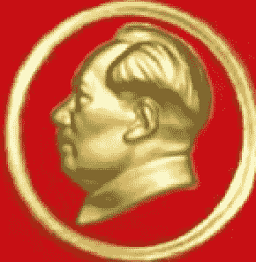
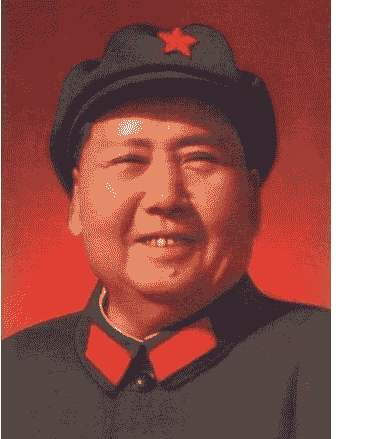

# 毛主席语录

## 全世界无产者，联合起来！

# 毛主席语录

中国人民解放军总政治部编印

## 再版前言

毛泽东同志是当代最伟大的马克列宁主义者。毛泽东同志天才、创造性地、全面继承、捍卫和发展了马克思列宁主义，把马克思列宁主义提高到一个全新的阶段。

毛泽东思想是在帝国主义走向全面崩溃、社会主义走向全世界胜利的时代的马克思列宁主义。毛泽东思想是反对帝国主义的强大的思想武器，是反对修正主义和教条主义的强大的思想武器。毛泽东思想是全党、全军和全国一切工作的指导方针。

因此，永远高举毛泽东思想大红旗，用毛泽东思想武装全国人民的头脑，坚持在一切工作中用毛泽东思想挂帅，是我党政治思想工作最根本的任务。广大工农兵群众、广大革命干部和广大知识分子，都必须把毛泽东思想真正学到手，做到人人读毛主席的书，听毛主席的话，照毛主席的指示办事，做毛主席的好战士。

学习毛主席著作，要带着问题学，活学运用，学用结合，急用先学，立竿见影，在“用”字上狠下功夫。为了把毛泽东思想真正学到手，要反复学习毛主席的许多基本观点，有些警句最好熟背，反复学习，反复运用。在报纸上，要经常结合实际，刊登毛主席的语录，供大家学习和运用。几年来广大群众活学运用毛主席著作的经验，证明带着问题选毛主席的语录，是一种学习毛泽东思想的好方法，容易收得到立竿见影的效果。

为了帮助广大群众更好地学习毛泽东思想，我们选编了这本《毛主席语录》。各单位在组织学习的时候，应当结合形势、任务、群众的思想情况和工作情况，选学有关的内容。

现在我们伟大的祖国，正在出现一个工农兵掌握马克思宁主义，毛泽东思想的新时代。毛泽东思想为广大群众所掌握，就会变成无穷无尽的力量，变成为威力无比的精神原子弹。《毛主席语录》的大量出版，对广大群众掌握毛泽东思想，推动我国人民思想革命，是一个极为重要的措施。希望每个同志认真地、刻苦地学习，在全国范围内，掀起活学运用毛主席著作的新高潮，在毛泽东思想的伟大红旗下，为我国建设成为一个具有现代农业，现代工业，现代科学文化和现代国防的伟大的社会主义国家而奋斗！

林彪 一九六六六年十二月十六日

## 目录

| 章节名称 | 页码 |
| :--- | :--- |
| 一、共产党 | 1 |
| 二、阶级和阶级斗争 | 8 |
| 三、社会主义和共产主义 | 21 |
| 四、正确处理人民内部矛盾 | 41 |
| 五、战争与和平 | 53 |
| 六、帝国主义和一切反动派都是纸老老虎 | 66 |
| 七、敢于斗争、勇于胜利 | 75 |
| 八、人民战争 | 80 |
| 九、人民军队 | 89 |
| 十、党委员会领导 | 93 |
| 十一、群众路线 | 104 |
| 十二、政治工作 | 118 |
| 十三、官兵关系 | 129 |
| 十四、军民关系 | 133 |
| 十五、三大民主 | 136 |
| 十六、教育和训练 | 142 |
| 十七、为人民服务 | 146 |
| 十八、爱国主义和国际主义 | 150 |
| 十九、革命英雄主义 | 156 |
| 二十、群众建国 | 160 |
| 二十一、自力更生、艰苦奋斗 | 166 |
| 二二、思想方法和工作方法 | 174 |
| 二十三、调查研究 | 198 |
| 二十四、纠正错误思想 | 204 |
| 二十五、团结 | 216 |
| 二六、纪律 | 219 |
| 二十七、批评和自我批评 | 222 |
| 二八、共产党员 | 231 |
| 二九、干部 | 239 |
| 三十、青年 | 249 |
| 三十一、妇女 | 254 |
| 三十二、文化 | 258 |
| 三三、学习 | 263 |

## 一、共产党

领导我们事业的核心是共产党。指导我们思想的理论基础是马克思主义。既要革命，就要有一个革命党。没有一个革命党，没有按照马克思主义的理论和风格建立的革命党，就不可能领导工人阶级和广大群众战胜帝国主义及其一切敌人。没有中国共产党，中国的独立是不可能的，中国的工业化和现代化也是可能的。没有这样一个核心，社会主义事业就不能胜利。

## 二、阶级和阶级斗争

谁是我们的敌人？谁是我们的朋友？这个问题是革命的首要问题。中国过去一切革命斗争成效甚少，其基本原因就是不能真正的朋友，以攻击真正的敌人。革命党是群众的向导，在革命中没有革命党领错了路而革命失败的。我们的革命要有不领错路和一定的把握，才能团结我们的真正的朋友，以攻击真正的敌人。我们要分辨真正的朋友，不可将中国社会各阶级的经济地位及其对于革命的态度，做一个大概的分析。

一切勾结帝国主义的军阀、官僚、买办阶级、大地主阶级以及属于他们的一部分反动知识界，是我们的敌人。工业产阶级是我们革命的领导力量。一切半无产阶级、小资产阶级，是我们最近的朋友。那动摇不定的中产阶级，其右翼可能是我们的敌人，其左翼可能是我们的朋友——但我们要时常提防他们，不要让他们扰乱了我们的阵营。

在拿枪的敌人被消灭以后，不拿枪的敌人依然存在，他们必然地要和我们作斗的斗争，我们决不可以轻视这些敌人。如果我们现在不是这样地提出问题和认识问题，我们就要犯极大的错误。

《在中国共产党第七届中央委员会第二次全体会议上的报告》（一九四四年九月五日），《毛泽东选集》第四卷第一四二八页

帝国主义者和国内反动派不甘心于他们的失败，他们还要做最后的挣扎。在全国肃定以后，他们也会以各种方式从事破坏和捣乱，他们将每日每时企在中国复辟。这是必然的，毫无疑问的，我们务必不要松弛自己的警惕。

《在中国人民政治协商会议第一届全体会议上的开席辞（一九四四年九月二十二日），一九四四年九月二十二日《人民日报》

在我国，虽然社会主义改造，在所有方面来说，已经基本完成，革命时期的大规模的暴风式的群众阶级斗争已经基本结束，但是，被推翻的地主产阶级的残余还是存在，资产阶级还是存在，小资产阶级刚刚在改造。阶级斗争并没有结束。无产阶级和资产阶级之间的阶级斗争，各派政治力量之间的阶级斗争，无产阶级和资产阶级之间意识形态方面的阶级斗争，还是长期的，曲折的，有时甚至是很激烈的。无产阶级要按照自己的世界观改造世界，资产阶级也要按照自己的世界观改造世界。在这一方面，社会主义和资本主义之间谁胜负的问题还没有真正解决。

《关于正确处理人民内部矛盾的问题（一九五七年二月二十七日）》人民出版社第二六六——二七页

我国社会主义和资本主义之间的意识形态方面的谁胜谁负的斗争，还需要一个相当长的时间才能解决。这是因为资产阶级和从旧社会来的知识分子的影响在我们我国国内长期存在，作为阶级的意识形态，还要在我们国长期存在。如果对于这种形态认识不足，或者根本不认识，那就要犯巨大的错误，就会忽视必要的思想斗争。

《关于正确处理人民内部矛盾的问题（一九五七年二月二十七日），人民出版社第二页

在我国，资产阶级和小产阶级的思想，反马克思主义的思想，还会长期存在。社会主义制度在我国已经基本建立。我们已经在生产资料所有制的改造上取得了基本胜利，但在政治战线和思想战线方面，我们还没有完全取得胜利。无产阶级和资产阶级之间的意识形态方面的谁胜谁负谁负责问题，还没有真正解决。我们同资产阶级和小资产阶级的思想还要进行长期的斗争。不了解这种情况，放弃思想斗争，那就是错误的。凡是错误的思想，凡是毒草，凡是牛鬼蛇神，都应该进行批判，决不能让他们自由泛滥。但是，这种批判，应该是充分说理的，有分析的，有说服力的，而不应该是粗暴的、官僚主义的，或者是形而上学的、教条主义的。

《在共产党建国宣传工作会议上的讲话（一九五七年三月三十日）），人民出版社第一一九——二零页

教条主义和修正主义都是违反马克思主义的。马克思主义一定要向前发展，要随着实践的发展而发展，不能停滞不。停止了，老是那么一套，它就没有生命了。但是，马克思主义的基本原则又是不能违背的，违背了就要犯错误。用形而上学的观点来看待马克思主义，把它看成僵死的东西，这是教条主义。否定马克思主义的基本原则，否定马克思主义的普遍真理，这就是修正主义。修正主义是一种资产阶级思想，抹杀社会主义和资本主义的区别，抹杀无产阶级专政和资产阶级专政的区别。实际上并不是社会主义，而是资本主义路线。现在的情况下，修正主义更有危险性。我们现在思想战线上的重要任务，就是要开展对于修正主义的批判。修正主义或者右机会主义，是一种资产阶级思潮，它比教条主义更有危险性。修正主义或者右机会主义，头上也挂着马克思主义，他们也在那里攻击“教条主义”。但是他们攻击的是马克思主义的最根本的东西，歪曲唯物论和辩证法，反对企图削弱人民民主专政，反对企图削弱社会主义和主义建设。我国取得基本胜利以后，他们从各个方面面向工人阶级进行斗争，在这个斗争中，修正主义者就是他们最好的助手。《关于正确处理人民内部矛盾（一九五七年二月二十日），人民出版社第二九——三零页

## 三、社会主义和共产主义

共产主义是无产阶级的整个思想体系，同时是一种新的社会制度。这种思想体系和社会制度，是区别于任何别的思想体系和社会制度的，是自人类以来最完全最先进最合理的。封建主义的思想和社会制度，是进了博物馆了。资本主义的思想和社会制度，已有一部分进了博物馆；其余部分，也已日薄西山，气息奄，进博物馆了。唯有共产主义的思想和社会制度，正以排山倒海之势，雷霆万钧之力，磅礴于全世界，而其青春。社会主义制度终要资本主义主义，这是一个不以人们自己的意志为转移的客观规律。不管反动派怎样企图阻止历史轮的前进，无论迟还是早总会发生，并将必然取得胜利。我们共产党人从隐藏自己的政治主张。我们的将来纲领或最高纲，是要将中国推进到社会主义和共产主义去的，这是确定的和毫无疑问的。我们党的名称和我们的马克思主义的宇宙观，明确地指明了这个未来的、无限光明的、无限美妙的最高理想。《论联合政府》（一九四五年四月二十四日），《毛泽东选集》第三卷第一零五页

中国共产党领导的整个革命运动，是包括民主主义革命和社会主义革命两个阶段在内的全部革命运动；这是两个性质不同的革命过程，只有完成了前一个革命过程才完成后一个革命过程。民主主义革命是社会主义革命的必要准备，社会主义革命是民主主义革命的必然趋势。一切共产主义者的最后目的，则在于力争社会主义社会和共产主义社会的完成。《中国革命和中国共产党》（一九三九年十二月），《毛泽东选集》第二卷六四页

社会主义革命的目的是为了生产力。农业和手工业由个体所有制变为社会主义的集体所有制，私营工商业由资本主义所有制变为社会主义所有制，必然使生产力大大地获得解放。这样就大大地发展工业和农业的生产创造了社会条件。在最高国务会议上的讲话（一九五六年一月二十五日），一九五六年一月二十六日《人民日报

我们现在不但正在进行关于社会制度方面的由私有制到公有制的革命，而且正在进行技术方面的由手工业生产到大规模现代化机器生产的革命，而两种革命是结合在一起的。在农业方面，在我们的国内下（资本主义国家是使农业资本主义化），则必须先有合作化，然后才能使用大机器。由此可见，我们对于工业和农业、社会主义的工业化和社会主义改造这两件事情，决不可分割和相互孤立去看，只强调一方面另一方面。新的社会制度还刚刚建立，还需要巩固的时间。不能认为新制度一旦建立就完全巩固，那是不可能的。要使它最后巩固，必须实现社会主义工业化，坚持经济战线上的革命，还在政治战线和思想战线上进行常规的战斗。除了这些以外，还有各种国际配合。《在中国共产党宣传工作会议上的讲话（一九五七年三月十二日），人民出版社二页

在我国，巩固社会主义制度的斗争，社会主义和资本主义谁胜谁负的斗争，还要经过很长的时期。但是，我们大家都看到，这个社会主义的新制度一定会巩固的。我们一定会建设一个现代工业、现代农业的社会主义国家。对于我们的国家抱着敌对情绪的知识分子，是极少数。这种人不喜欢这个无产阶级专政的国家，他们留恋社会，就会兴风作浪，想要推翻共产党无产阶级和资产阶级两条路线、社会主义和资本主义两条路线中间顽固地走一条路线的人实际上是准备投降帝国主义、封建主义和官僚资本主义的这种人在政治界、工商界、文化界、科学技术界、宗教界里都有一些极端反动的人。农民的经济是分散的，根据苏联的经验，需要很长的时间和细心的工作，才能做到农业社会化。没有农业社会化，就没有全部巩固的社会主义。《论民主专政》（一九四四年六月三十日），《毛泽东选集》第四卷一四八页

我们必须相信：（1）广大农民是愿意在党的领导下逐步走上社会主义道路的；（2）党是能够引导农民走上社会主义道路的。这两点是事物的本质和主流。《关于农业合作化问题》（一九五五年七月三十日），人民出版社版二页

合作社的领导机关必须建立现有贫农和新中农在领导机关中的优势，而以老中农和新中农作为辅助力量，才能按照政策实现贫农和中农的团结，巩固合作社，发展生产，正确地完成整个农村的社会主义改造。没有这个条件，中农和贫农就不能团结，合作社就不能巩固，生产就不能发展，整个农村的社会主义改造就不能实现。《长沙县高山乡武塘农业生产合作社行政机关从中农优势转变为贫农占优势的》的按（一九五五年），《中国农村的社会主义高潮》中

不团结中农是错误的。但是工人阶级和共产党，在农村中，依靠什么人去团结农民，实现整个农村的社会主义改造呢？当然只有贫农。在过去的向地主斗争、实行土地改革的时候是这样的，在现在向富农和其他资本主义因素斗争实行农业的社会主义改造的时候，也是这样的。在两个革命时期，中农在开始阶段都是动摇的。等到看清了大势，革命将胜利的时候，中农才会参加到革命方面来。贫农必须向中农做工作，把中农团结到自己方面来，使革命一天一天地扩大，直到取得最后的胜利。《福安县发生“中农社”和“贫农社”的教训》一文的按语（一九五五年），《中国农村的社会主义高潮》中期富裕农民中的资本主义倾向是严肃的。只要我们在合作化运动中，乃至以后一个很长的时期内，稍微放松了对于农民的政治工作，资本主义倾向就会泛滥起来。《必须对资本主义倾向做出坚决的斗争》一文按（一九五五），《中国农村的社会主义高潮》上

农业合作化运动，从一开始，就是一种严肃的思想和政治的斗争。每一个合作社，不经过这场斗争，就不能成立。一个新的社会制度要从地上建立起来，它必须清除旧思想，反映旧制度的残余，总是长期留在人们头脑里，不愿意退走的。在最近几年，农村中的资本主义自发势力天天发展，两极分化的现象必然出现，许多富农自己变为富农，许多贫农则生产资料不足，仍然处于贫困地位，有些人出卖土地，有些人继续处于贫困地位，向资本主义方向发展的那些富农也将对我们不满，因为工人阶级领导的人民共和国政权，在民主革命胜利以后，不是可以削弱，而是强化。除了别的特点，中国农村的显著特点是穷和富，要变，要革命。《在共产党第七届中央委员会第二次会议上的报告》（一九四四年三月五日），《毛泽东选集》第四卷第一

“你们不是要消灭国家权力吗？”我们要，但是我们现在还要，我们现在还不能。为什么？帝国主义还存在，国内反动派还在，国内阶级还存在。我们现在的任务是要强化人民的国家机器，这要是指人民的军队、人民的警察和人民的法庭，借以巩固国防和保护人民利益。《论民主专政（一九四九六月三十日），《毛泽东选集》第四卷一四八

我们的国家是工人阶级领导的以工农联盟为基础的人民民主专政的国家。这个专政是干什么的呢？专政的第一个作用，就是压迫国家内部的反动阶级、反动派和反抗社会主义革命的剥削者，压迫那些对于社会主义建设的破坏者，就是为了解决国内敌我之间的矛盾。例如逮捕某些反革命分子并将他们判罪，在一个时期内地主阶级分子和官僚资产阶级分子以选举，不给他们发表言论的自由权利，都是属于专政的范围。为了维护社会秩序和广大人民的利益，对于那些盛盗犯、诈骗犯、杀人放火犯、流氓集团和各种严重破坏社会秩序的分子，必须实行专政。专政还有第二个作用，就是防御国家外部敌人的颠覆活动和可能的侵略。在这种情况出现的时候，专政就担负责对外解决敌我之间的矛盾的任务。专政的目的是为了保卫全体人民进行

人民民主专政有两个方法。对敌人来说是用专政的方法，就是说在必要的时期内，不让他们参与政治活动，强迫他们服从人民政府的法律，强迫他们从劳动并在劳动中改造他们成为新人。对民主来说与此相反，不是用强迫的方法，而是用民主的方法，就是说必须让他们参与政治活动，不是强迫他们做这样做那样，而是用民主的方法向他们进行教育和说服的工作。

在中国人民政治协协商会议第一届全国委员会第二次会议上的闭幕辞（一九五零六月二十三日），一九五零六月二十四日《人民日报》

为了在更加稳固的基础上迅速发展中国的社会主义事业，中国人民正在共产党的领导之下进行一个生气勃勃的整风运动。这就是在城市和农村中对于社会主义和资本主义两条道路、国家的根本制度

重大政策、党政工作人员的工作作风、人民的生活福利等项问题，用摆事实讲道理的方法，有地地自由地开展全民性的辩论，用以正确地解决在人民内部实际存在而在当前所必须解决的各项矛盾问题。这是一个社会主义的人民自我教育、自我改造的运动。

> 《在苏联高斯捷夫祝伟大的十月主义革命四十周年会议上的讲话》（一九五七年十一月六日），人民出版社第八页

为了进行伟大的建设，在我们的面前，摆着极为繁重的任务。虽然我们有一千多万党员，但是在全国人口中仍然只占极少数。在我们的各个国家机关和各项社会事业中，大量的工作要依靠党外的人员来做。如果我们不善于依靠群众，不善于同党外的人员合作，就无法把工作做好。在我们继续加强党的团结的时候，

我们必须继续加强各民族、各民主阶级、各民主党派、各人民团体的团结，继续巩固和扩大我们的人民民主统一战线，必须认真地纠正在任何工作环节上的任何一种妨碍党同人民团结的不良现象。

《中国共产党第八次全国代表大会开幕词（一九五六年九月十五日），《中国共产党第八次全国代表大会文献》人民出版社第八页

## 四、正确处理人民内部矛盾

在我们的面前有两类社会矛盾，这就就是敌我之间的矛盾和人民内部的矛盾。这是性质完全不同的两类矛盾。

> 《关于正确处理人民内部矛盾的问题（一九五七年二月二十七日）》人民出版社第一页

为了正确地认识敌我之间和人民内部这两类不同的矛盾，应该首先首先清楚什么是人民，什么是敌人。......现阶段，在建设社会主义的时期，一切赞成、拥护和参加社会主义建设事业的阶级、阶层和社会集团，都属于人民的范围；一切反抗社会主义革命和敌视、破坏社会主义建设的势力和社会集团，都是人民的敌人。

《关于正确处理人民内部矛盾的问题（一九五七年二月二十七日），人民出版社第一版

在我们现在的条件下，所谓人民内部矛盾，包括工人阶级内部的矛盾，农民阶级内部的矛盾，知识分子内部的矛盾，工农两个阶级之间的矛盾，工人、农民同知识分子之间的矛盾，工人阶级和其他其他劳动人民同民族资产阶级之间的矛盾，民族资产阶级内部的矛盾，等等。我们的人民政府是真正代表人民利益的政府，是为人服务的政府，但是它同人民群众之间有一定的矛盾。这种矛盾包括国家利益、集体利益同一个人利益的矛盾，民主同集中的矛盾，领导同被领导之间的矛盾，国家机关某些工作人员的官僚主义作风

群众之间的矛盾。这种矛盾也是人民内部的一个矛盾。一般来说，人民内部的矛盾，是在人民利益根本一致的基础上的矛盾。

> 《关于正确处理人民内部矛盾的问题（一九五七年二月二十七日），人民出版社版第二页

故我之间的矛盾是对抗性的矛盾。人民内部的矛盾，在劳动人民之间来说，是非对抗性的；在被剥削阶级和剥削阶级之间来说，除了对抗性的一面以外，还有非对抗性的一。

> 《关于正确处理人民内部矛盾的问题（一九五七年二月二十七日），人民出版社版第二页

在我们国人民的政治生活中，应当怎样来判断我们的言论和行动的是否呢？我们认为，根据我国的宪法的原则，根据我国最大多数人民的意志和我国各党派历史宣布的共同主张，这种标准可以规定如下：

- 有利于团结各族，而不是分裂人民；
- 有利于社会主义和社会建设，而不是不利社会主义建设；
- 有利于巩固人民专政，而不是破坏或者削弱专政；
- 有利于巩固民主集中，而不是破坏或者削弱制度；
- 有利于巩固党的领导，而不是摆脱这种领导；
- 有利于社会主义国际团结，而不是损害这种团结。

这六条标准中，重要的是社会主义道路和党的领导。《关于正确处理人民内部矛盾》（一九五七年二月二十七日），人民出版社第三页

不同性质的矛盾，只有用不同的方法才能解决。例如，无产阶级和资产阶级的矛盾，用社会主义革命去解决；大众与封建制度的矛盾，用民族革命去解决；殖民主义和帝国主义的矛盾，用民族战争去解决；在社会主义中工人阶级和农民阶级的矛盾，用集体化的方法解决；共产党内部的矛盾，用批评和自我批评的方法解决；社会自然的矛盾，用发展生产力的方法解决……用不同的方法解决不同的矛盾，这是马克思列宁主义者必须遵守的一个原则。

> 《矛盾论》（一九三七年八月），《毛泽东选集》第一卷

敌之间和人民内部这两类矛盾的性质不同，解决的方法不同。简单地来说，前者是分清敌我的问题，后者是分清是非的问题。当然敌我问题也是一种是非问题。比如我们同帝国主义、封建主义、官僚资本主义这些内外反派，究竟谁是非，也是是非问题，但是和人民内部性质不同的另一类是是非问题。

> 《关于正确处理人民内部矛盾（一九五七年二月二十七日），人民出版社第三页

凡属于思想性质的问题，凡属于人民内部的争论问题，只能用民主的方法解决，只能用讨论的方法、批评的方法、说服的方法去解决，而不能用强制的方法去解决。人民为了有效地进行生产、进行学习和有秩序地生活，要求自己的政府的领导者、文化教育机关的领导者发布各种适当的带强制性的行政命令。没有这种行政命令，社会秩序就无法维持，这是

这用说服教育的方法解决人民内部的矛盾，是相辅相成的两个方面。为维持社会秩序的目的而发布的行政命令，也要伴之以说服教育，单靠行政命令，在很多情况下就行不通。

《关于正确处理人民内部矛盾》（一九五七年二月二十七日），人民出版社第六页

资产阶级、小资产阶级，他们的思想意识一定要反映出来的。一定要在政治问题和思想问题上，用各种办法强迫地表现他们自己。要他们不反映不表现，是不可能的。我们不应当压制的办法不让他们表现，应当让他们表现，同时在他们表现的时候，和他们辩论，进行适当的批评。毫无疑问，我们应当批评各种错误思想。不加批评，看着错误思想到处泛滥，任凭它们去占领市场，自然不行。

有错误就得批判，有毒草就得斗争。但是这种批评不应该是教条主义的，不应当用形而上学方法，应当力求用辩证方法。要有科学的分析，要有充分的说服力。

> 《关于正确处理人民内部矛盾的问题（一九五七年二月二十日），人民出版社第二页

对于人民的缺点是需要批判的……但必须是真正站在人民的立场上，用保护人民、教育人民的满腔热情来说。如果把同志当作敌人来对待，就是使自己站在敌人的立场上去了。

《在延文艺座谈会上的讲话》（一九四二年五月），《毛泽东选集》第三卷

矛盾和斗争是普遍的、绝对的，但是解决的方法，即斗争的形式，则因矛盾的性质而不相同。有些矛盾根据事物的具体发展，有些矛盾由原来非对抗性的，而发展成为对抗性的；有些矛盾由原来对抗性的，而发展成为非对抗性的。

> 《矛盾论》（一九三七年八月），《毛泽东选集》第一卷

在一般情况下，人民内部的矛盾不是对抗性的。但是如果处理得适当或者失去警惕，麻痹，可能发生对抗。这种情况在社会主义国家只是暂时的现象。这是因为社会主义国家灭了旧制度，人民的利益在根本上是一致的。

《关于正确处理人民内部矛盾（一九五七年二月二十七日），人民出版社第八页

工人阶级同民族阶级的矛盾属于人民内部矛盾。工人阶级和民族阶级的阶级斗争一般属于人民内部。在民主革命时期，它有革命的一，又有妥协的一。在社会主义革命时期，它有革命的一，又有接受社会主义改造的一。工人阶级和帝国主义、官僚阶级之间存在剥削和被剥削的矛盾，这本来是对抗性的。但是在我们具体条件下，这两个阶级的对抗性矛盾如果处理得当，可以转变为非对抗性的矛盾，可以用和平的方法解决。如果我们处理不当，采取团结、批评、教育的政策，工人阶级和民族阶级之间的矛盾就会变成敌我之间的矛盾。挑离间，兴风作浪，企图实现他们的阴谋。匈牙利事件这种教训，值得大家注意。

## 五、战争与和平

战争是阶级和阶级、民族和民族、国家和国家、政治集团和政治集团之间，在一定发展阶段上的矛盾的一种最高的斗争形式。

> 《中国革命战争的战略问题》（一九三六十二月），《毛泽东选集》第一卷

“战争是政治的”，在这一点上说，战争就是政治、战争本身就是政治性质的行动，从古以来没有带政治性的战争……但是战争有其特殊性，在这一点上说，战争不等于一般的政治。“战争是政治的特殊手段的延续”。政治发展到一定的阶段，再也不能照旧惯性前进，于是爆发了战争，用以清除政治道路上的障碍……障碍既除，政治的目的达到，战争结束。障碍没有清除干净，战争仍须继续进行，以求贯彻……因此可以说，政治是不流血的战争，战争是流血的政治。

> 《论持久战》（一九三八五月），《毛泽东选集》第二卷

历史上的战争分为两类，一类是正义的，一类是非正义的。一切进步的战争都是正义的，一切阻碍进步的战争都是非正义的。我们共产党人反对一切进步的非正义的战争，但是对于后一类战争，我们共产党人不反对，而且积极参加。前一类战争，例如第一次世界大战，双方都是为了帝国主义利益而战，所以全世界的共产党坚决地反对那一次战争。反对的方法，在战争未爆发前，极力阻止其爆发；既爆发后，只要有可能，就用战争反对战争，用正义战争反对非义战争。

> 《论持久战》（一九三八五月），《毛泽东选集》第二卷

在阶级社会中，革命和革命战争是不可避免的，舍此不能完成社会发展的飞跃，不能推翻反动的统治阶级，而使人民获得政权。

> 《矛盾论》（一九三七年八月），《毛泽东选集》第一卷

战争是一种抗争，它不但将排除敌人，也将清洗自己的污垢。凡正义的战争，其力量是巨大的，它能改造很多事物，为事物开辟道路。只要中国坚持抗战和统一战线，一定能把旧日本改造为新日本，把旧中国改造为新中国，并在这次战争中获得胜利。革命战争的中心任务和最高形式是武装夺权。这个马克思主义的革命原则是普遍的，不论在中国还是外国都是对的，不是坏的，是好的，是马克思主义的。帝国主义时代的阶级斗争。

> 《战争和战略问题》（一九三八年十一月），《毛泽东选集》第二卷

经验告诉我们：工人阶级和劳动群众，只有用阶级的力量才能战胜武装的资产阶级；在这个意义上，我们可以说，整个世界只有用阶级才可能改造。我们是战争消灭者，不要战争；但是只能通过战争去消灭战争，必须拿起枪子。

> 《战争和战略问题》（一九三八年十一月），《毛泽东选集》第二卷

革命战争反对阶级反革命战争，民族革命战争反对反革命战争，阶级革命战争反对反革命战争……人类社会进步到消灭了阶级，消灭了国家，到了那时，什么战争也没有了，反革命战争没有了，革命战争没有了，非义战争没有了，正义战争也没有了，这就是人类的永久和平的时代。我们研究革命战争的规律，出发于我们要求消灭一切战争的志愿，这是区别我们人和一切剥削阶级的界线。

《中国革命战争的战略问题》（一九三六十二月），《毛泽东选集》第一卷

我国和各国社会主义国家都需要和平，世界各国的人民也需要和平。渴望战争，不要和平的，仅仅是少数帝国主义国家中的某些依靠侵略发财的垄断资本集团。

《中国共产党第八次全国代表大会开幕词（一九五五年六月十五日），《中国共产党第八次全国代表大会文献》

为了争取世界的持久和平，我们必须进一步地发展共同社会主义阵营中各个兄弟国家的友好合作，并且对一切热爱和平的国家加强团结。我们必须争取一切愿意和我们和平相处的国家，在相互尊重领土主权和平互利的基础上，建立正常的外交关系。亚洲、非洲和拉丁美洲各国的独立解放运动，以及世界上一切国家的和平运动和正义斗争，我们都必须给予积极的支持。

对于帝国主义国家，我们也要团结那里的人，并且争取那些国家和和平共处，做一些生意，制止可能发生的战争，但是决

《关于正确处理人民内部矛盾的问题（一九五七年二月二十七日），人民出版社第三八页

不可以对他们怀抱一些不实际的想法。我们希望和平。但是如果帝国主义硬要打仗，我们也只好横下一条心，打了仗再建设。每天怕战争，战争来了你有什么办法呢？我先是说东风压倒西风，战争打不起来，现在再如果发生了战争的情况，作了这些补充的说明，这样两种可能性都估到了。在各国共产党和工人莫斯科会议上的讲话（一九五七年十一月十八日），一九六三年九月一日《人民日报》《中国政府发言人声明》中的引语

现在世界各国的人们都在谈论会打第三次世界大战。对于这个问题，我们也要有精神准备，也要有分析。我们是

坚持和平反对战争的。但是，如果帝国主义一定要发动战争，我们也不要害怕。我们对待这个问题的态度，同对待一切“乱子”的态度一样，第一条，反对；第二条，不害怕。第一次世界大战以后，出了一个苏联，两亿人口。第二次世界大战以后，出了一个社会主义阵营，一共九亿人口。如果帝国主义者一定要发动第三次世界大战，可以断定，其结果一定要有多少亿人口转到社会主义方面，帝国主义剩下的地盘就不多了，也有可能整个帝国主义制度全部崩溃。

> 《关于正确处理人民内部矛盾的问题
> （一九五七年二月二十七日），人民出版社第三五页

搞乱，失败，再搞乱，再失败，直至灭亡——这就是帝国主义和世界上一切反动派对待人民事业的逻辑，他们决不会迷

背这个逻辑的。这是一条马克思主义的定律。我们说“帝国主义是很凶恶的”，就是说它的本性是不能改变的，帝国主义分子决不肯放下刀剑，他们也决不能成佛，直至他们的灭亡。

斗争，失败，再斗争，再失败，再斗争，直至胜利——这就是人民的逻辑，他们也决不会违背这个逻辑的。这是马克思主义的又一条定律。俄罗斯人民的革命曾经依照了这条定律，中国人民的革命也是依照这条定律。

> 《丢掉幻想，准备斗争》（一九四九年八月十四日），《毛泽东选集》第四卷四九零——一九四九一页

我们决不可因为胜利，而放松对于帝国主义分子及其狗们的疯狂的报复阴谋的警惕性，谁要是放松了这一警惕性，谁就会将在政治上解除武装，而使自己处于被动的地位。

> 《在新政协商会议筹备会上的讲话》
> （一九四九六月十五日），《毛泽东选集》第四卷第一四六九页

帝国主义者及其走狗中国反动派对于他们在中国这块土地上的失败，是不会甘心的。他们还会相互勾结在一起，用各种可能的方法，反对中国人民。例如，派遣他们的走狗钻进中国内部来进行分化工作和捣乱工作。这是必然的，他们决不会忘记这项工作。例如，派使中国反动派甚至加上他们自己的力量，封锁中国的海港。只要还有可能，他们就会这样做，再则，假如他们还想冒险的话，派出一部分兵力侵犯中国的边境，也不是不可能的。所有这些，我们都必须充分占据到。

世界是在进步的，前途是光明的，这个历史的总趋势任任何人也改变不了了。我们应当把世界进步的情况和光明的前途，常向人民宣传，使人民建立起来胜利的信心。

> 《关于重庆谈判》（一九四五年十月十七日），《毛泽东选集》第四卷第一一六二页

人民解放军的全体指挥员、战斗员，绝对不可以稍微松懈自己的战斗意志，任何松懈战斗意志的思想和轻敌的思想，都是错误的。

> 《在中国共产党第七届中中央委员会第二次全体会议上的报告》（一九四四年三月五日），《毛泽东选集》第四卷第一一四二五页

## 六、帝国主义和一切反动派都是纸老虎

一切反动派都是纸老虎。看起来，反动派的样子是可怕的，但是实际上并没有什么了不起的力量。从长远的观点看问题，真正强大的力量不是属于反动派，而是属于人民。

> 《和美国记者安娜·路加斯·斯特特的谈话》（一九四六年八月），《毛泽东选集》第四卷第一一九二三页

同世界上一切事物无不具有两重性（即对立统一规律）一样，帝国主义和一切反动派也有两重性，它们是真老虎又是纸老虎。历史上奴隶主阶级、封建地主阶级和资产阶级，在它们取得统治权力以前和取得统治权力以后的一时间内，它们是生气勃勃的，是革命者，是先进者，是真老虎。在随后的一段时间里，由于它们的对立面，奴隶阶级、农民阶级和无产阶级，逐步壮大，越来越厉害，它们就逐步向反面转化，化为反动派，化为落后的人，化为纸老虎，终究被或者被人民所推翻。反动的、落后的、腐朽的阶级，在面临人民的决死斗争的时候，还有这样的两面性。一方面，真老虎，吃人，成百万人千人吃。人民斗争事业在困难苦的时代，出现许多弯曲的道路。中国人为了消灭帝国主义、封建主义和官僚资本主义在中国的统治，花了一百多年时间，死了大概几千万之多，才取得一九四年的胜利。你看，这不是活老虎，铁老虎，真老虎吗？但是，

终究转化成了纸老虎，死老虎。这是历史的事实。人们难道没有见过这些吗？真是千千万万！所以，从本质上看，从长期上看，从战略上看，必须如实地把帝国主义和一切反动派都看成纸老虎。另一方面，它们又是活的，它们会吃人的。从这点上看，建立我们的战略思想（在中共中央政治局会议上的讲话（一九四八年十二月一日），《毛泽东选集》第四卷第一十一九零和美国记者安那·路易斯·斯特特的谈话）。所有号称强大的反动派不是纸老虎。因为他们脱离了人民。你看，希特勒不是纸老虎？希特勒不是被打倒了吗？我也看到沙皇是纸老虎，皇帝是纸老虎，日本帝国主义是纸老虎，你看，都倒了。美帝国主义没有倒，我看也是要倒的，也是纸老虎。

> 57d1fb44245e2f18888bc7_77_0

各国共产党和工人党莫斯科会议上的讲话（一九五七年十一月十八日），《毛泽东选集》论帝国主义和一切反动派都是纸老虎》人民出版社。“搬起石头打自己的脚”，这是中国人形容某些人的行为俗语。反动派也就是这一批蠢人。他们对于人民所种种迫害，归根结底，只能促进人民更广泛更剧烈的革命。难道沙皇和蒋介石对于人民的种种迫害，就是对于伟大的俄国和伟大的中国革命起了这样的作用吗？《在苏联苏维埃祝贺十月革命周年会议上的讲话》（一九五七年十一月六日），人民出版社

帝国主义九年来侵占了我国领土，不久以前又派遣了它的武装部队占了黎巴嫩。美国在全世界许多国家建立了几个军事基地。中国领土台湾、黎巴嫩以及所有美国在外的军事基地，都是套在帝国主义脖子上的绞索。不是别人而是美国自己制造这种绞索，并把绞索的另一端交给了中国人民、阿拉伯各国人民和全世界爱和平反侵略的人。美国侵略者在这些地方停留得越久，套在它头上的绞索就将越紧。在最高国务会议上的讲话（一九五八年九月八日），一九五八年九月九日《人民日报》。帝国主义者的寿命不会很长了，因为他们尽做坏事，专门扶植各国反人民的反动派，霸占大量的殖民地、半殖民地和军事地，以原子战争威胁和平。这样，他们迫使全世界百分之九十以上的人正在或者将要对他们群起而攻。但是帝国主义目前还是活着，他们依然在亚洲、非洲、拉丁美洲横行霸道。他们在西方世界也依然在压迫他们本国的人民群众。这种局面必须改变。结束帝国主义主要是帝国主义的侵略和压迫，是全世界人民的任务。对新华社记者的谈话（一九五八年九月二十九日），《毛泽东同志论帝国主义和一切反动派都是纸老虎》人民出版社第三一页美帝国主义到处横行霸道，把它自己放在同全世界人民为敌的地位，使它自己越来越陷于孤立。美帝国主义手里的原子弹、氢弹，是吓不倒一切不愿意做奴隶的人们的。全世界人民反对美国侵略者的愤怒潮是不可挡的。全世界对美帝国主义及其走狗的斗争一定会取得更加伟大的胜利。《支持巴拿马人民反美爱国正义斗争的谈话》（一九六四年一月十二日），《全世界人民团结结起来打败美国侵略者及其一切走狗》人民出版社第九——零页

## 美国垄断资本集团如果坚持推行它的入侵政策和战争政策，势必有一天被全世界人民处以绞刑。其他美国帮凶也将是这样。在最高国务会议上的讲话（一九五八年九月八日），一九五八年九月九日《人民日报》。为了同胞作争，我们在一个长的时间内形成了一个概念，就是说，在战略上我们要藐视一切敌人，在战术上我们要重视一切敌人。也就是说在整体上我们一定要藐视敌人，在具体的问题上我们要重视它。如果不是在整体上藐视敌人，我们就会犯冒险主义的错误。马思、恩格斯只有两个人，那时他们就说资本主义要被打倒。在具体的问题上，如果我们不重视它，就会犯冒险主义的错误。

## 八、人民战争

战争胜负，主要取决于作战双方的军事、政治、经济、自然条件，这是没有问题的。然而仅仅如此，还取决于作战双方主观指导的能力。军事家不能超过物质许可的范围之外战争胜利，而且在物质条件许可的范围内争取战争的胜利。军事家活动的舞台在客观条件的上面，然而军事家凭着这个舞台，却可以导演许多多声色威武壮的剧。《中国革命战争的战略问题》（一九三六十二月），《毛泽东选集》第一卷十五页战争的目的不是别的，就是“保存自己，消灭敌人”（消灭敌人，就是解除敌人的武装，也就是所谓的“剥夺敌人的抵抗力”，不是完全消灭其肉体）。古代战争，用矛用盾：矛是进攻的，为了消灭敌人；盾是防御的，为了保存自己。直到今天的武器，还是这二者的继续。轰炸机、机关枪、远射程炮、毒气，是矛的发展；防空掩蔽部、钢盆、水泥工程、防毒面具，是盾的发展。坦克，是矛盾二者结合为一的新武器。进攻，是消灭敌人的主要手段，但防御是不可能的。进攻，是直接为了消灭敌人的同时也是为了保存自己，因为如果不消灭敌人，则自己将被消灭。防御，是直接为了保存自己的，但同时也是辅助攻击或准备转入进攻的一种手段。退却，属于防御一类，是防御的继续；而追击，则是进攻的继续。应该指出：战争目的中，灭敌人是主要的，保存自己是第二位的，因为只有大量地消灭敌人，才能有效地保存自己。因此，作为消灭人的主要手段的进攻是主要的，而作为消灭人的辅助手段和作为保存自己的一种手段的防御，是第二位的。战争实际中，虽有许多时候以防御为主，而在其他时候以进攻为主，然而通过战争的总体来看，进攻仍然主要的。《论持久战》（一九三八年五月），《毛泽东选集》第二卷五页

## 七、敢于斗争，敢于胜利

认为国际形势到了一个新的转折点。世界上有两股风：东风，西风。中国有句语：“东风压倒西风。”我认为目前形势的特点是东风压倒西风，也就是说社会主义的力量对于帝国主义的力量具有优势。在莫斯科会议上的讲话（一九五七年十一月十八日），《毛泽东同志论帝国主义和一切反动派都是纸老虎》人民出版社第二六页全世界人民团结起来，打败美国侵略者及其走狗！全世界人民要有勇气，敢于战斗，不怕困难，坚持后继，那一切魔鬼都会被消灭。《支持刚果反对美国侵略的声明》（一九六四年十一月二十八日），《全世界团结起来打败美国侵略者及一切走狗》人民出版社第一页中国共产党依据马克思·列宁主义的科学，清醒地估计了国际和国内形势，知道一切反动派的进攻不是不能打败的，而且能够打败的。当着天空乌云的时候，我们就指出：这不过暂时的现象，黑暗将来过去，曙光即在前头。《目前形势和我们的任务》（一九四七年十二月二十五日），《毛东东选集》第四卷第一二四五——一二四六页在历史上，凡属于将灭亡的反动势力，总是向革命势力进行最后挣扎的，而有些革命的人往往被这种外强中迷惑，看不出敌人快要消灭，自己快要胜利的实质。《第二次世界大战的转折点》（一九四二年十月十二日），《毛泽东选集》第三卷八八五页如果他们要打，就把他们彻底消灭。事情就是这样，他来进攻，我们把他消灭了，他就舒服了。消灭一点，舒服一点；消灭多点，舒服得多；彻底消灭，彻底舒服。中国的问题是复杂的，我们的脑子也要复杂一点。人家打来了，我们就打。为了争取和平。《重庆谈判》（一九四五年十月十七日），《毛泽东选集》第四卷第一一五八页有来犯者，只要好打，我党一定站在自卫立场上坚决彻底消灭之（不要轻易打，打则必胜，绝对不要被反动派的势汹汹所吓倒）。中共中央关于同民党进行和平谈判的通知（一九四五八月二十六日），《毛泽东选集》第四卷第一一五三页我们的愿望说，我们连一天都不愿意。但是如果形势迫使我们不得不打的话，我们能够一直到底的。《和美国记者安那·路易斯·斯特特的话》（一九四六年八月），《毛泽东选集》第四卷第一一八九——一九九零我们是要和平的，但是只要美帝国主义一天不放弃它那种横蛮无理的要求和扩张，我们是要和平的。自己的解放寄托在帝国主义及其走狗的“明智”上面，而只有通过加强团结、坚持斗争，才能取得胜利。《反对美国——吴庭绝望集团侵略和屠杀越南南方人民的声明》（一九六三年八月二十九日），《全世界团结起来打败美国侵略者及其走狗》人民出版社第六页

我们的军事原则则是：
（1）先分散和孤立之敌，后打集中和强大之敌。
（2）先取小城市、中等城市和广大乡村，后取大城市。
（3）以消灭敌人力量为主要目标，不以保守或夺取城市和地方为主要目标。保守或夺取城市和地方是有生命力的结果，往往需要反复多次才能最后地保守或夺取。
（4）每战集中对优势兵力（两倍、三倍、四倍、甚至是五倍或六倍于兵力），四包围敌人，力求全歼，不使漏网。在特殊情况下则采用给敌以决定性灭打击的方法，即集中全力打击正面及其一翼或两翼，求达击灭其一部、击其另一部的目的，以便我军能够迅速转移兵力击灭他部敌军。力求避免那那种得不偿失的、得失相当的消耗战。这样，在总体上，我们是劣势（就数量来说），但在每一个局部上，在每一个局部上，我们是优势。根据人民条件，具体来说，就是武装起来的人民。这就是的胜利... (Wait, let me re-align the provided text flow)
[/content]
... (Wait, the OCR text has many overlaps and jumbled parts. I will provide the clean version based on the logic.)

直到今天的武器，还是这二者的继续。轰炸机、机关枪、远射程炮、毒气，是矛的发展；防空掩蔽部、钢盆、水泥工程、防毒面具，是盾的发展。坦克，是矛盾二者结合为一的新武器。进攻，是消灭敌人的主要手段，但防御是不可能的。进攻，是直接为了消灭敌人的同时也是为了保存自己，因为如果不消灭敌人，则自己将被消灭。防御，是直接为了保存自己的，但同时也是辅助攻击或准备转入进攻的一种手段。退却，属于防御一类，是防御的继续；而追击，则是进攻的继续。应该指出：战争目的中，灭敌人是主要的，保存自己是第二位的，因为只有大量地消灭敌人，才能有效地保存自己。因此，作为消灭人的主要手段的进攻是主要的，而作为消灭人的辅助手段和作为保存自己的一种手段的防御，是第二位的。战争实际中，虽有许多时候以防御为主，而在其他时候以进攻为主，然而通过战争的总体来看，进攻仍然主要的。《论持久战》（一九三八年五月），《毛泽东选集》第二卷五页

(Self-correction: The source text provided in the prompt is a mess of overlapping pages and repeated quotes. I will synthesize it into a coherent document based on the visible fragments.) 

[content]
坚持和平反对战争的。但是，如果帝国主义一定要发动战争，我们也不要害怕。我们对待这个问题的态度，同对待一切“乱子”的态度一样，第一条，反对；第二条，不害怕。第一次世界大战以后，出了一个苏联，两亿人口。第二次世界大战以后，出了一个社会主义阵营，一共九亿人口。如果帝国主义者一定要发动第三次世界大战，可以断定，其结果一定要有多少亿人口转到社会主义方面，帝国主义剩下的地盘就不多了，也有可能整个帝国主义制度全部崩溃。

> 《关于正确处理人民内部矛盾的问题
> （一九五七年二月二十七日），人民出版社第三五页

搞乱，失败，再搞乱，再失败，直至灭亡——这就是帝国主义和世界上一切反动派对待人民事业的逻辑，他们决不会迷背这个逻辑的。这是一条马克思主义的定律。我们说“帝国主义是很凶恶的”，就是说它的本性是不能改变的，帝国主义分子决不肯放下刀剑，他们也决不能成佛，直至他们的灭亡。

斗争，失败，再斗争，再失败，再斗争，直至胜利——这就是人民的逻辑，他们也决不会违背这个逻辑的。这是马克思主义的又一条定律。俄罗斯人民的革命曾经依照了这条定律，中国人民的革命也是依照这条定律。

> 《丢掉幻想，准备斗争》（一九四九年八月十四日），《毛泽东选集》第四卷四九零——一九四九一页

我们决不可因为胜利，而放松对于帝国主义分子及其狗们的疯狂的报复阴谋的警惕性，谁要是放松了这一警惕性，谁就会将在政治上解除武装，而使自己处于被动的地位。

> 《在新政协商会议筹备会上的讲话》
> （一九四九六月十五日），《毛泽东选集》第四卷第一四六九页

帝国主义者及其走狗中国反动派对于他们在中国这块土地上的失败，是不会甘心的。他们还会相互勾结在一起，用各种可能的方法，反对中国人民。例如，派遣他们的走狗钻进中国内部来进行分化工作和捣乱工作。这是必然的，他们决不会忘记这项工作。例如，派中国反动派甚至加上他们自己的力量，封锁中国的海港。只要还有可能，他们就会这样做，再则，假如他们还想冒险的话，派出一部分兵力侵犯中国的边境，也不是不可能的。所有这些，我们都必须充分占据到。

世界是在进步的，前途是光明的，这个历史的总趋势任任何人也改变不了了。我们应当把世界进步的情况和光明的前途，常向人民宣传，使人民建立起来胜利的信心。

> 《关于重庆谈判》（一九四五年十月十七日），《毛泽东选集》第四卷第一一六二页

人民解放军的全体指挥员、战斗员，绝对不可以稍微松懈自己的战斗意志，任何松懈战斗意志的思想和轻敌的思想，都是错误的。

> 《在中国共产党第七届中中央委员会第二次全体会议上的报告》（一九四四年三月五日），《毛泽东选集》第四卷第一一四二五页

## 六、帝国主义和一切反动派都是纸老虎

一切反动派都是纸老虎。看起来，反动派的样子是可怕的，但是实际上并没有什么了不起的力量。从长远的观点看问题，真正强大的力量不是属于反动派，而是属于人民。

> 《和美国记者安娜·路加斯·斯特特的谈话》（一九四六年八月），《毛泽东选集》第四卷第一一九二三页

同世界上一切事物无不具有两重性（即对立统一规律）一样，帝国主义和一切反动派也有两重性，它们是真老虎又是纸老虎。历史上奴隶主阶级、封建地主阶级和资产阶级，在它们取得统治权力以前和取得统治权力以后的一时间内，它们是生气勃勃的，是革命者，是先进者，是真老虎。在随后的一段时间里，由于它的对立面，奴隶阶级、农民阶级和无产阶级，逐步壮大，越来越厉害，它们就逐步向反面转化，化为反动派，化为落后的人，化为纸老虎，终究被或者被人民所推翻。反动的、落后的、腐朽的阶级，在面临人民的决死斗争的时候，还有这样的两面性。一方面，真老虎，吃人，成百万人千人吃。人民斗争事业在困难苦的时代，出现许多弯曲的道路。中国人为了消灭帝国主义、封建主义和官僚资本主义在中国的统治，花了一百多年时间，死了大概几千万之多，才取得一九四年的胜利。你看，这不是活老虎，铁老虎，真老虎吗？但是，终究转化成了纸老虎，死老虎。这是历史的事实。人们难道没有见过这些吗？真是千千万万！所以，从本质上看，从长期上看，从战略上看，必须如实地把帝国主义和一切反动派都看成纸老虎。另一方面，它们又是活的，它们会吃人的。从这点上看，建立我们的战略思想（在中共中央政治局会议上的讲话（一九四八年十二月一日），《毛泽东选集》第四卷第一十一九零和美国记者安那·路易斯·斯特特的谈话）。所有号称强大的反动派不是纸老虎。因为他们脱离了人民。你看，希特勒不是纸老虎？希特勒不是被打倒了吗？我也看到沙皇是纸老虎，皇帝是纸老虎，日本帝国主义是纸老虎，你看，都倒了。美帝国主义没有倒，我看也是要倒的，也是纸老虎。

各国共产党和工人党莫斯科会议上的讲话（一九五七年十一月十八日），《毛泽东选集》论帝国主义和一切反动派都是纸老虎》人民出版社。“搬起石头打自己的脚”，这是中国人形容某些人的行为俗语。反动派也就是这一批蠢人。他们对于人民所种种迫害，归根结底，只能促进人民更广泛更剧烈的革命。难道沙皇和蒋介石对于人民的种种迫害，就是对于伟大的俄国和伟大的中国革命起了这样的作用吗？《在苏联苏维埃祝贺十月革命周年会议上的讲话》（一九五七年十一月六日），人民出版社帝国主义九年来侵占了我国领土，不久以前又派遣了它的武装部队占了黎巴嫩。美国在全世界许多国家建立了几个军事基地。中国领土台湾、黎巴嫩以及所有美国在外的军事基地，都是套在帝国主义脖子上的绞索。不是别人而是美国自己制造这种绞索，并把它套在自己脖子上，而把绞索的另一端交给了中国人民、阿拉伯各国人民和全世界爱和平反侵略的人。美国侵略者在这些地方停留得越久，套在它头上的绞索就将越紧。帝国主义者的寿命不会很长了，因为他们尽做坏事，专门扶植各国反人民的反动派，霸占大量的殖民地、半殖民地和军事地，以原子战争威胁和平。这样，他们迫使全世界百分之九十以上的人正在或者将要对他们群起而攻。但是帝国主义目前还是活着，他们依然在亚洲、非洲、拉丁美洲横行霸道。他们在西方世界也依然在压迫他们本国的人民群众。这种局面必须改变。结束帝国主义主要是帝国主义的侵略和压迫，是全世界人民的任务。对新华社记者的谈话（一九五八年九月二十九日），《毛泽东同志论帝国主义和一切反动派都是纸老虎》

美帝国主义到处横行霸道，把它自己放在同全世界人民为敌的地位，使它自己越来越陷于孤立。美帝国主义手里的原子弹、氢弹，是吓不倒一切不愿意做奴隶的人们的。全世界人民反对美国侵略者的愤怒潮是不可挡的。全世界对美帝国主义及其走狗的斗争一定会取得更加伟大的胜利。《支持巴拿马人民反美爱国正义斗争的谈话》（一九六四年一月十二日），《全世界人民团结结起来打败美国侵略者及其一切走狗》人民出版社

## 美国垄断资本集团如果坚持推行它的入侵政策和战争政策，势必有一天被全世界人民处以绞刑。其他美国帮凶也将是这样。在最高国务会议上的讲话（一九五八年九月八日），一九五八年九月九日《人民日报》。为了同胞作争，我们在一个长的时间内形成了一个概念，就是说，在战略上我们要藐视一切敌人，在战术上我们要重视一切敌人。也就是说在整体上我们一定要藐视敌人，在具体的问题上我们要重视它。如果不是在整体上藐视敌人，我们就会犯冒险主义的错误。马思、恩格斯只有两个人，那时他们就说资本主义要被打倒。在具体的问题上，如果我们不重视它，就会犯冒险主义的错误。

## 七、敢于斗争，敢于胜利

认为国际形势到了一个新的转折点。世界上有两股风：东风，西风。中国有句语：“东风压倒西风。”认为目前形势的特点是东风压倒西风，也就是说社会主义的力量对于帝国主义的力量具有优势。在莫斯科会议上的讲话（一九五七年十一月十八日），《毛泽东同志论帝国主义和一切反动派都是纸老虎》人民出版社全世界人民团结起来，打败美国侵略者及其走狗！全世界人民要有勇气，敢于战斗，不怕困难，坚持后继，那一切魔鬼都会被消灭。《支持刚果反对美国侵略的声明》（一九六四年十一月二十八日），《全世界团结起来打败美国侵略者及一切走狗》

在历史上，凡属于将灭亡的反动势力，总是向革命势力进行最后挣扎的，而有些革命的人往往在一个期间内被这种外强中迷惑，看不出敌人快要消灭，自己快要胜利的实质。《第二次世界大战的转折点》（一九四二年十月十二日），《毛泽东选集》第三卷八八五页如果他们要打，就把他们彻底消灭。事情就是这样，他来进攻，我们把他消灭了，他就舒服了。消灭一点，舒服一点；消灭多点，舒服得多；彻底消灭，彻底舒服。中国的问题是复杂的，我们的脑子也要复杂一点。人家打来了，我们就打。打是为了争取和平。《重庆谈判判》（一九四五年十月十七日），《毛泽东选集》第四卷第一一五八页有来犯者，只要好打，我党一定站在自卫立场上坚决彻底消灭之（不要轻易打，打则必胜，绝对不要被反动派的势汹汹所吓倒）。中共中央关于同民党进行和平谈判的通知（一九四五八月二十六日），《毛泽东选集》第四卷第一一五三页我们的愿望说，我们连一天都不愿意。但是如果形势迫使我们不得不打的话，我们能够一直到底的。《和美国记者安那·路易斯·斯特特的话》（一九四六年八月），《毛泽东选集》第四卷第一一八九——一九九零我们是要和平的，但是只要美帝国主义一天不放弃它那种横蛮无理的要求和扩张，我们是要和平的。自己的解放寄托在帝国主义及其走狗的“明智”上面，而只有通过加强团结、坚持斗争，才能取得胜利。《反对美国——吴庭绝望集团侵略和屠杀越南南方人民的声明》（一九六三年八月二十九日），《全世界团结起来打败美国侵略者及其走狗》

## 八、人民战争

战争是群众战争，只有动员群众才能战争，只有依靠群众才能战争。《关注群众，注意工作》（一九三四一月二十日），《毛泽东选集》第一卷三九我们的军事原则则是：
（1）先分散和孤立之敌，后打集中和强大之敌。
（2）先取小城市、中等城市和广大乡村，后取大城市。
（3）以消灭敌人力量为主要目标，不以保守或夺取城市和地方为主要目标。保守或夺取城市和地方是有生命力的结果，往往需要反复多次才能最后地保守或夺取。
（4）每战集中对优势兵力（两倍、三倍、四倍、甚至是五倍或六倍于兵力），四包围敌人，力求全歼，不使漏网。在特殊情况下则采用给敌以决定性灭打击的方法，即集中全力打击正面及其一翼或两翼，求达击灭其一部、击其另一部的目的，以便我军能够迅速转移兵力击灭他部敌军。力求避免那那种得不偿失的、得失相当的消耗战。这样，在总体上，我们是劣势（就数量来说），但在每一个局部上，在每一个局部上，我们是优势。根据人民条件，具体来说，就是武装起来的人民。这就是的胜利...

战役上，我们是绝对的优势，这就保证了战役的胜利。随着时间的推移，我们会在全体上转换为优势，直到歼灭一切敌人。(5)不打无准备之役，不打无周措之役，每战都力求有准备，力求在敌我条件对比下有胜利的把握。(6)发扬勇敢战斗、不怕牺牲、不怕疲劳和连续作战（即短期内不休息地连续打击）的作风。

(7)力求在运动中歼灭敌人。同时，注重阵地攻击战术，夺取敌人的据点和城市。(8)在攻击问题上，一切防备薄弱的据点和城市，坚决夺取之。一切敌人中有等程度的守备、而环境允许可以夺取的据点和城市，相机夺取之。一切敌人守备强固的据点和城市，则等候条件成熟后夺取之。(9)以获敌人的全部武器和大部分人员，补充自己。我军人力物力的来源，主要在前线(10)于利用两个战役之间的间隙，休息和整训部队。休整的时候，一般不要过长，尽量不使敌人获得喘息的时间。以上这些，就是人民解放军打败阶级的主要方法。这些方法，是人民解放军在国内外敌人长期作战的锻炼中产生出来，并完全适合我们目前的情况。……我们的战略战术是建立在民族战争这个基础上的，任何人民的军队都不能利用我们的战略战术。

> 《目前形势和我们的任务》（一九四七年十二月二十五日），《毛泽东选集》第四卷第一册二四四七——一二四四八页

优势而无准备，不是真正的优势，也没有主动。懂得这一点，劣而有准备之军，常可对敌举行不意的攻势，把优势者打败。

> 《论持久战》（一九三八年五月），《毛泽东选集》第二卷第四八一一页

## 九、人民军队

没有一个人民的军队，便没有人民的一切。

> 《论联合政府》（一九四五年四月二十四日），（毛泽东选集）第三卷第一零七四页

这个军队之所以有力量，是因为所有参加这个军队的人，都具有自觉的纪律；他们不是为了少数人的或狭隘集团的私利，而是为了广大群众的利益，为了全民族的利益，而结合，而战斗的。紧密地和中国人民站在一起，全心全意地为中国人民服务，就是这个军队的唯一的宗旨。

> 《论联合政府》（一九四五年四月二十四日），（毛泽东选集）第三卷第一零三九

中国红军是一个执行革命的政治任务的武装集团。特别是现在，红军决不是单纯地打仗的，它除了打仗消灭敌军军事力量之外，还要负担宣传群众、组织群众、武装群众、帮助群众建立革命政权以建立共产党的组织等重大任务。红军的打仗，不是单纯为了打仗而打仗，而是为了宣传群众、组织群众、武装群众，并帮助群众建设革命政权才去打仗的，离了群众的宣传、组织、武装和建设革命政权等目标，就是失去了打仗的意义，也就是失去了红军存在的意义。

《关于纠正党内各种错误思想》（一九二九年十二月），《毛泽东选集》第一卷第八页

人民解放军永远是一个战斗队伍。在全国胜利以后，在国内没有消灭阶级和世界上存在着帝国主义制度的历史时期内，我们的军队还是一个战斗队。对于这一点不能有误解和动摇。

《在中国共产党第七届中央委员会第二次会议上的报告》（一九四四年三月五日），《毛泽东选集》第四卷第一七页我们有打仗的军队，又有劳动的军队。我们有八路军、新四军；这支军队也要一方面打仗，一方面生产。有了这两支军队，我们的军队有了这两套本领，再加上做群众工作的本领，我们就可以克服困难，把日本帝国主义打垮。《组织起来》（一九四三年十一月二十九日），《毛泽东选集》第三卷第九页我们的国防将稳固，不允许任何帝国主义者来侵略。经过考验的人解放军必须保存和发展。我们将不光有一个强大的陆军，而且有一个空军和一个强大的海军。

《在中国政治协商会议第一届会议上的开幕词》（一九四四年九月二十一日）、一九四四年九月二十二日《人民日报》我们的原则是党指挥枪，决不许多指挥枪。《战争和战略问题》（一九三八年十一月六日），《毛泽东选集》第二卷第五五页我们全军必须时刻牢记，我们是伟大的人解放军，是伟大的中国共产党队伍。只要时刻遵循党的指示，我们就一定胜利。《中国解放宣言》（一九四七年十月），《毛泽东选集》第四卷第一三页

## 十、党委领导

党委制是保证集体领导、防止个人包办的重要制度。有些机关，个人包办和个人解决问题的习惯为浓厚，党委委员间意见差异长期不解决，党委委员间保持的是形式上的一致，而不是实质上的一致。这种情形必须加以改变。今后从中央局至地委，从前委至旅委以及军区领导小组、政府党组、群众团体党组、通讯社和报社党组，都必须建立党委会议制度，一切重要问题（自然不是无关的小问题或者已经解决的问题均须交委员会讨论，由委员充分发表意见，做出明确决定，然后分别执行。……委员会分为常委会和全体会两种，不可混在一起。此外，还须注意，集体领导和个人负责，二者不可兼备。军队在作战时和情况需要时，首长有临机处置权。

《关于健全党制》（一九四八年九月二日），《毛泽东选集》第四卷第一三三——一三四四页书记要善于“班长”。党的委员会有一二十个人，像军队的一个班，书记好比是“班长”。要把这个班带好，的确不容易。目前各中央局、分局领导很大的地区，担负很繁重的任务。领导工作不仅要决定方针政策，还要制定正确的方法。有了正确的政策，如果是在工作方法上疏忽了，还是要发生问题。党委要完成自己的领导任务，就必须依靠党委这“一班人”，充分发挥他们的作用。书记要当好“班长”，就应该好好学习和研究。书记、副书记如果不向自己的“一班人”作宣传和组织工作，不善于研究怎样把会议开好，就很难把“一班人”指挥。如果这“一班人”动作不整齐，就休想带领千百万人去作战，去建设。当然，书记和委员之间的关系是少数服从多数，这班长和战士之间的关系是不一样的。这里不过是一个比方。

> 《委员会的工作方法》（一九四四年三月十三日），《毛泽东选集》第四卷第一四一页要把问题摆到桌面上来。不仅“班长”要这样做，委员也要这样做。不要在背后议论。有了问题就开会，摆到桌面上来讨论，规定它几条，问题就解决了。有问题而不摆到桌面上上来，就会长期不得解决，甚至一拖几年。“班长”和委员还要互相谅解。书记和委员，中央和各中央局，各中央局和区党委之间的谅解、支援和友谊，比什么都重要。

《委员会的工作方法》（一九四四年三月十三日），《毛泽东选集》第四卷第一四四——四四页“互通”。就是说，党委委员之间要把彼此的情况互相通知、交流，这对于取得共同语言是非常重要的。有些人这样做，而是像老子说的“井不底底”，结果彼此就缺乏共同语言。

《委员会的工作方法》（一九四四年三月十三日），《毛泽东选集》第四卷四四——四页“安民告示”。开会要事先通知，像安民告示一样，让大家要知道讨论什么题，解决什么问题，并且早准备。有些地方开干部会，事前不准备好报告和决议草案，等开会的人到了才临时凑合，好像“兵马已到，粮草未备”，这是不好的。如果没有准备，就不要急于开会。“精兵简政”。话、演说、写文章和决议案，都应当简明扼要。会议也不得太长。注意团结那些和自己意见不同的同志一道工作。不论在地方上或部队里，都应该注意这一条。对外人士也是一样的。我们都是从五湖四海汇集而来的，我们不要善于团结和自己意见相同的同志，而且要善于团结和自己意见不同的同志一道工作。

十个手指要有节奏，要互相配合。党委要抓中心工作，又要开展其他方面。我们现在管理的方面很多，各地、各军、各部门的工作都要照顾到，不能只注意一部分而把别的丢掉。凡是有问题的地方都要点一下，这个方法我们一定要学会。有人弹得好，有人弹得不好，这两种人出来的差别很大。十个手指的动作，不能有的动，有的不动。但是十个手指同时按下去，那也不成交，要产生好的音乐。划清两种界限。首先，是革命还是反革命？是延安还是西安？其次，在革命的队伍中，要划清正确和错误，还要弄清什么是主要的，什么是次要的。例如，成绩究竟三分还是七分？说少了不行，说多了也不行。一个人的工作，究竟是三分还是七分，必须有一个估计。如果是七分成绩，三分为主，那就完全错了。我们一定不要记清两种界限：革命和反革命的界限，成绩和缺点的界限。记着这两界限，事情就好办，否则就会把问题的性质混淆了。自然要把界限划好，必须经过细致的研究和分析。我们对于每和每一件事，都应该采取研究的态度。其路线是：

- 建立领导的中枢要有正确的指导路线，遇事要拿出办法。
- 上的级机关要明了下级机关和群众的情况，成为正确指导的客观基础。
- 党的各级机关解决问题，不要太随便，一决定就须坚决执行。
- 凡重要一点的，必须迅速传达到下级机关和党员群众中。
- 下级机关和党员群众对于上级机关的指示，要经过详尽的讨论，以彻底理解指示的意义，并决定它的执行。

《关于纠正党内的错误思想》（一九二九年十二月），《毛泽东选集》第一卷第九

## 十一、群众路线

只有人民，才是创造历史的动力。《论联合政府》（一九四五年四月二十四日），《毛泽东选集》第三卷第一零三一群众是真正的英雄，而我们自己则是幼稚可笑的，不了解这一点，就不能得到起码的知识。《农村调查》的序言和跋（一九四一年三月、四月），《毛泽东选集》第三卷七九零群众有无限的创造力。他们可以组织起来，向一切可以发挥力量的地方和部门进军，向生产的深度和广度进军，替自己创造日益增多的福利事业。《多余劳动力找到了出口》一文的语义（一九五五年），《中国农村的社会主义高潮》中第五七八目前农民运动的兴起是一个极大的问题。很短的时间内，将几万万农民从中部、南部和北部各省集合起来，其势如暴风骤雨，迅猛异常，无论多大的力量都压抑不住。他们将冲一切束缚他们的罗网，朝着解放的路上跑。一切帝国主义、军阀、贫富污吏、土豪劣弱，都将被他们葬入坟墓。一切革命的党派、革命同志，都将在他们面前受他们的检验而决定取向。站在他们的前头领导他们，还是站在他们的后头批评他们？每一个中国人对于这三项都有选择的自由，不过过时局将强迫你迅速地选择了。《湖南运动考察报告》（一九二七三月），《毛泽东选集》第一卷第一十三四目前农农村合作化的社会改革的高潮，有些地方已经到来，全国也即将到来。这是五亿多农农村人口的大规模的社会主义革命，带有其伟大的世界意义。我们应当积极地热情地计划地去领导这个运动，而不是用各种办法去拉它向后退。运动中免不了要出些偏差，这是可以理解的，也是不难纠正的。干部中和农民中存在的缺点或错误，只要我们积极地去帮助他们，就会克服或纠正。《关于农业合作化问题》(一九五五年七月三十日），人民出版社版一——第一二人民解放军永远是一个战斗队伍。在全国胜利以后，在国内没有消灭阶级和世界上存在着帝国主义制度的历史时期内，我们的军队还是一个战斗队。对于这一点不能有误解和动摇。

改革，我们就要耐心地等待；直到经过我们的工作，群众的大多数有了觉悟，有了决心，自愿实行改革，才去实行这种改革，否则就会脱离群众。凡是需要群众参与的工作，如果没有群众的自觉和自愿，就会流于形式而失败……这里是两条则：一条是群众的实际需要，而不是我们脑子里幻想出来的需要；一条是群众的自愿，由群众自己决定，而不是由我们代替群众下决定。

> 《文化工作中的统一战线》（一九四四年十月三十三十日），《毛泽东选集》第三卷零一零—零一零—零一页

我们的代表大会应该召全党引起警醒，注意每一个工作环节上的每一个同志，不要让他脱离群众。教育每一个同志热爱人民群众，细心地倾听群众的呼声；每到地方，就和那里的群众打一片，不是高

处于群众之上，而是深入于群众之中；根据群众的觉悟程度，去启发和提高群众的觉悟，在群众出于内心自愿的原则之下，帮助群众逐渐地组织起来，逐步展开为当时地内外环境许可的一切必要的斗争。

《论政府》（一九四五年四月二十日），《毛泽东选集》第三卷第一九六页

当着群众还不觉悟的时候，我们要进攻，那是冒险主义。群众不愿干的事，我们硬要要领导他们去干，其结果必然失败。当着群众要求前进的时候，我们不前进，那是右倾机会主义。

《对晋绥日报编辑人员的谈话》（一九四四年四月二日），《毛泽东选集》第四卷第一三一九页

在一切工作中，命令主义是错误的，因为它超过了群众的觉悟程度，违反了群众的自愿原则，害了急性病。我们的同志不

要以为自己了解了的东西，广大群众也和自己一样都了解了。群众是否已经了了解并且是否愿意行动起来，要到群众中去考察才会知道。如果我们这样做，就可以避免命令主义。在一切工作中，尾巴主义也是错误的，因为它它落后于群众的觉悟程度，违反了领导群众前进一步的原则，害了慢性病。我们的同志不要以为自己还不了解的东西，群众也一概不了解。时候，广大群众跑到我们的前头去了，迫切地需要前进一步了，我们的同志不能做广大群众的领导者，却反映了一部分落后分子的意见，并且将落后分子的意见误认为广大群众的意见，做了落后分子的尾巴。

《论联合政府》（一九四五年四月二十四日），《毛泽东选集》第三卷第一零九六——零九七页

从群众中集中起来又到群众中坚持下去意见去，以形成正确的领导意见，这是基本的领导方法。

《关于领导方法的若干问题》（一九四六六月一日），《毛泽东选选集》第三卷九二页

在我们党的一切实际工作中，凡属正确的领导，必须是从群众中来，到群众中去。这就意味着，将群众的意见（分散的无系统的意见）集中起来（经过研究，化为集中的系统的意见），又从群众中去作宣传释，化为群众的意见，使群众坚持下去，之于行动，并在群众行动中检验这些意见是否正确。然后再从群众中集中起来，再从群众中坚持下去。如此无限循环，一次比一次的正确、更生动、更丰富。这就是马克思主义的认识。

《关于领导方法的若干问题》（一九四六六月一日），《毛泽东选选集》第三卷 

我们应该走到群众中间去，向群众学习，把他们的经验综合起来，成为更好的有条理的道理和办法，然后再告诉群众（宣传），并号召群众实行起来，解决群众的问题，使群众得到解放和幸福。

《组织起来》（一九四三年十一月二十九日），《毛泽东选集》第三卷第九章三三六页

在我们一些地方的领导机关中，有的的人认为，党的政策只要领导人知道就好就行，不需要让群众知道。这是我们的一些工作不能做好的基本原因之一。

《对晋绥日报编辑人员的谈话》（一九四四年四月二日），《毛泽东选集》第四卷第一一三七页

在任何群众运动中，群众积极拥护有多少，反对的有多少，处于中间状态的有多少，这些都必须有一个基本的调查，基本的分析，不可无根据地、主观地决定问

问题。

《委员会的工作方法》（一九四九年三月十三日），《毛泽东选集》第四卷第一四四页

任何有群众的地方，大致都有比较积极的、中间状态的和比较落后的三部分人。故领导者必须善于团结积极分子作为领导的骨干，并凭借这批骨干去提高中间分子，争取取落后分子。

《关于领导方法的若干问题》（一九四三六月一日），《毛泽东选集》第三卷九零零零 善于把党的政策变为群众的行动，善于使我们的每一个运动，每一个斗争，不但领导干部懂得，而且广大的群众都能懂得，都能掌握，这是一项马克思列宁主义的领导艺术。我们的工作不犯错误，其界限也在这里。

> 《对晋绥日编辑人员的谈话》（一九四四年四月二日），《毛泽东选集》第四卷一三一一八——一三一九页只有领导骨干的积极性，而广大群众的积极性相结合，便将成为少数人的忙。如果只有广大群众的积极性，而没有力的领导骨干去组织群众，则群众积极性既不可能，也不可能走向正确的方向。

> 《关于领导方法的若干问题》（一九四三六月一日），《毛泽东选集》第三卷九零零零群众生产，群众利益，群众情绪，这些都是领导部门应时刻注意的。生产展览开题，一九四三年十一月二十四日延安《解放日报》

 我们应该深刻地注意群众的所有问题，从土地、劳动问题，到柴米油盐问题……这一切群众生活上的问题，都应该提到日程上。应该讨论，应该决定，应该执行。要使广大群众认识他们的利益，是相通的。要使他们从事情出发，了解我们提出的任务，革命的任务，把革命推到全国去，接受我们的号召，为革命坚持到底。《关心群众，注意工作》（一九三四一月二十七日），《毛泽东选集》第一卷三三页

 二、政治工作那时（一九二七年第一次国内战争时期——时期）军队设立了党代表政治部，这种制度是中国历上没有的。一九二七年后的红军以及今天的八路军，是继承这种制度而发展的。

> 《和英国记者贝特兰的谈话》（一九四七年十月二十五日），《毛泽东选集》第二卷第三七页人民战争的基础上，在军队和人民团结一致、指挥员和战斗员一致以及瓦解敌军等原则，人民解放军建立了自己的强有力的革命的政治工作，这是我们战胜敌人的重大因素。《目前形势》（一九四七年十二月二十五日），《毛泽东选集》第四卷一二四八页军队为人民战争所需要的一系列的政治工作，其任务是团结我军，团结人民，瓦解敌军和保证斗争。《联合国政府》（一九四五年四月二十四日），（毛泽东选集）第三卷第一零零四页政治工作是一切经济工作的生命线。在社会制度发生根本变革的时期，也是这样的。《严重的教训》的按语（一九五五年）上

 红军所以困难奋战而不溃，“支部建”上是一个重要原因。《井冈山的斗争》（一九二八年十一月二十十五日），《毛泽东选集》第一卷六八页八路军的政治工作的基本有三个，即：

- 第一、官兵一致的原则，这就是在军中肃清封建主义，废除打罚制度，建立自觉纪律，实行同甘苦的生活，此全军是团结一致的。
- 第二、军民一致的原则，这就是毫不犯的民众纪律，宣传、组织和武装民众，减轻民众的经济负担，击害汉奸卖国贼，因此军民团结一致，处处得到民众的欢迎。
- 第三、瓦解敌军和宽待俘虏的原则。我们的胜利不是依靠我军的作战，而且依靠敌军的瓦解。

> 《和英国记者贝特兰的谈话》（一九三七年十月二十五日），《毛泽东选集》第二卷三六九页  我们的军队必须在军民关系上、军政关系上、军党关系上、官兵关系上、军事工作和政治工作关系上、干部相互关系上，遵守正确的原则，决不可败军阀主义的毛病。官长必须爱护士兵，不能漠关心，不能采取肉刑；军队必须爱护人民，不能损害人民利益；军队必须尊重政府，尊重党，不能独享独立。《组织起来》（一九四三年十一月二十九日）；《毛泽东选集》第三卷九三七页 对敌军、伪军、反共的俘虏，除为群众所痛恶、非杀不可而又经过上级批准的人以外，应一律采取释放的政策。其中被迫参加、多少带有革命性的分子，应该大批争取为我军服务，其他则一律释放；如其再来，则再提再放；不加侮辱，不搜财物，不要自首，一律以诚恳和气的态度对待之。不论他们如何反动，均取这种政策。这对于孤立反动营来说，是非常有效的。《论政策》（一九四零年十二二月二十五日），《毛泽东选集》第二卷七六四—一七六五页 武器是战争的重要因素，但不是决定的因素，决定的因素是人不是物。力量对比不是军力和经济对比，而是人力和心的对比。军力和经济是要掌握的。《论持久战》（一九三八年五月），《毛泽东选集》第二卷四五页 原子弹是美国反动用来吓人的的一纸老虎，看起来可怕，实际上不可怕。当然，原子弹是一种大规模屠杀的武器，但是决定战争胜败的是人民。《和美国记者安娜·路易斯·普斯特谈话》（一九四六年八月），《毛泽东选集》第四卷一一百二页

 军队的基础，没有进步的政治精神贯于军队之中，没有进步的政治工作去执行，就不能达到官兵和士兵的一致，就不能激发最大限度的抗战热忱，一切技术和战术就不能发挥它的效力。《论持久战》（一九三八年五月），《毛泽东选集》第二卷五五零零 单纯军事观点在一部分同志中非常发展。其表现如：军事政治二者是对立的，不承认军事只是完成政治任务的工具之一。甚至还有说“军事好，政治不好”，则进一步认为是……。《关于纠正党内的错误思想》（一九十二月），《毛泽东选集》第一卷七八页 思想教育，是全党进行伟大斗争的核心。如果这个任务不解决，一切政治任务不能完成的。《联合国政府》（一九四五年四月二十四日），《毛泽东选集》第三卷一九五页 在知识分子和学生中间，最近一个时期，思想工作减弱，出现了一些偏向。在一些人的眼中，好像什么政治的前途，人类的理想都没有必要。针对这种情况，现在需要加强思想工作。不论是知识分子，还是学生，都应该努力学习。除了专业之外，在思想上有所进步，政治上也要有所进步，这就需要学习马克思主义。没有正确的政治观，就等于灵魂。……思想工作，各个部门都要负责

 青年团应当管，主管部门应当管，学校的校长更管。《关于正确处理人民内部矛盾》（一九二八年十一月二十五日），《毛泽东选集》第一卷六页 经过政治教育，红军士兵都有阶级觉悟，都有分配土地、建立政权和武装农民等常识，知道是为了自己和工农阶级而作战。因此他们能在艰苦斗争中不出怨言。连、营、团都有代表士兵，并做了政治工作和民众工作。《井冈山的战斗》（一九二八年十一月二十五日），《毛泽东选集》第一卷六页 由于旧苦（旧社会和反动派所给予人民之苦）和三查（阶级、工作、斗志）运动的正确进行，大大提高了全军战士为解放剥夺的劳动大众，为全国的土地改革，为消除阶级敌介

 帮而战的觉悟；同时就大大加强了全体战士在共产党领导下的加强团结。在这个基础上，部队的纯洁性提高了，纪律整顿了，群众性的练兵运动开展了，完全有领导地秩序在部队中进行的政治、军事三方面发挥了。这就像部队万众一心，大家想办法，大家出力力量，不怕牺牲，克服物质条件的困难，群威胆，英勇杀敌。这样的军队，将是无不利天下的。《西北大捷论解放的新式整军运动》（一九四八年三月七日），《毛泽东选集》第四卷第一二二页 差不多在最近几个月内，都利用了战争的空隙，实行了大规模的整顿。这种整训，是完全有领导和秩序地采用民主方法进行的。由此，激发了广大的指挥员和战斗员群众的

 革命热情，明确地认识了战争的目的，清除了存在于军队中的若干不正确的思想上的倾向和不良现象，教育了干部和战士，极大地提高了战斗力。这种民主的群众性的新式的整军运动，今后必须继续进行。《在晋绥干部会议上的讲话》（一九四八年四月一日），《毛泽东选集》第四卷三一五——三一页 抗大的教育方针是：坚定正确的政治方向，艰苦朴素的工作作风，灵活机动的战略战。这三者是造成一个抗日的革命军人所不可缺的。抗大的职员、教员、学生，都是根据这三者去进行教育，从事学习的。《被敌人反对是好事而不是坏事》（一九三九年五月二十六六日），人民出版社 我们民族历来有一种艰苦奋斗的作风，我们要把它发扬起来……共产党来提倡坚定正确的政治方向，……这种正确的政治方向，是与艰苦奋斗的工作作风不能脱离的，没有坚定正确的政治方向，就不能激发艰苦奋斗的工作作风；没有艰苦奋斗的工作作风，就没有

## 十四、军民关系

军队须和群众打成一片，使军队在群众眼中看成是自己的军队，这个军队便无敌于天下，......

《持久久战》（一九三八年五月），《毛泽东选集》第二卷、第五卷五零一页

应该使每一个同志懂得，只要我们依靠人民，坚决地相信人民群众的创造力是无穷无尽的，因而信任人民，和人民打成一片，那就任何困难也能克服，任何敌人不能压倒我们，而只会被我们压倒。

《论联合政府》（一九四五年四月二十四日），《毛泽东选集》第三卷、第一卷零九七页

我们的同志不论论什么地方，都要和群众的关系搞好，要关心群众，帮助他们解决困难。团结广大人民，团结得越多越好。

> 《关于重庆谈判》（一九四五年十月十七日），《毛泽东选集》第四卷——一六一页

在解放区，一方面，军队应实行拥爱民的工作，另一方面，民主政府应领导人民实行拥军抗援的工作，更大地改善军民关系。

> 《论联合政府》（一九四五年四月二十四日），《毛泽东选集》第三卷第一零九一页

军队中应当从每一个战士的思想上解决问题，让他们彻底认识拥军爱民的重要性。只要军队方面做好了，地方对军队的关系会跟着改善。

> 《一九四六年解放区工作的方针》（一九四五年十二月十五日），《毛泽东选集》第四卷第十三页

在拥政爱民和拥军优抗的运动中，彻底检查军队方面和党政方面各自在一九四三年的缺点错误，而于一九四四年坚决改正之。以后应于每年正月普遍举行一次，再三再四地宣宣布拥政爱民公约和拥军优抗公约，再三再四地将各根据地曾经发生的军队欺压党政民和党政关心军队不足的缺点错误，实行公开的群众性的自我批评（各方面只批评自己，不批评对方），而彻底改正之。

《开展根据地的减租、生产和拥政爱民运动》（一九四三年十月十一一日），《毛泽东选集》第三卷九一六页

## 十五、三大民主

军队应实行一定限度的民主化，主要的是废封建主义的等级制度和官兵生活同甘苦。这样一来，官兵一致的目的就达到了，军队就增加了绝大的战斗力，长期的残酷的战争就不患不能支持。

《论持久久战》（一九三八年五月）、《毛泽东选集》第二卷五零五一页

红军的物质生活如此菲薄，战斗如此频繁，仍能维持良好，除党的作用外，就靠实行军队内的民主主义。官长不打士兵，官兵对待平等，士兵有权开会说话的自由，废除烦琐的礼节，经济公开。……

国不仅人民需要民主，军队也需要民主。军队内的民主主义制度，将是破坏封建主义军队的一个重要的武器。

《井冈山的斗争》（一九二八年十一月二十五日），（毛泽东选集）第一卷六七——六八八页

部队内部政治工作方针，是发动士兵群众、指挥员和一切工作人员，通过集中领导下的民主运动，达到政治上高度团结、生活上获得改善、军事上提高技术和战术的三大目的。目前在我们军队中热烈进行的三查、三整，就是用政治民主、经济民主的方法，达到前两项目的。

关于经济民主，必须使士兵选出的代表有权协助（队长）管理连队的营养和伙食。关于军事民主，必须在练兵实行官兵互教；在作战时实行连队各种大小会。在连队首长指导下，发动士兵讨论如何攻克敌人，在连续的战斗中，此项民主应召开几次。在陕北战役和晋察冀战役中，都实行了，收到了极大效果，证明只有好处毫无害处。《军队内部的民主》（一九四四年一月三十日），《毛泽东选集》第四卷一七五页

在伟大斗争面前，中国共产党要求整个领导机关，全党的干部高度地发挥其积极性，才能取得胜利。所谓积极性，必须具体表现在领导机关、干部和党员的，工作的活跃，敢于提出问题、发表意见、批评缺点，以及对于领导机关和干部从观点出发的监督作用。这些积极性赖于党内民主化。党内缺乏民主，发挥积极性的目的就不到，只有在民主生活中才有可能。《中国共产党在民族战争中的地位》（毛泽东选集）第一卷五五一页（一九三八年十月）

不论什么人，只要不是对的恶意攻击，允许大家讲话，讲错了不要紧。各级领导人员有责任听别人的话。实行两条原则：（一）知不言，言不错；（二）言者无罪。如果没有“言者无罪”一条，并且是真的，不是假的，就不可能实行“知不言，言不错”的效果。《一九四五年的任务》（一九四四年十二月十五日），延安《解放报》

必须在党内施行有关民主生活的教育，使党员懂得什么是民主生活，什么是民主和集中制的关系，并如何实行民主制。这样才能做到：一方面确实扩大党内的民主；另一方面不至于走到极端民主化，走到破坏纪律的自由放任。无论在军队或地方，党内民主都是为了巩固律和增强战斗力，而不是削弱这种纪律和战斗力。《中国共产党在民族战争中的地位》（一九三八年十月），《毛泽东选集》第二卷五五一页

从理论上铲除极端民主化的根苗。首先，要指出极端民主化的危险，在于损害以完全破坏党的组织，削弱以完全毁灭党的战斗力，使党负担不起斗争的责任，由此造成革命的失败。其次，要指出极端民主化的来源，在于小资产阶级的自由散漫性。这种自由散漫性带党内，就成了政治上的和组织上的极端民主思想。这种思想和无产阶级的斗争任务根本不相容。《关于纠正党内的错误思想》（一九二二年十二二月），《毛泽东选集》第一卷九页

## 十六、教育和训练

我们的教育应当使受教育者在德育、智育、体育几方面都得到发展，成为有社会主义觉悟的有文化的劳动者。《关于正确处理人民内部矛盾的问题》（一九五七年二月二十七日），人民出版社五版第二十三页

对于在职教育和干部学校的教育，应当以研究中国革命实际问题为中心，以马克思列宁基本原则为指导的方针，废除静止地孤立地研究马克思列宁的方法。《改造我们的学习》（一九四一年五月），毛泽东选集第三卷第八卷零三页

一个军事学校，最重要的问题，是选择校长教员和规定教育方针。《中国革命战争的战略问题》（一九三六十二月），《毛泽东选集》第一卷七零页

一百的学校，如果没有一个教员中、职员中、学生中按照实际形成的（不是强制集集的）最积极最正派最机敏的几个人乃至十几个人的领导骨干，这个学校就一定办不好。《关于领导方法的若干问题》（一九四三六月一日），《毛泽东选集》第三卷九零一页

我们全将军士必须提高军事艺术，在必胜的战争中勇猛前进，坚决彻底全部消灭敌人。《中国人民解放》（一九四七年十二月），《毛泽东选集》第四卷二三页

目前的一年计划，军事训练与政治训练应该并且，使二者相互结合。开始时，还侧重政治方面，侧重改善官兵关系，发动干部与战士的高度积极性，才更有效果。《一九四五年的任务》（一九四四年十二月十五日），延安《解放日报》开展根据地的减租、生产和拥政爱民运动（一九四三年十月十一日），《毛泽东选集》第三卷九一六页

训练方法，应开展官教、兵官、兵兵的运动。仍以射击、刺杀、投弹等技术为主，以战术为辅。《一九四六解放区的方针》（一九四五年十二月十五日），《毛泽东选集》第四卷之一七

## 十七、为人民服务

我们应该谦虚，谨慎，戒骄，戒躁，全心全意为人民服务，……《中国之命运》（一九四五四月二十三日），《毛泽东选集》第三卷第一零二八页

全心全意为人民服务，一刻也不脱离群众；一切从人民的利益出发，而不是从个人或小集团的利益出发；向党的领导机关负责的一致性，这些我们的出发点。《论联合政府》（一九四五年四月二十四日），《毛泽东选集》第三卷一零五页

必须依靠群众，国家机关工作人员为人民服务。《关于正确处理内部矛盾的问题》（一九五七年二月二十七日），人民出版社

白求同志毫不不利己，专门利人的精神，体现在他对工作的极端负责，对人民的极端热情。每个党员都要学习他。......

大家要学习他无私自利的精神。从这一点出发，就可以变为有利于的人。一个人能力大小，但只要这点精神，就是一个高尚的人，一个纯粹的人，一个有道德的人，一个脱离了低级趣味的人，一个有益于的人。《纪念白求恩》（一九三九年十二月二十一日），《毛泽东选集》第二卷六五三

我们的共产党和共产党领导的八路军、新四军，是革命的队伍。我们这个队伍完全是看着解放人民的，是彻底地为人民的利益工作的。《为人民服务》（一九四四年九月八日），《毛泽东选集》第三卷第一卷零三三

我们一切工作干部，不论职位高低，都是人民的勤务员，我们所做的一切，都是为人民服务的，我们有些不好的东西舍不得丢掉呢？一九四五年的任务》（一九四四年十二月十五日），延安《解放日报》

我们的责任，是向人民负责，每一句话，每一个行动，每项政策，都要适合人民的利益，如果有了错误，要改正，这就叫做向人民负责。《抗日战争后的局面和我们的方针》（一九四五年八月十三日），《毛泽东选集》第四卷二八页

要奋斗就会有牺牲，死人的事是经常发生的。但是我们想到人民的利益，想到多数人民的痛苦，我们为人民而死，就是死得其所。不过，我们应当尽量减少那些不必要的牺牲。《为人民服务》（一九四四年九月八日），《毛泽东选集》第三卷第一卷零零四

人总是要死的，但死的意义有不同。中国古代时候有一个文学家叫做司马迁的说过：“人固有一死，或重于泰山”。为人民而死，就比泰山重；法西斯和压迫人民死去，就轻。《为人民服务》（一九四四年九月八日），《毛泽东选集》第三卷第一卷零零三

## 十八、爱国主义和国际主义

国际主义者的党员是否同时是一个爱国主义者？我们认为不仅是可以的，而且应该是。爱国主义的具体内容，取决于历史条件。对于侵略者和希特勒的“爱国主义”，国际主义者的党员必须坚决反对的。对于我们，失败主义是罪恶，只有无产阶级和劳动人民赢得胜利，只有为了解放，才能打倒帝国主义的。这就是我们用以反对狭隘民族主义和狭隘国主义的国际主义。《纪念白求恩》（一九三九年十二月二十一日），《毛泽东选集》第二卷六五三

被压迫人类争取彻底的解放，首先是依靠自己的斗争，其次才是国际的援助。已经获得革命胜利的人民，应该援助正在争取解放的人们的斗争，这是我们的国际主义。

社会主义国家是推翻了剥削阶级而由劳动人民掌握权力的国家。在这些国家间的相互关系中，实现国际主义和爱国主义统一的原则。共同的利益和共同的理想把我们紧地联结在一起。《在苏联最高召开伟大的十月社会主义革命四十周年会议上的讲话》（一九五七年十一月六日），人民出版社九版——十零零

国际主义和爱国主义的义务。社会主义阵营各国人民要联合起来，亚洲、非洲、拉丁美洲各国人民要联合起来，全世界各大洲的人民要联合起来，所有有爱和平的国家要联合起来，所有受到美国侵略、控制、干涉和欺负的国家要联合起来，结成最广泛的统一战线，反对对美国帝国主义的侵略政策和战争政策，保卫世界和平。《支持巴拿马人反美美国正义斗争的谈话》（一九四四年十一月十二日），《全世界人民团结起来打败美国侵略者及其一切走狗》人民出版社九页

事物总是发展的。一九一年的革命，即辛亥革命，至今，不过四十五年，中国的面目完全变了。再过四十五年，就是二千零一年，也就是进入二十一世纪的时候，中国的面目更要大。中国将变为一个强大的社会主义工业国家。中国应当这样。因为中国是一个具有九百六万平方土地的中国。

国际主义和爱国主义的结合。只有保卫祖国而战，帝国主义被倒了，同时也帮助了外国人民。

你们在消灭敌人的斗争中，在恢复和发展农业生产的斗争中，克服了许多的艰难困苦，表现了极大的勇气、智慧和积极性。你们是全中华民族的模范人物，是推动各方面人民事业胜利之前的骨干，是人民政府的可靠支柱，和人民政府联系广大群众的桥梁。

> 代表中共中央在全国战斗英雄和劳动模型代表会议上的贺祝（一九五零年九月二十五日），一九五零年九月二十六日《人民日报》

我们中华民族有自己的骨气血战到底的气概。有在自力更生的基础上光复旧物的决心，有自立于世界民族之林的能力。

《反对对日本帝国主义的策略》（一九三五年十二月二十七日），《毛泽东选集》第一卷十五、六页

## 二十、勤俭建国

要使全体干部和人民经常考虑到我国是一个社会主义的大国，但又是一个经济落后的穷国，这是一个很大的矛盾。要使我国富强起来，需要几十年艰苦奋斗的时间，其中包括执行节约、反对浪费这样一个勤俭建国的方针。

《关于正确处理人民内部矛盾的问题》（一九五七年二月二十七日），人民出版社第三、六页

勤俭办工厂，勤俭办商店，一切国营事业和合作事业，勤俭办一切其他事业，什么事情应当执行勤俭的原则。这就是节约的原则，节约是社会主义经济的基本原则之一。中国是一个大国，但是现在还穷，要使中国富起来，需要几十年时间，几十年以后也需要执行勤俭的原则，但是特别要提倡勤俭，特别要注意节约的，是在目前这几十年内，是在目前这几个五年计划的时期内。

《勤俭办社》一文的谚语（一九五五年）、《中国农村的社会主义高潮》上第一、六页

任何地方必须十分惜人力物，决不可只顾一时，滥用浪费。任何地方必须从开始工作的那一年起，计算到将来的多年，计算到长期坚持战争，计算到反攻，计算到赶走敌人之后的建设。一方面不滥用浪费，一方面努力发展生产。过去有些地方缺少长期打算，既未注意节省人力物，又未注意发展生产，吃了大亏的这个教训，现在必须引起注意。

《必须学会做经济工作》（一九四五年一月十日）（此处内容省略）

为了迅速恢复和发展农业生产和城镇的工业生产，在消灭封建制度的斗争中，必须注意尽量一切努力最大限地保存一切可用的生产资料和生活资料，采取办法坚决地反对任何对于生产资料和生活资料的破坏和浪费，反对大吃大喝，注意节约。

《在晋绥延部会议上的讲话》（一九四八年四月一日），《毛泽东选集》第四卷一三、十四页

财政的支出，应该根据节省的方针。应该使一切政府工作人员明白，贪污和浪费是极大的犯罪。对贪污和浪费的斗争，过去有了一些成就，以后还应努力。节省一个铜板，为了看着战争和革命事业，为了我们的经济建设，是我们的会计制度的原则。

《我们的经济政策》（一九三四年一月一十三日），《毛泽东选集》第一卷一二、九页

在我们的许多工作人员中间，现在滋长一种不愿意和群众甘苦，喜欢计较个人名利的危险倾向，这是很好的。我们现在节约运动中要求精简，下放干部，使相当大部分干部回到生产中去，就是克服这种危险的方法。

《关于正确处理人民内部矛盾的问题》（一九五七年二月二十七日），人民出版社第三、六页

军队生产不仅改善生活，减轻了人民负担，并能够扩大军队，而且立即带来了许多产物。这些产物就是：
- （一）改善官兵关系。
- （二）增强劳动观念。
- （三）增强纪律。在生产中执行劳动纪律，不但没有削弱他们，反而增强了他们。
- （四）改善军民关系。在生产中，工互助，增强了他们之间的友好关系。
- （五）改善政府关系，军政关系也好了。
- （六）促进人民的普遍群众运动，生产运动，显得必要，当然也显得有效。

《论整风和生产运动的重要性》（一九四五年四月十七日），《毛泽东选集》第三卷第一零、七页

《必须学会经济工作》（一九四五年一月十日），《毛泽东选集》第三卷第一、八页

## 二十一、自力更生，艰苦奋斗

我们的方针放在什么基点上？放在自己力量的基点上，叫做自力更生。我们并不孤立，全世界反对帝国主义的国家和人民都是我们的朋友。但是我们强调自力更生，我们能够依靠自己的力量，打败一切反动派。我们是主张自力更生的。我们希望有外援，但是我们不能依赖它，我们依靠自己的努力，依靠全体军民的创造力。

《抗日战争胜利后的局和我们的方针》（一九四五年八月十三日），《毛泽东选集》第四卷十一、三二页

《学会经济工作》（一九四五年一月十日），《毛泽东选集》第三卷第一零、五页

夺取全国胜利，这只是万里征完了第一步。……中国的革命是伟大的，但革命以后的路程更长，工作更伟大，更辛苦。现在必须向内明确，务必使同志们继续保持谦虚、谨慎、不懈、不躁作风，务必使同志们继续保持艰苦战斗的作风。

《在中国共产党中央第七届委员会第二次会议上的报告》（一九四九年三月五日），《毛泽东选集》第四卷第一四三九——四四零页

干部一切经过艰苦奋斗，流血流汗，而依靠意外便利、锐气取胜的心态，必须清除干净。

《建立巩固的东北根据地》（一九四五年十月二十八日），《毛泽东选集》第四卷第一一百七九页

我们应当把世界进步的情况和光明的前途，常常向人民宣传，使人民建立起胜利的信心。同时，我们还要告诉人民，告诉同志们，道路是曲折的。在革命的道路上还有许多障碍，还有许多困难。我们党的七次代表大会设想过许多困难，我们宁肯把困难想得更多一些，有些同志不愿意多想困难。但是困难是事实，有多少就得承认多少，不能采取“不承认主义”。我们要承认困难，分析困难，向困难作争。世界上没有直路，准备走曲折的路，不要贪便宜。不能设想那一天早上，一切反动派会突然自己在地下。总之，前途是光明的，道路是曲折的。我们面前困难很多，只要全体人民团结起来，共同努力，一定能够排除万难，达到胜利的目的。

《重庆谈判》（一九四五年十月十七日），《毛泽东选集》第四卷第一一六页

只要看见光明一面，不看见困难一面，谁就不能很好地实现任务。社会的财富是工人、农民和劳动分子自己创造的。只要有一条马克思主义的路线，不是回避问题，而是用积极的态度去解决，任何人的困难总是可以解决的。

《勤俭办社》文的按语（一九四五年）、《中国农村的社会主义高潮》上第一、六页

全党同志都充分估计到，并准备用极大努力克服困难。我们面前都有困难，但是反动势力的困难是不可能克服的，因为他们没有前途；我们的困难是可以克服的，因为我们有光明。

《迎接革命的新潮》（一九四七年二月一日），《毛泽东选集》第四卷一四四五页

《为人民服务》（一九四四年九月八日），《毛泽东选集》第三卷一零四四页

我们在困难的时候，要看到成就，要看到光明，要提高我们的勇气。一切成长都是要经过曲折的。在社会主义事业中，要有经过困难曲折的付出极大努力，总是一帆风顺。不经过困难，就容易得到成功，这种想法只是幻想。在革命中的某些时候，困难是主要方面，顺利是其次方面。然而由于共产党人的努力，能够逐步克服困难，开展顺利局面，困难的局面会让顺利局面。

《矛盾论》（一九三七年八月），《毛泽东选集》第一卷第三三一页

什么叫工作，工作就是斗争。那些地方有困难、有问题，我们需要去解决。我们是为解决去工作，去斗争的。越是困难的地方越是困难，这才是好同志。

（此处省略大量重复逻辑内容）

## 二十二、思想方法和工作方法

中国古代有个寓言，叫做“愚公移山”。古代有一位老人，住在华北，名叫愚公。他的家门南面有两座大山挡住出路，一座叫做太行山，一座叫做王屋山。愚公下决心率领他的儿子们用锄头挖去这两座大山。有个老头名叫智叟看了笑：“你们这样干太愚蠢了，你们父子几人挖掉这两座大山是完全不可能的。”愚公回答：“我死了以后有我的儿子，儿子又有孙子，子孙孙孙是没有穷尽的。这两座大山虽然很高，却不会再增高了，挖一点就会一点。为什么不去？”愚公批驳了智叟的思想，丝毫不摇，每天挖山不止。这件事感动了上帝，他就派了两个神仙下凡，把两座大山背走了。现在也有人民头上的大山，一座叫做帝国主义，一座叫做封建主义。中国共产党早就下了决心，要挖掉这两座山。我们一定要坚持下去，一定要不断地工作，我们也会感动上帝。这个上帝不是别人，就是全中国的人民大众。全国人民大众一起起来和我们一道挖这两座山，有什么挖不平呢？

《愚公移山》（一九四五年六月十一日）……（此处后续逻辑恢复）

人类的历史，就是一个不断地从必然王国向自由王国发展的历史。这个历史永远不会完结。在有阶级存在的社会内，阶级斗争不会完结。在无阶级存在的社会内，新与旧、正确与错误之间的斗争永远不会完结。在生产斗争和科学实验范围内，人类总是不断发展的，自然界也是不断发展的，永不会停止在一个水平上。因此，人类总得不断总结经验，所有发现，有所发明，有所创造，有所前进。停止的论点，悲观的论点，骄傲自满的论点都是错误的。

我们看事情必须要看它的实质要看它的实质，而把它的现象只看作入门的向导，一进了门就要抓住它的实质，这才是可靠的科学的分析方法。

《星星之火，可以燎原》（一九三零年一一月五日），《毛泽东选集》第一卷第一零三页

事物发展的根本原因，不是在事物的外部而在事物的内部，任何事物内部都有矛盾性，因此引起了事物的运动和发展。事物内部这种矛盾性是事物发展的根本原因，事物的相互联系和相互影响则是事物发展的第二位置。《矛盾论》（一九三七年八月），《毛泽东选集》第一卷第二八九

唯物辩证法认为外因是变化的条件，内因是变化的根据，外因通过内因引起变化，但外因得适当的条件不能使事物变化，因为两者的性质是不同的。

马克思主义的哲学认为，对立统一规律是宇宙的根本规律。这个规律，不论在自然界、人类社会的思想中，都是普遍存在的。矛盾的对立统一又斗争，由此推动事物的运动和变化。矛盾是普遍存在的，按事物的性质不同，矛盾性质也就不同，对立统一是有条件的、暂时的、过渡的，而是相对的，对立斗争则是绝对的。《关于正确处理内部矛盾的问题》（一九五五年二月二十七日），人民出版社第九——零

分析的方法就是辩证的方法。所谓分析，就是分析事物的矛盾。不熟悉生活，对于矛盾不真正了解，就不可能有中肯的分析。

列宁说，对于具体情况作分析，是“马克思主义的最精髓，马克思主义的活的灵魂”。我们许多同志缺乏头脑，对于复杂事物，不作反复深入的研究，而易作绝对肯定或否定的简单结论……今后应该改善这种状况。《学习和时局》（一九四四年四月十二日），《毛泽东选集》第三卷第四

这些同志看问题的方法不对。他们去看问题的本质表面方面，而是强调那些非本质方面表面方面的东西。应当指出：不能忽略本质方面和表面方面的问题，必须逐一将它们解决。但是不应当将这些成为本质和表面，以致迷了自己的方向。《关于农业合作问题》(一九五五年七月三十日），人民出版社第二二一

世界上的事情是复杂的，是由各方面的因素决定的。看问题要从方面看去，不能从单方面看。《关于重庆谈判》(一九四五年十月十七日)，《毛泽东选集》第四卷第一一五

只有那些主观、片面地和表面地看问题的人，跑到一个地方，不问环境的情况，不看事情的全部（事情的历史和现状），也不触及事情的本质（事情的性质以及事情和其他事情的内部联系就会发号施令起来，这样的人是没有结果。《实践论》（一九三七年七月），《毛泽东选集》第一卷二七八——二七九

## 研究问题，总带主观性、片面性和表面性。所谓主观性，就是不知道客观地看问题，也就是不知道用客观事物的观点去看问题。这一点，我在《实践论》一文中已经说过了。所谓片面性，就是不知道全面地看问题……或者叫之只看见局部，不看见全体，只看树木，不看森林。这样，是不能找出解决矛盾的方法，是不能完成革命任务的，是不能做好任何工作的，是不能正确地发展党内的思想斗争的。孙子论军事说：“知彼知己，百战不殆。”他说作战的双方。唐朝魏征说过：“兼听则则明，偏信则暗。”也懂得片面性不对。

可是我们的同志看问题，往往带片面性，这样的人就往往碰钉子……列宁说：“要真正地认识对象，就必须把握和研究它的一切方面、一切联系和‘媒介’。我们决不会完全地做到这一点，可是要求全面性，将防止错误，防止僵化。”我们应该记得他的话。表面性，是对矛盾总体和矛盾各方的特点都不去看，否则深入事物里精细地研究矛盾特点的必要，仅仅站在那里远处望望，粗枝大叶地看到一点表面，就想去解决矛盾、处理工作、指挥战争。这样的做法没有结果……片面性、表面性也是主观性的，因为一切事物本来是相互关联的具有规律的，人们不去真实地反映这些情况，只是片面地或表面地看向它们，不认识事物的内部关联，不认识事物的内部规律，这种方法是主观主义的。《矛盾论》（一九三七年八月），《毛泽东选集》第一卷第三零——三

片面性就是思想上的绝对化，就是表面学来看问题。对于我们的工作，肯定一切或否定一切，都是片面性的……肯定一切，就是只看到好的，看不到坏的，只能宣传。说我们的工作似乎一切好，不符合事实。不是一切好，还有缺点；也不是一切坏，不符合事实。要加以分析。否定一切，就是不加分析地认为事情做得不好，社会主义建设这样一个伟大的事业，所进行的伟大斗争，似乎没有什么好处，一团糟。许多这种看法的人，虽然那些对社会主义怀恶意的人相同，这种看法是非常错误的，很有害的，只会让人失败。不论是用一切的观点或者否定一切的观点对待我们的工作，都是错误的。《在共产党全国宣传会议上的讲话》（一九五七三月十二日），人民出版社第一三三——四

马克思主义看问题，不仅要看到部分，还要看到全体。说：“有一个矛盾。”这是不对的，因为矛盾不止一个。如果说：“有一个某一部分矛盾。”这是对的，因为合乎事实。《反对日本帝国主义的策略》（一九三五年十二月二十七日），《毛泽东选集》第一卷一四

我们学会学会看问题，不仅要看到方面，也要看到它的反面。在一定的条件下，坏的东西可以引起好的，好的东西也可以引起坏的结果。《关于正确处理内部的问题》（一九五五年二月二十七日），人民出版社第四

我们承认历史发展中物质决定精神，社会的存在决定意识；但是同时承认并且必须承认精神的作用，社会意识对于存在的作用，上层建筑对于经济基础的作用。这不是违反唯物论，正是避免了机械物论，坚持了辩证物论。《矛盾》（一九三七年八月），《毛泽东选集》第一卷第三三四

指导战争的人不能超越客观条件的限度去求战争的胜利，然而可以而且必须在客观条件的限度之内，能动地争取战争的胜利。战争指挥员活动的舞台，必须建立在客观条件之上，然而他们凭借这个舞台，却可以演出有声有色、威武雄壮的戏剧。《论持久战》（一九三八年五月），《毛泽东选集》第二卷四六八

人们的思想必须适应已经变化的情况，当然，任何人不可以无根据地胡思乱想，不可以超越客观情况许可的条件去计划自己的行动，不要勉强去做做不到的事情。但是现在的问题，还是右倾主义在很多方面作怪，使许多的工作不能适应客观情况的发展。现在的问题是经过努力本来可以做到的事情，却有很多人人为做不到。《中国农村的社会主义高潮》的序言（一九五五年十二月二十七日），《中国农村的社会主义高潮》上册第四

凡事应该用脑好好想想。俗话说：“眉头一皱，计上心来。”就是说多出智慧。要去掉我们党内浓厚的盲目性，必须提倡思索，学会分析事物的方法，养成分析的习惯。《学习和工作》（一九四四年），《毛泽东选集》第五五二

任何过程如果有许多矛盾存在，其中必定有一种主要的，起着领导的、决定的作用，其他则处于次要和服从的地位。因此，研究任何过程，如果是存在两个以上矛盾的复杂过程的话，就要全力找出它的主要矛盾。抓住了这个主要矛盾，一切问题就迎刃而解了。《矛盾论》（一九三七年八月），《毛泽东选集》第一卷三一零

矛盾的两个方面中，必一方面是主要的，另一方面是次要的。其主要的方面，即所谓矛盾起主导作用的方面。事物的性质，主要是由支配地位的主要方面决定的。这种情形不是固定的，矛盾的主要方面相互转化，事物的性质也随着变化。《矛盾论》（一九三七年八月），《毛泽东选集》第一卷第三零

我们不要提出任务，而且要解决任务。我们的任务是过河，但是没有桥就不能过。不解决问题，过河就是瞎话。《关心群众，注意工作》（一九四四一月二十七日），毛泽东选集》第一卷三四

任何工作任务，如果没有一般的号召，就不能动员群众起来。但如果只限于一般号召，而领导人员没有具体地实施，突破一点，取得经验，用这种经验指导其他单位，就无法检验提出的号召是否正确，也无法充实一般号召的内容，就有危险。《关于领导方法的若干问题》（一九四三六月），《毛泽东选集》第三卷九九

任何领导人员，凡从下级各个单位个别人员、个别事件取得经验，不能向一切普遍指导。在任何地区内，不能同时有很多中心工作，在一定时间内只有一个中心工作，辅以其他的工作。一个地区的负责人，必须考虑到该地区的历史环境，将各项工作放在适当的；而不是自己没有计划，只按上级指示来一件一件，形成很多的“中心工作”和无秩序的状态。上级机关也不要不分地指定下级机关做多项工作，以致下级在工作步骤上的凌乱，而得不到结果。调查就是解决问题。应用马克思主义的理论和方法，对周围环境周密的调查和研究。不是单凭热情去工作，而是如同斯大林所的那样：把革命气概和实际精神结合起来。《我们的学习》（一九四一年五月），《毛泽东选集》第三卷八零

了解情况，唯一的方法是向社会调查，调查社会各阶级的动态情况。对于担负指导工作来说，有计划地抓住几个城市、几个乡村，用马克思主义的基本观点，即阶级分析的方法，作几次周密的调查，乃是了解情况的最基本方法。《中国农村的社会主义高潮》的序言（一九四一年三月、四月），《毛泽东选集》第三卷七七八

调查人数不要多，三五个八人就够。必须给予时间，必须有调查纲目，还必须自己口问手写，并和其他讨论。因此，没有燃烧的热忱，没有眼睛向下的决心，没有求知的渴望，没有放下臭架子，甘当学生的精神，是一定不能，也一定不好。指挥员的正确部署来源于正确的决心，正确的决心来源于正确的判断，正确的判断来源于周到的必要的侦察，和对于各种侦察材料的联系起来的思索。指挥员使用一切可能的必要的侦察手段，将侦察得来的敌方情况的各种材料去粗取精，去伪存真，由此及彼、由表及里的思索，然后将自己的情况加上，研究双方的对比和相互的关系，因而构成判断，定下决心，作出计划——这是军事家在作出每一个战略、战役或战斗的计划之前的一个整体的过程。《战略问题》（一九三六十二月），《毛泽东选集》第一卷七

## 二十三、调查研究

一切实际工作者必须向下调查。对于只懂得理论不懂实际情况的人，这种调查工作尤有必要，否则他们不能将理论和实际相联系。“没有调查就没有发言权”，这句话，虽然曾经被人用来“狭隘经验论”的，我却至今不悔；不悔，我仍然坚持没有调查是不可能的发言权的。有些人，“下车伊始”，哇哇喇地发言论。提意见，这也批评，那也指责，其实这种人十个有十个要失败。因为这些论或批评，没有经过周密调查，不过是无知妄言。我们党所谓的“钦差大臣”错误是不耻的。而这种“钦差大臣”则是满天飞，几乎到处都有。斯大林的话说得对：“理论若不和革命实践联系起来，就会变成无对象的理论。”当然又是他的话对：“实践不以革命理论为指南，就会变成盲目的实践。”除了盲目的、无前途的、无远见的实践家，不能叫做“狭隘经验论”。农村调查》的序言和跋（一九四一年三月、四月），《毛泽东选集》第三卷七七八

这种态度，就是实事求是的。“实事”就是客观一切，“是”就是事物的内部联系，即规律性，“求”就是我们去研究。我们要从国内、省外、县内外、区外的实际情况出发，从中引出固有的而不是臆造的规律，找出周围的内部联系，作为行动的导向。不要凭主观想象，不凭当时的热情，不凭死书本，而凭客观的事实，详细地材料，在马克思主义一般原理的指导下，从这些材料中引出正确的结论。《我们的学习》（一九四一年五月），《毛泽东选集》第三卷八

“闭眼睛摸鱼”，粗枝大叶，夸其谈，满足一知半解，这种极坏作风，这种完全违反马克思主义基本精神的风风，马克思、恩格斯、列宁、斯大林教我们认真地研究情况，从客观的情况出发，而不是从主观愿望出发。《我们的学习》（一九四一年五月），《毛泽东选集》第三卷七

## 二十四、纠正错误思想

即使我们的工作得到了极其伟大的成就，也没有任何值得骄傲自大的理由。虚心使人进步，骄傲使人落后，我们应当永远记住这个真理。《中国共产党第八代表大会开幕词（一九五六年九月十五日）》《中国共产党第八代表大会》

因为胜利，党内的骄傲情绪，以身份自居的情绪，停顿不求进步的情绪，贪图享乐不愿过辛苦生活的情绪，可能生长。因为胜利，人民感谢我们，资产阶级也会出来捧场。敌人的武力是不能征服我们的，这一点已经证明了。资产级的捧场则可能征服我们队伍中的意志薄弱者。可能有这样一些党员，他们是不曾被拿枪的敌人征服过的，他们在这些面前面前愧英雄称号；但是经不起人们用糖衣裹着的炮弹的攻击，他们在糖弹面前要打败之。我们必须预防这种情况。《在中国共产党七届中央第二次全体会议上的报告（一九四九年三月五日），《毛泽东选集》第四卷一一四

有许多东西，只要我们对它们陷入盲目性，缺乏自觉性，就可能成为我们的包袱，成为我们的负担。例如：犯过错误，可以使人觉得自己是犯了错误的，从此毫不振；未犯错误，也可以使人觉得自己是未犯过错误的，从此骄傲起来。工作没有成就，可以使人悲哀；工作有成就，又可以使人趾高气扬。斗争历史短的，

可以因其短而不负责任；斗争历史长的，可以因其长而自以为是。工农分子，可以自己的光荣出身傲视知识分子；知识分子，又可以自己某些傲视工农分子。各种业务专长，都可以成为高傲自大轻视人的资本。甚至年龄也可以成为骄傲的工具：青年可以因为自己聪明能干而不起老人，老年人又可以因为自己富有经验而看不起青年人。对于诸此类东西，如果没有自觉性，那它们就会成为负担或包袱。

《学习和时局》（一九四四年四月十二日），《毛泽东选集》第三卷第九五一页

一部分军队工作同志养成了一种骄傲气，对士兵，对人民，对政府，对党，横蛋不讲理，只准备做地方工作的同志，不奢备自己，只看见成绩，看不见缺点，只爱听恭话，不爱听批评话。军队须注意克服这种毛病。

《组织起来》（一九四三年十一月二十九日），《毛泽东选集》第三卷第九卷三七页

辛苦的工作就像担子，放在我们的面前，看我们敢不敢承担。担子有轻有重。有人占轻怕重，把重担子推给人家，自己挣轻的挑。这就不是好的态度。有的同志不是这样，享受让别人前头，吃苦在别人面前后头。这样的同志就是好同志。这种共产主义的精神，我们都要学习。

《关于重庆谈判》（一九四五年十月十七日），《毛泽东选集》第四卷第一卷一六零页

不少的人对工作不负责任，占轻怕重，把重担子推给人家，自己挑轻的。一事当眼前，先替自己打算，然后再替别人打算。出了一点力就觉得不起，喜欢自吹，怕人家不知道。对同志对人民不是满腔热忱，而是冷冷清清，漠木不仁。这种人其实不是共产党，至少不能算一个纯粹的共产党。

《纪念洛白求恩》（一九三九年十二月二十一日），《毛泽东选集》第二卷第六六五三——六五四页

闹这类独立性的人，常跟他们的个人第一主义分分不开，他们在个人和党的关系问题上，往往是不正确的。他们在口头上虽然也说尊重，但他们在实际上却把个人放在第一位，把个人放在第二位。这种人间闹什么东西呢？闹名誉，闹地位，闹风头。在他们掌管一部分事业的时候，就要闹独立性。为了这些，就要拉扯一些人，排挤一些人，在同志中吹吹拍拍，拉拉扯扯，把资产阶级政党的庸俗风气搬进共产党里来了。这种人的吃亏在于不老实。我想，我们应该是老老实实地办事，在世界上办成凡事，没有老老实态度是根本不行的。

《程子宽的作风》（一九四二年二月一日），《毛泽东选集》第三卷第八二二三-一八二四页

共产党必须懂得以局部服从全局这一个道理。如果某些意见在局部的情形看来是可行的，而在全局的情形看来是不行的，就应该以局部服从全局。反之也是一样，在局部的情形看来是不不可行的，而在全局的情形看来是可行的，也应以局部服从全局。这就是顾全全局的观点。

《共产党在民族战争中的地位》（一九二八年十月），《毛泽东选集》第二卷五五一三——五一四页

享乐主义。个人主义见于享乐方面的，在红军中也有不少的人。他们总是希望队伍开到大城市去。他们要到大城市不是为了去工作，而是为了去享乐。他们最不乐意的是在生活困难的红色区域里工作。

《关于纠正党内的错误思想》（一九二二年十二月），《毛泽东选集》第一卷六页

必须反对对只顾不顾别人的本位主义的倾向。谁要是对别人的困难不管，别人要调他所属的干部不给，或以坏的送人，“以邻为壑”，全不为别部、别地、别人想一一，这样的人就做本位主义者，这就完全失掉了共产主义的精神。不顾大局，对别部、别地、别人不关心，这种本位主义者的特点。对于这样的人，必须加重教育，使他们懂得这种本位主义，如果发展下去，是很危险的。

《整顿党的作风》（一九二二年二月日），《毛泽东选集》第三卷八二五六

自由主义有各种表现。是因为熟人、同乡、同学、亲爱者、老部下、老同事、明知不知，也不同立场上的争，任下去求得和平。或者轻淡地说明，不彻底解决，结果是有团体，也有个人。不负责任的背后批评，不是积极向组织建议，不负责，心中没有集体原则，只有自由主义。这是第一种。
- 当不说，背后乱；开会不说，背后乱；心中没有集体，只有自由主义。这是第二种。
- 不负责任的背后批评，不是积极向组织建议，不负责事，高高挂起；明知不对，少说为佳；明哲保身，但求无过。这是第三种。
- 命令不服从，个人第一。只要组织照顾。这是第四种。
- 为了团结，为了进步，为了事情弄好，向正确的意见斗争，而是个人攻击，闹意气，图报复。这是第五种。
- 听了正确的论也不争，甚至听了反革命的话也不报告，泰然处之，行无事。这是第六种。
- 见群众不宣传，不鼓动，不演说，不调查，不询问，不关心痛痒，漠然置之，忘记了自己是一个共产党，把一个党员混同普通的百姓。这是第七种。
- 见损害群众的行为不愤，不制止，不解释，听之。这是第八种。
- 办事不认真，无一定计划，无一定方向，敷衍了，得过且过，做一天尚一天。这是第九种。
- 自以为对革命有功，摆老资，大事不做来，小事不做，工作随便，学习松懈。这是第十种。
- 自己错了，也不想改正，自己采取自由主义。这是第十一种。

革命的集体组织中的自由主义是非常有害的。它是一种腐蚀剂，使团结溃散，关系松懈，工作消极，意见分歧。它使革命队伍失掉严密的组织和纪律，政策不能贯彻到底，党的组织和党所领导的群众隔离。这是一种严重的恶习。

自由主义者以抽象的教条看待马克思主义的原则。他们赞成马克思主义，但是不准备实行，或不准备完全实行，不准备拿马克思主义代替自己的自由主义。这些人，马克思主义是有的，自由主义也是有的：说的是马克思主义，行的是自由主义；对人是马克思主义，却是自由主义。两样景色齐备，各有各用处。这是一部分人的思想方法。

人民的国家是保护人民的。有了的国家，人民才有可能在全国范围内和整体规模上，用民主的方法，教育和改造自己，使自己脱离内外反动派的影响（这个影响还是巨大的，并将长时期存在，不能很快地消失），改造自己从旧社会得来的习惯和坏思想，不使自己走入反动派指引的错误路上上去，并继续前进，向着社会主义和共产主义前进。

一个人做好事并不难，难的是一辈子做好事，不做坏事，一贯的有益于广大群众，一贯的有益于青年，一贯的有益于革命，艰苦奋斗几十年如一日，这才是难最难的!

## 二十五、团结

国家的统一，人民的团结，国内各民族的团结，这是我们的事业一定要胜利的基本保证。

《关于正确处理人民内部矛盾的问题》（一九五七年二月二十日），人民出版社

只有经过党的团结，才能达到全阶级和全民团结；只有经过全阶级进入民族战线而斗争（一九三七年五月七日），才能胜利敌人，完成民族解放和民主的任务。

我们要把党的一切力量在民主集中的组织和纪律之下坚固地团结起来。不论什么同志，只要他愿意服从党章和党的决议，具体化为一个公式，叫做“团结——批评——团结”。详细一点，就是从我们的需要出发，经过批评或者斗争使矛盾得以解决，从而在新的基础上达到团结。按照我们的经验，这是解决内部矛盾的一个正确方法。

这个军队有一个很好的内部和外部的团结。在内部——官兵之间，上下级之间，军事工作、政治工作和后勤工作之间；在外部——军民之间，军政之间，一切之间，都是团结一致的。一切妨碍团结的现象，必须克服之。

《联合政府》（一九四五年四月二十四日），《毛泽东选集》第三卷一零九八

## 十六、纪律

在人民内部，民主是对集中，自由是对纪律。这些都是统一的两个侧面，它们是矛盾的，又是统一的，我们不应当片面强调一个侧面而否定另一个面。在人民内部，不可没有自由，也可以没有纪律；不可以没有民主，也可以没有集中。这种民主集中的统一，自由和纪律的统一，就是我们的民主集中制。在这个制度下，人民享受广泛的民主和自由；同时必须用社会主义的纪律约束自己。

必须申党的纪律：（一）个人服从组织；二）少数服从多数；三）下级服从上级；四）全党服从中央。谁破坏了这些纪律，谁就破坏了党的统一。党的纪律之一是少数服从多数。少数人的意见被否决之后，必须拥护多数通过的决议。除非必要在下一次会议再讨论外，不得在行动上有任何反对的表示。

### 三大纪律如下：

- 一）一切听指挥；
- 二）不拿群众一线；
- 三）一切缴获归公。

### 八项注意如下：

- 一）说话和气；
- 二）买卖公平；
- 三）借东西要还；
- 四）损坏东西要赔；
- 五）不打人骂人；
- 六）不损坏庄稼；
- 七）不调戏妇女；
- 八）不虐待俘虏。

必须提高纪律性，坚决执行命令行政政策，执行三大纪律八项注意，军民一致，军政一致，官兵一致，全军一致，不允许任何破坏纪律的现象存在。

## 二十七、批评和自我批评

共产党是不怕批评的，因为我们是马克思主义者，真理是在我们方面，工农基层群众是在我们方面。彻底的物主义者是无所畏惧的，我们希望一切一同我们共同奋斗的人能够勇敢地承担责任，克服困难，不要害怕挫折，不要害怕有人论议，也不要害怕我们共产党人提出批评建议。“舍得一副胆，敢把皇帝拉下马”，我们在为社会主义共产主义而斗争的时候，必须有无畏的精神。

真正的自我批评也是马克思主义的武器。我们能够去掉不良作风，保持优良作风。真正的自我批评，也是我们纠正错误的显著之一。我们曾经说过，房子应该经常打扫的，不打扫就会积满尘；脸应该常洗的，也会灰尘。我们同志的思想，也应该经常打扫和洗涤，“不腐不漏”，是我们的内部的有效方法。对于我们，经常地检讨工作，在检讨中推广民主。

至于个人缺点，如果不是与政治的和组织的错误有联系，则不必多所指示，使同志们无所措手足。而且这种批评一发发展，党内精神完全集中到小的缺陷方面，人人都变成了谨小慎微的君子，就会忘记了政治任务，这是很大的危险。党内批评要防止主观武断和把批评俗化，说话要要注意政治。党内批评是坚强党的组织、增加党的战斗力的武器。但是我们党内的批评有些不是这样，变成了攻击个人。其结果是，破坏了个人，也破坏了党的组织。这是小资产阶级庸俗风气的发生，使党和革命团某些组织和某些个人在政治上腐化起来。

揭发错误、批判缺点的目的，好像救人，而不是把人整死。一个人发了阑尾炎，医生把阑尾割了，这个人就救出来。任何犯了错误的人，只要不畏忌，不固执错误，以至于达到不可救的地步，而是老老实实，真正愿意他，把他的毛病治好，使他变成一个好同志。这个工作不是痛一时，乱打一顿能奏效的。对待思想上的毛病和政治上的毛病，决不能采用旧垃圾的态度，必须采用“治病救人”的态度，才是有效的方法。

关于党内批评问题，还有一点要说的，就是有些同志的批评不注意大方面，只注意小的方面。他们明白批评的任务，是指指出政治上的错误和组织上的错误。

一个共产党，应该是襟怀坦白，忠实，积极，以革命利益为第一生命，以个人利益从革命利益；无论何时何地，坚持正确的原则，对一切不正确的思想和行为作为不疲倦的斗争，用以巩固的集体生活，巩固党和群众的联系；关心和群众比关心个人为重，关心他人比关心自己为重。这样才算一个共产党。

> 《反对自由主义》（一九三七年九月七日），《毛泽东选集》第二卷第三之四九页

应该使每个同志明了，共产人的一切言论行动，必须以最广大人民群众的最大利益，为最广大人民群众捍为最高标准。

> 《论联合政府》（一九四五年四月二十四日），《毛泽东选集》第三卷第一零九七页

共产党无论何时都不应以个人利益放在第一位，而应以个人利益服从民族和人民群众的利益。因此，自私自利，消极怠工，贪污腐化，风头主义等等，是最可鄙的；而大公无私，积极努力，克己奉公，埋头苦干的精神，才是可尊敬的。

> 《中国共产党在民族战争中的地位》（一九三八年十月），《毛泽东选集》第二卷五一零页

共产党必须随时准备坚持真理，因为任何真理都是符合于人民利益的；共产党必须随时准备修正错误，因为任何都是不符合人民利益的。

> 《论联合政府》（一九四五年四月二十四日），《毛泽东选集》第三卷第一零九六六页

共产党员对任何事情都要问一个为什么，都要经过自己头脑的周密思考，想一想它是是否符合实际，是否真有道理，绝对不应盲目，绝对不应提倡奴隶主义。

> 《整顿党的作风》（一九四二年二月一日），《毛泽东选集》第三卷第八二九二页

要提倡全局观。每一个党员，每一种局部工作，每一项言论或行动，都必须以全党利益为出发点，绝对不可违反这个原则。

> 《整顿党的作风》（一九四二年二月一日），《毛泽东选集》第三卷第八二三页

共产党员是实事求是的模范，又是具有远见卓识的模范。因为只有实事求是，才能完成确定的任务；只有远见卓识，才不失先进的方向。

> 《中国共产党在民族战争中的地位》（一九三八年十月），《毛泽东选集》第二卷五五一零页

共产党员应该做到有远见，最富牺牲精神，最坚定，又能最虚心体会群众，依靠群众的多数，得到群众的护拥。

> 《中国共产党在抗日时期的任务》（一九三七年五月三日），《毛泽东选集》第一卷第二五四页

共产党员又要成为学习的模范，他们每天都是民众的教师，但每天都是民众的学生。

> 《中国共产党在民族战争中的地位》（一九三八年十月），《毛泽东选集》第二卷五五零——五一页

共产党员在群众运动中，应该是民众的朋友，而不是民众的上司，是不不倦的教师，而不是官僚主义的政客。

> 《中国共产党在民族战争中的地位》（一九三八年十月），《毛泽东选集》第二卷五五一四页

共产党员决不可离群众的多数，多数人的情况一旦不顺，而率领先少数先进队伍单独冒进；必须注意组织先进分子和广大群众之间的密切联系。这就是顾从多数的观点。

> 《中国共产党在民族战争中的地位》（一九三八年十月），《毛泽东选集》第二卷五五一四页

我们共产党好比种子，人民好比土地。我们到了一个地方，就要同那里的人结合起来，在人民中间生根、开花。

> 《关于重庆谈判》（一九四五年十月十七日），《毛泽东选集》第四卷第一一六页

我们共产党，无论在什么问题上，一定要能够同群众相结合。如果我们的党员，一生一世坐在房子里出去，不经风雨，不见世面，这种党员，对于中国人民究竟有什么好处没有呢？一点好处也没有的，我们不需要这样的人做党员。我们共产党应该经历风雨，见到世面，这个风雨，就是群众斗争的大风雨，这个世面，就是群众斗争的大世面。

> 《组织起来》（一九四三年十一月二十九日），《毛泽东选集》第三卷第九三六页

共产党的先锋作用和模范作用是重要的。共产党在八路军和新四军中，应该成为英勇作战的模范，执行命令的模范，遵守纪律的模范，政治工作的模范和内部团结的模范。

> 《中国共产党在民族战争中的地位》（一九三八年十月），《毛泽东选集》第二卷五一零页

共产党员决不可自以为是，以为自己都好，别人都不好；决不可把自己关在小房子里自吹自大。

> 《在陕甘宁会议演说》（一九四一年十一月二十一日），《毛泽东选集》第三卷第八十一页

共产党必须听取外人士的意见，给别人说话的机会。别人说的对，我们应该欢迎，还要跟别人学习；别人觉得不对，应该让他们说完，然后慢慢解释。

> 《在陕甘宁会议演说》（一九四一年十一月二十一日），《毛泽东选集》第三卷第八十一页

共产党对于在工作中犯错误的人，除了不可救外，不是采取排斥态度，而是采取劝态度，使之改进。

> 《中国共产党在民族战争中的地位》（一九三八年十月），《毛泽东选集》第二卷第五一页

共产党对于落后的人的态度，是不轻视他们，看不起他们，而是接近他们，团结他们，说服他们，鼓励他们前进。

> 《中国共产党在民族战争中的地位》（一九三八年十月），《毛泽东选集》第二卷第五一页

## 二十九、干部

为了保证我们的党和国家不改变，我们不仅需要正确的路线政策，而且需要培养和造就千万无产级革命事业的接班人。培养无产级革命事业接班人的问题从根本上来说，就是老一代无产级革命家的马克思列宁主义，就是将来我们党和国家的领导能不能掌握在无产级革命手中的问题，就是我们的子孙后代不能沿着马克思列宁主义的正确路线前进的问题，就是我们胜利地防止赫鲁夫主义在中国重演的问题。

总之，这是关系我们党和国家命运的生死存亡的极其重大的问题。这是无产级革命事业的百年大计，千年大计，万年大计。帝国主义的预言家们根据苏联发生的变化，也把“和平演变”的希望寄托在中国党的第三代或者第四代身上。我们一定要使帝国主义的这种预言彻底破产。我们一定要从上到下地、普通地、经常不断地注意和造就革命事业的接班人。具备什么条件，才能充当无产级革命事业的接班人呢？

- 他们必须是真正的马克思列主义主义，而不是像赫鲁夫那样的挂着马克思宁主义招牌的修正主义者。
- 他们必须是全心全意为中国和世界的大多数服务的革命者，而不是像赫鲁夫那样的，在国内为小撮产阶级特权阶层的利益服务，在国际为帝国主义和反动派利益服务。
- 他们必须是能够团结绝多数人一道工作的无产级政治家。不要只团结自己意见相同的人，而且要善于团结那些和自己意见不同的人，还要善于团结那些反对过自己并且被实践证明是犯了错误的人。但是要特别警惕赫鲁夫那样的野心家和阴谋家，防止这样的坏人垄夺党和国家的各级领导。
- 他们必须是党的民主集制的模范执行者，必须学会“从群众中来，到群众中去”的领导方法，必须养成善于取群众意见的民主作风。而不能像赫鲁夫那样，破坏党的民主集制，专横搞突然攻击，不讲道理，实行个人独裁。
- 他们必须谦虚谨慎，戒骄躁，富于自我批判精神，勇于改正自己工作中的缺点和错误。而绝不能像赫鲁夫那样，文过饰非，把一切功劳归于自己，把一切错误归于别人。

无产级革命事业的接班人，是在群众斗争中产生的，是在革命大风浪中成长的。应当在长期的群众斗争中考察和识别接班人。我们党的组织要向发展，要自觉地培养一批最好的干部。这些干部和领袖懂得马克思主义，有政治立场，有工作能力，富有牺牲精神，能独立解决问题，在困难中不动摇，忠心耿耿于群众、为工作、为党而联系群众。

这些人不要自私自利，不要个人主义和风主义，不要懒惰和消极性，不要自大宗派，他们是大公无私的，这共产党员、领袖应该有的性格和作风。党的政策，应该是能够决执行党的路线，服从纪律，和群众有密切联系，有独立的工作能力，积极进的战斗任务。

> 《中国共产党在民族战争中的地位》（一九三八年十月），《毛泽东选集》第二卷第五一页

领导者的责任，归结起来，主要的是出主意、用干部两件事。一切计划、决议、命令、指示等等，都属于“出主意”一类。一切主意的实行，必须团结干部，推动他们去做，属于“用干部”一类。

> 《中国共产党在民族战争中的地位》（一九三八年十月），《毛泽东选集》第二卷第五一页

善于识别干部。不要只看干部的一时事，而且要看干部的历史和全部工作，这是识别干部的主要方法。

善于爱护干部。爱护办法是：
第一，指导他们。这就是让他们放手工作，使他们敢于负责；同时，又适时地给他们指示，使他们能够在党的政治线下发挥其创造性。
第二，这就是给学习的机会，教育他们，使他们在理论上能力上提高一步。
第三，检查他们的工作，帮助他们总结经验，发扬成绩，纠正错误。有委托而无检查，及至犯了严重的错误，方才加以注意，不是爱护干部的办法。第四，对于犯错误的干部，一般应该采取说服的方法。帮助他们改正错误。只有对犯了严重错误而又不接受指导的人，应当采取斗争的方法。在这里，耐心是必要的；容易地给人们戴上“机会主义”的大帽子，容易采用“开展斗争”的方法，是不的。第五，照顾他们的困难。干部有疾病、生活、家庭等项困难者，必须在可能的范围内用心给他们照顾。这些就是爱护干部的方法。

> 《中国共产党在民族战争中的地位》（一九三八年十月），《毛泽东选集》第二卷第五一——五一页

## 凡属真正团结一致、联系群众的领导骨干，必须是从群众斗争中逐渐形成的，而不是脱离群众斗争所能形成的。在多数情况下，一个伟大的斗争过程，其开始阶段、中间阶段和最后阶段的领导骨干，不应该是也是不可能是完全同一的；必须不断地提拔在斗争中产生的积极分子，来替换原有骨干中相形见的分子，或腐化的分子。

> 《关于领导方法的若干问题》（一九四三年六月一日），《毛泽东选集》第三卷第九三零

如果没有广大的新干部同老干部合作，我们的事业就会中断。所以一切老干部应该以极大的热情欢迎新干部，新干部是有缺点的，他们参加革命不久，还缺乏经验，他们有些人还免带来不良思想，这些缺点可以从革命锻炼中逐渐去掉。他们的长处，对于新鲜事物有锐敏的感觉，因而高度的热情和积极性，而在这一点上，有些老干部正是缺乏的。新老干部应该是彼此尊重，相互学习，取长补短，团结一致进行共同。

> 《新风》（一九四二年二月一日），《毛泽东选集》第三卷第八二九二页

不要只关心干部，还要关心非干部。党外存在很多人才，不能把他们置之外。善于和非干部共事，真心诚意地帮助他们，用热烈的态度对待他们，把他们的积极性组织到伟大事业中去，这是每一个党的责任。

> 《中国共产党在民族战争中的地位》（一九三八年十月），《毛泽东选集》第二卷第五一页

世界是你们的，也是我们的，但是归底是你们的。青年朝蓬勃，像早晨八九点的太阳。希望寄托在你们身上。

> 在莫斯科会议见留学生和实习生时的谈话（一九五七年十一月十七日），《毛主席在苏联的言论》

要使青年们懂得，我们的国家还是一个穷的国家，并且在短时间内根本改变这种状态，全靠青年和全体人民在几十年时间内团结奋斗，用自己的双手创造出一个富强的国家。社会主义制度的建立给我们开辟了一条到达理想境界的道路，而理想境界的实现还要靠我们的辛勤劳动。

> 《关于正确处理内部矛盾的问题》（一九五七年二月二十七日）

不少青年由于缺乏政治经验和社会生活经验，不善于把旧中国和新中国比较，不容易深切地理解我国人民曾经经历千辛万苦的斗争才摆脱了帝国主义和国民党反动的压迫，而建立一个美好的社会主义社会要经过长时间的艰劳动。因此，需要在群众中经常进行政治教育，并且应当经常把发生的困难向他们作真实的说明，和他们一起研究如何解决的办法。

## 三十、青年

 的的）

青年是整个社会力量中的一部分最积极最有生气的力量。他们最肯学习，最少保守思想，在社会主义时代尤其是这样的。希望各地的党组组织，协同青年团组织，注意研究如何特别发表青年人的力量，不要将他们一般看待，抹杀了他们的特点。当青年向老年人和成年人学习，尽量争取取在老年人和成年人同意下去做各种有益的活动。

> 《中山县平乡第九农业生产合作的青年突击队》文章的按语（一九五五年），《中国农村的社会主义高潮》

看一个青年是不是革命的，拿做什么标准呢？拿什么去分别他呢？只有一个标准准，这就是看他他不愿意、并执行不和广大的工农群众结合在一起。愿意并且执行和工农结合的，是革命的，否则就是不革命，或者是反革命。他今天把自己结合于工农群众，他今天是革命的；但是如果他明天不去结合了，或者反过来压迫百姓，那就是不革命，或者是反革命了。

> 《青年运动的方向》（一九三九年五月四日），《毛泽东选集》第二卷第五五四

知识分子在其中未和群众的革命斗争一片，在其中未决心为群众利益服务并与群众相结合的时候，往往带有主观主义和个人主义的倾向，他们的思想往往是虚的，他们的行动往往是动摇的。因此，

多参加劳动，所以她们取得了对于家事的发言权以至于决定权的是比较多些。近年来，农村经济益发破产，男子控制妇女的基本条件，业已破坏了。最近农民运动一起，许多地方，妇女跟着组织了乡村女会，妇女抬头的机会到了，夫权一天一天地动摇起来。总而言之，所有一切的宗法的思想和制度，都随着农民权力的增长而动摇。
《湖南农民运动考察报告》（一九二七年三月），《毛泽东选集》第一卷第三一三四页

团结起来，参加生产和政治活动，改善妇女的经济地位和政治地位。
为《中国妇女》杂志的题词，一九四九年七月二十日《中国妇女》创刊号

要求保护青年、妇女、儿童的利益，救济失学青年，并使青年、妇女组织起来，以平等地位参加有利于抗日战争和社会进步的各项工作，实现婚姻自由，男女平等，使青年和儿童得到有益的学习；......
《联合政府》（一九四五五年四月二十四日），《毛泽东选集》第三卷第一零六五页

有组织地调剂劳动力推动妇女参加生产，是我们农业生产方面的最基本的任务。
《我们的经济政策》（一九三四年一月二十三日），《毛泽东选集》第一卷第一二六二十七页

为了建设伟大的社会主义社会，发动广大妇女群众参加生产活动，具有极大的意义。在生产中，必须实现男女平等，只有在整个社会的社会主义改造过程中才能实现。
《妇女走上了劳动战线》一文的按语（一九五五年），《中国农村的社会主义上册第五七页

在合作化以后，许多合作社感到劳动力不足了，有必要发动过去参加田间劳动的广大的妇女群众参与到劳动战线上去。……中国的妇女是一种伟大的人力资源。必须发掘这种资源，为了建设一个伟大的社会主义国家而奋斗。
《妇女投入生产，解决了劳动力不足的困难》一文的按语（一九五五年），《中国农村的社会主义高潮》中册第六四四——六七五页

全部妇女劳动力，在同工同酬的前提下，一律参加到劳动战线上去，这个要求，应当在尽可能的时间内，予以实现。
《绍台县民主妇女联合会关于发展农业合作化运动中妇女工作的规划》一文的按语（一九五五年），《中国农村的社会主义高潮》上册六页

## 三十二、文化艺术

在现在的世界上，一切文化或文学艺术都是属于一定的阶级，属于一定的政治路线的。为艺术的艺术，超级艺术，和政治并行或相互独立的艺术，实际上是不存在的。无产阶级的文学艺术是无产阶级整个革命事业的一部分，如同列宁所说，是整个革命机器中的“古轮和螺丝钉”。
《在延安文艺座会上的讲话》（一九四二年五月），《毛泽东选集》第三卷第八六七页

革命文化，对于人民大众，是革命的有力武器。革命文化，在革命前，是革命的思想准备；在革命中，是革命总战线中一条必要和重要的战线。
《新民主主义论》（一九四十年一月），《毛泽东选集》第二卷第七零一页

我们的文学艺术都是为人民大众的，首先是为工农兵而创作的，为工农兵所利用的。
《在延安文艺座谈会上的讲话》（一九四五年五月），《毛泽东选集》第三卷第八五页

我们的文艺作者一定要完成这个任务，一定要把立足移过来，一定要在深入工农兵群众，深入实际斗争的过程中，在学习马克思主义和学习社会的过程中，逐渐地移过来，移到工农兵这一方面，移到无产阶级这一方面。只有这样，我们才能真正为工农兵的文艺，真正无产阶级的文艺。
《在延安文艺座谈会上的讲话》（一九四五年五月），《毛泽东选集》第三卷第八五页

要使文学很好地成为整个革命机器的一个组成部分，作为团结人民、教育人民、打击敌人、消灭敌人的有力的武器，帮助人民同心同地和敌人作斗争。
《在延安文艺座会上的讲话》（一九四二年五月），《毛泽东选集》第三卷第八五零页

文艺批评有两个标准，一个是政治标准，一个是艺术标准......这两者的关系怎么样？政治并不等于艺术，一般的观点并不等于艺术创作和艺术的方法。我们不但承认抽象的不变的政治标准，也不承认抽象的不变的艺术标准，每个阶级社会中的每个阶级都有不同的政治标准和艺术标准。任何阶级社会中的任何阶级，总是以政治标准为第一，以艺术标准为第二。我们的要求则是政治和艺术的统一，内容和形式的统一，革命的政治内容和完美的艺术形式的统一。缺乏艺术性的政治观点是错误的。我们反对错误的政治观点，也反对只有政治观点而没有艺术的所谓“教条主义”倾向。
《延安文艺座谈会上的讲话》（一九四二年五月），《毛泽东选集》第三卷第八六六—八七一页

## 三十三、学习

要把一个落后的农业的中国变成一个先进的工业化的中国，我们的工作是很痛苦的，我们的经验是不够的。因此，必须善于学习。情况是在不断变化的，要使自己的思想适应新的情况，即使对于马克思主义已经了解比较多的人，无产阶级立场比较坚定的人，还是要再学习，要接受新事物，要研究新问题。
《在中国共产党全国宣传工作会议上的讲话》（一九五七年三月二十二日），人民出版社

我们能够学会我们原来不懂的东西。我们不仅善于破坏一个旧世界，还将善于建设一个新世界。
《在中国共产党第七届中央委员会第二次会议上的报告》（一九四四年三月五日），《毛泽东选集》第四卷第一四四零

学习两种态度。一种是教条主义的态度，不管我国情况，适用的不适用的，一起搬。这种态度不好。另一种态度，学习的时候脑筋一下，学那些和我国情况相合的东西，即吸取对我们有益的经验。我们需要的是一种态度。
《关于正确处理内部矛盾的问题》（一九五七年二月二十七日），人民出版社第二五六页

马克思、恩格斯、列宁、斯大林的理论，是“放之四海而皆准”的理论。不应当把他们的理论当作教条对待，而应当当作行动的指南。不应当只是学习马克思列宁主义的词句，而应该把它当作革命的科学来学习。不但应当了解马克、恩格斯、列宁、斯大林他们研究广泛真实生活和革命经验所得的关于一般规律的结论，而且应当学习他们观察问题和解决问题的立场和方法。
《中国共产党在民族战争中的地位》（一九三八年十月），《毛泽东选集》第二卷五二一页

如果有正确的理论，只是把它空谈一阵，置之高阁，并不实行，那么，这种理论再好也没有意义的。
《实践论》（一九三七年七月）《毛泽东选集》第一卷第二八一页

对于马克思主义的理论，要能够精通它、应用它，目的在于应用。如果你能用马克思主义的观点说明实际，就会受到称赞，说明的东西越多，越深刻，你的成绩就越大。
《整顿党的风》（一九四二年二月），《毛泽东选集》第三卷八八一页

马克思主义理论和中国革命，怎样相互联系？拿一句通俗的话，就是“理论”是箭，“实际”是靶。马克思主义和中国革命的关系，就是箭和靶的关系。有些同志在那里“理论”乱放，“实际”对准，这样的人容易把革命弄坏。
《整顿党的风》（一九四二年二月），《毛泽东选集》第三卷八八一页

有工作的人，要向理论方面学习，要认真读书，然后才可以使经验带有理性、综合性，升华为理论，才不把局部的经验认为是普遍真理。读书是学习，使用也是学习，而且更重要的是。革命是群众的事，常常不是学好了再干，而是干起来再学习。
《中国革命战争的战略问题》（一九三六十二月），《毛泽东选集》第一卷第一四

从“老百姓”到军人之间有一个距离，不是万里长城，而是可以迅速消灭的距离。学习和使用不容易，是学得彻底，用得纯熟不容易。说老百姓很快变成军人，是说这个门并不难。把二者总合起来，用一句老话：“世上无难事，入门既难，深造也办不到。”
《中国革命战争的战略问题》（一九三六十二月），《毛泽东选集》第一卷第一四四七五

我们必须向一切内行的人们（不管他们）学，拜他们做老师，恭恭敬地学，老老实地学。不懂就是不懂，不要装懂。
《论人民民主专政》（一九四四六月三十日），《毛泽东选集》第四卷第一四八

知识是一个科学问题，反对虚伪和骄傲，需要的是诚实谦逊的态度。学习的敌人是自己的满足，要学习一点东西，必须从自满开始。对自己，“学而不厌”，对人家，“海不倦”，我们应该取这种态度。
《中国共产党在民族战争中的地位》（一九三八年十月），《毛泽东选集》第二卷五二三

有些人读了一些马克思主义的书，自以为有学问了，但是并没有读进去，并且在头脑里生根，不会应用，阶级情感还是旧的。还有一些人很骄傲，读了几句书，自以为不起，尾巴翘到天上去了，可是一遇风浪，他们的立场，比起工人和大多数农民来，就显得大不相同。前者动摇，后者坚定，前者暧昧，后者明朗。

马克思主义不仅要从书上学，主要还要通过阶级斗争、工作实践和接近工农群众，才能真正学到。如果我们的知识分子读了一些马克思主义的书，又在同工农群众的接近中，在自己的工作实践有了了解，那我们大家就有共同的语言，不仅有爱国主义方面的共同语言，社会主义方面的共同语言，而且有共产主义世界观方面的共同语言。如果这样，大家的工作一定就能做好得多。
《在中国共产党全国宣传工作会议上的讲话》（一九五七年三月十二日），人民出版社
