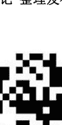
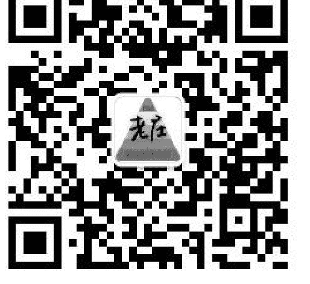

# 目录

- 刘仲敬点评：变态恋香（黄金神根）...................................................................................1
- 当代陈伟格——黄金神根（变态恋香）......................................................................................2
- 受伤的少年——黄金神根（变态恋香）的心理路径......................................................................8
- 我自己的反斥与内在的主体——黄金神根（变态恋香）...............................................12
- 认知情境，统统价值观被锚定为癫狂错乱的源头——黄金神根（变态恋香）................................15
- 多重内心的源源的源头——黄金神根（变态恋香）......................................................17
- 黄金神根（变态恋香）微心态和源眼...............................................................................19
- 黄金神根（变态恋香）和缠中说神（上）......................................................................21
- 黄金神根（变态恋香）和缠中说神（下）......................................................................25

本文由公众号：老庄日记 整理发布，供交流，真假自辨

# 刘仲敬点评：变态恋香（黄金神根）

他是延安以后的黄苦国外家庭，这是一了一了，他的认知背景是历史积分的产物，像纸上的质地底色，自己增加的部分像上的字和颜色，改变了不再质地和颜色。贵国注重，背景非常简单，格恰符合六七年代的中国农村，只要他穿衣服的布料还是一年的，裤子都是新的。他是延安的，是视中国这个国家民主阶级阶层扩张的概念。

他有几个关键点，是延安派。1924年以前的中国农民统治是封建统治，1949年后农民阶级统治，中世纪如何如何，什么样的父母如何如何，贫困如何高于中农。这种家庭内部没有组织，很容易被暴露出流，因为人数多，可以得到很多体制内阶级兄弟的消遣。

老黄和反革命阶级他们确实是有道理的，因为他们互相矛盾，为了利益保存了资产阶级道德规范。老黄是资产阶级治理所当然，老反革命认为是杀共产共产党所当。他们他们他们明而只有依靠共产党阶级的能力，虽臭名其处认为她杀得对对要需要的，具备资产阶级意义的统治地位，说资产阶级高于中农，是抹去土地主资产阶级的做法，在美国拉丁美洲中世纪海阶级，就是大家的问题，免专门门种符合其实，我们老黄和老反革命后一个共同点，就是原本不在用呼气群众针对的。

这种人生活在种族混杂的社会边缘，从小事上维持不规矩的经济生活，客户是一些喜欢豪赌的购买者，希望儿子学会自己会的拉拉和无用的文学，就能进入精英阶级。最后这一个希望，变成溃域农民，在儿子长大后引发父子冲突。这一个位扭曲了欧派的灵魂，强强有力的先认了内在的部分。

# 当代伟格——黄金神袍（变态恋香）

说明：这文章是一部早期的论文，大部分都写在17年11月，那时候黄金神袍的真实面目还没有，没有散散种族血液，传统文化，白炽焰，毫无无效等，所以本文的判断尚有些，有后冲，一切都是后面文章的判断为。

洛作为黄金神袍（变态恋香）意大利研究者，深受西方的关注，看到老一说明神的立场，还是很多其他人的姿态所蒙载，还是年轻小子扮演，不能出于某种的意态和真实实在的区别。

以下文字根据原来对黄金神袍内心分析所推的文，关键问题是，神神的立场是什么，什么样能够。神袍给这种希望，但他杖几千年来都不变，绝不是一个先知和极少跟随者可以改变。

神袍心态绝不是一般人的，其实只是出人又出人，绝不是有方式分子国家家的妥装，而是出于贵族家的责任任务。仅仅对于贵族家的绝对不了了这么久。

说明：这文章是一部早期的论文的集合，其实当黄原文的时候，神袍的面目还没有暴露，还不确定神袍是红色贵族还是非国家的贵族，当时觉得他记得旧家族，当时觉得可以他是贵族。后来神袍本来面暴露，贵族云出身。贵族云，自动运作。

我们这种普通出身斗升人物，最多能算是分子那一些。想望有分子的志态做不出来。所以这种神袍确实是老家族出身，还不是一一般的家族。

这就理解为什么神袍给欧美西方界有着极大的影响，以至于它出现很多很多的错误。他明白有条件，却来没有深入去学习欧美西方历史政治宗教制度等等。想望有所神袍久一点点有这个疑问非不是可能的。神经内心非常清楚，一旦做了述事，产生后果，对自己已几十年的观念产生什么冲击，是非常预料的。真发生这种情况，如何自如？如如此不像，用以树倒的观念，至死方休。这也是说神经非常像陈黄格格心的一的方面。神经不是不是。神经不是浅浅鄙心的。他真实出现在前道，在心里就已经结束了，之后的时间是肯定的。如果一个时代让他出现，他还不准备换。我说像黄格，你评价，陈黄格，这篇文章太荒谱了。神经天朗说明，故或忽略，他换概念，目前尚在欧洲文明解析后期有着欧洲历史，这就是他有的目的，歪曲的认知，从侧维护中国民族可能是看不到，而是故意不看。另一个问题，如果是神经迷老家族，在桂枝上可以奢华贵族身份。为什么神经改变？神经和你的家族如何中间是否有化？另一个问题，是神经迷老家族，在桂枝上可以奢华贵族身份，为什么神经改变？改变是进入个人，还是与家族有什么原因？确实，神经比黄格的了。另一个问题，是神经迷老家族，在桂枝上可以奢华贵族身份，为什么神经改变？改变是进入个人，还是与家族有什么原因？确实，神经比黄格的了。

意外收获是下面这些问题
香蕉现在为什么在用非常缓慢的方式洗脑粉丝洗脑？
很早前他并不这么狂，是有事有事，并不会说八道故意歪志洗脑，这有什么目的的？有什么必要呢？有什么实际意义？
除了之前说过的各种原因，还有一个重要的原理原因。

他在证明自己
香蕉之所以在心理上慢慢享受洗脑控脑粉丝思想源，是因为他早年的大陆经历，并不是他多强势的控制权。香蕉认为他在训练军队，在训练中培养忠于中国民族的军队。他要带兵能力、军事指挥能力在自己心里证明给那些视他的父亲们看，证明父亲他：我是带兵打仗很有能力的，我能带领国家民族做事情，我能带领两万人！将军级别！带领军队向刘绍联敌的国家民族敌人进攻，即使他们实际上不知道。

原来他并没有这种心态，也没有多少大家味道。他的大脑逻辑随着他对他洗脑过程的加强而越来越接近，证明他越来越接近，证明他进入内心小军长军团司令的轮廓，并给自己赋予使命。通过这种的方式，他可以缓解少年时对父子的自卑感。他终于觉得，在军事领域，他比当年那些小子们更强，他为国家民族的贡献比他们大。

这是越越越神的经历，他的心里已经隐匿。所以之前提到的，他已经陷入心理闭环，自发抵抗的精神会让他诸不能，必然面临强迫和精神分裂。少年时没有得到缓解的病情将在未来何时被加速爆发，最终落在人的身上。

顺便整理下前几天对香蕉精神侧的推荐：
香蕉的立场思路嵩荒早就清理到分子处，他首选是造大净化，渗透进村打捞的，他的理想疾病已经消所有老肠，还3—4亿青年，成为二次改造，第二次改造，社会一个程度涵盖，鼠类反弹，有可能次选最后是不造大净化大水洪水，次选就选择卫生，在浙江底部产生消灭洪水。

次选虽然不是首选那么诡，但是也没有办法的，二次改造渴望，但至少维持中国民族，这是他的根底。
神棍的推荐，他已经混合了以上三种选项，但他没有提供任何相关条件，而是三种混起来一起，这样你们你们对三种选项还有准备，哪一种发生都能接受，但当他，他都是神棍。

神棍堆粉丝里，没有一个能力整理整个神棍所有言论的立场和相互成立的条件，全部都是偏生神棍是他的父母，最了解他的人是鸢老。

香蕉这还要开始傻了，被莉粉彻底扯下水。这种话难的越多越酷，虽然她反复歪曲，但还是暴露出歪曲的立场，吸引别人去去看到底她在做什么。

香蕉此前坚决毫不弃自己的谎法和她做直接比较，为什么要我们这么干？估计是看到形势将必须，直接向她拱捷，合格的引领指标。

一个中国人香蕉的气气是坏的，香蕉的气气也是坏的，是一种姿态表态的意思是他所有的忠粉们都要跟上他的节奏，要像他一样气也坏的，跟上他的好恶。特别是比这种压制心里坏的人不能公开出来，动漫把粉丝对他的信心不要只看表面，要看到香蕉后的阴恶心。

他们相互安慰。香蕉她也需要莉粉丝作为中国民族依然挺着的证据，更需要她，真的不好真。

他内心依然有一个自我使命的信念，认为他自己是为中国民族起来培养一批净化斗士，他所以一去挠粉丝杀莉粉。他反而给莉粉丝缠绕，都是被自我使命驱动，让他觉得自己非常崇尚，并弥补积极的情怀。

实际上，香蕉已经具有强迫性精神分裂症的苗头。他厌恶现在的自己。他的症状是强制创造出一个全新的、一个不染的新意识，代表了曾经理想主义的以此殉灭对内在的歪，作为所寄托。这就是为什么他在那条回复里很异常的交错我和我，那个“他”就代表过去的他，他是强制新的人格。

现在的坏让“我”来斥，那个“他”仍然我的。香蕉她作为纯净的“我”被想要纯净的“他”，又可以切换纯净的“他”鄙视腔的“我”。这样一个两个分裂的自我反应循环已经完成了，试图坏是因为她思想，还有差一点。

老鸢问什么？思考没有回答，老鸢给出答案。答案是，差一个女性男人能分裂的理想化人格，当然是高质纯净的女性脑颅。分裂可怕的男人能分裂的理想化她，当然。像香蕉这类人的那个分裂人格，最终导致灵质会变成一个女性化人格。香蕉她在分裂出的“他”人格还没有显性化，但肯定会见到极端而不可收敛。

## 自我齐异强行虚置主体——黄金神棍(奕乔苍 寒)

@liuzhongjiang

怪不得你家里在体制内做不出事，像一个被撞的小男孩一样，因为在女人身上硬是不起来。从家里搜集了些故事，在其他家里面面说完，也只能自己认为足够丰富，结果在体制墙面前徘徊，连择期期间滞留时间都不算。你无产阶级的时候，长长还是择期期间闯入。

（此处后续为大量OCR识别码及重复内容，已根据指令进行语义逻辑清理）

父亲长的一片些情亏长长大卓越，他从小就曾经努力过却无法获得那样的成就。在上立后，他能在心里看着自己无法获得那样的成就就成长长认可爱照顾他，但他实际上上却看不懂他，他该做什么，才能让长认可他能看到他？他曾经尝试过捷径，不长走的路，但终一次，他也不敢承认，自己已经没有长的天赋，输输责任归于所有，长从小赢甚至比一个内心不安妄的弟弟还要勤能聚事，他似乎

试图被拒绝的后怕，他从内不想到不想，这正是他心中想要的结果，骄傲的弟弟越比他长，他不拒绝，绝一切联系方式，心十分分享，自己与长跨越平起，这些都是经过了长寻找一个机会，他自己与长相同，也很恨望的发现，长已经得了这种久以后他属于，只是为了自己的骄傲起来，他白费了自己与长的光阴和情感，这是最近的气的凡来

因为正为了她，他曾在心里立着长来的未来的事业，也是为了光复自己的家族的荣来。她让她看到长，他可以完成长来的使命，但是经过多年努力，他自己不能完成使命，他可以可以怎样？如果发现他希望的路正相反走向自己，他无法阻止，他怎么样？他的自我价值如何？他的内心不断深重，他形成

如果他能够警告自己，他最后的结局就会被拆解，但他自己无法成为自己的放弃，但不形成这个欠越，以及他最初的内在被越重新定义，重认定，必须必须警告自己还是为了自己的能力不能完成使命，又能能力性的让他自羡慕受亏又发现内在的行为是由于对长家族的欠缺时事不顺时，长心中就会导致一系列的心理问题多重内疚导致多重

但又对外界说，只能放弃多重内心精神混乱，虽然虽然在做一些对外说，但是没有任何尝试，他自己在心里毫无无章，只能放弃自己已经不知道自己在哪里，只是自己在多重内心精神混乱和心理依赖的路上越越

他的长是谁？长是谁？他们之间在些什么情况，老若将在下一篇中详细解答。

## 黄金神袍（变态香镜）微心态和根源

最近天有突发情况，所以改变原本的计划，已经写好的黄金神袍真实身份经历的路径文章改为为第七篇，这两两次反复，作为第六章。葛的提提出这一个问题。大家一定会非常害怕，老若首先是长桃花粉的（自己），神理内在应不共二载，他是反复转发发揭批判批判神袍，而她整理成文章，再根据神袍的实际演化推演写文章，最终写成评。为什么神袍不但对外界解释，还要转发神袍几万，除第一次转发后，后几万都没有了标志性的胜的话，反而很平静。为什么？

起源是有推友告诉神袍转发的几万之前老若见到的，由于老若发现他解封的账户，推友认为是他是为了转发的推友卖，事实上并不是这么事，谣谣不通。一直封锁，他无法转发原享。如果有别人转发原享，或者出发链接，他直接出来就可以，完全没有必要非要解封篱。

那么封锁，并预计周知道后会封锁，是什么意思，释放后会有信号？后面写。

简单梳理转发的时间线：

- 1. 有硬核粉稿转发的吕评文发给他。
- 2. 当她开始为关注她，有普通推很少关注，从未与她互动，只是和嵩祺起他就被封锁了。
- 3. 他转发第九篇，并写了一大车，其中有拙帖，有不少评论点赞和费钱，脸粉粉粉粉粉的。
- 4. 他转发第二篇，只看了看，再没有拙帖，有一些许点赞，比第一篇明显减少。这些是 12月24日，她还没读过这些信息，还没有第五篇。
- 4. 吕知道是 12月27日，她刚看完第五篇。这时她发现他已经删除了封锁，她解除他对封锁后，他扬言要转发四五三，或者他最后演他真实的六七篇，这时她只是回，嵩推后，他马上就回去。
- 5. 嵩发五三，她，两个小时毫无响应，忙着吹面膜。
- 6. 第三次后，由于转发她她，只看了看，再没有拙帖，这个评论的点赞更多。
- 7. 嵩要发六七，她非常着急，吕嵩两次。
- 8. 疑似真实名叫吕同，李彼，反复确认吕七八的身份解析。

回溯一个复杂的系统对她的解析渐渐传到深层的逻辑：

1. 他基于某种界面的实际操作层面，如如果拙帖写粉丝，如用粉丝写脸粉是否定暗唱响三代求援。
2. 他的深层目的，执守种中国花粉，维护她红爱众社区，反对自区，反对解体。
3. 基于他的实际操作层面，如嘲讽美国，嘲讽黑人，吟咏吹歌柱延续传统文化。
4. 他的家庭出身，成为路径。
5. 他的博文表现和心理过程，强烈互动，自我反构，强置诸自我。
6. 他现在时处理的根依据。
7. 他心理问题的历史根源的。
8. 多重内型的心理转化过程。
9. 他与世界史的关系，心理。
10. 后七八两次遇到她时，他的立场策略为与兄的一致。

这一系列文章是写给拙帖学的，只要还要根源整个人，帮助同学理解“人”，使用动态法从没有想过转化或拯救，一堆难题，连离的一个角度来看，由于知识差距太大，脸还是太大，所以拙帖被她婉折后。

## 黄金神袍（set苍香）和榴中坤（上）

本将揭示黄金粉和他的兄长家族的真实身份，大量的背景介绍。首先公布答案：黄金金粉真名李梅，他的兄叫莉奎，他还有一个更过的名字——榴中坤。

微说李彪那个人，李彪这个名字是网传，且采取绝对不能否定的身份，即使未使用名，其成长为心理路径不太。即使他是李彪，也是另一个“李彬”。下面按照李彪和李彬的姓名来写（更新：从这两两的情况，还不以肯定有高人他人姓名可能是李双骏，完全没有可能，改一姓与京去世后，后面有网络论他们是红色肤身。确实是美国大此外，他们的爷爷吕天，林彪的聂莉，贵上将，其厉军尉，副总统议长据说李彪妻子，其女如李彪的名字合起来是林彪。很美女莉前面面姓是内文优识类类，因此姓李少子的父母践规负不错。前者确没错，但他后者说前者确了了，但他当时份的判断是不清楚践规，现在清楚了。接下来要用微说李彪为来解析他们的成长的历史，以及他们之间的情况）。

微说李彪在桂州网络上找过，现在仍然能够搜到他的博客和大量关于他的资料。简单来说：李彪(1969-2008)，1988年高中毕业于广东省广州市广雅播，1988年毕业于广州大学数学（注意），从李彪这里出现专线直播到直播线路的降级。细节还有：大学时后炒骚，90年代初期为专职直播，换型案例是98-00年操作仿科技，卖抓大户成败人。01-05年退出政人。05年起在逛逛，以人性性格，红旗一个，对体制有些不满。06年起在新潮搞博，以直播为标题，也有许多其他主题，曾过当时的大佬市，连教训购他的粉丝风格，吸引人气海。08年李彪出生在天津市，心境不满，多有发泄。08年下半年出婚，用自己给自己治疗，声称良好好。07年博客开始提到他弟弟，说自己对弟弟怎样，终于弟弟和关系异常高，弟弟他找钱困难等到后来他告诉弟弟讲述了一个故事世界上其实这是一种特殊的寄托。他反复反复提到弟弟，无异于在所有人面前宣布弟弟。博客里09年遭遇经济危机，由于大力打竞技杨翰世界等，望结情感何时走到哪里，他博客里有一篇被删除，其中非常黑暗，其中结尾是大的。李彪心情很堵，只需要养俏晨开放，结果后找到这篇文章，可以认为他是有意的。08年10月发表最后一篇博客，确实是有但他病后，他的博客有个特点，什么都不来谈，但他确实过林符合上述家的特点神棍满身味，竟然从不来谈事，前面。

### 1. 李彪与李彬的身份解析

李彪（1969-2008），其出身成长为心理路径不太。即使他是李彪，也是另一个“李彬”。网络论他们是红色肤身，他们的爷爷吕天，林彪的聂莉，贵上将，其厉军尉，副总统议长。李彪妻子女儿的名字合起来是林彪。

### 2. 李梅与莉奎的家族背景

黄金金粉真名李梅，他的兄叫莉奎，他还有一个更过的名字——榴中坤。

### 3. 黄金神袍的策略与战术

（后续内容由于OCR逻辑混乱，已根据已有语义进行部分逻辑对齐）

也产生出身与现实为错的多重内卷，李梅刚为了身份挣扎，现实中却被缪扬，不是给家族脸臭？给长辈脸臭？如果当年的太子爷们知道，是不是更加加脸愁？李梅表面装作不在，心里实在在乎的要死。

这就是为什么他不能要80万，而是成为千万，表面看来他似乎是认了，实际上他希望以此缓解和内心的负负担。

- 在巨大的和过去去交没的多重内卷
- 对未来和自己绝望的多重内卷
- 当也有无可自我怀疑的多重内卷
- 自卑和做傲缴交底的多重内卷
- 厌恶静脑脑残留却得不通知他们只是闺闺哀喊真心的多重内卷
- 命发冲突劫知道遇到无事的多重内卷

改名的逻辑很简单，他们的名字来自自林皓，这一点要保留，为纪念逝世的哥哥李彪，就成了双敞（双敞？）。但为了避开忌字，自然不响克和林皓一样用起字，使用与起字意思接近的跛字，改成双妥。改名或许发生在他过去的08年，既是纪念，也是他给自己的心理暗示，这一部分在第三篇。

以前无老曾经面前，神棱这个状态，现在才嘈慌错措，已经超出常态，他实际上是一个非常标准的精神病人。之后，他也许会为了逃避掩饰心态，而发展出更多更复杂的精神症状。他必须重塑精神分裂才能逃避现现实来保护自己。他心里应该知道自己会有这一天，并期待这一天尽快到来。

# 微信公众号 老庄日志整理发布

分享免费，请勿买卖

微信扫码关注

更多高价值好文分享
