# 缠师草图研究

史芬比2017年1月17日 星期二

## 一、 第一章

### 1. 走势分解理解二（分成一段）

任何级别的任何走势类型，都至少由三段以上次级走势类型构成。

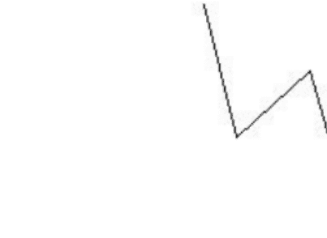

上图一划为一笔，三笔一段，走势必美核心核心，分成一段。

### 2. 缠中说禅盘（分成一段）

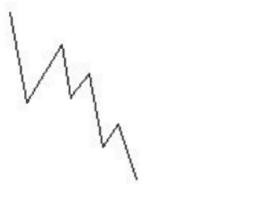

- 1) 在任何级别的任何走势中，完成的走势类型只包含一个缠中说禅走势中枢，就称为该级别的缠中说禅盘整。
- 2) 上图为一个盘整下笔，最后一个向上笔的高点为盘整背部转化为第三类实点的一种分类。

### 3. 本级别以下允许扩展（分一段）

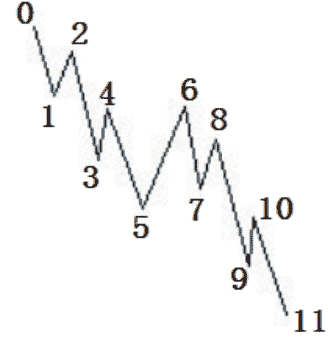

- 1) 0-5 和 6-11 是 3 段的类走势，维持定义叫线段类走势。
- 2) 3-8是一个五段中枢（不包括中枢连接段）。
- 3) 当走势遇到线段走势 3-8、6-11和五段中枢 3-8同时出现，则使用五段中枢 3-8做本级别中枢，三段 0-3、8-11做为次级别；
- 4) 这里特别感谢 000 师；指出本级别以下允许扩展，本级别以上不允许扩展；
- 5) 缠师其实应用，80-81

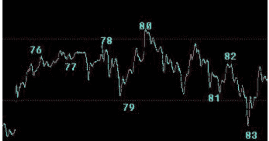

- 6) 缠师解读80-81，有一种复杂的情况，在今天的 80-83的划分中就出现了。这就是对80-81，出现了第一笔的笔破，然后接着一个符合线段标准的走势，但是没有延续，这样就不能算是原线段的延伸，线段的破坏不能算。为什么？因为没有符合要求的的三连接。接着，一个反弹，也满足了线段的要求，这里有一个细微的区间，如果这个反弹只是一笔，那么就没有破坏走势 A，后面衔着新的，意味着走势 A 仍然延续，所以走势 A是原来 80-81的延续。
- 7) 在现在的这个问题，这个反弹把走势 A 给级别破坏了，因此，说走势依然延续是显然不对的，所以后面的走势和走势A无关，因此，唯一合理的划分，就是把第一笔的笔破坏、走势A、一个反弹合成一个线段，这完全满足线段的定义，所以就有了81-82。

走势份额分析80-83，先按0师结构分类学，把笔划出来

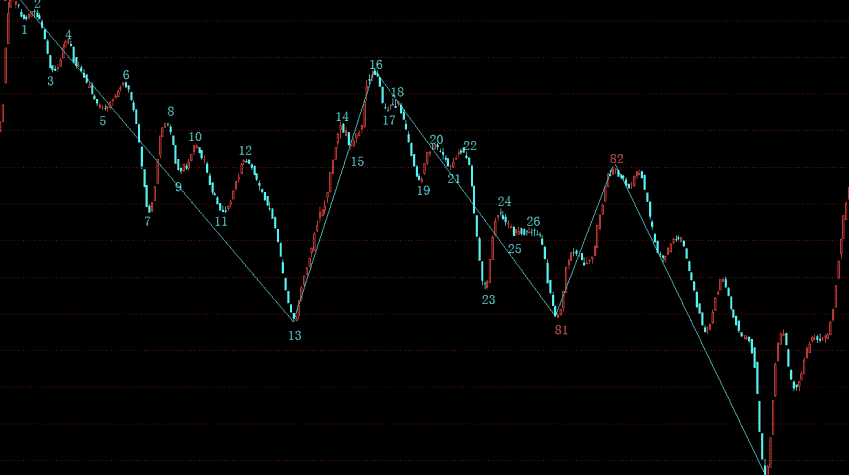

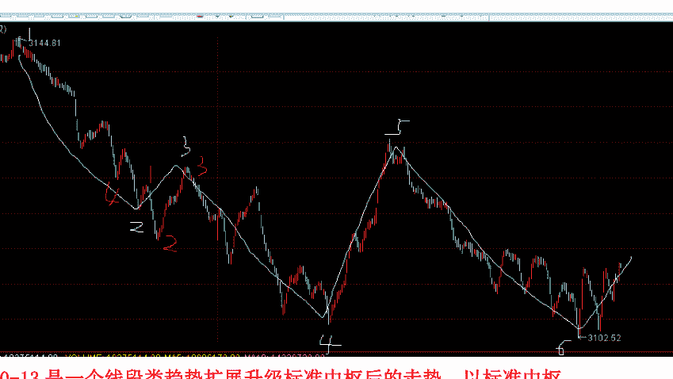

- 11) 80-13是一个线段类趋势升级标准中枢后的走势，以标准中枢为本级别，所以80-13是一段，与0师的5-6相同；而13-16与4-5是一样的，3笔之一，而16-81是这笔的内部结构是个趋势结构，2个笔中枢，而16-81是一段段，跟脚的3-4一样；
- 12) 这老师在讲课时运用线性理论分解80-81为一段；而用走势份额分解，是个3段，整个80-83是一个标准的1F下中枢；
- 13) 注意这两个两个非常像的地方，只是每个向下线段的位置不一样；老师的和0师两个下跌段只是放在一个在前后，内部结构完全一样；

### 4. 标准线段类（分成一段）

- 1) 标准线段类趋势，维持定义叫线段类走势。
- 2) 维持实战
- 3) 93 标准线段类背离，这就意味着92这1分钟第三类卖点，将现在中枢拓宽，至少形成一个1分钟中枢，这也是理论100%保证的。

### 5. 趋势结构（分成一段）

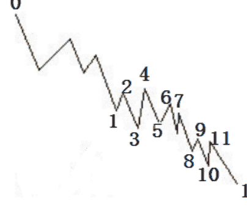

- 1) 3个中枢的下跌走势;
- 2) 从高点下来，先形成一个标准中枢（上下三划），标准中枢出来之后，图上的每一划就是次级走势，然后下去一笔成为3卖，之后是第二个中枢1-4，且延伸了，7位置高于1或低于1都不大，只要没有延伸6段。之后又形成3卖，之后形成第三个中枢8-11;

### 6. 标准中枢（分成一段）

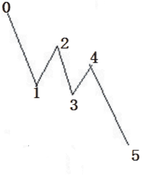

### 7. 非标准结构-奔走型（分一段）

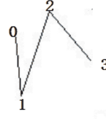

- 1) 走势中非标准线段;
- 2) 在扩展中，其区间为1,2 缠师实战，76-77，76是线段类背离顶点，76-77之间的低点，触到了76级类上的前期高点，于是线段类扩展了，要升级了；之后77-78也是奔走型线段;

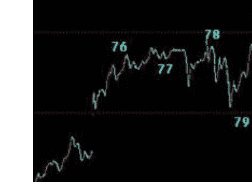

### 8. 非标准结构2（分成一段）

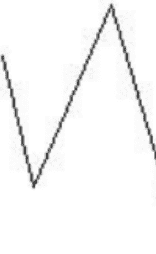

- 1) 走势中非标准；可能情况在收敛三角形中。
- 2) 在扩展中，其区间为最高点最低点
- 3) 应用1，如下图，1是盘整地，2是盘整地转化为第三类买点，之后新高到3，然后到4，这时碰到了0，显然走势发生扩展，1—4分成一段
- 4) 缠师实战分解68-69
- 5)
- 6) 0师实战，上2017年1月12日走了一个相反的-

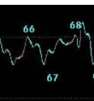

非标准线段

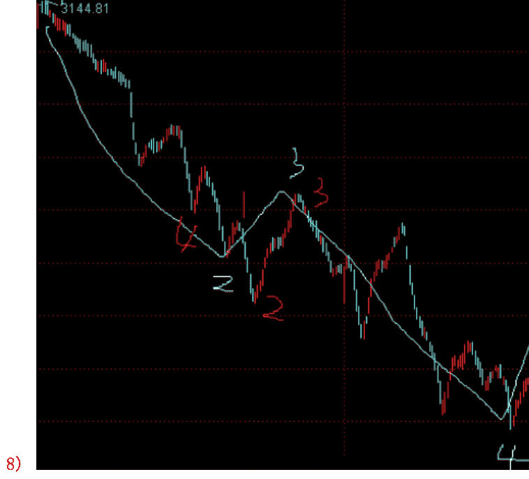

- 8) 原理同上;

### 9. 非标准结构3（分成一段）

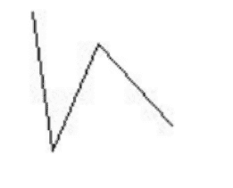

- 1) 走势中非标准线段；可能情况在收敛三角形中。
- 2) 在扩展中，其区间为最高点最低点
- 3) 缠师实战，20-21、74-75

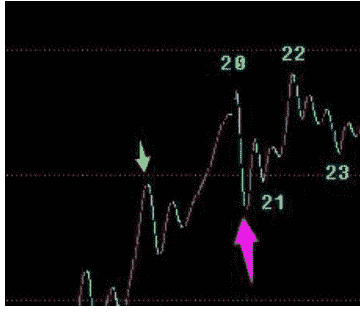

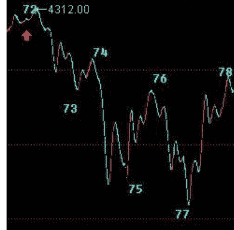

- 5) 20的直线背离后，紫色箭头碰到了黄色箭头，然后到21正好是三笔，分成一段

## 二、第二章

### 1. 9段向下扩展结构（左一右三）

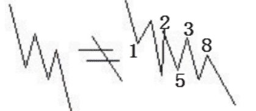

- 1) 左标准中枢，右图扩展，所以走势级别相等；
- 2) 当走势完成了9划（次级别）的时候，走势扩展随之发生:
- 3) 这时3+3+3扩展了走势
- 4) 实际走势举例

### 9段向下扩展

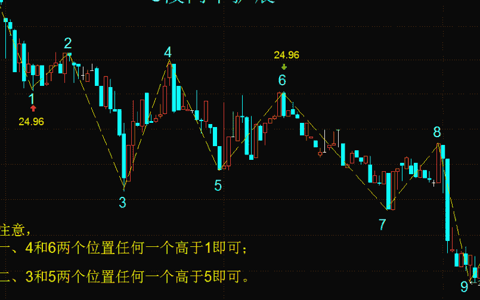

注意：

- 一、4和6两个位置任意高于1即可;
- 二、3和5两个位置任意高于5即可。

- 5)
- 6)
- 7) 以上0实战应用用实例
- 8) 向上扩展

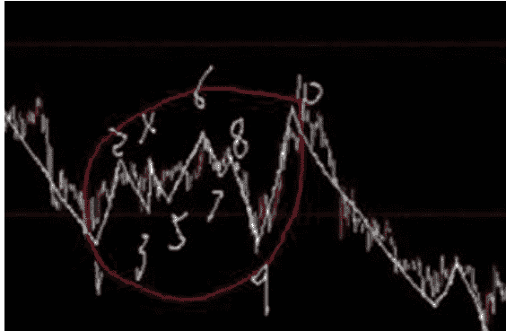

### 2. 趋势连接（左三右一）

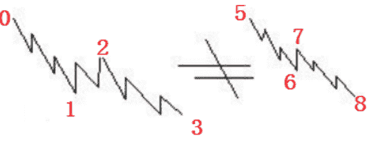

- 1) 上图 0-1、2-3 和下图 0-5、6-11，标准线段趋势下跌；
- 2) 上图 1-2形成级别中枢；
- 3) 根据趋势级别延续理论：在更大级别中支撑趋势中枢产生前，该级别趋势类型将延续。也就是说，只能只有具有该级别中支撑趋势中枢的盘整或趋势的延续。所以任何同向趋势之间一定有一个盘整或反向趋势连接；
- 4) 上图左右边连接标准线段类趋势的只有一划（次次级别），虽然不能延续原有趋势；该线段类趋势趋势类型将延续：

### 3. 三段五段关系（图右三段）

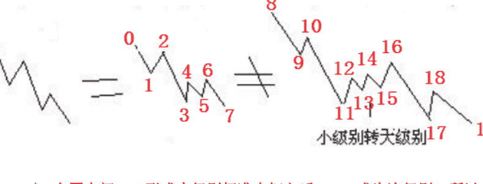

- 1) 上图中0-9一段，3-6为标准中枢，03、6-9为中枢的级别，都是一遍
- 2) 缠师实战，0-3形成标准中枢，都是一遍。
- 3) 缠师实战，0-3形成标准中枢，03形成11卖。

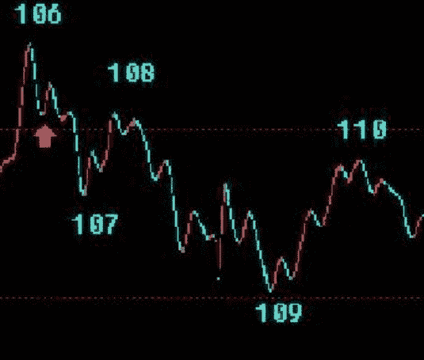

### 4. 标准线段（分成一段）

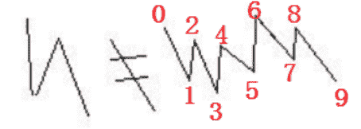

- 1) 0-9一段，3-6为标准中枢，03、6-9为中枢的级别，都是一遍。
- 2) 缠师实战，0-3形成标准中枢，03形成11卖。
- 3) 0-9一段，3-6为标准中枢，03、6-9为中枢的级别，一遍。

### 5. 标准扩展（左一右三）

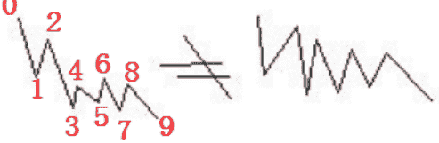

### 6. 横盘（左二右四）

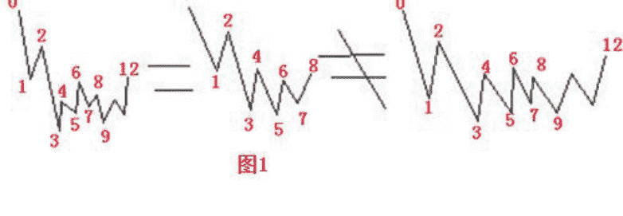

- 1) 0-9一段，3-6为标准中枢，03、6-9为中枢的级别，都是一遍。
- 2) 缠师实战，0-3形成标准中枢，03形成11卖。

### 7. 标准扩展（左三右二）

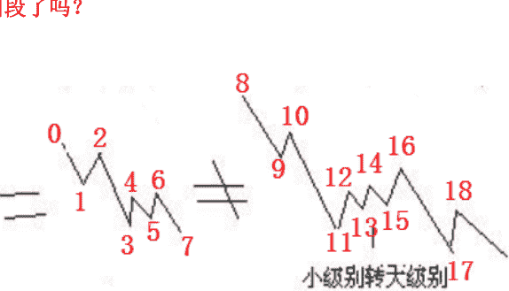

- 1) 0-9一段，3-6为标准中枢，03、6-9为中枢的级别，都是一遍。
