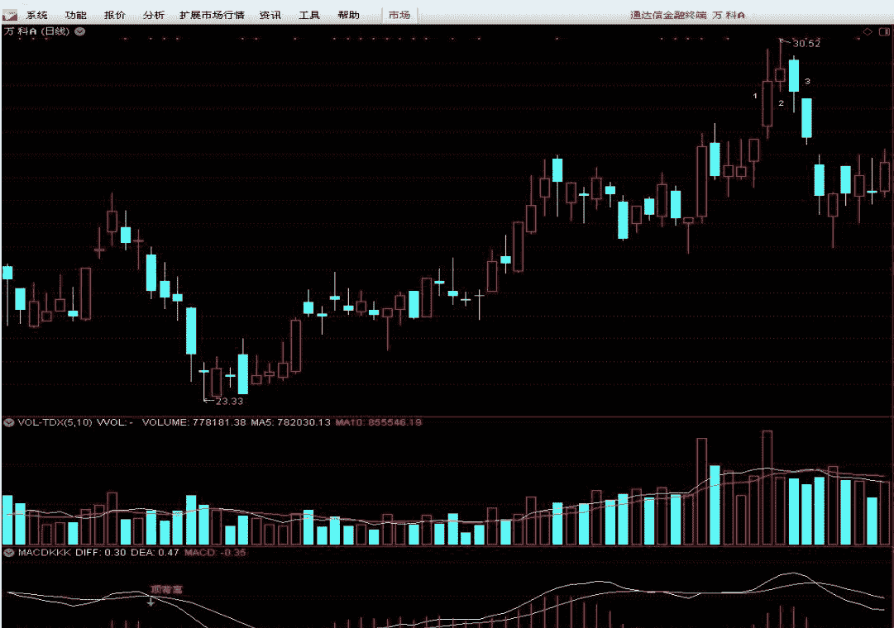
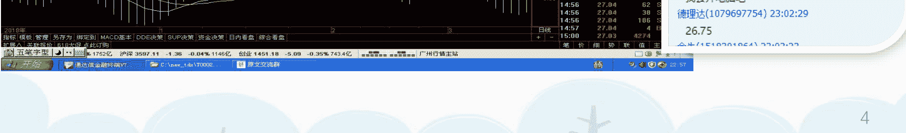
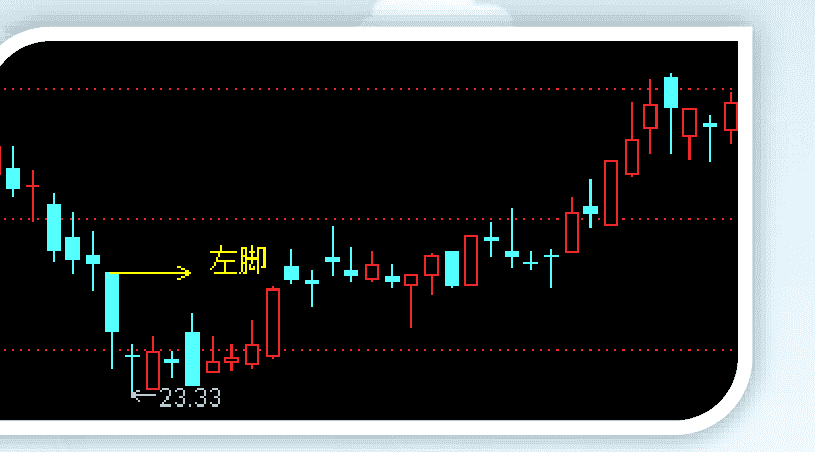
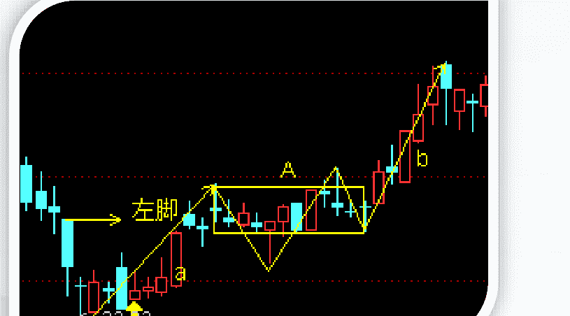
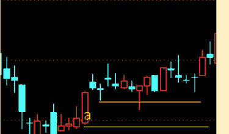

20190605日晚上，原文群里大家交流学习，群友“九韶”分享了自己利用顶底分型，结合缠论操作的方法，非常棒，很有实战价值。特收集于此。感谢九韶同学！

九磊(1079697754) 22:19:13：你好！谈谈级别？

谭理(1079697754) 22:19:36：谢谢！

九磊(1243288351) 22:20:39：级别，其实并不是按闹圈来的分的。

谭理(1079697754) 22:20:53：啧！

谭理(1079697754) 22:22:14：是那一部分的动力挑选上来的？

九磊(1243288351) 22:22:33：比如这一个日线分型是一对对一个级别的买卖，可能是1的，也可能是5的。

全丰(151830461) 22:24:36：AO是怎么定义的，如果1F当一个小级，是不是不是AO1F？

九磊(1243288351) 22:23:21：不能连选上来。

谭理(1079697754) 22:23:29：啧！

九磊(1243288351) 22:24:01：如果连选上来，你实在搞定乱了。

九磊(1243288351) 22:24:16：除非你是超级计算机。

九磊(1243288351) 22:25:16：比如按你日线筛选，你可以看5分的或者30分的作为次级别。

谭理(1079697754) 22:26:46：哦！三K线复合？

九磊(1243288351) 22:28:03：在日线上，一个分型萎缩接上一个分型，中间没有动的动力，这种情况就不按30分钟做次级别，5分钟级比较合适。

九磊(1243288351) 22:28:49：因为30分钟是不够的。

谭理(1079697754) 22:29:13：啧！不留分，30分钟都是K线复合？

九磊(1243288351) 22:29:17：分型很重要重要。

谭理(1079697754) 22:29:52：啧。确定分型后动力，级别划分下面都是操作级别的分解服务，关键不是同级别分解。

谭理(1079697754) 22:31:09：为什么？

## 2019-06-05

九磊(1243288351) 22:32:25：问上线的三级级别突破，是他找不到同级别联中，才联别。

九磊(1243288351) 22:33:23：就跌级别也会跑进来，最后选在级别震中。

谭理(1079697754) 22:33:40：啧！

九磊(1243288351) 22:35:14：不操作级别为日线，先选分型，因为不谈级别别是次级别。它的某点就是分型。

354708659(354708659) 22:35:21：AO可以是日线级破破坏界点。

九磊(1243288351) 22:36:14：AO就是分型？

谭理(1079697754) 22:36:23：其实点？

九磊(1243288351) 22:38:30：一个分型用好了，威力很上，说了，分型操作可以体现涨与。

谭理(1079697754) 22:39:01：啧！

354708659(354708659) 22:40:05：分类里包含了级别，第三类，判断元素的大小。

九磊(1243288351) 22:40:22：公式就是a+b+A+b。

354708659(354708659) 22:40:39：其实的卖，就是分类的。

354708659(354708659) 22:41:00：不聊了，继续学习。

捷达(1079697754) 22:41:04：原！

九磊(1243288351) 22:42:09：这两个就是聚型和数的表示。

捷达(1079697754) 22:42:21：啧！

九磊(1243288351) 22:42:24：完全分类是有明确的。

九磊(1243288351) 22:42:33：点位的。

捷达(1079697754) 22:42:55：啧！

九磊(1243288351) 22:42:24：完全分类是有明确的。

九磊(1243288351) 22:42:33：点位的。

捷达(1079697754) 22:42:55：啧！

九磊(1243288351) 22:43:31：就是一个点，圆圈这个点的，破了就是转折，不破。

捷达(1079697754) 22:43:53：啧！

九磊(1243288351) 22:44:14：比较分类型，第一类的最低，就是完全分类的这种。

金牛(151801864) 22:46:33：有点了。

九磊(1243288351) 22:46:58：你看着走势图，随便找个分类型，看看它的走势轨迹这个点有什么含义。

金牛(151801864) 22:47:32：啧，我正在。

九磊(1243288351) 22:47:48：这里单用K和分类型来分析。

九磊(1243288351) 22:47:48：这里单用K和分类型来分析。

捷达(1079697754) 22:48:13：是个能量界点！

九磊(1243288351) 22:48:18：对。

捷达(1079697754) 22:48:24：啧！

九磊(1243288351) 22:48:38：也是完全分类走势的那个点。

九磊(1243288351) 22:49:03：这是中间和转折的点。

捷达(1079697754) 22:50:06：耶！和公式有什么关系？

九磊(1243288351) 22:50:09：这个是一个值，能量大在于此处，公式就是聚型和能量势。

捷达(1079697754) 22:51:01：赞同！

捷达(1079697754) 22:52:51：你行！

九磊(1243288351) 22:53:57：你找走势图，找到分类型，标注序号，我用实盘给你就。

九磊(1243288351) 22:54:13：历史订单太麻烦了。

全丰(1518301864) 22:57:25：用这个。

九 Logic(1423288351) 22:57:58：好。

九 Logic(1423288351) 22:58:23：23.33是一个包含位。

全丰(1518301864) 22:59:04：这里不。

九 Logic(1423288351) 22:59:12：这是开始点。

全丰(1518301864) 23:00:02：你以为没有，最好。

捷达(1079697754) 23:01:28：23.33是一个包含类型？

全丰(1518301864) 23:01:32：用语音吧，这地方。

九 Logic(1423288351) 23:02:06：这个高点在哪里，能出来？

捷达(1079697754) 23:02:22：去电脑26.75。

九磊(1243288351) 23:12:57：看看这个中枢的位置在分型的左脚位置。

金龙(1518301864) 23:13:20：嗯，这样就清楚了。

九磊(1243288351) 23:13:38：这就是完全分类的点。

德达(1079697754) 23:14:01：嗯！

九磊(1243288351) 23:14:04：这个是复杂的，因为粒子大。

九磊(1243288351) 23:14:37：像妖股走势在这个点上简单多了。

金龙(1518301864) 23:14:42：嗯，用这一线就清楚了。

九磊(1243288351) 23:15:52：一个K线突破，再回试，直接连板，那个回就是买。

金牛(1518301864) 23:16:06：这个走，只要是一涨就行了，中间无K线所谓的对吗？

暖运(1079697754) 23:17:40：嗯！

九磊(1243288351) 23:19:05：这些点位就是完全分类的临界点。

暖运(1079697754) 23:19:24：恋个票？

九磊(1243288351) 23:19:29：跌破就是转折，不破就是继续。

九磊(1243288351) 23:19:55：还是万科，上面的那个图。

暖运(1079697754) 23:20:08：嗯。

九磊(1243288351) 23:21:04：怎么做中枢震荡，这些点位就是标准。

金牛(1518301864) 23:21:28：哦，明白了了，原来是这样。

金牛(1518301864) 23:22:07：顶分型的第一根K线的最低点就是分类的界限。

九磊(1243288351) 23:22:29：中枢震荡区间就是顶分型的左脚低点和顶分型的左脚高点。

九磊(1243288351) 23:22:45：这些点位就是安全点位。

德达(1079697754) 23:02:02：懂！

爵书雯(1243288351) 23:24:00：能量符合多。

爵书雯(1243288351) 23:24:16：能量符合多。

德达(1079697754) 23:24:24：能量符合。

金牛(1518301864) 23:24:32：高位进。

爵书雯(1243288351) 23:24:34：能量符合的。

九磊(1243288351) 23:25:00：能量符合的。

九磊(1243288351) 23:25:06：中枢震荡的能量的。

九磊(1243288351) 23:25:11：能量符合。

金牛(1518301864) 23:25:18：高位进。
