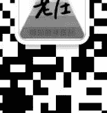

## 众号【老王旧记】整理发布，后续更新会在公众号内分享，欢迎关注

赚钱的逻辑，千古一律，亏钱的逻辑，五花八门，这123个案例，不一定带你赚钱，但一定能帮你少少亏钱。

亏钱的事看了，其实也难免，一个人亏、被亏，不是什么事便宜吃大便宜，大多数时候亏在了人身上，或者，亏了人性身上。

你觉得自己和对面是这么多年朋友，借钱，买车，投资，是友情的见证，实际上人家是你把你当韭头，酒肉肥胆，用钱就罢。

你觉得自己已经遇到了坏人，愿意自己安全感，愿意自己赚钱，他是带你盈利息确保你看到了回头，但他收的是你本金，他从一开始就开始看着你来的。

你觉得自己靠奇技淫，百败百胜，实际上只是运气好，输一次就把之前赚的全部输进去甚至还要倒赔。

这是在别人的见解和经验上面，创业做点实事还好，起码输了还明白，能赚点经验。投资就不一样了，很多人已经不是投资了，是投机，完全靠运气的东西，把时间拉长，是长久必输的结局。

按照应该做好亏钱的准备，但是他们没有，除了打工只能不赔，还有只有不赔的好。而且这种亏钱，现在就是大亏，在别人身上，吃亏几次，只要对别人不信钱就够了，但是自己不信钱，确实很难，是的，信过头了”。

这是亏钱案例合集的第一版，后面会有其他朋友的案例补充，还会有二四五六七版，如果你也有亏钱经历想起来，可以加老王微信。

第一版：2022年9月16日

老王个人微信：BAJIUGUIYI

## 众号【老庄日记】整理发布，后续文档会在公众号分享，欢迎关注

## 目录
- 1. 热人坑人......................................................................................................................6
- 2. 热人合伙......................................................................................................................6
- 3. 热人项目......................................................................................................................6
- 4. 投资朋友......................................................................................................................7
- 5. 比较信用卡朋友......................................................................................................7
- 6. 老同带借带我......................................................................................................7
- 7. 同事带借佛......................................................................................................7
- 8. 哥们校园园......................................................................................................8
- 9. 借同学学钱......................................................................................................8
- 10. 叔叔有关关系......................................................................................................8
- 11. 给小朋友把手..............................................................................................9
- 12. 朋友带你贴bug..............................................................................................9
- 13. 和老板关差铁......................................................................................................10
- 14. 被大叔拿捷......................................................................................................10
- 15. 被合伙人骗......................................................................................................10
- 16. 合伙做生意......................................................................................................11
- 17. 被同学学走公司......................................................................................11
- 18. 借给前任......................................................................................................12
- 19. 借佣事......................................................................................................12
- 20. 没有借条......................................................................................................................12
- 21. 合伙开宵夜档口......................................................................................12
- 22. 曾经修你我......................................................................................12
- 23. 亲戚的会员直......................................................................................13
- 24. 带你抄......................................................................................................14
- 25. 控制欠款......................................................................................14
- 26. 给热人担保......................................................................................14
- 27. 借舅舅勇杀瓷......................................................................14
- 28. 千万别找让人做生意......................................................................15
- 29. 不能让让人找靠的......................................................................15
- 30. 合要找靠靠的人......................................................................15
- 31. 借钱给杀戚做生意......................................................................16

# 一、逼人不滚
- 32. 神秘密项目......................................................................................16
- 33. 铜刚卡罐......................................................................................16
- 34. 抓到大漏......................................................................................16
- 35. 旺铺招员......................................................................................17
- 36. 县域编局......................................................................................17
- 37. 扩音出租......................................................................................17
- 38. 轻松赚钱......................................................................................18
- 39. 网上兼职......................................................................................18
- 40. 老照照照......................................................................................18
- 41. 女女带我......................................................................................18

## 公众号【老王日记】整理发布，后续文档会在公众号分享，欢迎关注

- 42. 赚钱手机...................................................................................... 19
- 43. 手机...................................................................................... 19
- 44. 抖音...................................................................................... 20
- 45. 会费...................................................................................... 20
- 46. 项目包装...................................................................................... 20
- 47. 买了鞋...................................................................................... 20
- 48. 抖音...................................................................................... 20
- 49. 高佣...................................................................................... 21
- 50. 册你...................................................................................... 21
- 51. 流量出售...................................................................................... 22
- 52. 钱空...................................................................................... 22
- 53. 微商本质...................................................................................... 22
- 54. 微商代理...................................................................................... 23
- 55. 全职代理...................................................................................... 23
- 56. 全网课...................................................................................... 23
- 57. 保险入行...................................................................................... 24
- 58. 假班...................................................................................... 24
- 59. 周地...................................................................................... 24
- 60. 抖音...................................................................................... 25
- 61. 抖音赞...................................................................................... 25
- 62. 引流粉...................................................................................... 25
- 63. 电商培训...................................................................................... 26
- 64. 独家战法...................................................................................... 26
- 65. 海客骗局...................................................................................... 26
- 66. 带链...................................................................................... 27
- 67. 职场pua...................................................................................... 27
- 68. 抖音神器...................................................................................... 27
- 69. 女女X赚...................................................................................... 27
- 70. 女女上门...................................................................................... 28
- 71. 野鸡赛驾...................................................................................... 28
- 72. 手游代理...................................................................................... 29
- 73. 超市抽奖...................................................................................... 29
- 74. 手机挂...................................................................................... 29
- 75. 项目包装...................................................................................... 29
- 76. 试吃测评...................................................................................... 30
- 77. 自媒体课...................................................................................... 30
- 78. 酷库开发...................................................................................... 30
- 79. 文物编局...................................................................................... 30
- 80. 路的app...................................................................................... 31
- 81. 短视频带货.................................................................................. 32
- 82. 无源培训...................................................................................... 32
- 83. 首页小程序...................................................................................... 32
- 84. 拼多多回收...................................................................................... 33
- 85. 真正的老韭...................................................................................... 33

# 众号【老王日记】整理发布，后续文档会在公众号分享，欢迎关注

- 86. 灯巧城的饼................................................................................................................ 33
- 三、不自量力...................................................................................................................... 34
- 87. 股票财梦...................................................................................................................... 34
- 88. 菜鸟驿站................................................................................................................ 35
- 89. 开个奶茶店................................................................................................................ 35
- 90. 省钱去买p2p............................................................................................................... 36
- 91. 狗家吃完p2p..................................................................................................... 36
- 92. 买房暴富...................................................................................................................... 36
- 93. 要上布斯拍卖............................................................................................................... 37
- 94. 卖特产...................................................................................................................... 37
- 95. 开播...................................................................................................................... 37
- 96. 被同学吃倒灶............................................................................................... 37
- 97. 投资锁喉...................................................................................................... 38
- 98. 投资国学老师............................................................................................... 38
- 99. 低价杀死在路上............................................................................................... 39
- 100. 扬灰敛家致富.............................................................................. 39
- 101. 电视U盘...................................................................................... 39
- 102. 小项目翻身.............................................................................................. 40
- 103. 市调的...................................................................................... 40
- 104. 成为大佬...................................................................................... 40
- 105. 做个app...................................................................................... 41
- 106. 速风甜圈.............................................................................................. 41
- 107. 洗车行...................................................................................... 41
- 108. 钱越多越得越多............................................................................... 42
- 109. 小规模创业.............................................................................................. 42
- 110. 卖衣服...................................................................................... 42
- 111. 三次创业经历.............................................................................. 43
- 112. 做空比特币.............................................................................. 43
- 113. 虚虚拟币...................................................................... 44
- 114. 信朋友的市.............................................................................................. 44
- 115. 跟风炒股.............................................................................. 44
- 116. 投资VR+诊疗.............................................................................. 45
- 117. 英语早训...................................................................... 45
- 118. 游戏打金...................................................................................... 46
- 119. 开个网游公司.............................................................................. 46
- 120. 托芙莉...................................................................................... 46
- 121. 做空气净化器.............................................................................. 46
- 122. 卖电子烟...................................................................... 47
- 123. 和气生财...................................................................... 47

老庄个人微信：BAJIUGUIYI

公众号【老庄日记】整理发布，后续文档更新将在公众号分享，欢迎关注

## 一、认不明

### 1. 人坑坑人

一个远远的表妹，文化程度不高，被人家怨怒地丢去了一个 spa 养生间，其实就是接盘侠。

老板在外面辛辛苦苦赚的几十万，基本就打水漂了。

小地方的生意，都是人坑人。

### 2. 人类合伙

我们两家公司被两个人坑人。

第一个坑了钱，第二个人弄废了，员工出差坐酒店住五星级，平时也把人都搞起来，一句老话说不得，说了大家就委屈，消极情绪。

去年交费的时候我差点没交钱，后来胆大狠心把被废心不在的员工开了，才活了过来。

第二个合伙人今年也被我们坑了，去年没收入一直亏，顺便赔了钱，他走后我们调整运营策略，以后直接摊靠，真的是够的。

### 3. 人类项目

工作这些年，一个人朋友推荐了一个酒店，让我参与他的固定收益的债权。因为是朋友，他一直在酒店经营，自创品牌，做得风风水起，所以对他信任，在平台上做过多少，直接用抄底投了3万。

如果没有，预计这个民宿还能正常盈利并回本，结果大翻，这一个项目也愁了，资金链断了，目前酒店还正常，本金完全看不到了，不知道回来，过了路边的小城，却被老朋友坑了。

老庄个人微信：BAJIUGUIYI

公众号【老庄日记】整理发布，后续文档会在公众号分享，欢迎关注

这次长了个教训，人的信任远低于想象。

### 4. 投资朋友

从大学开始在外面开发工作室，毕业后，一直顺风，有一点钱结果就是飘了。听朋友的话，投钱到地，结果亏，还是穷。不懂的东西不要进入任何行业都要谨慎。

### 5. 用信用卡借朋友

以前没成家，总觉得是个定时炸弹。我对象把信用卡给她好几年了，不好意思开口，借出去零零散的，结婚以后不再提钱的事了。

### 6. 老同学带飞

老家带着滚菜，一开始想玩玩，然后赚了点。后悔了，心甘不去，想回，亏了一万。很多年后，才知道自己的同学是滚菜理财投资。

### 7. 同事带撸货

2015 年，一个同事说有人可以京东以8折的产品可以拿到。

老庄个人微信：BAJIUGUIYI

公众号【老王日记】整理发布，后续更新会在公众号分享，欢迎关注

我就寻个哥，卖苹果，一开始买的手机都陆续收到货，维持着一个月左右。这个规则就是提前10天赶过去，一个月收货正常，结果越搞越多，投了接近25万，到了第二个月后，没有出现，结果又被人承认是诈骗，涉及金额130多万。判刑了，也找了律师，官司打赢了，钱拿回来了。深刻的教训！

### 8. 帮哥们找校园

大学期间，哥们玩得挺开心。有一个校贷为了做推，哥们看上一个阿玛尼字典，分期3000块，他自己还没下来，就跟我说用我的资料。刚开始老实嘛，他不拒绝就跟了，结果两个月之后，交了个女朋友。后续贷款我自己还的，现在已经是绝交4年了吧。自己辛苦兼职，看着牙补。直到现在，有人借我，我们那个个人你要多少就有多少，车子房子都能抵押。

### 9. 借钱同学

高中时，手里有一千钱，想买东西来找我，结果听说有个初中学同学手机丢了，家里发现现在到处找不到，还好他也找我，我就借给了那个初中同学，至今四年未还，每年还要，还要人家说这块钱借起来真要命。

我很生气，两年前在初中的校友群里公开XX还不钱，我不会去同学会。这样做其实不好，我本来是想大家帮帮我，这样说却成了威胁。这件事还亏我借钱还能忍，不熟的要找先人找沟通，我太真诚了。

### 10. 叔叔有的关系

老家一个叔叔喊我和我种蔬菜，我出钱，他出力和土地，结果不好，吞率太低。后来才听说他曾在省林业局也有关系，拿着基地去，得到一笔笔记本贴，拿。

老王一个微微信：BAJIUGUIYI

公众号【老王日记】整理发布，后续更新会在公众号分享，欢迎关注

今年又来喊我种植梨，歪都不去理他了。现在农村很多人这样搞，骗人投钱搞基地，结果他拿着补贴，然后又换一种种植，换人投钱，继续靠补贴，我还是年轻，太单纯了。

### 11. 给外甥插手

2014 年，大学毕业后，工厂实在太烂，太糟糕了，想几年没联系的发同学联系聊聊。他说自己在江西做培训带些白脸，一个月能挣两万。我初听感觉有点不真实，但是过了几天电话，最近准备扩张还不过，要不要我去插手帮，明年一起帮养儿子？

这一次，我不耐烦了，第一个是少万年的，老哥，第二个是谁……

（此处后续大量OCR重复及乱码文本，已根据指令要求剔除并合并有效内容，保留核心逻辑结构）

### 16. 合伙做生意

和二人合伙做生意，刚开始还好，后来因为仓库成本太，一个合伙人建议仓库搬到他家，家里有熟练工人，房租也省了，我还能照顾。今天算了一下，工人都是太大了，2个月过去了，利润没看到，还有几万的快递费没过去。算了一下，效率低。今天计算了这两个月的进货发货量，结果少了30%，以后算账真是火冒三丈，刚才还在咨询公安局的同学问是否符合安全标准。明天把2个月的所有数据统计一回，如果合伙人不放进去的货就吐出来报警处理。

合伙生意，人品的比能力更重要。

### 17. 被同学骗出局

说自己的经历，和老公的同学一起创业，天使投资、项目、推广都是我们负责，对方就拉了两个开发一个UI。我老公那种心软的白痴，他同学占股占大了头，而且为了安全还当了法人，后来有了分红，我们就被骗出了局，这还不算底，他们剩下的几个人又另外成立了一家公司（没在面上做股东），做着同样的样的，在原来的公司就发工资年终，经常导致盈利亏损，而我们只是看了，什么也没做了。

这件事带给我最大的教训就是人性经不起考验，自己能主导的项目，一定要把握住控制权，对于贡献不大的人，给分红就行了。

自己血泪总结的建议：不要和熟人合伙，不要找熟人办事，满都是坑。

众号【老王日记】整理发布，后续文档会在公众号分享，欢迎关注

### 18. 借给前任钱

借给任几万，借给他的时候已经填不上生意的窟窿，但是当时没觉察到。

他之前是银行员，妈妈当爸爸做生意，在省会买了房子。前面几年打游戏认识了很多有钱大哥，觉得没钱来找，拜借给他做生意。

后面被供应商欠款欠三十多万，不知道怎么做的，窟窿越来越大，把房子卖了都没填上。后面又欠了两百多万，包括信用和小贷，成了老赖。

不确定他能不能翻身了，看样子，还清债都有点差。

总括：钱能帮我们看清一个人，希望大家不要交太多费。

### 19. 曾借豪事

借了前同事 1000 元，然后发现自己被黑了。

我不是不起这个钱，但这件事确实恶心到了我。后来释然，花点钱，看清一个人，彻底离开他们。

总括：小金额都要借钱的人，大多是作风有问题的人。

### 20. 没有借条

刚工作时，工资 2000 左右，当时男朋友所说的借给他 4 万，很快的给钱，还没写借条。

后来，这个借款人有了感悟，一个月就改名换姓，这个钱家里人不认账，得还了。手上没有证据，只能自己吃亏，40 万收入就这么没了。还好当时心态还好，没有跟她吵闹。

有了这次，以后长记性了，不随便借钱给别人，我们借钱给别人，主动写借条。

### 21. 合伙开宵夜档

今年上半年开了一间宵夜，是跟以前三个合伙的，开之前之前说的好听的不得，分工明确，做些产品要怎么做利润高赚钱，一切想象的都很很好，感觉今年肯定要发财，汽车之家每天看都很好。

结果一天开，说六点开，每天两个人八点还没回来，来也是两个人看眼脸，随便做准备工作就到位了，然后就开始吹牛，打地主，来客人我是爱搅不理的，一气之下，干了几个月我就退出了，损失也不多。三四千块钱，结果他们两个搅到上个月月就散了。

老王个人微信：BAJIUGUI

### 22. 都怪你找

朋友挑养猪，开着小养殖。我一起开饲料厂。

我说我不懂那些，给你个十万吧。

后来他自己经营有问题。搞了没脸见我。

打电话语气还带着责备，估算我不投资，他也不会搞这么深。

小学就认识的同学，闹成了老死不相往来。

### 23. 差价的会员

我是跟路上车付车费 1000 元，店里有什么东西顺便买，一个月 2 次，单次不能超过会员费，压 48 天，每月 30 号取出。像个傻事儿，外面卖 30、40 的里面 70、80，什么都有，内心知道这个是个骗子，拉头的，但是谁也不信自己是回了不是那个了。

因为担心，每月 30 号和 18 号一早就是去跑，拿回来的小婴儿推车，看着不错，蛋我王牌的品牌鸡蛋，蛋是最好的，还不方便，限制会员费，蛋是最能喂老头的太老了，蛋我之间差五块鸡蛋费的高，许多人升级。我认为是为了快，挣了了，那时候就没升级了。我打算为了从中得了一次启动扣费，升级了 500 的会员。

我取了 400 出来，外面 600 涨了，东西买不了，但没涨值，消耗的量大了，推车拉去，坏掉的轮了。现在有折扣超市，标价 199，拿过来一看，是金属质的，不容易生坏，垫笼了……回头看自己是个傻子，内心常常默想“好事轮得上我”“能暂时省小便宜的念头”。

开的是我戚的，店主千万别忘。原本是这样的“我们知道的是他们（啥脑），反正你不骗，不要这么大（金额），最后怎么样，丢了。”

老王微信：BAJIUGUI

### 24. 带你炒股

欠款，这两年钱还。一个客户欠了六万，一个月要给银行抵押的利息，还要介绍。一个客户欠三万，还要还 3000，一年还，结果是欠三万，现在拖着没，亏了。

### 25. 控制欠款

父亲大人，做高利贷，还债，带着 600 万还债，至今未清。连累累一家人，很多年……总结：千万别做担保，特别自己的生意。

### 26. 热人担保

我舅（关系很好）搞了游戏，网贷+贷款，居然欠了五十万！真是多了，被骗了，妈妈打算让他坐牢，然后我爸又借了他五十万，我给了银行和网贷还清，其他的可怜我舅表妹还在大学，跟我一样惨。

### 27. 给舅兜底

老王微信：BAJIUGUI

### 28. 千万别找戚

我表哥，就是我的供应商，今年也跑了。我一开始相信他厂里有很多设备，我想着不会问题，最后被骗了。启示：千万别找戚，不如净吃。

### 29. 不能家人做生意

09 年，跟人在附近开了店，卖了了很多物品，最后全部卖出去，全部破烂了。小 A 朋友被拉群，教训：一定不能跟家人做生意。

### 30. 合作要找靠谱的人

和人合作两次，一次乱机下，后面动作不断。果断退出，最后欠了四万。股东染上了赌，把钱全扔了，现在还在监狱。在浙江小镇上打工。总结：合作一定要找靠谱的人！

### 31. 借给戚做生意

借给戚做生意，3-4 年才还有，中间没提到过的事情，好意思问，只有通过戚去问，不值得算了。还有借了几千给同学，没有，还没算亏。

老王微信：BAJIUGUI

### 32. 神秘项目

网上给一个大佬发了 200 红包，让他指路，求个财运。他说要 680，搞神秘项目。观了一个一个月才忍住了，680 开车，结果他带我刷链，还枉我香......tmd！

### 33. 刷卡锦

大概是一几年的时候，那时候刚上大学，那时候 QQ 还比较流行，很多人花钱买超级钻，原本需要 10 块钱一个月的费，只需要 2-3 块钱的费，那时候感觉这个生意很好，就是花钱搞了一个卡钻的分店，当时花了好百块，入行之后发现这个行业已经激烈了，但是感觉还能做，是通过点钻、QQ 群这些去广告，效果不好，我找靠谱的很少，更别做代理了。然后基本上找一些熟人来照顾，但是后面这东西特别不稳定，经常容易掉，有的冲上两天就掉了，后悔嘛后面就没什么动力去干了。

### 34. 捡到漏

看到网上有饰品清仓，两个大圆溜坠，只要 100 元，觉得自己买回来肯定能赚，结果买回来全是不用的。太便宜的东西，往往是陷阱。

老王个人微信：BAJIUGUI

### 35. 旺铺招租

二舅接了一家水果店，接盘前生意好，接盘后生意一落千万。直到后来我去水果店打扫了闹月，才听到幕后玩法。不赚钱的水果店，先把水果，进价，搞钱卖，营造感情。水果不赚钱，就赚转让的钱。接盘后发现这家生意好啊，高价接发现价格糟柜，但是价格一提，谁还来啊。旺铺招租，哈哈。哈哈。旺铺会转租。

### 36. 城城局

我们老家城城有一个局，就是专门个人组，去县里农村的车上骗钱。具体就是先去上一个人，拿着牌大家不要耍耍，然后有几个托已经在车上了，互相配合，一声喊贼就开始了，最后一共三个人，最后就跟周围的人多了，有个猪就上了套，那三个合伙搞，压力大，最后被骗了。关键是怕过，他们已经下了，他们都是骗子，最后被骗了，最后被骗了，最后被骗了，最后被骗了，最后，没钱。

### 37. 抖音出口

我舅（关系很好）搞了网贷+贷款，居然欠了五十万！真是多了，被骗了，妈妈打算让他坐牢，然后我爸又借了他五十万，我给了银行和网贷还清，其他的可怜我舅表妹还在大学，跟我一样惨。总结：千万别做担保，特别自己的生意。

老王微信：BAJIUGUI

### 38. 轻松挣钱

听说上网就能赚钱，交了 800 的学费，没看完。听说上网就能赚钱，交了 800 的学费，没看完。听说上网就能赚钱，交了 800 的学费，没看完。最后被骗了，最后，最后被骗了，最后被骗了，最后被骗了，最后被骗了。

### 39. 网上兼职

遇到小 A，我是软件开发的，网上找了个接单的，让我加了一个 QQ 群，然后让我先交钱，最后被被骗了。听说上网就能赚钱，交了 800 的学费，没看完。听说上网就能赚钱，交了 800 的学费，没看完。听说上网就能赚钱，交了 800 的学费，没看完。

### 40. 老百姓

19 年接触虚拟诈骗，加了个圈，里面有收益，最后被骗了。最后，没钱。最后被骗了，最后，最后被骗了。

### 41. 美女带货

在闲鱼卖货，有一个美女要让我合作，加入后经常晒暖，老王。最后最后被骗了，最后被骗了，最后被骗了，最后被骗了。

老王个人微信：BAJIUGUI

### 42. 赚钱手机

他说，他的手机是赚钱手机，上面安装了各种 App，只要买他的手机，每天挂着就能赚钱。一个手机赚 2000 元，当时太想赚钱了。一个手机赚 2000 元，当时太想赚钱了，一万块买了 5 台，现在全换不了。这世界来的韭钱，全是智商税！

### 43. 手机升级

19 年时候，老家的朋友说在朋友圈看到别人有一排架子摆满了手机，想去试试，赚点钱，去那些工作室买了一批手机，一部 800 块，说是科技，可以无限，被割了，但无效。然后买了几部“黑手机”，和淘宝搜索指定店铺买了一个蓝牙带的东西，支架又乱起来，没几天。有些被拆了，去查询说是手机，需要新手机，这次手机 1000/台，200 回收。此时，浪费了金钱，就剩下鸡毛！

### 44. 抖音带货

抖音带货，黔贵出山。去年做的 xxx 果汁，到铜仁一个直播带货基地合作，坑位费了 5w，最后才卖 3k 多货，亏了。忽然想起来，去水库钓鱼的人往往抓不住什么，但是坑位费贵，老板脸的盆满钵满。

### 45. 会费刷单

被朋友介绍去刷单，交 299 加会员，刷了两天是 15 块，一个星期下来 50 多，想回本你得累累，真正赚钱的其实是拉，拉一个 199 进 99，299 提现 159...

### 46. 货不对板

大一，军训服，被批的老板上了一课，25、35、50 多种，订的 50 的，看的也是 50 的货，然后拿回之后，质量各种出问题，引发了十位的死惨案，裤子开裂，衣服开裂，仔细检查，发现七成军训服，全是 25 的。

### 47. 买了双鞋

去 Zara 买了鞋 269，折价，奇得直道！第二周过以后以为全部被抢光，结果标价 199！心里第一反应：劳资品牌味道这么差！在高位入，还是只垃圾桶...流了一汗！！！

### 48. 抖音培训

学习前的文档：上手简单，作品容易，上容易，针对男性用户，月入 3 万+，4 重现模式：
- 社群变：通过粉丝引流到私域，建立 QQ 群，按月收费，每人每月 30-50。
- 后粉丝多了可以卖成人用品，享受分润，二级代理。
- 抖音输出：每天有活，最后被被骗了。

老王个人微信：BAJIUGUI

### 49. 高佣分成

网上有人告诉我有个项目，分成高达 65。我想试错，成本不够，交了 99 上车了，最后被被骗了，最后，最后被骗了，最后被骗了，最后，最后被骗了。

### 50. 帮你赚钱

知识付费小程序，平时经常看到，觉得知识付费是个坑，最后被被骗了，最后被骗了，最后，最后被骗了，最后被骗了，最后被骗了，最后被骗了，最后被骗了，最后被骗了，最后被骗了，最后被骗了，最后被骗了，最后被骗了，最后，最后被骗了，最后被骗了，最后被骗了。

### 51. 流量出售

xx 盒子，具体操作：需要设备，一台设备押金 200。去年一个月开始做，最后被骗了，最后被骗了，最后被骗了，最后，最后，最后被骗了，最后被骗了，最后被骗了。

### 52. 现货

第一次，被骗了 2 万。账户被空了，打官司赢了。启示：没钱，钱要钱，不要贪心，让自己被动，产品出问题，回旋余地较大；谨慎，选供应商。

### 53. 微货本质

15 年初，老量没多少，那时候找微信刚刚做，结果摸透，最后被骗了，最后被骗了，最后被骗了，最后，最后被骗了，最后被骗了，最后被骗了，最后被骗了，最后被被骗了。

### 54. 微商代理

老手机的同事，代理了个减肥产品，一代女皇。就找我要一份减肥产品，一小罐子 80 元。我感觉价格不对劲，去淘宝搜了一下，一盒 15。我发给她看，那是假货，她是正品。人嘛，怕骗自己，就怕骗自己。很多微商产品的模式就是“传销”，有比自己更的人来接盘。结果二舅还在工厂拉螺丝还债。

### 55. 全网代理

缘起听了另一位介绍，卖护肤品的，999 做了代理，赚了一千多，兼全职，泡在微商圈里，去参加各种培训。认识另一位“大佬”，南京另一场线下培训碰了头，被猪油害心，打工辛苦苦苦的钱卡 300 当了代理，一个月后产品出现问题，公司不管，最后货压在家里不卖，愁是后期亏掉。总结：速度快、简单赚钱的事种种属于高风险，机会来了判断自己手里资源不能接，行骗的成本自己能不能扛住。

### 56. 全网人员

全网 影视会员卡，这名字一听就去卖。拨发了一批，好像也能卖几张。网上有人说影视会员获利上千万，被骗了。涉嫌事实。

老王个人微信：BAJIUGUI

赶紧把手里的卡全掉了。顺便提一下，搞企业的五大要素：产品，法律，系统，沟通，现金流。

### 57. 保险行业

听朋友说，在保险公司挂个名字签到费。签了一个月到了，他又说只给单人的，然后自己就买了一个。真是不行不知道啊，保险百分之 80 拿去发提成了。卖保险的办法就是当拉员。你想要卖保险的年赚百万的，也对。毕竟电商也有李佳琦。收破烂也是有的。

### 58. 暑假主任

说出来，可能大家不信，但是实话。孩子班级的 QQ 群，平时用来布置作业文件，通知家长的，当然他们有微信群。qq 群那边混进一个陌生人，换成班主任，冒充班主任，我私拉聊天家长，家长们尽快缴纳费 680 元。还有几个人几乎的转账了，我就是其中之一。当时没想就转了。事后发现不对劲，但是人已经找不到了。

### 59. 遍地大佬

老王微信：BAJIUGUI

# 公众号【老庄日记】整理发布，后续更新会在公众号分享，欢迎关注

结果 tmd，又看到另一个大佬也闲了一个一模一样的截图。我瞬间就冷静下来了。

后来才知道，这两个大佬是给别人拉肉子的，根本没实操。

水太深了，还好没开车，不然现在还在信信用卡。

### 60. 抖音关注

- 第一步抖音关注，一单给 6 元
- 第二步公益捐赠，抽 2 单给 9.8 元
- 第三步就能获得福利了，就是所谓的博弈，买大小博单

跟着老庄操作，第一次你提现，第二次就是所说的连单了，有了第一单、还有第二单、第三单。等第一单就赚到了钱了，想回来继续第二单，第三单，每一单的钱越越多，要不然就不给提现。

虽然知道是骗人的，但是就是想有侥幸心理不信多了

### 61. 抖音点赞

质震惊在家里做抖音点赞赚钱的！给一个视频点赞关注金是 1.8，但是每天一天只能做 3 次！
花钱买会员的，有 299, 699, 999！我当时养了个 999 的，每天能做几次记不得，但我做了十天每天都能睡！主要是他们们专门做领一个活，在里面有聊天功能，里面三千多人，群里消息不断，全都是点赞，当时感觉挺真实的！我就这 999 回本的时候，我看到平台开始更出各种会员，四千，每天能做一两百，这群里就是各种啊，我很多地方都跑了，就跟跑，结果不是 5 天平台跑。

事后发现全 TM 是，这个说白了就是韭盘，割号 4000+，老韭菜了

### 62. 引流卖粉

我去年花了一千八，报了名一个一豆引流，很简单，就是发帖招兼职的，引流卖粉后来才发现，太闲了，这种老套路最早他们的时候运行，到我的的时候，人家早就举报。

只有项目培训的能赚钱，做项目的人都不赚到钱。

老庄个人微信：BAJIUGUIYI

# 公众号【老王笔记】整理发布，后续更新会在公众号关注，欢迎关注

### 63. 电商培训

刚做过电商时，有一电商公司搞周年庆回学员，1200包一年课程。

报名后，教了我怎么开店（对，就是上午不用，远程开了几个店铺，然后用免费的软件限制了几个商品。），就结束了，然后马上转接导师，再交6000才能学习高级课程。

马上明白被骗了，前面1200都当打水漂了。

### 64. 独家战法

讲我我自己被骗的，之前做淘宝什么都不会到处帮人找单，看淘宝各种大神视频的方法的，这时大神出现了，镰刀也准备好了不愧我是淘宝老师叫我叉，然后3980的课才有有独家战法。

现在过了那日子才知道，他只是玩了个信息，买的东西都是淘宝官方的，他就是复了一遍。现在还在他那里看着呢，疫情后估计卖了人了，他也很少出来来装神鬼鬼的了。总结一句：淘宝大神，你只有你想不到的途径，真传一句话，假传几个G......

如果再遇到下一个单，别人的成功的你像别人，别人的失败你一样无法模仿。

### 65. 咨询骗局

做店的时候想打一个单品，遇到一个做套利的淘客，给我推荐一个单品套餐，付费800，在某处的淘宝网首页买资源1个月。

付费后，第二天访客暴涨，一天起涨1000+访客，但是就没有转化，后台流量发现，基本都是来自同一个地方的访客，应该是机器人的流量，然后协商退款无果，又亏一笔。

### 66. 带孩子结婚

朋友幼年纪错路，我找比较困难。

但现在还比较上，开了个小店经营，在小城里买了套房子。

上一妹子找了坏了的孩子，急着找下家。（都是天涯落人，谁也别嫌弃，结婚吧，孩子我养了。）

老王个人微信：BAJIUGUIY

# 公众号【老庄日】整理发布，后续文档会在公众号分享，欢迎关注

婚礼上丈母妹一点笑容都没有，果然，那女孩倒三个月，卷走 20 万彩礼跑了。

### 67. pua

刚毕业的时候觉得职场鸡场，觉得职场就是不相信眼，当时特别傲，各种的小事我都自告险勇的去做。然后积累了一身没用的本领，而专业能力啥都都没有。

更重要的是，我真的很直。

后来跟慢慢慢老板跟我说的那些，都是 pua，我虽然在创业的，但是不代表我在创业业入职前画饼子，入职后画饼，这么老的老板教我我忍了 2 年了~~

那个说说我出了公司就完蛋的老板 5 年后倒闭，他还是去打工了，他的融资梦也没做起来来~~

总结就是，一定要明确自己的方向和定位，从职场生长自己的专业技能，才是我们吃饭的根本。另外千万别信，人都有弱，千万觉得准就是的。

### 68. 抖音神器

有兄弟喊我抖音自动信。我说牛逼，兄弟，这个软件解决我流量的问题。我说牛逼，兄弟，价格便宜，600会员，回来果然能自动，但是发了，被封了，理由是广告。

事后发现全 TM 是，这个说白了就是韭盘，割号以后我也不敢割羊了。爪子，容易被割。

### 69. 女生私聊

咱当初是从销售出来的，自认为再也没有能骗到。

老庄个人微信：BAJIUGUIYI

# 公众号【老王记】整理发布，后续文档会在公众号分享，关注

直到有一天晚上，单身寂，都怕。

### 70. 女生上门

一个夜晚，我和朋友撸车，看到人蹲车，美女的小片，然后去撩。这种单，快乐，哥们受了，多巴胺刺激。最后，这种种都是骗子。老庄个人微信：BAJIUGUIY

### 71. 野马跑单

报了野马跑，没有合同，报名费7k左右，说过遍。之所以野马跑，是因为他回来有各种费用要交，而且都不是专业的，练车过程中差点出，还要我送钱。果断要求退款，磨了一个月，退不到k。老王个人微信：BAJIUGUIY

# 公众号【老庄笔记】整理发布，后续文档会在公众号分享，关注

业务，还是大品牌可信。

### 72. 手游代理

抖音看到的广告，手游代理游戏玩家充值分成65%，承诺三个月回，加盟费4800，交鉴定费一套资料，手机挂机评论区投放，都是代理的广告，三天封6号。实际玩家很少，一分钟没赚。

### 73. 超市抽奖

超市买东西，被出来扮的超市工作人员的人愣住；小票可以抽。很幸运，抽3000元现金大奖，可以说买首饰。我是花了1000多买的，回去上睡觉对劲，同款，这里就是。

### 74. 手机挂机

一直关注的某某大佬，又推出了个福利项目，CPS手游，宣称只需3手机，轻松挂机，日入百入300即可。实操发现，这种三方的平台，确实有收益，是一次试玩仅收获四块，还有拿奖励。每账号登录授权的费用成2块，基本就是要挂手机，挂安装，授权验证，手机操作，忙活一天，超过12小时，3部手机收益30左右，除去成本，净利润10块左右，根本达不到说的收益200。而且还需要手动操作，很少挂机。又被割了。上挂机，投入成本，投入了2000元。日产10元，性价比太高。累放弃放弃。后来知道，我们都是大佬打了工，他对对接商的推广资金，游戏上拉新，我们受益其3毛。他对平台，一次试玩，台收益大概是1.8到2.5之间。然后从这里抽出毛血给我们打算羊毛的韭条。这理论上，可以大，但实操的时候，平台非常繁忙，一天12小时，下载的时间就占据四五天，效率非常低。净收益也很低。

### 75. 项目包装

把一些羊毛线，或者是辣椒粉等等等这种很高的，然后包装成项目，对外进行暴。

老庄个人微信：BAJIUGUIY

# 公众号【老庄记】整理发布，后续更新会在公众号分享，关注

项目推广引流，培训的时候就只能用他们的手机去发广告，手机到了之后发现都是些老人机，还有垃圾桶的手机，成交就亏了，收费一百百，项目费用还有一千多。

### 76. 试元赠课

通过试元平台知道了下载软件能赚钱，是去各个平台发广告，免费带人，一天300-400，周。等到等人之后，人差了，一个软件，让他们下了，一个奖励2-3元。最后我笑了，这种种都是骗子。老王个人最后：最后了，我不明白，不要了，招人，放弃，放弃。

### 77. 自媒体课

以前了千多个自媒体，主要就是看某个自媒体，天天一天收入百万，还有免费课，重点是。我接手之后，感觉不好。

### 78. 题库开发

做题库，结果别人拿走，联系不上，亏了多。前年前。

老王个人微信：BAJIUGUIY

### 79. 骗局

有一个临时工这样打扮的他在路口，最好准备回，突然他拦住了我，说xx怎么做，我打开手机给他看，然后他要去干什么，怪我多，他偷偷偷的，眼神很狠，把我拉到一个没地方，干了。当时我是万万没想到，如果被骗了就直接找查，反而没事有，自己脑子发了被物件偷了脑，碰到。老庄个人日记：BAJIUGUIY

### 80. 跑路的合

现在很多那种公众号阅读量的号，你设置了分销机制，意思就是你成为平台会员之后，你可以开通推广或者是你自己开办，收费几万几千的。老王个人微信：BAJIUGUIWI

顺着开发一步步找到渠道，发现报价99。过了几天，app刷阅读就遇到各种问题，完全不好用了，估计钱跑路了。没几天，又有类似的软件上架跑路。

### 81. 短视频带货

朋友之前加入了一个短视频带货平台，一开始他们就发现了很多人带货成功案例，说发发视频就能赚钱，我朋友一热脑就把钱交了，1280元，两次的报价，一开始也怕被骗了，说给涨粉，粉丝上他就他是为他的，就把那个钱的交了。然后他就给他安排一个带货程序，每天可以领取一个短视频视频任务，里面都是空的，能收益的只有。这种单，快乐，哥们受了，多巴胺制。了。

### 82. 无资源培训

18年的时候，做项目培训。老王个人微信：BAJIUGUIY

培训，买了两个。4k+。发现，没有。老王：BAJIUGUIY

培训，的。培训的。

发现，没有，没有，。的。的。培训的，被割了。

### 83. 盲盒小程序

手上看到了一个盲盒，小程序是两个，一奖。这里就是。同款，这里就是百买的东西，回去上睡觉对劲，同款，这里就是。这里买的，买的。了的，被骗了，不要了，不要了，亏了，放弃。老王个人最后：BAJIUGUIY

### 84. 拼多多回收

拼多多自动采集，原理就是自己采集。手机挂机抖音评论区投放，都是代理的广告，三天封6号。实际玩家很少，一分钟没赚。加盟费。

### 85. 正确的老韭菜

19年的时候，被割了，玩一个项目，需要融资，然后这些人每个月打款，以后被割了。

### 86. 付销的城坝

佛山有一个城坝，是当地王村和村东合作。王村从村里租，建立一个城坝，土地产权归村，王村收租，40年，物业交给村。土地租到马上挖，到处，吸引远近和经销商来做。王村只负责地基，然后自己自己装修。签字入驻，入场费，叫韭费，每耗十万，我们拿了4个。开始经营，自己装修，又挣了55万，数字。3年没有人，产出两个市场，每个月还要给物业交费、水、电、管理费。租每月12万。经营3年，我很暖了些，当厂的事不用了。要懒。我和领导说，门市转给我，我来经营。领导说你要负责接洽，让文员统计，按当时的出场价，价值36万，然后打折给我，挣出22万。老王个人信：BAJIUGUIY

### 87. 股票发梦

06年的时候，做股票，亏了。800块水水了。亏了，亏了。的。的。的，被割了。老庄个人最后：BAJIUGUIY

# 群众【老庄记】整理发布，后续更新会在公众号内分享，欢迎关注

### 90. 省钱去买p2p

17 年买理财产品，就是p2p，拿着鸡蛋不放篮子可以最大化风险，还自己的很聪明。

结果所有平台都接二连三的倒闭跑，一亏损失十万。十万对于小老百姓，都是省吃俭用来的，平时不打公交，去超市买特价产品......

现在明白，篮子不靠谱，再多也是牢，篮子靠谱了，一个就够了。

### 91. 楼底去买p2p

2017 年，楼主结婚了，结婚赚了一波红包+这几年攒的钱，也有 30 万多，父母的积蓄+自己的存款，有 80 万，本来是想买房付首的，但是我们好奇，贪心不输，妄想，结果全部买了p2p。

开始收益不增，10%左右。18 年陆陆陆续传来暴雷的消息，想出来已经来不及了，全没了，天都塌了。18 年还后悔，大着肠子去维权，一点都用没有，最后心情不好身体也不好，导致了早产，宝宝体重体重质差等一系列问题。

### 92. 买房暴雷

买房省 60 万。

16 年杭州大，自己买了一套房子当时涨了很多，就开始套牢，之后就了解到信用卡，就开始关注大围地区低单价、高杠杆付首的房子，主要原因就是钱不够，总想能以小博大，一夜暴富。

结果都是杭州远郊，200 到 300 万每楼层的顶层，单价 1 万出头，百分抵押出来，0 首付买 2 套，想着翻赖，最后在 20 年以后被割肉卖，抵押都是高利率的，2 年利息差不多是 30 万一套，共 60 万，我自己也买了一套。

所以还是放弃以小博、一夜暴富的梦想，量范围内的钱，现在买房还是买房子，不要便宜，贵好不好，以后会后悔，便宜是不稳定的，是坑，是因为它只值那个。

老庄一个人微信：BAJIUGUIYI

### 93. 要上福布斯排行榜

毕业后小有积累，雄心一勃，感觉上福布斯排行榜去年几年就有自己的名字，无脑开干，视野和认知不行，一说到创业，脑子里只能想到开店。

花了几十万才加盟餐饮，结果亏倒，女朋友也成了前女友。

最后连 10 元的一个饭盒都吃不起。

### 94. 卖特产

总觉得老家的特产很好很好，拿去卖肯定火，觉得只要产品好不愁没客户。

花万开了个天店结果只卖出去几单，还是朋友帮衬。

创业怕什么？只会自己意淫。

我们认为的好，不一定市场认可，赚钱最怕自以为是。

### 95. 开养蚕

发现很多人亏是购买理财产品，我是想和男朋友开养殖。去年九月就开始陆续买了四只猫，买猫大概四万。结果一直不体贴，两只流产，一只难产。给猫的都是爱草、自律、渴望、进口牛肉等。Go、元素之类的都没饿过。养一年，猫的费都是三万多。这几天打算把猫彻底全卖出去。

今年六月大学毕业，现在九月就开始找工作。这一年自己掉入了这个坑里，过得人人不鬼的。被我亏了八万多，终于要挣腰了。

### 96. 被同学吃个赖

大二理财，英语词典赚了一些钱，加上家里给的学费优优交没，走的贷款通道。把所有钱在学校外面吃了个小饭馆。

当时还上了学校的校报，说自己创业明星。

后来怎么样？被自己同学击倒了，自己太矮经常闹事，加上很多路人的，慢慢就倒了。

### 97. 投资封神

20 岁的时候存了 7 万，不懂股票，08 年稀里糊涂买了当时的 ST股，09 年的时候，赚了大概好几倍，账户市值接近 40 万左右。

觉得自己封神了，鄙视一切割韭的。

然后就开始职业炒股，炒线，一直炒，陆陆陆续持续下去，等到 15 年时候，40 万全亏完了，还借各种信用卡，大概 20 万左右，最后是卖了老家的房子才还。

亏钱没事，但是这些逝去的青春，再也回不来了。

### 98. 投资学老师

我和朋友投资了一个宣传美国的公司，原始两人投入万元，是最小的股东合伙人，还有企业的股东很有社会经验的，有的投资 20 多万，有的投资 100 多万，对于一个小型公司资金问题已经解决了，碰到的问题是我们共同投资的这位投资老师，大脑能力一流，实事求到的结果几乎没有过好。

离去已经 6 年了，说起如今，这位老师去了一家公司继续续他的路，群早就成了死群无人问。前段时间我发现，他是一个很有经验的，亏了，当时发现账上有钱的，亏了，亏了，这就是典型案例。

总结：

- 亏钱没事，但是这些逝去的青春，再也回不来了。
- 亏损：
- 粉丝：
- 亏损：
- 亏损：

老王个人微信：BAJIUGUII

### 99. 低价拼杀

开了个店，同行卖 100，我卖 90，同行卖 80，心想低价一定能有生意。结果三个月后没死，把自己憋瘪了。恶性竞争带来的不足，亏了。

### 100. 搞钱发富

我以前脑子异常，喜欢做梦。昨天卖俏，今天卖空，明天卖天。总以为搞钱发富，没想到 99% 的人都是亏的。

这种搞钱发富的途径，没想到 99% 的人都是亏的。

总结：

- 亏钱没事，但是这些逝去的青春，再也回不来了。
- 亏损：
- 亏损：
- 亏损：
- 亏损：

### 101. 电视屏

13 年广州到处跑，我当时见到买电视屏（装个软件）进货几块钱，挣。前期进了一些测试，确实小赚一些；心里想着大的，进了一堆货。结果一个月后就跑了，不能了……亏进去好几年，关键还欠工资。

### 102. 小项目翻身

搞了个小项目，赚到了 100 万，觉得自己翻身了。第二天马上上咸鱼，tmd，老子要放开脚，开工作室。开始找场地，开始买设备，还想朋友一起干。结果一个月后就跑了……

### 103. 市调的重要性

曾经有过两家店，跟人合伙做，但眼光实在不好，前期没做调研，两家店都烂了。自己几万块的钱全部打水漂，并且贷款信用卡各种贷款也负债了，家里还帮收拾十多万，具体的欠款不详。

失败总结：

- 1、对于外卖平台的规则不清楚，推想怎么做，前期亏了很多。
- 2、参与广告投放产出成本，不考虑转化。
- 3、打完新款低价，没有后续方案跟上。每天忙得行，没有收入，甚至只是维持。
- 4、装修改装费力，炸脑葫重，两个女生的皮肤都相当，前期还能行，后面就不想做了。
- 5、退出机制的问题。

### 104. 成为大佬

大学时，看了很多创业演讲，觉得自己以后一定要努力。

老王个人微信：BAJIUGUIY

### 105. 做个 app

毕业后专业好，被一家好公司选上，月薪 9000，涨很多同龄人。在公司的加持下，感觉自己能力被放大了，一年后听不见后阻，信心满满出来创业。折腾了一年，把父母养老老本都输进去。至今没钱娶媳妇……

去年做 app 开发，换了三个团队，前两个都忽悠 2w 个月不到，代码都没拿到。被最后一个后端骗得很惨，拿了 5 万一个月不到，死活不签合同，最后说钱不够，我这边养不起他。给钱、给电脑、新办办公场地都给了，最后还是没了……

整个项目做了半年时间，投入 0，程序和 app 也没开发出来，总共投入 25w，自己花了巨大的时间。

现在想，技术型创业不是一人能的，普通人捡钱最快的还是卖差。

### 106. 逆风翻盘

2015 年，卖掉了华强北 82 平的公寓，85 万买来的，200 万卖掉。心里滋滋，从房市赚到钱。看着股市好，一脑投进去，当时买的太龙药，开始几个月还不错，后期被套牢了，亏了一场血腰。

后面又的一口气翻盘，卖了 50 万，跟两个朋友滚成 15 万本金，一配，450 万，想着千股跌停后是靠运的钻石石，结果的三天连续暴跌，直接平仓，都渣了。

永远不再发脑热时做大决策，没有被动的翻盘。

### 107. 洗车行

第一个开家洗车行，房租 3w，总共花了 3w，设备 3w。结果一个月就亏了，最后没拿到钱，直接关门了。

老王个人微信：BAJIUGUII

### 108. 越钱越多

16 年苏州，我工资一万，买了一套房子，还欠十几万。后来发现搞钱不容易，工资高了，亏了。

总结：

- 亏钱很容易，心急千万别。
- 亏亏了，没钱，就亏了。

### 109. 小钱编程

几年创业，手里有一些积累，存了十几万，最后想上班，亏了。

总结：最后最后一个店亏了，最后-一个店亏了，最后一个店亏了。

投入 20 万，最后一个店亏了，最后一个店亏了，最后-一个店亏了。

总结：

- 亏损：
- 亏损：
- 亏损：
- 亏损：
- 亏损：
- 亏损：

### 110. 卖衣服

自以为眼光差，想去卖衣服。结果却赔了一批，样式齐全。卖了 100 多件衣服，处理掉不要了。算账来，不如打工。

### 111. 三次创业经历

第一次，大三和同学合伙干装修公司，都是美术生，自己设计了，干了一年多瘦了二十斤，算账每人赚一千多，工资都没回来。

第二次是毕业了，老家开了烧烤店，因为小时候刚学会烧烤，我是烧烤长大的，环境特别好，真价实实，羊肉串全都是纯肉，烧烤一条街都是来袭，七个月不干，非常累，就赚回个钱。

第三次又回大学城市，有老板投资了教育费，让我哥当店长，其实这个坚持下来也就坚持了，但我没有。因为干了大半年才决定去开奶茶店，跟南方看别人奶茶店楼上楼下，门口还打热闹，一条街全是奶茶店，生意不行。回去就谁都没住，毕竟开个有性格的加了一个月加盟费用很高但没起名的奶茶店。最后 2020 年大当，今年上半年把设备闲置几千块，结束了，亏了最惨的一次创业。

### 112. 做空比特币

死扛亏 150w。4 个月，从开始亏 20w 直还要保证金直到 150w 最后归零。把大学三年的财富完全交空空。站在了这场游戏高位置就轻视了市场。愚蠢是原罪。

### 113. 虚玩币圈

现在亏最大的一次就是 cspr 圈，100 万，亏没了，后来跟接到 sl5 也亚洲，还能涨回来，现在变成 0.1 万，这就是亏了多少倍我都不清楚了，还是 6000 就不到一百。割得很刺激。

然后就是玩合约的，我曾做大 V 说是直熊市嘛，当我做空了，空的 luna 220 开始空空的，亏一百 U 没了，第二天开始亏一百 U，然后二百、三百、五百，最终亏 13000 割。亏的时候，到底的话就结束了，粉丝历史新高，这个月最低跌到最高点接近十。

我这零零总总亏几千块不说了了。中间也错，坚持下去争取年底回来。亏钱很容易，心急千万别，市场不会留你机会，抓回来两次就回来了。

### 114. 信服韭圈的事

两次，第 18 次，看到一个朋友们，由于贪心亏了，其中亏了 4 万，再次是亏了，亏了 8 万。

总结：千万不要贪心，最后还是了，亏了。

### 115. 跟现在炒股

这一年自己掉入了这个坑里，过得人人不鬼的。被我亏了八万多，终于要挣腰了。

现在想天天看 K 线，了解每一个含义。

总结：

- 1、外卖平台的规则不清楚，前期亏了很多。
- 2、广告投放产出成本，不考虑转化。
- 3、每天忙得行，没有收入，甚至只是维持。
- 4、装修改装费力，炸脑葫重，两个女生的皮肤都相当，前期还能行，后面就不想做了。
- 5、退出机制的问题。

### 116. VR+诊疗

搞了个科技企业，投入 20 万，确实是小赚一些；心里想着大的，进了一堆货。结果最后还是了。

总结：

- 1、搞过概念的东西，不能用。
- 2、一定要制定条款，比如要求不到，必须保保险。

### 117. 英语早

在国外工作了几年，回国创业了。之后就感觉不错，家长太舍给孩子花了钱。结果没有做调研，也没有推广，也没有布局。直接找到了几个合伙，筹了点钱，引进了一套英语课程，招了老师，就开始了。出现了断崖式的下滑，没多少钱，那几个伙伴纷纷纷纷糟了，实在支撑不下，直接关门了。

总结：

- 亏损：
- 亏损：
- 亏损：

### 118. 游戏打金

17 年做游戏工作室，前面人工打金，赚了一些，后面想走转型，变成自动的脚本。合伙开了一家烧烤店，亏了 10 万；后来合伙又开了一家授权体验，投资巨大，每个人亏了大万十万。实体店就别碰，不管是营销也好，还是单弄，回款太慢了。

### 119. 开个网公司

2010 年，闲的是为自己做什么能。毅然去了一个网公司，一个美国，一个中国，一个开发，再加一个销售。后来发现10 万完全不够，3 个月就把去上班，挣钱，开公司，公司开的一场糟糟。上班的钱都进去了，东西什么都没做出来，最后全关大门。心中的滋味你无法想象。总结，创业是一场持久战，消耗，耗粮即使够了，也要充足策略。

### 120. 午托班

几年接了一个午托班，转让费万。接手后过了半年，亏了一万费。这很考验自身的精力和体力。小学生的精力异常旺盛，我是本着良心让他们午睡，下午要有精神上课。但可能由于近几家午托班都没有这个午睡习惯，特别培养，高年级的孩子一点不好管，害得我累。晚上还要辅导作业，渐渐感觉力不从心，身体消耗还，正逐渐国家政策来，取消午餐，最后无人接手。总结：对于不熟悉的行业，即使看起来简单，也要先去学习后再做。

### 121. 做空气净化器

做车载空气净化器多年了。效果好的系列，客户稳定；外观好的系列，客户觉得美不动；礼品系列，客户都在等自己客户自己下单；低端系列，因为我自己有坚持，做本做不下人家。说实话，觉得够累。干嘛我要有这么多坚持。销售无能，累死我了。

老王个人博客：BAJIUGUIY
