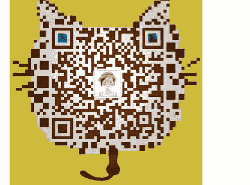

# 我30年的经历，为你揭开易学的秘密！

四经、五经、

扫一扫添加好友获取更多优质书籍推荐

加v信：1101284955获取更多优质书籍推荐

## 用我30年的经历，为你揭开周易的神秘！

四书五经、

大家好！我姓邓，和很多同龄人一样取名为建忠，今年55岁了。以前，也曾经干过很多不同工作，在沿海打工，在广东做过建材生意……但是，我这个人主要的兴趣其实来就不在打工或者做生意，而是在命理玄学上，满在命理玄学上的研究也快乐30年了，见了不少的人，批了许多八字，也就有了不少的故事。年龄大了，说话的人少了，今天我就把我的这些故事拿到网上来分享给大家。

文章内容皆为你根据自身真实经历整理编写，赏文容易成文易！希望大家看的同时帮我顶一下帖子，让我知道还有人喜欢我的帖子，大家的支持，将是我继续写下来的动力，当然同时也欢迎大家有什么周易玄学这方面的问题可以在帖子里提来，我也会尽力而为大家解答。

说到命理玄学结缘，这个早就了，我小时候社会风是不允许说这些的，但我家里都知道我三叔跟我长大，只是在外面玩不敢说而已。我特别喜欢在我们三叔家热闹，从小耳目濡染接触很快的。但是后来没有怎么深入，直到我二十多岁的时候机缘巧合，受益于另一位恩师，这才算是真正发生兴趣，在开始广泛播诸诸山、卜、命等古术，苦学多年，翻烂了很多古籍，总算是得入门了。

加v：1101284955，获取更多优质资源推荐

经历了初期的四处漂泊，为人运命后，我一边摸索，一边实践所学。知道安定下来，生计有了保障，才把更多的心思放在了研究易学方面。

不得不说，现在的易学理这一行的人鱼混杂，骗子太多，靠街头算命，愁人的也不少，堪能遇上个靠谱的命理师之几率太低。

因为我是做生意的，来往的人慢慢地，他们知道我擅长这个，而且我也从不依仗这个赖，毕竟我虽然兴趣不在建材生意，而且我也至少还能让我衣食无忧，否则因为我的名字在圈子眼里越来越响，有很多客户朋友有了疑问之后，他们也会过来找我。

比起去年，我记得是11月12号，好像刚过立冬几天，我的阵友老陈，忽然神色诡异来找我。

作者：四书五经、日期：2016-03-03 17:39

有些网友可能觉得这帖有点眼熟，这也不奇怪，因为此帖在天津杂志首发，目前还在更新中。但由于首次帖子比较忙，在帖子上出现了一处错误，而且由于帖子受到大量网友贴支持，导致帖子内容更新间隔较大，不方便阅读，所以今天在未知学院重发帖，就是为了修订补充、脱水整合原文，方便大家阅读，但为了确保质量，更新速度也不会太快。想看看直接看原文的帖点这里，链接：

作者：四书五经、日期：2016-03-03 17:41

正文更新结束

加v信：1101284955，获取更多优质资源推荐

老陈也是建城的，他主营木地板，生意一直算不错，我们经常在一起打牌、喝酒。

前两年他女儿考大学前，曾说过让我算一算看怎么怎么样，到最后到底不能考取。

因为我不是靠卖命为生的江湖，什么好说就说什么，我是不骗人的。我都是按计划中断，有一说一、有二说二。我算完之后明确告诉他，他女儿大学没戏，最多是民办或者大专，而且还让他很多愁。

他起初还有一点相信，因为一直以来她女儿的成绩都是挺不错的，在考前的几次模拟中，成绩也很好，班主任和老师都希望上二本。所以听到我说考不上之后，他的第一反应就是我算准了，结果高考成绩出来，她女儿成绩居然不到十分。她女儿就有了巨大的压力，情绪非常严重，在模拟考试的时候还好，一旦真的高考考试，一下子就发愁了。老陈平日里根本没关心女儿的学习成绩，只是停留在表面面上和过去的成绩上。知道结果之后，老陈唏了很久，最后只能接受现实了。当时这件事让他丢脸了好几个拜，我当时也没有把这件事当真，更没有提。

加v信：1101284955，获取更多优质资源推荐

自然，我也能看得出来，他虽然表面不说，但是心里对我卦也服了。所以他这次来明显是有事，求我：“老邓，你说……”我掏出一根黄烟递给他，让他下慢慢说。原来这一次还是为了她女儿的事情。

老陈说这周末没回。他女儿在民办毕业，因为离家近，所以每个周末都回。这周末她没回来，而且电话打不通。周一还没不在，但是到了周一，家里连个电话。老陈有点坐不住，给宿舍打电话，舍友说周五晚上就回家了，周一还没回来。这一多年，学生失踪事的那些新闻一个接一个，老陈听到女儿周五就失踪了，这可把他愁坏了，赶忙报警，之后给女儿亲戚打电话，一个都没有。

听完他的叙述，我也觉得是个大事，便对他说：“老邓，我给你算卦。”建材城里，周内基本没什么生意，客户全在周末，所以我建议了，让他好好看着，就让老陈回家了。

加v信：101284955，获取更多优质资源推荐

到家后，我拿出了三枚乾隆通宝交他的手上，我问他：“你信我的卦？”他愣了一下，可能没想到我在这个时候问这个问题。其实是个很重要的问题。
作者：四书五经、日期：2016-03-04 10:17

山医卜相五术中，其他几门无论信不信初始变量都是相同的。方来说，不管一个人信不八字，但他只要一旦出生，他的紫微命盘就已经确定了，风水面相也是一样。独卜卦不占，六爻卦的占是用三枚铜钱，在手中摇出来的，它的初始变量就是一个随机的。当我当年学习心法的时候，特地研究过这个，凡占卦卜，首要条件是心诚诚。俗语，心诚则灵。

信者问卦，更专注于问卜之事，自然卦象清晰明了，层层出现。不信者问卦如婚戏，或心怀怀疑，于是众人杂乱一片传到卦上，殊必问此而幻，卦象不着边，预测结果自然就不边，算而不应。所以我算卦有八不测，其中一个“婚戏嘈杂不测”，问卦的态度不正，或者周围环境不好，我是不测的。所以在让他起卦之前，先问他信不信。老陈点了点头，于是我让他起卦，得到此之比的卦象。

加v信：1101284955，获取更多优质资源推荐

作者：四书五经；日期：2016-03-04 10:46

我分析了一下挂卦，对他说：“按卦断，你家丫头显然现在暂时失落在不明，但是应该是没生命危险。现在还在长沙本地，很可能现在在城北，过几天就可以回来。”

他问我具体啥时候回来，我翻了下万年历，那天是乙亥日，我按卦的信息判断，最早迟五日、最晚迟六日就可以回来。于是对他说：“今天是十二号，最早十四号、最晚十六号就可以回来。”他看了下日历，自言自语：“十六号，就是周日啊，希望吧，希望平安无事。”

他又问我：“能不能看出她到底是啥个事吗？”我想要想，心里有些清楚楚，但是这个事情实在是没办法明说，只好闪闪烁词，说：“应该是被人骗了，多半是桃色事件吧。”说什么，老陈心重重的。两天后，就是周五晚上，老陈给我打了电话，电话里说：“老邓，你快说什么中了。”当时电话也没多少，事后才知道她女儿是在周五晚上和那个男在网上认识的所谓男友约会去了，那个男是个流氓团体中的成员，当天晚上他们劫到了太阳那边，被劫了。后来那个男友被警察抓了。

加v信：1101284955，获取更多优质资源推荐

老陈说这种事，肯定有人信，觉得是在吹牛。不过感兴趣的朋友可以去。

---

### 卦象分析表

| 维度 | 兑宫（水山塞） | 变卦（水地比） |
| :--- | :--- | :--- |
| **干支** | 甲申年 乙月 丁亥日 | |
| **日空** | 午、未 | |
| **日禄** | 亥 | |
| **贵人** | 亥 | |
| **六神** | | |
| **青龙** | 子孙水 | 子孙水 |
| **玄武** | 父母土 | 父母土 |
| **白虎** | 兄弟申金 | 兄弟申金 |
| **滕蛇** | 兄弟申金 | 妻财卯木 |
| **旬** | 妻财卯木 | 官鬼巳火 |
| **朱雀** | 父母辰土 | 父母未土 |
| **位置** | 世、应 | | |
| **伏神** | 父母 | |

---

第一行的干支是中国传统的计时法，干支纪年法从轩辕黄帝就开始了。从公元720年2月22日那一天，中国历史记录就没有，那是确定的干支日，那天是鲁公三年夏历二月己巳，《春秋》中记载，那天日食，夏商城确认那天的具体日期为公元前720年2月22日。第二行的神煞是命理学中的一条奇葩，神煞系统原理不同，它不以阴阳五行的生克来推断，而是通过干对应来定义的，具体的以后我在说。如果没有老师教，就算是把具体的纳甲规则《浑天纳甲歌》给你，你也是看不懂的。浑天纳甲歌是这样的：“乾金甲子外壬午，癸水戌寅外戊，坤土丙辰外戊，震木庚子外临……”怎么能，是不是和看天书一样？我是这样判断的，因为是父亲测算自己的子孙，一卦中，六爻水为子孙，三爻金发动，是不死之，说明目前安全无事。子居北方，又变卦为归魂卦，归魂不出遁，所以我说可能在长沙北。日子父为用神，必须由桃花事件引起，二爻官鬼午用神子水，所以我他女儿是进了坏圈了，但考虑到起卦的时间，月亥日，午官鬼受日、月之克，坏人肯定会被拿获。至于我让他别担心，人能回来，是这样判断的；三爻申金发动，化为卯土，生上爻用神子水，一定能助其女，过几天会回来。至于后期，这个太过于复杂，一句两句话是不清楚的，以后慢慢说吧。

作者：四书五、日期：2016-03-04 16:29

虽然我说了这个案例，而且这个事情我们这边很多人都知道，但我知道很多人还是不相信这回事。有人实践是检验真理的标准，有人说时间是检验真理的标准。

记得前几年，韩国把风水成功，让人一眼震惊，之后国内大学都开了课。我觉得这就就像中国人发明了火药，让洋人制造火药来我们，回头再来。韩国人的风水，不过风水诸多流派中一个小分支而已，简单的话就是做形峦。其中风水真正的精华在理气上，无论是玄空星还是三元九运都属于理气派。如果是用火药来对比，那么形峦研究的是火药的外观、颜色、配制时放硫磺的比例……而理气研究的是火药会燃烧、怎样控制爆炸的力度，或者它的威力更大。因为我之前是做建材，所以我接触风水的机会最多，对于转型来说，风水的作用是非常大的，对于这一点，我是深有感触。前几年，曾经发生过这样一个事情。

作者：四书五日期：2016-03-05 14:56

我的招伙小马是个娃娃，自来熟的性格，做事情很上心，在店里琐事让我省心不少。那天我正实在店里打瞌，来了一个中年妇女，三十多到四十岁的，透着一身精练，要从这里买一些瓷壶，小马为了加强和客户的沟通，就一点一点深入聊了起来。

从他们的聊天中听出来，女人姓赵，要装修的房子还要增大五十多平，她自己不住，是父母和她弟住。她今天三十多了，还没结婚，暂时住在父母家，将来来结婚可能住那个大房子，她是她们家的老二，她上边还有一个哥，已经成家立业，她也不小了。小马一个一个“赵姐”叫得可亲，为了更好地推荐她买的瓷砖，把她家的情况、父母的经济条件、爱好什么样的听后，我们在旁边暗中笑，这个小马要是去做安利，肯定是一把好手。小马在那边为她策划，客厅应该铺什么样的瓷砖、卫生间、厨房、阳台分别应该铺什么样的瓷砖、墙壁上可以铺什么样的瓷砖。那个女人拿着我们里的一张纸，用笔画了个简单的房屋示意图，小马在那边指点点点，写写画画。聊了大个小时，那个女人也没有下决心，说到别的再了解，于是就出门了。小马对这种情况也以为常，并不介意。我那时候正闲来无事，随手就把那个女人画的图拿起来看了。本来我也只是随手来看，结果看到她竟然在这个图上画了个箭头，写了个“北”字，出于习惯，我就对这家的风水唾了滋味。我一眼对小马说：“这家的风水有问题啊。”

作者：四书五经、日期：2016-03-05 18:43

小冯知道我精研易理，山医星术相互均通，而且我曾经在这个地方。小冯说：“老邓，你快看看。”

检查，中西医都看了，CT做了，心电图、脑电图也做了，磁共振也做了，肺部、血压、血糖、脑部血什么都是正常的，根本查不出病人，按医生的说，他的身体是健康人的标准模板。但他病却越来越重，他经常头疼得什么事都做不了，在公司也请了假，后来把准什么也丢了，还有两次就直接摔倒回了，一次是在家的，还好没什么大问题，还有一次是在外边，他摔倒在地上，脸上整个都破了。如果还要查出病来也好，现在是根本查不出毛病了。”“邓先生，您说这个急人吗？”

我点了点头：“我想请您给我们家具看一看风水，看看怎么样能破解这个情况。”

我摆了摆手，笑道：“我是个做建材生意的，又不是风水先生。”

她说：“您放心，给您准备的，我们不少，市面上的价格我也打听过了，我拿的肯定不会比那个高。”

我忙道：“你误会意思了，我是说我不是做那行的，这样做不合适。”

她又连忙求我，小马在旁边帮腔，让我帮赵姐。我被连求不过，只好对她她说：“这样吧，我不去你，你先把你家里画个图出来，每个房间、每个角落是什么，越详细越好，之后你把每个房间多拍几张照片，改天拿来我看看再说吧。”

知她早有准备，把手机掏出来，打开相册一张一张图给我看。

我看，又在纸上画起了房间的平面图……

我一边看一边问她：“你这个柜子是什么颜色的？你哪个房间是打算开的？”直到我对她家的情况了如指掌：

作者：四五五五 日期:2016-03-06 15:15
@礼彬 2016-03-06 13:54:00

周易是一种科学的思维方法。它包含着朴素的唯物辩证法思想，告诉人们：事物没有绝对，只有相对；任何一件事情都是变化的，而且是有规律的。从古至今，研究周易的人不少，许多大学都开了周易相关课程，包括北大。这就足以证明周易理论的科学性。

作者：四五五五 日期:2016-03-06 15:16

我对她说：“你这个房子最大的问题在这里，”我拿着笔指了指房间的东北角，“这个房子的户型很好，方方正正，唯一的问题在这里，东北角又拐了个角。你描述这里这里应该是这个楼的电梯间，你当时第一次来我店，和小浣说起如何装修，我看到你画这个平面图的时候，如果只是老人住，是最怕和小儿子一起在一起。现在按你说的，这个位置是个储物间，你回去一找，这个储物间里肯定有钉铁丝之类的金属物件，你把那些东西拿掉，再观察你舅舅的情况。”

她说：“这个储物间没放金属啊，只是放了把带扫帚箕什么的，拖把是布的，扫帚是塑料的，还有一些玻璃瓶，装修什么用的盆子和桶，都是塑料的，对了，还有一个梯子，是木头的。”

听着她这么信誓旦旦，这里没一点没有金属，我只想进一步解释：“没有钉子铁丝的话，看看有没有别的金属，比方说钳子、螺丝、或者铁衣服架什么的。你先回去找找，我估计应该就是这个问题，把那把扳子拿走，你舅的头疼就好了了。”

她走的时候，我明显能感觉到她的绝望。

结果第二天，她又给小马打来，兴奋的说：“找到了找到了！有一个装修时候工人的手电钻，还有一盒子钻头在这里。这不是我们自家的，是工人的，估计他们装修时候留下的，我们在收东西的时候没注意，就放在储物间了。现在已经把手电钻和钻头全拿走了！”

手电钻！钻头！好家伙，怪不得疼得这么厉害，这玩意儿比钳子、螺丝厉害多了。

之后，又过了一个一个月，她又来到我们店里，整个人精神采奕奕的，她说她舅的头疼完全好了，大半个月没再犯过，整个人的精神也好了，每天都神清气爽的。

作者：四书五五、日期：2016-03-06 16:40

最后告诉我，虽然她舅舅的身体已经好了，但是最好早搬出去，因为这个房子，实不适合一个家庭中最小的儿子住在里面，即便没有钻头，也会因为其他的原因，对她的身体产生危险的。

至于后来她到底有没有听我的建议搬出去去，那我就不得而知了。

通过这个事情，我并不是想说算多准，看一次风水能赚多少钱。而是想告诉大家，风水确实是对人的作用是非常大的。

在这里，我不想说太多关于风水的理论，只是简单的说这个故事中的分析吧。

风水中的方位有二十四，如果用八卦定位的话，一般是用的后天八卦，也就是离南、坎北、艮东、震东方、乾西北、坤西南、兑西方，具体在六爻方面，乾为父、坤为母、震为长男、坎为中男、艮为少男、离为长女、兑为中女、用为少女。

小赵家的房子正好东南角，那么在六爻中是在少男，就是最小的男丁，所以我说是她姐的妹舅。

储物间就是库房，库与盈实，房子的东北方有储物，相当于男儿入墓。相信大家明白其中的含意了吧？

至于她说找东西我断定是钉子之类的东西，那是因为头五行在木，金能克木，所以让她在储物间找钉子铁丝绳之类的物品，因为钉子是尖的，能钉木；铁丝虽然是软的，但是能缠绕；榔头加大，能碰破……结果我没想到，竟然找到了个手电钻和若干钻头。

作者：四书五五、日期:2016-03-06 17:04

接下来我给大家说说，另外一个好朋友周胖子的事。周胖子量不行，但爱喝酒。说实话，我记得2013年左右，发生了一件事情。那天，周胖子、老陈在一起，周胖子赢了，老陈输了。

周胖子赢了，老陈说不输了。

“嚯，你说吧，老陈你是外人，大家都是好朋友，有什么就说吧。”

周胖子脱的说：“我感觉我媳妇在外面有人了。”

听了这个话，我和老陈都是一样。

周胖子继续：“我发现半个月了，我偷偷发现的。有一天我在店里守着，她说要联系客户去西安逛逛。中午我陪几个朋友吃饭，见到她和一个男人从一辆奥迪出来，俩人亲昵的不得了。我当时就给她打了电话，她说自己正在联系客户。”

“邓哥，你算算，我没证据，但我这直接感觉了。”

我点了点头：“周胖子，你急。”

老陈问：“胖子，你啥心事，说来说啊？”

“胖子，别着急，我嫂子，嫂，我出生子出生了她老公。周胖子愣了，老陈在旁边看着：“邓哥，你算算，看看怎么办。”

周胖子只好答应了。

周胖子没声了。

这时，半天没声，周胖子终于反应了，他喝了口酒，把杯子放下，重重的叹了口气。

老陈问：“胖子，你有啥心事，说来说啊？”

作者：四书五五、日期:2016-03-06 19:39
@聚甚子 喜欢易2016-03-09 19:00

谢谢邓老板，我也很好喜欢易，不知从哪学起来？你好，入门的话，最好先把那些周易基础概念，如：乾坤艮坎、巽震、兑离（包括上卦/下卦，外卦/内卦），卦名、八单卦等基本概念，然后再多看典籍，多实践。

“胖子，你啥心事，说来说啊？”

老陈，我就最恶心你这样的人，说你家里不是没媳妇，还整天在外边偷花，你说你算什么玩意思啊？”

嘿，胖子，你够了，邓哥说这些，是因为他算是帮人算命运运的职业，他信这些因果报应什么的，你又干什么羊疯疯呢？我不是就让你请了个客吗，你至于火气这么大吗？再说了，我跟那女的，这就各取所需吧。

这时候，我就发现周胖子的情况有点不对。

最近，好几天来，我都发现周胖子的精神不太好，而且出来他刚才喝酒说话的时候，一直是欲言又止，他说觉得老心定是话里有话，平时他不是这样的。

我希望周胖子一吐为快，算是给朋友帮忙，能让他宽宽心。于是我赶忙举杯又灌了几壶。

果不其然，三五下肚，他就笑着平静地拍着我的大腿说道：“邓哥，我家最近是出了点事了，你当年在外面走南闯北，也是见过市面的人，想来你也不会笑兄弟。今天我就把事情给你说，你替我拿个主意吧。”

“嚯，你说吧，老陈你是外人，大家都是好朋友，有什么就说吧。”

周胖子脱的说：“我感觉我媳妇在外面有人了。”

听了这个话，我和老陈都是一样。

作者：四书五五、日期:2016-03-06 20:50

周胖子继续：“我发现半个月了，我偷偷发现的。有一天我在店里守着，她说要联系客户去西安逛逛。中午我陪几个朋友吃饭，见到她和一个男人从一辆奥迪出来，俩人亲昵的不得了。我当时就给她打了电话，她说自己正在联系客户。”

“邓哥，你算算，我没证据，但我这直接感觉了。”

我点了点头：“周胖子，你急。”

周胖子愣了，老陈在旁边看着：“邓哥，你算算，看看怎么办。”

周胖子只好答应了。

周胖子没声了。

这时，半天没声，周胖子终于反应了，他喝了口酒，把杯子放下，重重的叹了口气。

老陈问：“胖子，你啥心事，说来说啊？”

作者：四书五五、日期:2016-03-06 19:39
@聚甚子 喜欢易2016-03-09 19:00

谢谢邓老板，我也很好喜欢易，不知从哪学起来？你好，入门的话，最好先把那些周易基础概念，如：乾坤艮坎、巽震、兑离（包括上卦/下卦，外卦/内卦），卦名、八单卦等基本概念，然后再多看典籍，多实践。

“老陈，我就最恶心你这样的人，说你家里不是没媳妇，还整天在外边偷花，你说你算什么玩意思啊？”

嘿，胖子，你够了，邓哥说这些，是因为他算是帮人算命运运的职业，他信这些因果报应什么的，你又干什么羊疯疯呢？我不是就让你请了个客吗，你至于火气这么大吗？再说了，我跟那女的，这就各取所需吧。

这时候，我就发现周胖子的情况有点不对。

最近，好几天来，我都发现周胖子的精神不太好，而且出来他刚才喝酒说话的时候，一直是欲言又止，他说觉得老心定是话里有话，平时他不是这样的。

我希望周胖子一吐为快，算是给朋友帮忙，能让他宽宽心。于是我赶忙举杯又灌了几壶。

果不其然，三五下肚，他就笑着平静地拍着我的大腿说道：“邓哥，我家最近是出了点事了，你当年在外面走南闯北，也是见过市面的人，想来你也不会笑兄弟。今天我就把事情给你说，你替我拿个主意吧。”

“嚯，你说吧，老陈你是外人，大家都是好朋友，有什么就说吧。”

周胖子脱的说：“我感觉我媳妇在外面有人了。”

听了这个话，我和老陈都是一样。

作者：四书五五、日期:2016-03-06 20:50

周胖子继续：“我发现半个月了，我偷偷发现的。有一天我在店里守着，她说要联系客户去西安逛逛。中午我陪几个朋友吃饭，见到她和一个男人从一辆奥迪出来，俩人亲昵的不得了。我我当时就给她打了电话，她说自己正在联系客户。”

“邓哥，你算算，我没证据，但我这直接感觉了。”

我点了点头：“周胖子，你急。”

周胖子愣了，老陈在旁边看着：“邓哥，你算算，看看怎么办。”

周胖子只好答应了。

周胖子没声了。

这时，半天没声，周胖子终于反应了，他喝了口酒，把杯子放下，重重的叹了口气。

老陈问：“胖子，你啥心事，说来说啊？”

作者：四书五五、日期:2016-03-06 19:39

由于周胖子的媳妇是1968年6月29日出生，排八字如下：

坤造：戊午年，戊午月，戊戌日，戊申时。
大运：丁巳、丙辰、乙卯、甲寅、癸酉、壬子、辛亥、庚戌。

“我没证据，但我这直接感觉了。”

我点了点头：“周胖子，你急。”

周胖子愣了，老陈在旁边看着：“邓哥，你算算，看看怎么办。”

周胖子只好答应了。

周胖子没声了。

这时，半天没声，周胖子终于反应了，他喝了口酒，把杯子放下，重重的叹了口气。

老陈问：“胖子，你啥心事，说来说啊？”

我分析了一下她的八字，对周胖子说：“你这个媳妇，聪明、能干、体贴人是不错。她的八字杀太大，而且她宫弱杀强，年月的天干戊土都是她的七杀，看婚姻感情，男看正偏财，看官看杀，她的杀多，肯定不是终人的。而且你看，现在是乙卯大运辛卯流年，卯是她的桃花，今年桃花旺得旺嘛！胖子，说句不中听的话，她的八字叫宫弱杀强，结婚之后，她在外面的情人是肯定的，而且好夫比亲夫还厉害，这个厉害的，或者表现在事业上，或者表现在经济上，或者表现在外表上，更大的可能是兼而有之。”

听了他的话，我感觉憋了周胖子都快要炸出来了，他说：“邓哥，不告诉你，，我是怀化那边的山村的，家里本来就穷，我本来就是倒插门的女儿，结婚后老夫人捡的钱我在这边办了个买卖，让咱俩做建材生意。她当初嫁给我也是因为她妈妈看着我人本分，老实可靠，结婚前我就知道她在外面有些闹的，我心里想着结婚后，有了孩子，她不得不把心思放到家里来？哪知道她还……”

作者:四五五五、日期:2016-03-07 10:09
@赖锦豪敏2016-03-07 09:01:00

楼主写得好啊，加油啊。

感谢支持

作者：四五五五、日期:2016-03-07 10:34

路。

长话短说，当时我从家里偷了一点钱，然后一路北上，渡过长江、翻越秦岭，一直到了陕西，一路有好几次都不得不露宿街头，要不是当时是夏天，我这小命都有可能已经冻死在路上了。

我来到陕西的时候，基本上可以说已经身无分文，我一路打听一路走，历尽千辛万苦，终于找到了五七铁厂。

父亲见到我是不肯的，好在那里的房子多床少铺，硬是在那里住了下来，渐渐的，也认识了一些年轻的朋友——都是周围农村的小伙子，年龄比我大几岁，那时候正是炎热的夏天，我们经常一天白天在河下摸鱼、在树上吃西瓜，晚上生活吃鱼、烤知了。

作者：四书五经；日期：2016-03-17 13:06:16

那一天，父亲他们说要去抢收小麦，走的时候告诉我我要五天后才能回来，因为夏季抢收的时候他们都是吃在路上。

我趁这个机会，偷偷的把父亲干活的桌子上上海牌的手表从他枕头底下拿出来，我知道他出去干活的时候是不带手表的，因为怕撞坏或划伤表盘。

那时候的手表和现在的手表是完全不同的两个概念，那时候一块机械手表表八十块钱，普通人的工资一个月三四四十，如不吃不喝，两个月的工资才能买到一块手表。

更重要的是，手表的特性不仅仅仅体现在价格上，而且它是身份的一种象征，现在的年轻人估计很难体会那种感情了。

我偷偷带着父亲的手表，出去找几个朋友玩，一个原因是因为我真的很喜欢那块表，还有一个原因是我当时的虚荣心作祟，想在他们几个人面前显摆一下。那个时候年少，不懂事，耳中听着他们对手表的谈论，看着他们羡慕的眼神，我当时觉得心里是非常受受。

那天，我们玩到天黑才才，等我回到住处后猛然发现，早上还戴在我手上的手表竟然不随而飞。这一简直犹如五雷顶顶，吓得我一身冷汗。

怎么办？

如果让我父亲知道……我也不知道后果会是什么，但我肯定不敢让他知道这件事后脸了。

于是，只好赶紧紧去找去找？

今天我们跑了那么多地方，林子里那里那里，下午还上了越西山，上哪里去找？

但是不找不行啊。

找！一定得找！

我只有对自己说：我还有时间，爸爸他们去找收表，明天估计不回来，最早也等到晚上或者大后天了。

作者：四书五经、日期：2016-03-07 14:27

走走就走，我从抽屉里找出手电筒，连夜就去找手表。黑漆一片的野外找一块手表，简直比海底捞针的难度还要大啊。

我顺着白天走过的路，一路一路低头找，一直爬上了西风的山顶，也没有看到手表的踪迹。

这个时候手电的光已经开始变得暗淡下来，山路崎岖，如果没有手电筒的话，那就连下山的路都看不见了。想到这里，我也愿意不再找手表了，赶紧向下山跑，心里想着等明天天亮之后，我再上山上找吧。

手电的光越来越暗，我走的越来越快，还好当夜月朗星稀天气不错，借着月色我勉分辨着下山的路。我越走越急，看着周围的景色越来越陌生，我越觉得走错路了，心里更加发慌，脚下的脚步越迈越累劲。

由于山里的路不止一条，这里很多的谷道，我下山时，便走错了谷道。

说实在的，虽然我迷路了，并没有感到害怕，我当时只是感到焦急。要是父亲回去之后，发现我手表都不见了，现在再看到我，估计把我抓了。

在我的如般的、精疲力尽的时候，刚看到前面有一处灯光，有灯光就对着有人，我就顺着灯光走了了过去。

灯光是从山上一个土窑中发出的，屋子的主人是三个三十多不到四十岁的中年男人。

当我见到这个窑洞的主人，就觉得十分亲切和安全感油然而生。这位老秦的大叔，给我倒了点水渴，然后他就问我为什么这么晚上在山上跑？

我就把所有的事情都告诉了他。包括我如何从家里跑到陕西，如何偷了我的手表，如何弄丢的，现在是多么的着急等等。

作者：四书五经、日期：2016-03-07 16:17

大概是我的神情实在很焦急，所以，他似乎有点不忍心，就对我说：“小邓，其实这个事情我可以帮你，但是，你要替我保密才行。”

“大叔，你的意思是，你要我去找手表？”
“……呢，也可以算是吧。”

说着，他给了我三枚铜钱，让我在手中摇晃铜钱，脑中想着之前丢失的那手表，就把铜钱挪到桌面上。

我有些疑惑，因为我知道这是六爻纳，以前听说过，但是却被这么多年，居然还有人懂，难怪秦大叔让我替保密了，这要是那些知道了，通过六爻法，得到卦象之困，具体如下：

| 六神 | 本卦 | 变卦 |
| :--- | :--- | :--- |
| 青龙 | 妻财戌土 ■■■ | 妻财未土 ■■■ |
| 玄武 | 官鬼申金 ■■■ | 官鬼酉金 ■■■ |
| 白虎 | 子孙午火 | 父母亥水 |
| 螞 | 子孙午火 | 子孙午火 |
| 勾陈 | 妻财辰木 | 妻财辰木 |
| 朱雀 | 父母亥水 | 兄弟寅木 |

乙寅午月丁酉时（空亡：寅卯）震宫：雷水解 兑宫：泽水困（六合）

我当时基本上是完全不懂的，自然也没有记住，这是后来随大叔学习命理的时候，回头看这卦象，这个卦象可以说是命运的转折点，直到今天，我都一直记忆。

作者：四书五经、日期：2016-03-07 17:31当时大叔看了这个卦象，对我说：“小邓，你的表不用再去外面找了。”我觉得很奇怪：“不找怎么办？我父亲要是发现，绝对会死的！”

秦大叔笑着说：“你不要去外面找，是因为你的手表不是丢在外面，而是被人偷偷拿走了。”

我惊呆了：“啊！大叔你怎么知道的？谁偷偷的？”

秦大叔也不瞒：“我自然是通过卦象看出来的，如果你……”

我点点头，问他到底是谁偷了我的手表。他说道：“你想知道是谁偷的，你就得把那三个人的具体情况详细说说，包括他们的长相、年纪、身材、衣服的颜色等等，总之越越好！”

于是我便抱着怀疑的态度，将那三个朋友的名字、住处、打扮等情况告诉了他，他沉默一会儿，便果断的我说：“你去住在村里的那个人吧，你的手表肯定是他偷偷拿走的，不过从象象上看，他倒像是贪财，而是因为你炫耀得太狠了，整你吧。”

我当时听了之后，觉得很犹豫，因为村里的李是我几个朋友，我要是直接去问他，万一不是人家偷的呢？那得多尴尬啊。

作者：四书五经、日期：2016-03-07 17:43

晨锦靠：2016-03-07 09:01楼主写得好啊，加油啊。
四书五经：2016-03-07 10:09谢谢支持。
坏的怀：2016-03-07 16:27

先生中国博大深的文化就靠你宣传了。感谢您的支持。为博大深的易文学的传播尽一切绵薄之力实在实在荣幸。

作者:四书五经 日期:2016-03-07 19:50我把自己的愿意告诉了秦大叔，大叔想了，说：“你的愿意也这样好了，不要太好了，你等明天白天的时候，去家里找他玩，也别提丢手表的事情，只要找个机会，悄悄的他房间东边的某个木质家里翻一番，可能是箱子，也可能是一个柜子，你趁他不注意的时候打开箱子或抽屉，你的手表肯定在里面。”

他的这段话听得我是云里雾，我在古代神怪小说中会有这样的故事，没想到这山的一个大叔竟然也这么铁口断，我当时半信半疑，心想当做马马吧，反正今天找了一路也没找到，明天按他说的试试吧。

当天我便在他的窑洞里住了一夜。

第二天刚亮，我就起床去了那个人的家里。

我随便找了个借客坐在他家里和他有一搭没一搭的闲聊，一边说话我一边观察他家的布局，真直，在房子的正东边有一个木头的柜子，桌子的正中间有一个抽屉。

我们闲聊了一会，他的母亲恰好出去挑水，我趁着这个时候快速去打开抽屉，里边放着的不是我父亲那块上海牌手表又是什么？

作者：四书五经；日期：2016-03-07 22:30我刚把手表拿出来他就回了，看到我手上的手表先愣，紧紧憋脸上一阵红，问他的表情：“昨天下午山的时候……你把表掉了，掉到地上了，对我抬起来的，本来打算给你送过去的，还没来急去找你……送完了。刚才才顾说着，我都把这个塞给了。”

我心里是一清楚，但我当时就假装糊，没穿他的话。一天夜里见到的简直是活仙，我在回去的路上，甚至怀疑那个人是不是鬼。我几个月，后来的日子里，我几乎每天山上查找。拜他为师，他教我命术，从回家之后，我也苦练，慢慢磨炼我的技艺。每年暑假都会跑来找，等到文章结束后，他终南山上隐居了起来。接下来我来聊聊的，当时初用甲出来的卦象。雷解逢逢水，这一卦是二爻财持世，五爻官鬼发动，且临玄武。测失物的时候，官鬼一般是盗贼，六神玄武临官鬼也是主盗贼，所以当时判断是不丢了，而是被人偷了。作者：四书五、日期：2016-03-07 23:35

四书五：2016-03-07 22:39

感谢过奖，谢谢支持。

--------------------------------------------
三剑客之范斯：2016-03-07 21:00先生辛苦了，中华大精深远流长，先生以通俗易懂并附事例的方式向大家娓娓道来，等读者之幸！真心有更多像先生一样的晚辈解读文明！
--------------------------------------------
amoto：2016-03-07 24:33我是有缘人楼主希望你推荐一些入门的书籍万感感谢。入门的话，您可以从易经基础的东西入手，看看南怀瑾的《易经杂谈》，后期看《子平真诠》、《滴天髓》、《渊海子平》、《神峰考》、《冰鉴》等。作者：四书五经、日期：2016-03-08 13:03师父，请问如果八字里面有相克，或者是不好的信息，可以破解吗？可以的，需要详细分析字的五行制化后的结果，再结合大运流年，比如地支辰相冲，但地支又有子水，可以用申金入局，取申子辰合水，贵合合冲。癸亥，辛亥，辛酉，戊子。日干亥金多又无火之官星抑制，水而食伤多可是。请教主理我应该选什么用神啊？是喜火还是喜木水啊？应该事情哪方面的工作。

好，去什么方位好呢？

您八字为：
癸亥
辛亥
辛酉
戊子

日主为辛金，生于西月，通根得月令，有时干干土为印，为强旺的金命，性格固执，聪明，理解力强。应取木为喜用，适合五行木、水的事业，利东，北。作者：四书五经、日期：2016-03-08 14:33正文延续

关于谁是偷东西的，是这样判断的，那个人中三个人的具体情况详细说说，包括他们的长相、年纪、身材、衣服的颜色等等，总之越详细越好！

- 东方：木
- 南方：火
- 中间：土
- 西方：金
- 北方：水

方位：方位，通过六爻纳法，得到卦象之困，具体如下：

| 六神 | 本卦 | 变卦 |
| :--- | :--- | :--- |
| 青龙 | 妻财戌土 ■■■ | 妻财未土 ■■■ |
| 玄武 | 官鬼申金 ■■■ | 官鬼酉金 ■■■ |
| 白虎 | 子孙午火 | 父母亥水 |
| 螞 | 子孙午火 | 子孙午火 |
| 勾陈 | 妻财辰木 | 妻财辰木 |
| 朱雀 | 父母亥水 | 兄弟寅木 |

乙寅午月丁酉时（空亡：寅卯）震宫：雷水解 兑宫：泽水困（六合）

我当时基本上是完全不懂的，自然也没有记住，这是后来随大叔学习命理的时候，回头看这卦象，这个卦象可以说是命运的转折点，直到今天，我都一直记忆。

当时大叔看了这个卦象，对我说：“小邓，你的表不用再去外面找了。”我觉得很奇怪：“不找怎么办？我父亲要是发现，绝对会死的！”

秦大叔笑着说：“你不要去外面找，是因为你的手表不是丢在外面，而是被人偷偷拿走了。”

- 穿黑色的衣服的人
- 穿白色的衣服
- 穿灰色的衣服

- 住在村里的那个人
- 住在村西的小李
- 住在异乡的几个朋友

我当时听了之后，觉得很犹豫，因为村里的李是我几个朋友，我要是直接去问他，万一不是人家偷的呢？那得多尴尬啊。你等明天白天的时候，去家里找他玩，也别提丢手表的事情，只要找个机会，悄悄的他家的房间东边的某个木质家里翻一番，可能是箱子，也可能是一个柜子，你趁他不注意的时候打开箱子或抽屉，你的手表肯定在里面。

他的这段话听得我是云里雾，我在古代神怪小说中会有看到这样的故事，没想到这山的一个大叔竟然也这么铁口断，我当时半信半疑，心想当做马马吧，反正今天找了一路也没找到，明天按他说的试试吧。

当天便在他的窑洞里住了一夜。

第二天刚亮，我就起床去了那个人的家里。

我随便找了个借客坐在他家里和他有一搭没一搭的闲聊，一边说话我一边观察他家的布局，真直，在房子的正东边有一个木头的柜子，桌子的正中间有一个抽屉。

我们闲聊了一会，他的母亲恰好出去挑水，我趁着这个时候快速去打开抽屉，里边放着的不是我父亲那块上海牌手表又是什么？

我刚把手表拿出来他就回了，看到我手上的手表先愣，紧紧憋脸上一阵红，问他的表情：“昨天下午山的时候……你把表掉了，掉到地上了，对我抬起来的，本来打算给你送过去的，还没来急去找你……送完了。刚才才顾说着，我都把这个塞给了。”

我心里是一清楚，但我当时就假装糊，没穿他的话。一天夜里见到的简直是活仙，我在回去的路上，甚至怀疑那个人是不是鬼。我几个月，后来的日子里，我几乎每天山上查找。拜他为师，他教我命术，从回家之后，我也苦练，慢慢磨炼我的技艺。每年暑假都会跑来找，等到文章结束后，他终南山上隐居了起来。接下来我来聊聊的，当时初用甲出来的卦象。雷解逢逢水，这一卦是二爻财持世，五爻官鬼发动，且临玄武。测失物的时候，官鬼一般是盗贼，六神玄武临官鬼也是主盗贼，所以当时判断是不丢了，而是被人偷了。

于健航之所以意愿我们合作，就是因为他本身的资金不充足，我们又让他把贷款押那么久，一般不是合作多年的伙伴，谁也不肯让他压钱，我们在一起合作过很多次见面，知道他的信誉问题，所以大家一直按照这个矩合作。那天中午我基本上说什么，都是他们几个在谈，我只是随附和。等要把货的时间、数量和价钱锁好后，于总转过头间我：“老板，怎么今天不响啊？是不是最近压力太大了，要下午找地方放松放松？”我说：“于总，你们都知道你的关系像野子，具体你业务上是怎么操作的，我从来没打算打听过，但是这一次说实话，我有点不放心，你能不能说你和那边怎么谈的？”于健航听到我这个话有点不高兴，他说：“在我们一起合作这么多年了，你还对我不放心？而且事情刚刚才不用谈了么，你现在咱说这个这个？”

糟了，这笔生意怕是要黄了。

大约一周后，于健来到长沙，我见到他的瞬间，心里忽然噔一下，我对自己说：糟了，这笔生意怕是要黄了。他脸上并没有带出什么愁，相反还是满脸灿烂的笑容。他问和周子，东西准备好了，我们都说已经按照他的要求到位了。他高兴地说：“走，中午吃饭，我做，把老陈也叫上，他们的酒店有一个大厅和五个套房，全都要豪华装修，老陈的生意也来了。中午我们四个人边吃一边谈生意，一切都是老规矩，于总先付30%的款，我们把货按照他的要求的一次全都给清，70%的分款两次付，一次是在工程结束后立刻结算30%，过半年最后结算剩余的40%。
的，哪些是该往出的分的，里边都是有规矩的。兄弟，这里边的道多看着呢。

听了他的一片沉默，我说出了我的恐怕：“于总，我是不懂官场的那些事情，但是我懂易理，依我看，这次的事情很难成，你还会破财。”

听了他的话一怔，因为我知道我擅长玄术，他让我给他他细说说。

我告诉他是从从的相面上出来的。

本身的面相是个很旺财的相，山根略低垂，准头圆，鼻孔不备不露，兰台廷两部厚重，与准头相称。

这里需要解释一下这几个名字，面相学中，将从前额正中发鬓至下巴为十分一部，我们常说的的印堂就在两层之间，我这里的山根在印堂之下，两眼之间，准头就是鼻头，准头两侧的鼻翼分别称为兰台和廷廷。于总的相貌是标准的狮子鼻，特点是“山根年低垂，准上丰大称兰廷，全狮形则富贵，一生财帛无虚。”

我解释说：“于总，我不是放心你，我是不是放心这个事，不放心党委底那边和你谈这个事的人。你那那边到底怎么说的，给我说说道道，我们几个嘴上有把门的，这点你你还不放心吗？”

我坚持要问，趁着势劲就把事情告诉了我们说了了。

原来是底的一个县府年前才盖好了政府大楼，政府大楼盖好后，立刻计划在对面修一家集合餐饮住宿的酒店，一方方便接待上级领导，二是希望这个酒店为中心拉动周边经济，还有一个打算就是将来酒店对外营业的话，可以增加不少的财政收入，不过第三点是不能拿到桌面上来说的，只能暗地里操作。对上......

一般的相面无论时候时候看到这样的相貌，都不会说缺钱或者破财，但是相面的更高一层境界就是望气，当我今天第一眼见到他，就发觉他的气不对，台兰和准准衔接处有股纹线的灰色的气，山眼处有一股气向印堂流，印堂却是晦暗无光，这些都是破财的，所以我我不看好这次的生意。

听了我的解释哈哈大笑，对着镜子里的一面镜子对我说：“行了，别整天神疑鬼的，我怎么就看不出来你说的那些脸色，我是看红满道的，油光发亮的，定是要大赚一笔的。”

他那里知道，他从镜子里看到的，那脸色，我望的是气。我们常说一个人的气色，指既有气也有色，但是一般只能看到形，望不到气的皮肤内，而且气是不止流动的，它是不断地流动的。学习相面，要辨形，之后是紫色，则望气，则是需要一定境界才能到的。关于辨形、紫色和望气，我会在故事中慢慢说的。我知道对他，话不相信，就没有勉力劝。但是我的话还是起了一定的作用，他当天从长沙回了那个县，他说自己要准备一个红。

第二天给我打电话，昨天晚上上去医院看了表舅，顺便把钱带了。听着他欢喜的保证肯定没问题，我仍然是给他泼了一冷水，让他谨慎。等了一周，应该是给他送货时候了，也不见于总和我们联。我知道我前阵子说罪了他，所以周胖子给他打电话问情况，他要不过来，我们就找个车送过去。电话胖子问他什么时候来，之后就听到总旁边不停说着，周胖子只是“嗯……嗯……哦……是这样啊，好的，我知道了……他们带到了。”挂了电话，我急忙问发生什么变故了？周胖子说：“表舅那个手术本来很成功，眼看着就要出院了，谁知道那天吃了什么，切除剩余的部分胆囊炎又发，又急忙做了一个手术，结果伤口又感染了，没多久肺功能衰竭，已经不再了。”我问：“那工程的事怎么办？”周胖子说：“还说什么工程，人情冷了。”对于现在忙的焦头烂额，帮着表舅在医院跑，说是医疗事故，让医院赔钱。不过就算是医院赔了钱，钱也是表舅的，他说自己为工程前期投入，包括上次去医院看表舅拿的红包，现在全都打了水。”我只能摇头叹一声说，其实，人都是这样的，要么就是完全不相信命运，要就是完全屈服于命运。所以，所谓避忧有的时候只是一种美好的愿景，不是容易实现的。在命运的惯性之中，即使有未来你告诉我可能如何如何，你未必会选择相信。等到一切都应验了，你再想后悔，那就太晚了，世上哪里表弟啊，你说到底该用什么样价位的瓷砖比较好呢？我真是快烦了！”“姐，你现在关键是不定房子到底打算怎么办，到底是租还是卖，或者是留着自己住吗？你要是能下主意之后，咱们在商量具体装修的情况吧。”说话的是一男一女，男的是我店里的伙计冯剑飞，女是他远方的一个表姐。她表姐也有长时间没和他联系了，这次是因为自己有个房子想要装修，打听到他在城打工，于是前几天突然之间联系了她，说是今天来我们店里看一看装修材料。我听了他们刚才的对话，瞬时觉得奇怪，我原本以为表姐这次来，多半是已经好了打算用什么地砖，至少也应该有个方向，只不过只是人熟了就可以方便些拿砖，哪晓她非没考虑怎么装修，甚至房子的用途都靠准，这个就太奇怪了。如果她现在不定房子住，如果已经有地方住了，而且不愿意搬家，那么那个房子肯定得租出去或者卖掉。对了，表弟，你不是认识一个高人吗？好像什么八字、风水、各种算都很厉害，要不要介绍一下，我想请他帮我算算，看看这个房子应该怎么处理，是卖掉还是卖比较好，大概什么时候合适？”周胖子说：“姐姐，你不用说，上次给你说的那个高人，其实就是。”白小姐通过我分析这个卦象，清楚明白了这个房子存在的奶奶，而且能推测出奶奶的这些细节，所以她非常服我，希望我告诉我下一步应该怎么办。我综合判断卦象，让她放心，虽然有兄弟夺财的象，不用担心，这个财最是对方夺不走的。这个房子可以卖，但不用着急。房价这些，别看现在房价一直上走，但是知道时候忽然跌了。房价这种事情我不算。”周胖子在旁边话：“老板，房价为什么不能算？”我耐心的给小冯解释：“小冯，你知道算命有八字不？”我听您说过，但是哪八字我就清楚了。八字里有一条是‘天命不测’，房价问题涉及到民生经济方向，已经属于国运范畴了，所以我测。“您看，你把我的意思理解错了，没那么复杂，房价走势什么样的，我不考虑这个。我想问，这个房子应该怎么处理，什么时候比较好，我是租还是卖或者自己住，如果是要卖的话，什么时候卖比较好，就行了，不用考虑房价波动的因素，哪怕卖便宜点也。”好吧，既然不涉及命运，那我就拿出三枚铜钱摇卦......对我熟悉的人，基本上都知道我有不测的规矩，前面我说过，“酒后迷不测；热闹嘈杂不测”。今天讲的是第三条，“天命不测。”天命运国，包括政权的状态，还能持续的时间以及政权主要负责人的身体状况等，还包括国家的大方、民生经济走势等全局问题，这些事情不能随便测。多说几句，我说不能随便测，并不是不能测，如果要对这些事情进行预测的话，需要一些别的办法。用三枚铜钱摇卦，这个是小行大法，测命运运，需要用大行大法。或者直接用上古三式中的太乙术来预测。这个上古三式具体指的是太乙术、奇门遁甲和大六壬，其中太乙术测事，主要运用占国层面的各项大事。奇门遁甲测军事，主要用于战争等领域；大六壬测人事，主要是运用民间各项事务的占。总之，占命运是不可能随意而为的，所以不测会有这样一条。白小姐给她她的三枚铜钱摇了六次，得出如下卦：干支甲年 庚午月 乙寅日 申时（空亡：子丑）
神煞：驿马 桃花日禄卯 贵人申
翼官：风雷益
民官：天泽履

六神伏暗 本 变卦
玄武 兄弟卯木 应 妻财戌
白虎 子孙巳火 官鬼申金 世
青蛇 妻财未土 → 子孙午火
腾陈 官鬼酉金 妻财辰土 █ 世
朱雀 兄弟寅木 → 兄弟卯木
青龙 父母子水 → 子孙巳火

我握了摆手，让她直说。“姐姐，你不用说了吧，我有一套房子，现在是这样，我想换掉，但是不知道什么时候合适。”她问：“兄弟夺财是什么意思？”我告诉她：“在这个卦中，财爻发动，同时兄弟爻也发动，而且兄弟的力量弱，说明第一是钱肯会出现，第二是钱不一定得到，有人来争夺。这个钱肯出现，说明钱是会被够的。”她问：“这个争夺的人是谁？”我告诉她：“这个卦叫做兄弟夺财。”她听了之后点了点头，连连都是让我继续跟她说这个卦的具体的。我依照推断：“这个纠纷肯定是与法律事务相关。”听完这些话，白小姐急起来：“果然没有说错……”之后她才告诉我这个大舅的情况，原来这个房子并不是自己的，而是大舅。大舅有一段失败的婚姻和家庭生活，大舅的妻子，早早就结婚了，大舅离婚的时候，自己的女儿还小，法院判给了女方，所以女儿和他离开了之后的这些年，几乎没有任何联系了。尤其是最近几年，大舅身体不好，一直照顾他，临终前，他立下遗嘱，把世界上唯一的财产留在了女儿，并且在公证处将遗嘱公正了。如今，大舅离世不久，她姐姐——也就是大舅的女儿，立刻从外地找回来，她的目的很明确，就是争遗嘱。她是学法律的，无行为能力或者限制能力的，所立遗嘱属无效等一些法律术语。这些把白小姐驳得无话说，白小姐只想拿自己公证的遗嘱，和她进行语言上的争论。现在的情况是，白小姐不愿意和自己的姐姐纠缠，急着把房子卖掉，但是内心又有点不得，因为房子的地段很好。这一卦二爻和四爻发动，二爻是兄弟寅木，四爻是妻未土，而且占卦的时候是月的乙卯日，财爻有月来生，兄弟有日来去，所以这两爻的力度都很强。财爻发动自然是财的象，兄弟发动自然是兄弟夺财，所以对于这个卦，给我的第一印象就是兄弟夺财。我一开始说了这样的话，我告诉她放心，不用担心夺财的事情，我是这样判断的：首先，发动的财爻之后，三爻也是财爻，这是很好；其次，兄弟发动变为卯木，妻未发动变为子孙火，子孙对财是回头生，兄弟变动之后没有任何行动的信息，这一点上，钱肯得到；最后，同样是变卦之后，兄弟生火，这种连环生不仅削弱了兄弟的力量，还进一步增加了财的力量。所以我得出结论，让她放心，不用担心兄弟夺财这件事，对方是夺不走的。关于定期，我在以前就说过，这是占中最高级、最复杂的一项，以后有机会专门讲定期的事情。今天，是6号下班后小冯来找我，说请假一周，回家看看母亲。至于请假的理由，他没有说，我也猜到一些，主要是要去祭他父亲。当天晚上，我和小冯约好大排档喝酒宵夜。我们俩东拉西扯地聊了几句之后，也没有什么明确的话题。小冯的情绪也不高，完全没有常样的活跃，对此我也很理解，毕竟他心里藏着事，我约他出来喝酒也是想帮他化解难，不想看过的样子，今天这一番打算怕是劳无功了。我看了看，差不多已经是晚上点了，就拍了拍小冯的肩膀，拿出准备的红包，包给他，说：“这里面有六千块钱是你这个月的工资和奖金，回去看看，家里需要些什么……”话未说完，小冯突然声音哽咽道：“邓大哥，你哥，我叔都可以，这些你对我们娘俩的帮助，我以为报了！要不是您把我从农村带到这大城市，我一辈子也就那样了。您信任我，给我工资是最高的，平时教我做人的道理，这些年看着我，我学了不少东西。我这辈子都念着您的好！这杯酒，我敬您！”我的思绪回到了上世纪八十年代末，那一年春天，我在河南省东南部桐柏山去研究当地风水。桐柏山称“天下十二之地”，名胜众多，历史文化积淀深厚，淮源文化、佛教文化、盘古文化、苏文化成为中原乃至民族文化的丰富和延伸。作为一名《周易》文化、命理预测学的爱好者，研究风水简直是必修的知识。无论是从书上学习，还是听师傅口述，都比不上实地去考察，如果如果没有实地研究，就不能算是合格的风师。当时我就住在一个农户家里，这是一家三口，丈夫俩单……|

“表弟啊，你说到底该用什么样价位的瓷砖比较好呢？我真是快烦了！”“姐，你现在关键是定不定房子到底打算怎么办，到底是租还是卖，或者是留着自己住吗？你要是能定下主意之后，咱们在商量具体装修的情况吧。”说话的是一男一女，男的是我店里的伙计冯剑飞，女是他远方的一个表姐。她表姐也有长时间没和他联系了，这次是因为自己有个房子想要装修，打听到他在城打工，于是前几天突然之间联系了她，说是今天来我们店里看一看装修材料。我听了他们刚才的对话，瞬时觉得奇怪，我原本以为表姐这次来，多半是已经好了打算用什么地砖，至少也应该有个方向，只不过只是人熟了就可以方便些拿砖，哪晓她非没考虑怎么装修，甚至房子的用途都靠准，这个就太奇怪了。如果她现在不定房子住，如果已经有地方住了，而且不愿意搬家，那么那个房子肯定得租出去或者卖掉。对了，表弟，你不是认识一个高人吗？好像什么八字、风水、各种算都很厉害，要不要介绍一下，我想请他帮我算算，看看这个房子应该怎么处理，是卖掉还是卖比较好，大概什么时候合适？”周胖子说：“姐姐，你不用说，上次给你说的那个高人，其实就是。”白小姐通过我分析这个卦象，清楚明白了这个房子存在的奶奶，而且能推测出奶奶的这些细节，所以她非常服我，希望我告诉我下一步应该怎么办。
正文更新。
作者：四书五经、日期:2016-03-31 22:24

加v信1101284955，获取更多优质资源推荐

## 正文更新

平时一大早我就进山，带上中午的干粮，晚上回来他们夫妻妻俩聊几句就休息了，当时冯敏飞在忙碌，我也体谅小两口带带孩子不容易。一个月之后，我考察的也差差不多，临走前一晚上，冯敏拿出家里自酿的粮酒，说要喝几杯，给给我践行。

冯敏酒量过行，喝了三杯，就面红耳赤，我猛然看到冯敏脸身上有一条纹路，定睛观察，心中一惊，这是覆灸纹啊！有覆灸纹的人往往容易遇灾。

按面相行，口唇属水。如果下方有一条纹起的纹路，纹路两端向下，好像一条帆反伏过来，这就可能是覆灸纹，平时看不出来，只有出现真红色，才算真覆灸纹。很多时候是酒后比较明显。因为口唇五行属水，红色为火，在五行中，水是大冲，往往越过水、土、金。而且冯敏这个名字，格局是22，大凶之数，多应与水有关。

这时，李秀义抱着襁中的小弓飞也坐了过来，我不由得看了李秀义的面，眉毛微高，说明性格坚定，还好还没有太躁，否则就是固执了。顽健也不突出，此乃敛添之相，看来这并不是一个克夫的女性。不过她的鼻梁塌坍，法令敛窄，说明也难得幸运，自己多劳辛苦。为了验证我的另一个想法，我不动色对李秀义说：“我抱着孩子，你忙了半天了，赶热吃饭。”我抱过小弓飞，仔细细看小孩的左耳环，然而，在小弓的耳朵上有一个灰色的小痣。

加v信1101284955，获取更多优质资源推荐

作者：四书五经；日期：2016-04-05 17:13

相书有言：男孩左耳珠是七岁之前的运，右耳珠是十四岁之前的运，若是女孩，右耳珠是七岁之前的运，左耳珠是十四岁之前的运。若是小耳珠有灰色小痣，易有水险。以男小子为例，男性的左耳金，右耳属木，男女口旺都属水，所以左耳金生旺口旺水，水又生旺右耳的，形成一个良性循环。在金生水、水生木的过程中，吉利的气上上升，紫气升，衰败的气下降，胶气，黑气，灰气。所以左耳侧有痣，或耳背有痣，大多是好的，耳垂或耳底部有疣。从灰色痣在相学中为死气，应灾就很严重，黑色痣往往往慢性病。

我定了神，对冯敏说：“明天我就回家了，走之前，你的八字，给你一些忠告吧。”冯敏说他一九六四年农十一月初九日，出生时还不知道。我问了他之前的几件事情，逆推出时辰。

八字为乾造：甲寅年，丙子月，壬子日，己酉时。

一九八九年他二十五岁，流年是甲戌，原本丙格的八字，官杀为最有力用神，此八字字为阳阴，壬辰为七杀，己巳为正官，但偏为己时，酉金正冲己土正官之力，丙格最忌见到印卯，因为印卯财会生旺财。流年甲戌，戌年上地支辰土，壬为水库，被冲开全是水，且天干甲木命局正官己土，等于官杀皆不可用。丙火偏财在子水月本身无力，子水阳刃在这一年会会旺财。

加v信1101284955，获取更多优质资源推荐

作者：四书五经，日期：2016-04-10 00:53

我沉默了一会，给冯敏说：“老冯，我矮长你几岁，给你一个告诫，今年千万不要去游泳，也别带孩子去水底，今年有水泛，严重的。没事别在家，多出去走走。”

说，我们随便聊了，就休息了。即便是我，当时也未曾想到，此次一别，竟成永别。现在或许许多人都记得，1989年6月6日晚至7日清晨，在河南桐柏县、河南省北部出现了一场罕见的大暴雨，24小时雨量100mm!

幸运的是，冯敏居住的村子，就在桐柏县的盆地边缘，当时的情形，我完全不知道，是后来听到这一惨，我赶到桐柏县听冯敏妻子李秀芬讲述的。雨越不下，很快就引发了洪山，当地在盆地边缘，当时的石木结构的房子很快就被冲垮了。到处都是难民，小孩在水中挣扎，过去救援又很落后，所有青壮只要是会水的，都在去拯救孩子和老人。冯剑丰就被冯敏放在一块木板上，推推拉拉，后来老冯又去救别人，最终竭而亡，也可能是因为了腿抽筋死的。

或许，为了被人取眼，我应该把这里的更惨写出来，但请读者原谅，我真的做不到，逝者已矣，就让此次灾难中的人们息吧！很多年都在，如果当时再深一些，或许会想到办法，或者在天灾面前，我做不到改变命运，但至少我会提醒冯敏更加安全！作者：四书五经，日期：2016-04-10 09:59

加v信1101284955，获取更多优质资源推荐

@四书五经 2016-04-05 17:13

正文延续

相书有言：男孩左耳珠是七岁之前的运，右耳珠是十四岁之前的运，若是女孩，右耳珠是七岁之前的运，左耳珠是十四岁之前的运。若是小耳有灰色小痣，易有水险。以小子为例，男性的左耳金，右耳属木，男女口旺都属水，所以左耳金生旺口旺水，水又生旺右耳的，形成一个良性循环。在金生水、水生木的过程中，吉利的气上升，紫气升，衰败的气下降，胶气，黑气，灰气。所以左耳侧有痣，或耳背有痣，大多是好的……

@余浩 2016-04-07 32:00

作者：四书五经 日期：2016-04-01 29:00

楼主，已经私信您了，麻烦。好的，我提出带李秀芝离开，在大城市中，而且当时她还年轻，才十三岁，完全可以再嫁。李秀芝拒绝了我的好，她说一辈子守寡，这个女人我很敬，因为她真的做到了。此后，每年都会给她一些生活费，直到冯剑成人，这时我也算过事业，就让冯剑来帮忙。

## 卦象与分析

次日中午，冯剑才睡起来，我看到他身上穿了一件白色衫，下身穿了一条蓝色牛仔裤，当时就根据他的衣用“梅花易数”起了卦。白色为金，为乾，蓝色为木，为震，得一个“天雷无妄”的卦象。乾卦为一，震卦为四，加上五，合计为十二，除以六取变爻，六动，又变为泽雷随，卦象如下：

神煞：申，桃花卯，贵人一人，申

|宫：天雷无妄（六冲） | 宫：泽雷随（归魂） |
| 六神 | 伏神 | 本 | 变卦 |
| :--- | :--- | :--- | :--- |
| 玄武 | 妻财土 | ○ | 妻财土 |
| 白虎 | 官鬼申 | | 官鬼酉 |
| 滕蛇 | 子孙丑水 | | 父母癸水 |
| 勾陈 | 妻财辰土 | | 妻财辰土 |
| 朱雀 | 兄弟寅木 | | 兄弟寅木 |
| 青龙 | 父母子水 | 应 | 父母子水 |

天雷无妄卦上九爻辞：无妄，行有咎，无攸利。

加v信1101284955，获取更多优质资源推荐

意思是过错。整句话的字面意思是不适合妄动，不可作为。泽泽随上六辞：苟系之，乃从之。王用于西山。字面意思是将俘虏拘禁起来，紧紧捆绑，周王将他们作为人牲在西山祭灵。

作者：四书五经、日期:2016-04-12 17:43

求测都已发站内信，大家注意查收。

作者：四书五经、日期：2016-04-13 15:14

@alert2010 2016-04-13 10:44:00

邓叔好，我很喜欢传统文化，可惜目前没有学习心，能否私信一下微信或者qq。在这里也想请求邓叔帮忙下爱情和工作，女，庚，己丑，癸未，戊。现在工作处于迷茫期，不知道做什么类似型的工作。也不知道最后能不能和对象走到一起。我认识其他的术，他的八字是庚寅，丁丑，己卯，时辰不是甲还是乙卯，脾气暴躁又耿直。因为之前大概算过我，不管结婚都有离婚的可能，今年的感情也算了一，说是。......

求测都已发站内信回复，大家注意查收。

作者：四书五经、日期：2016-04-13 16:07

@四书五经、 2016-03-04 11:03:00

下边我就就把给我老陈的这个卦象和我的分析，出来给大家看看，如果你对易学感兴趣，那么通过我讲的这些事情和我对

加v信 1101284955，获取更多优质资源推荐

这些案例的讲解，应该慢慢的。例如：

干支：甲年，乙月，丁亥，戊申，日空：午未

神煞：驿马申，桃花子，日禄午，贵人亥

兑宫：天山豫 | 坤宫：泽地比（归魂）

| 六神 | 伏神 | 本 | 变卦 |
| :--- | :--- | :--- | :--- |
| 玄武 | 妻财土 | ○ | 妻财土 |
| 白虎 | 官鬼申 | | 官鬼酉 |
| 滕蛇 | 子孙丑水 | | 父母癸水 |
| 勾陈 | 妻财辰土 | | 妻财辰土 |
| 朱雀 | 兄弟寅木 | | 兄弟寅木 |
| 青龙 | 父母子水 | 应 | 父母子水 |

楼主求问：
1. 干支是怎么得出这个分析的？
2. 卦后六神应该怎么用呢？
3. 后面的子孙是怎么来的？

完全看不明白，没有入门的书籍推荐，感谢。易经学习，基础。

@zero823 2016-04-12 23:30

正文更新

这不是适合出行，出行会有灾。因为乾卦克体，何况爻辞都说了拘禁！这次出行不利，路上忌，不要管事，特别是老人少女，否则可能会牢狱之灾。不过不大，他答应了，结果出发两个小时后，我接到他电话，却是本人。电话那边问：“请问认识刘剑飞？”认识，对方道：“他涉及到一起盗窃案，请来警察局一趟。”

我想到不由得站起来。还好没事了，警察正对着刘剑飞说：“小伙，以后千万要注意啊，别冲动，见勇是好事，但是你也得先清楚状况。”刘剑飞拉着脑袋，一脸懊恼。从警察局出来，我问他是怎么，他说：“我看到有一个中年男子对一个爷爷和小女孩拳打踢的，过去把他推开，这时女孩跑了，他拉着老爷，非说我们是同伙，我都不知道什么情况。过会警察

加v信1284955 * 获取更多优质资源

来就把我和老头带警察局了。才知道这老头和那个女孩是贼，偷了中年人的钱包，当场被抓，恰好我看到了，于是上前了一把，放了小女孩，所以中年人说我是匪团的一员。老头不知道我的名字，被警察问两问就露馅了。我当时真的是愁笑不得，只好陪他重新买了一张火车票，把他送上了车。

作者：四书五经：2016-04-15 23:04

正文延续

于健是个很有办法的人，路子野、关系硬，政商界的朋友很多。他本来是不相信命的，或者对我的能力将信可疑，直到如008年我通过运气看出一件事，那次他认定可以做的生意，我说非做不成，还得破财，当时他没有信我，还继续里面投资，结果半年之内我的断就应验了（评价第五个故事）。这件事之后，我又给他算过几次，无不中。于是，于健对我的话是深信不疑了。

今天要说的事情还在于健有关，这是13年的事情。李老说是于健的朋友，不偷不漏，人挺老实，是个正经的商人，事业也上了正规，家庭也和睦，简直就是一个时代错。唯一能让他愁的就是自己的女儿小红。

女儿小红一心思想当导演，铁了心爱上电影学院，去年年纪已经考了两年，结果全都落榜，从小娇生惯的李红不肯输，每天在家里一意的备备，老李两口子看着眼里落在心里。

李老板的老婆每天在埋怨，说：“你看别人当老板，哪个不是门路四通八达，你看看你有有什么出息啊？自己女儿想上个电影学院的事情你都搞不定，你这算什么破老板，简直就是窝废老婆！”

为了这件事，李老板已经被自己老老婆数落得抬不起头来了。

这一天，李老板看到了健航，立刻就看到了救星的影子。因为李老板自然知道健航通天的事实，社会上的事很少有他搞不定的，于是李老板就开始诉自己的处境。听完李老板之后，健航说自己是个气，一边略带口吻道：“这种事情早点找我。”李老板听，醒了，精神，忙。电影学院里有什么，这种关系硬。

@虎子 2016-04-18 13:30

@余浩 2016-04-18 24:00

@余浩 2016-04-18 24:00

@四书五经 2016-04-18 19:19

@余浩 2016-04-18 24:00

@四书五经 2016-04-25 23:30

@四书五经 2016-04-25 20:30

@四书五经 2016-04-25 20:30

@四书五经 2016-04-25 20:30

@四书五经 2016-04-25 20:30

@四书五经 2016-04-25 20:30

@四书五经 2016-04-25 20:30

@四书五经 2016-04-25 20:30

@四书五经 2016-04-25 20:30

@四书五经 2016-04-25 20:30

@四书五经 2016-04-25 20:30

@四书五经 2016-04-25 20:30

@四书五经 2016-04-25 20:30

@四书五经 2016-04-25 20:30

@四书五经 2016-04-25 20:30

@四书五经 2016-04-25 20:30

@四书五经 2016-04-25 20:30

@四书五经 2016-04-25 20:30

@四书五经 2016-04-25 20:30

@四书五经 2016-04-25 20:30

@四书五经 2016-04-25 20:30

@四书五经 2016-04-25 20:30

@四书五经 2016-04-25 20:30

@四书五经 2016-04-25 20:30

@四书五经 2016-04-25 20:30

@四书五经 2016-04-25 20:30

@四书五经 2016-04-25 20:30

@四书五经 2016-04-25 20:30

@四书五经 2016-04-25 20:30

@四书五经 2016-04-25 20:30

@四书五经 2016-04-25 20:30

@四书五经 2016-04-25 20:30

@四书五经 2016-04-25 20:30

@四书五经 2016-04-25 20:30

@四书五经 2016-04-25 20:30

@四书五经 2016-04-25 20:30

@四书五经 2016-04-25 20:30

@四书五经 2016-04-25 20:30

@四书五经 2016-04-25 20:30

@四书五经 2016-04-25 20:30

@四书五经 2016-04-25 20:30

@四书五经 2016-04-25 20:30

@四书五经 2016-04-25 20:30

@四书五经 2016-04-25 20:30

@四书五经 2016-04-25 20:30

@四书五经 2016-04-25 20:30

@四书五经 2016-04-25 20:30

@四书五经 2016-04-25 20:30

@四书五经 2016-04-25 20:30

@四书五经 2016-04-25 20:30

@四书五经 2016-04-25 20:30

@四书五经 2016-04-25 20:30

@四书五经 2016-04-25 20:30

@四书五经 2016-04-25 20:30

@四书五经 2016-04-25 20:30

@四书五经 2016-04-25 20:30

@四书五经 2016-04-25 20:30

@四书五经 2016-04-25 20:30

@四书五经 2016-04-25 20:30

@四书五经 2016-04-25 20:30

@四书五经 2016-04-25 20:30

@四书五经 2016-04-25 20:30

@四书五经 2016-04-25 20:30

@四书五经 2016-04-25 20:30

@四书五经 2016-04-25 20:30

@四书五经 2016-04-25 20:30

@四书五经 2016-04-25 20:30

@四书五经 2016-04-25 20:30

@四书五经 2016-04-25 20:30

@四书五经 2016-04-25 20:30

@四书五经 2016-04-25 20:30

@四书五经 2016-04-25 20:30

@四书五经 2016-04-25 20:30

@四书五经 2016-04-25 20:30

@四书五经 2016-04-25 20:30

@四书五经 2016-04-25 20:30

@四书五经 2016-04-25 20:30

@四书五经 2016-04-25 20:30

@四书五经 2016-04-25 20:30

@四书五经 2016-04-25 20:30

@四书五经 2016-04-25 20:30

@四书五经 2016-04-25 20:30

@四书五经 2016-04-25 20:30

@四书五经 2016-04-25 20:30

@四书五经 2016-04-25 20:30

@四书五经 2016-04-25 20:30

@四书五经 2016-04-25 20:30

@四书五经 2016-04-25 20:30

@四书五经 2016-04-25 20:30

@四书五经 2016-04-25 20:30

@四书五经 2016-04-25 20:30

@四书五经 2016-04-25 20:30

@四书五经 2016-04-25 20:30

@四书五经 2016-04-25 20:30

@四书五经 2016-04-25 20:30

@四书五经 2016-04-25 20:30

@四书五经 2016-04-25 20:30

@四书五经 2016-04-25 20:30

@四书五经 2016-04-25 20:30

@四书五经 2016-04-25 20:30

@四书五经 2016-04-25 20:30

@四书五经 2016-04-25 20:30

@四书五经 2016-04-25 20:30

@四书五经 2016-04-25 20:30

@四书五经 2016-04-25 20:30

@四书五经 2016-04-25 20:30

@四书五经 2016-04-25 20:30

@四书五经 2016-04-25 20:30

@四书五经 2016-04-25 20:30

@四书五， 2016-04-25 20:30

@四书五， 2016-04-25 20:30

@四书五， 2016-04-25 20:30

@四书五， 2011-04-25 20:30

@四书五经， 2016-04-25 20:30

@四书五经， 2016-04-25 20:30

@四书五经， 2016-04-25 20:30

@四书五经， 2016-04-25 20:30

@四书五经， 2016-04-25 20:30

@四书五经， 2016-04-25 20:30

@四书五经， 2016-04-25 20:30

@四书五经， 2016-04-25 20:30

@四书五经， 2016-04-25 20:30

@四书五经， 2016-04-25 20:30

@四书五经， 2016-04-25 20:30

@四书五经， 2016-04-25 20:30

@四书五经， 2016-04-25 20:30

@四书五经， 2016-04-25 20:30

@四书五经， 2016-04-25 20:30

@四书五经， 2016-04-25 20:30

@四书五经， 2016-04-25 20:30

@四书五经， 2016-04-25 20:30

@四书五经， 2016-04-25 20:30

@四书五经， 2016-04-25 20:30

@四书五经， 2016-04-25 20:30

@四书五经， 2016-04-25 20:30

@四书五经， 2016-04-25 20:30

@四书五经， 2016-04-25 20:30

@四书五经， 2016-04-25 20:30

@四书五经， 2016-04-25 20:30

@四书五经， 2016-04-25 20:30

@四书五经， 2016-04-25 20:30

@四书五经， 2016-04-25 20:30

@四书五经， 2016-04-25 20:30

@四书五经， 2016-04-25 20:30

@四书五经， 2016-04-25 20:30

@四书五经， 2016-04-25 20:30

@四书五经， 2016-04-25 20:30

@四书五经， 2016-04-25 20:30

@四书五经， 2016-04-25 20:30

@四书五经， 2016-04-25 20:30

@四书五经， 2016-04-25 20:30

@四书五经， 2016-04-25 20:30

@四书五经， 2016-04-25 20:30

@四书五经， 2016-04-25 20:30

@四书五经， 2016-04-25 20:30

@四书五经， 2016-04-25 20:30

@四书五经， 2016-04-25 20:30

@四书五经， 2016-04-25 20:30

@四书五经， 2016-04-25 20:30

@四书五经， 2016-04-25 20:30

@四书五经， 2016-04-25 20:30

@四书五经， 2016-04-25 20:30

@四书五经， 2016-04-25 20:30

@四书五经， 2016-04-25 20:30

@四书五经， 2016-04-25 20:30

@四书五经， 2016-04-25 20:30

@四书五经， 2016-04-25 20:30

@四书五经， 2016-04-25 20:30

@四书五经， 2016-04-25 20:30

@四书五经， 2016-04-25 20:30

@四书五经， 2016-04-25 20:30

@四书五经， 2016-04-25 20:30

@四书五经， 2016-04-25 20:30

@四书五经， 2016-04-25 20:30

@四书五经， 2016-04-25 20:30

@四书五经， 2016-04-25 20:30

@四书五经， 2016-04-25 20:30

@四书五经， 2016-04-25 20:30

@四书五经， 2016-04-25 20:30

@四书五经， 2016-04-25 20:30

@四书五经， 2016-04-25 20:30

@四书五经， 2016-04-25 20:30

@四书五经， 2016-04-25 20:30

@四书五经， 2016-04-25 20:30

@四书五经， 2016-04-25 20:30

@四书五经， 2016-04-25 20:30

@四书五经， 2016-04-25 20:30

@四书五经， 2016-04-25 20:30

@四书五经， 2016-04-25 20:30

@四书五经， 2016-04-25 20:30

@四书五经， 2016-04-25 20:30

@四书五经， 2016-04-25 20:30

@四书五经， 2016-04-25 20:30

@四书五经， 2016-04-25 20:30

@四书五经， 2016-04-25 20:30

@四书五经， 2016-04-25 20:30

@四书五经， 2016-04-25 20:30

@四书五经， 2016-04-25 20:30

@四书五经， 2016-04-25 20:30

@四书五经， 2016-04-25 20:30

@四书五经， 2016-04-25 20:30

@四书五经， 2016-04-25 20:30

@四书五经， 2016-04-25 20:30

@四书五经， 2016-04-25 20:30

@四书五经， 2016-04-25 20:30

@四书五经， 2016-04-25 20:30

@四书五经， 2016-04-25 20:30

@四书五经， 2016-04-25 20:30

@四书五经， 2016-04-25 20:30

@四书五经， 2016-04-25 20:30

@四书五经， 2016-04-25 20:30

@四书五经， 2016-04-25 20:30

@四书五经， 2016-04-25 20:30

@四书五经， 2016-04-25 20:30

@四书五经， 2016-04-25 20:30

@四书五经， 2016-04-25 20:30

@四书五经， 2016-04-25 20:30

@四书五经， 2016-04-25 20:30

@四书五经， 2016-04-25 20:30

@四书五经， 2016-04-25 20:30

@四书五经， 2016-04-25 20:30

@四书五经， 2016-04-25 20:30

@四书五经， 2016-04-25 20:30

@四书五经， 2016-04-25 20:30

@四书五经， 2016-04-25 20:30

@四书五经， 2016-04-25 20:30

@四书五经， 2016-04-25 20:30

@四书五经， 2016-04-25 20:30

@四书五经， 2016-04-25 20:30

@四书五经， 2016-04-25 20:30

@四书五经， 2016-04-25 20:30

@四书五经， 2016-04-25 20:30

@四书五经， 2016-04-25 20:30

@四书五经， 2016-04-25 20:30

@四书五经， 2016-04-25 20:30

@四书五经， 2016-04-25 20:30

@四书五经， 2016-04-25 20:30

@四书五经， 2016-04-25 20:30

@四书五经， 2016-04-25 20:30

@四书五经， 2016-04-25 20:30

@四书五经， 2016-04-25 20:30

@四书五经， 2016-04-25 20:30

@四书五经， 2016-04-25 20:30

@四书五经， 2016-04-25 20:30

@四书五经， 2016-04-25 20:30

@四书五经， 2016-04-25 20:30

@四书五经， 2016-04-25 20:30

@四书五经， 2016-04-25 20:30

@四书五经， 2016-04-25 20:30

@四书五经， 2016-04-25 20:30

@四书五经， 2016-04-25 20:30

@四书五经， 2016-04-25 20:30

@四书五经， 2016-04-25 20:30

@四书五经， 2016-04-25 20:30

@四书五经， 2016-04-25 20:30

@四书五经， 2016-04-25 20:30

@四书五经， 2016-04-25 20:30

@四书五经， 2016-04-25 20:30

@四书五经， 2016-04-25 20:30

@四书五经， 2016-04-25 20:30

@四书五经， 2016-04-25 20:30

@四书五经， 2016-04-25 20:30

@四书五经， 2016-04-25 20:30

@四书五经， 2016-04-25 20:30

@四书五经， 2016-04-25 20:30

@四书五经， 2016-04-25 20:30

@四书五经， 2016-04-25 20:30

@四书五经， 2016-04-25 20:30

@四书五经， 2016-04-25 20:30

@四书五经， 2016-04-25 20:30

@四书五经， 2016-04-25 20:30

@四书五经， 2016-04-25 20:30

@四书五经， 2016-04-25 20:30

@四书五经， 2016-04-25 20:30

@四书五经， 2016-04-25 20:30

@四书五经， 2016-04-25 20:30

@四书五经， 2016-04-25 20:30

@四书五经， 2016-04-25 20:30

@四书五经， 2016-04-25 20:30

@四书五经， 2016-04-25 20:30

@四书五经， 2016-04-25 20:30

@四书五经， 2016-04-25 20:30

@四书五经， 2016-04-25 20:30

@四书五经， 2016-04-25 20:30

@四书五经， 2016-04-25 20:30

@四书五经， 2016-04-25 20:30

@四书五经， 2016-04-25 20:30

@四书五经， 2016-04-25 20:30

@四书五经， 2016-04-25 20:30

@四书五经， 2016-04-25 20:30

@四书五经， 2016-04-25 20:30

@四书五经， 2016-04-25 20:30

@四书五经， 2016-04-25 20:30

@四书五经， 2016-04-25 20:30

@四书五经， 2016-04-25 20:30

@四书五经， 2016-04-25 20:30

@四书五经， 2016-04-25 20:30

@四书五经， 2016-04-25 20:30

@四书五经， 2016-04-25 20:30

@四书五经， 2016-04-25 20:30

@四书五经， 2016-04-25 20:30

@四书五经， 2016-04-25 20:30

@四书五经， 2016-04-25 20:30

@四书五经， 2016-04-25 20:30

@四书五经， 2016-04-25 20:30

@四书五经， 2016-04-25 20:30

@四书五经， 2016-04-25 20:30

@四书五经， 2016-04-25 20:30

@四书五经， 2016-04-25 20:30

@四书五经， 2016-04-25 20:30

@四书五经， 2016-04-25 20:30

@四书五经， 2016-04-25 20:30

@四书五经， 2016-04-25 20:30

@四书五经， 2016-04-25 20:30

@四书五经， 2016-04-25 20:30

@四书五经， 2016-04-25 20:30

@四书五经， 2016-04-25 20:30

@四书五经， 2016-04-25 20:30

@四书五经， 2016-04-25 20:30

@四书五经， 2016-04-25 20:30

@四书五经， 2016-04-25 20:30

@四书五经， 2016-04-25 20:30

@四书五经， 2016-04-25 20:30

@四书五经， 2016-04-25 20:30

@四书五经， 2016-04-25 20:30

@四书五经， 2016-04-25 20:30

@四书五经， 2016-04-25 20:30

@四书五经， 2016-04-25 20:30

@四书五经， 2016-04-25 20:30

@四书五经， 2016-04-25 20:30

@四书五经， 2016-04-25 20:30

@四书五经， 2016-04-25 20:30

@四书五经， 2016-04-25 20:30

@四书五经， 2016-04-25 20:30

@四书五经， 2016-04-25 20:30

@四书五经， 2016-04-25 20:30

@四书五经， 2016-04-25 20:30

@四书五经， 2016-04-25 20:30

@四书五经， 2016-04-25 20:30

@四书五经， 2016-04-25 20:30

@四书五经， 2016-04-25 20:30

@四书五经， 2016-04-25 20:30

@四书五经， 2016-04-25 20:30

@四书五经， 2016-04-25 20:30

@四书五经， 2016-04-25 20:30

@四书五经， 2016-04-25 20:30

@四书五经， 2016-04-25 20:30

@四书五经， 2016-04-25 20:30

@四书五经， 2016-04-25 20:30

@四书五经， 2016-04-25 20:30

@四书五经， 2016-04-25 20:30

@四书五经， 2016-04-25 20:30

@四书五经， 2016-04-25 20:30

@四书五经， 2016-04-25 20:30

@四书五经， 2016-04-25 20:30

@四书五经， 2016-04-25 20:30

@四书五经， 2016-04-25 20:30

@四书五经， 2016-04-25 20:30

@四书五经， 2016-04-25 20:30

@四书五经， 2016-04-25 20:30

@四书五经， 2016-04-25 20:30

@四书五经， 2016-04-25 20:30

@四书五经， 2016-04-25 20:30

@四书五经， 2016-04-25 20:30

@四书五经， 2016-04-25 20:30

@四书五经， 2016-04-25 20:30

@四书五经， 2016-04-25 20:30

@四书五经， 2016-04-25 20:30

@四书五经， 2016-04-25 20:30

@四书五经， 2016-04-25 20:30

@四书五经， 2016-04-25 20:30

@四书五经， 2016-04-25 20:30

@四书五经， 2016-04-25 20:30

@四书五经， 2016-04-25 20:30

@四书五经， 2016-04-25 20:30

@四书五经， 2016-04-25 20:30

@四书五经， 2016-04-25 20:30

@四书五经， 2016-04-25 20:30

@四书五经， 2016-04-25 20:30

@四书五经， 2016-04-25 20:30

@四书五经， 2016-04-25 20:30

@四书五经， 2016-04-25 20:30

@四书五经， 2016-04-25 20:30

@四书五经， 2016-04-25 20:30

@四书五经， 2016-04-25 20:30

@四书五经， 2016-04-25 20:30

@四书五经， 2016-04-25 20:30

@四书五经， 2016-04-25 20:30

@四书五经， 2016-04-25 20:30

@四书五经， 2016-04-25 20:30

@四书五经， 2016-04-25 20:30

@四书五经， 2016-04-25 20:30

@四书五经， 2016-04-25 20:30

@四书五经， 2016-04-25 20:30

@四书五经， 2016-04-25 20:30

@四书五经， 2016-04-25 20:30

@四书五经， 2016-04-25 20:30

@四书五经， 2016-04-25 20:30

@四书五经， 2016-04-25 20:30

@四书五经， 2016-04-25 20:30

@四书五经， 2016-04-25 20:30

@四书五经， 2016-04-25 20:30

@四书五经， 2016-04-25 20:30

@四书五经， 2016-04-25 20:30

@四书五经， 2016-04-25 20:30

@四书五经， 2016-04-25 20:30

@四书五经， 2016-04-25 20:30

@四书五经， 2016-04-25 20:30

@四书五经， 2016-04-25 20:30

@四书五经， 2016-04-25 20:30

@四书五经， 2016-04-25 20:30

@四书五经， 2016-04-25 20:30

@四书五经， 2016-04-25 20:30

@四书五经， 2016-04-25 20:30

@四书五经， 2016-04-25 20:30

@四书五经， 2016-04-25 20:30

@四书五经， 2016-04-25 20:30

@四书五经， 2016-04-25 20:30

@四书五经， 2016-04-25 20:30

@四书五经， 2016-04-25 20:30

@四书五经， 2016-04-25 20:30

@四书五经， 2016-04-25 20:30

@四书五经， 2016-04-25 20:30

@四书五经， 2016-04-25 20:30

@四书五经， 2016-04-25 20:30

@四书五经， 2016-04-25 20:30

@四书五经， 2016-04-25 20:30

@四书五经， 2016-04-25 20:30

@四书五经， 2016-04-25 20:30

@四书五经， 2016-04-25 20:30

@四书五经， 2016-04-25 20:30

@四书五经， 2016-04-25 20:30

@四书五经， 2016-04-25 20:30

@四书五经， 2016-04-25 20:30

@四书五经， 2016-04-25 20:30

@四书五经， 2016-04-25 20:30

@四书五经， 2016-04-25 20:30

@四书五经， 2016-04-25 20:30

@四书五经， 2016-04-25 20:30

@四书五经， 2016-04-25 20:30

@四书五经， 2016-04-25 20:30

@四书五经， 2016-04-25 20:30

@四书五经， 2016-04-25 20:30

@四书五经， 2016-04-25 20:30

@四书五经， 2016-04-25 20:30

@四书五经， 2016-04-25 20:30

@四书五经， 2016-04-25 20:30

@四书五经， 2016-04-25 20:30

@四书五经， 2016-04-25 20:30

@四书五经， 2016-04-25 20:30

@四书五经， 2016-04-25 20:30

@四书五经， 2016-04-25 20:30

@四书五经， 2016-04-25 20:30

@四书五经， 2016-04-25 20:30

@四书五经， 2016-04-25 20:30

@四书五经， 2016-04-25 20:30

@四书五经， 2016-04-25 20:30

@四书五经， 2016-04-25 20:30

@四书五经， 2016-04-25 20:30

@四书五经， 2016-04-25 20:30

@四书五经， 2016-04-25 20:30

@四书五经， 2016-04-25 20:30

@四书五经， 2016-04-25 20:30

@四书五经， 2016-04-25 20:30

@四书五经， 2016-04-25 20:30

@四书五经， 2016-04-25 20:30

@四书五经， 2016-04-25 20:30

@四书五经， 2016-04-25 20:30

@四书五经， 2016-04-25 20:30

@四书五经， 2016-04-25 20:30

@四书五经， 2016-04-25 20:30

@四书五经， 2016-04-25 20:30

@四书五经， 2016-04-25 20:30

| ：：，， 2) |  ：：0（0） |

| 六神 | 伏神 | 本 | 变卦 |
| :--- | :--- | :--- | :--- |
| 玄武 | 妻财土 | ○ | 妻财土 |
| 白虎 | 官鬼申 | | 官鬼酉 |
| 滕蛇 | 子孙丑水 | | 父母癸水 |
| 勾陈 | 妻财辰土 | | 妻财辰土 |
| 朱雀 | 兄弟寅木 | | 兄弟寅木 |
| 青龙 | 父母子水 | 应 | 父母子水 |

天雷无妄卦上九爻辞：无妄，行有咎，无攸利。

加v信1101284955，获取更多优质资源推荐

意思是过错。整句话的字面意思是不适合妄动，不可作为。泽圃随上六辞：苟系之，乃从之。王用亨西山。字面意思是将俘虏拘禁起来，紧紧捆绑，周王将他们作为人牲在西山祭灵。

作者：四书五经、日期:2016-04-12 17:43

求测都已发站内信，大家注意查收。

作者：四书五经、日期：2016-04-13 15:14

@alert2010 2016-04-13 10:44:00

邓叔好，我很喜欢传统文化，可惜目前没有学习心，能否私信一下微信或者qq。在这里也想请求邓叔帮忙下爱情和工作，女，庚，己丑，癸未，戊。现在工作处于迷茫期，不知道做什么类似型的工作。也不知道最后能不能和对象走到一起。我认识其他的其他是十个术，他的八字是庚寅，丁丑，己卯，时辰不是甲还是乙卯，脾气暴躁又耿直。因为之前大概算过我，不管结婚都有离婚的可能，今年的感情也算了一，说是。......

求测都已发站内信回复，大家注意查收。

作者：四书五经、日期：2016-04-13 16:07

@四书五经、 2016-03-04 11:03:00

下边我就就把给我老陈的这个卦象和我的分析，出来给大家看看，如果你对易学感兴趣，那么通过我讲的这些事情和我对

加v信 1101284955，获取更多优质资源推荐

这些案例的讲解，应该慢慢的。例如：

干支：甲年，乙月，丁亥，戊申，日空：午未

神煞：驿马申，桃花子，日禄午，贵人亥

兑宫：天山豫 | 坤宫：泽地比（归魂）

| 六神 | 伏神 | 本 | 变卦 |
| :--- | :--- | :--- | :--- |
| 玄武 | 妻财土 | ○ | 妻财土 |
| 白虎 | 官鬼申 | | 官鬼酉 |
| 滕蛇 | 子孙丑水 | | 父母癸水 |
| 勾陈 | 妻财辰土 | | 妻财辰土 |
| 朱雀 | 兄弟寅木 | | 兄弟寅木 |
| 青龙 | 父母子水 | 应 | 父母子水 |

楼主求问：
1. 干支是怎么得出这个分析的？
2. 卦后六神应该怎么用呢？
3. 后面的子孙是怎么来的？

完全看不明白，没有入门的书籍推荐，感谢。易经学习，基础。

@zero823 2016-04-12 23:30

正文更新

这不是适合出行，出行会有灾。因为乾卦克体，何况爻辞都说了拘禁！这次出行不利，路上忌，不要管事，特别是老人少女，否则可能会牢狱之灾。不过不大，他答应了，结果出发两个小时后，我接到他电话，却是本人。电话那边问：“请问认识刘剑飞？”认识，对方道：“他涉及到一起盗窃案，请来警察局一趟。”

我想到不由得站起来。还好没事了，警察正对着刘剑飞说：“小伙，以后千万要注意啊，别冲动，见勇是好事，但是你也得先清楚状况。”刘剑飞拉着脑袋，一脸懊恼。从警察局出来，我问他是怎么，他说：“我看到有一个中年男子对一个爷爷和小女孩拳打踢的，过去把他推开，这时女孩跑了，他拉着老爷，非说我们是同伙，我都不知道什么情况。过会警察

加v信1284955 * 获取更多优质资源

来就把我和老头带警察局了。才知道这老头和那个女孩是贼，偷了中年人的钱包，当场被抓，恰好我看到了，于是上前了一把，放了小女孩，所以中年人说我是匪团的一员。老头不知道我的名字，被警察问两问就露馅了。我当时真的是愁笑不得，只好陪他重新买了一张火车票，把他送上了车。

作者：四书五经：2016-04-15 23:04

正文延续

于健是个很有办法的人，路子野、关系硬，政商界的朋友很多。他本来是不相信命的，或者对我的能力将信可疑，直到如008年我通过运气看出一件事，那次他认定可以做的生意，我说非做不成，还得破财，当时他没有信我，还继续里面投资，结果半年之内我的断就应验了（评价第五个故事）。这件事之后，我又给他算过几次，无不中。于是，于健对我的话是深信不疑了。

今天要说的事情还在于健有关，这是13年的事情。李老说是于健的朋友，不偷不漏，人挺老实，是个正经的商人，事业也上了正规，家庭也和睦，简直就是一个时代错。唯一能让他愁的就是自己的女儿小红。他

女儿小红一心思想当导演，铁了心爱上电影学院，去年年纪已经考了两年，结果全都落榜，从小娇生惯的李红不肯输，每天在家里一意的备备，老李两口子看着眼里落在心里。

李老板的老婆每天在埋怨，说：“你看别人当老板，哪个不是门路四通八达，你看看你有有什么出息啊？自己女儿想上个电影学院的事情你都搞不定，你这算什么破老板，简直就是窝废老婆！”

为了这件事，李老板已经被自己老老婆数落得抬不起头来了。

这一天，李老板看到了健航，立刻就看到了救星的影子。因为李老板自然知道健航通天的事实，社会上的事很少有他搞不定的，于是李老板就开始诉自己的处境。听完李老板之后，健航说自己是个气，一边略带口吻道：“这种事情早点找我。”李老板听，醒了，精神，忙。电影学院里有什么，这种关系硬。

@虎子 2016-04-18 13:30

@余浩 2016-04-18 24:00

@余浩 2016-04-18 24:00

@四书五经 2016-04-25 19:19

@四书五经 2016-04-25 20:30

| 六神 | 伏神 | 本 | 变卦 |
| :--- | :--- | :--- | :--- |
| 玄武 | 妻财土 | ○ | 妻财土 |
| 白虎 | 官鬼申 | | 官鬼酉 |
| 滕蛇 | 子孙丑水 | | 父母癸水 |
| 勾陈 | 妻财辰土 | | 妻财辰土 |
| 朱雀 | 兄弟寅木 | | 兄弟寅木 |
| 青龙 | 父母子水 | 应 | 父母子水 |

丰富（去年以前已经过两次了），再加上自信满满（她相信花了钱，学院那边有自己人照应，意外地凭自身的事本考上了这所电影学院）。

李老花钱办成了事，小红考上了自己心想的学校，于健航并没有托付副院长的关系，反而还给自己落了五万块钱。

本来事情到这里已经结束了，而且是大家欢欢的结局，但是没能想到2014年事情又起了风波。

事情的起因是因为小红的多嘴。

陈丽是李小红在一所补习班的同学，她在2012年的考试名落孙山，2013年补习一年继续备考。考前，陈丽心里就没底，和李小红聊天时说了自己的落榜的恐惧，问李小红害怕不。

结果，李小红这丫头嘴上没话说，神秘兮兮地对陈丽说自己肯定能录取。陈丽不明所以，一再追问，小红就把自己父亲找人找关系送课的事情了，一个自信满满的样子。陈丽当时听到后记在心里。

考试结果出来之后，陈丽依旧落榜，小红顺利被录取了。

陈丽心里愤愤不平，她觉得自己发挥很好，她认为自己没被录取的主要原因就是因为有人花钱找关系，把本来的应该是她的名额占了，自己被挤了出来。一怒之下她给当地纪委、教育部写了实名举报信。

起初这信如石沉大海，但是她连续不断的给各个部门写实名举报信，一直到了2014年，正赶上全国性的群众举报主题实践教育活动，纪委的某个领导看到了陈丽这封实名举报信，虽然只是他的一面之词，而且完全没有任何证据，但是该领导还是派出了调查组到学校进行追查。

当李老板一家得知这个消息后，一家人都寝食不安，生怕给五万块这个事情被查出来，如果是那样的话，小红肯定会被勒退学。

李老急忙忙到了于健航，问他这个事情该怎么办。

于健航听完李老板的诉之后，看着李老板一焦头乱额的模样，他自己稳如泰山一般，对李老板说：“李哥，你别急啊，这个事情如果被查出来，你想想谁的损失更大？小红不过退学，将来花点钱弄个别的文凭也不一样吗？我这边可就不一样了，我得连多多少小朋友，你想想人家一个副校长得值多少钱，因为这五万块钱，把自己的前程全算了，不保还得被牵走！要说急，兄弟我比你李哥要急多愁。”

李老一听后也慌了，忙问：“……那该怎么办？”

于健航慢条斯理地说：“李哥你别急，你不想想他是某人是何许人也？这件事情我要是搞不定，我还在面上混什么混啊？”

李老板心里提醒他说：“现在时候不一样了，整天喊着打老虎打苍蝇的，你看当领导的出门吃饭都不散了，这钱的事情一下查出来，可得了。”

于健航心满意地说：“成了李哥，你就放心放在肚子里，让我那侄女小红安安分分的少说话，闹完课就好了。其他的事情包在我身上了。”

临走之前，李老板又给健航塞了五千块钱的红包，千叮万嘱一定要要把这件事处理好，千万不敢让纪委的人把这个事查出来。

后来于健航见到我们，和我们说到这个事情的时候，笑得我们面前仰后合。

于健航得意地说：“随便他们弄吧，我给刘副院长打电话的时候，知道他在国外，我连这个事都没提，再说说给钱的事了。如果他们查出问题，那纪委真的能无中生有的神啊！”

我们正在聊天，电视里忽然播出了这样一则新闻：纪委接到群众举报，通过耐心细致的调查，在某电影学院查处了一起典型的权钱交易的腐败案例，该校招生办主任收贿，通过权力将本来成绩不够格的某男录取，招生办主任因收贿、滥用职权被移送司法……

看完这个新闻，李老板忽然想起了自己那万块钱，吐了一身冷，感叹道：“邓哥真的是神人！”

当日我们聚会结束后，李老板给我了一个大红包。我想怎样也推不掉，李老板道：“以后你有要求去，到时候还得花钱，这个钱我就提前付给你。”这样，李老板把钱收了起来。

## 更新

有一天，我正在店里和冯飞闲聊，周胖子急忙来一个电话，说他刚得了两包好茶，让我品品。

周胖子这个人了解，从来不会骗事。周胖子有个妹妹是茶叶店的，对茶很有些研究，周胖子也跟着学了些皮毛，一把敲铁，三粒桂圆，两粒大枣儿，滚沸的配上上好的正山小种，那叫一个浓香四溢。我闻了都忍不住道：“好茶。”

周胖子一脸得意，好像是我一样。见我心情舒畅，他才说有个朋友打算买茶，让他给我挑日子。

果然不出我所料。

我没出声，这种他挑吉日的事情，我真不愿意给他测，这不是我爱便宜，而是这种事本身没挑战性了。

“我知道这种小事不该逗您了，可我朋友求财费心，想不想，所有的细节都考虑到了，就愁您费精力。不过话说回来了，您放心，我不会让您白费功夫，绝对让他孝敬您两包好茶。”周胖子一脸胸有成的样子，有点热心，不由得让我想到，这个店或许也有他的股份。想不想的其实是他。

可这世上有一万利的事情呢？

## 延续

周胖子，我给你说个笑话吧：王老问一个投胎的鬼，要个什么样的人，他说良田万顷，衣食无忧，妻贤孝，妾成群，最好再活一百多岁。王老急了，“有这样的人，你来选个。”周胖子拍了脑，吹了口气：“邓哥，您就别推辞，随便挑两个日子吧。”周胖子愣了，看着我脸，一脸脸道：“随便挑两个日子？”我心中一冷，说道：“我就算给你日子，也不能保证光赚不赔，开店的日子定的？”周胖子笑：“邓哥，我不是信任您，再说说，毕竟生意不好，您还可以帮忙看看风水吗？”我张张嘴，其实很想解释，最后又闭上了。周胖子有点急了，我懒得扯，说：“我可以帮你挑一个相对好的日子，别的什么都不能保证，把店的大致方位和那个人的八字以及想做什么就行。还有最后一次。”我有意强调了“最后”两个字。周胖子却听到似的：“谢谢您了，邓哥。”

## 更新

那人又叫了“邓哥”，然后拿出一包软中华给我，我无意中撇到，这里还剩三四支。周胖子很有眼色地说，王老似有意意地把烟放在小茶几旁边。我问他想开什么，他在南湖家具城租了一个地儿，想卖高档家具，然后把八字给我，很虔诚地问我，哪天开业比较好。我排出的八字如下：

乾造：丙辰年，辛卯月，丁巳，己时。
运：壬辰，癸巳，甲午，乙未，丙申，丁酉，戊戌。

看到这个八字，我心里暗道“蛤角头部”四个字。这老是丁出生卯月，本来算的是上木通明，但是他的时辰又是未时，又是丁火之地，不仅如此，坐下还有巳火，己坐午，年丙火又是太阳火，八字一片火海过炎，而且这个八字水气几死绝。这个八字用水和金，但是八字里只有年辰土里藏一点癸，且离日元远无法相救，最大的用神是坐下巳中藏的庚，但金藏而不露。这个人的性格是心思精巧，善于耍技巧，贪便宜。这个八字运若行的话，也可以有点小富贵，求名最多可得蛤角名，求利最多可获蜗利，所以以命书上称之为“蛤角头部”，如果强求，必然招引灾，甚至不保全祖业。而且2014是甲午年，木火两旺，而他的字最忌木火，我断定他的投资必然失败。

如果仅仅是投资失败我就直言了，但是我看了他的面相，一张脸白嫩，额头宽大，但是眼睛大而凸，眼皮习惯上翻，中等短，鼻梁根肉。这个面相，为人仁义，往的却是贼性太强，不可深交。但是周胖子还在身边，不好直说，于是等了一下，我回头回复他。周胖子才问道：“邓哥，你有什么话可以说的？”我犹豫了一下，既然是周胖子的朋友，还是提醒他一下。我先问：“你朋友是不是在钱方面靠谱？”周胖子脸红：“哎呀，邓哥，我已经把钱投了啊，整整三十万。”周胖子家里不是小数，可周胖子个人来说，肯定不是小事。“我现在怎么办啊，邓哥，有什么破解法。我和猴子是中学同学，我们的同学中混得最好，不光我了，我们几个同学都投了，不过他们不算投资，算借贷，猴子给出的利息是十分，他其实只用借的钱说是资金周转，利息一直很高，知道他生意想得大，才和他合伙开的这家店。”“破解法？”我笑了，看他是中毒太深，以为念咒可以消灾解难，“对这种穷财的，到手的钱让他吐出来，最好的方式是你许更多的钱。”周胖子愣了一下，点头回去好好想想，然后就跑了。

其实关于符咒、符卦、这些山门的术数，我的老师居士是非常有研究的，后面我会遇到过一次用符救过我命的事情。不过关于符咒语这些过于玄妙的学问，也不是一句话两句清楚的。后面具体讲这些事情的时候我再慢慢给朋友吧。

## 更新

几天后，周胖子给我打了个电话，钱要拿回来了，他那对同学先拿出三万，回头再多十万。开始那个同学还催得紧，周胖子便说钱被他老婆发现全走了，他怕老婆大家都知道，对方也就没问。没多久，他发现他其实做不了生意，公司早就破产了，每天等人模人样假装在做生意，连他老婆都不知道公司倒闭的事儿。

“你说他缺不愁？天天抱着宝妈，给人抽烟都挺奢华，一副买大豪的模样，其实钱全是借来的，他就靠那些借来的撑面。最可怕的是，有一个同学在拼命要他十万。”周胖子急了口气：“邓哥，你帮选选。”

当日我们聚会结束后，李老板给我了一个大红包。我想怎样也推不掉，李老板道：“以后你有要求去，到时候还得花钱，这个钱我就提前付给你。”这样，李老板把钱收了起来。

## 更新

十分钟后，周胖子就过来了。我知道我嗜茶，尤偏红茶，周胖子有个小妹是茶叶店的，对茶很有些研究，周胖子也跟着学了些皮毛，一把敲铁，三粒桂圆，两粒大枣儿，滚沸的配上上好的正山小种，那叫一个浓香四溢。我闻了都忍不住道：“好茶。”

周胖子一脸得意，好像是我的一样。见我心情舒畅，他才说有个朋友打算买茶，让他给我挑日子。

果然不出我所料。

我没出声，这种他挑吉日的事情，我真不愿意给他测，这不是我爱便宜，而是这种事本身没挑战性了。

“我知道这种小事不该逗您了，可我朋友求财费心，想不想，所有的细节都考虑到了，就愁您费精力。不过话说回来了，您放心，我不会让您白费功夫，绝对让他孝敬您两包好茶。”周胖子一脸胸有成的样子，有点热心，不由得让我想到，这个店或许也有他的股份。想不想的其实是他。

可这世上有一万利的事情呢？

## 延续

周胖子，我给你说个笑话吧：王老问一个投胎的鬼，要个什么样的人，他说良田万顷，衣食无忧，妻贤孝，妾成群，最好再活一百多岁。王老急了，“有这样的人，你来选个。”周胖子拍了脑，吹了口气：“邓哥，您就别推辞，随便挑两个日子吧。”周胖子愣了，看着我脸，一脸脸道：“随便挑两个日子？”我心中一冷，说道：“我就算给你日子，也不能保证光赚不赔，开店的日子定的？”周胖子笑：“邓哥，我不是信任您，再说说，毕竟生意不好，您还可以帮忙看看风水吗？”我张张嘴，其实很想解释，最后又闭上了。周胖子有点急了，我懒得扯，说：“我可以帮你挑一个相对好的日子，别的什么都不能保证，把店的大致方位和那个人的八字以及想做什么就行。还有最后一次。”

## 延续

那天过了半小时时间，店里走进一个30多岁的女子。高矮瘦，穿一件大衣，四处打量，也不知道在找什么。女人一下将目光锁在我身上：“请问你是邓先生？”虽然我为人低调，还是有些尴尬，她坐到角落里：“没错，是我。”我微微点头，她坐下：“邓哥，其实三年前，我们有一面缘，您认不出我也正常，我二十多岁了。”她有些不好意思地说道。

“邓先生，我叫张强，四年前路过您家里，当时跟我妈妈一起起来。那时我还没结婚，辈上我自己买了一了一室的小房子，本来是来您店里逛的。我们聚在一起，发现您在那儿给人看卦，我妈妈眼睛觉得您算得准，就想让我给我测一下什么时候结婚，那时我都28了，我妈妈有点着急。您让我妈妈把我的八字留给你。”

郑老板，我是92年8月16日下午两点多生的，去年刚刚毕业，10年家里发生过大事，目前我在深圳，我想请您帮忙测测我父母的身体，贪点再请测测我的运气，谢谢，Q107587220，希望能向您多学习。

好的。

就是人家看不上，好不容易看对眼的，两边父母又死活看不上。就这样过了两年多，去年的时候，我二姨打来电话，说她一个发小的儿子也在长沙上班，让我们见一见。那时我对相亲都死心了，根本没放心上，我二姨一天接一个电话，说小伙家挺热闹，人也长得帅。拦不住她一天接一个电话，我就和他见了一面，没想到竟非常投缘，认识不到一个月，我们就就把婚事给定了。

直到那会儿，我也没想到要给您测的八字，还是我妈有一天收拾东西，从包里翻出一张纸条，上写甲午年，夫家属北。我告诉她别闹，我去查了才发现144年是甲午年，我爱人老家的的确是在北方。我惊得下巴都快掉下来了，我妈也觉得特别煎，我一想就想回去谢谢您。”

张堂说了我，我也记起来，三年前的一对女母来店里买戒指，当时周胖他们说要我算下第二天买色球的数字，我向来不测这些的，他们他们的，我自然然不动，后来就给这个叫张堂的姑娘测了一下卦，算是送了她一卦。当时这姑娘一看就不是很当事，是她妈妈，很认真地把我说的话记下了。

我这时就觉得这姑娘还会来找我，如果不我没错，我们应当有三面之缘。

我是这样说道：“新婚不久，恭喜你妈。”其实我知道，虽然我打算了她哪一年结婚，大家大致方位，可她确实对易学持怀。

（加v信1101284955 获更多优质资源推荐）

怀疑态。

“谢谢您，您是高人，您肯定知道后来又发生了什么事。结婚才一个月，我膝盖就受伤了，在医院躺了一个月，又在家里养了一个多月，我的腿现在好利落。我妈妈说，当时您嘱过后，说我结婚后要小心点，否则可能会有点小灾难。我心里再次隔了了，要是我不能动，我早就回来拜您了。”

我知道，直到这时，她堂才开始相信易学的奇迹。

她说说着，把她的八字放在木几的一个角，我拿起来看了看，她的八字如下：

坤造：甲寅年、癸酉月、庚午日、乙亥，大运为：甲申、辛未、庚午、己巳、戌、丁卯、丙寅。

2013年刚换庚午大运。

她的八字正官在丁，天干不透，藏在地支亥火中，2011年是辛卯年，之后是壬辰、癸巳，今年是甲年，唯一正官在今年才会出现，前年她再闹也是无用啊。而且甲年与日柱庚午又有午午自刑，与日柱壬水子午冲，其其实，2014年对她来说，的确是比较多事的一年。

“虽然有小病微恙，但现在平安无事，也算幸运。”我笑道，算是慰藉她。

作者：四书五经、日期：2016-05-25 10:08
求测的已发布站内，大家注意查收。
作者：四书五经、日期：2016-05-26 02:46
（加v信1102184955，获取更多优质资源推荐）

## 正文梗

“哪儿呀，邓先生，腿好了，可按葫芦起来了摔，我爱人那边，又有事儿了。我爱人他姓，就叫他小陈吧。这事儿当时你也提醒过，对不起，原谅我当初对您的不妥，是我妈有心，一记在了心里。我一摔了腿，我妈就跑来照顾我，小陈有的早出晚的，我这人比比较大，我只当他比较忙。

我妈比较细心，跟了他一次，发现他和一个女孩在一块。我们不是闪哑，也怪我对他不了解，事后才知道的，和我们结婚前，还遇到过一个，那女孩是他大学同学，两个人彼此都都很中意，可是我婆，当然，那女孩她还不是我婆，不知道打出过他来那女孩流产还能生育，要活逼他们分手，小陈抢不过他就好和女孩流产分手，可一直觉得对不起那个女孩，我们结婚后，那女孩找过他，于是两个人……唉，我就不打算说下了吧，邓先生，我想也明白了，以我的性格，我就痛痛快地把媳离了，我最讨厌男人流花草。可我妈不同，挺好的她是，是她，让她再给小陈一次机会。她说小陈早就预言过，还能回来，是男人伦偷捷，更何况老人了。小陈在事情彻底露后，的确有反悔的表示，最近一段时间时间，天天一班街回家，可我终觉得堵得堵应。我不说女人有感情还行吗？我碰还不愿意让他。邓先生不好意思，和您说这些让您觉得我了就把你当成我叔，邓先生，您个主意，您觉得我媳是还是离好？我心里不甘，我又觉得膈苍蝇似的。”

（加v信110284955，获取更多优质资源）
作者：四书五经、日期：2016-05-26 15:27
求测的已发布站内，大家注意查收。
作者：四书五经、日期：2016-05-27 14:23
求测的已发布站内，大家注意查收。
作者：四书五经、日期：2016-05-28 17:14

## 正文更新

这女孩一看就是直肠子，话来直去，是个实在人，这种性格容易吃亏。我沉吟一下：“小陈的八字你有？”张当点头：“不过阳历，不知道阴历。”我没说关系，便报告给我一个数字，他的八字如下：

乾造：戌年、癸月、戌日、庚申，大运为：甲辰、丙午、丁未、戊申、己酉、庚戌。土生于卯月，又有癸水，八字中水、木、火均衡，且日主衰弱，身体不好，今年天干甲木为主，身弱怕七杀，戌土一冲，今年的灶恶化。

张当一愣：“是啊。”我继续道：“今年是不是病情有所重？”张当说：“哟，邓先生，您真神人了他有肠胃炎，经常犯病，而且就在今年做了手术。”我又追问一句：“婚后做的？”张当一愣：“不是吧，邓先生，这您都能看出来？您简直是诸神了。”我忙说愣了，张当还是觉得这玩意儿很神奇，试探性地问：“邓先生，这八字儿身体状况都能看出来，也太玄了吧，如果不准，我肯定是胡说八道，我都怀疑我不是谁提前给你打了电话，把我的情况告诉了您。我不是怀疑您，我只是觉得这东西特别神奇，难学吗？”我打量了张当一眼，这丫是个明明，和易学又有缘，应当还有机会见面。我看着小陈的八字说：“从八字来看，你们离婚离不了，不离开了，而且今年将有子孙，八成是个女孩。”张当一愣，“那他以后还会犯这种让我恶心的事儿？”我摇头：“从八字看，小陈是个重情义的，这次和旧人气灰复燃，一半是出于同情，觉得自己对不起人家，才会误入歧途。他是个家人的，你们有了孩子，他肯定会一天到晚围着你娘俩转。“邓先生，我就信您一次，暂且观望观望。另外，我上班是很忙的，想抽空研究研究这门学问，您看，要不要您给我推荐两本书。”王蒙很谦地说道：“好啊。”我笑着，“这门学问博大精深，好好研究，你会有所收获的。”

作者：四书浅、日期：2016-06-04 22:52
求测的已发往内信，大家注意查收。

然后我给她推了《子平诠》等几本理学的入门经典，把张堂送走后，我看看时间，也该关门了，小闯眼尖，马上回到店里边，帮忙给我洗茶壶，我才发现茶壶底下一个红。肯定是张奎趁我不注意偷偷放那儿的，这丫头还是随心。三天后，我等了一个电话，张奎：“邓先生，今年会有子嗣，我心里就登了一下，因为一个多月前我们同房过一次，这两天去医院检查了一下，还让。我心里还有忐，一口一个：“哎哟，我的宝贝，你别乱动。你看看这块好看吗？”我摇摇头，这年头比人漂亮，不发表意见罢了。那天，有个客户抱着一条雪白的狗狗上门，一看就是个有钱又闲的主儿，狗狗整的跟个打扮似的，看上去怪好。这个客户姓王，她打算开宠物医院，再看看那条狗，我不由意味长地“哦”了一声，好像不是一条狗，而是她的命伴侣。她怀里的狗挣着要下来，她蹲了腰把那只叫“花卷”的狗放到了店里一张椅子上边，狗狗放到椅子子上，她跳了下去，然后传来细腻的啪声，东西尿在了地垫上了。小冯的脸色有些扭曲，我瞥了一眼那位女王，她只是毫无意的哑了：“臭花卷，坏东西，怎么也不看地方就尿啊。”

作者：四书五经、日期：2016-06-18 14:37
@善良小冯 2016-06-17 22:21
@四书五经：本土豪赏（1000赏金）聊表敬意，对您的敬仰犹如滔江水绵不断。【我也要打赏】
（加v信110284955，获取更多优质资源）
作者：四书五经、日期：2016-06-23 15:56
@jw1264 2016-06-21 13:06
老师的卦很准的，我上次找东西求教的邓叔。谢谢老师。感谢您的肯定支持。
作者：四书五经、日期：2016-06-23 15:57

## 正文更新

小冯张了张，最终还是什么都没说。我心里也有点堵，刚要给小冯个脸色，这单生意不做也不要，却见王女士在家里转几个圈之后，陡然间，脸色就发了，带着惊慌地道：“花卷吧？看到的我的宝贝花了吗了吗？在这儿的，怎么一转就看到看到？”也是，还在这儿看来，说完王女士撇了不懂，故意不理它，怎么一转就看不见了？王女士声音都颤了，小冯见状，忙安慰王女士：“您别急，我们老板会算卦，他让他帮您看看狗跑哪儿去了。”我暗叹一声，这个小冯哈，虽然这也能助人，刚这个王女士的所作所为，可不是我喜欢的风格。我看向时间，指针在十一点刻，沉默了一下当天的日期，是用梅花易起了一卦，卦象如下：

艮为山 火山旅

【主卦】【互卦】【变卦】
▬▬▬▬—————
▬▬▬▬—————
▬▬▬▬—————
▬▬▬▬—————○
▬▬▬▬—————
▬▬▬▬—————
▬▬▬▬—————

我略一沉吟，我说：“你的狗应当是被人抱走了，应该是没走远，你从南门往外道，应该是可以找到的。”女主扭头就要去，我又补充了一句：“偷狗的这些人不是穿了黄衣服，就是染了黄头发。”女王迅速冲出去，我指的方向跑去，小冯见，也跟了出去，毕竟是从我们店走的。

作者：四书五经、日期：2016-06-27 01:24
@Scott397 2016-06-29 05:47
大师，怎么联系？我是1995年9月25日出生的，学业不顺，还没考上，是不是有些奇怪？能帮我看看？还有，其中生三个儿子，因为有强迫症等......
@Scott397 2016-06-29 09:08
求测的已发站内，大家注意查收。
作者：四书五经、日期：2016-07-04 12:59
@人生只为 2016-06-30 22:52
@人生只为 2016-07-25 15:00
师傅你好；第一次打开看到你的帖子，毫不犹豫的打开了。我在很小的时候对古代文学有很大的兴趣，今天看了传对易学有着浓厚的兴趣。深感佩服，对易学的解，希望老师能够收我为徒！在此叩首！
-----------------
（此处似乎有重复或OCR断码）
本人暂收徒弟，实在抱歉。
作者：四书五经、日期：2016-07-08 23:41

正文延续

从卦象来看，小狗应该是可以找到的，但是中间的过程可能，所以我并不着急。到了吃完饭之后，王女士和小冯抱着那条小狗回来，一看就是哭过了，可是她早已悲伤。王女士的，一看气坏了，嘴里还忿忿地骂着：“太可恶了，竟然偷狗，这和小孩一样可怜。这种人该判刑。”原本王女士抓到了偷狗的那个黄毛，还把那人送到城附近的派出所了，又是口供、难怪用了久，我已经吃完饭他们才回来。

关于梅花易数，我提到的比较少，但却是我的“绝学”之一。梅花易数源自北宋邵雍邵庆，这个人是我推崇的易学宗师！“梅花易数”离不开“数”，这些都是本着“卦”从心生，数从心而来的，所以要提高“心数感应”的准确性，如果往家里说就是要人合一。简单来说，就是要起卦要有修行，无论修的是禅宗、密宗或者是道家小周天，只有达到一定的境界，才能确保起卦的准确性，所以说“心易法门”是梅花易数的髓，这也是我在前边多次提到《正易心法》的作用之一。

作者：四书五：2016-07-10 20:44
@u_11345866 2016-07-10 14:34
看了很多老古的言语，所有打出来的像真的一点看不懂啊，不过实在是佩服，我对于周易这种东西的感觉也是缭绕虚，从小到大从未去算过命，觉得自己就是一个普通人，信命由天安排由己安排，如今是信服三分了！厉害！感谢您的肯定支持。
作者：四书五经、日期：2016-07-21 11:49
@四书五经、2016-07-08 14:43

正文更新

关于谁是偷东西的贼，是这样判断的，那三个人中，两个村东头的，一个是村西头的，歌云：“要鬼从何方来，鬼父五行仔细细分：鬼父属木东方，鬼父属火来来。鬼父属金从西方，鬼父属水北方……

@大庆师苑学学院好 2016-07-19 23:29:00
先生，有疑惑。

（后续内容存在大量重复及OCR乱码，已根据逻辑进行清理处理）
