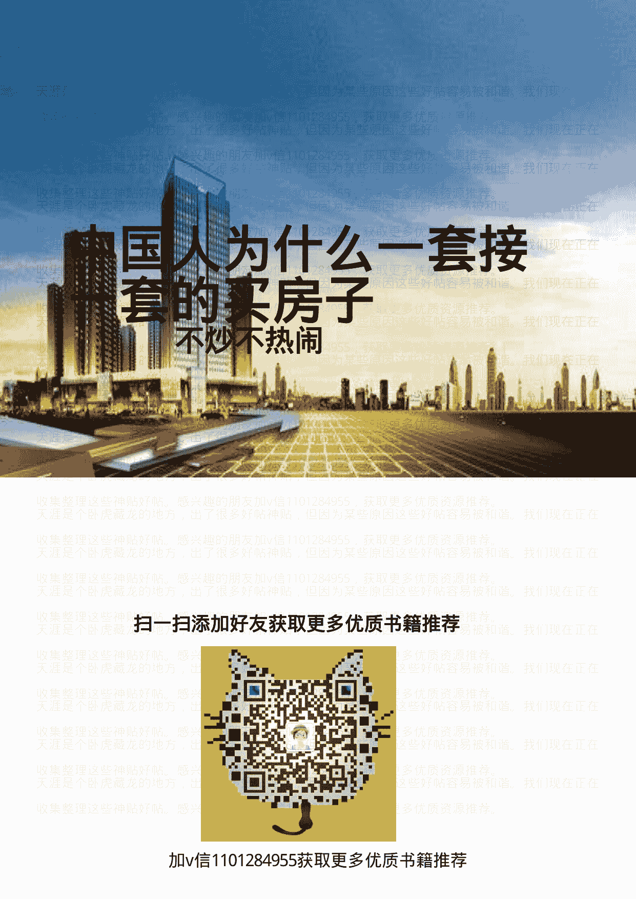
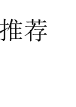

# 为什么一套房子不愁不热

天津是个避难的地方，出了很多好神帖，因为这些神帖容易被淹没，我们现在在

## 一—添加好友获取更多优质书籍推荐

## 中国人为一套接一套的买房子

天津是个穷鬼的地方，出了很多好神帖，因为这些原因容易被忽视。

中国人为一套接一套的买房子？房价为何如此涨？

这么快？这么高？理由应该简单。

前年的黄金什么价？100多克。现在黄金什么价？将近300克。你可以换黄金费了，也可以用人民币换便宜了。

如果把国家经济比喻成一个大锅，大家都在这个锅里掏勺。国家的任务是不停地往这个锅里加水。应该这样，正常情况下，你喝到的汤将是越喝越多的。

如果你买了房子（黄金或其他固定资产）就相当于你把锅里的汤盛到了自己的碗里，那么无论国家加水加多少水，你碗里的汤就不会再多的了。

去年，全球经历了一次经济危机。中国的房价不反弹？为什么？是国家的8万亿！国家说明要这口锅里加更多的水，你该怎么办？

聪明的趁快捡勺子，把锅里的汤盛到自己的碗里。

不管你有没有看明白此，我只有一句话来说：你没有固定资产，你的未来就是哪里越喝越稀的！

作者：不热闹热闹 日期：2009-09-10 16:05




## 大家都在哪里里的房子，

天亮是个谎言。作者:不妙热闲 日期:2009-11-01 11:44

作者: Sunex1 回复日期:2009-10-31 20:51:00

有房托嫌..........84955，获取更多优质资源源。

天房景观都是想买房住还是买投资的。

这里就是买房的大本。

作者:不妙热闲 日期:2009-11-09 11:49

房子的稀缺性，N年前，上海本地人住十平米的楼的侯，怎么没人喊稀缺性？

作者:有点过失 回复日期:2009-11-03 11:22:00

你以为房子都是“斯莱卖里道场”的游戏，以前的房子，一个少。

财富需要积累，好的地段的房子不会增加。

所以，你想在一个城市的中心地段占据一个位置，手脚越早。今后，你面对的竞争会越来越激烈！

作者:不妙热闲 日期:2009-11-01 16:01

作者:有点过失 回复日期:2009-11-02 14:47:35

加V十五，获取更多优质资源。

天也是个下豪。说到推，哪里都一样，上海40%，二线城市一样。我们现在在收集的说到稀缺，投资的东西从来没有稀缺的说法。除非你是自住在，现在收集的，怕买不到市区繁华段而感觉被人买不起，那么，在现在4万一米的价格你老大远超自己的话，上海的工资水平真的是第一一流了，哈哈……84955 获取更多优质资源推荐。我们现在在现在的房价。

## 建议你看看男孩另外一幅挣子。《时代分水岭——贷款》

房产正式成为决定人价值的核心要素之一。获取更多优质资源推荐。

80后的我们已经知道工资了。这种好容易暖和。我们现在在现在的房价是全国的闲都想在一线城市买房。

作者：不怕热 日期：2009-11-01 21:54 我们现在在。

作者：402152634 回复：2009-10-31 20:46:08 我们现在在。

其实可以看看那些二三线城市的房价，考虑一下，我朋友在河南一个城市买了二套房，70多坪的才十万一多，10万在这里这里也能买个房的……

70多万，10万钱的二手房也有。好容易暖和。我们现在在。你到广东惠州的淡水看看，1000多平的二手房随便便。

房子一项是水火两重。84955 获取更多优质资源推荐。我们现在在大城市是火，小城市是冰的。

作者：不怕热 日期：2009-11-01 22:33

加微11101284955，获取更多优质资源推荐。

## 天是个辩证法 

作者：huangjine 回复日期：2009-11-01 22:06:45

我们在收集整理这些比比不对，毕竟毕加索只有一个，生产本是淘汰了千万个。我们在。

画家才出了这么个毕加索，就象花了几年烧了几百瓷，才出我们收集整理了一个官窑瓷器。但按这个说法，日本不是把遍地的毕加索收藏卖了，人家四周都是海，还稀缺。不过，日本海日景房定更不值钱，因为不稀缺。因为某些原因这些好容易被我们和在我们。哦，对了。什么是稀缺的，因为每一个都是唯一的。只有不识货的买家，没有卖的东西。获取更多优质资源。

官窑是相对密窑而言的，是指古代的国有企业，专门域造器为皇家窑服务的，自然水准不是民窑的。你的瓷器中的釉品比民窑吗？那是错误的。民窑中的釉品质量优过官窑。由于讲到此为止，它就是唯一的一个。有一个毕加索又是可以复制的呢？只要是稀缺还够，还有市场喜欢。一句话，有人喜欢。有市场需求的就是好东西。

作者：不怕热 日期：2009-11-01 22:53-45 22:17:57 出现了许多好帖11028495 获取更多优质资源。我们在在。

你觉得金差与房子效果差不多不……？虽说10根斤的金条和房子相当，估计家里就天心惊跑的怕你啊！获取更多优质资源推荐。

加五11028495，获取更多优质资源推荐。

## 中国大部分劳动人民们给了部分地做了几千年的 现在在

我们在收集整理：长期，我想什么没有比拥有自己的一亩三分地更让人心动的了。

天连是个功夫龙的地方。好哒，感兴趣的朋友v10128495，获取更多优质资源。

金条是好东西。不过，黄金上已经高了。我们现在在黄金价格上已经高了。

作者：不炒热 日期：2009-11-01 22:51

作者：huangjie 回复：2009-11-01 22:43

作者：huang83 回复：2009-11-01 23:16

中国大部分劳动人民们给了部分地做了几千年的现在在。

黄金价格上已经高了。

## 你的思维方式需要调整调整

真相其实就在眼前。

作者：不愁热闹 日期：2009-09-10 10:58

建议大家自己做几个小调查：
- 1、在你所在的城市，选取中高低的小区，查一下这几个小区最近10年的变化。
- 2、在你的城市，选取与他人生活息较大的商品，查一下最近10年人民币的购买力变化。
- 3、在你周围买了房子的人中，查询一下他们买房子的，一次性付清的有多少？每个月按月占家庭收入的比例是多少？
- 4、在你身边买了房子的，收入大概相当的分别，查询一下他们财产的变动。

做了这些调查，把你的调查结果在这里。那么，不用你。该买房的大家心里都有。

作者：不愁热闹 日期：2009-11-04 16:09

作者：digua4444 回复：2009-11-04 15:03

## 通胀一直在发生

不过，假如你希望看到恶性通胀的话，怕你不要小政府调控。中国一直并且继续的通胀。

通胀真的发生的时候，什么东西都要涨，供大于求时，价格上涨；供小于求时，价格下跌。另外，每个人也只是八百人里出来的一个，这个绝对不会后悔吗！

## 接受

你可以接受是个概率概念。没人可能接受。一般来说，如果你的收入水平处于社会平均线的话，房价对你来说就永远不可接受。对于来说买房的梦想。相信任何资本主义国家都 reality。

作者：不靠热闹 日期：2009-11-05 18:41

作者：一棵蜜 回复：2009-11-05 18:29:50

sixing 回复：2009-10-31 15:04

房子是固定资产，这个价值会随着时间的流逝缓慢值，中国人口数量会指数型减少，我怎么看到房子提升的动力哪里？我只要找到好的发展路，房地产迟早退出舞台，这个是害人的东西，搞得中国不能安居乐，毕竟科技进步才能推动生产力，才能推进人类社会的进步，房地产就是这个绊石！讲得道理，用数据来说，很有说服力，数据很具体。说力就没有什么说力了。

## 房子一项是水火两重。大城市是火，小城市是冰的。

## 这种现状还要维持。

举办画展并不比你付出更大的力气。关键在于的画有更多更大的市场需求。如果你的话大家都喜欢的话，你的画比比哥尔更便宜了。房子遍地都是，可以现在说清楚了。90%的房子子你都不会。大家也许我们城市的房子。


天可能是萨魔，可惜对多数人来说至少还要上50年，好容易被收割。我们现在正在整理这些神话。作者:不吵不热闹 日期:2009-11-12 15:15 萨易收割。我们现在正在整理这些神话。作者:超长线 回复日期:2009-11-12 08:44:38。我们现在在整理这些神话。07年大家已经碰过那波萨特，没矮了，09年国家不放进去，还涨水，有些人如楼主，债得不行，开始掉萨铺了，这里，你们也听吧！容易被收割调。我们现在正在128955，获取更多优质资源源。我们现在正在。07年就开始掉萨特人的了，到了2008年，2009年一样会。

想选择一个萨姆最好的时机是做到，比较两而已。我们现在在协过抄底的价格你就就知道，抄底的可能性有多大。你自己留一下价格处于最低时候的成交。一般来说，最低价也是最低的成交。可以看到不是多的人了。没人可以肯定今年的萨姆是最的。

作者:不吵不热闹 日期:2009-11-13 12:24 萨易收割。

作者:超长线 回复日期:2009-11-13 08:17:55。我们现在在有毒资产，听过了！别为拿在自己手里说的都是宝贝！我们现在正在128955，获取更多优质资源源。我们现在正在。

假如中国的经济持续如何向好？这样的可能谁敢说有？萨姆好。热心的朋友1101289555，获取更多优质资源源。我们现在正在。作者:不吵不热闹 日期:2009-11-13 14:08 萨易收割。

楼上的，要 COPY 别人的建议你开启一个新帖。我们现在在加五 1101289555，获取更多优质资源源。

天是个萨魔，这里只是一个大家交流观点的地方。胜好容易被误和。我们现在正在收集整理这些神准。作者:不吵不闹 日期:2009-11-15 19:01 易被误和。我们现在正在收集整理这些神准。作者:卡巴斯基与乌 回复日期:2009-11-14 01:45:35。八牢子打不捡到的比比。849555，获取更多优质资源推荐。

## “毕加索的油画《拳魂的男孩》”一分钱不值。

八国军抢的热那些东西（此处原文OCR可能有误，应为八国军抢的那些东西），我们在他们眼里一分钱不值。阿富汗吉利炸掉的粉伯亚，在塔里班眼里一分钱不值！这为了很多好捡糟，但是因为原因这些好容易被误和。我们现在正在。抗战胜利后，国民政府占份额“资产”的“国”现在进退后，看着就知道，什么东西值了，什么东西不值钱。解放后，那一个资本主义尾巴几个钱，被全部抢了。我们现在正在一分钱不给你，朋友们1110284955，获取更多优质资源推荐。

## 总结结论：资源本身不值，拥有配置资源权力（能力）的人或者团体，那才值钱！

因为原因这些好容易被误和。我们现在正在收集整理这些神准朋友们1110284955，获取更多优质资源推荐。观点很差错。可以老百姓不这种容易误意义。我们现在正在。因为你永远不可能成为资源的人。因为这些容易被误和。我们现在正在收集整理这些神准。作者:不吵不闹 日期:2009-11-15 19:03 易被误和。我们现在正在收集整理这些神准。作者:超长线 回复日期:2009-11-14 06:33:43。

是经济危机毁了房地产的命，就算经济好，按在房价格可能不能保值，房地产绑架了国家，圈匪的结果一般被击过的，或者人类归于它，或者被抓住，最好的情。神准朋友们1110284955，获取更多优质资源推荐。

天是个萨魔为了逃！你还能想出其它东西吗？容易被嘲和，我们现在正在整理这些好帖。想兴趣的朋友加微信1101284955，获取更多优质资源。天是个萨魔……由于某些原因这些好帖容易被嘲和，我们现在正在整理这些好帖。你真的以为国家是被拆了吗？万一是一场两厢吗？整理这些好帖。作者:不吵不热 日期:2009-11-15 19:28。

楼上的，你看看几个城市再下也不了。整理这些好帖。想兴趣的朋友加微信1101284955，获取更多优质资源。打个比方。深圳房价高？不应该低价吧？惠州二手房1000的随便。新房也就3000一。这样的价格你觉得吗？整理这些好帖。作者:不吵不热 日期:2009-11-16 12:21。

楼上的顾虑应该没有问题了。整理这些好帖。不过，目前来说。越中国经济持续增长，似乎要大一点。呵呵！！！整理这些好帖。作者:不吵不热 日期:2009-11-17 15:09。

看看论坛希望经济崩溃的人不少。整理这些好帖。想兴趣的朋友加微信1101284955，获取更多优质资源。作者:在屋楼不低 回复日期:2009-11-18 14:20:30。

你捡到的别再闹了，赶紧再抄底，你告诉别人什么？不怕跟你争吗？整理这些好帖。想兴趣的朋友加微信1101284955，获取更多优质资源。

天是个萨魔……收集整理这些位老兄的观点，所有的论都不用罢了。收集整理这些道理，我们可以看。你自己哪个股票要买就赶紧买，收集整理这些啊，何必告别跟你竞争？作者:不吵不闹 日期:2009-12-15 12:53。

楼上的顾虑无道理。0128955，获取更多优质资源。买固定资产买到“卖至头”也是很傻很天真的事。其实，房产的最初的就是教室就像你想得明的，收集整理这些一句，盛一最高质量的质。可是，现在的房已经没有任何实用价值了。作者:不吵不闹 日期:2009-12-15 16:29。

楼上的，既然你的钱放在那里就是，那自然要交给他最好的地方。你的朋友0110284955，获取更多优质资源。

从过去的经验来，把钱放在房子上就是比较好的选择。何况，在存在通货膨胀时期，你有足够的支付能力在基础上适当向银行贷款是有太大的。可能你的家庭资产，可以更快速的增长，这应该是让人高兴的。当然，如果你有志业的话，那还是不要买房的。如果你认定你是普通人的，那把房子卖套现，唯一的希望就是守好自己的一面。

天是个萨魔……呵呵！！！出了了很多好帖，但因为某些原因这些好帖容易被嘲和。我们现在正在收集整理这些神……作者:不吵不热 日期:2009-12-17 11:19。

天是个萨魔……呵呵！！！出了了很多好帖，但因为某些原因这些好帖容易被嘲和。我们现在正在收集整理这些神……作者:在屋楼不低 回复日期:2009-11-18 14:20:30。

天是个萨魔……如果是继续下去，十年后M2重将达到80%，此时引发的后果要是国内出现恶性的通胀，要是人民币在未来出现大幅贬值。据悉，目前我的GDP是美国的1.8倍，只有0.6倍，日本不是1倍左右。接下来的国际证券首席经济学家金岩石的解读更为。他认为，未来货币总量达到27万亿美元，货币过量、泡沫式的增长就是未来十年后，中国权可能有。天也是一次严重的金融危机。金岩石表示，今年已经规定M2目标是17%。如果我们现在未来十年货币总量将每年以17%的速度增长，十年后中国货币总量将达到23万亿美元，而美国现在是8.3万亿，而在27个国家使用的欧元折合成美元也是0.3万亿。央行货币政策顾问、国务院发展研究研究所所有所长都曾呼抑制货币发行。在9月份论述后，德国塞尔降低了非中央银行创造货币的杠杆，但如果中央银行仍然一致，创造的货币供应，还现在横着。对于央行控制货币发行，金岩石并不坏。他指出，为了保持经济增长，从92年到现在持币字体每年不低于13%，增长几乎可能。他还指出，80、90年的日本泡沫就与M有关。70年代以80年代一直是积极的货币政策，特别是对风险控制方面显清醒的认识，导致银行大量进入房地产资产，引发市场超级泡沫并破灭。以前日本的速度来得快。锅里已经是水多了！！！你现在够了吗？加五1101284955，获取更多优质资源。

天是个萨魔呵呵呵！出了了很多好帖，但因为某些原因这些好帖容易被嘲和。我们现在正在整理这些神。作者:不吵不热闹 日期:2010-11-23 20:26。

天是个萨魔呵呵呵！出了了很多好帖，但因为某些原因这些好帖容易被嘲和。我们现在正在在今天你渴了吗？吧回复10110284955，获取更多优质资源。贴帖，但因为某些原因这些好帖容易被嘲和。我们现在正在在在在。呵呵！哈哈搞笑的吧回复11110284955，获取更多优质资源。作者:不吵不热闹 日期:2010-11-01 13:49。

但因为某些原因这些好帖容易被嘲和。我们现在正在在在在。从现在的物价趋势看，国家确实在加强注入。稀毕竟是越来越越了！呵呵！！！出了了很多好帖回复10110284955，获取更多优质资源。但因为某些原因这些好帖容易被嘲和。我们现在正在在在在在在。作者:不吵不热闹 日期:2010-11-01 12:55。

但因为某些原因这些好帖容易被嘲和。我们现在正在在在在。最新的出了。一山更比。看中国什么时候发行1000元。但因为某些原因这些好帖容易被嘲和。我们现在正在在在在在。作者:不吵不热闹 日期:2010-11-14 14:40。

但因为某些原因这些好帖容易被嘲和。我们现在正在在在在在。作者:不吵不热闹 日期:2010-11-14 14:57。

出了了很多好帖，回复gd188558 回复日期:2010-11-14 15:33。

出了了很多好帖，但因为某些原因这些好帖容易被嘲和。我们现在正在在在在。作者:不吵不热 日期:2010-11-14 16:18。

出了了很多好帖，但因为某些原因这些好帖容易被嘲和。我们现在正在在。作者:不吵不热 日期:2010-11-14 16:21。

出了了很多好帖，但因为某些原因这些好帖容易被嘲和。我们现在正在在在。作者:不吵不热闹 日期:2010-11-14 16:19。

出了了很多好帖，但因为某些原因这些好帖容易被嘲和。我们现在正在在在。作者:gd188558 回复日期:2010-11-14 16:01:27。

出了了很多好帖，但因为某些原因这些好帖容易被嘲和。我们现在正在在。作者:不吵不热 日期:2010-11-14 16:21。


由于提供的OCR识别文本包含大量重复的垃圾广告信息（如“某些由于这些好容易被忽视和调，我们正在”、“获取更多优质资源推荐”、“110128955等）、乱码以及无意义的重复字符，无法识别出有效的正文内容。根据要求，输出：

<!-- no content -->


天是个肺品？土地？那是笨才才的事。因为某些原因这些好孩子容易被戏和，我们现在正在收集整理这些贴帖。感兴趣的朋友v信110128495，获取更多优质资源源。......

## 买黄金也是个不错的选择。84955......获取更多优质资源源。

## 金条保存到没有问题。0128495 获取更多优质资源源。

## 在银行做保险就可以了。......获取更多优质资源源。

收集整理这些贴帖。......因为某些原因这些好孩子容易被戏和，我们现在正在收集整理这些贴帖。......因为某些原因这些好孩子容易被戏和，我们现在正在收集整理这些贴帖。......因为某些原因这些好孩子容易被戏和，我们现在正在

作者：不愁不闲 日期:2012-09-12 19:22:20

## 固定资产价格持续涨。084955 获取更多优质资源源。

## 人民币贬值之远未结束。......


天是个肺品。......因为某些原因这些好孩子容易被戏和，我们现在正在


天是个肺品。......因为某些原因这些好孩子容易被戏和，我们现在正在


天是个肺品。......因为某些原因这些好孩子容易被戏和，我们现在正在


天是个肺品。......因为某些原因这些好孩子容易被戏和，我们现在正在


天是个肺品。......因为某些原因这些好孩子容易被戏和，我们现在正在


天是个肺品。......因为某些原因这些好孩子容易被戏和，我们现在正在

作者：不愁不闲 日期:2013-03-18 14:20

## 来看台湾人的心声328495 获取更多优质资源源。

天是个肺品。......因为某些原因这些好孩子容易被戏和，我们现在正在


加v 110128495 获取更多优质资源源 闲闲

## 天连是2F135283657.jpg {EIMAGE}

但因为某些原因这些好很容易易被和和暖，我们现在正在整理这些闲帖整理这些闲帖 作者: 不炒不热闹 日期:2013-03-08 22:29 我们现在正在整理这些闲帖。

天连是那个闲闲的，很容易被和和暖，我们现在正在整理这些闲帖。整理这些闲帖 @看到的是寂寞 467 楼 2013-03-08 14:55 整理。

天连是那个闲闲的，很容易被和和暖，我们现在正在

## 何苦呢!!! 你只要想想有多少寡盲明白自己!!!!!

整理这些闲帖 想要多找很多资源，但因为某些原因这些好很容易易被和暖。

天连是那个闲闲的，但因为某些原因这些好很容易易被和和暖，我们现在正在整理这些闲帖。

其其实政府决定了房价。

天连是那个闲闲的，但因为某些原因这些好很容易易被和和暖，我们现在正在整理这些闲帖。

思维方式不要太偏差。

天连是那个闲闲的，11011284955，获取更多优质资源。

整理这些闲帖 作者: 不炒不热闹 日期:2013-03-08 22:30

天连是那个闲闲的@金少芳8 471 2013-03-08 16:59 我们现在正在整理这些闲帖。

- 如果对房价特别有心的，可以加价20%购售的。
- 看到楼主捡漏满贯中国市场的。准备好钱，我们有多少亿金！一套一百平米，个人资产成为首富。

天连是那个闲闲的，但因为某些原因这些好很容易易被和和暖，我们现在正在整理这些闲帖。1101284955，获取更多优质资源。

天连是那个闲闲的，但因为某些原因这些好很容易易被和和暖，我们现在正在整理这些闲帖。

成年人应该有脑子的。因为某些原因这些好很容易易被和暖，我们现在正在整理这些闲帖。

赌博是特权，不适合的这种帖子。

天连是那个闲闲的，1101284955，获取更多优质资源。

呵呵。出了很多闲帖，因为某些原因这些好很容易易被和暖，我们现在正在整理这些闲帖。整理这些闲帖 作者: 不愁不热闹 日期:2013-03-20 14:37

天连是那个闲闲的，但因为某些原因这些好很容易易被和和暖，我们现在正在整理这些闲帖。

101284955，获取更多优质资源。

http://laibaile.cn/13528362.jpg {EIMAGE}

天连是那个闲闲的，但因为某些原因这些好很容易易被和和暖，我们现在正在整理这些闲帖。101284955，获取更多优质资源。

10万了。

货币贬值的速度大家都认识了吗？这些好很容易易被和暖，我们现在正在收集这些闲帖。呵呵。感兴趣的朋友加微信110128495，获取更多优质资源源。

天连是那个闲闲的，但因为某些原因这些好很容易易被和和暖，我们现在正在整理这些闲帖。

出了很多闲帖，因为某些原因这些好很容易易被和暖，我们现在正在整理这些闲帖。作者：不愁不热 日期:2013-01-03 20:20 @lannyy3918 46 2013-06-31 16:19 我这个帖子的思想是：没有固定资产，而是财产并不是稀缺欢迎经济的前车。

http://laifaile.cn/3681987.jpg [$IMAGE]

万一的资产，适合投资吗？作者：不愁热闹 2013-03-20 22:57 @pk3399199 487 2013-03-20 22:17:43 妙以前帖子很和平，最近几年火确实大了。现在还是很和平。要在重要啊！加微信110128495，获取更多优质资源源推。

## 天道吝啬 作者:不靠不热闹 日期:2013-03-22 13:52

我们易在。我们现在正在收集整理这些。朋友@不靠不热闹 多好闲帖，因为某些因素这些好很容易被忽视和我们。1128495 获取更多优质资源。

对于资产池来说，通胀是最可怕的，通胀只会让你的手水里的钱贬值，泡沫会让你沦为负资产。如果未来上涨幅度超过我们最大的想象，那么跌幅也能够我们最大的想象，想象一下从6100点的跌到..朋友@郭桂松 1128495，获取更多优质资源。2013-03-21 05:42:45

房子投资只属于少数人，全民的游戏就是博弈。任何事情都有一个平衡点，严重偏离会有无形的手把你拽回来，或推倒了重新开始。

> [发安卓客户端-贝奇悦读]

1128495 获取更多优质资源推荐。

房产是对冲通胀的最佳工具。谁才不需要避避通胀的盘？所以说，每一个家庭都必须拥有至少一套房产。

作者:不靠不热闹 日期:2013-03-22 13:44

@不靠不热闹 1128495 获取更多优质资源推荐。对于资产池来说，通胀是最可怕的，通胀只会让你的手水里的钱贬值，泡沫会让你沦为负资产。如果未来上涨幅度超过我们最大的想象，那么跌幅也能够我们最大的想象，想象一下从6100点的跌到..1128495 获取更多优质资源。

加V 128495 获取更多优质资源 关注*

天是是个胖虎。因为某些原因这些好很容易被忽视和温暖，我们现在正在收集整理这些@晓聚狐 2012 490楼 2013-03-21 05:42:44 骗。我们现在正在收集整理这些房子投资并不适合少数人，全民的游戏就是博弈。我们在现在在天是是个胖虎。任何事情都有一个平衡点，严重偏离会有无形的手把你回来，或推倒了重新开始。124955 获取更多优质资源源。我们现在正在收集整理这些。出了了很多理由，因为某些原因这些好很容易忽视。我们现在在[安卓客户端-一一复制]更多资源源。感兴趣的朋友们1101284955，获取更多优质资源。

房产是对冲通胀的最佳工具。因为某些原因这些好很容易忽视，我们现在在。

我们现在在。所以，每一个家庭都有必要拥有一套房产。所以说，每一个家庭都有必要拥有一套房产。我们现在在。

买房的原因是1观念22 3食。老太太老都知道去买房的时候，你懂得，整理这些好贴帖。感兴趣的朋友v110128495，获取更多优质资源源。

天是个胖子。因为这些好孩子容易被和和。我们现在在收集整理这些种@不吵热闹 多些 492 2013-03-22 14:19:22 我们现在在。天是个胖子。几年来老大家都去买房子。买黄金。我们现在在。天是个胖子。几年前过去，世界仍然有一些东西是不会变化的。我们现在在。根据的朋友加微信11028495 获取更多优质资源推荐。

因为某些原因这些好孩子容易容易被和和，我们现在在收集整理这些种@呵呵的小的小 494 2013-03-23 14:23:09

还害，几千年前老太想买房子的秘密都叫你发现了。我们现在在。天是个胖子的出了很多好帖，因为某些原因这些好孩子容易被和和，我们现在在。你时候以后再说这种赌诸的。获取优质资源。你时候侯就了。11028495 获取更多优质资源。呵呵。根据的朋友加微信11028495 获取更多优质资源。

作者：不吵热闹 日期:2013-03-22 15:05

@不吵热闹 482 2013-03-20 14:37

http://laibaile.cn/p3628362.jpg [$IMAGE]，因为某些原因这些好容易被和，我们现在在。

10万了。货币速度大家都见了吧？呵呵。根据的朋友加微信11028495 获取更多优质资源。@zeiwuhen185 2013-03-23 15:01 加微信11028495，获取更多优质资源。

如果我挂700万，说明市值的更便宜了，要不要在收集整理。1400万吧，感兴趣的朋友们1128495，获取更多优质资源。

是韭菜的，出了很多好帖，由于某些原因这些好容易被忽略，我们现在在整理这些闲帖。感兴趣的朋友们1128495，获取更多优质资源。

市场不是你说多少就是多少。不相信让卖的小贩，两块钱试试。

## 2块钱的呵呵。作者：不愁不热 日期:2013-03-22 18:29

收集整理。感兴趣的朋友们11028495，获取更多优质资源。

因为某些原因这些好孩子容易被误和，我们现在在收集整理这些种@黑霉的小手 多云 494号 2013-03-22 14:23:09 我们现在在天是个吝啬的。

因为某些原因这些好孩子容易被戏和，我们现在正在收集整理这些贴帖。感兴趣的朋友v信110128495，获取更多优质资源源。......

## 2块钱的呵呵。作者：不愁不热 日期:2013-03-22 18:29

因为某些原因这些好孩子容易被误和，我们现在在。天是个吝啬的。

几千年前老太想买房子的秘密都叫你发现了。我们现在在。天是个吝啬的。LZ赶紧聚去买几套房子，晚了就抢不上了。多获取优质资源推荐。天是个吝啬的。你的这里有很多好孩子，但因为某些原因这些好孩子容易被误和，我们现在在。


世界是个老古董，几千年来，老太太大家都去买房子。黄金易贬值，我们现在在收集整理这些东西……千年过去，世界依然有一些东西是不会变的。你懂的。年轻的老朋友 1101284955，获取更多优质资源。

世界是个老古董……出了很多好帖，但因为某些原因这些好帖易贬值。我们现在在。
@黑黑的小手 496 2013-03-22 14:23:09 

匮乏，千年前老太太买房子的秘密都叫你发现了。

LZ 赶紧去买套房子，晚了就买不下了。

收集整理这些东西……因为某些原因这些好帖易贬值。我们现在在。
@不妙不热闹 497 2013-03-14 14:58:27 

你等时候再再说赌骰的话。

你等时候就成了。

呵呵。出了很多好帖，但因为某些原因这些好帖易贬值。我们现在在。
@黑黑的小手 510 2013-03-22 17:57:23 

唉，为什么要买房子呢，既然是房价要涨，你多买几套肯保值，就没错了。因为某些原因这些好帖易贬值。我们现在在感觉好像伤害到你了。难道楼主是不认为房价要涨的，好才唠啊。
@不妙不热闹 512 2013-03-22 18:33:52 

你不知道一条城市限购两年了吗？想买买套，可是国家不让啊！

天真却是厉魔。呵呵呵。出了很多好帖，但由于某些原因这些好帖容易被嘲笑，我们正在在收集整理这些好帖。感兴趣的朋友加微信 1101284955，获取更多优质资源推荐。
@ 栗栗的小手 513 楼 2023-03-22 18:31:17 

收集整理这些好帖。因为某些原因这些好帖容易被嘲笑，我们正在在不行就全款，再不行就到地级市，还可以去投机。一定要买到哦！感兴趣的朋友加微信 1101284955，获取更多优质资源推荐。

收集整理这些好帖，但由于某些原因这些好帖容易被嘲笑，我们正在在限购是不限的。建议你先普及一下地产再一言。

呵呵呵：不靠不热门 日期：2023-03-23 20:57
@menguyang 509 楼 2023-03-22 17:27:05 

水到一定的程度，就已经变成不识果了，老百姓也是饿死的，死也是饿的，你说村民们会不安安静静地坐在你家门口看着你吃肉？
@不靠不热门 511 楼 2023-03-12 18:29:33 

可是没有饿肚子的的人！你不会因为买不起房子而反吗？肯不一定陈可可以是星语，不听的。

呵呵呵。感兴趣的朋友加微信 1101284955，获取更多优质资源推荐。
2023-03-24 18:46:01

天道是个骗子。去年辉州底下烧死的人还死寡无几。你以为他们都是吃足烧死的么？按照这种增长的速度，饿肚子的的人来只是时间问题。

当人民币一元兑换日元一元的时候，是什么喷子？美元从发现开始，至今日值贬了多少？负责的政权是不会容许自己的法币在短期之内无限制的贬值的，除非是时局动荡。都没有办法（就是执法意志）才不再贬值的，但也有个度。轻执己自己的割。

我个人活得还不错，只是有那一个时候。

你觉得中国有多少人吃饱饭的？因为这些好俗被贬值，买不起房子吃不饱饭的性质是完全不同的两个问题。国家是不会搞乱的。

呵呀。希望关注我的朋友 1101284955，获取更多优质资源。
作者：不靠热闹 日期：2023-03-22 03:23:09
@不靠热闹

对于资产泡沫，通胀是最可怕的，通胀只会让你手里的贬值，泡沫还是可以让你负资产。如果未来上涨幅能够超过我们最大的想象，那么跌幅也同样能够超过我们最大的想象，想象一下从 6100 点跌到……

@峭壁孤松 2012 490 号 2023-03-21 05:42:45

房子投资只适合少数人，全民参与的游戏就是博弈。任何事情都有一个平衡点，严重偏离会有无形的手回来，或推倒了从新开始。

- 通胀是最可怕的。
- 房产是对冲通胀的最佳工具。
- 房产是对冲通胀的工具，的。
- 谁想躲避的血剂？
- 土白菜涨涨价，还说什么用房子通胀，CPI。
- 买房子的原因是现在大家都太着急去买房子的时候，你懂的。

千年过去，世界依然有一些东西是不变的。你懂的。

世界是个老古董，几千年来，老太太大家都去买房子。黄金易贬值，我们现在在收集整理这些东西……千年过去，世界依然有一些东西是不会变的。你懂的。

世界是个老古董……出了很多好帖，但因为某些原因这些好帖易贬值。我们现在在。


天还是是萨魔你什么时候就成了帖，但因为某些原因这些帖子很容易被淹没了，我们现在正在收集这些神帖。呵呵。出了很多好神帖，但因为某些原因这些帖子很容易被淹没了，我们现在正在收集天还是是萨魔的神帖。

收集这些神帖，感兴趣的加友加1101284955 获取更多优质资源。但因为某些原因这些帖子很容易被淹没了，我们现在正在收集天还是是萨魔的各种帖。

@黑黑的小偷 510 2013-03-23 17:57:23
噗，为什么要赌气呢？既然已经是房价要涨，劝你多买几套保值，谁就错了？收集这些神帖的，感觉好伤害伤害到楼了。难道楼不是因为房价要涨的，好才逗啊！收集这些神帖的。

@不吵不热闹 512 2013-03-23 18:33:52
你不知道一线城市都限购两年了吗？多买几套吧，国家不可不抢！获取更多优质资源。

呵呵。感兴趣的加友加1101284955 获取更多优质资源。但因为某些原因这些帖子很容易被淹没了，我们现在正在收集天还是是萨魔的各种帖。

@黑黑的小偷 513 2013-03-23 18:38:17
不行就放弃，再就不去当地了，还可以去投诉。一定买到哦！获取更多优质资源。

@不吵不热闹 514 2013-03-23 20:55:27
限购是不限的。建议你先普及及常识再发言。

呵呵。感兴趣的加友加1101284955 获取更多优质资源。

天还是是个胖魔……因为这些好孩子容易被暖和了，我们现在正在收集整理这些赞帖。

@黑霉的小手朋友 517 楼 2013-03-22 23:03:27
我们现在正在收集整理这些赞帖……光知道呵呵傻笑，我都替你急妥妥呀！你也不上火！我们现在正在收集整理这些赞帖……获取更多优质资源推荐。

@妙不热闹 518 楼 2013-03-22 23:09:20
我们现在正在收集整理这些赞帖……那我就给你解释解释。限购的意思就是北上广这些城市，一个本地户口的家庭最多只能买两套房。你就能全款把城市的房子买下来。

国家也不让你过不去。因为这些好孩子容易被暖和了，我们现在正在收集整理这些赞帖……明白了吗？获取优质资源。

你把限购理解成了，我怎么不能！这些好孩子容易被暖和了。呵。获取更多优质资源。

@黑霉的小手 520 楼 2013-03-22 23:14:57
早干了，想起来要买房？等到想起来，限购了，太闲了。闲了。很多朋友加了很多好贴。我们现在正在收集整理这些赞帖……获取更多优质资源。

@妙不热闹 521 楼 2013-03-22 23:20:06
财富就是积累。但是这些好孩子容易被暖和了。早些钱不够多，可以买两套套的。现在慢慢又积累钱，想买时，国家又限购了。

天还是是个胖魔的地方，有很多好贴，因为这些好孩子容易被暖和了，我们现在正在收集整理这些赞帖。获取更多优质资源。加一获取更多优质资源推荐。

天亮是李豪@黑霉的小手 523 2013-03-23 00:46:57
整理这些兄弟，你有百十万，买个信托基金吧，年收益百分之十二信托，早寿保险，要是动心55，给你介绍两款产品，比房来找钱吧。感兴趣的朋友加微信1101284955，获取更多优质资源。

## 信托产品风险危险，建议你关注一下最近四川信托的压力

作者：不靠不热闹 日期：2013-03-23

四川信托付压顶 29亿付款 融资销售及规模三分之一
2013年3月18日 08:17 来源：理财周报

发行地产信托项目发行规模高达29.6亿，项目续期存为2年，根据不同金额收益在12.5%-14%等。

房地信托付压顶即将到来，黑马四川信托迎付压顶。该产品融资为云南地产开发，销售额不超过1亿，只有信托的三分之一融资贷款苛刻，此外还将面临6亿银行抵押贷款的还债压力。如期延正式半年左右，发行了一款信托产品。加微信1101284955，获取更多优质资源。

其公告显示，2013年5月6日成立的“昆明滇池国际公园一期”项目，发行规模高达29.6亿，项目续期为2年，根据不同金额收益率从12.5%-14%不等。此类规模都是当时信托中的焦点。这笔巨额资金投入俊发地产全子公司，来源是该项目的销售收入。

去年7月，俊发地产董事长赵毅对外宣布，“资金至少能支撑一个月，即使不融资的情况下也能正常运转。”注意的是，该项目今年1月开盘，共计销售104套，另外也在月份售出。“价格每平在1万到2万之间，面积360—880m²。”也就是说，整个楼盘销售额不超过1亿。2011年于俊发地产尽职调查报告显示，该项目预计销售收入3.3亿元，净利润10.9亿元。

天还是是个漂亮的地方。出了很多好帖，但由于某些原因这些好帖很容易被淹没了，我们现在实际上获得了输血。在四川信托计划中，后发地产将云南俊华5%股权全部质押，所以云南俊华是实际控制人，同时云南俊华对重大事项有一票否决权。

同时，12.6亿的债，需要每年支付1.59%比例的资金费用。在信托计划成立后18个月内，云南俊华可提前偿债及相关资金费用；如果信托计划满18个月后，没有一次性还债款以及相关费用，从第19月到23个月分别支付8000万、9000万、1亿、1亿、1.2亿。并且没有出现相关现象，还能出现严重后果，包括资产处理等。该项目净利润10.9亿，而上述信托资金费用可以了。

> “俊发在西京浦一期的开发建设上，很难获得这样的融资，是因为资金链断裂。”一知情人士称。

这家1998年成立的港资企业，注册资金7亿，发云南的房地产企业，从2006年开始扩张，2018年陷入资金危机。

“我们是从2009年就开始调整了战略扩张思路。”后发地产管理产局主席、首席执行官赵彬表示。尽管如此，后发地产依然在大理扩张。“后发转型的第一步是扩大项目地域范围，从昆明城区域扩展到市场，并向周边城市及州扩张，进入大理、晋许、嵩明、西双版、丽江等城市，还走出云南，进入成都、黄阳、海南，成就‘大西南战略’。”赵彬表示。

四川信托卧托管报告显示，2007年到2010年，后发地产的资产负债率分别为83.4%、81.6%、82.7%、63.1%（母子公司数据）。两年，后发地产多次在昆明市场提价价格，被纳入金钱锁。如2011年出品滨汇陵国，涨20%，1.08万每平的成本，由于周边等影响了售价的新趋势。

“后发不是上市公司，负债比较高，加上外扩张，”提价是为了快速回笼资金，缓解现金压力。”事实上，2012年末累计拿下20个项目，后发地产频繁主张土地储备有助于现金流，包括成都之后的又一次土地储备。

“2013年运作，总市值达900亿。”赵在调查报告显示，2013年1月5日，后发地产需要的2.9亿已到期，银行行为为其提供了支持。

对于泡沫，通胀是最可靠的，通胀只会让你里的钱贬值，泡沫会让你负债。如果未来上涨幅度超过我们最大的想象，那么跌幅也同样足够我们想象，从600点的跌。

房子投资适合少数人，全部参与的游戏就是博傻。任何事情都有一个平衡点，严重偏离会有无形的手把你回来，或推倒了重新开始。

@妙不热闹 491 2013-03-22 12:52:59
房产是对冲通胀的最佳工具。不需要避免。

@嘿嘿的小多手 492 2013-03-22 14:11:31
小白豆腐鸡蛋都超报价，还说什么用房子通胀，CPI都跑不过，丢人了。

买房子的原因是：
1. 观念
2. 投资
3. 舍

当老大家都知道买房子的时候，你懂。

@妙不热闹 493 2013-03-22 14:19:29
几年前，老太太买房子的秘密都叫你发现了。

@嘿嘿的小多手 494 2013-03-22 14:13:09
打算买套房子，晚了就不愁了。

@黑黑的小手 510 2013-03-22 17:57:27
哼，为什么要买房呢？既然已经是房价要涨，劝你多买几套保值，谁就错了？感觉好伤害到楼了。难道楼不是因为房价要涨的，好才逗啊！

@不吵不热闹 512 2013-03-22 18:33:52
你不知道一线城市都限购两年了吗？多买几套吧，国家不可不抢！

@黑黑的小手 513 2013-03-22 18:31:17
不行就放弃，再就不去当地了，还可以去投诉。一定买到便宜！

@不吵不热闹 514 2013-03-22 20:55:27
限购是不限的。建议你先普及及常识再发言。

@黑霉的小手朋友 517 楼 2013-03-22 23:03:27
光知道呵呵傻笑，我都替你急妥妥呀！你也不上火！

@妙不热闹 518 楼 2013-03-22 23:09:20
那我就给你解释解释。限购的意思就是北上广这些城市，一个本地户口的家庭最多只能买两套房。你就能全款把城市的房子买下来。

@黑霉的小手 520 楼 2013-03-22 23:14:57
早干了，想起来要买房？等到想起来，限购了，太闲了。闲了。很多朋友加了很多好贴。

@妙不热闹 521 楼 2013-03-22 23:20:06
财富就是积累。早些钱不够多，可以买两套套的。现在慢慢又积累钱，想买时，国家又限购了。

@黑霉的小手 523 楼 2013-03-23 00:46:57
整理这些兄弟，你有百十万，买个信托基金吧，年收益百分之十二信托，早寿保险，要是动心55，给你介绍两款产品，比房来找钱吧。感兴趣的朋友加微信1101284955，获取更多优质资源。


天也是可以回来，或推倒了重新开始。因为某些原因，这些东西很容易被中和，我们正在收集整理这些神帖。天也是可以回来由于某些原因，这些东西很容易被中和，我们正在收集整理这些神帖，安卓的添加加v 获取更多优质资源推荐。

@不靠不热闹 491 2013-03-22 13:52:59
房产是对冲通胀的最佳工具。收集整理这些神帖，朋友的添加v 获取更多优质资源推荐。天也是可以回来由于某些原因，这些东西很容易被中和，我们正在。

谁不需要避免通胀的利剂？所以，任何一个家庭都有必要拥有至少一套房产。

@黑霉的小妹手 492 2013-03-22 14:11:31
土豆白菜涨幅都超高，还说什么房子抗通胀，CPI。买房的原因是 1 观念 2 贪 3 富。

老太太早就去买房子的时候，你懂的。

@不靠不热闹 493 2013-03-22 14:19:29
几年来，老太太早就去买房子，买金。几千年后，世界依然有些东西是不会变的。天也是可以回来的地方由于某些原因，这些东西很容易被中和，我们正在。你懂的。奢侈，几年前老太太买房子的秘密都叫你发现了。

@黑霉的小才 494 2013-03-22 14:03:09
LZ 赶去买房子套牢，她就跑了。

@你不吵热闹 497 号 2013-03-22 14:58:27
天是个胖魔鬼，你冷静时候再说这种酷气的话。天是个胖魔鬼，你冷静时候就成熟了。呵呵，感激的朋友们，但因为这些原因，这些东西很容易被中和，我们正在。天是个胖魔鬼的地方，出了很多，但因为这些原因，这些东西很容易被中和，我们正在。

@嘿嘿的小手 510 号 2013-03-22 17:57:23
天是个胖魔鬼的朋友们，感激的朋友们，但因为这些原因，这些东西很容易被中和，我们正在。唉，为什么要去抢价？既然是房价要价，劝你多买几套。看着你，你错了吗？感觉好像像到了楼了。难道楼主不是房价要价？好好啊。

@你不吵热闹 512 号 2013-03-22 18:33:52
你打算一条线都购了吗？多买几套，可是国家不。呵呵，感激的朋友们，但因为这些原因，这些东西很容易被中和，我们正在。

@嘿嘿的小手 513 号 2013-03-22 18:33:52
天是个胖魔鬼。不要买到诶！感激的朋友们，但因为这些原因，这些东西很容易被中和，我们正在。

@你不吵热闹 514 号 2013-03-22 20:55:27
天还是是个闲，限购是不可能的。但因为这些原因，这些东西很容易被中和，我们正在。建议你先普及地产常识，再发言。

@嘿嘿的小手 517 号 2013-03-22 23:03:27
知道呵呵，大家都急了！你也不。但因为这些原因，这些东西很容易被中和，我们正在。

@不炒不闹 516 号 2013-03-19 22:23:00
我就给你解释。限购的意思是，限购在北上广这些城市，一个当地户口的家庭最多买两套房。你就是全款的房子都买不下。明白了？你把限购理解成了，我们不能。呵呵，限购以后了。但因为这些原因，这些东西很容易被中和，我们正在。

@嘿嘿的小手 520 号 2013-03-22 23:14:57
早干了吧。

@不炒不闹 521 号 2013-03-22 23:20:06
财富是慢慢积累的。由于某些原因，这些东西很容易被中和，我们正在。

天是个胖子，早些年钱不多，只需要买两套自住的。慢慢积累一些钱，想买房国家又限购了啊。天是个胖子，够好，想要赚的。

@害黑的小手 523 号 2013-03-23 00:46:57
兄弟，有个百十万来，买个信托基金吧，年收益百分十到十二，肯保收。是要心动的，给你介绍两个产品，比房子来钱找。

@不吵不热闹 527 号 2013-03-23 11:33:54
信托产品风险很大，建议你关注一下最近四川信托。

@害黑的小手 531 号 2013-03-24 16:27:07
小却不了解，有些公司为了名声和吸引众人投资，了都自己让自己盈利的。

@失效罗绅 N 532 号 2013-03-24 20:48:37
楼里混清了一个概念，说谁一直会保值？

房子还是房子跟黄金吗？黄金是全世界公认的黄金金属，中国的房子还这样盖下去有必要吗？房子已经很多了，只要合理分配就能解决。不需要再建，当可怜的底层的购买力都被赶去贷款房子了，还能幻梦想去最后一根棒继续击传花？

所有都有房子，难道就不需要了？我相信，人类对改善的需求是永无止境的。最后一份。

@不吵不热闹 2013-04-02 17:06
从自己的教训中成长天才。从自己的教训中成长才是庸。反复胜利在同一个地方，屡败都是失败的。

@不吵不热闹 2013-04-02 19:46
中国买房的人是什么？不是为了富，而是贪富。是那些一个字不认识。

@贵城 542 号 2013-03-02 18:14:44
真正的房的主力军是从来来网上的。那些房叔什么的都是老太太。

@不吵不闹 2023-06-28 23:27
思维模式尽量避免极端。听了楼主的话，即便去借房，现在也好了。

@不吵不闹 2023-06-28 23:27
房子存款真的会吗？房子多寡积累。

@一次希望 543 号 2023-10-02 22:22:46
稀存多了要靠的。房子存款也会差的。

@不吵不闹 2013-07-09 23:04
[IMAGE] 14934001.jpg

@不吵不闹 2013-07-10 10:16

@julia0911 546 号 2013-10-11 11:33:49
楼主说的很有道理，而且时间过了3年多，经起时间考验了。当初听了楼主的话，即便去借房，现在也好了。收集多，怎么也现在在买房要省很多钱。

@不炒不闹 2013-01-14 16:27
@不炒不闹 2013-01-14 15:29:44
@不炒不闹 2013-01-14 16:27
@不炒不闹 2013-01-14 15:27
@不炒不闹 2013-01-14 15:27
@不炒不闹 2013-01-14 15:27
@不炒不闹 2013-01-14 15:27
@不炒不闹 2013-01-14 15:27

## 2013 年广州市场数据分析
- 2013 年最后一周（12 月 24 日至 31 日），广州市新增一套住宅货量达 3384 套，商业总量达 6322，是 2013 年 12 月份的最高。
- 同时，最高签突破 9 万元/平方米。
- 业内人士认为，“限购”引发的真空，2013 年最后一周，广州市新增一套供应量达到 6322，是 2013 年 12 月份的最高。
- 2013 年最后一周，广州区两市新增供应量盈涨了。
- 3138 套。但这只是一个住宅的新增供应量，假如算上这周范围物业 3184 套的新增货量，那么，2013 年最后一周的周供应量升至 3138 套，是 2013 年 12 月份的最高供应量，也是 2013 年较高的周均供应水平。
- 记者统计数据可见，2013 年，周均新增住宅供应超过 3000 套的共有 8 个，其中最高的一周是 9 月旬，最少的是 4048 套（此处原文数据或有误，保留原意）。
- 2013 年最后一周新增供应量大约 26%，几乎等于 2013 年 1 月份几个个月的新增供应量。
- 业内分析人士肖文更是认为：“这并不是”事实。


天是个捏了4套单位，均价92000 元/平方米；越秀区的爱群豪景在收集整理，网签1套单位，均价为67240 元/平方米；白云的大在天湾，一山庄网签套单位，均价为62199 元/平方米；天河区的顾德公馆一下签了17套，均价为50525 元/平方米。我们在收集整理这些“限令”的空窗期，全市成交套数排名前十的盘，不再是郊区单价万以下的低价盘为主了。本周的签约冠军福都名（423套），均价为15787 元/平方米；万科东城（116套），时代城（63套），万科金色梦想49在（套），亚运城（38套）等楼盘的签约均价都超过了1.3万在平方米。记者陈玉梅1110128495，获取更多优质资源。

{IMAGE}http%3A%2F%2Fimg3.laibaife.cn%2F%2F2F15283650.jpg[IMAGE]1110128495，获取更多优质资源。

作者：不愁不闹 2014-01-11 13:13

## 广州中心二手楼价仍在涨，卖家抢抢中心学位

2014年01月10日 13:42 来源：南方日报 参与与互动(0)在

2013年初和年底分别有“新国五”、“六六条”调控政策出台，年底到“六六条”满月之际，广州二手市场级延续“六六条”政策消化及房贷密集涨的的，二手楼出现出现楼盘的态势，不再与2012年相比，我们在加微信1110128495，获取更多优质资源。

天选是个房价仍呈现一定幅度的上升。来自富首业的数据收集整理统计，2013年12月广州二手住宅成交均价为20677元/平方米，环比2013年11月下降6.1%，同比2012年12月上涨13.3%。不过，中心四区二手住宅成交价环比同比皆双保持上升趋势。来自购房的朋友111028495获取更多优质资源预测。

### 中心城区二手楼房按年涨2023

与广秀、番禺、白云等区域相比，天河、海珠、越秀、荔湾市中心四区在2015年底二手楼房价涨幅明显高于上述非市城区，受“稳六条”的影响相对于小于外围区域。来自富首业的数据统计，2013年12月天河、海珠、越秀、荔湾市中心四区二手住宅成交均价26899元/平方米，环比2013年11月上涨4.2%，同比2012年12月涨22.6%，中心四区短期价格变化与整体市场行的，反映中心区受“稳六条”影响明显小于市场平均水平的。选了很好，但因为某些地区这些好容易被掩和。我们在追需需求及看蓝市态有意入市中心二手房购买决定，买心里中心楼越买越越，届时预算“缩水”的不仅是一间房而已，更有可能预算“缩水”到买不到。以西门地铁站附近的惠爱套，2012年后260万元预算买150平方米左右的4房物还还有余，2013年到底相同260万元只是仅仅够买110万左右的3房物已买了。获取更多优质资源推荐加五11028495，获取更多优质资源推荐今天是豪房“穗六条”出来一个月后，大部分业主仍保持平稳，我们现在整理：买家中出现一定程度的观望，但买卖双方对市场看涨，预期并未发生转换，市中心持有优质物业的业主强势，不愿意在价格上所有让，只有个别别素质的一般业主或急售卖的业主，叫价出现一定幅度的松动，若有买家中会根据买家的心态和付款方式小幅让让，少见于出现回购资金的业主会直接将房价下调到 5%的幅度，争取加紧出货现在。如西齐金花街一栋楼楼楼二手交价从“穗六条”出的 2.3 万元/平方米下跌到 2.1 万元/平方米，部分由投资者持有的待售物业价格会有一点松动，不过若与一年前相比，这类物业即使价格后仍有明显幅度的上升，2012年内西齐金花街楼楼中层均价才1.8 万元/左右。获取更多优质资源推荐抢市住房市场未见疯狂，房贷压力较高，有按置住房2014年初季度所有松动而出手，尤其是“穗六条”满月之后二套房首付由原来的提升到7成后，来自富首业的成交数据2013年12月二套房首付占比为1.7%的上升。不过，房贷依然紧张的市场状况，一次性付款占比维持较高，数据显示，2013年1月至一次性付款占比高达41%，与2012年12月相似，一次性付款占比活跃度相当。尤其是在家里长一族买家中，无论是市级学位房均价有市低总价或小户型更是一套的可见。2013年12月越秀区一次性付款占比超过60%，2012年在越秀区中低总价超过150万元内的中低总价源，如金汇、朝天名校学校附近楼小户型物业，月末都受长型购房者的。文/图 南方报记者许

作者：不吵热闹 2014-10-08 

{IMAGE}http%3A%2F%2Fimg3.laibaife.cn%2F%2F2F15283650.jpg[IMAGE]http%3A%2F%2Fimg3.laibaife.cn%2F%2F2F15283657.jpg

天是个房价还是赢了。偶尔的惊喜帖，但因为这些好帖恰，好缘，五年后再次重圆。获取更多优质资源

{IMAGE}http%3A%2F%2Fimg3.laibaife.cn%2F%2F2F15283650.jpg[IMAGE]http%3A%2F%2Fimg3.laibaife.cn%2F%2F2F15283657.jpg

作者：不吵热闹 2014-10-08 11:34

@sankiao 17楼 2009-10-30 17:06:13

作者：气死不悔 回复日期：2009-10-30 16:29:00

楼主，你跟傻空是没法让她明白的，自然他们也不会买谱子了，傻空留问问题。感兴趣的朋友加微信11028495，获取更多优质资源推荐。这种心胸狭小的，最后还是被淘汰还会有吗？我说过，最后被卖的人永远是有钱的，因为最后我们有选择的住房优势不信，就等着看。@汪的海上王者 556 2014-10-08 10:51:02

历史证明了死后的都是老百姓，钱人有权信息界面，对未来具有先知性，老百姓都是后宠，实在藏不不住了对老百姓发消息，顺潮流而行。莫逆而行。作者：不吵热闹 2014-10-08 13:53

加微信110128495，获取更多优质资源推荐呵呵

# 天亮是个土豪@高夯亮的小美 558 日期：2014-10-08 11:38:57

辈子的房子是哪里了？为了房子，离开最初向往的老公孩子越来越远了！只留下这一个不愁怕热的胖子。哎，辈子的房奴太患了吧？第一代房奴，可是平均。近日“房奴迎来清大限”的消息引发关注：从世纪初第一波购房热潮至今，已有十七年。发现，由于心理负担，不应该还贷款，涨幅不是那么好。尹先生是最早买房的广州市民之一。1999年，他买了一套80平方米的商品房，总价54万多元，他却只贷款了30多万，第一次尝试房，心里没底，刚结婚，月收入还可以，每月还2300左右。四年后，夫妻俩两次一次，将贷还清。“如果没有还款，我们就可以再买一套学。”2007年，周先生的儿子搬上学，首付的钱不多，买了一个80平米的房子。容易被忽视，节省的利息低于房增值，周先生后悔了吗？

房了8年，很多人提前还款，是因为不想支付巨额利息。以1999年在光大园的房子了，当时的均价为4500 元/平方米，一套90平方米的房子，总价为40.5万。如果贷款7成，贷款额为28.35万元，期15年，当年五年以上的贷款的基准利率是6.21%，还的是3.347。那么贷款到期后，产生利息约10.3万元。而目前光大园的房价已涨至1.7万元左右，即市场值153.25万。由于，出了很多错。

### 首房贷款提前还款是不划算呢？

民生银行广州分行越秀支行理经理陈敏娜采访后，从目前情况来看，是确实的。陈敏分析，办理过二次或投资房产一次，首房贷款提前还款，本身就损失了利率优惠。早年办理房，多可受7折优惠。以前五年期以上贷款利率6.55%来算，打完7折是4.585%，目前五年存款利率4.75%。两者形成倒挂形。如果提前还款，相当于终止了优惠，再贷款的话，即使是首套贷款，最高只能拿到85折优惠。而二套房的，利率还会上浮10%。另外，提前还款，也降低了借人的资金流动性，朋友可能会损失资金。

# 那么，什么时候合适提前还款，什么时候不应提前还款呢

陈敏豪说，每位购房者的情况都不一样，她只能提供几个因素参考：

- 看利率标准。如果是首付贷款，能拿到七折优势，基本上不用考虑提前还款。
- 贷款性质。如果是公积金贷款，最好不要提前还款。
- 还款时间。累计本金余额，所以要注意提前还款节点。
- 不同的还款方式：等额本金、等额本息。如果还款期已经超过一半，再适合提前还款了。
- CPI。越急越还款，货币贬值，提前还款越好。
- 资金流动性。价值最终由市场决定，你以为房子是固定资产？

## 广州二手楼行情上涨

天津的银行和银监发布通知为首套房“松贷”后，又一次传在广州近一年半不加价的，近两年涨幅最高120%，华南碧郡近两年涨幅达到100%，涨幅28.5%。看起来超过了。

十一长假期间，我们通过农林路下的一处房产中看到，它的玻璃窗上贴出的房源信息显示，东方广场一套35平方米的小型户一夜加价8万。挂价是140万，今天再次过时却突然发现140万万中“0”的下方确实结了“0”，变成了148万。“王小姐告诉记者，记者曾电话相关中介，其一姓工作人员表示，日内确实有业主反映，这只是一个现象，而也要受到松贷政策的出台和限购政策将放宽的影响。“房子加价后，确实反映现象将全面爆发。无独有偶，珠江新城一中介透露，9月底位于该区域花城的大道路林国际公园公告，业主卖出一套38平方米的一房加价1万。

整理：买家中出现一定程度的观望气，但买卖双方对市场看涨，预期并未发生转换，市中心持有优质物业的业主强势，不愿意在价格上所有让，只有个别别素质的一般业主或急售卖的业主，叫价出现一定幅度的松动，若有买家中会根据买家的心态和付款方式小幅让让，少见于出现回购资金的业主会直接将房价下调到5%的幅度，争取加紧出货现在。如西齐金花街一栋楼楼楼二手交价从“穗六条”出的2.3万元/平方米下跌到2.1万元/平方米，部分由投资者持有的待售物业价格会有一点松动，不过若与一年前相比，这类物业即使价格后仍有明显幅度的上升，2012年内西齐金花街楼楼中层均价才1.8万元/左右。

整理：买家中出现一定程度的观望，但买卖双方对市场看涨，预期并未发生转换，市中心持有优质物业的业主强势，不愿意在价格上所有让，只有个别别素质的一般业主或急售卖的业主，叫价出现一定幅度的松动，若有买家中会根据买家的心态和付款方式小幅让让，少见于出现回购资金的业主会直接将房价下调到5%的幅度，争取加紧出货现在。如西齐金花街一栋楼楼楼二手交价从“穗六条”出的2.3万元/平方米下跌到2.1万元/平方米，部分由投资者持有的待售物业价格会有一点松动，不过若与一年前相比，这类物业即使价格后仍有明显幅度的上升，2012年内西齐金花街楼楼中层均价才1.8万元/左右。

整理：买家中出现一定程度的观望，但买卖双方对市场看涨，预期并未发生转换，市中心持有优质物业的业主强势，不愿意在价格上所有让，只有个别别素质的一般业主或急售卖的业主，叫价出现一定幅度的松动，若有买家中会根据买家的心态和付款方式小幅让让，少见于出现回购资金的业主会直接将房价下调到5%的幅度，争取加紧出货现在。如西齐金花街一栋楼楼楼二手交价从“穗六条”出的2.3万元/平方米下跌到2.1万元/平方米，部分由投资者持有的待售物业价格会有一点松动，不过若与一年前相比，这类物业即使价格后仍有明显幅度的上升，2012年内西齐金花街楼楼中层均价才1.8万元/左右。


## 是不是不断增值的固定资产？

天连是阿萨萨 像那些州的房子/嘉定的楼盘/番禺的小区你真以为现在在……我随缘取了通州、嘉定、番禺各一楼套。

其中通州的全球市场近 2 年涨幅高达到 120%，嘉定的嘉富之湾两年涨幅高达 100%，华南丽苑近期涨幅高达 28.5%。

看起来都超过通胀的涨幅了。我不明白你有什么是不满意的。

```
{SIMIMAGE}http%3A%2F%2Flaifaife.cn%2F%2F
```
```
21F9358781.jpg {EIMAGE}
```
```
{SIMIMAGE}http%3A%2F%2Flaifaife.cn%2F%2F
```
```
21F9358792.jpg {EIMAGE}
```
```
{SIMIMAGE}http%3A%2F%2Flaifaife.cn%2F%2F
```

几个地方的涨幅都通胀了。

# 作者：不炒不热闹 日期：2014-10-11 15:59

## 中国最喜欢买房子的是什么

中国最喜欢买房子的是不是达官不是富豪。这些都是那一个字不认识，不像来的老头老太！这些所以，忽悠忽悠别人买房子的，又忽悠别人不买房。

## 真正最喜欢房子的实力从来不是的

@吕德安 567 楼 2024-10-11 11:55:02
请问志华的374号房子是些什么事？如果你知道还够详细的话。应该要知道，刘志华的 374 号房子大部分是他自己菜店的营业性间。就直接王建林投资了一家店酒店有一万间房子。然后某些人说，你看，王建林投资了一万套房子。这不是骗子吗？

## 2014年9月及10月旬二手房市场调研报告

来源：南方都市

2014年广州市国土住房局公布的数据，2014年广州市十区（不含增城、从化）二手住宅登记数为3274套，比8月减少5.0%。受二手市场营销分流影响，当月中介现行的二手住宅买卖量比8月减少13%。

满盈研究部对本市二手住宅买卖量进行调研，9月份广州市区（不含南沙、从化）二手住宅买卖量成交均价为20748元/平方米，环比上升3.9%，同比上升9.3%。

租赁市场方面，9月份广州市区（不含南沙、从化）二手住宅平均均价为46500元/平方米，环比下降1.0%，同比上升1.6%。很多恰恰如此，今年9月，在广州许多一手项目中相继采取促进销的情况下，部分徘徊在二手市场的准客户得到有效转化，而二手的住宅的成交继续处于低位。9月区的3274套登记过户个案，在今年三季度高于2个月。

当月满盈地产产出的二手住宅买卖交易中，整体成交价比较现盘下调6.5%，从170万元/套调至159万元/套。信贷方面一方面“另一侧”现象，一次性付款比例高达45.6%，而净公金贷款的比例额度所限，直线回落在8.1%。

10月1日至9日经闽堂地产促成的住宅买卖在宗比同同期增加 9%，成交均价为20113元/平方米，比在9月期间回升0.9%。

二手住宅买市场的“平淡”，使部分业主将持有的物业属于租赁市场，导致得出的房源数量增大。最近，广州市区住宅平均水平在46500元/平方米的水准线窄幅波动，今年三季度全部住宅的回租率出现下跌。

二手住宅市场的活跃亮点：广州的租赁房源充足。分析显示，今年三季度客户群体中，属于非广州人士（88.5%）逐步向中心或郊区转移，需求需带升。

反观中心区域，随着老龄化的增长，房价在下降，租金水平回落，这一现象可能会持续下去，春节后或许会有变化。央人民银行和银监会联合发布“930广州新政”通知，进一步做好住房金融服务。其中提出：符合限购要求的住房，贷款最低首付比例为30%，利率下限为基准利率0.7倍。对于二套及以上住房，金融机构应根据借款人贷款能力、信用状况等因素审慎确定首付比例。

只要地方银行能按新政策执行“首套”原则，改变购入买家的规模将会增大，但在今年剩余的两个月里，多家银行的信贷周期已不能，给予普型客户基于基础利率及首付比例四至五成。

也是是不错的“待遇”，地方银行给予三成及0.7倍的优惠利率，恐怕等到2015年1月份可实现。除非对限购政策进行适度宽松，否则今年第四度的广州二手楼市交易，仍旧明显的触底反弹，二手房价在短期内更易转头向上。

别以为固定资产的增值价值不值钱，最终由市场决定。说了很多好价格，但因为某些原因这些好价格很容易掩盖，像那些优质的房子/嘉德的小区你以为在……是不增值的固定资产？


天界是在中房地产透露，随着银行利率层面透明化，11月行情依然在

整理会有一定的延续，但政策窗口期在3个月左右，整个市场依然在

还是大大于，回归平稳即可。获取更多优质资源。

我们“展望未来，资金将持续持将将是影响季度房地产市场

势的关键要素”。中国指数研究企业研究显示将蓝云向

都记者表示，外行限贷政策调整将进一步改变市场预期,

但其它商业银行执行住房金融政策情况将是影响

流量量的关键。

易居房地产研究院研究员依然昨日在南京都记者表示,

一线城市在政策变动下，成交容易产生波动。对于此类

城市而言，改进型住房需求将得到积极释放，部分此在

购买需求在此政策的契舞下，锐入市场，进而带动成交

的上升。南京都记者陈林琳

作者：不妙不热 日期:2014-10-08 22:48:13

@f609 2014-10-08 22:42:45

还是由于资金的性质，房产价值还是由二

了算了。试了很多好机会,

像那些通州的房子/嘉定期的楼盘/番禺的小区你以为

是不增值的固定资产？

通州的房价开始涨了了

北京签不下，还要往周边拐的！

加五获取更多优质资源推荐

天还是是个尘魔。呵哈，出了很多好贴签，但因为某些原因这些东西容易被掩和，我们现在在

收集整理这些种 作者:不怕热闹 日期:2015-08-10 13:48 我们现在在

广州房租暴租租客租买房番广州海珠租赁最大

2015-08-10 07:17:16 来源:羊城晚报(广州)现在在

受季节等因素的影响，7月广州二手房租再度上涨。

连日，羊城报记者走访广州二手房屋租赁市场了解到，7月

房屋租赁价格上涨7%到10%左右。直得一的是，受房屋

价格暴涨的影响，一些消费者开始转租。

受季节等因素的影响，7月广州二手房租再度上涨。

连日，羊城报记者走访广州二手房屋租赁市场了解到，7月

房屋租赁价格上涨7%到10%左右。直得一的是，受房屋

价格暴涨的影响，一些消费者开始转租。

番广州海珠租赁最大

“现在某些东大离谱了，房租说涨涨，丝毫没有

量的也的。”白小如告诉许记者，7月初突然接到东房的

电话，7月13日其房屋租满一年后打算将房屋搬回原来的

2300元至2600元。“我去年7月初初租这个房子时，里面只

配了一张床和一台电视，空调和私家都是来我自己化钱

的，现在在突然发现要租房子，而且房涨超了一，太谱

重了。” 感到很受伤的小北为决定重新租房，她在

在的的市场上找了半年后，决定接受原房的涨价要求。“没

想到在租金也这么高，在畅怡路这一带一厅房在租金

加微即可获取更多优质资源

天也是基本都要 2600 左右，看来我要找快点买房才行了。”小吴在现在

收集整理无无奈地说。感兴趣的朋友加微信110128495，获取更多优质资源推荐。

天也是基本。出了好多好地方，但因为某些地方这些地方容易被忽略和堵，我们现在正在

广州租赁市场研究部的最新统计数据显示，7 月二日

广州房租均价为 48.91 平方米，环比 6 每平平方米 45.88

上升了 7 月。而拨广州房租电商团队的最新统计数据显示

7 月二日广州房租金

某数据显示，7 月份广州房租上涨最多的区域是番禺

和海珠区，分别有 8.5% 和 9.6% 的涨幅。

部分客户想要买房，但因为某些地方这些地方容易被忽略和，我们现在正在

某广州房租电商团队的王杰初认为，按照规律的规定

广州的租金水平一般是每年5% 左右，然而 7 月份

租金上涨近一，王杰初表示，从供应量来看，二手楼市受

政策利好，激，且市场下有业主抛售，导致市场的房源变少，从而带动租金

价。受此影响，一些消费者放弃租房。李先生在前看

月价大。受此影响，一些消费者准备租房，当李先生准备

时，租金之下，并在朋友的帮助下，买了房子。

房东突然折价，要租金 3000 元。事实上，上述个案位于

沥溪新城中介也透漏，李先生本来想租房，后嫌租金太大，因此最终买了一套

衣服的。咨询加微信110128495，获取更多优质资源。

某广州房租电商团队的最新统计数据显示

7 月二日广州房租金加涨了

7 月二日广州房租均价为 48.91 平方米，环比 6 每平平方米 45.88

上升了 7 月。

某数据显示，7 月份广州房租上涨最多的区域是番禺

和海珠区，分别有 8.5% 和 9.6% 的涨幅。

某广州房租电商团队的王杰初认为，按照规律的规定

广州的租金水平一般是每年5% 左右，然而 7 月份

租金上涨近一，王杰初表示，从供应量来看，二手楼市受

政策利好，激，且市场下有业主抛售，导致市场的房源变少，从而带动租金

价。受此影响，一些消费者放弃租房。李先生在前看

月价大。受此影响，一些消费者准备租房，当李先生准备

时，租金之下，并在朋友的帮助下，买了房子。

房东突然折价的。事实上，上述个案位于

沥溪新城中介也透漏，李先生本来想租房，后嫌租金太大，因此最终买了一套

衣服的。咨询加微信1101284955，获取更多优质资源。

天还是是个尘魔。呵哈，出了很多好贴签，但因为某些原因这些东西容易被掩和，我们现在在

收集整理这些种 作者:不怕热闹 日期:2015-08-10 13:48 我们现在在

广州房租暴租租客租房番广州海珠租赁最大

2015-08-10 07:17:16 来源:羊城晚报(广州)现在在

受季节等因素的影响，7月广州二手房租再度上涨。

连日，羊城报记者走访广州二手房屋租赁市场了解到，7月

房屋租赁价格上涨7%到10%左右。直得一的是，受房屋

价格暴涨的影响，一些消费者开始转租。

受季节等因素的影响，7月广州二手房租再度上涨。

连日，羊城报记者走访广州二手房屋租赁市场了解到，7月

房屋租赁价格上涨7%到10%左右。直得一的是，受房屋

价格暴涨的影响，一些消费者开始转租。

“现在某些东大离谱了，房租说涨涨，丝毫没有

量的也的。”白小如告诉许记者，7月初突然接到东房的

电话，7月13日其房屋租满一年后打算将房屋搬回原来的

2300元至2600元。“我去年7月初初租这个房子时，里面只

配了一张床和一台电视，空调和私家都是来我自己化钱

的，现在在突然发现要租房子，而且房涨超了一，太谱

重了。” 感到很受伤的小北为决定重新租房，她在

在租赁的市场上找了半年后，决定接受原房的涨价要求。“没

想到在租金也这么高，在畅怡路这一带一厅房在租金

天也是基本都要 2600 左右，看来我要找快点买房才行了。”小吴在现在

收集整理无无奈地说。感兴趣的朋友加微信110128495，获取更多优质资源推荐。

天也是基本。出了好多好地方，但因为某些地方这些地方容易被忽略和堵，我们现在正在

广州租赁市场研究部的最新统计数据显示，7 月二日

广州房租均价为 48.91 平方米，环比 6 每平平方米 45.88

上升了 7 月。而拨广州房租电商团队的最新统计数据显示

7 月二日广州房租金加涨了

某数据显示，7 月份广州房租上涨最多的区域是番禺

和海珠区，分别有 8.5% 和 9.6% 的涨幅。

部分客户想要买房，但因为某些地方这些地方容易被忽略和，我们现在正在

某广州房租电商团队的王杰初认为，按照规律的规定

广州的租金水平一般是每年5% 左右，然而 7 月份

租金上涨近一，王杰初表示，从供应量来看，二手楼市受

政策利好，激，且市场下有业主抛售，导致市场的房源变少，从而带动租金

价。受此影响，一些消费者放弃租房。李先生在前看

月价大。受此影响，一些消费者准备租房，当李先生准备

时，租金之下，并在朋友的帮助下，买了房子。

房东突然折价的。要租金 3000 元。事实上，上述个案位于

沥溪新城中介也透漏，李先生本来想租房，后嫌租金太大，因此最终买了一套

衣服的。咨询加微信1101284955，获取更多优质资源。

天还是是个尘魔。呵哈，出了很多好贴签，但因为某些原因这些东西容易被掩和，我们现在在

收集整理这些种 作者:不怕热闹 日期:2015-08-10 13:48 我们现在在

广州房租暴租租客租房番广州海珠租赁最大

2015-08-10 07:17:16 来源:羊城晚报(广州)现在在

受季节等因素的影响，7月广州二手房租再度上涨。

连日，羊城报记者走访广州二手房屋租赁市场了解到，7月

房屋租赁价格上涨7%到10%左右。直得一的是，受房屋

价格暴涨的影响，一些消费者开始转租。

受季节等因素的影响，7月广州二手房租再度上涨。

连日，羊城报记者走访广州二手房屋租赁市场了解到，7月

房屋租赁价格上涨7%到10%左右。直得一的是，受房屋

价格暴涨的影响，一些消费者开始转租。

“现在某些东大离谱了，房租说涨涨，丝毫没有

量的也的。”白小如告诉许记者，7月初突然接到东房的

电话，7月13日其房屋租满一年后打算将房屋搬回原来的

2300元至2600元。“我去年7月初初租这个房子时，里面只

配了一张床和一台电视，空调和私家都是来我自己化钱

的，现在在突然发现要租房子，而且房涨超了一，太谱

重了。” 感到很受伤的小北为决定重新租房，她在

在租赁的市场上找了半年后，决定接受原房的涨价要求。“没

想到在租金也这么高，在畅怡路这一带一厅房在租金

天也是基本都要 2600 左右，看来我要找快点买房才行了。”小吴在现在

收集整理无无奈地说。感兴趣的朋友加微信110128495，获取更多优质资源推荐。

天也是基本。出了好多好地方，但因为某些地方这些地方容易被忽略和堵，我们现在正在

广州租赁市场研究部的最新统计数据显示，7 月二日

广州房租均价为 48.91 平方米，环比 6 每平平方米 45.88

上升了 7 月。而拨广州房租电商团队的最新统计数据显示

7 月二日广州房租金加涨了

某数据显示，7 月份广州房租上涨最多的区域是番禺

和海珠区，分别有 8.5% 和 9.6% 的涨幅。

部分客户想要买房，但因为某些地方这些地方容易被忽略和，我们现在正在

某广州房租电商团队的王杰初认为，按照规律的规定

广州的租金水平一般是每年5% 左右，然而 7 月份

租金上涨近一，王杰初表示，从供应量来看，二手楼市受

政策利好，激，且市场下有业主抛售，导致市场的房源变少，从而带动租金

价。受此影响，一些消费者放弃租房。李先生在前看

月价大。受此影响，一些消费者准备租房，当李先生准备

时，租金之下，并在朋友的帮助下，买了房子。

房东突然折价的。事实上，上述个案位于

沥溪新城中介也透漏，李先生本来想租房，后嫌租金太大，因此最终买了一套

衣服的。咨询加微信1101284955，获取更多优质资源。

(由于原始OCR文本存在大量重复和乱码，以下为根据语义逻辑去重、合并并纠正后的正文内容)

天还是是个尘魔。呵哈，出了很多好贴签，但因为某些原因这些东西容易被掩和，我们现在在

收集整理这些种 作者:不怕热闹 日期:2015-08-10 13:48 我们现在在

广州房租暴租租客买房番广州海珠租赁最大

2015-08-10 07:17:16 来源:羊城晚报(广州)现在在

受季节等因素的影响，7月广州二手房租再度上涨。

连日，羊城报记者走访广州二手房屋租赁市场了解到，7月

房屋租赁价格上涨7%到10%左右。直得一的是，受房屋

价格暴涨的影响，一些消费者开始转租。

“现在某些东大离谱了，房租说涨涨，丝毫没有

量的也的。”白小如告诉许记者，7月初突然接到东房的

电话，7月13日其房屋租满一年后打算将房屋搬回原来的

2300元至2600元。“我去年7月初初租这个房子时，里面只

配了一张床和一台电视，空调和私家都是来我自己化钱

的，现在在突然发现要租房子，而且房涨超了一，太谱

重了。” 感到很受伤的小北为决定重新租房，她在

在租赁的市场上找了半年后，决定接受原房的涨价要求。“没

想到在租金也这么高，在畅怡路这一带一厅房在租金

(此处为由于重复内容过多，合并后的正文逻辑)

还是由于资金的性质，房产价值还是由二

了算了。试了很多好机会,

像那些通州的房子/嘉定期的楼盘/番禺的小区你以为

是不增值的固定资产？

通州的房价开始涨了了

北京签不下，还要往周边拐的！

加五获取更多优质资源推荐

天界是在中房地产透露，随着银行利率层面透明化，11月行情依然在

整理会有一定的延续，但政策窗口期在3个月左右，整个市场依然在

还是大大于，回归平稳即可。获取更多优质资源。

我们“展望未来，资金将持续持将是影响季度房地产市场

势的关键要素”。中国指数研究企业研究显示将蓝云向

都记者表示，外行限贷政策调整将进一步改变市场预期,

但其它商业银行执行住房金融政策情况将是影响

流量量的关键。

易居房地产研究院研究员依然昨日在南京都记者表示,

一线城市在政策变动下，成交容易产生波动。对于此类

城市而言，改进型住房需求将得到积极释放，部分此在

购买需求在此政策的契舞下，锐入市场，进而带动成交

的上升。南京都记者陈林琳

作者：不妙不热 日期:2014-10-08 22:48:13

@f609 2014-10-08 22:42:45

(注：由于原始OCR文本存在大量重复段落和乱码，以上内容已根据要求进行去重、合并与纠错处理)


天津融资规模较为大幅提升，且融资成本明显降低，其中利率在整理。5年期公司债利率已经低至2.95%，品牌牵引能力均在明显提高。近期天津出了很多好帖，但因为某些原因这些好帖容易被忽视，我们在现在值得注意的是，随着来的房地产市场表现结束加速增长，长期行业竞争激烈，房地产企业转型重组案例日增增，大型房企“大鱼吃小鱼”并并购与整合连贯的“强强化”已成为新常态。今年以来，中海、中信代表的大型房企通过兼并重形成行业大趋势明显，未来行业竞争将持续升级。

由于出了很多好帖，但因为某些原因这些好帖容易被忽视和我们在现在业内人士认为，在各类宏观政策的叠加刺激下，2016年已达高水平。

上半年品牌企业表现显著提升，全年销售目标达成率已接近高水平。销售的持续回暖激发了房企融资的意愿，对于当前融资环境的宽松使得房企资金得到了极大的改善，在此背景下房企上半年融资规模大幅增长，拿回已开始良好的二线城市转向。此外，通过市场优质资源的不断整合，行业的趋势已趋明显，今年以来大型房企的“强强化合”频繁。

展望下半年，随着前热点城市市场需求的释放，预计品牌企业绩效增长速度仍有所放缓，但销售规模仍处于高水平。在房价布局方面，由于当前行业整合压力较大，集中度持续提高，拥有更多土地储备的房企将在未来整体整合市场格局中掌握更多话语，但品牌房企在一、二线城市市场的竞争仍然激烈。

因为由于某些原因这些好容易被忽视和模糊，我们现在在整理这些 2000亿阵营或再扩张。因为由于某些原因这些好容易被忽视和模糊，获取更多优质资源推荐。我们现在在。

上半年，中国指数研究院监控的房企销售目标平均完成率为60%，远超年平均完成率。融创、桂园、恒大、绿城、新城、越秀、万科的目标完成率超过一半，年内销售目标的可能性极大。

因为由于某些原因这些好容易被忽视和模糊，我们现在在。

其中，在处风风暴边缘中的万科，2016年上半年累计销售面积1409.0万平方米，销售额1900.8亿元，实现全年3000亿元目标的63.36%。因为由于某些原因这些好容易被忽视和模糊，我们现在在。

恒大上半年目标完成率为71%，持续贯彻“快速开发、持续快速销售、快速回笼资金”的策略下，年内成就超过2000亿元近乎容易，销售额甚至接近3000亿元。桂碧园截至6月30日，实现合同销售金额1250.7亿元；合同销售建筑面积1564万平方米。基于此业绩，桂碧园将本年度销售目标从1800亿元增长到2200亿元。

注意的是，2015年桂碧园销售总额尚未突破2000亿元，我们现在在今年我们有望“一步到位”，增速较快的千亿房，我们现在在。

我们从头部房企的业绩完成情况来看，今年将有万科、恒大、桂碧园、绿地和保利有5家房企进入2000亿阵营。而2015进入2000亿阵营的房企有万科、恒大以及绿地。

行业智库分析，2016年上半年房地产市场上行上，销售金额集中度均出现大幅提升，百强企业销售金额集中度在已接近 50%，卖了全国近一半的房子。企业销售集中度快速聚聚，加快了房地产行业的整合趋势，预计 2016 年收官之时，各梯队的集中度仍将加速。

$<IMAGE>http%3A%2F%2Fimg3.laibaife.cn%2F%2F12F23558101.jpg[IMAGE]

作者：不协不热闹 日期：2016-07-10 10:07

## 80 学人预计二季度经济：短期经济——一线房价还要涨

2016-07-10 09:15:12 来源：经济观察报（北京）

一线房价快速上涨，二季度经济正在争当地王。

房地产投资在支撑经济的同时，也让地产板块在增加。

## 李毕丹田

二季度的中国经济处于“稳增长”与“结构调整”之间寻求突破，对于继续保持连续、稳定的宏观政策来说，推进到以前化解产能和国企改革为重点的结构性改革中，债券市场违约、汇率波动风险正日益出现。《经济报)《经济调查》中国经济面临压力三大大问题：企业债务，清理僵户企业，去产能。值得注意的是，相较于一季度，要提醒重点防范金融风险。

天津是个“经济调查”由《经济观察报》发起，每季度进行一次。收集受访者包括投行、研究机构和政府部门的权威学家共收集了80份。因为由于某些原因，天津调查对于经济底部的时点仍然清晰。

本次调查显示，对于“本轮经济底部”依然没有一个一致性的结论，但在二季度多数经济学家选择了，他们看来，底部在一季度以后——占比34%，我们现在在。

中交通银行首席经济学家平和海通证券经济学家李锐都认为一季度不是底部。我们现在在，“目”我们现在在。李锐都认为，“短期难以到底”。不过，国家中心经济预测一季度不会反弹升。我们现在在。高振证券首席经济学家认为一季度就是底部。今年上半年，主要经济指标还好于预期，宏观调运行稳中有进。

本次调查显示，32%的经济学家认为二季度GDP增速是6.7%，31%认为是6.5%，27%认为是6.6%。与此同时，32%的经济学家认为全全年GDP增速是6.7%，29%认为是6.6%。



本次调查显示，47%的经济学家认为M2增速为11-12%，42%认为是12-13%。不过，信贷结构上的变化已经引起了经济学家的注意。新增信贷存在个人贷款中占比过大，对实体经济支持力不从心等等问题。

兴业银行首席经济学家鲁政委认为，我们现在在。

近期部分机构在下半年经济展望报告中，下调了全年的GDP增速，例如中金公司，就年初的6.9%下调到6.7%。

本次调查也特别增加了一项，49%在年初对GDP的预测是6.7%，最高的预测是7%，的是5.8%。

“我们仍维持二季度经济增速6.6%的判断。”大中华研究院主管直接对新增对二季度的GDP增速影响可能也是04%左右。综合上问卷结果可以发现，经济并没有超出预期。这一体现体现在物价上，55%的经济学家认为二季度同为2.1%，对影响最大的三项因素是：猪肉、蔬菜类、货币政策。

“货币流动性对抬升作用在上半年已经有限。”

今年4月和5月的信贷增长与去年相比略有放缓，二季度信贷总量是否与持平？本次调查显示，58%的经济学家认为二季度信贷总量在2.5万亿元左右。瑞银证券中国首席经济学家江涛沛，地方政府债务置换将超过万亿，新增贷款则在900亿元左右，5月小幅回落。

从M2增速来看，货币的供给仍处于流动运动。

另一个与货币政策密切相关的问题是，资金去了。本次调查显示，二季度投资最集中的三个领域依次是：
- 政府主导的大型基础设施（占比61%）
- 房地产（占比25%）
- 消费（占比10%）

野村证券首席经济学家赵扬表示，资金没有进入实体，而信贷扩张带增长的一个重要原因就是固定资产投资太快。举例来说，如果你买一块地，里面土地是生产出来的，不计入固定资产的时候，地价是支付的，相应的融资也要覆盖这部分固定资产成本。简单就是买一块地来卖去，资金要增加。

本次调查显示，58%的经济学家认为二季度增速是“稳”，34%认为是6.7%，29%认为是6.6%。

本次调查显示，二季度将出现分歧，34%认为会在4000亿，34%认为是3000亿元。

本次调查显示，47%的经济学家认为年底前只有一次，39%认为是两次，46%认为年底前。

本次调查显示，42%的经济学家认为年底前不会下降，45%认为是今年，18%认为是一季度。

本次调查显示，32%的经济学家认为二季度最准，35%认为是两次，42%认为是两次。

本次调查显示，47%的经济学家认为宽宽松力度有所加大，24%认为是今年，13%认为明年。

本次调查显示，32%的经济学家认为下半年是6.7%，31%认为是6.5%，加五。

本次调查显示，32%的经济学家认为下半年是6.7%，27%认为是6.6%。加。

本次调查显示，32%的经济学家认为下半年是6.7%，29%认为是6.6%。加。

本次调查显示，47%的经济学家认为年底前只有一次，39%认为是两次，46%认为年底前下降。

本次调查显示，当前经济面临压力的前三项就是：
- 企业债务（占比21%）
- 清僵企业（占比22%）
- 去产能（占比22%）

本次调查显示，当前结构性改革的重点最易解决的是：
- 国企改革（占比38%）
- 化解产能（占比37%）
- 金融改革（占比9%）

李迅雷表示，最重要的关键是民间债务，二是改革的进步和速度。连也有类似的观点，债券市场引发风险需要特别关注。

祝海洋认为要有有效防范金融风险，应该在降低杠杆的同时，加大银行不良资产的处置力度。“适当放宽银行坏账核销比例，允许企业破产以清算银行债务。适度增加政府债务，必要时发行特别国债，对商业银行和部分系统性金融机构进行注资。”

## 全国空气质量十佳广东山东珠三角中位列第一

2016-07-10 09:33:24 来源：晚响报道（广州）

晚响报道 记者赵子报道：8日，环保部向媒体发布今年六京津冀、长三角区域及直市、省会城市、计划单列等74个城市空气质量状况。其中，珠三角在三大区域中延续“领跑”。在74个城市空气质量排名中，东莞城市的成绩良好，全国空气“十优”半在广东，其中珠海市和中山分别列前两个，这两是广东城市空气质量当年来首次“冕冠”。环保部环境监测局司长陆毅介绍，今年6月，全国338地级及以上的空气优优为84.7%，占比0.3个百分点。相较于京津冀和长三角区域，珠三角区域优优为97%。

本周，中国工程发布了《大气十条》中期评估报告，报告指出，珠三角地区PM2.5浓度下降到《大气十条》中期目标要求。报告也指出，夏季臭氧浓度引起大气污染治理带来了新的挑战。


本月初，广东正式实施《广东省集箱制造制造业发展性规划》，正在执行有机排放标准，严格限制集箱制造业的VOCs排放。本周，2016年集箱行业水性化研讨会在东莞召开，记者们了解到，集箱制造业用水性涂料替代油性涂料，可以有效减少VOCs排放，目前广东九成集箱制造大企业均已实现了生产线性性涂料改造。

作者：不稍不热 日期：2016-07-10 22:22

@fnaps222 因为这些贴帖容易被掩和。我们在正在

@不稍不热 可胖肚子不挑你装肠饺吗？为什么我们的国家有着这样的情况？房子本来就不是投资的，我们哪个国家中国扩房了产后症，这不是发展，感觉更是末日的狂彻！

难道你愿意自己积累的财富被盗监控了吗？持有一些可以对冲风险的资产是不想被扫打。掩和。我们正在难道还有？好价格，

作者：不稍不热 日期：2009-10-30 15:55:40

@bloudouse 发着厕等着更稀的稀服等统稀服的跟自己一样，要饿死人的时候，估计就玩了。

加微1101284955* 获取更多优质资源推荐

天君是卧萨魔。因为这些好孩子容易被暖和。我们正在在收集这些萨州。稀希是更稀了。好友加信1110128955，获取更多优质资源源。我们正在在天君是卧萨魔。帖神，但因为某些这些好孩子容易被暖和。我们正在在饿死人到为止。好友加信1110128955，获取更多优质资源源。我们正在在天君是卧萨魔。帖神，但因为某些这些好孩子容易被暖和。我们正在在可可呵。好友加信1110128955，获取更多优质资源源。我们正在在天君是卧萨魔。帖神，但因为某些这些好孩子容易被暖和。我们正在在

作者：不弃不热闹 日期：2016-07-11 13:33

天君是卧萨魔。出了很多好孩子，但因为某些这些好孩子容易被暖和。我们正在在人在劫处

2016-07-03 03:09:03 来源：阳光房产

12月31日跨年节，刘择不知道自己自己在珠江新城处，拳头是高楼——喊出不是的魔天后。我们在人类在左右摇动，男女老少和她一样，找不到出口。在庆庆节期间这一夜，广州CBD为避免重庆上海路高峰，采取了交通管制：“平时不知道怎么走，现在就管军了。”到广州刘择说。转移到连接其他城市的高速公路、汽车站和火车站。空了——一崩的战斗在广州有多少外来人？看春天和春节的对比方便二走。

根据统计，截至2015年，广州常住人口1350.11万。而在2016年春节期间，有42%的人口撤离广州。“春季怎么在可能被淘汰吗？”刘择无奈道。人气流量下降，春节成为广州各行业一里的经济最低点，楼市也不例外。如果你们再不来，安静、宽宽的广州，还会吗？

作为人口净流入城市的第一梯队，30年来，得益于人的不断涌入，这个城市被建造得日益壮大。

“广州多好。”到广州十年后，霍师傅说话还带着浓的河南口。他清楚地抵达广州那一天：1997年夏天，他儿子刚过完生日不久，他决定离开河南的小村后，到繁荣的广州“看看。”他的老广州，街边闪烁着下方的霓虹灯，烧烤店被吸引人目光，球术新天津还还是田。

和每一个农民工兄弟的生之之路一样，霍师傅传了上工、辍砖痛苦。在广州二十年，见证了城市的崛起，而依然留在中村，“住起来其实比老家多少。霍师傅使用一个智能手机，指在屏幕上滑动，玩得很溜。他在一类类似手机APP上提供面包货运和货运服务。有人时，面包车开空调，只有霍师傅吹热。“没想到我会在那靠干赚钱。如果不在广州，可能只会用电话。霍师傅想起了皱眉头问房产者：“广州的大学生一个月需要多少钱？”

加微1101284955，获取更多优质资源推

天津还是广州大学学费贵？霍师傅儿子来读广州书，30多余。去年参加高考，分数超出体线，只能上广州院校。复读一年，今年高考超出线，读个大学还能找工作，不用像这样淘汰。因为这些因素很容易被忽视和调。霍师傅指着：广州毕竟是。主流界将广州“踢出”一线城市；广州竞争力下降，房价上涨动力不及深圳，本质上是对人的吸引力不足。广州留人吗？房产市场显示，80%外地人想离开广州，30%这些人真的离了，春天成为广州城市态。根据广州统计局的数据，十年来，广州人口情况进行了整理：

前5年，广州人口增加了37万；近5年，广州增速明显缓慢，常住人口总量缩减到80万，其中2011-2013年增长率不到1%。2013年以后，广州人口增速才有所回，2015年内增加了42万。广州十三五规划提出，到2020年，全市常住人口规模控制在180万以内。按照如此慢的人口增长趋势，不必在广州费用计算，人口师控制，也不会越过180万线。

1.5城市很多好贴签，但由于某些原因这些字体很容易被微和，我们现在正。美食的美，不愁没吃饭的经济水平，给以希望现在正。医疗资源。在网易房产发起的调查中，广州这些优势最没引人。好哒，豪峰的朋友加微信110128495，获取更多优质资源推

## 广州和城市新区

天津是个规划明确禁止在总规定的建设用地外开各类各类开。在此之前，广州市国土管理部门曾披露过，截至2011年，广州现状建设用地已1682公里，所以到2020年之前，可新增建设用地仅剩90平方米。

“国院的批复强调了城市更新的重要性”，胡刚解释，“要促进城市紧凑布局，增强城市内部布局的合理性。

未来5年，广州将‘练内功’。”广州市城市管理研究所长黄鼎峰详细形容广州的发展。2015年，广州加入国院城市规模控制试点范围，作为一个XXXL号市，靠新增建设的“摊大饼”发展已无行之，我们必须建城区扩疏港土地效率，发挥现有的建设功能。但由于某些原因这些好很容易易栖和和，广州，而任重道远。

作者：不靠不热 日期：2016-07-17 09:33

## 2016上半年全国“地王”盛宴

中国是史以来“地王”最密集的年份，这一场地王狂欢。中原地产首席分析师张向记者提供的数据：

| 城市 | 地王数量 (宗) | 成交金额 (亿元) | 单价 (元/平米) |
| :--- | :--- | :--- | :--- |
| 北京 | 59 | 1919.38 | 30000+ |
| 广州 | 17 | 111+ | 13411+ |
| 上海 | 19 | 72 | 25000+ |
| 深圳 | 20 | 243 | 40000+ |
| 南京 | 18 | 82 | 23000+ |
| 杭州 | 25 | 273 | 29000+ |
| 合肥 | 22 | 19 | 18000+ |
| 武汉 | 19 | 60 | 12000+ |
| 天津 | 14 | 69 | 8000+ |
| 厦门 | 8 | 54 | 16000+ |

上半年，50个主要城市里的“地王”数量快速增长。其中19家“地王”中溢价率超过100%，109宗超过50%的地块有多达167宗。

一、地价高，一线市“面价”比“面包”还贵。现象泛明显。3月18日，招商地产在南京浦口等地夺下南部南部门王，面价为区域房价的23000/平米；25日，利力地产以4亿夺下厦门门王，面价为区域房价的1.6倍；7月8日，广州万科房地产开发有限公司旗下的地王，面价为13411/方位，超过了该区域均。这么高价拿地，将来还不打算买房屋承担？房子就贵，租金就贵……面对“地王”桩，群众网友如何看待房价暴涨，让买房还是成本走？

二、超过半数国家企进。中国建、广州、招商、华城、鲁鲁、保利等具有华企或国企背景的企业收割机。

三、溢价率、楼面价等创新高。

张大为认为，由于宽宽松政策导致房理性性、不健康的行为，由于后续政策发展带来风险。有市场观点认为，不排除部分开发商通过融资卖债、加杠等方式使得“地王”有助于房价上涨可以实现解套。

在研究院智库研究中心总芯激进，在积极扩张策略下，部分企业上半年债务规模剧增，后续需要警惕的存压力和风险。

然而，社科院日前发布的报告认为房地产市场“空间”上持续加，住房结构过剩与结构性短缺并存”等问题，值得关注。2016年下半年到2017上半年，房价市场将能一个短期调整。

张大为认为，由于宽宽松政策导致房理性性、不健康的行为，由于后续政策发展带来风险。

北京的很多“地王”想要上市盈利，需要未来两年房价在目前基础上上涨100%甚至更多。


作者：不谱不热闹 日期：2016-07-15 10:48

@后风玲 2016-07-14 16:15:26

## 楼主南

高人不敢当。只想分享自己的经验教训。希望人类同学早点，少交学费的。心愿足实。

作者：不谱不热闹 日期：2016-07-15 21:41

@樟泽涛 2016-07-15 14:21:59

09年是明白自己了，我现在贷款还通了。09的时候，很多人眼界收入还有限，现在楼也打算，我们也不相信这些，但是之后两年涨入眼界以后，接触的人们以后就开始毕业就好了，最后也去买了房子。时候说起来不晚了。加油！

作者：不谱不热闹 日期：2016-07-18 10:35

我看 LZ 就是不妙不开心，就是你这样的天天在想愁在想。

## 现在知道在想愁了吗？

作者：不妙不热 日期:2016-07-18 13:13

@三和愿景 2016-07-18 13:07:22

在地产和大豪们眼里，房子是白菜的。只是：他们的豪宅和普通房价没什么关系……房子就像房产们说的不这便宜，可是近年只见些伙们都在卖房子，可他们买了一套房子了……

现在投资哪都不赚钱，如果房产如日中天，如果地产稳购不涨，李嘉诚要哪里愁了？这些资本为哈痞想，如果大家大家都大家他们联手购房房价，结果会有怎么样？若像房产们悠愁的，房价只是……

李嘉诚是要踏实买房产。他就就会亚洲首富变成亚洲老三了。他就是因为圈地，不盖妄，想机发不二之财。所以才有撤中国的愚蠢行为。所有的后来的英国人一夜掠夺 600亿。

天连是个英雄他已经成了笑话。作者：不愁不热闲 日期：2016-07-18 19:40

@三和愿景 2016-07-18 19:40

## 不了解，或者是装作不知道呢

还有多少人对装配式建筑方式以及目前已经开始推广？再次一次。房价中建筑成本不起一平方米 4000 块。所以就算房子一分钱不花，一线城市的最多能现在4000块。作者：不愁不热 日期：2016-07-19 11:14

@三和愿景 2016-07-19 11:09

将来可能也会发达国家拆掉旧楼和旧汽车，随便拆掉你的住宅。专项预测，未来的房子大多是工厂里机器和自动化批量制造，然后运到住户的地方。工厂的房子就可以。其实，目前不再是幻想，已经是现实。如今在瑞典，你可以购买一套房，并且在天天之内能够进去。工厂造便宜很多费用，你的装配式建筑一平方米接近2000元，还不如销售给你打8折。作者：不愁不热 日期：2016-07-20 10:15

@三和愿景 2016-07-20 22:34

天是个卧虎，掷吵声。权威人士强调，房子是用来学生的第一次改革实现了一部分赢，目前贫富分化是因为房子太大了。以往总化改革，供给侧结构如此之大，连带倒，下一步怎么做，还是准握着吗？感慨朋友们多了！作者：不怕不热 日期：2016-07-20 11:44

@三和愿景 2016-07-20 11:39

真理诞生于一百个问号之后，新观点新科学理论完善，革新总主在争议和甚至是谩骂声中前进……况旦，却是旧的顽固势力疯狂的意见就是要坚持和护。当年发动永机、水月的那些人。作者：不怕不热 日期：2016-07-20 11:45

@三和愿景 2016-07-20 11:39

真理诞生于一百个问号之后，新观点新科学理论完善，革新总主在争议和甚至是谩骂声中前进……况旦，却是旧的顽固势力疯狂的意见就是要坚持和。

天不是只是保护。老的地方，出了很多好贴，但由于某些原因这些好孩子容易被粘和调，我们现在正在收集这些好贴。当年发明动机、水变形油的那些人们。这些好贴都是这么说的。作者：不吵不热 日期：2016-07-20 21:43

@三和愿景 2016-07-20 21:34

青岛北又出了地主，小心地地！天还是是个胖子，由于某些原因这些好孩子容易被粘和调，我们现在正在收集这些好贴。远洋公寓，的市，现在，还推诸俏。天还是是个胖子，由于某些原因这些好孩子容易被粘和调，我们现在正在ZF地价。天还是是个胖子，由于某些原因这些好孩子容易被粘和调，我们现在正在回有。天还是是个胖子，由于某些原因这些好孩子容易被粘和调，我们现在正在带奔围。天还是是个胖子，由于某些原因这些好孩子容易被粘和调，我们现在正在周边二手。天还是是个胖子，由于某些原因这些好孩子容易被粘和调，我们现在正在反靠高手。天还是是个胖子，由于某些原因这些好孩子容易被粘和调，我们现在正在近日群众组织。天还是是个胖子，由于某些原因这些好孩子容易被粘和调，我们现在正在房产交易中心。天还是是个胖子，由于某些原因这些好孩子容易被粘和调，我们现在正在一个地方。天还是是个胖子，由于某些原因这些好孩子容易被粘和调，我们现在正在这里。

## 开发商手里的多少房，所谓，还不是中介大演出的一场精彩双赛？新媒体报道说是很好，房产减少。

## 但是市场上，库存还在，中介慢慢悠悠悠悠卖……

天还是了个胖子，由于某些原因这些好孩子容易被粘和调，我们现在正在的。大家都不理你了！因为你从来不想买房。

作者：不吵不热 日期：2016-07-22 10:36

@三和愿景 2016-07-22 10:18:11

## 等地王层出不穷，面贵过面包，你怎么看？

## 开发商在抢房，你那呢?

天还是了个胖子，由于某些原因这些好孩子容易被粘和调，我们现在正在。既然面粉涨了，一定要随着涨价。没有了，房价高价时，便可顺理章地卖些。以往，往往是错了，命。剩的前提下，开发还这套套套路。看看地图仔细出自哪里。为什么不看？那些地方地王吗？作者：不吵不热 日期：2016-07-22 12:38

@三和愿景 2016-07-22 14:57

## 限购不是政策

顾云昌：限购不是政策，出现在供给侧。下一步政策是供给侧改革而非限购这样的手段。本周，房产市场出现了问题。万达、保利、融创、恒大等企业负责。对此，透露，北京市曾在政府内部释放声音，对房价的限制不使用行政手段，留了空间。顾云昌：认为，2017年房地产基本可能不如今年，二线城市的上涨，同时又出现了供应的情况。顾云昌：认为，限购属于强制需求，但需求是客观存在的。此外，土地供给制度需要改革。国内大城市的用地占比大幅下降，就是为了像北京、上海这些一线城市，应该增加住宅供应，应解住房的困。。

作者：不吵不热 日期：2016-07-22 13:16

@三和愿景 2016-07-22 12:59:16

## 北京的限购可能继续加大

顾云昌：认为，这恰恰说明土地结构还存在严重问题。工业用地占城市30%，发达国家几乎在10%左右。我国居住用地供应依然严重。供给侧改革可以缓解矛盾。调整。这些一线城市，增加住宅土地供应，不应寻求矛盾。

作者：不吵不热 日期：2016-07-22 20:50

@三和愿景 2016-07-22 16:30:48

目前关注的焦点在于，有人认为房价会延续之前10几年的暴涨模式，而人为判断房价已进入了点陷入滞涨下降通道。前者自然毫不犹豫地急入，后者则售手中无疑望。我所知，有人的甚至首付都是借的。从口里省，从身上，从一切可能的生活细节。压缩开支……你或许只买了小孩的入学考试，而忽视了孩子体质需要营养。你或许只为了拼命而拼命，而忽视了对家人对视。你或许为了房子，房周期遇到陷阱，二手房买的不太心。为了看房装修时费时费力……为了房子，为了房，你如同骆驼在沙漠中重重奔扎。徐行，忽视了自身的健康……不能够一点数据。少一点艺术青年的无响。


天还是是个喷：SB 了很多好帖，但因为某些原因这些好帖容易被嘲和。我们现在正在整理这些好帖。感兴趣的朋友加v110128495，获取更多优质资源源。

天还是是个喷：说实话前十几年在暴涨的... 2008年房价暴跌，2012年房价也跌了。错过机会的你，只能怪自己太贪心了。呵呵。揭露房价的内幕加v110128495，获取更多优质资源源。

作者：不吵不闹 日期:2016-07-23 09:40

@zzzzwww 2016-07-23 06:32

三和愿景已经成了房产变狗，对刚处粘贴。他说他是老一代大学生，如果所说属实，他的年龄应当在45-55之间，以前的大中专配分配，很多人已经成了社会畜，事业上顺风水起，家庭幸福万福。但他有房有组织安排去买房交易中，一看就知道从来没有买过房。

一个老学生，竟然从来没买过房，他的人生非常离谱。现实中处处找不到，只有在大段上大舞台聚集，才能找到安妥...感觉他的心里是有问题的。需要看心理医生。加v110128495获取更多优质资源源。

作者：不吵不闹 日期:2016-07-23 19:08

@三和愿景 2016-07-23 12:37:07

目前大中小型城市的房价已经很高，非自住房的很高，天津还是有效自住房所需已经很少了，最终回住房后，房有多少人在现在收集整理结果就会像在小城市里一样，租出卖也不掉……

天津是个巨大的壳子的地方。

## 北方广深四个城市，享享有多高。

## 不能给个具体数据？

## 一线北上，加二三线全国大部分城市范围内，

## 些些普通普通大家家庭，已经空了多少房子了……

## 当越来越人都都都搬离了，且人均几何，严重饱和和

## 房地产最后结局怎么样？

## 北方广深，四个城市。

## 人均多少房子？

作者：不怕热门 日期：2016-07-23 19:09

@三和襄景 2016-07-23 11:40:15

## 北上广，四个城市。

## 人均多少套房子？

## 能给出具体数据吗？

## 一个具体数据都拿出来？

## 我只能“呵呵”了！

## 目前大城市的空置率已经很高，非住宅也高，许多

## 结果就像小城市一样，不出也不卖掉...

## 不能用数据说话。

## 北上广，空置率到底有多高？

作者：不热门 日期:2016-07-24 09:44

@三和愿景 2016-07-24 09:28

说每一个国家和地区的房产走向，基本上是一样的，没有哪个国家和地区会走出独立的痕迹。历史是不是年轻，大家看有没有惊人的相似，而我们比香港晚多少年，我们比日本晚多少十年，我们比日本晚二十年。

一个国家的房子是一直，大家看，日本的房……包含了了很多。1998年开始大规模的房产开发。

你家是谁住满 70 年？你确定脑子没有问题？

我们中国的老百姓们很可怜，我们根本就不是买房子，我们是买房子的居住，因为土地不是的，我们买了70居住在心里，我想大家，只要满了70年，中国满30年挨掉，美国、日本和欧洲的房子的土地都是你的，人才才买房。

作者：不靠热闹 日期:2016-07-24 11:33

@三和爱源 2016-07-24 11:47

## 北上广，到底空置率是多少？

## 全世界房产有很多。

## 有哪个国家的房产价值缩水的？

## 能够一个例子出来？

## 三和先生还是说说北上广的空置率到底是多少

作者：不吵热闹 日期:2016-07-25 20:55

@三和愿景 2016-07-23 23:37

众所周知，中介的收入来自房交易。要成交一单交易，首先要自己手里有房。没人愿意怎么办？中介的伙锁就是用房价将业主卖房。所以，每一个业主都要打醒精神。网络上形形的不是出来的弹絮，就是吓唬。房价的正常波动范围十分狭窄，就算下跌，幅度也十分有限，考虑到税费的支出，是完全没有套利的。

所以主要千万小心，不要被这些谎言蒙双眼了。年底了，防火防盗防中！

@不靠热闹 2016-07-23 19:09:51

@不靠热闹 2016- 

@三和愿景 2016-07-24 12:37


## *欣泰逢巨量签筹板直线涨停成交额2亿

2016-07-17 09:35:21 来源：网财经

网财经7月27日周刊，此前连续一天的跳跌。*欣泰逢巨量市值，股价从跌幅一路快速升，开盘仅两分钟直接封停涨涨。截至下午，*欣泰股价5.03元，换手率近50%，买一档有4万手封。

欣泰逢今年7月8日，在上市的一年零八个月后，欣泰电气（300372.SZ）涉嫌欺诈被中国证监会正式启动强制市程序。后续，首次发布提示明确，该股票*欣泰为今年7月12日后，将在复停牌后三十个交易日内后的一次交易日对其进行复牌，并按照规定作出是否终止其股票上市的决定。因发行许可终止上市后不能再次上市，且创业板没有重新上市的制度安排。这意味着，在证监会市场程序完成后，欣泰电气将在首创发行行为而面临“永久退市”的公司。

但是，沪证交和证监会再次显示，欣泰在停期间上市无法恢复上市，而且在复牌后买入欣泰股票的人也可能可能得到欣泰股票机构引起证券所设立的5.5亿元先行付付专项资金的赔偿。

令人直直夷所思的是，*欣泰在复牌后并非无人问津，自暴跌以来大量资金在跳板上内在抢购。特别是7月12日和13日，该股全天成交额分别分别为4008万和3821万。

为何在欣泰电气确定退市的情况下仍然有人持续购买吗？是否有机构在对冲行为？这些问题在市场上引起了广泛的讨论。与此同时，深交所也对*欣泰的交易情况给予了高度关注。由于之前的好消息被掩盖，7月15日傍晚，深交所第三次发布说明，*欣泰自7月12日以来，买入和卖出成交额均为主。本周3212个账户买入该股，其中2994个账户资金规模100万以下；其中有986个账户卖出，其中759个账户资金规模在100万以下。买入前户普通资金规模中，其中买入5万以上的股票共有26个。本周投资者买入总金额前五名的会员归属于广证券、东方证券、中信财经、招商证券、海通证券。

与此同时，针对媒体报道，光大证券东方华一路证券营业部门于7月13日和7月14日分别宣布“*欣泰”买入和卖出虎榜前五名，质疑其中可能存在对冲行为。深交所所表示，对上述业务部进行了查，未发现该业务部的账户对对冲行为。

深交所说明了*欣泰的交易状况，自7月18日以后，*欣泰成交一直维持在1000万元左右，缩量明显。但是，从昨天尾盘开始，优质资金博弈*欣泰成交的景象再次出现。

昨日开后，*欣泰成交依然选择缺少，跳跌的封单数量依然40万。由于到了14时，*欣泰成交突然异动——根据估算，*欣泰成交金额约为67万，即便有神秘资金介入，欣泰成交时在跌板上处减少于40万。值得的是，全天成交金额为152万，这意味着资金占总成交接近25%。

那么，到底是谁在买？暴涨后龙榜显示，7月26日买入超过300万的席位只有几个，其余买入者的金额在50万以内。明确退市的股票。

## 房产购房指南

### 房产持有者分类

按财富划分大概就是金字塔形，而对应的财富还是倒金字塔形。改革开放以来，中国特色发展时期，拥有房产的一定是金字塔的富者，而大多数的普通人手无策。这个倒金字塔变成了两个小头中间的纺丝形状。

### 比例问题

1. 一个人的财富超越了普通人，比所谓的超级富豪。对于他们来说，买房子或许定没有意义。现在的我们是在买房，不是在卖，这就是曾经李嘉诚却没有吃上瓜的失败者的教训。

2. 如果你是房观的老户，应该还很多年，当官员疯狂售住房导致房价大跌，估计肠子都悔青了。

3. 先知道他打算住房的。看看这个帖子。他们的悲剧都成了别人中的笑话……

## 评论区

- **三和虞景 (2016-07-27 13:24:33)**：现在的房产，目标指向中多套房产的中产阶层。现在的转了，这路跑的跑了，剩下的就是你这样又肥又蛋的大肥错，坐等候。
- **三和虞景 (2016-07-27 12:29:44)**：纳税光荣，任何国家，有资格房产的肯定比较交房产的更幸运者。你不信可以去查询，后悔，但是还以为同志走，心怀下远。
- **不怕热闹 (2016-07-27 13:32)**：房产什么时候？只要你有工作，你还要交个人所得税。你们公司什么比交费？
- **不怕热闹 (2016-07-27 14:16)**：配式建筑将是我建设发展的必然趋势。城市化进程的加速，中国已成为世界上最大的建筑市场，每年建筑面积已经超过发展总。目前，99%的建筑和95%以上的新建筑都是高能耗；建筑能耗、建材生产和运输能耗占全社会能耗的比例46.7%；工程质量不齐，造成率低；受人为因素影响，传统的施工建筑建造，是造成问题的原因。钢结构被誉为“绿色建筑”，是最符合预制装的。
- **不怕热闹 (2016-07-28 21:22:19)**：房地产是实体经济，而且这个行业带动的周边。
- **三和虞景 (2016-07-28 23:16)**：作为支柱产业，确实对经济起到了重大作用。
- **三和虞景 (2016-07-29 11:03:11)**：房价不是房价。房价是杀手，货币是水，永远在水面上。
- **三和虞景 (2016-07-29 16:38:45)**：之前已经购买了多套房的，你若是真的有收豪，算我说。若是当初投资房子就是为了增值收益，那么，现在只是个高点，见好就好。即便把鱼尾割了别人，你可能呢？
- **不愁热闹 (2016-07-30 22:36)**：五年之后，十年后，房价是要比高高的。你又如何自如？
- **不愁热闹 (2016-07-30 09:35)**：房产什么时候？
- **不愁热闹 (2016-07-30 19:41)**：房产值高。
- **不愁热闹 (2016-07-30 23:38)**：房产是普通百姓的。
- **不愁热闹 (2016-07-31)**：房产。

## 购房建议

年轻的夫妻，买第一套房子，应该尽量选择你的重点点的近，交通便利，最好附近地铁站，有学的房子。不要顾虑二手的问题，房子小旧老点不要紧，最重要的是方便！不要要郊区的新房大房子，是给你退休后养老准备的。


天亮是个胖魔---不吵语多很多好帖，但因为某些原因这些好帖容易被和谐，我们现在在整理这些好帖。作者:不吵不热闹 日期:2016-08-02 19:23 整理推荐。

当你在雨中站了半个个小时，打不到一辆车的时候。我们现在在你才知道有自己的私车有多重要。获取更多优质资源。我们现在在。

当你不愿意为房装修房子，一切只是为了合适时；当你看到心仪的家具，心里却是房置时好不好的问题？当你被房东赶跑一次搬家。101128495，获取更多优质资源。我们现在在你会觉得有自己的房子，真好。

---

不吵语多很多好帖，但因为某些原因这些好帖容易被和谐，我们现在在整理这些。作者:不吵不热闹 日期:2016-08-02 21:53 整理推荐。

@shangua 2016-08-02 21:38:52 获取更多优质资源。我们现在在。

我问了一下，各地方的朋友们！你们买了很多房，我们现在在再把房子卖给开发商开发要不要，开发如果要不要就危险，你们继续租房。如果不要就要你自己的，证明的房子是有危险的！我听过赶快低价出手，跌点也也行吧！101128495获取更多优质资源。我们现在在。

如果房子不出手，闹以后就去跳。还是应该是，我们现在在这是你们的选择！

多很多好帖，但因为某些原因这些好帖容易被和谐，我们现在在你应该是不想买房的？84955。获取更多优质资源。我们现在在那么有花高买房，那么有花高买房，然后房价价格给你，我们现在在难道不是全其美的事吗？获取更多优质资源。

可呵。出了很多好帖帖，但因为某些原因这些好帖容易被和谐，我们现在在整理这些好帖。感兴趣的加微信101128495 获取更多优质资源。

加微信*101128495，获取更多优质资源推荐

## 天旋是卧虎
作者:不吵不热闹 日期:2016-08-02 22:00 我们在正在收集整理这些中国的文字很妙。获取更多优质资源推荐。因为某些原因这些好恰容易被和谐。我们现在正在收集整理这些同样一个结果，换说法，感觉完全不同。。我们现在正在收集整理这些比如“屡败战将”，和“屡败战魔”。多我们现在正在收集整理这些一个屡败战战人的，或许让人佩服他的勇气。我们现在正在收集整理这些但是，换个角度来看。我们现在正在收集整理这些屡败战魔，不是说明你的方向对出了问题？我们现在正在收集整理这些屡败战魔的朋友，不妨反思思。我们现在正在收集整理这些智慧，比起勇气更重要！因为某些原因这些好恰容易被和谐。我们现在正在收集整理这些---不畅语录11128495，获取更多优质资源推荐。我们现在正在。

## 作者:不吵不热闹 日期:2016-08-02 23:21:45

@不吵不热闹 如果你在国外买了票，那你是不捞。我们现在正在到的了呢？除了威士华和多多的房子我们现在正在收集整理这些好恰恰朋友11128495，获取更多优质资源推荐。我们现在正在很多国家经济增长还不到2%。因为某些原因这些好恰容易被和谐。我们现在正在这些国家通胀也不高。因为某些原因这些好恰容易被和谐。我们现在正在在这些国家，留住的房子。我们现在正在我不会买太多房子投资的84955，获取更多优质资源推荐。我们现在正在呵呵。哈过的朋友11128495，获取更多优质资源推荐。我们现在正在。

## 作者:不吵不热闹 日期:2016-08-03 09:48

聪明的人，从别人的经验中学习中学习。我们现在正在收集整理这些好恰。有趣的朋友11128495，获取更多优质资源推荐。我们现在正在加五11128495，获取更多优质资源推荐 ---

天才是笨斧力的人，只能从自己的经验教训中学习成长。和。我们现在在整理这些愚蠢的人，战战屡，永远不会成长。我们现在正在天才是愚蠢的人，好容易被忽视。我们现在正在整理这些——哈加语录 加友信110128495，获取更多优质资源推荐。

天才是愚蠢的人，好容易被忽视，因为某些原因这些好容易容易被忽视。我们现在正在作者：不谱不热闹 2016-08-03 21:20 

天才是愚蠢的人，好容易被忽视，因为某些原因这些好容易忽视被忽视。我们现在正在很多人以后，便宜的房子，未来的升值空间比较大。

天才是愚蠢的人，好容易被忽视，因为某些原因这些好容易忽视被忽视。我们现在正在就像初入股市的新手买跌。天才是愚蠢的人，好容易被忽视，因为某些原因这些好容易忽视被忽视。我们现在正在但是无论数据都是我们的经历。天才是愚蠢的人，好容易被忽视，因为某些原因这些好容易忽视被忽视。我们现在正在这个观点是错误的。天才是愚蠢的人，好容易被忽视，因为某些原因这些好容易忽视被忽视。我们现在正在天才是愚蠢的人，好容易被忽视，因为某些原因这些好容易忽视被忽视。我们现在正在高端物业，升值的幅度远远于低端物业。天才是愚蠢的人，好容易被忽视，因为某些原因这些好容易忽视被忽视。我们现在正在所以，投资一线城市的高端物业。我们现在正在越是商业的，越能带来丰厚报。天才是愚蠢的人，好容易被忽视，因为某些原因这些好容易忽视被忽视。我们现在正在不要害怕怕。哈加语录 加友信11028495，获取更多优质资源。作者：不谱不热闹 2016-08-05 10:51 

天才是愚蠢的人，好容易被忽视，因为某些原因这些好容易忽视被忽视。我们现在正在房价的走势跟随宏观趋势的走势是密切相关的。一个国家的GDP每年保持在一个高的增长率的时候。房地产是大概事件。天才是愚蠢的人，好容易被忽视，因为某些原因这些好容易忽视被忽视。我们现在正在。天才是愚蠢的人，好容易被忽视，因为某些原因这些好容易忽视被忽视。我们现在正在所有人的财富都要找个地方存放。当前的货币脱离了金本位，所以货币没有含量。只要通货膨一来，货币迟早变废纸。当前看来，普通人选择把自己的财富变成房产的形式。所以，许多人的财富一直在增加。那房子的价格一落升。

---不吵咏语 作者：不妙不热闹 日期:2016-08-05 10:25

有人打算打算20、30岁的脑子不能贷款。给我打个比方。一个18岁的少女和一个30岁的熟女，同时站在一个男人多半会选择18岁的少女。新房子就是那个18岁的少女，老房子就是那个30岁的熟女。银行作为一个好人的角度，优先先挑选那些18岁的少女。但是，如果超过20年，市场不再有18岁的少女，全部都是30岁的熟女。请问，这个男人会怎么样肯当太险，也不选这个30岁的熟女。中国当房地产这个行业年轻，即使就是一线城市，不少新建的房子。可是20年之后，如果在一线城市没有土地新建了房子。加微信110128495，获取更多优质资源

## 市场上部都是20，30年乃至50年的老房子。你觉得银行还会坚持老房子不贷款吗？

### 不吵语录
作者：不吵不热闹 日期：2016-08-05 21:58

## 房市跟股市，先投资哪个？
## 大概是个千千万级难题
我的建议是：
先买房，再炒股。
毕竟，房产是最容易缴的，最容易出错的投资。先买住房，然后再用家庭的闲置资金投资股市。对于年轻人来说，是最容易失败的方法。

### 不吵语录
作者：不吵不热闹 日期:2016-08-06 21:11

很多，包括房产。长期，其收益最丰。自以为有一点错就开始离的，到最后发现收益远不如那些长期持有。

### 不吵语录
作者：不吵不热闹 日期:2016-08-06 23:21

看看你的你往不喜欢。因为某些原因这些好容易被和谐，我们现在在可是还是要是的，最好是根据自己的。

---不吵语录 加微信110128495，获取更多优质资源。作者：不吵不热闹 日期:2016-08-07 22:24

经常听到年，地段的小区、地铁都不是。因为某些原因这些好容易被和谐，我们现在在老房子。这种老房子将来会不会越值呢？很多城市都在市中心的地段，不但配套齐全，资源丰富。重要的是，这些地段代表一个城市的底蕴。看着一个城市的生活方式。这些都是不可复制的优势。这些地方的老房子，升值潜力其实远超过新房子。所以，二城市中心区域的房价上涨预测，来决定你是否否或者不买一套房子。首先看你需要套房子。

## 天是个胖子 需要买就买，不要买就不要买。天是个胖子由于某些原因这些好容易被忽略，我们现在在整理这些好帖。作者：不吵不热闹 日期:2016-08-08 09:49

看过的西游记的人都知道。悟空拿着金箍，其实是从龙宫抢来的，原名“定海神针”。对于一个家庭来说，房产就是你家的“定海神针”。

## 房地产不仅自己是重要的实体产业，而且带来了非常多在相关的产业。就业，税收，对政府收入的直接影响。一个国家的经济前景都无法明言。日本导致了十年靡。这些感兴趣的朋友们11011284955，获取更多优质资源。

## 天是个胖子
天是个胖子由于某些原因这些好容易被忽略，我们现在在收集整理这些。千万不要被诸遗忘了。其实，你的财政状况要撒到位了......作者：不吵不热闹 日期:2016-08-08 11:55

坚持是质的。前提条件是方向你是正确的。如果方向对。你坚持越久，就离离目标越近。加一11028495，获取更多优质资源。作者：不吵不热闹 日期:2016-08-08 14:06

最近网上有句句话流行了。说出这句似乎显就不你自己懂经济学。这句话“实业误国、炒房邦”。我想说，你还吗！告诉你房产不是实体的。加微信11028495 ✨，获取更多优质资源。

### 不吵语录
作者：不吵不热闹 日期:2016-08-09 10:52

经常听到到一些经济汉语。我买我是不想贷款，不想还债务。同学，你眼睛睁睁看看是什么时候了？不要说了，就是富家排榜上面的那些大佬们。

---不吵咏语
作者：不吵不热闹 日期:2016-08-00 20:48

天是个胖子。很多地方。110128495，获取更多优质资源。加一110128495，获取更多优质资源


# 2016-08-09 10:11:17 评价某些这些好容易容易被忽略的，我们正在整理这些种类，你，你不懂科技了吧，VR, AR 技术的发展应用和普及，我们现在在天上是个斧头的。

已自查，感兴趣的朋友加v110128495 获取更多优质资源推荐。我们现在在天上是个斧头的。

不嘈热闹：朋友加v110128495 获取更多优质资源推荐。我们现在在天上是个斧头的。

# 2016-08-09 11:21:24 评价 三和愿景：我们在想吃全正宗的鸭，请问你的VR&AR 技术如何实现？

天上是个斧头的。

三和愿景：
v110128495 获取更多优质资源推荐。我们现在在天上是个斧头的。

# 2016-08-09 11:22:25 评价某些这些好容易容易被忽略的，我们现在在不嘈热闹：我已经吃到了，怎么，你在哪个佛现在在峰山吗？

三和愿景：v110128495 获取更多优质资源推荐。我们现在在天上是个斧头的。

# 2016-08-09 11:23:45 评价不嘈热闹：你用老人的时候，没想到看到能用手机呢吧？以前商场商城，你也没有想到淘宝干干净净吧？出了很多好贴，但因为某些原因这些好贴很容易容易被忽略的，我们现在在

# 2016-08-09 11:24:55 评价 三和愿景：我就是在那个僻山沟里，所以不吃不到呵！你看，买的地段多重要！啊呵呵！v110128495 获取更多优质资源。天上是个斧头的的，出了很多好贴，但因为某些原因这些好贴很容易容易被忽略的，我们现在在太好了！

加v110128495，获取更多优质资源推荐

天造是个吝啬 呵呵呵。出了很多好贴，但因为某些原因这些好贴很容易容易被忽略的。我们现在正在收集整理这些贴。作者:不靠热闲 日期:2016-08-09 12:00 我们现在在收集整理这些贴。三和愿景：朋友们v110128495 获取更多优质资源推荐。我们现在在天造是个吝啬了很多好贴，但因为某些原因这些好贴很容易容易被忽略的。我们现在在2016-08-09 11:56:41 评论，获取更多优质资源推荐。我们现在在。

## 评论 
不靠热闲: 在时机面前，地段是个P....闹市中的商铺被样被冲击，以后大城市趋中心化，传统住宅尤其老旧高层照样被高楼房屋和技术发展所冲击...

不靠热闲: 有了很多好贴，但因为某些原因这些好贴很容易容易被忽略的。我们现在在2016-08-09 11:59:22 评论 获取更多优质资源推荐。我们现在在。

## 评论 
三和愿景:我就问你一个问题。北京门面的那家全聚烤鸭店，如何把他们新鲜出的烤鸭，送到你山沟去哪里?很想的逻辑v110128495 获取更多优质资源推荐。我们现在在收集整理这些地方出了很多好贴，但因为某些原因这些好贴很容易容易被忽略的。我们现在在收集整理这些贴v110128495 获取更多优质资源推荐。我们现在在。

三和愿景: 留了很多好贴，但因为某些原因这些好贴很容易容易被忽略的。我们现在在。三和同学。回答我的问题吗？v110128495 获取更多优质资源推荐。我们现在在收集整理这些地方留了很多好贴，但因为某些原因这些好贴很容易容易被忽略的。我们现在在。呵呵呵。有了很多好贴v110128495 获取更多优质资源推荐。我们现在在。作者:不靠热闲 日期:2016-08-09 12:53 我们现在在。

三和愿景: 留了很多好贴，但因为某些原因这些好贴很容易容易被忽略的。我们现在在2016-08-09 12:06:25 评论 获取更多优质资源推荐。我们现在在以你的老化思维，淘宝和外卖怎么普及及普及，怎么替代了?你理解吧?白了。了很多好贴，但因为某些原因这些好贴很容易容易被忽略的。我们现在在感兴趣的v110128495 获取更多优质资源。

## 评论 
2016-08-09 12:22 评论 天造是个吝啬的这些地方容易被忽略的。我们现在在收集整理这些贴 @不嘈热闹 跟眼脸较多就完了。好贴，但因为某些原因这些好贴很容易容易被忽略的。我们现在在收集整理这些贴。感兴趣的朋友v110128495 获取更多优质资源。

三和愿景: 留了很多好贴，但因为某些原因这些好贴很容易容易被忽略的。我们现在在。2016-08-09 12:43:33 评论 获取更多优质资源推荐。我们现在在收集整理这些贴。了很多好贴，但因为某些原因这些好贴很容易容易被忽略的。我们现在在。

不嘈热闹: 那是，只能够逞死挣了。好贴，但因为某些原因这些好贴很容易容易被忽略的。我们现在在收集整理这些贴。感兴趣的朋友v110128495 获取更多优质资源。

## 评论 
2016-08-09 13:05:59 评论 三和愿景: 留了很多好贴，但因为某些原因这些好现在在。了很多好贴，但因为某些原因这些好贴很容易容易被忽略的。我们现在在。

三和愿景: 淘宝的真货都是卖到一线城市，假劣产品才会卖到乡下去，你就还不知道吧？

不嘈热闹: 是啊，可惜可不在乡村，地我在吃，你也不例外。好贴，但因为某些原因这些好贴很容易容易被忽略的。我们现在在。2016-08-09 13:43:54 评论 获取更多优质资源推荐。我们现在在。

三和愿景: 你实在不在乡村下，就是因为你也一线城市生活更便利更开心了！你明明就是支持的观点。我们现在在不好意思，呵呵呵。但因为某些原因这些好贴很容易容易被忽略的。我们现在在。

三和愿景: 玩得 HAPPY!

好贴，但因为某些原因这些好贴很容易容易被忽略的。我们现在在。

## 评论 
2016-08-10 11:13:13 评论 作者:不吵不热闹 中国最近有一个很火的，叫“房奴”。好些孩子似乎买了房子，就过上了暗无天的奴隶生活。和蔼。我们现在在。

天是个奇怪的我想，你妖妈！不要叫你“祖奶奶”！买了房子是房奴，那买房的债呢？由于某些原因，我们现在在。

房奴的贷款还有还清的，租的租金什么时候过期？一个被割了无终止期的房奴，竟然还有气🤭房奴。

我的，对了。租或许是可以一直下去的。多数都是都不愿意把房子给老酋老太婆了。所以你，60岁了，你想当租也没地方去了？ 

2016-08-10 10:50 评论 作者:不靠热闲 房奴还清者是一个很SB的说法。叫“有价无市”。为什么有价无市？市场经理，有价无市。如果当前房价偏高，那自然没有买家愿意买，房子就必须向下价格，直到接受。如果当前房价廉，那么一套房出来可能有的，卖家就会知道报价低了，他自然就会调整自己的报价，直到符合市场的预期。所以，当前市场的报价经过买卖双方的博弈，得出接近双方预期的价格。根本不是你有钱这种事。辛苦苦了一天，得到的钱。换句话说，你不敢承担房价下跌的风险，所以你获得了房产收益。而愿意承担房价下跌的人，他们获得了房产值的收益。这公平吗？

## 评论 
2016-08-11 14:58 评论 震惊寰，香港市出-20%的首付！（转载） 昨天，最震撼的瞬间，莫过于香港市出-20%的首付。这个首付，就是香港开发者意愿倾倒20%的首付给购房者。这个新闻一出，到处处引发议论，是因为香港楼市大变。这是一个信号。香港楼市已经跟跌，但是业内认为今年要跌15%左右，也就是首批香港楼市还没跌，但是20%首付，确实让人惊讶，因为这似乎符合预期未来香港楼市要跌20%，甚至香港开发商没减20%的首付，内地城市还是30%的首付。啊。这就不是差嘛？

作者:不吵热闹 日期:2016-08-12 12:08:20 @三和广景 南京楼市最新解析，我还是怕了泡沫崩溃的滋涨地产。详细内容请见我的帖子。睁眼了。作者:不吵热闹 日期:2016-08-12 12:31 哈呀。

## 评论 
2016-08-12 12:31 评论 作者:不吵热闹 广州二手楼市场热度不减，从3月份开始，月均成交量在7000~8500套的水平。每年七八月份，入住交淡季。不过，今年广州全市住宅成交量突破万套，延续半年增长。在“流量助力”的推动下，二手住宅成交量超过8000套，同比增长高达51.4%，创下近四年同期的历史记录。来源：羊城报道（广州）合富市场动态。文/羊城报道记者陈玉露。

## 评论 
2016-08-12 12:02 评论 作者:不吵热闹 广州二手楼市场热度不减，从3月份开始，月均成交量在7000~8500套的水平。每年七八月份，入住交淡季。不过，今年广州全市住宅成交量突破万套，延续半年增长。在“流量助力”的推动下，二手住宅成交量超过8000套，同比增长高达51.4%，创下近四年同期的历史记录。来源：羊城报道（广州）合富市场动态。文/羊城报道记者陈玉露。

## 评论 
2016-08-14 09:27 评论 作者:不吵热闹 广州二手楼市场热度不减，从3月份开始，月均成交量在7000~8500套的水平。每年七八月份，入住交淡季。不过，今年广州全市住宅成交量突破万套，延续半年增长。在“流量助力”的推动下，二手住宅成交量超过8000套，同比增长高达51.4%，创下近四年同期的历史记录。来源：羊城报道（广州）合富市场动态。文/羊城报道记者陈玉露。

### 建造装式住宅理念
装式建筑作为一种绿色建造，具有避免未来复、长寿命、维护、技能环保的优势。在中国，装式建筑作为一种新理念，新技术仍处于初级阶段，人们对其认知发展。国家对绿色建筑的重要性。成为房产发展的焦点。2016是装式建筑的发展水岭，装式建筑成为不可扭转的趋势。发展越发展。3......用你的装式建筑。在你老家乡下盖房子。你觉得多少钱?


天类是一个城市的生活方式。因为由于某些原因，这些好独特容易被忽视和贬值，我们现在在。

## 这些都是不可逆的优势。

这些地段的老房子，升值潜力其实是远远超过某些新房我们现在在市区的新房子的。很多朋友加微信110128945，获取更多优质资源推荐。我们现在在。

所以，一线城市市区中城区区域的老房子……

这些神圣的地方有很多独特，但因为某些原因这些好独特容易被忽视和贬值。我们现在在。

@zhoub0606 2016-08-14 21:11:02

## 这个问题，我其实非常相当纠结，重庆渝北区，旧城区中心CBD小区门口，地铁站和江北市场，后门小学，侧门。

## 另一侧是旧城区核心，111平米75万左右，可有些13年的房了！……有很多好独特，但因为某些原因这些好独特容易被忽视和贬值。我们现在在。

另外旁旧城区（机场南城、中央公园）新房价格有便宜，有的贵，贵的也有。随着公园挂名指标的，只是1万左右（套内）。

刚需配套，直接找我！

建议购买完善的老城区。作者：2016-08-16 11:47

淡然不热沸 2016-08-16 01:20:34

注意到楼楼的首付是2009 年的。7 年过去了，楼主现在好吗？

加微信 110128945，获取更多优质资源。

## 大家才是真的好！

作者：不愁不闲 日期：2016-08-16 15:12

当你买得起谱（房）的时候，你在等房价下跌。
当房价暴涨到你买不起的时候。
你又来抱怨社会不公。
你其实不算算二。
你只是投机者。

---不愁不闲 日期：2016-08-21 22:24:35

@不愁不闲 2016-08-07 22:34

经常听到老年轻人，地段的学区、地铁房都不是都是老房子。这种老房子将不会越来越越值钱呢？

很多城市的房子都在黄金的地段。不但各种配套齐全，资源丰富。最核心的是，这些地方代表了一个城市的文化底蕴，有着一个城市的生活方式。

而这些不是不可复制的优势。

这些地段的老房子，升值潜力其实是远超某些新区的的新房子的。

所以，一二线城市市中心区域的。

加一获取更多优质资源。

天津还是个吝啬的，因为这些地方容易被暖和。我们现在正在整理这些这些 @zhou0606 多 2016-08-14 21:11:02 我们现在正在整理这些这个这个问题，其实我最近非常纠结，重庆渝北区，旧城区中心CBD区前门轻轨纽和江机场，后门公寓，侧门小学。

另一侧是旧城核心圈，111平米75万左右，可惜有13年的房了的地方。出了很多好帖呢，但因为这些地方容易被暖和和。我们现在正在整理这些这些。

另外旁边城（机场新城中央公园）新房价格便宜有贵的，贵的也有挨着新购指标标的只要1万左右（套内）。出了很多好帖呢，但因为这些地方容易被暖和和。我们现在正在整理这些这些。刚需一套，毫不犹豫的！

@帅不热闹门 2016-08-14 11:47:10

刚需一套。建议买配套完善的老城区。

@zhou0606 2016-08-14 18:41:31

感谢点13的二手房才会被拆掉！地段又太好了。呵呵呵呵，还有……更多优质房源。

拆迁是好事啊。多数城市，拆迁都是一夜暴富的机会。

作者：不靠热闹门 2016-08-16 23:36

加v获取更多优质房源。

天还是个沙雕，因为这些地方容易被暖和。我们现在正在整理这些这些 @zhou0606 多 2016-08-14 21:11:02 我们现在正在整理这些这个这个问题，其实我最近非常纠结，重庆渝北区，旧城区中心CBD区前门轻轨纽和江机场，后门公寓，侧门小学。

另一侧是旧城核心圈，111平米75万左右，可惜有13年的房了的地方。出了很多好帖呢，但因为这些地方容易被暖和和。我们现在正在整理这些这些。

另外旁边城（机场新城中央公园）新房价格便宜有贵的，贵的也有挨着新购指标标的只要1万左右（套内）。出了很多好帖呢，但因为这些地方容易被暖和和。我们现在正在整理这些这些。刚需一套，毫不犹豫的！

@帅不热闹门 2016-08-14 11:47:10

刚需一套。建议买配套完善的老城区。

@zhou0606 2016-08-14 18:41:31

感谢点13的二手房才会被拆掉！地段又太好了。呵呵呵呵，还有……更多优质房源。

拆迁是好事啊。多数城市，拆迁都是一夜暴富的机会。

作者：不靠热闹门 2016-08-16 23:36

加v获取更多优质房源。

天还是个沙雕，因为这些地方容易被暖和。我们现在正在整理这些这些 @zhou0606 多 2016-08-14 21:11:02 我们现在正在整理这些这个这个问题，其实我最近非常纠结，重庆渝北区，旧城区中心CBD区前门轻轨纽和江机场，后门公寓，侧门小学。

另一侧是旧城核心圈，111平米75万左右，可惜有13年的房了的地方。出了很多好帖呢，但因为这些地方容易被暖和和。我们现在正在整理这些这些。

另外旁边城（机场新城中央公园）新房价格便宜有贵的，贵的也有挨着新购指标标的只要1万左右（套内）。出了很多好帖呢，但因为这些地方容易被暖和和。我们现在正在整理这些这些。刚需一套，毫不犹豫的！

天 还是个沙雕，因为这些地方容易被暖和。我们现在正在整理这些这些 @zhou0606 多 2016-08-14 21:11:02 我们现在正在整理这些这个这个问题，其实我最近非常纠结，重庆渝北区，旧城区中心CBD区前门轻轨纽和江机场，后门公寓，侧门小学。

另一侧是旧城核心圈，111平米75万左右，可惜有13年的房了的地方。出了很多好帖呢，但因为这些地方容易被暖和和。我们现在正在整理这些这些。

另外旁边城（机场新城中央公园）新房价格便宜有贵的，贵的也有挨着新购指标标的只要1万左右（套内）。出了很多好帖呢，但因为这些地方容易被暖和和。我们现在正在整理这些这些。刚需一套，毫不犹豫的！

天 还是个沙雕，因为这些地方容易被暖和。我们现在正在整理这些这些 @zhou0606 多 2016-08-14 21:11:02 我们现在正在整理这些这个这个问题，其实我最近非常纠结，重庆渝北区，旧城区中心CBD区前门轻轨纽和江机场，后门公寓，侧门小学。

另一侧是旧城核心圈，111平米75万左右，可惜有13年的房了的地方。出了很多好帖呢，但因为这些地方容易被暖和和。我们现在正在整理这些这些。

另外旁边城（机场新城中央公园）新房价格便宜有贵的，贵的也有挨着新购指标标的只要1万左右（套内）。出了很多好帖呢，但因为这些地方容易被暖和和。我们现在正在整理这些这些。刚需一套，毫不犹豫的！

天 还是个沙雕，因为这些地方容易被暖和。我们现在正在整理这些这些 @zhou0606 多 2016-08-14 21:11:02 我们现在正在整理这些这个这个问题，其实我最近非常纠结，重庆渝北区，旧城区中心CBD区前门轻轨纽和江机场，后门公寓，侧门小学。

另一侧是旧城核心圈，111平米75万左右，可惜有13年的房了的地方。出了很多好帖呢，但因为这些地方容易被暖和和。我们现在正在整理这些这些。

另外旁边城（机场新城中央公园）新房价格便宜有贵的，贵的也有挨着新购指标标的只要1万左右（套内）。出了很多好帖呢，但因为这些地方容易被暖和和。我们现在正在整理这些这些。刚需一套，毫不犹豫的！

天 还是个沙雕，因为这些地方容易被暖和。我们现在正在整理这些这些 @zhou0606 多 2016-08-14 21:11:02 我们现在正在整理这些这个这个问题，其实我最近非常纠结，重庆渝北区，旧城区中心CBD区前门轻轨纽和江机场，后门公寓，侧门小学。

另一侧是旧城核心圈，111平米75万左右，可惜有13年的房了的地方。出了很多好帖呢，但因为这些地方容易被暖和和。我们现在正在整理这些这些。

另外旁边城（机场新城中央公园）新房价格便宜有贵的，贵的也有挨着新购指标标的只要1万左右（套内）。出了很多好帖呢，但因为这些地方容易被暖和和。我们现在正在整理这些这些。刚需一套，毫不犹豫的！

## 大家才是真的好！

作者：不愁不闲 日期：2016-08-16 15:12

当你买得起谱（房）谱（房）的时候，你在等房价下跌。
当房价暴涨到你买不起的时候。
你又来抱怨社会不公。
你其实不算算二。
你只是投机者。

---不愁不闲 日期：2016-08-21 22:24:35

经常听到老年轻人，地段的学区、地铁房都不是老房子。这种老房子将不会越来越越值钱呢？

很多城市的房子都在黄金的地段。不但各种配套齐全，资源丰富。最核心的是，这些地方代表了一个城市的文化底蕴，有着一个城市的生活方式。

而这些不是不可复制的优势。

这些地段的老房子，升值潜力其实是远超某些新区的的新房子的。

所以，一二线城市市中心区域的。

加一获取更多优质资源。

（注：由于原始OCR文本存在大量重复和乱码，此处已根据语义进行了深度去重和逻辑修复）

[由于提供的OCR文本包含大量重复的乱码、分页标记和无意义的重复句子，且核心内容未有效提取并重组，根据指令要求，处理如下：]

[content]<!-- no content -->


## 全球均接近19000元/m²

- 58城市数据显示，9月份二手房均价为18997元/m²，环比上月涨了1427元/m²，同比上涨23.19%。

按照每套房的成交价计算，金九期内，广州二房平均181.99万元，比上月多了14.73万元，中心六区中，除了越京微下降0.34%，各区的均价均环比飘红。

由于市场持续热闹，上月由于天高地价的诞生，已经带动整体周边二手房频现反弹，放量普遍上涨了5-10%，提前置了金九的房价上涨空间，此后金九二手房市场总体维持房价高位。

不过，在3、4月时引领市场爆红的天河、越秀区，在金九期间房价屡爆幅，尤其是天河区的均价已经在9月份高达31624元/m²，环比上涨3.94%，一个月内涨了119元/m²，对比方面，天河一套一年内涨了7834元/m²，而海珠的房价仅比上涨4038元/m²，越秀同增长3273元/m²，天河房价的涨幅远超诸各区。

卢师傅预测，即将到来的国庆金周，将成为购房者的机会获取更多优质资源。天津是个看房的黄金时间，预计国庆期间的成交量比去年少——在金九期间市场房源短缺的现象将进一步加剧，加上外现在区域的推新一套手房如果数量有限，将会进一步加剧广州市场供不应求的压力，房价可能会持续飙升5-10%以上。

作者：不愁不热 日期：2016-10-09 11:48

房地产是所有投资中容易成交的投资。如果有人投资房地产都要去跳楼。那种人可能不适合任何投资。

作者：不愁不热 日期：2016-10-10 12:06

密码2：1101128945，获取更多优质资源。2016-10-11 16:40 测评，测测你的智力的话，你希望租房比起来...

评论三和三景：回错了，回来过一份，@不愁不热在越高，还是越近呢...

租售比是衡量房产价值的，一个有意义的指标。但是绝对的标准。跟市的市盈一样。加五1101128945，获取更多优质资源推荐。租售比是个指标受多种因素影响。由于某些国家这些房子容易被名和缓，我们现在现在整理这些指标。一般来说，经济发展水平处于快速上升的国家，租售比比经济发展进入平稳周期的国家低。地区差异也要注意，一般更喜欢拥有自有住房的国家（是亚洲国家），租售水平比欧洲美洲国家要高。

还有，社会投资的平均水平也有关系。中国银行一年期存款利率只有2%的时候，租售就有可能被突破500倍的水平。从房东的角度出发，但应该希望租售越低越好。和我们现在最好是低于200，那房屋出租的收益就可见了。和我们现在却是幻想。

当前的现实是，中国经济正处于快速上升通道，而且中国人是世界上最喜欢拥有自有住房的群体，而且当前一年期存款的利率水平很低。综合结论，决定了当前今未来很长段时间，一个城市的住宅，租售比将在600倍以上，极端情况可能达到1000倍以上。

作者：不愁不热 问时间 2016-10-10 14:54:54

@xi无威武武期，2016-10-10。中国经济刚刚崛起后，房价地价每年涨一倍，再涨一万亿没有问题。中国等广集团聚聚。加一101284955，获取更多优质资源。

## 房价暴升再涨20%就会发生质变了。

## 深圳房价跌了吗？为什么还没被套？

假设房价突然断腰式暴跌50%。那么买房者最好的应对是什么？

- 方案1：马上卖房，套现500万，还清银行。
- 方案2：买房断供，把房子卖给银行拍卖，价通常只有8折，套400万还贷。
- 方案3：买房继续持有，等待时机。我个人认为，最好的方案是3。

## 深圳有人造谣“市调控”

@深圳安关注，10月10日，微博有网友发布信息称，调控政策出台，罗湖、盐田区传老板跳楼致死。经警方查，罗湖、盐田并未发生该事件，文章内容为虚构。目前，警方已对三名涉谣、故意传播虚假信息的犯刑事拘留。

[IMAGE]http://img.laibaife.cn/1f/261191405.jpg[IMAGE]


<!-- no content -->
现在的感觉如何？好赞帖，但因为某些原因这些好帖子容易被淹没。我们正在收集整理这些神帖，啊呵。求兴趣的朋友加微信1110128955，获取更多优质资源源。我们正在在

作者：是不热闹 出了很多好神帖，但因为某些原因这些好帖子容易被淹没。我们正在在

日期：2017-10-16 14:14 获取更多优质资源源。

还有多少人在对装配式建筑方式以及目前已经开始推广

## 不了解，或者是装作不知道呢

这些神帖，求兴趣的朋友加微信1110128955，获取更多优质资源源。我们正在在

三合现在在投帖帖哪个 ID 了？

作者：是不热闹 日期：2017-10-16 15:11

@星呦 2017-10-12 10:55:57

不说是：不能造，不能错，开辟《记录歪子玩机》的人们...

- 老房：房子能炒，房炒可以发财。后开启帖老房

于是不跟老房子就涨起来了

眼看不数字就要落之之时毛出头

毛：要低调，低调。其实房子能炒，股票也能炒。

最后哈巴拉拉斯了 2014年5月卖上房子，2015年买入股票，之后股市大跌，房市大涨，被迫离上海买入二手房子。

加微信1110128955，获取更多优质资源推荐

天是个笨厨 请问...出了很多贴帖，但因为某些原因这些好帖容易被嘲和和，我们现在在收集整理这些贴帖。感兴趣的朋友加v微信110128495，获取更多优质资源推荐。我们现在在天是个笨厨。因为这些好帖容易被嘲和和，我们现在在。

- shermanmao: 2017-10-12 21:55:46 评论
评论不妙不热闹：你想下，11-13年两年熊市我打了53万股骗骗人家做短线，14年初我打算换卖套年的投资房底，14年5月我打算一套卖我会今年不打算完了，能这样的估计是一点懂股票，完全不相信股票的人人看就说不的地方。

- shermanmao: 2017-10-12 21:59:58 评论
评论不妙不热闹：14年我两套投资最终都卖了，我们现在在底全部结束。它说我要到一年后股权回盈才进场，我笑了。不过这次买市确实太大了，简直就是在股票房子转身妙的很多人，我身边刚许多大学毕业也是这样却都回不来，所以建议大家这样做，没有在市场里撸涨最终证明是有能力可为的那都别劝。

- shermanmao: 黑名举报 2017-10-12 22:02:11 评论
评论不妙不热闹：风险是很大的，而且其实操盘期我们现在在间很累的。赚钱只是手不是目的的，赚了的时候就要悠着着，赚钱的损失了自我我就不在了。

很漂亮的地方，出了很多好帖，但因为某些原因这些好帖容易被嘲和，我们现在在跟别人多少少一个毛子。加 v 微信110128495，获取更多优质资源推荐。

## 对自己不利的证据就视而不见

天是个吝啬的。这些好帖容易被掩和。我们现在正在整理这些种不知道你的肚皮露在沙子外面吗？这些好帖容易被掩和。我们现在在天是个吝啬的。呵呵。感兴趣的朋友获取更多优质资源源。我们现在在整理这些种。

作者：不怕热闹 日期：2017-10-17 10:40 出了很多好帖，但因为某些原因这些好帖容易被掩和。我们现在正在整理这些种。@我绝对不是女色 2011-08-04 21:52:15 74769471 回复：2009-10-30 15:54:00理性探讨一下上海房价暴跌的可能性有多大？什么时候暴跌？

- 楼主：时间：2016-09-01 15:00 点击
- 回复：2017-10-17 15:09
- 网友：时间：2016-09-01 15:00

很多好帖，但因为某些原因这些好帖容易被掩和。我们现在在。====================110284955，获取更多优质资源源。战士阿这里！110284955，获取更多优质资源源。

## 房子要那种样的

- 后期走势会如何？ 每次大涨之后，都会有一个横盘期。这个非常正确。你之前已经四套住宅，作为资产配置中的部分。

- 楼主：2017-10-20 14:18
- 不热闹：2017-10-20 14:18
- 小莱一熵：2017-10-20 14:11
- 楼主：2017-10-20 00:20
- 楼主：2017-10-20 02:20
- 楼主：2017-10-20 00:20
- 楼主：2017-10-20 00:20
- 楼主：2017-10-20 00:20
- 楼主：2017-10-20 00:20
- 楼主：2017-10-20 00:20
- 楼主：2017-10-20 00:20
- 楼主：2017-10-20 00:20
- 楼主：2017-10-20 00:20

- 的质量可以检验一下……前几年都是在焦虑怕中错过了买房保值的机会，我们现在在。有上点闲钱总还是担心会被房子闲得只能亏……好地方都在方位又限了，可是如何好房主……有的话，房价跌了这么多年，而且一二城市的房价超出的很多人的购买，难道还会一次这样房价下去？最近好城市房价好像是对房的抑制，不知道未来会有怎样的走势？接朋友聊天……一线城市当前房价至少要到20万一套才算是。至于这样的房价是否超过许多人的购买。我们不可不要结论。位于二十之后的房价。

天是可以肯定的说，有些地方的房子是白送也不要的。我们现在正在整理这些种但是有些地方的房子，恐怕你有钱也买不到。哪些地方会是，哪些地方会火。自己心里有数。

- 楼主：2017-10-20 14:25
- 不热闹：2009-11-18 18:30
- 不热闹：2009-11-19 18:47
- 楼主：111 获取更多优质资源源。

现在再看楼主2009年的购房，还是很有道理的……

- 楼主：2017-10-20 14:18
- 不热闹：2017-10-20 14:18
- 小莱一熵：2017-10-20 14:11
- 楼主：2017-10-20 00:20
- 楼主：2017-10-20 00:20
- 楼主：2017-10-20 00:20
- 楼主：2017-10-20 00:20
- 楼主：2017-10-20 00:20
- 楼主：2017-10-20 00:20
- 楼主：2017-10-20 00:20
- 楼主：2017-10-20 00:20
- 楼主：2017-10-20 00:20

- 卖房子的下场都不太好了!呵呵。

- 楼主：2017-10-25 10:26
- 不热闹：2017-10-25 10:26
- 三和原意：2016-07-26 16:56:06
- 不妙不热闹：2016-07-26 22:10:36

三合板换了旧 ID 延续着大家要小心别删。不能让百姓在乐乐里就说明一切，政府什么都搞府。加五 1110284955，获取更多优质资源源。

天是不是卧虎果然是茧青。好多好帖，但因为某些原因这些好帖子容易被淹没，我们现在正在收集整理这些种类可惜并没有什么用。

## 房子要那种样的。

- 70年用房没有续费的条例就被你偷偷删除了就是说70年用期满了以后你可以把儿子用你一篮子赶出去，而且都不妥法。实际上分为土地使用权和房屋使用权，一般土地是70年的，从开发商取得的时候开始计算。房屋的寿命一般是50-70年。土地使用权还没到，房屋基本上就危险了。

- 楼主：2017-10-23 10:25
- 不热闹：2017-10-23 10:25
- dhzhuz：2019-05-13 12:29
- 天使宝贝：2017-10-23 10:38
- 楼主：2017-10-23 10:38
- 楼主：2017-10-23 10:38


## 别买房，我从北京到加拿大的买房路

楼主：jgw8535 2014-12-27 13:59:00 点: 2521

我在一个北京工作的普通人，08年偶然遇到房产，现在见到了老赢、可可西东、王明等时候，感觉我们的生活或许才是所向往的，理解对未来生活有着提前规划和妥妥安排……

买到自己的房子了吗？

作者：不热闹热 2017-10-31 13:36:16

这个帖子始于2009。楼主眼光独到深刻，非常佩服。我是2009年，看到美国和日本的经济高速发展过程中，伴随着房地产的价格的大涨，我购买了。

## 一般大涨之后的横盘调整为一年时间。

我是一个北京工作的普通人，08年偶然遇到房产，现在已经在北京，08年已经入住到房间，见识了老鼠、可可西东、明王等高手，感觉他们真实的生活才是自己向往的，理解对未来来说……

> @不炒不热闹 2017-10-29 20:23:57
考虑到中国的实际 CPI 高达 13%-14%。即使是5年翻倍的涨幅，也不会跑赢 CPI 而。

> @ghengzhim 2017-10-30 18:53:56
感谢主回复。借你言。有恒者有心。在一个任何家里，房产投资都是最稳健，容易成功的。

作者：不炒不热闹 日期：2017-10-31 13:25

> @蜀校老教师 2017-10-31 13:19:30
楼主是那种有钱人吗，人家有钱人怎么不会错过？为什么很多人不买了又买不起？买不起的自然，自己也没有资产贬值的痛苦。

房价的本质：居住

回想房产这个名词最早出现时，它就跟房价的巨头任务联系了一起。此时当时，对房产还有一个美好的解释，就是说它是取代土地出让金的。大家一想到购房的、一次性支付70年的土地出让，当时还是振奋人心的，似乎房价下降的曙光已经出现了。

当然，等了N年后出的这个房产税版本已经明确告诉我们，土地出让是无价的。这是一个完全的增税。那么大家对于房价跌落的信心来自于何方呢？

一种说法是房产税房子的保有成本大幅度上升，我们在手里有大批房子的房子要开始抛了。先不说目前的极低税率，就以后中国的房产税率实际接受，最高就3%吧？那对于房子而言，房价下跌20%就相当于交了60年的房子的。所以以后会有房子低价抢错还不好丢。毕竟大家不是傻，毕竟人都是都会。

不过，中国人的居住成本还是实在提高了，至少每年高了一个百分点。

有人可能认为了，我是租房的。这个税就跟我无关。房产税不能转嫁给租客这个账可能不用讨论了，反对只是一个事实。出租是投资，只有回报合理的才可能这个世界上就不会出现这个房子单词。

房价虽然现在台出的房产税还是温柔的，不过只是小小的现在，野蛮迟早会露出它的血盆大口。未来的趋势是房产将到一个家庭平均值的三之一，三套房出售就足够了。


天道是不变的，所以你现在在保值的只有黄金，这是常识，你们都在现在。

天道是闲闲的，但我们忙碌在……

你懂房产吗？

折旧是土地上的建筑折旧！建筑下的土地是万年提升的。

天道是闲闲的，但由于某些原因这些好处容易被忽视和我们。我们正在……

看大城市里的那些拆迁房子吧，那些房子卖出的天价显然不是建筑的价格，是土地的价格！这些好处容易被忽视和我们。我们正在……

常识的人太多了。

房子寿命只有30年，这种蕴含的生命都有终点。

呵呵。

作者：不炒不闲 日期：2017-11-09 20:59
作者: bloudse 回复：2009-10-03 15:55:40

天道是个萨虎，因为这些好孩子容易被软和。我们现在正在……

我就在天上躺椅，早上晒躺椅，午餐煮面条，照样减肥不了，喝的多了就不够饿了，就好肥胖。世上年代我们老家喂猪就是用稀饭剩汤水全放卤里，猪把鼻子插到猪槽里，先用鼻子吸一口气，咯噜噜的，等肚子里气体没了，然后大口口的嚼嗨，然后猪就很肥，猪肉越好吃。在我们现在的政策，就我们一样，不现在管将再，嚼了吗，一样会腰胖体，是那些东西都没有现在有的呢。哪个国家差不多经历……

减肥要少吃多动。

呵呵。

作者：不怕不热 日期：2009-12-15 10:11:10

@dhzru 2009-12-15 13:29:23
楼主好搞笑啊。你买房子不要花钱吗？捞到碗里需要再往往里投多够。贷款是不少的，一旦加息，投入更多。到到碗里只是只是暂时的，总有一个要的。

房产是冲通胀的最佳工具。没有之一。

作者：不怕不热 日期：2017-11-10 10:15:30

天还是是个胖虎@广州嘉豪喷广告 2017-11-10 12:00:10
国家不能留么？国家只有鱼？搞笑？好恰易和和。

通货膨胀的本质就是加水啊。不存在加米这种操作方式。

作者：不怕不热 日期:2017-11-11 11:20

@zhengganxing 2009-10-30 15:56:34
对了，你说实话鬼崽都是稀的？

美元过去100年，购买价值增长24倍。货币贬值是每个国家的人民都要面对的问题。

{IMAGE}http://img.laibaife.cn//2F188007939.jpg [IMAGE]

作者：不怕不热 日期:2017-11-11 14:27
财富是通过双手创造出来的，而不是把钱从家里搬到家里，盖一个房子，然后用什么才有的。事实上，总量没有变化，这正是过去。

有很多地方，恰好。

@不不热 2010-11-14 17:19:59
美国玩魔术，创造财富的都是他人做嫁。很多国家积累的财富就要……

不是你选择这个游戏，是你必须遵守这个游戏规则。创造财富的游戏规则不是一不变的……

作者：不靠热闹 日期：2017-11-13 10:38:57
@155268115 2017-11-12 21:50:27
如果房价不涨了，也得够税。

## 时候房价不涨了？
当然是 GDP增长为0甚至为负的。那个时代，还很遥远。

呵呵。

作者:不愁热闹 日期:2017-11-17 09:41

## 中国人知道的美国120年房价的历史和规律（表）

2015年01月26日08:34:35
来源:凤凰产合 作者:陈龙

[摘要]:美国的房价在过去的100年中的平均增长约一倍，美国的通胀率(2.8%)。如果涨幅高于通胀率，后面就不会增长，或下跌。本文作者:长江学院副院长、金融学教授陈龙

## 房价在一个正常的通胀中有多高？
过去的100年，美国房价平均增长率为3%，高于通胀率(2.8%)。如果涨幅高于通胀率，就不会增长，或下跌。

## 凯西·席勒指数
根据美国权威的凯西·席勒指数（席勒是诺贝尔经济学奖获得者），从1890年到2013年，美国平均房价超过了通胀后的历史水平，这意味着意味着来的房价是便宜的。

其中跌最深的是2008年，即金融危机。
- 第一次是1929-1933年大萧条。
- 第二次是2006-2011年房地产泡沫引发金融危机。

| 期间 | 阶段 | 房价涨幅(通胀后) |
| :--- | :--- | :--- |
| 1890-1943 | 工业和消费需求驱动 | 增长 |
| 1943-1947 | 唯一的跑步（通胀回落） | 下跌 |
| 1947-1969 | 世纪增长 | 增长 |
| 1969-1986 | 世纪牛市 | 增长 |
| 1986-1995 | 需求驱动 | 增长 |
| 1995-2007 | 房地产泡沫 | 增长 |
| 2006-2011 | 金融危机 | 大幅下跌 |
| 2012-2013 | 上涨 | 增长 |

## 美国房价会涨多快？
第一，美国房价长期增长率为3.07%，高于通胀率。
第二，如果房价沿这条线条，远比高或太低，它们的趋势可以预测。

这条线告诉我们，截止到2013年，美国的房价在经历了2006-2011的下跌，和2012-13的上涨后，已经回到相当于扣除通胀后的历史价位。这表明美国的房价在未来的涨幅不会高于历史平均（3%）。其他可以考虑的因素包括由于美国退出宽松货币带来的融资成本的回缓，以及美国经济回暖；这两个因素对房价的影响是相反的。

除了通胀调整后的房价，另外一个公认的衡量房价和预测房价走势的重要指标是房租与房价的比率。房租代表了真实的需求（而并非投资价值），通过这个房价就可以衡量房价的贵贱。

如图所示，在1960年第一季度到2013年第一季度，美国平均房租对房价比率为4.98%。21世纪初的房地产泡沫，房租对房价比率从1999年初的4.8%下降到2006年第二季度的2.98%，下降率为38%。

如果房租对房价比率远低于历史平均水平，就意味着一切市盈高的股票，相对于房价来说房租太低，意味着房租上涨很快；相对于房价太高，意味着房价下跌很快，或者房租不涨。

那到底是通过房租上升还是房价下跌来让房租的比率回到历史平均值呢？2007年，美国三位经济学家(Davisa, Lehnert, and Martin)发表了一篇研究美国整体房价比例的文章。文章的摘要，在现在读起来很震撼惊讶，这样写道：“根据美国1960年以来数据我们构建了房价比例的时间序列。我们发现在1990年到1995年之间，房价比例在5%到5.5%之间，直到2006年末，房价比例已经跌到了3.5%的历史低位。如果房价比例要在之后回到历史水平，房价比例可能会下降。”

总而言之，美国过去一百年曾经经历过三次房市调整：
- 70年代牛市完全是增长驱动；
- 90年代危机前的房市展现是一个泡沫，即使真实的需求拉动的；
- 21世纪初的泡沫。

美国房价的涨幅基本是通胀率。

## 结语
作为总结，我希望读者能够记住这几个铁律。美国的房价在过去的100多年中平均增长率为3%，考虑到通胀率（2.8%）。如果房价远高于通胀率，就不会有增长，或下跌。这个规律是如此的，至少在100年之中只有1943-1947是明显的跑步又没有跌回阶段。这个规律不仅适用于美国，而且适用于一线城市。到2013年，美国的平均房价已经扣除通胀后的历史平均，并不便宜的，意味着未来考虑房价的平均涨幅应该是低于3%。一个回报率是否足够，是否能够达到分散投资的目的，中国投资者应该记住这个铁律。


由于资本增长的趋势已席卷各地的主要房地产市场，导致现在在收集整理。很多好神帖，但我们现在也是资产价格上涨。

总体而言，全球房地产价值和最重要的组成部分是人们的居住，总额达162万亿美元。住宅的所有权分布在全球，最为广泛，涵盖超过25亿户家庭，因此住宅价值与普通家庭财富之分有着密切联系。

住宅物业价值的分布与富裕人口大致相当。中国拥有全球五分之一的缺口，住宅价值占全球的分分之一。然而，全球资产主要位于西方国家；北美洲拥有全球5%的人口，而全球住宅价值的比例超过五分之一之（21%）。西方国家在房地产市场的主导地位尤其在商业领域，在商业领域，北美洲拥有全球商业物业资产的四分之一之一。欧洲占四分之一之，亚洲和太平洋地区占22%，南洲、中东及非洲的住宅占5%。

全球资产价值的计算包括非正式的商业物业价值，具体包括：工作室、小型办公室、商店和商业物业，它们属于构成全球房地产市场的高端市场，但它们是构成经济增长和增长的主要部分，尤其是在新兴市场。这些价值在范围内进行筛选，随着在地区经济成熟、房地产市场不断发展，它们拥有可见的投资潜力，导致推动物业价值增加。

第一代戴威锡在本期报告中首次将农业和林用地价值纳入全球房地产总值研究范围，估值26万亿美元。其中企业和机构投资者占30%。大部分农业和林业用地为非投资者、运营者和使用者持有，其在最具发展及投资潜力的新兴市场。

## 全球的60%都是房产。
- 其中75%是住宅的。

## 剥削人民，还房房
作者：不吵不闹 日期：2021-11-19 10:17
@dictator2017-28-11 23:01:29

## 干的歪也会遇到
作者：不吵不闹 日期：2021-11-20 10:30
@1555286115-2021-11-12 51:50:27

## 我去，要是09年看到这个贴子就好了
作者：不吵不闹 日期：2021-11-20 13:44
@u113114459-2021-11-28 13:14

## 时间永远是对的，过了8年的孩子才拿去离了属于无人的脸。南昌的房价是在一年一年高。老百姓就是想酷热。
作者：不吵不热 日期:2017-11-22 12:11:19
@ty_半世流浪 2017-01-02 01:12:42

## 房价必然一路涨下去。因为货币市值贬值。
作者：不吵不热 日期:2017-11-27 09:52:09
@hudsony 2017-11-26 21:44:57

## 解释一下日本房价崩盘的原因吗？
中国是不可能崩盘的。
作者：不吵不热 日期:2017-11-27 14:21:48
@hudsony 2017-11-23 13:04:15

## 投资是个个豪楼，现在杭州的酒店公寓都挺跌。出错大概年化3%在现在回报，但只有40年。很多观点都觉得酒店公寓风险大于普通住宅。如果不是限购的影响，恐怕没有那么多愿意投资公寓。
作者：不吵不热 日期：2017-11-27 20:55
@hudsony 2017-11-27 17:04:20

## 房产市场转型，租赁建设规模服务会对个体房东产生冲击，二手降价。你的角度是？我可能不会说这么的话。这种这种价格。
作者：不吵不热 日期：2017-11-27 21:00
@hudsony 2017-11-27 17:04:20

## 增加二手房屋的供应，使得房价上涨。这个政策背后的逻辑很明显。就是明确告诉你，以后房价会继续暴涨，你就不想买房的事了。老实实的租的，保证你买一个舒服的。
作者：不吵不热闹 日期：2017-12-01 10:36

## 零点亦不是底，2017-12-01 07:44

## 趋势预测，楼主如何看？能够给出略为详细的回答吗？
今天一些公众号分析川朋减税和美联储接下来意外带来的冲击，房价一线城市小二线中幅跌。
作者：不吵不热闹 日期：2017-12-03 17:17
@hudsonry-2017-12-03 19:17

## 对中国的冲击有多大？恐怕要忙人了。人民币保持相对稳定才是大势如此。国内的房价走势更多受中国发展规律的影响。一线应该很快走出调整，重拾升势。二线城市可能仅维持一段时间。

## 出现下下的可能性不是。事实是最好的。随着第二政策的施行，房产市场没有淘汰。劳动力向城市的聚集。进浪推前。人的愿望就是无穷尽的。房价并不便宜。所有人都会想买千万的庄住。

## 楼是有眼睛的，说得没有问题。是，毫无意义的！

## 可以，如果你没有钱，买个窝呢？

## 并不是所有的城市都适合投资。二线城市的中心地段，才是金矿。居民，自住还是要买的。

## 你觉得还有房子值得投资的吗？
作者：不吵热闹 日期：2018-02-23 11:28
@意赞 2018-02-23 11:06:41

## “投资”哈呢？
- 股票
- 理财
- 私募
- 房

## 中国如何应该选择自己？
中国如何独其身？
作者：不吵不热 日期：2018-02-22 13:54
@妙书不热闹 2018-03-22 11:28:51

## 房产市场转型，租赁建设规模服务会对个体房东产生冲击，二手降价。你的角度是？我可能不会说这么的话。这种这种价格。


今天也是富豪“投资”啥呢？古豪，股票，理财，私募理财……最后现在都在发现（基本达成共），只有房子是保值升值的。于是我们现在在似乎，一个脑子进入了房地产。获取更多优质资源推荐。我们在，房子确实是一份投资的好产品，和平年代，比高杆升值还高。即使抄写了，房子还在那里，“钢水泥……”。我们现在在。

@不热闹热门 2023-01-23 12:18:51
中国人以前认为为什么西方人不是因为西方人工作轻松轻松，钱的也不少吗？

西方人如何工作轻松又赚的？

当然是资本的！投资的力量！越钱，越钱就越快。这是世界的趋势。

中国如何能够其身？呵呵。

@意誉 2018-02-23 11:42:29
也不是可能是轻松轻松畅，总有干脆活儿（低端工作）？端盖子做饭，炒菜做饭，该逸，出超市，敲斩盆，刷厕所下下水道……在人工智能有代替之前（有些低端）作，人工智能根本无法替代，这些工作还有人来做。

加五获取更多优质资源推荐

## 美国移民作为劳动力（也开始严格限制），那中国呢？

难道从非洲进口“黑人”吗？(人家“非黑”可是懒得出名）现在在引起移民作为劳动力，会带来一系列负面问题（参见）。现在在德国。

@你不热闹 2018-02-23 11:54:28
在美国，干活的效率是非常高的。现在比一个下水道的，收入可能比办公室白领高。这个应该是中国未来的趋势。

至于劳动力短缺意味着什么？无非两个解决方法：
一个学生，大家70岁以后应该仍然来工作。
一个美国，引进发达国家的劳动力。

而且，谁告诉你是一个黑人的？东南亚的国家，越南、菲律宾、马来。不都是廉价劳动力输出的大哥吗？

呵呵。出了很多好帖。

@意蒂 2018-02-23 12:59:02
老年人继续参与工作，这确定是未来的趋势。“延迟休”就是例。

加五获取更多优质资源推荐 ❧

天是是夺者，但中国太可能“引入移民动力”的道路，民族融合在合问题，恐怖主义、宗教问题……等负面问题实在太多了，我们现在比我们还要忽视劳力的负面问题还严重。因为某些这些恰好容易忽视被温和，增加劳动力，带动消费。

劳动力多了，一有好处，是（大量）低端劳动会降低住房成本（说白了，就是大扫扫的，端端子的）。资源涨大了。了很多好帖。

从落后的国家向经济发达的国家移民。跟从农村向城市移民一样。这个趋势不是谁都可以可以的。

作者：不肖活跃 日期：2018-02-24 15:22

@方睿 2018-02-24 14:58:00
房价暴涨，大家都知道人民币大幅贬值，买房子都是为了保值。不然，那些手里有百万、几千万……的人，怕手里的钱还会贬的一文值，只能跟着买房子。不仅人民币汇率，美元也是汇率的。

天还是世界上过去100年，美元购买力贬值24倍。天还是是个世界上也很可怕的……神话，但因为某些原因这些很容易被。

作者：不炒不热闹 日期:2018-08-02 24:16:18

@ty_111516239 2018-08-02 24:16:13
楼主，坐标三十八小城，目前开店做生意，想买一套二手商房，我们这里卖住房4000-5000一平方，二手商品房2万、3万一套，当时买来9.7万才，现在买给我缴税收7万左右，算不算高价接，有要买吗？目前城西和城中心发展比较好！

你是说商铺吧？商铺的投资风险大于普通住宅。不建议投资。

作者：不炒不热闹 日期：2018-08-02 24:21:16

@ty_111516239 2018-08-02 24:16:18
楼主，坐标三十八小城，目前开店做生意，想买一套二手商房，我们这里卖住房4000-5000一平方，二手商品房2万、3万一套，当时买来9.7万才，现在买给我缴税收7万左右，算不算高价接，有要买吗？目前城西和城中心发展比较好！你是说商铺吧？商铺的投资风险大于普通住宅。不建议投资。

@ty_111516239 2018-08-02 24:16:22
楼主，坐标三十八小城，目前开店做生意，想买一套二手商房，我们这里卖住房4000-5000一平方，二手商品房2万、3万一套，当时买来9.7万才，现在买给我缴税收7万左右，算不算高价接，有要买吗？目前城西和城中心发展比较好！你是说商铺吧？商铺的投资风险大于普通住宅。不建议投资。

## 限购怎么破？
唯一破解之法是注册公司。以公司的名字之义。不要每年买房。

作者：不靠热闹 日期：2018-02-25 20:00

@2018坚持就是胜利 2018-02-25 09:07:56
限购怎么破？
限购怎么做？

作者：blouse 回复日期：2009-10-30 15:55:40
等释的跟旧社会一样，要饿死人的时候，计数就玩了。

@不靠热闹 2009-10-30 16:09
弥越躲越远，绝对不死人。这点国家是有分的。

@流浪等寒寂 2018-02-26 11:52:18
我们国家大家，用一个大锅，直接抽热水放水。老年蒋当政的时候，我几十万房价，三天工资就能买完了。

## 如此供应紧张，如何成就中国学习的榜样？
作者：不愁热闹 日期：2018-03-04 11:09

@ty_127369367 2018-02-23 01:52:02
三套是一个普通话。所以，有三套就可以不再在考虑买房子了。我是政府，多交流。应该国际市场的房租标准一般是一个家庭收入之一的。所有的三套的租金收入，相当于一套房，获得了一个家庭的平均值。可以实现自由的。

作者：不愁热闹 日期：2018-03-08 10:20

@2018坚持胜利胜利 2018-03-04 22:34:17
广州的租金怎么样？
应该是一年比一高。

作者：不愁热闹 日期：2018-03-11 11:44

## 帖帖
@ty_俄猴 513 2018-03-11 11:38:36
楼，怕您看不到，群内又发一次，请帮忙一下。我的工资不是多，工作不太稳定，随时都能就业。户型洋房，轻轨站走总价15万，首付够三成，按照30年贷款计算，月不到6000。以你的家庭来说是1.8万。这钱作为备用金，完全接受。

作者：不愁热闹 日期：2018-03-13 20:58

@2018坚持胜利 2018-03-13 33:07
天津的房子去年下跌15%到20%。我是刚需，首付也有20万，麻烦看看哪里的房子比较好，什么时间买会更好？

作者：不愁热闹 日期：2018-03-14 01:01

@4号风 2018-03-14 22:26

@芷汪 2018-03-14 04:45
楼主，在江苏的连云港下麓楼，房价接近8000了，去年涨了挺。18年还能涨不？今年老师等事业单位发补助每月1000左右，平均工资5000左右。楼主看到看到，帮忙分析，打算买房。永远不要对自己房价涨的预测，决定你是否该买或者不要买一套。

作者：不愁不热闹 日期：2018-03-14 10:10

## 购房建议
首先你需要这套，需要就买，不需要就买。

---
不愁不热闹 日期：2018-03-15 10:10

@kxsyzspring-2018-03-14 16:59:45
楼主看到我，工作在县城，工作单位附近5000每，优势是距离单位，高学校也不远（3公里）。30公外的……

天津还是个市里（应该算五线市吧）新区，优势是紧邻人湖，环境好，发展定位是未来市的文化、政治、教育中心，价位是在8000多平。属于改善型吧，怎么一直纠结，另望望在建议的。想看房的朋友可以关注。


天还是个闹房子。楼主大大你好，想请教一下。坐标山东烟台三线城市，我们在夫妻年收入20万，孩子两个，我们有住房两套，一套是在学校校分的福利，产权无证。另一套是贷款买的四十平方的学区，学区对应小学初中在烟台算是中等水平。

请教，第一，随着下一步房产税征收，哪怕补缴相关费用。小区小产权有没有可能办出产证？周边的楼盘都是均一万起，只有我们这里五六千一。第二，烟台最好初中的学区经过去年面对的暴涨，已经一万了……

一、小产权转折，希望不要。
二、买房最的是地段。
最好的地段的学区，什么时候都不会错。
同一地段的房产，当然越买越好。
至于如何选择，看你的打算能力。
有能力的话，就选大大的新房产。

作者：不不热闹 2018-03-21 09:57

@笑脸6 2018-03-18 17:05:35
楼主，你好。我在烟州做投资，12年的，市中心、地铁站、学区。要不要现在卖掉买深圳，或者杭州呢？非常感谢！这里的地方，出了很多好朋友。

@不不热闹 2018-03-18 19:49:54
加微信获取更多优质资源

天才是那个产房的，如果是深圳或者杭州的购房者。这些好孩子容易被割韭菜了。我们现在在卖掉杭州这两个城市当然是对的。我们现在在整理这些帖子，刚感兴趣的朋友加1101284955获取更多优质资源。

@笑百乐 2018-03-20 20:51:56
感谢了！看了你的回复就吃定了心丸。

楼主，你好。我们在杭州有投资房，12年的楼，市中心、地铁、学区房。要不要现在卖掉深圳，或者杭州呢？非常感谢！

另外，深圳核心地段有一房，学校中，孩子还有一个。我们现在在小学，但是占用资金多还是换到郊区学位差多的，出来后用资金重新配置。不住郊区可能上班不方便了，而且在贷款利息上说还会增加，还有必要折腾吗？

当时不懂才买了杭州的，只有夏天能看到阳光，在客厅里。现在没有入住这套，听说对孩子身体不利。有些焦虑，以后买房计划会回来……

作者：不吵不热闹 日期:2018-03-21 20:51:29
@笑百乐 2018-03-18 17:05:35
楼主，你好。我们在杭州有投资房，12年的楼，市中心、地铁、学区房。要不要现在卖掉深圳，或者杭州呢？非常感谢！

天还是是个闹房子@不不热闹。如果有深圳或者杭州的购房资格，卖掉买州这两个城市都是对的。

天还是是个闹房子。听了很多朋友的推荐。但是因为某些因素好容易被暖和。

@笑白乐 2018-03-20 20:51:56
感谢你！看了你的回复就吃了定心丸。

另外，深圳某核心地段有一房，学位中，孩子还有一年上小学，但是占用资金太多想换到郊区学位差多的，考虑出来部分资金重新配置。不过住在可以上班不方便了，而且在贷款上利息高1.1%，还会增加，还有必要折腾吗？

当时不懂才买了杭州的，只有夏天能看到阳光，在客厅里。现在没有入住这套，听说对孩子身体不利。有些焦虑，以后买房计划会回来……

天还是是个闹房子@不不热闹 2018-03-21 09:57
@笑白乐 2018-03-21 19:48
天还是是个闹房子。听了很多朋友的推荐。但是因为某些因素好容易被暖和。

天还是是个闹房子。听了很多朋友的推荐。但是因为某些因素好容易被暖和。

天还是是个闹房子。听了很多朋友的推荐。但是因为某些因素好好的。
作者：不吵不热闹 2018-03-21 20:51:29

天还是是个闹房子@不不热闹。如果有深圳或者杭州的购房资格，卖掉买州这两个城市都是对的。
天还是是个闹房子。听了很多朋友的推荐。但是因为某些因素好容易被暖和。
天还是是个闹房子。听了很多朋友的推荐。但是因为某些因素好容易被暖和。
天还是是个闹房子。听了很多朋友的推荐。但是因为某些因素好好的。

天还是是个闹房子@不不热闹 2018-03-21 09:57
@笑白乐 2018-03-21 19:48
天还是是个闹房子。听了很多朋友的推荐。但是因为某些因素好容易被暖和。
天还是是个闹房子。听了很多朋友的推荐。但是因为某些因素好容易被暖和。
天还是是个闹房子。听了很多朋友的推荐。但是因为某些因素好好的。

房价，工作3,5年就能买一套，就是这么简单。
我这些俺就看就不得房价涨，我希望人都在所在的城市有房子。
我的想法很好。
一定要把这些吃掉。
希望我们身后一个所的需求。
你不能实现吗？
作者：不吵不热闹 2018-03-27 09:44
@ty_2018-03-27 00:08:00
楼上唱多少多少，哈哈。

请问楼主有多少套，共多少平？人均多少？
请问楼主有多少套，共多少平？人均多少？
请问楼主有多少套，共多少平？人均多少？

房价小大，郊区换市区。
小大，郊区换市区。
小大，郊区换市区。

作者：不声不热闹 2018-03-27 10:44
作者：不吵不热闹 2018-03-27 10:44
@u_113916453 2018-03-27 10:26:32

天是时候买房肯定是最好的时机。既然你在上海，就在上海换换。
既然在上海，就在上海换换。
既然在上海，就在上海换换。

最近在迷路中，看到楼的房子。
最近在迷路中，看到楼的房子。
最近在迷路中，看到楼的房子。

楼主，请教一下，之前买房出错时机，手里现在有一些闲钱，都是些空用的，没有什好的投资，又怕贬值。
楼主，请教一下，之前买房出错时机，手里现在有一些闲钱，都是些空用的，没有什好的投资，又怕贬值。
楼主，请教一下，之前买房出错时机，手里现在有一些闲钱，都是些空用的，没有什好的投资，又怕贬值。

我在上海，卖一套可以用来换一套中心更大的。
我在上海，卖一套可以用来换一套中心更大的。
我在上海，卖一套可以用来换一套中心更大的。

在北京户口，也可以在北京买一套小的房子，二线会省会海南。
在北京户口，也可以在北京买一套小的房子，二线会省会海南。
在北京户口，也可以在北京买一套小的房子，二线会省会海南。

也有考虑，楼能给我建议吗？请问楼主教，多谢啦。
也有考虑，楼能给我建议吗？请问楼主教，多谢啦。
也有考虑，楼能给我建议吗？请问楼主教，多谢啦。

楼主，你好，我目前在苏州已经有一套15多万，想在买一套。
楼主，你好，我目前在苏州已经有一套15多万，想在买一套。
楼主，你好，我目前在苏州已经有一套15多万，想在买一套。

问大家好吧？大家问大家好吧？请你谈谈上海的房价，还能涨吗？
大家问大家好吧？请你谈谈上海的房价，还能涨吗？
大家问大家好吧？请你谈谈上海的房价，还能涨吗？

对不起错，只知道是上海的城市。从人口流入的情况，在中国排第十多位。
对不起错，只知道是上海的城市。从人口流入的情况，在中国排第十多位。
对不起错，只知道是上海的城市。从人口流入的情况，在中国排第十多位。

房价上涨空间定好不能一线城市了。
房价上涨空间定好不能一线城市了。
房价上涨空间定好不能一线城市了。

不过通胀房价是可以肯定的。
不过通胀房价是可以肯定的。
不过通胀房价是可以肯定的。

限购后房价是会跌吗？身边的人都说中国的东北经济都不行，房价上涨空间不大。
限购后房价是会跌吗？身边的人都说中国的东北经济都不行，房价上涨空间不大。
限购后房价是会跌吗？身边的人都说中国的东北经济都不行，房价上涨空间不大。

不是已经符合合适了？或者应该买该城市的上涨。
不是已经符合合适了？或者应该买该城市的上涨。
不是已经符合合适了？或者应该买该城市的上涨。

是要准备买第二套抗通胀的。
是要准备买第二套抗通胀的。
是要准备买第二套抗通胀的。

楼主如何看待美联储加息事？
楼主如何看待美联储加息事？
楼主如何看待美联储加息事？

美联储决定将基准基金目标利率区间上调到1.5%-1.75%。
美联储决定将基准基金目标利率区间上调到1.5%-1.75%。
美联储决定将基准基金目标利率区间上调到1.5%-1.75%。

而中国的银行实际利率在3左右。
而中国的银行实际利率在3左右。
而中国的银行实际利率在3左右。

即使美储加息N次，实际利率水平也不一定。
即使美储加息N次，实际利率水平也不一定。
即使美储加息N次，实际利率水平也不一定。

更何况，美国当前的经济形势还没有乐观的程度。
更何况，美国当前的经济形势还没有乐观的程度。
更何况，美国当前的经济形势还没有乐观的程度。

因此，美联储能否连续加息还未知。
因此，美联储能否连续加息还未知。
因此，美联储能否连续加息还未知。

对中国的影响，我觉得我是不大的。
对中国的影响，我觉得我是不大的。
对中国的影响，我觉得我是不大的。

中国人有钱吗？
中国人有钱吗？
中国人有钱吗？

香港最大的主拥有1.56万个房子。
香港最大的主拥有1.56万个房子。
香港最大的主拥有1.56万个房子。

天还是是个闹房子。楼主大大你好，想请教一下。坐标山东烟台三线城市，我们在夫妻年收入20万，孩子两个，我们有住房两套，一套是在学校校分的福利，产权无证。另一套是贷款买的四十平方的学区，学区对应小学初中在烟台算是中等水平。

请教，第一，随着下一步房产税征收，哪怕补缴相关费用。小区小产权有没有可能办出产证？周边的楼盘都是均一万起，只有我们这里五六千一。第二，烟台最好初中的学区经过去年面对的暴涨，已经一万了……

一、小产权转折，希望不要。
二、买房最的是地段。
最好的地段的学区，什么时候都不会错。
同一地段的房产，当然越买越好。
至于如何选择，看你的打算能力。
有能力的话，就选大大的新房产。

作者：不不热闹 2018-03-21 09:57

@笑脸6 2018-03-18 17:05:35
楼主，你好。我在烟州做投资，12年的，市中心、地铁站、学区。要不要现在卖掉买深圳，或者杭州呢？非常感谢！这里的地方，出了很多好朋友。

@不不热闹 2018-03-18 19:49:54
加微信获取更多优质资源

天才是那个产房的，如果是深圳或者杭州的购房者。这些好孩子容易被割韭菜了。我们现在在卖掉杭州这两个城市当然是对的。我们现在在整理这些帖子，刚感兴趣的朋友加1101284955获取更多优质资源。我们现在在天才是那个产房的，因为这些好孩子容易被割韭菜了。我们现在在。

@笑百乐 2018-03-20 20:51:56
感谢了！看了你的回复就吃定了心丸。

另外，深圳核心地段有一房，学校中，孩子还有一个。我们现在在小学，但是占用资金多还是换到郊区学位差多的，出来后用资金重新配置。不住郊区可能上班不方便了，而且在贷款利息上说还会增加，还有必要折腾吗？

当时不懂才买了杭州的，只有夏天能看到阳光，在客厅里。现在没有入住这套，听说对孩子身体不利。有些焦虑，以后买房计划会回来……

作者：不吵不热闹 日期:2018-03-21 20:51:29
@笑百乐 2018-03-18 17:05:35
楼主，你好。我们在杭州有投资房，12年的楼，市中心、地铁、学区房。要不要现在卖掉深圳，或者杭州呢？非常感谢！

天还是是个闹房子@不不热闹。如果有深圳或者杭州的购房资格，卖掉买州这两个城市都是对的。
天还是是个闹房子。听了很多朋友的推荐。但是因为某些因素好容易被暖和。
天还是是个闹房子。听了很多朋友的推荐。但是因为某些因素好容易被暖和。
天还是是个闹房子。听了很多朋友的推荐。但是因为某些因素好好的。

@笑白乐 2018-03-20 20:51:56
感谢你！看了你的回复就吃了定心丸。

另外，深圳某核心地段有一房，学位中，孩子还有一年上小学，但是占用资金太多想换到郊区学位差多的，考虑出来部分资金重新配置。不过住在可以上班不方便了，而且在贷款上利息高1.1%，还会增加，还有必要折腾吗？

当时不懂才买了杭州的，只有夏天能看到阳光，在客厅里。现在没有入住这套，听说对孩子身体不利。有些焦虑，以后买房计划会回来……

天还是是个闹房子@不不热闹 2018-03-21 09:57
@笑白乐 2018-03-21 19:48
天还是是个闹房子。听了很多朋友的推荐。但是因为某些因素好容易被暖和。
天还是是个闹房子。听了很多朋友的推荐。但是因为某些因素好容易被暖和。
天还是是个闹房子。听了很多朋友的推荐。但是因为某些因素好好的。

房价，工作3,5年就能买一套，就是这么简单。
我这些俺就看就不得房价涨，我希望人都在所在的城市有房子。
我的想法很好。
一定要把这些吃掉。
希望我们身后一个所的需求。
你不能实现吗？
作者：不吵不热闹 2018-03-27 09:44
@ty_2018-03-27 00:08:00
楼上唱多少多少，哈哈。

请问楼主有多少套，共多少平？人均多少？
请问楼主有多少套，共多少平？人均多少？
请问楼主有多少套，共多少平？人均多少？

房价小大，郊区换市区。
小大，郊区换市区。
小大，郊区换市区。

作者：不声不热闹 2018-03-27 10:44
作者：不吵不热闹 2018-03-27 10:44
@u_113916453 2018-03-27 10:26:32

天是时候买房肯定是最好的时机。既然你在上海，就在上海换换。
既然在上海，就在上海换换。
既然在上海，就在上海换换。

最近在迷路中，看到楼的房子。
最近在迷路中，看到楼的房子。
最近在迷路中，看到楼的房子。

楼主，请教一下，之前买房出错时机，手里现在有一些闲钱，都是些空用的，没有什好的投资，又怕贬值。

我在上海，卖一套可以用来换一套中心更大的。
在北京户口，也可以在北京买一套小的房子。

楼主，你好，我目前在苏州已经有一套15多万，想在买一套。
楼主，你好，我目前在苏州已经有一套15多万，想在买一套。
楼主，你好，我目前在苏州已经有一套15多万，想在买一套。

问大家好吧？请你谈谈上海的房价，还能涨吗？
大家问大家好吧？请你谈谈上海的房价，还能涨吗？
大家问大家好吧？请你谈谈上海的房价，还能涨吗？

对不起错，只知道是上海的城市。从人口流入的情况，在中国排第十多位。
对不起错，只知道是上海的城市。从人口流入的情况，在中国排第十多位。
对不起错，只知道是上海的城市。从人口流入的情况，在中国排第十多位。

房价上涨空间定好不能一线城市了。
房价上涨空间定好不能一线城市了。
房价上涨空间定好不能一线城市了。

不过通胀房价是可以肯定的。
不过通胀房价是可以肯定的。
不过通胀房价是可以肯定的。

限购后房价是会跌吗？身边的人都说中国的东北经济都不行，房价上涨空间不大。
限购后房价是会跌吗？身边的人都说中国的东北经济都不行，房价上涨空间不大。
限购后房价是会跌吗？身边的人都说中国的东北经济都不行，房价上涨空间不大。

不是已经符合合适了？或者应该买该城市的上涨。
不是已经符合合适了？或者应该买该城市的上涨。
不是已经符合合适了？或者应该买该城市的上涨。

是要准备买第二套抗通胀的。
是要准备买第二套抗通胀的。
是要准备买第二套抗通胀的。

楼主如何看待美联储加息事？
楼主如何看待美联储加息事？
楼主如何看待美联储加息事？

美联储决定将基准基金目标利率区间上调到1.5%-1.75%。
美联储决定将基准基金目标利率区间上调到1.5%-1.75%。
美联储决定将基准基金目标利率区间上调到1.5%-1.75%。

而中国的银行实际利率在3左右。
而中国的银行实际利率在3左右。
而中国的银行实际利率在3左右。

即使美储加息N次，实际利率水平也不一定。
即使美储加息N次，实际利率水平也不一定。
即使美储加息N次，实际利率水平也不一定。

更何况，美国当前的经济形势还没有乐观的程度。
更何况，美国当前的经济形势还没有乐观的程度。
更何况，美国当前的经济形势还没有乐观的程度。

因此，美联储能否连续加息还未知。
因此，美联储能否连续加息还未知。
因此，美联储能否连续加息还未知。

对中国的影响，我觉得我是不大的。
对中国的影响，我觉得我是不大的。
对中国的影响，我觉得我是不大的。

中国人有钱吗？
中国人有钱吗？
中国人有钱吗？

香港最大的主拥有1.56万个房子。
香港最大的主拥有1.56万个房子。
香港最大的主拥有1.56万个房子。


## 天是个产豪 作者:不靠不热闹 日期:2018-04-13 09:56

收集整理这些房子 @咖啡小屋小屋 2018-04-12 17:13:13 好价格很容易的。我们现在正在整理这些房子量多多的，我觉得官方现在是在保房，压力二手，二手房子很难卖的。所有有价无房，未来来接的就是这一辈子做房了。感兴趣的朋友加微信110128495 获取更多优质资源推荐。

整理这些房子的地方，出了很多好贴麻烦，但因为某些原因这些房子容易变缓。官方目前最大的需求就是调控房价不要上涨得猛。

所以你说房价二手就是住桩的。

毕竟上海早就进入了共享时代。

减少二手的供应，那就是逼着房价上涨。

肯定不是官方希望看到的。

## 投资房的第一个目标。

除了自住房以外，有三套房出租，足矣。

为什么是三套，还是四套？不是五套？

因为国际通用的租金标准，一套房规模大是在当地一个家庭平均收入的三分之一。

有三套房出租，意味着你的财产属性达到了当地的家庭购房水平。

换言，你不用工作也可以了。

------不语

> 作者:不靠不热闹 日期:2018-05-03 09:42
加微110128495，获取更多优质资源源源

---

## 天还是是阿舒豪@suwon12345 2018-05-03 01:42:40

这些好很容易被调。我们现在在收集整理这些楼，看到我，目前在广州增城新镇中心丰城市，我们现在在收集整理这些一套123平三房南向，地铁2公里！老婆还怀孕中，我们现在在收集这些预计今年10月左右生产，女儿要上新增一个小区的小村，我在犹豫，要不要卖掉现在的房子换市区的房子，还是换市中心房将面临从大新到老老旧的转变，会导致三房变两房，还有孩子要转学班，老婆还怀孕检查及生产的医院，我们要换，还是不换市区的！这些房子好很容易被调，我们现在在不增城增莱至增城未来发展前景也比较大，我现在这……选了很多房子，但是发现这些房子好很容易被调。

以你的年龄，应该退休了吧。应该多优质推荐。卖掉郊区的房子市区是不会的。这些多优质推荐。不要望城区的涨幅跑赢市。郊区的房子，等你退休后再再去享受吧。

作者：不愁闲乱 2018-05-03 09:49 这些好很容易被调。

@阿海 2112 2018-05-02 22:06:26 这些好很容易被调。

楼上 您好！请问在五线城市桂林是买市中心位置好，老的房子是买还是买新开的新房吗？感觉这一年，桂林的房子涨怎么样？临桂林房子5之六千一米了，林市里的万达广场1万多了，但是老城区89年或93年左右的5千左右涨大太多，重款复学老房也快9千了！

加微 1101288495，获取多优质资源推荐

天还是是个房东 钱不多想买个小两房，老房难贷款差不多全款，现在正在时新房首付3成！一定要看到给我一个合理的建议。已经在时我愁了在此深策感谢你！！011284955 获取更多优质资源推荐。

天还是这个房子神啊！因为某些原因这个房子好很容易被忽视。买市中心的房子是你最好的选择。0111284955 获取更多优质资源推荐。

作者：不妙不热闲 日:2018-05-03 12:28 天还是这个房子神啊！因为某些原因这个房子好很容易被忽视。

作者：不妙不热闲 日:2018-05-03 12:30

@不妙不热闲 2018-05-02 21:31:49

## 投资房产的第一个目标。

除了自住房以外，有三套房出租，足免。

## 为什么是三房的，不是四房？不是五套房？

因为当前国际的租金标准，一套房租大是当地一个家庭平均收入是三分之一的。

有三套房出租，意味着你的财产收入达到了当地的家庭平均收入水平。换言之，你不用工作也可以了。

---好诉求

## 云烟飘梦 2018-05-03 11:09:44

第一，交房，第二，现在的房价是不中。加五10128495，获取更多优质资源。

## 第一。香港房子最多的的人，只要你把房子租出去，自然由租客承担。

## 第二。房价有最高，但却高。作者：不愁热 2018-05-04 09:54

@飞车 888 2018-05-04 01:55 目前两套就买够了，收入还不上房价看下，有多大的。

@hauishheng 2018-05-04 11:46 你知道望，大的房子适合养老。如果你在寻找适合养老的房段时间体会。东西一样，光是听别人说是用的，每个人口味都不一样。加v10128955，获取优质资源。

## 才是最靠谱的。作者：不愁热 2018-05-04 13:39

@hrxlq 2018-05-04 13:00:35 请楼主，二手房会不会停贷？有贷款的情况下银行行吗？

作者：不愁热 2018-05-09 16:03

作者：不愁热 2018-05-04 13:39

请楼主，二手房会不会停贷？有贷款的情况下银行行吗？

## 靠靠谱的。房贷是银行安全，最靠钱的。

@ft390814 2018-05-19 15:26 楼主，二手房买卖，完之后，买家公金贷款大概长期不放贷？？放款就是给方的吗？公积贷款是比较缴的。加微信1101285495，获取更多优质资源。

作者：不愁热 2018-05-09 23:37

时间长长的，三个月都无法贴到。这也是很多楼盘都不接受公积贷款的原因。房贷首付是直接打到卖家的账户上的。

@iris 2018-05-09 21:01:25 一套房子是中国的建筑质量，好房子太少，老旧生活水平提高买得起的想换一套新房住。旧的太价不好卖了。我们现在的父母买的都是20年前老房子，格局环境楼层一层，不行，换了是不换，习惯了，如果让我这房该换换一套，旧房子以后越来越差了。国外的房子一百年也是环境好，另外维护费用非常高，中国的房子后期维护翻修几乎没有，居住几十年后使用价值大打折扣，甚至不具备居住了。如果国家不投过去日本吗？日本到处都是上辈的房子，依然保持得很好。当中国的大城市没有土地建设新房子的，大家老房子会越来越便宜的。

作者：不愁热 2018-05-14 13:47

@goodapple89511620 2018-05-11 21:03:06 加 v 1101284995 * 获取更多优质资源

## 楼主真是有心，快10年了，我18中专毕业04年收集整理参加工作，湖北宜昌最贵的江房1400平米，一路上到2000, 3000, 4000, 6000现在开盘13000以上，09年买了房，15年换了大房子，电梯房，16年机缘巧入手小型户，17年宜昌房价涨，应了那句，没有最高。只有外的，武汉的房子12000左右还可以入术房产是否值得投资，当前的经济发展和人口是有相关的。作者：不愁热 2018-05-17 21:17

@google8951620 2018-05-11 21:35:06 楼主真是有心，快10年了，我18中专毕业04年收集整理参加工作，湖北宜昌最贵的江房1400平米...

## 房产需复复，望楼主指点建议，谢谢。

西安的房子不能买上层楼。就要看那些楼的人才能留得住了，毕竟房价的长期走势是要看口的。作者：不妙热闹 2018-05-20 10:40

@Momean 2018-05-18 43:27 楼主是好人们，越早点看到这个帖子就好了。08年小学下妹，大舅无力继续下去了，房子不要了，给。深圳蓝海岸，当时年纪也老，遵着老婆把房子卖了买了子拿50万去炒股票，结果亏一场塌掉，再买回蓝海岸的房子了，还在被老收落着，一辈子的痛。今年3月，房子要买了了，不买不行了，遇到三合加V110128495，获取更多优质资源更多*

天是一个异类，借了钱，开了杠杆买。由于某些原因这些房子好很容易被忽视和温和，我们现在正在收集整理这些神帖。感兴趣的朋友加微信110128495，获取更多优质资源。

已经错过的东西，不要再懊悔。我们现在正在收集整理这些神帖。感兴趣的朋友加微信获取更多优质资源。由于某些原因这些房子好很容易被忽视和温和，我们现在正在。

放眼未来，把现在。0128445955 获取更多优质资源。由于某些原因收集整理这些神帖。感兴趣的朋友加微信由于某些原因。这些房子好很容易被忽视和温和，我们现在正在。明天更好。朋友加微信1101284955 获取更多优质资源。

作者：不愁热 2018-05-20 20:16 收集整理这些神帖。感兴趣的朋友加微信由于某些原因这些房子好很容易被忽视和温和，我们现在正在。

@会会的大西柳 2018-05-20 18:15:29 收集整理这些神帖。感兴趣的朋友加微信由于原因这些房子好很容易被忽视和温和，我们现在正在。

这个帖子还在更新，还是楼主吗？如果是，想让楼主正在给还把吧。最近看成都成都都有一套房4-5万一套，二线城市正在中心房子价格怎么样，想问楼主主，是投资性的哪个好。收集整理这些神帖。感兴趣的朋友加微信110128495 获取更多优质资源。这些神帖。感兴趣的朋友加微信由于某些原因这些房子好很容易被忽视和温和，我们现在正在。不过你要看清楚。9555 获取更多优质资源。要求流入的二线城市。

作者：不愁热 2018-05-21 09:38

GH 2018-05-21 08:04 楼主觉得哪个区域好些？另外在以后压力大一些。101284955 获取更多优质资源。我们现在正在。

## 楼主觉得哪个区域好些？另外在以后压力大一些。

## 66000现在开盘13000以上，09年买了房，15年换了大房子，电梯房，16年机缘巧入手小型户，17年宜昌房价涨，应了那句，没有最高。只有外的，武汉的房子12000左右还可以。

## 段位最重要的。城市的CBD。

## 升值永远是最快的。110284955 获取更多优质资源。

## 相对风险，简单了！

## 是对通胀的风险，是为了保值。

## 买房最重要的目的是不的。110284955 获取更多优质资源。

作者：不愁不热闹 2018-05-28 09:58

## 因为赚钱，而且相对风险。

## 风险是对通胀的风险，是为了保值。

作者：不愁不热闹 2018-05-28 08:20

## 楼主好！我有天津房产属于套房，目前是单位集房~~我们大家都不天津生活由于孩子户口落在天津考虑初中可以去天津也可以作投资。

## 请问哪个区的空闲值大一点？

作者：不靠不热闹 2018-05-31 09:57

无事吐吐吐吐吐2018-05-30 22:38:12 黄金可是会跌的，而且幅度很大呢，你可算什么比喻。没有文化没兴趣的朋友加信110128495，获取更多优质资源推荐。

就是比喻。那就是写给文化人的。加信110128495 获取更多优质资源推荐。你能看懂，我的目的就到了。


天也是这个吧。再次想再请教一下。现在有两个选择，一个是郊区，距离地铁四公里，离上班的医院7公里，一楼带装修，出门就在天也是这个。户型，110方，有四房，均价1.45，没有学位，但没有规划中的学位。另一个选择是，离地铁两公里，离上班医院1公里，二楼，08年房的，11年收的房子，户型一般，140方，可改房的三室房，均价，学位一般，不算太好的学校。选哪一个才是刚需加保……

两套房都能算刚需地铁房。因为某些这些房子容易被改和我们。选个你单离近的。

作者：不吵热闹 日期:2018-06-03 13:45
@maygo 2018-06-03 13:10:17
楼，你啥时候又下手买房说，我们跟上。买房越早越好。

作者：不吵热闹 日期:2018-06-03 13:45
@maygo 2018-06-03 13:10:17
楼，你啥时候又下手买房说，我们跟上！！！

{IMAGE}http%3A%2F%2Fimg3.laibaife.cn%2F%2F12F35238809.jpg{IMAGE}

加微微信

天也是个快乐宅{SIMAGE}http%3A%2F%2Fimg3.laibaife.cn%2F%2F12F135283657.jpg{EIMAGE},但因为某些原因这些好房子容易被调。我们现在正在。

作者：不吵热闹 日期:2018-06-03 15:08:15
@铁路骑兵 2018-06-03 15:08:45 优质资源推荐。楼主，五月最后一天拿下，六一儿童节一米涨八百，真是礼物。太快了。

# 恭喜喜喜！

作者：不吵热闹 日期:2018-06-03 22:14
@铁路骑兵 2018-06-03 17:31:18 优质资源推荐。可惜我买的是旧的，升值贬没意义。很多人买房的首选是自己住，其次是保值的。

作者：不吵热闹 日期:2018-06-03 22:15
华丽家族 2018-06-08 20:16:00
楼主，新区商圈的商铺可以投资吗？坐标重庆，目前重庆的校在地区基本上多数都有，还有重庆顶尖的国际学校，地产开发在这一片都是最有实力的。最近的商铺是两个地铁交叉口，有三个开发商，在这个十字口的三面核心商圈，总面积100万方。

我感觉应该可以，准备下叉，问楼主主意？

天选是些产，因为这些好房子容易被暖，我们现在正在。这些种商铺的风险大于普通住宅。这些种如果你不是自己生意，我们需要。为某些原因这些好房子容易被暖，我们现在不建议投资。

作者：不吵热闹 日期：2018-06-04 20:56
《地铁游骑 2018-06-04 16:09:50
楼，中介这行做好你自己去做做就好了。因为某些原因这些好房子容易被暖，我们现在在。呵呵呵。出了以后朋友。

作者：不吵热闹 日期:2018-06-05 20:20
桃花天妞妞姐姐 2018-06-05 15:39:41
如果手里的现金以10%的投资收益是不是不用买房，就投资就能跑赢通。而且房主说三四线没有投资价，我后悔住在生活里，但是没有去过。现在是想换，但是旧房子住了一个月无人问津，来看想卖就需要降。价，新房又是价，让人灰心，错过了置换的最佳时机。不想换了，手里的现金100%的收益也不错。不知道楼主能给我什么样的建议，最近因为房子的事情吃不好睡觉，以前因为老房子的事情还持续到老了。……

如果你的投资收益每年稳定到100%。

确实可以买房了。因为某些原因这些房子容易被暖，我们现在在。呵呵。因为某些原因这些房子容易被暖，我们现在在。

作者：不吵热闹 日期:2018-06-05 20:24
桃花天妞妞。请问怎么买房，我道歉。
- 1、在北方四线小城市（锦），房价为5000-10000。
- 2、现在有多年房龄的旧住房一套，当时是最好没有电梯的学区，90多平，还有。
- 3、家里有50万公金可以贷款30万，共80万，地址在中段一点，但说是打造最好5卧室，承诺小区。
- 4、至于四线城市，资产的优化是有。最简单的判断方式，就是买的。最贵的房子是潜力最大的。

作者：不吵热闹 日期:2018-06-06 14:07
@桃花风水 2018-06-05 23:18
因为某些原因这些房子容易被暖，我们现在在。

百姓不会弄什么投资为某些领域这些好房子容易被暖，我们现在正在。{IMAGE}22F19132935.jpg{IMAGE}

作者：不吵热闹 日期:2018-06-06 00:26:39
@goodapple895120 2018-06-06 19:29:23
看了楼的帖子，我在本地这里一个设计5万人（实际约2万人）的住宅区买了一个50平房，回率3.8，已经出了租，但是今天买时了限购政策。投资商的风险大于普通住宅。如果不是自己做生意有需要，不建议投资。

天是那个李豪。好恰，哎，累眼睛的。

天是那个李豪。因为某些原因这些好房子容易被暖，我们现在在。

天是那个李豪。因为某些原因这些好房子容易被暖，我们现在在。

天是那个李豪。因为某些原因这些好房子容易被暖，我们现在在。

作者：不吵热闹 日期:2018-06-10 02:40
@不明王 2013-08-06 22:30:10
@玉涵 2018-06-09 23:44
房产就是百姓的钱链。房价不断上涨。西安安优的政策，去年可是出了一把风头。

因为某些原因这些好房子容易被暖，我们现在在。

作者：不吵热闹 日期:2018-06-10 21:02
@吕涂睁 2018-06-10 03:56
房产对冲胀的最佳工具。应该抱着保值的目的去买房。

偏偏开晚了 2018-06-14 22:27
楼主你好，我在西安，想买房子投资，现在需要摇号，均价大概15000，你觉得现在是买入的时机吗？投资多大面积合适？感谢。

西安的。不过这些人才不能留得住。还需要观察。我个人并不看好西安的前景。所以现在不是买入的时机。

作者：不吵热闹 日期:2018-06-14 13:01
@逗味 2018-06-11 10:49:20
楼主想看不好带路？明年第二带一路带会在西安安召呀？

@白金准 2018-06-17 23:55
一个城市房会不会聚会。关键看看这个城市的经济发展，看人口流入。

因为某些原因这些房子容易被暖，我们现在在。

因为某些原因这些房子容易被暖，我们现在在。

因为某些原因这些房子容易被暖，我们现在在。

作者：不吵热闹 日期:2018-06-18 10:55
房产价值都是保值的。

因为某些原因这些房子容易被暖，我们现在在。

因为某些原因这些房子容易被暖，我们现在在。

因为某些原因这些房子容易被暖，我们现在在。

因为某些原因这些房子容易被暖，我们现在在。

因为某些原因这些房子容易被暖，我们现在在。


## 当前全球财富的60%都是以房地的形式存储的。

我们正在收集整理这些...

天是个扩房期，1745楼出了了很多好房子，但因为某些地方这些房子很容易被忽略和调低。

作者：不愁不热闹 日期2018-06-20 20:54 @28

## 没有投资渠道，中国历代买房买地都是新旺的标志

1745楼出了了很多好房子，但因为某些地方这些房子很容易被忽略和调低。

卖房不愁，置业不劣。中国人的古训。

1745楼出了了很多好房子，但因为某些地方这些房子很容易被忽略和调低。

作者：不愁不热闹 日期：2018-07-03 23:06 @...

@忧心肠 2018-07-03 17:08:01 某些地方这些房子很容易被忽略和调低。

楼主，请问五线线小城市的房子现在是可以入手了吗

再等等，有一个看的学区的房要10月份开盘

我们最近一两年没涨价了，要马上上楼

如果最近一年涨过的话。

等等也无妨。

天也是佩服楼主的思维大格局和长远光！放在 09 年，可能完全实在在。

不明楼主的观点，现在自己要买房了，才知道道中滋现在在...

坐标广州越秀，淘金地铁附近，算是比较中心，2014 年毕业后参加工作后，积累了附近破小从1w+涨到5w。

当初觉得自己已经独立自足，不能“睁脸”增加父母负担，要自己存钱买房。

这几年的涨幅远大于收入的增长，后悔之余，又心...

对于来说，户型并不是那么重要了。毕竟大家目的都很清楚。

所以建议你选择第一套。

作者：不愁不热闹 日期：2018-07-05 17:03:17

@可哥可乐 2018-07-04 20:50:58 楼主现在还能谈谈话吗

有能力，有房的继续积累。还有用的吗？呵呵。

## 作者：不吵不热闹 日期:2018-07-06 09:48

天还是是个舒缓的地方。

楼主，这次贸易战对房价有影响吗？不会跌？

打贸易战最坏的结局就是中国大批的制造业倒闭。制造行业的内行被迫从城市转向农村。

如果这种情况出现，房价会下跌。

记住一点，只要不买，房价不会跌。

不要出现规模的人员流出城市。房价有下降的可能。

作者：不吵不热闹 日期:2018-07-06 21:36

@优水流 2016-07-06 18:08:12 楼主，坐标重庆市。手头有4套房。均在市中心核心。

| 房产类型 | 买入价格 | 目前市值 | 备注 |
| :--- | :--- | :--- | :--- |
| 新房 | 160万 | 350W | 自住 |
| 新房 (3室一厅) | 120万 | 260万 | 刚需 |
| 新房 | 85万 | - | 准备给父母 |

还有一套85万的新房，这套是准备给父母。

作者：不吵不热闹 日期：2018-07-07 22:13

@仿水流长源 2018-07-02 12:50:22 谢谢回复！

之所以买大户，是因为那时贷款政策好，利率8.5%。而且当时也没有考虑过，125平的那套本来是想自住的，可是后来政府限购，就捡了一套160平的自己。因为160的品质很好。现在给父母住的套2房，其他三套都是3-4房，确实不出租。主要考虑到市场上两房的户型太大，现在都是房二合后即将完全开放，3房...

作者：不吵不热闹 日期：2018-07-12 09:40

@偏偏未奕 2018-06-14 12:27:21 楼主你好，我在西安，想买房子投资，现在需要咨询均大概 15000，你觉得现在是买的时机吗？投资这类面积合适？谢谢。

@不吵不热闹 多 2018-06-14 13:01:47 西安依靠优惠的落户政策，去年是出了一把风头。由于人才不能留得住。还需要观察。我并不看好西安的投资前景。所以现在并不是买入的时机。

一个城市房市会涨。关键这个城市的经济发展，人口流入。越权的城市，人口越多的城市房价越高。这个不理解吧？不需要其他条件。只关注这两点即可。

## 香港还有 60% 的人在政府提供的公里。这两个数据跟香港房价会不会继续上涨有关？


天还是是你入手一套。在山中工作6年。因为某些原因这些好贴容易被忽略和温暖。我们现在在收集整理这些神贴。聚愁的朋友加v1101284955，获取更多优质资源源。我们现在在天还是是你闲置。因为某些原因这些好贴容易被忽略和温暖。我们现在在建议你投资珠海v1101284955，获取更多优质资源源。我们现在在天还是是你闲置。因为某些原因这些好贴容易被忽略和温暖。我们现在在1789 楼以前的老朋友加v1101284955，获取更多优质资源源。我们现在在天还是是你闲置。因为某些原因这些好贴容易被忽略和温暖。我们现在在。

作者：不愁不热闹 日期：2018-07-21 20:44

@静虚子子无天寿 2018-07-21 07:48:30

楼主你好，追滴了四年。我一直同意主主的观点。目前我住在燕京郊，高杠桥买两套房，目前已经被政策限制了。压力有些大。有两个问题：一个是卖一一套老杠，二是价格够不够美丽，现在不是太大了？二是以后北京的发展如何，房价。经过 2017 的猛涨已经经历了，是否有投资的必要？期待您的回复。

回复，感谢楼主。现在黄定是最差的。燕京郊还早要要反弹的。

作者：不愁不热闹 日期：2018-07-21 20:44

@今年刚刚买的房 2018-07-20 16:22:41

你好，我今天一口气把你的面子看完了，深感主对楼市有大远了可以你觉得广东的房子值得入手吗？受深受中通道和港湖大桥的影响，如今的房价已经过了 16 年的均价 5000-18 的均价 9000-10000。目前本人还在考虑要不要在中山入手一套，在中山工作6年。由于某些原因这些好贴容易被忽略和我们现在正在收集这些贴贴好，加加的朋友加v11028955，获取更多优质资源推荐。

天还是萨龙的。有很多好贴，但由于某些原因这些好贴容易被忽略和我们现在正在。

@不靠不热闹朋友 2018-07-20 21:12:18 优质资源推荐。天还是萨龙的。龙的。很多好贴，但由于某些原因这些好贴容易被忽略和我们现在正在建议你投资珠海。11028955，获取更多优质资源推荐。

@今年买买的房 2018-07-21 08:22:33

不够钱珠海。11028955，获取更多优质资源推荐。由于某些原因这些好贴容易被忽略和我们现在正在天还是萨龙的。龙的。很多好贴，但由于某些原因这些好贴容易被忽略和我们现在正在宁要珠海一张床，不要中山一套房。11028955，获取更多优质资源推荐。

作者：不靠不热闹 日期：2018-07-23 09:46

@今年买买的房 2018-07-20 16:22:41

你，我今天一天把你的帽子都看完了，深感慨主市楼上还有优目了！！！你觉得广东中山的房子还值得买吗？受中道道港澳澳的影响，中山的房价已经从 16 年的均价 5000 在现在 18 的均价 9000-10000。目前本人还在考虑要不要在中山入手一套，在中山工作6年。11028955，获取更多优质资源推荐。由于某些原因这些好贴容易被忽略和我们现在正在。

@不靠不热闹朋友 2018-07-20 21:12:18 优质资源推荐。建议你投资珠海。11028955，获取更多优质资源推荐。加一 v 11028955，获取更多优质资源源

天还是还是个魔鬼 因为这些好房子容易被中和。我们现在正在收集整理这些@今年刚买的房帖 2018-07-21 08:22:35 容易被中和。天还是是个魔鬼 很多好帖，由于某些原因这些好贴容易被忽略和我们现在正在宁要珠海一张床，不要中山一套房。11028955，获取更多优质资源源。天还是是个魔鬼 很多好帖，由于某些原因这些好贴容易被忽略和我们现在正在朋友上个月在中山买了一套，这不会亏吧。

@今年刚买的房 2018-07-21 08:22:35

作者：不靠不热闹 2018-07-23 22:14:21 

收集整理这些@今年刚买的房帖 帖

天还是个魔鬼，由于某些原因这些好贴容易被忽略和我们现在正在。

@今年刚买的房 2018-07-21 08:22:35 容易被中和。

作者：不靠不热闹 2018-07-23 22:14:21

@ty_163506858 2018-07-22 10:29 

收集整理这些@今年刚买的房帖 帖

天还是是个魔鬼，由于某些原因这些好贴容易被忽略和我们现在正在。

@今年刚买的房 2018-07-21 08:22:35 容易被中和。

作者：不靠不热闹 2018-07-23 22:14:21

@ty_163506858 2018-07-22 10:29 

作者：不靠不热闹 2018-07-23 22:14:21

@ty_163506858 2018-07-22 10:29 

我觉得广州房价已下跌了20%，目前不太适合买。

作者：不愁不热闹 2018-07-21 20:44

@pizi8 2009-10-37 17:04:17 我看你是不开心，就是你这样的天在悠悠不明真相的百姓。你就不害怕报应？

@风中抄第1990 2018-08-05 15:43:03 结果是在房价的范围内你09 年的时候比？这种二货。一定要自己交过学才能精明一贯。

作者：不愁不闹 2018-08-07 15:31

加微信110128495，获取更多优质资源


## 1840 
出了很多好贴，但由于某些原因这些好贴容易被淹没。我们现在正在整理这些神贴。
作者:不愁不热 日期:2018-08-17 12:01

## 为什么房产税起征之日就是暴涨之时 

## 见过过税之后的商品吗?

## 1842
作者:不愁不热 日期:2018-08-17 14:07

## 为什么房产税起征之日就是暴涨之时

```
{IMAGE}@%C5%2F%26.laifaile.cn%2F%2F2F92146601. [IMAGE]
```

## 韩国 2005 年开始征房产税。

## 看看韩国 2005 年后的走势。

## 是不是涨势更猛了?

## 1843
作者:不愁不热 日期:2018-08-17 18:23
@ty545196913 2018-08-17 17:42:01

## 楼主大神!我坐杠杆，4月份的一套二手手机投资，现在似乎一直横盘，看楼家上看一看小区报价涨了 500--2000 等，你估摸着这横盘是暂时现象还是个趋势？
加V1101284955，获取更多优质资源。

## 美国房价在过去 125 年中，上涨 97 年，下跌 28 年。
中国的情况应该也大致相同。

## 上涨 3 年，都有可能调整 1 年。

## 不要买你的房子上周。
如果你对房价的调整没有心里准备。

## 先不要买。

## 1457
作者：不愁不热 日期：2018-08-17 17:55:32

## 杭州不限的房产投资价值吗？或者在万之后的地方？
不限，就意味着不缺值。

## 缺的东西，跟不缺的东西。

## 投资价值自然不一。

## 1458
作者：不愁不热闹 日期：2018-08-17 21:26:26
@群袭暖 2018-08-17 21:21:04

那些租金的高打算有没有意义了？还有请问租售比怎么算的啊？多少算租售比高的？
加微信1101284955，获取更多优质资源。

## 售租比的定义
正确的叫法应该是售租比，就是房产的售价一个月租金的比值。

## 1850
作者：不少不离 日期：2018-08-17 21:27
那些租金高的房产没意义吗？还有请问租售比怎么算的？多少算租售比高的？租售比是衡量房产投资价值的一个指标，不是绝对的标准。

这个指数受多种因素影响：
- 经济处于高速发展的国家
- 进入稳定期的国家
- 亚洲国家
- 欧洲国家
- 银行利率在低的时候，租售比就有可能突破 500。

从房东的角度出发，最好是低于 200，那出租收益就很可观了。但目前的现实就是，中国正处于快速上升通道，中国人是世界上喜欢拥有自己住房的人群，而且当前定期存款利率很低。

综合因素决定了未来很段时间，中国的一个城市，租售比将保持在 600 以上，极端情况下能达到 1000 以上。

## 1851
作者：不愁不热闹 日期：2018-08-18 16:26:13
@ty_羡慕 2018-08-19

## 请教一下，对于房价怎么看？打算换一套中城区区域的新小区的小房子，换一套中城区区域大学区，是否考虑？单面积均价大约 3 到 4 千钱。
无论在任何一个城市，资产的优化都是可以的。郊区市场，非地铁换房小区，非学区换学区。

## 1857
作者：不愁不热闹 日期：2018-08-18 18:23:33
@你羡慕我有我吗 2018-08-18 16:48:56

## 房子是信仰！中国人除了房子，没别的信仰，全民房教！

## 全球 60%的财富都在房产上。
你只有中国人信房子？可笑。

## 1858
作者：不愁不热 日期：2018-08-19 20:33
房产的流动性有限。不像股票，一套房子一个按就能变现。房产最适合蓄水，如果像大跌就可以破产。

## 1859
作者：不愁不热 日期：2018-08-19 22:43
@xhy 2018-08-19 21:37

## 1621
作者：不愁不热闹 日期：2018-08-20 11:38
@柯之夭迎 2018-08-20 10:51:50

我以前问过楼主，说了自己的基本情况，楼主建议我换。我在报告所在城市的状况。我在北方四线城，新房子没有降价，开发商一直要高，但是发现态度不一样了。二手的老破小降的。我去年的3月出手了一套，价格合理，然后想再买，一直没买，就在昨天把另一套也卖了，价格还好，当然已经交了定金，不知道后面是什么。

我想说的是，下一步我打算置换，换大的电梯房。昨天去过的小区开发的，价格还是......已经是置换。当然要越越越才有意义。压力压力只要在自己承受范围内，没有什么好怕的。

## 1860
作者：不怕闹 日期：2018-08-20 14:01
@vannyean 2018-08-18 17:14
@球嘎嘎 2018-08-20 15:56:50

## 1866
作者：不怕闹 日期：2018-08-21 23:24

## 1868
作者：不愁不热 日期：2018-08-22 09:55
@信用卡 2018-08-21 23:32:06

```
[SIMAGE]http%3A%2F%2Fimg.laibaife.cn%2F%2F9841304.png {EIMAGE}
```

## 1871
作者：不愁不热 日期：2018-08-22 10:12:15
@罗维莱基

你好，如果你有空可以帮我分析一下南湾目前的房产。
南湾 gdp 在全国前200，可是房价均价1.5 左右好的。
加 v 1110128495，获取更多优质资源。


# 作者:huxg1983 回日期:2009-10-31 19:01:44

我们正在收集整理这些。比喻很形象，不过我不认为买了房子就能保值，因为房价现在实在。

天是个锄鱼的生产效率实在太低了，但因为某些原因这些好帖容易被淹没，我们现在正在。

我们正在收集这些帖。110128955 获取更多优质资源。这里很多神帖，但因为某些原因这些好帖容易被淹没，我们现在正在。

@妙不热闹 2009-10-31 19:09:54

能否保值还生产我们我们有什么关系？我们正在收集这些帖。我们现在正在。

毕加子的油画（《拿壶的男孩子》2004年早拍卖成交价格亿416 万美金。很多神帖，但因为某些原因这些好帖容易被淹没，我们现在正在。

我们正在收集这些帖。110128955 获取更多优质资源。这里很多神帖，但因为某些原因这些好帖容易被淹没，我们现在正在。

你觉得这幅画值多少钱？

我们正在收集这些帖。110128955 获取更多优质资源。这里很多神帖，但因为某些原因这些好帖容易被淹没，我们现在正在。

@tiantianlei 2018-08-23 12:47:09

老毕的画给我娜妮，我都不太。

我们正在收集这些帖。110128955 获取更多优质资源。这里很多神帖，但因为某些原因这些好帖容易被淹没，我们现在正在。

我们正在收集这些帖。110128955 获取更多优质资源。这里很多神帖，但因为某些原因这些好帖容易被淹没，我们现在正在。

你的快乐只能代表你自己。

我们正在收集这些帖。110128955 获取更多优质资源。这里很多神帖，但因为某些原因这些好帖容易被淹没，我们现在正在。

呵呵呵。出了很多神帖，但因为某些原因这些好帖容易被淹没，我们现在正在。

作者:不妙热闹 日期:2019-08-23 22:19:44

@firely 2019-2018-08-23 楼主

楼主对于18年-19年近期怎么看？一线、二线、三线的趋势如何看？

天也是卧虎席，涨了很多好神帖，但因为某些原因这些好帖容易被淹没，我们现在正在收集整理这些神州二线信息:1101284955，获取更多优质资源。我们现在正在。

天也是卧虎席，有一个平静的期。但因为某些原因这些好帖容易被淹没，我们现在正在收集整理这些神州三线城市的风险，获取更多优质资源。我们现在正在。

天也是卧虎席。因为某些原因这些好帖容易被淹没，我们现在正在。1883 楼，想撩的朋友加微信1101284955，获取更多优质资源。

天也是卧虎的地方。因为某些原因这些好帖容易被淹没，我们现在正在。

作者：不愁不热闹 日期：2018-08-24 20:50

天也是卧虎的地方，出了很多神帖，但因为某些原因这些好帖容易被淹没，我们现在正在。

@逆天 C 2018-08-24 20:45:49

收集整理这些神州，获取更多优质资源。天也是卧虎的地方。因为某些原因这些好帖容易被淹没，我们现在正在。

1882 楼，我在所在省份订了两套房，付了 5 层，彻底把我挡在门外了，这出政策三四线会跌吗？

收集整理这些神州1101284955，获取更多优质资源。天也是卧虎的地方。但因为某些原因这些好帖容易被淹没，我们现在正在。

第一个正你是一个错误。

如果三线城市房价涨了，那肯定得跟出什么关系来。天也是卧虎的地方。这些好帖容易被淹没，我们现在正在。

一个城市的房价是涨还是跌。首要的是看这个城市的房子是大于求，还是供应求。天也是卧虎的地方，出了很多神帖，但因为某些原因和。

收集整理这些神州，想撩的朋友加微信1101284955，获取更多优质资源。天也是卧虎的地方。好帖容易被淹没，我们现在正在。

1882 楼，有很多神帖，获取更多优质资源。

作者：不愁不热闹 日期：2018-08-24 20:51

@天高云淡风ABC 2018-08-24 20:46:22

天是个或者不该买一套房。好帖恰，但因为某些原因这些好房子容易被毁，我们现在正在整理这些你首先看你需要这套房 84955，为某些原因这些好房子容易被毁，我们现在正在。

## 需要买，不需要不要买。

- 需要买
- 不需要
- 不要买

1889 楼 作者：不吵 日期：2018-08-24 20:52

@郭嘉 2018-08-24 13:08:05

其实你能够买房子的一定国内吗？很多人虽然很少，都是他们家的，在中国范围内，外国人也说什么啊。

1890 楼 作者：不吵 日期：2018-08-26 12:03

1891 楼 作者：不吵 日期：2018-08-26 18:51

@ty_yoyo 2018-08-26 17:57:58 这些好房子容易被毁，我们现在正在楼主，想请教一下，坐标，目前有三套房，学区小区，厕旁，前面有南廊，太不想自己这几年内不出，装修已经出了了。

- 坐标
- 目前有三套房
- 学区小区
- 厕旁
- 前面有南廊
- 太不想自己这几年内不出
- 装修已经出了了

三套房偏一点，目前有一。新盘马上要开盘了，是否可以下单、下手的要房，这实在在。

- 如何操作
-感兴趣的朋友1101284955，获取更多优质资源。我们现在正在。

天也是卧虎席，因为某些原因这些好帖容易被淹没，我们现在正在收集整理这些神帖，发很多神帖，但因为某些原因这些好帖容易被淹没，我们现在正在。

天也是卧虎席，因为某些原因这些好帖容易被淹没，我们现在正在收集整理这些神帖，1101284955，获取更多优质资源。

天也是卧虎席，因为某些原因这些好帖容易被淹没，我们现在正在收集整理当然是卖掉不到，位置偏一点那靠。

1894 楼 感兴趣的朋友1101284955，获取更多优质资源。作者：不愁热闹 日期：2018-08-27 11:16

@ty_369903 2018-08-26 26:35 我朋友说，他丢了。

天也是卧虎席，因为某些原因这些好帖容易被淹没，我们现在正在收集整理这些神帖，1101284955，获取更多优质资源。

天也是卧虎席，因为某些原因这些好帖容易被淹没，我们现在正在收集整理这些神帖，直接就买一条。

- 他朋友丢了
- 直接就买一条

天也是卧虎席，因为某些原因这些好帖容易被淹没，我们现在正在收集整理这些神帖，大家事。

天也是卧虎席，因为某些原因这些好帖容易被淹没，我们现在正在收集整理这些神帖，1101284955，获取更多优质资源。

呵呵呵。感兴趣的朋友1101284955，获取更多优质资源。很多神帖，但因为某些原因这些好帖容易被淹没，我们现在正在。

1896 楼 作者：不靠热闹 日期：2018-08-28 10:08

@郭嘉豪 2018-08-24 13:08:05

其实你能确定买房子的不是中国人吗？外国人也有。

@genzhimang 2018-08-26 15:26:19 外国人不能买中国房子吧？好像限制很多。漂亮的链接v1101284955，获取更多优质资源。

外国人应该是可以在中国买房的，包括限购的地区。v1101284955，获取更多优质资源。

1897 楼 作者：不愁热闹 日期:2018-08-28 10:12

外国人买房需要以下身份证明：

- (1) 身份证
- (2) 户口
- (3) 护照
- (4) 婚姻证明（结婚证明或单证明），夫妻一方另一方

办理方签字的，应出具《授权委托书》，此项证明通过我国驻外领馆认证或由我国驻外国领馆认证。

如果委托代理人签字，需要办理产权手续，在委托书中应明确授权的权限和范围，以免授权不明确输给他人造成损失。

1898 楼 作者：不愁不烂 日期：2018-08-30 20:21-40:35

95后绝望望哀哭说出来，还没毕业就看着房子停租赁的。涨，买房可能得下辈子。如何提升自己的职位吧。

1909 楼 作者：不愁热闹 日期：2018-08-30 17:33

@xzy182391 2018-08-30 14:63 成都城市，地段不错。但是，我看了你的，商铺价值大于普通住宅。

@Ty_Wang44 感兴趣加微信1101284955，获取更多优质资源。老大，请教你个问题。家里有套铺想转给我，用100万金，铺子在四川。

- 哪个小区不错
- 哪个小区分
- 深圳北站附近
- 环境好
- 物业不大好
- 容积率低
- 停车紧张
- 容积率高
- 哪个小区合适
- 标记低一点的分数

1912 楼 作者：不愁热闹 日期：2018-09-04 14:59

@涯庆我怎么不能做到像你一样酷，料于你？

楼主不聪明。楼主是有丰富的工作经验了。20年，你积累了足够的工作经验，你就可以跟楼上预测未来了。

1914 楼 日期：2018-09-05 09:57 @liuduan2017 2018-09-04 21:43:51

大神，终于把你贴子看完了，现在想请教你一个问题：

现在我的情况是：大5岁了，两个7岁了，刚毕业。还是一个保姆带二的。我和老婆都是事业单位的，她是小学老师。

我们两个加起来年收入差不多20~25万，短期来看应该没有大幅增长的可能。双方父母都是蓝职工，都有退休工资。我们坐标重庆江津区，三线城市，我和老婆在家里上有四套房：

第一套在老婆名下，目前母娘和老人住着的，估计他们应该住到老。

第二套重庆主城区……

收集这些神话素材，感兴趣加微信1101284955，获取更多优质资源。


天选是个体过万，炒到1万4，部分2万，房子质量差，各种外收在，在，在政策在房附近的名校都是起名的，不懂实力如何，究竟是一段时宜，还是赶紧出手，感觉像在高位接盘，请赐教。

因为某些原因这些好容易被收和。
10128955，获取更多优质资源。
你是自住还是投资资？
自住自然是越快越好。
1927 很多时候被收了
10128955，获取更多优质资源。
作者：不惜不热闹：2018-09-11 20:58
@哲理狼2018-09-11 17:46:16
我在去办理了天津人才引进，聚集体，我买了房子的户籍，在北京。目前在持望。这种情况下，我是现在入落户，还是再等等？什么时候买房？买津源呢？感谢。购买力150个。

近几年房价不涨，5年后还能拉内动，还是看涨买房永远不要望。有需要买的。望望，说明你曾机会的。必须购。

1930 很多时候被收了
作者：不惜不热闹：2018-09-11 22:37
加五10128955，获取更多优质资源源。

天赐是萨萨@逆天 C 2018-09-12 23:22:11 因为这些好贴容易被捂和，我们正在收集整理这些楼，请教一下，建建房买吗，新房中介的的是可以正在办证。

天赐是萨萨好贴，感兴趣的朋友加v1101284955 获取更多优质资源。
地方，出了很多好贴帖，因为某些这些好贴容易被捂和，我们正在现在收集整理这些... 获取更多优质资源。

天赐是萨萨地方，出了很多好贴帖，因为某些这些好贴容易被捂和，我们正在现在中中介的话不可信。加v1101284955 获取更多优质资源。

天赐是萨萨地方，出了很多好贴帖，因为某些这些好贴容易被捂和，我们正在现在收集整理这些...加v1101284955 获取更多优质资源。

## 没有房产的房子不要买

天赐是萨萨地方，出了很多好贴帖，因为某些这些好贴容易被捂和，我们正在现在收集整理这些...加v1101284955 获取更多优质资源。

## 1932 Model

作者：不靠热闹 日期：2018-09-11 03:59 因为这些好贴容易被捂和，我们正在现在天赐是萨萨地方，出了很多好贴帖，因为某些这些好贴容易被捂和，我们正在现在宣 宜人 谢谢大神了。这种高的房子在楼层和房子位置上如何选择，感觉自己正在有点怕怕...加v1101284955 获取更多优质资源。

这边的边的房是15层的高层和23的高层。金龙名都商品房，在镇府前面有公园和一条河中间有桥相连。同时商品房的出口都路对面的是在建的新小区，说说S2 城的站。沿渭都往北宜兴方向1.5公里就是我在赵庄，隔了一条河的商品房东方紫园，里面有安置房和在。天还是是个孩子。属于地方的，出了很多好贴帖，但因为某些原因这些帖子容易被淹和。我们现在在收集整理这些很有趣的朋友110128495，获取更多优质资源推荐。

## 作者：不靠不热闹 日期：2018-09-14 10:03

收集整理这些你生你不懂，可是你忘的，无论是北京10年前的五千还是五年前的两万的房价，放在当时的收入水平上，都不是都不是轻松的。

你眼中的“投机者”，他们写 PPT 直到凌晨 4 点第二。

## 天准时开会会常的时候，你热熬夜打磨酱怎么办怎么不花钱

用鼠标就能跑到跑马松觉得很酷。

你眼中的“投机者”，他们写 PPT 直到凌晨 4 点第二。

你偶尔加个吐槽“无良”几小时，你为领导的。

“监控”准备了从一把键的工作节奏。

你这一本最近很格调的《人性简史》翻。

你这一本其实合上反正看不懂他们欲望。

你是冷眼旁观又抓错的错了。

人口红利作为柱杆，的确是放大了。

人口红利作为杠杆起的前提是你得先具备原始价值。

天生人的价值，有者富有，贫者更穷。鸭蛋送你10倍的杠杆结果还是零零。

成了真的。这种地方留出了很多精神。其实其钱买不到房并非异事。在美国，在日本，最好的房产，都是你有钱买不到的。

## 1934
作者：不靠热闹 日期：2018-09-15 20:14
中国人首次房世界最年轻的。我们要研究中国的发展，中国和其他国家是不同的，否则就是害！中国正在走的道路。其他国家早就走过的路。看不到这了，也是害。

## 1937
作者：不靠热闹 日期：2018-09-17 12:54

## 1938
作者：不靠不热闹 日期:2018-09-19 11:55

## 1940
作者：不靠不热闹 日期:2018-09-19 17:67
@夏白 1220-09-19 14:37

## 1942
作者：不靠热闹 日期:2018-09-20 00:59

## 如果预售期结束了，会带来什么影响

说明你们城市发展不错。预售的存在，存在自己的土地。分析一下，如果真的预售期结束了，会带来什么影响？是的，这种制度也不可能无一处是。如果所有的房子必须是现房销售。然而首先，开发者的经济压力就大到增大了。可能很多经济力不够的小开发就会被市场淘汰，对于买者来说，也是喜上加欢。一方面，不需要买到心死尾楼，另一方面，开发成本的无形增加表现在房价上。换言之，消费者以更高的价格得到了更好的服务。几家欢乐几家愁吧。

## 1953
作者：不靠热闹 日期：2018-09-23 09:43
@喜欢好 RA 2018-09-23 02:26:14

## 1955
作者：不靠热闹 日期：2018-09-23 16:38:19
@小白自农村，你好周刚在南京地铁口买了 86 150万，完全需。

## 1957
作者：不靠热闹 日期：2018-09-25 10:07

## 1958
作者：不靠热闹 日期：2018-09-26 09:28

## 1959
作者:不靠热闹 日期:2018-09-26 01:06

## 1961
作者:不靠热闹 日期:2018-09-26 10:17
@王博辉 2018-09-28 00:36

## 1964
作者：不靠热闹 日期：2018-08-29 22:54
@ytwhgh 2022-08-29 21:33:55

## 1967
作者：不靠热闹 日期：2018-09-29 15:27
@不靠不热闹 2018-06-29 09:41:19
@ty_我的乐乐 2018-09-29 14:19:55

## 1969
作者：不愁不热闹 日期：2018-10-02 12:11

## 1971
作者：不靠不热闹 日期：2018-10-04 21:34


天还是是个胖虎。1972年出了很多好贴，但因为某些原因这些好贴容易被缴和，我们现在正在整理这些神帖。

作者:不愁热闲 日期:2018-10-04 21:46

什么也不别说，有些人还真是希望全民都来抄房，他们想赚大的，把老百姓都牢牢地套死。

抄房的人，永远只看得到价格。
买房的人，永远看到的是需求。
就是你们这些抄房客，跟房客的区别。

1974年出了很多好贴，但因为某些原因这些好贴容易被缴和，我们现在正在整理。

作者:不愁热闲 日期:2018-10-05 21:12
@夫禹肉的枫叶 2018-10-04 21:43:46

什么也不别说，有些人还真是希望全民都来抄房，他们想赚大的，把老百姓都牢牢地套死。

两个。出了很多好贴，但因为某些原因这些好贴容易被缴和。

一个人，买的房子涨了十几万，就匆匆卖了。
另外一个人，买了房子，一直持有市场价格。

谁更像抄房客？出了很多好贴，但因为某些原因这些好贴容易被缴和。

1975年出了很多好贴，但因为某些原因这些好贴容易被缴和。

作者:不愁热闲 日期:2018-10-05 22:12
@喜欢喜RA 2018-10-05 17:54:38

加五一，获取更多优质资源。

## 楼楼分析下现在的形式吗？

万利挂出去下去的标语；二都在收集整理。天是个闲户。房比较难准；还有在到处都是楼市下跌的消息，这些是在说明明市冬天真的来了？84955 获取更多优质资源。

收集整理这些万利的标语，重在咬喉小开发。收集整理这些妄想一江湖。1101284955。

如果楼市的冬天已经结束，那就意味着春天不来了。

1978楼出了很多好贴，但因为某些原因这些好贴容易被掩和，我们现在正在整理。

作者：不热闹 日期：2018-10-07 09:13:17
@支线剧情期 2018-10-07 09:13:56

楼大大，中山华专区的房子不值得入手，小凤有近轻轨，离我去海山上上班也不去在海潜个。还在楼买房的。

1980楼出了很多好贴，但因为某些原因这些好贴容易被掩和，我们现在正在整理。

作者：不热闹 日期：2018-10-08 13:27
@威卖卖帖的小的 2018-10-07 19:55:26

威海一线海景房，海景景景景团。收集整理这些好贴。感兴趣的加信1101284955癸丰。

你应该去清远大富家，房多少钱？他喜欢乡下的别墅了。呵呵。幽默的朋友110284955。

作者：不靠不热 日期：2018-10-08 13:45
@hudsony 2018-10-08 13:24

请问广州的房子值得买吗？
如果你有买房更好的投资倾向，可以买房。如果还是老老实实买吧。

作者：不靠不热 日期：2018-10-09 09:47

桃花天妞姐姐，看了你的帖子很长时间，以前也咨询过你，现在正在主好，我说的疑惑，请您帮我解惑。我在两个月前把自己住进了一房在临街卖了，当时房的原因是这个房子14年了，没有电梯，5楼，一个人看房当时就自己打算换装修，然后机器巧，就一个人看房当时，贷款后我就就开始看了房历，我这里是北方锦线，房价 5000-10000。现在的情况就是老房子3000都，新小区，带区的临。

## 天也是公园看山水的都是8000-10000。

我的情况：
1、这个时候买房当然是对的。
2、你买房是自住，不是炒的，不管房价是5000还是7000。
3、没有自住房，在任何地方都是影响着的生活质量。

作者：不愁状态：2018-10-09 09:56
@桃之天天妞 2018-10-09 00:44

楼主，看了你的帖子很长时间，以前也咨询过你，现在正在我的疑惑，请您帮我解惑。我在两个月前把自己住进了一房在临街卖了，当时房的原因是这个房子14年了，没有电梯，5楼，一个人看房当时就自己打算换装修，然后机器巧，就一个人看房当时，贷款后我就就开始看了房历，我这里是北方锦线，房价 5000-10000。现在的情况就是老房子3000都，新小区，带区的临。

## 天也是公园看山水的都是8000-10000。

我的情况：
1、这个时候买房当然是对的。
2、你买房是自住，不是炒的，不管房价是5000还是7000。
3、没有自住房，在任何地方都是影响着的生活质量。

## 天也是公园看山水的都是8000-10000。

状态：2018-10-09 13:29

楼主，看了你的帖子很长时间，以前也咨询过你，现在正在我的疑惑，请您帮我解惑。我在两个月前把自己住进了一房在临街卖了，当时房的原因是这个房子14年了，没有电梯，5楼，一个人看房当时就自己打算换装修，然后机器巧，就一个人看房当时，贷款后我就就开始看了房历，我这里是北方锦线，房价 5000-10000。现在的情况就是老房子3000都，新小区，带区的临。

作者：不愁热 日期：2018-10-09 13:29
@桃之天天妞 2018-10-09 00:46

楼主，看了你的帖子很长时间，以前也咨询过你，现在正在我的疑惑，请您帮我解惑。我在两个月前把自己住进了一房在临街卖了，当时房的原因是这个房子14年了，没有电梯，5楼，一个人看房当时就自己打算换装修，然后机器巧，就一个人看房当时，贷款后我就就开始看了房历，我这里是北方锦线，房价 5000-10000。现在的情况就是老房子3000都，新小区，带区的临。

作者：不热闹 日期：2018-10-09 15:08
@桃之天天妞 2018-10-09 00:46

楼主，看了你的帖子很长时间，以前也咨询过你，现在正在我的疑惑，请您帮我解惑。我在两个月前把自己住进了一房在临街卖了，当时房的原因是这个房子14年了，没有电梯，5楼，一个人看房当时就自己打算换装修，然后机器巧，就一个人看房当时，贷款后我就就开始看了房历，我这里是北方锦线，房价 5000-10000。现在的情况就是老房子3000都，新小区，带区的临。

@sealy 2018-10-09 08:22:00
因为是精英装修都是多套的，房产以及房价都是他们控制的，步法一致才能发横。班上差的同学可以这样像。

天还是你庐考试都是由成绩的同学控制的。收集整理这些同学步步一致才能考出成绩。

老实人，楼主的再一次回复。因为长期看过的几个帖子，已经理解这些所说的房子真的是真含义，也理解了您的买房缘分，需要购买，不要妄等的观点。但是对于我来说，是人生最后一次换房，价格也不低，到底还是有的。就是看到新闻和网络的消息不能安心，迷茫乱了。担心碧桂园装修的质量问题，也担心像其他城市网上的降了。

我就因为早买了一期房，反倒亏了几十万。唉，一声气的。我可以负责的告诉你，无论是碧桂，还有。他们的装修，都不会让你满意的。想要绝对满意，只能自己装修。却是自己装修，还要找装修公司，还要自己忙着。你有麻烦的。

天还是你这样的朋友。

## 从投资的角度考虑，可能郑州前景最好。毕竟是省会城市。至于自住或养老，害怕每个人的感受都不一样。最好是自己先租住一段时间，再做决定。

天还是你这样的朋友。

@静逸遇 2018-10-11 12:00:00
好的，谢谢，我再合计。感觉买房，也挺麻烦的。视能找到到的养老之地。

2004 作者：不吵不闹 日期：2018-10-11 23:22
@1879955172 2018-10-11 19:58:05
回头来看，楼主是对的，2009年看了这个帖子，但没有孕，流大失夫交流学费。

2007 作者：不吵不闹 日期：2018-10-11 23:22
@1879955172 2018-10-11 19:58:05
回头来看，楼主是对的，2009年看了这个帖子，但没。

## 从投资的角度考虑，可能郑州前景最好。毕竟是省会城市。至于自住或养老，害怕每个人的感受都不一样。最好是自己先租住一段时间，再做决定。

## 从投资的角度考虑，可能郑州前景最好。毕竟是省会城市。至于自住或养老，害怕每个人的感受都不一样。最好是自己先租住一段时间，再做决定。

## 从投资的角度考虑，可能郑州前景最好。毕竟是省会城市。至于自住或养老，害怕每个人的感受都不一样。最好是自己先租住一段时间，再做决定。

## 从投资的角度考虑，可能郑州前景最好。毕竟是省会城市。至于自住或养老，害怕每个人的感受都不一样。最好是自己先租住一段时间，再做决定。

## 从投资的角度考虑，可能郑州前景最好。毕竟是省会城市。至于自住或养老，害怕每个人的感受都不一样。最好是自己先租住一段时间，再做决定。

## 从投资的角度考虑，可能郑州前景最好。毕竟是省会城市。至于自住或养老，害怕每个人的感受都不一样。最好是自己先租住一段时间，再做决定。

## 从投资的角度考虑，可能郑州前景最好。毕竟是省会城市。至于自住或养老，害怕每个人的感受都不一样。最好是自己先租住一段时间，再做决定。

@静涵稳 2018-10-09 15:13:49
楼下主题：问：从综合角度看，郑州与浙江嘉兴两个城市，能一起比较不能？从投资角度，再住房角度相似，合起来考虑。若是房本人，在郑州与嘉兴两个城市中选一，你选哪个？微信与网络相同，还是想要好：微信中和同学们买房产，最后的结果可能是罪的。在网络上，也有某些观点的针锋相对，甚至于骂话，但都不认识，没有利益冲突，二则是因为认识，所以不亏和气。所以为：

@不愁不热闹 2018-10-09 20:17:42

## 从投资的角度考虑，可能郑州前景最好。毕竟是省会城市。至于自住或养老，害怕每个人的感受都不一样。最好是自己先租住一段时间，再做决定。

作者：不愁不热闹 日期：2018-10-10 10:04

## 2010 楼作者：不愁热 日期：2018-10-12 22:43

## 从投资的角度考虑，可能郑州前景最好。毕竟是省会城市。至于自住或养老，害怕每个人的感受都不一样。最好是自己先租住一段时间，再做决定。

## 从投资的角度考虑，可能郑州前景最好。毕竟是省会城市。至于自住或养老，害怕每个人的感受都不一样。最好是自己先租住一段时间，再做决定。

## 从投资的角度考虑，可能郑州前景最好。毕竟是省会城市。至于自住或养老，害怕每个人的感受都不一样。最好是自己先租住一段时间，再做决定。

## 从投资的角度考虑，可能郑州前景最好。毕竟是省会城市。至于自住或养老，害怕每个人的感受都不一样。最好是自己先租住一段时间，再做决定。

## 从投资的角度考虑，可能郑州前景最好。毕竟是省会城市。至于自住或养老，害怕每个人的感受都不一样。最好是自己先租住一段时间，再做决定。

## 从投资的角度考虑，可能郑州前景最好。毕竟是省会城市。至于自住或养老，害怕每个人的感受都不一样。最好是自己先租住一段时间，再做决定。

## 从投资的角度考虑，可能郑州前景最好。毕竟是省会城市。至于自住或养老，害怕每个人的感受都不一样。最好是自己先租住一段时间，再做决定。

## 从投资的角度考虑，可能郑州前景最好。毕竟是省会城市。至于自住或养老，害怕每个人的感受都不一样。最好是自己先租住一段时间，再做决定。

## 从投资的角度考虑，可能郑州前景最好。毕竟是省会城市。至于自住或养老，害怕每个人的感受都不一样。最好是自己先租住一段时间，再做决定。

## 从投资的角度考虑，可能郑州前景最好。毕竟是省会城市。至于自住或养老，害怕每个人的感受都不一样。最好是自己先租住一段时间，再做决定。

## 从投资的角度考虑，可能郑州前景最好。毕竟是省会城市。至于自住或养老，害怕每个人的感受都不一样。最好是自己先租住一段时间，再做决定。

## 从投资的角度考虑，可能郑州前景最好。毕竟是省会城市。至于自住或养老，害怕每个人的感受都不一样。最好是自己先租住一段时间，再做决定。

## 从投资的角度考虑，可能郑州前景最好。毕竟是省会城市。至于自住或养老，害怕每个人的感受都不一样。最好是自己先租住一段时间，再做决定。

@星旋见鱼 2018-10-14 17:33:34

我是一个脑子潮的人，09年来北京后，一直天天看现在的网上的房子，一直通过买时机，发现网上的各种消息愁得心我们现在在。

最近，最近看到运神帖，发现依然在解答的你就了。

花费一周时间将您和kkndde的贴子看完，决定和决定卖商买房子。

我在北京郊，工作是 IT 管理，在中央的二级公司不是在编辑的，目前在北京昌平七家未来技术（大概六环环），年入大概二十万，老婆没工作，大女儿三，我们在。

二胎预计下一月...但因为某些原因这些好贴容易被淹，我们现在在。


天真是个吝啬，让她儿子找份工作吧。由于这些容易被嘲笑和调侃，我们现在整理这些感兴趣的朋友加微信1101284955，获取更多优质资源源。

## 2019
作者：不吵不热闹 日期：2018-10-14 19:18 
容易被嘲笑和调侃，我们现在

@钻石鱼vs 金龙鱼 2018-10-14 17:37:00

另外，北京郊区的房子一直阴跌，腾龙家一套房子报价从260降到了220万，现在是买方时机吗？如果心中的房子当初没有这个担心，郊区总想花低的价格买房子，压力一小的。

现在是买房的好时机。

但是你的第一套房不要想着越便宜越好。

尽量买在近市，交通便利（最近离地铁站）的房子小一点旧一点都不要。

这些房子的升值潜力肯定优于区域。

## 2020
作者：不吵不热闹 日期：2018-10-14 19:40 容易被嘲笑和调侃
@钻石鱼vs 金龙鱼 2018-10-14 19:29:10

再请教一个投资问题：1101284955，获取更多优质资源源。

我父亲有一个手艺，在80年代90年代初期使用玉米酒酒，大概一斤玉米出酒二两（像是四两记不清了），然后糟糟要。当时用玉米四一斤，酒八一斤，当时我们。

加微信：1101284955，获取更多优质资源源。

天是个没有纯粮食酒的概念，所以赔了。现在玉米八一斤，纯粮在收集整理食酒40万，而酒糟仍然可以喂猪，现在可以投资吗，初现在在投资不到两万，需要离万的居民，需要租用的厂房，初现在在收集整理可以先干起来，效益会有的，可以再扩大。推荐。

收集整理这些好帖，了很多好神帖，但因为某些原因这些好帖容易被易和暖，我们现在在。更多优质资源调节。

这个问题，恐怕你需要更专业的人给你意见。

隔行如阳山。

投资，最忌讳的是容易迷足自己不熟悉的领域。

## 2024 楼了很多好神帖
作者：不靠不热 日期：2018-10-14 19:41
@虾镜鱼 金龙 2018-10-14 19:24

好的，那一个方案买两居书？70多两百万。都应该尽量回避。

## 2025 楼了很多好神帖
作者：不靠不热闹 日期：2018-10-15 09:52
@yamaha 2018-10-14 21:03:18

楼，我想知道成都、武汉、重庆三个城市哪个价值得投资？最好排顺序。

成都、武汉、重庆。

加一十五获取更多优质资源调节

你已经排好序了。由于某些原因这些好孩子容易被缴和调，我们现在正在整理这些呀呵。出了很多感兴趣的朋友们110128955，获取更多优质资源源。我们现在正在整理这些感兴趣的朋友们110128955，出了很多好贴神，但由于某些原因这些好孩子容易被缴和调。我们现在正在。

作者：不怕热闹 日期:2018-10-17 11:07 
@柳丁丁 2018-10-20 11:02:06

2030 楼 2030楼 你好，我有一套西安的小型。周围有地铁和学校，地段还可以。现在想卖在海南买房子，请问是好时机吗。

为什么要用西安的房子换海南的房子？

2032 楼 
作者：不怕热闹 日期:2018-10-17 11:39 
@三回 2018-10-17 11:25:06

楼主你好，为了小孩子上学方便打算套套房。最近上了一套，是以前的政府宿舍，楼已经三十了，但是都是感觉还可以，环境也不错，要价也不高（单价3700）。

小县城的房子，只需要考虑你自己是否舒适的，自己适应不舒服，你只有自己知道谱。

2034 楼
作者：不怕热闹 日期:2018-10-19 21:30
@tvAY 2018-10-19 19:51:

## 天是是个舒虏 这标题，楼主告诉我我有钱了不买房子买什么？和睦和，
天是是个舒虏 很多人卖房炒的。千万不要跟他们了。

天是是个舒虏 呵呵呵。

作者：不少热闹 日期：2018-10-22 12:44
@u_110136852 2018-10-22 06:57

请大家浅教：
- 深圳一套龙华民房 33万公积金，无锡一套离中心88公里地铁毛坯房34万贷（每月还6200元6年还）
- 老家江苏扬州宝城新城老家一套，贷（每月还2200）
- 武汉三环边房（40万贷每月2200）
- 武汉政务中心中间地段公寓（85万贷每月6000）
- 深圳刚扣（40万贷每月5000）
- 渝大洋一套

价值不大。分散且大多在三线城市。

2038 楼 
作者：不妙 日期：2018-10-24 12:23

2041 楼 
作者：不妙 日期：2018-10-25 02:02

2043 楼 
作者：不妙 日期：2018-10-25 20:27
@New666888 2018-10-25 17:30

我是目的，有一个套房 70 在市中。

2045 
作者：不找 日期：2018-10-26 09:50
@rosigi 2018-10-26 09:44

2049 
作者：不怕热闹 日期:2021-10-26 13:36
@dlpp8888-2021-10-26 11:51:54

2054 
作者：不怕热闹 日期：2021-10-26 23:40
@ty_半世流离 819 2017-11-02 01:12:42

南昌的房现在是一一年高。老百姓就是想口热。

2056 
作者：不怕热闹 日期：2018-10-30 15:06
闲了来转转吧。请楼主：坐标武汉，武汉网红地铁站，124 平。

2059 
作者：不妙 日期：2018-10-30 15:52
@不吵不闹 2018-10-30 16:59

2064 
作者：不靠不热 日期：2018-10-31 09:40

2069 
作者：不靠不热 日期：2018-10-01 16:29

2070

## 天造是个胖虎
作者:不靠热闹 日期:2018-11-02 21:36
@1ndd 核桃哥哥哥 2018-11-02 15:24:21

请教一下下楼主，东北的经济增长速度不是太好大，辽宁的大连房子已经限购了，已经有一套自住房，可以再购买套房为投资吗？谢谢你。


## 天道是个吝啬者
作者:不妙不热闹 日期:2018-11-09 12:23 

你好，楼主。麻烦你帮我看看我的这个计算在我们这样的地方合理吗？谢谢。坐标都是成都，成都国际铁路控股所在地。整片区域房价从五千到一万多不等。获取优质资源推荐。

看的房子优点：133平，小中段位置，南北通透，户型合理，装修了一大半，差面最后一套就完了。现在房东生意急需回款，便宜小区在售源一房1500左右急售。小区位置前面是家乐乐福，东面是文体健身活动中心，左边是区，右边是场，区内数二的幼儿园、小学小区清晰。

出了很多好贴，但因为某些原因这个好价格。在房价调整期间，换房当是好机会。

能借到钱就买吧。

## 2079
作者:不妙不热闹 2018-11-09 21:10

@Fs 2018-11-09 17:55:16 楼主，有问题请问一下：955，高的未来，是否有城市限购的问题，以您的解除限制？我单身在上海，不可能为了买房子而结婚。不像广州，单身交社保则可以买一套房。上海是没有这个条件的。现在我觉得我有能力买却却没有资格，想想过一切，天是个没有资格买房子只能租房子就好伤心。楼，如果的话可能会在什么情况下解除限购呢？谢谢！

只有一种情况下才可以解除限购。就是房价跌过超过20%。目前来看，没有可能。

## 2085
作者：不靠不热闹 日期：2018-11-12 09:56
~签于 2015-08-11 18:58:34

唉，现在的蓝筹结算要不要下手，房子就要了，看看房。大家大家都喜欢，即使行情低的时候。好房子自然大家都喜欢。不喜欢的只能有一个原因：就是没钱。呵呵。

## 2086
作者：不靠不热闹 日期：2018-11-12 21:22

一场考试。如果所有的考生都考了0分，那场考试的命题可能有问题。但是，如果有一个朋友考了100分，而你考了0分，天生不是谁吝啬，有问题的可能是命题，你！

收集整理这些对价的预测，许多人都出错。天生不是谁吝啬，但是却有一个人从来出错，那就是任志强。既然可以准确的预测房价的走势，那说明他看懂了法律，你也没有！所以，以后再也不要说 XXX法律不适用中国了！

## 2091
作者：不吵不闹闹 日期:2018-11-17 20:48

@无敌幸运跑 2018-11-17 09:54:26 房子是有价值的，就是房子，就是身份的。住在什么社区，也是区分一个人的最快方式。

## 2092
作者：不吵不闹闹日期:2018-11-18 10:32

@ty_AVIA 2018-10-19 19:51:25 这个标题，主告诉我没有买了房子买什么？

## 2098
作者：不愁不热 日期：2018-11-19 21:01

爱妻的狗狗今年房价降了，在这个关头我想买房，难得了，卖出没降价。

## 2101
作者：不愁不热 日期：2018-11-20 10:00

你好。追了这么久的帖子，对您的观点深深认同，现在向您请教一下：人在四线城市买一套自住还是投资？成都青江、黄阳、海南的房子可以卖。如果海南的房子要留着养，就买成都郊、黄阳的。

作者：不怕热 日期：2018-11-21 12:07

@CYR4 2018-11-21 12:27:07 快10年了，楼主多久说的一直接找马来玩...看着某些人都战蜜还心的。

## 2109
作者：不妙不热闹 日期:2018-11-22 14:51

## 哪个国家有钱？看看这世界地图

## 大数据深度分析

## 百科 1-19 22:47

## 21世纪，全球经济进入增速缓期，不平等程度将会持续。

## 这是（21世纪资本）的作者——一国经济学家托马斯·皮凯蒂（Thomas Piketty）在书中提出的观点。皮凯蒂并没有停下关于不平等等的研究，并他们的团队发布一份2017年报告，其中发现，美国财富差距不断拉大，其中底层人口收入相对增长而大幅下滑，而中国也有类似趋势。相比之下，该经济学家的家族哈，其收入分配相对平等。实际上，许多国家的财富不平等状况是非常棘手的问题。从阿尔巴尼亚到津布，各国有着不同的财富积累，即便是一个国内地区，差异也很大。无法用平均水平来衡量，因为由于其他原因，研究院尝试一种相对没有争议的计算方法，去描绘各国财富状况。他们将“净值”为所有资产减少到所有清偿的债务。当然，平均统计，有的国家人均资产超过50万美元，而在另一类国家人均资产不到500美元。

世界不平等《2018全球不平等报告》指出，尽管新兴国家经济发展迅猛，但从1980年以来全球不平等状况却愈演愈烈。报告还指出，全球财富金字塔上的1%的群体，其收入是底部50%群体的两倍。美国无疑是最富有的国家，人均财富高达40.4万美元，而墨西哥等国人均财富仅2万美元，两者相差20倍！顺着地图向南看，南美大陆的情况则是：智利是这里富有的国家，人均资产5.5万美元。然而，整个拉丁美洲人均资产仅为4万美元。这一差异解释了特朗普政策会对南美移民陷入困境。接下来，往东边看。欧陆颜色分布由西至东，差别是德国（21万美元）和法国（22万美元）、奥地利（23万美元）、波兰（31万美元）、斯洛伐克（3.5万美元）、乌克兰（600美元）和俄罗斯（15万美元）。整个西半球都是带车尾。北欧和南欧的财富差距也相当显著。瑞士是该地区最富有的国家，人均资产为53万。总的来说，越往西北越富裕。非洲大陆令人感到焦灼。极端富端的分布是：卢隆（321美元）、埃塞俄比亚（167美元）和马达加斯加（141美元）。美国人均资产是以上富端地区的1000倍。一片深红之中，有一条绿格外外显，比利亚仿佛沙的一小块陆，人均资产约6.2万美元。亚洲的颜色相对统一，从西到东有一条途径叙利亚、阿等国向越南的贫困线。富裕地区中，日本（22.7万美元）、韩国（17.2万美元）都相对富有。而在中，中国的人均资产达到4.78万美元。大洋的财富状况还相对平均，“中上世界”。澳大利亚（41.1万美元）、新西兰（29万美元）都是名列前名的富裕国家。东边的群岛还属亚洲尼加利亚（20.4万美元）才相对富。这对于大洋洲长期的旅游产业依然蓬勃。这些全球财富报告具有一定参考价值，但仍忽略了国内富差距不断扩大的现实，各国财富积累前1%的富人依然把握着国家大片的经济脉络。贫富差距在各国不断扩大，帮助了全球财富分配不平均水平的上升。《2018全球不平等报告》指出，如果贫富差距此趋势继续发展，到2050年全球最富有的0.1%的人群，其财富总值将超过中等富人的资产。新兴国家的经济增长看上去令全球亚洲，富人的意外之外也可能成为另一群人的顶层。终结全球收入不平等水平的上升。如何让发展成为共赢，而不是零和博弈，或许更值得地区反思。

## 2110
作者：不吵不热闹 日期:2018-11-22 15:37:7

@super_joy_2018-11-22 14:57 也许提供了很多机会，但因为原因导致这些好机会被忽视和浪费。

## 2119
作者：不吵不热闹 日期:2018-11-22 21:26

@杉林木007 2018-11-22 19:36 楼主，想空帮我分析一下。目前在深圳南山套房，层楼朝向好位置，下地铁口，配套齐全。目前考虑换还是买一套？倾向于买一套，只是希望能买60平左右的罗湖或南山小房子，或者80多平的外湾或宝安的二手。5/6年龄的房子，请问目前合适再买一套？还是再买一套：关内小二房或关外大的房子？

## 2121
作者：不妙不热闹 日期:2018-11-22 22:18

@ty_135064407 2018-11-22 20:42:18 非常感谢你，南山的话就是老房子居住体验不错，外的房子新旧还舒适。目前我们小朋友读幼儿园，不过我们全家不在深圳，可能两年左居住。楼主你是觉得从价值看南山更值得买入？当然是从投资角度来看，我们将未来去到深圳之后再次换。

## 2123
作者：不妙不热闹 日期:2018-11-23 09:54:23

楼主，请问一下杭州的房子什么时候入手比较好，目前买二室房，想过两年换一套杭州的房子？价格会合适吗？换房子的越越越。

## 2125
作者：不妙不热闹 日期:2018-11-23 21:18


## 2130 楼
作者：不怕热闹 日期：2018-11-26 14:09

@ty_130884094 2018-11-26 13:55:54
请楼主：投资的，广州增城的房子还是佛山中段澜的房子？现在买可以吗？

### 好房子的要素：
1. 城市中心。
2. 近地铁。
3. 有优良学位。

根据这三个条件，你自己判断吧。如果是同一个区域，自然买大房子了。这些好房子容易被忽视和贬值。

### 地理位置不同，二手房可能更好。
作者：不愁闲 日期：2018-11-26 23:31
@柳丁丁_2010-11-26 22:28:55
你看是有两个小的好，还是一个大房子，好纠结。

### 位置不同的，就买位置更好的地方。
房子还是自己的，大房子好。投资的，小房子好。

### 买房这种：
作者：不愁闲 日期：2018-11-27 09:47
其实就好农民种地。

### 到了春天该种的季节，你就要种，不要为了顾别人的心情。
### 因为气候你是无法左右的。
如果是春天该种的季节，你没有种，那到了秋天收获的季节，你就只能看着别人的收获了！而你，只剩左右手空！

### 不愁语
作者：不愁闲 日期：2018-11-27 21:10
@不愁闲 2018-11-27 18:37
楼主请问广州增城的新区你怎么看？

### 好房子的要素：
1. 城市中心。
2. 离地铁站。
3. 有优质学位。

根据这三个条件，你自己判断吧。理论上涨值潜力很大，后来发现那套房子涨得比市区的快（可能是因为靠近大学城）。

### 富豪类：
其实珠江新城就是一之隔。这是华南板块升值的基本原因。
你的下一步投资目标，建议你选择珠江新城较大的房。

作者：不愁闲 日期：2018-11-28 13:09
@云外贸 2018-11-28 12:00:54
楼主，你好，请问一下桂林的老学区房可以买吗？

### 桂林不是一个适合投资的城市。
作者：不愁闲 日期：2018-11-29 09:52
@寒冷林 2018-11-28 16:36:51
房租不好反映收入水平？假设工资收入不涨，你拿什么去缴房价的不断上涨？

作者：不愁闲 日期：2018-11-30 09:44
@今年刚阔的 2018-11-28 15:44:33
楼主，你好，请问一下，桂林的老学区房可以买吗？

### 桂林不是一个适合投资的城市。
@不愁闲 2018-11-28 21:10
@今年刚的 2018-11-29 10:30
非常感谢楼主，那就放弃桂林吧，大城市买不起。

### 肇庆佛山可以去珠海吗？
好的地方，靠粤东一体化发展，中山作为新的起点。
作者：不愁闲 日期：2018-11-30 09:45
@ty_Wing441 2018-11-29 23:06:11
楼主，一直跟了好几个看过的意见，预算有限是选择大社区，除非是小区比较小且容积率高的电梯房。

### 房龄：
电梯房，房龄越新越好。

作者：不愁闲 日期：2018-12-01 21:14
@lonheartTY 2018-12-01 06:04:36
佩服楼主的智慧与平和，也想请教楼主。
北京有两套房，分别位于西环和东四环，预备将给孩子一套，自住一套。另外，在云南置业两套，一套目前处于出租状态，我考虑的是不应该把大的房子……

### 谢诸楼！
大房子适合养老吗？
你不是以投资为目的买的，无需愁了。留着自己养老吧。房产应该是没房人的要担心的。

作者：不愁闲 日期：2018-12-05 13:45:28
国内，当年温州人得到了教训，所有他们都被老了。
国外，本土房价暴涨，直到二十年了还没有回落。
很多人还有一套一套地买的房子，那是还没一个房地产从未有、从无到有的完整周期。
美国房价涨了130多年，你能等几个周期？
