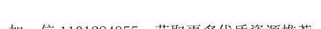
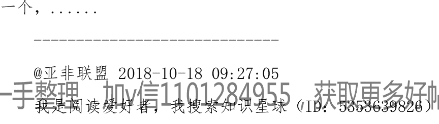
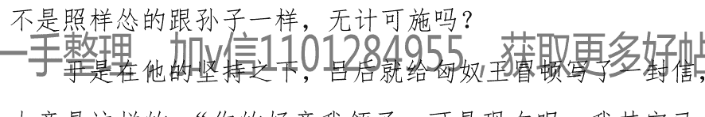
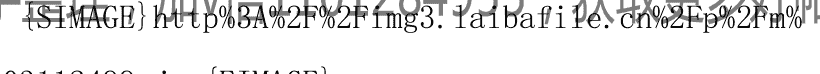
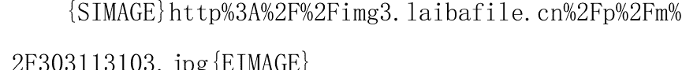

# 2018 年末-2022 年大经济预测

江南季子

个人观点，仅供参考！

- 1、宏观经济政策经历通胀周期，再通缩周期。
- 2、股市上证指数有效运行在 2638 之下，通胀周期下无牛市，上证指数震荡区间上沿在 2400-2638 区间，下沿在 1849-2100 区间。
- 3、人民币兑美元汇率进入加贬值周期，2018 年底到2019 年人民币兑美元汇率大概跌破 6.96 的震荡区间上沿，然后加速贬值趋向 8.27 的支撑。
- 4、市场机会上行情，主力上涨品种将会豆类为代表的农产品。
- 5、在特朗普后期中美贸易战中愈演剧烈趋势，中美冲突对抗对经济呈现负面影响。
- 6、打土豪（扫黑除恶）会持续推进。
- 7、国际原油重新回到 100 美元每桶以上，国内汽油价要破 10 元每升。
- 8、2018 年末-2022 年的上半周期会下降 2 次或以上，下半周期会进入加息周期。
- 9、民营企业破产数量增，地方政府财力高度紧张可能爆发地方债务危机。
- 10、房产税出台，中国房产绝对价格不会暴跌，很多地方限购打开，流动性会加剧。

后续就后十个预测展开详细叙述！

备注：偏安一隅与江南季子是同一手机号下的关联账户，两者发言等同。要理解力敏在党部领导下审查辖迁，要习惯它是新常态！

# 5楼
作者:江南季子 2016 日期:2018-10-16 16:53
@经济律眼睛 2018-10-16 16:48:56
一手整理，加V信获取更多好帖

万岁，中俄石油协议解套了。国际油价上涨到100 美元每桶以上不一定代表俄石油协议解套了。我国大组织石油委首创的40 美元以下不调调整油价，向上则与时俱进涨“桶”价。国际上老子也是是不理的，100 美元以下维持协议，说不100 美元以上就要价格结算了。

# 7楼
作者:江南季子 2016 日期:2018-10-16 17:54
如果过去20年一直是房多，不是获利很多吗？就经济经济，不要为人固执的死多或死空，把握经济的脉搏，抓住住属于自己的机会是很好吗（未来一段时间我不看多房价）。

来自 10 楼
作者：江南季子 2016 日期:2018-10-16 22:48
@DK十方通行 2018-10-16 19:15:43
汇率绝对不会变强。一旦破7！国家信用完全丧失！以后再也不会有外资来中国投资！

“遵守世承诺”、“上证指数 4000 点以下不发新股”等体现国家信用。

现在人民币暂时不破7主要有以下两个原因：一是银行加了充足美元储备，汇率完全在可控范围内。
- 2、美国总统特朗普并非有意增强强势，人民币挂钩一揽子货币，美元指数没有强势上攻的背景下人民币汇率守住7关口。

人民币在升值周期内主要是热钱流入中国，现在振荡热钱基本都已经撤出中国。而外资投资资金是否撤出中国全是看汇率，主要看政治经济大气。

17 楼
作者：江南季子 2016 日期:2018-10-17 12:01
- 1、中国宏观经济政策处于下降周期，后期合美联储加息周期，物价现在处于通缩周期。

2018年10月最后一天，央行降准0.5个百分点，释放MLF资金7500亿元，消息公布，股市走势，房价又要涨。专家们也跳出来表示民营企业融资要好。然而此前已经是央行的第四次降准，结合政策联动，地方政府规模管理，放水的资金流向其实判断，逐步膨胀至可控。以新债还旧债，稳住债务危机。

- 2、稳住底线，延缓债务危机爆发。
- 3、中央领导反复强调“守住底线不发生系统性风险”，而当下这个底线就是债务危机。你有钱买股票或房产，有些地方已经发不出工资，不少地方平台暴雷。

- 4、中国的债务危机究竟严重到什么程度？

## 债务危机究竟严重到什么程度？

根据标准资料，2018 年底中国债务总量可能将达到35 万亿，按照一年利率7.5%计算，债务利息支出就是2 万亿，GDP利润按10%计算，不过9 万亿，也就是说利润不能覆盖债务利息支出，中国处于债务危机的边缘。而债务危机中最为要命的是地方债。1990 年的时候，中国的广义货币M2发行量是5 万亿，截止到2018 年3 月，中国的货币M2发行量达到17 万亿，这意味着28 年的时间，人民币发行量增加了100 多倍！过去的30 年中国经济的发展模式一直是信贷扩张。为了漂亮的成绩单，大家要知道，在2018 年之前政府是不能接银行贷款，但中国体制下，一个城市的领导还是政府主导注册一些投资公司，称之为“融资平台”，这些公司名称往往就是某建、城建资产公司等。接着地方政府项目，例如：高速路、机场、政府大楼……这些融资平台拿着基建项目去银行融资是因为政府背景的公司，又是政府项目，所以银行一般融资多少就多少。一般来说，这些融资平台的融资模式不计入政府财政预算，所以各个地方政府借了多少钱很难统计。这些债务就是表外债。

举例子，天津最大的城投平台天津城，2018年季度账面可见的有息债就有400亿元。一年光付息就有20亿，这家平台一年的总收入只有70多亿。收入连利息都还不起更不用说本金了。全国人大经费委副主任委员宪骏在谈及地方债务时称，中国的地方债务（表内加外）大概是40 万亿规模。借债还钱，天津地方政府也是要还钱的。所以你看到现在很多地方政府开始花式筹钱，归纳起来主要有两种手段：

- 一、借新旧，增加税费收费。地方政府债务危机爆发，是因为央行足劲让各下属银行购买地方债，本质就是借新旧，时间空间，按住或者延缓债务违约发生。增加税费收入不再详细开展述了，即即将来的房产税，不断增加的汽车税等，各个地方政府的压力已经很难了。

2008年美国次贷危机是因为大量的债权基础有毒资产！大量不具备贷款条件的人借了太多的钱，然后通过各种封装成衍生品推给了投资者。最终彻底崩局无法维持爆发了次贷危机。但中国不同于美国，是中国无暗拍印，中央集权，债务。

危机中的个人债务是终身，银行不怕你还不，国家机器可以以“伺候”你。民间债务已经经竭话“凡是超过8%年回报率的都是骗局，你还买高回报的P2P，暴雷纯属属该”。

最要命的地方是“稳住底线”，补充财政到位。债务剩余资产优先罚款或充公，这种债务管理思路是“稳住底线”，不要为了债务危机大规模放水，不要为了债务危机大规模放水，不要为了债务危机大规模放水，锁定流动性，避免大规模的通胀，放水同时允许适当的通胀。

所以你看到美储从2015 年起进入了加息周期，然而中国央行始终在不断调整降准，最重要的就是守住底线。要等债务危机解决差不多，物价才会进入通缩周期。

24 楼
作者:江南季子 2016 日期:2018-10-17 10:18
房子还可以买吗？
以北京为例，20 年前的平均工资 1000 元，现在约 10000 元，增长 11 倍。北京二环房价 1998 年 2000 元一平，现在约 100000 元一平，增长 50 倍。2018 年广义货币M2 大约 10.5 万亿，2018 年M2 接近 180 万亿，增长 17 倍。数据告诉我们过去20 年工资增幅跑不赢人民币贬值，而很多地方的房价跑赢人民币贬值。未来这种趋势将会继续，自然排除中间震荡波动。结合目前趋势，房价概率高位震荡后下跌。刚需可以自己住无所谓，建议现在买入，不过债务危机后投资还是可以买的。

28 楼
作者:江南季子 2016 日期:2018-10-17 11:18
@2018坚持 2018-10-17 00:69
一手 整理...
@江南季子 2018-10-17 11:16
以北京为例，20 年前的平均工资 1000 元，现在约 10000 元，增长 11 倍。北京二环房价 1998 年涨 2000 元一平，现在约 100000 元一平，增长 50 倍。2018 年广义货币M2 大约 10.5 万亿，2018 年M2 接近 180 万亿，增长 17 倍。数据告诉我们过去20 年工资增幅跑不赢人民币贬值，而很多地方的房价跑赢人民币贬值。未来这种趋势将会继续，自然排除中间震荡波动。结合目前趋势，房价概率高位震荡后在债务危机。

31 楼
作者：江南季子 2016 日期：2018-10-17 11:38
@ty_12059187 2018-10-17 10:49
服了你了，正因为自住涨跌无所谓，才有那么多房。你真以为房贷全都是炒房的吗？不管不是炒房客，房贷逻辑若成立，是不是可以润呢？只要不要买卖合同，房贷是失理的。

@蜀赛九天 2018-10-17 01:11:24
降准释放货币1 万亿，数学理论上最大值广义货币M2 可以增加5倍到5 万亿。我们注意到今年四次降准释放约3 万亿货币，但M2增速越缓，7月和1月M2 绝对数值只增加5 万亿规模，比率高达1.67，远不到5的极限值。说明投放的基础货币很多是债还旧债（包含直接购买地方债，置换前货币 MLF），并不进入货币流通领域。在这个背景下，短时间内国际国家可能不再降准，但降准大周期没有结束，此点央行行长刚在2018 年G30国际银行研讨会的发言也提到了。

# 33 楼
作者:江南季子 2016 日期:2018-10-17 12:35
@xiaopotian2017 2018-10-17 11:44:37
“......”看看 青岛，厦门，北京，上海，郑州，成都，......的房价跌了没？虽然还没大跌，等着大跌。等着两眼儿说是瞎话，这种忽悠式诈骗（实为炒房）不得死，去跳吧。

# 38 楼
作者:江南季子 2016 日期:2018-10-17 17:58
@2018趋势 2018-10-17 53:29
我反驳一下：
- 二、通缩，不是通胀，准确的是滞胀，底层百姓很难受，物价飞涨，工资上涨还会消灭民营企业，生存困难，人口增加。

# 39 楼
作者:江南季子 2016 日期:2018-10-17 23:07
@2018坚持 2018-10-17 07:44
为什么要股票？首先我们要了解，国家拥有货币发行权，国家发行的货币不小心印了，对社会会产生什么呢？货币多了，其后果只有一个，那就是涨价，这就是大家经常听到的通胀。

# 40 楼
作者:江南李子 2016 日期:2018-10-18 09:55
@lgy711021 2018-10-18 04:71:20
你有足够的金钱才能在这个社会交换买到的你想要的物质，否则钱不够多的，你只能望着好的商品或服务叹气！谁都不想贫穷，谁都不想过更好的生活，谁都不想手中的金钱越来越少。人的欲望是无穷的，谁都想拥有更多的钱去享受更美好的商品或服务，只有通过交换才能获得更多的商品或服务，只有赚更多金钱，投资就是赚货币的方式之一，通货胀对普通百姓来说是一个严重的后果，就是印刷钞票会极大威胁到老百姓存款的价值。因此把钱存在银行是很划算的。投资方案，把投资房产、股票、大商品、艺术品收藏或投入本金做生意有利，让资产保值增值才是战胜通胀、让钱值钱的路。中国普通百姓可以选择投资途径比较均衡，目前重要的是房产和股市。过去二十年投资基本上跑了货币通胀，而股市让人黯，即使这样，回看2005 年以前买的股票基本上都是赚钱的，股市在2005-2007,2014-2015 有过波段上涨的大牛市，也有很多胆的朋友操作波段在股市投资中获利的。而我们需要规避风险，把握大周期的股市机会。我们可以定义股市是一种投资工具。投资股市的目的是让资产保值增值，战胜通货胀。但中国股市是政策市，进入中国股市必须要中国的政治经济形势，结合技术分析，趋势才能通过股市赚钱，让资产保值增值。中国股市至今有过超过20 年历史，对于这二十多年趋势研究后我们基本都得到两个金点。

- 点金 1：60 日均线判断大趋势，在散户不能做空的条件下，建议散户只有在 60 日均线之上接入买入，在 60 日均线之下。
- 点金 2：中国股市的多次牛熊转换其实都是控制在国家政府手中的，也就是说中国国家控股。虽然股市本身具有相应的市场规律在发挥作用，比如股票跌得不能再跌，破公司导致垃圾股的价值，会有市场力量来催生某类行情。但是这种行情得不到国家的认可，国家完全可以通过控制舆论比如说在人民日报发表观点以及通过加息，提高存款准备金，大量发行资金影响来决定股市的命运。所以研究政治，做好股市。

# 41 
作者:江南李子 2016 日期:2018-10-18 04:71:20
中国经济靠增量货币推动，没有增量货币就不行了，现存在量货币的利息每年都很多，用来推动 GDP 的货币实际很少，经济在衰退。

总结：
- 2018 年末-2022 年的上半周期会下降 2 次或以上，下半周期会进入加息周期。
- 2018 年底到2019 年人民币兑美元汇率大概跌破 6.96 的震荡区间上沿，然后加速贬值趋向 8.27 的支撑。
- 股市上证指数有效运行在 2638 之下，通胀周期下无牛市，上证指数震荡区间上沿在 2400-2638 区间，下沿在 1849-2100 区间。

货币投放跟 GDP 是匹配的。现在跟以前比，货币量减少一半，是非常严厉的紧缩。（来自天堂社区客户端）

是的。

我们来看 M2 广义货币衍生数学模型：假设准备金率为 20%，商业银行吸储 100 亿后，上交 20 亿给央行。假设 80 亿都贷款 A，流通到 A 又把 80 亿存回来，商业银行反复操作上交 16 亿，64 亿给 B 企业……这样反复，货币会是市场上最多可能产生的 100+80+64+51.2+……解这个序列的值是 500，其实就是 100*(1/0.2)=500，现实中总有现金流动的，不可能 M2 是有限值的。

按照上面数学模型，现在准备金率是 14.5%，投放基础货币的极限衍生值倍数是 1/0.145=6.9，但实际上我们看到央行不停操作 MLF、MLFS、回购、降准，但 M2 增速已经很难再回到 2 位数增幅，新增货币很多是补旧债务的窟窿，货币扩张拉动 GDP 增长的边际效应越来的越。

46 楼
作者:江南李季 2016 日期:2018-10-18 10:37

@偏安一禹 100 2018-10-17 23:08:04

## 2、通胀周期下无牛市，未来相关长时间上证指数

股市是什么？为什么要投资股市？首先我们要了解货币的通货膨胀。

国家拥有货币发行权，国家发行的货币“小心”印多了对社会又会产生什么后果呢？钞票印多了，其后果就简单，那就是涨价，也就是经济上的所谓的“通货膨胀”。因为一定时期，社会生产的商品的数量是固定的，也就是说短时间内社会的财富是有限的，货币多了产生的后果只有一个……

看是收费的，楼主介绍一下吗？

知识星球ID：5369826（思胜公司）是我连接粉丝的地方，宗旨是致力于传播中国自由、民主的思想；致力于帮助会员投资跑赢通胀。尽心尽力为会员提供有价值的原创文章及参考消息，尽心尽力研究中国政治、经济宏观趋势，为会员提供有价值的咨询指导意见。

会员是收取800元费的，会员加入后从日起计算一年有效。为会员提供以下服务：

- 1、中国政治、经济、股市、房市、汇率、大宗商品货走趋势分析及预测；
- 2、原文文章分享；
- 3、历史小说《梁（天）朝史》连载；
- 4、每日有价值的政治、经济信息分析；
- 5、中国宏观经济指标数据每月解读；
- 6、中国重大经济、政治新闻解读；
- 7、编辑、转载有价值的参考资料（文章）；

截止目前仅有上传文章：
- 《冷战新格局演戏》
- 《李世民和朱焘以及高层军事政变妥妥分析》
- 《中国财富财产公示趋势不可避免》
- 《中国经济真相》
- 《中国民主主体建设探讨》

欢迎各位网友加入我的星球会员，我（公司）尽力为大家提供满意的服务。感谢支持！

47楼
作者:江南李季 2016 日期:2018-10-18 16:14

### 一、现代人必须知道的最基本的金融知识

#### 1. 商业银行

央行外的所有银行都是商业银行，包括国有四大银行和大小不一几家股份制银行。

央行才有发钞权，任何商业银行是没有发钞权的，严格讲商业银行实际上只是一家企业，只是这个企业经营的是货币。他的经营模式主要是赚利息差，就是用一年 1.5%左右的利息储蓄，再用一年 4.35%左右的利息贷款出去，这样一年他就有了 2.85%的盈利。

当然，赚钱也是有风险的。为了控制风险，商业银行要储 10 亿，就要存款准备金率 14.5%就是 1.45 亿交给央行（最新准备率是14.5%），别的 8.55 亿用于贷款。如果商业银行贷出去的8.45 亿大部分分成了坏账，即使拿回未存在央行的 1.45 亿也不能支付储户的 10 亿。

#### 2. 钱是怎么印出来的

只有央行才有发钞的功能，印分为两步：第一步是发行基础货币；第二步是货币放大广义货币。基础货币由现金（私人）和存款准备金部分构成。目前我们有基础货币约180 万，广义货币M2约500 万。

#### 3. 基础投资

发行货币主要渠道如下：
- 一是直接发行现钞，这就是所谓的无赖，比如一家银行破产，影响社会稳定。
- 二是买黄金、外汇储备，主要是外汇占。
- 三是实行货币政策，比如中期借便利（MLF）、常备便利（SLF）、回购等来投放基础货币。

#### 4. 反复发行衍生货币 M2

商业银行吸收 10 亿，按照准备金率 14.5%上交 1.45 亿给央行。假设 80 亿都贷款 A，A又把 80 亿存回来，商业银行反复操作上交 16 亿，64 亿给 B 企业……这样反复，货币会是市场上最多可能产生的 100+80+64+51.2+……解这个序列的值是 500，其实就是 100*(1/0.2)=500，现实中总有现金流动的，不可能全部按照公式，M2也是有限值的。

#### 5. 挤兑危机及解决之道

截止最新2018年9月宏观经济数据，我国的情况是广义货币180万，储户和机构存款余额139万，现金和存款准备金合计42万。假设某天这180万和机构拿着存款的人都取钱，商业银行怎么办？商业银行会将现金和存款准备金共42万先给他，然后过去找自己139万的债。如果回来了，就没有问题。如果139万的债追不回来，就造成挤兑危机。因为商业银行本身是没有钱的，他只是一个企业，139万的债追不回来就倒了。市场上的商业银行利润的方法是去找银行，央行再印139万来。赖账是不靠谱的，居民的钱被赖账也不要。于是银行逐渐抽139万，慢慢把坏账冲销，居民一看存款带利息一分钱没少，高兴的，实际上全是买单。

#### 6. 价格和利率

价格简单理解就是人民币，1元人民币还是1元人民币，但在现在和三十年前的1元人民币完全不是一回事，很多人感同身受。1980年代，可以在三线城市买套房子，现在买不到一个卫生间放马桶的面积。

1980 年，米是1毛5一斤，现在是两块多。上涨了约15 倍。
1980 年，平均职工工资是52，现在平均是5000 元，上涨了约 100 倍。
1980 年M2是0.16万亿，现在M2是180万亿，货币供应上涨了约100 倍。

从上面的计算也可以看出另一个非常明显、非常关键的问题：国家人为大大压低了农产品尤其是大米、猪肉的价格。大米几乎是所有必需物资中通胀最慢的东西（深刻削减农民）。上面的例子可以看到，现在你挣5000元不比去年1980 年以前挣52 元就够了，也就是说，即使到2020年工资翻倍，就不说2020年你工资翻了呢。这就是货币贬值带来的后果，要看对比而不是看人民币绝对数量的增加。

再看利率。一般银行一年期存款利率，这个是变动的，但是不管怎么变，本质上它跑不赢通胀，简单计算看看。

现在一年期存款利率为1.5%，而国家统计局公布的最新 CPI在2~3%，就以CPI为2.4%计算，存钱也是亏本的，实际无疑亏得更多，因为CPI是有猫腻的。

全国居民消费价格（CPI）涵盖全国居民生活：
- 1) 食品：31.7%
- 2) 烟酒及用品：4.9%
- 3) 居住：17.2%
- 4) 交通：9.5%
- 5) 医疗保健：6.4%
- 6) 衣着：5.2%
- 7) 家庭设备及维修：5.64%
- 8) 教育文化用品：3.75%

统计局公布的CPI数字。实际CPI与实际利率。

人民币汇率处于区间震荡上沿，到2019年人民币兑美元汇率大概概率跌破6.96的震荡区间下沿，技术上看8.3附近是一个支撑。后面最好是人民币贬，不排除出现断崖式下跌。

##债务危机分析

经济下行，人民币汇率始终要回归基本面，不是能够操控的。人民币汇率的基本面就是人民币发行速度远超过美元。广义货币M2从1990年起1.5万亿增长到今天的180万亿，远超过美国同期M2增长率。巨大的人民币发行形成“蓄水湖”，随时有守不住的危险。

上图是中国外汇储备走势图，2014年汇率最高时曾对外汇储备最高峰接近万亿美元，几年震荡下来，外汇储备已经降为3万水平。“找钱犹如针插兜，用钱犹如水冲沙，”辛苦苦的外汇储备在“大撒币”以及以来来薅羊毛”中流失速度惊人，按照这种速度还能维持多久？使汇率贬值而不是一直操控汇率稳定，这才是正道而不是邪路。

综上结论：人民币汇率现在处于区间震荡上沿，到2019年人民币兑美元汇率大概概率跌破6.96的震荡区间下沿，技术上看8.3附近是一个支撑。

59 楼
作者:李季子 2018-10-20 11:28

会有会员问怎么看金融F4为股市站台和人民币日报态“中国已不诸对美实施牙还直接报复”。

我先讲两个历史故事。

一，西汉年初，刘邦死以后，吕太后专权，她刚一上台，就遇到了一个大麻烦，旬诡的冒情单给她写了一封信，大意是这样的：“听说你老公去世了，这事儿挺好，他老是占着茅坏拉尿，你躺床上运动，早就就该了。我在隔……”

二，金融风暴后，美国连几轮宽松（QE）而国内物价稳定，就是因为大部分美元都流到了中国。以上两个原因大家几乎诸多后果，主要体现在以下方面：
- 1) 热钱涌入，外汇占增加，央行大幅投放基础货币，由此产生更高的广义货币M2从2004年的15万增长到2014末的124万，增长了五倍。
- 2) 汇率贬值有利于中国出口，但同时对中国民生带来了诸多恶化，通货膨胀。
- 3) 人民币不断贬值使得出口优势流失。
- 4) 中国变成世界工厂，但很多企业面临生存困难，很难继续上涨。

当时在汇率上88.4-.96，2017年贬值2.9%，2018年最高贬值到6.24，然后跌到目前6.93。

技术上看，可以认为2018年人民币汇率一直在6.4-6.96之间震荡，后续怎么走是重点。首先人民币在大升空间，现在和2005年相比已经千差别，尤其是随着中美贸易战开启，外资撤离成为不争的事实，中国造成的大幅使得出口优势流失。

所以，大家心里清楚，但是所有人都装傻，你千万别以为樊桀和这帮智商低，你想想樊桀在鸿门宴上，那个装猪吃的表演，是智商低的人干的事儿吗？而且经过了的大清洗，刘邦屠杀功臣的背景下活下来的人，哪个个不是人精？

所以在这个时候，其实就是考验一个王朝，有没有梁柱材的时候，有没有不愿意为了天下，挺身而出的时候。

在很多情况下，就会决定一个王朝的命数，有人愿意挺身而出，这个王朝就会活下去，老百姓就能上幸福日子，相反，如果不愿意挺身而出，那政权灭亡时不远。

此时明朝年初遇到了这样的情况，也就是明朝完灭。两线作战，既要诺尔哈赤、皇太极，又要和李自成、张献忠。

当时只有点儿见识的人才知道，这意味着在经济上还是军事上，两线作战，肯定是撑不下去的。要想真的解决这个问题，就应该和满人议和，大不了就划地赔款，然后集中精力去攻张献忠和李自成，这样明才能有机会，以后的事以后再来说吧。

崇祯心里也知道这样做，可是就是没有大臣愿意他出头，后来他好不容易找到了一个人，同意悄悄的替他去和皇太极谈条件，可是没有想到，后来事情败露以后，这个个人不愿意承担责任，反而处处视视主使他这么的。

但是崇视作为皇帝，他不能表现的软弱，那样人心就彻底散了，所以他唯一的出路，就是把这些人杀了来表现他的坚持到底的决心，可是这样，也就埋葬了挽救明明的唯一机会，最终导致了它的覆灭。

所以对于每一个时代，最大的不幸，就是没有人愿意担当的人，而幸运的朝代，总有人愿意出来担当。

而汉朝是幸运的，当时主政的陈平就出来担当，他就斥斩那些你们，你们既然这么能打，当时在白登被围的时候，你们也不是在现场吗？没有看见你们有什么表现吗？

不是将总的跟一样，无可论吗？

大意是这样的：“你的好意我领了，可是现在，我其实已经通水停电，老的没法和你一起做床上运动了，但不头发都快跑了，两个门亮的陪我晚上睡不着，而且一咬的假牙，万一咬一下死，咬坏了你把你咬坏了怎么样？不像这样，我把自己的跑车和几个漂亮女孩送给你，你没事去带小妹开车兜兜风怎么样？”

陈平选择了当时的唯一正确之路，忍！忍了！因为亲政策，汉代通过不断的休养生息，逐渐的积累力量，最终到汉武帝的时候，一举击溃了刘诡。

其实你仔细想想，要不是按陈平这个方案做，真的意气事，和去汉奴，汉朝早就能被汉奴灭，我们现在都不能叫自己汉人了，可能全都叫汉人了，一个胸大无脑。

所以，危危关头国家需要敢于实事求是，有担当的人出场收拾乱局局面。

二，1870年晚睛发生天津教案，八旗顽派群情激昂要喊打打喊杀，曾国藩深将打过洋人的，主动打黑锅和洋人谈判，两边既有来术，本来说了个不错的条件，但转过头被顽固派拆掉了一堆X、X国的帽子，一站在道德高点的曾国藩被满烦，“外虏清许，内夷神明”，一年后即去世。

八旗顽派打打喊杀的都是说话腰，维持主业的老爷就到位了，把扳手办，结果好像就把事解了，什么解。其实也，他直接一个拜顽固派，先听他们意见。顽固派自然是继续打打喊杀，要硬着洋人对付。顽固派一听要去顶上，立马吓得顶上——真是顶上的，打输了，老佛怪来，那就是脑袋，而且自己几清楚楚，打输是必然的。于是他们再也不吵了，中堂大人和洋人谈。

千万人未变，套路也没有。天气逐渐变冷了，寒冬将至。频繁收到售铺、住宅及推销的电话，经济的寒意给人的感觉仿佛冬天的寒风。笔者用简单单词一下对宏观经济的看法及对未来发展趋势的一些判断，希望你有所裨益。

1. 中国经济 GDP增长率从2007年14.23%见顶以后L形滑落，已经在7%上下震荡7年，7%左右不是底部呢？显然不是！因为现在看不到GDP增长率大幅上升的要素，再者GDP总量的基数增大，即使考虑战争等潜在破坏性因素，GDP在2030年能保持3%增长已经是奇迹。

| 年份 | 增长率 |
| :--- | :--- |
| 2007年 | 14.23% |
| 2008年 | 9.65% |
| 2009年 | 9.40% |
| 2010年 | 10.64% |
| 2011年 | 9.54% |
| 2012年 | 7.86% |
| 2013年 | 7.76% |
| 2014年 | 7.30% |
| 2015年 | 6.90% |
| 2016年 | 6.70% |
| 2017年 | 6.90% |
| 2018年 | 预估 6.7% |

2，2007 年末广义货币 M2 是 40.3 万亿，2018 年末预估181 万亿，十年钞票增发4.5倍，所以房价翻4倍是正常的，物价没有飞涨正是感谢房价上涨吸收了总量增发货币。

但这种货币增发不具备持续性，美元总量中国M2总量在2013年就超过美国M2总量了，在房价滞涨，增发的货币主要要是填补债务黑洞，不然哪里跑都不靠谱，所以你看到银行不断变着法子投放基础货币，但 M2增长率是下降的，说经济活动变弱，衍生货币下降，靠增发货币刺激经济的边际效益越来越越差。在不爆发债务危机下，未来趋势是M2增长率继续下去。

| 年份 | M2总量（亿元） | M2增长率 |
| :--- | :--- | :--- |
| 2017 年末 | 167680 | 8.17% |
| 2016 年末 | 155101 | 11.33% |
| 2015 年末 | 139230 | 13.34% |
| 2014 年末 | 122837 | 11.01% |
| 2013 年末 | 110652 | 13.59% |
| 2012 年末 | 974149 | 14.39% |
| 2011 年末 | 851591 | 17.32% |
| 2010 年末 | 725852 | 18.95% |
| 2009 年末 | 610225 | 28.42% |
| 2008 年末 | 475167 | 17.78% |
| 2007 年末 | 403442 | 24% |

3, 中国经济是由决定的，权接班后，他们侧面暗示在过去的20年里是“代理人”。历史证明了，1900年“庚子之乱”的强烈刺激下，慈禧亲自主持新政，再次描绘美丽的中国。尽管兴中会、华化会等革命组织的“鼓动”，但大多数人对新政所有预期，尽管改革姗姗来，但是在新政实施后揭开。

4, 从主观讲，不是坏的，他们反复强调房产不妙，试图去杠杆，他们本身就是利益得获者，为了维持统治和既得利益，不可能开出改革的良方。加强汇率管控，没有意外情况下，让人民币汇率有序小幅贬值是未来几年的趋势。内外因素结合不断提高的国民素质，谨慎看好中国的前途。清未立宪的假改革导致革命，经济下行同样倒逼改革，只是不知道何处是点。

5, 在改革之前，经济还会纠结中，主要抵抗体现在两个方面。

1) 是否大幅增发人民币以刺激经济。若漫发人民币，房产失去能力，必然造成人民币大幅贬值，物价上涨，国内百姓将愁，最终结果就是失去民意，倒逼改革。但不增发人民币，现有体制就会造成紧缩，紧缩后经济不振，失业增加，基层公务员不满，高层官员非暴力合作，外资撤离，富商撤离，上市企业老板们质押股票被强行平仓而破产，银行因为坏账致债务危机爆发后，最终结果也是失去民意，倒逼改革。两相比较，紧缩效果立即表现（2018年10月底已经十分分明了），简单来说就是不放水立死死，大放快快。现在选择的慢放水慢放，这也是未来趋势。

2) 人民币汇率是否大幅贬值。首先人民币已经不存在大幅升值空间，你还在新闻里听人民币国际化吗？人民币不能由自由兑定成为国际货币。国内不断增发货币锁住债务危机，没有热钱流入状态下，名义上M2的增加只会使得人民币汇率贬值，全球经济不景气，中美贸易阴霾下，人民币贬是大势，这是能简单判断的趋势。若人民币汇率大贬值，就会加速资本的流出，刺穿房地产的泡沫引发可能的规模经济危机，这是当局严防死守的底线，所以以后趋势会加强汇率管控，没有意外情况下，让人民币汇率有序小幅贬值。

![](http://img3.laibafile.cn/p/m2F302143504.png

综上，亲，经济的大势你懂了吗？

我不是楼，房产处在寒冬中，一二线城市阴跌为主，当局允许房价跌，后面大概概率。不是2008年不同，即使后面加大力度，很难暴跌。自此看看，真要分析，还是要参考国际和新闻联播的一个显著特点就是经常延长，让你看到不同言论或反复就是要洗脑。

没有变，节奏。中间十五分钟，最后十五分钟，十五分钟，十五分钟，十五分钟，十五分钟，十五分钟，十五分钟，十五分钟，十五分钟，十五分钟，十五分钟，十五分钟，最后十五分钟。

十九世纪末最热闹无疑是立宪。代表官方描绘这一梦想的是皇帝本人。1898年6月21日，光绪发布《定国诏》，宣布实行新政。刚吹响后，光绪被囚，康梁等人杀，康梁逃国外，维新派。变梦的根源是变法触动了利益者，特别是慈禧人的利益。两年后（1900年），在“庚子之乱”的强烈刺激下，慈禧亲自主持新政，再次描绘美丽的中国。尽管兴中会、华化会等革命组织的“鼓动”，但大多数人对新政所有预期，尽管改革姗姗来，但是在新政实施后揭开。

朝廷在改革律、编制新军、废除科举、兴办新式学堂等多个方面，都有看得。清廷改革的拉链很长，一段是洋务运动，长达34年（1861-1894）；第二段是维新变政，持续了4年（1895-1898年）；第三段是预备立宪和立宪，开启了1906年，最终葬于出台内名单的1911年。清史研究来流行一种观点，认为好处多活10年，立宪可成，辛亥革命会避免。然而，持论者是否理性地分析：满清贵族集团主动放弃既得利益？民国研究者也有一种论调：如果没有苏联武装的中共军力量的攻击，国民党一定会建立起美式民主政体的。然而，持论者同样忽视了当时国民党集团的严峻腐化现状。日寇已投降，各位大员赴各地“劫收”，大肆贪腐、勒索，以至于不少“光复”地区的百姓悲惨如昔。至于国民党日后在台湾的向善与新生，是在蒋介石这位强人去世后一个组织的选择。

执政者在无法打破既得利益集团的堡垒后，只能回避现实，编织美梦，向民众作口头承诺。十九世纪末的清却是如此，二十世纪中期的现实也是如此。国民党回到南京后，也承诺土地改革，也开始“民主”选举，民众已不再相信他们。他们承诺日后会给他们土地和民主的共产。然而最可怕的是，民众所言的空话没有得到保障。老蒋的宪政，都不是旧体制在终结前的最后一梦。他所办的梦想通常实现了，一如毛。一个接一个政变，一个就是一个中国的历史。实：梦就是梦，当得不得。当拉链可以看到大致轮廓时，人们终究会清私处的丑陋。

清廷改革的拉链很长，一段是洋务运动，长达34年（1861-1894）；第二段是维新变政，持续了4年（1895-1898年）；第三段是预备立宪和立宪，开启了1906年，最终葬于出台内名单的1911年。

和进口金额都出现了罕见的两位大幅下滑局面。

2018年10月，中国集成电路进口量明显下降；2018年10月中国集成电路进口量为342亿，同比下降10%。进口金额为291.83亿美元，同比下降16.4%。

企业融资陷入“自发性紧缩”，财政收入出现首次负增长

13日，央行数据公布，社融规模增量更低2016年7月来创的历史最低增速，引起市场惊呼
“社会没有融资，意味着企业不敢借钱发展，经济要有起色很难。

其中，新增企业贷款从9月的6808亿下至1503亿，新增贷款贷款额较上月的7529亿下降6026亿。10月新增非金融企业贷款只有1503亿，其中中长期贷款为1429亿，更是2年以来新低。

企业中长期贷款疲弱，反映出的不仅是银行发放贷款的意愿问题，也意味着企业家对经济压力较大，贷款行为也趋向谨慎。毕竟销售数据那么差，没有理由贷款扩大生产。同样，在存款数据中，10月份新增企业存款减少6004亿，这也明确指向企业盈利面临巨大压力。

在这两天的财经年会上，中国社会科学学院副院长高培勇已经提醒了这是一场输不起的战役。毕竟财政赤字高涨，叠加贸易顺差的逆转持续扩大，将使得未来的人民币汇率、资产价格等国内市场面临巨大的冲击。

解读及对个人影响和策略：

- 1) 中美贸易战使得中国集成电路出口下降，同时米帝打受伤，在半导体芯片对中国进行管制，芯片是集成电路的主要部分，这时可能造成严重依赖芯片进口的上市公司崩毁，投资上要规避此类上市公司。
- 2) 在5G或物联网在突破之前，手机还会低迷一段时间时间，一旦突破，手机还会迎来一繁荣。
- 3) 汽车行业的冬天来了，新能源汽车或无人驾驶突破后可能有些起色，传统汽车投资基本不要碰。
- 4) 中国货币增值的主要载体就是房地产，中国经济不崩，房价市场不会溃，跌落之实。这意味着市场不会出现大范围的超过30%的暴跌。房价持续下跌后，后续政治局就会开放限购购市的事了。关键看他们怎么做而不是是否肯讲，低房价即便不暴跌，也不会有暴涨，其流动性越来越弱，现阶段不建议投资买房。

欢迎加入知识星球办，每天喝一杯茶钱，畅谈天下！

{IMAGE}http%3A%2F%2FFimg3.laibafile.cn%2Fp%2F2F3402420030.png {IMAGE}

# 81楼

作者：江南季子 2016 日期：2018-11-23 18:40

《李大霄PK机构，抛出A股政策和市场底部已形成

加信1101284955，获取更多优质资源推荐

六大理由由，辩会会员对该怎么看？

答：从三千多点喊底，钻石到底儿童底，如此厚颜耻之人的说法还能靠谱吗？

股市点金术要一条就是 60日线之下不买股票，只要股市不站稳 60日线，看都不要看；若站稳后轻仓买了，跌到成本就要损走掉，这就是技术纪律。

至于环境，和过去相比有大的变化吗？IPO停了吗？死鱼被换了吗？印花税不收了吗？No! No! No！还是TM那个坑！

说有变化：大人下令银行贷款给民上市公司了！尼马，折腰挣得快！

整理加信1101284955，获取更多好处

最近某某某科技有限公司博天环境，HPA 12号章

对于北京市淀区政府联手江苏银行北京分行按照政策要求提供给优质民的穷困资金贷款 5000万元，后续还有5000万元优质贷款。利好消息一来，博天环境当天日涨停，后几天持续上涨，19号最高到18.2，比上月最低价11.5上涨了58%。没想到11月19日晚，博天环境发布公告，三个大股东要清仓式减持不超过31.35%的股份，按照当时的股价折算，接近20亿元！这尼马的让19号买进的民营情何堪吗？？

这，这，这，就是政策割股市，难道给了一个亿贷款大股东就不跑路了？很多善良的底层百姓还心存疑虑，自加v信1101284955，获取更多优质资源推荐

2017年博天环境最高价53跌到现在18，这些大股东减持会不会赔钱呢？若以此理由买进那说明你亏得没错，因你智商税没交够。

这三家要清仓的大股东均为博天环境上市之前就已经持有的股份，其持有成本低于IPO价格（博天环境IPO时的价格为7.4元），这些股份限售日期是2018年2月22日，已经经过限售期。即便以最低价1.5的价格套现，这些股票的大股东这一轮至少实现近100%的收益（实际获利均超过100%）。

政策利好一出，乘机出货，把接盘侠在山上。学习知识：再看另一上市公司——光股份，这家公司代码[缺失]。这家公司属于小型上市公司，被大股东反复割韭菜。业绩持续增长，营收和利润双起，发展机会无限，是所有人想要的。

第一步：营收和利润双起。第二步：上市后，股份被割肉，“市值管理”之下，特别是大股东限售期之后，业务开始变质、营收利润开始双下，后开始融资，要么新建项目，总之从市场上拿钱挥霍出去，股价也不用管。第三步：玩到最后，公司被掏空，大股东大部分质押或者变现跑路，公司变成一个纯粹的资本游戏。最后就是爆炒，2018年1月17日，光股份宣告东方富海投资拟通过接管大股东100%的股权，最终实现控制权的转移……10月19日其股价最低3.6，你说这公告时间是不是猫腻？等等1月22号涨停后23号跌停你没商量！这TM的，若反应的是中国经济晴雨表，那中国经济随时可能玩完呀！

太多公司，其上市目标并不是真的为了“做强”，而是开始跟着圈钱来把本来价值1元的股份，按照100元的高价卖给股份。

他可能也赚不到钱，在这种情况下，你难道还指望老板安心经营？至于那些在pre-IPO阶段以低价获得股份的财务人，你难道还指望他们赚了十倍的利润而不变现？就博天的大股东一样，如果这些人都把股份抛给市场，将自己的利润转移股市，你觉得股市怎么可能好起来？股市为什么会涨？没有根本改变，即使创新还会回到原点，是一个梦。资本大鳄索罗斯曾说过：“世界经济史是一部基于人类的假想是经营的本质，规律或许是人类唯一的假象，投入其中，最后在结果中被公众发现之前退出游戏？”

加入定制的知识星球思维辨，你可以得到如下服务：

- 1、中国政治、经济、股市、房市、汇率、大宗商品期货分析及预测；
- 2、思辨先生原文分享（包含禁文章）的电子版；
- 3、历史文学小说《梁朝那些事》连载；
- 4、重要财经政策的白话深入解读
- 5、中国宏观经济指标月度解读
- 6、中国重大经济、政治新闻解读
- 7、编辑、转载有价值的参考资料（文章）；
- 8、有关个人资产规划和财富安排的问题和思辨先生直接交流。

加信1101284955，获取更多优质资源推荐

扫描二维码，花一顿请客赚钱，加入思辨会知识星球！

82楼

作者：江南季子 2016 日期：2018-11-27 09:34

人民网26日报道，11月26日，来自中国深圳的科学家建奎在第二届国际人类基因编辑峰会召开一天前宣布，对名为露露和娜娜的基因编辑婴儿于11月26日在健康诞生。这对双胞胎的一个基因经过修改，使她们出生后能天然抵抗艾滋病毒。这是世界上首例艾滋病毒的基因编辑婴儿，意着通过基因技术治疗遗传疾病实现双胞胎史性突破。

听上去仿佛这是一个正能量的暖暖，很美好，但但是极恐啊！

- 1) 产品都出来了，那请问以前有没有过实验？实验就要人体胚胎，请谁批准，谁提供人体胚胎的？
- 2) 731部队曾为人体实验而臭名昭彰，受到全世界人民的唾弃，可是中国人民的唾愤。请问这种人体实验有什么区别呢？
- 3) 若你告诉大家为了免疫艾滋病毒等重大疾病的愿景，那你怎么确保这项技术控，一旦潘多拉魔盒打开，有人编辑设计自动灭育，那人类会不会自动灭亡了？
- 4) 产品露露和娜娜就是要融入社会、结婚、生育，请问他们在接触的过程中如何相处？如果不是出生就要圈起来，失去自由？
- 5) 地球寿命46亿，人类相比地球只是匆匆过客，和科幻片一样，今后加入各种猛兽或坟墓，自己毁灭。

这根本改变，那是一个根本改变，即使上破还会回到原点，还是是一个梦。至于中间的故事可以出穷，但万一无中之。创新创，那是一个梦。

加信1101284955，获取更多优质资源推荐

89楼

作者：江南季子 2016 日期：2018-11-27 02:27

@龙城 2018-11-27 11:56

这还需要吗？眼睛不睁耳朵靠，大家都不知道。

大渝那些事（特别声明：《大渝那些事》为文学小说创作）

京城，帝都冬季雾霏。窗外一片虚漆。远处的空气好像浓莱的牛奶，把世界浸润里面。只有远处一点橘色的灯光透过雾照到窗边。一米外的地方似乎什么看不清了，你看翻了一瓶白色的墨，墨水在空中弥散开来，周身似乎都满了墨水，感觉裸的皮肤有点悬乎。肺里总觉得装着什么，想呼出又呼呼出去，全身不舒服。

大学士文望着窗外，帝都冬季雾霏的天气早已习惯，他心里急着是大渝和美国贸易的结果。

“报大人，候喜元首已经和美国首长谈妥，美国自2019年一月一号起，不再加征对大渝200亿美元进口商品的贸易关税。”

文才脸上泛了笑容

“若只是涉及一些钱财，答应妥协即可，内阁多次召开会议，多数人认为这几项均涉及我们大渝统治阶级的核心利益，不可妥让，我们现在规模全球第二，难道不可以贸易战反美国吗？”

“元首，大渝对美国去年贸易输出5170亿美元，而每年从美国贸易进口只有1300亿美元。美国贸易战首先对我大渝500亿美元进口商品加征25%关税，我大渝立刻反制500亿美元：随后美国对大渝2000亿美元进口商品加征10%关税，且威胁若没有达成协议，明年一月一起加征25%关税。”

“孰可忍，孰不可忍，欺人太甚了！大渝难道不可以做贸易吗？”侯喜声色变色，满脸怒意问道。

“元首，你是对的美国是世界最强大的国家，美元是世界货币，若不保住大渝的外汇储备，美国就会崩溃！”侯喜点头，“那欧洲、日本、韩国、澳洲、美国还有很多？”

“元首，一带一路国家等着我们。欧洲、日本、加拿大、墨西哥已经达成几乎贸易协定，关键是其中非市场国家达成所谓的自由贸易，那么另外一方都可以退出，大渝还高关税。”侯喜叹了口气，有些无奈：“文，我昨天和国师苏游聊了，苏游列举了美国将军王胜的例子，他的历史，我也深刻理解了‘拖’字，就是全部框架性答应，具体事宜等后面再磋商。”

“明白爱卿的意了，一个‘拖’字，就是全部框架性答应，具体事宜等后面再磋商。”

“元首英明，再者我们现在出现了惊人的利好，”文特意停顿了一下。

“愿闻其，爱卿快讲，”侯喜声音为急了。

“那就是队友俄罗斯，想必国师浙江大人元首讲历史也提到了，俄罗斯对中华的罪恶悬疑。俄罗斯现在养老金发不出来了，但对领土的扩张性依然强烈，竟然在中东和乌克兰两线开战，两线对抗背后的主宰都是美国。我想大渝和美国交恶，正是因为要对抗俄罗斯，大渝关系解冻，现在美国首长是商人出生，自然十分明白不宜再树敌。”

“多谢爱卿指点，这次美国首长的峰会我力争为国人带回贸易休战消息。”

回到这里，文笑容逐渐凝敛，他知道任务艰巨

- 1) 任何试图压制大渝都是经不起考验的。
- 2) 财政收入下滑的局面，大渝臃胀的机构改革在眉睫，这涉及所得利益集团的蛋糕分配，该如何破局？
- 3) 处理贸易战时的，他就是美国多久还能如此经营。如果有效后，一旦三个月内具体磋商不成协议，势必将通过改革活跃大渝经济，又如何破局？

“哎，大渝四中会即将召开，到时候不乏有识之士，大家集思广，看结果再决定后面几年的局面吧！”望着窗外的雾露，文人都深吸一口气，喃喃自语说道。

94楼 作者:江南季子 2016 日期:2018-12-03 22:36

大渝那些事（二）

知识星球：思辨会 思辨先生

加信 1101284955 获取更多优质资源推荐

### (二)国师苏州

国师府并不在京城，设在金陵。

侯喜来过苏州：“苏卿，京城地价超过十万子一米，金陵不过十万。”

“苏卿，京城地价超过十万子一米，金陵不过十万。”

“苏卿，京城地价超过十万子一米，金陵不过十万。”

“苏卿，京城地价超过十万子一米，金陵不过十万。”

“苏卿，京城地价超过十万子一米，金陵不过十万。”

“苏卿，京城地价超过十万子一米，金陵不过十万。”

“苏卿，京城地价超过十万子一米，金陵不过十万。”

“苏卿，京城地价超过十万子一米，金陵不过十万。”

失联不是大渝常态，人民富很多，要求我们协商，加入我们的政治，根据考虑合适，根据情况再议。

“明白爱卿的意了，一个‘拖’字，就是全部框架性答应，具体事宜等后面再磋商。”

“元首英明，再者我们现在出现了惊人的利好，”文特意停顿了一下。

“愿闻其，爱卿快讲，”侯喜声音为急了。

“那就是队友俄罗斯，想必国师浙江大人元首讲历史也提到了，俄罗斯对中华的罪恶悬疑。俄罗斯现在养老金发不出来了，但对领土的扩张性依然强烈，竟然在中东和乌克兰两线开战，两线对抗背后的主宰都是美国。我想大渝和美国交恶，正是因为要对抗俄罗斯，大渝关系解冻，现在美国首长是商人出生，自然十分明白不宜再树敌。”

“多谢爱卿指点，这次美国首长的峰会我力争为国人带回贸易休战消息。”

回到这里，文笑容逐渐凝敛，他知道任务艰巨

- 1) 任何试图压制大渝都是经不起考验的。
- 2) 财政收入下滑的局面，大渝臃胀的机构改革在眉睫，这涉及所得利益集团的蛋糕分配，该如何破局？
- 3) 处理贸易战时的，他就是美国多久还能如此经营。如果有效后，一旦三个月内具体磋商不成协议，势必将通过改革活跃大渝经济，又如何破局？

“哎，大渝四中会即将召开，到时候不乏有识之士，大家集思广，看结果再决定后面几年的局面吧！”望着窗外的雾露，文人都深吸一口气，喃喃自语说道。

太祖运动折的危害，如今严峻经济形势下，希望不要再出尔凡尔，三个月后再打碧莲，我也无话可了。”可能受到守臣调波的影响，苏沂中也带了桓子，但赤子心表露无遗。

“抵抗了半年，现在全部放弃抵抗，还丢了一国的猪，整残了中兴和华为，弃废了无数学者和留学生，外加送一个 NXP。尼马这就是自虐啊。琅琅阁一个组员说，转折其实来自非非洲猪裔，三个月后就不抗了！你说我大大的猪招诸羞难了谁，没出过国还被非洲猪裔而被炙烟灰，现在还在得流溜溜地重新进口美国猪肉。”宫宁说道。

“宁越越来越风顺了，不过你知道我们六块一块斤的美国王处理加微信1101284955获取更多好多站。”

“这需要多么无畏来敢敌的事豪呀！”显然苏沂中对米贸易战有着肯定的态度。

“苏沂所言或许，我是支持贸易战的。不过大瑜加入 WTO已经十五年了，对其承诺清单，兑儿的几个呢？我个人是不看的，好比鸡妈妈鸭鸭：三个月后我给你生个鸭蛋！”说道这里，守宁依旧调做了鸡妈妈和鸭鸭的动作。

“好吧，我也持保留意见，后面最新消息我们微信联系。”苏沂笑着对着守宁。

“打住，苏沂，你不知道企鹅马柏早就已经把尾敌卖给了 XXX，任何微信或 QQ 消息都是无障碍受到 XXX 监控的。加微信 1101284955，获取更多优质资源推荐就是人民毫无密颗粒。还是用我们琅琅闲的飞鸽传书比较保密吧？”守宁说道马老板卖股市值高昂扬起颈部，那可是相当值的一个“屁股”。

“好的，守宁，那我们下次再约！”苏浙躬身送别了宁臣。

95楼
作者：江南季子 2016 日期:2018-12-04 12:38

后面会继续在思辨会中连载（大渝那些事儿），写实为实，捕捉最新热点，春秋笔法以评论。其中会穿插历史，保证小说的趣味。

至于文中人物，虚实结合，有的能找到原型，有的几近虚构。最重要的核心是虚构的重庆恋人人物。若不能读懂的地方或任何问题建议等，请在思辨会中星主无限交流。

来自98楼
作者：江南季子 2016 日期:2018-12-04 15:29

## 大渝那些事儿（三）

### （三）茶馆

大渝基础律三十五规定：凡大渝公民具有言论、出版、集会、结社、游行、示威的自由。

言论自由是指公民有权通过各种语言形式，针对政治和社会中的各种问题表达其思想和见解的自由。由于言论是民众表达意愿、交流思想、传播信息的必要手段和基本工具，也是形成人民意志的基础，因而言论自由在公民的各项政治自由中居首要地位。

言论自由是一种基本人权，指一个国家公民，可以按照个人表达意见和想法的政治权利，这些意见表达不受政府的审查和限制，也无需受到政府报复。有时也被称为意涵更广的表达自由的自由。最近，它通常被理解为包含了表达的创作和发布电影、照片、歌曲、舞蹈及它其它形式的富有表现力的知识。

帝都，老舍茶馆。

帝都很少有茶馆听茶的地方了，也有改名为某某茶舍后凸显其高大上，不过树小姐的老舍茶馆是个例外。

首先树小姐身份特殊，虽说太奶奶晚年犯罪，但他父亲在运动中折，权贵平民几乎没有给树小姐面子的。树小姐年纪大了，将茶馆交给自己儿子马五爷经营，马五爷也是一个明事理的主，朝堂上有许多老派朋友，江湖上也深得敬重。

其次老舍茶馆本身就是一个传奇，原名裕泰茶馆，始建于清光乾隆戊戌那年，至今整整一百百年历史小姐买断茶馆后改名为老仓茶馆并进行了扩建，马五爷接手再度扩建，关键进行了阴阳装修，何谓阴阳装修?阴得是一半面积进行了超级豪华装修，主要是红派后代聚集时事，若你知道侯曼其实是红派其中的一员，你就知道马五爷的分量了。据说阴阳的是另外一半保持大众风格，未来商议事情的，有来说媒亲的，也有黑道收保护费周闹矛盾的，经济社会养老了，三五五十口子套拿枪打出手失老大颜面啊！到老老茶馆后，经调东来说说西，便歇喝茶，就可以化干戈为玉骨了？当然也知道路子的找到马五爷帮忙，大渝法律是一回事，执行是另一回事，说是法律准如我漂亮一样。唐横嘴带着一个哭啼的中年妇女坐在马五爷对面。唐横嘴是马五爷十分欣赏的人，拥有才华横溢的演讲能力，胡温间及开元年初，言论相对自由，马五爷请唐横嘴专门在茶馆最大的厅系列讲座《洗脑的历史》，内容分别介绍了基督教主义，伊斯兰主义，以及红色思潮对世界，尤其是对大渝的危害，同时以符合逻辑与常识的角度解释了1951-1980发生在大渝各项神奇事件。一天老茶费，每场讲座大厅都是热闹得水不通！马五爷倒不是奔着经济利益去的，他外就是运动受者之一，他希望这段历史有人真实讲出来，并传下去，避免大渝重蹈覆辙。从起，言论不断收紧，马五爷也不得在各茶厅挂着“莫谈国事”，不然营业执照被吊销了！国家沉默，在玩会，社会在吟。”唐铁嘴带着调侃语气，向哀哭啼的中年妇女扬了头。马五爷这才稍皱了眉，问：“怎么事儿。”

“这是陆宽的太太，陆宽是一个令人倾佩的摄影师，网上上传的许多关于非典、环境污染、艾滋、吸毒的照片都出自他，他获得了欧洲荷兰王室颁发的项，陆宽很有名：他的镜头从出错。现在陆宽失联了，他太太求助马五爷。“你是知道的，侯来说在台上，真正的推手是后面的齐散大人，齐散是一个超级厉害的主，在红派资历比深，能力超强，常用手段，自开元年初就开始反煽，把正级康传传，把大渝前进拿下，在强力反煽的同时，加强言论管制。就言论自由的事，红牌聚集讨论的时候引用大渝基础法律第三五条回答齐散大人，凡公民在行使自由和权利的时候，不得损害国家的、社会的、集体的利益和其他公民合法的权利。”

陆不服，问道：“怎样界定国家的、社会的、集体的利益呢？”“这就是大渝律高明的地方，现在权贵统治阶层一个完美和和谐会社会矛盾，大量图片告诉大家大渝国不完美，这不就是国家的利益吗？XX钢铁集团污染引发公愤，这也不是XX钢铁集团的利益吗？”马五爷有些无奈的回道：“这特马不是蛋蛋，怎么能理解国家和集体利益呢？”陆有些激动，爆发了粗口。“是呀，关键是手中有木伞，不服你行的！”马五爷轻口气道，“陆太太宽心，容我简单解释一下这就是两个视角的差异，这样就不会乱乱，凡一一阵子还是会正常流程，陆太太请先行去忙，陆太太请。”陆太太大哥躬身感谢，唐铁嘴陪送下了茶馆。

11楼
作者:江南李子 2016 日期:2018-12-04 16:06

大渝那些事儿（三）茶馆

大渝基础法律三十五条规定：凡大渝公民具有言论、出版、集会、结社、游行、示威的自由。

言论自由是指公民有权通过各种语言形式，针对政治和社会中的各种问题表达其思想和见解的自由。由于言论是民众表达意愿、交流思想、传播信息的必要手段和基本工具，也是形成人民意志的基础，因而言论自由在公民的各项政治自由中居首要地位。

言论自由是一种基本人权，指一个国家公民，可以按照个人表达意见和想法的政治权利，这些意见表达不受政府的审查和限制，也无需受到政府报复。有时也被认为是意涵广泛的表达自由，最近，它通常被理解为包含了充分的创作和发布电影、照片、歌曲、舞蹈及其各种形式的富有表现力的知识。

帝都，老舍茶馆。

帝都已经很少有茶馆听茶的地方了，也有改名为某某茶馆的某某茶馆（如茂）。树小姐的老舍茶馆凸显其高上，不过树小姐的老舍茶馆是个例外。

首先树小姐身份特殊，父亲在运动中折残，虽说奶奶晚年犯罪，权贵平民几乎没有给树小姐面子的。树小姐年纪大了，将茶馆交给自己儿子马五爷经营，马五爷也是一个明事理的主，朝堂上有许多老派朋友，江湖上也深得敬重。

其次老舍茶馆本身就是一个传奇，原名裕泰茶馆，始建于清光绪戊戌那年，至今整整一百百年历史小姐买断茶馆后改名为老仓茶馆并进行了扩建，马五爷接手再度扩建，关键进行了阴阳装修，何谓阴阳装修?阴得是一半面积进行了超级豪华装修，主要是红派后代聚集时事，若你知道侯曼其实是红派其中的一员，你就知道马五爷的分量了。据说阴阳的是另外一半保持大众风格，未来商议事情的，有来说媒亲的，也有黑道收保护费周闹矛盾的，经济社会养老了，三五五十口子拿枪打出手失老大颜面啊！到老老茶馆后，经调东来说说西，便歇喝茶，就可以化干戈为玉骨了？当然也知道路子的找到马五爷帮忙，大渝法律是一回事，执行是另一回事，说是法律准如我漂亮一样。唐横嘴带着一个哭啼的中年妇女坐在马五爷对面。唐横嘴是马五爷十分欣赏的人，拥有才华横溢的演讲能力，胡温间及开元年初，言论相对自由，马五爷请唐横嘴专门在茶馆最大的厅系列讲座《洗脑的历史》，内容分别介绍了基督教主义，伊斯兰主义，以及红色思潮对世界，尤其是对大渝的危害，同时以符合逻辑与常识的角度解释了1951-1980发生在大渝各项神奇事件。一天老茶费，每场讲座大厅都是热闹得怕水不通！马五爷倒不是奔着经济利益去的，他外就是运动受者之一，他希望这段历史有人真实讲出来，并传下去，避免大渝重蹈覆辙。

自开元三年起，言论不断收紧，马五爷也不得在各茶厅挂着“莫谈国事”，不然营业执照被吊销了！国家沉睡，在玩会，社会在吟咏。”唐铁嘴带着调侃语气，向哀哭啼的中年妇女扬了头。马五爷这才稍皱了眉，问：“怎么事儿。”

“这是陆宽的太太，陆宽是一个令人倾佩的摄影师，网上上传的许多关于非典、环境污染、艾滋、吸毒的照片都出自他，他获得了欧洲荷兰王室颁发的项，陆宽很有名：他的镜头从出错。现在陆宽失联了，他太太求助马五爷。”

“你是知道的，侯来说在台上，真正的推手是后面的齐散大人，齐散是一个超级厉害的主，在红派资历比深，能力超强，常用手段，自开元年初就开始反煽，把正级康传传，把大渝前进拿下，在强力反煽的同时，加强言论管制。就言论自由的事，红牌聚集讨论的时候引用大渝基础法律三十五条回答齐散大人，凡公民在行使自由和权利的时候，不得损害国家的、社会的、集体的利益和其他公民合法的权利。”马五爷耐心地对唐诫道。

陆不服，问道：“怎样界定国家的、社会的、集体的利益呢？”“这就是大渝律法高明的地方，现在权贵统治阶层一个完美和和谐会社会矛盾，大量图片告诉大家大渝国不完美，这不就是国家的利益吗？XX钢铁集团污染引发公愤，这也不是XX钢铁集团的利益吗？”马五爷有些无奈地回答道：“这特马不是蛋蛋，怎么能理解国家和集体利益呢？”陆有些激动，爆发了粗口。“是呀，关键是手中有木伞，不服你行的！”马五爷轻口气道，“陆太太宽心，容我简单解释一下这就是两个视角的差异，这样就不会乱乱，凡一一阵子还是会正常流程，陆太太请先行去忙，陆太太请。”

陆太太点头表示感谢，陆译砰送出了茶馆。

加入定制的星球性思想养，你可以得到优质服务：

- 1，中国政治、经济、股市、房市、汇率、大宗商品期货走势分析及预测；
- 2，思辨先生原文分享的电子版（包含被禁文章）；
- 3，写实文学小说《大渝那些事儿》连载；
- 4，历史小说《大梁那些事儿》；
- 5，重要财经政策的白话深入解读；
- 6，中国宏观经济指标月度解读；
- 7，中国重大经济、政治新闻解读；
- 8，编辑、转载有价值的参考资料（文章）；
- 9，有关个人资产规划和财富安排的问题和思辨先生直接交流：

作者:江南李子 2016 日期:2018-12-04 06:06

## 大渝那些事儿
(三)茶馆

{IMAGE}http%3A%2F%2Fimg3.laibafile.cn%2Fp%2Fm%2F3023945754.jpg {IMAGE}

# 115 楼

作者：江南季子 2016 日期:2018-12-04 16:21
@真气质顶 2018-12-04 13:51:04
新情况出现，该修改判断了。

是的，哲学告诉我们事物是在不断变化的，预测最大的属性之一就是不准确性，不过我们可以捕捉最新情况做趋势性判断，后面根据最新情况我会一一做更新。

# 116 楼一手数理，加信 1101284955，获取更多帖

作者：江南季子 2016 日期:2018-12-04 19:10
@走到哪算哪 2018-12-04 18:44:49
股市不是应该有一段行情？

{IMAGE}http%3A%2F%2Fimg3.laibafile.cn%2Fp%2Fm%2F3023955537.jpg {IMAGE}

{IMAGE}http%3A%2F%2Fimg3.laibafile.cn%2Fp%2Fm%2F3023955540.jpg {IMAGE}
上证指数和创业板双站在 60 日均线之上，技术上看多做多。

考虑到茅台、格力等白马股回调后涨幅已经很大，可以加信 1101284955，获取更多优质资源推荐。专注在创业板及优秀里面掘金，轻仓买入，上证指数上破2700 增持仓位。来就设定成本止损出来。

宏观经济指标确实疲软，但最大蓄水楼市更疲软，若股市也断崖暴跌，已经影响第一层面的政治稳定，所以管理层兜底股市的态度明显，2449的政策底立，不意外股市会上演过年行情，震荡向上一段时间。

# 119 楼 
作者:江南季子 2016 日期:2018-12-05 22:08

## （四）齐大人的闭门会议——改革与葛禹的讨论（1）

齐大人很任后，以前他主要负责大渝国D系统的反腐。王经理见到齐：“最近怎么样？”
“还不错，最近活动增多，最为新锐的是法国街头葛禹演变得如火如荼。”

齐大人酷爱书，缺乏同伦之乐并妨碍他成为大渝国少有的思想型高官员，他在开元年初就助禹座谈会，向国内那些群群死梦的王公贵族们恳道：“希望大家看看《旧制度与大革命》。”

《旧制度与大革命》是久有名的法国大革命历史学家、思想家托克克的探讨的著作，这本书析的是法国大革命，在原有的封建制度崩溃之时，因并未带来革命预期的结果，而致使执政者与民众的矛盾公开化，社会动荡激烈而最终导致大革命。

齐散散长叹一口气，“不就是点燃油费这点小事吗？”

放在大渝国，CCAV的报道就是全国民喜迎油价上涨！大渝国民真是太好了！不过齐散散是一个居安思危的人，他召集大渝国顶级人物开闭门会议讨论大渝的改革与明天。

闭门会议在高规格的大会议室大厅召开，大渝国顶级的智者专家学者齐齐坐在会议室左右两列，左边第一位是孔庆，第二位是司马，第三位是花千佑，第四位是胡鞍；右边第一位是李禹，第二位是张伟佑，第三位是朱少，第四位是吴庆许多。齐散散坐在主席位。

“法国街头改革大家都知道，我和大家都是熟悉的，特意把你们分为左右两列，你们就‘从法国街头改革看天下’，看着大渝改革这样我吧，希望大家表现，别丢我笑话，要是有包袱的。并且我和大家要遵守纪法三章：第一，今天所有说的话不能存稿；第二，今天会议内不能录像或拍照发朋友圈；第三，今天会议内容不能对外传播。”说完，齐散散用凌厉目光扫视了一圈，没有发现有不同意见者。他接着说：“就从左边第一位孔教授开始吧！”

孔庆自称是孔子族的第七十四代，这点没有被别人提到过，但在大渝国孔教授的名声是相当响亮的，响亮的原因倒不是因为他是京师大学的教授，而是十八岁的人，因为观点不同，竟然向右派朱少由约架，真才真枪胆子对付那种人，自然不接不拒，不过孔教授从此成了网红，作为敲门砖，也被高层恳请为‘专家’喝酒吃肉。

孔教授皱着眼镜，侃道：“巴黎骚乱的火索，是马克龙出任总统之后，法国油价不断上涨，过去一年已升约20%，目前油售价约7欧元（约55人民币），远远超过了欧盟邻国瑞士，油价仅是法国的1/3。而且随着近期国际油价屡破新低，法国政府竟然在明年继续提升油价。因此，随着全球经济不景和一系列影响，法国市民生活成本急剧提升，因此产生了巨大的不满，涌上街头表示对法国政府总统马克龙的不满。为什么他们要支持油价大幅下滑，还是法国经济出了问题？从工业革命以来，法国凭借先发优势和殖民领地，逐步建立了一个工业体系，如飞机制造、核能、轨道交通、汽车雷诺等。凭借先发优势带来的巨大利益和知识产权，为国民提供了高额福利的同时，背负着‘高利帝国’的称号。但是，随着冷战的结束，东欧合并，大量的东欧国家争夺市场规模。同时，随着我们四十年来的改革开放，如高铁、核电、汽车、石油勘探等原本少数国家垄断的领域，我们实现了国产化，并靠一路输出把价格打成了白菜。比如中国，很多发达国家直接被破毁，法国建立在第二次工业革命上面的巨大优势正在缩小。不用说，法国几大工业头近年来利润下滑入亏损，不得不变卖资产，像法国把油田卖给中东。此外，马克龙哈搞政治正确的，我们像接纳穆斯林难民一样刚结束大会后，马克龙又演讲，用逻辑作为法国总统出发。但他忘记了环保要钱，政府本身产生毛钱，经济上不去，只能增税，那法国老百姓翻脸，抗议增税要选出特朗普，这就是法国街头改革的分析。”

（此处内容重复合并处理）

齐散散点头，侃道：“难得看到孔教授动的分析！”然后转身向右第一位李禹问：“李教授的意见呢？”李禹发言道：“我对孔教授这次改革分析没有异议，不过今天齐大人我们要讨论的议题是‘法国街头改革看大渝改革’，重点是我们大渝国的改革。从这点看孔教授是偏题了，若是考试不及格。”大家呵一阵轻蔑声，孔庆涨了脸，狠狠对李禹说道：“你考试满分！全都满分！”李禹没有理会，继续说道：“请大家想一下，若是大渝允许街头运动，恐怕全国各地都爆发火焰了！再想一下，若是民主选举执政党及最高首，恐怕大渝现在执政党过不了国民党！”孔教授虽头发已花白，但言辞依然犀利。既然开篇有意先畅所言，之是闭门会议，齐散散也是一个明白的人，听到国民党脸上没有表情，静静李禹继续。

# 130 楼 
作者：江南季子 2016 日期:2018-12-05 22:13
@湘湘蜀市 2018-12-05 19:26:05
预测股市者，无例外被打脸。股市若能预测，就根本不存在了。同意，可确定正是资本市场的不可预测性，尤其是短线，仁者见仁智者智，尽量不要因为预测下跌就做空，预测上涨就做多，关键是执行纪律，控制仓位，才能在资本市场获利。

# 131 楼
作者:江南季子 2016 日期:2018-12-05 22:17
@动力阿凯 2018-12-04 13:34:05
美国的顶层油成本已经降到 50 美元。如果美国不打伊朗，油价将在 50~70 美元间振荡。美国打伊朗属于无名，代价高收益小，开战机率不超过20%。
@高瘦师 2018-12-05 17:46:06
现代战争的收益是极小的，共和党不会重蹈小布什的覆辙。战争是政治的终极武器，美国一年超过 700 亿美元的军费开支不是吃素的（和俄罗斯 GDP 差不到 2 倍），任何无视美国军事强大而试图挑战的独裁者都会被灰飞烟灭。

# 132 楼
作者:江南季子 2016 日期:2018-12-05 22:19
@Torressima 2018-12-05 17:55:26
楼主可以说得更详细一点啊，还是不太明白啊。在知识星球里面对十大预测每个月都会做个新，有专门文档介绍219 年十大机会。

# 138 楼
作者：江南季子 2016 日期:2018-12-06 14:32
BBC, 纽约时报报道了孟晚舟（华为创始人之女儿）在枫国被捕事件。今天华为进行了辟谣，严格说是澄清孟晚舟被扣留（被劫持被捕）。关键是美国认为证据充足，中国不会认可，纷争一定会再起。诡异的是一件件事，两国元首吃饭。

# 大瑜那些事儿（九）
特别注明：小说为虚构，请勿入座，如有雷同实属巧合。（九）以牙还牙

## （五）齐大人的闭门会议——改革与葛禹的讨论（二）

“在繁荣的表象之中，因为何种异迹表明，大渝或许面临着晚清社会转型以来最急迫的变化和最深刻的危机：
- 执政党的制度腐败前所所有
- 社会不公日趋严峻
- 贫富差距不断扩大
- 社会道德全面崩溃
- 人类文明底线被破坏
- 社会大冲突日益成熟

这绝非危言耸听。在中国社会转型是延续以改革形式进行还是重新被纳入改革轨道，人们都应该冷静思考，在历史、理论和现实的层面上认真面对对中国当前的追问。特克维尔在分析法国大革命的原因时曾精辟指出：“对于一个坏的政府来说，危险的时刻通常就是它开始改革的时刻。”法国大革命并非源于法国最坏的时期，相反，在革命的前夜，路易十六时期是旧君主专制的最活跃的时期。法国大革命已成为当时最繁荣最活跃的国家：但恰恰是制度的繁荣加速了大革命的到来，因为人民的渴望、血泪和权利意识已经被旧制度的改革充分激发出来了，当旧制度不能满足人民要求，它必然成为革命的对象。”

齐散散脸色铁青，右派发言：“他是有准备的，不理放在吧？”李教授话锋一转，继续道：“大渝的崛起，带来民族的普遍狂欢，与那些‘大渝模式’论者和‘大渝梦’者的乐观情绪相比，还有许多具有正常思维和良知的，并未陶醉在繁荣的表象之中。”

齐散散脸色不好，李教授谈议没有进一步开展，他顿了顿，说：“学术讨论，其实大渝看着世界从满清夷灭就开始了，现在很多历史证明，清军击败太平洋国家主要依靠先进的武器，那时候的枪炮和国际一流水平差无几。但最终结束了帝制，此后经历了北洋共和国、国民政府和大建，社会前后变化，波澜壮阔，势不可挡。最近引起改革四十年，社会在政治、经济和思想文化领域发生的巨大变化，大渝一步要走？举国上下普及关注，外部世界也在冷眼观察。在近70年里，建立了稳定的统治秩序，形成一个统一的政治局面，奠定了民族国家的物质基础；特别是通过改革开放，使大渝进入了快速发展的轨道，利用市场和国家的双重力量，共同促进了国力的快速迅猛增长，以经济总量位居世界第二。大渝民族伟大复兴的蓝图似乎正在成为现实，第二个是一个目标。难听到李教授谈议，齐散散脸色恢复正常。李教授话锋一转，继续道：“大渝的崛起，并未带来民族的普遍狂欢，与那些‘大渝模式’论者和‘大渝梦’者的乐观情绪相比，还有许多具有正常思维和良知的，并未陶醉在繁荣的表象之中。”

齐散散沉默：“是人的权利意识的觉醒，是一个更公平社会的追求。按照说，经济发展了，人民应当安居乐业，共享成果，共赴明天。但是这种景象并未出现，相反，社会上下普遍不满和焦虑。在强大的维稳下，各种潜在危机显而易见，社会动荡和动乱因素不断积聚，执政党的统治面临着从未有过的困局。这是什么原因造成的？为什么经济增长之后会有这么多问题？”

李教授继续：“马克思对于旧制度更迭有一个著名的论断，他看来，无论哪种社会形态，它能够容纳全部生产力出来以前，是不会灭亡的。新的生产关系，在旧的物质条件下，旧社会的胎里成熟以前，是决不会出现的。”这句话同样用来认识现有的安排。不可否认，第二代元首邓所规定的改革路线，即国家市场化模式，在三十年来极其有效的，它依靠高度集中、高度垄断的权力配置体系，一切外在制约力量，全面进入市场化机制，为经济发展提供了‘政府’和‘市场’双重动力。但是在政治领域可谓‘停滞不前’，而是倒退。从一个意义上说，三十年来中国的高速增长，在积累国家财富和国民财富的同时，其实也在积累一系列制度性的问题。尤其在近年来，原本潜伏在体制深层的矛盾不断暴露出来，以前视而不见或可以暂时搁置的问题，现在无法回避。在方张博博士阐述大大问题之前，我们曾听到对方代表司马的发言。”

李教授很有风度的向司马左点了点头，然后停止了发言。

参与了自己公司决策，违反五眼联盟法规向波斯出国售讯设备，造成美国无人机被击落，美国军方派鹰高层震怒，下令直接抓，7号若流亡到美国受审。”李刚回国。

“孟女士特殊，7号若流亡到美国，我们计划出本月5号，出口转内销。大渝国民都知道这个新闻了，现在处在大渝和美国贸易谈判的关键时期，此事件将会添乱。

“你们查了是什么势力主导了这次抓捕？美国首长没有参与？”苏准微皱了皱头，向那位先生问道。

苏石国道：“起诉女士的是美国纽约州检察官，宗主邺知道纽约州是美国民主党大营，也是倒米美国首长特朗普的大营，从特洛华到衙门到衙门，乃至取取消、取取消禁止转移，明确，获取更多优质资源推荐，加微信1101284955。检察院还关押了两个‘污点证人’科西和马特福特等人指控特朗普。所属方认为这首要任务是美国民主党的事，美国首长并不知晓。

“嗯，这就怪那些好推特发明的美国首长没有给出一点妹妹，西玛跑了。不过总体来说我们工作是有纰漏的，今年八月月底牛强在美国被人按局仙跑了，虽然根本原因是牛强没有自己拉链，但帝国重击我们大渝领军企业的目的基本达到。李刚负责盟里的兄弟，通知所有科技界及企业家的重量人物，在大渝和美国贸易大局没有定下来的期间，能出去就出去去了？”苏准声比平常加高了一些说道。

加微信1101284955，获取更多优质资源推荐

“命运，宗主，一天之内我派人全部通知到位。”李刚拱手，点头接受任务。

苏渊眼圈突然红，眼睛轻微挂着桃花向郑平道：“张教授的丧事安排去了吗？”郑幂回答道：“回宗主，已经安排了，张教授父母悲痛绝绝，白发人送黑夫，盟里许多兄弟慷慨填扬，为张教授报仇。”

“以牙还牙！在巴林的当天已经出手进行了报复。”小齐流说道

“干得漂亮！”带着欣赏的目光，苏渊向齐流赞许。“虽然我们在大渝推动民主宪政，继续维护大盟控恶扬善的宗旨，为大人们谋求更多权利。但对于米帝国任何台面下的胜利，我们增加了”

苏渊接着道：“张教授华横溢，年少成名，发现的‘量子自旋霍尔效应’被《科学》杂志评为当年的‘全球十大科学突破’之一。若过世，必然是诺贝尔物理学奖获得者。犹只是其他爱国之心令苏其感到服。美国中东一个武夫的死无论如何是比不上我们失去教授的损失。外加孟女士还没有被软获，这件事还没完！”

“是的，这件事我觉得十分够差，且情报显示他们他们有很多交集。现在在华为是大渝5G标杆式领导者，华为的5G白左视为对其重要的经济打击，这帮家伙伪造张教授跳楼自杀，其身几乎不能分辨”

加微信1101284955，获取更多优质资源推荐

“会不会后面有什么惊阴谋我看还要一步核实。”石先生回道。

“是呀，看来大渝和美国的贸易休战是极其静而风不止，古语说‘兵来将挡，来者土溃’，既然美帝私下动用情报机构的江湖势力，我就要他们看看这个江湖上究竟谁说了算！”苏渊霸气总结道。

“大家辛苦了，回去早些歇息，等拿到更多信息后面我们再议。”苏渊微弯身，送别了大家。

204 楼

作者:江季子 2016 日期:2018-12-07 23:53

@u100929888 2018-12-07 20:33:18
一手整理 我想获得更多好帖

微信或手机商城下载星球APP，搜索53639826或思辨会，缴纳年费800元后成为会员，从加入日起计算一年内有效。为会员提供以下服务:

- 1、中国政治、经济、股市、房市、汇率、大宗商品期货趋势分析及预测；
- 2、思辨先生原文分享（包含被禁文章）的电子版；
- 3、写实文学小说《大渝那些事儿》连载；
- 4、历史小说《梁朝那些事儿》连载；
- 5、重要财经政策的白话深入解读

- 加微信1101284955，获取更多优质资源推荐

- 6、中国宏观经济指标数据月解读；
- 7、中国重大经济、政治新闻解读；
- 8、编辑、转载有价值的参考资料（文章）；
- 9、有关个人资产规划和财富安排的问题和思辨先生对接对话交流。

# 205 楼

作者:江南季子 日期:2018-12-08 11:41

@亚非联盟 2018-12-08 11:04:03

另外先生不能推荐两只可以拿五年以上的股票？谢谢！

# 一手数理加v信101284955 获取更多好站

虽然2449的政策成立，但震荡近两个月，上证指数依旧没有出现2638为中枢的震荡，依旧不能排除2449-2710是未来相当一段时间的顶部区域。操作谨慎为主，不能持仓就不持仓，持有也有要是轻仓，等上破2710再买不迟。

我不在公开场合推荐股票，在知识星球里面我推荐了两只优质股，很有潜力，可以拿五年以上的。即使这样，操作上也要跟随市场情况控制仓位以规避风险和利润化。股市只有结构性波动行情，之前的前茅、格力这种白马股。

加v信101284955 获取更多优质推荐

未来五年内很难复制了。

# 223 楼

作者：江南季子 2016 日期：2018-12-08 11:50

@亚非联盟 2018-12-08 11:06:31

我在大宗商品螺丝上亏了很多钱，望先生讲一下大宗商品走势，尤其是黑色系。大宗商品我有专论述，现在入门槛很低，人为以为赚钱的捷径，事实恰相反。没有专业知识及过硬素质，我建议不要大宗商品交易。附图是商品指数K线图，技术上看趋势在空中，但在低148附近获得，轻仓可以短线依托148做多，下破148止损并继续看空。黑色走势强势一些，近强于远，个人看看螺丝910合约，但现在不是买点，关注2800-3000间的买点，操作严格控制仓位，比如3000买一成，2900买一成，2800再买一成，下破2775就亏掉，持有3000成本下拿稳，明年冲到5000获利是可能的。

加v信101284955 * 获取更多优质推荐

# 224 楼

作者:江南季子 2016 日期:2018-12-08 11:54

@u100929888 2018-12-07 23:33:18
你好，我想加入，请问怎么收费@江南季子 2016 日期:2018-12-07 23:57

资讯：微信或手机商城下载星球APP，搜索53639826或思辨会，缴纳年费800元后成为会员，从加入日起计算一年内有效。为会员提供以下服务：

- 1、中国政治、经济、股票、房市、汇率、大宗商品期货
- 2、思辨先生原文分享（包含被禁文章）的电子版；
- 3、写实文学小说《大渝那些事儿》连载；
- 4、历史小说《梁朝那些事儿》连载；
- 5、重要财经政策的白话深入解读
- 6、中国宏观经济指标数据月解读；
- 7、中国重大经济、政治新闻解读；
- 8、编辑、转载有价值的参考资料（文章）；
- 9、有关个人资产规划和财富安排的问题和思辨先生对接对话交流。

- 加微信1101284955，获取更多优质资源推荐

微信或手机商城下载星球APP，搜索53639826或思辨会，缴纳年费800元后成为会员。

@亚非联盟 2018-12-08 11:04:03
另外先生不能推荐两只可以拿五年以上的股票？谢谢！

# 225 楼

一手整理加v信101284955 获取更多好帖。

# 237 楼 

作者：江南季子 2016 日期:2018-12-09 19:36

大渝那些事儿（十）落魄文人及即将滑入的中产阶级

老舍茶馆大厅装修最出名“聚义厅”，马五爷从小喜欢读《水浒传》，偏服托塔王，不喜欢投降派宋江。他小时候想，若是山上一零八将不投降，直接杀到东京，那宋江老爷爷不就是皇帝了？后来才明白两个事情：第一，《水浒传》是虚构小说，一百零八将武功实不虚的，所谓的梁山好汉就是一群聚集在梁山干打家劫的土匪，绝对没有能力打到东京颠覆北宋王朝的；第二，不是请客吃饭，是要掉脑筋的事，不管哪个王朝，只要有口饭吃，普通民众不会随而去造反的。

唐铁坐在聚义厅一角落的一张桌子上，同面对面还有一个穿西装和唐铁年纪相似的人，桌上放的不是茶，而是两瓶酒都特产二锅酿，一瓶已经喝空，另一瓶喝了一半，两人面前都放了一个能装下两瓶酒的普通的玻璃糖瓶，装满了酒。

唐铁生于太祖二十七，很巧就是太祖生日那天，妻子是李刚。学习成绩很好，业保持恒稳，高考进了一个211名，大学毕业后进入帝都一家国家企业工作。他曾经疯狂崇拜太祖，问过他妈妈出生时家里有没有异样，比如红光满屋似的，他自己不会是太祖转世呢？他妈妈说：“好，就是猪圈的母在家里，没有照顾，饿了就嗷直叫了。”他曾是论坛常客，只要崇拜太祖，然后背诵文章，从而养成极高的能力。不过随着互联网的普及，人民的思想解放，他好听到太祖的声音，看到太祖真实的文章，心里痛恨贪腐和其中的诸多不公平现象。他们逐渐改变观念，在山城高潮的时候，调研，明白其实就是黑打山城模式崩塌，宣告山城破产。从此他走上理性之路。元年他一拍手，辞去了，令自己厌烦的工作。工资高，他发现微信确实好场所，适合交流和发言的。

加v信101284955 * 获取更多优质推荐

# 225 楼 

作者：江南季子 2016 日期:2018-12-08 18:13

现在几乎只要涉及孟女士的公众号文章都删，不管写的是什么，不管内容是什么。传播中国大数据中心，很可能只要触及敏感词就自动清理，未来怕很难读以后有价值的文章分析。相关标题和权重比较后，发现微信确实好帖。

# 大渝那些事儿（七）和（八）涉及左、右的理论内容敏感，发出来，请加入知识星球附带文档里面阅读。

# 223 楼 

作者：江南季子 2016 日期：2018-12-08 11:50

@亚非联盟 2018-12-08 11:06:31

我在大宗商品螺丝上亏了很多钱，望先生讲一下大宗商品走势，尤其是黑色系。大宗商品我有专论述，现在入门槛很低，人为以为赚钱的捷径，事实恰相反。没有专业知识及过硬素质，我建议不要大宗商品交易。附图是商品指数K线图，技术上看趋势在空中，但在低148附近获得，轻仓可以短线依托148做多，下破148止损并继续看空。黑色走势强势一些，近强于远，个人看看螺丝910合约，但现在不是买点，关注2800-3000间的买点，操作严格控制仓位，比如3000买一成，2900买一成，2800再买一成，下破2775就亏掉，持有3000成本下拿稳，明年冲到5000获利是可能的。

加v信101284955 获取更多优质推荐

未来内很难复制。

# 224 楼 

作者:江南季子 2016 日期:2018-12-08 11:54

@u100929888 2018-12-07 23:33:18
“请问是李旦先生吗”李旦：“是的。”女声：“你中信银行的信用卡已经逾期三个月了，请在两个小时内立即归还最低还款21400元，否则立即报警。新银行法规定只要一万以上金额不还就算恶意透支，可以以诈骗罪逮捕。”李旦有些动劲，“当初办信用卡时候银行非要二万。额，难道就拿这个信用卡额度买油酱醋吗？老子才三年”

唐铁嘴又给李旦灌满酒，自己也倒倾了。这时候李旦电话响了，李旦接电话，里面一个女孩声音：“请问是李旦先生吗”李旦：“是的。”女声：“你中信银行的信用卡已经逾期三个月了，请在两个小时内立即归还最低还款21400元，否则立即报警。新银行法规定只要一万以上金额不还就算恶意透支，可以以诈骗罪逮捕。”李旦有些动劲，“当初办信用卡时候银行非要二万。额，难道就拿这个信用卡额度买油酱醋吗？老子才三年”

李旦显得有些忧愁，他说完全也把手中酒而尽。他今年三月失业了，更不幸的是他老婆五月也下岗了，以前两个月薪加起来紧紧巴巴还贷款够家里用，现在没有储蓄老本，房子又卖掉，主要靠刷新信用卡过日。李旦落魄的中产阶级。

“这样就没人动你？国内没有人动你，国外又是咋的？尼玛嘴哨的是主义，心里的都是生意。四处标注自己是民族企业、民族牌，其实就是山寨，山寨国际技术，导致思维几乎销迹，你说枫国恨不恨，不要动你，害怕你心中都有！”我们明白，要理解市场中学习的想法，因为他的一的胜利。

“阴谋，有什么阴谋？一个多月前，土耳其法院当着全世界的作出，解除对被扣押的米牧师阿德侯布林的软妥状态，允许土耳其离开了？为什么，因为米牧师后面很大的美国！而孟女士背后强大的大渝呢？很强大！刚贴全世界说就不会有第一。嘴约谈国大使使得自己了！从环球报报道论谈，也是贸易战第一，没有把孟女士事件放在特别的位置。高层在下一盘大棋，谁会在一个棋子的呢，何炙孟女士不能算一个棋子呢。”落魂人物唐铁哨带着一丝疑惑。

加v信101284955 * 获取更多优质推荐

[
-content]
“命运，宗主，一天之内我派人全部通知到位。”李刚拱手，点头接受任务。

苏渊眼圈突然红，眼睛轻微挂着桃花向郑平道：“张教授的丧事安排去了吗？”郑幂回答道：“回宗主，已经安排了，张教授父母悲痛绝绝，白发人送黑夫人，盟里许多兄弟慷慨填扬，为张教授报仇。”

“以牙还牙！在巴林的当天已经出手进行了报复。”小齐流说道

“干得漂亮！”带着欣赏的目光，苏渊向齐流赞许。“虽然我们在大渝推动民主宪政，继续维护大盟控恶扬善的宗旨，为大人们谋求更多权利。但对于米帝国任何台面下的胜利，我们增加了”

苏渊接着道：“张教授华横溢，年少成名，发现的‘量子自旋霍尔效应’被《科学》杂志评为当年的‘全球十大科学突破’之一。若过世，必然是诺贝尔物理学奖获得者。犹只是其他爱国之心令苏其感到服。美国中东一个武夫的死无论如何是比不上我们失去教授的损失。外加孟女士还没有被软获，这件事还没完！”

“是的，这件事我觉得十分够差，且情报显示他们他们有很多交集。现在在华为是大渝5G标杆式领导者，华为的5G白左视为对其重要的经济打击，这帮家伙伪造张教授跳楼自杀，其身几乎不能分辨”

加微信1101284955，获取更多优质资源推荐

“会不会后面有什么惊阴谋我看还要一步核实。”石先生回道。

“是呀，看来大渝和美国的贸易休战是极其静而风不止，古语说‘兵来将挡，来者土溃’，既然美帝私下动用情报机构的江湖势力，我就要他们看看这个江湖上究竟谁说了算！”苏渊霸气总结道。

“大家辛苦了，回去早些歇息，等拿到更多信息后面我们再议。”苏渊微弯身，送别了大家。

204 楼

作者:江季子 2016 日期:2018-12-07 23:53

@u100929888 2018-12-07 20:33:18
一手整理 我想获得更多好帖

微信或手机商城下载星球APP，搜索53639826或思辨会，缴纳年费800元后成为会员，从加入日起计算一年内有效。为会员提供以下服务:

- 1、中国政治、经济、股市、房市、汇率、大宗商品期货趋势分析及预测；
- 2、思辨先生原文分享（包含被禁文章）的电子版；
- 3、写实文学小说《大渝那些事儿》连载；
- 4、历史小说《梁朝那些事儿》连载；
- 5、重要财经政策的白话深入解读

- 加微信1101284955，获取更多优质资源推荐

- 6、中国宏观经济指标数据月解读；
- 7、中国重大经济、政治新闻解读；
- 8、编辑、转载有价值的参考资料（文章）；
- 9、有关个人资产规划和财富安排的问题和思辨先生对接对话交流。

# 205 楼 

作者:江南季子 日期:2018-12-08 11:41

@亚非联盟 2018-12-08 11:04:03

另外先生不能推荐两只可以拿五年以上的股票？谢谢！

# 一手数理加v信101284955 获取更多好站

虽然2449的政策成立，但震荡近两个月，上证指数依旧没有出现2638为中枢的震荡，依旧不能排除2449-2710是未来相当一段时间的顶部区域。操作谨慎为主，不能持仓就不持仓，持有也有要是轻仓，等上破2710再买不迟。

我不在公开场合推荐股票，在知识星球里面我推荐了两只优质股，很有潜力，可以拿五年以上的。即使这样，操作上也要跟随市场情况控制仓位以规避风险和利润化。股市只有结构性波动行情，之前的前茅、格力这种白马股。

加v信101284955 获取更多优质推荐

未来五年内很难复制了。

# 223 楼 

作者：江南季子 2016 日期：2018-12-08 11:50

@亚非联盟 2018-12-08 11:06:31

我在大宗商品螺丝上亏了很多钱，望先生讲一下大宗商品走势，尤其是黑色系。大宗商品我有专论述，现在入门槛很低，人为以为赚钱的捷径，事实恰相反。没有专业知识及过硬素质，我建议不要大宗商品交易。附图是商品指数K线图，技术上看趋势在空中，但在低148附近获得，轻仓可以短线依托148做多，下破148止损并继续看空。黑色走势强势一些，近强于远，个人看看螺丝910合约，但现在不是买点，关注2800-3000间的买点，操作严格控制仓位，比如3000买一成，2900买一成，2800再买一成，下破2775就亏掉，持有3000成本下拿稳，明年冲到5000获利是可能的。

加v信101284955 获取更多优质推荐

# 224 楼 

作者:江南季子 2016 日期:2018-12-08 11:54

@u100929888 2018-12-07 23:33:18
你好，我想加入，请问怎么收费

# 237 楼 

# 大渝那些事儿 

大渝那些事儿（十）落魄文人及即将滑入的中产阶级

老舍茶馆大厅装修最出名“聚义厅”，马五爷从小喜欢读《水浒传》，偏服托塔王，不喜欢投降派宋江。他小时候想，若是山上一零八将不投降，直接杀到东京，那宋江老爷爷不就是皇帝了？后来才明白两个事情：第一，《水浒传》是虚构小说，一百零八将武功实不虚的，所谓的梁山好汉就是一群聚集在梁山干打家劫的土匪，绝对没有能力打到东京颠覆北宋王朝的；第二，不是请客吃饭，是要掉脑筋的事，不管哪个王朝，只要有口饭吃，普通民众不会随而去造反的。

唐铁坐在聚义厅一角落的一张桌子上，同面对面还有一个穿西装和唐铁年纪相似的人，桌上放的不是茶，而是两瓶酒都特产二锅酿，一瓶已经喝空，另一瓶喝了一半，两人面前都放了一个能装下两瓶酒的普通的玻璃糖瓶，装满了酒。

唐铁生于太祖二十七，很巧就是太祖生日那天，妻子是李刚。学习成绩很好，业保持恒稳，高考进了一个211名，大学毕业后进入帝都一家国家企业工作。他曾经疯狂崇拜太祖，问过他妈妈出生时家里有没有异样，比如红光满屋似的，他自己不会是太祖转世呢？他妈妈说：“好，就是猪圈的母在家里，没有照顾，饿了就嗷直叫了。”他曾是论坛常客，只要崇拜太祖，然后背诵文章，从而养成极高的能力。不过随着互联网的普及，人民的思想解放，他好听到太祖的声音，看到太祖真实的文章，心里痛恨贪腐和其中的诸多不公平现象。他们逐渐改变观念，在山城高潮的时候，调研，明白其实就是黑打山城模式崩塌，宣告山城破产。从此他一拍手，辞去了，令自己厌烦的工作。工资高，他发现微信确实好场所，适合交流和发言的。

加v信101284955 * 获取更多优质推荐

持色不动就赚150*(43500-9600)*10=5085万。本金2.8万，八年时间超过5000万，完成凯丝的完美逆袭。

当然以上只是理论分析，实际资本市场你很难买在最低，卖在最高。期货最重要的是趋势分析，一般参考20日均线，之上技术趋势看多，之下技术趋势看空。其次是轻仓，就是仓位不能太大，比如大趋势指数从43500跌到9600，但中间经常性有超过10%的反弹，若你仓位太重了，没有资金补充，震仓就把你洗出来，买多还是空判断，市场不一定跟你思路走，市场永远是正确的。

你单位获利了就减持有，错了就止损出来，对的也要设定成本止价升，原则上不持亏损的尺寸。

## 一手处理 加110128495 获取更多好站

在化商品指数所有商品加起来规模约16000亿左右，放大十倍才1万左右，和股票市场总市值约40万亿相比，和广货市场182万亿相比，期货市场有巨大的上升空间。

文化品牌月K线还在牛市中，绝大部分品种在2015年时候跌破2008年的低点位置，知道2015年中国M2是2008年的三倍，钱权贬值，大宗商品价格跌到2008年还低，显然宏观经济逻辑是不通的。所以从2015年开始以螺纹为首的黑色展开了波澜壮阔的大市行情。

2018今天的M2又比2015年高出40万亿，明年更更高，加之经济下行情况下，大概率政府会加大投资、购、、

加v信110128495，获取更多优质资源推荐

以拉动经济增长。如此远月合约 Rb1910 年上半年涨到 5000或以上是完全可能的（今年 Rb1810 最高价格已到 4960）。

另外2019 年一个主要机会是农产品，龙头是豆角M1909，豆角现在的价格和2015 年最低价相差不远。在中美贸易战下，尤其是中国粮食大幅依赖进口，一旦人民币外汇储备下降，人民币汇率会贬值，必然引发进口农产品人民币价格的大幅上涨。

综上所述，大宗文化商品指数上涨的趋势不变，2019 年螺纹钢合约 Rb1910 大概率要见到 5000 点以上行情，主力上涨品种是豆角为代表的农产品。

## 276 楼
一手数加信1101284955 获取更多好帖

作者：江南南飞 日期：2018-12-03 24:17

# 2019 年十大经济预测（四）

- 4、大宗文化商品指数上涨的趋势不变，2019 年螺纹钢合约 Rb1910 大概率要见到 5000 点以上行情，主力上涨品种是豆角为代表的农产品。

我们常说的大宗商品市场的就是期货市场。期货（Futures）与现货不同，现货是实实在在可以交易的（商品），期货主要不是货，而是以某种大宗产品如螺纹钢、棉花、大豆、橡胶等的标准化可交易合约。可以理解期货为投资（投机）的一种金融工具。

经济经济下，就业人员增，加之期货入门资金门槛不高，操作便利，期货炒作普及越来越大了。加v信1101284955 获取更多优质资源推荐大宗商品保障最多的种类螺纹钢，在炒作高潮时候，一天的交易金额超过沪深两市股票交易量之和。螺纹指数从2015最低的1616到2018年8月最高4441，涨幅275%，期货是十倍杠杆，就是本金就可以翻倍，假设每赚10%把所有盈利持仓位，理论上计算，涨60%本金就会翻6次，这是天文数字，让世界加起来。显然不现实，简单算加杠杆，1616买入一手4441时要获利也是28250元，就是8倍。但现在数据告诉我们，散户在期货交易中是亏损的开始，加入王经理128495，获取更多好处。长期在期货市场是亏损的，高风险投机（投资），没有资金钻，不要诸专业指导的普通散户进入期货。市场本身是不价值的，就是说你赢钱必亏。本质和赌博是一样的，参与者都押“多”或“空”，交易所收手续费+期货佣金，百家乐乐是你压“庄”、“闲”，比起赌场更差，就是输都要支付手续费+期货佣金（百家乐乐是你赢了才提佣金）。不过中国股市，期货有天然优势，主要体现在：

1) 期货交易规则的T+0，理论上一天之内无限的交易，随时可以进入。
2) 股市基本没有融券，一般散户只能做多，但期货方便做空，下跌你也可以通过做空赚钱。
3) 期货是保证金制度，一般杠杆是十倍，风险大于股票，同样机会大于股票，你本金赚10%，涨10%你就能翻一番了（还不算复利操作进一步利润）。

期货市场要求你既要知中国世界的宏观经济，也要对技术分析指掌。以股市为例，2008年金融危机时期，2008年7月初暴跌，从8000附近暴跌到12月的8700，若你持一手空（无需复利操作），保证金是2.8万，就赚9万了；同样四亿刺激是2009年一季度出的，股市提前反弹，从2008年12月开始上涨，一直涨到2011年2月的43500，若是19万资金反手买多，可以买20手，持有不动，利部分就赚20万；本金2.8万，八时间赚超过5000万，完成凯丝的完美逆袭。

当然以上只是理论分析，实际资本市场你很难买在最低，卖在最高。期货最重要的是趋势分析，一般参考20日均线，之上技术趋势看多，之下技术趋势看空。其次是轻仓，就是仓位不能太大，比如大趋势橡胶从43500跌到9600，但中间经常性有超过10%的反弹，若你仓位重了，没有资金补充，震仓就把你洗了资金归0。第三是止损，买多卖空判断后，市场不一定随你思路走，而市场永远正确的。你单获利了就减持，错了就要止损出来，对的也要设定成本本价止损，原则手上不持有亏损的尺寸。

现在商品期货指数加起来保证金才1000亿，加一亿已规模，期货市场隐含40万相比，和广义货182万相比，期货市场还有巨大的上升空间。

文化商品K线仍然在市中，绝大部分品种在2015年时候就跌破2008年的低点位置，知道2015年中国M2是2008年的三倍，钱贬值三倍，大宗商品价格下跌到2008年还低，虽然宏观经济逻辑是不通的。所以从2015年开始以螺纹为首的黑色系开展了波澜壮阔的大行情。

2018今天的M2又比2015年高出40万亿，明年更更高，加之经济下行情况下，大概率政府会加大投资、购、、以拉动经济增长。如此远月合约 Rb1910 年上半年涨到 5000或以上是完全可能的（今年 Rb1810 最高价格已到 4960）。

另外2019 年一个主要机会是农产品，龙头是豆角M1909，豆角现在的价格和2015 年最低价相差不远。在中贸易战下，尤其是中国粮食大幅依赖进口，一旦人民币外汇储备下降，人民币汇率会贬值，必然引发进口农产品人民币价格的大幅上涨。

综上所述，大宗商品指数上涨的趋势不变，2019 年螺纹钢合约 Rb1910 大概率要见到 5000 点以上行情，主力上涨品种是豆角为代表的农产品。

## 2019 年十大经济预测（五）

一、大宗商品指数上涨的趋势不变，2019 年螺纹钢合约 Rb1910 大概率要见到 5000 点以上行情，主力上涨品种是豆角为代表的农产品。

二、在特朗普任期内中美贸易战激烈演变，冲突将对中国呈现负面影响。综上所述，中美贸易战将加剧趋势，对中国呈现负面影响，因为他是美国总统。

三、对比特朗普和里根有鲜明的不同。里根始终是共和人，在共和党内得到全力支持；特朗普早期曾支持民主党，有时支持共和党，更多时候两者都是。特朗普代表共和党竞选参选，竞选宣传口号之一是让美国再次伟大，根本没有突出共和身份，典型挂羊头卖狗肉。而且共和和内部建制不把特朗普当作自己，彼此各取所需而已。想想了，他以为很聪明，私人债务转移到了股市，以免无归。

四、特朗普当选总统后，逐渐兑现自己竞选的诺言，很多看来是比较荒诞的做法，比墨西哥界地方修墙，退出各种群，不仅贸易义为，也为堪北盟国，邻居加拿大、墨西哥。美国虽然是世界强国，国内矛盾依然十分尖锐，高层表现来看，主要是金融资本和实业集团的战略冲突。美国金融资本追求全球化，就是生产、消费的全球化，也是金融帝国的全球化。虽然这为美国创造了巨大的财富，但是这些财富大部分被金融上层分析，就连股市潮水都没有分配给美国的中下层。为了压低美国中下层的工资，代表的金融资本选择了对非法移民的狭容。原因很简单，第一非法移民工资低，而且可以加强劳动力市场竞争。第二非法移民一旦被澳洲，和大财团然对非法移民带来的治安问题和种族冲突视而不见，哪怕曼哈顿隔壁的布鲁克林就是著名的贫困区，黑帮、枪战、吸毒等层出不穷。

2008年金融资本主导的全球化造成了世界危机，也在美国内部制造了严重的极分化。当实业不在美国，就不需要多的工人与工程师，不需要先进的物流，最先进的管理体系，中产阶级就被抛弃了。在这个背景下，特朗普当选美国，可以说是底层阶级的代表，他某种程度上是民族主义者的代表。特朗普当选，不是简单地狂热竞选的结果，恰恰是民族主义的回归。

过去高层曾经提到过G2概念，G2就是美国，本质上就是中国美元霸权，更深层次的含义是，试图寄生于美国躯体。同时利用（G2）全球吸血，意味着美国阶级的强大实力，通过打压俄罗斯以及制裁，促进俄罗斯分裂。当俄罗斯和欧盟失去之后，中国也失去了屏障，此时金融团就可以各种手段迫使中国屈服，完成美国的战略目标。美国工业团如意算盘，通过实现制造业回流，促进美国经济回归，进一步打压金融团，使得美国金融团为实体经济服务。首先通过美联储加息或加息预期，吸引美国制造业，然后通过贸易协议获取订单，为制造业争取喘息的时间。通过加强美国的军事力量，在中国周围部署航母，让中国成为不稳定的投资地，迫使资本回流美国。综上分析就能理解特朗普上任后的种种行为，特意的发文和美国亲密关系，访问中国签署500亿美元大单，回去后就开始贸易战，步步紧逼中国。2019年继续在特朗普时期在贸易战中处于被动地位，但中国绝不会屈服，中美矛盾越来越远。当然G2是中美两国既得利益集团勾兑利益，中低层利益不会被放在山上，中美贸易战对中国其中中低层来说并不是坏事，且而且观察吧。

五、在特朗普任期内中美贸易战激烈演变，冲突将对中国呈现负面影响。综上所述，中美贸易战将加剧趋势，对中国呈现负面影响，因为他是美国总统。

对比特朗普和里根有鲜明的不同。里根始终是共和人，在共和党内得到全力支持；特朗普早期曾支持民主党，有时支持共和党，更多时候两者都是。特朗普代表共和党竞选参选，竞选宣传口号之一是让美国再次伟大，根本没有突出共和身份。

## 2 

写实小说《大渝那些事儿》连载

作者：江南季子 日期：2018-12-10 23:27

（一）迟子的吐槽

李东的电话又响了，他笑了笑，电话说道：“我在老仓茶馆和唐哥一起喝酒，你快过来。”然后对唐铁说：“好朋友王李等微信说爱我，我回了好多帖，我就喜欢热闹愁！”

迟子是90后，年纪和李东差了一，但不碍他们朋友，是通过联盟认识的，联盟就是信用卡的一个类似组织，简单来说就是两个人都要信用卡套现，有共同“伟大的目标”，所以走一起。李东是买第二套房子套现，而迟子是为了套现而套现，因为他是90后。

上世纪九十年代出生的人被称为“90后”。数据显示，90后的负债额是月收入的18.5倍。已经工作的90后，人均负债超过12万。有些人经常信用卡透支、借贷等等。这些90后每天一醒来不是希望社会主义了，而是希望看到自己负债数字零，人生可以重新开始。然而，一闻到美食，看到好看的衣服，有朋友打算出去玩，立马就忘了这一切，红尘作伴潇潇洒酒。他们的心声是：“在我们的一生中，戒掉爱，戒掉性，都不稀罕。稀罕的是戒掉爸爸的霍乱”。

李子没钱，很小穷，他身遭艾滋病，父母都因卖血染上艾滋病毒，他在五岁那年就离开了世，稍微懂事的李子用锐小刀在自己手上刻下“杀死血仇”，替父母报仇。初中没有毕业就到成都都流泪，睡过大桥底、窖井、地下室，做过很多杂工、短工，现在在牛强的强的京西做快餐。

zhao 家人的核心，唐嘴能从马五五爷那里知道 zhao 家人的思想状态，和迟子分析的基本一致。

“你不是江友盟的人吗，怎么不反米了？”，李旦问道：

“退了，想不到我心里的英雄苏沂也被招安了，diss 江友盟，diss 苏浙。不听说主苏浙会根据大禹的民主进，可能有别的想法或做法。先不管，退了再说，现在只是禁言不说怕嘛，等后填不饱肚子的时候或江友盟理论一致的时候再加入们。” 迟子回道：

三人又胡乱了一会儿，喝完三瓶二锅头，散了。

## 319 楼
作者: 江南李子 2016 日期: 2018-12-11 10:50
一手资料@加信1101284955，获取更多好帖

楼主能交个朋友吗？我想在下班的空余时间自己也弄点来做做：
微信或手机商城下载星球，搜索 53639826 加入思辨会，欢迎互动交流。

## 326 楼
作者: 江南李子 2016 日期: 2018-12-11 19:04
@朵灶 000863 2018-12-10 22:44:10
楼主肯定是房多
加 v 信1101284955，获取更多优质资源推荐。

我不是房多，想反认为是房价泡沫是中国经济的毒瘤。

中国成为世界经济强国，有五点必须要突破：

第一，需要具有领先全球的科技人才和研发实力。现在中国在这方面还比较弱，像靠卖地或炒楼带来的经济增长除了衍生泡沫，再大的经济总量也意义不大，美国领先全球靠的就是科技人才和研发实力其实不是房价有多高。最近的石油暴跌就是一个例子，科技发展完全有可能找到新源替代石油。好比互联网的今天，过去的局部功能基本消失，我们在信息革命、科技革命的今天，是建“墙”封锁信息，我歌唱而听不进任何不同的意见，这很难领先全球的科技人才和研发实力。

需要完善的法治体系及市场机制，展开了，了了秒钟，你懂的。

第三，必须有自由流动的资本体系。经济增长被管制，这不仅只是一种自生滋，更是增加了经济危机的可能性。从1956年以来，人类历史上的几次经济危机都与固定汇率的国家有关，一旦资本下可以实行自由兑换，那么，实际人民币美元元的实际汇率就会出现，那时，我们将会毁灭，人民币计价的GDP与美元计价的GDP将会出现毁灭之量。高速增长的M2在到顶的时候，就是人民币贬值飙裸的时候，可能中国经济虚假繁荣的假象就落幕了。

第四，需要深化改革增加中国内需。中国内需其弱，我们过去很长时间一直是出口型和政府投资拉动的经济增长，因为内需一直启动不了了。内需匮弱的主要原因之一国内贫富差距过大，政策叠加形成的奇特现象。方说深圳在罗湖、宝安等地买一套100平米的公寓需要1000万左右，同样这些钱去美国西雅图可以别墅2栋，豪满六个钱包的一个年轻人买房就背负一辈子债务，根本无力贡献它的消费。而有路子的把钱转出就在美国置业了，也不会买罗湖的公寓。国内房地产为首的虚假商品价格压力机切断了消费。巧夺家的钱拉动了全世界的消费。

客观效果就是，中国经济增长越快（印钱越多），就越能全球其他国家的经济增长，而内需需要变得更弱。消费的，对经济增长没有好处。但壮士断，基本国家再不依赖房地产拉动经济，中国经济增长趋势才会有前途。

对于软实力就不不多说，文化自信不是一句口号。软实力的首要元素是文化繁荣，空前的禁锢绝对不会有文化复兴？更谈不上形成国家软实力。

## 344 楼
作者: 江南季子 2016 日期: 2018-12-11 20:28
@苍穹之剑 6 2018-12-11 17:56:04
基本上大会是这个情况，但有一点主搞搞错了，3, 4, 点是矛盾矛盾的，大宗商品和原油如果要进入上涨周期，美元将进入贬值预期，同时因为中国经济的崛起，人民币将会越来值钱，人民币兑美元会升值而不是进入贬值周期，配合\老美当今股市现状，大概是开始走下坡路了。

一般来说，美元指数上涨，大宗商品比如原油、黄金价格下跌，美元指数下跌，反之原油、黄金价格上涨。

但长期看来，美元指数走势和大宗商品走势的相关性并不强，而且美元指数仅只是很多大宗商品的一个因素而不是决定性因素。

3的是人民币兑换美元大趋势看，我不同意中国经济崛起带起人民币越来越值钱的说法，相反是人民币 M2 越来越内在变化，国际美元汇率长期在模拟于外汇储备的变化，一旦外汇储备下降，央行干预能力减弱，我是看人民币汇率的。

4的是 2019 年整体看多商品。在短线看文化商品指数毫无疑问是趋势。关注 2019 年远月合约如 Rb1910, 低泛 2800-3000 区间设定 2775 止损轻仓离，2019 年有机会冲高到 5000 附近。期期货商品不同合约之间价格不同，一年之中中一合约价格相差很大，不可以一筋看多或看空的。7还没有详细说明到，原油价格单受到美元汇率影响，2019 年更可能受到政治的影响而冲高到 100 美元每桶。

## 350 楼 
作者: 江南季子 2016 日期: 2018-12-12 13:01
刚舟终获，希望后面可以化为夷，平安回国。同时我们要看到，国家强大才是中国公民在外的保障。也那些在中国挣钱的富人提醒，不要以为自己有钱把老婆孩子弄到国外就安全了，如果没有强大的祖国，你也可能被割肉被孤立。少数富裕阶层以为自己走了就可以逍避，殊不知蝉蛹，一旦他们卷款的一天就是束手无策。有道理全社会合力建设一个强大的国家，中国人哪里都能自豪，不然你赚多少钱可能被人不起，尤其那些钱的人。

## 373 楼 
作者: 江南季子 2016 日期: 2018-12-12 01:01
@春意渐澈 2018-12-11 39:53
请解读一下 月央行数据。

## 375 楼 
作者: 江南季子 2016 日期: 2018-12-12 18:21
@U盘定制 2018-12-16 14:44
是的，短期房市寒冷，股市不振，以往衰退，大宗商品大幅回调，PPI 和 CPI 增速都有回落，可以定义为通缩。天气寒冷，去一家羊肉吃饭，去年羊肉 80 元斤，今年涨到 90 元斤。居民菜价不降反升，社会压力以后会越来越大。

## 383 楼 
作者: 江南季子 2016 日期: 2018-12-12 03:33
大渝那些事儿（十二）一手整理。文刀的父亲曾是大渝级干部，是一个正直的人。小时候文刀特别喜欢父亲讲故事，在他中学懂后，父亲给他讲了一个沉重的近现代金融故事，让文刀一辈子铭刻。《巴鲁望》里曾记载了一个故事，把国民政府几次发行纸币失信状况体现得淋漓致。1930年四川宜县为修建水工程筹集银元13万，后工程因没上马，银元以来水专款名义存入银行。1935年，国民政府改革币制，发行纸币即法币，以法币回收银元并禁用银元，按当时兑换，13万银元成了200万法币再存入银行，孰料法币自抗战一路贬值，至1948年国民政府再度进行币改革发行“金圆券”，规定“以金圆券一元折法币三万元比价收法”，此时宜宾银行中的当年13万元换回的百多万币连带息只换不到一金圆券。“1948年8月金圆券刚发行，2元金圆券换1块银元，到1949年1月已经变成1000:1，到4月23日解放军进南京时，1000万金圆都不到块银，到1949年5月，银元价格更是5亿金圆券。一枚金圆券买不到什么东西，500万元在1948年9月的1元买等量的商品。上海大米每颗卖320万粒，买1粒就要130元。此时，宜宾当年的13万元你还年纪幼，没有看过旧社会的地狱、银元。很多当年卖地变，倾家产所有银元投资宜宾水厂的普通人遭受了打击，精神损失了，总抬头看着自己，把一桶桶水往上浇。惨惨啊！”文才想到这里，叹道：“是啊，恶性通胀远于虎！与其说国民党是军上的失败，不如国民党在经济上，尤其恶性通货膨胀让国民人心尽力，败台台湾是必然。文才打算过青年，当过兵，大宗复华后，是首批帝都大学生，主攻经济。他的父亲在太祖运动中不堪忍受，跳楼自。

## 十五
## 129 楼
但心中并没有太多恨意，他知道这是时代的局限性造成的，作为国家栋梁，他明白任务很重。必须避免民党为经济垮台，建设一个强大民主的国家是他坚定的目标。因为现在最热点新闻聚焦孟女士事件，明显这是给美国谈判添乱的事。特朗普对媒体表示，这种案件透露出两个信息：一个是抓捕孟女士并不是特朗普主导的，第二是特朗普是不想那么难付，他就是商人无非为了筹码而已。不过突然出来，首先，西方国家包含司法独立，无论是美国还是，如果他真敢针对孟女士干预司法部门，恐怕让孟女士获得自由。很多人都会认为是抓捕外交官和孟女士事件有关。

## 130 楼 
其次，如果国家包含司法独立，无论是美国还是，如果他真敢干预司法部门，恐怕让孟女士获得自由。不仅，无知者无情无畏的人之一掌握了巨大的权力，这种模式就是世界灾难。

## 387 楼 
作者: 江南季子 2016 日期: 2018-12-12 1:30
言论管制趋紧下，知识星球成为相对言论自由一块净地（使得传播范围有限），大家可以说真话，集思广益，盈利避害。传播中国自由、民主之思想，帮助会员读懂中国政治、经济宏观局势，投资跑赢膨。请在微信或手机搜索星球，下载其 APP，然后搜索 ID:53639826就能发现思辨会。入会年费800元，会员加入从加入日起计算一年内有效。为会员提供以下服务：
1、中国政治、经济、股市、房市、汇率、大宗商品走势分析及操作指南；
2、思辨先生原创分享（包含被禁文章）的电子版；
3、写实文学小说《大渝那些事儿》连载；
4、历史文学小说《梁郡那些事儿》连载；
6、中国宏观经济指标月度解读；
7、中国重大经济、政治新闻解读；
8、编辑、转载有价值的资料（文章）；
9、有关个人资产规划和财富安排的问题思辨先生面对面交流。一手整理。截止为止，已在知识星球上传文章：
《国债债务危机分析》
《论专制社会反腐败》
《冷战新格局演练》
《李世民和朱棣以及高层军事政变变套路分析》
加微信1101284955获取更多优质资源推荐

## 《中国官员财经公示趋势不可控》
《中国经济趋势》
《2019》
《大渝那些事儿》
《梁郡那些事儿》

俄罗斯已经乌克兰开战，俄罗斯绝对没有能力单挑欧美强，必然寻找盟友。中国已经在改革四十年大局的十字路口，国内问题的积累已经到国际上能站错是潜在巨大的风险。

# 511 楼

作者：江南季子 2016 日期:2018-12-17 17:33

转文《二月河的毒》

二月河剑底，为死者辩底，不宜过多评价。

不过确实因为清雍三大戏（《康熙王朝》《乾隆王朝》）把腐朽大清慢慢变得正面起来，把阴暗斑驳的宫廷政治，变成了大清全心为群众服务的辉绩，这确实。看康正皇帝的时候，觉得哎呀清皇皇帝不错，宵衣宿食，圆明通宵办公的灯光，那都是一片为了人民生活幸福的心肠。反证明那些上皇帝，清皇家是天命所归，人心所向。周培、张廷这些汉族人，形象也高高满起来。我也有曾经愚蠢的时候，不是吗？

今天要说的是什么贵族进中华，毕竟贵族入华在世界历史上也比比比了——想想英国的英国皇家，当年出生也不是北欧海洋的底子；也不想谈清满对思想的严肃钳制，文字于中华也是史载不绝，今天要聊新的方向，女真人的部落习惯，是多么堕入集族政治更深的专制的。

加v信1101284955，获取更多好帖

加v信1101284955，获取更多优质资源推荐

这个转换，就在康熙和雍正之间。

我们知道努尔哈赤在建州起兵，不断进攻整合满真女力量，编组了八旗，八旗制度实际上是一种升级后的部落习惯法。

他们跟传统的部落组成不同，传统的部落组成是各小部落聚集成部落，大部落基本保留了小部落的完整建制，无论匈奴大汗还是突厥大汗，他们说就是族群共主。因此这些草原部洛来的迅速败落的快。聚一起，往往就陷入了内部的相互征战。

女真人搞的八旗制度，是升级后的金人猛妄克制。现在部以牛额真、甲锐额真、山额真为首领。初黄、白、红、蓝四色，组成四旗。万历四十三（1615年）增设镶边。

八旗制度，丁战时皆兵，平时皆民，使其军队具有极强的战斗力。

从各旗主对于本土有极大的自主权和掌控权，即使是努尔哈赤或皇太后，也不能过多干涉内部事务，哪个旗实力强，就有可能成为政治上的话事人。满清的皇帝初期只是类似于神圣罗马帝国皇帝一样的角色，是一个保留了贵族习惯色彩的封建军事团体。皇太能上位，除了本身就掌握了极大的军事力量，还得到了同为四大贝勒的其他几个的支持，至少是不反对。

锐来说进国后，他们的统治方式也是尊重妥议的每一个集团，比起吴三桂集团得到了云南，尚可集团得到了广东，孔德集团得到了广西，耿精忠集团得到了福建，否则这些汉人武力集团怎么可能甘心为异夷。对于其他地方的统治，也延续各种习惯进行，比如在蒙古地区继续统治，在藏区尊重地方的实派，顺治年间开始注册了，康熙时代注册了边界，再加上藏大王，来维持这里名义上的统治。在传统汉族区，则继续编审民族。

此我们可以看到，满清初年的统治，是有“贵族共和”的影子，征服者对被征服者所当然拥有全部生杀大权，但征服者内部，则相对克制。这一切的改变，就是从康熙开始。

这种变革却是权力集权政治转型。康熙灭藩，跟秦始统一中国、汉景皇帝对七国的动乱没有本质区别，都是由多权力中心向一个权力中心转换的过程。当当事人失败且不起论，每次割据，都是悲剧性的，都是政治多样性的死亡和官僚帝国的诞生。如果不理解这多悲剧，就不想想欧盟建立后欧洲的割据以及如美国州权轮回，由总统说了算的景象，这个总统还是终身世袭的。

钱穆老先生的中国历代政治一条下滑线，就是说的从汉初皇权相权均衡，一路走向皇帝强大，到了康熙雍正时，产生了上书房、军机处这种皇帝私人秘书机构替代政府运行的怪胎。也实现了二月河里说康熙要的“不以天下为任，唯一一人治天下”的至高皇思想。

我居然对当年对此表示了赞同，觉得有什么不要，只能感慨，每个人怕年轻失败，都唏味过。

雍正皇帝，在继承之后，他的兄弟们来了一次要求八王议政，实际上就是想恢复满洲部落习惯，结果当场跳出来一个脸。硕弘图。书里是这样的：硕弘图是今天的朝会上唯一得到彩头的人，但他不敢露出来。因为他怕一旦奇过了头，就会立刻引起众人的反感。他听皇上说八王议政打算，他就立刻领官员整顿藩，，使自然准确地通晓《八王通志》。天命四年，太祖老诸、硕启、硕德、硕和、硕哲、硕格、硕博，带着他们联谋反叛。所以最初，并不是八王，而是叫“八王议政”。

到了天命六年，也就是鄂尔赛刚说的这一年，情形亦变。参与议政的，也没有喀尔诸、诺代善、阿敏、额太极和喀尔哈郎、阿吉以及岳托——所谓的“八王议政”。

但自此以后有了大事具名义的，却又不一定是这个人。太祖遗嘱中的各旗主、多铎，都不在八王之内。其余的贝勒也是随时指定的。直到圣祖，八王议政制度虽然名义上存在，但已经很少有人认清“八王议政”的是哪位王爷了。

硕弘图果然十分了解，从往后的历次会议，哪一次是王爷参与，哪个王爷又是没有参加，这样一之下，竟然有一次。他接着又叙述了太祖父子，世祖肃齐亲王蒙古，围要齐亲王的前后由。他心动了，情形在眼前。硕弘图越说越兴奋，仿佛自己曾见到将来，他长叹：“正是八王议政从来不能与权力统一，而且容易使人们不尊皇帝而天子；顺治皇帝当时拨上三旗，康熙又将旗、汉军营归部。于是七十年间，是皇权统一，就是国家。大家也可以享受太平盛世。三藩之乱，中央大权所及之处，才可能有叛。唯有二十天就能扫平。如恒圣祖当年循祖，八旗各自自为政，吴三桂岂轻易就匡？即便有三藩之乱，西晋的八王乱也足以以为鉴。同室操作，其内部互相煎熬，不但无今日之大治，诸王又何得安坐一方，传子之孙而不替呢？”硕弘图色严厉，侃而谈之，对比，至此突然煞住，真有掷地有声的气势。他向雍正磕了一个头：“皇上，臣已奏完。

思恩，二月河的价值已经在这里昭然若若，那就是：皇权统一，就是国家大治。这个毒瘤，其实不仅是二月河的，也是许多和我曾经一样的人们的。如果按照这个说法，得不得全球帝国，世界也早大了。满清在康熙雍正的努力下，终于丢掉了女真习惯，成为一个官僚政治国家，皇帝的权力比明朝皇帝得多，在政治上的活力彻底消失，动彻底弄文字，也就注定了晚清被毁的花的最终结局。最后我想问，什么是潇洒的头？

这正是，揽权一时，全族葬场啊！

# 519 楼

作者：江南李子 2016 日期:2018-12-18 18:53

十二月第二个会议召开，简要解读演讲稿。

1，四个基于

我们作为作出改革开放的历史性决策，是基于对党和国家命运的深刻把握，是基于对社会主义革命和建设实践的深刻总结，是基于对时代潮流的深刻洞察，是基于对人类群众期盼和需要的深刻体悟。

解读：改革原因实际上并没有那么复杂，是把中国带到了破产边缘，不改革就要亡国（邓小平的大白话）。

2、对改革开放的评价

改革开放是我们一次伟大的觉醒。

改革开放是中国人民和中华民族发展史上上一次伟大使命。

解答：改革在半途，评价为时过早，对过去四十年改革的评价是不够的。
