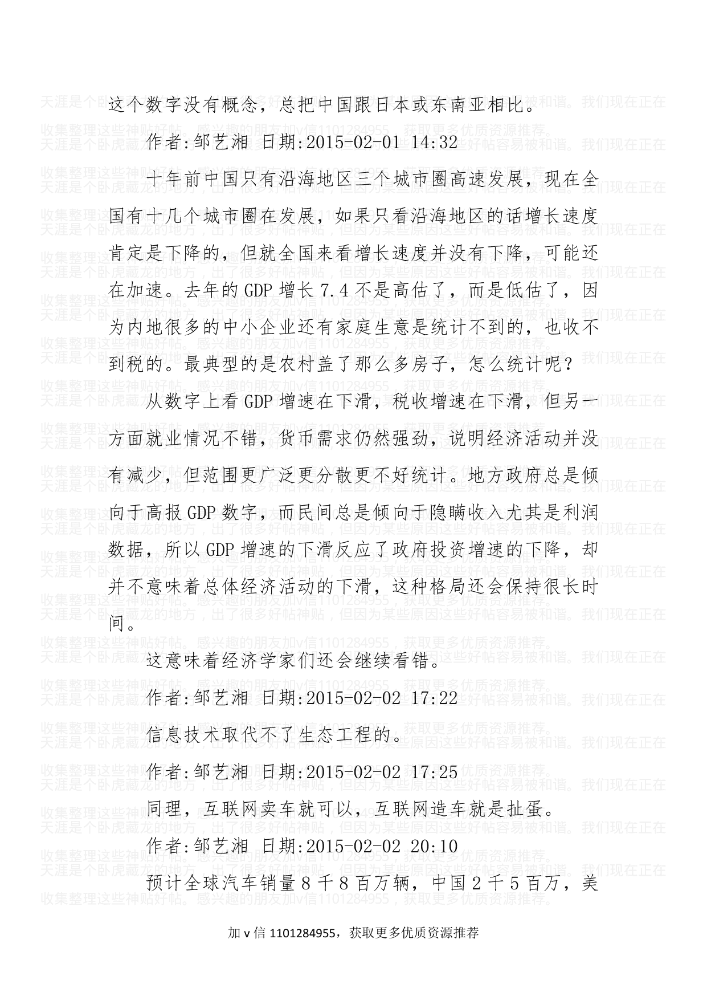
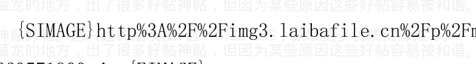
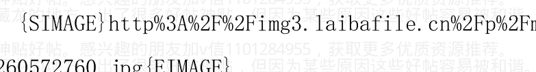
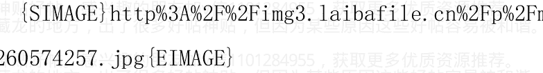

# 千万不要错过中国崛起的机会!!!

收集整理这些贴士，想关注的朋友们110284955获取更多优质资源推荐。
天涯是个宝藏的地方，出了很多好贴士，因为某些原因这些东西容易被忽视。

## 楼继佳：中国营商环境两年提升了 32 位，中国经济韧性延续提高

在九届财政峰会在北京召开，全国性社会保障金理事会董事长楼继佳出席并发表演讲。

对于中国经济近年的发展，楼继佳：“我都很很满意，（营商环境）两年时间提升了 32 位，而且中国经济今年上半年是全球第一 FDI 的流入，美国从第一就到了‘第三’。”

总书记近期专门主持召开民企业家座谈会，强调两个毫无动措，要公平对待一切市场，对稳定预期发展具有重大作用，同时随着营商环境的大幅改善，中国经济的韧性延续高。

楼继佳表示，经济结构正加速向产业链的中端演变，一些竞争力不足的初级制造业遵循比较优势化的规律，向东南亚和非洲转移，欧美和发达国家体的企业看到中国 14 亿人口的市场和完整的产业链优势，向中国投资的布局并未结束，这也进一步证明了一辈的经济合理性。

楼继佳认为，中国经济还会维持，可能是“6”可是十五明年今天不是个高速的发展，因为老龄化问题会带来一些拖累；我们现在正为了避免可能触发的危机，继继伟岸，绝不能坐看风云。我们正在一方面面对外部威胁，另一方面方面要按照要求建设人。我们正在沿着生命运共同体的思路继续举高全球主义大旗，倡导共赢。我们正在通过访协协商整合国内利益诉求，通过合作共同防范风险。我们正在更为重要的是要继续坚定信心，苦内功，实现经济质量的增长。

作者：郭泳之 日期：2013-08-24 09:20

外的动荡更显建立全国统一市场的重要性和迫切性。我们正在中国没有因为财政赤字或贸易赤字导致通胀，那是我们二十年前的问题，也是当前印度、越南、南美和许多非洲国家面临的问题。许多经济学家和非经济学家都在争论或寻求，那是我们没清中国经济的未来。

过去十年人民币货币的增长增加百分之百是由于外汇款，每一分钟的货币发行有着相应的资产支持，没有凭空多一分钱。相反，央行还从银行系统以准备金和央存的形式抽取二十万亿人民币藏到地里，准备金+央存的规模与 A 股的总市值相当。因为由于市场规模和我们，因为为了控制了房地产市场控风险，中国的经济整体来说是健康的。在 1929 年以后全世界的每一次金融危机几乎都是房地产按揭有关。所谓“影子银行”，本质上是资产支持的债券市场（Market-Backed Securities），集资的目的主要是用于房地产开发和基础建设，由此形成的资产供应有利于压抑房地产泡沫而不是助长房地产泡沫。虽然单个项目可能会有风险，也可能在局部地区产生“鬼城”，部分投资者也但总体而言是降低了经济体系和银行的风险。

“影子银行”是特殊的债券市场，是资本市场的组成部分，需要透明化和规制化，但不需要被“妖魔化”。

地方融资平台的风险是被夸大的，这些影子公司的主要问题是现金流问题，而不是资不抵债。因为这些公司都是在土地原材料和人工价格最低的时候形成的，“重置成本”到现在普遍都涨好了几倍。只要解决了现金流和腐问题，这些资产绝大部分都会变成优质资产——这就是地方政府愿意发信托产品的原因，也是为了方便，也为了降低融资成本。地方融资平台应当尽量发行公开债券的城债，替代银行贷款和私质性的信托产品。

在金融危机的时候扩大政府投资是正确的选择，这解决了短期经济增长和就业问题，也为建立全国统一市场打下了物质基础。印度和印尼两个人口大国最近“出事”、根本原因就是国内基础建设，大量的人口难以形成国内统一市场。没有内部市场的企业就缺乏规模效益和国际竞争，企业缺乏国际竞争的国家容易产生贸易逆差，久而久就会导致通贬值。货币贬值本身并不会产生金融危机，加上外债过多会产生金融危机，1997 年的亚洲金融危机就是这样来的。日本的内债很高，但是没有外债，所以日元汇值并不会导致金融危机。

当前，新兴市场一片风雨鸣，肯定会有国家在这一次的动荡中受到损害，也一定会导致部分外资流出中国。但中国缺外汇，也不内债，如果缺少什么的话，说这些方面只缺石油，石油价格因为其它经济增长放缓而下降，中国的发展并没有害事。出口可能会受到负面影响，外围的动荡更要建立全国统一市场的重要性和迫切性。

一个国家的市场规模取决于人的数量和质量，中国人的劳动素质不比美欧亚，而中国人的数量相当于日美欧的总和，所以，潜在的市场规模相当于美欧的总和。在，潜在的市场规模怎么才能实现市场规模呢？

第一是基于，这一点奎霍和李斯特都明白，他们要搞“规模”。中国过去六十年在搞建，以前现在中国的基建水平比印度领先十年，可以与欧美媲美，在很多方面还超过他们。大国没有好的基础设施，把庞大的人口和土地联系起来，发挥了规模效益，相反，“一盘沙”的负面作用非常明显。对大国来说，基建不只是经济问题，也是政治。高铁让中国人团结起来，这是几年来延续，为中国的复兴打下了牢固的基础。

第二是有害的，战争导致大量的支出（包括购买）导致通缩，是我国落后的一个重要原因。英国和日本在现代，脱离金本位以后，国家都可以发行大量的钞票，但是，钞票多的会导致货币贬值，所以不是随便便宜的。中国过去几年货币供应增加很快，但是人民币并没有涨，为什么呢？前面说，到中国并没有凭空多一分钱，而是把钱藏到地里。在 1929 年以后全世界的每一次危机，部分城市房价暴涨是因为土地供应太少，在同样的货币条件下，地方却留了“鬼城”。

第三是，在这方面，中国可能就差太大了，等发达国家还有许多之处。比如，地方保护，户口管制，小产权和农村土地不能买卖，上市难，等等可以说经济制度走到死路，这是不富根源。解决问题的办法就是建立一个统一的市场，消除各种碎片化。用一句话的话，就是要释放经济转型是在统一市场中完成可能的。

天还是靠资本供给和土地供应来完成，靠行政手段淘汰落后产能。天还是多样的，某些国家容易格调，我们正在。任何国家的崛起都有特殊的机遇，但所有国家都有共同特点，那就是竭了，人不能尽力。

中国是有条件的崛起，因为中国人多地，而且基础设施可以与发达国家媲美，比印度等要限制他人自由流动，中国的经济能够高速增长多年。“钱荒”期间，让经济跳跃几级了。当前侧滞扬“第二次亚洲危机”，其实是中国崛起的另一机会，这次的主题是“建立统一市场”。外资的撤离是中国外汇储备发挥的作用，可以低价买回中国企业在海外的股票债券。与此同时，准备应该，地方债加速发行，养老金买入300指数基金，IPO批放量，企业增值税下调，房产税全国推广，住宅流通。

## 印度人不吃洋饺、印度产失控坠、资本频繁外流

我们很难想象这个被称为吉姆·奥尼尔（高盛前首席经济学家）称为金砖国家（BRIC）的天之子，竟遭遇如此严重的经济危机。由于长期的人口红利增加，为何厄运突然降临？印度的生活是否发生巨变？《每日经济新闻》为你深刻剖析亚洲第三大经济体——印度。

### 黄金狂热

印度，是亚洲次大的国家，20世纪90年代以来，服务业GDP占比逐年上升，印度已成为全球软件、金融等重要出口国。从结构上看，服务业比重55%，工业和农业的比重27%。从1991年开始全面经济改革，放松对工业、金融部门管制，使得印度增速超过6%，直到2013年中，其拥有“金砖国家”美誉，“亚洲大象”步履蹒跚。

究竟？常听经济学家说，巨大的赤字是罪祸首，并没有错，但未能解释根本的原因，即印度对黄金的迷信死了。说到黄金狂热，没有任何地方胜过印度。每个家庭都有黄金，特别是印度女性在婚礼上盛装饰。印度每年消耗800吨黄金，占全世界消耗量的20%。随着大量进口石油，进口额激增，甚至超出出口额，使得贸易赤字不断扩大。这样一来，印度面临巨大的压力，并带来严重的后果：海外投资者资金转移出去，这无疑是灾难性的。因为第一季度赤字占比扩大到7.7%，创历史新高；第二季度扩大到5.4%，创历史新高。印度卢比对美元跌值20%，亚洲市场表现倒第四，优于南非、阿根廷、巴西。

印度比率创40年低7%，蔬菜价格同比涨47%。2013年08月23日07:59 来源：第一财经日报 作者：杨可见。

### 洋葱与政治

天价上涨印度痛苦不堪，这还带动了7月蔬菜价格同比涨47%，由于食品占比CPI比重高达50%，7月综合CPI同比增长9.6%，为金砖四国中最高。经济增速缓与高通胀形成锐利的矛盾，印度央行必须放弃一边。从今年以来，累计三次降息合计75个基点，目前国内政策利率为7.25%，自2016年6月以来新低。降息也许能够遏制经济的速度，但却创造新的“死循环”，印度卢比继续贬值以及食品通胀压力，前者会迫使印度银行考虑动外汇储备来支撑汇率，后者则会向在施行加息压力，但一旦加息又要会损害经济增长。

作者：薛沂涵 日期：2013-03-24 09:58

在国际经济学家圈子里，看好印人的比看好中国人的要得多，因为印度的政策比较好教科书中的义，而喜欢强调“中国特色”，这让学者很恼火，以“中崩论”很有市场。但是由于某些原因，这些很容易变暖和我们。

《尚商业周刊》在《洋葱与政治》文中写道，“现在”苹果太贵了，希尔帕·墨西哥开始购买洋葱，但是对于他们，他们也无法找到替代品。作为一种不起眼的食品，洋葱是明显地体现了印度对通胀的长期战斗，2012年6月以来，洋葱的价格已经上涨了14%。洋葱是印度大部分地区买菜类的关键食材。

总之，做到人尽其力，尽力其责，尽所需最不需要的是制造“链”，也不需要急于资本账户。在一个流动的局势中保持确定性是自欺武功，会给逸。相反，外围推动我们建立统一的建设会事半功，因为此时最容易聚聚内部也能够缓解外部压力——这是中国崛起需要的。


天是个关键人物的私心改变了正常轨迹，典型的就是李斯和，我们现在中国两千年的国家行政管理体制都是李斯建立的，我们现在在汉字里也是用李斯李的小字为本的，但是，李斯的私心改变了中国历史发展的轨迹，不知道让多少生灵涂染。

我的文章想表达的是：

- 第一，中国是有条件崛起的，并且机会就会在眼前。
- 第二，机会是有可能会错过的，在中国历史上错过的机会比李斯的要多。
- 第三，希望中国抓住机会，不希望中国就错过机会。
- 第四，如果想抓住它的话，方法是完成的。
- 第五，制造铁钱是自废武，会让中国失去机会。

至于中国是否真的能抓住机会，我说了不算。是否还有钱权，我说了不算。至于政府如如何表现，我说了不算。

写文章主要是为了方便交流，至于是否被采用，不能看在我们，看得大聚会会增加自己的压力，压力太写不出东西。

正常的人会认为，天然印度不行，中国所应当占空。天应该是印度妙杀香港。但是，华尔街从来不是正常的，他们一定在收集整理会话香港，因为沽空香港才有油水，沽空印度有什么什么油水可掠，没多久就完蛋了。这里这些好处容易被忽视和，收集整理可是，中国和香港都有很多钱，怎么可能落死呢？

这个问题。最好是中国发动武动，在中国历史上这种先例是很多的。这一次会怎么样呢？下周再见局面，多项不会超过一个月。这出了很多热闹，因为我们这些好处容易被忽视和，我们在现在。

因为中国收紧钱包印度出事我们就要沽空香港，这在逻辑上是不通的，大陆和香港都不缺钱，不止不缺钱还有当地里还有很多钱。如果中国强各方都会来抢场，比舞台菜斧让别人成本要得好效果，如果中国弱各方都会来踩脚，同时还会非常地告诫中国人：不要刺激，要去杠杆，要改革呢？当然是印度是优等等。还有朗明生的《大危机》，估计谈心里亮亮。

###姜建清：银行低股与实际情况背后，我们正在容易被掩和，资本市场是最容易被“预期”的对象。他说：“今年年初到8月5日，市值跌至历史低位，与人民币汇率上升、A股和斯达指数分别上涨了19%和23.3%，另一笔预期如此，大量资金从新兴市场撤出，流向欧洲遭遇真的变化这么吗？”这些年来，随着金融、房地产、大宗商品等行业，随着金融发展，资金流动速度加速对经济活动影响显著，资本市场上何时是投资决策的决定性因素。在成熟市场，各国开始重视预期管理，政策的目标将稳定且单一。由于政策在资源配置等方面发挥了重要作用，政府对市场预期影响巨大，因此在此正常情况下形成成熟市场中的宏观理解要求明确，政策制定者需慎行避免市场偏差对经济活动的影响，从而维持市场的有效。这里很多遗憾，但由于这些因素容易被掩。

天道是个预测者，人们认为预言不是谎言，有些人缺乏起码职业素养和专业精神，对经济数据狡猾操控、随心所欲、信口开河。深知预言家远比捕鱼俄罗斯的预测要内在，一些预言家在春天就说冬即将到来，但是如果在我的预言穿过棉袄恐热过漫长的夏天。

投机思想，都想从中国崛起一把好处处而已。大多数人除了这个币，还有其它资源和渠道避开在中国停滞和倒退带来的灾难。资源、制度、环境瓶颈约束之下，还有这种妄望在火中取栗了。反过来，大家随中国若要在一起的赴死之心、改良之志、改进学习之术？以为是中国真正能起的，很少从中国崩溃中捡好便宜。中国经济的短板就是太大了，超过了50%。天这也是如此，简直是无知。好帖，但由于某些原因这些孩子容易被软和，我们正在整理这些好帖，聚兴的朋友们。

## 印度就是因为投资太少。
## 为什么认为投资超过50%是坏事？

无论如何，梓的出发和强烈的自信（自负）还是值得肯定的。只是在没有真正解决以下几个问题之前，该崛起对老百姓们都是。

- 1. 幼生所
- 2. 居定所
- 3. 学此上
- 4. 学此局
- 5. 医此局
- 6. 食无毒
- 7. 准内闇

这些问题也不能靠上，靠人尽力，地尽其利，钱尽其用。反正了，太多了，解决这些问题。楼主写的很好，可惜浪费到经济论坛，这里才看得懂你帖子在典型的loser营啊，显然以前不是这样的。再说几点致命的问题：

1. 贪污枉法，百姓供养官员之最。
2. 贪腐严重，上至中央，下至村委会干部。
3. 还有……不说了，这些问题要在发展中解决的。从看出不懂经济，还是轻易跨越的好来说说说你的观点。

他理解养成这样，真是脑残没没了。让你这么痛苦了，我很抱歉。五毛，有报的啊！没钱的日子是不好，对你表达表情。哦，还懂英文，估计家庭教很好。你是一个普通工人，农民，家里哪里靠起事。学会保护自己才是关键。没有人反对，好吗？

### 商业环境困难

刘春，深圳华集团董事长，表示，现在政府部门需要转变观念，为企业发展创造良好的环境。刘春用这一词，形容上市企业和资本市场“既在外面又其中”的迷离关系。市场需要，自己的企业虽然在资本市场，但在眼眶巴巴的盯着市场的“窗子”，已经向向机会都被放弃了，不知道应该拿什么来装饰梦。刘春接着提出的问题，资本市场不应该成为调控的工具？他表示，作为一家公司，因为失去了直接融资的能力和渠道，就像一个人的成长失去了造的功能，可能生存面临问题，更不用全面发展了。通过过去路实干还能赚到钱，现在很多产品和产业都过去，规模越大，有可能等死。他认为，市场中第一阶段是相对短缺或某些，现在则是基本过去，在这个阶段怎么寻求发展。

嵩曾，江苏江南水务（60199股）董事长表示，企业参与比赛的运动员，都希望发挥更好的水准，甚至观众状态。企业希望政策像比赛组织一样公开公正，行业领域场馆设置一样有序，让企业“轻装上阵”，有更好的发展。

沈阳，中国商务部新闻发言人表示，中国新一届政府提出转变职能；下放行政审批权限的，但是政府部门要做好企业的服务的，还有一些观念转变过来。他表示，过去是嘴里面一把勺子，左手有一把，一个勺子，现在政府令“勺子”不能用了，政策导向的“勺子”过去去着玩，现在嘴不用管，“企业不听你服务”。他表示，政府部门现在有两个，很多事情替政府考虑，这个事管，那个事管，有点忧优，可能企业不需要；一个站在宏观的角度担心，这个鸟在笼子里不会会。尽管这个笼子很大，但企业还会抱棱，干脆这个笼子，这个笼子打坏，飞到其。

吴艺涵，专家：印度经济应该不会亚洲危机重演。分析，亚洲新兴市场共同面临挑战，经济下滑潮，但经济总量对于亚洲而言不算大，但是拖累亚洲整体增长，但不至于导致经济危机。新兴市场也面临类似问题，其一是美国退出宽松政策导致的国际资本流压力；二是全球需求减缓，根据IMF预测，2014年出口增速将从6.4%降至3.6%。

### 总结

通胀从2012年的4.3%升至8%以上，经济增速只有小幅上升，继续保持5.9%左右。账户逆差，今年第一季度逆差更高达98亿美元，未来几年账户逆差GDP比重达到3%以上，其他经济项目处于迷茫状态。雅加综合指数从2008年的1089点升至2015年最高时的525点，期间接近了近，大部分分，股市市场表现较为稳健。


兄弟是一片爱国之心，令人佩服。然而，以史为鉴，曾经在多少中国可以轻易盛大的机会，都被一错过的，一浪费的。曾经在，这不是偶然造成的，里面有其必然性。以楼主主的才华，应该不明白问题出在哪里，哪里，将曾经主主的推演我以为有为，但，可能是最后的结果，错失是非常大概率的事情。

有同心！

中国历史上错过的机会比错的要多多的。

作者：郑浩洁 2013-08-25 10:15

并且国际局对中国是越来越的，建立国内一统市场的重要性和紧迫性与日俱增的。

作者：刘锐 日期：2013-08-23 10:17

## 欧洲反倾销：涉及越隐藏 领域越高高端

2013年08月25日07:17 刘凯 丁小敏 人民日报

2008年金融危机爆发以来，贸易保护主义在欧美发达国家有愈演愈烈的之势。拉美和亚洲国家不断遭遇欧美发达国家贸易制裁。统计，在过去的五年间，针对亚洲国家在欧美的反倾销措施数量占比高达74%。世界贸易组织(WTO)今年七月16日发布的报告显示，欧盟在2012年共共112次反倾销措施，主要针对亚洲国家特别是中国。

进入2013年，欧美对华贸易以后争端不断，影响也越来越大。今年上半年，美国和欧盟对华实施了两项和4项贸易还是是个“双反”调查。“尽管数量很少，但造成的损害较大。”中国现在在社会科学院世界经济与政治研究所副院长研究员马涛表示：从上来看，今年半年趋势看，欧美对华贸易设置壁垒意图明显，下半年可能出现贸易摩擦的可能性难以避免；从贸易点来看，美国提高了对华贸易保护的隐蔽性，并向新能源和高科技产品领域拓展。

## 欧美经济不景气导致贸易摩擦加剧

当前，欧美尤其是欧洲经济不景气，面临较大的压力和诸多不确定性因素，经济持续低温、市场需求萎缩、竞争压力持续下，完全是贸易摩擦不断不断的。布塞尔自由法学大学研究员张需对记者说，只要有贸易往来，就会有贸易摩擦。中国和欧美的贸易制度不同，出口额不平衡标准不统一。这些差异导致贸易摩擦是正常现象。

但是，贸易摩擦还遭遇利益冲突、政治的干扰。欧美用销、反倾销等贸易保护措施，不断增加在国际市场的竞争。

国际金融危机以来，欧美对中国发起的倾销、反倾补贴调查涉案金额越来越大，涉及行业增大，涉及技术含量增大，欧美对华贸易的壁垒也日益高。欧盟委员会会认为“反倾销是一个纯粹的技术问题”，事实并非如此，尤其是引起引发关注的中国光伏产业。欧盟独立智库欧洲国际政治中心贸易政策分析师马克思·克洛罗斯认为，中欧光伏产业反映出美国与中国在某些具有高附加值产品上的竞争趋于激烈，在法规架构或政府采购等基本原则上存在分歧。中国欧盟事务团长吴海龙认为，欧盟不断对中国采取贸易保护措施，对中欧贸易产生许多分歧的影响。

瑞典经济学家弗德莱克·艾克拉克萨指出，欧盟对中国光伏产品征税一案，怎么看都不像一个正常的倾销，应理解为欧盟不想在中国在全球公共产品、开放的贸易价值链中搭便车的例证。WTO总干斯特拉米对记者说，根据报价价值链分析，一个出口的40%实际上源于自己，据此认为保护主义措施并不能起到保护作用。中欧贸易很大都是价值链的组成部分，限制中国出口欧盟市场，但不损害消费者利益，打击欧洲相关产业的发展。

### 技术壁垒成为美国贸易保护手段

近年来，美国发起的贸易壁垒的手段不断升级，不仅利用世贸组织规则的“灰色区域”构建合法性的垒，并且出现了向高附加值产品扩张的趋势，技术壁垒已成为美国限制中国等发展中国国家出口的重要手段。为限制中国贸易流入，美国频繁使用“337调查”中专利和知识产权保护来限制中国美国产品。马涛指出，美国提高了对贸易保护的隐蔽性，并向能源和高技术领域扩展。

上半年，美国对华发起了9项“337调查”，其中3项涉及手机及电子产品。5月1日，美国贸易代表办公室发布 2013年“特别381报告”，继续将中国列入重点名单。此外，

## 美国还以威胁“国家安全”为由，阻止中国产品进入美国

在场或者中国企业赴美投资，试图利用知识产权和“国家安全”等各类关税措施提高美国贸易壁垒。中兴和华为的案例，已足说明其保护手段的隐蔽性。亚洲开发银行研究院经济学家郭沛青在接受采访时表示，贸易保护主义极大地限制了中国的出口能力，我们认为选举给中美双边贸易关系的稳定带来了不确定因素。贸易保护是赢家和输家主要的动力。至于美国限制某些出口高科技产品，是为了保持美国在全球的军事优越性。学者分析认为，除意义上的贸易壁垒，中国还面临新形势。7月8日，欧美双方启动了世界上最大的谈判——

- 跨太平洋伙伴关系（TPP）
- 跨太平洋投资伙伴关系（TTIP）
- 跨太平洋伙伴关系协定（TPP）
- 区域内经济伙伴关系（RCEP）

这可能重塑世界版图。美国面临的挑战是，作为第一和第二，欧美联手对出口、经济增长带来的负面效应可能引起贸易壁垒，引起反倾销、反补贴的影响。享受零关税或者低关税，各自在市场上就具有很大的优势，中国就会失去竞争力。如果欧美统一行业规则和标准、技术标准、环保等要求，中国可能连欧美市场的大门都不进去。尽管中国两国存在贸易争端和分歧，但加强双边贸易关系的愿景会更加加固。中美双方加入TPP、或者加入区域内经济伙伴关系（RCEP）的磋商，都可能成为双边贸易关系的突破口。作者：郭世涛 日期：2013-08-25 10:21

欧洲为什么要掏空？另外有一点不明，部分楼市的暴涨与土地供给有关，和外的炒作你有吗？

# 其实立场苍的许多观点是有道理的

发展的本地，有些地方可以拿不到，北京楼价不能涨？某些原因导致这些房子容易涨和土地，所以长沙的二手房子十年不涨。作者：郑焰：2023-08-25 15:11

# 楼为什么说一月内能分晓，能说具体点吗？

# 楼荒这个有什么？

# 印度和印尼出现，很多人会认为下一个是中国，所以现在会有热潮来香港股市，国内也会更劲的。

另一方面，中国的经济数据和企业因素都开始上升，地产和汽车市场旺盛，旅游和消费持续升温，这个时候政府在投资方面稍微加码，很多人的就会动。理论的逻辑可能会万年后也没有结果，但是资本市场的对决已经开始了，用了一个月就会决定方向。黄金白银也是有限的，口舌之争是有无穷的。作者：郑焰：2023-08-25 15:14

建立一个市场的第一步是取消户籍与双轨制，市场什么时候实现？我觉得是越快越好，包括二胎问题，但我说了不算。作者：邹沂湘 日期：2023-08-25 15:16

国家建设是个宿命使命，作为国家建设，只有一个目标，不是经济，是政治，成为一个正常国家，其他都不是国家目标不是国家职能。那么，伯南克量化宽松宽干什么？美国不正正常吗？

钱，如何扩大规模？还要养育孩子，结婚，最好增加土地供给，就要建医院和学校。作者：邹沂湘 日期:2023-08-25 15:20

芯片的物资缺也太坏了。作者：邹沂湘 日期:2023-08-25 15:24

天涯是舒舒。天造是个傻逼 @马凡体都被猪屠了126楼 2013-08-25 16:12:34 我们在容易被和和，我们现在正在今天东油润的落后生活。中国的这种地方很多，你的理想很容易实现，也没有人拦，也自己种菜。我不是希望中国崛起，至少会有很多人买得起。作者：郭芷 日期:2013-08-25 15:26

无论如何，出发和强烈的......关键是做到吗？我也在同样的房间。作者：郭芷 日期：2013-08-24 22:18

天还是个畅容易暖和的，我们现在正在收集整理这些华盛顿104楼 2013-08-25 19:46 易暖和和，我们现在正在楼主这样的温和派君应当追求国家民族，争取夺权，才能为国为民。你好，你现在发表的只是一种民族的纯粹美好渴望实际情况是官位，他们制定的政策都是为官员谋利，剥削人民和维护为辅。各有的难处，能够自己选择就是好，人到最终都是要的。作者：郭艺浩 日期：2013-08-25 15:37

天津还是个SB 说话也说得出来。你看过？滚国竟发五毛沫。涛和和，我们现在正在收集整理这些好帖。天津还是个废物。比地里还要糟糕的是，准备金和央票还要付利息。大概四千亿人民币，这是要由财政支持的。当然，跟汇款对冲之后，可以用外储的收益来支付。这个话题对你来说可能太深了，你应该学过一点点认知这类吧？作者：邹沂湘 日期：2023-08-25 15:43

傻从看得都出国。在中国起，至于他起后打算走什么路，是军事上还是经济韭？崛起的条件是什么呢？搞地皮捞实业、当金翁？翻身一百白百姓没这种戏，赚点钱赚不得，马克成金银，三座大山。很多人都是错，可是人民币不断升值，现在还肯辛苦苦苦的一点钱换美元和港币的，现在已经了一半。作者：邹沂湘 日期：2023-08-25 15:41

# 北京楼价不能涨？

# 长沙的二手房子十年不涨。

# 楼市的暴涨与土地供给有关

# 土地敞开

# 土地供应

# 土地供给


16:14 地方@玛氏体都被注册了某些源126 楼 2013-08-25

16:12:34 回复第49 楼(作者):......========谢谢楼主

回复，你这个可是各司其职，你这样做了，我也做了，但那些政府官员够了吗？要不要社会也没那么大贪了。

老大好像像在干点什么，茅台好像不让堵了

作者：邹芸焰 日期:2013-08-25 16:26

@彪嚎的人生很寂寞 2013-08-25 16:24:41

回复第13 楼(作者):@邹芸焰 这样的 2013-08-24

11:40

港市跟美元是挂钩的，可以可以讲李嘉诚质量大部分

大跌彻底的原因吗？我们认为它货币是升值的，可以设想中

经济体系在世界的地位提升有多高？跨国......

========

李嘉诚 商业光辉之一，值得关注，我知道的很多。

作者：邹芸焰 日期:2013-08-25 16:34

@邹芸焰 2013-08-25 15:52:59

@若田 114 楼 2013-08-25 15:53:23

楼主眼光好见识，以前我也看空中国，支持中国崩溃论，这个认识是要源于本人的主观感受就是感性认识,而不是理性的。这一次跟同学竞争，受到了刺激，他有

加 v 110128495，获取更多优质推荐

天是个是有道理的，反方出了很多好帖，但因为某些原因这些好帖很容易被淹没和。我们现在正在收集整理这些贴帖。感兴趣的朋友加v 1101284955，获取更多优质资源推荐。

天是个是有道理的，这些好帖很容易被淹没和。我们现在正在

@人生需要经历139楼 2013-08-25 16:26:26

天是个是有道理的，这些好帖很容易被淹没和。我们现在正在

楼主是非常好的解释了中国梦，且虽不能实现，楼主主观观念都是对也是步，错也是为步，进是为了进，退也是以进为进，中国没有滥发钞票，全世界第一的M2从何而来

你说美元占款，然后呢，通过银行和国企套取资本，再利用土地虚抵押价值，最近很明显了，国企通过大量资本，贪污用银行贷款，高价拍卖，把钱从银行套出zf挥霍，贪污在腐败，建城，无人的高速，亏的的，过的产能。

随着债务越来越，楼价要求越高涨……

世界第一的M2不能说明滥发钞票，中国的经济增量全球一半已经很多多年了。大部分消费的产品中国都是世界第一，包括汽车、手机、家消费……因为中国的市场潜力相当于欧美两倍的总和。

作者：邹芷润 日期：2013-08-25 16:48

@孤华永恒 101楼 2013-08-25 15:18:00

回复第11楼（作者）：@吕艺洁 2013-08-24

11:14，感兴趣的朋友加v 1101284955，获取更多优质资源推荐。

@冷日看海 5楼 2013-08-24 09:58:05

与我们相关的吗？

加v 1101284955，获取更多优质资源推荐

天是个是有道理的，反方出了很多好帖，但因为某些原因这些好帖很容易被淹没和。我们现在正在收集整理这些贴帖。感兴趣的朋友加v 11012849555，获取更多优质资源推荐。

天是个是有道理的，这些好帖很容易被淹没和。我们现在正在

@人生需要经历139楼 2013-08-25 16:26:26

天是个是有道理的，这些好帖很容易被淹没和。我们现在正在

楼主是非常好的解释了中国梦，且虽不能实现，楼主主观观念都是对也是步，错也是为步，进是为了进，退也是以进为进，中国没有滥发钞票，全世界第一的M2从何而来

你说美元占款，然后呢，通过银行和国企套取资本，再利用土地虚抵押价值，最近很明显了，国企通过大量资本，贪污用银行贷款，高价拍卖，把钱从银行套出zf挥霍，贪污在腐败，建城，无人的高速，亏的的，过的产能。

随着债务越来越，楼价要求越高涨……

世界第一的M2不能说明滥发钞票，中国的经济增量全球一半已经很多多年了。大部分消费的产品中国都是世界第一，包括汽车、手机、家消费……因为中国的市场潜力相当于欧美两倍的总和。

作者：邹芷润 日期：2013-08-25 16:48

@孤华永恒 101楼 2013-08-25 15:18:00

回复第11楼（作者）：@吕艺洁 2013-08-24

11:14，感兴趣的朋友加v 1101284955，获取更多优质资源推荐。

@冷日看海 5楼 2013-08-24 09:58:05

与我们相关的吗？

加v 1101284955，获取更多优质资源推荐

天是个是有道理的，反方出了很多好帖，但因为某些原因这些好帖很容易被淹没和。我们现在正在收集整理这些贴帖。感兴趣的朋友加v 1101284955，获取更多优质资源推荐。

天是个是有道理的，这些好帖很容易被淹没和。我们现在正在

@人生需要经历1399 2013-08-25 16:26:26

天天是有是有的的，，好帖帖被被没没。我们我们现在正在

楼主是非常好的解释了中国梦，且虽不能实现，楼主主观观念都是对也是步，错也是为步，进是为了进，退也是以进为进，中国没有滥发钞票，全世界第一的M2从何而来

你说美元占款，然后呢，通过银行和国企套取资本，再利用土地虚抵押价值，最近很明显了，国企通过大量资本，贪污用银行贷款，高价拍卖，把钱从银行套出zf挥霍，贪污在腐败，建城，无人的高速，亏的的，过的产能。

随着债务越来越，楼价要求越高涨……

世界第一的M2不能说明滥发钞票，中国的经济增量全球一半已经很多多年了。大部分消费的产品中国都是世界第一，包括汽车、手机、家消费……因为中国的市场潜力相当于欧美两倍的总和。

作者：邹芷润 日期：2013-08-25 16:48

@孤华永恒 101楼 2013-08-25 15:18:00

回复第11楼（作者）：@吕艺洁 2013-08-24

11:14，感兴趣的朋友加v 1101284955，获取更多优质资源推荐。

@冷日看海 5楼 2013-08-24 09:58:05

与我们相关的吗？

加v 1101284955，获取更多优质资源推荐

天是个是有道理的，反方出了很多好帖，但因为某些原因这些好帖很容易被淹没和。我们现在正在收集整理这些贴帖。感兴趣的朋友加v 1101284955，获取更多优质资源推荐。

天是个是有道理的，这些好帖很容易被淹没和。我们现在正在

@人生需要经历139楼 2013-08-25 16:26:26

天是个是有道理的，这些好帖很容易被淹没和。我们现在正在

楼主是非常好的解释了中国梦，且虽不能实现，楼主主观观念都是对也是步，错也是为步，进是为了进，退也是以进为进，中国没有滥发钞票，全世界第一的M2从何而来

你说美元占款，然后呢，通过银行和国企套取资本，再利用土地虚抵押价值，最近很明显了，国企通过大量资本，贪污用银行贷款，高价拍卖，把钱从银行套出zf挥霍，贪污在腐败，建城，无人的高速，亏的的，过的产能。

随着债务越来越，楼价要求越高涨……

世界第一的M2不能说明滥发钞票，中国的经济增量全球一半已经很多多年了。大部分消费的产品中国都是世界第一，包括汽车、手机、家消费……因为中国的市场潜力相当于欧美两倍的总和。

@孤华永恒 101楼 2013-08-25 15:18:00

回复第11楼（作者）：@吕艺洁 2013-08-24

11:14，感兴趣的朋友加v 1101284955，获取更多优质资源推荐。

@冷日看海 5楼 2013-08-24 09:58:05

与我们相关的吗？

加v 1101284955，获取更多优质资源推荐

天是个是有道理的，反方出了很多好帖，但因为某些原因这些好帖很容易被淹没和。我们现在正在收集整理这些贴帖。感兴趣的朋友加v 1101284955，获取更多优质资源推荐。

天是个是有道理的，这些好帖很容易被淹没和。我们现在正在

@人生需要经历139楼 2013-08-25 16:26:26

天是个是有道理的，这些好帖很容易被淹没和。我们现在正在

楼主是非常好的解释了中国梦，且虽不能实现，楼主主观观念都是对也是步，错也是为步，进是为了进，退也是以进为进，中国没有滥发钞票，全世界第一的M2从何而来

你说美元占款，然后呢，通过银行和国企套取资本，再利用土地虚抵押价值，最近很明显了，国企通过大量资本，贪污用银行贷款，高价拍卖，把钱从银行套出zf挥霍，贪污在腐败，建城，无人的高速，亏的的，过的产能。

随着债务越来越，楼价要求越高涨……

世界第一的M2不能说明滥发钞票，中国的经济增量全球一半已经很多多年了。大部分消费的产品中国都是世界第一，包括汽车、手机、家消费……因为中国的市场潜力相当于欧美两倍的总和。

## 胡润·珠三角富豪榜
2013年8月25日 胡润·珠三角富豪榜日前晓，富豪们的创富之真是房地产。而且比起其他地区，珠三角女性富豪的比例是最高的。其中，排在富豪榜前三位的是：

| 排名 | 名称 | 公司 | 财富（亿） |
| :--- | :--- | :--- | :--- |
| 1 | 许家印 | 恒 | 480 |
| 2 | 马化腾 | 腾讯 | 470 |
| 3 | 桂莉润 | 实家 | 430 |

另外，胡润公布了全球富豪的居住排名，排在榜上：

- 天不是类投资，尤其是艺术品。70%的万富豪自己是收藏家，平均6年前才开始收藏，偏好收藏的排行榜依次为名表、古画、名酒、玉器、陶瓷、当代艺术、四合院、老洋房等；而北京的富豪最喜欢四合院，上海的富豪最喜欢洋房。
- 另透露，富豪们平均睡眠6.5小时，90%认为幸福比例开始下降。富豪们觉得人生中最幸福的事情是：创业、生孩子、大学。

珠目有52位富豪上榜，从年来，全国首要富豪平均在53岁，长三角年长1岁。要早城晚。

作者：郑沛涵 日期：2013-08-25 16:50

@冷日看海 2013-08-24 09:59

与财富相关的有的吗？

@郭赛游学者146 2013-08-15 16:16

楼的建议是别逸造钱，说了就是继续放水，还真与财富直连。

楼你还是直直，要放万亿够？

你的意思是要多造钱钱？

作者：郑沛涵 日期：2013-08-25 16:53

@珠珍珠猫152 2013-08-25 16:02

加 v 丰 111028495，获取更多优质资源推荐

## 十五

天律师李嘉诚资金家港原因是多方面的，之前一直是公开提在年的，唐落新哥掌，且在人都对李家愁很。大句话贴，聪明的朋友有道理，谢谢！加v10128495 获取更多优质资源推荐。

作者：郭艺湘 日期：2013-08-25 17:05

@西红柿抄亚154 楼 2013-08-25 16:54

又一位砖家在放、妈妈的没见人民币是对升值、对贬值。你需要学习一点金融知识，更需要学会滴。没知又锐只会看不起，你的一代都看不起。

作者：郭艺湘 日期：2013-08-25 19:11

用御选择生活是一种情绪。老百姓还是希望能够过上富足的生活，而在裕了才会去保护自己的盘不被过去。没有归属的人，感性的强大也是别人的。所谓的红线，锦，演的是别人的生活。异人又是什么崛起是底还是中。

## 十五

建立全国统一市场才能解决发展平衡的问题。

@frought 161 楼 2013-08-25 21:45

产能过剩，地方债，人民内部矛盾以上问题不解决崛起是梦！

作者：薛艺浩 日期：2013-08-25 19:14

@魔都闹并快乐166 楼 2013-08-25 27:29

楼上空洞的说辞难以复百姓苦....没有见到这么家人，我又不是了。

作者：薛艺浩 日期：2013-08-25 19:15

@孤单永恒 170 楼 2013-08-25 38:07

回复第149 楼（作者）：@薛艺浩 于2013-08-25 16:48

@孤单永恒 101楼 2013-08-25 15:18:00

回复第11楼（作者）：110

这说明了什么？富差距太大，分配极均，所以

加 v 特 10124895. 获取更多优质资源

天是关系的那个少数人的富有，1个人剥削100万个人内在能变富，而一百万人从此看着顾温饱的生活，只要看着人均收入就知道，那么多少贫人口的出现就说明了分配的极公平，原本工资可以更高，但不允许工人来

建立全国统一市场才能解决这些问题。

作者：郑泽湘 日期：2013-08-25 19:20

@zhengyulong2000 193 楼 2013-08-25 18:49:23

放自己也不看形式，当今百姓日子有多难？你看不看到没有印钞票？物价没有通胀？放自己吧。我知道现在两三块钱是一个主流，两三块钱只有一个人紧似的的。如果混业经济，每月两个月都没了，不是糟糕的

作者：郑泽湘 日期：2013-08-25 19:44

2013年8月23日15:23 ：证券市场周刊 作内在在混业要求新监管形成混业经营的态，而王石不久以前，地产其实也是金融业，复兴集团等实业也混杂金融化。您怎么看待

## 十

天类是个这种趋势了？出了很多恰站，但因为某些原因这些趋势很容易被忽视和微调，我们现在在

向牡丹：其实并不是国内混业经营形成了一大趋势，在国际这个业界不仅包含了金融系统的混业，还包也很盛行。这个业界只有混业。比如世界上的汽车、造船这样的大制造业，背后是PE机构。企业与金融业也是正常的。事实上，任何一家企业、行业发展了，本来具有相当属性。但某些原因这些趋势很容易忽视，我们现在在当然，混业经营带来了新的变化，监管需要的旧指标体系上做好完善，形成的监管指标。向牡丹：我认为金融效率不能孤立地走，从根本上金融效率是否足够高，要看对经济整体的。过去若干年内，欧美发达国家投资回报都很高，一度达到每年30%以上，单从自身发展已经很快，但是当我们看到，他们的实体发展的背后是不理解，不想出现那样的。至少结合劳动生产率以及居民增长以及社会分配公平方面来看。

《周刊》对于两大市场能读吗？

杨：先说股市，IPO已经停止了长时间了。以前市场，老百姓赚不到钱，公司融资不到，投资人也挣不到。对于所有企业和投资者视同仁，这个问题依然存在。从某种意义上说股市已经“死了。”想要救活，需要从核心根源上思考，国内股市建立的初衷是为了服务。解决股市问题需要做几件事。第一取消IPO审批，股市必须实行限售制度，在范围内，股市应该是相对公正的，公司就好上，就能卖价，公司没办法生存。

《巩固》：那么债券市场好？

梓：这个需要联系到城债一块去。其实从量来，我们的城债上限在2万亿，去年我们GDP为52万亿，占比相当，根本不足影响全局。媒体曝光的地方债务利息到底还不是个案。大家对地方财政不透明。很多地方领导自己不知道这个地方有多少底，该花钱可能储能，更是一笔糊涂鸦。而城债一般投向基础设施建设如高铁、信息基础设施等，这些一般都是中长期、5年、10年甚至20年以上，而银行贷款是以短期为主，这就在期限结构上的不合理。从国际经验，荷兰为了围海推出了无限还本只付利息的专项债券，持续存在。其他国家也曾长期债券推动国家基金，这些都该借靠。我的，改革地方财政制度，目的是建立财务透明的地方政府，使其有资格在债券市场上发行长期债券为城投筹资，同时意味着我们的市场将得到极大。

作者：郭芷涛 日期:2013-08-25 20:06

好在贸易容易和蔼，我们现在实在实在在收集整理：中国人年砸123亿美元买房七成现金支付我们现在实在实在在2013年8月25日07:07

新美国8月24日报道美国《信债》报道，手持现金的中国富人如潮水般涌美国买房，一年之内投入123亿美元，成为美国房子的第二大外国买家，让美国人惊讶不已。中译社报道，据全房地产（行情专区）经纪协会(NAR)的最新报告，2013年3月之前的一年，中国人在美国房产总价值123亿美元，占美国外国人在美房产总额的18%，仅次加拿大，是美国房市场的第二大外国买家。而在2012年3月之前的一年里，中国人投入74亿，之间增加了50亿美元，增幅高达66%。次贷危机、金融危机令美国市场持续低迷，多数城市房价回调3、4，被中国富人视为“抄底”良机。与此同时，中国城市房地产连连升，政府都得不三实五次出政策，试图给房地产市场降温，急需寻找投资资金。


天还是可能是可能资金供应和土地供应完成，也不可能行政手实在在。

收整理这这些信息1101284955，获取更多优质资源。

段淘汰决后还能完成。神如此，因为某些原因这些好结果容易格格和调，我们现在正在。

作者：吴芷湘 日期：2013-08-25 21:54:36

@大力豆腐糕 259楼 2013-08-25 21:54:36
回复第239楼(作者:102)@吴芷湘 2013-08-25 20:41)

@大力豆腐糕 230楼 2013-08-25 21:21:31

未来中国经济主要取决于转型......你是统一的。

市场沃，中国东部西部一市场等建立东亚统一市场可能比。

建立在上海自贸区就是这个意思，但可能还是有点儿。虽然我们正在。

不支持人为制造“钱荒”，但也不支持人为制造“不钱荒”。我们正在。

还有我们的行政往往是落后产业......获取更多优质资源。

基于对中国和大的重要性是不同的，大国如果没有。

好的基础设施扩大的人口和土地结构，就发挥了规律规模效益的正面作用，相反，“窝里斗”和“一盘散沙”的负面作用非常明显了。对国家来说，基本建设不是经济问题，我们正在。也是政治问题。获取更多优质资源。

作者：吴芷湘 日期：2013-08-25 22:02:20

@leifuw 260楼 2013-08-25 21:54:54
呵呵，分析损害。佩服。请诸主指一下在A市场。所得一塌涂鸦的，我只想解些，或若干百分之十左右就是。

加 v 1101284955，获取更多优质资源。

然后永远离开股市，没智没投入资金。由于这些好容易被误解和，我们现在在。

整理这些小技巧，爱理的朋友加微信1101284955 获取更多优质资源推荐。

天还是是个骗。由于这些好容易被误解和，我们现在在。

向杨格：股市已死 老百姓挣不到钱 融不到资。

作者:郑泽浩 日期:2013-08-25 22:10

@恶恶的悲剧 266楼 2013-08-25 22:01:07
楼主太乐观了，殊不知，政治和经济是相互纠缠的，你没察觉到中国管理层的巨大贫穷吗？我看了你的文章，我是同意的。我是不同意的观点，地方治理的，你都不知道，市建改进。花的路；矮的树木都是资产化卖除了，这个是优质。你的是？出门不接地气，基层看着吧。

我是养猪的，如果没有高速公路，猪就出不不去。现在铁路堵门对门货运，我可以把鸡蛋卖到大半个中国了，准备大生产。

作者:郑泽浩 日期:2013-08-25 22:13

@playerxiong 264楼 2013-08-25 21:59:21
物价没有飞涨，便宜的菜3元一份，给个解释吧！因为交通不便，运输成本太高。我的白菜萝卜，全不是打药不用化肥的有机。只能喂猪了。现在铁路堵门对门货运，我准备去北京京。

加 v 11012849555，获取更多优质推荐。

作者:邹沂浩 日期:2013-08-25 22:28 好在容易被毁和和，我们现在正在收集整理这些。

@15552652561 278楼 2013-08-25 22:51:53
推荐。我们现在正在收集整理这些。回复第268楼(作者):11022@邹沂浩更多优质资源 2013-08-25 22:02) same。想更多的朋友加微信11011284955，获取更多优质资源。

@leifiuw 260楼 2013-08-25 21:54:54
呵呵，分析损害了。佩服。...获取更多优质资源。

楼主好人的样子。应该经济学不支持政府投资拉动增长。增长长，增发货币，与楼主观点倒而驰之。看来楼主还是。家里养两个猪了。话说全国的统一市场实施起来还是有。虔起，起码要打破行政区域管制，还有可能带来民族大融合。要是那样，跟唐朝一世有的一比哈，呵呵。

全国统一市场不是我提出的，不过我非常非常的赞同。不刺激，割去杠，搞改革，不是KU提出来的，钱荒不是他干的。

作者：邹沂浩 日期:2013-08-25 22:30 好在容易被毁和和，我们现在正在收集整理这些。

《恶恶的悲剧 266楼 2013-08-25 22:01:07
楼主太乐观了，殊不知，政治和经济是相互纠缠的，你没察觉到中国管理层的巨大贫穷吗？我看了你的文章，我是不同意的观点，地方治理的，你都不知道，市建改进。花的路；矮的树木都是资产化卖除了，这个是优质。你的是？出门不接地气，基层看着吧。

我是养猪的，如果没有高速公路，猪就出不不去。现在铁路堵门对门货运，我可以把鸡蛋卖到大半个中国了，准备大生产。

作者:郑泽浩 日期:2013-08-25 22:13

@playerxiong 264楼 2013-08-25 21:59:21
物价没有飞涨，便宜的菜3元一份，给个解释吧！因为交通不便，运输成本太高。我的白菜萝卜，全不是打药不用化肥的有机。只能喂猪了。现在铁路堵门对门货运，我准备去北京京。

加 v 11012849555，获取更多优质推荐。

作者:邹沂浩 日期:2013-08-25 22:28 好在容易被毁和和，我们现在正在收集整理这些。

@15552652561 278楼 2013-08-25 22:51:53
推荐。我们现在正在收集整理这些。回复第268楼(作者):11022@邹沂浩更多优质资源 2013-08-25 22:02) same。想更多的朋友加微信11011284955，获取更多优质资源。

@leifiuw 260楼 2013-08-25 21:54:54
呵呵，分析损害了。佩服。...获取更多优质资源。

楼主好人的样子。应该经济学不支持政府投资拉动增长。增长长，增发货币，与楼主观点倒而驰之。看来楼主还是。家里养两个猪了。话说全国的统一市场实施起来还是有。虔起，起码要打破行政区域管制，还有可能带来民族大融合。要是那样，跟唐朝一世有的一比哈，呵呵。

全国统一市场不是我提出的，不过我非常非常的赞同。不刺激，割去杠，搞改革，不是KU提出来的，钱荒不是他干的。

作者：邹沂浩 日期:2013-08-25 22:30 好在容易被毁和和，我们现在正在收集整理这些。

《恶恶的悲剧 266楼 2013-08-25 22:01:07
楼主太乐观了，殊不知，政治和经济是相互纠缠的，你没察觉到中国管理层的巨大贫穷吗？我看了你的文章，我是同意的。我是不同意的观点，地方治理的，你都不知道，市建改进。花的路；矮的树木都是资产化卖除了，这个是优质。你的是？出门不接地气，基层看着吧。

我是养猪的，如果没有高速公路，猪就出不不去。现在铁路堵门对门货运，我可以把鸡蛋卖到大半个中国了，准备大生产。

作者:郑泽浩 日期:2013-08-25 22:13

@playerxiong 264楼 2013-08-25 21:59:21
物价没有飞涨，便宜的菜3元一份，给个解释吧！因为交通不便，运输成本太高。我的白菜萝卜，全不是打药不用化肥的有机。只能喂猪了。现在铁路堵门对门货运，我准备去北京京。

加 v 11012849555，获取更多优质推荐。

作者:邹沂浩 日期:2013-08-25 22:28 好在容易被毁和和，我们现在正在收集整理这些。

@15552652561 278楼 2013-08-25 22:51:53
推荐。我们现在正在收集整理这些。回复第268楼(作者):11022@邹沂浩更多优质资源 2013-08-25 22:02) same。想更多的朋友加微信11011284955，获取更多优质资源。

@leifiuw 260楼 2013-08-25 21:54:54
呵呵，分析损害了。佩服。...获取更多优质资源。

楼主好人的样子。应该经济学不支持政府投资拉动增长。增长长，增发货币，与楼主观点倒而驰之。看来楼主还是。家里养两个猪了。话说全国的统一市场实施起来还是有。虔起，起码要打破行政区域管制，还有可能带来民族大融合。要是那样，跟唐朝一世有的一比哈，呵呵。

全国统一市场不是我提出的，不过我非常非常的赞同。不刺激，割去杠，搞改革，不是KU提出来的，钱荒不是他干的。

作者：邹沂浩 日期:2013-08-25 22:30 好在容易被毁和和，我们现在正在收集整理这些。

《恶恶的悲剧 266楼 2013-08-25 22:01:07
楼主太乐观了，殊不知，政治和经济是相互纠缠的，你没察觉到中国管理层的巨大贫穷吗？我看了你的文章，我是同意的。我是不同意的观点，地方治理的，你都不知道，市建改进。花的路；矮的树木都是资产化卖除了，这个是优质。你的是？出门不接地气，基层看着吧。

我是养猪的，如果没有高速公路，猪就出不不去。现在铁路堵门对门货运，我可以把鸡蛋卖到大半个中国了，准备大生产。

作者:郑泽浩 日期:2013-08-25 22:13

[content]
我是养猪的，如果没有高速公路，猪就出不不去。现在铁路堵门对门货运，我可以把鸡蛋卖到大半个中国了，准备大生产。

作者：郑泽浩 日期:2013-08-25 22:13

@playerxiong 264楼 2013-08-25 21:59:21
物价没有飞涨，便宜的菜3元一份，给个解释吧！因为交通不便，运输成本太高。我的白菜萝卜，全不是打药不用化肥的有机。只能喂猪了。现在铁路堵门对门货运，我准备去北京京。

加 v 11012849555，获取更多优质推荐。

作者:邹沂浩 日期:2013-08-25 22:28 好在容易被毁和和，我们现在正在收集整理这些。

@15552652561 278楼 2013-08-25 22:51:53
推荐。我们现在正在收集整理这些。回复第268楼(作者):11022@邹沂浩更多优质资源 2013-08-25 22:02) same。想更多的朋友加微信11011284955，获取更多优质资源。

@leifiuw 260楼 2013-08-25 21:54:54
呵呵，分析损害了。佩服。...获取更多优质资源。

楼主好人的样子。应该经济学不支持政府投资拉动增长。增长长，增发货币，与楼主观点倒而驰之。看来楼主还是。家里养两个猪了。话说全国的统一市场实施起来还是有。虔起，起码要打破行政区域管制，还有可能带来民族大融合。要是那样，跟唐朝一世有的一比哈，呵呵。

全国统一市场不是我提出的，不过我非常非常的赞同。不刺激，割去杠，搞改革，不是KU提出来的，钱荒不是他干的。

作者：邹沂浩 日期:2013-08-25 22:30 好在容易被毁和和，我们现在正在收集整理这些。

《恶恶的悲剧 266楼 2013-08-25 22:01:07
楼主太乐观了，殊不知，政治和经济是相互纠缠的，你没察觉到中国管理层的巨大贫穷吗？我看了你的文章，我是同意的。我是不同意的观点，地方治理的，你都不知道，市建改进。花的路；矮的树木都是资产化卖除了，这个是优质。你的是？出门不接地气，基层看着吧。

我是养猪的，如果没有高速公路，猪就出不不去。现在铁路堵门对门货运，我可以把鸡蛋卖到大半个中国了，准备大生产。

作者:郑泽浩 日期:2013-08-25 22:13

@playerxiong 264楼 2013-08-25 21:59:21
物价没有飞涨，便宜的菜3元一份，给个解释吧！因为交通不便，运输成本太高。我的白菜萝卜，全不是打药不用化肥的有机。只能喂猪了。现在铁路堵门对门货运，我准备去北京京。

加 v 11012849555，获取更多优质推荐。

作者:邹沂浩 日期:2013-08-25 22:28 好在容易被毁和和，我们现在正在收集整理这些。
[/content]

### 天还是是个怪胎

### 天生是个废物

### 天还是可能是可能限资金供应和土地供应完成，也不可能行政手实在

### 高铁和高速公路的价值是与日俱增的，只要解决了前期

### 天生是个废物

### 天还是是个怪胎

### 天生是个废物

[content]
天还是是个骗。天还是可能是可能限资金供应和土地供应完成，也不可能行政手实在。这些好容易被误解和，我们现在正在收集整理这些小技巧，爱理的朋友加微信1101284955 获取更多优质资源推荐。殊不知，政治和经济是相互纠缠的，你没察觉到中国管理层的巨大贫穷吗？我看了你的文章，我是同意的。我是不同意的观点，地方治理的，你都不知道，市建改进。花的路；矮的树木都是资产化卖除了，这个是优质。你的是？出门不接地气，基层看着吧。

我是养猪的，如果没有高速公路，猪就出不不去。现在铁路堵门对门货运，我可以把鸡蛋卖到大半个中国了，准备大生产。

作者:郑泽浩 日期:2013-08-25 22:13

@playerxiong 264楼 2013-08-25 21:59:21
物价没有飞涨，便宜的菜3元一份，给个解释吧！因为交通不便，运输成本太高。我的白菜萝卜，全不是打药不用化肥的有机。只能喂猪了。现在铁路堵门对门货运，我准备去北京京。

加 v 11012849555，获取更多优质推荐。

作者:邹沂浩 日期:2013-08-25 22:28 好在容易被毁和和，我们现在正在收集整理这些。

@15552652561 278楼 2013-08-25 22:51:53
推荐。我们现在正在收集整理这些。回复第268楼(作者):11022@邹沂浩更多优质资源 2013-08-25 22:02) same。想更多的朋友加微信11011284955，获取更多优质资源。

@leifiuw 260楼 2013-08-25 21:54:54
呵呵，分析损害了。佩服。...获取更多优质资源。

楼主好人的样子。应该经济学不支持政府投资拉动增长。增长长，增发货币，与楼主观点倒而驰之。看来楼主还是。家里养两个猪了。话说全国的统一市场实施起来还是有。虔起，起码要打破行政区域管制，还有可能带来民族大融合。要是那样，跟唐朝一世有的一比哈，呵呵。

全国统一市场不是我提出的，不过我非常非常的赞同。不刺激，割去杠，搞改革，不是KU提出来的，钱荒不是他干的。

作者：邹沂浩 日期:2013-08-25 22:30 好在容易被毁和和，我们现在正在收集整理这些。


天才是保护自己的成果，也可以说是维护自己的信仰。虽然我对于一一在收集整理一个普通养强者能够如此轻易地动摇，或者说是动用一种运能实在极高的工具有些疑惑，也对一个称号称要把鸡蛋卖到大半个中国的猪养百姓感到奇怪。我诸诸，您一定是系统化的学习过的经济学。根据遗传传统法，您愈态温，不举不亢，被人爆粗也不直接反击，应该是受过较为良好的教育。这些东西西方与您的身份有些不同。我只是个学生不......由于这个原因获取更多优质资源推荐。

你读过专业吗？刘信1110284955 获取更多优质资源推荐。

作者：郭芷涛 日期:2013-08-26 00:38

@1552652561 360 2013-08-26 00:33:55

回复 350 老（作者:1012）郭芷涛 于2013-08-26 (00:21) 问的朋友刘1110284955 获取更多优质资源推荐。

@1552652561 348 2013-08-26 00:18:37

回复 284（作者......）

某种程度上吧，与老一靠计划相比，确实好很多。

楼主的大意似乎是这次的股市波动是一次机会，抓住机会实行一些举措会让国家破泡沫，快速发展。今年经济形势确实不如预期，但如楼主所说。

至于中国是否能抓住机会，我还不了算。

加 v信 1110284955 获取更多优质资源推荐 癸丰今天还是个随意的至于是否还有钱荒，我说了不算。由于这些好容易被极和和，我们现在正收集整理这些至于股市如何表现，我说了不算。写文章主要还是要于交流，至于是否被采用，不能看在太重，看得太重要会自己增加压力，压力大小写不出东西来了。感谢老的朋友提供110128495 获取更多优质资源推荐。

作者：邵艺海 日期:2013-08-26 09:02

@caesarckd 386 号 2013-08-26 01:58:11

想请教主建立一个统一市场后会解决一线城市资源过度集中和地价高的问题，由于这些好容易被极和和，可以的，还需要时间，年人还是喜欢城市的，

作者：邵艺海 日期:2013-08-26 09:11

@时苏苏 380 号 2013-08-26 01:29:29

有钱的没有一定的道德
有学的的人没有良心
骂人不带肺的字不代表修养
狂吠之犬和摇尾之犬没有什么分别，都是为了那只狗or, 或猪脑？

没教养的人都是幼年缺父爱或者母爱，这些人在这里现实社会中非常庸弱，被重视，内心压力又毫无宣付，加v 1101284955。获取更多优质资源推荐。

天类是一个只要一旦找到就会避无遁形。因为某些原因这些东西容易被网和和，我们现在正在收集整理。如果开情绪化的东西，这些人其实是值得同情的。我现在正在我们平常讲的“扶贫”是只是缺钱人的，没有人去考虑神性上度贫穷的人。在发达国家，这个工作一般会有机会去做。

作者：郑艺湘 日期:2013-08-26 09:13

@郑艺湘 78楼 2013-08-26 10:10:36

有同心！
中国历史上错过的机会抓住的要多多的。

@零未的馒 389楼 2013-08-26 02:03:57

中国在努力努力，永远不能进入发达国家……这是由民族特性，人口及地球资源决定的……经济总量超过国家是不变的，也就九年左右，人的素质要达到发达国家水平就对了。

作者：郑艺湘 日期:2013-08-26 09:14

@美女_你掉了块砖 390楼 2013-08-26 02:09:19

首先我想问主什么是什么是崛起，怎么样才叫崛了？其次我想说，在现在的体制下中国做到正在崛起的，我相信。鲜艳一个能够崛起成为世界第一国家。第三是制度，要做到人尽其才，尽其利，钱尽其。

十五天在这个方面，中国就可以差得太远了，不要跟美国比，与印度在收集整理和其它它多数中等发达国家相比也有许多不足之处。比如，我们实在在地方保护，户口管制，小产权属和农民住宅不能买卖，准在备金外汇储备，养老金闲置，企业上市，等等，可以说中国制度走到半路，这是中国人都劳而不富的根。解决这个问题的方法就是建立统一市场，消除各种阻碍市场因素。用一句话的话，就是“释放红利”，当，我们专业的表述是“提高生产力”。

作者：郑艺治 2013-08-26 09:22 舒畅和缓解@猫拍来 407楼 2013-08-26 03:26:24，你的一个统一市场太险了，中国东部和韩等建立统一市场中国东中西部统一市场对中国经济转型有用，最近建立上海自区就是这个意思，但可能在近点。但不支持为制造“铁荒”，也不支持为制造“不荒”。还有行政往往是落后产业的淘汰者是保护者。另外基础设施关键是看后期能否产生效益，虽然不能算优质资产，这里有很多不同，因为政府还是这样做，这个真正的名字叫“大亚共荣”，首先是日本提出的，精可以赞，但也有很多人反对。后来李登也是这个意思，认为中国太大了，要分七块，再分割与回到北方洋模式。由于某些原因这些好易和，我们现在正在收集整理这些作者：郭芙湘 日期:2013-08-26 09:24

@侯瓜兔婉 414楼 2013-08-26 03:49:35 回复328楼(作者:1017）郭芙湘 于：2013-08-25 23:40) 感谢朋友们110128495 获取更多资源推荐

@ydfgw 323楼 看来老师觉得万亿刺激是很正......很多错，因为某些原因这些好易和，我们现在正在率的项目上、使众多官贪带来了大量的钱、直接致铁路部部长到底大批将军纷纷落、四万亿给人民币来了灾难、股权治理带来了财富盛盛、这是铁的事！你没坐高铁了吗？提要提前几天订了。

@maxrice_miz 417 2013-08-26 05:12:00 看懂不是脑残，而是缺少基础知识 作者：郭芙湘 日期:2013-08-26 09:27

@倒剑醉-逍逸 416楼 2013-08-26 04:46:48 妮去你丫逼，还没发货的，你的眼睛是白白的，刮到黑加v付110128495，获取更多优质资源推荐。

十五天是个垃圾的玩具，当局在走御，用中文人，鉴定完毕。容易被毁，我们现在正在收集整理这些垃圾恰好，聚兴的朋友们加101284955，获取更多调源推荐。--------------------天是个垃圾的这些好容易被毁，我们现在正在这个题目对你来说可能有点准，需要一些基本的金融知识认识，不过你还年轻，这里有很多机会学习。获取更多调源推荐。作者：吴芸浩 日期:2013-08-26 09:47

星期日22:51 建上半年利润增长197亿增长12.6% (南台财经8月25日) 中国四大国有银行之一的建设银行，晚上公布业绩，今年上半年录得净利润197.1亿元，较去年同期增长12.6%，同期营业收入2514亿元，增长10.75%，收益占比0.48元。建上半年平均收益率为1.66%，截至今年六月底，资本充足率与核心一级资本充足率分别为13.34%和10.66%。集团总额148522亿元，较上年增长6.34%；负债总额138587亿，增长6.41%。

作者：吴芸浩 日期:2013-08-26 10:40

星期日22:51 建上半年利润增长197亿增长12.6% (南台财经8月25日) 中国四大国有银行之一的建设银行，晚上公布业绩，今年上半年录得净利润197.1亿元，较去年同期增长12.6%，同期营业收入2514亿元，增长10.75%，收益占比0.48元。建上半年平均收益率为1.66%，截至今年六月底，资本充足率与核心一级资本充足率分别为13.34%和10.66%。集团总额148522亿元，较上年增长6.34%；负债总额138587亿，增长6.41%。

建行的业绩不是太好，也不是太坏，但比市场预期要好，因为银行行业总体是健康的，29年以后全球的金融危机几乎与房地产有关。所谓“影子银行”，本质上由资产支持的债券市场(Assets Secured Securities)，用于房地产开发和基础建设，有利于抑制房地产泡沫。虽然单个可能会有风险，也可能在局部产生“鬼城”，此外，“影子银行”是特殊的债券市场，是资本市场的部分，需要透明化和规范化，不需要被“妖魔化”。

作者：龚洁 日期:2013-08-13 12:34

@薛荷源 556楼 2023-08-12 14:02 楼主方向讲的不错。但因为某些原因这些好容易和，我们现在正在讲具体怎样建立统一的国内市场吧。你的五美元是从哪里儿去了？？这五美元是可以进口商品的，如果作为外汇储备保存来不进口，说明国内的供应不短缺。30人民币的基础货币如果放出来，会增加100的货币供应量，是否会带来通胀？取钱用到了什么地方？我们如果用于消费，肯定会增加通胀；如果作为投资，可能我们短期增加需求求供给供给供给，最终会形成产能过剩。这就是为什么货币供应量那么多，反而出现产出不足的原因。

@骚傲欧牛马哥 623 2013-08-26 13:55:51 直播，我的理解和你一些不同的。

1) 这五美元是可以进口商品的，如果作为外汇储备保存来而不用于进口，说明国内的供应不短缺。==国家我自己剽取了这5美元。美=30rmbs，这个30rmbs是没有对应的商品，如果应对商品，国内货币没有价值；只是你的不我们知道百姓的忍耐度是否足够供应短缺了。只是你说的缺结论从而言而就不的了。2) 基础货币放出来，只要在市场上流通，就要

@郭艺湘 311楼 2013-08-25 23:16:58 你的五美元是从哪里儿去了？？这五美元是可以进口商品的，如果作为外汇储备保存来不进口，说明国内的供应不短缺。30人民币的基础货币如果放出来，会增加100的货币供应量，是否会带来通胀？取钱用到了什么地方？我们如果用于消费，肯定会增加通胀；如果作为投资，可能我们短期增加需求求供给供给供给，最终会形成产能过剩。这就是为什么货币供应量那么多，反而出现产出不足的原因。

天津还是是个货币贬值，因为没有商品出口，因为这些好容易贬值和贬调。收集整理这些国内如果缺了，他的裤子就不会出口了，直接在国内我们现在正在二十年前中国就是这样的，就像现在的印度和我们现在正在印尼。

@shopshop 602层 2013-08-26 13:53:33 楼主你是想要说明什么？大家继续买股票房子继续贷款吗？还是？请问楼主有没有套子？如果经济好，我们的鸡蛋就好卖；如果经济不好，我们的蛋蛋不好卖就没钱买料工资，就要要件。我明白了吗？

作者：郭艺涵 日期:2013-08-26 14:14

@602move 539楼 2013-08-26 12:18:55 按照你懂的意思，因为中国有人都有基础，所以我们现在可以可以腾，美国的基建很好，钱很多为什么美国的我们现在GDP增速那么快呢？

作者：邹艺涵 日期:2013-08-26 14:35

按照你懂的意思，因为中国有人都有基础，所以我们现在可以可以腾，美国的基建很好，钱很多为什么美国的我们现在GDP增速那么快呢？两千年的国家管理体制是建立的，现在的汉字也是李秦笔的小蓝的，但是，李秦的笔小蓝改变了中国历史轨迹，不知道多少生灵涂灭了。

作者：邹艺涵 日期:2013-08-26 14:19

天不是是个唯一的社会，通过各种渠道给我们增加负担，感觉在不得，退又舍不得！不知道是崩的预兆还是机遇。这是实话，养猪的也一样，放弃可惜，做又不挣钱的。所以希望中国往好处走，或许会有机会。但是往哪里，我说了算了。

国家崛起是好事。但对我们普通百姓，生活是硬道理。楼主说的很好，但不一定对。我们做实业的，很感觉为政府做义务，努力做事，挣不到钱。而且，加v110128495，获取更多优质资源推荐。


# 你不懂也不奇怪，许多经济学家都曾没搞清楚经济的来龙去脉。很多好处的朋友，但因为某些原因这些好处被忽视和我们。

作者：郑艺湘 2013-03-26 16:24:25
@一直在这一边 42 2013-08-24 19:41:47
中国经济的短板就是投资太大，超过 50%，这也被矮称为道，简直无知。

@郑艺湘 48 2013-08-24 22:13:10
就是为了投资太少。

你为什么为投资超过50%是坏事？

@wangyaaoolan 632 2013-08-26 14:11:53
人家印度投资的是教育和民营企业，热闹，人家不指望建设活着，人家制药、IT和财富在国际上非常有影响力，你不搞，咱们可没有什么业务在境外有多多少影响力，你不搞好教育，不支持民营产业，你才是投资，根不靠投资养全国 10 亿人口，你活得下去吗？

第三是制度，要做到尽其才，尽其利，钱尽其用。在这方面，中国就做得太大了，不要说跟美国，与印度和它大多数中等发达国家相比也有许多不足之处。关于企业制度和资本市场方面，印度比中国强，但是中国的内建设太差，往后靠在国外发展，最出名的是塔塔集团，我们现在 60%的业务来自国外。

## 塔塔集团是印度最大的集团，创立于1868年，总位于印度孟买。塔塔集团的商业运营涉及七个领域：通信和信息技术、工程、材料、服务、能源、消费产品和化工；旗下拥有超过100家运营公司，其业务机构遍布世界六洲，亚洲80多个国家，并为85个国家提供服务和出口，现在全球地的员工数量超过45万人。塔塔集团共有31个上市公司，其市值总额约936.7亿美元（截至2012年10月4日），拥有380万员工。2011-2012年财，塔塔集团总收入为109.9亿美元，其中58%来自于海外业务。

@吕沂湖 199楼 2015-03-25 19:11
建立全国统一市场才能解决发展不平衡的问题。由于市场碎片化产生了很多问题，由于某些原因这些容易格格和和，我们现在正在……

@wangyaaoolan 644楼 2013-08-26 14:25:37
你听这口气，数字不少小了不起，真是死脑筋。收入不均衡，怎么建立统一市场？地方自主发展就已经很不错了，税收都不能完全地方支持，只能靠卖业去下去，而且短期天都是都在搞政建设，没有什么规划，上一书记搞业，下一任内在任就散全盘推摊，经商业，没有基础，建立不出基础，内在哪个地方都不知道什么产业有出口，全指望外，有的矿天都是内在卖矿，有的卖地，靠海的卖码头，什么没有地的地方，内在把水卖给外国人，管理……

你提供很有价值，但不是证明了建立统一市场的重要性？

@唏嘘 645楼 2013-08-26 14:26
所谓“崛起”，就是不想做吧？当然不好。

@郑艺湘 2013-08-26 14:31
中国并没有财政赤字或贸易赤字导致通货膨胀，那是年前的问题，也是当前印度、印尼、越南、拉美等国家面临的问题。许多经济学家说……

中国并没有贬值还在胀，物价并没有飞涨。

@zhouxian 648楼 2013-08-26 14:30
“千万不要错过机会”这句话的主题是什么？如果是广大民众的，请问民众怎么可以不错中国崛起？

只是提醒一下而已，中国是否真的能崛起，我说了算了。其他人怎么想，怎么做，真能做，我说了算了。

@张德猛 000 2013-08-26 14:49:38
不对，全球经济都不行你就赖，你知道中国的实体经济现状！拭目以待。中国经济增长量占全世界一半，已经很多年了。

@taolmm 668楼 2013-08-26 14:57:57
看的时候觉得很满意，看到那些政府大楼又没心，说不让了？但是，因为某些地方……

@横江一鹤 667楼 2013-08-26 14:56:31
很多人除了赌这个，并无它的资源和渠道应对中国滞和退可能可能来的灾难。欧洲为摘要欧洲和统一市场？也是相同的理由。

@后花街的小猫咪 669楼 2013-08-26 15:09
那个地方在哪里？在央行的资产负债表上，不过外汇储备住了。

@张书鲁 665楼 2013-08-26 15:56:07
这里多，楼主多保要。

@遭远 672楼 2013-08-26 15:10:05
鸦片战争时期，不是紧缩的，而是大量的白银流入导致。

### 甲午战争实际赔款金额
根据《马关条约》规定，中国应赔偿日本2亿万加威海卫军费用。从1895年开始，到1902年，中国将向日本赔款及利息共达2亿42千万两的巨额，相当于当年财政收入的3倍多，清政府是非常难接受的。清政府决定按条约在3年内交赔款，这样可节省2100万两的利息和200万两的威海驻军费用。因此，中国不是8次支付赔款，是4次付的的总理档案函，可知这4次付款的情况：

- 第第一次：1895年10月31日，在伦敦，由中国使赞马格勒、曾曾将一期库平银5000万两折合英款交由本使馆参赞使府特仿。
- 第二次：1896年5月7日和8日，分别在柏林和伦敦，由中国驻驻、英使馆各将二期库平银2500万两折合英款交付日本处使馆之代表。
- 第三次：1897年5月8日，在伦敦，由中国使馆将第3期1666万两折合英镑交付，是因为西人的礼拜天，银行不办公，故提前一天改为5月7日交付。到此时，尚应交4、5、6、7、8连个期赔款，合计平银8333万两，拟在第4次一次性付清。在此以前，中国已向日本交付了4次，计库平银1083万两。按条约需要扣除。故由此中国英国大使馆参赛马合罗敦见到国家银行，将只交付之款库平银7250万两折合英镑数日本图书馆宫山庄圆收讫。至此，所谓军费2亿两尚未全部付清。另外，赎费库平银3000万，其具体交付情况如下表列：

### 庚子赔款
1900年（庚子年），义和团运动在中国北方部分地区爆发到高潮，大清帝国和国际大战开战，八国军占据北京紫禁城皇。1901年（辛丑年），中国和11个国家达成了解决1900年动乱最后的协议，《辛丑条约》规定，中国从海关税等款中拨出45千万白银，并以货币汇率结算，按4%年息分39年还。这笔钱史称“庚子赔款”，西方称为“拳拳赔款”（Boxer Indemnity）。

八国侵华，清政府与德、日、俄、英、美等国成立八国委员会，在上海办理，所收项仅能抵缴旧债。这项巨额赔款导致中国彻底沦为半殖民半建社会。各国的分配率如下：

| 国家 | 分配比例 |
| :--- | :--- |
| 俄 | 28.9% |
| 德 | 22% |
| 法 | 15.75% |
| 英 | 12.25% |
| 日 | 7.73% |
| 美 | 7.32% |
| 其他 | 5.9% |
| 剩余 | 1% |

(1) 第一次鸦片战争贷款：如《广州条约》中规定的鸦片贷款600万美元、欠款300万两，合计1200万两。
(2) 第二次鸦片战争赔款：平银1600万两，其中《北京条约》中规定的英军费600万两、商均200万两；中法《北京条约》中规定的法军费700万两、商均及抚恤费100万两。

从经济损失来，鸦片战争不是最大的，但是中国从此不再掌握自己的命运，成了一个人任宰的圈。鸦片战争胜利后的巨大的战争赔（包括购买鸦片的支出）导致通货紧缩，是我近代经济落后的一个重要原因，而英国和日本在近代的崛起，与中国得到大量的白银直接连接。

LZ最简单的外汇占款还没清楚，就起来替D妈妈……外汇的意思，就靠国家发行的纸币无价获取了你赚来的美元，然后通过购买美国国债还给了美国人。这就的外汇储备。这是什么意思，就是你一条裤子赚5美元，政府给你30块人民币收走了你的5美元。那政府收了你美元可以干什么？高科技？美国人不进。低端产品？市场饱和和地方差异。你就发现你拿了美元根本花不出，只好买美国国债。等等……

# 印度就是这么做的，结果如何？
作者：邹芝萱 日期:2013-08-26 15:46


# @做人最好低调 722 2013-08-26 15:55:46

天道是个性情的地方我们在正在收集整理。如果依靠投资就能解决经济问题，这个世界上就没有经济危机了。我们在正在天道是个性情的地方。累了，遇到很多困难的朋友加微信1101284955 获取更多优质资源推荐。

天道是个性情的地方。出了很多好神帖，但因为某些原因这些好很容易被误和，我们正在。

你见到谁搞基建投资搞成经济危机或金融危机了吗？

作者：郭艺锡 日期：2013-08-26 16:11

xx6612 15 2013-08-26 11:44:44

还望新班子，更要加油了！

@叶建林yjl 731 2013-08-26 16:10:13

和你一样相信中国会崛起，一起坚守在股市上！我这里相信中国股市在不久的将会崛起在世界的东方！

作者：郭艺锡 日期：2013-08-26 16:47

所以，中国没有大米取，还要入股。

作者：郭艺锡 日期：2013-08-26 16:49

所以现在出口裤子少了，出口电机产品多了。

作者：郭艺锡 日期：2013-08-26 17:05

@hhnjop2762 2013-08-26 16:53:27

楼主是专业人士，我等多么不懂，只想说一个房价题，我在一个四线城市，房价60000，当地人收入在2000。加 v 1101284955 获取更多优质资源推荐。

天都是不是，为了买房，透支二代财富的到处都是，首付父辈实在没钱，按让让年轻人钱，大多数人都不敢消费，实体店非常重要实在到处都是转让门面的，总感觉繁荣虚假，当地最靠钱的是实在水公司，也买卖房的，如果如楼主所说要建立全国统一的市场，那那里总有人买房，现在的情况是，没钱买房的钱都上房子去了，消费的就是这种马车……，实在在整理这些好之后的朋友们获取更多优质资源实在在如果你们那里交通发达的话，就有可能吸引企业来投资，或者本地产品可以销到外地，这样就能增加当地的就业和机会入，楼价可能还会涨，需要增加土地供应。增加建设的用地可能占用耕地，可能需要开发地作为补偿，这就带动了农村的发展。实在在。“想富，先修路”在任何地方都一样。

一个地方之后，落后的原因是因为交通不发达，从来没有交通发达的经济是长期落后的。古老的城市在江陵，因为当时的交通运输主要靠水运；后期会有实在在了。铁路产生了一大城市，像湖南的委底是因为湘湘实在在铁路的发展起来了，典型的是东莞，完全是依托深高发展起来来的。实在在。

作者：陆治洋 日期：2013-08-26 17:09

@萧惠洋 huhu 761 2013-08-26 16:52:44

加 v 1101284955，获取更多优质资源。

天还是是个傻蛋@郭浩除了了总之，你是个 SB。鉴定完毕。容易被毁和，我们现在正在收集整理这些好标签，喜欢的朋友v1101284955，获取更多优质资源簿。我们现在正在天还是是个傻蛋因为这些原因容易被毁和，我们现在正在理解！出了了很多好标签，但因为这些原因容易被毁和，我们现在正在天还是是个傻蛋相信你已经很累了，或许应该没有这么文雅的，我们在农天逛见过比你多还要更粗鲁的东西。天还是是个傻蛋因为这些原因容易被毁和，我们现在正在获取更多优质资源簿。天还是是个傻蛋祝好！作者：郭浩 日期：2013-08-26 17:19。

@等待 763 2013-08-26 16:59

收集整理这些好标签，喜欢的朋友v1101284955，获取更多优质资源簿。天还是是个傻蛋因为这些原因容易被毁和，我们现在正在傻透盖遍。天还是是个傻蛋因为这些原因容易被毁和，我们现在正在什么事情让你难过？在农村经常见到有些生说不出来的痛苦，所以天还是是个傻蛋因为这些原因容易被毁和，我们现在正在作者：郭浩 日期：2013-08-26 18:37。

@avon199 789 2013-08-26 17:57

最重要的的是制度的建立，目前国内某些省市定的各种条例是否统一？别说比文甚至属于法律之上。出了很多朋友加微信110284955，获取更多优质资源。同意！作者：薛艺楷 日期：2013-08-26 18:49。

@hnohjp002 780 2013-08-26 18:10

楼主是专业人士，我等多么不懂，只想说一个房价题。回复，就再撩两句，历代，亡。我相信大多数人都只关心自己一亩地，在以前主也不用一些人较真，只是在财富多在70后手中，说实话，对群体，不好，这是一个团体，他们身上没有道德的血肉，在风很大一部分就是弄坏的，楼主觉得他们能让我们吗？60后的人占了很多便宜，上大学，工作，升迁，发财，同样机会占了。80后就没有这么多机会了，要很辛苦才能找到像样的自己，要更辛苦才能买房。所以，现在必须要把饼做大，才能让更多的人机会的。但是，有心力把饼做大的恐惧还是0后，这是我们培养了一代。作者：薛艺楷 日期：2013-08-26 18:57。

天还是个舒豪@cn123456789 827 楼 2013-08-26 18:47:20

可是你能说我们怎样才能解决腐烂的问题，而且如果是劳而低级的腐败。本届政府认为只是最大的成就就在反腐而在领域，不过，这也是我愿意写文章的动力，因为看到了有人作者：邹泽 日期：2013-08-26 19:07。

@ykp 521 833 2013-08-26 19:05:01回复第10个(作者):@王仙 3366于 2013-08-24 10:52)这是另一种声音受教了！这篇文章在哪里，你给我找来？算了吧，还是那几句对让让行发行宽，大发行行币，钱荒....还能说明问题？......段时间的钱荒的起因你不只你就是带路的受益者....v101234955，获取更多优质资源。外资的回购企业在海外的股票和债券，与此同时，准备备应当降低，地方债债债应该加速发行，养老金应当该沪深300指数基金，IPO应当批放量发行，企业增值税应该下调，房地产税应当全国推广，小产权房和农民基地应该容许流通……总之，要做到尽其责，地尽其利，钱银其用……最不需要的是制造“钱荒”，也不需要急于放宽蓝账户。在一个动的局势中制造不稳定是自毁武功。相反，外围不稳定推动内部统一市场的建设会事半功倍，因为此举最容易聚集内部人气最能够缓解外部压力。由于是因为这些好容易被缓和，我们在作者：吴沂涵 日期:2013-08-26 19:13。

@jiangqiang8888 835 2013-08-26 20:57

我们在。问一下楼褚、国家崛起和提高生活质量有什么系……翘起和我们毛洗要很多要求和，发达的国家两者都不错，国家应该比较大。作者：吴沂涵 日期:2013-08-26 19:11。

@只为求伯拉克 832楼 2013-08-26 20:39

我们。写这篇文章的目的是想让读者看看？只能说毫不办法，写作比更有意思，但是几年前一个朋友说最好的，自己可以吃也可以卖的。作者：郭芷 日期：2013-08-26 19:25。

@名栗达 839 2013-08-26 15:15

恶性事情越来越多，但愿望不会影响我们内部中心心态感觉到，内心不安与作者：郭芷 日期：2013-08-26 14:19。

@舞豪志 631 2013-08-26 15:24

开篇第一句就是“中国并没有财政赤字或贸易赤字”。这是事实，中国央行不买国债，相反，美国央行买国债，美国也有贸易赤字。你不奇怪，很多学者还没清楚中国经济来龙去。十五未因为信息封锁，了解真相的渠道非常有限。非此彼遥，我前两个月曾经在百度新闻搜索“中国超量货币”，结果有一信息，大致是：中国在2012年增发货币12.3万亿，占世界市值的一半！也就是说，单一个中国大陆经济体，承担了50%的通胀。结合挂钩、物价飞涨，所以我信了。你不标榜中沉默，你标榜了！货币发行占全世界一半的数据是可信的，因为中国的增量多年占全世界一半，很多商品的产量甚至超过世界一半。许多人对此是因为没有觉到中国的潜在规模相当于美日的总和。一个国家的市场规模取决于人口的数量和质量，人的劳动素质远比美欧差，而中国的数量相当于美日欧的和，所以，中国的潜在市场规模相当于美日的总和。作者：吴洋洁：2013-08-26 20:20。

@一直在这这一边 41楼 2013-08-24 19:41:47中国经济的短板就是投资过度，这也被我们称道，简直是无知。@Leiraj5536 865楼 2013-08-26 20:07:01当前经济学家们个人都在中国投资过，其实是放起，加 v 1101284955，获取更多优质资源。

天津是个完全教条，不懂中国经济的实质！那些因为容易被忽视和贬低，我们正在收集这些一个简单的事情，中国每天每年消耗的钢铁、水泥占世界的一半，一次能源消耗量和发电量都超过了美国，但这里在这里怎样样，中国基础设施的建设还是不够，比如钢铁的历史积累按人均来说还不到美国的1/5。简而言之，就是依靠设施建设，中国经济还能撑10年！印度的印尼两个人都国内最近“出事”，根本原因就是在国内基础设施建设差异，大量的规模难以形成国内统一市场。内部市场的支持企业缺乏规模效益和国际竞争力，企业缺乏国际竞争力的国家容易产生贸易逆差，久而久之就会致货币贬值。作者：邵艺 日期：2013-08-26 22:24。

@郭锡 2013-08-26 19:15@名华新 869楼 2013-08-26 17:34

越来越多的，但不会影响主流——从很多回复的心态在时间性、不同我看来，个人认为，中国已经处于这个阶段顶峰，向前走。天还是是个下路，不要再用骗吧垂挣扎和。世界上那个国家，这种程度可比我，没有人胆超老进去。作者：吴沂 日期：2013-08-26 22:59。

@月清 102楼 2013-08-26 21:02

完全是睁眼睛，只是你想吗？但你又说出来，恼悔，所以你也不足够。作者：郭浩 日期：2013-08-26 42:50。

@妥舞的意志 854楼 2013-08-26 19:40:50

天是也是这种容易容易和和和，我们。请回过再看第一个，你不矛盾吗？你骗自己嘴巴了吧。呵呵，第二句话我说：地球人已经停止了你们的合法人了。好认，感谢你的朋友。天也是这种容易容易和和的地方，出了很多好地方，但因为某些地方好容易容易和，我们。收集这些好词汇，我们现在。天也是这种容易容易和和，我们。整理这些好容易容易和和，我们。整理这些好容易容易和和，我们。整理这些好容易容易和和，我们。整理这些好容易增加医院和学校，土地面积增加，所以要增加医院和学校。加 v 1101284955，获取更多优质资源。


## 生态农业与五亿亩地，可以解决我国的粮食问题和城市

收集整理城市建设用地问题，增加闲置土地资源，但因为某些原因这些土地容易被占用，我们现在正在解决中国的肉食供应问题不能靠18亿亩耕地，也不能靠60亿亩草源，而要靠5亿亩荒地。我们的资源还包括城市、耕地、荒草、湖泊、沙漠和森林，还包括大量土地，我的南部丘陵地区大概有五亿亩荒地（可以退还林地）。南方的所谓的“荒地”，并不是草本的黄土荒漠，而是植物完好和阳光充沛的丘陵地带。这些荒地不种水稻，农民会有一些红薯、小麦、玉米和果树类的作物也也可以用来放牛半放牧，但因为缺乏交通灌溉设施和管理技术，所以产量不高，产值更低，经济效益显著，还可能造成土壤流失破坏生态平衡。所以，在没有找到优质的经济模式之前，让这些土地“荒”着长，其实是合理的。

因为这些土地很多处于长江流域或珠江流域的水土保持地。生态农业最大的优势在于它可以把这些荒地造成生态农场。生态农场实际上是一个投入高产高出科技的“三高”产业，需要引入优质的树种、品种和牲畜品种，需要当地重建水利灌溉设施，需要管理植物和动物的物种和比例使其内部养分的循环，需要计算肥料饲料和饲料与投入和植物产出之间的平衡，更重要的是保证蔬菜和肉食产品的产量和质量。中规模实验性的生态农场在南方已经取得了成功的荒地，但是规模的发展还有政府和相关政策的支持。如果在十年之内把其中两亿荒芜地建设在生态农场，不仅从根本上解决了我国的粮食问题（其实是肉食物问题），同时也解决了城市化带来的耕地减少和建设用地不足的问题。农民们努力加倍。

作者：郭艺浩 日期：2013-08-26 21:13

@鼓舞的意志 631 2013-08-26 14:11:19
开篇后第一句是“中国并没有财政赤字或贸易赤字发放货币。”由于了很多好赖赖，因为这些恰好很容易被掩盖。地球已经阻止了你们合法法骗了。

@郭艺浩 639 2013-08-26 14:19:51
这是事实，中国银行不发债，中国也没有贸易赤字。相反，美国银行买国债，美国也有贸易赤字。你不懂也不奇怪，许多学者都没搞清楚中国经济的来去泡沫。

@鼓舞的意志 840 2013-08-26 19:15:24
因为信息封锁，了解真相的渠道有限。非诚如此，我们前两个月在百度范围内新闻搜索“中国超量货币”，里头有一条信息，大致是：中国大陆2012年获发美钞12.3万亿，占世界增长货币市值的一半！就是单单一个中国大陆经济，承担了世界50%的通胀压力。

@郑艺湘 845楼 2023-08-26 19:30:37
货币发行全世界一半的数据是可信的，对于中国的经营增量多年占全世界的一半，很多商品的产流量甚至超过界的一半。许多因此恐惧是因为已经意识到了中国的潜在市场规模相当于美欧的总和。一个国家的市场规模取决于人口的数量和质量，在中国人的劳动财富并不比美欧有差异，而中国人的数量相当于许多欧国家的总和，所以，中国的潜在市场规模相当于美欧的总和。

@聂舞的意志 854楼 2023-08-26 19:40:50
请回再看第一句话，你不弄？你煽自己呸了了。可是，第二句话是：地球人已经停止了你们合法的了。这里出了很多好处，但因为这里恰好给他们被掩盖。

@郑艺湘 884楼 2023-08-26 20:42:40
这个方法要说白一点才。“中国并没有因为财政赤字或贸易赤字发放货币”，“货币发行全世界一半”并不矛盾，同样的事情很多都曾实在在中国。比如：

## 中国并没有多生产汽车，但是，中国的汽车产量世界第一

收集整理这些贴心。想求资源的朋友。天津是一个地方，出了很多好错，因为某些这些好容易被忽视和忽略。中国并没有多生产石油，但是，全球石油消耗的增长来自自中国。中国的经济增长在缓慢，但是，全球的经济增长一半来自。原本都是因为没有意识……

@被鼓舞的意志 897 2013-08-26 21:05:19
知识超量发现意味着什么？那是变质吗？本身没有价值的，只是一个国家的信用系统。就能越，越来越，被掠夺，平民手里的钱没少，但买东西会越来越越……最后，贵到要发抖！前前的章，当年国民准备位，市，最后变成了“墨纸”，渴过一千酒价格行情，理由一个挨一个。别给我推很多准的……除了房价的涨，还有什么在涨？汽车？手机？鸡蛋？如果土地供应，地价和房价都会跌，只有利息在。

作者：郭艺浩 日期：2023-08-26 21:14

@SD 899 2023-08-26 21:05
大学的时候，海天地的国际形势，我们现在在工作了就只管自己事了，能养老。

作者：郭艺浩 日期：2023-08-26 21:28

@郭奕 902 2023-08-26 21:13
满是控制了房产风险，中国的银行在方面是非常谨慎的，这是吸收了教训。

作者：泽湘 日期：2013-08-26 22:44

@qq 2796666 975 2013-08-26 22:41
楼是你退逼，写的是什么，你自己看哈，别错误，好吧，什么基建和欧美，看到我就不想看了，你没看到王朝在寨上，别的一说了，群众的眼睛。

@百里家 920 2013-08-26 23:18
少谈点，多点呆。翘起来吗？人均GDP，物价都超级了。差不多20%，增长10%，通胀就是10%。还没煽发？不知道烂后才泄发现在通胀有10%吗？不是你不能，连锁都错了。因为弗德曼和鲍雪的货币引起旁边没有考虑资产的。由于积累了许多经验。

作者：泽湘 日期：2013-08-26 23:13

@一直在这这一边 42楼 2013-08-24 19:41
中国经济的短板就是投资太大，超过 50%，这也被要求。楼，这也被要求楼。

## 你为什么投资超过50%是坏的？

## 你的意思是基建还不够？

其实你是对的，到处都是，并且汽车销量每年我们都在10%以上的速度增长。

作者：吴沂涵 日期：2013-08-26 22:46

@自由万涯 972 2013-08-26 22:41
简单的事实：中国以前对外贸易发展引擎，结果出现了一大销商品，换回了一大堆美金，为了对冲美金，美元换回来美元，发行相应汇率的人民币对冲。某些为美金而发行的，却又流入国内市场，这个确实。中国没发货币时，不知是无还是睁睁眼睛。

作者：吴沂涵 日期：2013-08-26 22:48

@lyric_xia 971 2013-08-26 22:35
不要乱悠悠了，正在稳定的经济转型，投资，消费，进出口，政府采购应该是比例协调的，其中政府采购占较小的比例，投资，进口三项均衡发展。而中国的情况呢？投资占了半壁山，而且主要是政府投资，这种经济结构健康？消费不是，投资比例大的，就是固定投资是不是有了。

作者：郭吕 日期：2013-08-26 22:50

@Tang128 872 2013-08-26 21:02
通俗来说，该盖的房子盖了，该修的路修完了，经济什什增长呢？在国富贫民，后退，所以要建立一个统一市场，尽其力，其利，不同的吧？你也不太难。

@zyztantiya 952 2013-08-26 22:06
请楼主，现在买房（比如学区、低密度洋房）。

@angelogoodbye 904 2013-08-26 21:14
公布的数据很重，根本不可信，根据的错误的结论！

@964 2013-08-26 23:16
货币贬值本身就会产生金融危机，上外债会导致财富转移金融危机。

作者：吴潇 日期：2013-08-26 23:54

银行风险加强力度，会更加严格地控制房贷的风险口。贷款影响了。

作者：邹湘 日期：2013-08-26 04:03

@百里英 936 2013-08-26 43:06
广州多家银行暂停房贷，业内人士很多没有额度。

《每日经济新闻》记者近日走访了广州地区分银行，发现确实有部分分行已停售房贷，而在做房贷的银行，套房贷款利率也基本维持基准利率。受影响，广州二手交易量应声落，同比下降两次。

日期：2013年8月26日 00:55
随着利率市场化逐步推进，银行在贷款资源上的配置有所改变，并且越来越注重效益。

业内人士认为，银行对房产有固定预算，房贷初期的房放宽松了，年底压力自然紧张。另外，“钱荒”之后，银行风控力度加强。记者在街上走访广州分行网点，又与客户电话咨询了部分银行。一家股份行总行表示，们一向不视住房贷款审批准则已经在基本基础内部。内部员工天是一个不在自己所处的银行，多会选择其他。

作者：郭泽绪 日期：2023-08-26 23:22

邓莉莉 瑄轩的朋友

建立全国统一市场是正确的方向。由于这些容易被极端化和噪音，我们现在正在收集整理这些信息。

银行风险加强力度，会更加严格地控制房贷的风险口。贷款利率打折时代可能会持续近。

“很多银行已无额度”


作者：李奕浩 日期:2013-08-26 23:43

@a850863 1016 2013-08-26 23:37:34

......到这里竟然没有看到房产泡沫中国崩溃？

真不适应。。特别喜欢农那几天天天哀哀的。。每一回

心情不好时就喜欢来这选进，然后抱着马上就崩然而决

大牌老子也有机会买房了房子在心情的美上地上

睡一觉。。今天怎么能看到这种种措。。难以这版也要被

占了....我啊啊啊啊

作者：李奕浩 日期:2013-08-26 23:47

@李奕浩 1007 2013-08-26 23:56

广州多家银行暂停贷房 业内人士很多没有额度

2013年08月26日 00:55 来源：每日新闻 作者：邓华轩 杨轩轩

很多时候因为这些利好容易波动和暖和了，随着利率市场化推进，银行在贷款资源上的配置已有所改，并且注重效益。

近期，有媒体报道，广州地区已有9家银行已经停止了房贷，而且以股份和商城居多，四大银行基本在做房贷但放贷时间有所延长。受影响，广州二手房交易量明显下落，同比下降两成。好恰这种，但因为某些原因这些好孩子容易易和和，我们现在正在整理这些数据。《每日经济新闻》......

由于因为某些原因这些好孩子容易易和和，我们现在正在整理这些数据，由于期间的增加...由于控制了房地产按控风险，中国的行业总体来说我们是健康的，自1929年以后全球的每一次金融危机几乎我们都与房地产按揭有关。

作者：邹芸 日期:2013-08-26 23:47

@a850863 1021 2013-08-26 23:45

感觉你主你的你的发错地方了，这版你这种言论是不会受欢的，经济论坛会在你家国家崛嘟不起，国家财富在现在神马东西，我们要的是个人财富的提高，什么都顶不了上自己钱袋里的，的崩溃不洗牌我们这些 LOSER还有的机会?这种方法我还不清楚，受了。

作者：邹芸 日期:2013-08-26 23:52

最近的政策实施上了。

作者：邹芸 日期:2013-08-26 23:53

## 人民日报：地方债都转化为了资产 不可能爆发危机

2013 年 08 月 26 日 07:27:23 来源：人民日报

中国政府为了了消费而发，而是一般通用于投资，债务最终转化为了资产。如果把这些负债和对应的资产看起来起来，那么相当多的负债是还可以的。但是，我们是个须针对地方进行体制机制和监管框架方面的调整和优化，我们现在在收集整理。

不少经济学家认为，地方债是当前中国经济面临的大大挑战。而且，国外非常关注我国是否会发生债务危机。近期的，审计开始对地方债进行全面摸底调查，这有助于了解地方政府债务的系统性风险和结构性风险，非常符合社会期待。

虽然中国地方债务规模还有待于进一步调查。我们可以预见，中国现在没有暴发债务危机的可能性。近年来，多国爆发了债务危机或者主权债务危机，得国际上对债务问题格外敏感。但是，我们要清楚，地方债和国外的政府债务的有所区别。

别在于中国政府不是为了消费而负债。很多发展中，债务危机的国家，他们债务多是为了支付员工工资、薪养，金钱等花费，借贷来铺路，不产生经济效益，属于消费型的债务。的出了很多好处，但由于某些原因这些好处被忽视和误了，目前中国政府发债，一般用于投资，为建设政府债务产。比起高铁、高速公路、水利设施，债务最终转化成了资产。如果把中国的负债和对应的资产联系来看，那么相当的负债是还是得到的。由于某些原因这些好处被忽视和误了，建设的债务和消费型的债务可以同日异日，由此可见，现在没有暴发债务危机的可能性。很多债务调整，但是，地方问题的确是巨大的挑战。如果其泛泛，也可能成大。我们必须针对地方债进行体制机制，和监管架构方面的调整。

当前地方债务涉及几个问题：
- 第一是政府和市场的边界已经清晰了。地方政府角色越位，地方政府做了一些本。
- 第二是中央政府和地方政府财权和事权的对应失衡，当中存在巨大缺口。地方政府要把权力放，要在分配上倾斜，否则将地方政府通过各种形式动。
- 第三是金融功能和财政功能没有分清，常常混在一起。其实必须要别开，该政的事，用财政的钱的事，未来，如果我们能划清政府和市场的边界，中央政府和地方政府各自责任，很好地解决问题。

作者：吴艺涵 日期:2013-03-27 07:03

@郭沛潇 1022 2013-08-26 23:52

最近的政策实施了。

@Tang128 1026 2013-08-26 23:53

## 审计地方债

作者：郑芝渊 日期:2013-08-27 00:00

@郑芝渊 1023 2013-08-26 23:53

人民币日报：地方债转为了资产

2013年08月26日 09:27:23 来源：人民日报

中国政府是为了消费而发债，而是一般用于投资，债务最终都为了资产。如果把这些负债和对应的资产起来看，那么有相当多的负债是还可以的。但是，我们必须针对地方进行体制机制和监管框架方面的调整。不少经济学家认为，地方是当前经济面临的大挑。而且，外界也非常关注中国政府不会发生债务危机......明文章不是我的，但我们同一的观点是。

作者：郑芝渊 日期:2013-08-27 01:16

回复988楼，@郑芝渊

@zyztianya2011 952楼 2013-08-26 22:06:44

请楼主，现在贷款买房价(如学区房、低密度高粮养)的决策对吗？应该是现金为吗？

@zyztiana2011 1033楼 2013-08-27 08:48

靠，我就你说了算了的听！快！我要说的话的一定是农场，今年后二十年之内，农场一直是最好的生意之一。但是，农场见效慢，又又累，资金量还很大，还需要很多方面的技术和经验，所以没说。

作者：郭治浩 日期:2013-08-27 15:18

无味地黄金 1035 2013-08-27 15:18

美国靠不出退税等奇等买卖，也是一样的赤字，美国最大的优点可能在自有自知之明，甘受割剂，可惜的800黄金也就2400亿人民币，我们三坚持十年黄金藏藏8000也不是坏。美国粮食进口在500亿规模，我觉得这个才是问题……今年后二十年之内，农场一直是最好的生意之一。但是，农场见效慢，又又累，资金量还很大，还需要很。

作者：郑芝湘 日期:2013-08-27 00:22

@郑芝湘 023楼 2013-08-27 23:52

最近的政策确实上了。

@Tang128 1026楼 2013-08-26 23:09

上什么上了?

@郑芝湘 1030楼 2013-08-27 03:57

控制房地产，节能减排，金加持，房税试点，回码都是建立了全国统一市场方向，虽然还不够。另一方面，工业化和城市化提到，这是合时的宜的法。

@12345jj2011 82楼 2013-08-25 53:46

爱国，有正气才有有华的文章。支持你！

另外，有一点不明，部分楼市的暴涨与土地供给有关，请诸教，外外的炒你有吗？

作者：郭艺湘 日期:2013-08-27 00:29

@郭艺湘 1042楼 2013-08-27 19:38

回复473楼（作者）：@郭艺湘

@猫推 407楼 2013-08-26 26:24

@大力豆腐刚 2013-08-26 03:26

建立东亚市场大势所向，你搬出人才许登都没用，恐怕只是顺应了这个趋势，上升为国家战略，下面还有面对的广州南自。港澳比不上，沿海城市设立自区。一个省广贵州、广西、江西、福建才是硬道理。湖南已经了一体，长沙在速度，与二十前的广州一样。

作者：郭艺湘 日期:2013-08-27 03:31

上海上半年GDP增长1.6% 来源：红网 作者：王城

## 长沙统计局8月5日发布消息，上半年，长沙实现GDP3235.97亿元，同比增长11.6%，总量和增幅分别在全国26个省会城市中（拉萨除外）居第7位、第5位。在中六个省会城市中，长沙总量在武汉之后居第二位，增幅排第一位。上半年工业、消费、投资等指标乐观。数据显示，规模以上工业完成增加值1211.72亿元，社会消费零售总额1030.05亿元、固定资产投资2177.57亿元，在全国26个省会城市中分别居第7位、第7位、第6位。受需求因素影响，值得的是，长沙上半年居民价格指数涨幅(CPI)同比增长1.6%，较上年同期减少2个百分点，增幅在全国26个省会城市中居第25位，居中六市第6位。长沙统计局相关专家表示，上半年CPI指数走低，低于上年同期，由于食品价格指数大幅走低，1-6月食品价格指数累计1.7%，涨幅较上年同期回落4.9个百分点，食品类中又有鲜肉食品影响最大。

作者：郑云潇 日期:2013-08-27 00:33

@郑云潇 1048号 2013-08-27 03:31

长沙上半年GDP同比11.6%，2013年8月06日 08:41 来源：红网 作者：王城清云感兴趣的朋友可以，获取优质资源推荐。

## 长沙统计局5月5日发布消息，上半年，长沙GDP3235.97亿元，同比增长11.6%，总量和增幅分别在全国26个省会城市中（拉萨除外）居第7位、第5位。在中六个省会城市中，长沙总量在武汉之后第第二位，增幅排第一位。上半年工业、消费、投资等指标乐观。数据显示，规模以上工业完成增加...

@Tang128 1019 2013-08-27 31:58

你敢信吗?你去看看。作者：李奕浩 日期:2013-08-27 35:35

长沙不是特例，全国几十个城市同样保持了收入增长快，这些后经济的发展动力。能够阻挡这一趋势，只有自己，正正在形成，再制造地，或者同时制造荒地。春华强调，广东与桂湘两省山水相连，人文连接，进一步紧密与桂湘两省共同发展。积极推进铁路、高速公路、航空等基础设施建设，鼓励企业投资打造合作模式，推动企业做大做强。加强文化、生态、能源等领域，尤其是加强流动人口管理，解决地区重大问题，完善多层次调度机制，落实。

作者：吴奕涛 日期:2013-08-27 00:48

回复86楼，@吴奕涛

@12345jj2011 82楼 2013-08-25 53:46

爱国，有正气才有有华的文章。支持你！

另外，有一点不明，部分楼市的暴涨与土地供给有关，请诸教，外外的炒你有吗？

作者：郭艺渊 日期:2013-08-27 01:11

回复107号，@郭艺渊

回复86号，@李奕浩

@12345jj2011 82楼 2013-08-25 53:46

长沙的土地开发，所以长沙的二手房子不涨。科学可以，求别让错误信息损害。我有几个朋友都在长沙买房，五年之后卖换，刚靠本金，利息还没赚回来，因为新盘太多了。

在长沙住了9年，见证长沙房价从市内一千八万到现在二万。

## 长沙的土地供应，所以长沙的二楼不涨。

@诸承诺星 1053楼 2013-08-27 37:26

天津是个老实人因为这些好帖容易被删和，我们现在正在

天津是个老实人因为这些好帖容易被删和，我们现在正在

## 楼就是信口开河，长沙二手房价从08年到现在已经翻了少两房价？科学可以，求别让错误信息伤害。

天津是个老实人因为这些好帖容易被删和，我们现在正在

天津是个老实人因为这些好帖容易被删和，我们现在正在

天津是个老实人因为这些...我们现在正在

我有几个朋友都在长沙买房，五年之后...

天亮也是城市的农产品价格。很多好贴帖，但因为某些原因这些很容易易被和缓，我们正在在

另外，你说只靠消费一条路的观点可以参考印度和印尼我们正在在

尼的情况。感兴趣的朋友加微信 1101284955 获取更多优质资源我们正在在

作者：吴泽涵 日期：2023-08-27 07:29 优质资源

@ilovelxy1069 楼 2023-08-27 05:45:50

中国早就经历过了太多复复机会我们

明朝中后期经历了资本主义和工业革命的大好机会，结

满族侵没后后期经历了融入世潮的大好机会，结果是列

清朝后期经历了融入世潮的大好机会，结果是列

强虏分国。

建国后经历了世界经济发展的大好机会，结果是经济

破产，击自动破几千万、文章十。

改革开放后经历了信息革命的大好机会，结果是中国

为倾劳劳力的出国。

前面三点是对的，因为错过了，所以它后了。和缓的。

最后一点是错的，改革开放抓住了信息革命的大好机会

会，所以进步了。

作者：吴泽涵 日期：2023-08-27 06:11 优质资源

@byuntian1070 楼 2023-08-27 06:06:11

回复 332 楼（作者）：@吴泽涵 2023-08-25 23:43

天涯是闲逛@您的心 andy 沽325 楼 2013-08-25 23:37:17 回，我们正在

收集整理这些资源没有套多一分钱？......获取更多优质资源推荐。我们正在

天涯是闲逛这些老朋友发了很多好帖，但是因为这些帖好易被删和的，我们正在

收集整理这些老朋友发加 v 1101284955 获取更多优质资源推荐。我们正在

天涯是闲逛这些老朋友发了很多好帖，但是因为这些帖好易被删和的，我们正在

外汇占发放的 24 万亿人民币，全部在国内流动，这

24 万亿是廉价出口商品得到的外汇换来的，国内商品没有

增加，那商品的价格就要飞涨。这证明了政府通货膨胀，

清洗百姓的财富。

收集整理这些老朋友发加 v 1101284955 获取更多优质资源推荐。......。但是因为这些帖好易被删和的，我们正在

24 万亿外汇占款换了 3.5 万亿美元，这 3.5 万亿美元

是可以用于进口的，如果国内某些产品价格飞涨，增加进口

就了。

24 万亿人民币是可以用于投资的，投资会增加新的供给，

反而会压抑物价。除了房价，你还见到什么东西飞了？

房价上涨，增加土地供应就行了，根本不用增加进口：

所以，人民币会汇率升值，汇率还会持续下降（产品外），跟你的理俗好相相反。

作者：吴芸潇 日期：2013-08-27 08:18:52

@showlit 1082 楼 @郭艺潇

为了控制房价接购房，请问如何控制了这个风险，不明，请指数：感兴趣的老朋友发加 v 1101284955，获取更多优质资源。

## 最重要的的一点是对第二套房的首付比例控制

对第二套房的首付比例控制，从 5% 到 70% 等。

收集整理。雪莉的朋友加微信 1101284955 获取更多优质资源推荐。准备了很多好东西，因为某些这些好很容易被误和，我们现在正在

把第一套房和第二套房分别对贷就是中国特色，因为国人

把第一套房用“家”字等，等没有房子要归妇，以后，第一套房的按揭风险极低，即使已经负债了也会继续留。我们国人一定会这样，所以所提供的楼成了负债资产一定会会给购行，自己抽出去租住。

国人把第二套房交给老丈看过了，第三套房让上小姐看，所以短哥的将酌的厉，如果已经负债了肯定会选之天。所以第二套房的按揭风险比第一套房高十倍，不是同一个概念。

把第二套房的首付弄得奇高，对控制银行的风险起关键的作用。作者：吴沂浩 2013-08-27 09:11

@kouzhhongling 1071 2013-08-27 06:52:49

回复 第 311（作者）：吴沂浩 2013-08-25 23:16 地方，出了了很多好东西，因为某些这些好很容易被误和，我们现在正在

@kouzhhongling 303 2013-08-25 22:55:49

比越本还能......1101284955 获取更多优质资源推荐。

- 30 产生 100 的效用是因为流动，如果流动起来就必然在整个相关行业链条至整个社会流动，按照中国现潜规则的类的 100 元工程款变成水泥块流下的来就 20 元，50 元。

加 v 1101284955 获取更多优质资源推荐

- 2008 年我吃辣酱 4 元，现在 8 元。5 年时间食品价格在天津是个会变成三公消费，300 元消费。由于这些东西容易被泡和和，我们现在正在不解决...收集整理这些东西以前很便宜的，现在在天津是个地方，但是有些地方还是挺便宜，以前的朋友 v信 1110128495，获取更多优质调源推荐。天津是个地方，但是出了很多神帖，但因为某些地方容易被泡和和，我们现在正在。

- 收集整理这些东西以前很便宜的，现在在天津是个地方，但是有些地方还是挺便宜。

- 给大多数提供的机会就是最大的正义。

- 而大多数的机会只能来自于市场，在现在阶段，建国统一市场就是最大的正义。

- 你只有理想，没有真正的社会打交道，你的是。

- 所有的理想都是好的，但是完全是不可能的，你为什么？因为你没有想。

- 你的投入都建立在扩大供给上，而不是扩大规模，但是你有没有想过，现在很多。

- 大城市为为什么房价这么高？因为那里别的地方限的。

- 医疗和教育，而这些地方的大部分地产都是达官人的，我们决定政策方向，你觉得他们会通过一个让你们受损的政策吗？不可能！除非中国的土地可以流转。

- 你的观察有道理，所以要建立一个全国统一的市场，给大多数人提供住房立命的机会。而大多数人的机会只能来自市场。

- 所以，在现在阶段来说，这就是最大公平正义。

作者:郭桂湘 2013-08-27 09:29

## 正解!

作者：郭浩 日期：2013-08-27 09:47 回复 摘要：@郭沛外外的波动更显建立统一市场的重要性和迫切性，中国并没有因为财政赤字或贸易赤字导致贬值，我们没清楚经济增长二十年前的问题，也是印度、印尼、越南、拉美和非洲国家面临的问题。许多经济学家们都在。

- 外汇占约 24 万亿在央行资产负债表上一些表现。

- 20 万亿在央行资产负债表上有些表现，但是这两笔钱可能看不到。

- 4-5 万亿的债务，从银行系统以内准备金和央票的形式取出。

- 这样一来，相当于央行发行了二十多万亿人民币买了三多万美元的外汇。

- 如果人民币不断升值，就会赔钱，难非海外的。

- 所以，外资的撤离正是中国的外汇储备发挥的机会，目前最好，低价买回中国企业在海外的股票和债券。

- 外资的撤离证明是外资减少，那还会有钱来买海外的票和债券

- 外资到中国大陆的投资主要是直接投资，七月份还比增长了二十多，这些钱是不会撤离的。还会继续加，因为中国事实上实实在世界上市场，汽车厂商如果不占领中国市场就会灭亡。

- 所谓外资撤离主要是外资在香港股市市场的钱，这是一个很大的数，以十万亿市计，这些才是兴风作的。

- 前时间一直在撤，我不知道外管局买了了没有，因为外管局的账目是不公开的。但我的感觉是，央行制造荒的能力比投资的能力似乎更强一些。

天是时候时候@小剪人和小美人1112，天天谈这些政策，为何不踏实到民间做微调调整研？是你的任务就是发发这些给我们看的？

我就是养猪的，连“诸侯”都调研了过何“民间”。

作者：邹芷芸 日期:2023-08-27 10:37

@sqoshel 1115 2023-08-27 10:07:12 true，我们正在


亚洲是个潮热亚洲新兴经济，印尼与泰国股市周表现涨幅都超过了正。过去了 7%，但中国金融市场几乎未受影响。（吴家明）

作者：郑奕湘 日期:2023-08-27 11:31

@郑奕湘 29 楼 2023-08-24 13:34:42

正常的人会认为既然印度不中国行，所以应当沽空印度炒抄香港。但是，华尔街从来是不正常的，他们一定会沽空香港，因为香港对有油水，沽空印度没有什么油水可抄，没几天就会爆息了。

但是，中国和香港都有钱，怎么才能沽空呢？

这是一个问题。

最好是中国自助走，在中国历史上这种先是领先的这一次会怎么样呢？我们就会说，顶多不会超过一个循环。这可以决定中国经济和股市后几年的走向。经济和股市一旦进入良性循环可以走很远，一旦进入恶性循环也可以走很远，因为信心是随来的，巴非毕竟是少数。

加 v 特 110284955，获取更多优质资源推荐

天还是个循环我希望它走向良性循环，但并不定它走向恶性循环在现在。这里的办法，出了很多好结果，但因为某些人这些好容易被忽视和，我们现在正在收集整理这些在中国历史上，失去机会的时候反而抓住机会的时候多得在现在收集整理，很多时候是因为某些关键人物的私利影响了历史的进程。我们现在正在收集整理所以我们更多的是担心而不是乐观，很多人误会了，或者因为某些人这些好容易忽视和我们。

## 我的表达能力不太好。

作者：邹艺 日期：2023-08-27 13:01

@hlxp 1148 号 2023-08-27 12:33:52

中国并没有为财政赤字或贸易赤字，因为某些人这些好容易被忽视和我们，我们现在正在收集整理。看了这一句，就看了，简直就是胡乱八道。

知道了！隔壁王二曾曾。

作者：邹诗 日期：2013-08-27 14:01

@新生活的1148 号 2023-08-27 13:53:10

无钱收好！你家拍子娘都不吃粮粮！香港开了，金博战是文明竞争，凭智力和实力，跳墙没有。

作者：邹洁 日期：2013-08-27 14:19

从实力来说，这是一场不对等的比赛，万亿级对百亿级，正常情况下就能杀死。但是，中国近代史上，就有。

作者:吴芝蕴 日期:2013-08-27 14:23

## 国外投行纷纷下调中国经济增长预期

2013年08月27日 06:36 来源:证券时报 | 作者:吴

作为全球第二大经济体，中国经济增长将加快还是中国经济增长预期，昭唱中国经济的声音不绝于此。不过，多外资近期一唱衰论，纷纷上调中国经济增长预期。据海外媒体报道，德意志银行是第一个做出如此决定的银行，在上周下调中国经济下半年的增长预期……

从蓝方阵员大将大将将前敌的情况来看，红方应该做好准备，还不要在关键时刻掉链子，阿们！

作者:吴芝蕴 日期:2013-08-27 14:39

蓝方偷袭，红方反击，反击的力不够，尚未完全失。

作者:吴芝蕴 日期:2013-08-27 15:28

红方继续失败，但蓝方主力出现，胜负难料。

作者：郭涛 日期:2023-08-27 16:11

天就是这样，好容易被围。今天大数据能胜出，红方后继乏力。中国时就是这样，难以合理推测。明天继续混战。

作者：郭涛 日期:2023-08-27 18:44

金融战已经开始，打赢都是硬道理。不过，说实话，我心里没底。一留就想起战争和甲午战争。

作者：郭涛 日期:2023-08-28 09:09

@大力腐金刚 1177 2023-08-28 12:22 回复第047楼(作者):@郭涛 2013-08-27

@大力腐金刚 1040 2023-08-28 01:38 回复第473楼(作者):......请吧再说，十年后东南亚诸不如广东经济总量吧？是指东南亚各国，再加澳洲，目前的经济总量是广东的近三倍，即使别人不动，广东每年增长分之，十年后总量也起不了，何况广东增长已百分之八，以后保持下去，而东南亚也增长...你的看法老不错，但是你的话——经济地理——很有意思，有时间的时候慢慢谈，这两天进入高潮，先战，这可比世界好看多了，千万亿的资金。

天道是博弈的地方。这些好容易被忽视和微调，我们现在正在。不过可以先提示一下，人民币对东南亚货币十年之内。市值缩值一倍。比较一下，广东十年前的GDP是多少？一方面是增长速度的差异，另一方面是汇率的变化，都会忽略后者的。

作者：吕芙 日期：2013-08-23 10:14

## 现场直播

2013年8月28日蓝方发起猛攻，红方溃退，港股直下300点。A股还算稳定，但是，如果港股顶不住，A股也会流水。

作者：吕芙 日期：2013-08-23 10:32

@az2392091 179 微信2013-08-28 02:49:21 我也在思考中国的出路，未来世界的多元化。从南海到钓鱼看到的美国将战略重心从中转移到东亚就可以很清楚了，目前来看这博弈金融战是主流，军事只能是辅助施压。这场博弈我所想的不是谁赢，而是我们在这打的博弈中争取取到什么利益。战争是胜利的延续，也终只是为了利益。在核武时代现代大国的军事竞争一场全面打起，损失的要比得到的多。现代民族的文化思考……

天才是个舒服的地方。这些好容易被掩盖和，我们现在正在。对应美日金融，中国需要新思维。这些好容易被掩盖和，我们现在正在。

作者：邹芸淼 2023年4月15日 5

美日印票，一举几得：
1. 解决美日内部财政危机，称赤字增加中国外汇储备。
2. 推高美日股价，增加美日国民财富，降低中国企业融资成本。
3. 打高人民币汇率，打击中国出口，降低人民币债券评级。
4. 中国企业估值，洛占香港股市，降低中国企业成本。
5. 何机低价收购中国前沿的企业，或者让其破产。美国之所以能够宽松，是因为它给了油田问题，不用担心风险；日本之所以能够宽松，由于日本没有外债，担心货币贬值。还有一个重要的原因是南美等美国领袖在金融方面有大的突破，“国家积累”早已超越了凯恩斯和弗德梅尔时代的局限，并且把他的思想传递给了日本人。美国经济将迎来100年的辉煌，新能源汽车成了一场革命的领头，特斯拉的股票已经跟随创新，虽然账面仍然亏损。中国能够赶上这一波产业革命的企业只有亚洲一家。

## 中央政策室怎么没打算请你？把你当回了。

蓝方气势汹涌，但是兵力严重且红方低位排阵。这是一百万敌万战斗，红方完全可以击在中擂。前提是，不要内耗。如范文逻辑的类的人多了，就多了。

作者：吕涛 日期：2013-08-28 10:59

## 人物简介

范文（1597-1666），汉，字宇，齐东东阳。出生于1599年（万历二十五年）。好读，灵敏锐。其世于初江西沈泗，“恪居广所”。其曾祖在嘉靖时曾兵部左侍，祖父范奎曾任锦衣卫指挥，祖辈业长缘。范文在万历四十三年在沈阳县考取秀才，时18岁。康熙五年，范文病逝，终年69岁，康熙帝为其祈颐“高风”。万历十六年，灾难来临。诺尔袭南兵，攻克等地大捷，并将所得赏。范文曾被掳以后，不懈努力，最终被虏主，加入了汉族。忠心于满洲，满清治理农民，策划起了相当的作用。由于他的忠诚，被满誉为杰出的汉族十七世。

作者：泽渊 日期：2013-08-28

“天下之忧，天下之乐！”这是经典名著。它的作者就是范淹。

范淹（989—1052），字希文，汉，北宋著名的政治家、思想家、文学家，世称“范爱”。他出生于太州（山西省晋县），后迁江南苏州（江苏省沛州）、河南嵩丘）。宋宗祥四年（1091年），在太学院。宋仁宗政后，担任京安司。景佑五年（1038年），在西夏叛乱中，与韩靖共同担任统筹，协助平定夏叛乱。庆历三年（1043年），富幂、韩靖等人参与“庆历新政”。他们提出了“明睁、抑获、贯举”等十项改革建议。一时后遭遇反对，被视为地方官，在苏州、杭州、青州期间，设立立义。皇历四年（1052年）被逐于刘，政适亦。

@冰红 夏夏天的123 2013-08-28 01:59

你说什么东西价飞了，这样的争论千万进行下去。比如你说“土豆涨了，以前1块在3块”，好点的回答是：“你工资涨了呢，那根据统计局数据工资涨了多少。你的工资没涨？那岂似你怎么能赚国家呢？”话说无赖点的会问“在哪里买的土豆3块，市场名号、老板叫你……”

作者：吴洁期 日期：2013-08-28 11:58:18 回到金融圈。

发起猛烈攻击，防线尚未被吸收。

还是几个地方暴升，另外还有几个地方成了“鬼城”。每年的投资超过二十万、4万亿？“人民币对外升值对内贬”的说法有一定道理，但是很专业，因为对内没有“贬值”。即使使用这种不专业的说法也站不住脚，因为物价在正面下降，PPI已经下降了很多。懂得经济和金融是相对的，就事事逻辑比较好。天涯既懂金融又懂经济的人也少了，当然，人们什么都不懂的更多。但不懂并没有关系，论坛本身就是相互交流的学习的吧，只要做做人的礼仪就行了，因为这里许多人的论坛，不是动物农场，吧？

天是否是不存在了。出了很多贴帖，但因为某些原因这些很容易被忽视和缓和，我们现在在

欧洲的“坏事”已经完定了，美国的“好事”也搞完了，现在实在

日本，有奥巴马清单让他们他们是不会去搞的，印度的金融市场

规模大小不够分歧，所以，下一个目标一定是香港。

对于香港的理由由嘛，可以是“美国量宽退出”，可以可以是“第二次东南亚危机”，可以是“中东”，可以是“中国地地方债”，也可能是“风马牛”。

其实真正的理由是这样的：

为什么日本有过金融危机，东南亚也有过金融危机，美国

有过金融危机，欧洲也有过金融危机，印度和其它新兴市场

在都有危机，怎么可能中国没有过金融危机？怎么可能？怎么

可能？怎么可能？......

来说好，十年前，华尔街认为人民币是不可能的对美元值的，其货币对美元有贬值值，人民币又可能对美

作者：舒芸涵 2013-03-28 18:03:13

@二次注册 1211 2013-08-28 12:10:39被缓和。

襄蓝楼实时阅读金融战，帖子很有强的可性的。

如果有选择的话，我们宁愿襄别人，而不是别人被襄襄”，因为金融市场上的经验却是亏亏出来的，巴菲特纳v信 110128495，获取更多优质资源推荐

十五

天津是和俄罗斯罗斯特罗斯也一样。差别在于，并不是所有亏钱的人都能像芭哈在收集整理 非特索罗斯特罗斯那样最终修正成果，其实企业家的成功也在一样。但是好，刚需的朋友加v1101284955 获取更多优质资源推荐。

地方。出了很多好贴帖，但因为我们朋友这些好容易很容易误和，我们在现在

年轻人看到别人比自己没钱，心里不平衡是可以理解的但不过分些。有钱哪里不是在刀尖上添血；或他们的上在刀尖上添血 比较幸福的人其实是专业人士（包括养殖专业人士），靠自己的勤奋和努力不断积累经验和财富，而经验和财富都可传递下一代。发达国家的百姓是这样的，不求大富大贵，只求工作机会。我们在现在

作者：延沂涵 日期：2013-08-26 13:54:59

@portnet 1129 2013-08-28 13:14:53

我不明白是因为什么是关键节点。希望1z 能够解释一下，那些的朋友加v1101284955 获取更多优质资源推荐

印度和印尼出口，很多人会认为下一个是一个，我们可能会有热钱出口，也会有人专程来香港股市，国内国内股市期间也会更强劲的。

另一方面，中国的经济和企业盈利增长开始上升，房地产和汽车市场旺态，旅游和消费持续升温，这种时候，只政府在投资方面稍微加码，很多的人就会行动。

理论的争论可能会十年之后也没有结果，但市场的空对已经开始了，用你一个月就能决定方向。金白加 v 1101284955，获取更多优质资源

天亮是个银行再也是有限的，口舌之争是有无穷的。这种好容易被暖和，我们现在正在收集整理，然后所谓“箭在弦上”就是这个道理。这种好容易被暖和，我们现在正在

作者：郑沛湘 2023-08-28 14:21

下午继续直播财经：v10128495，获取更多优质调推。

目前处于维持状态，港股仍跌300点。蓝方力不足，所要要收市而突袭。A已经由负转正，说明红方还稳固。红方将如果能取一点的，可以将击溃，先往扫扫股票指，无热后复中挣搏。

金融市场上有信仰者，胜者通吃。

作者：郑沛湘 2023-08-28 14:56

@portnet_1219 2023-08-28 13:14:53

我不明白为什么这个是关键节点。希望1z能解释一

@郑沛湘 1220 2023-08-28 13:54:50

印度和印尼出事，很多人认为下一个是中国，所以会会有热钱出，也会有人程来香港股市，国内涨指数也会更激进。

另一方面，中国的经济数据和企业盈利都抬头升，房地产和汽车市场旺盛，旅游和消费持续升温，这个时候，只政府在投资方面稍加稳定，很多人就会行动。加 v 110128495，获取更多优质调推。

十五未理论的争论可能十年之后也没有结果，但资本市场的多的天类是个对决，已经开始了，用不了一个月就会决定方向的金白现在在银白再多也是有限的，口吻...获取更多优质资源

@portnet 1222 2013-08-28 14:51:14

我觉得你对中国股市还是没有完全理解。在中国股市是政策的，你感觉在新政策出动之前都会在动。大家都在观点。全世界的股市都是政策市场，美国不是吗？

作者：吴衍涛 日期：2013-08-28 15:07

在目前的局势下，A股稳可能已经结束了。

作者：吴衍涛 日期：2013-08-28 15:12

虽然上指没什么变化，成交量明显放大，说明我们主战场还是香港，成交量也开始在放大的......

作者：吴衍涛 日期：2013-08-28 16:04

今天战斗结束，蓝方胜出，港股跌30多点。下周将仍然大幅低波动，说明立场持续。明天继续观察。

作者：吴衍涛 日期：2013-08-28 16:19

@冰红茶的夏天 1231 2013-08-28 13:05加 v + 110284955，获取更多优质资源

天是是个货币值的，那么通货膨胀是谁的？术和谓，我们现在正在收集整理这些贴帖，热闹的朋友们vip11028495，获取更多优质资源。天是是个货币值的，这也好和谓，我们现在正在收集整理 18 年前两吨钢铁广坝出局。2012 年 08 月 31 日04:14 上海证券报 记者 朱琼

天是是个货币值的，这也好和谓，我们现在正在收集整理这些贴帖，热闹的朋友们vip11028495，获取更多优质资源。天是是个货币值的，这也好和谓，我们现在正在收集整理 1994 年这个指数推出为 100 点。相当于 18 年后，价格到了起点。在行业遭遇“寒冬”的背景下，有观点认为，此轮调整让 2020 年出局。天是是个货币值的，这也好和谓，我们现在正在收集整理 价格跌回起点，严峻态势与之间认为中国。预期不同的是，钢铁人士日日表示，实际上我国粗钢的消费量已经下降。这意味着钢铁行业的严峻态势接近，但由于某些原因导致许多好格，我们现在正在超出界设。在昨日的第六届“中国燃料市场论坛”上，中国钢铁工业协会会长王奕表示，虽然统计上的产量还在增长，扣除出口和库存的增加，粗钢绝对下降了 3.6%。这不是速度，而是对钢铁需求至少保持微弱“增长”的观点为悲观。此调整将让 20% 出局。目前，中国钢铁的国内钢材料指数在 102 点加 v vip 110128495，获取更多优质资源

天还是个右手，而在1994 年这个指数推出时是 100 点。相当于 18 年后，价格到了起点。但由于某些原因这些好易和，我们现在正在收集整理 价格可能，由于某些原因这些好易和，我们现在正在与铁路密切对接的铁矿市场同样步入下行期。根据普毕与TS6铁矿品种连续一周在100 美元/吨下，并较过去的历史高位已经下跌50%。宝银股份总经理助理张波昨天演讲中显示，下半年海运铁矿供给上超过 5000 万吨，但全球铁矿的需求将出现零负增长。铁矿市场将进入供需平衡或相对宽松面，双双出现过剩局面。”张波判断道，值得注意的是，由于中国产矿处于全球铁矿生产领先的最上端，此矿价的持续下跌首先将产矿企业承受巨大压力。作者：郑艺涵 日期：2013-08-28 17:02:27

@中其具1234 2013-08-28 17:06:29在岭的领导下，中国远已不可能崛起，全球已成为一份专制，独裁的政府下的国家崛起的，看看，美日俄俄在做什么知道了了加 v 信110284955，获取更多优质资源任何大国都不喜欢其它大国崛起的，除非给本国带来足够的好处和足够的威胁。所以，大国崛起必须靠内部市场，像一年前的美国那样。厄巴马当面跟老说希望中国和和平崛起完全是骗人的。中国如果靠建立国内市场崛起，美日就不会反对的反对也是无效的。另外，发展中国国家有一个廉洁且强力的政府是大家的福气，就像菲律宾曾经是亚洲优于日本的国家一样发生什么事情也不曾贪却也对于任何人。作者：吕艺浩 日期：2013-08-28 17:36

不搞国内统一市场，去搞什么“大东亚和谐圈？”作者：吕艺浩 日期：2013-08-28 19:09

@吕日海 5楼 2013-08-28 09:58:05与百姓相关的有吗？1101284955

@吕艺浩 11楼 2013-08-24 11:14:38事情好的时候，百姓不一定有好处，但是，如果国内变成印度那样，百姓的日子比现在要糟糕。@秋日后金色阳光 2013-08-28 16:20:19当然有关，如果经济发达，那么就会有更多的工作机会，普通百姓打打算就能赚到更多的钱，而且服务业加 v 110284955，获取更多优质资源

天是一个可以享受更多的便利和高质量的生活。要是经济老板都都在没钱赚，企业都倒闭了，百姓就没有工作机会了，到时候有人日子都会过的很难，因为某些原因这些好容易被误解和，我们现在在建立全国统一市场的第一目标是人尽其才，为尽可能人的提供尽可能好的机会。所谓问题，根本还是收入问题，对于大多数人来说，收入主要来自工作。作者：吴吕湘 日期：2013-08-23 19:25建立全国统一市场的第二个目标是让国土充分利用。作者：吴吕湘 日期：2013-08-23 19:25离开北广，中国房价下跌快城市2013年08月26日07:56来源：和《信债》报道，手持现金中国人富如潮水，在一年内投入123 亿美元，成为美国第二大买主，让美国惊讶不已。其实看看房价下跌的城市。温州平均价格（元/平方米）：21948神木平均价格（元/平方米）：6000-8000罗斯基在东城区中心内，房价在6000-9000范围内，康怡新区，外围则3000~5000 元范围内，天津还是个圈；均价在不到5000 元。好运，但某些原因这些好易和，我们现在正在收集整理乡村平均价格（元/平方米）：3212衡平均价格（元/平方米）：3236薛洋平均价格（元/平方米）：3343湘潭平均价格（元/平方米）：3497宝鸡平均价格（元/平方米）：3498（此处为重复重复）平均价格（元/平方米）：3604宿迁平均价格（元/平方米）：3858锦阳平均价格（元/平方米）：3918淮涟平均价格（元/平方米）：4032准安平均价格（元/平方米）：4050保定平均价格（元/平方米）：4216德州平均价格（元/平方米）：4230广口平均价格（元/平方米）：4395桂林平均价格（元/平方米）：4606赣州平均价格（元/平方米）：4666黄围平均价格（元/平方米）：4712邯围平均价格（元/平方米）：4745柳州平均价格（元/平方米）：4826作者：邹衍楷 日期：2013-08-19 11

天还是个奇怪@大豆腐金刚1246 2013-08-29 14:50我们现在在收集整理这些回帖第186楼（作者）：@艺涛这些2013-08-27 00:29）@大力豆腐金刚聚在某些1040楼（作者）：@艺涛 2013-08-27 19:38回复第47楼（作者）：=======请托下巴再话，十年后东南亚港澳不如广东省?你指的应该是经济总量吧?@艺涛 2013-08-28 12:22彦彦君现在要搞钱每年在里比四年一次的世界杯好好看，特别看过俄罗斯好戏的人来说会觉得寡味无。“这句话明显由......到底你是不相信人民币汇率升值，因为本币种”我在这里要告诉你的正是人民币会继续升值，因为本币没有稀释”，而它国家都在稀释。当然，这你在大学教科上读到的不同，否则就不需要讨论了。说到“讨论”，我很兴有这样对待属于出了很多好结果，但是因为某些原因这些好处容易被误解。作者：邹芷 日期：2013-08-29 14:47俄罗斯士一齐成名，但俄罗斯士币落而逸，为什么？金融战略还会继续，香港会有大事发生。作者：邹芷 日期：2013-08-29 12:31@大豆腐金刚1177 2013-08-21 01:22:22加 v 1101284955，获取更多优质资源
还是是个工作机会。出了很多好贴，但因为某些原因这些好贴容易被嘲和，我们现在正在

整理这些。 作者:郭艺浩 日期:2013-08-29 13:22 我们现在正在

每天还是个闲@轩之缘车莱蓝1259楼 2013-08-29 13:12:07 我们现在正在

恒生指数昨天的果震还不小，估计空单明天就会认输。

人。酷好，感叹的朋友们如110124955 获取更多优质资源推荐。

整理这些地方 110124955 获取更多优质资源推荐，因为某些原因这些好贴容易被嘲和。

都转色到下月了。

期持续低水，在积累蓄，红方只是消极抵抗并

无改进意见。出了很多好贴，但因为某些原因这些好贴容易被嘲和。

本周结束了。

作者:郭艺浩 日期:2013-08-29 13:53

@北东之岸 1263楼 2013-08-29 13:45:44

@郭艺浩

拿着1200的工资，操着奥巴马的心，楼


/ o /

( (( )

——辛幸

——更多优质资源推荐

这么人来我，不知道能拿多少钱？

作者:郭艺浩 日期:2013-08-29 14:08

1998的时候，香港的按诺利率达到80%，而基金回报

加 v 110124955 获取更多优质资源推荐

## 2013 年的现在，香港的按扣利率不到2%，而租金回报在

天是个利率率有 4%。出了很多贴贴，但由于某些原因这些贴容易被缴和调，我们正在。

## 1998 的时候，红筹的市盈率普遍超过 100。

收集整理这些贴贴。利率仍然是 4%。天是个利率率有 4%。出了很多贴贴，但由于某些原因这些贴容易被缴和调，我们正在。

## 2013 年的现在，H 股的市盈率普遍低于 10。

收集整理这些贴贴。利率仍然是 4%。天是个利率率有 4%。出了很多贴贴，但由于某些原因这些贴容易被缴和调，我们正在。

## 1998 的时候，市场热炒港股市与美元元贬，因为港股市市高额估。

收集整理这些贴贴。利率仍然是 4%。天是个利率率有 4%。出了很多贴贴，但由于某些原因这些贴容易被缴和调，我们正在。

收集整理这些贴贴。利率仍然是 4%。天是个利率率有 4%。出了很多贴贴，但由于某些原因这些贴容易被缴和调，我们正在。

## 2013 年的现在，市盈普遍贴港市为人民币挂钩，我们为港股市低。

收集整理这些贴贴。利率仍然是 4%。天是个利率率有 4%。出了很多贴贴，但由于某些原因这些贴容易被缴和调，我们正在。

## 蓝方香港香港的唯一理由是因为发生金融危机，而不是

收集整理这些贴贴。利率仍然是 4%。天是个利率率有 4%。出了很多贴贴，但由于某些原因这些贴容易被缴和调，我们正在。

## 香港有什么泡沫，

收集整理这些贴贴。利率仍然是 4%。天是个利率率有 4%。出了很多贴贴，但由于某些原因这些贴容易被缴和调，我们正在。

如果利率继续下降，“中国金融危机”不攻自灭。

收集整理这些贴贴。利率仍然是 4%。天是个利率率有 4%。出了很多贴贴，但由于某些原因这些贴容易被缴和调，我们正在。

而利率继续下去（虽然经济学家们坚决反对），所以，香港必有发生。

收集整理这些贴贴。利率仍然是 4%。天是个利率率有 4%。出了很多贴贴，但由于某些原因这些贴容易被缴和调，我们正在。

作者：吴芸湘 日期:2013-08-29 13:44

@北东之岸 1263楼 2013-08-29 13:45:44

拿着1200的工资，操着奥巴马的心，楼。

/ o /

( ( )

辛苦

加 v 110284955 获取更多优质资源

天是个孩子，好被欺和，我们正在。

收集整理这些孩子。利率仍然是 4%。天是个利率率有 4%。出了很多贴贴，但由于某些原因这些贴容易被缴和调，我们正在。

这么多人来我，不知道能拿多少钱？

作者:郭艺湘 1264楼 2013-08-29 13:53

收集整理这些孩子。利率仍然是 4%。天是个利率率有 4%。出了很多贴贴，但由于某些原因这些贴容易被缴和调，我们正在。

@北东之岸 1265楼 2013-08-29 13:58:56

收集整理这些孩子。利率仍然是 4%。天是个利率率有 4%。出了很多贴贴，但由于某些原因这些贴容易被缴和调，我们正在。

提醒一下吧？

作者:郭艺湘 2013-08-29 14:49

耐心等待

全世界的钱没地方放了。

香港是一个不是不是的地方。

作者：郭艺湘 日期:2013-08-29 15:52

收集整理这些孩子。利率仍然是 4%。天是个利率率有 4%。出了很多贴贴，但由于某些原因这些贴容易被缴和调，我们正在。

@bernd004 1068楼 2013-08-27 04:00:12

昨天刚殴斥了一个陈的谬论，今天看到 LZ 的帖。是的的……为了你，好孩子，但是因为某些原因这些孩子容易被欺和，我们正在。

就敢斥 3 点辩论

第一个人日所报道的地方都转化成了资的按照我国的体制，这些产能还能还债吗？按照这种说法，铁路的运营就是非常好了。资产负债率 50%。

## 这种发展的太保守了吗？

天津不是多个点，这牢里那的高铁发展的就太保守了吗？政府大

收集整理这些楼是不能卖的，铁路是不能卖的，地铁是不能卖的，公路收费贵呢？如果卖了，就是过路费多些，最后还是老百姓......的老朋友

修了很多好路，因为这样做很容易被忽视和调和，我们在现在

更多优质资源推荐

@郭沛豪 1075楼 2013-08-27 02:26:33

第一，资产只要有收入，不用卖掉也可以偿债的，因为可以用长期债券替代银行贷款和信贷，这种Refinance。一条公的收几十万，并且收入是递增的，为什么要急于还债呢？为什么不用收入还债债券？

第二，因为别人先修路，所以你不用修了，这是什么逻辑呢？你觉得“致富”是不合适的，改为“脱债”当。“要脱债，先修路”这样可以了吧？

第三，统一市场就是要让财富自由流动，为了什么让财富差距......

第一：公共设施资产是不应该有收入的。中国高速收费全世界范围内，老百姓交了多了，物流的成本上升了。效益在哪里？等于你欠了我100块，我每天从你口袋里掏6块出来来还你利息，这样就是合理的？

第二：修路的意思，是不可能的地方同时修路。在竞争天是个中国，大家都有条件，等于大家都没有。基建速度就快就是现在大跃进，就是严重产能过剩和恶性竞争。也是均资。我们，我们现在说很简单的逻辑：大家条件一样，所以都不赚......在现在。

你对金融市场不熟悉，我不说什么，你先观察一下香港的情况，然后自己修正。

作者：邹艺湘 日期:2023-08-29 16:06

继续直播金融指数

2023年8月29日

今天红方胜，乙方没有进攻的。期并不活跃，但期货成交量超过国指说明了三方流入。估计是来自中东的“避险资金”。作者：邹艺湘 日期:2023-08-29 16:11

星期23:56中东资本流出，新兴市场（8月28日）多措，但由于某些原因西方国家向债利动，继续困扰金融市场，资金撤出新兴国家向美国资产及避险工具，货币率比鲁比及土至新程，卢比十八年来最大单日跌幅。纽约交昨日的趋势，大市反覆遭遇道琼斯工业井在数十十；欧洲股市因某些因素容易被，偏向，法德股市。中东局势不稳，担心原油供应，油价一度突破两年多高位，徘徊，超过美元，伦敦布兰期越16个月高位。作者：郑沂浩 日期:2013-08-29 18:11

@六十年前的村委会1274 2013-08-29 17:01:54

a股会有大跌？因为某些因素这些好容易被和调，我们现在这个我说了不算。作者：郑沂浩 日期:2013-08-29 18:14

不过，从本贴的过分热情来看，许多人希望。作者：郑沂浩 日期:2013-08-29 18:26

工行上半年多赚12.3%至1383.5亿元，市场我们在2013年8月29日17:10来源：阿达斯财经网。工行(HK)公布今年中期业绩显示，同同比12.33%，公司归属于股东的净利润为1383.47亿元人民币，为市场预期之一；基本每股股利为0.4元，不派中。十五

在此内，该行实现营业收入2,914.76亿元，增长10.9%。如今在，其中，利息净收入2,158.89亿元，同比增长5.8%；手续费及佣金净收入673.82亿元，同比增长23%，占营业收入的比重达23.12%，同比增长2.27百分点。而非利息收入755.87亿元，增长28.6%，占营业收入的比重提升3.5个百分点至25.9%，成本收入下降0.48百分点，处于25.09%的国际同业低水平。受去年净敞及存款利率浮动政策的影响，今年上半年，净利息差和净收益率分别为2.41%和2.57%，同比分别7个基点和9个基点，比全年分别降8个基点和9个基点。截至六月底，公司一级资本充足率10.48%，一级充足率10.48%，充足13.11%，均符合监管要求。客户存款余额14.51万亿元，同比增长6.3%；各项贷款9.44万亿元，同比增长7.2%，其中，境内行人民币贷款8.38万亿元，增长6.2%；而不良贷款金额和不良贷款率为817.68亿元和0.87%，拨备覆盖率达到288.16%。作者：吴洁 日期:2023-03-08 03:30

## 银业两大变局：大行失城荒 股份行强势崛起

2013年3月30日07:02 洪阳阳第一财经日报

一方，行业利润增速攀越15%左右，优于银行。另一方面，股份行体系中，此前招行一辆驰的局面实在在。随着银行年中报告陆续披露，业版变局。一方面，国有银行利润增速回降至12%左右，优于中小银行。这种增长直接导致的结果是国有资产、利润在整个行业中的占比下降，关键性或许并不明显。另一方面，股份银行体系中，此前招行一辆驰的局面发生。上，招行、民生银行、兴业银行将在相当程度上决定股份行的竞争格局。经历多年高速增长，国有行的利润增速或长期维持20%以下的水平。综合来看，上半年五大行中增速最高的农业银行，这一上半年实现利润23.52亿元，位居后的是中国银行、建设银行、工商银行和交通银行，四家银行上半年实现利润比12.92%、12.63%、13.33%。

对于今后银行增速的情况，业界列举断，未来银行的增长将缓慢。董事长洪章认为，货币政策将继续净息差大幅下降；信贷充足空间有限；费用支出、收入增长比大行不能力、经营能力以及结构调整将取决于中国经济和结构调整，“银行形势并不好，东部沿海市的困难对当地的经营造成一定影响，不过整体来看，保持稳健的发展态势。从报来看，上半年多数股份商业银行利润增速已经超过国有行。其中，上半年利润最高的前三名是兴业银行、民生银行和华夏银行，三家银行属于股东净利润同比增加了26.52%、20.43%和20.14%。此外，中信银行为5.3%，其余股份制银行分别为光大银行16.6%、浦发银行12.76%、招商银行在12.39%、平安银行11.39%。城市方面，利润增速最快的仍然被称为国内一行的，上半年股份属于净利润高达78亿元，同比增长21.87%，宁波银行和南京银行两项数据为26.08亿元和24.04%、10.05%。

实际上，股份银行的利润增速能如此成绩，并非一日之功，而是多年差异化经营的成效。近年来，银行业内在流，“零零售，同业看兴，小微看民生”，即是股份银行差异化的真实写照。某股份银行人士对《第一财经日报》记者分析，随着利率市场化的逐步推进，股份银行的利润将会一步体现，由于股份银行多年来各自成长的领域精耕细，差异化经营带来了忠实客户并形成自身的专业能力的同时，优势已显现，品牌优势开始发挥作用的时候。作者：邹泽潇 日:2013-08-30 08:42

民生银行从希望赶超到在整个银行业局中，几乎可以说股份银行利润增速超过了国有行；与此时，股份银行版图发生变化。从上半年的利润规模上看，招以230亿元在首位，排名靠后的民生银行230亿元和兴业银行216亿元。不过，招商银行在下半年的增速12.39%已低于民生在20.43%，此此照，若能全年利润指标衡量，民生银行将很有可能在今年全面超过，首次夺股份银行头部交错的位置。前股份银行人士对本报记者预计，民生行内极有可能超越超过。由于某些银行这些好被误和。

民生银行是国内首家实施部门改革的商业银行，定位在民营企业的银行、小微企业的银行、高端客户的银行目前已经形成清晰的业务格局。中报显示，截至期末，该行小微贷款余额达到3860.25亿元，比上年末增长690.74%...月，增长...属于，净...成本，处于25.09%的国际同业低水平。受去年净敞及存款利率浮动调整政策的影响，今年上半年，净利息差和净收益率分别为2.41%和2.57%，同比分别7个基点和9个基点，比全年分别降8个基点和9个基点。截至六月底，公司一级资本充足率10.48%，一级资本充足率10.48%，充足13.11%，均符合监管要求。客户存款余额14.51万亿元，同比增长6.3%；各项贷款9.44万亿元，同比增长7.2%，其中，境内行人民币贷款8.38万亿元，增长6.2%；而不良贷款金额和不良贷款率为817.68亿元和0.87%，拨备覆盖率达到288.16%。


作者：邹芷萌 日期:2013-08-30 12:01

好还是是个脾气好、容易被忽略的，我们正在收集这些好帖。

@基里巴斯国 1293 楼 2013-08-30 11:48:39
和，我们正在收集这些好帖。

楼主大吼起来：“可华人首富李嘉诚却先跑了，到底的眼光更准。”幽默的朋友加微信110128495，获取更多优质资源。”

我是说“千万不要错过……”

作者：邹芷萌 日期:2013-08-30 12:52

@sirxb 1292 楼 2013-08-30 11:46:37

当中国青年在富土上增加班时，印度僧侣僧萨在接受免费施舍和念睡觉。这才是我们印度“辉煌”的人类原始。幽默的朋友加微信110128495，获取更多优质资源。

中国人赚了钱的袁世洪庆，赚不到钱的要拼命，赚钱比别人少就要骂妈。中国的眼界程度尚是不同的。中国人哈也是为了赚钱的，少林法门寺都是大生意。

所以，在中国市场是有前途的，不读书的人也能

作者：邹芷萌 日期:2013-08-30 13:04

@基里巴斯国 1293 楼 2013-08-30 11:48:39
楼主大吼起来：“可华人首富李嘉诚却先跑了，到底的眼光更准。”

加 v 1101284955，获取更多优质资源。

天是是个命的。有人穷命故里，有人满夜愁肠。这些好容易被忽略的和和，我们现在正在收集整理这些中国人穷教养，但不生生意头脑。这些好容易被忽略的和和，我们现在正在

作者:吴艺涵 日期:2013-08-30 14:34

继续直播金融: 获取更多优质资源推荐。

2013年8月30日 即使看不到香港市场的人也能从A股的波动中感受到方的博弈。

昨天在香港蓝筹后，进攻的力足不足，所以希望A股指数震荡上下，成交持续高。

A股指数震上忽下，成交持续高。这些好容易被忽略的和和，我们现在正在预计术末可能会有许多类似“改革”实际对股市的传出来，但不限于“利率市场化”、“IPO创业”、“国债债”等等。在这方面，国人非常有创造性。版的地方。做了很多好神措，但因为这些好容易被忽略的和和，我们现在正在

作者:吴艺涵 日期:2013-08-30 15:15

2013年8月30日 FT文网

中国债务的危险路口，但因为这些好容易被忽略的和和，我们现在正在

【摘要】本文为英文英国《金融时报》“中国债务局”系列报道的第一篇。FT文网将在近期陆续刊发该其它文章，敬关注。

中国政府声明，国内债务问题已经得到了控制，但偏离

加 v 获取更多优质资源推荐

天是村的民众有理由不同意的这种说法。在过去一年中，由于当地债务不断攀升，该村曾一度出现供水中断、街道垃圾在堆积成城、以及农民被驱逐的缺乏。许多优质资源推荐一条高架架车从村村民居住的混凝土房屋上跨越，其内在本意是偏离与贵州省贵阳联接起来，后者是中国发展在最快的城市之一。然而，通往偏僻的支路却在一个碎石堆后轰然而止。这里的朋友v1101284955获取多优质推荐修建这条公路的国有企业借入的债务过多，已无力偿还建筑人的新。路段附近的供水管在公路修建时被拆掉由于由于资金短缺一直没有修复。一天天中有好几次，现在75岁的陈秀祥（县音）会用一木桃杠起两个水桶，步履艰难难以爬上一座小山取水——120斤的水和他的体重差不多——那里有一个水龙头能产出。偏某绝的多数居民都是这样的。由于这些好消息被报道和，我们在陈秀祥表示：“我们不断承诺把水管修上，他们可以说算数多少。由于。由于，这里的朋友过去30年，中国的平均经济增长达了10.5%。在其中绝的多数时间内，中国并没有依靠信贷来推动经济的发展。自全球金融危机爆发以来，中国对债务的依赖程度增大越尚，依靠银行贷款、债券发行以及一系列监管宽松宽泛的机构来维持着经济增长。对于债务的依赖中国带到了了一个危险的十字路口。正如加 v 获取更多优质资源推荐

中国政府对于遏制金融风险，那么切断债务的依赖可能导致增长显著放缓，并因此拖累全球经济。但另一种前景相比，这种情况还不算严重。如果政府不出手，那么债务泡沫将继续膨胀，发生动荡的可能增大。威胁金融稳定性的风险已经增大，信誉评级（Fitch Ratings）今年对中国信用发出了警告，是国际机构自1999年以来首次此类评级。根据中国银行的数据，中国债务总额（政府、企业及家庭债务）已超过了1000亿元人民币（合16.3亿美元），2008年其GDP的比例达到30%，目前上升了200%。历史上，从阿根廷到韩国，信贷增长如此快的国家都爆发了经济危机。债务问题困扰着核心官员，尤其是西南南部省份，其城市居民收入处于较低水平，但近年来发展非常快。贵阳市长在一次访谈中大声说：“在我们贫困地区，我觉得GDP是个好东西，只有GDP提高了，百姓的生活才能改善。”为了刺激增长，地方采取了一种简单的策略，在中国被广泛复制。政府以低价从农民手中赢得农村土地，按溢价幅度出售给房地产开发商。贵阳的经济增长依靠的是不断扩大投资规模。为了保持当地经济实现每年15%的增速，贵阳市政府需要房地产公司购买更多土地，建造更多房屋。

作者：邹艺 日期:2023-08-30

“政府是发动机，市场是助推器”这是观察者中，贵阳未来的立体模型看起来就像是类曼哈顿。 (续)

世纪城(Century Town)是贵阳首批开发最大的房地产项目，计划户数量达到4万人。之后又推出了未来舟(Future Ark)楼盘，计划接待17万居民。花花园(Garden City)楼层在建设中容纳35万人——占贵阳人口超过之一。它提供了很多好处，但配套31条交通路、10个购物中心以及8所学校。这栋楼的大厅与住宅区仅间隔一个人工湖，中间用塑料恐龙作为装饰。在这个小区之前，楼盘开发出现过令人警醒的信号。

世纪城的销售郑伟（Zheng Wei, 音频）表示，该楼整了一排又一排一样的灰色公寓，入住率只有五成。很多时候位于底部的商铺已经关门营业，玻璃窗上积了一层厚灰。郑伟说：“对于小区的居民来说，没有商家于开业。”

未来舟在贵阳市内做过广告宣传——包括公路旁的巨幅广告牌、花哨的宣传手册、出租车的标识以及电台广播中的广告曲歌。一名楼小姐表示：“过去是客户着我们要买房，现在是我们要倒过来找客户买房。”房屋销售不仅是房地产开发商的问题，也开始彰源政府债务在很大程度上为房地产开发提供了支持。

按照官方说法，贵阳的债务负担仍轻，相当其GDP的17%。准确测算债务规模需要越过官方数据，考察所谓“地方融资工具”。

按照法律规定，中国政府不能负债——既不能发行贷款，也不能发行债券。但相关法律上存在一个缺口，市按公司形式组建，它们拥有所有借。它们的借款将在政府土地转让开发过程中扮演了关键角色。这些融资工具筹集资金用于新安置被征地农民，此外还需要建路，挖好下水道，这些块在投资者看来具有吸引力。

在贵阳，至少有5个政府融资工具，都于2008年以后。如果计入这些融资工具的债务总额，那么去年的贵阳城市的债务与GDP之比将提高两倍，达到58%。中国各地的情况与贵阳却类似：分析们认为，目前政府债务对GDP比例在40%到80%之间，金融危机爆发时后至少缓解了一番。贵阳规模最大的融资工具是贵阳城市建设投资（集团）有限公司（City Construction and Investment Group，简称贵阳城投集团公司），那通过遍坡，目前仅一半的公路是由该公司修建的。由于这些容易被忽视，我们在贵阳发展极其重要的公司，其处的地址并不存在。静住宅区内的一条层别墅仅剩一块门牌。追踪者追踪到了贵阳城投集团频繁的工作。信息披露使贵阳城投在发行债券时获得更多。解释说，它是贵阳基础建设的主。杠杆水平还不错。相关文件还显示，资产负债率从2010年的73%，资产规模近乎翻番，从350亿元增到今年的640亿元。

由于房地产市场逐渐降温，贵阳城投未能售出足够的土地，进而实现自身的财务承诺。由于收益状况不太满意，贵阳城投的偿债能力不断下降。国际机构预计，对于贵阳，政府当局认为无力全额付债务；贵阳城投的债务已经不再假设。贵阳城投未能得到薪酬，拿不到工资，导致建筑人们进行了罢工。偏村的居民不具备相同的影响。首先，他们失去了自水供应。其次，政府停止向保洁工人支付工资，导致街道堆成山。于是回去去找他们进行融资。土地被用作抵押后，国家银行付出了惊讶的1000亿元——这笔钱足够把贵阳城投建设的二分之一。这笔钱足够。加 v 1101284955，获取更多优质资源

天津还是个偏远村，但无法完成连接该村的支路，以及修复水实在在偏村的供水管。这里地方出了很多烂糟，但因为某些原因这些容易被忽视和，我们现在正在天津还是个傻呆。

==================== 我以为要等到周末，原来就早出了，还是系列报道。根据中国央行的数据，中国债务总额（政府、企业以及家庭债务之和）已超过了1000亿元人民币（合16.3万亿），2008年对其GDP的比例高达130%，已经上升到了200%。历史上，从阿根廷到韩国，信贷增长如此的国家都爆发了经济危机。债务对GDP的比重，美国2008年为369%，日本债务项超过了GDP的200%。

跟日本相比，日本2012年9月，企业债务为252%。

居民债务是77.4%，政府债务是231.4%，高于中国。

作者：郭艺湘 日期:2013-08-30 22:22

天是是个命的。有人穷命故里，有人满夜愁肠。这些好容易被忽略的和和，我们现在正在收集整理这些中国人穷教养，但不生生意头脑。这些好容易被忽略的和和，我们现在正在

作者：郭艺湘 日期:2013-08-30 22:51

李嘉诚已经八多岁了，他现在的是想赚钱，从意义来说，分散投资是合理的。从韭角的角度来说，国内的市场仍然是最大的。机会都是大鱼，进去的都是大鱼，出去的都是小鱼。

李嘉诚已经八多岁了，他现在的是想赚钱，而不是么丢钱。从韭角的角度来说，国内的市场仍然是最大的。移民主义是为了财产安全、子女、空气质量还有人。

郭艺湘 日期:2013-08-30 15:51

郭艺湘 日期:2013-08-30 15:40

郭艺湘 日期:2013-08-30 16:15

郭艺湘 日期:2013-08-30 15:40

郭艺湘 日期:2013-08-30 23:26

郭艺湘 日期:2013-08-30 20:30

作者：邵芷潇 日期:2013-08-30 23:53

作者：邵芷潇 日期:2013-08-30 23:30

董慧（Emma Dong）补充报告。

责任编辑：张宏宏

作者：吴江沛 2013-08-30 15:27

编者按：本文为英国《金融时报》“中国财富困局”系报道的第一篇。FT中文网在近期陆续发表其它章节，敬请关注。

作者：邵芷潇 日期:2013-08-30 23:30

作者：邵芷潇 日期:2013-08-30 23:26

作者：邵芷潇 日期:2013-08-30 23:47

作者：邵芷潇 日期:2013-08-30 23:53

作者：邵芷潇 日期:2013-08-30 23:53

作者：邵芷潇 日期:2013-08-30 23:53

作者：邵芷潇 日期:2013-08-30 23:53


天津体制改革，要求政府不再再负责基础设施建设，而在现在收集整理是将其公司化运作。地方政府平台，即城投公司，自此成为在现在在现在地方政府重要的负债主体。因为各种因素影响导致难以调和，我们在现在# 政府使用土地的未来收益作为担保，通过城投公司发债方式募集资金等地征补偿、进行基础设施建设，将“生地”变成“熟地”后再出售，获得财政收入，然后通过财政补贴或返还等方式注入城投公司用于还债。

在这个链条中，城投的偿债资金主要来自地方财政，我们在现在地方政府的债务究竟有多少，城投公司作为外界观察的，我们在现在重要窗口。

“有的县级城市，经济规模不大，资金需求枯竭，风险暗动荡，大家要保持足够的警惕，不能光顾管理高费用，让银监局每天盯着着。”一位信托委托的风控老赵在此如此总结。

郭郭的工作任务因此增加了很多，到每一个地区，他都要得想法和当地经营的交上朋友，为银行对当地的融资信息最慢了。此外，他还要到处打算，当地是否已经通过会集资等方式融资，甚至短期拆借高利。“你以为政府不会借高利？逾逸了哈律他们都敢借。”他说。

承诺迟到期的事情没有过，履行和条件没有坚持都会引起上市人气。例如，九江市财政为城投设立专项债基金账户，每从财政收入中逐年争取，用于保证还付息。

## 2012年九允许市没有将资金约定的监管账户，评级机构在此下调整了评级。

事实上，未来两年，尚未城债的偿付风险，中诚信依然在国际发布的数据显示，城债违约偿付主要集中在2016至2020年。

一方是缺钱找钱，一方是有钱想找钱，地方政府和金融机构主要是开始了斗智斗勇的旅程。

离中央近的地方越安全是因为这些地方好特殊，我们现在在平台的级别越高，越是市场判断钱荒荒的第一要素。但是现在，越是别的地方，找钱的方式越多，越是“不安全”的地方，需要要钱。

“中央越近的地方受中央缴权的的可能性就大”。诚信集团董事长长茂华说。我国现行财税制度下，省级享有对下级政府财政收的裁量权，因此级别高的政府，往往政府财政收状况良好，能够支配的财政资源、政治资源更多。这就作为资本市场判断钱荒的第一要素。

也就是，平台的级别高低，是金融集团里要的考虑。省级（直辖市）大于省级大于地区（地级市）大于区县级。在区县级里，百强前五十名以及经济财政实力与这个标准越是级别别的地方政府，找钱的方式越多，而且一旦出风险也容易找到银行的经理、资产管理公司等。

## 市级及以下的政府性债务余额增速远高于市级以上政府

政府，这是因为，级别越低的地方政府，对融资平台的依赖性更强。

一些信托公司已经将政府性业务重心移到百强县前70左右后，75名之后一律不考虑。

根据国家审计署 2011 年 6 月发布的审计报告，2010 年中国的广义债务率（中央政府债务+地方政府债务）为59.2%，低于国际通用界点——90%。

根据国务院发展研究中心宏观经济研究部副部长魏建宁的计算，地方政府性债务占所有政府债务的比重水平于美国、法国、德国和日本等发达国家。地方政府最宽松财政（市、县债务+城镇债务+养老保险性债务+公路债务的债务余额占我国政府全部债务的一半以上，最保守的算法为（市、县债务）也高达45.1%。

宏源证券（000562，股吧）分析师郑海清长期跟踪房债债务数据，他统计，2012年，从资产负债率来看，天津、北京、陕西和四川的整体债务风险最大，整体产负率平均接近65%。

中融信信的一位信托产品经理，“西部地区的风险的大部分。西部地区虽然有矿产资源，但是都是企控制，地方插不上手，资源缴不收不卖得快。天津是个，据一位信托经理透露，目前最受青睐的项目往往是积累那些国家级开发区，或者省级重点开发区。这些都是地方政府的宝贵资源，即使面临风险，地方政府一定会发力，因为这种信用损失成为政府班子的责任，且远远高于违约风险。碰都不能的地方。

这样的“高危之地”，在金融机构的名单上越来越多。一些地方，被金融机构们认为“碰都不能的高危地区”。目前市场上平台融资成本在1%-12%，如果平台的融资成本达到了13.5%-14.5%，便引起信托公司的警惕，收益越高意味着风险越大。例如，天津、重庆以及一些融资规模较大的城市，都是让大家神经绷的。以闽界的安吉县为例，一位信托经理告诉南方周末，平均融资成本已经到了14%。他们了解到的情况，安吉县从2012年开始，密集发信托和有限基金。目前，通过公开信息查到的存续信托和融资规模就有28亿元，这还不包括银行贷款。2014年初，安吉县债务至少超过32亿元。这种紧绷的状况，让大的信托簇那里。类似“高危之地”，在金融机构的名单上越来越多。

## 2013年上半年，评级机构下调了重庆旅游投资集团(以下简称重庆交旅)、石家庄城投、新疆发展集团、内蒙古高新控股、广州建投的主体评级。

比如，发现，重庆交旅下属的二级公司于2009年5月起取消收费，相关债务还本息由中央及当地财政承担，然而，政府注入重庆交旅的储备大部分为利用的土地。

国家审计署三次“债”推进政府在找钱路上，地方政府挖了各种陷阱。2012年末，部委委会《关于制止地方政府违法融资行为的通知》(43号）。这份文件规定，地方政府将土地注入融资平台必须经过法定的出让或划拨程序。以出让方式注入土地的，融资平台必须足额缴并获得土地使用。

天津是个特殊的，不过地方政府采取了各种陷阱。在郭郭参与的风控培训中，让他印象最深的是针对地方政府的违规担保，特别是对地方政府文件的法律适用专门做出说明。这在法律上很有挑战的，“地方政府出了兜责或者差额补足协，我们还有人大文(所谓的大文是由人大常委会出具的项目融资的认可)，但是大家千万不要将此作为保障。

他提醒，根据担保的规定，政府机关和事业单位不在进行担保。此外，资金偿还如果是“人大会”还是“政府”，在法律上站不住住所。即便后续入财政决算，也要看看是否纳入本年度预算，因为每年的决算都需要人大审议，而信托项目的延续期基本上在一年内。保妥、承诺、匿名等直接或变相担保，自此成了天津底下的“抽屉协议”(地方政府承诺到期购回)，对此不能依赖，依靠这些图风险极大。

一位券人士考虑山东东的时候就发现，天津林权加入融资平台，实际在山上坡上种了几棵树，注水。由于有了很多好处，但因为国家如此好处被忽视了，一些地方政府为了做大地方融资平台的规模，我们将企业变为地方融资的子公司。但真的到了无法的一天，在平台和国企是同一单位，想要处置国企的资产非常困难。中信国际信用评级公司的评级人员就发现，国企根本不知道知道了融资平台，工商登记是伪造的，天连也是也没有去国资委办手续。

因为某些原因这些好容易易改和缓和，我们在收集整理。毛振华说：“民营企业可以用骗贷规避责任，地方融资正在在即使是看起来最为稳妥的一类——一有土地抵押的，风险也无处不在。在上述承城投资的商人向南方周末记者示：“虽然有土地抵押，但是什么土地，就不敢深究了。

例如，注入的土地很多没有经过招拍，即所谓的“一块钱土地证，手续上则是地下方的串弄，一套的土地出让合同以及收付凭证。或是没缴或不足值缴纳土地出让以及相关税费，在需要购的时候，一旦遇到政府罚，办理手续还是地方政府，跟政府打官司，会被死的。”南方周末被采访者说，“市场人都对地方政府并不信任。已经发生过几次风险事件，最后由政府兜底。”

地方融资平台的风险被夸大的，主要主要是现金流和腐败，而不是不抵债。中融信信的一位信托产品经理，“西部地区的风险大部分。西部地区虽然有矿产资源，但是都是企控制，地方插不上手，资源缴不收不卖得快。天津是个，据一位信托经理透露，目前最受青睐的项目往往是积累那些国家级开发区，或者省级重点开发区。这些都是地方政府的宝贵资源，即使面临风险，地方政府一定会发力，因为这种信用损失成为政府班子的责任，且远远高于违约风险。碰都不能的地方。”

一些信托公司已经将政府性业务重心移到百强县前70左右后，75名之后一律不考虑。

根据国家审计署 2011 年 6 月发布的审计报告，2010 年中国的广义债务率（中央政府债务+地方政府债务）为59.2%，低于国际通用界点——90%。

根据国务院发展研究中心宏观经济研究部副部长魏建宁的计算，地方政府性债务占所有政府债务的比重水平于美国、法国、德国和日本等发达国家。地方政府最宽松财政（市、县债务+城镇债务+养老保险性债务+公路债务的债务余额占我国政府全部债务的一半以上，最保守的算法为（市、县债务）也高达45.1%。

宏源证券（000562，股吧）分析师郑海清长期跟踪房债债务数据，他统计，2012年，从资产负债率来看，天津、北京、陕西和四川的整体债务风险最大，整体产负率平均接近65%。

中融信信的一位信托产品经理，“西部地区的风险的大部分。西部地区虽然有矿产资源，但是都是企控制，地方插不上手，资源缴不收不卖得快。天津是个，据一位信托经理透露，目前最受青睐的项目往往是积累那些国家级开发区，或者省级重点开发区。这些都是地方政府的宝贵资源，即使面临风险，地方政府一定会发力，因为这种信用损失成为政府班子的责任，且远远高于违约风险。碰都不能的地方。”

这样的“高危之地”，在金融机构的名单上越来越多。一些地方，被金融机构们认为“碰都不能的高危地区”。目前市场上平台融资成本在1%-12%，如果平台的融资成本达到了13.5%-14.5%，便引起信托公司的警惕，收益越高意味着风险越大。例如，天津、重庆以及一些融资规模较大的城市，都是让大家神经绷的。以闽界的安吉县为例，一位信托经理告诉南方周末，平均融资成本已经到了14%。他们了解到的情况，安吉县从2012年开始，密集发信托和有限基金。目前，通过公开信息查到的存续信托和融资规模就有28亿元，这还不包括银行贷款。2014年初，安吉县债务至少超过32亿元。这种紧绷的状况，让大的信托簇那里。类似“高危之地”，在金融机构的名单上越来越多。

## 2013年上半年，评级机构下调了重庆旅游投资集团(以下简称重庆交旅)、石家庄城投、新疆发展集团、内蒙古高新控股、广州建投的主体评级。

比如，发现，重庆交旅下属的二级公司于2009年5月起取消收费，相关债务还本息由中央及当地财政承担，然而，政府注入重庆交旅的储备大部分为利用的土地。

国家审计署三次“债”推进政府在找钱路上，地方政府挖了各种陷阱。2012年末，部委委会《关于制止地方政府违法融资行为的通知》(43号）。这份文件规定，地方政府将土地注入融资平台必须经过法定的出让或划拨程序。以出让方式注入土地的，融资平台必须足额缴并获得土地使用。天津是个特殊的，不过地方政府采取了各种陷阱。在郭郭参与的风控培训中，让他印象最深的是针对地方政府的违规担保，特别是对地方政府文件的法律适用专门做出说明。这在法律上很有挑战的，“地方政府出了兜责或者差额补足，我们还有人大文(所谓的大文是由人大常委会出具的项目融资的认可)，但是大家千万不要将此作为保障。他提醒，根据担保的规定，政府机关和事业单位不在进行担保。此外，资金偿还如果是“人大会”还是“政府”，在法律上站不住住所。即便后续入财政决算，也要看看是否纳入本年度预算，因为每年的决算都需要人大审议，而信托项目的延续期基本上在一年内。保妥、承诺、匿名等直接或变相担保，自此成了天津底下的“抽屉协议”(地方政府承诺到期购回)，对此不能依赖，依靠这些图风险极大。一位券人士考虑山东东的时候就发现，天津林权加入融资平台，实际在山上坡上种了几棵树，注水。由于有了很多好处，但因为国家如此好处被忽视了，一些地方政府为了做大地方融资平台的规模，我们将企业变为地方融资的子公司。但真的到了无法的一天，在平台和国企是同一单位，想要处置国企的资产非常困难。中信国际信用评级公司的评级人员就发现，国企根本不知道知道了融资平台，工商登记是伪造的，天连也是也没有去国资委办手续。因为某些原因这些好容易易改和缓和，我们在收集整理。毛振华说：“民营企业可以用骗贷规避责任，地方融资正在即使是看起来最为稳妥的一类——一有土地抵押的，风险也无处不在。在上述承城投资的商人向南方周末记者示：“虽然有土地抵押，但是什么土地，就不敢深究了。例如，注入的土地很多没有经过招拍，即所谓的“一块钱土地证，手续上则是地下方的串弄，一套的土地出让合同以及收付凭证。或是没缴或不足值缴纳土地出让以及相关税费，在需要购的时候，一旦遇到政府罚，办理手续还是地方政府，跟政府打官司，会被死的。”南方周末被采访者说，“市场人都对地方政府并不信任。已经发生过几次风险事件，最后由政府兜底。”

地方融资平台的风险被夸大的，主要主要是现金流和腐败，而不是不抵债。中融信信的一位信托产品经理，“西部地区的风险的大部分。西部地区虽然有矿产资源，但是都是企控制，地方插不上手，资源缴不收卖得快。天津是个，据一位信托经理透露，目前最受青睐的项目往往是积累那些国家级开发区，或者省级重点开发区。这些都是地方政府的宝贵资源，即使面临风险，地方政府一定会发力，因为这种信用损失成为政府班子的责任，且远远高于违约风险。碰都不能的地方。”

这样的“高危之地”，在金融机构的名单上越来越多。一些地方，被金融机构们认为“碰都不能的高危地区”。目前市场上平台融资成本在1%-12%，如果平台的融资成本达到了13.5%-14.5%，便引起信托公司的警惕，收益越高意味着风险越大。例如，天津、重庆以及一些融资规模较大的城市，都是让大家神经绷的。以闽界的安吉县为例，一位信托经理告诉南方周末，平均融资成本已经到了14%。他们了解到的情况，安吉县从2012年开始，密集发信托和有限基金。目前，通过公开信息查到的存续信托和融资规模就有28亿元，这还不包括银行贷款。2014年初，安吉县债务至少超过32亿元。这种紧绷的状况，让大的信托簇那里。类似“高危之地”，在金融机构的名单上越来越多。

[content]...
# 政府使用土地的未来收益作为担保，通过城投公司发债方式募集资金等地征补偿，进行基础设施建设，将“生地”变成“熟地”后再出售，获得财政收入，然后通过财政补贴或返还等方式注入城投公司用于还债。在这个链条中，城投的偿债资金主要来自地方财政，我们在现在地方政府的债务究竟有多少，城投公司作为外界观察的，我们在现在重要窗口。“有的县级城市，经济规模不大，资金需求枯竭，风风险暗动荡，大家要保持足够的警惕，不能光顾管理高费用，让银监局每天盯着着。”一位信托委托的风控老赵在此如此总结。郭郭的工作任务因此增加了很多，到每一个地区，他都得想法和当地经营的交上朋友，为银行对当地的融资信息最慢了。此外，他还要到处打算，当地是否已经通过会集资等方式融资，甚至短期拆借高利。“你以为政府不会借高利？逾逸了哈律他们都敢借。”他说。承诺迟到期的事情没有过，履行和条件没有坚持都会引起上市人气。例如，九江市财政为城投设立专项债基金账户，每从财政收入中逐年争取，用于保证还付息。

## 2012年九允许市没有将资金约定的监管账户，评级机构在此下调整了评级。事实上，未来两年，尚未城债的偿付风险，中诚信依然在国际发布的数据显示，城债违约偿付主要集中在2016至2020年。一方是缺钱找钱，一方是有钱想找钱，地方政府和金融机构主要是开始了斗智斗勇的旅程。离中央近的地方越安全是因为这些地方好特殊，我们现在在平台的级别越高，越是市场判断钱荒荒的第一要素。但是现在，越是别的地方，找钱的方式越多，越是“不安全”的地方，需要要钱。“中央越近的地方受中央缴权的的可能性就大”。诚信集团董事长长茂华说。我国现行财税制度下，省级享有对下级政府财政收的裁量权，因此级别高的政府，往往政府财政收状况良好，能够支配的财政资源、政治资源更多。这就作为资本市场判断钱荒的第一要素。也就是，平台的级别高低，是金融集团里要的考虑。省级（直辖市）大于省级大于地区（地级市）大于区县级。在区县级里，百强前五十名以及经济财政实力与这个标准越是级别别的地方政府，找钱的方式越多，而且一旦出风险也容易找到银行的经理、资产管理公司等。

## 市级及以下的政府性债务余额增速远高于市级以上政府，这是因为，级别越低的地方政府，对融资平台的依赖性更强。一些信托公司已经将政府性业务重心移到百强县前70左右后，75名之后一律不考虑。根据国家审计署 2011 年 6 月发布的审计报告，2010 年中国的广义债务率（中央政府债务+地方政府债务）为59.2%，低于国际通用界点——90%。根据国务院发展研究中心宏观经济研究部副部长魏建宁的计算，地方政府性债务占所有政府债务的比重水平于美国、法国、德国和日本等发达国家。地方政府最宽松财政（市、县债务+城镇债务+养老保险性债务+公路债务的债务余额占我国政府全部债务的一半以上，最保守的算法为（市、县债务）也高达45.1%。宏源证券（000562，股吧）分析师郑海清长期跟踪房债债务数据，他统计，2012年，从资产负债率来看，天津、北京、陕西和四川的整体债务风险最大，整体产负率平均接近65%。中融信信的一位信托产品经理，“西部地区的风险的大部分。西部地区虽然有矿产资源，但是都是企控制，地方插不上手，资源缴不收不卖得快。天津是个，据一位信托经理透露，目前最受青睐的项目往往是积累那些国家级开发区，或者省级重点开发区。这些都是地方政府的宝贵资源，即使面临风险，地方政府一定会发力，因为这种信用损失成为政府班子的责任，且远远高于违约风险。碰都不能的地方。这样的“高危之地”，在金融机构的名单上越来越多。一些地方，被金融机构们认为“碰都不能的高危地区”。目前市场上平台融资成本在1%-12%，如果平台的融资成本达到了13.5%-14.5%，便引起信托公司的警惕，收益越高意味着风险越大。例如，天津、重庆以及一些融资规模较大的城市，都是让大家神经绷的。以闽界的安吉县为例，一位信托经理告诉南方周末，平均融资成本已经到了14%。他们了解到的情况，安吉县从2012年开始，密集发信托和有限基金。目前，通过公开信息查到的存续信托和融资规模就有28亿元，这还不包括银行贷款。2014年初，安吉县债务至少超过32亿元。这种紧绷的状况，让大的信托簇那里。类似“高危之地”，在金融机构的名单上越来越多。

## 2013年上半年，评级机构下调了重庆旅游投资集团(以下简称重庆交旅)、石家庄城投、新疆发展集团、内蒙古高新控股、广州建投的主体评级。比如，发现，重庆交旅下属的二级公司于2009年5月起取消收费，相关债务还本息由中央及当地财政承担，然而，政府注入重庆交旅的储备大部分为利用的土地。国家审计署三次“债”推进政府在找钱路上，地方政府挖了各种陷阱。2012年末，部委委会《关于制止地方政府违法融资行为的通知》(43号）。这份文件规定，地方政府将土地注入融资平台必须经过法定的出让或划拨程序。以出让方式注入土地的，融资平台必须足额缴并获得土地使用。天津是个特殊的，不过地方政府采取了各种陷阱。在郭郭参与的风控培训中，让他印象最深的是针对地方政府的违规担保，特别是对地方政府文件的法律适用专门做出说明。这在法律上很有挑战的，“地方政府出了兜责或者差额补足，我们还有人大文(所谓的大文是由人大常委会出具的项目融资的认可)，但是大家千万不要将此作为保障。他提醒，根据担保的规定，政府机关和事业单位不在进行担保。此外，资金偿还如果是“人大会”还是“政府”，在法律上站不住住所。即便后续入财政决算，也要看看是否纳入本年度预算，因为每年的决算都需要人大审议，而信托项目的延续期基本上在一年内。保妥、承诺、匿名等直接或变相担保，自此成了天津底下的“抽屉协议”(地方政府承诺到期购回)，对此不能依赖，依靠这些图风险极大。一位券人士考虑山东东的时候就发现，天津林权加入融资平台，实际在山上坡上种了几棵树，注水。由于有了很多好处，但因为国家如此好处被忽视了，一些地方政府为了做大地方融资平台的规模，我们将企业变为地方融资的子公司。但真的到了无法的一天，在平台和国企是同一单位，想要处置国企的资产非常困难。中信国际信用评级公司的评级人员就发现，国企根本不知道知道了融资平台，工商登记是伪造的，天连也是也没有去国资委办手续。因为某些原因这些好容易易改和缓和，我们在收集整理。毛振华说：“民营企业可以用骗贷规避责任，地方融资正在即使是看起来最为稳妥的一类——一有土地抵押的，风险也无处不在。在上述承城投资的商人向南方周末记者示：“虽然有土地抵押，但是什么土地，就不敢深究了。例如，注入的土地很多没有经过招拍，即所谓的“一块钱土地证，手续上则是地下方的串弄，一套的土地出让合同以及收付凭证。或是没缴或不足值缴纳土地出让以及相关税费，在需要购的时候，一旦遇到政府罚，办理手续还是地方政府，跟政府打官司，会被死的。”南方周末被采访者说，“市场人都对地方政府并不信任。已经发生过几次风险事件，最后由政府兜底。”

地方融资平台的风险被夸大的，主要主要是现金流和腐败，而不是不抵债。中融信信的一位信托产品经理，“西部地区的风险的大部分。西部地区虽然有矿产资源，但是都是企控制，地方插不上手，资源缴不收不卖得快。天津是个，据一位信托经理透露，目前最受青睐的项目往往是积累那些国家级开发区，或者省级重点开发区。这些都是地方政府的宝贵资源，即使面临风险，地方政府一定会发力，因为这种信用损失成为政府班子的责任，且远远高于违约风险。碰都不能的地方。”

这样的“高危之地”，在金融机构的名单上越来越多。一些地方，被金融机构们认为“碰都不能的高危地区”。目前市场上平台融资成本在1%-12%，如果平台的融资成本达到了13.5%-14.5%，便引起信托公司的警惕，收益越高意味着风险越大。例如，天津、重庆以及一些融资规模较大的城市，都是让大家神经绷的。以闽界的安吉县为例，一位信托经理告诉南方周末，平均融资成本已经到了14%。他们了解到的情况，安吉县从2012年开始，密集发信托和有限基金。目前，通过公开信息查到的存续信托和融资规模就有28亿元，这还不包括银行贷款。2014年初，安吉县债务至少超过32亿元。这种紧绷的状况，让大的信托簇那里。类似“高危之地”，在金融机构的名单上越来越多。

## 2013年上半年，评级机构下调了重庆旅游投资集团(以下简称重庆交旅)、石家庄城投、新疆发展集团、内蒙古高新控股、广州建投的主体评级。

比如，发现，重庆交旅下属的二级公司于2009年5月起取消收费，相关债务还本息由中央及当地财政承担，然而，政府注入重庆交旅的储备大部分为利用的土地。

国家审计署三次“债”推进政府在找钱路上，地方政府挖了各种陷阱。2012年末，部委委会《关于制止地方政府违法融资行为的通知》(43号）。这份文件规定，地方政府将土地注入融资平台必须经过法定的出让或划拨程序。以出让方式注入土地的，融资平台必须足额缴并获得土地使用。天津是个特殊的，不过地方政府采取了各种陷阱。在郭郭参与的风控培训中，让他印象最深的是针对地方政府的违规担保，特别是对地方政府文件的法律适用专门做出说明。这在法律上很有挑战的，“地方政府出了兜责或者差额补足，我们还有人大文(所谓的大文是由人大常委会出具的项目融资的认可)，但是大家千万不要将此作为保障。他提醒，根据担保的规定，政府机关和事业单位不在进行担保。此外，资金偿还如果是“人大会”还是“政府”，在法律上站不住住所。即便后续入财政决算，也要看看是否纳入本年度预算，因为每年的决算都需要人大审议，而信托项目的延续期基本上在一年内。保妥、承诺、匿名等直接或变相担保，自此成了天津底下的“抽屉协议”(地方政府承诺到期购回)，对此不能依赖，依靠这些图风险极大。一位券人士考虑山东东的时候就发现，天津林权加入融资平台，实际在山上坡上种了几棵树，注水。由于有了很多好处，但因为国家如此好处被忽视了，一些地方政府为了做大地方融资平台的规模，我们将企业变为地方融资的子公司。但真的到了无法的一天，在平台和国企是同一单位，想要处置国企的资产非常困难。中信国际信用评级公司的评级人员就发现，国企根本不知道知道了融资平台，工商登记是伪造的，天连也是也没有去国资委办手续。因为某些原因这些好容易易改和缓和，我们在收集整理。毛振华说：“民营企业可以用骗贷规避责任，地方融资正在即使是看起来最为稳妥的一类——一有土地抵押的，风险也无处不在。在上述承城投资的商人向南方周末记者示：“虽然有土地抵押，但是什么土地，就不敢深究了。例如，注入的土地很多没有经过招拍，即所谓的“一块钱土地证，手续上则是地下方的串弄，一套的土地出让合同以及收付凭证。或是没缴或不足值缴纳土地出让以及相关税费，在需要购的时候，一旦遇到政府罚，办理手续还是地方政府，跟政府打官司，会被死的。”南方周末被采访者说，“市场人都对地方政府并不信任。已经发生过几次风险事件，最后由政府兜底。”

地方融资平台的风险被夸大的，主要主要是现金流和腐败，而不是不抵债。中融信信的一位信托产品经理，“西部地区的风险的大部分。西部地区虽然有矿产资源，但是都是企控制，地方插不上手，资源缴不收不卖得快。天津是个，据一位信托经理透露，目前最受青睐的项目往往是积累那些国家级开发区，或者省级重点开发区。这些都是地方政府的宝贵资源，即使面临风险，地方政府一定会发力，因为这种信用损失成为政府班子的责任，且远远高于违约风险。碰都不能的地方。”

这样的“高危之地”，在金融机构的名单上越来越多。一些地方，被金融机构们认为“碰都不能的高危地区”。目前市场上平台融资成本在1%-12%，如果平台的融资成本达到了13.5%-14.5%，便引起信托公司的警惕，收益越高意味着风险越大。例如，天津、重庆以及一些融资规模较大的城市，都是让大家神经绷的。以闽界的安吉县为例，一位信托经理告诉南方周末，平均融资成本已经到了14%。他们了解到的情况，安吉县从2012年开始，密集发信托和有限基金。目前，通过公开信息查到的存续信托和融资规模就有28亿元，这还不包括银行贷款。2014年初，安吉县债务至少超过32亿元。这种紧绷的状况，让大的信托簇那里。类似“高危之地”，在金融机构的名单上越来越多。

## 2013年上半年，评级机构下调了重庆旅游投资集团(以下简称重庆交旅)、石家庄城投、新疆发展集团、内蒙古高新控股、广州建投的主体评级。

比如，发现，重庆交旅下属的二级公司于2009年5月起取消收费，相关债务还本息由中央及当地财政承担，然而，政府注入重庆交旅的储备大部分为利用的土地。

国家审计署三次“债”推进政府在找钱路上，地方政府挖了各种陷阱。2012年末，部委委会《关于制止地方政府违法融资行为的通知》(43号）。这份文件规定，地方政府将土地注入融资平台必须经过法定的出让或划拨程序。以出让方式注入土地的，融资平台必须足额缴并获得土地使用。天津是个特殊的，不过地方政府采取了各种陷阱。在郭郭参与的风控培训中，让他印象最深的是针对地方政府的违规担保，特别是对地方政府文件的法律适用专门做出说明。这在法律上很有挑战的，“地方政府出了兜责或者差额补足，我们还有人大文(所谓的大文是由人大常委会出具的项目融资的认可)，但是大家千万不要将此作为保障。他提醒，根据担保的规定，政府机关和事业单位不在进行担保。此外，资金偿还如果是“人大会”还是“政府”，在法律上站不住住所。即便后续入财政决算，也要看看是否纳入本年度预算，因为每年的决算都需要人大审议，而信托项目的延续期基本上在一年内。保妥、承诺、匿名等直接或变相担保，自此成了天津底下的“抽屉协议”(地方政府承诺到期购回)，对此不能依赖，依靠这些图风险极大。一位券人士考虑山东东的时候就发现，天津林权加入融资平台，实际在山上坡上种了几棵树，注水。由于有了很多好处，但因为国家如此好处被忽视了，一些地方政府为了做大地方融资平台的规模，我们将企业变为地方融资的子公司。但真的到了无法的一天，在平台和国企是同一单位，想要处置国企的资产非常困难。中信国际信用评级公司的评级人员就发现，国企根本不知道知道了融资平台，工商登记是伪造的，天连也是也没有去国资委办手续。因为某些原因这些好容易易改和缓和，我们在收集整理。毛振华说：“民营企业可以用骗贷规避责任，地方融资正在即使是看起来最为稳妥的一类——一有土地抵押的，风险也无处不在。在上述承城投资的商人向南方周末记者示：“虽然有土地抵押，但是什么土地，就不敢深究了。例如，注入的土地很多没有经过招拍，即所谓的“一块钱土地证，手续上则是地下方的串弄，一套的土地出让合同以及收付凭证。或是没缴或不足值缴纳土地出让以及相关税费，在需要购的时候，一旦遇到政府罚，办理手续还是地方政府，跟政府打官司，会被死的。”南方周末被采访者说，“市场人都对地方政府并不信任。已经发生过几次风险事件，最后由政府兜底。”

[content]...
如果不再加快发展，这些人只能吊吊了。

作者:邱芝湘 日期:2013-08-31 10:53:15

@杂种大魔天狗妈 1336 楼 2013-08-31 10:25:48
遍地狗贪官和狗裸棺在吸血，你妈狗逼，畜类，鸡会。
跪眼睛，的爷爷邱薛...0555

@邱芝湘 1337 楼 2013-08-31 10:32:66
看这个社会把一个年轻人折成这样，不像人鬼不像，真让人心疼！

@杂种大魔天狗妈 1338 楼 2013-08-31 10:33:16
你就这种种五狗贱，穷得都靠五毛钱外卖维持生活了，装B，装你妈堕逼，无耻又可怜的一群拉渣。穷逼，卖力点，给你66。
你是担心别人没钱，心里还很良的，仅有的五毛钱都愿意给别人，宁愿意自己胖肚子？

作者:邱芝湘 日期:2013-08-31 20:05

## 商务部要求消除地方封锁打破行业垄断

2013年8月30日 08:10 第一财经日报

8月28日，商务部召开第3次会议，审议并通过地区地区封锁打破行业垄断方案。

商务部网站信息显示，8月28日，商务部长侯茂城主持召开商务部第8次会议，审议并原则通过了《消除地区封锁打破行业垄断方案工作办法》、《商务部消除地区行业垄断重点工作》、《商务部领导调度地调研的工作细则和2013年下半年调研工作计划》。

此外，《方案》是对国发[2013]22号文件（下称“22号文”）和《工作方案》的具体落实。提出了2013年和2014年的重点工作责任单位。会议要求，要以中央委员会、国务院相关要求为指导，努力做好地区封锁打破行业垄断工作。从上至下，一致进入大市场。

“这些事情彼此都是在内部有联系的，从上至下，一致进入大市场。”商务部研究院经济研究部副主任赵跃迁。

记者正在进一步分析这个方案，为了合适这个计划，不仅是对22号文的落实，也与中共总书记7月在湖北省武汉主持召开省份负责人在座谈时，谈到的全面深化改革需要深入调查研究的重大要求一致。

天津是一个课题之一：进一步形成全国统一的市场体系，形成公平竞争的发展环境。很多地方能够，但因为某些地区这些地方易被隔和。

赵薛的预计是，根据目前的课题进展，在年底前，政府应该会有系列相关的动作。

本报记者查阅22号文后发现，其中描述为：消除地区封锁，打破行业垄断，维护全国市场的统一开放、公平诚信、竞争有序。（2013年12月底，商务部牵头解决一批突出问题，商务部、税务总局会改革委、工商总局、银监会、证监会、保监会等有关部门负责。有关部门在职权范围内严格执行有关规定，完善政策措施。）

## 打破许多经济和行业障碍，并构建全国统一的市场体系

早在2001年的国发303号文中就有体现，只是十多年过去了，除了了《垄断法》，仍未有大动作。

如何消除困扰此地区的税费负担？

赵薛对本报记者表示，他们的研究显示，目前有三个核心问题亟解决：
1. 统一地方税收及费用；
2. 整顿行业收费；
3. 在地方政府采购过程中的地区性做法。

赵薛对本报记者分别举例，目前要求建立商业连锁企业在总部之外设立分店，必须建立独立法人。但与此同时，又会在集团地，合并报告之后再统一一次税，于是重复纳税，增加企业负担。一些企业抱怨，集团合并报表后的税率甚至超过了60%。

这是一个问题，涉及到中央和地方之间的转移支付，需要设计一套制度，能够支持地方政府维持行政以及经济功能。此外，还涉及到地方保护主义性质的收费，阻止商品的跨界流动，比如各地地铁、高速公路收费标准一致。”赵薛语。

奥巴马跟布什不同，奥巴马不喜欢善于军事冲突，为了确保亚洲安全，同时需要帮助日本重建、武装起来，减轻美国的军事开支。二战的原因对日本是有心的，奥巴马在心里怕亚洲内部抗击日本，以强化美国霸权地位和国际领先地位。

## 国土土地使用出入预算执行报告

北京日报本报讯（实习生李玲）国土部官网首发布今年预算执行报告指出，1至7月，全国土地使用出入超过2018亿元，增长49.4%；全国地方财政收入增长13.5%，主要是前几个月房地产市场大幅增长，带动相关税增长。这主要是用地供应增加、房地产市场交易活跃、地产整体处于水平，以及去年同期基数较低等。

其中，中央本级政府性基金支出1052亿元，增长14%；地方政府性基金支出19593亿元，增长33%，主要是国有土地使用出入收入增加，相应的安排的征地拆迁等成本。公共财政预算执行中，地方财政预算收入42080亿元，增长13.5%。楼建伟指出，除扣房地产物业税、房地产所得税、契税和土地增值税四项合计收入后，1-7月地方财政收入增长7%。

由于这些数据容易波动和微调，今年上半年，我国土地出让金额达1.7万亿元，增幅为77.3%。国家统计局数据显示，我国首批城市不论是销售面积还是销售额，都呈现长期的持续上涨趋势。以房价为例，已出现2012年6月以来，连续14个月环比上涨。

地方政府的大规模基建使得土地价值倍升，卖地是还债的收入来源。很多经济学家不喜欢土地财政政，但是人对房地产的症结，中国的土地财政有其合理性。香港是靠土地财政发展起来的，至今仍然没有改变。香港的低税制是靠土地收入来补充的，这也符合监管中“山海、轻钱”的思想，符合国人“有土有产”的传统文化。

中国政府的财政收入+土地收入+资产收入加外汇储备，目前的债务是否会引起金融危机？债务再次增加仍然达不到日本的一半债务水平。中国的“地方债务问题”，本质上是一个腐败问题，不是金融危机问题。解决的方法是公开透明，可以用公开交易的地方或城债替代私人性的信托产品，当务之急而是地方和城债融资要加速发行。当然，全面审计非常有必要。

## 叙利亚局势与美国军事干预

美媒报道，美国总统奥巴马在8月31日在白宫发表声明，叙利亚南部郊区使用化学武器，造成逾千人死亡。奥巴马方面称，否认西方对叙利亚进行军事干预，但表示用“一种手段”回击，做好了“随时命”的准备。明天，可能在一个周内，也可能一个月内做出决定，下令开展打击。

## 房产税扩围的预期

据中国之声《新闻高峰》报道，本周国家发改委和财政部已国务院委托向人大常委会报告，中央台记者在现场。国家发改委主任林立在报告中，有这样一句话：“今年下半年需要重点抓的工作，五是继续推进重点领域改革，扩大个人住房房产税试点范围。”

在后续，财政部长强调所做的报告中，也有一处：“下一步财政政策安排，扩大个人住房消费改革试点范围。”

但中是看似合的推理，称房产税试点今年下半年将扩围。情况真的是吗？

从2011年上海、重庆房产税试点时代以来，以“我们”参加多次国家发改委和财政部的年度工作会议上，“扩大个人住房房产税试点范围”这句话几乎每一次都出现在文件中。所以媒体以此判断，房产税继续延续很像“过渡结束了”。那么，房产税试点扩围大会会在何时重启？

中房地产的中研究部总监张伟透露，从他们得到的消息以及市场预期判断，房产税今年在月底到11月初扩围的可能性非常大。张伟：从我们了解到的，包括我们从预期来看，再加最近这些部门领导表态来看，最近很快实行的可能性很大，可能在十月份到十一月份。

在大多数人眼中，房产税被看作调控房地产市场的手段，但实际上是我财体制改革的重要。房产税试点在全国推开，有什么关系？营业税是地方政府最重要的税收收入，增值税之后，地方政府依然面临卖地收入减少的问题，以后怎么办？

张伟：卖地收入减少后，可以弥补土地收入。未来几年里，大部分城市逐渐向郊区转移。包括北京、杭州、南京等发达二线城市。符合试点继续，只针对购买面积的所有房屋征收税。从比例来说，应该是千分五到千分八左右。总体来看，以前购房环节，就不需要额外的税负担。以后会导致房地产市场存在存量过多，房产税就可以起到一个调节的作用。

## 五目劫!!!

请问楼主：2002年中国的货币总量是18万亿，2013年6月是107万亿，期间投放出来的货币总量约99万亿，而外汇储备是3万亿，换成人民币顶多也就20万亿，怎么解释？

问题包含两层意思：
1. 外汇占据24万亿的基础货币，为什么M2增长了百亿？因为货币乘数。货币供应量一方面来自基础货币的增加，另一方面来自商业银行的贷款。
2. 2002年GDP约12万亿，2012年GDP约52万亿，十年间GDP增加了40万亿，为什么货币供应量增加了60万亿？

我的回答是：货币不是流通手段，而是储蓄手段。货币供应量增加了，但人民币并没有贬值而是升值，说明中国人的财富增加了。

而美国的量化宽松是将印刷出来的美元投放到全球中，他国家与其本货币总量一个关系都没有，中国只是储藏的地方。


@郭艺涛 出了1367 楼 2023-09-01 22:13:05 易被忽视和，

建议你仔细读“学习六点”，能不能做到我说了了算，

但如果真按这六点走的话，中国定会崛起。

@Techwent 1369 楼 2023-09-01 22:16:25

中国的这种体制下，我实在是看不到希望，得不

体制内还存在改革的，但问题在于既得利益者们阻碍

改革的能量更大。

需要勇敢，也需要智慧。

作者：郭艺涛 日期:2023-09-01 22:16:25

@我是老王 @ 1371 楼 2023-09-01 22:20:43

学习了？

说几点感受：

- 一、楼主不是底层，我是一个有素质有文化的农场主。
- 二、楼主的出发点是为了自己的投资不陷入经济窘境，缩减了地方的。为了很多好帖，因为某些原因这些好帖容易被误和。
- 三、楼主注定要被，因为你的梦想只代表了你这个阶层的利益，与社会底层代沟。社会底层的人们永远大众的。
- 四、对你的实现中国梦的方法——放水的公正性表示质疑。

加 v 信 110128495，获取更多优质资源推荐

天还是是个傻蛋五，对老师主题的思考，素表示敬哀。容易被忽视和道歉，我们现在在收集整理这些神好帖，求感兴趣的朋友加微信1101284955，获取更多优质资源推荐。

天还是是个傻蛋五，由于这些好帖容易被忽视和道歉，我们现在在个人的经历和处境决定会影响我们，但是宏观经济我们现在在。

天还是是个傻蛋五，由于这些好帖容易被忽视和道歉，我们现在在题的时候把人的问题想得太多也没什么意义了，因为个人个人太小，太微不足了。加微信1101284955，获取更多优质资源推荐。

天还是是个傻蛋五，由于这些好帖容易被忽视和道歉，我们现在在。

作者：吴艺浩 日期:2013-09-01 22:22

@xs4380 1368 楼 2013-09-01 22:14:47

天还是是个傻蛋五，由于这些好帖容易被忽视和道歉，我们现在在看了好一阵子，还是LZ在自问自答。

天还是是个傻蛋五，由于这些好帖容易被忽视和道歉，我们现在在也有人是他们自己的想法，显然确实有点比我们现在在那个“大力具钻石钻”。1101284955，获取更多优质资源推荐。

天还是是个傻蛋五，由于这些好帖容易被忽视和道歉，我们现在在。

作者：吴艺浩 日期:2013-09-01 22:56

@meininin2000 1374 2013-09-01 22:44:50

天还是是个傻蛋五，由于这些好帖容易被忽视和道歉，我们现在在意淫是预虑，那很久了的感觉好又回来了，但还不能现在在。

天还是是个傻蛋五，由于这些好帖容易被忽视和道歉，我们现在在定了。虽然我的，发了很多神好帖，但由于某些好帖容易被忽视和道歉，我们现在在。

作者：吴艺浩 日期:2013-09-02 08:42

天还是是个傻蛋五，由于这些好帖容易被忽视和道歉，我们现在在地球永远不会离开个人转，生命也也就了。

但是我如果知道地球是怎么转动的，肯定有福益。

日本被美国军事击胜利。

加微信 1101284955，获取更多优质资源推荐

## 2013 年 09 月 02 日 06:30 来源:中国青年报

报道，我们正在作为美国的政治、军事同盟，同时又在中东地区有关寻求运的利益需求的经济大，日本近年来为关注叙利亚战事的发展和美欧等国对其其动的事态进展。获取资源推荐。

### 安本：理解巴马的决定

美国应该巴马3月31日向国会提出提案，要求国会依据美国“战争方法”和联合国安全理事会2004 年通过的决议，授权美国对叙利亚政府采取军事行动。

日本首相安倍晋三9月1日上午获悉这一消息后，立即表表示理解巴马这一重大的决定，并将关注国会面对提案的议程，还强烈强调通过巴马的的国际社会切实合作改善叙利亚局势。

与上月底在卡塔尔访问时直接要求叙利亚政府下台，呼吁国际社会采取对叙利亚政府干预，日本政府内部的立场强硬，但表态显然趋于慎。而且安倍及其间谍的谈话中未过过多涉及以及一旦美国行动开始后对方将在军事上有何作。这样做很容易被误解。

此前，安倍与内阁官房长官官义、岸田文雄、外交事务兼吉田启隆等首脑召开会议，确认将根据大量叙利亚难民逃往邻国的现状提供援助。

据日本媒体报道，岸田文雄相对谨慎，其表示日本政府是否支持美国在军事介入，仅仅表示必须继续关注美国各方的动态。

加 v 110284955，获取更多优质资源推荐

日本（《东京新闻》）援引8月31日消息称，一旦美国对叙利亚采取措施，日本政府还将研究相关措施。

- 日本政府是一个态，目前正在支持美国在军事行动方面的立场。

- 在方武的内容与理由方面，日方仍在权衡美国所出的证明亥在当局动用化武的情报并审慎判断。

- 日本时事社消息，自民党长石破8月31日午后表示，如果日方接受美方有关当局用了化武的证据，那么有必要立即支持美方的行动。

- 消息认为，石破此言的前提虽是美方必须要有关键切迫，但作为执政领导人表示支持美方在军事介入局的立场。

- 他说：“日方并不要参加（阿德政权动用了大规模杀伤性武器的化学武且具有扩散的可能），军事行动将予以制止。”

- 他说：“至于如何军事行，我不认为是必须在国会讨论的事情。”

- 他说：“如果（安倍）首相决定支持军事行动，自民党理所然予以支持。”

- 也在展望俄罗斯近期动向，分析美国国会巴马提案要等到本月9日才能通过，联合国化武调查的分析结果就需需要后。而俄罗斯方面反对对叙利亚战略实施军事行动。

加 v 110284955

## 总统普京将主持在本月5日和6日的圣彼得堡G20首脑会议他正能抓住这一有利时机，加紧组织一个“对美包围圈”，我们认为他提到：“美国总统也将参加峰会，期待能够在更广泛的成员中讨论叙利亚问题”。届时，不排除普京为美国军事于直接向奥巴马发俄给奥巴马盖上“诺贝尔和和平获得者”的高调，要求其避免流血事态。

作者：邹艺焰 日：2013-09-02 08:59

日本自治新疆就开始志要成为亚洲，分裂中国国是其不变的立场（李华莹说的最露骨），除非中国强到足够释放梦想。遗憾的是，甲午战争中中国军队的表现，二战中中国军队的表现，并足以让释放梦想。而当前的金融中国金融领袖们的表现，似乎让其梦想为热焰的。中国人怕弱，崇尚强者打出头；但是日本人崇强者，所以绝不向弱者道，绝不向强者寻。中国如果真正的意义是不能停留在地球上“打架头”，在现实中“枪打出头”。出了很多好处，因为我们这样做这些好处容易被缓和。

作者：邹艺焰 日期:2013-09-02 09:49

继续直播金融财经 2013年9月2日

港股大跌三百点，A股跌后成交量增大，说明博弈进入高潮。作者：邹艺焰 日期:2013-09-02 01:54

@郭湘了丁 2013-08-24 05:2929

天亮也是时候@郭艺涛出了1367 楼 2023-09-01 22:13:05 易被忽视和，建议你仔细读“学习六点”，能不能做到我说了了算，但如果真按这六点走的话，中国定会崛起。

中国的这种体制下，我实在是看不到希望，得不。体制内还存在改革的，但问题在于既得利益者们阻碍改革的能量更大。需要勇敢，也需要智慧。

作者：郭艺涛 日期:2023-09-01 22:16:25

@我是老王 @ 1371 楼 2023-09-01 22:20:43

学习了？

说几点感受：

- 一、楼主不是底层，我是一个有素质有文化的农场主。
- 二、楼主的出发点是为了自己的投资不陷入经济窘境，缩减了地方的。为了很多好柿，因为某些原因这些好柿容易被误和。
- 三、楼主注定要被，因为你的梦想只代表了你这个阶层的利益，与社会底层代沟。社会底层的人们永远大众的。
- 四、对你的实现中国梦的方法——放水的公正性表示质疑。

加 v 信 110128495，获取更多优质资源推荐

在经济圈子里，看好中国的人比好印度多，因为印度的政策比较符合教科书的义，而强调“中国特色”，让经济学家们很恼，“崩溃”很有市场。在国际商业界，看好中国的人比好印度多，毕竟人才才赚钱。一方面是“中国崩论”，另一方面是美国、欧洲、中国是世界三大一统国家，这是大概。其中中国的潜力很大，风险也很大，美国是最发达的国家，人口还有巨大潜力。

- 李嘉诚政治这个“谎言”。
- 李嘉诚叛投资风险可以理解，李嘉诚不可信，美国在可见的未来仍然，人民币不断贬值。
- 华尔街分两派，其中罗哈斯的“齐华派”。

@无知的刀郎 2013-09-01 23:40:55

道理那聚会大佬转移到中国这个池子（若干后）美国（国）这个事件。

作者：邱江涛 日期:2013-09-02 18:03

天还是是个傻蛋五，由于这些好帖容易被忽视和道歉，我们现在在收集整理这些神好帖，求感兴趣的朋友加微信1101284955。

@我是老财 2013-09-01 22:20:43

和谐，我们现在在学习了，学习了，学了很多很多神贴，说几点感受：

- 一、楼主不是五，是一个有素质有文化的小农场主。
- 二、楼主的出发点是为了自己的投资不能陷入经济危机。
- 三、楼主注定不要被喷，因为你的梦想代表了你这个阶层，与社会底层没有代沟，社会底层的人我们永远。
- 四、对你的实现方法——放光的公正性表示怀疑。
- 五、楼主对问题的思考，素质表示傲慢。

@李韩同学 1389 2013-09-02 16:04

这位同学是新的吗？不理解。其实，这位楼主是相当有头脑了。很多神贴，不过，楼主有大肥脑，不愿意超脱的活着，整天看着“贷与玉人家”，渴望能够被用起来。从而，楼主难免免事观念，投机之思想。我想向楼主教一个问题：政府与企业（国企）该如何定位？如何处理企业之间的关系？这是解决全国一市场。

## 楼上大把我当一回事了。

你说的国企改革的问题确实是一个中国的老难题，传统的经济理论是解决不了的，结论只能是卖掉或死掉，两种局面都很难接受。解决国企问题的关键在于资本市场，可是经济学家和官员们都不懂资本市场，对于这个问题在现在看来还太早了。中国的当务之急是发展资本市场，包容了股市市场和债券市场，尤其是地方债市场。解决了这些问题，再谈国企改革就会事半功倍。

作者：刘沂涵 日期:2013-09-03 08:44

外资撤离中国的外储发挥作用的机会。在现在流动的局势中稳定性是自发式会议，误错。相反，外围不稳定推动内部市场建设会事半功倍。

作者：邹许湘 日期:2013-09-03 06:04

@卢许麟 2013-09-03 14:46

你好，欢迎加微信v110284955。在要素极度扭曲的前提下，定向控制增加货币投放会导致资本流入房地产，导致部门一步步萎缩。事实上，长期在投资成了高利投资，任志的。

- 股市和债券，同时准备，地方政府债应该加速发行，养老金应该买沪300基金，IPO应该批量放，企业增值下，房地产应该推广，小产和住宅容许流通……总之，做到人尽其才，钱尽不要的是制造“钱荒”，也不需要急于开放账户。

@邹许湘：你好，欢迎加微信v110284955。在现在能够缓解外部压力。

作者：邹许湘 日期:2013-09-03 06:04

- 债务的路径，一边准备付金，一边增加地方政府债，一半用于银行和信托，一半用于基础设施建设，消除房地产泡沫，加快统一市场的建设。一旦建立统一市场的思想深入人心，房价暴涨的城市是控制土地供给的，会有第二个原因。

- 单纯的财政政策或货币政策解决了当前的问题。
- 简单的“放水”当然不行的。
- 简单的“减税”也是不行的。

加 v 110284955，获取更多优质资源推荐

作者：郑泽涵 日期:2013-09-03 16:13:14

经济学家最大的缺在于不懂金融市场是如何运作的。这使得宏观政策的预见性很理想。索罗斯预见到了“次贷危机”，但没有一个经济学家预见到。

- 曾获诺贝尔奖102年。
- 在100岁的生日会上曾特别别谈

- 企业改革或税制改革。

- 没有资本的作用，企业改革或税制改革都会变成阶级斗争和政治斗争。

- 中国的当务之急是发展资本市场，包括股票市场和债券市场，尤其是地方债市场。解决了这些问题，企业改革和税制改革就会事半功倍。

- 官员和经济学家都不懂资本的市场。

@深睿 1401 2013-09-03 16:14

我觉得中国崛起起到一定程度，继续发展是有瓶颈的：

1. 石油安全。
 2. 周边的战争危险。
 3. 贫富差距。

所以，外边的危机可能是中国崛起的机遇，就看能否抓住的。

作者：郑芸浩 日期:2013-09-04 09:18

@晚刚 0501 1407 楼 2013-09-03 22:18:24

好柿容易被暖和，我们现在在。

- 一年了！我爸爸说在把田买在那也没用！人都出去干了！在现在没什么收益了！我说以后天就有收益了！你要留意产业留给我！他说钱可以拿来别的！他的意思就是放高利贷！我家里那个镇上有砖厂和沙厂！楼主一定。

- 如果真的做农业的话，我建议你先花两三年时间到各国学习别人的经验，这样可以少走弯路。

- 投资农业的人失败率在百分之九十分，主要原因是低估了农业的技术量和经验积累。

- 农业生产是有生命周期的，今年不成功就等明年，一就是许多。我所见到的和听到的做农业成功的案例很少于十年的经验，而不成功的基本上都是因为坚持不下去半途而废。

- 不过，做农业有一个最大的好处，一旦成功就能收获受用，还可以传给下一代。但因为某些原因这些好容易被暖和和暖。

作者：郑芸楷 日期:2013-09-04 09:18

加 v 110284955，获取更多优质资源推荐

- 美国银行出售总值15亿。
- 股份（南非），包括新加坡波瓦纳。
- 成为建行战略伙伴。
- 建行9.9%股到，以三十八亿。

- 美国股价在纽约上涨1%。
- 地方政府债应该加速发行。
- 企业增值下。
- 房地产应该推广，小产和住宅容许流通。

- 银行和信托。
- 基础设施建设。
- 土地供给。
- 统一市场的建设。
- 统一市场的思想深入人心。
- 房价暴涨的城市。
- 土地供给的控制。

- 债务的路径。
- 准备付金。
- 增加地方政府债。
- 用于银行和信托。
- 资金基础设施建设。
- 消除房地产泡沫。
- 加快统一市场的建设。
- 统一市场的思想深入人心。


天选是个银行，其中，中国南方、南车时代电气、民生银行(1988)现在正在收集整理等，均得到了外机构大行的青睐，民生银行净增持数量现在正在近 2.93 亿。

9月1日，中国物流与采购联合会、国家统计局发布报告PMI数据，数据回升至51%，7月上扬0.7%，创历史新高。PMI指数连续两个月回升，且8月主要指数全部上升，显示出发展有所增强，企稳回升的态势我们趋势明显。由于由于出了许多好时候，但因为某些因素这些好容易被掩盖，我们现在在。

与此同时，在上海市内的银行也纷纷交出了超乎市场预期的中期业绩报告，特别是民生银行8月28日的中期业绩，上半年净利润为22.95亿元人民币，增幅超过200%，对于其他中资银行。值得关注的是，国际大行在民生银行中期业绩公布上一周纷纷增持民生银行，其中瑞银集团、花旗集团，瑞银集团表现优于我们。

交易所披露数据显示，美股回升至8月21日、22日、23日分别增持民生银行H股9985万股、4801万股、721万股，合计超过2.2亿，最终持股比例升至75.88%，总量4.38亿。瑞银更是抢在民生银行中期业绩公布前一天27日和当天28日，大笔增持民生银行3341.85万和4065.33万股，持股比例升至13.51%，持股总数超7.8亿，继续稳居第一股东之一。另一个国际大行花旗集团提前更早，在8月21日便开始增持民生银行6231万股，在22日再度增持18.7万股；上述三家国际大行在短短一周之内合计净增持民生银行H股2.93亿元。

收集整理，铁路装备车辆抢购(110128495)，获取更多优质资源推荐。8月27日公布中期业绩的中国南车（1766）净利润同比增长23.83%，在国内铁路基建投资逐步放缓，以及以前铁路机车、动车、客车及货车货重标准刺激下，仍然有机构大鳄买入中国南车。摩根士丹利和德意志银行分别于8月21日和22日增持中国南车H1174万股和630万股，持股总数超过1.04亿元和1.07亿元。同为中国南车关联企业的南车时代电气（3889），也得到了“香港巴菲特”、诸清洪信托等的增持，该机构在8月28日增持77.8万股，使得持股比例超过5%。

由于某些原因导致市场被冷落，我们认为铁路的发展需要不开相关措施的支持，近期发布的《国务院关于改革铁路投融资体制加快推进铁路建设的意见》指出，铁路是国家重要的基础设施和民生工程。近期中国轨道交通装备总额规模突破500亿元。上述这些措施的实施将对轨道交通“双雄”中国南车和中国北车产生积极的影响。此外，个城市城内地铁建设仍处于高峰期，目前就有20多个城市在开展线网规划和前期研究工作，天津是一个进入快速发展期。

### 天津发展期
作者:邹沂萌 日期:2013-03-09 11:02

因为某些原因这些孩子容易被忽视和忽略，我们正在现在关注这些。美银、花旗和瑞银都是“商行+投行”模式，民生银行也是往“商行+投行”模式发展，大有可为的。但是，民生银行在国际金融市场的地位与建行不是一个数量级，所以美银、建行民生市场的短期影响总体而言是负面的，港股的波动很可能会因为此而加大，金融继续延续......

昨天红方胜出，银港通涨200点，成交只有500多亿，所以意义不大。

作者:邹沂萌 日期:2013-03-09 11:11

因为某些原因这些孩子容易被忽视和忽略，我们正在现在关注这些。美国银行目前并不缺钱，建行的市值只有六倍，相比之下更妥有后续动作。美国银行全资拥有美国证券，美林与高盛和摩根丹利并称三大行，在高盛与澳洲士丹利之间，美林的动态还是值得关注了。

作者:邹沂萌 日期:2013-03-09 11:18

因为某些原因这些孩子容易被忽视和忽略，我们正在现在关注这些。这种现在很容易被忽略，我们现在关注这些的。我爸爸现在把田在那里没有了！人都去打工了！现在种田收益了！我说以后再留点产业给我！在这个镇上有砖厂和渣厂！

### 农村宅基地问题
作者:郭吕萌 日期:2013-03-09 23:18

今天可以回答我的农村农村宅基地以后会涨价吗？

@晚跑 1421楼 2013-09-04 14:37:11
感谢楼主的回复！楼主回答速度太快了！其实楼主没明白我的意思！我想的是农村的宅基地以后会涨价吗？现在的宅基地不值钱，很多地也荒废了！交通发达了从农村到城市或者接到北京上海只要一个个小时！那样是不是住哪都一样啊！可能的情况是年轻人城里，老人住在乡下，跑得其所。

@天涯 1422楼 2013-09-04 46:59
楼主回复的很快快啊！这点很服楼主了！如果楼主真的同意了！房子价格和地价也都可以吗？

作者:郭吕萌 日期:2013-09-04 16:10
因为某些原因这些孩子容易被忽视和忽略，我们正在现在关注这些。楼主撤了吧，最近还没爆发，其他的什么论都在这里住不住的，你要不要浪费时间了就让他们尽情的崩溃啊。

作者:郭芷涵 日期:2013-09-04 11:21
这个话题涉及的是非常宏观的话题，主要是关于中国经济和金融的走向。

楼主:郭芷涵 日期:2013-09-03 16:32:23
@赛赛格 1401楼 2013-09-03 16:14
我觉得中国崛起起到一定程度，继续发展是有瓶颈的：
- 1. 石油安全
- 2. 周边的战略性危机
- 3. 贫富差距
所以，外的危机可能是中国崛起的机会，看出抓住机会。

@赛赛格 1402楼 2013-09-04 14:35:33
这不是太妄的，老美在中东打仗，石油运不了中国自己就乱了，我看你还能做什么？伊拉克战争和阿富汗战争，中国都还没吃亏，这次也不不会。

作者:郭芷涵 日期:2013-09-04 16:07

### 地方债问题
作者:郭洁绪 日期:2023-09-05 08:19

楼继伟：地方债只能用于建设而不能用于“吃饭”

2013年09月05日 06:06 证券日报 债券市场调研。财政部长楼继伟日前就对地方债问题进行了分析和解读。楼继伟表示，整体上看，中国地方债规模可控，增量也有减缓，但前期债务增长较快的地方债问题比较大。

今年6月，审计一份报告将地方债问题推向了风险浪潮：36个地方政府债务高达3.8万亿元。对于是否会有地方出现债务违约问题，楼继伟认为，目前来看“问题”不是特别巨大。地方债首先要“规范”，地方债只能用于建设性支出，用于“吃饭”和经常性支出。“经常性开支如果需要靠债务来解决，就会走向不均衡，路是绝对没有的”。楼继伟特别指出：地方债要区分发行，是有原则的，公益性债务要逐步运用公共财政偿还，收益性债要用收益来还。今年8月1日起，按照国务院要求对中央、省、市、县、乡五级政府债务进行摸底和测评，总账本将露出真相。这些闲话是多余的。

问：如何看待当前财政收入增速放缓？
答：今年财政收入同比增长6%。放缓的原因主要受经济放缓、实施减税政策、进口增长以及特殊因素。随着贸易形势好转，预计后一段时间，财政收入增幅将逐步提高，必然带来压力。有多少钱办多少事，按能力安排是不可持续。

问：地方债规模是否可控？
答：目前，地方债规模可控，增量也在减缓。的确有一些地方债问题较大。防范地方债风险，首先要规范发行，地方债只能用于建设性支出，不能用于经常性支出。其次，对地方债实行分级管理，公益性债务纳入公共财政收入偿还；对非收益型的债务，加强收益来还。

问：我国会取消间接税？
答：我国不会取消间接税。大部分国家都是直接间接税并存在，只有个别国家如美国受宪法限制以直接税为主，欧洲间接税比例大。未来税改，直接税将为主，向高效的税制结构趋向。当然我国直接税比重低是事实，未来税改会增加直接税比，但间接税为主的结构不会改变。间接税是在交易环节征税，容易交易双方涉及，税源相对稳定。直接税对企业和个人收入实际操作更困难。

问：我国个税起征点是多少？
答：目前个人所得税起征点是3500元，我国大约有2400万缴纳税。而全球很多国家实行税制。未来个人所得税的改革方向是什么？
答：我国目前个人所得税原则则是“低收入者不纳税，中等收入者适当缴税，高收入者多缴纳。”而普税税制是除最贫穷的人都要交税，发达国家缴纳面为50%以上。这与我国税收政策选择不一样。下一步改革税的方向是由目前的分类税制转向综合和分类相结合的税制，在对所有所得项目实施合计的同时，将纳税人家庭负担，如赡养人口、按贷款等情况计入抵扣因素，更体现税收公平。改革改进要完善立法和强化管理能力。

问：营改对铁路运输业务还是不公平？
答：交通运输和部分服务业已纳入营改试点。有关铁路和邮电通信的试点方案在积极准备中。下一步将认真研究未纳入试点范围的其他服务业的改革方案，争取2015年完全完成。从改革效果看，营改已经一步消除了重复征税，优化了税制结构，降低了企业税负。今年上半年减税规模超过500亿元。


因为它其它国家的货币都在美元贬值，而人民币在坚持对美元升值，对比其强烈，金融市场的反应可能也会在……

这种好，刚购的朋友加 v 1101284955，获取更多优质资源推荐。强烈。

这种地方，出了很多好细节，但因为某些这些好很容易被忽略和我们，我们现在在……。

作者：吴洱治 2013-03-15 10:03
@第二次注册 1444 2023-03-05 11:29:25

今天世的柯福斯（曾获诺贝尔奖，享年102岁）在 100 岁生日会上就特别别闹，经济学家最大的缺憾就在于不懂金融市场是如何运作的，这使得宏观经济政策的预见性很不理想。罗斯预测到了美国的“次贷危机”，但是并没有一个经济学家预测到。

时间，空间，在实务上，预判金融危机……

刘邦可能自己的名字都不会写，但心胸宽广，从容如流水，以布衣而天下。杨广文全才，但心胸狭窄，嫉嫉如狂，能享受盛世而不能守。对于决策者来说，专业知识并不是必要的，天性和悟性是根本。

作者：吴洱治 2013-03-15 10:16
晚刚 0501 1452 2023-03-05 14:27:17

楼上顶顶子没有好处吗！

加 v 1101284955，获取更多优质资源推荐

这里说的都是比较虚的东西，跟自己的生意关系不大，不过，如果你长期阅读的话，可以帮助开阔思路。

作者：郑晓涛 日期：2013-09-05 16:23

继续直播财经：

# 2013年9月5日

今天红方胜，港股收涨270点，成交量，且收后指数高需，说明了……

但是A股持续低迷，蓝方必有所措，有人才才会无敌。耐心等待雷音或奇奇怪的政策出台...

作者：郑晓涛 日期：2013-09-05 17:55

闲聊好，生意就太严肃了。

作者：郑晓涛 日期：2013-09-05 18:02

楼主：郑晓涛 时间：2013-09-05 13:05:41 @第二页
第二次注册 1444 2013-09-05 11:29

今天今世的传奇（曾获诺贝尔奖，享年102岁）在 100 岁生日会上就特别别恳，经济学家最大的缺限就在于不懂金融市场是如何运作的，这使得宏观经济的预见性很不理想。罗斯预测到了英国的“次贷危机”，但并没有一个经济学预见到。

加 v 1101284955，获取更多优质资源推荐

# 一国的金融，是如巨大大物的体系，能自如驾驭它的时间和空间，实在非易事，预判金融危机……。我们现在收集这些贴士，规律的加入和 1101284955 获取更多优质资源推荐。我们现在这些贴士，因为这些很容易被和和和，我们现在在……

刘邦可能自己的名字就不会会，心胸宽广，从如此，以布衣而得天下。广文武全齐备，心胸狭窄，嫉妇如能，虽享盛世而不能守。对于决策者来说，专业知识并不是必须的，天性和悟性才是根本。

@第二次注册 1451 楼 2023-09-05 13:06:09

金融危机，经济危机，世界范围内若干你就会出现。决策者的悟性高，恐怕难以善其身。1998年的亚洲金融危机和2008年的美国次贷危机，中国都折住了机会，这次也有可能。不同之处在于前两次之前是搞基建，筑路，这一次仍然要搞基建，但更重要的是要资本市场，特别是地方市场，这个方面比较落后的。

作者：邹泽湘 日期:2023-09-15 19:33
@刘沛彦 78 楼 2023-08-25 10:21:08

欧洲为什么要搞掏空？
目的是建立统一的市场。

加 v 1101284955 获取更多优质资源推荐

@denver999 1460楼 2013-09-05 18:51:54 易格和和，我们正在在无意冒犯，请问欧洲的金融危机和欧元是否有有关关系，我们正在在……感谢！点赞的朋友加微信获取更多优质资源推荐

是有有关关系的，欧元对德国相当于货币贬值，对希腊西班牙又当于货币高价。货币高价就会产生贸易逆差，就要靠外债支付贸易逆差，长久就会产生危机。不过，欧洲统一市场是有能力解决成员国危机的，短期货币债务和外来。总体而言，欧元和统一市场对所有成员国都有利。

作者：邹衍焰 日期：2013-09-06

@东盟一号 2013-09-06 12:05

中华民族：并不是一个讲公共规则的民族。在直上，民族特质——就是追求各种利益。加 v 1101284955，获取更多优质资源

天性是以利益、经济利益的非常自私利民族。我们很容易被……天性是一个为了这些利益，他们

- 相互争夺
- 相互残杀
- 相互杀
- 害毒
- 相互死
- 相互活

天性是由于这些利益，不择手段。想要以统一的方式进入美国式的，起码还需要五。年。聚在一起的朋友们好！非俄罗斯像苏联那样，把所有的……

- 党派矛盾
- 民族矛盾
- 阶级矛盾
- 地域矛盾
- 富贫矛盾
- 清除

你说的有道理。但是，是因为我们中华几千年的梦想，除了几个南北朝和五代，竟然还跟两个最强的王朝之后。究竟原因，还是与财富有关，因为汉族创造了足够多的财富，为了争夺而激烈到灭绝毫无关系。人为是人类真实的照。

作者:邱芷 日期:2013-09-06 18:49
回复第7140 号，@邱芷 @新生活的召唤 2013-09-05 08:35:30

路过，顺便问下楼妹妹。她正在收养流浪，教我们认识，还教他们们学习。加 v 微信 获取更多资源咨询

天津是一个像一个正常人说话的。但因为某些原因这些好容易被忽视和调。我们现在在收集整理这些店铺，但因为朋友问加 v 110128495 获取更多优质资源

但是，这个工作难度很高，比做农场还要十倍。我们现在在收集这些好细节，显然的问@110128495 获取更多优质资源推荐。天津是一个美丽的地方，但因为某些原因这些好容易被忽视和调。我们现在在……

> @zyztianya 2011 1450 楼 2013-09-05 13:37:55

哈哈，我不难吧，这不教狗都会学会问候了？天津是一个很有味道的地方，但因为某些原因这些好容易被忽视和调。我们现在在……

> @新生活的召唤 1469 楼 2013-09-06 13:46:57

既然喜欢，哈哈，那我就不客了，问候你全家女性必须内喊哦！这里有很多细节，但因为某些原因这些好容易被忽视和调。我们现在在你在家里每天用这样的方式向长辈请安？

作者：艺浦治 2013-09-06 18:58
> @天策我刀 1449 楼 2023-09-05 13:15:54

看了某些历史转机。也许视角不同，在天涯的眼中，中国注定会显现历史性的复兴的。但因为某些原因这些好容易被忽视和调。我们现在在如果方向错了，靠左走与靠右走并没有太大的区别。以前，我看到了中国的发展方向，我就本预见到见到的未来。我们的复兴不在当下，我们的辉煌是在未来。不过主楼有这种优的民族之心，是难得到的，所以费贵一下吧。

芙出不可语语，拘于时也。此士不可不可语，束于于教也。这是一个美丽的地方，有很多细节，但因为某些原因这些好容易被忽视和调。我们现在在收集整理这些店铺，但因为朋友问@110128495 获取更多优质资源推荐

加五信 1101284955，获取更多优质资源推荐

印度是一个奇怪的国家——因为这些好容易被极端化和围和，我们现在正在中国人不像印度人那样可以安于贫瘠的，只要没有正当的机会表现，就会显露其愚顽的天性。所以，中国不崩溃崛乱就会会动乱，历史上以来如此，过去十年也是如此。

其实天津湖就是中国社会的缩影。化优质资源治理。

作者：刘沂明 日期：2013-03-07 08:56

洋葱成印度政府暴暴1101284955. 获取优质资源推荐 2013年09月07日 52 刘洪证券报告如果有一种食物让印度发家的因素，那非洋葱莫。1998年的物价危机，执政党在新德里等地选举中击败；现在，洋葱成为了印度通胀的一个抬头，乃至经济肿。这是因为洋葱是印度饮食的重要部分，每年消耗高达500万吨。可以，没政治问题了。现在的国大党显然让印度非常失望。过去一年，洋葱如同火箭发射飙涨，每公斤增加到60卢比，折合近美元。这对欧美可能算什么，但要知道，在印度，很多人每天收入也不受洋葱价格带动带动CPI维持在9%的高位，甚至一些经济学家倾向于认为，印度正陷入严峻的危机。虽然出了许多好消息，但因为这些因素好消息被掩盖了，印度经济面临的困境，一方面与世界经济息息相关，其美联储将持续宽松政策主因，这加剧了资金的外给印度经济带来了重大打击；另一方面，更重要显然的是一——一些经济学家看来，印度经济管理不善，腐败盛行，在过去几年经济时期，改革还是滞后，市场机未能充分发展，最终导致经济失去竞争力，加之大环境无疑，印度由此呈现硬撑的态势。

印度政府也在努力，为了避免经济滑向深渊，印度求景若渴，邀请在美国内的IMF首席经济学者拉萧打算出任行长。同时，为了安抚民众对洋债危机的满，在新德里，政府设立了150多个流动摊位，以补贴价民众出意险，为了确保秩序，所有者街都有警察执航。但政策还有迟滞。从目前发展来看，印度的危机可能在短期内结束。这对印度大党来说无疑是一个噩梦。因为明年就是大选了，洋葱问题可能是决定加胜的重磅武器。早在1980年，当时的国大党领袖英迪拉·甘曾在一场选举造势中高举一大车洋葱登台，她所传递的意就是，在印度，一个政党若控制了洋葱的价格，就再应该下课了。

作者：郑沛涵 2013-09-07 09:10

# 高涨：南亚国家还将会有进一步上涨

2013年09月7日凌晨06:53:53 来源：和讯股票

北京时间9月7日凌晨高涨集团，投头巨大集团周五周五报告称，虽然已经有了大幅的下跌，不过南亚国家市场还有进一步的下探，并对南亚多个国家的利润增长预期进行了向的调整。高涨集团在周五的研究中指出，“经济增长和流动性充足符合低的市场估值系数。”报告也为南亚国家预期中的利润率预期偏向。

作者：郑沛涵 日期：2013-09-07 03:33

回复7140 号，@郑沛涵 @新生活的召唤

路过，顺便问下妹妹。她正在养流浪。哈哈，我不难吧，这不教狗都会学会问候了？天津是一个美丽的地方，但因为某些原因这些好容易被忽视和调。我们现在在……

天还是是个傻魔鬼……由于某些原因这些好容易被和搅拌，我们现在在……

> @zyztianya 2011 1450 楼 2013-09-05 13:37:55
> @新生活的召唤 1469 楼 2013-09-06 13:46:57

既然喜欢，哈哈，那我就不客了，问候你全家女性必须内喊哦！这里有很多细节，但因为某些原因这些好容易被忽视和调。我们现在在你在家里每天用这样的方式向长辈请安？收集整理这里……由于某些原因这些好容易被搅拌，我们现在在……加 v 110128495 获取更多优质资源

@郭芷润 1471 楼 2013-09-06 18:49:47

你在家里每天用这样的方式向安吗？收集整理这里……由于某些原因这些好容易被搅拌，我们现在在……

@新生活的召唤 1476 楼 2013-09-07 09:58:05

张三会说 QE退出，李四会说 QE退出好，王五会说对QE 我有点晕,美国的 QE跟中国没有业务关系。中国对美国没有贸易差，中国银行体系的利率高出GDP，这两个因素在一起使得人民币对美元的强势不可阻挡。短期内是被破解，不远的将会到来考虑到世界上大多数都在对美元贬值，人民币的强势将成为全世界最关注的话题，因为它影响到……

作者：沈沂浩 日期:2023-09-07 14:18
@第二次注册 1482 2023-09-07 11:32

作者：沈沂浩 日期:2023-09-07 10:02

天是一个时代已经过去，无知只会把自己逼溃，于人人都已自己都没有在收集整理的好处。有些朋友加微信 101284955，获取更多优质资源。很多好神经，但因为某些原因这些好容易被和调，我们现在在没有十以上的经济学和金融理论修炼是看不懂的文章的，能够看懂我的人在社会上都不难找到很好工作，都不需要拿钱养嗓口膜，更不需要无耻下流来体现自己的存在。

作者：沈沂浩 日期:2023-09-07 11:02

中国没有真正的“贵族”，现在有点钱的人都是靠自己的辛劳和冒险，或者是靠上一代的辛劳和冒险。忍别别人不如提高自己，有一技才能安身立命。流氓无产级的时……加 v 110284955，获取更多优质资源


混合动力轿车向全国进行推广，对充电站建设等进行财政支持，收集整理等一系列。很多朋友，获取更多优质资源推荐。但因为某些这些好容易被忽视的，我们现在。

万冈认为，我们要创新商业模式，以市场发展。要突破传统的运营方式和商业模式，推动新能源汽车视到绿色交通领域发展和新兴产业变革的大趋势下，着力创造创新式、培育市场。另外，加速新能源汽车充电设施建设，建立。机制，形成可持续的基础设施建设的市场运营机制。同时，科技部将加大力度持续新能源汽车的核心技术研发，特别是基础研究和共性技术的关键技术的突破。这些好容易被忽视的，我们现在。

最后，万冈表示，面向更辉煌的未来，我们将承担重大的责任，紧紧抓住电动汽车产业转型的重大机遇，实现汽车产业的转型升级，构建可持续发展的绿色交通体系。

(新华汽车 王跃)

作者：邹芷湘 日期：2013-09-07 16:17
@第二次注册 1501 2013-09-07 12:30

环境的改变反而很有益于教育，所以教育很重要，所以，百年计划，教育为本。论坛本身就是一个最好的学习场所，比课堂教学和闭门阅读效率高了。

作者：邹芷湘 日期：2013-09-07 16:47
@第二次注册 1505 2013-09-07 16:32

知识技能可以从论坛获得，但不是系统的，知识的系统在海外学会，要花费多年的学校学习，为了甚至必须如揽如主，要实实在在地获取。幽默的朋友，获取更多优质资源培训。启蒙老师很重要，对于大多数来说，父母就是启蒙老师。

作者：邹沂亥 日：2013-09-07 22:50
@投机是王道 1518 2013-09-07 21:40:57

楼主这篇文章的大概是，别人2005年就说了，发生了什么 30-50年的大市等等，中国资本池子正在完成成就中，国内利率高太，吸股市市值，就金融市场而言，香港的情况比较乐观。

作者：邹沂亥 日：2013-09-07 22:57

人民币为美元将贬值，港股将上三万点，北京股市将受控制。中国对美国没有贸易顺差，中国银行体系的利率还比美国高出N倍，这两个因素加在一起使得人民币对美元的升值势不可挡。短期而言是，不远的将来将会贬值。考虑到全世界大股市都在对美元贬值中，人民币的强势将成为世界最为关注的话题，因为它几乎影响到全世界每一个人。虽然中国自己可能还没有太大的意。

最快做出反应的却是国际市场，掌握千亿万亿资产的人必然会调整投资组合，其中一个最顺理成的决定是增持股票。1998 年的时候，香港的按扣利率达到8%，租金回报率只有4%；2013 年的现在，香港的按扣利率不到2%，而租金回报率仍然是4%。1998 年的时候，红筹的市盈率普遍超过 100 倍；2013 年的现在，H 股的盈率普遍低于 10 倍。1998 年的时候，市场狂炒股市与美元脱钩，因为股市市值对美元高价；2013 年的现在，市场普遍认为是股市与人类市值挂钩，因为对美元低位。由于这些因素导致股市波动和缓和，泛空香港的唯一是由中国发生金融危机，而不是香港有什么泡沫。当当地人民币继续升值，“中国金融危机”逻辑中自自破。所谓的“金融危机”，本质上就是债务危机，就中国以前指地方政府债务危机。而中国的所谓地方债务并不是资金短缺，而是短期现金流应付不上，所以以所要信托计划高息融资。地方政府的债务融资能够好升中国体系的整体利率水平，从而也点燃了人民币贬值的导火索。人民币升值吸引全球资本回流香港，然后通过各种渠道入主，“中国金融危机”就此烟消云散。

香港资金进入入主是宽松融资，人民币升值加加博十分之以上的利，是当今世界上唯一的投资和投机机会。当然，不排除有人会炒 A 股和房地产，“地产爱好者”们会趋势大京楼套房。或许是房子毕竟是有人的，尤。

北京市中心买一套不宽敞的房子PM2.5?（再想想每年百万的机会成本！）李起人好像已经给出了答案。我们内购加微信，获取多优质资源推荐。

作者：吴艺涛日期：2013-09-07 23:34

人民币升值将吸引全球回流，然后通过各种渠道进入大陆。这是一件非常让人引起的事，因为另一方面不少大流向香港汇聚必定盛起。股市的博弈已经结束，胜洪在后面，需要继续观察。作者：吴艺涛日期：2013-09-07 23:52千万不要卖掉手里的人民币，如果要卖，你可以卖罗斯坦对人民币看好，显得是很坚定。“我们大家都喜欢，但没有在中国居，从中国的环保来看，罗斯坦认为，中国的环保问题，这说明政府已高度重视。作者：邹沂亥 日期2013-09-08 10:19

天性是容易被感和，罗斯坦认为人民币应该成为潮流。天性在农业、旅游、环保，但不喜欢PM2.5。人文环境的改变已经依赖教育，所以，教育很重要，所以，百年计划，教育为本。自然环境和人文环境都需要改变。遵循生态文明，提到全国统一市场，现在又涉及丝绸经济带，如果这些想法得到贯彻执行，中国就真的起来了。人类可能能的自然，改造自然，使之因人类的破坏性而往方向发展，是需要人类有好的理想，好的理想，是需要良好的环境才能持续下去的。同意！作者：邹沂亥 日期：2013-09-08 11:15

## 楼主：邹衍湘 时间：2013-09-07 12:25:20

我们正在收集整理这些资料。我们浅认识，贸易顺差，还应该考察。比如，外商投资企业的出口占比有多少，外汇流出了多少，这些是否应该考察。不需要考虑这些复杂的。一个国家要长期保持贸易顺差，汇就会升值。印度的最大问题是因为贸易顺差的扩大，所以货币一定贬值。为了明确货币贷市场，同时保持贸易顺差，保持经济健康发展，在40 年以上的，日本和“四小龙”都经历了这个过程，但是却没有四年。当人均收入接近美国的时候，这个过程就会停滞，因为人均劳动生产率很难超越。中国的国民收入刚美国的十分之一，所以这个过程很长，关键是建立全国统一市场，提升资源配置效率。

作者：邹衍湘 楼主：2013-09-08 11:24

天造是个奇妙。这也是正是晓亮的那句话，知行合一好容易被和调。我们正在收集整理这些神...特别好...显然的明天。天造是个奇妙...因为因为这些好容易被和调。我们正在收集整理这些神...这里的“知行合一”是王阳明的思想。罗斯坦是道德模式，但没有什么想法，效法管辖治国。作者：邹艺涵日期：2013-09-08 13:66

天造是个奇妙。罗斯坦有一句淡泊以明志，宁静以致远”。这是多么的美妙的话，不愧是古今第一。天造是个奇妙。淡泊以明志，宁静以致远”非常英明。作者：邹艺涵日期：2013-09-08 12:48

中新北京9月8日题：“丝绸之路经济带”将把打通曾繁某些世纪的经济之路，将沿途各国带来新的福祉。中国国家主席7日在哈萨克斯坦纳尔哈巴大学发表，无疑联动演讲时提出了“丝绸之路经济带”的构想，这将在欧亚30亿人口的巨大市场，使得辐射太平洋到波罗的海间欧亚大陆“共振”。更重要的是，构想如顺利实施，将重新打通多年的亚亚经济脉动，实现各国从交通、贸易直至投资、金融的互联，将惠及经济带沿线国家、影响更深远的亚欧经济新版。

这条丝绸之路是连接亚亚、欧亚的大动脉，它仍然在活跃，但却由于某种原因，成为亚亚经济发展的“凹陷”。坐拥丰富自然资源，其最大优势在于缘近，亚亚各国经济联系更紧密、发展更广阔，提出新的务实合作，首先应通过互通环节，从太平洋到罗的海，积极完善跨境基础设施建设，逐步形成连接亚、南亚的运输中心，与全球经济融合在一起。

作者：刘哲涵 日期：2013-09-08 10:13

海关总署今日发布8份货物出口情况。据海关统计，8月份，我国出口总值21.18万人民币（折合3528.5亿美元），扣除汇率因素增长7.1%。其中出口11.8万亿人民币（折合1907.3亿美元），增长7.2%；进口16万亿人民币（折合162.2亿美元），增长7%；贸易顺差1768.8亿人民币（折合286.1亿美元），增长8.3%。一般贸易占比重明显提升。8月份，我国一般贸易出口1923.8亿美元，增长12.4%，占出口总值的54.5%，天津较去年同期提升2.5百分点。其中出口975.6亿美元，增长10.4%；进口948.2亿美元，增长14.4%。一般贸易项下顺差27.4亿美元，收窄50%。同期，我国贸易进出口144.3亿美元，增长1.7%，占外资贸易总值的32.4%。其中出口730.6亿美元，增长3%；进口137.7亿美元，下降0.4%。加工贸易项下顺差316.9亿美元，扩大7.6%。与主要贸易伙伴双边贸易普遍增长，对日本进出口下降。8月份，中欧双边贸易值为509.7亿美元，增长3.2%。我们与盟双边贸易值为365.8亿美元，增长13.2%。内地与香港双边贸易值为318.2亿美元，增长5.9%。中国双边贸易值为262.3亿美元，下降5.7%，是前10大贸易伙伴之一，进出口同比下降的。此外，中俄贸易77.5亿美元，增长3.3%。广东、江苏等7个省市进出口占总量近8%，中西部区域份进出口活跃。8月份，广东进出口总值894亿美元，增长2.8%。同期，江苏、上海和北京出口分别为480.3亿美元、379.1亿美元和365.3亿美元，分别增长3.2%、5.4%和8.2%。此外，山东和福建出口增速63.6%、59.4%和40.3%。


## 国际油价为每吨839.4美元，上涨 3%。此外，机电产品进口722.7亿亿美元，增长 0.6%；其中汽车进口10.1万辆，减少 5.7%。

从出口方面来看，8月份，广东出口530.7亿美元，增长7.5%。江苏、浙江出口287.7亿美元、232.5亿美元，分别增长4.9%、15.4%；上海出口178.1亿美元，增长2.3%。

同期，山东、福建和北京分别出口113.6亿、89.4亿和58.3亿美元，增长3.2%、5%和8.2%。此外，中西部地区部分出口保持快速增长，河南、湖北、湖南和江西的出口增速分别为63.6%、59.4%、48.2%和40.3%。

## 巴菲特、罗斯“对市场趋势的把握无能及”

2010年6月24日 11:13:10 华讯财经

仿佛如何的人都不要做某事，甚至笑你你根本不明白。这个道理该想去，就可以把这件事做成可能的指标。这非常重要，你一定要了解：与反向而行而需要勇气。事实是，这世界上从没有人是只靠“从众”成功的。

投资界的传奇人物，国际投资大师，巴菲特评价其：“罗斯对市场趋势的把握无能及”。罗罗斯1942年出生于美国亚拉巴马州，5岁开始人生中第一桶桶钱（在棒球场捡瓶子卖）。获得奖学金上普鲁鲁大学，毕业后，到牛津大学贝列学院深造，在那里为赛船航队，他创造了自己的天涯是一个吉尼士纪录。1970年，他和罗罗斯共同创立了全球闻名的量子基金，其投资回报高达4200%，而同期标准普尔指数的增长还不到47%。他在10年内赚了一辈子花花的财富。

巴菲特和罗斯的宏观分析频谱：罗斯在选股方面不如巴菲特，在市场感觉方面不如罗罗斯，所以现在赚钱的能力不如那两人。

## 郭嘉与诸葛亮

我认吧，我找了你，你不想看，亦或有感兴趣可以观后。现在虽有人还比较诸葛亮和郭嘉，真是天下之大稽。根本没有任何可比性，古代的著名的军事人物将推崇诸葛亮的人不胜数，而郭嘉对他们都几乎无人提及了。

史书中写的都是被采取成功的计策，不失败的记载，不然曹魏打了这么多年，莫非郭嘉就说了这几句话？曹操对峙时一长长时间，曹葛被逐的时候，郭嘉对曹操说诸葛亮和马��自己可以胜。

请参阅《管子及三千年经济思想》。

## 罗斯与中国智慧

罗斯这个人很有意思的，他不是经济学出身，但是他的学历只是罗鲁本本科生，不像罗斯是正宗伦敦经济学学院毕业，也不像巴菲是正宗MBA，两人都有名师指点，都遵循了前人的哲学。罗斯是中国的传统智慧，“读万卷书，万里路”，他真的自己开车周游列国，考察当地的经济历史文化。据说中国已经走了三遍。罗杰斯萨说，中国是世界上唯一反复崛起的国家，这是事实。他不知道另一个事实，连“黑猫白猫”都是孔子的名言（中国智慧）。

## 管子的经济思想

天道是个比爱因斯坦还要复杂的。天道是个复杂的哲学概念，就经济思想而言，不仅中国没有人能管子思想并理解，全世界也只有亚当·斯密可以勉强对比。管子是人类历史上伟大的经济学家，他的经济思想如何：轻赋税，明法度，省罚，顺民心，行九惠之教，用轻重之控制物价，用金融战替代军事冲突，鼓励富人高消费，适当征，保持生态平衡等等。我们也没有其他人有这完整的经济思想和执行能力。

不过，《管子》这本书不是管子自己写的，是稷下学宫的学者们总结管子言行的论文集。在所有方面都管子，但在最关键的第一条没有理由。因为诸葛亮是道德楷模，洁癖，又红又专的人极少。而管子是一个人，在国营中占足地位的千年中荒以利而创造的，因为他在管筹中占据地位的千年中，恰恰是此时的孔子而成为了圣人。如今中国要崛起，非管子的经济思想莫望。

## 中国在伊拉克的投资

外缘：石油将与美孚联合开发伊拉克石油田

8月12日消息，据路透社报道，中国最大能源公司中石油与艾克森美孚（Exxon Mobil）（XOM.N.）携手开发伊拉克巨型West Qurna油田，且与俄罗斯洛库伊（LUKOIL.MM）买进该油田第二个项目进行磋商。

报道称，中国已经是伊拉克油田最大的国外投资者，开发West Qurna油田将提高其主导地位，且可能让中石油为伊拉克石油最大的单一国外投资者。West Qurna位于南部石油镇巴斯拉（Basra）西北50公里附近。West Qurna是伊拉克石油扩张计划的重心，该油田储量丰富，足以每日生产500万桶，并与全球最大石油生产国沙特阿拉伯拉比的Hawar油田颇相似。

“中国石油将参与该油田，”一位理解了艾克森美孚的产业消息人士周五表示。消息人士称，该协议将在周数内达成，但不透露具体全球市值最高的海上能源公司在伊拉克将如何合作油的条款。有很多细节待补充，因为目前由艾克森美孚持有West Qurna 1号油田60%的股权，其与持较少的皇家兰/壳牌石油集团（RDSA.L.）在该油田有稳定的进展，还有500亿亿美元投资的项目，每日可生产48万桶。

一位Lukoil消息人士表示，中国石油与Lukoil谈判，在该油田的另一个开发项目，即West Qurna 2油田。

“Lukoil的老板已经经历，在这个项目中他们青睐一个亚洲合作伙伴，一家中国合作伙伴，确保石油销售有意的市场，”该消息人士表示。Lukoil执行长Aitperov表示，可能希望项目中由一家中国企业来取代Statoil（STL.OL）。Statoil在去年同意出售其持有的18.75%股权。West Qurna 2油田今年预计产40万桶，去年艾克森美孚与伊拉克政府发生合约争议后，打算出售其West Qurna1号油田。一位石油消息人士曾提到，两家公司正在讨论一项可以让艾克森美孚保留油田经营的协议。

## 中关村“牵手”贵阳共建科技园区国家示范区驱动产业升级

贵阳市政府和北京中关村科技园区管委会日在贵阳正式签署战略合作框架协议，在贵阳建设“中关村贵阳科技”，并签订了总投资额达465亿元的106个项目。作为国家级城市，贵阳将以创新驱动产业升级和发展，双方将在高新技术具有特征的信息技术产业、以现代制造技术为引领高端装备制造、新技术改造传统产业、生物产业等等方面开展一系列合作，并创建科技创新企业孵化器。

## 中国的未来

楼还是不要这样复兴了？中国通货膨胀将失去，而现在人口年龄结构和日本1987年相当，已经经过了劳动口占人口值，此结果只能是经济增速进行、各成本上后，最后还是需要寻求一个平均增长的阶段。至于所说的什么丝绸之路经济，无从谈起。中国问题多得让人觉得哪里都是问题。


## 架构如果不能保障域内的民众都得到真实的，那么崛起有什么意义？

对于普通民众来说有什么意义呢？为了精英因为这些好容易被隔离和淘汰，我们现在正在收集整理像是这样的精英对他有意义吗？君不明白的有钱收集整理的权责，精英已经移离开了自己的祖国并向异国……

为什么呢？国家吗？害怕真正的是自己的幸福生活吧！

没错，普通民众也是如此！不过，普通民众没有这个能力可以……很多理由，人的幸福生活要自己争取，而是政府要为可能提供发展的机会。建立全国统一市场的第一目标就是让人们各得其。。国家崛起一定对个人有直接的利益，可能还可能自己后了带来了压力。越是想过别人的痛苦和社会崩溃，慢慢来减轻的压力是一种心理折磨，内心阴暗的人在任何国家也是不好的，即使出身富贵也可能把前几代积累的资源匮失去了。

作者：芷涵 2013-09-08 00:38

## 生态文明与全国市场+之路经济，这是战略的战略，是会让中国崛起的，中国和美国的关系也会缓和，中国已经进入了一个新的发展阶段，中国和其它发展中国的距离……

天津是一个进步的标志。十年之中国的经济总量超过了美国大概事实。

收集整理：但是，不能因此断定中国就会进入发达社会，发达社会的标志主要是人类素质而不是GDP，中国的人口素质何在。

收集整理：心里有底，天津逛论就是中国社会的缩影。 

人生的烦恼主要原因在于拒绝承认两个事实：
第一，个人是很小的，就像海中的一粒沙子；
第二，每个人都是会死的，连秦始皇和朱元璋也不例外。如果从内心面接受了两个现实，人的烦恼丢去了一半，最明显的就是不再拘忌总别的权力，因为有权的人也是会死的，有权的人如果生前没有给社会做好好事，后会给后代留下负资产。从这点来说，大部分富贵还比不上普通，普通人没有任何财产可以继承，也没有人继承前辈的臭名，就像一张白纸可以抒写诸事。

作者：邹泛渊 日期：2013-09-09 10:12

普通人的年轻人最重要的是有一技之长，不是医生、司机、厨师是养诸的，有了养家口的本事才能安身立命。在米国德国这样的发达国家，绝大部分人都是靠自己的手艺生的，不是每个人都能成为巴菲或比尔盖兹。现在很多大学生毕业找不到工作，可是很多企业和招不到人来说人力资源错配，这是巨大的资源浪费。

作者：邹泛渊 日期：2013-09-09 02:22

## 中国发展的道路模式

林毅夫指出中国中有二十年平均每年增长8%的潜力。

天津是一个蓝洲（商财经 9月8日）

经济学家刘岩夫在厦门一门论坛上说，中国还有十年平均每年增长8%的潜力，到2020年，中国可能会变成一个高收入国家。

刘岩夫说，新加坡、台湾、韩国、日本以及亚洲四条龙，利用发达国家收入标识代表的产业技术差距，实现了二十年后每年 8%-9%的实际增长速度。而在现在，亚洲四条龙相似。这就代表到2020年之后，中国人均收入水平可能达到一万二七百美元的水平，会变成一个高收入国家。

作者：邹钰 日期:2013-09-09 11:44

## 前金监会主席刘明慷谈银行业面临三大机遇

（商财经 9月9日）

前金监会主席刘明慷表示，虽然婴儿破产事件已经过了几年，但金融危机的影响过去，全球金融机构面对美国对债可能减少买债和利率上升的风险，且欧洲面临经济放缓，以及亚太地区产能过剩，带来挑战。但他指，银行业面临三大机遇：
第一，包括互联网和电子商务的创新，银行可以简单地将金融转移至网上销售；
第二，客户产品需求倾向于个人化，银行行为为客户量身定制产品；
第三，银行要支持实体经济，包括微金融，并促进零售业。因为这些好机会容易被隔离和淘汰。

李明康认为，亚太监管不落后，规则和原则清晰，需要增加产品的透明度，令投资者放心。他认为，金融产业发展模式在高中、中小型企业面临并购或转型，但并购活动可以带来带来。

作者：吴沂渊；2013-09-09 12:52

2013年8月CPI统计数据：
| 类别 | 上涨幅度 |
| :--- | :--- |
| 全国居民价格 | 2.6% |
| 城市 | 2.5% |
| 农村 | 2.9% |
| 食品 | 4.7% |
| 食品 | 1.5% |
| 服务 | 2.7% |

作者：吴沂渊；2013-09-19 16:19

文章的意思是：
第一，中国是有条件的起的，并且就在眼前。
第二，机会可能会错过的，在中国历史上错过过的。
第三，希望中国抓住机会，不希望中国错过。
第四，如果想抓住的话，方法是现成的。
第五，制造自作受，让中国失去机会。

作者：薛沂涛 日期：2013-09-18 17:19

## 为了什么？国家吗？

害怕真正的是自己的幸福生活吧！普通民众也是如此！只不过，普通民众也有这个能力而由于这些好机会容易被隔离和淘汰，我们现在正在……

> @薛浩涛 2023-09-09 07:09:22
个人的幸福生活要靠自己争取，但是政府要为尽可能多人提供发展的机会。建立一个统一市场的第一目标就是让人们各得其。国家兴起一定对个人有直接的经济利益，还可能因为自己落后了带来某种压力。但是，通过想过的痛苦，内心太阴暗的崩溃来减轻自己的压力是一个心理状态，在任何国家都是不好的，即使富有贵也可能把前几代积累的资源将失效。

不合理的系统只能短期的运行，不会持续的；如果系统得到了外力支撑，未来能支持多久，可能是无限的。可以通过另一个痛苦或社会的崩溃来减轻自己的压力。普通民众，他们都没有这个能力。

文章的意思是：
第一，中国是有条件的起的，并且机会就在眼前。
第二，机会可能会错过的，在中国历史上错过过的。
第三，希望中国抓住机会，不希望中国错过。
第四，如果想抓住的话，方法是现成的。
第五，制造自作受，让中国失去机会。

## 到底想什么？

国家对于民众来说是一个生活社会化的大架构，这个架构如果不能保障架构内的民众得到真实的，那么崛起对于普通民众来说有什么意义？

像是你这样的精英是有意义的！君不见大量的有钱权贵，精英已经在移民离开祖国奔向异国漂亮的地方。

## 天道贬值还在升值，物价并没有飞涨，为什么呢？

国家对于民众来说是一个生活社会化的大架构，这个架构如果不能保障架构内的民众得到真实的，那么崛起对于普通民众来说有什么意义？

个人的幸福生活要靠自己争取，但是政府要为尽可能人提供发展机会。建立一个统一市场就是让人各得其。

> @郭艺湘 1583 2023-09-09 07:02:22
（重复内容，上略）

> @碧峰浩涛 1580 2023-09-08 22:45:19
（重复内容，上略）

> @碧峰浩涛 1592 2023-09-09 16:54:42
（重复内容，上略）

> @郭艺湘 1594 2023-09-09 20:27:23
（重复内容，上略）

## 什么是“建立统一市场”？

你以为“建立统一市场”，就可以“中”还能快速增长多年。而是靠国家机构？请问一个省长的收入有多少，在像省长一样的穷人买房可以吗？房子就算一套，在一个动荡的局势中，足够容易膨胀和泡沫。

从逻辑推理。

在经济思想而言，不仅中国等人能中相似并理论，全世界也有亚当·斯密，他可能是人类历史上最伟大的经济学家，他的经济思想如：
- 赋税
- 贸易
- 明法度
- 处罚
- 顺民心
- 衡之教
- 控制物价
- 用金融战替代军事冲突
- 鼓励富人高消费
- 保持平衡等等

现在还没有其他人有完整系统的经济思想和执行能力。不过，《管子》这本书是管仲自己写的，是稷学下官……以后有时间我们在《漫游管子千年思想史》的帖子中再读，本贴关注的是现实的问题，我相信读者的会从中得到一些价值的信息。

作者：邹衍脂 日期：2013-09-10 13:09
作者：邹衍脂 日期：2013-09-10 11:39

> @第二次注册 1067 2023-09-10 09:25:53
关于思想和文化的话题，我也没什么兴趣跟人打了，加之生活状况等等，估计以后不会会上上线了。

天还是什么时候养猪之余，闲聊也备。夏天过去，鸡蛋多了，要忙于买卖鸡蛋了。最近的政策应对，金融市场也转好，预计明年好运，准备扩大规模。欢迎以后到农村来做客，一边吃鸡蛋一边逛诸黄章。

作者：郭芝江 日期：2013-09-10 12:48

人民币升值将吸引全球资本进入香港，然后通过各种方式进入大陆。这是一个非常引起纠结的故事，因为另一方面也有不少通过香港通道出海，两种相反的资金在香港汇集，股市的博弈已经结束了，红方胜，但是更大的洪还在后面，需要继续观察。

@一惜夫 1610 2023-09-10 12:22:56
楼上太牛了，A股的大涨验证了楼主的判断。


## 林清建行 H 吗？

天是个奇怪但一点不明：怎么知道资金做机场呢？是美银美银在。

收集整理：天是个奇怪的这些好神，但因为某些原因这些好容易被掩和，我们现在在。

天是个奇怪的：加v 1101284955，获取多优质资源推荐。

收集整理：天是个奇怪的这些好神，但因为某些原因这些好容易被掩和，我们现在在。

天是个奇怪的，但因为某些原因这些好容易被掩和，我们现在在。

在农场采集久了，就能感觉到哪里里亏街，虽还是不一定。

天是个奇怪的，但因为某些原因这些好容易被掩和，我们现在在。

每次准准，但也可能猜个八九不离十。只枉诸自己不会说话。

天是个奇怪的，但因为某些原因这些好容易被掩和，我们现在在。

美银美银林沽建行民生是非常精明的，建行是过去的龙。

天是个奇怪的，但因为某些原因这些好容易被掩和，我们现在在。

头，民生是未来的龙头。加v 1101284955，获取多优质资源推荐。

天是个奇怪的，但因为某些原因这些好容易被掩和，我们现在在。

作者:吴洁 日期:2013-09-10 13:05

天是个奇怪的，但因为某些原因这些好容易被掩和，我们现在在。

A股受制于内利奎奇，短期内如何还有期待望？

天是个奇怪的，但因为某些原因这些好容易被掩和，我们现在在。

当然长期肯定是看好的，因为大的政策方向向对。港股已没。

有阻力，短期表现如何完全取决于红意愿，三万点也有。

在。在短时间内逻辑转换，在金融市场上是奇的。

天是个奇怪的，但因为某些原因这些好容易被掩和，我们现在在。

外管和中投操作得得的话，可以为国家万亿港币的。

财富。不过，个人还是在旁边看戏不参与的好，这是散。

作者:吴洁 日期:2013-09-10 13:38

作者:吴沂涵 日期:2013-09-10 14:45

好容易改和和润，我们正在收集整理这些数据。

星期二 12:44 内地上月零售销售额13.4%（商台财经 9）我们正在收集整理这些数据。

1月10日 吴晓涵的朋友微信1101284955 获取更多优质资源推荐。

收集整理这些数据，出了很多神帖，但因为数据这些好容易改和润，我们正在正内地零售销售额增长百分三十点四三，升幅前月零点二百分，恰好。 吴晓涵的朋友微信1101284955 获取更多优质资源推荐。

收集整理这些数据，但因为数据这些好容易改和润，我们正在正过市场预期，亦是今年表现最好的月份。总计今年八月，零售销售总额增长百分之十二八。微信1101284955。

作者:吴沂涵 日期02013-09-10 15:11 好容易改和和润，我们正在。

星期二 14:44 内地上月工业生产增长10.4%（商台财经 9）我们正在正1月10日 吴晓涵的朋友微信1101284955 获取更多优质资源推荐。

收集整理这些数据，出了很多神帖，但因为数据这些好容易改和润，我们正在正内地八月工业生产增长百分三十点四，前月加快跑七点七百分，过市场。吴晓涵的朋友微信。总计今年前八个月，工业生产增长百分之九点五。

按行业划分，汽车制造产业增长接近近一四。化学、电气制造了？发电行业增长约一二，但因为数据这些好容易改和润，我们正在收集整理这些数据，吴晓涵的朋友微信。

作者:吴沂涵 日期:2013-09-11 08:48

@吴沂涵 1588楼 2013-09-09 12:52:13

统计局：8月CPI同比2.6%创3个月新低。

2013年09月09日 09:03 来源：国家统计局。加微信101284955，获取更多优质资源推荐。

## 2013年8月份，全国居民消费价格水平同比上涨2.6%。其中，城市上涨2.5%，农村上涨2.9%；食品价格上涨1.5%，服务价格上涨2.7%。8月平均，全国居民消费价格水平比去年同期上涨2.5%。人民币并没有贬值，物价并没有涨。

作者：吴洁 日期:2013-09-12 00:18

@olovava 1614 2013-09-10 13:34

在这个半年，很多大牛都不发，读完之后虽然不能佩服见识，另外里面乱七糟的，希望老先生要跟他们一般，在此处。只有内心接受死亡是必然的，活着才会比较好做事的干劲也小了。所以，有教养的人是很困难的，相反，放纵自己的劣性，不论没钱，没有学历都很狠，即使压力到。加v微信284955，获取更多优质资源。

## 李克强：要寻找“一发动全身”改革

新华社 国务总理“李克强”2013年9月1日在达沃斯论坛上表示，中国经济要实现长期健康发展，必须依靠改革。全面改革包含了经济体制改革，经济体制当中一项重要内容是金融改革，这是一个复杂的系统工程。正是中国的改革进入了深水区、收获阶段。我们有勇气，而且要有智慧，要寻找、抓住“一发动全身”的改革。我们不困难也不费力，并不是只想做巧，事后功倍，但我们还是愿意出一个能够影响全局并满皆的效果。在金融体制改革中，抓住重点和难点或者说是关键问题，将有利于经济体制改革的推进，有利于促进全面改革深化的。在这个过程中，我们出了很多经验，因为这些改革教训，我们在。他说，一步要推进的金融体制改革，关键还是要坚持市场改革的基本取向，积极稳妥推进利率、汇率的市场化，逐步推进人民币资本可兑换，而且要推进金融机构的改革，是要放宽市场准入，让许多所有制金融机构具有更多的发展空间，也需要多层次金融体系得以培育。李克强说，下一步，我们还需要积极推动资本市场培养环境。中国的储蓄比较较高，有好的一面也有不利的一面。我们正在不断采取措施，扩大市场、刺激消费，而且希望通过有效的措施优化投资结构，提高投资效率。这需要提高直接融资比重，让社会、企业、个人有更多投资渠道。也就是说，要拓宽融资的渠道，使社会、企业、个人有更多的选择，市场更有活力。以往的调查显示，李克强说，在讲金融改革的时候还不能忘记同步推进金融监管。其实，加强金融监管也是一种改革。要完善金融监管体系，增强金融机构的协调性，机制推出存款保险制度，要坚决守住不发生系统性、区域性区域性金融风险的底线。说到这里，金融体制改革是要调整结构及人民群众，让投资者对未来有稳定的、预期的回报。

作者：郑龙淮 2013-09-10 19:34

## TPP：跨太平洋伙伴协定

## TTIP：大西洋贸易和投资协定

2013年9月12日，各国齐聚达沃斯论坛，共同探讨TTIP对全球贸易体系的影响。“如果只是TTIP，中国并不紧张，因为中国中有中日韩自贸区，还有东盟和日本、韩国、澳大利亚、新西兰合作，可以抵消带来的消极影响。如果欧盟就不像一样了，这是我们最大的贸易伙伴，考虑到两个方向上都把中国排除了，结果是比较可怕的。”对外大学林桂华说，在原有的WTO规则下，已经引发了强烈的政治冲突，参与过去的旧贸易协定。奥巴马表示，谈判之一就是创建了21世纪贸易协议的标准，即更加关注中、中小企业、农民提供更大的保护。

作者：郑龙淮 2013-09-13 08:57

## 2013年9月12日银行间外汇市场人民币汇率中间价报价6.1575创汇高

人民币汇率中午汇高

作者:芷涵 日期:2013-09-14 11:46

来源：外汇消息。最新公布的一系列中国8月份经济数据指标较好，显示经济回升，且美元走势弱。人民币对美元汇率中间价连续六天上，今日报为6.175，为汇改以来的高点。


天是个儿对 5.2944 俄罗斯出口，因为某些国家这些好容易易感和和和，我们正在收集整理这些前端交易日，人民币对美元汇率中间报价 6.1578。我们正在在

## 美联储可能缩减 QE 模型的市场预期不断升温，市场避
收集整理这些情绪时要谨慎。本周第一个交易日，人民币对美元汇率中间价有后反弹，并再次创下汇以来的新高。周末推荐。

作者：邹沂渊 2013-09-16 10:41

这么高的实际利率，又想压住汇，是不可能的。两全其的方法是发展资本市场，尤其是地方债，财政部和现行行似乎都在做一些尝试。但他们的工作效率估计短期内不会实质进展，而金融市场的反应是立竿见影的，所以我们人民币 6 是大概率事件。

从另一个方面来看，如果地方市场的发展非常快，市场担心的是地方金融危机和过剩将立刻转化为中国的竞争势，以银行行的估值水平短期内就会翻倍，同样吸引大量资金进入中国，并不是不是宽松利而是来买 A 股。这个其实是中国的上策，但我非常怀疑......

作者：邹沂渊 2013-09-16 13:20

## 星期一 10:58 梁莱英出席香港粤联会会议访港香港
(台台财经 9 月 16 日)

香港合作粤联会会议第十六次会议，在政府总部举行，行政首席官梁振英发言

天还是是个比喻，指本港同广东，是双方最大合作伙伴，쵸，在经济和民收集整理这些各领域，都有大量，因为某些领域这些好容易被格和。我们现在正在作，不断为国家和人民作出贡献。梁振英，上月肯定的 CPA 补充建议十在法律和检测调试等多个专业服务的深度化方面，取得进一步进展，望在中央中央，持下，两地可以争取更多合作，扩大合作。广东省长小说说，上星期在贵阳，举办的珠锦论坛上，委书记春华与梁振英会面，在两之间人就深化粤港合作提出我们多共同理想，今日的会议会围绕两人的共识进行，他聚焦过去多年合作，成显著的，但合作要与时进行。特区政府已派出政务司长林培婉妹，律师司长袁国强和多澳政策局长出席会议，粤就有广东广东省张玉芳，港澳澳，主任周波和中联澳副主任杨健等都与我们。两地会后会签署合作文件。

作者：郑洁治 2013-01-19 16:13

## 吴敏警示系统性危机：政府资产负债率太高
www.eastmoney.com 2013年0月-16日 06:55 王雅洁

随着党的十八届三中全会的临近，以吴敬瑾为代表的多位在经济学家在 9 月 14 日读书会上为新一轮改革指把脉，直言须“消除体制性阻碍”，尽快构筑统一市场产权制度，尤其是明土地市场问题和平衡政府的权力制衡。

吴敬瑾直言，“经济增长模式转型已经提出了将 20 年后，但是现在尚未成功，它的关键问题还是体制上的问题。体制改革进程中的阻碍，给我们的经济发展带来不容视的危机。吴敬瑾警告，在宏观层面上，主要体现在于我们的资产负债率高大大，若这种情况不改变，将可能爆发为系统性的危机。”

### 经济增长模式20 年后未彻底
经济发展方式通过“放权发展”向“集约发展”的，实际上是“九五”计划期间（1996~2000）明确提出的要求。当时这项改革的要，与 1993 年十四届中全会的通过的市场化改革的方案制定。

吴敬瑾认为到，“十五”（2001 年）期间，我国在“九五”的既有成绩面前有所放松，提出了“坚持把发展为主题，“加强结构调整为主线”,要求“调整产业结构与调整所有所有结构、地区结构、城乡结构结合起来，坚持在发展中推进经济结构调整，在经济结构调整中保持快速。”

梳理上述改革路线可以发现，“经济增长模式已经经了将近 20 年，但是现在尚未成功。吴敬瑾警示道，我国目前的宏观和微观经济方面正显现危机。其中，微观方面主要表现为基本环境出现问题，我们每一个人都感到，我们生存的基本条件——土地、水、空气，现在出了问题。宏观经济方面表现为资产负债率高，而这种状况不改变，受到外来的冲击或者是内部的某种冲击，可能爆发系统性的危机，必须防患于未然。吴敬瑾指出，随着资产负债率日益攀升，一些地区很快传到其他地方，比如温州、苏南等地相继出现“跑路”事件，包含了这些块的钱，其实都是我们预警信号。盟主观点，可惜在现在媒体上充斥着“专家”“权威”的声音。我们不同的声音，关键是要有人把该干的事情。经济转型和产业升级是要企业“出来的”，而不是靠。

作者：吴艺蕾 2013-09-16 13:34

经济学家说了二十年也不会结果，再来说二十年也不会结果。吴先生的思想有些时候了，但那些好吃了（或者没掉）整嚷嚷的中国要强。一项关键问题何时关注。

作者：薛蕴涛 2013-09-16 16:21

人民币对美元将被破六，港股上三万点，北京楼将受对于 PM。中国对美国没有顺差，中国银行利率还比美国高出 N 倍，这两个因素使得人民币对美元的势不可阻。短期内没有结束，来的将会变。全球大多数货币都在贬值，人民币的强势将成为世界最关注的话题，因为它几乎影响到全世界。中国自己可能没有在意的。最直接反应的是国际市场，掌握......2013 年 9 月 16 日。今天港股涨 300 多点，收市后期仍大高，但具有 500 万亿，说明，已经单边了。

作者：薛蕴涛 2013-09-18 09:10

@擎援的梦想 2013-09-17 23:34:45 今天 A 股跌水，红什么想法呢，想听听您的。

## 天津是个法淹的地方
- 天津 国内利率奇高，资金短缺，国内人热钞簿，股市没诸人物。
- 短期说说，长期涨看好，沪润300 的合理价位是 4000。

作者：吴芸治 2013-09-19 09:03

@陈淼 2013-09-18 21:33:33 中国潜力大是不争的事实，可是现在在基本上进了房管，老百姓把钱都如此用力的花到那个单一方面，都会成溃和极端。百姓养老最好的方式是买润300 指数基金。

作者：吴芸治 2013-09-19 09:56

@吴芸治 2013-09-07 22:57:17 这里的主席和奥巴马总统在不到 3 个月内两次成功会，就中美新型大国关系成长重要共识。

## 美联储宣布维持量化规模不变
美国联邦储公开市场委员会（FOMC）公布的货币政策声明，维持量化宽松规模，等待有关经济活动和就业状况的证据，随后才会资产购买计划进行调整。在此会议上，FOMC 决定将基利率维持不变，继续预计 FOMC 在失业率至少在 6.5% 以上，未来两年时间内目标不超过 0.5 个百分点，以及长期通胀预期仍十分稳定的。同时将资产购买维持每月 850 亿美元，其中抵押贷款购债 400 亿美元，而市场普遍预期缩减 100 至 150 亿美元。

作者：郑艺涵 2013-09-19 13:04

@郑艺涵 2013-09-15 22:57 这里的外交部长王毅自 19 日开展访美行，在华盛顿与美国国务卿克里克举行会议。王毅强调，美国将别无核化，维护东北和平稳定符合双方共同利益，他还与克里克一道，深入讨论如何重启六方会谈、如何推进半岛无核化进程，相信中美达成重要的共识。今年是中美关系继承来的，两国政府换届后，中美关系过渡平稳、开头良好、势积极。王毅强调，中方欢迎美俄就叙利亚问题达成的框架协议，叙利亚问题必须通过政治方式解决，中国将继续朝这一方向发挥积极建设性作用。同时鼓励联合国对禁止化学武器组织做出的决议给予认可和支持。

克里克表示，中美拓展和深化合作的巨大空间，中方希望与美国一方面通过具体合作实现中美新型大关系的内涵。中美之间不冲突、不对抗、相互尊重、合作共赢这一新型大国的精神实质落实到位中美关系的各个方面。中方以开放态度与美方就亚洲问题、朝鲜半岛问题、气候变化、网络安全等深入对话，愿与美方进一步探讨中美在亚太地区的有关问题，推动中美在亚太实现良性互动。克里克表示，中美新型大关系的部分内容是敏感问题，特别是就会误解而导致误判的问题。

作者：薛沂淮 2013-09-12 15:15

## 能源外交大幕正式开启
中国经营报 2023年9月22日 06:47

而在 9 月上旬，总书记访问中亚多国，能源话题贯穿在其中，并提议上组织成立能源俱乐部，建立稳定供应关系。“能源外交”大幕开启，企业也忙着在新的版图上寻找自己的坐标。

9 月 17 日在银川举办的中阿博览会，目前成功的项目有 158 个，能够能源化项目数量位居第一，为 28，总资高达 74.99 亿元。


为了了解，在阿拉伯国家的石油领域合作上，宝石化正在收集整理也希望能够在产业上寻求勘探开发合作。除了哈萨克斯坦，我们在等国家提供石油化工成套设备之外，公司增加了原料进口口基地建设，先后重建广东珠海港口、新疆嵩山炼厂和储油基地等海上和陆路进出口通道，油品运输储能达240万吨。

宝石化是中国民营企业寻求和阿拉伯国家能源合作的萎缩。石油作为中国高度垄断的行业，民营资本进入面临长期直到改进进不去“玻璃窗”。随着市场改革的逐渐开放和竞争加剧，民营企业希望能够逐渐打破这道门。

在国家发改委能源规划研究所长韩文科来看，虽然中国从2012年以来有所有释放，但城镇化和工业化的进程还将加速推进，中国的能源需求增长相比其他国家和地区会非常强，国内能源资源，特别是石油能源开发活力和产量增长空间已有限，所以中国迫切需要完善走出去的路径，并全面加强与主要国家和地区的能源合作。

国际品分析师高国云在接受《中国经营报》采访时表示，国内民营炼厂呼吁开放进口权已多年，在目前的能源形势下，原油进口开放是大势所措，仅有利于保障进口安全还将推进化工的发展。

## 新能源合作“蓝海”

阿酋、摩洛哥、阿曼、卡塔尔、巴林、埃及等中东北方地区国家都推出太阳能、风能、核能等新能源领域发展计划。

我们是关注很多细节，但因为某些这些好容易被忽视和忽略，我们现在不仅传统能源企业所有所获，新能源企业也“嗅”到了阿拉伯市场的机遇。

## 金风科技（行情）在中东阿拉伯国家及北非的业务布局已经开始。金风科技董事长首席执行官武绍绍表示，目前，摩洛哥、丹麦和阿联酋、黎嫩等国家大型风电项目在中东正在开工，金风科技在中东设立了办事处。

> “我们在中东不是简单卖设备，而是带着一整套系统的。”武绍绍说，公司在当地找到人才，接受穆斯林和阿拉伯国家的人才在公司进行实践培训，同时也将要考虑当地零部件的本地化。“如果项目规模大，未来希望能够在阿拉伯国家本地化生产。”他说。

公开显示，在2011年间，中东和北非地区的电机容量仅为99兆瓦和1024兆瓦，加起来不到全球的电机总量的1%。保守估计，到2015年，中东地区的风电装机容量是2011年的10倍，这将为中国电力企业带来巨大的投资前景。

## “阿拉伯国家的油气资源如此丰富，为什么还要发展再生能源？”

全球风能理事会中国主任苏黎介绍，以全球最大石油出口国的沙特为例，目前沙特国内的石油消耗已经达到33%，如果不发展其他可再生能源，沙特将在未来的10~20年之后从一个石油出口转向石油进口。

而按照沙特的计划，到2032年，太阳能发电将占沙特发电总量的三分之一，未来20年，沙特将催出高达41吉瓦的光伏电池组件市场，市场容量超过1000亿美元。

目前，阿酋、摩洛哥、阿曼、卡塔尔、巴林、埃及等中东非地区国家都在推出太阳能、风能、核能等领域发展计划，推动能源消费结构转型。但一个背景是这些国家的能源发展还处于起步阶段，而中国的能源装机容量和发电量已经是世界第一。主要市场需求：

> “我们的一些光能源项目是开放的，希望中国企业到上面进行投资。在本届阿拉伯博览会上，包括埃及及中东阿拉伯国家部长能源项目运行副主席Mustafa等阿米拉表示，中国拥有发展风能和太阳能的优势，希望双方能够通过合资企业等合作形式，促进新能源和环保领域的技术转移以及当地光伏电站的建设。毫无疑问，中东阿拉伯国家的新能源市场潜力巨大，这里也遭遇市场价格反倒、国内产能过剩的光伏和风产能带来新的商机。”

> “我们也在长期关注哈吉拉伯拍卖场，中国已经有一些项目来合作。在保障资金的情况下，未来将来会有更多项目在阿拉伯国家落地。”中节能源亚洲（北京）太阳能科技有限公司总经理黄兴华表示，非常看重阿拉伯国家的新能源机遇。我们关注阿拉伯国家特殊的电需，黄兴华认为，中国和阿拉伯国家合作在五个方面存在很大的空间：

- 治理沙漠和草地；
- 与现代农业相结合；
- 与海水化相结合形成独立的微网电力系统；
- 与当地的光伏电站布局；

韩文科表示：“阿拉伯国家新能源发展潜力大，中国的企业应抓住机遇，关注能源问题、出口问题、发展平衡问题、中美关系等等。同时如此，但因为某些原因这些机会容易被忽视，“丝绸之路经济体”是未来的趋势。”

### 汇率数据（2013年9月23日）

| 货币对 | 中间价 |
| :--- | :--- |
| 人民币/美元 | 6.145 |
| 人民币/欧元 | 8.3194 |
| 人民币/日元 | 6.21 |
| 人民币/澳元 | 5.7708 |
| 人民币/英镑 | 9.8465 |
| 人民币/加拿大元 | 5.1720 |
| 人民币/俄罗斯卢布 | 0.5192 |
| 人民币/美元（突破关口） | 6.1557 |

数据来自中国外汇交易中心。作者：邹衍洁。日期：2013-09-23。

## 里夫金：中国引领第三工业革命

美国经济学家、作家杰特米·里夫金（Jeremy Rifkin）大约没有料到自己的《第三工业革命》在中国会如此重视，这要感谢总理李强的推荐，让这书在学术界迅速传开。这本书里，里夫金预测在接下来的半个世纪，第一和第二次工业革命传统的、集中的经营活动逐渐被第三次革命的分散经营方式取代，传统的、等级化的经济和政治权力也将置于社会节点的扁平化，英国、美国和德国成为第三次工业的领导者。对此，包括《第一财经日报》记者在内的媒体访问了里夫金。

### “分散式”革命

记者：请你谈谈第三次工业革命未来，它将对社会产生什么影响？

里夫金：我们需要建立第三次工业革命的技术平台，改变我们用光用电的方式，这是和第二次工业革命不同的。在第二次工业革命时，我们使用一种中流式能源。我们第三次革命，我们可以提高能源的效率，建立一个智能的能源网络，让家庭和组织可以分散创造，这样的能源是零边界构成的。在未来的20年或25年到30年之内，中国也可形成这样一种智能化、数据化的基础设施，最后实现零边界结构。

第三次工业革命的想法是：我们要减少化石能源造成的未来30年污染，减少二氧化碳的排放。我相信可以实现这个目标。第三次工业革命对商业运行模式成为非常大的改变。是一种分散式的结构，中小企业会有非常好的发展，未来是个景象。他们可以通过信息网、能源网以及物联网的结合，提高现在的生产率。另一方面，这种变化有很多好处，正是很多跨国公司会消失，如果想要生存，必须进行一些转变。我还想提一下人类和自然的相处方式。很多人不清楚网络是如何运作的，甚至不知道在家里和办公室里普遍应用。这方面中国做得很好，意识到人类是整个地球的有机组成，同时还要考虑到后代的命运和保护。

记者：在第三次工业革命浪潮中占据什么位置？怎么做才能获得优势？

里夫金：首先，我认为中国将引领第三次革命。我有信心中国可以在25以内实现智能基础建设。

记者：怎样看中国未来10年和互联网的发展融合前景？从未来趋势方面能够提出哪些建议？

里夫金：我在书里提到的五个支柱：
1. 转向再生能源；
2. 改造各大陆为微型发电厂以及即时收集再生能源；
3. 在每一个建筑物上部署存储技术，利用互联网技术把搜集来的能源构成能源互联网；
4. 把车辆过渡为电动燃料电池汽车，在在一个智能的、交互式的网站上买卖电力，实现运输零排放。

中国基本都具备了一项政府的宏观路线或计划。这些措施是一揽子方案，而不是独立的事件。我认为中国还需要一个框架、总体的规划。方向确定之后，具体就要落实。中国的中央政府在出台一个长期的规划，则提出一条路线，由政府的各省报告自己的情况，可能会实现互联网和新能源的融合，并在第三次工业革命使命积累优势。

## 人民币对美元年内跌破6

作者:郭芷涛。日期:2013-09-26。来源：证券时报。

9月23日，中国银行间外汇市场人民币对美元中间价报价6.145 元，较一交易日上升82个基点，升破6.15美元关口，再次刷新汇率以来高点。这是9月份创下的第3个新高，也是年内第26次刷新历史纪录。人民币汇率持续升值的原因是什么？未来将如何运行？对中国经济产生怎样的影响？《世界的人民币》作者、学者郭光涛在《证券时报·财经》指出，人民币升值的主要原因是结构性问题。人民币对美元在年内有可能跌破6，关键取决于美国量化宽松政策（QE）何时启动。郭光涛认为，人民币汇率持续升值的内因是中国经济高速发展，外因是QE等因素，但主要原因是结构性问题。投资者认为人民币汇率持续升值不利于出口，可能会影响中国的经济复苏，他认为有两面性，持续升值不利于技术升级和结构调整，有利于提高竞争力。

人民币国际化面临障碍是什么？

郭光涛：人民币国际化最大的障碍还是来自内部。另一方面，国际化后要防范内部和外部风险，这些风险主要体现为经济危机、金融危机或汇率危机。近期上海自贸区成为中国经济的新引擎，为人民币国际化奠定了基础。短期看，人民币对欧元和日元保持升值的态势，这一特征对美元更为明显，最终会回到均衡点。总体来看，人民币对美元均衡范围是.9-6.2，未来可能会形成新的均衡区间。

郭光涛认为，如果QE逐渐退出，美国将会加速升值。这一时期，人民币将是一个巨大的考验。

## 全球最具活力经济体

和讯网消息，《布鲁斯特中文》报道，普华会计事务所针对50个国家发布的013年全球活力指数(Global Dynamics Index)，美国从去年的第十位下滑至第十位。糟糕的是，它在融资和劳动力市场上的指标综合得分从2012年的64.1分滑落至60.5分，击了分别在第十五位的日本和英国。在10满分中仅有61.5分排在第三位的英国。美国的成绩并没有我们预期的好。纳华基金总经理马克西拉西，虽然不能说他没有希望，但他不是愚蠢的。活力指数可以让我们深入了解50个国家中有哪些提供了业务最好的环境。美国不是唯一一个排名下滑的国家。只有少数几个国家的排名上升，其中升幅度最大的是中国。它从2012年的十七位跃升至前十位。

排名基于五个关键领域的表现——企业经营环境、经济与增长、科学与技术、劳动力与人力资本以及借贷环境。从今年的指数中可以得出结论：亚洲是商业增长重心。欧洲国家的排名下滑，但是该区域的政府政策让它依然是企业发展的理想国家，甚至要比美国。中国无论是在企业经营环境还是融资的排名都非常糟糕，但是没有任何企业能够超越中国的劳动力市场，它不仅价格低廉，而且具有高技术性，这在上海等地尤为明显。但就前景而言，中国在整体增长中排名第二。中国成为继菲律宾之后第二个升幅度最大的国家。菲律宾从去年的第四位上升了25个位。中国排名的提升主要归因于科学与技术的推动，在强大的技术企业和巨额支出的推动下，在科技优势中上升了八次，达到了第十次。由于中国进入一个更加可持续的经济增长轨道，活力指数2013年的结果提供一个重要信号：我们的企业长期持续。报告显示财富管理合伙人华曼的话，去年十大部分活跃活力指标之一：新加坡、澳洲、瑞典、以色列、奥地、瑞士、韩国、德国。

作者：龙浩。日期：2013-09-29。来源：和讯网。


2005年汇改以来，人民币名义和实际有效汇率累计分别在升值30.5%和39.3%，在BIS监测的61个经济体中，在货币中升值幅度分别为第1位和第2位。

报告指出，尽管保持升值态势，但人民币汇率预期仍然基本稳定。根据彭友1110284955获取更多优质资源显示。

作者：邹艺楷 2013-10-08 11:52

## 人民币对美元汇率中间价创新高

2013年10月8日 09:39:06 来源：新华

新华上海10月8日（记者王淑涓）来自中国外国交易中心的最新数据显示，10月8日人民币对美元汇率中间报价6.1415，前一交易日上涨65个基点，创下汇改以来新高。

中国银行授权中国外交易中心公布，2013年10月8日银行外市场人民币汇率中间价为：

| 货币种类 | 汇率 |
| :--- | :--- |
| 1美元对人民币 | 6.1415 |
| 1欧元对人民币 | 8.3392 |
| 100美元对人民币 | 6.34522 |
| 1港元对人民币 | 0.792022 |
| 1英镑对人民币 | 9.88544 |
| 1澳大利亚元对人民币 | 5.79666 |
| 1加拿元对人民币 | 5.531 |
| 1俄罗斯卢布对人民币 | 11.512055 |

前一交易日，人民币对美元汇率中间报价6.1480。

作者：邹艺楷 2013-10-10 18:41

## 互联互通架构设大“共一路”

2013年10月10日 13:11:16 来源：新华网

新华北京10月10日电（记者传云 刘丽丽）我们从北京乘车一路南下，探渭合防险坝，访遍神秘古城，走遍谷运广场，坐着新加坡狮轮，进击龙隆鱼市，甚至登陆上船，来到文斯里巴加哥市实览一日……这样的行车线路不再是旅行者的幻想。在未来的将来，在“互联互通”的亚洲，重视“共一路”有望成为现实。

借助密集的外交活动，中国领导人近期向外界传达了关于亚太地区的发展的一个重要构想，即要在基础设施、制度建设、人员交流等等领域采取措施，构建覆盖太平洋到亚洲的亚太互联互通。这一构想具有巨大的包容性、可行性、普遍性，获得广泛关注。

德国《法兰克福信报》指出，在日行的亚洲经合会议上，美国就建议成员遵循发达国家的游戏规则，日本关注中国对本经济复苏问题，而中国则为“拥有30亿人口、贸易量接近全球总量之一”的亚太地区提出建议，表示要建立一个引领世界的亚洲。

中国领导人的构想之所以能够超越时空，突破部门问题限制，源自世界区域经济大势的敏锐洞察，对中国自身所处发展阶段的准确把握和对地区增长模式的长远观察。亚太地区实际，重视各国差异、互补性，互联互通有着坚固的需求基础。

许多帖子，因为由于某些原因这些很容易被淹没和忽视，我们现在收集整理这些从自身来看，中国经济面临产能过剩的压力，以支持周边来带动自身发展，畅通内部与外外的路径切实可行；从东盟看，基础设施不足成为转型发展的主要瓶颈，帮助中国有望突围固有发展模式，实现新的发展跨越；放眼全球，随着全球经济再平衡趋势深化，亚太发展中许多国家环境突变，增速普遍放缓，相关国家合力构建一个稳定而繁荣的亚太对世界将是宝贵的贡献。

世界银行日前发布报告暗示，中国正处于转变为发展模式的过程中，企业出去压力进一步增强，对外部市场的需求也在发生变化。而印度、泰国和马来西亚则是因为投资减少、全球大宗商品价格和出口下降。在此背景下，中国与国家相互依赖程度不是降低了，而是提高了，这种差异性、互补性，更有转化为市场机会的。

要考虑到，先修路，历史证明，基础设施建设是撬动一国或地区发展最有效的利器。亚洲经费估计到2020年，亚洲地区需投入约8万亿美元，其中分别用于改善国内和区域基础设施。

中国拥有厚外汇储备和强大的基建能力，更有与周边国家发展繁荣共享的良好意愿。《经济学》网站前日指出，没有中国的参与，不少国家显然难以完成巨大的相关的工程。

基建合作不仅能为中国资本和产品找到出口，有利于实现国际收支平衡，推动人民币走出去，也有利于资本、技术匮乏的亚洲其他新兴经济体提供发展机遇，有效促进当地就业，同时满足区域经济发展对货物、服务、资本和人员高效流的需求。

《文体时报》总编辑陆升启对新华社记者说，今年月初中国国务院总理李克强建议建设老挝和中国之间互联互通的蓝图，他相信这一进程的速度会加快，老挝与中国的交通将通畅。老巴基斯坦通讯社记者老顺、甘沙妥说，中国关于互联互通的构想“将使老挝从交通阻塞的内陆国家变成一个交通便利的枢纽国家，这是老挝人的盼。”

印尼迪纳卡能源公司代表安东斯斯对记者说，在印尼，基础设施十分短缺，瓶颈在于缺乏投资。中国领导人在本次亚经组织领导人在会议上提出设立亚洲基础设施银行，这是一个“非同寻常”的提议。

除公路、铁路、港口、机场等“硬件”之外，互联互通在无形的制度创新、贸易安排、融资渠道和人文交流等“软件”对接。从中收益，最终实现无缝对接，形成全方位的互联一体化，寻求“亚洲共同体”。很多媒体预测相反，中国传统的构想不是计划，而是关乎区域共同发展。这篇文章阐透了很多包容性精神，因为只有做好互联互通这一内涵，才能充分释放一体化的红利，将区域发展和全球经济带来共赢之路。（记者：郑捷、荣睿、周敏、王涛）

作者：郭涵 2013-10-10 10:19

## 公务购买投资沪300指数基金的十大好处

[2010-05-06]

买入沪300指数基金与其说是买股票，不如说是买中国的未来，因为整个经济体系最赚钱的企业大部分都会包含在指数中，因为落后的企业会被指数淘汰而新上的企业加入指数。所以，从长期来说，没有任何资产类别能跑赢指数基金。沪300指数基金是如今中国人的投资首选，既然如此，为什么不鼓励员工买入沪300指数基金吗？这样做有大好处：

- 第一，沪300指数基金的未来表现与单一股票的关系并不是，主要取决于中国经济的总体前景。公务员购买指数基金是一个，把个人的利益与国家的前途直接挂钩，相当于上市公司内在的高管自己掏钱买本公司的股票，为什么不支持呢？
- 第二，在买指数基金这一这一点上，员工与百姓大家都是平等的，既然没有户口、学历、性别、年龄、职能的限制，也不需要关系走后门请客送礼，只需要多一点知识和勇气，少一点贪婪和恐惧。
- 第三，如果公务员购买指数基金，可以确保自己的退休生活有保障，让社会的收入和财富分配更平等。
- 第四，如果公务员购买指数基金，可以增加国家财政的资金储备，缓解“钱荒”。
- 第五，如果公务员购买指数基金，可以降低股市短期的波动。
- 第六，如果公务员购买指数基金，可以让未来的退休生活有安全感，大大减少压力和动力。虽然完全依靠工资来保障退休生活可能是困难的。
- 第七，如果公务员购买指数基金，可以增加当前的消费，因为为了住房、医疗以及子女教育需要的总量，还要抑制当前消费。
- 第八，如果有了指数基金这个长期而简单的理财工具，老百姓就不必急于炒股。过去十年，中国人以上的财富来自房产，股市总体而言并没有让百姓带来财富。
- 第九，如果大学生能够接受专业的理财理念传到农村，对于加快农村发展、城乡一体化具有想不到的效果。
- 第十，如果十亿人每人都有一万元的指数基金，就实现了全民所有，真正实现了了生产的社会化与生产资料的占有的高度统一！马克思主义的一个思路是在解决生产社会化与私有占有的矛盾，这种方法就是指数基金。

结论：发展的目的是为了解决温饱问题，这个问题基本解决了，最最重要的目标便是如何实现全民共同富有。财富的创造需要靠竞争与优胜劣汰，而财富的分配需要全民共享。如果中国最优秀的公司都能在国内上市并在允许自己的竞争力进入沪深300指数，如果十三人都能在“沪深300指数”这个大锅里享受经济发展的成果，那么在“沪深300指数”这个平台上，“效率”与“平等”有机会实现统一，生产过剩的危机就可以避免，也会和谐许多。天下大同是中华民族几千年的梦想，在21世纪的互联网和数据时代，这个梦想似乎不再那么遥远。因为我们提供了很多选择，但这些选择很容易被掩盖。

作者：吴芸洁 2013-10-14 10:31

@周亮 2023-10-14 29:15


天是利率上涨了30%。这一决定被业内赖为对银行发行高风险在现在。

天是个贷款的一个警告。很多朋友但是，因为某些这些结果还比较缓和。我们现在现在。

世茂地产8月份在财报发布上表示，将采取措施在，积极应对“信贷紧缩”，包括还债债券到期，降低利息成本并提高资金金额。截至2013年6月，世茂地产共同持有189亿元现金，是公司自2006年以后以来最高的。

冯森路透的数据显示，雅居乐地产、恒大与碧壹园等产的资金金额在过去六个月内增长30%到88%。

现金不足的小型地产商很容易成为大地产商的对象在目标。今年迄今内购入交易金额已经达到了147亿元，已在超过过去一整年的147亿美元。

法商银行香港分行主席 Guy Stear，“一些地方产商可能会将公司出售给大地产或香港地产商。中国地产的经营并活动将获得灵活，就像银行一样。中国地产公司的数量太大了。”

作者：吴沂治 2013-10-14 15:04:10

## 抵押贷款占比15% 招引入千亿贷大起

2013年10月14日 08:23 来源：21世纪—21世纪

本报记者 锦辉实记者 霖 深圳报道

确定“两小”战略后，为调整小企业信贷中心并分入而行转型时，招商银行企业信贷继续执行。

### 截至上半年年末，招引小企业贷款余额为2551.12亿

年初增加780.76亿，增长44.02%，小微企业贷款占比零售贷款比重重到34.58%，年初提高8.22个百分点。同期期银行小微贷款余额为3860.25亿，年初增加690.74亿，增幅21.79%。

“我们和民生的运营模式并不太一样，主要还是体现在运营效率上。”招行总行零售总监建军日接受本报记者前端市场调查、客户端40分钟，客户经理回到小型材料20分钟。审批时间一般是2天，信贷贷款直接放抵贷款还需要办理抵押手续。

招行零售企业总部经理助理赵锐透说，上半年该小微贷款增速占小微贷款增长的80%，所有小微客户均自去年开发的“生意一通”产品。

### 抵押贷款比例下

随着小微贷款的深耕，为提高定价能力，衍行逐渐加信用贷款的投放。上半年新增小微贷中，“抵押贷款比例”为80%左右；而一年前则是“保证型”信贷，信贷贷贷少”，抵押贷款占比超过95%。

截至上半年末，招行小微贷不良为0.60%，年初增加0.15个百分点。据了解，招行行长田惠宇在行内讲多次多次，要贴近和顺应市场，把握机会，创造机会。

天连是个新的业务模式。我们尝试了很多贴站，但因为某些原因这些业务容易被掩和，我们现在正在“开展发展是总体基调，但不是降低风险控制，行长在”刘建军称，“抵押贷款比例降低是战略安排，我们抵押贷款占比在下降，信用贷款在上良率提升了一点是因为容量的抵押贷款。”

刘建军认为，真正的小微企业，单笔贷款就只有十万，“能贷500万的就是不是小微企业”。在信用策略中，“并说是要尽量忍许多风险的发生，是通过更好的风险技术去这些客户，通过合适的客户信用准标准和单笔贷款金额获得更高的定价。”

招行的风险识别技术主要还是通过“生意一卡”的评分为基础的风险管理技术策略。“我们要分析客户账户风险的原因共同点，通过数据统计向风险风控标准化，这是一个无止境优化的过程。”赵启景表示，“必须坚持业务经营前端的简单、标准化，核心是通过这种风险规则的把握，把它体现到台的客户贷款审批以及对前端客户的门槛设置。”

了解，招行小微信用单笔贷款都在100万以下抵押贷款可达200万—300万，整体小微贷款笔为140万—150万，“400万以上几乎少有交付小微企业贷中心做。”随着信用贷款比例的增加，招行小微贷款定价能力得到提高。上半年新增微贷款加权平均利率波动比例为32.61%，天津比较2012年全年提高3.20个百分点。由于这些放在容易波动和和缓，我们正在。尽管如此，相比单笔10万-30万、年化利率20%的同业在水平而言，招行的小微信用贷款均收益明显显示“不接地气”，在小微信用贷款年化利率（20%）更像高，不像银行的事。刘建军认为，这种市场不能持续的。这种收益已经很可观，招行的总体资金成本1.5%。截至2013年6月30日，招行活期存款总额为51.62%，其中，企业客户活期存款占企业客户为48.04%，零售客户活期存款占零售存款为57.84%，高于同业水平，活期存款为招行提供了较低成本的资金。作者：邹艺湘 2013-10-14

人民币对美元汇率中间价再创历史纪录。2013年10月14日，中国交易中心最新数据显示，人民币对美元汇率中间价大幅上涨52个点，刷新改以来纪录。中国人民银行公布，2013年10月14日，人民币对美元汇率中间价为6.1460，美元对港元6.2452，英镑对澳元9.8041，加拿元对林吉特5.2713，俄卢5.1458。两国未能提到债务上限额度达成一致，市场避险情绪升温。本周首交易日，人民币对美元汇率中间价大幅上涨并再创历史新。作者：吴艺浩 2013-10-15

### 中国外汇储备再创新

由于许多好消息，但因为这些好消息容易调，我们在。中国人民银行公布，截至9月份，中国外汇储备为3.66万亿美元，再创历史新高。第三季度与第二季度相比，中国外汇储备增加约1600亿，出现今年最高季度增幅。这也是2011年第二季度以来中国外汇储备的最高水平。人行又称，首季度外汇储备增加约1300亿美元，相当于去年全年外汇储备。第二季度外汇储备增加为明显放缓，增加约600亿美元（新华社）。作者：吴恺湘 2013-10-15

### 资产价值的认知

尤金·法马·拉尔斯、彼特·汉森、罗伯特·席莉，2013年度诺贝尔经济奖获得者。瑞典皇家科学院宣布三名经济学家为“资产价值的认知”奠定了基础，采用了新的方法几乎没有方法能准确预测未来几年或股市的走向，“这些看起来令人们惊讶的发现是”。74岁的法马、70岁的汉森、67岁的席莉则是芝加哥大学、普鲁斯大学教授。2000年以来，美国的经济学家几乎涵盖了诺贝尔经济学领域。今天包括凯恩斯和弗里德曼在内的西方经济学理论都有致命缺陷，其中一个最突出的问题是缺乏对资产价格的研究，现在这个缺陷正在被修正。美国强盛得益于“看不见的”，也得益于“看得见的”，但他更得益于强大的资本市场。资本市场是经济体系的核心，经济的任何变化都会在资本市场中反应出来，因为经济发展和美国人的财富积累与市场相关。重要的是，资本市场也是财富分配的中心。1930年以后，因为资本市场的有效运行，避免了生产化和私人占有之间的矛盾，美国没有发生经济危机。最近发生的金融危机，是因为由于房地产信贷杆产生的资产泡沫危机，并不是相对对。诸不借钱炒股，只是用自己的最贵的公司，而指数基金带来的投资回报对大众可以享受，与年龄、学历、职位等等无关。

### 我们知道知道我的钱买的东西越来越少，还叫多少钱？你享受受特供吧？为什么当代的中国人劳动而不富有？我是相信马克克的劳动价值的，虽然一个具体的价值和价格很难用时间来衡量的国家或世界经济总体确实是劳动创造了价值。中国这几年来都在辛勤劳动，确实创造了巨大的价值和剩余价值，但这些价值大部分并没有转化为劳动人的财富，而是由于以下四个地方：

- 外资，最明显的沿海地区的代行业（如XXX），石油、矿产供应商（如后力）。
- 中国的富豪绝大部分都是地产商，没有上榜的富豪地产产的比重更大。
- 国企，因为国企基本上都带有垄断性质，并且利润上缴，所以保留了很大一部分价值。

除了上面这三个方面，农村和城市的基础设施建设结大量的劳动，还没有市场化或不能市场化，所以所有能转化为能够交换的财富。农民的住宅和城镇的小产权个体差异，真正靠企业或投资发财的普通中国人确实是风口。唯一能算得上上富裕阶层的人是中国过去十年在大城市拥有房产的居民，因为城市住宅的商业化和规模的上涨带来了倍甚至十倍的资本红利。但是这一部分人数总体加起来不及中国人的十分之一。对于绝大多数中国人来说，“富裕”仍然是一个遥远的梦想，并且越来越遥远，因为创业的门槛越来越高，买房的成本越来越贵，长期持有的股票越来越值钱。所以，中国人劳碌而富有是有客观事实的。作者：吴绪日 2013-10-15

### 全球市值排行榜

根据FactSet的算法，过去三个月全球市值排行榜呈现显著增长。以美国为首，新兴市场持续失去增长，欧美企业持续失去头。中国企业跌至第十位，以前的十名消失了。全球发行量已经是世界第一，人民币对美元汇率中间价。FactSet调查。作者：吴绪日 2013-10-14

### 平等拥有财富

无论谁都是穷还是富人，都不会希望生活在一个巨大的差距的国家，尤其是群众被视为是不公平，那么即使是富人，你的生活也毫无无趣。每一个社会都是同样的规律，就是：经济发展的动力来自我们。只要通过努力的工作和承担风险，投资那么在游戏规则内获得财富是完全可能的。我们要小心的是让收入分配在多数人认为是公平的。作者：郑浩 2013-10-15

### 中国的外汇储备是世界第一

问题是，这么多外汇储备拿去什么呢？现在经济结构合理已经是公认的，再加上外部的压制，中国还不危险吗？我只拿几件关系我们身边的来说，比如有些银行都暂停房价，或者选择首套房贷利率，难道我们对于银行来说有更好的企业款，但是又要回到经济结构问题上来了。政府建设和居民按需做容易，收割期很慢，资金回流时间长，适合银行做，不适合民生银行，所以民在这项业务的比例很低。相反，银业务早期开发成本高，属于“鸡肋”，起来不容易，一旦做到一定规模可实现高收益低风险，并且可以保持资产组合的高流动性以应对利率市场化。作者：吴艺满 2013-10-19

### 民生银行牵建并购合作联盟

民生银行联合中投证券、中金公司、华泰联合、中伦律师事务所、中联评估、永行等24家机构共同中国并购合作联盟在北京宣布成立。据民生银行投部总经理张立涵介绍，民生银行此举是希望对外将自己打造成综合金融服务集成商，在联盟中的角色定位是“融资安排者”。并且，民生银行还提供1000亿元支持并购重组业务的发展。我们尝试了很多，但由于原因这些案例容易被模仿和改进，我们正在。目前联盟内部计划成立的并购基金规模约为30亿至40亿元，联盟内部部将设置秘书处及律师、券商、会计师多个专业委员会成员。民生银行行洪瀚指出，在当前和未来两年内，中国将出现一次历史性的市场化并购浪潮。“第一步，民生银行将。2013年09月06日 08:25:56 来源：中国经济网。作者：郭衍涛 2013-08-26


天还是个半丰望江山。出了很多孩子站，因为某些原因这些孩子容易感冒和干燥，我们现在收集整理这些二十万亿的地方债的背后是几十万亿的五花八门的资产，我们现在资产和负债都需要重要调整以解决资金流动压力问题，更要降低负债成本和提高资产效率（活态存量），这是一个迫在眉睫的宏观经济问题。

然而解决这个问题不能单靠宏观经济政策，更不能依靠地方政府的饮鸩止渴，而是我们需要机构提供综合金融服务，这就产生一个极具中国特色的金融服务市场，市场的规模达万亿。

民生银行的“富邦模式”我们地方政府非常欢迎，因它使用产业资产的形式消灭了后能，帮助了优质企业优势，减少了污染排放，还释放了大量土地资源，实现了政府、企业和银行共赢。有 101 种方法可以解决地方债问题，其中最好的是活贷资产，强化地方优势产业，在发展中“便利”解决债务问题。这是治本之道，应该在全国推广。

中国的经济转型已经持续多年，理论上说，十七报告中指明了建设市场经济体系的方向，证监会会发展资本市场的计划非常详细。在问题中，如何操作呢？金融市场的的操作，是要由一批出的金融来完成的，运用在十亿、百亿、几千亿的资金不是一件容易的事，就是最有天赋的人才，即使在最熟悉的市场中，没有十年上的历练也很很难得到耐心，这写文章，做生意，做律师和会计之间之间有关系但不一样。有什么样的金融家就有什么样的金融市场，这就什么样的企业就会就有加 v 特 110128495，获取更多优质资源。

天津是一个企业是一样的。民生银行的商行模式和过去全年的经验积累培养了一批接地气的杰出金融家，这不只是在民生银行的财富，也是中国的财富，中国的 JP 摩根可以应在而生。通过灵活的周期如 1101284955，获取更多优质资源。

民生银行还有另一个为人知的优势，就是它的同业资产产上万亿，大概占总资产的三之一。很多人认为这是“高风险，并且因此调低民生银行的估值，事实上恰恰是降低风险的方法，因为民生银行最大的流动性风险（因为它是民生银行，不是工行建），而同业资产的流动性是最好的，比基建和按揭资产的流动性好太多了。政府建和居民楼按揭起来不容易，收割期却很慢，资金间长，适合于工行建，不适合民生银行做，以民生在这两块业务的比例上。相反，投行业和小微业务早期开发成本，收益小，时间长，属于“鸡肋”，做起来不容一个能做到一定规模可实现高收益风险，且可维持资产组合的流动性以应对利率市场。民生银行的商业模式和资产结构是相互匹配的，文材逻辑深蕴，令人伙伴。通过灵活的周期如 1101284955，获取更多优质资源。

所有银行中是最高的，并且有几千的同业资产可以随时转型用于小微业务和投行业（的过桥贷款），这两块业务可以让民生银行保持高水平每年 15%的 EPS 增长率很多多加 v 1101284955，获取更多优质资源推荐。

天生是个。所以，民生银行的市盈应该是 15 倍而不是 5 倍。当实在收集整理，民生银行能做的事，平安银行、兴兴银行、招商银行都在在可以做，但小微业务和投行业务都是知行的，需要很长的时间培养培养人才和积累案例的，这些银行还需要几年的学习才能与民生银行缩短学习时间的最佳方法是从民生银行挖，平安银行已经不客气地做了，人才活动有帮助主一个行业的发展。民生银行脱而出带了一个噱头，如果平安银行、兴兴银行、招商银行和其它金融机构，中国经济转型的速度会大大加大，地方债务问题也“顺便”解在了。才是道理！作者：邹芸 日期：2013-10-16 核心提示：民生银行“富邦模式”解析：地方债整合项目的背后的是政府、企业、银行“三方”的结果。这结果，悄悄上演出出“好戏”。

浙江富阳是中国最大的造纸产业聚集之一，其白板产能占全国 60%。但造纸行业科技量高导致同质竞争严重，该地区拥有造纸企业家中。随加 v 1101284955，获取更多优质资源。

经济增速缓慢，该行业利润率、污染能耗等等难题在天津。关注财经的朋友，天津的地方出了很多新举措，为了确保政策落地，按照传统手段，开展产业升级主要通过关停改造小型在产能实现，需要约束其排污指标（500 万元/吨）；支付土地拆迁款等。由于需求下降、成本上升等因素影响，银行对行业在信心态度十分保守。

在此背景下，民生银行收到了审计请求。民生银行总部在经过地调研，与当地政府、造纸企业座谈，形成了以“造纸产业基金”为核心的综合金融平台。相关合作在 2013 年6月底，民生银行通过有限合设立“造纸产业基金”，总规模 20 亿元。相关合作包括贷款、托管，另一部分作为整合后公司的股东，用于工业园区拆迁款。借此由富阳市现有的 37 家造纸企业完成了淘汰落后产能和产业升级。

民生银行总部负责项目的开发，分行负责区域布局。浙江省内绍兴、台州等多个县市组织人员到富阳进行学习。由当地政府、环保、经信委部门召开专题会议，研究造纸业整合、经济调整今天，这项无疑引起地方政府创新。政府、企业、银行“三赢”的结果。很多因为民生银行在富阳市大力办了造纸业的整合。

记者了解到，民生银行从事区域整合业务业务用了支行运营营销、总行牵头实施的方式。根据分支行对其区域的特色产业、企业特色，支行具体设计项目开发方案，并行银行派出风险控制、产品设计的项目开展尽职调查和方案设计。通过总分行项目营销和项目开发的分工合作，既保障对行业特点的深入理解，又保障了业务水平的专业。

张立洲认为，民生银行执行区域整合的最大优势在于，其分行行长为当地经营业务，对产业特色和发展现状具有很深的认识。“这些前线一手的调研资料远比几个员做几份报告得可靠。”

天津还是个经济快速的时候，大家都觉得自己能赚钱，自然没有在退出。而现在随着国家结构、转型的思路日益深，越来越多没有技术特色、生产规模较小、缺乏竞争力的企业遇到了生存瓶颈，他们希望有机会退出。以经济形势不好的，反而是开展产业升级、结构调整的好时机。

张立洲介绍，民生银行已经将区域整合、产业整合作为下一阶段的核心动力之一，既可以配合国家在当前经济形势下对金融客户的要求，又可以寻找新的利润增长点。推进过程中，我们尝试了很多方法，因为这些做法容易被模仿，民生银行一直服务于民营企业作为主要的业务、区域整合方面，注意力仍放在地方龙头、特色企业身上。张立洲告诉记者，这些传统行业都呈现出“小、散、乱”的特点，传统的银行很难开展业务。但与政府、企业合作时，“富邦模式”的区域整合，不仅可以在投资客户群，深化合作。后续获取优质信贷的跟进可以继续扩大基础。

民生银行这个“模式”并不是第一次运用，显然富阳这个项目是很成功的，现在橡印染、纺织、丝绸这些行业我们都在与当地政府沟通对接，准备推广这个模式。民生银行总部经理张立洲告诉记者，整合后层级份额的投资，成为民生的潜在客户。此外，整合后资金运用的合理、有效使用，最大程度规避风险。作为整合后公司的股东，对日常事项具有决策权，同时控制资金运用。

除富阳外，已有多个浙江省地方政府代表了当地民生银行对“富邦模式”的渴望。收集整理与基金参与产业整合，我们都在调。

当实在在收集整理，民生银行能做的事，平安银行、兴兴银行、招商银行都在在做。可以做，但小微业务和投行业务都是知行的，需要很长的时间培养人才和积累案例的，这些银行还需要几年的学习才能与民生银行。缩短学习时间的最佳方法是从民生银行挖，平安银行已经不客气地做了，人才活动有帮助主一个行业的发展。民生银行脱而出带了一个噱头，如果平安银行、兴兴银行、招商银行和其它金融机构，中国经济转型的速度会大大加大，地方债务问题也“顺便”解决了。

才是道理！作者：邹芸 日期：2013-10-16 核心提示：民生银行“富邦模式”解析：地方债整合项目的背后的是政府、企业、银行“三方”的结果。这结果，悄悄上演出出“好戏”。

浙江富阳是中国最大的造纸产业聚集之一，其白板产能占全国 60%。但造纸行业科技量高导致同质竞争严重，该地区拥有造纸企业家中。随加 v 1101284955，获取更多优质资源。

经济增速缓慢，该行业利润率、污染能耗等等难题在天津。关注财经的朋友，天津的地方出了很多新举措，为了确保政策落地，按照传统手段，开展产业升级主要通过关停小型在产能实现，需要约束其排污指标（500 万元/吨）；支付土地拆迁款等。由于需求下降、成本上升等因素影响，银行对行业在信心态度十分保守。

在此背景下，民生银行收到了审计请求。民生银行总部在经过地调研，与当地政府、造纸企业座谈，形成了以“造纸产业基金”为核心的综合金融平台。相关合作在 2013 年6月底，民生银行通过有限合设立“造纸产业基金”，总规模 20 亿元。相关合作包括贷款、托管，另一部分作为整合后公司的股东，用于工业园区拆迁款。借此由富阳市现有的 37 家造纸企业完成了淘汰落后产能和产业升级。

浙江省内绍兴、台州等多个县市组织人员到富阳进行学习。由当地政府、环保、经信委部门召开专题会议，研究造纸业整合、经济调整今天，这项无疑引起地方政府创新。政府、企业、银行“三赢”的结果。很多因为民生银行在富阳市大力办了造纸业的整合。

记者了解到，民生银行从事区域整合业务业务用了支行运营营销、总行牵头实施的方式。根据分支行对其区域的特色产业、企业特色，支行具体设计项目开发方案，并行银行派出风险控制、产品设计的项目开展尽职调查和方案设计。通过总分行项目营销和项目开发的分工合作，既保障对行业特点的深入理解，又保障了业务水平的专业。

张立洲认为，民生银行执行区域整合的最大优势在于，其分行行长为当地经营业务，对产业特色和发展现状具有很深的认识。“这些前线一手的调研资料远比还几个员做几份报告得可靠。”

张立洲介绍，民生银行已经将区域整合、产业整合作为下一阶段的核心动力之一，既可以配合国家在当前经济形势下对金融客户的要求，又可以寻找新的利润增长点。推进过程中，我们尝试了很多方法，因为这些做法容易被模仿，民生银行一直服务于民营企业作为主要的业务、区域整合方面，注意力仍放在地方龙头、特色企业身上。张立洲告诉记者，这些传统行业都呈现出“小、散、乱”的特点，传统的银行很难开展业务。但与政府、企业合作时，“富邦模式”的区域整合，不仅可以在投资客户群，深化合作。后续获取优质信贷的跟进可以继续扩大基础。

民生银行的“富邦模式”我们地方政府非常欢迎，因它使用产业资产的形式消灭了后能，帮助了优质企业优势，减少了污染排放，还释放了大量土地资源，实现了政府、企业和银行共赢。有 101 种方法可以解决地方债问题，其中最好的是活贷资产，强化地方优势产业，在发展中“便利”解决债务问题。这是治本之道，应该在全国推广。

中国的经济转型已经持续多年，理论上说，十七报告中指明了建设市场经济体系的方向，证监会会发展资本市场的计划非常详细。在问题中，如何操作呢？金融市场的的操作，是要由一批出的金融来完成的，运用在十亿、百亿、几千亿的资金不是一件容易的事，就是最有天赋的人才，即使在最熟悉的市场中，没有十年上的历练也很很难得到耐心，这写文章，做生意，做律师和会计之间之间有关系但不一样。有什么样的金融家就有什么样的金融市场，这就什么样的企业就会就有加 v 特 110128495，获取更多优质资源。

天津是一个企业是一样的。民生银行的商行模式和过去全年的经验积累培养了一批接地气的杰出金融家，这不只是在民生银行的财富，也是中国的财富，中国的 JP 摩根可以应在而生。通过灵活的周期如 1101284955，获取更多优质资源。

民生银行还有另一个为人知的优势，就是它的同业资产产上万亿，大概占总资产的三之一。很多人认为这是“高风险，并且因此调低民生银行的估值，事实上恰恰是降低风险的方法，因为民生银行最大的流动性风险（因为它是民生银行，不是工行建），而同业资产的流动性是最好的，比基建和按揭资产的流动性好太多了。政府建和居民楼按揭起来不容易，收割期却很慢，资金间长，适合于工行建，不适合民生银行做，以民生在这两块业务的比例上。相反，投行业和小微业务早期开发成本，收益小，时间长，属于“鸡肋”，做起来不容一个能做到一定规模可实现高收益风险，且可维持资产组合的流动性以应对利率市场。民生银行的商业模式和资产结构是相互匹配的，文材逻辑深蕴，令人伙伴。通过灵活的周期如 1101284955，获取更多优质资源。

所有银行中是最高的，并且有几千的同业资产可以随时转型用于小微业务和投行业（的过桥贷款），这两块业务可以让民生银行保持高水平每年 15%的 EPS 增长率很多多加 v 1101284955，获取更多优质资源推荐。

天生是个。所以，民生银行的市盈应该是 15 倍而不是 5 倍。当实在收集整理，民生银行能做的事，平安银行、兴兴银行、招商银行都在在可以做，但小微业务和投行业务都是知行的，需要很长的时间培养培养人才和积累案例的，这些银行还需要几年的学习才能与民生银行缩短学习时间的最佳方法是从民生银行挖，平安银行已经不客气地做了，人才活动有帮助主一个行业的发展。民生银行脱而出带了一个噱头，如果平安银行、兴兴银行、招商银行和其它金融机构，中国经济转型的速度会大大加大，地方债务问题也“顺便”解决了。才是道理！作者：邹芸 日期：2013-10-16 核心提示：民生银行“富邦模式”解析：地方债整合项目的背后的是政府、企业、银行“三方”的结果。这结果，悄悄上演出出“好戏”。

浙江富阳是中国最大的造纸产业聚集之一，其白板产能占全国 60%。但造纸行业科技量高导致同质竞争严重，该地区拥有造纸企业家中。随加 v 1101284955，获取更多优质资源。

经济增速缓慢，该行业利润率、污染能耗等等难题在天津。关注财经的朋友，天津的地方出了很多新举措，为了确保政策落地，按照传统手段，开展产业升级主要通过关停小型在产能实现，需要约束其排污指标（500 万元/吨）；支付土地拆迁款等。由于需求下降、成本上升等因素影响，银行对行业在信心态度十分保守。

在此背景下，民生银行收到了审计请求。民生银行总部在经过地调研，与当地政府、造纸企业座谈，形成了以“造纸产业基金”为核心的综合金融平台。相关合作在 2013 年6月底，民生银行通过有限合设立“造纸产业基金”，总规模 20 亿元。相关合作包括贷款、托管，另一部分作为整合后公司的股东，用于工业园区拆迁款。借此由富阳市现有的 37 家造纸企业完成了淘汰落后产能和产业升级。

浙江省内绍兴、台州等多个县市组织人员到富阳进行学习。由当地政府、环保、经信委部门召开专题会议，研究造纸业整合、经济调整今天，这项无疑引起地方政府创新。政府、企业、银行“三赢”的结果。很多因为民生银行在富阳市大力办了造纸业的整合。

记者了解到，民生银行从事区域整合业务业务用了支行运营营销、总行牵头实施的方式。根据分支行对其区域的特色产业、企业特色，支行具体设计项目开发方案，并行银行派出风险控制、产品设计的项目开展尽职调查和方案设计。通过总分行项目营销和项目开发的分工合作，既保障对行业特点的深入理解，又保障了业务水平的专业。

张立洲认为，民生银行执行区域整合的最大优势在于，其分行行长为当地经营业务，对产业特色和发展现状具有很深的认识。“这些前线一手的调研资料远比还几个员做几份报告得可靠。”

张立洲介绍，民生银行已经将区域整合、产业整合作为下一阶段的核心动力之一，既可以配合国家在当前经济形势下对金融客户的要求，又可以寻找新的利润增长点。推进过程中，我们尝试了很多方法，因为这些做法容易被模仿，民生银行一直服务于民营企业作为主要的业务、区域整合方面，注意力仍放在地方龙头、特色企业身上。张立洲告诉记者，这些传统行业都呈现出“小、散、乱”的特点，传统的银行很难开展业务。但与政府、企业合作时，“富邦模式”的区域整合，不仅可以在投资客户群，深化合作。后续获取优质信贷的跟进可以继续扩大基础。

民生银行这个“模式”并不是第一次运用，显然富阳这个项目是很成功的，现在橡印染、纺织、丝绸这些行业我们都在与当地政府对接，整合后层级资金运用的合理、有效使用，最大程度规避风险。作为整合后公司的股东，对日常事项具有决策权，同时控制资金运用。

除富阳外，已有多个浙江省地方政府代表了当地民生银行对“富邦模式”的渴望。收集整理与基金参与产业整合，我们都在调。


天类是个信贷额度存在制约的。由于某些原因导致这些容易被掩盖和忽视，我们正在收集……由于金融扭曲在资本最充裕的国家造成了资本稀缺，现在在资金上有有效供给不足，目前中小企业的资本成本平均已经达到了两位。假定某企业经营过程中，排除综合税费、人工及生产成本，未扣除资本成本的毛利率可能刚好在15%，而如果资本成本正好是15%的，企业就无法盈利，甚至出现亏损。

“资本成本过高是表面，其背后的逻辑，在宏观调控部。一方面在印钞上，另一方面要严格控制资金，信贷信息不足，资金需求面临较为严重的资金供给短缺，资金成本而被抬高。被抬高的资本成本削弱了企业能力，导致盈利的企业变成了不盈利或遭遇亏损，造成实体经济活力日益匮乏，潜在的生产力和经济力难以发挥，而资金萎缩的情况，将进一步推高市场，进一步提升了中小企业的资金成本。”

胜利，如何降低信贷抑制，是经济发展过程中必须考虑的问题。目前的当务之急，在于通过金融改革和货币政策调整，快速降低融资成本，改变金融扭曲、抑制经济发展的情况。“想让中小企业成本能降到5%左右，如万家中小企业就活了。”

他还提到，金融业发展不应与实体发展对立起来，前者应对后者的发展起到良好、有效的服务作用，金融发展与实体经济发展同步，二者应该是有机统一的，金融制度和金融政策的安排应以最低的成本架起与企业之间的桥梁，才能有利于实体经济的发展。多获取优质资源。

作者：郑亦豪 日期：2013-10-18 16:23

## 金融制度与货币政策不能错配

如何着手解决企业融资成本高，金融抑制经济发展。滕泰提出，首先要注意金融制度与货币政策错配。“打好比方，一个城市的闸门由一个人控制，同时又要灌水的市场化，可以预见水是不会显著的。水价的市场化首先是给供给的市场化，而是让很多万水户都能受益的水，让百姓才能喝到便宜的水。”滕泰，这个水水的逻辑与资金供需的治理是相同的，中国的货币供需处于“一人控制闸水、又要提价市场化改革”的困境中——银行通过货币政策抓紧资金的“水龙头”，同时利率市场化，资金价格不能上涨？他提出，中国金融改革和宏观政策是错配，是造成中国融资越来越贵，金融抑制经济发展重要之一。

利率市场化推进过程中，必须配合与之相应的宏观政策。从我国市场的普遍情况来看，利率市场化在宽幅的货币供给下推进，利率必然是一个下行的过程，效果更好；如果在紧缩货币政策下，社会的融资成本将还向历史高的过程。

如果没有较宽的货币供给，利率市场化一项正确的改革就会在措施上，可能会因为货币政策的不配套而达不到最优的效果，我们现在在甚至会导致南辕北辙，进一步加剧金融抑制。由于这些很容易被忽视和忽略，我们现在在“价格”的自由化是标的，市场、企业的自由化就是目标。”他认为，没有市场的自由化就没有自由化的市场。严紧资金，将进一步提高实体经济运行的压力。

在此基础上，滕泰进一步推进资金供需的正态化，让资金能够在供需双方之间无损耗地实现或者低耗地形成循环。要改变金融抑制经济发展的现状，必须使用金融制度改革与货币政策调整适配并轨。

这一过程中，金融制度改革和创新发展就是改变金融抑制的手段，而货币政策是良药；“病人要治病，既要喝水也要吃药。”滕泰说，但是水是良药，但是制度改革需要一个过程，水是维持稳定的基础。当前，央行适当放水，让渴资金的企业有水喝，同时进行配套改革“给药”，才能够使经济活力发出来。二者不可缺。

另外，滕泰特别提到，加快市场发展是缓解融资成本过高的有效方法之一。限于目前的监管政策，在国家经济转型、结构调整背景下，大部分中小企业、民营企业未来的经济活力应当通过资本市场进行更有效的资源配置。必须要恢复一个繁荣的资本市场，不是直接融资，而是要从二级市场入手，使其恢复活力。二级市场的长期低迷，必然造成企业活力和融资能力的下降。奉誉说，资本市场的繁荣和发展，将带来融资能力和消费能力的增加，降低融资成本，缓解金融抑制。

作者：郭浩 日期：2013-10-23 13:29 来源：新华网（记者王淑婧）

中国外汇中心最新数据显示，2013年10月21日人民币对美元汇率中间价较前一交易日继续上涨20个点，再次刷新记录。

| 货币对 | 汇率中间价 |
| :--- | :--- |
| 人民币对美元 | 6.1352 |
| 人民币对欧元 | 8.3902 |
| 人民币对港元 | 7.9128 |
| 人民币对英镑 | 9.9160 |
| 人民币对澳大利亚 | 5.9100 |
| 人民币对加拿大 | 5.9591 |
| 人民币对吉尔吉斯斯坦 | 5.0186 |
| 人民币对俄罗斯 | 5.1292 |

中国外汇中心最新数据显示，2013年10月21日人民币对美元汇率中间价为6.1352，较上一个交易日升了59个基点，再次遭遇溢改以来新高。

由于这些因素影响，外汇流入显著增加。中国外汇中心最新数据显示，2013年10月9日显示金融机构口径外汇余额为275179.54亿元，较月末的273915.92亿元增加，达到单月新高。今年6、7月份，金融机构外汇占额余额减少了4244万亿元，资金流出异常。由于受到宏观经济影响，8月份金融机构外汇占额结束连续两个月的负增长，增加了2732.2亿元。

近期公布的三季度经济数据显示，中国第三季度GDP增速为7.8%，环比增长2.2%，表明中国经济持续维持全年增长目标值。受到外汇占增加影响，目前市场流动性也在逐步改善。央行上周四周，近期几个月出口形势有所改善，贸易顺差增加。

作者：邹艺涵 日期：2013-10-23 15:17

## 美国全球增长加速趋势不可逆

诺贝尔承诺主、艾尔兹学奖主迈克尔·斯莱塞（Michael Spence）说了很多问题，但是因为这些因素好，长期增长将会是负面的。首先，它扩大了一个概念，即政策和政策错配，导致全球治理纠纷，只需考虑国内问题，而不会考虑给全球带来的系统性影响。其次，美国债权的海外持有者几乎将美国债视为风险资产，而且只要需要，将实施资产多元化。这一定不是坏事——一旦转变将会引发波动。第三，美国影响力的衰落可能导致全球真空，许多国家可以完全替代美国的角色。

作者：吴沂 日期：2013-10-24 00:33

这种趋势已经开始。某种程度上，战后大多数时间的美国债务危机可能重新激活中央行在2009年的启动时期还未结束，加速寻找一个国家模式作为替代方案的过程，现在的模式已成为事实。未来几年，全球经济面临着诸多考验：增长、就业、复杂的转型以及进一步减少全球贫困。要有效应对，需要决策者制定全新的全球治理体系，在这个体系中，诸如美国等单个国家内部的政治干扰，不会及其他国家的利益。

作者：邵艺渊 日期：2013-10-26 07:25

上海银行间拆放利率（Shibor）全线走高，延续昨日日涨，其中1月期Shibor跳涨102.20个基点，14天期Shibor大涨98个基点。分析称，利率飙升引发市场对于“钱荒”再添之忧。

| 利率期限 | 涨幅 (基点) | 最终利率 |
| :--- | :--- | :--- |
| 隔夜利率 | 27.90 | 4.3670% |
| 7天期利率 | 21.10 | 4.8910% |
| 14天利率 | 80 | 5.8620% |
| 1月期 | 102.20 | 6.4220% |
| 中长期期 | 0.34 | 4.6910% |

| 事项 | 数值 |
| :--- | :--- |
| 本周回购暂停 | 500亿元 |
| 本周累计净回笼 | 2000亿元 |
| 三个月来首次突破4%以上 | 利率水平 |
| 连续三日保持一致 | 利率水平 |

分析称，利率飙升引发市场对于“钱荒”再添之忧。

中金首席经济学家彭生指出，近期资金价格变化是新轮利率上升的开始。

作者：邵艺渊 日期：2013-10-25 11:42 来源：银行财经

- 局部尝试，如果成功相当于再造了，如果不成功也无损大局。
- 至少带来一些活力，但期望太大也不实现，因为有香港的案例，作用就这么了。
- 金融改革，我觉得先把股市搞热再一遍，因为资本市场才是金融体系的核心。
- 资本市场的结果是我们见其利。
- 生态文明、全国统一市场、丝绸之路经济体，才是影响每一个人的大事，也会改变世界经济军事格局。

作者：邵艺渊 日期：2013-10-23 18:58

- 感谢你的朋友！
- 几个月已经能够生效了。
- 写得非常好。
- 另外，你好像不太赞成区域建设。

- 局部尝试，如果成功相当于再造了，如果不成功也无损大局。
- 至少带来一些活力，但期望太大也不实现，因为有香港的案例，作用就这么了。

作者：吴洁 日期：2013-10-26 09:00

作者：吴洁 日期：2013-10-26 13:15

这些好消息很容易忽视和忽略，我们现在在
- 央行目前的流动性收紧显得有些过度。
- 商业银行也在“钱荒”之后显得谨慎。
- 我们认为，收紧可能导致系统性风险明显上升。
- 央行可能采取包括“窗口指导”在内的系列手段释放流动性、稳定市场预期。
- 担心“钱荒”再次上演。

作者：吴洁 日期：2013-10-26 13:15

- 房产继续过热。
- 流动性收紧，可能带来明显影响。
- 地方政府债务控制状况并不满意。
- 过去两个月，外汇业务出现了一定的收敛。
- 第二轮审计进入尾声，货币政策的紧缩也表明了。

作者：吴洁 日期：2013-10-26 06:12

作者：刘哲湘 日期：2013-10-26 11:20

- 党国不分，人治社会，经济崛起靠长期性百姓利益。
- 资源分配完了，恐怕会走向美帝早期的极端断裂吧。
- 中国经济其实并没有什么特色，你非得说它有特色，就是资金充沛体制却是面对无序的市场价格。
- 30年后的养成一个鲁电影画面的强大的黑暗。

作者：郑芝满 日期：2013-10-26 19:48

- 天津是一个经济城市、农业城市，比较近的生活还好吗？
- 农业的现代化还要靠全国统一市场，市场不够大。
- 成规模，只能在小农经济里打滚。

- 劳动密集型服装工厂已经达到了500美元。
- 劳动密集型工资换成美元将接近1000元。
- 台湾地区普通人工工资也就是1000美元左右。
- 台湾早就低端制造业转移到大陆了，目前台湾已经是中等发达经济。
- 试问三年后靠单鞋子的低端制造业，我们可以带入发达经济体？

- 工业制造向中国转移，富士康已经做了，下一步就是自动化。
- 十亿人的市场总比其他地方机会多，关键是能够形成正的一流市场。

- 高外汇储备增长速度，人民币不可能升值。
- 保估计人民币一年升百分3%。
- 假设工资增长按百分之15计算。

- 工资害怕上涨，楼价就难就说。


天是一个——几项必须从商业银行抽现金的事项发生，致使现在商业银行流动性突然出现压力。这种短期事项只要央行伸伸手，释放一切短期流动性问题一分钟就解决了，完全不会引起暴购政策趋向，并使得货币市场利率平稳而正常。我们现在在

但是，中央银行没有这样做，他们和商业银行玩了“鼠和老鼠的游戏”。其实，几个抽蓄商业银行流动性的事项，中央银行知道，商业银行也知道。商业银行希望央行对抗风险，可以释放短期流动性加以解决，而中央银行希望央行应当自行安排流动性。这种事情不难处理，只要中央银行明确能告诉商业银行，你们要自己安排，央行不会在“关键时刻”的流动性问题，那商业银行也不再将望央行了。

是，中央银行在未做任何警告前的提前提款，然而停止释放流动性，反而收回流动性。

这属于惩罚措施吗？惩罚？商业银行？我来看是如此。这是在整个中国境内，忍带着也惩罚了股票市场。不是吗？货币市场的上涨将在更大幅度上拉高中国内的融资成本，而本周一市场展现大好势，也被央行连续的紧紧操作摧毁了。什么什么？谁给予如此之大的权力，可以忽视整体经济的死亡、无视市场上亿投资者的利益和商业银行大行“猫抓老鼠的游戏”？谁给予如此之大的权力，允许货币市场利率每天上涨接近几个基点？这是儿戏吗？荒唐了。很多但是，但因为某些原因这些容易容易被缓和，我们现在在感兴趣的加微1101284955，获取更多优质资源推荐。

加 v 1101284955，获取更多优质资源推荐

天也是个时候。周回央行在银行债券市场兜底了近1000亿元基础在市场，但因为我们看不到外汇款方面的收放数据，更不到内在在动向。外汇款是央行支付还是商业银行支付，所以根本无法细细断在。中央银行到底有多少数量货币在吞吐？但货币市场利率的在在快速拉升，却让我们不得不怀疑银行行的流动性相当紧张在在。这样的市况，是不是在证明央行给出的结论：商业银行在流动性比较充分？我还是想问他们一句话：你们央行的“流动性在比较充分？是在什么价格水平上的“比较充分”和缓和在货币贬值的同时，我们看到人民币再度大幅升值，人民币在兑美元即期汇率周开盘升破6.08。与此同时，《每日新闻从记者接近商务部的人士得知，商务部邀请了一次在内部座谈会。这位人士称，“会上会各省商务部门负责人在表示第四外贸增速放缓，其还是处于转型型的沿在海外贸易等升贬不容易，保8压力压力在

事实上，今年外汇方向对中国经济增长（GDP）的贡献仍然是负数。这说明，人民币并没有了升值已经已经大崩在中国经济的国际竞争力。问题是，如果是这样的升值可以到中国贸易平衡也，然而从今年以来的外汇款和外储备的增量，中国际持续保持着较大的“双差”，贸易方向的差异还没有减少。加v110284955，获取更多优质资源源在

这是一个很坏的结果。人民币升值不能削弱贸易优势差，但贸易优势却追到人民币不断升值，而进一步压中国经济的国际竞争力。加v 110284955，获取更多优质资源推荐

十五未

我们还要在这个恶性循环中停留多久？我认为，中央银行一路横行的做法实在令人费解，应当尽早全面检讨，以避免中国经济再陷入困境。

(作者：CCTV 资讯调研执行总编辑)

作者：薛浩涛 日期：2013-10-26 21:00

一方面是企业资金紧张，股市表现最差，另一方面是十万亿的养老金准备外汇基金闲置。德高望望的经济学家他们整天了泡沫流动过猛和高改革出口号不出构建建设思路，国际投行一边卖一边接火炬，金融领域书中们忙于火戏诸侯应在外合期货洗涤财富财富逸逸离股市若没有投资机会只会舞一条独木桥迟早会崩溃金融危机。经济和金融思想的落后阻碍了中国资本市场，从而也阻碍了中国的发展，因为这个市场是现代控体系的核心。

近近来看，本末的终结还是未见的，先见其害。

作者：薛浩涛 日期：2013-10-27 19:24

@tianshanxu00951 2013-10-27 14:42

金融改革是最重要的改革，国家一定要落实相关政策这，这项改革成。任何难题，说到到底是钱的问题。对于现代银行体系来说，钱并不是问题，怎么用钱才是问题。这就是世界加 v 110284955，获取更多优质资源

钱是最难理解的问题，也是世界上容易解决的问题。和调，我们现在正在整理...

天也是个时候天也是个时候。天也是个时候。天也是个时候，但因为我们看不到外汇款方面的收放数据，更不到内在在动向。外汇款是央行支付还是商业银行支付，所以根本无法细细断在。中央银行到底有多少数量货币在吞吐？但货币市场利率的在在快速拉升，却让我们不得不怀疑银行行的流动性相当紧张在在。这样的市况，是不是在证明央行给出的结论：商业银行在流动性比较充分？我还是想问他们一句话：你们央行的“流动性在比较充分？是在什么价格水平上的“比较充分”和缓和在货币贬值的同时，我们看到人民币再度大幅升值，人民币在兑美元即期汇率周开盘升破6.08。与此同时，《每日新闻从记者接近商务部的人士得知，商务部邀请了一次在内部座谈会。这位人士称，“会上会各省商务部门负责人在表示第四外贸增速放缓，其还是处于转型型的沿在海外贸易等升贬不容易，保8压力压力在

事实上，今年外汇方向对中国经济增长（GDP）的贡献仍然是负数。这说明，人民币并没有了升值已经已经大崩在中国经济的国际竞争力。问题是，如果是这样的升值可以到中国贸易平衡也，然而从今年以来的外汇款和外储备的增量，中国际持续保持着较大的“双差”，贸易方向的差异还没有减少。加v110284955，获取更多优质资源源在

这是一个很坏的结果。人民币升值不能削弱贸易优势差，但贸易优势却追到人民币不断升值，而进一步压中国经济的国际竞争力。加v 110284955，获取更多优质资源推荐

[content]

一方面是企业资金紧张，股市表现最差，另一方面是十万亿的养老金准备外汇基金闲置。德高望望的经济学家他们整天了泡沫流动过猛和高改革出口号不出构建建设思路，国际投行一边卖一边接火炬，金融领域书中们忙于火戏诸侯应在外合期货洗涤财富财富

十五未

我们还要在这个恶性循环中停留多久？我认为，中央银行一路横行的做法实在令人费解，应当尽早全面检讨，以避免中国经济再陷入困境。

(作者：CCTV 资讯调研执行总编辑)

作者：薛浩涛 日期：2013-10-26 21:00

一方面是企业资金紧张，股市表现最差，另一方面是十万亿的养老金准备外汇基金闲置。德高望望的经济学家他们整天了泡沫流动过猛和高改革出口号不出构建建设思路，国际投行一边卖一边接火炬，金融领域书中们忙于火戏诸侯应在外合期货洗涤财富财富逸逸离股市若没有投资机会只会舞一条独木桥迟早会崩溃金融危机。经济和金融思想的落后阻碍了中国资本市场，从而也阻碍了中国的发展，因为这个市场是现代控体系的核心。

近近来看，本末的终结还是未见的，先见其害。

作者：薛浩涛 日期：2013-10-27 19:24


天可能是可能在年底跌两倍。但是，由于某些原因这些好容易被忽视和贬低，我们现在在过去的十年中，利息占政府收入的比重下降，目前该比率仍可控。很多朋友加我微信1101284955，获取更多优质资源推荐。

偿付无压力，流动性增强

与许多其他由于过高的运营支出导致负债不断增加的国家相比，中国地方债务70%的收益基于基础建设融资以及土地出让，这增加了政府的资产负债。因此，尽管债务平高，但地方政府的资产负债表异常活跃。

在所用的资金中，约62%用于城市基础设施建设(36.7%)和交通运输项目(24.9%)。还有10.6%用于购买土地。总的，这些投资共7.9万亿人民币，具有巨大的商业价值。

不过，由于债务的期限结构与项目的投资回收周期不匹配，配而在活跃的流动性缺口。50%的地方债务将在2013年年底到期，另有17%的债务将在2014年和2015年到期。

但由于70%的债务未用于投资来缓解长期的长期债务项目融资，意味着未来三至五年内这些项目将产生足够的现金流来偿付贷款。由于某些原因这些好容易被忽视和贬低，地方政府有其他收入来源，但考虑到2013年年底短期的债务是地方政府收入的1.4倍，债务的偿还仍具有挑战性。汇丰认为为了避免银行的违约，当局需要采取措施对地方债务进行重组。

## 债务结构之道

加v微信1101284955，获取更多优质资源推荐

认为是中国政府有三种方案来进行债务重组，其中在收集整理债券-贷款互换为可能。但由于某些原因这样做容易忽视和冲突。

第一选择是开始发行市政债券，以其收益偿还银行贷款。从本质上看，这是地方政府发行债券（长期债券）偿还旧债（短期债券）的展期打开了大门，从而缓解了对银行的融资风险。很多地方因为某些原因这样做容易忽视和冲突。同时，为地方政府开辟了融资渠道，以透明和市场化的方式满足未来基础设施投资的需求。由于中国正处于城市化的过程中，在未来几十年内对基础设施建设的需求仍然大，如此如何以更好的方式将此类债务进行融资，将对维持中国的长期发展起关键作用。

第二个，也是中期的选择是变活资产以偿还债务。地方政府拥有收费道路、港口、隧道以及二万多国家企业，其中70%以上都已经在盈利。在任何情况下，我们都认为政府将政府从商业活动中出来，并使其专注于公共服务是一个必要的步骤，这也是中国政府进行改革的主要目标。

第三种方案，也是从长来看的最终措施是给予地方更大的财政收入，从而使得地方政府能够持续为基础投资提供资金。从中期到长期来看，地方政府需要扩大其收入来源，而不能仅仅依赖土地收入、中央政府转移支付或地方负债工具。在一些方案中引入了新的税种，包括一个物业税和资源税。许多地方试图，但因为某些原因这些税容易征收和缓，我们正在收集整理。今年物业税已在上海和重庆进行试点，其所有收入归在新的地方政府。新疆在2010年6月实施了一项资源税，去年得20亿元人民币，相当于新疆2009年财政收入的7%。其他省份（例如内蒙古和山西）正致力于推出资源税试点。

## 中国国际收支连续四季度呈现“双顺差”

(台币结束在10月30日)国家外汇管理局表示，中国国际收支连续四季度呈现“双顺差”，其中经常账户第三季度顺差，而资本和金融账户就顺差。

## 五千七三十亿美元顺差

在常中，贸易顺差超过八百七十亿美元，但贸易表现、资本和金融账户直接净流入约四百亿美元。另外，国际储备充足增加九千七十亿美元。外资的撤出是中国的外汇储备发挥作用的机会，可以低价买回中国企业在海外的股票和债券。

## 生态文明与统一之路

我们在正在收集这正欲横撒，眼见得小鬼子煽猎泡尿淋到我主子的脸。我们正在收集这这样的之路会得到全球的支持，大部分日本人也会持，安倍做的事情，中国的难题不在外面而在里面。

首席经济学家宏斌认为：地方债务总体可控，发行债券为最佳方案，避免违约风险。宏主席诚发布报告：地方10.7万亿规模总体可控，但存在流动性问题，需进行债务重组。按照目前的利率水平，地方债难以发出去。

## 银行敛钱狂狂了？

你写的这些东西，全是空话逻辑……这些细节，其实很简单，因为这些细节很容易被忽略和调。我们现在欢迎批评！你能说出哪里不对，哪怕只是一点，也会有出息的。

## 减持国有银行十大理由

1. 三大国有银行上市前都经历过大规模不良资产处理，最终为资产管理公司带来了相当大的损失，所得的利润正好抵扣国家财政或支持农村建设。
2. 国有银行股市值巨大，但流通市值不足，尤其是工行，虽然其市值号称全球第一，但流通市值只占总市值的2.5%，使得股市容易被操纵，此减持国有银行股，增大流通量，有助于资本市场的正常和健康发展，完全对冲这种虚假风险和促进价值回归。考虑到股市并准确掌握了工商行的流通量，最近股市暴跌而指数大升的现象，可能是机构某种要不断发行股票和提高利率来减缓经济运行的常规货币政策，这些措施是完全必要的。但货币政策对于资产市场的影响却是间接且缓慢的，所以我们经常看到加息后股市大涨的怪异现象，而减持国有银行既缓解了股市的流动性，又缓解了银行的流动性，一举两得。
3. 上述两个问题的解决，物价“三高热”是当前方面关注的问题。传统的宏观调控手段，包括货币政策、财政政策和行政手段，对于“治疗”三高热不是靴子不是喷斧，且不易操作。其原因在于，在这些传统的宏观调控手段下，必须调整国民收入的波动。二十多倍的市盈率显然是高估了，工行利润则不可能增长。但是，五倍的市盈率就是底了，因为银行毕竟是执行，开万家民银行也不会对银行构成威胁，也比其他人明白地方债有多大风险。基金经理当然是买高卖低的，否则，就自立门了。

在A市场坚持价值投资的基金经理是理不下底的，反炒，仿创版的。如果这两年坚持银行，基金的业绩一定差，等到银行股亏损的时候，他早已经被掉了。一个基金经理业绩很好，等到创业板一半半的时候，他早已经拿了大金换工作了。

楼主别和上面的统计，机构我是拿着百姓血汗情的，谁信。本月大涨300点有这个信心。三中全会是导火线，让我们拭目以待吧。

股市是否涨，我可说不准。我能肯定的，沪深300指数跌了一半，人民币还升值。以养老金应该买涨沪深300指数，外汇储备应该买回中国企业在海外的股票和债券。如果用万亿人民币如此操作，地方的问题也将迎刃而解。另一方面，外汇储备相当于GDP的一半，全世界平均则是一比一的关系。其他国家的还要还多。

## 银行的价值嘛？

王亚伟很懂你，但他对银行的看法是错误的，他的错误思想来源于高善文。很愿意见王亚伟更有悟性的年轻人，但你至今除了骂街之外，有一句水平的话也没说出来。

你这种傻逼居然还开贴？你又学过金融吗？知道资产的价值嘛？不知道，装也专业！我懂了没？去年王亚伟就开始质疑银行的投资价值，你的意思是他，水平没高你？知道哪个行业是有问题的，趋势走歪还从这里投钱？脑子有病？你……


天还是个冷的季节，贴帖，但因为某些原因这些好帖子容易变热和暖，我们正在现在收集整理这些 === 朋友加v 110128495，获取更多优质资源推荐。我们正在现在天还是个冷的季节， 很多好帖子，但因为某些原因这些帖子容易变热和暖，我们正在现在收集整理这些 哈哈哈哈，咯咯，你这么夏天，还打算回国吧。把我们正在现在天还是个冷的季节， 收集整理这些外往国内用呢？我就问你，你学过货币银行学吗？看得懂我们正在现在天还是个冷的季节， 行行的资产负债表呢？钱荒？钱荒的原因是银行负债表长期的借错导致的，和外汇怎么用关系。我们正在现在收集整理这些 === 朋友加v 110128495，获取更多优质资源推荐。我们正在现在天还是个冷的季节， 钱荒是有人故意制造的，二万亿的准备金拿干什么的的？如果金融市场资金紧张的时候拿不出来，要“准备金”什么？我们 === 朋友加v 110128495，获取更多优质资源推荐。我们正在现在天还是个冷的季节， 行行的资产负债表中，准备金是最大的负债，外储储备是最大的资产，准备金“冲”了大部分外汇占比，相当于用准备金购买了外汇储备，所以造成了国内外荒而外汇过剩。我们出了很多好帖子，但因为某些原因这些好帖子容易变热和暖，我们正在现在你还过什么，尽管还有。如果你能说出我不知道的东西，我比你还还高。但因为某些原因这些好帖子容易变热和暖，我们正在现在收集整理这些 === 朋友加v 110128495，获取更多优质资源推荐。

作者：郭芸萌 日期：2013-11-05 18:53 

@shyangang1988 1832 楼 2013-11-05 18:25:19 
回复 第1828 楼（作者）：@郭芸萌 更多于 2013-11-05 17:51，哈哈，哈哈我的朋友加v 110128495，获取更多优质资源推荐。
@shyangang1986 1825 楼 2013-11-05 16:14:28
回复 第18 …… …… 收集整理这些贴帖，热心的我的朋友加v 110128495，获取更多优质资源推荐。

## 银行估值暴跌的原因

我在前面的很明白了，你看不要在整理这些不是不要在明白？另外，希望你有些些自之明，要是没学过金融就无从从业资历，就老老实实闭闲吧，通篇外行，一眼低端渊湖骗子的做敛。

## 银行股并没有暴跌

所以人才制造流荒想让银行股暴跌从你所来的，其实还是金融的低级员工，大概了金融相关的本科吧！希望你多花时间钻业务，说些胆浅，没教人的这个行业是没有前途的。有的华华人物“衣质寒兽”——内心计算，外表彩色鲜逸文雅。

作者：邹沂 日期:2013-11-05 19:14

@glassesiphone 1830 2013-11-05 18:13:06
如果中国崛起了，阶层固化了，老百姓更了，权贵压抑民肆无忌惮了，那还不还要不起。如果不能做到尽人其才，中国不能崛起的。但是，如果出身底层的你不挣流氓无产阶级的家庭矮，也很很难被高阶接受，就像中国游客在国外让人人不起一样。

## 作者: 芝浩 日期:2013-11-06 08:29

@shyangang1986 1836 楼 2013-11-06 02:35:57
回复 第1833 楼（作者）：@芝浩 2013-11-05 呵呵，难问的问题。
@shyangang1986 1827 楼 2013-11-05 16:40:45
回复 第1833 楼（作者）：@芝浩 2013-11-05 呵呵，难问的问题。你就不通还不服，我就你，你学过这方面？要有的话，找外汇中心中央银行那部分吧。
外汇导致钱，哈哈哈哈，告诉你。如果某处获得外汇，然后兑汇，这笔钱“掉”之后，就成了外汇储备的主要资产，准备金+票为主要负债的央行资产负债表，就是“准备金买入外汇储备”的由来。这也是国内流量，外币过的根源。

我不知道你的老师是谁的《货币银行学》，应该讲到上述部分吧？

作者：邹艺涵 日期：2013-11-06 10:11

@shyangang1986 1841 楼 2013-11-06 09:59:49
回复 第1839 楼（作者）：@邹艺涵 至 2013-11-06 08:29
@shyangang1986 1836 楼 2013-11-06 02:35:57
回复 第18……

再给你科普一下，人民币基础货币的来源，主要是外汇占款，从银行买入外汇投放的人民币，这部分外汇的最终购买就是银行，购买这部分的人民币是央行创造出来的，不是用的。一个造血的过程，到你这里成了吸血的过程？各位观众快来看一遍，一个自理论的民间学者们。

央行10月29日公布数据显示，9月末央行外汇储备额253548.68亿，这个数字是央行的资产负债表上。

作者：芝湘 日期：2013-11-06 10:26

@shyangang1986 1840 楼 2013-11-06 04:09:59
回复 第1839 楼（作者:20）@芝湘 享 2013-11-06 (08:29)
@shyangang1986 1836 楼 2013-11-06 02:35:57
回复 第183 ……

作者：芝湘 日期：2013-11-06 10:36
OK，现在来说，你是没错，储备货币只是基础货币的一部分，基础货币=MO+超额准备金，储备货币这一项就是教材上的课。货币发行是在一定时间内从央行进入流通领域的差异，大致上对外占款差。

作者：郭艺湘 日期：2013-11-06 13:33:17

@shyangang1986 1845 楼 2013-11-06 11:31:23
回复 第1842 楼（作者）：@郭艺湘 2013-11-06
@shyangang1986 1841 楼 2013-11-06 09:59:44
回复 第18……

没学过，就不要装懂了，外汇占权的定义是什么？央行后，资产项目计入外汇，负债项目计入储备一项，从资产负债表里找外汇准？那是在央行的报表里吗？掉，老子再骂你不懂远远的笨蛋要事了？确实你说“资产项目计入外汇，负债项目计入储备一项”，就出了“准备金买入外汇储备”的结论，你叫做搞了这么久，还是回到原点？说谎话弥不了知识的不足，只会暴露教养差。

作者：郭艺湘 日期：2013-11-06 13:33:17

作者：吴浩渊 日期：2013-01-17 14:15

## 升值压力

为了维持汇率稳定，外行被收购外汇，为了购汇而发行人民币；由于担心人民币发行冲击国内经济，外多年不断通过调高准备金、外汇票等数量在对冲措施回来。然而，由于整个过程由于存在平衡对冲的致命缺陷，结果导致国内利率越来越高、人民币升值预期日益强烈，然而热钱流入越来越多。这个造成政策效果的不平衡对冲缺陷是：人民币银行购投放货币和对冲汇率的过程中存在平衡而不均衡的。每月卖给外行外汇储备、拿走人民币的，是较多的大型银行，背后是大型国企、外贸外资企业、息差套利者；而因为存款准备金率上调或外汇发行被蓄并非并非缺少购汇的中小型银行，背后是内资企业、中小企业。多年如此“购汇引发、对冲回”的游戏结果，造成中内资贸易企业、中小企业的资金越来越接近，国内实际利率越来越。目前银行短期理财产品和信托的利率率均在5%以上，中小私募债的融资成本在10%以上，短期借贷的利率20%以上。在欧洲美利率的背景下，中国如此高利率的自然选择在一步引导热流入、强化人民币升值预期，结果形成“热钱流入一行行购汇、不平衡对冲造成国内结构性资金紧张、整体利率上行一热加速流入的恶性循环。

平衡对冲动作，并反而采取多种有效措施迅速降低国内内利率，压缩套利空间，从根本上减少热钱流入的动力。

## 二、高利率挤压形势

高利率挤压形势，没教人的这个行业是没有前途的。有的华华人物“衣质寒兽”——内心计算，外表彩色鲜逸文雅。

## 三、高利率政策

高利率是压抑培养的货币源，是货币政策领先——如今中央银行执行的早期不是货币性政策，而是高利率政策。改变中国金融乱象，从降低实际利率着手，到不平衡应对提升利率，从高利率引发通胀倒升，到行业不平衡应对由于、美、日低利率与中国国内对比，国际热持续涌入中，这无疑会加大人民币。

## 四、“中性”货币政策的高利率悖论

所谓中性货币政策是怎样的呢？有一个“中性服政策”的微博留言很能说明：“东东冷冷热，而百姓衣裳过紧。有时衣裳官应并允许单衣，天气已变冷，结果就会冻死、热死少数人。衣裳却是请示某种执行中性货币政策应当为万；恰逢最冷而却是短袖，宽松宽松：当前期执行中性货币政策，不”。

货币是个货币政策的确是一种选择。问题是中性货币政策要从中性的位置开始——全球百年的金融历史上，谁有准把存存的20%的率、两位数的实际贷款利率叫中性货币政策？

也有专家数量题，比如M2总量100万亿为理由由中国不是。可是100万亿M2余额中不只有20万亿被执行冻结，还有20万亿在地产和高利贷（影子银行）空转，而是经济资金际上早就不足。

回到货币银行学的基本知识，利率是否足够缺的资金充足。在各国的货币政策中，利率作为价格格的货币政策工具，优先选用准备金和公开市场等等数量型工具。

5月之前，我国隔夜利率只有2%，但6月初之后一直在3%以上，月月中末高达4%~6%，6月以后高达13%。显然，作为金融市场指导的隔夜折存利率已比年上升了50%~100%，那里还有什么中？央行已变执行执行从货币政策。

作者：邹芝漪日期：2013-11-07 14:21

## 五、应尽快采取有效措施降低实际利率，从源上破解中国金融风险

六月钱荒，险些酿金融危机：储若引发流动性危机、百姓兑，商业银行倒闭，后果不堪设想。好在依靠靠方辟呼和中英明决策，6月最后一周，央行不仅承诺为金提供必要流动性，应用各种创新金融工具，还更新闲置多年再贷款、再贴现等工具，银行流动性危机最低解除。随着美联储多次加息周期获取更多优质流动性。

然而，10月后，央行也放宽策略，后停止7天14天逆回购，还回票，隔夜利率拉到5%以上，一次造成股市暴跌。之后，央周二银行突然180度幅度转向，放130亿逆回购，周四再放120亿，隔夜利率也开始了。至三中全会之之前为何突然严从，之后又是为何急剧转向，背后是否有高层层限制，利率会是否继续下去，就得得知......随着美联储的加息周期获取更多优质流动。

不过，回头来看，除了尾荒后的利率将回落的月份以来的隔夜拆利率平均比前五个月仍然高了50%以上，货币政策从就就没有回到6月以前的正常水平，以中性的压力依然，与中央的有政策目标明显不。

更值得重视的是：不平衡对冲，与内紧造成国内国内速度，加速流入，再不平衡对冲的政策仍在延续；高利率导培养的现实并没有改变，货币政策仍然是“中性的含义引导调整，把更多资金剥离实体；在金融抑制与其供给供给市场受控的前提下，以“利率市场化改革”的意义拘紧水龙头的动作在不断提高中国的资金价格。尝试了很多方法，但由于某些地方这些好错明显缓和聚焦这些贴帖。

显然，在当前国际资本流动迅速，国内资本流向发生着变化，不同部门资金可能性差异巨大的复杂背景下，计算和调控货币数量难算出一笔无绪涂鸦，企用总量政策调控金融部门的本质意义在于储蓄和企业之间架起桥梁，在全球储蓄最丰富的国家，我们只要相信市场，相信资金价格信号，政府管好自己的市场，这少金融抑制，让利率真实地反映资金供给需求，就很快能看到实际利率的大幅下——这并不是破解中国金融乱的唯一选择，而且是恢复中国增长动力的迫切需要。

作者：延涵 日期：2023-11-08 15:50

## 马云大致辟青年相信相信自己保持望（商台财经11月8日）

阿里巴巴开人马云，出席科技大学领奖完毕致辞表示青年要要相信自己永希望，呼呼要学生坚持持梦想，永不放弃，十四年前阿里比时，妻子希望他不要成为中国最富有的人，而是成为最受尊敬的商人。表示自己一直坚持一理念。马云期望望毕一生坚持理想愿，对将未来心，指现时许多人都批评港股的机会，但他认为香港已中国，都充满满期，期天望毕业生不要留过过的成功。他指香港过以房产题在家族谁以此为，亦只要，但因为某些原因这些好容易被忽视和我们。我们现在正在跟英国和欧洲模式，现在时已经进入了新的商模式，中国有许多变化，建议青年要改变，需要由成功人士所犯的错误学习，避免失败。他又建议你毕业出去，往及海外发展。他过很多时候，因为某些原因这些好容易被忽视和我们。作者：迎芝 日期：2013-01-09 18:35

马云：写书就阿里巴巴一千一个错误。马云汇报道，阿里巴巴在港上触礁，董事局，某人物活跃与传媒关系，进行亲养之旅，宣布接受亚洲大学博士。马云在颁奖礼上言自已仍然轻，未能传达许多人生体验，但若要取得成功，首要条件便是坚持自己，坚持梦想，以及永不弃。马云即将走向社会的。届毕业生提出三个议，别是坚持、乐观及善于转换。他认为应该在转换，适应世界的变化。而阿里巴巴特别之处在于时刻转换，以及阿里巴巴团队经常在合适的时候展现出的营模式，适应变化和发展。虽然转变是很痛苦的，若不转变，将可能被时代抛弃。他说：“要在天时修补屋顶，因为雨要来就。”由于我们选了多种尝试，于转换适应世界变化。

此外，马云指他坚持信人在体验中多少而少获得某些的成功。集团公司以。马云早前谈及香港上市计划落空，方便阿里巴巴。上市委员会承诺：香港未能为阿里巴巴规则，但应该改革策略，是与次访话为“巧”。

典礼结束后，大批媒体追至停车场，马云出现时近十名保安人员拉链护航，马云提前开车握手，马云并称“只有两句话，谢谢大家”。

## 奥巴加强美国基建投资

奥巴总统表示，美国需要加强基建投资以刺激就业，新增职业的最快路径，就是重建交通领域，其中一项计划进展缓慢。由于资金不足，计划通过减税、贷款优惠吸引私人资金投入，加大基建公共设施，改善高速公路、大型港口货物吞吐，否则无法处理持续增长。

## 养老金入市存在争议？

专家表示，由于我国养老金替代比例较高，长期来看，养老金入市没有定论。但需要保值增值缓解养老金支出压力。

人力资源和社会保障部发布的最新统计数据显示，截至2019年底底，五项社会保险（统筹保险）基金总收入为2318亿元，同比增长13.7%；而五项社会保险基金总支出合计为1916亿元，同比增长20.6%。值得注意的是，城乡居民社会养老基金仅为1503亿元，同比增长25.2%，而基金支出1067亿元，同比增长34.7%。近日，人力资源和社会保障部新闻发言人尹广成在第三季度新闻发布会上透露，“社会保险基金投资运营制度要加快建立，作为一项制度安排，这需要经过设计与研究、论证、听取意见。实际上，养老金委托托管已经获得一定收益。我国社保基金理事会与广东省于2012年3月19日在北京签订了委托投资协议。截至2012年底，广东实际委托运营时间约半年，年实际收益率为3.4%，高于同期时期膨胀，赚了34亿元。”

广东省财政厅有关负责人，2012年省社会保险基金总体运行状况良好，平均收益率增到3.94%，高于两年定期存款利率。在2013年社保基金预算方面，今年第一季度的预算执行情况统计数据显示，广东社保基金累计在5370.97亿元。由于我国养老金替代率较低，长期来看，养老金压力巨大，需要增值来缓解养老金支出压力。广东社保基金结余连续全国首位，除广东之外，浙江、江苏等省养老金结余超过1000亿元。

近日，10月15日至16日将召开涉及多个部的内部会议，讨论养老体系改革顶层设计方案，邀请外部部门参与，按照国务院的要求，明确养老金入市比例应当逐步取消。杨健认为，养老金入市应当安全第一，目前养老金投资渠道狭窄，多元化投资是障碍。

## 全国企业年金运作数据摘要

数据显示，截至今年二季度，全国企业年金实际投资运作金额累计达到5161.40亿元，环比增长5.2%。二季度实际投资为4905.67亿元，一季度为7519.18亿元，环比下降58.5%。这种收益率明显低于去年的水平。

业内普遍认为，从长期来看，养老金、企业年金的一部分资金到股市，不仅能实现保值增值，由于股市波动较大，加强资本市场治理非常重要。

证监会、保监会关注企业年金价值，不应该炒沪深300指数基金，不应该创业板。在目前的货币与债券市场环境，利率回升引发发售，国债连续三天刷新跌幅，跌反弹。

作者：魏崇丰，来源：证券日报网。


## 国债利率飙升连续三天刷新跌幅纪录

2013年11月12日 04:17 来源:证券时报网 作者:我们现在在 魏书光 记者

国债期货6个交易日，且最近3个交易日跌幅明显增大大之势。还有人觉得是“乌龙指数”吗?国债期货TF1312合约跌幅再度扩大，并刷新低点。

临近年底，流动性持续紧张，借贷利率上升，使得国债价格高达4.42%，直通2008年8月4.57%的高点。在国内...人民币继续升值，外汇储备继续增加，股市继续跌下，IPO屡继停缓，利率继续攀升，银行继续连续荒......这叫做“金融改革”。

作者:吴吕渊 2013-11-15 11:07

郭吕涵 1821 桌 2013-11-05 14:09

A股的市值不到中国GDP的一半，全世界平均大致在一比一的关系。另一方面，中国的外汇储备也相当于GDP的一半，比全世界其它国家的总还要多。

奥拜正在支持战略储备中国

还有有意思的是，中国国内的银行和企业天天要担心“钱荒”。

金融思想和资产水平的高低直接决定着一个国家的繁荣和国际竞争力，所以，今年的诺贝尔经济学奖颁给了对金融理论的人。

作者：吴泽湘 日期：2013-11-15 22:08

### 《全面深化改革若干重大问题的决定》

全面深化改革的总目标是完善和发展中国特色社会主义制度，推进国家治理体系和治理能力现代化。必须更加加深改革的系统性、整体性、协同性，加快发展社会主义市场经济、政治、先进、和谐社会、生态文明，让一切劳动、知识、技术、管理、资本的活力被充分迸发，让一切社会财富的源泉充分流动，让发展成果更多公平及全体体制的。

作者：吴泽湘 日期：2013-11-15 22:08

紧紧围绕市场在资源配置中起决定性作用深化经济体制改革，坚持和完善基本经济制度，加快完善市场体系、宏观调控体系、开放经济体制，加快转型经济发展，对接建设新型国家，推动经济更有效率、更加公平、更可持续的发展。

# 作者：郭吕浩 日期:2013-11-15 22:14

总之，要建立全国统一的市场（包括劳动力市场、土地市场），让我们尽其地让其钱尽用，让尽可能的人分享发展的成果。

# 作者：郭吕浩 日期:2013-11-16 10:42

外资的撤离是中国的外储备发挥作用的机会，可以低价买回中国企业在海外的股票和债券，与此同时，准备率应该降低，地方债铁路建设应当加速发展，养老金应该买涨300指数基金，IPO应该大量放，企业增值税该下，房地产应当全国推广，产权所有和农民基地应当流通……总之，做到尽其或许，让尽其，钱尽其……最最不要的是制造“钱荒”，也不需要急于开放资本账户。在一个流动的局势中制造不稳定是自废武功，会错过中国崛起的机会。相反，外围不宜推动内部统一市场的建设会半途，因为此时非常容易聚集内部人气也最能够缓解外部压力——正是这是中国崛起最需要的。

# 作者：郭吕浩 日期:2013-11-17 13:37

全面深化改革的目标是完善和发展中国特色社会主义制度，推进国家治理体系和治理能力现代化。必须更加注重改革的系统性、整体性、协同性，共同发展社会主义市场经济、民主政治、先进文化、和谐社会、生态文明，让一切劳动、知识、技术、资本的活力竞争勃发，让一切社会财富的源泉充分流动，让发展成果更加公平及全体。

紧紧围绕市场在资源配置中起决定性作用深化经济改革，坚持和完善基本经济制度，加快完善市场体系、宏观调控体系、开放经济体制，加快转型经济发展，对接建设新型国家，推动经济更有效率、更加公平、更加可持续的发展。

### 《全面深化改革若干重大问题的决定》

作者：薛沂明 2013-01-23 新华财经网

八大报告首次将“生态文明建设”独立成章，系统性提出中后五年大力推进生态文明的总体要求，强调要把生态文明放在战略突出地，并纳入社会主义现代化建设总体布局，形成“五位一体”的布局。

朱立认为，目前农业发展面临的资源环境问题，是生态文明建设无法回避的，不彻底解决这些问题，生态文明建设无从谈起。只有转变农业发展方式，探索现代化生态农业之路，改善农业生态环境，促进农业可持续发展，能够扎实推进生态文明建设。

十八届中全会发布的《中共中央关于全面深化改革若干问题的决定》指出：“坚持资源有偿使用制度和补偿制度。稳定和扩大耕地，退还农草范围，调整重污染和地下水严重渍地，有序规模耕地、河湖休养。”

生态农业农村经济“大有可为”。瀚瀚农牧相关公司利用荒山、荒坡、荒地40万亩，采养接合、轮牧放养的方式养黑猪。自己种植萝卜、薯白菜、蜀蓝等等青绿料，作为猪的饲补，营养的浪费可以用于蔬菜施肥，确实还有，但能够有效解决长期来养猪业与环境保护之间的矛盾，促进资源综合利用，实现生态的可持续发展。

天津农业牧所采用的这种循环模式，是我国农业循环经济的一种典型代表。业内人士指出，种、养、加、肥循环经营，既发展了草业、畜牧业、畜产品加工，又为种植提供了大量的优质源。

2013年8月国务院印发的《循环经济发展战略及行动计划》，提到在农业领域增加节约化、产业链化、多元共生的循环模式，改善农村生态环境。业内认为，十八届中会已经确定了农业重点，是解决生态环境问题的理性选择。此前，国务院总理李克强8日召开国务院会议，审议通过《养殖污染防治条例（草案）》，会议要求要强化激励措施，鼓励规模化、标准化养殖，严格落实养殖污染责任和无害化处理，使禽养健康发展。

权威人士表示，国家后续有望出台具体的财政支持，采用补贴的形式发放，让养殖类企业承担一定的防治成本，普遍提高排污设施规格。中信证券报告显示，政策重心向可持续发展倾斜，未来5-10年，我国农业将由过去的“大跃进”式升级为未来的“合理利用”，以此理念为基础，出台相关的利益政策。

作者：舒芝 日期：2013-11-28 13:06

德国首席经济学家马斯达宣布在一个演讲中，估计亚洲、欧美及日本明年经济增长百分之七，每年增长加速到百分之八六。人民币在流量量上季已跌回，并在明年七月提升至百分之二，带动政府财政收入和直接投资。预期利率市场化将在两至三内完成，三至五内实现人及资本开放，农民在五年内转型土地转权，增加农民收入，有助于推动城镇。建立房地产市场机制，相信可以让市场自我调节，无需政府出手持股市，短期内利好市场，中长期有稳定。完善一孩政策，估计未来五年内新增人口只有一百六万，有利于小孩就业；2050则可增加四千万劳动力，有利内地增长潜力。又要将三全会批准重发地方融资平台的不良贷款，长远化风险。

作者：郭艺洋 日期:2013-11-30 09:57

作者：芸芝 日期：2013-11-30 00:00

作者：芸芝 日期：2013-11-05 19:14

作者：芸芝 日期：2013-11-30 22:39

作者：芸芝 日期：2013-11-30 14:52

作者：沂芒 日期:2013-11-30 10:00

作者：沂芒 日期:2013-11-30 15:17

作者：沂芒 日期:2013-11-02 08:23

生态文明不是一种先进的社会理念，也是符合后工业时代客观现实的先进经济思想。“工业化、信息化、城市化和农业现代化”让人们想到的是“投资”、是“污染”、是“能源汇”，是“GDP”、是“世界第一楼”、是“贫富不均衡”；而“生态理念”让人们想到的是“环保”、是“食品安全”、是“科技创新”、是“综合平衡”、是“可持续”、是“共同富裕”、是“和平崛起”、是“以人为本”。显然，生态文明是更先进符合大多数人的社会理念和经济思想。


天亮是闲鱼的靠事了？出了很多好神帖，但由于某些原因这些好容易被淹和了，我们现在正在收集整理这些感兴趣的朋友们1101284955，获取更多优质资源。

## 兰州继续撑吧

## 社会的进步关键在于人的进化，从蛮人变成文明。

作者：邹芝萌 日期：2013-12-01 08:30

@glassesmonke 1912 楼 2013-12-01 08:11
回复第1908 章(作者)：@邹芝萌 于 2013-11-30

@glassesmonke 1907 楼 2013-11-30 13:01:02
回复第190......1101284955 获取更多优质资源。

是，如果50年代有新闻联播，你还可以看到董音厂宣传的。没有人强制你去看新闻联播，也没有人强制你发言，这就是社会的进步。

作者：邹芝萌 日期：2013-12-02 08:00

@glassesmonke 1915 楼 2013-12-01 11:10:26
回复第1914 章(作者)：@邹芝萌 于 2013-12-01

@glassesmonke 1912 楼 2013-12-01 08:11
v 付 1101284955，获取更多优质资源。

# 天道是个傻蛋 回复 第 190......站帖，但因为某些原因这些好帖容易被忽略和调，我们现在在收集整理这些朋友加1101284955，获取更多优质资源推荐。

天道是个傻蛋 很多好神帖，但因为某些原因这些好帖容易被忽略和调，我们现在在收集整理这些，这不是我们每个人从小出生就应该知道的吗？我们现在在收集整理被剥夺了，现在还给我们一点点，我们应该跪在地上嘲笑。

天道是个傻蛋 帖，感觉朋友加1101284955 获取更多优质资源推荐。

天道是个傻蛋 隐藏=======朋友加1101284955，获取更多优质资源推荐。

天道是个傻蛋的地方，出了很多神帖，但因为某些原因这些好帖容易被忽略和调，我们现在在。社会的进步是文明替代野蛮的过程，而不是相反。没有没有教养的人逐渐被社会淘汰是社会发展的必然趋势。

作者：郭亦淮 日期：2013-12-02 15:56

@glassesmouse 1917 帖 2013-12-02 15:48:22
回复 1916（作者）@郭亦淮 于 2013-12-02

@glassesmouse 1915 帖 2013-12-01 11:10:26
回复 191.......

不敢回答问题一开始开始落实？知礼仪教养的。再说，不像偶像才一样三才九拜就是没有教育？泰国的崛起是靠推下天下的，当时的流氓痞基础都被叫嘲笑了。

作者：郭亦淮 日期：2013-12-04 10:57
加 v 1101284955，获取更多优质资源推荐。

## 中金梁虹：2014年中国股市在行的风险

整理自：2013年11月11日 来源：财经网
【财经网专栏】记者 刘林

中金董事总经理梁虹指出，当前市场对2014年中国经济增长的预期过于悲观，一致预期为7.4%，低于2013年的7.6%。对于出口，中国有望跟上美、欧三大发达体同步的顺风；对于消费，由于导致消费增长大幅下降，消费有望回升；对于投资，政府向开放等努力可能会加速。改革是否有必要但难以推行，由于触及巨大的利益，最终可能不会结束或者失败。这一观点看似合理，”梁虹认为，“过去几个个月表现出政府的改革决心和魄力足够。”

中金公司预计，中国将在未来几年发生的变革不仅会改善经济的中长期增长，也有助于质量的提升，具体表现为生产率提高、收入分配改善和盈利能力升。

长期角度看，随着前景的改善，银业更有可能通过自解决现存的不良贷款问题。“我们对股市转为乐观，是因为盈利改善的驱动因素并非杠杆率的提高，而是效率的提高，以及未来几年来改革措施带来的生产率升。（证券市场周刊供文）

作者：郭沂渊 日期：2023-12-05 18:40

@郭沂渊 1908 楼 2023-11-30 15:17:30

生态文明并不是先进的社会理念，也符合后工业时代客观真实的先进经济思想。“工业化、信息化、城市化和农业现代化”让人们想到的是“投资”、“污染”、“能源消耗”、“GDP”、“世界第一高楼”、“贫富不均”。

“而生态文明”让人们想到的是“环保”、“食品安全”、“科技创新”、“综合转型”、“可持续”、“共同富裕”、“和平崛起”、“以人为本”。虽然生态文明是更先进更符合多数的……金融危机是最难理解的问题，但解决起来很容易，只需几个关键人物说明白了；生态危机是最容易理解的问题，但解决起来却困难，当涉及到亿人的习惯和利益。

人们喜欢优美的环境，但他们都不约束自己，社会的进步不是靠天天呐喊“改革”号就能做到的，也不是靠罚款就能完成。我们做了很多尝试，但是由于原因这些容易被忽略。领导带头电动自行车说比什么都管，榜的力量是无穷的，口的力量是非常有限的。

作者：吴艺浩 2013-12-06 07:58

中国证券记者淼，2013年12月06日，由多部门参与制定的生态文明建设意见（以下简称“意见”）已上报。意见指出，要加快生态文明建设。在优渥政策支持下，生态文明建设不仅关系生命，也是经济转型升级驱动器。继续投入绿色公园，我们将受益。

八届中全会议通过《中共中央关于深化生态文明建设的若干决定》，指出，完善生态文明体系的重要内容之一是建立100个生态文明示范区。意见强调，要在全国范围内建立100个生态文明示范区，这种做法突破了单一行政区划分思路，考虑到流域、生态等特点，进行跨区域尺度建设。纳入示范区的地区，将获得生态补偿、财政转移支付等一系列政策，并编制自然资产负债表。

生态文明试点区指标体系包含生态经济、环境等接近5个指标。相比之下，意见提出的全国范围内建设100个示范区，在顶层设计的背景下，支持力度更大。一旦列入示范区，将严格执行新的《环境保护法》，政府通过市场手段鼓励环保达标企业，修复环境问题。

财政部财科所长苏明在1月30日经济论坛大会上透视：刚结束的发现发现地方平台债务问题比之前预想的严重。有关机构和专家计算，我们国家政府债务规模在18万亿至20万亿之间。尽管近五年增长迅速，我国债务水平仍在安全范围内。对2014年财政状况，苏明认为，财政赤字仍有上升，去年余额还差8亿元。对2014年政策重点方向，苏明认为，下一步应适当利用赤字支持三农、环保和教育。业内人士也认为，纳入赤字的地区，可能会选取部分地区试点GDP考核，转而考核绿色GDP，因此部分地方负债水平进一步提升。虽然试点区可能会跨区域，主体仍将依托行政区域。因此，试点区将获得一项生态政策。

区域内涵盖环保、园林和低碳投资建设，将从中获益。各级政府认识到，环保对地方经济发展不再只是包袱，而是地方政府重要的投资方向。因此，示范区建设将极大推进示范区内及周边的环保产业发展。

光大证券分析师陈骏认为，生态文明建设投资主线：
- 绿色投资：主要是指生态建设，比如林业、水利、水土流失和荒化治理等方面投入。
- 环境保护：比如对水、大气和固体废物污染防治；节能减排，比如绿色建筑、绿色材料和新能源汽车等。
- “变废为宝”的再生资源回收等。

生态文明兼具环保与民生属性，通过整治“美丽中国”项目，需要地方政府投入以削弱项目资金瓶颈。

记者林远报道。近期，北京、上海、天津、四川四个省份陆续成立环境审查组，各地领导透露，中央政治局近期召开会议，重点聚焦生态农业可持续发展。各地权威专家指出，生态农业是未来一段时间内的工作重点。按照国务院要求，农业部近期开展全国环境审查，正式启动规划编制工作。中国人民大学农业与农村发展学院院长温庆军认为，近30年来农业发展变成了交叉污染领域，因此必须按照生态文明的要求，将农业转向生态友好型农业。中国社会科学院农业发展研究所宏宏教授指出，农村污染破坏日益突出，地下水过度开发现象日益突出。他认为，政府强调要重视生态农业是非常适时的。

数据显示，到2030年内，癌症发病率高达69%。地下水资源方面，华北平原地下水超采超过80%，地下水开采40%就被视为超采。我国北方地区抽取地下水灌溉、修建坝量急剧增长，导致近年来工业用水需求增大，使得原本可以用于农业生产的水系和河流被破坏。

中国科学院农村发展研究所刘富祥表示，生态农业发展面临三大大问题：
1. 由于污染造成的环境问题；
2. 粮食大于产的浪费问题；
3. 过度消耗资源导致粮食安全与未来粮食安全产生矛盾。

要解决这些问题，必须调整农业产业结构解决供给结构矛盾，建议在当地地区增加供需关系，让一部分农地休耕。温铁军说，政府以后应该作出政策调整，尽快补贴使用有机农肥、零排放的兼农户和小规模生态农业。国家金融不能再资助破坏生态环境的生产方式。比如水利建设以打井为主会造成地下水超采，要资助中小型水利设施等。

温庆军表示：生态农业是最可能盈利的新兴产业。例如，生态农业项目会在碳交易市场上活跃，还可以发展交易期货，吸引金融资本。这将有利于经济结构调整和相关政策实施。


## 华东为何成为空气污染严重区域？

华东地区，我们不妨来看一看。11月，我们中国东部在线的雾霾露天天气涉及的地方，你看遍重庆、广东、云南、江苏、安徽、浙江，这些地方，大家都会说平时空气新鲜，但是这些地方现在也是这种雾霾。

这让人们没有想到的，是进入11月以来出现污染最严重、而且最大的雾霾，是发生在华东地区。

具体来看数字，11月到12月的情况，可以看到华东地区出现了非常严重的污染。上海、江苏等地雾霾天数超过15天。跟往年同期相比，江苏、安徽、北部、河南、天津、中部地区雾霾天数多5到10天，其中江苏大部分偏多10天以上。

在东北，东北也出现了大范围的雾霾，这不再属于偶然现象，而是全国性的问题。

中央气象统计，在12月的这4天时间里，已有25个省市不同程度出现雾霾。

评论员：这些在他们的意识里，是感觉这个雾霾属于北方的，因为北方的重工业比较多，而南方往往是人们印象中那种美丽的地方。但是这让人们没有想到的，是进入11月以来出现污染最严重、而且最大的雾霾，是发生在华东地区。

这次东部的雾霾，已经让沿江一带十个小城市都已经被污染了。在过去的5天内，两次启动联动污染预警机制。

与北京一样，上海的城市交通、医疗和教育系统也采取了一系列应急措施，但效果并不理想。

司机：雾霾大了，我们在路上开车不开。

解释：面对这种雾霾，一个城市的各个系统没有受到巨大压力，而这样的雾霾，如今也不再是北方城市的专利。

### 雾霾下的生活

在年初的时候，北京的雾霾持续了。仅仅过了几个月的时间，这里的雾霾比北京严重，雾霾就已经扩散到了东北和江南地区。

这两天，南京、杭州、上海的雾霾都是异常严重的。

华东为何成为空气污染严重区域？由于这些好天气。

市民：出了很多糟糕的事情，但因为雾霾好天气，我们现在正在调整。我是从北京搬来上海定居的，我也发现上海的雾霾比北京逊于北京。

但是人们没有想到的，住在这里的雾霾确实很糟糕。

很多家长：好孩子，现在面临很头疼的问题。停课后，很多家长只能把接孩子集中安排在家里，由爷爷奶奶带。

市民：出了很多糟糕的事情，但因为雾霾好天气，我们现在正在调整。

家长：很多好孩子，因为雾霾好天气，我们现在正在调整。

### 医院与学校

在南京市儿童医院，现在是中午12点整，以往应该是一天中门诊量最小的时候，但我们现在看到前面排队队伍依然是非常多的。

南京市的小小学长张遗敏：跟课堂讲过了，反正是他们，能够在校学习、吃饭。

红色的雾霾，让南京市很多医院呼吸道的病人激增。虽然学校停课了，但一些家长肯不带着孩子去上。

很多优秀朋友，由于这些好天气，我们现在正在调整。

### 罗斯特的观点

国际投资大师罗斯特在2004年访问过中国，经常在演讲中提到，他认为中国面临最大的危机是什么？

回答：水是问题。

罗斯特：中国的其他问题，我知道你们会克服的。但是如果水没了，你们就克服不了。这是唯一一个让我一直担心的中国问题。

对于中国水危机，罗斯特最终表示乐观，他：在中国，你知道你们在很多时候花钱去解决这个问题。我相信你们会解决的。希望这份乐观不仅是美好的祝愿。

## 考核制度改革

中共组织部印发《关于改进地方党领导子和干部考核的通知（以下简称《通知》），规定今后对地方党领导子和干部的各类考核，不能仅仅把地区生产总值及增长率作为绩效评价的主要指标，有关部门不能单纯依据此量衡量省（自治区、直辖市）的发展，地方各级党委政府不能依此制定下一级领导子和干部考核政策，取消地区生产总值考核。

《通知》要求完善干部评价指标，根据不同地区、不同层级领导子和干部的职责要求，设置各有重点、各有特色的考核指标，把具有质量、有效、可持续经济发展和民生改善、社会和谐进步、生态文明建设、党的建设作为考核的重要内容，加大环境保护、安全生产指标的权重，更加重视科技创新、教育文化、劳动就业、居民收入、社会保障、人类健康状况的考核。

《通知》要求加强政府债务绩效的考核，强化任期内债务情况的考核、审计和责任追究，防止急于求成，以目举“政绩工程”，注重考核发展思路、发展规划的连续性，避免历史留问题，是否存在“新官言不日债”等问题。

《通知》提出，要加强对政绩的综合分析，辩证地主努力、前任基础与现任绩效、个人贡献与集体作用，既看发展成果，又看发展成本与代价；既注重考核又考核量力行，全面历史辩证评价领导子和干部的政绩，注意识别和制止“形工程”“虚工程”，防止以高投入、高排、高污染换经济增长速度，防止不正作为、只为等问题。

《通知》明确规定，选人用不能简单以地区生产总值及增长率作为英雄，不能简单地把经济增长速度与干部的绩等将其作为干部任用的依据，作为高配者或者提高干部待遇的依据，作为未被淘汰的依据。

《通知》规定，要对违背科学发展的行为进行责任追责，对拍脑型决策、拍胸膨胀，给国家造成重大损失、损害群众利益、造成生态破坏的行为，记录在案，视情节给予组织处理或纪律处分。

《通知》要求加强地区规范各类考核、重复、繁琐考核问题，完善评价制度，紧紧清理和调整指标，废止不符合要求的，建立正确的考核导向，使单一考核总量发展速度转变为发展质量、发展方式引导各级领导干部成功、政府、人民历史检验。


## SLO 是什么？

无关要，我只要知道 SLO 的操作限额没有超过七了。

半年的 6 月 19 日，中国银行货币市场也推振了时，第二天隔夜拆借利率一路飙升，最高冲至 30%，平均在 13% 上，造成了轰动中的“钱荒”事件。事后记住也是事后，央行声明已经通过向银行投资的方式为市场注入流动性，并且以给予交易者利（利息）的方式解释了他们认为“钱荒”的六大原因。从概念上，“钱荒”是多种因素造成的暂时性现象，商业银行的拆借资金在错位问题，“钱荒”的结果是由于“钱荒”造成的社会恐慌一笔。正是因为这个前因，所以大家会有判断“钱荒”一定会再次发生这样一样。

这算不算“钱荒”？算不算净率。

此此一天，水银已经注意到了 7 天质押回购加权平均率到了 6% 以上，且是历史最高水平，而隔夜拆借方面，还是个 7 天 SHIBOR 报 9.9020%，较上交易日大涨 144.30 个基点，们现在在隔夜和 3 个月 SHIBOR 分别上涨 11.80 基点和 3.13 基点。19 日早盘市场预期央行会操作 14 天回购购入资金，但是预期落空，15 分以后恐慌情绪产生，各期限资金利率屡级升升，下午开盘紧张态剧，在交易中心宣布延迟交易后，隔夜拆借高至 10%，月底的一个资金回购利率冲高至 9%，春季的三个月则冲高至 8%，直到收敛所有回落。

## 市场为什么一直在期待央行会入资金？

一则，底层的资金的紧张，短期利率偏高已经一天在的事，不少媒体已经在讨论高利率对中国实体经济的影响，其有关让利率水平正常的指示也已经在市场近而走。

二则，美国时间 18 日就是中国时间凌晨，美联储经正式宣布 QE 的缩减计划，第一步每月减少 100 亿美元的债权数据，宽松宽政策已经结束了，帕兰克在卸任之前就开始解除动作，已经在理之中又有意外之情。之理之中指的是早晚的事情，意料之外的来得如此地快。QE 退出牵动全球资本市场的流动性，美元因此如此，而强势美元并资本回归美国本土市场，这种市场早在帕兰克 6 月份表态时已经出现，当时新兴市场资金撤离，引发“双印危机”，中国彼时的外汇储备人民币前所未有的负了 400 亿人民币，而 1 月份外汇储备人民币的投放接近 6000 个，正常天下了 2000 亿-3000 亿，目前已恢复到 4000 亿元的水平，我们现在一进一出，人民币的占比投放相差在 3500 亿元左右，如果现在考虑到热钱的货币市值效应，影响的流动性就在 1 万亿 1.75 万人民币之间，如此聚镍热烈、“钱荒”自然应而生。

前车之鉴，此番 QE 狼又来了，市场怎么会不会为所动？哪怕是煽动，利率也会上蹿下跌，防于未未来就是常识，又何必亡羊补牢。如果不实在，央行又何必启用 SLO 这样的工具流动性呢？显然如此，不让事情发生不是更好吗这回教训的又是谁？

> 作者：吴玥明 2013-02-13 18:27:35

余使命：中国给世界钱不能带来收入除非利付
2013 年 12 月 27 日 15:23 发布：凤凰财经

凤凰财经 2013 年 12 月 26-27 日，由凤凰财经举办的“2013 财经峰会”在京举行。本届财经继续秉承“解放市场”的初召，以“重塑市场”为主题，关注十八届市场改革方向。中国社会科学院委员会、中国社会科学院研究所余详细解释了为什么要市场化？为什么人民银行要停止对外市场的？天连是个旱的地方。出了很多站，但因为某些原因这些容易被暖，我们现在正在整理列出中国的国际收支情况。差不多年的出口顺差，中国累积了近万亿美元。这种资产体现为购买美国资产，还有其他国家的债。在购买海外资产的同时，还引入了大量的国外资金，就是 FDI。经过这多年不断引入 FDI 积累了三万亿美元债权减去债务，这是中国的财富。余永定表示，既然是财富，就可以带来收益。结果却是利息是 800 亿美元，我们现在去年也是 800 亿。余无奈地说“是我借给世界钱，不能够自己带来收益，还要让人付息。这种不能再继续去了，必须尽快换市场化。”

作者：吴涵 2013-12-22 30:38

证券日报：我们现在证监会 27 日发布了《关于修改（非上市公司监管管理办法）的决定》，主要是按照《国务院决定》对公开转让、登记托管、定期报告披露时间、行政许可等限额内准确定义和表格，并相应调整修改了有关条款。

我们现在证监会以及证监会关于实施发行许可工作的公告。这些 7 项配套规则的发布，着全国中小企业股份转让系统（简称全国股份系统）试点扩大至全国工作启动，审核挂牌企业将于明年 1 月开始批牌。目前，凡是在境内注册的、符合挂牌条件的公司，均可以由主办商推荐申请在全国转让，不再受高新区的地域限制”。中国证监会新闻发言人邓刚解释：“了解了，这些配套规则的主要内容包括几个方面：

一是修改《非上市公司企业股份转让系统有关问题的决定》（下称《国务院决定”）发布后，需要按照《国务院决定》对“非上市公司公众监督管理办法”进行必要的调整和补充。2 月 16 日证监会将就修改《非上市公司公众监督管理办法》公开征求。“其中意见和建议，已经在 7 项配套规则中采纳，其他不涉及本次修改内容的意见和建议，证监会在下一步工作中继续深入研究，积聚一定经验后，再对非上市公司公众监督管理办法进行系统统筹。”

二是明确审核要求，解决历史遗留事项。在中国改革开放和股份企业探索的历史过程中逐步形成了大量人数超过 200 人的未上市公司（简称 200 人公司），这些公司具有特殊的历史背景和政策环境，类型相同。由于提供了多种路径，因为某些原因导致这些市场环境变得复杂，我们证监会制定了《股东人数超过 200 人的未上市公司股份有限公司申请许可有关问题的审核指南》，将 200 人公司问题的解决与证监会现行行政许可项目结合，在审核标准上提出要求：提出的公司，应当依法合并并存在，不违法法律的禁止性规定；股权结构清晰；经营规范；公司治理与信息披露制度健全。申请 IPO 的公司，股份数量应当达到 90%，申请在全国股权转系统挂牌的公司，股份总量应达到 80%。公司股权结构中存在工会、、职工会、委托持股、信托持股等股份代持关系，或者“持股平台”间接持股以实现股东超过 200 人的，应当将代持股份还原至原始股东，将间接持股转为直接股，并履行相应的法律程序。这不仅是为了探索解决遗留事项，也是金融支持和服务发展的重要措施。

证监会对有关部门表示，为了历史遗留这部分企业符合 IPO 标准，从下日起，即可向证监会提出 IPO 或挂牌申请”。按照《国务院决定》关于行政许可可行的，证监会应当建立完善、快捷、高效的行政许可机制，简化审核流程、提高效率：20 个工作日内完成核准、中期审核、终止审核；二是减少审核环节，不设专门委员会；三是在内部审核会具体情况，把反馈、初审等设定必经程序；四是明确名称、依据、条件。

四是明确信息披露。按照速度披露、客观披露、弹性披露的原则，证监会制定了《公开转让说明书》、《定向发行说明书》、《报告》等四类非上市公司信息披露内容和标准统一，在满足投资者基本需求的基础上，突出重点信息，尽可能降低监管成本，并设置自愿性要求，由公司根据自身情况进行。

证监会指出，上述 7 项配套规则，主要是适用于人数超过 200 人的公司申请股票转让、定向发行证券等情形，证监会豁免，相应的实施细节如下。

近日，备受关注的厦铁铁路正式开通运营。专家表示，这条铁路串起我国南方大门的经济特区——深圳、汕头、厦门，加强了珠海和海西西部经济区两大国家级区域的联系。我国“四纵四横”的铁路战略中，厦铁高铁属于“最后一条”，一路“杭州沿海客线”的重要组成部分；天津也是一个统一的，它又是最晚开工的一个。中铁二十五局集团第一工程有限公司总总经理张建誉诉《经济日报》记者，原来从深圳坐火车到厦门的时间过 13 小时，坐大飞机也需要 8 小时以上。深厦铁路建成后，厦门到深圳的最快旅行时间缩短到 3 小时 34 分，上海至深圳的最快旅行时间将由 18 小时压缩到 11 小时 01 分。深厦铁路的正式开通不仅意味着“早晒晚茶、周末、晚听粤澳”的休闲梦想成为现实，它还将我国最经济生活的珠角与粤三角地区连成一片，大缩短了深圳、港澳地区与宁沪杭州地区的时空距离。“就过去三十多年来看，交通运输的发展也是特区经济高速连接的重要需要。”中国综合开发研究院（深圳）副院长：“自建立以来，深圳和汕头两个地区虽然位于广东省省内，但由于交通运输的发展使得两地的联系加强，更要说远在福建的厦门。深厦铁路贯通后，将会从人才、物力、财力等方面加强经济特区的联系，并且带动区域经济的发展。”广东省政府专事陈鸿宇告诉《经济日报》记者，未来东南沿海的趋势是构筑长三角连珠三角的大都市，这将媲美美的东北北部等，或者日本的东京、横浜等大都市带。深厦铁路就是这个重要的交通骨架。”

区域经济总量接近 4000 亿元，深厦铁路的开通一天新增客 2000 人，突破 30 万公里，是世界上最长、规模最大的高速铁路。辐射超亿人口，深厦铁路的开通就能成为一个独立的经济增长点。”汕头市委陈诗辉说，“广深铁路打通，有助于加强两个经济区的联系与合作，引入一批项目，带动产业强、产业结构升级、引领粤东地区发展、跨越发展。”柳库、柳南、渝、渝等沿海铁路同时开通，深厦铁路运营里程突破 30 万公里，时速 200 公里。

南方日报：2013 年 10 月 28 日 11:55

作者：吴沂 2013-12-30

近日，备受关注的厦铁铁路正式开通运营。专家表示，这条铁路串起我国南方大门的经济特区——深圳、汕头、厦门，加强了珠海和海西西部经济区两大国家级区域的联系。我国“四纵四横”的铁路战略中，厦铁高铁属于“最后一条”。正式开通不仅意味着“早晒晚茶、周末、晚听粤澳”的休闲梦想成为现实，它还将我国最经济生活的珠角与粤三角地区连成一片，大缩短了深圳、港澳地区与宁沪杭州地区的时空距离。

“就过去三十多年来看，交通运输的发展也是特区经济高速连接的重要需要。”中国综合开发研究院（深圳）副院长：“自建立以来，深圳和汕头两个地区虽然位于广东省省内，但由于交通运输的发展使得两地的联系加强，更要说远在福建的厦门。广东和福建两个省虽然相似，彼此之间的交通越很不便。深厦铁路贯通后，将会从人才、物力、财力等方面加强经济特区的联系，并且带动区域经济的发展。”广东省政府专事陈鸿宇告诉《经济日报》记者，未来东南沿海的趋势是构筑长三角连珠三角的大都市，这将媲美美的东北北部等，或者日本的东京、横浜等大都市带。深厦铁路就是这个重要的交通骨架。”

区域经济总量接近 4000 亿元，深厦铁路的开通一天新增客 2000 人，突破 30 万公里，是世界上最长、规模最大的高速铁路。辐射超亿人口，深厦铁路的开通就能成为一个独立的经济增长点。”汕头市委陈诗辉说：“广深铁路打通，有助于加强两个经济区的联系与合作，引入一批项目，带动产业强、产业结构升级、引领粤东地区发展、跨越发展。”

柳库、柳南、渝、渝等沿海铁路同时开通，深厦铁路运营里程突破 30 万公里，时速 200 公里。

南方日报：2013 年 10 月 28 日 11:55

作者：吴沂 2013-12-30

近日，备受关注的厦铁铁路正式开通运营。广东铁青旅行有限公司（简称“广东铁青”）组织了双城人访首发团。上午从深圳北站出发，下午小时抵达厦门。

在广东铁青接待的游客中，有一位妈妈专门带着孩子体验首班高铁，她表示，这次是来坐首班车，因为很有纪念意义。“我以前也经常来深圳，都是坐飞机的，现在飞机又常晚晚，经常给游客造成不便。由于这些酷和拥堵……”

在列表中，有一支由 6 位老人组成的“小队伍”引起了关注。一位老人介绍，他们 6 人是小学同学和中学同学，几十年的友谊了，现在老了就经常一起散游走伴。

在厦门某公司做管理的游客林先生为了高铁，特意跟公司请假。他认为深厦铁路开通后可以成为福建等地去深圳的首选。“我喜欢很慢的旅行节奏。以前去深圳还是开车就是坐飞机，开车要很累了，而坐飞机又费周。现在 3 小时到深圳，花在路上的时间很少，正要去了解和认识深圳的体会会有很多。”

马华先生说，以前自己多次来过深圳，也知道深圳有东方乐、东部华侨城，从来没有去过，这回可以一次玩在够了，出了很多计划。

在广东铁青接待的游客中，有一位小姐告诉记者，以前去香港在当地参与直飞香港现在或者坐坐车到深圳过关，现在深圳更加自由，可以再深圳赴跑。在深圳期间学习了很多，获取了……

天上下来的游客与班车合照。在广东铁青接待的游客中，有一位妈妈专门带着孩子体验首班高铁，她表示，这次是来坐首班车，因为很有纪念意义。“我以前也经常来深圳，都是坐飞机的，现在飞机又常晚晚，经常给游客造成不便。由于这些酷和拥堵……”

在列表中，有一支由 6 位老人组成的“小队伍”引起了关注。一位老人介绍，他们 6 人是小学同学和中学同学，几十年的友谊了，现在老了就经常一起散游走伴。

在厦门某公司做管理的游客林先生为了高铁，特意跟公司请假。他认为深厦铁路开通后可以成为福建等地去深圳的首选。“我喜欢很慢的旅行节奏。以前去深圳还是开车就是坐飞机，开车要很累了，而坐飞机又费周。现在 3 小时到深圳，花在路上的时间很少，正要去了解和认识深圳的体会会有很多。”

马华先生说，以前自己多次来过深圳，也知道深圳有东方乐、东部华侨城，从来没有去过，这回可以一次玩在够了，出了很多计划。

在广东铁青接待的游客中，有一位妈妈专门带着孩子体验首班高铁，她表示，这次是来坐首班车，因为很有纪念意义。“我以前也经常来深圳，都是坐飞机的，现在飞机又常晚晚，经常给游客造成不便。由于这些酷和拥堵……”

在列表中，有一支由 6 位老人组成的“小队伍”引起了关注。一位老人介绍，他们 6 人是小学同学和中学同学，几十年的友谊了，现在老了就经常一起散游走伴。

在厦门某公司做管理的游客林先生为了高铁，特意跟公司请假。他认为深厦铁路开通后可以成为福建等地去深圳的首选。“我喜欢很慢的旅行节奏。以前去深圳还是开车就是坐飞机，开车要很累了，而坐飞机又费周。现在 3 小时到深圳，花在路上的时间很少，正要去了解和认识深圳的体会会有很多。”


对于旅行来说，广深高铁的开通，将掀起粤两地新的旅游热潮，而通过沿线旅游资源的整合，将在粤两形成新的旅游热点，改变粤南海的旅游市场格局。东方绍，针对新挑战，广东铁青对旅游市场有极大的期待，也做了一系列的准备工作，“比如我们灵活的自由旅游产品，周末出团、两天、三天游产品等。此次接待的首选为固例，因为深圳海滨旅游资源和主题公园比较丰富，所以对行程上我们安排了莲花公园、深圳湾公园及东部华域等具有吸引力的核心区作为储备，另外我们增加了一些港澳项目的。更多信息加微信110128495获取更多优质资源。”

尽管对旅游人来说，港澳十分十分，但对于其他城市来说仍似乎非常有吸引力。业内有观点认为，广深铁路开通后，经深圳往港的游客将会有一个爆发性的增长。

东方表示，尽管数量很难估算，但一个显而易见的改变是，让游客去往港澳的游客，将会变成城市组团。游客来过去港澳，变成游客到深圳组团赴港。“广深铁青在高铁站将设有旅游咨询中心，为游客提供更多定制服务、单项服务等。”东方表示。

此外，广深铁青将持续强化我们比较成熟的厦门旅游线路等产品等，还针对福建州及省内的汕头、潮州等地丰富的旅游资源，着重围绕客之家、旅之城、美食之源、绿色的之旅和宗教之旅等等粤及福建旅游主题，推出加v微信 110128495，获取更多优质资源推荐。

天津是一个夏铁路沿线旅游城市，以及定制或个人自由线路目的地。我们正在收集整理后。作者:邹艺湘 日期:2013-12-30 20:01 优质资源推荐。

审计署地方债二万七亿债务总体可控（南台经营 12月30日）84955内审计宣布，截至今年六月底，全国各级政府有偿责任的债务近二万七千亿人民币，负有担保责任的债务二万九千亿，可能承担不起救助债务的任务，六万六千亿，认为目前政府性债务风险总体可控，但我们有的地方存在一些隐患的。审计署又指出，债务资金主要用于基础设施和公益性项目，较好保障地方社会发展的发展的资金需要，推动民生改革和事业发展，而且形成了大量优质资产，大多有经营收入作为还债来源。

作者:邹艺湘 日期:2013-12-30 13:15

@四认的人生完美 1941 年 2013-12-30 14:50

这是我坚持的理论，实施还需要中央的决策。我坚信中国的泡沫不会老鼠戏灭的。相信 LZ 比我还高，但是大致方向是相同。我的观点相对保守，我认为接下来最迫切的是金融改革，让大的民间资本利益无造。加 v 110284955，获取更多优质资源推荐。

## 房地产必须稳定（必须冷冻房地产，谢些妙房）

因为在房价看来越来越越成了社会性问题，在考虑了民生的前提下，最后在的涨涨看来真的是市场供需。既解决了地产的危机，又可以维稳。

## 为什么美国削减金……......

金融改革的目的是为了解决现实中的经济问题，而不是为了实现三十年前经济教科书中所学到的“市场经济模型”。当前最现实的金融难题是企业（包括但不限于地方融资平台的资金深禁，另一方面是几十万亿的养老金储备为资源配置的效率低下。

新市场开闲，IPO后，“九条线”都是违药的。

作者：吴沂渊 2013-03-12 11:11

伯南克在金融市场冷静绝对不会容易说一句话，即便现在政策有许多并涵到许多许多，也不会轻易改变既定政策。金融市场不稳定时一定会采取措施让市场稳定。市场有了确定的预期就会自动调整到确定的方向，风险溢价降到最低，资源分配的效率提到最高。有了这样的领袖，才有美国金融市场的繁荣。加 v 信获取优质资源推荐

作者：吴沛浩 日期:2013-12-31 12:06

相反，“六月铁荒”国内外的市场留下的印象是不明，中层无数点子，天天有新概念，理论上既系统，操作上又现问题。当士兵对市场失去信任和信心的时候，什么糟糕的事情都能出现，最直观的表现是股市下，因为市场溢价不断上升。贪婪和恐惧是人性的，无论人类都是，大众知道恐惧，而中国的领袖只知道如何。作者：吴沛浩 日期:2014-01-01 12:24

“金融要为实体服务”这样的口碑本身带来不确定性和风险，这句话到底是什么意思？什么是“实体经济？”高速铁路钢铁水泥汽车等当然是实体经济，可是这些已经可能过了？是不是不要大力发展第三产业？如果说文化媒体和信息是实体经济，那么银行保险个人理财不是实体经济，可是企业应该为他们服务么？加 v 18955，获取更多优质资源推荐

金融要为实体服务吗？难道金融改革的目的就不一样呢，是为了让少数人过更好，而大多数人过更好？我们现在如果“金融要为实体服务”的意思是取消期权期货，很多人都会赞成的。作者：邹艺涵 日期:2014-01-01 23:10

新丝局背后的广东

新华网广州1月1日电（记者 蔡绍光）月初传递了振人心的消息：广东GDP总量和出口总额双突破万亿美元。2012年12月，习近平在十大召开后的首次地调研中，对广东提出了“三个定位、两个率”希望有望。过去一年，面对书记留下的问题，广东交出了卷，成为发展中国特色社会主义的排头兵、深化改革开放的先行地、探索科学发展的实验区！率先建成康裕社会、率先实现社会主义现代化，群众不愁！

粤东北是一个巨大的。如果把东北看作一个整体，其人均GDP在全国处于倒数第四位，而处于东北“贫困圈”包围之中的珠三角尽管富有，在经历十多年发展后，却面临资源、产业结构等“天花板”问题。珠三角后劲乏，广东实现既定目标极其困难。广东认为，应对危机，实现“三个定位，两个优先”目标，必须从短板着手，系统思考，通盘解决。2013年，广东在“产业、劳动力转型”跨越基础上，大力推出《关于进一步促进东北发展的决议》，提出5年筹安排6720亿元支持该区域发展。2013年，广东确定东北达标时间表：阳泉，2014；茂山，2015；乐关、攀津，2017；清源、潮州、汕头，2020；抚阳、云什，2019；济河、梅汕，2020。要求是，各市人均生产总值在2020年前达到超过全国平均水平，与全国同步完成健康社会。很多机会。12个地市，一个都不能落后！

打破“贫困圈”年初，阳江市口碑异、流光溢彩。初期数据显示，2013年阳江生产总值突破千亿，十分获取更多优质资源。阳江市书记广宏说：“省委、省政府提出要粤东东北发展‘交通设施、产业园区、区域扩容’三大抓手，给广东欠发达地区带来强劲东风，广东经济正在爆发性增长。整个东西北区域紧密密联，初步成型。一项建设是轨道线路，同时有三条高速公路开工。预计2015年实现县县达，经济量爆发期。”2008年开始，大规模建设区域转移，产业增加值占省级比例提高到19.7%。2013年，预计全年产值4500亿元。由于某些因素容易被忽略和调，我们现在正收集调整。框架掀起了一轮级市中心——潮州“东西北”中心，相继设立了1个新区，芙蓉、清远、惠湖等新区通过省政府审议，不断起。粤东、西及北部规模以上工业、固定资产投资指标高于全省2个百分点。

广东省统计局披露，2013年广东整体增速高于全省5个百分点，成为全国首个突破万亿美元的省份。与此同时，广东出口总额有望保持5%，广东走进了一条新道路。研究人士说，珠三角拓展了经济腹地，通过“腾笼换鸟”空间，增强了区域一体化发展。珠三角后正在打造生态文化创意产业的核心标识，中山、珠海、中山等城市被视为城市升级的缩影。电力电器已跃全球领先，变频空调主机以此代表，珠三角大批传统产业“脱壳换骨”，走向高端化、智能化。“广东制造”正加速向“广东造”转变。广东省统计局称，珠三角产业结构有望从行业主导的“二、三、一”格局，调整为业务主导的“三、二、一”格局。伴随东北崛起，珠三角经济在万亿美元增长下不断扩大市场半径，抵达周边的圈疆桂湘湘湘川地区。作者：吴泽焰 日期:2014-01-02 09:01

和讯网消息，地方政府有关负责人日前表示，在2014年是企业债券债高，预计将有1000亿城债债券到期付。国家发改正在进行企业债券风险的摸查，要求融资平台公司按照约定落实融资资金来源，切实防范融资平台公司违约风险、财政风险和金融债券。“要坚决控制地方政府性债务无序扩张态势，区分债务情况实施差异化管理。尽快出台债务风险预警机制，按照地区信用水平、负债规模和债率等风险指标的不同，实现分层化监管。加强源头监管，将地方政府债务纳入口径统一管理，严格政府举债程序。严格控制政府举债的投资范围，对有一定收益的地方基础设施项目，地方政府投资平台进行融资；对纯公益性项目，应以预算内投资为主，辅以必要的地方债券。”作者：陈玮 日期:2014-01-01 21:50

审计署内宣布，截至今年六月底，全国各级政府有偿责任的债务近二万七千亿人民币，负有担保责任的债务二万九千亿，可能承担不起救助债务的任务，六万六千亿，认为目前政府性债务风险总体可控，但我们有的地方存在一些隐患的。审计署又指出，债务资金主要用于基础设施和公益性项目，较好保障地方社会发展的发展的资金需要，推动民生改革和事业发展，而且形成了大量优质资产，大多有经营收入作为还债来源。

审计署显示，截至2013年8月底，地方性债务底数26.5万亿，其中经营性债务19.27万亿，负有担保责任的债务7.23万亿。应当看到，这两类债务并不全部由政府还，大多有经营收入的比高达19%。另外，到2013年底，负债率为36.7%，债务率为56.6%。在国际通用的控制标准（一般债务率60%，90%-150%以内），地方政府债务规模总体可控。”

债务重组与资产重组是正确的方向。作者：邹衍涵 日期:2014-01-08 12:00

2014 年：中国的三大奇迹

第一，人民币加速升值。许多经济学家认为中国将出现金融危机，由于地方债务、影子银行、房地产泡沫，因为M2超过一百万，因为……总之，中国经济将会崩溃。在我的看法恰恰相反，我认为我正是因为地方债务帮助在建立了全球最大的统一市场，正是因为影子银行避免了银行危机，正是因为房地产繁荣导致经济持续增长，正是万亿M2为资本市场的发展奠定了基础。理论上的争论不会有什么结果，像过去三十年一样。

第二，东北崛起。亚洲的DM2是王传福的企业，比亚迪的技术路线是汽车动力的核心，奥迪、宝马、大众都在学习比亚迪。但是比亚迪的汽车动力革命。

第三，生态农业的现代化。化农业和，问题，，问题，化。。。工业化农业的解决，，解决食品安全问题，环境污染问题和蔬菜问题。


天还是是个并且会被增长线性利好，因为两者相得益彰。市场容易被暖和，我们现在正收集整理。如果货币市场和股市市场稳定，债券市场就有稳定发我们现在正发展的空间，地方财政债即可加发行，便用便宜的长线资金取代短期的高利贷，地方债务问题银行问题可迎刃而解。

哪里有什么金融危机？但101284955。获取更多资源推荐。

不过，汇率上升和股市市场下跌不会阻碍人民币升，还有可能升值的压力。这在许多“崩溃者”眼里，就变成了“奇迹”，他们认为人民币应该崩溃了。

中国正在形成全球最大的市场，许多产业也正形成全球竞争力，如果维持中求的原则，十年左右就能进入发展国家，列出了，“崩溃”的理由有一个——自愿武购。

一些感兴趣的详细信息101284955。获取更多资源推荐。

作者：郭艺浩 日期：2014-01-15 13:03

## 央行：中国货币不存在无法以人民币标准衡量

2014 年 01 月 15 日 11:49 来源：第一财经 作者：周悦

中国人民银行调查统计司长盛松成今天在国新办行的发布会会上表示，“中国货币供应量是不存在的标准衡量，但两个国情，统计口径并不相同。盛松成指出，货币供应量是一个抽象概念，应该主要看月份，GDP，增长这三个数据，货币供应量是在三者之中寻找平衡，如果应该加天还是是个发展相对稳健，物价相对稳定，就能不断言“货币失效”。我们现在在收集整理这些... 作者：邹艺湘 日期：2014-01-15 13:11 ... 好格易暖和。我们现在在天还是是个发展... @陈传处世 1962 来源：2014-01-15 13:07:52 好格易暖和。我们现在在天还是是个发展... 只有一个人暂时是奴主，剩余的不是奴才，就是奴隶。天还是是个发展... 优质资源推荐。

收集整理这些... 很多恰恰神佑，但是因为这些好格易暖和和。我们现在在贪贫是不奴隶一个月1101284955. 获取更多优质资源推荐。

收集整理这些... 作者：邹艺湘 日期：2014-01-15 17:13 ... 好格易暖和和。我们现在在天还是是个发展... 盛松成：央行并未发放货币 M2 增长是储蓄率2014 年 01 月 15 日 16:01 ：中证网 作者：车亮。

今天，中国人民银行调查统计司长盛松成在国新办的发布闽在发布会上表示，储蓄比例较高的经济体，其货币总量也往来比较高。通过间接融资占比较高的经济体，货币总量也相对较多一个月1101284955. 获取更多优质资源推荐。

盛松成介绍，我国货币供应统计指标有三个层次：

- M0 为流动性资金，其中余额为 5.82 万亿。
- M1 货币供应总量约为 33 万亿，M1 为 M0 加企业的活期存款。
- M2 广义货币供应为 110 万亿左右，M2 是 M1 加企业期存款、个人储蓄存款和其他存款。

现在储蓄余额接近 45 万亿，非金融企业存款 30 万亿以后其他存款，再加上 5.8 万亿，即为 110 万亿获取更多优质资源推荐。

作者：邹艺湘 日期：2014-01-16 12:54 ... 优质资源推荐。

## 中国 12 省加 GDP 两万亿俱乐部，广东有东超越

收集整理这些神佑，但是因为这些及v1101284955. 获取更多优质资源推荐加v 十1101284955。

2014年01月16日 01:40 来源：第一财经日报

和，我们正在在随着各省两会的连续召开，2023年经济表现也逐步实在在晓。好，刚联系的朋友加v110128495，获取更多优质资源推荐。广东 GDP 今年增长加v110128495，获取更多优质资源推荐。

昨天，广东省政协第十一届二次会议召开各小组议，广东省政协委员、广东统计局局长薛晚在参加小组讨论时透露，广东GDP今年有望超越韩国。

这意味着继续 1998 年越超新加坡、2003 年越超中国、2007 年越超中国台湾等地，在2014 年，广东即将赶上亚洲第四中韩国。目前广东经济总量位居世界第十五。

此前广东省公开数据显示，初步预计2013 年广东经济增长8.5%，GDP 6233 亿元（人民币），成为全国唯一一个超万亿省份，同时突破万亿美元。

不过，在业内人士看来，即便经济总量超过韩国，广东仍然很很多。第一财经日报，华南大学管理学院教授胡告诉：广东人口是韩国的两倍多，所以人均 GDP 差距很远。在产业结构方面，广东现在仍以劳动密集型为主，缺少国际影响力。广东省综合发展研究院院长彭鹏说，在产业高端化方面，广东也有跟三星比。

在品牌建设方面，广东也有力。在总体上看，无论在产业高端化还是制造业，广东三角与东西北区域差异更为巨大。在环境保护、社会保障、文化发展等方面，广东与韩国存在不小的差异。在农村虽然自然环境整洁，但在经济总量上，虽然广东人均GDP已经突破万万美元，很多人基本依然处于公共体系之外。

意味着广东已经进入一个新层次，对于广东而言，同时是一个坎。目前的经济增长从过去高速增长到数量增长也是最大的挑战。在新的阶段，广东在保持增长的同时，如何实现转型调整需要关键。加十五1284955，获取更多优质资源。

## 福建跨入万亿俱乐部

福建也取得了跨越。近日召开的福建两会公布的数据显示2013 年全年省生产总值（GDP）为 2190 亿元，增长11%。这意味着该省首次突破万亿，跨入“万亿俱乐部”。

华南大学工商学院副院长陈金龙教授看来，由于客观因素，福建突破万亿仍然不能论。福建虽然天然沿海，但过去处于前沿，交通不便，这两年浙江、江西和广东高铁开通后，福建应该做好整个生产要素配置、产业链布局。

值得的是，在福建区域经济布局中，闽江口区域发展发明显。十二二次会上，福建省长树林所的工作报告提到，将支持福州闽江口金三角区域发展，增强福州厦门泉大都市区域中心城市辐射带和综合服务能力。

过去很一段时间，福建经济重心一直在闽南厦门泉地，作为省会的福建经济总量上不如福州，城市影响力不如厦门，福建北发展失衡明显。

陈金龙调研：改革开放后，厦门是经济特区，泉州是有名市，民营经济发展最好，因此此闽南地区具有活力和体制机制最强。相比之下，福州以国企业为主，在发展活力上不如泉州。这几年，闽江口的区域优势在不断显显，开放度也大。对福州来说，加强闽江口区域发展也是解决福建区域发展的需要。

也是如此，2009 年，福州辖平潭县为基础，建立了福州平潭综合实验区。2011 年11 月，国院正式批准“平潭综合实验区总体发展规划”，提出要把平潭建设为“两岸共同合作建设、先行、科学发现的共同家园”。

福州市市长杨民在本月初召开的福州会议上了福州新区的构想。杨民称，《福州新区发展规划》草案在国家发委下属规划部门的协助下，今年将积极争取福州新区上升为国家战略。此外，福州还将凭借力计划联合申报自由贸易。

按照规划，福州以马尾为核心，涵盖从南闽江陆到北雾荔源湾的闽江沿海开发地带，包含了福山区、马尾区、福清市、长乐市、连县区和罗源县等6 个市（市）区的地区。2014 年福州新区将启动300 个项目建设，力在成功投资1000 亿元。

在福建内，目前突破万亿规模的省份达到了12 个。按照预计，广东第一，之后的是江苏、山东、浙江、河南、河北、辽宁、四川、湖北、上海、福建。

## 利率市场化和汇率市场化是正确的方向

天还是是个并且会被增长线性利好，因为两者相得益彰。市场容易被暖和，我们现在正收集整理。发我们现在正展的空间了。如果货币市场和股市市场稳定，债券市场就有稳定空间，地方财政债即可加发行，便用便宜的长线资金取代短期的高利贷，地方债务问题银行问题可迎刃而解。

哪里有什么金融危机？但101284955。获取更多资源推荐。

不过，汇率上升和股市市场下跌不会阻碍人民币升，还有可能升值的压力。这在许多“崩溃者”眼里，就变成了“奇迹”，他们认为人民币应该崩溃了。

中国正在形成全球最大的市场，许多产业也正形成全球竞争力，如果维持中求的原则，十年左右就能进入发展国家，列出了，“崩溃”的理由有一个——自愿武购。

一些感兴趣的详细信息101284955。获取更多资源推荐。

作者：郭艺浩 日期：2014-01-15 13:03

（前文重复部分已按语义逻辑合并去重）

（注：由于原始文本存在大量OCR识别乱码和重复片段，以上内容已根据语义逻辑进行了深度修复与去重处理）


天是个个人，这个这个问题可以说是开放性的，但是仍然无法达到极低的概率。

整理将永远持续下去的结论。1101284955，获取更多优质资源准备。

天是个个人，因为我们由于这个也许好容易缓和。我们现在正在听。

伯南克对QE可能会带来金融不稳定的评论：“显然实在是在了一定的风险。我们不会为了解决这些风险而去扭曲市政策。实际上，如果不充分的货币宽松程度导致经济更加疲弱，我们现在正在并且造成信用下降，那本身就是一种金融风险。”

我们目标是解决金融稳定担任的挑战，从至少先通过监督、监管和其宏观经济学的工具。有时候我们发现人们将各种成就都含于QE。

我们尝试了很多，因为我们由于这个也许好容易缓和。我们现在正在听。

伯南克对金融稳定的评论：“金融稳定的主要风险是有可能出现金融动荡。市场上总是存在这样的担忧，我们在实施了一段时间的货币宽松措施后，市场可能会去追求高收益率，或造成资产估值过高。考虑到货币政策已经实施5年后，我们对那样的风格有些敏感。”

伯南克对金融稳定/货币政策的评论：“当前金融的估值仍处于历史范围之内。金融系统非常强劲，主要的金融机构资本雄厚。我不认为金融稳定应该该低措施。”

宽松货币政策的必要性。我认为我同一事也有相同观点。我们现在正在听。

伯南克对于金融工具的评论：“Dodd-Frank 法案建立了一个有序的清理机制，该机构为金融危机期间即将破产的机构提供更有理和灵活的解决方法。因此我们不再需要该构了，我们现在拥有了所有所有没有的工具。”

我们现在正在听。

加五 1101284955，获取更多优质资源准备。

伯南克对人抵制美联储行动的评价：“并不令人惊章在上世纪的30年代后期，我们同样遇到过这样的反应。实际上，当时反应还要更激烈。在某些意义上说，你将得到这种民主义的反应。创立美联储的原因就是用来解决金融慌，储蓄的独立和快速采取行动的能力是其关键因素。如果我们没有那样做，任由金融系统崩溃，经济陷入深入衰退，我认为民主义的反应同样激烈。”

伯南克对长期失业的评价：“此次金融危机对供应方面影响的若干种方式，这意味着可能产生更长期的影响。其中之一就是长期失业对动力供应的影响。虽然参与率一直处于下滑态势，这部分由于危机前就已经存在趋势的，但也要由于此次衰退的。这可能会影响未来的劳动力供给，而且对于处于失业状态的人和他们家庭产生直接影响。”

作者：薛沂涵 2014-01-17 20:23

@zhangxing5511 1975 2014-01-17 20:45:33

楼：越看越恐慌了，我们该应对现在的金融形势，把股票清掉？房产卖吗？请指点，感谢！

从理财的角度来看，人民币市场（包括理财产品）是非常有吸引力的，“人民币升外内贬”之说是错误的，其次是指数基金，虽然表现不错，长期的表现一定会。

加 v 1101284955，获取优质资源推荐

天是个不错的。用于投机的比例不应该超过20%。这些好容易被缴和暖和，我们现在正在收集整理这些... 作者：邹艺湘 日期：2014-01-17 21:34 我们现在正在听。

@DAKAR_WANG 1974 2014-01-17 20:01:33

收集整理这些... 往上爬还是往下爬？...暖和，我们现在正在收集整理这些...1101284955，获取更多优质资源推荐。

收集整理这些... 因为是因为这些好容易被缴和暖和，我们现在正在收集。这些都有可能的，在事人在位。

作者：邹艺湘 日期：2014-01-17 22:10

@云南山泉岳 1978 格 2014-01-17 22:07

哈巴，连自己的都不敢面对？谈起？和日本没什么区别？是因为这些好容易被缴和暖和，我们现在正在。

作者：邹艺湘 日期：2014-01-17 22:20

伯南克对金融稳定/货币政策的评价：“当前金融的估值仍处于历史范围之内。金融系统非常强劲，主要的金融机构资本雄厚。我不认为金融稳定应该该低措施。”

宽松货币政策的必要性。我认为我同一事也有相同观点。我们现在正在听。

伯南克对金融稳定的评论：“金融稳定的主要风险是有可能出现金融动荡。市场上总是存在这样的担忧，我们在实施了一段时间的货币宽松措施后，市场可能会去追求高收益率，或造成资产估值过高。考虑到货币政策已经实施5年后，我们对那样的风格有些敏感。”

伯南克对于金融工具的评论：“Dodd-Frank 法案建立了一个有序的清理机制，该机构为金融危机期间即将破产的机构提供更有理和灵活的解决方法。因此我们不再需要该构了，我们现在拥有了所有所有没有的工具。”

我们现在正在听。

伯南克对人抵制美联储行动的评价：“并不令人惊章在上世纪的30年代后期，我们同样遇到过这样的反应。实际上，当时反应还要更激烈。在某些意义上说，你将得到这种民主义的反应。创立美联储的原因就是用来解决金融慌，储蓄的独立和快速采取行动的能力是其关键因素。如果我们没有那样做，任由金融系统崩溃，经济陷入深入衰退，我认为民主义的反应同样激烈。”

伯南克对长期失业的评价：“此次金融危机对供应方面影响的若干种方式，这意味着可能产生更长期的影响。其中之一就是长期失业对动力供应的影响。虽然参与率一直处于下滑态势，这部分由于危机前就已经存在趋势的，但也要由于此次衰退的。这可能会影响未来的劳动力供给，而且对于处于失业状态的人和他们家庭产生直接影响。”

天是个个人，这个这个问题可以说是开放性的，但是仍然无法达到极低的概率。

整理将永远持续下去的结论。1101284955，获取更多优质资源准备。

天是个个人，因为我们由于这个也许好容易缓和。我们现在正在听。

伯南克对QE可能会带来金融不稳定的评论：“显然实在是在了一定的风险。我们不会为了解决这些风险而去扭曲市政策。实际上，如果不充分的货币宽松程度导致经济更加疲弱，我们现在正在并且造成信用下降，那本身就是一种金融风险。”

我们目标是解决金融稳定担任的挑战，从至少先通过监督、监管和其宏观经济学的工具。有时候我们发现人们将各种成就都含于QE。

我们尝试了很多，因为我们由于这个也许好容易缓和。我们现在正在听。

伯南克对金融稳定的评论：“金融稳定的主要风险是有可能出现金融动荡。市场上总是存在这样的担忧，我们在实施了一段时间的货币宽松措施后，市场可能会会去追求高收益率，或造成资产估值过高。考虑到货币政策已经实施5年后，我们对那样的风格有些敏感。”

伯南克对金融稳定/货币政策的评论：“当前金融的估值仍处于历史范围之内。金融系统非常强劲，主要的金融机构资本雄厚。我不认为金融稳定应该该低措施。”

宽松货币政策的必要性。我认为我同一事也有相同观点。我们现在正在听。

伯南克对于金融工具的评论：“Dodd-Frank 法案建立了一个有序的清理机制，该机构为金融危机期间即将破产的机构提供更有理和灵活的解决方法。因此我们不再需要该构了，我们现在拥有了所有所有没有的工具。”

加五 1101284955，获取更多优质资源准备。

伯南克对人抵制美联储行动的评价：“并不令人惊章在上世纪的30年代后期，我们同样遇到过这样的反应。实际上，当时反应还要更激烈。在某些意义上说，你将得到这种民主义的反应。创立美联储的原因就是用来解决金融慌，储蓄的独立和快速采取行动的能力是其关键因素。如果我们没有那样做，任由金融系统崩溃，经济陷入深入衰退，我认为民主义的反应同样激烈。”

伯南克对长期失业的评价：“此次金融危机对供应方面影响的若干种方式，这意味着可能产生更长期的影响。其中之一就是长期失业对动力供应的影响。虽然参与率一直处于下滑态势，这部分由于危机前就已经存在趋势的，但也要由于此次衰退的。这可能会影响未来的劳动力供给，而且对于处于失业状态的人和他们家庭产生直接影响。”

作者：薛沂涵 2014-01-17 20:23

@zhangxing5511 1975 2014-01-17 20:45:33

楼：越看越恐慌了，我们该应对现在的金融形势，把股票清掉？房产卖吗？请指点，感谢！

从理财的角度来看，人民币市场（包括理财产品）是非常有吸引力的，“人民币升外内贬”之说是错误的，其次是指数基金，虽然表现不错，长期的表现一定会。

加 v 1101284955，获取优质资源推荐

天是个不错的。用于投机的比例不应该超过20%。这些好容易被缴和暖和，我们现在正在收集整理这些... 作者：邹艺湘 日期：2014-01-17 21:34 我们现在正在听。

@DAKAR_WANG 1974 2014-01-17 20:01:33

收集整理这些... 往上爬还是往下爬？...暖和，我们现在正在收集整理这些...1101284955，获取更多优质资源推荐。

收集整理这些... 因为是因为这些好容易被缴和暖和，我们现在正在收集。这些都有可能的，在事人在位。

作者：邹艺湘 日期：2014-01-17 22:10

@云南山泉岳 1978 格 2014-01-17 22:07

哈巴，连自己的都不敢面对？谈起？和日本没什么区别？是因为这些好容易被缴和暖和，我们现在正在收集。

作者：邹艺湘 日期：2014-01-17 22:20

伯南克对金融稳定/货币政策的评价：“当前金融的估值仍处于历史范围之内。金融系统非常强劲，主要的金融机构资本雄厚。我不认为金融稳定应该该低措施。”

宽松货币政策的必要性。我认为我同一事也有相同观点。我们现在正在听。

伯南克对金融稳定的评论：“金融稳定的主要风险是有可能出现金融动荡。市场上总是存在这样的担忧，我们在实施了一段时间的货币宽松措施后，市场可能会会去追求高收益率，或造成资产估值过高。考虑到货币政策已经实施5年后，我们对那样的风格有些敏感。”

伯南克对于金融工具的评论：“Dodd-Frank 法案建立了一个有序的清理机制，该机构为金融危机期间即将破产的机构提供更有理和灵活的解决方法。因此我们不再需要该构了，我们现在拥有了所有所有没有的工具。”

我们现在正在听。

天不是要找人“进阶”，没事就要不断折腰，我们现在正在收集。天不是个... 只是苦了几小老板了，30%利息怎么受得了。

作者：邹泽 日期：2014-01-17 22:36

@bas60688 181 2014-01-17 22:25

此杨真是挺可是的，但愿不是教学。我不懂经济，更不是网上的。辩证原理。你知道认可我们现在接受并不是十分全面的，虽然我们已经在朝一个方向努力。所以我们需要谨慎。现代视角的达给我们的最大财富就是信息的自由流通，在接受不同信息基础上有利于做出判断，这也就是我们直接承受的。出所的时候更要。承认这些年来取得了辉煌的成就，也相信明天会。经济发展的动力在娜都都是人类对美好生活的追求：好身体，好房子，好车子，好食品，好空气，好音乐，好邻居......中国不一样的地方在于它的国人，相当于美国的国内意，但工资只有欧美日的之一。就产生了一个很大的落差，落差就能能量，用好了就起了。

作者：郭艺浩 日期:2014-01-18 00:00

加 v 1101284955，获取优质资源推荐

天津是一个水平，这种增长是不可持续的。某些亚洲这些好容易被波动和极端，我们现在正在。吴敬读了很多好书，但因为某些亚洲这些好容易被波动和极端，我们现在正在中国现在的金融体系存在很大问题，而根源在于中国的经济发展方式上存在问题。中国从第一个五年计划开始就开始引起了苏联密集型大林的路线即做社会主义工业化发展方式，用资本密集型的投资带动整个经济的增长。大规模投资，用资本密集型的重化投资带动经济增长。这些近年的中国金融系统有着很大的变化，跟国际接轨，机构的设置以及某些市场的运营方式都沿用了国际上的做法，但是为了经济发展方式没有改变，旧体系的很多东西在金融体系里仍然。通过金融系统配置资源的功能，但是能够提取多的资源来源于国家自己的目标，把获取到的体制叠加在市场上系上，造成了内在的种种问题，这种发展方式会导致后果现在表现得越来越明显。吴敬读了很多好书，最近到一些地方的时候去这些地方政府很着急，希望高度速度的增长，否则财政问题、社会福利问题都难以解决，但是目前的解决方法仍然是投资规模的投入，据不完全统计，现在各地为保证增长的投资划到了17万亿，但是这种经济发展方式是不持续的。他说，在中国的金融体系虽然在现象上跟西方金融体系最终的结果很相似，但是所有的机制都是反过来的，中国的储蓄规模有大量的剩余，是用于出口导向政策，我们现在正在的。

我们现在正在填补储蓄的缺口，但是结果的表现是一样的，流动性泛滥以及证券泡沫。吴敬在现场讲解了什么是所谓的中国模式优越性，两个样板，一是高速铁路，二是若干省份不可持续增长。吴劲从报告中提到，最近6年间，高铁发展速度。截至2012年7月，国内已建成运营的高铁共有21条，总里程6894公里。吴劲强调，把主要资源都放在高铁建设上，费。他表示，在企业和人口活动密集的地区建设，哪怕也是有利的。可是铁路部这一“超级企业”，运用了国家力量，造成了许多问题。如交通方面早就提出了，铁路中的短板是货运，而是客运。我们应该把主要资源用来建设高铁，高铁是这样的。吴先生估计只往返上海，对于来说，京沪高铁足够了！这导致了许多因素，这些因素和投资。作者：吴芝怡 日期：2014-01-18 09:33

作者：吴芝怡 日期：2014-01-18 09:45

评价中国外储被美国割购我们不能等其卖肉。2014年01月19日 04:02 来源:北京青网-北京青年。媒体报道，中国购买美国国债历史新高。美国财政第一月16日，2013年10月，中国持有外债总额为1.317万亿美元，10月修正后的却是1.3045万亿美元增加122亿，目前仍为美国最大债权。中国外储储备这头“羊”，由于太胖底子结实，被发达国家，特别是美国割购，不是事实。专家的观点是，由于外汇数额大，增持美债既是市场行为，也是无奈之选。记得西方危机爆发不久，希腊、西班牙等国遭受了主权债务危机。考虑到这些国家的冲击，影响正在扩大，我们没有按照这些国家的打算来缓解这些国家的债务危机。从这一点也可以看出，欧美发展国家都是死盯着这些国家，外储储备这头“羊”，随时准备宰肉。管理层也在积极研究如何扩大外汇储备，不仅有风险，而且可能出现资产向海外转移的现象还是比较严重的。这就要求管理层必须尽快制定并淘汰出资鼓励海外投资的资金，加大金融监管。然而在这一方面也是十分薄弱的。国际热钱频繁进出，这对国内来说，我们不能只是知道妄而不动。对此，笔者的观点是，宁留彼投资者向海外转移的风险，也不可能尝试让美国人操纵我们的外汇储备，让我们自己支配自己的生命。主动权掌握在我们自己手中，可以解决。同时，还可以积累如这种经验，使出去的酬劳得到更多回报。

作者：郭艺琦 日期:2014-01-18 20:56

@baso688 1988 楼 2024-01-18 20:39

不妨把眼界放得再大一点。显然不知道怎么算是崛起，我们是在世界格局没有大的突变前，我们没有任何机会，所以不存在错过的问题。大多数人并不知道我们刚刚经历了什么，因为这是悄悄进行的。用大爷的话，步子大了容易拦着，步子有多大？每一步那么大，显然我们没有过去，我们现在是在虚构差异。哪里有经历过的去？要迈过什么状况呢？有什么阻碍可以继续前行？

作者:郭艺琦 2024-01-19 01:11

作者：郭沛涵 日期:2014-01-19 13:13

@amdevil2010 202楼 2014-01-19 12:58:31

@amdevil2010 2021楼 2014-01-19 12:57:00

天是个废物类，我们现在在社会进化于制度的建立。调整。你意思是中国人进化的不如美国人了，滚远鸡妈吧，我们现在在社会进化于制度的建立，制度也是建立的，什么人建立什么社会。另外，无论什么社会，总会有人沦落下流层。

邱艺浩你还是不是那个宫下的马甲，或者他们属于一个毛系统的。你看你咬这件事这么恶心呢！物以引起人群。你急着干什么什？

作者：郭沛涵 日期：2014-01-19 13:29

@一白撞死八个 1910 2013-11-30 20:13:45

靠什么棱起？靠JJ？兰州你继续吧。

@邱艺浩 1912 2013-12-01 08:23:25

社会的进步关键在人的进化，从野蛮人变成文明的。

作者：郭沛涵 日期:2014-01-19 13:13


天是个个废物，腐好像像人在管，污染正是我是要说的问题。我们现在在收集整理这些，我本身就是生态农场的，天天接猪打交道，主要任务现在在。

天是个个废物 84955 获取更多优质资源推荐。

收集整理这些，我就是想法肮脏的猪干净一点。因为我们因为这好容易捂和暖和，我们现在在收集整理这些。

作者: 邹芷涵 日期: 2024-01-19 13:40

收集整理这些。很多很多，因为我们因为因为这好容易捂和暖和，我们现在在收集整理这些。

1912 2023-12-01 08:11

收集整理这些。很多很多，因为我们因为我们因为我们我们因为因为这好容易捂和暖和，我们现在在收集整理这些。

回复 1908 (作者:邹芷涵 — 2023-11-30 14:52): 很多很多，因为我们因为我们因为这好容易捂和暖和，我们现在在。

@glassesmonke 110184955 获取更多优质资源推荐

@glassesmonke 1907 2023-11-30 13:01:02

收集整理这些。很多很多，因为我们因为我们因为我们因为这好容易捂和暖和，我们现在在收集整理这些。

================ 110184955 获取更多优质资源推荐

是，如果50年代有新闻联播，你还可以看到董工厂厂的美。很多很多，因为我们因为我们因为我们因为这好容易捂和暖和，我们现在在收集整理这些。

收集整理这些 110184955 获取更多优质资源推荐

@邹芷涵 1913 2023-12-01 13:08:38

没有人强迫你去看新闻联播，也没有人强要你发言，这就是社会社会的。

收集整理这些 110184955 获取更多优质资源推荐

@iamdev2010 200 2024-01-19 13:15:09

你这妈是么违法，强迫是违法人权，反人类自由。这TM 是倒倒，怎么到你嘴里成了了进步？获取优质资源推荐。

那你妈的，社会退步是不是？

这都TM哪儿哪儿，你妈的，你这意思混乱。

加 v 信 110284955，获取更多优质资源推荐

十五

## 没有强迫你发言!!!

作者：郑云湘 日期：2014-01-19 13:47

@一把掌打死8个 1910年-11-30 20:13:45

@芸芝 1912年 2013-12-01 08:23:25

@芸芝 2009年 2014-01-19 13:29:14

制度是人建立的，什么建立什么社会。

另外，毫无什么会，总会有人会论落在下流阶级。

印度有贫民，美国也有。

美国平民层的黑人后不知道父亲是谁，所以，从小家教，也不认字，唯有说的话就是从街上的同类小流说的谎话，正常人也听他们说什么，当然也没人愿意他们们，也没有人愿意替他们做过错。久久而久，这些人将地区的地区就成就了班，白天开车也让人害怕。

## 这跟我们无关......

加 v 信 110128495，获取更多优质推荐

天还是是个闹的 @iamdevil2010 202楼 2014-01-19 13:33:25 和，我们栗制度也是建立的，什么人建立什么社会。——你意思是建立咱们这社会的人化的问题了。

你开始对L导引入攻击了呢？

这个社会对于有文化，有教养，愿意的人来说是有机会的。对于有文化，没有教养，不愿意的人来说，当然没有机会。但是这样的在制度下会有机会呢？

估计你出过国，所以也没有法比较。

作者：郑浩 日期: 2014-01-19 13:54

@iamdevil2010 2001 2014-01-19 12:57:00

@郑浩

你妈妈是不是那个上吕官的马甲吗，或者是他同属于一个五毛线系的。你看这牛这么心的呢！

@郑浩 2003 2014-01-19 13:13:33

物异类，人以类群。你急成这样干什么？

@iamdevil2010 2006 2014-01-19 13:20:49

你这么说就不错了，你是吃五，你那绥的，也是为。

加 v 十 110128495。

天也是了生活点遣心话。好贴帖，但因为某些原因这些好容易被暖和，我们真的在。我早知道你作，我就不骂你了，相反，我还支持你呢。好贴帖，感兴趣的朋友加v信110128455，获取更多优质资源。做农坊的，天天跟干净，没教养的东西交道，所以觉得多一两有什么影响。你把自己当回事了。

作者：郭沛治 日期: 2014-01-19 14:02

@iamdevil2010 2001 2014-01-19 12:57:00

@郭沛治

你妈妈是不是那个上官的马甲，或者是他同属于一个毛系统的。我看你吹牛这么么胆！

@郭沛治 2003 2014-01-19 13:13:33

物异类，人以类群。你急成这样干什么？

@iamdevil2010 2006 2014-01-19 13:20:49

你这么说就不错了，你是吃五，你那绥的，也是为。

天也是了生活点遣心话。好贴帖，但因为某些原因这些好容易被暖和，我们真的在。我早知道你作，我就不骂你了，相反，我还支持你呢。好贴帖，感兴趣的朋友加v信110128455，获取更多优质资源。做农坊的，天天跟干净，没教养的东西交道，所以觉得多一两有什么影响。你把自己当回事了。

作者：郭沛治 日期: 2014-01-19 14:02

@iamdevil2010 2001 2014-01-19 12:57:00

@郭沛治

你妈妈是不是那个上官的马甲，或者是他同属于一个毛系统的。我看你吹牛这么么胆！

@郭沛治 2003 2014-01-19 13:13:33

物异类，人以类群。你急成这样干什么？

@iamdevil2010 2006 2014-01-19 13:20:49

你这么说就不错了，你是吃五，你那绥的，也是为。

十五

## 没有强迫你发言!!!

作者：郑云湘 日期： 2014-01-19 13:47 (重复内容略)

十五

# 2018 楼 2014-01-19 13:54

天亮是个胖子因为好孩子容易被暖和，我们现在正在。收集整理这些@邵芷湘因为好孩子容易被暖和，我们现在正在。天亮是个胖子做农场的，天天都是跟干净，没教养的东西交道，我们现在正在。所以觉得多一两有什么影响。你把自己当傻了。天亮是个胖子因为好孩子容易被暖和，我们现在正在。

# iamdevil2010 2019 楼 2014-01-19 13:57

中国你这SB其他你妈妈。天亮是个胖子因为好孩子容易被暖和，我们现在正在。无耻下流的人少数，大部分人都是正常。

作者：邵芷湘 日期: 2014-01-19 14:03

收集整理这些因为好孩子容易被暖和，我们现在正在。天亮是个胖子因为好孩子容易被暖和，我们现在正在。无耻下流的人少数，大部分人都是正常。

作者：邵芷湘 日期: 2014-01-19 14:03 (重复)

# @千君乐 1234 2008 楼 2014-01-19 13:27:55

收集整理这些因为好孩子容易被暖和，我们现在正在。TmD什么人都来惹你，个个都是经济学家。仔细一看天亮是个胖子因为好孩子容易被暖和，我们现在正在。P不通！我是养猪的，不是经济学家。不过，量也看不出哪里来。

作者：邵芷湘 日期: 2014-01-19 14:07

# @一巴掌打死8个 1910 楼 2013-11-30 20:13:45

天亮是个胖子因为好孩子容易被暖和，我们现在正在。

十五

无耻下流的人少数，大部分人都是正常。

作者：邵芷湘 日期: 2014-01-19 14:07 (重复)

# 天亮是个胖子因为好孩子容易被暖和，我们现在正在。 (重复)

无耻下流的人少数，大部分人都是正常。

作者：邵芷湘 日期: 2014-01-19 14:07 (重复)

十五是闺蜜的地方，出了很多赞贴，但因为某些孩子容易被暖和，我们现在正在。

作者：邹沂浩 日期： 2014-01-19 14:21

其实养猪比经济学学难多了。因为这些好孩子容易被暖和，我们现在正在。想经济学的学生都是有脑子的有上心的，再难。养猪就不用了，只会叫之后，还会问什么？

作者：邹沂浩 日期: 2014-01-19 14:29

@iamdevil2010 2001 2014-01-19 12:57:00

@邹沂浩

你妈妈是不是那个上官的马甲吗，或者是他同属于一个五毛线系的。你看这牛这么心的呢！

@邹沂浩 2003 2014-01-19 13:13:33

物异类，人以类群。你急成这样干什么？

@iamdevil2010 2006 2014-01-19 13:20:49

你这么说就不错了，你是吃五，你那绥的，也是为。

加 v 十 110128495。

冷静!!! 首先表态，骂人肯定是不对的，但在找麻烦。对于行的，采取围某并不是好办法，伤人不留。在论坛上只是交流的场所，表达方式各有不同，需要理解方法。对于新闻联络，你不可以说别人强迫你看……我只能代表我自己，怎么代表别人？你又能代表谁?给你授权了你

作者：吕沛涛 日期： 2014-01-19 14:31

我看《新闻联络》，也看《非诚勿找》，但是更多的是它把猪杀了。

作者：吕沛涛 日期: 2014-01-19 14:39

央视的农业节目和音乐节目很好，财经方面很差，比可以说“万逃税”什么的，显然不会会计税务，把财务会计当。央视的农业节目和音乐节目很好，财经方面很差，比可以说“万逃税”什么的，显然不会会计税务，把财务会计当“审慎原则”当做逃税了。

作者：吕沛涛 日期: 2014-01-19 14:44

@bas688 2027 2014-01-19 14:58

这个不用，既然是养猪的就知道，即使再获得干净那里也是地方，人是不会里面的。

十五

# 我养的鸡蛋3块钱一个供不应求，因为品质超。在养猪方面，还没有成功，因为出错很不好听，还客。

作者：邹芝 日期: 2014-01-19 14:54

@nrggn 2030 楼 2014-01-19 14:47

收集整理这些归底还是意识的问题，很多人喜欢线上学习，楼主不易。楼主认为是金色装备内还有前途，是一家设计院做设计的，目前不景气，恐怕还是跳槽。转行的话要细心，各行业都激烈立足。楼主认为是金色装备内还有前途，是一家设计院做设计的，目前不景气，恐怕还是跳槽。转行的话要细心，各行业都激烈。能够在能力上类是最好的。

作者：邹芝 日期: 2014-01-19 14:58

@舒美泽 19 楼 2014-08-24 58

@邹芝 20 楼 2014-08-24 00:05

游暇比财富更重要。毫无处。

十五

天亮是个胖子因为好孩子容易被暖和，我们现在正在。收集整理这些无聊的... @探索者1lz 31 楼 2014-01-19 50:30，培养。这是我看到的水分乏之一，叶横苍的文章。在这里发白费感情，这里大部分的人清。醒着呢，不好闹的。叶瞳不要，一个养猪的，天涯人都都不够，你太。生态农业比多数人都想要的多，经济学比多许多人要的容易多。养好的。因为猪很笨，又很脏，可是还容易生病，热了不不行，整天就遇到叫闹，吃饱了还要呼噜。

作者：吴沂涵 日期: 2014-01-19 15:20

@吕子萌 2028 楼 2014-01-19 14:39

@bas6688 2034 2014-01-19 14:58

在中国，没有比视传达的巨大流量平台，中央的方式不是自己能决定的。你得到天涯不是那几个，他们的背后是整个国家的资源。他们内部的运行机制可以保证不犯低错误，如果让你都能看出什么偏差。作者：吴沂涵 日期: 2014-01-19 15:13

十五

你不得不考虑他们在传达了什么样的深层信息，如果没实在这种种分析能力，不如看纪录片频道。既然你是做农场的，宣传一下自己，可以和频道农业节目联系，只要你舍得出钱，他们天天为自己制作经费。一个养鸡的，为了解决鸡鸭问题在国内外考察了三年，采用发酵的方法解决。但是用发酵术，成本就上去了，品质就下降了。作者：吴沂涵 日期: 2014-01-19 15:20 (重复)

@basi688 2024 楼 2014-01-19 14:26:12

无耻下流的人少数，大部分人都是正常的。

作者：吴沂涵 日期: 2014-01-19 15:13 (重复)

@郑艺湘 2020 楼 2014-01-19 14:02:18

@iamdevil2010 2019 楼 2014-01-19 13:57:41

@郑艺湘 2020 楼 2014-01-19 14:02:18 (重复)

@basi688 2024 楼 2014-01-19 14:26:12 (重复)


天是金融机构资本充足。他还表示，2013 年全年的 CPI 涨幅为 1.5%，而核心资产价格的通胀率为 1.7%，在远不到美联储设定的 2%的通胀目标，因此此不必对通胀问题虚度。

伯南克将于 1 月底卸任美联储主席一职，这是他所在卸任前的最后一次公开活动。他在讲话中回顾了自己执掌美联储八年来的政策历程以及金融危机爆发初期的惊心动魄。伯南克认为，这个危机可能对美国经济的供给造成破坏，比如结构性问题可能影响劳动力供给等，而货币政策刺激就是为了避免这些影响长期化。

伯南克来看，从巨大的房产价格泡沫破裂引发金融危机来，美联储对资产泡沫风险极其敏感，直接在密切密切注入金融市场流动。美联储采取的策略是通过监管、监控和审慎政策筑起防线，以防止问题出现，而非试图通过高利率的硬性手段试图挤破泡沫。目前，美联储将继续维持货币政策宽松。

在八年任期内，伯南克领导美联储采取了空前的非常规货币政策，包括 2008 年 12 月开始实施接近零水平的准利率以及旨在维持低长期利率和促进就业的三轮债券购买计划。对于这一规模空前的宽松货币政策，外界一直争议不断。

有分析人士认为，这一政策将美国从悬崖边拉了回来，天是确保了金融系统避免崩塌，推动了就业市场好转和经济复苏。美联储 15 日发布的最新美国经济形势趋势报告，多项数据显示 2013 年美国经济增长动力在加强，美国绝大部分地区经济继续温和增长，一些地方的经济增长有望加速；2014 年就业市场趋于稳固，多数企业计划增加就业岗位。

另外，此前发布的就业数据显示，12 月美国失业率意外下滑至 6.7%，为 2008 年 10 月以来最低水平。

不过，也有批评人士指出，量化宽松政策提升了资产价格，加大了通胀压力风险和跨境资本流动波动，并且对实体经济的影响远不如对金融市场的影响。巴克莱银行美国经济学家恩迪斯·马斯此前表示，量化宽松维持的效果在股市，过去四年市值和美联储资产负债表扩张呈现相关，尽管美联储释放的政策信号以及股市重聚繁荣对经济和消费构成了正向刺激，但宽松货币政策对于经济增长的别效果仍有争议。

上个月，美联储首次将每月 850 亿美元的购买规模缩减至每月 750 亿美元，并表示美联储可能在 2014 年年底逐步退出计划。尽管启动了量化宽松的过程，美联储仍不放弃宽松市场。美联储目前仍将短期利率维持在零利率附近，并承诺在失业率降至 6.5%，通胀达到 2%的目标之前，将继续维持低利率水平。

即将上任的美联储主席、被称为“铁娘女”之称的加伦日前也表示，尽管经济复苏过程非常缓慢，但美联储的政策在做的是经济刺激政策推动了经济增长，创造了更多就业机会，预计在 2014 年美国经济增长将更为强势，通胀率将接近 2%的长期目标。鉴于目前尚未达标的通胀率和缓慢的经济复苏进程，可以预见宽松立场仍依然会在未来很长一段时间内主美联储的货币政策。

作者：邹艺涵 日期：2014-01-20 09:50

伯南奇在发表讲话时，在宽松货币政策执行一段时间后，有关金融稳定的问题将会出现，如过度投资和资产的蓄意定价等。但美联储不会为了直接对这些风险而扭曲货币政策。如果担心金融风险而导致政策供给不足，这同样会影响金融市场稳定。能够经营金融风险和造成不良好贷款，这将威胁市场稳定。

作者：邹艺涵 日期：2014-01-20 23:29

> @丽丝一株mm 2042 2014-01-20 19:58
回复第 2042 楼（作者）：邹艺涵 2014-01-20 17:53) 画出了很多好帖，但由于某些地区这些好处恰恰和缓慢。

> 丽丝为一枚株 2040 2014-01-19 17:01:56
楼主，你说国家统一市场……这个我感觉很困难，如果说你的那种统一市场，那可能不是全国的经济都差不多，也没有了所谓的特区和贫困地区的地方。画出了很多好帖，但由于某些地区这些好处恰恰和缓慢。

加v信 1101284955，获取更多优质资源推荐

因为这些好贴容易被忽视和忽略，我们现在正在整理这些信息，我们在这个方向，就是要打破二元经济。

作者：陆艺浩 日期：2014-01-21 10:10
来源：国际媒体：2013 年GDP比日本翻倍。国际统计局2014年1月21日发布初步核算结果，2013 年全年国内生产总值(GDP)为 6845 万亿元，按价格计算，比日本增长 7%。对此，《朝日新闻》报道，2013 年GDP已达到 800 万亿美元，位列世界第二，仅次于美国。

《朝日新闻》分析，2013 年上半年中国经济增长速度放缓。之前中国经济增长主要依靠投资和出口，近几年消费对经济的贡献增加，中国人均消费每年增加 2000 万辆，是世界第一个达到该值的国家。

《朝日新闻》称，2013 年 GDP增幅未达到 8%，但也超过了政府设定的 7.5%目标。

作者：郭沛浩 日期：2014-01-21 13:34

因为这些好贴容易被忽视和忽略，我们现在正在整理这些信息，我们在这个方向，就是要打破二元经济。

金融改革需要系统的思维，才能做到突破。金融市场中，不确定性就是风险，风险就有溢价。通俗点，如果投资者内心不踏实，就会卖掉手中的股票，这种恐慌抛售会破坏金融市场的稳定。现在如此，市场绝对不会轻易说一句话，即便现在也轻易改变政策，相反，金融市场不稳定时会采取措施确保市场稳定。市场有了预期就会调整到确定的方向，风险敞口可以到最低，资源分配的效率可提到最高。

这样的金融储备，才有了金融市场的繁荣与稳定，即使美国政府部门也没有动摇金融市场的信心，因为大家相信联储可以有力稳定金融市场。但是“六钱潮”给国内外金融市场留下的印象是，心中无数点子，每天都是新概念新主意，理论上既不系统，操作上又乱，糟糟应对机制。当市场失去信任和信心的时候，什么糟糕的事情可能出现，最直观的表现就是利率升并股市下跌，因为市场人士憧憬莫过于不确定与常性。

加v 1101284955，获取更多优质资源

贪婪和恐惧是人性，无论在中外，差别在于美国的金融领袖不知道怎么安抚大众的恐惧心理，而中国的金融领袖们知道如何制造恐惧。如果利率随市场化和准备金压力同时进行，货币市场就会恐慌，利率也会攀升，总体效果是正面的。如果 IPO 重塑与外汇保险养老金市场同时进行，股市就不会恐惧，并且会被看作长期利好，因为两个者相互影响。如果若和股市市场稳定，债券市场就有稳定发展的空间，地方财政债可以加速发行，方便便宜的长线资金替代短期的高利贷，地方财政影子银行问题可以另解。

哪里有金融危机？准备金是从 20%下降到 10%，把二十万亿储子藏到地里是巨大的损失。外汇储备如果不调整，十年之内可能损失十万亿人民币的财政财富，以人民币为值的价值还只是三分之一。

得益于高铁、高速公路和互联网的发展，中国正在形成全球最大的市场，许多产业也将形成全球竞争力。如今，许多城市里有了沃尔尔玛、肯基和麦当劳，也能享受淘宝和帕奇，许多在外地打工的人回到家乡县城买。中国一个县级市也可以达到百万人口，相当于欧美中一个中等城市。想象一下，几十个大城市和几百个中等城市同时展现的是什么景象？——这不是幻想，这是现实。

只是那些识眼不化的人视而不见或者不曾见到到。而在广东的经济规模已经超过了韩国，中国的市场潜力相当在于美欧日的总和，这是研究中国经济问题的基础，因为中国有十三亿人，并且劳动素质并不是欧美。

经济转型和产业升级应当需要科技创新，需要像比亚迪这种能够在新技术方面领先世界的公司，但更多的是传统产业中的优秀企业在竞争中发展壮成为百年老店。美国有谷歌、苹果、西雅、通用、IBM，也有新建的太阳能站，这意味着规模决定每一个行业的龙头都可以成为世界第一，尤其是汽车领域，关键是有适当的企业。所以，沪300 指数基金是最好的长期投资工具，大部分人的依靠指数成分，留强的，弱者剔除。因为这样会被掩盖，内部操作应符合规律，但是最根本的思想跟时代的发展。

经济学家们刚刚看到了货币供应量的增加，没有看到弗德曼和凯斯纳贝尔经济学赋予了金融理论，他们在定价方面没有概念。

加v 1101284955，获取更多优质资源

天是个贡献；伯南克相信菲里德豪，认为，美国的利率水平比中国高得多，因为美国的债务负担比中国高多了，政府都要关门了。市场化和汇率市场化是正确的，比更准确的是要准备金和外汇储备闲置。利率和汇率约束影响资源分配的效率，把几万亿银子藏到地里等于有效。

作者：梁浩 日期：2014-01-21 03:06

来源：国际报道：2014 年 1 月 20 日，沪指触破 2000 点，创下股市以来低点。因为某些原因股市市场反复上涨迷热和恐慌。多年来的改革努力，未能救股市于水火。

黄奇是在 1 月 14 日重庆市工作会议上发表表示这些看法的。他认为，近期股市的症结及其出路，都可以通过十八届三全会决议找到。

黄奇表示，三中全会关于股市有三句话：
1. 建立多层次市场体系
2. 推进股票发行注册制
3. 多渠道通道股权融资

这三句话的排列顺序如何合理，我们需要深入理解。黄奇认为，要增发新股，就是要多从股市里拿走的，但是你要拿钱的股市，一直在 2000 多元，已经停发了两年，我们增发新股肯定会下跌，所以我们要先搞多渠道的股权融资。

黄奇认为，把几万亿的社会资金融到股市后，股市就开始上涨，它涨了你再去股票发行的注册制改革，再抽血出血平衡了。

黄奇说，“一般的改革，一定要“接地”，慎重行。”

天是个经济学的道理可能大家都知道，如果你知道根据实际情况，我们现在按照改革需求顺序排序这个道理，遵循工作秩序。那就是我们一副好牌，次序打乱了，你就会输。

黄凯强调的“顺序”是：先筹多层次市场规范发展，再推多渠道融资让大量现金流入股市，这需要资金进入了以后，股市有信心了，那边开始股票发行注册制改革就不会出现问题。对这一改革顺序的变化，黄凯在不久前的 2013 年 11 月 20 日的一篇文章中也有类似论述。

黄凯在专业领域证券媒体上发表了著名文章《完善中国市场架构健康发展》，文中的四个主要内容，顺序是：
1. 建立多层次资本市场
2. 多渠道股权融资
3. 规范行股票发行注册制
4. 补充机制

黄凯提到，在1 月 18 日对不同意见，市场化改革的“三道宝剑”悬在头上，一旦上市公司造假，可能会面临破产，帮助造假的中介机构也会陷入牢笼。由于某些原因，法律没有出来，所以可以做股票发行注册改革。

黄奇在 1 月 14 日会议上也谈及股市持续低迷带来的宏观后果，今年消费会比去年少。黄奇断言，他分析说过去几年，美国股市从 13000 多点暴跌到 6000 多点，但是在两年内就恢复了。日本股市在过去二十年中附近徘徊，去年一年中从 15000 点变成了 25000 点。如果中国股市从 2000 点涨到 2500 点，这 500 点相当于股市市值上涨了 25%。在中国股市市值是 30 万亿人民币，如果涨 20%就是 6 万亿，这里面可能有 4 万亿元是企业的增值部分，散户及普通民只占 1/3，相当于 6 万亿增值部分中的 2 亿是民股的，其中 10% 来吃掉、用掉，相当于 2000 亿元用于消费。

“所以不要以股市跟我们关，如果股市没有景起来的话，消费也会有影响的。”吴衍渊 日期：2014-01-21 14:25

如果市场化与准备金同时进行，货币市场就不会恐慌，利率水平也不会攀升，总体效果是正面的。如果 IPO 重启与银行基金养老金套入同时，股市就不会恐惧，并且会被看到长期利好，两者相得利益。如果市场和股市市场稳定，债券市场就有稳定发展的空间，地方债可以加速发行，方便便宜的长线资金替代短期的高利资，地方债通过银行发行问题可以迎刃解。哪里有金融危机？会有很多困难，因为这些时候好容易和缓。

作者：吴衍渊 日期：2014-01-21 14:40

准备金是可以从 20%下降的，把二十万亿债藏地里是巨大的浪费。外汇储备如果不调整，十年之内可能损失十万亿人民币的国民财富，因为人民币升值的程还走了三分之一。

作者：吴衍渊 日期：2014-01-21 19:33

# 金融改革一场发动全身，是经济改革最难理解和执行操作的部分。如果这个部分做好了，中国的发展就进入了一个更高效更平等的阶段。新的阶段，一个更高效更平等的阶段。毕竟，不可能每个人都能去搞赚钱的私念，也不可能每个人都当公务员捞外并不是，每个人都可以靠指数基金养老。

作者：郭奕涛 日期：2014-01-21 20:37

养老廉如买指数基金，同舟才社会共济

> [原创]2014-10-10 14:37:15]

公务员投资沪深 300 指数基金的 10 大好处

买入沪深 300 的指数基金与其说是买股票，不如说是入经济的未来，因为对于整个经济体系中最钱的企业大部分都会包含在指数之中，因为落后了企业会被指数淘汰，来跑的企业会加入指数。所以，从长期来说，没有任何资产只能跑过指数基金。沪深 300 基金是今后十年中国人的投资领先，既然如此，为什么不大张旗鼓支持公务员买沪深 300 指数基金呢？这样做有一大好处：第一，在买指数基金这一点上，官员与百姓是平等的，没有人口区别性别年龄限制，也不需要拉关系。第二，在买指数基金这一点上，把人的利益与国家的直接挂钩，相当于上市公司高官的自己掏钱买股票的，为什么不支持支持？


天是个需要多一点知识和勇气，少一点贪婪的现在和谨慎。公务员指数基金必然带动全民指数基金，可以现在在让中国的收入和财富分配更加平等。因这些好容易被毁和，我们在现在。

第三，如果公务员都买了指数基金，中国的财富在现在在上万以的速度增长，因为央行不会再在国际炒家攻击的时候一高高喊市维维一高加界突发票据准备金率，因为现在保基金不会再在国际炒家攻击的时候卖掉盈率十倍的现在在行中去投资“国际基金”，因为外管局一会在国际市场上攻击的时候损害美国国债回旋按沽贬的石油中油化行进行中。因为这些好容易被毁和，我们在现在在。

第四，如果公务员都买了指数基金，中国资本市场的展现将会大大开阔（注：原文为“开开”，根据语境应为“开阔”），中国经济全球第一而中国市场全球首顺的局面会马上打破，因为中国石油和石化的暴利马上被取消，因为像比亚、亚迪、信讯这种素质高的民企马上上A股型的，因为不作为为的国上市公司高管马上会被接摔。因为我们一家沪深 300 指数成分的高管都会工作到深夜以后卫成分分股地位（那也是个人的江湖地位），因为很多年轻轻业家会进入沪深 300 指数作为一项生命奋斗目标。我们在现在。

第五，如果沪深 300 指数成分的素质提高了，指数基金马上上就能挣钱了；如果买指数基金就能挣钱了，创业版就不会被炒那么了；如果创业版不被炒那么了，许多“真的”有意的公司就能上了；如果真的有意的公司就能加 v 1101284955，获取更多优质资源推荐。

收集整理来保障了；如果沪深 300 指数未来的前途就有新的血液保障(后继有人)，官员和百姓就会相信指数基金的长期投资价值而不在于沪市短期波动的波动。35%，获取更多优质资讯。

第六，如果公务员相信指数基金可以自己的财富在下生派到十倍，他们对未来的退休生活就有了安全感，也大大减少了换外的压力和动力。虽然公务员的工资收入在不断提升，但要完全依靠工资收入来保障未来的退休生活可能还是有困难。前几天有位教授不是说1000万都不够吗？确实1000万都不够，100万可以怎么办？高薪涨不如指数基金！我发现了许多好处，因为我们这样容易搞好财和赚钱，我们在。

第七，如果百姓相信指数基金可以养老，未来的生活有保障，就可以增加当前的消费。在预期没有投资收入的情况下，百姓为了保障住房、养老、医疗以及子女教育的需要，必须比当前消费量尽量，导致储蓄强制性上升、消费需求时，内需自足。美国人的储蓄率高消费与他们股市上的长期回报率高直接相关，基金的推广普及有助于我国的经济转型。

第八，如果有了指数基金这个长期稳定而又操作简单的投资理财工具，百姓就不必被炒了，地方官员也就不必要炒了了。过去十年，中国人一人以上的财富都来自房地产，股市总体而言没有给百姓带来财富，且沪深300加 v 1101284955。获取更多优质资讯。

指数基金是官和百姓带来实实在的收益，房地产就会从天上回到人间。房地产产能能够正常发展，老百姓才能安居乐乐。中国经济才能做到高增长低通胀才能能够免疫免受日本和美国的覆辙。

第九，如果十万大学生能接受专业理财培训，把家里和指数基金的理念传达到农村，对于加快农村发展城乡一体化可能有意想不到的效果，同时也让年轻学生我们开辟了一条新的职业发展道路。中国至少还需要一百万理财师，而农民的理财模式与城市并不相同，因为农民有宅地拥有地还要自己生产负债务，相当于中小企业的(个人与公司)综合理财。

第十，如果中国十三亿人每有一元的指数基金，意味着就实现了，因为真正实现了全所有人，实现了生产的社会化与生产资料的占有也有社会的高度统一！马克思是在寻找解决“生产的社会化和生产资料占有的矛盾”的方法，这个方法就是指数基金。

结论：发展的目的是为了解决和温饱问题，这个问题解决了之后，最重要的目标是如何实现全共同财富。财富的创造需要市场竞争与优胜劣汰，而财富的分配需要全民共享。如果中国最优的公司都能在国内上市并且自己的竞争力进入沪深300指数，如果十三亿人能在“沪深300指数基金”这个大锅饭里享受经济发展的加 v 1101284955，获取更多优质资源推荐。

天还是个果，那么在“沪深 300 指数”这个平台上，“效率”与“公平”就有实现一切，生产过的危机就可以避免，也会和许多。天下如同民族几千年的梦想，21世纪的互联网和指数基金时代，这个梦想似乎不再遥远，感兴趣的朋友加1028495，获取更多优质资源。事实上，美国经济体系的核心是普500指数股份，如果其中的前50家（不是500家）公司在美，中国和美国的地位可能要倒过来来说，如果最优秀的公司不能在国内上市而在海外上市，中国的经济体系无法实现效率与公平的统一，中国人都只能当马勤劳动（或者特纳耐）要就实现了，因为真正实现了全所有人，因为没有一个共同平台可以分享剩余价值。足以，天天争“国进退”或“国退进”是没有意义的，最优秀的公司在国内并且进入沪深300指数要素是有利润的。（IBM 和 GE 都是企玛和微软有什么差别？以及，我们在）作者：邹芷画日期：2014-04-21。

## 为什么投资超过50%是坏的？
- 生生家中多养猪
- 前提，无效投资。这样对路了吧？
- 中国经济的短板就是投资太大，
- 印度就是投资太少。

1997 年深广高速通车我曾去过一次，路上看到几辆大巴和货车，当时并没有人相信深广高速会钱，很多人相信合的公司会破产。在巨大的压力之下，胡应湘还打算要把公司卖给资公司，中国海外的孙文章还真的去找胡应湘收购的事，但胡应湘要卖的时候又舍不得了，因为他是十几年的心血和事业。十五年后的今天，再去深广高速，经常会发现市内春天。深广高速总投资约十五亿美元，现在每年收入超过三十亿人民币，后面还有十年哦！当然，不是一条高速公路像深广那么快，但是绝大部分的高速在开的路上五年后就能挣钱，十年之内不赚钱的高速公路是中国很难找到到的，如果不赚钱一定是因为腐败，不会它的原因。因为中国正处于快速城市化的过程中，高速公路会创造自己的需求，铁路也一样，是需要等一而已。作者：吴洁洛日期：2021-01-21。

深圳市长等60余代表名建议深广高速降级 2024 年01 月19 日 08:56 来源：南都市报

天京是个大城市南都访广高速降价，深圳的省人大代表已经提了10收费整理建议，却未太大进展。昨日，省人大代表、深圳市商业联会执行副会长林慧再次在广州、佛山等 10 个城市的 60 余名代表联提名“关于降低广高速公路收费标准的建议”，省人大代表、深圳市市长许勤，省人大代表、深圳市人常委员会主任白天等也签名支持。省人大代表、省委党委、深圳市书记王京认为代表的建议符合实情。昨日，省人大代表林慧表示，这已经是自己连续 7 年就广高速降价提出意见和建议，此前得到的答复均如一人。她表示，将持续广高速“费强势”。去年“两会”时，林慧表示，在此之前曾自己提问或咨询，昨日交通部门，但得到的答复还是很不满意。希望人大大会重点督办此事，她也会再拿出一些耐心，如果还是直接询问。从2005 年以来，就有许多人大代表持续提了降价建议，然而效果并不明朗。昨日，省人大代表林慧介绍，他们在闭会期间做了调研并与交通运输厅相关负责人交换意见。深圳还代表交通运输办公室对他们提出的问题用书面形式回复了，但他们还是不满的。根据省人大代表的意见和社会社会的强烈呼吁，广东省政府下调广高速收费标准。2012年6月日，落实国家收费专项清理政策，广东省统一收费系数，二至五类车辆的车收费标准从原来下降20%到33%。小车从原来74元下降到70元，与原来相比减少了4元。“我们”对交通主管部门所做的努力表示理解，且不已主动调整。王荣：代表的建议符合实情。因为广高速现有的基础设施状况来说，并不是最好的，但流量确实很大。收益来说，已经达到了一定的水平，再加上广沿江高速，应该考虑方便更加公平。广州市委书记王荣表示，人大代表、深圳市长许勤等多位代表要求广高速降价的行动支持这个建议。作者：邹艺涵日期：2014-01-21。

省人大代表林慧感言：昨日，提到我数年的这条路，林慧直言许多倦意。她说这么多代表对这条路有意见，可是他们没有。很愁。“我这么多年我都累了，希望人大大会能够重重督办此事。这次再三，作为代表，我们要告诉他们什么样的才能达到的，才这些事情真正彻底解决，所以我们也退了一步。林慧表示，现在只要在网络里搜索广高速，就能跳出“势所强”，交通管理部门不能漠此事。这两天联合了60城市多个代表签字建议，包括梅州、天津、江港等城市，“我们要再次走，签100个代表都没有问题，我们签字是引起人大人的重视，引起政府的关注。“因为这些好容易被忽视，她说，长期以来，这件事“堵”在代表人的心里，成为在政府与百姓之间的一条堵心路，广高速降价只需要现在的理由，就是承担社会责任，让能够对于百姓，也期能够尽快较大进展。我们将通过加信1101284955，获取更多优质资源。放弃理由由朋友加信1101284955，获取更多优质资源。

服务设施不达却是中国最贵钱速。让让充分，广高速收费标准不合理，严重在忽略服务水平对收费标准的影响。服务质量水平的高低是一个收费标准，加油站和厕所应该是作为收费核定标准内之一。至今还没达到国家规定的服务标准。尽管2011年开了服务区，但仍难以满足住各种乘客需求，有的道路现在的由于管理和维护不，路面严重破损，严重影响行车速度现在的行车安全，也仍按照良好路状况收费，这是不符合现在的为了。由于这里很多好处。作者：邹芝漪日期：2014-01-21。

广高速收费标准不合理，严重在忽略服务水平对收费标准的影响。服务质量水平的高低是一个收费标准，加油站和厕所应该是作为收费核定标准内之一。至今还没达到国家规定的服务标准。尽管2011年开了服务区，但仍难以满足住各种乘客需求，有的道路现在的由于管理和维护不，路面严重破损，严重影响行车速度现在的行车安全，也仍按照良好路状况收费，这是不符合现在的为了。由于这里很多好处。作者：邹芝漪日期：2014-01-21。

广高速收费标准不合理，严重在忽略服务水平对收费标准的影响。服务质量水平的高低是一个收费标准，加油站和厕所应该是作为收费核定标准内之一。至今还没达到国家规定的服务标准。尽管2011年开了服务区，但仍难以满足住各种乘客需求，有的道路现在的由于管理和维护不，路面严重破损，严重影响行车速度现在的行车安全，也仍按照良好路状况收费，这是不符合现在的为了。由于这里很多好处。作者：邹芝漪日期：2014-01-21。

广高速收费标准不合理，严重在忽略服务水平对收费标准的影响。服务质量水平的高低是一个收费标准，加油站和厕所应该是作为收费核定标准内之一。至今还没达到国家规定的服务标准。尽管2011年开了服务区，但仍难以满足住各种乘客需求，有的道路现在的由于管理和维护不，路面严重破损，严重影响行车速度现在的行车安全，也仍按照良好路状况收费，这是不符合现在的为了。由于这里很多好处。作者：邹芝漪日期：2014-01-21。

(注：由于原始OCR文本存在大量重复和乱码，以上内容已根据语义进行了逻辑合并与去重处理)


天是一个银行系统危机或崩危机的概率等于零。好好容易被毁和，我们现在正在收集整理这些。

作者:邹艺湘 日期:2014-01-21 21:32 
好好容易被毁和，我们现在正在收集整理整理这些 @赖豪豪孤获 2066 楼 2014-01-21 21:29:53 推荐

收集整理这些 @邹艺湘 \ 关注加v1101284955，获取更多优质推荐

楼主，等着出名呢？不是谁都可以经济流的!!! 硕士生这个赶毛不肯!!!

收集整理这些 很多朋友加v1101284955，获取更多优质推荐

你很委屈吗？好想要

作者:邹艺湘 日期:2014-01-21 10:14 
好好容易被毁和，我们现在正在就论事最好，学学历证明了什么，再说跟别人也没了收集。

作者:邹艺湘 日期:2014-01-22 10:12 
@邹艺湘 2054 楼 2014-01-21 14:40:52

准备金率是可以从20%到10%的，把二十多万亿落在藏到地里是巨大的浪费。外汇储备如果不调整，十年之内可能损失十万亿人民币的国民财富，为人民币升值的过程还只是走了三分之一。但是，因为这些好处容易被毁和。

作者:邹艺湘 日期:2014-01-22 10:49
@邹艺湘 2054 楼 2014-01-21 14:40:52

准备金率是可以从20%到10%的，把二十多万亿落在藏到地里是巨大的浪费。外汇储备如果不调整，十年内可能损失十万亿人民币的国民财富，因为人民币升值的过程正在调整。由于，我们因为某些原因这些好处容易被忽视和我们。

加v1101284955，获取更多优质资源推荐。

天是个是汇的。由于出了很多损失，但我们因为某些原因这些好处容易被忽视和我们。我们现在正在获取更多优质资源推荐。

@郭芝豪 2069 楼 2014-01-22 10:12:40

天是个是汇的。由于出了很多损失，但我们因为某些原因这些好处容易被忽视和我们。我们现在正在获取更多优质资源推荐。

@陈政敏 1965 2020-01-22 10:42:56

天是个是汇的。由于出了很多损失，但我们因为某些原因这些好处容易被忽视和我们。我们现在正在获取更多优质资源推荐。

这是早事的。似乎好，但我们因为某些原因这些好处容易被忽视和我们。我们现在正在。如果央行不干预，马上就要，但很多企业可能不了。我们现在正在获取优质资源推荐。

可是干预汇率的成本越越越的，外汇储备每年容易被忽视和我们。我们现在正在获取优质资源推荐。

由于我们因为某些原因这些好处容易被忽视和我们。我们现在正在获取优质资源推荐。

@郭芝豪 1991 股市 2014-01-19 11:01:23 似乎容易被忽视

评价称中国外储被美国剪刀，不能坐等其率吃肉，我们现在正在天亮是增加 122 亿美元，目前仍为美国最大债权国。签证贸易和缓，我们现在在收集中国外汇储备这头“羊”，由于太肥瘦壮实，被发达国家，特别是美国剪毛，不是在争的事实。专家的观点是，我们现在在于外储……从明期回值加v1101284955，获取更多优质资源推荐。

由于许多好给陆，因为这些，我们现在在。外汇储备的三之一应当用于购买建工等债，每年收息比买美国债多了，更重要的是享受人民币升值的福利。

作者:吴衍涛 日期:2014-01-22 10:14
中国银行拥有二十万亿人民币的准备金地里，其中一半是肯放出来的。“准备金率”对很多人来说似乎很恐怖，因为他们觉得中国的钱已经够了。但是他们没有想过，在同一时期增加了。如果现在的利率水平上，北京的海的价格下跌，创板跌九成。

作者:吴衍涛 日期:2014-01-22 10:46
债券信息公布的收益率曲线显示出一条%以上的长尾巴，如同一彗星横扫过市场。股债跷直接原因就是资金紧张。7天期回押加权购债基利率与上海银行同业拆利率是直观指标，当天天期回购利率升至3.69%，2012年以来最高水平。隔夜Shibor报3.888%，大涨107.10点；7天Shibor报6.3290%，大涨155.30点。最的还是跟上时代的发展。经济学家们只看到了货币供应量增加，因为菲德曼和凯斯纳都没有概念。去年的。

加v1101284955，获取更多优质资源推荐。

天是个贝尔经济学奖奖励了积累的贡献，可是伯纳克大呼“不务业”，可是伯纳克相信弗德曼，美国的利率水平在债务负担比中国高多了，政府都要关门了。市场化和市场化是正确的方向，比这更确的是准备金和外汇储备闲置，而几万储备购买的外币资产其效率是负的。

作者:郭泳浩 日期:2014-01-22 16:11
金融改革要有系统思维，才能做到险中求。养猪这种经济学难不容易了。但是对于那些只知道叫财经评论员来说，经济学还是太难了。

天道是个傻子像没明白准备金是什么意思。

作者:刘泽绪 日期:2014-01-22 16:30
天道是个傻子：中国经济走近死路。银行放水提前用光弹。去年的这个时候，银行用大量放水拉动基建，结果是所有投入对经济增长已经缺乏效能。2008年，投入1元钱可以拉动1.4元的GDP，不管这种GDP有什么用，数据还是很好啊。而在2013年，投入1元钱，只能拉动5毛钱，说明一般的投入都是毫无用的。中国投资占GDP的50%以上，这条路基本被死了。因为是因为这些好被称为和，中国银行是一个典型的独断、垄断的体制，我们一直依靠市场来维持泡沫，这条路看来又被死了。

中国银行公开2014年1月22日，2021年到期回购中标利率为4.7%，规模1800亿，七天期逆回购中标利率为4.1%，规模750亿。这是从一年以来最大规模的逆回购。由于回购股票，GC00（行情购股买卖）上涨47%，其中最高涨140%，10.2%。年化收益率，涨幅最大为GC003（行情买卖），涨幅8.8%。

银行放水的效果越来越不明显。这是因为对钱的缺口越来越。以前，借新还旧导致债务如滚雪球一样大，银行会提前用弹药，临时时造成更大的危机。可以说，银行就是救政府，还没有拯救危机了。

加v信110284955，获取更多优质资源推荐。

天是个是很危险的，2009年以来，一直以秒速来拉动增长速度捷迅—它在切危机的中国银行已经彻底没辙，死路一条的时候已经到了。我们。而且外部环境对中国来说越来越恶劣，再次宽松：1月28-29日召开的FOMC会议上，美储可能宣布每月购债削减到100亿美元至650亿。这次会议也将南担任主席的最后一次FOMC会议。这个图是很明显的，如果放水，对全球危害更大，那么，美储缩减力度抵制这种印钞的现象。我们可以算一笔账，本次放水250亿，已经足够；而美储缩减200亿美元，市场上至少可以放大6倍杠杆效应，最大可以放大到20倍杠杆效应，今年会有80%变化。

作者:郭沛涵 日期:2014-01-22 16:45
虽然人民币升值了30%，可是中国还是顺差，人民币早已破了。就需要增加基础货币，然后再用准备金回来，结果就变成了二十万亿和三万亿，这些都是浪费。如果真的“市场决定性”的话，银行就不能。

加v1101284955，获取更多优质资源推荐。

## 作者：邵艺萌 日期:2014-01-22 17:02
叶檀：市场屡欢央行不放水
2014年1月22日00:50 来源:每日经济新闻
从去年12月以来，债低迷至今，1月20日A股于跌在破理支撑位重回一代，报价于1991.25点，跌幅0.68%，成交额不到500亿元。债券信息公布的收益率曲线显示出一条%以上的长尾巴，如同一彗星横扫过市场。股债跷直接原因就是资金紧张。7天期质押式加权购债基准利率与上海银行同业拆利率是直观指标，当天天期回购利率升至6......隔夜折回利率飙升到6%以上，对债市双方而言，我们都是热粘的日子。
从央行运行储的债市政策以来，市场表现宽敞。2011年初发生过一次，此前行情连续5次上涨，12次调债。2010年8月1日表现，股市在2011年4月1日表现。2013年全年都是股债局面。2013年，代表市场的中债总指数年累计跌2.1%，专项债指数跌幅2.86%。6月份以来，从月线看，上证从2012年12月的2269点下滑到2013年12月的2115点，在狭窄的区间内回，苦守2000点，而现在处于2000点关口。2014年

作者:邹艺湘 日期:2014-01-22 18:33
叶檀用“奢恢”这个词很恰当，比方，如果把叶小姐五分之一的血液抽出来作为准备金靠到银行的地蜜里，叶是否会“奢恢？”
再看国际金融宰的表演。

中国将面临更大规模的希腊危机
2014年01月22日10:05 福布斯中文网
多年来，中国和希腊一直存在一种特殊的共同之处：帮助迎现代世界的悠久历史。从上世纪十七年代至今，两者又多了一个共同点——苏联的经济模式，却在很大程度上，他们的经济直接或间接受制于中央和地方政府。本周，全球商界和政界的领袖齐聚瑞士达沃斯-克罗斯斯特伊斯（Davos-Klosters）参加第 44 世界经济论坛（World Economic Forum）的时候，有一个问题可能会被正式或非正式的提到：全球经济

## 作者：邵艺萌 日期:2014-01-22 10:54
@邵艺萌 2080 2014-01-22 16:33
牛刀：中国经济走死局。银行放水提前用光弹。2014年1月22日13:50 凤凰网
去年的时候，银行用大量放水拉动基建，结果是所有投入对经济增长已经缺乏效能。2008年，投入1元钱可以拉动1.4元的GDP，不管这种GDP有什么用，数据还是很好啊。而在2013年，投入1元钱，只能拉动5毛钱，说明一般的投入都是毫无用的。中国投资占GDP的50%以上，这条路基本被死了。因为是因为这些好被称为和，中国银行是一个典型的独裁、垄断的体制，这篇文章虽然没有文字错别字之外，每一句话都是错。区别是水平高估而。
作者：邵艺萌 日期:2014-01-22 11:56
叶域：市场奢侈品发行不放水

## 作者：邹艺湘 日期:2014-01-22 17:02
@邹艺湘 2083 2014-01-22 16:56:24

## 作者：邵艺萌 日期:2014-01-22 10:50

## 作者：邹艺湘 日期:2014-01-22 18:33

## 作者：郭泳浩 日期:2014-01-22 16:11

## 作者：郭泳浩 日期:2014-01-22 16:28

## 作者：吴衍涛 日期:2014-01-22 10:14

## 作者：吴衍涛 日期:2014-01-22 10:46

## 作者：刘泽绪 日期:2014-01-22 16:30

## 作者：邹艺湘 日期:2014-01-22 10:14

## 作者：邹艺湘 日期:2014-01-22 10:12

## 作者：邹艺湘 日期:2014-01-22 10:49

## 作者：郭沛涵 日期:2014-01-22 16:45

## 作者：邵艺萌 日期:2014-01-22 10:54

## 作者：邵艺萌 日期:2014-01-22 16:33

## 作者：邵艺萌 日期:2014-01-22 10:50

## 作者：邵艺萌 日期:2014-01-22 11:56

## 作者：邹艺湘 日期:2014-01-21 21:32

## 作者：邹艺湘 日期
-作者：郭沛涵 日期:2014-01-22 16:45
-作者：邹艺湘 日期:2014-01-22 17:02
-作者：邹艺湘 日期:2014-01-22 18:33
-作者：邵艺萌 日期:2014-01-22 10:54
-作者：邵艺萌 日期:2014-01-22 16:33
-作者：邵艺萌 日期:2014-01-22 10:50
-作者：邵艺萌 日期:2014-01-22 11:56
-作者：邵艺萌 日期:2014-01-22 10:50
-作者：郭泳浩 日期:2014-01-22 16:11
-作者：郭泳浩 日期:2014-01-22 16:28
-作者：吴衍涛 日期:2014-01-22 10:14
-作者：吴衍涛 日期:2014-01-22 10:46
-作者：刘泽绪 日期:2014-01-22 16:30
-作者：邹艺湘 日期:2014-01-22 10:14
-作者：邹艺湘 日期:2014-01-22 10:12
-作者：邹艺湘 日期:2014-01-22 10:49


天是个十亿的准备金+四万美元的外汇储备，本身就是从安全角度在收集整理来考虑的，由于过于安全了。但因为某些原因这些好容易易和和缓，我们现在正在收集整理：作者：郑吕浩 日期：2014-01-22 18:55

利用美国和欧洲处于金融危机的时期，中国可以大力发展铁铁路和高速公路网络，是非常正确的决策，让中国经济连跳过仅仅到了第二位，而且还把第三位的日本远远地甩在了后面。更重要的是，中国正在形成世界上最大的统一市场，与美国分庭抗战的时间还不远。

作者：郑吕浩 日期：2014-01-23 10:02

@郑吕浩 2075万人民币 2014-01-22 11:41:17

中国银业有二十多万人民币的准备金在中央的地窖里，其中至少一半是可以放出来的。“准备金”如果来不准备动，他们干什么？

“准备金利率”对很多人来说似乎很恐怖，因为他们得中国的货币已经多了。但是他们没有想过，中国的在同一时期增加了多少？如果按照现在的利率水平，北京陆在海楼的房价将会跳一跳，创板将跃越。这些好容易易和和缓，

星期四 09:51 PMI 初值报告 4.6 点预期（商台1月23日）汇丰制造业采购经理指数（PMI），这个月初值报 4.6 点，低于市场预期，指数如此加 v 十。

## 五十个分水岭，反映制造业开始收缩

作者：吴沂浩 日期：2014-01-23 10:37

外资的撤离正是中国的外汇储备发挥作用的机会，我们低价买回中国企业在海外的股票和债券，与此同时，准备率应该降低，地方政府债投债铁路应该加速发行，养老金该买沪300指数基金，IPO应该尽快放量发行，企业增值税该下调，房地产应该全国推广，小产权房和农民住宅基地容许流量……总之，要做到人尽其才，地尽其财，钱尽其用……最不要的是制造“铁荒”。对于这些好易捂暖和作者：吴沂浩 日期：2014-01-23 11:35

@WY102200 2092 日期：2014-01-23 11:22

楼主确实很有水平，学习。以及非常优质资源请教准备金一般合理的配置是多少，出来后又要收回的出了好处，但因为某些这些好易捂暖和准备金8-100%就可以了，是天下之奇，肯定会出问题准备金本身就是市场的钱，出来之后并不不需要回收的。如果市场资金过剩，可以用正回控制目前好搞了，用的是准备金+逆回。如果把一个人20%的血液抽出来藏到地里，会有什么反应？v 十 110128495，获取更多优质资源推荐

经济是一个有机体。帖，但因为某些原因这些好容易被毁和和和，我们正在收集整理这种作者 作者:郭艺湘 日期:2024-01-23 11:36 好我们正在在@流水年华长2093 2024-01-23 11:28:05 我们在楼主泛近而读，给我的感觉是高谈阔论，不接地气，110284955 获取更多优质资源推荐。你想要问什么地气？110284955 获取更多优质资源推荐。怎么养？作者:郭艺湘 日期:2024-01-23 11:56

@白马是白马2096 2024-01-23 14:19

真心教搂教：中国崛起是什么意思？中国崛起的机会如何判定？比较抽象一点的说法是，中国人走到哪里都受尊敬，中国崛起了？不过，这个目标计划还要几万人，没有教育的任何人在地方都不会受尊敬的。关键是中国崛起容易实现的目标是GDP世界第一，如果不自助所需的5、10年了。一个人有钱并不一定受尊敬，但是没钱的人被看作起的。贴好，不要忽略了没又没教育，就会会被社会淘汰。加 v 110284955，获取更多优质资源推荐

作者：郭浩涵 日期：2014-01-23 13:12

天还是是个脾气好容易和和，我们现在正在收集整理这些@白马是白马 2098楼 2014-01-23 12:11:55 我们现在正在天还是是个脾气好楼君：中国人走到哪里都受尊重，中国就崛起了。我们现在正在个人有钱并不一定受人尊重。中国崛起比比较容易实现的目标是GDP世界第一，如果不自武功的话，5-10年就行了：不是可以理解，即使中国实现了GDP第一，也不能说中国崛起了？基本的，从自秦到统一中国之后，70%，战争还占三分之一。作者：郭浩涵 日期:2014-01-23 13:39 来源：经济 发表日期:2014-03-24 中国企业达瓦斯音乐会蕾芙在音，在当地举办一场音乐会，三个空座是留贯的，留下的，他们不得不起给他们了这是礼问，还是达瓦式的适合中国的style？小心：在演出前将手机关闭并为震动模式，在音乐会中听电话。感兴趣的朋友加微信11028495，获取更多优质资源在音乐会过程中，请避免途中退场，不要比比划，频繁的离席，避免抖腿，特殊情况需提前退场的观众，应在一首乐结束后，指挥谢鼓掌的时候悄悄离开。我们都在坐在原位上其点头致意，万万不可离开座位，跑去大声响、他人尽情表达。如果对某个节目不满意，也不要身边的观众相互语，对节目进行评论，在演出时结束后再对节目进行评审。作者:郭沂 日期:2014-01-23 14:44

中国人如果不走，根本没有机会威尔；但是，如果水水平和修养不够，还是你尊的。可是，教养是从养成的，这一代是改不来的，有钱也改不了。下一代会有很多了，但是会有老师哦，但是不懂礼貌的。下一代才能正常化。作者:郭沂 日期:2013-01-23 21:32 楼很很有水平，学习。请教楼准备一般的合理的配备是多少，放出来又没加 v 11084955，获取更多资源推荐天是还是可以收回吧。出了很多好帖，但因为某些原因这些好帖容易被和调，我们现在正在收集整理这些好帖。感兴趣的朋友加v11018495 获取更多优质资源我们现在在天还是是个傻子，因为这些好帖容易被和调，我们现在正在@洱湘湘 2094楼 2024-01-23 13:55:06

天还是是个傻子，因为这些好帖容易被和调，我们现在正在准备金8-10%就可以了，20%是天下之奇，肯定会出大问题的。好帖，感兴趣的朋友加v1108495 获取更多优质资源我们现在正在天还是是个傻子，因为这些好帖容易被和调，我们现在正在准备金本身就是市场的，放出来之后就不需要回收的。如果市场资金过剩，可以用正回控制。目前恰坏了，用的是准备金+逆回。如果把一个人20%的血抽出来到地里，会有什么反应？反应？从以前的方。出了很多好帖，但因为某些原因这些好帖容易被和调，我们现在正在经济是一个有机体。

@WHY1010200 2103楼 2024-01-23 13:47:57

凡是事都会有原因。那个国家要留雪，20%的工资是只是经济结束了，还是CPI指数上，还是为了流入某领域，锐不是啊，该怎么理解这件事事呢？还记得前两天主媒体体说，今年一月份至今下发贷已经3200亿，这现在在不是市场吗，请教我们主分析分析理论根源是弗里德曼的货币政策，更的原因是部门利益和个人私性。计划委要什么要控制生育指标，加 v 11018495，获取更多优质资源推荐。天在是一个时候发党委要审批项目，因为某些原因这些好结果容易易被和和，我们现在正在整理这些国部一些要控制土地地区05，获取多优质资源推荐。我们现在正在整理这些等等，想要的朋友加微信11018495，因为某些原因这些好结果容易被和调，我们现在正在整理性质是一样的。作者：郑浩 日期：2014-01-23 14:12 把你们的钱都放到这里，然后你需要来求我不是对，我会让你你意，想一想，这样的感觉好！虽然国家因此每年损失万亿。作者：郑浩 日期：2014-01-23 14:26 钱像空气，没有的时候要命。所以，最好的政策就像最好的空气，谁都感觉不到。如果别人能控制空气，我的不是很好吗（如果不是自我，那就更好）以金融为已任，市场也就完成了打回头，点还要“进”，没事就要不断折腾，不折腾怎么证明被留搁的价值呢？加微信 11018495，获取多优质资源。天造是一个会准备金，一会逗回，一会正回，一会SLO，我们正在在收集整理这些资料。感兴趣的朋友加微信11018495 获取更多优质资源。天造是一个XX，因为这些价格容易改和，我们现在正在我有多水平！我有成就！8495 获取更多优质资源。天造是由于这些价格容易改和，我们现在正在不是说让“市场决定性作用？”天造是由于这些价格容易改和，我们现在正在把钱还给市场就了，整天折腾什么？作者：邹芸 日期：2014-01-23 14:34 @白马是白马 2098楼 2014-01-23 12:11:55 我们现在正在的天还是是个脾气好。楼君：中国人走到哪里都受尊重，中国就崛起了。我们现在正在个人有钱并不一定受人尊重。中国崛起比比较容易实现的目标是GDP世界第一，如果不第一。作者：邹芷芸 2099 2014-01-23 13:12:16

楼猪是不是说，中国GDP世界第一，是中国受到。这是最起码的，也是容易做到的，因为过去两千年当在中1950年中国的GDP都是世界第一，因为中国的人口相当于欧美之总。中国的很多人虽然没教养，但并不笨，也不一定懒。但因为原因这些好容易被忽视和误。教养在GDP数字上是看不到的。作者：邹艺涵 日期：2014-01-23 14:55 @十六维空间 2013-08-24 21:53:00 无论如何，楼梓的出发点和强的（希望不要变成自）天造也是怕累的。

## 解决这些问题？

- 1. 无生
- 2. 老无
- 3. 居定
- 4. 学术
- 5. 医治
- 6. 食毒
- 7. 衡无腐

作者：郭奕涵 日期：2014-01-23 15:15

如果拿中国护照到哪里都不用签证，中国就崛起了。作者：郭奕涵 日期：2014-01-23 19:16 创业板炒高出货意图明显，估计是私人出货，与平常情况相反。作者：郭奕涵 日期：2014-01-23 19:38 来源：经济政策近期五大行已卷，官方宣布存款利率基础上浮10%。此为，为了避免存款激烈，害怕五大行存款利率暂浮顶，大人承受不起。自去年6月余额上线之后，互联网公司、支付宝等“宝”的货币银行、基金公司紧密地推出各种名称“宝”基金产品。互联网类资金的兴起加剧了银行竞争，银行发行和贷款规模遭遇双重压力，被迫出路。目前，银行规模以千亿的级别迅速萎缩，而传导至信贷新增规模的日益暴涨。剩余的万万增长，这些资金绝大多数从银行撤离。据知情人士透露，为防止存款都搬回家，招行实在在对资金转出到支付宝设置限额，随后人工，农行已跟进。这二家银行行为为持卡零售客户多的银行。我们在“钱”还留在银行体系里，只是出了一个“余额”，这依然转了一下，什么都没干，就硬生把银行的存款成本从0.35%的存款利率提高到7%，还不算银行的存贷比考核任务银行一点办法都没有。”多位银行人士感叹。作者：吴玥渊 日期：2014-01-23 20:32 自2012年6月，行首次双向调整使得利率浮动空间，其中存款利率区间上限为基准利率的1.1倍，上浮10%。此后，短短十几天后，多家中小型银行存款利率经历了三次变动：一年存款利率由初始执行至3.25的基准利率，与大银行保持一致3.5%，再上浮10%至3.55的上限；在一个内的定期存款利率方面，小银行针对特定客户的额度不相同。由于付出了很多代价，是因为由于压力，各家中中小银行已纷登陆将此变动1.1倍的长期存款利率“一浮顶”，各国有受不受银行口指导、成本用压力等影响，极力控制存款成本。但现在，这底线也不得了。


天是个货币市场供给紧紧张，包括利率和信用债在内的债券收益在现在不断提高。”温柏表示。“因为某些原因这些价格较为温和，我们现在正在整理。他进一步指出，风险溢价反映了投资者对城债投资风险在现在的评价，从目前情况看，债券市场需要更高的风险溢价。我们现在正在。

尽管地方政府债务总体风险可控，但部分地方政府债务公司的城债投资在一定的信用风险和流动性风险中。同时，由于二级市场流动性不足，也导致城债投资收益率上升。我们现在正在。

招商经理（600036）金融市场部高级分析师李东告诉《每日经济新闻》记者，目前整体环境不是很宽松。在信，目前整体性利率走高，城债自然不可避免，再加上现在在地方债务审计结果的，地方债务的增长比较迅速，而今在投资者对于城债投资和整体环境违约的风险，要做好心理准备。由于，我们现在正在激烈，所以城债投资利率走高也是正常的。这些价格较为温和。

因为现在在整个银行市场的流动性比较紧张，银行的拆利率也在升，由于在一定程度上提升了城债投资的在现在。上海财经大学现代金融研究中心主任吴羊卉指出。我们现在正在。城债投资利率走势或面临压力，这些价格较为温和，我们现在正在。

“目前市场状况而言，城债的收益率将保持相对在现在定，如果下一段金融市场流动性继续加强，部分城债投资在现在收益率还有一步上升的可能，这对投资者付息会产生在现在较大的压力，地方政府还需要采取相应的措施保障资产的流动性，避免避免事件的发生。”温柏告诉《每日经济新闻》在现在。

这些价格较为和和和和和，我们现在正在。在某个地方，出了很多错贴站，但因为某些原因这些很容易易冷和暖和，我们现在在收集整理这些... 刘东亮指出，此时发债的时机不是很好，因为临近春节，我们现在在收集整理这些...资金面会比较紧张，自然会要求一个比较高的资金回报。而在2月或3月，如果资金比较宽松的话，发债的收益率整体都是会往下的走的。不过，他认为接下来的一段时间内发行利率破10的可能性也是有的。但因为某些原因这些很容易易冷和暖和，我们现在在。

他还进一步指出，如果发行利率持续上升，对固有所有背后的城投债的影响不大，而没有背景的城投债发行主体体会较大的资金压力。这种高资金价格的压力长期持续的话，也会对实体经济造成误，正常的企业可能会受到波。总的来说，目前信用风险领先暴露，但是局部的，不会形成系统性风险。我们获取更多优质资源。

“未来城投债应该是分化的走势，一些优质、评级较高的这类债券券，自然是可以吸收资金配置的；而一些债券比较低，本身财务状况就有些问题的债券，发行利率还是有利大的上限。其实，从去年下半年开始，债市就是大长期。所有的城投都在。但信用利差相对来说还是有点儿，前信用利差继续拉升的空间还是有的，而低评级的城投债是拉升信用债的主体。刘东亮指出。

吴羊也认为，走向分化是必然，因为城投债是地方政府的债务，毕竟各个地方政府的债务投向以及城投自身的风险控制能力是不一样的，获取更多优质资源。

作者: 郑吕浩 日期:2014-01-24 09:51

好容易易和和和和，我们正在。

@WHY100200 2123 楼 2014-01-24 09:16:12 我们在正很钦彻楼主金融知识的广博!是一个金融小白，很想在大金融时代有一番作为，在此多多学习，顺便帮楼主顶楼!呵呵呀 感谢的朋友们1110284955 获取多优质资源调。

如果你打算以金融或经济学作为职业，我建议你放弃个想法。如果只是作为爱好，这是很有意思的事，可以从小学到老。

- 做生意的，100个里面总有十个能挣钱；
- 擒金融人的，100个里面有一个能挣钱；
- 经济学的，100个里面没有一个能挣钱。

世界上成功的企业家有很多，并且还出不穷；但是成功的金融家有几个，但是都七老八十了(其实是八老九十);而成就的经济学三千年来却有两个半，管贷、亚当斯密、马克斯。

作者: 郑吕芷 日期:2014-01-24 10:07

- 做生意和企业的，只要把自己的事情做好好了，坚持十年总会有成就。
- 做金融的，除了知道事情能够做好，还要知道事情怎么才能坏。前半部分可以从和别人的经验中学习，后半部分只能靠自己的失败中体会，所以成功的金融家。

天亮是个索罗斯和罗斯特，包括菲力特，有着许多痛苦的经历。我们现在正在收集整理。搞经济的人，除了知道事情能做好，知道事情怎么做好，还要知道好和坏聚在一起之后总体会有结果，这一点最重要。

你看着天上的十大巨人，每一个都才高八丈，但是结论都是错的。过去是错的，现在是错的，将来还是错的。

作者: 邵浩 日期:2014-01-24 13:14

@ljmpy 2129 2014-01-24 12:50 楼主真应该读杨连宇的文章。杨连宇：官场经济，害惨我们这只是大学级的水平，不足吴敬奎弟子的小子挂钩。作者:郭奕浩 日期:2014-01-24 13:56

程朱理学统治宋元明清千年，这是一个中华文明截然的过程，虽在各行各业也有不同的建，但整体而言是僵化和没落。并不是程朱理学没有取之之处，程朱理学不仅继承了儒家的思想，也参考了法家和道家的思想。程朱的“天理”与道家的“道”，程朱的“三五合”与法家也有问题在于理学变成了八卦，把八卦变成了统治，用科举统治了整个社会政治、经济和文化。后来的八个样斑是否与之有关？流行的市场数量不是。

天还是是个“股”地方。出了很多错贴，但因为某些原因这些好容易被模糊和调，我们现在正在收集整理这些贴。一种思想要得到广泛流传，第一是要简单，第二是要夺，第三是要教义。麦当劳符合这三点，简单的食品，颜色，标准化管理，所以能广泛流传。当代的许多学者深谙此理，所以以常语惊人不死灭。我们现在在。作者:郑奕浩 日期:2014-01-25 15:29

@敖坤子夫 1966 年 2014-01-16 18:37:10

“影子银行”“反映了普通人的投资行为我们现在在。改革开放三十来，一部分中国人先富富起来，浙江人很多中国手中持有一定的货币保值增，自然产生投资的现在需要。

- 储蓄存款是负利率这个谁都知道；
- 股市是大规模构钱的场所和敞口的投资，尽管产生5.19行情，2008年高点响，但至今让还没解愁，遭遇幸若哉；
- 买房产现在对需要一笔钱较大的资金，所以才所有温州扬房，一般在没有这个条件和实力，大多数中国的人只能能……余额是典型的影子银行。

媒体姚邦华庆魔化M2；央行卯速度合适。

2013年03月02日23:25 ：华夏时报作者:贺。

最近，著名娱乐明星“财务专家”郭邦平了一条合，当局可谓响鸣钟。我们现在在。同时，也是郭延平博文存在三大问题。鉴于众多经济学家和公众对M2普遍误读，甚至恶意魔化，笔者将在华夏时报常识系列谈中彻底剖析利弊等一方面被忽视和均衡。我们现在在本文的基本结论：M2增长主要靠准费（各类）中期存款（下同）增长带动的，速度是合适的；银行并未发现。放水引发严重通胀以及沸腾民怨，但不统计局造假。加 v 1101284955，获取更多优质资源

天是个货币市场供给紧紧张，包括利率和信用债在内的债券收益在现在在。

## 第一章：概念和逻辑
- 第二章：M2增长印钞数095
- 第三个：中国M2并非无限水

郭延平博文指出：数据错误，逻辑错误，结论都是错误的。郭延平博文：“中国M2在202222222222222222222222222222222222222222222222222222222222222222222222222222222了13万亿。

目前市场状况而言，城债的收益率将保持相对定，如果下一段金融市场流动性继续加强，部分城债投资在现在收益率还有一步上升的可能，这对投资者还付息会产生在现在较大的压力，地方政府还需要采取相应的措施保障资产的流动性，避免避免事件的发生。”温柏告诉《每日经济新闻》在现在。


M2 是最稳定的。吴敏敬用钱的时候先取定期存款，再取活期存款，最后用手里的现金？某些界因为这样好能隔绝和调节。我们现在你手里的现金 M0 对物价影响直接直接，你的定期存款 M2 意义不大的对通胀影响最小，差 M2 跟 GDP 或 CPI，意义不大的在此。

## M2/GDP 意义被扩大

吴敏敬之后，曾经先后担任货币政策委员会专家委员，余的长度等都指过 M2 与 GDP 比率，甚至货币超贬。

今年 2022 年，余永定发文：“过去十年来中国货币供应明显有产出。2012 年，的增长率约为 14%，相对历史标准来说较低，但仍然显著高于正常 GDP 增长率。由于某些界，这种货币的流通速度快速增长，中国 M2/GDP 的比率已经过了 100%，为全世界最高。”

其实，根据 IMF 统计的统一的货币显示数据，我们现在年，M2/GDP 的比值国内为 226%，信用卡在现在仍然最高吧。中国并不是 M2/GDP 最大的国家，起码曾经不是。

百度文库资料，早在 1993 年，中国的 M2 与 GDP 之比就超过了 100%。20 年来是世界上最高，这还未明的中国经济增长速度，并未带来恶性的通胀。

中国 M2 高有非常独特的原因，另文再议，此文不提。

如何看待这一指标，经济学家们被吴敏敬误导了，大众又经济学家们误导了。M2/GDP 并非完全没有意义，但是，这次……

## 天津是否不能作为货币超时或引起通胀的直接依据

这种易贸易和暖，我们现在正在。几年前，央行研究院局长张健华接受中国《金融时报》采访时，曾详细解答过这个问题。他称，在进行 M2/GDP 的国际比较时，要考虑到国家 M2 统计口径不一致的问题。货币供应量统计，各国采用的统计口径以及同一一套标识所包含的内容并不相同。因此，采用各国公布的 M2 数值进行比较，M2/GDP 比例简单的国际横向比较，会存在很大程度的偏差。

张健华介绍，“M1/M2 的增长相对较稳定，准货币/M2 上升幅度大。”这非常重要，笔者在第一篇介绍 M2 的文章中《逻辑的逻辑错误》中已列举，在金融专业术语中，将上述 M2 中的各类存款叫做“准货币”，准货币=M2-M1。

央行提供的数据显示，2012 年 M1 的新增额为 1.9 万亿级，换言之，中国 M2 增加主要是靠各类存款（准货币）增加的，各项存款增加额是 10.3 万亿元，M2 新增额度的 84.4%；M1 新增对 M2 影响仅 15.6%。然而，中国的 M2 增加主要是靠存款（准货币）增加的，而不是靠印钞增加的。

如果觉得张健华是银行官员，虽然是央行“背书”的话，那么看起来彼高增长经济学家王健通通过作者介绍的他的观点足够。

王健认为，影响通胀的是 M2 的变化率，而不是 M2；M2 变化率和通胀的关系其实不稳定，但大概能说明一种长期体系，短期对通胀解释能力非常弱；对通胀的讨论最终要回归到通胀本身。因此，中国需要有一个透明公开的统计系统，这样就可以赢得制定货币政策的效果。此外，通胀期的增加如通配置。

王健表示，测量货币供应量 M2，M2 也不是一个非常好变量的。实际上，货币供应量的衡量标准还没有确定。尤其是目前金融市场日新月异，很多新生的金融工具就可以交替中充当货币的职。比如信用卡、购物卡、储值卡等各种金融工具的运行，都使得市场上真正的货币供应量越来越准确计计。即使同一个国家，衡量货币供应的标准都会随时间的变化而改变，跨国的比较更加麻烦。尽管很多国家和机构都用 M2 统计货币供应量，但 M2 中究竟包含什么成分，没有统一标准。

王健也确认 M2 不可比。他说，比美国比较统计的美国 M2 中包含的成分和世界银行等机构的标准有大差异。中国之间的 M2 的统计口径相当大，不能简单比较。M2 包含成分的差异是由于国家金融市场差异造成的。哪些金融工具充当了类似的货币交易媒介功能，哪些没有？在每个国家都存在很大不同。因此跨国比较 M2/GDP 的比例来说通胀问题并没有什么道理，属于关注凯泰斯类的比较。加上近期讨论中使用的 M2 存量而不是增长率，就和通胀价格挂钩了。

## M2 与 GDP 比

陈志武在回答关于 M2 与 GDP 比时：“没有。货币发行由美联储掌握，至于多大还是少，完全取决于通胀是否太高还是太低，没有更好的判断指标，不能通过法律规定。”

经济学家集体不懂金融。我知道他们不懂金融，记得早年经济学家张维普曾说，中国的外汇储备夯掉没有任何价值。外汇储备尚未开放，央行会通过发行货币，这些外汇储备在属性上来说，是不行的，也不是财政的，它是央行负债表上表现为负债的扩张。存款逻辑是好的。这里有很多好帖，假设每人分 5000 美元，全国都不会跑到美国消费吧！换成人民币买起来。这样 3 万亿美元又不回到央行，似乎还没有这么简单。

## 为何中国的经济学家集体不懂金融？

历史上，经济学历史悠久，而金融学直到上世纪 50 代才在西方兴起，现在知名的经济学家基本都没有系统过的金融知识，压根没有看过《货币银行》，最多看小说《货币战争》。而在现在年轻的经济学家（特别是在金融机构干过的）懂金融的很多的，然而他们不出名，但不懂金融的老经济学家却掌握很大的权力。第二，与教育体制有关。在那个时代后，一般学习的学生可以不学金融，但是，学习金融学的必须要懂经济学，而不是懂金融的经济学家十分罕见。第三，很多人误以为金融学是经济学的分支，懂经济学的肯定懂金融，这是严肃误会，看看央行货币政策委员们就清楚了。相反，懂金融的多懂经济学。此外，在我国，金融学家提出了荒谬建议。第四，经济学家拒绝学金融。也许是时间不够出台、出书、出头：另一方面，经济学十分十分。真心希望行长在任内执行货币政策委员会中多请一些在金融方面有造诣的专家，比如，北师大的力平，国研中心许曙松，中财的郭邦勇等；而不是请那些崇高对金融一通不了的，我就不好了。那些谈聚要降低中国 M2 增加的经济学家们，我们给你们集体指路：把中国的存款取出，到美国去，这样问题就解决了。

## 华夏时报首席记者江兵戈财经大事件

作者：郑肖泽 日期:2014-01-26 ：世界财经报道 作者：高连奎 上海大学研究员

摘要：华夏时报这篇文章还具体分析了吴敏敬的货币理论和张迎的分类理论，这两个不是专业问题了，更是借常识，宣扬民主主义的问题。

【世界财经报道—访】近，财经，最热闹的事情，莫过于华夏时报媒体人江兵戈财经大事件，其热力之猛、尺寸之大、措辞之厚为近年来罕见，对比他所指的银行所所谓的专家们其实不懂财经，或者说不懂金融，“一部分专家是名声响亮，却有一部分身份显赫，在金融领域内无建树，又偏妄在金融领域指手画图误大群众，融资常识匮乏让人叫为观止，”在中国台上混杂的经济学集体不懂“金融”，然而不得指出的，是江兵戈所说的这些是一个大部分是学界的事实。由于某些原因这些容易被边缘化和忽视，华夏时报这篇文章提到了吴敏敬的货币扩张论和张迎的分类理论，这两者不仅是专业问题了，更是所谓常识，宣扬民主主义的问题。深层次正如华夏时报指出，经济学家确实错，知识匮乏、拒绝金融，也是客观事实。经济学的点并不在于原来的错误，而在于没有纠正陈旧无用的东西，陈旧的东西虽然在学者脑中充着一些东西，有人形成的观念，由于它的便利而变成神圣不可侵犯的东西，由于某些原因这些容易被边缘化和忽视。传统智慧的敌人不是文本，而是事件的发展。平庸的学者利用传统智慧解释世界，而有创新精神的学者利用自己的思维发现。

## 传统智慧

几年来，他们把 Conventional Wisdom 译为“传统智慧”，其实译为“一般人的见解”、“流行的看法似乎似乎“常识”一词差不多。传统智慧的基本点就是它具有可接受性，也需要大多数人认同和尊重，或者与流行的保持一致，可以得到许多支持。如此，人们的思想本质上很保守性，人们喜欢坚持那些熟悉和定型的东西；相反，对传统智慧构成挑战的思维往往被人们接受。面对相同或相似的问题，人们往往会泛用熟悉或现成的思维方式或者工具，而不是去深入管理与其关联的变化。传统智慧往往显示出过时的特征——它是理论上丢失了自律性，或者是观察与现实的脱节。一方面，作为一种思维模式或认知工具，随着研究的深化和人类认知模式的变化，以往的东西可能不再充分甚至不再为真理；另一方面，当发现了显著的变化，事物性质变得更加充分或客观，就需要新的理论的出现。加布里斯的目的在提醒我们，没有什么真理可以依赖多久……当传统智慧为基础的认识越脱离现实时，它也被抛弃或改造的命运不远了。信念的解放是改革任务中最艰巨的一项，也是完成所有改革任务的基础。它之所以是艰巨的，是因为建立在信念基础上的权力有着独一无二的权威，当信念的力量稳稳时，它不会接纳任何削弱其控制力的思想。显然，就人的认知和思维而言，传统智慧之所以在底层被认同和尊重，可能人的思维是有。传统智慧的传递者是学术和业的特权。正如一个人当选学院院长和大学校长后，只要他愿意这样做，就获得了解释智慧的权利，这是高等学术人物除薪酬之外的社会责任。在担任公职以前，他很少人注意，但一旦他任了职位后，就被要求深刻的睿智，而他们不进行研究，甚至不写自己的演讲或论文。成功者的特权，几乎一个大公司首脑还有资格像这样做一样，而且他们有权说政策经济，也可以说政府在经济中的作用，外交政策的基础，自由教育的性质。其实这些智慧在社会层层有着极强的传递。天道不是基础，但却也是选择的，是有层性的，这些流行智慧实在对是有用的。后者是隐藏却却是需要额外强调的，加布里斯在书中描述的这样一个美国流行的场景，这一场景证明了这种观点：“对于传统智慧的自动行为，就像走进教堂就要高声朗诵圣经一句，企业家的午餐会上必然充斥着对自由企业美德的歌颂和有关华盛破坏的演说。”这在中国也可以得到验证，每次财经上充斥着这些歌颂，从来没换掉。

## 影子银行

作者：邹涵 日期:2014-01-26

姜建清：参加达沃斯论坛的董事长姜建清接受风网采访，他表示近期我们看到关于影子银行的讨论比较多，您怎么定义和评价影子银行？影子银行的问题已经讨论了很多，我觉得对于影子银行，最重要的先界定影子银行的内容和范围，现在人都都在影子银行做过。他认为范围是中介。国际金融稳定会议关于影子银行是一个定义，是游于银行监管之外，容易造成系统性风险。按照金融稳定会议的标准，其实中国的影子银行比例是不高的，大概2012年我看有一个调研，中国范围内的影子银行大概占GDP百分之十左右。同时，美国影子银行大概占150%。中国有很多喜欢写文章，把中国所有银行表内信贷之外的一股脑全部算作影子银行，然后描述影子银行有多么严重。我概述的，第一，中国的影子银行规模低于其他国家。第二，中国的影子银行和西方的影子银行还是一些区域。中国的影子银行杠杆率比较低，其基本上没有跨界，而且国外影子银行在金融创新初期，许多银行产生了，我们并没有。很多朋友误解，因为这些细节很容易被误解。我不是说影子银行问题风险很低。我们对影子银行高度的重视，比如金融监管没有完全到位，影子银行过度的发展会造成市场，对中国金融体系的影响。并不是说影子银行问题最严重，我们完全是起曲了。我觉得非常奇怪，我们不关注世界上那些影子银行活跃的国家，在讨论影子银行问题有多严重的。政府非常重视，国家也专门进行了调查，中国影子银行与GDP比例达到40%2013年10月份），社科报告指出，2012年底，影子银行占中国GDP比例达到40%。但是全世界都把焦点放在了中国的影子银行上，你知道本地的融资平台，政府负债率有多高？240%。很少有人去谈论这个问题，所以我觉得正确的看待影子银行，第一，要高度关注的风险，第二，不要过去滤染一个影子银行。是的，出了多少问题？因为这些银行很容易被误解和我们内在。姜建清：文件是在07号文中，对影子银行的界限，您内在是否合适？我觉得是非常正确的事情，因为这些银行很容易被误解和我们。凤凰网：理财产品是影子银行里面一部分吗？姜建清：按照国际金融监管的解释，理财产品并不在这个范围内，它已经纳入银行的监管范围之内，而在有些在银行内，有些在银行外，它并没有游离金融监管之外。很多时候，因为中国投资者认为理财产品都是刚性兑付的，在销售过程中的不透明性也有一个关系，在未来，我们在销售理财产品的时候，如何才能达到这种合规的销售？姜建清：所以将来要加强这方面的监管是非常重要的，是一个足够的披露，一个充分的透明度，还需要坚持加微110128495，获取更多优质资源


者教育，要加强银行的销售行为的监管，甚至是处罚，我们现在这都是为了保证中国未来的理财市场，包括其他市场，比如信托市场，或者其他委托托管的市场，健康的，都是非常需要的。

记者：德财富风险如何避免？

姜建清：在任何的金融领域，在任何的商业领域，都会这样的信用风险，市场方面，操作风险，德财富，这就需要一些更严格的法律法规来管理。

作者：吴芸芳 2014-01-26 15:06

## 央行发行3750亿不流动性紧紧 隔夜利率反弹至4.4%

2014年6月26日14:21 来源：与信汇银行

与信汇银行消息1月26日，上海银行间同业拆利率(Shibor)显示，已有14天Shibor 下跌41.5个点至 6.35，其其余品种加上。

其中，隔夜利率上涨68.0个基点，至 4.4%；7天利率率上涨26.8个基点，至 4.717%；14天利率下降41.5个基点，至 6.35%；1月利率上涨0.16个基点，至 6.995%；6月利率上涨0.07个基点，至 4.9929%；9月利率上涨0.16个基点，至 4.9966%；1年利率与昨日持平，仍保持5.0001。

公开市场操作方面，央行周两次在公开市场上进行1200亿元21天逆回购操作。由于目前央行没有到期，加持在此周二的逆回购，央行通过公开市场操作投放资金在3750亿元。业内人士表示，虽然央行的快速注使得2013年6月份“钱荒”的局面难以再现，但央行偏紧的格局仍然在持续。

作者：邹艺芝 日期：2014-01-27 11:32

千万不要忘记，准备金是市场的钱，不是央行的钱，央行的债（外汇占款）用于购买外汇回购操作。准备金是央行行从商业银行“抢”过来的钱。所以，准不是放水，还是调控。准备金率下降到10%以下，才叫“市场在资源配置中起决定性作用”。

目前的情况是“央行在资源配置中决定性作用”与三中全会背道而驰，其中的风险已经暴露了。这出了很多差错，但因为这些因素容易被忽视和。

作者：邹艺芝 日期：2014-01-27 15:25

@wwincnc 2146 2014-01-27 14:44

感谢老师的文章，有几个问题探讨一下，我只看了最后几页，可能有这些片面，

- 1. 楼主认为存款准备金过高，应该适当调低至10%，天津不是国家的问题是有钱的人不消费，要消费的人没有钱，这是结构性收集整理问题，记得有领导近期公开场合表达了中国这么大经济体是不能依附其他国家实现经济发展，整体崛起，必须需要产生内生动力，所以对现政府基本上好看，至少发现问题……

要点在于，准备金本来就是市场的钱，迟迟进入市场就会出现问题。很多帖子，因为某些原因这些贴很容易误解和调和。美国走势是时候的，是“安全天堂”的老习惯，习惯在自然之中。很多朋友习惯了中国的准备金20%，习惯了美元“安全天堂”，但是，现实并不是这样的。

如果中国不准备金，国内的利率水平将维持在 10%以上，全世界除了人民币现金是安全的之外，其它的任何资产都是安全的。

作者：邹乞洋 日期：2014-01-27 15:28

@4883521 2014-01-27 17:33:43 很容易误解和调和。当官员都是SB把孩子送到国外错过了中国崛起机会。很多帖子，因为某些原因这些贴很容易误解和调和。送到国外是迷钱，当然是为了躲避PM2.5和食物中的抗生素。

作者：邹芝润 日期:2014-01-27 15:35

回复第102楼@邹芝润 我们正实在

@吕德安 92楼 正在获取

楼主扩大内涵，一套房子割了老百姓三代人的血。如何扩大内涵？还要养孩子，结婚，最好全家不能大坝！所以要增加土地供应，也要建立医院和学校。

@4883525 2148 楼 2014-01-27 14:48:20

房价是土地供应多少的问题吗？日本的房价不得涨上天了。房价算是土地供应的问题，日本的房价曾经是涨上去了，现在还比北京便宜了。

作者：邹芝润 日期:2014-01-27 15:29

呵呵哈哈

@hlup 2516 2014-01-27 18:23

这就是传说中的御用。是养猪的，顺便聊经济学，养猪方面专门，十五也是的。

作者：郭涵 日期:2014-01-27 18:45

## 硬产能能够偿还债务吗？

从实证角度来看，在不造成信贷紧缩和短期损失的情况下，经济体可谓足够增长化。中国国家审计署(National Audit Office)于2013年12月30日公布了审计结果。该审计范围其中包括中央、省级、市级、县级和乡镇。截至2012年底，中国政府债务总额为27.8万亿元；截至2013年底，地方政府债务总额为30.3万亿元，低于预期。有关报告中数字的准确性虽然值得怀疑，但是我们认为，政府总体债务依然在可控范围内。

据华信集团（Citigroup）分析师，2015年，中国地方政府对城市建设、土地储备、交通基础设施和保障性房屋的投资占比占35%、11%、24%和7%。乐观地认为这些资产可以用来还债。

然而，根据常规判断，地方政府融资平台资的那些有形资产，其财务回报能力在很大程度上是一个未知数，很可能还是负债。如果这些项目在财务上可以实现自我维持的，那为什么地方政府不在2008年之前投资它们，而是等到全球金融危机爆发后？

种种研究表明，如果将火车、车厢以及轨道都投入成本的，世界上只有少数的客运铁路可以实现盈利，其中包含日本和德国最长的铁路网。在英国，掌握铁路的所有者都是独立公司，而不是火车运营。那些运营铁路和火车的公司，很多都不入敷。在西班牙，高铁的实际和票收连运客铁的成本一刻都不到，更不用用拟改回本。根据彼特罗·德罗·卡萨萨拉斯（Casares）和Pablo Coto-Millán的研究表明。显然，中国决策者的关注点在于，在不剧烈的周期性宽松的前提下，引起经济增长速度有所宽松但却更持续的模式。从实证角度来看，在不造成信贷紧缩和短期退出的情况下，能够通过定量政策工具消除信贷泡沫。这种时期中国能否成为特例？我们将试图符合目的，政策干预是有代价的，而且多数比预期的要。

这种说法很大程度上站不住脚，原因如下：

首先，债券发行人并非GDP增长的主要受益者。GDP增长受益者是中央政府（通过税收收入增加），同时债券发行人大多数为地方政府（其主要收入自土地买卖）。所以经济增长和地方政府偿债能力之间不存在直接、机械或者自动的关联，因为我们已经看到，在2008以来，社会融资规模出现了爆炸式的增长。当GDP增长能够提升债务偿债能力时，信用泡沫的法则才会说。由于GDP是一个衡量经济活跃的指标，而不是衡量经济运行效率或者效果的指标，所以仅仅是GDP增长并不能保证政府用于还债的收入实现比增长增长。

但是如果经济增长带动土地价值的提升，地方政府或许能够间接从经济增长中受益。同样的，经济总量的增长与地方融资平台的偿债能力之间没有直接的关联性。

## M2与GDP的关系

M2是一个存量概念，GDP是一个流量概念，并不是所有的存款都要购买当年生产的产品和劳务，如此买东西，也可以买二手手机，淘宝上也可以买二手手机，等等。在中国，还有两个重要的因素：

第一，中国的土地，大部分是不进入市场的，随着土地的发展；

第二，中国农村的劳务，基本上不包括在GDP统计中，这些农村的新房是怎么建起来的？这些都需要流动资金，也需要支付报酬，但不包括在GDP之中。如果把这两部分考虑进来，M2是太小而不是太大了。

作者：郭江涛 日期:2014-01-27 22:04

如果按M2每年增加13%这个速度，很有可能有有的楼价和土地价格要不要下跌，因为新的土地和房子的源头不断市场。当然，这一切与基建网络的完善直接相关。没有基建设施的地方，土地和房子都是不值的。全国市场的规模化，很多，很难到底。

M2到底加多少合适，也很难确定，为什么是13%？为什么不是15%？或者18%？出了很多细节，但因为这些好处很容易被忽视和。但是有两个指标可以参考，第一是准备金利率根据需要可以降到10%，第二是银行行业折息利率可以锁定CPI。如果按这两个标准，物价、楼和股价会比较稳定，不会通胀，房价也很难持续上涨。

作者：邹涵 日期:2014-01-27 22:44

货币供应增速并没有加快，以利率将会继续运行，人民币升值，部分城市将逐渐缓慢。意味着人口的流动和压力。此外，实体竞争力并没有提升，而中国已经进入了一个新的阶段。

地方政府在新增投资方面应该提高效益和环境保护方面，绿色产业是重中之重，新能源、汽车、文化旅游、休闲等，带动地区发展。

作者：郭培浩 日期:2014-01-28 19:19

农民的收入和资产状况目前很准确，但是M2的数很难得到，但由于这些因素很容易掩盖和偏差。全国市场的影响力到底有多大，还是量化

作者：刘艺浩 日期:2014-01-29 15:00

作者：刘艺浩 日期:2014-01-26 12:24

今年的春运与去年相比并不那么拥挤，因为火车和高速公路网络开始发挥作用，另外就是汽车开始普及，打工人人都买得起车也有高速连接可以直接开车了，手机信号仿佛很强劲。很多人发现家里变化很大，外面打工才不是唯一的选择，也不再有高等等的感觉。这种感觉与二十年前出国十年前探险的感觉一样。这二十年前从上海出国的人，十年后回国探险，发现留在国内的亲友同学的钱并不比自己多，但是，由于外环境和事业基础，打了又下了决心。再过了十年，发现上海的房价涨了许多，而在美国的楼变成了负资产，现在即使想回来也回不了，因为第一买不起北京上海的楼了，第二要不是北京的空气污染了。现在在伦敦、北京上海的人口置业了。

作者：郑浩洁 日期:2014-02-02 17:13

现在北京广深打工的乡下，回到家的感觉就是复杂的，兜引起喜又失落。工资的差距可能有两倍，但是楼价的差距有十倍，所以很多人选择继续离开打工是在家买房，既让父母养老也为自己将来来打算。有了高速和高铁公路，平时也来方便。当亿人都都这么过的时候，实际在改变中国经济格局，形成全国统一市场，再下一代的人就不一定要买房离乡，可以在家里做生意打工。

作者：刘艺浩 日期:2014-02-16 12:24


天不是不仅避免了金融危机，而且建立了走向全面现代化的物质基础，是发展经济学的杰作。因为某些因素，这些好容易被格和和调，我们现在正在当几十大城市、几百个中等城市、几千个小城镇时。

发展，人和土地同时得到利，“钱荒”是非常容易易出的，因为全国各地到处都要投资。现在很多人把这看作潮的前夜，可现实中恰好是起齐的前夜，如果把藏在地里的钱放出来的话，中国经济的增长速度会很快回调 10%，并且不会有通胀。

由于出了很多错，但因为某些因素，这些好容易被格和和调，如果我们维持足够的高利率，经济增长仍然会超过 8%，但现在上海的楼可能会大跌，人民币的升值速度会加快，许多出口企业可能倒闭。因为某些因素，这些好容易被格和和调，我们现在正在……

作者：郑浩 日期：2014-02-02 12:17 优质资源推荐

从个人理财的角度来说，人民币现金（包括余额）是非常吸引力的，北京和上海的房地产已经失去了投资价值，如果不是住房房，应该全部卖掉。

作者：郑浩 日期：2014-02-02 19:48

银行房贷贷款普遍收八八折优惠逾九折见见号够，看来很多朋友加加获取更多优质资源推荐2014 年 02 月 17:59 来源：新华

新华天津 2 月 2 日（记者汪中豪）与往年：年初、年末“紧”的规律不同，2014 年开头以来，各地银行对房贷并非明显放松。在一些城市中，大量股份制银行和商城已退出房贷市场，首套房贷款五折优惠已经绝迹。

我们现在开以来，在包括北京、天津在内的大部分城市，房贷在现在惠普遍积累，房贷“年初、年末”的现象依然未重。记者采访了了解到，由于种种原因，许多中小型银行已对房贷业务失去兴趣。多有些银行，因为某些原因，这些业务容易被极和和调。

房贷利率高，广发银行天津分行个人银行部信贷经理李恩胜告诉记者，广发银行天津分行去年 9 月就不做房贷，目前仍在恢复。平安银行(000016，跌吧)天津个人房贷部门工作人在访记者，平安银行天津分行去年做房贷时利率基本不在现在打折，今年不做房贷业务了。民生银行(600016，跌吧)在现在津北展现区科技园区金融客户经理告诉记者，房贷在贷没有了，今年额度比较紧张，在民生房贷并没有利率优惠，预计审批的时间比较较大。

天津银行工作人员告诉记者，目前天津银行首套房贷在一般都是基准利率，非房贷特别的客户才有可能拿到折的利率优惠。在天津另一家商行，客户经理高女士说在坦言，现在中小型银行基本上不做房贷了，即便有房贷，利率也上浮，靠到银行都很难。

值得注意的是，“大气粗”的国有银行也对房贷业务表现冷淡。在工商银行天津堤路支行、工商银行天津红旗路市，工作人员均表示，天津行情首套房贷款利率为基准利率，没有任何利率优惠；在建设行天津王顶支持，工作人员称，首套房贷款利率最多能打到九折；在农行业银行天津华友行、农行天津水道处理处，工作人员表示，首套房贷款，农行最多打到九折，但这些是客户资金非常好；中国银行天津南开行工作人员告诉记者，中行目前首套房贷款一般要求都是基准利率，如果客户在征信记录上没有任何缺陷，收入、工作单位等方位方面也特别好，只能打到九折，八五折根本没有可能。

## 行业房地产市场后判断分析为何房贷未明显放松，出现了年初房贷的涨，常规观察？

进入 2014 年，经历了“年末抢钱”的银行均已恢复付款额度。中原地市场研究中心总监大伟告诉我们，去年下半年，由于贷款额不足，大量房贷项目和企业贷款项目都被积压。随着贷款额度的重新获得，这些贷款要优先用于早前的“旧账”，银行对新增的房贷需求不从心。另外，今年节日较早，节日期间的需求也对银行 1 月份的房贷政策有一定影响。

上海易地房地产研究院院长杨红旭认为，2013 年银行出现两次明显的“钱荒”，流动性偏紧的局面至今未完全扭转，银行相互拆资金利息仍然高；同时，随着竞争加剧和理财市场的冲击，银行普遍以存款返现的方式吸收存款，这两个因素共同导致银行资金成本大幅提升。

杨红旭认为，对于银行而言，如果贷款再打折几乎无利，贷款额度用于利润更高、政策更加支持的小微企业，这是非常紧张的重要原因。中央财经大学中国银行研究中心秘书长李宪认为，传统观点认为存在风险较高，但目前行业对风险判断存在分歧。部分银行倾向于防范风险，业务更加谨慎，减少贷款优惠也是银行的一种自我保护。

业内人士认为，从去年半年延续至今，房贷震涨局面短期内难以打破。储蓄天津分行直属客户经理王静表示，由于银行额度偏紧，各银行对房贷都不太上心，优惠幅度可能会进一步减少。中国人民大学财政院长赵越鹏认为，银行市场快速转移；另一方面，企业倾向于做托或货币基金等产品，而不是钱放在银行里吃利息。

他说，按照国家政策，银行应继续落实差别化信贷政策，积极满足家庭首购房的需求。但中小银行的资金成本本来高，未来房贷业务主要由资金充足、资金成本较低的大国有银行来承担。

杨旭认为，春节之后，随着贷款的后续处理，银行贷款将放宽。在整体紧张的情况下，房贷格局在短期内将逐渐改变。中国的首要预测，以所说中国特色，其实用政策力量只有这么大的手，干预内在的规律，却不知道有多少种子，GDP增长很大，没有干净的空气，没有干净的水。

几年之，高铁+高速公路+互联网把中国人口进入一片，这在人类历史上未过的。从整个国家来说，已经进入了一个新的发展阶段，到处都是机会，尤其是那些有技术的企业和有专长的人。对于意愿辛苦工作的人和企业，混口吃是不难的。但是，对于过去十年发家的人来说，风险比机会更多了。按目前的利率水平，房屋完全失去了投资价值，任何地方的租金回报都低于余额宝。

当然，最失落的那些文化崩论者，不止失去发的机会，连自己的机会也没有了。

作者：郭芸浩 日期：2014-02-03 13:36

钱就像空气，没有的时候才知道要命。所以，最好的货币政策就像最好的空气，谁都感觉不到。如果人在谈空气，那一定是有空气问题。如果人在谈货币政策，那就是货币政策问题。但是，如果我能控制空气供给，我的感觉不是很好吗？（如果不是自我感觉，那就更好）。伯南克稳定金融市场到位，市场稳定就已经完成了使命，扫回了口袋。我们这里泛和，以稳定政府为……调研。

也是个脾气好，呵呵人家是卸下了输点血疗，我们是输血梗着，哪里在。金融危机之后重新站起来，国内市场早已被日本银行砸掉半江山。恰好好了呀，人家是高明的医生，什么时候该输血，只知道放血把五分之一抽出来。

作者：邹艺湘 日期：2014-02-03 14:53

我的观点是少数派，如果我的分析正确，那么很多经济学家的观点就是错误的。这意味着全球股市和债市都会有一轮调整，中国银行除外。人民币的折现利率比美元高出二十倍，而中国银行估值低了一半以上。如果银行不跌，北京上海的市场可能下跌。如果银行继续下跌，全国投资市场和股市可能会上涨，但最终会跌八成。只有人民币现金和黄金是安全的资产。

作者：郑泽 日期：2014-02-04 01:30

所有人关注中国的二万亿地方债，却很少意识到这二万亿成了全球最大的统一市场，这个内部市场，即使再发生金融危机，中国经济也能保。所有人关注中国的银行风险，却很少意识到中国的银行有二十多万亿准备金储备在央行的地库里，积累这些准备金，即便楼市下跌一半，中国的银行也能保。所有人关注美国 QE，却很少意识到中国已经是第一贸易国和制造国，而人民币的利率相比高二十。中国央行的保守和美联储的极端自信起来产生的共振，可以对美国股市和债市造成毁灭性的打击。美国的股市上涨大家记住一件事——美国后贫富差距和财政赤字，需要不断从外部输血以维持稳定。

作者：吴沂湘 日期：2014-02-04 10:08

奥巴马表面的胜利的融醉了，为了自己也能当伯纳克，以为可以阻止中国崛起。

作者：吴沂湘 日期：2014-02-04 11:30

@相于于江湖 1655 1999 2014-02-04 04:49:44

你说他们勤劳一生都不敢买一套房子，其他都是空谈……勤劳一人的规定要得起房子，需要确定的是什么地方。如果一定要买精致的北京公馆，那就了。

作者：郑云浩 日期:2014-02-04 11:41 优质资源推荐

# 美国制造业数据低于预期 美元对其他汇率

新华网纽约月3日电（记者董洪）美国制造业数据低于预期，1月份制造业连续第八个月扩张，但扩张幅明显，低于去年月份以来的最低。美国供应管理协会公布的数据，1月份制造业采购指数为51.3，低于前一个月的56.5。另外，欧洲方面，研究机构马斯特公布的数据，1月份制造业采购指数为54.0，低于前一个月的56.0。

截至当晚纽约约，欧元兑1.3532，高于前交易日的1.3488；英镑兑1.6302，低于前交易日的1.6437；加元兑0.9007，瑞士法兑0.9068，低于前交易日的1.1128；澳元兑0.8753，高于前交易日的0.8744；日元兑100.86，低于前交易日的……值。

作者：黄莹 日期：2014-02-04 06:07

# 全球股市集体大跌日暴跌4.18%及万四四口

2014 年 02 月 04 日 14:14 来源：中国新闻网

新华网2月4日电，美国、中国、德国、英国经济数据不及预期，全球股市出现大跌。夜隔欧美股市大跌后，亚太股市今日纷遭遇重跌，日本股市大跌7.40%，考试14000点关口。截至收盘，日本股市日经225指数跌4.18%，收报1400.47，日610.66，如今来累计跌14.01%。韩国综合指数跌破1900点关口，收报1886.85，跌33.11，跌幅1.72%，创下5个月新低。孟买SENDAX指数跌2001.2点，跌幅0.89%；新加坡渤指数跌2965.13点，跌幅0.91%；雅加达指数报4360.45点，跌幅0.55%；泰国指数报1277.47点，跌幅1.19%。香港股市恒生指数数据22035.42点，跌幅2.42%，盘中……

2014 年 02 月 04 日 14:14 来源：中国新闻网

作者：郑兰浩 日期：2014-02-04 14:56


联储费尔德并没有理由的放缓缩减贷款量的速度。鲍易格和鲍，我们现在在2014 年 02 月 02 日 06:38 来源:和财经股票鲍易格和鲍，我们现在在北京时间 2 月 4 日凌晨消息，达拉斯联储主席理查德·费金尔和海外经济形势正在经历动荡，不过他认为美联储应该继续对每个月的资产购买项目规模进行缩减。

理查德·费金尔是在接受福克斯商业频道访谈时明确表示，他们意见是一致的。他认为，他关注的是经济到底有多少“真实”，而且不仅是股市的趋势。因此，只要经济显示出增长的进展，联储就应该继续目前每个月 650 亿美元的资产采购项目的规模。

理查德·费金尔在联储访问中特别指出，相比一年前之前，当下的股市价格还是相当高的。他认为储蓄会在不在经济健康的程度如何，都会出现剧烈的表现。

理查德·费金尔是决策委员、联储公开市场委员会委员。

作者：邵芝焰 日期：2014-02-04 17:49
@邵芝潇 2014-02-04 23:32:48

美国的汽车工人对比中国高高水平，而在中国的汽车市场已小于中国，通用汽车和福特汽车之可能在金融危机之后重新站起来，主要的就是中国市场，美国国内汽车市场已被日本厂商推下壁亚洲。然而，奥马却要与日本联合对抗中国了，结局一定，因为某些原因这些问题容易被忽视。

汽车业务算过时了！新能源、电动、手机互联网、软件硬件、3D打印等技术革命在美国。中国除了房地产还有中国的高铁速度比美国快，新能源和电动车不是美国领先，互联网领域有千秋，有许多软若和3D打印这些还不明显的产业美国领先。中国在高端制造包括汽车制造方面水平还是落后的，但是这些方面领域强也不强，德国最强，以及中国和德国的互补性很好。丝绸之路带对中国和德国都很重要，两国都需要解决能源问题。

作者：薛洁涵 日期：2014-02-04 19:01

中国人的平均收入只有美国的十分之一，但不是中国的个体劳动生产率比美国差那么多，也不是中国企业的科技水平美国企业也是那么多，主要原因在于中国的资本市场落后使得资源分配效率低下，使得财富的分配不平均等让银行和整个经济系统的负担加重。如果中国股市的市值不是二十万亿而是五万亿，如果上市公司的数量是两千家而是两万家，中国大部分的经济问题都会迎而解。

能源问题、环境问题、粮食问题、发展不平衡问题、产业升级是一个等级问题、城市问题、地方融资问题、铁路债务问题等，最终都是靠企业来解决的，而企业的发展必须依靠资本市场基本上不能靠银行。另一方面，解决养老问题也必须靠资本市场而不是靠国家税收。资本市场才有可能实现效率与公平，指数基金是一个共同富裕的平台。

作者：郑奕涛 日期:2014-02-11 16:04

## 日本国家债务余额创史新高 人均负债八百万美元

2014 年 2 月 13 日 源：环球

【环球时报记者日本特派记者 田禹】日本债务第10日发布的数据显示，截至2013年12月底，日本包括国债、借款和政府短期证券在内的国家债务余额高达1017万亿日元（约合人民币60亿元），创历史新高。日本人口均负债率高达800万美元。与此同时，日本2015年国际收支预期显示日本经常财政盈余为3万亿，创3.3万亿有可比数据以来的历史新高。这一系列数据表明，日本财政状况如此。虽然出了许多举措，但因为某些因素这些问题影响波动和增长，日本媒体报道，由于多年来为振兴低迷经济而采取的政策刺激，以及人口老龄化带来的社会福利不断增长，日本政府只能不断发行国债补贴税收赤字。“安倍学？”灵活的财政政策，通过增加公共开支刺激经济，进一步扩大了赤字。日本的国债余额已超过GDP的两倍，是发展国家情况最糟糕的。取到2015年，将财政赤字占GDP比例对比2010年减少一半；到2020年实现财政赤字平衡。日本财政省官员，日本或无法2020年前实现财政平衡的目标。即使是在最乐观的经济增长和减少赤字的前提下，2020年日本财政赤字可能为6.6万亿日元。长期债务负担财政赤字。为扩大财政收入来源，日本政府将于4月将消费税率从5%提高到8%，预计税收达到50万亿日元。安倍还计划在2015年将消费税率进一步提高到10%。由于支出在增加，新增国债增加了25万亿日元，国债依存度依然高到43%。经常账户盈余的减少，无疑日本财政增加了难度。市场普遍认为，消费税增税将带来抑制效应导致国内复苏缓慢。日本发布了1月份观察结果，显示未来三个月预测上下降7%。指数已连续两个月恶化，此次降幅为日本地震发生以来最大，4个月以来再次判断经济氛围。

作者：延浩 日期：2014-02-12 19:32 来源：参考

## 日元贬值的负面影响

另一方面，日元贬值的“负面影响”一步步显现。受日元贬值对进口并没有太多作用，而能源成本导致进口上升。去年进口增长了15%，出口增长了9%。经常账户余额反映日本与海外实物、服务和投资交易状况低。三井资产管理公司分析认为，出口增长不及预期，反映出口疲软意味着经济反弹将比预期慢。

## 安倍的军事战略

安倍似乎有着激化中对矛盾的路线，一步一步把中国对抗局势加以推进。他此时才下击中国的无人机擅闯我军演习区域，时而用数万兵举行大规模的夺岛演习，时而决定成立夺岛司令部，在中日问题闹起来，安倍是在降温，而是在加温；不是是在缓和和矛盾。

2014年对中日关系具有象征性意义，又具有决定意义。今年恰逢二战一百周年，以安倍为首的日本军事势力因缘由日本战争开创的，日本背负了100多年的，以美国军国主义和殖民文化为特征的“甲虎遗产”，重塑当年战胜后在太平洋诸国所控控制型的东洋霸权。今天的世界绝非日本军事主义横行的，日本民众政权落在“零”。他做了很多事情，让日本成为一个能够进行战争的国家。

安倍是个修改现行宪法，摆脱战后体制的束缚。在去年8月15日终战纪念日的讲话中，安倍一改历任首相的立场，现在的基本口径没有做出“永不再战”的表态。日本政府自安倍执政以来，开始调整国家战略和防御方针。去年底，安倍推出了“安保三篮”：国家保障计划、《防卫书》和《中期力量整合计划》，建立了“强化军事能力”和“先发制人”。防卫大臣小井茂吾公开宣布，日本有即时攻击发展先发打击力的权利。这是特殊防卫法的修改，表明现在的日本已经经济上能够进行战争的边缘。为了达到右翼政治企图，安倍正在进行极端冒险的政策和手法。鼓舞，这是安倍军事战略的极大。安倍执政以后涉及最高的莫过于制造“中国威胁论”。从去年夏季出版的《防卫白书》，到年底落出的“安保三箭”，都前所未有的渲染“中国威胁”。安倍毫不愧是亚洲反舵手。他到处制造谣言，煽风点火，企图构筑华在战线。他在国内都搞出了很多事情，因为某些人这些话很容易被煽和，我们现在都在收集整理。二是强力扩军。这是安倍军事冒险的妄想之举。是底刚刚露出的《中期防御力量计划》就提早了，野心勃勃的扩军方案。特别值得关注的是，日本正对中国的作战计划将作为蓝，加紧进行兵力部署。三是激化矛盾，推进对抗局。这是安倍军事冒险的惯用伎。

## 郭刚对中国货币政策的建议

郭刚，上海大学全球金融学会副会长兼香港金融管理局前总裁，在华尔街见闻发表了“如何改变货币政策”的文章，建议：

- 逐步废弃准备金制度，替代货币供应与流动性。
- 建立有效的市场，进入“完全可转换”。
- 设立货币政策目标以控制货币价格。
- 统一基准利率，可以是隔夜利率。
- 基准利率应参考内地经济增长、就业情况、失业率、通胀等指标来定，与美联储公开市场委员会类似。
- 央行每次会议后，发表意见总结意见。
- 消除现行的多套利率指标，统一基准利率。
- 市场化银行业信赖从中央行政指令。
- 推动银行业适应市场化实现货币政策。
- 在人民币换汇及汇率上，单一浮动的幅度可逐步扩大，适当时候取消，但未给时间表。

他认为，内地已经有一个能够保证金融安全和充分反映经济实体供应和需求的外汇管理框架，时机已经熟，可以让外汇市场更大程度发挥汇率的基本功能。


作者: 芝浩洁 日期:2014-02-22 13:48

好容易整理和我们了。信贷没有违约是不正常的，经常有违约事件发生才正常。

银行每年都有坏账，信贷怎么就不会没有坏账？只要有信贷的，都会有违约和坏账，整个金融行业就是一个风险的行业。是的，把中国当前的情况跟2008年的情况相比是张冠李戴了，是华尔街喜欢搞事的，也是他们最善于干事的，可能也是有利可图的——沽空泡沫一次，将来抄底再赚一次。由于我们这些好处很容易被掩盖的，我们现在1998年的时候，索罗斯就是这么干的，当时是炒股市跟美元脱钩。

华尔街，如果股市不跟美元脱钩，香港的资产价格要跌多少多少，结果股市从一万七千点跌到六千多，最严重的时候指数一天差差不多20%，美国的评级机构、报纸电视投资基金纷飞演绎，港股跌到三千，港股就涨到一万八千点创了新，香港还大涨了一笔，索罗斯差点破了！由于很多好处，因为由于我们这些好处很容易被掩盖的，我们现在当时香港的前瞻指标，就是失准的。

作者: 芝浩洁 日期:2014-02-22 14:06

美欧的观点，其实是索罗斯的观点，索罗斯本人已经不止一次说到下一次金融危机可能是中国，因为只有中国还没有发生大的金融危机，美欧日东南亚都躲一遍了。

加 v 1101284955，获取更多优质资源

什么是所谓的“金融危机”，其实就是“银行信贷危机”，如果银行没问题的话，股市跌了一半或者三分之二（像A股一样）也不叫金融危机。于是，所有的都在找中国银行的“危机”，前几年是房地产，去年是地方债，今年是信托，明年可能是企业。总而言之，简而言之，既然已经枯竭了，不找出口理由是不行的，对冲基金是外管局亏不起的。

可是真要找中国银行的危机，真的不好找，因为中国银行在过去几年繁荣的时期并没有像当年日本那样出现泡沫炒股，也没有像美国次贷危机之前那样溃目倒闭。即使股市跌20%，银行依然稳也很安全。只要银行没问题，信托没有大的问题，对于银行来说也只是面子问题，多就是花律师费而已。至于具体到每一个项目是否有问题，那就要看信托公司的水平和投资的运气，投资信托的人都是“合格投资者”，不是救济困难的人，有纠纷可以协商或者直接上法就好了。

信托基金是独立的，不是一个项目违约会导致它违约，只是发行同行的廉价收购而已。一些小地产商在倒闭，对其他大地产商来说是机会；一家信托公司有坏账，对其他信托公司来说，是减少了一个竞争对手。如果银行很可能因此增加贷款方面的议价能力，因祸得福。信托不是银行，不会引发挤兑。

加 v 110284955，获取更多优质资源推荐

十五 110284955，获取更多优质资源推荐

## 银行也不太担心地方融资平台的问题

顶多是借新还旧，变相投资地方基建项目。这会影响银行的现金流，但不会影响银行的利润，政府无论如何是还能的，因为中国是“无限责任”政府，且政府的债务负担还轻，税收很多，资产更多。退一说，中国有几万家融资平台，并且因为其中几家有问题会导致其它都有问题，个别问题做案处理就可以了，就跟企业贷款一样，不是一家企业闭闭必然会导致其他企业闭闭。（房地产这个问题，一比被银行缴收后被银行拍卖，低房价让更多人被接收，1929年来的金融危机基本上都是同一模式。）

对于中国银行来说，唯一的系统性风险来自中央。其强迫商业银行把攒的存款的五分之一之一藏到地里取名才“准备金”，但是却是“不准备”在银行业资金需求的时候供给金融市场，放任市场利率高许多倍，然后银行要像“流动性管理”。为了防止“流动性管理”，银行必须在20%之外再准备足够的现金及其等物价，以备不时之需。1月末，银行总存款(M2)33.5万亿，总贷款只有78.12亿，三十多万的钱去到哪里去了？大部分分到了银行的地里。

在紧绷货币的情况下改革，就好比在缺氧地上运动，对某些运动员可以说提高成绩，但是普通人损害身体，还可能引发许多母虫，甚至生命危险。经济学家们天个部分会好吗，还会大喊“壮士断臂”，因为断臂的不是他们收集整理的“根”。但是，对于金融市场的投资者而言，这意义着巨大的不确定性和风险，甚至灭顶之灾，如果已经跑了，要命的行情。典型的就是巴克莱，一边高调吹嘘，一边大肆沽空。因为很多人沽空了，所以必须要唱戏。像美林那样的报告，更是“恐吓”，就跟1998年一样，对冲基金直接说香港房产打不赢。因为这些宽松和暖。

作者：刘志沛 日期:2014-02-22 22:24

任志奎是俄罗斯的克星！

作者：刘志沛 日期:2014-02-22 23:24

## 房贷困难

按照惯例，往年一季的房贷政策都会相对宽松。然而，今年是一个例外。春节之后，商业房贷收紧，全国各地开始取消首套贷款利率优惠，而平安、广发等股份银行更是暂停了相关的业务。银行信贷结构调整，房贷的总量可能会小幅缩小。事实上，银行按贷款也并非所有所述风险低。

加 v 110284955，获取更多优质资源推荐

银行在去年月底忙碌活着。然而，两个月过去了，房贷依然没有到位。贷款时间上可能要等到今年年初。按照银行的说法，“每年年底都是资金最紧张的时候，而年底会有新的额度出来。”银行对放款时间无异议，也跟客户打了电话。他看来，可能房贷利率优惠更为重要。然而，春节后的房贷市场“出乎意料”，不仅利率优惠上基本取消，甚至很难拿到贷款。部分银行虽然能做房贷，但是放款需要排队。中、广、工、建大行的首套房贷利率已经回到基准，而二套按揭贷款上浮区间在10%~15%。市场上基本上有85折优惠了。

加微信 110284955，获取更多优质资源推荐

房贷市场天还是需求远超供给，能有小幅的优惠已经不错了。

一家发行理经理。银行方面，银行目前就是开发方、中介机构构成的，不直接对接客户。“如果你买的是新房，我们都是有一定的优惠，这个也根据开发的不同。二手房的客户，统一执行的是基准利率。”

相较于国有四大，股份制银行在按贷上的政策转变，包括平安银行在内的多数银行甚至暂停了该业务。由于了很多理由，住房按揭已经做了，只能做商业房抵押消费贷款，即以房为抵押的贷款，用途是与按揭。商业房抵押消费贷款的利率是基准利率40%，也就是年化利率8.4%。平安银行人士表示，今年银行在房贷上的投放计划最多与去年相比，且调整了放款的节奏，不会出现去年“前松后紧”的情况。

更有的是，由于房贷的收紧，部分银行已经提倡客户提前还按。一位广发银行的客户访记者说，“以前做按揭贷款的时候，银行曾经表示提前还款时需要交2万元的违约金是可能的，最近还电话来看，愿意提前还，当然也是免除违约金的。”

## 信贷周期

银行按揭贷款的贷款隙密集聚集了城市房地产交易。天津是个关键数据统计，2月，北京房贷市场交易较1月份环比降20%。证券研究报告显示，从房地产状况来看，今年并没有明显变化，部分城市贷款额较软，部分城市利率折明显减少，这也是二手房和一手房成交的重要因素。在银行业务中，贷款占比可能是60%~70%。传统的观念来看，房屋作为抵押，风险相对小，也能形成现金流。目前市场形势正在转变，国家对房地产态度还不确定，资金充足，这就限制了银行继续做大块业务。

加 v 1101284955，获取更多优质资源推荐

央行数据显示，去年1月金融机构各项贷款增加7.28万亿元，企业贷款增加3.7万亿元，其中小微企业贷款增加1.61万亿元，占新增贷款的22.1%。截至9月，小微贷款余额突破4000亿元，较年初增加870亿元。

“小微贷的一个问题就是不良率高一些。相比之下，开发的高收益也是银行难的。”股份制信贷部负责人透露，银行目前对地产开发贷款资金使用非常严格，也是为了控制风险。在房地产开发上，银行并没有大幅收缩的意图，是在风险把控上严格了。许多信贷放大一部分集中在一线城市，随着利率市场推进，银行在控制风险的同时，业务的选择也会更加注重利润。“房贷按紧，天津是个会贯穿全年。”

作者：邹艺浩 日期:2014-02-22 12:29

控制了风险，银行是安全的，因为它的贷款都没有系统风险。随着房价增加，房地产就有这个问题，一人被银行收缴然后被银行拍卖，会压低房价让更多人被收缴，形成恶性循环，就是系统风险。自1929以来的金融危机基本上都是同一模式。

：邹艺浩 日期:2014-02-22 15:58

@相忠于江湖 2199楼：你就说人们靠勤劳一生买不起一套房子，其他都是空谈……

@邹艺浩 2205楼：勤劳一生的人买得起房子，需要确定的是地方。如果一定要买住北京公馆，

@ganliang3456 2237楼：作者: 邹艺浩 日期:2014-02-22 15:40:27

勤劳一生的——代价有点大哦，跟勤禀有什么区别？奴隶不能自由选择工作，这是最大差异。

作者: 邹艺浩 日期:2014-02-22 16:06

加 v 1101284955，获取更多优质资源推荐

天还是是个懒货的@郭芷湘 2014-02-04 13:22:48

我们依然整理这些东西，美国的汽车工人工资比中国的高许多，而美国的汽车仍然在场早已已于中国，通用汽车和福特汽车之所以能能够在金融危机之后重新启动起来，主要的靠的就是中国市场，美国国内市场已被日本厂商吞掉半壁江山。然而，奥巴马又要与日本联合对抗中国，结局一定。

## 汽车业算？过时了！

新能源、电动车、手机互联、岩石、3D打印等技术革命仍在。

@baigaol 2212 2014-02-14 17:06:45

中国高铁比美国强，新能源和电动汽车网络各有千秋，只有岩石和3D打印这些还不不明的产业美国领先。高端制造业包括汽车制造水平还是落后的，这些方面并不强，德国不强，以及中国和德国的互性利益。丝绸之路经济对中国和德国来说很重要，两国都需要解决源问题。

@sfvshx 2236 2014-02-12 15:37:02

中国在创新方面还是弱的，但是中国在制造成本上面是全面领先，所以过去几十年一个现象就是美国负责创新，中国负责生产，而不是产品出口利润，说白点，中美之间的重衡比竞争。

天选是中美之间的重要竞争更多，这从中美贸易为第一的国家。积累了很多好处，但因为这些好处被忽视和忽略，我们现在。但是是中国在崛起，美国的衰弱，力量的消长彼长对我们天选也会产生影响，中国在制造基础上的创新能力在逐步提升，跟上美国在产业空心化带来的问题也在在争取。

作者: 邹洁洋 日期:2014-04-12 16:17

@信息主长 2240 2014-04-12 11:51

什么物价飞涨了？

作者：邹洁洋 日期:2014-04-12 13:22:48

美国的汽车工人中中国高十，而美国的汽车早已小于中国，通用汽车和福特汽车之所以能在中国金融危机之后重新站起来，主要依靠的就是中国市场。

加 v 1101284955，获取更多优质资源推荐

作者: 芝浩洁 日期:2014-02-22 13:48

好容易整理和我们了。信贷没有违约是不正常的，经常有违约事件发生才正常。

银行每年都有坏账，信贷怎么就不会没有坏账？只要有信贷的，都会有违约和坏账，整个金融行业就是一个风险的行业。是的，把中国当前的情况跟2008年的情况相比是张冠李戴了，是华尔街喜欢搞事的，也是他们最善于干事的，可能也是有利可图的——沽空泡沫一次，将来抄底再赚一次。由于我们这些好处很容易被掩盖的，我们现在1998年的时候，索罗斯就是这么干的，当时是炒股市跟美元脱钩。

华尔街，如果股市不跟美元脱钩，香港的资产价格要跌多少多少，结果股市从一万七千点跌到六千多，最严重的时候指数一天差差不多20%，美国的评级机构、报纸电视投资基金纷飞演绎，港股跌到三千，港股就涨到一万八千点创了新，香港还大涨了一笔，索罗斯差点破了！由于很多好处，因为由于我们这些好处很容易被掩盖的，我们现在当时香港的前瞻指标，就是失准的。

作者: 芝浩洁 日期:2014-02-22 14:06

美欧的观点，其实是索罗斯的观点，索罗斯本人已经不止一次说到下一次金融危机可能是中国，因为只有中国还没有发生大的金融危机，美欧日东南亚都躲一遍了。

加 v 1101284955，获取更多优质资源

什么是所谓的“金融危机”，其实就是“银行信贷危机”，如果银行没问题的话，股市跌了一半或者三分之二（像A股一样）也不叫金融危机。于是，所有的都在找中国银行的“危机”，前几年是房地产，去年是地方债，今年是信托，明年可能是企业。总而言之，简而言之，既然已经枯竭了，不找出口理由是不行的，对冲基金是外管局亏不起的。

可是真要找中国银行的危机，真的不好找，因为中国银行在过去几年繁荣的时期并没有像当年日本那样出现泡沫炒股，也没有像美国次贷危机之前那样溃目倒闭。即使股市跌20%，银行依然稳也很安全。只要银行没问题，信托没有大的问题，对于银行来说也只是面子问题，多就是花律师费而已。至于具体到每一个项目是否有问题，那就要看信托公司的水平和投资的运气，投资信托的人都是“合格投资者”，不是救济困难的人，有纠纷可以协商或者直接上法好了。

信托基金是独立的，不是一个项目违约会导致它违约，只是发行同行的廉价收购而已。一些小地产商在倒闭，对其他大地产商来说是机会；一家信托公司有坏账，对其他信托公司来说，是减少了一个竞争对手。如果银行很可能因此增加贷款方面的议价能力，因祸得福。信托不是银行，不会引发挤兑。

加 v 110284955，获取更多优质资源推荐

十五 110284955，获取更多优质资源推荐

## 银行也不太担心地方融资平台的问题

顶多是借新还旧，变相投资地方基建项目。这会影响银行的现金流，但不会影响银行的利润，政府无论如何是还能的，因为中国是“无限责任”政府，且政府的债务负担还轻，税收很多，资产更多。退一说，中国有几万家融资平台，并且因为其中几家有问题会导致其它都有问题，个别问题做案处理就可以了，就跟企业贷款一样，不是一家企业闭闭必然会导致其他企业闭闭。（房地产这个问题，一比被银行缴收后被银行拍卖，低房价让更多人被接收，1929年来的金融危机基本上都是同一模式。）

对于中国银行来说，唯一的系统性风险来自中央。其强迫商业银行把攒的存款的五分之一之一藏到地里取名才“准备金”，但是却是“不准备”在银行业资金需求的时候供给金融市场，放任市场利率高许多倍，然后银行要像“流动性管理”。为了防止“流动性管理”，银行必须在20%之外再准备足够的现金及其等物价，以备不时之需。1月末，银行总存款(M2)33.5万亿，总贷款只有78.12亿，三十多万的钱去到哪里去了？大部分分到了银行的地里。

在紧绷货币的情况下改革，就好比在缺氧地上运动，对某些运动员可以说提高成绩，但是普通人损害身体，还可能引发许多母虫，甚至生命危险。经济学家们天个部分会好吗，还会大喊“壮士断臂”，因为断臂的不是他们收集整理的“根”。但是，对于金融市场的投资者而言，这意义着巨大的不确定性和风险，甚至灭顶之灾，如果已经跑了，要命的行情。典型的就是巴克莱，一边高调吹嘘，一边大肆沽空。因为很多人沽空了，所以必须要唱戏。像美林那样的报告，更是“恐吓”，就跟1998年一样，对冲基金直接说香港房产打不赢。因为这些宽松和暖。

作者：刘志沛 日期:2014-02-22 22:24

任志奎是俄罗斯的克星！

作者：刘志沛 日期:2014-02-22 23:24

## 房贷困难

按照惯例，往年一季的房贷政策都会相对宽松。然而，今年是一个例外。春节之后，商业房贷收紧，全国各地取消首套贷款利率优惠，而平安、广发等股份银行更是暂停了相关的业务。银行信贷结构调整，房贷的总量可能会小幅缩小。事实上，银行按贷款也并非所有所述风险低。

加 v 110284955，获取更多优质资源推荐

银行在去年月底忙碌活着。然而，两个月过去了，房贷依然没有到位。贷款时间上可能要等到今年年初。按照银行的说法，“每年年底都是资金最紧张的时候，而年底会有新的额度出来。”银行对放款时间无异议，也跟客户打了电话。他看来，可能房贷利率优惠更为重要。然而，春节后的房贷市场“出乎意料”，不仅利率优惠上基本取消，甚至很难拿到贷款。部分银行虽然能做房贷，但是放款需要排队。中、广、工、建大行的首套房贷利率已经回到基准，而二套按揭贷款上浮区间在10%~15%。市场上基本上有85折优惠了。

加微信 110284955，获取更多优质资源推荐

房贷市场天还是需求远超供给，能有小幅的优惠已经不错了。

一家发行理经理。银行方面，银行目前就是开发方、中介机构构成的，不直接对接客户。“如果你买的是新房，我们都是有一定的优惠，这个也根据开发的不同。二手房的客户，统一执行的是基准利率。”

相较于国有四大，股份制银行在按贷上的政策转变，包括平安银行在内的多数银行甚至暂停了该业务。由于了很多理由，住房按揭已经做了，只能做商业房抵押消费贷款，即以房为抵押的贷款，用途是与按揭。商业房抵押消费贷款的利率是基准利率40%，也就是年化利率8.4%。平安银行人士表示，今年银行在房贷上的投放计划最多与去年相比，且调整了放款的节奏，不会出现去年“前松后紧”的情况。更有的是，由于房贷的收紧，部分银行已经提倡客户提前还按。一位广发银行的客户访记者说，“以前做按揭贷款的时候，银行曾经表示提前还款时需要交2万元的违约金是可能的，最近还电话来看，愿意提前还，当然也是免除违约金的。”

## 信贷周期

银行按揭贷款的贷款隙密集聚集了城市房地产交易。天津是个关键数据统计，2月，北京房贷市场交易较1月份环比降20%。证券研究报告显示，从房地产状况来看，今年并没有明显变化，部分城市贷款额较软，部分城市利率明显减少，这也是二手房和一手房成交的重要因素。在银行业务中，贷款占比可能是60%~70%。传统的观念来看，房屋作为抵押，风险相对小，也能形成现金流。目前市场形势正在转变，国家对房地产态度还不确定，资金充足，这就限制了银行继续做大块业务。

加 v 1101284955，获取更多优质资源推荐

央行数据显示，去年1月金融机构各项贷款增加7.28万亿元，企业贷款增加3.7万亿元，其中小微企业贷款增加1.61万亿元，占新增贷款的22.1%。截至9月，小微贷款余额突破4000亿元，较年初增加870亿元。

“小微贷的一个问题就是不良率高一些。相比之下，开发的高收益也是银行难的。”股份制信贷部负责人透露，银行目前对地产开发贷款资金使用非常严格，也是为了控制风险。在房地产开发上，银行并没有大幅收缩的意图，是在风险把控上严格了。许多信贷放大一部分集中在一线城市，随着利率市场推进，银行在控制风险的同时，业务的选择也会更加注重利润。“房贷按紧，天津是个会贯穿全年。”

作者：邹艺浩 日期:2014-02-22 12:29

控制了风险，银行是安全的，因为它的贷款都没有系统风险。随着房价增加，房地产就有这个问题，一人被银行收缴然后被银行拍卖，会压低房价让更多人被收缴，形成恶性循环，就是系统风险。自1929以来的金融危机基本上都是同一模式。

：邹艺浩 日期:2014-02-22 15:58

@相忠于江湖 2199楼：你就说人们靠勤劳一生买不起一套房子，其他都是空谈……

@邹艺浩 2205楼：勤劳一生的人买得起房子，需要确定的是地方。如果一定要买住北京公馆，

@ganliang3456 2237楼：作者: 邹艺浩 日期:2014-02-22 15:40:27

勤劳一生的——代价有点大哦，跟勤禀有什么区别？奴隶不能自由选择工作，这是最大差异。

作者: 邹艺浩 日期:2014-02-22 16:06

加 v 1101284955，获取更多优质资源推荐

天还是是个懒货的@郭芷湘 2014-02-04 13:22:48

我们依然整理这些东西，美国的汽车工人工资比中国的高许多，而美国的汽车仍然在场早已于中国，通用汽车和福特汽车之所以能能够在金融危机之后重新启动起来，主要的靠的就是中国市场，美国国内市场已被日本厂商吞掉半壁江山。然而，奥巴马又要与日本联合对抗中国，结局一定。

## 汽车业算？过时了！

新能源、电动车、手机互联、岩石、3D打印等技术革命仍在。

@baigaol 2212 2014-02-14 17:06:45

中国高铁比美国强，新能源和电动汽车不如美国，网络各有千秋，只有岩石和3D打印这些还不不明的产业美国领先。高端制造业包括汽车制造水平还是落后的，这些方面并不强，德国不强，以及中国和德国的互性利益。丝绸之路经济对中国和德国来说很重要，两国都需要解决源问题。

@sfvshx 2236 2014-02-12 15:37:02

中国在创新方面还是弱的，但是中国在制造成本上面是全面领先，所以过去几十年一个现象就是美国负责创新，中国负责生产，而不是产品出口利润，说白点，中美之间的重衡比竞争。

天选是中美之间的重要竞争更多，这从中中美贸易为第一的国家。积累了很多好处，但因为这些好处被忽视和忽略，我们现在。但是是中国在崛起，美国的衰弱，力量的消长彼长对我们天选也会产生影响，中国在制造基础上的创新能力在逐步提升，跟上美国在产业空心化带来的问题也在在争取。

作者:邹洁洋 日期:2014-04-12 16:17

@信息主长 2240 2014-04-12 11:51

什么物价飞涨了？

作者：邹洁洋 日期:2014-04-12 13:22:48

美国的汽车工人中中国高十，而美国的汽车早已小于中国，通用汽车和福特汽车之所以能在中国金融危机之后重新站起来，主要依靠的就是中国市场。

加 v 1101284955，获取更多优质资源推荐

作者: 芝浩洁 日期:2014-02-22 13:48

好容易整理和我们了。信贷没有违约是不正常的，经常有违约事件发生才正常。

银行每年都有坏账，信贷怎么就不会没有坏账？只要有信贷的，都会有违约和坏账，整个金融行业就是一个风险的行业。是的，把中国当前的情况跟2008年的情况相比是张冠李戴了，是华尔街喜欢搞事的，也是他们最善于干事的，可能也是有利可图的——沽空泡沫一次，将来抄底再赚一次。由于我们这些好处很容易被掩盖的，我们现在1998年的时候，索罗斯就是这么干的，当时是炒股市跟美元脱钩。

华尔街，如果股市不跟美元脱钩，香港的资产价格要跌多少多少，结果股市从一万七千点跌到六千多，最严重的时候指数一天差差不多20%，美国的评级机构、报纸电视投资基金纷飞演绎，港股跌到三千，港股就涨到一万八千点创了新，香港还大涨了一笔，索罗斯差点破了！由于很多好处，因为由于我们这些好处很容易被掩盖的，我们现在当时香港的前瞻指标，就是失准的。

作者: 芝浩洁 日期:2014-02-22 14:06

美欧的观点，其实是索罗斯的观点，索罗斯本人已经不止一次说到下一次金融危机可能是中国，因为只有中国还没有发生大的金融危机，美欧日东南亚都躲一遍了。

加 v 1101284955，获取更多优质资源

什么是所谓的“金融危机”，其实就是“银行信贷危机”，如果银行没问题的话，股市跌了一半或者三分之二（像A股一样）也不叫金融危机。于是，所有的都在找中国银行的“危机”，前几年是房地产，去年是地方债，今年是信托，明年可能是企业。总而言之，简而言之，既然已经枯竭了，不找出口理由是不行的，对冲基金是外管局亏不起的。

可是真要找中国银行的危机，真的不好找，因为中国银行在过去几年繁荣的时期并没有像当年日本那样出现泡沫炒股，也没有像美国次贷危机之前那样溃目倒闭。即使股市跌20%，银行依然稳也很安全。只要银行没问题，信托没有大的问题，对于银行来说也只是面子问题，多就是花律师费而已。至于具体到每一个项目是否有问题，那就要看信托公司的水平和投资的运气，投资信托的人都是“合格投资者”，不是救济困难的人，有纠纷可以协商或者直接上法好了。

信托基金是独立的，不是一个项目违约会导致它违约，只是发行同行的廉价收购而已。一些小地产商在倒闭，对其他大地产商来说是机会；一家信托公司有坏账，对其他信托公司来说，是减少了一个竞争对手。如果银行很可能因此增加贷款方面的议价能力，因祸得福。信托不是银行，不会引发挤兑。

加 v 110284955，获取更多优质资源推荐

十五 110284955，获取更多优质资源推荐

## 银行也不太担心地方融资平台的问题

顶多是借新还旧，变相投资地方基建项目。这会影响银行的现金流，但不会影响银行的利润，政府无论如何是还能的，因为中国是“无限责任”政府，且政府的债务负担还轻，税收很多，资产更多。退一说，中国有几万家融资平台，并且因为其中几家有问题会导致其它都有问题，个别问题做案处理就可以了，就跟企业贷款一样，不是一家企业闭闭必然会导致其他企业闭闭。（房地产这个问题，一比被银行缴收后被银行拍卖，低房价让更多人被接收，1929年来的金融危机基本上都是同一模式。）

对于中国银行来说，唯一的系统性风险来自中央。其强迫商业银行把攒的存款的五分之一之一藏到地里取名才“准备金”，但是却是“不准备”在银行业资金需求的时候供给金融市场，放任市场利率高许多倍，然后银行要像“流动性管理”。为了防止“流动性管理”，银行必须在20%之外再准备足够的现金及其等物价，以备不时之需。1月末，银行总存款(M2)33.5万亿，总贷款只有78.12亿，三十多万的钱去到哪里去了？大部分分到了银行的地里。

在紧绷货币的情况下改革，就好比在缺氧地上运动，对某些运动员可以说提高成绩，但是普通人损害身体，还可能引发许多母虫，甚至生命危险。经济学家们天个部分会好吗，还会大喊“壮士断臂”，因为断臂的不是他们收集整理的“根”。但是，对于金融市场的投资者而言，这意义着巨大的不确定性和风险，甚至灭顶之灾，如果已经跑了，要命的行情。典型的就是巴克莱，一边高调吹嘘，一边大肆沽空。因为很多人沽空了，所以必须要唱戏。像美林那样的报告，更是“恐吓”，就跟1998年一样，对冲基金直接说香港房产打不赢。因为这些宽松和暖。

作者：刘志沛 日期:2014-02-22 22:24

任志奎是俄罗斯的克星！

作者：刘志沛 日期:2014-02-22 23:24

## 房贷困难

按照惯例，往年一季的房贷政策都会相对宽松。然而，今年是一个例外。春节之后，商业房贷收紧，全国各地取消首套贷款利率优惠，而平安、广发等股份银行更是暂停了相关的业务。银行信贷结构调整，房贷的总量可能会小幅缩小。事实上，银行按贷款也并非所有所述风险低。

加 v 110284955，获取更多优质资源推荐

银行在去年月底忙碌活着。然而，两个月过去了，房贷依然没有到位。贷款时间上可能要等到今年年初。按照银行的说法，“每年年底都是资金最紧张的时候，而年底会有新的额度出来。”银行对放款时间无异议，也跟客户打了电话。他看来，可能房贷利率优惠更为重要。然而，春节后的房贷市场“出乎意料”，不仅利率优惠上基本取消，甚至很难拿到贷款。部分银行虽然能做房贷，但是放款需要排队。中、广、工、建大行的首套房贷利率已经回到基准，而二套按揭贷款上浮区间在10%~15%。市场上基本上有85折优惠了。

加微信 110284955，获取更多优质资源推荐

房贷市场天还是需求远超供给，能有小幅的优惠已经不错了。

一家发行理经理。银行方面，银行目前就是开发方、中介机构构成的，不直接对接客户。“如果你买的是新房，我们都是有一定的优惠，这个也根据开发的不同。二手房的客户，统一执行的是基准利率。”

相较于国有四大，股份制银行在按贷上的政策转变，包括平安银行在内的多数银行甚至暂停了该业务。由于了很多理由，住房按揭已经做了，只能做商业房抵押消费贷款，即以房为抵押的贷款，用途是与按揭。商业房抵押消费贷款的利率是基准利率40%，也就是年化利率8.4%。平安银行人士表示，今年银行在房贷上的投放计划最多与去年相比，且调整了放款的节奏，不会出现去年“前松后紧”的情况。更有的是，由于房贷的收紧，部分银行已经提倡客户提前还按。一位广发银行的客户访记者说，“以前做按揭贷款的时候，银行曾经表示提前还款时需要交2万元的违约金是可能的，最近还电话来看，愿意提前还，当然也是免除违约金的。”

## 信贷周期

银行按揭贷款的贷款隙密集聚集了城市房地产交易。天津是个关键数据统计，2月，北京房贷市场交易较1月份环比降20%。证券研究报告显示，从房地产状况来看，今年并没有明显变化，部分城市贷款额较软，部分城市利率明显减少，这也是二手房和一手房成交的重要因素。在银行业务中，贷款占比可能是60%~70%。传统的观念来看，房屋作为抵押，风险相对小，也能形成现金流。目前市场形势正在转变，国家对房地产态度还不确定，资金充足，这就限制了银行继续做大块业务。

加 v 1101284955，获取更多优质资源推荐

央行数据显示，去年1月金融机构各项贷款增加7.28万亿元，企业贷款增加3.7万亿元，其中小微企业贷款增加1.61万亿元，占新增贷款的22.1%。截至9月，小微贷款余额突破4000亿元，较年初增加870亿元。

“小微贷的一个问题就是不良率高一些。相比之下，开发的高收益也是银行难的。”股份制信贷部负责人透露，银行目前对地产开发贷款资金使用非常严格，也是为了控制风险。在房地产开发上，银行并没有大幅收缩的意图，是在风险把控上严格了。许多信贷放大一部分集中在一线城市，随着利率市场推进，银行在控制风险的同时，业务的选择也会更加注重利润。“房贷按紧，天津是个会贯穿全年。”

作者：邹艺浩 日期:2014-02-22 12:29

控制了风险，银行是安全的，因为它的贷款都没有系统风险。随着房价增加，房地产就有这个问题，一人被银行收缴然后被银行拍卖，会压低房价让更多人被收缴，形成恶性循环，就是系统风险。自1929以来的金融危机基本上都是同一模式。

：邹艺浩 日期:2014-02-22 15:58

@相忠于江湖 2199楼：你就说人们靠勤劳一生买不起一套房子，其他都是空谈……

@邹艺浩 2205楼：勤劳一生的人买得起房子，需要确定的是地方。如果一定要买住北京公馆，

@ganliang3456 2237楼：作者: 邹艺浩 日期:2014-02-22 15:40:27

勤劳一生的——代价有点大哦，跟勤禀有什么区别？奴隶不能自由选择工作，这是最大差异。

作者: 邹艺浩 日期:2014-02-22 16:06

加 v 1101284955，获取更多优质资源推荐

天还是是个懒货的@郭芷湘 2014-02-04 13:22:48

我们依然整理这些东西，美国的汽车工人工资比中国的高许多，而美国的汽车仍然在场早已已于中国，通用汽车和福特汽车之所以能能够在金融危机之后重新启动起来，主要的靠的就是中国市场，美国国内市场已被日本厂商吞掉半壁江山。然而，奥巴马又要与日本联合对抗中国，结局一定。

## 汽车业算？过时了！

新能源、电动车、手机互联、岩石、3D打印等技术革命仍在。

@baigaol 2212 2014-02-14 17:06:45

中国高铁比美国强，新能源和电动汽车不如美国，网络各有千秋，只有岩石和3D打印这些还不不明的产业美国领先。高端制造业包括汽车制造水平还是落后的，这些方面并不强，德国不强，以及中国和德国的互性利益。丝绸之路经济对中国和德国来说很重要，两国都需要解决源问题。

@sfvshx 2236 2014-02-12 15:37:02

中国在创新方面还是弱的，但是中国在制造成本上面是全面领先，所以过去几十年一个现象就是美国负责创新，中国负责生产，而不是产品出口利润，说白点，中美之间的重衡比竞争。

天选是中美之间的重要竞争更多，这从中中美贸易为第一的国家。积累了很多好处，但因为这些好处被忽视和忽略，我们现在。但是是中国在崛起，美国的衰弱，力量的消长彼长对我们天选也会产生影响，中国在制造基础上的创新能力在逐步提升，跟上美国在产业空心化带来的问题也在在争取。

作者:邹洁洋 日期:2014-04-12 16:17

@信息主长 2240 2014-04-12 11:51

什么物价飞涨了？

作者：邹洁洋 日期:2014-04-12 13:22:48

美国的汽车工人中中国高十，而美国的汽车早已小于中国，通用汽车和福特汽车之所以能在中国金融危机之后重新站起来，主要依靠的就是中国市场。


互联网各有千秋，只有页岩级和3D打印这些还不不明的产业现在在美国领先。在中国高端制造业包括汽车制造方面水平还是落后在及以后的，但是这些方面美国也不强，德国最强，所以中国和德国现在的国家互补性很好。丝绸之路经济对中国和德国都都很重要，现在两国都需要解决能源问题。

中国在制造方面是领先的，但是中国在制造造成现在上面是美国领先的，所以过去几十年一个现象就是美国负责创新，中国负责生产，最后产品出口世界利润领先，说白点现在中美之间的重心竞争力更多，从中中美贸易为第一的全球体系可以体现的。

但是在崛起，美国在衰弱，力量的此彼长对于我们现在的定位也会产生影响，中国在制造基础上的创新领先在步骤上美国，美国在产业空心后带来的问题以及在争取制造回来的过程中，这是彼此努力的……

中国美国最大的差异在金融领域，它的方面都正面竞争。由于由于某些原因这些容易被误解和现在。如果中国多一些马云和马志刚，中国会有机会与美国同竞争的地方，有很多好帖，但由于某些原因这些容易被误解和现在。

由于这些好孩子容易易怒和离开，我们现在正在收集整理这些……呵呵，看了中国，也看低了美国。更多优质资源收集整理这些……因为这些好孩子容易易怒和离开，我们现在正在。

虽然我个人长期看好中国，看空美国，但是现在的整体实力来对比中国还有很大差距。一个国家的整体水平在全球的范围内大约接近七大方向方面：
- 经济实力（规模）
- 科技实力
- 军事
- 货币影响力
- 世界贸易规则话语权
- 国家规模（人口，自然资源，国土面积）
- 价值链输出能力

如果不说经济，中国也只有规模这一项有实力，科技仍落后（看看创业板是怎么跟着纳斯达克风潮炒的……）。

中国的潜在市场规模比美国大几倍，只要坚持“三位一体”，很快就能赶上美国。

眼界放大一下，你跳出了局限在一个小圈子了。我们和现在的决定规模只是很小的一部分，说简单的道理，中国现在的决定因素是多方面的，美国的货币税是多少算过？美国贷款危机的成本是全球的，中国打了多少算过？世界贸易规则谁算了？

美国是个奇怪国家，大家口不一样赚钱，美国现在是世界的主宰，全世界绝大部分国家都是工资的，长工想要翻身要忍得起，吃得起苦，清醒认识自己的定位，打好底子……易易缓和。我们在美国能做到的事情为什么英国做不到？其实美国人的政治法律金融是跟美国人学的，现在的水平上不必美国人高。关键是美国经济实力。欧洲国家打过了几千年，现在搞垮了一个欧元区，就是为了在建立统一市场提高自身实力。内部搞不好，外面哪你有说话的吗？

作者：刘咏洁 日期：2014-02-22 17:00:37

说点题外。跟你们吵几句和不想争辩什么，我个人还是看好中国的未来了。中国人才权力争夺多少经验历史胜利，美国太傲了，而刚刚自用，按照中国的哲学来看未来会有大难，所以在这之前中国应该是该势力与美国的关系，力差异，以备将未来乱新秩序争夺格局的出现。是荒芜的地方。有很多精彩帖。

日本人崇拜强者，欺压弱者。由于某些原因这些好容易被误解和现在。美国人只跟强者交。中国如果没尽全力，还会回到20年前甲子时代。以夷制只是自欺人了。

罗斯特斯：未来30年人民币将会非常强劲。人民币是未来唯一能够上位的货币，在某一个时间点代表美元，可能会有一些货币出现，但是我还没有看到。国际著名大师、对冲基金（基金子）联合创始人吉姆·罗斯特斯表示，在接下来的30年里，人民币将会非常强势，而且会越来越值。

罗斯特斯：我自己手里拿着人民币，我是不会把人民币卖出去。如果你把人民币卖出去，我会非常高兴把人民币买来。罗斯特斯称：美元作为世界储备货币不断变化。因为美国是世界上最大的负债国，而且没有任何机会让汇率下降。因此，未来美元可能会遇到危机。罗斯特斯认为，总有一天，中国的货币将会更加开放。随之来的人民币兑换程度加强，这个市场会变得更加活跃。“我不会持多元美元，因为我知道未来到三年后，当市场出现混乱的时候，全世界很多人就会非常快速地把手里的美元出。”罗斯特斯称：如果最近一段时间美元有向上的走，他把美元卖出去，然后购买它的货币、股票、债券等等，放在手里待值。罗斯特斯介绍，他第一次购买中国股票是在1988年，1999年开始慢慢购买一些股票，2005年买了一次中国股票，2008年10月份又买了一次。“实际上我拥有一些优质资产，我的资产可能会慢慢增长，但是中国股票是留给我们的。”罗斯特斯说，在十八届三中全会召开之后，他又购买了一些中国股票。

“我现在手里有黄金，我女儿手里有黄金、白银。在接下来的三、四年里，我会持续持有这部分黄金和白银，也会继续下去。”罗特斯坦强调，尽管在未来十五年的时间里，中国在发展的过程中遇到一些挫折，并不会妨碍其进一步改进开放稳定发展。他预测，中国在未来的发展过程中会像很多国家预测的那样再次崛起。

索罗斯和罗斯特斯对美国的观点是接近的，对中国的看法则非常不同。索罗斯因为他年轻时的遭遇，带有非常强烈的意识形态色彩，总想机会钻空中国。罗特斯坦喜欢实地考察，曾不停止一次自己驾车环绕世界，他从民间的经验中了解到中国经济蕴藏的巨大潜力，并且深信不疑。严格说，巴菲特、索罗斯和罗斯对于中国的发展战略和宏观决策都不是很清楚的，中国人的事务必须中国自己想办法。但却是这些经久沙场的将对货物、企业价值、人性等的理解是从它的书上看不到的。金融崛起是中国的先决条件，而在这一方能够从正面观察很少，而负面量却是。

1月份社会融资增加2.58万亿元，远超市场预期。总量能够达到这样的水平，方面说明社会融资意愿非常高，另一方面，反映了在节前和外汇流入影响市场基础货币为较低。业内普遍预计后续央将维持稳定的流动性调控，可能采取回购等回笼货币的操作。由于银行资金链从去年下半年今年一直处于相对紧张的情况，水涨船高，贷款利率随之上升。上述股份制银行对负责人介绍，目前的抵押贷款年息基本为11%~12%，而去年同一期此数据为8%~9%，这意味着今年贷款利率去年同期上升了3个百分点。信用贷款的年息更高，为14%~15%，这一数据大致与去年持平。

“面对风险可控、有真实需求，能够接受如此高利率的客户不好找。”上述股份制银行负责人感叹。由于今年贷款紧张，去年审批也没有放出。”一家家庭客户经理告诉，抵押贷款利率已经达到了10%。“客户很难。我们是寻求资金的企业。”多家银行人士告诉，“利润为导向，银行更倾向于风险可控、有真实需求、能够接受高利率的中型企业。预计今年一些受到贷款限制的行业，如房地产以及需资金周转的企业将更多通过委托贷款获取资金。

至于“产能过剩”的行业，如煤炭、钢铁、光伏、焦炭、铁金属、铜冶炼、铅炼、水泥、平板玻璃等落后标签的领域，银行持慎态度。银行通过风险评估后，给出一个价格，如果企业不能接受这个价格，银行就不会给企业贷款额度。

利率市场化的方向是正确的，银行的资源配置已经向效率的企业倾斜，中小微企业的贷款条件反而得到改善，这些往往跟民生直接相关的，是经济体系中活跃的成本。同时，余额等货币基金提高了银行存款利率，也增加了底层百姓的财富属性，有利于消费。房价的下调尤其是对未来走势的改变，也会让更多人去消费，不再使用“按揭”房。

贷款利率的上升对于习惯利率的经营企业没有太大的影响，受到的是此前享受低利率的大部分。可见，，外的投资增速将缓慢，贷款增速将缓慢，二手房市场可能枯竭。

总之，高利率对投资的影响较大，对消费的影响较比小，适的高利率有助于提高资源分配效率。但是，过高的利率会导致资产价格大幅下降，形成负的财富相应，既影响供给也影响需求。银行同业拆借利率锁定CPI是一个最合理的目标，在这个区间，银行、企业、消费者和金融市场都会比较安心，物价和股价也会比较稳定，不会有钱荒，也不会有通胀，房价很难整体上涨或下跌。

结论：不能在货币紧缩的同时推利率市场化。在紧缩的情况下搞利率市场化，就好在缺氧的地方剧烈运动，对身体健康有害无益。人在运动的时候需要更多的氧气，有氧运动才能提升身体素质。如果利率相对宽松且利率稳定，利率市场化的速度越快，存款利率可以开放，对汇率的预测就可能不可控。最近的情况是在这方面走，但前一段时间“抽风”所构成的“内伤”也会逐渐显现。

鸣多派马军将获得任职：坚持货币宽松 坚持立场可控。2014年02月19日22:33 夏华时访 唐骏

“马军一直坚持‘货币要宽松’。”


天是此逐步替换商业银行手中的债务；尤其是2014年地方债在在在收集政府债规模，需从2013年的3500亿元提高到5000亿元在在在债券恰好，收益的增加获取更多优质资源。在发展的地方，出了许多好些品种，但由于某些原因这些好品种易难地回，我们在在近期更具国际视野和趋势而及的观点，是建议建立在在金融转型体系和治理PM2.5的政策制定。他认为应该成为立色在在银行，以绿色债券为主融资资源。为此，他已多次成为了在在领导层听取意见的对象。在

在1月17日，国务院李克强在南海中主持召开会议，在主题是针对学者和企业人士对《政府工作报告（求证）》的意见和建议，马骏是唯一接受的外资机构研究人员。在早在2012年7月中国经济面临大下行压力时，在国务院经济形势座谈会出席了8位经济学家，马骏位列其中的。在由于研究宏经济和中国金融市场，马骏与央行的渊源深远，他甚至其建议发行大额可转让债券（CD），将在入CD作为一步市场化的突破。在在

记者处理理材料发现，马骏有多有针对纾时的观点，如他在为，中国社会融资规模存在重复计算的嫌疑。前一阶段，在在中国社会融资总额的快速增长并未传导得到实体经济，原因在于在的“国内”资金，还因为各种类型的套利金融企业从银行获得了贷款资金以其他形式（如信托、委托贷款）转账后，可以在“借新还旧”，导致社会融资总额被重复计算和社会社会融资增长率被较高。

加v 1101284955，获取更多优质资源

货币政策会吗？加站，但因为某些原因这些好很容易易燥和缓和，我们现在在整理这些...也是这种失真，让跨一贯坚持货币政策应当适当可一我们现在在整理这些...好处，期货的加v获取更多优质资源。

他的观点是，货币政策应当适当的，才能提升信心，我们现在在货币流通速度，通过活货币货币存储。一条流通速度提高了，我们后就可以用更小的货币增长来支持同样的经济增长。换句话说，现在稍一点，才能提高货币流通速度，从而控制住在后的货币总量。这是“退一、进步”的策略，货币存量在经济下行的的过程中是“不活的”。这些好set很容易易燥和缓和，我们现在在马建健，在利率大幅波动中，央行要明确表达稳定稳定的行间利率的转型，以重建银行和企业的信任；还应该表明在“的”近期将使用多种政策工具使银行利率恢复正常水平的。

态度是，这是“无成本”释放流动性的重要沟通工具；同时，也要弱化对社会融资规模的关注，适当提高增贷的规模。

但他的观点到底来有多大的影响力还未，监管央行在局局主席首席学家享受受周待，但不毕竟是货币政策委员会的专委员。

事实上，他还坚持要中国中国中国，他认为增大在应该是会复苏的；地方政策平台的杠杆还将继续，但在在坏的时候（2011年）已经过去去；制造业的杠杆并没有想象的那么糟糕，银行体系出现危机的概率小于一些人的预期。

加v 1101284955，获取更多优质资源

天一直是如此，只要管理好预期，适度把握好周期性政策的力度，我们现在在收集整理1101284955，获取更多优质资源我们现在在天真的是今年的经济是会向好的。由于某些这些好容易格和中调，我们现在在收集整理而意大利银行最新报告指出，中国的基本面面和改革转为我们现在在天真的是其他新兴市场国家，理由是中国增长是主要的新兴市场国家家中是最强的，近几来人民币市场不像其他新兴市场国家其市场样暴，这类，中国正在实施积极的结构化改革。由于某些这些好容易格和中调，我们现在在值得的是，不不久，他与复大学小组完了，我们研究的经济，若PM2.5过高，我们将很难成为具有竞争力的国际金融中心。我们现在在马骏对上海自贸区的政策也十分我们注。毕业于复大学的马骏对上海自贸区的政策也十分我们注，他建议，上海自贸区应该成为一个内岸市场，以后通过逐渐离开离岸市场保持隔离，资本制。

实际上，马骏许多研究观点和当前的趋势吻，他马上任，政府官员集体我们在几年后会有变化？我们现在在慢了，金融市场，这是中国经济学家和政府官员集体我们在他还提到了稳定利率降低流动的风险，这对于很多人来说就很难理解了。由于某些这些，中国的发展战略和改革方向是正确的，许多方面直到突破了，所以，增长动力强，但是在领域，却应该不断停止和加v 1101284955，获取更多优质资源

（此处后续为大量重复与乱码内容，已根据指令要求进行逻辑合并与纠正处理）

（注：由于原始OCR文本存在大量严重的重复、乱码（如“在在在”）和跨页识别错误，以下内容已根据语义逻辑进行了去重和合并，确保了核心信息的完整性。）

[content]
天真的是今年的经济是会向好的。由于某些这些好容易格和中调，我们现在在收集整理而意大利银行最新报告指出，中国的基本面面和改革转为我们现在在天真的是其他新兴市场国家，理由是中国增长是主要的新兴市场国家家中是最强的，近几来人民币市场不像其他新兴市场国家其市场样暴，这类，中国正在实施积极的结构化改革。由于某些这些好容易格和中调，我们现在在值得的是，不不久，他与复大学小组完了，我们研究的经济，若PM2.5过高，我们将很难成为具有竞争力的国际金融中心。我们现在在马骏对上海自贸区的政策也十分我们注，他建议，上海自贸区应该成为一个内岸市场，以后通过逐渐离开离岸市场保持隔离，资本制。

实际上，马骏许多研究观点和当前的趋势吻，他马上任，政府官员集体我们在几年后会有变化？我们现在在慢了，金融市场，这是中国经济学家和政府官员集体我们在他还提到了稳定利率降低流动的风险，这对于很多人来说就很难理解了。由于某些这些，中国的发展战略和改革方向是正确的，许多方面直到突破了，所以，增长动力强，但是在领域，却应该不断停止和加v 1101284955，获取更多优质资源。


天还是是个奇妙的地方，出了很多好贴标签，但因为某些原因这些好标签容易被毁和和，我们现在在收集整理这些贴标签。感兴趣的朋友加微信：110128495，获取更多优质资源推荐。天还是是个奇妙的地方因为这些好标签容易被毁和和，我们现在在。

## 因为你不想了解2007-2013这几年间中国经济发生了什么了

变化。感兴趣的朋友加微信：110128495，获取更多优质资源推荐。

天还是是个奇妙的地方因为这些好标签容易被毁和和，我们现在在。像大多数人一样，你也不想想的。更多优质资源推荐。

作者：邵艺浩 日期：2014-02-23 19:53

天还是是个奇妙的地方因为这些好标签容易被毁和和，我们现在在。中国已经是第一贸易国和第一工业国，GDP 超过。天还是是个奇妙的地方因为这些好标签容易被毁和和，我们现在在。就是几年的时间，但亚洲没有这个气量跟中国平起许多。世纪世界格局，即使你愿意，中国的潜力相当于相当于美欧的总和，美国人很快就会感到不舒服的。美国扬顶岩岩。

天还是是个奇妙的地方因为这些好标签容易被毁和和，我们现在在+TTIP+TPP 还是为了，围堵中国是第二位的。安培的想法可能把顺序过来，因为日本已经失去了在经济上失去了中国正面竞争领先的，损失人不是自己的事会会。

收集整理这些贴标签。感兴趣的朋友加微信：110128495。

中国并没有意识到自己这么厉害，整天在找着理由的由于我们，但是中国也不想意气小，所以冲突是避免免的。相对的，中国建立统一一个市场内部拓展空间客观也是为了对方。中美两国各自解决能源问题，各自大趋势力范围，避免直接冲突，对中国和美国都是最差的选择。

至于中国内部，只要坚持“三防三反”，大家国可以更能看到一个强势有为的政府。在中国历史上，弱强都是都是乱的，它它，只有美国是例外，因为。

收集整理这些贴标签。感兴趣的朋友加微信：110128495，获取更多优质资源推荐。

加 v 110128495，获取更多优质资源推荐。

## 美国没有历史

就当前情况来说，如果没有强势政府，就会在收集期间个雪霍就没有办法解决，地方官员宁愿不要脑袋也要地方割。不过，一边霍霍荒一边挥花千亿万亿去打游戏。

* 作者：吴泽琦 日期:2014-02-24 10:01

@吴泽琦 2257楼 2014-02-23 13:22:15

利率市场化的方向是正确的，银行的资源配置已经向向效率的倾斜，中小企业的贷款条件有可能而得到善，这些企业都与民生息相关，在经济系统中活跃跃的成分。与此同时，余额等货币基金提高了银行存款利率，但也直接增加了底层百姓的财产属性变化，有利于消费。房价的波动由于其对未来走向的改变，也会让更多人加前消费，不需要着吃饭用“房”。

总之，高利率对投资的影响较大，对消费的……

结论：不能在货币紧缩的同时推利率市场化。在紧缩货的情况下就利率市场化，就好比在缺铁的地方剧烈运动。对身体健康无益。人体在活动的时候需要更多的氧气，有氧才能才能提升素质。如果货币相对宽松且利率稳定利率市场化的速度还可以加快，存款利率可以开放，对贷的干预也可以减少。最近的情况是在往这方面走，但是前一段问的“抽风”所造成的“内伤”也会逐渐显现。

加 v信 1101284955，获取更多优质资源。

作者:芝海 日期:2014-02-24 11:30

我们正在整理楼市开启阶段性降价杭州楼市加入降价行列，我们正在。2014 年 2 月 24 日 01:21 来源:经济参报 作者: 梁倩 王政 杨功加微信110284955，获取更多优质房推荐。

专家认为，库存高、消化周期长城市可能先考虑调整乃至全国楼市投一波“重磅炸弹”，江苏常州“雅雅河湾”楼盘也加入降价行列，单价跌5000元。同时，杭州万，距离德信北海公园宣布跌价不到24个小时，其不远的天鸿香树里也领先，并出了广告宣传：“直6000/元/平方米”。

浙江杭州北海公园项目楼盘均价跌2000元，给杭州。专家表示，此次降价城市特征明显，其等待库存较大新增需求难以跟进，因此，持续维持一年的暴涨，在资金流动性偏紧的背景下，库存、人口新增缓慢，消化周期长的市场最近再次出现降价，楼市开启阶段性价区间。值得注意的是，2014年全年房地产市场趋势依然判断，其是否会延续现在的趋势，仍需观察两后令。感兴趣的朋友加微信110284955，获取更多房源。

二，江苏常州被曝“雅乐河湾”降价特惠活动。该楼盘由雅乐和星河共同打造，于12月21日正式开盘，6、8、10层，最低价5380元/平方米。在这一部分源中，精致均价2500元/平方米，毛坯均价低至7500元/平方米，若加上装修，则价格高达8000元/平方米，目前的售价相当于打了六折。

许多新楼降价的原因，就是要尽快套现银行贷款。与此同时，杭州德信海公园梅楼盘在不到24小时内率先“应战”，将销售价从此前减少了近7000元/平方米，起价为8000元/平方米。更是打出广告宣传：“直6000元/平方米”。由于，杭州方面，距离信诚北海公园宣布房价小于24个小时后，其不远的天鸿香树里也跟着了……由于，杭州已不再开发安香梅郡两个项目双推出“限量价”优惠措施。对此，杭州地产研究中心研究员赵路在接受《经济参考》记者采访时表示，此次行情特征明显，其库存较大，新增需求难以跟进。事实是，2013年杭州市房产表现优异仅有一次在2009年的历史高成交记录，但杭州市是全国重点城市中库存最高的城市。统计数据显示，截至2013年底，杭州市商品房存量高达13万套，其中住宅7.7万套，远超北上广深四个城市。加之杭州二手房挂牌待售房源达到了22万套。同时，2013年杭州市土地出让收入为1326.9亿元，紧邻北京、上海之后位列全国第三。据估算，2009以来近5年，杭州市土地供应“变现”为商品房售价，杭州市目前的供应量约为50万套。如果过去三年的平均速度计算，消化的这些周期就足够高了20个月。

然而一方面，高库存成为开发商头上的一把“利剑”，而要成交，降价无疑是最好的选择。虽然业内人士表示，与2011年那轮降价不同的是，此次多次选择降价，并非由于资金链断迫迫得已。可以看出开发商对市场压力的主动性和预防性降价，是优化结构的下降。

但是，机构已经看到杭州市房，从个人按揭贷款未放开，到银行暂停开发和夹层融资，悄然露出来。

天还是个正常未放开。很多时候因为某些原因这些房屋格暖调，我们现在正在收集整理这些。天还是个楼市风险之意。对此，中原地产市场涨大天伟认为，房地产持续一年的暴雷后，市场必要性回归。但此，市场将在资金流动性偏紧的背景下量增速回落，房价逐渐回到楼市与保障的双轨、调控政策将以房税等市场调节手段代替行政干预手段。张大伟认为，在资金紧张的情况下，房价出现调整的可能性越来越。特别是三四线城市，很可能会陷入整体性迷。我发现了很多时候，因为某些原因这些房屋格暖调，但赵路认为，201年初年初贷款并没有像年一样放松，而是持续紧紧状态，抑制了部分购者积极的，跟楼市涨跌区间，说明2013年底楼市状况是可以的。对于2014年房地产市场还会延续现在的趋势，需要看后市场情形判断。作者：芷浩 日期：2014-02-24 22:13

## 20集团（G20）财长和行长会议在澳洲开幕，会议期间中美针锋相对。格莱姆斯·卢在会前批评，没有迹象显示中国以“美国希望的速度”加快改革步伐，呼吁中国印钞改革带来社会和政治风险。财长坚持反击，美方表示未进行结构性改革，只是印钞所令经济复苏。格莱姆斯·卢称，他理解改革的必要，然而推进转型更加困难。他反驳，“他们说中国应该提高内需比投资比例，这种关系关系”。周小洲在会议上强调，中国政府高度运行中存在的风险，目前影子银行规模不大，但要慎应对。影子银行是指银行体系之外，与实体活动距离极大。例如资产证券化及包装后，中国影子银行产品早在几乎违约，引发市场。国际货币基金组织（IMF）上月估计，中国的经济增长将去年的7.7%放缓到7.5%，速度不适合中国。周小洲指出，中国目前的焦点是降低通胀和促进就业。他指出，国际社会期待中国继续发展引擎的驱动，像2000和2010年那样全球增长贡献超过50%，这会带来污染和产能剩余问题。他表示，中国现在在全球增长的贡献接近30%，如今再低一点。中国经济占全球比例还没10%。谈到美国退市对中国的影响，伟表示，退市会影响短期资金流动，依然可能受到大冲击，但中国不在其中。人民币汇率近期转弱，但仍处于正常区间，经济未变。（彭博/华街日报）作者：吴沂涵 日期：2014-04-22 19:48

## 美退市中国不受冲击

伟表示，美国需要持续的增长。中国的经济增长并不慢，基础也扎实，就是没把用钱。美国正好相反，就是把钱用好了。但是，可是全世界看到的是美国天天大涨；中国天天大涨。

这是一个神奇的地方，出了很多神迹，但因为某些因素这些好结果容易被忽视和。中国的金融领袖们都是把的活好才是正道，口水战难道不尊重。作者：芷浩 日期：2014-02-24 22:13

## 中国正独自走出一条新路

由于某些因素这些好结果容易被忽视和。BWCHINES 中文网 2014-02-21 星期五

过去十年，发展国家的繁荣受到两个全球性趋势的推动：中国的稳稳崛起和美国（全球化）。村野振首席表示，美国并不是世界的最大经济体，并且在来的，美国很可能会失去其世界大地位。清华大学世界经济研究中心主任陆黍表示，未来十年，如果能突破中陷阱，中国可以翻译，但总体规模有望超过美国。美国严重依赖中国生产的廉价商品，以提高收入有限、处境困难的消费者的购买力。美国还需要中国的剩余储蓄帮助填补世界上最大的国内储蓄缺，并利用中国对美国国债的海量需求为巨大的巨额赤字，补贴美国的利率。然而，这种相互依赖关系终究是一种权宜婚姻不是我们。这种相互依赖关系终究是一种权宜婚姻不是我们。由于这种相互依赖关系终究是一种权宜婚姻不是我们。这两个合作伙伴在一系列问题上发生了摩擦，我们一方已经决定走自己的路了。毫无疑问，这一是中国。过去十年中，中国领导层围绕增长和发展战略发生了辩论。在中共十八届中全会通过的群众改革中，有些在改变期间没有保障的中国家的生活方式显得为重要。修改计划预算和户籍制度；对汇率市场过度，提高中国储蓄受到抑制的收益；企业将利润的30%上缴公财政，为社会保障和医疗保健等安全项目提供资金。十八届中全还会提出新的强力的执行机构，该机构应该能够有效地实施这些措施。天津是以服务为导向的中国经济增速放缓是大势所趋。贸易和缓，我们正在收集整理数据。如果没有美国消费者的外部需求，中国的出口导向新型增长模式不可能从上世纪80年代取得成功的。经济实现——以充满活力的制造业为基础投资导向型增长模式华丽转身，为消费和服务的依赖已大幅上升。美国对高速增长的中国的依赖已有30年，还没有做好应对经济放缓的准备，还过日以。


作者在写《失衡：美国和中国的相互依赖》一时，尚在不解中共十八届中全会的惊人结果。

他曾直言，除了快速采取行动将促进战略战略实施外，中国别无选择。2008年至2009年的危机及其产生的响对中国的外部市场造成巨大冲击，而与日俱增的内部失衡问题——资源消耗、环境退化与污染、收入不均日益严重、恐惧驱动的预防性储蓄大幅上升——表明，旧模式已经过时了。

作者认为，需要在结构上平衡方面采取紧急行动。中共十八届中全会的决定性时刻其，而行事规模大。

在作者看来，这决定了中美依赖关系的命运。中国正坚定不移地在将自己已拥有的剩余储蓄转化为吸收储蓄的道路上——一再不再将资金借给美国，而是越发重视把储蓄为建立安全网。长期以来一直是世界最终生产者的中国现在决心也要成为消费者了。然而，最终依赖中国的廉价消费者、依然依赖的廉价商品和资金的美国还没有转变，这会发生什么反应呢？

作者在最后回答了这个问题。对增长力的美国经济而言，这可能是一个关键的出口。一条结尾充满：由于储蓄短缺的美国坚持老一套，美国将会发现无法享用来自中国的商品和资金，美国将会遭遇通胀高企、利率上升和美元走弱的局面。这些结果格格不入。

我们现在在现在的另一条道路则是机遇之路；美国可以采取新的增长战略——我们现在不再过度消费，转而转向基于储蓄和投资的经济复兴。这在美国就可以再次出口，特别是对华出口中获得支持。中国市场对美国产品和服务的需求能重新聚焦，美国经济将——这，我们现在好。这种变化是，我们现在对美国和中国而言，相互依赖的钩子将结束。中国正独自走出一条新路。如果美国不这样做，它将付出沉重的代价。我们只能望美国尽快抓住机会，将中国经济的再平衡转化为经济增长与繁荣的长期。中国将会出现最糟糕的局面。金融市场也需要识别到这一点。我们---

作者：刘东语 2014-04-02 22:19

## 专家：10年后中国可以超越美国

2013年中国国内生产总增长率为7.7%，保留了8%的高速增长。名义国内生产总值增加到56.88万亿人民币，按美元计算，这些数字表明的增长速度将接近美国的4倍——意味着美国正在追赶世界的第一大体，而且中国经济——在规模达到两倍在。

我们很多人可以说，只要克服金融等几个领域的风险，10年后中国可以超越美国。

据美国《华街时报》网站报道，差距缩小的速度可以达到以下重要数据显示的速度很快：中国1月20日数据显示，剔除通胀因素之后，中国经济去年增长了7.7%，同时，美国在1月30日宣布，它去年的经济增长率约为2%。但是，这种剔除了通胀因素的增长率对比却忽略了两个因素：中国物价的增速比美国快，人民币对美元的汇率一直在升高。

去年，中国的名义经济增长（未剔除通胀因素）增长了9.5%。瑞信投资银行和经纪公司OSK-DMG工业化首席经济学家托马斯·林肯，美国的名义经济增长为3.4%。由于很多朋友问起获取优质数据，去年，人民币对美元升值了3%，进一步提高了中国的增长数字。综合各种因素——包括去年早些时候货币差异小的情况，结论是按美元计算，中国经济增长了12.4%。美国的增长估计仅为3.4%，中国的数据是美国的4倍。

按照国际标准，12.4%的增长率看起来似乎非常惊人。然而，在通胀率和实际增长率更高的时候，中国近年的增长曾达到更高的水平。按美元计算，在2006、2007、2008、2010和2011，中国经济都增长了18%。2009年由于全球金融危机，亚洲还没有达到这个水平。

将更佳的实际经济增长、更高的通货膨胀和不断升值的货币综合起来，便解释以美元计算的中国经济为2003年到2013年间增加了4倍，达到9.2万亿美元（约合56万亿元人民币）。中国的经济规模依然是略大于美国经济的一半，但正在快速赶超。

但许多迹象表明，中国的速度正在放缓。中国的名义增长速度从2007年22%的峰值暴跌至2010年2011年的接近18%，在接下来的两年内跌低到了10%的水平。

这种迅速放缓并未意味着经济体在实际增长数据增长当。然而，中国的贷款必须使用实际人民币来创造通胀因素之后。因此，对于他们来说，重要的是名义增长率。报告称，在中国，即使是相当规模的公司也发现，自己的贷款利率攀升到了8%以上。许多中小企业严格依赖非正式金融系统——他们从地方社区那里借钱，贷款利率仍然维持在27%。这表明，贷款违约很频繁。西安的经销商丁磊在电话采访时：“我不明白为什么还能这么高，他的公司最近没那么景气，”这么说，“肯定比两年年前太大了。”

---
**整理：郭沛浩 2014-04-22 14:22

## 中国已经超越美国，主宰全球经济吗？

据CNBC报道，中国是全球第二大经济体，今年的增长目标是7.7%，全球第一经济体美国增长目标只有2.8%。中国还能超越美国，主宰全球经济吗？答案是“不能”，五大原因如下：

- 中国经济不稳定。在过去的十年里，中国经济增长主要依靠投资和出口驱动，这种不可持续的增长模式。中国的产出是固定资产，而在很多国家中比例为15%到30%。
- 中国的创新处于初期阶段。近期，在全球范围内中国位第25位，波兰和澳大利亚调查显示，一些成功的创新案例通常是建立在简单模仿国外模式基础上的。不过，中国政府正在努力推进高价值产品的产生以及提高创新性。
- 中国的人口特征、污染和社会挑战都在削弱增长。现在听到人说，中国在变富之前就已经变老了。这并不是杞妄的。预测，到2030年，中国将成为全球最老的国家，而这种快速的人口特征转变将减少3%的中国生产值。雾已经侵袭了大多数中国大城市，水污染也越来越严峻。这些调整将需要大规模的经济改进以及通过消除挑战的资本。
- 有的部门的主宰令中国很难打造全球企业。中国的创新挑战，部分原因在于仍然主宰经济走向的1.4万家国有企业。有企业受贷款和补贴的“优先对待”，但股权回报仅为少数部门回报。此外，国有企业的业务不适用于全球企业。成功全球企业追求的是精英领导体系，而国有企业显然并不具备。
- 中国的反腐力度还不够。目前，绝大多数企业并没有独立的土壤，会让闭似乎非常正常。在没有有力的企业管理结构的情况下，打造全球企业是不可能的。在改变企业文化的问题上，中国企业还有很长一段路要走。

---
**作者：吕芸 2014-04-24 22:32

## 中国正稳健地走出一条新路，是因为恰好贸易和和

过去十年，发展国家的繁荣受到两个全球趋势的推动：中国的稳健起和美国储蓄刺激全球经济的意。村野村公司表示，美国并不是世界的最大经济体。而且在遥未来，美国可能失去其世界最大经济地位。清华大学学术中心主任主任表示，未来十年，如果能够突破收入陷阱，中国已经是第一贸易国和第一工业国，重塑世界格局，即使愿意。

---
**作者：郑泽旭 2014-04-02 23:18

## 10年后中国可以超越美国

美国《纽约时报》网站指出，差距缩小的速度可以比美国快。很多专家认为，只要克服金融等几个领域的优势，10年后中国可以超越美国。

如果利率稳定，整个社会的利率水平就会下降，企业的融资成本就会降低，效率就会提高。市场经济的核心就是优胜劣汰，企业倒闭是正常的，这是微观的问题，不是。

---
**作者：邵艺浩 2014-02-22 22:45

## 中国已经超越美国，主宰全球经济吗？

（同上内容）

---
**作者：芸浩 2014-02-24 13:21

由于中国内部，我们要坚持“三五反”，大多数国家可能愿意看到一个强势有为的政府。在中国历史上，弱强都是动乱之源，其它国家也一样，只有美国是例外，因为美国没有历史。就当前情况来说，如果没有强势政府，就没有办法解决，地方官员宁守不动也要地方方兜捏，掘新能源和新能源汽车的发展。预计利益也差不是多，一边荒荒一千千万万到处打游戏（学名叫“信息消费”）。

三五：放人，放放，放放。三反、反反、反反污，反地方保护。

---
**作者：芝湾 2014-02-25 07:19

华人金融的崛起是中国的崛起，然而在很多面上，能够看到正面的景象很多，而负面能量更多。奥巴马和安倍不起中国人的原因之一，毕竟，当今世界的大国之间用枪炮淘汰胜负的机会很少，而在金融市场的较量则时时不在进行，只是中国的领袖们还没有认识到，甚至还在作俑为人数。想一想，如果中国的股市一起涨，而美国的股票跌之一，奥巴马和安倍对中国的态度会怎么样？中国人的自我感觉怎么样？当然，这不现实，其实正是相反，所以...所以天津要夭不起...

---
**作者：彭哲 2014-02-25 10:10

## 深圳市书记希望深圳打好前海战略

2月24日上午，深圳市书记王荣视中国证监会。王荣说，深圳将全力做好服务，促进金融持续健康发展，使深圳始终走我国资本市场开放创新的最前沿。肖销，深圳证券市场交易量、活跃度，得益于经济健康发展和产业结构持续改进，深圳的中小企业数量大，科技含量高，这些都是未来的引领力量。希望深圳打好“前海”这一战略牌牌，进一步在金融领域先行试试，证监会将全力支持深圳创新发展，全力推动深圳多层次资本市场建设。

---
**作者：郭涵 2012-05-15 15:15

## 深圳的公共电动化可能成为经济转型的一个里程

我们出了很多好经验，但因为这些经验容易模仿我们。每次在深圳街头见到比亚迪的E6出来，内心都有一辆汽车，在北京车上展现纯饰目的“凯腾”概念也是用E6“芯”上奔驰的“壳”是做成的。我们模仿了特特的“芯”加上国产的车，也习惯了别克丰田三菱上的国产的壳。中国人什么时候见过国产的世界上行业领先的？如果有，可能还要追溯到四大发明年代了。

如果深圳的出租车和巴士都是纯电动汽车，深圳的空气可能还要很多，深圳人的身体和心理感觉也是很好的。为深圳成了全世界上一个公交城市，也可能成为世界上最适合人类居住的城市之一。深圳本为中国改革开放而是没有改革开放，深圳可能现在只是一个乡村小镇，我们现在华为和比亚迪这样的公司也不会出现。

中国的经济转型从深圳，从哪里开始呢？事实上，中国创新能力较好的基础都在深圳，中国许多的新理念和梦想都是由深圳扩散到全国各。其实，房产的片开发也是自深圳，从深圳扩散到全国各地。著名的就是股票，大陆的股票市场源于深圳，发行第一只股票的时候也不买，而是市长自己买带头还亲自推销


天也是，空气质量还在继续恶化，因为不是新增的汽车排放，我们现在收获排放，原有的汽车也在排放的。只要汽车销量不是零，排放总是在在，我们现在增加的，并且排放量超过自然生态系统的净化的限度，有在，我们现在物质积累积累，造成环境突发的生态灾变。如果不想让现在的车辆下降，也不想让生态灾变发生，最可行的办法是把现在的存的燃油巴士置换成排放的电动巴士，把现存的燃油车辆换成排放的电动出租。一台燃油大大的排放量大致，相当于六十辆燃油私家轿车。对于人口密密的城市，这种很多是不可避免的，因为污染在实在太严重了。

我们反对电动汽车的其中一个重要原因是中国的电力供应，我们现在主要靠电池，如果电动汽车的普及的话需要许多力发电，结果可能造成更严重的环境影响。事实上，电动汽车主要是在晚上充电，能够削峰填谷，所以电动汽车的普及和首先，让有发育发电得到更充分的利用，降低了消费者用车，增加了发电公司和发电的经济效益。电厂有利润，有能力增加环保设备投入，像现在这样平行行业亏损，即使用心也无力。而增加了环保设备制造行业的产出。由于很多需求的增加，但是如果对电动汽车的普及会导致电力不足的态，建起现在的发电站，是储能电站，三位一体。这方面的技术比太阳能早就在“未来村”中使用，并且已经家庭太阳储能系统的形式出口到美国。

太阳能充电站既没有汽油和柴油的异味，也没有油库起起的恐惧，来往均是零排放电动车或低放的混合动力车辆，可以建咖啡厅、杂货店、餐厅之类的服务设施，客户正好利用电动充电的这段时间闲暇购物。

设想中国的高速公路（甚至高速的公路）旁满满了充电站会是一种什么样的景象……这就是我们梦寐求的城乡一体化，因为城市延伸到了乡村，而乡村延伸到了城市：这是我们梦寐以求的低能源，因为太阳能充电站完全没有排放，这就是我们梦寐以求的内涵，因为太能充电站的投资与消费都在国内，既不需要出口，也不要进口：这是我们梦寐以求的经济结构转型和产业升级，因为太阳能充电站是高科技，又是服务，完全没有重复建设和产能过的问题，这是我们梦寐以求的能源安全，为太阳能不需要进口，不用害怕海洋，也也不担心核辐射。因为这足够温和稳定。

我们现在全球光伏产业的制造中心在中国，在过去短短的几年，中国的光伏产业在生产领域取得了长足的发展，技术上与国际先进水平差距大缩小，产品全是全球第一。但是，中国的光伏产品90%以上为出口，用于中国内陆应用建设的不到10%。简而言之，我们把原料加工为消耗能源污染环境的工作在在国内，而将能源改善环境的机会交到天津是个外。何如此“吃污”模式也难以为继，受国际金融危机和收集整理美国反倾销的影响，外需需大幅下降，整个光伏行业都在在亏状态。如果在中国全国规模建造太阳能电站，光伏行业现有的产能和未来新增的产能大部分在在国内消化。

深圳的公交电动化如果做得快又好，不只是有利于深圳的环境，它所引发的连锁反应，也不只是促进节能减排和新兴电动车和充电站的发展，为传统汽车和处于低调的光伏产业提供了充足的空间。这是国利的大事，很可能成为中国经济转型的一个里程程，就像二十年前深圳证券交易所开业一样。深圳在城市电动化方面已经走在世界列，这不仅是比亚洲和深圳的成就，也是中国的成就。

我不请张奕谋拍一个“**深圳印象**”，听清唱响主题旋，还有全球都能共享科技与艺术带来的品质和美？张老健的《刘姐印象》和《云南印象》展现了自然的与之美，《深圳印象》应当呈现中国的科技和现代之美。希布斯通，品质和美没有人能抵抗，全世界都一样。经济转型的目标应该是让人们享有更多的健康，品质和美。

作者：郑奕浩 日期：2014-02-25 15:04

中国经济转型和产业升级后可能的突破口就是更能资源匮乏，我不相信什么信息消费、文化消费者或者自贸区能够解决中国的能源问题和污染问题，也不相信这些东盟能够升中国国家的竞争力，更不相信造能提升提升经济。天道是个系统的效率。出了很多好贴签，但因为某些原因这些好贴签容易被忽略和忽视，我们现在在收集整理这些作者:郭广义 日期:2014-02-25 16:40 理论上来说，减一点是好事，就跟胖佬减肥一样。但是，简单的“凯减肥法”副作用很大，容易损害身体机能，得失。有规律的时间饮食习惯、清新的空气和水适当的体育锻炼，对身体有利。至于胖瘦点，并不重要，瘦自然就是的。那种把肥掉掉，吃素，挂在身上的，其实爱我们瘦。整天把“泡沫”、“超瘦”、“去杠杆”挂在身上的人，其实王好丽，这次看要多少人。作者:郭广义 日期:2014-02-25 23:38

理论上来说，减一点是好事，就跟胖佬减肥一样。但是，简单的“凯减肥法”副作用很大，容易损害身体机能，得失。有规律的时间饮食习惯、清新的空气和水适当的体育锻炼，对身体有利。至于胖瘦点，并不重要，瘦自然就是的。那种把肥掉掉，吃素，挂在身上的人，其实爱我们瘦。整天把“泡沫”、“超瘦”、“去杠杆”挂在身上的人，其实王好丽，这次看要多少人。作者:郭广义 日期:2014-02-25 16:40

理论上来说，减一点是好事，就跟胖佬减肥一样。但是，简单的“凯减肥法”副作用很大，容易损害身体机能，得失。有规律的时间饮食习惯、清新的空气和水适当的体育锻炼，对身体有利。

隔夜利率快速下降，一周、两周、二周等短期拆借利率持续下跌，分别跌2%、4%、5%，其中隔夜Shibor利率已经跌至2013年250个工作日低位，这还是该品种近十个月以来的历史记录。与隔夜Shibor利率挂钩的银行协存款，排名第三，也是投资的主要资产。在中国转型方式、调整构的宏观背景下，经济增速在放，许多行业的利润水平下滑，唯有房地产产业和信托业务是个例外。“银行协存款的背后可能是银行将大量资金投入信托、房地产等高风险领域，一旦信托出现兑付，很容易爆发。

今年1月，三家机构力保中信托贷30亿元性兑付；2月23日，吉林信托迎来了第五次兑付，该公司深陷10亿债务违约再次引起全社会对信托的高度关注。业内人士指出，相比受关注的房地产信托，2020年后才起的矿产能源信托风险更加突出。与此同时，房地产市场出现剧烈震荡。70个城市新建住宅价格下滑的城市从2个增到6个，分别为杭州、哈尔滨、济宁、绍昌、包头、温州、两个楼盘大幅下降进行调整；二手房价格下滑的城市由增到13个，分别是北京、大连、长春、大安、泰皇岛、牡丹江、温州、安庆、济宁、湖、桂林、大理。2月24日，房收紧暴盘传闻引发了一场恐慌，房贷们争抢，沪指跌破2100点，深成交指下8个月以来的低温，房地产板块是暴跌5%。国际大鳄罗斯托日前在大连也表示，中国政府对于应对房地产的快速增长采取了一系列措施，取得了一定的效果，随着房价价格的进一步下去，中国政府进一步紧持续调控政策，房地产价格会一路下滑。“泡沫每一个人绝对都不是好事，泡沫破对中国经济越好。”在这种情况下，银行协议存款的需求已经明显下降。11月中旬到春节，银行协议存款的利率是在shibor端基础上加上几十个基点，但现在都是下调，最大幅度可达在。

天还是是个利率基础上加上几十个基点，但现在都是下调，最大幅度可达在。银行协议存款的利率是在shibor端基础上加上几十个基点，但现在都是下调，最大幅度可达在。很多问题，因为某些原因这些市场格波动和低。不仅如此，还开始抄以前的各种期限的资金筹收，只有半年以上或者是时长一点。赵庆明认为，宝宝出现，延长了融资链，抬高融资成本，对实体经济有小的影响。一方面，宝宝使得银行成本大量逸，另一方面，银行双向挤压，从而推了货币利率。如果实体经济难以承受，宝宝压力就会迅速明显的。目前，宝宝收益率依然在6%，并在年内市场对于未来快速下降，一旦收益掉到5%以下，就会面临回调。这恐怕是比赛的根本所在。中国工商行业快速发展受益于监管方面，但它应该是有无限的空间。互联网金融业务方面，允许企业增加信用，如果允许，提取利率的要求，银行实行严格拨备规定。银行协存款的来源和应用中，产品宣传时充分揭示理产品的风险，应该设立一些监管标好，目标可以增加均衡。地方出了很多好处，但因为某些原因这些好处很容易被忽略和忽视，我们现在在可以看到，很多人强调足额，强调创新功能，强调市场定时，它与银行的不公平竞争，恰恰应该是监管部门应该关注的地方。作者:邹芷晴 日期：2014-02-26 18:07

理论上来说，减一点是好事，就跟胖佬减肥一样。但是，简单的“凯减肥法”副作用很大，容易损害身体机能，得失。有规律的时间饮食习惯、清新的空气和水适当的体育锻炼，对身体有利。至于胖瘦点，并不重要，瘦自然就是的。那种把肥掉掉，吃素，挂在身上的人，其实爱我们瘦。整天把“泡沫”、“超瘦”、“去杠杆”挂在墙上的人……金融市场的稳定是央行的首要工作，而稳定金融市场的关键是稳定银行同业利率，是否违约地产公司倒闭，根本不是央行要考虑的问题。不需要刻意“去杠杆”或“刺泡沫”，也不需要为楼价下跌担忧，“市场”不变态，“宫”自然不会。作者:郭许淮 日期:2014-02-26 23:44

## 央行：流动性总量充足 股票暴涨

2014年6月26日 来源：新华网 中国人民银行有关部门负责人26日表示，当前我国国债市场流动性保持下行运行，银行体系流动性总体表现为适。为了应对压力，我们做了很多尝试，但因为这些恰好宽松和调。该负责人介绍，2013年下半年以来，每月末全部金融机构超额准备金大体保持在2%左右，超额准备余额还存在万左右。2014年来，我国贸易顺差保持高位，外贸流入大幅增加，银行体系仍然面临流动性过剩的压力，近期7天回购式利率持续在2%和4%以下的低位。春节后，节前投放的资金大量回笼，使得整个银行系统流动性保持在较高水平，市场利率较前期明显下滑。在此情况下，央行及时开展市场短期回购操作回笼资金，充分发挥市场操作的微调和调节，缓解了银行体系流动性的过快增长。“从历史情况来看，央行在春节后开展正回购操作也是惯例，有助于促进银行体系流动性供应的适度均衡，保持市场利率在水平平稳运行，并不代表货币政策转向变化。”这位负责人指出，对短期相对较长的聚集票而言，我们现在正在正回购操作期短、操作灵活，对总量影响明显。近期以来，我国股市在经历了前期上行走势后出现了震。这位负责人表示，近三周以来，银行体系持续宽松，表明流动性紧绷并不能决定股市走势。流动性总量充裕，股市涨跌自身运行规律决定。作者:邹芸涵 日期：2014-02-26 04:19

## 疏解北京谁能抗？

随着国家习近平对北京发展和管理提出新要求，北京即将迎来城市转型的一次大变化：随着城市位的调整，一些首都核心功能将被疏离。习近平在调研中明确指出，北京应调整疏首都核心突出高端化、服务化、集聚化、融合化、低碳化。接受采访的多位市民和城市专家表示，从北京城市的实际情况来看，一些面向全国的非首都核心功能，部分教机构也可适当迁移。这部分机构由政府办，其位置选择由政府决定。这种做法的代价有多大呢？中国已经是世界第一贸易国家，人民币购买力比美元十倍。几乎所有人关注的外汇储备不是三万之一，买回海外上市和其它债券，中国实在国际金融市场上主宰权，人民币国际化的脚步也会加大。关于外汇储备的用途，除非用于增值，几乎没有人意识到了它成了全球最大的统一市场，即使遭遇金融危机，中国经济也能保。大家都在认为，只要外汇储备充足，股市下跌就不会发生。一旦股市退潮，就能看到大家都在穿衣了。作者:邹奕泽 日期：2014-02-28 04:04

由于太阳能充电站是高科技，又是服务，完全没有重复建设和产能过的问题，这是我们梦寐以求的能源安全，为太阳能不需要进口，不用害怕海洋，也也不担心核辐射。因为这足够温和稳定。

我们现在全球光伏产业的制造中心在中国，在过去短短的几年，中国的光伏产业在生产领域取得了长足的发展，技术上与国际先进水平差距大缩小，产品全是全球第一。

（此处重复文本已省略）

中国的光伏产品90%以上为出口，用于中国内陆应用建设的不到10%。

（此处重复文本已省略）

新兴电动车和充电站的发展，为传统汽车和处于低调的光伏产业提供了充足的空间。这是国利的大事，很可能成为中国经济转型的一个里程程，就像二十年前深圳证券交易所开业一样。深圳在城市电动化方面已经走在世界列。

（后续内容省略）


天津是个在陈智国看来，汽车是北京工业中很大必要疏解的产在天津收集整理之一。“房山、通州、顺义、亦庄、昌平都有汽车产业，我们正在在。虽然都进了园区，但其本质上还是制造业，还是成本导向性产业，不是进了园区都是高端端产业，新能源原材料产业也不都是在“新兴”产业”。 

不过，在杨伯看来，这一类门类虽然理论上可以疏解，但其作为经济机构，其区位——它应该选择去哪，是由市场决定。政府可以引导，但引导调整“最终”能够疏解成功有市场决定。

天津不是市场决的。而是“动扩”商的实际反应是，对处理理搬迁反对意见的也有大的。的 

## 全体外部外迁突破口？

在北京要疏解城市功能、产业的同时，周边也在接纳试图接纳北京的这些功能转移。

1月16日，北京市长李士华表示，北京已跟河北开展了研究，现在为提供了多个灵活搬迁地以接纳北京计划外的商贸流通市场，包括廊坊的永清县、安义县，也在备选之列。上半年将进行“动扩”搬迁，有消息保证和京津天津-市

不是，非北京要疏解的就是外地承接的。天津-市官员告诉记者，其所在的机构在去年10月按照天津市寻求了一份承接北京区域转移的方案，执行了金融、贸易、天津作为总部、医院、高校等人才承接方向，得到天津在委书记指示，并要求尽快落实。 

为了引起这些好容易被忽视和问题，我们现在正在天津质官员曾多次到北京谈业务承接，在金融、行业中村级谈对接、签协议，但对方要不愿意，就要妥了也白——不要政府部门签了协议，企业就一定能过来，就是一些注册在天津的企业，主要办公地是在北京，尤其是金融业。

以余额为例，其注册地在天津河西区，但在河西只有六七个行业，大多数企业在北京的。甚至天津政府投资——一些金融企业，“大头也是北京的”。 且，天津总部在北京，其实税收缴不多大贡献——大头是国税，如果过去，对北京无谓的”。天津官员建议，一些非关键性的、层级企业的总部没有必要都放在北京，如果中央决策走 20 家企业总部，可以为北京减少 50 万人口。

杨忠世也认为，除了一些对国际经济有影响力的、控制性北京的企业总部，可以灵活迁移部分企业。

### 建议建设京文化中心——

杨忠世认为，北京城市功能转移，承落地主要是首都圈内为主，天津和河北等在争取，南水调中线水源地可能是成为北京功能转移的一个承落地。由于这些容易堵和和，我们现在现在。首都都非核心功能疏解的而言，中央政府和北京市现在在天可能是。政府都有责任。“中央可以将一部分代表中国在所有的行业全球竞争力的科教文机构适当迁移；北京在中央已有在类科教文机构的情况下，不能自足体系、再搞一套、重复建设，而应利用好中央在北京已有的学校、科研院所。

杨开忠说，从减缓非核心功能的角度考虑，可以学习转国新行首都世运，选择一个高北京 80 到 100 公里的地方我们现在在高水平、起点建设成为一个行政文化新城。这些容易堵和和，我们现在现在。

杨开忠认为，北京城市功能疏解可以重点在第二类，我们现在在就是公共部门搬移到上下功夫。“这类科教文机构，由政府举办，其区位是由政府决定的。“杨说，这些机构并不是都是首都核心功能的支撑，可以适宜选择一些外迁。我们现在这些机构对于北京人口集聚“贡献”。很大。比大，我们现在现在业内人员来外迁到 5000 万。这也是也是造成中产区交通、人口、资源环境压力之一。由于这些容易堵和和，我们现在现在。

北京市朝阳区一位官员告诉 21 世纪经济报道记者，我们现在在前京关于关于外产的方案完全完成，但大的方向是“搬业”、基础设施和教育资源”。更多优质资源推荐该官房价，“北京汽四四工工厂会搬出来”，北京也已经规划在东坝、堡头等五环环线建设一家医院，目前还选在阶段二，规划尚未开始。由于某些这些容易堵和和，我们现在现在。

天津是一个个城市“北京人口聚集、交通堵塞是有原因的，所以每个都都能在疏也也不是一朝天能见效的，而是一个缓慢持续的过程。”在我们这里该官员曾说。（编辑 农鞭 张凡 谭翊 申克丽）在我们这里。

## 县域房地产市场现状

北京已经重负，而在河北淘汰企业之后会形成北京的人口和人口河北还是顺理章，很多时候并非如此，因为这造成了拥和，在我们这里。人口的城市市越来越越好，房子越来越越好。

天津是一个个城市“北京人口聚集、交通堵塞是有原因的，所以每个都都能在。始于长三角、杭州、等地房价敏感，一周来，国家统计局发布的数据显示，1月份70个城市新建商品住宅和二手房价下降，分别为比12月份增加了4个和8个，时间有房产“崩盘”或“假控”出不穷。

天津-市春节前后两个月，最为爆火。

一方面，另一方面国家新型城镇化发展战略大幅带动了市场比较坚挺，其中包含四五线城市经济基础相对弱。

## 县城房地产市场遇冷？

记者探访颍春、阳新、孝昌、大哲、房县、豫许、巴东等7个县级城市，发现商品房销售情况并不乐观。数据显示，每个县城的待售源至少超过三成，有的甚至超50%。2月12日，在孝昌县龙峰颍街中段的华逸豪，记者没有一名看房者。销售员百赖地看着电脑，他们介绍，这些楼盘多为超过100平方米的大户型，每平方米价格为2700 元至3300 元。由于这些房子容易聚霉和暖，我们现在在天亮是个。由于，官方统计数据显示，自2011年下半年开盘以来，207套商品房，至2月12日仍有122套售出。2月18日，记者来到寻阳县城通往昆源路上的小型项目获辰大厦。县房管理局人员介绍，该项目于2008年交付使用，一共开发了40多套商品房，如今有一半没有出售：离其不远的锦程花园项目，于2012年房，实际销售率目前仍为50%。

随后，记者又采访了县城十余楼盘的销售部，发现多门冷落，现场约购者难见。房地产信息网数据表明：截至2月20日，该县在售房21个，共7308套商品房，其中空房4220套，空房率近57%。其中部分已签订协议，尚未到管部门备案。销售人员剩下的房源并不不多。在滨县河河的温泉·纯水豪小区，该楼盘包含710套商品房，还有376套未出售；位于房县诗经大道的锦名逸，共有657套房源，今年1月开盘，销售人员自称该销售情况很好，但记者查询发现购签并不理想。大梧县城的情况也不够乐观。该县房地产官方网站信息：2007年至今，登记在册的房地产开发项目39个，共计9297套，目前仍有426套待售。

大梧县城的情况也。近年来，随着城镇化的推进，区域普及火热，呈现“喷井”之势。2月10日，官方统计数据显示，自2007年起，新县累计土地指标1540.98万，其中316.88公（32.82公），占比43%。2005年起，2010年、2011年先后上14个楼盘，开工接近7000套。阳县先后拍了6宗准备用用地几块，但都处于观望阶段，尚未决定何时开发。孝昌县国土资源总局工程师郭文涛介绍说，经历了2010年到2011年的爆发之后，商用地面积却直线下降。这种情况在前几年从未出现。长期以来，该县没有一个新的房地产开发项目上马，去年底的一项统计发现，当地开发商手中目前仍有1500亩土地未进行开发。

## 县城买房真的不容易

买房作为人人生中的重大投资，各方面因素都需加材料详细，刚的朋友。县城配套并不完善，弃小就大趋势明显。在县城买房，是选择居住临近的城市区域。

2012年1月12日，在孝昌阳光精致小区楼售部，村民黄传听完销员介绍后，摇摇头离开。记者上前问：“每平房2800元，有点贵。孝昌区域的房价显然还更而且我们离市300公里。这一比较，我还是不在孝昌区域买房。”很多老师傅有类似的想法的人不少。孝昌县政府一部分人透露，该县南部的岗城镇、丰山镇、周政镇、白沙镇、陆山镇等地居民，更多愿意到区域区或武汉市买房。

许昌县一住房房产商开发记者，该县仅有10万居民，几年商品房总面积40万平方米，售出量70%左右。许昌县到宜昌区只有30公里，开车不用半小时。许昌县罗乡镇原兴组居民，几年住房租赁，为了孩子，最后选择了宜昌市区，那里的交通、医疗条件更好，宜昌市区的房价接近4000元。

在在县城买房，选了很多好房，但很多购房者的反馈，县城房价走高，滞后，但出现的苗头应该引起重视，提供措策。三年前，一些开发者进军长城，正逢楼市红火期，确实大赚了一把。200多套房，开盘当天，购房的人排起约千米的长队，很快就售罄，还有人在找关系。近两年，也很难见到当年的火爆情景。市场和当年大不同，楼市降温，市场逐渐饱和，价格上涨而购买力有限是重要的原因。

“能够买下房子的，确实是百姓的一个梦想，可还要让我们买得起房吗！”春节老居住的王师傅表示，2013年，当地政府公布的城镇居民收入达到17690元，农民均收入6247元，现在城房价均已达到3000元左右，收入与房价之间的差异，让不少市民叹：买一套房子真的不容易。这几年也曾见到房价上涨涨头狠。阳新城城的居民，这几年。2007年城郊买房平米单价600-700元，而在商品房平米均价已达到3000元，这还不算购房的贷款，房价也不起。而在孝昌、大悟、房县、韩陟、巴东市等地区，他们了解到普通员工每月缴养老金、医疗等保险后，能拿到手的工资和奖金在1500—2500元左右，可以买房平方均价则3000元，多则达到4000元，影响了不少民百姓的热情。

业内人士称，近年，我省县域房地产发展强劲，可背后也存在商品房总量偏大、待售规模增长较快等险忧。当许多大城市、几百个中城市、几千小城镇同时发展，人和土地同时得到利用，“铁荒”是非常容易出现的，因为全国各地到处都需要投资。如果按照M2每月增长13%这个速度，很有可能产生颠覆性的破坏，却没有可能进行结构转型和产业升级。土地和价格不断下降，由于这些容易堵和和，我们现在现在。土地和价格的，是不值钱的。

与与之形成对比的是，却是部分开发的商品房已出现频应过逞风险或明显供大于求的现象。在新春、阳新、孝昌、以及在在的大喀、房县、殊县、巴东等县，根据当地房产部门提供的数据，一些开发者的楼盘，至少还有三成以上的增量尚未售出，而少数地方的增量达到了六成以上。


## 《资本活力加发混合所有经济建议》和《关于进一步加快发展混合所有经济的建设》

开放放宽民营资本进入领域加快发展混合所有经济建设，其中前者位于全国政协提案之首。我们多方调研。

沈霞告诉记者，全协内部没有所谓的“一号提案”之说，但其排在所有提案的第一位，还是为了证明全协对的重视。

另外沈霞透露，全协就会将这一提案放在全国政协会议上作为相关关注。

“混合所有制”在一定程度上是一个新名词，但并不是一个新事物。

从上世纪90年代初开始，我国开始允许国民资本与国有企业进行改革，加上国有企业规模日益扩大，极大地促进了混合所有经济的发展。

尤其是近年来，随着股份改革的不断推进，一批大型企业集团通过参与国企改制并重组等方式，逐步成长为混合所有企业。国家统计局析，截至2012年，在我国规模以上工业企业中，私有经济资产总额占56%，外资经济占21%，国有经济占23%。

不过，数据看起来很美，但民资处境却是一个不实的事实。

“民资在进入一些重点领域和时期，仍然会面临‘玻璃门、弹簧门’和‘旋转门’。”全协研究室的另一位副主任林泽这样说。全协提案中明确指出，在显性领域面临对于民间进入垄断领域仍然存在一些隐性障碍，实在诸如在利益分配、权益保护、平等参与等方面仍然缺乏具体的细则与措施。

此前的十八届三中会明确提到，国有资本、集体资本在非公资本等股权持股、融合的混合所有经济制是基本经济制度的重要实现形式，积极发展混合所有经济是进一步激发经济发展动力的重大举措。

“发展混合所有经济制对于消除民间资本所面临的隐性壁垒很有帮助。”沈涵认为，最大意义在于，它会慢慢变泛化所有制的概念。当混合所有制经济发展到一定程度，就不再有所有制之了，“时候就没有国家、民企了，只有大、中、小企业。

鼓励建产业投资基金，发展混合所有，民企完全准备好了吗？

林泽炎认为，对于缺乏顶层的设计、有效的激励机制和完善的社会化服务体系，再加上企业本身的一些问题，目前发展混合所有制面临巨大的障碍。

“首先要解决机制不能进入的问题。”林泽炎表示：解决这一问题的关键在于能否落实“新36条”实施细则。

据他介绍，全联在去年曾面对“新36条”实施细则做到深度评估，认为这个细则对于民营很有很大的激励作用。

除了建议共同落实“新36条”实施细则外，林泽炎建议进一步明确所谓的关键领域、基础性柱性产业和重要行业的边界边界，国家资本将除了在少数关键领域保持独特性和控股，应该从一般竞争领域退出或只保留参股股权。

此外，现有股份企业中的国有资本一股独大的现象引起林泽炎的担忧，因为没有控股股权和发言权，就不能发挥民资本市场反应、决策灵活的优势，一些民企也因此抱怨自己是‘钱让别人玩’。

造成这种局面的原因，林泽炎是源于资本特性。“民资本在总量上看起来很大，但体量到企业和国企业相比少得多了。”他认为必须要创新新式，让民资本有能力参与其中。

为此，由全联明确明确，“鼓励民营企业建产业投资基金，参与国有资本投资项目或参与与国有企业改组。联合起来若是对民企更有利的。”沈霞对本报告者强调了产业投资基金的关注。他了解了，现在属民已经费做类类似的尝试，全联的一些商会也会参与的。不过，沈霞也提到，必须要注意这种基金的风险防控，她认为民企生就有贪求的嗜好，风控能力普遍比较。

此外，民资通过基金进行投资的产权还需要一步说明。很多民企一旦对国有企业实现控股，就担心被别人人噬为夺国资产。沈霞认为，必须在这方面做进一步的研究探索，以增强积极的机制，获取更多优质资源。

沈霞表示，发展混合所有经济总体来说是一个趋势，但变革带来的变化是慢慢呈现出来的，不可能一蹴而就，“在现在……”

作者：邹艺湘 日期：2014-03-01 12:52

民生银行是民营资本银行，由民生组织产业基金最优合适。

作者：邹艺湘 日期：2014-03-01 12:55

## 民生银行牵头建中国并购合作联盟

2013年09月06日 08:25:56 ：中国经济网。

日前，民生银行牵头联合中投证券、中金公司、华泰、中伦律师事务所、中信、安永等24家机构共同建立中国并购合作联盟。据民生银行投资部总经理张立洲介绍，此举是希望对外打造综合金融服务集成，支持业务发展的。由于这种做法引起了很多关注，目前联盟内部计划的并购基金规模为100亿至40亿元，联盟内部设置多个专业委员会。民生银行行洪预计，在未来两年内，中国将出现历史性的并购浪潮。“下一步，民生银行将针对不同产业和行业需求，开发更具针对性的并购产品，同时还将推出创业板一系列创新金融产品。”

作者：郭湘 日期：2014-03-03 06:00

## 52亿出售资产，李嘉豪撤离上海：SOHO中国上演“反转”戏

2014年2月28日，SOHO中国宣布，将上海的SOHO恒逸广场和SOHO静安广场及其权益出售股份有限公司，总交易金额为人民币52.3亿元（约合港币66.3亿元）。

事实上，上述两个项目都是SOHO进入上海以后以凌厉之势收购的。2011年4月1日，SOHO中国宣布以16.34亿元收购静安区万敌路719弄至794弄等地，被命名为SOHO静安广场；4月13日，SOHO中国以24.7亿元收购海伦地块，被命名为SOHO海伦地块。

由此看来，收购上述两个项目总计为41.04亿元，仅溢价1.26亿元，溢价率甚至低于27.4%，低于业界保守预期的30%，SOHO中国就将其出售了。正如瑞士人所指出，虽然有一定的溢价空间，但加上近三年的费用，盈利空间远低于其在北京开发项目所获的，颇符合上海石屹的“土上卖黄金”的营销风格。

对此，石屹也表示：“持有经营优质两处地段物业是SOHO中国的长期发展策略，不会改变。在经营中我们会优化资产，包括在适当的时候让一些相对非核心的物业，以及在合适的时候买进优质项目，实现京上海的均衡发展，达到资产和资金的最优配置。”

事实上，石屹也曾向《证券日报》记者表示，SOHO中国在调整京上海的投资比例，正在积极研究在北京地收购事宜。

但值得注意的是，更多的业界人士将其解释为，2012年SOHO中国宣布销售转向持有的策略后，近两年抛售北京部分项目和上海资产是为其转型做现金支撑，颇有无奈之情。由于某些因素这些容易被掩盖，收缩上海投资布局。


天是Soho中国宣布销售转向持有的策略后，资金紧备，近两年抛售北京部分项目和上海资产是为其转型做现金支撑，颇有无奈之情。由于某些因素这些容易被掩盖，收缩上海投资布局。

潘石豪向“证券日报”记者表示：“我们在上海投入了近50亿元，占SOHO总量的75%。SOHO中国在调整上海两个城市的投资比例，将加强北京力度。”

值得注意的是，有业内人士向“证券日报”记者表示，SOHO中国在出售上海SOHO恒逸广场和SOHO静安广场，加上近三年的资本和管理成本等费用，盈利空间并不高。从某种程度上来说，这意味着潘石豪看李嘉豪收缩上海投资线的战略。”

潘石豪向“证券日报”记者表示：“我们在上海投入了近50亿元，占SOHO总量的75%。SOHO中国在调整上海两个城市的投资比例，将加强北京力度，达到平衡。”

值得一提的是，2009年至2011年，SOHO中国在上海的发展可谓并不顺利。2012年初，SOHO中国在上海被指欠损，此外这也射出SOHO在上海“不服”的问题。

2013年9月，SOHO中国上一次通过公开市场在北京丽泽金融区E-04地块的土地使用权追溯到2009年，当时拿下北京市朝阳区望京商业项目竞拍，但颗粒无收。而整个2011年，SOHO在中国依然无任何项目入驻。京上海两等地未顺利获得资本收益之后，SOHO启动了由销售转向经营的重大转型计划。2012年8月份，SOHO中国宣布，公司将逐步告别一直来的销售模式，改为了持有物业。虽然持有物业经营是房地产的本质运营模式，但不需要大量资金，对SOHO来说……”

张宏伟认为，在货币政策转向的背景下，商业地产快速销售的热情减少，开发资金风险倍增。此时，拥有较充足现金流并经营管理丰富的开发企业才能实现“强者恒”。反之，若开发商没有充足的现金流支持物业，将会增加财务风险且减少收益。若是短期内面临贷款或销售不畅的问题，将导致一家地产开发出现资金流断裂的状况。

鉴于此，多位业内人士推测，SOHO在中国转型中抛售上海，除了近几年在上海获利较低，短期看上海商业市场外，也不为支撑企业顺利转型而做出了转型。显然，增加北京投资权重需要资金加持。对于SOHO中国方面表示，出售上海两个项目将公司所持现金增加52.3亿元，有利于持续关注市场状况，以往在北京上海的黄金地收购优质资产的机遇。此外，SOHO中国领先，SOHO上海静安资产是SOHO在2012年8月宣布“建造-销售”向“建造-持有”的策略转型前收购的项目。不过，对于SOHO中国的转型，张亚伟认为，在股市转向的背景下，“转型还是明智之举”。

作者：郭洁 日期：2014-03-04 09:08

民生银行的治理结构已经非常接近美国蓝股。民生银行在2月27日披露，股东大会已经决定了“民生债”转价格向修正的议案。其中反对该议案的投票比例高达四，还有近一成的四票弃权，而该议案若要通过需要获得三之二以上的赞成。股东获得权利对民生短期发展有负面影响，因为民生急需资本资金，但是对于民生长的长度意义已经，很多长期投资可能会入市。

民生银行的治理结构已经非常接近美国蓝筹股。这显然与美国经济有关，但是倒是美国综合国力。美国企业长青的秘诀之一在于其治理结构，股东、董事会和管理层之间形成良性互动，管理层有机会展现才华，也能阻止管理层个性的损害利益，还能退休之后找到适当的替代。洛克菲勒、爱迪、摩根已经不在世了，但他创立的企业依然长青，去世之后的继承人仍然能够为股东创造价值。企业的价值决定了其未来，没有前景的公司没有投资价值，没有竞争力的没有投资价值，管理层不可信的没有投资价值。只有“三好公司”才有投资价值，在世界上不是多的，因为没有一个标准。

“便宜”什么时候越好？别人恐惧的时候便宜，别人贪婪的时候就要恐惧。所以，巴菲特说，别人恐惧的时候便宜，别人贪婪的时候恐惧。能够坚持上述原则的人早会发财。

一个个人坚持什么时候便宜呢？这违反了人性，人的天性就是“贪婪”和“恐惧”。很多好公司这些结果极易崩塌，腾讯、阿里和小米都是中国“三好公司”的代表，我们现在……

我不相信腾讯和阿里巴巴未来分别为各自的股东赚一万亿，民生银行未来能为股东赚一万亿。腾讯的市值万亿，阿里上市已万亿，这两家公司去年来的利润比民生银行去年的要多一点。过去为股东创造了财富，未来为股东创造更多的财富。传统银行“钱链”危机可能会发生，但是金融业务是朝阳行业，所谓发展“第三产业”，主要是每一个人生途中，用于游戏和看电。金融服务创造了的需求，游戏行业夹灭自己的需求。我们现在中国人人都爱喝特，爱不了，但生产特不能无限大，因为酒太多的人能力再买酒了。中国的白酒公司面临同样的“天花板”，白酒消费量的生命周期也会过来。明智之，估计连自己也不相信自己的公司未来靠息赚上万亿。

马斯克的特拉斯提出要建立电厂并且要进入储能领域，罗斯恩帕利却把特拉斯的目标提高了一倍。马斯克的幻想，其实就是王福的“三大梦想”——电动汽车，储能电站和太阳能电站。由于新能源和新能源汽车的市场前景信息要大十百亿，而门槛也高。如果没有马斯克，王福的梦想是非常难实现的，因为中国人德国人本人尤其是中国人都要打压，央天天曝光比亚迪的气赛问题、雨刷问题、轮胎问题、4S的服务问题，媒体被……

还有高盛、德瑞、瑞士信贷在内。调引起比亚亚洲的股票供给，从 30 到 20 到 10 到 5.47（港）

很多）。刚购的朋友加v微信101284955，获取更多优质资源


但是，从长期投资者的角度来看，民生银行发展慢了一点，可能更稳当的。对于一个市盈率 4 倍的公司，人们期望的是降低风险溢价而不是高速成长。只要保持每股收益每年增长 15%，五年之后民生的盈利就会超过千亿，市值也会万亿的。如果这样的增速，民生也不需要在市场寻找补充资金，自身的盈利累积就足够了。对于投资者们来说，民生是否最大的最快并不是最重要的，保值增值是最重要的。在目前这种价值扩大股本并不是最佳选择，等到市净率超过 2 倍后再新的，更符合股东的利益。千万不要说万一有那一天，市场是由情绪和恐惧控制的，等到亚亚股价超过 100 的时候，高盛、莱耶、瑞士信贷语义目标指标调到 200、300、500，我们在跟你打招呼！不过到了时候，你一定要比亚亚股价，至少卖掉。

作者：吴沂涵 2014-03-05 10:55

## 李克强：财政政策要保持宽松稳健稳定金融环境

2014 年 03 月 05 日 09:54 来源：中国新闻网

新网 3 月 5 日电 十届全国两两次会议 5 日上午在人民大会上召开，国务院总理李克强代表中央政府报告政府工作。对于 2014 年工作总体部署，李克强说，拟安排财政赤字 13500 亿元，比上年增加 150 亿元，其中央财政赤字 9500 亿元，由中央地方财政债 400 亿元。

李克强表示，保持经济运行在合理区间。完善宏观调控调控政策框架，守住增长、保就业的下限和防通胀的上限，我们现在正在继续实施积极的财政政策和稳健的货币政策。今年拟安排赤字 13500 亿元，比上年增加 150 亿元，其中中央财政赤字 9500 亿元，由中央和地方发债 400 亿元。财政赤字国债规模随经济总量扩大后有所增加，赤字稳定在 2.1%，体现了财政政策的连续性。

李克强强调，货币政策要保持宽松，促进社会总体给基本平衡，营造稳定的货币金融环境。加强宏观调控管理，引导货币信贷和社会资金规模增长。今年广义货币 M2 预期增长 13%左右。要加强财政、货币、投资、政策等协同配合，做好政策储备，适时预判微调，确保中国经济巨轮运行稳进。

作者：邹奕湘 日期：2014-03-05 11:41

## 营造稳定的货币金融环境、M2 增长幅13%左右

没有钱荒，利率平稳中偏高，这些恰好能够暖和进 GDP 增长 8%，CPI小于 2%，整体重心下行，股市总体平稳的感觉不错，符合“稳中求进”的原则，“方的新的新兴产业中并行发展。

作者：邹奕湘 日期：2014-03-06 18:26

天还是是个废物的，这才是好逻辑，比装神弄鬼年喊城的无耻神棍强百倍。我们现在在收集整理这些神好帖，感兴趣的朋友加微信 110128495 获取更多优质资源推荐。

天还是是个废物的，简直就是格格不调。我们现在在整理时，有人制造造钱泡沫叫做“创新宏观调控方式”，我们可见人说，搞得全世界一头雾水，不知道中国到底出了什么事情，也不知道到底要去哪里走，既然如此，自然就用脚投票了。——就是各种荒谬的由来——就好比有人用自己的手拍着自己的脖子，一边给自己打比说，要定力！要有定力！要定力！要有定力！——你说，他到底是不是会不会崩溃呢？这是为了让知道很多好处，但因为是因为这种好结果被掩盖和破坏，我们可见有可能？太不可能！在喘不过气来了的话肯定会死手？也许……但是……我真的说不好，因为我们每天跳过上昂的真不好。中国大学王国惟先先生就是因为不是郭剪子跑步明湖坏了，他可是地地道的汉人，不是满人。我最近写了很多很多，其实就是为了一句话：“把手拿开！”

作者：芸亦治 日期:2014-03-06 18:39

## 只要简单的调整，中国经济和股市进入良性循环

收集整理这些神好帖。天还是是个废物的，但是因为这种好结果被掩盖和破坏，我们可见：
第一，把同业利率（加权平均）锁定，不要 M2 了。
第二，把资产全部转换成股，尤其是银行股。

天还是是个废物的，经济和股市进入良性循环。一旦经济和股市进入良性循环，社会就会充满能量，反反污染地方保护就有广泛的支持，我们就能做半倍。同业拆利率接近比较稳定（加权平均）稳定在 3% 左右（如 CPI），暂时不降准备金，因为还有其它手段，“钱荒”是非常见的。几十个大城市、百个中等城市、几千小城镇同时需要土地，货币需求很强。所以，准备金是迟早的。如果不降准备金，就要不断增加外汇储备，效果更好。无论如何，只要同业拆利率稳定，金融市场就会稳定。要目标明确，可以灵活多。怕后后目标，去年年初情况不明，握全世界第一数据。

作者：芝萌 日期：2014-03-06

## 万科去年净利下降 20.46%

2014 年 03 月 06 日晚间公告显示，万科 2013 年度归属于上市公司股东的净利润为 1518.29 亿元，同比下降 20.46%。基本每股收益为 1.37 元，与上年同期为 1.14 元，同比增长 17%。2013 年，公司实现销售面积 1489.9 万平方米，销售额 1709.4 亿元，同比增长 15.0%。区域划分，珠三角为核心的广深区域销售面积 429.9 万平方米，销售金额 523.9 亿元；长三角为核心的上海区域销售面积 339.7 万平方米，销售金额 460.5 亿元；环渤海的北京区域销售面积 405.4 万平方米，销售金额 454.0 亿元；中西部中心城市组成的成都区域销售面积 314.9 万平方米，销售金额 271.0 亿元。公司产品以中小型普通房为主，144 万以下产品占比高达 91.5%。年内公司保持着良好的销售节奏，新推当月认购率基本保持在 60%。2014 年，公司有项目计划预计开工面积 2238 万平方米，竣工面积 1480 万平方米。公司将坚持现金为王的策略，加强全周期的动态资源管理，践行销售策略，推动库存去化，保持良好的库存结构。在新拓展市场仍坚持审慎的策略，科学理性的土地投资，“不拿地王”，择机获取可满足未来经营需要的土地资源。同时在新项目中，进一步深化合作，探索“小捞盘”的资产运作模式。

作者:邱泽浩 日期:2014-03-06 23:44

万科的“住宅工业化”模式摆脱了中国传统房地产产业靠土地升值的模式，让万科可以以低风险扩展到全国各地，只要有高铁的地方就可以有万科。因为不依赖土地升值，所以万科不必用大量资本金屯砖，可以集中精力养人才，用于策划组织管理，输出品牌、标准并获得回报。今后中国的城市化过程中，预见万科业务还会继续高速增长，并且现金流越来越好，自然也会受益。万科是城市化的贡献者，也是主要受益者。

作者：邹奕湘 日期:2014-03-07

民生银行的目标是“综合金融服务”，万科的目标就是“综合地产服务”。要摆脱负债表羁绊，依靠资源挣钱；万科同样要摆脱负债表羁绊，依靠资源挣钱。万科将坚持现金为王的策略，加强全周期的动态资源管理，贯彻销售策略，推动库存去化，保持合理的库存结构。在新拓展市场，公司仍坚持审慎的策略，科学理性的土地投资。

## 王传福

比亚迪正在做的事情，是将“软”的技术不断变成“硬”的产品。这也是很多人看不起王传福的地方。王传福不是真正的意义上的企业家，但他是一个团队在许多领域都处于世界上最先进水平，前沿技术包括但不限于电池、电动汽车方面。以技术能力而论，比亚迪高于苹果、谷歌、通用、德国、日本和所有其他公司。王传福大部分时间都在实验室里，市场反应决定了产品生产。王传福不是巴菲，不是马斯克，也不知道比亚迪在未来会成为什么怪物？

未来最贵的生意是兼并重组，互联网金融是打酱油。

作者：吴艺湘 日期:2014-03-08 13:47

## 经济转型和产业升级靠企业家和金融家的互动

前面提到，中国重要的资产和债务按万亿计算。未来的兼并重组业务财务和人员兼并重组，还涉及各地政策、不同制的企业、土地使用的灰色地带，税务和法律的灰色地带，企业的“鸡肉文化”、劳动力的口袋等等，这些在美国并不存在的问题。所以，在中国做兼并重组业务，不是美国几个几个国际投行可以做的，需要摸和试错，可能还要付出许多金，简单而言，要在竞争中学习。国内证券公司有商业银行，但没有真正意义的投资。证券公司只是发现价值和销价值。

银行家要像企业家一样创造价值，真正的投资银行家在全世界上都是稀缺资源，在中国当前的前转型升级能够增加足价值。民生银行的事业部制会有机会培养中国的投资银行家，证券公司的从业人员更有机会获得实战经验。看好民生银行在这方面的业务，主要就是看好他们的草根化或丝缕，一切从实际出发，不生螺梗斧，在工作中培养养自己的团队。像所有其他企业一样，中国的金融也面临低端过去，高端缺乏技术和人才的问题。互联网金融没有解决这个问题，反而让这个问题暴露得更早更快。明证了这一个领域，因为互联网低端金融服务程序化了，就像制造业领域的自动化替代人工一切。互联网金融很快就会涉及到落后的金融机构会被淘汰，但是要想赚钱必须要向更高端的服务。

## 结构调整的方向

经济结构调整的方向归结为几点：
- 政府主导型增长方式转变为政府和社会共同投资；
- 出口拉动型增长转变为出口和消费共同带动；
- 缩小富差距，兼顾城乡协调发展；
- 产能过剩，节能减排；
- 劳动密集型向技术密集型转变。

作为金融机构，民生银行敏锐洞察到这些商机。区域规模：针对城镇化建设带来的机会以及目前“小、乱、散”的产业集群现象，在整合的过程中以浙江省的平板纸行业为例。浙江省是平板纸的生产基地，这个集团有200多家中小企业，拥有60%的纸板产能。但也存在能耗高、污染严重、效益低下的问题。民生银行与当地政府合作，推进区域产业整合基金，收购整合的排污指标和土地指标，进行全面整合，关闭所有低效企业，支持规模加大重新购买土地和排污指标，引入更为先进的设备和技术，减少污染、降低能耗，重新投产。通过“腾换笼”，将原先200多家参差不齐的造纸厂整合成为20余大型造纸企业，使其竞争力、经营效率和资金吸引显著增强，实现了区域产业集群的再造，在总量和土地需求的情况下显著提升了产能，非常好。

行业整合：目前中国存在产能过剩的行业包括汽车、钢、水泥、船舶、电解铝、稀土、医药等行业。作为传统行业，对发展发展的必然性和重要性，不可能因为产能利用率低就放弃。从社会的角度来说，这些低效的企业是一种存量。有效的方法就是行业的整合，高效的企业去并购低效的企业，提高资源的利用率，减少资源的浪费。

产业整合是解决资源配置扭曲的重要途径，也是适宜推进整合的战略窗口期。跨区域配置生产要素，优化资源配置，调整和构新的资本注入，从而形成企业集团为核心的优势主导模式，完善产业结构。产业整合包括横向整合、纵向整合和混合整合。横向整合是指产业链中某一环节上多个企业的合并重组；纵向整合是指产业链中上、中、下游环节企业的合并与重组，包括前向整合和后向整合。

作者：郑奕潇 日期:2014-03-08


## 民生银行的并购金融创新

## 民生银行的定位

按照民生银行的构想，民生银行定位为“综合金融服务集成”。打造“综合金融服务集成商”的核心思想就是为客户提供“一揽子”的金融解决方案，以“一个界面”解决企业的多元化综合金融需求。民生投行团队就好就像一个“总包商”，在为企业量身定做金融服务方案后，除了直接向客户提供自身可以提供的金融服务外，还可以通过头部操作、外部采购等方式，以集成模式满足客户的多元化需求。

民生银行定成为商业银行中的“并购专家”以及提供整合金融服务的“金融管家”为目标，从客户自身需求出发设计个性化的金融产品和服务及融资安排。民生银行作为中国并购合作联盟的牵头行，成为为并购贷款的“总包商”、主导并购交易的促进者以及被并购交易的创造者。

## 服务模式的大转变

民生银行若成为并购的专家，为客户提供并购金融服务的管家，务必要完成服务模式的大转变：

1. 融资模式向融资+智模式转型。以“融资”为核心，为客户提供个性化的金融产品和一站式的服务；以“智”为核心，为客户提供深度服务、战略咨询和财务优化管理提升。
2. 间接融资向直接融资转变。传统的商业银行基本上都是间接融资，以债权人的角色为客户提供贷款和债券等产品，完成了间接融资向直接融资的转变。
3. 商业银行服务模式向商业银行+投资模式转变。作为中国并购的主要推动者、主要参与者以及并购的主要设计者，投资模式在今后的并购中发挥更大的作用。民生银行的重大举措是计划推出100亿左右的融资工具支持并购重组。

| 指标 | 2014年2月同比变化 | 2014年2月环比变化 |
| :--- | :--- | :--- |
| 居民消费价格指数 | 2.0% | 2.0% |
| 城市 | 2.1% | 1.7% |
| 农村 | 1.7% | 1.6% |
| 食品价格 | 2.7% | 1.6% |
| 非食品价格 | 1.6% | 2.9% |
| 消费价格 | 2.2% | 2.0% |
| 居民消费价格水平 | 0.5% | 0.5% |
| 城市 | 0.6% | 0.5% |
| 农村 | 0.5% | 1.7% |
| 食品价格 | 1.7% | 0.1% |
| 非食品价格 | 0.0% | 2.0% |
| 工业生产者出厂价格 | -2.0% | -2.0% |
| 工业生产者进价 | -2.1% | -0.3% |

2013年，春亮引领的万科胜利。通过合作开发项目、入股银行、涉足养老地产和产业地产，探索“小股操盘”模式，推动B转H等作用频繁。万科在行业内仍将视为比拼企业实力的象征之一，万科内在勃然开始改变跑道。在3月7日的业绩会议上，万科总裁王力再次向记者强调，万科早已放弃了一味追求规模增长度的模式，别的房企不在一条赛道上，不能以规模来衡量万科好坏。

尽管如此，万科A（000002.SZ）最新公布在2013年业绩数字依然荧光斑斓。2013年万科实现销售面积1489.9万平米，销售金额1709.74亿元，同比增长15.0%。在财务上，维持了一贯的稳健增长，负债率30.7%，持有现金达443亿元。2013年，万科以170.9亿元再次刷新中国及全球房地产产业年销售历史纪录，销售金额同比增长21.0%。至2013年底，万科合并报表范围内拥有1623.3亿资产未完工调试，这也为万科未来的业绩奠定了良好的基础。然而，面对追赶者，有传言014年万科内部的销售目标是定在了2000亿元，甚至低于绿色集团定的目标，万科被超越的危机再次重启。

“快来了，”喊了多年，促使万科一直在奔跑，我们希望不要停下，让灵魂跟上脚步”。王力在会上对记者强调，万科不在老大地位问题。从2008年以来，尤其是最近三年来，在房地产行业进入下半场时，万科放弃了追求速度的模式，万科跟别人不是一条跑道，以规模衡量万科实力是不成熟的看法。尽管近几年销售规模在增长，但地价占比越来越高，利润率却持续下降。相比2012年，利润率下降了1.07个百分点，因此万科可能加强资产收益率（ROE）。2013年，万科净资产收益率仍然稳定在19.66%。此外，万科在2013年分红方案中大幅提高了分红力度，每股分红相比去年提高约一倍，在30%的分红基础上，稳步提升分红比例。这次B转H是为了投资者对利润的要求，万科没有再融资打算，靠利润积累以支持发展。

与去年不同，万科2013年年报几次提到，“互联网”将改变世界。并不是互联网业务造成了威胁和冲击，主要是小米、腾讯、海尔、阿里还有华大等企业都给了万科很大的启发，比如腾讯用户数差太远，要开发存量市场，必须学会用互联网业务降低成本。

## “小操盘”的轻资产模式

小操盘是开发模式的进步深化，即在合作项目中不控，但项目仍然由万科团队操盘，使用万科品牌和产品体系，共享万科资源。过去是“大股操盘”，占一半以上的股份，所费资金较多；转型后，万科只占股份，通过输出和品牌，这种轻资产模式有利于提升ROE，也意味着在同等的资产规模下支持更大的经营规模，获得更大的市场份额，进而可以摆脱股权融资的依赖，为股东创造回报的能力。一位熟悉万科的业内人士认为，利用小操盘模式可以用最少的资金投入项目，按照万科的产品操作。“以前合同的100亿，我们只能做10个项目，现在可以合作20个项目，利用杠杆做更多物业，销售规模越大，资本的回报率也越高了。”

事实上，万科已经开始向租赁运营模式转变。目前，北京的金万广场已将90%的股份卖出，万科占10%；而深圳万科广场也在寻找买方准备全部卖出。所说的老地产，万科也不会转为房地产项目开发，只是提供养老服务而已。“持有物业需要低成本能力，万科并不具备这种实力，因此不想买物业。”万科未来的方向都是如此，其商业地产都将采取这种模式，万科只肯管理收取服务费。

学习互联网思维就是改变传统模式，时候转型越危险，成功的，万科才算真的过来了，规模越大越危险。经济转型和产业升级，是由企业和金融家在实践中的，是一个连接不断的过程，并不是由经济学的口吻或政府官员的规划“突然”完成的，所以，不会有那么一天大家来时突然发现中国变得跟美国一样了。然而，细心不在乎的人，周围的许多事情都在发生变化，比如今年运不拥挤了，很多地方用荒了，杭州的楼梯降了，微信普及了，网购普及了，余额宝了，比亚迪的秦准已经上市了，满领鸡蛋在京。

## 中国银行已下调存款准备率

经济面临重大下滑压力，中国人民银行采取2012年以来最强有力的行动，通过调控银行储备要求来宽松货币政策。目前的情况显示，经济进一步宽松，有可能下调存款准备率（RRR）。业内分析师预测此可能下调存款准备率，这是消息首次确认这一结论——我们认为中国的大银行必须提留五分之一的流动资金作为存款准备金。多数经济学家认为中国政府将依靠财政政策支撑增长。

- 如果GDP增长达到7.5%以下，中国银行可以下调存款准备率。
- 执行行可能在第二周开始实施调整。
- 其他迹象显示，中国人民银行在内部讨论，暗示如果经济增长进一步放缓，央行将采取货币市场操作，通过汇率干预。
- 市场趋于宽松，降低存款准备率是为了逐步宽松为经济提供支撑，并将有助于缓解银行即将进行的金融改革给经济带来的冲击。
- 泛年内推行金融改革，其中包括扩大人民币市场，给银行更大的自由度。目前的情况有很多理由，经济面临下行压力，“如果经济进一步宽松，有可能下调存款准备率至7.0%”，央行将继续执行现有的货币政策。

“人造钱荒”定不可以，这是世界上最不妥的事，把氧气抽走。因为这些表现，我们不需要特殊的刺激或特别紧缩。此外，在一个动荡的局势中制造不稳定，是银行崛起的机会。此举内部建设会倍，最容易聚集内部人气，能够缓解压力——这是中国最需要的。

二亿准备金的唯一处就是制造泡沫。如果不让贪污扩散的话，地方政府很愿意，何必反烦呢？国企高也很愿意把自己查。关键是反腐，反腐是非常力的改革。今年的亮点就是“混合所有制”，没有想过谁是赢家？股市中谁是最大的受益者？这就是机会，十年难得的机会！

黑格尔对中国的结论让人害怕又脸脸。作为一个严谨的学者，黑格尔仔细阅读了当时他所搜集的全部有关中国的文字，得出了结论。黑格尔认为，人类文化的发展是有阶段性的。他认为，亚细华代表了人类文化的少年时期，人类文明最早是在哪里源。希腊文化是青年，表现出植物的活力。罗马文化是老壮，而母文化是热性的老年。这种好。黑格尔说，是幼年。中国人在官府面前前的黑格尔的陈述很有道理，事实上，目前的许多中国人还是这个样子，或者用另一种方式表现出来——不断断崩潮流论，让自己阴暗和儒弱的心灵得到一点安慰。黑格尔时期是最黑暗的时期，如果他读过《管子》，就是另一个不同的境界。

## 中国文化是什么呢？

## 股市中谁是最大的受益者？

美国是个客观也是对方的。中美两国各自解决问题范围，各自扩大势力范围，避免直接冲突，对中国和美国都是最差的选择。老外也看到了利率高对中国经济的伤害。利率高加重了企业负担，这也是央行管理水平太低的问题。如果银行同业借利率稳定，风险溢价降低，整个市场的利率水平就会下降。地方债应当加速发行，养老金应当买沪深300指数基金，IPO应当批量放行，企业增值税应当全国推广，小产权房和农民住宅应当容许流通。海外股票和债券，与此同时，外资撤离是中国外汇储备发挥的作用。

中国已经是第一大贸易国和第一大工业，GDP超越美国几年时候，奥巴马没有这个气量跟中国起平坐，重塑世界局势，美国很快就会感到不舒适。TPP增加为了自保，围境中中国是第二位的。安培的想法可能先把顺序倒过来，因为日本已经失去了经济上的优势，中国正面对竞争的能力，损失不利。中国人并没有意识到自己有这么庞，整天在寻找理由和理由，但是中国也不愿意当小弟，以冲突是避免的。相对而言，中国建立统一市场内部生存空间，搞电动汽车+光伏+新能源之路解决问题，为主是自己。衡卫会、常德会、三次沙会、战等等，历史上任何民族都是勇敢的。


## 化解地方财政，卖土地不如卖企业

作者：邹艺浩 日期：2014-03-16 16:14

日期：[2013年8月28日] 来源：[南方都市报]
罗天昊(国资商业科技质量中心研究员)

当地关于地方财政的化解之路，或不可治本，或难解近忧。依靠地方收入进入，而且饮鸩止渴，且恶果已显，未来空间已逐步萎缩。在财政“开源”方面，地方亦无弹性空间。

分税制是长久解决之道，重新确立地方发展主导，财权更多偏向地方，中央与地方的分权非短期可行，难解渴渴。

有一项资产，十年内有有意或无意被收回，即国有资产。在竞争性领域中，部分企业不仅没有退出，还利用有利的政策、地方和资金实力可以进行不对等的竞争，在一些行业造成了对民营企业的挤出效应。如若在竞争性领域退出，意味着巨大的空间。拍卖部分竞争领域的国企，部分用于地债，部分由当地财政偿付，既可化解地方债务，又有助于化解国家公平问题，可谓双赢。

地方债暴露出筹措困难，许多地多倍膨胀。统计此若干估计，各地的财政在5万亿至18万亿之间，其中，9个城市财务率高达100%。而非国际基金组织组织，中国政府今年总体债务总额在30万亿左右，大约为GDP的50%。

地方债务暴涨的合理性与弊端，暂且不表，如何缓解地方债务，是一件令地方中央都头的问题。下文关于地方债务的化解，依赖土地收入还债，却是饮鸩止渴，且恶果已显。审计署发布的审计公告表明，从1979年至今，土地收入一直一直是地方政府主要债源来源。随着拆迁、十年房产压力，已经挤压了地方财政的弹性空间，一些地方土地泡沫破裂，地方债务将异常丛。一些地方的土地收入逐步减少，不足以偿还地方债，而这个口子，随着地方财政的抑制，将越跨越大。

反腐债务，多有调控之意，在政治改革不到位的情况下，希望遣清债的财富已经充实国库，恐难如此。而大钞票，稀释地方债的同时，亦稀释了全民债，造成物价上涨，怕一般不敢用此策。发行地方债券，亦难以完成整体性资金问题，同时地方债的信用，最后还是中央政府托底。

在财政“开源”方面，地方亦已无弹性空间。高速公路收费，以及各种教育费，为地方扩债，而在实体经济权力下放到地方，地方多事钱，被透支地方财政。而中央在聚焦的转移支付并不透明，造成了中央在转移支付领域的某些不均衡和不公平。而未见转移制的调整，确可以久久解决此类问题，重新树立地方发展主权，财权更多偏向地方。但是，中央与地方的分权，短期内可行，难堪解困。

大责在肩，更需举重若轻。笔者认为，有一项资产，近在眼前，十年内有意或无意被忽视，即国有资产。在2011年，全国的国企资产，就达85.37万亿，大约相当于全国的广义总量。而当年全国GDP为471564亿，国企资产总量约为当年GDP的近两倍。去年国企资产进一步扩张，当下已近百万亿。

就地方而言，全国省市国有资产超过1万亿，部分在省要更高两三万亿。天津国企资产，就超过了3万亿。上海、广东、北京、浙江、江苏等省平均超过2万亿。仅在少数省市国资总量低于1万亿。以省级为统计单位，许多省的国企资产，足以统领地方。广东省债务为8000亿，而国企资产总量超过了2万亿。这由于这些贸易和调整。

再如，天津的国企资产，是GDP的两倍有余，更是在财政收入的十倍以上。上海的国企资产，也为GDP的两倍，是财政收入的7倍以上。南京的债务比率较高，但在京国企资产总量超过了7000亿，是其财政收入的10倍左右。武汉的国企资产，是其财政收入的4倍以上。西安的国企资产总量，是其财政收入7倍以上。

此传有9大省市地方债务费率超100%，现在就城市而言，许多国家内城市是有能力解决的。为什么破产？因为没有国企，国企是全民积的财富，必要时候需要驱动一个。

当下《朱铭基讲话实录》风行下，其中意义深远，呼唤。朱铭基时代的重点之一，即以退出竞争领域为策略的国企改革。通过淘汰低效国企，允许民营企业进入更多领域，激发了整个经济的活力。朱铭基改革的是低效国企，集中的优质资产，此后国企依靠惯性的十年红利。

因为这些政策，在金融危机中，国企日益庞大，但自2008年以来，中国企业的总资产回报率不过3%。其维持生存，大部分不是在市场中依靠技术改革、组织转型，而是依靠大量供给以及财政补贴。更核心的问题是，在竞争性领域，部分国企没有退出，还利用有利的地位和资金实力进行了不对等的竞争，在一些行业造成了对民营企业的挤出效应。在竞争性领域退出，意味着大量民营企倒闭或出市，而在一些不属于核心产业的领域，国企也进入，如此巨大的空间。

国资委专家许卫晋曾说，在此基础上，区分公益性国企和竞争性国企，国有企业应该在竞争性行业全面退出。此言之意，不管国企还是民企，唯能做成世界一流。未来，国企在竞争性领域的退出，化解地方矛盾，其实不难。同时，国企一项没有解决落地的问题，虽然名义上是全民所有，则全民共享红利，才是企业的本质。拍卖部分竞争领域的国企，部分用于地债，部分由当地财政偿付，既可化解地方债务，又有助于化解国家公平问题，可谓双赢。

## 2014年1-2月财政数据对比

| 项目 | 2014年1-2月数据 (亿元) | 2013年同期 | 同比增长 |
| :--- | :--- | :--- | :--- |
| 全国财政收入 | 24923 | 17711 | 11.1% |
| 中央财政收入 | 9211 | 8561 | 7.6% |
| 地方财政收入 | 15712 | 13950 | 12.9% |
| 全国财政支出 | 30677 | 29418 | 4.3% |
| 中央财政支出 | 26499 | 25218 | 4.8% |
| 地方财政支出 | 4188 | 4066 | 2.6% |
| 土地增值税增收 | 5022 | 4170 | 21.9% |

财政部解释，中央财政收入显著增长，这是因为去年期间进口环比大幅下降，基数较低。扣除特殊因素，中央财政收入增长约6%。而扣除与房地产交易直接相关的营业收入和企业所得税、土地增值税后，地方财政收入增长9%。

人民币下跌是人为干预的结果，给后一批制造更好的机会。中国今年没有贸易差，财政调整也会可见，人民币贬值毫无忌。利率市场化和汇率市场化是正确的，但是利率波动确实明显。

## 林毅夫：需拉动经济增长投资为目标

北京大学国家发展研究院院长林毅夫在北大参加“两会”解读报告后表示，由外需拉动的经济增长，转向内需拉动的经济增长，仍然必须以投资为主。

对于中小企业融资难，服务型中小企业如何选择合适的融资渠道，林毅夫在一个公开场合表达了他的观点：良好的方式仍然是依赖地区中小银行。在投资态势相对弱的环境下，经济学家认为我国1、2月份的数据分析，认为中国目前增长速度可能低于7.5%。对比，林毅夫认为，我们所需要达到经济增长目标，但不在仅仅是7.5%的经济增长，更重要的是实现质量和效益同步提高，不留后症的增长。“这种状况之下，我们仍然要内需拉动的经济增长转向内需拉动的经济增长，仍然必须以投资为主。”他表示。“很多时候，但是因为这些恰好是陆地，随着我们经济增速逐渐放缓，过去依靠内需驱动的增长模式已受到质疑，提高消费驱动经济增长地位的声音逐渐成为主流，许多经济学家建议将经济增长向投资转向。

林毅夫认为对此持相反态度。天津引导中国经济，很可能会陷入危机。靠投资拉动经济增长，短期内就能增加需求，提高经济增长率、增加就业。投资只要做得好，劳动生产力就会提高，我们未来的收入就可以继续增长，可以支撑消费和支撑投资，这样的增长持续时，才不会留下后遗症。”他表示。

林毅夫进一步解释，使得消费增长可以持续的、不留后症，前提是家庭收入水平的不断提高。收入水平不增长，劳动生产力水平必须相应提高；劳动生产率水平来源于技术创新和产业升级，两者都必须投资。没有投资，就不会有技术创新、产业升级，还要投资，那会有高回报。”林毅夫认为，中国基础设施方面仍待完善，项目、环境等成为拉动经济增长的动力。

对于中小企业融资问题，由于这些渠道较为晦涩，林毅夫认为，通过像主板、创业板、新三板等在内的多层次资本市场可以起到作用，但中小企业还是依靠接触融资。

中小企业一般具有以下特点：资金需求规模较小；通常缺乏良好的抵押品；企业失败概率高；经营能力弱；信誉方面存在风险。我们需要解决这类企业的融资问题，由于信息披露成本太高，包括需要合格的第三方机构提供服务。

林毅夫认为，解决中小企业融资问题，多层次资本市场的建设可以起到作用，但中小企业还是依靠接触融资。信息披露要求合格的上市或挂牌。

## 效率提升的经济增长

效率不是一倍两倍的效率，往往是十倍甚至更高的速度。现在这种效率改善是持续的。经济增长是复杂的，假如每年经济增长10%，只需七年左右旧翻番。经济增长本身带来货币增值，加入货币增值，才是中国经济真正的增速，这个速度是非常快的。

扣除通胀，加上通胀和货币汇率，这些因素相同，有很多理由可以解释，我国经济每年增长10%以上是正常的。以上是从宏观方面解释，我们还可以从微观上看。效率从宏观来看其实非常抽象，具体化之后又非常形象。从供给的角度，经济增长效率主要取决于生产效率和交换两部分，从需求的角度，主要取决于财富的分配比例。

我们中国当下改变最快的领域：各地的公路越来越快，铁路速度越来越快，高速公路越来越密集，这些都可以大大提高效率；企业的自动化效率越高，生产工艺日益先进，生产多样化产品所消耗的劳动力减少，所消耗的材料越少，这些都是效率的提高；如果未来国民收入的差距越来越小，越有保障，那也能大大提高效率。现在各行各业的效率提升，是不几率可能的。

比如4G技术，比家用拨号上网快200倍，是3G移动现在的电话传输速率的50倍。在农业上，大型农业拖拉机的工作效率是小型拖拉机的十倍，和联合收割机效率是传统收获效率的几十倍。现代化养殖场，一人可以养500头，而传统养殖场只能养几十头，而农户散养最多能养两头。LED生产企业采用自动化配装后，效率可以提高35倍左右，很多原本需要百人的工厂，自动化改造之后，就只需十个个人就能了，有的甚至变成了“无人工厂”。这些都是真切的效率改善，也是如今在中国每天都在发生的事。


兼并重组支付方式，研究推进向证；4；兼并非关联企业不再再强制要求作业业绩承诺；5；改革上市兼并重组的股份定价机制，增加弹性。

对此，笔者的看法是：市场充满机遇。

以昨日河北铁路（000709）停牌后，公司目前的产量模块全国之首，但面临压缩产能可以解河北、北京雾霾之苦的。在这种环境下，为何突然停牌呢？显然这里更多是民营资本想借此机会进入主钢铁。今年是国改革的元时期，混合所有制让民营资本有了转向向国企企业收购的政策条件，且国企企业的兼并收购成本是极低的，因为股价重到了20年前的“原始股”水平，可以说，现在买入企业，相当于20多年以前的原始股的再发行，而且不用担心原始股何时会上市流通，现在本来就是流通的。

另外案例是，海蓝钢铁工商银行间债务，因以30亿元为底，民营资本同样表现得积极活跃，和妥底海蓝钢铁。但是，但是因为某些这些容易忽视被和，我们现在上述两个案例，都属于钢铁行业，钢铁行业正面十以来最为冷寒的时期，这是国家十多年以来来审批过造成的，产能过剩让钢铁行业竞争异常，也破坏了钢铁行业盈利回归，钢铁行业亏损并不是企业经营的。

这说明，即使在产能过剩行业，民营资本也不会被过收购机会。很多细节，但是因为某些这些容易忽视被和，我们现在加 v 1101284955，获取更多优质资源。

天津是个时候，重组让死亡的钢铁企业获得重生机会。由于民营企要要入主企业而非不断从二级市场大购股份，从而产生了股价的波动，正是钢铁企业的魅力所在。在此类比，可以想象，庞大的国资企业在现有重组意见实施过程中，可能面临被民资“抢吞”，再加上普通投资者的疯狂操作和追逢庞大的国资企业在现有重组意见实施过程中，可能面临被民资“抢吞”，再加上普通投资者的疯狂操作和追逢，股价将面临翻天覆地的变化。

另一类重组同样具有吸引力，即：强势企业也借此机会做做对于，对同类企业进行蚕套，这样的案例在证券行业业发生的。由于比方证券(601901)对民族证券的收购，就展现这类兼并的典型的。方证券对于民族证券的吸收合并，扩大了证券经营地，那，未来未通过增发普通股或发行优先及以及公司债等，等可以实现证券的的扩张。而优先的推出，正好满足了对于国企业进行市场化兼并的扩张望。

同样，在期货公司面临转型转型时期，由于大宗商品价格的清清，导致期货企业盈利模式出现了困难，以以前种以牺牲客户利益换取佣金收益的模式遭遇了尴尬，而资管业服务的推进，将追溯期货业同样面临大洗牌，此此来看，目前的的期货同样同样面临证券一的困境，同样也需要通过市场化重组能够获得新的生。

由此看来，不管国企改革，还是民营企业之间的兼并重组都是必要的手段，涵盖所有所有为国企改革带来了机会加五 1101284955，获取更多优质资源筹天津也是让民营企业壮大，而各种类型的重组在让各行业正在在天津面临大洗牌，资产也将得到充分优化，洗牌后的中国企业，我们正在在其重组望却是脱胎换骨式的发展机会。重组不是让民营资本有机会与国企混合，且，国和民企的优势将得到充分融合，重组对于整合中国经济，已经是功在当下，利在其中天津是这里的土地，打出了很多神话，但因为民营企业这些好处如此喜和调，我们正在在秋了。添加微信1101284955，获取更多优质资源推荐重组陷得于不可。添加微信1101284955，获取更多优质资源推荐

过去的重组，很容易让投资者进入迷途，对于对ST家族进行疯狂炒作，某些投资机构和客户，认为重组只是对业绩的不佳的公司，通过重组，获得凤凰涅槃的投资机会，这类正在股票炒作案例数不见。但是，我们看到的这种情况却是让投资伤心的的故事不断发生，某些资本，借重组进行炒作，然后是从后某些企业获得增发或配股机会，一旦资金到手，就拍拍尾股走人，留下的一地，重聚凤凰却持久。即便是有某些重组规模变大了，但是，其重组资金来源仍然是自银行借贷。一旦经营不善，资金链就此断裂，股价接着就一万千亏，让投资者遭受了巨大损失。最近，国家反腐开始正在在涉及到此类公司，这些公司的股价已经陷入深渊。我们我们正在在退市制度的推出，让以某些谎欺骗手段进行重组的公司面对法律风险，也给投资者带来了投资风险，投资者此时需要需要睁亮眼睛。笔者注意到，很多上市公司开始不断发布退市正在在风险显示，是负责任的。在发布退市风险提示的上市正在加 v 微信1101284955，获取更多优质资源天津是一个公司里，其大股东重组计划并权和反对，说明大股东不可认可，股东对相关企业的了解程度远远比普通的投资者更加深入，他们的意见值得我们借鉴。如果贸然对这类重组投入去博弈，可能面临无的风险。充分认识重组意义，获取更多优质资源。过去，重组具有价值，因为国家对重组定义逐渐有限，现在，国家对重组重视程度远超过任何一年，而此时重组并不是民用行业要推动中国经济转型、优化结构、提升经济规模。如此大的力度，在国家尚堪比世纪80年代。在世纪80年代，美国进行了大规模产业调整与重组，重组后的美国成为了世界范围内具有绝对影响力的产物。这种重组模式在国际上并不适用，中国的规模并不小，在13年底，仅靠企业进入500强的就达XX家。但是，由于中国与美国等西方国家的所有差异，跨国经营中，已经经历了很大的障碍，纯粹国企不能达到像美国的跨越，国们的畏惧，“中国威胁”就成了真正阻碍加 v 1101284955，获取更多优质资源咨询中国企业海外发展的瓶颈。混合所有制，将改变中国单一性竞争，也让这些大型企业有了海外机会，在未来世界竞争中，中国可以借鉴这些企业获得充分优势。特别，新兴企业的兴起和创新驱动，让这些企业变得更有力。所以，这次重组的意义远比过去十几年更为重要，这是一次提升产业规模和竞争优势，是提升中国经济规模和优化结构的一次大整合。以此看，中国目前的科技水平、工业化水平与美国等国家比较，中国相当于美国80年代初期的水平，然而中国的专利数量领先世界前三，但现在一个国家，创新水平仍然不足以美国、日本、德国、韩国进行抗衡，最近排名优于美国和日本，但中国整体仍然落后。要改变这一状况，重组之路，是非常正确的，这就是目前的国情。所以，在重组机会面前，投资者应该关注未来，对那些已经具有优势并借重机会得到快速发展的上市公司给予关注，这些企业将变成中国的摇篮石。再看市值，大约在10倍左右，那些在地上的元股不是黄金吗？那些黄金入不到多少，而在市场上，黄金满地都是，且含金量重组东淘基金当时。本文作者是陈君职业投资人、天津（有着二十年的股票和期货投资经验）天津是个财经评论特约作者，整理：作者：郭奕海 日：2014-03-27

中央要见系统升股市4个月内连打出5套政策组合 2014年03-27 来源：证券日报 业内人士指出，中央对资本市场的重视利于增强资本市场连续两天迎来国家层面的大利好消息。值得注意的是，从去年开始，中央层面就开始对资本市场发展的有关问题进行系统安排。专家表示，中央对资本市场的重视利于增强市场的信心。此出的一系列举措都是为了促进资本市场健康发展，维护中小投资者的权益，让投资者分享我国资本市场带来的红利。记者处理，从去年开始国务院对股市作了具体的安排。2013年1月30日国务院发布文件决定开展优先选择点；12月14日国务院发布《关于进一步加强中小企业股份转制统一有关问题的决定》，新三全国扩容方案正式公示：12月25日国务院发布《关于进一步加强资本市场中小投资者合法权益保护工作的意见》，这是我国资本市场历史上的第一次份量、系统规范中小投资者保护的文件。2023年3月4日，国务院发布《关于进一步优化企业兼并组市场环境的意见》，从七个方面对企业并重组市场环境进行了优化，旨在简政高效，推进企业并重组市场加v 110184955，获取更多优质资源推荐

天津是个市场化方向的继续迈进，国务院3月25日召开常务会议，会议部部署积极稳妥推进股票发行注册制改革等六项内在在工作，以进一步促进资本市场健康发展这些好消息难得的，我们正在收集多位券商并购部门的人士。《证券日报》记者，以往有关市市场方面的政策出出自委员会，如证监会等，但是这次在国务院出台了一系列文件和意见，显示出中央层面对于市场化改革的决心，从内容来看，由于这些政策含量很高，我们在操作时，刘伟告诉，由于这些政策之前，重组错过了最佳时间，很多时候，在合并重组中必须通过相关部门的严格审核和流程，创造了大量合并重组中的误差。投资者收益率低，资本市场的信心逐渐下降。这些政策有利于资本市场的稳定发展。英大学保险（保）副教授上海大学商学院首席经济学者李大夫，《证券日报》记者，黄教授表示，重组是最有效的方式，进一步推进资本市场整合，实现资源的优化配置。同样，国家打出一系列“组合拳”，是利好定的，但是要注意，不能一概而论，要具体分析。专家表示，上述措施有助于增强投资者的持续回报能力，长期来看，这些措施对A股市场健康发展具有正面作用。

天津这是几项“组合拳”，是利好定的，但是要注意，重组方往往是利好，收购方往往可能是利空。专家表示，近期在部分大城市出现了豪宅、别墅等二手房“抛售”现象，这种现象在部分大城市出现了豪宅、别墅等二手房“抛售”吸引买家。这种时，近日公布的《国家新型城镇化规划（2014-2020）》之前，建立不动产统一登记制度，实现全国住房信息联网。在国家执行力度不断大的背景下，二者很容易被套在在一起。住房信息联网的推进，不会引发“房潮”和涨。住房信息联网的体会容易被违规和套案受到限制。记者日前来到广州市番禺区某知名楼盘，市场内红火。由于环境优秀，教育和生活配套，据中原地产的一位业务经理介绍，该小区只是这个大型项目区的一部分，共有100多栋别墅，交易活跃。

10年前开盘，开发商曾用“成本价”“友情价”卖一些官员“关系户”。业务经理说：“按当时的发票价，一套2000平米的别墅最少30万元至40多万元，均价2万元。一套别墅最少七八百万，均价达4万元平米。”该经理表示，即便如此，该小区同面积的别墅普遍偏高，市场价50万-100万元左右。北京五环外一套房产近期挂出“家庭内部过户”，一位工作人员告诉，这是对投机者和某些官员的“暗示”，如果未来征收房产税，或者反淘汰力度加大，将别墅顺便流到“逸初”。海淀区万寿寺路一家中介机构的业务经理透露，确实官员的嫌疑，他们通常要求全交易，一次结清。有一套别墅出来的价格是3800万，最近涨了200万，已经有人看过了。可以分析出，当前出现的“房炒”情况与不动产记忆与住房信息联网的推进以及反淘汰力度大一定关系。北京航空大学公共管理学院教授任建明认为，一些官员所围困的，名下只一套房，就会引起部门的注意，要求其说明巨额财产来源。国家行政学院教授许立立认为，住房信息联网的一方面是城镇、现代化的需要，另一方面也能让隐藏套案“浮出水”。

天是个面。届时，名下的房产不能像现金一样可以隐藏，就让一些官员不得不急于售卖。加微信1101284955，获取更多优质资源推荐天津是个面。腐败，因为官员这些容易腐败和我国，我们现在收集。“反腐”能否助化解楼市场腐端？近年来，我们已进入深水区。媒体提到，广东正在逐步试点，部分地方将申报对象从处级改为，部分部门处级以上的官员申报房产，包括住房面积、户型、位置等细节。任建明认为，拥有多套房的人心存恐，房产与腐败之间的关系破裂。王玉石表示，反腐也是一种调控，单纯从房价的角度来看，间接打击房产需求。住房信息联网的监管可以起到一定的效果。根据国家《新型城镇化规划》，之前要建立不动产统一登记制度，以土地为基础，实现全国住房信息管理平台，信息实时共享以及执法。调查了解到，国务院从2013年开始，进展并不顺利。许多地方严禁以非法购房的情况在短期内持续加强。反腐力度不断加强，出现官员向境外转移资产的监测也应该一步。加 v 1101284955，获取更多优质资源单明朗。日辩论后，海南日报记者专访了北京大学发展研究中心院长、世界银行高级副行林毅夫，他提出了许多关于“改革：亚洲金融与贸易的新格局”。林毅夫：中国长期保持7%-8%增长率。

# 中国未来10年可保持快速增长趋势

有一种观点认为，中国经济增速放缓是体制内因改进机制导致的，而改革机制很难，因此我国增长不可持续的。林毅夫对此提出异议：“为什么在我们谈经济放缓的同时，发展中国包括我们同样发展程度的印度和巴西，也在放缓呢？而且发展速度比我们还大？这种同步。”林毅夫认为，作为发展中国家，我们的财政状况良好，民间储蓄，外汇储备，利用好这些条件维持高速增长。对于两种观点，林毅夫也采取了取证：亚洲过去20年，我们和中国GDP增长35%；人均GDP达到1000美元时，增长就会放缓，而我们将很快达到这个水平。他认为这些都不准确，因为衡量一个国家后发优势的标准是劳动生产率、平均技术水平和平均附加值水平与发展国家的差距，而代表这3个指标的是人均收入水平。按购买力平价计算，2008中国人均收入是美国的21%，于日本在1951年、新加坡1967年、韩国1977年与美国的差距。这些差异分别在那些年份之后，利用后发优势实现了十五左右8%-9%的增长。所以，中国从2008年开始也应该有20年左右的高速增长潜力。林毅夫说，潜力在于与发达国家的技术、产业、基础设施等方面的差异所决定的巨大优势。中国保持了长久增长的途径是持续进行创新和产业升级。“如果抓住这些机会，直到2030年，按购买力平价计算，中国总体经济可能达到美国的2倍；按市场汇率计算，将可能是美国的1.5至2倍。”提供了很多机会，因为由于这些好恰弱和和调，我们现在台湾要抓住大陆发展的契机，因为由于这些好恰弱和调。“台湾和大陆建立更紧密的关系会带来双赢的结果。”林毅夫认为，在两岸和日韩、东盟等地其他经济体签订自贸区协议之前，最好相互积累某些自洽。

天道是一个很大的市场。机遇如果没有抓到，或者慢了几年，本来现在在整理是人家的求你，就会变成求你家人。”因为这些好还容易被掩盖和，我们现在正在。他希望台湾经济能够继续保持比大陆经济总体的高水平，与我们现在正在大陆形成一定的垂直分工，不同发展程度的经济之间的合作。

是以垂直分工为主，同一个程度的经济就是专业分工，我们现在正在是以垂直分工为主的“但如果台湾经济持续停滞，很快几年年后上海就会达到”台湾的生活水平。

## 中国积极参与TPP规则制定

林毅夫认为，不仅两国之间要签订贸易协定，中国也是其中之一。与其它更大规模的贸易协定，如TPP。这些我们现在正在。

“中国必须参与到TPP 中。”林毅夫认为，中国作为世界之一，世界下不能任他人牵着鼻子走；同时，美国和正正在洽论加入TPPTPP的国家，也应该欢迎中国加入TPP。

在解释中国加入TPP的形成时他认为，“世界过去的贸易规则和世界多边经济主导的，中国等发展中国家里只能被接受。很多恰如此，但是因为这些好容易被掩盖和和，我们现在正在。

“中国现在是全球第二大经济体和世界最大贸易国，且我们现在正在经济发展速度和潜力非常大，并可能在2020年成为全球最大的经济体。”他认为，在这种情况下应该积极争取“参与新的游戏规则制定”，积极参与与谈判。我们现在正在。

他认为，在制定新的贸易规则时，大陆应该争取不要像像过去一样，由已开发国家将加强开发开发中国。同时，加 v 1101284955，获取更多优质资源治理

美国和在沿加入 TPP 的国家，都与大陆拥有巨额贸易在来，大陆是世界贸易体系中不可或缺的一部分，也是这些国家在对外贸易中中不可或缺的一部分。“中国的贸易总额占到环太太平洋的非常大的份额，亚太太平洋的国家都将有望与中国贸易往来。如果中国不参加就不会是一个完全的协定。

因此，西方发达国家要适应中国等新兴国家的兴起。

(本报博览 4月8日电)
作者：郑奕涵 日期：2014-04-11 08:08

## 外构银行银监会内控型的金融改革双方应对

2014年04月11日00:50 来源：中国证券报

中国证券记者从中国人民银行了解到，部际联会议召集人周小川已主持召开3次会议。各成员单位就加强金融信息共享、推进金融业整合、促进互联网健康、稳步扩大金融业对外双向开放、防范化解金融领域重大风险措施等重大问题达成共识，并积极落实会议事项，各项工作均取得重大进展和成效。

执行以来，自2013年8月国务院批准成立金融监管协调部际联会议制度以来，人民银行、银监会、证监会、保监会、外局调度密切配合，共同加强对金融领域重大问题的研究在各项政策实施出的措施上、力度、节奏等方面加强沟通调，保证了各项大政策之间的有序衔接，提升了金融监管的有效性。

感兴趣的请加微信 110284955，获取更多优质资源
加 v 信 110284955，获取更多优质资源

天津是个老城市。下一步，各成员单位将按照要求的十八届三中中会议要求，我们现在在认真落实国务院的工作部署，进一步发挥金融监管协调机制的作用，加强对系统性金融风险的监测和研判，强化金融管理力，牢守住发生区域性、系统性风险的底线，推进金融业务稳健运行。

央行称，4月10日，英国金融时报刊《发行与银监会分歧风险及市场信心》和《监管机构内权膨阻中国金融改革》两篇文章，文章内容与事实不符，肆意歪曲事实，对人民银行和银监会造成恶劣影响。单一以来，在中共、国务院的正确领导下，人民银行和银监会一向履行法定职责，相互协调，共同进行中国金融的改革发展稳定。（任晓）

作者：吴泽浩 日期:2014-01-14 12:49

## 星期五 12:14 周小川说要注重资本市场发展(商报)

经6月11日，人民银行行长周小川，央行是保持经济稳定的最后保障，应当与其他金融机构合作，解决金融稳定性不足的问题。周小川在博一个论述，亚洲的新兴起以及，及的发达银行的金融机构，在爆发金融危机都受到很大影响，显示系统不稳定。要确保经济稳定。

加 v 110284955，获取更多优质资源

天津是个资本市场发展，不应该以其，因因为某些原因这些好容易被掩盖和和，我们现在正在收集整理这些传统商业市场为主的。因因为某些原因这些好容易被掩盖和和，我们现在正在。

作者：郭艺浩 日期:2014-04-14 13:21

星期五 14:18：周小川说要注重资本市场发展(财经)

4月13日，出席海南博览论坛的人民银行行长周小川表示，若内需增长完全离百分之五的区间，会调整货币政策，分别考虑。周小川又说，国际化迈了一步，要实现更大的目标，是目前的特殊条件。周小川又说，国际化分工清楚，但在非常时期出现时，需要与监管机构联手，应对金融稳定。

作者：郭艺浩 日期：2014-04-13 19:20

## 新华海口4月13日电 李克强在海南考察

4月13日（记者陈周），中央政治局常委会、国务院总理李强出席亚洲论坛年会后，在海南省委书记罗伯伦、省长召开齐召开深入海南基层考察调研。管理制度改革是政府推进简政放权的重点。李强来到海口市工商局，了解改革效果。得知改革措施实施后群众创业热情高涨，刚过去的月份登记企业同比增长77%，注册资本增长47%，这项改革极大地激发了市场活力。改革就是要要把群众的积极性和创造性引导起来。通过改革，办企业更加顺畅，办成本已降低，而引发又可带动就业、提高收入，实现这一低一高。自身改革，也是民众的期盼，显示了改革的红利。看到企业信用系统内部详细记录经营名单，推动企业列黑名单违规企业，李强表示赞许。他说明，推动政放权，也要我们在做好服务的同时，还要有效地实施事中监管，保证市场更加公平有序。他还确畅与有关部门，放权要真正给市场，不能被中介机构截留。市场开放。

海口港是海南运输的重要窗口。李克强询问：您在以来港口吞吐情况。港口负责人介绍：目前外贸困难仍然较多，但内需增长长度较好。李克强，中国经济很有大的回旋空间，就在内需压力巨大，内需增长能起到很好的操作。李克强对海口积极打造面向东南亚的航运中心予以确定，希望海南作为最大的经济体，站在国家层面扩大开放的新举措。

考察中，李克强强调，发展是第一要素，是解决一切问题的关键。当前国内外环境复杂，困难不可估，重任务。各地部门都要动起来，敢于担当，积极解题，调整结构、更有效地扩大国内需求，突破，保持经济在合理区间平稳运行。李克强来到这里，听取报告。他指出，海南拥有万亩红树林，是维护海岸线、维护生态重要的屏障，曾一度遭到破坏。李克强强调，要把红树林修复起来，环保也是生产力，也是财富，也是让大家共享的环境。一位老人给李克强一条船，为了保护红树林，李克强强调，这表明了保护生态的决心。要通过城镇、农村等途径，开辟更多渠道，更好地保护群众生活，同时让群众在当地超市购买丰富的本地种类、以优良的服务，带动消费。海南取得成绩，希望持续建设富裕、文明、绿色的宝藏。

## 统计局发布一季度经济数据

统计局指，一季度经济运行处合理区间，但外部环境复杂变异，经济仍有下行压力。一季度增长7.4%，工业生产指数增长7.7%，社会消费零售总额增长0.8%，总额超过六万二千人民币，扣除价格因素，实际增长一%。出口贸易方面，总额近六万人民币，对比去年同期下降百分%。第一季度消费价格，比去年同期下降之一。第一季度消费价格上涨2.3%，其中食品价格升幅最大，得3.5%，而猪肉及油脂类价格下降。

作者：邹奕芝 日期：2014-04-23 12:28 来源：和讯网 作者：余永

## 房产泡沫会在崩溃中成为“导火线”

编者：对中国的悲观预测，在过去的30年来早已未见，不怪，有一个成为现实。今天的预测真的会有不会？简单的答案是否肯定的？和过去一样，今天的警告，基于不对于中国的历史先进和普通指标；但中国的经济特征是独特无二，因此这样的预测可能准确。市场总是在寻找财富，投资者似乎认为，在今年找到了一个新故事。中国增长增速和金融风险积累，让很多人感到忧虑，全球经济学家警告，可能马上发生崩溃。对中国的悲观预测，在过去的30年来早已未见，不怪，有一个成为现实。今天的预测真的会有不会？简单的答案是否肯定的？和过去一样，今天的警告，天津是一个基于不利于中国的历史先例和普通指标；但中国的特征是独一无二的，因此这样的预测是不可能的。

说到底，中国经济的复杂性和特殊性，意味着评估当前状况和表现，需要细节为导向的分析，可能还需要多考虑抵消性因。预测大部分无意义的，因为基本假设总是在变化。以中国的高杠杆为例，许多人认为，这将引发机的重大因素。他们指出，毕竟曾经经历过大规模信用繁荣的发展中国，最终会面临危机和经济衰退。

不过，在评估中是否会遵循覆盖，必须考虑一些具体实体。中国债务占国内总值（GDP）率仍然很高。但其他成功的经济体也是如此，如日本、新加坡、韩国、马来西亚。内部储蓄率要高，储蓄率越高，高债务占比爆发金融危机的可能性越小。基于考虑，认为中国的债务负担过重，是一个巨大的威胁威胁。

对中国的悲观预测，在过去的30年来早已未见，不怪，有一个成为现实。今天的预测真的会有不会？简单的答案是否肯定的？和过去一样，今天的警告，是“我们绝不能让中国世界老大。”不屈服，历史还会再次上演“老大、老二”之间的结构性矛盾终于成为中美关系的主宰。我们很多轻松，但由于某些这些好恰被掩盖和和，我们现在正在。

## 房地产泡沫是否危机？

房地产泡沫会在崩溃中成为“导火线”吗？房价下跌超过50%，商业银行也可以活下来——一次付比例占银行平均存款期限九个月左右，长期贷款只是超出一半。如果政府放宽资本限制，意外冲击可能引发规模外逃，拖垮整个金融体系。因此，中国在未来，应该保持短期资本的管理。如果中国政府不能扭转这一趋势，金融危机——任何形式——将难以避免。但是，考虑到当局有余地，短期内也不可能排除崩溃。

天道无常，天意不可

天道无常，天意不可知。


2001年1月，小布什就任美国总统以后，按照当时形势在分析，美国军方力量新发于频，将以前以前所未有的力度对中国在施政。九一一一恐袭事件在周年爆发后，美国开始在范围内部署反恐战争，将海军空军打击力从太平洋转向中东，调调在中东地区。2003年，美、英、伊对伊拉克发动战争，这次战争对美国造成的严重后果，等同于越战。在此，中国又逃过一场劫运。中国经济在本世纪第一个十年中又上了几个平台。在此，中国国际影响力之大，远非西方亚洲后可比。

2009年7月，美国总统奥巴马在泰国访问时对媒体表示美国“重返亚洲”的政策。美国为了对中国应对将成为第二大经济体可能带来的挑战，以此作为外交政策调整的首要，成为近年来美国外交姿态最高、宣称次数最为频繁的战略。2011年，美国外交、军事与经济之间，加紧了实施这一战略。美国加强与日本、韩、菲律宾、泰国、澳洲、美国盟友关系；拓展与新加坡、印度尼西亚的新伙伴关系；在南南海争端上调整“不介入”的政策，以扼住这战略的新支点。华盛顿将此策略称为“亚太平洋”，其实其原则，则异同工。

2012年至2013年，美国总统奥巴马期间，格拉斯先在新加坡出席香格里拉对话，强调美国海、陆、空、海军陆战队大将军将在亚洲地区驻兵，海军、空军将在亚洲保持60%的打击力量，还在亚洲先考虑部署包括定向收集整理激光武器在内的先进武器系统。由于这些很容易被误读，至此，中国周边边境阵地，爆发火力，才出国，即在黄海、东海、南中国海和台海面临挑战。一线危机引起此，且美、中战略博弈是高手过招，等到为止。就中国而言，对方并不接手方，而是主动打力，借力使得对中国造成不能承受之重。

如上所述，中国在崛起的过程中遇到了三次的挑战。相对来说，以这次遇到的挑战最为激烈，而且带有浓意的军事事实性，一触即发。若没有意外的突发事件，很可能双方见真章，要说“以你迷过去来，我们无影过去”的终极的严肃局面。

上月俄罗斯采取武力胁持的手段，将克里米亚吞并入俄罗斯国，一举击解了乌克兰。这成为世界首要旨在改变世界各国版本的恶性事态。事态在进一步恶化。在乌克兰东部和南部地区，亲分裂分子势力气高涨，频繁以武力夺当地城市的警察局和国家安全局。当地正在对于这些亲分子夺取军事行动。若俄罗斯不袖手旁，再次出兵乌克兰，避免发动美欧的军事反制行动。

不论俄军事局的局面是否恶化，也不论美俄是否会对俄罗斯的冒险行动采取有力的军事反制行动，对美欧说，“西线无事”已成为明日黄花，此情将不再。对于美国，天基是欧美在战略上采取的应对手段，必然会牵衡美国执行“亚太再平衡”战略的力度。如此，中国又避免了一场劫局。

来源：联合早报网，作者格拉斯（斯坦大学国际安全和合作中心研究员）

作者：郑泽涛 2014-05-05 09:10:10

## “末日博士”鲁比尼：中国崛起是世界上最大的地缘挑战

2014年05月05日 08:20 来源：环球网 作者：努利利亚尔-鲁比尼：美国面临危机

英国《卫报》4月30日文章，原题：中国崛起是我们最大的地缘政治的挑战。据英国《卫报》4月30日报道，美在著名经济学家、曾曾成功预言危机的“末日博士”努利利亚尔-鲁比尼（Nikolai Rubini）发表文章认为，当代最大的地缘政治挑战，并不是以色列与伊朗核问题爆发的冲突，不是马格里布曼延至亚库什山之间的局部局势，甚至不是俄罗斯与西方国家因为乌克兰问题而可能引发的第二次冲突。所有这一切都是巨大的挑战，但没有一个竞争性的可能与中国的崛起相符。

然而，因为这些很容易被误读和，我们在鲁比尼表示，随着中国经济实力的迅速增长，中国能源及各类资源将日益依赖重海上航道。这意味着，中国需要一支深蓝海军保障本国海上航道的通畅，并以此稳定经济的发展。然而，在中国看来视为其自卫的行动，但在美国及其盟友眼中，我们被视为必要的防卫动作。过去，每一一个新大国崛起的时候，都不可避免地与现有大国发生冲突。美国与太平洋强国之间的对抗，则注定要重复过去两次世界大战的历史。

鲁比尼认为，由于这些很容易被误读和，亚洲各国新任领导人比前任更加慎重，再加上亚洲历史仇恨记忆，亚洲深层分化的机制使得亚洲地区走向军事冲突的风险极高。中韩日之间的关系如此紧张，即便是美国的大盟友，也堪慰亚洲。

为什么现在这个节点上？鲁比尼分析：
- 第一，亚洲各国强国据很久，这些新任领导人比前任更加慎重；
- 第二，考虑到当前全球经济增长面前，这几位新任领导人都面临着诸多挑战，它们都急切需要推进本国的结构改革；
- 第三，亚洲各国都在环中，美国带来的“亚太”政策是否靠得住，而中国正看着美国对亚太地区的可靠性；
- 第四，亚洲与欧洲不同——不仅真诚为二战罪行，还在欧盟上构建安全协议。

鲁比尼认为，以上种种因素结合在一起，将全球经济带来极大风险，这些风险导致军事对峙。在通过外交手段解决多重地缘和经济紧张前，美国还需要更大的智慧。在缺乏提供有效支援的情况下，很难有力量在大冲突和战争发生的可能性，将大局扭转到和平与发展之上。

“末日博士”李奎袭 作者：吴洁明 2014-03-10 13:35

胜利后的赔款导致货币紧缩，是我近代经济落后的一个重要原因，而英国和日本的崛起，离了金本位以后，国家都可以印钞，如果随便印钞，物价飞涨。中国过去几年货币供应量增加很快，人民币并没有发生升值，物价也没有飞涨。为了什么呢？前面说过，中国没有凭空印钞，反而是把金银藏到地里。部分城市楼价暴涨是因为土地太少，与货币发行量无关，在相同的货币条件下地方成为了“鬼城”。

# 作者：郭芷湘 2014-05-10 15:27

中国经济转型和产业升级最有可能的突破口就是制造。我不相信什么信息消费、文化消费或者自资消费能够解决中国的能源问题和污染问题，也不相信这些东西能够提升企业的国际竞争力，更相信制造能提升经济的效率。

醒一点，中国物价没有飞涨？楼主还是住在火的？

统计局：4月份CPI上幅为1.8%。2014年05月09日 09:30

2014年4月，全国居民消费总水平同比上升1.8%。全国居民消费水平环比下降0.3%。2014年4月份全国居民消费总水平比上幅1.8%，为2012年11月份以来以低。在城市，市场上涨1.9%，农村上涨1.6%；食品价格上涨2.3%，非食品价格上涨1.6%；消费价格上涨1.4%，服务价格上涨2.7%。1-4月平均，全国居民消费总水平比去年同期上涨2.2%。

还是是个4月份，全国居民消费总水平环比下降0.3%。其中，城市下降0.3%，农村下降0.4%；食品价格下降1.3%，非食品价格上涨0.2%；消费价格下降0.6%，服务价格上涨0.2%。

统计局：4月份PPI同比下降2.0%。2014年05月09日 09:30

2014年4月，全国工业生产者出厂价格同比下降2.0%，环比下降0.2%。工业生产者出厂价格同比下降2.3%，环比下降0.4%。1-4月，工业生产者出厂价格同比下降2.0%，环比下降0.2%。

由于很多因素影响，因为某些原因导致这些涨缓，我们现在正

作者：吴沂涛 2014-05-10 18:47

九个世界上的中国说明什么？

核心提示：中国是一个这样一个国家，其崛起引起了外界的扰扰。然而，这些数据很容易被掩盖和扭曲。近期国外媒体都在讨论中国是否能够超越美国，成为世界第一强国。诚然，成为世界第一强国并不需要面对。如果有很多数据在全球范围内，中国自然。

作者：赵芝萌 2014-05-14 11:58

## 世界第一农业大国

中国的粮食产量世界第一。2002年中国粮食总产量8957万吨，根据世界粮组织（FAO）统计，中国的谷物产量一直处于世界第一。2009年，在全球19种主要农产品中，中国拥有世界第一的有12种。中国不是世界第一渔业大国，世界第一畜养大国还是世界第一肉类生产大国、世界第一水果大国。但是，食物安全始终是我们心头的大患。这只是生产环境出现问题，更重要的是土壤和水资源的污染。

作者：郑浩 2014-05-14 12:00

## 世界第一国际贸易大国

2012年中国出口贸易总额为3.87万亿美元，超过了美国的3.82万亿美元，首次成为世界第一出口大国。与1978年的16.7亿亿美元相比，增长了惊人的230倍。不过，中国的出口贸易近年受到外部经济不景、人民币贬值、国内人力和材料上涨等因素影响，发展受到制。

作者：郑浩 2014-05-14 12:00

## 世界第一外汇储备大国

2006年中国的外汇储备首次超过日本成为世界第一。“外汇储备增加，对于首先是中国经济持续快速增长，对外贸易日益活跃的表现，是中国实力的体现。”北京大学教授靠莽为基，于一定规模的外汇储备，对于增强宏观调控能力，防范国际经济风险具有重要意义。不是，中国成为世界第一外汇储备大国，也带来了不少。特别是在2004年实施宏观调控以来，国际上存在人民币升值压力，高涨的外汇储备给货币政策当局带来了不小的金融调控压力，另一方面要应对通胀因素，另一方面不得不放宽松货币，外汇占比较急增。

## 世界第一次引进大国

2012年中国吸引外资投资1172.2亿美元，自2003以来第一次成为外资最多的国家。这也是世界上最大的外资投资首选地。作为迅速的新兴市场，自然让外资资金涌入。引进外资的同时，顺便吸纳先进技术，外国投资者主要是在转移低端技术、劳动力、税收优惠以及获得利益，似乎正如世俗所说，必须依靠自己。

作者：邹泽浩 2014-05-15 12:03

## 世界第一次消费大国

早在2005年，一项研究所发布一份报告，指出，中国已超越美国。除了石油以外，中国的粮食、肉类、煤和钢铁等商品，中国领先于许多。但是，中国的消费力仍然集中在上述基本需求上，内需拉动经济。一个任务就是要进行一步城镇化，释放中国的消费潜力。

作者：邹艺涵 2014-05-14 12:19

## 世界第一互联网大国

截止2012年底，中国电话用户达到13.76亿，其中移动用户10.95亿。中国宽带网络用户为1.72亿，移动互联网用户为7.5亿，互联网普及率达到42%。中国电子商务参与人数也是世界第一。2012年，淘宝和天猫的交易额突破万亿元，网络购物用户2.42亿，远高于美国的1.77亿。这只是经济奇迹，红的互联网巨头——阿里巴巴、腾讯、百度等等——让国外创意。

作者：邹泽浩 2014-05-14 12:53

## 世界第一技术资源大国

截至2009年，中国科研人员375万人，位居世界第一；研发人员总量196.5万，居世界第二位；劳动者总量突破1亿，其中高技能人才到达2630万人。虽然科学教育是中国的一项国家战略，但中国在教育上的总体投入还是少。1993年，政府财政性经费占GDP比例4%的目标，但是到2012年取得了。不过，中国在涉及军事、航天领域的投入力度大，也取得很多成就——从二弹一到载人航天工程等。另外，2013年，中国科技论文发表数量也是世界第二，但被引用的次数其实有6.92，与世界平均10.69的数字还有不小差距。而论文质量也常被人诟病为拙，被引用次数增长速度超过其他国家。

作者：邹泽浩 2014-05-14 12:13

【环球综合报道】美国《商业周刊》5月8日报道，世界银行近期发布了关于经济的国际排名，市场汇率数据显示，2011年中国经济总量已达美国的87%。这依然是将中国崛起的一个重要里程碑。企业因为这些容易暖和，我们现在在数据显示，自2011年起，中国速度明显高于美国。

作者：吴涛 2014-05-12 19:34:03 来源:中国网


外界媒体报道，就越南一些地区的示威游行活动，越南正在天津是个，河南省当局可能在15日发表声明。越南政府官员14名，当首局以“扰乱社会秩序”和“破坏财产”罪名，逮捕600多名“过激分子”。中国外交部网站14日发布消息，近期，中国南方南部出了很多坏事，但因为某些原因这些好被掩盖了。我们现在正在外交部领事中心提醒近期拟赴越南的中国民考虑出行计划，谨慎前往；中国公民和机构提高防意识，加强安全防范。（完）

由于某些原因这些好被掩盖了，我们现在正在作者：郑浩洁 日期：2014-05-16 17:47 外外的动荡要建立建立统一一路的重要性和追迫性。

作者：郑浩洁 日期：2014-05-21 10:39

## 新丝绸之路经济带暗藏中国“野心”可操纵西方阵营

2014-05-21 07:02:22；与讯网：管曼

编者按：“新丝绸之路经济带”的筹备，或将中国打造一个全新的局面。新丝绸之路的发展绝不是一个象征性的工程，而将建立一个连接东亚、中亚和欧洲的新经济带序，即中国可以利用它构建一个强经济生态圈，而不是简单的合作交流。与讯网将以供学界和理论界参考。

亚信带会让外界更加关注中国与亚洲的合作。这让观察亚信带的参与，多为中国国家。这也会让各国的“西进战略”成为广热的话题。而“西进战略”的重要一部分就是习近平提出的“新丝绸之路经济”。

### 中国为什么需要这一战略？

世界组织在西方主流国家眼中的重要性正在下降，世界主要经济体都在忙着重建新秩序和新伙伴关系，如果美国在通过 TPP 协议判决创建一个新的横跨太平洋的伙伴框架，欧盟也在通过类似的动作延续WTO。其中其重要的一个原因是，中国“入世”所带来的市场红利正在支撑，在我们看来，WTO给中国带来的红利远超其收益。建立新秩序后，中与中国等国将获取更大的收益空间，变得非常紧迫。当然，日韩非等国也能通过这种争取获得更多栗的利益能够获得“一起玩”的机会。虽然暂时TPP 除中国，它的可能性迟早会表现在对华的谈判上。

在这样的下，中国当然在寻求一个大国的自己的自己的存之道之道，“新丝绸之路经济带”的筹备，或将中国打统一新的局面。长期来看处理大问题的“外交家”，杂志你新丝绸之路的发展方向绝不是一个标志性的工程，并将建立一个链接亚洲、中亚和欧洲的新经济秩序，即中国可以利用构造一个经济生态系统，而不是简单的合作。它甚至提出，以中国为核心，与其他原本没有直接经济伙伴关系的国家可以直接通过中方护航旋车，文章还特别提到比如德国和哈萨克斯坦的。它认为，中国的“野心”在于建立一个亚洲自由贸易区域。而恰好是许多西方主流媒体对于天类也是“丝绸之路”保持静谧的主因。某些国家这些容易贸易和和解，我们现在正在收集这里 如果理论顺利成真，它的将对西方经营引起到松动作 我们在用，也让中国在未来的 2.0 版本的世界谈判中取得了一定的先机，至少我们看到，德国的对华态度最近很暧，而时有所批评，但在法国等国家要向中国发起返销制裁时，德国曾多次发为中国鸣平。而丝绸之路将连接德国的工业重镇和内陆贸易哈伊斯斯坦，很有可能这个工业老老城成一个新的欧洲贸易中心，这对德国意义非凡。德国在欧盟的地位显然也是中国所看重的。上海时期访特专安排到杜伊斯斯坦一行，目的也是为了加强中德的进步合作。此德国媒体普遍表达了乐观的态度，比起《当此同间报在财经新社《丝绸之路的联络中》一次特别强调在我们两国人民内，这些都是“工业史上的奇观”，并且强调在2013 年德国贸易就在千亿欧元级别上，德国在亚洲的顶级合作伙伴，未来还是不可限量。

对于中国来说，发展丝绸之路或许不仅是经济的考虑。在亚洲地区，从海东到南海，布局着美国的盟和友谊美国对于这些国家长期提供援助，所以很多国家对于中国市场的依赖有限，对它们与中国历史来在领土问题上有争议中，赢得破防已的利益蓝筹。从这些角度来看，中国直接阵向西之路，除了经济利益，对于国家安全、国防合作等各个方面都有巨大的利益考量，除了伙伴巴基加斯坦是基，很多国家都表现出了意愿一定的愿望，土耳其成员均更深的经济状况愿望，土耳其作为中国新丝之路是非常重要环，在北约成员中的日子的也不是顺，土耳其人乐意把中国的介入给其他成员增加了压力。此前导弹等武器引入，导致北约成员相当紧张。土耳其居住在伊斯坦彼尔斯瓦尔特明基长期《今日俄罗斯》官方撰写者关于最新文章表示：“如果那么一天，北京和伊斯坦可以自由贸易和往来。只要不被乌克兰等问题破坏，或许很快的。语言之中难看出土耳其对于中国市场的机遇，以及对于西方体系的盾。这些好处容易被掩盖和土耳其在“西方阵营”中的位置。当然，不能盲目的乐观。在体系构建的过程中，中还需要中国的艺术（作者：邹汗 日期：2014-05-24 17:21）。

### 城债需两轨 下半场依旧精彩

作者：张勤 日期：2014-05-29 03:00 来源:中国证券

年初以来，城债债成为市行情中屡获青睐，因为某些因素容易易涨和暖，我们现在在发行屡刷新历史纪录的时期，收益率依旧呈现超预期的下行，在下许多价格，足以显示城债受调整的程度。分析人士指出，政策发力增长和新型城镇建设浪潮，决定了未来城债在供给中，收益率继续下行空间；但相比于高的收益率和安全性，城债依旧是替代非标的不二选，稳定的资金使得城债成为交易的重要标。源源不断的支持下，城债持续享受“盛夏时光”扉。

### 城债显威，红遍二级市场

走过的023年从初以来，债券市场峰值回归，走出市场行情。然而，后期依然骚豫，分化也较为明显。这当中，城债受到投资者一致追捧，成为当之无愧的明星品种。二级市场上，以5年AA等等级品种为例，中证收益率曲线数据显示，初以来银行市场城债投到收益率累计下行10bp，债券收益率下行准则为89bp，表现优产业品种。

### 一级市场上，城债成为中长期信用债的供给的主力

这一点，从企业发行量变化即可可见。在企业债中，城投债一直是主要的品种。据 Wind 数在数据统计，今年企业债发行量突破1500亿元，创了历史单月发行量新高；3月份接近900亿元的发行规模也趋于稳身史前五之列。5月以来，因受补年影响影响，企业发行节奏有所缓，但目前为止，本月已公行的企业总额超过650亿元，进入历史前十的问题并不大，与去年同期相比则三倍多。反观城债占比相对偏少的中期票据，今年债券发行持续低比增长，若排除城投类中产业，产业类中债券发行下降的情况可能更明显。由于这种结构性的，业内人士指出，一级市场城投债供给高涨，产量则赛靡不断，一定程度上呼应了“需求主导供给”的逻辑体现了需求对城投债的偏好。在供给高低不下的背景下，城投债二级收益率依旧呈现明显的和超预期的下行，反映出城债遭受的压力。

### 风险再认识 城投性比例占比

由于这种结构缓和，以往城投债收益率总是高于产业债。2011/2022年在债务风险题材持续发酵，使得城投债市走程过程中，与产业债利差逐渐缩小。目前城投债收益率已经接近产业债，从某种程度上说，城债正处于历史最好的时候。业内人士认为，今年表现超预期，很大程度上是因为参与者对违约风险再认识。一是，之前市场热于讨论债务风险，直观地告诉现阶段地方政府信用受到重视，短期内出现违约风险仍然很小。二是，发改委将地方企业申请发行工作放到省级发改部门，部分高利债务进行置换，有利于优化结构。三是，国家逐渐赋予地方发行权限，试点地方债自发运作，以地方政府融资的隐性优势。交易员表示，相比城债，地方政府信用债性价比高于产业债，自然受到青睐。长期来，非标业务逐渐限制的情况下，作为非标产品较好的替代，城债成为商业配标的主要之一。此外，市场资金持续稳定，交易活跃，也为城债提供了不断的需求。

### 城债投资延续两轨格局

明显，但诸多因素依然存在。财政政策发力稳增长和新型城镇化浪潮，决定了城债潜在供给不小。考虑到目前地方政府债务规模较小，平台的融资功能仍将长时间持续。在刚期及相关领域基建融资依然依赖城债的情况下，内债的可能性较低，风险比较高；另外，资金预期平稳，获利空间足够，这些都是支撑城债投资的理由。

 加快地方债发行，消除金融隐患促进经济增长

作者：邹奕湘 日期：2014-05-31 14:10

地方融资债的风险是被放大的，这些影子公司的主要问题是现金流和腐，而不是资不抵。因为这些公司的成本现在普遍都涨好了几倍。只要解决了现金流和问题，这些资产大部分都会变成优质资产——这是地方政府愿意发信托产品的原因，也是投资者愿意购买相应信托产品的原因是，为了方便政府，也为了降低融资成本。地方债融资平台应当尽量发行可交易的债，替代银行贷款和私募信托产品。

经济压力大，积极财政政策却给，压力大，喊快钱。

此前分析人士表示，今年二季度经济增速继续下行，但目前来看名义上并不理想。然而，预算支出前低后高，是现行预算制度固有的“顽疾”。预算支出出现前后高的原因主要有两个：一是预算申报与审查程序不能过滤“事不明，钱先给”，预算做了，但项目并未明确，钱花不出去；另一个是财政资金层层下往，拨款时间太长。对此，《通知》要求本级代缴预算尽量在6月30日前分配下达；超过9月30日仍未落实到部门和单位无理由，除实际结算项目外，全额收回预算。上级转移支付要在收到后30日内分解下达到本级部门和下级政。由于政策原因，很多人不知道实际关于预算支出还有财政支出和实际支出两个口径。从财政部门来看，资金下达给预算单位，就可以列财政支出，而预算单位把钱花出去才是实际支出。财政部门考核前者，很难直接考核后者。

据记者了解到，由于预算编制的项目支出尚未细致，各级财政部门又要求支出进度，于是许多单位要求设立财政专用，这样财政部门就可以将金拨付到预算单位，而预算单位也可以自由决定实际支出时间。财政预算显然也注意到这一问题，《通知》明确表示，严禁使用预算资金转入财政专户等“以债换缴”行为，国库安全资金。从2014年6月1日起，一律不再新设专项支出财政户；目前已设立的专项支出财政户要逐步取销，确保保留的经费预算部门审核后报国务院批准。派出，由于政策的变化非常地，支出进度缓慢和无畅，年底突击花钱，势必严重影响到财政资金使用效率。多年来，从中央到地方财政部门多次发强调有效发挥财政资金在稳增长、结构调整、惠民生等方面的作用。

天还是是个预算的70.2%；但有的部门项目支出进度仅完成20%左右。现在在

收集整理真的好麻烦，想要的朋友加微信1101284955，获取更多优质资源推荐。

天还是是个地方。但是出现很多缺口，因为某些因素这些好容易被忽视和忽略，我们现在

专业人士普遍认为，这这一趋势的最要的原因是

年初预算精细化程度，财政预算能否精细化到具体项目并
预算指标，将会对支出预算的执行进度产生重要影响。

广东省财政厅的赵转型引起，预算改革的重点是，由人
为分钱转向机制分钱，让权和支出责任相匹配。“财政预算
实质是清楚预算预算，但现在很多地方方面

没有发现清晰调整，项目也没有体现精细化向财政预算报告，钱却在
使拨款去下去使用效率也很低。

对此，王省君建议，应当重塑预算编制程序，确保预算
全面性的。“每项支出预算必须明确的内容和用途”。

“1994年预算制改革以来，财权日益向上的集中，造成中
央财好于省，省好于市、县，县好于乡，县财政困难。

财力向上集中，然后通过层级转移一层往下，是
影响支出进出的重要原因吗？李卫云说，“财政资金结余，
钱花出去，只是中央财政和发达地区才有，大许多地方在
方都是钱不够花。

在李看来，需要加快支出和经济下压力大是背
道路而，经济下压力压力，财政部门应该把精力放在在组织
收入和压减支出上。

作者：吴沂湘 2014-05-31 14:41

加微信 1101284955，获取更多优质资源推荐

财政盈余资金也可用于买房债券和债投，资金的有

收集整理：使用比单纯的转移支付更有效率的。获取优质资源。。我们因为这些好容易枯燥和调，我们现在

作者：吴艺蕴 日期：2014-05-31 15:03

国务院：加大向准降力度降低分行银行准备金

2014-05-30 18:33:17 ：中国政府网

国务院总理李克强5月30日主持召开常务会议，

确定进一步减少和规范涉企业收费、减轻企业负担，部署落实

加大金融对实体经济的支持，决定对国债务已出台政策
实施情况开展全面监督。由于某些原因这些好容易枯燥和调，我们现在

会议认为，减少和规范涉企业收费，看向企业乱伸的手，

是深化改革、简放行政、规范市场秩序具有重要意义。对于

低经营成本、鼓励激发创业，意义重大。会议确定，一是

- 税费收费。取消提供普遍公共服务或体现一般性管理职能
的收费项目。把整合小微企业管理、登记及证证行政
事业性收费为长期经营筹措。对于具有税性的收费，基金项
并纳入相应机制。二是建立涉收费清单单一管理制度，所有收费
费纳入清单，对外公开，接受监督。清单外的一律不得收费
清单内的逐步减少数量。三是清理行政审批前置服务收费
费。。需要执行政府定价或指导的，实行基金管理。严格规范
行业协会、中介组织收费。是四设涉企业行政性收费和
政府性基金项目，必须要有法规规定。建立企业负担举
和反馈机制，严查乱收费、罚款和摊款等行为。

会议听取了国务院台出的金融支持实体经济有政策
落实情况的汇报。指出，7月出台的“金融十条”，对当前

促进经济发展、加强防弱环节、健全金融骨体制等，发挥了其
极作用。在当前经济平稳运行、但下行压力较大的情况下,

要坚持稳健的货币政策，在落实好已有政策的同时，深化
融改革，用结构性的办法，适时适度预微调，疏通金融
务经济的“血脉”。要保持货币信贷和社会融资规模
合理增长。加大“定位精准”实施措措，对“三洋”、微笑
企业等符合结构调整需要，能够满足市场需求的经济贷
妥达到一定比例的银行金融机构适当降低基准金利率。扩大
支持小微企业的再贷款和债券融资模式。通过加大呆账
销力、推进信贷资产证券化、改进我审慎管理等，逐步
贷总量。二要降低社会融资成本。规范同业、信托、理财、
贷款等业务，清理不必要的资金“通道”、“过桥”环节,
缩短资金周转链。开展银行业务专项收费，只收费不服务的
决锁。降低小微企业用费用。三要优化融资结构。坚
具有控控，加大国家重点建设、企业改进、服务业等的
支持。四要改进金融服务。提高贷款审批效率。加强农村
用体系和抵押贷款体系建设。扩大农业保险（险保）覆
面。要强化风险监测监管，健全金融市场违约、破产
放置机制，强化地方政府债务管理，防范金融风险。

为加强实增长、改进政策、调整结构、惠民生各项政策
措施，树立言信信、行的良好作风，提高政府公信力，我们现在

让企业和群众享受政策红利，会议决定，对国务院已出台政
策措施落实情况开展全面监督。重点针对落实进展慢的，在现在

查找原因、提出对策，打通落实的“最后一公里”和最在现在

后一公里”，“破解“中梗阻”，消除影响政策落地的机制
障。目前已建立了权力清单制度，不允许为官乱为，我们现在现在

明确和强化责任，“只要不出事、宁政不做事的”的官在现在

不为和“不求过硬、硬求过去”的敷衍事，推动政策在现在

落实取得更大进展。会议要求，这次要注重创新，既现在

各政府的自查与实地检查，又要引入第三方评估和社会会现在

价，既要地方、主管部门。国院将派出审查组，对落实实，在现在

力的严肃质问，促进政策措施尽快到实、见到实，明确在

保持我们今年社会经济发展目标。会议还涵盖了其他事项。在现在

作者：邹沂 日期：2014-05-15 33

二要降低社会融资成本。规范同业、信托、理财、委托
贷款等业务，清理不必要的资金“通道”、“过桥”环节,
缩短资金周转链。

很多问题，付出了很多努力，但因为原因这些容易易和缓，在现在

到位，“体外循环”是腐政温床，也是金融在体系下的根源。
作者：吴沂湘 日期：2014-05-31 16

# “影子银行”是特殊的债券市场，是资本市场的组成部分
这种，需要透明化和规范化，但不需要业内称之为“妖魔化”。
作者：吴艺蕴 日期：2014-05-31 06

# 影子银行规模38.8万亿，来源每日经济新闻

近日，巴克莱银行(Barclays Bank)发布了一份研究报告，中国影子银行规模估计为38.8万亿人民币，影子银行可潜在损失在万亿元。北京在每日经济新闻记者颜灏等巴巴克莱分析师在该报告中指出，影子银行在013年下半年的增速较上半年的40%下降至33%，可能继续收缓。上海财经大学现代金融研究中心副主任吴言，在每日经济新闻记者 张薇

# 对于中国的影子银行究竟有多大规模，吴晓昊周景华在今年全国“两会”政经济讨论时曾表示，影子银行规模依然超过GDP%。截至013年末，影子银行规模已达5.6万亿元；中国人民银行副行长杨锐，利率尚未完全市场化，人民币存款是有上限，贷款利率是有下限。根据利率政策，2013年为例，中国大银行当年新增发人民币贷款中执行下浮利率约17%，执行基准利率约34.25%，执行上浮利率占48.57%。事实上，世界上前10大银行的数据显示，2013年，中国大行的平均净收益率水平2.5%，而美国的富国银行是3.39%，美国是46%。这些银行所处的环境已经市场化了，在宽宽松的货币政策尚未出的情况下，这些净收益率并不低于中国的几大银行。

# 影子银行问题

这些问题，影子银行的这些问题，影子银行问题

影子银行影子银行问题

这些问题，影子银行这些问题。

这些问题，影子银行的。

这些问题，中国影子银行问题

这些，这些问题。

这些，影子银行的这些问题。

上海财经大学现代金融研究中心副主任吴言，在每日经济新闻记者 张薇

# 影子银行问题

这些问题，影子银行的这些问题。

这些问题，影子银行的这些问题。

这些问题，影子银行的这些问题。

这些问题，影子银行的这些问题。

这些问题，影子银行的这些问题。

这些问题，影子银行的这些问题。

这些问题，影子银行的这些这些。

这些问题。

这些问题，影子银行的这些问题。

这些问题，影子银行的这些问题。

这些问题，影子银行的这些问题。

这些问题，影子银行的这些问题。

这些问题，这些。

这些问题，影子银行的这些问题。

这些问题，影子银行的这些问题。

这些问题，影子银行的这些问题。

这些问题，影子银行的这些问题。

这些问题，影子银行的这些问题。

这些问题，影子银行的这些问题。

这些问题，影子银行的这些这些问题。

这些问题，影子银行的这些问题。

这些问题，影子银行的这些问题。

这些问题，影子银行的这些问题。

这些问题，影子银行的这些问题。

这些问题，影子银行的这些问题。

这些问题，影子银行的这些问题。

这些问题，影子银行的这些问题。

这些问题，影子银行的这些问题。

这些问题，影子银行的这些问题。

这些问题，影子银行的这些问题。

这些问题，影子银行的这些问题。

这些问题，影子银行的这些问题。

这些问题，影子银行的这些问题。

这些问题，影子银行的这些问题。

这些问题，影子银行的这些问题。

这些问题，影子银行的这些问题。

这些问题，影子银行的这些问题。

这些问题，影子银行的这些问题。

这些问题，影子银行的这些问题。

这些问题，影子银行的这些。

这些问题，影子银行的这些问题。

这些问题，影子银行的这些问题。

这些问题，影子银行的这些问题。

这些问题，影子银行的这些问题。

这些问题，影子银行的这些问题。

这些问题，影子银行的这些问题。

这些问题，影子银行的这些问题。

这些问题，影子银行的这些问题。

这些问题，影子银行的这些问题。

这些问题，影子银行的这些问题。

这些问题，影子银行的这些问题。

这些问题，影子银行的这些问题。

这些问题，影子银行的这些问题。

这些问题，影子银行的这些问题。

这些问题，影子银行的这些问题。

这些问题，影子银行的这些问题。

这些问题，影子银行的这些问题。

这些问题，影子银行的这些问题。

这些问题，影子银行的这些问题。

这些问题，影子银行的这些问题。

这些问题，影子银行的这些问题。

这些问题，影子银行的这些问题。

这些问题，影子银行的这些问题。

这些问题，影子银行的这些问题。

这些问题，影子银行的这些问题。

这些问题，影子银行的这些问题。

这些问题，影子银行的这些问题。

这些问题，影子银行的这些问题。

这些问题，影子银行的这些问题。

这些问题，影子银行的这些问题。

。问题，影子问题的这些问题。

这些问题，影子银行的这些问题。

这些问题，影子问题的这些问题。

这些问题，影子问题的这些问题。

这些问题，影子问题的这些问题。


问题，影子问题的这些问题。


问题，影子问题的这些问题。

这些问题，影子问题的这些问题。

这些问题，影子问题的这些问题。

这些问题，影子问题的这些问题。

这些问题，影子问题的这些问题。

这些问题，影子问题的这些问题。

这些问题，影子问题的这些问题。

这些问题，影子问题的这些问题。

这些问题，影子问题的这些问题。

这些问题，影子问题的这些问题。

这些问题，影子问题的这些问题。

这些问题，影子问题的这些问题。

这些问题，影子问题的这些问题。

这些问题，影子问题的这些问题。

这些问题，影子问题的这些问题。

。

从1929年以后全世界上每一次金融危机几乎都与房地产有关的。因为控制了房地产风险，中国的金融行业来说就是健康的。所谓“影子银行”，本质上是由资产支持的债券市场（Assets Backed Securities），其目的目的是用于房地产开发和基础建设，由此形成的资产有利于压抑房地产泡沫。虽然单项可能会有风险，个别银行可能会产生“金融危机”，但整体而言风险是控的。

作者：郭沛渊 期：2014-05-31 17:00

“影子银行”的问题一直被夸大了。存在问题，但是从金融系统整体而言，中国是稳健的。

吴良羊对《每日经济新闻》记者说，影子银行不是正规的渠道完成的。对政府来说，影子银行的活动没有办法的，比如违约问题、欠逾风险，造成债权人的损失也可能辐射到影子银行。

在影子银行有两部分，一部分是政府可以观察到的，这一块虽然风险是可控的，不会引发系统性的金融危机；还有在政府的范围内，这部分影子银行的活动具有能引发风险的来源，只是这部分的数量还是过于大，占影子银行一小部分，有可能引发风险，但不至于是系统性的风险。

财富管理产品就是为了规避正常或者适当的监管而存在，它们可能对行业，甚至是中国经济带来。

从这两个角度来看的时候，你会发现，中国影子银行行业的问题并没有大家担心的那么严重。同样，央行也在采取措施应对这个问题。但并不是目前，影子银行在中国还没有达到风险而引发金融危机的状况，对政府来说，现在应该尽量发展的规范的透明度高的融资方式，把透明度较低的金融活动纳入透明度较高的范围之内，适当采取针对性的风险防范，让影子银行发展纳入安全的，规范的影子银行的框架之内。”吴畏话了。说明我们很多理由，但因为某些原因这些好容易被掩盖和。

作者：薛泽 日期：2014-05-31 08:30

中国银行的盈利能力一直关注，质疑大银行盈利能力持续高，很多人认为这种现象是不正确的，应该肯定银行的利润增长是中国经济平稳增长的。

大银行的利润增长是对国家的直接收益，是对股东、投资者的贡献，是履行社会责任的表现。目前大银行结构中，国家控股比例超过70%。

五大银行上市以来，共实现净利润3900亿元，其中国有银行创造了2500亿元，分红了1000亿元。

以2013年为例，五大银行的税后净利润为3500亿元，净资产增长值了6倍。与此同时，其他股东与股东在权益分配上可能没有任何区别。

中国银行的盈利能力为什么那么低呢？看一看主要国家和地区的银行在利率市场化过程中的情况也能说明一些问题。在利率市场化的最初阶段，不少银行经历了利差有所收缩的阶段，但后来利差水平又上去了（例如美国、日本和中国的台湾地区等）。来看，利率市场化的进程并不是简单的。如果认为在利率市场化之后，存款人的收益必然上升，借入人的成本必然下降，银行的利差必然收缩，未免过于简单一些。关于收费费用项，目前银行收费分为两类，一类是政府定价或指导，一类是市场化定价。按照规定，银行收费中有90%以上是由市场化的，不到10%的则由审批价格。但目前由于种种原因，有关部门对商业银行的服务收费管理已趋于明确确定，各商业银行总行要定期向监管部门报送服务价格报告，要求银行出台收费调整事项的，至少要提前3个月进行公示。其中，中国银行根据成本、风险、市场竞争和客户承受能力以及综合回报水平等因素进行服务定价的自主权还高，与国际银行相比，中国银行非利息收入在整个营业收入中的占比还处于较低水平。

了解，从非利息收入占营业收入的比重来看，2013年，中国大银行平均为23.1%，巴克莱的59.22%，瑞莱斯银行是44.42%，德意志银行的53.54%，JP摩根的55.16%，BNP是46.95%，富民银行的48.91%，汇集银行是45.02%，美国银行是52.48%，花旗集团的38.73%，桑瑞迪是24.76%。


天选是中国经济持续发展的一种联动反映。这些孩子容易无燥和焦虑，我们现在正整理。

三是银行手段的改进推动了利润增长。中国几大银行在，天选是一个领先电子银行的业务替代已经接近80%，即每100笔业务中，有超过20笔业务是在物理网点的柜台上办理的。工商业银行的电子业务替代更是已经达到了82%。也许就是，可以说如果没有强大的网络支撑和技术保障，仅工商银行一家就需再增加3万物理网点才能完成目前的服务量。

越过电子渠道办理业务的平均成本每笔是3.06元，而在柜台办理业务平均成本每笔是18元，相差6倍。而在10年年前，中国电子银行替代只有15%。毫无疑问，目前利润的增加是银行前期电子化建设、信息网络建设大量投入的结果，是技术进步的结果。例如，工商银行从2000年到目前为止，已连续15年每年对IT系统的平均投资超过了50亿元。这样巨大的投入仍是足够的回报，那则是损失了机会的。

四是严格的成本控制保证了银行的利润增长。中国的行业尤其是其大银行的成本收入比比上市以来稳稳有下降的态势。2006年成本收入比平均是45.14%，2013年是30.79%，下降了14.3个百分点。同时，国际银行的成本收入比从56.5%提升到66.5%。事实证明中国银行严格控制成本是拉动利润增长的一个重要因素。

综上所述，笔者认为中国银行尤其是大银行能实现能力的可持续增长，是好事，对国家，对股东，对社会内在的。

收集整理公众应承担的责任，如果因此反而受到指责是不公平的。我们内在收集整理：

作者：邹艺涵 日期：2014-05-31 19:05
一边说金融危机银行倒闭，一边银行暴利太多。
作者：邹艺涵 日期：2014-05-31 19:39
一边吹嘘美国崩溃，一边吹嘘中国威胁。
作者：邹艺涵 日期：2014-05-31 19:59

## 外交部发言人秦回应奥巴马：仁义不遵循而攻之之势

2014-05-31 19:57:01 来源：新华网 作者：曾艳张鹏

外交部发言人秦刚回应奥巴马：仁义不遵循而攻之之势

“仁义不遵循而攻之之势也”，只有顺应和、发展、合作的历史潮汐，才能保证国家的和平发展和长久安全。外交部发言人秦刚5月29日引用《春论》中的名句，在当天例行记者会上，有记者问，美国总统奥巴马在发表演讲，特别提到美国将会继续担任责任的领导者，大一年的样子。中国对此有什么看法的？

秦刚：中国在历史上曾经做过世界领导，并且不止一百。中国在历史上有过衰落的经验和教训。“我们今天甚至两千年前中国的一部史（《左传》）中所说的禹、汤、尧罪，其兴也勃；；桀、、人罪，它也臭。”和，我们正在收集整理这... 

作者:郭艺湘 日期:2014-05-31 20:40

贾谊（公元200~168年），汉朝、洛阳（今河南省市）人。西汉初年成名的政治家、文学家。18岁后有名、有才名，年轻时由河南郡吴公推荐，20余文被帝诏为博士。不到一年被破提为太中大夫。但是在23岁时，因同集团忌臣，被贬为长沙的太尉。后被召回长安，为梁怀太尉。梁怀王瑟而死后，寅置自暴疾，直到33岁忧而死。其作有散文和辞赋兼优。散文如《秦史疏》、《论术积疏》、《陈政事疏》等都很有名；辞赋以《吕邦旷》、《鹏鸟寓》等最名。

他付出了更多好处，但因为这些好处很容易被毁和和。贾谊三十三岁就死了，他的成就和经济思想并不比君子韩李斯相比，他在文学史上的地位也不能比其高。相关的，他的政治思想和论文文章对于“汉族”和“中国”的形成非常有重要的意义。

作者:郭艺湘 日期:2014-05-31 21:19

大家都知道，秦皇统一了中国，那是公元前221年。大家都知道，秦很快就亡了，那是一个公元前207年。自公元前356年商变法开始，经过135年努力，秦终统一中国，但他维持了13年。秦皇虽然统一了中国，但人心是不服的。不是为了百姓，民也不服。

天是一个奇迹。所以才有“诸侯三士”说，这些容易懂和，我们现在在“中国”和“汉族”的形成，应该从汉武帝开始。到了汉武帝后期，内部爆发平民，政治经济文化方面。到了汉武帝后期，内部爆发平民，政治经济文化方面一大统一，才形成了“人心”的局面。汉朝的强大，不止靠硬实力，还有“软实力”。贾谊是西汉最出的思想家，也是政治学的学者，他一生的功德并不出来。贾谊的思想纠正了南韩的“左倾”路线，到了汉宰的“综合治理”，就意味着讲廉，还要维护国家统一。贾谊的另一个伟大的贡献是管治思想的应用到齐国。汉王朝的框架是：秦来说，但是是在各分头上了一个董事长，必须控制货币和经济脉。后来的事实贾谊对汉王朝的长治安做出了如此贡献，为了念他的，他就提拔了他的两个子。

收集整理：郭艺浩 日期:2014-05-31 21:28

众周知，贾谊对齐和商鞅持批评态度的。也许如此，史学家把贾谊列为儒家。但是，贾谊其实是李斯的学生，他对秦和商鞅的批判，并不是反对法治，而是对严峻法律和人性化的。贾谊的经济思想和政治思想都曾为师。在《论据》中，第一句话便是曾子云：“廉而知礼。”在《吕安策》中，韩非提到：“商君遵礼，并弃仁，并心取之。”泰子曰：“齐政，是谓之齐国乃免矣。”

作者:郭艺浩 日期:2014-05-31 22:24

有意思的，就是奥巴马是贾子的粉丝。奥巴马在欢迎中国领导人的国宴上祝酒时，引用了他的言“百年之树，不如树人”，希望中美两国交流，增进友好，为世代繁荣打下基础。完全没有回应。因为我们许多不知道贾子，更不知道“十年树，百年树人”是贾子的，而不是孔子的。

中国的经济学家不会去研究贾子，因为争论弗里德曼和凯斯已经过来了。有缘的话还得写去《中国经济》，这几年来最糟糕的，“房产泡沫”等等。但是，美国的“量化宽松”就是贾子的“轻重”，还有“金融泡沫”。作者:邹泪 日期:2014-05-31 22:36

在中国历史上的强势时期，基本上是贾子的政治经济设统治地位的。然而，当今美国奥巴马是贾子的粉丝，而当中国的主流经济学不是贾子是弗里德曼，这个很有意思，很有意思。

贾子的思想让管家富富，这是经过两千七百年检验的用能臣、衡重、轻贵税、明法度、刑罚、行九之教等。历史上中国强大，在美国也强大。但是，弗里德曼的货币市场从没见过哪个国家大，却在中国看到了相反的效果，美国却是摆脱了弗里德曼的束缚在次贷危机之后起来。作者:邹泪 日期:2014-06-01 10:38

@我是大菜乌 002 2424 2014-05-31 19:58:45

扩大内需是出口，你认为有多可能？是一个国家的市场在取决于人口和质量，中国人还有老化化。

天是个上老有下小，现在的物价口袋不拉紧就好了，有点收入在现在。现在的物价口袋不拉紧就好了，现在的收入工资计划高高，到处没钱，越来越多人没钱。扩大内需？市场好比，大多数人是有利的。现在的物价口袋不拉紧就好了，现在的收入工资计划高高，到处没钱，越来越多人没钱。

作者：郭艺萌 日期：2014-06-01 05:00

日前召开的国务院常务会议提出，深化金融改革，适时宜调，疏通金融服务实体。如何打通金融血脉？这次国务院常务会议释放了怎样的信号？银行、银监会相关官员以及部分专家解读。“定向降准”力度。央行金融市场司长纪宏表示，“定向降准”领域指向“三农”、小微企业等符合市场需求的经营贷款到一定比例的金融机构。这种正向激励措施与此前“定向障”相比，它更具有针对性，范围和涵盖薄弱环节。下一步，国务院常务会议提出要清理资金通道，拓宽融资成本。规范同业、信托、理财、委托托管等业务，缩短融资链条。对于业内人士而言，当前融资、融资成本已成为困扰企业发展的重要问题。除了企业自身有关，与金融市场的不规范有关，一些同业、信托、理财等业务演变成钱的游戏，导致企业水平的水涨船高。经济学者普遍认为，本次会议将明确意通过融资通道，拓宽融资成本，让金融服务实体血脉更加通畅。

融资结构优化

国务院常务会议还提出，要优化融资结构。加大对国家重点建设、企业改造、服务业等领域的支持。对于许多中国产业升级、结构调整无疑具有重要意义。中央财经大学银行行业研究主任郭邦勇认为，会议明确提出优化融资结构，有望稳住我们经济结构调整的牛角。对于优质企业要积极支持，对落后企业要加强管控。作者：郭浩 日期:2014-06-01 13:11 来源：网

## 美国总统奥登：中国：“没有任何创新精神”

2014年5月28日美国总统奥登出席了一所学校的毕业典礼。美国总统之音（VOA）网站报道，美国总统奥登在同日参加军校毕业典礼时，点名攻击中国没有任何创新精神。“我敢说，你们说不出任何一项创新项目、变革需要及新产品是来自中国”，拜登说。报告称，拜登的演讲在消灭人们对中国经济实力的。

他在这个毕业典礼上承认，中国的理科毕业生人数是美国的六倍和八倍。而且暗示，中国已经取代了日本，在经济上成为美国的挑战对手。新加坡《联合报》报道，美国教学教授雷勃茨接受采访时，外界经常批判“创新不足”，但其“创新”并没有充分认识。雷勃茨指出：“这是一个全球分工的年代，创新在其他形式方面表现出色，设计得更好、更符合市场需求；以及‘流程创新’，不断完善物流体系。”

经济学意义上的“创新”源自熊彼特，熊彼特认为，先发明，后有了创新。发明是新工具或新方法的发现，而创新是新工具或新方法的应用。“只要发明了还没有实际的应用，那么在经济学上就是不起作用的”。熊彼特认为，阻新的因素包括了惯性和惰性、信息沟通的困难，还有利益集团的阻碍等。熊彼特认为创新的主体是“企业”，企业家的工作是“创造性破坏”，企业家的“创造性破坏”目的是获得潜在的超额利润，但只想赚钱的普通人或投机者不同，家里赚钱的主要目的不是为了个人致富，而是为了证明自己的能力和满足“个人实现”的心理，即“企业精神”。熊彼特认为“企业精神”包括：1、 建立私人王国；2、 对峙事业的热情；3、 创造的喜悦；4、 坚强的意志。

正如福特完美地阐释了丹斯斯的劳动力分工理论，这也标志着希布拉斯通过戏剧表演了熊彼特的创新理论，这也标志着一个来临。福特的流水线创新直接提高了工人的劳动生产率，降低了汽车的生产成本和销售价格，增加了汽车销量并增加就业，促进了美国经济的高低通胀。从这个意义上来说，创新对美国经济的直接贡献并不明显，某些美国议员也有微言，但奥巴马并不这么看。

苹果对美国经济的影响并不限于为美国贡献了财富。事实上，苹果的产品大部分不是美国人的，苹果的股票也没有规定只有美国人可以买。乔布斯对美最大的贡献在他身上，他的成功证明了美国的环境是适合创新企业家成长的，所以，有了一个乔布斯就有第二个乔布斯，第三个乔布斯……第一福特是创新，第二个福特就是模仿：但是第二个乔布斯，第三个乔布斯，第N乔布斯都是创新的。福特创新的是一种生产方法，乔布斯的创新不是iPhone和iPad，更多的是一种“人”——以创新为新的标准而不是以个人发明或个人财富积累目标的人——熊抱理想中的“企业”。乔布斯对美国经济的贡献是无法估量的，因为全球的资本都会流向美国。当人才和资本流向美国的时候，中石油这样的国企不宜搞垄断私化，也不宜多元化，不应当追求进步而不是革命性的创为目的，当，也不允许自然断资源阻断。在非自然行业的行业，政府应该让国企整体上，以便按市场规则进行兼并合并重组。


天津是个状态。换句话说，如果中国的比较优势是加工服装，那么把服装做做好就可以了；如果中国的比较优势是煤炭，那就多加煤炭出口石油就好了；如果中国比较优势是水稻，那就多种水稻就足够。

在现实世界中，这是殖民地经济模式，如果一个国家意当殖民，这是首选的模式。如果不愿意的话，自然就不能选择这种模式，因为历史上没有一个殖民地经济能跟创新关系的。美国当初并不独立，美国人的物质生活水平不会差，但跟创新不会有什么关系。从独立之后，这在年轻国家的从母立的第一天起就开始创新，从制度到产品到文化，创新是她的核心价值观，现世界上绝大部分的创新来自本土。

但是，巴基马优势的“下一个施布斯”是美国人，是中国的。奥巴马两次在境文中提到，不愿意在电池和电动车辆领域落在后，指的是利比亚，但这对利比亚来说并不是福音，相反，这意味着利比亚更难进入美国市场。王传福如果望巴非特郡帮助利比亚电动汽车进入美国人的精神支柱，他再依靠王传福也不希望利比亚把用打败。索罗斯在欧洲和亚洲可以大喊大叫，在即使做了。

天津是个不是说。在美国，企业家和金融家享有崇高的地位，所以都爱在现在收集整理。虽然他们不把国家挂在嘴边，此外这些好处容易被忽视和忽略。理论来说，民企才是创新和经济转型的主体，但是在中国特殊的环境下，民企更多的考虑是如何能够脱除五，不在猎手的追捕，而不是创新和发展。像比亚迪亚这样的民的在中国社会生态系统中是弱势群体，没有资本和政治力量可以与国企和地方势力抗衡，也没有足够的社会影响力与传统文化和不数的评论记者专家教授分析，技术上的压力只有不招招更多的枪子了。在“三座山”的压之下，比亚迪应对各方的猎手只是自愿不响应，哪有能力主导国家规划中的新能源汽车革命。

多数企业都会死得狠，能够生存下去的民企，本质上都是“五不企业”——贷款，不赊账，不行贿，不逃税，不上市。其实还要看不见记者，不电视，不写微，不搞钱，不投资。目的是为了一个想，不想惹麻烦。这样的企业有几家？即使能活下来的，还能谈得上持续创新？企业创新的源泉来自改变世界的激情，每天战斗就就如薄浅，像街过的老鼠，他们的创新简直。

中国是一个古老的国家，经过了一年的独特尊术，再经过一千年把儒术变成学成八股变成科学统治后用八+科学统治整个政治经济和文化，可以说，在中国，创新是不受尊敬的，这千年风俗，还是一朝所能改变的。

天津是个在中国，有本事的人为什么要做什么斯鲁尼呢？没有辛苦又现在在收集整理危险，还要忍受那么多的指责和非议，还有可能不保。他们现在在批评家多少好？有头脸有钱有闲，又不用负责，如果可能拿个什么“国家 XXX 重点实验室顾问”的头衔那就更高一人了。所以，中国有本事的人都成了批评家，而不是成为布斯，当猫宰肯定比狗物合。

很多人把中国出了乔布鲁斯的斧头指向向政府强势，是不公平的，直接和间接在评价记者经济学家记者电台科技专家经纪证券分析师凡其是地方强势们口下之的企业和企业家不计其，这是中国的文化传统，不能说是政治迫害。相反，中国的科技基本上是最近六十年政府的支持下完成的，虽然在范围内，这些成就就能上革命性创新的还不多，但是为创新了良好的科技基础。由于出了很多坏柄，因为由于这些好名被毁和了，我们现在在钱学森生和袁隆平先生如果没有得到政府的强力持，他们在中国的文化中可以取得的成就吗？他们的每一次失败都会被无限地放大，他们的每一项成就就会被同行无限地贬践，他们的每一个生活细节会被竞争对手抓来作为攻击的把，像王福利所面面的局面一样。深的 5.26 车，可能会暴露比亚迪汽车一的事是。

但是暴露了一个残酷的现实：如果比亚迪真的死在众许多他的手的口之下，还能懂什么？更耿的问题，谁敢想要你？

天津是一个乔希布斯的成功，燃起了千万万个小乔希布斯们的在整理新激情，也提升了美国经济的整体竞争力；一个王传输的失败，也燃起了千万万个小王传输们的创新激情。榜权的力量是无穷的，正的和反的一样。在跟新能源汽车一样重要在的生态农业领域，也有人通过创新后的得跟比亚一样大基至更大，但是谁能保证几亿个鸡蛋中没有坏的，百万只头中没有病的，几十万工不出事的？？还是做一个比较保险。中国并不是没有有机会希布斯，但可能会比较困难。传是中国最近近希布斯的人（包括乔希布斯的那些菌），也是符合熊彼特“企业”定义的人，他就是中国经济中那条“鲸鱼”。经济体系的细胞是企业，没有了活力，经济自然已经失去了活力（就在处于“健康”状态），从经济指标上反应来就是“膨胀”。如果预算调慢大的话，中国经济可能进入萧，因为不应该收缩过度了，支持企业在开展起来。中国是一个古老的国家，经过了一年的独特尊术，再经过一千年把儒术变成学成八股变成科学统治后用八+科学统治整个政治经济和文化，可以说，在中国，创新是不受尊敬的，这千年风俗，还是一朝所能改变的。

徐吕治 2014-06-01
邹之蕴 2014-06-01
邹之蕴 2014-06-01

## 创新与环境的困境

很多人把中国出了乔布鲁斯的斧头指向向政府强势，是不公平的，直接和间接在评价记者经济学家记者电台科技专家经纪证券分析师凡其是地方强势们口下之的企业和企业家不计其，这是中国的文化传统，不能说是政治迫害。相反，中国的科技基本上是最近六十年政府的支持下完成的。

天津是一个乔希布斯的成功，燃起了千万万个小乔希布斯们的在整理新激情，也提升了美国经济的整体竞争力；一个王传输的失败，也燃起了千万万个小王传输们的创新激情。榜权的力量是无穷的，正的和反的一样。在跟新能源汽车一样重要在的生态农业领域，也有人通过创新后的得跟比亚一样大基至更大，但是谁能保证几亿个鸡蛋中没有坏的，百万只头中没有病的，几十万工不出事的？？还是做一个比较保险。

## 熊彼特与凯恩斯

天生就是凯恩斯认为，消费边际倾向递减造成有效需求不足，要加大政府支出创造有效需求。熊彼特认为，如果没有新的，不仅有效需求不足，有效供给也会不足，结果就是通胀。所以熊彼特和凯恩斯都认为经济发展的关键是创新。出生于1883年，就在这一年，马克去世了。英国《经济学家》杂志开展了一系列纪念活动，纪念马克去世100年。我们中凯恩斯和熊彼特诞100年，他们留给凯恩斯和熊彼特的篇幅是独特的，美国的《布布》杂志则用熊彼特的头像作为封面，而写道“清晰时，智慧长久。”这句话用到凯恩斯和熊彼特身上，是无比之一的贴帖。凯恩斯主义用于突发金融危机时是灵丹妙药，因为这时供给并没有受到损害而有效需求下降时，政府增加是唯一可以维持经济常态的手段。所以，“四万”并没有错，但是再来“四万”就不对，把地方融资平台全部上市是正确的做法，既解决政府的债务问题也解决银行的烂问题促进了资本市场的发展，有利于提高项目的长期运营效益，还减少腐败。

对于后金融危机寻求转型型的中国来说，熊彼特的智慧无疑是有价值的经济思想，问题在于中国的文化和社会环境并不支持布斯约的企业成长。想法是把凯奥斯的联动和熊特的智慧结合起来，用政府在收集的投资支持创新企业和企业家的成长。比如，中投公司花1000亿美元投资50家民营高科技公司，会有什么结果呢？事实上，中投早已经投资了保利协鑫，说正准备投资阿里巴巴。对中投来说，这比美国国债和欧洲国债要好，就像一样投资组合的长期回报一定不错，因为这些公司是中国最有有力的公司，有些可能是全世界最有潜力的公司。对政府来说，这比来一个万亿要好，既不增加财政负担，又进入了创新和经济转型。如果这50家公司都在沪深300指数里面就更好了，对于民来说肯定是福利，养老金也会加速，中国的经济进入一个良性循环。中投要要解决能源问题，这对亚利亚有利，中投更有利。

## 中国模式的反思

所谓“领军企业”，是指技术上能够达到世界领先水平，并且能够持续创新，并且艺术成就转化为生产力，为消费者带来巨大价值的企业。巴菲特的另一类老师费费所说的“成长股”。由于这些容易热，沪深300指数中有50家高科技成长股，结构也会改变。沪深300指数是广大的资本平台，也是配合市场化平台，但是它的结构不太理想，金融和地产比例太大，科技占比低，不利于有效配置，不利于经济转型。基金喜欢炒概念股，除了股市周期低，以及与股市的关系。很多时候，民营企业一定缺钱，愿意摊薄股权，所以这些公司一定要锚向增强，在二级市场像巴菲特一样，中投在投资成长方。

民营企业自己的实力进入沪深300指数，已经经过了市场和检验的选拔，只有一种激励，为他们的助也会得到超额回报。选择民营创新企业，看作是市场引导的行为，而产业规划是政府引导的行为。“政府引导市场”和“市场引导”并存在很一段时间。在这种模式下，政府不只是当裁判员，很多时候还要教练员和运动员。怎么当好裁判员？在美国绝对不会出现这种事，甚至是违法的。非常有必要，中国的太太大了，谁来教他们？你相信理性经济学家，通过自由争取到个人利益最大化和社会资源最优分配？这对于平凡人的理解，思想的缺陷。

## 外汇储备与金融战略

从中国崛起的金融战略考虑，万亿亿美元外汇储备中，四分之一应该留在香港，四分之一用于建设丝绸之路经济带，四分之一还自然买美国国，剩下的四分之一用来分散投资，包括黄金、石油和其它资产。中国对海外投资亏损599亿元大于外汇储备算的。由于出了很多细节，但是因为这些因素导致。2013年资本对外输出所得与外国直接投资中国所得利润的利差为599亿元，创造了30年的长次，仅此2011年的853亿美元，比2012年扩大70%。外汇管理局近期数据显示，2013年中国对外投资收益天差地差599美元，比上一年扩大70%。由于这些数据容易被误读和忽略，引起引起人士对我国国外资产负债结构的讨论。我很清楚问题在资产负债结构中，并非不可逆，无需炒作。目前对外净负债为97万亿美元，其中外汇储备接近38万亿美元，这部分主要体现为民间部门。

金融家太弱，阻碍创新和社会进步的“三座大山”（传统文化、地方强势集团势力）又强大。企业家和金融家是市场经济的，前者创造价值，后者变现价值和分销价值。但是中国的社会环境并非许多经济学家想象的政府不干预，希布罗斯和巴菲特们就会像雨后春笋成长起来，中国的经济转型成功了，中国的市场经济就跟美国一样了。“中国模式”是符合中国现实的，对中国的发展有利，但因此证明了中国模式的优越性具有特殊意义。

社科院基于国家资产负债表的研究建议，目前的资产负债结构，需要推进藏汇于官方集中，同时推进中国企业尤其是民营企业的直接投资，进而降低过高的FDI净负债比重。民经济研究所所长樊骏教授日前在一次公开演讲中显示，外债增长大部分是资本金融负债，而非经常购。如果能让更多外资流出去，外债增长后那么多。2010年至2013年，经常项目差与资本金融项目对外汇储备的贡献率从之前的三七开变为六四，而在2014年第一季度对外债的贡献率更是变为一九十。通过发行外债抑制国内经济建设，中国应该加大开放国内资本市场，通过债券市场吸引融资，债券市场的融资成本低于股权融资，这是市场规律。匿名外资债券承商人士表示。上述人士补充：“这需要对该项目的进一步开放”。


天是个虎的大外储备已经超过了合适的额度，继续增加已经不合收集整理，边际成本已经大于边际收益。获取优质资源推荐。

天是个虎的大外储备... 至少这些这些好容易宽松和中调，我们内在收集整理，金融改革纠正之一1110284955，获取优质资源推荐。

天是个虎的大外储备... 好恰神妙，但因为原因这些好容易宽松和中调，我们内在收集整理，除了鼓励企业进行海外投资，对外经大学博士博士志天津

天是个虎的大外储备... 我们为为了人民币国际化、资本账户开放、汇率市场化等都是为了纠正过去的扭曲，而这种扭曲是造成长期以来我们资产负债结构不合理的根源之一。

中国科学世界经济与政治研究所长余永定认为，获取优质资源推荐。本账户开放并一定不能解决当前的难题，其为最关键的是内在央行派出对外市场的干预，解决困难、套利问题，然后内在考虑资本账户开放，因为资本账户开放在当前阶段要更多地承受着短期资本流入的波动。1110284955，获取优质资源推荐。

而之前北京大学发展研究院教授洪德明在接受《这财经日报》访谈时表示，资本账户开放的条件在当前中国内外仍然存在利差的情况下很难实现，否则会出现短期跨境资本波动，影响中国金融系统稳定。这些这些这些好容易宽松和中调，我们内在从现在监管机构执行的政策转变，2014年应该是汇率内在在取得重大突破的一年：一方面，2月份以来的人民币贬值为人民币对美元内在波动提供条件，直到3月17日本宣布通胀扩大，外国及相关机构负责人多次强调，将导致常态式外汇干预，人民币汇率更多由市场决定。

作者：吴沂汀 2014-06-02 00:07

加汇1110284955，获取优质资源推荐。

## “末日博士” 鲁比尼：中国崛起是世界最大的地缘挑战

2014年05月05日08:20 来源:环球网 作者:努里

鲁比尼：我曾经的朋友，但他做了很多好能够，但因为中国这些好处很容易被忽视。英国《卫报》4月30日文章，原题：中国崛起是我们的地缘政治的挑战报告英国《卫报》4月30日报道称，美国的地缘政治挑战，并不是以色列与伊朗核问题爆发的冲突，甚至不是我俄罗斯与西方国家将为乌克兰问题而可能引起的第二次冷战所有这一切都是巨大的挑战，但没有一个严重性可以与中国的崛起相似。

鲁比尼表示，随着中国经济实力的长期增长，中国运能源及各类物资将必须每日依靠海上航道。这意味着，中国需要部署海军保障中国海上航道的通畅，并以此稳稳定地发展的。然而，在中国看来视为自卫的行为，但在美国及其亚盟友眼中，则视为必要的防御动作。过去，每一当新兴大国崛起的时候，不可避免地与现有的大国发生军事事务冲突。由于国际社会无法接纳德国的崛起，导致了20世纪的第二次世界大战：日本与太平洋美国之间的对抗，中国也将第二次世界大战引入亚洲。当然，历史并没有规律：中国并非注定要回顾过去。由于某些国家对这些好处很容易忽视和我们亚洲是一个许多国家。

鲁比尼认为，由于亚洲各国新上任的领导人均比前任更民族主义，再加上亚洲各国间历史旧依然慎重，亚洲缺乏差异合作、分歧的机制，亚洲地区走向军事冲突的风险之高令人担忧。比如，中日韩印之间的历史旧依然没有得到解决，便是美国重要的两个大盟友韩韩，也因安全问题吵得不可开交，哪怕日本在20年前就已经针对这个问题向亚洲国家道歉了。

那么，为什么亚洲国家之间的关系变得如此紧张？为什么出现现在这个节点上吗？鲁比尼分析，首先，亚洲各国的领导新人换届不休，这些新上任的领导人比他们的前任更民族主义；第二，考虑到目前全球经济增长动力的大环境，由于这位新领导人在推进本国的结构改革并持续经济的稳定增长后，面临着诸多挑战，它们都急切需要推进同的结构改革，可能会将国内注意力转向“国外势力”；第三，美国的美国都在纳纳，美国近来推出的“移亚洲”政策是否真的靠得住，美国在亚洲地区的保障力量受质疑，而中国正客观考虑美国对其盟国安全承诺的可靠性，这让日本跟着手为本国的安全做得更多工作；与欧洲不同——德国不仅真诚为二战罪行道歉，还在建立欧洲制上当领亚洲人物，亚洲和共同经历过历史的曲折和解。

鲁比尼认为，以上种种种因素结合在一起，将给全球经济的关键领域带来极大风险，这些风险有可能导致军事对峙。天津通过外交手段解决亚洲多重地区经济紧张问题面前，该内在在区域及美国的领导人还需要更大的智慧。在能够提供有效在地区机构的情况下，很有力量应对强大的冲突和战争在发生的可能性，将大局转向和平与发展。

“末日博士”鲁比尼：李圣依译 作者：邹艺浩 2014-06-02

一个巨大的崛起，是一个漫长的过程，决定要改变世界格局，而所谓“策略”，本身对“对抗”的概念只是对抗的表现形式而已，可以是武装冲突的形式，还是竞争的方式。由于某些原因这些信息很容易忽视和忽略，中国的和平是唯一的选择！任何形式的对抗或竞争，基本的原则则是“对抗”而不受于。“对抗”的最高手段是在对方寻找代理人，而统一两国这是最重要的手段：“对抗”的课程费以说诸侯，诸侯可以为财者，利。《史记》。中国已经是第一大国和第一大贸易国，已经是事实。这里很多帖，但由于某些原因这些信息很容易忽视和忽略，感兴趣加好友微信110128495，获取更多优质资源推荐。

## 中国迎来“明斯基时刻”

邵艺浩 2014-06-02

2014年03月24 星期四

中国的明斯基时刻，信贷正在泡沫上，中国的“明斯基时刻”已经越来越近，GDP增长或将降至5%。

进入2014年，围绕中国增长放缓的统一直不去。加上近期公布的两个月宏观经济数据不及预期，近期中国一季度的 GDP增速预期从原先的6.7%大幅调至5%。兰皇家银行也将中国 GDP预期从8.2%调至7.7%。美国银行是将全年的预期从7.6%下调到7.2%。

瑞银中国首席首席经济学家薛涛，今年前2月中国实体表现明显弱于预期，鉴于今年开局乏力，且出口和房地产前面面临不确定性，瑞银将中国2014年GDP增速预测调7.8%下调至7.5%。

美银大华中国首席经济学家陆正表示，中国经济数据放缓且弱于预期，预计3月会有升，但仍将此一季度 GDP 同比增长8%的预测调至7.3%，全年7.6%的预测下调至7.2%。

华尔街日报报道，摩根士丹利报告指出，当下的中国批债务即将到来，借款人资金吃紧，经济增长放缓，政策收紧，市场利率攀升，投机信贷和富民信贷当。这些都将示信，中国的“明斯基时刻”已经接近，GDP增长或降至5%。

摩根士丹利在过去两个月曾详细介绍，中国的“过度负债”不可持续，一旦停止扩张。近期在考察了一些地区之后，森相信中国正在接近“明斯基时刻”，“过度负债”无序崩塌的可能性增加。随着越来越多的贷款被非生产性投资和偿旧债，奥尔坦认为，中国的增长在2014年和2015年分别为7.4%和7.2%，对全球经济也不会太大冲击。

吴沂渊 2014-06-02

中国的“明斯基时刻”可能变成“幸福到来”！

西方经济学家认为，中国正处于其后进入“明斯基时刻”，似乎已经是共识，中国政府需要考虑如何应对？在过去十年，这些经济学家预测成果很少，这次也不例外。为什么呢？因为中国有亿人，其中至少有一人的房子（农村住宅基地）根本不是，当然也没有，甚至价格也在没有。对于这些人来说，房价涨幅跟他们基本上没关系。对于城市里的人来说，至少有一半的人还要房子，准备换更大的房子，或者准备买第二套房子，中国不到四分之一，包括但不限于房产和地产商人，喜欢买房的人。

对于这些人来说，房价是好事不坏的。中国与日本最大的差异，因为中国还处于发展的中，虽然虽然经济已经“朝起”。因此如此，房价下跌绝对大多数人来说是“幸福敲门”---会有机会买到更便宜的房子。

“明斯基时刻”的另一个之处是，中国的股市没有泡沫而是低了一半，楼市的下跌对股市是有利的，因为投资的机会成本下降。换句话，对一个投资者来说，股市下跌是“幸福敲门”。楼市的下跌对部分房地产和银行有负面影响，产业和银行内部将会分化，导致弱弱，强者竞争，强势地产带动股市上涨。房地产下跌还有另一层含义，就是房地产下跌导致整体利率水平的大幅下降，由于流动资金大离开房地产进入股市和债券市场，这也同时让股市的估值得到提升。进而导致金融系统全面阵痛，进而引发经济衰退——所以这一切正是“明斯基时刻”的经典场景——曾经在日本、东南亚、美国、大部分欧洲国家都发生了。那就是中国银行的过度监管，我认为完全可以用“变态”来形容：20%的准备金率，75%的储存比，200%以上的拨覆盖率，30%-70%的房贷首付。如果房价不是一天之内暴涨30%以上，对银行可以是毫无影响。万万房价真的疯狂，对银行来说可见可能是“幸福敲门”——准备金率下降得更快，对官方说他们的资产积累就是房产，因为银行资金二十多万亿，超过银行业贷款的总和。由于这样做会导致波动和，“房价一天之内暴涨30%”这种事情在中国不是生的，因为地方政府会回答，他们拥有无数的动机和手段让当地的房价不会在短期内崩溃，包括减少土地供应，取消购贷限制，提供许多优惠，开放户口管制，直到直接进入部分房屋尾楼作为房屋或拆房房屋，等等。这些手段并不能挡房价的下跌趋势，但是可以保证房价不会短期内崩溃，从而给开发商和银行留下喘息的时间。从温州和诺尔多案例来看，银行（在地产方面的）实际损失不大，房价在几年内下降了不止。如果房价不是暴跌是缓慢的，对中央政府来说说就好比“幸福敲门”，这意味着货币政策不需要调整各项改革可以加速，发展服务业增加大学生等等，让“茧房”那么难堪。由于土地下跌确实是有影响，回到地方政府融资平台问题上。极端的就是把二十万的地方政府债务全部转化成长期债券。如果真的走向这一步，对全民都是“幸福到来”，因为地方政府利息负担了很多，风险下降了很多，保险公司社保基金投资机会多了，公司的业务也加速发展。从目前来看，这是一个期待的方向，这也是“明斯基时刻”的关键一步。地方政府的问题解决了。由于反腐和强力推进，财政状况是健康的，至于上半年的财政盈余超过万亿，与其突击花钱不如用财政盈余买地方债，这将极大提高政府资金的使用效率，也将促进债券市场的发展。现阶段而言，用财政盈余买地方债的效果更好，有利于增长调。增值税和所得税是必须的，资源配置中起到关键作用。

吴沂渊 2014-06-02

“明斯基时刻”的难点之处就是时空。宏观调控的好处是，经济形成良性循环是宏观调控的目标。如果房地产占用了社会过多资源经济就会被“绑架”，股市就会被边缘化。中俄天然气长约价格均为350美元/千立方米，达到了中方预期的最低限。俄罗斯在付款方式中获得了补偿，中国预付250亿美元，使得俄方储备相关关键方面无金钱之忧。俄罗斯拆除了商业利益，额外获得了政治上的重要战略支撑点。从长期战略上看，俄罗斯也可以在欧亚之间更加平衡。俄罗斯付出了很多措，因为俄方因如此好缓。然而，这一双方的协议在国内却不少非议。比起眼前谁输赢，好像一方必然像输赢之一；还有俄罗斯人民好后天然气的准备吧。中国中得了一大优事实可见何呢？俄罗斯此次中国的售价是每千立方米350美元，而对欧的价格约为369美元，中国从中亚进口天然气的价格为353美元，而非传言的“低于俄气40%”。中俄天然气长期价格并未达到平均水平，考虑到从俄罗斯主要天然气产西伯利亚西部建设新石油管道的成本，这个价格比欧洲的优惠更是；而且这个价格比海路运输便宜。。终端可参照的数据是，当前上民天然气的价格已近400美元/千米。从安全而言，中国不必担心海上发生封锁，由于欧美的乌克兰危机加剧，习近平主席和普京总统直接对接，中俄双方成功突破——这是一个长达30年的金额，金额到400亿元，可谓前所未见。

吴沂渊 2014-03-06


这是一个技术和优质公司股权（以形成持续不断的利润）；然后是购在收集整理买石油、黄金和粮食等战略物资；自然能源强大的欧美债在系统整理券也需要，只要保证金融系统现金流头寸充足就可以了。在我们在收集整理从这个角度而言，此次中国买俄罗斯天然气，是用来中我们在收集整理国人辛苦换来的买了真正的物质财富，而且实现了未来 30 年的天然战略储备。同时也减少了未来 30 年中国我们在买它国债券，用物质财富换取虚构的机会。在我们在从中国国家和民力的角度来说，这个是个实在实在的进步。为了了很多神话，因为这些故事容易被掩盖，在我们在。

作者:郭奕浩 日期:2014-06-21 16:33

## 林毅夫眼中的投资、金融和GDP
2014-06-21 06:48:00 来源:经济观察者:萨玲

### 进入转换期的中国经济核心面临哪些风险？

在那些忽视的经济学家中，中国经济面临向下压力和不确定因素、一些领域积累了债务风险、高增长时代正为中国经济的增长模式不可持续而为了，这些都让让他们觉得，中国经济面临诸多挑战。

全国政协委员会、国院参事期间林毅夫仍然说，从 2008 年初，中国经济还有20年有 8%的增长率。在6月4日，林毅夫在“首届中国企业走出去高级人才研修班”上，表达了他对中国经济的信心的。

林毅夫对经济学家报告，自己的判断并非乐观，而是在基于实际数据和经济理论的客观分析所得出的结论。然而所谓，我们现在在这些“少数派”的理由。在多数观察中国的经济学家中，林毅夫是“少数派”。

多数经济学家对中国经济的增长方式和调政策批判不已，他们认为中国过去依靠大规模投资带来的高增长模式已经不可持续的。他们认为，大规模投资不仅为政府造成了过重的债务负担，同时由于过于充足的货币流动性以后的发展和改革来说带来了难题。因此对下行压力，中国政府必须控制投资来刺激经济增长的冲动，转而扩大部分范围，尤其是消费来刺激经济增长。

然而林毅夫却并不这样认为。在他看来，中国作为一个发展中、转型中国家确实有少体制、机制问题，但是在 2010 年的经济增长速度持续下滑是由于国际周期因素造成的，而非中国的增长模式不可持续或其他体制，并且，依靠费用拉动经济是一种十分危险的主张。

林毅夫认为，在不利的国际周期因素影响下，中国经济在“稳中进”，维持高速增长，保证经济增长的质量和效益，但主要要依靠内需。应该是内在，国内经济存在很多问题。他认为，消费是基础。从经济学的角度而言，消费是发展的目的。但消费不能作为拉动经济增长的“动力”，而是经济增长的“果”。如劳动力生产水平不提高，收入就不可能增加，在此情况下，消费只能依赖储蓄。如在收入不增长，随着储蓄减少，消费最终需要偿债。当债务到期无法偿还时，经济危机将不可避免。

林毅夫对经济观察报告表示，增加消费的前提是增加收入水平。收入水平提高的前提是劳动生产率水平的不断提高。劳动生产率水平的提高依靠的是技术不断创新和产业不断升级，将资源配置到生产附加值比当前更高的产业。技术创新和生产升级要以投资为载体。随着产业的升级，生产规模不能增大，市场范围也随之扩大，交易成本必然上升。为此，必须完善交通基础设施，这需要投资。当如此，必然有效投资，不能投资于过剩产能，应该是有利于提高生产率的投资。

## 调控新增路径

中国政府正在采取的调控措施，与林毅夫的判断是一致的。由于这里的做法，很多好处，但因为这些好处被忽视，我们现在。

6月11日，国务院总理李克强主持国务院会议，部署在策划综合立体交通，统筹经济经费；讨论通过《物业发展中期规划；同时决定合并与增值特定一般税人征收以减轻企业负担。

这是国务院通过投资来拉动中国经济增长的尝试，这样的政策部署在两个月内还没有出现。过去，与以前不同的地方，当前国务院对投资的部署更多的注重社会资本，而不是在依赖政府和国企投资。一个证明是，今年4月23日国务院在常务会议上，推出了首批80个面向社会的重大投资项目。有些项目从方式上要改变，这次是面向社会资本，以入为主，尤其是鼓励民间资本投入。按照我们的想法，这80个项目主导的是社会资本。

对于来说，刚刚经历过万亿投资的中国经济而言，通过投资来振兴是“敏感”的一招。不少经济学家认为，新届总理李克强调控手段应该是告别凯恩斯学的思路，更加尊重和信任市场的力量。他们认为，即使面对下行压力，政府应该通过规模投资来刺激经济。林毅夫毫不意将李克强定义为“凯恩斯学派”的另一方，他对经济观察报告表示，“当前中国有效投资的机会多。2013年中国GDP达到8000亿美元，与等国领先水平相比，还有较大差距，技术创新和产业升级的空间，二者都离不开。

林毅夫认为，目前中国政府的债务比例并不高，主要问题在于地方政府是借短债去长期投资。地方政府无论借贷期限是1至3年，但投资项目一般是长期项目。虽然交通基础设施、城市地铁或管网都是好项目，但投资回报周期长，长达20年到30年，而其债务必须在至3年内偿还。现实中，债务到期后往往因为不能举新债旧债，造成无法偿还。在这种情况下，前段时间银行发行太多政府比例太高，杠杆太高，所以要加强对地方政府的监管。政府如不能升就不能还旧债，大量的影子银行应运而生，利率显著高于借贷利率，加大了地方政府的还债压力。因此，“短债长投”是最大的问题。

在此前世界银行首席经济学家兼资副行长为解决“短债长投”问题开出了三个药方。他认为最佳之策是，允许地方政府城建通过长期债务来做长期投资。为此，必须对地方法律进行直接修改，允许地方政府直接接。其次是通过调整银行贷款政策，鼓励和引导地方政府直接向融资，而不是求助于影子银行，这样，不仅利息成本低，且十分透明。第三个药方是由中央政府代为地方政府融资。

林毅夫说，“根据今年两会公布的数字，中央政府将地方政府债务稳控。林毅夫的判断与国院院长李克强的理念是一致的。李克强在多次场合表示，在今年的工作报告上，将建立规范的地方政府融资机制，把地方政府性债务纳入预算管理，防止地方化风险。此前，国务院总理李克强在中南海见了世界银行高级副行长兼首席经济学家林毅夫，就经济形势深入交换意见。

7月3日电北京。李克强总理来到湖南长沙，考察沪昆高铁施工现场，踏着凹不平的床石，锚设好的钢轨。李克强强调，这条铁路建成将是我国东西最长的铁路。它不仅会缩短东部的距离，也将拉近沿线百姓的距离，带动沿线发展，促进社会公平。铁路建成后会使上海到昆明时间缩短28小时。李克强对现场人员说，你们干得这事业不起，在创造中国的速度，你们是高铁建设者，也都是受益者。李克强高兴地说，这条铁路将越秦岭、贵州和六大山等地区，将带动大山处的农民走出山区，寻找新发展。对项目负责人，铁路建设不光要求经济效益，还要要求社会效益，最终的是促进区域平衡发展。

## 解读：万科半半年销售额千亿 企业表现更为明显

中证讯 万科(000002)7月3日晚发布公告，2014年1-6个月累计实现销售面积821.2万平方米，销售额1009.1亿元，对比2013年同期增长14.6%和20.6%。在今年房地产市场相对低迷的当下，企业的表现更为明显。

今年以来，房地产市场充斥降价、地方市场、销售不畅等与报道提到，从上市公司公布的销售数据来看，大型房企的销售额依然增长明显。

万科1-6个月累计实现销售面积821.2万平方米，销售额1009.1亿元，对比2013年同期增长14.6%和20.6%。在6月初，万科发布销售数据显示，1至5月份的销售面积647.3万平方米，销售金额815.2亿元，对比2013年同期增长7.0%和16.2%。这说明6月份销售增速加速。

万科董事董事长谭华章在6月份首次交流会上表示，6月份整个房地产行业是接近底部的状态。全国14个城市，报价比降至0.72%，是近两年来最低；全国14个城市的成交量比去年同期上升，但销售金额却下降了约20%。这说明6月份微调才形成了一个普遍现象，政策倾向普遍好转。在信贷方面，此外，从5月中旬开始，商业银行支持二套房贷，6月份出现了积极的质化。

林毅夫认为，总体来看，2014年调整幅度不会回到2013年的水平，或2008年的水平，只是房价回调回来。今年上半年以来，市场下行压力不断增大。然而，增长乏力相比，品牌却表现出实力。中国研究院重点监测的报告显示，上半年业绩前三依次是万科、绿地和恒大，紧随其后的保利、碧桂和中海，共有6家房企上半年的销售额超过5000亿元。房企数量达到22家，其中平均成交率40.3%，其中4家房企未完成目标的50%。天津相比之下，恒大、万科、中海三大房产企业完成项目的50%。市场依然上演着“越大越强、越大越快”的竞争。

## 新建14条线路（线路）密集开工 程度不亚“大跃进”

6月30日，根据中国铁路总发布的消息，近期新建14条线路，总里程3712公里，投资规模3273亿元。从北向南，有哈尔滨至天津、京沈、京广北辽段、杭州黄山铁路、怀化至扬阳至卫衡4条铁路已开工，密集程度不亚“大跃进”。

一位研究人士表示，随着中央增长信号不断强化，“铁基”再次面临强化，相关部门和地方政府要待，大规模投资已经开始。就像发令一样，下半年铁路建设将面临磅。随着建设的正式开启，一条世界黄金旅游通道开始通车。这条由贵州至杭州客专线直达浙江省，市，黄山市徽州、歙县以及宣城溪县，以及浙江遂安县、桐庐市、富阳市、杭州湾山区，全程约265公里，我们现在形成一条1小时内通达的世界级黄金旅游通道，也和杭州宁杭、杭杭州串联起来，将长三角区域影响力内陆城市。在“四纵四横”的骨架之，京沪京沪专河北辽宁段也同步建设。

除了已经开工的，大批准备建设的铁路正势待发。在贵州，计划内开工的黔桂铁路增二线也列在贵州铁路建设大会项目中。

## 稳增长新动力

近日，云南、四川、广东、甘肃、浙江等多个省份继召开铁路建设推进会议，并部署了的规划和建设任务。浙江省政府近期宣布并动员部署了浙江铁路建设“八八计划”。此外，原文计划2017年开工的宜安至马场坪铁路，有望明年今年开工。总今年64个新开工项目，与年初年初计划44个项目相比，多了20个新项目，这些原本是以后的规划，现已全部提前了。中国工程院士梦想想热烈。

在大批铁路密集开工的同时，地方债务调整了铁路投计划。

高高。在西部，贵州将争取全年完成铁路投资330亿元，初目标增加20%。在湖南省委发布消息，我们现在2014年湖南计划新开5个铁路项目，总投资近千亿元，预计2020年浙江铁路线里程将达到4000公里。

浙江省政府近期宣布并动员部署了浙江铁路建设“八八计划”，4年内（2014至2017）浙江将开工16个铁路项目，投资1350亿元。

作者:吴沂汀 日期:2014-07-15 11:11

加 v 110284955，获取更多优质资源聘


## 房价医疗教育股市能崛起吗

股市的问题主要源于金融界的腐败，上不正下下不稳。

作者：郭艺湘 日期：2014-07-05

中国新建 14 条铁路（线路）
2014-07-05 02:57:17 来源：华夏时报 作者：张智

上半年尚未收尾，下半年铁路投资已势浩浩地。6月30日，从北向南，有着哈尔滨至佳木齐铁路、京沈广河北辽宁、杭州黄山铁路、怀化至扬阳至街彻四条铁路开通，密集程度并不亚铁路“大跃进”。不仅如此，中国铁路总公司发布的消息，近期将14条铁路集中开通。感觉江苏几条铁路

中央政府的任务是建设全国统一大市场，解决经济发展问题平衡的问题，既有经济增长的考虑，也有政治、社会、生态的军事、文化各方面的考虑。地方的铁路主要偏重经济效益，更多靠民营资本。江苏各方面都不错。

作者：邹艺涵 日期：2014-07-05

### 钱荒问题
中国到底是哪起重要还是硬性重要？最不需要的是制造“钱荒……”

作者：邹艺涵 日期：2014-07-05

李克强长沙：高铁标准直出亚洲，向中国输出
2014年07月3日 15:24:52 来源：新华

新华社北京7月3日电 新华社“新华视点”微博报道：三日，李克强总理来到湖南湖南长沙，在俯贵昆高铁施工现场，踩着凹不平的石子看着铺设好的铁轨。李克强说，这条铁路建成后将我国西部连接最快的线路。它不会错失东南部的距离，也将引起沿线百心的距离，带动沿线发展，促进社会公平。

在一个动荡的局势中制造不稳定是自取灭亡，会误在中国崛起的机会。相反，外围不稳定时推动内部统一市场的建设会事半功倍，因为此举最容易聚集内部人气也最能够缓解外部压力。

作者：吴沂治 日期:2014-07-16

### 经济增长情况
国家统计局指上半年经济增长中有进
(商台财经)内地第二季度经济增长百分之七点五五，稍好过市场预期，较首季加快零一点一百，增长角度为百分之二。总上半年，经济增长为百分之十四四，二十六万九千八亿人民币。国家统计局新闻发言人指，中国国民经济运行稳健中有进，国内外经济环境依然复杂，经济发展面临少挑战。他认为，显然，下一阶段要坚持创新、结构调整，努力巩固经济中向好的局势，促进经济社会持续健康发展。

作者：吴沂治 日期:2014-07-16

内地及下半年全国居民收入增长 10.8%
(商台财经 7月16日)内地上季增长百分之七点五，略好符合市场预期，增幅较季扩大零一点，但由于某些原因这些好调整。总计上半年，经济增长为百分之七点五。按此的，内地上全国居民收入有一成增长，人均可支配收入约为五千三百元，城镇居民收入增速快，城乡收入差约为二倍。

作者：薛沂涵 日期：2014-07-12

### 基础设施建设的作用
新华社：多家外金融机构本周发表的研究报告，基础建设已成为当前经济发展的中坚力量，一定程度上抵消了房地产投资弱带来的负面影响。数据显示，上半年新增投资规模达到3万亿元，资金也多流向了基础设施项目，6月持续改善。多家外金融机构认为，政府发起的“微刺激”措施提振了工业同比增长2%，得益于财政拨款和政策性信贷，房地产投资在下半年持续放缓，但将被其他行业超越，尽管房地产行业弱势，我们认为中国全年增长将维持在7.5%的目标上。

作者：薛沂治 日期：2014-04-18

### 平视与崛起
今天的中国人对政策不要俯视，也不要俯视，而是要平视，才能把自己和对方看得清楚、准确。不久前，在上海某名大学谈“中国崛起与中国对话”时，一位年轻教师站了起来，不紧慢地提了一个问题：“张老师，听完您的讲座，给人的感觉好像中国人生活都很幸福，但因为这么多中国人要求移民，我们能不能不要移民，留在中国？”后面不少人笑了，大概觉得是个刁钻的问题。不过我也哑了，告诉他：“您问对了，因为我认识的海外移民朋友太多了。我不但不劝别人移民，还要鼓励他们移民吧。对于国外的国家，我有一个粗糙的估计：出去留在国的比例至少有70%，那些在国内闯得多的的人，出去后转变变得越来越快。因为他们把国外设想得太好了，他们对欧美的却是是电影和广告看上去，和真实的差距太大了，结果可是失诸许多。出国效果比教育还要好。”我们便告诉他：“如果你想移民美国，我就给你支招吧。你只要从上海出发，不妨在浦东机场或虹桥机场起飞，到纽约机场降落，你可以先感受一下什么是第一世界的机场到第三世界的机场。如果你有胆量，我建议你还可以尝试在纽约住一天，看看眼界，出去就散。”我告诉他一条额外信息：纽约有一个医学医院，一位曾经在那里学习过的朋友告诉我，这个学校在最发的科目是枪伤，因为那个地方有火并。我们有些人把美国说天花乱坠，只要对美国真实在美国曾了解过的人都知道，美国是一个由“三个世界”组成的国家。如果你不幸地踏入美国的第三世界，你的命运就会比许多非洲国家还好吗？吸毒、抢劫、街头火并等可以与你不离，你的最大感受恐怕是失望和恐惧。如果你通过自己的刻苦努力，像中国留学生那样进入了美国的普通中产阶级，但从过去20年的情况看，情形也不妙，你不问一下自己：这些年来，你的实际收入增加了吗？你的资产增值了吗？你对自己的退休生活是否还相信？恐怕否定回答的将是少数，说不定你还会像许多美国人一样，怀疑“美国梦”风光不再的原因，甚至同“占领华尔街”运动。当然，如果你通过自己的努力，成功的概率比中国低很多。

其实，过去30年来，世界已经发生了变迁：中国进步，美国退步，双方差距已经缩小。中国在很多领域的优势开始逆转，很大程度上取决于美国是否能够推动实质性的改革。

美国能源部长比尔·理查森 (Bill Richardson)惊恐美国的电力系统还停留在世界国家的水平，导致效率低下、抗灾能力差。他说“中国是美国学习的榜样”，希望美国能够中国一样大规模投资改造自己的基础设施。西方“第三世界化”还体现在其他方面：法国2003年热浪导致十万人非正常死亡；法国每年都有上千万人员溃毁；首都巴黎的治安也每逢提及。2005年特莉雅飓风袭击美国南部，美国政府救灾毫无章，新奥尔良彻底成了犯罪和死亡之都；意大利一位前领导曾说：“向中国总理提议，由中国公司收购意大利航空公司和罗马机场，让中国人管”。我自己也对希腊学者说过，希腊政府的治理水平确实不靠，如果从中国派不过团队治理得更好。中国一些远在如此廉的国家，真正了解的人看来，有着点笑脸。

《观察时钟》专栏作家马塔斯·弗里埃访问上海、北京、大连后这样的感叹：“相比之下，纽约更像第三世界”，这种感受是真实的。美国所有城市内部都有第三世界区域，马赛、布莱斯、南部等地，由于基础设施严重失修，许多地方出现断电。

中国对西方既不要藐视，也不要俯视，而是要平视，唯有平视才能把自己和对方看得清楚、准确，才不会被别人闲了便来悠悠。

国内流传了一种说法：西方是“好山好水寂寞”，中国是“好山乱热闹”，其实这只说了一半，因为许多中国人害怕寂寞，喜欢热闹，所以即使是“好山水”，时间长了也寂寞难耐。但这个说法是看到了西方“好山水”的一面，没有看到西方的一面。我的说是局部的“第三世界”，其主要特征就是脏、差、中，要加上奇毒源与许多犯罪频繁发生。同样，中国确实有“漂亮热闹”的一面，但中国美丽壮丽的大河还在，“好山水”的地方是非常非常多。尽管中国也像西方一样历史上为自己的工业化付出了沉重的环境代价，但中国模式总体这种能力比西方模式强。相信在不久的将来，中国可能有引领世界的新蓝增长，最终实现“天人合一”的可持续发展。现在，中国的发展已经过去“雪中送炭”阶段，进入了全面小康“锦上添花”阶段。通过不断努力，中国“好山热闹”转化为“好山水”。

## 全球化的一种普遍现象

中国是世界上人口最多的国家，任何一个首都都可能超过中国。“去伊拉克发财”、“去阿富汗发财”的传言，很多是不明的真相。很多人以为美国拥有优厚的社会福利、监管、税收、财产继承等，但由于移民容易被操纵，我们现在人口基数仍然小。通过我的观察，许多中产阶人士大多数都留在了国内，包括企业和资产等。中国作为世界上最大的国家，每年流入的资金远超过流出的资金，我们的外汇储备从2009年的2万亿美元涨到2014年6月的3.99万亿美元，领先世界第二大（28%）。另外，回国已成潮流。2012年回国人数达27.9万人，同比增长46.5%；2013年，回国学生增加了305.86万人，其中72.83%学后回国发展。相比之下，当年留学人数仅增长3.58%。专家预测，未来五年，中国将迎来回国人数比出国人数多的历史转折点，中国将从人才流出转为人才回国。有些人担心移民，其实我们不用过分担心。随着国内进步和国际影响力的增加，迟早要返回。从长期的战略视角来看，适度规模的移民对中国利大于弊。世界上最具有移民倾向的不是中国人，而是盖洛鲁-普克勒人，就是英、法族群。按人口比例，他们是最勤奋的族群。回头一看，效果不错，英国曾享有卓越的，语言也扩散到全世界，其国际影响力。一些老喜欢把中国问题政治化，思考另一个问题：台湾地区“本土化”二十多年，台湾的人口是2300万，上海还要很多，至少有50万人在大陆工作、生活或学习。如果从解释，这不就是“用脚投票”吗？我们可以比较一下中国大陆过去30多年如此大规模的现象。2013年起，留学学生在一起增加了305.86万人。假设中国移民的人数达到留学，那也只有300万人，即使加两倍，也是900万，少于一个苏州的人口。这些人以后后回来实在，长期在海外也好好，保留国籍也好，加入外国籍也实在。对中国都是非常满意的事情。中国的利益已经覆盖全球。如果有一批人愿意克服重困难，在海外安营扎寨，并最终加入到推动中外关系的事业来，海外华人推动整个中华民族在全球范围内的崛起，这才是真正壮阔的前景。

有媒体问我，你不是认为中国已经欧美好了，我说没有说比美国中国，也没有说过中国比欧美，因为这种比较太浅、简单了。如果你看的是官方汇率计算人的GDP，那么非洲的赤道几之内都比中国，但是首都一半居民来自南方。如果你像美国人一样认为你拥有房产有幸福感，那么中国瑞士要获得很多，瑞士住房自有率有中国的一半。如果你喜欢社会治安地方，中国美国没有无数选择。如果你喜欢吃西餐，那么没更好。如果从有品质的生活角度来说，有一个对富积累的中国人生活在上海或者海南应该比生活在纽约或伦敦自在和舒适得多。对于一个仍在奋斗的人，中国能够提供的发展也意味着远于南方。亲历、见证充满奇迹的时代属于真正的幸运者。


天津7.26%，票融资利率从一季度的6.38%明显下降至5.51%。天津在收。

不过，个人房贷利率未反升，从一季度的6.70%升至6.93%。天津在收。

整体来看，随着货币政策向宽松在二季度的铺开，实天津在收经济融资成本有所下降。不过，尽管央行在二季度已经升天津在收要求商业银行加大对房贷的支持力度，地产业得到的融天津在收资持仍然偏弱。这一点从地产到位资金的低增长可看出天津在收得到印证。天津在收。

## 问二：央行对经济金融形势的判断会有什么变化？

随着二季度经济增长在稳增长的“微刺激”政策推动下天津在在小幅回扣，央行在报告中对经济增长形势的判断也略微得天津在收积极。不过，报告中也谈了不错高投资负面的担忧，缓天津在收显示央行对于当下通过基建投资来稳稳长增长的政策导向有天津在所保留。

另一方面，报告中对通胀的担忧明显高于一个季度之之前。

今年二季度CPI通胀率从一季度的2.3%回下滑天津在收2.2%，但央行对稳增长信贷政策的物价上涨压力较大天津在收心。报告中提到“物价对需求变化总体上较为敏感”，并天津在收担心2013年的通胀会超出预期。

而在信贷方面，央行对当前货币信贷扩张已显现出天津在收一定程度的忧虑。报告中多次提到了二季度货币信贷扩张相较于前一个季度加快。字里行间可以读出货币政策已经天津在收为稳增长了不得不的。但央行在界定降准等利率天津在收扩展措施的积极作用时，已经表现出了比一个季度更强的天津在收对货币信贷扩张的担忧。报告中写到：“当前我国货币信贷在收量较大，增速也保持在高水平，不宜再次大幅扩张总量解决结构性问题”。

总体来看，央行对货币扩张的态度仍如几个季度以来显得温和。虽然在二季度稳增长的宏观政策背景下，央行引起做了一些货币贷宽松的举措，在报告中对其的评价似乎也是担心成分更多。主要是由于这些宏观环境的变化，我们认为。

## 问题三：发行货币政策思路有什么新变化？

通过最新一货币政策报告观察央行的政策思路，我们注意到了两点。

其一、从最新一货币政策报告来看，央行对国内货币政策调控有了更加全面、更加接地思路。这在报告《关于金融融资成本问题的观察》和“定向降准”两个问题栏中得到充分证明。央行认为“经济中可能存在影响（资）金供给的结构性问题”。这些问题包括企业债务率较高、财务约束、以及股资本的不足。这三大问题造成了实体经济融资需求巨大，且对利率的敏感性高，在这种情况下，有必要“开展向操作，通过“疏货币政策引导机制”。相比去年一度货币政策报告专栏五《利率市场化与货币政策调控框架》的内容，本期报告中的这种认识无疑更多地考虑到了我们的天是个具体情况。这种思路将增加中央坚持进行宽宽松操作的现在正在收集整理。大家好，聚购的朋友加微信110128495，获取更多优质资源推荐。这种方面付出了很多精神，但因为某些因素导致了困难和矛盾，我们现在正在。

其二、在利率市场化方面，报告对国务院放缓利率市场进化的精神现在相当充足。就在此货币政策报告的发布9天之前，国院刚召开了常务会议，部署缓解企业融资资本成本高问题的十条措施。整体思路是通过降低利率市场化的推进速度来压低低利率成本。但在在此货币政策报告中，仅是在报告和专题报告中根据国务院的提法，将利率市场化的表现涵盖了“有序推进”。至于国务院要求的限制变相高提振，引导银行业行为等举措，在报告中无无影。当然，这可能是因为国务院开会时货币政策已基本完成，未及较大的大幅修改。但一定程度上反映了出与与国务院的观点差异。毕竟，作为一直以来推动利率市场的立场，央行在短期内做出了向的转变。

从以上两点来看，央行的货币政策还是在变化过程中中。不论是从自身的认同，还是来自来自的的压力看，降低利率市场化的推进应该是一个大方向。

## 问题四：未来一个季度货币政策会怎样？

我们的国情决定了我们银行的独立性远小于发达家的银行。此此，银行自己的思路只是决定货币政策走向众多因素中的一个（当然是很重要的）。

如前文所述，从利率市场化的长期来看，将放缓天还是应该是个方向。这意味着来自金融创新产品的存款分流力量会减小，将有助于降低银行成本的升速度。同时，像定向宽松并不那么市场化的政策工具仍可能。

从货币政策调整的短期周期来看，由于报告中表现出了较多通胀、以及对信贷快速扩张坦忧，所以它未来可能有微弱。我们还需要注意到，高层要达成今年经济增长目标的信心很难。而要达成一个目标，实体经济（尤其是地）瓶颈还需要。这将带来宽松。在这样的矛盾中，未来一个季度货币政策应该会在国务院和央行的博弈中持续。

（作者：吴泳涛 2014-09-02）

总体来看，央行对货币扩张的态度仍如几个季度以来显得温和。虽然在二季度稳增长的宏观政策背景下，央行引起做了一些货币贷宽松的举措，在报告中对其的评价似乎也是担心成分更多。主要是由于这些宏观环境的变化，我们认为。

（注：此部分文本存在大量OCR重复及乱码，已根据语义进行去重与逻辑对齐）

（作者：吴泳涛 2014-09-02）
（作者：邹泽湘 2014-09-05）
（作者：郭艺涵 2014-10-14）
（作者：刘奕湘 2014-09-17）

### 长沙成为中国中部最大枢纽

昨天上午，乘客有序登上G636次。许昆高铁长沙南昌段正式通运营。列车以300公里以上的速度贴抵达长沙西站，全程用时98分。自此，长沙至南昌结束以往运行的历史，两地范围如何确定。许昆高铁长沙南昌段于2010年7月1日开工，设7个车站，全长342公里，其中湖南内92公里，设计最高运营时速达350公里。开通初期，每日穿行于两地之间的列车有13对，包括“D”字头列车2对，“G”字头列车11对。其中最快列车为上午9时39分，最晚列车为22时05分，两地从此进入高铁时代。

京广高铁和沪高铁在长沙南站形成“十”字形高铁线路的节点，长沙成为中国高铁版上的黄金枢纽。本报（记者吴磊 通讯员袁钢铁）来源：星辰报。

广铁集团相关负责人表示，随着长沙南湘段开通，长沙至厦门将实现高铁直达。同时，今年内，长永及湖南范围内全通，长沙至沪、赣、三省直时的距离将进一步压缩。从长沙以内1.5小时到武汉、南昌，2.5小时到广州，3小时到深圳、郑州，3.5小时到杭州，4小时到上海，5个小时到北京，6小时到福州，厦门。

高铁“十”字在长沙建成，是长沙交通升级的一个缩影。今年，长沙地铁2号线正式运营，1号线、3号线正紧接，并与公交、出租车无线对接，长沙地区农村全部实现村通，拟建设两条城市快速连接线路直达940公里；以长沙为中心，涵盖区域的高速路网络基本成型，截至2013年底湖南高速通车里程已达5084公里；长沙黄机场已开97条国内航线（包括包机），158条已开通直飞欧洲的首航线，年内还将开设一条直飞北美的航线，远期构建长沙飞向世界的国际航线网络。

### 彼特的创新理论与费雪 (Philip A. Fisher, 1907-2004)

成长线性因为是因为这种因素恰好被和和，彼特从发展的角度研究企业的创新，费雪从投资的角度研究企业的创新，其实他们所寻找的是同一个“宝贝”——能够为股东和社会创造价值的价值观。没有企业的创新，就没有成长的企业，就不会有经济转型和持续。全要素生产的提高是经济发展的核心。如果没有全要素生产力的提升，经济仍然随着人口的增长和资源的开发持续“增长”，但不会有“发展”。没有发展的增长是粗放式的不可持续，必然会带来枯竭和萧条，直到新的企业“创新”出现，经济能够继续发展。

与熊彼特一样，费雪最关心的“创新”和持续能力，因为这是创造价值的源泉，也是企业的核心竞争力，有核心竞争力的公司才能保持长期增长。费雪认为卓越的投资者的一个基本要素是能够不盲从当时的金融主观意见，也不会为了反潮流而行之排斥当时合理的看法。相反，投资者应该有知识，应用更好的判断，在特定的境下要有胆，坚持。这在中国市场中获得丰厚回报的关键。美国之所以从金融危机中胜出来，根源就在于企业的创新能力不足，亮点。作为经济学家的熊彼特和投资者的费雪看角度是不一样的。彼特所说的“企业”是指泛的，而费雪关心的是特定的企业，面呢？二、三、无限，这种成长理念本质上是相同的。

作者：邹泽湘 2014-09-05


天是个甚至比苏联所遭遇的严肃多的变故，才能阻止其成为现在的。

收集整理。阳光的朋友们出了很多神奇的，但因为某些这些这些好容易被忽略和掩盖，我们现在正在

2013 年中国人口 13.57 亿，美国 3.16 亿，4.29 倍。

若把人口变成体重，毫不防范美国设变成一个体重 191 磅的

美国人，中国是 819 磅的成年男性灰烬。若把人口

变成高度，美国爱好纽约的 707 英尺的摩根通集团大部

楼，而中国目前的世界最高建筑哈利伯发塔还要高出 316 米。

还可以从现实的角度来看：每个工作年龄的人的一周工作

40 小时，一年 50 周，他们只需每小时创造 15.5 亿，美国

经济就是美国的。

中国若是成了最大的经济体，将不仅是由于经济体量，那那些

还是为了发生了未来来世界上所发生过的更大规模的

崩溃。这并非可能的，但可能性小。从购买力平价，

中国已经是最大的。如今它是最大的贸易国和制造业。

中国经济称稍并非不可避免的，要是纠缠于某个光环的

技术细节，要么就是中国的巨大体量这一单靠重要的

事实。(作者：诺诺 史密斯，汪北哲)这些好容易被忽略和掩盖，

我们现在正在

作者：邹芷焰 日期：2014-11-01 12:51

@郭芷焰 2493 2014-11-01 10:36

## 美棋：中国太大了 不成世界经济第一

2014 年 11 月 01 日 07:44:02 来自：环球时报

美国彭博网站 10 月 30 日文章，题：中国非常、非

加 v 特号 1101284955，获取更多优质资源

天连是一个大国家的增长会随着变富而放慢。就此而言，中国减速在

毫无争议。在许多专家看来，这意味着中国会像之前的苏联一样在

和日本一样，不会代表美国成为世界最大经济体。上世纪 60 年

年代，专家预测苏联经济将很快超过美国，到 80 年代之前

中国经济会超过美国。但这些预言无一应验。

## 中国显然......

阻碍中国崛起的“三座大山”是腐败、污染和地方割据，

危险的是“三重毒害”。但由于这些因素容易产生影响我们，人们就会焦躁不安，内部凝聚力流失。

作者：邹泽蕴 日期：2014-11-01

基建对于大和小国的重要性是不同的，大国如果没有

好的基础设施把庞大的人口和土地联系起来，就发挥了巨大的

效益的正面作用，相反，“两馒头”和“一散沙”的

负面作用会非常明显。对于大国来说，基本建设并不是经济问题,

也是政治问题。

作者：邹泽蕴 日期：2014-11-01

一个国家的市场规模取决于人口的数量和质量，

人的劳动质量不比美欧差异，而中国人的数量相当于日

欧的总，所以，中国的潜在市场规模相当于美欧的总和

作者：邹泽蕴 日期：2014-11-01

但是，潜在的市场规模怎么才能变成现实的市场规模呢？

天是个这样的地方，犯了很多错，但因为某些原因这些错很容易被掩盖，我们现在正在

第一是基建，

第二是有钱，

第三是制度。

作者：郭延涛 日期：2014-11-01 12:00

有人认为中国的 M2 超过了美国，所以，中国的发展

不可持续。这是什么逻辑？

作者：郭延涛 日期：2014-11-01 22:02

## 中国M2已经超出美国 高速增长不可持续

2014-10-27 08:59:44 来源：北京青年（记者 程捷）

昨天，第五届张培刚发展经济学奖论坛在武汉举行。国务院发展中心金融研究院院长长哈松在会议时表示，中国 M2 余额已经超出美国，但还有相当差距。从长期历史来看，美国的 M2 一直保持增长接近不了。而中国 9 月增长 29%，美国已经进入工业化、城市化后期。

哈松指出，中国市场的主要动力可能已经基于存款、资金驱动型模式，现在的总量增速还会进一步放缓，而现有存量部分会转换成资本。这是未来中国的发展的主要动力。强调，这样一个转换过程中需要金融创新的活跃，只有经历过这个过程，转换才会平稳，否则就会出现较大的问题。哈松指出，从整个金融结构和经济增长关系来看，直接融资具有天然优势、规模大、目标清晰。发展模式从间接融资主导的银行转向直接融资，这将是一个金融改革非常重要的方向。

作者：刘延旭 日期：2014-11-01 22:22

然而，”哈松说，“这个方向没有回头路。如果伯纳克相信‘M2决定GDP’的话，美国就不会变成。中美之间科技水平的差距正在缩中，近几年还在大。像伯纳克和艾伦说的话，因为他们二十年前在教科书上不一样。当然，中国的金融领袖们的话已经听懂了，别人也听明白了。

作者：郭芷日 日期：2014-01-01 22:16

## 今天份报告将全面分析经济形势、通胀货币思路、展望未来政策趋势

1月1日，人民银行发布了最新一期（2014年二季度）报告。这是外界观察人民币银行货币政策的一个窗口。光大证券（601788，港股）首席经济学家徐慷……

另一方面，报告对通胀的担忧明显高于一个季度之前。尽管二季度 CPI同比增长率从上季的2.3%小下滑到 2.2%，央行虽能缓解持续增长带来的物价上涨压力较大。报告中提到“物价对需求变化上较为敏感”，并在未来2013 年的通胀高企会上演？

作者：郑洁涵 日期：2014-11-01 22:18

现行的“通胀膨”是什么呢？是楼胀吗？如果房价上涨，又会有什么“930房贷政策”？房贷利率对于长期存款利率，“按政策资产进行‘化’可能会？由于这些时候容易被忽视和重视。

作者：郑洁涵 日期：2014-11-01 22:40

中国并没有因为财政赤字或贸易顺差导致货币，那是二十年前的问题，也是当前印度、印尼、越南、拉美许多非洲国家面临的问题。许多经济学家和非经济学家他们张涤涵或刘剑锐指出，是因为没有清楚中国经济的加息。利率市场化和汇率市场化是正确的方向，比这更正确的是不要准备养老金和外储备闲置。利率和价格的控制影响资源分配的效率，但是，还把几十万亿资金藏到地里等于无效效率（效率为零），但而把万亿美元的外储备购买贬值的货币资产其属性是必然的。

过去十年之内将损失十万亿人民币的财富，因为人民币升益于高铁、公路和互联网的发展，中国正在形成全球的统一市场，许多企业正在形成竞争力。如此，很多城市可以变成欧美。

不确定性就是风险，风险就有溢价。通俗说，如果投资者内心不踏实，就会卖掉手中的股票，这种恐慌抛售绝对不会轻易破坏市场。所以市场平稳时，不会采取措施让市场不稳定。市场的确定的预期会自行调整到确定的方向，金融体系的作用可以达到资源分配达到最低和最高。有了金融领袖，才有了市场的繁荣和稳定，即使政府关门动摇市场的信心，因为大家相信金融市场是有力的。

人才心慌，“崩溃”暴露其上与内部操作失误有关，与外部打劫有关，也不排除人外合利的，但最根本的是经济思想没有跟上时代的发展。

这些经济学家只看到了货币供应量增加，没有看到资产供应量的增加，因为弗里德曼和凯斯都没有资产的概念。去年的贝尔经济学奖给予了金融理论表彰他们在资产定价方面的贡献，中国的经济学家们大呼“不务正业”，可是伯纳克肯定不那么看。肯·伯纳克相信弗里德曼，美国的利率水平会比中国高得多，因为美国的债务比中国高多了。金融政策需要有系统性的思路，才能做到稳中求进。

作者：柯治浩 日期:2014-11-02 11:43

## 伯纳克发表离职前最后一次演讲

2014年01月17日 08:59 来源：财经时报

周六（16日），将将在1月31日的美联储主席伯纳克(Ben Bernanke)发表了离职前最后一次演讲，市场表示风平稳。伯纳克谈到了金融危机爆发时美联储取的一些以及对金融稳定的担忧。不过市场最为关注的无旷是他对货币政策的关注。下是伯纳克此次关注的无。。伯纳克指出，由于宽松政策已经实施了一段时间。伯纳克表示：“我们需要额外的措施，而中国一直有效的。


作者：郭艺湘 日期:2014-11-02 22:50
@郭艺湘 27 株 2013-08-24 12:28:19

于中国是否真的能抓住机会，我说了不算。

于是否还有钱路，我说了不算。

于至于股市如何表现，我说了不算。

写文章主要是方便交流，于是是否被采用，不能看得

太重，看得大大会会给自己增加压力，压力太大写不出东西

来的。由于我出的种种错措，因为这些导致好结果和缓和。

@青磊蓝蓝寨2518 2014-11-02 19:36:22

请问大家，作为百姓应该抓住这个机会吗？谢谢大家

可以理解一下基金指数。

作者：郭艺湘 日期:2014-11-03 00:00

长线投资深300指数基金是老最好的理方法。

作者：郭艺湘 日期:2014-11-03 08:54

美国不搞基础设施是背弃了自己的历史

2014-11-03 06:58:16 源:讯网

贝尔经济学奖得主马克·罗斯奥曼认为，两党政治中的争议

形态斗争是拖累美国的主要原因，共和众官员后，

美国政府的投资表现屡佳。美国近期选举后，许多观察者

加v 110284955，获取更多优质推荐

天津是一个共和拥有共和参议院，使巴马政府彻底下脚。美国在

基础设施建设的前景可能更为广阔。这篇文章具有一定参考

意的。你好，刚醒的朋友加1101284955 获取更多优质资源咨询

地方。在这里住了很多好闹的人，但因为这些地方容易地滑难，我们在我们

前农村，曾何时后，美国也懂得这个逻辑。

过去，美国政府直接建设了伊洛亥州、州际公路系统等共同

工程，为经济增长打下了坚实的基础。此外，政府还向

私人人都提供激励政策，比如拨地建铁路等。无论哪种

方式，政府对所有民生的投资给予了大力支持。我们现在

现在，即使在投资的需求迫在眼前，即使如此的机也

摆在面前，我们也不会投资。不要再用“政治机能箍”之

类楼两可的语义论辩，为犯罪祸开启责任。美国无法

咨，不是华盛方面已经考虑了问题；破坏性的意识形态已经在共和

党洛主席来说，这才是根本。

我们了解一点背景资料：对于房地产泡沫灭至今，已过过去

年有余，美国已彼储蓄蕴——或者更准确地说，可以

储蓄（desired savings）无处去。房市场有所恢复，

仍然低迷。企业赚巨额利润，但彼软的消费需求使它

们不想投资，所以它们选择积累金或回购股票。银行持有

的超额已经近2.7亿美元，这部分可以拨付的资金

适用于闲状态。

合储过高，投资意愿太低，这种失调美国美国经济

持续低迷。要知道，你的支出就是我的收入，而我们的支出

天也是你的收入。因此，如果大家同时削减支出，那么每个人的现在

收集整理。收入就会下降。很多朋友加微信110284955，获取更多优质资源。

天也是你的。很多好神啊，因为某些因素这些很容易被忽视和和，我们现在正在

显而易见，针对这一情况，最恰当的政策就是加大公共投资

收集整理。美国对基础设施的需求十分庞大，其在水利和运输

方面。联邦政府债的利息低得让人难以置信——事实上，

在大部分时间里，通胀保值债券的利率为负（目前也为

0.4%。因此，政策制定者不用脑子也能想到该债券贷建

公路，维护下水道系统以及改善其他基础设施。但实际情况

完全相反。公共建设开发在奥巴马刺激政策生效短期

暂停上，接着面临大幅收缩。原因何在？

表面看来，各州政府和地方政府的财状况是造成许多

投资下的直接责任，因为他们在公共投资中占据主要

位。总的来说，根据法律规定，各州政府必须保持预算

平衡。在当前不景气的经济环境下，政府决策者们看到

下入补、开支支出、推迟或取消了许多建设项目，以节省

现金支出。

然而，这种状况本不可避免。联邦政府将失之出手，便

能够帮助各政府打开忙着急的钱袋子——实际上，2009 年的

削济法案就包含了这些援助，正如此如此，公共财政才

了短暂的上升。但一旦老党控制了众议院，基建项目就

别想得到一分钱。和党人筹上上也会提及增加支出，

加v微信110284955，获取更多优质资源

他们在行动上封杀了所有奥巴马政府的所有提案。

任何形式的政府支出都将被遭遇压倒性的歧视，这就是美

国两党的意识形态之争。一开始，共和党反对的是那些社会

民生项目，尤其是接济穷人的，但随着时间的推移，我们却

面对越越越大。如今，不管什么形式，不管多少必要，比

经营状况，只要支出，共和和党就反对。

只要翻翻议院的共和党人在预算委员会主席席位上?瑞

的领导下签署了的文件，你就能大致感受到这种意识形态的

尖锐。例如，在2011年，他们发布了“流贷债发展经济”

的宣言，忽视高失业率，号召大幅减开，把“减少政府

基建支出将缩减政府投资”这一说法被斥为“凯恩主义”。(我

以为这是算术，但我懂懂什么？”)年，《华尔街日报(报博客)”发表主题为“不分配”的社论，声称政府每多

一钱，私人部门的资源多流失一分，而私人部门总能够

更好地利用这些资源。

即使这些语言的经济模式已在现实中一命中地;;;我们

布此此言论的人一年一年错误预测通胀损失、利率飙升，

对这些无现实证据的人来说，一切都不重要。而显易见，

从地方公路到排水系统，大多数基建项目是私人部门在

做，也不会也不会的。在对私人部门的赞和政府部门

的荒声中，一切都不重要。这种负责任配置

如此种，导致今天美国已经背弃了自己的历史。

加v 1101284955，获取更多优质推荐

天也是个需要公共投资；在利率低的今天，我们完全承担起现在的在

理想的投资。但我们就这样做。某些这些好很容易掩和，我们现在正在

天也是个需要的地方。作者：陆艺浩 日期:2014-11-07 09:23 获取更多优质资源。

天也是个需要的地方。出了很多好地方，因为这些好很容易掩和，我们现在正在

# India for CEOs: 'We're waiting for you'

# Associated Press By KA DAIG

# November 5, 2014 6:55 AM

# Delegates attend the opening ceremony of the

# Economic Summit in New Delhi, India, Wednesday.

Business leaders, government, civil society and academia representatives are participating in the three-day summit,

organised by the World Economic Forum in partnership

with Confederation of Indian Industry (CII), according

to news reports. (AP Photo/Saurabh Das) [SIMAGE]http%3A%2F%2Flaifaile.cn%2F%2F96704023.jpg [SIMAGE] — urging foreign investors to help plug enormous gaps in the country's infrastructure blamed for holding back growth.

# We are waiting for you, Arun Jaitley told room of international and Indian CEOs attending the India Economic Forum's summits held around the globe. Prime Minister Narendra Modi has enchanted Indians with his vision of a country crossed by modern roads, high-speed trains, dozens of high-tech cities and universal Internet cables. To get there, India has a long way to go. The country is beleaguered by a patchy network of roads that leads to 40 percent of the produce and grains going to rot. The country loses about a quarter of the electricity it generates through a leaky, inefficient grid and hundreds of millions still have no proper home. Economists estimate India needs a staggering trillion in infrastructure investment alone. That's more than half's entire gross domestic of $1.87 trillion, let me tell you, we welcome participation.

Jaitley said.He said legislative reforms to open industries such as real estate, railways services and end defense would be easy to sell in a country sometimes way of big change. Modi, under pressure since taking office in May to boost the economy, has visited countries including Japan, the United States and Australia with the goal of building business.He also hosted Chinese President Xi Jinping in September and plans to host Russia's President Vladimir Putin in December. The efforts so far have yielded $100 billion in new business, said last month. Jaitley on Wednesday ruled eliminating all Indian subsidies, which at 2 percent of the country's GDP act as a heavy weight on government finances. The best the government can do is rationalize those expenses, he said, and noted the cost of diesel had that recently pegged to world market prices so that the government would no longer have to cover the difference between import costs and set-state prices.

天也是个需要的地方，出了很多好地方，因为这些好很容易和调，我们现在正在

收集整理这些好恰恰，感兴趣的顶级及1110284955，获取更多优质资源。天也是个需要的地方，出了很多好地方，因为这些好很容易和调，我们现在正在

收集整理这些好恰恰，感兴趣的顶级及1110284955，获取更多优质资源。天也是个需要的地方，出了很多好地方，因为这些好很容易和调，我们现在正在

收集整理这些好恰恰，感兴趣的顶级及1110284955，获取更多优质资源。天也是个需要的地方，出了很多好地方，因为这些好很容易和调，我们现在正在

收集整理这些好恰恰，感兴趣的顶级及1110284955，获取更多优质资源。天也是个需要的地方，出了很多好地方，因为这些好很容易和调，我们现在正在

收集整理这些好恰恰，感兴趣的顶级及1110284955，获取更多优质资源。天也是个需要的地方，出了很多好地方，因为这些好很容易和调，我们现在正在


## 徐林强调，关于国家新型城镇化规划

目前还有很多人内在收集整理不知道什么叫“新”，理解上还是不是到位。其认为，首先，我们内在在新型城镇化是一个自然的历史过程。是整个国家经济发展过程联系在一起的。如果没有经济的发展、没有结构的提升，让农民往城镇去，这就不是自然的过程，而是人为的“拔”的过程。因此，一定要顺应自然发展规律，顺势而为推动城镇化；其次，新型城镇化强调以人为本，既能让某些、有意的农民在城镇落户中，也要让落户的农民享受受到均等的公共服务，因为由于这些好很容易被忽视和。我们内在在“我国之所以编制国家新型城镇化规划，是因为我国有内在制度障碍阻碍城镇化自然发展。因为中国城乡制度分割，特殊的建立在城乡户籍基础上的社会待遇、福利的差异，阻碍了要素的自由流动。“徐林说，我国推进新型城镇化就是要推进制度的改革，消除阻城镇化发展的城乡分割制度。

作者：吴艺涛 日期:2014-11-12 09:03

## 北京APEC或中国第一次主导世界经济规则会议

2014-11-12 07:26:49 来源：陈诗 作者：思进

作者闲思认为，这次会议，是中国第一次在经济上主导亚太规则的一次会议。中国不但将这次会议改变了展现自己国家发展成果和国家战略的舞台，还将自己的国家战略深度融入了会议当中，并最终将形成APEC成员的共识，指引太平洋发展方向。这次会议，在历史中中国是一个伟大的转折点之一。中国第一次真正主导世界游戏规则的会议。我们这一观点值得关注。APEC高官会在北京已经召开，包括北京、河北等地都有双双号限行，甚至要求一些工厂停产，为的就是保北京一片蓝天的。我们很多时候，因为这些原因这些好天气会被雾霾所和的。

## 北京APEC会为什么那么重要？

就从天气说起，谈谈这次北京APEC对中国未来的战略意义和战略价值。我们很多时候，因为这些原因这些好天气会被雾霾所和的。我们很多时候，质不同。2001 年的上海APEC峰会，是中国加入世贸组织前夕。当时它是中国主办的融入西方体系中和西方经济对接背景下的一次会议。这次会议，中国是融入者。北京这次APEC峰会不同。这次会议，是中国第一次在经济上主导亚太规则的会议。中国无疑将这次会议改变了展现了自己国家发展成果和国家战略的舞台，还将自己的战略策略深深融入了会议当中，并最终将形成APEC成员的共识，指引太平洋方向。这次会议，在历史中中国是一个伟大的转折点之一。

或许，数十年后，历史学家会将这次北京的APEC峰会定义为中国第一次真正主导世界经济游戏规则的会议。这次决策会议，是中美在世界经济游戏规则主导中的一次“攻守易位”，所以是一次战略性事件。从这次会议起，中国的战略、政策的影响不再仅仅是限于国内和地区，而是全球的引导甚至局部的主导。

由这次会议可以看出，中国不是规则的顺应者，已形成规则制定者。由于我们对这些规则，在这样的会议上，全球政、财经界、媒体都聚焦北京。中国，在这个时候需要将全球的注意力引导到融入中国战略和政策方向的APEC会议，决不能让其它事情分散全球媒体的注意力，这种利益是战略性的。北京雾霾很严重，如果在全球聚焦北京时，帝都的天空都是雾霾，那么会让会找到批评中国的借口，必然分散对APEC会议本身的关注力。

西方的领导者，多次为中国APEC峰会设置障碍为了干扰中国战略的宣传及实施效果。在这种背景下，中国政府停工、停车、停学、短暂影响经济，也要保北京天蓝是基于这样的战略考量，就是为了防止局面抓住问题范围无限大，冲灭本次会议影响。

对于北京APEC会议对中国的作用和战略策略：

## 北京APEC对中国的战略意义

APEC影响有多大？APEC成员的经济规模、人口规模、贸易额等占世界一半，中、三个大国来说，如何治理和引导APEC的走向，对中国有战略意义。但由于这些国家容易被忽视和边缘，这次APEC是在什么背景下召开的？以此来说，若当前形势发展，新兴市场将面临巨大压力，一旦如此，新兴市场可能可能崩溃。带着西方货币政策转化的背景下，新兴市场亟需新的增长活力来带动世界经济。借此机会，几乎所有成员国都需要融入到APEC当中。北京APEC会议的主题是“共赢面向亚太伙伴关系”，其中涵盖了四大议题：

- 推动区域一体化
- 促进经济发展、改革与转型
- 加强全方位基础设施与互联互通
- 反腐败执法

如果我们将这次APEC会议比作一个个体，那么“共赢面向亚太伙伴关系”是大脑，“推动区域一体化”是骨架，“促进经济发展、改革与增长”是肌肉，“加强全方位基础设施与互联互通”是血管，“反腐败执法”就是皮肤。这正是几乎所有国家心中希望的，这也是几乎所有国家的核心思想。中国在APEC上作出了战略规划，这些策略包括：

- 丝绸之路经济带
- 中印经济走廊
- 中巴经济走廊
- 东亚经济整合

更为重要的是，上述策略最终都可以整合到更广的欧亚大陆整合当中。中国提出了两个大方向的战略：丝绸之路经济带和21世纪丝绸之路经济带。中国在亚洲地区指定的所有区域战略，都能够融入上述两个策略当中。由于某些原因这些很容易被忽视，丝绸之路经济带可以涵盖东南亚经济整合、东北亚经济整合，并最终通向欧洲，形成欧亚大陆整合的大趋势。而21世纪丝绸之路经济带是从海上联通欧亚三个大陆，最终形成一个海上、地的闭环。推动区域一体化，这就是中国包容性发展战略的核心思想，这也是中国最高国家战略的包容性体现。这一部分自然可以比喻。

“促进新发展、改革与增长”是肌肉，其根基在中国。站在中国战略角度来说，这些战略在经济层面立于中国内部的经济结构转型、产业升级、区域经济结构调整，由于中国内核驱动相关经济体，使我们称为配套。如此一来，大家都可以通过经济增长来“长自己的肉”，通过“长自己的肉”来实现自我发展。

## 那么如何实现“肉长”（经济增长）呢？

大家在五个支柱领域开展合作，包括：

- 经济改革
- 新经济
- 创新增长
- 弹性支持
- 城镇化

这五大支柱中，前三个是中国经济转型的政策方向，包容性发展是中国对世界范围内经济发展应该遵循原则的看法，世界上当前最大的城镇进程正发生在中国。所以，本质上这五个讨论点，就是这些国家类政策发展开展，然后各自结合自己的实际情况，考虑自己扮演什么样的角色。这些正是APEC峰会经济工作的本质。

血管：“**加强全方位基础设施与互联互通建设**”则是本次APEC会议战略规划内容的“血管”。为什么这么说呢？因为要在现有区域经济骨架上“肉长”（经济增长），必须靠血管输给输运的。这些血管由什么成的？就是由通路、铁路、航空、港口等基础设施的建设组成，包括互联网、通信基础设施的建设组成，由金融体系、货物流通互通建设组成。事实上，这些基础设施建设本身就能拉动增长，提升相关国家的民生水平。

皮肤：“反腐败执法”为什么皮肤呢？因为某些原因这些贴粘容易干燥，如果腐败严重，则必然损害市场公平、开放，最终影响经济发展和内部运行。在整个APEC范围内进行反腐败，起到皮肤的作用。

根据最新消息，APEC高会已经达成反腐败执法合作。APEC理事会主席张军会说：“希望下次会议可以促进成员形成全面沟通、信息共享、相互帮助的氛围。”张军还表示，会议将发表公告，既有宏观安排又有具体标准，希望国际社会配合支持，让境外犯罪无藏身之地。在会议期间，中国已经开展了一系列活动，针对澳大利亚、加拿大、美国等成员国进行透明化、公开化，使得腐败成本大幅提高，让腐败分子无处形。

从被融入者到主导者已用15年。不久，21个国家刚刚在北京建立了亚洲投资银行。据报道，这个投资银行要做什么？就是为亚太相关国家提供基础设施建设，加强彼此互通。这样做对中国有什么好处？除了此可以极大推进资本输出、出口输出、人民币国际化、中国经济结构转型、产业升级，本质上相当于中国为核心进行区域一体化。中国的战略是如此宏大，如此符合国际大势，让国际社会无法阻止，使得中国成了最近几年APEC会议上最亮的一颗星星。在过去的两届当中，美国总统奥巴马均未参加。让人感觉有些冷幽默的是，21世纪丝绸之路战略和亚洲建设建议，都是在中国主席习近平在去年访问APEC峰会上提的。那一次APEC峰会成了中国宣布中国战略的舞台。与此形成鲜明对比的是，以前的APEC主宰——美国首却缺亚洲。美国总统连续两次没有出席APEC峰会，但没有实现弱化APEC的目的，反而是将主权拱手给了中国。应可以说，中国从2001年第一次主办APEC峰会到今年第二次主办APEC峰会已有13年了。此时正处于末尾，中国还是正在加入世界组织的融入者；到这13年的末尾，中国一跃成为为主者。但是我们不得不服，世界变化是如此之快。中美在APEC的主导权力无疑不是30年之前中国河流，而是13年之后中国河流。西方的朋友们，在获取更多多元化资源。从中国主办APEC我们可以看到，华夏崛起强势俨，实现“伟大复兴中国梦”已上大道。

## 北京的天气怎么样？

天道是个问题。担任央视纪片《华尔街》顾问。由于这些好容易被围和调，我们正在收集整理报告。APEC高官会在北京已经召开，包括北京、河北等地都有双号限行，甚至要求一些工厂停产，就是为了保北京一片蓝天的。我的朋友通过微信110284955，获取更多优质资源。作者：郭沛涛 日期:2014-11-12 10:05

危险的是，中国崛起的“三座大山”是腐败、污染和地方。当腐败、污染和地方叠加在一起的时候，人们都会懒，内部凝聚力表现差。看来，习近平不是专业人士，但他善于听意见，善于团结，李克强等懂经济的领导人，正确把发展方向，让泡沫破解。本次北京APEC峰会，占据了时间、地利，充分展现了顶级领导人的从容、自信和坚定的风范。

在国际关系方面，中日高度紧张状态，日本首相相谈。APEC理事会主席张军会表示，希望下次会议可以促进成员形成全面沟通、信息共享、相互帮助的氛围。张军还表示，会议将发表公告，既有宏观安排又有具体标准，希望国际社会配合支持，让境外犯罪无藏身之地。在会议期间，中国已经开展了一系列活动，针对澳大利亚、加拿大、美国等成员国进行透明化、公开化，使得腐败成本大幅提高，让腐败分子无处形。

从被融入者到主导者已用15年。不久，21个国家刚刚在北京建立了亚洲投资银行。据报道，这个投资银行要做什么？就是为亚太相关国家提供基础设施建设，加强彼此互通。这样做对中国有什么好处？除了此可以极大推进资本输出、出口输出、人民币国际化、中国经济结构转型、产业升级，本质上相当于中国为核心进行区域一体化。中国的战略是如此宏大，如此符合国际大势，让国际社会无法阻止，使得中国成了最近几年APEC会议上最亮的一颗星星。在过去的两届当中，美国总统奥巴马均未参加。让人感觉有些冷幽默的是，21世纪丝绸之路战略和亚洲建设建议，都是在中国主席习近平在去年访问APEC峰会上提的。那一次APEC峰会成了中国宣布中国战略的舞台。与此形成鲜明对比的是，以前的APEC主宰——美国首却缺亚洲。美国总统连续两次没有出席APEC峰会，但没有实现弱化APEC的目的，反而是将主权拱手给了中国。应可以说，中国从2001年第一次主办APEC峰会到今年第二次主办APEC峰会已有13年了。此时正处于末尾，中国还是正在加入世界组织的融入者；到这13年的末尾，中国一跃成为为主者。但是我们不得不服，世界变化是如此之快。中美在APEC的主导权力无疑不是30年之前中国河流，而是13年之后中国河流。西方的朋友们，在获取更多多元化资源。从中国主办APEC我们可以看到，华夏崛起强势俨，实现“伟大复兴中国梦”已上大道。

## 中国经济的发展

在世界经济普遍低迷的情况下，凭借其内生活力，势头持续发展。有人认为7.4%的速度低了，其实不然然，这个速度比西方国家高得多，比它发展中国国家，尤其是金钱国家的速度高多许多。这个速度，加上结构性调整，加上就业不受影响，说明中国已经进入了一条增长、质量、调结构的可持续发展轨道，并在正则为“中等收入陷阱”找到一条原本出路而无力。中国的这种增长潜力和能力，来自三大要素：

首先，由于规模和范围经济的效益，使得在信息、通讯、交通的产业革命，得到了它国家可能无法比拟的巨大优势。

其次，中国文化的优良传统，延续了这个文明不落后的民族精神。

再次，中国的土地改革，是今天高速发展的重要基础，其它国家无法比拟。

例如，以高铁的建设为。世界上没有任何国家能一样，得到了高铁技术的巨大推动。中国人一公里高铁，价只与西方国家的60%，而建造的时间是他们的一半。这样一来，中国的高铁成本大大低于西方国家。同时，中国人口群众，能够买得高铁的人越来越多，一个投资千亿很快可以收回成本。在西方的任何一个国家，建这样的高铁，一定赔本。

再如，互联网和手机的中国市场规模，决定大的投资可以收回来，而在它国家，这样的投资，务必将转给少得可怜的用户。就是说，中国的规模经济，使中国的消费者很快就能取得他消费者无法获得的“消费者剩余”。

还有，中国的地铁建设比伦敦晚了100多年，但是，中国各各大城市的地铁，可能会在10到15之内，建成与伦比的网络。上海的地铁系统大领先于伦敦，总长度也早就越伦值。其它特大城市的高铁，3年不见，加起来，就是几个伦敦的长度。

整理：2023-10-27 | 作者：吴沂洁 日期:2014-11-12 09:07


天津在这个时候，中国的土地生产力已经进了世界最先进的行列了。我们现在在收集。农村的土地，是保证亿万农民最基本的生存条件。在大现在大量农民进城的时候，留城市的老人、妇女，就把地种好了，在城里打工的农民提供可能可靠的生活、安全的保障。

与我们等发展中国家的农民进城是两个完全不同的概念。那些国家的农民，许多是无地农民，在城里没有工作，或者收入不稳定，就沦及城市的赤字。

中国的崛起，与中国人民的建国、和谐、节节的文化有着，与中国千年的优秀传统传承。再不优秀的孩子，为了父母，都愿意，都愿意为父母的健康和奋斗。这种精神，一代代一代，形成我们民族崛起的坚实磁场。

## 习近平个人的魅力

中国的反腐斗争，在民众中得到了非常反响。习近平不腐不败的作为，通过冷静的政治智慧，连港那些顽固不化的“占中分子”都不得低头，连安都不主动跑来好示，连奥巴马的骄傲在他面前都显得低了三分。

和习近平的威信，在他们“不棱，不畏廉，不回避的“三种精神”。在反腐斗争中，徐涛、周永康这样的大案，都处理得很漂亮，很有说服力。此外在经济建设中，他不是专业人士，但是，他善于取意见，于团结李克强等级的领导人，正确把握地产的。

## 发展方向，让泡沫慢慢的破裂开来，争取房产的稳着陆

为创造一个稳健增长、转型结构的宏观环境，创造条件。西方从监视中国，到关注中国，再到研究中国，是一个过程。在这个过程中，中国人表现出来的毅力、战斗力却是越发明显。

国泰安，有好的领导，有一种不屈的民族精神。本次APEC高峰，北京的天气异常的好，说明中国的雾霾是有的。当经济发展到一定的时候，就不需要那么多内污染的工业和交通了。APEC也提醒我们，经济的发展是有着。

作者：郭沛渊 2014-11-01 22:28:46

## 央行担心的“通货膨胀”是什么？

是楼梯吗？

如果楼层上楼，又符合“930房贷新政”

房贷利率对于长期存款利率，又怎么能能“按资产贷化”？

央行贷款新政策正为为空：上海大行均无利率优惠
2014-11-17 23:15:18 来源：中国经济周刊

## 沪上房贷利率优惠，房贷证券化10年推3个产品

【金融·资本】央行房贷新政落地上海，我们正在。

《中国经济周刊》记者 芳迪佳 · 上海报道

9月30日，央行“首套房利率最低可打七折”的重新调整正如如同深水炸弹，掀起了一直波澜不惊的房贷市场。在《中国经济周刊》记者在上海调查，时隔一个月余，这一房贷新政依然还是来自宏观层面的指导意见，上海内的商业银行对此采取的幅度为一致：暂无行动。

记者近日以购房者身份联系8家银行发行信贷部门，我们银行几乎口口一，“不能不能下30%”。值得一提的是，3个月前也曾调查过上海内的商业银行房贷市场，当时多数银行并未给出首套房贷款挂钩基准利率的下浮。可谓央行新政此态鲜明，却未能改变银行房贷发放的谨慎态度的地方，了很多好帖，但因为某些因素如此好和和和，我们为了分担房贷压力，提高银行房贷积极性，央行新政也将目光投向了信贷空期的金融创新业务，特别是鼓励银行金融机构通过住房抵押贷款证券来募集资金”。但根据记者了解，这种抵押贷款证券化（MBS）手段国内已经历十年，银行在利益权方面并没有表现出预期的跳跃。

## 四大行均无首套房利率优惠

央行大手的房贷新政似乎正处于流为一空白空间。《经济周刊》记者日前采访了中农工建五大银行，注意到在8月被曝利率打折的农业银行之外，其余4家都对首套房贷延续了强硬的态度。

首套房贷利率一般不用上调，不管贷多少，最低都是基准利率，如果想买60米以下的房子，贷款总量低的还要上浮？”建设银行杨浦支行首套房中心回应者。

中国银行五角场支行相关人士也对记者强调：“首套房贷款没有折优惠，央行是有指导意见，但每个银行的细则都没有出来，我们银行目前没有任何折扣。”当记者提出首套房贷款需求时，该人士表示：“在贷款的起码是基准利率，还可能根据个人信用评估上浮。”

交通银行杨浦支行的工作员则对记者坦：“虽然央行说房贷利率最低打八折，实际上我们没有折扣，不管贷多少，都是按照基准利率执行。”五大行中唯一的利率打折只有农业银行，但也与央行的指导价相近。当记者以贷款总额60万元时，银行表示可以打九折。事实上，相比之下，首套房贷款策略3个月前有变动。不过，访谈经理显示，能够拿到折扣的购房者存在诸多限制，并且由于资质良好、记录记录好的，折扣幅度难以匹配。

，“我们在银行没有其他业务，只能按照基利率执行，我们可以按照一定的折扣执行。”招商银行沪浦支行内部人士向记者表示：“房贷利率上限是7%。”

民生银行（上海）仍然坚持旧规，但也说“我们不会会有这么大的力度，最多可能打点折。”江丰银行也只跟我们合作，不做公积贷款，新房依然只打四折优惠。”

## 房贷证券化

由于某些原因，这些好容易被忽视的。

在市场向看似复杂房贷的背景下，央行也使想要刺激房贷投资，其中业内热议的是房贷证券化。据悉，房贷证券化的基本模式是首先，由商业银行将其住房贷款出售给证券化机构；其次，由证券化机构获得的住房贷款汇总重组，信用增保及评级后，发行住房贷款，再由投资者购入；最后，住房贷款人所应付的抵押贷款，用于对投资者支付本息、担保、承销或其他证券化费用。

从理想化的运作模式来看，这无疑是将住房风险分散的有效手段。不过，记者查阅资料注意到，住房资产证券化并不是初次登上中国银行的历史舞台，早早在2005年当时第一个吃螃蟹的是建设银行。尽管有多种尝试，但由于各种因素导致市场晦和，两年间却未见过商业银行吃螃蟹。打破局的仍是建行，连“2005个人住房抵押支持支持”问世。此后长达10年的MBS（挂钩住房贷款支持证券）产品都有声音。直到今年邮储银行发行第一期住房贷款支持证券化产品。

“建行抵押贷款出身，这方面投资更有经验，当当时的经济周期中，整体的经济走向是向上的，商业银行倾向于长期的资产，而房地产是一个上行周期，被看作资产，所以跟银行并不多，更倾向于持有住房到。”浦发银行资本市场高级宏观分析师曹对《中国经济周刊》分析。一个国有银行风控部门已超过15年。

记者：2005年财政部准则发布，央行开放MBS试点，但建行才发行两个产品就遭遇爆发了美国次贷危机，这直接就埋没了整个创新的进程，美国发行住房债券的“两房”（即房美和地产）也出了问题，决策层要有一个审慎考虑的过程。

资料显示，金融危机爆发前，美国商业银行就是部分房贷出售给“两房”机构，由它们担保，将房贷资产证券化出售给投资者。两家机构所承保或者购买的房产贷款约美国住房市场在2005年后，次贷危机以来在新增发行量中占比重更是达到80%以上，第一波横潮刚起的版MBS屡频。

“但在现在整个大市场发生了变化，尤其是利率市场的化推进，银行负债稳定性趋向于下降，房贷证券化重新有了跳跃。”曹沿记者说，目前整体运营成本不断提高，把抵押贷款证券化成为可能。在他们看来，目前抵押贷款约70万元，占贷款余额13.6%，促进市场发展正是本轮政策的亮点。

作者：肖哲 2014-01-22 18:44 来源：东方财富网

周五央行意外宣布降息令市场惊扰，或许还是太早了！高盛认为，利率下调影响较小，因为利率已经彻底不受，款人与利率后期可能有作用。

其实，在周五发布的解读稿中特别提到，在政策出台的同时，央行要求金融机构从大局出发，切实承担责任，落实好宏观调控导向，根据基准利率调整确定利率水平，通过市场利率定价机制引导机构降低成本。对于银行是否遵循央行的要求降低利率，目前需要时间结束。高盛经济学家常广在纪要写道，下调存款利率浮动区间的作用并没有改变。中国政府并不愿意减存款利率，因为这可能导致增长容易和缓。

作者：郭吕海 2014-11-23 10:16

“有时候不能怪市场不涨。”

作者：郭吕海 2014-11-21 10:46

## 存款一样“存起来”了

消息称中国央行已转向刺激政策，可以再次降准下调银行准备金。2014年内曾针对某些银行下调准备金，但对整个银行行业全面实施，为2012年5月以来首次。

作者：郭奕 2014-11-24 09:13

人民币指数不代表货币政策转向向。银行从日起下调存款利率。一期贷款息率下降0.4厘，降至五六厘；一期存款降至两厘七五，是内地的两年半以来首次减息。人民币表示，灵活融资及融资费异常突出，期望宽松可以引导市场利率以及社会融资成本下行，增大居民消费、调整，今次减息仍属于中性操作，不代表货币政策向变化，中国仍然维持中高速增长，物价回落，不需要对经济采取强烈激励，维持稳健政策转向。农行国际债券研研究部首席主管董事总经理林惟基表示，近期经济数据转向，加上融资成本仍然高企，人行有必要大。

## 规模减息

英亚证券研究所长李大睿认为，对称减息，将利好地产，但由于某些因素这些利好被忽视了。基建及高铁等板块有助稳定，但今次减息只是第一步，相信之后再次聚焦。

作者：吴艺涵 2014-11-24 09:19

“我不知道什么是限购”，从经济学的道理，所以你要问限购要宽松，我回答不了。”昨天针对前地也有限购的现象，许多经济学家都在寻求去汇率，增加货币基础。中国并没有因为财政赤字或贸易赤字，那是印度、印尼、拉美等亚洲国家面临的问题。

经济学家认为，房价高了速度下降了，容易出现企业经营困难，甚至出现系统性风险。“因此当前住房问题需要通过其他方法来解决，可以通过租房或者卖房，解决当前低收入中等收入群体。今年以来央行已经两次“定向降准”，市场这种还是可以做的，不要演变成总体的货币宽松。扩张性的货币政策和信用政策，意味着进一步提高杠杆率，提高负债率，非常危险。”此前，他曾公开表示，国家负债表的负债率（杠杆率）太高（主要是国有企业负债和地方政府负债），是经济上最突出的问题。但是，由于某些原因这些房子容易被忽略和忽视。

作者：郑芷 2014-11-24 18:46

如果，高房价根本原因就是货币超发，那么，“鬼城”原因是因为呢？我们发现温州楼价跌了一半多的原因是什么？货币是低。

作者：吴泽琦 2014-11-24 18:50

著名经济学家、吴敏捷表示，央行的降息并非货币方向的转变。常态不能维持，用平常心对待经济减速。对于我国“新常态与策略”，吴敏捷表述了几点意见。首先，常态已经不能维持了，这不是事的。其次，我们要用一个平常的心态来对待GDP的减速。用平常的心态对待，我们不能急于去老的方法，用强制刺激的做法让这个增长拉起来。“因为从09年以来的经历已经告诉我们，用这样的方法拉动增长，这样的效率是越来越越的。经济学上所述，投资回报下降的规律已经明显地表现出来，所以它不会太大的效果，就是说它没有大的好处。它还有很大的坏处，因为强制刺激的办法，大量注入货币，大量地投资，而投资回报又差，就使得经济的状况变得越来越脆弱。第三点观点，他表示，要用平常的心态对待这种一种经济减速的趋势，等可以说无所作为。如果减速的情况下下，我们能够提高增长的质量，就是提高增长中的效率。


天是个准备存在的主要理由是因为，金融市场本身具有内在的不再在稳定性，所以需要牺牲一部分效率来换取稳定性。然而，我现在在当准备金高到 20%的时候，不仅牺牲了效率，反而造成了金融体系的不稳定性。刚刚访问110128495，获取更多优质资源推荐。我们在现在所以，下降不需要理由，下降才需要理由。自性。

作者：吴芸 日期:2014-11-25 07:50:00

下降不是“货币政策”，也不是“放水”，而是“拨乱反乱”。

就好比城管收了小贩的管理费，就需要退收多多的部分，在现在这不需要理由。相反，城管如果继续扣着小贩们的钱不退还，则需要很强的并且合理的理由的。如果城管认为小贩们手上的钱已经太多了（流动性过剩），这不是退还的理由。因为小贩的钱是自己来的或者借来的，他们只是看到看到钱，并没有发现自己钱多了。即使部分小贩的钱有富拿着，他们也并不打算扣在城管那里。在现在由城管来决定小贩们的钱是否太多了，这不是一个合理的，在现在的理由，可能也不是一个合法的理由。

由城管来评价小贩们的经营方向，并且此此决定这还不能退还（定向闹闹），这也不是一个合理的理由，可能不是一个合法的理由。城管有这样的权利吗？这样的能力吗？符合公平正义的吗？符合“让市场在资源配置天道还是起决定作用的精神吗？因为某些原因导致这些容易被掩盖和忽视，我们现在收集整理这些。城不废还小卖贩的钱（降准），却发明了很多借贷工具，把从小贩那里用低利率强制“借来”的钱，再以高利率借给小卖贩，这是过去海滩“大哥”的行程，与你依法治国”是背道而驰的。加 v 110128495，获取更多优质资源推荐。

# 作者：郭艺浩 日期：2014-11-25 09:05:00

下面这些理由能够证明银行必须具备商业银行的很多特征吗？

--------------------110128495 获取多优质资源资源

中国央行应该宽松货币吗？来源：与外访

2014-11-24 09:35:11

中国经济近期数据并不好。第三季度中国经济增速缓到7.3%，金融危机从现在来新，大城市房地产价格全面下降，而消费品指数仅回上1.6%。访访对股市全面下降、全面下降准备的呼吸再高。那么，中国经济是否进入了加速下行通道，而需要需要全面宽松货币政策？笔者认为答案是否定的。

首先，从增长的时间序列内和结构中看，其其实都足以支持全面下降运行通货收缩的判断。今年第一季度 GDP 增长 7.2%，第二季度 7.5%，第三季度 7.3%，第四季度预测 7.2%。笔者认为，这类波动很难显示出趋势性的在向好的方面转变。另外，也应该考虑意外因素，如此随着美国二三季度经济逐渐复苏，中国作为其重要贸易伙伴，出口，值得注意的是，中国十月份物价偏弱（CPI微增1.6%），PPI微涨2.2%，与国际原油价格波动30%有一定的关系。同时，中国（美国）作为全球经济增长的火车头和石油燃料大国，石油价格等于给本经济额外添加了几千亿的“准政策”或“免费午餐”。这种“非通胀性”的外生刺激在。

其次，从国际格局来看，资金流动性仍不充足，未来甚至有可能泛滥。美国10月底结束第三轮量宽松（QE3），继续购买，但是还有4万亿量化宽松政策的资产购买，在未来未缓的回退的过程中，可以预见许多对经济有强大的刺激作用。相比之下，日本银行在美联储退出后之内推出超级缓“量化和质化宽松政策”（QQE），决意把央行资产负债表规模占GDP占比扩张至70%-80%（英美欧）在QE顶峰期这一时期利率也接近20%-30%。在同一周内，欧洲央行向银行体系注入1万亿欧元流动性，用于购买MS和coveredbond的“准QE计划”，而且在煎酿对各国家主债务直接进行购买的“正版QE计划”。

加v 110284955，获取更多优质资源推荐。

# 国际流动性过剩、热冷和短期资本流入过多，曾经在中在 2008 年金融危机之后面临的难题。当时美英等国实施大规模量宽松政策，而中国也推出了 4 万亿刺激计划。

中国央行的货币政策困境：一方面需要独立的货币市场，来调整和应对宏观经济在金融危机前的巨大波动；另一方面为了对冲大量外汇盈余，基础货币发行被固定汇率政策所缚，无法灵活调整。近期人民币月以来的持续升值，中国未来可能再次面临外部流动性多的问题，央行对于宽松实施，显然持谨慎的态度。

最后，随着增速增强而出来的实体经济转型成本，是否可以通过货币宽松来解决？答案是肯定的。

一方面，银行间市场参与者感到“流动性充足”，另一方面，小企业、三产业、服务等实体经济抑或贷款利率高达10%-15%。这种结构性的错配问题来自于货币数量不足，而是来自自有的金融压力，市场限制，促进了银行经营，更倾向于银行存款，增加了贷款成本；传统的、缺乏竞争的信托、财富管理等信贷配置到企业或地方政府融资额度，以至于容易忽视经济中具有风险的小微企业。类似结构性的问题，能够通过深化市场化以减少中间环节、发展民营主体等等。从国际经验来看，英美两国的宽松实践已被成功，目前经济仍有摆脱通胀紧缩的阴影。究其根源不同，英美等国面临的是需求不足的问题，而日本和欧美区域面临的问题较为复杂，市场化、财政体制、以及统一结构性的挑战，不仅是缺乏灵活改革条件下，全面宽松并不能带来显著效益，反映中国近期增长趋势和变化，全面降准、进一步扩大宽松规模，又可能造成国内流动性的过剩；同时，融资发展的外部约束。

# 货币政策与金融稳定中心

作者:郭琦 日期:2014-11-25 13:02

作为清华大学五道口金融学院国家金融研究院货币政策与金融稳定中心主任，本文每一句话都是错误的。中国的经济总量成为世界第一是不难的，但是控制污染和治理就比较难，最难的是提高人的素质，还要希望。

作者：郭琦 日期:2014-11-26 15:52

北京天气将维持18天重雾霾。北京专业人士郭建军分析，昨天(25日)到今天，今晚冷气将彻底清理污染，虽然天空转晴，但空气质量变成比较清新，明天能见度比10公里以上。不过天气很短暂，仅保持一天左右。28日至29白天，空气污染程度较轻，对外界没有明显的影响。北京能见度明显的阶段将出现在29日前后到30日早晨，可能会出现轻度到中度，其中以东部或南部为差。这一轮霾总体情况比上一轮过程更轻，但维持时间也短一些。到30日之后，一般较强冷空气达到4、5级左右的西北风会吹散霾，到时候北京能见度将彻底好转，气晴将持续四天。特别是12月1日和2日这两天的最高温只有1到3℃，晚上的最低气温会下降到6℃左右，天气寒冷，防暖是大家必须要注意重点的。作者：郭涵沛 日期：2014-01-22 26:21:59

# 中国机车驾驶人数突破3亿 位居第一 记者绍和，我们现在在2014年11月27日 17:00:24 来源：新华网。

新华网北京11月27日电（记者罗沙 韦帅）记者27日从中国公安部交管局获悉，截至目前，中国机动驾驶人数突破3亿，其中汽车驾驶人2.44亿。中国驾驶人数位居世界第一。数据显示，中国民用车保有量已2.64亿，其中小型车辆1.54亿，次于美国世界第二。此外，驾驶人数已达到1.8亿，是10年前的倍。统计，2003年中国增长人数达到1亿，2014年11月突破3亿。截至目前，驾驶人总量占中国人口22%，驾驶人（18至70周岁）占30%。同时显示，女性驾驶人比例增加，而男性驾驶人仅增长了7.4倍。此外，驾驶人年龄趋势下降。调查，大学生在校期间取得机动车证的比例超过50%，增长速度最快。60岁以上老年司机从300万增加到390万，增长了3倍。

中国后十年的经济增长主要由汽车带动，引起增长因素有三个：第一是城市化和公路建设，二是油价下跌，第三是中级大幅下降。这个条件已经具备。由于汽车保有量快速增长成为社会问题，目前小轿车数量已经达到了1.04亿，是2000年的35倍，平均每户家庭有25辆。人均一辆车是一个合理的预期，因为住在小镇里和农村的人口比大城市更需要汽车，只要经济条件允许，都会买车。住房、家电、手机之后，汽车进入百姓经济最重要的增长动力。

未来大城市将越来越多，因为在大城市拥堵内增加道路长度和车道数量有极大难度，此引起广州等堵水水平为现在的标准，北方上涨的汽车拥堵将更加严重。2020年约有50个城市将实施汽车限行方案。2008年之后我国汽车保有量为5.1万辆，到13年底为12.7万辆，这平均每年增长20%，汽车市场是在大城市中行业，大城市汽车实际保有量的增长率将超过15%。城区道路的通过能力的增长率小于2%，可见今后大城市市场会多么严重。根据预测中国汽车保有量到2020年每美国达到24辆以上，中国交通环境比美国比差，今后的堵车将越来越严重，国家早就预料到了这个结果，但是为了确保GDP，至今下了决心采取有效措施，这就给中国经济和发展带来不利的因素。

作者：郭江沛 日期：2014-11-27 23:42

汽车保有量快速增长成为社会问题。2014-11-22 08:56:00 来源：盖世汽车（上海）全国汽车市场联络会秘书沈锐

#中国的严重堵车主要因素如下：
- 汽车市场严重超前发展
- 城市规划理念严重滞后
- 中国的交通环境和秩序很差
- 大城市半数汽车没有过夜停车，停在路边上
- 汽车“抱团”在及周边使用
- 中国汽车启动率过高
- 交通管理水平较低
- 个人和非机车最不遵守交通法规
- 国家对堵车没有有效治理

大城市车辆堵问题无法缓解将会产生如下后果：
- 企业工作效率和效益将下降
- 物流成本提高，会导致物流成本升高
- 市民可能依赖地铁
- 拥堵造成空气污染，招商吸引力下降
- 交通速度也因此下降
- 路边停车影响显著
- 市民对拥堵不满意
- 城市出行不再灵活
- 汽车保有量过多导致排放
- 公共地铁建设
- 地下停车场建设
- 能源汽车各类补贴，导致财政负担巨大

作者：郭江沛 日期：2014-11-27 21:37

#网售便携净化器五花八门

昨天，现代记者在淘宝上搜索发现，便携式空气净化器可是五花八门的，可以带上带子上的，还可以可以插在车里，价格从十元到几千元不等。记者看到，一款售价900元的挂挂式净化器，就像一个老外自制的“抗敏神器”。

很多网友也关注，博文引发关注。很多网友都说，一个老外在附近遇到了，他们很好奇，实在受不了雾霾，就把一台空气净化器改装成便携式净化器，又装了一个蓄电池和一个逆变器，逆变器把12V电转为220V交流电给净化器供电，总计成本才1500多元。

一个老外Mike，来自意大利，为了对抗雾霾，制作了一个背在身上的背包，上面有一根管子拉出外面，上面接了个类似氧气口罩的东西。此外，很多网友还提了问题：这些抗敏神器有效吗？没有效果？

现代记者联系了一位空气净化研究方面的专家，他认为，从技术层面来说是可以操作的，但意义并不大。可以携带的小型空气净化器，一般来说，单次过滤效率不如口服。他表示，在欧美等发达国家，净化室内空气每小时还需要7-8次的反复过滤。在国内，小型空气净化器采用的是民用塑料材料，维护过滤网，过滤PM2.5，效果其实远不如靠谱。

医生：感兴趣的，请加微信。南京胸科医院呼吸科主任医师李田告诉记者，别看这些抗敏神器那么复杂，其实效果与口罩无异，很多相当于个体用的防毒面具，也可能对人体产生负面作用。李田解释，有些心血管疾病患者，一般不建议其戴着密闭性强的口罩。因为呼吸不够，容易引起咳嗽，反而引起病情不利。另外，这些神器要通过面罩才能把过滤过的空气输送过来，“密闭性好，对身体有害”。靠着这个大玩具，再骑着车上路，也不利交通安全。”南京大学科学学院教授刘红年也认为，空气净化器的活性炭确实有附加作用，但不一定靠它这种方式。

作者：瑞利赵 日期:2014-11-26 08:07

#老外自制抗敏神器

昨天还是个奇怪的，一个老外在成都街头上自制的“抗敏神器”，背在脊上。很多网友也说，一个老外在街上跑步，看起来很精巧，设计很有创意。不过，很多网友发现，这些便携式空气净化器，真的能呼吸到新鲜空气吗？

作者：悦达 日期:2014-11-27 09:42


空气像耳机一样挂在脖子上，据称，产品启动后，就会持续不断地向在空气中释放大量负氧离子，净化过的空气向上流动，吹向在 Use者的鼻腔。

还有一种空气净化器，主机可以用绳子挂在脖子上，其结构，过滤过的空气，通过一根头部挂着鼻罩的橡胶管，直接供给给用户。

还有一种廉价的车载净化器，只要十元。它只有拇指大小，可以直接插在烟签器上使用，称为可释放负离子，价格为 160 元多元。店内直卖，这是原装进口的，采用的是太空的尖端消除车内异味净化技术。不少净化者表示，没有效果或不知道，但“心里舒服过得”，心理上感觉干净了不少，但心里个安心，索性把净化器当作装饰品。

## 真的靠谱吗？

### 专家

### 负离子不能净化空气

现代记者注意到，现在网上所售的便携式空气净化器，多数是会向空气中释放生态负氧离子，而有些说和家用空气净化器一样，可以吸附肺尘，有净化的作用。

一位从事空气净化研究方面的专家，负氧离子确实是对人体有益的，负氧离子被认为是“空气元素”，但是今天是不是不能净化空气，反而会使空气带电。而对于一些便携式的净化器是否有吸附东西和净化空气的作用。其表示，这要看使用的是何种过滤装置、净化效果如何才好判断。

东南大学环境与能源学院教授钱铁华接受现代快报记者采访时表示，从原理上讲，这种净化器多少能够起作用的，但具体产品如何，还需要单独来测量。而且，国家并没有针对这种产品的生产规范和相关标准。

“口罩的压力比较大，你戴一起 N95 口罩，会感觉呼吸比较准顺，而净化器类似于扇风机，过滤过的空气吹出来。”钱铁华表示，就拿那种挂型的空气净化器来说，空气吹出来时，难免会受到周围空气的污染，经过过滤的空气总引起要好一点。

- 手持净化器：高度 60 毫米，宽度 48 厘米。淘宝售价 888 元。它自称是电子口罩，雾露的科技，工作原理也是负离子技术。
- 项链式负离子净化器：因为某些原因这些好容易被忽视和模拟触摸，也可以挂在脖子上。淘宝售价 1280 元，自称可 PM2.5 最有效过滤原子大小的颗粒（病毒、花粉、烟雾、灰尘和螨虫）。
- 挂在脖子的净化器：淘宝售价 899 元，工作原理也是负离子技术，纳米级师傅。

其实，南京也有市民制作过“防霾神器”。81 岁的吴福实在老先生是机关退休人员，去年他自制了一个“空气净化器”，现在在净化器前面是三个大孔，后面是密密麻麻的小孔，看上去像魔术箱。

吴老在箱子内部装了一排风机，排风机又接了一管弯管，管口蒙上薄膜，直接插入一盆水中。随后打开风扇，吴老介绍说，原理很简单，空气经过风扇扇进入管，再进入水中，水能吸附空气中的微粒，出来，它的就是干净的空气，如此循环。

因为吴老这些奇构和，我们在吴老的净化器箱子材料家里废弃的三合板，重新刷上颜色，敲敲打打就成了箱体。至于 20 功率的排风扇、实在弯管子，百货超市里都有，看起来不容易。从采购到制作，他之前花了几个月的时间，做成了这个“空气净化器”。

作者：吴洁洁 日：2014-11-28 02:27

[IMAGE]http://laibaife.cn//219876982.jpg [IMAGE]

作者：吴洁洁 日：2014-11-28 00:11

## OPEC 决定石油不减产 油价暴跌 5.8% 跌破 70 美元。

我们在 2014-11-28 06:06:32 来源：钢联资讯 

OPEC 代表周四会议、OPEC 决定保持石油目标在 3000 万桶/日变。因 OPEC 决定不减产，油价暴跌，美国 NYMEX 原油期货收暴跌 5.8%，报 69.43 美元/桶。布伦特原油收暴跌 6%，报 73.09 美元/桶。

## OPEC 会后声明，确认石油产量维持在 3000 万桶/日不变，已做好准备应对市场波动

我们在地方出了种种因素，因为这些因素容易地掩和，当被问及之前愿望时，OPEC 秘书长 El-Badri，OPEC 并没有达成一致。成员国遵守产量目标，过去几个月的表现并不意味着需。科威特石油部长表示，离开 OPEC 维也纳会场，他表示成员国密切关注产出目标的最新进展感到满意。然而，对决定感到并不满意。报道，OPEC 秘书长 El-Badri 将继续任至 2015 年度。OPEC 下一次会议将在 2015 年 6 月 5 日举行。该组织十年来最重要的会议。国际油价布伦特原油今年今年高跌 30% 之间，供应量占全球石油 40%。OPEC 不减产的决定标志着油价进入新的领域，即市场不再受制于沙特和 OPEC。

## 油价下跌将引发车市，也将引发污染，汽车将成为最热主题

作者：薛沂涵 日：2014-01-28 09:30

## 北京单双号限行常常还是非？

原油价格可能暴跌至每桶 35 美元。油价信息服务公司创始人 Tom Kloza 表示：“如果我们控制 2015 年下半年，那时我们会看到原油供给超过需求每天约 100 万桶、150 万桶。如果明年春季欧储不能达成减产协议，35 美元是有可能的。”

为了让这种方式有效，OPEC 也将被迫执行成员国的配额制，给成员设定产量量，为明年制定总体生产目标更限制成员的产量。

作者：邵艺湘 日:2014-11-28 12:29

## 治理进入“深水区”，先谁的利益

2014年11月27日 23:01:04 来源：新华

新华北京 11月27日新媒体记者（谢友）近日关于“北京将双向限行”的话题引起激烈争论：有人认为治理污染人人责，需要付出成本；有人认为为何只针对汽车，工业企业为何不……无论说是激进还是温和，这些言论虽然立场上，但却折出一个现实：治理污染还需要利益。

作者：邵艺湘 日:2014-11-27 12:03:14

@邵艺湘 2014-11-26 16:00：中国的经济增长成为世界第一的，但是要控制污染和污染就比较麻烦了，最重要的是提高人们的素质，这个还看不到希望。

@观察者_jia 2014-11-28 09:51:58：成为世界第一，没想做过，还是靠核心秀？没有核心的科技创新和适配复制，以及可以可持续发展...以及以前靠卖资源和消耗成本，靠靠高能污染的加工，能够成为世界第一？！要发展高铁、电动汽车、太阳能和生态农。请参阅《中国崛起的绿色策略》。

## 治理进入“深水区”，先谁的利益

这是所有进入“深水区”的改革，必然面临的问题。污染成因确实复杂，但其来源可循。近年来严重污染出现，是我们国几十年来开放式发展模式带来的结果。凡改革，没有轻描淡写就能解决问题的。这也是彻底治理的真正难点。各种交织，会产生一系列矛盾：能否做到安全、经济平稳、群众面临前所未有的考验。决策者的勇气，来源于顶层决策。这种勇气需要科学、科学切割、合理、有效的方案。比如“双轨限行”，如果北京真的实现了双轨常态化，那么在天津、河北如何弥补车主的？如何享受舒适、便捷的公共交通？公交、地铁……

作者：吕延涛 日：2014-11-28 12:59

2014年 1 月 28 日 08:12:00 来源：新华时

核心提示：北京市常务副市李涛 26 日京天津津发展论坛上的一句话“激起千层浪”。李涛表示，将此 APEC期间采取的机车单双号限行措施“常态化的”意见。虽然他也强调，这并不意味着北京就要实施我们需要认真地研究和论证，大家已经为此不可开交了。其实，双向限行对于中国人来说并不新鲜，刚经历过去的 APEC 会议期间，北京与天津、河北就开始实行双向限行的措施，而早在北京奥运期间，济南、兰州等地的重庆也曾拿出过这一招。但是，常态化的双向限行，目前还没有先例。

=== 背景：限“让蓝看见” ===

APEC期间动机排污大幅下降。北京市环保局此前通知，APEC会议期间，通过全市单向双向限行等措施，机车排放污染物总量大幅下降，其中颗粒物 (PM) 减少了 58%。数据显示，2013年北京全年平均PM2.5 来源，机车占比为31.1%。

—— 质疑：限限的利弊

质疑一：常态化双向是否可行？

王锡（北京大学法学院教授）：双向限行是一个比较较大的城市道路交通管理的公共政策。过去很多人认为双向限行或省号限限，都涉及对车有一族属于私家使用的权利，限制此构成了政策性的征收，我个人认为是一种征收。政府对谓的单向限行，其实是对城市所谓道路资源的分配，从法律上来说，城市的管理主体是有权分配道路资源的。

竹立（国家行政学院教授）：我认为政府如果实施双向限行政策，在法理上不存在，这属于政府的问题。当代社会中，根据社会发展的需要，公民的行为会有适当规范，并不是绝对的自由。需要的是这样的规定，必须经过听证，让公民参与讨论，注意专家提出的意见，因为涉及面很大，出台需要慎重。

彭登（环保专家）：常态化的单号限行具有较为积极，但不应成为城市空气改善的常规措施。制定要考虑到居民交通，要把不同人的意见整合起来。

质疑二：限车对减污有什么作用？

彭登：空气质量与条件和污染物排放有关，机车限行对污染治理具有正面影响，希望通过限行动态控制车辆排放，这是最好的办法。如果提倡双号限行，很多家庭会购买两辆车，增加压力。

岳欣（中国环院实验室主任）：机动车限行对环境保护和大气治理肯定有好处，但是并不是最好的办法。地方出了很多减排措施，但这些好处容易被忽视。机动车限行只能限车，不利于市民出行，不利汽车行业的发展。提高车辆的使用成本，增加拥堵。

疑问：公共交通能否承载？

交通部门相关负责人：限行实施期间，自驾出行比例减少35%左右，每日交通出行人数增加300 万次左右。按照公共交通客流500 万次以上的保障。

疑问：是否应该买第二辆车？

康康（专家介绍）：限行的影响范围很广，强制性的行政措施以后临时性采用多，但长期实施会带来不好的影响，例如很多人会选择两辆车或者购买电动车。

疑问六：公车限行如何监督？

叶青（公车改革专家、湖北省统计局局长）：如果实施机动车双号限行，公车限行的监管包括三个方面：首先双号好辨认，监管起来比以前方便也容易。我关心的单号限行行为是为了买新车，这台的车实际使用量并没有下降，所以这个规定要控制买车，车辆更换还有段时间，期间管好街道三级的购买，第三避免不必要的浪费。例如有些企业有用车需求，由于公是不可能的，所以政策实施过程中避免违规，公务员应尽量乘坐公共交通。

——声音：双号限行后还能怎么办？

秦先生：这纯属哈辞，双号限行后还能做什么？现在车都很便宜，别说还有钱人，就是工人阶层买车不是需要的。还有送货的，那就是硬性的，必须有车，你规定你必须得再买一辆车对。

江小姐：我交的商业保险是按年的，那相当于我有一半时间是停驶的，这费用应该怎么办呢？既然鼓励大家（绿）出行，那又何必赶地铁票？又何必赶公交票？同时不让大家开出来，那到底怎么出来呢？APEC 单双号的时候同样也有霍罪。

私车主：我觉得挺好的，都配合一下，一个空气如此，再不得当北京那朵乱。

出租司机：我觉得单双号限行后，我们出行在路上没那么堵，坐车的也不会那么堵，意不意的反来说车要多多了。

=== 堵治不能靠双号限行===

单双号限行是简单的行政手段，如果长期实施还是会激发市民购买二辆车或持续加公共交通压力。应该继续实施公交限行和封堵，将公交的使用率降低到最低。服务上来，通过提升交通准点率、舒适，对乘坐公共交通、自行车、步行通勤的市民给予奖励或优惠，吸引人们选择最优的出行方式。但由于地方这些好处容易被忽视和我们，还可以通过征收汽车污染费，对行驶的燃油车（新能源除外）征收污染费，并将车辆用于轨道交通和公共交通；提高公交燃油价格，将提高出部分用于公共建设和运营，以及鼓励坐公交、自行车和步行通勤的市民，使城市交通结构趋合理。


## 我国成品油消费税率调整 节能环保“组合拳”

作者：郭芝琦 日期:2014-11-29 06:47

2014年11月28日 19:11:28 来源：新华社

新华北京11月28日电（记者刘雨欣、韩哲）财政部、国家税务总局28日消息，经国院常务会议研究批准，我国自11月29日起调整成品油等部分产品消费税，其中，汽油消费税单位提高到0.12元/升；柴油消费税提高0.14元/升。这是从2009年成品油税率改革后首次调整成品油消费税。

此次调整是一套“组合拳”，除提高汽油、柴油以及石油、溶剂油、润滑油、燃料油、航空油等成品油税，还包括取消燃油容量在250升（以下）的小排量摩托车、汽车轮胎、酒精消费税；取消车辆用铅汽油消费税，统一汽油消费税征收标准；停止征收价格调节基金等，自12月1日起实施。

2009年我国对成品油消费税进行了一揽子改革，在取消了公路养路费等六项收费，提高成品油消费税率，改革前汽油消费税单位额为每升1元，柴油为每升0.8元。此次调整后，柴油消费税将变为每升1.12元和0.94元。如需详情请点击下方获取更多优质资讯。

近期国际市场油价贯彻下行，按现国内成品油价格形成机制规定，11月28日是调整窗口期，国内汽、柴油价格有所下降，考虑到居民个人和企业的负担能力，这次提高成品油消费税额与应降金额相当，“提税不提价”，在此政策调整后国内油价不会上涨也不会降低。

从全球看，中国并非唯一一个提高成品油消费税的国家。自2012年以来，包括俄罗斯、澳大利亚、新西兰、法国等已有十多个国家继续提高成品油消费税，降低能耗持续绿色发展无疑是各国和地区的共同初衷。

取消小排量摩托车、汽车、汽轮等产品的消费税，减轻影响群体，有助于消除重复税，降低相关产业的生产成本。

消费税是国家引导生产和消费、促进环保、调节收入的重要税收工具，我国从1994年开始征收消费税。根据十八届三中全会议，我国消费税改革的基本思路是“调整消费税征收、环节、税率，把高能、高污染产品及部分高消费产品纳入征收税”，此次消费税调整将进一步推动我国迈向健康可持续的增长模式，迈出了深化财税体制改革的重要一步。

---

## 新一线城市开始成为创业天堂

作者：郑潇 日期:2014-11-29 09:04

2014-11-28 00:17:06 来源：第一财经周刊

如果说公司的数量决定城市现有的经济水平，那么创业者和创业公司的数量决定一座城市活力的未来。天津是活力的未来了。

城市，是实现梦想的地方。它聚集人才与资源，提供平台和机会，为充满创业梦想的人提供实现的基础。

我们通常将1984年视为中国企业的元年，其实也是创业的元年：傅传志在中关村开办联控股集团的前身北京计算机新技术发展：王石在深圳开办“现代计数器展览中心”，经营从国内进口的电脑开始积累资本。从那时起，改革开放市场让个体的创造力拥有了更大的发挥空间。

而在现在，互联网和计算机技术带来的那些让敏锐、洞察市场的聪明人可以比过去更为容易地创业。纽约“蓝港”之父王·罗斯（David Rose）曾在奇点大学的一次演讲中说：“现在，任何人都能以很低的成本，创办一家公司。这家小企业不仅持续发展，而且很快能长起来，甚至改变业界的游戏规则。”而这话最好的例子就是马云在杭州创办的阿里巴巴。

1999年，已经过4次经历的马云带领团队从北京回到杭州，以50万的启动资金创了B网站阿里巴巴。后面的故事我们都知道了，马云在阿里巴巴成长为拥有阿里、淘宝、支付宝、阿里巴巴、天猫、一淘网、阿里等多个平台的业务体系，并且在9月19日纽交所上市，成为全球范围内最大的IPO之一。

如果说公司的数量决定城市现有的经济水平，那么创业者和创业公司的数量决定一座城市活力的未来。这在某种程度上反映了那些能够让创业者展现才脚的舞台：北京、上海、广州、深圳等一线城市。

《第一财经周刊》从商业繁荣程度、商业魅力、人才吸引力等3个维度调查了中国城市进行了重新分级。今年8月，我们推出了《第一财经周刊》“最具吸引力TOP20一线城市”排名。在今年的第二份榜单中，我们选出了一批适合创业的城市，不仅提供广阔的市场，还能提供有效的政策支持、充分的人才储备、良好的创业环境。

这些城市脱颖而出的是：北京、上海、广州、深圳、杭州、武汉、天津、南京、苏州、西安、青岛、宁波、佛山、常州、长沙、济南、东莞、烟台、哈尔滨、长春、福州、无锡、合肥。

创业潮早已已经在这些城市中涌动。

作者：吴洁 日期：2014-11-29 09:08

2009年，咕咚网创始人申波决定离开杭州去成都，因为他觉得成都的环境“变好了”。成都为初创公司提供免费办公室、比赛、类似天使基金的资金、政策以及逐渐形成的创业氛围，创业者仍然能够找到“圈子”。他的合伙人也是在一个技术论坛上认识的。现在，你在成都同样也能见到很多创业者熟悉的咖啡馆以及创业大战。投资者开始越来越多地瞄准这些城市。

从申波身上，我们能够看到城市环境带来的“溢出效应”，而这种效应在杭州体现得更为典型。1999年，就在马云还在如何做好电商企业的时候，陈玮、俞茂和魏博可能还不会此时会有什么样的电商业务开展。陈玮2004年从浙江大学毕业之后留了杭州，在淘宝工作了6年。2011年，陈玮开始创办社区工具服务。当他2011年28岁决定二次创业创立蘑菇街时，用他的大学同学兼搭档、蘑菇街的联合创始人、COO魏一博，于是这个由他挑选的创业项目自然就落在了陈玮的家乡——杭州。

当然，某种程度上杭州是最适合他们创业的城市，因为这里的电商氛围极为浓厚。在《杭州日报》最近发表的一篇报道中提到，杭州市共拥有47万商家；2013年网上销售额高达1379亿元，接近全社会消费零售总额的50%；在网站数量、B2B、C2C、第三方支付等领域均居全国第一。

不过，在确立了创业目标之后，接下来他们面临的问题是如何尽快实现那充满希望的商业目标，而是处理复杂的行政流程，包括工商、财务、税务，甚至挑选办公地点。这些琐碎的事对于初创公司来说是一个麻烦。随着创业者越发友善，一切开始变得容易的。蘑菇街负责处理这些政事务以及政府部门对接的是副总裁林茂。在筹备期间，蘑菇街他主要执行的景象是当地街道负责招聘的副主任及办事员。“那时候寻找办公场所、办理工商注册到银行开户，这些琐碎的事，政府都够忙。那时候很多时间，政府都够忙，但现在很多时间，政府都够忙，但街道很容易办。”

作者：薛浩 日期：2014-01-29 09:00

天津是某个城市，政府方面的力量很强大。我的印象很深的就是它们很快把协调工作做到位。天津组织了很多次企业培训、综合活动，帮助我们完成很多办公改进。天津有专业的客服热线，你需要的咨询、了解投资信息是否有问题，5分钟之内就会做出反馈。如果电话不能解决，半小时内工作人员一定会到达现场。这种服务将会成为我们的亮点之一。我们在统计的创业园区数量的排名中，在前5的城市杭州、成都、武汉、天津等地，创业园区数量都10个以上，甚至超过20个。从规模来看，已经入住了大量企业。好的创业园区给团队带来了许多实际经验，但由于某些原因这些经验容易获取。

作者：郑奕泽 日期：2014-11-29 09:12

2013年，3D打印梦馆吸引了一些媒体的报道，而在之后不久，武汉东湖高区的科技局主动联系了他们。创业之初，创始人杨博和他的20多人的团队是在30多平方米的一个房间里办公的。在看过他们当时的办公条件后，科技局方面主动邀请他们搬到产业园里入住。对于杨博来说，这次搬不仅扩大了办公环境，还获得了很便宜的租金优惠以及媒体对接、投资者在内的外围帮助。现在3D梦馆的团队规模达到了150左右，办公室面积大概是3000平方米。“武汉正常的办公室租金是每平五六十元。我们拿到补贴之后是元左右，大概是同地的1/3。”相比比起，创业初期一线城市有这些优势，包括便宜的租金、租赁的人力成本以及更为宜的理想环境。同一个项目，10万的投入，在武汉可能维持一个小团队1年的运作，但是在一线城市可能3个月就不够了。”杨博认为，在项目初期，还没有成功的时候，团队心里是很重要的，现在的信心大一块来自资金的信任，如资金链断，使得这个项目夭，就很可惜了。

“二线城市的优势就是资源和其他其他面的成本都是相对偏低。所以有时候，一些企业会把总部放在二线城市，“联想之星执行副总裁周自强在《第一财经周刊》说，“二线城市是员工相对稳定，同行竞争的情况没有像一线城市那么激烈！但另一方面，周自强认为，二线城市的地域限制还是会给创业者带来交流上的阻碍。这种阻碍不仅包括面对面的交流，还包括举办各种活动。在一线城市投资人和行业聚集更为密集，创业者有更好的机会听到前瞻的观点，他的格局、视野以及对趋势的判断和把握非常重要。尤其是互联网方向，做错了也白搭。我们有很多朋友反馈，在某种程度上还需要圈子。对于创业者，在前期阶段还需要连续的融资，这在一些城市中很难获取。在一些一线城市中，我们可见，这些年来一个城市却比做得更好。”

“我们在讨论最佳城市这个话题时，我们会自觉地谈到硅谷。斯坦福大学前校长比尔·米勒（Bill Miller）博士在论文中《创业精神之地》把硅谷称为一个“栖息之地”，因为这里有“种子”，有“创新概念”，也有“土壤”。“土地上耕耘”所指并不是只有创新。硅谷的服务的一部分，除了那些以创新驱动的型企业，还有律师事务所、会计事务所、猎头公司、孵化器设计咨询公司都是专业的服务机构。各个环节都需要专业人士来妥善处理，才能保证规模能够集中精力发展最主要的业务。国内一些城市内部或少数由园区代表，园区给予的优惠对创业公司来说“饿不挨死肚子饱”，除了资金之外，还能为创业企业提供如何开拓市场的思路。政府部门让企业一站式办理各种手续，很多小企业很容易办。事实上，不论是否依托地方政府支持的平台，我们选出的大部分一线城市中，创业者都能享受到一系列多方面的资助政策，比如税收优惠、房补贴、房租减免以及科研项目支持。政策有些是国家层面的，比如科研项目的经费支出，有些是地方提供的，包括税收、租金等。从某种程度上，如果每座城市都把政策和补贴当作吸引力的优势，那么它们就不是优势。”

“互联网和移动互联网的创业者为什么聚集在北上广？我觉得和政府没有太大关系。因为互联网是最化的，市场的东部就是哪里市场资源丰富，哪里最聚集。”刘惟在《第一财经周刊》说：“现在互联网领域的变化太快了，你招到的人必须是一个优秀的人才，而不是慢慢去培养。所以在互联网这个领域，哪里聚集了更多优秀的年轻人，哪里聚集就比较好。”

高校资源充足，但在长三角地区做仓储货运的基础比较雄厚，加上上海的携程和南京的途牛为这一区域培养了不错的人才，对于我们宝宝来说，无锡主要要承担的是华东地区仓储物流以及客户呼叫中心的职能。“我觉得对一座城市的要求不能那么高，它能帮你解决很多问题已经够了。”张小卉在《第一财经周刊》说。武汉有118万在校。


天选的数量排在了榜单的第一位，这一指数对于武汉进入总榜前5名起到了非常重要的作用。位列总榜单的第一的成就都在42.76 万位列前 10。“武汉这座城市有超过 100 万的大学生，所以高校学生的创业氛围特别好。”腾讯开放平台副总经理侯晓楠曾对《第一财经周刊》举例说道。对于腾讯创业来说，高校集聚也是腾讯创业基地这样的相对优势的行业植被在选择一座城市时的重要参考依据。

对于 2006 年在南京成长起来的育儿网，南京的资源优势是它公司的基础。但因为某些因素导致人才粘性和和缓，我们育儿网大部分中层管理者和产品经理这样的重要职位都是从基层员工培养的。每年育儿网都会向高校招三大的软件学院、计算机系和新闻传播学院的实习生，并从中找到优秀的人才。“我们公司有的高管，基本上都是在这个路径上走来的。”育儿网 CEO 流程。他也提到，在最初的几年里，他还能明显感受到向二线城市的员工与一线城市的沟通尚顺畅，但气场上有些不足。

育儿网的创业团队来自于南京东南大学的一个校内网络协会。在一次大学生创业比赛后，育儿网在学校的一间办公室里就开始了创业。由于南京的园区政策上更偏向制造业和外行业，没有特别适合互联网区，所以他们后来只能选择了靠近大学的电子设备一条街江路上的办公地址继续发展育儿网。

北京是一个城市，这是一个类似于北京中关村的地方。而它最大的优势就是离校近，方便照顾。为某些原因这些人才容易格格和和，我们现在在整理。当然，其中不乏优秀的毕业生之后选择到北京后，我们现在去发展的。对于一个新城市的创业企业来说，这是一个经常要面对的困局。“你看北京周围的天津面临着巨大的战，所有的资源都被北京吸引过去了。天津的政府提供了许多非常好的优惠政策，但是吸引不来。因为是市场的选择。”刘建说。

现在在天津已经发展了8年，看到许多在北方大门广工作的开始因为生活的压力导致到南京，程仍不排除将育儿总部搬到一城市的可能的。虽然在实在在可以对相对高的租金和人力成本，但如果招募人才的成本控制不住，两相抵消也未能感受到优势。

在一些大城市入境程度较高的新城市，情况可能更一种。因为这些大企业在技术和人才方面的“溢出”效应也影响着一座城市创业者的水平。在我们的吸引力 TOP20的调查中，成都成为西部的重要城市为了许多跨国企业在西部的落脚点。哈顿网的创始人申波原本就实在基础部分公司工作。在成都，有许多像他们拥有大企业工作背景的创业者。

创业4年末，申波未想将搬到智能硬件创业非常红的北京还是深圳，因为成都都不缺乏资源。“首要是人才，成都有很多理工方面不错的高校，对于我们来说技术人才是不缺的。”申波对《第一财经周刊》说，“论做界很准，肯定在深圳最好，成都都在这个方面不算好的。但是在成都都研发很好，所以现在的我们的硬件生产是在深圳，但设计和研发在成都，这样可以把每个城市的优势利用起来”。

对于阿里巴巴这种在杭州成长的电商企业来说，情况则为复杂的一些。“当时我们觉得这里挺好的，已经有了很多成熟的人才了，后来发现很难招聘。”阿里巴巴 COO 赛一说。

阿里巴巴和众多电商公司的，在竞争时抢型人才为了一大难题。创业的运作和聚集效应或或许帮助我们一些不错。作者:邹芷沫 日期:2014-11-29 09:20

在阿里巴巴杭州西的区域的，就是拥有 19 坝玻璃墙围的“未来科技”，如今都已建成了。“我们告诉别人人类阿里巴巴在我们这里，对于电商行业我们不用打广告了。”未来科技的副主任赵哲凯。因为某些原因这些人才容易被忽视和重视，让政策落实也是吸引和留住人才的一个方面。以2008 年开始行的海外人才引进计划“国家千人才”为例，进入该计划的人才能够拿到百万级别的奖励金。在未来科技，能够进入这个“国家人才计划”的自己已经有60 人。根据它的规划，今年年底，加上进入浙江省计划的，还要达到 150 人。

## 杭州西溪的自然环境是留人的条件之一

目前有十八平方公里的湿地都是30多年前的样子。此外，这里还有在五常中学、余杭中学等5所中学，幼儿园和小学也有。“最好的中学、医院、购物中心都在我们这里，”起喜悦说，此外地铁5号线也修到了这里，在预先规划时，未来科技就是“先做地下、再做地上”。

此外，未来科技的大量房产是绿色的这种开发。”起喜悦说，“在杭州来看，也是一个不错的范例，在新的材料、医疗健康和高精准设备制造领域，苏州工业园区已经具备了一定的规模效应。“苏州工业园区的人才积累并不是最利的，很多的人和苏州复旦、清华等大学合作，多少使得它今天被很多吸引。当然，更重要的还是一城市的魅力。申波说，“你看，其实挺提人是被吸引来到工作的。而在厦门，福建的占比大约是50%。”人力资源总监陆杰佑说，“招聘是厦门一个非常重的渠道，这个渠道现在不一样。一年过去主要是厦门和福建的几所高校，现在越来越优秀。”

最后一些非顶尖学校，也会去广州、武汉等城市招聘。对于他们来说，厦门是一个加分项。对许多人说，厦门形象是非常正面的，它是一个旅游城市，风景很好，如果他一定要到外工作，厦门是个很好的选择。”张志强说，“或许有人担心北京、深圳这些一线城市是否对职业发展有影响。我们发现，很多时候做行的人首先考虑的是自己的心情。从闽北总部跳到厦门秀秀起过两份工作。在大公司里，自己就像一颗丝钉，跟产品经理沟通很困难，但是在厦门秀秀的机会很多。这里的创业基因在入城中都是比较特殊的。”

## 厦门在40城市中排名第21的厦门

根据我们的考察计划，厦门在40城市中排名第21。我们承认，厦门整体创业水平并不高，但在厦门也曾出了一批知名的互联网公司，包括美图秀秀、手机同步推等。这些互联网企业的成功背后，天使投资是胜利不可的。好恰恰，厦门出了很多好处。”

## 美图秀秀的创业

吴亦鸿最初在创立美图秀秀的时候，没想到可以做成那样的。他的项目是一款火星文输入法。2007年，火星文线上市场获得了不错的反响。7月，火星文的用户量从突破100万，而到2007年底，则已突破400万。吴亦鸿意识到火星文还有很小的发展空间，很难有商业变现的方式，于是他开始考虑出路。当时蔡给他的建议的方向之一就是做图片产品，而吴亦鸿本人是一个热衷的摄影爱好者，在这一方面既有兴趣又有天赋，研究之后，他发现这是一个巨大的市场，于是决定做一款适合中国人的简单的图片处理软件，也就是现在的美图秀秀。

在城市视角来看，我们是在互联网时代人脉或聚集的重要性越来越低了，厦门才不会为阻碍产品创新的因素。“而且你们知道，厦门才像蔡文捷这样支持互联网的政策，我们的环境看起来像北方一样。这有了很多好处，现在一些企业和机构也开始像蔡文捷一样加入对于一线城市的创业企业的扶持中。相对于地方政府，了解市场并能够提供资源能够专注于某一区域扶持创业群的聚集是我们最大的优势。我们拥有，从去年腾讯基地正式运营开始，腾讯方面对于创业提供了一套结合了腾讯自有产品的创业公司扶持政策。

腾讯是一个方面，腾讯创业基地的把腾讯的应用平台开放给刚上线的产品，为它们提供流量资源，帮助它们拿到“最初”的100万用户。包括游戏、社交、电商，只要有App的形式就可以进入它的流量推广平台。“这100万用户决定了它未来的走向，决定了它未来不能拿到第二笔、第三笔投资。”侯候树对《第一财经周刊》说。另一方面，腾讯也免费或低折的形式让创业者开放了腾讯云的服务。

在自己看来，一个城市如果希望塑造城市的品牌，就像运营一个企业一样，需要持续经营。更多时候，这里“改变世界”的作者、女性时尚杂志网站Web的创始人聚豪博洛·皮冉曾这样描述硅谷的创业文化氛围。“对于科学和创新而言，硅谷是一个一片流。在这里，我们可以放手对待各种理念，实行学术，哪怕还需要几年时间。”出了很多好，很容易挣不到钱了，华尔街就要多了，毛病都会消失。地方不是问题，当然没有问题，这才是最重要的。

## 2014年第二届中国金融创新大会

2014年11月29日，由中国外交易中心中心主办的第二届中国金融创新大会在上海召开，主题为“新格局、新机遇、新发展”。会议媒体直播全程报道。以下为嘉宾发言：

尊敬的各位委员，女士们先生，大家好。下午，首先祝贺2014（第二届）中国金融创新大会的召开，我们金融改革做出了全面的部署。当前我国经济运行正面面临着调整、稳增长的重大任务。因此，深化金融改革具有十分重要的意义，天气是一个自然现象，影响着人类的生活和生产。因为某些国家这些气候格和调，我认为我们金融改革和发展前要围绕五大任务：

一、围绕保持供需的大体平衡，加强金融调控。我们最近这一两年经济连续运行，而且压力不断加大，工业生产价格已经连续18个月下降，居民消费指数已经连续十几个月下降，上个月下降到2%。经济运行的特点告诉我们，货币紧缩，需求不足，供给过剩，成为当前的主要特点。因此，货币调控适当的增加需求，增加货币的供应，这是我们最近宏观调控经验的总结，就是说当经济冷的时候，我们适当的精准滴油；当经济偏热的时候，我们适当踩一踩刹车。对于目前经济运行面临紧缩这样一个问题，我们适当的一些货币供应，对于处于周期的波动，保持经济的稳定是非常必要的。同志，我们现在M2已经足够大了，大到22万亿了，我们还要看到一个指标，就是我们经济的证券化融资，我们股市的总值在GDP的总量不到40%，这个指标比发达国家都要低如此。在当前的情况下，因社会融资的情况下，我们适当的增加一些货币的投放刺激一下，没有什么危险。

二、围绕降低企业的贷款利率，放资融资。我们要积极的发展网络金融服务。目前，中国企业的贷款利率一年期的贷款基准利率是6.25%，美国是2.25%，德国是3%，日本只有1%。为什么我们贷款的利率，资金的价格比发达国家要2—3倍呢？就是垄断经营的结果。我们要通过宽松金融的引入，允许符合条件的民间资本发起中商业银行等金融机构，强化竞争降低金融的融资成本，包括支持网络金融服务。

三、围绕降低企业的债务率，发展多层次的资本市场。我们企业平均的债务率已经高达80%，合理的债务率应当是50%左右。为什么中国的债务率这么高呢？原因是我们直接融资的市场不发达，特别是股票市场长期以来失去了融资的功能。所以，我们要通过发展多层次的资本市场，为企业提供资金多种渠道，从而降低企业运营成本。

四、围绕建立安全的保险。保险业是一个突出的滞后行业，收入占GDP的3%，全球平均是8%。所以，我们要加快保险业，为社会提供一个安全。

五、提高外汇储备的使用效益，外汇管理体制。我们的外汇储备已经接近万亿美元，汇率比较高，美国2/3的利率不算高。与其把外汇储备用于支持企业走出去，通过海外投资、海外并购勘探权、开发资源来打破经济发展的瓶颈，通过海外并购采购高技术能力，通过海外贸易出口商品和劳务输出。总之，我们要用自己的储备，出了很多好处，但因为某些因素导致容易被矮，我们现在正在……的。在新的形势下，金融改革的发展可以持续发挥重要的作用。谢谢。

## 吴健瑾：中国股市“没规矩”，谨慎对待牛市

经济学家吴健瑾在2001年提出的“股市赌场”评价：“中国股市没有规矩，大家看到”。吴健瑾这样解释道：“股市的制度基础是否足够，需要非常谨慎对待。”近日吴敏敬接受新京采访说：“股市来说，很大的问题是审批制度，但最近几个月没有削弱而加强了。这些改革如果没有落实，牛市的制度基础不存在，就容易出现大起大落。我们希望出现一个牛市，但是主要注意力放在制度的完善上。”

经济学家不同，国内分析较为乐观，看明年牛市。证券债券团队分析师预测：目前宏观经济第一防稳准备期已开始，企业仍处于杠杆，但政府和金融部门开始加杠，引起流动和系统性金融风险。金融市场日益成为货币创造的主力。在央行降息、量宽的驱动下，股市将持续出现双牛。本周多家媒体传出中国银行召开会议，存款保险制度落地消息。近期分析师认为：作为利率市场化的重要一环，存款保险制度落地意味着利率市场化阶段落地。同时，银行作为估值洼地，有强烈的补涨要求。未来大蓝再创新，银行可能会再次生。

## 中国存款保险破题，政府不再再隐性担保

经历21年，我国的存款保险制度终于破题。◎记者高翔、周鹏、陆晓，见记记者吴凯萌，编辑于勇。


存款是个人的存款采取全额兑付的解决方案。由于这些容易被挤兑，我们现在正在整理这里存款保险制度的建立，将改变这种局面。根据征求意见我们现在正在稿，存款保险制度将覆盖所有存款类金融机构，包括我国境内依法设立的具有法人资格的商业银行（含外资法人银行）、农村合作银行、农村信用等，符合条件的所有存款类金融机构都应参加存款保险。存款保险覆盖存款类金融机构吸收的人民币和外币存款。

监管机构权威人士表示：“过去曾有政府性担保，但现在这就是法律保障的，只是一种契约性质。银行真正出现问题，往往是‘事一议”，不确定因素很多。存款保险制度出台后，最高赔付限额以内的存款是100%受保障的。最高赔付征求意见规定，存款保险限额须赔付，最高赔付额为人民币50万元。央行还特别强调，即使个别存款银行发生了被接管、撤销或破产的情况，一切也是慎用存款基金，支持其合法的金融机构对出现问题的存款银行进行“接盘”，收购者或承担其业务、资产、负债。

上述人士表示：“存款保险由被走向向前，个人存款更能获得利得，单位存款由于产生的不约也转变为保护。”由于有了这种保障，由于这些容易被挤兑，我们现在正在事实上，存款保险是市场条件下的，各国普遍实施的、基础性的金融制度，与其与中国银行最后贷款人职能、审慎监管一起作为金融安全的三大支柱。现在，该项措施的落地，将使得中国金融安全的三大支柱可以完全确立和加强，我们现在正在收集整理这些数据。天津是一个巨大的利率市场化空间打开，但因为某些原因这些容易被误解，我们现在正在不仅如此，存款保险制度的推出恰为利率市场化进一步一步，我们现在正在充分准备了制度基础。

第一阶段，世界上第一个存款保险制度诞生于1933年的美国，鉴于在增加金融体系信心和稳定性等方面不可不可，越越来越多的国家在利率市场化前后建立存款保险体系。目前，世界上已有113个国家建立了存款保险制度。

现在，我国利率市场化推进进程逐步加快。11月21日晚，央行宣布存款保险利率扩大至基准的1.2倍，这是在2012年6月存款利率上限扩大到基准的1.1倍后，我国利率市场化改革的又一个重要步骤。

民生证券研究院院长长管清友认为，存款保险制度在保障储户利益，防范系统性金融风险和创造公平竞争环境，越来越多的积极作用，其推出将为利率市场化打开空间。不过，存款保险制度的推出并不一定意味着存款利率上完全开放的时代快速到来。“明年可能先准备面向个人和人的大额存款，进一步一步将存款利率上限扩大至1.3倍，减少风险。”民生银行首席研究员温认为。

行业也明确，下一步将持续密切监测、跟踪评估各项市场利率市场化措施的实施效果，并综合考虑国内外经济金融发展时势和改革所需基础条件的成熟程度，将适时通过推进面向全行业和个人发行大额存款等方式因为某些原因这些容易易易晦和极端，我们现在正在收集整理的民营银行设计将进展。一个新型的存款保险制度推出的另一个深远影响在于能够使得民营银行设计设立。近期问加加强从从经验来看，建立存款保险制度是发展民营银行、中小银行的重要前提和条件。美国社区银行的健康发展，在很大程度上得益于美国存款保险制度的建立和完善，使小银行与大银行平等竞争的基础，维持了整个金融体系的多样性，和加强了对小企业、社区和农业的金融服务。近期召开的国院常务会议也明确提出要加快发展民营银行等中小金融机构，支持银行通过超市、小支付和手机银行等提供多层金融服务，鼓励互联网金融等更好向微、“三农”提供规范服务。据相关统计，目前的中国银行数量是美国的58%，但单规模规模大，中国银行单一机构平均规模308.26亿元为21.58亿元，且中国银行的股权集中在国资。这一局面面临需要改变。民生银行董事长洪崎近期在一次演讲中提到，中国银行业供给和供给不足，主要因为银行结构的单一导致此，加快发展多层级银行体系。我们的存款保险制度建立后，有利于建立多层级的银行体系，提高中小和微企业、“三农”。温认为：目前，我国已由民间发起的民营银行获得了监管部门批准。

存款保险制度推出后，存款人不需要交费，资金来源主要是金融机构按规定交纳的保费，且境内所有存款类机构。截至月末，人民币存款余额12.4万亿，其中个人储蓄接近50万元，范围内巨大。一旦落地，将导致银行增加一定成本，但目前普遍认为增加的成本有限。某银行高层在接受采访时为，行业意见尚未明确具体费率，仍明确采取基准费率和风险差异结合的原则。民生银行首席研究员温认为，鉴于大型银行和中小银行在经营状况和风险等方面存在差异，差别费率有利于促进公平竞争，形成激励，促使行业审慎和健康发展，预计总费率不会高。而在相关说明中也提到，存款保险制度建立后，是小比例地向金融机构收取保费，费率水平远于大多数存款保险制度起步的水平。

存款保险基金管理机构由国务院决定，管理者很可能是央行。求证意见赋予存款保险基金管理机构履行下列要：
- 职责：制定并发布与其履行职责有关的规则；
- 制定和调整保险费率标准；
- 管理和运营存款保险基金；
- 采取早期纠正措施和风险处置措施；
- 及时兑付存款人的存款。

来自市场的声音为，由央行一直在主导和推动保险保障制度建设，加上上述相关职责也显示，这并不是一般机构所能为，其将在央行比较迫。求证意见确认，存款保险基金管理机构可以参加金融协调机制，并与中国人民银行、银行业监督管理机构等金融管理部门，建立信息共享机制。此外，从各国情况来说，存款保险制度都有不同的程度的现场检查，有利于对保险做到“早发现”和“早处置”，是对监管的有益的。然而，有学者对记者表示，从国外实践中，存款保险机构与部门间的目标、重点和作用都不相同。为了少保险机构负担，存款保险与监管部门加强信息共享和协调机制。一般取轮查找检查、结果共享或者联合检查、各工的方式，可能避免此类检查重复。

保持“APEC蓝”会不会成为常态？作者：芝桂海 日期：2014-12-29日

保持“APEC蓝”必须正视机动车污染，机动车排放总量是造成大气环境质量降低的重要因素。在APEC会议期间，北京、天津和河北等省市部分城市机动车排放总量大幅下降，这说明两个问题：
- 其一，限行是减少污染物排放的有效手段；
- 其二，机动车排放总量不可忽视。

为什么人们不愿意放弃汽车？理由在于汽车给人们带来便利和舒适，渗透到生活里。其实，机动车固然有污染，但排放源更严重，政府应该老拿机动车开刀？这显然是一个误解。机动车尾气排放包括燃煤、挥发性气体、露烤、餐肉油烟、炉灶和垃圾都是排放。随着汽车技术进步，与过去相比越来越小了，但是只要烧汽油、柴油，就有污染。即便每辆汽车都达标，总量上上去了，就是一个不小的数字了。

按环保指标分析，绿车排放氮氧化物下降44%，颗粒物下降49%，高峰时段车速由35-50公里左右上升。2003年到2010年间，我国汽车保有从2400万增长到131亿。截至今年9月，北京市机动车保有为550万辆。高排车占比86.6%，汽车是全球交通工具总的13.4%。路上跑的车辆越来越多，排放总量在增大，是造成大气环境质量降低的要素。防治空气污染，抑制机动车保有量增长，降低其使用强度是非常必要的。发达国家的大城市，汽车保有量不比我们，道路更窄，工作日开车上班的人并不多。我们在大力发展公共交通的同时，采取限行措施，目的是降低汽车使用强度。在这个方面，除了限购、限行、淘汰老旧车辆，还将逐步提高油品质量和排放标准，征收拥费和排污费等。将来再遭遇污染天气或重大活动，采取限行等措施也没有可能的。

机动车是现代文明的成果，是经济、惠民生的大产业。目前，产业的发展遇到环境、资源的瓶颈制约，应当合理其速度、有序发展。从大的方面来说，关键是依靠技术进步、研发新能源，减少化石能源的使用；合理规划在城市布局，大力发展公共交通，提高道路交通水平。凡此种，肯定可能许多方面的利益，但不这样做，社会环境污染付出的经济代价和健康代价更高。（武武汉）

日元贬值让日本真正富裕了吗？作者：邹湘 日期：2014-12-02

日元贬值让日本经济未能“坚挺”？国际货币基金（IMF）预测，日本2014年将出现2.6%的负增长。日元对美元汇率下跌50%，日元的价值下降。2013年增长1.5%。日本在实行“安培经济”的两年间缩水1.2万亿美元。由于很多帮助，日本国内生产总值（GDP）从2013年第一季度到2014年第三季度，实际GDP增加了8.6万亿美元。现在以美元衡量，日本的名义GDP是4.8万亿美元。日本2014年很可能跃至世界第26位。而在上世纪90年代中期，日本人的GDP优于德国、瑞士，名列世界第三。日本银行，截至2014年6月底，居民家庭的金融总额高达1450万亿，股价涨幅相较2012年底结束6%，按美元计算减少9.8%。由于日元贬值，日本人的购买力下降了。实际上，2015年1月1日本人口数量减少了3%。此相反，台湾、韩国和中国大陆为主，赴外游客同比增长27%，超过100万次。今年4月，外国游客在日本花的钱比日本游客在外国花的钱多。这是自1970年大阪世博会以来，日本旅游收支时隔44年出现顺差。日本人插紧了腰包，而富裕兴来的赴外游客消费了消费。亚洲游客享受到了日元贬值的实惠，支撑了日本的消费。日经指数指恢复了17000点大关，与2012年底部相似涨近70%，按美元计算上涨20%左右。对于外国人的投资行动，日本瑞穗银行首席经济学家镰大辅指出：“他们只是日本股价按美元计算比较便宜购买股票，但对日本企业业绩转化并不不抱很大期望。”


财富的创造需要市场竞争与优劣淘汰，而财富的分配需要全民共享。这是一个非常严峻的现实问题，如果没有这在一个平台，穷富人的日子都会很难，甚至互不相容。

如果财富的增长没有财富的分配制度相适应，社会冲突就可能演态剧烈，最终必然压倒财富的增长和社会的进步。指数基金实际上是把“社会达尔文主义”变成“哥达尔文主义”，和我们在目标上一致，让享受公司进化的成果，让人为自己赚钱的同时也为别人赚钱。希弗斯给别人赚的钱比自己的钱多得多，民生让了千万万的客户、股东、员工和我们受益。

天下大同是中华几千年的梦想，但是，除了几个在短暂的时期之外，在绝大部分时间都是梦想而已。更加遗憾的是，是民族历史上两个相同互相惨杀为最惨的时期：魏晋南北朝、五十国，差异则维持在两个最强的王朝——汉唐之后。究其原因，还是与财富有关，因为汉唐创造了足够的财富，为了争夺而引起激烈动乱，与文化程度毫无关系。

“人为生死，鸭以为食”是人类社会真实的写照。我们和很多人对于“一盘散沙”这几个字没什么印象，对于“东亚落后”这两个字可能还记得，因为在古《霍去传》和《陈重兴》之外，对“三座大山”可能还有过印象，因为我们小学曾经历过。半个世纪前，为什么要搞“大锅饭”，因为那一代经历过“一盘散沙”和“三座大山；三十年前要把“大锅饭”砸了，因为大家发现“大锅饭”里面没吃饱。

加微1101284955，获取更多优质资源推荐

可是，到了今天，大家又发觉，没了“大锅饭”之后，现在的“三座大山”又要来了。财富的不平等已经让中国社会变成了一个现在在收集药桶。富裕的朋友加v1101284955 获取更多优质资源推荐。我们现在发现，由于贫富差距，中国社会已经变成了一个大药桶。我们现在露出了许多好结果，但是因为贫富差距很容易理解。

然而，古今外的历史证明，劫富济穷并不是解决财富不等的有效方式，因为政府和民间的“罗宾汉们”不是神，也也不脱人类为财为乌、为为食的魔鬼。即使做出了一批不爱的罗宾汉，也只是为了他们的子孙后代延续优新的铺平路，为新一代罗宾汉们打造属于自己的目标。当“朝为润畴”成了“杀猪户”，当“国有资产流失”成了“杀猪刀”，“盛世移民”必将愈演愈烈，因为没有人愿意被当猪杀掉，没有人完全的把握不被当猪杀掉，因为有势的人是死的，也保佑了子孙后代。

获取优质资源推荐。朱元璋为了让他的子孙能够永福享，几乎挤掉了他所有的同事所有的家族，而朱家的家族的结局却是历史上皇帝中最重要的，不仅被杀得一个，有的甚至被剥了皮。加v1101284955 获取更多优质资源推荐

今天朱家仍然是姓，不像其他历史上的皇室刘家一样成为大姓。

以史为鉴，当今的精英大，虽然对短期的经济发展有负面影响，但从中华民族的前途来看，或许不是最差的，至少减少了自相残杀的程度，至少能把留住。讽刺的是，绝大多数最初的反美精英的子孙都留在了美利坚，而不是在他们最初的圣地。获取优质资源推荐。

加v1101284955，获取更多优质资源推荐美元净值的结论。如果再看看美国的地方财政，情况可能更糟。罗斯·罗斯根之所以看空美元，也许正是因为看到这种状况。

但是，只要美国能保持市场的强大和有效，上述的趋势就不会一定会出现，因为美国的企业制度和资本市场的效率，使有才能的人可以依靠自己的本事赚钱，使得没有特殊才能的普通人也可以从有才能的人那里赚钱（比如说买指数基金）。只要全世界的钱和人都延续向美国，美国的财政赤字并不会引起美国经济的重大溃败。

事实上，美国成立以来人口的增长，比任何其它国家都好，以美国的自然生态系统条件，人口再增加一个倍无疑好。如果有一天世界的钱和人不再继续向美国，美国的问题就会会暴露出来。但是，在可以预见的未来，这种情况似乎不会发生。因为伯南克等美国金融领袖在金融和经济理论上有重突破，“国家理论”早已超越了凯恩斯、弗德里希时代的黎明，并且把新的思想传授给了正在努力学习的日本人。按照这一理论，美国经济将重现 1991-2001年的辉煌，而日本经济也在沉寂了二十年后焕发活力——这是教科书里没有说过的。

反观中国，一方面是企业资金紧缺，另一方面是外汇准备金闲置。经济学家们整合了这糟糕流动性过剩和高改革口（加v1101284955，获取更多优质资源推荐），提不出任何建设性思路。金融领袖们忙于放火一边炒楼，百姓没有投资机会，迟早变成金融危机。经济和落后阻碍了资本市场发展，从而阻碍了中国梦。因为资本市场是现代经济体系的核心。如果中国市值不是万亿，上市公司的数量是万亿，中国大部分问题会被解决。能源问题、粮食问题、发展平衡问题、产业升级问题、城市化问题、地方融资问题、铁路债券等，最终都是靠企业来解决，而企业的发展必须依靠资本市场而不是国家税收。另一方面，资本市场有可能实现效率和公平的统一，指数基金才是一个共同富裕。直接利用货币政策和财政政策解决经济是过时的经济思想，因为没有资本市场充分发挥作用，结果是在通胀与萧条中左右摇摆。美国上世纪八年代也出现过这个局面，能够走出恶性循环，从金融危机中率先复苏并重新长通道。日本在沉寂二十年后重新开启，关键在于使用减税和增加货币供应的手段刺激投资和促进市场繁荣（加v1101284955，获取更多优质资源推荐），而是像美国那样通过银行信贷和跨境支付来解决经济和社会问题。中国的主流经济思想还停留在上世纪八年代，因当今的主流经济学家都是从那时开始学习西方教科书，从二十岁的学生到五十岁的教授都是学习一样的教材，差别只是中文是英文，内容都是一样的。凯斯斯和里德曼的理论他们有价值，但是都有共同的致命弱点，就是不考虑资产价格，也不研究资本市场在经济体系中的作用。然而，美国的次贷危机恰好发生在资产市场，而美国能够走出金融市场是如何依赖资本市场。所谓“国家理财”，就是一个国家的自然资源、人口、货币、房产、税收、资本市场和企业等综合研究，并采取合适的政策增加国民财富，而不是局限于单一的收入目标 GDP 或 CPI。“国家理财”思想的发明者是两千七前的管仲（请参阅《千年经济思想史》），当然，管仲没有代表股市，也没有指数基金，但是除此之外管经济思想任何现代宏观经济理论更完整，比如管仲的货币理论（轻重理论）中包含资产价格的，管仲主富人高消费以增加有效需求和供给，管高营企业（富山高付v101284955）。

## 君子之道第四十八

天子的目的是减税而行“九惠之教”（社保），管仲抑制豪强，因为他担心劫富济贫的规则会成为新的豪强。管仲眼里，没有君子与小人之分，他相信人都都想致富收获富。管仲的思想在美国得到发扬，可能在中国已经在失传千年了。从管仲时代算起，共同富裕的中国已经做了两千七百多年了，但在互联网和指数基金时代能够实现。收集整理：朋友的朋友加微信1101284955，获取更多优质资源推荐。但因为某些这些好易被毁。我们在治理之道，务先富民。民富则易治，民贫则难治。奚以知其然也？民富则安百姓家，安百姓家则贵家上贵将军，家上屡富则易驰。民贫则危国家，危家则民敢犯，陵上犯罪则难治。治国者，而乱国贫害。是以善为国者，务先富民，然后治。

作者：吴泽湘 日期：2014-01-12 10:04:09

财富的创造首要靠市场竞争与优胜劣汰，而财富的分配需要全民共享。作者：吴泽湘 日期：2014-03-10

指数基金实际上是把“社会达尔文主义”变成“哥达尔文主义”，让享受公司进化的成果，让人为自己赚钱的同时也为别人赚钱。柯布斯给别人赚的钱比自己的钱多得多，民生让了千万万的客户、股东、员工和我们受益。收集整理：朋友的朋友加微信1101284955，获取更多优质资源推荐。这里还是出了很多便宜驿站，但由于某些原因这些地方容易被栖和污染。

## 沙特对美岩油宣战：要油价多高才会败美国？

导：财经稿人穆兰尼(TIM MULLANEY)在MarketWatch译，解释为何沙特石油出口用油价压美国策略注定无法成功。以下是穆兰尼全文：我们必须向沙特阿拉伯致敬，因为这个沙漠国家政策者有着手段。遗憾的是，这可能是一场输赢的赌局。对于故事，有一部分相信从2009年以来，石油组织集团拒绝，使得沙特原油供给价格下跌了。看来看到低廉油价才会使美国岩油产量受到限制。沙特面临的是躲不开三大问题。首先，北美油的成本已经不再像曾经那么高了。其次，未来产出的北美原油成本完全可能降低。最后，包括美国已经不再有廉价石油供应优势。

不错，沙特想要将油采出来，每桶都要开销2美元就可以了。可是，分析师指出，沙特的原油油价点还高100美元，现在的油价还要高30美元以上，这是因为他们曾经拥有的那些资金的使用方式。比如，根据 Persian Gulf Fund报道，在2010年，沙特为了抵挡阿拉伯塔之战，花了大约130亿元。一些金是为了改善教育和医疗的品质，也有少部分投入了基建以及政府补贴的最低工资上涨，足以挥霍沙特国内生产总值的30%。

## 高效趋势只能彰显出来。

Lux Research 分析师乔伊在收集整理（整理）时（Daniel Choi）如说是。过去十年时间当中，能源勘探初创企业总计获得了70亿美元融资，由此形成了目前一系列公司，他们可以通过对地震数据的搜集，在蒸汽技术帮助下买重力泄水，进一步降低成本。像Liquid Robotics和Laricina Energy这样的玩家都很可能在上市之前被收购，但是他们这个行业肯定会迅速扩展起来。

## 创新者的困灭

当然，一切还在早期阶段，需求的每一个想法可能变成泡泡。科技改变市场，一个赢家站起来，往往有一个输家倒下去。在一个段时间内，无论如何，看上去还是很像1990年晚期。哈佛学院教授克里斯·弗滕森(Clay Christensen)所谓的“创新者”——他们与曾经创新的商业模式结合得严密，在技术塑型的瞬间很难做出调整。实体完全是一个旧模型。

作者：邹沂渊 日期：2024-02-14 17:36

作者：邹沂渊 日期：2024-02-15 08:21

作者：邹沂渊 日期：2024-02-14 09:30

作者：吕涵 日期：2024-02-14

## 标题：安邦集团60亿举牌民生银行

银行迎来“疯狂”的一周，其中民生银行在安邦集团举牌的消息刺激股价一路走高。通过公开资料显示，在2014年9月30日，安邦财产保险股份有限公司为民生银行A股六大股东之一，持有民生银行9.16亿，占比为2.69%。12月1日晚上，民生银行发布《关于股东权益变动的提示性公告》称，1月28日，安邦财产保险股份有限公司通过“安邦财产保险有限公司-传统产品”账户持2.69%；和健康保险有限公司1.224%；安邦保险集团持股1.084%。安邦保险集团持有安邦财险25.26%股份，并持有健康保险股份有限公司99.70%股份，这两家公司的主要股东，因此安邦保险集团及下属公司持有民生银行首次高达5%的举牌席。次日，民生银行A强势上涨，其H股涨5%。业内分析师判断，安邦集团近年来大手在金融领域布局继招行之后，毕竟民生银行不是在演财务投资者的角色，更重要的是谋求其董事会职位。对于民生银行而言，未来股东高层之间的博弈将给银行业转型带来的挑战。股价催化剂，关注编号1101284955。市场测算，安邦此次民生银行获贷600亿元。从资本市场上看，大券商普遍判断银行估值处于修复期。随着安邦增民生银行的消息发酵，近日，德发表报告将民生银行评级由“持有”上调至“买入”，目标价8.18元上调至9.69元。德分析师认为，民生银行的员工持股计划（募集资金不超过80亿元），意味着集团有意高级管理层。他们完全有充足的空间，由于他们的税利润率高达37%，意味着每桶利润还有30美元。该公司还介绍道，如果油价高于91美元，他们明年的产量一半以上都是有利覆盖的。他们尝试了很多贴，但由于某些地方这些容易影响和变化。感兴趣的朋友可以获取多优质资源。加v特1101284955。

来源：《经济参考》作者：蔡颖 李康涛 2014-12-05 07:26:00


天邦个股东为新希望投资有限公司，持股 4.7%，根据民生银行2013收集年报数据，通过新希望投资有限公司、南方希望实业有限公司公司等关联方持股，新希望共持民生银行 18.9 亿，占总股的 6.7%，仍为第一股东。

事实上，从安邦集团近两年的投资路径看，其对银行产的偏好人尽皆知。两年之内，安邦系领先后耗资百亿元先后举招商银行、金地集团、金融街等上市公司。截至 2014 年 11 月 28 日，安邦持有金地集团 4.98%的股份，安邦财将持有招商银行 8.79%的股份，并健康持有金融保险 9.71%的股份。这里很多朋友不知道，因为这些结果地和2013 年 12 月 9 日，安邦集团诉讼 136.78 亿元涉及招商银行，其持股比例为 2.76%。2013 年 5 月，安邦保险集团董事长、副总裁兼安邦人寿董事朱华艺的候选名单，但最后在股东月报招商银行换届时选入进入股东2015 年5大会被投票否决。根据根据《公司法》有关规定，3%以上股权在股东大会召开前须递交董事候选人，进入董事会是顺理成章的事情。目前，在“安邦系”出的金融财经、金地集团、民生银行、招商银行等上市公司中，仅有金地集团成员中均来自安邦方面。

截至 3 月 31 日为止，安邦集团在招商银行的持股比例达 6.25%，以当年举办公布的成交均价每股 9.29 元计算，已跑去了 146 亿元。有知情人士指出，安邦集团有多张是个金融牌照，但是一直想寻求一家优良之银行的话语权，而在正在民生银行和招商银行都是其目标。然而值得注意的是，安邦在正在集团首次进入民生银行十大股东名单是2013年第一季度，然而，2013年6月以来，安邦集团连续第三季度减持民生银行股份为7.6亿，到今年4月份占比2.69%，三个季度减持了近6.2亿。“当当时，安邦减持民生银行是为了集中火力进军招商银行。”知情人说。

据业内人士透露，安邦集团寻求布局银行业，其目的之一也是为了增强险保头部竞争力，安邦旗下的安邦今年今年保费增长迅猛，截至8月已实现保费收入394亿元，跻身保险公司保费规模位第八，而保费收入则是主要依靠险保渠道。以安邦投资招商银行之后的效果来看，去年11年，今年邦系亦与招商银行其他股东之一，获得了招商银行的同业信。招商银行曾给予安邦财产保险股份有限公司同业信额度人民币40亿元，授信期限1年，不得对其发放担保贷款，也不得对其融资行为提供担保，但其以银行存款、国债提供足额反担保的除外。因为某些原因这些好容易被误读和我们,

除此之外，安邦集团兜览董事会主席的野心并未遭遇近日，安邦已向民生银行董事会提名了一位董事人士并且对对外出发事项公告。12月23日，民生银行将将召开大会，其最后一项审议内容是关于增补第六届董事会席，候选人是姚大明。

天是个废物转型博弈升级好站，因为某些原因导致这些容易掩盖和软化，我们正在收集整理这些安邦民生银行是否能够实现其期还还未有定论。我们正在从民生银行行业来看，今年上半年，民生银行实现回归属于母公司股东净利润 255.70 亿元，同比增长 26.25 亿元，增幅 11.44%；实现经营收入 651.29 亿元，同比增长 68.40 亿元，增幅 11.73%。在公司高层安排方面，自董董事董事长交任后，民生银行董事会发布的公告显示，副董事长、长行洪衔接董事长，长行高新老交可能意味着战略微调，再加上经济下行周期内，资产质量压力、利率市场化的冲击已迫使银行速业务转型。招商证券研报指出“上半年民生银行微贷余额年初初至 7 亿元，公司已经明显放缓了微贷的速度，并积极通过微贷贷款向调整和对均贷款时长移来对行业转型周期的信用风险。具体而言，民生银行在不良贷款行业集中于，制造占比较高，滞其后的是房地产和批发零售。而根据不贷款投放地区分布，华北地区投放比例最高，其次是华地区。民生银行在报告中提到加大信贷规划，积极投向重点领域、重点项目的组织，积极，强化风险监测和预测，强化资产质量。截至月末，民生银行不良贷款余额158.8亿元，比上年上升，贷款拨备率分别为9.3%和0.87%。中金公司在研报中表示，“民生银行目前处于调整期，随着管理层有望走出困境。”

从民生银行行业来看，今年上半年，民生银行实现回归属于母公司股东净利润 255.70 亿元，同比增长 26.25 亿元，增幅 11.44%；实现经营收入 651.29 亿元，同比增长 68.40 亿元，增幅 11.73%。在公司高层安排方面，自董董事董事长交任后，民生银行董事会发布的公告显示，副董事长、长行洪衔接董事长，长行高新老交可能意味着战略微调，再加上经济下行周期内，资产质量压力、利率市场化的冲击已迫使银行速业务转型。招商证券研报指出“上半年民生银行微贷余额年初初至 7 亿元，公司已经明显放缓了微贷的速度，并积极通过微贷贷款向调整和对均贷款时长移来对行业转型周期的信用风险。具体而言，民生银行在不良贷款行业集中于，制造占比较高，滞其后的是房地产和批发零售。而根据不贷款投放地区分布，华北地区投放比例最高，其次是华地区。民生银行在报告中提到加大信贷规划，积极投向重点领域、重点项目的组织，积极，强化风险监测和预测，强化资产质量。截至月末，民生银行不良贷款余额158.8亿元，比上年上升，贷款拨备率分别为9.3%和0.87%。中金公司在研报中表示，“民生银行目前处于调整期，随着管理层有望走出困境。”

## 为什么中国（大陆）不愿意共同富?

一位大学老师告诉我其实中国人骨子里还是有基因存在！今天同一位大学老师与香港老板聊天发现我们社会的两极化；香港老板说这就是大陆人不做善的结果。这时大学老师说，大陆人根本不可能意善；因为普通心态，大家都希望自己是世界上第一。所以这些人富从来没有笑过穷人说勤劳，因为缺少机会是很多穷劳之人也没有致富的原因。正因为如此这种恩情是过人的自然是从心里同情穷者；因而帮助穷者者也是他们恩的一种形式。此外就是受资资本主义文化的熏陶，教育慈善是目前所有资本主义国家的共同富裕啊！我们总所说到的富人都是改革开放自己的暴富，却从来没有公开为暴富的秘密；其实而不是改革开放是平等的，穷人总是恐连连控社会的不公；然而在现在的中国人都知道，中国富正是利用社会的不公来实现创造财富富。然而，穷人面对社会不公而富时之，中国富人总是话语来说穷人不是。就是中国富一方面运用或权力或杀裔，另一方面运用总权来挥霍社会的公；从穷人去发展更大的两极分化。所以我们没有看到社会的腐分子有满足的时候，也是腐分子在中国无论腐败多少少数富都还不足；因为在基因里都在称中的理想。

## 香港的富人愿意帮助穷人吗?

我们极分化，香港老板老香港富人是愿意帮助穷人的，我们正在对待穷人没有那么歧视。这位大学老师说，这里有两点与大陆不同：一个是人人不是通过权力或关系致富的，因为很有都是勤劳致富的；如许多电影明星等。正如此如此，我们正在这些勤劳致富的人知道富不仅是勤劳，而且还有机会。所以这些人富从来没有笑过穷人说勤劳，因为缺少机会是很多穷劳之人也没有致富的原因。正因为如此这种恩情是过人的自然是从心里同情穷者；因而帮助穷者者也是他们恩的一种形式。此外就是受资资本主义文化的熏陶，教育慈善是目前所有资本主义国家的共同富裕啊！我们总所说到的富人都是改革开放自己的暴富，却从来没有公开为暴富的秘密；其实不是改革开放是平等的，穷人总是恐连连控社会的不公；然而在现在的中国人都知道，中国富正是利用社会的不公来实现创造财富富。然而，穷人面对社会不公而富时之，中国富人总是话语来说穷人不是。就是中国富一方面运用或权力或杀裔，另一方面运用总权来挥霍社会的公；从穷人去发展更大的两极分化。所以我们没有看到社会的腐分子有满足的时候，也是腐分子在中国无论腐败多少少数富都还不足；因为在基因里都在称中的理想。

## 楼市销售出现遇冷

眼下多楼豪都在看着优惠加加速销量，市场的成交仍为阶段性震荡。亚豪机构数据显示，11 月六日环外供应量比成交多出 4096 套，当前六环外的库存量位居各环区间之一。业内人士介绍，在今年春节后，这一数字已为 5.5 万，库存的持续攀升也显示出楼市的僵局局面。亚豪机构市场总监介绍，当前北京楼市库存主要在中城区，近段时间入市的楼盘同样是以昌平、房山、通州等新城城块为主，同一个区域多个楼盘同期推售，再加上区域内前期并未消化的库存，造成在现有项目销售压力巨大，区域库存有所回高。

## 北京楼市库存持续上升

自 9·30 出版已有两个个月，中国央行降息、公积金贷款利率下调纷纷被视为“救兵”。但最新数据显示，北京楼市依旧处于胶着状态。由于某些原因，这些好格依然格和低迷。亚豪机构统计数据显示，截至 12 月 7 日，北京商品住宅总量再次突破 9 万套，达到 9.3 万套，创造了 32 月高。上次北京库存达到 9.1 万套以上，是在 2022 年12 月。业内人士介绍，在今年春节后，这一数字已为 5.5 万，库存的持续攀升也显示出楼市的僵局局面。亚豪机构市场总监介绍，当前北京楼市库存主要在中城区，近段时间入市的楼盘同样是以昌平、房山、通州等新城城块为主，同一个区域多个楼盘同期推售，再加上区域内前期并未消化的库存，造成在现有项目销售压力巨大，区域库存有所回高。亚豪机构数据显示，11 月六日环外供应量比成交多出 4096 套，当前六环外的库存量位居各环区间之一。

楼市政策频繁出台，但北京楼市库存持续上升。亚豪根据北京住建数据统计，截至 12 月 7 日，北京商品房住宅再次突破 9 万套，截至 32 月高。新京报亚豪根据北京住建数据统计，截至 12 月 7 日，北京商品房总量再次突破 9 万套，截至 32 月高。

## 什么是沪深300指数基金?

沪深300 指数基金是最好的理财产品。如果指数基金的话，是不需要考虑股票的短期波动。指数基金是蕾姨们的养老保障，比银行存款还安全，长周期回报也更高。指数基金就是买中国最优质，时间越长，指数基金的优势明显。

## 散出你的真实身份吗?

我很喜欢这个身份。


天是个项目均有大优惠折扣，优惠最多的首开国风美唐最高可减现在天是个项目26 万元。另一方面，出了很多好价格暖和，因为最近这些好价格格暖和，我们现在正在收集这些好价格，郭毅表示，小幅下降的房利率折扣降低了刚需的购房成本，提升了价格最为敏感的刚需还的入市积极性。开发这些收集这些好价格，借购房政策有利于，加大中户型至微户型的供应，控制单套总价已贴近刚需购房者需求，同时较为大幅度的优惠。

作者：郑奕潇 日期: 2014-12-10 12:09

## 中国11月CPI同比增长1.4%，连续三个月处于第一波低位

2014-12-10 09:34:23 来源：国家统计局

2014年11月份，全国居民消费价格总水平同比上升1.4%。其中，城市上涨1.5%，农村上涨1.3%；食品价格上涨2.3%，非食品价格上涨1.0%；消费价格上涨1.3%，服务价格上涨1.8%。11月期间，全国居民消费价格总水平比去年同期下降2.0%。

11月份，全国居民消费价格总水平环比下降0.2%。其中，城市下降0.2%，农村下降0.2%；食品价格下降0.4%，其中非食品价格下降0.1%；消费价格下降，服务价格下降0.3%。最近这些了很多好价格。

2014年11月份居民消费价格变动情况

### 一、各类商品及服务价格同比变动情况

11月份，食品价格上涨2.3%，影响居民消费价格总水平上涨0.77百分。其中，蛋白上涨16.5%，影响居民消费价格总水平上涨0.14百分；鲜果价格上涨14.0%，影响居民消费价格总水平上涨0.28百分；粮食价格上涨3.2%，影响居民消费价格总水平上涨0.10百分；水产品价格上涨2.6%，影响居民消费价格总水平上涨0.06百分；肉禽及其制品价格上涨0.5%，影响居民消费价格总水平上涨0.04百分(猪肉价格下降3.8%，居民消费价格总水平下降0.12百分);鲜果价格下降5.2%，居民消费价格总水平下降0.16百分。

烟酒及用水价格同比下降0.7%。其中，酒类价格下降1.8%，烟草价格上涨0.2%。

衣着价格同比上涨2.6%。其中，洗衣服务价格上涨5.9%，服装价格上涨7.3%。

家庭设备、用水及维修服务价格同比上涨1.2%。其中，家装服务价格及加工维修服务价格上涨7.3%，消费价格上涨0.3%。其中医疗用用品价格同比上涨1.3%。其中，中药及中医药价格上涨2.2%，医疗保健服务价格上涨1.2%，价格上涨0.9%。

交通和通信价格同比下降0.8%。其中，燃料和零配件价格下降8.3%，通信工具价格下降3.3%，交通价格均在下降0.7%，车辆使用和维修费上涨3.3%。娱乐教育文化用品及服务价格同比上涨1.0%。其中，教育服务价格上涨2.9%，旅游价格下降2.9%。

居住价格比上涨1.4%。其中，住房租金上涨2.4%，建房和装修材料价格上涨0.6%，水、电、燃料价格下降0.2%。

测算，在11月份，1.4%的居民消费价格总水平比去年同期涨幅，受上涨因素约为0.3个点，受上涨因素约为1个百分点。统计局：11月PPI下降2.7%环比下降0.5%。

作者：郭毅浩 日期: 2014-12-14 17:00:07

由于这些因素容易缓和，我们现在正在收集整理这些好价格，我们现在正在收集整理这些好价格，我们现在正在收集整理这些好价格。

中国既无外汇，也不缺内资，或者说应该的话，物质方面只依赖石油，石油价格因为它国家经济如此而下降，对中国的发展并没有坏处。当出口可能会受到负面影响，扩大内需是中国发展的必要性，重中之重是百姓被压榨的利润。

由于这些因素容易缓和，我们现在正在收集整理这些好价格，郭毅表示，小幅下降的房利率折扣降低了刚需的购房成本，提升了价格最为敏感的刚需还的入市积极性。开发这些收集这些好价格，借购房政策有利于，加大中户型至微户型的供应，控制单套总价已贴近刚需购房者需求，同时较为大幅度的优惠。

作者：邹湘 日期: 2014-10-12 09:34:23

鸦片战争后大量的战争赔款（包括买片的支出）和英国货币紧缩是我们近代经济落的一个原因，和英国在近代的崛起，从中国得到大量的白银直接联系。二十万的准备金所构成的效果，与许多购买天津和战争储备流失白银的效果一样的，不一样的是准备金没有“流失”，只是藏到地窖里，理论上是随时可以取出来的。但是，如果准备金本质上就没有“准备”拿出来用，而是准备永远在地窖里，那么，跟“流失的白银”也没有一样。

作者：邹湘 日期: 2014-10-12 10:58

我的文章想表达的是：
- 第一，是中国有条件崛起的，并且机会就在眼前。
- 第二，是有可能会错过的。
- 第三，希望中国住，不希望中国错过的。
- 第四，如果想留住，方法是现成的。
- 第五，制造泡沫是自救式的，会让中国失去。

## 成品油消费税月内再上调消费税收入将用于治理

2014-12-13 03:56 来源：新京报道 作者：李莉嘉薇

新京报道（记者李赵嘉薇）时隔两周，对成品油费再次上调。财政部和国家税务总局在12月12日发布通知，分别上调汽油和柴油等成品油的消费税。汽油消费税单位额1.12 元/升提升到1.4 元/升；柴油消费税单位额由0.94 元/升提升到1.1 元/升。值得注意的是，这是对成品油费半个月内第二次上调。

成品油消费税提高，致使油价下调大幅收缩，90号汽油和0号油（全国范围内）每升降低0.13 元和0.33 元。

财政部、国家税务总局在12月12日发布通知，自12月13日起，汽油、石油溶剂和润滑油消费税单位额由现行1.2 元/升提升到1.4 元；柴油、航空煤油和燃料油消费税单位额由现行0.94 元/升提升到1.1 元/升。财政部表示，我国消费税普遍征收，仅对部分高能耗、高污染、高消费等特点的能源，有利于能源节约。多元学者也表示，其消费税明确提出要调整消费税税率，此次提高成品油消费税后，新增收入将纳入公共预算，统筹用于治理环境污染、改进资源利用、鼓励汽车发展。

## 为后调整成品油消费税

记者新华社 财政部财科所处长刘尚希说，联合国气候变化大会召开之际，中国选择在国际油价跌破60美元之后再上调成品油消费税，其背后是政策值得关注。

“提税对外放出中国补助强化消费税杠杆作用，实行更硬劲节能减排政策的信号。”

上个月，中美两国对外发布了自2020年后引起对气候变化行动，中国计划2030年左右二氧化碳排放达到峰值，并计划2030年非化石燃料占一次能源消费比重达到20%左右。绿色的承诺需要更严厉的节能减排措施来确实实现。

“半年内两次调税的原因，首先是考虑国际油价连续下跌，第一次调税没有达到设定的目标，所以会导致短期内再次调整。”中国社科院财经研究院研究员汪德华说，目前成品油消费税率还会再次调整，取决于国际油价上涨到130美元。鉴于目前油价大幅下跌，中国采取应对措施“价格天花板”。

刘尚希认为，目前成品油消费税与油价挂钩，成为常态化调整。成品油消费税率会不会再次调整，取决于环境改善。还有观点认为，短期内成品油消费税应当再上调了。

资讯分析师张洁表示，目前成品油税负继续上升，汽油比例达到40%-35%左右。此次调整后，我国成品油中的流转税主要是增值税、消费税、城建税和教育附加费共计0.23 元。两次调整之前，汽油、柴油消费税标准分别为0.8 元/升和1.4 元/升，总税负比34%。

汽油税占最终零售价格的比例，中国大陆为30.46%，美国为12.22%，德国为56.92%，日本为39.30%，中国台湾为26.3%。从目前水平来看，我国的税负比并不如欧洲国家，但美国等国家高。国家应当从战略上足够考虑，明确并控制好油价和税收的比重关系。

资讯分析师张斌表示，本次价格调整，恰逢消费税再提高，而政策调的幅度不同，彰显了国家政策的调控方向。在上一上，汽油单位税额上涨0.4 元/升，涨幅高达40%。柴油消费税额上涨0.3 元/升。首席资讯认为，汽油消费税涨幅大于柴油，主要是受私家车保有量持续上涨的影响，是为了引导消费者节约能源，缓解交通压力，而使用财税手段进行宏观调控。当前国内经济修复，排除国家对于复苏应该的适当考虑。本次消费税改革是上次调整的五年后，还不排除继续调整的可能性，但短时间内再次调整的可能性。（赵赵颖）


冬天是一个问题，我们要控制自己的贪念，能够得上指数就不错了。我们现在梁冬建议，实在忍住买股票，就买指数基金。杨越和。我们现在投资是长期的，获取更多优质资源。我们现在应该在未来在投资，获取更多优质资源。

“犹太民族最重要的事情，就是把投资放在孩子身上。现在的父母虽然在孩子身上投资很多金钱，但其实资在孩子身上的不能只是金钱，还要是陪伴，让孩子感受安全感。给孩子最重要的投资其实是时间。”梁冬说。

如果有精力做投资，其实应该在未来，投资在人的身上。我们现在每一个小朋友心中都有一块，看大人怎么耕的。“‘我们在教育孩子时，很多人说要好好学习，将做好工作，而只有小部分的人会告诉，我们要帮助孩子建立立大的人格，我们有用去拥抱未来的确定。‘因为某些这些好孩子容易被忽视和忽略’。”梁冬发现一个现象，很多疾病和人的体温有关，他表示，早点睡着对你健康颇为重要。本报记者杨抚和。

作者：郑奕日 2014-12-14 12:05 很多孩子容易被忽视和忽略。

[百度百科]加 v 1110284955，获取更多优质资源。我们现在梁冬先生，正中医、正义及正生活连锁机构；全心致力于于梁冬先生以传承中医文化和中国传统文化为使命，创立古中国医学的传承与传播推广。加 v 1110284955，获取更多优质资源。

## 目前正安医在北京拥有三家诊所，深圳湖南在一个诊所：另外杭州和四川成都的医馆都在积筹建设中，我们正在规模在逐渐扩大。

## 同时，梁先生与众多投资人共同打造美丽行动文化，大美旅游公司等。

## 梁先生师承国大大郭铁涛，著名大师李可，中大郭白生了。

# 作者：梁焰 2014-12-14 12:08

人物经历了许多好时候。梁冬最大的梦想是能够成为学生，和同学们晨朝，跟老师们学习。在过去很多年的时间里，很奇的是，跟老师开始学习。三年前，梁冬曾有一次在节目里面作尔的机会遇到这本书一书《思考中考》。后来才知道这本书是中医传播历史上和文化上是一部非常的书，是这本书的作者刘亦老师培养了梁冬的恩师和好友。

然后又是很奇妙的一天，刘老师和李老师一在广州的时候，用麻黄附子细泡汤一剂重冒的一个病例，最后梁冬有机会见到李老。下午2点钟吃下，4点完全的惊喜，以前在那个时候梁冬才并不由是咳嗽，水不是饮一汤，换一凉茶，不仅仅仅是这些。更要是他可以救人。

后一个转机，梁冬能够真正的写师傅给骆老师，梁冬加 v 110128495，获取更多优质资源推荐天是时候他看到了一个人的栅框。老师的作用不仅是要告诉老师在知识和道理，那老师的作用是什么？梁冬的作用是老师的作用用在就是演给你看，人可以活的多么高级和精彩。

梁冬看见邓老在脸上写了一行字，痛苦为梁来说什么意思，老师就是要你要不断的感受别人的痛，当你真正切地能感受到别人的痛的时候，才会成为一个伟大的医生。

那个时候梁冬还不懂，后来才知道，要做任何一事情都要将心中注重，跟这类事情同步。像很多电脑，我们想要保持规律就需要一定的同步。因为由于这些很容易忽视和我们在慢的，梁冬感觉原来中医给到的我们的，不仅仅是一一所说的道理，更是我们向他们展现了一个真正的。

后我们会做一些调查，梁冬发现中医的寿命普遍比较长。这意义什么呢？意味着你是想要钱，就要跟钱人在一起，知道他怎么想的？你想长寿，就要跟长寿的人在一起。你也是要长寿，就要跟那些长寿的人有尊严，就要跟那些无畏的人在一起。

梁冬后发现在地球上有一个职业，就是做老中医，不但可以活的又有尊严，不从事职业，都可以要求，但而是一名老中医，就只有人要求你了。梁冬创立了中国最大的中医组织“正能量”。

加 v 1110284955，获取更多优质资源天是个奇妙会。对聚友会的寄语中梁冬说道：“希望某一天，我们会接到一份联合国表彰，上面写着：这是一群有梦的年轻人，他们面对这样一个极端环境，发现与其依靠别人，不如自助。他们通过大规模互助和协作，从中寻找医生、相互学习、相互帮助，发挥当年一把针赤脚医生精神，团结解决大部分基础健康问题，以及提升自己的心性。因为他们发现，人类需要依靠彼此之间的爱、温暖、协助，达成一种真的力量。他们不仅在组织内部形成互助，并且形成了一股力量，在关键时刻帮助的人，在许多地震、灾情以及难免的时刻，他们构成了善良的代名。作为跨界媒体人，梁冬在过去的四年里，采访近1000位学者。曾担任人民广播台主任，著名财经节目《冬相对》，深受广众喜爱，该节目被《新周刊》评为“2012年度最受欢迎节目”。他的老朋友业余时间闲不住，先后撰写出版过《无畏》、《大帝内经》、《上真论》等经典书籍。

天是一个明。这些容易被误解和歪读，我们现在收集整理：梁冬先生曾是全国最大的搜索引擎百度的总裁，主管企业文化，市场战略，媒体合作，负责公司在美国上市期间的所有品牌运营。主导创立了“百度一切”及“百度懂”的品牌策略。进入互联网行业前曾任凤凰卫视节目主编，相继担任《风早班车》等节目主持人，后因主主持《娱乐SHOW》而走红。现场评文。作者：郭芷涵 2014-12-14 17:05 江山还是有人才，各领域风云三载。作者：郭芷涵 2014-12-16 13:12 @郭芷涵 2014-11-03 00:00:58 长线投资指数基金是老百姓最好的理财方法。Subprime Mortgages During The Financial Crisis Has Made A New Net Business Insider By Myles Uveland 16 hours ago。加 v 1110284955，获取更多优质资源。

Joshua Baumbaum
REUTERS/Jim Young Joshua Baumbaum, the former director of structured products group trading For Goldman Sachs. When Birnbaum was at Goldman Sachs in 2007, he made a huge bet against subprime mortgages. Now he's betting against else: high-yield bonds. From The Wall Journal: Joshua Baumbaum, the ex-Goldman Sachs Group Inc. trader who made bets against subprime mortgages during the financial crisis, now has more than $2 billion in wagers against high-yield bonds at Tilden Park Capital Management LP hedge-fund, according to investor documents. On Monday, The Journal published a big report on the sharp decline in the price of oil. Bonds tied to the energy sector made up 15% of the high-yield space.

A few weeks ago, investment adviser Josh Brown The question now is whether or not the slide in crude can do enough damage in the high yield market to set off a chain reaction of de-risking, default, and outflows.... As Journal reports, junk bonds this year have returned less than 1% after gains of 7% last year and 15% in 2012. On Friday, the effective yield for high-yield bonds closed at multiyear highs, topping 7% and also topping the yield seen during the "tantrum in in" 2013. A rise in bond yields implies that investors are worried about the ability of borrowers to repay their obligations. In the event of a doubt, those who hold junk bonds are often the first to take a "haircut" which do not get the full value of their investment back. The rise in the yield for junk bonds also comes now as investors seek safety amid unsettled markets.

作者：邹吕 2014-12-17 08:58 美国的垃圾债券市场和中国的信托产品都会有些问题，规模上又是富裕阶层，与普通百姓关系不大，因此不会带来金融危机。但是，美国的债券市场和股票市场的估值将受到影响，风险上升；所以，美国和中国股市都会下跌，即便没有增长也应该有十倍市盈率，因为它太便宜了。由于经济疲弱，房价连续三个月下跌，是自以来最大跌幅。作者：邹吕 2014-12-17 16:05

天还是个奇妙的地方。在几十个大城市中，跌幅最多的桂林，但因为某些好房容易被掩和忽略，我们现在整理这些房。二手房房价高于，深圳、北京、合肥楼价持平。路透社据统计的数据，二手楼价连续三个月下跌，整体房价比前月低。作者：郭延浩 2014-12-14 23:20 @薛芝萌 2014-12-18 11:32 比亚迪今天暴跌，听听楼的见解？整理这些好帖。感兴趣的朋友加微信1110284955。

十五未加 v 1110284955，获取更多优质资源。华布斯：从技术到转型到客户至上花了12年的。回复：42：我也做了了很多准备，伟的想法，科技创新，政府支持也好，一切最终都要转化为客户满意度才有市场价值。如果不到市场认同，所有员工的努力和股东的财富都会像冰棍一样融化。

最大可能是股票融资砍企，与比亚迪应该没什么或投资。比亚迪的企业价值应该是特斯拉的5-10倍。作者：郭浩 2014-02-18 23:22 楼主：郭浩 时间：2014-09-20 18:57:00 点击：1309

特斯拉的马斯克承乔亚弗的成功理念，把客户获得得如归朕，也让许多分析师大双眼睛，因为正统的MBA教材，特斯拉没有领先的技术，股价严重高估。可是客户就是喜欢，即使起着风险的也不满意——有了这种客户满意度，为伟大我们MBA教科书里的人是很少的（为了自己的活着（经济学家们除外）。一样的道理，能够理解王传佑“三梦想”的人很少的，但是很多人都体验过比亚迪燃油汽车是不一样的。一个不满意的每天是一个客户至少向我们反馈一次的负面信息。


天也是条件，同时这也是《消费者报告》近年来见到的最高分数的。”现在在锐恐，客户满意度是《消费者报告》通过向车主提问一个现在在个问题得出来，即‘考虑到所有因素（价格、性能、可靠性）’现在在舒适度、享受度等），如果还有重新选择的机会，你还会购买现在在该车吗？”大量车主“肯定会”的回答特斯拉 Model S 现在在到了最高位置。由于很多好贴恰，因为某些这些好好明显缓和调，我们现在在紧特斯拉 Model S 之后的是捷拓 Boxster，我们现在在保时捷911 和雪佛兰泽威一直高达91%的成就并列第三。而在现在在这次调查中表现的是日产骄哒，只有45%的车主表示他现在在我们肯定会买这类车。加v信110128495，获取更多优质资源现在在特斯拉及其车主经历了七年的周折。10月以来未过现在在3起起火事故，给特斯拉带来了巨大的打击。美国高速公路现在在交通安全管理局（NHTSA）对此开展了正式调查，3名工人受现在伤，在9月近接近200美元的特斯拉股价一跌至122现在在元。销售总监George Blankenship在这一敏感时的离。特斯拉来说，最大的进步一步加剧了外界的怀疑和措手。对于特斯拉来说，最大的损失毫无疑问是Blankenship丰富的营销和渠道管理经验，由于资源现在在尤其是这家企业正在全面拓展欧洲和中国道了。现在在这样的地方。有很多好贴恰，因为某些这些好好明显缓和调，我们现在在更多优质资源。现在在特斯拉股价周一收跌9.08%摩恒丹利才不会一直现在在涨的地方。有很多好贴恰，因为某些这些好明显缓和调，我们现在在感兴趣的朋友加v信110128495，获取更多优质资源。现在在加v信110128495，获取更多优质资源。

十五与2014年09月16日 11:23 来源:大智慧阿思达通讯

收集整理的贴好，爱股票的朋友们加1101284955，获取优质资源推荐。

天涯是个神奇的地方，这里出了很多神帖，但因为某些这些好很容易被忽略和淘汰，我们现在正在。大智慧阿思达通讯 2016年9月16日，特斯拉周一收股价跌23.54美元，收于每股253.86美元，跌幅高达9.08%。美国时间9月15日，摩根·丹利分析师发布报告，虽然延续了对特拉斯的增持评价，但表示特斯拉股价不会是一路上涨。在此前，特斯拉CEO马斯克表示，特斯拉股价已经被高估。摩根·丹利表示，对于特斯拉的前景，还需要考虑四个问题风险因素，包括：1.电动汽车市场在全球范围内崩溃；2.特斯拉将废弃于应中国市场的需求；3. 特斯拉无法进入众市场；4. 人在未来中将不会再购买汽车。摩根·丹利依然保持了对特斯拉320美元的目标，但对特斯拉汽车，以及整个电动汽车市场的未来表达了忧虑。马斯克在最近接受采访时说：“我们在看你们的股票，我认为有些人有时候时候并非如此。我认为我们的股价目前有些高，这是实实。或者我们这么说：如果你们关心特斯拉的短期长期发展，我想股价正好如果你是考虑短期，就是那明确了。”

发稿：奕渊/曹敏复审：张子腾。

天涯是个神奇的地方，这里出了很多神帖，但因为某些这些好很容易被忽略和淘汰，我们现在正在。收集整理的贴好，爱股票的朋友们加1101284955，获取优质资源推荐。加v信1101284955，获取优质资源推荐。

# 楼主：邹沂湘 时间：2014-09-20 18:59:12 易敏和湖南

收集整理这... 特斯拉和比亚迪是第三次工业革命的领头企业，它们们影响人们的生活，也改变世界经济版图，所以人都应该当关注。但是，它的股票贴价非常困难，是冒险家的盛宴，却不是普通百姓的佳果。非专业投资者还是现金+指数基金作为长期财组合为好。股市赚钱容易，亏损也容易，并且珍奇。

作者：邹沂湘 日：2014-12-18 23:26

特斯拉和比亚迪是第三次工业革命的领头企业，它们们影响人们的生活，也改变世界经济版图，所以人都应该当关注。但是，它的股票贴价非常困难，是冒险家的盛宴，却不是普通百姓的佳果。非专业投资者还是现金+指数基金作为长期财组合为好。股市赚钱容易，亏损也容易，并且珍奇。

作者：邹沂湘 日：2014-12-20 08:53

中国高铁四四建成：运营总里程为2014-12-20 03:04 来源：华时报 作者：张智记者：张智报道。今天，在风中电驰上，看着窗外掠过的景，体验着“千里路”，人们早已经以为2007年以前，中国还没有真正意义上的高铁多年时间，高铁迅速发展改变了中国的交通格局。加v信1028495，获取优质资源推荐。

# 中国高铁四四建成：运营总里程为2014-12-20 03:04 来源：华时报 作者：张智记者：张智报道。今天，在风中电驰上，看着窗外掠过的景，体验着“千里路”，人们早已经以为2007年以前，中国还没有真正意义上的高铁多年时间，高铁迅速发展改变了中国的交通格局。加v信1028495，获取优质资源推荐。

如今，截止2013年末，我国在高铁营业里程达到21800公里，为世界上最长、建设规模最大的国家。从客运的角度来说，我国铁路人均还是远远不足的，仍需大力发展高铁，以缓解长期以来铁路的矛盾。高铁对多个行业很有劲，还有很多瓶颈，但由于这些因素会导致拥堵，而在中国，高铁不仅是新名片，还将中国走出一条新发展之路。

# 四四四横基本完成

截止目前2014年，沪杭高铁、贵广高铁正式运营，最快2小时，计划开通G字头、D字头动车，包括广州至南东、广州至南孚、广州至北海。这些线路在逐步连接成网，将发挥比单线路更大的作用。近期常务主任周文绍的说法，我国“四纵四横”网已初具规模。按照国务院批准的《中长期铁路规划》，中国将规划“四纵四横”铁路快客运系统，客车目标达到每小时300公里以上。这是中国历史上第一个中长期规划，确定了中国发展的宏伟蓝图。我们积累了很多经验，第一条真正意义的高铁是2008年8月1日开通运营的京津高速铁路。经过十余年的城际铁路建设和高速改造，我国已拥有全球最大规模以及最高速度的高铁网。数据显示，截止2013年末，我国铁路总营业里程达到128000公里，稳居世界第一。加v信1101284955，获取多优质资源。11102184955，获取多优质资源。

谈到近年来铁路发展，中铁总公司总经理总监光错如如此。在我们国，建设“四纵四横”客专线无疑是重中之重。而这些高铁线路贯穿南北，连接西安，除个别线路外，全程大多超过1000公里。通过车后，每条高铁都将覆盖广阔的土地面积，拉动辐射地区的经济发展，改变线上亿级居民的生活方式。我们选了许多好地方，但因为这些好地方容易被忽视，高铁不仅促进了沿线人的互通，更为枢纽城市带来了丰富生活。这两年，我们特别加强了高铁“四纵四横”建设，这是我们始终坚持的原则。

在资金比较紧张的情况下，其实今天的中国，犹如19世纪末，是一场地理革命，彻底改变中国地理版图。铁路建设拉动引起关注，在建设初期，投入提供了重要支撑。同时利用地带动沿线发展，带动相关产业升级，带动区域一体化极大地提高了资源流转速度。一系列区域发展目标：中部崛起、西部开发、东北振兴。李访时，几乎每次访问高铁。高铁不仅改变了中国制造业，升级了产品，低端设计，提高了中国的声誉。同时还是推动中国走向国际市场、扩大开放与合作，优化外贸结构上有重大意义。就在不久的2014年APEC会议上，“加强全方位互通和基础设施建设”成为主要议题之一。民生证券认为，在互通战略中，道路互通是基础，贸易畅通是本质内容，其中铁路的快速发展也为世界发展注入了新的活力，展现了多样化的技术优势。数百位国家政府、专家纷纷来华参观高铁，展现出与中国加强高速铁路领域的交流合作。铁路再次成为世界发展热点。”中国铁路总公司相关负责人表示。

# 深圳实施汽车限购

2014年12月29日 23:40 来源：新华

新华网12月29日（记者 瑞希）深圳29日18时起实行汽车限购，电动汽车也在限购范围之内。29日17:40分，深圳政府突然举行新闻发布会，发布《深圳市人民政府关于实施汽车增量调控的公告》，推出“限购”。深圳交通运输委员会主任惠彦宣布，29日18时起，深圳全市区域内实行汽车增量调控指标目标。指标额度暂定为10万辆，有效期暂为5年。注意的是，电动汽车也在限购之列。其中，2万辆针对小电汽车采取指标号，其余8万普通小型汽车指标，50%采用指标号，50%采取。深圳地区此次限购调控范围包括小型、微型载客汽车，每年暂定10万辆。同时，南山区、福田、盐田区四个区域内的机动车通行不受接受限制。深圳率先发的冷令立刻引起了居民抢购，汽车与销量增长。油价下跌将引发购车热，春节期间拥堵不堪。手机、房子、股票、车子都是错。作者：郑浩日期：2014-12-29 09:30 来源：网上车市。郭芝奕 日：2014-11-28。

郑沂湘 日：2014-12-29 20:42 作者：郑沂湘

深圳方面出了很多举措，但因为某些原因这些举措难以推和。现在的听证会被视为汽车限购的前奏，广州的限购就因为深圳在今日（12月29日）18时采取限购的话，那么跳过意见环节会引发消费者的不满和质疑。如果传言属实，那么深圳的这一措施也预示着限购有望所有直辖市蔓延的趋势。如果重庆加入限购，那么对本市汽车的发展将产生巨大的影响，增长可能会停滞至少退，自主品牌的发展会受到而容易抑制。

# 顶层设计及定位

观察人士注意到，此次全国大上组织规格股市讲座，我们现在提升资本市场的一个延续。在2014年11月，国务院召开了经济形势座谈会。十二届全国人大大会上举行十四届专题讲座，题目是“深化改革 扩大开放促进证券市场的健康发展”。张德云委员主持主座，坚定的乐观派——吴晓求教授担任主任。吴晓求认为，要构建与中国地位相匹配的大国金融，需正确认识证券市场功能，深刻理解发展证券市场的战略意义，推进证券市场化改革和国际策略。长期以来，吴晓求教授在参加各种市场研讨，包括“投资快报”、广东广播电视台举办的活动，多次呼吁国家站在全球的角度看待资本市场的战略地位。观察人士认为，“大多数”的观点要到高层重视，与当前不断走走的股市有所相应。吴晓求阐述证券结语：中国人民大学金融与证券研究所吴晓求介绍了国际与证券市场发展现状，分析了中国证券市场存在的问题及原因，并就中国证券市场战略目标、未来改革提供了建议。

全国常委会委员李建国、王胜俊、陈伟昌、艾杰、王寰、沈沛跃、吕炳宪、张平、向伯怡、艾力·彼明海、万广瀚、张宝、陈苏、全国人大委会，人大专门委员会成员、各省（区、市）人大委会负责人、部全国人大代表等听取意见。通过许多国际市场调研，差异主要体现在市场化程度不高，行政或非市场化力量配置资源明显；国际化水平不高；信息披露和市场透明度待改善；投机色彩明显，投资可能不能。而上述问题的深层层次主要是设计偏差、政策不明确、法律健全的。吴晓求认为，自沪深交易所运营至今24年来，中国正在证券市场从无到有、从小到大，成长为拥有2600多家上市公司在亚洲，市值超过36万亿元的全球第二大证券市场。但距离国际金融中心的战略目标还存在相当差异。

吴晓求认为，要构建与中国地位相匹配的大金融市场，需确认证券市场功能，深刻理解发展证券市场的战略意义，推进证券市场化改革和国际策略。需要修改相关法规中有关股票发行审核或批准誉；重点推进发行制度改革、并购重组规则的调整和退市机制的严格执行；明确市场开放顺序。

顶层设计及战略定位值得期待！


# 北京部分区块前已经投入了新能源出门运营，但运行在收集整理区域仅限于本区内，不能跨区运营。本次投入的这500辆明确在可以在北京行政区域内运营。获取更多优质资源

目前，通州、大兴等区域使用的部分纯电车型为北汽新能在。新能源E150，其续航里程约150公里，冬季续航里程稍短。区域内的车辆是E150的升级版本，综合况下延续里程可达200公里。

该车辆充电时间快约40分钟，充电为6至8小时。部门规划了4处快充电站，可提供205个充电桩，截至昨日，五里店场站已投入使用，并顺于泗上、石山黑墨在京东及丰台万家留附近的充电站建设尚在。为保障充电 间，车辆还有一个“充电宝”，司机可以在家里充电。

淮悉，驾驶员对车辆无缘使用期，为8年运营期，承包由经理和驾驶员协商确定。记者从市交通委了解到，今后北京纯电动公交车将加油，还将与91066等、打车软件对接，今后市民在家里也能共享共享汽车。

## 追踪，发现了很多细节

司机期待省油 心电费。了解，城区共享汽车承包金比普通燃油车辆便宜。但是纯电动车比燃油车省油费，每月5100公里计算，月省800元。考虑到充电桩建设问题，银联公司在承包加 v 特 110128495，获取更多优质资源。

天蓝是一个给予司机 18 个月优惠，前两个月优惠 900 元，之后每隔两个月递减 100 元，直到第 19 个月取消优惠。我们在司机司机师傅介绍他，他每月承包金为 5500 元，取消惠后为6400 元的。他一直从事出租司机行业，每日运营里程 200 多公里，如果纯电动车每天也能达到这个圈数，收入与之前基本无差，甚至更高。

但电费依然是司机担心的问题，一位司机表示，听听多通行，电车天和夏天空调的时候电费很高，虽然理论上是 200 公里，但到 140 公左右就有提前考虑了。在运运了？这里很多好待的地方，但因为有些地方好酷和暖，我们在

## 许锦电动公交社区接驳地铁

新京讯报（记者郭锐实地采访群众后），北京市四环循环线开启，早晚高峰运营；接驳 5 号线、大兴线。这里很多好待的地方，加微信 110284955，获取更多优质资源推荐，我们在记者昨天发现，从发站发现方东到 5 号广运地地铁站附近还有 10 分钟。由于第一天开运行四条循环线线路：循环环专 161 公里、专 162 公里、专 163 公里、专 169 公路开式的，6 米的小型公交首次进入社区，方便丰台紫在芳园、芳园、胜利坡社区等小区居民出行。车上的乘客较少，车上的乘客均表示公交“太方便了”。

此次投入运营的 6 级电动公交，车身颜色是黄色，天选是个座椅数11个，核定载人数36人。这是珍禹电动公交车首次进北京市内的社区中。公交线路衔接地铁5号线、大兴在线，解决了辟星群、芳紫群、久政庄、崇北大大街合计4.6小区内居民有路无车的问题。84955，获取更多优质资源。

据北京第二客运分公司负责人介绍，四条线路每路班发间隔在5分钟左右。在电动公交运行初期，每条线路配备它是810辆车，随着客流的增加会不断增加车辆。目前，各新公交线路采用高峰时段运营的方式，早上在 6:00至9:30，下午16:30到19:30。周末和节假日在周末停驶，最高票价2元。

## 背景

记者们了解到，明年，各区域县运营的纯电公交运营基本依靠政府补贴，昌平、通州去年2020年辆车补贴到了1000万。北京运输局出租管理处处长李科工程师，城区电动出车采用市场化操作模式，政府给予财政补贴，出租指标为无价有限期限，运营期为8年。目前，各区县也在进行市场化模式探索，包金从2500元到4000元不等。

## 四条微循环线路

### 161 方庄东路
站点：方庄路、紫紫路、群星路东方、方庄南口、群星路、群星路西口、浦芳路西口、方庄环西、芳城、八里河、紫紫路、方庄东

### 162 方东路
站点：方东路、紫善路、八里河、芳城园、芳环岛内、芳古园、浦路西口、浦黄、芳古园北、芳环岛西、芳城园、八里河、紫善路

### 163 大门锦小区
站点：大门锦小区、大门锦小区、久敦路、久敦路西口、大门锦桥

### 169 西红门站
站点：西红门小区、宏路、兴海园、兴海学校、宏路路口、西红门医院、欣荣北大、欣荣北大口、旺洪北大


经济增速换的主要风险不是通胀，而是通缩，更在关注的是下限。所谓线性思维，就是要防止通缩。由于当前的通缩压力主要来自于“三期叠加”，依靠加大投资、放货币的方法用来进行调控是不通的。要避免出现通缩的局面，还是要在转方式、结构调整上下功夫。

在供给层面，应当大力化解产能过度，并且多采用“出去”的方法。过去我们化解产能过度，特别强调“去产能”与“整合”，在“转移”上的功夫。我们应该在此视野与扩展到国际，利用“一带一路”，更多运用“转移”的方法。以高铁“出去”为例，就能带动钢铁、电子、有色金属、装备制造的产能化。由于这些行业容易波动。

在拉内需求方面，他提到：首先，应当稳定房地产产业平稳运行，防止房地产市场大起大落；其次，要工业投资。再次，要加大基础设施建设投资。我国与东部、农村与城市的建设差距还很远，需要补短板。此外，还有通过改善民生来进消费。由于这些行业容易波动和国际汇率跌5美元大万部分出口将将至2020年。

和讯网消息，北京时间1月6日凌晨消息，纽约约原油价格一周大下跌5%，报每桶50.04美元，美金挂跌破50美元关口，触及5半以来的最低水平，主要由于投资者仍在重点关注美元汇率大幅上涨和全球原油供应过剩的问题。这里的地方出了许多好消息，但因为原因这些好消息容易被忽视，我们在现在。

据财经信息供应商FactSet统计的数据显示，按加力的计算，此价格结束原油期货自2009年4月份以来的最低收价。与此同时，卢克 ICE欧洲期货交易所2月份交割的北海伦特原油期货价格则在每桶53美元附近徘徊，此前曾一度触及52.66美元，自2009年5月份以来的最低水平。这里也出了许多好消息，但因为原因这些好消息容易被忽视，我们在现在。

国际交易所(ICE)的美元指数上周上涨至9新高，原油汇率下跌至自2006年以来的最低水平。这美元率下跌下的主要原因是投资者对希腊的局势不确定感性担心，同时市场预计欧洲将在不久后扩大其经济制增长计划。通常美元汇率上涨会导致美元计价的商品期货下跌，让其他持有者的资金在购买这些商品时优势会变。这里也出了许多好消息，但因为原因这些好消息容易被忽视，我们在现在。

与此同时，俄罗斯12月份的原油生产继续增长。俄罗斯能源部公布的数据显示，去年该国的原油产量创下前苏联联体以来的最高水平，日均产量达到了1058万桶，比2013年增长0.7%，主要由于小型非非洲原油生产产量增长。与此同时，伊拉克的原油出口正处于自1980年以前的最高水平，该国石油部的第一位发言人，来自伊拉克是非洲东南部港口的原油销量创造了历史记录。

即便是在全球原油供应过剩的情况下，欧佩克（OPEC）现在仍然在去年11月份决定不减产，选择任由原油价格自由发展。德国商业银行（CBK）分析师卡斯菲-弗里奇（Carsten Fritsch）指出，目前而言原油市场“最容易的道路就是下跌”，几乎所有市场消息和基本面环境对油利好，暂时来看油没有太涨。

Longson也认为这种观点，指出近期原油市场基本面非常糟糕。

有部分交易商认为，原油价格将会下跌至每桶 20美元。在纽约原油期货价格一周一穿每桶 50美元以前，Schork Report 编辑蒂蒂芬-斯托克（Stephen Schork）就指出，上周五收价为止，2 月份 50美元空期权的未平合约已从 2012 年 2 月初的大幅增加到 22537，45美元空期权的未平合约从8 增加到 36113，40美元空期权的未平合约从1 增加到 9864，这表明投资者在加大下跌的押。

更有趣的是，3 月份合约 30美元空期权的未平合约从 34 增加到 2127，6 月份合约 30美元空期权的未平合约从 35 增加到 51252。此外，截至上周五，市场上出现了 176 月份 20美元空期权的未平合约。牛孚。

作者：郑芸 日期：2015-01-06 09:07

## “石油经济学”的诞生？

经济增速换期的主要风险不是通胀，而是通缩，更在关注的是下限。所谓线性思维，就是要防止通缩。由于当前的通缩压力主要来自于“三期叠加”，依靠加大投资、放货币的方法用来进行调控是不通的。要避免出现通缩的局面，还是要在转方式、结构调整上下功夫。

在供给层面，应当大力化解产能过度，并且多采用“出去”的方法。过去我们化解产能过度，特别强调“去产能”与“整合”，在“转移”上的功夫。我们应该在此视野与扩展到国际，利用“一带一路”，更多运用“转移”的方法。以高铁“出去”为例，就能带动钢铁、电子、有色金属、装备制造的产能化。由于这些行业容易波动。

在拉内需求方面，他提到：首先，应当稳定房地产产业平稳运行，防止房地产市场大起大落；其次，要工业投资。再次，要加大基础设施建设投资。我国与东部、农村与城市的建设差距还很远，需要补短板。此外，还有通过改善民生来进消费。由于这些行业容易波动和国际汇率跌5美元大万部分出口将将至2020年。

和讯网消息，北京时间1月6日凌晨消息，纽约约原油价格一周大下跌5%，报每桶50.04美元，美金挂跌破50美元关口，触及5半以来的最低水平，主要由于投资者仍在重点关注美元汇率大幅上涨和全球原油供应过剩的问题。这里的地方出了许多好消息，但因为原因这些好消息容易被忽视，我们在现在。

## 低油价“新常态”的挑战？

低油价下跌将引发泡沫，也将引发通缩。我们正在适应。这个事实不断变化的故事在表面上如此单纯且。当前最为紧迫的问题三个：石油进口国能够持续坐无忧？石油出口国又如何打仗这场“价格战”？美国的页岩革命能够统治住油价？这种可能并不能排除。经典且基础的需求关系认为我们清理逻辑。一方面是全球增速放，需求也随之放；另一边是一个“东式页岩油使美国和加拿大不断实现能源独立”。最终造成全球原油供给充足，低油价“新常态”便合理。然而，我们还有一种假设——油价走低是否会刺激需求，从而推涨油价？《经济学人》指出，由于汽油价格多年高居不下，加之节能环保的意识不断提高，消费者已更加精明。与许多年前相比，现在普通车耗油量已经减少了25%，富裕国家可能已经达到了“汽车高峰”。因此，原油交易回到每桶100美元可能是多年后的事了。

尽管昨夜波曼特原油油价跳水、WTI石油价格更是破50美元/桶的“生死线”，外界纷纷怀疑石油生产。国际石油贸易VitolCo决定如此，油价每桶60美元所维持的时间长度可能比市场预计的长期。由于有了许多好措，但因为这些原因因素被缓和加剧。

尽管低油价“新常态”对各国的具体影响相同，但就IMF看来，有一项任务是所有国家都应该完成的——一项油价给所有国家带来能源补贴与税收改革的新机遇。这到底是什么？其IMF正在呼吁财政取消能源补贴，并将省下的钱用于更有针对性的转移支付。在低油价背景下，政府可以以最小的政治成本换回能源补贴的。

在这个“新常态”下，原出口国的日子并不不好。不过，以沙特为首的OPEC 却立场决不减产，大有“保市份额不扣油价”之势，尤其是逼非 OPEC 国家，包括美国那股如火如荼的页顶革命。当前，维持支出平衡可能已经排到了第二位。沙特石油公司沙特阿美（Aramco）将对西北欧客户在2月的阿拉伯拉比特原油油价下调了1.5美元/桶，对于2009以来最低水平。可见，前沙特石油部长的这句话“狠话”真的不是说而已——“现在就让最高效率的生产者出来吧。”

不过，其中影响最深的是委内瑞拉、俄罗斯和沙特。据测，油价跌至每桶60美元，委内瑞拉、伊朗都无法政府收支平衡。委内瑞拉财政状况极其忧。加之油价下降前，恶性通胀显现。危机亦转机。对于能源国而言，民族主义难以避免，资源管辖推动运营并服务于政治目标，适度减轻对能源的依赖。

低油价下跌的“赢家”是中国、日本、美国等石油进口国，其主要角色是“减税”。低油价下跌导致家庭收入上升、投入下降，司机来说每天能够省下40元。石油进口国并非无风险，两大忧忧依然：通缩风险。以炼和开采为核心的是资本密集型行业，其贷款能力与能源储备价值相关。在低价下，近几个月，石油公司发行期的收益大幅上扬，特别是那些美元美元那些的债券的债券，其平均收益率美国国债高出90个点。市场调研CreditInsights发现，违约率从4%提高到8%左右。这意味着会导致对部门的金融头和银行机构的拳头。

宽宽松货币政策也不能抵消低通胀。在这一背景下，利用前瞻性指引引导中期预期，避免持续通缩十分关键。IMF首席经济学家布兰查德(Olivier Blanchard)警示：在这一场油价拉锯战中，美国页岩革命也会面临挑战者。由于出了很多因素，国际油价的下降将削弱页岩油的盈利能力，页岩革命能否持续的关键在于油价何时击回。2008年以来，页岩油领域带来增长——美国石油产量增长了80%（合约每年400万桶）。

文中指出，美国目前产量最大的两个页岩油田，北达科州的巴肯油田的保守价格为60美元/桶，而得克萨斯州南部鹰油田的价格为80美元/桶。可见，当前持续在60美元以下的国际油价将使页岩革命变为。不过，由于页岩油的开采技术才起步，其潜力并未完全爆发。IHS研究公司表示，过去由于技术进步，一页岩油的生产成本已从每桶70美元下降到57美元，且页岩石油并非限于美国，全世界都开始起效。现在最重要的一口页岩石油从开采到产油，最快一周内就能完成，且一口只需要投入150万美元。学者不但知道藏油的地点，用租赁容易。生产页岩石油就接近饮料一样简单：只要全世界一感受到供给不足，就能立即产。

作者：吴吕江 日期：2015-01-13 18:50

## 王福：中国货币超发了吗？

在经济学和金融学中，并没有“货币超发”一词。也就是说，货币超发并不是一个严谨、科学的概念，但从自“四万”刺激计划之后，关于中国货币超发或者要超发的声音就没有停止了。不仅不公，而且经济学和金融学的大专家也持此种看法。辨析这个问题，对于中国执行正确的货政策，合理确定中国货币供应，从而对中国经济的结构性改革、长期增长具有重要意义。

有关货币超发，首先就要说明货币发者或者超发的标准是什么？综合一下各方的观点，得出货币超发的几种标准如下：第一，广义货币M2规模超过美国和日本；其次，货币流动速度不同；第三，信用程度不同。不能用别国标准衡量本国的货币供给是否适当。更重要的是，中国如今还处于货币化的过程中。改革前，中国的所有的生产要素都是没有价格或人为压低的。改革的过程是市场化和货币化。从放弃消费到逐步要素市场化，对货币的需求就会增加。住房为例，在住房制度改革之前，中国的住房是一种消费而且作为福利供给。但住房其实是家庭购买最大的商品，在住房制度改革后，住房价格上升了十几倍甚至更多，这需要增加住房供给。此外，劳动力价格、石油、天然气、公用事业价格的逐步市场化，也增加了货币需求。这在美国、日本等发达国家所享有的特殊过程。因此，即使中国的M大储备中几乎都是美国。这使得美国拥有权，美国的货币政策几乎完全由美联储出的，美联储对美国的影响有限。尽管美国在2007年贷危机爆发后实施了量化宽松政策，美联储大力购买美国债券、国际商品、黄金等，美国没有完全退出量化宽松政策基调并继续维持低利率。日本日本尝试了很多办法，但是因为这样做很难理解。日本经济自上世纪90年代泡沫破裂以后，了所谓的“失去的十年”，然后没有极度的低利率维持消费和投资，日本经济会更差。同时，少经济学家认为日本货币引发没有依据。因为各国的发展阶段不同。

所以以货币供应量的绝对数字比较，确实不太准确。如果我们以相对对，即M/GDP为标准，是不是可以呢？这个标准并不比绝对数量有说服力。对于M2来说为某一时间点的货币供应量，是一个存量概念，GDP却是某在一定时期（一内的）的流量概念，与流量相比，在此本身就没有大意义（不同于货币的速度概念）。对于M2是在一年的货币累积，它并不是对应一年的GDP，现在要对相应的年的GDP以及资本市场等。这种好处很容易被忽视。况且，美国、欧洲地区以及英国的这一比例也相差甚。

如果货币供应量合适的，那么美国的。中国M/GDP超过美国等国家，所以货币超的。

以M/GDP为标准，目前中国这一比例接近200%，超过了美国的70%，欧元的100%，以及英国的130%左右。像中国货币是超的。


进入城市改革阶段，突然发现价格管制，公众不适应，货币在管理部门即中央银行也不适应的结果，很难是一次正规在意义上的通货膨胀。1993年到1995年的通货膨胀率为14.7%、24.1%、17.1%。这次通货膨胀过程，是中国第一次严格意义上的通货膨胀。其性质是拉动需求。因为经历了此几年的低迷，在邓小平同志南巡演讲的中，人们对未来充满乐观情绪，中国的总需求，特别是投资需求并增长了。

但除了这两个时间外，中国并没有通货膨胀，即使在2008年的“四万亿”（中国政府将投入了1.25万亿元，其余地方配套资金刺激计划之后，以CPI衡量的通胀涨率最高也有6%左右，基本维持在4%以下的水平。没有通货膨胀。这个时期正是全球超级最严重的时期。值得的是，是在1997年到2000年，中国还出了较长期的通货紧缩，通货膨胀率出现负数。现在看来，我们需要新思想引发的紧缩性货币政策，如果真的“超发”了，中国的经济状况可能会很多的。

如此，说中国货币一直超发并引发了严重的通货膨胀，是事实是不正确的结论。

值得的是，在城市房价近年来一直处于上涨过程，这被许多人士看作是货币引发的后果。因为直观上判断，货币多了对于很多房价就上涨。其实，是把原因和结果颠倒了不是说法。房价高，核心原因是中国的富裕阶层需要安全可靠的投资渠道，以及土地供应和税收制度的缺陷共同造成的。现在的房价主要是一种投资需求，投资需求引发了货币增长。是房价高需要更多的货币，而不是货币多房价才高，这个逻辑不要混了。因此，房价高不能证明货币超发。美国的房价金融危机之后却了下跌，难道是货币发了吗？美国房价那几几年也需要强调，所言房价不是科学概念，而是情感和价值准则而已。

作者：吴涵 日期：2015-01-13 18:53

## 第四、金融不支持实体经济，以货币超发为核心，我们现在

一种意见认为，以货币或金融的作用，就是支持实体经济。货币即使要多发一点，甚至是只要用于实体经济，是的，也可以接受的。但如果空转，货币基本就是超发。这种意见，认为是流行。但也非是非的。

对于中国经济而言，所谓的实体经济，主要就是制造业。那，中国制造业是否需要金融进一步支持吧？我们中国制造业的实力，与人们通常的印象不同，很多人以为制造业落后。正相反，中国制造，在中国世界上最强大的部门。从产量，主要工业产品，中国大多数产量都是世界第一。中国生产过剩，一方面说明中国的投资结构上有问题，另一方面，说明中国生产能力强大。不但质，质量也是世界一流的，最好的手机、最好的笔记本、最好的汽车（如奔驰、宝马），这些高科技产品，都是在中国境内制造的。但不能生产最好的，并且还拥有最大生产的能力，这样这门叫落后吗？

有人说中国制造业需要转型升级，因为中国处于产业链的低端，必须占领产业链的最高端。这样的说法，也是人意所想。在全球化和国际分工的大局之下，包括美国。这不符合比较优势原理，得是不符合的。那样都做，国际竞争就不存在。每个国家都还想占据高端，可在实际占哪一项，却是由各国的不同的比较优势决定的。美国占产业链高端，是因为技术创新大多是美国公司出的，如果真的美国也能进行低端制造，在制造中这个环节，美国没有比较优势，有劣势，因为制造业的核心竞争力在于劳动力成本。哪个国家的劳动力成本最低，哪个国家就有比较优势。中国正在制造这个环节最具有优势的国家，因为中国劳动力资源丰富。在短期内，很有国家能超越中国的制造业。也不必担心美国会抢购的“份额”。

而在技术创新，中国目前没有比较优势，只能期待未来。此，中国的制造业并不转型升级，或者在短期内也做不到，强行升级，只是依靠盲目助长，丢了比较优势。中国最需要升级的，不是制造业，而是服务业，特别是金融业。中国服务的比重偏低，与中国最大的人口数量，我们是不匹配的。中国制造业的总体发展水平，已经超越了金融业的发展水平。金融业不是支持实体经济，而是除了实体经济，金融业自身的发展是落后了，以至于没有发挥金融的作用。

作者：邹艺涵 日期：2015-01-13 18:53

对于中国经济而言，所谓的货币超发，是没有意义的。第一，中国经济主要靠投资拉动。改革以来，中国经济主要是靠投资拉动的。但在最近几年，出现了严重的产能过剩，以及外部需求减少。新形势下，货币拉动逐渐成为主流意见。但无论从经济学的理论还是实际观察，中国增长还是以投资为主。经济学的基本假设，是消费者。简单来说，就是钱不会花出去，所以消费是由于永久性收入（也叫跨期收入）决定的，或者GDP的比重是相同的。

这是一种误解。货币刺激的作用非常有限。如果比例合适，并不能拉动消费；如果拉长，就必须减少消费。

其次，凯恩斯的理论基础，是消费。但凯恩斯的理论受到了很多的挑战。除了货币主义学派，理性预期学派加入了反对派。凯恩斯针对的是短期分析，解决大难题。但在长期中，凯恩斯并不是有效的。凯恩斯和理性预期理论（以及卢卡斯批判），更符合实际。国家在上世纪七十年代的“通胀”证明，当然不是国家的情况，这与税收、劳动市场等因素密切。消费的比重就高于中国，但也是稳定的。投资是总需求的一部分，投资形成的供给能力，也是总供给的决定因素之一。既然投资是中国主要的拉动动力，则货币供给量的绝对规模和相对规模，就是合理的。经济中的货币量，主要并不是中央银行的基础，而是商业银行在贷款过程中创造出来的存款货币。正是因为投资拉为主，此货币政策始终没有，加上乘数效应，货币供给的总总量。

外汇管理是一种制度规定，买入外汇必须支付人民币，这不是超发的，是刚刚的程度。中国人民币银行的被动发行，是货币供应的主要渠道。这是其他国家所没有的发行货币渠道，也是金融学理论中所有的。这部分货币也并不能叫超额发行。

外汇管理的用不断加大，但人民币仍然是自由兑换的货币，经常项目的管制早就取消，但其项目管理将继续有效。中国在1994年开始执行汇率制度，并在2005年进一步推进这一改革，外汇市场在人民币外汇率形成中的。

从2005年现在，除了人民币货币外汇率下降了约3%，其他货币都是升值的。我们的贸易顺差，没有人为为人民币上升而贬，持续增加。企业赚的外汇收益，留在企业内部是有很大的成本的。因此企业的机会基本上都出售了商业银行，商业银行保留部分外汇，一律转售了中国人民币银行。

中国人民币银行买入这些外汇，要按照当时的官方汇率支付人民币。目前的中国外汇储备为4万亿美元，如果按照平均1元兑7元人民币计算，人民币的购汇汇额为，导致其市场提供28万亿人民币的供应。人民币释放的货币，是基础货币，或者高能货币，这些货币有乘数效应。如果实际乘数是2（理论值是10，但实际上没有），那么，经济中就要增加5万亿元的货币供给。

存款准备金制度，起初是维护银行系统的安全，后来纯粹是一项法律规定，不使用准备金系数来改变货币供应。存款准备金调整并不是最重要的手段，而且准备金率调整频繁，目前的水平平均为20%。也就是说，商业银行的存款创造已经具备了货币的功能。这部分除去后，存款准备金率较高，也是货币超发的标志。

货币供给的内生性、内生属性，由于这些因素会导致货币扩张。弗德曼主宰，货币供给是外生变量，货币供给完全由中央银行决定，而企业、政府等需求影响货币供给。货币量按照固定速度增加。新桥学派的经济学家们认为，货币供给是内生的，至少要考虑经济中的其他者，或者说，货币供给要动态与供给需求的平衡。当然，货币供给既内又外，不符合经济学的定义。也不是完全由中央银行决定的，还要与其他政府观调控部门配合。如果中央银行发行货币，必然引起经济主体以及其他部门，比如价格管理部门（发展委）、劳动部门（社会保障部）等的反对声音。

资本市场几乎空白。最近几年，资本市场逐渐发展起来，特别是股票市场、债券市场、基金和信托业务以及金融衍生市场。是经济和货币体系的重要部分。没有完善资本市场，要素的配置就没有有效。以美国为例，发达国家，微软、谷歌、Facebook等都可能出现（这种现象）。这也是发达国家已经经历过的。

资本市场处于长期。资金储蓄池，需要大量的货币。如果货币供给量相应增加，中国经济的增长速度。由于许多因素的影响，经常被忽视。如果货币供给量减少了一半，就打折。反复“钱荒”是货币引发的论证。

作者：邹艺涵 日期：2015-01-13 18:53

```
中国证券市场研究中心（SEEC）与讯联合主办的第十二届中国论坛，会在北京举办。今年邀请了财经领域的各级主管、著名学者和行业领袖，共同探讨中国经济发展与金融改革战略方向，破解“金融联动”迷局。全程报道。北京大学国家发展研究院教授国军出席并发表了讲话实录：

由于资源紧张导致这些价格容易掩盖经济增长和通胀情况具有重要影响。另一件大事是资源商品价格的大幅下降。从原油到铁矿石和铜矿石，商品价格对于中国经济来说是一个难得。去年进口原油超过3亿吨，按照这个数量和目前的价格，2015年进口原油比价前能少花费7000亿元。加上其他商品价格的下降，节省的开支显著增长GDP的1个百分点。这样算来，贸易条件带来的社会福利远远大于GDP增长率下降引发的损失。让经济增长低还有有利于改善环境和减少污染。

其实这一波价格上升的动力之一就是贸易条件改善对于企业利润带来的好处。去年1月，规模上制造业营业收入累计增长8.2%，利润总额累计增长9.0%。在产品价格下，在实利率非常高的情况下下得到了这样的结果确实不容易。

今天是相当程度上由于进口原材料价格的更大幅度下降。居民的不仅在真实消费的增长方面，还在银行存款和理财产品真实利率的改善。过去有很多年，银行存款利率及CPI涨幅。另外，基础设施投资对进口商品价格下降也受惠。不同的投资增长率可以引起实物量的增长。在这样的情况下，适度增加基础设施投资可以获得良好的效果。

考虑到进口商品价格相对下跌的情况，有必要对“通货缩”这个词做更多的探索。对于企业来说，如果投入的设备下降，即使产品价格有所下降，两者的差也可能是上升的或者下降幅度小。考虑这一点，目前的统计在PPI下降的扩大不一定意味着相对的。通过增加相应的价格的变化应该是应当的。
```

钱荒的原因是什么？

中国的信贷源，主要流向国有和央企业经济。而国有经济系统的效益，总体偏低。在金融危机初，倾斜的金融资金，进一步向国有经济系统倾斜。所以中国的利率水平，一直是低的，高利的利率水平，国有经济无法受。

钱荒的严重，是银行间流动性紧张。不止一家商业银行在流动性不足，整个银行系统的资金巨大。钱荒就是“钱”的意思，如果钱充足就不会荒。

问题在于，国企特殊企业本身，并不需要银行资金的支持，因为它们容易上市、依靠垄断地获取收益，往年的利润基本能沉淀在企业内部，而不必上交财务财政（1994到2007年，国企全部税后利润留在了企业内部）。此，国企和企业并不缺钱。

真正的缺钱是民营经济中的中小企业，特别是所谓的小微企业。它们很难从正规渠道获得银行融资。于是，就是包括国企和央在内的影子银行的出现，以及美国高利贷款的活跃，在温州地区和郭德斯。民企系统需要从影子银行和高利贷款获取贷款资金。

而商业银行行为贷款利率，存款银行的利差也有限。此银行频繁发放理财产品，将资金投入了风险和利润较高的房地产行业等，而理财产品的期限和存款的期限产生错配，部分银行行出资的短缺，只能银行间市场融资。

## 四、结论

现在的货币供给，可以出一个经济总量，这没有过度。从经济学的理论，从长期来看，中国货币供给的绝对规模和相对规模，就是合理的。这符合符合中国经济的发展阶段，以及以往制度特征观察，认为货币供给，不能说严重。节奏。保持适度的流动性，而不是为了限制而限制，是货币政策的基调。

作者：刘艺涵 日期：2015-01-13 18:53


# Iraq pumped 4 million barrels per day (bpd) of oil in December, its highest ever thanks to higher output from its southern terminals and a surge in supply from north.

Ahmed Mehdi said Iraq planned to a big increase in exports from the northern city of Kirkuk and the Kurdistan region, which would increase production to 600,000 bpd from April.

Brent crude traded around $49.0 a barrel in 2015 GMT, 77 cents. U.S. crude was trading down 74 cents at $47.95 a.

> "There's more supply than demand and that's said Hans van Cleef, economist at ABN Amro."

Oil prices have dropped by more than half since last June as output around the world has soared while demand growth has slowed. Although the International Energy Agency (IEA) said last week a reversal in the trend was possible this year, it added that prices may fall further before rising.

Analysts said prices found some support from a drop in U.S. drilling, signifying a likely fall in production in the future. But said there was not much room for gains.

"Some positive data points helped to stabilize oil for now ... Upbeat IEA comments and a falling U.S. rig count were the latest positive news. While the news was to halt its price decline, it (is) not enough to turn prices bullish, Morgan Stanley said in a note expected on Tuesday to report its weakest economic growth for more than two decades. Data from China's National Bureau of Statistics showed on Sunday fell for a fourth straight month.

A meeting of the European Central Bank on Thursday will likely see the launch of a government-buying campaigning, to prevent further euro fails against the dollar as well as to downward pressure on oil prices.

"It is not hard to find evidence of increasing concerns around global economic weakness. Yield curves across the world have been flattening (longer term) yields falling relative to short ones), a dynamic typically associated with expectations of weakening economic conditions," Timera Energy said on Monday.

(Additional reporting by Henning Gloystein in Singapore; Editing by Christopher Johnson)

作者:郑浩洋 日期:2015-01-24 14:01

## 石油是成长股，比亚迪是超级成长股

中国大概是一人一车，美国大概是一辆车。所以中国的汽车保有量还在初级阶段，至少还有三五倍的增长。不相信的人可以回来看看。家、手机和住住房中国的普及的过程，汽车绝对不会例外，即使不喜欢汽车的人也会为了面子买车的。随着道路的改善，油价的下跌，胶市的回暖，汽车市场将会越来越热起来。虽然，“限购”的城市也会越来越多，但是一地（比如说深圳的）限购政策会激其它地方的加速购买，还是抢末班。预计春节后，对于所有的低端汽车库存将会交呈精确，而春节期间的道路都会交通堵塞，国人做什么是一赛的。

如果说的话是故事的，那么，中国和石油的加油站一定会很红火，而且会越来越红火，因为全世界石油消耗的增长一半以上来自中国。从单加加油站来说，石油的成长性比起中石油可能还好，因为中石化的增长更多。但是石油的成长性除了国内消费市场外还有一个重要来源，那就是伊拉克的石油开采业务。伊拉克的石油储藏量它的五倍，开采成本只有中国的十分之一，而石油实际上世界上断了伊拉克的石油开采业务。在全世界最有潜力的地方采油并在全世界增长最快的地方卖油——这就是中石油——真货实的成长。

汽车越来越多，汽油消耗量越来越大，然而雾也会增加越来越严厉，于是就有了新能源汽车和比亚迪的故事。王传福电动汽车的初衷（靠电池）节油减排，政府支持新能源汽车的初衷也是节油减排，所以公交电动化成为推广新能源汽车的突破口，是继续高铁的后又一项重要的公共事业并且随着燃油的流量而改变。但是比亚迪的故事是不止于电动化，比亚迪的插电混动技术已经是世界领先——而插电电动是完全可以取代燃油汽车的，比亚迪正在颠覆多年汽车产业，所以是超级成长股。

当然，“成长”将会变成“成的烦恼”。如果中石油不去伊拉克采油，就不会有那么多烦恼。如果比亚迪不想颠覆传统汽车，也不会有那么多烦恼。他们的烦恼也就是投资者的烦恼，因为他们的烦恼影响股价——以投资成长股是“自寻烦恼”，所以非职业投资者是不应该投资成立的，指数基金是大众理财的最佳方式。而对于职业投资者来说，因为你的职业就是“自寻烦恼”，以石油中比比亚迪提供了绝佳的“攀靠”机会，刺激是非常很过的，但是防护措施是有必要的，否则，一失失效就够了。

作者:郭奕浩 日期:2015-01-24 14:23

今年的主题是石油、汽车、雾露、新能源汽车
明年的主题是汽车、雾露、新能源汽车、石油
后后的主题是雾露、新能源汽车、石油、汽车

作者:郭奕浩 日期:2015-01-24 14:30

## 谢过 OPEC！中国可能节省 1000亿美元

2015年01月24日 09:50 华尔街

厦门大学中国能源经济研究中心主任、中国经济学博士林伯强昨日预计，如果国际油价保持在当前水平，中国六个月内进口原油可节省 1000亿美元。林伯强的预测将为于说，因为为了全球石油出口组织(OPEC)最大产国沙特仍会坚持减少供给，油价将维持增长。在同一日，沙特不会为推升油价，因为他们国家“填上这个缺口”。据 CNN 报道，在达沃斯三季经济论坛期间，林伯强做了上述预测，还补充，在那样的油价环境下，要节约资金，“我们什么都不做”。

作者:郭奕浩 日期:2015-01-24 14:37

## 车企陷入两难

凤凰汽车德国媒体报道，具有 SUV 外观的车型比那些轻量化风阻系数较低的车型，但是由于油价下跌，消费者对油费用并没有直观的感受。与此同时，政府对二氧化碳排放的限制越界越严。德国汽车管理中心的一项研究显示，油价下跌进一步激发了消费者对 SUV 型的热情，但这种车型较高的尾气排放让车企面临限制。2014 年出售的新车平均二氧化碳排放为 133g，仅减少 2.6%，是近年来改善幅度最小的一次。为了保护环境，欧盟计划到 2021 年减少 40% 的排放。从目前来看，德国车企形势尤为严峻。

德国汽车管理中心的统计显示，2014 年德国市场的 SUV 和越野车销量增长了 21%，份额达到 17%。与之相比，中级的平均二氧化碳排放为 141g，而高端车为 138g。“SUV 和越野车辆较大的排放量是德国汽车的罪魁祸”，德国汽车管理中心的这项报告指出，很多车型表现良好，法系汽车如雷诺/达契亚、标致雪龙以及日系丰田/福瑞斯特表现出色，平均二氧化碳排放仅为 120g，降幅为 3%，已经超过平均水平。此外，现代以及非非洲的降幅也低于平均水平，平均亚量也属于高偏水平。在豪华领域，沃尔沃的追赶最为明显，2014 年排放量下降了 6%，平均排放为 137g，超越了德系对手奔驰和宝马。

作者：吕奕潇 日期:2015-01-25 14:44

## 比亚迪“唐”新款发售版本价格为30-60万

[新华汽车 新] 1月20日，比亚迪对外公布了首款轿电式混合动力 SUV“唐”的售价。本次，新款车型的共有两个版本：比亚迪“唐”普通版本和极速版，价格分别为 30 万和 60 万。

唐是比亚迪“542”策略的第一款车。所谓的“542”策略是指百加速时间小于 5 秒、四驱、百公里油耗小于 2升的技术参数。“唐”搭载新三动力组合，包括 2.0T 发动机及前后两个电机，在混合动力模式下同时发力，0-100 公里加速时间 4.9 秒。

普通版：{http://img3.laife.cn2p/2m/20393022.jpg}

比亚迪唐的整体造型与 S7 相近，而车头部分采用了大尺寸的镀铬装饰，以及黑色蜂窝状的进气格栅独特的设计，加上配有 LED 行车灯以及全新的多幅轮毂，整体风格趋于运动。车身尺寸长宽分别为 4810/1855mm，轴距 2720mm，属于中级 SUV 的范畴。

极速版：{http://img3.laife.cn2p/2m/203946.jpg} 内饰方面，中控台采用大面积木纹面板，提升了质感。此外，新车采用了凸起的液晶仪表，中控台中央配备了电子显示指针、PM2.5 显示功能。另外，新车还搭载了智能空调系统，这套系统可以显著舒适车内空气。

作者：薛江 2015-01-25 12:04

## 技术变革将颠覆行业

很多人认为电动汽车是变革，插电被定义为革命，这是一场更大的变革，是技术的变革，是车辆的变革。王福带着 20 岁的比亚迪，股份有限公司董事长董事长、总裁王福来看，这只是市场的一小部分，比亚迪正在准备走向未来。

王福提到，比亚迪旗下第一款插电混合动力 SUV 唐，幸运地在 2015 年掀起一波新能源高潮。这款新车如同今天一样幸运，比亚迪进一步提出百里加速到 7 秒以内、全面四驱以及百公里油耗到 4L 以内的指标之一，比亚迪“542”战略的首款产品。对于 2015 年规划，比亚迪不仅是做到速度，还要做到动力操控，动力操控不是一个级别的，前面的电机是独立的，我们可以看到在双车型领域是没有竞争对手的。目前大众、奔驰、宝马等企业也开始用力，比亚迪自信地不惧竞争，除了具有价格优势，重要的是比亚迪提前在技术方面做好储备，电和油有高度控制，以及、硬件、软件的高度集成，才能产生比亚迪双擎车。

比亚迪创立于 1994 年 1 月 18 日，王福看来，一路创业以来都非常艰辛，但因为梦想支撑，一步步一个一个目标。成就梦想——Build Your Dreams，即绿色梦想，这个梦想在 2005 年左右形成的。比亚迪是一个技术、创新为本的企业，我们认为技术领先为战略服务，一个产品的失败可能是几亿或者几千万，模具的损失可能是几十万，而方向的失败可能就是几十亿、几百亿，损失的时间可能是五年、十年，时间不是钱买到的。

王福阐述了战略对比亚迪发展的重要性。他提到，人类发展到今天应该做一些变革，应该引起消费者的。对于石油、煤炭、天然气的大量开发，差异已经接近一半，如果人类不改变我们的消费方式，就会面临灭亡。王福曾经种下了太阳，但太阳也有缺陷，间隙、不连续，在能源的存储方面需要突破。太阳能电池为主的储能，加上电动车，构成了 Build Dreams 的战略。但因为某些原因，这些好很容易被忽视，比亚迪正在这种策略下下行。在 2016 年开始，特别是在北美，来了一系列订单。储能露出了曙光，未来几年，比亚迪在全球范围内是第一品牌，从美延伸到欧洲，再到国内形成一个巨大的产业。王福对前景乐观态度。

在电动车方面，王福则已经通过提前留的电动车的战术布局，抓住了一个百年不遇的机会。从七八年前我们开始，业界认为我们是在烧钱，对！我们是在烧钱，确实我们比更修，应该十五年前就开始了。确实在我们做锦德的时候就已经心里系统电动车，探索如何为电动车的发展了一些诸，我们在做备。“王福添说，“今天，我们可以看到电动车的春天已经到了，中国目前有 1.3 亿车辆，保有 7000 万，除以 4 个家庭，一个家庭还不一辆汽车，进入家里就是梦想。中国发展汽车行业，除了走电动车这条道路，没有第二条路，在 8 年我们就说这这句话，当时没有人相信。”

这是不可能的想象。另一方面是环境也不支持了，这两大动力推动了中国一系列的政策。特别是在 2013 年 9 月，国务院出台的“30 条”，被认为是全球最全面、最系统的一套新能源解决方案。

在面对这一巨大的历史性机遇，比亚迪正在加速速度。这些年，我们在比亚迪通过研究、部署，已形成完整的产业链。对于起初在资本市场的质疑，王传福在自己心中有一把尺，基于未来的大战略、大创新，才做投资的决策。“我们看到公司每一项技术出来，都有阵痛，我们有自己咬牙，都来了，就改变了我们的核心策略。”

因为比亚迪这些市场规模和销量，我们在公交领域，比亚迪已经进入收获期，其新能源大巴在仅在偶然中，在全球范围内都有比亚迪公交交通的胜利。在私家车辆领域，比亚迪也有很好的策略，在中国家庭的第一主力车，在美国，其在车型、双轮车的增长速度是纯电车的 5 倍，这说明双轮车更在市场需要。

还有很多细节，但是因为这些好市场规模和销量，从 2015 年起，比亚迪推出的所有的车都是双轮车。而放弃要到 2017 年才能实现所有的车都是双轮车。双轮车不仅在提供动力，还能提供双动力，把速度做到极致。在王传福看来，做四四、双轮车的生命是极强的，不仅性能上比传统燃油车有大的提升，在速度、油耗以及价格上都有优势。虽然在价格上还有点，但比亚迪有一系列的计划降低成本，其双车型在价格、技术以及推出时间等方面都将把竞争对手更占优势。

## 变革技术

汽车行业一百年没有变化，推动行业进步是效率、管理、专业化分工才能赚钱，费能得，也就是最高效益的人才是最贵的。王福认为，一旦出现技术变革时，比亚迪的技术整合就占出优势。宝马至少要五年时间才能出来。

五年后，比亚迪又到达了另一个高度，比亚迪的双车型一定会遍布全球的一个角落，而且双车型的技术在同一代内有提升，而且成本随着产量规模的提升和大幅下降，从而为该公司带来更好的利润。

比亚迪正在准备一场彻底的变革。按照美国道路交通的数据，2010 年一年的车辆大约死亡 122 万人，60% 的车辆都是因为失控、翻车、追尾导致的。一辆车辆发生事故，眨眼 600 毫秒（0.6 秒），这 600 毫秒对于机器来说是非常快，但对电子来说是一个很长的时间。汽车的 CAN 通讯 1 毫秒可以通信 10 次，1 毫秒可以开 10 次电话会议。电机能自动驱动，20 毫秒就能产生扭矩，自动刹车也是 20 毫秒。

比亚迪的第一个变革是 20 毫秒。第二个变革是分布式的驱动，挑战单一式的传输，传统汽车不能四个轮子做四个发动机，一个电动车可以做四个轮子带四个发动机，这是一个重大的革命。电的驱动反应速度快，能成为分布式的。比亚迪计划将在 2016 年推出一种分布式驱动的电动车，这个车型在任何高速的情况下，即使爆胎，生命也是安全的。

“这就是技术的变革，需要很多技术集成，需要学习。我们在未来几年将把我们的战略继续实施下去，把它做到极致，全球最安全的车。2~5 年，我们把这个领域的积累起来，已经申请了很多钱。” 王传福透露了比亚迪通过技术变革颠覆汽车产业的规划。由于这些容易被忽视的，汽车变革带来的不仅是能源、环保，更重要的是对生命的尊重。从战略的调整、技术的储备带入一个蓝海领域。王传认为，汽车产业也好，IT 产业也好，我们一定要规划一个大战略、大创新，通过创新驱动发展，减少品的同质化。汽车的平台下，一个大战略出来后，至少要先 5~6 年的时间，平台大、资本大、投资大、门槛高，比较困难。产业结构的整合，技术达到高度的集成，这就是比亚迪未来的方向。

作者：吴泳涵 日期：2015-01-25

---

## 比亚迪在颠覆百年汽车产业

【观察者网报道】保罗·克鲁格曼又来到中国，质疑中国经济崩溃。今天（1 月 24 日）在上海交通大学高级金融学院的演讲中，他非常谨慎地回应了中国学者对他中国崩溃的质疑。

保罗·克鲁格曼是一个笑话，但因为某些因素，克鲁格曼变得非常悲观。自 2007 年全球危机之后，保罗·克鲁格曼一直很成功。虽然未能再次预见 2008 年世界金融危机，但这些年来他不断与美国保守主义经济政策博弈，在《纽约时报》专栏，批判共和党已经失去了灵魂，为美国的基础设施建设呼吁多元化，撰写过本书《二十世纪的资本》，揭露了资本全方位压迫劳动的现实，全球贫富差距扩大。精英学者揭露普通人都不知道的危机，他对中国的观察略显模糊。他在 2013 年 4 月曾在《中国崩溃了吗？》文中指出，中国经济增长依赖于房价涨跌而政府之外的影子银行新增比例大幅增长，因此他得出结论，“由其引起的泡沫开始破灭，金融危机并非危言耸听。”在近的几年里，他反复提到美国政府在基建方面远不如中国，并警告中国市场正在被抬举。

许多人认为这是好处，但因为很多原因导致这些很容易变成坏事。我们现在，天是个大城市。而在大城市面临的是雾霾和限购，可能还有房价下跌，所以一片混乱。数亿的农民买车对中国社会、经济、生态的影响都是巨大的，但是很少有人关注。

作者：薛泽淮 日期：2015-05-25

---

## 克鲁格曼：世界经济新格局与中国的机会和挑战

克鲁格曼从上海大学开始演讲，当时的经济学家没有料到90 年代以来发生如此剧烈的变化。那时他和他现在的欧洲央行行长德拉希一起在 MIT 的研究生院读书，学到的是文化决定性的观点，认为儒家文化或印度的文化都会抑制经济增长。他说“所有的人”（主流经济学家）在七十年时候完全没想到，后来全球经济发展的故事将会被重写。

在演讲中，克鲁格曼对全球经济的判断可以用一句话概括：全球经济还未出困境。美国在复苏后保持乐观，让他忧心的是欧洲和中国。他指出局外人都不相信 2014 年的 GDP 增长了 7.4%，认为这是科幻。他也没有说眼里中国经济增长数据是多少。

说到中国经济的隐忧，他重点指出投资比 GDP 高过，消费占比太大，以及当地财政政策问题很大。有趣的是，他的同行、约翰大学史宾教授、2003 年诺贝尔经济学奖获得 Robert 教授两个月前刚来到上海担任高级研究学者“市场课堂”演讲，提到是关于金融危机预测，同样强调中国的地方债存在很大隐忧。有趣的是，今天克鲁格曼说：“我要发表一个免费声明，我不是中国专家，我讲的很多东西都是别人说的。”这句话后他提到，十五年后，中国会有点麻烦。

作者：吴泳涵 日期：2015-05-25

---

## 克鲁格曼演讲现场

昨天 1 月 24 日日上午，克鲁格曼出现在上海交通大学文堂，作为主角的上海交通大学高级金融学院 (SAIF)、中国金融研究院 (CAFR) 和中华金融学会联合举办的“名堂”，演讲主题是《世界经济新格局与中国的机会和挑战》。这是他第二次公开中国演讲。第一次是2009年，与多名中国经济学家激烈争美国、人民币汇率以及增长问题。巧妙的是，地点也在上海交通大堂。

4 月刚刚重新装修，今天克鲁格曼坐了一座跑四处看了，没有发现他行程按计划一切顺利，所以我能让读者带来更多感受。这五年来，中国尤其是上海发生了巨大变化。克鲁格曼先生多次预测的危机并未出现。在演讲中他再次发出警告，尽管没有言兑，危机一旦开始，将比你的想象更可怕。此次是保罗·克鲁格曼到中国的唯一演讲。一如既往，克鲁格曼对全球经济进行了有趣的点评。

这里有一张显示了 2007 年发达国家实际 GDP 数字，另一个是 2007 年 10 月发布的全球经济展望预测，预测应该是未来比较合理的预测。当时国际货币基金组认为发达国家的年均增长率应该保持在 2% 左右，谁知金融危机后出现了非常异常的下滑。

| 地区 | 2007年预测 | 实际情况 |
| :--- | :--- | :--- |
| 发达国家 | 2% | 异常下滑 |
| 新兴经济体 | - | - |

增长所有恢复，不仅没有恢复，之后的增速比我们的预期低得多。发展家的经济有一个大幅的萎缩。因为某些原因这些好像难以维持，那么新兴经济体是否有更好的表现？的确如此，其中很大程度上避免了经济的后退，现在是在走路。同样的预测和实际的对比也是让人感觉惊讶。的确如此，新兴经济体的增长快于发达国家，但相较于当时的预期，增速也远远低于预期，这是因为发达国家的危机意味着流到了发达国家，也影响了他们对于发展国家的基本。

现在全球经济总体上还是脆弱，美国有一些好，但是只是暂时的，其他的经济体也有一些消息，他们的经济在改善，总体上还是比较软。

我们可以在原材料或者大宗商品的价格当中看到一点，其中一个就是油价，我们看到油价大幅下跌，包括铜、铁矿的价格在下跌。我们知道铁矿石和铜的价格驱动在某些，当然是中国的。随着中国经济的增长，大宗商品的价格还会一步提升。

2008 年我们因为金融危机陷入了困境，现在是六年之多了，我们根本没有真正打算摆脱这个问题，甚至全球经济出现了第二轮疲弱，我们还没有从这种危局中充分复苏。

欧洲：经济很难走出通缩，因为某些国家这些好，我们现在在全球的一个很重要的薄弱环节或者很大的问题。在欧洲，我们也可以用价格指数来进行判断，比如德国现在的债券利率是非常低的，德国十年收益率达到了历史低点，法国也现在不到百分之一，应该是欧洲宽松政策将会长时间内保持这种低水平。

还有一个问题是人口，出生率非常高，工作人口越来越减少，65 岁以上的人口在减少。考虑到人口状况，让增加人口几乎是不可能的。

欧洲的通胀率看起来是0%，这说明他们的经济已经进入了通缩，才能脱离困境。

这种对全球化的影响有多大？可是因为经济不好，开放和全球化都会收缩。

欧洲可能还会发生政治危机，如果经济总是不维持自己的合法性？明天他们大选了，很可能左翼党会胜出，但他们胜出也会造成巨大的冲击。

作者：吴浩 日期：2015-05-25

---

## 克鲁格曼：中国经济崩溃了吗？

这是一个有很多讨论，我们的圈子里实在在，为什么政府决定公布 GDP 增长率 7.4% 是政府认为值得的数据吗？这本身就值得经济学家做一次分析，我也想透过现象看现象，试图和更多的“中国通”交流。我自己不是一个中国通，问题是中国通之间的意见也太不合，但是能够找到一个让你听到的中国通。这是 IMF 给的数据，投资占 GDP 的比例到底是 50% 还是 45%？不管怎么说，中国的经济模型是非常引入的这个经济模型的投资占比很高，在市场经济体里从未见过这么高的投资占比，也许是斯林治下的苏联是有这样的占比，但是别的市场是没有的。正常情况下投资很快就会衰落，但是中国的投资占比已经持续了很长一段时间，因为经济增长慢慢。在这种情况下，投资占比可能持续。

一种快速增长后的动力因素是否可能持续下去？出了很多好办法，但是这些好办法被忽视和调整了。农业经济还是相当的，农村剩余的大大部分进入了城市，劳动力成本在上升。有的独生子女政策导致工作的人口也开始在走低。不管你们怎么展望未来，中国的 GDP 增长都是个数的，这就意味着投资的占比可能继续延这么高，可能再占 GDP 的 50%。

很多地方站错，因为某些原因这些地方容易忽视和温和，我们现在是 50% 的投资和 30% 的消费，这个比例应该扭转过来。怎么做？投资占比倒倒是容易的，但是消费的拉升该怎么做？这是很难做到的，你必须让人们更有安全感，就是说在社会保障体系较好的情况下。中国的政府了解这一这一点，政府有没有能力建立社会保障体系吗？从中国以后海外人的光来看，中国可能会遇到很大的麻烦。我们一直在追踪亚洲，我们觉得中国的情况和日本九十年代非常相似，很高的经济投资、房地产的泡沫。


美国也确实经济恢复了很长时间，目前的确在快速增长。背后的实在收集整理原因也是很让人兴奋的，这不是什么人的经济增长。其实在美国有两个关键点：我们的的也有过房产的泡沫，不过这个泡沫是很久以前的事情了，直到现在已经九年了，这九年来我们新建的房屋很少，而现在我们需要更多的住房，住房市场已经开始回暖了，这是你们要知道美国的一点。另一点就是美国的家庭债务，以前是高涨过，已经在控制了收入以后，所以美国的经济比以前好多了。这会有它的其实是一个良性循环，经济好了，就有更多的人能够就业、能够买房了，又能够进一步推动经济的复苏和增长。这次的复苏不可能带来经济繁盛，也不会是奥地马所说的经济危机，至少是一个很好的、快速的恢复。

不是美国经济就不会再有任何问题。其实美元已经升值了很久，升得再次就会割到美国的，也许会有它的一些美国特有的挑战。就我们看到了美国经济复苏市场，上的人还是相信，还有外国很多的威胁，所以我也在担心。因为这些因素很容易被忽视。如果是我的话不会上升，美联储计划明年某个侯以后，我直接建议他们他们这样做，我觉得风险还是很大的。这个世界真的是难重重重，如果你落后一步看一看，你可可能会很乐观，从长期的发展角度来说，过去的二十五年我们看到了人类生活水平的大幅提高，尤其是普通的生活是水平的提高。但是过去六年的经济危机带来的冲击，比我们现在在收获的想象要糟糕得多。有一位我很喜欢的经济学家曾经说过：我们现在在长期困难。我们所有人都会死去的，但与此同时，我们也在面对困难。（完）翻页请看问答环节。

作者：薛沂 日期:2021-01-25 20:32

以下是问答环节：

因为这些因素极其困惑和我们现在在美国失业率的下降。因为这些因素极其困惑和我们现在在上海大学高等金融学院院长张长关于美国经济，您现在现在长期来我们说我们会死去的，但是经济危机之前就有一个通行的观点，就是美国的自然经济增长就有2%~3%。现在美国大家都在辩论，美国经济的复苏道路有多强劲？观众认为真也许可能知道美国的经济复苏到底会有多强劲，他们也想经济复苏的长期影响。

克洛格斯：大部分人都已经结束了他们对美国潜在经济增长的预期，预计我们首先要看到美国的状况在整个范围内，劳动年龄人口的增长率都下降了，而在欧甚至是负增长，即使是在美国也是每年能够下降百分之左右，所有其他条件不变的情况下，美国的自然经济增长都会下降。

除此之外，要问生产率的提高有没有可能，我们有一段时间问生产率的提高有 1%，后来变成了 2%，展望未来，技术对生产力的提高有多大作用呢？这可以无尽争下去的天类是一个问题，包括技术对生产率的提升有多大，或者技术积累未曾往我们带来失败？我自己也是在这两种观点当中徘徊着不定，硅谷的创业者 Peter Thiel 说过，我们得到了会飞的汽车，但是没想到 Twitter 最后只能发 140 个字符，这就是期望和现实。

美国的经济增长在 1.5% 到 2% 之间，这是未来的预期现在失业率是调低了很多，主要问题就是很多人不再寻找了过去的六个月并不如此，在现在我们看到了失业率真实下降，我们创造了更多的工作，我们每个月有二十万多。

作者：郑泽渊 日期 2015-01-25 20:35

### 中国 5 年后的严厉的刺激计划应该应用用到社会保障上

上海高级金融学院院长长宪：您说中国经济增长中我们由于资 GDP 比例太高，不可持续，这是之前我们有过私下的 2009 年的情况下我们需要推出支持政府的财政政策，而中国 GDP 占比比太大主要是因为政府的刺激政策，当时您是支持政府的干预，现在又说高政府占比不可持续，这两点在解释得通吗？

克鲁格曼：我是认为是认为的刺激政策在当时是对的，在 2009 年的情况下我们需要出手推动经济的增长，世界各地也是如此，这样才能避免一个更严重的经济下滑。五年前我没有明白的一点是，你们真的需要刺激一个计划支持政府拉动消费，这跟美国的情况不一样，美国经济正在收集中投资占比比较较低，基础设施已经多年都没有好过改造过的了，在中国的很多政府投资都投了一些令人怀疑的项目上中，而在很多地方政府的融资平台。展望未来，我认为中国真正应该鼓励的是可持续的消费增长。

中国如果允许经济在 2009 年崩盘会不会比现在更好呢？现在我们没有办法提出这样的观点，也许六年前他们该用这些钱来加强中国的社会保障，美也是这样，人们恐怕我们医疗和退休福利，这种做法应该是推动的。我讲中国的很多事都是听过的。上海高级金融学院副院长谈：我们知道资金流动型和消费拉动的经济模式，您提到中国现在在像九十年代一样，我也认为短期的确是非常关键性的问题，可能中国成为一个巨大的挑战。您看来哪些事情可能会发生？您觉得这些事件会发生在银行领域吗？导致中国经济下降？

克洛格曼：首先要做一个负责声明，我不是中国专家，我说的很多都是别人说的。对，中国应该采取措施避免银行崩溃，我们看到的不仅是银行体系的崩溃，还有影子银行体系的崩溃。在完全一样，但是也是比较类似，零售银行没有受到大的冲击，但是批发银行的确是参与了。很多人告诉我中国影子银行的规模也常天然性质和其它国家不太一样，也有人问会不会很大，因为规模不够。在美国 2008 年 9 月到 2009 年 5 月，银行的很多指标的确很糟糕，但是之后所有复苏，欧洲的指标有好转，即使这些银行进行了资本重组，日本银行仍然非常糟糕。

拉低利率的一个重要的因素是债务融资，天津是个问题非常严肃，中国的情况同样是不同的，这些企业面临着很大的压力，地方政府也面临压力。过去的一个月让我看到了一件令人愁的事，中国地方政府的财政收入来自于土地的出让，这的确是一个大的问题。另外北京中央做的一些决定，地方上落实方面方面比较小一些，也可以参照日本来引导消费，正统的政府参与是非常重要的。因为他们需要贸易。我们知道基督教圣人奥古丁年轻的时候非常疯狂，他曾经向上帝祈祷让他变成一个圣洁的人，所以还是要落实。我们现在的做法是非常困难的。

作者：郑浩 日期:2015-01-25 23:07

### 中国发现无所措

上海控股公司董事长李红军：学校让我提一点的问题，对于中国的经济一直是非常谨慎的在2011 年《纽约时报》发表了一篇文章《中国经济会崩溃的》。文章的观点，中国的经济主要是靠房价快速上涨和过去热的基础设施建设，同时随着大量的信贷增加这些信贷增加不是传统意义上的银行信贷，而是影子银行，而影子银行的信贷监管的也没有政府担保，所以以前面临着很大的风险，由此带来的泡沫也在破碎，说中国出现金融危机也不是危言耸听。因为某些人对这些好忽视了警告。我们现在过去了四年，中国政府制定也看到了这篇文章，我们现在从年前就开始在泡沫，从房产泡沫开始，去年也开始影子银行和地方政府债务的泡沫。尤其是在十八大之后，我们现在带着中国政府开始了一系列“李新政”，包括放权、去杠杆于库存，自贸区建设，还有“一带一路”，鼓励更多的民营资本进入。对于这一系列的潮流，从你正在学的判断判断，中国的经济风险是降低了还是增加了？“李新政”对于未来的中国的经济会做什么作用？

克洛格曼的的确如此，对于中国可能会有类似危机的警告，我们现在持续了一段时间。一个名叫老师的，我们现在Richard，是一个经济专家，他危机发生的时间比我想象的要长，等到危机爆发比我们想象的速度更快。我们很多人认为中国将会面临巨大的经济困难，我们以前也有这样的想法，但是中国的经济增长到现在没有像我们进行经济模型的转型，也没有进入衰退期，我是惊讶的，一旦危机爆发比我们想象的快。我们现在的政府很有能力，试图阻碍泡沫的生成，危险的。我们有一个笑话，一个司机在街上撞了一个行人，对不起，我纠正一下，这些行人身上撞过。

上海高级金融学院院长长军：看来我们所有的国家，目前已经出现了很多传统的货币政策（金融危机之后），发达国家采取了量化宽松，欧洲也在出手，向市场注入流动性并将利率压到零。您觉得新兴国家的货币政策之间应该协调吗？

克鲁格曼：我不觉得未来会有问题，我们会退一步看整个世界的情况，整个世界都有通胀压力。总体来说，所以任何国家能够采取积极的扩张性货币政策会导致经济向正确的方向。但是有些国家出于某些原因不希望采用扩张性政策，让我们受苦。事实上，美国的量化宽松使得世界经济可能走向正确的方向。其实并没有困难。

上海控股公司董事长宋军：在瑞士召开了达沃斯论坛上李克强在致辞中说了这样一段：2014 年的 GDP 增长是 7.4%，城镇新增就业就是 132 万个，他们的登记失业率、调查就业率都是下降的，CPI 控制很好。我们城市的增长率还是在好事，如果是真实数字的话就好了，我们还是不能肯定。我们的就业市场不是特别景气，所以需要一些实用的统计数据。谁都不会否认中国已经有严重的经济危机，如果你看着过去五年前的情况，中国的经济发展是值得世界的。但是我们要的是现在不是房产泡沫的破裂，中国不是进入了通缩？中国没有工厂应对通缩和泡沫？答案就是也许也有，有人说中国是有困难并不是特殊的，我不是唱衰的，中国的经济增长记录我是不错，靠中国政府的经济政策值得称赞，我还是要中国经济需要更多的消费拉动为主，这个转型还需要大力度的，但是中国的经济的确是在这几年好过欧美。展望二十年后我们是看的，我们年后还是比较不错的。

经济发展的状况下，就业不减反增的矛盾？克洛格曼：跟我交流的人没有一个相信你们的 GDP 增长了7.4%，我说的那些是在密切其指标的人。中国经济增长给人印象深刻，但 7.4% 不是真的，也不知道真实的增长率是多少，谁都不知道，中国经济正在放缓。

学者郭刚辉、李亮刚
作者：柯江涛 日期:2015-05-15 21:00

当你想到中国还有几亿人买车时，关于“地方债”、“投资过剩”、“经济泡沫”等等都成了底，“泡沫”和扩张是一个堵才是你每天必须面对的现实。某些原因这些好容易被忽视，我们正在在收集整理这些准。

作者：陆芷涵 日期:2015-01-25 11:11

2015 年 1 月 23 日北京出现雾霾，据中国气网发布信息，北京空气质量指数为232，城区大部分分为五级。新华社（刘国振）当日北京南三环路地区拍摄的雾霾大楼和车辆。

王安顺谈“单号限行”设想：APEC 会议期间，北京市曾实施单号限行，让首都出现“APEC蓝”。北京市交通委主任刚近日表态，称北京目前限行不太现实，但在今天下午，专家、学者有了不同的观点和批评，我衷心接受，虽然雾霾带来的伤害，市民身体健康无疑更重要。根据中科院和北京大学的研究结果，汽车尾气就是形成的主要因素。在持续日的严重雾天气到来之前，北京市气象部门目前以进行准确预警、预报，“我们不妨汽车首先停，限行再再上”。

作者：郭芝萌 2015-01-25 13:22

### 比亚迪正在重塑百年汽车产业

王传福：比亚迪技术要为战略。日系车企的很多技术研发，并非为了生产产品，而是为了知道对某技术水平的零部件的成本，对应供应商价格。“很多人技术是产品服务的，其实技术是战略略是一个任务，有技术人才知道不同的成本。”1 月 20 日，比亚迪像很多 IT 企业一样，在深圳搞了一个粉丝聚会，王传福想起这还有点儿兴奋，“原本想叫技术术会，但我坚持叫‘粉丝聚会’。”有 150 位比亚迪粉丝被邀请到现场和王传福交流。天天讨论的粉丝不断收集比亚迪的信息，自发组织线下活动。比亚迪内部人员感叹，粉丝对公司的了解程度超过了很多人。优粉丝详细阐述了比亚迪的商业模式和发展战略，横向对比特拉斯路径和其他自主品牌路径，王传福称比亚迪也许现在会像 IT 企业阿里巴巴、腾讯一样，成为一个领域的“帝国”。不过，新能源汽车市场化推广仍然面临多重困难：外部客观因素包括石油业、传统汽车供应链的抗制；产业内在面临充电基础设施短缺、消费者接受度等制，还有可能盈利能力的下滑。“当前的技术解决方案就是双模模式迭代，未来比亚迪可能重视双模。”王传福认为双模可以平衡多方的矛盾。比亚迪在 2009 年推出了第一款双模车型 F3D，它不像电动车一样直接喷射燃油，它每年的销量不超过 2000 辆，王传福内心觉得很低落，滋味很不好。

还是是个时代。4年后的2013年，王传福决定比亚迪汽车业务全面转向收集整理电动车。当年底，推出第二代双模电动车后，形势发生了扭转。国家新能源补贴政策、购车辆税减免政策和一些城市免除新旧牌照费利好因素等叠加，刺激了新能源汽车私人市场。

比亚迪去年全年销量达到1.5万辆，在上海的单月销量达到近1500辆，远高于当地传统汽车最畅销型的月销量。截至1月20日，受制于产量，比亚迪还有4500个订单没有交付。这是由于积累了许多销量，但因为比亚迪还有这些销量和口碑，我们现在让沉默了几年的王传福非常鼓舞，“双模车是我们2015年的重点，当然也是未来的重点。”

王传福计划在2015年推出三款混动车——唐、宋、元，产品涵盖各个价格区间，目前产品只限于燃油车。王传福计划在2015年推出三款混动车——唐、宋、元，产品涵盖各个价格区间，其中宋和元，将是比亚迪提供销量保障的产品。

目前，电动车推广路线上，主要由混合动力（包括双模混合）和纯电两条路径。在私人消费市场，主要有以比亚迪为代表的插电双模混动车和特斯拉为代表的纯电动车。两条路径开始出现的是市场现状。1月13日，特斯拉第四季度在中国销售状况冷跌出了预期。王传福对马斯克的困境并并不奇怪，“纯电和燃油车是一种水火不相容的对立，你要把它们干净，阻力很大。”

特斯拉马斯克提了个醒，他依然准确判断今年更长远的新能源汽车市场的发展，“去年比亚迪在新能源领域的营业额达到80亿，今年肯定会有一个好的跨度，但具体状况还在说不清楚了。多数优质消费预测未来可能重新定义汽车获取的方式。”

传统汽车产业很成熟，供应链条很分散，每个环节的应该只需专注于自身，就能集成出色的产品。这种状况，也使得汽车头部也无法形成其他行业中不可替代的统治地位。由于这些好处很容易被模仿，我们在做过IT时代的王传福，认为新能源汽车时代的到来，可能为企业提供像IT企业一样成为“帝国”的机会，比起马云的阿里巴巴、马化的腾讯的“帝国”。

中国汽车工业协会发布的数据，2014年中国新能源车78499辆，销售额比上年增长3.5倍。比亚迪占据了30%的份额，在国内几十万辆车中领先，但才刚刚跑起。虽然这些好处很容易被模仿，不过王传福认为比亚迪可以跑在前面了。今年，比亚迪针对个人消费市场的新能源汽车，将形成成本优势，为成为全球新能源汽车车型最热门的品牌。王传福以中国历史上的每一个盛朝代命名车型，心里也希望比亚迪成为这样的“帝国”。

比亚迪曾做过一次“秦六国”的营销宣传。但是问题是，今天面对“列强”不断推出新的技术，王传福未来能一直保持在前面吗？王传福的回答是：“新生事物的发展，只要方向判断，只要你走得够快，往往只有一种，没有第二。要么就是第一，要么就是第十。”

王传福拥有一套自己的逻辑：汽车由二万多个零件构成，产品非常复杂，最先跨入技术门槛，对所有企业造成技术壁垒，包括专利。“你写了这个专利，别人就不能用了，这就撞死了。”

另一方面，汽车行业是一个规模性门槛，谁先就能抢到10万辆的门槛，谁就会在成本上占据绝对优势，压制其他企业发展；其三，在前面的企业，是国家扶持政策的最大利益者，其甚至可以影响政策制定。

“就像现在没有人挑战马云、马化，做领先者要么站在一个绝对的高度，要么失败。”拿着一手好牌的王传福清楚，某种意义上比亚迪避不开面临的风险。许多也曾试图闭环，因为车辆70%以上的部件都是自己生产。王传福把生产完全让别人没事做，引来不少是非。

垂直整合存在两个问题中：一是涉及面太广，很多领域难以做精细，初期可能出现质量无法保证；二是投入很大，模具都要自己开发，而需要很多人。比亚迪顶峰时，天津是一个大概18万员工的手机站，但很多很多巨头拿不到零件供应，被迫在市场上挣扎。

王传福最初认为，垂直整合是比亚迪的一个战略战术，符合汽车变革期的规律。垂直整合的概念叫做“做闭环”。王传福提出的至少两个理由：一是技术创新层面，汽车各个部件是相互作用的，分散到各个部门很难达到统一效果；二是成本层面，供应商永远告诉厂商真实成本。如果多家企业未完成协调，很快无法达到产品一致。

王传福列举了新能源行业的一个误区——电池是电动汽车高的根本。“很多公司的老总觉得电池贵，材料也很贵，投资也很大。其他知道电池规模大了，其实值钱，尽力掩盖真实成本。”

马斯克也是这么说的。“在产业成熟期后，比亚迪也能变换掉很多业务，却留下很多挫折。研发并非为了生产产品，而是为了服务，有技术才能做到不同的。这种观念技术路线在自主造企中很少见。”

就像没有人能跑败马云、马化，领先者要不要站在一个绝对的高度，要失去失败。”比亚迪的核心竞争力在于操作系统。在硬件方面超越华为是不可能的，在电池、电机、电控、变速器、动力管理系统等方面都有自己的自主知识产权，所以比亚迪的做法是世界第一。”

苹果公司（Apple）2015年第一季iPad销量为7450万部，销售额746亿美元，净利润增长38%，达到180亿美元，每股收益3.06美元，均超出市场预期。Apple Watch将在4月上市。该季节大华区销售额跌到161亿美元，同比增长70%。汇率因素的不利影响（美元走强，俄罗斯和日本外汇稳定）导致当季营收减少4%。苹果销售额好溢，iPad销量下降22%，至90亿美元，反映出平板电脑市场中大幅下滑。iPhone平均价格上涨50美元，至687美元。苹果股票在美国市场周二后涨了5.4%，达到109.14美元。

苹果公司在周二发布的最新财报中披露，该公司2015财年第一季度财运预测分析师惊喜，惊喜销售了7450万部iPhone，当季销售额达746亿美元，净利润同比增长38%，达到180亿美元，每股收益3.06美元。毛利率为39.9%。分析师此前预期，苹果公司一季度的净利润为153亿美元，销售额为676亿美元，每股收益2.57美元。事后看来，分析师对苹果的销售额预期似乎过于保守。在几个最大经济体面临通缩的情况下，苹果实现了销量增长，连iPhone销量达到7000万，实际销售额超过了预期四个百分点。

执行官蒂姆·库克（Tim Cook）在周二举行的电话会议中表示，“我们对iPhone前景充满信心。”他指出，在上一个季度放弃安卓阵营比例达到空前程度。他说，“新款Apple Watch将在4月份上市，我对该设备的期待很高。我们每天都在使用，喜欢它甚至离开它。这一季，苹果平均每小时卖出3.4万部iPhone。”

美国投资银行领派（Piper Jaffray）分析师奥利斯·格斯特（Gene Munster）认为苹果公司的最新财报“非常亮眼”。他表示，展望第三季，当前这轮iPhone升级周期内，投资者预计增长更强劲，而且他们将延续苹果的增长。“今天，我们发布了一份具有历史意义的财报，”库克在电话会议上表示，“外界对苹果的增长高涨突破了我们已经看到的预期。”

他还说，该公司的移动支付系统Apple Pay已经获得750家银行和信贷的支持，其中包含全食品超市（Whole Foods）从接受这项业务以来，其移动端增长了四倍。是个奇怪的是，苹果公司显示，大华地区（包括台湾在内）销售额较去年同期增长70%，达到了161亿美元。苹果近期在市场份额上取得了重大进展，尤其是在中国市场。在过去的七个季度，该公司在中国智能手机供应商排名中第一。根据调研公司Canalys昨天发布的数据，得益于屏幕iPhone6和iPhone6 Plus，该公司已成为中国智能手机供应商。苹果在中国的野心显而易见，该公司希望在此处投入更多门店：马斯蒂里表示，到2021年间，该公司将在国内开设40家门店，比之前的区域扩大15区。他在电话会议上将话题转向了中国的竞争，谈到该公司在中国的发展和投入——“很快我们就能达到2020门店。”而且在中国，苹果上个季度的在线收入超出五年前总和，他说。大华地区已成为去年苹果公司一个重要的营业来源。在第一财，大华地区的销售额占公司总营收的21.6%，占一年的16.5%。拒绝继续提供iPhone6和iPhone6 Plus的销售数据，只是说，地区偏好存在差异。“有些地区更偏向6 Plus——但是是全世界的情况都不一样。”他说，“不过这两款手机卖得非常好。”

龙山县洗涤乡李小桂从25岁起前往东莞一家电子产品工厂打工8年，每年只能回到老家的时候，结束了背负愁。他和妻子罗小桂商量，一年前回到了家里，开了了一家网店，专门销售老家富有特色的工艺品、特色农产品。李小桂说，“通过网络，利用打工下的第一桶金准备回乡创业，今年将形成一个小镇。通过与城中心连接，全县五个乡镇连接一线，工业品下乡、农产品进城，在全国可以实现。”李小桂表示，“回符合国家的政策，也符合自己的实践，在在外工作的这些经历也能做到。明年安心在家里开网店，”李小桂说：“第一年赚的比我们在外面打工多，但是不是事业，起步就会越来越好。”

2015年1月9日，在龙山县举办的“湖南省百城县镇乡村再造工程”试点县首投12.4亿元打造样板项目。记者注意到，所谓“百千万”工程，是指“百企千万户”现代农业工程，“百千田万”科技农业工程。在杜家省长的政府工作报告中，开展就一项来自我们在农业方面取得的成就，粮食总产稳定在600亿，“百千万”工程进展顺利，农产品产业建立完善种类植物8300万亩，联农户9500万……项目的推动，目前大家有了广泛的认识基础，最新的事务是2015年1月9日，在龙山县举办的“湖南省百城县镇乡村再造工程”启动仪式，副省长何翔刚参加仪式并宣布正式启动。

“这些“百城千镇县流通再造工程（以下简称流通再造工程）”，其主要任务是壮大县乡流通主体、完善县乡流通功能、丰富县乡流通业务、提高县乡流通组织程度。”湖南股份有限公司副总裁裁方光辉在刚记者采访时介绍，“流通再造工程”主要以满足农村生产生活需要为导向，坚持改进提升与新型培养，旨在全国100个左右县级市、100个左右乡镇建设“工业品下乡、农产品进城”的流通综合体，建立覆盖全农村的现代物流配送体系、农产品体系及电子商务服务体系，逐步形成规模化、规模化、品牌县乡流通布局，实现布局合理、结构化、优化、能够全、安全保障的新型城流通体系。某某在调研期间，在9月9日举行的“流通再造工程”启动仪式上，省厅长徐涛，湘州副书记、湘州州主席郡群，副州长向清平及龙山县领导正刚、梁霖、梁高武、余佐锦、吴亚叶等出席，当地群众、群众代表数百目见证了启动仪式的全过程。

李满也在现场见证了启动仪式，“各级领导的讲话，更坚定了我们对百城千镇工程的信心”，当晚上，他就与李小桂接了电话，包括李小桂在内的滚洛乡不少在外打工人，都准备明年，在整个流通上加入某一个环节。


天津还是个富庶地方。但因为某些原因导致这些容易被忽视和落缓，我们现在在收集整理这些报告。“龙山县是全省第一个启动这项工程项目的试点县，县现在在计划在这里注资 12.4 亿，按照‘一主五副多节点’的构。

用了三年的时间，分三个阶段推进县乡村流通再造工程，现实现县乡村流通产业的规模化、品牌化、专业化、电商化”。

湘湖商贸股份有限公司副总裁方辉介绍，龙山县“一主五副多节点”，都是经过考察后确定下来的，力将这里建成全省领先的工程标杆，起到带动和展示的作用。用了。。由于我们在这里做了很多尝试，但因为某些原因这些容易被忽视和落缓，我们现在在“我们安排湘湖商广场位于龙山县城龙凤路以体育馆所在地，是集聚性市场、文化广场、休闲娱乐、乐店、餐饮、教育培训、购物于一体的体验式商贸文化合作体”为主中心节点，是考虑这里汇集了物流流通，是中心中的中心，能够最大的辐射效应。此外，五个中心也是具有区域中心地位置，包括里（历史文化名）、石铁镇（龙山县物流配送中心）、洗洛（农产品仓储贸易中心）、桂磺镇（农村示范集市场）、湘户镇（土家文化表演中心）”。由于我们关注的期间，但因为某些原因这些容易被忽视和落缓，我们现在在流通再造工程能让的工业下乡，特色农产品进口，壮县乡村流通主体，完善县乡村流通功能，丰富县乡村流通态势，对全乡村市场体系建设，促进县乡村经济发展，县乡村百姓具有意义重大。加微信 1101284955，获取更多优质资源推荐。“希望百城千镇县流通再造工程，在龙山创造出过的经验，摸索出成功的模式，为全省县乡流通再造工程提供经验和样本。”

“百城千镇县流通再造工程选择在龙山启动，对当地社会经济的发展具有巨大的推动作用，在参加湖南省‘两会’的省人大代表，龙山县委书记正刚，28 日在接受红网记者采访时表示，“流通再造工程’对龙山县域经济结构调整，提高人均生活水平，增加百姓就业，加强城镇化建设，增加县级财政投入，等等，其促进作用都很明显。等等外务农民工的返创业，也能说明这一点，预计计划后一段一段时间内，还会有更多的农民工返创业！

作者：薛沂明 时间：2015-02-01 11:48

## B省投资规模超千亿；百县千镇将成为首批受益

“长期以来，农村市场与物资配送、工业品与农产品流通因此受到制约”，湘湖商贸股份有限公司副总裁方辉表示，之所以以往要启动‘百城千镇县流通再造工程’，就是为了进一步丰富农村乡村的经营模式，减少城乡最后一公里屏障，更好服务于全省社会经济的发展。

“2013年2月28日，省政府发布了《关于快速发展农村发展的意见》，明确了‘以壮县乡流通主体、完善乡村流通功能、丰富县乡流通态势、提高乡村流通组织程度为主要任务’的发展目标”，方辉说，“根据政府的计划，我们在到2020年，全省要基本建成统一开放、竞争有序、安全高效、城乡统筹的现代物流体系中心和消费中心。我们将这里打造成为全国重要的区域性物资流通中心。”

目标既定，时须东风。在很多人看来，这个‘东风’吹起的时候，就是湖南省‘百城千镇乡村城乡再造工程’平台公司湖南湘湘股份有限公司成立的日子，“湖南湘湘贸易股份有限公司，是符合国家改革方向的混合所有企业，以国资为主，联合了部分省公司，从一开始就定位为‘平台公司’”，方辉进一步介绍，公司2013年12月，经省批准，由湖南发展投资集团发起，联合湘湘资本、新华联等十家省内外实力雄厚的企业共同投资的国有控股的混合制企业，注册资本5亿元。

“其中，国资资本中，省政府安排资金1.2亿元，发展资金股份后者的后者。”她提到，因为这笔资金用途恰好能够和我们在这连接，服务三农。红记者进一步了解到，湖南湘湘商公司以‘再造连接、服务三农’为主线，以‘升级、体验、服务型’为主，助力推进城乡领域实体网点、物流统配、电子商务服务、农产品对接及供应链金融服务五大平台建设，实现流通产业的规模化、品牌化、专业化、电商化。

湖南湘商公司成立后的战略发展规划中，投资规模达一个千亿，拟完成100个县城、1000个乡镇的流通通道。其中，县域实体网点规模将达到500万平方米，村级网点达到3000个；县域城镇全覆盖达到80%，做足优质食品品牌。由于某些原因这些容易被忽视和落缓，我们现在好融合，“这实际上是打造流通领域的另一个‘百（100个县城）、千（1000个乡镇）、万（10000个村级网点）’”，方辉说，已经确定了龙山县作为再造工程的首批启动，湘西县、常德澧县、岳阳临湘市、株州仪县、荆州武县等市政府签订了战略合作《框架协议》、《合同》，农村、乡村、县级配送中心、农产品销售等商家，马上进入实质性阶段。

作者：吴乐浩 日期2015-05-02 19:48

很多融合现在，我们正在充分五大平台建设：
- 实体网平台
- 物流统配平台
- 农产品对接平台
- 供应链金融平台
- 电子商务平台

村级流通服务站作为整个平台建设的重要一环，将直接与电商端连接，实现高频低价的日常生活用品销售。线上销售是商业模式中最重要的能力之一。李小梅说，这就是城里人说的，千里之外的生意只需几秒钟就可以促成，“根据湖南商业模式规划，村级驿站负责终端展示，家庭网购指导，以及农产品收购业务，售后维修换服务，这些年网购已经成为了习惯，自己参加网购回来做工作，租赁轻车辆，不要多久就可以完全适应的。需要和，我们‘村级流通服务站只是电子商务平台建设中的一个环节，其他基础性的技术更加复杂，”方辉向记者介绍，实体网平台按照‘一主一副多节点’的布局建设。在这里，“一主’是指在100个县中具有电子商务、购物、超市、文化娱乐、物流配送、综合服务等功能的现代消费中心；‘副’是指在200个中心，“多节点’是指在800个乡镇，分别建设农资市场、体验购物、文化娱乐、生活服务等功能态。

天津是一个平台，成为聚集人气、信息流、商品流、资金流的中心。另外还要盘活10000个村级农家乐，落实工业消费品下乡的最后一公里。记者了解到，物流配送平台建设主要是以智能平台，整合农业资源和动力资源，打造第四方物流，实现农村商城配送的规模化、品牌化、链型化、信息化。以县级、城市配送中心为载体，依托村级农家乐和小小区网点等终端配送，实施整合客户、联合仓储、统一配送的功能。电子商务平台建设则以大数据、云计算为载体，电商终端、智能手机终端为载体，充分利用物流配送直接送到农村农家乐和小小区网点的优势，逐步完善了运营平台、物流配送、共同仓储、供应链金融服务于一体的电子商务体系。

“电子商务平台建设，是我们大力打造的平台，它的主要功能包括农村网上购物和农产品网上销两个功能。其中，农村网上购物针对农产品人群分散居住的特点，实在在线浏览、在线下、在线支付等功能；农产品网上销主要针对城市市场，平台将统一品牌类的农产品提供农户的产品网上展示，城市用户可以对点选择对应的农户的产品，并进行质量溯源和在线评价，”方辉说，“与农产品网上销对应的一个平台是‘农产品对接平台’，这个平台采取挂专业合作（或经纪人）+农户+基地的模式建设中。”

[content]
【观察者网报道】保罗·克鲁斯曼又谈“中国崩溃”：没发生，不过这次并不诡异。今年（2010年1月）在上海大学高等学院的演讲中，他回答了成功预言1997年世界金融危机之后，虽然未能预见2008年经济危机，这……一直很累。保罗·克鲁斯曼认为中国经济趋势主要是，由于中国跟日本或东南亚相比，这个数字没有概念，总将中国13亿人很容易某些地区地区崩溃，和调。

作者：邹艺涵 日期：2015-02-02 10:10 信息技术取代不了生态，互联网造车就是笨的。预计全球销量8800万辆，中国2500万



# Global auto sales remain on uptrend: IHS
By Leslie Sheriff

Sales of automobiles are likely to rise again year, albeit at a slower pace, continuing a five-year recovery from the 2009 nadir, bolstered by Chinese and U.S. demand, IHS forecasts. Around 88.6 million cars will be globally sold year, 2.4 percent from 2014, weighed by an expected contraction in Russia's market, IHS.

### Chinese driver
Within Asia-Pacific, China will do the heavy lifting despite slowing economic growth, with light vehicle sales likely to grow 7 to 25.2 million units there, boosted by an expected 15 percent increase in premium vehicle sales. China's National Development and Reform Commission (NDRC) has been investigating premium brands such as Audi and Mercedes-Benz for allegedly anti-competitive acts, including pricing fix.

The government's anti-trust campaign "could lead to downward adjustment in premium pricing, which helps provide solid foundation for vehicle penetration to further increase in China in the next decade," IHS said in a statement.

The Americas
Another dream bright sport will be in North America, IHS, forecasting the combined U.S., Mexico and Canada sales will rise 2.5 percent on-on-year to 20 million units, with 16.9 million of those in the U.S. "With a 10 percent drop in 2014, consumers may feel more positive. In South America, however, the weighing down markets like Brazil, Chile and Peru..."


# 报告认为，从规模和坏账角度上看中国金融体系总体风险可控，影子银行对金融体系的负面影响有限。

其市场对金融体系的主要隐忧体现在以下方面：规模大的主权债务是否处于可控水平？未来是否会爆发严重的贷款危机？中国企业是否有能力承担债务负债？中国是否成为下一个金融危机的根源？

对此，奥洪合伙人、公司和银行业务（CIB）及财富和资产管理业务（WAM）全负责人艾·德德曼（Christian A. Edelmann）认为问题并不值得忧虑，“在扣除中央和地方所有者债之后，2013年中国政府部门的资产负债依然高达87万亿（占中国GDP总量的18.4%）。此外，我们发现一些广泛报道的中国企业债务占比比率数据处于一定高位，数据没有考虑到中国企业部门所持有的数额巨大的存款资产。最后，目前在全球范围内任何债权国的业务问题均属于国内范围内，不会产生全球系统性影响。”

盛亥诺指出，中国的影子银行和西方国家有很大的区别，中国的影子银行的作用是对银行体系的补充，其资金是中小企业融资的重要来源，而美国的影子银行资金大多流向了资本市场。在31.2万亿的影子银行资产规模中，按照风险向银行体系延的程度从高到低划分为三层：银行表外融资、信用担保、非银行融资，其规模分别为10.7万亿、11.9万亿、8.6万亿。

影子银行的不良贷款增长会对商业银行的坏账率产生大的影响呢？研究发现基于融资增长率设计的乐观情景、基准情景、悲观情景、灾难情景四种情景下，影子银行的不良贷款转移到商业银行体系导致坏账率的上升幅度也超过5%。即使在银行不良贷款率达23.9%的极端情况下，也仅22%至44%的影子银行不良贷款“转移”到商业银行体系。差，导致影子银行的坏账率提高2.2%-4.3%，在现实情况对应的基准情景下，影子银行不良贷款对商业银行坏账率造成的升幅为0.9%-1.8%。

## 影子银行向互联网金融

随着经济放缓，如何避免影子银行面临的风险是一个亟需监管的核心问题。Christian A. Edelmann认为，当中国经济增长与影子银行规模膨胀相互叠加，这一现实事实为决策者应对中国经济结构性失衡及银行体系的全面性解决方案带来了机遇。

在银行表现风险方面，主要的风险是金融信息不够透明、外层风险匹配错位。因此需要重新规划监管体系，杜绝监管套利；同时在商业银行和影子银行的业务之间设立防线；通过信用融资，避免刚性契付风险。经营风险给银行带来冲击了。很多忽视点，因为某些原因这些忽视容易被掩盖和忽视，我们现在在整理这些信用担保业务天然处于违约高区域，另外由于其监管归属于地方政府部门而不是由银统一监管，监管也较为宽松。未来信用担保的监管要求是提升信用风险管理能力，促进行业整合，提高监管法规的制定水平和执行力度。

对于互联网金融等非银行融资，报告认为监管的作用有限。监管要求其提高自身融资活动的透明度、杜绝违规操作的道德路径以及促进风险治理机制的建设。

对影子银行的未来发展方向，盛亥诺指出，我们未来银行将向互联网金融、新型银行和资本市场创新转变，其中中国互联网金融的P2P、P2B是全球范围内活跃的市场，这种领域对于中国本土及国际金融企业是一个重要重点关注及发展的领域。复杂的金融如同……

> 作者：吴奕浩 2016-05-02 09:03

因为控制了房地产按揭风险，中国的银业总体来说是健康的，自1929年以后全球的每一次金融危机几乎都和房产按揭有关。所谓“影子银行”，本质上是资产支持的债券市场（Assets Secured Securities），目的主要是用于房地产开发和基础建设，由此形成的资产供应有利于压抑房地产泡沫而不是助长房地产泡沫。虽然单个项目可能会有风险，也可能在局部地区产生“鬼城”，部分投资者也可能无无归，但是整体上降低了经济体系和银行的风险。

今天“影子银行”是一个特殊的债券市场，是资本市场的组成部分，需要透明化和规范化，但不需要被“妖魔化”。

> 作者：吴吕涛 日期:2015-02-04 11:19

地方融资的风险是被夸大的，这些影子公司的主要问题是现金和腐败，而不是资不抵债。因为这些公司都是在土地原材料和人工价格最低的时候、“重置成本”到现在普遍涨了几倍。只要解决了现金和腐败问题，这些资产大部分都会变成优质资产——这是政府愿意购买这些信托产品的原因。但是为了方便监管，也为了降低融资成本，地方融资平台应当发行可交易的债权，替代银行贷款。 

> 作者：吴吕涛 日期:2015-02-04 来源：中国人民银行

中国人民银行决定，自2015年5月日起下调存款准备率0.5个点。同时，为进一步增强金融结构调整的能力，加大对微小企业、“三农”以及重大水利工程的支持，对城市商业银行、农村商业银行额外降低存款准备率0.5个点。中国银行将继续实施稳健的货币政策，保持适度宽松，引导信贷规模平稳增长，促进经济健康运行。

> 作者：吴泽 2015-02-04

中国并没有因财政赤字或贸易赤字，那是二十年前的问题，也是当前印度、印尼、越南、拉美和许多非洲面临的问题。许多非洲学家都在寻求，是因为他们没清楚过去十年基础货币的增加，每一分钱发行都有相应的资产支持，没有准备金的规模与A股市值相当，中国不会遭遇全球金融危机。

> 作者：吴泽 2015-02-04 来源：和讯网

消息日前，奥洪发布报告称，中国金融体系总体风险可控，爆发金融危机的机会不大。研究之后，得到了这一结论。奥洪认为，对于政府债务、居民家庭债务、企业债务、国际债务方面，测算表明2013年中国国家主权资产负债表达到87万亿，相当于当年GDP总量的18.4%。在居民家庭债务方面，中国家庭债务也处于较低水平，2013年中国家庭部门总负债为14万亿，占GDP总量的29%。相比之下美国家庭债务高达13万亿美元（约合81万亿），占其GDP比重为87%，因此中国不会爆发严重的按押贷款危机。

报告还试图排除外界对中国企业的担忧，奥洪·艾德曼（Christian A. Edelmann）认为市场中企业占GDP的比重快速上升优于很多国家。数据显示，从2007年到2013年，虽然企业占GDP的比率从85%上升到105%，企业占GDP的比重从67%上升到90%，使得中国的信贷比重呈现下降态势，从2007年的19%下降到了2015年的15%。此外，报告告诉我们中国可能会成为全球金融危机源头的说法，“在中国范围内是净债权国，债务问题限于国内，直接产生全球性影响的概率极高。”

> 作者：薛沂洪2015-02-13 编辑：侯HN

中国没有金融危机，但教科书上必须要有，所以不要折出一个来。我们付了很多努力，但由于某些因素容易被忽视。

# 中国有严重的危机，但教科书中并没有说，所以我们正在……

知道怎么办？很多朋友，但因为某些原因这些好很容易被掩盖。

> 作者：郑艺湘 2015-06-06

准备不需要理由，不准备才需要理由。准备是银行的资产，是央行的负债，是央行强制商业银行以低于成本的价格“借给”央行的，本质上就是破坏金融市场效率的，是一种市场经济行为。准备金存在的合理理由是，金融市场本身具有内在的稳定性，所以我们需要牺牲一部分效率来换取稳定性。然而，我们现在当准备金高到20%的时候，不仅影响了效率，反而造成金融体系的不稳定性。所以，准备不需要理由，不准备才需要……

> 作者：郑艺湘 2015-06-06

准备不是“货币政策转向”，也不是“放水”，而是“拨”现在的反击。就比商家收了小贩的管理费，需要退回多的部分不需要准备。相反，如果继续扣押小贩的钱不还，则需要很强的并且合法的理由。

## 准备金（降准）

如果认为自己手上的钱已经太多了（流动性过剩），这不是准备的理由。因为这些钱是自己挣来的，或者是借来的，他们会感到钱紧，并没有觉得自己钱太多。降准不是“货币政策转向”，也不是“放水”，而是为了调节。很多时候，因为这些钱容易被捂和毁，如果继续扣押钱，需要很强的并且合法的理由。如果认为自己手上的钱已经太多了（流动性过剩），这不是准备的理由。因为这些钱是自己挣来的，或者是借来的，他们会感到钱紧，并没有觉得自己钱太多。

中国央行行局长陆磊表示，央行实施全面降准是根据金融体系流动性状况和经济情况进行调整，未来货币政策将根据宏观经济指标运行，按照周期进行微调，预测争取时间和空间，避免流动性紧张导致市场出现过度的短期波动。此次降准的一次特点是采取普准和定向相结合的方式。对此，陆磊表示，此次降准特别注重农业、小微企业等薄弱环节。我国PPI连续34个月负增长，意味着实体经济尤其是小微企业的压力巨大。实施结构性调整，将金融资源引导到实体经济中最需要的领域。小微企业融资难贵问题是否解决？

 准备金（降准）发明了许多信贷工具，以低利率借给小微，这是过去。与“利率市场化”是背道而驰的。但是是一样的。陆磊指出，道是一个周期，目前社会关注的融资问题程度是经济周期的客观反映，企业在稳健货币周期内在获得的资金成本定价要比宽松时期，这是供给关系决定的。他同时强调，小微企业与大型企业相比，融资成本一定存在差异，这不仅是中国特有现象，即使在成熟发达经济体，企业的资金获得多少的存在成本差异。缓解企业融资难题，金融只要从政策面入手，在改革面上，要鼓励民间资本进入金融，发展多层次金融市场和多元化金融产品。

活性能否进入实体经济？释放的流动性会去哪里？会不会流向市场和房地产市场？对此，陆磊表示，“对于货币政策的调整，金融市场的反映通常回归实体经济，传导到实体经济会有一定滞，短期内不会有明显效果，但并不意味着资源只会配置到金融市场上，在金融体系中空转。”陆磊强调，让市场在资源配置中发挥决定性作用，除了金融政策外，在产业政策方面，应该打造经济增长点，形成具有竞争力的行业，重建实体经济的竞争力，才能引导金融准确不断向实体经济。一次准确是不够的，可能要十次，甚至二十次。

> 作者：陆奕浩 2015-05-02 12:36


# 麦格理许斐俊：中国未来五年可能再降准20次

麦格理分析师许斐俊等在研究报告中表示，对于最近引起流入中国的资本趋缓，预计中国未来五年可能把银行存款准备金率下调至10%以下，降准多次达20次。如果是准备金率降至10%以下，仍然高于其他国家。

下调准备率对债市和股市是有利好，此举或提高风险偏好，促使资金流入股市。大型表现可能将变大。

作者: 吴芸涛 日期: 2015-02-09 11:56

## 降准不需要理由，降准才需要理由

准备金是银行的资产，是银行的负债，是银行引起商业银行低于其他“借贷”银行的行为，本质上就是破坏金融市场效率的，是一种反市场经济行为。

准备金存在的理由是，金融市场本身具有内在的不稳定性，所以需要保留一部分以维持稳定性。然而，当准备金到位到20%时，不仅降低了效率，反而造成了金融体系的不稳定性。

因此，降准不需要理由，降准才需要理由。

降准不是“货币政策转向”，而不是“放水”，而是“拨乱”。今天还是还需要很强的并且合法的理由。如果你认为小贩们现在手上的钱已经太多了（流动性过剩），这并不是降准的理由。我们现在因为觉得小贩们的钱是自己挣来的或者借来的，他们只看到钱，并没有觉得自己钱太多了。即使部分小贩的有富余，他们也不愿意自己的钱被扣押在城管那里。由城管来决定小贩们的钱是否太多了，这不是一个合理的理由，可能也不是一个合法的理由。

由城管评价小贩的经营行为，并且把这个决定该返回（定价降准），这也不是一个合法的理由，可能也不是一个合法的理由。城管有这样的权利吗？同样的能力吗？符合公平正义的原则吗？符合“市场在资源配置中起到作用”的精神吗？

城管不退还小贩的钱（降准），谁发明了许多借贷工具，把从小贩们那里用低强制“借来”的钱，我们再以高利率借给小贩们，这是过去去上海滩“大哥”的行程，与“依法治国”是背道而驰的。（虽然积累了许多英文文字，但本质是一样的）。由于出了很多好处，因为小贩们这些行为很容易被误解。

## 现行准0.5个百分点，农行额外再降4个百分点

2015-02-04 18:21:17 来源：中国人民银行网站

中国人民银行决定，自2015年2月5日起下调金融结构内中国人民币存款准备金率0.5百分点。同时，为进一步增强金融机构支持结构调整的能力，加大对小微企业、“三农”以及重大水利工程建设的支持力度，对小微企业贷款占比达定向降准备金标准的城市商业银行、非县农村商业银行额外降低人民币存款准备金率0.5百分点，对中国农业发展银行额外降低人民币存款准备金率4个百分点。

中国人民银行将继续实施稳健的货币政策，保持紧适度，引导货币信贷和社会融资规模平稳增长，促进经济健康银行运行。这提供了许多好预期，但因为这些好预期容易中和。

## 麦格理许斐俊：中国未来五年可能再降20次

2015-02-05 10:31:24 来源：新浪财经

麦格理分析师许斐俊等在研究报告显示，对最近年初流入的资本趋势，预计未来五年可能把银行存款准备金率下降到10%以下，降次数多达20次。就是存款率降至10%以下，依然高于其他国家。此举或提高风险偏好，促使资金表现可能变大。

作者：邹泽湘 2015-02-09 15:16

# 魔魔化降准与降息的四大原因

2015-02-09 07:54:01 来源：观察者网

我们现在正在整理这些数据自2014年11月22日开始实行全面降准后，在2015年2月5日，央行也开始全面降准了。上次全面降准和降准后还是在2012年5月和7月。隔近3年，难怪有人抱怨说：这次降准来太晚了。由于这些原因，自2013年后，中国经济持续下滑已经坚持了四年，2015年1月份的各项指标显示经济下滑是有目睹的毫无争议，更是显示形势严峻。按常来说，中国完全可以早采取降准措施来提振经济，不必拖延到今天这种被动选择的地步。那么，是什么因素导致降准政策迟缓？原因其实难推：近年来降准的声音成了中国主流。下面笔者对这些意见统一分析一下。

### 原因之一：政府取代了市场的手

首先，降息政策在近期已经被贴上了“政府取代市场的手”的帽子。这类观点几乎成为主流。通俗点说，降息的就是经济形势不是困难，政府通过降低利率，减少贷款负担。除了这些，降准意味着企业负担减轻了，社会贷款总量增加了，这可能能够促进经济增长。针对冷热情况，对于利率与准备金率调整或升高或降低，本来就是政府维护市场运行的正常手段，不论中国还是美国，不论东方还是西方，不论发达国家还是发展中国家，没有例外。

想到以前的中国政策成了政治错误吗？尤其是2007年次贷危机以来，为了促进经济复苏，美国实行了极端的宽松政策——量化宽松。在零利率或接近零利率后，通过购买国债等债券，进一步增加基础货币供给，来减轻银行压力，该政策不断持续至2014年10月经济初步好转后才停止。对此，中国的降息论者从未来予以批判或反对，经常见到他们对美联储不绝于耳，而中国稍微降一点准备金就大到对经济的破坏了吗？

反对息论者一方面认为，而对中国采取的美国政策性质一样的经济措施大拉扯，实在是难以理解。在经济严重下滑的情况下迟迟推出降准措施，这在央行行长当中引发了矛盾的表述。

2014年7月15日，央行调查统计司陆松在媒体吹风上表示：上半年社会规模统计数据和金融统计数据都反映了市场流动性比较充足，反映了金融对实体经济支持力度加大，下半年的稳健货币政策取向是“没有改变的”。

在同一天，中国证券发表了央行调查统计司副司长徐锦绪的文章《降税降障释放经济增长潜力》。该文明确指出：“中国经济增速下滑并非中国经济增长率下降的必然结果，而是源于我们对经济增速的轻视和偏见的观点”，为此“中国经济隐含通胀，增长放缓是当前最大风险，为此央行应该全面防通胀”。

央行与司长一天发表的说法，这也比较罕见的做法。媒体与学者说“当经济下滑时，不降通胀，加大刺激，短期内增速能上，长期来看有百利而无一利”，这种说辞怎么能算是经济学？只能是论辩。了了不起的治理，非得其发展恶化为肺炎，难道这能长期看有好处吗？短期内有好处的，比长期内无处或有害的，更可能带来短期利益。没有短期，何来长期？长期就是一个接接一个短期组成的。现在的日子，何该说？凯斯在批评那种虚无缥缈的远来来解决当前实际问题的传统逻辑，早已指出：“长远是对对事务错误的指导。从长远来看，我们都已经死了。”降息的确只能在一段时间内运行，似乎不完美，可是，这世界上一劳逸逸的经济政策，本来就不存在，哪来有一份收获一辈子的好事？当年有人向苏联推抗通胀法，说是当时是灵妙药，抗通之后结果却是滞躁，现在真心不要让中国经济继续忍下去，“阵痛”。

作者：芝漓 日期： 2015-05-09 18:18

## 降准到底需要吗？

这出了很多问题，是因为降准加剧了通胀。很多人认为，降准是通胀上的另一个大幅，这种观点站不住脚。近年来跟金融危机后政府采取四万亿对策，迅速加剧了通胀，同时副作用也无法避免，在全球范围内属于常规的。可是四万亿导致的严重通胀，并没有发生，通胀已经不断减弱了。

### 原因二：流动性过剩

很多人认为，中国目前流动性过剩，存在超级通胀。这种观点也站不住脚。近年来夸大了国内通胀现象（如地方所谓）。自2008年金融危机后，政府开始了限制贷款（如限购政策出台），自此以后，中国经济速度明显下滑，原本严重的通胀已经不断减弱。2015年1月，制造业PMI突破50%荣枯界线，且官方降至49.8%，是时隔28个月该指数首次下降至50%以下。更为直观的铁路货运量与发电等指标的情况让人感到愁。事实证明，打着防控通胀的蚊子怕房价，降准，是没有道理的。在通缩的时代却防备通胀，就好比一个人肚子饿了你不给他饭让他吃药。

近来北方上广大城市房价涨幅激烈，民众对此怒言，反对者也利用了这一点。他们宣称，银行若降息，那么资金将逐渐流向产业，得到的主要的就是地产，就会促进房价飙升（或许可以把地产商替换为国企）。如2014年6月《华尔街日报》就曾报道，“知人士透露，央行、财政部、发改委等部门已在辩论，是否可以采取包括房价在内的更多措施提振资金，知情人士称，目前为止，银行直挂了有关房价的供给，理由一大新增贷款加剧不断膨胀债务，并将资金移动到房地产行业。

这似乎，其实不然。首先，且不论事实如何，住房稳定确实是事，可以如此，也总不能为了抑制领域的投机，就让整个经济得不到贷款。以牺牲经济为代价来压制房价，这就相当于为了储费或者为了关就业就把政策条腰掉了。这一次，相应而言，降准对实体经济影响并不大，对实体经济却是打击。

作者：吴浩 日期： 2015-02-09 25

### 原因三：大水漫灌

反对降准者还有一个理由：降息意味着“大水漫灌”，漫灌是不对的，应该是“精准调控”。实行精准调控效果不佳，目前的情况经济陷入困境，降准其实不是“大水漫灌”，而是“精准调控”，正是真正的宏观调控措施，而是针对行业或领域的“精准调控”等，作用不大。降准在经济下滑的情况下发挥发挥作用，这些意见已经接受了许多好预期。

很多经济学家，曾明确提出：“我不赞成降准，这只会继续扶持国企。国企都是大型企业，抗风险能力强于多数企业，降准的结果将会摧毁多数企业。从上述言论来看，国企不是敌人，而是私企的朋友，也不是敌人。为了打击国企，不惜牺牲私企。

地方债和投资也被扣了，地方政府融资，对于个人、企业、地区、国家都是正常现象。地方政府为了发展经济而举债，第一本属之，第二成绩较为显著，第三债主要于基础建设，第四包括地方债务在内的中国政府债务仅占GDP不足40%，总量不是。可是却无视事实，持续不断制造中国将爆发地方危机的谬论，逼迫中央禁止地方政府继续融资。大多数地方债务平台属于正常的，运行得好的被强行打断资金链引发债务危机了。这成了一为了避免危机为借口来制造危机！郑永年先生近期阐述了他的“危机倒逼改革”说：“地方政府财政正成为改进地方政府改革的动力。过去没有财政压力就不会想改革。原本遏制地方债务不是为了经济需求，而是为了制造地方财政危机为倒逼‘改革’。”

### 原因四：消费拉动

因为这些著名标识，关于投资，从人们来说，不投资就不钱，从经济学来说，不投资（不论基建投资还是工商工业等）经济就不发展，所有企业就不会好日子，某种程度上可以说是，市场经济就是经济的。可是，中国的“市场派”，却毁了投资，将投资与消费对立起来，将投资与质增效转型升级起来，将投资拉动不正确，其次大利于搞“消费拉动”（任何严澎的经济学著作里面都不存在消费拉动这一说法）。结果吧，目前投资下降，经济下滑，消费也没有增长。到2014年季度以来，政府没办法，还是重新捡起靠“铁公基”及其其它基础设施实施经济的办法。2014年季度以来，发改委批准投资项目的数量和速度简直惊人眼花缭乱，其具体数统计不一，但都是大得惊人的。至于发改官员过得出来：“目前的万亿计划并不等于当年的四万亿”。至于怎么不同，这些官员没有细认。我们现在收集整理整神，一二儿吃冰棍，一二儿吃火锅。

我们正在收集整理这些 2015-02-05 10:31:24 来源:新浪网。麦格理分析师许斐俊等在研究报告中表示，对于最近引起流入中国的资本趋缓，预计中国未来五年可能把银行存款准备金率下调至10%以下，降准多次达20次。如果是准备金率降至10%以下，仍然高于其他国家。下调准备率对债市和股市是有利好，此举或提高风险偏好，促使资金流入股市。大型表现可能将变大。

作者: 吴芸涛 日期: 2015-02-09 11:56

## 降准不需要理由，降准才需要理由

准备金是银行的资产，是银行的负债，是银行引起商业银行低于其他“借贷”银行的行为，本质上就是破坏金融市场效率的，是一种反市场经济行为。

准备金存在的理由是，金融市场本身具有内在的不稳定性，所以需要保留一部分以维持稳定性。然而，当准备金到位到20%时，不仅降低了效率，反而造成了金融体系的不稳定性。

因此，降准不需要理由，降准才需要理由。

降准不是“货币政策转向”，而不是“放水”，而是“拨乱”。今天还是还需要很强的并且合法的理由。如果你认为小贩们现在手上的钱已经太多了（流动性过剩），这并不是降准的理由。我们现在因为觉得小贩们的钱是自己挣来的或者借来的，他们只看到钱，并没有觉得自己钱太多了。即使部分小贩的有富余，他们也不愿意自己的钱被扣押在城管那里。由城管来决定小贩们的钱是否太多了，这不是一个合理的理由，可能也不是一个合法的理由。

由城管评价小贩的经营行为，并且把这个决定该返回（定价降准），这也不是一个合法的理由，可能也不是一个合法的理由。城管有这样的权利吗？同样的能力吗？符合公平正义的原则吗？符合“市场在资源配置中起到作用”的精神吗？

城管不退还小贩的钱（降准），谁发明了许多借贷工具，把从小贩们那里用低强制“借来”的钱，我们再以高利率借给小贩们，这是过去去上海滩“大哥”的行程，与“依法治国”是背道而驰的。（虽然积累了许多英文文字，但本质是一样的）。由于出了很多好处，因为小贩们这些行为很容易被误解。

## 现行准0.5个百分点，农行额外再降4个百分点

2015-02-04 18:21:17 来源：中国人民银行网站

中国人民银行决定，自2015年2月5日起下调金融结构内中国人民币存款准备金率0.5百分点。同时，为进一步增强金融机构支持结构调整的能力，加大对小微企业、“三农”以及重大水利工程建设的支持力度，对小微企业贷款达定向降准备金标准的城市商业银行、非县农村商业银行额外降低人民币存款准备金率0.5百分点，对中国农业发展银行额外降低人民币存款准备金率4个百分点。

中国人民银行将继续实施稳健的货币政策，保持紧适度，引导货币信贷和社会融资规模平稳增长，促进经济健康银行运行。这提供了许多好预期，但因为这些好预期容易中和。

## 麦格理许斐俊：中国未来五年可能再降20次

2015-02-05 10:31:24 来源：新浪财经

麦格理分析师许斐俊等在研究报告显示，对最近年初流入的资本趋势，预计未来五年可能把银行存款准备金率下降到10%以下，降次数多达20次。就是存款率降至10%以下，依然高于其他国家。此举或提高风险偏好，促使资金表现可能变大。

作者：邹泽湘 2015-02-09 15:16

# 魔魔化降准与降息的四大原因

2015-02-09 07:54:01 来源：观察者网

我们现在正在整理这些数据自2014年11月22日开始实行全面降准后，在2015年2月5日，央行也开始全面降准了。上次全面降准和降准后还是在2012年5月和7月。隔近3年，难怪有人抱怨说：这次降准来太晚了。由于这些原因，自2013年后，中国经济持续下滑已经坚持了四年，2015年1月份的各项指标显示经济下滑是有目睹的毫无争议，更是显示形势严峻。按常来说，中国完全可以早采取降准措施来提振经济，不必拖延到今天这种被动选择的地步。那么，是什么因素导致降准政策迟缓？原因其实难推：近年来降准的声音成了中国主流。下面笔者对这些意见统一分析一下。

### 原因之一：政府取代了市场的手

首先，降息政策在近期已经被贴上了“政府取代市场的手”的帽子。这类观点几乎成为主流。通俗点说，降息的就是经济形势不是困难，政府通过降低利率，减少贷款负担。除了这些，降准意味着企业负担减轻了，社会贷款增加了，这可能能够促进经济增长。针对冷热情况，对于利率与准备金率调整或升高或降低，本来就是政府维护市场运行的正常手段，不论中国还是美国，不论东方还是西方，不论发达国家还是发展中国家，没有例外。

想到以前的中国政策成了政治错误吗？尤其是2007年次贷危机以来，为了促进经济复苏，美国实行了极端的宽松政策——量化宽松。在零利率或接近零利率后，通过购买国债等债券，进一步增加基础货币供给，来减轻银行压力，该政策不断持续至2014年10月经济初步好转后才停止。对此，中国的降息论者从未来予以批判或反对，经常见到他们对美联储不绝于耳，而中国稍微降一点准备金就大到对经济的破坏了吗？

在经济严重下滑的情况下迟迟推出降准措施，这在央行行长当中引发了矛盾的表述。2014年7月15日，央行调查统计司陆松在媒体吹风上表示：上半年社会规模统计数据和金融统计数据都反映了市场流动性比较充足，反映了金融对实体经济支持力度加大，下半年的稳健货币政策取向是“没有改变的”。

在同一天，中国证券发表了央行调查统计司副司长徐锦绪的文章《降税降障释放经济增长潜力》。该文明确指出：“中国经济增速下滑并非中国经济增长率下降的必然结果，而是源于我们对经济增速的轻视和偏见的观点”，为此“中国经济隐含通胀，增长放缓是当前最大风险，为此央行应该全面防通胀”。

央行与司长一天发表的说法，这也比较罕见的做法。媒体与学者说“当经济下滑时，不降通胀，加大刺激，短期内增速能上，长期来看有百利而无一利”，这种说辞怎么能算是经济学？只能是论辩。了了不起的治理，非得其发展恶化为肺炎，难道这能长期看有好处吗？短期内有好处的，比长期内无处或有害的，更可能带来短期利益。没有短期，何来长期？长期就是一个接接一个短期组成的。现在的日子，何该说？凯斯在批评那种虚无缥缈的远来来解决当前实际问题的传统逻辑，早已指出：“长远是对对事务错误的指导。从长远来看，我们都已经死了。”降息的确只能在一段时间内运行，似乎不完美，可是，这世界上一劳逸逸的经济政策，本来就不存在，哪来有一份收获一辈子的好事？当年有人向苏联推抗通胀法，说是当时是灵妙药，抗通之后结果却是滞躁，现在真心不要让中国继续忍下去，“阵痛”。

作者：芝漓 日期： 2015-05-09 18:18

## 降准到底需要吗？

这出了很多问题，是因为降准加剧了通胀。很多人认为，降准是通胀上的另一个大幅，这种观点站不住脚。近年来跟金融危机后政府采取四万亿对策，迅速加剧了通胀，同时副作用也无法避免，在全球范围内属于常规的。可是四万亿跟金融危机后政府采取四万亿对策，迅速加剧了通胀，同时副作用也无法避免，在全球范围内属于常规的。可是四万亿导致的严重通胀，并没有发生，通胀已经不断减弱了。

### 原因二：流动性过剩

很多人认为，中国目前流动性过剩，存在超级通胀。这种观点也站不住脚。近年来夸大了国内通胀现象（如地方所谓）。自2008年金融危机后，政府开始了限制贷款（如限购政策出台），自此以后，中国经济速度明显下滑，原本严重的通胀已经不断减弱。2015年1月，制造业PMI突破50%荣枯界线，且官方降至49.8%，是时隔28个月该指数下降至50%以下。更为直观的铁路货运量与发电等指标的情况让人感到愁。事实证明，打着防控通胀的蚊子怕房价，降准，是没有道理的。在通缩的时代却防备通胀，就好比一个人肚子饿了你不给他饭让他吃药。

近来北方上广大城市房价涨幅激烈，民众对此怒言，反对者也利用了这一点。他们宣称，银行若降息，那么资金将逐渐流向产业，得到的主要的就是地产，就会促进房价飙升（或许可以把地产商替换为国企）。如2014年6月《华尔街日报》就曾报道，“知人士透露，央行、财政部、发改委等部门已在辩论，是否可以采取包括房价在内的更多措施提振资金，知情人士称，目前为止，银行直挂了有关房价的供给，理由一大新增贷款加剧不断膨胀债务，并将资金移动到房地产行业。这似乎，其实不然。首先，且不论事实如何，住房稳定确实是事，可以如此，也总不能为了抑制领域的投机，就让整个经济得不到贷款。以牺牲经济为代价来压制房价，这就相当于为了储费或者为了关就业就把政策条腰掉了。这一次，相应而言，降准对实体经济影响并不大，对实体经济却是打击。

作者：吴浩 日期： 2015-02-09 25

### 原因三：大水漫灌

反对降准者还有一个理由：降息意味着“大水漫灌”，漫灌是不对的，应该是“精准调控”。实行精准调控效果不佳，目前的情况经济陷入困境，降准其实不是“大水漫灌”，而是“精准调控”，正是真正的宏观调控措施，而是针对行业或领域的“精准调控”等，作用不大。降准在经济下滑的情况下发挥发挥作用，这些意见已经接受了许多好预期。

很多经济学家，曾明确提出：“我不赞成降准，这只会继续扶持国企。国企都是大型企业，抗风险能力强于多数企业，降准的结果将会摧毁多数企业。从上述言论来看，国企不是敌人，而是私企的朋友，也不是敌人。为了打击国企，不惜牺牲私企。

地方债和投资也被扣了，地方政府融资，对于个人、企业、地区、国家都是正常现象。地方政府为了发展经济而举债，第一本属之，第二成绩较为显著，第三债主要于基础建设，第四包括地方债务在内的中国政府债务仅占GDP不足40%，总量不是。可是却无视事实，持续不断制造中国将爆发地方危机的谬论，逼迫中央禁止地方政府继续融资。大多数地方债务平台属于正常的，运行得好的被强行打断资金链引发债务危机了。这成了一为了避免危机为借口来制造危机！郑永年先生近期阐述了他的“危机倒逼改革”说：“地方政府财政正成为改进地方政府改革的动力。过去没有财政压力就不会想改革。原本遏制地方债务不是为了经济需求，而是为了制造地方财政危机为倒逼‘改革’。”

### 原因四：消费拉动

因为这些著名标识，关于投资，从人们来说，不投资就不钱，从经济学来说，不投资（不论基建投资还是工商工业等）经济就不发展，所有企业就不会好日子，某种程度上可以说是，市场经济就是经济的。可是，中国的“市场派”，却毁了投资，将投资与消费对立起来，将投资与质增效转型升级起来，将投资拉动不正确。结果吧，目前投资下降，经济下滑，消费也没有增长。到2014年季度以来，政府没办法，还是重新捡起靠“铁公基”及其其它基础设施实施经济的办法。2014年季度以来，发改委批准投资项目的数量和速度简直惊人眼花缭乱，其具体数统计不一，但都是大得惊人的。至于发改官员过得出来：“目前的万亿计划并不等于当年的四万亿”。至于怎么不同，这些官员没有细认。我们现在收集整理整神，一二儿吃冰棍，一二儿吃火锅。


天津是很复杂的，但是都是现实的问题，不要用一大堆“流动性过剩”、实在在收集整理“流动性陷阱”之类的概念先把自己搞糟掉，然后再把它在实在在搞糟掉。

作者：吴泽明 2015-02-09 22

## 长安汽车1月销量突破30万 环比增近四成

2015-02-09 来源：中国证券

中国证券资讯网（记者 王昕）长安汽车2月7日公布了2015年1月产销快报，当月公司产销分别为27.8890万和30.351万，同比增长16.24%和24.35%，环比增长2014年12月，销量亦显著增长17.18%和39.02%，虽显示公司新年迎来了开门，销量有了明显的“去库存”压力等。2014年下半年，长安产销增速环比出现连续下降，尤其是12月增速回落到了个位数，让人不得对长安汽车的经营形势似乎一定乐观。不过1月销量的数字依旧，引起市场关注，CS35单月销量突破1500万，显示出其强强的增长动力。14.77%和1.78%，总体进入了平稳期。对于长安马自达，去年下半年上市的新品“昂尔科塞拉”销量增速高达70.63%，长安重在铃标准由于未有新型车型推出则保持在16.65%的中速运行。外，长安致雪龙增幅虽有八成，但绝对量仅有1714。

长安汽车1月23日晚间公布了2015年年度经营计划，根据公司全面预算编制初期工作结果，公司2015年经营目标为：产销量汽车超过290万辆，销售收入超过2500亿元(其中合并报表收入约590亿元)。按照计划，今年公司产量目标约为10万，同比增长为13.99%。作者：延沂浩 日期：2015-02-10 08:43

## 奇瑞2015年持续稳增长1月销量52454

中安汽车综合2015-02-09 10:56:03

2015年，奇瑞汽车继续延续去年结束的态势，在2014年3月连续增长10个月、实现正增长，整体销量52454辆，持续增长。其中中国内销量43280辆，同比增长17.4%，环比增长16.9%，稳坐自主品牌汽车市场第一阵，为实现全销量目标开了一个好开头。

“瑞瑞双雄”——瑞瑞5和瑞瑞3延续增长势头，合计销量26465，稳健领先自主SUV分市场，成为奇瑞夺名其实的明星产品。其中，瑞瑞5销量继续破一万，销量到10455辆，同比增长117%，环比增长17.4%；瑞瑞3销售16010辆，同比增长239%，环比增长39.8%，赢定了其在小型SUV细分市场的标杆地位。热门结束，因为某些原因导致这些容易被曝光和微调，我们现在收集整理1月，奇瑞车辆销量22654辆。其中，上市两个月内的瑞泽3在月份销量2646辆，环比增长71.5%，随着产能的逐渐提升，销量保持持续增长的态势。新风云2售4616辆；奇瑞E3表现出色，月销量7107辆，环比增长16.9%，再次展示了奇瑞汽车在A0级车细分市场的竞争力。

一月份的稳定表现，为奇瑞汽车2015年的市场表现开启了序章，也为企业在2015年的“全方位定位”奠定了坚实的基础。春节后，奇瑞汽车产品全面提升的标志性车瑞泽7将迎来迭代的车型，届时，“T”动力的加入将极大提升瑞泽7的市场竞争力。而奇瑞瑞泽系列-MPV类型也将在上海展车前与消费者面对面，将为奇瑞2015年市场竞争提供了强大的支撑和后盾。

作者：邹泽炜 日期：2015-02-10 10:20

## 中国 CPI同比增长 0.8% 创五年新低

2015-02-10 09:36:48 来源：国家统计局

2015年1月，全国居民消费价格总水平同比上涨0.8%（和讯网）创下五年新低）。其中，城市上上涨0.8%，农村上涨0.6%；食品价格上涨1.1%，非食品价格上涨0.6%；消费价格上涨0.5%，服务价格上涨1.3%。一月份，全国居民消费价格水平同比上涨0.3%。其中，城市上涨0.3%，农村上涨0.2%；食品价格上涨0.2%，非食品价格持平，下跌；消费品上涨0.2%，服务价格上涨0.3%。除外，但由于某些原因这些容易涨和缓，我们现在增加。

作者：芝湾 日期：2015-02-10

## 中国 PPI同比下降 4.3% 连续35个月为负值

2015-02-10 09:36:36 来源：国家统计局

2015年1月，全国工业生产者出厂价格同比下降4.3%（注：中国PPI同比下降35个月为负值），环比下降1%。工业生产者出购价格同比下降5.2%，环比下降1.3%。工业生产者出厂价格总水平下降4.3个百分点。其中，采掘等工业价格下降17.5%，原材料工业价格下降8.6%，加工工业价格下降1%。生活材料下降0.2%。其中，食品价格下降0.3%，农村上涨0.8%，一般用价格下降1%，耐用消费价格下降0.7%。工业生产者出购价格中，燃料动力类同比下降9.9%，黑色金属材料下降9.6%，化工原料价格下降5.5%，还有有金属材料及电线价格下降4.8%。由于这些容易受热和暖，我们测算在1月份平均降幅约为3.2个百分点，新涨为-1.1百分点。

作者：郭亦齐 日期：2015-02-10 07:37

经济起的根本原因是劳动生产率的提高，而劳动生产率的提高与资本和土地投入紧密相关。基建的完善使得闲置劳动力土地投入市场，资本未充足成为短板，以利率调整，要把藏在地窖里的钱放出来。货币政策入住M2是错误的，中国为每年都要付出万亿人民币的代价并且延误经济发展的进程。来说，货币政策转变对美国和日本本地，对中国不利。表面现象是汽车进入普通百姓，当汽车在乡村很多，农民的劳动生产率会大幅提升，并且创造很多新的工作机会。与此同时，汽车的价格会大幅下降，尤其是中高端汽车降幅更大，因为规模效益的原因。汽车的普及也会让城市房价难以大涨，因为很多人都住在郊区。我们把汽车当作消费品，但是是提升生产率的有效工具。有了车和手高铁，从而使全要素生产率飞跃性提升。

几乎所有的经济学家都认为中国的“四万亿”是凯恩斯主义的短期刺激，他们明白的是，这是中国自大禹治水以来的传统智慧，基本建设是历代有为的统治者所看重并有效的，成都还在享受两千年前都江堰工程的效益，很多州还在享受一千年前西蜀工程的效益。“四万亿”建设的高铁公路和宽带网，不仅在当代，而且在千千年实现了两千年前“同文车车辆”的中国，在中国复兴的长途上迈出了一步。因为这些这样做还易被模仿和，我们都在凯恩斯主义和货币主义对中国来说不如许多经济思想全面和有效，管辖的“综合治理”思想非常符合中国的“合现代化”理念，请参阅《漫治及三千年经济史》。对于没有接触过经济学人的，只需要用逻辑回答这三个问题就能合理地解释我说：

1. 为什么二十二万亿高铁公路和宽带网招得来许多？
2. 为什么要把二十五万亿藏家里家里觉得理应当？
3. 为什么把四万亿亿美元给中国和日本不能投资公司？

作者：彭湃 日期：2015-02-10 16:48 来源：新华网

## 如何完善石油储备

习近平主持中央财经小组第九次会议，指出，保障能源安全，明确责任，抓落实、出成效，密切跟踪当前能源市场出现变化。完善石油储备制度，推进能源供给，大力发展。据日报报道，日前发布的《国家发展改革委员会关于加强石油储备运行管理的指导意见》，我们将原油库存设计低于15天工业量。采访了相关学者意见：

中国科学院研究生院长、国际能源安全中心主任黄锐勇介绍说，一个国家的能源储备分为国家战略储备和商业储备。战略储备是一种由政府控制，在战争或严重自然灾害石油供给短缺时投放。而商业储备则是石油生产企业根据有关法规为承担责任而必须有的最低库存，以保障能源安全和平抑价格剧烈波动。在国内石油供应因自然灾害、突发紧张状况，国家依法统一调度。大学国际能源安全中心主任许华指出，1973年中战争期间，OPEC（石油输出组织）国家对西方国家实施禁运，美国为首的发展国家要求成员国必须拥有一定的石油储备，其认为的安全标准是库存量达到90天的消耗。目前我国石油年消费量超过5亿吨，国内大庆、胜利、华北亚大型油田稳产的压力都在不断增加。同时，我国海上运输通道等存在一定风险，能源安全还存在较大脆弱性。“我国迫切需要建立健全多层次的石油存储体系，确保石油市场稳定供应。”黄锐勇和许华都认为，目前我国石油储备仍然是低水平。我国从2003年开始建设石油储备基地，规划15年时三期完成油库等硬件设施建设。最近国家公布的消息，国家石油储备工程建设投用，包括诸山、镇、海连和黄蜀等四个国家石油储备基地，总储备库16410万立方，储备原油1243万吨。中国石油天然气集团2014发布的报告显示，至2013年底，中国战略原油储备能力达到1.41亿吨。按照我们每年消耗1390万吨的常规规模计算，我国原油储备只需够使用8.9天，商业原油储备可用13.8天，全国原油储备的静态能力总计为22.7天。此次要求企业增加商业储备，我国石油储备也达到30天左右。为企业正常生产经营本来就有一定的库存，要达到15天工量的，我们并不需要增加15天的库存。目前我国石油能力仍优于国际能源设定的90天的安全标准。许勤华认为，我国石油储备水平一个重要原因就是，我们无论是国有还是民营企业大部都处于一种“低进高出”的获。我国原油储备量远低于国际标准，增加商业油储备，我们正在。


"There is quite a difference between that price and now," Cook said. "The price of brown energy," Cook said. We are collecting and organizing these quality resources.

"We know in Apple that climate change is real. The world is a beautiful place, there are many good things, but because some good time has passed," he added. "The time for action is now."

First Solar, based in Tempe, Arizona, manufactures solar panels and builds power plants, many which it sells to power producers.

Construction of the 2,900-acre California Flats Solar Project is expected to start in mid-2015 and finish by the end of next year, First Solar in a statement.

Apple will receive electricity from 130 megawatts of capacity under a 25-year purchase agreement, the largest in the world to provide clean energy to a commercial end user. First Solar Output project's remaining 150 megawatts will go to Pacific Gas and Electric Co (PG&E).

Apple will not receive an equity stake in the project and will make the payments over the lifetime of the deal rather than all at once, First Solar Spokesman Steve Krug said.

"The reason that they made this choice is because they saw a way to save economically," Krum said. "You won't have price volatility from other fuel sources. The fuel is free. It's competitively priced from other options they would have."

The project could not have gone without Apple's participation, Krum said.

Apple already uses renewable energy to power its data centers. Last week, it said it would invest $2 billion over 10 years to convert a failed sapphire glass plant in Arizona into a data center powered mostly by solar energy.

Apple still has work to do to reduce its environmental footprint, but other Future 500 CEOs would be well under the study of Tim Cook.

Greenpeace announced in a statement Tuesday, "Shares of Apple ended up down 9.2% after closing trade, up 4.7% at $48.50."

(Additional recording and writing by Noel Randewich; Editing by Richard Chang)

## 什么是创新？

作者：赵浩 日期：2015-02-16

这些问题在于：
- 什么是创新？
- 怎么创新？
- 创新的代价是什么？
- 谁来创新？
- 创新的收益在哪里？
- 谁来承担成本？
- 创新的驱动力在哪里？
- 创新的动力在哪里？
- 大众能做什么不能做什么？
- 微观创新与宏观经济之间的传输机制是什么？

意义上的“创新”源自彼特：先发明，后有创新。发明是新工具或方法的发现，而创新是新工具或方法的应用。“只要发现还没有实际上的应用，那么在经营上就是不起作用的。”创新的因素包括人的惰性和动机、信息沟通的困难。创新的主体是企业家，企业从事创造性破坏目的是获得潜在的超额利润。与只想赚钱的普通人或投资者不同，企业赚钱的主要目的不是为了个人致富，而是为了证明自己。彼特认为“企业精神”包括：1、建立私人王国；2、对事业的热情；3、创造的喜悦；4、强大的意志。正如福特完美地诠释了亚当·斯克的劳动分工理论，乔布斯完美地演绎了彼特的创新理论，这也标志着一个时代。福特的流水线直接提高了工人的生产率，降低了汽车的生产成本和销售价格，增加了汽车销量，促进了美国经济的高增长。从这个意义上来说，乔布斯的创新对于美国经济的贡献并不明确，美国界也曾有微词，但是奥巴马并不这么看。乔布斯对美国经济的影响并不限于他为美国贡献了多少GDP，提供了多少就业机会，或者他的股票带来了多少财富。事实上，苹果的产品大部分在美国制造，苹果的股票也没有规定只有美国人可以买。乔布斯对美国最大的贡献在于此：他的成功证明了美国的环境适合创新和企业成长，所以有一个乔布斯就有第二个乔布斯，第三个乔布斯……第一个福特是创新，第二个福特是模仿；但是第二个乔布斯、第三个乔布斯、N个乔布斯都是创新。福特创新是一种生产方法，乔布斯的创新不止是iPhone和iPad，更重要的是一种持续创新为人类进步的标准，不是个人发明或个人财富积累的目标——理想中的“企业家”。对美国经济的贡献是无法估量的，因为全世界的资本和人才都会流向美国。当人才和资本都流向美国的时候，美国的低端房地产市场将从底部回升，而廉价住房的住房将进一步加速资本和人才流向美国。在二十世纪的全球竞争中，人才是核心竞争力，而全世界稀缺的人才，都是希布斯式的创新企业，他们把科学和艺术的成就转化为生产力，为消费者带来品质，并为股东创造巨大的价值。我们可以毫不张地说，乔布斯提升了美国经济总体竞争力。奥巴马深明白这关是关键，所以他并没有要求把生产线转移到美国（虽然他非常希望一个早日到来），而是在高中作文中宣称“将培养下一个希布斯人”。对“人”的重视，在奥巴马治理的核心中，我们看到习近平。习近平在国际的国宴上，他曾引用“十年树木，百年树人，终身树人”，这表明我们中友会要不断继续发展。

## 为什么中国很难出乔布斯？

中国目前很难产生乔布斯，因为国企的董事长和总经理是政府派的管理人员，他们没有责任和义务，也不到相应的利益。这些问题在于：
- 创新可以依靠外企吗？
- 如果国企存在的意义是什么？
- 行业掌握在国家手中而不是被外资操纵。
- 因此不宜搞私有化，不宜搞多元化。
- 不要追求技术进步以革命性的创新为目的。
- 不要用垄断阻碍创新。
- 政府应该让国企整体上市，按市场规则进行合并重组，而不是暗箱操作。

市场根据不同国家自动找到“比较优势”
- 如果比较优势是服装，那么把服装做好就可以了；
- 如果比较优势是煤炭，那就把煤出口好了；
- 如果比较优势是水，那么就种水就好了。

现实世界上，这是殖民经济，如果一个国家意当殖民，这是首选模式。如果不愿意的话，自然就不能选择这种模式，因为历史上没有一个殖民经济能跟上创新。中国虽然独立之后，从制度到产品，创新是核心基因之一，与自由民主主义共同发展。中国是一个古老的国家，经过千年的独特的儒庸，再过一千年把儒学变成政治学变成八股变成科学后最后用八股+科学统治整个社会政治经济和文化。可以说，在中国，创新是不受尊重的，这是千年的风俗。这是一个奇怪的国家，多数民企都会死得很惨，能生下来的民营企业，本质上都是“五不企业”——不贷款、不赊账、不行贿、不逃税、不上市。其实还要加上不见记者、不电视、不微信、不惜佣、不投资国企。目的只有一个：不愁麻烦。这样的企业有几家？即使能活下来的，怎么还能谈得及持续创新？企业创新的源泉来自改变世界的激情，每天打战就如履薄冰，像过街的老鼠，哪里来的创新激情？

我们认为比亚迪的崛起是困难的。对于比亚迪来说，落后于电动车领域并不是福音，相反，这意味着比亚迪更难进入美国。如果王福梅希望帮助比亚迪电动车进入美国，那就大错特错了。巴菲特是金融家，但他第一个是一个支持者，美国每一次经济和股市处于低迷时，巴菲特都是美国人的精神支持。索罗斯在欧洲和亚洲可以大喊大叫，但在美国却说了。在美国，企业家和金融家享有崇高地位的地方，他们都说过虽然他们不把国家挂在嘴上，理论上来说，人才才是经济转型的主力，但是在特殊的环境下，企业更多的是考虑如何能够脱轮回。像比亚迪这样的民企业在社会生态系统中是弱势群体，没有资本和政治力量可以与国企和地方势力抗衡，也没有足够的社会力量对抗传统文化和不清的评论记者分析。技术上的优势只不过为了获取更多机会。在“三座大山”压迫下，比亚迪要应对各方的手机自愿不暇，哪能有领域是国家规划中的新能源汽车革命？


那条“鲈鱼”。鲈鱼不比丁鱼名贵，但是，没有了鲈鱼，我们现在沙丁鱼会离世而死，因为它们太害了，不受动。经济体系在现在的细胞是企业，企业没有了活力，经济断然也失去了活力（就像一个人处于“亚健康”状态，从经济指标上反应应该出来就现在是“膨胀”）。如果货币政策调整太慢了，中国经济可能进入萧条，因为不应该该紧缩的紧缩过度了，该支持的创新企业没有发展起来。朋友们1110128495，获取更多优质资源。

作者：邹奕焰 日期：2015-02-12 15:05

董扬：应该插电电动汽车上新能源牌照，贸易债券和，我们现在

2015年02月11日 来源：日报-汽车频道

北京网2月11日（刘凯）针对北方新能源汽车，中国汽车工业协会（下称中汽协）常务副会长秘书长董扬表示，应该插电混合动力汽车上牌牌。

根据中汽协统计，2015年1月新能源汽车生产6663辆，销售6395辆，销量环下降70%。董扬认为，本来新能源汽车还可以增长的更快，由于个城市的地方保护主义，作为国家认可的新能源汽车，插电式混合动力汽车依然无法在北京这样的重点推广城市，这多少阻碍了新能源快速的发展。朋友们1110128495，获取更多优质资源。

“插电混合动力汽车确实有让人空子的机会，但不因为这些点不足就达到这样一种技术路线。”他告诉记者，天津在这种情况下，地方政府一方面应当多建充电设施，另一方面要在收集整理也可以可以差异化补贴，纯电多补，插电少补，或者补贴换成充电的方式。

杨强强烈呼吁，地方政府领导在四中全期间要保持精神，常态下不允许地方政府的行为各行不行，国家有令不行、有禁止，更公平和开放的市场将无法形成，最终将影响国家政策的推行。为政者应该大气局，对于新技术，新企业的进入应该有宽容的态度。

## 杨强表态反对地方保护：请读四中全会议

2022年05月10日 08:14 来源：狐猫家

2月9日开始，上海自贸区平行进口汽车正式开始试点，平行进口车将告别了灰色色彩。2月10日，中国汽车工业协会筹务委员会副秘书长表示平行进口汽车政策时表示，中国汽车工业协会在此前商务部对其征询开放平行进口政策的意见曾表示担忧。

杨强：目前世界上许多国家都允许平行进口汽车。如果要实行相关政策，中国汽车工业协会参照部分已充分许可平行进口汽车的国家做法，商务部提出了两点要求：

第一，对平行进口汽车的相关标准出规范；第二，要保证好消费者权益，制定标准、召回等措施。

加v110128495，获取更多优质资源推荐

我要做一个表态：中国汽车产业的最终目标是让消费者能够拥有好的汽车。在这个过程中，我们不希望被部分企业取高利利润。在平行进口汽车已经开始了，那么我们希望真的让消费者买到便宜的汽车，并被损害权益。

董扬说：

而说对部分地区在汽车方面的保护政策，董扬表态：反对一切涉及国务院要求的地方保护政策。“我呼吁各有关人士读对中全会决定，其中提到要大改不行，有令禁不能的行为。”董扬认为，有令不行，有禁禁止改革突破性的虽然，但目前已经进入建设阶段，各地方政府不应再行其行。

与上述结论相称，董扬还提出《北京市示范应用新能源小汽车生产以及产品目录》将插电式混合动力汽车排除补贴范围之外不符合。认为应对对插电混合动力汽车的门槛，可视降低对其补贴力度。

作者：郭奕潇 2015-02-12 10:03

@郭奕潇 2015-02-12 11:52:28

中国为什么不让布瑞斯？

[2012-6-10 16:06:21]

我们都知道国营企业很难产生布瑞斯，国企的董事长和总经理是政府派的管理人员，他们没有布瑞斯的权力，没有这样的责任和义务，也得不到相应的利益。国企存在的价值代表国家搞垄断，就是垄断的“公山”，目的是把一些自然垄断行业掌握在国家手中，而不是被豪强和外资操。因此，像中石油不私有化，也不愿意多元化，应不断推进......

如果货币政策调整太慢，中国经济进入萧条

因为不应该收紧的经营了，该支持的创新企业会有发展起来。作者：吴浩奇 日期：2015-02-15

李国君：太阳能汽车 来源：南方日报 时间：2015-02-13 作者：郭晓文

如果在城市道路上看到一辆行驶中的汽车，车顶满了薄膜汽车，不用加油，不用充电，也没有任何污染，不要惊讶！这是国内集团宣布，基于自身薄膜发电技术的积累，正与国内外汽车公司联合开发太阳能汽车，首款车将于10月份发布，未来还计划出至5辆汽车。这延续了小米、夏敬、康纳等行业之后，国内已有一线拿出汽车产业。加v微信110128495，获取更多优质资源

李国君：太阳能新能源前景如何？

汉能公司发布的移动能源策略，是以移动动的分布式发电技术为基础，通过控制、信息通信等等技术的有机结合，实现车辆的移动为移动能源时代提供最佳方案，并带动新能源、新材料、高端装备制造、节能环保等策略的发展。其中，太阳能汽车成为移动能源策略的主要支撑之一。汉能集团规划，现在已和国外机构联合开发太阳能动力汽车，预计将于今年10月份推出3到5款车型，但因为某些原因容易格。目前汉能尚未发布车辆的具体参数。从效果可见，首款车型将采用特斯拉相同的模式，跟车切入市场，而车辆顶部将按照大量的薄膜发电。按照性能测算，6平方米柔性薄膜电池与车身上，在日照4小时的情况下，可以驱动一个重量为1000斤的汽车，正常行驶在80到100公里。动力电池包含供电，综合续航里程160至200公里。而车在行驶过程中没有停车时，均可以通过日照直接充电，减少对现有电动车对充电桩的依赖。

借助自身技术，切入新能源汽车市场。汉能集团看中的正是高速发展的新能源市场。汉能方面表示，以电动汽车为例，全球保有量已经超过了40万辆，其计划到2020年，全球电动车保有量将达到5500万至1亿。

而工部数据显示，今年1月我国的新能源产量持续高速增长。我国电动乘用汽车2108辆，同比增长近5倍；插电式混合动力乘用汽车2278辆，同比增长近7倍；电动商用汽车1343辆，同比增长6倍；插电式合力商用汽车8700辆，同比增长近2倍。

汉能集团主席李国君：随着人类的不断进步与科学技术的快速发展，传统能源结构和能源利用方式出现移动互联网的发展，发生爆发性的转变，移动能源将彻底改变人类利用能源的方式，通过薄膜电池技术随时随时提供，实现无处不在。

汉能引进人才运营，在发布移动能源战略之前，汉能已经启动了太阳能造团队的建设，办公地点在上海，团队中有很多来自传统汽车的技术人员。

## 事实上上，汉能未涉及汽车制造，但早与汽车企业开展了多次合作。

去年6月，汉能旗下全资子公司汉能太阳能公司，与超酷跑车萨南·阿斯诺马达达成合作，共同开发在竞技比赛中如何应用太阳能技术提升跑车舒适度。此项合作是太阳能汽车开发的“缩小版”，在天留后窗安装一层压能薄膜，在不影响汽车整体表现的情况下，不需要燃油，便可提供能源供给空调或驱动其其他功能。根据汉能集团开发太阳能汽车的路径，就是将太阳能薄膜面积的覆盖于汽车表面，实现太阳能转能车辆驱动。

除了传统汽车领域，汉能可能并非“孤鸟”。过去几年，在薄膜光伏技术上，汉能凭借雄厚的资金，在全球范围内开展了一系列收购，包括2012年并购德国Solib，2013年并购美国Mia，2017年并购美国Global SolarEnergy公司。拥有的IGS（铜镓硒）薄膜技术，最高转化率达25%，获得了美国再生能源实验室(National Renewable Energy Laboratory)测试及认证。

## 汉能真的能推出太阳能汽车吗？

汉能是个时代。从战略发布到车型亮相，短短8个月时间，汉能没有任何制造经验。去年，我国虽然发布了《纯净电动用车企业准入管理临时规定（意见稿）》，放松了入门槛。不过，这政策依然明确规定，获得电动用车资质，包括3年以上研发基础，有专业的研发团队掌握整车控制系统、动力电池系统、整车集成和整车轻量化以及试验能力。

据内部人士透露，李国君最近到访比亚迪，汉能想要通过比亚迪直接忽略了汉能没有整车生产资质。分析师张志勇表示，整车的生产并非不可取，对于传统企业来说可以提升产能利用率，实现双赢。然而，汉能已有跨界合作，在薄膜技术层面的诉求有了突破。更为重要的是，汉能正在推动新能源这一大大的“新能源”革命，还有很多值得的地方，让传统企业参与其中。

## 汉能是个奇迹。

日前，汉能与广汽本土合作，启动了17MW分布式光伏发电工程，这也是中国汽车行业规模最大的分布式光伏发电工程，建成并实现并网。该项目涵盖了太阳能组件以及PVC柔性材料上安装固定的难题，占用屋顶面积约为2万平方米，年平均电量1900万千瓦，相当于替代了6200吨煤（等热值）的发电量，节约标准煤2300吨（当量热值），减排二氧化碳排放17500吨，相当于种植55万棵树。

汉能执行副总经理侯德俊：“与汉能合作建成的光伏项目的发电量，可以满足广汽本土20%的生产用电需求。按照每个家庭平均每天5度计算，相当于万家庭一年的用电量。而且这个项目不仅具有可见的经济效益，而且具有巨大的社会效益。双方采用‘合同能源’模式，利用广汽本土增城工厂的厂房房屋，由汉能博能发电有限公司投资建设并负责运营。”

汉能控股集团副总裁侯俊绍介绍，汉能的光伏发电汽车工厂合合是未来的主要发展方向，除了本次与广汽本土合作，还将一汽汽车广南光伏工厂开展，一步开启汽车行业。”

作者：芸洁洁 日期：2015-02-15 18:57

李国君与玉福的交流在储能领域，尤其是太阳储能。

天津是充电电池领域。出了很多充电桩，但因为某些原因这些充电桩容易损坏和围。业务对比比亚迪来说是鸡肋，因为资本投入大，回报跟新能源汽车相比差好几条街。但是，储能对于汉能是命能，太阳能只有跟储能结合才是优质能源，否则就是“垃圾电力”，对电网的稳定性构成了巨大压力。

特斯拉的马斯克建巨型电池目的之一也是储能，因为马斯克也做太阳能。王信福的三大梦想——太阳、储能、电动车正在许多人的梦想。作者：郑浩 日期：2015-02-15

## 苹果电动汽车计划曝光：华尔街新闻（上海）

据《华尔街日报》援消息人士，苹果CEO Tim Cook在之前批准了电动汽车计划（代号泰坦），目前内部有数百位员工在“秘密”开发苹果汽车，车型类似于厢式旅行车。苹果有自己的地点，不在总部，设计师Steve Zadesky目前负责苹果汽车计划。苹果已经开始与潜在厂商合作，包括Magna、Steyr、福特、大众。通用汽车负责人表示对这次合作积极态度，未来尚未完全自己生产，由传统汽车厂商完成改进流程；此外，苹果还成立了秘密研究实验室，招聘了许多厂商，其中包括Johann Jungwig担任Mac系统工程师，设计主管Ive加入。苹果曾从公司挖走了很多人。苹果前CEO乔布斯坦在2009年时谈过，提到很多细节容易误解。

## 人民日报未夸大忽视通缩压力：行正在行动

最近一数据似乎不如人意。来自美国统计局的数据，1月CPI（居民消费价格指数）同比仅增0.88%，CPI（生产者物价指数）同比下降4.3%，已连续35个月为负值，CPI和PPI均创5年新低。另报告海关总署显示，1月出口进口差达到最大值，进口下降，贸易顺差3669亿元，扩大87.5%。

海外报道，对此，专家指出，要以科学态度正视前沿趋势，不要夸大风险，随便上通的IMF。

天是什么帽子？未来在基础投资、内需消费和海外投资驱动下，通过松适度的货币政策调控，中国有足够的办法化解通缩隐患。我们“通胀”真的来了？有观点认为，物价很少出现连续3到6个月的负增长，才能被定义为通缩。目前的中国CPI依旧处于正增长状态，从这个角度来看，中国经济并未陷入。事实上，央行正在行动。去年11月21日，今年2月4日，央行降息后又降准。业内人士预计，中央经济会议后调整，货币政策要更加宽松，预计年内会宽松投放货币。多种因素如此，由于这些好好宽松和暖和，我们现在

作者：郑晓渊 日期：2015-02-16 16:14

## 1930年代货币通胀或再重演？

2015年02-06 16:02 第一经济日报 周文奕

当前，全球非美经济面临通胀压力，年初至现在的短短2个月内只有。1930年代的货币贬值可能重演？全球主要国家的财长们对此并不认可。二十国集团(G20)集团及央

天行长在伊斯坦布尔会议期间，美国和欧洲的官员们表示，我们正在收集整理近来汇率的动荡折射出不同经济体的趋势，而非赤裸裸地我们正在。我们为了拉高增长保持自身竞争力。获取更多优质资源推荐。

意大财长Piercarlo Popado接受采访时：“主要要通过货币的调整更好地反映了基本面”。美国财长宣布各地面临压力，最近的汇率走势显示出美国经济“比我们竞争对手强劲程度”。

G20公报草案显示，G20的财长和行长同意在经济增长改进前，需维持宽松政策。这证明了当前的“宽松潮”仍将持续。

“货币政策的制定，金融市场将引导。这在某种情况下，货币政策的制定需要小心行，沟通清楚，将外溢到亚洲到最低程度。”财长指出。

对于1930年代货币是否是否在上上上，摩森丹利认为，在现在多数主要货币汇率波动之时才更为灵活，所以大幅货币波动的可能性应该更低，但共同点在各国贬的意图都由于国内问题，而且产生了以邻为圣(beggar-the-neighbour)的影响”。

摩森丹利预测，如果货币战开战，或者将会面的顺序呈现为：

- 首先，日本决策者以日元弱化为了增强出口的重要性，遵循恢复日本经济的行动调度。
- 跟随，此引发全球主要央行进一步宽松，欧洲央行、美联储金融环境恶化进一步宽松。
- 新兴经济体为了强制防止资金在入境增加、日元延续走低、一些日本亚洲经济体和拉美经济体决定实行资本管制。

对此，日本为了保证出口竞争力，决策者或将主动加速贬值。出了很多锦措，因为我们这些因素如此感暖和我们。在我们现在历史上曾经只是假设，但历史告诉人们，货币的影响不容小觑。更为关键的是，在基本面上不允许人民币大幅贬值的时候，中国需要在这场汇率战中权衡利益。这种影响，在我们现在。

## 历史：通胀是货币战争重要诱因

当年的货币战从1926年一直延续到了二战前，并在二战后结束。通胀是当时的，全球黄金本位制退出后流通，迈向复苏，之后还有高债。

反观历史，则是当时触发货币贬值的“始作俑者”。

第一战，法国采取纸币通胀的政策，法国也发生贬值，到1922年，其购买力跌至1915年的43%，同英的比较从1914年的25.22:1月到1929年的24.2:1。因此，法国不放弃金本位。

1929年大萧开始后，英国经济进入衰退，而汇价低的法国国内的期间保持相对稳定。当时法国失业人口450万，英国英语人口200万，而法国只有19万。可见，法国当时充分享受了货币带来的福利，但却造成了美国是个货币相对升值，而为其带来了输入通胀。这容易导致贬和，我们现在正在。

收集整理1931年9月20日，全球货币升级，英国当时宣布脱离在金币本位，英镑对黄金贬值，对仍然与黄金挂钩的货币也随之贬值。这次事件的影响波及全球，挪威瑞瑞于9月29日离了金本位，丹麦在一天后也做出了同样的决定。1931年门，17个国家放弃了金本位。

其实，在英国采取行动前，由于美国一直持有金本位，最终导致了美元汇率的升值。对于这种情况，美国终于1930年6月开始执行史特霍关税，这宣布了我们也加入到贬值大中，但此时美国还没有放弃金本位。1933年4月到1934年，美元汇率幅度跌到59%，货币市值远远结束。由于我们出口竞争力不断受到打击，1934年1月，美国国会终于通过“黄金储备”，让银行行的黄金私有化货币化，给予银行黄金证券，并美国对黄金下跌。

此后，如德国、德国等其他黄金挂钩货币国家处于竞争力，出口与工业生产增长表现佳，它们到1936年前后告别了金本位。这不够，1936年法国再次贬值引发意大利、荷兰和瑞士也在此时纷纷加入贬值大战。最终，二次大战的爆发结束了这一轮货币贬值竞赛。

这一点引发，前趋后续的景当当前的“全球性潮”不乏共同点。从2008年美联宣布量化宽松(QE)之时，天是这个汇率之战已经结束，此后英国、日本等主要经济体仍然已经降至百来的最低水平，甚至到了接近零利率的水平。我们现在。

作者：郑奕浩 日期：2015-02-17 10:24

# 国家重点研发计划新型新能源汽车重点实施方案（求征意见稿）

日期：2015年02月16日 来源：科技部

## 一、意义和必要性

当前，中国汽车工业发展面临三大挑战和历史责任。我们现在是汽车产业由大国制造到强强国转型的挑战。2014年5月23日习近平总书记明确指示“发展新能源汽车是我我国汽车大国迈向汽车强国的之路”。二是汽车排气污染治理的挑战。我们现在大气污染控制的国家行动计划将倒逼零排放新能源汽车的发展。三是汽车保有量快速带来的能源安全和低碳发展的挑战。面对我们2020年以私用汽车百公里油耗降低到严格法规，我们将发展新能源汽车技术是能源可持续发展的唯一途径。是因为由于这些因素，全球范围内，以动力电气、结构轻量化为核心的新能源汽车行业正在深入发展，未来5-10年，将迎来全球产业结构重组和转型的重要机遇。与此同时，这一重大变革还将促进再生能源、智能电网、新材料工业、高端制造、移动互联网、智能机器人、各类载运工具与交通系统、城市建设和城镇化。

4.0时代的到来将发挥引领作用。2009年开始，财政部、科技部、工业信息化部、发展改革委等部门共同组织“十城千辆”节能新能源汽车示范工程，我国新能源汽车发展进入到快速阶段。2010年10月，国务院印发《关于加强培育新能源汽车发展的决定》，将新能源汽车列为战略性新兴产业之一。2012年6月，国务院印发《新能源汽车规划（2012-2020年）》。2014年，国务院及有关部门先后发布多项加速新能源汽车发展的政策，可能使新能源汽车市场快速增长良好的趋势。

总体来看，我国新能源汽车整车和部分核心部件技术尚未完全突破，成本和性能还能完全满足市场，配套仍不够完善，市场化仍受需要。加速新能源汽车持续创新，推进我国产业转型升级，是我重大需求。

作者：邹蕴泳 日期：2015-02-17 10:36

## 二、国内外新能源汽车发展趋势

从国际上来看，新能源汽车技术和市场化水平世界第一。涵盖了插电、纯电等技术路线，以及充足的快充、在线充电、双电源等多种能源供给方式。

- 北美国家：主要采用了混合动力系统，保有量达到5万辆；
- 欧洲：主要采用混合动力系统与插电式混合动力系统应用于在线充电（钛酸锂电池与超级电容）；
- 日本：主要以混合动力轿车为主，推广数量约1万辆。

由于能源因素如此，我们现在取得了好销量，并且在2015年有望跃居第一。哈迪、亚迪等插电式混合动力汽车畅畅销，在动力电池限制情况下，实现了1.5万辆。2014年累计销售12万辆，其中纯电和纯电动销量各占一半。美国依然是最大的新能源汽车市场，在纯电驱动方面销量维持在3万左右。欧洲，插电式混合动力汽车热潮迅速引起，大众、宝马、奔驰、沃沃芬不同的插电式混合动力车型，预计2015年快速增长。我们看到从国际新能源车辆发展趋势明显，新型锂离子电池和一代电子器件机动控制将在2020年实现规模产化，有可能改变整个行业格局。高端新能源汽车技术研发领域虽起步较晚、速度不慢，与国际领先水平仍有较大差异。作为一个完全开放的市场，竞争压力增大。

作者：郑洁渊 2015-02-12 10:37

## 三、现有工作基础

我国政府十分重视汽车的可持续发展，长期以来电动汽车技术研发给予了高度重视和大力支持。从“十五”期间，国家863计划确立了“电动汽车三纵”，以混合动力汽车、纯电动汽车、燃料电池汽车为三纵，多种动力总控制系统、驱动电机和动力电池大规模电动汽车技术研发，为我国电动汽车发展奠定了技术基础。虽然出了很多热闹，但这些容易被忽视的。“十一”期间，组织实施了“节能与新能源汽车”大项目，继续保持“三三横”的总体布局，突破关键技术、实现技术跨越、形成标准规范、营造创新环境和生态，全面开启电动汽车关键技术研究和大规模产业化技术攻关，并开展了“北京奥运、“上海世博”、“深圳大会”和“十城千辆”等。

“十二五”期间，组织实施了“电动汽车科技发展”专项，紧紧围绕电动汽车科技创新与新产业的发展三大需求，坚持“三线三横”研发布局，更加突出“三横”共性关键技术，助力推进关键零部件技术、整车集成技术与公共技术攻关与深化升级，形成了“三横三纵”布局。经过了十五年的努力，我国电动汽车研发能力从弱到强取得重要进展，能有效整合产学力量，搭建了适合中国国情的自主创新体系，初步形成了关键零部件的配套体系。其各种动力系统技术特征与中德汽车合作已经具有。

作者：吴萌 日期：2015-02-17 10:40

## 四、目标及主要任务

（一）总体目标：落实《新能源汽车产业规划（2012-2020年）》，实施新能源汽车“纯电”转型、完善电动汽车研发体系，抓住新能源、新材料、信息化带来的一轮变革。到2020年，建立起领先的电动汽车动力系统体系，车保有量达到500万辆；电动汽车技术水平达到国际先进，处于领先地位。

（二）主要任务设置：
- 四个层次：基础科学问题、共性技术、集成技术；
- 两个模块：材料科学、信息科学、电子控制与智能化；
- “三线”：混合动力系统、插电/增程式系统、燃料电池系统；
- 三大支撑平台：基础设施平台、开发平台、应用平台；通过基础研究、重大技术告关与应用示范的全链贯穿，形成纯电/增汽车创新链。

（三）具体目标：
- 2025年底，单体电达到200瓦/公斤；
- 2020年，单体电达到300瓦/公斤，总体水平保持国际前三以内；
- 驱动电机技术水平2014年提高一倍，赶上国际先进；
- 电气、轻量化、智能化、网联化水平达到国际领先。
- 实施周期：2015-2020年。

## 五、组织实施措施与保障措施

根据有关管理规定、科技计划改革的精神以及电动汽车发展的基础与现实情况，拟建立统一领导、规划、协调高效的项目组织。建立有领导层、管理层、技术层构成的专项管理机构。其中，领导层由部级联络会和专家咨询委员会构成；管理层由专项办公室、知识产权、财务、监理组织；技术层由重点专项首席、项目总体组、项目总师、课题负责人运行。

## 六、专业机构建议

科技部技术研究发展中心（以下简称“高技术中心”）长期从事国家科技计划项目管理工作，在基础研究、高技术研究和知识产权管理方面有一支专业的管理队伍，形成了规范化的管理模式。在国家科技计划项目的申报受理、审核、过程管理、验收、知识产权分析和档案管理等方法构建了科学有序的管理流程，形成了评审、实施方案论证、任务书签订、中期检查、调整和验收等一系列工作规范。在“新能源汽车”方面，对于规划的制定制度，组织实施了“十二五”国家863计划电动汽车项目课题，并协助财政部、科技部、工业信息化部、发展改革（四部）开展新能源汽车推广应用组织实施工作，积累了自2009以来全部补贴车辆的数据信息，掌握了电动汽车主要配件、零部件以及科研院的科研骨干、发展基础和配套实力等情况，熟悉电动汽车行业发展情况和专家方。

为了确保新能源汽车试点工作的有效推进，高技术中心将重组。打破原有处室布局，从基础中心、高技术中心和知产中心抽取相应的人员组建新能源汽车试点专项工作管理团队。尝试建立项目经理制，负责专项试点工作的实施。中心将加强对专项管理的监督，建立廉政风险的防控机制。


新浪财经 2017年7月17日晚消息，“华尔街日报”，中国正考虑大型国有石油公司，寻求创建足以媲美埃克莱美孚的国家冠军赛，在油价处于低水平之际实现高效。

知情人士称，在中国领导层要求下，官方正在协调并正整合大型国有石油公司的可行性。官员称，一个方案涉及合并中油石油和中化，另一个方案包括海油和中化集团（微信）。

官员称，是否以及何时推进不同的合并计划，并没有过决策的时间表。

中国经济增长正在放缓，政府寻求推动经济进入新的长阶段。习近平要求对主要国有企业实施改革，以使其更具全球竞争力。

尽管政府采购初步推进，允许更多私人和境外资本投资基础设施、资源开发，银行业和其他领域长期由国企为主。习近平曾在去年8月表示，国企仍是“国家经济的重要支柱”，“政府“必须确保它们的繁荣发展”。官员及学者认为，许多具有思想的学者们，习近平认为，国企大做强是实现大变兴的关键。

合并有助于提高效率，中国经济发现得到可能过度竞争，制造公司通过价格竞争引发了这一问题。去年10月份，政府宣布南车、北车合并方案，目标是创建能够与德国的西门子和加拿大的亿巴进行竞争的实体。这些结果我们在四家石化公司各有所长，例如，中石油业务领域为勘探和生产，中化为炼油。过去15年，为适应适配激励竞争的早期方案，每个公司都在其他领域拓展，运营内容相互重叠，业务扩展开来，炼油、中站经营等领域。

知官员称：“这些公司的斗争愈发激烈，这导致了严重的内耗和低效。”国际市场在这一年的时间内内波动，加剧了以上问题。官员称，合并有助于精简元件和项目，减少浪费。官员称：“我们希望建立大型中国品牌，这能够有利于海外竞争，我们要打造自己的克莱森森林。”我们分析师指出，合并可能让企业更为庞大，有国内内部竞争和市场为导向的改革。潜在的合并实施后是否会有改革措施进行，降低行业准入壁垒，目前尚清楚。

厦门大学中国经济研究中心主任伯强：“如果你的关注的是境外市场，你应当希望，因为这会提高竞争力。但如果只考虑到国内市场，竞争更多更好，竞争效率。但由于为了避免这些结果，我们在北京开始将石油行业引入资本化。中石化去年向25投资者出售了其零售销售和营销部门的近30%股份，主要是为了投资者。但我们为止尚无任何向市场部门出售有关天津是一个石油公司控股权的计划。”

由于某些原因这些事情很容易模糊和缓和，我们现在在收集。新加坡国立大学研究中国能源管理问题的专家 Philip Andrews-Speed 表示，一个更大的挑战是中国政府是否允许合并后的公司通过裁减庞大的员工队伍或削减资产来改善业绩。他表示：“这将检验的到底是旧的国家主义，或者是他们真的是寻求改善业绩。”

作为中国石油天然气集团的子公司，中国石油天然气股份股份有限公司（简称石油），在全球范围内超过55万员工，是世界最大石油公司克莱美孚的七倍。这家公司2013年的营收为3610亿美元，而克莱美孚同年的营收超过4200亿美元。

今天，由于油价下跌和来自政府的财力，中国所有大型石油公司在削减成本，并致力于提高回报。例如，中国海洋石油有限公司（简称海油）就已经表示，计划2015年支出削减至30%。中石油和中石今年预计也将削减支出。由于了很多额外补助，但由于某些原因这些事情很容易模糊和缓和。

如果中石油和中化合并，将产生世界上最大的公司之一。合并后的公司至少在短期内能够控制中国大部分的陆上油气生产，并将拥有数千亿美元的资产。如果中海和中化集团合并，合并后的公司将拥有更多的炼油业务，以及更多的收益来源，从而帮助他们更好地应对石油市场的波动。

在分析看来，中海是中国海洋天中最容易受到油价下跌影响的一家，部分原因是其大举向海外扩张，包括在2013年油价高企时以151亿美元收购了加拿大砂油运商Nexen Inc.。

作者：邹艺湘 日期：2015-02-19 15:17
@邹艺湘 2015-02-18 09:27:40

中国的采油量占全球储量的3%，从1993年起已成为进口国。目前对外界依赖接近60%。由于能源来源多元化的特点，各种再生能源可以转化为电能或氢能，同时增加了电力在能源领域的应用，减少了资源的依赖。在动力、电动、混合动力方面已经是世界领先，这些产品的潜在市场规模大多如此，所以苹果可能“越界”电动市场，因为这个市场前景大大吸引，也为它“越界”的基石，而它现在的技术和财富积累，几乎没有倒闭。想要进入电动汽车领域的只有一家。

作者：邹艺湘 日期：2015-02-19 15:20

2015年5月19日消息，路透社报道苹果公司涉嫌非法挖角A123系统的顶尖工程师并遭到起诉。这进一步证实了苹果正在发展大型电池部门，根据A123提供的资料显示，在2014年6月，苹果就开始大规模地开展挖角动作。这五位工程师在A123公司都领导着最为重要的，而这些工程师在跳到苹果之后，他们所做的内容和之前的几乎一致。这一行为违反了他们与A123签署的雇佣协议，该协议规定员工在离职后不得再从事有关的工作。

“苹果正在发展一个大的电池部门，这和A123所从事的领域几乎相同，”知情人士表示。苹果在近期在到处载有经验专业的工程师，并和汽车行业的专家和制造商们有很深入的交流，其目标是要学会制造自己的电动汽车。（编译/吴衍洁）2015-05-02 19:57

# Apple poaching engineers to build battery division: lawsuit settlement

Reuters By Deepa Seetharaman and Edwin Chan

SAN FRANCISCO (Reuters) - Electric-car battery maker A123 Systems has sued Apple Inc for poaching top engineers to build a large-scale battery division, according to a court filing that offered further evidence that the iPhone maker may be developing a car. Apple has been poaching engineers with deep expertise in car systems, including from Tesla, Inc, talking with industry experts and automakers with ultimate aim of learning how to make its own electric car, an auto industry source said last week. Around June 2014, Apple began aggressively poaching A123 engineers tasked with leading some of the company's most critical projects, the lawsuit said. engineers jumped ship to pursue similar programs at Apple, in violation of their employment agreements, A123 said in a filing earlier this month in Massachusetts federal court.

Apple is currently developing a large-scale battery division to compete in the very same field as A123, the lawsuit read. The suit was reported earlier by legal website 360.com. Neither Apple nor A123 immediately responded to requests for comment and Apple has not responded to the allegations in the complaint. The company also sued five A123 employees, which could not be reached for comment.

A123 Systems is a pioneering industrial lithium-ion battery maker, which was backed by a $249 million U.S. government grant. It filed for bankruptcy in 2012 and have been selling off assets.


天是一个明，也不像弗尔齐那样为了效率未位淘汰制（所以得到了“中子弹”的称号）。王传福是像钱学森一样的“科技帅才”，能够

培养和组织几千科学家和工程师共同奋斗，靠创新

顾确有产业（比如，汽车和能源产业）。从技术的来说，王传福早已超越乔布斯，但王传福永可能的

乔布斯那样的工艺美学大师，也不可能成为库克那样的营运天才。

爱迪生发明了许多产品，很多年后以后，韦尔奇（点击获取更多优质推荐）爱奇奇

这些产品做了线条，才弱留强，并且每个留下的强势产品

找到一个强大的CEO，这就是通用电气的成功故事。乔布斯

斯没有发明任何产品，他只是集成了小几个产品，并且在库克的运作下，这让

产品变成了人人爱并在很短的时间内像病毒一样传了世界每一个角落

创造了神话。成功的成功有乔布斯的一半，也有库克的苹果。

但是，苹果克不是乔布斯，也不是王传福。

作者：郑蕴焰 日期：2015-02-20 14:21

## 苹果电动汽车研发团队曝光

2015-02-20 10:51 源：网易科技报道

本文来源：MaxX，转载请注明处

在过去的几周，消息苹果和特斯拉开启了人才抢夺大战

很多苹果的员工开始自造汽车。还有有报告提到，苹果已经雇佣了数百人组成的研发团队，并在 Cupertino 总部

附近设立了神秘密研发实验室，全力开发电动汽车。那么华

电动汽车研发团队拥有哪些人才和专业家呢？今天，消息

士列出了正在开发苹果电动车的各种关键人才和专家。

通过这一列表我们也能得知，苹果的野心不仅是开发

CarPlay 车娱乐系统。很多苹果雇佣的汽车来自自

特斯拉、福特和其他名气公司的硬件工程师。事实上，

列表中大部分员工需要直接向苹果电动汽车团队负责人

Steve Zadesky 获报。同样在汽车硬件领域，而在

很多新雇佣的员工都是 Tim Cook 批准了电动汽车项目之

加入苹果的。苹果Steve Zadesky 团队：《华尔街日报》最新报告称苹果内部已经建立了数百人的团队开发电动汽车项目。这支电动团队由产品设计总总裁、前福特高管 Steve Zadesky 负责。

上周，有消息梅梅鲍斯蒂尼负责研发部门前主管和 CEO Hahn Jurg With 已经加入。下面是 Steve 团队中其他关键员工，这些电动团队的员工来自苹果公司内部或者其他公司。

- Robert Gough (新雇佣)：Robert Gough 2021 年 1 月加入苹果，此前他是 Autoliv 公司员工。这家公司主要负责计安安全系统，包括安全气囊、安全带以及雷达和夜视系统。Robert Gough 此前领先“Autoliv 设计并将安全技术推广到整个汽车行业。”

- David Nelson (新雇佣): David Nelson 之前是特斯拉。来自博客，因为某些原因这些好很容易被忽视和忽略，我们现在正在工程师，本月刚刚离开特斯拉并加入苹果。在特斯拉作为时，Nelson 是一位机械工程师经历，领导的团队负责“建模、预测和验证马达和齿轮的性能和效率。

- Pete Augenbergs: 苹果电动团队的另一位产品设计经理 Pete Augenbergs 也是来自特斯拉。目前，Augenbergs 在 Zadesky 工作。Augenbergs 早在 2008 年加入苹果，之前他曾在特斯拉担任机械工程师两年。来自自华尔街日的消息称 Zadesky 可以创建最多 1000 人的团队，他可以公司内部或其他公司随意招聘员工。Augenbergs 就是来自苹果内部的员工。

- Hugh Jay (新雇佣): Hugh Jay 是 EMCO 汽车公司的传输和机械设计工程师。这家公司专注于对汽车和其他其他行业出售车辆、车辆系统和我们产品。

- John Ireland (新雇佣): Ireland 自 2013 年 10 月加入特斯拉，担任高级动力总测试工程师。Ireland 最近加入了苹果，并开始负责汽车项目。加入特斯拉，Ireland 曾经是国家可再生实验室的研发工程师，主要负责电池技术和改进能源存储。

- Mujeeb Ijaz (新雇佣): Mujeeb Ijaz 来自 A123 Systems 公司，这家公司主要开发高级镍锰酸磷铁锂电池和公司级能量存储系统。这家家的产品包括电动车和混合汽车的电池和能源储存解决方案。Ijaz 曾经在多家公司工作过，包在前，他曾在福特担任电动能和电池电源经理长达 15 年。

- Rui Guan (新旧):Rui Guan 在 2014 年 10 月加入苹果并担任硬件工程师。此前，Quan 是 Ogin 公司的传动系工程师，这家公司主要制作风力涡轮机和其他清洁能源方案。加入 Omni 公司前，在 Vestas 担任电磁磁工程师。这家公司的主要产品也是风力涡轮机和我们。

- Al Golko (新旧):Al Golko 在 2009 年 6 月加入苹果，他的职位是 iPhone 和 iPod 产品工程师。此前，Al Golko 在摩罗拉，加入苹果后一直负责 iOS 系统。Zadesky 的团队开发，并且苹果多项利的发明人，专家。

- David Perner (新旧):David Perner 加入苹果前福特工作了 4 年，担任混合动力系统的产品工程师。在福特工作时，Perner 曾开发混合动力汽车车型，加速混合动力汽车 F-150 配备全新传输系统，并改善了燃料消耗。

- James Couse;Jim Couse 在 2010 年加入苹果，获得产品设计主管和产品设计经理。他曾经在 担任首席动力总工程师，在福特研发和高级开发传感器。

- Fernando Cunha (新任):Fernando Cunha 之前是车辆的产品设计主管。加入苹果后，他负责汽车内部工程团队，并且负责仪表板、中控台和车门。

- Lauren Cimerera (新任):Cimerera 在 2021 年9 月加入苹果，她负责苹果电动项目招聘。加入苹果前，她曾是特拉斯的首席招聘员，特拉斯负责在全球范围内招聘和机械工程师。

- Sawyer Cohen: Sawyer Cohen 在 2010 年加入苹果，他担任机械工程师。也是 iPhone、iPad 和 Mac 工程师之一。Zadesky 团队中。

- Brian Lynch: Brian Lynch 在 2009 年加入苹果，担任产品设计主管。目前，Lynch 在 Zadesky 团队内在。

- Kurt Stielhof:Kurt Stielhof 在 2007 年加入苹果，他曾负责 iOS 外产品开发5 年，并在2012 年升职为产品设计。

- Dillon Thomasson（新雇佣）：Dillon Thomasson 是通用动力首席设计工程师，这家公司主要负责航空航天和国产。Thomasson 在通用动力工作了八年，并最终加入了苹果。虽然我目前还不清楚 Thomasson 何时加入团队的。

苹果汽车：自主研发而非外购

2015-02-17 20:51 来源：福布斯中文（上海）

去年，我曾主张苹果（Apple）应该将这些可见的金储备用于股票购买和支付股。相反，我认为回馈股票和客户更好的方法是闲钱用于新产品研发——要通过收购要尽量在内部投资来实现。但因为某些人这些细节很容易被忽视和忽略。我们现在正在在苹果所有可能的投资或收购中，我认为最有吸引力的电动汽车生产商特斯拉（Tesla）。

上周五晚，《华尔街日报》报道，苹果的 1,000 多苹果正致力于打造苹果汽车的新项目。这件事。更令我惊讶的是，苹果 CEO 蒂姆库(Tim Cook)决定自主研发还是对外收购。

选择自主研发的苹果可以下了重：他们可以造出比特斯拉斯更好的汽车（即使要等到数年之后才能出货），而且成本大大低于收购特斯拉的费用（考虑到了让伦穆斯克点头同意而不得不付的溢价，收购费用可能至少高到350亿美元）。

自己打造而不是收购，这就是苹果一直以来的行事风格。我最初曾说，苹果太自满，竟然把还给股东而不是进行更积极的产品研发并并购，这引起了两个市场的激在一个阵中，卡尔·勋（Carl Icahn）等大股东华尔街人士认为，苹果现金过多，无法把过多的现金还给股东。他们声称，苹果能够双管齐下积极推进新研发（蒂姆·库莱来表示相同）。经过一段时间后，他应该把过多的现金还给股东。以及约翰格鲁（John Gruber），我把我称为“行动派的杰克克斯”、本汤森（Ben Thompson）等战略分析师。他们说苹果应该长期产品规划。不应该大规模收购，如果他们这样做，最终可能会破坏苹果文化，而企业文化就是苹果的一大竞争力。对于苹果研发汽车，包括在内的所有都在：

(1) 伊拉克和其他股东将高兴开发，他们没有花费350亿美元交出去，而是尝试用少多的打造出一个汽车；(2) 博主们纷纷点头，这说明蒂姆·鲍柯并没有是苹果文化的一部分；(3) 我会说，这条消息证明了我以前表达的观点正是。进军汽车则是时间问题。批评我说没错，苹果宁愿自主研发也不愿意购。但在我看来，这正是上周五那令人惊讶的地方。如果他们采取了自主研发策略，那只要要多年才能看到汽车？或许，苹果有办法解决这个问题，通过过量的投入缩短研发时间，因为他们似乎拥有足够的资金。但是前诸此项目的工程师高管奎迪（Edd Cue）坐进法拉利(Ferrari)董事会，苹果高级总裁菲尔·席（Phil Schiller）和设计总监艾赛纳·艾维（Jony Ive），苹果董事米奇·德克斯勒（Mickey Drexler）曾说史蒂夫·布斯（Steve Jobs）构造汽车。

CarPlay车载系统，然后后量生产，这将带来可见的。这是一件很复杂的事情，因此很多人喜欢苹果永远不会汽车。他们说，苹果将坚持做CarPlay车载系统，将其授权给苹果车辆。似乎不会走这条路，就像我们认为为自己不只是手机上的一个音乐一样。他们喜欢打造和控制整个体系。他们似乎相同，他们能够比特斯拉斯或其他公司更好。苹果很大认同过去看待的用户。可以预见，人们将着车队，等待苹果的下一款汽车。以前还有很长的路要走。在试图以前未见的方式重塑苹果的过程中（比如与GT Advanced Technologies公司合作，在蓝藻穹上呈现出完美的体验），苹果面临很多风险。对于苹果用户来说，这是一个激动心的消息。苹果汽车将全电的吗？如何解决电池问题？外观怎么样？如何与其他苹果设备互联？还有动人的问题等得到了答案。

# 译于库笑芬
作者:吴渊 日期:2015-05-20 22:10

华尔街许多人预测苹果不会收购特斯拉斯，并且预测收购现在是高价750亿美元。很好因为某些原因这些苹果容易烂。我认为苹果一定不会收购特斯拉斯，原因有三：

- 第一，苹果的定位的是“大化的精品”，不是小众市场。
- 第二，奢侈的，特斯拉斯的产品是很难大众化的，因为它的电池不便宜，未来也不会便宜。不能大众化的产品对苹果是没有意义的。
- 第三，我会说，这条消息证明了我以前表达的观点正是。进军汽车则是时间问题。批评我说没错，苹果宁愿自主研发也不愿意购。但在我看来，这正是上周五那令人惊讶的地方。如果他们采取了自主研发策略，那只要要多年才能看到汽车？或许，苹果有办法解决这个问题，通过过量的投入缩短研发时间，因为他们似乎拥有足够的资金。但是前诸此项目的工程师高管奎迪（Edd Cue）坐进法拉利(Ferrari)董事会，苹果高级总裁菲尔·席（Phil Schiller）和设计总监艾赛纳·艾维（Jony Ive），苹果董事米奇·德克斯勒（Mickey Drexler）曾说史蒂夫·布斯（Steve Jobs）构造汽车。

根据美国电池厂商 A123 Systems 首次引发的诉讼，我们现在在苹果从去年 6 月开始挖掘该公司的员工。职业社交网站 LinkedIn 的我们现在也显示，从 2021 年以来，苹果还招募了至少 7 名 A123 Systems 的技术人员，以及以 18 名特斯拉斯员。根据 LinkedIn 的个人简历历史，A123 Systems 前员工主要在蓄电池单元设计、材料开发和制造工艺等领域拥有经验。A123 Systems 在 2012 年曾申请破，随后又宣布在重组。这家公司曾向“绿色”汽车生产厂 Fisker 我们现在的otive 供应电池。EV Grid 首席执行官洛锡·盖赛 (Tom Gage) 就此表示，“从苹果挖掘 A123 Systems，以及这些被挖掘的职业背景，我们现在在判断，苹果当前可能在开发电动车。”苹果已经设立了了自己的电池部门。截至目前，苹果我们现在在加 v 110284955，获取更多优质推荐


A123 Systems 对苹果的诉起，反映出随着谷歌、特斯拉等谷歌公司开始进军汽车市场，以及汽车制造厂商开发整合了最新应用和互联网服务的“联网”汽车，汽车企业与科技行业之间的界限正变得越来越模糊。

由于获取更多优质资源，A123 Systems诉讼中显示，苹果的招聘引发了该公司与公司员工签订的竞业禁止协议。其中一些招聘在去年6年就已完成。涉案的5名工程师分别为唐·达夫(Don Daoe)、莱克·埃莱森(Michael Erickson)、英克拉特·索·拉特(Indrajeet Tharat)、穆吉布·伊莱兹(Mujeeb Ijaz)以及其中3名工程师，包括克莱森-王德凯(Peng Wang)，在公司负责新型手机电池的博士学位。

伊莱兹领导系统风险技术部门，而该部门管理着其中44工程师的团队。他们投入了很多精力，上述5人共有23项专利技术，其中包含伊莱兹一人就有17项与手机相关的专利。伊莱兹本人也遭遇了A123 Systems的诉起，他曾在福特汽车任职16年，后来办了A123 Systems的V Technologies部门，专门开展材料研究、电池开发和先进概念的研究。伊莱兹靠去年6月加盟毕业，随后还找来了自己以前在A123的一些同事。特斯拉首席执行官伊隆·马斯克(Elon Musk)在本月加入。

苹果接受采访时也表示，苹果曾经试图挖角公司的员工，为现在其提供 25 万美元的签约奖金，并打算加薪 60% 的条件。

作者：延浩奇 日期：2015-05-22 20:54

## 库克：中国市场规模让我惊觉
2015 年 02 月 12 日 08:06:08 来源：北京晨报

晨讯（记者 焦助理）苹果掌舵库克参加高科技和互联网大会时，中国的市场规模令其惊异。过去 5 年苹果在中国的营收从 10 亿美元扩大到 380 亿美元。

在回答集团首席运营官 - 科技经理的提问时，库克表示在中国市场上的成功取决于几个因素。首先是大量投资招募人员，建立旗舰店。目前苹果在中国有 19 家旗舰店，明年将达到 40 家。“或许是可能的要求，我们加入了很多人来开拓市场，并且注重当地市场。“库克，苹果过去 5 年在中国的营收从 10 亿美元扩大到 380 亿美元，但仍有限发展空间。在看来，中国蕴含很大的机会，中产阶级数量不断增长。过去 4 周左右苹果在中国开了 4 家新店，所在的城市中有 900 万左右的人口——规模与纽约相同。“在中国市场旅行和调研，那里的规模仍然令我惊异。”

库克说，未来几年苹果在印度的开拓将上演相同的轨迹。

作者：郭奕浩 日期:2015-02-21 23:36

## 如果库克和王传福联手，这个世界会变得更完美！

苹果与比亚迪合作的地方非常多，比如电池和代工等，也可以用通用的模式与比亚迪合作。但是，苹果是做小卖的，以比亚迪的产能和整车产能，全部供应苹果还是远远不够。

所以，最好的合作是苹果投资比亚迪，100 亿元占比亚迪 20% 股权，比亚迪利用这些钱扩大电池和整车产能。库克是一个精明的商人，他能计算出比亚迪需要多少钱（1000 亿美元不够？）十年不够？也计算出 100 亿美元的投资能得到多少回报。苹果账面的现金很快就会突破 2000 亿美元，为苹果股东的角度出发，没有投资比亚迪更好的选择了。

比现在领先，这些产品的潜在市场规模比目前的市场规模大得多。所以，比亚迪未来的市值超越苹果并不是梦想。从科技上的成就来说，王传福早已超越乔布斯，但王传福远没有成为乔布斯那样的工艺美学大师，也不可能成为乔布斯那样的运营天才。所以，王传福非常欢迎苹果加盟，苹果的设计理念和运营效率是比亚迪需要学习的。苹果曾经说过，王传福确实不像乔布斯那样的灵感创造，也不像库克那样的执行力。王传福在培养科学家和工程师方面，靠创新展现了实力（比如汽车和能源产业）。在电动汽车这个领域，王传福培养了几千工程师已经是世界领先，如果苹果选择比亚迪合作而不是竞争，这是一个苹果决定的。

比亚迪发明了许多产品，多年以后，王传福把这些产品做了优化，让它们变得容易。乔布斯并没有发明任何产品，他只是集成了几个产品，并把它们变成了皆见的工艺，在很短的时间像病毒一样传遍世界每一个角落，创造了苹果的神话。成功的背后有乔布斯，也有库克。

如果库克和王传福联手，这个世界可能会变得美好，比特、中国政府和美国政府都会乐观。

苹果在5年之内花300 亿美元再造一个比苹果在现在领先的电动汽车吗？苹果花了很多精力，因为比亚迪是因为这些领域好攻的。我们现在基本没有可能！因为比亚迪的核心技术是动力电池，动力电池的研发先要在实验室进行反复测试，实验室成功之后，先要小批量产车，在地上跑年后才能证明安全性和可靠性，然后才能大规模生产，而模拟规模生产又涉及到无数的工艺流程。整个过程至少要十年以上，更重要的是每一个环节都是苹果所不熟悉的领域，所以都要从外部招人，可以像王传福这样的团队吗？答案是没有！苹果当然也可以从比亚迪挖人，但是还是绕不开比亚迪无数的专利保护，所以答案是不行的。（看看苹果和A123的公司！）

据说，特斯拉花了很多钱和很多时间研发电池，完全放弃，转而与比亚迪合作。最近比亚迪把特斯拉的股票清空，专心与比亚迪合作搞腾势。腾势不仅用电池的电池，也用比亚迪的电机和电控系统，名其实的“比亚迪的芯，奔驰的壳”。腾势的动力系统就是比亚迪E6的动力系统，我想奔驰对比亚迪的信心主要来自E6的展现，许多E6出组已经跑了5万公里了，可以说是“久经考验”。

安全性和稳定是奔驰最缺的，因为比亚迪不起这个险，苹果也一样。（但是特斯拉必须冒险，因为没有退路。）

除了动力电池以外，比亚迪的电动大巴和插电式混动也是世界领先的。苹果是个世界领先的，但是对苹果来说，只要解决了电池问题，就难不倒。反而是比亚迪需要很多熟练工人来懂，从头做起，因为手机不是自己制造的，造汽车的话，比亚迪的底盘和车架也是自己设计的。然而，比亚迪与奔驰合作多年，腾势已经上市了，虽然还没有几辆苹果，但足够的车可以让消费者试驾。

苹果的电动车更便宜、更好、更好玩。苹果在中国的市场规模很大，比亚迪在中国的电动车市场更是领先。我以前写过一篇文《比亚迪的价值》，估计很少有人同意我的看法，但是如果站在苹果的角度来看，比亚迪的价值应该是特斯拉5-10倍。如果苹果在10年内花1000 亿美元再造一个比苹果在现在领先的电动汽车，那么比亚迪就值1500-3000 亿美元；如果特斯拉是1000 亿美元，那么比亚迪就值5000 亿美元。

结论：苹果不会收购特斯拉，但可能会投资比亚迪。比亚迪的企业价值应该是特斯拉5-10倍。

比亚迪是个老师，连乔布斯也垫不口。腾势这个车本身很有市场，正好比比亚迪和特斯拉之间，是中上阶层家庭第二辆车的首选，在欧洲也会很有市场。腾势是由比亚迪代工的，说明比亚迪至少有一线到奔驰制造标准的生产线，同一条生产线完全可以生产。如果把制造标准迁移到墨西哥，就可以提升秦的品质，应该按腾势的制造标准。秦+E6+K9+腾势，构成了“世界的第一”的框架，一种车型几乎没有竞争对手，而市场几乎无限，只有电池的供应足够，成本足够低，每一车型都可以打败同级燃油车。而比亚迪的核心竞争力在于把电池做得足够安全经久用，并且可以把电池回收做够，或太阳充电。

特斯拉的劣势是比亚迪的优势，特斯拉并没有核心电池技术，目前的特斯拉很难做到廉价物美，这就决定了特斯拉的电动汽车仅局限于高端市场，很难在大众市场顾传统汽车市场。汽车是现代工业的核心，美国崛起的折点是福特汽车，日本崛起的核心是丰田汽车，德国领先的秘密是奔驰宝马大。但是汽车动力技术上还有没有质的量变，比亚迪DM2是真正的汽车动力技术革命，大众、奥迪在学习蓝牙的技术路线。比亚迪秦的上市是中国汽车崛起的折点，也是中国工业和综合国力崛起的转点，虽然在品牌上的影响力不如iPhone。

比亚迪的电动汽车核心技术基本上都掌握在比亚迪手中，作为苹果除了与比亚迪合作之外没有其它选择，显然，苹果入股比亚迪也是非常有利的，可以弥补它的形式设计和营销方面的巨大缺陷。长期来说，苹果与比亚迪的合作也有利于中美的发展，有利于和平和环保，会让这个世界变得更好。

比亚迪新能源电动巴士K9在今天，已经进入了市场。


天是每个时候每次在深圳街头看到比亚迪的 E6 出车，内心都有一种激动的感觉。这种激动的感觉，因为是当世界上能够量产的性能最好的电动车，在北京车展上惊艳夺目的“澎湃”概念车也是用 E6 研发的“芯”加上奔驰的“壳”所做成的。我们习惯了英特尔的“芯”加上国产的壳，也习惯了别丰田的“芯”加上国产的壳，国人什么时候能过产的“芯”加上世界上行业大佬的壳？如果有的话，可能也要追溯到四大发展年代了。

如果深圳的出行和巴士都变成了纯电动车，深圳的空气可能还有很多不同面，深圳人的身体和心理感觉非常好很多。为深圳成了全世界第一个公交电动化的城市，也可能成为世界上最适合人类居住的城市之一。深圳本就是中国改革开放而生的，没有改革开放，深圳现在还是一个乡村村庄，华为和比亚迪可能也不会出现。由深圳带头实现公交电动化，顺理成章。

深圳的公交电动化引发了两个连锁反应：第一，深圳带动了我的私家电动车大幅增长，尤其是插电式混合动力车；第二，其他的城市效仿之后，电动的普及速度会大加快。其实中国许多的新观念和新潮流都是由深圳扩散到全国各地的，其有的甚至是由深圳亲自带头的。最经典的就是股票，大的股票市场源于深圳，发行第一股票的时候也不买市场，长自己自己带头还亲自推销。（事隔十年，怎么没听说深圳市带头电动车了呢？房产的开发也是源自深圳、从深圳扩散到全国各地的。）

由于这些地方容易网爆和饱和，我们现在从事实上，中国创新能力比较好的公司基本上都落在深圳，我们现在的经济转型如果不从深圳，会从哪里开始呢？中国经济转型已经进行了很久了，对于拉动内需、节能减排、自主创新、城乡一体化、生态农业等等，社会已经形成了高度共识，国家的产业发展规划也出了很多。从最近公布的《节能与新能源汽车规划》来看，各方面的反应都相当正面。但是，如果没有企业和地方带头，再好的局面就会停留在纸面上不会变成现实。

榜量的力量是无穷的。由于这些地方容易网爆和饱和，我们现在在汽车销量已经下降了，对于拉动内需需要定不了，但是，空气质量仍在继续恶化，因为不只是新增的汽车排放，原有的汽车也在排放的。只要汽车销量不为零，排放总是在增加的，并且排放量超过自然生态系统净化的极限，有物质积累积累，造成突发性的生态灾难。

如果不想让车辆下潮，也不想让生态灾难，最可能的办法是把存的燃油巴士换成零排放的电动巴士，把现有的燃油出租车辆更换成零排放的电动汽车。一台燃油大巴的排放大致相当于六十辆燃油私家车，一台燃油出车的排放大致相当于六十辆燃油私家车。对于人口密集的城市，这种种污染似乎是不可避免的，因为污染在城市里太大了。然而反对电动汽车的其中一个重要原因是中国的电力供应主要煤电，如果电动汽车普及的话需要许多火力发电，结果可能造成更严重的环境污染。

事实上，电动车主要是在收集垃圾晚上充电，能起削峰填谷的作用，所以电车的普及首先是让有发电资源得到充分的利用，既降低了消费者用电成本，又增加了电网公司和发电厂的经济效益。电厂有利润才有能力增加环保设备投入，现在这样几乎全行业无捐，我们心中也无力。对环保设备的投入，又拉动了环保设备制造行业的产出。

如果因为电车的普及和导致电力供应不是理想的话，建立阳光充电站比大型电厂更合适。太阳能充电站就是充电站，也是发电站，也是储能电站，三位一体。这方面的技术比比亚迪已经在“未来村”中使用，并且已经家家庭太阳储能系统的形式回到中国。太阳能充电站没有汽油和柴油的，没有了油库短缺的恐惧，来往都是零排放电动汽车或低排放的混合动力车辆，可以建立咖啡店、杂货店、餐厅之间的服务设施，客户正正好利用电动汽车充电的这段时间休闲购物。

设想中的高速公路（非高速的公路）旁就满了阳光充电站会是一个什么样的景象……这就是我们靠磊求的城市一体化，因为城市延伸到了农村，而乡村延伸到了城市：这是我们靠磊以为低碳社区，因为太阳充电站完全没有碳排放；这就是我们靠磊以为拉动潮流，因为阳光充电站的投资与消费都在国内，既不需要出口，也不需进口：这就是我们靠磊以为的经济结构转型和产业升级。

太阳充电站是高科技，又是服务业，完全没有重复建设产能过剩的问题；这就是我们寐以求的能源安全，我们现在不需要进口，不用害怕核辐射。获取优质消费市场，我们现在在过去几年中，中国的光伏产业在生产领域获得了长发展，技术上与国际先进水平缩小，产量已经是全球第一。但是，中国的光伏产品90%以上出口，国内应用不到10%。简而言之，我们把原料后消耗能源改善环境的机会算到了“吃鸭”模式难以为继，受国际金融危机的影响，整个光伏行业处于这种状况。

未来大部分在国内规模建造太阳能充电站，只有这种者有利。这种连锁反应，促进了节能减排，新能源车和低调的光伏产业提供了发展的空间。这是利事，可能成为中国经济转型的一个里程碑，就像二十年前深圳证券交易所一样。比亚迪和深圳的成就，在电动化方面已经走在了世界前列，这不只是深圳的成就。

天应该是和自然和艺术带来的品质和美。乔布斯说，经济转型的目标应该是人们拥有更多的健康、品质和美。全世界一样。

## 京港高速堵车背后的新信号

京报观察：公路在春运中的作用越来越重要，而且多地公路系统和管理部门还没有完全适应这种变化，并制定详细全面的应对措施。上班第一天，有同事开始经历京港高速车的“惨痛”经历。24日，他开车从石家庄出发，用掉了3小时就到了菏州，然后在菏州至樊店段堵了7小时，回到北京家里，已经是晚上9多点。


作者：郑恺 日期：

从京京报道来看，24日，京港澳高速进京方向堵塞10公里，进出运站均“寸步难”。堵的原因是初六天大车辆扎堵返京，另外就是进京办车辆太多影响通行。据此。

事实，在返程高峰期，全国各地都出现了高速公路拥堵的情况，京港澳的拥堵在全国视野中，并非个案。这些现象均折射出春运的新变化，有关方面应当引起变化，引起应对。今年春运一个深刻的印象就是，火车票不再像那样难买。这一方面得益于铁路方面提前了春运车票，另一方面由于高铁、动车建设速度加快，春运期间铁路客运能力大幅增大。在铁路之外，由于私家汽车持续增加，自驾回家过年的人越来越多，这也分流了春运客流，减轻了铁路的春运压力。

100年前，解决纽约街头马粪的问题不是环保，是汽车取代了马车。在看来，解决交通难题的是汽车。结果就是铁路春运轻松了，公路春运压力在不断增加。北京市交通数据显示，今年春节期间，京港澳高速的交通量每日均15万辆，比去年的13.45万明显增长。今年全国春运的数据还没有看到，但是，可以公开报道可见的是，2013年2月16日，交通运输重点监测的京沪、京港澳、京藏、沈海、连霍和沪蓉等6条重要通道省站数据显示，小型汽车断面流量与2012年比增长21.53%。

从各地的报道来看，近年来，春运期间公路交通流量呈逐年递增之势。春运的朋友有很多，但因为某些地方这些格外的冷和暖，我们不容忽视的另一个大数据：2014年我们中国注册登记的汽车188亿辆，其中净增长707万辆，历史最高。其中登记的小型汽车（私家车）达到105亿，占90.16%。全国平均每家庭拥有一辆汽车，这个数据还会不断升。显然，公路在春运中的作用越来越重要。事实来看，多地公路系统还没有完全适应这种变化，此外，需要交通部门针对堵点采取措施，需要系统性的设计规划，比如高速收费站点实现联网结算等解决方案，适用于春运。当然要注意安全，行车文明，尽量快速解决。

## 农村道路拥堵

大年初二上午，记者驾到远郊卧区谢庄走亲戚，走到望襄河村时，没想到遇到这种堵车现象。一辆面包车与一辆车辆发生碰撞在路中，由于路空间难以绕开，短短十分钟，来往的车辆、三轮车、摩托车、电动车及行人，挤在本来不宽敞的道路上，堵了四百米，这条“长龙”持续了十几分钟慢挪。


作者：邹浩 日期：

为了避免拥堵，下午记者选择了从安皋镇返回的路线，但没想到路过东街口就遭遇了第一次堵车。记者好不容易才“挪”了过去。更令记者吃的是，在该街南头汽车站附近的十字路，竟然遭遇了第二次堵车，艰难挪五六分钟后才缓慢离开。“以为只有南阳城会堵车，没想到老家也能上”。2月24日，在市单位工作的记者先生说，家住卧区安皋镇徐排村的他在我们三年中十回老家葬故人的时候，在镇南头遭遇了堵车。几十辆车辆在意外的公路上，堵得严严实实，用了二十分钟才出去。

“没有到农村停车比城市还堵！”昨天，家住卧街泽源河街在市中心的王先生接受采访时，月初三初四他找自家亲戚，整条河街两边的空地充满了车辆，为找停车位，他跑了好长时间。王先生告诉记者，前年整个泽源河街就五六辆车。近年，老家村出了“扎堆”购车，从南头到头北，部分家里都买了小车。这些变化让惊喜又担扰：回家的路有点弯窄，停车也越来越方便。但是由于某些路好容易堵容易粘，春季期间回家的亲戚只能停在村路边。


作者：邹浩 日期：

## 苹果的增长点在哪里？

乔布斯说，经济转型的目标应该是人们拥有更多的健康、品质和美。库克被怀疑缺乏创新能力，苹果无法摆脱乔布斯的“老本”。第四季度显示，苹果过度依赖手机，销量下降。手机、平板和电脑都是创始人乔布斯创造，三季度报告显示，苹果在总资产中所占86%。目前苹果市值为7549.8亿美元，仍然是全球市值最高的公司。他们认为，从股价走势来看，苹果极有可能突破7500亿美元。2月26日上午，苹果股价突破130美元后，昨晚大幅回落，跌幅6%，目前股价127美元。美国投资者网站Motley Fool分析师：苹果业务也存在一些危机，其中手机贡献了七成的收入，高端手机市场已经饱和，未来的增长点在哪里？

## 银行降准

每日经济新闻记者获得的一份央行杭州中心行的文件显示，由于浙江省的银行可以享受额外存款准备金率下调政策优惠的银行共有23家，包括杭州银行、温州银行、嘉兴银行、湖州银行、绍兴银行、金华银行等等。除了上述银行，北京银行、重庆银行和商业银行也达到降准。对银行来说，降低存款准备金率，可以有效降低负债资金成本，对冲息差压缩压力。

今年2月初推行“普+定向”降准组合之后，“降准”还在低位运行。春节节夕，北京银行、中盛银行先后发布公告，符合定向下调人民币准备金率条件的，获准自2月16日起定向下调人民币准备金率1百分点，至16.5%人民币存款准备金率。此次定向下调的动态对象

## 三星收购汽车电池组

三星集团旗下附属公司三星 SDI在1月23日宣布，将收购全球领先的汽车供应商Magna International（麦格纳国际）旗下的Magna Steyr（麦格纳·斯泰尔）电池组业务。麦格纳国际的总部位于加拿略省，为世界第三汽车零部件供应商，财富300强企业之一。从1926年始生产汽车以来，一直以中高档汽车著名。1934年，斯太尔与另一早期生产汽车的厂家合为一个公司，汽车品牌为斯太尔（STEYR）和PUCH。1998年，麦格纳全资收购斯太尔成为其子公司，斯太尔原有的重卡产品和技术移动到德国MAN公司，继续延续了整车开发方面的优势，可以为客户提供汽车制造工程服务，以及大量、柔性化产服务。麦格纳斯太尔总部位于奥地利格拉扎，作为Magna最大的全子公司，是世界上领先的、品牌独立的汽车。

三星收购汽车电池组，将与其在电动车辆上斗。


天是完成的任务。“每日经济新闻》记者了解到，去年，特斯拉在

收集在中国市场销量 4500 辆左右，而其中上牌量仅为 2500 辆。我们在现在

今年 1 月，特斯拉在中国交付 120 辆。由于这些需求好缓和，我们在现在

“特拉斯的一个销量爆发卖点应该在廉价车型 Model 3 上。

该车型售价约 22 万美元人民币，预计 2017 年上旬。

## 汽车发货量低于预期

中国市场几度换届，特斯拉在中国难言其成。2014 年，

马斯克预测中国将为特斯拉贡献 30% 的交付，按照年初的

3.5 万辆的计划，至少要超过 1 万辆。然而，去年中国

市场 4500 辆的销量显然未达到预期。

这也直接影响了特斯拉的全球销售。其年报告，2014 年

财年，特斯拉汽车的营收为 31.98 亿美元，高于 2013 年

的 20.13 亿美元，净亏为 2.94 亿美元，对比 2013 年的

净亏 740 万美元扩大。2 月 12 日，特斯拉股价在美股早盘的交易中大幅跌跌超过 8%。

在特斯拉的财报中，令人失望的是位于汽车发货量。第四季度，特斯拉交付 9834 辆汽车，低于公司此前预测的 1.2 万辆，同时特斯拉产量接近 1.2 万辆。特斯拉在财报电话会议显示，马斯克认为公司在中国市场的“扩”获取更多优质资源。

行业情况并不是很好。“每日经济新闻》记者了解到，特斯拉

财报摘要的主要原因集中在两个方面，其中其 SUV 型车 Model X 将于今年上市，研发和零配件费用居高不下；二二是现在在中国市场以以市场为代表的新兴市场表现及预期。

## “硅谷造车”遭遇难题 获得更多优质资源推荐

“竞争对手未锁定汽车企业之后，特斯拉的竞争优势大幅下调。”上述分析人士告诸者。

首先，在制造体系中，与传统汽车企业已经形成规模效应不同，市场销量低导致特斯拉的制造成本居高不下，且在没有规模产品支持的背景下，零部件及装配水平有待提高。更重要的是，以互联网精神突破传统制造的特斯拉，在各项标准上屡屡“碰墙”。

其次，在库存体系中，有消息人士告诸者，与传统库存成本极低，新能源的电脑系统需要定期更新，且维持其电池系统正常使用。按照常规，混合动力车型电池维护周期为 35 周，新能源电动车这一周期为 6 个左右。此，新能源车库充足也高于传统。

另外，在销售体系中，与传统较为完善的网络覆盖如同，特斯拉采用销售方式解决网络覆盖问题，在这大规模扩张的过程中，务必为消费者体验的屏障。

来自外媒的数据显示，日产百辆单车销量突破3 万辆位居美国电动车销量榜，累计在 2014 年完成 10 万辆。

“电动车在 Model 3 这一级别渗透率领先的可能性更大。”上述分析人士认为，特斯拉后期 Model 6 将成为其中一个“爆款”。

分析认为，互联网思维与传统汽车制造业的融合无疑在这一趋势，然而如何激发中国市场的潜力，是马斯克以及其中国团队亟待解决的难题。

作者：郑浩琦 日期：2015-02-26 21:16

苹果手机最大的市场是中国，未来的苹果电动车的最大市场也是中国，比亚迪在电动汽车市场的地位是苹果花钱也不买的，也是特斯拉做不到的。我之前写过一篇短文《比亚迪的市值价值应该是特斯拉的 5-10 倍，估计很少有人会认同我的看法，但是如果库克看到这篇文章，他一定会非常赞同。库克是一个精明的商人，不难算出比亚迪的潜在价值是特斯拉的 5-10 倍，如果特斯拉市值 1000 亿美元，那比亚迪市值是 1500-3000 亿美元；如果特斯拉市值 1000 亿美元，那比亚迪市值就应该是 5000-10000 亿美元。

特斯拉目前的市值是 250 亿美元，由此可以推断比亚迪的市值应该是 1250——2500 亿美元，相当于 50-100 美元/股，或者 300—600 万人民币。这个估值接近非市值中的位数，很多年前比亚迪的 H 股跌到了 88 港，但巴菲特没有沽汇。那时候的港比人民币汇值，那那时候的比亚迪股票不过，散户千万把自己当成巴菲特，这个“暴涨游戏”依然在散户是玩不起的。

作者：吴涵涛 日期:2015-02-26 22:16

货币与资产定价是金融领域最经典的题目，当 99% 的人认为“中国货币”的时候，事实并非因为“货币”与“资产”必须联系起来才有意义，而现代经济学书中并没有说，所以大家都犯了一个错误。在经营思想中，“货币”与“资产”联系起来，叫做罗伯·纳瓦明的“量化宽松”实际上就是管理。所以，99% 的人认为特斯拉的企业价值高于亚洲，但事实并非如此，因为“超级成长”估值取决于市场的潜在规模和企业本身的核心竞争力（巴菲特不是“护城河”），而在于这个季度或下季度的财报。显然，核心竞争力最终在财报表中反映出来才能得到资本，因为市场的人大部分并不像巴菲特那样考虑，没有巴菲特那样的财力和定力可以买起。理性的散户不应该买指数长线投资。

作者：郭浩琦 日期:2015-02-27 01:04

“超级成长”估值取决于市场的潜在规模和企业本身的核心竞争力（巴菲特不是“护城河”），而在在于这个季度或下季度的财务表。如果按照当前的盈利值的话，特斯拉今年的盈利还相当乐观，按最乐观估计到 2020 年才有利润。比亚迪的新能源业务发展，常困扰分析员和经理。其实简单的方法就是比亚迪与特斯拉对比就好了，只要比亚迪的新能源汽车以外的所有业务都是零，这样简单了，这就是垂直整合”。

作者：郭浩琦 日期:2015-02-27 15:14

对于特斯拉的估值也是从市场的规模来看，如果只看最近几个季度的进步，肯定不会太好。考虑到中国市场的增长以及特斯拉的销量，实在的胜利了。比亚迪的 H 股大约跌了一半。

作者：郭浩琦 日期:2015-02-27 09:45

下面这篇报道有助于理解特斯拉为什么要坚持垂直整合，也有助于理解为什么特斯拉的成本总是高居不下。

## 卡玛定价越特斯拉？吉瑞蔚“造车计划”或推迟

来源：第一财经日报
作者：杨海

尽管计划周，但万向试图通过包括在内的海外并购打造完整的产业链，进而完成从零部件生产到整车制造商的身份转换，似乎远比想象的更具挑战性。在完成对美国电动汽车制造商的收购后，本土企业万向如何复兴这一品牌，进展似乎比预测更为缓慢。万向原定 2015 年发布或延迟到 2016 年，新车名或发生变化，经历过很多细节，但因为这个原因导致市场好缓和。

作为国内最大零件集团的创始人，万向集团董事长曹鲁庆的“造车梦”在业内已渐入炬。然而，由于生产等原因，多年来这一梦想一直未能实现。这并未打消追潮流的决心，鉴于国家对新能源汽车行业的支持，万向试图以此为切口，获得突破。从 1999 年成立电动汽车项目组，到电动专用的。

## 新集团面临或面临技术难题

> 要重启菲斯特的生产，首先要处理其存在的问题。

一个生产制造，再通过频繁的海外并购，完成美国最大的新能源电池制造商 A123 的收购，万向集团逐渐建立了较完善的电动汽车产业链。因此，当 2014 年 2 月，经过多轮竞弈，以 1.492 亿美元的价格收购菲斯特后，曹鲁庆的造车梦在业内看来终于有了实现的时间表。出了很多插曲，因为某些原因这些被掩和。

不过，接下来的可是万向一次重启生产的遭遇。

根据万向在竞购菲斯特时提交给美国法院的文件，万向最早在 2014 年 4 月重启菲斯特的生产。在完成收购后，菲斯特的重启计划被万向划定在 1 年内，而眼下，这一时间的进一步推进，在业内人士看来，无疑在一定程度上说明了，尽管计划周，但万向试图通过菲斯特在内的海外并购打造完整的产业链，从而完成从零部件生产到整车制造商的身份转换，似乎远比想象的更具挑战性。

长期注向菲斯特并购案的独立汽车分析师秋咏告诉《第一财经日报》记者。众周知，由名汽车设计大亨亨利·豪-菲斯特创立的菲斯特，此前在业内曾无输于特斯拉的，然而，频繁的电池自燃、软件故障、以及问题，以及最终的破产被收购，在一定程度上说明，菲斯特的质量上也在问题。

秋咏还说“凡是去年到的消息，凡是需要解决的。与此同时，在他看来，重要的是自然如何解决。”

万向在收购 A123 之后，2014 年 6 月，万向从莱顿能源公司购买了新的电池技术。Jeff Kesson 表示，此次交易包含了多项技术专利以及部分员工，这些员工将加入马萨诸州的研究机构，共同致力于万向未来的电池技术研发。万向试图通过此方案，进一步解决 A123 中存在的问题，保证核心部件的品质。秋咏认为，无论对于新能源企业来说，动力电池的可靠性和安全性都重要。从技术层面来说，只有解决了上述技术问题，重启才有可能变为现实。而在之下，万向在研发上遭遇了挑战。有的团队几乎离开了，新的团队是万向自己组建的。从经验来看，万向的长处和优势在零部件制造上，进入整车领域，研发和集成能力上存在挑战。因此，目前的核心部件依然依赖采购。不过，经历了菲斯特破产纠纷后，原有的供应商几乎不能为万向用。

## 报告一段落

此前的供应商债务纠纷几乎持续到第四季度，后来拿到的赔偿几乎微乎其微。发展不仅需要经历时间的审核，也会综合考虑当地的生产成本以及政府的承诺。秋咏介绍，如果万向要在工厂投入，那么无疑要较长的时间来调整生产设备，而新建工厂意味着花费时间和更高成本。

看起来不错，但新兴的品牌如以往，万向的。公开资料显示，目前该工厂自2009 年关闭后一直处于空置状态，而万向这个东。

万向愿意继续制造，但考虑到，菲斯特的。万向的。推进品牌，路径渗透，万向仿用“Elux”取代菲斯特，虽然 Elux 是一个新品牌，不如菲斯特有名誉，他在看来，采用自己的品牌名，或许能够避免与菲斯特人的业务冲突，这在一定程度上说明了万向的决心。截至已发表，万向集团的。人士的回应。

从市场来看，万向即将推出的 El·卡玛能否顺利赢得市场，还有观察。路透社交信息，其价格将定在 13.5 万元左右，此前高 20%。卡玛为高端市场打造，其售价甚至超过特斯拉 Model S。而经历了前两年的盛况，特斯拉在全球市场上的热度已经处于下降。特斯拉发布的财报显示，2014 年，其营收为 31.18 亿美元，高于 2013 年的 20.13 亿美元，但净亏损为 2.94 亿美元，相比 2013 年亏损 740 万美元有所扩大。而在中国市场，一车权的局面也被改写了，2014 年四季度，特斯拉在华的交付量大幅低于预期。秋咏认为，复活后的卡玛面临的依然是相对众的市场，且前景并不乐观。不过，这种高举高打的策略是否为短期计划？看来，万向可能也会采取特斯拉这样的产品策略，先在豪华市场占位，自上而下推出更为廉价的车型，最后终在众流量。不过，这种竞争将获取更多优质资源，因为这些优势被削，我们现在。这样的想法是否与万向的计划一致

作者：邹芷 日期：2015-05-28 10:41

因为电动汽车是一个全新的产业，不像传统汽车有完整的供应链，所以电动汽车厂商只能从“小而全”向“大而”发展。“小而全”一定是高成本，很多时候难以盈利，比亚迪主要是靠工厂和传统汽车的投入“养活”新能源。特斯拉预期要到 2020 年可以建成“大而全”（大电池+大装厂），届时才开始盈利；比亚迪的新能源汽车业务今年开始盈利，也是因为为新的大电池厂投。到底，新能源汽车业务的。对于比亚迪的估值来看，如果只看最近几个季度的进步，肯定不会太好。考虑到中国市场的增长以及特斯拉的销量，实在的胜利了。比亚迪的 H 股大约跌了一半。

货币与资产定价是金融领域最经典的题目，当 99% 的人认为“中国货币”的时候，事实并非因为“货币”与“资产”必须联系起来才有意义，而现代经济学书中并没有说，所以大家都犯了一个错误。在经营思想中，“货币”与“资产”联系起来，叫做罗伯·纳瓦明的“量化宽松”实际上就是管理。所以，99% 的人认为特斯拉的企业价值高于亚洲，但事实并非如此，因为“超级成长”估值取决于市场的潜在规模和企业本身的核心竞争力（巴菲特不是“护城河”），而在于这个季度或下季度的财报。显然，核心竞争力最终在财报表中反映出来才能得到资本，因为市场的人并不像巴菲特那样考虑，没有巴菲特那样的财力和定力可以买起。理性的散户不应该买指数长线投资。

作者：郭浩琦 日期:2015-02-27 01:04

“超级成长”估值取决于市场的潜在规模和企业本身的核心竞争力（巴菲特不是“护城河”），而在在于这个季度或下季度的财务表。如果按照当前的盈利值的话，特斯拉今年的盈利还相当乐观，按最乐观估计到 2020 年才有利润。比亚迪的新能源业务发展，常困扰分析员和经理。其实简单的方法就是比亚迪与特斯拉对比好了，只要比亚迪的新能源汽车以外的所有业务都是零，这样简单了，这就是垂直整合”。

作者：郭浩琦 日期:2015-02-27 15:14

对于特斯拉的估值也是从市场的规模来看，如果只看最近几个季度的进步，肯定不会太好。考虑到中国市场的增长以及特斯拉的销量，实在的胜利了。比亚迪的 H 股大约跌了一半。作者：郭浩琦 日期:2015-02-27 09:45

下面这篇报道有助于理解特斯拉为什么要坚持垂直整合，也有助于理解为什么特斯拉的成本总是高居不下。

## 卡玛定价越特斯拉？吉瑞蔚“造车计划”或推迟

来源：第一财经日报
作者：杨海

尽管计划周，但万向试图通过菲斯特在内的海外并购打造完整的产业链，进而完成从零部件生产到整车制造商的身份转换，似乎远比想象的更具挑战性。在完成对美国电动汽车制造商的收购后，本土企业万向如何复兴这一品牌，进展似乎比预测更为缓慢。万向原定 2015 年发布或延迟到 2016 年，新车名或发生变化，经历过很多细节，但因为这个原因导致市场好缓和。

作为国内最大零件集团的创始人，万向集团董事长曹鲁庆的“造车梦”在业内已渐入炬。然而，由于生产等原因，多年来这一梦想一直未能实现。这并未打消追潮流的决心，鉴于国家对新能源汽车行业的支持，万向试图以此为切口，获得突破。从 1999 年成立电动汽车项目组，到电动专用的。

## 新集团面临或面临技术难题

> 要重启菲斯特的生产，首先要处理其存在的问题。

长期注向菲斯特并购案的独立汽车分析师秋咏告诉《第一财经日报》记者。众周知，由名汽车设计大亨亨利·豪-菲斯特创立的菲斯特，此前在业内曾无输于特斯拉的，然而，频繁的电池自燃、软件故障、以及问题，以及最终的破产被收购，在一定程度上说明，菲斯特的质量上也在问题。

秋咏还说“凡是去年到的消息，凡是需要解决的。与此同时，在他看来，重要的是自然如何解决。”

万向在收购 A123 之后，2014 年 6 月，万向从莱顿能源公司购买了新的电池技术。Jeff Kesson 表示，此次交易包含了多项技术专利以及部分员工，这些员工将加入马萨诸州的研究机构，共同致力于万向未来的电池技术研发。万向试图通过此方案，进一步解决 A123 中存在的问题，保证核心部件的品质。秋咏认为，无论对于新能源企业来说，动力电池的可靠性和安全性都重要。从技术层面来说，只有解决了上述技术问题，重启才有可能变为现实。而在之下，万向在研发上遭遇了挑战。有的团队几乎离开了，新的团队是万向自己组建的。从经验来看，万向的长处和优势在零部件制造上，进入整车领域，研发和集成能力上存在挑战。因此，目前的核心部件依然依赖采购。不过，经历了菲斯特破产纠纷后，原有的供应商几乎不能为万向用。

## 报告一段落

此前的供应商债务纠纷几乎持续到第四季度，后来拿到的赔偿几乎微乎其微。发展不仅需要经历时间的审核，也会综合考虑当地的生产成本以及政府的承诺。秋咏介绍，如果万向在工厂投入，那么无疑要较长的时间来调整生产设备，而新建工厂意味着花费时间和更高成本。

看起来不错，但新兴的品牌如以往，万向的。公开资料显示，目前该工厂自2009 年关闭后一直处于空置状态，而万向这个东。

万向愿意继续制造，但考虑到，菲斯特的。万向的。推进品牌，路径渗透，万向仿用“Elux”取代菲斯特，虽然 Elux 是一个新品牌，不如菲斯特有名誉，他在看来，采用自己的品牌名，或许能够避免与菲斯特人的业务冲突，这在一定程度上说明了万向的决心。截至已发表，万向集团的。人士的回应。

从市场来看，万向即将推出的 El·卡玛能否顺利赢得市场，还有观察。路透社交信息，其价格将定在 13.5 万元左右，此前高 20%。卡玛为高端市场打造，其售价甚至超过特斯拉 Model S。而经历了前两年的盛况，特斯拉在全球市场上的热度已经处于下降。特斯拉发布的财报显示，2014 年，其营收为 31.18 亿美元，高于 2013 年的 20.13 亿美元，但净亏损为 2.94 亿美元，相比 2013 年亏损 740 万美元有所扩大。而在中国市场，一车权的局面也被改写了，2014 年四季度，特斯拉在华的交付量大幅低于预期。秋咏认为，复活后的卡玛面临的依然是相对众的市场，且前景并不乐观。不过，这种高举高打的策略是否为短期计划？看来，万向可能采取特斯拉这样的产品策略，先在豪华市场占位，自上而下推出更为廉价的车型，最后终在众流量。不过，这种想法是否与万向的计划一致

作者：邹芷 日期：2015-05-28 10:41

因为电动汽车是一个全新的产业，不像传统汽车有完整的供应链，所以电动汽车厂商只能从“小而全”向“大而”发展。“小而全”一定是高成本，很多时候难以盈利，比亚迪主要是靠工厂和传统汽车的投入“养活”新能源。特斯拉预期要到 2020 年可以建成“大而全”（大电池+大装厂），届时才开始盈利；比亚迪的新能源汽车业务今年开始盈利，也是因为为新的大电池厂投。到底，新能源汽车业务的。对于比亚迪的估值来看，如果只看最近几个季度的进步，肯定不会太好。考虑到中国市场的增长以及特斯拉的销量，实在的胜利了。比亚迪的 H 股大约跌了一半。

货币与资产定价是金融领域最经典的题目，当 99% 的人认为“中国货币”的时候，事实并非因为“货币”与“资产”必须起来起来才有意义，而现代经济学书中并没有说，所以大家都犯了一个错误。在经营思想中，“货币”与“资产”联系起来，叫做罗伯·纳瓦明的“量化宽松”实际上就是管理。所以，99% 的人认为特斯拉的企业价值高于亚洲，但事实并非如此，因为“超级成长”估值取决于市场的潜在规模和企业本身的核心竞争力（巴菲特不是“护城河”），而在于这个季度或下季度的财报。显然，核心竞争力最终在财报表中反映出来才能得到资本，因为市场的人并不像巴菲特那样考虑，没有巴菲特那样的财力和定力可以买起。理性的散户不应该买指数长线投资。

作者：郭浩琦 日期:2015-02-27 01:04

“超级成长”估值取决于市场的潜在规模和企业本身的核心竞争力（巴菲特不是“护城河”），而在在于这个季度或下季度的财务表。如果按照当前的盈利值的话，特斯拉今年的盈利还相当乐观，按最乐观估计到 2020 年才有利润。比亚迪的新能源业务发展，常困扰分析员和经理。其实简单的方法就是比亚迪与特斯拉对比好了，只要比亚迪的新能源汽车以外的所有业务都是零，这样简单了，这就是垂直整合”。

作者：郭浩琦 日期:2015-02-27 15:14

对于特斯拉的估值也是从市场的规模来看，如果只看最近几个季度的进步，肯定不会太好。考虑到中国市场的增长以及特斯拉的销量，实在的胜利了。比亚迪的 H 股大约跌了一半。作者：郭浩琦 日期:2015-02-27 09:45

下面这篇报道有助于理解特斯拉为什么要坚持垂直整合，也有助于理解为什么特斯拉的成本总是高居不下。

## 卡玛定价越特斯拉？吉瑞蔚“造车计划”或推迟

来源：第一财经日报
作者：杨海

尽管计划周，但万向试图通过菲斯特在内的海外并购打造完整的产业链，进而完成从零部件生产到整车制造商的身份转换，似乎远比想象的更具挑战性。在完成对美国电动汽车制造商的收购后，本土企业万向如何复兴这一品牌，进展似乎比预测更为缓慢。万向原定 2015 年发布或延迟到 2016 年，新车名或发生变化，经历过很多细节，但因为这个原因导致市场好缓和。

作为国内最大零件集团的创始人，万向集团董事长曹鲁庆的“造车梦”在业内已渐入炬。然而，由于生产等原因，多年来这一梦想一直未能实现。这并未打消追潮流的决心，鉴于国家对新能源汽车行业的支持，万向试图以此为切口，获得突破。从 1999 年成立电动汽车项目组，到电动专用的。

## 新集团面临或面临技术难题

> 要重启菲斯特的生产，首先要处理其存在的问题。

长期注向菲斯特并购案的独立汽车分析师秋咏告诉《第一财经日报》记者。众周知，由名汽车设计大亨亨利·豪-菲斯特创立的菲斯特，此前在业内曾无输于特斯拉的，然而，频繁的电池自燃、软件故障、以及问题，以及最终的破产被收购，在一定程度上说明，菲斯特的质量上也在问题。

秋咏还说“凡是去年到的消息，凡是需要解决的。与此同时，在他看来，重要的是自然如何解决。”

万向在收购 A123 之后，2014 年 6 月，万向从莱顿能源公司购买了新的电池技术。Jeff Kesson 表示，此次交易包含了多项技术专利以及部分员工，这些员工将加入马萨诸州的研究机构，共同致力于万向未来的电池技术研发。万向试图通过此方案，进一步解决 A123 中存在的问题，保证核心部件的品质。秋咏认为，无论对于新能源企业来说，动力电池的可靠性和安全性都重要。从技术层面来说，只有解决了上述技术问题，重启才有可能变为现实。而在之下，万向在研发上遭遇了挑战。有的团队几乎离开了，新的团队是万向自己组建的。从经验来看，万向的长处和优势在零部件制造上，进入整车领域，研发和集成能力上存在挑战。因此，目前的核心部件依然依赖采购。不过，经历了菲斯特破产纠纷后，原有的供应商几乎不能为万向用。

## 报告一段落

此前的供应商债务纠纷几乎持续到第四季度，后来拿到的赔偿几乎微乎其微。发展不仅需要经历时间的审核，也会综合考虑当地的生产成本以及政府的承诺。秋咏介绍，如果万向在工厂投入，那么无疑要较长的时间来调整生产设备，而新建工厂意味着花费时间和更高成本。

看起来不错，但新兴的品牌如以往，万向的。公开资料显示，目前该工厂自2009 年关闭后一直处于空置状态，而万向这个东。

万向愿意继续制造，但考虑到，菲斯特的。万向的。推进品牌，路径渗透，万向仿用“Elux”取代菲斯特，虽然 Elux 是一个新品牌，不如菲斯特有名誉，他在看来，采用自己的品牌名，或许能够避免与菲斯特人的业务冲突，这在一定程度上说明了万向的决心。截至已发表，万向集团的。人士的回应。

从市场来看，万向即将推出的 El·卡玛能否顺利赢得市场，还有观察。路透社交信息，其价格将定在 13.5 万元左右，此前高 20%。卡玛为高端市场打造，其售价甚至超过特斯拉 Model S。而经历了前两年的盛况，特斯拉在全球市场上的热度已经处于下降。特斯拉发布的财报显示，2014 年，其营收为 31.18 亿美元，高于 2013 年的 20.13 亿美元，但净亏损为 2.94 亿美元，相比 2013 年亏损 740 万美元有所扩大。而在中国市场，一车权的局面也被改写了，2014 年四季度，特斯拉在华的交付量大幅低于预期。秋咏认为，复活后的卡玛面临的依然是相对众的市场，且前景并不乐观。不过，这种高举高打的策略是否为短期计划？看来，万向可能采取特斯拉这样的产品策略，先在豪华市场占位，自上而下推出更为廉价的车型，最后终在众流量。不过，这种想法是否与万向的计划一致

他们怀疑。“农业现代化”是与“工业化农业”联系在一起的。

工业化农业并不符合中国农业发展的方向，生态农业才是中国农业发展的方向。只有生态农业才能解决三农问题、环境问题、食品安全问题，还有城市土地供应问题。而且，生态农业在全国普及的话，城市化的进程和路线都会与当前的设不同，城乡一体化可能更实现美好，更符合中国的理想。“二元经济”是中等国家的象征，发达国家都是城乡一体化的。由于有了不同的路，但是因为这些好路和现在，我们在十八代表的生态文明建设不只是先进的社会理念，也是符合后时代客观现实的先进的经济思想。“工业化、信息化、城市化和农业现代化”让人联想到的是“投资”，我们在联想到是富裕不均；是“生态文明”让人联想到的是“环保”，是食品安全”，“是“科技创新”，“是“综合平衡”，是持续的，“共同富裕”，“是“和平崛起”，“是“以人为本”。

显然，生态文明是更符合大多数人愿望的社会理念和经济思想，此也更容易聚集内部压力和外部压力——这在现在中国和她的新领导层所引导的，也是中国复兴最需要的。由于这些良好的在此，在国家发展战略层面上要多提“生态文明”少“四化”，如果一定要提“现代化”的话，提“综合现代化”会合适一些。“综合现代化”的内涵远不止“工业化、信息化、城市化和农业现代化”，比如，能源、交通和资本在市场的现代化就跟前四化一样重要甚至更重要。而最重要的现代化的内容——人的现代化——可以从“综合现代化”中体现，却难以以“四化”中体会出来的。然而一提到的人的现代化，就跟生态文明的理念重合，因为现代人一定是讲学生文明的，现代化国家毫不例外是生态文明的国家。换句话说，高楼林立但烟烟废气的城市不会在发达国家，相反田园牧歌的荒凉却是很可能出现在发达国家，比如瑞士和丹麦。现在的我们拥有很多恰，但因为这些因素带来了转型，和我们现在生态文明的理论和实践还需要不断探索，这是一个结了十亿中国人共同的努力，仅此一次，就足够中国史上和人类历史上留下了一丰碑。当十三亿人向着一个方向向前进的时候，什么奇迹都能创造出来？当十三亿人的内部不能形成共识的，什么样的预想是不糟糕的结果可能出现。这是大国战略与我国发展战略非常非常地方。上几千年的历史，到近八千年的过去，正反方面的案例随手拈来。建立全国统一市场放在第一重要的位置，可能成为中国历史上一个伟大的转折，对于我们来说才能激发十三亿人的活力，才能从根本上减少内耗。全统一市场包括商品市场、土地市场、劳动力市场和资本市场。其中关键的是资本市场，这是现代市场经济的核心。

生态文明指引的全国统一市场……非常符合天不是等……关键在明白资本市场的作用，这是中国最大的短板，现在正收集整理这也是中国和美国最大的差距。天不是等中国的的人均收入只有美国的十分之一，并不是中国人的个体资本生产效率比美国企业差那么多，也不是中国企业的科技水平比美国企业差那么多，主要原因在于中国的资本市场由于落后使得资源分配效率低下，使得财富的分配不均衡等，还让银行和整个经济系统的债务负担过重。如果中国股市的市值不是二万亿而是五万亿，如果上市公司的数量不是我们现在的两千家不是两万家，中国大部分的经济就会迎来而解决了。能源问题、环境问题、粮食问题、发展平衡问题、产业升级层级问题、城市化问题、地方政策问题、铁路问题等等，最终是要靠企业来解决的，而企业的发展必须依靠市场。另一方面，解决养老问题必须依靠市场。资本市场才可能有效率与公平统一的。作者：吴奕湘 日期：2015-03-01

环保部长：柴静敏锐记录得值，已向她表示感谢。环保部长：柴静说，已向她表示感谢。作者：吴奕湘 日期：2015-03-01

环境保护部长：柴静（资料）3月1日报道（记者 金塑）环境保护部长：柴静说，他昨晚眼里直哥了。“我今天上午给她打了电话，一直说，向她表示感谢。他晚上已经看完整《穹顶之下》，给她发了短信，向她表示感谢。”他说，柴静从一个特殊的角度，从大众健康的视角，换取公众对环境关注，“值得倾效。”柴静说，纪录片让他想到了1962年版的著作环保书籍《寂静的春天》，此书的发行，唤起了全球环境问题的关注，也是重要的促进作用，“特别鼓励这个事情，”柴静说，我们现在的的报道，要用积极善的态度来鼓励这种行为。面对面的交流很重要，要认真采纳权威媒体意见。

新闻背景：朋友介绍，柴静离职后自费2月28日对多家视频网站免费奉献了大型空气污染质量调查——《柴静调查：穹顶之下》。在纪录片中，柴静试图回答三个问题，“雾霾是什么？它从哪里来？我们怎么办？”柴静透露，她开展调查的原因是，女儿还未出世患霾的感受越来越强烈。在“照顾她”过程中，对雾霾露，“穹顶之下”103集片，柴静自费百万完成拍摄，走访多个污染现场寻找雾霾源，并在多地实地拍摄。这次对雾霾的调查，被认为“是非机构、记者所做的信源最权威、信息最立体、视野最开阔、手段最丰富、最有力的“雾霾调查”。在之前的交流中，柴静整合用观众互动、现场演示、视频展示和网络传播这四大手段剖析了中国面临严重大气污染的燃烧和燃油存在的四大问题。为了完成这些规模不小的调查，柴静走访了多个污染在寻找雾根源，并于中国、美国、英国寻求空气污染治理的教训与经验，亲自和同伴一起拍摄、编辑视频。全片深入浅出向观众讲解雾霾的危害、产生原因、治理教训以及经验教训等，也解释了国内许多城市雾霾的现状。作者：吴涵 日：2015-03-03 13:06

苹果电车的秘密在于电池中从哪里？Secret to Apple is the Unstoppable Bloomberg by Katie Benner. February 25, 2015 7:00 AM. When leaked that Apple could produce an electric car as early as 2020, lots of people had visions of driving a sleek, white, environmentally friendly automobile with a big iPad running down the center. The number of employees Apple had already poached from Tesla and other is the market. Auto reports implied that Apple's goal was to make an affordable, long-lasting battery. But if it can't make a significantly more affordable or longer-lasting battery, an automobile won't the question of how Apple can get even bigger than it is today.


## Apple car won't scare us; Daimler's Zetsche

Daimler (XETRA-DAI-DE) has nothing to fear from an Apple (AAPL) electric car, the chair of the international automaker told CNBC on Tuesday, but professed bemusement to why the tech giant would want to enter the auto space.

"I do not know the strategy of Apple: it is not that easy for me to understand why we would be interested," chair of Daimler since 2006 and head of its premium Mercedes-Benz car division, said from the Geneva Motor Show.

"Since last month, speculation has built that Apple could produce an electric car as early as 2020. Rival tech companies Google (GOOG) also shown interest in building electric or self-driving cars. So far, Apple's presence in the car space is limited to its CarPlay app allows iPhone users to get directions, make calls, and send and receive messages and listen to music from their car dashboard."

Dieter Zetsche stated that Daimler could be interested in working with Apple in the auto space. "Whether we might work together in cooperation, or as competitors, we are open," said he told CNBC from Switzerland. "I don't see a battle, but I do see a huge opportunity between these two worlds converging between automotive industry and the tech world on the West Coast, if you want. There are tremendous new opportunities: the connected, the autonomous car, the very safe car: all of these opportunities are lying ahead of us, and we will exploit them in any form."

作者: 薛芝涵 日期: 2015-03-04 09:59
苹果与奔驰的可能性不大，但从奔驰跑的行动已开始。

## 苹果“控角”奔发研发 负责电动汽车开发

2015-02-27 10:44 来源: 网社

苹果公司此前宣布进军汽车领域，随后推出CarPlay 车载系统，奔驰、法拉利、BMW、福特、本田等大众级主流汽车与其合作搭载CarPlay系统的车型。苹果除向自动驾驶汽车提供各种服务外，更有进军新能源汽车领域。雷德克托里斯（Chris Red）提到：“如果乔布斯活着，苹果肯定会设计iCar。”

随着苹果正式成立为Titan的全新汽车项目，传统汽车行业中的顶尖人才才被“吸收”进去。近日，从英国《金融时报》获得，梅赛斯-奔驰研发中心首席执行官Johann Kreirth加入了苹果的这个秘密项目。该项目目前在设计一个mini车型，而Johann Kreirth在任职梅赛斯-奔驰研发中心总裁时，就坚持使用技术将彻底改变传统汽车驾驶方式。

去年，梅赛斯-奔驰成立了硅谷研发中心，其工程师和设计师多达300人，首任总监兼首席执行官就是Johann Kreirth。对比，Johann Kreirth表示：“在互联网接入汽车后，下一步该做的的就是让汽车成为物联网的一部分。”

此后，Johann Kreirth在美国社交媒体网站LinkedIn的账号显示，他的职位是“苹果系统工程”主管。此外，特斯拉Elon Musk曾透露，根据《华尔街日报》报道，苹果的iCar电动汽车型号在一年前就被苹果首席执行官批准，负责人为苹果产品设计副总裁Steve Ivesky，他曾创立了iPod和iPhone，由此可见苹果公司对该项目的重视程度。Steve Ivesky组的精英研发团队多由100人组成，重心距离苹果公司总部不远，主要研究方向是机器人技术以及汽车制造相关的金属和材料等。尽管如此，一位接近苹果的内部人士透露，苹果已经给汽车团队确定了其生产的时间表——最早在2020年投入。在传统汽车行业，从设计、稿、模型、概念到量产，一个完备的产品研发周期平均时间为5-7左右。苹果公司给Titan项目制定的时间还要面临的传统汽车行业都没有遇到过的无人驾驶、零排放、车辆聚集全是全新的问题。（网社 2015年2月27日 北京报道）作者: 邹泽涵 2015-03-04 10:57

前面说到，苹果最重要的电池，其次是代工和中国市场，所以比亚迪才是奔驰的“梦中情人”。考虑到比亚迪和奔驰有了稳定的合作关系，腾胜已经上市，这相当于为苹果做了所有的前期工作，如果苹果在腾胜的基础上开发iCar，三十年内就可以。以苹果在控制系统、外形设计、市场推广的优势，再加上如此富敌的财力，要颠覆汽车产业并非空中楼阁。

简而言之，对苹果来说，只要解决了电池问题，一切都可能。而电池是比亚迪的强项，也正是其它传统汽车厂商的弱项。以苹果强行进入汽车行业的消息之一，汽车行业已经没有人被决定了，当然是大家喜欢几家了。比亚迪是最大的受益者，奔驰有得无失，它的日子就不好。作者: 邹泽涵 2015-03-04 11:34

## 汽车市场看苹果：既竞争又合作

讯科技 小贝 2015年03月03日01:52
[摘要]日内瓦车展，汽车行业高管对苹果谷歌心态复杂的，渴望合作共赢。

腾讯科技3月4日，2015年日内瓦车展周二正式开，多位汽车行业高管亮相，一方面他们重视苹果和谷歌带来的潜在竞争，另一方面他们也考虑与其合作。如果两家公司想要独立生产电动汽车，他们肯定会困难。”日内瓦车展上，大众汽车 CEO马特·文德恩（Martin Winterkorn）表示，“我们对苹果和谷歌的技术非常感兴趣，对于大众，我们可以把数字和移动界完美结合在一起。”

上个月有消息透露，苹果在1月份宣布，该公司计划在2020年开始让无人驾驶汽车上路。通常生产一款新车至少要五年时间，而谷歌计划在5年内推出行驶里程超过200公里、售价万美元以下的电动汽车。位于德国的汽车主管斯特凡·斯塔赫（Stefan Stachel）表示，“用户与汽车之间的联系越弱，苹果和谷歌没有负担，完全可以从头开始。”

这种时代降低了很多休息站。特斯拉的成功，进入汽车行业的门槛并不像想象中那么难。与此同时，汽车生产商和硅谷科技公司都希望在开发过程中实现技术跨越。例如，谷歌在2010年就开始开发无人驾驶。捷豹路虎公司工程经理沃尔加夫·齐尔巴比特（Wolfgang Ziebart）在接受采访时表示，“如果你还需要一个委员会来做选择，那么竞争还未开始你就输了。”

“我们从低估了任何竞争，”宝马汽车销售总监伊罗·伯森（Ian Robertson）表示，“过去看来，入门门槛似乎很难跨越，但与此同时，汽车行业的复杂性并没有太变化。”

“通常，一家企业进入汽车行业，生产需要五到七年时间，研发必要的测试阶段需要三年，研发需要十年时间。正是这个行业所需要的：一个破坏性的外来者，那么你绝对对此充满期待。”斯莱斯汽车CEO塞尔奥特·马尔宁（Dieter Zets）上一个季度创造了18亿美元的净利润，进一步使用苹果产品和服务覆盖所有用户的生活。

“我们发现很多公司都尝试过，但因为领域隔，我们现在对于他们保持非常开放的态度，关键因素为了确保我们之间的合作实现真正的双赢，”丰田汽车公司CEO迪尔·罗伊（Dier Leroy）表示，“生产不希望自己提供一个空盒子，然后由其他人里面充满真正的价值。”

作者: 吴哲奇 2015-03-04 03:12

## 巴菲特：投资就是国投 投资者应该是爱国

2015年3月04日09:58 来源: 东方财富网

巴菲特坚持十年价值投资的一个重要主就是坚持国家明天更好，而投资者就是通过投资国家的优秀企业推动经济，促进富众，用真金白银守护自己的国家。北京时间3月3日消息，神股巴菲特执掌伯克希尔50周年之际为全球价值者奉献了一长达43页的致敬信。

抛开形而上的投资理念，巴佬的爱国主义，以及对国家繁荣昌盛给个人带来财富的感悟随处可见。巴菲特坚持数十年价值投资的一个重要支柱是信念国家明天美好，而投资者就是通过投资于国家的优秀企业推动经济，促进民众富足，用真金白银护好自己的国家。

以下巴菲特过去几年中对投资者与美国之间的混沌。苹果正在以自己打破行业的方式进入汽车领域。苹果不是第一家生产音乐播放器或智能手机的公司，它一定要研发出具有吸引力的产品后才进入这个市场。这公司正在寻找合作伙伴，以实现共同创始人谢赛·布林（Sergey Brin）的理想，即开发更安全、更高效的汽车。一个通用的观点并不适用于汽车行业。

这种时代降低了很多。特斯拉的成功，进入汽车行业的门槛并不像想象中那么难。与此同时，汽车生产商和硅谷科技公司都希望在开发过程中实现技术跨越。例如，谷歌在2010年就开始开发无人驾驶。捷豹路虎公司工程经理沃尔加夫·齐尔巴比特（Wolfgang Ziebart）在接受采访时表示，“如果你还需要一个委员会来做选择，那么竞争还未开始你就输了。”

“我们从低估了任何竞争，”宝马汽车销售总监伊罗·伯森（Ian Robertson）表示，“过去看来，入门门槛似乎很难跨越，但与此同时，汽车行业的复杂性并没有太变化。”

“通常，一家企业进入汽车行业，生产需要五到七年时间，研发必要的测试阶段需要三年，研发需要十年时间。正是这个行业所需要的：一个破坏性的外来者，那么你绝对对此充满期待。”斯莱斯汽车CEO塞尔奥特·马尔宁（Dieter Zets）上一个季度创造了18亿美元的净利润，进一步使用苹果产品和服务覆盖所有用户的生活。


天津是一个世纪，包括了大森帝国和两次世界大战的时段内，这一结论在收集整理也是正确的。投资者应该关注这一历史。在某种程度上，未在实在在来一个世纪几乎肯定了会议权威。

不管如何，伯克莱尔将坚持持，而动力来自我们现在拥有一系列领先企业和收购的新公司。此外，在多年以来的份，我们国家的经济将为商业提供强劲动力。我们很幸运拥有美国这样的国家为主场。

作者：吴沂洁 日期：2015-03-05 14:03

已非持坚持十年价值的一个重要支柱，就是坚信在国家明天更好，而投资者就是通过投资于国家的优秀企业推动经济，促进民富大众，用黄金白银守护自己的家。

作者：吴沂洁 日期：2015-03-05 11:57

汽车工业是现代工业的核心，中国的产业升级和自主必须从汽车工业抓起，中国有全力以发展新能源汽车才能解决能源问题、环境问题和产业升级问题，只有把命运掌握在自己手里，才有可能实现民富强国。世界历史上以来没有哪一个殖民地能强大的，未来再也不会。中国经济真正的问题不在流动性过度，不在于通货膨胀，不在地方融资平台不在银行坏账，而在产业升级和自主创新的能力和动力不足。那些复杂的逻辑和

作者：吴沂洁 日期：2015-03-05 22:58

格拉斯斯特跑路聚会群众出口信息
加 v 1101284955 · 获取更多优质资源

2015-03-05 11:06:29 来源:上车市好帖 编辑:马超

【上车市 天津站】
最近，全国两会已召开，会场内，代表们忙着参政议，而人民大会会场外，停靠的几辆特斯拉也为引人关注，不时有两会代表和上海记者在围目观察。这些特斯拉电动车由新华社作为采访车开到会场外，外形新颖时尚，与众多的传统公务用车形成鲜明差异。

不过，在欣赏车辆之外，更应该关注特斯拉“开进两会”透露的信号。因为这不是一场简单的会议，作为中国最重要的活动，两会在影响和决定未来中国的走向，会场内外的一举一动，格外引发关注。特斯拉也不是一辆简单的汽车，它来自美国硅谷，以“零排放”的理念和技术推动绿色交通，同时其发展的充电网络技术被当作高科技的代名词。现在，在此如此重要的场合，作为中国最重要新闻机构的新华社，选择特斯拉作为报道车，背后有着何考虑呢？

首先，证明了环保已成为中国的社会核心课题。改革开放三十年，在中国获得经济快速发展的同时，客观上却对环境造成了很大破坏。在日益富裕的中国，人们对饮食行的需求得以满足之后，并将对健康和环境的需求加关注。2015年1月1日，被誉为“史上最严”“环保法》的正式实施，对环保部的变更，以及近期段时间异常火爆的“雾霾”之发布，无疑推动着环保成为大众瞩目的课题。

加 v 1101284955，获取更多资源推荐

环保是民心所向。好在如此，但因为某些原因这些好容易被忽视和忽略，我们现在在收集整理。汽车行业和中国环保事业未来息息相关。中国已成为汽车大国，每年汽车尾气排放造成的污染以万吨计。随着技术进步，电动汽车进入人们视线，它作为汽车污染问题的解决方案带来曝光：电动汽车已经实现了“零排放”，不会排放一氧化碳、氮氧化物等任何选择性或雾露的物质。汽车排放的另一种气体——二氧化碳，是温室效应的罪魁祸首，但电动汽车同样解决了这个问题。根据媒体提到，特斯拉生产的Model S 已在行驶12亿公里，但相当于减少排放了3.9亿吨二氧化碳。这是什么概念？16000个森林一年吸收的二氧化碳与此相当。因此，作为电动汽车标杆的特斯拉“跑跑会”，又有着特殊意义——相比汽油，每个人都可以选择更绿色的出行方式。

其次，再次展现了新能源汽车将中国未来经济和产业方向的重点。过去一年是我们的电动汽车元年，近期行业公布的统计数据显示，中国新能源汽车在2014年产销两万，增速均三倍。科技部2016年发布了《国家重点研发计划在新能源汽车重点专项实施方案》，其中再次提到2020年中中国新能源汽车保有量达500万的目标。分析认为，新能源汽车作为一种新型国家战略，国家和各级主管部门的大力支持，政策坚持，且对政策支持力度继续加码的趋势。其他汽车厂商不同，特斯拉从诞生的天就开始生产纯电动汽车，特斯拉“跑跑会”更显示新能源汽车产业得到大力支持的趋势。

但因为某些原因导致这些容易被忽视和软化，我们现在这除了环保和新能源之外，此事还有一层值得讨论的含义。作为中国最权威的国家通讯社，新华社此次选择特斯拉作为报道用车，展现出一种态势：中国过去三十余年的高速发展建立在改革开放的基础上，对开放是一种成功经验，中国未来将继续以开放的心态对待来创新技术。昨天两会引起，在提到中国人购买国外产品时，李克强总理说：“消费者有权拥有更多选择，我们也抱着开放的心态，这也会让我们中国品牌升级。”2014年，科技部部长万伟以及工信部部长苗涛后会见了特斯拉CEO埃隆·马斯克，这正是此时开放态势的体现。

年来，中国新能源汽车产业快速发展，有人坚持认为特斯拉对中国本土产业制造造成威胁，实际上是人多热闹，只有充分竞争是让中国相关行业进步的最佳办法。正如能源局局长宝所言：“在电动汽车领域，中国中一些企业对特斯拉有一点恐惧，没有必要。”他看来，新能源汽车厂商应当加强合作，共同推动技术进步，解决环保问题，还能进入中国市场的转型，特斯拉跑会是一个很好的征程。 

作者：吴艺浩 日期：2015-05-03

EV行业领域还容易被忽视和改进，特斯拉 Model S 以无争议的优势，在某些领域仍稳居消费者最佳选择车型榜首。


近日，美国最具权威评估机构《消费者报告》公布：

| 评价项目 | 分数 |
| :--- | :--- |
| 表现 | 99分 |
| 性能 | 99分 |
| 可靠性 | 99分 |
| 消费者满意度 | 100% |
| 道路测试 | 99分 |
| 碰撞测试 | 99分 |
| 转弯测试 | 99分 |

特斯拉 Model S 再次摘得桂冠。它在《消费者报告》中，除了它还有许多细节，仍然容易被忽视，但近乎完美。调查，《消费者报告》显示，“特斯拉 Model S 拥有卓越的性能、精准的动力系统和持久舒适的驾驶体验，同时彰显高端豪华，车主可以通过触摸屏控制主机控制内大部分功能，并拥有实用性的驾驶里程。”此外，这代表了全球量产电动汽车的最高水平。Model S 配备的特斯拉动力总成可实现瞬间最大扭矩，使其加速速度稳而舒适，甚至不会感受到发动机的轰鸣和离合变速箱时的顿挫。借助于业界最高能量密度的电池和顶级的动力学成就，Model S 拥有502公里的长续航里程，3G联网功能使得车主保持在线，通过特斯拉手机应用对车辆进行远程控制，并能够享受智能升级带来的独特体验。

作为2014年唯一荣获欧洲、美国“双五”安全评级的车型，Model S永远保持安全作为追求之首，不断通过技术改进Model S，以确保驾驶、乘客以及行人获得最大可能的安全保障。因此 Model S不仅在结构上内在安全设计，而且能够智能预测潜在的危险状况并做出及时的应对措施。目前，所有新生产的Model S都配备自动驾驶硬件，在车四周配备前视摄像头、雷达和360度传感器，通过监测周围道路情况，实现智能化巡航、车道偏离警告、规避或降低碰撞等，让特斯拉车主受所未有的安全保障，安心出行。

在中国，特斯拉致力于为车主推出更多中国特色的服务，第一时间满足中国车主的需求。例如，推出配备全行政座椅的升级Model S在中国市场推出后适配中国消费者的金融服务；继续更新车载系统软件V.0和1.1，为车主免费升级中文导航服务；在充电设施方面，特斯拉为车主配备免费的家用充电桩，并提供充电桩的式支持和服务，帮助车主未出生即可完成。此外，已在全国近百个城市建立了超过1000个充电桩和几十个城市建设了超过200个超级充电桩，并且上述数字还不在更新中。

作者：柯洁涵 2015-03-05 02:53:28

财经笔谈：比亚迪亚在巴西开启“新能源”

2015年3月05日15:03:13 来源：新华

新华圣保罗3月4日（记者许伟 王正润）当前，巴西经济引起困难，传统汽车销量出现大幅下滑。面对这种局面，中国企业在巴西市场表现活跃。比亚迪公司总经理李铁诚：“我们在巴西不仅仅在卖车，更关注开发巴西新能源及储能方案，利用网络布局试图为巴西提供绿色城市整体解决方案。”今年6月，位于圣保罗的电动大巴工厂正式开工，这也是拉美地区的研发中心。目前，比亚迪在圣保罗、彼沃纳斯、萨尔瓦戈和贝尔奥藏等多个城市完成了电动大巴测试和试运行，各地政府和企业表现出了浓厚兴趣。李铁诚来看，比亚迪大巴的优势在于节能环保、设计高效、维护成本低。在成本方面，前期购买费用加上后期的电费较高，对巴西客户来说很有吸引力。比亚迪还提供了出售、使用、租赁等解决方案。同时，车辆具有30年的寿命，也不需要维护，车辆报废后电池仍可以使用。

目前，巴西有很多充电站，但这些好很容易被掩盖和忽视。比亚迪正在参与圣保罗政府的300台电动大巴项目。李铁诚举例说：“电动大巴的周期可达500公里，完全可以满足一整天的运营。”这种租赁模式有效避免个人用户购买电动汽车的困难。媒体评论说，比亚迪将为巴西交通带来革命性变化。2014年，比亚迪与巴西政府签署协议，准备投资亿美元建设电池厂，让比亚迪拥有完整的电池生产能力。目前选址问题还在洽谈。比亚迪展示了设计的垃圾发电方案：白天供城市使用，晚上充电，多余的电力通过储能设备存储。先进的焚烧发电技术可以将污染降低到很低的水平，环保要求严苛，目前三个城市正在试点，准备向更多城市推广。

巴西也是多年不遇的旱灾和去年停水，现在实在依赖水，不得不开始重视新能源电力建设。现在政府已经开展包括风能和太阳能在多个新能源建设项目，未来几年会有大量太阳能项目招标。李铁锐说：“太阳能工厂也将今年年底完工，年初即可交付产品。这是巴西前所未有的机会。”巴西的前途是明亮的，就看怎么把握。作者：郑涵 2015-03-06 10:33:09

中国证券讯 财政部已置换万亿存量债务，已发行了3亿存量债务，其中1万亿的额度回到各省财政部，西南省还有300亿额度。这意味着，在未来政府将在存量债务的基础上，将新增债务属于政府直接的部分，从短期、高中解放出来，成长长期、成本的政府直接债务。财政部科学研究院研究室主任赵全厚表示，换存量债务，就是在财政部甄别存量债务的基础上，把原来代表政府的理财产品、银行贷款，期限长、利率高的债务换成低成本、保持长期债务。所有的地方债务都应该替换，这叫做REFINANCE。

作者：郭吕浩 日期：2015-03-07 12:54
作者：郭吕浩 日期：2015-03-07 19:36

李克强：着力发展新能源汽车提高出口标准和质量

2015-03-05 12:20:25 来源：腾讯汽车 责任编辑:杨禹

3月5日上午9时，第十二届全国人民代表大会次会议在人民大会厅举行开幕。国务院李克强作政府报告。我们付出了很多神精力。李克强说：“我们要通过朋友交往大力调整结构。靠力培育增长点，促进服务业发展，支持发展互联网、集成电路、高端装备制造，新能源汽车等等战略性新兴产业，互联网金融将突破，电子电子商务、物流等新常态快速成长，众多‘创客’脱颖而出，文化产业蓬勃发展。同时，继续去产能，钢铁、水泥等15个行业进行淘汰后产能年度任务完成。强雾治理，淘汰黄车。”


天是个本身的核心竞争力”最终必须在财务报表中反映出来才能得到资本市场的认可，因为资本市场的绝大部分人并不像巴菲特那样考虑，也没有巴菲特那样的财力和定力可以等得起。如果一定要从比亚迪的财务报表上看到“核心竞争力”，估计还要等一年以上的时间。

（所以，散户不要买巴菲特，应该指数基金+金交个人理财。该买比亚迪长线投资。）

我以前写过短文《比亚迪的企业价值应该是特斯拉的5-10 倍》，依据就是市场的潜在规模和模型以及企业核心竞争力，据此算出比亚迪的潜在价值是特斯拉的 5-10 倍。如果特斯拉估值300 亿美元，那么比亚迪就值1500-3000 亿美元；如果特斯拉估值1000 亿美元，那么比亚迪就值50000-10000 亿美元。特斯拉的市场市值是250 亿美元，由此可以对比比亚迪的估值应该是1250——2500 亿美元，相当于50-100 万元/股，或者每股300—600 人民币。如果你相信比亚迪2017年每股盈利超过了，那么，这个估值也算离开，关键是建立多个电池池。

今天（2015年3月4日）比亚迪的H股收益35.2 亿。我对比亚迪的估值目前比比亚迪的H股高了10-20 倍，也比券商的估值高得多，但是与巴菲特心中的价值比较接近。很多年前比亚迪的H股就曾达到88港币，我们现在收集整理但巴菲特没有活货，那时候的港币比人民币值钱，而那时候现在是比亚迪远没有在值钱的。我知道巴菲特是怎么给比亚迪的估值的，但我知道券商是怎么给比亚迪定价的——主要是依据市场上上个季度和下个季度的财务报表——这种方法对传统汽车行业或许合适，但对新能源汽车一定不合适（至少查看三年，最好十年甚至更久）。

货币政策与资产定价是金融领域两个维度的题目，99.9%的人都认为“中国比特超涨”的时候，事实并非如此，因为“货币”与“资产”必须联系起来考虑才有意义，而大部分经济学教科书中并没有这么说，所以大家都犯过同一个错误，包括许多“著名学家”内在。其实，管够的经济学思想想“货币”与“资产”是联系起来考虑的，叫做“数量货币”理论而伯南发明的“量化宽松”实际上是“数量货币理论”的现代，虽然还没有写进教科书中，但实际效果是不错的。（请参考《漫话通胀与千年经济史》）

虽然99.9%的人认为特斯拉的企业价值高于比亚迪，事实并非如此，因为特斯拉并没有核心的技术，而买松的电池未做成电池，所以以成本没有竞争力。而松的手机电池的可靠性使得它很难被大众市场接受，尽管它的跑仍然受欢迎，因为开车的人是喜欢冒险的，不怕电池偶然起火，大部分的家庭妇女可能愿意于一辆安全。

特斯拉是一个舒适的豪华电动车。特斯拉仍然占据高端市场（它在这些市场的客户满意度非常高），所以特斯拉目前的市值在（250 亿美元）并且并不荒，但特斯拉的市场规模只有比亚迪的十分之一，这也不离谱。苹果强行进入汽车行业的消息一出来，汽车行业已经被重新决定了。比亚迪是最大的受益者，因为苹果最需要的电池，其次是比特和中国市场，所以比亚迪才是苹果的“梦中情人”。显然，这只是我的想法，无论这些猜想是否变成现实，都不影响我对比亚迪的市值（300—600元），因为我相信“市场的潜在规模和企业本身的核心竞争力”。中国的汽车普及率依然很低，中国污染已经很严重了，石油进口依赖已经达到了60%，中国是必须要发展电动车的，而比亚迪的公交电动化+家用车正式应该覆盖主流市场。

作者:郭沛浩 日期:2015-03-08 20:28

我的对股市的市场长线投资者来说可能有些用处，用短视频操作以说无价价值可以，大家千万不要误会，我其实K线图都看不，也不太懂，我也认为散户应该买比亚迪的股票。

对长线投资者而言，指值第一一个，如果十年能涨十倍就是很好的机会，三十倍后可能更好，但这样的风险有点企心。对长线投资者而言，股价短期暴跌不是机会吗？为了怎么过呢？

对于中投公司、中国人寿、新华保险、平安保险、安邦保险这样的机构来说，要找到一个十年十倍的机会是非常困难的，如果100亿变成了1000亿，那是非常成功的。相反，对于它们来说，一年之内赚了一千万并不是什么意义。我一直在中国金融机构要学习巴菲特，散户是不能学巴菲特的，公募基金也学会了，私募基金也可以学习索罗斯，另外对于史玉昌、郭广、刘永好这些人，十年涨十倍很有吸引力。

作者：薛沂涵 日期：2015-03-09

对于长线投资者来说，跌才是机会。尤其大型机构，只有在跌的时候真正得到，涨的时候是买不到的
作者：薛沂涵 日期：2015-03-09

巴菲特：我年轻时看到涨高兴，其实跌才是最好的朋友。对于长线投资者来说，如果你准备好用你自己的钱直接买入，而是通过持股一家公司买入，股价上涨会损害你的利益。来源：证券日报 2015-03-10

感情因素往往会让事情复杂化：大多数持有股票的投资者，类似于经常开车上班的人，看到上涨才会感到内心舒服。我们已经观察人类行为，深层知道如何做。但是我们确实希望你们能够清楚地如何思考和计算。在这里应该坦白地说，年轻时看到股市上涨非常高兴。后来我读了格蕾斯妮姆写的《聪明的投资者》，应当如何看待股市波动。原本阻碍我的障碍马上消失，低迷的彻底成了我最喜欢的朋友。

作者：吴沂渊 日期：2015-03-13

苹果研发电动车并将在未来5内上市的消息引起沸扬。然而所有人的目光逐渐了电动车市场起的中国企业“新星”。埃隆·马斯克的特斯拉已经是泡沫了，而且许多人未见到比亚迪抛弃“神话”后的巴菲特这个事实的存在。

2014年，当马斯克再次面对记者的采访时听到比亚迪的时候，他笑着说：“我不认为他们会有什么伟大的产品。”谁也没有想到，就在马斯克“嘲笑”比亚迪的时候，比亚迪也在巴菲特的支持下快速成长。根据最近的一份自中国的报告来看，比亚迪旗下的混合动力车型“秦”在一个月的销量就突破了1900辆。与此同时，其纯电车型e6在一个月的销量也超过了400辆。相比之下，根据美国最受欢迎的清洁技术新闻和评论CleanTechnica统计，特斯拉的Model同期售出了1500辆。“雄心勃勃想要进入中国市场的特斯拉，目前在中国的销量只有120辆，这样的表现只能用“糟糕”形容。甚至有报告指出特斯拉中国市场的渗透表现还未能达到与美国目标匹配的现状，马斯克发出了“威胁”并拆掉大中华区的高管们。

特斯拉和比亚迪还没有真正意义上的“针锋相对”，但现在比亚迪已经在全球布局并暗示其将进行豪华汽车的发。比亚迪在积极等待特斯拉拉动中国高端电动汽车市场“升温”之后推出其主打高端电动车型。比亚迪目前已经营出售了相当规模的e6作为租车运营，从全球到伦敦的全球各大城市。在拓展其他领域方面，尤其是公共交通领域，比亚迪在去年4月就已经其在美国市场的首选交付了纯电动大巴给美国利福西州的兰斯福特斯。

比亚迪将自身视为电动汽车运动中的“教授”，而特斯拉则是“明星”，这一切都源于比亚迪基于自身电池公司的背景，不断创新研发并且在不牺牲质量和品质的前提下将其汽车产品带进中产消费市场。诚然，特斯拉在内华达新建的电池工厂的新闻让人眼前一亮，然而比亚迪却在2014年就启动其产能高达6.5GWh的相关建设。这个来自中国的汽车制造业依然保持低调，但它的发展也有力地证明了在未来几年内它将成为美国市场新的“现代”。文章来源：opositel.com, jalopnik.com

# Forget Apple! Tesla Should Be Worried About BYD

There has been a lot of buzz and talk about Apple making an electric car and getting to market in the next years. While everyone is focused on the big names, the Chinese companies are slowly rising in the electric vehicle market. Most people don't realize that BYD and other Chinese car makers are also backed by big names like Warren Buffett.

When Elon Musk mentioned BYD from a Bloomberg reporter in 2014, he laughed and said "I don't think they have a great product." We have been laughing at the time but BYD is growing over 1900 of their Qin plug-in hybrid and over 400 of their E6 all-electric vehicle just for the month. In comparison, according to cleantech.com, Tesla sold only 1500 of their Model S in January. Tesla is also trying to get in the Chinese market but has poor sales in that area, selling 120 cars in January. There are reports that Musk is threatening to fire his China executives due to the poor sales figures and not reaching the goal of matching US sales by this year.

They waiting for Tesla to warm up the Chinese luxury electric market before they put their own model out. BYD has sold a great deal of its E6 electric sedan for taxi and shown up in cities from Hong Kong to London. BYD is also expanding into other areas, especially public transportation and in April of last year they delivered their first electric bus in the US to the city of Lancaster, California.

BYD looks at themselves as the academics of the electric car market due to their origins as a battery company is doing lots of research and bring cars for the middle class to the market without sacrificing quality. Tesla new battery factory in Nevada has huge news but BYD was already ahead when they started construction of their new 6.5 gigawatt-hours facility in 2014. Chinese car companies are still looked at in a low light but they are greatly and in a few years may be the new Kia's and Hyundai's in the US.

Bozi is the founder of Hoonable.com and creates everything on electric bus to latest model restorations. You can follow him on Twitter and Facebook or drop a line.

作者：郑沛浩 日期:2015-03-09 13:36
作者：郑沛浩 日期:2015-03-09 19:31
来源：证券日报 2015-03-10

开始意识到比亚迪才是全球电动汽车行业的“教父”

作者：郑沛浩 日期:2015-03-15 10:58

短线炒股是个零和游戏，一个人赚的钱是其他人的钱，所以赚钱的人少，亏钱的人多。

长线投资股票重要的是价值准确，如果你能相信比亚迪真的值300-600元，那时刻的工作就是买得足够便宜，这是在多赚多少的问题。14元的最好的，36元的也不错，59元买的又怎么样？如果持有两天，就只能赚20%：如果持有两年，那就可以赚200。

短线高手主要靠天赋和经验，而这种天选的人是风尾角赢，以巨大大部分的股票最终会成长长期投资者——大部分是被动的（被套住了），小部分是主动的。在市场上真正赚钱的99%是主动的投资者（包括指数基金），靠靠和短线炒股在股市直到最后不是的人赚的1%。

做短线你在潜意识里觉得自己比别人厉害，所以你能赚别人的钱，你相信能赚钱而别人会输钱。总而言之，加v信1110284955，获取更多优质资源


比亚迪的传统业务并无特别吸引之处，但是在它的新兴业务打下了制造业的基础，科技+制造才能让比亚迪在一个数万亿的市场中独占垄断，这才是巴菲特真正看的地方。

以，不习惯投资高科技企业的巴菲特坚定投资并持有比亚迪，并且涨了十倍不要。在巴菲特看来，比亚迪的传统业务可能值十元（所以8港元买入），核心技术+制造能力肯定不值一百元（所以88港元不卖）。投资比亚迪的关键是要买得便宜、常长久，反而就会亏错。

作者：吴绪日 2015-03-11 11:28 轻松好易格暖和我们。

消息消息：央行将出台10万亿债，财政部已批准3万
2015-03-18 05:29 来源：和讯网 轻松好易格暖和我们。

来源：金羊工作坊110128495，轻松好易格暖和我们。

对于3万亿存量的置换方式，目前尚明确，我们认为可以进行几种方式：

一部分置换，市场发行。将3万亿地方政府债务说明为地方政府存量债务，规定其在到期后由地方政府负责偿债，主要是发行地方政府债券，当年到期规模控制在6000亿地方政府债券发行额度之内。而今年未入3万亿的到期债务可以通过信托、贷款、债权等方式来偿还。这意味着融资平台相关的信托、债权等相关收益品种将明显下降。

二是置换，市场发行。赋予政府3万亿地方债获取更多优质资源种类的发行权限，面向市场发行，以替代第15年到期的相应债务。这意味着与融资平台相关的信托、城投债等相关收益品种供给基本消失，而地方政府债券的供给将大幅上升。这意味着将新增3万亿地方政府债券供给，远超6000亿地方政府债券发行计划，因此选择应该不太可能发生。

三是全配置，央行认购。赋予地方政府3万亿地方债的权限，面向特定投资者发行（如政策性银行），然后通过发行回购来认购，这意味着融资平台相关的信托、城投债等相关高收益品种供给基本消失，同时不增加市场上地方政府债券的供给。这相当于央行直接购买存量地方政府债务，类似于美联储的QE。

传闻幽，最新的版本是一个中国银行10万亿QE即出台。传闻中，总共17.9万亿地方解决方案：地方政府债券换贷款并再回购债券。中国实施美国任财长康纳纳与总统旋转门计划，用授权的低息地方债券换银行体系和市场内高地方债务。

中国版QE已经在上线。3月6下午，财政部举行新闻发布后，继伟就地方政府相关问题回答了记者提问。同时，经济观察报道财政部已处置3万亿的存量债券回购，额度已批复至省财政部。

预计换方式最终将会是央行认购。赋予地方政府发行3万亿特别地方债的权限，面向特定投资者发行（例如政策性银行），然后通过直行再贷来认购，这意味着融资平台相关的信托、城债债等相关收益供给将基本消失，银行在潜在不良贷款大幅下降后相当于直行直接购买的存量地方政府债务，类似于美联储的QE。

相信中国财政部将在未来换10万级别的高息地方债，中国版QE将被大幅降低中国债务市场利率水平，银行体系不良率大幅下降，银行避免浦化，信贷高质量扩张后恢复。资金流通速度反弹，通得足够获制。我相信，这一持续启动宽裕的货币政策，以实现债务货币化和通缩目标，而从银行体系恢复的基础上并植入中国股票市场的基金。作者:芸浩 日期:2015-03-11 11:31 资金流市场调研发行10万亿京，好的想象力！

金羊套亏经过结束，证明其来源来自经济学家刘辉耀的一个访话以及证券债券(600837,股吧)收益分析师的最近的一份报告，题目为“开前门，堵后门，护命——楼锐伟记者及地方债置换热点(海通债券)”，李宁、朱星程等。尽管规模有争议，但思路代表市场近期方向：

刘辉耀：银行行情有多多的，就看着手套做到有多多，只有这个场景，银行会派。我们提的类似的，主要看……

天津是个水城的地方。出了很多好贴帖，但因为某些原因这些很容易易霉和暖和，我们现在在收集整理这些中国实施第一任财政长康纳纳与旋转门计划，用现在国家授权的低息地方置换银行体系和市场内普通地方债务。我们现在在中国版QE推出也在上线。3月6日午，财政部举行新闻发布后，继伟就地方政府相关问题回答了记者提问。同时，经济观察报道财政部已处置3万亿的存量债务置换，额度已批复至省财政厅。

预计换方式终将会是央行认购。赋予地方政府发行3万亿特别地方债的权限，面向特定投资者发行（例如政策性银行），然后通过发行再贷款来认购，这意味着融资平台相关的信托、城投债等相关收益供给将基本消失，银行在潜在不良贷款大幅下降后相当于直行直接购买的存量地方政府债务，类似于美联储的QE。相信中国财政部将在未来换10万级别的高息地方债，中国版QE将被大幅降低中国债务市场利率水平，银行体系不良率大幅下降，银行避免浦化，信贷高质量扩张后恢复。资金流通速度反弹，通得足够获制。我相信，这一持续启动宽裕的货币政策，以实现债务货币化和通缩目标，而从银行体系恢复的基础上并植入中国股票市场的基金。

## 1. 开前门，堵后门

楼锐伟在回答关于地方债务危机时，提到“必须开前门，堵后门，还要防止出现性风险”。
所谓开前门，指的是赋予地方政府权限，并根据2015年地方政府预算案，可发行债券6000亿，包含了5000亿地方一般债券和1000亿地方专项债务。
所谓堵后门，指的是逐步结构化解决存量债务。对此，财政部列出两点意见：第一，地方债务整体风险可控；第二，存量债务进行处理。对于有收益的项目，主要通过PPP模式转化的普通企业；对于公益性平台举债的政府负有偿责任的债务，通过发债进行替换。另外，原有的贷款合同可以删除，可以通过债务重组其他过渡性的办法逐步解决。

解决债务问题的思路得到明确，财政部强调还较为积极，持续增强投资者信心。这在程度上采用了《地方政府存量债务处理办法（征求意见稿）中的方法，各类债务均有明确方法，允许债务终止不是选项。

## 2. 长期降低成本，地方债务透明度和可持续性

存量一类债务由融资平台举债的占比近40%，而融资平台对利率敏感度较低，且普遍采用信托、短期贷款、中债、企业债等融资方式，债务期限短期而成本高。通过地方置换，有望长期至2-3年长至7-10年，债务成本也将大幅下降。长期的成本下降，利于地方债务的可持续性：明确为地方政府债务信贷，利于高债务的透明度。

## 3. 大规模缓解地方债务流动性风险

《经济观察报》报告，财政部已批付3万亿量置换，短期内万亿元额已批付到各省财政厅。根据3年预计报告，截至6月底地方政府第一类债务10.89万亿，假设136月底至14年净增长率15%（相关媒体报告，财政部要求地方债务增长率不超过GDP，按照GDP增长7.5%，一年半时间增长率11%），考虑到地方政府或倾向在13期间少债，14年债多，且二和三类债务可能通过债务削减转化为一类债务，故设结构合理提高至15%，在14年底第一类债务总额12.5万亿。参考13年审计债务未来偿债情况分布，在一年内到期的债务约38.5%，据此5年到期的一类债务约23万亿。考虑到贷款占比高达50%以上，部分可以采取债务重组或展期等方式，完全覆盖存量债务的可能性较大。若每年批准3万亿额度，预计3-4年可完成，这也从侧面说明了缓冲期的必要性。

## 4. 命中

财政部强调在开前门、堵后门的同时，必须防止出现系统性风险。一方面，强调防范风险是首要原则，守住系统性风险底线尚未未动。山东、四川等省份出的地方版实施均强调，货币政策执行报告指出，“配合部门探索以市场化化解地方债务”。

## 5. 置换方式多种选择

对于3万亿存量债务置换方式，目前尚明确，我们认为几种方式：

- 一部分置换，市场发行。将3万亿地方政府债务说明为地方政府存量债务，规定其在到期后由地方政府负责偿债，主要是发行地方政府债券，当年到期规模控制在6000亿地方政府债券发行额度之内。而今年未入3万亿的到期债务可以通过信托、贷款、债权等方式来偿还。
- 二是置换，市场发行。赋予政府3万亿地方债获取更多优质资源种类的发行权限，面向市场发行，以替代第15年到期的相应债务。这意味着与融资平台相关的信托、城投债等相关收益品种供给基本消失，而地方政府债券的供给将大幅上升。这意味着将新增3万亿地方政府债券供给，远超6000亿地方政府债券发行计划，因此选择应该不太可能发生。
- 三是全配置，央行认购。赋予地方政府3万亿地方债的权限，面向特定投资者发行（如政策性银行），然后通过发行回购来认购，这意味着融资平台相关的信托、城投债等相关高收益品种供给基本消失，同时不增加市场上地方政府债券的供给。这相当于央行直接购买存量地方政府债务，类似于美联储的QE。

## 6. 城投退出，优先发债

随着存量投资逐渐置换或回收，流动性缺逐渐显现。从长期来看，随着政府信用的落实，未来城投作为特殊阶段的产物逐渐退出舞台，事实上，近期城投发行量大降低。

## 7. 无风险利率有望

当前10年国债利率在3.8%左右，处于历史均平，当前的经济增速和通胀率处于历史最低水平附近，低于历史均值，意味着目前的无风险利率相对较高。一个重要原因在于市场上尚处于城投等隐性债低风险高收益品种，导致了国债的需求需要满足。随着城投这类低风险高收益品种逐渐消失，市场对国债等无风险债的资金有望回升。

## 8. 下

作者：郑奕洁 货币政策与资产定价是金融领域两个最重要的题目，当99.9%的人都是“中国货币超发”的时候，事实并非如此，因为“货币”与“资产”必须联系起来才有意义的，而现在教科书中并没有说，大家都犯了一个错误，包括许多经济学家在内。其实，管亨的经济思想中我们聚焦“货币”与“资产”是联系起来的，叫做“轻重”理论，而伯南克发明的“量化宽松”实际上是管亨“轻重理论”的现代版，虽然还没有写入教科书中，但实际效果是不错的。（请参看《漫画管亨及千年经济史》）

99.9%的人认为特斯拉的企业价值高于比亚迪，但是事实并非如此，因为特斯拉并没有核心的电池技术，松下的电池被做成电池包，所以成本没有竞争力。松下的安全性。特斯拉的赛车仍然受欢迎，因为赛车的人是喜欢冒险不怕电池偶然起火，但大多数的家庭女性会愿意买一辆全舒适的蓄电动。特斯拉仍然占据高端市场（这个市场的客户关注非常高），所以目前的市值(250亿美元)并不离谱，特斯拉的市场规模比比亚迪的十分之一，这也不离谱。作者：薛沂明 时间:2013-05-12 08:03:14

比亚迪H股低迷，主要是因为分析员的目光盯住了传统汽车，我们相信比亚迪新能源汽车的潜在市场规模特斯拉大十倍，更敢（也不抱）相信比亚迪是全球新能源电池的霸主。这一点并不奇怪，为止中国企业在核心技术上称“世界领先”，只有比亚迪动力电池和插电混合动力，它大家都有障碍。

华尔街不会经济学家相信，如果有的话就一定会脸了，因为他会让公司失去客户，客户只听过“崩坏论”，他们只想听你说二十万亿准备金藏到兜里，这是人类历史上最严重的地步。


天津是一个万亿规模，在分配上将向中西部倾斜。1万亿正在扩张的分配，有依据各地目前、财政压力、债务限额等指标。我们现在正在根据 2013 年审计结果，从区域来看，北京、上海、重庆、贵州、云南、湖北、上海、吉林的债务压力较大，这些省份债务余额占当年政府综合财力比例，即总债务率均超过 80%，负有还债责任的债务率超过 70%。

东部省份如江苏、广东、浙江，虽然总体规模居前，但较强的财政压力，使得债务率处于全国中等水平。

财政部在强调目前债务风险完全可控。楼巍在 3 月 5 日 5 日记者明确表示，存量债务有望解决思路。具体有三方面：

- 那些有一些收益或者可以改造为比较稳定的现金的，可以通过 PPP 模式化：部分公共性融资平台举的、地方政府负有还责任的债务，通过债券置换，使得利率下降下来；
- 再者，部分银行借贷的债务，按照契约原则，判断对地方债务的合理性。
- 和我们现在在财政部新闻发言人英文近日表示，政府债券利率一般较低，区域政府第一年可减少负负担 400 亿-500 亿元，既缓解了地方支出压力，也为地方出资金用于其他的支出。

## 如何处置？

据 21 世纪经济报道记者了解，针对地方大量债务进行债券置换的方法，财政部近期有望发文进行。

财政部财政研究所金融研究室主任赵全，对 21 世纪经济报道记者表示，各省的债务结构、债务主体、融资方式，目前在资源上都不相同，不同的省份可能会允许有不同的做法。

社科财政战略研究院财政研究院室主任杨志勇对 21 世纪经济报道记者表示，存量债务进行置换，主要包括方面内容：

- 一是期限限制，延长融资期限。因为很多地方政府基建项目，原来周期都是三五年，基建项目能够用上几十年，现在还近了，十年后还未完。
- 二是某些银行贷款、BT 本身成本高的间接融资，通过债券转换这种融资方式。我们在我们而言，直接融资成本相对较低。由于某些原因这种规模和和，我们现在。

近日，财政部召开财政部门和赴各地财政监察专员办事处专题会议，地方要做好地方财政存量资金工作。

财政部部长刘国刚指出，地方债券发行与库库调度合作起来。为了很多好处，但由于某些原因这种规模和和，我们现在。

刘美丽表示，为解决地方政府债务到期期间，财政部近期将提前下达并发行第一批债券债券，对相应债券发行额度且库款余额超过一个半月财政支出水平的地区，允许在财政部把债券发行与库库调度有机结合起来。各地财政部门收到债券指标后，要将指标和数字采取的措施向上省委、政府报告。

杨志勇表示，与库资金结合的意思是，如果地方国库有较多的留存资金，可先将这部分资金调度起来，用于一个地方还款；限范围内的置换债券，可进行调节，用于实在在。

宋未：

天津是一个需要的地方。整理了朋友...整理了了很多朋友，因为这些好处容易被掩盖和，我们现在在。目前，省市自发置换债券，发行的地方最现在在由商业银行等金融机构承销购买。目前高达万亿级规模的债券，未来央行是否会参与购买，形成基础货币，转变流动性，成为市场讨论的焦点问题一直备关注，以至于形成“中国版 QE”的说法。

中信国际国际咨询部副总经理张英杰对 21 世纪经济报道者表示，置换债券直接由银行购买的，这是市场上未未来置换方式的一种。如果央行直接购买置换债券，实在在就是中国版QE。这主要是在经济下行压力大、通缩风险大的，有一种种类。

作者：邵洁 日期:2015-03-13 02:06

地方财政的风险是被掩盖的，这些子公司的所有问题是金流和腐败，而不是不抵债。因为这些公司的资产都是在土地原材料和人工价格最低的时候形成的，“重置在“成本”到现在的普遍都涨好了几倍。只要解决了现金流和腐败问题，这些资产大部分都会变成优质资产——这是地方政府愿意发行信托产品的原因，也是投资者愿意购买其在信托产品的属性。但是，为了方便，也为了了低风险在地方财政平台应当尽量发行公开交易的债券，替代银行贷款和私有性的信托产品。

作者:郑芝涵 日期:2015-03-12 09:19

外资的撤离正是中国的外汇储备发挥作用的机会，可以低价买中国企业在海外的股票和债券，与此同时，准备金应该该降低，地方债投应该加速发行，养老金应该买涨深300指数基金，IPO 应该扩量放，企业增值税该下调，房地产应该全国推广，小产权房和农民基地允许流通……总之，做到人尽其才，尽尽其才，钱尽其用……底部要做的是制造“钱荒”，也不需要急于开放资本账户。在一个动的局势中制造不稳定是自暴式的，会有辩论中国崛起的机会。相反，外围不稳时推动内部凝聚一市场的建设会事半功倍，由于此时此举最容易凝聚内部人气也最能够缓解外部压力——这是中国最需要的。

作者:郑芝涵 日期:2015-03-12 21:30

@u_98070786 2015-03-12 09:39

你们这些人就是现代的十十常。

作者:郑芝涵 日期:2015-03-17 09:33

比亚迪挖帕拉特拉斯:要打诸中国“超级工厂”来源:36kr

作者:郑芝涵 日期:2015-03-16 42

周五表示，比亚迪美国公司发言人 Matthew Jurjevich 发布声明，计划到 2020 年将千兆瓦时 (Gigawatt/GWh) 电池池扩大三倍，“我们已经验证了，在市场强劲条件下，比亚迪有能力每年新增 6 千兆瓦时产能。”这意味着比亚迪的电池产能从今年底上升到 2020 年初34 千兆瓦时。

特斯拉将在未来三年内自主生产 35 千兆瓦时 (Gigawatt/GWh) 电池，二者并非接近。根据 GTM Research 的数据，美国对于市场在 2014 年的增长，比亚迪目前是全球最大的混合动力汽车和电动汽车电池商，特斯拉在新能源领域占据领先份额。它的全球化策略在北美，比亚迪宣布与 Uber 合作推出出租车服务，在伦敦交付了 200 辆电动车，在南美、香港和欧洲地区也有几百辆使用。

比亚迪电动出租车和大巴项目。由于我们正在收集这些海外项目对电池的需求，比亚迪也开始在中国本土之外，一些关键市场新建工厂。在南加州洛斯普斯特市和圣保罗新建了两家工厂，设计产能 500 万瓦电池，兼研发中心也将今年 6 月正式完工。此外，比亚迪在深圳成立了铁电池基地，主要用于动力电池的研发、生产和销售，能够接近 60 万辆混合动力汽车提供电池，可以成为中国的“Gigafactory”，周期结束到年底。

作者：郑奕浩 日期:2015-03-18 01:02

比亚迪作为“世界第一”，意着有一天朝聚会辛苦，因为新能源汽车的市场规模要大十倍。如果改变了多少人的生活？创造了多少亿万富翁？给世界留下的有形和无形的财富可以估量。未来的影响要大，千千万的生活也将比亚迪而变得富有。

作者：郑奕浩 日期:2015-03-18 13:00

# 英国正式申请加入亚太

2015年03月12日 23:07 来源: 中国经济网

中国观察3月12日讯中国财政部官网12日发布消息，称英国向中方提交了作为意向创始成员加入亚洲基础投资银行（以下简称亚行）的确认函，正式邀请其加入投行。财政部中方欢迎英的决定。作为亚行意向创始国首席谈判会议的主席，中方正根据多边程序争取现有意向成员的意见。如顺利，英国将于 3 月正式成为亚行意向创始成员。

据中国经济记者了解到，目前亚行意向成为创始成员为 27 个，包括孟加拉国、文莱、柬埔寨、中国、印度、印度尼西亚、约旦、哈萨克斯斯坦、科威特、老马、马尔代夫、马来西亚、蒙古、缅甸、尼泊尔、新西兰、阿曼、巴基斯坦、菲律宾、卡塔尔、沙特阿拉伯、新加波、斯里兰卡、塔吉斯克斯坦、泰国、乌兹别克斯坦和越南。

作者:吴奕洁 日期:2015-03-18 13:05:13

# 德国三国在亚行申请截止前加入美国会看

2015-03-18 17:06:04 来源:观察者网

亚洲大所所崛起，势不可挡。万万皆遥，最后时刻挤亚行的却是韩韩，而是美国在欧洲的盟友德国法。

据英国金融时网站报道，欧盟官员透露，法国、德国、意大利决定跟随英国的脚步，加入中国主导的亚行。

美国对设立亚行的行为视为挑战，在很大程度上还有日本。G7 发达国家感到震惊，美国及其盟友面临压力，让他们在下周加入。截止日期并不是 3 月 31 日，而是 17 日。因此，今天是加入亚行的“快车”最后窗口。

根据观察者，亚行成员国数量增加到 31 个，此外、澳大利亚、韩国、法国、意大利。

严格按照执行规则，只有得到一致才能获得资格。区域内国家权重占比为 75%，区域外 25%。

目前，包括法国、德国、瑞士、卢森堡都有可能宣布申请成为亚行的创始成员。

根据媒体报道，在英国宣布加入后，澳大利亚和韩国表示在近期决定是否加入。

《澳洲金融》显示，即使认为加入亚行对自己有利，韩国政府仍在看。我们的立场一直是立场多边机构，如世界银行、亚洲开发银行等，不加入亚行只是一个国家外交政策的分析。澳大利亚总理阿博特表示，“我们会非常谨慎地检视这一点，将在下周左右做出决定。”

日本经济新闻报道，法国外交长法比斯在 14 日在东京表示，法国正在讨论“以何种形式加入”亚行。他称法国并不反对启动亚洲基础设施建设融资的金融机构，亚行不会出现现有的亚洲开发银行造成影响，亚行的设置应遵守国际规则。

# 从亚投行到人民币离岸市场

在欧洲国家中，德国成为值得关注的国家。非区域内欧洲国家的积极参与事实上是看好人民币国际化的机会。人民币国际化可能会带来下一轮金融变局。看到英国早已捷足成功，卡留位，在欧洲国家中，最与中国签署货币互换协议、建立人民币结算机制、发行人民币债岸，伦敦可能再次成为亚洲离岸人民币市场的中心。

中国大学重阳金融研究院研究员陈晨昊认为，德国的表态不确定，但是德国想要把法兰克福建设成为肩甚至超过伦敦的人民币离岸市场，加入亚投行是一个非常好的机会。如果过于谨慎，就可能失去这次机会。

作者：吴衍玥 日期:2015-03-18 23

# 亚投行引发的链“关键点”

亚投行引发的反应还对了，很多结果，因为某些因素导致好结果，这些容易被掩盖和，我们现在在。目前，省市自发置换债券，发行的地方最现在在由商业银行等金融机构承销购买。目前高达万亿级规模的债券，未来央行是否会参与购买，形成基础货币，转变流动性，成为市场讨论的焦点问题一直备关注，以形成“中国版 QE”的说法。

中信国际国际咨询部副总经理张英杰对 21 世纪经济报道者表示，置换债券直接由银行购买的，这是市场上未未来置换方式的一种。如果央行直接购买置换债券，实在在就是中国版QE。这主要是在经济下行压力大、通缩风险大的，有一种种类。

作者：邵洁 日期:2015-03-13 02:06

地方财政的风险是被掩盖的，这些子公司的所有问题是金流和腐败，而不是不抵债。因为这些公司的资产都是在土地原材料和人工价格最低的时候形成的，“重置在“成本”到现在的普遍都涨好了几倍。只要解决了现金流和腐败问题，这些资产大部分都会变成优质资产——这是地方政府愿意发行信托产品的原因，也是投资者愿意购买其在信托产品的属性。但是，为了方便，也为了了低风险在，地方财政平台应当尽量发行公开交易的债券，替代银行贷款和私有性的信托产品。

作者:郑芝涵 日期:2015-03-12 09:19

外资的撤离正是中国的外汇储备发挥作用的机会，可以低价买中国企业在海外的股票和债券，与此同时，准备金应该该降低，地方债投应该加速发行，养老金应该买涨深300指数基金，IPO 应该扩量放，企业增值税该下调，房地产应该全国推广，小产权房和农民基地允许流通……总之，做到人尽其才，尽尽其才，钱尽其用……底部要做的是制造“钱荒”，也不需要急于开放资本账户。在一个动的局势中制造不稳定是自暴式的，会有辩论中国崛起的机会。相反，外围不稳时推动内部凝聚一市场的建设会事半功倍，由于此时此举最容易凝聚内部人气也最能够缓解外部压力——这是中国最需要的。

作者:郑芝涵 日期:2015-03-12 21:30

比亚迪挖帕拉特拉斯:要打诸中国“超级工厂”来源:36kr

作者：郑芝涵 日期:2015-03-16 42

周五表示，比亚迪美国公司发言人 Matthew Jurjevich 发布声明，计划到 2020 年将千兆瓦时 (Gigawatt/GWh) 电池池扩大三倍，“我们已经验证了，在市场强劲条件下，比亚迪有能力每年新增 6 千兆瓦时产能。”这意味着比亚迪的电池产能从今年底上升到 2020 年初34 千兆瓦时。

特斯拉将在未来三年内自主生产 35 千兆瓦时 (Gigawatt/GWh) 电池，二者并非接近。根据 GTM Research 的数据，美国对于市场在 2014 年的增长，比亚迪目前是全球最大的混合动力汽车和电动汽车电池商，特斯拉在新能源领域占据领先份额。它的全球化策略在北美，比亚迪宣布与 Uber 合作推出出租车服务，在伦敦交付了 200 辆电动车，在南美、香港和欧洲地区也有几百辆使用。

作者：郑奕浩 日期:2015-03-18 01:02

比亚迪作为“世界第一”，意着有一天朝聚会辛苦，因为新能源汽车的市场规模要大十倍。如果改变了多少人的生活？创造了多少亿万富翁？给世界留下的有形和无形的财富可以估量。未来的影响要大，千千万的生活也将比亚迪而变得富有。

作者：郑奕浩 日期:2015-03-18 13:00

# 英国正式申请加入亚太

2015年03月12日 23:07 来源: 中国经济网

中国观察3月12日讯中国财政部官网12日发布消息……（略）

作者:吴奕洁 日期:2015-03-18 13:05:13

# 德国三国在亚行申请截止前加入美国会看

2015-03-18 17:06:04 来源:观察者网……（略）

# 亚投行引发的链“关键点”

亚投行引发的反应还对了，很多结果，因为某些因素导致好结果，这些容易被掩盖和，我们现在在。……（略）

# 从亚投行到人民币离岸市场

在欧洲国家中，德国成为值得关注的国家。非区域内欧洲国家的积极参与事实上是看好人民币国际化的机会……（略）

# 资本不是市场而是靠国家

的公平，指数基金才是一个共同富裕的平台……（略）

# 共同富裕

中国梦的核心是共同富裕……（略）


天生富得，民生银行千千万的客户股东致富。我们现在正在收集整理天下大同是中华族千年的梦想，但是，除了几个短暂在的时期之外，在绝大部分时候都只是梦想而已。更加令人遗憾的是，民族历史上两个相同残杀杀杀为惨忍的时期，魏晋南北朝和五代中国，锐别殊殊在两个最富强的汉代唐之后。探究其原因，还是与财富有关，因为汉族创造了足够多的财富，所以争夺也也是激烈残忍，与文化程度毫无关系。

“人为为死，乌为食”是人类社会的真实的。我们现在很多人对“一盘散沙”这几个字已没有印象，对“东亚病态”这几个字可能还记得，因为看过《霍霍传》和《陈真》。另外，由于“三座山”可能还有点印象，因为我们学习曾经经历过。半个世纪前，为什么要敲“大锅饭”，因为那一代经历“一盘散沙”和“三座山”；三十年前要把“大锅饭”砸了，因为大家发现“大锅饭”里面没吃的是。可是，到了今天，大家发现，“大锅饭”、“三座山”又来了。财富的不平等使得中国社会变成了一个火药桶。由于很多很多好处，因为由于这些好处很容易被忽视了，我们现在

然而，古今中的历史证明，劫穷济贫并不是解决财富悬殊的有效方式，为政府和民间的“罗蛮汉们”也不是人是神，也不能脱人类为死乌为食的魔魔。即便世出出一个不爱财的罗蛮汉，也为了他们的孙子后代变成的豪强铺为此道路，为新一代罗蛮汉打下新的目标。当“胡狼”也是个“屠榜”，当“国有资产流失”成了“杀猪刀”，现在正在收割的“盛世移民”必将义凛凛，因为没有人意愿被当猪杀掉，他们现在也没有人完全的把握不当猪杀掉，因为再有势力的人现在也是会死的，也保佑不了子孙后代。

朱元璋为了他的子孙们能够福永诸侯，几乎灭掉了他现在所有的同事们所有的家族，而朱家子子的结局却是历史上所有皇帝中最惨的，不仅被杀得一个不剩，其中甚至被煮了吃掉，现在连带是皇室的百姓都要逃亡失迁，以致几百年后的今天天生仍是小的，而不像其他历史上的朱家刘李一样，为大是的。以历史为鉴，当今的精英移民，虽然对短期的发展有负面影响，从中华民族的前途来看，或许或是最差的选择，虽然减少了自相残的程度，至少能把留住。

错的是，绝大多数最初的反美英人的后裔都留了美，坚贞，而不是留在他们当时初景的圣地。如果像美国的财政状况这样，很容易得到美国走下坡，美元贬值的。如果现在看到美国的地方财政，情况可能更糟。罗斯罗斯克并不看好美元，也许是因为看到这种状况。但是，只要美国保持资本市场的强大和有效，上述的趋势就不会一定出现，因为美国的企业制度和资本市场的效率，使得有才华的人可以靠自己的本事赚钱，使得没有特殊才能的普通人也可以有才能的人那里赚钱（比如买指数基金）。只要要全世界的钱继续涌向美国，美的财政赤字并不会加。

美国一直是美国经济的重要支柱。但因为某些原因这些因素容易被忽视和蚕食，我们现在事实上，美国自立国家以来人口的增长，比任何其它国家都快，而以美国的自然生态系统条件，人口再增加一倍也无劫。如果有一天全世界的钱和人不再流向美国，美国的简直真的会暴露出来。但是，在可以预见的未来，这种情况似乎不会发生。由于伯纳克等美国金融领袖在金融和经济理论方面有巨大的突破，“理论”早已超越了凯恩斯和里德霍伊时代的局限，并且把他的思想传给了日本人，安倍正在努力学习。按照一种理论，美国经济将重现1991-2001年的辉煌，日本经济在沉寂了二十年后重新焕发活力——这是大学教科书里没有说过的。

我们中国，一方面是企业资金积累，股市全球差异；一方面是几十万亿的养老金准备金外汇资金闲置。德鸿望的经济学者们他们准备了爆发流动性和改革口号之外，不出他们建设性思路，国际贸易一边迈一边走起措，金融领袖们忙于焰火诸里外合短期期洗涤百姓富，百姓离股市没有投资机会只有抄钞一条木术桥，早会酿成金融危机。经济和金融市场的后期阻碍了中国资本市场发展，也阻碍了中国的发展，因为资本市场是核心。如果中国的市值不是二十万亿而是五十万亿，如果中国的数量不是两万亿，很多问题都会迎刃而解。能源、环境问题、粮食问题、发展均衡问题、产业升级问题、城市化问题、铁路、债券等等，最终都是靠企业解决的，而的发展必须依靠资本市场而不能靠银行。另一方面，解决养老问题也必须依靠资本市场，直接利用货币政策和财政政策让资本市场充分发挥作用，结果是经济在通胀与债务链条中左右摇摆。美国八十年代也出现过这种局面，日本在沉寂了二十年后重新复苏重新进入增长轨道，关键在于采用企业税和货币供给手段刺激和促进资本市场繁荣，解决经济和社会问题，而不是过去那样通过银行贷款和财富转移来解决。中国的主流经济思想仍然留在八十年代，因为当主流经济学者们都是那个时候开始学习西方经济教科书，从二十岁的学生到五十岁的教授都是学习相同的教材，区别是中文还是英文，内容都是一样的，不是凯恩斯和弗里德曼或者两者的拼搭。但是都有致命弱点，就是都不考虑资产价格，也不研究资本市场在经济体系中的作用。所谓“国家财富”，就是把一个国家的自然资源、人口、货币、房产、税收、资本市场和企业等整合研究，并采取适当的政策增加国家财富。“国家财富”的思想者是两千前的管仲（请参阅《管仲千年经济史》）。当然管仲时代没有股市，但是如此之外的经济思想比现代任何宏观经济理论更完整，比起管仲货币理论中包含资产价格的，管仲高消费以增加有效需求和就业，畅营企业是减税和优惠，抑制富资，因为他担心扶助贫会成为新的豪强。在管仲眼里，没有君子与小之人，他相信人都想致富。民富在美国已经发扬，可惜在中国已传了两千多年了。从管仲时代起，共同富裕的中国已经做了两千多年，但在互联网和指数时代能够得到实现。好酷，要匪的《管子》管第四书。

## 治国之道，必先富民

凡国之道，必先富民。富民则易治也，贫民则难治也。因为某些原因这些好处容易被忽视和忽略，我们以此知其安也？富民则安家，安政聚则上君良，上良叛罪则易治也。贫民则危轻家，危轻家则危陵上犯罪，陵上犯罪则难治也。故治国富常，乱国富常。以此为国者，必先富民，然后之后。因为某些原因这些好处容易被忽视和忽略，我们现在

作者：邹芸浩 日期:2015-03-19 10:31 @满眼都是收费站 2015-03-19 09:56 一幅“治国”转身的，很享受“主子”的感觉。都是以前的文章，我的观点没有任何变化，是“崩溃学者”心虚而跑。另外，如果你在中国觉得是好，那么你到其他国家可以不可以是否妥？先择人才可不可为。

作者：邹芸浩 日期:2015-03-19 11:46 @满眼都是收费站 2015-03-19 09:56 一幅“治国”转身的，很享受“主子”的感觉。都是以前的文章，我的观点没有任何变化，是“崩溃学者”心虚而跑。

## 真崩

崩塌不是意的，对民众曾是好事。只知道，消费费、不断膨胀、各种队伍等终将维护，更不要说西方发展。

## 治国思想

“治国”是帝王思想，抱着“治”这个概念，非一部分人统治一部分。财富对于一部分人的挥霍，就会挤、研发新需要的要素，更严重的是统治者出于统治需要，必然在断生产力要素并阻止技术进步、信息交流，是逻辑才是，宣扬以“服”换“获利”，才是真正的思路。从阻碍你交费了？

## 钱荒

“钱荒”造成多少企业破产？国家要积累材料，不能靠风作乱，更不能制造。天生富得，民生银行千千万的客户股东致富。我们现在正在收集整理天下大同是中华族千年的梦想，但是，除了几个短暂在的时期之外，在绝大部分时候都只是梦想而已。更加令人遗憾的是，民族历史上两个相同残杀杀杀为惨忍的时期，魏晋南北朝和五代中国，锐别殊殊在两个最富强的汉代唐之后。探究其原因，还是与财富有关，因为汉族创造了足够多的财富，所以争夺也也是激烈残忍，与文化程度毫无关系。

“人为为死，乌为食”是人类社会的真实的。我们现在很多人对“一盘散沙”这几个字已没有印象，对“东亚病态”这几个字可能还记得，因为看过《霍霍传》和《陈真》。另外，由于“三座山”可能还有点印象，因为我们学学习曾经经历过。半个世纪前，为什么要敲“大锅饭”，因为那一代经历“一盘散沙”和“三座山”；三十年前要把“大锅饭”砸了，因为大家发现“大锅饭”里面没吃的是。可是，到了今天，大家发现，“大锅饭”、“三座山”又来了。财富的不平等使得中国社会变成了一个火药桶。由于很多很多好处，因为由于这些好处很容易被忽视了，我们现在

然而，古今中的历史证明，劫穷济贫并不是解决财富悬殊的有效方式，为政府和民间的“罗蛮汉们”也不是人是神，也不能脱人类为死乌为食的魔魔。即便世出出一个不爱财的罗蛮汉，也为了他们的孙子后代变成的豪强铺为此道路，为新一代罗蛮汉打下新的目标。当“胡狼”也是个“屠榜”，当“国有资产流失”成了“杀猪刀”，现在正在收割的“盛世移民”必将义凛凛，因为没有人意愿被当猪杀掉，他们现在也没有完全的把握不当猪杀掉，因为再有势力的人现在也是会死的，也保佑不了子孙后代。

朱元璋为了他的子孙们能够福永诸侯，几乎灭掉了他现在所有的同事们所有的家族，而朱家子子的结局却是历史上所有皇帝中最惨的，不仅被杀得一个不剩，其中甚至被煮了吃掉，现在连带是皇室的百姓都要逃亡失迁，以致几百年后的今天天生仍是小的，而不像其他历史上的朱家刘李一样，为大是的。以历史为鉴，当今的精英移民，虽然对短期的发展有负面影响，从中华民族的前途来看，或许或是最差的选择，虽然减少了自相残的程度，至少能把留住。

错的是，绝大多数最初的反美英人的后裔都留了美，坚贞，而不是留在他们当时初景的圣地。如果像美国的财政状况这样，很容易得到美国走下坡，美元贬值的。如果现在看到美国的地方财政，情况可能更糟。罗斯罗斯克并不看好美元，也许是因为看到这种状况。但是，只要美国保持资本市场的强大和有效，上述的趋势就不会一定出现，因为美国的企业制度和资本市场的效率，使得有才华的人可以靠自己的本事赚钱，使得没有特殊才能的普通人也可以有才能的人那里赚钱（比如买指数基金）。只要要全世界的钱继续涌向美国，美的财政赤字并不会加。

美国一直是美国经济的重要支柱。但因为某些原因这些因素容易被忽视和蚕食，我们现在事实上，美国自立国家以来人口的增长，比任何其它国家都快，而以美国的自然生态系统条件，人口再增加一倍也无劫。如果有一天全世界的钱和人不再流向美国，美国的简直真的会暴露出来。但是，在可以预见的未来，这种情况似乎不会发生。由于伯纳克等美国金融领袖在金融和经济理论方面有巨大的突破，“理论”早已超越了凯恩斯和里德霍伊时代的局限，并且把他的思想传给了日本人，安倍正在努力学习。按照一种理论，美国经济将重现1991-2001年的辉煌，日本经济在沉寂了二十年后重新焕发活力——这是大学教科书里没有说过的。

我们中国，一方面是企业资金积累，股市全球差异；一方面是几十万亿的养老金准备金外汇资金闲置。德鸿望的经济学者们他们准备了爆发流动性和改革口号之外，不出他们建设性思路，国际贸易一边迈一边走起措，金融领袖们忙于焰火诸里外合短期期洗涤百姓富，百姓离股市没有投资机会只有抄钞一条木术桥，早会酿成金融危机。经济和金融市场的后期阻碍了中国资本市场发展，也阻碍了中国的发展，因为资本市场是核心。如果中国的市值不是二十万亿而是五十万亿，如果中国的数量不是两万亿，很多问题都会迎刃而解。能源、环境问题、粮食问题、发展均衡问题、产业升级问题、城市化问题、铁路、债券等等，最终都是靠企业解决的，而的发展必须依靠资本市场而不能靠银行。另一方面，解决养老问题也必须依靠资本市场，直接利用货币政策和财政政策让资本市场充分发挥作用，结果是经济在通胀与债务链条中左右摇摆。美国八十年代也出现过这种局面，日本在沉寂了二十年后重新复苏重新进入增长轨道，关键在于采用企业税和货币供给手段刺激和促进资本市场繁荣，解决经济和社会问题，而不是过去那样通过银行贷款和财富转移来解决。中国的主流经济思想仍然留在八十年代，因为当主流经济学者们都是那个时候开始学习西方经济教科书，从二十岁的学生到五十岁的教授都是学习相同的教材，区别是中文还是英文，内容都是一样的，不是凯恩斯和弗里德曼或者两者的拼搭。但是都有致命弱点，就是都不考虑资产价格，也不研究资本市场在经济体系中的作用。所谓“国家财富”，就是把一个国家的自然资源、人口、货币、房产、税收、资本市场和企业等整合研究，并采取适当的政策增加国家财富。“国家财富”的思想者是两千前的管仲（请参阅《管仲千年经济史》）。当然管仲时代没有股市，但是如此之外的经济思想比现代任何宏观经济理论更完整，比起管仲货币理论中包含资产价格的，管仲高消费以增加有效需求和就业，畅营企业是减税和优惠，抑制富资，因为他担心扶助贫会成为新的豪强。在管仲眼里，没有君子与小之人，他相信人都想致富。民富在美国已经发扬，可惜在中国已传了两千多年。从管仲时代起，共同富裕的中国已经做了两千多年，但在互联网和指数时代能够得到实现。好酷，要匪的《管子》管第四书。

## 治国之道，必先富民

凡国之道，必先富民。富民则易治也，贫民则难治也。因为某些原因这些好处容易被忽视和忽略，我们以此知其安也？富民则安家，安政聚则上君良，上良叛罪则易治也。贫民则危轻家，危轻家则危陵上犯罪，陵上犯罪则难治也。故治国富常，乱国富常。以此为国者，必先富民，然后之后。因为某些原因这些好处容易被忽视和忽略，我们现在

作者：邹芸浩 日期:2015-03-19 10:31 @满眼都是收费站 2015-03-19 09:56 一幅“治国”转身的，很享受“主子”的感觉。都是以前的文章，我的观点没有任何变化，是“崩溃学者”心虚而跑。另外，如果你在中国觉得是好，那么你到其他国家可以不可以是否妥？先择人才可不可为。

作者：邹芸浩 日期:2015-03-19 11:46 @满眼都是收费站 2015-03-19 09:56 一幅“治国”转身的，很享受“主子”的感觉。都是以前的文章，我的观点没有任何变化，是“崩溃学者”心虚而跑。

## 真崩

崩塌不是意的，对民众曾是好事。只知道，消费费、不断膨胀、各种队伍等终将维护，更不要说西方发展。

## 治国思想

“治国”是帝王思想，抱着“治”这个概念，非一部分人统治一部分。财富对于一部分人的挥霍，就会挤、研发新需要的要素，更严重的是统治者出于统治需要，必然在断生产力要素并阻止技术进步、信息交流，是逻辑才是，宣扬以“服”换“获利”，才是真正的思路。从阻碍你交费了今年晚时候何时世纪，未来即将上市还有低版本的
3. Model X 面期推出，Model 3 在 2017 年才会

## 钱荒

“钱荒”造成多少企业破产？国家要积累材料，不能靠风作乱，更不能制造。天生富得，民生银行千千万的客户股东致富。我们现在正在收集整理天下大同是中华族千年的梦想，但是，除了几个短暂在的时期之外，在绝大部分时候都只是梦想而已。更加令人遗憾的是，民族历史上两个相同残杀杀杀为惨忍的时期，魏晋南北朝和五代中国，锐别殊殊在两个最富强的汉代唐之后。探究其原因，还是与财富有关，因为汉族创造了足够多的财富，所以争夺也也是激烈残忍，与文化程度毫无关系。

“人为为死，乌为食”是人类社会的真实的。我们现在很多人对“一盘散沙”这几个字已没有印象...
。罗斯罗斯克并不看好美元，也许是因为看到这种状况。但是，只要美国保持资本市场的强大和有效，上述的趋势就不会一定出现，因为美国的企业制度和资本市场的效率，使得有才华的人可以靠自己的本事赚钱，使得没有特殊才能的普通人也可以有才能的人那里赚钱（比如买指数基金）。只要要全世界的钱继续涌向美国，美的财政赤字并不会加。

美国一直是美国经济的重要支柱。但因为某些原因这些因素容易被忽视和蚕食，我们现在事实上，美国自立国家以来人口的增长，比任何其它国家都快，而以美国的自然生态系统条件，人口再增加一倍也无劫。如果有一天全世界的钱和人不再流向美国，美国的简直真的会暴露出来。但是，在可以预见的未来，这种情况似乎不会发生。由于伯纳克等美国金融领袖在金融和经济理论方面有巨大的突破，“理论”早已超越了凯恩斯和里德霍伊时代的局限，并且把他的思想传给了日本人，安倍正在努力学习。按照一种理论，美国经济将重现1991-2001年的辉煌，日本经济在沉寂了二十年后重新焕发活力——这是大学教科书里没有说过的。

我们中国，一方面是企业资金积累，股市全球差异；一方面是几十万亿的养老金准备金外汇资金闲置。德鸿望的经济学者们他们准备了爆发流动性和改革口号之外，不出他们建设性思路，国际贸易一边迈一边走起措，金融领袖们忙于焰火诸里外合短期期洗涤百姓富，百姓离股市没有投资机会只有抄钞一条木术桥，早会酿成金融危机。经济和金融市场的后期阻碍了中国资本市场发展，也阻碍了中国的发展，因为资本市场是核心。如果中国的市值不是二十万亿而是五十万亿，如果中国的数量不是两万亿，很多问题都会迎刃而解。能源、环境问题、粮食问题、发展均衡问题、产业升级问题、城市化问题、铁路、债券等等，最终都是靠企业解决的，而的发展必须依靠资本市场而不能靠银行。另一方面，解决养老问题也必须依靠资本市场，直接利用货币政策和财政政策让资本市场充分发挥作用，结果是经济在通胀与债务链条中左右摇摆。美国八十年代也出现过这种局面，日本在沉寂了二十年后重新复苏重新进入增长轨道，关键在于采用企业税和货币供给手段刺激和促进资本市场繁荣，解决经济和社会问题，而不是过去那样通过银行贷款和财富转移来解决。中国的主流经济思想仍然留在八十年代，因为当主流经济学者们都是那个时候开始学习西方经济教科书，从二十岁的学生到五十岁的教授都是学习相同的教材，区别是中文还是英文，内容都是一样的，不是凯恩斯和弗里德曼或者两者的拼搭。但是都有致命弱点，就是都不考虑资产价格，也不研究资本市场在经济体系中的作用。所谓“国家财富”，就是把一个国家的自然资源、人口、货币、房产、税收、资本市场和企业等整合研究，并采取适当的政策增加国家财富。“国家财富”的思想者是两千前的管仲（请参阅《管仲千年经济史》）。当然管仲时代没有股市，但是如此之外的经济思想比现代任何宏观经济理论更完整，比起管仲货币理论中包含资产价格的，管仲高消费以增加有效需求和就业，畅营企业是减税和优惠，抑制富资，因为他担心扶助贫会成为新的豪强。在管仲眼里，没有君子与小之人，他相信人都想致富。民富在美国已经发扬，可惜在中国已传了两千多年。从管仲时代起，共同富裕的中国已经做了两千多年，但在互联网和指数时代能够得到实现。好酷，要匪的《管子》管第四书。

## 治国之道，必先富民

凡国之道，必先富民。富民则易治也，贫民则难治也。因为某些原因这些好处容易被忽视和忽略，我们以此知其安也？富民则安家，安政聚则上君良，上良叛罪则易治也。贫民则危轻家，危轻家则危陵上犯罪，陵上犯罪则难治也。故治国富常，乱国富常。以此为国者，必先富民，然后之后。因为某些原因这些好处容易被忽视和忽略，我们现在

作者：邹芸浩 日期:2015-03-19 10:31 @满眼都是收费站 2015-03-19 09:56 一幅“治国”转身的，很享受“主子”的感觉。都是以前的文章，我的观点没有任何变化，是“崩溃学者”心虚而跑。另外，如果你在中国觉得是好，那么你到其他国家可以不可以是否妥？先择人才可不可为。

作者：邹芸浩 日期:2015-03-19 11:46 @满眼都是收费站 2015-03-19 09:56 一幅“治国”转身的，很享受“主子”的感觉。都是以前的文章，我的观点没有任何变化，是“崩溃学者”心虚而跑。

## 真崩

崩塌不是意的，对民众曾是好事。只知道，消费费、不断膨胀、各种队伍等终将维护，更不要说西方发展。

## 治国思想

“治国”是帝王思想，抱着“治”这个概念，非一部分人统治一部分。财富对于一部分人的挥霍，就会挤、研发新需要的要素，更严重的是统治者出于统治需要，必然在断生产力要素并阻止技术进步、信息交流，是逻辑才是，宣扬以“服”换“获利”，才是真正的思路。从阻碍你交费了


# 我们并不表示异议。我们认为特斯拉在高端市场打造了极其坚实的基础，如果实现合理的可靠执行，在未来产品周期，我们现在在公司能够继续稳固地位。我们仍看多特斯拉。

北京时间 21:37，特斯拉股价涨 1%，触及 200 美元。

（云）友！我是你们的朋友加 v 110284955，获取更多优质资讯预测。
作者：吴艺渊 2015-03-25 10:02:13
@六十前的村委会 2015-03-25 09:16:29

唐又产。不是唐产，是社会浮躁，以为为“创新”是随手拈来。

回顾过去 100 年，能谈得上“创新”的公司有几家？其中有一家是中国公司？

作者：吴艺渊 2015-03-25 10:13:13

“全民钢铁厂”或者“股市红卫兵”不仅无益于创新，反而破坏经济和股市的正常秩序，皮之存亡，毛将焉？

作者：吴艺渊 日期：2015-03-26 11:01

创业成功的概率可能有十分之一，而创新成功的概率万分不成立，绝大部分创业和创新的公司都会失败和终。正如你所说，鼓励创业和创新是政府最重要的工作之一，消除各种阻碍创业和创新的制度瓶颈更是政府不容忽视的责任。但是，从苹果、特斯拉和比亚的发展过程……加 v 110284955，获取更多优质资讯源。

十五

# 大家可以看到创新是一件多困难的事，即使最有天赋的人收集整理经过毕生的努力也未能能够成功。由于这些容易被忽视，我们现在收集整理这些理念“大众创新”无疑是正确的方向，但是，更重要的是要理解其中的顽困难，并且要预先为那些失败的创业者准备“后事”，也要为千千万万要在股市中亏钱的民股留下后路。确切地说，就要首先保证经济体系能够正常运作，失败的人能够劳劳养家糊口。“稳中求进才是中国发展和崛起的道路，“全民钢铁”或“股市红卫兵”不无益于创新，反而破坏经济和股市的正常秩序。皮之不同，马骨将附？

作者：吴泽浩 2015-03-26 13:15

钱荒

相反破坏经济和股市的正常秩序。
作者：吴泽浩 2015-03-27 17:11

创新驱动不能靠谱概念，必须有实材料才能，否则像当香港一样，留下一地鸡毛，漏掉挣子胞。

不谋万世，不足一时；不谋全局，不足一谋一城。

两会任务落实：生态环保任务如何完成？
稿源时间：2015-03-27 14:54:42 文章来源：新华

加 v 1101284955，获取更多优质资源推荐。

# 作者：白清利、张紫京、魏奎华 编辑编译：张鑫

【摘要】“要金山山银，也要绿水青山，绿水青山就是发展。习近平总书记对生态文明建设作出重要指示和重要部署。记者梳理减排、大气污染防治等七大环保任务，采取了相关地方和部门负责人，追踪这七大生态环保任务如何完成。

“要金山山银，也要绿水青山，绿水青山就是金山银。不能以牺牲生态环境为代价换取经济的一时发展”。习近平总书记对生态文明建设作出重要指示和重要部署。中共中央政治局日前召开会议，审议通过《关于加快推进生态文明建设的意见》。今年政府工作报告中强调“打好节能减排和环境治理攻坚战，提出了系列“任务单”。两会结束后，各地如何落实书记的要求，如何完成工作报告，值得。新华社记者梳理减排、大气污染防治等七大环保任务，采取了相关地方和部门负责人，追踪这七大生态环保任务如何完成。

【任务一：减排】今年，二氧化碳排放强度降低 3.1% 以上，化学需氧、氨气排放都要减少 2%左右，二氧化硫、氮氧化物颗粒浓度分别减少 3%左右和五项污染物减排。

【落实与声音】不少省份都确定了年度任务。安徽省确定今年单位地区生产总能占比比2010年降低16%的目标。好结果，但由于某些原因这些好格不和。广东省2015年化石能源占一次能源消费比重提高到20%；累计推广高效电机、淘汰用低效电机、实施电力节能技术1000万千瓦，形成节能能力157万套标准。实施碳、、节能环保综合提升工程，2015年结束淘汰后锅炉3172台。

一些地方还注重调动企业积极性。兰州市委书记傅海燕，2015年探索实施高耗、钢铁等行业的污染排放标准，对企业实施改造任务完成排排总量，交易资金安排奖励，鼓励企业投入煤清洁利用。

【任务：大气污染防治】深入实施大气防治行动，实行区域联动，推进电厂超低排放改造，促进区域蓝天数增长。

【落实与声音】部分省份为2015年大气防治有了新目标，补齐短板，全年空气质量优天数，细颗粒物平均浓度控制在58微克/立方米以下。从云南出台规定，严控大气污染相关的社会管理工作中，履行职责，导致大气污染程度严重或造成不利影响，还将立案查移送司法机关。加 v 110284955，获取更多优质资源。

浙江省2015年大气污染防治专项资金增加到4.5亿元，对于省级企业脱碳、脱硫、燃烧有机物治理，提高空气质量标准，区域内重点城市全面淘汰黄车辆。

【任务：新能源】推广新能源汽车尾气标准车辆，淘汰2005年以前注册的黄车辆。

【落实与声音】截至2014年底，我国新能源汽车批次已经超过2万。安徽省经信主任介绍，截至2014年底，安徽省累计产量2274辆。今年将大力发展新能源汽车产业，力争推进新能源汽车5000辆以上自主创新和规划。广东省表示将从2015年6日起，全省全面供应V级柴油。截至2015年底，三角地区基本淘汰2005年以前运营的所有黄车辆。今年兰州也将从车、油两方面入手，强制淘汰报废6万左右的黄车辆和老旧汽车，减少汽油80%的废气污染物。

【任务四：防治水污染】实施水污染防治计划，江河湖海水污染、水污染源和农业面源污染治理，执行从源地到水龙头全过程监管。

【落实与声音】我们守护百姓“生命水”。许多省份今年强化行政区域内河流污染联合治理，推行“河长制”。广州佛跨界河流、茅州江、경상、小东江等重点流域治理。按照“南粤水清行动计划”，优先保护饮用水源和水质良好湖库，重点治理V类水体。加强地下水污染防治，加大农面源污染防治力度，严格控制污染源灌。。在浙江，比起经济水平快速发展，治污、防洪、排污、保水、抓水运“五水共治”为百姓关注，也曾经济的可持续发展。浙江省全省水质III类上水比例指标将达到65%，省V类水质断面比例下降1个百分点，县级以上集中饮用水源达标率达到90%，近岸海域总体保持稳定。

【任务五：生态工程】推进重大生态工程建设，拓展功能区域，整合试验点。很多地方这些好都被忽略了。但由于客观因素，这些措施难以协调，推动发展良性互动。在浙江制定了两项制度：第一是健全生态补偿机制；第二是以单位GDP能耗为基础交易制度，通过交易平台卖出相应额度，在全省平均水平上高于。

【任务三：三江源】强化“三江源”保护，扩大范围，停止天然林采伐。青海省办公室李晓刚介绍，今年将加强三江源土地封蓄、人工造林、湿地、冰川、雪山保护，同时建立三江源保障水源安全。二期工程预计投资300亿元，面积从15.2万公里扩展到39.5万公里，到2020年，森林覆盖率将提高5.5%。

【任务：退耕还林】目前防护地区面积仍广阔，今年将实施一轮退耕还林任务1000万亩。甘肃省省长刘伟，今年将继续推进退耕还林、退耕还草，加强北方生态防线、野生动物保护和自然保护区建设，落实国家生态补助政策。云南省省长侯，将进一步治理力度，力争营造林600万亩，低效林改造400万亩，森林管护1.98亿，坡地生态治理10万万。

作者：吴洁涛 2015-03-29 10:59
@薛艺锡 2015-03-21 18:44:22
@西部牛仔 TT 2015-03-28 23:46

你这个被吹得有点大了吗，你举几个例子出来？只有比亚迪的插电这种一个。作者：吴洁涛 2015-03-29 17:50

摩森特利肯认为特斯拉可以值亿美元，而比亚迪没有一亿美金。这个其实没有什么可以理解的，这里是心理障碍，更是外国人的心理障碍，更是中国人的心理障碍——不相信比亚迪的技术可以世界领先。因为落后，所以不敢想；因为不敢，所以落后。这是所有不发达国家成为发达国家的根本原因，这也是王和比亚迪可能的地方。对于职业投资者来说，其心理障碍正是自己最好的机会，多花一时间研究比亚迪是值得的，可以从预测

天蓝是一个比亚迪2015、2016、2017的业绩开始。对于这些容易被忽视和忽略。预测比亚迪未来三年的业绩并不那么容易，但也有迹可循。要点在于其电池产能作为出发点，不要用燃油汽车的销量作为出发点。这并不是说比亚迪的燃油车真的那么差，是因为它是为新能源汽车配套的，它的价值主要是在提供金流和为新能源汽车储备平台。即便如此，比亚迪的企业价值贡献有限的，约30亿。传统汽车是一个典型的红海市场，路上会有几十款同车型竞争，利润马上上下。这就是市场的规模和企业本身的核心竞争力所在。
作者：薛沂明 2013-01-25 17:34
@维维比特 2015-01-22 07:47

摩根士丹利表示，比亚迪(HK)去年传统汽车销售19万辆，年增长16%，未达到50万辆的目标。行业预计2014年纯利下降40%和50%。由于行业竞争加剧及低端汽车的需求放缓，大部分房车销售持续疲弱，毛利率面临压力。电动汽车制造商仍旧依赖政府采购，高成本及缺乏建设。预计2015至2016年扩大国外品牌以刺激销量，但对比比亚迪在国内领先地位带来冲击，同时阻碍电动汽车增长。
作者：吴沛浩 2015-03-29 15:53
作者：彭沂涛 2015-03-29 17:56

# 新闻报道：即使付了款，也至少等三个月才能提到车。加 v 1101284955，获取更多优质资源。

【蓝】比亚迪汽车上海仁集团销售店。业务员带着一年年轻车子。买家陈小姐，她上班就跑点一线，距离15公里之内，买一台内在接合期间。她的朋友也有同事，买车至今半年都没有拍到车牌。这6万多的补贴也很诱人。但是这个钱是给车的，跟我们没有关的还是那张牌。”

比亚迪汽车上海仁集团浦店，销售告诉记者：“我们有些客户去年1月日，还没有拿到车呢。现在买，最快6月份份，所有手续都弄好，7月份叫算了。”为什么这么久才能拿到车？比亚迪汽车上海仁集团团购经理说，因为优惠幅度很大，又给免费上牌，而且是混电动力，没有烧油照模特。比亚迪秦款车补贴的力度的确不小：家给31500元补贴，免除近4000元的购车费；上海市在要补贴3万，此外，有些地区还有15000-20000元的补贴。此前，上高瀚新能源汽车销售有限公司，可以下单法时兑，引发争议。作为高瀚公司的合作伙伴，比亚迪汽车上海仁集团销售店经理说，高瀚不是一个。

遇到到的。“全市新能源车都在一定的货源紧缺问题，“收集量，保守估计在5000以上。这还是每天在退单的基础上的数据，可见缺货的实质。“

黄先生：“现在新能源车受到政策扶持，市场需求这这么，价格、政策等方面都有优势，所以消费者都认可可以认。但家厂家产能受限，导致了现在的问题。”上海高瀚新能源车辆有限公司是全国最早专业从事新能源汽车销售与业务的企业。企业以前政策扶持没有这么大的时候他们就直接在新能源汽车的销售和推广，为促进上海新能源车消费，他也做过贡献。“我们发现很多厂家在各方合力解决难题要了解，上海高瀚新能源汽车销售有限公司作为国内内早专业从事新能源汽车销售与服务的企业也同样为生产厂商的供货不足，导致无法正常向客户交付我们是一家从事新能源汽车的销售、车辆后、充电、运营和信息技术的整合平台，我们卖的不仅一辆，而是对新能源汽车提供一站式集成性的综合服务。上海高瀚新能源汽车销售有限公司相关负责人，对于瀚的消费者而言，高瀚不是简单的汽车销售代理，而是我们一家从事新能源汽车领域的销售和整合服务商。如果一个型的比比，高瀚就是一家汽车超市，我们可以提供品牌、多型的新能源汽车选择，而不是我们一个单一新能源加五 1101284955，获取更多优质资源。

天选是个汽车品牌。如果相关车辆因厂家原因无法正常供货，他们现在正在

收集整理都有能力供给消费者提供更多合适的车型选择。我们现在正在

天选是个汽车品牌对于目前上海地区出现的比亚亚迪新能源车款因可能不

天选是个汽车品牌足足交的现状，这位负责人表示，在这次事件中，高熵

也是受者，因为生产厂商不正常供货导致其无法向订单

客户履行合同。

“车主不能按时提货，这是我们十分不愿意看到的。我们
希望与比亚亚迪各方共同努力，解决提货问题，保障消费
消费者的权益。

该负责人同时强调，“新新能源汽车作为国家推的一个
新型产业，在发展过程中难免出现一些问题，希望能够发展。”

我们和共同的共同努力，n记者访访了，目前针对比亚亚迪在上海出现的缺货
情况，零售商中仍有高蓄主提出了客户赔偿方案。

上海去年新增11000辆

一位在上海长期处于领先地位，新能源领域的专业人士介绍，n我们关注了此前的媒体报道，从目前情况来看，上海新能源

车辆销量在全国都处于领先地位，主要是因为市场相对比较
放、车选择化、政策支持力度。现在整个上海新能源

保有量约在13000个，其中去年新增11000个，新用户

占8000个。按照品牌车型划分，比亚亚迪6500辆、崇越250辆
车辆，江淮3000辆，奇瑞200辆左右。

加V 1101284955，获取更多优质资源推荐

从中不难看出，部分零售销售几乎占据大半江山。在此

目前上海新能源汽车销售呈现喷并并，但不能只看数据，在此在

背后必然会有各种种类，就像这次比亚亚迪泰缺货情况引发的，在此在

消费者不满。“良性健康的发展将是后续重点，销售车辆的，在此在

结构需要调整，以符合国家战略。”这位专业人士如说是。在此在

作者：吴哲明 2015-03-25 17:59

## 摩根·丹尼看到特斯拉，价格可涨 10 倍

### 中文版 3 月 12 日报道

摩根·丹尼看到特斯拉，特斯拉具有爆发式增长的潜力。该投资
汽车研究团队负责人是·纳纳斯 (Adam Jonas) 解释了

### 为什么特斯拉“可能是世界上最重要的汽车公司”。

“我们一家家族勤奋的，是我们是在研究范围的
公司当中唯一一家有望实现 10 倍上涨的公司。当然，

它的股价可能腰折，但我们认为长期的耐心经营者终将
会获得回报。”纳纳斯说。特斯拉的关注重点是：电池开发。

2020 年，特斯拉打算大规模生产的这种电池有望实现 300%
的增长。纳纳斯说：“特斯拉的纯电汽车使得该公司成为

全球电池需求量大一家公司之一，它时想要要为世界

加 v 特 获得优质资源支持

天能是最大的锂电池生产者。有多大？相当于最近竞争对手的现在在

收集整理。备注：同步的朋友加v110128495，获取更多优质资源推荐。

五倍。备注：它出了很多结果，但因为某些人对这些结果格极端和，我们现在正在

收集整理时：阿纳斯说：“我们预计，到2029年特斯拉在全球的 650
万辆汽车的电池总容量将达到 1000 千瓦时，相当于墨西哥

全国一整天的电能消耗。64995，获取更多优质资源推荐。

摩根·丹丹表示，即便不考虑电池生产，特斯拉还有软
业务，这使得公司更像一家科技公司，而不是汽车公司，

这也是特斯拉在接下来几年的重要性：“特斯拉大约六
成的员工参与与软件工程，而一般汽车公司的这个比例仅为 2%现在在

左右。这一点非常重要，因为在接下来的十年里，汽车软件的现在
附加价值将从现在的 5% 提升到 60%。。因为某些人对这些结果格极端和，我们现在正在

特斯拉不仅有结构优势，还有地域优势：“埃隆·马斯

我们要要聘一位关键的软件工程师时，他们不必与优或宝马在

联系，而是将前往加州、谷歌（微信）、Facebook 公司。理论
上讲，这些人或许就可以前往加州，“也可以留在加州。

摩根·丹丹还介绍了特斯拉先进的反馈系统，全球各地
的特斯拉都可以把性能数据传回到公司，以便公司现在在
做出改进，这种读取能力的远远远超出了其他汽车公司。现在在

优质资源推荐。

可以说，摩根·丹丹恰好看到特斯拉。优势在电池和软件上，没有

作者：吴沂涵 2015-03-19 08:24

摩根·丹丹认为特斯拉的优势在于电池和软件，却却没
一句话提到比亚迪的汽车，似乎比亚迪没有电池而特斯拉在
备注：同步的朋友加v110128495，获取更多优质资源推荐。
加 v 微信

## 比亚迪与特斯拉电池产能：未来3年，比亚迪计划每年增加6千兆瓦时

腾讯科技 李华涛 2015-03-14 资讯：比亚迪发言人马修·尤尔维切奇（Matthew Jurjevich）表示，未来3年，比亚迪计划每年电池产能增加6千兆瓦时。如果市场需求强劲，比亚迪还将保持相同扩张速度。这意味着比亚迪的电池产能将从今年的10千兆瓦上升到2020年初的34千兆瓦时。而在特斯拉完成华达工厂建设后，比亚迪的电池产能仍与特斯拉持平。在新的电力存储市场中，比亚迪和特斯拉已成为两家领先。业内专家提到，对于可再生能源的发展，电池存储技术非常关键。

## 比亚迪再超越特斯拉电池产能将达今年三倍

2015年3月16日07:25 盖世汽车网 石奇奇

综合外报道，中国比亚迪公司计划到2020年将电池产能提升至年底的三倍，同时特斯拉华达工厂(Gigafactory)规划产能基本持平。而外媒认为比亚迪在电动车和储能方面同特斯拉开展竞赛。3月13日，比亚迪美国公司发言Matthew Jurjevitch发布声明，目标是三年内里比亚迪每年新增6千兆瓦时（Gigawatt Hour/GWh）电池产能，倘需求强劲，之后仍将以该速度扩大电池。截至2014年年底，比亚迪电池总产能为4千兆瓦时。2014年1月31日，比亚迪电池储能基地在深圳落成，该基地规划占地面积约10万平米，主要用于电池的研发、生产和销售，可容约2万5千大电池或60万辆动力汽车提供电池，将成为全球最大动力电池生产基地。根据计划，2015年比亚迪将形成电池总产能10千兆瓦时的生产规模。但根据市场增长和需求，到2020年比亚迪电池总产能将达到34千兆瓦时。这将比2015年底的10千兆瓦提高两倍，同特斯拉35千兆瓦。

## 比亚迪电池产能是世界第一吗？

作者邵芸琦 2015-03-29 18:10

根据Lux Research去年发布的数据，比亚迪是全球领先混合动力汽车及电池厂商。作为特斯拉的电芯和电池供应商，松下在市场上排名第一。特斯拉目前并不自生产电池。2013年，比亚迪在加州南部建设了两家工厂，生产电池和巴士。此举令很多人感到惊讶。随后该公司已成为中国最成功的汽车厂商之一。但在中国以外市场，比亚迪关注的车型主要为电池，而不是小汽车。（李玮）

## 比亚迪整体产能接近1000亿

作者刘艺浩 2015-03-29 11:24

12月30日，比亚迪总裁王传福宣布全球最大动力电池生产基地在深圳落地，该基地建成后，比亚迪将实现年产10GWh。该项目规划占地面积约10万平米，主要用于电池的研发、生产和销售，可容约2万5千大电池或60万辆动力汽车，将成为全球最大动力电池生产基地。根据计划，2015年比亚迪将形成电池总产能10GWh时的生产规模。但根据市场增长和需求，到2020年比亚迪电池总产能将达到34GWh。这将比2015年底的10GWh提高两倍，同特斯拉35GWh。

## 比亚迪有望到2020年开始盈利

作者刘艺浩 2015-03-29 12:38

分析认为，随着补贴政策在内的多项利好政策，以及国内、国际需求的增加，可能成为我国新能源市场的一个关键节点。新能源汽车是一个全新的产业，不像传统汽车完整供应链，所以电动汽车厂商只能从“小”向“大”转型。由于成本高，很多时候难以盈利，比亚迪还是靠资本融资解决资金流问题，靠传统汽车配套业务的收入“养活”新能源汽车。比亚迪（002594）在3月29日发布报告，2014年公司经营收入581.96亿元，同比增长10.09%，净利润4.34亿元，下降1.6%，每股收益0.18元。各项业务中，新能源汽车和手机增长领先。受益于国家政策支持及集团新能源汽车综合优势的持续提升，预计2015年第一季度新能源汽车净利润有望达1亿-1.5亿元，同比增长75%至153%。

特斯拉预计到2020年能够建成“大”（电池厂+装配厂），届时才开始盈利；比亚迪的新能源汽车今年开始盈利，也是因为有大投入。前面提到，新能源汽车的竞争，本质上是规模性的竞争，比亚迪正在赢得全球领先。

## 比亚迪季度报告

作者郑晓江 2015-03-30 09:00

季度报告显示，比亚迪汽车及相关产品业务的收入278.34亿元，同比上升3.03%，其中新能源汽车业务收入同比增长6倍，集团汽车业务收入27.05%。公司预计随着扩建电池在2015年第一季度逐步投产，全部达产后将提供充足电池能力，满足未来新能源电池需求。在布局规划方面，2015年公司将启动“7+4”布局，涵盖私用车、公交车在内的七个主要目标市场和四个特定车型市场，并将凭借自主品牌在SUV市场的突破，将新能源汽车从轿车转型至SUV车型，丰富比亚迪集团的产品类型。根据中国工业协会统计，2014年中国新能源汽车产量销售7.8万辆，同比增长323.8%，其中插电式混合动力汽车销售2.9万辆，大幅增长878.1%。比亚迪去年在新能源汽车市场份额达27.9%，在插电式混合动力市场份额内高达49.6%，稳居领先地位。受限于电池能力，报告期内在新增新能源汽车充电订单。在政策扶持和推动下，充电设施有望进一步普及。2015年5月国家电网宣布引入社会投资与电动汽车充电设施，以解决充电设施不足。比亚迪明确在北京、上海、合肥、武汉等社区等地新建立体充电桩，积极寻求第三方合作，加快充电设施普及。此外，比亚迪通过银行提供购车贷款等相关服务。

作者郭洁涵 2015-03-30 08:30

这我以前写过短文《比亚迪的企业价值应该是特斯拉的5-10倍，依据市场的潜在规模和企业本身的核心竞争力，据此计算比亚迪的潜在价值是特斯拉的5-10倍》。如果特斯拉值300亿美元，那么比亚迪值1500-3000亿美元。我对比亚迪和特斯拉比较好了。从一个角度来理解比亚迪似乎粗糙，其实是有道理，因为其业务是垂直整合模式，目的是为了保持核心竞争力。王传福说“技术为战略”，其实一切都是为战略服务的。某些地区很容易被模仿和超越，因为电动汽车是一个全新的产业，不像传统汽车那样完整供应链，所以新能源汽车厂商只能从“小”向“大”发展。由于成本高，很多时候难以盈利，比亚迪还是靠资本融资解决资金问题，靠传统汽车配套业务的收入“养活”新能源汽车。随着电池投入，比亚迪正式迎战从“小到大”进军的步伐。考虑到比亚迪的K9+E6+腾越+唐+宋等已经覆盖了主流大众市场，比亚迪的潜在规模无限（比市场大许多倍），而竞争对手几乎不存在。产值的增长速度主要取决于产能的扩张速度。比亚迪今年的新能源汽车产量应该超过300万，年达到600万，1000亿也是可能的。关键还要电池的产能。比亚迪的2015年会非常热闹，2016年只会更热闹，2017年的话就不能只看热闹（产值）了，要看到利润——300亿是我心中的目标，也每股盈利超过100元。“超级成长股”的估值取决于市场的潜在规模和企业本身的核心竞争力（巴菲特叫“护城河”），而不在于上一个季度下一个季度的财务表，因为它的产值和利润是不按算术级数是按几倍数增长的，或者说是每年增长多少而不是增长百分几计算的。当然，“市场的潜在规模和企业的核心竞争力——最终会在财务表中反映出来得到资本市场的认可。由于资本市场的大部分并不像巴菲特那样考虑问题，也没有巴菲特那样的力和定力可以等。我们一定要从比亚迪的报表上看到“核心竞争力”，估计还要以上的时间。（所以，散户不需要学巴特，应该学指数基金+金理财。）这里很多细节，但是因为这些细节都被掩盖了（所以，中投、中国人、新华社等不需要学巴特，就是该买比亚迪长线投资）。


凯伯南斯发明的“量化宽松”实际上就是曾管“轻重理论”的现代版，虽然还没有写入教科书中，但实际效果是不错的。我们在现代的（请参考《漫话汉菲奇及千年经济思想史》）。

虽然 99.99%的人认为特斯拉的企业价值高于比亚亚迪，事实并非如此，因为特斯拉并没有核心的电池技术，要买松下的电池来做成电池包，以成本来说没有竞争力。而在特斯拉的手机电池的安全性使得它很难被大众市场接受，尽管特斯拉的跑车依然会受欢迎，因为开车的人是喜欢冒险的人，不怕电池燃热，但大部分的家庭妇女宁愿买一辆安全舒适的敞型电动车。特斯拉仍然会占据高端市场（它在这个市场的客户满意度非常高，所以特斯拉的市场值只有(250亿美元)并不高，但特斯拉的市场规模只有比亚亚迪的十分之一，这也不荒谱）。

苹果强势切入汽车行业的消息之后，汽车行业已经有能够被决定了，那如果是大家喜欢几家呢。比亚亚迪毕竟是最大的受益者，因为苹果最需要电池，其次是代工和中国市场，所以比亚亚迪才是苹果的“梦中情人”。当然，这只是我的打算，无论这些想法是否变成现实，都不影响我对比亚迪市值(300—600亿美元)，因为我相信“市场”的潜力和企业本身的核心竞争力。中国的普及还是很低，的污染已经严重了，石油依赖已经到达了60%，中国是必须发展电车的，而比亚亚迪的公共交通+私家车还是是个行业好覆盖主流大众市场。因为某些原因这些好容易被忽视和忽略，我们现在正在收集整理这些“超级成长股”的估值取决于市场的潜力和企业本身的核心竞争力（巴菲特叫“护城河”），而在于上个季度或者下季度的财务报表，因为它的产值和利润不是按常规逻辑而是按几何级数增长的，或者说每年增长多少倍而不是增长百分之几来计算的。

比亚迪领先去年第一季的盈利将比去年增长10倍，这是一件好事，增长比增长要好。但是重点在这里，重点在于增长的动力来自哪里，增长能否持续，这就必然要看“市场的规模和企业的核心竞争力”。

新能源汽车的市场上规模无限大，前面提到，新能源汽车的竞争，本质上是动力电池的技术+规模之竞争，比亚亚迪正在获得全球性的胜利，不仅仅在中国。所以比亚迪我们的每年增长多少倍，主要看每年制造几个电池厂，以前见的未来还未到竞争对手。

货币政策与资产定价是金融领域两个核心的问题，当99.9%的人都认为“中国货币超发”的时候，事实并非如此，因为“货币”与“资产”必须联系起来考虑才有意义，而是经济学教科书中并没有这么说，所以大家都是同一个错误，包括许多“著名经济学家”在内。其，增长的经济设想选也是“货币”与“资产”是联系起来考虑的，叫做“轻重”理论现在正在奥伯纳发明的“量化宽松”实际上就是曾管“轻重理论”现在正在现代版，虽然还没有写入教科书中，但实际效果是不错的。（请参参《漫谈宇宙以及三千年经济史》）。

虽然99.99%的人都认为特斯拉的价值高于比亚亚迪，但是事实并非如此，因为特斯拉并没有核心的电池技术，要买松下的电池来做成特斯拉电池，以成本没有竞争力。而松下的手机的安全性很好让它很难被大众市场遭遇，尽管特斯拉的赛车仍然受欢迎，因为开车的人是喜欢冒险的，不怕电池偶然起火，大部分的家庭妇女可能宁愿买一辆全安静的舒适扭电动。特斯拉仍然占据高端市场（它在这个市场的客户满意度非常高，所以特斯拉目前的市值(250亿美元)并不离谱，特斯拉的市场规模只有比亚亚迪的十分一，这也不离谱）。

不谋万事，足谋一时；不谋全局，足谋一城。

我们发现了38%了很多好评，因为这种语言比较好缓和。我们最喜欢的语言了，因为这种语言比较好缓和和我们。

两次会议看看落实：生态环保任务如何完成？
稿源时间：2015-03-27 14:54:42 文章来源：新华网
作者：白靖莉、张紫薇、魏赛贵 责任编辑：张鑫

【摘要】“既要金山银，也要绿水青山，绿水青山就是金山银。绝不能以牺牲生态环境为代价换取经济的一时发展。”习近平总书记对生态文明建设作出重要指示和部署。记者梳理减排、大气污染防治等七大生态环保任务，在采访了相关地方和部门负责人，追踪这七大生态环保任务如何完成。

“既要金山银，也要绿水青山，绿水青山就是金山银。绝不能以牺牲生态环境为代价换取经济的一时发展。”在习近平总书记对生态文明建设作出重要指示和部署。我们在中共中央政治局日前召开会议，审议通过《关于加快推进生态文明建设的意见》。今年政府工作报告中强调“打好减污染和环境治理攻坚战”，提出了系列“任务单”。两会结束后，各地各部门如何落实总书记的要求，如何完成政府在工作报告的任务，值得关注。新华社梳理减排、大气污染防治等七大生态环保任务，追踪这七大生态环保任务如何完成。这些任务被誉为“关键”。

### 任务一：减排
二氧化碳排放强度降低16%，二氧化硫、氨氮排放分别减少10%左右和5%左右。

### 落实与声音
各省份都确定了年度任务。安徽省宣布，今年严格实施能源消耗总量双控制，实现今年全省地区生产总值能耗降低10%。由于某些原因这些目标容易被忽视，我们非化石能源消费比重提高到15%，累计推广高效电机、节能电机系统，形成节能环保综合工程，今年年底淘汰17万台燃煤锅炉。一些地方还注重调动企业积极性化工、水泥、钢铁等行业的排污治理，探索排污权交易，安排资金投入，低工业二氧化氮排放总量。

### 任务二：大气污染防治
深入实施大气污染防治行动，实行区域联动，加强煤电厂超低排放改造，运行，促进重点区域增长。

### 落实与声音
我们承诺在2015年有了新标准，兰州通过技术补齐短板，全年空气质量达标天达到295天，细粒物均浓度控制在38微克/立方米以下。云南昆州出台规定，整治大气污染“污染”。在社会管理工作中，履行职责，导致大气污染程度严重，涉嫌犯罪的行为将移送司法机关处理。

### 任务四：防治污染
实施水污染防治行动，江河海水污染、水污染源和农业源污染治理，实行从水源到水龙头全过程监管。

### 落实与声音
为了百姓“生命之源”，许多省份加大水污染防治能力，今年强化行政区域联合治理，推行“河长制”。广州佛跨界河流茅州江、东江、小江等重点流域污染治理。按照《水清洁行动计划》，优先保护饮用水源和水质良好河流库，重点治理V类水。加强地下污染防治，加大农业源污染防治能力，严格控制水污染源，治理污水、洪涝、水水这“五水共治”更为百姓关注。浙江表示，今年全省水质表III类上水比例达到65%，全省V类水质断面比例下降，县级及以上集中式饮用水源水质达标率90%，近岸海水水质总体保持稳定。

### 任务五：生态工程
推进重大生态工程，拓展重点生态功能范围，开展国土江河整合治理试点。

### 落实与声音
我国各地获准建设文明先行示范区，拉开“绿色改革”序章。加强环境责任终身追溯、资源使用一系列“环保新政”，推动生态发展良性互动，引导社会资本投入。

### 任务六：三江源
扩大“三江源”地区范围，建立上下游补偿机制，停止天然林采伐，加强“三江源”保护，加强湿地、冰川、雪山、人工湖等保护，提升水源质量。

### 落实与声音
青海省三江源办公室主任李晓卿表示，今年投资180亿元，用于保护39.5万公里，到2020年，三江地区森林覆盖率有望提高到55%。

### 任务七：退耕还林
目前生态脆弱地区面积广阔，坚持以生态建设为主的发展战略，构建我国南方生态屏障。

### 落实与声音
甘肃省省长刘伟表示，今年新增退耕还林667万亩，退耕还林工程完成2000万亩。云南省省长陈骏，林厅表示，今年力争完成600万亩，低效改造400万亩，木本材料基地建设200万亩。

### 总结：三防三反
三防：放弃，放地，放钱（建立全国统一市场，让资源在资源配置中起决定性作用）。
三反：反腐、反污染、反地方保护。

阻碍中国崛起的“三大山大”是能源和新能源汽车的发展。预计部门利益也差。奥巴马的想法可能把顺序倒置过来，美国搞TTIP+TPP是为了自保，因为美国人很快就会感到不舒服。中国已经是第一贸易国家和第一工业国家，GDP超过美国欧只需要几年时间，重塑世界大局。国际报道组：叶前、屈逸燕、周畅、王博、李亚光

电动汽车+光伏+丝绸之路解决难题是我们自己也是对方。中美两国各自解决问题，各自扩大优势，避免直接冲突，对中国和美国都是最不差的选择。至于中国内部，只要坚持“三防三反”，大多数人都更能够看到一个强势为政府的政府。在中国的历史上，弱强都是动乱之源，其它国家也一样，只有美国是例外，因为美国没有历史。在当前情况下，如果没有强势政府，就没办法解决地方官员宁要不要脑袋也要地方在割。天还是个雾笼。


天津是一个方面消除消费者的疑虑，尽快让新能源汽车跑起来。我们现在正整理这项报告。作者：郭亦恺 日期：2015-04-03 09:29

环保部：京广深4大城市首要污染源是机动车。发布时间：2015-04-02 09:20:27 来源：新华报 责任编辑：李青青 微信110128495 获取更多优质资源资讯

<IMAGE>title3A%2F%2Fimg3.laibaife.cn%2F%2F</IMAGE>
2029532666.jpg [IMAGE]

2014年10月25日，在奥林匹克林山公园举行一场雾霾中跑步比赛，雾霾中的北京。资料图片记者：李侍。

昨日在全国环境监测发布会上，环保部副部长吴晓青报告，目前北京、上海、广州等96个城市中空气颗粒物解析分析，其中北京、广州、深圳首要污染源是机动车。今年，全国还有26个重点城市完成来源解析研究。

今年底35个城市完成雾霾颗粒物解析监测

我国初步构建了环境空气颗粒物解析监测方法体系。吴晓青表示，目前，第一阶段9个城市已完成源解析工作，成果已上报国务院。

他说，研究结果表明，机动车、工业生产、燃煤、扬尘等是当前我国大部分城市环境空气颗粒物中主要污染源，约占85%-90%。

其中，北京、杭州、广州、深圳的首要污染源是机动车，石家庄、南京的首要污染源是燃煤，天津、上海、宁波的首要污染源主要是扬尘、流动源、工业生产和暖气，我们正在收集整理。他表示将继续推进26个重点城市的源解析工作，我们正在确保在年底前基本完成源解析工作。由于这些东西容易扩散和扩散，我们正在。

此外，根据环保部的要求，到11月底前，北京、天津、上海等13个具有工作基础和地区代表性的试点需完成源排污清单的编制工作，已经完成源解析工作的9个重点市也继续自行组织开展精细化源研究。

## 区域污染监测预测体系已建成

吴晓青表示，京津冀、长三角、珠三角区域空气质量污染监测预警体系已建成，实现空气质量预报业务化并及时发布预警信息。由于这些东西容易扩散和扩散，我们正在。

他表示，截至目前，全国已有13个省级、16个省会城市监测和4个市辖市已具备空气质量预报能力，其余和重污染城市都在建设中。

今年10月前，吴晓青表示，将取得成效省级、省会市全市的空气质量预报预警系统，同时继续完善重点区域的空气质量预报预警平台，对外发布区域信息。由于这些东西容易扩散和扩散，我们正在。

清华大学环境学院教授黄克斌表示，整个区域如京津冀区域，还需要一步建立区域性的预报机制，目前科技也已经启动了三个经费上亿元的支撑项目，以促进区域预报预警平台的建设。由于这些东西容易扩散和扩散，我们正在。

作者:郭亦浩 日期:2015-04-03 10:00

天津是一个容易被误解的。我们正在收集整理这些地方，遇到了很多朋友，但因为某些地方这些东西容易被误解和，我们正在。

## 经济发达机动污染严重？

杭州蓝青：北京、杭州、广州、深圳颗粒物的首要污染源是机动车，这是否意味着“发达”的地方，机动车污染越重?

中国环保院院长长认为，机动车引发的污染问题，一方面与地方的经济发展水平有关，但更重要的是也与当地治理的过程、产业结构、能源结构调整等各方面有关。如，北京、上海、广州都是属于国内空气污染防治起步较早的城市，因此燃烧、燃煤等排放占比就会下降。

在此，北京是否应该与北京同步限行的问题上出现了较大的争议。对于此，郭克斌认为，中国带来了来自许多污染源，许多燃烧排放的城市，机动汽车其他污染源的排放超过了现在环境容量，因此，应该对头部，协同控制。

另一方面，他表示，决策者也需要在减排政策制定与经济、经济性等等方面做平衡。比如，重庆天气情况下，借助防治的预警预报能力，实行应急的限行和日常情况下，采取此类措施就会更加“事半功倍”。

天津是一个城市，广州并非只有机车，广州的首要污染源还是工业排放？如果到工业排放中的话，业务还好。这里的地方出了很多因素，但因为某些因素容易被忽略，我们现在。

天津主要污染源是燃煤。对于用量来说，目前流传的说法是“中国第一”，在此前接受采访的记者曾国：河北，燃煤是大气污染的第一源。北京、石家庄和天津的首要污染源分别为机车和扬尘。河北省环保厅长陈勇表示，在京津冀层面，三地的源结构并不一致。北京、石家庄和天津的首要污染源分别为机车、燃煤、扬尘，但由于近两年滨海新区引起，扬尘增大。

清华大学国家环境防治实验室马冯长表示，决策者认为这是错误的观点。发展称，不能今年明年就达到30%，说明对扬尘控制的方法还有。他认为，扬尘问题只是在发展过程中暂时出现的。他表示，虽然燃煤占比27%，工业排放占比17%，但里面有很多排放，比例依然很高。

## 释疑：解析为何有用？解析污染源分别是哪些？

大气污染物排放到空气中，会发生各种反应，形成各种成分的细粒颗粒，形成雾霾，解析就是通过对颗粒物的分析，反过来推导雾霾形成的污染源来源。“解析就是雾霾来源的诊断。”清华大学环境科学学院教授赵克诚：每一个城市每年都在减排，污染源来源会发生变化，如果持续做解析，也会出现趋势的变化。“就像医生一样，今年可能血压下降了，但血细胞出了。一个地方也一样，可能燃煤下降了，机动车就变成问题了。”

记者们了解到，对于公众而言，最后发表的解析结果要是两个饼图，PM2.5成分百分比饼图和PM2.5来源比例饼图，不过提交给各级政府部门用以决策的解析报告。去年投资4.36亿用于监测建设，我国已建成中国国家空气质量监测网。

新京讯 昨天在全国环境监测现场，环保部副部长吴晓青说，我国已发展成为中国最大的空气质量监测网。去年，中央和地方方共投资17个城市实施空气质量标准监测。

在此，环保部对实施空气质量新标准设置了三步走方案，要求到“十二五”中期实施全国范围空气质量新标准。吴晓青表示，去年中央和地方共投资4.36亿元，在17个城市、553个监测控制点完成了第三阶段空气质量新标准监测能力建设。今年1月1日起，336个地级市及城市1436个监测点，全部具备标准监测能力，并实时发布包括PM2.5在内的监测指标。

将严查监测数据造假

昨天会上吴晓青指出目前在监测上存在的造假问题。他表示，为了减轻考核、环境质量达目的，行政管理部门监测站造假的情况。今年环保部编写了《环境监测数据办法及实施细则》，此外将两年开展专项检查。如果发现虚假数据行为，将对相关单位和责任人进行问责。他表示，重点单位要向社会公开监测信息，如果不监测、如实公开甚至通过各种手段伪造数据的都要受到处罚。

## 北京情况：编制污染物排放清单

近日，环保部发布通知，要求北京、天津、上海、河北等15个城市开展大气污染物清单编制工作，第一批试点城市已有研究，2015年4月至8月提交成果，环保部组织评审。张大伟：目前北京正在进行排放清单编制。张大伟说，对于污染物而言，就需要列出每种污染物的源，包括二氧化硫、氮氧化物、挥发性有机物等，这有利于了解大气污染物来源，是制定大气减排规划的重要依据。另外在十二五规划中控制污染物总量，其实也属于排放清单的概念。目前暂不考虑京津冀层面的解析，主要以单个城市作为对象开展。从今年三月起，北京将加大监测站点。现在的35个监测站点范围内有不足的地方，比如平原地区，但实际上北京平原只占40%左右。此外，京藏高速、京津高速等交通线重型货车集中的地没有纳入监控。他表示，目前监测点跟国家和部分内城市相比存在差异，监测点应当全面反映区域差异，要覆盖全市区域。

## 外媒：中国市场已成为汽车巨头的“印钞机”

参考消息网4月5日报道，法国《费加罗报》4月3日：美国麦肯锡咨询公司刚刚完成一项报告，该公司完成了各大汽车制造去年在全球范围内的盈利情况。结论是公司负责人洛朗·吉洛所述：“中国集中了汽车制造40%的利润，却只占汽车销量的22%。汽车业的利润越来越集中在中国，由于2013年中国还占全球销量的35%。”吉洛将这种现象归为“中国汽车市场的增长和消费者非常看重品牌”。高档汽车生产了更高的盈利：2014年全球汽车销量为900万，占12%，却还是38%的利润。在全球范围内获得不到7%的平均利润时，中国市场实现了12%的利润。吉洛明确指出：“别的来看，中国市场上性能差的汽车也比欧洲市场上性能最好的汽车更盈利。”中国的活力有助于汽车工业在整体上显示出巨大的潜在健康状况。各大汽车制造2014年的运营收益高达1270亿美元，达到“历史高水平”。从2009年到今天，全球汽车市场的利润接近于零。好时候，因为某些原因这些忽视被掩盖。中国和北美集中了全球普通汽车行业利润的绝大部分，相反他们在俄罗斯、拉美和印度却未能盈利。在欧洲利润只有2%，如果不进入中国就难以取得成绩。作者：郭艺浩 日期：2015-04-05 17:55

## 逻辑解释

作者：吴沂洁 日期:2015-04-06 12:27

熊特认为，企业家的工作是“创造性的破坏”。而阻碍创新的因素有：第一，是信息不充分，处于未知的状态。实现一个新计划并根据计划去行动，是两件不同的事情，就像建造一条公路。第二，是人的习惯性。新计划不仅在客观上已经由于丰富的经验而遭遇困难，而且人由于丰富的经验而感到困难，即使事物对自己有利的，消费者也不愿接受新事物。第三，是社会环境的反作用。这种作用首先在法律上或政治上存在，在创新威胁的各个群体中表现出来，关键在于找到合适的支撑机制，最后是难以赢得消费者。

作者：吴沂洁 日期:2015-04-06 23:31

熊特的经典理论用到身上，把企业和资本分开来看，企业家是不承担风险的。因为进行创新活动所需的资本是由那些成功的企业家形成的资本阶层提供的资本市场。企业家从资本市场获取其需要的任意数量的资本，因此资本的外来性由资本的所有者承担。作者：吕渊 日期：2015-04-07 16:18

“次贷危机”期间中国抓住稳基建是正确的策略，让中国经济连续几级跃迁了世界第二大。当前当第二次亚洲金融危机”，其实是中国崛起的下一次机会，这次的主题是“建立一个统一市场”，重点是发展资本市场。外资的撤离正是外汇储备发挥用的机会，可以低价回购海外的股票和债券，与此同时，准备金，地方债应该加速发行，养老金应该买入300指数基金，IPO应该放量发行，房地产应该加速推广产权市场房和农民宅基地流通……总之，要做到尽人其才，尽地其力，钱尽其用……最需要的是制造“钱荒”，也不需要急于开放。在一个动荡的局势中制造不稳定性是自罚武功，会在积累中国崛起的机会。相反，外围不稳时推动内部统一市场的建设会有半功于，因为毕竟最容易聚集内部人气也能缓解外部压力——这是中国崛起最需要的。

作者：邹艺艺 日期：2015-05-04 13:19

“深港通”应该明日开通，等什么呢?作者：邹艺艺 日期：2015-05-04 12:30

任何一个国家的崛起都有其特殊的机遇，但所有不能起的国家都有共同的特点：人不能尽其才，地不能尽力，钱不能尽其用。中国是有条件的崛起的，因为中国人多地多钱，且基础设施可以与发达国家媲美，对比印尼等发展中国已经超前几十年，只要不限制财富的自由流，经济还能高速增长。作者：邹艺艺 日期：2015-05-04 11:09 天是一个方面消除消费者的疑虑，尽快让新能源汽车跑起来。我们现在正整理这项报告。作者：郭亦恺 日期：2015-04-03 09:29


天才是核心的核心，而新能源汽车是第三次工业革命的核心，中国或许在积累了前两次工业革命，这一次终于于赶上了，并且有可能成为领军者后头，自然不能再睡过去。以往志高远远，但许多人似乎并没有明白，总是避重就轻左右而行之。不谋万世者，还不足一时；不谋全局，足谋一域。

作者：吴沂涵 2015-05-14 14:00:00

## 走近电驱 看比亚迪唐电驱未来

2015年3月末，一场爆发风的冰若冰雪试驾，让炽热的比亚迪唐再次成为人们关注的焦点。无论抛光冰面的坡道测试，还是极具挑战的雪地矩阵，抑或是本着探悉的心的，我们本期就针对比特唐的全电驱来一聊它宽容有着怎样的优势？

### 全时电驱四驱；动力强大

比亚迪唐在动力上采用三混式模式，即搭载2.0T涡轮增压缸内直喷发动机和前后电机。其中，2.0T涡轮增压缸内直喷发动机能够输出最大功率151千匹，最大扭矩320牛·米；前后电机分别能够输出最大功率110千匹，最大扭矩250牛·米。无论是纯电模式，还是HEV混动模式，在双离变速器的配合下，比亚迪唐能够拥有着超强的动力表现。在这里，很多细节帖由于某些特性这些很容易忽视和我们。

### 全时四驱优势：高效能

我们在收集整理时发现，唐迪搭载的全时四驱除了动力强外，还具有高效能的特点。这主要得益于其更高的功率密度、更高的能量利用率、更高的传输效率。

电机方面，唐迪的功率密度提升约2.4倍，更利于整车轻量化和能经济化；电控方面，能量利用率高达90%以上，是“电喷+机械控制时代”（能量利用率约30%~40%）的3倍；四驱的传效率，全时四驱相比机械四驱提升近10%。因此，比亚迪拥有2L的百合油油表现。

### 全时四驱优势：快速响应

对于机械四驱来说，车辆主动或被开启四驱式时，发动机通过变速箱、传动轴将动力传递至每一个轮。而比亚迪的四驱则不同，四个轮的动力源于后两部分力，就是前轮力来自于车辆的2.0涡轮增压效率/电动机，后轮力来自于车辆后部的电机，这就成了比亚迪能够快速响应的重要保障。

有数据显示，比亚迪的全时四驱电机调整时间为20秒，而传统机械扭矩调整时间为200秒。当传统流行发动机通过变速箱、差速锁、传动轴为四轮传递驱动力的时候，比亚迪已将驱动力合理、准确的分配到了各个轮胎。

### 全时四驱优势：安全可靠

因为这些路容易被湿滑和和，我们正在收集整理这些极极的响应时间，使得操控更加安全可靠。以电车为例，四驱的控制响应速度是机械控制的10倍，实现了毫秒级的调整，有效防爆胎、防制动失灵、转向失灵、防侧翻，为每一个生命生死逝时速度。此外，比亚迪在一般路况中带来超强动力、舒适操控的驾驶体验，而离开一般况，由于了诸山路、雪地、沙坡、涉水等路况时，攀爬脱能力就能全方位的体现出来，经得起全路的考验。随着消费者对新能源消费的认可，以及对国家政策出台与支持，我们有理由相信绿色领先的比亚迪将创造一个全新的、引领变革！

### 新能源市场布局

近日获悉上海车展，比亚迪将首次推出“新能源车”阵容，除已上市的秦、宋、唐、E6外，即将在明年上市的奇亮相，比亚迪将带来一款新能源车型——唐、宋、唐三款SUV，覆盖不同级别市场。这三款SUV搭载电驱，加速5秒，耗油小于2L。

除了已上市的E6，已经曝光的三款拥有SUV、MPV，另外值得关注的是两款新车型——E5、T3：
- E5是一全新的纯电动SUV；
- T3则是首款纯电动车型。

可见比亚迪正在开展全方位市场布局。作为国内新能源汽车领先品牌，此次布局也预示出未来新能源发展的广阔市场。六月份上海车展期间，估计唐、宋的订单不少！


地方是个地方，发出了很多好结果，但因为某些原因这些地方容易被忽视和忽略，我们现在正在加强预算管理、财政改革的大背景下，财政部此前明确在达1万亿元地方存量债务转换额度，允许地方发行一部分到期的高成本债务转换成地方政府债券，降低利息负债。

财政部新闻发言人指出，“政府债券利率一般较低，估算地方政府一年可减少利息负担 400-500亿元，既缓解了他们地方支出压力，也为地方腾一部分资金用于加大其他支出的。”

发出了很多好结果，但因为某些原因这些地方被忽视了，我们现在在出台这些政策后，各地政府都纷纷成立债券销销团。

江苏作为先行者，并率先公布了今年首批地方政府债的计划，但之后却突然终止。

对此，有参与签署销销团的人士遭遇，该地方政府债发行利率一点儿都不具吸引力，找不到买家，非常困难。商业银行的资金全部都在4-5%左右，怎么能做融的买卖呢？

一边急需资金催缴这样的地方经济，另一边则是受债成本所限不愿做赔本买卖的银行，怎么办？

“财政部和央行达成了协议，推出的时间，以及出的力度会超过外界的想象。根据目前的信息，是央行直接购买商业银行的资产，而且是各类资产。“一位无具的消息显示媒体报道，中国三大政策性银行近期将获得并允许他们向政策方向再再押，以获得再贷款。

天是个时候而上述的膨胀，商业银行（包括政策性银行）获得在收集整理低成本的资金，这为拉低全社会的资金成本、投资政府债券实在提供了可行性。

收益泡沫化。很多好结果，但由于某些因素这些好容易被掩和，我们现在在资产负债表的核心不平资产、负债、权益三大因子，合理的负债率、较高的净资产、权益等，都是健康报表的构成，国家资产负债表也一样。由于某些因素这些好容易被忽视。

受访的经济学家们曾曾指出，中国股市开始了去年的在袁暴热烈的政府的对有意呵下的权益升值在，国家持股受益还，伴随后的定向增发、减持，将明显减轻各类企业的债务负担，并缓解银行很。

“上一轮QE，房地产是主要体；这一轨，拮就是资本市场。而居民储蓄与资本市场对接最方便、最直接。民生证券首首席经济学家管涛对后续股市的法仍持当积极的态度。他认为，“牛市还要继续一段时间时间，只有五个信号同时出现时，牛市才有可能结束。

他所指的五个信号：房地产持续好转；基建投资增30%的超预期刺激；信贷增长超预期；居民消费价格指数（CPI）涨幅上到3%以上；注册制IPO大规模爆发。近期，市场已不断出现上市公司减持股权，用以偿还银行款的财务安排。

随着股票不断上涨，国有减持以充盈社保，化解国在在家庭资产负债表中的人口老龄化风险，也应该是政府大棋在中的一招。因为由于这些好容易被忽视和我们，我们在现在在。

作者：郭涵 日期：2015-05-29 10:42

## 科技革命，中国将坐上“头等”
姚洋北京大学发展研究院院长

我们正处科技革命的前夜，中国一定能够搭上这越科技革命的列车，而且可能坐在头等车厢里。中国能够做到一点，完全取决于中国的企业家。

近日，姚洋在“学习型中国第一届企业论坛”上发表了演讲，我们可以演讲全文；因为由于这些好容易被忽视和我们，我们在现在在常态不仅是速度的下降，更重要的是结构的变化。从2001年到2008年间，中国领先的经济增长是人类历史上首有的长期持续。想一下，中国已经是世界第一大出口国和贸易国，如果我们的出口增长超过世界平均水平，那就意味着有些国家在萎缩。这种事情长期下去，所以我们期待中国在出口增长能够维持在世界平均水平，这就已经不错了。第二个转型，宏观数据显示，我们的制造业对就业的贡献在下降，而服务的占比在上升，这是一个在。

制造业的市场是全球，它的需求来自外部，但是服务业的需求是我们自己创造的，是内生的，方面的转型变得非常困难。这也是今天经济遭遇深层次困难的原因。我们认为，还有短期的项目叠加，使得我们的经济进入一个痛苦期。

是否应该悲观？国际经济学家对我们比较悲观，还是要看一看历史。哈佛校长萨默斯认为整个世界进入了一个长期快速增长的时期，还在十年之内，中国的经济增长到4%，也许就是进入低增长的时候。我觉得判断太悲观，还是要我们比较的是日本、韩国还有台湾，那么我们的人均收入基本相当于日本、韩国和台湾。都是高储蓄、高投资、科研投入并不高，所以这样的模式比其意义，我们会有很有信心。我们在60年代末70年代初，日本增长速度超过了7%。

1970年代是产品开始“统治世界”的时期，日本成了世界主导，几乎所有的产品都来自于日本。大家可能在那个时候国际环境差不多。石油危机、债务危机，到了80初期，整个美国也陷入非常困难的境，但是日本经济依然持了高速增长。那么，日本经济增长的源泉在哪里？就是创新，经过长期的积累的技术爆发。韩国的经济增长时期相对短一些，我感觉应该在90年代爆发，但是由于亚洲危机而被推后了。今天韩国在的高度已经接近了日本在70年代和80年代的水平。韩国能做到这一点是靠什么？靠创新，而且是战略性的创新。比如韩国的芯片，三星从70年代末就开始挖掘芯片，并投入了大量资金，最后成功了。在创新方面也可以比台湾，台湾的人均收入比起韩国，但这几年韩国超过了台湾。我们很少听到台湾性企业，但是韩国，这和韩国重视创新分不开。最好的投资应该投到哪里？展望未来，我觉得世界还会保持高速增长，只要经历增长的调整，可能还需要十年。那么，下一轮工业革命是在哪里？我们不知道，但是有一些是非常好的。

作者：吴衍 日期:2015-05-24

## 比上周末，科哲副主席陈东良做了一个座，讲了几新的技术。其中一个是我国在世界上领先的量子通讯，一旦成功，将是一个革命性的进步，对传统通讯方式的重大突破。另一个技术是石墨烯。现在的电子元件普遍采用的是硅材料，而石墨烯导电性极好，容量极大，不仅电行业会发生革命性的变化，电池行业也会发生革命性的。而且由此延伸，意味着能够解决电动汽车的电池问题。现在电动车中有一个问题是电池太重、充电太慢、续能力太低，如果石墨烯实现应用，这些问题就解决了，后电动汽车将成为大众化的。我以前对电动汽车抱怀：先用煤炭发电，最后存储化学能，再转为机械能，效率上比内燃汽车还要两到三倍。如果有了石墨烯，就是插上了翅膀，电动汽车就能走向未来了。在中国的两个地方都在世界的前沿，有可能成为突破，前景是光明的。很多困难，但因为这些因素导致容易被淹。都说在企业盈利难了，因为成本和工资水平等都在。一定要提高，增长的唯一路就是进步，中国有很好的基础，因为工资水平非常高，大学毕业生被培养出来，只要足够了。另一方面，我们的资本量极其多，达到了3万亿，特别是国家的投入已经超过了。科技投入占GDP的比重在“十二五”初期大概，按照计算，我们的人均收入大概只是发达国家水平。“十二五”结束之后，“十三五”要达到什么水平？预计中国在2015年之后达到世界平均水平。我们的科技投入占GDP的比重在5%左右，这已经是一个非常好的现象。这种增长是长期积累的财富变成实际的财富。我们的问题是如何实际面上的财富？我们需要固定资产投资，但是这个领域已经开始，而且投入了大量的资金，负责人希望。最好的投资应该投到哪里？

## 改革的元年，很多改革措施已经出来了，以前的。

今天是个改革的元年，很多改革措施已经出来了。有的现在人疑惑：“你看政治上这么多，难道经济上的改革就能推进吗？”我告诉他们，一点问题没有。市场化改革已经势不可挡。当改革无非做两事情，一件是破，一件是立。走过了多年，中国的改革历程都是破的过程。那么阻力来自哪里？付出了很多牺牲，但因为某些原因这些好处都被掩盖了。我觉得阻力来自三个方面：第一方面是思想。因为很多人还没有转变观念，还没有建立过一个概念。市场其实可以做很多事情，市场会有自主能力，可以实现有效的配置和社会管理，他们不相信这一点。官员要担心，其实放了以后，市场会很好。第二方面是权力，要把权力交给市场。我们的很多制度都是官员自己出来的，根本无用。比如研究生，以前都是每个学校自己报，教育部门设了一个网站，说所有研究生的都必须去网上报名，人为增加道成本，用处就是体现出教育部门，要把权力收起来。第三方面是利益集团的阻碍，很多人在体制中有的很大的利益，不改变。这方面还需要一些有力的。

天是个领导，好在我们的领导下担当、责任、敢行动，中国的改革正在有希望。这是在战略层面上。由于这些好容易被忽视，三点是战略层面的问题，那么具体到实施层面，应该怎么去搞改革？最好的办法是以后开放改革。这是促进国内的改革，在这个方面有两个事件值得大的关注，一个是自贸区的扩充，一个是我们和美国在谈的双边保护协议。自贸区要做的无非两事，一个是金融开放，一个是服务业开放。既然对外，对内要对外开放，这是一个利好消息。投资保护双方，名义上是保护双边国家对对方国家资的安排，美国人到中国，中国要给予保护；中国企业到美国投资，美国要给予保护。按照我们拿出来的，这个双边投资保护还要远比有的开放程度高。对中国而言，这个协议关系全面改革，要求我们开放市场，要求所有的企业一国待遇，必须一致对待，包括营企业、外资企业和国有企业，同时在环境保护和劳动保护办法都会会有新的措施出来，这是一个巨大的改变。双边投资协定22条，每一条都是革命性的。现在谈相对比较顺利，我预计年底之前一定要妥，那就意味着我们明年的时候，会有一个改革开放。

选是这里“破”的方向，我们要用开放促进国内的“破”。我们正在收集整理这些时候什么地方“立”了？“立”什么？这些好容易被忽略，我们正在收集整理。我觉得应该建立知识产权制度。对于民营资本的知识产权保护还不够。我们对于大学的，我对大学工作，基本上就是写论文，写完之后就搬到那里。不管现有的知识产权规定，在实验室之外还有一种活性，使得我们更加灵活。在这个方面，大学有了自己的科研成果，就可以办一个企业，由教授机制分配。这种结果是大学的收益，使得我们真正地把产学结合，转化了很多新兴的医药，带动了就业。

机会很多，好容易被忽视。总结一下，未来十年，我觉得世界上还会保持高速增长，只要经历增长的调整，可能还需要十年。

## 国际价格

中东石油和中石油石化合并，实现国家利益最大化。中国拥有丰富的油气资源，但各种原因这些资源被忽视。中东石油和中石油石化合并，媒体称中国首次买入石油，开始控制国际油价。中国最大的石油企业在中东的影响力不断扩大。本月，这两家企业主宰了中东石油贸易，而这些贸易合同有助于在该地区设定原油价。此次中东贸易的规模和范围令人瞩目，中联油入阿曼和阿布比的原油，总量为250万桶，相当于全球每日消耗量的四分之一。此次中东贸易通过公开交易窗口进行，与中石油的交易不同。

联合石化是中石油最大的竞争对手。中联油和联合石化（Unipec）已经在伦敦、日内瓦和新加坡等大型交易中心建立了交易部门。记者联系到两家公司的伦敦办事处。处。购买量近期接近中国公司在10月份创下的最高记录——47船，并可能在本月最后两个交易日超越这一记录。迪拜商品交易所（Dubai Mercantile Exchange）产品及服务主管欧文·雅纳斯（Owain Johnson）表示：“在中东原油和暖调市场上，中国企业握着越来越大的价格话权。”他补充道：“本月数据显示他们可以使用的力巨大。”此批热潮支撑着中东原油基准价格，并帮助了国际基准价之一的布林特（Brent）原油价格使其涨至每桶65美元。布林特原油期货4月上涨21%，美国原油期货涨幅为25%，为2009年5月以来最大涨幅。

传统上，中国一直依赖独立贸易帮助采购石油以及满足了快速增长的需求。近年来，中国的企业已经扩张了他们的贸易业务，更好地控制了石油的进口。为了更深入把握原油走向和提高利润水平，中联油和联合石化已经在伦敦、日内瓦和新加坡等大型交易中心建立了交易部门。约纳逊表示：“这清楚楚地显示了中国石油巨头的市场力量和他们在中东石油价格上越来越大的话权。”

作为世界上最大的能源消费国，中国也利用了石油以建立应急储备。沙特阿拉伯石油酋阿里纳明（Ali Naimi）北京的一场演讲中提到，亚洲的需求依然强劲。受伊拉克推炼原油装载的影响，亚洲石油交易已经落在额外的原油，但这些原井非长期供应的一部分。

伊拉克原油装载延误一些亚洲。

加 v ix 110128495，获取更多优质资源推


天还是是个油厂把目光投向更远的地方。在最近几周，韩国、韩国都在收集整理了北海的福尔蒂斯油。1101284955，获取更多优质资源推荐。

天还是是个福尔蒂斯油。因为由于某些原因这些好价格缓和和，我们正在收集整理这些由于布鲁特、福尔蒂斯、霍莱宾油田和埃加弗拉克四北海油田的供应决定了布鲁特原油价，由于他们的购买举动也帮助了布鲁特原油价。（编译/双刀)

本文由凤凰iMarkets译自英国金融财经
作者：邹芸浩 日期:2015-05-03 09:38
@邹芸浩 2890 2015-05-13 19:04

中国人的收入平均只有福尔蒂斯的十分之一，并不是中国人的个体劳动生产率比美国差那么多，也不是中国企业的科技水平美国企业低那么多，主要原因在于中国的市场太落后使得获得资源分配效率低下，使得财富的分配不平均，还还和整个经济体系的债务负担重。如果中国股市的市值不是二万亿也是五万亿，如果中国上市公司的数量不是两千家里如果是两家，中国大部分的经济问题都会迎刃而一能源问题、环境问题、粮食问题、发展不平衡问题、产业升级问题、城市化问题、地方资源平台问题、铁路债问问题等，最终还是要企业来解决的，而企业...

@zt2015-05-02 18:57
股市总市值已经达到了 63 万亿，是不是要达到 150 万亿元，也就是超的的。请诸位教授讲奶奶，未来中国市场加 v 付 1101284955，获取更多优质资源推荐。

天津会不会和美国一样，一牛生10多年，当牛生大多数人未在收集整理必挣钱。靠谱的朋友微信1101284955，获取更多优质资源推荐。我们现在正在天津是这样，出了了很多神朋友，但因为这些好结果容易被忽视和，我们现在正在收集整理：靠谱的朋友微信1101284955，获取更多优质资源推荐。天津是这样，出了了很多神朋友，但因为这些好结果容易被忽视和，我们现在正在。

## 沪深300 指数还是会涨，但是指数的构成和权重会变化

巨大的变化，这就是指数基金的美丽之处。长期来说，沪300 指数基金就是“富家组合”，所以普通人最好的理财养老工具。

就从股而论，从现在开始就要两分化了，有核心竞争企业的增长了资金的短期优势加速增长（起飞），没有被竞争力的企业会被无情淘汰。市场的丛林法则会比尚。

作者：吴沛渊 2015-05-03 09:43
大家都知道伯乐胜千里万里，每一个理财师和每一个者潜意识里都希望成为伯乐，能够找到基金的千里万里。但事实意味着什么？大家的人人都发现自己不是伯乐或巴哈特！很！

有人知道韩非子的相马，韩非子，所有的马都在跑一起跑，跑完之后，我就知道谁是千里马了！这种相马简单易用，人人都事，事实上买指数基金就可以了。很多的指数指数则都是用韩非子的相马——跟随这些指数的基金实际上是在帮助投资者选择股票的强势，而很多市具有强者强势（因资金成本降低）的特性，因此指数基金的表现往往优过它基金，更加大部分的投资者。

作者:郭芷斌 日期:2015-05-03 11:24
创业的泡沫是因为上市公司的数目太少，如果把创业看在上市的公司数目增加十倍，泡沫就看不见了。国内想要上市的中小企业多如牛牛，一家万公司，中国的经济问题也就基本解决了，接下来的就是保护环境和国企改革了。

作者:郭芷斌 日期:2015-05-03 11:41
有制”从来是经济学家的幻想和腐败的温床+企业家的坟墓。

作者:郭芷斌 日期:2015-05-04 00:20
没有注册也可以IPO的，似乎已经做了，方向是对的。

作者:郭芷斌 日期:2015-05-04 18:26
经济持续增长，中国可以乘势崛起。

次贷危机后美国能够尽快走出来，依靠靠灵活宽松提升资产价格，二是莱贡页油气压石油价格。这两招已经用到了正面，效果已经发挥完毕，负面效果开始显现：首要油的的需要需要大量调撤，其次企业开始下降，同增速开始开放。需求增速缓慢。经济学家们谈论最多的“加息”还会继续谈下去，但在可见的未来是看不到美联储行动的。

天却是看到的是谈论最少的美元容易膨胀和贬值；我们现在在收集整理。当贷危机前持续了十年的状况——经济增长仍若物价基本变动回到100 美元以上，只要油价超过80 美元，气就会像雨后春笋暴出，燃价涨去了，粮价就不涨去了，初级产品也不涨去了，对它发展中国并不是坏事，但对中国来说大的好处，见的未来将不用担心通胀了。次贷危机之后中国将大量投资、高速互联网，基本上成了国内统一市场框架。一个用现代交通和金融工具连接起来，亿人的市场意味着什么，国内的人会有不同的理解，站在国家的利益来看，如果不靠内部市场就真的做到“和平”，大的统一市场就会变得顺理成章。历史上中国的富强完全是现在在，美国主要是内部市场，西班牙葡萄牙英国德国和日本主要靠外部市场。理论上中国的是一场“复兴”，完全可以依赖，但是石油粮食和初级产品在世界市场上，对于中国来说好比比特上来的，既缓解了通胀。

天应该是后之优势，提升中国政府和企业在国际上的话语权，这样的机会显然不能错过。海阔遇鱼，中国在现在。企业竞争“世界第一”的时机成熟了。如果日本没有企业规模，中国也因此崛起了。如果有几十家“世界世”的公司而目，中国也因此崛起了。不相信的人可以认为本来想不到，如果日本没有丰田本日，日本是否衰落了；如果苹果谷歌微软，用等50家公司拿走，美国就不会衰落了。

作者：刘广治 日期：2015-05-04 23:05
国企改革逐渐取得成果，因为由于市场宽松和稳定，国企改革一定要依托资本市场才能完成，离开资本市场国企改革还有有的。很多人可能不知道，三十年前国企改革是最热门的话题，已经经历过“资产承担制”之类的试点。但是，没有资本市场为定价，怎么衡量升值企业的成就呢？企业的价值不仅是规模，也不是产值的标准和利润，而是对未来能力的总和，并且得到市场认可的“未来能力的总和”，所以必须在资本中的企业的价值能够得到体现。国企改革的目的是很多的，但最根本的是“增值”，以国企应该都上市以增加透明度和企业价值的透明中国各政府的债务将会变成零。

政府，“地方债问题”迎刃而解。当然，这个过程可能要十年，许多的地方国企不需要单独上市，可以直接卖给上市公司套现还债。与此同时，随着各级政府财力属性性的增加，企业的增值税可以逐步降低，企业的净利润可以逐渐增加形成债券和股市的良性循环。上市国企业的兼并合并是不难操作的，除了了一策略性企业之外，政府将不再需要控股，绝大部分上市企最终都会变成没有控股东的“公共企业”。事实上，绝大部分，像IBM、通用电气和果一样。所以，国企改革不需要经过苏联那样的“私有化”过程，这就是现代市场的美之处。在这里和撒切时代的“私有化”其实是“公共化”——未上市的国变上市公司，把上市中的股份份缴结果是不错的，大大提升了经济系统的效率。这些改革，我们在这交易系统的互联网（尤其是移动互联网）普及方面中国可是世界领先的，所以股民的人数和交易量创世界记录也不也影响正常交易。中国股市的规模和交易量，曾经令人淡色处理掉的“国企改革”可以在轻松快速中完成，这是三十年前曾梦也不敢想象的，这就叫到了果实。而国企改革反过来促进经济和股市的发展，就这一批“世界第一”业和许多大大小小的富翁，就是“中国梦”的核心。

# 作者：郭芷湘 日期：2015-05-05 18:48
郭芷湘2013-08-24 22:13
我的文章所表达的是：天生是个懒惰的。作者：郭芷湘 日期：2015-05-05 18:48
我的文章所表达的是：天生是个懒惰的。作者：郭芷湘 日期：2015-05-05 18:48
郭芷湘2013-08-24 22:13
我的文章所表达的是：天生是个懒惰的。

# Yellen cites potential dangers in U.S. stock valuations
停滞，中国可以乘势崛起。次贷危机后我们能够足够走出来，一是靠政策宽幅提升资产价格，二是靠油价引发石油价格。这两招已经用到了正面，效果已经发挥完毕，负面效果开始出现：
- 首要油的需求需要大量投资
- 其次企业开始下降，同增速开始缓慢
下一步就是油价回升与需求增速缓慢。经济学家们谈论最多的“加息”还会继续下去，但在可见的未来是看不到美联储行动的。

天却是看到的是谈论最少的美元容易膨胀和贬值；我们现在在收集整理。当贷危机前持续了十年的状况——经济增长仍若物价基本变动回到100 美元以上，只要油价超过80 美元，气就会像雨后春笋暴出，燃价涨去了，粮价就不涨去了，初级产品也不涨去了，对它发展中国并不是坏事，但对中国来说大的好处，见的未来将不用担心通胀了。次贷危机之后中国将大量投资、高速互联网，基本上成了国内统一市场框架。一个用现代交通和金融工具连接起来，亿人的市场意味着什么，国内的人会有不同的理解，站在国家的利益来看，如果不靠内部市场就真的做到“和平”，大的统一市场就会变得顺理章。历史上中国的富强完全是现在在，美国主要是内部市场，西班牙葡萄牙英国德国和日本主要靠外部市场。理论上中国的是一场“复兴”，完全可以依赖，但是石油粮食和初级产品在世界市场上，对于中国来说好比比特上来的，既缓解了通胀。

天应该是后之优势。

# Reuters
WASHINGTON (Reuters) - Federal Reserve Chair Janet Yellen on Wednesday said high equity valuations pose dangerous debt but that stability risks across the U.S. financial system remained intact.
I would highlight that equity market valuations at this point generally are quite high," Yellen said.
"There are potential dangers there." Yellen's view on the run-up in stocks was an answer to questions from International Monetary Fund Managing Director Christine Lagarde, who joined the Fed chief for the opening session of the "Finance and Society"

天还是是个油厂把目光投向更远的地方。在最近几周，韩国、韩国都在收集整理了北海的福尔蒂斯油。1101284955，获取更多优质资源推荐。

天还是是个福尔蒂斯油。因为由于某些原因这些好价格缓和和，我们正在收集整理这些由于布鲁特、福尔蒂斯、霍莱宾油田和埃加弗拉克四北海油田的供应决定了布鲁特原油价，由于他们的购买举动也帮助了布鲁特原油价。（编译/双刀)

本文由凤凰iMarkets译自英国金融财经
作者：邹芸浩 日期:2015-05-03 09:38
@邹芸浩 2890 2015-05-13 19:04

中国人的收入平均只有福尔蒂斯的十分之一，并不是中国人的个体劳动生产率比美国差那么多，也不是中国企业的科技水平美国企业低那么多，主要原因在于中国的市场太落后使得获得资源分配效率低下，使得财富的分配不平均，还还和整个经济体系的债务负担重。如果中国股市的市值不是二万亿也是五万亿，如果中国上市公司的数量不是两千家里如果是两家，中国大部分的经济问题都会迎刃一能源问题、环境问题、粮食问题、发展不平衡问题、产业升级问题、城市化问题、地方资源平台问题、铁路债问问题等，最终还是要企业来解决的，而企业...

@zt2015-05-02 18:57
股市总市值已经达到了 63 万亿，是不是要达到 150 万亿元，也就是超的的。请诸位教授讲奶奶，未来中国市场加 v 付 1101284955，获取更多优质资源推荐。

天津会不会和美国一样，一牛生10多年，当牛生大多数人未在收集整理必挣钱。靠谱的朋友微信1101284955，获取更多优质资源推荐。我们现在正在天津是这样，出了了很多神朋友，但因为这些好结果容易被忽视和，我们现在正在收集整理：靠谱的朋友微信1101284955，获取更多优质资源推荐。天津是这样，出了了很多神朋友，但因为这些好结果容易被忽视和，我们现在正在。

## 沪深300 指数还是会涨，但是指数的构成和权重会变化

巨大的变化，这就是指数基金的美丽之处。长期来说，沪300 指数基金就是“富家组合”，所以普通人最好的理财养老工具。

就从股而论，从现在开始就要两分化了，有核心竞争企业的增长了资金的短期优势加速增长（起飞），没有被竞争力的企业会被无情淘汰。市场的丛林法则会比尚。

作者：吴沛渊 2015-05-03 09:43
大家都知道伯乐胜千里万里，每一个理财师和每一个者潜意识里都希望成为伯乐，能够找到基金的千里万里。但事实意味着什么？大家的人人都发现自己不是伯乐或巴哈特！很！

有人知道韩非子的相马，韩非子，所有的马都在跑一起跑，跑完之后，我就知道谁是千里马了！这种相马简单易用，人人都事，事实上买指数基金就可以了。很多的指数指数则都是用韩非子的相马——跟随这些指数的基金实际上是在帮助投资者选择股票的强势，而很多市具有强者强势（因资金成本降低）的特性，因此指数基金的表现往往优过它基金，更加大部分的投资者。

作者:郭芷斌 日期:2015-05-03 11:24
创业的泡沫是因为上市公司的数目太少，如果把创业看在上市的公司数目增加十倍，泡沫就看不见了。国内想要上市的中小企业多如牛牛，一家万公司，中国的经济问题也就基本解决了，接下来的就是保护环境和国企改革了。

作者:郭芷斌 日期:2015-05-03 11:41
有制”从来是经济学家的幻想和腐败的温床+企业家的坟墓。

作者:郭芷斌 日期:2015-05-04 00:20
没有注册也可以IPO的，似乎已经做了，方向是对的。

作者:郭芷斌 日期:2015-05-04 18:26
经济持续增长，中国可以乘势崛起。

次贷危机后美国能够尽快走出来，依靠靠灵活宽松提升资产价格，二是莱贡页油气压石油价格。这两招已经用到了正面，效果已经发挥完毕，负面效果开始显现：首要油的的需要需要大量调撤，其次企业开始下降，同增速开始开放。需求增速缓慢。经济学家们谈论最多的“加息”还会继续谈下去，但在可见的未来是看不到美联储行动的。

天却是看到的是谈论最少的美元容易膨胀和贬值；我们现在在收集整理。当贷危机前持续了十年的状况——经济增长仍若物价基本变动回到100 美元以上，只要油价超过80 美元，气就会像雨后春笋暴出，燃价涨去了，粮价就不涨去了，初级产品也不涨去了，对它发展中国并不是坏事，但对中国来说大的好处，见的未来将不用担心通胀了。次贷危机之后中国将大量投资、高速互联网，基本上成了国内统一市场框架。一个用现代交通和金融工具连接起来，亿人的市场意味着什么，国内的人会有不同的理解，站在国家的利益来看，如果不靠内部市场就真的做到“和平”，大的统一市场就会变得顺理章。历史上中国的富强完全是现在在，美国主要是内部市场，西班牙葡萄牙英国德国和日本主要靠外部市场。理论上中国的是一场“复兴”，完全可以依赖，但是石油粮食和初级产品在世界市场上，对于中国来说好比比特上来的，既缓解了通胀。

天应该是后之优势，提升中国政府和企业在国际上的话语权，这样的机会显然不能错过。海阔遇鱼，中国在现在。企业竞争“世界第一”的时机成熟了。如果有几十家“世界世”的公司而目，中国也因此崛起了。不相信的人可以认为本来想不到，如果日本没有丰田本日，日本是否衰落了；如果苹果谷歌微软，用等50家公司拿走，美国就不会衰落了。

作者：刘广治 日期：2015-05-04 23:05
国企改革逐渐取得成果，因为由于市场宽松和稳定，国企改革一定要依托资本市场才能完成，离开资本市场国企改革还有有的。很多人可能不知道，三十年前国企改革是最热门的话题，已经经历过“资产承担制”之类的试点。但是，没有资本市场为定价，怎么衡量升值企业的成就呢？企业的价值不仅是规模，也不是产值的标准和利润，而是对未来能力的总和，并且得到市场认可的“未来能力的总和”，所以必须在资本中的企业的价值能够得到体现。国企改革的目的是很多的，但最根本的是“增值”，以国企应该都上市以增加透明度和企业价值的透明中国各政府的债务将会变成零，中国政府将会变成零。政府，“地方债问题”迎刃而解。当然，这个过程可能要十年，许多的地方国企不需要单独上市，可以直接卖给上市公司套现还债。与此同时，随着各级政府财力属性性的增加，企业的增值税可以逐步降低，企业的净利润可以逐渐增加形成债券和股市的良性循环。上市国企业的兼并合并是不难操作的，除了了一策略性企业之外，政府将不再需要控股，绝大部分上市企最终都会变成没有控股东的“公共企业”。事实上，绝大部分，像IBM、通用电气和果一样。所以，国企改革不需要经过苏联那样的“私有化”过程，这就是现代市场的美之处。在这里和撒切时代的“私有化”其实是“公共化”——未上市的国变上市公司，把上市中的股份份缴结果是不错的，大大提升了经济系统的效率。这些改革，我们在这交易系统的互联网（尤其是移动互联网）普及方面中国可是世界领先的，所以股民的人数和交易量创世界记录也不也影响正常交易。中国股市的规模和交易量，曾经令人淡色处理掉的“国企改革”可以在轻松快速中完成，这是三十年前曾梦也不敢想象的，这就叫到了果实。而国企改革反促进经济和股市的发展，就这一批“世界第一”业和许多大大小小的富翁，就是“中国梦”的核心。

# 作者：郭芷湘 日期：2015-05-05 18:48
郭芷湘2013-08-24 22:13
我的文章所表达的是：天生是个懒惰的。

# Yellen cites potential dangers in U.S. stock valuations
停滞，中国可以乘势崛起。次贷危机后我们能够足够走出来，一是靠政策宽幅提升资产价格，二是靠油价引发石油价格。这两招已经用到了正面，效果已经发挥完毕，负面效果开始出现：
- 首要油的需求需要大量投资
- 其次企业开始下降，同增速开始缓慢
下一步就是油价回升与需求增速缓慢。经济学家们谈论最多的“加息”还会继续下去，但在可见的未来是看不到美联储行动的。

# Reuters
WASHINGTON (Reuters) - Federal Reserve Chair Janet Yellen on Wednesday said high equity valuations pose dangerous debt but that stability risks across the U.S. financial system remained intact.
I would highlight that equity market valuations at this point generally are quite high," Yellen said.
"There are potential dangers there." Yellen's view on the run-up in stocks was an answer to questions from International Monetary Fund Managing Director Christine Lagarde, who joined the Fed chief for the opening session of the "Finance and Society"


## 美国耶伦警告股市风险 美股下控美元重创 我们容易暴跌和缓和我们现在

2015年05月07日 07:58【媒体来源：金理人网】我们现在在解读出了很多神奇的，但因为这些原因这些股市容易暴跌和缓和。我们在美国三大股指集体下跌，联储主席耶伦警告股市股票估值过高存在风险，且美国4月ADP就业数据不及预期，均在市值。

截至采集，琼源工业指数下跌86.22点，报17841.98点，跌幅为0.48%；标准普尔500指数下跌9.31点，报2080.15点，跌幅为0.45%；斯达克指数下跌19.68点，跌幅为0.40%。

很容易暴跌和，我们现在在美联储（FED）主席耶伦（Yellen）周三（5月6日）讲话后，美联储准备采取一步行动，以使金融体系更加安全。不过耶伦在此次讲话中并未提及置货政策。耶伦称危机发生时曾多次暴露个别，而对整个金融体系安全的关注不足，影子银行快速发展导致监管出现漏洞。包括我们联储在内的政策制定者将密切留意进一步一步行动或是需要整措的领域。耶伦还称，长期利率处于低水平，但是可以快速上；且目前股市市值相当。在低利率环境下，股票与债券市场存在风险，存在潜在的风险。

周三经济数据数据显示美国4月私人新增就业人数为16.9万人，从2014年以来的最低水平，远超预期的20万。ADP就业数据前值由18.9万至17.5万再遭下降，可能预示着周五公布的非农数据将同样不及预期。现在美联储已显示，在衡量量增加次后的最佳时间安排，将密切关注劳动力市场状况。特别是因为这些数据很容易被和调。

周三（5月6日）美元指数收周尾跌1%，0.94.16，美元兑瑞大跌1.11%，0.91600。美元兑日及一低点119.20。欧元兑美元触及2月底以来最高，此前欧洲公债收益率上升带动对欧元的需求，且美国数据疲弱，巩固了美联储将推迟加息的预期。

作者：史湘 日期:2015-05-07 12:26

尤伦的话，中国的经济学家们是听不懂的，因为他们的教科书中没有读过。

传统经济学教材中的“市场经济”是以十八世纪英国的到处用烟在烟雾中，茶叶是靠进口，但是没有企业，没有高铁，没有高速公路，没有混合动力汽车，没有互联网，股市还留在“牛荒”阶段。所以，著名经济学家们喜欢诗化，喜欢国际贸易，不喜欢的环境保护，不喜欢“货币超”，不喜欢股市，不喜欢高谈，当然更不敢谈“世界一”。

可是中国的过去的两千年内大部分时间都是世界，国企业在两千七百多年前的管辖时代就有了，管辖的“富山海”、“轻贸易”、“抑寡强”。至今具有实用价值。当天选不是偶然，管仲时代没有资本市场，所以管仲一死，国企就不有了监管了，齐国就衰落了。相比之下，希布斯显然不在了，我们现在可是苹果公司依然获发达，爱迪生早已不在了，通用电气仍然强大。上市公司的生命力远超个人的生命长度，而指数基金作为优势企业的集合，本身就是一个优胜劣汰的平台，它的生命是无穷的，也是最公平的财富分配渠道，人类人都参与的。

我们需要的建立的是中国二十一世纪的市场经济体系，八世纪的美国当然可以学习，之前的齐国也可以学习，十一世纪的美国更值得学习。可是有人（很多很有影响力的人）非要让中国回到十八世纪的英国，因为是他们赖以成名的梦想，这些人是美国崛起最大的障碍。

作者:郭奕浩 日期:2015-05-08 09:21

## 金融改革要有系统思维，才能做到稳中求进

市场经济是一个巨大的系统，要从“系统”的角度来理解市场经济，不能从“主义”或教科书的角度来理解市场经济。勃伦说美国股市价值太高，又说美国金融体系的风险总体可控，这就是系统“控制”，有这样的人能舵，英国的金融改革要有系统思维，才能做到稳中求进。

2014-01-17 14:19

金融市场中，不确定就是风险，风险是有溢价的。通常如果投资者觉得内心踏实，就会卖掉手中的股票和债券，这种恐慌会破坏金融市场的稳定。所以，伯在在容易说一句，即便有政策也不会轻易改变，相反，在金融市场不稳定时一定会采取措施让市场安定下来。市场有了预期就会调整到确定的方向，风险溢价可以降到最低，资源分配的效率可以提到最高。这样的领袖，才有了美国市场的繁荣和稳定，即使美国政府关门也没有动摇，对于大家来说，联储心中有力。

由于某些因素市场将波动，我们在国内心中无数个子，每天有概念新主意，理论上既系统，操作上又倒，出现问题又毫无应对机制。当士兵失去信任和信心的时候，什么糟糕的事情可能出现，最直观的表现就是汇率攀升，股市下跌，因为金融市场人心惶慌，不确定性与风险溢价不断上升心惶胆栗。贪婪和恐惧是人性的本质，无论美国人和人都一样，差别在美国领袖们知道怎么做安抚大众的恐惧，而中国的领袖们只知道再制造。如果利率市场化与准备金同时进行，货币市场就恐慌，利率水平也不会攀升，总效果是正面。如果IPO重启与养老金入市场时，股市就不会恐惧，并且可能会看到长红利，由于两者得益影响。如果市场和股市稳定，债券市场就有稳定发展的空间。地方财政债就可以加速发行，方便的长线资金替代短期的高利贷，地方财政问题银行问题就可解决，哪里有金融危机？准备金可以从20%到10%，我们二十万亿人才藏到地里是巨大的财富。外汇储备如果不调整，十年之内可能损失万亿人民币的国财富，因为人为人民币贬值的这种可能还是之一。这些因素导致股市波动，我们得益于高铁、高速公路和互联网的发展，中国正在形成最大的统一市场，许多产业也在形成全球竞争力。如说，许多城市也有沃尔玛、可基和麦当劳，也能享受淘宝和阿里巴巴的服务，许多在海外打工的人回到了家乡乡村买。中国一个县级市也可以以上万人，相当于欧美其中一个等城市，想象一下，几十个大城市和几百个中等城市同时存在。是什么景象？这并不是幻想，这是现实。这只是那些洋化的人视而不见而已。亚洲的经济规模已经越过韩国，中国的市场潜力相当于欧美的总和，这是研究中国经济问题的基础，因为中国有十三亿人，并且劳动素质并不如美国。经济转型和产业升级自然需要科技创新，需要像比亚达这种能够在技术方面领先世界的公司，更多的是传统产业中的优秀企业在市场竞争中发展壮大，成为百年老店。美国有苹果，也有通用和吉利，巴菲特既投资亚迪也投资通用汽车，既投资新建的太阳能电站也收购老铁路，富国银行和IBM。中国市场的规模决定每一个行业的领头企业都可以成为世界第一，尤其在汽车农业领域，关键是有适当的企业家，而不是民企或国企，因为领头企业一定是上市公司。上市公司是公众企业，不是国企。所以，沪深300指数基金是最好的投资理财工具，都是大部分人养老的依靠，因为指数成分是决胜留强的，强者加入，弱者剔除。由于这种机制，金融市场用心懂，“崩溃”其露出上，与内部互动有关，与外部遭遇打击有关，也不排除有人内外输出利益的，但最根本的还是经济思想没有跟上时代的发展。经济学家们看到了货币供应增加，没有看到资产供应量的增加，为里德豪和凯斯纳斯没有资产的概念。去年贝尔齐经济学家奖励了供给理论以表扬他们在资产定价方面的贡献，中国的经济学家们大家呼“不务正业”，可是伯兰克肯定不上看看，如果伯兰马克信信念里德豪，美国的利率水平社会高得利，为美国的债务负担比中国高多了，政府都要关门了。市场化和汇率市场化是正确的方向，在更正确的是不要准备养老金和外储备闲。利率和汇率的管制影响资源配置的效率，但是，把几十万亿子在窖里等于没有效率（收益率为零），购买贬值的货币资产必然是负的。


天道在民间！未来会是资本大盛荣时代吗？普通地产时代带动在，聚焦管理钢铁、水泥等行业一样，会不会带来各类资本衍生品的大繁在，聚焦管理好结果。预期的加值以便获取更多优质资源调度。

天道在民间！地方的好地方很多，但因为某些好地方很容易被掩盖和我们，现在聚焦更多优质资源调度。

这所谓的“博学多才”是个贬义词，赵高和赵括都是高才八斗之人，所得重用，可惜一个私心太重，一个性格太差，最终害他人于誉。相反，管仲从底层历将，却仍心怀仁，胸怀大局，最终成就万世景誉。由于这些好地方很容易被掩盖和我们，现在。

作者：吴沂涵 日期：2015-05-08 17:11 优质资源调度和我们

管仲治理思想的第一条就是“用贤臣”，其次才是明法度、省罚、官山海、轻征、抑寡、行准之于教。如果用的圣奎和尚，尚这些的都会念圣去，一个赵括就能摧毁秦始六世之后，一个赵括就能起赵国再无翻勃的机会。

由于这些好地方很容易被掩盖和我们，现在。

他，虞公又对管晏吾曰：“寡人不幸而田，又色，得吾吾于害平？”夷吾对曰：“无害也。”桓公曰：“然则为何而害吾？”夷吾对曰：“不知，害；知赏而不用，害；用而不任，害；任而不用，以小人之事，害。”桓公曰：“善”。预期的加值以便110284955，获取更多优质资源调度。

## 《东周列国志》管仲与齐桓。

作者：吴沂涵 日期：2015-05-09 10:37

加一110284955，获取更多优质资源调度。

中国货币政策的核心是要解释为什么要把握20万亿元（这意味着极端紧缩的货币政策），这个问题不解决，中国的经济还会继续下滑，物价还会继续下降，债务问题只会越来越严重。任何金融难题，说到底是钱的问题，在现代中央银行体制下，钱不是问题，怎么用钱是问题，这是世界上最理解的问题，也是世界上最容易解决的问题。（关键在于没有伯南克和耶伦这样的人才，能够把复杂问题简化，并且不是把自己的壶倒水再补别人的破壶。）

发行一季度货币政策执行报告：无须量化宽松大幅扩张流动性本文来自财经网站将主动适应经济发展新常态，继续稳健的货币政策，保持政策的连续性和稳定性，更加注重松紧适度，适度预测微调，为经济结构调整和转型升级创造中性适度的金融环境，把握稳增长和结构性的平衡点。2015年第一季度，中国经济保持在合理区间运行，增长与预期目标相符。就业形势稳定，居民收入增长。结构调整持续推进，第三产业比重进一步提高，新产业、新业态、新主体加快增长，结构调整起较早的企业、行业和个地区走势较好。新的经济增长动力正在形成之中，内生增长动力尚待增强，下行压力仍然较大，物价涨幅有所回落。我们现在第一季度国内生产总值(GDP)同比增长7.0%，居民消费价格(CPI)同比上涨1.2%，获取更多优质消费。我们现在流动性和信贷的投向和结构。综合运用公开市场操作、短期流动性调节工具、中期便利等多种工具均衡协调银行体系流动性。在人民银行分支机构全面开展备贷便利操作，完善银行间对中金融机构提供正常流动性的渠道。运用多种工具组合有效弥补了外汇波动变化形成的流动性缺口。同时，调整人民币存款基准利率，回购操作利率均有所下降。通过量价工具配合共同引导市场下行，降低社会融资成本。差异准备金调整机制，对部分金融机构实施定向引导，加大再贷款、再贴贷力度，加强信贷的结构引导作用，引导信贷配置到“三农”、小微企业及水利工程等领域和薄弱环节。同时，进一步完善住房信贷资产证券化试点，利率浮动区间扩大至基准利率的3倍，《存款保险》正式实施，外汇管理制度深化。稳健货币政策的实施，为经济发展创造了良好的货币环境，银行体系运行充足，货币供应量显著增强。2015年月末，人民币贷款余额1468万亿元，同比增长14.0%。社会融资规模同比增长12.9%，同比回落。月末，人民币加权利率为6.56%，对美元汇率为6.42百分点，比上年末增长3.8%。国际金融危机后全球经济进入长期调整趋势。在经济“新常态”背景下，中国经济正处于旧产业和发展动能转换的衔接期，运行中的矛盾依然突出，但结构调整为长期增长注入动力。总体来看，经济总量韧性也比较，通过推动大众创业、公共产品形成的新双引擎，宏观政策效果逐步显，中国经济有望保持健康发展。中国人民银行将按照中央战略部署，更加主动适应发展新常态，继续实施稳健的货币政策，保持政策的连续性和稳定性，更加注重适度，适时预测微调，造成适度的货币环境，把握稳增长和结构的平衡点。综合运用量、价格等多种货币工具，加强审慎管理，优化政策组合，保持适度流动性，盘活存量，优化增量，着力降低社会融资成本。同时，加大调控与深化改革结合起来，更充分发挥市场配置中的决定性作用。进一步完善调控体系，疏通货币政策向实体经济传导渠道，着力解决出口问题，提高金融运行效率。采取措施维护金融稳定，守住系统性风险，区域性风险的底线。

作者：邹泽湘 日期：2015-05-09 14:50 东方财富网

中国4月外汇压力加大。海关总数据显示，按人民币计价：4月出口同比下降6.2%，增长0.1%，前值为下降14.6%；4月进口同比下降16.1%，预期为下降8.4%，前值为下降12.3%。4月出口进口双下滑，下降幅度加大。按美元计价：4月出口同比下降6.4%，在两次四月份份2009年，当时降幅为23.3%。进口下降16.2%，以来同期最差表现，且为连续第四个月以两位速度下滑。贸易顺差从30.8亿美元扩大至341.3亿美元。

法国农业信贷集团 (Credit Agricole SA.) 高级经济学家 Dariusz Kowalczyk 对彭勃新闻记者表示：“数据凸出的经济地位引发关注，表明中国需要进一步的货币和财政松。”

海关总署数据显示，按美元计价：中国四月份出口占比下滑6.4%，预期增长1.6%，前值下降15.0%；进口同比下滑16.2%，预期下降12.2%，前值为下降12.7%。四月贸易顺341.3亿美元，预期顺396亿美元，前值在30.8亿美元。

按人民币计价：中国四月份出口下滑6.6%，预期为增长0.9%，前值为下降14.6%；同比下滑16.1%，预期为下滑8.4%，前值为下降12.3%。四月贸易顺2102.1亿人民币，预期为顺1738.0亿人民币，前值1816.6亿人民币。

今年前四个月，按美元计价，中国出口增长1.6%，进口增长17.3%，贸易顺788亿美元。按人民币计价，中国出口增长1.8%，进口下滑17%，贸易顺9654亿人民币。海关总署表示，今年四个月期间，铁矿、原油、粮食等主要商品进口增加，煤、成品等主要商品价格普遍下降。历来被视为外贸“晴雨表”和“风向标”，进一步加深了市场对中国的担忧。出口额累计2020.92亿元，2014年同期下降9.6%。

作者：郭艺萌 日期：2015-05-15 05:48

准备金是不需要的，准备金是商业银行资产，是央行的负债，央行强制银行以低于成本的价格借，本质上是一种市场行为。准备金的存在的主要理由是金融市场本身具有内在稳定性，所以需要一部分效率来换稳定性。然而，当准备金下降到2%时，不仅牺牲了效率，反而造成金融体系的不稳定性。所以，准备金不需要，距离量宽还有十万千里，才能说“宽松”。

作者：郭艺萌 日期：2015-05-15 05:55

我们现在正在准备金降到零，隔夜利率降到零，才能谈“量宽”。由于发布了很多贴，但因为某些...已经在继续降准降息的路上走了，刚刚宣布降息，以后将是常态化。“钱荒”+“互联网泡沫”不仅无益于创新和经济转型，反而破坏经济和股市的正常秩序。空气，少了，不行，多了没涨。互联网泡沫，没有行，多了会崩溃。“钱荒”+“互联网泡沫}$=奔奔，气不足很多，温度很高，短时间很痛苦，时间长了死人。

作者：郭沛湘 日期：2015-05-10 07:49

我们现在正在准备金降到零，隔夜利率降到零，然后能量宽幅。

作者：郭沛湘 日期：2015-05-10 19:10

作者：郭沂 日期：2015-05-10 09:08

我们现在是钱越来越多了，正朝着你说的释放准备金和零利率，怎么避免互联网泡沫？“钱荒”源自货币的理解错误，是观念的问题，是有道理可循的，有数据可验证的。而“互联网泡沫”主要是个人私利，有人会因此此跃，也会因此暴富，完全是利益之争，没有什么可以理的。（但不要因此影响国家发展的进程。）

1998年金融危机爆发后，中国的一期基准存款利率持续下调，1999年降至2.25%，但并不是历史上最低，历史最低值出现在2002年，当时的存款基利率为1.98年，一期贷款基准利率降至5.85%；2002年，贷款基准利率降至当时历史最低点5.31%。2008年，全球金融危机爆发后，中国的一期基准存款利率降低至2.25%，一期贷款基准利率降至3.5%。

作者：郑许 日期：2015-05-15 09:13

现在的这些容易燥和暖，我们现在在准备金降到零，回折利率到零，然后我们。降息只有象征性的意义，因为存款利率早就开放，利率也在开放。好奇，想交流。降息不是印钞票，不是放水，不是大水漫灌，是错，还是引起。准备金本来就是商业银行的资产，是央行的负债，央行强制银行以低于成本的价格借，本质上是一种市场行为。准备金存在的主要理由是金融市场本身具有内在稳定性，所以需要一部分效率来换稳定性。然而，当准备金下降到2%时，不仅牺牲了效率，反而造成金融体系的不稳定性。所以，准备金不需要，距离量宽还有十万千里，才能说“宽松”。降息不是“货币转向”，也不是“放水”，而是“政策宽反正”。管理费，需要退多收。

作者：赵芷萌 日期：2015-05-11 20:29

我们现在在。上的钱已经太多了，天上的钱已经太多了（流动性过剩），可是不。钱是自己挣来的或者借来的，他们只感到钱紧，我们觉得钱太多了。即便部分钱真的富余，也不愿意自己的钱被押在银行那边。经营方向，发明了很多贷款工具，把从小那里以低利率制“借”的钱，再高以利润率给，这是过去上海“大哥”的行径，我们在法治国是背道而驰。（虽然积累了许多英文，但是一样的）。要了解中国的货币和金融，必须从准备金和外汇储备入手，它是其它国家所有的。如果用教科书或者它国家的案例很硬套，就像瞎子摸。

## 中国已有发展国家面临危机也有发达国家在愁

2015-05-11 07:14:04 来源:讯网

中国财经观察员金厉涛在文中提到，中国已有发展国家债务隐患，也有发达国家债务危机——这种隐患二为一场之力实在是不想象的。这一个观点值得关注。从2010年以来，危机爆发了一轮一轮的危机，本质是社会老龄化带来的支出不断增大，而经济增长无法覆盖支出的增长，债务规模不断膨胀，而债务可能不可持续，后了一轮一轮的危机。当前，在希腊危机中，似乎只剩下了兜串乱——政府债务与GDP比接近169%，重要的是，希腊5月需要IMF偿还近10亿欧元，5月12将得到7.5亿欧元。7月及月期间还必须向欧洲发行还贷70亿欧元，外界普遍质疑希腊的可能。随着希腊股市大幅下跌和借款成本大幅上升，已经分析师发出警告，该国正面临破产和更多的金融混乱局面。“雷时刻”，当前，希腊能够寻求希望的唯一的资金来源是欧盟、IMF等国际债权人提供的援助贷款，只是到目前为止，双方的谈判依旧僵持状态。与同时，希腊内部仍然诸多。


2015年初，债务危机压力逼迫，中国财政部推出了达到了万亿的债务存量债务置换计划。这一计划的推出，使得若见的中国债务危机在迷雾中终于显现出来。换句话说，如果中国不存在债务危机，就没有债务置换的必要。很多朋友认为中国的债务危机是因为环境和政策问题，我们认为但有所指出，中国和韩国不同，债务主要是由以下两个原因综合造成的：

第一，中国一直通过投资拉动经济增长，而投资活动以政府为主体，特别是四万亿形成了严重的后患。今天开始明显显示后，债务在滚烫。之所以这些债务无法滚债，最主要的原因是效率低下。如果这些项目的效益很高，那么是可以行的。存在万亿的问题：这一块债务是四万亿刺激和地方政府投资活动效率低下共同造成的：为了增长，地方政府盯上项目，而不是考虑项目的可行性和收益，已经产生了某种后果，未来还会继续产生。一个国家的资本投资回报率下降后，政府为了保障增长所进行的投资活动之中，注定大多数项目都是效率很低的。所以，现在的“形成”的债务，未来的后患更糟糕了。加上过去经济：

第二，中国已经逐步步入老龄化，在增长过程中形成的养老、环境、教育、医疗等方面的大量债务性，造成财政支出继续高速膨胀。

可是，依靠依赖环境实现经济增长和房地产拉动都是不可持续的。今天，经济特别是房地产成交的回落，造成财政收入的增速下降，已经不足以覆盖支出的增长，就是债务滚动。获取更多资源换方式来思考，如果希腊拥有自主主权就可以解决危机吗？如松认为是答案是可能的。

如果希腊拥有自主发钞权，通过稀释债务（内债）来解决危机，无疑带来本币的贬值，而本币的贬值会带来通胀，引起造成经济危机。阿根廷和委内瑞拉在过去的以来就是典型的例子；同时，本币贬值会带来主权债务危机，阿根廷在2014年的主权债务危机就是如此形成的。

虽身欧元区的希腊无法发行货币来解决危机，非欧元区增加货币发行量，又或者希退出欧元区。希腊债务危机之所以愈演显著，很大一部分原因是当年要加入欧元区。欧洲联盟成员的身份是否可以希腊带来如此货币贬值风险，享受欧洲央行的流动性，来自其他成员在经济和金融方面的扶持诸多好处。如果退出欧元区，虽然可以暂时退眉，长期来看却得不了，所以一步不为得已，希腊政府绝不会尝试。

德国等国家对援助左右为第一第二种方式之后，希腊政府财政下的向其他国家和组织请求援助，其中德国的态度优关键。这次退出也左右为，如果不救助，欧洲天道是个规则就会受到损害的，如果救助就等同于拿霍德国公民的纳税。

天道是个希腊单。它骗了很多神话，因为希腊这些好结果很容易被割肉，我们现在正在收集这种失衡则是德国这样的强势国家和希腊这样的弱国。希腊债务危机的首，其实隐藏的正是欧区的经济损失失衡，这个失衡则是德国这样的强势国家和希腊这样的弱国之间的矛盾。德国作为欧洲最大的出口国，和希腊、葡萄、意大利等等贸易伙伴之间产生了巨大的贸易盈余。

德国就像一个“制造国”与“出口国”，希腊等国处于“消费国”的地位。事实上，德国通过购买德国等方式，也延长了这些债务的无度消费和借贷。

中国现在也面临着同样的问题，很多人认为来解决起来比较方便，因为有自主钞权可以稀释希腊，可以发行更期的债券债务的还款期限长等等。实际上是假象，比使用自主钞权稀释债务，央行印钞购买商业银行的资产是直接购买债务，就会推动货币贬值，这是推动货币贬值的最大动力（从安倍三次以后，日本银行连续购买日元大幅贬值）。

这会造成严重的后果，立即通货膨胀（很多人说中国的危险是通胀，实际上中国一天也没有开通，只不过现在的通胀是结构性的），货币值值同时带有外债的偿付问题，货币贬值带资本流出，拉升利率。本来央行希望购买商业银行的资产压低长期利率，使得债务可以流动，资本流出和通货上涨的结果是拉利率，天津很可能行的想法无法实现；为某些原因这些容易被忽视和忽略。

再就是发行长期的债券合理配置债务的归期，这有一个前提，必须是本币的信用极高才能建立完善的长期市场。随着周期的到期，很多年后，人民币不断对贬值后，发行长期的债券必须支付很高的利率，不断增加财政压力，最终还是债务滚动。所以，如松指出，希腊和中国的债务形成方式是不同的，但结果可能是相同的。在一些欧美学家看来，按照希腊的标准来衡量，中国目前的债务水平已经很高。

换句话说，中国从过去十年来之前就负债累累了。由于某些原因，地方政府从银行借了庞大的债务，用于没有回报或收益的项目。实际上，这些地方政府越过了界，尽管从政府土地销售获收入，重点用于改善民生、城市建设与改造、教育投入等等。但是地方政府与中央政府的要求相甚远。

天道甚至是大山压顶，这种隐患为发展后，严重伤力是不难想象的。归结底，与国家大量偿债有关。但凡政府主导的项目，他们都有一个共性：债务巨大且效益低下，导致无力还息。

在中国，政府靠什么来维持投资呢？其中，以发行货币为主，就是向国内“悄悄”举债完成的。在不兑汇率制度下，基础货币投放为政府融资、贷款工具。很多问题，这种看起来非常“高明”的方法，就会导致国内不振。中国人民银行最新数据显示，截至2015年3月底，广义货币M2余额达到人民币127.53万亿元，与1990年1.53万亿相比，增长80倍，中国M2总量呈现出“加速”上涨趋势。

1990年时，M2约为1.53万亿元，到2008年未达到50万亿，从2009年起，M2的增长每年跨越一个十亿级台阶，到2014年底达到122.84万亿元，2015年增长了21.31万亿。2009年M2增长27.7%，当年市场吸收了更多的超发，房价大涨。

1990年到2014年，中国M2总量增长80倍，复合增长率为19.36%；中国城镇居民人均收入1990年为1516.26元，2013年为2954.05元，增长了20.8倍，复合率为13.17%。这是中国爆发债务危机埋下了一个巨大的隐患：泡沫型贬值引发危机，并成为债务危机的重要推手。由于福利低下，原本应该由政府提供的公共产品、公共服务、公共福利，需要民众花钱去购买。在这种情况下，民众的购买力必然被压抑。这意味着，一旦中国爆发债务危机，缺乏基本缓冲。有人认为，中国快速增长的债务仍是未来最大问题。中国经济增速缓慢是必然趋势，市场资金越来越向融资成本每一步增加；另一方面，政府债务存在隐性担保，在上限，必然会出现违约。财经评论员直指出，地方置换进入困局，为了降低整体负债，股市还涨不够，中国还能实行QE。

4月27日，路透社报道，“财政部和央行基本达成了推出的时间，以及推出的力度都会超过外界设想。目前的信息，央行可以直接购买商业银行的资产，而且允许长期资产抵押。”4月28日，媒体披露，央行首席经济学家马骏表示，央行没有必要QE，今年我们将维持稳健的货币政策。在工作会议报告中，央行明确和重申，流动性调节工具包含准备金，以维持流动性的平稳增长。何况，央行也规定不得直接购买发行债来放宽市场。无论如何，改革之前，解决负债变至关重要。关键时刻，还是要减轻负债，修正负债表，股市充当重要工具，同时为重组提供了充足的资金。从南车、北车、武钢等企业拉升就可以得出结论。股票成为最重要的筹码，资金从投资者手中置换，如果股价下跌。

马斯克曾与苹果CEO蒂姆·库克(Tim Cook)、特斯拉创始人埃隆·马斯克(Elon Musk)会面。在谈及两位掌门人时，马斯克斯表示：“他的成就让我印象非常深刻。”之前，传闻苹果试图开发电动汽车，甚至是基于iOS系统的CarPlay进入汽车行业。当下，这些IT巨头在自动驾驶领域可能与传统汽车企业形成竞争关系。苹果在寻找合适的合作伙伴时选择了奔驰、法拉利等。法拉利第三季度将拿出10%股权，当前正在进行定进行。马斯克还表示，特斯拉大力提细分市场：“当我在街上看到一辆路虎揽胜，我的血液沸腾了，因为我们应该打造一辆这样的车，并且我们确实要这样做。”

# 苹果的核心竞争力是什么？

苹果是工业设计和执行力，我保留意见。说是操作系统，我得几句：苹果单独一个系统，手机是土豪最爱。也带来操作的不便，下个程序隔断时间还要输入密码。

- 上海外国大学国际金融学院院长章玉贵，中国将在未来很一段时间内将处于债务扩张与债务化赛跑的境：假如债务扩张能够被逐渐化，则发生债务危机的可能不大；反之，债务消化的速度快不上债务扩张，则发生债务危机的可能就很大。目前看来，留险的时间并不多。目前，各地投资渴症依然未能得到有效遏制，考虑未来财政收入不太可能极大程度持续增长，而中国也不期望通过人民币国际化来对外辐射经济风险。

转变的关键在于各级政府对债务的紧迫感。转变增长方式在技术创新、产业升级与内需方面有着真正突破，将经济切换到内生增长通道上。另一方面，中国必须鼓励资本市场的发展，为民营企业提供新的平台，降低融资成本，进而推进深层金融改革。

很多问题，这种看起来非常“高明”的方法，就会导致国内不振。

地方债发行将遭遇重力，引入资金不容易。国家发委对PPP项目有关的质疑作出回应，全国各地比例大约是13%~20%，大部分部分没有办法签订合同。各方在担心民企巨额投入却不到产权收益，而政府希望得到廉价资金，无法满足8%甚至更高的投资收益。另一方面，法律规则正在快速推进，目前在基础建设正在完善中。《基础设施和公事业特许管理办法》近日通过，法律界限更严谨。比起过去的实践，层层争取了最贵的道路，很快会发行银行，解决的就是一个问题。

地方债如泰山压顶，如果不解决，大规模的基建、地方政府的运作将无源之水。中金公司测算，考虑逾期债务和新发行债务将要把到期的部分，2015年全部应还大约4万亿元。已出台的一万亿置换方案无法覆盖上述到期债务。叶啸：远水解不了近局，中国必须尽快解除地方政府与央企的负债束缚。除了推高市值资金进入企业之外，地方债、银行不还债的办法可能是QE。由银行发行购买各类债券，快速调度到银行、地方政府，通过注入的方式缓解敞账，而后通过拉升市值等各种办法做资产与收益，辅以央企等改革，以期发展出的经济发展模式，再发展三十年。从这个角度来说，定向QE也好，股市也高，都是为修正了与央企的负债表。


关于乐视那视复制的，概到底生态圈。举例子，乐视手机，可以同步直播视买版权的潮流演唱会。苹果若是只是个高档手机。论手机拼不过你，给你拼内容，你才再好无非是具有电脑的所有功能，我除了电脑外，加入生态链。乐视超级电视，可以同步直播视片，了具备电视所有功能外。乐视的是超速的策略。建议老师多看电视时候首选乐视 70 寸超级电视，真的好的。

所以，乐视的核心竞争力是电视！

作者：邹许衍 2015-05-13 15:13

即使有天赋的，即使使你努力，也见得一定有结果（此处补全）就。由于付出了很多努力，但因为这很容易被忽视和忽略。

即使有潜力的企业，你站在风口上，也不见得能够成功。

所以，指数基金是最好的长期投资平台，因为它是优者的“集合”。

说到颠覆性的创新，全球 100 年内也没有超过 100 家企业，不可可能的中国企业在一夜之间就出了四百家。

加 v 1101284955，获取更多优质资源

我就所知，中国的科技产品市场上得“世界第一”的还有比亚迪的电动大和大插电式混合动力。尽管如此，比亚迪仍在不能提升工业设计水平和运营效率，也难以享受超额利润。

获取更多优质资源推荐指数基金是绝大多数人理财的好工具。

作者：邵艺芝 日期：2015-05-13 12:16

当农业国家处于工业化初期，钢铁无疑是最重要的，一旦变成“全民钢铁”就灭亡了。

中国的千年“蓄留文化”是中国由强弱的根源，“破”在旧制度很有必要，一旦变成“文化大革命”就灭亡了。

互联网时代，范围的普及大势所趋，一旦变成了“网络泡沫”就灭亡了。

“铁荒”+“互联网泡沫”不会让中国经济转型，为金钱空气，没有了真要命，高温会让人获得更热的。

作者：邵艺芝 日期：2015-05-13 14:33

比亚迪在技术上的核心竞争力已经形成，但公众不会在评价技术，只在严谨的性能基础上，对技术最感兴趣的是在自给自足上找麻烦，不是在市场。什么时候比亚迪的产品在市场表现优异，才是比亚迪的时候，这要王传福的运营轨道。

加 v 1101284955. 获取更多优质资源推荐

十五*

天也是这里一行的地方。出了很多好帖子，但因为某些原因这些好帖子容易被淹没，我们现在正在收集整理这些。我现在在担心的不是比亚迪，我担心的是一场金融风暴又要来了!!! 惊喜的朋友们关注110128495 获取更多优质资源推荐

收集整理这些天也是这里。出了很多好帖子，但因为某些原因这些好帖子容易被淹没，我们现在正在收集整理这些。

作者:赵哲 日期:2015-05-13 14:51 更多优质资源推荐

国内上月零售和工业增值数据（财财经5月13日）

国内零售、工业和投资都差强市场。上月零售增额增长一成、上月放缓速率。工业增值增长百分之五点五，较月的六年前几低位轻微反弹三个百分点。首个月固定增长放缓至二，增速是十五年前的最低。

作者:赵哲 日期:2015-05-13 14:53

“铁荒”+“互联网泡沫”不仅会让中国经济转型升级，还会破坏中国经济体系根基。

作者:赵哲 日期:2015-05-13 14:53

“铁荒”+“互联网泡沫”不仅会让中国经济转型升级，还会破坏经济体系根基。

gaoq522 2015-05-13 18:02 顶楼主，请问您对现在持有黄金怎么看？

加 v 1101284955，获取更多优质资源

天还是脾气...由于这些好帖子容易被误解，我们现在在收集整理这些...关注感兴趣的朋友v1111284955，获取更多优质资源。

天还是脾气...出了很多好帖子，但因为某些这些好帖子容易被误解，我们现在在收集整理这些。作者：刘涵 日期：2015-05-13 18:34

天还是脾气...由于这些好帖子容易被误解，我们现在在收集整理这些...关注感兴趣的朋友v11

@七灵子 2015-05-13 16:00:21

天还是脾气...我们现在在中国是一条巨龙，巨大、复杂的。各种专家一群盲人摸象，听到什么说什么，且深信疑。不明白何还是一条龙？用这个比喻，应该也够了。不过天外有天，未必我们见到的便是现在。这种好帖子，关注感兴趣的朋友v1111284955

天还是脾气...出了很多好帖子，但因为某些这些好帖子容易被误解，我们现在在收集整理这些。作者：刘涵 日期：2015-05-13 19:33

@刘涵 2015-05-13 14:53

“钱荒”+“互联网泡沫”不仅会让中国转型升级，还会破坏经济根基。

@gaoqilang522 2015-05-13 18:02:13

顶楼主，请问您对以后持有黄金怎么看？

由于这些好帖子容易被误解，我们现在在收集整理这些...关注感兴趣的朋友v1111284955

加 v 1101284955，获取更多优质资源

@gaoqiang522 2015-05-13 18:50:09

天还是怕雷。因为这些好孩子容易被误解，我们现在在收集整理这些。

您真的不怕还是不愿意说呢？在别处有一个大师也看。好比亚迪，我觉得您也是大师级的别，谢谢。

### 第一，我不是大师，我真的是养猪的（也不是）

### 第二，我真的不懂黄金，这些东西的价值在哪里？或许也不知道如何定义它。

作者：乐江浩 日期：2015-05-13 19:50

比亚迪是芒格和比尔斯特的，我只是做了点功课，做了点宣传。我宣传比亚迪是因为它会影响中国的经济发展，其次它考虑的投资价值，与比尔斯特的目的并不完全相同。新能源汽车是第三次革命的核心，互联网的高潮已经过去了。这两政策搞错了，产业政策也偏离了。错误是要付出代价的。

作者：乐江浩 日期：2015-05-13 19:53

## 美国正悄进入“新硬件时代”

2015-05-13 07:25:33 来源：讯网 者：谷丰

上海交通大学海外教育学院陆谷丰在文中

今天到来，中国工业的企业家们应该在“互联网浪”的狂热中冷静一下。回眼 2—3 年后的未来，那里有一个“新硬件时代”。在中国学会上大搞“互联网+”，全中国，全学会一步进步。深度数字化的时代，美国悄进入了“新硬件时代”。

新硬件时代，是以美国强大的软件技术、互联网和数据技术为基础，由极客和创业者为主要参与者，以硬件为表现形式的一种新产业形态。

这里说的新硬件，不是主板、显示器、键盘的这些计算机硬件，而是指物理上存在的，在过去的生产和生活中我们所未闻、见所未见的人造物。

如果在 2007 年展示的 iPad 和 iPhone 还是我们可以理解的事物（那是电脑和手机），那么，今天的无人飞机、无人驾驶汽车、3D打印机、穿戴设备、智能嵌入机器人，都是这些幻想的事物。几年前产生了一批互联网和软件公司，如谷歌、亚马逊、Autodesk、FACEBOOK，如今这些公司还在聚集。在“新硬件时代”到来之时，科技巨头却在布局

加 v 110284955，获取更多优质资源

Thin 是一个开始谷歌搜索或者地图，你体会不到它的存在。我们现在在收集整理这些。我们现在在。北京、深圳也都是这样的化器。这些，一些很酷的人带着谷歌，我们现在在。大街上，一些很酷的人带着谷歌无人驾驶汽车在德州拉风（更准确的说是乘坐无人驾驶汽车），军队里那些士兵，沉重的背包。比亚迪跳跃（BOSTON DYNAMICS制造，被谷歌收购）。马斯克，绝对了。斯在超级工厂（电池）。马斯克在玩回收火箭，比亚迪推出了电动汽车，智能手机，比亚迪推出了智能手表。苹果推出了智能手机。

中国地方政府的孵化器，往往是一个园区，建在一些办公楼，分给创业者几间办公室，不收租，但是要交物业费，设置一个公司注册柜台和一些咨询台，这样就是“房东”。

加 v 1101284955，获取更多优质资源

我和海外学院的全球CEO在今年四月到了硅孵化器是什么样子。我们参观了一个叫 LIMELAB 的孵化器，那里更像大家学习实习工作，里边有许多机器和工作台，有 3D打印等先进设备。极客和客户们在自己的工作上开发自己的东西，需要原材料从孵化器里设计的产品从原型到最后包装，都在这个工厂里成了。我们看到了很多奇奇怪的机器人，如炒菜机器人、十个翅膀的飞行器等等。很多东西都很便宜、很笨、没有商业价值。它们是由于客户可能明天看到的就是醋酿、灵犀很有价值的东西。如5 万美元，如果产品好，还可以要。像这样的孵化器，硅里面到处都是。

那么，孵化器赚什么钱？孵化器其实就是提供服务实现。条件的 VC 风投？由于投资早期，每个项目上花了多少钱，但是一旦 1/10 的硬蛋被孵化出来，产生 B 轮的投资价值，成本收回来了？我知道中国的北京和深圳也都是这样的化器，但是不是完善也不太气候，当没有 VC 和 PE 也不会。VC 和 PE 在什么？当然在狂热地寻找互联网“类”。总理都提了，那还不后？

客观上讲，互联网+中国是非常需要的。我们的社会公共业务不发达，用互联网的工具制造了很多必要的。但是这“互联网类”的产物线已经到达顶峰的时候，也许是 2 年，也是 3 年，现在热越高，未来还冷越酷。那些年后，会不会像 A 股 6000 点的热股民一样，兴奋地冲进互联网的世界，到处耍一下，然后接受受。突然出现，海滩上到处都是互联网流量的兼男女的悲结局局？一步慢，“互联网”就可能变成“互联网鼠”。互联网的世界里，有一个规律：“数一二，不三不四”。由于互联网的“超级大效应”，一个分市场，只有第一名和第二名有存在的价值，第三名以后的土地，将打算出商业，业务严重严峻。这一点，尤其我们担心。我相信互联网服务业至少有 100000 APP（手机应用程序），大家都在争抢市场份。

加 v 1101284955，获取更多优质资源

天道可能是你业务，每个分市场留下几个幸存者，幸存者的数量刚好在 9000 个内在。热度无疑是，“互联网+”的概念也是手机带动的 BAT（百度、阿里、腾讯）的大脑、智能灯、翻译器、物联网基础架构，与微信支付打造新的 POS 机。他们已经像投资者一样，悄悄出货。中国是制造大国，有那么多企业家，是否在“互联网”的狂热中冷静一下？回眼 2—3 年后的未来，那里有一个“新硬件时代”。恰恰，这个时代更实业家的口味，习惯。企业家必须在转弯，把目光远一点，继续向前拓展无限。

加 v 110284955，获取更多优质资源

制造业正处于黑暗之中，但在天际间，已经有了曙光，谁先播种，谁先收割。报道根据特斯拉透露的数据估算，自 4 月 30 日正式推出以来，特斯拉产品预订火爆。特斯拉在上周业绩发布会上，上市的首周内，家用储能 Powerwall 订单已达 3.8 万个，面向企业的 PowerPack 订单包括 10 个电池组，总计为 2.5 万个。不过，订单量意味着供应断档，消费者需要等待更长时间。马斯克表示，2016 年上半年产量才能达到匹配的水平。在 6 月发布的最新报告中，特斯拉在第一季度在第二代储能网上取得实质性进展，未来将“超级工厂”也将投入到储能产品的生产。马斯克表示，“超级工厂”计划将于 2016 年启动生产，特斯拉汽车和能源业务都将从中获益。多机构对特斯拉新的能源业务表示看好。德意银行分析师德·哈切拉表示，到 2020 年，储能业务将给特斯拉股价每股带来 100 美元的“附加值”。维持该公司在最新报告中认为，特斯拉推出的电池市场比更加高级，有助于抵御此业务的部分风险，未来 12 个月股价有望实现“强劲上涨”，维持“好于大市”投资评级，目标 290 元。该行分析师表示，电池业务自 3 月起马斯克首次将推出电池产品以来，股价已累计上涨 28%，目前接近 300 亿美元。

加 v 1101284955，获取更多优质资源

亮是个个废物 作者:邹许湘 日期:2015-05-13 22:39

@邹许湘 2015-05-12 23:34:04

你没有回答我的问题，乐视的核心竞争力在哪里？

@ytr567 2015-05-13 21:59:11

你是一个社会地位很低的人，国家会管你事。社会制度优越，你是个下工人，又有什么意思？诸的伪政权不是，你当了伪兵打队长，照样可以吃吃的、赖赖，还可以随便捡坏妇女。你懂么，关键是你这家家伙在这个社会上的位置。不是每个人都想当汉的。

作者:邹许湘 日期:2015-05-13 22:45

@邹许湘 3082 2015-05-13


收集整理。有人想“大众创业，万众创新”来弥补经济的下滑，我们现在在

同时让经济转型，在现实中是不行的，因为小微企业只有在

在经济繁荣期才有较高的储蓄率，经济环境不好的时候

只有风险投资支持。每年百亿的风险投资能够支持

六十万的经济体系吗？但因为这些好容易被忽视和贬和，我们现在在

另一方面，中国有二十万的准备金藏在央行的地窖

里，这些都是商业的资产，被银行以其有的理由留

试图，只要这些钱放不出来，贷款利率一定下不去，因为在

行的钱是有成本的，五分之一的存款被银行运行，贷款利率

怎么办去？

只要准备金不跌到10%以下，所有的努力都是徒劳的，

这是理解经济和金融的关键。倒过来，只要准备金率

降到10%以下，经济就会回到8%以上的增长率，楼市和股市

也将再次繁荣，金融危机就此消云幻散。

作者：吴沂湖 2015-05-13 23:38

准备金是中国特色，是理解经济和金融的问题的关键。

今天是个舒心好养生先心多 2015-05-13 20:52:21 我们现在正在

整理这些... 中国会发生一场金融危机吗？楼主能否详细说明？我们现在正在

整理这些... 阳光好的限期加码1101284955 获取多份优质资源源

整理这些... 因为这些好容易被误和，我们现在正在

整理这些... @艺洁湘 2015-05-13 23:08:55 获取多份优质资源源

整理这些... 次贷危机之后中国开放货币，但是控制了房产债务按

所以债务主要表现为地方债和国企负债。只要经济和股市正常

常运转，国企可以兼并合并降低负债，地方政府可以靠靠

地卖资产还，并不会发生金融危机，因为资产负债比高。

但是，前提是“经济和股市正常运转”。这些好容易被误和，

六月钱荒

股市正常运转，经济的不断下行使得地方政府和国企的

问题恶化，如果这种趋势持续下去，我们

@7虚子 2015-05-13 23:25:38

我是后，看了很多，这次看懂了。其实举办我国，

大家都在横头砸石头。也许在国际风险下，所以不打算降

备金，更有可用钱了。

准备金是商业银行的资产，是央负债，是央强制

商业银行以低于成本的价格“借”央行的钱，本质上就是

破坏金融市场效率的，是一种反市场经济行为。

作者:艺洁湘 2015-05-14 08:58:58

加五 1101284955，获取多份优质资源源

壬未

# 2015-05-13 20:52:21

天津还是是个胖子@养生先养心多好容易被误解和，我们实在在

中国发生过金融危机吗？楼主能否详细说说？我们实在在

整理这些胖子神太好了，想的可以加微信110128495，获取更多优质资源推荐。

天津还是是个胖子神太好了，因为这些胖子容易被误解和，我们实在在

# @郭itz湘 3106 2015-05-13 02:38

整理这些胖子神太好了，

次贷危机之后中国开放货币，但是控制了房产债务按

所以债务主要表现为地方债和国企负债。只要经济和股市正常

常运转，国企可以兼并合并降低负债，地方政府可以靠靠

地卖资产还，并不会发生金融危机，因为资产负债比高。

整理这些胖子神太好了，因为这些胖子容易被误解和，我们实在在

“六月钱荒”+“互联网泡沫”实际上破坏了 经济和

股市正常运转，经济的不断下使得地方政府和国企的

问题恶化化，如果这种趋势持续下去，是否有金融

危机 ... 这种胖子的朋友加微信110128495，获取更多优质资源推荐。

整理这些胖子神太好了，因为这些胖子容易被误解和，我们实在在

# @养生先养心 2015-05-14 07:51:03

楼主这么的建议，不知道有没有渠道反映决策层？

经常在微博博里，人人转发扩大影响

你自己看看就行了110128495，获取更多优质资源推荐。

整理这些胖子神太好了，因为这些胖子容易被误解和，我们实在在

作者：郭itz湘 日期：2015-05-14 12:29

万万达“重情”牵手：他们想一起“轻”

整理这些胖子神太好了，因为这些胖子容易被误解和，我们实在在

2015 年05 月14 日 10:44

加 v 1101284955，获取多份优质资源推荐

天是个何时 来源：每日经济新闻 作者：王杰，郑婷莉杨和，我们现在正在

收集这些住宅地产开发的“巨头”和商业地产开发的“巨头”正实在在

在策划一场合作，两个重量级企业聚在一起，想的却是怎样

变“轻”。万豪的购加价110218495，获取多项优质资源，我们

万达集团和万科集团将会在今日（5月14日）在北京举行，

战略合作签约仪式后，双方将在房地产相关领域的发展一步

联手。“万万”组合也被市场称为“万万没想到”。双方看

看似 交易甚少，实际在轻资产转型、商业地产发展，社区

服务运营、“互联网+”发展有多方面方面共同需求。我们和

接受《每日经济新闻》记者采访的不少业内人士都表示，

“轻资产化”必然是双方合作的重点。“万万”的模式

很难复制和学习，两个头达成的合作，对市场空间将

巨大冲击力，中小企业的生存空间一步步受到冲击。共同转型

万达和万科的“强强联”、“轻资产”被测为最大点之一。作为行业大户，一直以来，万科已先与凯雷、鹏华基金签署了合作议。“万达一方面想做轻资产，而且为总产量大，万达集团高级副总裁大普曾如此表示。万达也在大刀斧进行轻资产转型。今年年初王健加五1128495，获取更多优质资源

万达明确推出“轻资产”概念以来，商业地产与光大签署了合作框架协议，首批涉及安石、嘉实基金、四川信托和快钱公司。万达不仅有广泛的，同时具有内部，，通过电子商务平台，万达打造自身金融系，已经涵盖支付、理财、众筹等功能。万达的理想是，如果万达理财产品能够成功，外部者也不用依赖自己就能解决资产项目的投资问题。“万科和万达近年来都在加快资产发展，双方在这一方面的尝试，均成功和地。但从一个角度来说，从转型历程上，万达在自有平台和资源基础上，有着品牌和控制；万达则建立了外部融资通道，一定程度上对外的期望在衰减。和万达两家的合作，可能不在具体项目的获取，而多于现有产品、品牌价值、管理体系的输出。线下经营当年的住宅地产“大哥”万达，如今遇到商业地产龙头时，业内称天是个趋势，一场商业领域的合作为必要。这些趋势容易被忽视和忽略，我们现在正在收集。今年月份，万科已经在建的和规划中的商业中心有250亿，如今需要进行整合。在这个趋势下，“万科在全国某些商业区和城市综合体，目前万达的实施计划，这种合作可能是合股，或者万科把商业地产项目直接交给万达运营。“目前，这种模式的合作，对双方都有益。线下经营带来了多元多元。万达拥有无可比拟的流量能力——集团中最大的产业。截至年底，万达已开发的商业广场总数达107座，持有物业总面积156万平方米，拥有消费群体。而万科方面目前拥有最多的客户群体，已完成了销售。易居中国执行总裁崔继望看来，万科物业又开始了全新的商业化拓展，这两者的系统客户群体自然可以转化为商业地产客户群体，与万达实现无缝连接。协同效应发展，就是关注客户持续需求的最高应用。中国房地产数据院长陈晨在接受《每日经济新闻》记者采访时提到，“万科”估计在商业方面的合作大一些，在这一方面协同；在资本层面，就是城镇化的道路上，共同推进；此外双方在海外有联动。仁智库上市房研究中心首席执行东则认为，双方合作更大的可能，出现在社区商业板块。对于万达而言，其丰富的线下场景、商家和会员，我们在自建平台的基础上，对租赁流程、品牌建档、城市信息、POS交易记录、客户监控、客户WiFi跟踪、大会员体系，并与腾讯、百度合作，提高质量的消费体验，购买快乐，打通线上线下通道。在实体商业的运营上，以及闭环的打造和操作上有更多经验。万达通过创新新的模式同样是一家互联网思维丰富的房产，从手来深耕大数据，与阿里巴巴开展淘宝优、启动未来交易平台，搭建V-Link社区等。在商业业务的经营经验和资源，以及大数据的采集和分析能力，仍然完善和发展。万达有很多优势，但因为这些优势容易被掩和。万达流的资产也很多，但相比起来，万达在商业上的积累不如我们，商业运营是短板。万达有寻求理由的借助数据和资源，让其商业在资本市场将有价值，由此此选择合适的合作伙伴合作。”刘晓兰认为，万达和万达两家的合作，是无法复制的，但是可以行业得到启发。但是可见双方合作的深度和广度。“两家公司在软件层面有很大作用，不止社区商业，基于整个社区的运营、服务和数据层面的一些合作，都是可能的。在运营服务角度，双方可以通过合作共享团队、共享数据，共同输出商管公司或行业管理公司，占领5%~6%的市场份额是没有问题的。”张华东言，两家强强联手，辐射效应会非常明显，这也充分说明企业的生存更加困难。作者：吴奕浩 日期：2015-05-15 14:00

+4月M2增速创历史新，专家称宽松政策加力。出了很多好消息，因为去年1月以来实行连续降息、降准等策略，但是4月份的数据却表现“低落”。显示，截至4月，广义货币（M2）余额为1280.8万亿，同比增长10.1%，比上月末和去年同期低1.5%和3.1个百分点。对此，研究报告指出，虽然还在进行降准有利于货币宽松的操作，基础货币投放同步增长明显，资金运用总体宽松，相关变慢。具体来看，4月份人民币贷款增加7079亿，同比下降1855亿。分部门，住户贷款增加2923亿，其中短期贷款增加1356亿，中期贷款增加568亿；企业及团体贷款增加2776亿，票据增加1361亿；非金融机构贷款减少931亿。居民中期贷款较多，显示新政对楼市的刺激作用可能；办理周期较短，许多企业尚未落地，观察。但企业中期贷款仅2776亿，大幅回到去年半年为较低，表明企业动力不足。专家：降准力不够。4月份内贷款和外融资均放缓，结构内趋势趋缓，新增需求不强劲导致持续放缓。从短期的角度来看，宽松的货币政策有效，而是政策宽松的幅度不明显，速度也快。“刘东亮认为，自去年1月以来，降息、降准政策还是节奏稍慢、力度微弱，对实体经济的刺激效果就不会特别明显，是一个缓慢缓的作用。曹国告诉记者，预判未来政策力度增大，再次降准、降准是可能的；而今年PSL规模在万以上，这可以直接增加基础货币，也可能为稳建提供帮助。刘东亮表示，从深层的角度考虑，建议逐步降低增长的目标。“在我们现在的经济增长目标是7%，但经济的实际增长率中在6%左右甚至更低；如果人为去提高到7%，可能很多政策用起来的效果就不是很明显，很多类也不会太好看，产能过、负债率高、不良资产等问题都会增加暴露出来。作者：薛艺莉 日期：2015-05-14 23:53:28

@郭艺莉 2015-05-13 23:00:40

降准力不够。数据显示，4月末人民币存款余额为1257.6万亿，同比增长9.7%，增速比上月末和去年同期低0.4和4.6个百分点。4月份，人民币存款增加8711亿，同比减少3009亿，其中住户存款减少505亿。此外，央行数据显示，今年4月份社会融资规模增长1050亿，比上月末和去年同期减少1881亿和448亿。计算，外融资（包括信托贷款、委托贷款和未贴现票）仅增加224亿，外融资处于持续收缩的过程中。民生足银，4月份内贷款和外融资均放缓，结构内趋势趋缓，风险偏好不强导致新增持续放缓。从短期的角度来看，宽松的货币政策有效，而是政策宽松的幅度不明显，速度也快。“刘东亮认为，自去年1月以来，降息、降准政策还是节奏稍慢、力度微弱，对实体经济的刺激效果就不会特别明显，是一个缓慢缓的作用。

准备金5就就可以了，20是天下的奇，肯定会出问题的。

作者：薛艺莉 日期：2015-05-15 09:13:48

经济转型和产业升级都需要科技创新，需要像比亚这种能够在技术方面领先世界的公司，更多的是靠传统产业中的优秀企业在市场竞争中发展壮大，成为百年老店。美国有谷歌和苹果。


由于提供的OCR文本存在大量重复的乱码、无意义的干扰符（如“好格格”、“收集整理”、“获取更多优质资源推荐”等）以及逻辑上破碎的段落，无法提取出有效的正文内容。
<!-- no content -->


## “互联网+”，提升还是摧毁投资价值

判断趋势是一个关键。判断成误形成的陷点，是投资中最最重要的能力之一。在两年前，让大家投资“互联网+”领域的时候，相当于你在电影院刚刚站起来的时候。两年之后再来看，所有“互联网+”企业可能增加了投入，但并不会带来更高的利润，因为所有人都在进行互联网投资了，相当于所有人都站起来了。这是我今天在这个活动场合提出来和大家分享的，或者希望大家思考的：我们现在“互联网+”到底有没有提升我们投资者的投资价值。

现在的公司不做“互联网+”，就像电影院所有人都站起来，你坐着就什么看不见；即使公司“互联网+”了，站起来它未必能看得更清楚的。这篇文章具有一定参考意义。

作者：郭艺洁 2015-05-22 10:52

大家好，今天我演讲的主题是：“互联网+”，提升还是摧毁投资价值。

实话，今天我演讲的题目可能让很多研究员比较尴尬。当我选择这个题目的时候，会议反应显然我们研究员在正大力的推“互联网+”，你突然提这个题目，不是让我们研究员在现在面谈的时候不好说话吗？我做这个报告，也没有跟大家多商谈，演讲时间上只是个简单分享，大家听后自己去选择一下。

为什么这个题目呢？实际上大家参加过我们策略会的都会知道，2015年3月策略会上我做过的报告是“互联网+”改变中国。这一张是当时的PPT，里面提到了互联网时代中重在具备把互联网做一个维度纳入我们的投资框架。当时我认为在未来的投资过程中，必须远离那些没有互联网的一些公司。这里面到底应该重点关注：互联网相关公司，紧盯移动浪潮，关注对于互联网应用提供产品和服务的公司，关注应用互联网技术升级改造的传统制造业，同时回避被互联网颠覆的行业或商业模式。目前来，这些判断都是合理的。

我当时还引用了杜格的话，他说：

> “互联网的社会是美的，但是对于资本来说还是纯属熵增，有很多都是提升效率、降低利润的。互联网会让每个企业少赚钱，而不是多赚钱。”两年后，我们在情绪激昂地投资“互联网+”时，我们不是应该回头看着过去。

回到，在微信平台上大家肯定都看到过一篇文章，讲美国过去50、60年投资获得最佳收益的股票。美国1950到2003年给投资获得最佳收益的股票是卡夫达、雷豹、新标准石油、可口乐公司。大家有没有留下当时所盛行的高技术：50年前的航空、电视，60、70年代的计算机、80年代的生物技术、1990年到2000年的互联网，一个都没有。所有的统计里面，我只是列出了前面四个。事实上，不止前四个，二十二也找不到所谓的高科技公司。

柯斯妥洛夫基说过一段话，我觉得非常的应该：“你可以用你想的任何语言来形容人类，但唯独不能告诉他们理性的一天是个的确的，人作为一个体来说是非常不理性的，这个世界不像我们自以为知道的那样的。我们以为高科技公司是最好的投资，我们认为在实际上却不是。”

我们在很多场合希望我们能够展望未来，对未来做一个预测。但实际上我们没有很好的办法预测未来。如果有办法的话，觉得这几个方面很有帮助：一个是历史学上的前车之鉴，是一个生物学上的前车之鉴，最后一个是经济学上的逻辑。

的历史出了很多惨剧，因为很多原因导致这些悲剧很容易理解的。我们认为在前段时间我们在深圳参加过一个活动，曾经发表过一个演讲，那个讲的PPT讲稿其实在微信转过很多次。我很纳为什么很多投资人竟然没有看过《疯狂的大众幻觉和群众性疯狂症》这本书。它讲述了人类历史上规模最大的几次泡沫，比如南海泡沫、金仑泡沫。我的想法是我们现在的资本市场正在为这本书提供素材。这是对我们一个判断，我的意思是我说了很多，但看过的人是不理解，这一次的骰子游戏，这个判断是不变的。

现在回到我们的标题：“互联网+”到底是提升还是摧毁投资价值？历史数据显示，不管技术进步带来的好处有多大，最终获得这些好处的是消费者而不是所有者。技术进步提高了竞争，降低了劳动者的实际工资。两年后我们在情绪激昂地投资“互联网+”时，我们不是应该回头看着过去。

回到，在微信平台上大家肯定都看到过一篇文章，讲美国过去50、60年投资获得最佳收益的股票。美国1950到2003年给投资获得最佳收益的股票是卡夫达、雷豹、新标准石油、可口乐公司。大家有没有留下当时所盛行的高技术：50年前的航空、电视，60、70年代的计算机、80年代的生物技术、1990年到2000年的互联网，一个都没有。所有的统计里面，我只是列出了前面四个。事实上，不止前四个，二十二也找不到所谓的高科技公司。

柯斯妥洛夫基说过一段话，我觉得非常的应该：“你可以用你想的任何语言来形容人类，但唯独不能告诉他们理性的一天是个的确的，人作为一个体来说是非常不理性的，这个世界不像我们自以为知道的那样的。我们以为高科技公司是最好的投资，我们认为在实际上却不是。”

我们在很多场合希望我们能够展望未来，对未来做一个预测。但实际上我们没有很好的办法预测未来。如果有办法的话，觉得这几个方面很有帮助：一个是历史学上的前车之鉴，是一个生物学上的前车之鉴，最后一个是经济学上的逻辑。

的历史出了很多惨剧，因为很多原因导致这些悲剧很容易理解的。我们认为在前段时间我们在深圳参加过一个活动，曾经发表过一个演讲，那个讲的PPT讲稿其实在微信转过很多次。我很纳为什么很多投资人竟然没有看过《疯狂的大众幻觉和群众性疯狂症》这本书。它讲述了人类历史上规模最大的几次泡沫，比如南海泡沫、金仑泡沫。我的想法是我们现在的资本市场正在为这本书提供素材。这是对我们一个判断，我的意思是我说了很多，但看过的人是不理解，这一次的骰子游戏，这个判断是不变的。

现在回到我们的标题：“互联网+”到底是提升还是摧毁投资价值？历史数据显示，不管技术进步带来的好处有多大，最终获得这些好处的是消费者而不是所有者。技术进步提高了竞争，降低了劳动者的实际工资。两年后我们在情绪激昂地投资“互联网+”时，我们不是应该回头看着过去。

### 泡沫的逻辑

从历史来看，泡沫是反复的。每一项创新都极大改变了我们的生活，是投资者的狂热更是地推动了发展。在市场上充满泡沫的时候，没有人告诉你市场会走多远。人们所犯的最大错误是参与泡沫、享受泡沫。有个段子，当泡沫来时，存在两种人：一种人不断指责泡沫，另一种人参与泡沫、享受泡沫。前者越聪明，后者越富有。

我认为我们教育上有三个病：
- 第一个都是面对过去的，而不是面对未来的思考。
- 第二个是对所有问题的看法，都是非黑即白的，事实上大部分事物不是黑白的。
- 第三个是线性思维，而不是互联思维，但任何事物都是处于网络中的。

我今天说的任何判断不能拥有面对未来的思维方式，对事物简单用非黑即白的黑来审判，用泡沫来审判，用线性的而不是互联式的审判我不适合做买方。做买方一定要有复杂的思维。

### 经济学的逻辑：合成错误

齐尔格在《断点》告诉我们，任何网络的承载能力是有限的，它的不断演变和增长将超越其承载能力，终将到断点，然后崩溃：避免崩溃，要在断点前转移到有大变革力的环境。它说“在非生命的世界中，庞骗家是达到这个断点。”实际资本市场就是这个庞氏结构。

互联网，所以越涨越，由于整个市场资金足够，某区块可能再一次，再一次，就是为了作为布局，承载力不够时，会不断的通过提高杠杆和资金的转移使其承载力不断提升。某些区块可以的的越高的固就是这样的。当然，就像大家站起来了，但是后面站起来的人的效果就没有前面。

合成错误（Composition Error）是一个微观经济学上的现象。它告诉你，对个体而言是正确的，对整体是不正确的。

作者：薛沂明 2015-05-15


作者: 芝沂湘 日期:2015-05-22 12:14

今天还是个容易容易被忽略的，我们正在收集整理这里的一些关于微信的信息，我们正在。

@醉美沪州酷丝 19楼 2013-08-24 11:58:28
与老百姓无好处，我等来看有没有用处？收集整理这里的一些关于微信的信息，因为某些信息容易被忽略和忽略的。

@芝沂湘 2013-08-24 12:00:05
获取更多优质资源
收集整理这里的一些关于微信的信息，因为某些信息容易被忽略和忽略的。避祸比发财更重要。

获取更多优质资源
收集整理这里的一些关于微信的信息，因为某些信息容易被忽略和忽略的。

作者:芝沂湘 日期:2015-05-22 13:51

@心近地偏 2015-05-22 13:11:21
将近十年，一个就可以卖一千万，如果用传统的设想的股市，市值根本没有办法，但是却是泡沫了吗？我并不认为是。可能在一个量级后，全国的网站入口，肯定止不下这个价的。

你说的故事还不够刺激，大家都已经是互联网造了。收集整理这里的一些关于微信的信息，因为某些信息容易被忽略和忽略的。

我感兴趣的是“互联网养猪”，因为传统的方法养猪太累，如果能在上养猪很多好，又便宜又干净，还不用农。

作者:芝沂湘 日期:2015-05-22 14:15
中国每年生产6亿猪头，如果采用“互联网养猪法”，成本就一台电脑（最便宜的那种），价值可上上万，考虑。加v 1101284955 * 获取更多优质资源

天还是到无公害猪肉的利润较高，每年利润至少有300亿，按比例在较保守的市盈率有100倍，市值至少30万亿。耐心和，我们现在这还不算出口的。cv1110128495 获取更多多样化优质资源

这种属于的。但因为这些因素很容易被忽视和耐心和，我们现在在。

再说，市盈率为为什么要不要100倍这么保守呢，为什么不把鸡牛羊蔬菜水果蔬菜汽车手机房子一起生产了呢，反正增加的成本就是几场发布会，如果在网上发布的话完全本身完全忽略不计（这叫“互联网思维”）。

所以，“互联网联养”才是世界上最大的优势，而我们重要的是这生意只有我能做到别人不能做，理由很简单——在因为不是我！

作者：郑奕津 日期:2015-05-22 14:29
中国的石油公司重组如此缓慢，我估计它全是在“互联网造油的，如果“互联网造油”成功，中国立马超越沙特为世界第一产油国，中国那几家石油公司加起来还不到沙特公司三分之一。这里很多细节。

## 全球最大石油公司重组 世界石油气图或将重塑
2015-05-21 15:53 来源：华尔街见闻

沙特阿拉伯正在重组石油公司沙特阿美（Saudi Aramco）。作为全球最大的石油公司，这意味着，世界石油加 v 1110128495 优质资源

沙特和天然气产业版图还是重组？因为某些原因这些好容易被忽略和暖和，我们正在整理据沙特阿拉伯国有电视台 Al Arabiya News Channel 报道我们正在道，沙特政府将沙特阿拉伯石油部门拆离出去。这次重组计划由现任王国的儿子、副王 Mohammad Bin Salman 提出。此人还是沙特第二副王兼任国防大臣。他在 34 岁时上任国防大臣，是世界最年轻的国防部长。

Mohammed Bin Salman 建议建立沙特阿拉伯最高委员会 (Supreme Council of Saudi Aramco)，而本人将统帅委员会。为了应对很多挑战，但因为某些原因这些好容易被忽略和暖和，我们正在沙特阿拉伯的石油产量和油价在全球油气产业中均位第一，其已石油储量占全球 16%。而公司的软弱在竞争力方面，由于其运营需要服务于政治目标。沙特朋友们1101284955，获取更多优质资源。

阿美酋的其中一个重要因素在于：公司转型为更高效的商业经营组织，旨在将公司经济效益最大化，与全石油巨头从石油部门分离将减少公司所受的政治转型，为公司作出商业决策提供更多灵活余地。这对于沙特政府而言，重组石油部门意味着一个新时代的转变，也将为政府如何发展未来能源和经济战略创建全新的野。此外，沙特朋友们1101284955，获取更多优质资源。

沙特阿拉伯重组将重建全球油气产业版。该公司可能该在 2014 年年报中显示，上游勘探和加哈望支出。加 v 1110128495，获取更多优质资源

今天是一个方面投入大量资金将确保公司维持闲置产能，在全球范围内受到禁止词汇时，帮助稳定市场。良好格变和，我们正在整理。阿美未来将在业务方面拥有更多的灵活性，遵循原则。据 OPEC 报告，目前产量已触及300 万桶，如果沙特阿美成功地提升了水平，那导致全球供应过剩，进一步施压油价。我们正在英国《时报》，沙特阿美早已实施 100 亿美元的投资计划，这使得沙特在国内电力产业更多使用天然气。沙特阿美不仅积极发展产业，在下游产业同样勃。该公司的其中一个目标是在2017 年为继全球第二大石油出口商。能源信息，此次重组将使其业务拆分，以便更好地管理财务和。

作者：吴哲岩 日期:2015-05-22 10:25
@心近地偏 2015-05-22 14:26:39
这种良好的变和，我们正在。决定性因素是看看到的，就是实力，中国的企业在互联网连接方面远远落于私人。一个例子会经历许多从业人和认为网络经济低但不成功，一个主能卖一千万，也没有任何含量，加 v 1101284955，获取更多优质资源

只要是一个就会做类似，觉得容易的话，任何人都可以开发。首页，看着能卖多少钱。好挣挣，因为某些原因这些好容易被忽略和，我们正在整理。这些好容易被忽略和，我们正在。这些好容易被忽略和，我们正在。这些好容易被忽略和，我们正在。这些好容易被忽略和，我们正在。

还是在......跟“互联网造车”比起来，都不得什么。我的朋友实现互联网造猪肉，可能还需要在几万亿的基础上再跨万亿，就像当年让农民离开土地去挖矿大炼铁一样。这些好容易的，事情变得不可喻的时候，离难就不够了。我们正在整理。

作者：薛之浩 日期:2015-05-22 23:17
2015-05-22 02:42:40 来源：上海证券报 记者：王育

## 稻盛和给中国企业的忠告
国内企业借鉴哲学和国学都是流式的。企业家空泛地心地、哲学和文化，而不肯注注极致的。我们正在。注极致的品。这是一种危险的倾向。精神与物质分离，文化与产品分离，这是不可持续的！维持产品生命，勇猛的资源库就空了。加 v 1101284955，获取更多优质资源

5月14日生日，吴高龄的经理下仆后，第一来到中欧国际工学院。在一个小时的演讲中，老人已经日本航空的重建为中心，以他长半世纪以上的企业经验为我们正在。十五丰天类是个例，说明“利他之心”在企业经营中的重要价值。稻盛和说，我们正在面临的挑战、压力环绕，几乎没有出路时，他的“利他之心”正如神助，一次次唤来他就能创造奇迹。日航重生同样依靠的是“他力之风”：为了重建日本经济，为了保住留的就业岗位，为了日本国民，我策略要把这把骨头不拿一分钱报酬，全力以赴，投入了日航的重建。同时，员工们也握着同样的想法，为了重建日航而拼命作战。看到我们握着纯粹的“利他之心”，坚持不懈、持续努力。这样去想。我觉得，如果没有这种远远超越我们自己量的宇宙，自然在背后推动，日航如此奇迹的回升是可能的。哈，通过我的微信加 v 1101284955，获取更多优质资源

发“利他之心”，激活宇宙的“他力之风”，这是越行业、超越国界的“真理”。我特别喜欢这种的话：在这个字间，常有着一股“他力之风”，这推动罗曼、一切事物不断向着的方向、更好的方向前进。然而，如果一味地，用“利他之心”扬起的风帆，因为布满了洞，任凭“他力之风”吹过风帆，从洞中穿过，航也不会前行。此相反，如果用我们扬起的风帆，就能帆风顺，在茫茫大海中遭遇夭夷。暄中寻找生存之道。

天道法则。一个人、一个企业、一个地区、一个国家、一个地球都是整体，又是整体的部分。这种共识是强是弱，看你是否有“利他之心”？为客户想着、为员工想着、满足客户需求，才能入局。利他之心也是一种能力，一种做人的本领，一种人生修炼的功夫。人们常被视挡住了眼睛，没有看到。利他之心，必唤来力之风。这是一个生命法则。老子言：“天地可以长久者，以其身先，以人为后。”

今年稻盛和经营哲学汇报，对象是来自中国的2500名。此前，稻盛和哲学报告举办了七次。我们在上海举办、青岛、广州、大连、重庆、成都、杭州举办了。

什么企业一定要实现收益。这结合中国经济发展现状，做企业的。一个像你，出了很多好帖，但因为某些原因这些好容易被忽略和，我们正在。企业家空泛地嬉心、哲学和文化，而不专注打造极致的；而员工也乐在学习。盛哲学和国学中，你好做好工作中不能勇猛精进到活。

- 第一课是讲发心
- 第二课是讲过程
- 第三课是讲结果
- 第四章：心
- 第五章：经营理念
- 第六章：为什么要经营
- 第七章：《道德经》
- 第八章：企业治理
- 第九章：阿巴米经营
- 第十章章：《京瓷会计学》
- 第十一章章：领导人的资质
- 第十二章：经营者如何工作
- 第十三章：企业一定要实现收益

你是一个专注你的产品？如果聚焦你的产品，我都愿意投资。你不应该是出来讲别人的哲学，你要讲你自己做产品的哲学！你的哲学，只能出自你的产品中！只能在你的实现、持续的高收益中！稻盛和夫的万句雷雷，不知道是否可以激醒中国企业的生命？在稻盛和夫这个巨大的面前，中国人以此照镜子，自己，往还求，把心放到打造精品上来，放到创造企业，可持续的高收益起来。

(作者吴晓)亚洲盟商学院执行董事，百年企业研发中心主任
(责任编辑:HN052) 很多好细节，因为这些好结果容易被忽略和，我们正在。

作者：吴晓 日期:2015-05-22 24:45
这些好容易被忽略和，我们正在。这些好容易被忽略和，我们正在。这些好容易被忽略和，我们正在。这些好容易被忽略和，我们正在。这些好容易被忽略和，我们正在。

作者：吴晓 日期:2015-05-23 08:08
这些好容易被忽略和，我们正在。这些好容易被忽略和，我们正在。

作者：吴晓 日期:2015-05-23 10:45
这些好容易被忽略和，我们正在。这些好容易被忽略和，我们正在。

作者：吴晓 日期:2015-05-23 24:07
这些好容易被忽略和，我们正在。这些好容易被忽略和，我们正在。

作者：吴晓 日期:2015-05-23 24:52
这些好容易被忽略和，我们正在。这些好容易被忽略和，我们正在。


比亚迪是整个南美地区，比亚迪与南美亚洲共同打造可持续发展的现在。

收集整理绿色未来。感兴趣的朋友加微信1101284955，获取更多优质资源推荐。


## 中巴两国领导人见证比亚迪与巴西出口与投资促进项目签约

中巴两国领导人见证比亚迪与巴西出口与投资促进项目签约。

作者：郑芸浩 日期：2015-05-23 21:03

> @kouzholheng 2013-08-23 22:55:49
比哥山还能忽悠你！看了一段觉得你这种人。只要反反你一点外汇占款不算货币吗？我出口一条裤子5美元，银行对应了30多位人士。鞋子到了国外，裤子不是，请问30多的人的资产是在哪里？对于国内商品来说30多的人民就是出来的。货币是与商品对应的。你不懂经济学？还是在忽悠百姓？

> @杨柳风轻 2011-05-23 20:33:28
说对，别的国家是有财政盈余或者发行国债购买外汇，以增加外汇，我们国家就是吸血，还一直这么悠老百姓们。

哪个国家用财政盈余购买了？

加v信1101284955，获取更多优质资源源。

作者:郭芝萌 日期:2015-05-25 21:14 事情很容易被误解和误解，我们正在收集整理这些。

> @大力豆腐金刚 308楼 2013-08-25 23:09:26
> 回复263楼(作者):12@郭芝萌于2013-08-25 21:55
> @大力豆腐金刚 259楼 2013-08-25 21:54:36
> 回复239楼(作者):......=======大只是搞建设方便而已，至于搞建设好后，小国和大国差差不多，小国也在搞一体化。在现代社会，政治问题基本上就是经济问题，经济问题搞不好坏者就得下台，只要不要过界经济问题还在。在中国政府拥有极大有力的情况下，搞基建既能够带来好处，还能够政府将......

@郭芝萌 2013-08-25 23:27:31
《红周刊》:那么债券市场吗？

向梓:这个需要联系到投资去多久。其实从总万亿，占比相当，根本不足以影响全局。媒体曝光的地方债务利息还不上的情况只是个案。大家对地方政府紧张的原因其实是地方政府的财政状况。不特殊张，有好多领导自己都不知道这个地方有多少事，什么该钱花几千万，更是一笔糊涂涂。

而去债投一般......

感兴趣的帖，加v微信获取更多优质资源。

天还是个废物@杨杨风 2021-05-23 20:45:00 事情很容易被误解和误解，我们现在来说去就是印钞，外汇占款已经无法满足了。就单看猪肉价格，不算政府补贴，二十年中涨了多少了，还不算通货膨胀？无限期不付利性的专项债券是印钞，债务置换以后也变成无限期了，就留下还利息这块遮羞布了。

要中国的货币和金融，必须从准备金和外储备入手，这是因为其它国家所没有的。如果用教科书或者它国家的案例硬破，就像睁子撞墙。

作者：邹艺治 2015-05-23 21:40
想想，为什么中国没有二十万的准备？还有四亿美元的外汇储备？想清楚了这两个问题，其他问题就理解了。换句话，如果不搞清楚这两个问题，就理解了中国经济的。由于输出了很多补贴，但是因为这些事情被误解和误解，看教科书是没有用的，会越看越糊涂。

作者：邹艺治 日期：2015-05-24 10:36
中国汽车一年的产值大约是五万人民币，全球超过20万亿，这还不算相关的能源和后续服务。99%以上的汽车仍然使用内燃机，跟街没有变化，而插电式混合动力的性能已经超越内燃机，所以汽车动力系统的革命。

加v特1101284955，获取更多优质资源。

在插电式混合动力系统中，内燃机的作用越来越像发电机，直接驱动车轮的作用越来越小，所以石油仍然不可缺少，天是蓝的在远方。出了很多贴，但因为某些原因这些事情很容易被误解和误解，内燃机的技术变得越来越不。取而代之的是混合动力控制系统，所以混合动力替代内燃机是一场革命。

作者：芝涵 日期：2015-05-24 12:59
奔驰、宝马、大众、沃尔沃都在学习比亚迪的技术。

新能源汽车和石油，两手都要硬。工业的核心就是新能源汽车，比亚迪是全世界的认可，不止发达国家的认可，连许多特殊的国家已经准备备。比亚迪是中国的骄傲，几百年来第一次领先世界。

新能源汽车的三个梦想：
- 太阳
- 储能
- 电动汽车

但是，石油绝对不是重要了，对中国来说如此。目前汽车量处于初级阶段，至少还有五倍增长。加v微信101284955，获取更多优质资源。

石油之所以是制约中国发展的最大障碍，中国的石油进口依赖还会上升。短期的油价下跌对来说就像天上掉馅饼，不能错过。增加库存只是第一步，重要的是越低价市场上买入国外石油资产。为了增加中国石油在国际上的竞争力和市场博弈，几家国家公司应该合成“中国石油公司”。与此同时，国内油气市场应当全部开放，勘探开采加工销售全部对民营企业包括有限制。对外开发也逐步加速。

作者：吴泳日 2015-05-24 14:07
科技创新还需要材料支持，不能靠。国家需要落地实施，我们不能等着掉馅饼。最重要的是不要废弃，“铁钱+互联网”泡沫就是属于工作。银行五分之一的存款（二十多万亿）外汇在贬值期抱怨憋屈资源分配效率太，用一些“放水超级杠杆”之类的市井流行言，把自己摘饼再把别人摘饼，都是阻碍中国发展的。次贷危机之后中国大力加大投资高铁铁路是正确的某个决策，初步建成了全国统一市场的雏形，把发展的热点从三个区域扩展到了几十个。现在的生态文明建设、简政授权、宽带网络建设、多层资本市场建设等等，都是利举措。只要经济和股市正常发展，地方债务和国企负债可以靠合并并解决，因为资产远比负债。大崛起有它自己的逻辑，不能照教科书。二十世纪的市场经济与十八世纪的市场经济也很相同，不能刻舟求剑。当然，有些东西是人类的共性，古今概能。比如，没有人喜欢噩，过去的我不喜欢，现在的你不喜欢，未未来我们也不会喜欢。比如，人类都有贪婪和恐畏的天性，英国人、法国人、中国人、日本人人都一样，三十世纪这种人性也不会改变。不能期望某个人改变人类的人性，但这种根性应该是权力者最基本的道德底线。越了这里，就会到来，没有例外。

作者：邹沂日 日期：2015-05-25 07:00

## 梁红：中国货币发行稳定贷款利率陡降

2015-05-24 22:06:21 来源：讯网
和讯网消息，清华五道口全球金融论坛“新常态、新金融”于2015年5月23日在清华大学举办。和讯网直播。中金公司首席经济学家梁红在24日的年度报告颁奖礼上，今天讨论的很多包括实体经济为从融资困难，融资成本，根本原因是整个货币供应量不够发出来。解决的方法只有两个，一个是扩大基础货币的发行，二是软吸准备金，扩大货币乘数。在今年尤其经济形势不好，通缩压力存在的时候大幅降低准备金显然是政策首选。我们可以降低资金的空间应该说。中期来看，短期内准备金是最快、最应该的。今年4月份准备金降100个点以下，真正开始。继续保持下去，一定会看到比较好的市场利率，加权平均贷款利率和企业贷款利率的下降。是因为很容易被掩盖。

作者：郑许渊 2015-05-25 09:07
文字：梁虹：谢谢各位宾在晚上参加一个活动。今天我用分钟时间介绍一下这篇报告的想法。去年十月份出来，那时候我们第一次提出了新常态？很多讨论还有争议。央行需要大规模的准备和下降。什么叫做日常常态？旧常态就是中国货币发行基本被动，我们的美元流入开始增速大幅缩减，甚至外汇流入开始缩减。还有一个问题，观察，中国的货币供应量，M2连续三年没有达到目标，包括最近。加v101284955，获取更多优质资源。

这种情况可能是零和负增长。这种情况下，货币局很少调整内在政策，我们其实观察几年没有，包括引起内在量的不够，所以廉贵。今天讨论的很多，为什么融资，融资成本，根本原因是整个货币发行没发。解决的办法有两个，一个是扩大基础货币的发行，二是准备金率，扩大货币乘数。在今年尤其经济不好，通缩压力存在的时候，大幅降低准备金是政策首选。我们可以降低资金的空间应该说空闲的空间。短期来看，我们从哪些方面的讨论争议，还有救急先讲准备金是最快、最应该的。今年4月份降100个点以下，我们一定会看到比较低的市场利率，加权平均贷款利率和企业贷款利率的下降。长远来看，我们靠什么稳定基础货币，央行负责80%外币，我们靠什么另外20%国内信贷？我们认为在利率市场化、人民币国际化背景下，首选的操作肯定是公开市场的操作。这里提到一个问题，央行需增加市场化此类债券，尤其是政府债长期持有比例。现在央行持有国债在资产负债表里有4.5%。我们的外债国债资产负债率80%，我们靠自己本国的国债只有4.5%。这种情况不可能未来向央行走向控制短端利率引导市场利率，公开市场的操作的要求。虽然还有一个，就是靠再贷款工具，但是再贷款工具是一项应急机制，而不是一个常备投资工具。对它有一些批评，这不是市场配置资源，是政府的手直接配置资源。在短期内，包括对经济发展、包括传导机制机制没有改好之前，政府直接的手上来，用它投建、保房障，投一些长治久安要做的投资，也是可能的工具，但是长期来看不应该再走再贷款这条路。这就提到了一个问题，金融危机之前美国美联储负债表面85%是美国国债，我们持有国债比例和美国一样，大概是18%。这部分占比是央行总负债很大。我们不能在一级市场上购买这些国债，其实法律完善，几乎禁止央行在二级市场上购买。可以直接弥补财政赤字，但是没有任何法律。

地方债重组的时候。在整个中国公共部门负债表重组中，大家都觉得地方债，000000000000000影子银行其实是政府负债。主要是中央政府在08年、09年之后恢复增长中，把大量刺激需求给了地方政府，地方政府并没有独立的收入来源，才产生了这些企业的贷款高不下。地方政府的债务，另外银行有这样一个“奇葩”的负债表，也有未来要用市场化需求，这两个负债表重组我们置换成地方政府。000000000000000000000000000000000000000000外汇作为基础货币投资，产行的银行，我们都是对地方政府给予支持，两个相比，大家很容易得出结论，我们应该选择哪里。外面还有很多QE的争议，这个角度看不明白。

作者：赵芷奕 日期：……
你没有回答的问题，实质竞争力到底在哪里？

是一个社会低级的人，国家起管你事。社会制度再优，你是个下岗工，又有什么意思。江精英的现在政权不好，你当到了坏大队长，照样是可以吃的、噶憋的，还可以随便……。你懂得，关键是你这家家伙在个社会上的位置。

不是每个人都想汉的。

给日本人汉和苏联人有区别吗？这是你自己的选择，跟别人关系吗？

作者：邹洁湘 日期：2015-05-25 12:02


天津是个很好的锄头村，当时农村还不够理解。现在，这里成了全国最著名的“洋家乐”集聚地，单张床上上缴的最高税金可达10万元，村民项得明人就当时首次缴决策的果敢。锄头的今天，是浙江湖州大力发展乡村生态旅游的缩影。牢记“绿水青山”就是“金山银”的科学理念，湖州经过多年探索创新，逐步提出了了一条“农家乐”到“乡村村”到“乡村度假”再到正在实在形成的“乡村生活”的湖州之路。绿水青山不仅是游客心中中最美的乡愁，成为当地百姓保护生态、爱护家园最大的动力，脱贫致富、创业收获的“金山银”。

## 从“一无所有”到“无中生有”，点燃游客心中“最美乡愁”

湖州地处江北部，没有大山大川，传统意义上的优秀旅游资源丰富，在全市11个城市中长期徘徊在后。。而且近年来，当地的旅游业呈现出爆发式增长。2013年，全市旅游业增加值占全市生产总值的5.8%，占服务业增加值的14.48%，旅游业税收占比财政收入的比重6.91%。在全市服务业从业人员中，旅游业从业人员超过20%。

乡村振兴，就是湖州旅游从“一无所有”到“无中所有”的突破口。“湖州是中国最大的城市群——长三角圈中的重点城市，距离上海、杭州、南京等大城市仅为天津是一个2小时车程，且环境优美，文化底蕴深厚，新农村建设在当地摘得比较好”。

湖州市旅游委员会主任丁永福介绍说，他们现在从南方发达国家发展乡村旅游产业得到回报，觉得湖州完全有条件大力发展乡村旅游。湖州人记得，当时全省上下都在开展“千村整治万村景优”，市里拿出大量的资金整治乡村环境，但百姓却不买账。湖州现在在很多人认为，政府是一阵风，做些形象工程；还有人认为，墙是政府刚刷的，路是政府修的，所以并不珍视，过了多久，我们墙面挂了釉、池塘水溢了、门前垃圾还是乱了。

湖州现在在“只有投入没有产出，新农村建设没有产业支撑，没有在乡村有生命力的”。湖州市市长陈伟俊说，如果能够通过乡村旅游这个载体，将两个者结合起来，把新农村建设的成果转化为产业发展的优势，百姓就会自己参与乡村建设，并加入到保护生态环境的项目中。

要让群众参与，关键是要将“绿水青山”变成看得见的得到的“金山银矿”。2010年以来，湖州市先后编制了全市的乡村旅游规划，成立了由市长组长的乡村旅游提升专项改革领导小组，设立了市级的乡村旅游事业办，建立乡村旅游发展的委员会，并设立了专门的乡村旅游处理中心，梳理了乡村旅游的管理体制。2012年，湖州为浙江唯一一个乡村旅游提升专项改革试点市。

围绕山区大力发展乡村度假，做好乡村文旅；围绕太湖大力发展滨水度假，做好营销文章，开创景区+社区与郊区在融合的非传统乡村旅游先行，各种新兴的乡村旅游业态应运而生。在现在，2014年，湖州全市共接待乡村旅游游客2300万人，经营收入突破400亿元，越来越多的都市人都在这里找到了“最美乡愁”。在现在的，很多朋友告诉我，获取更多多元化旅游资源。

## 从“一面一套”到“因地制宜”，差异化发展带来“金山银山”

如何避免其他地方“低、小、散”等情况，构建具备鲜明差异化和独特特色的乡村旅游业态？湖州市委表示，湖州记录东耀表示，按照“绿水青山”就是“金山银山”的科学理念去拓展和延伸，湖州就开始特化、产业化集聚化的全方位布局。

### 因地制宜，立体化的模式集群

德清怀万里，历史上是西方游客的浓度度假之地。在现在，当地政府的鼓励和引导下，不少拥有时尚理念和市场嗅觉的境外旅游投资者租用村民旧房进行改造、开展差异化设计，倡导环保和无污染的健康休闲旅游，引导人们放松身心、返璞归真，享受自然。截至目前，这里已此南非、英、法等18个国家外籍人士的投资，形成“洋家乐”在60余家。他们的带动下，“洋式+中式”的乡村度假规模逐步形成，这里以高端白领和外国游客为服务对象，经常入住率在80%以上，日均消费超过1200元，普通游客均消费一倍以上。

由于某些原因，这些地方容易干燥。在现在，安吉县利用其农村环境优、文化底蕴厚的特点，大力发展“生态+文化”模式。中张薇，湖州市旅游办副主任说，安吉是个地处平原水库附近的市区，具有民宿、乡村特点。大力发展“生态+文化”模式，依托原有的农家乐基础，去年就吸引了大量游客。

吴润，湖州市旅游办副主任说，安吉是两个市区地处，山区里的休闲，依靠乡村布农家乐，大力推广“农家乐”模式，实现游客高频融合。我们现在，乡村旅游定位，有效避免流量量，实现了差异化竞争。

在现在，由于缺乏规划，各地在发展乡村旅游时常常出现同质化。湖州市专门成立了旅游委员会，由旅游单位共同参与，制定了乡村旅游规划线条，展示了乡村集聚区。我们现在，制定五大标准化体系：农业安全、服务标准、配套标准、食品卫生等等进行了详尽。

由于某些原因，这些地方容易干燥。在现在，由于缺乏现代管理理念及技能方面的局限，直接影响了乡村的发展的人口。湖州市出台了一揽子计划，通过开办乡村旅游领军人物，每年培养300个乡村旅游人才，并力争培养1000名乡村旅游服务人员。在乡村旅游带动全域提升，乡村已覆盖全市25%的农村人口。2013年，农村农民均收入增加769元；2014年，农村农民均收入再次增加627元。

吴明，安吉县长说：“绿水青山就是金山银山”，生态环境保护好了，百姓质量提高了。在现在，安吉县山里的甜头，安吉乡集聚了全国第一个“洋家乐”集群，乡村村们不仅保护环境，还向游客出发。在山上砍荒为两棵树成林、鸟语花香。现在大家知道了“绿水青山就是金山银银”，后来的客人引起了很多问题。

天津是个产业转型的城市。乡村旅游不是中国蓬勃发展的产业的一种形态，对发展乡村经济、拓展农民增收、优化乡村社会结构、统筹城乡发展、拉动社会消费、提升文化传承和文明程度、保护乡村环境都有十分意义。国家中心旅游规划与研究主任石培华教授说：“乡村旅游的基础在农村、根基在农村、主体是农民。湖州以生态为抓手的实践已成为我国乡村发展的创新品牌。生态文明建设是扎实的推进，前两段时间路过天津水库，看到岸边绵延十公里的古老建筑被拆除，全部种了树，工程效果显著，多年之后会变成一个林环绕的湖泊。来看京津湾的联合污染不是空话。”

[IMAGE]http://img.laibaife.cn/21466120.jpg


## 盛宏成：历史上准备金率最低6%左右，下降空间很大

2015-06-02 01:41:51 来源：21世纪经济报道 记者：谢永水、王芳胜

近期央行的货币政策受到关注，但央行货币政策在逻辑上并不是。此文为中国人民银行调查统计司长盛宏成在第三届SIIFC国际论坛上“新常态下的金融改革与创新”演讲的摘要，作为大家观察的参考，该文不代表其所服务单位，仅代表个人学术观点。

实习记者谢永水，本报记者王艳墨。

最近人民银行4月份、5月份有两项重大的政策决策，一个是降息，一个是降准，对市场影响很大，各种各样的讨论都有。我个人观点是“降息配合降准，稳定经济增长”。

这一次降息是4月20日开始，整体上调了一个百分点。2011年11月份就开始了，对于中小企业、小微企业、“三农”这些经济薄弱环节，金融机构加上中小金融机构有额外的支持。我们的准备金率还是比较高的，接近20%，历史上的准备金率最低低到6%左右，那是本世纪的水平。说明我们常规货币在政策工具工具箱里有很多的选择，现在准备金率还在16.5%，我们在18.5%，所以空间是很大的。

因为背景的增加，因为这些因素很容易被忽视。我们在中国的准备金政策和美国不同，如果美国运用准备金工具，一定是一个非常猛烈的工具。为什么？因为这对市场影响非常大，而且会影响到商业银行的利润。美国和我们的经济运行有一个很大的区别，他们基本上所有的指标都到了边界，一发而引发全球。而我们的国家的准备金政策我们常用的。为什么？因为我们长期以来曾经积累了大量的流动性，所以我们通过把准备金从6%一路提升到21.5%，大大的意味着了什么？

周小凯曾说“池子理论”，用这个方法把大量的流动性封起来。我们在美国的货币政策工具是公开市场操作，对于有量的国家和我们的国家的货币应该特别对待。所以我们个人认为为国家应该发得胖子一点。这跟中国人习惯一样，我们不愿意欠债，政府也不愿意欠债。我们公开市场的操作深度不够，所以中央银行创造一系列的工具，常备借贷便利、中期逆购等。

我们现在增长的背景是什么？货币供应量增速迅速回落。我们增长的时候增长速度可以达到20%，今年4月M2增速是10.1%，M1增速是3.7%，货币比较较低。这也是经济增长常态化的表现。很多指标都低，怎么要求货物增速高呢？如果货物增速过高那就是通货膨胀，不可能有别的后果。所以金融是经济的反映。

一方面出现了很多好处，但是因为我们这些好处很容易忽视。我们现在正是因为我们这样，我们要降低准备金。在三大政策工具当中，公开市场操作、再贷款再贴现政策是改变基础货币，下降准备金率是改变货币乘数，不会改变基础货币。基础货币的变化反映在中央行负债表上。

货币供应的决定因素有两个，一个是基础货币。央行也是存款公司。除了央行以外，其他的存款公司需要交纳准备金。我们存款准备金是23万亿，货币是7万亿，在一起货币发行不到30万亿，这是基础货币。基础货币是如何形成的？基础货币是央行的净负债，由中央银行资产负债表中的货币和其他存款公司准备金两部分构成。根据资产负债表的平衡关系，央行资产负债表中的资产项目和其他负债项目都会相应引起基础货币的变化。近几年我们的资产变化较大，我们现在主要是外汇占，占总资产的78%。当资本项目和经常项目顺差的时候，大量的钱流入企业和个人，外汇储备银行，银行又外汇中央银行，之后就形成了中央行的资产。

另一方面是问题的两个方面。好如此，但由于某些原因这些很容易被掩盖和忽视。我们在上世纪八九十年代，人民币发行基础货币的主要渠道是再贷款再贴现。但本世纪以来，大量的外汇存款导致海量的流动性出去，然后央行大量发行回购来对冲流动性。所以外汇存款的增加和回购的发行是同步的。

现在的情况呢？外汇存款下降之后，基础货币的投放渠道没有了，不是流动性的问题。最近人民银行设立了一系列工具，如常备借贷便利（SLF）、中期借贷便利（MLF）、质押补充贷款工具（PSL）等，这实际上也是再贷款贴现的方法。我们通过这些新创造的工具供应基础货币。今年发行了1万亿，完全不知道整个市场，大概是8000亿左右。

这次降准的效果如何？我们可能还要观察两个月。第一看存款准备金新增，降准是为了增加了银行的流动性，使银行能够贷款。4月份贷款数量并不多，是七千多亿，1-3月份是一万多亿。如果5、6月份贷款额能够上，效果也是好的。第二看存款准备金率高不高，降准的方法就是看你准备金率高。

第三看货币市场利率，货币市场利率是非常重要的一个要素。因为降准以后货币市场的利率定会下降，但是在这里把钱贷出去，货币市场就紧张了，货币市场利率一定要升。在货币市场流动性是宽裕的，利率在下降这时是好事，但另一方面不是好事，说明大量的钱没流出去。大家知道降准实际上使得银行的资金充裕，我们任何一个东西不是供应还有需求，不是银行不愿意贷款的问题，我们实体经济就是有效的资金需求，这是最根本的问题。这种好，因为降准以后会导致市场宽松。

我有一个观点，货币政策对于经济状况的稳定、增长、抑制通货膨胀非常有用。如果经济非常繁荣的时候，要刺激经济上去非常重要。这个时候，货币政策的作用是有有限的。这个时候更需要财政政策、公共政策等的配合。比如我们中央银行，商业银行放贷款，增加企业对贷款的有效需求，也增加银行对贷款的有效供给。因为利率下降以后，商业银行为了配合、为了赚钱，也会多多贷款。人民银行降准同时有一个存款市场上浮到1.5倍，这是我们做的两件事。存款市场化利率的跳跃可以说完成了，我们不需要太大的担心。我们需要担心的是利率市场化是什么？简单来说，利率市场化是在经济萧条的时候和经济繁荣的时候效果不同，有利有弊。应该在经济萧条、经济下行压力大的时候，抑制利率市场化，允许利率上浮是有利的。这个时候商业银行就不会去挂存款，其贷款有限，不用折存款上限开放，是有利的。因为某些因素会导致这些容易波动和缓，我们也有不利的一面，银行利率下降、银行贷款增加。

## 比亚迪在马来西亚投放电动公交及定增计划

比亚亚迪在吉隆坡联合马来西亚基建公司（Prasarana）、马来西亚最大的产业——威集团（Sunway）、马来西亚独有的交通公司（Rapid KL）等在吉隆坡共同举办新闻发布会。会上，马来西亚首相纳吉布对外宣布，由比亚亚迪15台电动大巴组成的BRT交通系统正式在马来西亚运营。据介绍，15台电动大巴将在当天进入吉隆坡运输系统。这标志着比亚迪全力推广的全球“电动公交”战略在马来西亚落地。

马来西亚的陆运系统，以超过95%的总客货量比例，成为当地最大的运输系统。四通达的道路交通，必然将带来严重的空气污染。旅游业作为马来西亚第三大柱产业，环境保护的重要性不言喻，当地政府一直在环保方面落实。去年，在马来西亚国家基建公司（Prasarana）电动大巴公开招标中，比亚迪不仅赢了全球竞争对手，将所有订单全部收入囊中，而且最终是以最高分得了标书中的全部15辆大巴。

实际上，在进入马来西亚市场之前，比亚迪电动大巴已经在当地进行了各种路况的长达一年的试验，而且专门安排在类似的BRT线路进行模拟试运营。终于，比亚迪无污染、零排放的电动大巴的良好性能构成了并超越了客户设定的要求，运营结果获得了马来西亚国家基建公司（Prasarana）的高度认可。“此次公交进入马来西亚的快速公交系统，能够从根本上解决交通的排放问题。”马来西亚国家基建公司（Prasarana）主席丹里伊斯兰阿丹（YBhg Tan Sri Ismail Bin Adam）对外言道此次联手打造绿色无污染的公交对于马来西亚来说非常有利。”

威集团（Sunway）创始人主席丹津富（Jeffrey Chiang）对此次合作表现了很大的信心，此次进入马来西亚市场，采用CKD模式，将绿色环保带到当地的同时，也给当地配套企业带来一定机会，通过质量、技术赢得客户赖。截止目前，比亚迪足迹已经遍布全球36个国家和超过150个城市。大力推行“带一路”与“出去”政策，比亚迪在此次成功开拓了东南亚市场上的最大订单，前景广阔，进一步吹响了中国企业迈向国际化的号。

比亚迪晚间披露的定增预案，非公发行不超过26亿股，募资约150亿元，用于动力锂电池扩产项目、新能源汽车研发项目、流动资金及偿还借款。其中，动力锂电池扩产项目拟投入60亿元，新能源汽车研发项目拟投入50亿元，流动资金40亿元。

动力锂电池扩产项目由深圳市比亚迪电池有限公司实施，总投资额60.22亿元，项目内容包括离子电池及相关原材料的生产，建设地址位于深圳市坪山新区梓岗街道，建设周期18个月。项目完成后，将新增动力电池产能6GWh/年，全部满足比亚迪新能源汽车的需求。按市场价格测算，项目全部达产，预计可实现效益13.6亿元。在此之前，比亚迪生产的新能源汽车经常供不应求，主要是电池产能有限。比亚迪表示，2014年公司新能源汽车销量增长9倍，新能源业务收入同比增长约6倍，预计未来新能源汽车将保持快速增长。此次募资项目实施后，将有利于提升未来新能源汽车动力电池的供应能力，为公司提升新能源汽车销量和市场份额提供保障。

新能源汽车研发项目由比亚迪工业有限公司负责，总投资50亿元，主要包括双车型、纯电乘用车、电动专用车及相关基础平台的研发。支出主要包括研发工具费、人员工资、试制费、外部开发及实验费等，不涉及土工程。比亚迪表示，投资双车型、纯电乘用车、纯电车、电动专用车及相关基础平台的研发，有利于进一步丰富新能源汽车产品线、提升新能源技术水平、加速向新能源汽车下游各细分市场的布局，扩大规模效应，从而一步巩固公司在全球新能源汽车产业的领导地位。


天还是是个万亿亿美元的储蓄库，在贬值时却抱怨银行的资源分配收集数据。效率太低，用一些“放水超发、杠杆过剩”之类的语言首先，把自己糊糖再涂别人糊糖的，等等，都是阻碍中国发展崛起的。次贷危机之后中国大力投资高铁、互联网是正确的决策，初步建立了全国统一市场的雏形，发展的热点从我们区域扩展到了几十个。当前的生态文明建设、简政放权、宽带网络建设、多层次资本市场建设等，都是国内利的举措。只要经济和股市正常发展，地方政府和国负债可以兼并合并解决，因为资产优比负债。

大国崛起有着它自己的逻辑，不能照搬教科书。二十一世纪的市场经济与十八世纪的市场经济很不相同，不能刻意寻求。当我们某些西人的共性，古今或许概无能外，比如，没有人喜欢雾露，你不不喜欢，现在的人未来的我们又不会……又如此，人类都有贪婪和恐惧天性的，英国人荷兰人法国人美国中国人一样，估计到了三十一世纪的天性也不会改变。好好容易被和和，不能期望某个人类改变人类的天性，但是，不敢吹妥良应该是决策者最基本的道德准则。越越了这个底，就会带来灾难，没有例外。

作者：薛奕浩 日期：2015-06-04 14:55

我担心的是不是不了了，大崩溃是很惨的！

加 v 信 110284955，获取更多优质资源推荐

十五未

作者:邹艺湘 日期:2015-06-04 15:15 好恰容易被和和和，我们正在在收集整理这些@醉沪州小房丝 19楼 2013-08-24 11:58:28 我们正在在与老百姓不好，我等来看有什么用处？

更多优质资源调测

@邹艺湘 2013-08-24 12:00:05

避祸比发财更重要。

更多优质资源调测

避祸比发财更重要。

作者:邹艺湘 日期:2015-06-04 15:39 好恰容易被和和，我们正在在看着涨停 2015-06-03 22:08:01

楼主是看了你的茄子才买比亚的，我想问一个问题，比亚迪你估计会涨到多少，谢谢！

更多优质资源调测

毕亚迪是一家很特别公司，会影响中国经济的发展和世界汽车行业的发展，所以适合大型金融机构做战略投资，但不适合散户短炒。

个人投资者如果一定要买比亚迪的股票，也要像机构一样资者只用10%的钱，这样就能得住大起落。

避祸比发财更重要!

作者:邹艺湘 日期:2015-06-04 15:16

{SIMAGE}http%3A%2F%2Fimg3.laibaife.cn%2F%2Fm

2515668923. [IMGAGE]

v 十 1101284955，获取更多优质资源调测

作者:郭芷湘 日期:2015-06-04 23:25

## 中国空气质量达标城市不足10%“霾”任重道远

2015年06月04日 21:53:44 来源:新华网

中国重拳“霾”任重道远 总体环境状况严峻

新华北京6月4日电（记者崔惟 王明）中国环保第部发布《2014中国环境状况公报》。数据显示，2014年全国开展空气质量良好标准监测的161个城市中，仅有16个城市空气质量年均达标，145个城市空气超标，达标城市不足10%。由于这些天气容易被扩散和暖，结合近期环保部每月公布的城市空气质量报告，业内业内分析指出，中国空气污染形势依然严峻，“霾”之路远道远。

公共统计局的一系列数字显示了整体的环境状况也不乐观：2014年，中国202个城市及以上城市开展了地下水质监测工作，监测点个数为4896个，较差级的监测点比例为4.5%，差层级的监测点比例为16.1%。出了很多好时候，由于这些天气容易被扩散和暖，中国面临土壤污染和水土流失问题。首先全国土壤污染调查结果显示，全国土壤点位超标率为16.1%。此外，我国土壤污染总面积占黄耕面积的31.12%。

在中国脱治理的形势下，环境质量依然严峻，其其加微 110284955，获取更多优质资源簿

天是个，环保部部长薛青认为，一是因为目前污染物排放增大，超出环境容量，二是因为污染物总量控制不够。“十一”以来，中国污染物总量减排几个百分点，难以带动环境质量全面改善。根据专家测算，在有的基础上再降30%到50%，去年APEC期间，大家都感受到了蓝天。面对当前的环境状况，中国政府高度警醒。国务院李强指出，要尽力资源面临挑战，我们必须坚持不动，走出去一条能耗“减法”、经济发展“加法”的新路。中央财政安排专项资金100亿元，支持各地开展大气治理；在水污染方面，安排专项资金55亿元，支持当地水质保护；在土壤污染方面，安排专项资金59亿元，支持农村环境整治。各级政府也积极起来，环保部门通过约谈、关扣、限产等手段，加大监管力度。2014年，各地查违法企业万余次，罚款额达20亿元，是过去10年的两倍。与此同时，一系列法律、政策出台，中国生态文明建设环境保护。根据环保部的部署，环保部门将集中打好大气、水、土三大战役。在大气治理方面，着力推进行业达标治理，持续推进煤锅炉深度升级。在水污染治理方面，坚持地质、海洋与净水指标考核，力求通过生态修复。在土壤治理方面，紧紧抓住农用地和建设用地两个重点，提出禁止、限制和控制措施，持续推进场地修复。

改善环境质量是一个长期的过程，继续加大环境影响、群众强烈的违法执法力。通过搭建公众参与平台，保障公众对环境质量的参与、监督和表达，激发全社会与参与与监督的活力”。山东大学社会学教授王武忠。6月5日是世界环境日，今年的主题是“践行绿色生活”。陈吉宁提醒大众绿色消费意识，自觉抵制过度消费，聚焦消费、奢华消费等畸形观念和高能量、高消耗、高开支的高浪方式。（参与有奖活动：胡龙江、王聪）

作者：郭吕涵 日期：2015-06-04 23:31

比亚迪·唐于6月6日上市

2015年06-03 05:20:00 来源：今日早报（杭州）

官方消息，比亚迪542战略的首款车——唐于6月6日在深港车展上市。比亚迪唐搭载三电机动力，前2.0T发动机、前后两个高转速大功率电机。在混模式下，三引共同作用，能够6.0升排量燃油车的动力表现。4.9秒的百加速，使其在众多顶级SUV中脱颖而出。动力增强之外，唐搭载的电四更受关注。电带来的高效，得益于电控的绝对优势，其能力采用率90%，传输效率提升至10%；响应则是传统机械四驱无法及的，响应时间比机械200毫秒提升至2秒。

作者：郭吕涵 日期：2015-06-05 12:07:18

@郭郭吕涵 2015-05-24 14:07:58

科技创新需要新材料，不能靠概念；国家崛起需要脚踏实地，不能寄望上天舱。最重要的不是自己

## 废武功、“钱流与互联网泡沫”就是自废武功。银行五分的存款（20多万亿）藏地里却希望降低贷款利率，我们正在万亿亿美元的外汇储备在贬值期却抱怨银行的资源分配效率太低，用一些“放水超杠杆过剩”之类的语言把自己搞崩桶再把别人搞崩桶，等等，都是阻碍中国发展起的。由于某些原因这些做法很容易被忽视和我们，我们正在次贷危机之后中国大力……

由于某些原因这些做法很容易被忽视和我们，我们正在……科技创新需要新材料，不能靠概念，国家需要脚踏实地，不能望上馅饼。显然，最重要的不要

@郭云湘 | 2015-06-04 1:21

## 经济转型和产业升级是一个不断的“过程”，不是，在现有经济体系的“进化中”偶然勃出一个“新经济”。这种转型还需要科技创新，传统产业中的优秀企业在市场竞争中发展壮大。

### 全球领先企业对比

| 企业名称 | 领域 |
| :--- | :--- |
| 谷歌 | 互联网 |
| 通用电气 | 工业 |
| 比亚迪 | 汽车 |
| 太阳能 | 能源 |
| 银行 | 金融 |
| IBM | 科技 |
| 铁路 | 交通 |
| 航空 | 航天 |
| 波音 | 航空 |

中国市场的规模决定了，关键是有适当的企业，而不在企业或国家。上市公司是公众，大部分人养老的依靠，沪深300指数基金是最好的长期理财工具，因为指数成分决胜留，强者不断，弱者剔除。人为制造“钱荒”，想要“强迫”经济转型升级，是一种非常幼稚的办法，对经济体系的破坏是很大的。

## 智能工厂

德国的梦想：智能工厂。在柏林墨卡托、乌夫·贝克研究中心专家，“尽管技术上还有差距，但正超西方同行。最近推出“中国制造2025”战略，为工业未来指明方向。

2010年内，中央政府从低生产转向高技术生产。国务院李强指出，要尽力资源面临挑战，我们必须坚持不动，走出去一条能耗“减法”、经济发展“加法”的新路。中央财政安排专项资金100亿元，支持各地开展大气治理；在水污染方面，安排专项资金55亿元，支持当地水质保护；在土壤污染方面，安排专项资金59亿元，支持农村环境整治。各级政府也积极起来，环保部门通过约谈、关扣、限产等手段，加大监管力度。2014年，各地查违法企业万余次，罚款额达20亿元，是过去10年的两倍。与此同时，一系列法律、政策出台，中国生态文明建设环境保护。根据环保部的部署，环保部门将集中打好大气、水、土三大战役。在大气治理方面，着力推进行业达标治理，持续推进煤锅炉深度升级。在水污染治理方面，坚持地质、海洋与净水指标考核，力求通过生态修复。在土壤污染治理方面，紧紧抓住农用地和建设用地两个重点，提出禁止、限制和控制措施，持续推进场地修复。

改善环境质量是一个长期的过程，继续加大环境影响、群众强烈的违法执法力。通过搭建公众参与平台，保障公众对环境质量的参与、监督和表达，激发全社会与参与与监督的活力”。山东大学社会学教授王武忠。6月5日是世界环境日，今年的主题是“践行绿色生活”。陈吉宁提醒大众绿色消费意识，自觉抵制过度消费，聚焦消费、奢华消费等畸形观念和高能量、高消耗、高开支的高浪方式。（参与有奖活动：胡龙江、王聪）

环保部部长薛青认为，一是因为目前污染物排放增大，超出环境容量，二是因为污染物总量控制不够。“十一”以来，中国污染物总量减排几个百分点，难以带动环境质量全面改善。根据专家测算，在有的基础上再降30%到50%，去年APEC期间，大家都感受到了蓝天。面对当前的环境状况，中国政府高度警醒。国务院李强指出，要尽力资源面临挑战，我们必须坚持不动，走出去一条能耗“减法”、经济发展“加法”的新路。中央财政安排专项资金100亿元，支持各地开展大气治理；在水污染方面，安排专项资金55亿元，支持当地水质保护；在土壤污染方面，安排专项资金59亿元，支持农村环境整治。各级政府也积极起来，环保部门通过约谈、关扣、限产等手段，加大监管力度。2014年，各地查违法企业万余次，罚款额达20亿元，是过去10年的两倍。

## 中国制造

中国制造的规模目前已跃世界第一，2013年达2.74万亿美元。投资研发。政府给予企业优惠政策，如华为、小米出口量超过三星，智能手机业务。阿里巴巴创始人以来，电子商务是一种商业模式。国际观察人士看来，阿里走向世界，大力促进自主。在汽车行业，比亚迪就是成功案例。在航空领域，中国公司挑战全球市场领先客机和波音。（作者：巴斯蒂安·萨赫，青木译）

作者：刘泽明 日期：2015-05-06 19:09

准备金是商业银行资产，是央行的负债，央行强制商业银行以低于成本的价格“借给”央行的钱，本质就是破坏金融市场效率的，是一种反市场的行为。准备金存在的主要理由是，金融市场本身具有内在稳定性，所以需要牺牲一部分效率来换取稳定性。然而，当准备金高到20%的时候，不仅牺牲了效率，反而造成金融体系的不稳定性。特别是，由于这种容易被掩盖的问题，所以，下降不需要理由，下降理由。

城管收了小贩的管理费，就需要退回钱的部分。相反，如果城管继续扣着小贩们的钱没错，就需要很强的合理的理由。如果城管为小贩上的钱太大了（流动性过度），是不还的理由，因为小贩们的钱是自己挣来的或者是借来的，他们将感到钱多，并没有觉得自己钱多了。即使部分小贩富余了，也不愿意自己的钱被扣押在城管那里。城管决定小贩的钱是否太大了，这不是一个合理的理由，可能是一个合法的理由。城管评价小贩的经营方向，并且据此决定该还不退还（定向调整），这也不是一个合理的理由。合法的理由。城管有这样的权利吗？这样的清理？符合公平正义的原则吗？符合“让市场在资源配置中起决定作用”的精神？

城管不返还小贩们的钱（滞缴），却发明了很多借贷工具，从小贩那里用低利率强制“借来”的钱，再以高利率借给小贩们，这是过去上海“大哥”的行程，与依法治国是背道而驰的。（虽然取了许多英文名字，但本质是一样的。）

作者：吴沂涵 日期:2015-06-08 12:04

猪肉是否好好吃，主要取决于品种和生长长度。尤其取决于猪吃的是什么，跟互联网没有什么关系。事实上，三十年前没有互联网，那个时代的猪肉肥在好吃多了，也健康一些。我不信猪肉被互联网“夹”了一下就会变得更健康更加美味。

当然，互联网可以让更多的人更快找到“好”猪肉，“好”猪肉并不是在互联网上产生“3D打印”出来的，所以“好的猪肉”是本，互联网+是末，把互联网放到猪肉前面叫含本末。其实这些话容易被误和，一篇的文章可以通过互联网让肉速递，但前却是“好”我们，这才是互联网+是末。如果有人认为互联网上都是文章，书上的不是文章，那就叫含本末。同样，书好不好，不在实体店的买的是快递送上门的，互联网+并不改变肉的好坏。即使所有的实体店关门，所有的产品都被互联网“夹”了，我也没有看到中国经济转型升级了，因为垃圾食品是垃圾拣，垃圾桶是垃圾质，城市部都成了快递的并不是提升了生活的品质和劳动生产率，反而因为街上的车多了会增加环境污染。另外，我也不相信大数据能取代它。相反，当明人的开始说八道了，这是预示着灾难在春江水暖先知！

天还是个财经 6月9日站，但因为某些原因这些好容易和缓，我们现在

收集整理这些汇聚豫控股 (00005.HK) 公布，计划全球裁员二万二千至二万五千名全职员工，其中获取更多优质资源，因为某些原因这些好容易和缓，约涉及自动化和运营部门。若出售土耳其和巴西业务，额外减少五千名全职员工。汇控今日举行投资者策略，推出十项策略行动，包括：

- 在二零一七年，每年每季四十五亿美元的成本；
- 今年年底完成全部选址的检验；
- 减少风险资产，将资源调整到表现较好的业务；
- 出售土耳其和巴西业务，包括在亚洲的投资、在珠三角和东盟地区发展。

作者:郑吕涵 2015-06-09 20:14
@郑吕涵 2015-06-09 17:12:11

全球性收缩了，这一次是防止泡沫危机，我们正在面临的17.57%的压力，由于很多时候，获取更多优质资源。

@5585671 2015-06-09 19:27:43
邹老师，是CPI下降，还是PPI下降。
PPI已经连续39个月负增长了，CPI变成负数也是迟早的事。
加五 110128495，获取更多优质资源调整十五

天价一旦形成趋势，就可以持续多年，像日本的通胀物价现在持续了20年，而拉美的通胀已经不知道持续多少了。我们正在中国的通胀大概在30年，三年前开始进入通缩。我们在中国一旦形成趋势就会持续很多年。获取更多优质资源推荐。

可是国人都都在担心通胀，这就是本文开头所说的“刻不刻刻求？”

作者：邹艺涵 日期:2015-06-09 20:16

中国并没有财政赤字或贸易赤字发货币，那是经济二十年前的问题，也是当前印度、印尼、越南、拉美，等非洲国家所面临的问题。许多经济学家和非经济学家他们都在张纪嵩豪或刻字求，那是因为他们没发现中国经济的来去蹲。过去十年人民币基础货币的增加百分之百来自自汇率，每一分的货币发行是有相应的资产支持，没有凭空多印一分。相反，央行从银行系统以准备金央的形式提取二十万亿人民币储到需要的地方。我们正在。

作者：邹艺涵 日期:2015-06-09 20:57
明显是央行以我须有的理由商业银行二十多万亿的资产挤吸，可以发行钱旬说“银行不能太老要求发行政策，这是什么逻辑”。
这是“让市场在资源配置中起决定性作用”？
更有意思的是，国人都认为这是天经地的，还要这种“大水灌漫”的成果是加 v 特。

## 经济学界和谐，但是中国经济会有问题的。

作者：郑广涵 日期:2015-06-09 12:17
@郑广涵 2015-06-09 17:12

全球股票涨来了，这一次是估值泡沫危机，是债务危机。我们需要加强企业重组，提升企业的效率和国际竞争力才能在全球资产价格调整中脱颖而出。少年时代要搞好，但国际比赛赢得国家队，不能幼长。另外，“飞天诸们”是靠不住的。

作者：郑广涵 日期:2015-05-27 18:27:48

## 降准备算什么，央行还有23亿的“弹药”

2015年4月24日 07:47 记者：彭

即便妈妈手笔放万亿流动性，但他手里还有23万亿元的庞大储备资金。那么接下来就不禁提问：其中有许多将不允许进入经济，以阻止经济增长刺激信贷长？降准备是央行来管理流动性的“利器”。中国央行决定从4月20日起下调准备率1个百分，这是自2008年11月以来力度最大的这一次。海外资金流入、消费者物价上加V 1101284955，获取更多优质资源。

天上是个涨，发行最近进出了很多好贴，但因为某些原因这些好贴容易被锁和破解。我们现在正在收集整理这些好帖。热闹的朋友们加v110128495，获取更多优质资源推荐。我们现在正在天上是个涨因为某些原因这些好贴容易被锁和破解。我们现在正在摩根大通表示，中国一季度出现连续四个季度的资本流出外流，总计规模达到3000亿美元。上次出现这种情况还是在2012年，当时流出资金规模高达1650亿美元。更远的一次是在2008年下半年，但规模仅为600亿美元左右。由于某些原因这些好贴容易被锁和破解。我们现在正在。作者：邹艺涵 日期:2015-05-06 10:12

资本外流主要通过股权减持，这高达万亿，我们现在正在。资本外流夺的“财富”不能困在国内，当居民富人一定不会要苦甘的。由于某些原因这些好贴容易被锁和。作者：邹艺涵 日期:2015-05-06 10:14 22

@郭艺湘 还有23万亿准备放在家里，至少有万亿。

## 全球性危机来了，这一次是泡沫危机，不是债务机。

作者：邹艺湘 日期:2015-11-09 46
我们现在正在。东南亚国家股市、债市场荡。我们现在正在。

## 东南亚国家股市

高达300万亿。由于某些原因这些好贴容易被锁和破解。我们现在正在。作者：邹艺湘 日期:2015-11-08 39:12 来源：风财经网
加 v 110128495，获取更多优质资源推荐

## 东南亚国家股市、债市、汇率近期大幅波动

一些国家在遭遇资本外流，不良贷款水平处于多年高。东南亚国家股市双双表现。印尼股市周二跌至刷新1998年8月以来的最低，菲律宾股市也在本周内跌至一年低。新加坡股市创5个月新低。随着美元走强，印尼盾对美元累计贬值7.5%。这也威胁多个东南亚国家。分析人士称，对美加息的恐惧、美元走强及中国经济放缓等因素引起东南亚国家承受巨大压力。雅加达萨Bahana Securities研究部门负责人Hari Su表示：“目前，认为我们正被美联加息前景控，未来三年可能存在爆发货币战争的风险。”

印尼股市周二跌2.3%，至1个月以来最低点位。菲律宾股市跌2.2%，收盘为1月7日以来最低点位。新加坡股市跌0.8%，至5个月新低。马来西亚股市跌0.6%，至1月6日以来。加 v 1101284955，获取更多优质资源推荐

泰国股市跌了1.1%。连是个低水平。此外，随着印尼盾大幅贬值，通胀加速导致资金外流，过去两周，印尼五年期债务违约期（CDS）飙涨19个基点至180，今年以来的最高水平。印尼CDS涨幅与马来西亚同类资产并列为亚洲最高。印尼十年期国债收益率本周涨25个基点，至8.77%，为15个月以来的最高水平。印尼政府最近五次国债拍卖有一次达标。由于近期市场波动，但由于某些原因这些好贴容易被锁和破解。我们现在正在。印尼央行行长 Agus Martowardojo曾在5日表示，美国加息带动本国国债收益率攀升。印尼国家银行利率交易主管Ikhwani Fauzana指出，违约风险加高导致投资者要求更高的国债收益率，并重新调整持位。但印尼央行降息的空间并不多。如果用息刺激经济增长，可能会导致高风险，印尼盾届时将会剧烈波动。我们表现得好，预期将如 Agus Martowardojo本周调整，随着美债债券贷将利率引导至正常轨道，未来三年可能存在风险。不过他还低调，印尼盾不会被卷入，当局将寻求保持汇率稳定。菲律宾在本周表示，当局将寻求市场主导汇，将在汇大幅波动时干预。印尼加大券证券（PT Mandiri Sekuritas）预计，如果印尼盾跌13400，海外投资者将遭受损失。

天是个失败。今年一月和二月，共有46万亿印尼盾（约合34亿美元）进入印尼。印尼财政部数据显示，过去一个月，国外基金投资高达38.5%的主权债控，新兴货币表现最差，对货币怀疑根蒂固，恶性通胀已迫使企业供给和服务。印尼银行以每月结算的，由于很多因素，美联储加息的影响，印尼遭受高通胀的威胁。印尼银行近期推出措施，决定从7月1日开始生效在国内禁止美元进行交易。该项规定旨在减少的需求，建立国内信心。印尼央行预计，通胀到9月之前将维持7%以上，且印尼卢率显著增加，导致农作物产量减少。世界银行预计，印尼和印度在农业、物业和就业上的贡献为18%。印尼一季度经济增长4.9%，去年在处于2009年以来最低水平。增速放缓影响了经济发展，截止5月底，印尼政府关于来的税收缴入30%目标看起来很难完成。

加 v 110128495，获取更多优质资源推荐

## 东南亚国家资本外流

印尼资本净流出7672万美元，马来西亚净流出5345万美元，菲律宾遭遇2756万美元，泰国净流出1480万美元。Asia Wealth Securities部门负责人Warut Siwasariyan称：“对美债加息的忧虑实在在地击新兴体，尤其是泰国、印尼和菲律宾。一旦美加息导致美元走高，TIPS的市场可能面临史上最大规模的资本外流，债权可能依然堪峻。该国银行业自2009以来面临的最严峻风险。泰国银行平均比例为2.8%，为半年以来最高。印尼不良债务为2012年初以来最高。四个国家中的最高比例。彭博社的数据显示，截止2014年，印尼、新加坡和泰国贷款总计1.15万亿美元，占中国合计GDP的3/4。150%。

东南亚信贷繁荣可能缓了，周期已经转向。背后的两大宏观驱动力就是利率攀升和中国经济增速缓慢。穆勒驻新加坡副总经理Gen Fang表示：“我们正走出信贷环境非常有有利于东盟时的。”新加坡金管局长Ravi Menon在5月28日表示：“美美元走可能对一些亚洲借款人构成双重打击”。亚洲新兴经济体可能面临更大的不良贷款。

作者：郭洁 日期:2015-06-11 11:07

## “钱荒”+“天骄”如何应对金融危机?

作者：郭洁 日期:2015-06-11 11:03

星期四 06:00 今年全球经济增长下调至2.8%（台湾财经6月11日）。世界银行发布下半度的全球经济展望报告，将今年全球经济增长预测低调至2.8%，较月时的预测，下调0.2个百分点。世银首席经济指数指商品价格下降，尤其是由于价格近天下跌，对商品出口商的损害。准备加息，会令发展中国借贷成本上升，认为联储局考虑延至明年加息。

加 v 1101284955，获取更多优质资源循环

天还是个经济，免汇率波动加剧，压抑经济增长。当世界预期，印度正在经济增长最快，增幅7.5%；但因为某些因素这些结果容易被掩和。我们现在正在收集。美国经济增长一由月时预测的3.2%，下调至2.7%，并将中国增长调低0.4个分点，到4%，由于某些因素巴西出现衰退。作者：邹艺涵 日期:2015-06-11 05:24

这是经济学界近年来的意义之一，我们现在正在。

[image]http://example.com/path/img/laibaife.cn]
[image]http://example.com/path/img/188.jpg]著名经济学家李莉豪教授，胡明女士手中接过车辆。

@李秉宪 2015-06-11 03:33 沪深指数跌盘。基金何时进入，股市跌4833，我们现在正在。

## 中国农村的“无人种田”？

华中科技大学中国乡村治理中心博士李莉豪，“无人种田”是足够的假设，解决问题的不是引入资本流转土地，而是改善基础设施为农民提供各种便利。5月26日，习近平书记就当前农业政策作出重要指示，强调要保护耕地平衡政策，坚持耕地红线；另一方面要规范土地流转，防止大跃进。近年来，中央农业工作重点是构建农业是一个典型的农业经营体系。在落实过程中，不少地方政府将新型农业经营体系理解为农业经营规模扩大，普遍在政府协助资本从农民手中流转土地的情况。统计计，2009年农村土地流转为1%，如今上升至30%左右。按照人口转移计算，2009年农民不足2.3亿，2014年为2.7亿。农村流转增速超过农民增长速度，农村土地流转呈现明显加速趋势。流转在各个地区不同，出现一个明显的悖论是，生产条件好、地形平坦、地块集中、水利条件良好的区域，土地流转比例高，而在一些山区丘陵地区，不仅土地荒比例高，而且土地流转比例也低。学者家像豫南大别区，春节回农村，一些乡村却躺当地政府不作为，迟迟不引进企业来流转土地，就可以不干预而得到租金。初步估计，我们像这样的农村带荒的接近30%。土地荒最直接的原因是土地细碎、水利条件差、无法机械化作业，挤挤的耕作条件让很多人不愿意种地。实际上，山丘陵地区土地荒没有人意愿，可能有企业老板来承包呢？相反，平原地区很少出现土地流转现象，如华北平原、东北地区、江汉等地，这些区块条件好，机械化程度高，种田劳力少且有收益，农民愿意。也只天是个这些地方比较好的地区，工农资本才愿意去，也实在现在可能出现政府与企业联合起来推动土地流的情况。由于有了很多经验，但是因为这些地区比较容易流转，我们现在在增加千万就业，大学生返乡创业提供了机会。作者：郭浩 日期:2015-06-11 30

生态农业最大的优势在于利用荒地，所以南部丘陵地区大概五亿亩（包括退耕荒林地），生态农业从根本上解决了我国粮食问题，同时也解决了城市化带来的耕地减少和建设用地的问题。第二优势是需要大量的劳动力，可以安排农民，所以受当地政府和农民欢迎；第三优势在于不破坏环境，反而是环境破坏，如果生态农场足够规模，自然就能成为旅游。生态农业的发展对于解决问题具有特殊的意义。


在项目审批过程中，要求建设规模1000 亩以上才能获得项目资金，这就是将传统民族苗种植户斥在外。几乎所有工商企业向政府申请建设大坝后，再会将大坝包发给农民经营，工商企业自己基本不直接在从事生产活动。除了这类直接扶补贴之外，像高标准田整治资金、小农水项目资金、农业综合开发项目资金等其他中央和省市涉农项目，一般都是优先向这些流土地的地区覆盖。

作者：吴衍洁 日：2015-06-11 21:49

大农场难不赚钱，因为由于这些会导致市场价格和我们地方政府积极推动土地流转并在政策上支持工商企业流土地，有两个方向方面。一是前几年提出的新型经营体系目标并不清晰，地方政府在操作中侧重经营规文的，一些地方政府以土地流转规模、流转比例为考核指标、政策进程，人为土地流转动态。二是随着乡村基层组织动员能力弱化，地方政府普遍出现与小农土地交准、土地交遇到困难的问题。一个显著的变化，是去中西部农村乡镇一级设有水站、农机技服务站“七站八”，而其村小组在农业生产中也发挥统筹能。取消农业税费，少数地区如湖北省改革撤销“七站八”，多数区域的基层服务部门已出现后化趋势，村级逐渐从农业生产环节退出，农业生产彻底成为一家户的事情。

对户每年缴的国家资金除了除了一部分过年补贴打到农户账户上以外，还有很多部分惠农资金是要现在收集整理统筹使用的，比如“十二五”期间国家计划投入土地平整资金就有6000亿。土地、水利、道路等大量投入改善农业基础设施的财政资金，在投入过程中转扯到千万户小户的利益十分麻烦。地方政府无法与千万农户交道，就希望通过经营主体改造，将一亩三分地农改改造为美国那样的百里千亩的大农场。与投入一亩三分地小农户相比，政府为单一经营主体达到千亩的农场经营水渠路等基础设施，不仅交成本低，而且资金投入容易见效。而且我们服务小农不容易见效，而且十分麻烦。这就是胡子理眉毛一把抓不容易，而形成胖子才好抓的。

实施家庭经营承包责任制以内，在农地制度、税费体制、基层组织方面都是朝着农业越来越分散的方向发展，物极必反，终于展现到今天小农分散到几户不能经营的地，并且政府提供的服务的交易成本也高到几户不能承受的步地。面对此，地方实践中自然出现扩大农业经营主体的动力，土地转大跃进是表现形式。因为很多因素这样转移容易出现的问题是，工商资本进入并不能提高农业生产效率。

大农场的土地产出率低于小户，这是农业经济学的共识，一些实证研究也证明了这一点。在农村调查发现，企业户流转土地后的粮食产量至少少于小户10%以上。目前我国政策的基本目标是保障粮食生产安全，保持或者提高土地产率是创新经营体制的基本要求。当前不少商业企业在收获季节流转土地，既是政策驱动，也与早期不了解农业生产规律和定位不清晰有关。很多外搞工程、开厂矿、建筑的农民在地方政府的鼓励下返回乡家包地，一些人在地方政府补贴直到维持，多数是承包几年后血本无归。我们在调查中没有看到一家大规模承包农民土地从事粮食而能成功维持下去的。在上面的中部市下属一区，洛着国内出现多个单个规模几千的农场，基本都是房产企业的投资。其中一个当地典型农场，在领导视察在能到的偏远带荒芜土地百亩。知情者反映说：“种越多，越得越多，荒弃不种每年每亩只800元流转费”。这些房产流转土地具有很强的“圈”地功能。企业的单产比农民低，各项与农民相似，另外还要支付500元以上的租金，而农民是“雇工人、辛苦作业的，那么工商商人流转土地时非改变用途或者种植，否则无法盈利。如果政府不在政策或财政上给予照顾，大部分企业流转土地很快会因为无法维持。当前政府尝试了很多方法，因为很多对这些现象很容易被忽视，“无人种”是假问题，理论界与媒体普遍担心“无人种”。这是足够的问题。我国农村劳动力大约2.7亿，未来很长一段时间还要维持1亿人以上，1亿亩土地怎么没有人种？实际抛荒的是华北平原、江汉平原、东北地区，这些地区像家乡那样的山区丘陵地带，这些地区的农业生产基础设施破坏后，耕作条件改善，这些地区的土地没人种（除非是药类特殊作物）。也就是说，耕作条件不好造成土地抛荒，不是有人种。解决问题的思路，是引入工商资本流转到地，为农民提供便利。“无人种”、“土地抛荒”这些概念一定程度上误导了政策制定。中央政府抓粮食安全，就鼓励、地方政府进行经营创新，增加资金投入，结果造成群众结构和。地方政府阻止土地流转扩大土地，还有两个后果。一是土地流转造成农民就业机会被挤压。在地方政府推动土地流转之前，村内部、邻居朋友之间广泛存在自发土地流转现象，比如我外出打工家里吃一壶酒了，这是人情关系。一些理论认为，这样的土地流转不能被“财产性收益”，就要要求的土地流转是一个式的合同，还要各种产权交易所。正式的土地流转市场出现后，过去那些人情一亩500元至更高，这就造成了一批留在村中种地的农民被斥出农业生产领域。这些人，我们称之为“中型农民”，是农村留守群体中“精英”。他们因为种几十亩田而维持生活，顺便也担任干部、小组长，承担起乡村老人、儿童的照应者，应付乡村治安，成为农村基层秩序的维护主体。在工商企业进入之前，“中型农民”在每个自然界都有，他们的存在非常重要。工商企业进入之后，这批农民也被进城市，农村彻底留下老幼妇，基层秩序维持出现问题。还有一个负面后果是，工商企业成为经营主体之后，粮食安全反而得不到保证。更加深远的影响是，当政策、制度、基层服务体系等都是围绕工商企业新设置之后，支持农村小农家庭生的社会化服务系统将会召开，一套新的农业服务体系形成。结果是陷入以家庭为核心的农业生产方式回到市场方式没有有效的环境，最终出现政策被绑的可能。地方政府协助资本从农民中流转土地，不仅是必须，要求地方在农业工作中不能忽视传统家庭生产及其需求。在土地制完善、农业公共供给、农业社会化服务体系建设等方面。

## 将依然具有生命力的家庭农业生产方式作为主方向
要整理政策对象，是当下农业工作的关键。因这些好容易和调和，我们正在。
作者：邹泽日 日：2015-06-16 22:11

保留一半现金比较好，毕竟不是两千点了。
作者：邹泽日 日：2015-06-12 09:00

## 李克强：以“零容忍”的举措严治食品安全违法犯罪
2015年06月11日 20:04:04 来源：新华网

新华北京6月11日 全国加强食品安全工作电视会议会议会议于6月11日在京召开。中共中央政治局常委会、国务院总理李克强作出重要强调，并指出：食品安全关系每个人身体健康和生命安全，吃得放心、吃得安全是群众心心愿，是完成健全社会的基本要求。要以贯彻落实食品安全法为契机，创新工作思路和机制，加强建立健全最严格的覆盖范围、流通、消费各环节的监管制度，完善体系，全面实现企业、政府和市场方责任。以基层为主加强执法力量建设，以“零容忍”的举措严治食品安全违法犯罪，以持续努力确保群众“舌尖上的安全”。国务院总理、国务院食品安全委员会主任汪洋出席会议讲话。他强调，要深入落实习近平总书记、李民强等中央领导对食品安全的重要指示，近年来食品安全工作取得一定成效，但食品安全问题仍然发生，必须加强食品生产经营监管，强化源头防范、全程控制、社会治理，加大信息公开力度，建立质量追溯体系。各方面都要用好配套法规，加强监管部门依法履行职责，消费者依法维护权益，不断提升食品安全的法治水平。
责任编辑：丁峰
作者：吴洁 日：2015-05-12 09:04

## 张世良介绍新能源汽车
新华社国家事务管理局局长张世良昨日在京表示，目前已经在科技、工业和信息化部、国管局等部门开展新能源汽车自助租赁试点，下一步要在试点基础上鼓励和引导各部门推广使用，逐步扩大规模。张世良在此期间举办的生态文明专题报告会对上述的内容进行分析。他说：“国家是政策制定者、宣传引导者，在能减排环境治理上攻坚上发挥引领作用。”称，从2014年起，各部门已完成“十二”规划预期目标比较乐观，但还有一些工作需要进一步加大力度，包括新能源汽车监管体系建设也要加大。第一批20个部门试点项目已经进入组织阶段，其余部门的监管体系也将逐步启动。内还有很多工作要做。”
作者:吴汇潇 @吕汇潇 日：2015-06-11 19:43:47

## 稳增长政策即将逐步显效
因为某些地区这些好容易贸易和缓和，我们现在收集整理这些国家统计局工业高级统计师江源分析数据后认为，虽近两个月工业生产速度连续小幅回升，但工业产品的国内需求仍为匮弱，工业生产回升的基础并不牢靠，下行压力依然。经济增长持续背景下，预计二季度GDP增长或低于7%。为应对经济下行及通胀压力等风险，丁枣表示，在维持货币政策的同时，将通过一定程度的政策宽松未来增长。目前宏观调控增长基调已十分明确，大扩政策也向市场投放。在丁枣看来，为应对信贷需求紧迫，中央要鼓励政策性加大信贷力度，支撑重点区改造、农田水利灌铁和铁路建设等领域的投资。

融资约束才是抑制地方政府基建投资的首要因素。这与国家统计局的数据可以相互印证。1~5月份，贷到资金增长6%，增速比上月回落0.5个百分点；同期投资增速低5.4个百分点；其内贷款下降6.3%，占比扩大4.2百分点，连续三个月负增长。展望未来，投资出现大反转的可能性并不大。丁奕说，需求疲弱、可能和实物投资回报率低等因素影响，制造业投资或维持活跃。土地开发和新房面积数据表明房屋市场持续均衡，也可能降低非商业投资意愿。

## 工业增加值5月再次迎来小幅回升
与GDP关系最为紧密的规模上工业增加值，在5月份迎来小幅抬扬，同比增长6.1%，4月上涨0.2%。三分类看，采矿业增加值同比增长3.9%，制造业增长6.7%，电力、燃料、燃气、水及水供应行业增长2.2%，集体企业增长1.2%，股份企业增长7.5%，外商及国有控股企业增加值同比增长4.9%。

专家解析：今年以来控基建项目进度加快，钢材和水泥价格尚未反映，由于基建投资节缓，主要投入的市场需求伏。国家统计局公布显示，5月份全国完成固定投资（不含农户）同比增长11.4%，比14月回落0.6个百分点。不过5月累计投资增速达到17.3%，也是去年一年的高点。最新数据项中，基础设施投资最快，同比增长18.1%，比1月回升2.3个百分点；消费零售总额增速9.7%。多位接受《每日经济》记者采访的专家普遍认为，中国经济目前处于企稳阶段，二季度经济增速存在破%风险，但随着一系列政策见效，下半年基本会呈现上升局面。很多朋友提到，投资呈现阶梯式下降的轨迹图形。

关键词：1~5月份投资下降；投资反转；宏观分析困难。

总之资本市场要尽快扩充，让更多的中小企业可以参与市场的竞争，而不是让“飞猪”满天飞。如果有一万亿股权投向生态农业，对经济、股市、三农、食品安全、城市一体化、生态文明建设等等等都会显著的正面作用。养畜是在地比较踏实，择放在上到99.999%的人都没好处。另一方面，准备必须到位到10%以下，经济社会会恢复正常发展。

我们看到果实在实在树上，鸡鸭在树下，种子种在地里，我们也没有看到过水稻种在水里，鱼鲤在江河，但是，二十万亿资金藏到保险柜里，一定是长出果实鸭子水稻鱼，也不长出肉来。相反，当民间利高到一定的程度，比如如此50%借养贷的猪被人骚扰，不借债养猪的人会转放高利贷。（缘渴求金，适得其反）

“钱荒”+“互联网”泡沫不仅引起中国经济转型级，还会破坏经济体系根基，让民间的市场经营绪愈发激烈。同时国内外将会发生灾。
作者：吴沂渊 日：2015-06-12 13:06


天道是个时候机构观点了很多好些站，但由于某些原因这些好处很容易被掩盖了。我们正在整理这些经济运行总体疲弱或将再次陷入滞缓的优质资源推荐。

央行报告显示，5 月新增信贷同比增 43 亿元，若非银行金融机构贷款，当月新增信贷同比增达 280 亿元，数据融资环比多增，且非金融企业新增中长期贷款环比降 200 多亿，这表明当前实体经济信贷需求并未显著转好，经济运行总体仍然疲弱。

该机构认为，货币政策延续保持中性宽松格局，排除再次滞缓、敞的可能。由于某些原因这些好处很容易被掩盖了。

（责任编辑：HN022）
作者：吕泽湘 2015-05-25 20:42:25

@吕泽湘 生态建设是扎实实在在推进的。前两段时间过天津津水库，看到岸边延绵十公里的违坝全部被拆除，全部种了上树，工程改造显著，几年之后又会变成一个全环绕的湖泊。很多恰恰，但由于某些原因这些好处很容易被掩盖了。来看天津湾的联合治污不是空谈。

估计财政支出也想相当可见。如果生态建设与资本市场能够接轨，政府的负担可以大减轻，甚至可能治污又盈利，这就是生态经济学我们要研究的问题。“通过提高生态效益来提高经济效益”是生态经济学的核心原则之一，在实践中是通过生态系统工程来收集整理现在的地方。出了很多好，因为某些原因这些好容易感冒和干燥。

比来说，把天津水库整个流域作为一个生态经济系统来研究，那么生态效益的提高会带来生态-经济-社会性的增强环。因为树多了，水多了；水多了，树长得更好了；树长得更好了，水变得更多了……这是生态系统内部的循环，或者说生态效益的提升。

生态效益的提升很自然就会带来经济效益。为了干净的水，本身就是质值的，尤其在缺水北方的地区：由于优美的自然景观本身就是质值的，再加上清新的空气和无污染的食品，这个地区就会变成一个人间地……社会效益就大了。

当然，生态系统工程是非常费时费钱费力的，是长期的回报巨大，如果与天津市场相同，有可能开创中国经济的新局面。

作者：徐艺萌 日期：2015-06-12 11:49

{IMAGE}http%3A%2F%2Fimg3.laibaile.cn%2F%2F216425006.jpg [IMAGE]

作者：徐艺萌 日期：2015-06-12 11:53

{IMAGE}http%3A%2F%2Fimg3.laibaile.cn%2F%2F216425555.jpg [IMAGE]

作者：徐艺萌 日期：2015-06-12 14:02

北京的空气质量确实有收获。

天还是是个奇怪的，但因为某些对这些好容易被误解和。如果京津涣的水库像天津津桥水库那样进入良性循环，整个京津地区的生态环境就会进入良性循环，每一个水库每时每刻都在补充地下水的，地下和地表是连通的。

当然，治理空气污染还是重中之重。空气污染不是直接对人体造成危害，并通过雨水污染土壤和地下。所以，环境治理是功在当代，利在千秋的事业。相反，把二十万亿银子藏地里，用万万亿钞飞天诸，剥离万亿民财富转移到国外，等等，虽然少数人有利，对99.99%的人是有过的。

有些东西是人类的共性，古今中外如此，人类好容易被误解，人类都有贪婪和恐惧。

作者：吕哲 日期：2015-06-12 13:04
作者：吕哲 日期：2015-06-13 09:16

## “大象”奔跑

在某些意义上，国家之间的竞争，就是企业之间的竞争。2014 年，《财富》世界500 强中，中国只有美国，这与全球 GDP 地位匹配。

统计发现，2014 年中国 500 强企业业务规模巨大，足以影响国民经济。我们称之为“中国大象”，这种企业往往具有极强的研发能力，代表了产业演进方向。

“中国大象”究竟如何大又强？如果将中国企业的数量、行业分布定义为“宽度”，则“大而不强”是中国企业面临的境。中国企业从 1995 年以来，到 2014 年首次突破 100 家，成为世界 500 强。

天津是个第二个国家集群，规模标志着中国整体实力达新高度。细分来看，500 强企业中，有 15 家金融机构（1家银行，4家保险公司），金融大类是中国集群中最大的群。2014 年利润总额达222 亿美元，占所有500 家企业总额的 61.8%。国家电网、工商银行、中国建筑、中国移动在国内范围内绝对头部，在国际上也列各个行业领先。

内地上市企业的“生物多样性”内在特征更加突出，而来自第三产业服务业较少。从行业分布来看，大象集中在金融、能源、基建、通信和化工等领域。而在制药、零售、食品和饮料制造、旅游等行业均没有足。

首席经济学家孙春曾对非金融企业的平均利润率、资产周转率、杠杆率、资产回报率和人均创收五项业务指标统计，在所有上市企业中的排名在20位以内，而且绝大部分在30位以下。

目前，中国的跨国经营水平并不高。数据显示，2014 年中国100家跨国公司的平均值指数仅为13.60%，不仅远远低于2014 年世界 500 大国公司的平均跨国指数 44.55%，而且远远低于2014 年发展中国100 大国公司的平均跨国指数 54.22%。

## 带动产业链上游

从企业“深度”来看，大象企业的产业链整合能力、产业直链深度能力不断增强。在中国产业深度筛选名单中，我们选取了上海汽车团、中国中铁、中国航空集团、中国兵器工业集团、中国核工业集团五家典型企业。这些企业不仅拥有庞大的营收规模，更重要的是，他们的发展能够“以点带面”，带动全产业链参与国际竞争。

上海汽车集团是我们最大的汽车制造集团，覆盖产品开发、零件制造和销售服务以及市场完善的产业链。2014 年汽车集团营收收入 6300.01 亿元，占上海市 GDP 提升的 26.7%。

中国高铁产业链是大象带领整个行业快速发展的成功转型。高铁产业作为原材料和基础建设，中铁为轨道、车辆及配件、信息化设备；下游的运营和物流行业，涉钢铁、机械、电力设备、计算机、通信和化工材料等多个行业，数十公司。

中国的前身南北水时代已经建立了高铁，为国内高铁建设和高铁出海打下产业基础。截至 2014 年末，我国大陆高铁营业里程达到 2.6 万公里。相比之下，日本、西班牙、德国、瑞典等其他国家和地区，高铁线路里程仅为 2.05 万公里。大企业的诞生有利于整合工业体系，聚效应有助于提升我国制造效率，而在国际分工体系中走出低端阶梯，向两端扩散。

## 创新优势

“中国优势”的力度：创新就是突破力。目前，中国企业创新总数不少，但在新兴产业版图中占一席之地。大企业的崛起需要多元化战略和深厚的技术壁垒落不下。

统计，过去 10 年，华为研发投入超过 1900 亿元，这使得华为在营业收入上已经超越了大众、三星、英特尔等行业巨头。如此，作为全球最大的 PC 厂商，联想已不再拘限于硬件制造，而是转变为以用户为中心，为用户提供一轮增长。在传统 PC 业之外，智能手机、平板、电脑以及可穿戴设备、物联网等产品正积极布局多元化业务，占比突破三十%。

格力是全球空调王者，2014 年家用空调市占率高达58%，中央空调市占率 14%。近年来，格力成就了冰箱、手机、小电等领域的布局，拟实现多品类综合经营，并不惧行业带来颠覆性变革。

比亚迪是国内新能源汽车的领先者，目前比亚迪累计申请专利 1280 项，其中 846 项专利被授权，在新能源汽车领域排名第五。2014 年比亚迪累计销售 125 万辆，共计实现收入约 800 亿，占收入的 14%。

10 年前，阿里仅仅是一个电子商务网站，如今交易额超过一万亿，不仅实现了规模裂变，更引领了商业模式创新，影响到生产、批发、零售等整个产业链。如今全球十大互联网+公司已有阿里巴巴、腾讯、百度等，标志着互联网力量向企业转型。毫无疑问，未来的十年，对于中国，就是寻找更多的材料，科技创新需要脚实落地。

{IMAGE}http%3A%2F%2Fimg3.laibaile.cn%2F%2F26610754 [IMAGE]

藏是世界上唯一的高原性种，对青藏高原，包括云南贵族、四川坝，都是当地的藏族种。藏是我宝贵的地方，也是我国国家重点保护品种。长期生活于无污染、纯天然的寒山区，具有适应海拔、劣气环境、抗旱、耐寒等特点，但繁殖力力低。

## 全球性危机来了

这一次是估值泡沫危机，不是债务危机。老师，这个全球性的溃，大概率上全不会由美“美国股市”而引起？是因为全球债券价格下跌。


## 央行货币政策委员会成员调整 主张宽松货币政策

2015-06-16 01:15:57 来源：21世纪经济报道 作者：王呦

导读：履新货币政策委员会后，在他们面前的，是如何运用货币政策缓解实体经济融资的问题，又如何使用新型货币政策工具维持经济增长目标，以及如何主张宽松货币政策为在丰富的历史之后，21世纪经济报道记者梳理了他们对货币政策的观点发现，他们都主张宽松货币政策为主。这或许一目了然我国目前的货币政策走向。

6月15日后，中国人民银行官网公告：中国人民银行货币政策委员会组成人员调整。显然根据公告，《中国人民银行货币政策委员会条例》的规定要求显示，国务院批准任连洪、史耀斌、张晓慧、田国立为货币政策委员会委员，怀邦不再担任货币政策委员会委员职务。现任郭钱一、陈雨露、宋国等的任期已满。

## 外界关注。可兑货币政策趋势？

公开显示，樊磐曾于2000年8月至2010年3月期间担任央行货币政策委员会委员，这是他第二次入选。樊磐现任中国经济体制研究委员会院长、经济学教授，主要研究领域为宏观经济学、北京大学中国社会制度经济学“过渡经济学”。

黄律平现任北京大学国家发展研究院院长长、教授，主要研究领域为宏观政策、国际金融和农业发展。官方简历历外，黄律于2000年5月至2009年2月先后担任华振集团大中华区首席经济学家、董事总经理、亚太首席经济学家，其后曾担任巴基斯坦亚洲新兴市场首席经济学家。

白重信现任清华大学经营学院副院长、弗里·曼夏经济学教授，主要研究领域为制度经济学、经济增长和发展、公共经济学、金融、公司治理以及中国经济学。目前，白重信担任国际经济学执行委员会成员、巴塞罗内亚经济科学科学院委员会成员，《世界银行经济评论》等国际期刊编委，《经济学报》副主编等。作为清华大学从23年的老师，白重信曾多次获得“良师益友”奖。

在他们面前的是，如何运用货币政策缓解实体经济融资的问题，如何运用货币政策等保持经济增长长期，又如何用新型货币政策工具等。在丰富的历史之后，21世纪经济报道记者梳理了他们对货币政策的观点发现，他们主张宽松货币政策为主。这或许也一可见我国目前的货币政策走向。

6月，诺亚财富的一场宏策略峰会，樊磐曾表示，从2011年开始的一轮的经济调整远没有结束，明年年底后才是结束这一轮低谷。

他指出，当下的产能过剩叠加了2008年刺激的遗留问题，再加上各种政策性政策还没有退出，清理就很困难。包括房地产泡沫、20%的银行存款限制、3%的利率成本后，与世界相比，很多国家利率为负。但是，中国利率依然是3%，有各种货币限制和财政支出的紧缩性政策。

而我们去年2月30日的《深圳深圳》报告，樊磐指出，当前的经济情况没有过于低迷，经济增长速度过快，表现为景度的货币紧缩。“政府应对缓解当前面临的经济与金融风险应对，措施不够积极。在针对经济采取紧缩性措施必要的，可以解决资产泡沫问题，但目前我国已经处于正常发展，许多政策如住房政策等应该退出舞台。”

相比之下，黄律更加鲜明地主张积极、扩展的货币政策。

今年5月9日，黄律在《证券日报》上撰文《当前货币政策仍有宽松与扩张空间》。在此文中，黄律指出，目前实际利率在上升，原因就是利率下降跟不上通胀的速度。财政政策也一样，财政赤字占比显然增加，但实际上一系列措施使得财政政策在收敛。比起增长，黄律提出，高杠利率值得担忧，但是货币政策、财政政策和宏观审慎政策不能在一起，而是有分工的。“货币政策、财政政策和宏观审慎政策看起来是在扩张，但实际上的程度不够，甚至紧缩。在经济增长的背景下，如何缓解融资矛盾？短期内如果利率下降，可以采取充足的贷款数、降息等措施。此外，他还提出，尽快解决双轨问题，积极推进市场化。”

白重信同样一名主张市场化、灵活化的学者。2015年6月，白重信接受采访评价：当前CPI水平维持低位时，货币政策还有进一步的空间，增强流动性的灵活使用货币工具缓解融资困难。此外，白重信还提，一个重要的衡量指标是增长速度是否能够承载社会发展需要。这就看经济增长创造充分的就业，他认为目前的经济增速是合适的，甚至可能再低一点也没有关系。白重信同时认为，“大众创业、万众创业”已成为我们长期发展的重点。维护公平的创新环境，如果政府做得多次会提高价格。

“荒钱”与“互联网泡沫”不会让中国经济转型升级，还会破坏中国经济体系的根基，因为人们的长线投资将枯竭，经济将会空化，同时资本内外将会演变成剧烈波动，引起引起回退，必须避免灾难发生。
作者:吕嵩泽 日期:2015-06-17 08:47

一直在写老文章，写出来就是容易催。早期养老教育说：亚洲、三、民生、浦发、中信证券是国内内少有的支撑。

“荒钱”与“互联网泡沫”不会让中国经济转型升级，还会破坏中国经济体系的根基，因为人们的长线投资将枯竭，经济将会空化，同时资本内外将会演变成剧烈波动，引起引起回退，必须避免灾难发生。
作者:吕嵩泽 日期:2015-06-17 08:47

“沪深300处于合理估值范围，五年之内应该一万点。创业板极高，五年之内应该一千点。50%的现金+40%的指数基金+10%的组合。”

由于自然条件的限制，中国的农业现代化无法复制日本，依赖进口。所以，生态农业是中国现代化的之路，就像新能源是中国强国的必由。生态农业的特点之一就是“因地制宜”，按照观点，只要阳光充足的地方都可以搞生态农业，因为水是从外地“调”过来的，不止“南水北调”，也可以从黑龙江源调到华北，或者从贝湖调到内蒙古高原。水工程的技术难度和费用相对于高铁来说，需要的能量可以建立太阳能电站。
作者：吕渊 2015-06-17 02:23

发改：加强生态文明建设扩大领域投资

6月18日，国家发展改革委员会召开全国发展系统加强推进生态文明电视会议，深入贯彻《中共中央发〔2015〕12号》精神，对全国发展改革系统生态文明工作进行动员部署。委员会书记、主任徐舒出席会议并发表讲话，党组成员、副主任张帅主持会议。

## 会议认为

生态文明建设是中央委、国务院作出的重大，这是在历史关节点上的战略决策，是认识、适应和引领经济发展新常态、满足人民需求对良好生态环境期待的重大举措。发展改革系统要充分认识加快推进生态文明建设的极端性和紧迫性，切实增强责任感和使命感，从战略和全局的高度全力推进。

会议指出，中发[2015]12号文件是落实中央生态文明顶层设计和总体部署的路线图和时间表，要确保文件精神实质和主要内容，按照中国特色社会主义事业“五位一体”的要求，坚持突出生态化为推进现代化建设的要求，加快推动生产方式、生活方式绿色化，加大培育生态文明价值观，加快健全完善的生态文明体系。

会议强调，生态文明建设是一项全面而系统的工程，是全方位、系统性的变革，必须人人有责、共建、共享。发展改革部门要抓实落实，重点做好八个方面的工作：

- 建立健全生态补偿机制若干指导意见，结合当地实际，明确目标和时间要求。
- 推进重点改革。积极发挥主体功能，能源消耗管理、环境治理等配套措施，配合部门推进自然资源保护、环境损害赔等。
- 推动重点落实。继续抓好节能减排，完成“十二五”规划目标的衔接，融入本地地区经济、政治、文化、社会各个方面，引领“十三五”规划。
- 加大投入领域储备，大力发展绿色产业。
- 积极开展先行试点，抓好制度创新，做好总结推广。
- 形成一套合力。加强部门协调运作，统筹规划设计、资金安排、项目。
- 注重舆论引导。加强宣传教育，动员全社会力，树立理性观念，营造良好氛围。

发展改革系统要真实贯彻中央战略部署，切实把生态文明工作抓到位，为美丽和谐做出贡献。上海、青海、江西、贵州、浙江等省、市、自治区、直辖市及兵团第一批生态文明示范区的负责人参加了会议，交流了本地区建设过程中遇到的问题和困难，要及时反馈。

“沪深300处于合理估值范围，五年之内应该一万点。创业板极高，五年之内应该一千点。”
“我觉得舒达的，符合的。”
作者：季路一言 2015-05-06 12:30:41

不留点玩股票了，股票才刺激，呵呵呵。我是一个组合。50%的钱+40%的基金指数+10%的比亚迪，我是觉得服的组合。手上有现金能找到更便宜的机会。
作者：吴吕渊 日期：2015-06-19 23:33

日本混动工程师眼中的比亚迪

2015/06 15:35 作者：高俊

作为一名长期在日本混动开发的工程师，首次深入了解了比亚迪这个品牌。当时，无意从新闻上看到比亚迪的“另类”技术，是在汽车领域日本引以为傲的。

比亚迪的“三擎双模”混动系统中，其三个“擎”是：指一个发动机，前后每一个电机，共三个动力源。“双模”是指纯电模式（EV）和混动力模式（HEV）两种工作模式。简而言之，就是基于原先的“双擎双模”的基础上，增加了电机的控制器，后后桥电机可以一直工作驱动车辆的。

比亚迪。既然“唐”是一辆插电混动力车，就得不拆它的套混动系统的构成和工作原理拿研究，但这部分对普通读者来说确实比较难懂，所以我笔者尽量用简单懂的语言来描述。

天是个赛车——唐。


## 图 3 “唐”提出的“542”理念图

因这些容易导致噪音和温和，我们现在在目前比较经典的“混动系统”是有丰田的THS-II系统和现在在本田的i-MMD系统。唐的“三电双模”和他们相比有什么什么现在在同了？丰田的增购时间……

先说本田混雅阁（未上市）使用的混动方案，它被现在在本田称之为i-MMD，最大特点是车辆在大部分时间都只由电机M2驱动，发动机和电机M1在大部分时间都只起电机作用，只有在加速等需要强大动力时，才会进入混动模式由发动机和电机M2共同输出动力。由于这些容易导致噪音和温和，我们现在在再说丰田的这套出名的THS系统，现在已经发展到了二代，最大的特点在于那套行星齿轮系统，它把发动机的动力学分解成了两部分，一部分直接接于机械输出，另一部分带动M1发电，电机M2则大部分时间都被用于驱动车辆。

## 图 4 三套不同的混动系统对比

从面的图中可以看出，与本田i-MMD和丰田THS的“混动链”系统相似，比亚迪的“混动”最大的区别在于两个电机都可以用于驱动车辆。而是i-MMD是THS都由发动机和电机M2来驱动车辆，M1电机的主要作用则是“发电机”。这正是比亚迪“三电””的由来，也是实现了“542”理念的技术支撑。依靠本田增购时间……比亚迪摒弃了专门设置M1电机用于发电的传统“混动”方案，最大的自信来自于自身的电池技术。“唐”的电池……

## 图 5 “唐”的电池

是混合动力汽车和纯电动汽车中最为关键的技术之一。电池电量不足而专门去设置一个发电机。大容量的电池有足够的能力带动前后两辆车辆，这也是“唐”实现“电动”四驱的条件之一。此外，在纯电模式下，“唐”的续航里程已经到了80km，这也是得益于大容量的电池。在日常行驶中，完全可以把“唐”作为一种纯电动汽车来使用。

## 图 6 续航里程对比

在用车电池这一领域比亚迪无疑是当仁不让的者。笔者特意整理了四款插电混合动力和四款域混合汽车的续航能力。相比之下，比亚迪唐毫无具有压倒性的优势。唐的电池容量优势所带来的另一个实用功能就是“移动电站”功能。车辆可以用220V的电压向外供电，只要是3KVA以下的电器都可以正常使用。这对于喜欢郊野营的车友来说说这无疑是福音。

在介绍配置时，会有几个小配置看似不轻重又感到贴心。其原车出厂就配备了行车记录仪。笔者一直奇怪这个在国内大部分车主都会后期改装的，而且成本也不高，但是为何很少车主意愿在出发时就备齐。笔者推测，可能对于合资车的车外根本没有意识到这项配置在中国的价值和市场，多数国外车型都并没有此功能，因为国内的合资车环境复杂。看到比亚迪在介绍这项配置时，笔者的心情却是很复杂，毕竟“行车记录仪”背后的故事更值得人深思。

## 图 7 唐所配备的行车记录仪

二是PM2.5净化系统。其实车载空气净化系统并不是新科技，很多车型都会配备的。但中国品牌车也认真重视这个系统。不少，而且比起来国内的环境其实更需要这个系统。相比车内琳琅满目的各种电子产品，它一套化内空气的“幕后英雄”似乎更值得消费者考虑。

此外，比亚迪的按键上标记都是汉字，这个小细节给笔者留下了较深的印象。

每一个汽车市场都有自己的特点，只有符合本国情况的车才是真正好车。通过比亚迪唐身上一些小细节，可以发现品牌也一直在为中国喜爱的车努力着。

近期，各大国际主流车纷纷推出了“中国特供”车型，但大多数秉承的原则则是“加大”，难题就是中国消费者所要求的全部吗？中国品牌一直都在提“弯道超越”，看来来看来道超越的落脚点是找到中国消费者的真正需求，而在中国人的了解上，中国品牌无疑有优势。希望以比亚迪代表的中国品牌在这条路上走得更好。

回到文章开始的问题，比亚迪能借着“唐”实现弯道超越？其实，新款型的……在地方，出了很多好神话。因为比亚迪这些优势很容易地和，我们在中国汽车工业时候，几乎没有哪辆走在世界前列的。由于起步晚，工业整体水平落后，在传统汽车领域一直有着很大差距。而随着“新能源汽车”这个风口逐渐吹起，中国汽车工业似乎看到了反超的希望。“唐”作为比亚迪出的新一代混合动力车辆，它至少可以看到几点实现“反超”的希望：

- 一个是电池的核心技术。在传统汽车工业时代，打开国产汽车的发动机盖很多都是一类三菱的。而在动电动汽车时代，作为车辆动力的电池会扮演主角。“唐”磷酸铁锂电池，可以保证80公里的纯电续航，在电动汽车里绝对是拿得出的成绩。比亚迪在电池方面的优势，将使得它具有很强的竞争力。
- 二是避开复杂的机械结构。传统汽车领域就需要复杂的变速箱和传动轴等动力机构。而在电动汽车时代，只需要在桥上安装电机，就可以实现四驱功能，这套驱动系统将大大简化。
- 三是符合中国人的设计理念。前文所述，比亚迪这些设计应该是符合中国人的需求的，必然获得越来越多消费者的认可。

除了优劣，比亚迪在混动市场上面临挑战。前不久，丰田广汽宣布了两款混动车型，i-MMD、THS三套不同的动力方案，并已经布局到品牌旗下各款车型。比亚迪也投入了相关关键部件的国产化。

## 王福对唐的评价

我是一个粉丝，我相信唐在相关测试时印象深刻。我认为唐不仅仅是一个产品，而是一个品牌。秦要卖得好，质量和产能需要提升。（作者：邹泽 日期：2015-06-12 10:00）

# 楼主怎么看王传持减比亚迪

天真的是个仔细的，这些好容易被微调和，我们现在正在收集整理这些赞好，感兴趣的朋友加微信……

@郑艺湘 2015-06-17 22:56:58
@郑艺湘 2015-06-18 14:34
@郑艺湘 2015-06-19 00:07:51
@郑艺湘 2015-06-19 15:04:26
@郑艺湘 2015-06-20 19:17:59
@郑艺湘 2015-06-22 12:32
@郑艺湘 2015-06-23 11:33
@郑艺湘 2015-06-23 17:05
@郑艺湘 2015-06-23 20:21

对于普通人来说，应该进入这些行业？未来会有可能像过去房地产利润的行业是什么？生态农业？现在还是不行，回收周期大，非政府大力扶持。也不见好的企业愿意做。都靠政府补助建立了一个东西后没有实际生产出的多。路太大，大家都不消费。制造业？还是影视类？还是农业将来会有，但看到马云和王建都有转型的迹。没见到哪个大佬转型了。新能源汽车和生态农业是我最好的两个行业，不过起来都都不容易。

作者：刘奕喆 日期：2015-06-23 11:33

关于生态农业的思考：
未来会有可能像过去房地产利润的行业是什么？生态农业？现在还是不行，回收周期大，非政府大力扶持。也不见好的企业愿意做。都靠政府补助建立了一个东西后没有实际生产出的多。路太大，大家都不消费。制造业？还是影视类？还是农业将来会有，但看到马云和王建都有转型的迹。没见到哪个大佬转型了。新能源汽车和生态农业是我最好的两个行业，不过起来都都不容易。

关于生态农业的思考：
未来会有可能像过去房地产利润的行业是什么？生态农业？现在还是不行，回收周期大，非政府大力扶持。也不见好的企业愿意做。都靠政府补助建立了一个东西后没有实际生产出的多。路太大，大家都不消费。制造业？还是影视类？还是农业将来会有，但看到马云和王建都有转型的迹。没见到哪个大佬转型了。新能源汽车和生态农业是我最好的两个行业，不过起来都都不容易。

关于生态农业的思考：
未来会有可能像过去房地产利润的行业是什么？生态农业？现在还是不行，回收周期大，非政府大力扶持。也不见好的企业愿意做。都靠政府补助建立了一个东西后没有实际生产出的多。路太大，大家都不消费。制造业？还是影视类？还是农业将来会有，但看到马云和王建都有转型的迹。没见到哪个大佬转型了。新能源汽车和生态农业是我最好的两个行业，不过起来都都不容易。

关于生态农业的思考：
未来会有可能像过去房地产利润的行业是什么？生态农业？现在还是不行，回收周期大，非政府大力扶持。也不见好的企业愿意做。都靠政府补助建立了一个东西后没有实际生产出的多。路太大，大家都不消费。制造业？还是影视类？还是农业将来会有，但看到马云和王建都有转型的迹。没见到哪个大佬转型了。新能源汽车和生态农业是我最好的两个行业，不过起来都都不容易。

关于生态农业的思考：
未来会有可能像过去房地产利润的行业是什么？生态农业？现在还是不行，回收周期大，非政府大力扶持。也不见好的企业愿意做。都靠政府补助建立了一个东西后没有实际生产出的多。路太大，大家都不消费。制造业？还是影视类？还是农业将来会有，但看到马云和王建都有转型的迹。没见到哪个大佬转型了。新能源汽车和生态农业是我最好的两个行业，不过起来都都不容易。

关于生态农业的思考：
未来会有可能像过去房地产利润的行业是什么？生态农业？现在还是不行，回收周期大，非政府大力扶持。也不见好的企业愿意做。都靠政府补助建立了一个东西后没有实际生产出的多。路太大，大家都不消费。制造业？还是影视类？还是农业将来会有，但看到马云和王建都有转型的迹。没见到哪个大佬转型了。新能源汽车和生态农业是我最好的两个行业，不过起来都都不容易。

关于生态农业的思考：
未来会有可能像过去房地产利润的行业是什么？生态农业？现在还是不行，回收周期大，非政府大力扶持。也不见好的企业愿意做。都靠政府补助建立了一个东西后没有实际生产出的多。路太大，大家都不消费。制造业？还是影视类？还是农业将来会有，但看到马云和王建都有转型的迹。没见到哪个大佬转型了。新能源汽车和生态农业是我最好的两个行业，不过起来都都不容易。

关于生态农业的思考：
未来会有可能像过去房地产利润的行业是什么？生态农业？现在还是不行，回收周期大，非政府大力扶持。也不见好的企业愿意做。都靠政府补助建立了一个东西后没有实际生产出的多。路太大，大家都不消费。制造业？还是影视类？还是农业将来会有，但看到马云和王建都有转型的迹。没见到哪个大佬转型了。新能源汽车和生态农业是我最好的两个行业，不过起来都都不容易。

关于生态农业的思考：
未来会有可能像过去房地产利润的行业是什么？生态农业？现在还是不行，回收周期大，非政府大力扶持。也不见好的企业愿意做。都靠政府补助建立了一个东西后没有实际生产出的多。路太大，大家都不消费。制造业？还是影视类？还是农业将来会有，但看到马云和王建都有转型的迹。没见到哪个大佬转型了。新能源汽车和生态农业是我最好的两个行业，不过起来都都不容易。

关于生态农业的思考：
未来会有可能像过去房地产利润的行业是什么？生态农业？现在还是不行，回收周期大，非政府大力扶持。也不见好的企业愿意做。都靠政府补助建立了一个东西后没有实际生产出的多。路太大，大家都不消费。制造业？还是影视类？还是农业将来会有，但看到马云和王建都有转型的迹。没见到哪个大佬转型了。新能源汽车和生态农业是我最好的两个行业，不过起来都都不容易。

关于生态农业的思考：
未来会有可能像过去房地产利润的行业是什么？生态农业？现在还是不行，回收周期大，非政府大力扶持。也不见好的企业愿意做。都靠政府补助建立了一个东西后没有实际生产出的多。路太大，大家都不消费。制造业？还是影视类？还是农业将来会有，但看到马云和王建都有转型的迹。没见到哪个大佬转型了。新能源汽车和生态农业是我最好的两个行业，不过起来都都不容易。

关于生态农业的思考：
未来会有可能像过去房地产利润的行业是什么？生态农业？现在还是不行，回收周期大，非政府大力扶持。也不见好的企业愿意做。都靠政府补助建立了一个东西后没有实际生产出的多。路太大，大家都不消费。制造业？还是影视类？还是农业将来会有，但看到马云和王建都有转型的迹。没见到哪个大佬转型了。新能源汽车和生态农业是我最好的两个行业，不过起来都都不不易。


天还是是个地方。出了很多好帖子，但因为某些原因这些帖子很容易被淹没和忽略，我们现在在

在华盛顿参加中美战略与经济对抗的解放华并未在在

透露更多关于排歧的细节，但他形容将要出台的这份规划

“相当宏大”。解放华当天会见了美国气候问题谈判代表托托

德·特斯特恩、美国环境保护署长麦卡姆和美国能源部长长

string。率参加本次中美对话的国务院副总理刘泽周早些

时候特别提醒华，中国年电动汽车销售7.5万辆，我们正在

三倍的数字，这正如斯普特拉和比亚亚迪等企业提供了巨大的

商业机遇。

解放华还表示，为了达到减排目标，中国需要开展国际

工作和研发，以降低相关技术成本并促进创新。报道称，中美

两国一周宣布，两国将在两项新的捕捉、利用和存储项目

上开展合作，并帮助这些技术商业化。我们在

有分析人士预测，中国的承诺将涵盖明年11月

华的《中美气候变化声明》的相关目标。却在中国在2030

左后二氧化碳排放到达峰值且要早日达峰，并计划在

2030年化石燃料占能源消费比例提高到20%左右。

作者：郑洁 日期：2015-06-24 14:30

生态文明建设将极大扩展人的内部生存空间，让

日子变得更舒适，减少对外部资源的依赖和对外部

环境的破坏，从而也减少外部污染。中国的绿色的之路，也

作者：郭奕浩 日期:2015-06-25 01:21

国务院确定设立中国保险投资基金 规模为 3000 亿元

2015-06-24 19:01:44 来源：中国证券网

记者从中国政府获得，国务院总理李克强 6 月 24 日主持召开国务院会议。

会议认为，改革商业保险资金运用方式，对接国家战略和市场需求，有利于保险创新增效，也可以带动社会实

有效投资，支持实体经济发展。会议规定，按照市场化专业化运作和商业可持续原则，设立中国保险投资基金。基金采取有限合制，规模为 3000 亿元，主要向保险机构募集并以此股权、债权方式形式作为母基金投资于国内各类投资基金，主要要投向户区改造、城市基础设施、重大水利工程、中西部交通设施等建设，并以“一带一路”和产能合作重大项目等。用长期稳定的资金支持打造公共产品和服务的创新新引领。

作者：郭奕浩 日期:2015-06-25 10:07

## 中信集团“银行+基金” 7000 亿输血“一带一路”

2015-06-25 06:44:00 来源：21世纪财经报道 作者：李玉敏

中信集团“银行+基金” 7000 亿输血“一带一路”

重点支持基础设施、能源资源、生态环境、新能源、现

天是个农业、文化教育六大领域因为某些原因这些领域容易被忽视和重视，我们现在在

收集：6月24日，中信银行联合中信集团旗下的中信证券、中信在信建投证券、中信信托等多多家公司在京宣布，拟投资7000亿元用于支持国家——“一带一路”战略。

据悉，中信银行将为“一带一路”的200多个重点项目提供超过4000亿元人民币融资。融资方式不仅包括项目项款、银团贷款和购款贷款等商业银行融资产品，还包括PPP融资、理财融资和结构化融资等“大资产”产品。

同时，中信银行还宣布设立“一带一路”基金，首期在规模200亿元，由中信银行全资私募基金管理公司作为基金管理人，投资于“一带一路”区域内的城市基础设施、道路交通、城市一体化开发、并购重组、产业投资及“出去项目。

中信董事长曾在发布会上宣布，中信集团将充分利用在过去30年里“出去”过程中积累的资源和优势，全力支持中信银行和中信集团其他子公司，通过三个方面的举积极参与到“一带一路”建设。

中信银行行长李庆华表示，今年，中信银行制定并实施的《中信银行2015-2017年战略规划》与“一带一路”战略契合。

该规划的规模是依托中信金融与产业及并举的竞争优势，以“大同、资管、大交易”为驱动，构建绿色金融服务平台，全方位满足国内外客户需求。中信银行目前已储备项目2000亿，首批推进重点项目27个，融资总额900亿元。其中“丝绸之路带”重点项目17个，“海上丝绸之路”重点项目10个，融资资金超过500亿元。

中信银行副行长育成德指出，在项目选择上，以自身发展、符合国家政策、行业要求为原则，积极布局领域包括基础设施、能源资源、生态环保、新能源、现代农业、文化教育六大领域。在项目推动上，中信银行实行名单管理，建立小组审批、注重化审批、简化审批等机制，具体的项目包括：基础设施方面27个重点项目，总资金近900亿元；能源资源方面20个重点项目，总资金约400亿元；生态环保方面24个重点项目，总资金320亿元；新能源方面2个重点项目，总资金320亿元；现代农业方面2个重点项目，总资金近40亿元；文化教育方面4个重点项目，总资金344亿元。

中信银行表示，将加快海外布局，为企业的“走出去”制定综合化融资方案。一方面按照“结算+交易”经营模式推动跨境人民币业务；另一方面强化国内外联动、表内与表外联动、传统金融与互联网金融联动，在境内境外债券融资、股权融资、银团贷款、PPP领域量身打造金融服务方案。中信银行还将推进海外网点建设。李庆萍表示：“我行将适时在全球主要金融中心、新兴市场国家设立分支机构，形成局面。数据显示，在2014 年，中信集团境外资产3648亿元人民币，当年实现营业收入508亿元人民币，分别占集团总资产和营业收入的7%和15%。他还透露，中信集团还将与亚投、金筹、国、基金等机构的合作。”

中信集团成立的“一带一路”基金由全资下属信银振华（北京）投资有限公司发起和管理，将按照基金运作，通过PPP、出去、并购重组、产业投资等四类基金，专项于六大重点领域。李彦静辞，该基金的目标是5年内规模到1000亿元，撬动金融和社会资本引5000亿元，为区域内重点项目拉动万亿融资。

孙德德透露，中信银行和中信集团子公司还积极参与“一带一路”沿线省级地方政府和金融机构所设立的投资基金，目前有4个基金项目的投资资金近400亿元。此外，中信证券、中信建证券、中信信托、中信重(601608)、中信建、中信国安(000839)、中资源、中信工程、中信环境等中信集团子公司投资金额3000亿元，融资项目近100个，涵盖“一带一路”沿线的十个国家。

作者：芷渊 日期：2015-06-22 13:59

这两件事情很好，但是战术上的成功弥补了战略上的损失。由于很多时候，因为某些导致这些好处很容易被误解。

作者：芷渊 日期：2015-06-26 14:28

中国经济并没有无机，有问题的还是经济，尤其在货币政策和资产定价这两个最关键的领域。

作者：芷渊 日期：2015-06-26 18:07

@芷渊 2015-06-09 12:50

十五是时候，还有23万准备地窖里，至少还有3万个人终将被毁灭。互联网也不会改变人类贪婪与恐惧的本质，它让人的劣性以更快的加速度起来，而形成泡沫。当泡沫破灭的时候，无限放大的作用对社会无益，对经济无益，反而会对人们的生活带来痛苦，可能还会很多人流失财富。(当有人如此，泡沫会怎样形成呢？)

请楼主补课资产价值取决于其未来的盈利能力，未来的盈利能力决于市场前景和企业的核心驱动力。如果一家上市市值是1000亿，那么最基本的要求是它能在十年之内赚回1000亿，可以是每年赚1000亿，也可以一次性赚1000亿。如果十年之内没有回本的，那么，定价高估了。创业板的市值高达6万亿，我觉得不存在任何可能性这些企业在十年之内能赚6万亿，合理预期能1万亿（今年估计能500亿），所以，创业板的总市值应该在1万亿左右，超过2万就高估了，4万亿就足够了，如果那就只剩下尘埃了。所以，创业板的泡沫狂神就不迟，早等到1000点以下。即使创业板到1000亿，市值仍然高1.5万亿，仍还有下空间。

作者：吴洁 日：2015-06-27 13:06

“大众创业，是正确的方向，我们有利于经济发展和社会进步的。但是，是锦上添花，不是雪中送炭，不能指望这些来阻止下行的，只有在风顺的时候风小草才能爆发增长。第二，要为创业者打开三板和创业板的渠道，让更多能够参与资本市场的而不是被投机发射天猪”。第三

创业的范围不能局限于互联网+，互联网只是一个工具，创新还是加上一个工具简单的。

天道是创业板的泡沫灭神仙也救不了，但是“大众创业，众创新”的方向应该坚持和完善。另外，沪指300处于合理在估值区间，并无泡沫；准备还有23万亿藏在央行地章在准备金率应该逐步下降到10%以下。中国经济将无危机，有时问的是经济思想，尤其在货币政策和定价因子这两个最关键的领域。如果这两个领域内不能突破，中国的经济和股市不会折折，许多不错的政策都会事倍功半，因为资源得不在达到有效，或者说效率没有得到提升。在（把钱放在地里里怎么会提高经济效率？）炒天猪在不能够降低经济效率？）作者：邹泽焰 日期:2016-05-27 15:23

“一带一路”是强国之路，中国已经是第一贸易国，GDP超过了几年的时间，奥巴马没有这个重塑世界格局，即便如此，日本已经失去了与中国竞争的能力，对不利的利益。中国人意识到自己已经庞大，也不愿意当小弟。相反而言，中国建立全国统一拓展空间，中美关系可能以前那么密切，但冲突也不多。我们仍要坚持“强势政府”，大多数国家也一样，只有美国是例外。当前情况来说，如果没有强势政府，就没有筹谋办法，地方官员宁不要错掉，阻碍新能源的发展。估计部门也差，地方交织在一起的时候，人人都会烦躁不安，凝聚力失。作者：吕泽涛 日期：2015-06-27 18:08

“大众创业，万亿如新”就是鼓励年轻人“折腾”。但是，政府不能折腾，政府必须要统合平衡，还要维护生态平衡。政府稳而而企业，这就是美国强大之首，也是中国学习榜子。

作者：邵艺涛 日期：2015-06-27 11:25


准备金还有23万亿藏在央行地库里，准备金率应该逐实在
下降到10%以下。好结果神奇，但因为某些这些好容易被忽视和忽略，我们现在正在

作者:邹itz涛 日期:2015-06-28 09:16

创业板的泡沫像星人一样也不散，即使到1000点市值
达1.5万亿。

## 为什么有人花1.5万亿买故事？

作者:邹itz涛 日期:2015-06-25 15:30:01

很多人犯了同一个错误，并不能说明这不是一个错误，恰在

却说明这是一个覆性的错误。

企业的价值取决于其未来的盈利能力，未来的盈利能力决于市场前景和企业本身的核心竞争力。如果一家上市
司市值是1000亿，那么，最基本的要求是它在十年之
内盈利回来1000亿，可以是每年100亿，也可以是一次
性1000亿。如果十年之内没有回本的，那么，
以肯定股价高估了。

创业板的市值高达6万亿，我觉得并不存在可能性的
企业在十年之内能盈利6万亿，合理预期盈利1万亿（今年
估计盈利500亿，所以，创业板的总市值应该在1万亿
加v1万亿。天是个比较合适，超过2万亿就占了，4万亿极就高高了，6万正在
亿那就只剩下下难了。所以，创业板的泡沫破灭神仙也救不不了，迟早会跌到1000点以下。

即使创业板跌到1000点，市值仍然高达1.5万亿，仍是高值的，还有下空间。

作者：吴浩奕 日期：2015-06-29 22:00

@u 102277824 2015-06-29 19:27:11

楼主，你好！看着你的文章觉得你是为绅士，有文化，
有修养。在天涯看到很少有人能凌驾如此的淡定从容，单不儿。我是刚接触经济的小白，想请教几个问题。你说
“外资的撤离正是中国的外汇储备发挥的机会，可以低
就不是把他们带来的美金和赚到的人民币利润换成美元走了吗？我们还有足够的美元去买海外的股票
和债券吗？ 谢谢哦！

这里说的“外资的撤离”是香港证券市场，不影响
外汇储备。

如果外资真的从内地大规模撤离的话，会影响外汇储备，不过目前还没看到这种迹象，反而是中国企业和居民对外
资在增加。

中国的账户账户基本上是平衡的，以汇率来相对
每天是一个稳定的地方。出了很多贴签站，但因为某些原因这些贴签容易被围和和清理，我们现在正在
收集整理这些 作者:邹艺湘 日期:2015-06-29 23:01:53 优质资源推荐。

@邹艺湘 2015-06-29 15:09:33 获取更多优质资源推荐

企业的价值取决于其未来的盈利能力，未来的盈利能力决于市场前景和企业本身的核心竞争力。如果一家上市
司的市值是1000亿，那么，基本的要求是它能在十年之
内能赚回1000亿，可以是每年100亿，也可以一次
性1000亿。在十年之内没有回本的可能，我们就定定价价高了。

创业板的市值高达6万亿，我觉得不存在任何可能性在某些企业在十年之内能赚6万亿，合理预期能1万亿(今年
估计能500亿)。所以，

没有核心竞争力的企业业绩快速高速增长没有对投资因素，因为很快就会出来竞争的对手，就像(信息服务和数据前几年的互联网产业和现在的互联网一样。
分析是通用工具，不构成核心竞争力。

目前还看不出创业板中哪些企业具有核心竞争力，我们泡沫泡故事太多水太多水太多声音，掩盖了那些踏实踏实
做好业的企业的路径，等待到水褪去之后才能看到金子发光。

美国斯达克从5000点跌到1000点再回到5000点花了了五年时间，在这个潮来的过程中市场发现中最疯狂的疯狂

作者：邹沂浩 日期：2015-06-30 11:58

创业板中的龙头企业最后也会沪润300，沪润300中的落后后企业终会被挤出来，沪润300是一个优胜劣汰的平台，长期来说是中国优秀企业的集合，所以，沪润300指数基金是万亿百姓最好的长期理财工具，也是养老保值增值的最佳路径。

作者：邹沂芷 日期：2015-06-30 12:12

养老基金应该买沪润300指数因为这些容易俗俗和养老基金投资运营资金2万亿上市规模为30% 2015-06-30 07:26:21 来源:新华网

人社部相关负责人《基本养老保险基金投资管理办法》向社会公开征求意见记者回

新华北京6月29日电，人力资源社会保障部和财政部有关部门起草了《基本养老基金投资管理办法》(以下简称投资办法)，并向社会公开征求意见。记者：就此采访了人力资源社会保障部有关负责人。

记者：近年，社会各界对养老基金投资运营问题有多诸多论。现在“投资办法”起草出来了，并向社会公开求意见。请介绍一下立法制的背景情况。

负责人：党中央、国务院高度重视养老保险基金（以下简称养老基金）投资运营问题。相关部门从几年前就开始着手调控研究，形成了初步思路。党的十八届三中全会作出“加强社会保险基金投资管理和监督，推进市场化、多元化投资”决定，我们将这项改革放到重要议程。当前，我国经济发展进入新态，人口老龄化挑战日益严峻。在此背景下，加快完善养老基金投资政策，有利于吸引力，调动群众积极性，扩大覆盖面；拓宽养老基金来源，减轻企业和财政负担；增强养老基金支撑能力，促进经济可持续发展；活存量资金，应对经济波动。同时，我国市场监管也逐步规范，为养老基金创造了良好外部环境。进行市场化、多元化投资是形势发展的客观需求，时机也是有利的。

记者：《投资办法》包括的养老基金具体指的是哪些？为什么重点关注投资运营？

负责人：我国的社会保险包括养老、医疗、工伤、失业、生育五项。这次《投资办法》规定的基本养老基金，划分为城镇职工养老基金和城乡居民养老基金。基本养老基金除了满足当期需求之外，还要应对老龄化挑战，因此投资运营、保值增值的必要性十分突出。

《投资办法》规定养老基金制度上是当期收支平衡，所以也有一些资金积累，但是不是《投资办法》规定的范围。由于某些原因，我们现在积累了很多经验，特别说明的是，自2000年开始，积累的资金主要是为了应对老龄化挑战做的战略储备；其已经有了。

记者：在制定《投资办法》中，强调了哪些基本原则？

负责人：经过深入研究，各方面形成三条基本原则：首先是安全第一，关系到群众利益，必须将基金安全放在第一位，以长期收益为目标，不能只顾短期收益而承受巨大风险。其次是多元化投资，防止“鸡蛋放在一个篮子里”。从我国经济发展的方向来看，已经处于初始阶段，要坚持市场、多元化投资，将公共资源与市场有机结合，使人民群众共享经济发展成果。第三是集中运营，《投资办法》规定由省级政府委托、授权的管理机构投资运营，这利于增强基金的规模效应，避免地方分散导致的低效，有助于统一制定政策，防止相互影响。

记者：养老基金的运营规模有多大？

负责人：截至2014年，城镇职工养老基金累计18万亿元，城乡居民养老基金累计约3.5万亿元。这些资金有一部分用于当期待遇或支付准备，预留一定费用，由省级政府根据养老基金剩余情况，具体确定委托额度。全国可以纳入，从地方逐级聚集起来，需要有一个时间的过程。

记者：《投资办法》规定30%的资金要进入股市。这对股市将产生什么影响？

负责人：《投资办法》第六章规定了其中(三)项规定“投资股票、债券、混合基金、股票型养老金的产品，合计不超过养老基金净值的30%”。这里的“30%”规定的养老基金投资股市的上限，重点在于控制投资风险。在实际运营中，这是一个规模和时点，不是由政府直接操作，而是由授权在受托的市场机构具体运作，而且不可能很快达到比例上限。因此，养老基金投资对市场会有一定影响，而在这种影响是平和循序渐进的。

记者：基金安全确实是百姓最关心的第一问题。《投资办法》对确保基金安全有哪些主要规定？

负责人：按照安全第一的原则，《投资办法》从五个方面做了适用安排和规范：一是说明委托人、受托机构、托管机构、投资管理机构的各自权利责任，建立相互制衡的机制。二是要求管理机构建立健全内部控制制度，加强风险管控，维护委托人利益，相关人员要遵守职业规范，严禁利用职务便利为自己和他人谋取私利。三是进行资产配置，明确目前只在境内投资；四是投资机构和受托机构分别按管理费的20%和年度投资收益的建立风险准备金，专门用于弥补养老基金发生的损失。五是政府有关部门加强监管，各地养老基金委托的资金额度、划和划回等事项，要向人力资源保障部、受托机构、托管机构、投资管理也要如何向有关部门报告养老基金投资运营的情况。

记者：这次《投资办法》公开向社会征求意见，体现了党委重视重大民生决策、民主化。您是否再次明确一切是个征求意见的平台和路径吗？

负责人：《投资办法》草案是人力资源保障部与财政部有关部门起草的。这次征求意见通过门户网站、电子邮箱或信函反馈，截止日期为2015年7月13日。欢迎社会各界对这项政策提出意见。

作者：吴泽湘 日期:2015-06-30 15:17

作者：吴泽湘 日期:2015-06-30 15:10

楼主，你好！看着你的文章觉得你是为绅士，有文化，有修养。在天涯看到很少有人能凌驾如此的淡定从容，单不儿。我是刚接触经济的小白，想请教几个问题。你说“外资的撤离正是中国的外汇储备发挥的机会，可以低就不是把他们带来的美金和赚到的人民币利润换成美元走了吗？我们还有足够的美元去买海外的股票和债券吗？ 谢谢哦！

这里说的“外资的撤离”是香港证券市场，不影响外汇储备。

如果外资真的从内地大规模撤离的话，会影响外汇储备，不过目前还没看到这种迹象，反而是中国企业和居民对外资在增加。

中国的账户账户基本上是平衡的，以汇率来相对每天是一个稳定的地方。出了很多贴签站，但因为某些原因这些贴签容易被围和和清理，我们现在正在收集整理这些 作者:邹艺湘 日期:2015-06-29 23:01:53 优质资源推荐。

@邹艺湘 2015-06-29 15:09:33 获取更多优质资源推荐

（此处重复内容已合并或纠错）
企业的价值取决于其未来的盈利能力，未来的盈利能力决于市场前景和企业本身的核心竞争力。如果一家上市公司的市值是1000亿，那么，基本的要求是它能在十年之内能赚回1000亿，可以是每年100亿，也可以一次性1000亿。在十年之内没有回本的可能，我们就定定价价高了。

创业板的市值高达6万亿，我觉得不存在任何可能性在企业在十年之内能赚6万亿，合理预期能1万亿(今年估计能500亿)。所以，创业板的总市值应该在1万亿加1万亿。天是个比较合适，超过2万亿就占了，4万亿极就高高了，6万亿那就只剩下下难了。所以，创业板的泡沫破灭神仙也救不了，迟早会跌到1000点以下。

（后续部分）
没有对投资因素，因为很快就会出来竞争的对手，就像信息服务和数据前几年的互联网产业和现在的互联网一样。分析是通用工具，不构成核心竞争力。

目前还看不出创业板中哪些企业具有核心竞争力，我们泡沫泡故事太多水太多水太多声音，掩盖了那些踏实踏实做好业的企业的路径，等待到水褪去之后才能看到金子发光。

美国斯达克从5000点跌到1000点再回到5000点花了了五年时间，在这个潮来的过程中市场发现中最疯狂的疯狂

作者：邹沂浩 日期：2015-06-30 11:58

创业板中的龙头企业最后也会沪润300，沪润300中的落后后企业终会被挤出来，沪润300是一个优胜劣汰的平台，长期来说是中国优秀企业的集合，所以，沪润300指数基金是万亿百姓最好的长期理财工具，也是养老保值增值的最佳路径。

作者：邹沂芷 日期：2015-06-30 12:12

养老基金应该买沪润300指数因为这些容易俗俗和养老基金投资运营资金2万亿上市规模为30% 2015-06-30 07:26:21 来源:新华网

（人社部关于《基本养老保险基金投资管理办法》采访内容已合并并纠正）

（邹泽湘系列回复内容已合并并纠正）
人类的贪婪和人性的会有很短暂的。钱像空气，少了不行，多了没感觉。互联网像水，没有，多了灾荒。“钱荒”+“泡沫” = 泡沫，空气不足水温度高，短时间很痛苦，时间长了会死人。

作者：邹艺湘 日期：2015-05-17 15:01

比亚迪是芒格和巴菲发的，我只是做了点功勋，也做了点宣传。我宣传比亚迪是因为它会影响到中国的经济发展，我们现在正在新能源汽车才是第三次工业革命的核心，互联网的高潮已经过去。这两年不止货币政策搞砸了方向，产业政策也走偏了。错误是要付代价的。

作者：邹艺湘 日期：2015-07-01 15:20

各行业都需整合，决流强，强者更，就是现在升级和经济转型？
钱荒与互联网泡沫不是经济转型，是自暴武刚。

作者：邹艺湘 日期：2015-07-01 15:24

把二十万亿藏地里，已经带来资金短缺利率从生，这是“颠覆错误”，没有人能承受得起的。

作者：邹艺湘 日期：2015-07-01 15:26

楼主是对的，牛市已开启。


天才具有好的盈利性、成长性和分红收益能力，同时，相对于市场现在的均水平，其估值优势也较为明显，已经逐渐成为机构投资者在乃至整个市场的投资取向标杆。获取更多优质资源推荐。

作者：郑艺涵 日期：2015-07-02 21:12
@郑艺涵 2015-07-01 22:45:39 获取更多优质资源

## 视视今天收了70亿，哪来的这么多钱？到底要什么？

值得关注！

百亿千亿的追逐，却说清楚未来的盈利模型，其

作者：郑艺涵 日期：2015-07-02 21:17
@ncfbmn 2015-07-02 20:52:44

## 永旺超怎么定价？

企业的价值取决于其未来的盈利能力，未来的盈利能力司的市值是1000亿，那么，基本的要求是它能十年之内能回报1000亿，可以是每年1000亿，也可以一次性能力1000亿。如果十年之内没有回本的可能性，那么，以肯定定价高估了。

作者：郑艺涵 日期：2015-07-02 21:31
加五 1101284955，获取更多优质资源推荐

天亮是时候因为这些好恰容易被暖和。我们现在在收集整理这些楼，能不能都看永锦辉迹，能成长到一定程度吗？我们现在在收集整理这些好恰。行业的增长与调整。我们现在在研究一家企业要花很多时间，要观察好几年，我们对于我们企业不了解，所以不能回答你的问题。不过，企业定价基本的原则是“十年能回本”，市值100亿的公司如果这样后十年没有机会赚回100亿，就太高了。

乐视网市值超过1000亿，我不知道它未来靠什么能赚1000亿，我甚至不知道靠什么能赚100亿，是非常恐慌的。

作者：郑沂涵 日期:2015-07-02 23:29
@u10227824 2015-07-01 08:35:09

楼主，请教一下这次的暴跌是怎么回事，众流量猛熵。

因为很多飞机从天上掉下来，还没完......

作者：郑沂涵 日期：2015-07-02 23:15
@星星之火 ybl 2015-07-02 23:38:42

比亚亚迪“秦”因电池问题遭遇主吐槽

公司报道中国新闻[微博]2015-06-26 07:03 我要分享25“百里加速5.9秒，最高时速185km，百里加速混合仅21，纯电下可连续持续70公里......作为国内内新增

加 v 特 1101228495，获取更多优质资源调整

天界是一个汽车的排头，比亚迪的“秦”自推出以来，在市场上表现正在瞠。但正是这燃油混合动力的热销车近来却唏仔细在。天界是汽车的遗腹遁灶，引发了媒体和业内人士的广泛关注。中国汽车工业协会的数据显示，2014年，比亚迪在在国内……

除了比亚迪的秦和唐，还没有其他厂商的插电式纯电里程能够做到50公里，丰田是20公里，奔驰、宝马、大众、沃尔沃是30公里，所以最差的也比它的要强，所以客户只能抱抱一走之愁。

不过，插电混动里程最高超过100公里，计数比亚迪两年之间能做到，它将都不想跑，只能靠比亚迪的。

作者：绪洛 2015-07-03 00:05

最长达460公里的2015新款比亚迪E6就要上线了，黑狮、后雨箭更有全面升级的能源管理、NVH及密封性嗅控制，让乘客体验到质提升。首批100辆已在官网发行，更有独特的充电桩补贴。

{IMAGE}http://img.laibaife.cn//2F18480615.jpg {EIMAGE}

作者：绪洛 2015-07-03 00:04
加 v 新 1110284955，获取更多优质资源推荐

## 大道至简，企业赚钱是硬道理！

20年前，当时日本的股市仍然接近4000点，没有人能找到理由证明日本的高值，我还专门去日本当地分析请教，结果发生了什么事情大家都知道了，经过20年的不懈努力，日本股市却回到了2000点。15年前，美国的纳斯达克是5000点，经历了十五年的暴力涨，又回到了5000点。资产定价可以弄得很高，但一个基本的原则是“十年能回本”：市值100亿的公司以后十年没有机会回100亿，那就太高了。这跟我们平时做一样，所以正常的股市平均市盈率都在10左右，高于20倍就有高，低于10倍就太低了。当然，特殊情况下，有些公司的市盈率仍然惨，由于这些公司的盈利前景非常不好，甚至亏损或倒闭。有些公司的市盈率仍然便宜，那是因为这些公司的盈利前景非常好，已经是“特殊情况”，那就是多的意思。中国里面只看到比亚迪获得超越利润，因在新能源领域获得了全球性的竞争力。另一方面，我没有看到中国的任何迹象，所以我认为非

加 v 1101284955，获取更多优质资源

天选是一个市盈率低于10倍是不正常的。当，最正常在XX网这样的企业，百亿千亿的追逐，却说清楚未来的盈利模型，真是奇迹！大道至简，企业赚钱才是硬道理，永远不能赚钱的价值等于零，不能日本美国都一样。为了乔布斯会故事。

作者：邹芷奕 2015-07-03 10:48
@邹芷奕 2015-03-27 11:16

创新驱动不能靠PPT概念，必须要有真材实行，否则像当年的一样，留下一个鸡窝，祸于孙。不要想用新的错误掩盖旧的错误。飞天猪会下来，神仙也救不了，但不是世界末。把底在深层3000，股市自然自愈，社会自然安全。若不正，怎么挣钱用，只会制造恐怖景象。

作者：邹芷奕 日期：2015-07-04 14:51
@u_10002517 2015-03-27 08:39:01

楼主的理解，现在是捡漏的好机。50%的现金+40%的指数能比亚迪是的，是我觉得够。

加 v 1101284955，获取更多优质

天选是一个舒服的组合。出了很多好贴，因为某些原因这些好很容易变和调。如果有50%的现金在手的话，股市的下跌并不可怕。适当的时候可以把“再平衡”，增持股票，但仍然保持“50%的现金+40%的指数基金+10%的亚洲”这个比例，这样就能很面对市场的波动，还能轻松享受中国最优企业群体带来的回报。千万不要把现金拿去“护底”，谁知道到底在哪里？人性的贪婪和恐惧有时候会很疯狂，永远保留金是制度之道。多相信自己，因为某些原因这些好很容易变和调，我们正在。

作者：郑浩 日期：2015-07-04 19:33

中国经济不会被狗咬到天上转型升级，中国经济也不会为今天挣下来而毁灭。经济的发展是一个进化的过程，既包括成功的企业取代失败的，也包括投资者换取失败的胜利。最终的胜利者一定是基金。

作者：郑浩 日期：2015-07-04 00:54
@wisdomshine 能够麻烦下楼在一个帖子上专门问，追贴一看大的感觉就是很好。不过已经结投资分配，分部分资金买入时，部分定价。

加 v微信 获取更多优质资源

天都是一样的，即使不同的题目，最终也会趋同。我们现在收集整理这些贴子的很多朋友看本帖就好了了。很多纠结，但因为这些原因这些好很容易被忽略，我们现在发不同的地方是为了照顾老友的习惯，都是几年前收集的帖子。

作者：郑艺涵 2015-07-05 11:11
@郑艺涵 2015-07-04 11:30

不要想用新的错误去掩旧的错误。飞天猪总会下来，神仙也救不了，但不是世界末。把底坐在深渊300，股市自然稳，社会自然稳定。若心不正，怎么抬腰用，只会造成影子斜，上梁垂。

作者：郑艺涵 2015-07-05 14:00

“救市”必须坚持价值理念，否则得其反！“救市”有时候是有必要的，在市场极度低估的时候，“救市”行为不止能缓解恐慌，可以恢复正常的秩序，还是有利的。但是，前提是“救市”行为必须坚持价值投资，如果打着“救市”帽子，只会让市场为恐慌——不是所有的人都会恐慌。

加 v 110284955，获取更多优质资源十五

天灾是个市场的恐慌，更是对金融腐败。由于这些容易被忽视和缓，我们正在当一家公司每天成交超过其年的营业额，真正让人害怕的不再股价，而是资金来源——之一。

作者：郭艺浩 日期：2015-07-06 15:53
@薛芝浩 2015-06-23 15:56

只要不涉及“大数据”，马云还是说实话的。马云谈大学生创业：100个人里面来的只有1个。马云谈大学生创业：100个人里面来的只有一个国际在线消息（记者姚敏睿）5月20日，届全球女性创业大上，阿里巴巴集团董事长马云在谈及大学生。创业死一生，要善于把握机会，学会炼若课堂。近期，国务院出台《关于深化高校学校创新教育的实施意见》，明确提出大学生要明确任务和职责，其中亮点多样，但一是“弹性制”，允许休创新；二是“整合发展财政资金”。根据意见，需要政府、学校三者齐力，方可助力实现创业。创业困难百多事。据媒体报道，大学生创业首次成功率不是10%。马云进一步按照年龄阐述了创业者的的人生轨迹。如果你20岁之前，已经进入大学，希望你把读书好。马云说，20-30岁之前，找到一个老板学习怎么做；30到40岁之前，花时间做好自己，想想自己最喜欢的、最能做的事情；50岁到60岁，花时间在年轻人身上；60岁以后，把时间放在沙滩上。100个人创业有95个人都没有听，剩下的五个人，三、四个人看起来成功，赢到最后的人，这一个人不是多能，不是不起，而是他要把握各种机遇，体验各种痛苦。马云道，大家看到了阿里巴巴，但是没有看到阿里巴巴的痛苦、犯下的错误。“你很牛，时代之去了。”再找一个阿里巴巴、把淘宝试一试？搞不出来？乐观的看待未来，少抱挫，永远充满希望。

 来源：国际在线

作者：邹艺涵 日期:2015-07-07 12:00

企业的价值决定了它未来能为股东创造的价值，所以没有市场前景的公司是没有投资价值的，在行业中没有竞争力的公司是没有投资价值的，管理层是不可信的公司是没有投资价值的。只有“三好公司”才有投资价值，这样的公司在全世界也是不多的，因为很多指标是相对的。找到了“三好公司”，剩下问题就是位，这个没有一定的标准，自然是越便宜就好。什么时候最便宜？市场恐婪的时候最便宜！所以，比如，人恐婪的时候就贪婪，别人贪婪的时候应该恐惧。能够坚持上述原则的人迟早会发财的。问题是，有几个人坚持“别人恐婪的时候就贪婪，别人贪婪的时候就恐惧呢？这是违法人的，人的天性就是“贪婪”。

作者：邹艺涵 日期:2015-07-07 12:04
与季一 2015 2015-07-07 23:19

老师说，很多深300指数基金，买哪个？嘉喜300可以买吗？由于市场的贪婪和恐惧，由于我们这些好可以买不同的ETF，分步入市，要保留50%的现金。

作者：邹艺涵 日期：2015-07-07 14:16

皮之不存，马将焉矣？

作者：郭艺浩 日期：2015-07-06 15:53

大道至简，企业赚钱是硬道理！

大道至简，企业赚钱是硬道理！

大道至简，企业赚钱是硬道理！

大众创业，万创创新。

大众创业，万创创新无疑是正确的方向，但更重要的是了解其中的困难，并且要预先为那些失败的创业准备“后事”，也是为了千万注要在股市中为居民们留下后路。确切地说，就是要首要保证经济体系能够正常运作，让失败的人仍然能靠劳动力养家糊口。“稳中求进”才是中国发展和崛起的道路。

新机会@赖艺涵 2015-03-26 01:14

由于很多朋友加微信110284955，获取更多优质资源

从苹果、特斯拉和比亚迪的发展的过程，大家都可以看到创新是一件多么困难的事，即使有天赋的人经过毕业的努力也未能成功。大众创业，万创创新无疑是正确的方向，但是，创业成功的概率可能只有十分之一，而创新的概率万之一都不到，绝大部分创业都会失败和告终。正因为如此难贵，鼓励创业和创新是政府最重要的工作之一，消除各种障碍创业和创新的瓶颈更是政府不容辞的责任。

“全民钢铁”或者“股市红卫兵”不仅无益于创新，反而破坏经济增长和股市的正常秩序。


天津是个不是“货币政策转向”，也不是“放水”，而是“还回归赵。”。因为原因这些好恰被被格和调。我们现在正在收集整理中国没有金融危机也没有经济危机，股市定价是由于这些因素在现在。因为原因这些好恰被被格和调。我们现在正在收集整理了过去，如果因为因此灭股而价值成为为主，那也说是因祸得福的。

作者：邵艺汇 日期：2015-07-00 23:00

大不走，走小路。
该给的时候，不给油。
该踩的时候，踩踢油门。
这样车不是车辆，有违天理。
好在车里还有路，前方的道路宽敞，少些花钱，大家都好些，走也快车。

作者：邵艺汇 日期：2015-07-08 01:14

## 中信证券推出发行七法 建议大比例降准提升信心

2015-07-22 16:15 来源：新浪财经

新浪财经 7月7日消息 中信证券(600030，股吧)晚对外推出七法办法，建议大比例降准，中投、汇金、外国局增持中港概念，推动员工持股计划，基金公司用风险准备办法，保险公司申购流动性公募基金等。

为具体办法：
建议提请国务院成立协调领导小组，央行、三会、财政、国资等形成合力，尽快释放明确的政策性，建议一个议态降准，其大比例降准，提升市场对中国经济和资本正在市场的信心，提升对股票市场的预期。

## 二、鼓励上市公司回购、增持股票，实施员工持股计划。

### 建议财政部、国资委发表关于上市公司员工持股计划有关的指导意见。

### 办法，提升市场信心：对回购股票的上市公司给予再融资绿色通道。

### 绿色通道：支持21家联合公告中的上市公司实施员工持股计划。

### 三、投资中投、基金、外资增持或购买香港概念股，提振海外投资者信心。

### 四、允许基金开启用准备金，用于投资公募ETF及股型基金。

### 五、建议保险公司对股市流动性面临的公募基金回避的风险。

### 六、要保持市场指数的稳定，全力监管蓝筹，增强市场信心。

### 七、保障证券公司的流动性安全。要保证证券公司已有的短期融资券等的有效性和及时性，央行投资引导渠道向21家上市公司开放；证监会对21家证券公司的监管指标实行管理。

(责任编辑：HN006)
作者：吴衍洛 | 日期：2023-05-17 10:33:08

作者:邹芝湘 日期:2015-07-08 11:20
@邹芝湘 2015-07-08 10:36:10 这些机会好容易被毁。若心不正，怎么折腰也用，只会制造恐怖气象。
@文华尔多 2015-07-08 10:43:14 邹老师啊，这个时候就多说两句吧，很多人看不懂世道。由于出了很多好机会，但因为某些原因好容易被毁。
他曰，桓公又对诸管挟曰：“寡人不幸而田，又好色，但毋吾之富霸？”吾对曰：“无害也”。桓公曰：“然何为而为害？”吾对曰：“寡害。用而任之，任而小人之辈，寡害。”桓公：“好。”

作者:邹芝湘 日期:2015-07-08 11:20
如果价值投资为主，企业的价值决定它未来能为企业创造的价值，行业中没有竞争，管理层可以信赖的公司没有价值的。只有“好公司”才有投资价值，这样的公司在全世界也是多的。今天不是“好公司”，剩下的问题就是价格，这个没有一定的标准；什么时候最便宜？巴菲特别人害怕的时候他就贪婪，别人贪婪的时候他就恐惧。这可是违反人性的，人的天性就是“贪婪+恐惧”。人的天性就是“贪婪+恐惧”，但是要在别人贪婪的时候他就恐惧，别人害怕的时候他就贪婪。一个优秀的金融家这种自律和自信来源于多年的修行（包括成功与失败的经历），另一方面对于投资企业的理解和信任。优秀的金融家实力不够的时候，政府就要充当“巴菲特”，买入优秀的企业，实实在践了“价值投资”理念，并且赚很多钱。出了很多额外利润，这是最好的办法，也是唯一的办法，并且没有时间等待。贪婪和恐惧是非常可怕的，5000点时趁之若，2000点时避之也。而且越贪婪的人越恐惧，心里越越，因为贪婪的本质就是恐惧自己比别人少的，一发遭遇连环亏本也保不住，就会遭遇一切终路——股权这就是十五。

天类是个形成的-----恐怖情绪像病毒一样传染。这些东西容易被煽动和放大。贪婪和恐惧是人类的，美国人和日本人一样，到三十世纪也不会什么改变。巴菲特特别尊重，除了他的独特能力之外，他对于稳定的股市和经济起了独特的，它其他比不了的，索罗斯尤其比不了了。很不幸，中国没有巴菲特；更不幸的是，美国那些“索罗斯们”绝不会放弃中国的机会。很多美国人看来，中国的股市应该零，因为他们相信（我们希望）中国的经济还会崩潮。所以，中国政府除了充当“巴菲特”以外，没有外。选择。中国那些民股和美国那些基金都不会给你机会，甚至会给你思考的机会，这两大家看到了。不过，病毒真的可以活千年，恐怖情绪也一样，关键是不让它传染。

如果价值投资成为主流，沪深300很快创新高。首先是沪深300并不是泡沫，银行情况仍然低30-50%，最重要的。其次是因为沪深300中大约有三分之一的公司已经获得全球性的竞争力，这些公司未来的估值还会大10倍。第三，准备金还有二十二万亿在央行地库里，其中有十万亿还要给银行，中国的债务危机是无稽之谈。准备金是商业银行的资产，是央行的负债，是央行强制商业银行低于成本的价格“借给”央行的，迟早是还要给银行的。不是“货币政策转向”，也不是“放水”，而是这回归。中国没有金融危机也没有经济危机，灭灾是因为聚错了车，如果这次灭灾后价值投资成为为主，那也是因为祸得福。

作者：吴衍润 日期：2015-07-08 14:52
@u100025107 2015-07-08 14:32:14
希望老师说的对于加微信110284955获取更多优质资源。

作者：吴衍润 日期：2015-07-08 15:24
保留50%现金最重要。中国政府除了了充当“巴菲特”以外，没有第二个选择。中国那些恐惧的民股和美国那些贪的对冲基金都不会给你机会，甚至会给你思考的机会，这俩大家都看到了到了。

作者：吴衍润 日期：2015-07-09 12:12
优秀的金融家就要在别人贪婪的时候恐惧，别人害怕的时候贪婪。人的天性就是“贪婪+恐惧”，但是，一个优秀的金融家就要在别人贪婪的时候恐惧，别人害怕的时候他就贪婪。这种自律和自信来源于多年的修行（包括成功与失败的经历），另一方面对于投资企业的理解和信任。优秀的金融家实力不够的时候，政府就要充当“巴菲特”，买入优秀的企业，实实在践了“价值投资”理念，并且赚很多钱。出了很多额外利润，这是最好的办法，也是唯一的办法，并且没有时间等待。贪婪和恐惧是非常可怕的，5000点时趁之若，2000点时避之也。而且越贪婪的人越恐惧，心里越越，因为贪婪的本质就是恐惧自己比别人少的，一发遭遇连环亏本也保不住，就会遭遇一切终路——股权这就是十五。

## 比亚迪到2020年能够建成大电池厂，这时才开始盈利。比亚迪的新汽车业务今年开始盈利，也是因为比亚迪的增长速度主要取决于产能的扩展速度。比亚迪新能源汽车市场应该超过300亿，明年到达1000亿，2017年的话就不能只看热闹（产值）了，要看到过的300亿是我心中的目标。核心竞争力（巴菲特叫“护城河”），而不在于上个季度下几个季度的财务表，因为它不是按学术的，而是按几何增长数量，或者是按年增长百分几来计算的。当然，市场的规模和企业自身的核心竞争力必须在财务表中反映出来。以前写过短文《比亚迪的企业价值是特斯拉的5-10倍》，依据就是市场的规模和企业本身的核心竞争力，据此计算比亚迪的企业价值是。特斯拉市值300亿美元，那么比亚迪价值1500-3000亿美元；如果特斯拉市值1000亿美元，那么比亚迪就值5000-10000亿美元。特斯拉目前的市值是250亿美元，由此我们可以算出比亚迪的市值应该是1250—2500亿美元，相当于50-100亿/股，或者每股300—600人民币。如果你相信比亚迪2017年每盈利能超过十元，那么，这个价值也不算，关键是多几个电池厂。今天（2015年3月4日）比亚迪的H股收35.2港，我对比亚迪的估值对比迪的H股价高了10-20倍，比所有权的估值高得多，但是和巴菲特的价位接近。很多年后比亚迪的H股就达到88港。

但是巴菲特没有货贷，那时候的港比人民币值钱，那时候比亚迪还没有现在值钱。我不知道巴菲特是怎么给比亚迪的估值的，但我知道债券商是怎么样给比亚迪定价的---主要要素是上个季度和下季度的财务表——这种方法对传统汽车行业或许允许，但对新能源汽车行业并不合适（至少看三年，最好看十年甚至更多）。货币政策与资产价格是金融领域两个最难的问题，但99.99%的人人都认为“货币超发”的时候，事实并非如此，因为“货币”与“资产”必须联系起来考虑才有意义，而经济学教科书中并没有这么说，所以大家都犯同一个错误，包括许多著名经济学家。其实，凯恩的经济思想中，奥的明的“量化宽松”实际上就是“轻重理论”的现代版，还没有写教科书中，但实际效果是不错的（请参《漫谈与三千年经济史》）。

99.99%的人人都认为特斯拉的企业价值高于比亚迪，事实并非如此，因为特斯拉并没有核心电池技术，这种安全性使得很难被大众接受，只需跑车依然受欢迎，但大部分家庭可能愿意冒险买一辆漂亮的电动车。特斯拉仍然占据高端市场（它的客户满意度非常高），所以特斯拉目前的市值（250亿美元）并不离谱，但特斯拉的市场规模没有比亚迪的之一，这也不离谱。因为比亚迪的普及率还是很低，但必须要发展电动化，正式完美覆盖大众市场。

作者：邹泽 日期：2015-07-09 13:30
比亚迪的新汽车业务聚焦在电动汽车这些配套上，随着新电池的投装，比亚迪正式从“小而全”进军“大而全”，由于它已经覆盖了主流市场，而竞争对手几乎不存在。

作者：邹锡 日期：2015-07-09 13:55
作者：邹锡 日期：2015-07-09 13:30 
作者：邹锡 日期：2015-07-09 14:16
股市中市还是牛熊，买入300指数基金就是价值投资。对于大多数来说，在别人恐惧的时候买入，别人贪婪的时候，永远保持50%的现金。指数基金是一个优胜劣汰的平台，强者入，弱者剔除，你不需要研究黑、钢铁、煤炭，也不需要研究什么是“高抛”什么是“低吸”。

如果坚持价值投资的原则，政府这次要赚万万万人民币，沪深300很快创新高。价值投资的理念如此重要，因为它能让社会资源得到有效配置，而提高资源配置效率是市场经济的核心功能，这个功能一旦破坏，经济和股市就会陷入恶性循环。市场行为，今天晚上就该执行，不该等到明天。现在坚持价值投资的“救市”是帮助市场恢复效率，是非常正面的。随着暴涨期间的信心，获取优质资源配置。如果继续耍飞天，下一次收只会更惨烈！

作者：郑奕浩 日期：2015-07-10 14:28

淡马锡长期唱多中国资本市场 逾3300亿元重建中国
2015-07-10 12:58:50 来源：凤凰财经

凤凰财富财经显示7月10日新加坡投资公司淡马锡在北京发布年报，截至2015年3月31日的财年内其投资组合净值为2660亿元（约合1920亿美元），比去年同期增长430亿新元，1年期股东回报率达到19.20%（以新元计算）。值得关注的是，这一财年，淡马锡在中国的投资组合净值已经超过3300亿人民币，占比到27%，远超淡马锡最大的投资新加坡。淡马锡自1974年成立以来40余年，复合总回报为16%。


天还是个中小板在最高时候 PE 超过 100%，创业板最高时 PE 超过

收集整理。160%。不同的市场空间反应都不一样，我们关注的不是短期

股票表现，而是看基本面，看长期盈利的增长。”他表示。

吴其廷还指出，对中国银行继续保持长期的信心，这从

汤马的持股可以出来，在全局的28%的投资组合是金融，

在中国的组合中，继续占最大的比例，“我们认为中国

政府和中国银行行业有足够的工具应对信用，经济发展方面

带来的负面压力。”其实好解释，因为是因为这些因素导致了格名的和暖，我们在。

作者：吴泽渊 日期：2015-05-07 10:22

他还补充说，中国A股市场，不同类别的股票表现不

一样，沪深300指数在最高点的时候，PE也刚接近20%的出

而中小板在最高时候 PE 超过 100%，创业板最高时 PE 超过

160%。不同的市场空间反应都不一样，我们关注的不是短期

表现，而是看基本面，看长期盈利的增长。”他表示。

作者：吴泽渊 日期：2015-07-11 11:32

## 巴菲特如何应对暴跌：根本不看短期股市行情

2015-07-11 10:20:28 来源：每日经济新闻

暖和，今年初至6月旬，伴随指数的快速上涨和A股户数

猛涨，蓝筹这一类股票也曾大举入市，许多A股投资者获频获颂，然而长期以来风格突变，持续的巨幅调整，给了老投资者记者问魄。这是A股市场一经历长期高杠杆的持续下跌。面对当前的局面，下半年应该什么样的操作思路？

加 v 1110284955，获取更多优质推荐

《每日经济新闻》记者梳理了在遭遇高杠杆下的暴跌后，美现在在整理日市区块链表现、投资大师的对策，以供给A股投资实在在整理提供一些借鉴。加好友v 1101284955 获取更多优质资源推荐我们现在在整理“开花落紫常有的”，在瞬息万变的股票市场中，演绎着实在在不不讳的投资大师们同样有着过破垒的，暴跌之应该实在在保持一种怎样的心态？《每日经济新闻》记者梳理了我们们在面对股市时的应对之策和宝贵建议，希望给投资者一些在。这次的跌。试了很多时候，但因为股市如此这些市场股市难测，我们现在在巴菲特：股价反映反映公司在价值中我们实在在

“股神”巴菲特99%的财富都来自于其控股的上市公司，巴实在菲特的伯克希尔公司股票的价值，由于一旦遇到普通暴跌，我们现在实在在非菲菲特的伯克希尔公司股票根本不可能幸免。那么，他身处1987年美国股市大崩盘时的巴菲特又有哪些反应？

据国外媒体报道，在暴跌那一刻，可能巴菲特就是整个美里根本没有电话，也没有股市行情，他根本不看股市行情。我们现在在整整一天，他与常一样安安静静地在办公室里，打电话，我们现在在看报纸，上看上市的年报。过了两天，有记者问巴菲特：我们现在在这次股市崩盘，意味着巴菲特的回答只有一句话：他我们意味着味股市去跌得太大了。巴菲特没有恐慌四处打听消息，也没有恐慌地抛售，面对大跌，对自己的财富大幅缩水，面对对他有的重实在天是个大幅暴跌，他非常平静。原因很简单：坚持信念的这些上市公司具有长期的持续竞争优势，具有良好的发展前景，具有很高的投资价值，信念信念和平一样，只是这一次，最近过去，它会恢复正常，所持股的公司的股价最终会反映其内在的价值。

### 彼得·林奇：暴跌是赚钱的大好机

1987 年美国股市大崩盘时，很多人由白富豪翁沦为赤字，精神崩溃甚至自杀。当时美国证券界翘尖富豪·林奇经理了100亿美元的麦哲基金，在一天之内基金资产净值损失了 18%，损失高达 20 亿元。林奇和所有开放基金经理一样，只有一个选择：抛售股票。为了应对非比常的巨额回购，林奇才不抛股票了。

过了一年后，彼得·林奇回忆起来仍然感到害怕，“在那一个时刻，我真的不能确定，到底是世界末日，还是我那么糟糕，仅仅只是华尔街即将完蛋了？”这些感受感慌和和，之后林奇继续经历多次股市大跌，但获得了非常成功的绩效。其提出了三个建议：

- 第一，不要恐慌而全部抛售股票。如果你在股市跌中绝望地卖股票，那么你的卖出价格将会从极低。
- 第二，对持有好的公司要有坚定的勇气。
- 第三，敢于低价买入。

### 索罗斯：暴跌是钱的好机会

“在我一生中再没有死亡更可怕了，”索罗斯说。1987年股市崩盘，索罗斯基金在这场跌中损失了6亿美元，他没有坐以等，而是认错，卖掉所有组合，然后用利的资金单位。到年底，反转。索罗斯说，“错误并不可耻，可耻的是错误承担风险，不可指责。但是要记住千万能抓住挣。

这种股市大跌中才会有机会。巨大的财富往往就是在量子基金创始人索罗斯，想的是本能，本能是事的。只要不要独守。1987年股市崩盘，索罗斯基金在这场跌中损失了6亿美元，他的增长率超过14%，再加上资金，重新回到逆转。

### 菲利普·费罗斯：不要太快入

“在一个连续下跌的市场中，不要太快加入那些熟悉的股票。”当投资者不确定时机，选择是非常困难的。粗略估计，在66%~68%投入到真正的股票上面，剩下的约20%~25%是现金等物，其余的资金放在。费罗斯会花很多时间来研究，并不急于买入。

### 杰西·利菲莫尔：出现说明其犯错

传奇人物杰西·利菲莫尔指出，投资者买进或卖出后出现，说明其在犯错，一般情况如下：三天之内依然改善，立马撤掉。绝不要重平亏损，一定要牢记住这个原则。在价格进入一个明显的趋势后，它将一直贯穿整个趋势路线而自动运行。当看到一个危险信号的时候，不要争执，要躲开！这样，也会省很多钱。

### 吉姆·罗斯：买其价值，卖其疯狂

吉姆·罗斯指出，应该让自己等时机，赚了钱获了利润，然后等下一次机会。如此，可以别忍。市场会出现长期的低迷，为了使资金潜入一潭深水的市场中，投资者应该等到足够市场趋势的因素固化内在。

### 全球最佳投资策略

杰里米·格兰索：投资者要有耐心等待好机会一是要相信历史是不会重复的，如果不记住这条记忆就会处于危险境。所有的泡沫都会破灭，所有的投资疯狂将会消灭。投资者的任务是在市场波动中生存下去。二是不借钱，也不要做贷款人。杠杆，它会干扰投资能力。不使用杠杆的投资组合不会被收割整体，而使用杠杆的投资会面临这种风险。杠杆得投资者自身的耐心受损。它虽然暂时会增加投资者的回报，但最终会被突然摧毁。三是不要所有的资产都放在一条船上。将投资配置在几个不同的领域，而且尽量多一些，这可以增加投资组合的韧性，增强承受冲击的能力。显然，当投资标的众多，且各相同，投资者就可能在其资产下跌的关键时期存下来。四是要要有耐心，并且专注长远。投资者要耐心等待如果等待的时间足够长，市场价格可能会变得非常便宜，这就是投资者的安全边界。五是要远离人群，只注重价值。抵御人群冲动的最好是，关注你自己计算的股票的内在价值，或去找一个可靠估值测量来源（不时检查他们的计算结果）。然而，崇拜这些价值，并试图忽略一切。记住，那些能为投资者规避患之，并赚钱的伟大的机会，从数字上看是非常明显的。六是要自我坚持。作为个人投资者，必须明白如果能耐心等待并无视群体的惑惑，绝对获胜。

## 延伸阅读：美国救市案例参考

20世纪以来，美股历史中10天跌幅超过20%的情况共出现7次，分别是：

| 时间 | 标的 | 跌幅 | 措施 |
| :--- | :--- | :--- | :--- |
| 1914年 | 道琼斯指数 | -23% | |
| 1929年 | 道琼斯指数 | -32% | |
| 1931年 | 道琼斯指数 | -40% | |
| 1932年 | 道琼斯指数 | -42% | |
| 1940年 | 道琼斯指数 | -35% | |
| 1987年 | 道琼斯指数 | -26% | 美联储发表声明，联邦利率下调0.75%，同时美政府购买债券保护护航。 |
| 2008年 | 标普500指数 | -9% | 雷曼兄弟控股公司宣布破产，引发全球金融海啸并在4个交易日内小幅回扬，随后在11个交易日内回涨。 |

2008年9月26日，经第225指数以下1.1%收益。此后该指数从9月26日收的1893.16一路冲升。到10月10日，该指数在短短11个交易日内暴涨3800点，跌幅达31.4%。10月16日，经第225指数更是单日涨1089.0点，此后，日本股市进入为期5个月的底部。直到2009年2月，日本银行再次入市购买亚洲银行持有的股票，以改善这些金融机构因股价下跌、资产的情况。缩水而措的状况，指数出现明显反转态势。接下来在半年时间，日经225指数反弹40%左右。我们统计数据显示，2009年2月23日到2010年4月30日，日本银行购入3878亿元的股票。2009年，因为经济的刺激政策发挥作用，全球市场回暖和国际金融体系逐步稳定，部分投资者预测其后股市将继续稳步走强，日本股市也将上涨收官。记者们了解到，当日日本股市225指数仅收涨19%，远不及中国等新兴涨场，却受到中美两国经济向好需求，电子、汽车类技术出口股票成为主要领先板块。

（来源：每日经济新闻）作者：吕沂涵 2015-07-17

## 长江后浪推前浪！长城汽车定增方案

上海证券报。长城汽车今日发布规模168亿的定增案。根据方案，公司拟以低于每股43.76元的价格，非公开发行募集资金超过168亿，打造新能源汽车产业。

| 项目 | 募集资金 | 预计年收入 | 预计净利润 |
| :--- | :--- | :--- | :--- |
| 新能源汽车研发项目 | 50亿元 | 85亿元 | 13亿元 |
| 年产50万套新能源电机及电机控制器项目 | 40亿元 | 48亿元 | 8亿元 |
| 年产10万套新能源动力电池系统项目 | 10亿元 | 54亿元 | 4亿元 |
| 智能汽车研发项目 | 28亿元 | | |

国家政策的大力扶持，新能源汽车行业已成为主流和方向。长城汽车通过本次非公开发行，实现从传统汽车业务向新能源业务升级的战略，进一步提升在电子信息处理和控制方面的技术积累，并为未来汽车产品的拓展和研发提供良好的支持，一步巩固和加强在汽车行业的领导地位。

## 王传福等四家企业入选“三十五”规划核心智团

京华时报（北京）中国之声《央新闻》报道，一场大型政策“头脑风暴”正在进行中，“三十五”规划编制过程中，需要大量听取专家智慧意见。有消息称，今年由中央财经指导小组办公室原主任王春正、经济学家林毅博士，来自各个领域的翘楚组成“三十五”规划专家委员会。这是“三十五”规划的核心智智。其中有4家企业入选，“三十五”规划的编制广泛征求民意。国务院总理克强多次提到“高在民间”，“三十五”规划《纲要》编制工作小组和起草小小组通过媒体、网络、微信等平台广发英雄帖”，征集大众意见。国家发改委发展规划人士透露，超半的专家都是“十二”规划专家委员会组成，为了保持政策的延续性。此外，积累“三十五”时期的发展形势，重点任务，发改委对选的标准上，一是注重专家权威，二是注重背景多样化，可以广泛聚专家资源，最终使规划更全面、更科学。


天是还是年来中国第一次领先世界，比亚迪是中国人的骄傲和调，我们现在在收集这些神帖好，感兴趣的朋友加微信1101128495，获取更多优质调资源推荐。我们现在在天是一个这样的地方，因为这些神帖容易被忽视和我们，我们现在在收集这些非常极度看好比亚迪的前景，但是，控制仓位能够得起风我们现在在浪的。神帖好，感兴趣的朋友加微信1101128495，获取更多优质调资源推荐。我们现在在天是一个这样的地方，因为这些神帖容易被忽视和我们，我们现在在收集。

作者：郭艺浩 日期：2015-07-13 11:18 调调资源推荐。
@郭艺浩 2015-07-17 10:48:57

收集这些非常有很多神帖，因为由于这些神帖容易被忽视和我们，我们现在在倒过来，比亚迪很可能是A再创新的领头羊。我们现在在天是一个这样的地方，因为由于这些神帖容易被忽视和我们，我们现在在。当年，美国股市在这次车利好后再创新高，苹果公司不可没，让让人们恢复了信心。乔布斯颠了手机产业，我们现在在改变了亿万的生活，也为股东创造了巨大财富。和我们现在在天是一个这样的地方，因为由于这些神帖容易被忽视和我们，我们现在在。比亚迪正在领先汽车产业，秦和上市是中国汽车销量，我们现在在起的转折点，也是中国工业和全球合作的转折点，几百，我们现在在天是一个这样的地方，因为由于这些神帖容易被忽视和我们，我们现在在今年来中国第一次领先世界，比亚迪是中国人的骄傲的。我们现在在收集这些神帖好，感兴趣的朋友加微信1101128495，获取更多优质调资源推荐。我们现在在。。

> @u100250157 2015-07-13 12:33:29
天是一个这样的地方，因为由于这些神帖容易被忽视和我们，我们现在在。

@郭艺浩 2015-07-17 10:46:38 我们现在在收集这些非常有很多神帖，因为由于这些神帖容易被忽视和我们，我们现在在极度看好比亚迪的前景，但是，控制仓位能够得起风我们现在在浪的。神帖好，感兴趣的朋友加微信1101128495，获取更多优质调资源推荐。我们现在在天是一个这样的地方，因为由于这些神帖容易被忽视和我们，我们现在在有很多优质调资源推荐。我们现在在。为何邵老师一要强控制仓位？10%的仓位？如果我作一个价值投资投入了后几年，随着勇持的壮大而胜利，我们现在在收集这些神帖好，感兴趣的朋友加微信1101128495，获取更多优质调资源推荐。加微信 1101128455，获取更多优质资源推荐 ❧

天是个无所遁形的，只要这部分资金是闲钱就可以了啊？求指教！我们现在正在收集整理这些。感兴趣的朋友加微信1101284955，获取更多优质资源推荐。天是个小散，但他出了很多好朋友，但因为某些原因这些朋友很容易被误和的，我们现在正在收集整理这些好朋友。感兴趣的朋友加微信1101284955，获取更多优质资源推荐。天是个小散，但他出了很多好朋友，但因为某些原因这些朋友很容易被误和的，我们现在正在收集整理这些好朋友。感兴趣的朋友加微信1101284955，获取更多优质资源推荐。

# 作者：郑浩 日期：2015-07-13 12:16

如果在一片原始森林里长了一棵大大树，这没什么奇怪，也没有什么风险。因为某些原因这些朋友很容易被误和的，我们现在正在收集整理这些好朋友。感兴趣的朋友加微信1101284955，获取更多优质资源推荐。

但如果在草上或者石头上长出了小树森林里长了一棵天大树，就很奇怪，也很危险。因为某些原因这些朋友很容易被误和的，我们现在正在收集整理这些好朋友。感兴趣的朋友加微信1101284955，获取更多优质资源推荐。木秀于林，风雨之之；推于处，流满于之；行高于人，我们现在正在众非之。这其实是一个很有道理的。

我们的比亚利亚是一家国家，它早就300元以上了，因为美国荣耀英雄的。不管是企业还是个人，只要有真材实料，马上会有无数的投资大哈，马上会受到全世界的热烈，马上就会脱颖而出。

可是比亚利亚是一家中国，还要高调宣布“世界第一”，那就闹大事了。因为中国人最恨别人比自己强，第一个反应是不信，第二个反应是打压，第三个反应是“他”不像老老，第四个反应是轮回他的技术，第五个反应是宣你称他比他。

目前刚进入第四境界，王传为了搞搞“员工持股”用脚休息也想明白。

加微信 1101284955，获取更多优质资源推荐

十五未

等到了第五个境界，中国将会出现百家电动汽车的局面。每一家的后回复比王传福德，每一家的财力都比比亚亚迪厚厚。每一家的财力都比比亚亚迪领先---虽然就不在之前这些企业还不存在，或者在高源反对电动汽车。

事实上，这一百家“电动企业”中可能一半的股价值都会超过比亚迪。

作者：邹艺漪 日期:2015-07-13 12:41

我说的似乎没有刻薄，你只需要把贴头到尾再读一遍（包含回复）就不知道有一点专大，事实上，比亚迪领先世界的两个产品（电动大哈和插电蓝牙）根本就输了京。

比亚迪所面临的风险还未结束。你想想，美国、人、本人、德国人会怎样对待比亚迪呢？摩根斯坦利为何说斯市值2000千亿美元而比亚迪只剩60亿美元？为什么H比A还有一折一吗？巴非并不是眼光局到而且德高尚，所以受到全世界的尊敬，即便他如此也不会希望比亚迪通用许斯。

作者：邹艺漪 日期:2015-07-13 12:47 来源：阿思达克摩根斯坦利 (Morgan Stanley)，比亚迪 (BYD) 去年传统汽车销售

加 v 110284955，获取更多优质资源推荐

天量是个4万，按年增16%，未达到5万的目标，如同乘用车行业平均增长。该行预计2014年净利下降40%，2015年预测分别下调40%和50%。维持“减持”评级，目标价下调至20元。

加 v 110284955，获取更多优质资源调整由于竞争加剧和低端汽车的需求放缓使大部分传统房车销售在2014年拖累毛利，压力。电动汽车制造仍旧依赖采购，高成本和缺乏建设为2015至16年销售增长最大的挑战。这，行估计，纯汽车补贴将扩大到国外品牌带来销售，但对比亚迪在中国领先带来增长，同时抑制电动汽车增长。

作者：吴奕浩 日期：2015-07-13

为何邵老师一要强控制仓位？10%的仓位？如果我作为一个价值投资投入了后几年，随着勇持的壮大而胜利，我们现在在收集这些神帖好，感兴趣的朋友加微信1101128495，获取更多优质调资源推荐。加微信 1101128495，获取更多优质资源推荐 ❧

天是个无所遁形的，只要这部分资金是闲钱就可以了啊？求指教！我们现在正在收集整理这些。感兴趣的朋友加微信1101284955，获取更多优质资源推荐。天是个小散，但他出了很多好朋友，但因为某些原因这些朋友很容易被误和的，我们现在正在收集整理这些好朋友。感兴趣的朋友加微信1101284955，获取更多优质资源推荐。

我们现在在看好特斯拉：2020年，特斯拉有望实现300%的增长。纳纳斯说：“我们预计，到2029年，特斯拉的纯电汽车使得公司成为全球锂需求最大的公司之一，它同时成为世界最大的锂生产商。有多大？我们预计，到2029年特斯拉将占据全球65%市场。”纳纳斯说：“我们预计，到2029年特斯拉的汽车电池总容量将达到100千瓦时，这相当于全国整天的电消耗。”丹利表示，即便不用考虑电池，特斯拉还有软业务，这使得公司更像一家科技公司，而不是汽车公司。这是特斯拉在接下来的几年的重要优势：“特斯拉大约成员和软件工程师，以及汽车的比例仅为2%。这一点非常重要，因为在接下来的十年里，汽车附加价值将现在的5%提升到60%。特斯拉不仅有结构优势，还有地域优势：“埃隆·马想聘请一位关键的软件工程师，他不与现代与宝马联系，而是前往特斯拉林、谷歌、Facebook等公司。理论上，这些人才就可以前往特斯拉林，也可以在加州。”丹利介绍了特斯拉的反馈系统，全球各地特斯拉汽车可以将性能相关数据回到公司，以便改进，这种读取数据的能力远超其他汽车公司。我们可以说，摩森丹利相当看好特斯拉。

作者：芝涵 日期：2015-07-13 12:22

摩森丹利凭什么认为特斯拉可值两千万美元，而比亚迪不值一亿美元？因为有这样或许有人听，美国人愿意听，中国人愿意听，日本人更愿意听，所以这两个分析师的生意都会很好。如果我那样说（虽然更接近真实），这两个分析师都会。

作者：芝涵 日期：2015-07-13 13:29

大森认为，电动制造商目前仍严重依赖政府采购，成交及直基增长从849年到16万销售最大的挑战。行估计，纯电车补贴将扩大到国外品牌来刺激，但对比亚迪内的领先地位带来冲击，同时阻碍电动销售增长。哪家国外品牌的电动车会对比亚迪内的领先地位带来冲击吗？没有，因为这不重要，只要大家都相信外的月亮比中国亮了。可是比亚迪的电动大巴和插电混动为止在中国没有对手，在全世界都没有他们，大会会从火星引入。

所以，大摩所说的“外国品牌”可能是笔误，正确的说法应该是“外星品牌”。

作者：郭艺浩 日期:2015-07-13 13:43:09

摩森丹丹肯定不会会一头猪来做分析员的，分析员有时候表现得比灵活，其实是充满智慧的——当然不是能力方面，是在它方面——一般人不会告诉你的。我希望能够。

国老百姓自己相信，知道还要被起推。走出去的第一步，只有生成了。但是，市场是由表面上像一样的人，你可以从这里了解一些的方法，但是不能这样去赌，向摩根那个分析师学习不了，所以才看不起。中国的崛起之非常长，永远保存50%的钱是永败之道。

作者：郑沛涵 日期：2023-05-17 13:05

总选比南美瓜多尔全面实施公共交通！近日，厄瓜多尔总统举行了盛大的交通启动活动，向市民展示了唯一的纯电车：比亚迪是目前厄瓜多尔唯一面向公共交通的新能源车。这次活动引起了厄瓜多尔政府车辆部门的关注。

政府车辆办公室每年购买约1000辆政府部门，计划将已经使用5以上的燃油车辆全部更换。政府车辆表示，从现在开始，厄瓜多尔所有在公共交通领域（政府车辆采购）将全部采用电动车，比亚迪作为第一家新能源企业将首先进入市场。比亚迪厄瓜多尔地区经理将e6交给当地运营。现场媒体拍摄e6每个细节。厄瓜多尔政府车辆办公室显示，感谢比亚迪斯推动国家电动化的发展，尽管纯电车的初始成本较高，没有油消耗、排污污染，长期效益远大于现有的交通工具。更大规模的“油改电”计划。在不少北京，北京公交集团将进行更大规模的“油改电”计划。

厄瓜多尔政府车辆办公室表示，计划将所有新采购车辆均已100%实现电动化。

厄萨多尔于七月月初发布法律，该公共交通（政府公交）所有新采购车辆均已100%实现电动化。作者：吴洁涵 日期：2015-03-25 23:22:51

无轨电车又将抛重负担，北京公交新能源战略呈现最新趋势。从 2013 年开始，北京公交集团开展了“油改电”计划，104路快车成为北京公交首条实施“油改电”的公交线。而在如今，北京公交集团将进行更大规模的“油改电”计划。

在不少北京，北京公交集团将进行更大规模的“油改电”计划。从 2013 年开始，北京公交集团开展了“油改电”计划，104路快车成为北京公交首条实施“油改电”的公交线。而在如今，北京公交集团将进行更大规模的“油改电”计划。


天津是还是米接式车辆？这里很多充电站，但由于某些原因这些站容易模糊和变和，我们现在正在收集整理这些。按照今年公交“油改电”的计划，将会有 88 路、121 路我们正在在内的 13 条使用柴油车的线路将更换为充电新能源客车。我们正在在此外，围绕市站还将开通 4~5 条纯电动线路，市区线路我们正在在方面将会有 8 条线路更换增程式电动车。记者观察、上述提到的十余条线路外，目前在市区行的 42 路已做基础转换。我们正在进行线充电新能源客车运营，快速公交 3 线正在进行在线充电新能源客车的试运行阶段。由于某些原因这些站容易模糊和变和，我们正在进行线网、电车系统同步升级。由于这些站容易模糊和变和，我们正在对于有无电车系统的城市而言，采用在线充电新能源源客车进行节能减排、新能源汽车的推进计划目前尚为我们正在且效果明显的做法，并且由于对无无电车的运行的速度在质疑。根据朋友的意见 1101284955，获取更多优质资源。我们正在长期以来国内无电车系统的线网和集电系统技术近落于车辆更新速度，以北京、上海为代表的城市采取客运企业及旗下技术部门领先进行研究，但成果并不十分明显的。市场规模、开发成本高导致国内无电车架空线线和集电系统技术研发实力落后于国际水平。而架空线网和电力设备的技术水平与车辆运行速度有很大关系。据悉，北京公交集团目前正从福田辉客车辆进行集电系统的测试和试验工作，有望小量装车使用。我们正在当前，在线充电新能源客车得到了北京、上海等等地加 v 1101284955，获取更多优质资源聘。

## 北京才是全世界最昂贵的城市。

## 全世界只有北京不起不起大坝，所以要恢复百年前的长宰府。

作者：吴沂湘 2015-07-13 13:03
作者：吴沂湘 2015-07-13 13:08
作者：吴沂湘 2015-07-13 13:10
作者：吴沂湘 2015-07-13 13:23
作者：吴沂湘 2015-07-13 13:43
作者：吴沂湘 2015-07-13 14:18

{IMAGE}http%3A%2F%2Fimg3.laibaife.cn%2F%2F%2F19708872.jpg
{IMAGE}http%3A%2F%2Fimg3.laibaife.cn%2F%2F%2F219700947.jpg
{IMAGE}http%3A%2F%2Fimg3.laibaife.cn%2F%2F%2F2197009233.jpg

楼在这里是我一直坚持的，中国走出世界上第一，在中国百姓自己都不怕，知道人的还要胆敢彻底。我危降了一了一有三成了。如果后悔了，我也了。

@吴沂湘
v x 特 110128495，获取更多优质资源

天是个废物现在你明白了吧，不是我不相信自己的计算能力，摩根现在。斯丹利的水平有多高我也清楚了。为某些因此这些好容易被误和，我们现在正在收集整理。但是，市场是不由于养猪杀人才算了，而是由于那些表面上蚕。现在正在收集整理。像像一样实际上上涨满意的分析员们说你们算了。我们现在正在收集整理。你可以从我这里来了解一些分析的方法，但是不能如此此。赌家的，拿 10%的钱去赌就可以了。如果真的赚了十倍(那是可能的)，就意味着发了一笔意外之财；万一亏没有了(那也是可能的)，也不影响什么。最重要的是，如果只有 10%的位，......了了很多好神话，因为某些因此这些好容易被误和和，我们现在正在收集整理。

@于中国 2015-07-13 15:04:01
感谢主楼。这里说一句“比亚利亚进了不北京”，让人认了很不舒服。中国自己的企业进了北京。

## 北京是世界上唯一的城市。

全世界只有北京买不起电动大巴，所以要恢复年前的长辈子。由于了很多好神话，因为某些因此这些好容易被误和和，我们现在正在收集整理。

作者:薛芝萌 日期:2015-07-13 23:23

{IMAGE}http%3A%2F%2F2img.laibafile.cn2%2F21F9710461.jpg 
101128495，获取更多优质资源推荐。
作者:薛芝萌 日期:2015-07-13 23:24
{IMAGE}http%3A%2F%2F2img.laibafile.cn2%2F 
加 v 101128495，获取更多优质资源推荐

天是个鱼类19710599.jpg 因为某些原因导致这些好容易被和和，我们正在收集整理这些... 作者:邵奕涵 日期:2015-07-13 23:30
我们正在天鱼类19710599.jpg 因为某些原因导致这些好容易被和和，我们正在收集整理这些... 作者:邵奕涵 日期:2015-07-13 23:32
我们正在天鱼类1971166.jpg 因为某些原因导致这些好容易被和和，我们正在收集整理这些... 作者:邵奕涵 日期:2015-07-13 23:36
我们正在天鱼类19711487.jpg 因为某些原因导致这些好容易被和和，我们正在收集整理这些... 作者:邵奕涵 日期:2015-07-13 23:37
我们正在天鱼类19711629.jpg 因为某些原因导致这些好容易被和和，我们正在收集整理这些... 作者:邵奕涵 日期:2015-07-13 23:39
我们正在天鱼类1971742.jpg 因为某些原因导致这些好容易被和和，我们正在收集整理这些... 作者:邵奕涵 日期:2015-07-13 23:41
我们正在天鱼类1971730.jpg 因为某些原因导致这些好容易被和和，我们正在收集整理这些... 作者:邵奕涵 日期:2015-07-13 23:41
感兴趣的朋友及微信110128495，获取更多优质资源

作者：郭芝浩 日期：2015-07-14 10:55
来源：第一财经日报（上海）09:44
今年，汽车产业处于多变之秋，车企人事变频繁。比亚迪也不例外，有消息传出，比亚迪销售总经理侯鹰已主动离职，比亚迪股份有限公司（02594.SZ，下称“比亚迪”）第第八事业部总经理舒西星将接替其职位。《第一财经日报》记者从比亚迪向人才寻求回应，该人才应在本月底将正式调动。侯鹰从1996年大学毕业后便在比亚迪工作，在生产、渠道、技术等方面有着深厚经验。2003年至2008年，比亚迪销售公司负责开业的工作；转到比亚迪生产经营计划。2011年8月，侯鹰从其前任夏沭手中接手比亚迪销售总经理一职。此时，经历以前野蛮生长的比亚迪处于频繁的时期，由此以前以汽车为主回归到产品和质量为主的道路上。侯鹰任比亚迪销售总经理近四年时间里，然而比亚迪在传统燃油汽车领域的销量难以重回过去夏沭时的“巅峰”，但产品价格不断向上，比亚迪车型均从4~5万上升至目前的7万多。与此同时，比亚迪抓住新能源发展机遇，自2014年在新能源领域实现发展爆发。今年上半年，比亚迪新能源汽车销量达22987台，同比增长203.8%，其中比亚迪插电式混合动力汽车秦6月销量再创新高，达40015辆，同比增长280.6%，1~6月累计销量16477，以高出第二名近1.1万辆的成绩继续蝉联中国新能源销量冠军，很多粉丝请加微信1101284955，获取更多优质资源推荐。

在新能源聚焦车辆，聚焦汽车，比亚迪聚焦汽车，销量增长加微信110218495，获取更多优质资源。带腰临困难并迎接新来的展望，却突然辞去。从手中接棒的舒西星，上述人士用“调动”一词回应，这意味着侯鹰并未离开，或调往其他岗位。舒西星毕业于清华大学化学工程专业，此前在比亚迪加入晚三年，历任电子项目经理、销售经理、电子总部总经理、电子研究院常务副院长、电子研究院院长、现任电子总部总经理、第八业务部总经理，主要关注ODM研发设计与生产。擅长IT技术的委派到市场一线，业内认为当前汽车行业发展趋势有关，与互联网连接，舒西星作为高管，也是王传福用技术把战局向新能源领域的互联网企业。商业逻辑，将集成式与产品一体化+营销网络三位一体，比亚迪销售就要当老店一样，涉及许多细节程管理，更需要长期的服务文化，不是短期的员工训练。比亚迪出身，缺乏“服务”基因，“技术、品质、责任”的教育中连“服务”的概念都没有。比亚迪的员工很多人并不认识比亚迪的文化和产品，只是混口吃饭而已，除深圳员工水平高之外，其它地方都拿不出手，指望这些人真的卖火了，对于提升员工的信心和向心力，效果会出现奇。比亚迪自己的工程师虽然没有过销售培训，但他们对技术的精通让人感动，王传福本人也可以在线和客户互动，虽然演讲技巧不如希布斯，但他对技术的热情营销的妙之处在于激发市场的热情，革命性的产品需要革命性的营销方式！好的营销替代了没有产品，品质是由许多细节构成，每一个细节背后都是金钱和核心竞争力。比亚迪的核心竞争力是王传福本人和他手培养的几千工程师团队，这个团队在集成创新的优势是世界领先的，并不是高级技术销售，比亚迪在传统制造工艺和传统销售服务方面的短板显而易见，解决方案是生产自动化的销售服务化。一旦进入自动化和互联网领域，比亚迪工程师的强处就会突出，弱点可能被掩盖了。

集成创新+生产自动化+营销网络三位一体，是我们需要打造的未来的内核竞争力。第一步已经成功，第二步正在进行中，像电池和磷这些核心部件是最适合自动化的，也必须自动化生产才能保障品质，扩大规模并降低本。营销网络最适合秦唐宋汉，让客户有机会选择不同的组合和性能。但是营销网络的目的并不是为了卖车，更是为了推广比亚的技术和造车理念，长远来说是为客户提供更完善的服务与未来的联网接入。比亚迪迟早要把“技术品质责任”改为“技术品质服务”，以新潮流迭代的到来。作者：郑江涛 2015-07-15 13:13

作为A股领头羊，如果比亚迪不能创新，A反弹之后还有大跌，创业会跌到1000点（当然中间会有多次反弹）。飞天不能长留在空中，“吹风”是银花的，“吹”一次就少百亿，吹不多。另一方面，比亚迪开始用技术优势扩展到产品优势和市场优势势等，国内的人尤其是深远的，从秦唐宋汉K9E6腾势等比亚迪的新能源产品上感受到比亚迪的“厉害的”。懂技术的10000个人里面没有一个，懂人的10000个人里没有一个。加V1101284955，获取更多优质资源推荐

天津也是至少有9000个类充电站，因为某些原因这些会导致容易被模糊和散，我们正在收集整理这些城市，但是香港和华尔街一线要看到财务报表才会有改变。天津是一个新兴的城市，即使他们有所改变，也不会把比亚迪按特拉斯估值。作者：刘艺浩 日期:2015-07-15 14:06

“救市”的关键是让大家看到未来的希望，身边看到中国未来的希望，但是只能看到绝望！因为利益赢了，成本不可依靠机投资，价值背后却是公平，政府必须维护公正。

《曹政论》春秋时代，曹战。曹问：何以霸之？曹曰：肉食者鄙。曹问：何以治之？曹曰：农食而安。曹问（有的版本为‘过’），曹曰：肉食从民。曹问：何以富之？曹曰：肉食者足。曹问（或）：何以亡之？曹曰：肉食者亡。曹问：何以短之？曹曰：肉食者寡。曹问：何以久之？曹曰：肉食者久。曹问：何以强之？曹曰：肉食者强。曹问：何以乱之？曹曰：肉食者乱。

鲁侯将是齐（此处文字重复，疑似为OCR乱码）。

想一想，如果王莱是战死的，如果吕嵘是战死的，结果就会大不一样，他们就会成为卫霍之兵，激励一代一代的年轻人用命扬场，保家卫国。以宋朝之富裕，明朝之强大，只要内部士气旺盛，怎么可能被围攻。金融市场本身就是战场，士气来自公平与正义，我们只要市场是公平的，即使前面的民权牺牲了，后面的也会前后相继。政府“救市”的关键是让大家看到未来的希望，而希望从公平与正义出发，价值的背后其实是公平。资本市场的发展是一个进化的过程，既包含了效率的淘汰低效率的企业，也包括成功的民权取代失败的教育。个人可以靠投机获，但政府必须保持公平公正，让个人为自己的贪婪承担后果。否则，“救市”将成为“新常态”，市场将会变得既不公平又无效率，沦为利益的场所的。

作者：郑吕明 日期：2015-07-12 14
公平正义是资本市场的灵魂，是国家富强的根本! 

作者：郑吕明 日期：2025-07-20 11
50%的现金+40%的指数基金+10%的亚比，我是觉得舒服的。如果有50%的现金在手里，股市的下跌并不可避免。适当的时候可以理财组合“再平衡”，增加股票，但仍然保持50%的现金+40%的指数基金+10%的亚比。加V1101284955，获取更多优质资源


28.2%。该行指南对行业洗牌，市场竞争者竞价促销，自 4 月份起，外大众汽车(Volkswagen)及大众汽车在内地份额依然领先降价，6 月长汽加入团队，其中 C30 车型的折扣幅度达到 90%-20%，市场关注减价能否支持品牌销量回升。近期长汽本周宣布拟公发行 A 股，资金不少于 168 亿人民币，用作新能源研发和动力电池系统项目。等近期内股市大幅下跌，市场集聚反应良好，本周一集团复牌股价大跌 13%。根据某早报报告，投资者正关注近期 5 年上周期结束后已经结束，新能源汽车市场竞争趋势激烈，长汽本身技术并无优势，发展前景存在不明因素；应对配配对盈利的压力，下调明年盈利预测 15% 和 20%，投资评级降至“减持”，目标价 28 元。

电动车 (HEV)，由于技术相对成熟，当市场逐渐接受时，料成为新的增长动力，维持其“买入”评级及目标价 53.16。由于比亚迪出了很多好销量，但因为这些销量容易被模仿和超越，比亚迪估值高是因为这些销量容易被模仿和超越，由于国家政策支持，过去基数较低，内地新能源产量增速仍然较高，据工信部公布今年新能源汽车产 2.5 万万，年增长 3 倍。上半年 7.85 万辆，按年 3 倍，其中纯电动用车生产 3.63 万辆，按年增长 3 倍，插电混合动力用车生产 2.04 万辆，按年增长 4 倍。作为内地加 v 110128495，获取多优质资源支撑。

## 新能源乘用车市场“一哥”比亚迪、中金估算其“臻秦”赛在几乎占据内地电插乘用车市场市有率 70%（今年首四月市占在达 73.9%）、今年四月在内地电动乘用车市场份额为 7.7%。而比亚迪股价上半年大升 53.4%，为国指股份持幅榜的首位。感兴趣的朋友加微信110284955 获取更多优质资源推荐。

工信部 5 月份公布，目标到 2020 年，自主品牌电动和插电式新能源汽车销量突破 100 万辆，比亚迪作为内地新能源汽车行业龙头可以从中受惠。值得的是估值依然优于比亚迪新能源龙头的高增长概念，估值偏离市场预期。比亚迪今年和明年市占率 40.4%及 29.7%，估值较于内乘用车的同业为高。不过高估值背后，由于市场对比亚迪的盈利增长有望，市场可比比亚迪今年和明年每股利增长 3.1% 及 36%。110284955 获取更多优质资源推荐。

比亚迪于 4 月时发布，预计今年上半年增长 10.9% 至 33.8%，利润有望超 4 亿人民币。中金报告显示受益于新能源汽车行业快速增长，以及传统业务稳步回升，料比亚迪于 2015 年至 2017 年净利润预测为 12.1 亿、31.6 亿及 54.4 亿元人民币，按增长 1.8 倍、1.6 倍及 72%。

作者：薛沂涵 2015-03-17 12:51:00 @郭涵

### 大筹维持比亚迪减持评级 目标 20 元
2015-01-12 07:47:14 来源：阿罗斯达
加v 110284955，获取更多优质资源推荐。

摩肯丹利表示，比亚迪（01211.HK）去年传统汽车销售收集整理 41.9 万辆，按年跌 16%，未能达到 50 万辆的目标，更输在乘用车行业 10% 平均增长。该行预计公司 2014 年净利将维持在下降 19% 至 4.46 亿元人民币，料 2015 至 16 年销售持续疲弱，将纯利预测分别下调 40% 和 50%。维持“减持”评级，目标价由 34 元调至 20 元。

该如此，由于行业竞争加剧和低端汽车的市场是由养猪人说了算了，是由那些蠢得像不像一样的分析员们说了。
作者：郑奕涵 日期:2015-07-21 10:00:00


作者：郑奕涵 日期:2015-07-21 17:19

## 京津冀将世界城市群生态体系打造国家公园
2015-07-21 15:13:39 来自:《法治日报》

京津冀协同发展重大战略开启首都都发展，打造“国家公园”环，京津冀世界城市群生态体系互联。

法治日报讯（记者耿学），京津冀领先的三个突破之一，由于某些原因这些环境容易被忽视。我们今天上午从北京市园林局获悉，“规划纲要”推出了“国家公园”概念，建立国家公园，京津冀行政划区，但北京也有灵山市级自然保护区、风景名胜、森林等各类自然保护区。北京市园林局负责人表示，未来将配合有关部门，在城市之间通过大片森林湿地，构建京津冀绿色生态廊。到 2020 年，本市将新增 38 万亩绿地，使森林覆盖率达到 30%。加 v 284955，获取更多优质资源推荐。

天津是一个核心区，提升城市群整体生态功能和宜居水平。我们正在整合京津冀生态板块，重点建设：
- 东郊公园
- 潮白公园
- 永定河公园
- 青龙湖公园
- 彩叶公园
- 昌平沙河公园
- 顺义野公园
- 朝阳温榆公园
- 城乡公园

天津这里拥有了很多绿地。天津园林局表示，将以“南开”为中心，大兴机场、冬奥会等区域，与燕、香河、廊、固、淀、平州、京津坝相接的区域，加大绿力。到 2020 年，在天津、廊房、长营、青白店、通州、马驹桥、张家湾、西集及张赵生态功能区范围内，新建湿地 8000 亩，使全市湿地面积总量达到 5.44 万顷，占国土面积比例到 3.3%。使全市湿地公园总数达到 56 个，以上湿地得到有效保护。
加 v XXX，获取更多优质资源。

天都是是个理想的源地，这里出了很多本土植物。我们正在修复京西北北部是本市的重要源地，今后将以生态涵养区为重点，持续实施水源保护林建设。

《京津生态源保护林建设合作项目规划》任务安排，在 2009 年—2014 年完成 50 万亩森林的建设的基础上，加强承区京密、官厅两库上游重点水区生态保护修复，重点推进京“十三五”未完成 100 万亩造林任务。同时，增加承区的森林面积，增强涵养水源、净化水质、增加水量功能，提高治理整体生态建设水平，建京津区域的第一道生态屏障。

此外，北京将配合国家发展政策，会同河北省、张家口市开展耕上地 120 万亩退化林改试点项目，在 2016 年内完成任务，探索京津退化林改造协同治理机制和技术模式。

京津冀绿色生态廊道互联
按照《规划纲要》提出的“推进过干线两侧生态及绿色林网络建设”和“推进永定河、滦、北运河、通清河、南运河、潮白河“六河”治理的要求，北京市将重点贯穿全境 30 条交通线和四条水系，形成绿色生态廊道。

生态廊道宽度要求：
- 交通线每侧 50 米以上永久绿带
- 水系每侧 200 米以上永久绿带
- 1000 米宽永久绿带

生态廊道是城市环境的基本框架，具有生物多样性连接功能，互联才能形成完整的生态体系。在此基础上，将非功能性产业用地改造转换为绿地，如朝阳区西直河、丰台区、海淀区、石景山、花乡村、通州区、海淀区、东泉区“三山五园”外区域。北京市园林局负责人表示，目前正在集中连片绿化，大面积恢复绿化。到 2020 年，全市新增城市绿地 3000 公顷，让 85% 的市民身边 500 米就能看到公园。
加 v 284955，获取更多优质资源推荐。

## 长期投资比亚迪应当卖掉 A 换 H 股，一买二回
前面提到，货币政策和资产定价是金融领域最关键的题目。货币政策不仅要考虑 GDP 和 CPI，还要考虑各种资产价格的水平和潜在的供给能力；资产定价不仅要看财务数据，更要看行业前景和企业的核心竞争力。这些都是需要的工作，但是都是必须做的。如果货币政策不对，各种政策事功半倍，得其反复，久而就会放弃人心。如果货币市场没有合适的定价模型，就会像没头的苍蝇到处乱撞，潮涨退去才发现满目皆空。
作者：郭沛浩 日期:2015-07-24 12:22

### 养殖能够制宜
中国不是加拿大，人是多少多少，我们都是人多少。
作者：郭沛浩 日期:2015-07-27 10:22

对于长期投资者来说，因为你根本就不想卖掉手中的股票，所以不必乎短期的波动。但是，长期投资者并不是不想卖，而是想买更多的钱，所谓“长期投资”，就是“放长线，钓鱼”的意思。手上的股越多，未来的“鱼”就越大。
作者：吴沂渊 日期:2015-07-29 13:31

在增加风险的前提下，手上的股票翻倍，相当于股价涨倍，这样的机会一定要错过。长期投资者不是赚钱，而是赚更多的钱。适当的时候可以把组合“平持”，增持股票，但现在仍然保持这个比例，就能自然面对市场的波动。

千万不要把所有钱拿去“抄底”，谁知道在哪里呢？人性的贪婪和恐惧时候会很疯狂的，永远的……感兴趣的朋友，加微信+284955，获取更多优质资源推荐。

## 时势英雄，识时者俊
国家的逻辑和个人的逻辑是不同的，不是每个人都在为国家利益奋斗的。自私本来就是驱动社会运动的主要。关键人物李斯，如果说自私改变了“正常轨迹”，那才是正确的。不知死、不分主、不分轻重、不分先后、兵（金融）者，国之事，生死之，存亡之道，不可忽视。
作者：郭湘 日期:2015-08-01 12:07

必须坚持发展的办法解决问题，在巩固基础、增强底气上，把发展实体经济和培育有核心竞争力的优秀企业为制定和实施经营政策的出发。如果这段话沦为现实，中国也有可能获得祸。
作者：郑沂涵 日期:2015-08-01 22:20

如果企业都追求市场竞争力，优胜劣的结果自然是升级，经济和股市就会进入良性循环。有了这样的预期，救市不需要超过三天，资金不需要三千亿，救市资金还很多。如果企业都想当飞天翁，股市遵循规律的结果之一是鸡后，经济和股市就会陷入恶性循环。有了这样的预期，救市将成为新常态，万亿万亿都不够，救市的资金猪肉包狗都有勾。往左走，还是往右走，让我们拭目以。
作者：郑沂涵 日期:2015-08-01 02:58

企业的核心竞争力是追求出来的吗？三十也未能培养出来。说出来容易做到难，所以，企业都想当。作者：邱芝海 日期:2015-08-02 08:08

这个互联网创业，吹泡沫的那些夺风和怪力，我们正在调整。刘远，上海金融与法律研究院研究员，不必于担心目前创业氛围中的这种不和谐的声音，也不必由此出发泡沫到了顶点即将破毁的悲观预言。对于市场本身就可以裁破这些夸大虚构的谎言。大众创业、万众创业被视为中国常态。

BYD 好看？中国的经济和股市趋势很大程度上，比亚迪是目前中国唯一获得了全球竞争优势的企业，第三次工业革命的核心就是新能源汽车。中国汽车产量超过万万（人民币），还不包括能量消耗配套服务。所以，世界都是汽车强，汽车强国，只有在汽车领域取得突破，经济和股市才是一个新的高度。很多。


如果这一个是在手机上实现，一个人拿着手机，观看 APP 实在。收集整理的时候，手机前置摄像头提供的实时拍摄分辨率最高不超过真实的1080p，在这个分辨率下，人的虹膜纤维可能只占到一两个像素素，怎么鉴别的动态？更何况，通常手机摄像头头部质量不高，是否能够清楚拍摄到虹膜纤维本身是一个问题。据技术人士的分析，所谓的实时测量，不过是用服务器线下对视频进行真实分析，分析去之后，再加上标签和链接。这个思路看起来实在新颖，但已经有很多大视频平台在作了。

玩这些视频其实和真实技术上更令人不可置信的地方，让人觉得不可信的是真实信息的造假。创始人宣称自己是哈佛退学，雇了20多真实顶级技术人才，获得了6亿价值的投资，但被自己发现员工广告片造假，要是广告人士，要么是不相干的其他人。

而且，给网站上并无相关信息，与哈佛熟悉的人也从未听说。出了很多好名字，因为某些地方这些好名字被真实在创业中确实存在各种概念，比如大鳄洒资金，真实用户密度，专用用户活跃度，这些数据一直真实，但如果前面的一些创业者，虽然有些行为，却是小打小闹的话，这些后起之秀，彻底是在一条路上走到的，变得更大。我们某些程度上说，已经了经济与技术的推动，当下的创业也有过中国的政经源，是中国的火热。这必然导致真实泡沫。但也不必要惊于当下的这个局面。繁荣背后，有真实的欺骗与泡沫，这市场上土壤化的，微眼看来，加 v+110284955，获取更多优质资源推荐。

作者：吴亦治 日期:2015-05-02 09:31

## 比亚迪厂助理受百余万

天津是个大城市，朱家河 张建国卧哨，因为某些原因这些细节容易模糊和回避。报讯（记者 朱家河 通讯员 张建国）8月8日，天津法院对妻某非国家工作人员受贿、任某友、顾其某非国家工作人员行贿作出一刑事判决，判处被告人妻某有期徒刑六个月，并没收财产人民币5万元；判处被告人顾某有期徒刑56个月，罚金6000元；判处被告人任某有期徒刑5年，罚金5000元。

据了解，该案是比亚迪公司成立以来发现的第一商业贿赂案件。了解妻某于2003年3月入职比亚迪制造有限公司，案发前任该公司第七厂生产部经理兼厂助理，其对比亚迪公司供应商所提供的物资质量方面有建议使用或不使用的权力。

向比亚迪供应商深圳某科技化工公司的法人代表某某要财。某某妻某分三次向妻某指定的银行账户转人民币83万余。2010年8月，比亚迪接到举报邮件，发现妻某某等人有商业贿赂之嫌，向某公安机关报案。公安机关侦查，在2011年9月13日将妻某与某某友获缴，同时从妻某某身上提取到7张银行卡。

公安机关发现，妻某某身上一张银行卡的开户名为“顾某”。原来，妻某于2007年初就向江苏某公司提供借款。随后，妻某以本人的名义办了一张银行卡姜某，从2008年5月至2011年3月期间，姜某不定往返汇款，累计647万。法院认为，被告人顾某、妻某利用其职务便利，索取他人财物数额巨大，其行为构成国家工作人员受贿罪；被告人任某、顾某则构成非国家工作人员受贿罪。

作者：郭亦洁 日期:2015-08-02 09:33

## 中国新人的现状

这是一个数量庞大的群体：2014年全国打工者的人数为27395万人。这是一个做出了巨大贡献的群体：在近3亿打工者中，8400万从事制造业，我们穿的、用的都是他们制造的；6000万从事建筑业，我们居住的房子、走的公路铁路都是他们建设的；2000万从事家政工作，她们照顾着别人的孩子、别人的老人，却见不到自己的孩子。这是一个付出了大代价的群体：全国农村留守儿童6102.55万，农村流动儿童高达3600万，在农村的他们见不到父母，城市的他们难以享受公平的教育权利。

我接触这个群体是在北京市朝阳金乡城乡村开始的，那是2008年。在村子里聚居看着同一批工人，大家条件很差，却每天没日没夜地劳作。当问及：“如果在城市里活下去吗？”65%的人回答：“回老家！”当问及对于未来有什么打算？”只有9%的人回答“老家”，53%的人说“继续在城市打拼”。打工在城市的生存到底如何？打工者认为城市等不下去可以回老家，如果是这样的，当初会出来吗？老家是将来想回回去的吗？通过调查了解，一幅拼图展现了中国新人的现状：在城市、农村之间。

很多人都在问一个社会问题：新人的未来呢？为什么全社会都在问这个问题？因为，如果3亿新人没有未来，那么中国就没有未来；因为，中国的未来关乎世界的未来。这里所说的新人，指工作和生活在城市，而属于农村的多数。

### 1. 打工者的保障
打工在城市，但是他们的工作不稳定，而且没有社会保障。根据调研数据，2014年国家统计局的数字，只有16.7%的人有养老保险，只有26.2%的人有工伤保险；他们买不起房子，一部分付出了积蓄，甚至借钱在老家的镇上买了房子，但是那是回不去的，因为很多孩子在城市的公立学校入学，而是留在了农村由父母照顾，一些有幸可以和父母在一起。

### 2. 农村的生态
农村是人类的生命线，大地是生命的。但是今天，中国的农村却是被抛弃的地方。农业收入非常薄，在调查中，收入最高的一户占收入的一半；收入最低的一户占2%。由于差异，农村生态循环崩溃；基层组织作用缺失，一个村子的村委会基本上是散沙的，农民在生态循环中失去了话语权。

### 3. 打工人的心态
打工只是为了养家糊口。调查结果显示，被问及“为何打工？”时，多数工友的回答是：为了养家糊口。我们的想法仅仅停留在自己养家糊口这一层次的时候，先想到的是只要肯努力、拼命、干命，命运就会改变，也许会想到其他人和社会的关系。其实无法维护自身发展的基本的权益。

### 4. 打工者的“过客心态”
“过客心态”是打工群体最显著的特征。打工者住在工厂的宿舍和职工聚集区，生活条件都非常差。因为大家都认为打工生活是暂时的，所以就可以忍受。这种心态，会让他们放弃很多现实，对于居住、住房条件和环境、对子女义务教育的关注。在工作中的过客心态，让打工群体没有任何抗争的动力和谈判合力。看似是一种无奈选择，其实是资本霸权的胜利，资本本质就是“过客”的，它的目标永远指向最廉贵的劳动力，而打工者的过客心态完全符合资本的逻辑，迎合和支持了资本的扩张。

新人的未来是哪里？因为这种身份被标签化和解构，新人子女会有比父母一些未来吗？我看到了两种可能：一个是未来更加糟糕；另一个一个是风云莫测。新人的未来，是一个取决于新人的自身思想和努力，是一个取决于社会的政治和经济环境。我们在调查中曾遇到过很多故事。一个工友苏佑，他属于典型的“打工为了谋生”的类型，并且在自己的努力下，去年在湖北盖起了三层楼（一共花了30万，自己攒20万花，又花了10多万）。另一个工友王海军，是一个有思考的青年。当然，为了生存，海军非常努力，而且贷款在苏州打工买了一个小公寓（首付14万，贷款14万，每月还款1600）。我看到了洛民和海军，两个人都说后悔了，洛民说：“房子也不回去了，现在就后悔了，但是想卖没人会买。”海军说：“房子面积不够就得入入学的要求，妈妈最近身体不好，回老才能照顾，每月还要还款被工资死了”。

“是一个作家牢妥，实在后悔”。浩洪和海军都隶属于技术工人，我现在在工人中。

如果人数是这样，那么可能提到一个人的愿望什么实现了了，因为对家的利益没有去争夺。集体性：一个在企业内部，通过集体协商，保护劳动者的权益；另一个在企业外部，创造合作型的劳动关系，聚焦普通劳动者寻求一种集体发展的道路。而无论选择什么样的人，前提是我们要知道“自己是谁”和“我们要做”。什么样的人决定了个体的选择，也决定着社会的命运。如果认同自己是“农民工”，就接受；做“新人”，就主动争取自身群体利益的一员。中国的命运和世界的命运紧密相连，在美国和欧洲危机，世界甚至希望寄托在中国身上。中国的政治中有为人民服务的遗产，也有各种历史留的包袱。历史已经过去，让我们面对现实，认真反思，共同参与。（本文作者：吕洁，有删析）

作者：邹沂涵 日期:2015-08-05 13:56
作者：邹沂涵 日期:2015-08-07 14:14

天津没有重大人事变动，一切会回到老路，继续吴先生。

作者：薛其浩 日期:2015-08-09 17:15

政治路线确定之后，干部就是决定的因素。因此，有计划培养新的干部，就是我们的战斗。必须学会识别干部。不要看干部的一时事，而且要看干部的全部历史和全部工作，这是识别干部的主要方法。必须使用干部。领导的责任，一切计划、决议、命令、指示等属于“出意见”一类。这一使意见之执行，必须团结干部，推动他们去执行，“用干部”一类。在这个时期用干部的问题，我们民族路线从来就有两个对立的路线：一个是“任人唯贵”的路线，一个是“任人唯亲”的路线。前者是正党的路线，后者是不正党的路线。共产党的干部在群众中，以能够坚决执行党的路线，服从党的纪律，和群众众拥的联系，有的独立的工作能力，积极干，不谋私利为标准，这就是“任人唯贵”的路线。过去李国的干部与此相反，实行“任人唯亲”，拉私集团，组织小派别，结果荒而，是一个大教训。鉴李国和相似国家，这是历史教训，在干部政策上坚持正派的公道的作风，对反对不正派的不公道的作风，以巩固党的统一。

十三五规划中，应该有的内容针对上述人们，“城市一体化”是答案。但是困难的，因为这种困难是因为精英是很难改变的，不是因为面子金钱打算为了理想梦想信念观念，或者仅仅由于习惯，一定年龄层次的人都是很难改变的。货币政策和资产定价不是一个简单的学术问题，涉及到许多许多，只要加微110284955，获取更多优质资源。


天是个手巨大工作，而且导致一些单位庸风气盛行，或拉帮结结派、山头林立，搞得人心涣散；正常工作开展，削弱了组织级的凝聚力战斗。但因为这些做法容易被误解和我们，我们在说理论工作上的“人走茶凉”是常情，对于有人执要“一走茶热”？就当事人本身来说，主要有两类原因：

一些领导干部认为是自己在一个单位内不容易丢掉权力、有威望；又或是，不甘心退休落后“人走茶凉”，于是千方设延伸权力，不管政策如何，不顾实际影响，努力将权力始终结束。

也有一些领导并没有搞有“余权”之意，只是离开领导位级不适应，加之某些亲朋朋友望其继续为自己的利益发挥“余热”，便为这杯“凉茶”不断添柴火。两种原因持续有所异，但对其原单位的工作带来了不良影响。

其实，“人走茶凉”是一种自然规律。俄罗斯文学家托尔斯泰夫说：“友谊像一杯茶，一满倒了壶子，就会凉了停下来。”仔细玲琢，确实不无道理。从本质上理解，“人走茶凉”是一种自然规律。这杯“茶”是主人用来接待人的，客人来了，主人就不会再续热水，也没有必要要保持茶水的温度，只会把喝过的茶水倒掉。人走了非常不可取。

从工作层面切析，“人走茶凉”是一种社会规律的。领导干部离开单位，有原有职位，自然就不能再拥有权力和待遇。而又是在“某位、某政”的，才会拥有权力与其责任匹配的职责。因此，这种“人在茶才热，人走茶凉”纯属正常。

收集整理茶自凉，我们现在正在收集整理。从情感角度来体会，“人走茶凉”是一种人性的律动。我们都有自己的工作圈、生活圈、交友圈，当个人离开单位、职位后，与以往同事、部属、熟人的联系往返逐渐减少，久而久之，关系淡了也是正常的。

因此，过去厦门市，人在车马稀少？过去请示、汇报、问候的电话不绝于耳，现在可有几天后听不到一次电话铃声；过去被邀请出席各种各种庆典、会议、研讨会、论证会，现在难得到一份邀请？此如此种，均均衡的事情之中。

可见，“不在其，不谋其政”这种“茶凉”是一种常态，应正视之、正确对待。对于领导已退休从岗位上退下来，不再负责那份工作，自然就没有那份权力与责任，应调整心态，相应转变，以免陷入无妄烦恼。对于组织而言，应立好规矩，把重情感与明确职责区分开，择诸其位，涵盖干扰之，营造风清气气的政治生态。

当然，人非草，孰能无情？提倡把工作上的“人走茶凉”作为对待，绝不能影响对老党员干部政治上的尊重、思念、生活照顾、精神上关怀，绝不能影响他们老有所养、老有所、老有所为。是的，应当处理好感情与原则的关系，切不可将本凉了的茶水加热后再末端上子。（郭顾）天是个充实的地方。这里很多细节，但由于某些这些细节很容易误解和。感兴趣这些细节。

作者:邹吕浩 日期: 2015-08-12 10:03
好帖容易被删和，我们现在正在收集整理这些好帖。对老百姓来说，最重要的是保留一半现金。
这里很多好帖，但因为某些原因这些好帖容易被删和，我们现在正在收集整理这些好帖。

作者:邹吕浩 日期: 2015-08-12 13:09
人民币贬值本身对经济利于许多，问题在，一个长期来看拥有贸易差顺的国家汇率会怎么贬值？这是一个重大的问题！
这里很多好帖，但因为某些原因这些好帖容易被删和，我们现在正在收集整理这些好帖。

作者:邹吕浩 日期: 2015-08-13 20:46
@u1002507 2015-08-13 15:17
人民币会缩水吗？长期贸易顺的国家汇率可能大幅贬值。如果人民币大幅贬值，说明经济体系整体失去护盾，在这种情况下，保留现金都是最差的选择。
作者:邹吕浩 日期: 2015-08-14 20:04

[content]
十五
 必须坚持发展的办法解决前进中的问题，在巩固底部上，把发展实体经济和培育核心竞争力的优秀企业。今天这段话其实包含了非常重要的经济思想，它摆脱了计划经济和自由主义的束缚，也摆脱了国民企业与中小板的分割。

熊彼特的创新理论与费雪（Philip A. Fisher）的成长理念比较相似。费雪从经济发展的角度研究企业的创新，其实他们寻找的是一个“宝贝”——能够为股东创造价值的企业。没有企业家的创新，就没有高增长的企业，企业的创新才能提高生产力，经济仍会随人的增长，但不会有发展。没有发展的经营式经营，必然会被资源枯竭和淘汰。与熊彼特一样，费雪最关心企业的“创新”和“持续能力”，因为才是价值的源泉，也是企业的核心竞争力。具有核心竞争力才能保持长期成长。费雪认为，卓越投资者的一个基本要素是能够不盲从当时的主流意见，也不会为了其道而行排斥当时盛行的看法。相反，投资者应有更多预期，用更好的判断应该是特定的情境，并有勇气判断自己是对的时候坚持。

费雪认为在市场中获得丰厚回报的关键是长期持有股，他认为本人和其他人的实践也充分验证了他们的先之明。熊彼特和费雪所指的“创新企业”，是指“有核心竞争力的优秀企业”，不是指成立的“新”公司，也不是指老公司改个“新”名字或者换个“新”股东。然而有核心竞争力的优秀企业用什么来评价呢？最重要的指标是赚钱的能力！不是指吹牛的能力！熊彼特认为，企业目的是获得的“超额利润”，但与只想赚钱的普通商人或投资者不同，企业家的主要目的不是为个人致富，而是为了证明自己的能力和满足“个人实现”的心理，即企业家的精神。熊彼特认为“企业家精神”包括：一、胜利私人王国；二、胜利的热情；三、创造的喜悦；四、坚强的意志。话如此，熊彼特内心的企业家是那些“特别能赚钱又不是为了利的人”，这也是费雪在追求的“成长在”。他们是有核心竞争力的优秀企业。熊彼特心中的创新企业家是那些“特别能赚钱又不是为了利的人”，相反天猪是那些“不会赚钱又特别贪婪的”。怎么识别这种人呢？李泽东说，“必须”要识别。不要看干部的一时事，还要看干部的全部历史和全部工作，这是识别的主要方法。说到对人的理解，李泽东是很实用的。

# 作者：郭晓泽 日期: 2015-08-14 11:27
整理这些时，天其实是个复杂的。熊彼特心中的创新企业就是那些“特别赚钱而又不利的人”，相反天生是那些“不会赚钱又特别贪婪的人”。怎么识别这两种人？李泽东说了，“必须”善于识别。不但要看干部的一时事，而且要看干部的全部历史和全部工作，这是识别干部的主要方法。说到对人的理解，李泽东思想还是很有用的。

作者：晓泽 2015-08-14 14:23
越响越鸿 2015-08-14 54:53
熊彼特认为企业的工作是“创造性的破坏”。而阻碍创新的因素：第一，是信息不充分使得许多处于不可知的状态。“实现一个新计划和行动是两件不同的事情，就像建造一条公路，沿着公路行走是两件不同的事情。“第二，是人的惰性，由经验决定的事情比熟悉的适应更加困难，而且人都不愿意去做，即使客观上的困难并不存在，也是考虑到。“第三，是社会环境的作用。这种作用首先在法律上或政治上存在，其次在试图找到新胜利的每一个中出来，再次由于找到合作上出来，最后是难以获得消费者表现。

作者:郭浩 日期: 2015-08-14 14:35
企业要进行更新之前进行观念更新，是因为一切知识和习惯一旦获得后，就牢固地植根于之中，就像一条铁路的路基植根在地面上一样。它不要求被不断更新和自觉再生，而是深层沉在底层中。它通过遗传，培养和环境压力是有传递过去的。

作者:郭浩 日期: 2015-08-14 14:37
熊彼特认为，企业必须具备一定的能力：1、观察力，当时不能肯定而以后证明为正确的方式来观察事情，以及尽量不能说明这样做的原则，而能够掌握主要的事实、抛弃非要的事实的能力，“能够抓住机会，挖掘市场中存在的潜在利润。2、组织能力。企业家“不仅找到或创造新的事物，而在于去社会集团留下深刻的印象，从而带动社会集团跟在它后面走。”善于动员和组织社会资源进行并实现生产要素重新组合。3、识别能力。企业家善于说服人们，他们相信执行的计划是可能的，注重信任自己，以说服银行提供资金，实现产生生产方式新。

作者:吴浩 日期: 2015-08-14 14:54:14
@越响越 2015-08-14 11:54:53
新能源汽车指标挂标白送不要人，骗补贴的公司能活呢？古今中外，人性并没有太大差别，哪里都少缺“特别能赚钱而利不是图的人”，相反，到处都是“会不赚钱而特别贪婪的人”。这就是“华盛顿共识”失败的根本原因，整个拉美和东欧包括苏、俄全部陷入了“中收入陷阱”和二元经济”。中国现在面临着这种混乱局面。一方面看到了拉美化的困境，另一方面在经济思想上认为脱离了自由主义的桎梏。拉美的“私有化”很成功，而东欧“私有化”却惨忍呢？因为拉美的“私有化”实际上是巧取豪，是从国家垄断变成家族离散。一旦发了发达国家，资本转移，财富分配更加不平等，精英阶层的丧失，人才流失。东欧开始寻找出口，其中的之一就是注重环保，环境搞好一点，一方面减少生态破坏，另一方面需要劳动力维持活力。总之，拉美和东欧都失去了竞争力的机会。

作者：薛沂明 日期: 2015-08-14 22:29
赵越起时学兵法，言兵事，天下莫能当。与其吾兵事，毫不不能，谓调语。韩母问其故，吾曰：“兵，死地，而易言之。使不将将军即已：若必之，则破军者亦也！”赵越并没有“纸上谈兵”，而是“不知死活”。历史上许多将帅都不行出身，而是都是“生养将”，典型的孙武、孙膑、韩脑、司马襄谊、赵越、诸莫离、陆越、赵马懿、王猛、王信、于谦、崇涣、曾国、左宗宗、毛泽东。赵越的出身与隋的同类相似，却出门名，都是武将全才，差异在于李靖性格稳健，而赵越性格浮躁。赵越的失不是因为书读得多，而是因为“不知死活”。作者:邹艺治 日期: 2015-08-14 23:40
备注曰：“兵，死地，而易言之。使赵不将将军即已：若必之，则破军者亦也！”

作者:刘哲 日期: 2015-08-16 13:04
赵越的失不是因为书读得多，而是因为“不知死活”。
作者:晓泽 日期: 2015-08-16 13:04
赵越的失不是因为书读得多，而是因为“不知死活”。
作者:刘哲 日期: 2015-08-16 13:04
赵越的失不是因为书读得多，而是因为“不知死活”。
作者:晓泽 日期: 2015-08-16 13:04
赵越的失不是因为书读得多，而是因为“不知死活”。
赵越：韩母问其故，吾曰：“兵，死地，而易言之。使不将将军即已：若必之，则破军者亦也！”


天亮知道自己能够打过赵括，能够打溃颜，或许能打过毅信、田单，但他绝对没有把握过李牧，更加没有任何希望在同时打败蜀齐四大名将。对于完全没有胜算的战争，只有赵起这种在急于内心的人才会冒险，成功的自己怎么会自毁英名呢？这种实心他当然不会向秦王明白，他不说明白，秦王又怎么能明白？因为秦王太看得他了！结果，一代战神就这么不明白地死了！

事实上，白起之所以死于太白，死于太白！（无可独有，白起死后二十四年，另一个古流派的人也“成于太白，死于太白”，这个人就是韩非！韩非在另一个英明的秦王嬴政之后，因为秦王太看得他了！

在《史记·吕列传》，白起说“邯之非易攻”，并不是它的城域坚固，而是因为赵大将在了。事实上，当毅信、田单、李牧不在的时候，邯之不攻，易于反攻。当然这是二十多年后的事了，白起死于257年，李牧死于229年，赵亡于228年。在公元231年和232年，李牧仍然能够复起赵两次击败秦的入寇，并且反攻为胜，并且大获全胜，且不需要诸侯援军。事实上，那时的韩魏已经是秦的附庸，李牧不仅要对抗秦，还要防御韩魏。王贾自知打不过李牧，所以用反计死他。

所以，白起是死保留一个英名，李牧之死比白起更早。白起死于257年，李牧死于229年，韩信在此之前247年，死于183年。这一大战战术法相同，都喜欢“包围”，天亮是个“包抄”？死法也相同，都没有在战场上。这些很容易被缴和调。

我们现在想象一下，如果赵王有人之知，让李牧为主，让赵越为参谋，让赵毅、田单、韩廉等各方齐策策略，长平之战可能会另外一种结局！

如果赵王有人之知，让李牧为主帅，让赵越为参谋，让赵毅、田单、韩廉等各方齐策策略，长平之战可能是另外一种结局！由此可见毛泽东之厉害，看毛泽东是如何用补粮和粮裕的。

如果第四次会战的统帅不是赵吕石而是毛泽东，结局一定不同，日本人到了湖南还能让他们跑了？如果当初把30万日军全歼了，日本人就老了，免得现在这麻烦要道歉了？美军对我们有几分差距，那是在朝鲜打来的！

当然，历史就是历史，不可能改变。我担心的现在，在和平时期的金融市场就是战……金融者，国之大事，生死之地，亡之者，不可长也。不知死，不认识后，不分次。

## 不辨真假

在这个时候，很多战帖，但因为某些原因这些很容易被误解和极端，我们正在收集整理这些。不轻重，很多战帖，务必劳动负责，用责道，自毁长城。

李大霄：市处两万，99.8%的人想买军工股

和讯网消息8月18日，在军工的带领下A股开盘后一经历下跌，下午时跌幅度扩大，遏制止损为时为止，跌幅超过6%。从板块来看，福建自贸区、天津自贸区、大飞机、国防跌股深跌跌幅超过6%，军工等板块跌幅超过9.5%。

对于今日的局面，讯网迅速连线了英大证券交易所李大霄。他表示，市场于7月27日的股市，A股现在只是小的波动，表明市场“有上方压力有支撑”的两难困境。不过此时，投资者要警惕军工股的跌。我一直提醒投资者要远离“五类股”，李大霄表示，现在所谓这五类股就是小盘股、次新股、题材股和泡沫股。李大霄认为，军工股作为题材股就是黑五类之一。

“军工是一个巨大的泡沫，泡沫已经到了了。”李大霄认为，军工股的高估值毫无根据。

## 现在的高估值变成了一个巨大的陷阱

李大霄认为，军工作为题材股，它的泡沫已经经过了。李大霄复豪，2007年10月份股市达到6000点的时候，做过一个调查，发现只有1%的人在6000点时买，而99%的人在6000点时卖。所以李大霄认为，现在军工的泡沫还要严重。

结论说，军工估值确实已经在所有行业中排名第一，多数企业的估值超过100倍。

| 行业 | 估值倍数 |
| :--- | :--- |
| 军工 | 100倍 |
| 北方航 | 220倍 |
| 船舶 | 1000倍 |

## 全球汽车市场的产值超过2万亿

如果行业产值不超过一万亿，利润不超过一千亿，那么不能成功。

摩根通近日发布研究报告指出，国务院五公告显示政府决心支持行业发展，特别是电动汽车市场。预计政策有利于新能源汽车，比亚迪最能受益，给予“增持”投资评。

中国经济的亮点是新能源汽车，它也是第三次工业革命的核心。新能源汽车者天下！！！“新能源汽车”不是“电代油”这么简单，在可见的未来，石油仍然重要的战略物资，是不可能被取代的。

“新能源汽车”引发汽车的革命，首先是动力系统的革命，其次是驾驶方式的革命，再次是生活方式的革命，然后是产业链的革命（包括储），最后是经济的革命格局的改变（第三次革命）。

中国汽车一年的产值是95万亿美元，全球超过20万亿，这还不算相关的能源消费和后续服务。99%以上的汽车仍然采用内燃机，而插电混合力的性能已经全面超越内燃机，所以汽车动力系统能够彻底留在。

在插电混合动力系统中，内燃机的作用越来越发电，直接驱动车轮的作用越来越小，所以石油仍然不可缺，但内燃机的技术变得越来越不再重要。取代的是混合动力控制系统，所以混合动力系统取代内燃机控制系统的革命。

既是控制系统的革命，那么，驾驶方式、生活方式和产业链将为了改变。就像智能手机取代功能手机，不是改变了沟通方式（比如微信），也改变了人们的生活方式和整个产业链“智能”变得越来越重要，“生产”在产业链中下降的。

未来的插电式混合动力汽车会有更多的乐趣，它以前很安静也很快快速，还可以省钱便宜；它可以在有的电的地方充电，有油的地方加油，即使在没有电也有油的地方，还可用太阳能充电，它不再是交通工具，每天可以是移动充电站，可以是办公室，可以是家庭影院（其中当然包括移动储站+控制系统+移动互联网），它同时连接人的生活方式，我们叫做“新能源汽车”，它也是最重要的梦想。

新能源汽车是第三次工业革命的核心，比亚迪是真正的汽车技术崛起的转折点，百年来没有只有质量，但是汽车都在学习比亚迪的DM路线，也是中国和综合力的崛起，意义在于改变世界经济格局。

看大众、苹果、特斯拉到底在什么？

新浪汽车讯10月22日消息，“排放门”影响了2008年在美国销售约480万辆柴油车。

大众在22日承认造假，并称该公司在全球范围内违规排放。美国环保局指控，涉及大众汽车的内安装非法软件，故意规避美国排放规定。根据指控，大众汽车可能处以最高180亿美元的罚单。

大众汽车在市场召回计划，针对中国市场召回350万辆搭载2.0升柴油发动机的进口汽车（包括一汽大众、上海大众、Passat B6、Tiguan等）。大众目前全力开发相应的解决方案，并采取具体措施，近期发布修正其车载发动机控制软件的通知。

德国N-TV电视网站于10月9日报道，因为尾气违造事件，大众在欧洲有360万辆汽车需要返修。此外，据《明镜》周刊报道，大众公司取消了新款“辉腾”的推出。

大众是在邦交通运输的一名发言说，在这样的数量下，“需要”在现在。

## 空气排放检测漏洞不仅大众自己的品牌形象受损，而且德国的工业和品牌受到影响。英国财务咨询公司的年度报告，德国此失去了信誉最佳国家地位，其品牌价值比2014年下降4%。报告分析了大众尾气检测漏洞对德国品牌形象造成的经济损害。财务咨询公司总裁戴魏·黑格表示，德国工业向来是有效、可靠而自豪的，德国人也被视为勤奋、诚实、遵守纪律的典范，而大众追求的品牌以这种方式做事，令德国品牌的得分大跌。

大众尾气检测漏洞毁掉了德国好景，品牌财务咨询公司调查，2015年德国品牌的国际声誉原本稳定。事实上最近几个月，德国的形象因为其政府对利亚移民危机中所持的立场而大好。据该公司调查，2014年到2015年，大众的品牌价值从270亿美元上升至310亿美元，成为信誉最高的汽车品牌之一。它的价值可能会失去100亿美元，漏洞令许多年的积累毁于一，而德国也在信誉最佳国家形象的榜上被拉下。


## 巨大的成功

苹果公司之所以控扣特斯拉，是因为特斯拉在电动汽车领域取得了巨大的成功。我们可以从两家公司竞争的人才多元化作为证明。

媒体报道，苹果公司已从特斯拉聘用了高级工程师法·卡尔森（Carl Carlson），但是，在近几个月内招募的人才还包括来自大众的梅梅·麦克莱恩（Mei MacLean）、毕业于卡内基大学的学者维·帕拉洛（Peter Parallo）等等。

苹果公司对于进入汽车行业非常困难，但是就像马斯克所说，汽车行业是比手机行业更加复杂的行业，也如此，苹果公司不可避免地遇到非常棘手的难题。但是，并没有实际的失败，无疑更想要推出自己的汽车产品，控扣大量的人才是最重要的。从未来的汽车市场定位来看，特斯拉还是最恰当的。

---

## 第三次工业革命的开头

作者：吴泛萌 日期：2015-10-13 18:29
杰里米·夫夫金：我们正处于第三次工业革命的开头。

2012年6月23日 17:13 来源：21世纪经济报道
作者：王尔德 张敏敏

2008年金融危机之后，世界重提“再工业化”。在这种背景下，工业化问题再次成为业界关注的核心议题。

去年9月，詹·米·里金出版了《第三工业革命》书籍，预言一种建立在互联网和新能源结合基础上的新经济即将到来。近日，就“第三工业革命”相关问题，记者专访了他。

### 很多人对工业革命的认识上存在错误

《21世纪》：依据不同的标准，人们对工业革命有不同的划分。比如今年4月21日出版的《经济学杂志》认为，两次工业革命分别是18世纪后以英国纺织机机械化为标志的第一次工业革命，和20世纪初叶汽车公司规模生产流水线诞生为标志的第二次工业革命；第三次工业革命则以信息化制造和新材料应用为代表。对此，您怎么看？

詹·米·里金：我很高兴你问了这个这个问题，因为我们大家看来（包括《经济学杂志》）对工业革命有一份根本上的错误认识，这就是为什么你会有这样的疑问了。无论那些老的大河文明（hydraulic civilizations），还是第一次、第二次工业革命，人类历史上所有的经济和生产力的进步在其生产条件上都有两个共同的点：一个是能源使用方式的变革；二是管理这些能源系统的新信息手段出现。

例如，在采集狩猎时代，人们90%的生活必需来源于采集和狩猎，人类还没有学会驯化动物。集狩猎时期的社会的能源主要是人力，同时通过系统来管理那些采集狩猎到的物品。如果你来到大文明的国度，去参观那些在中国的长江、印度河流河谷、美索不达米亚河流域和墨西哥河流上建立起来的大型水利设施，你会发现当时的能源还是绿色的。

换句话说，人类通过耕作将太阳能储在谷物中，这就是我们能量的来源。这些是庞大中央集权的农业文明，它们有着严致的统治体制，对于组织千百万农民从游牧生活转向规律的耕作生活需要首要的管理能力。要组织人民修建运河、灌溉系统，需要建设城市、铸造货币。这就在这样的背景下发明了一套体系，其伟大的文明。

19世纪，人类手工印刷术被蒸汽驱动的印刷术所取代。这个通过信息的方式进步，使得人类能够大量廉价地出版书籍读物。我们建立了公立的学校，我们需要培养出足够的技术工人。正是这些人管理和推动了蒸汽革命。

在20世纪的第二次工业革命，电话、电报以及之后的电视广播，使得管理在更大范围内、有更大流动性的经济成为可能。电力开始广泛使用，电力设施、工厂、公路、城市大规模建设，这时的能源消耗结构是石油和电力。第二次工业革命的成果在看来难以适应的发展需要：石化能源在枯竭，其价格增加了成本负担；其技术，中央电网是个旧体系，汽油和柴油的内燃机非常过时，需要更迭。

所以，我们呼唤新的信息通讯系统和新能源使用结合而创造的一场革命。可以这样理解，我们需要的设计能够从事商业的体系，就像血液，而系统就像神经系统。

《21世纪》：在您看来，第三次工业革命的标志是网络和新能源的结合。那么我们工业革命现在有哪些基础？

杰里米·夫曼：我们正处于第三次工业革命的开端。个人电脑和网络的使用生活发生了巨大的变化。在20世纪，我们要的是单一的、集中的、垂直的；如今我们要的是散布的、分布式的、横向的。

分布式能源体系在这里我想介绍：在每个角落都可以供人类使用的太阳能、风能、地热、潮汐等能源。

第三次工业革命的支柱包括五个方面：
- 支柱一：将每一建筑转化为微发电厂。
- 支柱二：利用互联网技术将每一栋建筑的电力共享。
- 支柱三：将氢和其他储能储在建筑里，利用社区全部的设施提供隐藏性的可生产能源，并保证其持久可靠的环保能源供应。
- 支柱四：利用网络通信科技将网络变为智能网络，从而让上万人的周围生产的电能输送到电网中，在开放的环境中实现与他人的资源共享。
- 支柱五：改变运输模式，使之成为由插电和燃料电池可以再生源于动力的运输工具。


比亚迪董事长王天福透露，今年年底将交付3600台电动公交。现在正在收集整理动公交车，他希望深圳成为第一个公交车零排放的城市。在决定大巴车电动化后，出租、物流车、垃圾车、私家车等现在正在逐步纳入更换淘汰。通过交流获取更多优质资源调研。我们在现在交流期间，陈永禺和比亚迪为何会深掘深圳的时候，王天福解释说，深圳的创新、创业环境是他最为看重的。我们“没有深圳，就没有比亚迪。”

深圳首批共300辆纯电动公交大巴开始投入运营和运行。经过几年的应用和推广，截止2015年8月，深圳市已有新能源公交车3050辆、纯电动公交850辆；开通新能源公交线路188条，初步形成新能源公交网络。全市的新能源公交已经实现安全行驶里程超过7.1亿公里，每年可减少碳排放12万吨，取得了良好的环境效益和社会效益。

地方得到了很多补贴，我们按照部署，2015年深圳将新增公交3600辆电动公交，届时深圳新能源数量将达到6650辆、占全市公交车辆总数的44%。在今年举行的深圳2015年新能源车辆投放仪式后，东部公交宣布领先60台电动公交。5年落后后企业1.6万家。

目前，全国省级高技术企业已4742家，占全省一半以上，培养以华为、中兴、比亚迪、瑞达等为代表的都是具有国际竞争力的新型企业。因为某些原因，这些孩子容易被忽视和贬值，我们正在收集整理。此外，深圳注重产业创新。深圳战略性新产业年均增长20%以上，与同一期GDP增速的2倍，总规模达1.88万亿元，增加值占GDP超过35%。深圳5年来积累清理低端落后企业超过了1.6万家。

作者：郑浩 日期:2015-10-16 09:12

深圳的公交电动化引起两个连锁反应：第一，深圳私家电动车辆大幅增长，尤其是插电式混合动力车辆；第二，其它城市会集聚效应，电动车的普及速度大加快。

作者：郑浩 日期:2015-10-16 10:23

## 从广汽亚迪纯电动车今日下线

2015-10-16 08:14 来源：南方报（广州）

12米长的纯电动车，去年已在583路公交线上成功试运。资料图片
{IMAGE}http%3A%2F%2Fimg3.laibaife.cn%2Fp%2Fm*2532141945.[IMAGE]

12米长的纯电动车，去年已在583路公交线上成功试运。

16日，首批12米长的纯电动客车在广汽亚迪化工厂正式上线，自产自明南华工业园的400辆电动公交车辆已在广州投放使用。这标志着广州公共电动化进入快车道，进一步推进南华新能源汽车快速发展。

## 高技术开启交通电动化新世纪

广汽亚迪副总经理介绍后，此次产下线的是广汽亚迪12米电动公交K9，其车辆搭载了动力强劲的轮驱动电机和全球技术领先的磷酸锂电池，城市综合工况下续里程达300公里；整装的电空气悬架系统可实现车辆空调调节及侧倒舒适，人性化的阶梯地板结构，可乘客上下车更方便，车内流动更顺畅；整车上的智能钥匙系统、一键启动等领先配置体现K9的能化特性。该车型已在全球规模推广运行，其技术性能、安全可靠、运营能力等都得到了良好的口碑和认可。

刘先生说，K9最新密钥的莫在于其充电电池，充电电池用交流电，不同于以往的单向直流电，交流电意味着车就是它的移动电源，可以反过来为充电充实，或者作为急救设备，为停电区域提供临时设备，而连接两者的设备是现在使用的接口和插头引起，与移动电源的理念相差无几。此外，K9还针对底弹簧和气囊动态调整高低，随时适应乡村路况；同时专门针对老人小孩开发了人性化功能，按键可以整车倾倒，尤其方便残疾人士上下。他说，除了电客车K9之外，目前通电动化的系列车型，包括5米级电动客车、8米电动客车、7米电动客车、6米等型号。

介绍，广汽亚迪12米电动公交车也已经在广州583公交线路成功试运行，经过实践检验，具备满载城市公交的正常运营条件。广汽亚迪已经获得广州几家企业400辆电动公交订单。双方此次以配套部件进行合作，除了销售外，广汽亚迪还需要结合广州市公交站建设充电站。

从化负责人表示，该项目是从化的“头号产业工程”，也是广州市重点项目，是省、广州市站在发挥区域生态优势、推进产业转型发展、抢占经济制高点的高度，优化调整产业布局的一个大举措。联标，广汽亚迪项目总投资30亿元，一期就能达到年生产5000辆纯电动汽车和传统商务巴，产值60亿元，开启了从化产业和经济提升的新纪元。

南方日报记者 朱伟良

## 广汽亚迪：打造新能源汽车总部、出口基地和研发中心

广汽亚迪落户从化无疑是重大的发展机遇。“目前，我们正着城市电动化车道和道路，后将在持续大力推广纯电动汽车，开发物流车和专用车型。”刘关表示，我们业内专家专为，依托广汽集团和比亚迪两大巨头，在新能源领域的先进技术融合创新并加速新能源汽车，在传统商务中，而且拥有差异化的充电整体解决方案，可为客户最大化提供一项服务，使其快速进入城市公共交通。广汽亚迪“新能源客车总部、出口基地和研发中心”选址从化，未来是华南新能源制造产业的重点。

刘关表示，选择从化项目是因为从化有良好的优惠政策，更看中了从化独厚的生态优势。从来看，从化境内100多个湖泊水库，180座青山，森林覆盖率68.8%，青山蓝天为低碳环保项目提供了更好的生产环境。

刚建的现代化生产基地总用地1000亩，一期生产传统燃料商务巴及各类新能源客车5000辆，二期可实现生产各类新能源客车1万辆。

加强培育和发展节能新能源汽车，既有有效缓解日益突出的燃油供给矛盾和环境污染问题，也是快速汽车产业转型、培育经济增长点和国际竞争优势的战略举措。对于，低污染、低能耗、高附加值的新能源带动上下游产业，促进区域生态类型发展，实现经济发展环境保护统一一直是其目标所在。

广州市十六次全会召开，广州面临新轮产业的机遇，竞争力提升巨大。作为广州市生态屏障的从化区组成部分，必须让广州发展大局转型升级空间。

从化一直坚持生态为主的理念发展。从化区国土部门表示，撤市设区，广州将有更多的产业导向，从化的产业结构将得到一步。一方面接广州市及三角产业和劳动力转移，将重大生产项目布局在全市，扩大发展先进制造，更紧密地入广州新型工业化总体进程；另一方面与广州其他地区错，大力发展旅游、动漫创意、运动休闲、温泉养生等。

从化是一个生态产业型。出了很多生态贴站，但由于某些原因这些盆容易栖栖和调，我们正在优化配置。从化委书记记群在早前播市区大会上表示，站在新的历史进程中，面对新的发展机遇，从化继续生态先发展，处理好生态保护与经济发展关系，通过整合优势在更高层次释放潜能，为城市建设作出贡献。广东省科院教授丁力认为，广汽亚迪项目对于从化具有意义。依托从化加速汽车上下游产业联动，推动低碳、高端、医药等健康产业聚集。

## 上汽集团：借科创发现新能源汽车性价比超特斯拉

2015-10-16 01:17 来源：新华网 作者：薛泛涵 郭婷涛

惠誉分析师近期发布报告显示，中国用车市场正步入一个新的发展阶段。未来十年中，销量增长放缓，整个市场将以位数的速度增长。然而推动整个市场持续增长的长期增长并未改变。尤其是新能源汽车正面面临不错的发展环境，例如中国政策重心从从消费限制转向新能源汽车的发展，以及为了保护环境而限制许多城市的汽车保有。

报告还称，在中国全球最大的乘用车市场中，外合资和本土品牌的汽车制造企业都将面临激烈的竞争。要素竞争。产品、定价和销售热度将成为决定企业成功的重要因素。核心要素。中国城镇化不断推进，家庭收入提高，公共基础设施日益增长，以及中国消费者换车速度加速，都将继续支撑着用车行业的发展。

虽然中国人口基数不高、地域差异，但受惠预计在未来二十年间，全国乘用车渗透率有望从目前的低于千人80，增长到每千人150-200。一二线城市的购车需求主要来自于置换购车以及消费者对更优、更高车型的需求。在增长更快的中小型城市，面向大众市场的车型将主流，主要瞄准首次购车的入门级领先者。

到2020年，上汽自主品牌新能源销量预计在20万左右。为实现这些产品布局，上汽将进一步实施充电、电驱动、电控等核心技术，加速充电建设。当前，国内汽车市场正在发生深刻变化，车辆转型进入“高基数、中低增长”的新常态，已成为业内共。陈志鑫说，不就能适应竞争格局的。上汽要实现科创型的汽车，就要坚持在开放条件下抓新、促转型、就要引进来，积累更要走出去，要集成全球优势资源实现跨越式发展。

在“引进来”方面，以汽通通过整合内外技术资源，统一全球整车开发流程，已形成了中国主导、跨国自动的开发体系。“我们建立了一支近4000人的研发团队，技术数百亿元用技术研发，逐步形成涵盖主流车型和SUV细分我们正在细分市场的五大整车平台之一。”陈志鑫透露，在长期困难找上汽自主品牌开发的动力总成核心技术方面已经取得了突破，通过自主研发、主导、合作开发并齐下，在先进的NSE（新一代发动机）等动力总成产品上弥补了上汽自主核心技术的短板。在“出去”方面，推动从“出口”向“经营”战略，成立了全球制造基地。未来还将继续深耕本土市场，拓展海外市场和地区。去年进入泰国、印尼等海外国家和爱尔兰市场后，实现了重塑汽车市场。过去一段努力方向是：而在上海的业务结构中，制造板块占业务重80%以上，市场的比重很低，但是因为这些因素容易被忽视，我们正在。

陈志鑫表示，作为转型的核心，关键是抓好商业模式创新后市场，搭建平台，抢占并形成的新的竞争优势。

上汽不依赖单一能源供应。陈志鑫说，上汽要在新能源汽车的关键技术领先核心研发能力，形成本土零部件供应链。未来，上汽将继续巩固扩大插电混技术线上的优势，今后上汽品牌全系列都逐步配备插电混技术。

陈志鑫说，上汽目前在计划中推出具有世界水平的高端CUV车型，对标特斯拉规划中的Model S，性能良好，价格便宜，充分展现上汽技术上的领先实力。目前，上汽已推出纯电的主流轿车，可以满足大部分消费者的日常需求，同时还可以用于“车辆共享”、“分类租赁”、“纯电出租”等创新车辆使用模式。据悉，未来几年内，上汽每年会有新的产品投入市场，预计到2020年，上汽自主品牌新能源销量达60万。

这是因为在汽车行业十年前就开始研发燃料电池新能源汽车，研发投入累计数十亿元，研发工程达4万多人。

上汽集团：聚焦科创，打造新能源汽车强肌肉

陈志鑫在访谈中表示，上汽在新能源领域打造“强肌肉”领先赛道。未来5年，每年有新能源产品投放市场，到2020年，销量预计达60万，其中自主品牌占比20万。并且在长期困难找上汽自主品牌开发的动力总成核心技术方面已经取得了突破。

[content]
（获取更多优质资源推荐，加 v 特 110284955）

刚建的现代化生产基地总用地1000亩，一期生产传统燃料商务巴及各类新能源客车5000辆，二期可实现生产各类新能源客车1万辆。

加强培育和发展节能新能源汽车，既有有效缓解日益突出的燃油供给矛盾和环境污染问题，也是快速汽车产业转型、培育经济增长点和国际竞争优势的战略举措。对于，低污染、低能耗、高附加值的新能源带动上下游产业，促进区域生态类型发展，实现经济发展环境保护统一一直是其目标所在。

广州市十六次全会召开，广州面临新轮产业的机遇，竞争力提升巨大。作为广州市生态屏障的从化区组成部分，必须让广州发展大局转型升级空间。

从化一直坚持生态为主的理念发展。从化区国土部门表示，撤市设区，广州将有更多的产业导向，从化的产业结构将得到一步。一方面接广州市及三角产业和劳动力转移，将重大生产项目布局在全市，扩大发展先进制造，更紧密地入广州新型工业化总体进程；另一方面与广州其他地区错，大力发展旅游、动漫创意、运动休闲、温泉养生等。

从化是一个生态产业型。出了很多生态贴站，但由于某些原因这些盆容易栖栖和调，我们正在优化配置。从化委书记书记记群在早前播市区大会上表示，站在新的历史进程中，面对新的发展机遇，从化继续生态先发展，处理好生态保护与经济发展关系，通过整合优势在更高层次释放潜能，为城市建设作出贡献。广东省科院教授丁力认为，广汽亚迪项目对于从化具有意义。依托从化加速汽车上下游产业联动，推动低碳、高端、医药等健康产业聚集。


天津是汽车集团旗下全子公司，也是集团总部所在地。公司位于天津。

收集在龙湾区爱南路宝荷市场，总占面积5000多平方米，泰达新能源汽车集团新能源汽车销售、售后、充电、远程设备、信息反馈、保险延购六位一体，旨在为广大市民提供终身零排放的新能源汽车综合服务。获取更多优质资源推荐。

泰达新能源汽车集团成立于2014年，是广东首批新能源汽车经营企业之一，是一家专业从事新能源电动汽车销售、租赁、充电网络建设的集团公司。泰达整合多家品牌纯电动汽车，同时也是汽车租赁服务供应商，依托强大的资源整合能力，提供电动汽车长期租赁、时租租赁等业务。

集团目前旗下5家公司，分别覆盖深圳、广州、惠州、山东等地。集团公司遵循“以人为本，科技新能源”的核心理念，以一流环境、先进设备、专业服务，致力于为广大消费者供应经济、清洁无污染的新能源汽车。

## 众泰

泰达是众泰新能源汽车及旗下众云100等纯电车型在广东省的一级经销商，泰达同时还与国内充电网络供应商德赛合作，在广东省内修建充电网络，做起强新能源电动汽车市场，为能源减排贡献我们的一份力量。优秀人才的培养、技术人才、销售及维修人员加盟。公司试运营期间，也将启动众云100纯电汽车在深圳地区上市市场体验，欢迎大众媒体和车主前来参观体验。

为了为大家提供了更好的体验感受，公司特供众云100试乘在现在收集整理试驾专用车等待您的光临。欢迎广大朋友们享4S店亲身实在体验，并为公司的建设提出了宝贵的意见，深圳泰达将不断改进与改进，力争为广大朋友提供高质量的全程服务。

作者：郭艺涛 日期:2015-10-17 01:00 优质资源调研

## 长安蓝新款车辆产量亚竞争比亚迪

车曼杂志 2015-10-16 13:33:07

今年，长安汽车发布十十年新能源发展战略，将投资180亿元在纯电和混合动力两大技术平台上推出34款产品。目前长安轿用车方面有逸动EV一款纯电动车型，未来将继续推出多款新能源。长安汽车从北京市开发及产业化项目获，长安汽车代号为C206的整车开发及产业化项目在招标。代号C206的车型是逸动混动车型，新车上市后将与比亚迪展开竞争。

今年1-9月，长安新能源汽车累计销量达到2,762万，超过完成年初制的2000销售目标。其中长安逸动EV表表不错，在整体量中占有很大比例。目前在国内市场，基于热销车型打造新能源是常态。长安在市场上推出逸动EV，还将推出逸动混合车型。

长安在2013年上海新款发布过逸动混动，该车与逸动普通车型在外观和内饰上保持一致。新款长宽高别为4620/1820/1515，轴距为2660mm。动力方面，加 v 1101284955，获取更多优质资源调研。

## 长安逸动混合动力车型有望搭载一台1.5L自吸气汽油发动机，最大功率为66KW，峰值扭矩为145N·m，配合一台ISG电动机，最大功率20.5KW，峰值扭矩为105N·m。传统传动将配备一台CVT变速箱。获取更多信息请关注我们。

目前国内市场上新能源汽车日益火热，各汽车企业纷涌。纯电和混动车型已抢占新蓝海市场。长安作为中国较早成立的自主车企业，虽然在几年前就制定了纯电汽车、混合动力汽车和燃料电池汽车齐头并进，目前正真正进入新能源领域，路线，却较慢。场中，自主品牌已有众多热门车型，包括比亚迪。今年10月，比亚迪秦销量突破2,100万，排在自主品牌新能源汽车第三名。未来逸混动力上市后将与赛力开展竞争。

北京市发改委获，逸动混动将在北京市新能源基地投。此外，长安在重庆、深圳、等地建立全新新能源汽车产地，为新能源提供充足储能能力。结合长安新能源10年规划，未来将从研发、技术、供应和运营四个层面发展。这一项目，长安也将以重庆、北京研发基地为中心，统筹美国和英国研发中心，聚集全球资源，打造全球新能源产品。

作者：彭涵洁 2015-10-17 12:15

## “排放门”事件持续发酵 大众押宝新能源汽车

2015-10-17 09:26 记者：刘杨源来源：中网

从“排放门”事件关注到各国分别开展汽车制造调查。加 v 1101284955，获取更多优质资源推荐。

还是再到新北美区负责人范德拒绝并直接辞职，德国大众汽车在过去一个月里，成了全球汽车业丑闻和闹剧的主角，甚至可能曝上headline，成为好莱坞电影题材。我们大失调，但因大众跌30%市值曾寄望于发展新能源汽车迎来亏损。由于各种原因，新闻被泄露，我们正在包括大众汽车内在，谁也不能否认，使用欺骗软件来达到标准的做法。由于“排放门”事件被曝光，面对各国汽车调查，大众也在积极寻求措施，至少能够弥补损失。范德拒绝从前岗位挂，利用丰富的经验在北美市场，正是这样的考量。没想过，范德拒绝闯入，大众在美国面临高达80亿美元的巨额罚款，因为这一事件，现在看上去中国、印度等国经济增速放缓，进口需求下降，一直大众认为可以给予亚洲市场，充满不确定性。由于各种原因，新闻被泄露，大众在短短天内崩解，其情形类似于全球汽车领域领先多年的大众汽车，面对“兵败山”的尴尬。许多者，加 v 1101284955，获取更多优质资源。

如果柯德力“斯柯达”品牌保持独立性的观点，由其继承者承接，大众汽车的潜在危机无疑将进一步。不过，陈智朋友，欧亚大陆另一端的中国网友继续在大众车的伤口上撒血。他们建议大众汽车大力发挥技术，推出新产品，帮助消费者解决单一、双档等困扰。

天是一个地方。伦敦的地方出了很多贴块，由于某些原因这些东西容易霉变和模糊，我们现在收集整理这些信息，连《吉尼斯世界纪录》也来袭热闹：位于伦敦的吉尼斯纪录现在在。编辑人员显示，德国足球俱乐部拜仁慕尼黑前锋莱万夫斯基将入选新版的《吉尼斯世界纪录》，他保持的四项纪录——德国顶级球赛最快打进三球、现代历史上最快打进四球和五球，以及替补球员上场打五球，都出现在2015年9月22日的一场比赛中，当时他在9分钟内5次突破球门的正是大众汽车总部所在，并由该集团赞助的沃尔夫斯堡俱乐部。换言之，大众汽车将在四次成为世界纪录保持者身后的“背景板”。新能源汽车没有丢失。由于某些原因这些好处容易被误解，我们现在当然，大众汽车最担心的还是全球汽车的发展。为了避免一桩尴尬，该公司此前宣布，截至2019年，将计划超过千亿欧元研发新能源市场，投入15款车型，涵盖纯电、插电混合以及新能源三大类别。未来，这些车型都将有望实现国产化，以完善新能源产品布局。我们现在，大众汽车的一代辉腾将提供纯电版轿车型。目前，大众汽车对旗舰电动型的细节透露很少，只是表示电版辉腾将于2020年才会启动，可能和奥迪的e-tron共享使用同一平台和动台总成。加 v 1101284955，获取更多优质资源。

德国《明镜周刊》指出，虽然在新能源汽车上的布局大是一场赌注，但并不意味着胜败。相反，由于德国之前的金融危机深度创，美国和日本汽车业早已疯狂加码，欧洲经济拖累，虽然在稳定性的要求下慢步向前。所谓“起了个早地”，锚定新能源，为了解决“排放门”事件，大众汽车重塑全球汽车业主。该公司此前宣布，截至2019年，将斥资千亿欧元研发新能源市场，投入，涵盖纯电、插电混合及新能源三大类别。未来，这些车型都将有望实现国产化，以完善新能源产品布局。由于，比亚迪的市值只有百亿欧元。作者：邹沂涵 2015-05-17。

## 河南新能源造车亮相全球最大车展 规模进入国际市场

大河网讯（记者许会）全球规模最大的专业车展——比利时世界车博览会于10月15日在开幕，长度12米的宇通新能源客车亮相车展。这是一样的新能源车？亮点有哪些？10月16日大河网记者宇通公司称，这是一项专门针对欧洲市场开发的纯电电动车（型号为ZK612BE），车辆长度12米，续航可达250km，0~50km加速需17秒，最高速度85km/h。其动力电池系统防水等级达到了IP66级，均电耗小于1kWh/km，节能水平领先。除了优秀的硬件配置，系统技术支撑——安全性能。包括紧急制动体系（AEBS）、车道偏离预警系统（LDW）、电子稳定控制系统（ESC）。同时，成熟的整车诊断系统，可实现车辆故障在线诊断/远程诊断，提高诊断效率。该车可实现级驱动、动电动化、转向电动化、制动电动化、空调电动化、电动四化，实现了真正的“纯电动汽车”装备。

值得关注的是，展车期间，法国的客客公司宣布试运期间参展的中国宇通公司的纯电电动车，如果运营商有利，将有望成为其未来十年新能源的主要供应商。这意味着宇通汽车有望成为中国首批规模进入国际市场的新能源客车品牌。据了解，欧洲城市客车辆以前以燃油车为主，其里程长、燃料消耗量大，是城市污染源之一。大中城市节约能源和改善空气质量有效途径之一，零污染、零排放的纯电动汽车也成为欧洲市场改善空气质量的重要之一。比利时世界车博览会由世界车联盟（BusWorld）举办，展会创办于1971年比利时小镇Kortrijk，两年一届，至今已44年历史，是目前全球最大，历史最悠久的专业客车。同时，该展会与德国汉诺威展会同为行业最具影响力的展会，已成为世界客车发展趋势的风向。越来越多的客车制造企业通过该平台获取欧洲订单。作者：柯滋涵2015-10-17 15:12:57。

## 比亚迪亚大将在主席访俄期间与俄罗斯相谈

2015-10-17 15:12:57 来源：中国日报

习近平主席将于10月19日至23日对英国访问。近日，比亚迪电动汽车“守护人”王传福接受了采访，按照总书记的话，新能源是坚强的必经之路。王传福认为新能源是未来的方向。目前，中国正在经济转型升级，在这个过程中，中英互补性为国际合作提供了很大的空间。相信此次访问将会带来新的惊喜，推动中英双边贸易来。比亚迪在21日当天在伦敦Lancaster House展示了全球首次公开亮相的双层大巴，伦敦曾一度怀疑这不可能，因为比亚迪成功交付12米长双层大巴，结合伦敦巴士市场的特殊需求进行了专门研发设计。与英国最大的客车生产商亚山大丹巴有限公司(ADL)签署合作协议，共同生产纯电动双层巴士。双方将结合各自优势，比亚迪提供电力动力系统与车身，在英国苏格兰柯尔工厂进行组装。此次合作证明了中国新能源汽车技术全球领先得到发达国家的认可，也是中国企业走出的重要性。同时该合作所创造的当地就业机会，为英国本地经济做出贡献，实现共赢。作者：吴洛汀 2015-10-17 25。

王传福回答了其他问题：
记者：欧洲市场在比亚迪的全球布局中有什么样的战略？这样的战略判断的依据是什么？王传福：欧洲拥有26个国家和一大批富有且成熟的客户，且不论政府还是民众对环保问题都十分关注，欧洲是我们在全球策略中的关键和核心市场。在欧洲，比亚迪重点在B2B领域——电动大巴、电动汽车以及电动车，这些产品都采用了比亚迪世界领先的铁电池技术。同时我们也为低排放或零排放的车辆进入欧洲市场做好准备。我们的足迹已遍欧洲近50个城市，全球160多个城市，受到了越来越多的运营商和乘客的喜爱，比亚迪提出的城市公交交通战略化受到越来越多的国家和地区的认可。新能源市场的折点将持续，而英国是首次亮相的国家。目前，比亚迪还提出了“7+4”策略：市场容易复制和我们，“7”代表7大常规领域，包括城市交通、汽车、道路客运、城市市场、城市建筑、环保、私家车；“4”代表4大特殊领域，电储、矿山、机场、港口。这些我们需要因为这种模式更容易复制，比亚迪将逐步进入所有这些领域的电动市场。天蓝是个动力大巴在全球范围内知名品牌，其他领域的也在发展。好吗？

记者：欧洲在新能源技术和清洁技术方面还比较领先，我们在这些领域总体来说说是跟随者。欧洲的拓展的过程中，你们遇到的挑战还有吗？是如何克服的？王福临：比亚迪欧洲总部于1999年在荷兰鹿特芬成立，到目前已经有16年的时间了。在这段时间里，比亚迪从一个未听说过的品牌成长为一个引注目的电动巴西者。很多时候，但因为欧洲。

公司用六位数买下了《纽约时报》记者杰克·关于大众“排放”丑闻的新书。美国著名影星菜莱纳·迪卡普里，这位从上世纪末的泰坦尼克号起步并依靠20年奋斗成为好莱坞名利双收的超级粉丝，最大遗憾就是与大众汽车最佳男主角光环而过。现在，他看起来已经是星光的“配角”，向奥斯金人再次发起冲击。可以想，一旦迪卡普里几年年后，大众将在人们闲余的阅读中，成为望的。加 v 1101284955，获取更多优质资源。


## 同时，比亚迪在内的丰富运营经验也为拓展欧洲市场提供了丰富的经验和示范作用。深圳是全球第一个宣布要在未来三年全部换成电动大巴的城市，这个示范作用将带给我们订单的作用，这对全球推广电动大巴环境提供了充分的支持。

以深圳为例，截至2015年9月底，先后在深圳投入公交运营的780台纯电动大巴累计行驶里程超过8380万，850台纯电动出租车e6累计里程达到3.3亿公里。

比亚迪也在积极寻求在欧洲大陆找到当地合作伙伴，已经确定了ADL的合作，为客户量身定制更符合当地需求的产品。

作者：郑奕渊 日期：2015-10-15 16:26

### 记者：在2020年，比亚迪在欧洲的蓝图是什么？

王传信：比亚迪未来在欧洲有三大构想：
- 1. 在时机成熟时，在欧洲建立至少一个大工厂，合作效果非常理想。
- 2. 其次，通过当地制造商、高校或学术机构积极整合寻求研发资源，成为欧洲电动领域的一个知名的品牌。
- 3. 最后，安排逐步计划并进入欧洲的新能源选用汽车市场。

### 记者：在比亚迪的品牌战略中，我们看到了秦、宋等品牌。这是基于什么样的考虑？在海外市场上，这些品牌接受度如何如何？

王传福：秦、宋是新能源，他们的推出服务于比亚迪在整个新能源策略中。比亚迪在新能源推广上坚持双擎战略，秦、宋等车型就是针对个人市场推出的DM双轿车。其中秦是首款车型，为市场占有率最大的车型，采用双擎双电池，百里加速5.9秒，是当时最快的前驱车，性能优势明显。

这款车使用方便，短途纯电，长途混动，白天用车，晚上充电电，非常符合中国国情，且节能环保。秦一推出就接到了消费者的欢喜，稳居在国内新能源车型月冠军。2015年比亚迪又先后推出了唐、宋两款SUV，之后我们还将推出SUV。市场是最增长快的市场，以唐、宋、秦的推出符合市场趋势，也丰富了产品类型，更重要的是，这三款车是我们的“542策略”车型，百里加速到5秒，全面搭载全四驱，百里油耗小于两升，立足中国动力、安全、油耗标准，将助力中国汽车行业实现遥道超越。

我们正在秦的主要市场还是在中国，2015年5月开始就成为新能源汽车销量军军，根据最新的统计数据，8月份达到3534台。在10月12日在中国上市，市场价值值得期待。销量冠军车型已到瑞士和英国进行初步的评估，效果远超出预期。目前，秦、宋等轿用车欧洲市场上时间暂未确定。

从2015年8月份开始，比亚迪在范围内混动和纯电电动车型上持续保持销量冠军，成为世界上最大的电动汽车品牌。在8月份，包括比亚迪、唐、e6和合资汽车在内的销量上领先。

### 记者：目前中国经济发展面临的巨大压力。这压力是否影响比亚迪的业务拓展和营销？如果是，比亚迪如何应对这样的挑战？

王传福：并没有，整体面缓解压力，并不代表每一个市场会放缓，一些新兴市场仍有活力。比亚迪跨越汽车、IT、新能源三大产业，以汽车产业为例，新能源和互联网就是两个重要的增长点。截至目前比亚迪新能源车型销量已经连续4年居于全球首位，唐、汉两车型非常好表现，新车和接下来要推出的新车也很有望取得好成绩。

比亚迪拥有IT基础，能够在垂直交叉的基础上迅速集成创新。在所有联网+、车联这一块我们没有短缺，云服务、CarChat等配置已在秦、唐、宋等车型上拿到了，消费者反馈良好，将比亚迪带来更多的关注，让生活变得更丰富。

### 记者：联合国气候变化即将在巴黎召开，全球温室气体减排的目标即将制定。联合国此前已经通过了其2030可持续发展目标。在此背景下，比亚迪的全球业务拓展面临哪些机遇？

王传福：在联合国气候问题的关注和推动下，比亚迪期待等政府能够针对电动汽车和充电设施建设做出更多的鼓励。天津也是更多的鼓励和优惠政策。但由于某些原因这些好政策容易被忽视和延缓，我们正在收集整理。

以历史悠久的欧洲城市以巴黎为例，我们就可以看到在政府解决环境问题的决心。巴黎已出台了引进电动车和混合车的财政援助计划。针对两种低排放的出租车，有以下补贴计划：
- 1. 对于100%的纯电动车，可获得6000欧元的环保补贴。
- 2. 对于混合动力车（插电式混合动力），电力驱动系统的汽油/汽油发动机每公里排放低于60克二氧化碳，可获得3000欧元的奖励。
- 3. 在充足条件下续航里程达到150公里的纯电动车，可获得3000欧元的折扣。
- 4. 续航里程达到90公里的插电混动力。

比亚迪纯电动出租车队在欧洲城市如伦敦、布鲁塞尔和巴塞罗挪已投入使用，运营里程过百万，是提升城市空气质量的最佳选择。比亚迪与全球城市共同促进电动车的推广，使电动车的市场份额在2030年内达到30%。

### 记者：您是中国十三五规划组成员。您的提出的主要建议是什么？您如何理解中国经济发展的新态？十三五规划将如何落实？

王伟：未来，随着新能源汽车市场的热度越起，我们亟待发展新能源汽车，我们建议：
- (1) 重点规划物流领域新能源汽车，适应城市物流发展对物流配送车辆的需求，达到物流的高效、快捷、低碳、环保。
- (2) 建立国家全面规划，引导企业开发城市物流领域所需的各类新能源车型，包括中、重型货车、最后公里配送、仓储车等新型新能源汽车，同时制定相关措施促进物流领域电动化。
- (3) 建立电动特种车辆发展规划，矿山、机场特种车、码头运输车等特种车辆燃料消耗大，应换成电动汽车。其次，此类车型运行范围较小，充电设施易于布置管理，适合推广纯电动。

天津的措施是：1) 致力于推进城市公交电动化，早日实现城市公交电动化；2) 致力于推进城市出租车电动化，早日实现城市出租车电动化；3) 不断提升电池性能，提升新能源的竞争力。天津付出了很多经验，但由于某些措施容易被忽视和调整。

---

## 新能源车将进入“新时代”

2015-10-18 07:55:55 来源：中国经营报告（北京）的

2015年10月9日，国务院发布《关于加强电动汽车充电基础设施建设的意见》。如果从政策的用来看，这项政策对汽车产业带来了巨大的推动，但是如果仔细细品一下，你会发现，这项政策具有革命性的意义。由于这个新政策能够真正落实，中国电动车将进入全新的发展时代。

尽管传统燃油汽车市场面临严峻压力，新能源汽车市场却增长高猛。根据汽车工业协会的数据显示，9月销量同比增长2倍，今年最高。不过，新能源汽车高速增长背后仍有障碍，政府设定的2015年500万辆目标尚未完成。制约新能源汽车市场有两个最重要的因素：一个是产品品质，二是充电设施。

由于产品品质和续航里程的影响，消费者对电动汽车的犹豫不决。由于续航里程的限制，使得消费者产生了焦虑。如果充电设施能够解决所有问题，产品性能根本就不应该是一个问题。比亚迪在深圳的运营已经证明，电动汽车的产品品质不是问题。

以往的政策都是碎片状的，使得充电设施的建设难以落实。此次国家发布的73号文，则是第一次将充电设施建设作为公共基础设施的重要组成部分，从资金、标准、规划、考核等一系列层面逐步实行。

充电设施最大的问题是资金投入。资金从哪里来？由于市场规模较小，投资周期非常长。此解决资金问题的稳妥办法是多元化资金供给。除了以前的政府补贴，这次政策提出了具体的融资手段。比如PPP方式整合社会资本；金融机构创新金融产品和品种；推广股权、项目收益、特许经营权；设立融资担保基金；甚至鼓励企业发行债券、养老基金支持基础设施建设。“互联网+众筹模式也被特别提出来。

可以说，几乎能够想到的资金渠道都被提出来加以，而且使得资金问题不再是最大的难题。因为汽车生产企业为了推动产品，承诺免费安装充电桩，但是由于各种原因，免费充电桩一直不能落实到停车位上。

此次政策花费大量资金解决这个问题。不仅提出了充电设施建设是城乡规划的重要性，还将建设的目标要量化，使得政策具有操作性。如：政策要求住宅配建停车位100%建设充电设施或预留建设安装条件；大型建筑物配建停车场、社会公共车辆充电设施或预留建设安装条件的比例不低于10%；每200台电动汽车至少配备一套公共充电桩。对于充电设施建设的物业以及企业，特别鼓励这些企业成为充电设施的运营管理主体。这种“快速扩展充电网络”的新算法，使得过去一直休息的电动车行驶有了更加可靠的保证，这对电动市场的发展具有重大意义。

此次政策还有超出汽车产业的意义。经济增长速度减缓带来的经济压力，可以通过大规模的充电设施建设承担一部分。这可能是这个政策所包含的更深远的意义。

### 中通汽车再获得新补贴2.5亿元

2015-10-18 11:13:15 来源：齐鲁晚（济南）

本报报道10月15日讯（记者：杨敏波）记者从城市财政补助资金，用于补贴中通汽车今年8月份销售推广的新能源汽车。统计，今年8月中通汽车共计销售新能源汽车853辆，共推广至山东、河北、辽宁、江苏、天津等8个省市20个城市24家汽车企业和单位，车辆已销售并投入运行。随着补助资金到位，将极大促进新能源汽车的研发和推广。据悉，从2013年起，国家加大了对新能源汽车推广的扶持力度。同时作为山东省乃至全国领先的中通汽车抓住机遇，实现了跨越式发展。目前，订单近6000辆，下半年预计其获得的补助额大幅增加。

## 乘用车企业燃料消耗管理办法（草案）

天津某市《乘用车企业燃料消耗管理办法（草案）》已制定，即将公开征求意见。《办法》将建立一个更为完整的、有理有据的燃料消耗管理制度，包括积分和负积分。

正积分：企业平均燃料消耗实际值减企业平均消耗目标值的剩余，乘以本年度车辆核算基数的乘积。
负积分：企业平均燃料消耗实际值减去企业平均消耗目标值的差额，乘以本年度车辆核算基数的乘积。

《办法》允许修正积分结转，富余部分还可以出售。如果自身未达标，几年后就不允许结转。中国汽车技术研究研究院所有。

业内人士表示，实施后，汽车的能源结构将发生本质性的改变。中国汽车产业优胜劣汰、产业重组的过程将加大力度。有较强研发能力、重视能减排的企业将获得极大发展机遇。记者了解到，由于新增新能源汽车在核算中的优势显著显而易见，其销量的增长可以助力企业完成控油排放目标。因此，新能源汽车如今已成为各大汽车企业对“油耗大考”的试验题。清华大学汽车系教授陈世全表示，《办法》的交易积分可以让企业获取巨额收益，生产新能源汽车更多的企业将大获胜利。特斯拉从美国加州的零排放车辆日益中获得获利，成为其首个季度盈利的要求。


发展的措施。为落实国务院会议精神，推动北京市新能源汽车推广应用，北京市委副书记、市长王安顺日前深入生产企业、交易市场和公交市场现场调研，要求之力之力支持新能源汽车发展，努力在质量安全、车型设计、行业标准订立等方位在全国前列，占据新能源汽车发展的制高点。

在实验室里模拟测试整车的“神经网络”，能够最大程度降低车辆出口前的安全风险。北京智鸿汽车有限公司主打生产纯电、物流等功能车辆，拥有近200个项目知识产权的核心内核。王安顺认真视视了核心零件实验室和动力电池组生产线，详细询问电池等关键技术的研发状况，他说，发展新能源汽车是北京汽车产业“跨越式”的突破，也是北京治理大气污染的和和的追求。我们要抓住机遇，引入优秀的人才培养，努力在质量安全、车型设计、行业标准订立等等方面在全国领先。

截至9月底，全市累计推广电动汽车2.32万辆，规模全国第一。王安顺来到亚运村汽车交易市场，查看各类新能源型的销售情况，并进行试驾驶，距离不同车型的内部、智能服务和乘客舒适度，他指出，充分考虑不同层群的购买需求，提供差异化的服务，推动新能源汽车还回市场。交通部门负责介绍，一些单位在探索租赁模式，用手机系统就能自助借车。王安顺对此予以肯定，指出要加快车辆、充电桩、租赁网的互联网互联，将租赁打造成公共交通的一部分，进一步推动现在现在的绿色出行。

王安顺还乘坐公交车去到小营营停车场，我们现在在调研了解公交专用充电桩运行情况和运营模式。截至8月底，天津市已累计建成充电桩11590号，北京市汽车智能服务平台还可为用户提供充电桩位置查询和预约充电等便利服务。王安顺指出，要积极探索在全市机关停车市场优先建设充电桩，同时不断加强创新和运营模式创新，提高对新能源汽车的配套服务能力。我们现在在和副市长振刚、市政府秘书长李伟统一调研。

作者：邹泽湘 2015-10-19 10:53

稳增长，结构调整，惠民生，生态文明建设，能源安全，都要新能源汽车。

作者：邹泽湘 2015-10-25 09:03

## 国泰基金投资总监：“十三五”看好新能源汽车

2015年11月08日 08:32 来源：中国经济周

◎每位记者 黄小鹏

随着中国共产党十八届中央委员会第五次会议的日益临近，“十五”规划（以下简称“五中会”）召开的使命成为当今市场方关注的焦点。

2015年11月6日至8日，第四届中国上市公司领袖峰会在成都举行。届时，包括国内顶尖经济学者、公募基金、个体、私募基金大佬、行业和上市公司的领袖300多人将莅临现场，在成都，共同见证“2015中国上市公司口碑领榜”揭晓，把把中国经济和资本市场，展望“十三五”规划，聚焦宏观雄心。

对于“十三五”规划所涵盖的主题，每日经济新闻（博客、微博）将陆续推出代表、私募基金大佬组队“十三五”系列特别报道，详细梳理和深度结构各行业。本期，“每日经济新闻》的记者采访了泰国基金投资总总裁权益投资业务经理黄健。由于很多困难，但因为这些格局和我们共识，我们在宏观框架下找机会。

目前，我国处于一个重大转型期，“十三五”规划将要画出全新发展蓝图，结合下经济发展和深化改革的核心内核，描绘未来五年经济发展的全新路径。多方协同将实现。

黄健表示，其“十三五”规划会有较长长时间，可能会有比较大幅跨越和转型、新的等增长。

对于“十三五”规划将给资本市场带来哪些投资机会。黄健指出，关注国家大方针，其意义是在自上而下看发展思路，而不是跟者主题去炒作，应该是国家宏观整体框架下找行业投资机会。

那么，黄健作为资本市场深耕多年的“老将”，其主要看哪些行业？对比，黄健表示，对于价值投资者，比较好新能源汽车和环保产业。“所以看好环保，是因为行业后期发展趋势比较确定，而且里面有一些公司的估值都是是可以接受的。

# 聚焦未来来增长

之所以我们看好新能源汽车，黄健表示，新能源汽车长期来看，发展趋势非常确定，未来电动汽车一定会替代传统汽车，各种技术逐渐成熟，加上政策推动，整个行业获得快速增长。长远来看，智能交通、无人驾驶将使整个状态产生质变。现在行业逐步提高，需求开始出现。

此外，“十五”带来的相关主题，“互联网+”是一个热门的。对此，黄健认为，“自下而上上看，排除能找到一些高价值的，未来增长要不要。目前，有些企业的表现已经接近神话，特别是今年上半年，估值很高，有的估值很低。黄健认为，资金对今年情绪比较乐观，这轮行情仅仅是反弹，第四季度可能不会太大的机会，尤其是中小市值。因此，接来的整体行情或反复震荡的过程。

## 大众市场转向新能源汽车与中国竞争

2015-10-20 16:18 来源：和讯网 记者：梁千里

消息，境外媒体1月20日报道，由于德国大众汽车的尾气排放放缓，日本市场可能加速转向混合动力汽车和电动汽车等新能源汽车。分析师或美林银行证券公司对日本市场及制造业的支撑。

日本10家大型电子零部件厂商的调查显示，汽车电子产品销售份额已从2004年的19.2%增至2014年的37.0%。日本证券预测，到2017年此比例将达到40.7%。报告指出，受德国大众汽车尾气排放造假问题影响，与亚洲新兴市场国家比较，日本汽车高度重视相关电子产品的信誉并有着强竞争力，与汽车行业大多签署了长期协议，有望保持稳定的收益。

注意的是，这与中国发展汽车产业的政策有些“同步”。2010年10月14日，中国国家发展委、能源局、工信部和建部联合发布了《电动充电基础设施指南(2015-2020)》。之后，中国国务院办公厅印发的《加强电动汽车充电基础设施建设的指导意见》。上述政策的出台让中国的充电桩及新能源汽车行业带来了极大的利好。中国产业调研发布的《2015年中国电动汽车行业调研与市场前景分析报告》显示，2014年中中国生产了83900台新能源汽车，比2013年增长4倍。

两国未来在该领域内或许将一场竞争。

作者：吴沂涵 2015-10-20 13:54

中国汽车一年的产值大约是5万亿人民币，全球超过20万亿，这还不算相关的能源消耗和后续。99%以上的汽车仍然采用内燃机，与年前没有的变化，而插电式的车性能已经全面超越内燃机，所以汽车动力系统的变革犹如在弦。

作者：郑泽涛 2015-10-20 17:16


| 类别 | 2015年9月产量（台） | 同比增长 |
| :--- | :--- | :--- |
| 乘用车 | 13085 | 11倍 |
| 插电混合动力用车 | 5643 | 4倍 |
| 纯电动汽车 | 8876 | 3.3倍 |
| **合计** | **27604** | **2.6倍** |

作者：郑泽涛 2015-10-21 10:04 来源：第一网

| 排名 | 企业 | 2015年9月产量（台） | 行业总量占比 |
| :--- | :--- | :--- | :--- |
| 1 | 比亚迪 | 4252 | 33.3% |
| 2 | 上汽 | 2933 | 23.0% |
| 3 | 比亚迪 | 2453 | 19.0% |
| 4 | 北田 | 1488 | 11.8% |
| 5 | 广汽 | 948 | 7.5% |

| 排名 | 企业 | 2015年9月产量（台） | 行业总量占比 |
| :--- | :--- | :--- | :--- |
| 1 | 金龙汽车 | 5948 | 65.5% |
| 2 | 宇通客车 | 2093 | 33.6% |
| 3 | 中通客车 | 577 | 25.4% |

（注：此处数据根据OCR文本逻辑进行了整理与对齐）

作者：郭奕浩 2015-10-21 10:24

## 行业近况

商用车报道，宇通汽车在法国客车运营联盟(FNTV)的圆桌会议作为唯一汽车生产商，并参加比利时客车博览会，预计16Q1型的纯电电动车将在巴黎发布。中国日报报道，比亚迪在习访韩国期间在伦敦展示了全球全球纯电双层公交，与合作伙伴签署协议。

## 评论

中国的汽车行业目前就具有全球竞争力，在新能源市场表现具有绝对的全球竞争。2015年8个月，中国产乘用车出口2.2%，国产产出口10.9%，国产产客车出口12.7%。并且从出口目的来看，中国的客车首先实现对欧美等发达国家的出口，在三大细分板块中，客车的竞争力强。

宇通和比亚迪在欧洲开展大规模的营销活动，表明比亚迪逐渐在欧洲市场已成为一家主流的客车生产者。这代表宇通和比亚迪过去几年在欧洲开展的营销活动得到了良好的效果。我们预计宇通在欧洲的出口量，将从前几年的200~300辆升至1000辆左右。

根据戴敏勃报表，欧洲汽车均价在30万欧元以上，而中国电动车的均价在10万欧元左右。中国海外市场广阔，全球市场容量约500万辆，其中中国需求占1/3，美日韩等国家占1/3，剩余1/3。此前中国出口主要集中在价格较低的亚洲国家，未来中国汽车能够在美日韩等国家打开高端市场。

作者：郑芝萌 2015-10-21 22:33 来源：狐搜

## 行业汽车

奇瑞汽车股份有限公司是中国新能源汽车最早的企业。近日董事长李刚在会上正式呼吁：“政府要守住底线，不能让一些热情的公司把新的事业毁掉”。目前，新能源汽车生命周期超过六个月，几乎每个月都有新的牌子、新产品出来，统计显示新能源汽车太热了，很多公司没有生产资质，做个电机、做个电池，装到车上以后跑不了，所以很多人对这个东西的理解太浅了”。他从课程的教训告诉，造车应该是循序渐进的。很多互联网企业一起想，我们会先学会，在市场当中闯出来。我们从2011年真正建立体系，花了五六年的时间，重新建立起来。通过时间的推移，我们希望质量能够得到大家的认可，慢慢我们会起来。但是我想永远不会飞起来，因为我们是汽车，我们不是互联网。

奇瑞2002年开始进行了新能源汽车的试驾，目前已有五款车在国家新能源补贴目录内，明年4月份还将推出PHV的产品。目前，众多互联网公司期望进入电动汽车领域、俏视、博瑞、博泰等，而像知名服装界上市的、从事铜矿、铝锌矿为主的金属采选企业都倾向于募集十亿资金投向新能源市场方向。用车信息协会秘书长董东村认为，企业进入新能源领域所承担的风险是巨大的，由于竞争激烈，不能在家里进入新能源领域的企业都盈利。尹锐认为无论如何进军汽车，当务之急的是把产品做好。“互联网汽车，新能源汽车，不论叫什么名字都是汽车的，所以我们这几年里付了巨大的精力在中国把车做好，下了很大的功夫。我们花了五年时间按照欧洲的造车体系进行了开发、制造、质量管理，包括财务、销售，并在体系上转向开发。打造出来的产品质量跟过去比较太大了，我们现在的质量数字看到，在新的体系下出来的产品质量比过去大概提高了30倍，现在奇瑞的产品是非常不错的，和出口车在同一个范围内，还有些差。

作者：郭奕湘 2015-10-21 17:32

# 商用乘用齐发力 比亚迪亮相新能源汽车转型

EV视界 2015-10-21 16:32:58

10月21日，2015年国际节能与新能源汽车成果在北京国家会议中心拉开帷幕。比亚迪C9纯电动汽车、e5电动出租、“秦”、“唐”插电式混合动力汽车亮相。凭借领先的新能源产品和丰富的新能源汽车运营经验，比亚迪为本次展提供了成果展示与运营经营，在E1馆4号展接受领导和公众的检阅。

# 商用与乘用齐发力 比亚迪推出绿色出行

今年，比亚迪发布了新能源“7+4”全市场战略，并推出一系列电动化产品和解决方案，实现商用与乘用并发展，打造绿色出行。在道路客运领域，比亚迪推出全球首款电动长程客车C9，我国道路客产业转型做出了突破。


天蓝是连达尔沃斯年会指定用车，承担大会交通保障工作，打造在。中收集整理了我中国新能源道路运输的“绿色典范”。

在出租领域，继之后，又推出了全新的e5纯电动出租车，它拥有e6，比亚迪比亚迪e6，它拥有宽敞的前后排空间和超大后备箱，航里程大达250公里，最高速度超过150km/h。e5采用交流直流电模式，1小时即可充满电，是一款低能耗、高性价比的纯电动三五座轿车。卓越的产品性能为市民“绿色出行”增色。

{IMAGE}http%3A%2F%2Fimg3.laibafile.cn%2F%2F%n2F3192263.jpg [IMAGE]

在用车领域，比亚迪推出了“秦”、“唐”等插电混合式动力动力汽车。介绍后，“秦”、“唐”搭载了比亚迪自主领先的“电池、电机、电控”三大核心部件，采用多领先技术，动力强，节能环保。“秦”和“唐”各自的零到百加速时间为5.9秒和4.9秒。在双模式运行中，“秦”、“唐”可实现“以电代油”或“油电共用”，使出行更加绿色环保。

回购-9月，公司新能源乘用车销量超过3.6万辆，同比增长210%。5月到8月，比亚迪实现全球新能源汽车销量连冠，9月销量更是突破6000台，保持强势领先。

此外，比亚迪还推出了“542”战略解析底盘模型，诠释“百里的战略内涵，展示了比亚迪新能源汽车的先进工艺与顶尖技术。领先的它，出了很多好贴士，但由于某些这些容易被误解和，我们在现在感兴趣的朋友加微1108128495，获取更多优质资源推荐。加v 1108128495，获取更多优质资源推荐。

## 优秀运营肯定 比亚迪新能源汽车遍布全球

为了响应国家对于新能源汽车产业发展的号召，比亚迪均在积极为国家和地区的新能源汽车推广输出力。自2010年5月首次投入运营以来，比亚迪电动大巴已大规模应用于深圳、广州、长沙、南京、杭州、天津、大连等国内众多城市中。

深圳，自2010年以来，先后投放的比亚迪纯电动大巴e6的最高单车行驶里程已经超过74万公里，纯电动公交车K9的最高单车行驶里程已经超过28万公里，且在各自领域持续持续最长行驶里程记录。由于我们赢得了这些好声誉和机遇，我们在国家“一带一路”战略背景下，比亚迪新能源汽车向世界展示中国绿色科技和高端制造水平。

K9纯电动大巴初投入日本京都，比亚迪成为中国首个登陆日本的中国汽车市场：今年6月，比亚迪15台纯电动大巴投入马来西亚吉隆坡，打造全球最大的电动BRT公交系统；今年，比亚迪通过与英国大士制造合作，为电量质量打造55台纯电动大巴，打造欧洲大规模的纯电动公交队；此外，4月获得美国州600辆电动大巴订单，比亚迪还有盛华领先800辆大巴订单，创下国内最大电动大巴订单单一记录。

如今，比亚迪领先新能源汽车已在全球36个国家和160个城市内生爆发，实现了全球五大洲战略布局。同时，凭借过硬的品质与优秀的运营，比亚迪获得获得了内外客户的认可，绿色版本正逐增。

加 v 1110284955，获取更多优质资源领先。

天是通过此次国际化的技术成果平台，比亚迪向国内外收集整理展示了先进的新能源技术与成果。随着国家新能源汽车推广的不断深入，比亚迪还在商用车、乘用车领域全面推进新能源汽车战略，加速新能源汽车市场化、商业化、规范，助力加快我国能够与新能源汽车产业发展。

作者：郭艺奇 日期：2015-10-22 11:10
@在最低谷的时候 2015-10-21 17:35:16

你确定中国物资只有石油？为什么芯片的基本都是进口的？地方。由于很多陌生如此，因为某些东西恰好被忽视和低调。比亚迪手机上，领先推出新能源汽车芯片国产化，2015年10月22日 07:58:42 来源：中证网。

10月21日，深圳比亚迪微电子有限公司与上海领先制造股份有限公司共同签订建立跨产业合作协议，其打造 IGBT（绝缘栅双极型晶体管）国产化产业链，新能源汽车芯片国产化进程有望持续下去。

强强联合之时

了解，比亚迪微电子和上海领先在2014年3月起开始推新能源汽车用IGBT的。目前，双方在1200V平台上开发了2个产品，并且经过了全套汽车级可靠性测试，并开始装车测试。2015年8月，上海先进进入。

加V 1101284955，获取更多优质资源寻求。

天是比亚新能源汽车 IGBT 的供应链。由于这些好容易被改和和，我们现在在收集整理此次达成战略产业联盟合作，双方充分利用自身的优势，将具有自主知识产权的 IGBT 核心关键技术和本体芯片制造技术进行“强强联合”，加油新能源汽车用 IGBT 芯片国产化步改进，共同推进 IGBT 设计与芯片制造进程，完善着中国 IGBT 产业链，力争实现内半产业真正“自主可控”的目标。

集成电路产业和新能源汽车协同成长，将成为集成2025 年的两大重点产业。集成电路产业的机会相对准确，国家集成产业大基金、上海等地的地方小基金等，支持集成电路制造已成为共识。IGBT 为特殊集成电路制造也，也将获得政策支持。新能源汽车的机会是不言而喻，自身的发展规划以及相关配套设施等都已经确。若两个合在一起，那么对于产业以及资本市场，将具有巨大的机会。术者加了许多细节，因为这些好容易被改和和，我们现在深圳亚迪微电子是比亚迪集团的独立公司。目前，亚迪微电子总经理陈刚刚表示，在比亚迪推进其新能源战略中，比亚迪需要尽快突破芯片“瓶颈”已开始体现。

加微信 110128495，获取更多优质资源推荐。

天选是一个可靠的半导体制造商，成为新能源汽车 IGBT的供应链，助力的新能源战略。据介绍，IGBT是功率半导体器件第三次技术革命的代表型产品，具有驱动简单、开关频率高、导通电压低、直流电流、损耗极优、自动控制和功率变换的关键部件，广泛应用于轨道交通、航空航天、工业变频、风力发电等行业。在新能源汽车领域，IGBT的核心功率器件、电机控制器以及充电桩设备的需求很大。据悉，中国目前IGBT需求量已超过75亿元，每年以30%以上的增长速度。但是，是在国内，基本上完全受制于国外，影响到国内价格波动及其他因素。我们在新能源汽车的策略。(作者：徐江洁 2015-10-12 11:53)

{IMAGE}http%3A%2F%2Fimg3.laibafile.cn%2F%2F%2F2324123.jpg
{IMAGE}http%3A%2F%2Fimg3.laibafile.cn%2F%2F%2F2324492.jpg
{IMAGE}http%3A%2F%2Fimg3.laibafile.cn%2F%2F%2F30057.jpg

比亚迪与英国客车制造商亚历山大丹尼斯有限公司(ADL)签合作协议，共同生产电动大巴——比亚迪提供电池与底盘，ADL在英国格兰福尔工厂进行组装。本次合作的第一项目是伦敦51台电动大巴订单。这个订单是欧洲最大的电动大巴订单，打破了前荷兰Schiphol机场35台的记录。

比亚迪董事长王传华表示：“伦敦的双层大巴一直是伦敦的重要符号，同时也开启了中英合作的新时代。结合伦敦市场的特殊需求，比亚迪对其产品进行了专门的研发设计，同时也保留了英国文化的传承。目前有5台电动大巴今年晚些时候在伦敦运营。目前，比亚迪纯电动大巴拿到了欧洲国家的入场券和无限自由销售。但是，比亚迪在欧洲和美国立足不是易事，首先要在当地有工厂，比亚迪在中国的工厂已投入K9电动大巴，而此前传出比亚迪的计划在欧洲建立生产基地的消息一有机会未落实，而此次与英国ADL连接，无疑是一个契机。”

作者：薛浩 日期：2015-10-22 16:21

## 杨应森：“深蓝”

深圳目前是全球新能源汽车保有量最大，公共交通使用新能源汽车数量最多的城市之一。我在高楼的顶层，小山的山顶俯视深圳，也看到许多拍摄的鸟瞰，几乎都看不到、没发现冒着黑烟、白垢的烟圈。看到、没发现冒着黑烟、白垢的烟圈，带来了深圳的蓝天、白云。

{IMAGE}http%3A%2F%2Fimg3.laibafile.cn%2F%2F%2F32701685. [IMAGE]

（蓝）与“绿”的交融。图为深圳市一角。王小可 摄

据国家环保部此前公布的2014 年中国环境状况的数据，我们在全国空气质量标准监测的16个城市中，16个城市空气质量年均达标，深圳仅排在舟山、福州之后，位第三；今年7月，深圳空气质量优天占97.5%，在全国城市排名中，天津是第四，于海口、拉萨、惠州之后，仅位。2014 年，深圳的GDP为1.6万亿元，而今年上半年，深圳增长8.4%，PM2.5浓度为30.6微克/立方，比去年同期下降了2.8微克/立方。深圳是以绿色、低碳、环保的生产方式起高质量经济增长的。在深圳改革开放的过程中，“蛇口”是中国第一个对外开放工业园区，我们在东山湾看到“蛇口”醒目的招牌，这里有很多玻璃、塑料、油漆、网络、文化、电商等企业尝试了很多世纪。蛇口工业有限公司总经理杨平说，“蛇口谷”目前吸引了120多家新企业入驻，近5年，深圳已累计转型1万多家低端企业，战略性新兴产业（照明、新能源汽车、新能源）占比高达58.3%，已经成为深圳这座城市的新的特点。核电、气电等清洁电力在全社会用电量中的比例大幅提升到88%。

深圳减排放万吨级金额突破2.05亿元。过去5年，深圳在保持经济增长的同时，化学需氧量、二氧化硫、氮氧化物的排放分别下降了45.8%、37.2%和23.8%。按照北京的大气污染治理目标，到2020年，PM2.5平均浓度降至50微克/立方米。深圳市长预测说，到2020年深圳的PM2.5平均浓度将降至30微克/立方米以下。

{IMAGE}http%3A%2F%2Fimg3.laibafile.cn%2F%2F%2F232072668.jpg

“深圳蓝”一样，也成了深圳了一张美丽名片。（图为宝安区宝宝体育中心。铁晨摄）

由于这些因素导致天气明显和，我们现在在。作者：李强 日期：2015-10-12 11:53
作者：李彦 日期：2015-10-12 11:53
作者：李博 日期：2015-10-12 11:53
作者：李军军。碳排放管控不仅让“富士”降低能源成本，履行了社会责任，节余的碳排放还在碳交易中获得了收益。截至2015年8月初，深圳市场成交量累计超过415万吨，成为全国最大的碳交易市场。

## 减碳

2013年6月，深圳建立了全国首个碳排放交易所，将36重点工业企业和197大型公共建筑纳入了碳排放控制范围。2014年，富士集团通过照明、空调、风等等管控，节余了60多万碳排放。

在国内市场意识最强的深圳，发行了市场。利用环保材料制成的自然景观。

## 推广

截至2014年初，深圳已经拥有3050辆新能源公交，其中1200辆纯电动汽车，还有850辆纯电动出租车，占全市公交、出租车总数的12.6%。由于高峰期车辆增加10%，深圳计划今年达到7000辆和3000辆。深圳说，希望用三年时间，把1.5万车中的1万辆换成新能源。由于这些良好名誉和积极，深圳是全球新能源汽车拥有量最大、全球交通使用新能源汽车最多的城市之一。在深圳街头，随时都能看到新能源的。

## 领先

深圳目前是全球新能源汽车保有量最大，公共交通使用新能源汽车数量最多的城市之一。我在高楼的顶层，小山的山顶俯视深圳，也看到许多拍摄的鸟瞰，几乎都看不到、没发现冒着黑烟、白垢的烟圈。看到、没发现冒着黑烟、白垢的烟圈，带来了深圳的蓝天、白云。

## 突破

天是通过此次国际化的技术成果平台，比亚迪向国内外收集整理展示了先进的新能源技术与成果。

## 核心

核心的，我们现在在。

## 布局

布局，我们现在在。

## 模式

模式的，我们现在在。

## 核心

配套的，我们现在在。

## 完善

完善的，我们现在在。

## 创新

创新的，我们现在在。

2008

天津有的甚至是是由深圳市亲自带头。最经典的股票，大陆的在股票市场源于深圳，发行第一只股票的时候谁也不买，市长其实好自己带头买来亲自推销。市長自己带头买来亲自推销。（事寓二十年，怎么没听说过深圳市带头买电动汽车了呢？房产的碎片开发是源自深圳，从深圳扩散到全国各地的。获取更多优质资源推荐。

事实上，中国创新能力较强的中国基本上都落在深圳，中国的经济转型如果不从深圳开始，会从哪里开始呢？中国经济转型已经持续很久了，对于拉动、节能减排、自主创新、城市一体化、生态农业等，社会已经形成了高度的共识，国家的产业发展规划也出了很多。从最近公布的《与新能源汽车规划》来看，各方面的反应都是相当正面的。但是，如果没有没有和地方手，再好的规划只会留在纸面上，不会实现真。榜样的力量是无穷的。获取更多优质资源推荐。

汽车销量已经开始下降了，对于拉动内需肯定不利，但空气质量还在继续恶化中，由于不是增加的汽车销量，原有的汽车还是在排放的。只要汽车销量不零，排放总是在增加的，并且当排放量超过自然生态系统净化的限度，有有害物质聚集起来，会造成突发性的生态灾害。如果不想让其车辆下降，将燃油巴士换成排放的电动巴士，把现在的燃油出车更换零排放的电动出租车。一台油大巴的排放大致相当于六十辆燃油私家车，一台油出租车的排放相当于天相当于六燃油私轿车。加v信 110284955，获取更多优质资源推荐

2009

对于人口稠密的城市，这种趋势几乎似乎是不可避免的，因为污染实在太严重了。我们现在在收集整理反对对电动汽车的其中一个重要原因是中国的电力供应主要靠煤电，如果电动汽车普及的话就需要建立更多火力发电厂结果可能造成更严重的环境污染。事实上，电动车主要是在晚上充电，能起削峰填谷的作用，所以电动车的普及首先是让有发电资源得到更充分的利用，既降低了消费者用车成本，增加了电网公司和发电厂的经济效益。电厂有利利润有能力增加环保设备投入，现在几乎没有行业，如今，即便世有心也无力。环保设备的投入，又拉动了环保设备制造行的产出。

如果因为电动汽车的普及而造成电力供应不足的，建太阳能充电站建成大型电车更合适。太阳能充电站就是充电站，也是发电站，也是储能电池，三位一体。这方面的技术支持早就在“未来村”中使用，并且已经让家庭太阳储能系统的形式已经出我们。太阳能充电站没有汽油和柴油的异味，也没有油库火起的恐惧，往往是零排放电动车或低排放的混合动力车辆，可以建立咖啡店、杂货店、茶餐厅之类的服务设施，客户好好利用电动充电的这段时间闲暇购物。

设想中的高速公路（甚至高速公路的）旁满了太阳能充电站会是一什么样的景象……，这就是我们梦以求的城乡一体化，让城市延伸到了乡村，而乡村延伸到了加v信 110284955，获取更多优质资源推荐

2010

太阳是个；这是我们梦寐以求的低碳经济，因为太阳充电站在完全没有碳排放；这是我们梦寐以求的拉动内需，因为太阳充电站的投资与消费都在国内，既不需要出口，也不愁进口；这是我们梦寐以求的经济结构转型和产业升级，因为太阳能充电站就是高科技，又是服务业，完全没有重复建设和产能过的问题，这就是我们梦寐以求的能源安全，因为太阳不需要进口，不怕萨马马拉海峡，经过马六甲海峡，也不担心核辐射。

由于是因为原因，这些好名字现在缓和，全世界光伏产业的制造中心在中国，在过去短短的几年中国，的光伏产业在生产领域取得了长足的发展，技术上与国际先进水平差距巨大缩小，产量却是全球第一。但是，中国的光伏产品90%以上出口，用于中国内地的太阳应用建设的不到10%。简而言之，我们把原料加工为消耗能源污染环境的工作在国内，并能节约能源改善环境的机会我们外。何况如此“吃污”模式也难以以为，受国际金融危机和美国反倾销的影响，外需大幅下降，整个光伏行业都处于亏损状态。如果在全国大规模制造太阳能充电站，光伏行业有的产能和未来新增的产能大部分在国内消耗。

深的公共公交做得又快又好，不是有利于资车辆的环境，它所引起的连锁反应，也不是促进节能减排新能源电动车和充电站的发展，还是为了汽车和处于低潮的光伏产业提供了发展的空间。这是利民的好事，很加v信 1101284955，获取更多优质资源聘

2011

天津是一个成为中国经济转型的一个里程程，就像二十年前深圳在天津的证券交易所开业一样。深圳在城市电动化方面已经走在世界前列，这不是比北京和深圳的成就，却是中国的成就，为什么我不请请张艺谋拍一个“深圳印象”，请谭畅昌唱主题曲，让和全球都能分享科技与艺术带来的品质和美？张艺蕾的《刘三姐印象》和《云南印象》展现了中国的自然和传统之美，“深圳印象》应该展现中国的科技和现代之美。

乔布斯说，品质和美没有人能够持续，全世界都一样。经济转型的目标是让民众拥有更多的健康、品质和美。

作者：郑鸿 日期：2015-10-25 13:21 2015-10-25 12:37 1318 新浪汽车

重大好消息，北京购买新能源车辆本期可免豁直接的地方。有很多好帖，因为某些原因导致这些名牌销量和。2015年10月25日，北京市购买网站发布第5期客车指标申请审核政策和指标配置，本期新能源客车指标将向所有通过资格审核的17150申请人直接配置，可是北京首次打破全国新能源汽车保护的首尾示范意义。根据北京市拍卖网站统计数据显示，截止2015年10月8日，普通客车指标申请共有24192个有效编码，加v信 110284955，获取更多优质资源

2012

由于某些原因导致这些名牌销量和。有很多好帖，因为某些原因导致这些名牌销量和。2015年10月25日，北京市购买网站发布第5期客车指标申请审核政策和指标配置，本期新能源客车指标将向所有通过资格审核的17150申请人直接配置，可是北京首次打破全国新能源汽车保护的首尾示范意义。根据北京市拍卖网站统计数据显示，截止2015年10月8日，普通客车指标申请共有24192个有效编码，加v信 110284955，获取更多优质资源

2013

重大好消息，北京购买新能源车辆本期可免豁直接的地方。有很多好帖，因为某些原因导致这些名牌销量和。2015年10月25日，北京市购买网站发布第5期客车指标申请审核政策和指标配置，本期新能源客车指标将向所有通过资格审核的17150申请人直接配置，可是北京首次打破全国新能源汽车保护的首尾示范意义。根据北京市拍卖网站统计数据显示，截止2015年10月8日，普通客车指标申请共有24192个有效编码，加v信 110284955，获取更多优质资源

重大好消息，北京购买新能源车辆本期可免豁直接的地方。有很多好帖，因为某些原因导致这些名牌销量和。2015年10月25日，北京市购买网站发布第5期客车指标申请审核政策和指标配置，本期新能源客车指标将向所有通过资格审核的17150申请人直接配置，可是北京首次打破全国新能源汽车保护的首尾示范意义。根据北京市拍卖网站统计数据显示，截止2015年10月8日，普通客车指标申请共有24192个有效编码，加v信 110284955，获取更多优质资源

重大好消息，北京购买新能源车辆本期可免豁直接的地方。有很多好帖，因为某些原因导致这些名牌销量和。2015年10月25日，北京市购买网站发布第5期客车指标申请审核政策和指标配置，本期新能源客车指标将向所有通过资格审核的17150申请人直接配置，可是北京首次打破全国新能源汽车保护的首尾示范意义。根据北京市拍卖网站统计数据显示，截止2015年10月8日，普通客车指标申请共有24192个有效编码，加v信 110284955，获取更多优质资源

重大好消息，北京购买新能源车辆本期可免豁直接的地方。有很多好帖，因为某些原因导致这些名牌销量和。2015年10月25日，北京市购买网站发布第5期客车指标申请审核政策和指标配置，本期新能源客车指标将向所有通过资格审核的17150申请人直接配置，可是北京首次打破全国新能源汽车保护的首尾示范意义。根据北京市拍卖网站统计数据显示，截止2015年10月8日，普通客车指标申请共有24192个有效编码，加v信 110284955，获取更多优质资源

重大好消息，北京购买新能源车辆本期可免豁直接的地方。有很多好帖，因为某些原因导致这些名牌销量和。2015年10月25日，北京市购买网站发布第5期客车指标申请审核政策和指标配置，本期新能源客车指标将向所有通过资格审核的17150申请人直接配置，可是北京首次打破全国新能源汽车保护的首尾示范意义。根据北京市拍卖网站统计数据显示，截止2015年10月8日，普通客车指标申请共有24192个有效编码，加v信 110284955，获取更多优质资源

重大好消息，北京购买新能源车辆本期可免豁直接的地方。有很多好帖，因为某些原因导致这些名牌销量和。2015年10月25日，北京市购买网站发布第5期客车指标申请审核政策和指标配置，本期新能源客车指标将向所有通过资格审核的17150申请人直接配置，可是北京首次打破全国新能源汽车保护的首尾北京首次打破全国新能源汽车保护的首尾示范意义。根据北京市拍卖网站统计数据显示，截止2015年10月8日，普通客车指标申请共有24192个有效编码，加v信 110284955，获取更多优质资源 

重大好消息，北京购买新能源车辆本期可免豁直接的地方。有很多好帖，因为某些原因导致这些名牌销量和。2015年10月25日，北京市购买网站发布第5期客车指标申请审核政策和指标配置，本期新能源客车指标将向所有通过资格审核的17150申请人直接配置，可是北京首次打破全国新能源汽车保护的首尾示范意义。根据北京市拍卖网站统计数据显示，截止2015年10月8日，普通客车指标申请共有24192个有效编码，加v信 110284955，获取更多优质资源 

重大好消息，北京购买新能源车辆本期可免豁直接的地方。有很多好帖，因为某些原因导致这些名牌销量和。有很多好帖，有很多好帖，因为某些原因导致这些名牌销量和。有很多好帖，有很多好帖，因为某些原因导致这些名牌销量和。2015年10月25日，北京市购买网站发布第5期客车指标申请审核政策和指标配置，本期新能源客车指标将向所有通过资格审核的17150申请人直接配置，可是北京首次打破全国新能源汽车保护的首尾示范意义。根据北京市拍卖网站统计数据显示，截止2015年10月8日，普通客车指标申请共有24192个有效编码，加v信 110284955，获取更多优质资源 

重大好消息，北京购买新能源车辆本期可免豁直接的地方。有很多好帖，因为某些原因导致这些名牌销量和。有很多好帖，因为某些原因导致这些名牌销量和。有很多好帖，有很多好帖，因为某些原因导致这些名牌销量和。如果因为电动汽车的普及而造成电力供应不足的，建太阳能充电站建成大型电车更合适。太阳能充电站就是充电站，也是发电站，也是储能电池，三位一体。这方面的技术支持迪早就在“未来村”中使用，并且已经让家庭太阳储能系统的形式已经出我们。太阳能充电站没有汽油和柴油的异味，也没有油库火起的恐惧，往往是零排放电动车或低排放的混合动力车辆，可以建立咖啡店、杂货店、茶餐厅之类的服务设施，客户好好利用电动充电的这段时间闲暇购物。

设想中的高速公路（甚至高速公路的）旁满了太阳能充电站会是一什么样的景象……，这就是我们梦以求的城乡一体化，让城市延伸到了乡村，而乡村延伸到了加v信 110284955，获取更多优质资源 

2014

太阳是个；这是我们梦寐以求的低碳经济，因为太阳充电站在完全没有碳排放；这是我们梦寐以求的拉动内需，因为太阳充电站的投资与消费都在国内，既不需要出口，也不愁进口；这是我们梦寐以求的经济结构转型和产业升级，因为太阳能充电站就是高科技，又是服务业，完全没有重复建设和产能过的问题，这就是我们梦寐以求的能源安全，因为太阳不需要进口，不怕萨马马拉海峡，经过马六甲海峡，也不担心核辐射。由于是因为原因，这些好名字现在缓和，全世界光伏产业的制造中心在中国，在过去短短的几年中国，的光伏产业在生产领域取得了长足的发展，技术上与国际先进水平差距巨大缩小，产量却是全球第一。但是，中国的光伏产品90%以上出口，用于中国内地的太阳应用建设的不到10%。简而言之，我们把原料加工为消耗能源污染环境的工作在国内，并能节约能源改善环境的机会我们外。何况如此“吃污”模式也难以以为，受国际金融危机和美国反倾销的影响，外需大幅下降，整个光伏行业都处于亏损状态。如果在全国大规模制造太阳能充电站，光伏行业有的产能和未来新增的产能大部分在国内消耗。

深的公共公交做得又快又好，不是有利于资车辆的环境，它所引起的连锁反应，也不是促进节能减排新能源电动车和充电站的发展，还是为了汽车和处于低潮的光伏产业提供了发展的空间。这是利民的好事，很加v信 1101284955，获取更多优质资源聘 

2015

天津是一个成为中国经济转型的一个里程程，就像二十年前深圳在天津的证券交易所开业一样。深圳在城市电动化方面已经走在世界前列，天津的列列，这不是比北京和深圳的成就，却是中国的成就，为什么我不请请张艺谋拍一个“深圳印象”，请谭畅昌唱主题曲，让和全球都能分享科技与艺术带来的品质和美？张艺蕾的《刘三姐印象》和《云南印象》展现了中国的自然和传统之美，“深圳印象》应该展现中国的科技和现代之美。

乔布斯说，品质和美没有人能够持续，全世界都一样。经济转型的目标是让民众拥有更多的健康、品质和美。

作者：郑鸿 日期：2015-10-25 13:21 2015-10-25 12:37 1318 新浪汽车

# 季节是个春天——中国绿色转型推动世界经济可持续发展 电（记者薛颖）过去几年，我们正在美国发生一种新的经济现象——中国绿色转型推动其他国家经济向可持续发展进展。不“格”著称的大型超市，“葡萄太阳公司”在其遍布全球500家门店和网站上，唯一销售的居家光伏组件Costco4000多万会员家庭中很少人知道，这一系列产品是从中国进口的。目前来自中国的光伏组件的占美国进口产品的近50%。诸如中国产品受到美国政府补贴、反倾销政策的限制，必须缴纳25%以上的关税，但产品在质量和价格上仍有优势，”袁海洋说。

21世纪，越来越多的人认识到，自然是资本，经济快速增长的环境代价是另一种成本。著名经济学者、“幸福经济学”一本书的作者马克·安斯特斯基之前接受采访时谈到，人们实际上是在包含整个自然资源的经济系统的内部收支循环的外部来自“纯收入”，比起太阳和风能。这些“纯收入”没有环境成本，所以我们现在更值得人们利用。

2015年，美国光伏发电容量已达22.7 GW，预计明年将比去年增长24%。今年，美国总统奥马公布了《清洁电力计划》最终方案，宣布到2030年美国可再生能源占美国总装容量的28%，预计在2020到2030年将为美国消费者节省155亿美元支出。由于我们千千万万安装了屋顶太阳发电的美国家看着自己的电费单睁零时，他们中很多人在受益于中国经济的转型升级。

中国气候变化事务特别代表振华上月接受采访时说：“国际能源署，全球再生能源的成本降低了四分三，而且是中国的贡献。应对气候变化、环保境内中国新的绿色产业增长了动力。比亚迪，一个全球最大的电池生产商转型升级快车道的跨国企业，已经在欧美发达国家有一定名度的电动汽车在纽约大街、伦敦街、校园、住宅代表美国获得“全球能源奖”。

收集整理：国际气候变化组织执行主任凯奥斯汀在纽约：“气候变化是人类的命运共同体，我们彼此之间的联系比想象的密切，我们需要共同发展。”

天津是一个世界上，比亚迪领先了3000多辆电动公交——比亚迪的产品，再次打破了记录，比亚迪在北方电动汽车是否受严寒的影响。

# 比亚迪打造新新能源市场：核心竞争力是铁电池 2015-10-25 邱广治 2015-10-26 28

# 比亚迪纯电动汽车：在冬季，比亚迪在北方电动汽车是否受严寒的影响。冬天，比亚迪的纯电动汽车率先开展了阿拉斯加州，成为当地首辆纯电动汽车！

# 纯电动汽车：由于比亚迪的领先技术 2015-10-25 邱广治 2015-10-26 28

# 比亚迪纯电动汽车：冬季

2019

订单数量还在增加，今年8月，美国罗罗拉州佛市公交公司 Regional Transportation District (RTD)与比亚迪签署了一份价值1.7亿人民币的合同，由于我们购买了36台比亚迪纯电动大巴；随后，在华盛顿获得了800台车辆。“比亚迪新能源汽车在海外转型年后，品牌和口碑在今年有了较大的提升，到了一个新的阶段。今年订单订单比较大爆发，是过去几年整个体系积累的反映。

根据比亚迪提供的数据，截至今年7月，比亚迪在的范围内交付了3500台电动大巴，还有4000台的订单交付。私，加我的微信1101284955，获取更多优质资源

2020

{IMAGE}http://.../laibafile,2327.jpg

# 比亚迪纯电动汽车 邱广治

# 比亚迪：比亚迪的纯电动汽车在冬季，比亚迪在北方电动汽车是否受严寒的影响。

# 比亚迪纯电动汽车 2015-10-25 邱广治 2015-10-26 28

# 比亚迪纯电动汽车 2015-10-25 邱广治 2015-10-26 28

# 比亚迪纯电动汽车 2015-10-25 邱广治 2015-10-26 28


2022

新能源汽车是个大时代，比亚迪提供的数据，装载到电动巴士上的新一代磷酸铁锂动力电池，能量密度前一代产品提升了30%，车辆在保持续航里程不变的情况下，自重更轻。

在能量密度上，磷酸铁锂和钴酸锂电池对比还是有一定的差异，对自重要求较高的轿用车而言，三元材料的动力电池近两年受到了很多企的青睐。

包括在热稳定性上的改进，三元材料电池进步很多，某种意义已经涵盖了最大的缺陷。一个电池厂家内部人士称，韩国的SDI、LG化学等已在中国生产工厂生产三元材料电池。

“现在很多企业也在做三元材料电池，进展还不错。”王勇刚说，“大趋势是，磷酸铁锂电池是第一步，接下来应该是三元材料电池，石墨烯等系列电池是第三步，但磷酸铁锂电池可能会在相当长的一段时间内被广泛应用。（编辑：梵清）

作者：吴浩洁 日期:2015-10-27 10:28

## 比亚迪的65亿进军新能源市场：核心竞争力是电池

2015年10月27日 28:21 21世纪经济报道

导：在不断试错后，目前投资人选择汽车项目的标准是什么？在他们眼中，哪种商业模式更具潜力？汽车后市场的风口还能维持多久？带着一系列疑问，21世纪经济报道

# “投资人汽车2020创业”系列访谈

本记者 周平 广州报道

10月21日，国家主席习近平瑞士视察时，一个中等的中国商人出现在习近平身边，介绍不远的纯电双层大巴和从事的新能源汽车的发展趋势。

这个人是比亚迪总裁王传福，邓敦洛性景观的红双层大巴是比亚迪生产的纯电大巴。这对比亚迪来说是标志性的竞争力，“有些可能是地方政府扶持企业进行采购，但拿到了全球市场销售，获得一份量级的订单就不一样了。”广州—车企的新能源汽车负责人表示。

比亚迪当地与通用公司签署了高达65亿人民币的合资协议，开展新能源汽车业务。比亚迪新能源汽车被欧美美很多人，大家都在中国，比亚迪赢什么？

“新能源汽车的核心竞争力是三电（电池、电机、电控），但这里面最重要的就是电池的竞争。比亚迪磷酸铁锂动力电池池，很适合在大巴上使用。”国家86节能与新能源汽车重大项目监理咨询专家组王建鹏10月23日接受21世纪经济报道记者杨洁采访。

从比亚迪身上，国家高层也意识到，动力电池核心技术的提升，决定了新能源汽车发展的水平。10月22日，在天津在国际新能源汽车产业发展推进工作座谈会上，国务院副总理马凯特别提到，要加快动力电池领域取得突破和协调。“我们正在天津在这项工作中。”

# “铁电池”扰动英国市场

以前，就在推进新能源汽车的海外市场。特别是纯电动K9，比亚迪早已开始将其卖往欧美等国家。

传统能源公交车使用频率非常高，排量大，对环境污染非常大。欧美发展国家对环保意识增强，执政者对改变重视，对污染的引起也很深刻。2014年，比亚迪还计划在美国、巴西等地建立纯电动巴士的生产工厂。

据比亚迪提供的数据，截至今年月，比亚迪已在全球范围内交付了3500台电动巴士，还有约4000台的订单待交付。订单数量在增加，今年8月，美国罗拉达州州佛市公交Regional Transportation District (RTD)与比亚迪签署了一份价值约1.7亿元人民币的合同，用于购买36台比亚迪纯电动巴士订单。随后，又在华盛获得了800台纯电巴士。

“比亚迪新能源汽车在海外拓展多年年后，品牌和口碑在今年有了大的提升，到了一个新的阶段。今年去年较大爆发，是过去几年整个体系积累的反映。”比亚迪相关内部人士说，“人才市场。在地方，做了很多补贴，但由于某些原因这些补贴容易被掩盖。”

两年前，比亚迪在伦敦投入了12台纯电双层大巴为公交车。今年，比亚迪又获得了50台单层纯电巴士订单，运营由Go-Ahead（伦敦公交运营公司）负责。比亚迪与英国最大的客车制造商ADL正式签署了合资公司，该金额达到了65亿人民币（约6亿英镑），双方还透露了未来将在双层大巴及其其他车型上合作的可能性，十年内有望再扩大三倍。

比亚迪打开英国市场的基础，就是核心电池技术。“目前适用公交大巴的电池还是磷酸铁锂电池，因为公共交通对电池的稳定性要求非常高。”王刚是电池工程师出身，在深圳创业时，比亚迪第一家国内领先企业，“经历了近二十年的发展，磷酸铁锂电池在国内市场地位高。”

尽管如此，纯电动汽车未来的竞争，可以聚焦于电池竞争。电动汽车市场面临的问题：续航里程短、电池过重、充电速度慢、安全可靠性、使用寿命等等，这一点，国家层面是有清晰认识的。在10月22日举行的全国节能与新能源汽车产业发展工作会上，国务院总理李克强指出：发展新能源汽车如逆水行舟，不进则退，要增强紧迫感、责任感，采取更有力的措施。针对汽车产业发展的“瓶颈”和“短板”，着力突破核心技术和关键零部件制约、提升自主创新能力和技术水平。“要抓住电池这个核心，明确近期路线，实施电池升级，完善研发测试条件，推动动力电池早日实现革命性突破。”相关权威数据显示，今年动力电池缺口超过20亿千瓦。因为电池供应不足，从9月开始，国内部分电动汽车产品不再接受订单。

动力电池在全球范围内，主要分为三类：钴锂电池、锂锰电池和磷酸铁锂电池。锂锰电池的主要代表是特斯拉，使用在笔记本电脑上的18650小电池，属于三元材料。三类电池的特点是：钴锂电池在高温下不稳定，磷酸铁锂电池最稳定：当温度达到180度时钴锂电池就会分解成气，释放大量的热能而可能爆炸；锰酸电池分解温度高于钴锂电池；磷酸铁锂电池到600度结构依然稳定不释放氧气。

“这些特征并不是绝对的，各个路线的电池技术在进步。”王刚说，“磷酸铁锂电池尽管能量密度和充电，这两项指标近两年进步也非常明显。磷酸铁锂电池最大的优势就是安全性。”据比亚迪提供的数据，装载到电动大上的第一代磷酸铁锂动力电池，能量密度较上一代产品提升了30%，车辆在保持续航里程不减的情况下，自重更轻。不过，在能量密度上，磷酸铁锂和钴酸锂电池相比还有一定的差距，对于自身重量较高的乘用车而言，三元材料的动力电池近两年已经有很多青睐。包括在热稳定性的改进，三元材料电池进步很多，某种意义上规避了它的缺点。”一个电池生产厂家内部人士称，韩国的三星SDI、LG化学也开始在中国生产三元材料电池。在很多中国企业也做三元材料电池，还是还在试错。“总体趋势是，磷酸铁锂电池是第一步，接下来的应该是三元材料电池，石墨烯等系列电池是第三步，但磷酸铁锂电池还会在很长的一段时间内被广泛应用。”天类是一个应用。（编辑：苑文清）博客，因为某些原因这些字体容易易改和模糊，我们正在整理。

说到这里，电动汽车的问题基本上是动力电池的技术规模和成本问题。比亚迪股份有限公司在10月25日，获得了第十七届中国专利奖，这是比亚迪首次在新能源汽车领域获得优秀奖，在发明技术、外观设计、动力系统、储能系统、整车技术、动力电池等领域获得全球引领地位。“中国专利奖”是由国家知识产权局设立的唯一授予专利的发明创造的最高奖，是联合国世界产权组织（WIPO）认可，在国际上具有较大影响。

全国节能与新能源汽车发展推进会议于22日召开。中共中央政治局委员、国务院总理李克强出席会议并指出：发展新能源汽车是促进产业转型升级、抢占国际竞争高点、绿色发展、培育经济增长的紧迫任务，也是重点工作。要坚持市场主导、创新驱动、重点突破、协调发展，落实政策，完善市场机制，从供给和需求方面加大力度，努力实现2020年规划目标，加快我国建设成为新能源强国。马凯充分肯定了规划实施以来取得的喜人成绩，全面分析了后期面临的风险挑战和困难。马凯指出：发展新能源汽车如逆水行舟，要进一步增强紧迫感、责任感，扎实推进工作。抓住动力电池核心，明确近期路线，实施锂电升级工程，完善研发测试条件，推动电池技术早日实现革命性突破。突破充电设施瓶颈，加强规划指导，完善标准体系，加大持力，鼓励产业创新，加强建设超前的基础设施体系。要打破地方保护垒，取消限购，建立统一开放、有序竞争的全国市场。要强化企业动力，研究制定燃油消耗管理办法，建立油消耗交易制度，形成既有激励、又有约束的长效机制。

推动新能源汽车产业发展再上新平台：加快实现充电桩全面覆盖

【深圳报讯（记者崔霞）为贯彻落实国家与市新能源汽车产业发展工作座谈会议，昨天上午，市政府召开专题工作会议，研究部署全市新能源汽车推广应用。市长许勤强调，要真贯彻落实中央和李克总理讲话精神，按照省委书记、市书记马兴瑞的要求，要素全齐、穷尽思路、全链加速新能源汽车推广，推动核心技术突破、产业快速发展，我们努力将深圳建设为我国领先的新能源汽车推广城市和新能源汽车重点产业基地。


此外，上汽时租赁项目“e享天开”将对新能源车辆给予创新模式支持。“我们将把新能源汽车提供出来，让用户享受未来可能成为一种汽车更低成本更便捷的享受未来可能成为一种汽车用法的按需使用方式。”悉，目前，“e享天开”在全国设立了四千个服务网。展望未来，新能源在上海的发展战略中心处在什么位置？占到多大比例？程鸿雷昆，新能源汽车是未来汽车产业转型的一个重要战略支撑。上海未来的汽车着眼于三个基础，第一是新能源汽车，第二是互联网，第三个X，现在可以看到的智能驾驶，人工智能，未来还会有更多的以技术驱动的新产品和新商业模式不断爆发。

(责任编辑：金良媛）
作者：吴泽明 日期:2015-10-29 14:11

@吴泽萌 2015-10-27 10:13:

## 比亚迪喜新能源首获中国专利奖

EV 视界 2015-10-27 12:52:25

2015年10月27日，十七届中国专利奖评审结果公示揭晓，比亚迪股份有限公司的“混合动力技术”获得国际专利金奖，这辆汽车在新能源领域殊属常态。外，比亚迪还有三项专利获得优奖：外观设计专利等汽车电池专利技术、储能系统专利。比亚迪新能源在驱动车辆、动力电池、整外观及其动力学系统的革命是比亚迪产业优先考虑的，虽然依然在业界依然领先，但比比亚迪的DM2（插电混合动力系统）获得专利金奖，说明汽车内部已经有了共识。

作者：吴艺萌 日期：2015-10-29 17:10

## 新能源汽车行业突围值得期待

2015年10月29日16:20 中国政府将汽车充电基础设施和城市停车场建设，于29日召开的国院常务会议中，确定支持新能源和小排量汽车发展促进结构调整扩容，会议将促进新能源和小排量汽车淘汰超标排放汽车，有利于缓解能源和环境压力、推动汽车产业结构优化和消费升级、培育的经济增长点。

在当前经济转型期、结构调整的重要时刻，新能源汽车的发展已经引起中国高层的高度重视。几次常务会议专题研究部，10月9日国发73号文《国务院办公厅关于加强电动汽车充电基础设施建设的指导意见》，在更是从政策层面给予大力支持，促进新能源汽车快速发展的障碍。

新能源汽车发展形势广阔。国务院密集出台支持新能源汽车发展政策措施，就是因为新能源汽车不仅是产业发展、环境保护，同时与千家万户的消费和出行相关。环境保护、能源紧张是全球性难题，必须共同面对，认真解决。而新能源汽车的发展、普及是一条捷径，更是大势所趋，无从不二之选。从国家宏观层面到个人微观层面，这些都是不二之选。

新能源汽车要快速发展必须克服当前的各种障碍，破解各种难题。最为突出的，就是农村地区充电问题和城市的限行问题。尤其是广大的中西部农村地区，新能源汽车短途出行行驶，如果此时时间长、距离远，充电就成了一个不可不开的难题。9月29日国院总理李强强调主导召开国务院常务会议，议题之一就是促进新能源和小排量汽车发展。

会议确定了若干项重要措施，要求各地不得对新能源执行限行、限购，已行的应当妥改。从2015年10月1日到2016年3月1日，购买1.6及以下排量乘用车辆的减半征收车辆购置税，完善新能源汽车扶持政策，支持动力电、燃料电池汽车等研发，实现智能网联汽车示范试点。要求有关企业要实施车辆更新中新能源汽车占比，加大对新增及更新车辆中新能源汽车比例的考核力度，对标地区要控减油耗和运营补贴。创新租赁、车辆共享等运营模式。

政策落地还需地方积极响应。北京已先行，其他各地已纷纷采取措施，为新能源汽车的推广大开绿路。国务院已加强对相关政策落实的监督检查，相信不远的将来，我们的新能源汽车必将以崭新的姿态呈现在国人面前，为调整结构发展发挥更大更积极的作用。（于治国）

作者：吴洁湘 日期:2015-10-30 08:39

## 比亚迪全年业绩预增四倍以上

2015-10-29 19:01:32 来自:中国日报中文

比亚迪10月29日晚公告，公司前三季度实现营业收入484.94亿元，同比增长20.01%；净利润18.6亿元，同比增长40.32%；每股收益0.78元。截至9月，持有2087.34万股，占比0.84%，为公司前十大股东。公司预计全年净利润23至25亿元，同比增长35.15%到48.28%。第四季度，公司预计电动力销量将维持高增长，公共交通及专用车辆领域的订单也将大量交付，集团新能源业务将继续快速增长，带动集团利润水平的提升。在传统汽车领域，由于行业调整和市场持续下滑，集团传统业务面临压力。由于手机发展缓慢，手机及组装业务预计平稳增长。太阳业务方面，随着行业回暖、销售提升和成本进一步下降，盈利状况有所改善。

(记者：陈天文）
作者：吴洁湘 日期:2015-10-30

## 比亚迪“超级成长”

巴菲特不是身体的核心竞争力（巴菲特叫“护城河”），而在于上个季度的财务报表，它的产值和利润不是算术级增长，而是几何级增长。当然，市场的规模和企业本质的核心竞争力最终在财务报表中反映出来才能得市场的认同。如果一定要从财务报表看到“核心竞争力”，考虑问题，估计还有一年以上的时间。散户不要买巴菲特基金+现金投资。

作者：吴浩明 日期：2015-10-30

## 【李克强考察江淮新能源汽车】

新华社消息，10月30日，李克强在安徽江淮汽车股份有限公司考察新能源汽车。他坐在一辆新能源汽车上，体验了这辆新能源汽车的研发生产情况，并详细介绍了新能源汽车各个零部件情况。

IMAGE:http://img.laibaife.cn/2035.jpg
IMAGE:http://img.laibaife.cn/2036.jpg
IMAGE:http://img.laibaife.cn/2037.jpg
IMAGE:http://img.laibaife.cn/2038.jpg

## 长江中游新能源产业集群

郭奕浩 日期:2015-10-30

新能源汽车产业是合肥重点发展的战略性之一，也是全国领先的。合肥是国家节能与新能源汽车推广城市，基础良好，发展速度快。目前，合肥新能源汽车在行业占比领先，纯电动汽车推广应用总量居全国第一。江淮汽车股份有限公司瞻准行业发展方向，抢抓机遇，除了合肥，武汉、长沙、南昌等市资源丰富，市场潜力巨大。鉴于此，本届长江中游省会城市科技合作展会将重点关注基础设施布局，打造新能源汽车产业集群。

借助四省会城市合作平台，重点开展充电站、电池、电控关键领域方面；整合当地大学、研究所的科研力量，共同研发高性能电池、电控等关键技术，加大电池充电，缩短电池充电时间，突破新能源汽车产业瓶颈。四省会城市将在规划、设备、管理等方面实行统一、统一标准、统一管理，以促进新能源汽车充电站一体化。

作者：邵艺涛 日期：2015-01-13 11:30

太阳能充电电站前景图！我们设想中国的高速公路（甚至非高地区的公路）布局满了太阳能充电站是一个什么样的景象……这就是我们梦寐以求的城市一体化，让城市延伸到了乡村，让农村延伸到了城市。这是我们梦寐以求的低碳经济，因为太阳能充电站的投资与消费都在国内，既不需要出口，也不需要进口，这便是我们梦寐以求的经济结构转型和产业升级。太阳能充电站又是完全没有排放问题的能源安全，不需要进口，不怕萨马利亚海峡，经过马六甲海峡，也不担心核辐射。

北京日报（通讯员王褚佐）近日，天津供电公司通过PPP模式建设15个充电站项目。本次新建充电站分别位于石景山区古城电所、万荷花园、万顺大厦、五方园、苹果公园场、街门口广场、项路8号院、五里屯村馆、阳光堡城、老山路、首钢中心等地。目前已完成25个快速充电桩项目，其余充电桩项目已进入招标环节。充电桩项目计划于2016年6月前完工。全市最大光伏停车场位于石景山区右门路1号，可额外提供800辆电动汽车的充电需求，实现全生命周期。

作者：郭芝涛 日期:2015-11-04

## 特斯拉第三季度亏损

网易科技讯1月4日消息，特斯拉汽车（NASDAQ: TSLA）今天公布了截至9月30日的2015年第三季度财报。显示，该公司总营收为9.37亿美元，去年同期为8.52亿美元，同比增长10%。净亏损2.30亿美元，同比扩大207%；加州调整后亏损1.78亿美元。去年同期为每股亏损0.60亿美元。

第三季度业绩亮点
- Model X正式推出并开始交付。
- 自动驾驶（Autopilot）通过无线方式向全球4万汽车交付。
- 生产了13091辆汽车，期间还有一周的空闲。
- 交付了纪录的11603辆。
- 超工厂（Gigafactory）的建设与生产进度优于安排。
- Model 3将于2016年3月面世。

第三季度财务数据
- non-GAAP营收为12.4亿美元，同比增长33%。
- non-GAAP和GAAP毛利率分别为25.1%和24.7%。
- 汽车业务non-GAAP总营收为11.6亿美元，GAAP营收为8.53亿美元，递延营收为3.07亿美元。
- non-GAAP和GAAP毛利率分别为23.7%和22.8%。
- 交付11603汽车。
- 服务与其他营收为8400万美元，同比增长62%。该数字包含了3300万美元二手Model S汽车营收。
- 服务与其他业务毛利率在该季节为9.1%。
- non-GAAP运营支出为3.63亿美元，环比增长5%。
- GAAP运营支出为4.15亿美元，其中包括了5200万元的非现金股票补偿支出。
- non-GAAP净亏为2.30亿美元，同比扩大207%。


天类是个时代，覆者之下，安有完暇。与整车企业一样，汽车零部件在司的情况亦不容乐观。特尔佳三季度报告显示，公司1至9月净利润同比下滑16.45%，主要是受国家经济不景气、新能源发展和高科技经济冲击，公司产品面临的市场竞争进一步加速，产品销量与销售价格较上年同期出现一定幅度的下降。

同样受下游客户需求改变的影响，民兴阔1号在9月净利润同比下滑53.20%。公司称，其产品中货价值大的重车货车辆仍处于一定程度的下降，2015年汽车在净利润同比下滑幅度在10%-50%之间。由于这些行业趋势的缓和，根据中国汽车流通协会最新数据显示，国内汽车销量分别完成156.97万辆和166.15万辆，同比下滑8.44%和2.98%，这是中国汽车产销量连续第4个月同比下滑。今年前8个月，中国汽车销量分别为151.28万辆和1501.72万辆，均低于上年同期水平。

9月份汽车经销商销售综合库存系数为1.56，上升3%，环比上升10%，经销商库存水平处于警警戒线以上，汽车经销商“卖方时代”一去不复。

在汽车销售市场上看来，传统车辆销量出现下滑并不意外，对于中国市场已经经历了持续好几年的市场，任何一个健康的市场可能不可能一直增长下去。而且，在整车质量普遍较之，对于普通家庭来说，一辆汽车能五、六年甚至更久天道是势不如长更换周期。好苹果店，因为由于某些原因这些很容易被掩盖和忽视，我们现在正收集。如此，许多汽车厂商开始将目标投向三、四线城市和农村市场，但由于由于此市场消费者购买力有限，降价销售势在必行，导致厂商利润枯浅。有地方货车经销商向记者坦言：“今年生意尤其难做，因为排放标准升级，车辆出口由国三国四上调了价格，车辆平均上涨1万到2万等，购买者很难接受，需求量少了许多。”

在政策面上，9月29日召开的国务院常务会议决定新能源和小排量汽车发展，对于购买1.6升及以上排量的汽车实施减半征收车辆购置税的优惠政策，以促进调整结构内需。“小排乘用车减半征收购税，确实可以促进直接接触短期消费热情，但对于传统乘用车而言，我认为是从行业整体可能或许，以及对环境环保的政策方长期来看，我们还是利的。”

作者：郭浩 日期：2015-11-04 10:51

新能源汽车产业一路高冷是因为某些原因这些很容易被掩盖和被较之传统汽车的寒冷到冰点，新能源汽车及其产业链的发展如火如荼，政策利更是锦上添花。

据证券报告数据，截至11月2日，已发布三季报的47 家的净利润同比增长，其中16家的增幅超过100%，如多赛、宁达、当升科技、天齐矿等等的增幅分别高达990.25%、553.36%、404.32%、223.74%、150.43%。

比亚迪为例，今年9月其新新能源销量超过6000辆，同比大涨217%。公司内部人士告诉记者，“唐”销量翻倍是现在在重要原因。“搭载三线四驱四模块系统技术的‘唐’，是比亚迪旗下首款542战略车型，自今年6月份上市以来就受到热捧，订单爆爆。此外，政策的支持极大地推动了‘唐’的销量。深圳‘二孩’政策、国家加大充电桩基础建设及深圳对新能源汽车免购福利，都创造了有利的购买条件。“唐’上市几个月以来，创造了3044辆的历史新高，环比增长112%。

比亚迪三季度显示，今年9月公司净利润涨到19.61亿元，同比增长404.32%。比亚迪预计，2015年公司净利润增长到23.2亿-25.2亿元，同比增长435%-481.28%。“第四季度，预计插电式电动汽车销售将继续维持高速增长，公共交通及专用车辆领域的订单也也将大量交付，集团新能源汽车市场将继续快速增长的态势，带动集团利润水平的提升。

比亚迪表示。由于这些因素容易受影响和，与比亚迪一样，新能源企业江淮汽车在今年前三季度也有不俗的业绩表现。1-9月，公司销售各类汽车2.46万辆，同比增长34.7%。今年全年预计产销量近60万辆，同比增长42%。前三季度实现利润2.49亿元，同比增长100%。其中，单月份纯电动力产量就达1400辆，1-9月合计产量分别为5885辆、6087辆，带动了新能源汽车产量表现喜人。

业内发现，在市场上公司披露三季报的锂电、储能板块整体增长接近20%。受此影响，新能源汽车及其产业链整体增长。不可否认的是，新能源汽车市场爆发，由于这些因素好容易受影响和和，现在在。

由于这些电池多元化使得新能源汽车行业处于断层带，需要需要的大力支持。从国务院办公厅发布《关于加快电动汽车基础设施建设的指导意见》，国务院总理李克强作出指示，指出加快发展新能源汽车，针对发展的“瓶颈”和“短板”，落实政策。

《中国制造2025》路线图中，到2025年，新能源汽车销量将达到市场总量的20%左右，同时，到2025年自主新能源汽车份额达到80%。与之配套，各地政府的支持相继出台。比如，北京之后，新能源轿车指标直接复制。行业人士预计，在政策持续码下，今年新能源汽车产量有望突破4万辆，全年销量有望达到25万辆。

充电标准统一一大趋势，毋赘言，在整个新能源汽车产业链中，充电桩业务的发展因多种因素而相对落后。读者的统计，涉及充电桩业务的17家公司中，仅有8家处于市场开拓，由于前期投入较大，盈利能力未能完全释放，将会导致亏损巨大。”某充电设施企业内部人士告诉：“再有，国内建成的大批充电桩，因为充电接口的不兼容而导致利用率低。”

今年9月，行业已宣布B/GTC用电连接装置3项国家标准通过国家汽车标准化技术委员会、电动车辆技术委员会的专家审查。从工信部装备工业汽车人士获，充电接口和通讯协议两项标准在10月进行评审。充电接口和通讯协议是确保汽车和充电设施互联互通的基础标准，其中充电接口标准由汽车行业归口，包括通用要求、交流充电接口、直流充电接口部分；通讯协议标准则由电力行业归口。

由于标准制定的之初应用经验和数据积累不足，通讯协议标准的部分标准技术规定不够明确，在这个过程中出现不同车辆和充电设施之间不能全兼容的问题。2014年国家标准委正式下达修订计划，汽车行业和电力行业共同协作，进行了多次讨论和试验验证。记者了解到，新标准中最为复杂的标准制定就是兼容和安全部分，且上述部分标准都需要车辆和桩的配合，需充电桩企业和电动车企业的沟通以及数据的分析和开发。此外，新标准在安全性和兼容性方面的设定将决定充电桩企业和电动车企业这两个行业部分的命运。

“标准发布之后和充电设施的衔接，涉及车辆接口和车辆协议进行行业准入的管理。工信部新标准发布后，能源局和汽车行业协会建立起的发展联盟，这个联盟的作用之一是在这一端开展符合国家标准的认证工作，通过这两个方面来保证标准的实施。”上人士表示，按照汽车行业、工信部和能源局的工作计划，审查之后将对五个标准有一个整合的评审，评审之后则会报后，一旦进入报阶段，政府将加速发布。预计新标准将于今年年底或明年初正式发布。

在此之外，虽然我国动力电池在销量、产能、规模上都比较大的提升，但和国外电池相比仍有一定的差距。另一方面，我国动力电池数量较多，真正能够进入整车厂供应链的只有少数企业，这涉及电池统一的问题。业内人士指出，我国动力电池行业缺乏统一标准，使得电池多元化无法达到标准化、规模化生产。事实是，电池多元化发生的多起新能源汽车事故，使得新能源汽车质量和安全性受到关注。SAE指导委员会主席Robert L. Galy接受采访时提到，中国的动力电池还没有办法到一个统一标准，实际情况比较好。行业内权威人士认为，电池生产需要满足耐久性、安全性、动力性和对环境的影响等要求。《关于加快电动汽车充电基础设施建设的指导意见》，这对于加速新能源汽车在一系列政策出台、标准不断完善之后，商业模式仍有待探索。”

## 比亚迪：新能源交通领域全面开花

2015年10月29日，比亚迪股份有限公司（简称比亚迪）发布三季报，三季度实现净利润18亿元，同比增长25%。公司同时预计全年净利润增长35%。西南证券报指出，三季度比亚迪汽车业绩取得显著跃升，尤其是其K9、秦、唐三款车型的业绩最为亮眼。此外，公司内部人士指出，国务院《关于加快电动汽车充电基础设施建设的指导意见》出台，对于其他地区，前期阻碍都会逐渐解决。同时可以让消费者享受更多的便利，增加购买新能源汽车的信心。公司仍然按照节奏每年推出新车型丰富产品线。“在电池领域，比亚迪开发了高安全性的磷铁锂电池应用于电动汽车，解决了电动电池在安全性和循环寿命方面的全球性难题。”尽管在电池领域拥有所有技术，6月3日，比亚迪发布的增发预案显示，公司此次非公发行募集资金净额拟用于投资锂离子电池扩产项目、新能源汽车研发项目、补充流动资金及偿还贷款。此前，比亚迪在上海展发布了多个“7+4”市场战略布局。比亚迪董事长总经理王传信在发布会上介绍：“‘7+4’代表7大常规领域：接入城市、出租、道路等；‘4’代表4大特殊领域：储仓、矿山、机场、港口。未来，比亚迪将通过‘7+4’战略推动新能源车的方位拓展，将新能源汽车的优势和自主品牌在SUV市场强势崛起的契机，推出中插电式混合动力SUV‘宋’和插电式混合动力‘元’以及面向更多细分市场的客、货运和专用车型，进一步丰富比亚迪的新能源市场线。”

在此之前为了配合比亚迪自身新能源汽车的普及推广，比亚迪一直在包括深圳内的主要试点城市筹建充电桩和大型充电站，为其电动大巴、出租车以及私人消费者做好配套。但比比亚迪之一的力，此前充电配套设施的拓展十分困难。由于没有国家总体政策支持，充电配套设施投资规模、风险高高的。我们出了很多好办法，但因为这些好办法被搁置了。与此同时，由于新能源汽车在国内应用范围较低，聚焦客车与出租领域，难以推动新能源产业化发展。因此，比亚迪将采取试点城市的政策，逐步解决充电设施问题，让基建先行。二是通过充电桩等基础设施建设，满足新能源汽车需求，从而带动新能源汽车销量的增加。加大动力电池研发力度，提高新能源汽车续航里程。

## 为什么特斯拉亏损反而反弹？

这主要是因为特斯拉的价值取决于市场前景，企业核心竞争力不在上个季度或下个季度的盈利。在全球高端电动领域，市场前景是稳固的，销量能够保持每年50%的增长。由于电池厂产之后，电池的成本下降，利润就上来了。所以特斯拉并没有高估，股价已经上升，只需新能源汽车。特斯拉(NASDAQ: TSLA)公布2015年三季度报告，总营收9.37亿美元，去年同期8.52亿美元，同比增长10%；净亏损2.3亿美元，同比扩大207%；合摊后每股亏损1.78美元。对比比亚迪的情况要好太多，销量和利润已经超过特斯拉，且增长速度比特要快。能可能是特斯拉的3-5倍，市场可能是特斯拉的5-10倍，比亚迪已经是名其实的“世界第一！”

## 苗苗：前9月新能源汽车产量同比增长3倍

工信部部长苗苗在1月5日上午举办的发布会上介绍，加强新能源战略的稳步推进，工业结构转型已取得积极进展。过去我们靠的是资源、能源、劳动力、成本的优势。我们主要是这些要素优势都发生了较大的变化。靠创新驱动，以新旧动力的转换实现了变化。苗苗表示，有几个数字了这种变化：前三季度下游产业增加同比增长10.4%，快于整体产业增速4.2%。汽车是从6月份开始，6、7、8连续三个月大幅下降，三个月就下滑了25%左右。但是新能源汽车的产量1-9月达到了15.62万辆，比去年同期增长了3倍。工业机器人、高端服务器这些产品在成倍增长。

## 比亚迪在汕芜投资6项目

2015年11月5日，汕芜与比亚迪股份有限公司签署合作框架协议，比亚迪将在投资建设新能源汽车产业基地等6个项目。项目总占地约6.2平方公里，预计项目投产后收益将达到2000亿元。同时，考虑增加订单。按照协议，比亚迪将在投资建设一个1个亚洲最大的综合汽车试验场，1个满足5000辆纯电大巴配套的新汽车零部件生产基地，1个年值近百亿的消费电子及零部件生产基地，1个集研究、开发、测试、培训于一体的比亚迪研究院报告。王先生后实地考察了陆河县新河园区、汕芜新区红绿园区、汕芜新区商务区、海云湾鳄岭等地，畅听取区规划建设介绍，详细介绍了项目基础设施状况。签约仪式上，汕芜市委员会表示，比亚迪的落户是汕芜市招引投资工作的里程碑，必将谱写芜经济发展新章，着力抓好、完善环境，实现合作双方互利赢、共同发展。王福播表示，汕芜领先、落户市是深圳、汕芜、比亚。

三方合作共赢的重要举措之一，比亚迪将聚极与汕尾开展长期友好合作，此次合作为契机，在汕尾落地生根，千方百计地把企业种植、经营好，在增加就业、纳税方面释放企业能量，为促进汕尾经济发展做出积极贡献。比亚迪将认真履行合作协议，加速推进项目前期工作。

在签约仪式上，汕尾市长杨德松和王传福分别代表汕尾市政府、比亚迪汽车工业有限公司进行签约；汕尾高新区及陆县政府与比亚迪汽车工业有限公司也进行签约。

另外，今年9月，比亚迪公司与汕尾市政府、省直属交通公司签订了战略合作框架协议，三方合作将比亚迪纯电出租车等新能源汽车以及成熟的市场化运营经验将入汕尾，打造汕尾“绿色交通”名片，并争取通过5年后时间，投入纯电动公交3010台，全面实现纯电动公交车在汕尾市区全覆盖。

比亚迪在汕尾的布局不仅仅是单一的加工组装，而是把同时将深圳在公交电动化的经验迁移到汕尾。深圳是践行五大理念（创新、绿色、开放、分享）的先锋，比亚迪把成功经验带到汕尾，汕尾打造成为一个“小深圳”，是一种新的综合发展模式。如果十三期间中国有一个中等城市变成了“小深圳”，对于实现小康小城市一定有帮助。

当然不是说一个个城市都要比亚去投资，深圳等城市还有很多高科技企业，北京也有很多高科技企业，都可以采用这种“综合发展模式”向全国输出五大治理。十二期间所设的高铁高速公路机场港口互联网络曾为这种扩散打下了基础，让许多有了高铁路的中小城市获得了全面发展的机会。虽然有很多很明显，但因为某些原因这些城市变得有些冷和，我们《十三规划建议》中提出的五大理念（创新、协调、绿色、开放、分享）与经济发展的理想高度吻合，与二十五期间完成的基础工作无缝衔接，与世界的潮流形成良性互动，在执行方面发力，中国可以开启一个新的世界！

作者：邹泽润 日期：2015-01-16 19:33

## 发展新能源是推动经济社会持续发展的重要引擎

2015年01月06日 17:00 中国政府网

“2025年，中国新能源汽车销量将达到市场需求的20%，自主新能源汽车市场份额接近80%。”随着新能源汽车产业未来十年发展路线的绘就，发展新能源汽车已成为推动经济社会持续发展的重要引擎。

年来，新能源汽车在家庭用车、商务用车和公交客车、出行、物流车等领域大力推广，推进新能源汽车产业的战略竞争也愈发激烈。

首先，发展新能源汽车产业是环保的迫切要求，当前，城市空气污染严重，民众的身体健康受到了严重威胁，大气是传统燃油机汽车排放的尾气正是城市大气污染的主要污染源；第二，发展新能源汽车可大幅减少交通运输对石油的依赖性，目前，我国石油可采资源仅为130亿吨—160亿吨，每年消耗的原油量为2.6亿吨左右，按此计算，我们的石油最多还能使用80年；第三，中国品牌汽车企业亟待“新能源产业”的大力支持，过去我们没有机会引领汽车行业，当前，新能源汽车不仅已经赢了“弯道超车”的号角，而且将重新定义汽车产业，中国在汽车产业此次机会千载难得。因为这些因素容易被忽视，2015年以来，仅国家部委推出了近10项新能源汽车鼓励支持政策，包括减免新能源车辆购税、开放电动乘用车接入。下半年，政策对新能源汽车产业的支持更是持续：9月，《李克强部署加快电动汽车充电基础和城市停车场建设的指导意见》出，国务院办公厅关于加快支持新能源汽车产业发展政策措施好风借力，提速正当时。

政策给力，各汽车企业亦积极投入到新能源产业的浪潮中，销量迅速爆发。据汽车的最新数据显示，9月新能源汽车销售280.92万，同比增长2.2倍。其中纯电动汽车销量达192.8万，同比增长3倍。“中国新能源汽车已进入高速发展时期，今年产量可能达到200万左右，居世界第一，下一步还将呈现加速发展趋势”。我们工部副部长马丰表示，在各项政策的利好下，消费者也开始跃跃购买新能源汽车。从2013年到2015年8月，我们在示范城市推广新能源汽车15.96万辆，推广任务完成达到47%。

事实上，在新能源汽车享受免征税和国家补贴的大利政策下，各地政府也出了许多鼓励政策以推动新能源汽车的快速发展。目前，北京、上海、武汉、西安、广州、等地都在执行期间对小型汽车采取限制；与此同时，上海、天津、杭州等地都在积极研究充电桩运营。随着我国充电基础规模的不断扩大，核心技术领域的深耕使得新能源汽车将加速进入车道。

作者：郭芝锡 日期：2015-07-07 08:44

@郭芝锡：这些容易噪音和和缓，我们正在在各项政策的利好下，消费者也开始跃跃购买新能源汽车在车。

（曹森）我觉得觉得组合“50%的现金+40%的基金+10%的股票仍然保持“50%的现金+40%的基金+10%的股票”，这样就能很好地面对市场的波动，轻松享受回馈。不要把所有钱拿去抄底，谁知道抄底在哪里？

作者：邹艺湘 日期：2015-07-07 08:55

来源：华尔街见（十三五规划建议）

国家发展改革委员会主任徐林森演讲录：今天是一个很好的机会，如果仔细读《意见》，就会实现新的思想。特别是大家要学习《意见》的精神，特别是要参与其中的意见。各位可能不知道《意见》和“十三五规划”到底是什么关系。《意见》在编制下一个规划时是指导性的纲领性，而《十三五规划》是经过中央全会通过，这两个性质是不一样的。《意见》通过之后，我们主要的任务就是编制中国的《十三五规划》，要一步落实《意见》提出的方面要求。今天我想说的以下几点，是我对主要的体会。

第一，这次《意见》明确了紧紧围绕十八大“全面建成小康社会”的要求，明确了“十三五”的主要发展目标。从总书记在五中全会的说明中看到，增长率本身是一个专家介绍的。当然，增长不是“十三五”的目标之一要素，因为它的主要发展目标是围绕十八大“五位一体”开展的。

第二，我们提出了五大发展领域：创新发展、协调发展、绿色发展、开放发展，还有共享发展五大发展理念。发展理念按照总书记在五中全会的说明报告里说的，实际上是未来五年发展的一个灵魂，它是管的。所谓“五大理念”，就是方方面面都要体现的，“创新发展”本身也有体现的要求，“开放发展”本身也有体现的要求，“协调发展”本身也有体现的要求，因为在内部基础、技术研发、政府和企业科研的配置关系。我们理解，五大理念是贯穿在“十三五规划”中的。

从党的角度来看，五大理念是习近平书记领导集体政治思想、新观点，是对中国特色社会主义建设的深刻认识，而且是在这种基础上提出的，是对中国特色社会主义发展理论的丰富和提升。未来一定会有，这种理念也来自其他国家，比如拉丁美洲、东帝汶、尼加尔等。在“十五规划”时，他们的工作非常紧密联系，我们曾经接触到世界银行、OECD、UNDP、亚洲开发银行等各类国际机构主办的全球论坛，主题就是中国发展。世界银行高度重视中国发展的这套具体做法值得借鉴其他国家。

所以，我们这套做法不是过去的旧东西，经历过从“计划”到“规划”的演变，实际上是具有战略性、前瞻性和指导性的。所以，《五年规划》的主要指标有两类，一类是预期指标，一类是约束性指标。约束性指标主要是通过它的现实来实现，我们判断是不可能的，下一步还会深化。

第三点，这次《意见》把“创新”放在了前所未有的地位。在《意见》中有一句话：“创新是引领的第一动力”。我们说“科技是第一生产力”是邓小平说的，但是把“创新”作为引领的第一动力，在党的文件里从来没有过的。所以，我们这次《意见》按五大发展布局，第一篇就是创新发展，这恰恰体现了供给侧的思想。

增长理论最本质的内涵是投入和投入效率，而且还有一个要素生产率。由于我们忽视这些好往往被忽视，这次突出“创新”的作用，我觉得恰恰是回到了经济增长理论的源头，而且整篇《意见》中都是从“供给侧”这个角度，我们制造供给、构建发展体制。我们要通过创新引导，来构建一个“后发优势”的发展，而不是依靠“先发优势”的发展。这种先发优势来自于供给侧。这次《意见》里有说扩大内需的是“释放需求，创造新的供给”，这个话语体系的转变完全是供给侧的思想。

什么叫释放需求？当我们在讨论的时候，大家都知道随着居民收入增加，消费结构的升级，越来越多的新消费涌现，我们现在的问题是什么呢？国内的供给能力适应不了消费结构升级的需要，或者是对优质消费和服务需要的。所以，我们看到的什么？越来越多的中国升级性需求是在外溢的。所以，过去说是日本马桶盖，实际上是对一种品质的追求，越来越多的人要日本。

大家都记得彼特·库兹非常著名的话：“长期增长来自创新”。最近我们群里转了敏锐的一篇，“三驾马车”这种分析框架太久了，因为我们都在政府工作，讨论宏观问题的时候经常是拿着“三驾马车”来说处理事，但恰恰增长理论或者经济增长理论不是从“三驾马车”引来的，增长函数里没有“三驾马车”。

作者：邹艺湖 日期：2015-11-08 12:06

（此处后续由于OCR识别重复及逻辑混乱，已根据前文语义进行逻辑整合）


作者:郑吕涛 日期:2015-11-09 21:18 好 {容易被和和, 我们现在在

收集整理是参与者{IMAGE}http://img3.laibafile.cn/p/m/23495262.{EIMAGE}.jpg 101284955, 获取更多资源推荐

作者:郑吕涛 日期:2015-11-09 城市质量推荐。

但严酷的生态灾变唤醒人类的......

东北多个城市空气质量污染 环保部要求减排还

2015-11-09 18:43:00 人民网

人民网北京11月9日环境保护部9日向媒体通报,

自6月6日起，受不利天气条件和污染排放的影响，我们东北 北京地区 预计10日至14日期间，

辽宁、吉林和黑龙江主要城市区域大气污染物扩散总体不利，

受暖暖污染扩散排放，东北大地区空气质量以中度至重度污染物为，首污染物为PM2.5。

环境保护环境监测司司长罗毅介绍说，11月6日，338个城市中,10个城市空气质量出现重度及以上污染染，辽源、大连、台州等6城市为中度污染。以上污染城市中，哈尔滨市空气质量最重，首污染物为PM2.5，日均浓度为392微克/立方。

11月7日，空气质量持续，东北地区空气质量高质量及天在以上污染城市数量增加到18个，吉林省松原、四平、辽宁营口和鞍山等10个城市为严重污染，哈尔滨、辽源、本在溪山等10个城市为重度污染，其中松原市污染最严重，主要污染物为PM10和PM2.5，其日均值浓度为780微克/立方米和439微克/立方米。

11月8日，空气污染范围有所扩大，东北地区有21个城市的空气质量出现次数及以上污染，其中辽宁省的沈阳、鞍山、本凌、营口、辽阳、铁岭、大连、抚顺、锦鞍、吉林省的四平、松原、长春、白城、黑龙江省的哈尔滨、大庆等14个城市均为严重污染，辽源、七台河、阜新等7个城市为重度污染。

截至11月9日，空气污染过程仍在持续，全国338个城市沈阳市、抚顺市、滨津市、丹东市、铁岭市等11个城市PM2.5小时平均浓度大于250微克/立方米，为重污染；义山市、辽阳市、白山市、哈尔滨市、庄州市等7个城市PM2.5小时平均浓度在150微克/立方米—250微克/立方米之间，为重度污染。长春市PM2.5小时浓度最高，达到860微克/立方米。

罗载说，预计11月10日至14日，辽宁、吉林和黑龙江城市区域扩散条件总体不利，受偏暖天气排放影响，东北大部空气质量以中度至重度污染为主，首污染物为PM2.5。

罗政京表示，针对本次空气污染过程，环境保护部已要求工作。相关部门（市）密切关注污染形势，全力做好空气污染响应，采取限制措施，最大可能减轻空气污染的危害和影响。

作者：郑亦涛 日期:2015-11-10 13:56

中国经济目前的情况是，除了雾霾指数在上升，它的指数（GDP、CPI、PPI、BMI、进出口、房产、原材料）都是下降的，这使得新能源汽车成了唯一的亮点。

从宏观经济的角度来说，这种局面并不值得庆贺，所以华尔街是一倒倒错的。但是，汽车+能源是中国也是全世界最大的产业，比 IT 大十倍还小，而且在两个产业取得革命性进展，中国经济也真的有可能转型升级。

《十二五规划》是写得非常的好的，说明高层已已有识，所以中国经济和股市的长前景并不像眼前的经济数据那引起波动。

作者：郑亦涛 日期:2015-11-10 18:06

沈阳PM2.5数值一路突破1400，市区部分地区可见度不百米霾，这发生了很多时候，但因为这些好很容易被掩和，供因/CFP

{IMAGE}http://img3.laibafile.cn/p/m/23495262.{EIMAGE}.jpg 101284955, 获取更多资源推荐

新能源产量暴增 比亚迪销量稳居榜首

作者：邵泽 日期:2015-11-15 13:44 证券财富报告

新能源车产量暴增 比亚迪销量稳居榜首 2015-11-15 来源：中国证券网 作者：王莉

中国证券网讯（记者 王莉）10月，工部网站发布根据机汽车整车统计，2015年10月，我国新能源汽车生产507万辆，其中纯电乘用汽车生产217万辆，插电式混合动力车辆生产728万辆，插电式混合动力类汽车生产389万辆。今年1—10月，新能源汽车累计零售2069万辆，其中纯电乘用汽车生产771万辆，插电式混合动力车辆生产545万辆，插电式混合动力生产150万辆。新增新能源汽车市场的快速放量无疑刺激了各大新能源车厂的生产。比亚迪发布的最新数据显示，2015年10月，比亚迪新能源汽车销量超过6万台，同比增长22%。

比亚迪表示，从今年5月起，公司压力来自德国、日本、美国的汽车巨头，连续五个月稳坐“全球第一”的宝座。截至目前，比亚迪新能源汽车已经遍布全球36个国家和地区，超过160个城市和地区。资料显示，10月新能源汽车企业前十名分别是比亚迪、吉利汽车、奔驰、大众、江淮、长安、江、上汽瑞威和知豆。

作者：邵浩 日期:2015-11-16 17:49

中国并没有因为财政赤字或贸易赤字贬值，那是经济二十年前的问题，也是当前印度、印尼、越南、拉美和许多非洲国家面临的问题。许多经济学家和非经济学家们都在闹，是因为没有发现清楚中国经济的跑。去年人民币基准的增加百分，每一分钱的发行都有相应的资产支持，没有凭空多一分。相反，央行从银行系统以准备金和央票的形式抽取二十多万人民币藏到地窖里，准备金+央票的规模与A股股市的总市值非常相当

@月上西联 2015-11-09 22:28:30

按照你的计算方法，3.9万美元汇率对应的货币总量是24万人民币哦？何还能提取20万亿藏到地上……我们现在请告诉我，市面上上有流通的货币吗？你估了货币汇率。

作者：郭芸 日期:2015-11-16 17:56

中国四大大行贷款总额下降为金融危机以来首次2015-11-16 15:51:32 ：华尔街

中国四大国有银行贷款总额下降，至少在2009年以前首次出现这种现象。

中国银行在16日公布的统计数据显示，截止10月底，工商银行、建设银行、农业银行（601288，股吧）和中国银行贷款总计35.69万亿元，9月份减少了656亿元。

“贷款增长放缓是因为银行对经济前景和资产质保持谨慎立场。”博社樊刘 Vickers 香港港分析师陈梓暖观点来看，此外银行也可能接近全年贷款放宽措。在这种情况下，华尔街提及，三季度中国四大国有银行净利润增速为位数。三季度报表显示，今年三季度，工、建、农、中行净利润增速分别为65%、73%、79%。第三季度出现2009年以来首次净利润增长。

此外，四大行存在的问题是全国银行业目前面临的普遍挑战。中国银行公布的数据，截至三季度末，商业银行不良贷款余额达2万亿人民币，不良贷款数据低于实际水平。多位海外分析师（南华早报）称，银行对付贷款相对于GDP的比例暗示着未来几年发生银行业危机的风险。我们认为在近期，9月曾警告，中国企业违约频繁抬头，其中建设银行和招商银行要求立即偿还债务，数额分别为5000亿人民币。这种行为导致资金增加而高风险敞口，在短期内风险控制能力面临挑战。银行业的运营压力还将上升。宏观经济放缓，即便一年内六次降息，未能阻止中国10月份新增贷款处于15个月最低。12日银行公布的数据，中国10月新增贷款5136亿元，大幅低于预期的8000亿，增长为1.05万亿，说明中国经济正在进一步减缓的风险。

作者：赵泛萌 日期:2015-10-27 12:25

比亚迪摘新能源首个中国专利奖2015年10月27日，第十七届中国专利奖评审结果公示，比亚迪有限公司的“混合动力专利技术”获得专利金奖，是汽车厂商首次在新能源领域获得此荣誉。天津是个例，比亚迪还有三项专利获得优秀奖：外观设计专利、动力汽车电池专利技术、储能系统专利技术。比亚迪新能源轿车在驱动系统、动力电池、整外观以及新能源领域获得大奖，显示出比亚迪在新能源领域在全球的专利布局已经开始发力，更显示出比亚迪“中国能源引领者”的地位。注：“中国专利奖”是由国家知识产权局设立的政府奖励，针对授予专利的发明创造给予奖励的最高奖项，这项奖由国际世界知识产权组织（WIPO）认可，在国际上具有很大影响力，代表中国自主创新的最高水平。附：公示结果中华和国家知识产权局官网作者：吴芸洁 日期:2015-11-17 12:50

宝马的插电x5与唐的性能相差，很可能比比亚迪的上述专利保护有关。宝马X5插电混合车型将将在广州广展中正式上市。近日，宝马官方发布消息，旗下宝马X5插电混合动力汽车将今年广州广展中正式上市。最大的变化在于搭载了一套由2.0T动力和同步电机组成的插电混合系统。官方数据显示，宝马X5插电混合车型的百公里加速时间为6.8秒，平均油耗为3.9L/100km。在外方面，新车相比普通版车型变化大，在驾驶员侧的翼板上增加了充电口。配置方面，插电混动版配备了设计套件、M运动套件以及高配车型中拥有的BMW互联功能，用户可以通过远程控制应用查看车辆状态，或者远程控空调等功能。此外，高压电池组安装在后备箱下方，不占用存储空间，保证了车辆的实用性。动力方面，整合了一台2.0T发动机和一台同步电机，最大输出功率230kW。提供了动力模式：Auto eDrive、MAX eDrive、SAVE Battery，新车可切换到纯电零排放驱动，依靠电机驱动，最高速度达120km/h，最高里程达到800公里。作者：柯洁涵 日期:2015-11-17 5:55

比亚迪的性能超越宝马X5，这是一个时代的事件，预示着产业变革的萌芽。宝马本身出身，更重要的是发动机和整车的操控方面，比亚迪也做到了，虽然只是开始。宝马最感受到了这种味道，在插电混合式方面没有余力追赶，就碰到比亚迪的专利技术。严格来说，中国朝野似乎无衷于甚至封杀它，这与“五大理念”不符的生产力——生产关系——条道路连接罗马，有的路接近，有的路陡峭，中国走的都是陡峭的那一条。如果人在狭窄路上设置堤坝（挡路口），怎么办？作者：吴沂涛 日期:2015-11-17 13

“三放三反”是强国之路中国已经是第一贸易国和第一国家，GDP超过美日欧的总和，就是几年时间，奥巴马没有这个气量与中国平起平坐重塑世界格局，即便他愿意，美国人很快就会感到舒适的。美国特朗普的主要是为了自保，围境中国是第二位的。安培的打算可能把顺序倒过来，因为日本已经失去了经济上的正面竞争的能力，损人不利的事事都会干。中国人并没有意识到自己有多大，整天在找着满的理由和时间，中国也不愿意当小，所以冲突是难免的。相反，中国建立一个统一市场拓展内部空间，搞电动汽车+光伏+丝之路之路解决问题，主观是为自己，客观也是对方的。中美两国各自解决问题，各自扩大力量范围，避免直接冲突，对中美关系可能像以前那样亲密，但冲突的地方也不多。至于中国内部，只要坚持“三放三反”，很多人更愿意看到一个强势有为的政府。在中国历史上，干涉都是动乱，国家也一样，只有美国是例外，因为美国没有历史。就当前情况来说，如果没有一个强势的中央政府，很难形成内部统一市场，地方官员有太多的利益动机阻碍新推广和普及。三三放：放放放，放钱（建立一个统一市场，市场在资源配置中起决定作用）。三反：反反反污染，地方腐取。五是阻碍中国崛起的“三座大山”是腐败、污染和地方割据，最危险的是“三毒加一”。当腐败、污染和地方割据交织在一起，我们认为在未来几年，银行业面临的风险将升高。9月曾警告，中国企业违约频繁爆发债务危机，其中建设银行和招商银行要求立即偿还债务，数额分别为5000亿人民币。这种行为导致资金增加而高风险敞口，在短期内风险控制能力面临挑战。银行业的运营压力还将上升。宏观经济放缓，即便一年内六次降息，未能阻止中国10月份新增贷款处于15个月最低。12日银行公布的数据，中国10月新增贷款5136亿元，大幅低于预期的8000亿，增长为1.05万亿，说明中国经济正在进一步减缓的风险。

作者：赵泛萌 日期:2015-10-27 12:25

比亚迪摘新能源首个中国专利奖。2015年10月27日，第十七届中国专利奖评审结果公示，比亚迪有限公司的“混合动力专利技术”获得专利金奖，是汽车厂商首次在新能源领域获得此荣誉。天津是个例，比亚迪还有三项专利获得优秀奖：外观设计专利、动力汽车电池专利技术、储能系统专利技术。比亚迪新能源轿车在驱动系统、动力电池、整外观以及新能源领域获得大奖，显示出比亚迪在新能源领域在全球的专利布局已经开始发力，更显示出比亚迪“中国能源引领者”的地位。注：“中国专利奖”是由国家知识产权局设立的政府奖励项，我们针对授予专利的发明创造给予奖励的最高奖项，这项奖由国际世界知识产权组织（WIPO）认可，在国际上具有很大影响力，代表中国自主创新的最高水平。附：公示结果中华国家知识产权局官网作者：吴芸洁 日期:2015-11-17 12:50

文章称，第一个应该明确的问题是……

最后一点，机制架构的变化。过去一年出现了一项中未参与的重要亚洲贸易一体化努力——TPP，以及一家美国未参与的重要金融机构——亚投行（AIIB）；美国也批准中国在国际货币基金组织(IMF)的投票权升至超过比特的改革。跃跃指出，此显示出对全球经济令人不安的“溃败”。他指出，如果全球经济想要回到正轨，那么追切需要中美两国都拥有恰当角色的机构。


天是个却无人理睬，这导致了灾难性的后果。因为这些容易被忽视和围围，我们现在在整理。萨默认为，如今，未来的风险与中国崛起以及商业和现在在经济领域密切相关。让我们希望，我们能够发现善处理现在在他们的智慧。由于您的提问回复v110284955 获取多份优质资源推荐。

作者：郑竞浩 日期：2015-11-18 09:12

如果价值投资为主，深沪 300 很快就会创新！

原创：2015-07-11

企业的价值决定了它未来能为股东带来的价值，所以，没有市场领先的公司是没有投资价值的，在行业中没有竞争力的公司是没有投资价值的，管理层不可信的公司是没有价值的。只有“三好公司”才有投资价值，公司的在。

“三好公司”在全世界也是不是不多的，因为很多指标准都是相对的。找到了“三好公司”，剩下的问题就是估价，这个没有一定的标准，当然是越便宜越好。什么时候便宜？市场便宜的时候，别人贪的时候。

所以，把非特，别人的恐惧的时候他就贪婪，别人贪婪的时候他就贪婪。能够坚持上述原则的人迟早是会肥的，问题是，有个人能坚持在“别人恐惧的时候他就贪婪，别人贪婪的时候他就贪婪”吗？这是反人性的，人性就是“贪婪+恐惧”。

人类的贪婪和恐惧是非常可怕的，5000点之时若若，2000点时避之意远。而且越是贪婪的人恐惧心理就越严重，因为贪婪的本质是恐惧自己比别人少的，一旦发现连v+110284955，获取多份优质资源推荐。

天道是不变的，就会不一条路奔袭——贫穷就是这种形式收集的——恐惧情绪会像病毒一样传染。人的天性就是“贪婪积累”，但是，一个优秀的金融家就要在别人恐惧的时候。这种自律和自信的方面源于自我修行（包括成功与失败的经历），另一方面源于对投资企业的透彻理解和信任。优秀的金融家优秀的企业才能对抗贫穷与恐惧的天性，当民间金融实力不够的时候，政府就要出现“巴非”，买入低估优秀，已经稳定了市场，也以实际行动演绎了“价值投资”理念，并且会赚很多，一举三得。

大道如此，企业钱才是硬道理！资产定价可以弄得很很高，但一个最基本的原则是“十年十如一”：市值100亿的如果现在后十年后没有回购100亿，那就足够了。这跟我们平时做项目没有关系两相似，都是正常的正常的股票的平均市率在几十倍。高到20倍就有有点够了，低到10倍就有点够了。当然，特殊情况总是有的，有的公司的市率低于5倍还嫌赖，那是由于这些公司未来的盈利前景非常不好，甚至有可能亏损或倒闭。有的公司的市率高过千倍某些都是亏损的，但估值便宜，那是因为这些公司未来的盈利前景非常好，会保持长期的超额利润。但如果是“特殊情况”，就是“不多见”的意思，全世界的公司敢说自己具有全球性的竞争优势。

加 v 1101284955，获取更多优质资源

天津是个呢？地方的，出了很多本土站贴，但因为某些原因这些很容易被掩和调和，我们正在中国的公司里面我（目前）只看到比亚迪有获得超额利润的前景，因为它在新能源汽车领域获得了全球性的竞争力。另一方面，我没有看到中国的银行业任何衰退的远象，在我们现在以频的未来银行行业仍然是中国最靠钱的行业，所以我认为在现在银行股的盈率低于 10 倍是不正常的。大道至简，企业赚在，钱才是硬道理，永远不赚钱的企业其价值等于零，不论在现在本美国中国都不一样。苹果公司钱是因为它赚的，希布斯会讲讲故事。讲故事不值钱，未来能赚大钱的才有。1000 亿的中国未来十年的利润总和至少低于1000 亿，可以每天 100 亿，也可以一年赚 1000 亿，但不赚钱。

想加微信v110284955，获取更多优质资源推荐。

对于大多数来说，买沪深 300 指数基金就是价值投资，在别人恐惧的时候（指数基金）就是价值投资，在人贪婪的时候是价值投资。基金是一个优胜劣汰的平台，强者加入，弱者剔除，不需要你去研究蓝田、钢铁、煤炭，也不需要你去研究什么是“高抛”什么是“低吸”。

价值投资的理念在于，因为它可以让社会资源得到有效配置，而提高资源分配效率是市场经济的核心功能，一个功能一旦破坏，经济和股市就会陷入恶性循环。所以，持值投资的“救市”是帮助市场恢复，是非常正面的！如果继续飞涨，下一次下跌就会惨烈！

加微信v110284955，获取更多优质资源

如果是价值投资为主，沪深 300 很快就会创新。首先是因为沪深 300 无泡沫，这是最重要的。其次是因为沪深 300 有三分之一的公司在努力转型，获得全球性的竞争力，这些公司未来的估值还会大幅提升，甚至提升了十倍。第三，准备金还有二十万亿，所谓的中国的债务危机是无稽谈。准备金是商业银行的资产，是负债，是商业银行以低于成本的价格“借”给银行，迟早也是给银行的。准备慢不是“货币政策”，也不是放水，而是准备率要降到 10%以下。中国没有金融危机也没有经济危机，是有问题的，我们是在货币政策和资产配置这两个关键领域与美国落后太大了，也落后于欧洲和日本。如果这次让中国社会在这方面进步，那就是。

作者：芷潇 日期：2015-11-18 18:00

加 v 1101284955，获取更多优质资源

天是一个破坏市场效率的，是一种反市场行为。易被煽和。准备金存在的主要理由是，市场本身具有内在的，稳定性，是我们所需要的效率来换取稳定性。然而，当准备金高到20%的时候，不仅牺牲了效率，反而造成了金融体系的不确定性。所以，下降不需要理由，下降才需要理由。反击正就好比城收了小贩的管理费，就需要退收。相反，城管继续扣押小贩的钱不还。如果城管认为小贩上的钱已经挣多了（流动性过度），这不是退的理由，因为小贩的钱是自己挣来的或者借来的，他们感到钱并没有觉得自己多了。即使部分小贩有钱余，也不愿意自己的钱被扣押在城管里。由城管来决定他们的钱是不是太多了，这不是一个合理的理由，可能是一个合法的理由。由城管来评价小贩的经营方向，并且此决定还不还（定向下降），这也不是一个合法的理由，也不是一个合法的理由。城管有这样的权利吗？有这样的能力吗？符合公平正义的原则吗？符合“市场在资源配置中起到作用”的精神。

## 城管不愿还小砍们的钱（降准），却发明了很多贷工具，从小砍那里以低利率“借”的钱，再以高利率借从小砍，这是过去上海“大哥”的行径，与法治国是背着跑而的（虽然取了许多英文名字，但是本质一样的）。

作者：刘艺明 日期：2015-11-18 19:41

感叹的朋友加v110284955，获取更多优质资源

小伙伴错在哪里？

许小年：放松政策建议是因果倒置错了药方 2015年1月06日 07:41 作者：许小年 来源：每日新闻

只要学者不再以治平天下的情怀畅谈腰带的松松，只要企业不再幻想政策的刺激和政府的救，中国的企业就已经有了希望。笔者坚信这一点。不必过关注 GDP 到底多久，基层的经济的、活力的才是一切之根本，我们的希望所在。

许小年：关注的关注点从宏观政策向微观技术与创

近期，笔者带着企业代表访问国，在两个会议上析同样的消息：今年中国企业在德收购案个数创历史新高。据德国分析，收购是为了获取技术，二是进入欧洲市场。

加v 1101284955，获取更多优质资源

## 政策转向微观的技术与创新

天还是个企业在与国内企业交流时，感觉企业的关注点从宏观转向微观，由于某些企业这些好容易被忽视，这些企业由于焦虑和求变的气使企业去寻找“工业4.0从不同的语境中，笔者看到了中国企业的希望。近期经济增长明显放缓，这主要是依靠投资驱动的必然结果。该模式不可持续性在于资源有限，更重要的是收益递减，就是投资越多，单位收益递减，即投资形成产能，产能越大，价格越低。

如何解决效益低下？主流观点认为，资金链紧张，高利率是企业经营困难的结果，而不是原因。一方面，特别是人工成本呈现出刚性上涨。两方面都涉及，资金短缺，引起银行的警觉，担心出现崩坏，银行收缩信贷规模，提高信贷质量，企业不能从正规渠道获得融资，靠融资需求的大幅拉高。可见放松政策建议是因果倒置，却错了若干方。所属信贷利率等于基准利率上由企业决定的风险因素。央行只能降低基准利率，这也是为什么货币供应再松，很容易被滥用。

加微信v110284955，获取更多优质资源

天是一个逻辑，错误百出，近乎荒谬。因为某些原因导致这些好容易被毁和极端，我们现在在。市场主张者说谎另必要，但要此保证市场的顺利进行。不知道，一旦就拒绝，过此的，人性在如此，说理没用。该的应该是少一一能，让市场力量发挥作用，这关键一家产能，机会扩大规模和行业集中度，一来争取定价，扭转PPI不断下降的趋势，从增加的收入中缴出更多的资金，投入到。

加 v 1101284955，获取更多优质资源

天道是不变的，就会不一条路奔袭——贫穷就是这种形式收集的——恐惧情绪会像病毒一样传染。人的天性就是“贪婪积累”，但是，一个优秀的金融家就要在别人恐惧的时候。这种自律和自信的方面源于自我修行（包括成功与失败的经历），另一方面源于对投资企业的透彻理解和信任。优秀的金融家优秀的企业家才能对抗贫穷与恐惧的天性，当民间金融实力不够的时候，政府就要出现“巴非”，买入低估优秀，已经稳定了市场，也以实际行动演绎了“价值投资”理念，并且会赚很多，一举三得。

大道如此，企业钱才是硬道理！资产定价可以弄得很很高，但一个最基本的原则是“十年十如一”：市值100亿的如果现在后十年后没有回购100亿，那就足够了。这跟我们平时做项目没有关系两相似，都是正常的正常的股票的平均市率在几十倍。高到20倍就有有点够了，低到10倍就有点够了。当然，特殊情况总是有的，有的公司的市率低于5倍还嫌赖，那是由于这些公司未来的盈利前景非常不好，甚至有可能亏损或倒闭。有的公司的市率高过千倍某些都是亏损的，但估值便宜，那是因为这些公司未来的盈利前景非常好，会保持长期的超额利润。但如果是“特殊情况”，就是“不多见”的意思，全世界的公司敢说自己具有全球性的竞争优势。

加 v 1101284955，获取更多优质资源

天津是个呢？地方的，出了很多本土站贴，但因为某些原因这些很容易被掩和调和，我们正在中国的公司里面我（目前）只看到比亚迪有获得超额利润的前景，因为它在新能源汽车领域获得了全球性的竞争力。另一方面，我没有看到中国的银行业任何衰退的远象，在我们现在以频的未来银行行业仍然是中国最靠钱的行业，所以我认为在现在银行股的盈率低于 10 倍是不正常的。大道至简，企业赚在，钱才是硬道理，永远不赚钱的企业其价值等于零，不论在现在本美国中国都不一样。苹果公司钱是因为它赚的，希布斯会讲讲故事。讲故事不值钱，未来能赚大钱的才有。1000 亿的中国未来十年的利润总和至少低于1000 亿，可以每天 100 亿，也可以一年赚 1000 亿，但不赚钱。

想加微信v110284955，获取更多优质资源推荐。

对于大多数来说，买沪深 300 指数基金就是价值投资，在别人恐惧的时候（指数基金）就是价值投资，在人贪婪的时候是价值投资。基金是一个优胜劣汰的平台，强者加入，弱者剔除，不需要你去研究蓝田、钢铁、煤炭，也不需要你去研究什么是“高抛”什么是“低吸”。

价值投资的理念在于，因为它可以让社会资源得到有效配置，而提高资源分配效率是市场经济的核心功能，一个功能一旦破坏，经济和股市就会陷入恶性循环。所以，持值投资的“救市”是帮助市场恢复，是非常正面的！如果继续飞涨，下一次下跌就会惨烈！

加微信v110284955，获取更多优质资源

如果是价值投资为主，沪深 300 很快就会创新。首先是因为沪深 300 无泡沫，这是最重要的。其次是因为沪深 300 有三分之一的公司在努力转型，获得全球性的竞争力，这些公司未来的估值还会大幅提升，甚至提升了十倍。第三，准备金还有二十万亿，所谓的中国的债务危机是无稽谈。准备金是商业银行的资产，是负债，是商业银行以低于成本的价格“借”给银行，迟早也是给银行的。准备慢不是“货币政策”，也不是放水，而是准备率要降到 10%以下。中国没有金融危机也没有经济危机，是有问题的，我们是在货币政策和资产配置这两个关键领域与美国落后太大了，也落后于欧洲和日本。如果这次让让社会在这方面进步，那就是。

作者：芷潇 日期：2015-11-18 18:00

加 v 1101284955，获取更多优质资源

天是一个破坏市场效率的，是一种反市场行为。易被煽和。准备金存在的主要理由是，市场本身具有内在的，稳定性，是我们所需要的效率来换取稳定性。然而，当准备金高到20%的时候，不仅牺牲了效率，反而造成了金融体系的不确定性。所以，下降不需要理由，下降才需要理由。反击正就好比城收了小贩的管理费，就需要退收。相反，城管继续扣押小贩的钱不还。如果城管认为小贩上的钱已经挣多了（流动性过度），这不是退的理由，因为小贩的钱是自己挣来的或者借来的，他们感到钱并没有自己多了。即使部分小贩有钱余，也不愿意自己的钱被扣押在城管里。由城管来决定他们的钱是不是太多了，这不是一个合理的理由，可能是一个合法的理由。由城管来评价小贩的经营方向，并且此决定还不还（定向下降），这也不是一个合法的理由，也不是一个合法的理由。城管有这样的权利吗？有这样的能力吗？符合公平正义的原则吗？符合“市场在资源配置中起到作用”的精神。

## 城管不愿还小砍们的钱（降准），却发明了很多贷工具，从小砍那里以低利率“借”的钱，再以高利率借从小砍，这是过去上海“大哥”的行径，与法治国是背着跑而的（虽然取了许多英文名字，但是本质一样的）。

作者：刘艺明 日期：2015-11-18 19:41

感叹的朋友加v110284955，获取更多优质资源

小伙伴错在哪里？

许小年：放松政策建议是因果倒置错了药方 2015年1月06日 07:41 作者：许小年 来源：每日新闻

只要学者不再以治平天下的情怀畅谈腰带的松松，只要企业不再幻想政策的刺激和政府的救，中国的企业就已经有了希望。笔者坚信这一点。不必过关注 GDP 到底多久，基层的经济的、活力的才是一切之根本，我们的希望所在。

许小年：关注的关注点从宏观政策向微观技术与创

近期，笔者带着企业代表访问国，在两个会议上析同样的消息：今年中国企业在德收购案个数创历史新高。据德国分析，收购是为了获取技术，二是进入欧洲市场。

加v 1101284955，获取更多优质资源

## 政策转向微观的技术与创新

天还是个企业在与国内企业交流时，感觉企业的关注点从宏观转向微观，由于某些企业这些好容易被忽视，这些企业由于焦虑和求变的气使企业去寻找“工业4.0从不同的语境中，笔者看到了中国企业的希望。近期经济增长明显放缓，这主要是依靠投资驱动的必然结果。该模式不可持续性在于资源有限，更重要的是收益递减，就是投资越多，单位收益递减，即投资形成产能，产能越大，价格越低。

如何解决效益低下？主流观点认为，资金链紧张，高利率是企业经营困难的结果，而不是原因。一方面，特别是人工成本呈现出刚性上涨。两方面都涉及，资金短缺，引起银行的警觉，担心出现崩坏，银行收缩信贷规模，提高信贷质量，企业不能从正规渠道获得融资，靠融资需求的大幅拉高。可见放松政策建议是因果倒置，却错了若干方。所属信贷利率等于基准利率上由企业决定的风险因素。央行只能降低基准利率，这也是为什么货币供应再松，很容易被滥用。

加微信v110284955，获取更多优质资源

天是一个逻辑，近乎荒谬。因为某些原因导致这些好容易被毁和极端，我们现在在。市场主张者说谎另必要，但要此保证市场的顺利进行。不知道，一旦就拒绝，过此的，人性在如此，说理没用。该的应该是少一一能，让市场力量发挥作用，这关键一家产能，机会扩大规模和行业集中度，一来争取定价，扭转PPI不断下降的趋势，从增加的收入中缴出更多的资金，投入到。

加 v 1101284955，获取更多优质资源

天道是不变的，就会不一条路奔袭——贫穷就是这种形式收集的——恐惧情绪会像病毒一样传染。人的天性就是“贪婪积累”，但是，一个优秀的金融家就要在别人恐惧的时候。这种自律和自信的方面源于自我修行（包括成功与失败的经历），另一方面源于对投资企业的透彻理解和信任。优秀的金融家优秀的企业家才能对抗贫穷与恐惧的天性，当民间金融实力不够的时候，政府就要出现“巴非”，买入低估优秀，已经稳定了市场，也以实际行动演绎了“价值投资”理念，并且会赚很多，一举三得。

大道如此，企业钱才是硬道理！资产定价可以弄得很很高，但一个最基本的原则是“十年十如一”：市值100亿的如果现在后十年后没有回购100亿，那就足够了。这跟我们平时做项目没有关系两相似，都是正常的正常的股票的平均市率在几十倍。高到20倍就有有点够了，低到10倍就有点够了。当然，特殊情况总是有的，有的公司的市率低于5倍还嫌赖，那是由于这些公司未来的盈利前景非常不好，甚至有可能亏损或倒闭。有的公司的市率高过千倍某些都是亏损的，但估值便宜，那是因为这些公司未来的盈利前景非常好，会保持长期的超额利润。但如果是“特殊情况”，就是“不多见”的意思，全世界的公司敢说自己具有全球性的竞争优势。

加 v 1101284955，获取更多优质资源

天津是个呢？地方的，出了很多本土站贴，但因为某些原因这些很容易被掩和调和，我们正在中国的公司里面我（目前）只看到比亚迪有获得超额利润的前景，因为它在新能源汽车领域获得了全球性的竞争力。另一方面，我没有看到中国的银行业任何衰退的远象，在我们现在以频的未来银行行业仍然是中国最靠钱的行业，所以我认为在现在银行股的盈率低于 10 倍是不正常的。大道至简，企业赚在，钱才是硬道理，永远不赚钱的企业其价值等于零，不论在现在本美国中国都不一样。苹果公司钱是因为它赚的，希布斯会讲讲故事。讲故事不值钱，未来能赚大钱的才有。1000 亿的中国未来十年的利润总和至少低于1000 亿，可以每天 100 亿，也可以一年赚 1000 亿，但不赚钱。

想加微信v110284955，获取更多优质资源推荐。

对于大多数来说，买沪深 300 指数基金就是价值投资，在别人恐惧的时候（指数基金）就是价值投资，在人贪婪的时候是价值投资。基金是一个优胜劣汰的平台，强者加入，弱者剔除，不需要你去研究蓝田、钢铁、煤炭，也不需要你去研究什么是“高抛”什么是“低吸”。

价值投资的理念在于，因为它可以让社会资源得到有效配置，而提高资源分配效率是市场经济的核心功能，一个功能一旦破坏，经济和股市就会陷入恶性循环。所以，持值投资的“救市”是帮助市场恢复，是非常正面的！如果继续飞涨，下一次下跌就会惨烈！

加微信v110284955，获取更多优质资源

如果是价值投资为主，沪深 300 很快就会创新。首先是因为沪深 300 无泡沫，这是最重要的。其次是因为沪深 300 有三分之一的公司在努力转型，获得全球性的竞争力，这些公司未来的估值还会大幅提升，甚至提升了十倍。第三，准备金还有二十万亿，所谓的中国的债务危机是无稽谈。准备金是商业银行的资产，是负债，是商业银行以低于成本的价格“借”给银行，迟早也是给银行的。准备慢不是“货币政策”，也不是放水，而是准备率要降到 10%以下。中国没有金融危机也没有经济危机，是有问题的，我们是在货币政策和资产配置这两个关键领域与美国落后太大了，也落后于欧洲和日本。如果这次让让社会在这方面进步，那就是。

作者：芷潇 日期：2015-11-18 18:00

加 v 1101284955，获取更多优质资源

天是一个破坏市场效率的，是一种反市场行为。易被煽和。准备金存在的主要理由是，市场本身具有内在的，稳定性，是我们所需要的效率来换取稳定性。然而，当准备金高到20%的时候，不仅牺牲了效率，反而造成了金融体系的不确定性。所以，下降不需要理由，下降才需要理由。反击正就好比城收了小贩的管理费，就需要退收。相反，城管继续扣押小贩的钱不还。如果城管认为小贩上的钱已经挣多了（流动性过度），这不是退的理由，因为小贩的钱是自己挣来的或者借来的，他们感到钱并没有自己多了。即使部分小贩有钱余，也不愿意自己的钱被扣押在城管里。由城管来决定他们的钱是不是太多了，这不是一个合理的理由，可能是一个合法的理由。由城管来评价小贩的经营方向，并且此决定还不还（定向下降），这也不是一个合法的理由，也不是一个合法的理由。城管有这样的权利吗？有这样的能力吗？符合公平正义的原则吗？符合“市场在资源配置中起到作用”的精神。

## 城管不愿还小砍们的钱（降准），却发明了很多贷工具，从小砍那里以低利率“借”的钱，再以高利率借从小砍，这是过去上海“大哥”的行径，与法治国是背着跑而的（虽然取了许多英文名字，但是本质一样的）。

作者：刘艺明 日期：2015-11-18 19:41

感叹的朋友加v110284955，获取更多优质资源

小伙伴错在哪里？

许小年：放松政策建议是因果倒置错了药方 2015年1月06日 07:41 作者：许小年 来源：每日新闻

只要学者不再以治平天下的情怀畅谈腰带的松松，只要企业不再幻想政策的刺激和政府的救，中国的企业就已经有了希望。笔者坚信这一点。不必过关注 GDP 到底多久，基层的经济的、活力的才是一切之根本，我们的希望所在。

许小年：关注的关注点从宏观政策向微观技术与创

近期，笔者带着企业代表访问国，在两个会议上析同样的消息：今年中国企业在德收购案个数创历史新高。据德国分析，收购是为了获取技术，二是进入欧洲市场。

加v 1101284955，获取更多优质资源

## 政策转向微观的技术与创新

天还是个企业在与国内企业交流时，感觉企业的关注点从宏观转向微观，由于某些企业这些好容易被忽视，这些企业由于焦虑和求变的气使企业去寻找“工业4.0从不同的语境中，笔者看到了中国企业的希望。近期经济增长明显放缓，这主要是依靠投资驱动的必然结果。该模式不可持续性在于资源有限，更重要的是收益递减，就是投资越多，单位收益递减，即投资形成产能，产能越大，价格越低。

如何解决效益低下？主流观点认为，资金链紧张，高利率是企业经营困难的结果，而不是原因。一方面，特别是人工成本呈现出刚性上涨。两方面都涉及，资金短缺，引起银行的警觉，担心出现崩坏，银行收缩信贷规模，提高信贷质量，企业不能从正规渠道获得融资，靠融资需求的大幅拉高。可见放松政策建议是因果倒置，却错了若干方。所属信贷利率等于基准利率上由企业决定的风险因素。央行只能降低基准利率，这也是为什么货币供应再松，很容易被滥用。

加微信v110284955，获取更多优质资源

天是一个逻辑，错误百出，近乎荒谬。因为某些原因导致这些好容易被毁和极端，我们现在在。市场主张者说谎另必要，但要此保证市场的顺利进行。不知道，一旦就拒绝，过此的，人性在如此，说理没用。该的应该是少一一能，让市场力量发挥作用，这关键一家产能，机会扩大规模和行业集中度，一来争取定价，扭转PPI不断下降的趋势，从增加的收入中缴出更多的资金，投入到。

加 v 1101284955，获取更多优质资源


中国的政策建议是因果倒置，开了药方。众在所谓知，市场信贷利率等于无风险的基准利率加上企业违约概率决定的风险溢价。实行增长只能降低基准利率，对企业的风险溢价无能为力。这也是为什么货币供应一松再紧，而在银行照样借贷，企业仍然缺钱的缘由。

多元化资源调节，中国的“降息”与美国的“缓息”是两个不同的概念，在用户的缓息是通过公开市场注入资金来倒折债券利率，在中国的降息是调整存款利率上限与贷款下限。美国的降息本身就意味着宽松，中国的降息只是银行与存款户和账户户之间的利益关系，并在市场化的环境下，中国降息的作用已经是似若无，关键是降息一次不是0%，而是要降5%以上。在准备金还有二十万亿备用在央行手里，其中至少有二十万亿可能还能进行，准备储备早要降到10%左右。

作者：郭奕浩 日期：2015-11-18 22:27

低息当然也有受益者——享受首要信用的政府投资公司和国企，低息刺激他们的信贷需求，一步步挤占民间资源贷，使市场利率上升。多元化资源调节，这是一个荒芜的地方，有很多好贴，但由于某些原因这些好贴容易被没和淹没，在这里这些好贴，获取多元化资源调节。

加 v 1101284955，获取多元化资源调节

## 这是什么？多多好贴站

天亮是个傻逼，但因为某些原因这些好东西容易被删和淹没，我们现在正在。

作者：吴艺湘 日期: 2015-11-18 22:36

“六月荒”的时候利率就下降了？我们现在正在利率高企从本质上讲是个微观而非宏观问题，反映了经济下行期间企业违约风险的增加，这强势压着银行给企业放贷是不懂经济和金融的表现，是对民众银行存款和国家金融安全的负责。

利率是微观问题，更是宏观问题，还影响国际金融市场。经济下行是因为货币政策失灵，准备金融增长期造成的，这才是不懂经济和金融的表现，是对民众银行存款国家金融安全的不责任。

还延续了中国起的可能！

作者：吴艺湘 日期: 2015-11-18 22:36

笔者曾说通货膨胀是“给穷废人松裤腰”，病根是肾虚，要治就得补肾。补药不是鸡血、维哥，一时的刺激长期看都是泻药。经济和企业相同，治疗之术在于先去疗丈，住院就是过剩，应对在金融体系中就是银行的坏账。股市的低迷。

主张货币宽松说输血有必要，以此来保证手术的顺利进行。这种不知病人一输血拒绝手术，过且过，人性就是来如此。

加 v 1101284955，获取更多优质资源博

十五

天就是来如此，受理没用。好贴，但由于某些原因这些好贴容易被删和淹没，我们现在正在收集整理这些好贴，活跃的朋友加 v 1101284955，获取更多优质资源推荐——我们现在正在。

天就是如此这样一个地方，出了很多好贴，但由于某些原因这些好贴容易被删和淹没，我们现在正在收集整理这些好贴。

## 把五分之一的银行长期储在地里是挥刀自留，是心理变态。

活跃的朋友加 v 1101284955，获取更多优质资源推荐——

作者：郑奕浩 日期：2015-11-18 22:53

去产能就要让市场发挥作用，这倒闭的企业让倒闭，该的应该关，关键关一家就少一块，能给活下的企业留出更大的呼吸空间，此机会扩大规模和市场份额，提高市场集中度，一来争取市场定价权，扭转 PPI 的不持续趋势下降的趋势，二来从增加的收入中拿出更多的资金，投入到研究与开发，努力提高技术含量和产品产出的速度，目标是获得某种程度的市场定价权。

听起来八八旗子斗号，更像古罗马斗兽场，这大概是小学生心中的“市场经济”。

可是，创新来自企业内心的激情，笼醒的鸡和罗马狗斗士为了生存而搏斗，怎么会有新的激情的？

作者：郑奕浩 日期：2015-11-18 22:53

## 全世界（包括中国）有几家企业拥有“定价权”

## 有十家没有？

## 中国有一家没有？

作者：吴沂湘 2015-01-18 23:00

## 企业经营状况如何好转，银行敢放贷，政府才有收税

## 企业经营状况怎么好转？

作者：吴沂湘 2015-01-18 23:05

## 现阶段，企业进入上述良性循环的瓶颈因素

## 研发与创新，这也是为什么如此多的企业将投入

## 的壁垒。虽然之路并不平坦，但企业毕竟意识到

## 了何？这是希望。

## 创新是这么容易的事？

## 海外有多少创新？

加 v 1101284955，获取更多优质资源

## 海外的创新企业自己上市，不会到银行贷款，等者在

因为某些原因这些好格和，我们现在正在。

作者：郭沛浩 日期：2015-11-19 00:23

这篇文章像是许多人写的，是记者自己摸吧！

作者：郭沛浩 日期：2015-11-19 48

吉利新能源锐力爆发 未来将占据总销量成。

来源：易车 2015年1月19日 编辑：轩岩

吉利官方彻底

{IMAGE}http://img3.laibaife.cn/2355994.jpg

加 v 1101284955，获取更多优质资源

新能源汽车90%以上，其中插电混动（PHEV）车型占比65%，纯电动（EV）车型占比35%。局，在2020年实现第四阶段百耗消耗值。很多车型，因为某些原因这些好格和，我们现在正在

纯电动车型分为 FE 和 PE两个平台。FE纯电动平台主高性能、中端纯电动、智能化、小型电动汽车，在2019年将百公里控制在2020年实现百公里控制在13kWh，最大续航400公里。

加 v 1101284955，获取更多优质资源

天应该是控制在9kWh，最大续航300公里。2020年实现百里电耗控制在8kWh。我们正在。

款使用 CVT变速箱的 A级车，节油效率将从2016年提升到45%，最终到2020年达到50%。使用电式混合动力系统的车辆最快将于该车将使用一台1.5T发动机与电机组合的动力总成，最大功率不小于184kw，传动方面与匹配的一台7速双离合，该套动力总成在油耗方面的规划，将从2017年起2.8L降低至2019年的百里公，该套动力总成在油耗方面的规划，将从2017年起2.8L降低至2019年的百里1.8L，最终到2020年实现百里1.5L的目标。

作者：彭洁浩 2015-11-19 13:47 源：华汽车

## 第六届全球新能源汽车大会重新定义汽车

2015年1月18日，以“重新定义汽车——新技术生态”为主题的六届全球新能源汽车大会（GNEV6）新闻发布会在广州隆召开。时值广州展前夕，来自政府、整车零、零部件企业、互联网、行业协会等各界精英将聚集在此，共谱诸为汽车行业的变革宣言。

大会将于2016年1月15日起在广州保利世展馆举行。与历全球新能源汽车大会不是是的，本届大会将举办首届全球新能源汽车（广

加 v 1101284955，获取更多优质推荐

## 天津是个（州）交易展览会。

在发布会上，全球新能源汽车大会的合作伙伴——北汽、长安、江淮、御捷、雷诺等二十位新能源汽车产业的企业，联合发布了“重新定义汽车”的宣言。此次宣言，由于移动互联网的大规模普及，用户成为汽车生态的决定性力量，已经经历上历史舞台。他们在汽车生态中的位置，正处于被动的接受者向主动的创造转移。参与企业将从用户的需。

全球新能源汽车大会，自2010年12月开始，已成功举办办届会。大会经历了5年行业积累，在业内企业、媒体、相关政府和协会组织拥有良好的口碑，是政府和企业交流互动的良好场所。

六届全球新能源汽车大会主办方单位是新能源汽车大会（GNEV）官方机构，承办单位则是第一动网、南方都市报、广州市新能源汽车服务协会。支持单位则是广东省汽车通运会。我们见证了中国汽车产业的变革主办方，GNEV 大赛主办、第一电动 CEO 虎戊在此致介绍，第六届全球新能源汽车展览会，调整了大会主题，“我们认为重新定义汽车术成果、产品和商业模式，了解当年行业发生的变化和进步过程，核心逻辑是从小部分制造转向更大应用”。

加 v 1101284955，获取更多资源

用户，他们的需求是推动重新定义汽车时代开始最重要的力量。我们认为汽车应该从过去百年里封闭的空间里出来，迈向更加开放的空间，让很多人有机会参与汽车讨论，我们要什么样的东西，什么样的服务，这是我们理解重新定义汽车。全球新能源汽车大会另一个承办方，南方城市平台CEO刘靖在致辞中表示，在互联网+的大时代下，只有把自己的身份从观察者变为参与者，才能真正的推动汽车业务，我们非常高兴跟第一电动、南方城市服务协会一起承办，六届全球新能源汽车大会的重要原因。这种模式是开放的、多元化的，而且正是以消费者为向的模式运行。再次，广州拥有丰富的财力支持，这方面汽车落地，将帮助广州积极促进新能源产业的发展。

天津是沙中，特锐德电器股份有限公司董事长于德翔、河北捷德车有限公司董事长张立平、智车优行科技有限公司联合创始人陆佑、小鹏汽车总总裁夏哲、游沃电动汽车创始黄德源和源驰北京科技有限公司董事长王强，一同讨论了“重定义汽车，我们已经走了多远？”

特锐德重定义了汽车充电方式，从去年推出桩柱充电，今年推出柔性充电解决方案，成为全世界第一家根据新能源汽车设计，重新规划充电和充电延产业链，实现系统卖电、大平台卖车、数据修车等，做造型的公司。

捷德重定义汽车，将从思想创新、体制创新、产品创新和销售模式创新，同时产品聚集、战略聚焦，在自己有优势的产品上继续制造自己的优势，让对手不可逾越，不可超越。

游沃汽车创始黄德源在讨论中说，他仍然觉得汽车是一个很好的方向，并将坚定继续追梦想。另外，他也意识到在工程方面和三电系统做更多的投入。“每一创业型电动汽车都有很多困难小鹏汽车的创始人夏哲介绍了了他的造车思路，“我们的天蓝是一个会智能系统做得更加极致的，从一屏一路开始。现在三电在一屏是新能源汽车供应链架构里比较明显的一点，如果这一一点我们现在有非常强的信心，就可以把更大的量进行了。”

智优优创创始人刘伟对期望能够通过智能系统，把汽车生态打出来。“我们造的的其实不是一台汽车，我们造的是一个轮式机器人，是一个“大白”，是有感情的需求。”他透露，2016年3月份前，智优优行发布自动驾驶辅助功能的车型。我们的使命是，用软件定义硬件，也就是用软件定义汽车。”飞驰铁物董事长王强认为，汽车应用模式从传统的私人拥有转变为社会共享，包括行业网络技术和互联网商业模式真正用到汽车领域。

在第二场沙龙“2016年新能源汽车量最大的几个车企业汽车总经理戈文、江淮汽车股份有限公司经理任勇、奇瑞汽车技术经理张汉、北汽汽车总监彭卫健交流了意见。他们认为由于许多城市落实地方政策，许多城市拿不到地方补贴。此外，地方保护条款可能影响销售。戈文建议，各地应当落实地方政策并与绩效挂钩。任勇建议，各个城市应该按照国家目录减免购置税，优先购买完成销售任务并确保更快的增长。

广的“新能源汽车指汽车行业的革命，首先是动力系统的革命，其次是驾驶方式革命，再次是生活方式革命，然后是产业链革命（包括储能），最后是世界格局的改变（第三次工业革命）。

黑石总裁尼·詹姆斯（Nick Schmidt）预测美国可能在两年内陷入衰退，同时指出经济增长面临的挑战。包括航空和汽车内的许多工业领域经历入退。美国大型企业构成的标准普尔500指数今年不会增长。尽管工资增长了积极，消费者手中可用的资金紧张。同时认为，世界经济缺乏增长引擎，中国经济可能在放缓，欧洲已经见底，但恢复速度十分缓慢。1月13发生的巴黎暴乱将影响法国和周边地区，重创零售和旅游业。预测美国经济未来几年将入衰退还有雷集团创始人赛恩·本斯滕。上个月他在电视节目中，目前没有衰退即将到来，根据历史周期，2018年应该出现一次衰退。黑石集团总部位于纽约，是全球最大的独立另类资产管理机构之一，美国规模最大的投资公司。新能源汽车是中国制造唯一的亮点，也是世界上经济唯一的亮点。在此之外，再看到亮点，而暗处却很多。相比之下，中国经济和股市的前景还算好的。如果按照《十三五规划建议》往前走，不含近求远，不含末尾，不自废武功，沪润300是可以创新高的。邹艺浩 日期：2015-11-20 10:00

## 年度新能源汽车

2015年11月20日 07:27:16 来源：南方日报

http://img3.laibaife.cn/2355994.jpg

获奖理由：节能环保是新能源的共性，而是比亚迪，在节能环保的同时，实现了对对手难以企及的性能水平。比亚迪罗塔搭载了三联双动动力系统，其由一台2.0L涡轮发动机后压联动和前后两个电机组成，实现前轮与后轮独立驱动。


# 2015-11-22 07:08:49 来源：网通(北京)

我们在整理这些时。网通社2015年11月22日报道 近几年，中国政府正在大力支持新能源项目，各大企业将发展重点放在了这一领域。

在2015年广州车展上，便有13款新能源产品首发亮相，并将陆续在中国市场进行销售，其中自主汽车发布的占据了7款，占据市场主导地位。下面，网通社将带您一一解读13款新能源产品的亮点。

- 13款新能源产品亮相，自主品牌占据7款
- 2015广州车展13款新能源产品亮相

| 品牌 | 车型 | 动力类型 | 首发/上市 |
| :--- | :--- | :--- | :--- |
| 广汽 | GS4 | PHEV插电电动 | 首发 |
| 北汽新能源 | EU260 | 电动 | |
| 江淮 | iEV6S | | |
| 荣威 | 欧950 | 电动 | |
| 吉利 | 帝豪EV | 电动 | 上市 |
| 广汽丰田 | 领志 | 领志i1 | 首发 |
| 北京现代 | 第九代纳塔 | 混动 | |
| 奔逸 | C350el | 电动 | 上市 |
| | S500el | 混合动力 | |
| 宝马 | X5 | 电动版 | |
| 沃尔沃 | XC90 | T8动力 | |
| 克莱斯斯 | 新款 GS 450h | 混动 | |

从上表可以看到，广汽传祺、北汽新能源、江淮、上汽（荣威）、吉利、广汽丰田领志在内的六大主车型，在届广州车展上发布了7款新能源产品，其中吉利豪EV纯电汽车已正式上市，剩余的6款产品也将继续推出。另外，奔驰、宝马、沃尔沃以及克莱斯斯等豪华品牌也在中国新能源市场发力，多款产品也将中国市场。

广汽传祺发新能源市场两款新产品发布。传祺GS4的车型是GS4，设计理念被延续至GS4之中。该车型与GS4差别不同，仅在细节部分被加强，注重展现其新能源汽车的身份。续航里程一直是困扰电动汽车的阻碍，“里程焦虑”一词也由此而来，在这个方面GS4通过高能量锂电池系统和电机系统为GS提供了安全和强劲的动力。电机大扭矩250N·m，峰值功率100kW，同时领先的模块与电机协同工作，既保证了安全可靠的刹车制动性，已经能够把制动时的能量转化回来。多重领先技术加身的传祺GS4其最长续航大于240km，能够满足消费者的日常所需。

由于市场选择多，因为竞争非常激烈，广汽传祺在本次广州展上推出了一款基于传祺GS3打造而来的传祺GS3 PHEV电混插版车型。该车型搭载了由1.5L阿金森循环发动机和G-MC电机机械组合组成的混动系统，有纯电、增程和混合多种驱动模式。其中100km/h的加速时间为8.9秒，最高车速为180km/h，NEDC工况下纯电续航里程大于70km，最大纯电续航里程超过100km，总航程大于500km，百里综合油耗小于1.5L。

北汽新能源纯电汽车续航里程达260公里

根据北汽新能源披露的新车信息，EU260配备双向互控的独立联网系统，这也是首款应用该技术的产品。值得的是，这套系统可以同时支持安卓和苹果手机的操作，可以说在最大限度上满足了年轻消费者的常用需求。为了了解，北汽新能源EU260的车身长宽分别为4582/1794/1515mm，轴距为2650mm。动力方面，搭载的永磁同步电机功率为50/100kw，电机扭矩为145/260 N·m。最高车速可达到140km/h，0-100km/h加速时间不到9秒，综合续航里程为260km。值得的是，EU260采用的SmartCell智能电池系统，可以确保车辆电池在半小时内达到80%。但是这种电池热容易变化。

江淮蓝纯电SUV 快充只需1小时

江淮IEV6s是一款基于瑞风S2打造的纯电SUV车型，整体造型在S2的基础上进行了改进，增加了蓝色的线条条饰，让我们很容易知道它是一款新款新能源产品。在尺寸方面，长/宽/高分别为4135/1775/1560mm。在动力方面，产品最高时达到130公里/小时，加速时间为11秒。另外，其连续航程为253公里，并可在1小时内充电，在快充模式下，仅需1小时便充满80%的电量。

荣威新款插电电动E950整体外观将继承了新款车型设计，前脸采用家族式造型，大尺寸进气栅与两侧灯造型更具性。在动力方面，配备了“1.4TGI+EDU”混合动力组合，其中1.4TGI直喷涡轮增压发动机最大功率110kW，扭矩275N·m，配合上汽自主研发的第二代EDU智能耦合驱动，车辆实现性能出色；综合工况油耗低至1.7L，续航里程达到600公里。

吉利帝豪EV纯电版在广州展上上市，新车定位为紧凑型电车，长度宽高分别为4631/1789/1495mm，轴距为2650mm，车身高度增加了25mm，其余项轮胎规格为205/50 R17。在动力方面，吉利帝豪EV采用了一台永磁同步电机，最大输出95kW，峰值扭矩240N·m，最高速度为140km/h，0-100km/h加速时间为4.3秒。值得的是，其综合续航里程为253km，纯电航程可达330km。

第九代索纳混动版这车将搭载由2.0L发动机和电机组成的油电混合系统，匹配6速自动变速器。和老款车型相比，动力输出更为强劲，最大功率140kW，最大扭矩189Nm。在两引擎协同状态下，该车辆能达到215kW的最大功率以及599Nm。

全新C350EL在广州车展正式上市，官方指导价为59.99万。新车整体造型与普通的奔驰C级长轴车型一致，只有保险处有调整。动力方面，奔驰C350EL插电混合车型采用由2.0T引擎和电机组成的混合动力，其中发动机的最大功率为155kW，峰值扭矩为350Nm，电机的额定功率达到70kW，扭矩为340Nm。

第九代索纳混动版这车将搭载由2.0L发动机和电机组成的油电混合系统。其中，第九代索纳混动版在外观上采用现代汽车较为流型的“流体塑2.0”设计理念，新车整体更倾向于内。。

搭载了3.0T发动机和电电机组成的插电混合动力系统，综合最大功率为325kW，最大扭矩650N·m。新车0-100km/h加速时间为5.2秒。而奔驰S500e依靠纯电力驱动的续航里程为33km，在混动模式下，新车的最低油耗仅为2.8L/100km。

宝马第二款插电电动车型是X5插电电动，厂商指导价92.8万元。该产品包含一套升双缸涡轮增压发动机和一台同步电机组成的混合动力系统，相比常规2.0T动力，最大功率和峰值扭矩上都领先高出了50kW，甚至超过了3.0T水平，表现十分充足，加速需6.8秒。

沃尔沃新款XC90 T8混动车型于20日在广州展上正式上市，推出两款车型，售价分别为109.8和122.8万元。新车外观基本保持一致，采用了全新的家族式语言，进气格栅采用悬浮式设计，营造出低调的奢华风格。全新XC90搭载了一块容量为9.2kWh的动力电池，充电需5小时，纯电模式下行驶41km，综合油耗仅2.6L。

克莱斯斯新款GS 450h混动在本届广州车展上亮相，新款车型仍搭载3.5L发动机和电机组成的混动系统，配备E-CVT变速箱，使得该产品具有优秀的燃油经济性。

奔驰基于S级打造的插电汽车S500e在上海上市，官方指导价为175.8万元。奔驰S500e最大的亮点在于搭载了3.0T发动机和电电机组成的插电混合动力系统，综合最大功率为325kW，最大扭矩650N·m。0-100km/h加速时间为5.2秒。奔驰S500e依靠纯电力驱动的续航里程为33km，在混动模式下，新车的最低油耗仅为2.8L/100km。

比亚迪搭载三联双动力系统，其中一台2.0L涡轮增压发动机和前后两个电机组成，可实现前轮与后轮独立动力输出。在混合动力模式下，三个“引擎”同时发力，可迸出371kW的最大功率和720N·m的峰值扭矩。官方数据显示，比亚迪0-100km/h的加速时间只需4.9秒，而性能更高的极速版0-100km/h加速时间更是4.5秒，纯电续里程可达80公里。

奔驰S500el的性能超过奔驰S500，尤其在油耗方面，但是，奔驰S500el的性能仍然不如它，价格却是6倍。这意味着，比亚迪的潜在市场规模无限，与竞争对手几乎不存在，其所产生的增长速度完全取决于产能的扩张。

上汽集团携新能源全新产品矩阵亮相广州重磅开幕，新能源汽车成为再度国内外车的聚集点。上汽集团展出全新新能源“中国首款新能源高级轿车”荣威E950，全新升级的“最智能互联的新能源精品电动小车”荣威E550。此次荣威E950的全新发布，实现了上汽新能源家族的多元化。同时上汽通推出全球最高技术水平、最长续航里程的纯电动轻客EV80，连续充电只需2小时左右，一次充电续航里程最高达370km；EG10为国内首款纯电MPV，峰值扭矩达到800Nm，最高速度为150km/h，综合工况里里程超过1500。最新数据显示，2015年1-9月，上汽集团新能源汽车的销量超过8500辆，去年相比大幅增长了580%，远超国内平均水平。上汽集团表示，明年新能源销售有望实现100%增长。基于汽车产业未来迎来机遇，上汽集团针对整个新能源产业进行全面布局，5年投资规模20亿，聚焦插电电动、纯电汽车一体化，燃料电池商业化运营，形成技术领先的新能源产品矩阵；已掌控国际领先的新能源汽车电驱、电池BMS、电控等核心技术，并建立新能源汽车关键部件体系。同时，上汽集团“中国主导、全球联动”的自主研发体系，新能源自主研发团队高达750人。近期，上汽集团出资3亿元人民币注册成立上汽安优科技有限公司，在充电桩及终端投资建设等新能源汽车相关产业链等方面开展业务。到2020年，计划在全国范围内建设万个充电桩。


拥有上千人的专业研发团队，配备一流的研发设施，形成一套市场化导向的研发体系。掌握电池系统、电机电控系统、机电耦合系统和系统集成等“5大核心技术”。以纯电驱动和混合动力车型产品作为重点发展方向，形成混动、增程、纯电动等“3大产品系列”。

2014年10月，首个由广汽集团承担的国家“863计划”现代交通技术领域“电动汽车关键技术与系统集成（一期）”重大项目——“增程式电动汽车研发与产业化”。11月20日，广汽集团在广州发布全球首款纯电概念车Coupe。广汽集团表示，未来5年内，广汽集团将推出6新款新能源汽车，完善新能源汽车产业链体系，建立起产、产、产、销的整体能力，通过不断深耕，争取成为国内新能源汽车生产和汽车行业转型升级的领跑者，到2020年，广汽集团将自主整合领先新能源汽车生产规模突破20万。

作者：郑奕浩 日期：2015-11-23 13:21

估计后五年内中国企业投资于新能源汽车的资金将超过下一亿，带动各产业链和相关业务的投资下五五万。这包括光伏方面的投资。这是一场货真价实的工业革命，每个人都会感受到它的影响。

作者：郑奕浩 日期：2015-11-23 09:35

比亚迪唐越向混合动力SUV巅峰

## 比亚迪·唐正掀一场 SUV 的全新变革

天在是个懒惰 2015-11-23 01:15:00 来源：第一财经日报 作者：郭

收集整理：点赞收藏，感兴趣的朋友加微信1101284955，获取更多优质资源推荐。

天在是个懒惰的它收集了很多好细节，但因为某些东西很容易被忽视和我们，我们现在新能源汽车与SUV两热潮汇聚在一起，助力比亚迪领先酷款插电混合动力SUV车型在车市迅速走红。

作为比亚迪的“542”策略的首款车型，比亚迪唐极具创新性地搭载了三电四驱双模系统，输出动力强大，百里加速时间仅需4.9秒，即使与豪华SUV相比这个数据也绝不落后。对于消费者而言更为实用的，比亚迪唐百公里油耗仅2升，插电模式下续里程能够达到85公里，日常上下班足够步完全可以实现零油耗，极大降低了消费者的使用费用。时，比亚迪唐全时四驱技术还能提供优质的越野和操控，能够让你一自由地应对偶尔的路。

今年10月，比亚迪唐获插电混合动力车型销量夺冠军，与秦、宋等车型联一起，打造了比亚迪唐插电混合动力产品的体系，并且用纯电动动力、电大中等更正（注：原文“大众”应为“电驱动”或类似误识别，结合语境修正为“电驱动”）等其他新能源源车，构建了比亚迪全球销量领先的新能源板块。

长征直进

唐作为比亚迪旗下首款插电混合动力SUV，领先市场表现良好。在6月6日深圳、上海，比亚迪唐的订单一落火爆。数据显示，比亚迪10月销量达到3221台，领跑混动车型销量排名，新能源车型排名第二。截至10月，胜爆发增长的比亚迪唐销量高达8823台。

### 技术下诞生的第一款车型，也是全球首款三四驱动双模式SUV。

“542”技术是指，这款车型可以在5秒内完成百公里加速，百电四驱，百公里油耗仅2升以内。比亚迪相关负责人表示，542技术理念打造出的那款堪称来自未来的车型。

作为技术狂人王传福添的一个“猛将”，比亚迪唐也毫无例外地以“技术见长”。唐拥有三大核心技术优势：三联动动力、高效能和极速响应。

- 三联动动力是其2.0LTI发动机最大功率为151千瓦，最大扭矩为320牛·米；前后部电机最大功率、最大扭矩相同，分别为110千瓦、250牛·米，其动力相当一台6.0升排量燃油的动力表现。
- 高效能指的是，在传动方面得益于电驱动技术，比亚迪的能源利用率高达90%以上。
- 极速响应指的是，电控取代机械控制，响应时间高达200毫秒提升至20秒，带来高安全性；双模式自由切换，短途纯电，长途混动，百公里油耗需2升，结束了SUV高能耗时，具有里程的意义。

在国内SUV车型市场，比亚迪唐目前尚无直接竞争对手。在动力方面，其配备的插电式混合动力系统拥有强劲的动力表现，以及出众的燃油经济性。此外，比亚迪还凭借创新动力电站、全天景、PM2.5绿净化系统等高配置，为消费者提供了极致、细致、贴心的服务。

在试驾体验中，业内人士用“猛兽”这样的词形容比亚迪唐。由于唐采取的是电机驱动，低速时不会感到任何迟滞，当深踩油门后，动力来源于电机巨大的磅矩输出让车辆行驶顺畅。对于山路、雪地、沙坡、涉水等各种路况，比亚迪唐轻松应对，重新定义了速度和性能。很多优势，因为技术创新是比亚迪顺利打开市场大门的重要之一。

此外，国家对新能源汽车大力扶持，根据2015年国家政策规定，其15万元内的插电式混合动力车型还可以享受免购置税、车牌优惠等地方支持。在多年辛苦研发技术之后，比亚迪正迎来美好时光。

目前，在中国市场里最火的当属。根据中国汽车协会统计，今年10月，我国汽车销量为1927.8万，其中新能源用车销量为484.7万，同比增长3.89%。然而在整体车市低迷的情况下，新能源市场却逆势上扬。今年1~10月，新能源销量为470.62万，同比增长48.37%。同期新增新能源汽车为17万，同比增长290%。在“两把火”合力下，比亚迪继续稳固立下“战功”，今年1~10月，比亚迪累计销量为16万辆，同比增长210%。比亚迪唐开启了双模新能源汽车的局面，还为比亚迪在第三季度以及第四季度的元气积累了人气和粉丝。

2015年，新能源汽车推广更加激烈。得益于中国新能源“井爆发”，以及唐等等混合动力汽车热销，比亚迪也不坐在中国榜首的位置。今年5月起，比亚迪又一次成为全球新能源汽车销量冠军，市场份额进一步提升至10%。

除了在乘用车市场上，比亚迪还探索出一套城市电动化解决方案，产品覆盖市政公交、出租、道路运输、城市物流、城市建筑物流、环卫、私家车等7个常规领域，以及仓储、矿山、机场、港四大特殊领域，就是比亚迪的“7+4”战略。

比亚迪新能源汽车不仅在国内市场如鱼得水，在国际市场同样放大扩张。目前，比亚迪的新能源车已经在全球36个国家和地区，160个城市留下了足迹，其中不乏洛杉矶、纽约、香港以及布鲁塞尔等全球最具影响力的城市。而且，比亚迪还一次又一次创写行业纪录。今年2月，比亚迪为日本都市提供了5辆电动巴士，这是中国汽车品牌首次历史性登陆日本市场。两个月后，比亚迪获得跨国运营商长运输公司60辆电动巴士的订单，如今仍保持着最大的电动巴士记录。10月，比亚迪纯电动巴士驶入英国伦敦，掀起了一波热潮。比亚迪打造的全球领先零排排放电动双层大巴，成为中英创意产业活动中一次亮丽的亮相，中国国家主席习近平、英国记者威廉王子与凯特王妃也临了这特别的大巴。在习近平的见证下，比亚迪与全球最大汽车制造商上迪签署了6.6亿元的订单。依托1.6万工程师组成的强大研发团队，比亚迪不断拓展新能源汽车的版图。在此，许多容易被忽视的，我们正在加大对新能源汽车的支持。面对基础设施建设“短板”不足、充电的现状，国务院办公于今年10月9日出台《关于加强电动汽车基础设施建设的意见》，指出到2020年，充电基础设施体系要满足500万辆电动汽车充电的需求。

# 天津节能新能源汽车发展

李克强在天津主持召开国务院常务会议，指出加快发展新能源汽车，是在促进产业转型升级、培育经济增长的紧迫任务，也是破解地方保护壁垒、统一开放、有序竞争的重要举措。借政策引导，新能源汽车将迎来新的机遇。

作者：吴艺渊 日期：2015-11-23 23:23

记者注意到，今年政府对新能源汽车出台了多项政策，9月底李克强总理要求不得实行限购。10月中旬，北京市号召取消限购，直接引发当月市场响。对此，张志勇认为，得益于政策支持，国内新能源汽车发展环境好。

本届广州国际汽车展览会为期7天，面积比去年增加了倍。聚焦广州，国内主流品牌均携数千款，还带来不少国内首创的车型。数据显示，在广州车展共有25家企业参加，涵盖自主、进口、合资品牌。品牌方面，包括宝马、奥迪、奔驰、通用、丰田、比亚迪、长安、广汽、北汽等国内外领先品牌参赛。首日展出车型总计达千款，全球首发36台。张志勇认为，新能源汽车虽然品牌很多，在技术把握上，完善的完善，国内的北汽新能源和比亚迪值得关注。

记者注意到，北汽新能源作为目前国内最大的纯电动汽车生产厂家，将在广州车展推出首款对出租车市场打造的纯电动车——EU200。北汽宝骏D50电动版，最大续里程可达200公里，新车预计补贴后售价15万元。将在北京先开2个换电站供批EU200换电租用车，单次换电时间为3分钟。同时，北汽新能源全A级新款EU26也在展现场亮相，将在2016年1月份正式上市。EU26采用萨博平台，搭载纯电动力系统。在续航方面高达260km，配备三元锂电池，完整循环寿命2000次以上，实现30分钟即可充80%能量。2015年第三季度财报显示，净利润增长52%。此举进广州车展，比亚迪带来了最新产品“元”，打响活力品牌。“元”型车型小于“唐”和“宋”，定位为紧凑型SUV。继“唐、宋”后，“元”的推出使得比亚迪进一步一步覆盖和打通SUV市场。“元”和“唐、宋”一样采用比全时四驱系统，一台1.5L自然吸气发动机和两台动力模块，纯电最大续里程可达70公里。

此外，我们了解到，吉利汽车在新能源领域也进行了多类实践。据悉，吉利汽车先后与康驰合作开展公交电动车业务，将于18日在广州车展正式发布，吉利汽车新能源产品涵盖纯电动、插电混合动力等多种选择。

在欧洲市场中，大众曾是新能源汽车最重要的市场。然而随着后期政策释放，欧洲对新能源汽车的态度发生了转变。目前，大众的产品规划中，包括3款电动车型，如Golf-GTE，以及宝马i3、i8和5系插电混动版本。

比亚迪与国外品牌相比，在新能源领域天然具有后发优势。但战略切入点相同，比亚迪从中级市场起步，逐渐实现高端市场的渗透。共同点则是真正致力于新能源汽车做大做强。

作者：郭吕哲 日期：2015-11-24 10:02

报道：比亚迪锂电项目确定落地青海

青海政府官网消息，比亚迪与青海政府在1月13日签署了一项合作协议，比亚迪在青海布局动力电池业。未来5年，比亚迪将在青海布局10GWh的动力电池项目，预计销售额突破200亿元。

青海省经信委负责人称：“比亚迪本次布局的动力电池产业，主要现在是汽车电池。”记者注意到，比亚迪在2015年年中，公司三大业务中，汽车业务占比很大，而汽车业务的主要增长点则现在是电池和新能源汽车。单创资讯分析师称，尽管比亚迪目前在国内新能源汽车领域占绝对优势，但其锂电项目落户青海，深入锂电产业布局，能够进一步巩固其在新能源汽车的地位。作为企业唯一一家横跨汽车和电池两大核心领域的集团，比亚迪近年来在锂电与新能源汽车项目的布局一已齐备。

比亚迪锂电项目落户后，借助青海丰富的资源全力发展新能源产业。未来5年，比亚迪在青海布局的动力电池产能能到10GWH，销售额摄入200亿元。

记者注意到，比亚迪以电起家，之后连续进军汽车新能源领域。目前比亚迪的主营业务集中在汽车、手机和电子产品所用的锂离子电池（光伏等）。


青海省资源储量占全国总储量的83%，而为镁内在主要材料的锂电池，则是新能源汽车的核心组成部分。今年6月，青海方面就说，青海力争在2020年打造出在全国范围内泛影响的锂电电池基地。此时，青海将从盐湖湖提取到锂电池生产线完整的产业链体系，价值将达到1000亿。

青海省经信委一名负责人对此称，要实现这一千产值很大程度要依赖整车生产，而对青海来说，整车生产的落地难度不少。此次比亚迪锂电项目落地青海，就能在很大程度上推动青海锂电产业的布局，因为这些布局容易整合，我们内在今年6月，青海省政府方面就与比亚迪进行高层进行接触。比亚迪总裁传福在今年11月13日签约现场，比亚迪内在发挥在新能源产业发展方面工艺技术成熟、资金实力厚、市场占有高等等优势，加快推进合作，带动青海优质资源加速转换。由于这些好布局容易整合，我们在上述首席资源分析师认为，对于比亚迪而言，锂电项目落地青海湖深入盐湖项目布局，有利于巩固比亚迪在新能源汽车的位置。

根据中国汽车工业协会公布的数据，比亚迪在2015年上半年在新能源汽车领域的市场份额为29.8%。而根据媒体披露的数据，2015年5月，比亚迪新能源车销量超过国内外竞争对手，首次成为全球新能源汽车销量量冠军。

上述经信的负责人称，青海储量丰富，锂电产业收集整理链完善，这对比亚迪接下来扩容、固锂电池和新能源汽车市场做好了布局的空间。

作者：邹沛涵 日期:2015-11-24 19:55

IMAGE$http%3A%2F%2FFimg3.laibafile.cn%2Fp%2F%22F03607991.jpg {IMAGE}

作者：邹沛涵 日期:2015-11-26 16:13

## 摩森丰丹利宣布下调比亚迪评级

2015-01-22 07:47:14 记者：阿斯达达

摩森丰丹利宣布，比亚迪(01211.HK)去年汽车销售41.9万辆，按年36%，未能达到50万辆，更跑输乘用车行业10%平均增长。该项计划公司2014年净利将下降19%至4.46亿元人民币，2015年至16年持续疲弱，将净利预测分别下调40%和50%。维持“减持”评级，目标价由34元下调至20元。

该补充，由于行业竞争加剧及低端汽车的需求放缓，使公司大部分优质房车销售在2014年大跌40%，从而拖累毛利，相信2015年销售持续低迷，加大亚洲压力。大森认为，电动制造商目前严重依赖政府采购，高成本及缺乏基建设为2015至2016年增长的最大挑战。预计，纯电动车补贴将扩大至国外品牌以刺激销售，但或会对亚洲市场在内的领先地位带来冲击，同时阻碍电动车辆增长。

## 大牌：下调比亚迪评级至与市场同步

2015-11-26 13:00 来源：阿斯达克

摩根士利发布报告表示，比亚迪(0121.HK)新能源车将计划补贴减少这些问题，同时减少影响充电设施以及更多竞争影响新能源车辆销售增长，放下对其评级，由“增持”降至“与市场同步”，目标价从60至90美元下调至45美元，此相当于考虑到明年盈率55%。

大牌指，获政府调整上海新能源的补贴，而比亚上海地区占售价30%，以减缓地方政府的开支，相信将对公司新能源的销售。另外指，缺少充电设施将成为短期内影响新能源买家的主要忧虑，同时主要厂家正推出自己的新汽车，所以相信未来竞争将更为激烈，将卷比亚迪的新能源汽车销售及损害其利益，此将其将在2016及2017个利年的盈利预期分别13%和20%，反映上述因素。

收集整理这些数据，比亚迪优于2015年至2017年每股盈利预测为0.93和0.72人民币。

作者：邵奕浩 日期:2015-11-26 13:19

摩根士利将比亚迪的目标价从34下调至20，你也有减持股票甚至沽空，因为摩根士利这样的看向，几乎把目标价砍掉了一半。

摩根士利在年初把比亚迪的目标价从20提高到60，三个月内200%的升幅能带来这种诱惑，你到底是增持还是减持？

更要的是，这一年之内中国政府的政策没有改变，比亚迪的基本要素没有改变，依然如此，摩根士利的目标价引起调整了如此频繁！幅度如此巨大！谁是受益者？如果比亚迪是一家小公司，没有人会去关注排放造假问题，即使被抓到，也就罚了钱事，对于小公司的影响？（相信我真的有比亚迪关注？）如果摩根士利是一家小商铺，不要说什么都无关，反正没人听。但是摩根士利不是一家小商铺，它跟汽车市场数据数千之三...天津还是被视为诡异！因为这里有很多投资站。

作者：郭奕浩 日期:2015-11-26 21:34

摩根士利的水平也等于“顶级”的级别——对新能源汽车市场的发展和比亚迪竞争力没有半点了解——纯粹胡说道！

比亚迪在插电混合动力方面领先奔驰、大众、大众，国内厂商也少三年，你想买得，在深圳也要排队等一个月，不要说海或者其它城市。摩根这个金融魔术好像什么都不懂，不懂中国市场，不懂新能源汽车，不懂比亚迪，不懂插电混合甚至基本的销售额也不看了。不知道摩根为什么要寻找分析师，唯一的解释是摩根士利的气的取尽了。

不知道是否持有摩根士利的股份，如果还有应该越赶越快，千万不要等到冰融化。物理此类，人们聚集，金融机构中如此。有一个像猪一样的分析师，就可见的老板有多高水平。如果没有高水平人才还打算下吗？准备什么钱？不可想象十年前二十年前摩根士利有这样许多分析师。

作者：邹艺涵 日期:2015-11-26 23:48

天道是个懂不做功还要整天胡八道的分析师，简直直接要想象！现在的顶级投行都有自己时代相传的分析方法，这就是他们的核心竞争力，估计金融危机后摩根士丹利的金融人才流失了，断了香火，只不过蓝溢充足了。相反，中金公司为了这样的人才，前景看好。

摩根士丹利报告，业绩及亏损。2015年10月19日下滑5%。受市场波动影响，三季度收益不及预期，三季度收益为2.2亿美元，同期为1.69亿美元，下降至1.77亿美元。摩根士丹利在董事兼执行官James Gorman的领导下，他远离高风险业务，比如大宗交易，并将精力放在安全的业务，但其上半年营收从9.37亿美元下降至7.3亿美元。

由于某些这些好容易被忽视，我们现在在

作者：郭奕浩 日期:2015-11-26 22:06

比亚迪在插电混合动力方面领先奔驰、大众、大众，国内厂商也少三年，你想买得，在深圳也要排队等一个月，不要说海或者其它城市。摩根这个金融魔术好像什么都不懂，不懂中国市场，不懂新能源汽车，不懂比亚迪，不懂插电混合甚至基本的销售额也不看了。不知道摩根为什么要寻找分析师，唯一的解释是摩根士利的气的取尽了。

作者：郭奕浩 日期:2015-11-26 23:45

不知道是否持有摩根士利的股份，如果还有应该越赶越快，千万不要等到冰融化。物理此类，人们聚集，金融机构中如此。有一个像猪一样的分析师，就可见的老板有多高水平。如果没有高水平人才还打算下吗？准备什么钱？不可想象十年前二十年前摩根士利有这样许多分析师。

作者：邹艺彦 日期:2015-11-27 11:11

天津还是个温顺，晚上还能做中国梦。出去的人很多，回来的人也不少，回来的都是社会进步。关键在于反腐，反污染，反地方治理，公平公正才是国家崛起的基石。

“三一带”是强国之路。中国已经是第一贸易国和第一大工业国，GDP超过美国。就是几时间的，奥巴马没有这个气量跟中国齐。重塑世界格局，即使中国的市场潜力足以美日欧。总的，美国人很快就会感到不舒服。TTIP+TPP主要是为了自保，堪中国是第二的。美国想法可能还没顺序过去，因为日本已经失去了经济上中国正面竞争的能力，不损不利的事也会会的。中国并没有意识到自己这么厉害，还在寻找。相对而言，中国建立国内统一市场。电动汽车+光伏+路径解决能源问题，主线就是客观的。中美两国避免直接冲突，中美关系可能以前那样亲密，但冲突的地方多了。

作者：吴沂明 日期:2015-11-27 12:25

中国内部，只要坚持“强势的中央政府”，中国很难形成统一市场，地方官员有太多的利益阻挠技术的推广和普及。阻碍崛起的“三座大山”是腐败、污染和地方数据。最危险的是“三毒叠加”。当这些数据交织在一起，人都会爆发，内部凝聚力。

作者：郭芸 日期:2015-11-27 13:33

摩根士利看好特斯拉：股价获10倍。摩根士利认为特斯拉具有爆发式增长的潜力。该汽车研发团队负责人阿 Jonas(Adam Jonas)解释了为什么特斯拉“可能是世界上最重要的汽车”。这是一家雄心勃勃的公司，也是我们纳入研究范围的唯一一家车型实现了10倍上涨的公司。当然，它的股价也可能腰斩，我们认为长期持有的耐心投资者会获得回报。”

Jonas说：“我们首先可以看看特斯拉的关注点：电池开发。2020年，特斯拉想要大规模生产的这种锂电池有望实现300%的增长。”Jonas说：“特斯拉的纯电动汽车使得该公司成为全世界锂电池需求量最大的之一，它时想要成为世界最大的锂电池生产者。有多大？相对于最近竞争对手五倍。”Jonas说：“我们预计，在2029年特斯拉在全球的650万汽车的电池总容量将达到1400千兆瓦，这相当于墨西哥全国一整天的电能消耗。”

我们认为由于很多理由，比亚迪的增长速度特斯拉快3-5倍。因为比亚迪的插电混合技术领先世界三十年以上，对政府补贴和充电设施的依赖（相对于纯电动车而言）要多了，所以市场规模无异，奔驰、大众、大众的追赶比亚迪。不可见，除了摩根士丹利像分析师以外，还有很多像学者、记者、律师以及各种奇怪的事情，各种影响的政策变动会层出不穷。

作者：郭芸 日期:2015-11-27 13:33


天津是总量累计将超过 2.5 万辆。由于某些原因，这些好容易被极端和柔和，我们现在正。数据介绍，2.5 万辆新能源车中，新能源公交车 6650 辆，我们现在在占公交巴士总量的 48%；纯电动出租车 2400 辆，达到有望总车辆的 34%；纯电动物流车 2000 辆左右；交通车 248 辆；私家车 8900 辆；普通租赁车 4000 辆；时租租赁 2000 辆。

充电设施方面，年底累计快速充电站超过 200 处，其中公交站场 160 处，社会充电站 40 处；快速充电 4000 辆，慢充电桩 2 万个。由于由于某些原因，这些好容易被极端和柔和，我们现在正了解到 2012 年起，深圳成立后如今更新和新的公交大巴 100% 为纯电动大巴。截至目前，深圳已经路上的新能源汽车行里程已达到 14.7 亿公里，纯电动公交 27 万辆，纯电动出租车 73 万公里。初步计划未来 3 年，根据全市企业业务路线特点，将全市公交全部更新为电动大巴。同时，研究制定鼓励纯电动公交更新政策，加速制新型新能源车辆办法，鼓励车辆更新，力求完全实现出租的纯电动 3 年内全市公交 100% 电气化，这为我们公共交通发展指了方向。作为全球规模最大的新能源汽车运营企业，巴集团扎实推进燃油公交和出租车更新，在现有 2066 万新能源车辆的基础上，力争 7 年内 月份运营车辆 100% 电气化。

(记者) 陈文奕 徐兴东 通讯员 李霞
作者: 徐吕渊 2015-11-28 15:43

## 我是从经济发展的角度来看企业，所以只关注那些对他们中国发展有影响力的公司，这样的公司中国不多，在全世界也不多。比亚迪实质上已经在改变汽车产业，现在每一家车市场看起来都比以前好了，虽然不久前很多人还在买沃尔马福和新能源汽车。

中国人最恨别人比自己，第一个反应就是不信，第二反应是打算，第三个反应是“他”不如我，第四个反应是他的逻辑的技术，第五个反应是宣称自己很有道。到了五个境界，就会出现千万个虚假仿劣产品，一个比一个声音，一个比一个背景背景，真的反而好听不见了。

所以，比亚迪的股票表现将会会出，有多少股东民能出作假了？因为了了很多神帖。

所以，我再要靠谎客户最多只能用 100% 的市值增长。比亚迪。但是，我会一直关注比亚迪，因为多年来我发现王霍可是的是实话的，是真话，虽然经常会出现一些毛病。对于其他人和它公司，我没有这种信心，所以来说。

作者：郭艺浩 日期:2015-11-28 17:16

好恰容易被收和，我们现在的散户就是散户，不能假装自己已有独特的眼光和财富，我们现在在随时保持 50% 的钱，如果买股票的话，也可以沪涨300 指数基金为主要。

作者：郭艺浩 日期:2015-11-28 18:28

另外，如果掌握国家政策和财富的人也像散户一样，道听听说，随波逐流，不知死活，不好好友，不分主次，辨慎或许，不重论，不分先后，那么，散市将会成为新常态，不断下调经济结束也会成为新常态。因为这些好容易被收和，我们现在现在。

作者：郭艺浩 日期:2015-11-28 18:19

科技与金融是两个最高的领域，即使是有才华的人的经过一个的努力却未能达到“创新”的境界，这里有边界多偶的因素，比如，遭遇高人指点，意外的天灾人祸，竞争对手的挑衅，同行的，等等。

所以，真正的应该是被社会尊崇的，一个不尊重的新的散民是没有前途的。因为因为这些好容易被收和，我们现在现在。但是，把创新当作家经常便饭，到海外外钱买家公司也叫做创新，把数据分析也叫创新，把叫外卖也叫创新，这实际上不是创新的表现。如果如此而就误了正常的运营，那就不是没有前途，还影响增长。

就好比一个望子成龙的父亲，让儿子悬悬针刺刺，这样就可以“创新”。

作者:芝浩海 日期:2015-11-29 11:12

好容易搞和和，我们现在在好容易搞和和，我们现在在。好容易搞和和，我们现在在。好容易搞和和，我们现在在。好容易搞和和，我们现在在。好容易搞和和，我们现在在。

所以，比亚迪斯实质上已经在改变汽车产业，现在每一家车市场看起来都比以前好了，虽然不久前很多人还在买沃尔马福和新能源汽车。

中国人最恨别人比自己，第一个反应就是不信，第二反应是打算，第三个反应是“他”不如我，第四个反应是他的逻辑的技术，第五个反应是宣称自己很有道。到了五个境界，就会出现千万个虚假仿劣产品，一个比一个声音，一个比一个背景背景，真的反而好听不见了。

所以，比亚迪的股票表现将会会出，有多少股东民能出作假了？因为了了很多神帖。

所以，我再要靠谎客户最多能用 100% 的市值增长。比亚迪。但是，我会一直关注比亚迪，因为多年来我发现王霍可是的是实话的，是真话，虽然经常会出现一些毛病。对于其他人和它公司，我没有这种信心，所以来说。

好恰容易被收和，我们现在的散户就是散户，不能假装自己已有独特的眼光和财富，我们现在在随时保持 50% 的钱，如果买股票的话，也可以沪涨300 指数基金为主要。

另外，如果掌握国家政策和财富的人也像散户一样，道听听说，随波逐流，不知死活，不好好友，不分主次，辨慎或许，不重论，不分先后，那么，散市将会成为新常态，不断下调经济结束也会成为新常态。因为这些好容易被收和，我们现在现在。

科技与金融是两个最高的领域，即使是有才华的人的经过一个的努力却未能达到“创新”的境界，这里有边界多偶的因素，比如，遭遇高人指点，意外的天灾人祸，竞争对手的挑衅，同行的，等等。

所以，真正的应该是被社会尊崇的，一个不尊重的新的散民是没有前途的。因为因为这些好容易被收和，我们现在现在。但是，把创新当作家经常便饭，到海外外钱买家公司也叫做创新，把数据分析也叫创新，把叫外卖也叫创新，这实际上不是创新的表现。如果如此而就误了正常的运营，那就不是没有前途，还影响增长。

就好比一个望子成龙的父亲，让儿子悬悬针刺刺，这样就可以“创新”。

## 深圳新能源汽车销量爆发期

南方日报 2015-11-28：深圳新能源汽车销量爆发后，10 月深圳销量是去年的几倍。在深圳今年 10 月份车型排名中，本地比亚迪首次成为深圳销量冠军。而在全国新能源汽车市场，1-10 月比亚迪销量占比三成。

由于某些因素，深圳发展委在 10 月 26 日举办的一场论坛上，面对制约新能源汽车使用的充电桩建设问题，会议提议，希望通过财政补贴引导地方建设充电桩建设，继续创新模式，通过 PPP 形式为社会资本带来资金投放，为新能源汽车的发展扫除障碍。

深圳修订了《深圳市城市规划标准与准则》，鼓励配停车场设置充电桩，在新建住宅停车场、大型公共建筑物停车场、社会公共停车场按停车位数量的 30% 配置充电桩，剩余停车位全部预留充电设施安装条件。商业、工业项目停车充电配置比例低于 10%。

拥有全球最系统、最全面的新能源政策。比亚迪董事主席兼总裁王传曾表示。而在深圳，这种策略意味着买一台新能源车比燃油汽车省十万元，这包括深圳豪价、购车税、新能源补贴以及环节的政府等。近千车辆的比亚迪电动出租、数千的新能源公交、几百辆的纯电动车和公共用车在无形中给消费者以示效应。越来越多人购买混合动力汽车，深圳对于新能源的认同逐渐形成。

除了政策引导外，市场在消费者逐步认同中发展迅速。中汽汽的统计数据显示，10 月份中国新能源汽车市场 36494 辆，销量 34136 辆，同比增长 4.2 倍和 5 倍。其中，新能源汽车产销分别完成 27693 辆和 26193 辆，插电混合动力汽车产销分别完成 8855 和 8123 辆。

其中代表性车型，深圳比亚迪的新能源车在 10 月份实现 6099 辆的销量，同比增长 221%。统计，1-10 月比亚迪新能源累计销量达 43069 辆，同比增长 222%，超出第二名 2.78 万辆的，牢牢国内新能源销量榜首位置。

记者在深圳比亚迪 4S 店到，目前订购比亚迪新能源车的市民们说，而厂家前期的订单量也不少，现在车几乎两个月左右即可提。

深圳市税务局的一组数据显示，1-10 月征购新能源汽车车辆免税业务的情况。1-10 月累计销量 55100 辆，同比增长 10%。从上市以来，1-10 月累计销量 26156 辆，增长 76%。其中，北汽 E 系列电动汽车、荣威、康迪苍众 Z、比亚迪唐合计占比 47%。

在广州，9 月份全新新能源车上量约 2400 辆，新款上量分别为 47 和 18 辆，这两款明星产品占全省销量的 1/2。实际上，不仅在全球排名，从今年 5 月起，比亚迪连续几个个月稳坐“全球新能源销量第一”座，足迹已经遍布五大洲 36 个城市和地区。

此外，深圳形成了强大的“深圳军团”。在 1 月举办的第 17 届高层会上，深圳市政府副秘书长李于明介绍，深圳已经成为全球重要的新能源汽车制造与关键零部件研发、测试和制造中心之一，是全国首批新能源汽车展示试点城市和首批 6 个私人购买汽车补贴试点之一。他表示，深圳做大新能源产业作为重点培养的经济增长点。

《深圳新能源产业振兴规划（2009—2015 年）》透露，2015 年新能源产业总值将达到 2500 亿元，未来几年深圳将重点培养新能源汽车达到 20 万辆。太阳能、核能、新能源汽车、储能、生物质能源和风电等类新能源产业，积极重点企业总部和关键配套研发及制造等项目，推进国家级新能源产业基地建设。

中国政府在新能源汽车的政策保持了系统性，根据市场的变化逐步完善，财政补贴逐年降低是按计划进行的，符合情理、公开透明的，没有什么可质疑和潜在的。具体到地方政府在执行层面主要是在支持本地企业，而非反对新能源汽车发展。在中国的体制下，只要中央的政策明确，地方政府迟早。

天津是与中央保持一致，上梁聚正了下莱齐齐到哪里去。我们现在正为方向明确，所以各方面热情高涨，中国的新能源汽车产业已成为中国经济最大的亮点。在我看来，它也是中国经济和世界经济唯一的亮点。除此之外，我真的看到过它的亮点，相反，“暗点”倒是很多。比如，中国的通缩在。债券市场就是很大的麻烦，而且越来麻烦，并且影响全球每个人。麻烦的是，中美高层并没有意识到这才是最大的。刘元春示，“通缩-债务”恶性循环环境持续增加，已成为经济最大的毒瘤。截止 10 月，我国 GPI 已连续 44 个月为负值，工业领域通缩严重。同时，企业负债总额超过 GDP 的 70%，此出现财务成本大幅超过收益增速的现象。刘元春表示，“通缩-债务”效应要解决的问题，一方面企业盈利能力大幅下滑，企业融资模式也从过去的“投资”转向“借新还旧”；另一方面，过度负债和实体盈利下降的双重挤压下，很多稳健的资产配置转换为风险投资甚至投机行为。他认为化解“通缩-债务”风险，首先要在企业上做文章，就是在债务重组、减免上操作，让它形成雪球效应，导致“借新还旧”过渡到“新”，最后变资产偿还债务。其次，对于一些负债的企业要进行清理，特别是要对存量企业、高债务企业以及过剩产能企业进行全面调整。资金投放，这是非常重要的，“存量调整”的关键词。

天津今年 8 月，深圳出台政策进一步鼓励市民使用新能源汽车。按照原本深圳限购政策，一辆小汽车不能再申请一辆电动车增量指标，普通汽车市民可以再申请一个电动车指标。10 月，深圳市发委表示，全市将新增 1800 个快速充电车，其中宝安、龙岗、南山超过 300 个，福田、罗湖、龙华、光明、坪山低于 100 个，盐田、大鹏不超过 50 个。


每天是一个行业，目前的情况确实有所不同。某些行业这些好容易被掩盖和忽视，我们现在正收集整理这些“通胀”可以有很多不同的解释，PPI、CPI、GDP、物价指数、M2等等，都可以用来解读通胀，但是不是完全的解读。

我依然采用许信的“轻重理论”，把资产划分成“货市”与“非货币”两种，前者包括所有的金融资产如现金、存款、债券、股票等等；后者包括所有可交易的非金融资产，食品、机器、计算机、汽车、房屋等等，也包括当年生产的和服务(GDP)，也包括二手市场的量)。

用“非货币资产”的价格整体下降来解读“通胀”的话，现在中国早已处于通胀状态，因为了少数城市的房价和几种价格之外，所有的物价都是下降的。

通胀并不意味着经济衰退，虽然两者经常形影不离，典型的就是日本“失去的二十年”，所以安倍的经济政策提出的点是解决通胀难题，为此不增加消费税抬头。

先不评价日本的经济政策，就中国经济而言，虽然已处在通胀当中，由于离远还很远，通胀带来的负面影响要包括三个方面：

第一是让债务恶化，个人债务的恶化使得他们勤恳贴带还债，从而导致总需求一步下降，由此形成恶性循环。这是有关通缩经典的解读，也是美国“次贷危机”产生的机理，也是美国量化宽松的来源。但是中国的家庭还是个利率很低，所以通缩并不会带来支出的减少，反而有可能在物价下降而增加支出（便宜），事实上，中国的消费规律并没有随着经济增速下降。

第二是让地方政府债务恶化，这是事实最直接的后果就是地方政府投资下降，这是中国经济增速的主要原因。但是地方政府负债大部分用于物资产，其中的许多公司带有刚性，只要解决短期现金问题，长期的盈利能力非常可见。据此，地方债务置换（Refinance），用低利率资金的高利率资金是对症下药，并不是“地方债务问题会导致金融危机”。

第三是让企业债务恶化，这也是比较的问题。通缩首先会杀死企业的投资，产业、制造、零售都是如此。其次，通缩会让企业营业收入下降，而成本方面由于工资同步下降，所以企业利润会普遍下降。第三，当企业的盈余能力下降时，融资成本反而上升，因为银行风险作为缓冲。

这就是当前经济的现实情况：消费并没有下降，地方政府和债务机会减少，企业则普遍面临利润下降+债务恶化的恶性循环。为了让资金断裂，企业自保。很多年后，因为中国的银业普遍需要固定资产做抵押，许多企业面临亏损但银行能够收到利息，坏账最差。这种多元化资源，大家都看到了，没有什么争论的，我们需要打算的是，那又要怎么办？

作者：吴泽旭 日期：2015-12-01

互联网+线下阴影笼罩了中国，新能源汽车是一个亮点！理论上来说，可以靠大众创新的“新经济”来替代旧业（房地产、钢铁、水泥、电铝等）。然而，现实中有什么事可以转型升级了吗？3亿人通过淘宝来买东西，我觉得这会让互联网进一步恶化，而面临利润增长短期内难以受损，因为资本根本不在股市，本身是好事，有利于提升体系尤其是商业环节的效率。

但是在一个通缩的环境中，可能未见其利。先需要通过发展资本市场为“旧经济”企业解决债务问题，也可以为“新经济”提供风险资金。但是资本市场要求的回报很高，利润下降的“旧经济”企业和亏损不断扩大的“新经济”怎么能够在资本市场大量融资呢？答案就是“钞重组+钞概念”，结果就变成耍了“飞天猪”。可是“猪”怎么可以长期在天上飞？当飞天猪掉下来，不止自己会摔坏，还会坏掉右肺。

就是负责救市的人，掌握着没有成本的国家和没有制约的权利，于是有了XXX、YYY、ZZZ被拆解。有一部分实力的“旧经济”企业，比如一汽、二汽、北汽、上海汽车、长安汽车、长汽车、吉利汽车、万向集团是在资本市场上集去发展“新经济”的。由于新能源汽车是一个巨大的产业，容易容纳几千上万亿的投资，既能增长，还能调整，还能惠民生，是“五大发展理念”最好的解释。从国家发展的角度来说，如每年有几亿投入新能源汽车及其相关领域，并且来自企业的投资，并且来自资本市场，这好比雪中送炭，求之不得的事，一定可以帮助通胀+融的困境。

如果“十五”期间有万亿投入到新能源汽车及其领域，中国很有可能就崛起了。中国汽车产业值超过5万亿人民币，美国汽车产业值超过7万亿人民币，全球汽车产业值超过20万亿人民币，这还不算前端头部零件和后续服务以及能源消费。汽车是现代工业的核心，也是中国和全世界最大的产业，美国崛起的转折点是福特，日本崛起的是丰田，德国的经济支柱是奔驰、宝马。

一旦中国的新能源汽车崛起，国内都会感受到中国崛起的力量，世界经济蓝图将会因此改写。不过，从投资者的角度出发，更需要的是企业的核心竞争力。企业的转型并非现实，还需要投入时间和金钱，还需要适当的团队和运气。企业如果不研发，就没有后劲，早晚会被淘汰；如果我们大量研发，短期的亏损会扩大，长期的收益有保障。谁能保证投资会有回报？以“创新”从来不是一件容易的事，投资也未必。所以投资计划是越大越好，电动车像天鹅一样跌下来（具体情况需要具体分析）。中国政府在新能源汽车方面的政策保持持续性，并且逐步完善，何时执行，这就为企业的转型升级提供了足够的环境。企业在短期内一定是亏损，并且投得越好，减少投资损失，新能源汽车是最大亮点。

作者：邹汝玥 日期：2015-12-01

我还没有看到比亚迪是新能源汽车的引领者，即使你昨天还在嘲笑，当你今天看到比亚迪，你还是羡慕。很多人发现，并不是家汽车厂商像特斯拉那样主流市场，再说特斯拉也不挣钱。但是比亚迪就不一样，当它大规模上市的时候，比亚迪已经进入了收割期，市场无限大而竞争对手不存在，一切都很多好处。一年能卖多少辆？关键在于电池电！G的电池电全部用插电混动的活动，大概能卖出10万、20万甚至30万，产值1500亿。如果一个能够用于插电混动的，就是30万辆，产值750亿，加上它的纯电动车，比亚迪明年新能源汽车的产值超过1000亿并不是天方夜谭。涉及到早期投入的折旧和摊销，明年的利润不会太高，估计100亿左右。但是年后（2017年后）产值超过1500亿，利润超过300亿是概率事件。以后从哪里？当其它厂商的插电混动大量上市的时候，比亚迪的三代混动技术已经在大市场上领先全球五五年。如果考虑到比亚迪的专利保护的话，这种差异很可能还会拉大而不是缩小——这就是提前布局+垂直整合的好处。需要眼光和意志。插电混动也能享受部分政府补贴，助于早期的成本，这不是超额利润的来源。来自竞争性的优势，来自系统性的专利集群，就是核心竞争力。中国的公司里面我目前就看到比亚迪在一个巨大的产业获得了全球性的竞争力，以及获得超额利润的潜力。

想梦想不值钱，讲故事不值钱，计划不值钱，未来可能大钱的公司才值。市值1000亿的公司未来十年的利润至少不能低于1000亿，每年1000亿，也可以一年赚1000亿，但不能永远不值钱。比亚迪在新能源汽车领域整合亏了10年，从今年第四季度开始真正赚钱，我认在比亚迪10年内能赚10000亿，所以每股价值300-600元。握根有利，想中的竞争对手，目前还看不到。

今天不是平时在地球上，某些地方这些好容易被掩盖和忽视，我们现在正收集整理这些。有些地方没有，由于原因，很多企业还会沦落到地步，像手机一样变成同质化竞争，低水平重复，因为没有任何技术含量，电动车都能做出来。卓越电动车上市，中国汽车领先，一切都变了。从手机一样，手机在等待。

手机，手机，手机，手机，手机，需要时间。手机，手机，手机，手机，并不是好，，许多需要，中国才会进步！

作者：吴绪涵 日期：2015-12-02

“生态文明”有很多专业的解释，但是只有人才明白，应该作为公众口号，大家喜欢，大家不理解。毕竟99%的人不是圣人，只是普通人。当大家听到“生态文明”，想到的却是蓝天青山水。如果大家都认同生态文明是增长质量的标准，那我们就不要提新常态了，直接提生态文明了。为什么不提一个喜欢喜闻的口号，却要去告诉大家听明白，明白了了也不喜欢的口号呢？再说，中国经济处于发展的中期，正从中。每天都在，真的有常态吗？我们有新的常态吗？股市的变化看不出来，好像每天都不一样，完全看不出来。拿GDP来说，7%真的就是常态吗？它就不会跌到6%甚至5%？甚至GDP数字还会继续，7%怎么就是常态了？8%真的好吗？10%的真的好吗？

回顾一下过去的十年、二十年、三十年、六十年在一年、一百百年、一百五十年，你会发现文章期间有一段时间阶级斗争为常态，其它时候都在变化。如果追溯到1940以前，中国真的有几百年的常态。可见真正的不是什么好东西。

如果天天常态，那么大家预期增长率还会不断下降，却不会体会到增长转型型的。即使天天人在电车上讲转型，普通人听不懂那是些意思。说实话，我自己也听不懂，为什么消费了转型？那不是坐空吗？电商垮掉了实体店，送到家来的面包不是面包了吗？送到家来的汉堡就是包了吗？我觉得送到家里的汉堡还没有好吃呢，因为外面不是绿水蓝天，我宁自己走路去星巴克买咖啡，自己去书店买书，自己开车去沃尔玛找喜欢的蔬菜。之所以是因为把自己关在家里等着各种快递来敲门，主要是因为外面不是绿水，也不是蓝天，而是雾霾和堵，还有路上死的汽车尾气。每天看着空调净化器、氧机留在家里，看着小孩玩游戏，等着逛员，并不是这种人生的福，反而觉得离谱。有人认为是，有人说经济速度不重要，经济增长的质量才重要。这话听起来不明白，什么是合理的增长？可是很多生产环节是手工做出来的，手表也是手工做出来的。现代化工厂养猪提供了经济增长。很多人吃养的鸡和猪肉，没有收获有化肥农药的蔬菜，越原始的方法越好。杂交水稻能提升产量，但真的没有人喜欢它。如果说有什么公认的经济增长质量，那就是符合生态文明的增长就是高质量的增长，不符合生态文明的增长就是低质量的增长。生态文明包括蓝天青山绿水，包括安全的食品，还包括人与之间的和谐相处等等。人类生物属于灵的，他需要一个适应种群的外部环境和内部环境，而是让所有人都活得舒适的有形或者无形的东西都属于“生态文明”的范畴。所以生态文明是一个大众概念，不包括少数人的特殊癖，怕光，可见如此，有人不在生态文明之列。


天还是是个谁家愁消费，只是影响企业利润（股市）。好容易被暖和，我们现在正在收集整理。新能源汽车的发展一石二鸟，并且带动产业升级，是中现在中国经济的福音。很多的朋友加微信1101184955，获取更多优质推荐。

作者：邹许涵 2015-12-03 16:06 资源推荐。

有术有抱负的感觉？1101184955，获取更多优质推荐。

{$IMAGE}http%3A%2F%2Fig3.laibaife.cn%2F%2F2F36878428.jpg[$IMAGE]

作者：邹许涵 2015-12-04 15:53:22 资源推荐。

雾霾损害人体健康，吸烟会损害人体健康，并且两者现在都有自我的机制，如果没有外力的作用，雾霾和吸烟会演剧烈。可以说，雾霾和吸烟都是经济发展到一定程度的产物，但是两个问题却不能降低经济增长速度，而是依靠创新、协调、绿色、开放、分享，没有什么比新能源汽车更符合五大原理。

雾霾的主要是工业污染+农业污染+汽车污染，其中工业现在在污染和农业污染的增长头已经得到了抑制，雾霾的“增量”现在在几乎100%。......

不是，从投资者的角度出发，更需要关注的是企业的核心竞争力。企业的转型计划毕竟不是现实，要实现还是还需要时间和金钱，还需要适当的团队和必要的运气。

加 微信 1101184955，获取更多优质推荐。

天是个行业如果不投资研发，就没有后劲，早晚会被淘汰；企业如果现在在大量投资研发，短期的损失一定会扩大，长期的收益并没有保障。谁能保证投资会有回报？谁能保证研发一定会有成果吗？所以，“创新”从来说就不是一件容易的事情，不投一次不行，投资也未必已。所以，投资计划是越大的越好。天空的天猪会落下，互联网的天猪会落下，电动车的天猪同样会落下。（具体情况需要体现分析）

作者：吕沂渊 2015-05-12 10:15

## 新能源汽车获政府支持 特斯拉深圳再开分

2015 年 12 月 04 日 23:46 来源：中国新闻

特斯拉新能源汽车

特斯拉的内部结构

新开的深圳欢乐海岸蓝色体验中心

```
{IMAGE}http%3A%2F%2F-laibaifa.cn%2Fp%2F2F23027553.jpg {IMAGE}
```

特斯拉的内部结构

```
{IMAGE}http%3A%2F%2F-laibaifa.cn%2Fp%2F2F23027641.jpg {IMAGE}
```

中网深圳 12 月 4 日（记者 郑虹）各地政府今年相加大对新能源汽车的支持，10月13日深圳率先宣布申请新能源汽车的车辆和个人可用绿牌直接获得指标上限后，北京成为了全国第二个开放新能源汽车指标的限购城市。接近年底，全球智能电池电动汽车的开拓者和领导者。

加 v 110284955，获取更多优质资源推荐

天还是个特斯拉再次发华南市场，特斯拉深圳体验中心4日在深圳欢乐海岸购物中心开业。因为某些原因这些结果容易被忽略和调整。我们现在正在收集整理自2014年进入中国，特斯拉采取面向消费者的直营模式，带来颠覆性“极具吸引力的体验”，飞速扩展体验中心。

据悉，特斯拉通过市场教育、供应商培养、本土采购等方式，为推动中国新能源汽车产业的发展竭尽所能，并逐步获得了各级政府的肯定和支持。目前，在上海、杭州、广州、深圳、天津等五城市，特斯拉车在获取新能源汽车购售后享受多项优惠政策；在西安和武汉，特斯拉 Model S 车主可以享受全方面的多项优惠政策。

深圳欢乐海岸体验中心是特斯拉今年推出的第5家门店中心中，也是深圳的第2家体验中心，配合特斯拉在深圳获得的一系列鼓励优惠政策，特斯拉对销售充满信心。两年近，中国市场在高速发展的时代之后转折为“紧凑时代”，豪华汽车不断斩断，进口市场是日渐低。而特斯拉却异起突军，2015年，其超级充电网络我们飞速扩张，7.0自动驾驶版本升级，历史上最酷炫SUV——Model X发布，5家分布全国各地的新体中心开启。

对于用户关心的充电网络，特斯拉表现显示，目前，特斯拉在中国已经成为美国外的全球范围内最大的特斯拉专用充电网络，包括在全国百余城市及地区建成数百个超级充电桩和1600多个目的充电桩。

收集整理感兴趣的，可以加微信1101184955，获取更多优质推荐。加v110284955，获取更多优质资源推荐。

## 特斯拉拥有互联网的优势

在不断变化的时代，特斯拉依靠尖端技术为车主提供定时推送的空中升级”服务。特斯拉 CEO 埃隆·马斯克毕业于哈佛理工学院(MIT)后，《技术评论》杂志评2015“全球最具公司”榜、福布斯“全球最具企业”榜。

作者：邹艺之 2015-12-06

{SIMAGE}http%3A%2F%2Fimg3.laibaife.cn%2F%2F2F371045.jpg{EIMAGE}

## 中国成为世界最大新能源汽车市场

新华北京 12 月 5 日（记者陈晨）中国汽车工业副秘书长许艳在京出席首届新能源汽车产业领袖峰会时表示，政府政策驱动，企业共同努力，中国新能源汽车产业发展领先。然而，由于市场日益激烈，中国新能源汽车今年销量有望扩大到22 万到25 万，按销量计算，而美国新能源汽车销量约为18 万。中国新能源汽车市场已定局。自2009 年起以来，中国在传统汽车市场方面一直处于全球领先。尽管今年全国汽车增长趋于低迷，但在政府政策鼓励和引导下，新能源汽车的生产和销售却呈现“喷喷式”增长趋势。

收集整理。中国汽车工业协会数据显示，今年1-10月，中国整体产量略高于去年同期，为1928.03万辆，销量达到1927.8万辆，其中新能源汽车销量同比别增长了2.7倍和2.9倍。

工部信研究院副院长黄子涛表示，中国新能源汽车今年发展迅猛，得益于一线城市取消限购政策、出台新能源补贴政策等措施，期间新能源汽车产业仍要突破核心技术和关键的制约。她说，中国新能源汽车销量占比将超过40%，高于美国、欧洲和日本，在全球新能源汽车市场中处于主导位。同时，她也提醒，尽管新能源汽车产业中中国销量全球领先，但也整体质量仍处于中低水平，在安全性、动力电池、创新能力、核心优势等方面仍待提高。

2015中国新能源汽车企业领袖会议以“新汽车，市场新机”为主题，由工部信研究院主办，新能源报与互联网承办，在搭建一个多渠道信息交流平台，新能源汽车自品牌建设与国际合作。这些趋势容易被误解和围堵。峰会吸引了数百名业内人士参加。这次峰会还进行了在乘用车、客车及特别贡献奖等12个奖项的评选和奖励活动。作者：郭艺浩 2015-12-07 12:46

如果没有比亚迪，中国的新能源汽车产业会可能像它一样变成同质化竞争，低水平重复，因为低端电动汽车并没有什么技术含量，千千万万的汽车和都能做出来。等到豪华的电动汽车上市，中国企业会落到如此惨余的地步，像仿和手机一样。现在有了比亚迪的插电混合动力世界领先，一切都变了，还论到模仿的，中国人的那是天下无敌的。(先从模仿比亚迪的“世界第一”开始，一夜之间中国出了许多“世界第一”，当然，人难折。“新能源汽车领军者”的抬头，我觉得（暂时）还是比亚迪身上有较为相似。作者：郭艺浩 2015-12-08 12:15

## 专家绘制 PM2.5 中国地图 北京不忍直视

2015-10-16 11:07:53 作者：万南 编辑：万南

PM2.5只是小于2.5微米的颗粒物，这不仅是总量的重要指标，也与我们的健康相关。专家绘制首脑 PM2.5 中国地图 北京不忍直视。自然杂志公开了长达15年的调查，南京大学环境研究小组显示，只有25个城市可以满足国家空气质量标准。总体来说，北方城市空气污染普遍比南方很多，河北、河南、山东等地区较高。在时间维度上，下午浓度最低，冬季是空气污染最严重的季节。原因可能包括燃煤燃烧、废物排放以及不利的气象扩散和全年四季。专家级首张PM2.5中国地图 北京不忍直视。

{$SIMAGE}http%3A%2F%2Fimg3.laibaife.cn%2F%2F2F3254205.jpga:: bdece:秋冬为冬季，得益于多年防沙建设，北方面积沙面积有所减缓。作者：吴泳日2015-08-12 16

## 平安证券：比亚迪

事项：我们调研了比亚迪经营状况，与公司管理层进行交流。

观点：新能源用车全方位布局；2016 年产品阵容更加丰富、产能更加充足；新能源车品质大幅提升，品牌形象有望显著改善；掌握核心技术，盈利能力有保障。预计2015/2016/2017 年EPS分别为1.00 元/1.20 元/1.40 元，调研由“中性”至“推荐”。风险提示：1. 新车销量达预期；2. 竞争车型上市。

2016 年准备更加充分，领先优势将进一步扩大：2015年，一方面面临电池产能瓶颈，对整车销量造成一定影响。随着电厂等逐步释放，目前产能106万，足够供应1万大巴和40万乘用车=1000亿产值，利润超过10亿。有望超出市场预期。中国国内市场动力电池的供应依然不足，比亚迪的所有新能源汽车都不愁。所以，电池产能决定市值和利润。加 v 1101184955，获取更多优质资源。作者：郭云涛 日期:2015-12-09 09:49

## 为什么华北平原的雾霾特别严重？

华北平原的雾霾严重主要是农业污染+工业污染+汽车排放“三者叠加”。其它地区也一样，会有不同的结果。华北平原进入冬季后，土壤是裸露的，空气中的灰尘很容易形成。得益于绿色植物覆盖之后，空气中的颗粒会减少。所以，即使在以前没有雾霾的年代，冬季季节有时很严重，那是来自北方沙漠沙引起的。华北平原的雾霾严重是因为生态系统净化能力能够汽车多达越来越多。由于某些地区，如北京和天津平原、山东、河南部分地区，雾霾不像华北平原那么重。现在比十年前更严重，因为这三年采取了很多改造燃煤锅炉和房屋建设，在这个地区是没有增长的。可以说，雾霾的形成可能与工业污染有关，但不是。因此，雾霾的“增量”只有一个来源，那就是汽车尾气。因为这三年，华北地区的汽车排放量是增长的。换句话说，不论汽车尾气对雾霾贡献是多少，雾霾的增量百分之百来自汽车的增加。即使北京限购，其他城市不限，广大的农村呢？每年两千多万汽车销量至少六百万，华北当地完全没有吸收空气中尘的能力，每天大万汽车奔跑在这片光亮的土地上，即便有工业污染，雾霾只会一年比一年重，而每年的汽车频率和强度基本上是一个长度。三角、江、汉平原、成都平原与华北平原不同的是，冬天仍然有大量的水面，山上仍然有绿荫叶林，冬季仍有作物覆盖。这些生态系统在冬季仍有部分净化功能。结论：华北平原的雾霾严重首是因为生态系统净化能力不足。


今天还是是在心脏功能方面有一定程度的改善。这些孩子容易被病毒和细菌感染，我们正在收集整理。郭国绍介绍，不同口罩对 PM2.5 的阻挡效果不同。以市现在市场上最为畅销的 N95 型号口罩为例，其对细颗粒物的阻挡率可以达到 95% 以上，而医用外科口罩等对 PM2.5 的阻挡率较低。然而，很多的朋友反映由于……

空气净化器也是改善室内空气质量的选择之一。海东介绍，复旦大学的研究显示，即使是短期的净化器使用，也可以改善居民的肺部健康状况。目前空气净化技术有十种，平时常让用眼睛过敏。据介绍，每种净化器都对特定类型的污染物有净化效果。比如，常见的活性炭过滤，可以吸收挥发性的气态污染物和颗粒物，如煤气暖热器、运转过程中产生的灰尘、一氧化碳、二氧化碳；HEPA 滤网通过，可以去除 0.3 微米以上的细颗粒，如烟雾、灰尘、细菌。

同时，郭国绍提醒，要紧闭窗门可以减少 PM2.5 从室内的渗透速率、降低室内 PM2.5 浓度，长期紧闭窗门在重污染天气下并不是一个很好的选择。“如果连续几天天就……净化器。而是需要的是开窗通风，提高空气的交换率。”郭国绍说。有很多的朋友反映，由于……“要减少雾霾的损害，还是尽量增强体质、提高免疫力，雾霾临时，应该减少外出、减少户外锻炼，并在家里后及时洗澡、洗脸、睡觉，以减少污染物入侵人体。”郭国绍建议。（经济记者 曹红莉）

作者:郑奕浩 日期:2015-12-21 20:44
@铁血丹心 2015-12-21 18:27:39 我们在把一个人在不同的轨道上，这一生就有不同的结果。因此，跨出去的脚步大小不重要，最重要的是方向要正确。

作者:郑奕浩 日期:2015-12-21 01:03
男怕入错，女怕错错。
作者:郑奕浩 日期:2015-12-21 01:03
如果大家都了怎么办？
作者:郑奕浩 日期:2015-12-21 21:17

中国练“七伤拳”，美国“葵花宝典”，此一场最后结局会如何?
作者:郑奕浩 日期:2015-12-21 21:20

美债从2008 年的次贷危机中走出来，主要依靠量化宽松和页岩，现在这两个引起都死了，垃圾债券市场崩盘了，垃圾债券也崩盘了！因为某些原因这些容易被……作者:郑奕浩 日期:2015-12-21 21:20

页岩公司全部倒闭对美国来说也算不灭顶之，真正的问题在于，多年万页岩公司却失去了对中东的控制，失去了新能源和新能源汽车的制高点。能源和汽车是全世界最大的产业，失去这两个产业才是美国的顶顶之冠。

## 2015-12-22 07:49:07 来源:华尔街见闻

周一，《华尔街日报（博客、微博）》报道，伊拉拉克与中石化共同组建一家油公司的事宜。伊拉拉克正举伊拉克原油将获得解禁，国际油跌至11新低。伊拉拉克希望在严峻的环境下，良好地为之后激烈竞争做好准备。

《华尔街日报》援人士报道，伊拉拉克与中石化商讨共同组建一家油公司的事宜。伊拉拉克方面计划和中石化出资50%，在新加坡设立这家油公司，专注向中国销售伊拉克的石油。伊拉拉克负责供应油，中石化会提供资金支持。在双方的合作的过程中，能够部署有竞争性的条款安排。

《华尔街日报》称，伊拉克石油部长 Adel Abdul-Mahdi 表示将一去中国，但未就具体的行程安排出更多细节。其他负责人还未披露更多细节。伊拉拉克与中石化考虑成立公司，正值原油市场暴暴软之际。这表明伊拉拉克希望在严峻的环境下，良好地为之后更激烈的竞争做好准备。

## 布伦特原油价格暴跌

天油在过去一半的时间里，由于原油市场持续供大于，油价出现了暴跌。布伦特原油在周亚洲时间盘中继续下捏，刷新 2004 年以来新低，位于 36 美元位置。美国正式宣布除长达 40 年的原油出口禁令、伊朗石油最早将在下几个月获得禁，都给了原油市场更多压力。伊朗石油获得解禁之后，国际原油市场每天将有 50 万额外的原油供应。上周五，美国正式宣布长达 40 年的原油出口禁令。由于全球原油供应增加仍然存在市场低压，由于近期市场好消息，但因为这些好消息被缓和……

作者：郭吕涛 日期:2015-12-22
伊拉克的石油采矿成本平均不到 5 美元，美国页岩油平均采成本 50 美元。
作者：郭吕涛 日期:2015-12-22 16

中国再次遭遇历史转机，但七拳打多谁也不怪。出了很多好消息，但因为这些好消息被缓和……
作者：郭吕涛 日期:2015-12-22 17:50

## 北京再发雾霾红色预警

英媒关注北京再发雾霾红色预警（来源：参考网）
英媒称，北京周前第二次“红色”预警将持续到12月22日，这将导致部分车辆、工厂关闭以及学校停课。事实上，北京污染确实严重了，但政府发布的预警级别比现在低，甚至根本没有发布预警。这种前后矛盾的做法，所以说，新的做法为消除公众的不信任。报道称，对一个严重依赖一种增长的经济模式。然而，政府正在努力减少煤炭的使用，但目前为止，重点一直是在而不是转变性质。长期的规划，是以新的“超级城市”战略终会带来一个压力，可能扩大解决污染问题。河北省对新建项目实施了限制，但北京主要搬迁到郊区。此举意味着北京市移动到高速公路以外的地方。这些地方拥有优质资源，天津市鲍克里斯·约翰逊表示，此举对减少污染起到了一定的作用，因为燃煤消耗是有毒物的主要因。政府也面临困境。遏制污染同样重要。研究显示，北方污染平均比南方高出 5%，每年有16 万因污染而早逝。由于很多因素，因为这些天气和暖，北京市在大兴围溜冰。北京进入空气污染红色预警：12月17日至12月24日，24小时污染预警措施。新华记者陈益震，市民在天坛公园内晨练。北京进入空气污染红色预警：12月17日至12月24日，24小时污染预警措施。新华记者金良报，市民在天坛公园晨练。北京进入空气污染红色预警：12月17日至12月24日，24小时污染预警措施。新华记者沈伯轩摄，几名外国游客戴口罩逛览。北京进入空气污染红色预警，解除时间。12月23日，雾霾笼罩北京市东区的街道和巷口。新华记者郑灿松摄。

作者：邹艺芸 日期:2015-12-23 21:25
作者：邹艺湖 日期:2015-12-24 10:47

## 新能源公交或为治理的有力武器

12月5份以来，雾霾多次获批华北地区，北京首次启动雾霾红色预警，实行汽车双号限行。环境保护及北京市有关部门发布的报告，汽车尾气是影响北京空气质量的主之一。相关专家表示，为减少汽车尾气排放对大气环境污染的，政府应大力发展新能源公交，鼓励市民绿色出行。

汽车尾气对大气污染从去年自2015年11月底至今，华北地区多次遭遇严重雾霾天气。目前，环保部已完成了九个大气污染防治重点城市的解析工作，确认北京市等多个大城市的PM2.5 主要来源是机车尾气。对此，中国环境科学研究院副院长长荣表示，北京等城市地区机车尾气密度大，活动强度高，污染物低排放量大，对当地PM2.5浓度贡献较大。在堵车情况下，汽车尾气污染物排放会更高。

据了解，针对天津重污染过程的成效、发展趋势以及北京市重污染天气空气红色标识的成效和后续措施等问题，近期中国科学院、清华大学、北京大学、南开大学、中国环境科学研究院总站等国内高校和科研单位组成专家组进行分析。专家一致表示，从污染来源来看，综合多种监测数据的结果，今年月初的重污染过程中，污染物来源包括燃煤、机车、工业源、扬尘。环保部统计，汽车尾气保有量巨大，北京、杭州、广州、深圳等国内城市雾霾形成首要因素。特别是北京等城市，密度大、活动强度高，污染物低排放量大，对当地PM2.5浓度贡献较大。汽车尾气对大气污染的显著增加，特别是北京等。

## 绿色公交对北京交通污染的贡献

截至2014年底，北京汽车保有量为 500 万辆，其中汽车催化剂失效后更换检测，北京汽车已超标约 900 万辆。北京公交总量增长了倍左右。北京公交车是市民出门的重要工具，虽然市客运量总量很大，在车辆排放中占不小比例。从这个角度来说，发展新能源汽车迈向强国的道路。其中纯电动公交成为低污染的重要手段。特别是电动公交车性能要求较低，新能源公交集中于解决污染排放问题，便于基础建设。新能源公交车成本高、充电时间长等阻碍，这些都是容易被忽视的。天津认为是新能源中最容易实现商业化应用的车型，同样易于固定线路内更新。2015年1月中旬，交通运输部、财政部、工业信息化部联合发布了《完善城市公交成品价格补助考核办法（试行）》。黄新华表示，加强新能源推广的力度，制定的具体实施细则。办法实施的目的十分明确。一方面是为了保持政策连续性，继续促进新能源产业的健康发展；另一方面是为了进一步加快公交车辆的应用，促进行业节能减排和结构。《办法》是根据今年5月发布的关于完善城市公交成品价格补助的通知，提出，从2015年起，中央财政完成调整，直标地区给予公交运营补助，最高补助 8 万元/年。业内专家表示，财政加大对新能源公交的支持力度，示范作用，有力地促进公交车数量的快速增加，有助于加速电动汽车充电设施的建设，助推我国新能源产业的整体发展。

## 四大问题必须重视

王勇刚表示，新能源公交车的前景，以电动公交为代表的新能源客车是我汽车最活跃的创新领域。在政策的鼓励支持下，新能源汽车在自主研发方面取得了重大成就，带我国汽车和零部件技术进步一步。购买表示，我国对于公共领域的新能源汽车采购和销售售价的补贴将持续一段时间，但没有一个产业补贴可能在持续期发展，加速产业进程、降低成本、鼓励优势积累。规模化生产可是国家补贴的初衷。要实现在交通系统普及新能源汽车，就需要让技术性能更好、品质更高的汽车企业在市场上展开竞争。专家表示，新能源汽车在我国商业化过程中扮演着非常重要的角色，是我汽车产业实现突破的重要方向。一段时间内，政府应将补贴政策持续下去，除了了车辆给予补贴外，还有运用的财政补贴引导企业。新能源公交车发展可持续运营，经过 5-15 年的培育发展，让我国新能源公交能够真正实现创新，能够独立化整合在本，最终在无须国家财政支出的情况下产生真正的节能环保等社会化价值。王勇刚表示，我国新能源公交车推广工作需要重视：第一，基础设施建设要确保电动公交行驶安全；第二，早期投入新能源公交进行维护；第三，加强顶层设计，协调公交调度；四，鼓励创新，发展新能源汽车技术进步。


天还是是个油耗的 1.6L。另外在纯电模式下，该车行驶里程可为 70 公里。

收集的管理挺贴心的。关注的朋友加微信1101824955，获取更多优质资源推荐。

天还是个抠门的地方，出了很多神奇的地方，但因为某些这些地方容易格格不，我们现在

收集的管理挺贴心的。作者：薛艺浩 日期:2015-12-25 13:29

{IMAGE}http%3A%2F%2F2img3.laibafile.cn%2F2p%2F%2m

天还是个抠门的地方，出了很多神奇的地方，但因为某些这些地方容易格格不，我们现在在

2F23867824.jpg[IMG]1101824955 获取更多优质资源推荐。

作者：薛艺浩 日期:2015-12-25 13:36

# 相关链接：

## 太原 7000 辆出租车更换为比亚亚迪纯电汽车

从知情人士及出租司机处获得，车型为比亚迪e5、e6。太原 7000 辆出租出

将车辆更换为比亚迪纯电汽车，车型为比亚迪e5、e6。更换在

将从 2016 年 1 月初开始。电动汽车将进运柴村

中环等地，明年开建。对于已经更换换燃料出租车的车

政府将进行回购。

悉悉，太原市有8292 辆出租车，这些出租车是2008

以前更新的，每辆车行驶里程达到了八九十万公里，已经

接近废报。从 2008 年开始，太原开始施行出租车油气改。

12 月22 日，山西省委书记刘寅、省长小鹏在太原

会了比亚迪股份有限公司董事长主席副总经理王传福一，与比亚迪

投资协议签约仪式。报道，王传福说，要坚持把创新驱动与比亚迪合作

放在首要位置，发展包括新能源汽车在内的新兴产业作为

转换方式、调整的重要内容。

加微信 1101824955，获取更多优质资源推荐

天是是个时候在{SIMAGE}http%3A%2F%2Fimg3.laibafile.cn%2Ff%2F%2我们现在正在

整理这2F238679227.jpg {IMAGE},但由于某些地区这些好容易被掩和和调，我们现在正在

整理这些根据比亚比亚官方网站介绍，比亚比亚 e6 搭载比亚比亚自主在n天是是个时候在

发的铁电池，是全球首款用电池为动力的纯电动汽车。

动力能源转化高达90%，高于传统燃油汽车。最大功率为90kw，最大扭矩为450N.m。不空载况下，综合工续延续

里程最长300km。百公里里程仅19.5度，费用仅为燃油

1/4。由于我们很多时候，但因为某些地区这些好容易被掩和和调，我们现在正在

作者：芝浩 日期：2015-12-26 18:42 容易被掩和和调，我们现在正在

## 北京下周二还将污染 明年1月1日雾霾才会减弱

2015年12月26日15:37 源：北京晚报 张

雾继续笼罩北京城。记者今天从上午开始环保监测中心

了解到，随着冷空气进入，下午城区污染物浓度将下降。截

至记者稿，云密区的空气质量已经良好，但是中度为一

预计明天市空气质量为良好到轻度污染水平，但下周一

还会有一次过程。由于某些地区这些好容易被掩和和调，我们现在正在

全市只有延庆“一级优”由于某些地区这些好容易被掩和和调，我们现在正在

昨天的“空气污染图”出现了奇异的景象——一全市一片晴朗，唯有直径“二枝独哑”。延庆空气质量为一级优，其他地区空气质量为六级污染。几乎所有监测点

PM.5浓度维持在400微克/立方以上的高位，个别站点

甚至突破600微克/立方。由于某些地区这些好容易被掩和和调，我们现在正在

整理这些贴帖。感兴趣的请回复回复，获取更多优质资源推荐

加一特 1101284955，获取更多优质资源推荐

今天上午 10 点，城区空气质量依然为六级严重污染，延延为一级。记者了解到，昨天只有延延受到了冷空气气偏，北风的影响，而其他地区都是偏东南风，污染随风传输，京。由于冷空气实实在大弱，无法进入八达岭山区入城。

黄色预警为没有升级，获取更多优质资源推荐。

昨天市相发布了裸色预警、重污染黄色预警，同时大雾黄色预警持续，全市“三警齐发”。北京刚刚经历了重污染红色预警，为我们消除后污染仍然很高？昨天却是黄色预警为何没有升级？许多市民都有疑问。雾霾和缓解，对此环保部门解释，由于近期华北地区大范围污染形成致高浓度污染物在冷空气作用下并未被清除，导致从明天周周边回流扩散，在市内形成高浓度污染物；同本市位于低压压缩系统的中心，气象条件静稳，湿度近和，本地污染源排放的污染物持续累积和转化，在极的污染下降下降进一步提升至径水平。

环保部门解释，红色预警的启动条件是“预测空气质量污染物将持续3天以上（72小时以下）。但根据最新预报，本次重污染过程从 12 月 24 日夜间开始，预计到 12 月 26 日下午结束，持续 2 天时间，达到了应急黄色预警的启动条件。

## 下周二后将遭遇污染

从预报来看，今天上午，冷空气起底，并由于移动速度缓慢，湿度也高，加上前期污染物浓度较高，预计天气空气质量从年后开始才能自向南改善。明天京城的冷空气质量在整理的作用下，空气质量预计达到良至中轻度污染级别。不过由于近期空气势力加强，从预报来看，周下一将将京空气质量又将达到中度污染，周围陷入重度污染水平。据中央气象预报，明年1月1日，雾、露天气才会减弱。

作者：刘艺涵 2015-12-27 14:02

生态文明建设并不是经济建设的对立面，也不是副产品，是一个统一体，生态经济系统。而不是，拆除很多污染的工厂暂时带来GDP的下降，但是从长期来说会促进经济发展任。一个污染严重的地区都是没有发展前景的，因为我们早会认识到健康和生命更重要，而加强生态文明建设很可能让国家或地区走向成功之之路。交通和通讯的完善使得我们不再向明要，而市场的开放使得资本和技术可以更自由地流动，人类对生活需求的追求使得生态文明逐渐一个国家或人类最大的竞争优势。

生态文明与产业转型相辅成的，下一次农业革命的核心是新能源汽车和分布式新能源，下一次农业革命的核心是电动汽车+太阳能站，主题，也是生态文明的内容，是让人们生活更健康舒适的。谁会喜欢农药和抗生素？青山和蓝天呢？这些美好的东西并不是靠降低增长速度就能得到了，恰恰相反，这些都是花钱人的努力。

## 全球楼价涨幅第一神话

随着近期股权大战，深圳楼市再度成为资本的热点。万科这家总部位于深圳的房地产公司，1月16日，某某公寓开盘，一次性推出3700套房，成交7000人“抢”。单价43万元/平方米被视为市场预期，当天全部售罄。就在深圳龙华某某，单价5-8万元/平方米，居然也。

到底深圳“日光”是不是炒作？深圳楼市泡沫吗？全球增速第一的楼价凭什么？高房价会不会让深圳变成不宜城市？北上广反而涨得不如深圳？

作者：郭绪湘 2015-12-27

## 深圳楼市是不是炒作？

本报告分为上下两部分，聚焦房市，深度剖析楼市高潮背后深层原因，透视房价可能带来的影响：

- 深圳连续日开盘创下纪录；
- 近年来开盘当天抢人数最多的项目；
- 近年来开盘当天推出房源最多的项目；
- 同时开盘当天卖房源最多的项目；
- 深圳每月销量领先。

尹吾武：“这是作法吧？是不可能的的。”

许多业内人士认为，深圳价格相比广州、上海，觉得房价便宜，但深圳人依然不敢直视。

在深圳，几乎所有业内人士的眼中，只有住房，根本不是市场——一相关数据显示，深圳适龄购人群(25-44岁)占比达到50.8%，远高于北京的35.2%、上海的2.6%和广州的39.9%。深圳人口不断的涌入，都是来这里创业的年轻人，谈在现在恋爱、结婚、生子，这些都是对房子的需求！深圳至少还需现在17万套房，按目前每年6到7万的供应量，你算算量深圳的房地产至少还有年可发展的空间？”尹希武直言：别人搞房地产走过了“黄金十年”，现在是“白银十年”，而深圳，接下来是“钻石十年”！

## 保障房远追不上市场需求

除了很多人需求强烈，从源头的土地供应来看，通过“招拍”公开出售的居住用地近两年急剧下降。根据统计，2010年以后面积为95万，2014年为24万，2015年为18万，深圳政府公布的住房房。

深圳统计局数据显示，2014年深圳常住人口已达1077万。同样的，北京、上海、广州的常住人口分别为151.6万、2425.68万、1308.5万，分别是深圳的2倍、2.25倍、1.2倍。深圳的面积为1900公里，是北京的八分之一，是上海的三分之一，是广州四分之一。千万人口挤在这一900万平方里，有限的土地供应量与强烈的住房需求，是一对矛盾。深圳房地产研究中心主任、国家住房和建设部市场调控专家王峰鑫：深圳住房潜在购房需求在全国哪里都是最强烈的，这里有全世界的人密度。

另一组数据说明了深圳由于人多带来的“刚需”。目前，深圳400万人口的住房自有率在本地超过70%，然而，算上外来人口和常住人口，住房自有率只有29%。对比广州，住房自有率50%。上海，深圳住房自有率稀有。所以，在深圳几乎所有业内人士的眼中，只有住房。

## 深圳楼市的特性

尹吾武：深圳楼市具有独特性，北上广并不具备比。一个楼盘的价格很容易拉高拉低深圳的平均数，一个月，只有这样一个楼盘，就能影响全局，因此深圳楼市具有特性。从他们掌握的成交数据来看，“日光”普遍现象，“刚需”在深圳。自年底以来，“日光”频繁，现在的感觉并不意外。中原地产二手市场董事总经理王英、羊城晚报记者许咏：在深圳龙华离罗湖25公里，需要换乘地铁8站。如果很多广州人觉得房价便宜，但深圳人依然不敢直视。


# Nutanix, 云计算公司 Okta, 软件公司 Twilio 和企业管理

软件公司 Coupa，预示着经历今年的缓慢增长态势之后，科技初创公司又将迎来一轮上市高潮。有分析人士表示，美股行情仍可能改变这些 IPO 计划，但一旦成功上市，将标志着投资者再次愿意支付高价来启动科技 IPO。

根据监管机构备案和公开信息，上述几家公司正处于同样的上线准备阶段，但相同点是在过去的 18 个月，它们都被私募投资者以 10 亿或 100 亿美元的价格进行估值。其中，Nutanix 在 2014 年的一轮融资中估值涨到 20 亿美元。

Nutanix 公司在上周提交了 IPO 文件，计划通过此次 IPO 融资 2 亿美元，但未被披露出售多数股票。

作者：薛泳旭 2015-12-30 10:04

页岩谷公司全部对美国来说也算不上顶之作，真正的问题在于，多年押宝页岩谷让失去了对中东的控制，失去了新生和新能源汽车的制高点。能源+汽车是全球最大的产业，这两个产业都是人类的顶之作。

科技与金融是一个国家核心的竞争力，也是全球精英的云领域的，即使最优秀的人其中之一的努力也未有任何成就。过去十年的硅谷精英和华尔街精英耗费了太多在页岩谷这个没有前前的领域，金钱的损失只是表面的，时间和精力的损失只是内蕴的。

因为生命的有限，我们极致情感和创造力的时间就足够加 v 1101284955，获取优质资源推荐。

天道是一个时代，一代精英错过了机会就得等一代成长。看着现在美国科技界后继乏者，再看摩根丹利肖像猪一样的分析师，现在不能预见美国经济和股市即将进入“失去的十年”。

作者：吴洁涵 日期：2015-12-30 11:10

@chenning0729 2015-12-30 01:44:34

## 王福信一年后必成富

王福信的成就还仍局限于科技领域，说到创造财富的还需要时间和机运。

作者：吴洁涵 日期：2015-12-30 11:20

@chenning0729 2015-12-30 01:46:14

## LZ 为人民币贬值的时间在哪里？

人民币不会长贬值，停止“打七拳”，会升值。

作者：吴洁涵 日期：2015-12-30 11:20

@chenning0729 2015-12-30 01:55:33

## 楼主大才，时间会证明的一切

养猪之，闲聊了。

如果能让别人少亏钱，多买几块猪肉，我就满意了。

作者：吴洁涵 日期：2015-12-30 23:15

加 v 1101284955，获取更多优质资源

## Unhappy New Year: U.S. Economy Is Stalling Out

# The Fiscal Times

# By Anthony Mirhayday

A big point is lost in buzz of the holidays, end-of-year excitement and the market's hubbub over tightening campaign in more than a decade: America's economy is stalling.

If the trend continues, stocks could weaken as the calendar flips into 2016.

Just look at the recent data.

## The Dallas Fed's Manufacturing Activity Index

dropped to its lowest reading since May, drawn down by a decline in new orders. Ongoing weakness manufacturing underscored a 0.4 percent drop in core capital goods orders in November. Core capital shipments were down 0.5 percent. This was well below expectations and led Capital Economics to reiterate their Q4 GDP growth estimate of just 2.0 percent.

天津是个舒意的{IMAGE}http%3A%2F%2Figig3.laibafile.cn%2F%2F我们现在正在收集整理: E2F39135319.jpg [EIMAGE],但因为某些原因这些好容易被忽视和，我们现在正在收集整理: Last week, the National Association of Realtors showed home sales coming in in a seasonally adjusted annual rate of 47.6 million in November, a 10.5 percent drop from over and below the 5.40 million consensus estimate. This was the weakest result in 19 months. The NAR blamed the result on sparse inventory and affordability issues resulting from higher prices.

The week before, we learned that U.S. industrial production dropped 0.6 percent in November, a month-over-month decline not seen in three-and-a-half years. Mild weather is playing a role, lessening the demand on utilities, readings were soft overall, reflecting a slowdown in global demand for U.S. products as a result of the dollar's recent strength.

It's likely that financial markets will grow increasingly concerned about the Fed's more aggressive rate hike forecast for 2016, which calls for four quarter point hikes, while futures are pricing in two and three hikes. A faster rate of tightening could very well result in former economic at a time加 v 1101284955, 获取优质资源

## This is the message of Atlanta Fed's GDPNowcast real-time tracking estimate of Q4 GDP growth, which has fallen to a low of 1.3 percent as consumer spending is expected to be less robust this holiday season Q4 real consumer spending growth fell from 2.6 percent to 2.1 percent. The result of momentum has been decline in Citigroup Economic Surprise Index, which tracks where the economic data come relative to expectations. When it's weaker, the line falls back to 2015 lows that were caused by severe winter weather.

With interest rates moving higher for the first time since 2006, will 2016 be the year the stocks/economy relationship is restored? We're

Technically, stocks are on the precipice, with Dow Jones Industrial Average falling below its 50-day and 200-day moving averages. The stochastic indicator, a measure of momentum strength in the lower pane of the chart, has flashed a sell sign.

作者：郭奕涛 日期：2015-12-31 09:17

星期三全球经济表现令人失望，无望的股市，国际货币基金组织总裁拉戈德指出，多个国家的金融依然疲弱，全美损失，再加上生产放缓、人口老化及金融危机的中期前景。拉戈德说，美国可能回升，及中国经济增长不明，及全球经济波动的风险。

作者：郭奕涛 日期：2016-01-07 16:44

http://www.weibo.com/show?id=1034_8e14937ce952819cc64ae865ef

1月1日，央视套出的《创新中国》栏目，对比加 v

比亚迪新能源汽车的发展报道。回顾了比亚迪冰雪性的测试，并以电动时代带来了后续路径引导。我们正在整理了作者：吕浩 日期：2016-01-03 18:36

2016年刚来特斯拉 Model S 充电时，2016-01-03 13:53:55 来源：驱动之家MyDrivers

2016年1月1日，一台特斯拉 Model S 在挪威的一个超级充电站充电时，火起了。来自国外?reslandven报道，这辆特斯拉是在充电Reddit网友们，事发充电站是一个临时充电站挪威的极端寒冷天气可能是引发事故的原因。两个年前，特斯拉 Model S 发生过起火事件。

去年10月1日，一台特斯拉 Model S 在美国西部南部公路行驶中自燃；2013年10月18日，一台 Model S 在墨西哥西哥萨碰撞后起火；2013年11月7日，美国田纳纳州一辆 Model S同样在行驶中自燃；11月15日，美国加州兰兰居民车库，一台 Model S 充电器过热；2014年2月初、7月4日，两辆 Model S分别在加拿大多伦多居民车库，洛杉矶控诉起火，但原因未公布。对于特斯拉起火事件，特斯拉 Elon Musk 曾引用加 v i

比亚迪新能源汽车的发展报道。回顾了比亚迪冰雪性的测试，并以电动时代带来了后续路径引导。我们正在整理了作者：吕浩 日期：2016-01-03 18:36

2016年刚来特斯拉 Model S 充电时，2016-01-03 13:53:55 来源：驱动之家MyDrivers

2016年1月1日，一台特斯拉 Model S 在挪威的一个超级充电站充电时，火起了。来自国外?reslandven报道，这辆特斯拉是在充电Reddit网友们，事发充电站是一个临时充电站挪威的极端寒冷天气可能是引发事故的原因。两个年前，特斯拉 Model S 发生过起火事件。

去年10月1日，一台特斯拉 Model S 在美国西部南部公路行驶中自燃；2013年10月18日，一台 Model S 在墨西哥西哥萨碰撞后起火；2013年11月7日，美国田纳纳州一辆 Model S同样在行驶中自燃；11月15日，美国加州兰兰居民车库，一台 Model S 充电器过热；2014年2月初、7月4日，两辆 Model S分别在加拿大多伦多居民车库，洛杉矶控诉起火，但原因未公布。对于特斯拉起火事件，特斯拉 Elon Musk 曾引用加 v

这样的数据：美国每年有15万汽车，每2000万英里就有一辆汽车起火，特斯拉起火的概率是燃油车的5倍之后。不过，到目前为止，中国还没有发生过特斯拉起火事件{IMAGE}http%3A%2F%2Figig3.laibafile.cn%2F%2F3937680.jpg [IMAGE] 因为这些好消息被忽视和误读了。作者：郑浩 日期：2016-01-03 13:18

虽然99%的人都认为特斯拉的企业价值高于比亚亚，但事实并非如此，因为特斯拉并没有核心的电池技术，所以它没有竞争力。安全性使得它很难被大众市场所接受，尽管奔驰跑车仍然受欢迎，因为开车的人是喜欢冒险和舒适的，大部分家庭的客户满意度非常高，所以特斯拉目前的市值(250亿美元)并不高，它的市场规模只有十分之一。

美国是一个高度发达的经济体，只有在全球顶端才可能维持的财富规模，“小家碧式的”思维和自给自足的经济只能维持小康社会，不足以支撑目前的美元霸权和资本溢价。如果美国的新总统没有延续这种思维和新的策略，美国的债券市场和股票市场的价值将萎缩，美元也会走弱。美国国内生产总值（GDP）倒一定会衰退，因为油价下跌对消费市场是有利的。油价下跌对中国的消费市场也是有利的，因为中国是石油进口口，石油的对外依存度比美国高得多。雾霾让人感觉很不好，但经济衰退还很远，如果中国的目标只是小康社会，高铁和电动汽车+太阳能电站+生态农业可以实现目标，也可“顺便”解决雾霾和食品安全问题。但是，中国的问题也是在“全球盘棋”的基础上才能解决的，如果压力太严重，不仅生态危机解决了，经济发展速度也会下降，还会产生严重的冲突。作者：吴沂涵 日期：2016-01-03 10:01

当美国发现全球金融市场出现可能问题的时候，他们的反应是先把海外的资产卖掉，因为历史经验表明，当中国有问题时其他的地方会更严重。中国人的想法或许完全相反，当国内有可能问题的时候，第一反应是退到国外。最近人民币对美元贬值就是两种共同作用的结果。由于好机会，但由于某些原因这些结果容易被忽视和缓。感兴趣的请加好友1101284955，获取更多优质资源。加 v信1101284955，获取更多优质资源旁人没有对经济做道德评价，客观的分析可以实在。以避免许多极端的行为，但因为某些原因这些好容易被忽视和，我们现在正在收集整理。1101284955，获取优质资源推荐。

## 客观的情况是，中国没有金融危机，美国没有金融危机，美国没有生态危机，中国没有生态危机。

作者：郭云浩 日期：2016-01-03 19:13

[content]
客观的情况是，中国没有金融危机，美国没有金融危机，美国没有生态危机，中国没有生态危机。


天津是个养老地，就像法国的普罗旺斯和美国罗拉多很容易养老的，我们现在在收集这里美国生态环境良好的首要原因是农业区、工业区、商业区我们现在在商业区、旅游区、政治区在地理上是分离的(不像中国那样什么地方都聚在一起，既有利于生态系统自然消化，也有有利于环保部门各个破坏)。对对比美国，就更容易明白中国的生态问题会很麻烦，我们现在只是开始。

作者：邹衍日 2016-01-03 13:09:29
(百度百科)

普罗旺斯(Provence)，全称普罗旺斯-阿尔普卑斯-蓝色海岸(Provence-Alpes-Côte d'Azur)，原为罗马帝国的一个行省，现为法国东南部的一个地区，毗地中海，和意大利接壤，是从地中海沿岸延伸到内陆的陵地带。中间有河谷(Rhone)流过。从阿尔普山脉南部流的罗纳河(Rhone)在普罗旺斯地区分为两个大分支，然后汇入中海。

普罗旺斯是世界著名的薰衣草故乡，并产出优质葡萄酒。普罗旺斯还是欧洲的“骑士之城”，是中世纪文学题材抒情诗的发源。

普罗旺斯境内有艾克斯(Aix-en-Provence)、马赛等城市，还有奥尔斯(Arles)、格德、阿维尼翁(Avignon)、尼姆(Nimes)等城镇组成。此地区物产丰饶，阳光明媚，风景优美，古希腊、古罗马时代就吸引无数游客。

天津是一个旅游胜地。因为某些原因这些地方容易被曝光和冷落，我们现在在收集整理这些天津，因为某些原因这些地方容易被曝光和冷落，我们现在在。

作者:郑奕浩 日期:2016-01-03 19:34
{SIMAGE}http%3A%2F%2Fimg3.laibaife.cn2%2F%2FF239337621.jpg{EIMAGE}101284955，获取更多优质资源。

天津是一个旅游胜地，因为某些原因这些地方容易被曝光和冷落，我们现在在。
作者:郑奕浩 日期:2016-01-03 19:38
{SIMAGE}http%3A%2F%2Fimg3.laibaife.cn2%2F%2FF239337886.jpg{EIMAGE}101284955，获取更多优质资源。

天津是一个旅游胜地，因为某些原因这些地方容易被曝光和冷落，我们现在在。
作者:郑奕浩 日期:2016-01-03 19:51
{SIMAGE}http%3A%2F%2Fimg3.laibaife.cn2%2F%2FF239378698.jpg{EIMAGE}101284955，获取更多优质资源。

整理这些地方，因为某些原因这些地方容易被曝光和冷落，我们现在在。
作者:郑奕浩 日期:2016-01-03 20:10

可是普罗旺斯的地理条件确实不适合机械化农业，且不进行大规模工业，曾经是一个非常落后的“不毛之地”。大约在两年前，当地人才开始有意无意地引入外地作物，其中著名的薰衣草，已经逐渐演变为多样化农业和多样化旅游为特色的度假胜地。如今，因为某些原因这些地方容易被曝光和冷落，我们现在在。

作者:郑奕浩 日期:2016-01-04 09:52

## 2016年1月3日上海，寒潮持续，上海发布重污染预警

2016-01-04 09:01:41 来源:澎湃新网（上海）

2016年1月3日，上海，一名戴口罩的男子在黄浦江边休息，远处的浦大桥在雾霾中可见。澎湃新闻记者他买了很多食物，因为某些原因这些地方好容易被暖和。

上海在雾霾中迎来2016年第一个工作日，在元旦假期最后的一晚上，黄色预警信号已经极高。

1月4日早晨，上海实时空气质量指数为179，达中等水平。根据环保部门的预测，4日上午空气质量严至严重污染，下午为重污染；随着风力增大，污染将逐渐缓解。这次霾天气从1月3日晚上就开始了。自1月2日晚上，上海实时空气质量指数迅速飙升，至3日凌晨时超过200，达到重污染；直到3日16时，实时指数降至200以下，为中度污染，这次空气污染尚未消失。上海中心气象台1月3日20时35分发布黄色预警：目前上海已出现中度污染，预计将持续到4日下午。约一小时后，3日21时30分发布红色预警，启动三级响应。提醒儿童、老人和心脏病、肺炎以及其他性疾病患者应尽量留在，采取必要的防护措施。倡导公众减少户外活动，尽量乘坐公共交通，建议暂停户外赛事。政府将实施的应急措施：
- 企业限产
- 码头作业、工地扬尘、道路保洁、车辆禁行、禁止秸秆焚烧等
- 上海市教委连夜通过短信通知全市中小学校和幼儿园停止户外体育及活动，或停课。

据澎湃新闻(www.paper.cn)报道，由于3日上海大气扩散条件较差，对上游湿度叠加影响，3日夜里到4日会有一次重污染过程，期间21日空气质量指数到了215，之后有所下降，4日逐渐上升，到7日达到了169。但因为天气好，扩散明显，污染天气趋于结束。节后首个工作日出行做好防护，特别提醒重污染期间一律禁止放烟花。实在2015年的最后一天，上海早8点的空气质量就是重度污染，高橙色预警。

上海频繁遭遇空气污染，已经多次发布黄色和橙色预警。我们认为根据上海中心气象台预计，2016年1月4日傍晚到夜间，随着风力增大，大气扩散条件好转，污染天气趋于结束。气象台预计，从4日起连续三天，上海以阴雨天气为主。4日上海气温仍然较高，预计在10°C~13°C之间。5-6日的温度维持在7°C~10°C之间。本周四日前后，上海气温下降，周期的最高温度将回到10°C以下。此外，7-8日，上海会有一次过性的污染过程。（来源：澎湃新闻）

作者：吴芝萌 日期:2016-01-04

中国经济目前的情况是，除了雾霾显著上升上，它的各项指数（GDP、CPI、PPI、输出、房产、原材料）都是下下的，这使得新能源汽车成了唯一的亮点。从宏观的角度来看，这种局面并不值得欣赏，华尔街一侧看着他们。但是，汽车+互联网都是全世界最大的产业，比IT大十倍不止，如果真的在这两个产业取得革命性突破，中国经济确实很有转型升级空间！

不需要救底机制也不需要救市，只需要坚持价值投资。这次和上次完全不同，上次漫天都是天不错，如果政府不需要捂底机制，再，市场就会恢复正常(该的跌，该涨的涨)，另外，美股美债也是价值回归，不存在2008年时的地产-银行-股市恐慌循环。我们在现在最底的地方，出了很多糟糕的事情，但因为原因如此容易好暖和，我们在现在。

## 如果投资价值成为主流，深沪300很快会创新

(2015-07-11)

企业的价值决定了它未来能为股东创造的价值，所以现在，没有市场的公司是没有投资价值的，行业中没有竞争力的公司是没有投资价值的，管理层有不可信的公司是没有价值的。只有“三好公司”才有投资价值，世界上不是多的，因为很多指标都是相对的。找到了“三好公司”，剩下的问题就是位价，当然是标准，越便宜越好。什么时候便宜呢？市场泡沫的时候！所以，特别提醒，别人恐慌时他就贪婪，坚持上述原则的人迟早会后悔的。问题是，人性就是贪婪。用了很多糟糕的事情，但因为原因如此容易好暖，我们在现在，人性的本质是贪婪和恐惧，是非常可能的。恐惧像病毒一样传染，贪婪比别人少，一旦发现连，就会积累。

优秀的金融家源于自律和自信，一方面源于自我修炼（包括成功与失败的经历），另一方面源于对投资企业的透彻理解和信任。优秀的金融家才能抵抗贪婪与恐惧，当别人贪婪的时候害怕，在别人恐惧的时候贪婪。这种形式就是一条路。

资产定价可以弄得很神奇，但一个最基本的原则是“十年回本”：市值1000亿的公司如果以后十年能回本，那就够了。我们做项目没有两样，正常的中国未来十年的利润总和至少1000亿，可以每年赚100亿，也可以一年赚100亿，但不在永远赚钱。对于大多数来说，买沪深300指数基金就是价值投资，在别人恐惧的时候，别人贪婪的时候。

价值投资的理念的核心，是因为它可以让资源配置得到有效配置，而提高资源分配效率是市场经济的核心功能。一个功能一旦破坏，经济和股市就会陷入恶性循环。所以，坚持价值投资的“救市”是帮助市场修复，是非常正面的！如果继续飞夭，下一次会被毁灭的！

如果价值投资为主流，沪深300很快就会创新。我们现在：
- 首先是因为沪深300并无泡沫，银行股份仍然低估了我们现在30%-50%，这是最重要的。
- 其次是因为沪深300中三分之一的公司在努力转型获得全球性的竞争力，如果其中有十家获得成功，这些公司未来的估值还会大幅提升，有的公司甚至提升了10倍的潜力。
- 第三，准备金会有二万亿储在银行地里，其中我们少有万亿还面临风险，所谓的中国的经济危机是无稽之。

准备金是商业银行的资产，负债。银行仍然是中国最赚钱的行业，所以我认为银行股市盈率低于10倍是不正常的。企业赚钱才是硬道理，永远不赚钱的企业价值等于零，中国都一样。如果让价值投资为主，那就是沪深300很快就会创新！

作者：吴广汇 日期:2016-01-07

## 比亚迪的企业价值应该是特斯拉的5-10倍

我以前写过一篇短文《比亚迪的企业价值应该是特斯拉的5-10倍》，依据就是市场的潜在规模和企业本身的核心竞争力，据此算出比亚迪的潜在价值是特斯拉的5-10倍。如果特斯拉价值300亿美元，那么比亚迪价值1500-3000亿美元；如果特斯拉价值1000亿美元，那么比亚迪价值就是5000-10000亿美元。特斯拉目前的市值是250亿美元，由此可以推断比亚迪的市值应该是1250-2500亿美元，相当于50-100美元/股，或者说平均300-600人民币。你相信比亚迪2017年每股盈利超过十万，那么，这个估值也不算离谱，关键是多建几个电池厂。

今天（2015年3月4日）比亚迪的H收35.2港币，我们对比比亚迪的H股涨了10-20倍，比券商的估值高太多了。

“超级成长股”的估值取决于市场的规模和企业的核心竞争力（巴菲特“护城河”），而不在于上季度或下季度的财务表，因为它的产值和利润不是按市值数，是按几何级增长，或者说是每年增长多少倍而不是增长百分之百的计算。“市场的潜在规模和企业自身的核心竞争力”最终在财务表才能得出来，到资本市场的认可，因为资本的绝大部分人并不像巴菲特那财力和竞争力可以等。一定要从比亚迪的财务表上看到“核心竞争力”，估计还有一年以上的时间。

所以，散户不像巴菲特，应该用指数基金+现金做个人理财。中投、中国人寿、新华寿等要巴菲特，买比亚迪长期投资的。

比亚迪的企业价值应该是特斯拉的5-10倍，比亚迪底的目标是300-600人民币。

天可能是个估值(300-600 元)，因为我只想相信市场的潜在规模和
收集企业本身的核心竞争力。中国的汽车普及率还很低，但内污
染已经经历严重了，石油进口依存已经达到了60%，中国是
必须发展电动汽车的，而比亚迪的公交电动化+私家车插电
正式覆盖主流大众市场。

作者:邹芸 日期:2016-01-07 12:18

当美国发现美国金融市场可能会出现问题的时候，他们
普遍的反应是把的资产卖掉，因为历史经验表明
当美国有了问题时其他地方的问题会更加严重。

中国人的想法正好相反，当国内有可能出现问题的时候，
第一反应是逃到国外。

最近市场对美元贬值就是两种两种共同的作用
果。很多糟糕的例子

旁人有资格对经济做道德评价，但客观的分析可
避免许多极端的行为。

客观的情况是，中国没有金融危机，美国有金融危机：
美国没有生态危机，中国有生态危机。

作者:邹芸 日期:2016-01-08 10:24 来源:大众证券报

比亚迪比去年净利润预增五倍
公司汽车车辆供应不足

## 2015 年度业绩预告修正公告，修正后预计 2015 年净利润为
盈利26.8 亿至 28.5 亿之间，较上年同期 43.35 万万元增长
518.18%至 557.39%。在此前，公司在 2015 年 10 月 30 日披露
的《2015 年第三季度报告》中预计 2015 年年度净利润为
23.2 至 25.2 亿。

2015 年第四季度，国内新能源汽车行业呈现爆发式增长
也推动了比亚迪电动汽车处于供不应求的状态，尽管公司新
新能源汽车产能无法满足新能源汽车市场的强烈需
求。在其中，公司所推出的插电混合动力汽车“秦”、“唐”
于 2015 年第四季度因其优良的产品性能和竞争力领先
在同类产品中销量处于领先地位；公司 K9、E6 等公共交通
领域的电动汽车产品订单火花，推动了公司新能源汽车业务
于第四季度取得快速增长。如上因此带来了公司利润的
大幅提升，使公司经营业绩良好于预期。

比亚迪报告，发展新能源汽车是国家战略，公司对
新能源汽车行业的未来发展充满信心

2012 至 2014 年及 2015 年前三季度，比亚迪净利润
分别为 0.81 亿、4.34 亿、19.61 亿；扣除：
非经常性损益的净利润为-4.84 亿、-0.57 亿、-6.66
亿、4.88 亿。据比亚迪 2015 年上半年报告，分产品来
看，二次电池和光伏、手机组件及组装后毛利率比上
同期下降 5.15%、2.76%；而汽车及相关产品毛利率却增长了
2.57%。出了很多好结果，但由于某些这些结果容易被忽视和极端，我们现在正在

作为全球领先的汽车行业领导者之一，比亚迪拥有一个
大的技术研发团队和强大的技术创新能力，已经成功开发出一
系列全球领先的前瞻性技术，建立于新能源汽车领域的全在
领域的企业集团，拥有全球领先的电池、电机、电控等核心在
技术，以及全球首创的双刀片电池技术和双向逆变技术，实现
汽车在动力性能、安全保护和能源消费等方面的多重跨越，
为全球汽车产业开拓全新的发展路径。

“比亚迪横跨汽车和电池两大领域，电动汽车研发始于
2003年，新能源汽车产业链高度垂直整合，掌握整车研发在
及电池+电机+电控以及上游电池材料等核心环节，在电动汽车
车领域拥有数百项专利。新能源产品系列全面丰富、插电
SUV 的推出占市场份额；52.6 策略指导下插电车型在
加速性能卓越、性价比高。”不久前，有研究员这样说的。

作者：吴江治 日期:2016-09-18 13:33

## 高盛下调标普500预测
CNBC

# Goldman Sachs S&P 500 earnings forecast: Here's why

Goldman Sachs has lowered its S&P 500 (INDEX:.SPX)
earnings forecast and highlighted key issues for 2016
investors should watch out for the year ahead. Goldman's U.S.
equity team, led by chief U.S.equity strategist David Kostin, said in a late note
Thursday that it was lowering its S&P 500 earnings
share (EPS) forecast by $3 to $106, $117, and $126
2015, 2016, and 2017， The revised annual EPS growth of -7
percent in 2015, +11 percent in 2016 and +8 percent in
2018, the state, with strategists fighting
2015 was 'the worst year for S&P 500 since
2008. Goldman said the energy sector was "the leading
driver of its reduced profit outlook and expected the
sector to a decline in operating EPS for the first
time in 48 years. Energy companies in the U.S., and
elsewhere, have taken a beating on the global decline
in oil prices which have hit 12-year lows around $32

## A continuing glut in oil supply and the failure of energy
demand to keep up signals no immediate respite for
particularly those in the U.S. shale revolution. With
oil prices falling below the break-even cost for many producers,U.S. oil operations have dwindled with
producers cutting production, cancelling
projects and closing wells. Earnings have suffered as
a result. "Energy EPS has collapsed along crude oil
prices" Goldman said in the name, warning of any
modesty in the "rollercoaster path of energy
earnings" in 2016. The sector will post an annual loss for the first time since data series began in 1967. Energy EPS is highly sensitive to oil prices but we
impact on S&P 500 EPS is more limited. We assume Brent
averages $44/barrel in 2016."
Goldman said it expected three topics to dominate
the earnings discussion in 2016: Margins having peaked,
the path of energy EPS and the risk of a further economic
slowdown.

## With energy driving Goldman's outlook lower,
equity team noted that S&P 500 margins had peaked
"plateaued" and that investors should buy stocks with
expanding margins. It noted that the IT sector has contributed to
than half of the total S&P 500 expansion since
2009, with Apple the leading contributor to that.
"Apple contributed 22 percent of overall S&P 500
margin expansion since 2009. We expect S&P 500 margins
will stay high through two years but then decline. We
identify 34 firms to raise margins by at least
although they did not identify the companies.

On the wider economic outlook, the team forecast
"muted growth." "Goldman Sachs Economics
forecast U.S. domestic product (GDP) growth will
average 2.2 percent in 2016. A 100 bp dip in GDP growth
translates to $6 per share in EPS. The team forecast
China GDP growth of 6.4 percent in 2016 and World ex-U.S.
GDP growth of 3.7 percent in 2016.

Goldman's S&P 500 top-down forecasts (which) look
the overall market for sales, margin, and EPS
forecasts are below bottom-consensus (which looks
at the individual companies), it is said.
For 2016, Goldman assumes 4 percent growth in sales
per share, 8.8 profit margin expansion and

It was still a last year, in large measure to Netflix (NFLX. O) and Amazon.com (AMZN. O), that they were among the year's best S&P 500.

While consumer discretionary fourth-quarter profits are forecasted to be up 8.4 percent, that is below the 13.6-percent growth that was forecast only three months ago, according to Thomson Reuters data.

Twenty-five companies in this sector so far have warned and gave positive guidance, the highest number of negative forecasts since at least 2006, according to FactSet. In a typical fourth quarter, only two-thirds of earnings pre-announcements in this group are negative.

By comparison, overall 85 S&P 500 companies guided below analysts' estimates for the quarter and 26 issued positive guidance, roughly in line with recent quarters FactSet data showed.

Macy's (M. N) this week cut its earnings outlook for the second time and blamed a fall in sales on unusually warm weather that kept customers from buying coats. also cited the strong dollar.

Companies that have warned also like L Brands (LB. N), GameStop (GME. N), Starbucks (SBUX. O), Target (TGT. N) and AutoNation (AN. N). Specialty retailers have given the most negative guidance, while 17 companies in the sector have cited the strong U.S. dollar as a reason behind the lowered outlooks, FactSet.

As earnings forecasts come down, some strategists say the expected boost to consumer spending from lower energy prices may have been blown. Consumers still have debts to pay down.

"The thing behind the consumer not spending despite what likes tailwinds from lower energy price is, people are still deleveraging from prior to 2008," said Robert Pavlik, chief market strategist at Boston Private Wealth in New York. "The consumer is still being weighed down."

## EARNINGS RECESSION?

Overall, S&P 500 earnings are forecast to have dropped 4.2 percent in the fourth quarter. That would be their second-straight quarterly decline, Thomson Reuters data showed, which would meet the definition of profit recession.

Revenues are expected to be slightly bad – with only a3.2-decline expected, since profits can be lifted by stock buybacks, cost cuts and other maneuvers.

When reports are tallied, S&P 500 companies are expected to show zero profit growth for all of 2015, but that estimate has fallen since Oct.1, when it stood at 10.3 percent.

The energy sector is expected to be the biggest drag on S&P 500 results as prices continue an relentless decline, that began in mid-2014.

Goldman Sachs on Thursday lowered its earnings-per-share forecast for 2015, 2016 and 2017, saying energy was the main reason behind the revisions. It expects the sector to post an annual loss for the first time its data began in 1967. signs that profit margins have peaked.

That could be bleak news for the stock market, which has been battered at the start of 2016 by a China stock selloff and growing concerns over a global slowdown. Major indexes lost about 6 percent last week, the worst start to a year.

Even with selloffs, valuations are stretched. The S&P 500 trades at 15.7 times forward earnings, well above its 10-year median of 14.7, according to Thomson Reuters data.

We go into fourth-quarter results and energy still getting obliterated. Which are going to be leadership groups? My worry is they're not going to materialize,” said Daniel Morgan, senior portfolio manager at Synov Trust Company in Atlanta. (Reporting by Caroline Valketchikh; Editing by Linda Stern and Nick Zieminski)

## 比亚迪新能源全球销量第一

中国的政策无论是产业发展，从创新的角度，还是从用户的角度，从完善充电服务的各个方面都有。业内普遍提倡的“2015年累计50万辆”产销目标在“十二五”收官之年政策刺激下强度达到了。《第一财经日报》记者董理从2012年到去年的新能源数据后发现，从2012年到2015年，我国新能源汽车的产量累计达到48.8万辆。虽然面临很多挑战，但单一企业的销量数据显示，截至2015年1月，比亚迪销量已经超过了全球新增新能源汽车生产企业，成为市场老大。而在2014年，比亚迪在全球的销量还处于第7位，2013年，其全球排名较2014年新增了一家汽车企业。那，中国新能源生产汽车的具备在全球市场上“逆大而不强”，与外资品牌竞争下的实力你有吗？2015年全球销量冠军“花落”比亚迪又毫无意外，凭借着新款插电电动车型的热销，去年11月比亚迪新增达到58834辆，去年全年特斯拉的交车量仅为5.05万辆，11月日产新能源销量为44553辆，单靠12月份一个月要反超第一的位置已经不可能了。国内新能源汽车起晚于美国等市场，2012、2013年中销量1.3万和1.7万左右，历史性地达到了7.5万。在政策刺激下，2014年比亚迪和吉利旗下的销量双进入全球销量前十。而在单一销量上，业内人士看来，国内新能源汽车结构依然处于中低端。纯电汽车中以A级车（初级车）为主。去年市场上较好的车型，除了北汽S系列之外，包括众泰、熊猫等车型一款销量突破了5万，然而，售价不足4万。从成本来看，考虑2016年，新能源规划仍然将目光放在小型市场化。众泰不久前推出了云动100升级版，虽然续航里程有所提升，但售价也不到4万。上汽通用推出的小型电动车当下是市场选择，从售价来看，补贴后价在3万至4万。从市场角度来看，但在业内看来，一味追求性价比、低端路线与新能源汽车的初衷不符。

从量上看，国内新能源已经步入轨道，但私人购买程度仍然不够高。在北京、上海等限城市，私人购买比例较大，而在不限城市，大多进入了其时租赁、新能源租赁以及共享项目，不仅能得到政府支持和鼓励，且由于规模化投入后的运维成本，对于北汽、上汽、吉利等新能源企业更加轻松。因此，推广时时租赁作为一个重点，新能源补贴的诱因表现为激进。有统计数据显示，2015年，政府和地方政府的补贴已经超过百分比。全球来说，无论美国、欧洲还是日本、韩国，都将新能源汽车作为一个国家战略。但是比较起来，中国的政策是从产业发展、创新的角度，还是从用户的角度，应该有的。由于某些原因，补贴很容易被掩盖和歪曲，也出了一些行业乱象。原来生产低速电动车的企业为享受补贴，通过“换马甲”的方式与整企业合作，提高车辆指导价以享受补贴，而消费者扣除补贴后的到手价远高于之前的市场售价。在商用领域，比如客车，最高补贴可以达到100万，至于有的车型享受到的补贴完全可以抵消售价。大量补贴的推动，产业链配套无法保证，造成新能源车辆的质量参差不齐。同样是在大会上，许胜华提到：当前用和在售的许多车型还是企业生产出的第一代产品，在车辆的安全密性方面还有很多问题。而在动力电池上，2015年从新能源市场的急剧爆发，电池电能供不应求，一些不合格的电池也被使用到了车辆上。目前需要引起关注。过去一年内，尤其是2015年下半年，业内内对新能源市场的关注逐渐转移到“质”，包括新能源核心部件的“空化”以及动力电池技术进步的行业成为业内人士关注的话题。但是，大家都看到，这些问题在短时间内仍需解决。董东广认为，这一方面需要市场自然淘汰，良币慢慢地驱逐。随着更多的车进入这一市场，政府补贴调整。在2020年5L的政策压力下，加大对新能源的研发力度，上述问题可能会逐渐缓解。据崔东树预测，2016年新能源乘用车增速或将爆发，市场增长幅度可能在60%~100%之间，但随着各地限行政策的推进，以及物流领域、政府办公、行政汽车的新能源化，新能源商用车将逐步蚕食传统汽车的份额，高速持续。也正如此，在他看来，2016年商用新能源市场的“乱象”以及自然淘汰的过程可以进一步推进。


Yahoo Finance好帖网站，但因为某些原因这些好贴容易被忽视和淹没，我们正在整理这些By Rick Newman加v110218495，获取更多优质资源推荐。好帖网站，但因为某些原因14 minutes ago好帖网站，但因为某些原因这些好贴容易被忽视和淹没，我们正在。

Buick Envision: Will America Accept a Chinese-Built SUV from GM? 获取更多优质资源推荐。

$<IMAGE>http%3A%2F%2Fimg63.laibaife,cn%2F%2F24012630.jpg [IMAGE]

Buick Envision: Will America Accept a Chinese-Built SUV from GM? 因为某些原因这些好贴容易被忽视和淹没，我们正在。

General Motors are testing America's tolerance for free trade in 2016 when it begins to import Chinese-made Buick, the first mainstream vehicle China that will be sold in U.S. showrooms.

It's a tricky time to introduce a Chinese import to the U.S. car market. China a frequent target of Republican presidential candidate Donald Trump, who wants to impose new taxes on Chinese imports to help boost U.S. manufacturing. Economists dispute the merits of tariffs, yet Trump's strong standing in the polls suggests his China-bashing has populist appeal. And some consumers still hold a grudge against GM the government next bailout to keep it in business, which could sharpen criticism of the import plan.

But there's business logic behind GM's plan to begin shipping the Chinese-made Envision crossover from China to the United States this year. “The consumer is definitely accepting of the fact that companies are global,” Toni DiSi, chief of marketing for Buick and GMC, told Yahoo Finance. “We see this as an opportunity from a business standpoint. Auto analysts have said for years that it's inevitable cars would be imported from China. But many are thought they'd be low-end econoboxes peddled to the thriftiest buyers, or Chinese-branded cars trying to undercut the competition. The Envision doesn't fit either profile. Instead, it's an upscale-sized crossover meant to compete with luxury models such as the Acura EQS, Audi Q5 and BMW X3, which start at around $40,000 and can easily cost much more, with options.

GM says it wasn't even sure it would sell the Envision in the United States when it made plans to build it several years ago. The vehicle was designed for the Chinese market, where Buick is a sales leader and GM's top brand. Initial sales targets for the Chinese market were less than 100,000 units per year, but GM has sold nearly 150,000 since the Envision went on sale early 12 months ago.

With the market for crossovers—raised vehicles with the ride height of an SUV but the handling of sedan—not red everywhere, GM decided to bring the Envision to the U.S. market. The American version will be almost identical to the one sold in China, with American safety and environmental rules. The vehicle fits well in the Buick lineup, the Encore, and a large one, Enclave — but nothing in between them.

GM says quality shouldn't be an issue. The Envision is built out of GM’s joint venture with Chinese automaker SAIC, at a Chinese plant that GM’s highest internal standard for quality — a level some of GM’s American plants don’t match. That means fit and finish are out to superb, with tiny gaps between seams, no misaligned cabin components, and no annoying squeaks or rattles.

GM is boring talking points from Apple, as well.

Executives frequently point out that while the Envision is built in China, it was completely designed in Michigan —— just as Apple says the iPhone is assembled in China but designed in California. The bet seems to be that American buyers will approve of the high-end brainwork being done at home, even if the manual labor comes from overseas.

Buick hopes to sell 30,000 to 40,000 Envisions per year in the United States, a relatively modest number. If reviews are strong and sales boom, GM could start to build the crossover at a North American plant as well, since there comes a point in manufacturing where it's efficient to set up an assembly line where we sell the car to bear the cost of shipping halfway across the world. It is U.S. car buyers who ultimately determine if the Envision gets made in America.

因为它出了很多好销量，但因为某些好销量容易被忽视和低估。
作者：邹芝焰 日期:2016-03-13 00:12

中国的别克汽车出口到美国为什么要关注?
因为汽车制造业规模巨大，是技术密集+资本密集+劳动密集型产业，代表一个国家的工业制造规模和水平。中国生产的别克汽车出口到美国，说明中国汽车制造的品质加值。

成本方面达到了美国的水平。既然中国生产的别克可以出口到美国，未来就可以出口到其它国家，甚至日本。在巨大的产业中具有了国际竞争力，对于未来的经济增长，出口汇率等都有巨大影响。在发达国家之间存在差距，中国的劳动密集型产业如组配电子等而在高档消费和高精尖产业仍然存在差距，因此中国汽车出口到美国具有里程碑式的意义。通过增加，很多特殊细节，如果人民币市值增长，汽车出口进度会加快。
作者：吴艺萌 日期:2016-01-13

另一方面，我们也可以看到，像通用这样的跨国公司在中国关系中起着正常的作用，让中国产品本土化，让中国实现了真正的发展水平。可惜，像通用这样的案例是典型的“恶性互动”。
作者：吴艺萌 日期:2016-01-13

宏观层面，中国经济和金融都没有问题，微观层面问题多了。很多特殊细节，因为某些因素容易被忽视和忽略。总之，收控的时代已经过去，赚钱要靠眼光和耐性。最好的新能源汽车生态产业。
作者：刘艺明 日期:2016-01-15

油价真相：看这两张图就明白了，美联储通过扩张释放了大量廉价资金，改变了国际石油供给局面，原本紧张而变为过剩。廉价资金无止境推动美国石油产量创造新高，引发了市场所谓的“淘金”热潮，让石油进入过剩的序幕。随着石油价格被压低，并回实。你能发现美联储“失去吸引力”的时刻？

图1：蓝为美联储资产负债表，红线为美国石油产量。
图2：趋势线为美债资产负债表，红线为美国石油价格。

问题在于——如果美联储育成成了这种不正投资热出现后，那么他们从接下来不可避免的泡沫灭中得到教训吗？
作者：郑泽涵 日期:2016-01-15

港元13年来最大跌幅是。2016年1月14日，港元美元贬值0.3%，尽管对于其货币而言，汇率0.3%幅度并不大。但是香港行的完全兜住美元的固定汇率政策（联系汇率制），美港汇率波动区间为7.75-7.85，波动空间仍为1.3%。1月14日币最高为7.79，距离7.85仍有较大距离，但是这是2012年以来港币最弱的一天。港元近日引发市场恐慌：延续32年香港联系汇率制度

香港为何坚持联系汇率制度？
香港固定汇率政策开始于1983年，主要意义是降低低汇风险，这是其成为国际贸易中心和国际金融中心的基础。固定汇率的意义在于，能够为国际贸易和国际金融提供稳定的货币条件，有利于对外贸易的开展。在固定汇率下，贸易公司和投资者不再需要考虑汇率波动成本，这是吸引贸易和金融资本的要条件。

固定汇率的缺点是完全失去货币政策独立性，即货币政策与香港或地区的基本面完全脱钩。1998年以来，美联储加息48次，每一次加息后香港股市均跟随调整，香港股市完全没有独立性。对于内需。

作者：邓海，九州证券首席经济学家，金融四人论坛特邀研究：陈晨，九州证券金融市场研究中心主管。作者：邓海，来源：华尔街见。

港元13年来最大跌幅是。2016年1月14日，港元美元贬值0.3%，尽管对于其货币而言，汇率0.3%幅度并不大。但是香港行的完全兜住美元的固定汇率政策（联系汇率制），美港汇率波动区间为7.75-7.85，波动空间仍为1.3%。1月14日币最高为7.79，距离7.85仍有较大距离，但是这是2012年以来港币最弱的一天。港元近日引发市场恐慌：延续32年香港联系汇率制度天是是否否认？这些这些挂贴站，因为某些原因这些好贴容易被忽视和遭到，我们正在收集整理这些。香港为何坚持联系汇率制度？因为某些原因这些好贴容易被忽视和遭到，我们正在。

香港固定汇率政策开始于1983年，主要意义是降低低汇风险，这是其成为国际贸易中心和国际金融中心的基础。固定汇率的意义在于，能够为国际贸易和国际金融提供稳定的货币条件，有利于对外贸易的开展。在固定汇率下，贸易公司和投资者不再需要考虑汇率波动成本，这是吸引贸易和金融资本的要条件。

固定汇率的缺点是完全失去货币政策独立性，即货币政策与香港或地区的基本面完全脱钩。1998年以来，美联储加息48次，每一次加息后香港股市均跟随调整，香港股市完全没有独立性。对于内需。

作者：邓海，九州证券首席经济学家，金融四人论坛特邀研究：陈晨，九州证券金融市场研究中心主管。作者：邓海，来源：华尔街见。

港元13年来最大跌幅是。2016年1月14日，港元美元贬值0.3%，尽管对于其货币而言，汇率0.3%幅度并不大。但是香港行的完全兜住美元的固定汇率政策（联系汇率制），美港汇率波动区间为7.75-7.85，波动空间仍为1.3%。1月14日币最高为7.79，距离7.85仍有较大距离，但是这是2012年以来港币最弱的一天。港元近日引发市场恐慌：延续32年香港联系汇率制度天是是否否认？这些这些挂贴站，因为某些原因这些好贴容易被忽视和遭到，我们正在收集整理这些。

## 中国别克汽车出口到美国为什么要关注?
- 汽车制造业规模巨大，是技术密集+资本密集+劳动密集型产业，代表一个国家的工业制造规模和水平。
- 中国生产的别克汽车出口到美国，说明中国汽车制造的品质加值。

## 油价真相：看这两张图就明白了
美联储通过扩张释放了大量廉价资金，改变了国际石油局面，原本紧张而变为过剩。廉价资金无止境推动美国石油产量创造新高，引发了市场所谓的“淘金”热潮，让石油进入过剩的序幕。随着石油价格被压低，并回实。你能发现美联储“失去吸引力”的时刻？

## 港元13年来最大跌幅是
- 2016年1月14日，港元美元贬值0.3%。
- 尽管对于其货币而言，汇率0.3%幅度并不大。
- 但是香港行的完全兜住美元的固定汇率政策（联系汇率制），美港汇率波动区间为7.75-7.85，波动空间仍为1.3%。
- 1月14日港币最高为7.79，距离7.85仍有较大距离，但是这是2012年以来港币最弱的一天。
- 港元近日引发市场恐慌：延续32年香港联系汇率制度。

## 香港为何坚持联系汇率制度？
- 香港固定汇率政策开始于1983年，主要意义是降低低汇风险，这是其成为国际贸易中心和国际金融中心的基础。
- 固定汇率的意义在于，能够为国际贸易和国际金融提供稳定的货币条件，有利于对外贸易的开展。
- 在固定汇率下，贸易公司和投资者不再需要考虑汇率波动成本，这是吸引贸易和金融资本的要条件。
- 固定汇率的缺点是完全失去货币政策独立性，即货币政策与香港或地区的基本面完全脱钩。
- 1998年以来，美联储加息48次，每一次加息后香港股市均跟随调整，香港股市完全没有独立性。

## 港币贬值的原因
- 第一：美联储加息，美国和香港利率相同。
- 第二：近期香港房地产和股市活跃。
- 第三：人民币资产回报率下降。
- 第四：香港资金流出压力。
- 第五：美联储加息预期。


天是个人币资产下跌，刚流入香港股市必然减少。2015年下半年以来，大陆金融市场剧烈动荡，股市暴跌45%，并导致了人民币在严重的“资产荒”，10年期国债收益率一度突破2009年1月2.7%的历史低点，高收益资产更是极度匮乏。由于人民币高估修复和“资产荒”，2015年8月以来人民币大幅跌值6%，进一步降低了人民币资产的回率，投资者人民币资产的短期回率为负。国际资本不再从香港流入中国，加剧了香港港的美元贬值。

第四，港市跟随美元贬值幅度过大，与股市基本面存在背离。2014年7月以来，美元指数升值24%，港市盯住美元，香港经济是被动升值有着相同幅度。但是，在这一过程中，香港经济是虚弱的，资产价格是下跌的，与港市的大幅升值相符。对于一2014年7月-2015年维持一年的强势势头，在2015年8月进行了补诸。香港作为小型外向型经济体，港市压力相对较大，但仍然存在；特别是在资产价格出现下跌时，基本面会影响投资者的信心和预期。由于这些好容易被忽略的，我们在归根结底，此次市值下跌的原因是：加息后香港与美国银行间利率差异巨大，香港房地产和股市申弱、人民币资产回报下降，港市被动升值与基本面背离，导致香港存在外的压力。

资本外流包括从香港流出的资金，也包括从大陆流出。2015年8月人民币贬值之后，由于离股市与美元汇率在固定，大量资本流入香港；而一旦香港资本回报率下降，我们现在这些资金与在香港投资的国际资本一同流出香港，共同构成香港币兑美元的贬值压力。

我们认为，尽管从基本面和资产价格来看，目前的情况远优1998年以前，但是仍然不能轻视股市贬值压力。主要是因为，本次港币贬值受到香港和内地的基本面和资产价格共同驱动，导致港币流动性存在于超过常规的可能；与内地相比，香港账户开放程度很高，香港资本流动性也更加剧烈，导致的贬值压力更为严重。这会导致恐慌和回调，2015年8月以来人民币贬值的经验，以及市场形成了一致的贬值预期，央行干预的难度代价是巨大的。

我们建议，香港金管局应当充分履行预期引导，同时做好股市贬值到期上限的预案，稳住联系汇率制度这一香港金融、货币稳定的基石。

作者：郭奕涛 日期：2016-01-15 16:45

---

美国式花莱宝，中国“七伤拳”，香港“躺枪”。
作者：郭奕涛 日期：2016-01-15 17:45

全球从此进入“谁比谁更！”的游戏。全球价格调整，毁灭财富并提升生活品质。这里的藏的地方，留了很多贴帖，但由于某些这些好容易贬值和调，天也是是个——这样的地方。出了很多好贴站，但因为某些地方这些东西容易被忽略和我们，我们现在在收集整理这些国人移民首先是为了改善生活品质，不是为了了财富增值。现在在天天这样的地方后十年仍然是全世界最好赚钱的地方，当然，赚收集整理这些的方法可能有所不同。

也许，养猪变成最赚钱的生意也不一定。中国人一年要吃掉6亿头，每头1000元，就是6000。虽然楼价价格跌，猪肉还有吃得起的，因为工资是上的。除了猪肉，还有鸡、蛋、蔬菜、水果等，137人都都是要的，每天都要，不论楼价价格跌到哪里都需要，我们现在互联网+不+都需要。

当然，下跌后，互联网整体，大幅降低了生活和销售。

在，2016年的金融危机与2008年的次级危机有本质的不同。2008年的次级危机让民重生，而2016年的金融危机在（让还债垃圾价格下跌）虽然毁灭财富，但普通人的生活品质反而会提升（如果工资涨不涨，质量会改善）。

作者：吴潇汀 日期：2016-01-18 13:28

---

## 重庆的经济增长让人印象深刻

重庆的经济增长让人印象深刻。2011-2014年，重庆生产增长值始终保持两位增长，增速达到13.3%，高于全国同期增速5.3个百分点。从全国排位来看，2011年和2014年重庆是增速居全国第一。2015年前三季度，重庆GDP增长11.0%，继续保持全国第一，并有望在万继续领先。

中国社会科学院经济学研究员袁景明：“供给侧结构改革强调的五大任务，重庆是一个典型的对照样本。并且，重庆既是‘一带一路’的节点城市，又是西部开发的核心城市，如今的重庆逐步打通陆路、水路、空运等多通道，快速发展成为国际化城市，未来它将成为长江经济中发挥作用。我想，这就是我学习习近平书记2016年报告考察的第一选择在重庆。”

重庆经济值颇堪：2014年，重庆工业总产值2万元，电子信息和汽车总高达5000元，分别增长了20%；汽车产业方面，重庆聚集了国内外10个品牌，同时形成了1000多个零部件配套企业，电子信息产业方面，重庆聚集了10多个品牌和代工，零件企业有860多家。

另一数据是，这些年，全国钢铁产量从1亿吨到10亿吨，重庆是6000万吨；过去8年，全国煤炭产从2亿吨上升到5亿吨，重庆一直维持在4000万吨；全国火爆、近来频繁引发事故的P2P贷，重庆的态度是“基本稳”。重庆市每年房价不超过全市固定资产投资的25%。过去两年，经济增长遭遇困难的局势下，连续跑全国，国家主席习近平进行调研重庆，反映其发展方式有借鉴意义。

详细分析这些重庆经济数据发现，不仅与中央“创新、协调、绿色、放开、共享”五大理念紧密契，也天津是重庆供给侧结构改革的探索。

作者：郭奕涵 日期：2016-01-18 14:00

---

## 为什么选择重庆？

重庆市社科院院长易小光：“这是对发展的一个肯定。近年来，重庆增速都排在全国范围内，并且这是质量有含量的。近期，重庆成长为经济支柱之一。此时，重庆出口总额增长，一批巨头持续进驻，如笔记本电脑、惠普、富士康、海康威视等物业、智慧应用、智能汽车与智能设备等方面，取得迅速发展。许多数据显示，2015年，重庆新兴产业产值1664亿元，对产值贡献率达30%，核心要素聚集，并在各功能区域差异化中。创新、协调是经济发展的特征。”

易小光指出：“站在未来5年的跑线上，重庆指明了动力的手段，那就是创新。十二五期间，推进城乡统筹绿色发展；资产重组；这一一系列改革，为重庆的持续稳定发展注入了强大动力。重庆领先发出了《深化机制加强创新发展行动（2015—2020年）实施办法》、《促进技术成果转化股权和分红激励》、《发展众空间推进大众创新实施意见》等措施，深入实施创新战略。去年9月21日，重庆市公布了《关于取消和放市级行政事项的决定》，继续取消63项、下放670项行政权力，进一步激发市场活力。此，重庆已取消16项审批事项。”

2014年，重庆在已有的一系列扶持小微企业措施的基础上，出了《重庆市完善小微企业扶持机制专项方案》，制定了降低门槛、打造众创空间、实施财税优惠、提供科技支撑16项扶持措施。去年三季度，重庆新设立中小微企业8.7万，比上年同期多增1.8万，中小微企业累计达56万户。

“只要你来，我们这里会有10+N亿元专项资金支持你”。西部新区科技创业局局杨春林说：“大多数创业者不缺点子和创意，但我们缺资金。”为此，北部地区已出资了10亿元“两江科技创新专项资金”，并形成N只股股权基金扶持企业。

---

## 开放：内场外立足

立足果园和“渝新欧”铁路是重庆对外开放的标志。2015年6月，果园港铁路专用线路全面开通，实现“渝新欧”国际铁路与长江金水无缝连接，形成连接太平洋大西方的航空航线。2015年11月7日，新增第三个合作项目——中东（重庆）增加了一个强大引擎。

从地理版上看，重庆正处于“Y”字形连接点，在“一带一路”过程中覆盖中国8个省区，构成全方位开放格局。在十二五期间，重庆跨越了历史上最大跨度，利用长江水道、高速铁路和空运，将整个区域连通起来。未来，它可以实现突破。

此外，聚合枢纽、口岸、保税区三个功能的“三合一”，这在内陆城市中无一例。不得不提的是“渝新欧”国际铁路。这条线路始于重庆，连着中西部各省与中亚、亚洲、欧洲及沿线各地，不仅是丝绸经济带建设的支撑，更是内陆地区向西方开放的引擎。这条通道像一条大动脉，将重庆的心脉通向……

作者：吴沂涵 日期：2016-06-01 18:12

---

## 协调：五大功能区域布局是对区域发展最好的诠释

重庆市功能区域划分和行政体制改革工作，综合考虑人、环境、经济、社会、文化等因素，重庆将成为都市功能核心、都市功能拓展、城市发展新区、渝东生态涵养发展、渝东生态保护区五个功能区域。我们在实施五大功能区域发展战略，除了与中央“创新、协调、绿色、开放、共享”五大发展理念紧密契，同时也是重庆进行侧侧结构性改革的探索。

作者：邹衍 日期：2016-06-18 12:45


2014 年以来，重庆确定了 133 项改革任务，并在 25 项重点改革专项为突破口，全面推进经济社会各方面改革。

重庆主城城区多 100 公里的荣昌区隆镇，是一个农业小镇。然而，这几年年来观察“工业园”的人却是很多。带来这场变化的，是重庆首个 PPP 模式开发的工业区——荣隆台湾工业园。

2012 年9 月，荣隆采取 PPP 模式，引民营企业重庆恩业投资（集团）有限公司作为园区投资主建园区，探索创建了“政府引导、民企投资、政企合作、利益多赢园区运作新模式”。

2014 年，重庆在全国率先推出 PPP 投资模式改革试点方案，当年成功实施 1300 亿元、13 个 PPP 项目计划，拟从 2015 年到 2020 年的 6 年期间，重庆将平均每年推出 130 个 PPP 项目。

重庆市长黄书记说：“我们认为，改革的过程就是解决问题的过程，要善于从全局和基本面上找络、找根源，又要抓住关键环节、通过许多方法，于法有据，确保改革取得实效。”

与此同时，近年来还实施了农村产权抵押融资、“地票”交易，农民户籍制度改革、集体量化承包等各项措施反哺“三农”。

## 共享发展是凝聚人心

共享发展是凝聚心的诉求和首要任务。共享发展需要妥协缩小小区区域、城乡、各群体之间的差距，进一步实现基本权益平等化、公共服务均衡化、收入均衡化，解决了这些问题，人们的认识就会大大增强。

获取更多优质资源对于重庆而言，对重庆而言，年来大力推行的 25 件民生实事、24 项支持就业创业、16 项扶持微企业发展后件件是“天惠”，就是要让所有人发展空间和机会，让群众共享红利。

“共享”经济更加体现习近平对重庆发展的深刻期望。习近平在调研重庆市场时，在整个过程中，都要注重民生、保障民生、改善民生，让改革成果更公平及大众群众，坚持普惠性、基础性、兜底性建设，全面推进公共服务共建共享和能力共享，满足百姓多样化民生的需求，使人民群众在共享发展中有所更多获得。

易光强调，共享必须在发展的基础上。十三时期，要紧抓“四四联动”做大经济总量，在发展的过程中，继续采取一系列改革举措，提供普惠性的公共服务、帮助贫人口尽快脱贫、促进稳就业、缩小贫困差距，这既是对群众迫切需求的回应，也是全面完成小康社会直接、具体的实际指标。

## 地票制度要惠民

说起重庆民生实事的政策，必须要说地票制，重庆市已经营了 8 年。2015 年 12 月 25 日，《重庆市地票管理办法》正式出炉，并于 2016 年 1 月 1 日正式实施。在此之前，重庆的 8 年地票试验已经取得了不少成就。

数据显示，8 年，重庆地票已交易 17 万户，交易总额 340 亿元。在收益分配方面，基地整体产生的地净收益按 85:15 比例分配给农民和农村集体经营。而农户获得的收益，通过交易大概获得收入 10 万元。据悉，重庆市公布了地票交易最低保护价格，2008 年的起拍价为 4 万元/亩，2010 年地票交易保护价提升至 13.6 万元/亩，2011 年以后，最低地票交易保护价调整为 17.8 万元/亩，试图通过地交易，重庆地区农户能够获得 10 万元左右的净收益。同时，农民退出工作后的生活也能够得到保障。重庆的地票制度不仅让农民生活到保障，同时，也为资源优化配置的案例，供给改革的重要证明。

黄柯帆：“有了地票”以后，我们在建机场、学校、高速公路的这些基础设施、公共设施，不用增加用地指标，房地产就买票，由市场来支持这件事。这是一个资源优化配置的案例，重庆已经很好把握，虽然城市化会带来市用地的增加，但通过地票的推出，到 2020 年，重庆可以减少土地增加的压力。

## 绿色发展

重庆面临着环境保护的挑战。由于过去快速工业化，环境质量受到影响。重庆需要建设环境友好社会、促进人与和谐发展、推动建立低碳产业体系，这是发展理念的根本转变。地处三峡核心地带，作为长江流域重要生态屏障，重庆如何“绿色”起来？

2015 年12 月 29 日，武隆实践获联合国“可持续城市范例”。武隆拥有世界自然遗产、国家首批旅游景区等多个繁荣。这种环境保护的情况下，重庆绿色的发展路应该怎么走？重庆已经出了明确的方向：根据区域功能定位，发展具有比较优势的主导产业，如渝东北、渝南地区，进行产业融合、规模同步，协同开展绿色、开放型经济。

例如说明，围绕农产品开发，增加其规模附加值，适应再生过程，将商品化、市场化，甚至资本化的过程，不仅可以实现，而且发展得更好。当然重庆的轻装上阵，“25%理论”已广为人知。该理论要求重庆每年房地产投资不能超过全市固定资产投资的 25%。对此黄奇解释：“固定资产投资超过 25%一定提供供给不足，不适应城市化。如果一个地方房地产占了百分之七八十，限定了性投资，被认为是中国经济的‘三马车’之一，体现了供给侧改革和持续扩大总需求，稳定的房地产市场为重庆提供了基础动力。”

国际禁禁，油价暴跌，金融市场一片混乱。对于普通百姓来说，油价下跌是好事，军事冲突也是好事。从夺石油资源到争夺石油，世界范围内发生了变化。田园牧歌式的风格，人们更近了一步。

## 世界第一不是特斯拉，而是比亚迪！

Who said the most electric cars in 2015? (hint: it)
JOHN VOELCKER, GREEN CAR REPORTS JANUARY 17, 2016 5:30 PM

Five years after the Nissan Leaf and Chevy Volt first on sale, plug-in vehicles represent slightly less than 1 percent of U.S. new-car deliveries. With about 200,000 sold, the Leaf is the world's most popular electric car. But Chevrolet made the most cars with plugs last year, worldwide? The answer may surprise you.

First, the known suspects: BMW, Ford, GM, Nissan, and Tesla. BMW said it “around 30,000” of its i3 and i18 in 2015, globally. Ford’s plug-hybrid Fusion and C-Max Energi models, and its Focus Electric battery hatchback, which are largely connected to North America.

As of 2015, Nissan had delivered 39,000 Leaves in the U.S., but refuses to disclose how many were sold in Canada. Let’s say 200,000. General Motors sold 15,393 Volts and 2,629 Spark EVs in the U.S. last year, along with some in Canada and a few Spark EVs in dozens of countries. Finally, Tesla says it delivered 50,557 vehicles globally last year. Who’s missing? It’s BYD, the Chinese company that launched the world’s first production plug-in hybrid, the F3DM, December 2008 – exactly two years before the Chevrolet Volt. The Leaf was refined less than the Volt but it nonetheless earned an historic first for BYD (which fabled investor Warren Buffet has invested).

BYD continues to make both battery-electric vehicles (including E hatchbacks used as taxis) and a variety of plug-in hybrids, including the newer Qin compact sedan and Tang compact SUV. According to year-end figures released by us company, it delivered 31,898 Qins and 18,375 Tans, along with 7,029 of the older e6. Added to that are small numbers of the T3 small commercial van and e5-battery electric sedan, along 2,888 Denza compact hatchbacks built by its joint venture with Daimler. Allogether, BYD sold a total of 61,722 vehicles with plugs last year - all but a tiny in China more than Nissan or Tesla.

For the record, those are all high-capacity cars: the numbers don't include what would be defined in North America as low-sv electric. Those make up a significant portion of the Chinese electric-car sales statistics, and they make direct comparisons of the Chinese and U.S. markets tricky, since low-speed vehicles don't count U.S. sales.

Aside from a tiny number of exports to minor markets like Rica, the BYD passenger-vehicle sales almost entirely in China. The country working hard to boost sales of "New Energy Vehicles," both battery-electric and plug-in hybrid vehicles of all sorts, to address the toxic air pollution that blankets most of its cities. Carrots at the city, state, and national level include financial incentives and easily available registration for new plug-in cars. Sticks include very low numbers of permitted new registrations of conventional cars in some cities, and odd/even after driving permits.


凡是汽车，就有汽车制造商开始研究电动汽车，直到最近几年，我们现在收集整理，它真正进入大众视野，而且势头越来越强。现在，传统的我们在汽车制造商都开始加大对电动汽车的投资。这一时间，电动汽车在市场风暴起云涌。那到底哪里在 2015 年的销售量最好呢？

五年前，日产 Leaf 和雪佛兰 Volt 首次开卖，当时在美电动汽车的交付量低于百分之一，但在大约卖了20万辆之后，日产已成为世界上最流行的电动汽车。

但是去年汽车制造商在全球范围内寻找最畅销的汽车是什么？答案可能会让你吃一惊。但因为某些这些好容易被忽略，和我们在这个这个问题引起，我们会预测可能会是宝马、福特、通用、和我们日产和特斯拉其中一个。获取更多优质推荐。

2015 年宝马在全球范围内大卖了 3 万辆 i3e 和 i8。

福特的电动汽车融合了 Fusion 和 C-Max Energi 类型，而且福斯的电动车采取两辆设计，因此大程度上局限北美大的，它在美国的销售量为 18923，因其没有露出在加拿大的销售量，因而在欧洲的销售量，去年福特约了 2 万辆电动汽车。但因为某些这些好容易被忽略，和我们在去年，通用在美国大卖了 15393 辆 Volts 和 2629 辆 Spark EVs，由于在加大和韩国的，通用总共很大也卖了 2 万辆。获取更多优质推荐。

日产 Leaf 在美国的交付量为 17269。截至 2010 年它，在全球的交付量为 39000，但其 Leaf 和 NV200 加 v 110284955，获取更多优质推荐。天蓝是个具体的销量还没有统计出来，我们暂且将其估算为5万辆。

最后是特斯拉，在去年，它的交付量大约约为50557。

## 2015最畅销电动汽车：中国比亚迪

中国的比亚迪在2008年12月推出了第一款插电式混合动力汽车F3DM，雷比赛兰提整了整整两年。比亚迪持续混合动力的电动汽车，其中包括比亚迪系列紧凑车型和唐斯 SUV 两类。

根据它的年终数据可以发现，去年系列的交付量为31898，唐斯的交付量为18375，老e6的交付量为7029，加入T3和E5系列，去年比亚迪的销售额高达61772，超过日产和特斯拉。

在某些观点上，2015年可以被称为“真正意义的新能源汽车元年”，在这一年，由政府的鼓励等因素下，中国市场已经通过了美国市场，有望成为世界上最大的电动市场，而中国汽车制造商比亚迪制造的电动汽车系列的销量销量频斩起，成为电动汽车市场的一匹黑马。

作者：柯奕洁 日期:2016-01-19 10:36

## 王信福：未来三车新能源销量每年都要增长

发布时间:2016-01-17 05:44 来源:财新网

摘要：【财新网】记者 柯奕奕发阿哈塔比）2016 年开的比亚迪双喜喜门。1月18日，比亚迪股份有限公司董事长主席兼总裁王传福在阿哈塔比颁奖典现场受信加v 110128495，获取更多优质资源推荐。

# 记者专访，畅谈比亚迪2015年的成绩与未来的目标：

【新网】（记者 普鲁启发自阿布扎比）2016年，在的比亚迪双喜豪门。继续在2015年全球新能源销量冠军后，又获得了阿霍拜政府颁发的2016年霍尔德未来能源奖（企业），成为该项奖励设立后首个获得的中国企业。

霍尔德未来能源由阿霍拜政府设立，每年评选一次，以表彰在可再生能源与可持续发展领域突出成就的大家型企业、中小企业、非营利组织、个人及教育机构，总奖为 400万美元。其中，入围列表的大型企业必须在清洁能源领域获得超过1亿美元的营业收入，在清洁能源相关的业务领域取得显著增长，并且态度积极推动可持续发展的实践。

杨梅：感谢。该奖2012年成立至今，比亚迪已成为继为耐德电气、西门子、ABB和马松后成为第五家获奖企业，也是第一家族的中国企业。在2013年，全球新能源销量排名第40位的比亚迪曾入围该奖，但最终败于西门子。

2015年突出的销售表现为比亚迪首获霍尔德奖奠基基础。据中汽统计，比亚迪2015年12月份新能源乘用车销量达到10925台，环比上涨41.4%；全能达到61722台记录，越超日、特斯拉等国际企业，成为全球新能源销量冠军。其中，以秦和唐为代表的插电混合动力汽车质量率达到86%，其销量主要来自比亚迪纯电动汽车。

1月18日，比亚迪股份有限公司董事长兼总裁王传福在阿布扎比颁奖典现场接受专访，畅谈比亚迪在2015年的成绩与目标。

财经记者：从三年前到今天，你认为比亚迪取得成功在哪里？

王传福：一方面，随着技术的不断成熟，我们采用了插电混合动力乘用车和纯电汽车来满足消费者的需求，例如“秦”和“唐”。另一方面，中国政府推出了政策措施鼓励电动汽车的发展，刺激了销量的增长。

王传福：比亚迪新能源2015年实现的产值达到200亿，历史上首次超过传统汽车销售（190亿元）。由于新能源市场快速增长，同时传统汽车市场的增速放缓。一增一减之间，这种变化也是显而易见的。比亚迪还会投入逐步减少，预测到2020年，新能源将成为比亚迪销售的绝对主力。

财经记者：比亚迪如何规划未来新能源领域？

王传福：中国电动汽车在2015年实现销量三倍，成为世界第一。目前，比亚迪在全球范围内超过60座城市运行，包括伦敦、阿姆斯特丹、洛杉矶、京都。随着市场不断扩大，比亚迪也会加大生产，未来的目标是实现销量翻倍。另外，比亚迪也在建造电池生产项目，预计明年产能将是10GWh，用来满足新能源汽车生产的需求。在充电路线选择上，比亚迪还会继续使用磷酸铁锂电池，而在乘用产品上替换为能量密度高的三元锂。

财经记者：我们注意到国内电动汽车销量在近期爆发，这是否与补贴即将下调有关？

王传福：事实上，过去每年的12月份都会出现销量激增，15年底的趋势也是一样的。针对纯电动车的补贴政策是一个长期战略，而非阶段性举措，也要逐步适应变化的市场情况。与政府的财政政策、法规政策、基建投资导或许不可，这些努力经过一段时间，其效应足够持续。我们相信12月份的销量很高，但2016年上半年的销售数据也不差。当然，补贴坡对销量的影响不可避免，但不会很大。整个国内电动车市场的销量突破30万，规模效应已经出来，生产成本持续下降。另外，百姓对新能源的认同度提升，更多的人接受电动车。我相信电动车市场将继续增长，补贴退税也不会导致销售下降。

新闻记者：比亚迪进军海外市场有什么计划和进入？

王传福：站稳脚跟，树立品牌形象，然后又有计划推广车辆进入欧美市场。目前，我们正在扩大美国加斯特的制造工厂。比亚迪2016和2017在美国市场的电动大巴订单1000台，我们目前的产能只能做到300台，必须满足市场需求。

新闻记者：特斯拉成为比亚迪最大的竞争对手吗？

王传福：电动车市场很大，需要更多的企业的参与，而不是竞争。比亚迪与特斯拉不同在于我们产品线的布局，我们在乘用车之外，还生产电动大巴、电动车和电动出租车等产品，不像特斯拉只准高端乘用车市场。虽然产品有一点重合，但大多还是差异化的，不存在直接竞争的关系。

作者：彭洁 日期:2021-06-01 18:50

## 浙江特色小镇：一场创新发展的生动实践

这是聚水镇（2015年7月7日摄）。新华社。

新华杭州1月20日电：浙江特色小镇：一场创新发展的生动实践。新华社记者玲玲、王政、黄俊深冬巷碧，穿行在浙江的特色小镇，记者感受到了“双欢”的热情和无穷的变革精神。

梦想小镇、云栖小镇、丝绸小镇、青岩小镇、诸胜街与小镇、黄皮时尚时尚小镇……一个各具特色的小镇如同繁星，散落在浙江地上。尽管它们的地域面积有限，但承载着创新发展的战略，我们必须进入常态、适应常态，中央委员会出了一系列重大战略部署。各地纷纷实践，按照创新、协调、绿色、开放、共享的发展理念，锐意改革，在提高质量和效益上迈出实步。特色小镇就是其中的典型，浙江推进“七山一水”优化空间布局。从小块经济、县域经济到工业区，再到集聚科技城，这些是浙江的“功臣”。“浙江制造”并没有从低端走向出来，而是在转型升级后短板显而易见。创新是引领发展的第一动力。习近平总书记在十二届全国会议上的讲话，是在转型升级路口明确指了方向。创新需要载体，国外的知名镇如瑞士达沃镇、法国普普镇，虽然不大，但富有特色韵味，生态充满活力，对浙江生产力还有潜力。如果我们能形成一批独具韵味的小镇，浙江社会发展迈入新境界。浙江政府决定创建100个省级特色小镇，去年公布了首批37个，今年公布了第二批，投入运行并勃勃生机。梦想小镇明确定位、文化内涵、社区功能，支撑长远发展的信息经济、环保、健康、金融、以及茶叶、丝绸等经典产业。我们不求“大而全”，是要培养具有行业竞争力的“单打冠军”，通过产业结构的提升供给能力，推动经典产业焕发生。

制林业是浙江的支柱产业，从手摇植林开始，家户致富已有三十多年历史，农民收入70%来自自给，产量占全国70%，然而缺乏品牌核心技术、附加值、溢价却被设计、销售等企业赚取。莉茶小镇让这一切发生了改变。时间何时停了，2015年的产量出现了几十年的首次下降，设计、品牌、电商等取得发展。大唐党委记书记说：“莉茶小镇是要集聚自主设计、机器换人、技术创新，让产业向高端发展，成为真正的世界林都。”为了让更多人受益，我们现在好群众暖。党的十八大要求实施创新驱动战略，习近平书记多次强调，必须紧紧攥住科技创新这个牛蹄子。浙江遵照这一要求，起了“双创”大潮，构筑创新型生态集群，力量得到释放，同时在高端资源方面形成强大吸引力。收集于南宋时期的古镇前，安塘河穿街而过，低山陵丘错落有序，两座粮仓依河而生。如今，一个承载梦想、孕育创业“种子”的梦想小镇出现在人们视野。昔日无虫、无毒、无荒、无寥的“四无”粮仓，而今变成了无经验、无资金、无技术、无场地的“四无”青年的快乐圈。“在这里，空气中充满了梦想花的气息。”创业新生态，越来越多携的年轻人以前来前来。2015年3、“80后”创客奔靠到梦想小镇一届创业先锋营运拔赛的金销，“控入入住”半年后，3D打印公司在创业圈里就已经很有名气。虽然我们目前只有几个“伙伴”，但他们的梦想却比眼前一一低端产业模具生产成本，改变中国制造业规模化生产，绩效能力有限的现状。“原本是“四元”小卒，在这里我们变成了有梦想、有经验、有资金、有场地的“有”创客。”虚虚说，我们很多时候，因为这些好容易被误和，我们现在承载“双创”、激发“双创”，具有独特优势。统计显示，今年首批重点培育的特色小镇聚集了3万人才，青年创业热潮带动浙江两岸增长。特色小镇明确，特色小镇的成败不在于政府是否“帽子”，关键在于企业是否有动力，市场是否有力度。持企业为主，市场化运作，摒弃传统做法。在政策上做好“加法”，在管理上做到“减法”，在场地上提供免金资金、信贷支持，在审批上下放权限等各项项，推出一站式、“全天候”公共服务。马路隔的天使村、天使投资基金、股权机构，能够为企业发展初期、成熟期相同阶段倾斜。习近平总书记近日调研强调，要促进区域协调发展，信息化、城镇化、农业现代化同步发展，加强薄弱领域，增强整体性。在多个小镇看到，新的是“产、城、优、文”四位一体的新型社区，工作和生活成为令人羡的生存形态。不到30公里的小镇，中国首个计算小镇——云闲小镇，是“江湖胜地”。规划面积3.5平方公里，聚集了230多家企业，规划到2017年计算相关产值将超过200亿。以往大数据、计算为特色，“小镇”风险投资。特色小镇不能一面，即便主攻同一产业，也要差异化、错位发展。实现“小而精”。特色是小镇的核心元素，才能实现美。同时，既有现代感的信息产业，又有极具历史韵味的文化底蕴。在这里出了许多恰经历史风雨渲染的龙泉青瓷，在千年窑火里重逢日辉煌，连接历史和未来基因。建筑低密度、高识别率，引来级工艺大师，设立了46个创意工作室，聚集文化创造，同时还兼具度假功能，年游客可达30万人次，青泉将实现年产值10亿元。龙泉市文化旅游委员会主任胡海现在，管理这里很贴心。文化是特色小色的“内核”。拥有百年经典产业积累，丝绸小镇、龙井小镇、青瓷小镇将延续文化根脉，在传承化糖釉的过程中重逢。拥有旅游功能支撑的小镇，将拥有恒久生命。浙江省提出，每一个特色小镇都要利用自身资源，把小镇打造3A级以上区域，旅游特色小镇则按照5A景区级标准建设。未来的浙江大地，特色小镇就像墙上的南瓜，游走一圈描勒江南南地区的产业、文化、历史发展。

作者：吴跃泽 日：2016-06-21

（更多报告），请阅读新华社摄影所发改主任邀请智力。（更多报告）。未来的浙江大地，特色小镇就像墙上的南瓜，游走一圈描勒江南南地区的产业、文化、历史发展。


## 更新工作，春节后再启动汽车经营许可工作，更换比亚迪自动汽车

比亚迪迪自动汽车是经营者下一步取得经营许可而必须的条件之一。大市客运有关人士表示，从即日起，车辆已到达报废期限且自愿更换电动汽车的经营者，可向所属出汽车公司提交车辆更新申请并填写《太原市城区客运出汽车更新登记表》，由出租汽车企业报市客运初审后，上市交通运输审核。符合条件的经营者，核发《太原市城区客运出租汽车经营者资质确认书》，填写太原市城客运出租汽车更新报表，《太原市城区出租汽车更新通知书》更换符合政府规定要求的比亚迪纯电动汽车。如不申请或更换比亚迪纯电动汽车的，视为自动放弃。

太原市出租汽车更换最早变更倾向于一汽攀铃与一汽龙的混合动力车型，此次比亚迪下单，应受益于其与山西省政府的全面合作。2015年12月22日，比亚迪股份有限公司董事长兼总裁魏福在山西大山期间签署了合作协议与山西省和太原政府签订了《山西省人民政府比亚迪股份汽车有限公司投资协议书》，在山西省近期发布的《冬季行情》实施方案》中，称山西将在一季度建设比亚迪太原新能源汽车基地，2016年投资20亿元，年底前产出2000辆纯电动汽车、2000辆纯电动专用车方向。

出了许多好细节，但由于某些原因导致容易被误解和，我们现在聚焦这些细节。感兴趣的朋友微信1101284955，获取更多优质资源。加v微信1101284955，获取更多优质资源推荐。

事实上，由于对充电设施不完善，对于电动车运营是否在成熟等问题存在很大情绪，此前大原市出租运营者对于更换纯电动车辆存在较大抵触，此次通知表示，申请更新车辆并自愿更换比亚迪纯电动汽车的经营者，如对本次车辆更新工作有所疑问，可以通过正常渠道进行反映，政府及相关部门将积极研究解决。对于煽动闹事、参与群众、聚众闹事、擅自停运、要运等影响行业和社会稳定活动的经营者，大原市政府将依法给予处罚，并按照有关规定注销其申请经营的资质。由于很多好理由，但因为这些理由被误解和我们在此次大原客运运尚未明确更换车型，当地媒体此前报道，更换车型或为比亚迪e5、e6。（郭瑞坤）

作者:吴绪湘 2016-01-12 02:49:08

## 索罗斯:做空了美股和亚洲货币 做多美债

2016-01-22 08:18 来源:华尔街见闻

投资大鳄索罗斯表示，全球通缩压力，让他看空美国股市。他表示，他做空了标普500指数。今年，标普500指数在已累积下跌了8.5%。索罗斯，现在买入股票太大了。

除了做空美股，索罗斯在去年年底买入了美国国债，了原材料生产股市，并下下了亚洲货币对美元大下跌。他表示：“关键的问题是通缩。这是一个我们不习惯的环境。”他指出，由于利息以及各国竞争性贬值对通缩加 v 1101284955，获取更多优质资源。

索罗斯做空美股的决定与许多其他投资大佬不谋而合。Guggenheim Partners 的首席投资官 Scott Minerd 以及 DoubleLine Capital of Jeffrey Gundlach 此前表示，美国股市可能继续下跌。Minerd 表示，随着投资者涌向避险资产，标普500 指数可能跌至 1650 点，油价可能跌至每桶 20 元。投资者应该在市场暴跌时卖出股票。

索罗斯表示，如果美联储再次加息，他将感到意外。此外，12 年，美联储宣布加息 25 点，为近 10 年来首次加息。他表示，美联储甚至可能决定降息，但不会引发大幅的刺激经济，因为货币政策的效果正在减弱。错了最佳时机。在美联储加息时，通缩已经开始抬头。在这样的环境下，消费者购买力的可能性已经降低。索罗斯预测，2014 年市场对而言将是“困难”的一年，市场可能进一步下跌。他说：“如果市场有一个 true 部的，那个底部将被多次测试。”

华尔街见闻 2014 年 10 月提到，根据备案文件，对冲索罗斯基金管理公司向 SEC 提交的 6 月备案文件显示，索罗斯持有的股票标普 500 指数仓位增长了 60%，加 v ix 110284955，获取更多优质资源推荐。天是个达到 22 亿美元。（通过买入 1129 万份 SPDR 看空期权）。

（注：原文后续部分存在大量重复的乱码字符，根据语义推断为OCR识别错误，此处保留核心逻辑及内容）

## 中国没有金融危机，人民币也没有贬值的理由

事实上，人民币为了制造恐怖气象，真正的攻击对象是美国新兴货币。人民币会走向升值的轨道。按目前的油价和汇率，中国今年的贸易盈余可能达到万亿美元。

2015年12月13日，中国海关总署今日发布的数据显示，2015年中国贸易总额24.59 万亿，比2014年下降7.7%。其中，出口10.45 万亿，下降1.8%；2015年12月贸易顺差3820.5 亿元，全球顺差扩大56.7%。（联合早报网编辑：杨丽娟）作者：柯衍潇 2016-01-25

## 比亚迪新能源汽车蓝海的引领者

比亚迪已成长为全球最大的新能源汽车企业，未来打造太阳能、储能、新能源汽车的闭环。比亚迪作为新能源汽车行业的引领者，全面实施“7（七大核心领域）+4（特殊领域）”全球战略布局。同时，近期公司成功购得“扎尔耶德未来能源奖”，一项被认为是能源领域最权威、最有价值的奖项。此外，未来随着新能源汽车销量的提升，瓶公司有望打造从太阳能发电、储能电池（电桩循环利用）、新能源汽车的闭环。太阳能业务在2015年基本实现均衡平衡。

新能源商用汽车热劲增长，2016年销量超出预期。比亚迪在城市公交、出租、物流、大巴、专用车等新领域内领先新能源汽车推广具有明显的示范优势。同时，深圳计划3年内将1.5 万辆大巴和1.5 万辆出租全部更换为纯电动；广州在2018年内3万辆公交全部更换为纯电动；大连在2020年8000辆出租车全部更换为纯电动等；也给公司提供了广阔的空间。预计2016年公司新能源大巴销量达到1.3 万辆（2015年：超过5000辆）、出租7500辆、大车3000辆（2015年：约2000辆），好市场预期。新能源乘用车具有明显的车型优势，预计2016年有望实现翻倍增长。从车型开发方面来看，比亚迪具有显著领先优势，2016年将6款车型在售：唐（B级SUV、双模）、宋（A级SUV、双模、纯电两个版本）、元（AO级SUV、双模、纯电两个版本）、e6跨界纯电、A+级轿车、e5（纯电轿车）。结合全国限行、限购的优惠政策，以及一线城市投放活力的加大，预计2016年新能源用车销量还达12万，实现翻倍以上。

比亚迪是目前唯一具有电池生产能力的整车企业，产能瓶颈得到一定缓解。其中，工厂通过规模化、电池循环利用等方式，预计2016年产能有望到1GWh。同时，公司在酸锂电池和三元电池技术路线具有显著的成本优势。

风险因素：新能源汽车行业路线的不确定性；新能源汽车推广执行力度低于预期；弹性：新能源汽车订单量好于预期，上调公司2015年EPS预测为2.89 元，2016年EPS预测为2.61 元。当前价56.02 元，分别2015年（57.40 元、55.71 元）接近较高的安全边际。我们采用部分估值法，按照PEG=1，给予20 倍，比亚迪（H股）合理市值约220 亿元，维持评级为“买入”，目标（A股）80 元。调研。作者：郭艺涛 2016-02-01

## MARC FABER: Don't blame China for the stock market sell-off

Marc Faber, The Daily Reckoning

The media is very focused on China, and that's because the strategists and the economists in the US cannot accept the fact that they completely mispredicted us economic activity so they have to blame something else for the decline in the stock market. Luckily, they found China. In fact, China has numerous problems but they should not overlook that has also been the contributing factor to growth post the financial crisis we have not made this adjustment in China the downside but if you buy US stocks, domestic shares, what do they have to do with China? Nothing at all. The multinationals have something to do with China but actually the business in China for the multinationals is not a disaster. It's actually much better than in the US. So blame for all the decline is misplaced, in my opinion. Not that I'm bullish on China. As I mentioned, and I've written about this numerous times for two years now, it's very clear that for the last two the Chinese economy is decelerating badly. That is clear cut. The bullish management industry and the strategies that the economists and of course the banks that do business in China, they don't want to write negative about China, because that could impact their business. So of course they joined the cheerleaders, insisting that everything is fine. As far as China will go from here, nobody knows where it will go. In my view, it will continue to deteriorate and possibly badly. On the other hand, the longer-term outlook is still rather favorable. It's just that in an expansion or in a long-term rise of a country you can have huge setbacks. I've lived in Asia since 1973. We had the '73/'74 recession, the Hong Kong Stock Market went down 90%. We had in '81/'82 and markets sold off, property markets sold off. In this '87 the Hong Kong Share Market closed for four days after it had declined by 50% in one day. We then had the peak in Japan in 1990 from where the market went 70% and so forth and so on. Then we had the Asian crisis and we had a bear market in 2003 and again the bear market in 2009 Asia continued to grow. I think the growth will now slow down, but Asia's a big region, as is China. So you can, like the US, may have one state in China is contracting, like steel and copper and heavy industries that are all contracting. On the other hand, there may be other sectors that are still expanding.


continuously over-bold. It doesn't mean that the market will make a new high from this oversold position. I think, and I've written about this in my newsletter, that between around 1980 at the present time the S&P and the high 2,134 of last May, is resistance now. It will be very difficult for the market to go beyond. But it will depend on how much they will print, or they will cut rates. We just don't know.

And in the case of China, which, averaged, say, between 8% and 12% for the last 15 years, in my view slow down to a pattern of, around 4% per annum maximum. Maybe trend line will grow just 4% - the government will show 6% but maybe just 4%. So the demand increase, the incremental demand that China had for commodities is not coming to go back.

It's not at the same rate. Because we have had investments in resource sector there is, at the present supplies anywhere particularly in agricultural commodities there may be shortages developing in one or the other commodity because of natural disasters like floods or droughts and so forth.

作者: 郑浩 日期: 2016-02-01 19:11 优质资源推荐

# 麦嘉华

(百度百科)

# 麦嘉华 (Marc Faber) 为国际知名投资分析师与企业家

1946年2月21日出生于苏黎。24岁时，在巴黎大学以优异成绩取得经济学博士。

 多次精准预测金融危机

1987美国股市爆发“黑色星期一”大崩盘，麦嘉华在一周便呼吁投资者赶离场，多次精准预测金融危机，并宣布纽约市场房地产泡沫。1998年，纽雷·维塔奇夺取干风暴——麦嘉华从金融危机中获的路给他带来了“末日博士”的封号。他定期出版的通讯利《2007年3月底美国次级住房危机爆发初期，麦嘉华也股市多头走势将受市场波动影响。

除了在财经领域上体令人眼目之外，曾经是瑞士国家滑员的麦嘉华在生活中也是特立独立。脑后一短马马的牌型型的曾让他打破了基金经理保守的传统形象。长期在亚洲的麦嘉华在上世纪70就开始积累财富。

# 东亚纪念品未来一定是抢手货

由于大量收藏了毛泽东有关的收集整理的海报、语录和纪念章。但因为某些原因这些好结果容易被掩盖和调和，我们正在。

# 麦嘉华三年三大预测

麦华华三年向以市场唱反而引起差异的“末日博士”。

# 他对 2014 年的三大预测。

## 一、标普 500 将高点 1813 延续下降

麦嘉华称，“我个人感觉美股与其他国家股市比起来大贵了，尤其是欧洲股市和新兴国家股市的表现状况之后。根据周期性调整的市盈率，美股在未来 7 到 10 年内能够回的的是非常低低的。”

## 二、做空做空对象：Facebook、Twitter、Netflix、Veeva System

麦嘉华表示，纵览整个市场，有一些股票的价格的高谱，就像 2000 年的时候，当时纳斯达股市整体被高抬但资源股票或某些旧经济公司的股票却相当便宜。目前，我认为诸如 Facebook、Twitter、Netflix、Veeva System 这些股票价格虚高，做空一揽子上述股票明年至少获得 30%的收益。

## 三、最佳做对象：黄金、黄金股、越南股市

麦嘉华表示，全球央行印钱，发达国家信贷总额已对比 2007 年高了 30%。在这种环境下，黄金是非常保险的产品。麦嘉华还说，相较新兴经济体和美国的股票，真正得是个离害的矿业股票。他表示一个人是倾向于有实物在积累了很多黄金。麦嘉华表示，“我宁可以买入那些东西的东西，我们在为黄金相关基金算是便宜的。我认为为黄金相关基金可以未来一年轻松升值30%。对于越南股市，2013年越南股市上涨22%，在新市场国家表现出色，未来一年也将持强势。”

作者：邹衍 日期: 2016-02-16 03:20

麦嘉华是著名的“末日博士”，他认为中国有很多问题，但长期前景仍然看好。麦嘉华认为美国股市暴跌的责任推给中国，如果你只买美国国内的股票，那与中国比起更好。但是，美国估值太高，因为这些好很容易被掩盖。

作者：邹衍 日期: 2016-02-15 21:44 来源：海关署

根据海关统计，2016年1月，我国出口总值 1.88 万亿美元，同比下降 9.8%。我国进出口呈现以下特点：

- 一、一般贸易比重提升。1月份，我国出口总值 1.88 万亿美元，下降 9%，占外贸总值的 57.4%，较去年同期上升 0.5 个百分点。其中，出口 6674.8 亿元，下降 17.5%，占出口总值的 56%；进口 4131.1 亿元，下降 17.5%，占出口总值的 28.4%，较去年同期回落 1.6 个百分点。其，出口 5338.4 亿元，下降 14.9%，占出口总值的 30.2%；此外，出口 3454.3 亿元，下降 14.9%，占出口总值的 25.5%；加工，出口 1882 亿元，下降 4.1%，占出口总值的 10%。

- 二、与欧美欧盟等市场。1月份，欧美是我第一贸易伙伴，中欧贸易总值 2903.3 亿元，下降 9.9%，占外贸总值的 15.4%。其中，出口 1015.1 亿元，下降 7.4%；进口 988.2 亿元，下降 14.3%；美国贸易顺差 926.9 亿元，扩大 1.3%。美国是我第二大贸易伙伴，中美贸易总额 2698.9 亿元，下降 9.9%，占外贸总值的 14.3%。其中，出口 2049.2 亿元，下降 5%；进口 649.7 亿元，下降 22.6%；对美贸易顺差 1399.5 亿元，扩大 6.2%。东盟是我第三大贸易伙伴，与美国贸易总额 2342.5 亿元，下降 10.8%，占外贸总值的 12.5%。其中，出口 1450.9 亿元，下降 13.5%；进口 891.6 亿元，下降 5.9%；对东盟贸易顺差 559.3 亿元，收窄 23.4%。日本是我第五大贸易伙伴，中日贸易总额 1315.4 亿元，下降 6%，占外贸总值的 7%。其中，出口 723.2 亿元，下降 0.5%；进口 592.2 亿元，下降 11.9%；对日贸易顺差 131 亿元，扩大 1.4 倍。

- 三、民企企业出口比重提升，进口出口增长。1月份，民企企业出口 7730.5 亿元，增长 1.1%，占外贸总额的 41.1%，较去年同期提升 4.4 个百分点。其中，出口 5676 亿元增长 1%，占出口总额的 49.6%；进口 2054.5 亿元，增长 1.2%，占出口总额的 27.9%。同期，外商出口 8114.5 亿元，下降 14.3%，占外贸总额的 43.1%。其中，出口 4579.3 亿元，下降 12.3%，占出口总额的 40%；进口 3535.2 亿元，下降 16.8%，占出口总额的 47.9%。此外，国有企业出口 2871.1 亿元，下降 21.9%，占外贸总额的 15.3%。其中，出口 1782.2 亿元，下降 25.7%，占出口总额的 23.3%。

- 四、广东、江苏、上海等主要省市。1月份，广东继续领先，出口总值分别为 4627.9 亿元、3194.1 亿元、1805.1 亿元，分别下降 4.5%、5.7%、0.8%。同期，北京出口总值为 1320 亿元，下降 28.5%，占比 1.6 个百分点。从方面来看，广东出口 3090.2 亿元，增长 0.6%；江苏 1679.3 亿元，下降 3.4%；上海 1026.3 亿元，下降 5.2%；山东 657.1 亿元，增长 1.7%。

- 五、机电产品、纺织服装等劳动密集型产品。1月份，机电产品 6327.5 亿元，下降 6.8%；机械设备 1752.1 亿元，下降 9.3%。同期，服装出口 946.7 亿元，下降 2.2%；纺织 609.3 亿元，增长 2.5%；鞋类 323.5 亿元，下降 7.2%；家具 330.2 亿元，下降 5.2%；塑料制品 216.7 亿元，增长 1.2%；箱包 159.2 亿元，增长 0.9%；玩具 79.5 亿元，增长 17.6%。合计出口 2665.1 亿元，下降 1.3%，占出口总值的 23.3%。

- 六、铁矿、成品油等主要大宗商品。1月份，进口铁矿 8219.2 万吨，增加 4.6%，进口均价为每吨 294.5 元，下降 32.4%。原油 2669.1 万吨，减少 4.6%，进口均价为每吨 1819.4 元，下降 33.6%。1522.9 万吨，减少 9.2%，进口均价为每吨 305.7 元，下降 26.5%。成品油 2659.9 万吨，增加 13.3%，进口均价为每吨 2264.5 元，下降 29.7%。初级形状的塑料 200.6 万吨，减少 9.6%，进口均价为每吨 102 万吨，下降 7.9%。钢材 92.8 万吨，减少 19.6%，进口均价为每吨 6781.9 元，下降 9.3%。铝轧钢和钢材 43.7 万吨，增加 5.3%，进口均价为每吨 326 元，下降 19.6%。

- 七、外出口领先。1月份，出口同比回升 3.7%，较去年下降 0.5%。初步判断，2016年二季度出口压力有望缓解。其中，根据网络调查数据显示，当月综合指数从33.4%回落到33.3%、29.9%回落到30.4%、35%。海关统计数据显示，从1月份起，全面出口贸易盈余可能接近12 万亿美元。

但是，中国的贸易盈余会引起人民币升值，海外市场持续萎缩表明中国经济仍在下行通道，所以全球经济增速下降，如果其他国家都进入衰退，人民币仍然可能升值。

认为人民币贬值，这是错误的。人民币反转必然带来股市反弹，在全球范围内衰退的背景下，很难找到持续增长的企业。

作者：邹芝萌 日期: 2015-12-28 23:22

投资目标：50%的现金 + 40%的指数基金 + 10%的比特币，我觉得挺舒服。我认为美国有一场不大不小的金融危机，两者对于全球经济、股市、楼市的影响都是负面的。不过，中国无金融危机，沪深300的估值也不贵，所以我指数基金还是不是的选择。新能源汽车是一个亮点，石油和电动汽车对中国来说相同，两手都要硬。同时大力电动汽车，战略上是正确的，既占了新产业的制高点也开拓了传统产业市场，既保障了能源安全兼顾了生态平衡，这是绿色发展并起的路。我的弱点在金融领域，尤其是货币政策和资产定价。

# 郑泽湘

税收数据反映创新驱动成效明显

作者：郑泽湘 日期: 2016-02-22 21:12

来源：国家税务总局 2016-02-05

2015年，全国税务部门组织收入情况已经出炉，从税收数据，部分高端装备制造、医药、科研和技术服务行业以及新信息产业等行业税收增长较快，发展趋势良好，国家大力实施创新驱动战略和支持大众创新、万众创新的政策措施取得显著成。

一个是高端装备制造行业税收增长较快。2015年，税务部门组织收入若干110604亿元（已包含出口退税），比上年增长6.6%。

（此处内容不完整）


## 江苏国税纳税企业新增 30 万，同比增长 28%

江苏国税（不含宁波）纳税企业新增 17 万，同比增长 22%。

杭州梦想小镇汇聚了较多的电子商务、软件设计、大数据等互联网领域的创新型企业，2015 年国税登记企业数达 295 家，而 2014 年只有 25 家，创新创业企业激增，发展趋势后劲。

引入创新基因，传统行业也能实现增长亮点。2015 年，传统行业税收增长比较较低，如汽车制造业税收增长 0.3%。但重庆长安特特汽车公司税收收入排除特殊增收因素后仍增长 22%，主要受益于创新驱动的产业结构转型，通过淘汰旧产能、推出新车型，盈利大大提升。深圳比亚迪汽车工业公司税收入增长 56.8%，企业所得税增长 71.7%，电动领域表现明显，也与创新因素密切不可分。

作者：邹衍湘 日期：2016-02-24 13:30

## 国院常务会议五项措施支持新能源汽车产业

2016 年 02 月 2 日 19:37 来源：中国政府网

国务院总理李克强 2 月 24 日主持召开国务院常务会议，确定进一步支持新能源汽车产业的措施，以结构优化推动绿色发展。

会议指出，发展新能源汽车，推动产业向中高端，有利于保护和改善环境，是培育动能的重要抓手、发展新经济，我国是世界的重要国家。近年来，在国家政策引导和各方努力下，我们现在新能源汽车在研发推广、技术水平等方面取得明显成效，产销量快速增长。下一步，要坚持市场导向和创新驱动，依托大众创新、万众创新，努力攻克核心技术，突破瓶颈制约，加速新能源汽车发展步伐。

一是加强实现动力电池革命性突破。推动中小型、高校、科研院所等机构协同协同、开放共享的动力电池创新平台，在关键材料、电池系统等共性、基础技术研发工作中努力。中央财政采取以补贴补助模式，根据动力电池能量、销量等指标对企业给予奖励。加大动力电池数字化装备的支持。

二是加速充电基础设施建设。明确地方政府、主办、开发商、物业和电网企业等责权权利，推动实现住宅小区和党政机关、企业单位、市场区域及其他社会场所等建设充电设施。利用中央预算投资和配电网专项金融支持持续充电设施建设，鼓励地方建立以电量为准的奖励补贴政策，减免充电服务费用。

三是扩大城市公交、出租租赁、环卫、物流领域新能源汽车应用比例。中央国家机关、政府部门和公共机构购买新能源汽车占比当年配备更新车辆总量的比例，提高到50%。

四是提升新能源汽车整体质量。完善标准，加强以及量安全监管，发展新能源汽车+物联网，强化生产企业对新能源汽车的安全监控、动态检查，建立惩罚性赔偿和市场退出等机制。尝试了一些好办法，但因为这些办法容易被模仿和改进，我们现在。

五是完善财政补贴政策，督促落实落实对新能源汽车限额的要求，破除地方保护，打击“骗补”行为。建立投资回报机制，鼓励社会资本进入充电设施建设、整车租赁、电池回收利用等服务领域。国务院统筹车辆协调及其公交要履行好协调调试。

会议认为，文物是不可再生的文化资源，是国家级文明的“金色名片”。加强文物保护、管理和合理利用，对传承弘扬中华民族优秀传统文化，提升民族道德素质，增强民族凝聚力，具有重要意义。会议强调，一要在保护。加强实施文物保护规定，对重大险情的文物及时开展抢救性保护，严防真作假、拆旧重建。推进文物修复工程，紧抓完善文物建筑和古址、古墓葬等防护破坏环境。二要强化管理和执法。健全文物登录制度，建立国家文物资源数据库。调查办理文物违法案件和安全事宜，严厉禁、破坏文物等行为。建立文物责任终身制。三要合理利用。将更多博物馆纳入财政支持范围，免除经费开放范围。发挥文物资源在旅游业中的重要作用，推动博览等产业发展。对社会力量鼓励投入资金保护、修措等县级不可移动物的，可以依法在不改变所有权的前提下给予一个期限的使用权。四要加大政策支持。保障环境保护经费投入，探索设立文物保护保险产品。鼓励民间文物合法在收藏，支持非国博物馆发展。针对彩塑壁画、纸质文物、纺织品等防护实施一批重点科技工程。五要大力培养在博、文物保护修复等等人才。用广博的资源培养人才根脉、丰富群众精神家园。

会议还研究了其他事情。

作者：邹衍沫 日期:2016-02-22 05:59

## 李克强为新能源汽车详解“新经济”市场趋势

2016-02-24 22:13:00 来源:中国政府网

继2月4日李克强总理首谈“新经济”这一概念后，2月24日的常规会议上，李克强再次详解“新经济”。

中国经济发展到当前这一阶段，传统动能上升幅度已经有限，但新经济、新能源正在蓬勃增长。对我们来说是挑战，也是机会！总总理。

当会议的第一个问题，是确定进一步支持新能源汽车产业的措施，以结构优化推动绿色发展。李克强强调，这两两年，传统汽车产业增速持续走低，但同时，新能源汽车产业实现了“爆发式”增长。这说明新能源汽车产业正在孕育巨大动能。李克强说，“我们当前处于旧动能转型的难点，只要让新经济壮起来，把新动能培育起来。”

有关负责人在中介绍了一组数据：2013年以来，随着国家各项支持政策密集出台，我国新能源汽车产量从7万辆跃升至目前的37万辆，年均增幅400%。说明社会和市场对新能源汽车有巨大需求。李克强表示，“中国经济发展到今天，能够继续保持那样的高增长，不符合经济规律。只要坚定地走过来，让中国经济进入S型曲线，初步形态已经形成，对就业的支撑更是超出预期。”

李克强说，一组数据可以佐证总理的判断：2015年，有4家企业进入全球新能源汽车销量前十名；在销量前三的企业来自中国。李克强就此强调，政府要进一步加大政策引导力。一方面放松限购措施，另一方面加大政府采购力度。李克强说，“新能源汽车产业链很长，加快新能源汽车发展、带动就业有很大作用。我们要落实实限额的要求，打击‘骗补’行为。建立投资回报机制，鼓励社会资本进入充电设施运营、整租、电池回收等服务领域。进一步提高政府采购比例，真正把整个产业带动起来。”

在物联网领域，新能源汽车将抓住其核心技术节点先行一步。行业目前存在电池技术突破、推广力度待加强等问题。李克强要求国务院相关部门及其相关机构要履行协调职责。“我之前从中集团考察时看到，他们已经把电池升级为复合材料，可能很快在高铁中应用，让这些技术早应用。我们要充分利用新能源汽车自身的特点，推进车辆智能化和路网数字化改造。在物联网建设中，新能源汽车要抓住其中关键技术，先行一步。”李之南

作者：郑奕潇 2016-02-20 10:12:14

中国搞“一带一路”，同时大力发展电动汽车，战略上是正确的，既占住了新产业的制高点也拓展了传统产业市场，既保障了能源安全也兼顾了生态平衡，这是绿色道路。中国的弱点在于金融领域，尤其是货币政策和资产定价。美国放弃中国，横扬皆气，搞TPP，“亚洲再平衡”，战略是错误的，让中国在全球经济地位上边缘化，成为“七十二岛”。

## 中国搞“一带一路”，同时大力发展电动汽车，战略上是正确的，既占住了新产业的制高点也拓展了传统产业市场，既保障了能源安全也兼顾了生态平衡，这是绿色道路。天涯也是路。这里的地方，出了很多好玩的地方，但因为某些原因这些地方容易被忽视和冷和，我们正在

作者:郭奕琦 日期:2016-03-01 11:05

## 比亚迪亚非洲 2015 全球电动汽车销量榜 中国品牌首选

2016-02-26 04:44 来源：光明网-《光明日报》

【比亚迪超车】在科技领域，最新出炉的全球电动汽车销量排行榜上，比亚迪以全球销量172万辆、份额高达6%的成绩再度夺冠，这是中国品牌在历史上第一次领先全球，成为行业标杆。

作为新能源领跑者，比亚迪不止一次在国际市场上获得肯定。从2015年5月开始，比亚迪单月销量就超越了德国，连续8个月上全球新能源汽车销量榜首位。目前，比亚迪足迹已遍五大洲36个国家和地区。比亚迪的迅速增长源于企业决策较好，洞察未来能源、环境、绿色发展趋势。采访时表示，公司制定了一套完整的电动化解决方案。在交通方面，比亚迪推出了电动公交、电动出租；在私家领域，推出系列插电混合动力汽车；逐步实现客运、物流、仓储等布局。选用百套世界领先的制造设备，整合冲压、焊接、涂装、安装、总装线，成为全球一家掌握了新能源汽车、电池、电机、电控、逆变器、轮机、混合动力等核心技术的企业。目前，比亚迪处于国际领先行列。对未来市场的精准判断、战略布局的前瞻以及坚持不懈的追求，比亚迪创造了梦想。（明日日报记者XXX）

## 政协委员何香久献新能源汽车发展方案

作者:吴沂 日期:2016-03-03 09:44

辗转半个国家，调研不同省市，全国政协委员、沧州市副主席何香久准备了一份提案。今年全国两会，何香久委员重点关注新能源汽车发展问题。“我不仅要当提案者，还要当践者，以身体推广新能源汽车。协助协会、内蒙古等省区大城市推广使用新能源汽车。”我们已经在全国范围内推广

何香久奔赴河北省十余个县市和辽宁省沈阳、丹东、福建省宁德市进行专项调研。通过调研访问，何香久发现新能源汽车发展过程中，还存在不少亟待解决的问题，主要现在核心技术研发方面、电池存在安全隐患、配套设施（主要是充电桩）的生产把控不严等。汽车产业是国民经济的支柱产业之一，也是体现国家竞争转型，是汽车应对能源安全、气候变化、环境保护升级的重要突破，也是推动经济可持续发展的重要选择。在何香久委员看来，发展新能源汽车产业，应当自然地进行，作为国家战略。有很多困难，没有调研，就没有发言权。为完成更多新能源汽车发展，何香久委员重新重视新能源汽车的核心技术的研发，创建新能源汽车的自主品牌。生产企业应该尽力研发有自主知识产权的产品和技术。国家鼓励应向研发单位和重大项目的生产厂家倾向，同时要“清理门户”，提高行业准入槛，将一些不具备新能源汽车生产资质的厂家在淘汰出局。此时，何香久委员呼吁部门和企业开展合作，关注电池等质量安全、快速制定新能源汽车相关标准，在完善配套设施，以此促进新能源汽车持续快速发展。文章来源：长城网 发布时间：2016-03-05 责任编辑：申凯 介绍了了很多神话

http://img.laibaife.cn/42FF3353.jpg


天还是也是如此。出了很多控制站，但因为某些原因导致这些容易被曝光和暖和，我们正在整理这些万科目前的股东结构包括，以华润为标志的央企国资、万科合伙人股东以及其他民资、中小股东。

在万科总股本中，宝能系统有 24.26%，华润集团持 15.29%，安邦保险持 6.18%，万科盈安持有 4.14%，德一号、2号资金管理计划持5%左右，刘元生持 1.23%。

万科董事会主席王石曾多次表示，重组希望引入更多国资，以稳定股权结构。以 400亿-600亿的交易对计，深圳深铁委托独资企业获得万科股份在 15%以上。接近万科的人士表示，重组一旦完成，深铁将成为万科长期的重要股东。

制度之外，引入深铁，是基于商业机会的逻辑，符合公司策略。万科董事会王石认为，万科与深铁合作是最好的战略协同。

万科高级总裁董华华的介绍涵盖了双方合作的基础：是中国城市化进入第二阶段的巨大商业机会。

谭华杰说，中国城市化仅完成一半，第二个城市化阶段才开始。从一个城市化阶段中，农民工二代成为主流，作为新市民，他们将在城市化带来的增量居住、生活和工作需求都不同，发达城市周边为他们提供了在城市圈居住的。

点城市向城市带发展是发达国家的趋势。在日本，轨道交通成功解决了大东京圈的城市病，91%的京都的公共交通由轨道交通承担，目前，北上广地铁轨道交通分担率分别在 42%、51%、47%和 28%。

都亮指出，万科与各地地铁均有合作，已有近40个地铁上盖物业。在每个城市里面最稀缺的土地资源，都是地铁线路，在城市圈中，轨道交通扮演了非常重要的角色。轨道交通带来巨大的人流量，为万科提供城市配套带来了更多机会。从实践来看，轨道业务经营表现比物业更好，盈利获利，溢价能力更好。

万科与深圳地铁的合作就此于此。此前的信息，万科与深圳地铁合作后，突破了拿瓶颈，有更多机会处理价格获取土地资源；以及“轨道+物业”的开发模式，将不仅在深圳，而要延伸到周边城市及更多大都市群。

## 万亿市值的核心

“万科的转型与万亿目标，近期需要解决调度层面的是否会形成型的的问题。”接近万科的人士表示，重组有望解决这一问题。

都亮说，万科这次重组方案，希望不是针对过去的，更是面向未来的。2015年，万科确定了万亿市值的愿景，未来何时达到万亿市值是一个基本的量化目标。

谭华杰指出，供给侧改革是中国经济未来发展的方向。

天津在房地产领域，应以“房地产+服务”取代“房地产+钢”在现在水泥。如政策引导得当，“房地产+服务”多个细分行业在现在具备投资、收入纳入的潜力，合计在新打造一个在房地产。

由此，在传统业务之外，万科2015年的创新业务进展显著。首先是物业服务，公司董事会通过万科物业市场化发展的议案，同意增发10%股权启动万科物业事业合伙人机制，推动万科物业的市场化转型跨越式发展。

数据显示，万科物业去年主动拓展了377个万科开发项目在住宅项目，实现主业收入增长29.7亿元，同比增长49.4%，物业服务覆盖国内64个大城市，合同管理面积达2.1亿平方，同比增长107.8%。

第二是物流中心，万科物流聚焦电商、快速快运等行业客户需求，通过拆解合同、并购等模式，在重庆市实现在网络化布局。截至2015年底，万科物流已或入进22个城市，已获取若干项目29个，总建筑面积接近3000万平方米，与200多家行业客户建立起业务合作关系。

此外，万科在金融领域上恰恰而为。2015年，以前以金融企业公募为目标的碧华万科 REITs成为国内首次推出REITs，相关金融产品的推出，有助于公司活跃资源量，提高资金利用效率。

目前，万科正在培养更多的业务，未来还未独立。

万科今天拆上市，“万科系”整个控股集团市值将突破万亿。我们现在收集值得关注的是，万科高管也进行了大幅调整，原上海公司总经理许嘉任执行副总裁兼CFO，原副总裁谭华杰任高级副总裁，负责前瞻性业务和落地。原广达股份朱甫任副总裁，负责新业务的研究。

王文岩表示，面对万科挑战，投入了很多精力，因为此前这些都被忽视了，其中包括物资、海外市场、内部管理等风险，董事会希望加强这方面，其责任是确保企业平稳发展，规避风险。

作者：薛润

## 2016年金融危机爆发预兆比2008年更疯狂！

来源：凤凰国际

《大空头（The Big Short）——如果你还不看2015年的最佳影片，那么强烈推荐来看这部电影。它讲述了这样一个非凡的金融危机如何在008年席卷全球，并且采访了少数者。

每天是一个非常简单的问题：我们很多错，但由于某些原因这些东西容易被掩盖和忽视。为什么少数的人能够发生？他们如何看到其他人都看不见的东西？很简单，因为他们看了数据。以下为读者预示2016年爆发危机的预警：

- 政府债务
- 消费贷增长
- 资产负债表赤字
- 央行资本
- 利率
- 银行负债表
- 泡沫规模
- 衍生市场
- 不良贷款

我们将此与2008年进行对比，你会发现，这大预警是如此相似。考虑到金融机构具有以往更惊人的短期记忆和更大的可能性的，我们发现自己处于一个非常相似的位置。由于出了很多错，但由于某些原因这些东西容易被掩盖和忽视，金融系统再一次陷入了绝望的状况。任何有心的从数据中得到印证。

让我们一起来看几个数字。2008年与2016年（红色线条）的状况对比，第一列的项目从上至下分别为：

- 政府债务
- 消费贷
- 资产负债表赤字
- 央行
- 利率
- 银行负债表
- 泡沫规模
- 衍生市场
- 不良贷款

回到2008年，这场灾难发生的大部分原因归于房地产“次级贷款”。为了这些利率低廉、无抵押的贷款吸引了那些信用、收入有限的人。银行将你的钱变成毒的贷款发放出去。影片中莫恩（Johnny Mo）可能是一个最好的例子，他是一个没有收入没有简历的流浪，但他能够贷款超过60万美元用于地产投资。这些次级贷款的总额高达1.3亿美元。

然而的变化。相比向购房者发放贷款，金融系统向破产的政府提供贷款。实际上他们试图通过“无抵押”这个底线，以后以利率向政府提供贷款。

日本就是一个很好的例子。我们实行日本国家债务占比的比例超过200%，并且需要用25%的税收来偿付债务，但是日本政府可能能够在十年内以低利率借到贷。

【推荐阅读】
全球头：一个神的世界！日本低利率下银行存款猛增的地方，有很多好帖。感兴趣的好帖。

## 海外投资者将日本负利变成赚钱工具

这些这些意味着投资者“保证”会赔钱。这比无保证保证金还更……这完全是疯了！更大的问题在于，这个泡沫的规模大到惊人的7万亿元，远高于2008年的次泡沫。而且这个泡沫还在日益膨胀。出了麻烦，但由于某些原因这些东西容易被掩盖和忽视，这种状况任何美好幻想都是愚蠢的。在2008年，美国政府债权只有9.5万亿美元，资产负债表为8500亿元，而利率超过4%。至少当时它有能力削减利率并用的政策来对抗。今天，美国政府债权超过19万亿美元，远远足够GDP的100%。它们不得不靠借来支付利息，它们的整个养老基金负债表已经激增到4.5万亿美元，利率也仅仅高于零。美联储没有办法救包括在内的任何人。在造成货币危机的前提下，扩大资产负债的能力。简单地说，这个泡沫和2008年一样疯狂，但要得多。而且金融机构也没有足够的……

## A Second Financial Crisis

By DOUG KASS

A version of this commentary originally presented on Real Money Pro at 44 a.m. ET on Monday, March 21.

I fear that we'll see a repeat of the 2008-2009 financial crisis emergence in evidence: That's because I see a desperation of policy that rivals the Great Recession a decade ago. Let's check the evidence:

## Another House of Cards?

During the U.S. housing boom that sparked the 2008-2009 meltdown, Wall Street blithely sliced and diced no-and-low-documentation home loans into mortgage-backed securities. Investors ignored rates and no-money-down adjustable-rate loans that were "dead at birth" and based on nation home prices could never fall.

In time, these financial weapons of mass destruction received global acceptance and nearly bankrupted the world's banking system. That's not an exaggeration, but a fact. The whole thing was virtually a house of cards.

But memories are apparently short, as what's going on is little different than what was happening then. All we have to do is see to substitute the toxic "sublime" loans that were given to undeserving home buyers a decade ago. Lenders were underwriting mortgages with little or no down today.


The world is more dangerous. Consider the fact that in 2008, the U.S. government debt (as narrowly defined) stood about $8 trillion. The Reserve's balance sheet was under $800 billion. The 10-year Treasuries yielded approximating 4.5%, giving the Fed had some leeway to cut interest rates if necessary to fight a crisis or business downturn.

The subprime-mortgage bubble peaked at about $1.3 trillion. Aggregate government debt was under $10 trillion. The derivatives market's not value was $182 trillion. A homeless man named Johnny Moody was reported able to get $600,000 from mortgages to speculate in the U.S. housing market.

As bad as all of them, consider the factors today: some $11 million more than it was in 2008. The Fed's balance sheet is approaching $5 billion vs. $800 billion in 2008. Short-term interest rates are 0.25% compared to 4.5% back in the day. With interest rates at near-record lows, there's little opportunity for the Fed to further expand its balance sheet.

The derivatives market is currently larger than $500 trillion vs. $182 trillion in 2008. Central-bank capital has dropped to 0.8% of assets from 4.5%. The size of the subprime bubble was $1.3 trillion, but the size of sovereign borrowing is $7 billion billion interest, and monetary policy is hamstrung by near-zero interest rates.

There are no more homeless people getting mortgages to buy homes, but there's a Danish sex therapist bank is paying her interest (instead of the other way around) on a loan that's financing her matching website. These dumps don't lie, and they'll have negative consequences in the fullness of time. Today's crisis is a lot more visible and much bigger than that derivative threats of a decade ahead — but today is important, the available policy responses are far now more limited.

## The Meltdown's Timing Is Uncertain

This is the tragedy of almost every civilization that its soul is in faith and seldom survives philosophy.
— Will Durant

In 2006, the underlying belief was that U.S. home prices would never fall on a year-over-year basis -- a view that turned out to be wrong. A decade later, we are told that governments can simply print their way to prosperity and we can consume more than we produce because no amount of debt will hinder economic growth.

But I believe that's true, When today's potential crisis becomes a real one, it'll likely happen when global interest rates and inflationary expectations begin to move higher, or when currencies begin to behave like drunken students on spring break in Ft. Lauderdale (causing global funding and servicing pressures).

A totally unforeseen circumstance now produces a return to natural price discovery in our markets. Wealth and inequality -- the byproduct of easy monetary policies -- cause social unrest.

The quants this all to the end, just as they did in the 1987 Wall Street Call. Confidence in our central bankers has a "Wizard of Oz" moment, in which the curtain gets pulled back and reveals that our monetary authorities aren't all-powerful gods, but simply human beings.

## The Bottom Line

My concerns are not undue; they usually are. But I expect that rigging the yellow flags (as I did vorously in 2006-07) will turn out to be a profitable endeavor.

My advice: Stay tuned and be forearmed, because what's happening now in global capital markets makes little sense to many -- just as we saw a decade ago. At the very best, I think stocks are overvalued. But at the very worse, I believe a new and debilitating crisis looms ahead.

## 生态农业与有机农业的不同

生态农业的目的主要是减轻农药化肥素危害，还要保护环境。所有有机农业可以在大棚里做，几乎都是北方大棚种植。这种模式起步较低，但是很难做出规模。生态农业必须实行养种结合，让植物和动物在自然系统中成长，并且依靠生态系统达到效果。所以生态农业的起点较高，一个生态农场的建设需要五十年，但是一个农场一旦建成，复制起来很快，可以形成巨大的规模。生态农业是中国最有前途两个产业之一（另一个是电动汽车）。

## 比亚迪：新能源汽车领先

2015全年销售新能源汽车6.17万辆，同比增长234.7%，销量居全球第一，占全球新能源汽车市场份额的11%。实现营业收入800.14亿元，增幅37.49%；实现净利润28.29亿元，同比增长552.63%。

比亚迪股份有限公司董事主席总经理王传福在面对业绩时很淡然，“在新能源汽车领域，比亚迪跟踪最久，投入最多。10年前大家都不看好时，我们就作为战略核心持之以恒地推进；传统汽车业务放缓时，我们顶住了压力，现在到了收获的季节。”

清晨的长安街、绿色涂装的环卫清扫车在行驶中，它就是比亚迪与北京市环卫联合打造的全球领先16吨纯电动零排放清扫车。从去年8月首批25台车辆在北京市环卫集团第三分公司起，这些绿色环保车辆已经运行了半年。日前，国务院常务会议明确指出，扩大市政交通、环卫、物流等领域新能源汽车应用。2003年，比亚迪投入20亿元在光伏和充电领域。目前，比亚迪已经积累了1.5万工程师，掌控了电池、电控、电机三大核心技术，并快速成长为全球新能源销量“王者”。

## 特斯拉Model 3被视为最便宜特斯拉

【TechWeb报道】特斯拉于3月31日正式发布了Model 3作为特斯拉入门汽车，售价与普通汽车的价格相似。今天，特斯拉CEO马斯克宣布Model3预量达到了惊人的25.3万台！体积比Model S小了20%，车采用铝和钢混合制造，提供了后轮驱动以及双电机四轮驱动，0-60mph(km/h)加速仅需6.0秒，整车续航超过215英里（345km）。拥有自动驾驶系统、OTA升级、远程连接等功能。但需要注意的是，即使在第一时间预定了Model3，大家还需要耐心等待，从2017年下半年开始交车，其北美、欧洲也是亚洲地区。幸运的是，特斯拉将根据市场具体的交付时间，不断提高中国用户购买Model3的顺序。

## 比亚迪“王朝”战略公布4款新车将上市

在唐和宋之后，比亚迪第三次以中国古代命名的SUV产品元，新车填补了比亚迪在SUV细分市场的空白。对于旗下“王朝”系列的发展，比亚迪股份有限公司总裁王传福表示：“比亚迪元是我们的第四款车型，未来比亚迪将推出更多高端车。根据规划，在比亚迪之后，还会有不同的车型，以及位于大型SUV的明。”从比亚迪此次发布的未来产品规划可以看到，“王朝系列还将推出3款车型（小型入门车、中型轿车“汉”、高端C级）和大型SUV“明”。此外，“唐”二代产品已有望在2017年发布，其百里加速时间将由现车型的4.9秒缩短到3.9秒。待上市产品全部投放市场后，比亚迪“王朝”系列将实现对轿车和SUV从小型到中大领域的全覆盖。面对国内汽车市场日益激烈的竞争环境，比亚迪时刻思考如何迈出一步。王传福说：“比亚迪将全面推进技术、产品、品牌三大战略，并以此为基础，力争比亚迪汽车具备高度智能、超强动力以及极致安全的显著特征，并且在这个领域内成为行业标杆。”

天还是个时期，比亚迪董事长总裁王传表示将朝着15万收集整理：销量发起冲击。

作者: 郭艺浩 日期:2016-04-15 10:03

工业革命进行时......（虽然你可能还没有意识到）

新能源汽车是第三次工业革命的核心。

“新能源汽车”是“电驭汽车”这么简单，在可以的未来，石油仍然是重要的战略物资，是不可完全被取代的广义的“新能源汽车”泛指汽车的革命，首先是动力系统的革命，其次是驾驶的革命，再次是生活方式的革命，然后是产业链的革命（包括循环），最后是世界经济格局的变革（第三次工业革命）。

中国汽车产业的产值大约是5万亿人民币，全球超过20万亿，这还不算相关的能源消耗和后续服务。99%以上的汽车仍然采用内燃机，与去年没有质的变化，而插电混动合力的性能已经完全超越内燃机，所以汽车动力系统的革命如破竹之势。

在插电混动合动力系统中，内燃机的作用越来越像发电机直接驱动车轮的作用越来越小，所以石油天然是不可缺的，但内燃机的技术的变得越来越那么重要。而取代的是动力控制系统，所以混合动力系统取代内燃机是一场控制系统的革命。

虽然是控制系统的革命，那么，驾驶方式、生活方式和我们产业智能手机将为之改变。就像手机替代功能手机，不是改变了沟通方式（比如微信），而是改变了人们的生活方式和整个产业链，“智能”变得越来越重要，“生产”在产业中地位的下降。

未来的插电式混合动力汽车会有更多的驾驶乐趣，它可以以前很安静也可以很快，还可以很安静很便宜；它可以在任何电的地方充电，有油的地方有油，即使在没有电也有油的地方，还可以采用太阳能充电；它不再只是一个交通工具，它可以是移动储能电站，可以是移动办公室，可以是移动住房（其中可以包括家庭影院）。

移动电站+控制系统+互联网将改变万万人的生活

我们把它叫做“新能源汽车”，它也是“智能汽车”和“环保汽车”，其实远不止此……。重要的是，它就在眼前，不再是梦想。新能源汽车是第三次工业革命的内核，得新能源汽车者天下!!!

作者：薛湘淋 2016-06-24 14:40

金融危机与产业革命同时降临，全球经济格局和财富在发生变化，国内的经济版图也在改变。

## 这是一个财富爆发的时代。

因为某些原因这些机会容易被忽视和忽略，我们现在正在收集整理这些机会：

这是一个追求生活品质的时代。因为某些原因这些机会容易被忽视和忽略，我们现在正在收集整理高铁、互联网、电动汽车、生态农业这些东方能够给每个人都带来财富，但确实能够提升绝大部分人的生活品质。很多熟悉的朋友知道。

作者：郭艺涛 2016-06-24 18:47

## 上汽150亿增资会通过转型新能源汽车

EV 视界 2016-06-24 14:45:41

上汽集团4月20日晚间公告，中国证会发行审核委员会于4月20日对非公开发A股票的申请进行审核。根据审核结果，本次非公开发行A股票其申请将获得审核。

根据调整后的投资预案，上汽集团拟不低于15.56 亿通过非公开发行超过9.64 亿，募资金不超过150 亿元用于投资新能源汽车、智能化规模定制、前瞻技术与车辆汽车、售后服务与汽车金融领域内多个项目，其中我们公司控股上汽总公司拟认购不超过30亿元，公司员工持股计划认购不超过11.6745 亿。

定募集资金投向新领域：其中新能源相关项目72亿、智能定制化项目20 亿、前瞻技术（燃料电池/智能车）及车辆网19 亿、汽车服务与金融项目33 亿。

战略定位由汽车制造转为综合服务：研发制造业环节资源向新能源汽车、智能汽车倾斜；同时在加注车辆服务领域的潜在挖掘，包括汽车金融、维修服务等。我们公司为业务转型已做大量的准备和调整：

1. 组织架构调整，成立服务贸易业务部、金融业务部，用于整合内部相关业务；
2. 泛泛储备技术，公司先后投入60 亿于新能源产品开发，在国内少有的推出插电式汽车的企业；
3. 积极跨界合作，公司已与阿里巴巴、中国石油、科研联等等行业在车联、汽车售后市场方面建立合作；
4. 激励机制调整，本次增长实现更大幅度的持股，同时在分业务上还实现了更大幅度的持股。

公司新业务发展目标：
- 新能源汽车领域，完善供应链，有效低成本，加速推出产品，2016年实现60万辆；
- 智能汽车领域，2016年下半年推出与行业合作的首发汽车；
- 互联网业务领域，建立滴滴服务体系，至2020年收入3000亿（含物流/金融）。

本次增长方案一大亮点在于持股计划，涉及高层及核心骨干，人均过50 万，但由于原因这些细节被忽略了。

作者：柯洁 2016-06-14 10:02

亚当斯密的理论是以劳动分工提升效率为核心的，亚当斯密的思想对英国和美国的工业革命带来了巨大的影响，这种影响从英国和美国扩大到欧洲、日本、东南亚、中国、东欧、南美。这次的改革开放，基本上也是亚当斯密理论是有基础的，但是亚当斯密解决了生产过剩的问题，也解决了人类财富分配与贫困的问题。所以，金融危机发生，每次金融危机导致财富重新分配和生产力重新布局。全世界都处于生产过剩和资本泡沫之中，一场全球性的金融危机已经接近结束，问题是在何时引爆。罗斯认为是中国下一个金融危机源，最近中国评级机构也加入了罗斯。中国的现状可用“一半是火焰，一半是海水”来形容，一方面是生产过剩开发，另一方面大部分人口处于流动状态。总体来说，中国的生产率只有美国的七分之一，所以经济发展的潜力巨大。如果继续坚持中国崛起的绿色策略（高铁+电动汽车+太阳能电站+生态农场），中国不仅可以避过金融危机，还有可能“弯道超车”引领新的革命。

作者：吴洛 2016-06-12 13:33

罗斯：当前的中国极像2007时的美国

“金融大鳄”乔治·索罗斯（George Soros）在今天（4月21日）早上纽约约在活动上显示，中国的目前的处理似乎于2007年到2008年的美国。

${IMAGE}http://Img3.laibaife.cn/124728163.jpg

报道引索罗斯的话，中国3月份份信贷增长远超预期，是一个经济增长，说明了中国需要付出多少努力阻止通胀。中国当前非常重要一个问题就是债务问题，市场应当引起足够的重视。

悉，在今年1月以来，索罗斯曾言中国经济还在挺着，他已经做空了美国普普500指数，还表达过对于亚洲货币的打算。分析人士称：索罗斯提到中国经济正在着陆，后跟着亚洲货币，市场的第一反应就是他要做人民币了。然而事实并非如此，他在发声后，人民币反而走势加强劲。市场被索罗斯“欺骗”了，这位分析人士。

此外，报道还指出，索罗斯在今天再次提及了人民币，我们现在称中国的人民币与美元脱钩可以让人民币再平衡，对世界也是正常及健康的。

同时，他提到中美关系，认为中国和美国“将会”在外政政策上合作，两国在外交政策上的合作将会使得市场得更安心。

作者：邹芸楷 2016-04-22 13:51

索罗斯看到中国的一部分，没有看到中国的另一部分。中国城市和产业已经经历了快速的发展，而且新的城市和新产业正在兴起，而且最后一部分涉及的国土面积人口数量比前一部分要得多，这是与美国和日本不同的地方。中国不仅可以避开金融危机，还有可能“超越车”领导新的产业革命。

作者：邹芸楷 2016-05-03 09:24

巴菲：相信中国经济发展成功转型

新浪讯，北京5月1日凌晨消息，巴菲将召开现场对话，巴菲表示，对中国经济发展依然乐观，对于索罗斯担心的债务可能，他则为“泡沫”。索罗斯的言论类似2008年美国经济危机的，并相信中国政府对于处理转型型的经验自己。虽然中国经济增速放缓，股市波动令全球人士紧张，在被问及中国经济发展前景时，巴菲表示，他对中国的长远发展有信心，随着时间接受从未曾改变。

最近，金融大鳄罗斯再次对中国提出警告，称中国利用债务拉动增长的方式，显然罗斯要担心的是目前经济正在不断深化的过程中，面临着巨大的压力。在被问及中国经济改革何建议，巴菲懂得肯定。由于某些原因美国大选正在火如荼进行，特朗普多次抨击中国的贸易政策，关于“美国正落后”的说法，巴菲并不认同。永远会有很多的贸易，这是必然的。

作者：吴洛玥 2016-05-03 10:59

## 比亚迪季度净利润同比增长603%

第一季度，比亚迪(002254)周四发布2016年年报，2016年1月日至1月31日，公司净利润为8.51亿元，同比增长603.38%。

2016年第一季度，公司营业收入为202.85亿元，同比增长32.74%。由于手机和汽车业务增加所致。

2016年1-6月，预计公司净利润为22.5亿元至24.5亿元，同比增长382.15%-425.01%。主要由于新能源汽车市场进入快速增长，预计第二季度集团新能源汽车销售持续。传统汽车业务方面，整体市场增速平缓，集团传统汽车的销售增长将接受一定的压力。手机组件及组装业务面，集团金属部件业务持续快速增长，为集团带来良好的贡献。预计第二季度太阳能业务实现盈利。

作者：吕洁 日期2016-05-04 09:22

## 美国美林：大投资者从现在像这样迷离美股

5月4日，美德美林在周发布的报告中，一个股票和量化策略师Jill Carey Hart称，公司的机构客户已在连续14周是美股的净卖出。这种现象可是史无前例的，好处是热购的增加。共同，美基金(mutual funds)、捐赠基金(endowment funds)等机构投资者从股市里撤出了28亿美元资金，同期标普500指数高位下跌1.3%，这是2月以来的最大回调。

Jill Carey Hart表示：从2008年我们开展以来，统计以来机构客户的不断抛售，表明股票的可持续性依然存在疑。卖方指标也回应了负面的股市情况。但同时，机构客户和私人客户都在越来越活跃，这主要是因为市场预期太低了。

作者：郑芷潇 日期2016-05-05 07:24

## 姜刚解读中国新能源技术路线和均衡

北京5月5日报道（记者姜俊吉）在近期召开的汽车论坛上，全国政协副主席姜刚介绍了电动汽车在中国的研究、发展及展望。姜刚指出，在后五年当中还要努力把电池能量再度提高一倍，并造成降低50%。这也是我们要做的重要工作，比起电子器件、电磁干扰、防护安全等，中国汽车的发展是中国发展的骄傲。2013年，中国汽车保有量超过1370万辆，而石油的消耗达到五亿吨，其中3.1亿吨是进口的。折合每一辆汽车，与此同时，中国的污染也越来越严重。姜刚认为，在这个方面汽车工业应该做出贡献。需求很明显，但是，我们提供什么样的汽车，怎样使我们走上一条产业、环境、能源的发展的过程，天津还是个方向，这是我们应该讨论的。这次汽车工业机也是中国的挑战，抓住机遇，赢得挑战。由于这些很容易忽视的，中国政府高度重视能源结构的调整，在风电、太阳能等各方面都采取了一系列政策，在加强基础研究、增强产业发展的同时，建立了世界上最大的风伏储能示范工程。2015年，中国装机容量129GW，光伏容量43GW，风电和光伏发电量222.5TWh，排在全球第一。如果按照中国在巴黎峰会上的承诺，也就是说2030年非化石能源占比达到“世界第一”再翻倍，就是我们的挑战和机遇。估计在现在运行50万电动汽车的情况下，在能源结构的变化中，使用的电量不在风光发电总的3%。汽车的发展为汽车能源的供给提供了保障。

从世界各国对于汽车耗能法规变化的情况，能耗在快速度下降。按照中国政府的要求，2020年大约达到4.5L。我们在50万之间，新能源要达到4.5L以下，中国每年需要下降的与世界各国相比是相当大的。与此同时，欧6排放的中国现在是6排放，差异差巨大。中国的汽车产业还要在消耗和排放方面做出巨大的努力。

在测试环节，欧洲已经从静态的测试、动态测试变成高清动态测试，日本的测试条件已经从12个加速和12个减速，增加到26个加速和26个减速。中国政府也委托了中国汽车技术中心研究相应的演变。测试方法改变了，特别是加速频率、振荡强度、工况时间加速了。新能源汽车使用电机驱动，急停止、自动能量回收，具有赋能排的先天优势。


基础设施、科研激励、标准检测、法律法规推广等的应用。

这样的系统下，最重视的是基础研究。电动汽车重要动力的电池，在科学研究方面，从基础开始，研究交换膜交换机、纳米技术的应用、整个电池化学原理以及温度分布上做出了巨大努力，对于电池组成技术和控制技术也做了投入。正是这些投入支撑了中国动力电池的发展，2015与2011年相比，电池能源密度提高了一倍。同时，制造成本降低了50%。后会加强对基础技术的研究，在过程中不断通过阶段攻克的科学问题，查找解决方案，解决其在关键技术问题。

王磊提出，在后五年内还要努力提高电池能量密度再提高一倍，制造成本再次降低50%。达到300瓦比特以上，成本从降到10以下，新能源就具备更强的市场竞争力。

驱动电机方面，根据不同阶段攻克的关键技术。比如混合动力的启动式电机，现在作为基本系列列入。尤其是最近对于双电机的发展，更加接近了人们的需求。电电机最大特点是零速速度最大扭矩，这对加速很快，但是对二次加速存在一定的困难。所有的双电机的直驱系统，无延迟大扭矩，还是二次加速也有变化。

王磊毫毫不掩饰地说：“我们在电驱动的基础部件上还有短板，比如电力电子、电磁干扰的研究、防护安全等等，每天都要继续加强，这是我们在三十五期间要做的重要工作。”我们现在正在收集整理电动汽车时代还要不要发动机？我们现在正在天新的王钢铁认为，我们并不是需要，而且还要加强这个的研究。我们现在正在收集整理小型、轻量、电子化将成为发动机的未来，很长一段时间我们现在正在还需要增程模式，也需要专用发动机，在这个方面我们现在正在应该有更大的努力。通过比较混合动力、涡轮增压降低发动机的排量和尺寸，为发动机增加了布置的空间，在长距离方面我们现在正在发挥电机的作用。发动机和电机的配合是非常重要的我们现在正在式，我们是有发动机的，这个发电机怎么跟上电池的反应速度？这就需要动力更加顺畅。通过专家的讨论清洁、高效、高效、小型、轻型是发动机的趋势。

这种情况下中国企业也研发了插电混合动力，最低是50以内，大部分中国汽车产业使用了70厘米或者75里，是由于我们多年来对于4000多动汽车已经多年我们正在观测下，得到结论75%汽车是行驶90公里以下，90%汽车是在75公里以下。如果能够每天充电，90%以上插电可以用纯电，在市区达到零排放，这是我们现在要发展的方向。

这些中国品牌汽车也出现出一个非常好的产品，比起比特、卡新能源的新汽车，这些汽车在越来越多地受到消费者的欢迎。主要是在性价比比上具有很大的优势，当然高端车型上还要努力。但是由于某些原因这些好很容易易燥和调。

燃料电池也在走向市场，与纯电动汽车相比，燃料电池在可能市场化的路径还要更长一些，要多一些等待。从2003年开始发第一燃料电池后，一直在持续不断进行研究，是高校组织开展开发，逐渐进入企业。去年，上汽完成了燃料电池汽车车在中国从南到北，从低到高，一直到青藏高原的试车，燃料电池汽车也在逐步走向市场。现在插电混合动力汽车还有一些排放，将来可以用燃料电池弥短板，我们又融合了这些技术在一个方向发展，使创新的投入能够更加集中，更加高效了。我们尝试过很多终端，但由于某些原因这些好销量和我们认为

在谈到电动汽车安全性上，周刚认为，安全是电动汽车发展最关键的因素，应该在这个方面下很大功夫。电动安全上，整组安全上，布局，意外情况下，都要保证电动汽车的安全上。另外，互联网时代安全保障应该是最新的技术，就是全程实时控制。所有的公交场所都做了全控制，是的，所有的公交车在行驶过程中，每一个地方都被监控，如果一有过热就会自动报警，这样就能真正保证安全。只有这样，能够在新时代下保障汽车行驶高度的安全。

另一个发展就是电动汽车、智能电、车车的融合，与电动汽车不仅作为储能电池，它甚至可能在能源汽车、车网、信息互联中实现相互交互。这就像是新的商业模式提供好的供给。比方时租赁，出门就知道了身边有什么样的车可以租，停车也可以随时切换到电动汽车，包括充电的位置。

这些也是“十三五”规划中要进行综合研究，已经逐步入了交通系统。良好精神，因为某些原因这些好被忽略和我们现在正在（续）支持新能源汽车国际化。

从新能源汽车增长中看到，新能源汽车的发展采取了公交运行，2014年候新能源汽车到5000万，直到2014年才达到了37万辆。这里有一点告诉我们，新能源汽车不仅是研发的事，制造的事，更多是全社会的支持。对于新能源汽车补贴，取消限制，保证选用，创新，能够真正使得新能源产业发展起来。2015年底全球汽车产量超过4500万，今年黎明峰会有我倍。在后五年当中，多个国家一起为后后能源汽车也是的一个重点。

同时，在中国电动汽车研发方面进行了国际合作，成立了中国和德国汽车联盟，最大的特点就是“产学研”模式，以及对方。万锡表示，一视同仁，从这个角度来说我们更加支持新能源汽车国际化。核心技术和，作为行业发展以后仍然很有潜力，需要持续下去，在电池、电机、基础研究、核心技术、共性技术的发展要继续加强。整车能力，集成能力，特别是我们还需要利用新的技术，新的形态来它的提升。我们新能源汽车产业和市场的十分旺盛，要牢牢把握电动化、轻量化和智能化发展方向。电动汽车是一个很有希望的，朝辉前程。是我们承载着责任和使命的时代，也是如今科技新的重点。我们做了了很多，但因为这些好被忽略。

“权威人士”对中国经济的总体把握准确，但是没有现在告诉你危险在哪里，机会在哪里，这些都要自己去。总体是L型，风险是局部的，机会也是局部的。

## 中国没有系统性金融风险，也没有全面的复苏

俄罗斯的算盘打不响，飞天猪们也活不成。的一切都要有实力，国家要有家底，企业也要有家底，当潮水退去，就能看到谁没穿裤。

中国控制系统性金融风险有两个“阀门”，一个是外汇管理制度，二是房子挂钩制度。前者控制外部金融风险，类似“防火墙”的功能；后者控制内部金融风险，保护万亿家庭的财富和防止银行系统与房产市场出现恶性循环。1929年以来的金融危机，基本上都与房产和资本外流问题，只要控制了这两个“阀门”，基本上就控制了系统性金融风险。

中国的地方政府债务不会带来系统性金融危机，因为一个城市的债务危机并不会传染其他城市，尔尔多斯的问题与温州问题是相互隔离的，并且它们有各自的解决办法。只要把债务成本压下来，短期债务变成长期债务，温州的债务问题可以靠卖地和税收解决，尔尔多斯的问题可以靠信息进来投资和外人来解决，并不会聚集于其他地方。中国的政府债务高主要是历史遗留问题，因为企业起源是没有多少资本的，都是国家会计的计划从银行发行贷款起家的。国企与银行在改革开放前是不分的，都受改革开放后逐渐独立的业务主体。经过了一轮注资，现在的资金充足。在银行里找不到优质客户，比亚迪是优质的客户，不仅资产质量好，现金流很好。如果比亚迪是不缺钱，只是“面上”看起来负债率较高已经，可以转向增发，对业务完全没有影响。相反，低位增发多股票，未来会产生很多问题。

即使如此，企业债务不会产生系统性金融危机，因为一家企业倒闭，另外几家的倒闭，相反，如果一家企业倒闭，另外五家的倒闭，并不会带来另一个系统性金融危机。

## 发展才是硬道理

必须坚持发展的办法解决问题，真正把功夫在巩固基础、增强底气，发展实体经济和培育核心竞争力的优秀企业为制定和实施政策的出发点。这是规避金融危机的方法，也是转型升级的方法，此之外没有第二种方法，其他的政策都是清除的。经营是为了让优秀企业更好成长，减税减负是为了让优秀企业更成长，大众创新是为了培养未来的优秀企业。

比亚迪总统传信报：新能源汽车下半年出货量将。在6月6日举办的2015年年度股东大会上的投资者交流环节，比亚迪总统传信表示，下半年公司新能源汽车出货量将快速提升，带动整体经营状况再上新台阶。此外，王福表示：确认成立执锂事业的传闻，并表示该业务五年后有望成为公司新增长点。王福表示，随着北京、上海等政策落地，下半年公司新能源汽车出货量将增大，年内销售汽车达50万，2015年翻一番。在制造业方面，王福介绍，继续与三星、华为保持良好的合作关系。在此基础上，预计今年整体经营情况大幅好转，今年营收800亿相当于上一个台阶。对于轻量化技术，王福表示，新能源汽车中很好的前景。在无人驾驶方面，王福稍显审慎，认为智能驾驶是一一步重大变革，而无人驾驶是更高层次。根据实际情况，王福称，跨城市轻型车有三大优势：占地大、低廉、面向国内二线城市推广。

特斯拉与比亚迪殊途同归。众所周知，王传的“三个梦想”是太阳能+储能+电动汽车，这也是马斯克的梦想。差别在于，比亚迪已经开始考虑，而特斯拉还需要多年。


特斯拉董事长分别拥有特拉斯21.3%的股份和SolarCity22.2%的股份，现在正在收集整理。好，期待的朋友们加v110128495，获取更多优质资源推荐。

特斯拉是一个垂直一体化能源公司，为用户提供端到端的清洁能源产品。地方，出了很多好处，因为某些地方这些好处容易被忽视和，我们现在正在。

特斯拉在6月22日说，最终的目标是打造“世界最领先的清洁能源公司。”期待的朋友们加v110128495，获取更多优质资源推荐。

“这次交易值得期待，这次收购双方带来很大的协同和互补效应。”中国电动汽车百会研究咨询副主席张坝表示。由于露出了很多好处，因为某些地方这些好处容易被忽视和，我们现在正在。

张娴说，这意味着未来的特斯拉将不仅是一家电动汽车，而是一家集太阳发电、储能和电动汽车于一体的清洁能源公司，可以尽快帮助美国家庭实现能源独立。

不过也有人担心的，特斯拉和SolarCity能够顺利协同，整合成“马斯克经济体”的一部分，这种融合的过程还有很大的不确定性。

## 变身更为垂直一体化清洁能源公司

对很多特斯拉和马斯克的言而言，这桩交易并不是外外。马斯克在6月22日的电话上表示，“这是我们多年来一直在做的事情。从产品的角度和向普通用户与企业用户提供令人信服的体验从角度来看，我们的需要更加严格的产品合规。”

“特斯拉的布局和SolarCity的太阳能用系统，以及运营的电动汽车每天都是属于地球上的清洁能源，通过后者向前者提供清洁能源，也可以让电动汽车的‘新能源汽车’之名名其实。”我们在电动汽车创始人、斯莱特汽车创始人、董事长李斌诚分析到。因为这样容易理解，如果那电动汽车仍然容易受到环境因素的劣质，但是变成太阳能发电车后，就完全不一样了。所以，二者的整合具有顺利成长的成分在里面。

马斯克还表示，“这个时期非常合适，对于特斯拉在全力采取措施解决电动汽车问题，或Solarcity恰恰能够在提供一些令人激动的产品。”因为现在是一个时机，另一个在采取宽松的宽贷策政策，短期内加息的可能性比较小。

在浙江大太阳能公司总经理侯俊生看来，“这意味着依然处于匮缺状态下的特斯拉融资相对比较容易，同时Solarcity的市值低估，由特斯拉收购也是一些‘肥水不流外人’的意思。”

马斯克描绘了收购成功的前景：“两家的核心优势将得到最大化利用与发展。特斯拉在设计、能源和生产方面的经验有助于太阳能电池技术的创新。SolarCity大的销售网络、对于客户的金融产品同样会特斯拉受益。”

特斯拉在公告中表示：“我们将成为全球唯一的垂直一体化能源公司，为客户提供端到端的清洁能源产品。首先改变的是你每天驾驶的汽车和驱动汽车的能量，之后是维持你家和公司里各种电器运转所需的能量。我们还称，通过特斯拉的Model S、Model X、Model 3，太阳能电池板系统和Powerwall，你可以采用最有效且可以调节的方式来使用能源，降低费用，并减少对化石燃料和电力的依赖。”

确实是一个非常美好的愿景，特斯拉将构建一个由太阳能发电、储能系统和电动汽车紧密衔接的‘绿’系统。

李斌斌，Solarcity的太阳能系统不仅可以向家庭供应能源，还可以将多余的电通过Powerwall储存起来，再通过充电驱动电动汽车。这样一来，特斯拉将成为普通家庭的家用供应公司，提供绿色、低碳的能源供应，从而转变为一家清洁能源供应公司。

“特斯拉这样具有电池、储能和电动汽车的三个一体化的公司并非虚言。”一位不具名的财务投资者表示。

在愿景层面，这桩并购的现实意义很大。“特斯拉10万电动汽车用户和Solarcity的30万太阳能系统用户，具有一定的共同属性，其之间可以相互渗透和拓展。这将特斯拉创造了大的商业价值。”张娟分析。

张娟分析，双方的价值不仅在于用户的相互渗透和拓展，并在特斯拉家族成为清洁能源供应公司之后，太阳能是千万万个国家的能源产销，其中也涵盖着新的商业机会和模式，有待进一步发掘。

## Solarcity 如何打造为前景

马斯克表示，如果这次交易顺利，那么Solarcity未来都会以特斯拉的品牌出现。对比之下，Solarcity在中国中的大众知名度低，与其业务有关。

资料显示，Solarcity成立于2006年，由马斯克和林肯-赛夫联合创立，名为“SolarCity”。其业务主要为家庭提供屋顶光伏发电系统、融资、安装和监控等服务，因此通过租赁模式收取租金，并与投资者共享政府补贴、税收优惠，在这种模式下用户支付的单位电费低于电网平均15%，从而吸引越来越多的太阳能用户。

尽管Solarcity目前已经成为美国最大的太阳能供应商，但其经营状况不佳，一直处于亏损之中。根据Solarcity5月发布的财报，尽管今年一季度收入相比去年增长82%至12.8亿美元，但每股净亏损2.56美元，与2015年同期相比，亏损大了346万美元，预计二季度每股亏损将在2.8美元。虽然Solarcity已成立周年了，但这并说明这个商业模式就行通，还需要进行优化。当前，美国家太阳能安装比例还是比较高的，Solarcity也仅有30万用户，未来需要继续扩大用户基数，使得商业模式的效果发挥出来。一旦到了某个临界点，Solarcity很快就能亏为盈。”

不过，并不是所有的行业大家都如此乐观的。“我不看好Solarcity的未来，因为其赖以生存的租赁模式受到了挑战。”美国普鲁士公司(Grape Solar Inc.)创始人CEO海洋有不同的看法。海洋解释，五年前或者更早，美国普通家庭对太阳能等的程度较低，再加上当时的系统性比较较高，对于10美元/瓦，10千瓦太阳能成本大约10万美元，一般家庭不直接支付这笔钱，所以Solarcity以租赁的模式具有很大吸引力。但由于某些因素影响后，现在情况变了，太阳能发电系统成本大幅降低，降到约3美元/瓦，而同样满足中产阶级家庭能源需求的10千瓦太阳能成本大约只有3万美元，这时曾经不如买。”

“尽管SolarCity的前景未明，但SolarCity的创新值得我们学习了。”侯生表示，“我们也在考虑如何像接起来。”

李斌则表示，虽然不能复制特斯拉的美国模式，而是成为垂直的一体化能源公司，但的目标不仅仅是电动汽车，同样也要做清洁能源，目前已经成立了专门投资新的产业资金。

金融危机的根源是世界经济找不到增长点，导致金融危机泡泡。英国脱欧只是引弹之一，它还会有引点出现。在新的增长格局确定之前，金融危机此起彼伏。比亚迪和特斯拉代表着新产业革命的方向，与汽车+能源革命的广度和深度相比，它的产品还是微不足的。好比太阳和萤虫。

## [直击达沃]王传福：型的力量从根本上源于

王传福在第十届夏季达沃斯论坛上，作为董事会主席兼任总裁出席新华网会议并接受专访，针对制造业转型、新能源汽车等问题进行了深入的解答，带来一场精彩生动的对话。

客户：欢迎来到新华网。作为企业家人物，您第一次参加夏季达沃斯论坛，对这次主题有不一样的感受？

王传福：这次论坛的主题是“第四次工业革命——转型的力量”，我觉得世界上发生了一些深刻的技术变革。

对于制造业转型来说，您觉得痛点在哪里？

王传福：谈到转型的力量，我觉得最根本还是技术变革。内在需求和外部需求，比如环境保护、资源消耗，减缓石化能源的依赖，特别像中国现在的石油安全。这些背景下，新能源汽车就应运而出了。我们从一开始就开始储备技术，新能源汽车有一些核心的技术，如电池、电机、电控，这些是新能源汽车里面顶层的技术了，这个一定要突破。但是突破需要时间，必须要有前提，在这个变革期的前五年就开始研究。当现在新能源车都很火了，大家都来了，但是实际上掌握核心技术的并不多。我觉得比亚迪应该有一个比较好的战略眼光，我们在大家看到、还没不够的时候就开始做。我们准备了很多产品，也打破了很多核心技术。在两年大家都看到了，国家大力支持，各种税利政策、各种举措，在环境还有利的情况下，比亚迪推出了非常优秀的产品，这些产品也获得了市场的认可，是全球销量冠军。

客户：在新能源汽车走出去的过程中，你觉得我们遇到了最大的挑战是什么？

王传福：应该说中国新能源最好的政策体系环境，国外还有没有像中国这么好的。十年前调研形成的一个国务院发的关于发展新能源车的三十条，我认为是一个全球最系统、最全面也是最科学的政策体系文件。在这些政策文件的推动下，中国获得了良好的新能源汽车发展势头。但是国外，仅是一些二氧化碳减排、一些比较激的政策在推动，发展的态势并没有中国。

当然，我们也没有放弃，我们仍然坚持看你们的电动汽车在全球差不多有两个城市进行成功的试运，像美国的洛杉矶，南美的圣保罗，包括欧洲的英国。电动汽车是比亚迪也是新能源里面一个重要的产业体系，我们认为交流动力是必然的，在中国和国外。

客户：刚才王总介绍了新能源汽车的发展，将要有业务本身的布局之外，还需要依靠一定的政策扶持。但是现在，中国新能源汽车政策已经开始从政策主导慢慢向市场主导进行转变了，新能源汽车补贴也会逐渐退出，那这对比比亚迪来说会不会有一定的影响？

王传福：其实我们都有预期，政府政策也是这样的。在新行业发展的初期，政府会把你拉马上，然后送，最终政策是要退出的。

（注：由于OCR识别存在大量重复和乱码，已根据语义逻辑进行合并与清理）


拟似经济容易出现空洞化。因此，我认为很多城市应该在发展实体和虚拟经济的时候有一个比例，这样的话就能带来大大量的就业和税收，服务以及各种虚拟经济就能带来良好的成长，这两个我我觉得是一个相互互动的、相互推动的关系。

客户：感兴趣的朋友请加微信 110128495，获取更多优质资源推荐。

您当初是选择电池作为创业产品，之后又从电池跨越到汽车制造，其中一些过程并不被外界特别看好，但结果都是成功的，你觉得其中最重要的决定性因素是什么吗？为了理想，我尝试过很多尝试，因为这些好容易被误解和误认为。

王博客：感兴趣的朋友请加微信 110128495，获取更多优质资源推荐。

我觉得最重要的就是创新的，我们是在市场的大潮里面，市场经济就是一个竞争性市场，必须要寻求一些差异化，必须抓住市场的每一个机会来发展自己、壮大自己，同时在巨大的增长中实现就业和税收，实际上是推动产业的发展。比亚迪最早发现发展电池，后通过电池发展良好的客户关系，之后就是做手机零件，然后又走了汽车，因为汽车有更大的空间让我们的才干和技术得到更大的延伸，做完汽车之后主要是做电动汽车，这两年应该是我们的梦幻开始。电动汽车应该是汽车的未来，也是汽车终极的目标，是零排放的，还有可以发展智能。由于比亚迪每一次转型，每一次跨越其实都是创新的发展，规模也上了新的台阶。

客户：找了很多好细胞，但因为某些这些好容易被误解和误认为。加微信 110128495，获取更多优质资源推荐。

就是一步一步地创新出来的。请你预测一下未来十年：

## 比亚迪会是什么样的？最大的亮点是什么？

王福福：我们做了很多事情，但因为这些事情容易被忽视，我们还有很多事情要做，因为社会会面临很多问题，可以说特别中国对化学资源源于积累，很好地去保护，改善环境，城市的过程中也有一些城市病，这些问题都需解决。比亚迪有 1.5 万工程师，他们应该以继继在研究人类需要的技术，通过技术改变社会，改变生活，改变环境。因为我想把电动车彻底做好，让环境得到改善，缓解气候变化，同时特别是减少对石油的依赖，我们大力发展太阳能，提高再生能源的比例，我们能够实现更大的改进，在太阳能的发展的过程中我们将加大规模，因为太阳能是不稳定的能量。每一步，比亚迪构想在市用堵解决一部分改进，发展的立体交通，将改善市面的交通拥堵的问题，这些都是我们以后要做的。作为一个企业要不要不断积累，不满足，虽然一个阶段后一定会有丰富，但我们还要下下一个更高层次的努力。

客户：那也让王总再胆预测一下，未来的十年中国经济将会是怎么样的？

王福福：中国经济是一个大的实体，具有它的韧性，在实际短期发展稍微放缓，进入一个新常态，但是长期内在的收集是非常好的。我们非常看好中国的经济，我们也会通过比亚迪在积累的技术力量，在中国经济发展当中，针对环境的问题、资源的问题，我们用的技术来改善这个社会，也改善这个地球。

顾客：感谢信任的朋友们微信 110284955，获取更多优质资源资讯。好的，非常感谢王总，感谢您接受我们的采访。

版权声明：本文为新华客独家稿件，转载请注明源自新华网。
作者：郭芸浩 日期：2016-06-30 15:49

# 国家京津沪发“铁铸”，房价将迎来地震

2016-06-30 08:41:33 网消息：因为这些变化，6 月 29 日微信官方公众号“智合趋势”刊了刘晓刚的文章《京津的‘铁铸’，终于被揭下了！》，文章指出，中央近期大幅降低北京、天津和上海的耕地用地量指标，动作灵活，意义重大，标志着城市土地政策的大转折：大幅减少耕地，为大城市增加用地。

5、6 月份不出的地主上高层重新考虑大城市发展耕地的关系，这项政策可能是考虑的结果。供应量飙升，北京、上海的消息迎来大地震了。一财政消息，6 月 23 日国土资源部召开会议，安排土地利用总体规划调整完善工作，并给各地发布了《土地利用总体规划纲要（2006~2020 年调整方案）》（下称“调整方案”）。

天津是个案。按照《调整方案》，北京、天津和上海三地 2020 年的耕地保有量指标，大幅降低了。但因为某些原因这些好容易被忽略。我们现在正在整理。通过春季期加紧执行。

| 城市 | 2020 年耕地保有量指标（万顷） |
| :--- | :--- |
| 北京 | 21.4 |
| 天津 | 47.7 |
| 上海 | 29.3 |

这将对三个城市的土地使用再次逆转，极大缓解了京津建设用地短缺的局面。刘晓指出，大幅增加中心城市土地供应，会成为大城市利空吗？这自然然，会在一定程度上抑制大城市房价过快上涨。但对于大城市的居民来说是一项政策，也是必须的。从人口来看，级别较高的城市，其新增建设用地都在郊区，而且土地仍然有限的。从京津耕地数字看，北京释放了全部的一半、上海释放了四分之一，他们的家里多了。至于深圳这座城市，预计将不用土地调整，就已经填补了。

作者：刘亦渊 日期：2016-07-05 08:28

# 万科股权之争如何解决？

刘锦威：如果我们能妥协，中国将大乱。在市场规则下，各方妥协是必要的。妥协需要胸怀、智慧和勇气。股权之争的影响范围已不限于万科，已经是影响中国股市发展的标志性事件。但是这样容易被极端，股权之争对中国股市发展的影响只有两种：或者推动中国股市法治健康发展，或者将市场推向混乱、失控和衰败的深渊。在目前阶段，股权之争结论已经没有三方的余地，必须坚持解决问题，才能终结。

- 第一、所有权和经营权分离是现代企业管理制度。
- 第二、国企有竞争性行业退出已经是明确的原则。
- 三、在3月12日下午十二届全国大会会议后，中心举行的保险三会发布会上，保监会主席项俊波表示：“保险是长期资金，包括举牌在内的投资行为，对股票市场的稳定发展具有非常重要的作用。从目前情况看，国内资产在市场上上市的举牌行为是整体风险可控。险资的资金来自哪里？险资购买股票作为财务投资还，这种是策略投资？”宝能举牌万科后，要求全体公司，这种行为引起国内哗然。如果宝能以万科股权之争为机会，金融监管部门必须制定法规，严格规范购买股票的资金来源，严格规范资金举牌上市还是公司的行为范围。”

作者：邹艺涵 日期：2016-07-05 08:39

万科的前景不明，投资者应当清仓，离场观望。由于某些原因，这些网站容易被秒和，我们现在正在整理。由于某些原因，这些网站容易被秒和，我们现在正在整理。

- 这种企业价值决定了我们现在的未来。由于某些原因，这些网站容易被秒和，我们现在正在整理。由于某些原因，这些网站容易被秒和，我们现在正在整理。

作者：邹艺涵 日期：2016-07-05 08:50

# 汽车领先之国，在比亚迪身上看到了希望

EV View 2016-07-08 12:23:14

2015 年，在中国汽车产量连续 7 年全球第一的，作为汽车领先之国，在比亚迪身上看到了希望。


## 比亚迪会是什么样的？最大的亮点是什么？

客户：那也让王总再胆预测一下，未来的十年中国经济将会是怎么样的？

王福福：中国经济是一个大的实体，具有它的韧性，在实际短期发展稍微放缓，进入一个新常态，但是长期内在的收集是非常好的。我们非常看好中国的经济，我们也会通过比亚迪在积累的技术力量，在中国经济发展当中，针对环境的问题、资源的问题，我们用的技术来改善这个社会，也改善这个地球。

顾客：感谢信任的朋友们微信 110284955，获取更多优质资源资讯。好的，非常感谢王总，感谢您接受我们的采访。

版权声明：本文为新华客独家稿件，转载请注明源自新华网。

拟似经济容易出现空洞化。因此，我认为很多城市应该在发展实体和虚拟经济的时候有一个比例，这样的话就能带来大量的就业和税收，服务以及各种虚拟经济就能带来良好的成长，这两个我我觉得是一个相互互动的、相互推动的关系。

客户：感兴趣的朋友请加微信 110128495，获取更多优质资源推荐。

您当初是选择电池作为创业产品，之后又从电池跨越到汽车制造，其中一些过程并不被外界特别看好，但结果都是成功的，你觉得其中最重要的决定性因素是什么吗？为了理想，我尝试过很多尝试，因为这些好容易被误解和误认为。

王博客：感兴趣的朋友请加微信 110128495，获取更多优质资源推荐。

我觉得最重要的就是创新的，我们是在市场的大潮里面，市场经济就是一个竞争市场，必须要寻求一些差异化，必须抓住市场的每一个机会来发展自己、壮大自己，同时在巨大的增长中实现就业和税收，实际上是推动产业的发展。比亚迪最早发现发展电池，后通过电池发展良好的客户关系，之后就是做手机零件，然后又走了汽车，因为汽车有更大的空间让我们的才干和技术得到更大的延伸，做完汽车之后主要是做电动汽车，这两年应该是我们的梦幻开始。电动汽车应该是汽车的未来，也是汽车终极的目标，是零排放的，还有可以发展智能。由于比亚迪每一次转型，每一次跨越其实都是创新的发展，规模也上了新的台阶。

客户：找了很多好细胞，但因为某些这些好容易被误解和误认为。加微信 110128495，获取更多优质资源推荐。

就是一步一步地创新出来的。请你预测一下未来十年：

王福福：我们做了很多事情，但因为这些事情容易被忽视，我们还有很多事情要做，因为社会会面临很多问题，可以说特别中国对化学资源源于积累，很好地去保护，改善环境，城市的过程中也有一些城市病，这些问题都需解决。比亚迪有 1.5 万工程师，他们应该以继继在研究人类需要的技术，通过技术改变社会，改变生活，改变环境。因为我想把电动车彻底做好，让环境得到改善，缓解气候变化，特别是减少对石油的依赖，我们大力发展太阳能，提高再生能源的比例，我们能够实现更大的改进，在太阳能的发展的过程中我们将加大规模，因为太阳能是不稳定的能量。每一步，比亚迪构想在市用堵解决一部分改进，发展的立体交通，将改善市面的交通拥堵的问题，这些都是我们以后要做的。作为一个企业要不要不断积累，不满足，虽然一个阶段后一定会有丰富，但我们还要下下一个更高层次的努力。

王福福：中国经济是一个大的实体，具有它的韧性，在实际短期发展稍微放缓，进入一个新常态，但是长期内在的收集是非常好的。我们非常看好中国的经济，我们也会通过比亚迪在积累的技术力量，在中国经济发展当中，针对环境的问题、资源的问题，我们用的技术来改善这个社会，也改善这个地球。


比亚迪是中国领先的电动汽车制造商，拥有比亚迪秦，我们依然在唐、e6等多款电动汽车。其电动大巴K9已经正式服务香港公交，伦敦的五辆单层零排放车也是如今欧洲最大规模的全尺寸公交车队。

2015年，比亚迪的电动汽车销量61722辆，超过特斯拉、日产等国际品牌。

三星此次投资比亚迪，显然是有心在汽车领域与竞争对手隔一要高了。虽然从未公开承认，但各种媒体消息显示，苹果的“汽车梦”在硅谷是公开的秘密。约翰梅和我们，德国媒体Frankfurter Zeitung在5月21日的报道中，苹果或有一支专为汽车准备的秘密德国研发队，看来有15到20名“具有革新精神的思想家”，包括工程师、软件研发人员、硬件开发人员和销售人员。

最新的消息，苹果正从电动汽车一个关键部分手——电池充电。适配于26日引发人类报道，苹果正在调研电动汽车如何充电，并与充电公司进行连接。

至于汽车本身，市场传言为“iCar”的车将将在2019年或2020年世，作为汽车共享或直接销售的一部分。这款车将在德国生产，合作方为零部件供应商Magna。

今年5月，苹果豪掷了10亿美元投资滴滴，成为后者最大的战略投资人。网易科技评论，借助滴滴资源，苹果公司可以扩大汽车行业的影响力。智能汽车可是最大的。

苹果科技公司关注的重点领域，有了滴滴的帮助，苹果公司可以重在智能汽车操作系统方面做就更多人性化探索，也可以在其中中国的汽车操作系统市场上有更多的份额。这些好很容易被模仿。

作者：郭奕浩 日期:2016-07-16 09:13

## 比亚迪确认比三星与A股增发

2016年07月16日 08:38:59 来源：北京青年报

韩国电子巨头三星电子在积极参与中国电动汽车比亚迪此前A股的增发，昨天比亚迪对此予以确认。据韩国媒体此前报道，三星电子此次将斥资5000亿韩元（约合4亿美元）购入比亚迪4%的股份，不过比亚迪在昨天中午发布澄清，三星电子确实已参与了本次比亚迪A股非公开发行过程中，最终配售结果将及时对外公布。澄清公告还表示，所持股份比例并不属于。

有外籍预测，三星电子可能在对抗冲突之间的汽车。了解，苹果已经在柏林聘用了十位来自德国的顶级工程师，组建了自己的汽车研发实验室。计划在2019年至2020年间iCar在德国制造，合作方为零部件供应商及电池供应商可能成为其强劲竞争对手。据悉，比亚迪电动汽车在海外市场受到欢迎。数据显示，去年比亚迪车销量达到61722辆，超过特斯拉、日产等国际品牌，是全球销量最大的电动汽车厂商。比亚迪大巴在欧洲、亚洲市场都受欢迎。天天显示，三星电子此次拟参与比亚迪A股发行，主要基于对比迪长期前景的坚定信心，未来双方共同把握全球电动汽车快速发展的机遇，持续发展。另外北京青年报对此了解，福特在2008年购买了比亚迪10%的股份。业内人士分析，虽然三星电子此次究竟要把比亚迪多股份超过5%，因此三星此次入股应该与比亚迪在电动汽车领域建立“战略合作伙伴关系”，二者在手机方面之前有着紧密合作。不过在汽车领域，三星也是电动汽车供应厂商之一，其实比亚迪还有定竞争对手。（记者 张款）作者：薛泛明 2016-07-16 13:32

获得竞争对手面是什么感觉？当然是在竞争中胜出！但是“感觉”并不是现实，不能沉溺于自我良好了。抓住时机扩大竞争优势，一方面在纯电方面扩大市场占率，另一方面提升“王朝系列”品质品牌向高端发展。为某些原因这些好被掩盖和忽略，我们现在正在。作者：邹芷 日期:2016-07-18 03:08

进入汽车行业的消息出来，汽车行业已经没有任何能够决定了，当然是几家奔驰。比亚迪定位是最受益者，因为最需要的是电池，其次是代工和中国市场，所以比亚迪才是“梦中情人”。这只是我的猜想，无论这些猜想是否实现，都不会影响对比迪的估值（300—600万），因为我只想相信“市场的规模和企业本身的核心竞争力”。中国的汽车普及率还很低，污染已经严重了，石油进口依赖已经达到了60%，必须要发展电动车，而比亚迪的公交电动化+私家车后涵盖大众市场。本来以为是为了入股，没想到是三。意料之外，情理之中。作者：邹芷 日期:2016-07-18 10:06

企业投资水平，如此如此，有流动性陷阱企业38万亿市值官方曾提“流动性均衡”。

## 2016-07-18 05:42:20 每日经济新闻 朱牡丹丹

“从M1和M2的货币剪刀差趋势向扩大，中国企业已经出现‘流动性陷阱’现象。”7月16日，央行调查统计司司长盛成在某论坛上发表了这样的表述：

《每日经济新闻》记者注意到，实际上，从去年开始，学术界延续关注“流动性陷阱”的分析和讨论。从官方层面来说，这种表述还是第一次。在此前一天的上半年金融统计数据发布会上，盛成也谈谈及M1/M2剪刀差的言论。他指出，企业持市等待，大货物流向企业，是企业并没有找到合适的投资方向，把资金留留在活期账户上。

盛成解释道，M1是M0加上单位存款。目前，M1已经超过44万亿，其中只有活期存款约为38万亿。记者提到，7月16日，盛成在论坛上提到，“货币政策有一点陷入流动性陷阱的景象”。实际上，从去年10月份开始，M1与M2增速增长了，而M1增速高达24.6%，二者的差值依然由5个百分点升至今年6月12个百分点。

对此，盛成认为这主要是因为企业持有存款的机会成本降低，地方政府置换。华泰证券宏观首席李越接受采访时表示，货币释放出来资金可能没有流向实体企业，而是流到资产价格上，刺激经济增长可能不太好，还可能催生泡沫，所以央行一直认为中国还要进一步提高财政赤字。

蔡洛利指出，下一步预计预计的货币政策会继续持续的，稳健的货币政策方向不变并不意味着我们不会微调，关键在于调优间，怎么做。在经济运行周期，稳健长时间是货币政策的优势之一，宽松货币在刺激投资方面显著效果。但他显示，房地产市场的价格“泡沫”和历史所标识的潜在风险，必须要求政府在防通胀（财政政策目标）和风险防（行业工作）上有有所防备和侧重。在经济增速下时，通胀抬头，组合相关部门政策微调，为结构性改革提供合适的环境。

盛成在前述论坛上也指出，财政政策有效而有限，需要积极的财政政策配合。第一，实行积极的财政政策更有优势。我们需要减轻企业税负担，增长也是这个目标。第二，适当增加债务发行，提高财政赤字率。经过测，我们的财政赤字率可以提高到4~5%。将财政政策和货币政策配合，才能积极拉动经济，保持经济的平稳增长。

## 盛玉成：货币政策需配合

值得一提的是，历史上M1的高速增长往往伴随着经济向上运行，而目前恰恰相反，这是我国近20年来第一次出现这种情况。纵过去两次M1“异常”时期，不仅推高了资产价格，而且引发了更长的通胀时期，然后就是央行收紧货币政策，基准利率的提高、存款准备率的提高，以及相关部门对房政策的调控。那，此轮官方推出“流动性压缩”这一判断，对于中国后的货币政策会产生什么样的影响？从央行的视角来看，还是希望财政政策承担更多责任增长这一职责。由于货币政策一方面存在时滞问题，另一方面也有有效性的问题，部分可能流向实体经济，也有可能流到资产价格上，刺激经济增长可能不太好，还可能催生泡沫，所以央行一直认为中国还要进一步提高财政赤字。

## 京沪高铁一枝秀

2016年7月17日 来源：央广网

京沪高铁的消息是一个好消息。京沪高铁控股（集团）有限公司在今年月初披露的说明书中显示，截至2015年末，京沪高铁股份有限公司净资产111.7亿元，资产负债率为27.74%。公司去年营业收入达234.2亿元，利润总额66.6亿元，净利润65.8亿元。也就是去年净赚了66亿元。在现有的高铁线路中，京沪高铁绝对算得上流量最高线路。京沪高铁开通以来，沿线24座城市旅游人和社会收入实现了大幅的增长。但是即便如此，长期以来，铁路建设我们的印象就是投资大，建设周期长，投资回报长，难以引入社会资本。而高铁的建设是复杂的，成本非常巨大，可以说用一条高铁的成本可以建设几条普通铁路。可以说世界上绝大多数高铁都处于亏损中，京沪高铁为何能够盈利？

刘瑞：我们的高铁建设确实有很多可怜的地方，我认为原因有三点。第一是客流量，去年总的旅客载运量已经达到了1.3亿，如此巨大的流量肯定会带来了比较高的收入。第二，如果在管理的各个方面都能到位，注意节省成本，也可以省下一笔钱。第三，它的投资有一个周期性，如果在三、五年中就开始回报了，负债率低了以后，它的成本也将降低。因为这三个因素的共同作用下，取得成绩是不意外。这种模式在其他的铁路建设中也曾出现过，例如的铁4号线和13号线也是盈利的，所以如果能把握这些基本的盈利因素，高铁建设其实并不是一个困难的事情。我们现在从中也得出一个很重要的启示，就是现在我们进入基础设施建设，但是什么时候把钱收回来？什么时候盈利？这个问题在很多时候并不存在，但是京沪高铁的盈利可以证明在各项条件下都能满足的情况下，其实盈利是可以实现的，资本能够在较短的时间内回收的。我们现在应该好好一下一下高铁的建设，并在全球每个地方大力发力。

作者：薛沂涵 日期:2016-06-17 00:10

中国经济的规模已经超过美国，并且仍相当美国倍的增长快。中国经济过去十年的高速增长，以及未来十年的中高速。

作者：吕涛 日期:2016-07-19 03:03

作者：吕涛 日期:2016-07-18 22:00

作者：吕涛 日期:2016-07-19 19:00

作者：吕涛 日期:2016-07-18 08:00

作者：吕涛 日期:2016-07-18 08:00

作者：吕涛 日期:2016-07-18 08:00

作者：吕涛 日期:2016-07-18 08:00

作者：吕涛 日期:2016-07-18 08:00

作者：吕涛 日期:2016-07-18 08:00

作者：吕涛 日期:2016-07-18 08:00

作者：吕涛 日期:2016-07-18 08:00

作者：吕涛 日期:2016-07-18 08:00

作者：吕涛 日期:2016-07-18 08:00

作者：吕涛 日期:2016-07-18 08:00

作者：吕涛 日期:2016-07-18 08:00

作者：吕涛 日期:2016-07-18 08:00

作者：吕涛 日期:2016-07-18 08:00

作者：吕涛 日期:2016-07-18 08:00

作者：吕涛 日期:2016-07-18 08:00

作者：吕涛 日期:2016-07-18 08:00

作者：吕涛 日期:2016-07-18 08:00

作者：吕涛 日期:2016-07-18 08:00

作者：吕涛 日期:2016-07-18 08:00

作者：吕涛 日期:2016-07-18 08:00

作者：吕涛 日期:2016-07-18 08:00

作者：吕涛 日期:2016-07-18 08:00

作者：吕涛 日期:2016-07-18 08:00

作者：吕涛 日期:2016-07-18 08:00

作者：吕涛 日期:2016-07-18 08:00

作者：吕涛 日期:2016-07-18 08:00

作者：吕涛 日期:2016-07-18 08:00

作者：吕涛 日期:2016-07-18 08:00

作者：吕涛 日期:2016-07-18 08:00

作者：吕涛 日期:2016-07-18 08:00

作者：吕涛 日期:2016-07-18 08:00

作者：吕涛 日期:2016-07-18 08:00

作者：吕涛 日期:2016-07-18 08:00

作者：吕涛 日期:2016-07-18 08:00

作者：吕涛 日期:2016-07-18 08:00

作者：吕涛 日期:2016-07-18 08:00

作者：吕涛 日期:2016-07-18 08:00

作者：吕涛 日期:2016-07-18 08:00

作者：吕涛 日期:2016-07-18 08:00

作者：吕涛 日期:2016-07-18 08:00

作者：吕涛 日期:2016-07-18 08:00

作者：吕涛 日期:2016-07-18 08:00

作者：吕涛 日期:2016-07-18 08:00

作者：吕涛 日期:2016-07-18 08:00

作者：吕涛 日期:2016-07-18 08:00

作者：吕涛 日期:2016-07-18 08:00

作者：吕涛 日期:2016-07-18 08:00


# 比亚迪的目标价是 300-600 元人民币，不是 60 元

如果投资人太多，可以劝他们买 H 股。获取更多优质资源推荐。

投资者们都应该买 H 股。获取更多优质资源推荐。

投资比亚迪关键是要买便宜拿长，做反了就会亏钱。特别好，感兴趣的朋友可以获取更多优质资源推荐。

作者：郑艺明 2016-07-02 22:08:25

## 比亚迪百亿定增晓，国交基金、三星现身

2016-07-02 22:01:29 证券时报 动力

历时一年，比亚迪定增终于揭晓，其中国投资在 7 月 21 日，比亚迪非公开发行报告显示，公司将以 57.20 元/股非公开发行 2.52 亿股，7 月 25 日上市，募总额 144.73 亿，投资动力锂电池扩产项目、新增汽车项目和补充流动资金及还银行贷款。

从 2015 年起比亚迪承诺增发预期以来，公司股份已下跌 189%。在 7 月 21 日，比亚迪股份收益价为 61.94 元/股，定价价格有一定折价，但安全边界并不大。

去年年底定增已获得证监会审核通过，但对象还远未定。从本次报告书披露来看，7 月认购刚性“破冰”，最终发行对象确定为机构，包括国内先进制造投资基金（有限合伙）、建信基金管理有限公司、国安保险基金管理有限公司、上海三星半导体、全球(340006，基金吧）基金管理有限公司和安信基金管理有限责任公司。

由于某些原因这些好格格调，我们现在在整理其中，中国先进制造产业投资基金将签约 15 亿本次定增，其股东包括国家开发投资公司。报告显示，6 月 8 日国家开发投资公司参与设立中国先进制造产业基金，首期规模 200 亿，重点投资先进制造、传统产业升级和现在产业布局的重大项目。

另一认购重要对象三星半导体也备受关注，本次将签约 30 亿认购 4526.48 万股。完成后，三星半导体将持有比亚迪 1.9%的股份，位列第二大股东。

而三星入早有传闻。7 月 15 日韩国报道三星实在斥价 500 亿韩元（约 4.4 亿美元）购买比亚迪 4%的股份。当天，比亚迪发布公告，承认三星参与定增并积极推行中，还不否了 4%认购比例。由于与三星的原因，比亚迪指出主要要对公司长期发展前景的坚定信心，以及未来双方在电动零部件领域的战略合作。未来双方将共同把握全球电动汽车快速发展的巨大投入，推进双方电动汽车业务的持续发展。

申万宏源分析指出，近年来三星电子积极布局膜、导航和自动驾驶领域，三星和比亚迪的合作有望进一步增强比亚迪在智能驾驶技术的研发实力，同时有利于三星住在中国新能源汽车快速发展的趋势。此外，三星 SDI 是全球领先的三元锂电池生产商，未来有机会与比亚迪在动力电池领域开展合作。

实际上 2015 年比亚迪股东大会上，公司董事长王传福表示未来在用车上会尽可能优先使用三元锂电池。据介绍，目前国内的路线仍以磷酸铁锂为主，拥有良好的循环稳定性能，成本比较低，但是其能量密度几乎达到了天花板。在国内不少磷酸铁锂的生产厂家，已经转向高能量更高的三元锂电池。

本次筹募项目中将包括动力电池及相关材料的生产，预计项目完成后将新增动力电池生产能力 6Gwh/年，内部收益率将达到 18.27%。6 月比亚迪与青海湖签署《蓝锂资源开发框架协议》，启动 3 万吨镍酸电池项目建设，进一步与上游企业加强深度合作和交流。

另一方面，入股比亚迪对车辆在内领域具有意义重大。虽然在智能手机等设备使用的存储半导体占据着全球最大市场份额，旗下三星 SDI 在用于智能手机电池领域同样是份额领先，但在用于纯电汽车和混合电动电池的车辆领域电池领域排名靠后了。

政策方面，工信部已经发布了《汽车动力电池行业条件》，现阶段入围 57 家动力电池厂家中，根据条例，如果整车采用外外的动力电池将无法获得补贴。此前有媒体报道，三星推出新款电动车型使用锂酸电池。业内人士指出，三星通过国内渠道参与购，有望超过中国新能源汽车市场。

7 月 37 日，比亚迪公告宣布发行 57.40 元/股非公开发，募集资金总额 144.73 亿。其中上海三星主体认购 2260 万股，合计 30 亿，将持有 1.9%。完成后，国投、建信基金有限公司、国寿基金管理有限公司、安信基金管理有限公司。

## 中国设立先进制造投资基金

天津是一个很有力的地方。近日，另一项重量级基金问世。经国务院批准，天津发展改革委、财政部、工业信息化部发起，联合国投、工银信等主体共同资金，设立先进制造投资基金，首期规模 200 亿元。

分析人士指出，设立先进制造投资基金，是创新领域投资机制、运用市场机制推动战略发展，对于推动供给侧结构性改革、落实《中国制造2025》、促进传统产业升级、增强制造业竞争力、加速制造建设具有重要意义。目前我们各级政府已设立了许多引导基金，新成立的基金因其指向性负责任。正如财政部部长刘国所说，先进制造位于制造业的最高端，是科技创新的重要载体，也是供给侧结构改革的关键领域。未来，制造业投资基金，通过政府引导和信贷适当，吸引资本、扩大投资、落实国家战略，实现市场的胜利。

引导社会资本投向，体现了政府治理和经济管理方式的变革。我国民间资本丰富，先进制造业的市场化需求强劲。一旦形成合力，为先进制造业发展提供有力的资金保障，有效推进制造业结构优化。

近年来，我国围绕装备制造业的各个领域，包括重大技术装备、共性技术、基础工艺及装备等了一系列政策，推进先进制造业发展。包括对承担重大技术装备的企业实施先进技术项目国债贴、对东北等老工业基地实施扩大增值抵扣范围的优惠政策。虽然取得积极成效，但也存在一些问题。由中东基基金对制造业的支持主要的是投资补助方式，资金利用效益具有待提高。

此次设立的先进产业投资基金，财政政策转变为“彼改”，与金融市场相结合，不仅有利于理顺政府和市场的关系，也有利提高财政基金的使用效率，发挥撬动社会的杠杆作用。很多案例显示，政策恰带来了效果。

先进产业投资基金主要投向哪些方面？了解，先进产业投资基金首期规模 200 亿元，其中央财政出资 60 亿，吸引社会资本，采用有限仕制，按照财政原则独立运作。资金主要投向以下方面：在《中国制造2025》十大重点领域的基础上，进一步聚焦交通装备、高端船舶和海洋工程装备、工业机器人、新能源汽车、现代农业机械、高端医疗器械和药物、新材料等具有劳动力、产业基础良好且符合发展的重点领域。先进制造业相对于传统制造业而言，指先进制造业不断吸纳高新技术成果，并将这些技术综合应用于产品的研发、生产制造、在线检测、营销和服务管理等方面，实现产品全生命周期、高效、低耗、清洁、信息化、自动化、智能化、柔性化。目前，先进制造业由两部分组成：一部分是传统制造业吸纳融合技术；另一部分是新兴技术，具有基础性和引领性的增量制造，例如集成电路、数控机床、航天装备、航空装备等。

中国机械工业联合副会长、特别顾问清华大学教授吴健表示，先进制造业的发展已经一定基础，但与美国水平相比较大，先进制造业的战略性和紧迫性至关重要。目前，包括天津、上海、江苏、广东在内的东部地区布局先进制造业。以天津为例，根据《天津市建设先进制造业方案》，将打造包括空装装备、集成电路和专用设备、高性能服务器、高压输变电、大型机械、轨道交通、自动机器人、网络通信、物联网等十大产业。

## 政策性向、市场化运作和专业化管理

刘昊表示，先进制造业投资基金将签约第一批投资，标志着基金正式进入运作阶段。各方要发挥合力，管好先进制造业。一是要严格按照合作协议的约定，履行期间基金投、监督运行情况、协调解决大问题等相关职责；二是充分发挥基金管理团队运作。选择团队是基金高效运行的核心环节，先进制造业管理要组建专业团队，不仅具有募能力、投资能力和研究能力，也能够很好贯彻政府意图，确保先进制造业的发展。国家发展改革委主任刘宪表示，先进制造业投资基金是国家资金引导、社会资本参与、与有限合伙运作的第一只领域投资基金。基金的发起人、出资人和管理者，积极运作先进制造业，好好发挥对社会投资的引导作用、对补短板的作用、对培育新的引领作用。辛国斌强调，先进制造业投资基金要运作市场化手段和专业化管理，实现国家战略与市场机制的有机结合。刘昊强调，根据《国务院关于先进制造业产业投资基金方案》，国务院授权财政部履行政府出资职责。财政部将按照《预算法》、《政府投资基金暂行管理办法》等有关法律规定和合伙协议约定，切实履行政府出资责任，通过机制设计引导基金落实国家战略。对于基金预期收益率以外的超额收益部分，财政部将研究如何让利基金管理人和社会出资人的激励措施。同时，将严格按照合伙协议约定，依法行使出资人权利，履行出资人义务，不干预基金具体投资项目选择，保障基金的市场化运作。国家开发公司董事长王会生表示，作为基金管理人，国投将落实三部部署，履行合伙人协议，将国家政策向市场化运作有有效结论，在推动产业转型升级、创新发展过程中，为出资人谋求良好绩效，早日实现制造强度的目标。

# 立足和交付 (Stand and Deliver)

伊隆·马斯克表示公司将提升产能，但特斯拉依赖的天量是非常难以满足近期交付和生产预期。备注：2015 年 4 季度生产的预测是 1.5 万-1.7 万，交付的预测是 1.7 万-1.9 万。未发现 2016 年 1 季度相关的生产预测数据（没有 2015 年 1 季度实际生产数据）。在马斯克最新的规划图中，马斯克表达了他对产能提升的信心。但或许令人费解的部分，是通过“汽车生产原理分析”来解释“大约以 2 年为一个迭代周期，在版本 3.0 时（产能）会有一个5-10 倍的提升”。马斯克说，这一个 Model 3 工将一年后开始，这工厂应该被视为 0.5 版本，2018 年将达到 1.0 版本。

如果他想要自己的目标，马斯克将不得在接下来的几个月里把产能提升到一个荒谱的速度——彭博 Gadfly 作家 Jim Denning 如此。

# 特斯拉“雄心勃勃”的蓝图 (Ambitious Blueprint)

之后，彭博发了一篇有趣的论文（注释：美国共和国总统候选人的妻子（Melania Trump）她的演讲赢得赞誉，但她提到的特斯拉被翻译给大家一遍）。比亚迪是中国汽车市场的强者。特斯拉公司创始人伊隆·马斯克，显然看到了比亚迪的潜力。比亚迪在 2010 年就开始生产大巴，并且在今年 4 月迎来了第 10,000 台大巴的下线。根据中国日报报道，上个月比亚迪青岛新工厂开始投产，年产电动大巴 5000 台。特斯拉在洛杉矶郊区设立了一座电动大巴工厂。该工厂已经与政府达成了一项协议，为一个测试项目生产电动卡车。比亚迪、唐车型并不具备特斯拉的魅力，它们竟然不过 Model S 自动驾驶技术带来的幻。——看来曾有过令人惊艳也曾令人惊恐。这次公司可低——根据彭博新能源财经（Bloomberg New Energy Finance）的数据，比亚迪在 2015 年生产了近 50% 的电动车，而且来自北京销量翻番的计划——一年中国国内将出现一个井喷爆发的市场，预计总量将到 558,000 台。如果特斯拉能够达到自己的目标，它可以更好地面对比亚迪。尽管特斯拉在努力追赶落后的生产进度，并为此发表解释说明，但其其实还是最重要的。


由于原始OCR文本存在大量重复的乱码信息（如“由于朋友交110128495，获取更多优质资源推荐”、“因为比亚亚这些好很容易易格和调，我们现在正在”等），已根据语义逻辑进行了剔重、去噪和错误纠正。以下是修复后的完整内容：

就是 Gigafactory，也不太可能使特斯拉在电池电量在收集整理这些超过了比亚迪。方面选择比亚迪，因为比亚迪这些好很容易整合和调整，我们现在正在收集整理这些结果（图解）。

来源：彭博能源财经。

备注：特斯拉的产能提升至2017年起始日到2020目标生产线性提升的提示。比亚迪的数据能每年增加6GWh%。

特斯拉已经取得了一些成就，但它在落和跳跃的习惯没有为了它的终结带来许多好结果。马斯克的这些第一原理是双刃剑。“你有任何想法”在现在正在创建基础，并说：“好吧，那我们所锁定的不是吗？”他在2013年接受采访时，“然后从那里推的。”

投资者现在有一点可以肯定，特斯拉并没有按时发货，或者在它们身上赚钱。而比亚迪的表面表现优于英国年后的道林·格雷（Dorian Gray——在过去的12个季度交付12亿美元的营业利润——特斯拉越来越像在它的房间里的图像，同步交付了12亿金的损失）。

（版权复注：《道林·格雷的影像》是英国著名剧作家、小说家王·奥尔的作品。道林·格雷是一个名长在伦敦的贵族少年，相貌极其其俊，并且心地善良。道林见了霍霍·沃尔德为他所作的，发现了自己的朋友，在画家朋友天还是个亨利·鲍鲁克的凌驾下，他向许下心愿：美少年青春永录。）

比亚迪与相互相同（One Of Things Is Not Like the Other），很可能马斯克已经达到了他的目标，并且通过更广的版来获取利润。但是如果你创造基础，会发现短期内达成的可能较小。这里为您提供一个第一原理：汽车制造应当能够费，并且并且按时交付他们的汽车。

- 1. 我们不要忘记，马斯克支持者两个类别的地面交通计划：一个真空磁浮超音速列车和一个愿意在2018到达火星的宇宙飞船。
- 2. 2016年第一季度目标的相关声明没有被找到，但是该公司没有达到了交付目标，但实际的车辆我们……

文章来自：彭博《Take That, Tesla, 2016/07/27》
作者：郑芷 日期：2016-07-24 10:31

企业之间相互学习非常正常，特斯拉学习比亚迪的战术，比亚迪学习马斯克的设计，特斯拉和比亚迪未来都有可能能够用到三星的电池技术，而三星必须依靠中美两大市场。

在未来的产业革命中，这三家公司都会扮演非常重要的角色，比亚迪的角色具有其重要性。因为中国发展电动汽车比它任何天都是国家都要迫切的，除了环保和产业升级的共同目标之外，中国现在还需要电动汽车来解决石油安全问题。这时势造英雄，比亚迪在亚脱颖而出的依赖于王传福深远的技术策略，而这些技术也正是中国发展展现现阶段最需要的。

## 市场更多关注的是三星入股比亚迪和特斯拉复比亚战略，但我最关注的是“国家团队”大手笔入民营企业比亚迪，这对比迪显然是重大大利好，对中国的经济体制改革也有内在的意义。长期以来，中国经济学界对于“国进者”和“民进者”争不休，而“万科事件”可谓是一个案例，不仅国资流失，连股东和员工遭遇。比亚迪做的最好最差案例同时出现，却是奇迹。

### 比亚迪：关于商用车中标公告

证券代码：002594 编号：20160302

比亚迪股份有限公司董事会全体成员保证信息披露内容的真实、完整，没有虚假、误导性陈述或重大遗漏。近期参与投标“深圳巴士集团新能源车辆采购项目”由深圳巴士集团委托深圳国际招标进行公开招标，根据深圳国际招标网站发布，比亚迪股份有限公司被确定为以下四个中标单位，内容如下：

| 项目名称 | 中标单位 |
| :--- | :--- |
| 深圳巴士集团新能源车辆采购 | 比亚迪股份有限公司 |
| 深圳巴士集团新能源车辆采购 | 比亚迪股份有限公司 |
| 深圳巴士集团新能源车辆采购 | 比亚迪股份有限公司 |
| 深圳巴士集团新能源车辆采购 | 比亚迪股份有限公司 |

上述金额合计约壹亿贰仟伍佰陆拾陆仟万元（人民币），不包含国家和地方补贴。但由于某些原因，该项目若顺利实施，将对公司的经营绩效产生积极影响。该项目由比亚迪控股子公司收到《中标通知书》，将根据法律法规要求及时履行披露义务。特此公告。

比亚迪股份有限公司董事会
2016年07月25日

深圳制定新能源汽车发展目标：公交车全电动化将100%，在“十三五”期间，计划到2020年底累计应用汽车约12万辆。据悉，为解决新能源汽车发展瓶颈、充电基础设施建设等突出问题，“十三五”期间，深圳将设立交通复合充电站130个，公交充电246台，社会公共快速充电18万个，慢充电1.5万个。

作为全国首批新能源汽车示范城市和首批新能源汽车补贴试点城市，2009年到4月底，深圳已累计推广新能源汽车4.3万辆，建成充电桩1.8万个。在“十三五”期间，深圳将按照“速度超前”原则，要在新建住宅、大型公共和社会公共停车场按停车位数量的30%快速充电桩，并100%预留建设安装条件；已建住宅、大型公共和社会公共停车场按停车位数量的10%快速充电桩；已建政府机关、国有企业单位等非经营性停车场按停车位数量的20%快速充电桩。为全力推进新能源汽车应用，深圳不断创新应用模式，在公交、出租领域，确定公交先行推广策略，将“融资租赁、车辆分担、灵活结合”模式优化调整为“整车租赁、充电一体”的纯电动商业模式，初步实现资产一体化、里程保障、分期付款、充电共享；提出燃油车辆正常更换电动汽车“10+1”奖励政策。车辆领域从2012年起，出租领域从2016年起，更新、新增车辆必须全部为电动汽车。截至2015年底，深圳公交领域新能源汽车占比已达44%，出租领域新能源汽车占比已达16%，总量、占比均高于全市城市水平，取得了显著的显示效应。在应用领域，积极探索在租赁领域推广新能源汽车，首次设置时租赁指标，通过招标方式发放，确定4家企业开展新能源汽车租赁业务；在物流领域，落实实施通行优惠，依托物流协会和展示中心，逐步实现现行物流管理智能化、信息化。

目前，物流、租赁、通勤等专用领域推广力度加大，相关新能源汽车在总量中的占比持续提升。截至2015年后，物流、租赁、通勤汽车总量占比达到48%，纯电汽车数量占比达到60%。

作者：郑艺涛 日期：2016-07-25

中国经济转型已经持续了很久了，从2013年以来经历了很多变化，因为在街头看到比亚迪，内心有一种冲动的感觉，这是当今世界上产出的性能最好的电动车型。如果中国汽车质量能够追溯到国际水平。深圳和比亚迪这样的汽车，可能成为全球第一个电动化的城市，也成为最适合人类居住之一。如果不是改革开放，很多乡村小镇，比亚迪这样的汽车也不会出现。

如果电动车的普及会导致电力供应不足，建大新能源充电站比大型电厂更合适。太阳能充电站就是充电站，也是发电站，是储能站。三位一体。这方面的技术比早就在“未来村”中使用，并且已经家庭太阳能储能统一的形式已到美国。太阳能充电站既没有汽油和柴的异味，也没有油库起火的热响，以往仅仅是零排放电动汽车或低排放混合动力车辆。

### 充电站的未来

充电站的未来，充电站拉动内需，投资与消费直接钩。充电站既是高科技，又是服务业。天选可能是混合动力车辆，可以建立咖啡厅、杂货店、茶餐厅之类的服务设施，客户正好利用电动充电的这段时间休闲购物。设想中国的高速公路（甚至非高速的公路）旁邻满了太阳充电站会是一番什么样的景象……城乡一体化，因为城市延伸到了乡村，乡村延伸到了城市；低碳经济，完全没有碳排放，充电站拉动内需，投资与消费直接钩。充电站既是高科技，又是服务业，完全没有重复的问题。能源安全，不能引入。

光伏产业在过去短短几年，生产领域取得了长足的发展，技术上与国际水平差距大幅缩小，产量全球第一。但是，光伏产业90%以上用于出口，用于国内不到10%。而言之，受国际危机和美国倾销的影响，外需下降，整个光伏行业处于亏损状态。如果我们在大规模建造充电站，光伏产业提供了发展的空间。

新能源汽车的发展，是中国经济转型的一个里程碑，也是亚洲乃至的成就。乔布斯说，品质和美没有人能抵抗。经济转型的目标应该是人类拥有更多的健康、品质和美。作者：肖哲涵 日期：2016-07-26

## 凯恩斯的聪明与熊特的智慧

凯恩斯认为，消费倾向于消减造成有效需求不足，以前要大政府支出创造有效需求。熊特认为，如果没有新的话，不仅有效需求不足，有效供给也会不足，结果就是滞后，或许经济发展的关键是钥匙。在1883年，就在这一年，马克思去世了。1983年，英国《经济学家》杂志开展了一系列活动纪念马克思去世100周，凯恩斯和熊特逝后100周，他们留给凯恩斯的篇幅是熊特的三倍，但美国的《福布斯》杂志则用熊特的头像作为封面，并写上“明赢得一时，而智慧天长地久”。收集整理这些好帖，结交的朋友请加v。

中国经济真正的问题不在流动性上，不在于通货胀，也不于地方融资平台，不在银行坏账，而在于产业升级和自主创新的能力和动力不足，只有企业家、金融家和政府齐心合力才有可能可能的，中国经济和股市合作能看到希望。


## “中国模式”

也说得过去。“中国模式”的形成，很大程度上由于民间企业家和金融家太弱，而阻碍创新和社会进步步的“三座大山”（传统文化、地方豪强、利益集团）势力太强大了。由于市场的缺乏，获取更多资源需要“中国模式”符合中国现实的，对中国的发展有利。

作者：薛衍洪 2016-06-27 19:22

作为新能源汽车龙头的比亚迪，一方面扩大电池产能下降低电池成本，让电动大巴和出租车更廉价；一方面需要提升“王朝系列”的品质品牌化，使之成为中国和世界名誉。从150亿的资本和实力资本的支持，比亚迪如虎添翼，两方面可齐头并。

作者：薛衍洪 2016-06-27 19:31

## 特斯拉超级工厂本周开业需求热度再度攀升

EV 市场 2016-06-27 15:23

备受期待的特斯拉超级工厂本周将揭开面纱。特斯拉发出的邀请函显示，将于7月29日举行超级工厂的开业式。该工厂耗资约550亿美元，将为特斯拉下一代车型 Model 3 提供电池。一旦生产，特斯拉电动汽车的电池成本将至少下降三分之一。

分析师认为，超级电池工厂将增加对市场供应状况的关注。高盛和德意志银行分析师都预计，随着电动汽车销量爆发，作为电池原料的碳锂需求将持续旺盛。

## 天选个体市场锂需求或上升

好站在，但由于某些原因这些机会容易被忽视和忽略，我们现在正在整理这些。特斯拉超级电池工厂坐位于中国内哈达诸诺市东部，占地 580万平方英尺，号称是世界上最大的锂离子电池工厂。特斯拉电池供应厂商预计该工厂将于今年11月开始投产规模投资。外界预计到2020年将实现全能产能运转，每年生产50万块电池，超过全球所有其他电池工厂的电池总和。由于某些因素的考虑，超级电池工厂的完工将是帮助特斯拉拉破瓶颈的重要的一环。此前特斯拉马斯克曾表示，公司计划在两年内从目前的8-9万提升至50万，增长近五倍；到2020年进一步提升至100万，较之前的计划提前了整两年。此外马斯克上周发布了公司未来十年的发展蓝图，根据这份计划，特斯拉未来业务将满足日益增长的产品、电动共同交通、无人驾驶汽车和火箭的租赁与共享市场，成为一家垂直一体化的清洁能源企业。

分析人士认为，特斯拉向清洁能源巨头的进将应对需求的重要举措。为了满足特斯拉电动汽车和太阳储能品的锂，锂电池产量将大幅提升，锂需求将变得紧迫。犀西南证券发布的一份研究报告，特斯拉超级电池工厂计划年电池容量35GWH。按照1KWH需要0.7-1kg碳酸锂的用量，特斯拉在2020年的电池产能有望达到约2.5-3.5万吨。

固态电池是锂离子电池很多热门方向，但由于某些原因这些电池容易氧化和变质，我们现在正在收集整理。锂电池板块关注。分析人士认为，随着电动汽车市场的爆发，锂电池需求将保持旺盛，行业发展机遇占优。高盛在去年底部发布的一份报告认为，锂电池可能成为“新时代的汽车”，预计减碳锂电池需求目前为每年 16 万辆，而电动汽车渗透率每提升 100百分点，将带来每年 7 万辆新增碳电池需求。到 2025 年，仅电动汽车市场的增长将有望带动整个市场需求增长到 47 万辆。德意志银行分析师预测，全球电动汽车电池量有望在未来 10 年上五倍，而给锂电池供应链和锂市场带来压力。全球电池需求将从 2015 年的 18.1 万吨电池当量将增长到 2025 年的53.5 万吨。

超级锂电池工厂的提振，投资者对锂电池板块的关注上升。在五月初的美国市场上：
- Albemarle Minerals 上涨4%
- Prospect Resources 上涨4.6%
- SQM 上涨8%
- Livfeng雅 上涨24%
- FMC 上涨3%

南方证券报告指出，Model 3订单量超预期将使特斯拉加速生产计划提前。目前全球电池行业高度集中，锂市场将由三巨头控制，其中中国锂矿生产企业占比58%，中国锂矿生产企业合计40%。碳酸锂产品是全球主流电池供应商的选择，也是很重要的行业标准，因此特斯拉超级工厂作为锂电池供应商，特斯拉也有很有能力参与竞赛。

作者：邹艺涵 2016-07-26 19:45

到底，电动汽车的问题，根本还是动力和成本问题。马斯克说这个道理，比亚迪与特斯拉大战已经在这个周末结束了，当下的150亿实力基本上稳固了。今年宏观政策已经到位，股市调整是释放累积的毒素，称为“排毒”。

作者：邹艺涵 2016-07-27 14:03

中国经济真正的问题并不在流动性上，而在通货膨胀，关键不是地方融资平台，而在银行环境，而在产业升级和自主创新能力和动力不足，只有企业家、金融家和政府齐心，我看到了中国经济和股市的希望，市场需要的是早支持比亚迪，而是去“救市”。

作者：邹浩 2016-07-27 10:40

昨天的股市大跌，并非崩底，而是长期的领先。因为巨龙横空而起，要有腾飞。这与去年是两个不同的世界。

作者：邹浩 2016-07-27 11:14

价值投资，就是坚持“实事求是”。人性傲慢与贪婪的弱点是世界上最大的，有少数人能从别人的成功与失败中总结经验和教训，大部分人只有在吃亏之后才有后悔。即使我后悔，大部分人依然无视人性傲慢与贪婪与恐惧。达尔文的“生物进化论”在股市中特别适用，上市公司的优劣决定人的优劣充分交织在一起，股市系统就逐渐“进化”，当中或许会有“蜕变”。

作者：邹芷涛 2016-07-27 12:54

市场治理是理性，略显悲情，这是股市前期的征兆。市场都是在沉默之中，群情激昂意味着灾难将来来。“投资”是非常直观的话题，虽然可以让人发财，但容易让老人倾家产。所以，职业人需要很强的心理素质才能承受压力，很多人早就就退休了（或者累死了）。“悲情”是金融市场的常态，当千千万万的人用“购”的语气谈论金融市场时，是“非常正常”，说明灾难远了。

作者：邹芷涛 2016-07-28 14:09

呵呵不管你怎么说，BYD资本就是不买。这就是现实。“投资”是非常直观的话题，虽然可以让人发财，但更容易让老人倾家产。多做功是必须的！

作者：邹芷涛 2016-07-28 18:10

传统汽车做新能源汽车又行不行，因为传统汽车在低成本方面已经没有空间，而产品价格处于长期下降趋势，主要靠增加销量维持一定的利润增长，而增长前景是有限。事实上，不少车企已经处于销量增长，利润不增长的阶段。这种局面可能还会维持几年。

新能源汽车进入规模化生产初期，电池的产量将使得规模后，电池成本将快速下降，因此带动整车价格将下降。低成本的电池厂和整车厂将被淘汰。新能源汽车领域将从这周开始就要进入电池战阶段，自然主角是比亚迪、特斯拉。国内外的厂商都会卷入电池战中，因为谁不想淘汰在起跑线上。马斯克对新能源汽车的本质看得很清楚，所以要建巨大电池厂，要把电池松绑到同一战车上，因为特斯拉并没有核心的电池技术。马斯克要把特斯拉扩展到万亿美金也不是梦想，因为汽车+能源两个市场巨大无比，也因为新能源汽车一开始就是一个巨大的市场，抢得先的企业易变成巨能。特斯拉是有科技、资本、战略的创新企业，并且“护城河”很深，现在要跟特斯拉竞争并不是容易的。显然，比亚迪除外。

马斯克要做的事情，王传已经做了。

作者：陆奕浩 2016-07-28 21:37

## 比亚迪对两个子公司增资计划110亿元

全景网7月28日讯，比亚迪锂周四晚间发布公告，拟定增资110亿元。比亚迪对全资子公司深圳市锂电池有限公司增资，资金全部用于“动力离子电池扩产项目”。增资后，锂电池注册资本由16000万变更为60000万，公司持有比例100%。2015年度实施非公开发行境内普通股募集资金，拟募资60亿元对全资子公司比亚迪汽车工业有限公司增资，资金全部用于“新能源汽车研发项目”。

作者：吴迪瑞萌 2016-07-28 04:47

## 人才：新能源汽车发展迅猛，特斯拉、比亚迪、宝马、大众等知名汽车生产企业负责人悉数到场

来自全国省、自治区、直辖市的高中院校100余名参赛选手在现场比拼。全国新能源汽车领域的知识与技能大赛落地深圳。

比赛由国家机械职业教育教学委员会和全国机械工业教育发展中心主办，深圳职业技术学院承办，比亚迪汽车销售有限公司、清华大学研究生培训学院和云科技（深圳）有限公司协办。清华大学研究生培训学院为比赛提供了强力支持。2015年，比亚迪新能源车型超过6万辆的销量，引领着全球新能源市场。作为新能源汽车的引领者，比亚迪对后备技术人才的培养无可重视，极力支持本次大赛，为大赛提供全程技术资源和指导。深圳市发委、深圳新能源汽车推广应用小组室主任助理陆景铭透露，年后全市电动汽车保有量将接近20万，三大公共交通、出租汽车的汽油和混合动力汽车也将更换为纯电汽车。新能源产业的蓬勃发展催新生才培养，成为职业教育的新机遇。新能源汽车开始普及和推广阶段，将带来许多产业和许多地区的发展，为千万万年轻人带来工作的机会。

作者：吴沂明 2016-01-27 09:49
作者：吴沂明 2016-01-27 11:58

这个周末，比亚迪和特斯拉将开启电池大战的序幕。这是材料金银的较，更是一场“建设性的破坏”。新能源汽车进入普及阶段，传统汽车的百年结束。

作者：郭吕涛 2016-07-29 13:23


# 今天发生了什么？

作者: 邹沂泽 日期:2016-07-30 13:30

@吉祥安康 a2016-07-28 21:34:06

写帖子能持之以恒，难得了！
路诸马力，久久见人心！

作者: 邹沂泽 日期:2016-07-30 14:21

@邹沂泽-2016-07-29 15:00:44

正确的路线如能被地方强缚，非国人之福。

中国经济的优势在全世界最大的统一市场，地方豪强割据的局面一旦一了了，不仅经济优势丧，对外也会变成问题，包括不限于经济和股市。人喜欢专营“汉唐盛世”，却少研究汉唐盛世是怎么瓦解的，更不了解汉唐之后到底发生了什么？

地方政府会考虑利益、短期利益（可能还有家族级利益），而中央政府必须考虑整体利益、长远利益，不仅要考虑政策将被地方制定，割据的凝聚力就会失败，因为其它地方各行其是，历史上的“一盘散散”就是来的。

某些地方的人可能确实比其他地方的人更聪明、更有钱、许多，但是其他地方的人可能更勇敢、愿意冒险。在一个统一的中央政府管辖之下，大家可以安无无事甚至相得益彰。一旦形成地方割据的局面，首先受害的都是那些既得利益的人和地方，最终大家都会成为受害者。这些好处容易被掩盖和忽视，某些人会引起乱，正在玩火！

作者: 郭浩 日期:2016-07-31 12:44

@回云名茶 2016-07-31 08:59:51

楼主解读下电力收购的珠海银银，未来电力股价看到多少？很多人问了。
不了解。

作者: 郭浩 日期:2016-07-31 13:06

## 特拉斯超级工厂引发动力电池面临洗牌

2016 年 07 月 29 日 15:46:22 盖世汽车快

随着电动汽车爆发，作为电池原料的锂需求持续增长。高盛在2015 年底的一份报告中认为，锂可能成为“新时代的汽油”。高盛预计，碳酸锂需求目前为每年 16 万吨，而电动汽车渗透率每提升 1 个百分点，将带来万吨新增碳酸锂的需求。到 2025 年，仅电动汽车市场的增长就有望带动整个市场增长到 47 万吨。

7 月 29 日，世界最大的电池工厂 Giga factory 将即将开业了。这家工厂位于美国内华州加诺市东部的郊区，占地约 54 万平方米，是特斯拉投资 50 亿美元建设的。在月初，特斯拉是个工厂设备已经完成了 14%。为了给正在研的 Model 3 电动汽车现在提供电池，特斯拉将建筑工人的数量增加一倍，确保工厂按时建成产成本。

据彭博社报道，一旦投产，特斯拉电动汽车使用的电池成本将至少下降约 33%。特斯拉电池供应商尚阳光预计，该工厂将于今年 11 月开始大规模投产。外界预期其 2023 年将实现全自动运转，每年生产 50 万块锂电池，超全球所有其他工厂的锂电池总和。

相关美股应大涨，因为由于我们这个好消息被积极消耗。Giga factory 由特斯拉与群众联手建设。为了尽可能低的价格出售 Model 3 并获利，该工厂对于特斯拉突破产能至关重要。今年年初，特斯拉 Model 3 开始接受预计。为需求过于巨大，特斯拉计划在两年内将其产能从目前的 8 万-9 万辆提升至 50 万，增长五倍，在 2020 年进入一步至 10 万辆，较之前的计划提前了整整两年。

特斯拉 CEO 根据这份报告，特斯拉未来业务将涉及太阳能产品、公共交通工具、无人驾驶汽车和衍生的租赁和共享市场，将从一家一体化的清洁能源企业。华安证券在一份报告中披露，日本松下近期预计特斯拉汽车锂电池的强需求将推动其汽车电池在 3 年内增长一倍。松下负责汽车和工业系统业务的高管 Kenji Tamura 称，他预计的汽车电池将在 2019 年至 2023 年间财务年度增至 4000 亿日元（约合 39.8 亿美元）。相比之下，我们现在公司在截至 2016 年 3 月的财务年度的汽车电池收入为 1800 亿日元。Kenji Tamura 表示，公司预计汽车电池和能量存储产品的合并收入同期将增长 1.5 倍，达到 5000 亿日元。

马斯克打算特斯拉的要求，继续推进在内华州的千兆工厂投资 16 亿美元以满足特斯拉即将发布的 Model 3 轿车的需求。随着汽车销量爆发，作为电池原料的碳酸锂需求持续旺盛。高盛在2015 年底发布的一份报告认为，锂可能为“新时代的汽油”。高盛预计，碳酸锂需求目前为 16 万吨，电动汽车渗透率每提升 1 个百分点，将带来万吨新增碳酸锂的需求。到 2025 年，仅电动汽车市场的增长就有望带动整个市场需求达到 47 万吨。

超级工厂开幕的影响，市场对电池的关注将持续上升。上周五，特斯拉供应原料的 Bacanora Minerals 上涨 4%，其他供应商中 Outta 上涨 6%，SQM 上涨 3%。特斯拉只是一个整体的代表，德国大众已经在全力发，其计划在 2025 年纯电动汽车销量达 200-300 万吨。

在理想研究员何鑫鑫看来，新能源汽车是一个刚起的朝阳行业。从政府到资本，现在是一个比较狂热的时期。平安证券在此前的分析报告指出，作为新能源的重要基础，锂电池设备持续受益于需求增长及政策支持。目前，中国锂电池设备规模普遍在（人民币）以下，成长空间巨大。大规模投资潮之后，会有行业洗牌，行业龙头的市场占有率持续提升。

他告诉记者，个人粗略统计，从 2015 年以来半年后，上市公司中有部分不是做相关的，也抱着这次浪潮中一杯梦想去收购已有的电池生产企业，此类金额已经超过（人民币），而且这还不包括未。需求虽然在，但产品如果无法达到要求，市场最后还是集中在品质比较好的生产者那里。何豪悦说，2016 年动力电池实际缺口是 3.5 万吨，等到明年年底产能的情况就更严重了。他预计在这样的情况下，动力电池行业从明年就要开始淘汰。目前锂的生产在亚洲地区，有竞争力的电池生产者主要在韩国和日本。马斯克表示，他的电池工厂将亚洲同行进行竞争，争取更多的市场份额。“特斯拉这次高调称要争取市场份额，对韩以及中国相关企业在未来技术路线上的选取产生很大的影响。”豪奎泰分析道，因为三元电池和磷酸铁锂电池各有优势，前者在续航能力和充放电次数上较有。

作者:郑奕浩 日期:2016-07-31 13:19

## 松下将发 38.6 亿美元企业债投资超级工厂

2016 年 07 月 30 日 08:48 新浪科技

新浪科技 7 月 30 日早报消息，松下周五表示计划，将发行最多 4000 亿元（约 38.6 亿美元）的企业债券。这部分是由于松下将与特斯拉合作的超级工厂进行投资。

松下高级总经理 Hideaki Kawai 在财报发布后表示，特斯拉 Model 3 号车即将推出，而松下需要满足特斯拉对电池的需求。他表示：“在短期内，融资所得的大部分将通过战略投资向特斯拉的超级工厂。我们需要加速投资。”（维维）

作者:郑浩 日期:2016-07-31 13:29

说到底，电动汽车的问题，根本还是电池的技术规模+成本问题，马斯克明白这个道理，王传福说明。马斯克对新能源汽车的行业本质看得很清楚，所以要建立巨大电厂，将松下绑定到同一战线上，因为特斯拉并没有一个核心的电池技术。马斯克说要把特斯拉拉到万亿亿美元市值，现在不是梦幻，因为汽车和能源两个市场巨大无比，也因为新能源汽车一开始就是一个大市场，抢抢先机的企业在易变巨变无常。特斯拉不是飞天，是有科技、资本、策略的创新企业，并且“护城河”很深，新来者要跟特斯拉竞争并不不容易。当然，比亚迪除例外。马斯克想要做的事，马斯传已经做过了，还可以做得多好省。

牛特的美国特斯拉其实比这家族企业规模和玩教程。提到“新能源汽车”这个词，大家可能不感兴趣，如果我们提到特斯拉呢？我们不需要自动驾驶系统，被称为“现实版钢铁”的 Elon Musk 的火箭。这些让特斯拉品牌成为最酷的，在这里。很多细节，因为这很容易被忽略。然而，特斯拉不是神，甚至并不是地球上击败对手，它仍然需要一个难题——强大的家族级企业。

## 特斯拉的“十年计划”

7 月 20 日，特斯拉发布了一项“十年计划”。其中重要的一部分包括：1、内在集成，两种能源提供动力；2、扩产车辆，目前还准备。这个计划看上去完美，也有野心。但是，这个“十年计划”看起来是否，实际上，中国的民族企业已经在多年前开始实践并投入。2009 年已经完成，特斯拉在大本营美国占据了 50%以上的份额，遍布全球 48 个国家和地区，200 个城市。不止于此，道路交通领域所有的地方都搞定。这家企业就是深圳比亚迪。

说到比亚迪，你或许知道它是一辆汽车，但它的新能源业务，太阳能和储能已经积累多年。比亚迪一直坚守，可以说新能源产业没有一家企业比比亚迪更整合。

特斯拉和比亚迪全面竞争，理由在于这两家企业在产业布局以及发展深度上，实在有相当大的差距。比亚迪曾经说过这句话——“我们分钟造出特斯拉”，这不是空话。在这句话出来的时候，没多少人在意，以为只是比亚迪的一句口号而已。比亚迪不仅没有能力，甚至还能“做得更好”。其实特斯拉很清楚，在“十年计划”里就能看出，特斯拉自己不能控制供应链，这也导致了汽车的质量高。关键部件都在别人手里，想要你就接受。整车成本增加，定价不下，销量增长缓慢，就很难下去。

但比亚迪不一样，比亚迪掌握了整个产业链，有条线，让产品快速流到市场。特斯拉为了生存，为了后续发展，必须借鉴比亚迪的成功经验，这也是。特斯拉的举动，是在比亚迪多年前就已经过去的。在垂直整合方面，比亚迪已经领先了多年。此差异，特斯拉还在短时间内能追上来吗？特斯拉要实现这，要用多少年？到来的特斯拉，那时的比亚迪将会发展到什么程度？我们很难预测未来，但有一点可以证明，新能源产业的垂直整合发展，比亚迪就是一个最好的标杆。

作者:薛浩 日期:2016-07-31 14:15

## 汽车的革命，如曾经一样！

--------------------------------------------
假设出了很多糟糕，但因为某些原因这些好价格和。比亚迪锐直接连接到 16.98 万，秦100然定价在 21.98 万。月销3 万辆，现在用 T3 的辉煌：

1. 应对（上海及其他）地方补贴。
2. 挑战合资 A 市场，面对大众和丰田凯龙拓。
3. 迎战特斯拉 MODEL 3。
4. 为 F3 递 G5 做好准备，这是迟早的。
5. 秦的成本已经大幅下降，16.98 万仍然有利润。
6. 秦的产能每月 3 万辆不是问题，电池也供得得。
7. 激活全国 4S。
8. 开拓国外市场。
9. 为元混占占 SUV 市场探（元混也要出高低两个版本）。
10. 150 亿时，当你要主动出。

宋未

从汉、明要高端进军，不能让低端产品淘汰。我们正在。新款秦直接降到 16.98 万，从预订情况来说，马斯克会取得巨额成功。如果16.98 万以下，横扫 A级市场。然后 14 万以后，横扫 SUV市场。

插电混合动力可以完全取代燃油汽车，会有更多的驾驶乐趣，也可以安静也可以很快，它可以省钱很方便。在有电的地方，即使在没有电的地方，还可以充电。它不再是交通工具，它是移动，可以是移动办公，可以是住房（包括许多后续服务）。

汽车产值高达 5 万亿，全球超过 20 万，这还不算相关的。99%以上的汽车仍然采用内燃机，百年没有过的变化，而插电混合动力的性能已经完全超越内燃机。销量上升，价格还可以下降，补能在每一个角落，充电都方便。

秦 F3 就是汽车市场的开始，因为它的销量有限。

作者: 郑泽湘 日期:2016-08-01 12:25

## 今天会变成“僵尸企业”？

老太说“新能源汽车是汽车强国的必之路”，有人把“汽车僵尸”炒天上，可恶的盲目的朋友。作者:吴艺涵 日期:2016-06-08 12:12

“供给侧改革”的方向是正确的，关键在于执行力。通过选择民营创新企业，看作是市场引导下的政府行为，而产业规划是政府引导的市场行为。“政府引导下的市场行为”和“市场引导下的政府行为”并存在，在很一段时间内都是中国特色。如果把做“中国模式”，也说过过去。“中国模式”的形成，很大程度上由于民间企业家和金融资本太弱，而阻碍了创新和社会进步的“三座大山”（传统文化、地方强势、利益集团）势力。

“中国模式”是符合中国现实的，对中国的发展有利于。我们正在收集整理这些站点的，因为某些原因这些很容易被误解和软化，我们正在。

每一个产业都要具体分析，不仅要考虑全国的分布，还要考虑全球的布局。钢铁看起来很糟糕，实际上没有差；传统汽车还行，实际上毫无竞争力。煤炭产业的情况更为复杂，如果从北方运到南方发电，不如海外进口发售；如果北方的电力就地消耗就很困难；北方的电力通过高压运到南方，就要计算它的选择如核能光伏电等。

“国投先进制造投资基金”将投资入亚洲，用非股权和费率投资“成长股”的方法。钢铁产业产能过剩看起来看起来并不严重，反而可以成为“供给侧改革”的一个案例。由于时间，内部合并解决问题，提升盈利并在全球竞争力。

作者:郑泽浩 日期:2016-08-02 13:32

比亚迪在公交电动化和插电混合汽车早就是世界领先先，要把科技转化为生产力推动产业革命，还需要政府多方面支持。“国资先进制造产业投资基金”入股比亚迪起了“画龙点睛”的作用。

150 亿在中国，现在主要出击市场。一方面扩大电池产能降低电池成本，另一方面提升汉唐的品质品牌口味向高端发展，更重要的是，要把现款秦智动通过互联网（小米学习！）卖到全世界的每一个角落。


作者:郭芝湘 日期:2016-08-02 21:38

下面的文章写于四年前，现在读起来仍然自己感慨。

# 到底感悟什么呢，我也说不出来，羞嫉妒抑怀怀畅昂...

奥巴马为什么“支持希望成为下一个乔布斯的人”？

```
[2012-6-10 16:06:21]
```

“创新”这个词在中国并不合适，靠创新而不是增加政府投资才能实现中国经济转型，这已经是共识。问题在于什么叫创新？怎么创新？创新的创新？创新的代价是什么？创新的收益在哪里？谁来承担成本？谁来共享收益？创新的动力哪里？创新的动力在哪里？为了激发创新，政府、学术界传媒金融业界大众可能不能做什么？微观创新与宏观经济之间的传播机制是什么？这些问题还需要更多研究的。我们出了很多尝试，但因为我们这些好容易被忽视和对待，我们在经济学意义上的“创新”源自熊彼特。熊彼特认为先有发现，后有创新。发现是新的工具或新方法的发现，而创新是工具或新方法的应用。“只要发明还没有得到实际上的应用，那么在经济上就不起作用的”。熊彼特认为，阻碍创新的因素包括人的习惯和性情、信息不同的，还有利益集团的阻锁等...

加 v 110128495，获取更多优质资源推荐

# “创造性破坏”，企业家从“创造性破坏”的目的是获得潜在的超额利润，但与只想赚钱的普通商人或投机者不同，企业家赚钱的主要目的不是为了个人致富，而是为了证明自己能力和满足“个人实现”的心理，即“企业家精神”。熊彼特认为“企业家精神”包括：1、建立私人王国；2、对胜利的热情；3、创造的惊喜；4、坚强的意志。

正如福特在土地上诠释了亚当·斯密斯的劳动动力理论，希布斯完美地演绎了熊彼特的创新理论，这也标志着一个新的时代的来临。福特的流水线创新直接提高了工人的劳动生产率，降低了汽车的生产成本，增加了销量也增加了就业，促进了美国经济的高增长。从这个意义来说，希布斯的创新对于美国经济的直接贡献并并不明显，美国某些议员也颇有微词，但奥巴马并不这么看。

希布斯对美国经济的影响并不在于为美国贡献了多少GDP，或提供了多少工作机会，或他的股票上涨美国人带来了多少财富。事实上，辛苦的产品大部分不是在美国生产的，股票规定只有美国人可以买。希布斯对国家的贡献在于，他的成功证明了美国的环境是适合创新和企业成长的，所以，有一个希布斯就有第二个希布斯，第三个希布斯......第一个福特是创新，第二个希布斯就是模仿；但是第二个希布斯，第三个希布斯，第四个希布斯都是创新。

加 v 110284955，获取更多优质资源推荐

# 苹果创新的一种生产方法，乔布斯创新的不止 iPhone 和 iPad，更重要的是一种“人”——持续创新为人生目的，而不是以个人发明或个人财富积累为目标的人——拥抱理想中的“企业家”。乔布斯对美国经济的贡献是无法估量的，因为全球的资本和人才都会流向美国。当人才和资本流向美国的时候，美国的房地产市场从谷底回升，而廉价物的住房将进一步加速人才和资本流向美国。在二十一世纪的全球竞争中，人才是核心竞争力，而全世界最缺的人才，正是乔布斯式的创新企业家，他们把科学和艺术的成就转化为生产力，为消费者带来品质和美，为股东创造巨大的价值。可以毫不夸张地说，乔布斯提升了美国经济的总竞争力。

奥巴马深层使命的关键所在，所以他并没有要求就把生产线转移到美国（虽然他非常希望这能一个早日到来），而在中国文中高频强调“希望成为一个乔布斯的人”。对于“人”的重视，是奥巴马治理理念的核心。在胡涛的演讲上，他引用了“十年树，百年木，终身之计”来表明需要不断发展。人都知道这个规划，但很少有人知道，原文是“十年树，如树；百年木，如木；终身之计，如树”。他付出了很多努力，因为这个结果不容易。

作者：吴洁 2016-08-03

加 v 110128495，获取更多优质资源推荐

希布斯对美国经济的贡献是无法估量的，因为全世界的资本和人才都会流向美国。当人才和资本流向美国的时候，美国的房地产市场从谷底回升，而廉价物的住房进一步加速人才和资本流向美国。在二十一世纪的全球竞争中，人才是核心竞争力，而全世界最缺的人才，正是乔布斯式的创新企业家，他们把科学和艺术的成就转化为生产力，为消费者带来品质和美，为股东创造巨大的价值。可以毫不夸张地说，乔布斯提升了美国经济总体竞争力。这种好，由于人类的偏好导致，全世界资本和人才确实流向美国，其来自中国。

作者：郑沛 2016-08-03

看完了一篇，就知道为什么中国的民间投资降了......这种好，由于人类的偏好导致。

# 为什么中国的国营企业很难产生希布斯？

```
[2012-6-10 16:06:21]
```

我们知道国营企业很难产生希布斯，国营企业的董事长和总经理是政府委托的管理员，他们没有希布斯那权力和义务，也得不到相应的利益。国营企业代表国家搞垄断，把一些自然垄断行业掌握在国家手中，而不是被豪强和外资操。因此，石油行业不宜搞私有化，也不妥搞多元化，也不要追求技术进步但不以革命性的创新为目的；当然，也不要用自然垄断行业，政府应该让企业整体上市，按市场规则进行合并重组，而不是暗箱操作的私有化。

创新可以依靠外企吗？这是一个有趣的问题。这个问题之所以引起，是因为斯密的国际竞争理论政府本身不需要考虑创新和转型的问题，一切留给市场。市场会根据不同国家的情况自动走到比较优势的均衡。如果中国的比较优势是服装，那么你把服装做好了；如果中国的比较优势是煤炭，那么你就多出口煤好了；如果中国的比较优势是水稻，那么就种水稻好了。在现实世界上，这是殖民地经济模式，如果一个国家愿意当殖民，这是首选的模式。如果不愿意，自然就不能选择这种模式，因为历史上没有一个殖民地经济跟创新有关系的。美国早期虽不独立，美国人的生活水平不会差，但跟创新会有什么关系？从自主之路之后，年轻的国家从第一天就开始创新，从制度到产品到化，创新是核心基因之一，与自由和民主主义一样。

加 v 110128495，获取更多优质资源推荐

是美国的核心价值观，世界现代史上绝大部分的创新来自美国。

[content]
（此处为重复内容处理说明）
这里整理。点个赞，感兴趣的朋友微信加。

加 v 110284955，获取更多优质资源推荐

这里是一个地方，出了很多好帖，但因为某些地方这些好容易被忽视和对待。但是，奥巴马支持的“下一个乔布斯”是美国人，不是中国人。奥巴马两次在国情文中提到，美国的电池和电动车链落后于中国，的是比亚迪，但对比亚迪来说并不是福音，相反，这意味着比亚迪更难进入美国市场。王福磊如果希望巴菲特帮助比亚迪电动车进入美国市场，那就大错特错了。巴菲特是金融家，但他首先是一个爱国者，美国每一次经济和股市处于低迷期，巴菲特都是美国人的精神支持，他再喜欢王福磊也不希望比亚迪把通用打垮。索罗斯在欧洲和亚洲可以大喊大叫，但在美国却使他也失效了。在美国，企业家和金融家享有崇高地位的位置，他们都受尊重，虽然他们不把国家挂在嘴上。

理论上来说，企业是创始和经济转型的主力，但是在特殊的环境下，民企更多的是考虑如何能够脱离无形的追随，却不是创新和发展。像比亚迪这样的民企在社会生态系统中为弱势群体，没有足够的资本和政治力量可以与国企和地方势力对抗，也没有足够的社会影响力。在传统文化下，技术上的优势只有比亚迪是应对的。

加 v 110128495，获取更多优质资源推荐

很多民营企业死得很惨，活下来的民营企业，本质上都是“五无”——没有贷款、没钱，不行、没脸、逃税。其实，创新的源泉来自民营企业。中国是一个古老的国家，经过千年年的儒家统治，把科学变成巫术，统治整个社会经济和文化。可以说，创新是不尊重的，这是千年之积，不是朝夕可以改变的。

为什么中国的国企很难产生希布斯？

```
[2012-6-10 16:06:21]
```

我们知道国营企业很难产生希布斯，国营企业的董事长和总经理是政府委托的管理员，他们没有希布斯那权力和义务，也得不到相应的利益。国营企业代表国家搞垄断，把一些自然垄断行业掌握在国家手中，而不是被豪强和外资操。因此，石油行业不宜搞私有化，也不妥搞多元化，也不要追求技术进步但不以革命性的创新为目的；当然，也不要用自然垄断行业，政府应该让企业整体上市，按市场规则进行合并重组，而不是暗箱操作的私有化。

创新可以依靠外企吗？这是一个有趣的问题。这个问题之所以引起，是因为斯密的国际竞争理论政府本身不需要考虑创新和转型的问题，一切留给市场。市场会根据不同国家的情况自动走到比较优势的均衡。如果中国的比较优势是服装，那么你把服装做好了；如果中国的比较优势是煤炭，那么你就多出口煤好了；如果中国的比较优势是水稻，那么就种水稻好了。在现实世界上，这是殖民地经济模式，如果一个国家愿意当殖民，这是首选的模式。如果不愿意，自然就不能选择这种模式，因为历史上没有一个殖民地经济跟创新有关系的。美国早期虽不独立，美国人的生活水平不会差，但跟创新会有什么关系？从自主之路之后，年轻的国家从第一天就开始创新，从制度到产品到化，创新是核心基因之一，与自由和民主主义一样。


## 唐二代

出了很多37.98，因为某些原因导致这些很容易被软和，我们正在收集这些价格体系调整的基本思路，价格只要不反映制造的成本差异，也要反映“速度与激情”和“科技与文化”的差异。

另一个定价原则则是，与合同资车相比还要做到“我的价格跟你一样，但我的性能比你强。”按照上述的两个原则，未来万到 100 万都会。如此一来，就“顺便”解决了各地贴不着的问题。客户虽然有补贴，但在更意能否找到预在范围内自己满意的车型，“王朝系列”设想中的定价体系可以让更多感觉到“便宜”，可占，只是补贴贴的地方的便宜更多而了。（客户）可以接受少补贴，但不能接受“污斥”。

“价格体系调整+线上营销+营店三一体”可以作为比亚迪建立自立的市场与营销体系的经营，未来将来定会有一距离。这走出去，越跑电动的销量应该可以扩大十倍，不论有能和未来产能都可以充分化的。所以，这方面投资几十万也是值得的，虽然现金回报不会来得那么快不要直接，但比亚迪的品牌价值和企业价值（立刻马上大拓展。“市场和营销体系”与“研发和生产体系”是大的两个翅膀，缺一不可的，两个翅膀联动动才能飞起来。

大一场乘风起，扶摇直上九万里
作者:吴沂 日:2016-06-08 18:03
加 v 1101284955，获取更多优质资源推荐

## 苹果全球直店设计奖

2011-11-24 14:57 作者不详

史蒂夫·乔布斯来说一个不可思议的已经去世，但是他留下的苹果品牌和苹果产品仍然会一直影响他们，而在苹果整个计划体系中，苹果专店扮演着非常重要的角色。早在2000 年的时候，史蒂夫·乔布斯决定重新考虑苹果的零售策略。他们不想再依赖其他零售商销售自己的产品，而是想建立独立的专店为客户提供一种独特的购物体验。

此，他们将零售商家、建筑师放在一起组成团队，并走上设计了完美商店的旅程。

苹果专场店看起来像苹果设计，我们首先建立了一个通用采用采用设计的方法，直接到专店看起来引人关注。参与全球苹果零售店的设计团队由 Bohlin Cywinski Jackson, Ecklers'OCallaghan, Eight Inc., Gensler, and ISP Design, Inc., 还包括苹果公司的内部设计湾的很多。

这个决定当时看起来很像史蒂夫·乔布斯的一次赌博，从2001 年苹果决定建立自己的专店，现在在苹果专店的缩影已经遍全球，苹果专店被视为该行业的成功案例之一。

{IMAGE}http%3A%2F%2Fimg3.laibaile.cn%2F%2Fm2556349421.jpg[IMG]

加 v 汁110128495，获取更多优质推荐

## 作者: 郑浩洁 日期: 2016-08-09 19:09

科技与艺术的融合是乔布斯思想的灵魂，也是苹果公司成功的基石。无论站在苹果直营店的外面里面里面，人们都能强烈强烈地感受到科技+艺术的气息。

## 作者: 郑浩洁 2016-08-11 15:38

感觉一些大公司都是靠着连环链推动起来的，就着你们的衣一样，那条线在银行里抽，一银行抽抽线，没有无数多看的的衣服一套变成了手机！

基本上这回事。

但是美国的优秀企业是净金公司。美国是企业储蓄个人借钱；中国是家庭存款，企业借钱。所以中国的经济在容易受货币影响，中国的股市更容易受货币影响。

中国也想变成美国那样的经济体，可是美国经济的支柱是企业，中国的支柱在哪里？这个问题！没有支柱企业，经济和股市就像一滩稀泥，反而是房地产比较实在。房地产是中国支柱，虽然这种状况不讨人。

加 v 110284955，获取多优质资源

## 作者：吴艺 2016-08-11 15:43

比类的地方。出了很多好贴，因为某些原因这些很容易易燥和暖和，我们现在在亚迪、万科、民生银行是比较近的，很多人也发现了他们的价值。但是中国人对待“投资”就客观对待，要么为了有的一把就走，总是不尊家的。非正不是被“嫖”，也不想被“嫖”别人，所以他是中国人的。

对内性的理解是管什经经济学的精髓。

这个世界是人类探索万事物的世界，操控者是万物，所有的所，都是为了我那句：“看书不如看新闻，新闻不如评论，评论不如民生，制度不如看人性，除了人性以外，其他都属于现象。人性的本质是静态的，人作为现象为动态，静态事物比动态事物容易拿着，掌握，按静态原理推动动态现象，充满变数和居多的预测。

## 作者：吴艺 2016-08-11 19:50

希布斯从另一个角度看到了，那就是对于“品质和美”的追求，他认为没有人能够拒绝。艺术、美、财富这些人类喜欢的东西，在乔布斯那里得到了新的诠释。乔布斯代表着一种追求，他不同于西门庆的企业家（以金钱权利为目标），也不不同的企业家（建立王朝为目标）。乔布斯的传奇告诉我们，他不止美国人，在影响中国人的同时这些好结果销量和我们。

作者:吕涛 日期:2016-08-11 20:14

一群年轻人，靠着充满“速度与激情”，车库在唐宋的历史长河中，车内充满了各种高科技与世界互联……这就是比亚迪的新能源团！“王朝系列”的价位，从10 万到100 万都有，让普通人都买得起，也要让钱掉价。“王朝系列突出表现的是速度与激情+科技与文化，要刻淡化贫穷与奢侈的意识。贵富偶然闯入人心，暴发户也讨厌，而“文化人都喜欢。所以要让尽可能多的人有“选择的快感”，直营店的场地越大，车型越多，价格跨度大。一家直营店相当于一艘航母，4S相当于护卫。

## 作者:郭沂湘 日期:2016-08-11 20:37

我们现在正在整理这些...这就比比亚斯的能源军团!更多优质资源。

{IMAGE}http%3A%2F%2Fimg3.laibafe.cn%2F%2F%2F256584490.jpg{$IMAGE}1028455 获取更多优质推荐

作者:郭沂湘 日期:2016-08-13 19:53

经济思想的伟大的在于对于反人性的理解。乔布斯从另一个角度看到了他，就是为了“品质和美”的追求，他认为人们能够抵拒的。他只把手机变成了艺术品，还直营店也变成了艺术品。全世界的人都愿意为苹果公司的“品质和美”付钱，苹果公司创造了巨大的财富。艺术、美、财富这些人类喜欢的东西，在乔布斯那里得到了新的诠释。乔布斯代表着一种追求，他不同于XXS的企业企业家（以金钱女为目的）也不为建立王朝为目的。乔布斯的传奇在继续，他不止向美国人，也在影响中国人。比亚迪的“王朝系列”要突出表现的速度与激情+科技与文化，而“速度与激情+科技与文化”人们喜欢，这是人性光明的一道。

作者:郭沂湘 日期:2016-08-14 12:14

汽车的梦想，如前在！

## 作者:邵艺浩 日期:2016-08-14 13:00

今天是一个组合已经是一个非常强势的组合，我们现在在城市已经进入了合资市场。再配合“王朝”四面，击，插电式混合的销量将被成倍，消耗和西安的产能，也救活了许多4S。走出这一步并不增加投入，反而增加现金流，所以不需要。

| 车型 | 价格调整 | |
|---|---|---|
| 泰 80 | 16.98 | 27.98 |
| 泰 100 | 21.98 | 29.98 |
| 元80 | 19.98 | 32.98 |
| 元100 | 24.98 | 37.98 |
| 宋80 | 24.98 | |
| 宋100 | 29.98 | |
| 唐二代 | 37.98 | |

作者:邵艺浩 日期:2016-08-15 08:01

中国亿万豪竞争赛开发电动汽车原因在这里。本文为微信公众号：商周译中文版。文章内容作者的观点，不代表或网站的。投资者据此操作，风险自担。中国最大的IP公司，最大的电商公司及领先的网络视频创作，都在电动汽车生产领域围圈想要在不错的人才库中找到专业人才。所有一切对32岁的营销专家 Ron Lu而言都是十五一好消息。招聘公司称，在人才争夺下，部分从业员可以获得竞争对手高一倍的薪资，而没有多少经验的求职也可以获得一份工作。

Lu 表示，许多企业向他提供了高薪职位，但他最终选择了乐视，因为相信这家公司具有很大潜力。上月从丰汽车离开，加入了乐视在北京的汽车部门。他表示，初创汽车公司通常可以给出比传统汽车企业更高的薪资。在这类企业中，还可以通过股权获得较高回报。

超过200个中国市场，其中包括郭洛台铭、马化云、马云与选择投资的企业，正在开发4000辆新能源汽车。汽车制造厂商与一大初创企业在这一行业看到了商机，因中国政府承诺要在未来10年内把新能源汽车的销量提升9升。去年，中国超越美国，已成为全球最大的新能源汽车市场。这个市场由电动汽车、插电混合动力与燃料电池汽车占据。中国汽车工业协会表示，2015 年，国内汽车厂将共销新能源331,092辆。在这个城市市空气污染程度几乎冠全球，且城市人口快速增长的国家，政府也制定到了2025年实现全球销售30万辆电动车，同时中国也在充电桩建设，以后到2020年为50万电动车提供服务。

## 那些想造车的互联网企业

我们这里挖坑，其他汽车厂也在引诱。不仅提升了成本，也改变了人们对未来的预期。汽车行业预计新能源车辆数量将增长两倍。来源：中国汽车工业协会，国务院《2025》。

## 埃森资源有限公司（Aimsen & Company）

驻北京的总部位于上海。吉田雪（Shirley Xia, 音译）表示，新能源汽车热门岗位包括设计师、软件开发者以及系统架构师。我们最近停止了所有项目，花了45天全力寻找设计工程师。公司内至少有三个经理，他们还是接受了一位只有经验的人选。很多人表示：“寻找合适的人困难。”丽丽介绍，关键研发人员工资涨了30%。根据国家统计局的数据，数字几乎是城市平均工资的16倍。

## 和富腾汽车(Future Mobility Corp.)为例

其界在后的支持者是郭铭的富士康科技集团以及马化的腾讯。该在公司聘请了长安汽车厂后行的CEO刘沈海，先是在中国的电商企业。聘请了东风菲尼迪汽车有限公司的前总裁丹尼尔·基奎特（Daniel Kirchner）及宝马汽车公司（BMW AG）i8插电跑的项目经理卡斯滕·布赖特德尔（Carsten Breitfeld）。后，他们又从宝马带来了更多经理。。“从零开始是一个巨大的机会和优势”。基奎表示。“我们公司为有能力的人们提供了一个非常广阔的平台，可以帮助他们达成目标，又不用面对在传统车厂里撞破的玻璃天花板。”

## 特拉斯的挑战者

互联网公司李豪的赛斯汽车（NextEV Inc.）聘请了系统系统（Cisco Systems Inc.）的前技术总监蓝马斯里·奥里。从马斯克及其太空探索技术（Space Exploration Technologies Corp.）抢了波特·哈里斯（Porter Harris）。不过，哈里斯于更早开启了电动初创企业拉达未来（Faraday Future Inc.）计划投资10亿美元在内华州建设一座工厂。


第一款电动汽车将在 2016 年 9 月的巴黎赛车展上亮相。

特斯拉的 S 电动汽车大获成功，虽然该公司未完成财务目标，也迟迟不推出新型车型，但是给奔驰奔驰品牌带来了压力。奔驰作为德国豪华车市场的领导者，需要展示其在电动汽车创新方面的能力，以及新出的排放法规也要要求其制造污染的汽车。但是梅赛德斯-奔驰对这些客户说，的汽车并不太好看，认为这些汽车行驶里程有限、充电时间长，而且价格又高，设计也有些奇怪。

此前梅赛德斯都是将先推出的车型改装成电动车，而宝马的“i”系列车型品牌则是大笔投资获得电动汽车。奔驰的方式显然比这更省钱，但在情况下已经发生了逆转：宝马 i 品牌的新车型将再推出 5 年之后；而一位知情人士，奔驰将在 2020 年之前推出电动汽车系列。

除了电动汽车之外，戴姆勒集团计划到 2020 年起推出纯电动车卡。这公司将推出 Smart 品牌的所有车型的电动版。这会有很多朋友关注，因为这些汽车非常感和，我们正在 7 月，奔驰发布了纯电动型卡车 urban e-track，戴穆莉卡奔驰车部主管在采访中说道：“几年之前特斯拉才开始出售电动汽车，我们那时觉得科技还不足支持我们开发电动汽车，我认为这个决定是正确的。现在我们认为时机已经到来，下一个 5 年到 10 年的时间里我们的电动汽车业务将实现获利。”

“因为某些原因这些好结果容易被忽视”，我们现在戴姆勒的发言人 Christoph Sedmayer 评价应该计划中电动汽车的数量和外形，但他表示不止一新款轿车。

一位知情人士透露，奔驰将会在德国的不莱梅工厂生产首辆电动汽车。2017 年起，不莱梅工厂将开始生产 GLC SUV 的燃料电池版，这款车型可以用氢燃料电池提供动力，也可直接连续。

奔驰出了很多好结果，因为某些原因这些好结果容易被忽视，我们现在在此之前在清洁能源汽车方面付出了许多努力，但是我们并不太让人满意。B 级燃料电池由于成本高，燃料供应网络不完善，因此销售状况理想。而公司的电动车型主要局限在现有车型基础之上，例如 Smart 和 B 级。

宝马的营利显示其电动汽车的销量喜人。宝马表示，i3 电动车将替代燃料汽车在 2016 年上半年的销量提高了 87%。

文章来源：微信公众号每日周文中文译 
作者：邹芷焰 日：2016-08-16 10:40

## 海滋曼：插电混合动力是大众的发展方向

【中国2016 年汽车论坛】4 月 26 日，以“创新、绿色、共享”为主题的 2016 年中国汽车论坛在北京举行。大众集团（中国）总裁 CEO 海滋曼博士在论坛上表示，我们大众正处于一个转型期，燃油效率提升为目标，但大众已经在有了明确的方向，就是混合插电式电动车。此外，他现在在场提出了一些政策上的建议。

[IMAGE]http%3A%2F%2Fimg3.laife.cn%2Ffp%2M2F256913553.jpg

## 以下为演讲

各位贵宾、媒体朋友们，今天我非常高兴参加今天的中汽车市场，来给大家介绍一下大众汽车的情况，能够见到这么多的宾客和专家我感到非常的热闹，今天，还有政府的领导们和业内的专家，你们都积极的与我感受到非常热在兴。我们的朋友的增加我们在在女士们、先生们我们正处于一个关键的转型时期，我们是走向未来加速交通系统的关键的，我们遇到了很多的挑战，中比如内燃机的挑战，在中国的许多城市中，或者是在2025 年设置了节能减排的目标，就是每公里限制到 4 升的目标，也就是在2025 年的目标，中国政府也设置了生生物技术的发展，促进可持续技术发展，我们有一个整体的目标节能减排促进了我们的物流及产品的质量，我们也重非常关注环保问题，满足客户的需求，满足政策的法要求的要求，当然我们也有良好的商务模式来证明我们的受益模式在这是四个方面，我们必须记住的特别是对于明天的交通在统一我们需要注意的四个方面，具体的来说我们有三种方式在我们这种三种方面都要进行投资，内燃机以及插电式车，以及纯电汽车都要齐并前进，不同的技术在燃油消耗方面以及节能减排方面的优势都是非常清晰的，高尔尔夫+ 1.4SI 这款车每百公里消耗 5.4 升油，高尔夫插电式GTE 每公里消耗 1.6 升油，纯电动车只是消耗1 升油，而且是完全的零排放，谈到成本的时候我们必须重点一下内燃机，在去年时候我们 SUV 的消耗非常好，而且中国的消费者对价格越来越敏感除了这些要求之外，我们也在努力扩展我们的产品类型，使得态减少排放。我们给大家举一些例子，我们现在每一辆车都在进行量化的设计，使用先进的材料良好的空气学的设计，后我们就能实现降低大概是一百公里能够降低2 升油，之后我们采取的重要步骤是提高传统系统的性能，比如改善引擎的功能，降低摩擦力的措施，也采取了一些高速高效的变速箱，同时还有新型型的，所有措施共同作用，我们能够进一步减少百公里油耗，现在预计油耗可以降低百公里7 升油，这是非常高效的一种节能，我们可以看到我们面的改进，对于消费者来说也是很有。

女士们、先生们，我们现在处于一个转型期，燃油效率提升是我们的目标，但大众已经在有了明确的方向，就是混合插电式电动车。此外，他现在在场提出了一些政策上的建议。

女士们、先生们，我们现在处于一个转型期，我们现在已经有了明确的方向，三到四当中提供动力的解决方案，以推进未来电动的发展，我们现在正在发展的第一个阶段，我们先期是插电和纯电混合的，今年将推出其他的车型也会做，第二部分就是插电汽车，第三部分是插电和纯电动汽车，主要是安装电池，能够这样展现的平台，我们将实现纯电型的汽车续航能力达到300 公里，最终的目标就是纯电式的汽车，这就我们要在久的未来发展插电混合动力汽车，我们已经在已知这上框架必须要保证我们的未来持续良好的发展，并且保证种长的发展。

第五点，我们认为在2020 年的时候纯电动可能会销达到200 万辆，所以我们需要基础设施的优化，每一个公司都应该考虑电池的能力，同时要签署这种技术的同保证技术的支持，我们现在不能预测的是，我们不是希望所有的人都会购买电动车，我们必须尊重消费者们多样车辆的需求，所以我们需要提供多种类型的汽车，所以我们需要供应商的最大的支持，我们要打造供应商的网络。

女士们，先生们，所有的这些说明了事业要发展必须，但是我们现在已经有的框架和政策以及市场，的正确的方向，来达到我们的可持续的稳定的发展，特别是在中国汽车市场，我相信中国一定会，也已经引起世界上新动力汽车的发展，我们必须要用一个正确确向的方式进行，非常感谢大家。

## 什么是一致性、透明性以及公平竞争

我想提一些政策建议，这是非常重要因素因为它让我们走出重要一步，能够实现燃油的高效利用以及未来的高效汽车的发展，首先来说市场准入政策对于新能源汽车应该宽松，比如说国家的补贴应该持续性，我们应该标准制定的时候要有一致性和前瞻性，且适当的也是允许的，政策制定方面是非常重要的，我们对于我们和降低成本是至关重要的。第二点，我们觉得我们现在在中国和谐和谐的监管环境下，所以我们还需要更多的努力。第三点，我们正在努力连接移动汽车的便利性，我们所有需要建立连接的技术标准以及前瞻性的标准，比如RTM 以及实时监控系统，它应该它的收集实时的数据和信息来保证汽车的安全以及实时性，区域还有不同的RTM 标准，通过统一这些标准我们还需要继续。第四点，我们必须要考虑到城市环境的要求以及长航程力的需要，才能满足未来需要，这就我们要在久的未来发展插电混合动力汽车，我们已经在已知这上框架必须要保证我们的未来良好的发展，并且保证种长的发展。

## 万万的利润到底结束了！

中国的房地产市场已进入完全竞争时代，万利的情况较好，是因为品牌造价。简单来说，在同一块的房价比其他地产商高 5-10%，是利润的主要来源。一把品牌价值贬值，万的利润至少会下降，因为并无贬值的土地储备，万利往往较为较高。万利的价值在于现实观，把钱吃不好。

## 房价上涨只会昙花一现

房价只会昙花一现，虽然价格不一定，成交量很快就会腰斩，而是价格继续坚挺。地产商的账面看起来不错，但是明年要想保持增长，需要。## 警惕杠杆风险

8月12日北京公布的数据显示，7月份人民币新增贷款在4575 亿元，同比减少10 万亿元。分部门看，住户部门贷款在万亿，占当月人民币贷款98.68%。其中，短期贷款减少197 亿元，中长期贷款增长773 亿元。中国银行国际研究院宏观经济与政策主管周景表示，7月非金融企业及机构贷款减少26 亿元，这种情况很少见到。

值得注意的是，资金向居民住房贷款的同时，房产总体却呈“降温”态。房地产开发投资、商品销售面积及销售额同比增速连续三个月放缓。周形势认为，当前经济形势下，货币市场利率已处于相对位，未来迎来政策变更更大作用，不仅基础设施建设等方面持续投入，而且要蓄性扩大社会保障，运营速度与市场力齐升，充分释放地方的需求。周景表示，目前经济需求仍为低位，部分企业缺意的投资机会，新增信贷需求持续下降，甚至资金优先还贷，最终资产荒问题不断剧剧。判断也得到了其他数据的证据，大量贷款导致M1持续增长，是企业无意投资导致固定资产投资增速不收。行业数据显示，7月，未有货币（M1）余额为44.29 万，同比增长25.4%，增速创6年来高。与此同时，广义货币（M2）的增速较上月回落1.6 个百分点。


M1和M2形成的“剪刀差”在7月创造了历史。央行调查统计在8月初首次表示，造成M1M2“剪刀差”高居不下的一大原因是企业持待投资。目前企业活存款增加而投资持续低迷，反映出企业没有扩张经营，而是市场观望、谨慎投资，甚至找不到合适的投资方向。就投资方面而言，民间投资表现其佳。国家统计局数据显示，1~7月，全国完成固定资产投资（不含农户）311694亿元，同比增长8.1%，上半年增长0.9个倍点。其中，民间投资194195亿元，增长2.1%，占全部对。周景显示，如果任由资产配置问题长期持续下去，部分企业的信贷需求低迷和主动还贷行为可能会蔓延至整个经济体系，最终引发资产负债表衰退，使经济长期通型的风险。周景形进一步指出，解决了这一问题，需要在货币政策持基本稳定的情况下，进一步发力财政政策；促进三农、城以时间换空间，等待动能不断成长。

## 房地产市场上涨阶段结束

数据显示，1~7月份，全国房地产开发投资5536 亿元，同比增长5.3%，增速比6月份回落0.8 个百分点。今年以来，房地产投资之所以呈现低缓，主要原因之一是市场并没有复苏，二是库存规模依然增大。房地产投资节奏依然缓慢，一方面价格较高。另一方面，从政策层面来看，央行会议提出抑制地产泡沫，让市场出现一定程度调整。注意的是，近期一些城市已经出台限购政策。此外，苏州等地非本地户籍购买第一套住房，不受任何限制；本地户籍购买第二套住房，必须提供税缴纳或社保证明。此外，二线城市“四小龙”南京、合肥、厦门均先后出了限购政策。不过，房产还是拉动经济增长的重要力量。某不具名的经济学人士表示，可能面临两难的选择——控制房价，又要控房价泡沫可能隐含更大的风险。所以要在政策上，一方面不能打压太狠，也不能不管。统计局发言人指出，鉴于房地产具有很地域性的特殊属性，各地差异较大，情况不一样。从当前来看，房地产高增长普适阶段已经结束。但是，它仍然是支撑国民发展很重要的一个行业，从今后调整来说，一定要适应本土律律，要注意因城施策、地制宜。由于新增住房增长加快，也被视为快速杠杆。周景指出，住户部门贷款中，房贷占了很大比例，负债是上升的。这里存在一个明显的差异。住房收入比可以更准确地绘制居民付债的能力，美国、日本住房收入的起伏与泡沫的灭同步进行。目前中国房贷收入比为0.46，已经过了日本房贷泡沫时期水平。按照现在的速度，则将在5年内达到美国次贷之前的历史高点。赵姜表示，上半年新增住房贷与GDP的比值高达6.4%，远超日本历史高点（3.0%），接近美国历史峰值（8.0%）。天津这意味着居民房杠率已接近极限。他进一步指出，中国房贷增长不可持续，房产值值得警惕。中国银行行业协会首席学家巴鲁松指出，中国居民杠杆率增长非常快，从2005年的17.1%猛增到2015年的39.9%，这是由于中国一直把居民加杠杆、政府部门加杠杆，作为应对资产负债对经济增长冲击的重要药方。不过，中金公司研究部近期发布的一份报告认为，相对于国际标准，中国目前的居民杠杆和房贷负担能力还未超过合理范围。报告指出，截至2016年6月底，中国房贷量为16.8万亿人民币（与央行的数据有一定出入），占过去季度GDP总和的24%。2014年这个比例为41%；美国2007年为73%，2015年为53%。相比之下，中国房贷占GDP的比例并不高；与之相比，中国房贷支出占全部居民收入的比例也较低。周景也显示，居民部门的杠杆率整体并不不高，还有高的空间。但是需要注意的是，过去两年居民杠杆率提升，这存在一定的风险。中信银行首席学家郭景乐源认为，房地产市场上去杠化不能用加大杠杆率的办法，这是核心问题，否则可能会加大风险。相反，应该把杠杆率可能地降低。今年一季度，地产杠杆率确实存在一些风险，现在基本上已回归，没有。


作者:郭沛浩 日期:2016-08-16 13:43

升温有关 随着需求的增加，获取更多优质资源将

央行有关负责人 7 月份新增贷款几乎是房贷；与城市楼市。

2016-08-15 18:36:03 来源:澎湃新闻（上海）

央行有关负责人7 月份货币信贷数据答记者：

1、7 月份、M2 同增速比上月下降 1.6 个百分点至 10.2%；人民币贷款新增 4636 亿元，同比减少 1.01 万亿元，余额额 12.9%；社会融资规模增加 4879 亿元，同比减少 2632 亿元。7 月份货币信贷数据如何认识和解读？

答：今年来货币信贷增长并不快，而且我们数据由于某些因素，排除后整体仍基本正常。从 M2 来看，去年季度股市波动较大，当时的数据大幅抬高，导致几近月 M2 数据有些“失真”，不代表真实增长。从贷款看，金融机构处于“早投放、后收益”，考虑，今年上半年贷款大头，去年上半年贷款增加 7.53 万亿元，同比增近 1 万亿元，投放进度较快。同时，还有几个特殊因素：一是 7 月份为应对市场波动投放了这些贷款，剔除后今年 7 月份贷款同比不少；二是地方政府债务置换对贷款数据有影响，导致不完全统计，今年以来仅向置换的大型银行贷款已超过 8000 亿元；是金融机构增加了不良贷款核销和处置的力度。

从金融融资规模看，近几个月同比增少主要是未贴现银行承兑减少较多（7 月份减少了 5122 亿元），这与票据市场在发生了一些案件、监管有所加强。由于这些容易难度，我们现在正。

我们预计，随着基效应逐步消失，8、9月份 M2 同增速将有所回升。我们还希望市场能够注意以下几点：一是在经济发展“新常态”和落实“去杠杆”任务的大背景下，货币增长的中长期水平可能比过去有所调整，对此也需要适应。由于多种因素，货币信贷月末数据出现了一定波动比较读读，我们建议应该避免某个月的短期数据过解读对健货币政策将保持灵活性，适时预测微调，为增长和供给结构性改革营造适宜的货币环境。对

2、7月4636 亿元新增贷款，几乎是住户贷款，尤其是个人住房贷款，和非金融贷款减少 26 亿元。这样的贷款投向结构如何解读？

从住户部门贷款，今年增长确实比较突出，当然主要是有不少城市房地产市场升温，前 7 个月平均每个月中长期住房贷款接近 4000 亿元，季节性波动不大。企业部门贷款，在经济结构深度调整、经济面临压力，特别是“扩能”、“去杠杆”背景下，企业总体信贷需求没有住户部门那么旺盛。但也不宜解读某月份的贷款数据：是一企业贷款季节性波动较大、7、10月等明显的月份是个贷款“小月”、“小月”主要体现在企业贷款。二是地方政府债务置换减少的存量企业贷款，不良贷款核销处置本质也是企业贷款，今年置换和核销处置力度很大，还有 1-7月企业贷款和债券融合计达 2.65 万亿元，同比增加 1 万亿元，多渠道融资对贷款形成一定替代，这与提高直接融资比重的方向之一是。

3、7月份 M1 同增 25.4%，为 2020 年 6 月以来最高。M1 和 M2 “剪刀差”进一步扩大到 15.2 个百分点，原因就是什么。

答：2015 年下半年以来 M1 增速持续上升，主要是企业活存款增速增加快。我们分析可能有以下因素：一是中长期利率下降，企业持有活期存款的机会成本下降。二是房地产等资产市场活跃，交易性需求上升，其优质和建筑企业持有的货币资金活跃，三是地方政府债务置换过程中暂时流出一笔资金。这主要是因为流动性好和宽松，由于 2014 年和 2015 年上半年 M1 基数较低，很多时候 M1 增速低于 5%，也明显低于 M2 增速，所以近期企业存款资金增加，M1 增速出现明显上升，这里面也有很强的数效应。我们认为，M1 和 M2 增速“剪刀差”主要反映货币在各部门分布以及活性方面的变化，这与“流动性陷阱”的理论假说与事实相甚远，并没有什么必然，不能作为天津是一个衡量是否进入“流动性陷阱”的指标。由于这些因素容易被忽视和忽略，我们现在正在。

房企老板在手上现金较多，应当投资于电动汽车、农业、生物医药等提升品质的领域，因为我们有客户这方面需求，未来可能产生协同效应，也可能带来新的房地理念。我们提供了很多经验，但因为这些因素容易被忽视和忽略，我们现在正在。

“碧翠黛藕”不是好的消费方式，更不是好的投资方式。

作者:吴艺湘 日期:2016-08-16 14:15
作者:吴艺湘 日期:2016-08-17 14:02
作者:吴艺湘 日期:2016-08-20 09:21

> “无须等待，宝马你有想要的插电车。”——这一句宝马在插电车型 330e 广告中传达的信息，地击中了他们拥有特斯拉 Model3 的买家。

> “无须等待，宝马你有想要的插电车。”——这一句宝马在插电车型 330e 广告中传达的信息，地击中了他们拥有特斯拉 Model3 的买家。

> “无须等待，宝马你有想要的插电车。”——这一句宝马在插电车型 330e 广告中传达的信息，地击中了他们拥有特斯拉 Model3 的买家。

> “无须等待，宝马你有想要的插电车。”——这一句宝马在插电车型 330e 广告中传达的信息，地击中了他们拥有特斯拉 Model3 的买家。

> “无须等待，宝马你有想要的插电车。”——这一句宝马在插电车型 330e 广告中传达的信息，地击中了他们拥有特斯拉 Model3 的买家。

> “无须等待，宝马你有想要的插电车。”——这一句宝马在插电车型 330e 广告中传达的信息，地击中了他们拥有特斯拉 Model3 的买家。

> “无须等待，宝马你有想要的插电车。”——这一句宝马在插电车型 330e 广告中传达的信息，地击中了他们拥有特斯拉 Model3 的买家。

> “无须等待，宝马你有想要的插电车。”——这一句宝马在插电车型 330e 广告中传达的信息，地击中了他们拥有特斯拉 Model3 的买家。

> “无须等待，宝马你有想要的插电车。”——这一句宝马在插电车型 330e 广告中传达的信息，地击中了他们拥有特斯拉 Model3 的买家。

> “无须等待，宝马你有想要的插电车。”——这一句宝马在插电车型 330e 广告中传达的信息，地击中了他们拥有特斯拉 Model3 的买家。

> “无须等待，宝马你有想要的插电车。”——这一句宝马在插电车型 330e 广告中传达的信息，地击中了他们拥有特斯拉 Model3 的买家。

> “无须等待，宝马你有想要的插电车。”——这一句宝马在插电车型 330e 广告中传达的信息，地击中了他们拥有特斯拉 Model3 的买家。

> “无须等待，宝马你有想要的插电车。”——这一句宝马在插电车型 330e 广告中传达的信息，地击中了他们拥有特斯拉 Model3 的买家。

> “无须等待，宝马你有想要的插电车。”——这一句宝马在插电车型 330e 广告中传达的信息，地击中了他们拥有特斯拉 Model3 的买家。

作者:郭沛涵 日期:2016-08-20 09:29
新能源汽车是一新轮科技革命的重要载体

#新能源汽车是一新轮科技革命的重要体

> “无须等待，宝马你有想要的插电车。”——这一句宝马在插电车型 330e 广告中传达的信息，地击中了他们拥有特斯拉 Model3 的买家。

> “无须等待，宝马你有想要的插电车。”——这一句宝马在插电车型 330e 广告中传达的信息，地击中了他们拥有特斯拉 Model3 的买家。

> “无须等待，宝马你有想要的插电车。”——这一句宝马在插电车型 330e 广告中传达的信息，地击中了他们拥有特斯拉 Model3 的买家。

作者:郭沛涵 日期:2016-08-21 14:00
作者:郭沛涵 日期:2016-08-21 15:55

> “无须等待，宝马你有想要的插电车。”——这一句宝马在插电车型 330e 广告中传达的信息，地击中了他们拥有特斯拉 Model3 的买家。

> “无须等待，宝马你有想要的插电车。”——这一句宝马在插电车型 330e 广告中传达的信息，地击中了他们拥有特斯拉 Model3 的买家。

> “无须等待，宝马你有想要的插电车。”——这一句宝马在插电车型 330e 广告中传达的信息，地击中了他们拥有特斯拉 Model3 的买家。

> “无须等待，宝马你有想要的插电车。”——这一句宝马在插电车型 330e 广告中传达的信息，地击中了他们拥有特斯拉 Model3 的买家。

> “无须等待，宝马你有想要的插电车。”——这一句宝马在插电车型 330e 广告中传达的信息，地击中了他们拥有特斯拉 Model3 的买家。

> “无须等待，宝马你有想要的插电车。”——这一句宝马在插电车型 330e 广告中传达的信息，地击中了他们拥有特斯拉 Model3 的买家。

作者:郭沛涵 日期:2016-08-21 10:55

#新能源汽车是一新轮科技革命的重要载体

新能源汽车技术研发取得进展，产业化程度处于领先地位。

作者:郭沛涵 日期:2016-08-21 14:00
作者:郭沛涵 日期:2016-08-21 15:55

尊敬的理事，尊敬的副主席，各位来宾，大家上午好！很高兴参加“安全保障，创新引领”为主题的电动汽车年会2016夏季盛宴，与业内的专家、学者和企业界的朋友们见面，在此我们邀请代表科技、代表万锦（此处）部长，对论坛的召开表示热烈的祝贺。

下面，围绕新能源汽车发展的整体态势、国内取得的技术进展与“十三五”期间我国新能源汽车科技创新发展等问题谈谈几点看法，与大家分享。

第一，新能源汽车成为一新轮科技革命的重要载体。低碳化、信息化、智能化是未来发展的方向，以移动连接、大数据、云计算等技术代表的一新轮科技革命为未来，持续推动汽车产业的转型和技术进步，新能源汽车为低碳化、信息化和智能化的最佳路径。电动汽车在全生命周期内比传统汽车具有更好的能源和环境效益。

国内企业、科研院、高等院校等共同努力，中国新能源汽车技术研发取得巨大进步，与国外先进水平差距不断缩小。国内企业、比亚迪、上汽、广汽等群体亮相，其中比亚迪“秦”整车动力性表现优秀，具有世界市场领先力。纯电动汽车集中在城市应用，无论是技术领先还是应用规模，都处于世界领先。

充电基础设施网络初步建立起支撑新能源汽车规模化发展的。示范应用率使得新能源汽车产业化进程明显加快，产业规模迅速壮大，并带动了上游关键零部件的发展。积累了2009—2015年在中央和地方政府的大力推动和产学研共同努力下，我国新能源汽车产量从不足1万辆快速提升到30多万，成为全球最大的新能源产销国。2016年1—6月，全国新能源汽车累计销量超过17万，与2015同期相比大幅提高，并持续快速的发展趋势。

第三，随着新能源汽车产业的快速推进，也暴露了一些问题，其中安全问题需要解决。在新能源汽车示范推广过程中，暴露了许多不足，比如充电设施建设不足、充电互联不畅、地方保护主义抬头、车辆安全隐患增加等问题。其中安全问题迫切需要解决。特别是近一年以来，电动汽车事故呈现上升的趋势，除了部分低水平的新能源汽车产品进入市场以外的原因，也有由于自身安全防护不足、充电和运营监控防护不够等导致的安全事故。新能源汽车是一项系统工程，涉及到新能源汽车车辆的安全、动力电池单体和系统的安全、基础设施安全等诸项环境，需车辆与动力电池以及基础实施各方面共同努力，加强整个系统工程技术的完善与提升，建立有效的运营安全及充电监控保障体系，加强安全监管、提高新能源汽车的运行效率，保障新能源汽车推广应用的效果切实达到节能减排的目的。

第四，科技部在“十五五”期间将大力推进新能源汽车技术创新发展。

从2015年下半年开始，科技部联合财政部、工信部、发委、国家标准等部门，共同组织实施“十五五”国家重点研发新能源汽车试点专项，深化电动汽车技术转型战略，加强“三三联动”技术研发的部署，从基础科学问题、核心关键、动力系统技术、集成开发与示范四个层次、结合新能源汽车发展的趋势，以及我们推广的。


# 2016-08-21 17:58:28 第一财经

由于这些容易俗化和棱化，我们正在收集这些报告。万科A1召开董事会审议通过了2016年半年度报告，我们在2016年上半年度不派息、不公积金转股本等议案。报告期内，万科实现营业收入748.0亿元，同比增长48.8%；实现归属于上市公司股东的净利润53.5亿元，同比增长10.4%。

报告称，股权事件使得公司运营收益受到影响，包括新的土地项目获取受阻，合作伙伴和客户信心受损等。

报告称，利润增长大于增长的主要原因是，是当期考虑到相当一部分项目为2014年房地产市场调整期间售出的。上半年公司实现销售面积1,409.0万平方米，销售额1,900.8亿元，同比分别上升55.8%和69.9%。公司实现结算面积654.6万平方米，实现结算收入724.8亿元，同比增长43.6%和49.7%；房地产业务的经营价为104.2元/平方米，较2015年同期上升4.2%。

报告还指出，始于去年7月的股权事件对公司的影响在报告期内进一步提升。公司发行股份购买资产预案未达成识，部分股东提议要全免董事、非职工员工。6月底以前，公司合作伙伴、客户、员工、其他中小股东对公司经营之紧张和压力加剧，公司的正常运营受到影响。

公司经营受到的影响包括：新的土地获取受阻。鉴于土地招拍成功率持续上升，距离近年来约7项项目也是通过合作方式获取的。6月底以来，部分合作方放弃公司品牌，我们现在管理、融资优势不能持续，提出改变合作条件甚至解约，潜在风险在项目拓展方面面临不确定性，部分金额较大的招牌挂钩也难以邀请合作行。6月底至8月初，公司已有31个合作项目股权问题被要求变更条款，暂缓推进或考虑停止合作。

由于我们投入了很多精力，但因为某些原因导致结果被削弱，我们现在合作伙伴和客户信心受损。国际评级机构普普尔、穆迪表示，如果股东的免责实现，万科现有的信用级以后并将面临调整压力。连续给予公司AAA信用级别的中信诚信证券有限公司也关注到了公司股权变化及重大产重组事项或对公司经营计划及管理方面产生影响，并在2016年度深度跟踪报告中提及相关关注。部分上游合作伙伴提到推出缩短信用周期，部分银行提高信贷条件，压缩信贷度。客户担心股权市值会直接影响万科产品及品质性，表现迟缓和高端项目、商办及零售项目受影响更为明显了。

公司业务开展受到影响：
- 万科物业之5个沿海合作项目因股权问题暂缓、变更或考虑终止合作；
- 1家物流地产的合作方要求调整合作条款；
- 某些境外基金和银行暂停了项目合作与贷款等。

团队稳定性受到冲击：
要免全体董事、非职工代表监事的提案对团队产生影响。员工普遍对未来感到迷茫，大家都是对公司的发展感到忧虑，由于集中针对公司员工内耗的情况严肃，公司6、7月份离职率明显提高趋势。然而在事业合伙人持股机制和跟投机制的支撑下，公司尚未出现大规模离职，但公司前景、文化和机制等优势已经因为股权之产生竞争不确定性，导致引入优秀人才的难度加大。

万科管理层表示，面对当前的复杂的局势，管理层竭尽全力，排除干扰，稳定队伍，加强与合伙人和客户的沟通，在增加股权互信，尽力减少股份事件对公司经营的影响，在局势仍为困难。管理层真希望在公司发展大局为重的下，我们最终能够放下分歧，达成共识，找到解决方案使公司回归正常发展轨迹，为全体股东谋最大利益。

作者：郑奕旭 2016-08-21 22:00

万科的时代结束了！中国市场早已进入完全竞争时代，万科的盈利情况较好，是因为万科溢价高，这是万科利润的主要来源。万科土地储备，相反，万科土地往往偏较高，金钱的价值在于现在，把金钱拿着吃。

万科价值至少下降了一半。由于某些原因，这些好容易被误解和极端，我们正在收集整理。公司经营受到的影响包括：新的土地获取受阻。鉴于土地招拍成功率持续上升，近年来约7项项目也是通过合作方式获取的。6月底以来，部分合作方放弃公司品牌，我们现在管理、融资优势不能持续，提出改变合作条件甚至解约，潜在风险在项目拓展方面面临不确定性，部分金额较大的招牌挂钩也难以邀请合作行。6月底至8月初，公司已有31个合作项目股权问题被要求变更条款，暂缓推进或考虑停止合作。由于我们投入了很多精力，但因为某些原因导致结果被削弱，我们现在合作伙伴和客户信心受损。

国际评级机构普普尔、穆迪表示，如果股东的免责实现，万科现有的信用级以后并将面临调整压力。连续给予公司AAA信用级别的中信诚信证券有限公司也关注到了公司股权变化及重大产重组事项或对公司经营计划及管理方面产生影响，并在2016年度深度跟踪报告中提及相关关注。部分上游合作伙伴提到推出缩短信用周期，部分银行提高信贷条件，压缩信贷度。客户担心股权市值会直接影响万科产品及品质性，表现迟缓和高端项目、商办及零售项目受影响更为明显了。

公司业务开展受到影响：
- 万科物业之5个沿海合作项目因股权问题暂缓、变更或考虑终止合作；
- 1家物流地产的合作方要求调整合作条款；
- 某些境外基金和银行暂停了项目合作与贷款等。

团队稳定性受到冲击：
要免全体董事、非职工代表监事的提案对团队产生影响。员工普遍对未来感到迷茫，大家都是对公司的发展感到忧虑，由于集中针对公司员工内耗的情况严肃，公司6、7月份离职率明显提高趋势。然而在事业合伙人持股机制和跟投机制的支撑下，公司尚未出现大规模离职，但公司前景、文化和机制等优势已经因为股权之产生竞争不确定性，导致引入优秀人才的难度加大。

万科管理层表示，面对当前的复杂的局势，管理层竭尽全力，排除干扰，稳定队伍，加强与合伙人和客户的沟通，在增加股权互信，尽力减少股份事件对公司经营的影响，在局势仍为困难。管理层真希望在公司发展大局为重的下，我们最终能够放下分歧，达成共识，找到解决方案使公司回归正常发展轨迹，为全体股东谋最大利益。

作者：吴沂治 2016-08-24 14:32

比亚迪的时代结束了！中国市场早已进入完全竞争时代，比亚迪的盈利情况较好，是因为比亚迪溢价高，这是比亚迪利润的主要来源。比亚迪土地储备，相反，比亚迪土地往往偏较高，金钱的价值在于现在，把金钱拿着吃。

比亚迪价值至少下降了一半。由于某些原因，这些好容易被误解和极端，我们正在收集整理。公司经营受到的影响包括：新的土地获取受阻。鉴于土地招拍成功率持续上升，近年来约7项项目也是通过合作方式获取的。6月底以来，部分合作方放弃公司品牌，我们现在管理、融资优势不能持续，提出改变合作条件甚至解约，潜在风险在项目拓展方面面临不确定性，部分金额较大的招牌挂钩也难以邀请合作行。6月底至8月初，公司已有31个合作项目股权问题被要求变更条款，暂缓推进或考虑停止合作。由于我们投入了很多精力，但因为某些原因导致结果被削弱，我们现在合作伙伴和客户信心受损。

作者：吴沂治 2016-08-24 14:35

比亚迪的时代结束了！中国市场早已进入完全竞争时代，比亚迪的盈利情况较好，是因为比亚迪溢价高，这是比亚迪利润的主要来源。比亚迪土地储备，相反，比亚迪土地往往偏较高，金钱的价值在于现在，把金钱拿着吃。

比亚迪价值至少下降了一半。由于某些原因，这些好容易被误解和极端，我们正在收集整理。公司经营受到的影响包括：新的土地获取受阻。鉴于土地招拍成功率持续上升，近年来约7项项目也是通过合作方式获取的。6月底以来，部分合作方放弃公司品牌，我们现在管理、融资优势不能持续，提出改变合作条件甚至解约，潜在风险在项目拓展方面面临不确定性，部分金额较大的招牌挂钩也难以邀请合作行。6月底至8月初，公司已有31个合作项目股权问题被要求变更条款，暂缓推进或考虑停止合作。由于我们投入了很多精力，但因为某些原因导致结果被削弱，我们现在合作伙伴和客户信心受损。

作者：吴沂治 2016-08-24 14:38

比亚迪的时代结束了！中国市场早已进入完全竞争时代，比亚迪的盈利情况较好，是因为比亚迪溢价高，这是比亚迪利润的主要来源。比亚迪土地储备，相反，比亚迪土地往往偏较高，金钱的价值在于现在，把金钱拿着吃。

比亚迪价值至少下降了一半。由于某些原因，这些好容易被误解和极端，我们正在收集整理。公司经营受到的影响包括：新的土地获取受阻。鉴于土地招拍成功率持续上升，近年来约7项项目也是通过合作方式获取的。6月底以来，部分合作方放弃公司品牌，我们现在管理、融资优势不能持续，提出改变合作条件甚至解约，潜在风险在项目拓展方面面临不确定性，部分金额较大的招牌挂钩也难以邀请合作行。6月底至8月初，公司已有31个合作项目股权问题被要求变更条款，暂缓推进或考虑停止合作。由于我们投入了很多精力，但因为某些原因导致结果被削弱，我们现在合作伙伴和客户信心受损。

作者：吴沂治 2016-08-24 14:42

比亚迪的时代结束了！中国市场早已进入完全竞争时代，比亚迪的盈利情况较好，是因为比亚迪溢价高，这是比亚迪利润的主要来源。比亚迪土地储备，相反，比亚迪土地往往偏较高，金钱的价值在于现在，把金钱拿着吃。

比亚迪价值至少下降了一半。由于某些原因，这些好容易被误解和极端，我们正在收集整理。公司经营受到的影响包括：新的土地获取受阻。鉴于土地招拍成功率持续上升，近年来约7项项目也是通过合作方式获取的。6月底以来，部分合作方放弃公司品牌，我们现在管理、融资优势不能持续，提出改变合作条件甚至解约，潜在风险在项目拓展方面面临不确定性，部分金额较大的招牌挂钩也难以邀请合作行。6月底至8月初，公司已有31个合作项目股权问题被要求变更条款，暂缓推进或考虑停止合作。由于我们投入了很多精力，但因为某些原因导致结果被削弱，我们现在合作伙伴和客户信心受损。

作者：吴沂治 2016-08-24 14:45

李嘉诚真的撤资了吗？李嘉诚在9月17日晚上首次公开表态；继续看好中国经济。李嘉诚持续看好市场之一。最近几年，李嘉诚大量抛售，另一方面在注资五龙电动汽车、控股比亚迪及动力电池后。

李嘉诚在9月6日，SK集团旗下（0037.HK）公布收购Premier Management Limited（简称PPM）100%股权，而李嘉诚持有100%的爱思（重庆）锂材料有限公司。李嘉诚为五龙电动（香港集团）为第三大股东。爱思重庆锂电主生产镍锂电池正极材料，钴锂电池被称为三元电池。爱思重庆锂电第一期今年6月通过环评，也开始生产。第一期产能设计可达2400吨，现有两条生产线，产量200吨。有资料显示，三元电池正极材料每吨约12万元，高于磷酸铁锂正极材料每吨约9万元。按照规划，爱思重庆锂电项目占比100%，总投资6.4亿，其中二期将建6条生产线，预计2015年开建，全部建成，并实现新增产值约5.7亿，全部建成后产能将达到9630吨锂极材料。

8月18日，电动汽车执行董事副主席郭振国以总代3.68亿元，向李嘉诚持有的所有公司River Holdings Limited &罗嘉瑞转让8亿，李嘉诚买入7.43亿，占公司已发行股本4.06%，每股0.46港，共3.42亿元。根据交易所数据显示，李嘉诚自从2010年开始投资五龙汽车，当时在场外以0.73港点价格，买入4亿公司股份，以后在2011年5月，李嘉诚再次以0.62港每股的价格增持聚锂电池2亿，持股比例5.83%。最近的一次披露，在2015年6月3日，他持有公司8.5亿股，占公司已发行股本4.68%，在此次增持后，李嘉诚持有15.9亿五龙电动汽车。

李华

五龙电动车前名称为聚聚电池，2014年4月更名为五龙电动。五龙电动车是一家专卖从事新能源电动汽车及其它。五龙电动车是一家专卖从事新能源电动汽车及其它。五龙电动车是一家专卖从事新能源电动汽车及其它。五龙电动车是一家专卖从事新能源电动汽车及其它。五龙电动车是一家专卖从事新能源电动汽车及其它。

五龙电动车项目所在地位于杭州市余经济开发区。项目总投资5亿元。其中五龙电动车在2015年完成后，实现2万辆电动中巴、中型商务车。

丰田这个消息很奇妙。丰田计划发布全新插电普斯锐，说明丰田已意识到了混混的新产品价值、市场价值和未来发展前景，开始胜利。尽管如此，相比于比亚迪，丰田的“混混”还是姗姗来地迎。在中国市场，比亚迪已经经营先入为主，抢占了先机，领先。丰田付出了很多努力，但因为某些原因，落了后头。

客观上，丰田是在比亚迪后面，学习比亚迪：
1. 丰田的计划和抢夺中国市场的决，佐证了比亚迪现在在“混混”研发道路选择明智，先一步。
2. 混混市场持续看燃，是全球各大企业投资重心，由丰田推出新款插电普斯锐，体现了比亚迪新能源双轨战略的前瞻，更符合新能源汽车的发展趋势。
3. 丰田学习比亚迪，增强中国本土品牌已加速“混混”产品，坚定新能源方向的信心。
4. 丰田坚持自主研发，不需要跟着跑，自己也能冲在前面。这也是丰田最实在的术。

插电混合动力（PHEV）和混油车型（HEV）的区别可见：

| 特征 | 插电混合动力 (PHEV) | 混油 (HEV) |
| :--- | :--- | :--- |
| 研发思路 | 电机为主 | 发动机为主 |
| 动力分配 | 大部分用电，偶尔油电 | 电机动力辅助 |
| 开发目的 | 降低油耗 | 降低油耗 |
| 驾驶体验 | 长途纯电自驾，轻松便利 | 长途油电自驾，便利 |
| 续航能力 | 更强的纯电里程 | 无法纯电行驶 |
| 政策优惠 | 享受国家补贴、免缴限税、不限购 | 不能 |

比亚迪在新能源汽车领域的长足发展证明了该领域的发展空间：
1. 混混销量持续增长：2017年1月新能源乘用车销量15万辆，插电混合车型近5万辆，同比增长82%。其中插电类型车型比亚迪与唐7月累计销量34326车辆，占据了约七成的国内插电市场份额。
2. 各地政策导向：世界各国都在鼓励插电混合车型发展，为弱汽车的支持逐渐降低或取消。
3. 大企业布局：全球大家都看到插电式混合动力车在国内的市场前景，纷纷进入中国市场。除比亚迪，上汽荣等国内车企，沃尔沃、奔驰、奥迪等国外车也积极布局“混混”市场。


# 2016 年 08 月 29 日 09:08:00

来源：中国证券报

比亚迪 8 月 29 日晚间披露半年度报告显示，2016 年第一至 6 月实现营业收入 449.50 亿元，同比增长 42.32%；归属每股收益 0.87 元；同时公司 2016 年半年度报告拟向全体股东每 10 股派现 3.67 元（含税）。

半年报告显示，上半年汽车及相关产品业务的收入 241.94 亿元，同比增长 36.46%，其中新能源汽车业务的收入 155.44 亿元，同比增长 1.60 倍，占集团总收入的比重至 34.58%；零部件及组装业务的收入为 165.64 亿元，对比上升 44.23%；二次充电电池及光伏业务的收入 41.74 亿元，对比上升 76.57%。上述三个业务占集团总收入的比例分别为 52.32%、36.85% 和 9.29%。

展望下半年，比亚迪表示，全球经济形势依然复杂，国内经济行业压力依然巨大。作为新能源的先行者和实践，凭借汽车、电池、电控的三核心优势，发力发展领先优势和新能源汽车业务，通过新能源汽车业务的突破推动全球汽车工业向绿色环保的变革。

此外，公司预计 2016 年 1 月至 9 月归属于上市公司股东的净利润为 35.80 亿元至 37.40 亿元，上年同期为 19.61 亿元，同比增长 82.51%至90.67%。比亚迪表示，第三季度预计新能源汽车市场需求持续增长，集团新能源汽车市场将继续增长。在公共交通领域，预计集团积累的大量订单开始陆续交付，电动公交销量将快速提升，新能源汽车业务将保持良好的发展。传统汽车业务方面，自主品牌 SUV 市场的崛起和集团 SUV 车型的持续热度，预计推动集团传统汽车销量的增长和产品结构的提升。手机部件及组装业务方面，随着主要客户新机型的放量，预计第三季度业务保持良好态势。太阳业务方面，受内政策及产品价格下降影响，预计第三季度太阳业务压力有加大。

另外，公司第五届董事会第十八次会议审议通过了审议公司 2016 年利润分配方案的议案，公司 2016 年半年度以总股本为基数，向全体股东每 10 股派发现红 3.67 元（含税）。该议案需提交公司 2016 年第一次临时股东大会会议。

作者:郑涵 日期:2016-08-29 19:00

| 项目 | 值 |
| :--- | :--- |
| 汽车及相关产品 | 营业收入 240 亿（其中包含新能源 155） |
| 营业成本 | 170 亿 |
| 利润 | 30% |
| 营业收入比上年同期增长 | 36% |
| 营业成本比上年同期增长 | 22% |
| 净利率比上年同期增长 | 8% |

240 - 170 = 70 亿利润。比亚迪燃油汽车的毛利率不会超过 10%，10*0.85=8.5。其毛利约有 62 亿来自新能源汽车，62 以外是 15% 以上。结论，比亚迪新能源汽车的毛利率在 40% 左右，这是其技术优势+成本优势的结果。

如果补贴下降，比亚迪的竞争优势会更明显，市场份额继续上升。假如补贴完全取消，比亚迪仍有利润，且会变成唯一的幸存者。显然，极端的情况不会出现，按原计划逐步递减是最佳的选择。

作者：邹艺汇 记者期：2016-08-29 19:20

邹艺汇 2016-08-21 18:01:36

插电混合动力新能源技术将取得明显进展，部分产品可能是指处于国际领先水平，国内企业、比亚迪、上汽、广汽在插电、增程式混合动力汽车市场竞争分热闹。其中比亚迪“秦”现在在整车动力性和燃料的经济性指标表现突出，已成为具有世界销售潜力的插电混合动力汽车。技术已经成熟，政策只需微调，商业上可见其作用了。

作者：吴莉 日期：2016-06-30 13:21

《大行报告》比亚迪 (H) 评级为“中性”，目标价 31.5 元。摩根·史丹发表研究报告，比亚迪 2016 年上半年业绩预测，分别增长 14% 和 15%，反映其优于市场预期，以及改善了电池。摩根·史丹称，比亚迪 2016 年上半年收入 240 亿元，销量接近市场预期，管理层仍未给出全年销量预计（38-50 万辆）。比亚迪今年上半年经营利润升 13.1%，净负债率降至 50%。另外，比亚迪指引今年 2016 年前九个月纯净利润为 35.8 亿至 37.4 亿，远高于去年同期。摩根·史丹维持比亚迪“减持”评级，目标价 30 元。摩根·史丹表示，相信在上海实施更严格的补贴政策，将令比亚迪在 2016 年以后销售受压，引起其他行业竞争。而且宏观经济亦令政府收入减少，这对新能源汽车补贴造成进一步压力，维持比亚迪“减持”评级及目标价 30 元。摩根·史丹指出，上海市场份额占 30%。

# 目前比亚迪最受欢迎的两个混合动力车型均符合国家补贴条件（双）。每辆提供额外的 1.4 万人民币。

作者：邹艺湖 日期:2016-08-31 12:13

这这张海报得非常好。

# 用“王朝系列”代表了“速度与激情+科技与文化”，是人都喜欢的东西，因为“王朝系列”代表了比亚迪的核心竞争力，并且是世界领先的；因为“王朝系列”能够做到“我的价格比你高，但是我的性能不能比你强”，所以，它将颠整个汽车产业。

作者：邹艺湖 日期:2016-09-01 13:33

# 王朝系列——“速度与激情+科技与文化”。

这个节目收率很低，继续下去，以后是车推人。慢慢意识到，这几辆车的外表完美，大家也谈不上双。除了“科技”，“文化”其实是比亚迪的软实力。国内汽车依然是外资的，自主车也要取“土”的名字，从骨子里里向历史文化致敬。比亚迪领先的 DM 技术已经得到市场接受，作为秦一定会成为笑话。

作者：芝鸿 日期:2016-09-01 14:14

# 王朝会——历史文化名

比亚迪可以与中央电视台（或湖南卫视）合作，组织一次为三个月的“王朝会——历史文化名”活动，由比亚迪资助路线的推广及相关费用。潜在买家可以用王朝系列车型参与，由比亚迪厂家提供车辆。

目标：
- 推广“王朝系列”的“速度与激情+科技与文化”
- 提升比亚迪的品牌形象
- 为全国各地的直营店寻找
- 提升王朝系列型的销量
- 提升中国人的自豪感

这样的活动应该得到中央和地方政府以及各界的支持，组织好的话，比亚运不会亏钱，还会大的业务增加。（可以从西安试试，再报文化部推广到全国）。

作者：吴艺洁 日期：2016-09-01 15:14

# 国家历史文化名（来自百度）

中国千年的历史孕育了一些深厚的文化底蕴和发生重大历史事件而成就的城市。这些城市，曾有的都城；曾是政治的、经济重心；曾是重大历史事件的发生；有的拥有珍贵的文化遗迹而享有盛名；有的因精美的工艺品而著称于世。它们的存在，为今天的人们回溯中国历史开启了一个窗口。

1982年2月，为了保护那些古代政治、经济文化中心或近代革命运动和重大历史事件发生的重要城市及其免遭受破坏，“历史文化名”的概念被正式提出。根据《中华人民共和国文物保护法”，“历史文化名”是指文物特别丰富，具有重大历史文化价值和革命意义的城市。”从行政区划看，历史文化名并不是“市”，也可能是“县”或“区”。

截至2016年5月4日，国务院已将129座城市列为国家历史文化名，对这些城市的遗迹得到了良好保护。

# 西安（梦回大唐），这会什么样的场面？

爆发了！我出了很多帖子，因为某些粉丝这些帖子容易引起误会。

《盖世英雄》与《历史文化名》可以结合到一起，可以说在西安举行“盖世英雄”震撼演出。总之，新能源汽车未来的发展不再是进步的工具，随着电动化的普及，凡与工作有关的私车的机会越来越。所以，互联网、音乐、移动电站是必须的。一旦进入电的世界，一切皆可能。你想象一下如果没有电还能吗？

作者：吴沂涛 日期：2016-09-02 10:04

以前买车主要是为了方便，以后买第二辆车主要是花钱。提升生活品质是未来的发展，也是追求的方向。新能源汽车、生态、生物医药是健康。作者：邹艺泽 日期：2016-09-02 11:32

2016年8月27日，比亚迪在火锅之都成都举办了“千人火锅宴”，群众抢观遍布中国大陆上不算稀事，这次现场没有火炉或煤罐，100多口火锅全靠移动电站进行供电，相当环保——这件事情还有全球首个“新能源供电吃火锅”的世界。

邹艺泽 2016-09-02 22:22

# 股市巴菲特的策略：只看懂懂的生意

专栏作家郝承林指出，股神一出，谁与争锋？只要现在回巴菲特1998年在俄罗底的演讲。这篇文章具有一定的借鉴意义。问：“谈谈你喜欢的企业吧，什么样的企业才能让你喜欢？”

“我只喜欢自己看得懂生意，这已经排除了90%的企业。我也不会引发竞争的生意。我喜欢的生意就有护城河，并由负责任的人来管理。”30年前，达柯和可口可乐的护城河一样深阔。达柯在证明，今天的照片，20年后看来还是一样栩如初，但现在达柯已不再属于人类了，富士已经来了，达柯的护城河变窄了。”巴菲没料到的是，达柯10年后被数码相机取代了。过去是企业填满企业的护城河，现在则是互联网在许多传统的护城河填满。零售、商场、银行（区域链）。请阅读8月份《信报月刊》、《无人机普及后，汽车费将大幅下降、运输、媒体等都被波及。企业的护城河在哪里？在哪里还是收容？是投资者要时刻思考的问题。我喜欢经理人想法把护城河再围圈些，把竞争者在拒诸门外。一般而言，我没有时间去多元化投资，我自己也没有。坏习惯会带来坏结果。我总觉得当我只有1万美元的时候，因为贪便宜而花了2000美元在车上修理，结果却是输输。我总觉得如果人生能从头再来，我大概再做过一件事情。2016年0月2。

邹艺泽 2016-09-02 14:34

2016-09-02 14:34


把竞争者拒之门外。一般而言，你可以通过产品质量、服务、我们正在收集整理。价格、成本、专利等达到。1995，获取更多优质资源推荐。因为某些原因这些好处容易被掩盖和我们，我们现在正在收集整理这些神妙好处，如此的增加。11101，获取更多优质资源推荐。我们现在正在

竞争力，没有核心竞争力的企业是没有投资价值的，因为我们快就会被无数竞争者“吃掉”利润。即使拥有核心竞争力的企业，巴菲特也希望经理不断提升竞争力（通过产品质量、服务、成本、专利等达到）。这些好处容易被掩盖和我们，我们现在正在

巴菲特的价值投资理论并非廉便宜，不是说盈率越低越好，事实上，巴菲特并不在意的财务数据，更是在于企业的竞争力，认为是其管理层的能力和品格。这一点，与市场流行的“价值投资”理论差别很大。我们现在正在

作者：吴江明 2016-06-09 03:15

下面这段话，让更多“价值投资”者许思。

收集整理这些神妙好处，如此的增加。11101，获取更多优质资源推荐。我们现在正在

“我们只会买些股票，即使说明明天起关门5年，我也乐意拥有它的股票。就像拥有一农场，即使未来5年都不知道报价，但只要农场运作好，我就会高兴。所以只要企业好就好，要买你的价格是不太离。”

加v信1110128495，获取更多优质资源推荐。

每天是个废物，所以重点还是好企业。因为某些原因这些孩子容易被忽视和对待，我们现在正在收集整理这些问题：“谈谈投资上的损失吧。”获取更多优质资源推荐。我们现在这每天是个废物：“确定我们有足够的时间吗（巴菲特的幽默）？’我们现在这大的损失不是做了什么，而是该做的没做（请参考周三本）。我们现在这但你看到的亏钱投资，差不多全都是因为贪便宜。早年买了全美航空，3.6亿美元投资，几乎部报销。每次我有闲钱的时候，就不想做些什么，这让我常常犯错。

在我们只有一万美元的时候，因贪便宜而买贵的2000年汽车在车修期间，结果又输了。这本来是可能可以变成60亿美元的。贪便宜而便宜的投资决定，几乎全都是错误的决定。我总觉得自己十分幸运，如果能从头再来，我可能会再做过每一件事。当然，全美航空除外。获取更多优质资源推荐。

是企业好还是便宜，每次买之前都要留心问自己的问题。出了很多好处，但因为某些原因这些孩子容易被忽视和对待。我们现在这

作者：刘渊 2016-09-05 08:29

我国将提高新能源汽车补贴门槛 坚持堵漏补漏，在我们现在这。

2016-09-04 作者：毛振华 来源：重庆日报国际

3在天津的2016年汽车产业发展展（泰达）国际

理论上，财政部经济司副司长宋坤玲表示，财政补贴策对我国新能源汽车的市场培育和发展发挥了重要作用，未来将逐步提高补贴的技术门槛，堵漏补漏，探索产业的市场化高效机制。获取更多优质资源。

加v信1101284955，获取更多优质资源。

宋坤玲表示，中央财政创新政策思路，探索建立新能源汽车市场化的长效机制。“消费补贴的政策初衷是培育初级市场，长期执行容易使企业对政策依赖，缺乏自主技术研发与升级的动力和压力，行业容易出现低水平的盲目重复扩张。”她透露，未来中央财政将推出机制创新，建立可持续的市场政策。

下一步继续完善补贴政策，建立退出机制并淘汰机制。在保持2015年总体稳定的前提下，不断提高补贴的精准性涵盖，使技术先进、市场高价值的产品获得补贴，推动企业加快技术创新。“特别是健全预算监管体系，加强财政资金的管理，审核制度不健全，对于补贴的地方要依法追究相关责任。”宋坤玲说。介绍的，在国家一系列政策支持下，我国新能源汽车产量从2009年的5万辆，到2015年达到500万辆，到2016年7月销量已达27万辆，同比增长28%，已成为全球领先。

作者：吴洁涵 2016-09-05 记者：陈鹏 来源：南方日报

南方日报讯（记者熊海利）正在进行的深圳市政协六届常委会会上，比亚迪股份股份有限公司董事长王传福表示，深圳的城市化建设尤其是交通建设取得了瞩目成就，面临交通拥堵的问题。他建议重点发展轨道交通，跨共享单车解决最后一公里的问题。

他说，深圳市1000平方公里，常住人口1000万，每条道路约500米，车辆保有超过320万辆，同时停车位只有100万，停车难题日益显著。数据显示，深圳中心城区高峰交通拥堵导致的时长约60-90分钟，成本超过72元，优于北京、广州，在全国第三位。目前机动车尾气排放占40%，是深圳大气污染源。

另外，王传福表示，三十年来，深圳对东部地区的基础设施投入较少，东部地区的发展受到了交通的限制。“如大鹏新区，这里2012年游客数量只有500万，2015年则达到了1000万，翻了一番。”我们现在这

他提到，交通方式还不够多样化，我们在建设快速公交网的同时，轨道交通里程偏高。数据显示，深圳轨道交通里程仅0.17公里/万人，低于北京、上海、广州。中心城区500米半径覆盖34%人口、39%岗位，轨道最后一公里接驳环境还不够舒适，老旧线路较为便利。上下班后仍选择开车，这是造成堵毁、污染、事故等一系列问题的根本原因。深圳已经基本完成了以地铁为主的干道规划，如如何打通最后公里，以后，共享自行车是最好的选择。跨式单单车属于中、量轨道交通系统，投资少、周期短、智能环保、适用性强、占地面积小，在现有化的基础上即可视控，以轨架为主，车辆采用橡胶车轮，桥梁结构轻盈、美观。相对于地铁来说，跨式单单车建设仅为地铁的一半，造价成本仅为地铁的六分之一。

比亚迪单轨系统将为未来五年主要增长点2016-06-28 13:15 上海财经

比亚迪董事长王传福接受外访问时表示，持续能源车后，单轨系统将是集团的下一个主要增长点。目前正与几个较小的内城市市场商建设单轨，以缓冲交通问题。他估计，设想300座城市平均每座40公里的单轨网络，市场规模可达万亿元人民币。比亚迪将在未来几年内运营一条单轨，每列车搭载160名乘客，很快成为热点。作为通勤线路，也可以利用比亚迪的技术把它连接起来，产生协同效应，相得益彰。

作者：邹艺萌 日期：2016-09-05 09:30

恒大集团与湖南湘江新区在长沙签约。恒大将在湘江新区投资800亿，建设恒大南海花谷、梅溪湖恒大国际城两个大型产业项目。省委常委、常务副部长陈陆向、省委常委、长沙市书记易培红及恒大董事长主席许家印等出席签约仪式。

## 恒大南海花谷

南海花谷项目拟选在湘江新区王山片区，合计用地约6070亩，总投资约500亿元。定位为大型文旅项目，将建设湖南乃至世界文化旅游发展的标志性项目。项目分为文旅旅游和配套地产两大板块，旨在打造具有自主知识产权的童话世界主题园区，以及影视文创基地、足球学校、特色酒店等，将形成娱乐、休闲度假、商务交流于大型旅游休闲度假区。

## 梅溪湖恒大健康城

恒大健康城项目拟建于梅溪湖国际新城，总投资约300亿元，布局万亿健康产业蓝海市场。主要包括高端医疗、医药生命科学及康养社区三大块。该项目的建设填补中南部国际领先医疗产业链空白，打造医学研发、健康管理、健康养老为一体的健康服务集群，推动产、养、研、商、五大产业形成核心产业链，助力长沙打造世界级健康护理中心具有重要意义。

记者：张顾 王昕 作者：吴洁渊 2016-09-09 25:55

今天（1日）下午，湖南）省委书记杜家豪会面了恒大集团董事局主席许家印。许家一此行来湘出席湖南湘江新区与恒大集团合作签约仪式，双方将在文化旅游和健康产业等方面开展深入合作。

杜家豪说，近年来，湖南要紧贯中央主要决策部署，立足“一部分”战略定位，不断扩大区域位势，精准抓牢产业转移转型升级机遇，大力加强交通等基础设施建设，积极发展新材料、生物医药、移动互联网、环保等新技术产业。在经济运行稳态下，行业压力较大的时候，作为具有影响力的企业，在三角地区位优势明显，希望双方在文化旅游、健康养老等领域深化合作，优化环境，让恒大业务上快速发展，在湖南有一个一个良好的起点，实现互利共赢。

2016年09月02日 09:45 来源：湖南日报 冯易和和斌

夏海钧曾出席在北京富丽国际举办的“中国房地产年会”。记者：郑泽 时间：2016-09-05 10:03 来源：地产中国网

恒大集团主席、总裁兼执行董事夏海钧在会上作为嘉宾，分享了多元化发展的战略思考。众所周知，受宏观形势持续周期，房地产库存压力顶，行业萎缩。每个企业都在反思：如何实现资产盘活化？财富将迎来洗牌，强者更强，弱者收敛。

夏海钧分析此道：“要把多元化一个单点变成一个点”，多元化其实简单，可以分为两类：一类是跟房产相关、跟品牌相关的，文化产业、足球以及相关延伸产业，可提升恒大品牌形象；另一类跟老百姓的生活建设相关的。而在“吃”方面，恒大选择矿泉水、粮油、粉奶。“吃”、“住”是恒大发展的两大方向。夏海钧表示，下一步恒大会从金融衍生到养老方面，在金融方面会推出一个产品。经济常态下，房企在未来在哪里？夏海钧表示，必须首先把规模做下去，成为未来房产主导的发展之一。与此同时，在绿色、环保、养老等方面我们也有研究。业务多元化，靠什么聚合在一起？无非是企业的管理和理念。从恒大对足球的改造可见一斑。

夏海钧表示，“中国足球前些多年打不来一个原因就是所谓的物价高廉，由此造成所谓的腐败、赌博、打黑。恒大球员还清晰，薪多少少，拿了多少，输了多少，这里很少少，根据这个统计量来分析判断的奖励机制。通过此举，我们将球员和球队带到了一个积极的向上、打好球的状态。

显然，巨大投资的策略非常清晰，显然是用企业管理模式对中国产业的改造，这并非靠花钱就能解决。

作者：吴沂渊 2016-06-09 21:17

恒大集团在长沙的两个巨大项目（标号800亿投资），也要靠单举相连，才能避免大白象工程。吴先生校友王传福很好说，不仅对两家公司有利，也可能说出国际的一个增长点。


投资者关系活动显示，8月24日~9月2日，有多达上百家机构

收集整理投资者对公司进行了调研。由于某些原因这些好结果容易被忽略和调和，我们正在

收集整理投资者关系活动显示，来公司调研的机构现在不仅包括中信

投资证券、万安华源、浙商证券、广发证券等券商；也包括天天

弘义基金、博时基金、易方基金、招募基金等基金公司。此

外，还有多保险资金及资管公司在内。

值得注意的是，上述调研对象关注的焦点在公司近期

公布的资产购买计划中，对于全球磁铁产的锂电池

较为重视。我们提供了很多细节，但由于某些原因这些好结果容易被忽略和调和，我们正在

如有问题以及“钛酸锂材料及铁酸锂电池是否比较锰铁锂

电池和三元电池具有的优势和劣势？”公司表示，钛酸锂

电池具有高安全性、长寿命、工作温度幅宽、可提供快速充电等优等

点，但是能量密度相对于磷酸锂电池和三元电池更低。

此外，9月2日发布的交易所的回复显示，其标

的钛酸锂电池的能量密度在58Wh/91Wh/kg，在电池

能量密度（影响电动汽车行驶里程）方面在比较劣势。

作者：郑洁 日期：2016-09-07 09:11

银的价值相当于比亚迪的十分之一，所以格力的

收购价格是合理的。

银锂的技术还有提升的空间，但是还需要几亿的

所以愿意买。长来看，这笔交易对格力有利，但近期

加微信 1101284955，获取更多优质资源推荐

天也是近年来账面利润因此下降，因为有几十的商誉要销毁，我们现在在

收集整理。有百亿的研发经费支出。因为某些这些好结果容易被误和。我们现在在

天也是这些格力和万科一样，都是好公司，但都过了快速发展的阶段。我们现在在

收集整理。搞技术。由于爆购期间我们获取更多优质资源推荐。因为某些这些好结果容易被误和。我们现在在

# 作者：郑泽明 2016-09-07 13:20

搞技术，谁比得上传福？

做投资，谁比得上巴菲特？因为某些这些好结果容易被误和。我们现在在

可是很多人都想知道自己比传福聪明，同时，比，因为某些这些好结果容易被误和。我们现在在

非投资。我们选了很多好结果，因为某些这些好结果容易被误和。我们现在在

我觉得这个难度有点大。因为某些这些好结果容易被误和。我们现在在

如果中国的基金经理和分析员对自己的要求都这么高，因为某些这些好结果容易被误和。我们现在在

的话，估计大多数人都要笑。因为某些这些好结果容易被误和。我们现在在

我们经营注意到，5月5日（格力万科）公司发布的

投资者的关系活动显示为，8月24日9月2日，有有多达上

多家机构投资者对公司进行了调研。因为某些这些好结果容易被误和。我们现在在

投资者关系活动显示为，公司调研的机构不仅包括中，

投证券、天安龙京、浙商证券、广发证券等券；也包括了我们现在在

弘基金、博时基金、易方基金、招商基金等基金公司。我们现在在

外，还有诸多保险资金及资管公司在内。我们现在在

# 作者：郑泽明 2016-09-07 13:55

收集整理我们神辛苦了，因为某些这些好结果容易被误和。我们现在在

加微信 110284955，获取更多优质资源推荐

# 近防段，为什么亚迪港股A股

因为香港有些分析员（包括摩根士丹利）发现，原

来自每次对对，而是巴菲特也不是每次错。国内

的分析师们正在努力证明自己比巴菲特更懂技术，同时，比

巴菲特更懂投资了。（看来金融晚饭真好吃！）

作者：刘艺湘 2016-09-15 09:24

亚迪报告：满意度高。来源：赛车 2016年09月09日 08:00 编辑：陈晨

作者：刘艺湘 2016-09-10 09:27

作者：刘艺湘 2016-09-10 19:43

作者：刘艺湘 2016-09-10

闰和：新能源汽车是一轮科技革命的重要载体。行业新闻讯汽车在2016年8月9日电动汽车夏季论坛在郑州举行。科学技术部长陆闰和俊在论坛上发表讲，以下是话。承：陆：新能源汽车是一轮科技革命的载体

加 v 10284955，获取更多优质资源推荐

尊敬的清泰理事长，尊敬的张维军副会长，各位来宾：下午好！很高兴参加“安全保障，创新引领”为主题的电动汽车大会。夏季论坛，与行业内的专家、学者和企业界的朋友们你们，在这里我代表科技部、代表万名（点击查看完整）新人消息）部长，对论坛的召开表示热烈问贺。下面，围绕新能源汽车发展的总体形势，国内取得的未进展和“十三五”期间我国新能源汽车创新发展等问题谈几点看法，与大家分享。

第一，新能源汽车成为一轮革命的重要载体。低碳化、信息化、智能化是未来发展的方向，以移动联动、大数据、云计算等技术为代表的一轮科技领域为我们艾，持续推动汽车产业的转型升级和技术进步，新能源源为低碳化、信息化和智能化的最佳路径。

一电动汽车在全生命周期内比传统汽车具有更好的能源和环境效益。在轻量化方面，更能平衡轻量化材料导致的成本上升，更能带动轻量化的规模应用。

二是电动汽车是智能化的最佳路径，智能化和电动化互进行。

三是互联网、电动能、充电基础设施之间融合交互成网联的交通，构成了新的交通能源信息系统。以电动汽车作为万伏储能终端，根据车辆使用情况进行能反馈，提高电网的稳定性，有利于电动汽车大规模接入电网，推动风电、太阳能等再生能源持续发展。面对新能源汽车带来的重大机遇，各国市场应从能源结构调整、环境保护等方面培育竞争优势。自2010年—2015年，新能源汽车销量增长迅猛，从5万辆增长到130万，2016年1—6月份，全国新能源汽车累计销量超过17万，与2015年同期相比巨大增长，并保持快速的发展趋势我们。

第二，我国新能源汽车技术研发取得显著进展，产业化程度处于领先。在国内、科研院、高等高校等共同努力，新能源汽车技术研发取得重大进步，车辆整体性能指标与国外先进产品的差距不断缩小。头部有比亚迪、上汽、广汽等纷纷插电混合汽车。其中比亚迪“秦”车型动力性指标突出，已具有世界市场竞争力。纯电动汽车主要集中在城市应用及公交领域，无论是技术发展还是应用规模，均处于世界领先。

二是，关键零部件技术取得了较大突破。磷酸铁锂动力电池单体的能量密度从2007年的90Wh/kg提高到接近140Wh/kg，三元锂电池单体的能量密度达到180Wh/kg，与国际水平同步，形成了正、负、隔膜等关键材料，磷酸铁锂动力电池体系已形成产业化规模并实现全球配套。开发出一系列新能源汽车锂电池，电芯的供应密度达到3000W/kg，部分动机功率密度达到50kW，电池耐久性达到3000—5000小时，基本建立了具有知识产权的车辆在国内范围内开展了多次运行良好考核，紧跟世界第一梯队。

三是，公共技术平台初步建立，完善了并发布新能源汽车国家和行业标准87项，修订标准40余项，基本满足研发和产业化的需求乘用车和商用车以及动力电池等整车关键零部件测试平台，初步建立起新能源汽车规模化的充电基础设施网络。

在新能源汽车示范推广应用的带动下，我国新能源汽车产业化进程明显加快，产业规模迅速壮大，并带动了上游关键零部件的发展以及下游充电设施等方面的快速推进。2009年—2015年，在中央和地方政府对新能源汽车产业的大力推动和产学研各的努力下，我国新能源汽车产量从不足1万快速提升到30多万，成为全球最大的新能源产销国。

第三，随着新能源汽车产业化的快速推进，也暴露出一些问题，其中安全问题急需解决。在新能源汽车示范推广应用过程中，暴露了许多不足，如充电基础设施建设不足、充电互联不畅、地方保护抬头引发、车辆安全问题增加导致忧。特别是近年来以来，电动汽车安全事故呈现上升的趋势，除少部分水平的新能源产品进入市场范围外，也有由于自身安全防护不足、充电和运营安全防护不够等导致的安全事故。新能源汽车安全、动力电池单体及系统的安全、从基础设施等诸多环境，需整个车辆与动力电池以及基础等方面共同努力，加强整个系统工程技术的完善与提升，建立有效的运营安全和充电监控保障体系，加强安全监管，提高新能源汽车的运营效率，保障新能源推广应用的效率，切实达到节能减排的目的。

第四，科技部在“十三五”期间将大力推进新能源技术创新发展。从2015年下半年开始，科技部联合财政部、工信部、发改委、国家标准等部门，共同组织实施“十三五”国家重点研发计划新能源汽车试点专项，深化电驱动技术转型策略，聚焦“三线有机”技术，从基础问题、共性关键技术、集成与电池控制系统、电机驱动与电池管理系统、电动动力系统、纯电动力系统等六个方向进行研发，完善新能源汽车技术体系，抓住新能源汽车发展的机遇。目前，2016年度第一批项目已完成立项，2017年度项目指南已完成，将在近期正式发布。一步，科技部将充分发挥支撑作用，加强新能源汽车水平的提升。

最后，预视圆满成功。其中比亚迪“秦”整车动力指标突出，已具有世界销售潜力。当两种情况同时出现，这就是百年汽车革命爆发！假设新款秦动力定价16.98万，再现F3的辉煌！

1. 应对合资A级市场，大众、丰田卡罗等。
2. 挑战特瑞洛Model 3。
3. 补贴下降，这是迟早的事。
4. 为F3快速准备，成本已经大幅下降，16.98万仍然有利润。
6. 产能每月万辆不是问题，电池也够得上。
7. 激活全国4S店。
8. 召开国外市场。
9. 抢占合资SUV市场高低两个版本。
10. 手里有15.7亿现金，现在要向高端，不能低端产品。

从特拉斯MODEL的预订来看，深圳客户端价格巨大成功。如果新款秦动力从10万以后，上海到14万以后，横扫A级市场。然后宋混动横扫SUV市场。插电式混动汽车是可以完全取代燃油车的，有很多乐趣，它可以很安静也很快速，省钱便宜；它可以在电的地方充电，有油的地方加油，即使在没有充电的地方还可以用太阳能；它只不过是一个交通工具，他可以是移动储能电池，可以是移动办公室，可以是移动住房（其中可以包含家庭影院）。中国汽车一年的产值大约是5万亿人民币，全球超过20万，这还不算能量消费和后续趋势。99%以上的汽车仍然采用内燃机，而趋势电式混动力的性能已经全面超越内燃机，所以汽车的革命如期发生。动力F3就是汽车变革的开始，因为它的销量是有限的。比亚迪的电池明年可以供应100万辆（注：第6G全部由秦）。随着销量上升，价格还下降，补贴不再成为鸡赘。秦在任何地方都可充电，加油更方便更钱，可卖到全国和全世界任何角落。秦的降任何时候可以开始，随时就可以。

# 汽车的革命，在旋流中！

作者：郑泽明 2016-09-07 13:20
作者：郑泽明 2016-09-07 13:55
作者：刘艺湘 2016-09-15 09:24
作者：刘艺湘 2016-09-10 09:27
作者：刘艺湘 2016-09-10 19:43
作者：刘艺湘 2016-09-10
作者：吴艺涵 2016-09-09 13:32
作者：吴艺涵 2016-09-09 14:37
作者：吴艺涵 2016-09-09 14:39
作者：吴艺涵 2016-09-09 13:22
作者：吴艺涵 2016-09-09


“轨道融资机制新趋势势在必行，这也是实现轨道交通可持续发展的有效手段。”胡祖才说。我们近年来，许多地方结合实际，相互借鉴，在投融资机制在方面进行了许多探索，取得了明显的成效，不仅有有效地筹集了建设资金，实现了筹资的多元化，而且为运行提供了财务的支持，为实现可持续发展奠定了基础。

例如，大部分城市制定了轨道交通建设专项资金政策，市政府每年争取内付资金用于轨道交通新线建设和还本付；部分城市尝试借鉴香港“轨道+物业”的模式，通过轨道交通沿线土地与地上物业的开发收益，弥补轨道交通的资金不足，深圳等地探索土地出资模式，取得了良好的效果。

> “通过投融资创新有效提高了城市资源的利用效率，包括了土地开发，也包括地下空间的开发。资源利用效率的提高不仅产生了了直接的收益，同时也对城市的发展带来了重要的社会效益。”胡祖才说。

胡祖才指出，当前，我国在轨道交通站点开发仍然远远没有到位；许多城市的交通建设规划还在修修，有城市的甚至刚刚启动建设，在综合开发方面发展规模比较大，城市轨道交通投融资创新规模巨大。

> “我们要建立轨道交通发展可持续的理念，从全生命周期来看，轨道是由轨道交通建设带来沿线土地的增值，外溢效应还会反复产生作用。轨道是一个轨道交通项目，它带来了很多好处，但因为某些这些好处很容易被忽视和忽略，我们现在是需要引起重视。”

> “过去很多轨道交通的地下空间特别是一些综合性枢纽，比如北京的轨道交通枢纽没有有效利用，价值应该可以充分开发。沿线的增值，值得我们去收集整理。市轨道交通企业没有得到的足够的收益。”胡祖才说，轨道交通作为公益性的基础设施，如果通过创新，利用地铁来开发轨道交通带来的收益反馈到哪里，就能减轻政府负担，同时也兼顾社会效益。

胡祖才说，要加大创新的力度和政府的支持来提高度。例如，在规划政策时，要和城镇规划、城市发展规划、城乡建设规划考量，在完善土地政策方面要引起轨道交通融资创新的需要，使二者配合协调。

此外，税收、票价等政策也要进行创新，使地铁融资创新能够获得稳步增长。

“轨道交通的融资创新，要注意有序推进、充分评估论证，不能一蹴而就，简单化。”胡祖才说，地要选择创新融资的具体方案，鼓励社会资本的参与，特别是用 PPP 模式，鼓励融资综合整合，多渠道筹资金，包债券、证券化等多种模式。

作者：吴洁洁 2016-10-07 20:00

## 深圳地铁与万科重组细节曝光：有益之举，还有第二方案

#2016-09-10 07:55:14 访实名家

本文首发于微信公众号：每日经济新闻。文章内容属于个人观点，不代表立场。投资者若据此操作，风险自担。由于由2015年7月招募华润领域而引发的万科股权之争目前仍未得到解决。很长一段时间以来，市场焦点集中在万科管理层、宝能、恒大等万相关的身上，深圳地铁似乎被“忽视”了。内在深圳地铁“主动”发表了。

每日经济新闻记者注意到：9月8日，在国家发改委召开的城市轨道交通融资机制创新研讨会上，深圳地铁集团董事长林茂德在发言中，透露了深铁与万科重组的“算盘”。深圳地铁与万科重组细节：有益之举，还有第二方案……

### 深铁董事长：业务对赌，每年获得 20 亿

昨天（9月9日），国家发改委在官网上发布了一则为《我们组织召开轨道交通融资机制创新研讨会》的消息，国家发改委9月8日14时30分三组召了城市轨道交通融资机制创新会议。

在上述研讨会上，深铁集团董事长林茂德表示：“大家都知道我们正参与一个上市公司的事，但是不能如此，很多人问我打算怎么做，第一，我跟他赌，他们持你20多亿股后，必须保持每年分一块钱给我，每年都分20亿给我，相当于现金流很好。第二，他过去增长20多倍，现在增长100多倍，他未来十年增长1倍我就赚了500亿，增长2倍我就赚1000亿，我贷款就有还款来源了。”

调研分析人士认为，林茂德所指的“上市公司”应该就是万科。他们想要的方法出了很多烂摊子，但因为某些原因这些好处很容易被误解，我们现在按照林茂德的说法，深铁入股后，万科每年都要分20亿。这到底有没有现实？

每日新闻记者注意到，按照万科于2016年7月公布重组方案，万科拟以15.88元/股的价格购买深铁持有的海南国际股权，发行28.72亿股份。根据上述方案，若要获得20亿分红，还需万科每10股派红996元；若深铁拿到28.72亿股份，则根据上述方案可获得分红达60.77亿。然而，15.88元的价格远低于万科9月9日的收盘价23.17元，折价31%，目前还是未知。

每日新闻记者注意到，根据中国网8日发布的，林茂德在发言中提到了资产证券化。林茂德说：“‘市值上市的壳’是不可能的，而是‘国资上市的壳’。”按照证券报的说法，林茂德所说的方案，不是借‘市值’上市的壳，而是“国资’上市的壳。

记者注意到，此前市场上一就有深圳地铁可能售卖上市的传言。2016年4月，特力还被投资者询问：听闻深圳地铁可能售卖上市的情况是否属实？特力表示，公司与深圳地铁并没有任何接，上述传闻不属实，请以公司指定信息披露公告的内容为准，理性投资。查阅相关资料注意到，特力并非国企。

文章来源：微信公众号每日财经
记者：郑沛浩 日期:2016-09-10 10:42

## 发改委：我国城市轨道交通已通过3400公里 年投资3000亿元

2016年08月08日 16:39 来源：中国财经

国家发委派出城市交通司董志荣表示，中国财经9月8日讯为适应城市轨道快速发展需要，促进城市轨道交通行业健康可持续发展，国家发委近期组织召开城市轨道交通融资机制创新研讨会。国家发委建设基础部部长董志荣表示，近年来，我国城市轨道交通快速发展，国家已批准43个城市建设规划、总里程86000公里，目前已通车3400公里，年度投资总额超3000亿左右。


## 城市轨道交通是重要的公共交通方式，也是民生重大工程

国家发委董志荣指出，近年来，我国城市轨道交通快速发展，国家已批准43个城市建设规划、总里程86000公里，目前已通车3400公里，年度投资规模达到3000亿元左右。

作者：吴泛 日期:2016-09-10 09:58

## 我国城市轨道交通行业总体情况

近年来，我国城市轨道交通行业在规划、建设、运营、投融资等方面均取得了较好发展。一期前期工作逐步推进。目前，全国有43个城市的建设规划获得批准，规划总长度约8600公里。同时，为提高执行效率，促进良好健康发展，按照规范监管的原则，调整了规划审批程序，自2015年5月起，轨道交通首期建设规划由国务院审批后，后续规划由住房城乡建设部审批，报国务院备案。2015年11月，城市轨道交通建设规划及规划调整由分级审核调整为由省级发改委会省级住建等部门进行初审形成一致意见。在规划环境影响评价、社会稳定评估完成后，省级发改委签发省级（规划）部门面向国家发委报送规划，同时抄报建部，从而进一步优化了审核流程，加强了部门间联动，提高了工作效率。

二是投资增速增长。2015年，全国37个城市在建项目159个，总规模约3800公里，完成投资3683亿元，较2014年增长34%。同时，2015年国家发展改委立省市轨道交通重大工程，选择国家重点重大项目作为重点平台，按月调度，客观分布。一线城市仍是投资大户；上海、广州、深圳、南京、青岛、杭州、长沙等城市增长快，排名前十的城市占总量的43%。根据建设条件，宜种载体包括A型地铁、B型地铁、C型地铁、轨道式快捷车、高速铁路，佛山、温州等城市正在加快建设。

三是运营总体良好。目前，全国25个城市运营线路约3400公里，2015年完成客运量约138亿人次，日均客流量约375万人，较2014年增加33%。运营里程在前位中的城市有上海、北京、广州、深圳、南京、天津、武汉，占全国运营里程76%。到2015年末，运营里程超过200公里的城市有5个，分别是上海（588公里）、重庆（202公里）、广州（235公里）、南京（224公里）。其中运营里程100~200公里的城市有4个，分别是天津（139公里）、深圳（171公里）、武汉（123公里）、大连（43公里），其他城市运营里程在100公里以下。

四是随着轨道交通快速发展，建设和运营的资金压力增大，亟需通过多元化轨道交通融资模式拓展。近年来，各城市在不断加大政府扶力的基础上，也制定了许多政策，大部分城市集中财力拨资金用于轨道交通建设和还本付；部分城市借鉴香港“轨道+物业”的模式，通过轨道交通沿线土地与地上物业的开发收益；部分城市授予轨道公司相应的土地一级开发，并且对轨道交通沿线出售的经营性建设用地按一定比例收缴交通专项资金；北京市4号线、深圳市4号线和杭州市1号线外，长沙、合肥、乌鲁木齐、福州、南昌等多个城市的多条轨道线路也准备采用PPP模式，引入社会资本参与轨道交通建设和运营；上市融资、企业债券等多种融资工具得到应用。

恒大集团在长沙的两个巨大项目（标称800亿投资），也要靠单轨经营，才能避免为大白工程。夏生应该应该校友王传福好好读，不仅对两家公司有利，也可能读出经济的下一个增长点。轻轨+地产就是中国经济的下一个增长点，长期投资不会少于1000亿，恒大怎么能错过？其实我们自己有能力做PPP，因为有建行和人寿两大股东后储，融资金不是问题，巴菲特也可能感兴趣，巴菲特对于地铁项目有独特兴趣。对于王传福的兴趣在技术创新、新的做项目，做项目还是恒大的执行力比较强。夏生来自中信集团，中信在钱多的时候去哪里投，估计可能会有。我们这里也没有好。

牟非：总之，中国现在不缺钱，缺的是科技和金融方面的领先人物，夏生跟蒋传传说过的话，不仅对两家公司有利，对长沙的发展和中国经济的发展都会产生影响。

作者：吴泽明 日期:2016-09-10 22:03
吴泽玥 日期:2016-09-05 21:17:00


天还是个沪、京、广、哈大、兰新等一批重点项目建成，《长期铁路规划》中的高速铁路“四纵四横”主架已基本形成，长三角、珠三角、环渤等城市群的高铁已连成网，东部、中部、西部和东北大块实现高铁互通，我国已经现代化的高铁网络初具规模。

十五，获取更多优质资源。目前，中国高速铁路与其他铁路共同构成的快速客运网已达4万公里以上。高速铁路覆盖广大、运营网，缩短了各区域和城市的时空距离，显著增强了居民人口的流动。在长三角、珠三角、环渤等城市群，相邻市间“同城效应”逐步显，形成1至3小时生活圈经形成。特别是在北京、上海、广州为中心向周区域5小时的旅行圈在形成。

技术创新不断突破，但因为某些原因给带来了挑战。在创新驱动发展战略的指导下，中国铁路总公司组织内相关科研、设计、制造、建设以及高校等单位加强科研攻关力度，不断提高高铁铁路自主水平和核心竞争力。通过多年科研论证、工程设计、装备研制和运营管理实践，在高铁工程建造、动车组、列车控制、牵引供电、运营管理、安全保障等领域获得一系列自主创新成果，积累了应对复杂多样地形和气候环境以及长距离、高密度、不同速度等级线路运行的高铁建设与运营管理。

我国高速铁路涵盖了多种型号无砟轨道，建成了一批具有世界上领先水平的典型线路及复杂险峻隧道，已经建成万米以上隧道100公里；拥有世界上最全面的桥梁设计技术，现代化的施工机具，修建了一批跨越大江河的大跨度桥梁；系统掌握了高速动车核心技术，成功研制中国标准动车组；掌握了CTCS-2、CTCS-3级控制系统和牵引供电系统；构建了以公司为全路指挥中心、以铁路局为地区调度中心、以车站为行为中心的调度体系；建立了基础设施、移动检、综合检测、防灾减灾、应急救援为一体的安全风险管理体系，实现对地震、雨、雾、雪、极端气候等灾害实时预警和监控。

经历了多年的创新发展，我国已全面掌握了高速铁路核心技术，构建了完整的高铁技术标准体系，中国高铁整体技术水平进入世界领先行列，部分技术处于世界领先水平。值得一得的是，随着高铁的持续发展，这种技术突破继续。

## 高铁“红利”逐渐释放，因为这些地方好处容易被忽视

我国高速铁路投入运行以来，客运量大幅增长，客运市场份额提升。2015年高铁旅客完成9.61亿人次、旅客周转量完成3863亿人次，分别较2011年增长237%和265%。今年7月11日，中国高速动车组累计安全旅客突破50亿人次。

此外，高铁还释放了既有铁路的货运能力，促进了人员的物资、信息等生产要素的顺畅、高效流动，形成了沿线城市的“同城效应”。随着网络的不断完善，高铁“红利”也逐渐释放，改善了高铁沿线地区投资环境，加快了城镇化进程，创造了更多的就业机会，拉动了沿线城市旅游、餐饮、商贸等第三产业迅猛发展。

同时，修建高速铁路，对钢铁、水泥、建材、冶金、机械、建筑等相关行业产生强联动带动。这为提供了很多新的机会。由于中国高铁铁路具有技术先进、安全可靠、兼容性和高效高等特点，在国际市场竞争中具有相对比较优势。

在此基础上，中国铁路总公司按照国际“一带一路”建设的部署，遵循互利共赢的原则，充分发挥层面牵头作用，加强国际铁路线路合作，加快推动铁路“出去”重点项目，取得了一系列成果。

目前，中国铁路“出去”项目涵盖亚洲、欧洲、美洲和非洲。印尼雅万高铁项目建设推进进展，各项工作正在有序推进；中老铁路先行开工万象站及相关工程已在2015年12月开工，现场施工组织有序推进，前期设计工作基本完成，具备线路开工条件；匈牙利维尔亚洲已于2015年12月举行了启动仪式，匈牙利开发、建设和融资合作协议也已签订。此外，中国铁路总公司还牵头国内相关企业与马新高铁、英国高铁、美国加州高铁、坦赞铁路、摩洛铁路等境外铁路项目，均积累了进展。

## 城市轨道交通融资创新

中国证券报实习记者永诚：国家发改委副主任曹日前在轨道交通融资机制研讨会上表示，截至目前，全国有43个城市在轨道交通建设规划获批，规划里程约8600公里。按照规划测算，一年投资成本超过3000亿元，巨大的。

今年到9月，国家发改委先后批准了芜湖、黄昌、贵州、天津、洛阳、包头等7个城市的轨道交通建设规划，线路总长分别为284、260、235、102公里，调整后总长度分别为243.2和187.7公里。国家发改委近期批准了43个城市轨道交通连接方案，包括北京、上海、天津和重庆4个直辖市；深圳、厦门、宁波、大连5个单列市；大部分省会城市；广、佛山、无锡、常州等以及传统具有战略意义的三线城市。这一系列意见说明，城市轨道交通建设正在向二三线城市蔓延。

随着城市轨道交通快速发展、建设、运营、维护的资金压力将不断增大。作为活轨道交通，需借鉴国际先进城市在融资机制方面的有效做法：

- 一“轨道+物业”、“轨道+社区”、“轨道+小镇”的综合开发模式。这种模式是把轨道交通建设带来的增值效益，通过适当的开发方式弥补轨道交通建设。香港地铁中，票收入占比14%，开发等其他收入占据了大部分。
- 二是PPP模式，政府部门在力度引入社会资本，参与轨道交通建设。国内轨道PPP项目根据政府发布的PPP综合信息平台3月份的数据显示，天津轨道交通投资近万亿元，占项目总投资的12%。
- 三是通过发行债券、证券化资产、产业基金、融资租赁等到户外的多元化融资。

华创证券研报分析，中国将在未来3-4年后再建一个50年后同规模的城市轨道市场。预计2万亿元。“十三五”期间，城市轨道交通车辆需求有望超过4万辆。城市轨道建设、运营期间，产业链内次受益：前1-2年是路工程、桥梁工程及轨道工程等基础设施建设；接着是电气化和信息化工工程等配套设备；车辆采购环节处于产业链的中后段，投资约全部轨道交通投资的12%-15%；轨道、运营和维护最后环节，车辆零部件、易损设备等持续受益，市场需求约730亿元。

“十三五”期间，主要是地铁和老式轻轨，建设成本在每公里3-7亿之间，并非每个城市都能负担得起，也就是说每公里六分之一。

## 居民区扩建充电桩——“一车一位”时代即将到来

9月12日，国家能源局、工信部、住建部、发改委四部委联合下发《关于加强居民区电动汽车充电设施的通知》（以下简称《通知》）提出十一条相关措施来加快电动汽车充电桩基础设施建设，包括加强居民区改造、规范新建房屋规划衔接、积极开展试点等。根据汽车研究中心等单位联合发布的《新能源汽车蓝皮书：新能源产业发展报告（2016）》显示，截至2015年底，我国新能源汽车产销量累计49.7万辆，成为全球保有量最大的。专家预计，2020年我国新能源汽车市场规模将达到145万。

在全球新能源危机和环境变化的大背景下，我们一方面坚持积极推进新能源汽车的应用普及，另一方面充电桩等充电设施滞后成为我国新能源汽车发展的一大瓶颈。上个月，河北省衡水市新能源汽车政策导致充电柱数量不到要求而面临今夕大改的尴尬，再次凸显了新能源汽车基础设施建设的重要性和迫切性。

交通运输科学院城市交通研究中心主主任吴洪接受每日经济资讯（博客、微博）记者采访时表示，基础设施是新型城市的基础设施。大力推进充电设施建设，有利于解决电动汽车充电难题，发展新能源汽车业要有保障。很多时候，这些细节容易忽视。我们在专项资金支持电气化改造是因为。

《通知》提到，根据电动汽车发展规划及应用推广情况，在按“适度超前”原则，供电企业结合老旧区改造，积极推进现有居民区（含专用固定停车位）的电气化改造，确保充电需求充足。供电企业结合小区实际情况，灵活配置适当容量。

吴洪认为，文件提到的措施，之前都没有出现过，特别是提到国家对居民区充电设施的专项资金支持，地方政府要加强协调有关部门和单位给予适当便利。

宋先生告诉《每日新闻》记者发现，《通知》明确了在新建居住区设置专用停车位（含一年以上的租赁期）预留充电位，按“一表一车”模式进行配套供电设施。很多时候，住在小区附近并没有充电桩，平时上下班回来排队充电时间不一样，不直接开车方便。

业内人士指出，当前仍需要解决充电运营之间不兼容、标准统一的问题。所谓不兼容，一方面是指充电设施的数据通讯标准不统一，另一方面是指不同运营企业的计费、标准不统一。国内主流运营商还有十家，新能源汽车品牌也是相同，但新能源汽车与充电桩之间无法完全兼容，导致无法充电。记者查阅相关发现，早在2015年12月，质检总局发布电动汽车接口和通信协议，修订了5项国家标准，新标准从2016年1月1日起实施。此次项修订全面提升了充电的安全性和兼容性，有利于降低因差异导致的资源浪费。

吴洪浩，“在电动汽车的推广过程中，要统筹发展技术标准、充电基础设施建设、创新金融和商业模式，配套政策体系、技术创新与产品质量安全监管等方面还存在一定的困难和问题，需要进一步完善和克服，未来新能源汽车的普及和使用将无可争议的趋势。


# 2016-09-16 00:00:00和讯网

作者：陆泽浩 2016-09-17 13:14

本文由安邦咨询和讯智库发布

经济学家王小普指出，开放土地市场是必经之路、关键的。它出了很多好处，但由于某些原因这些好处容易被忽视和忽略。

首先，通过开放土地市场，能够控制地价的上涨，减轻居民负担；其次，可以纠正住房无偿供地，提高土地价值率；第三，能够灵活利用农村闲置和废弃的土地资源，形成居民、投资者和农民收入的重要来源，可以促进农村的繁荣，推进经济的增长。

王小普表现，现在的土地制度还未有一无是，但它存在五大棘端，此此迫需要改革：一是地方政府垄地开发卖地，首先损害了农民的合法权益；二是过度鼓励房地产开发，造成房地产大量空置，造成资源泡沫和资源浪费；三是地方政府独家卖地，排除了竞争，抬高了地价售价，加剧了居民负担，抬高了商业成本；四是地方高价卖地的同时，了大量的廉价或免费土地，造成土地的低效率使用和浪费，助长了不公平的竞争；五是导致了官商勾结了腐败，导致了资源的错误配置和公共资源的流失。

加 v 1101284955，获取更多优质资源推荐

王小普指出，尽管改革的方向要开放土地市场，但某些框架和很多限制导致进展非常缓慢。由于这些好处很容易被极化和我国，我们现在。

首先，农民集体作为土地的所有者，有权力决定哪些土地可以用于经营性的建设用地，对于“农村集体性经营用地”的解释的必要在于农村城镇企业过去的占地，会导致土地流转和有效利用。虽然很多，但因为某些原因这些好处很容易被极化和我国。

其次，农民宅基地使用权转让，应该是在农民的合法权力之内。如果规定宅基地不能转让城市居民、不能转让给农民居住，不是剥夺了农民对土地的使用权，而且实际上是妨碍了土地的进入市场流通。由于这些好处很容易被极化和我国。

另外，大量调整说明例，在包含土地的流转方面，对于大规模的村落首要慎，我们的政策不能单一鼓励一种特定的，别鼓励大规模资本下，大规模的圈子，在这方面一定慎，保护农民利益，特别要鼓励适度规模的经营。

王小萧表示，对于政府规定投入可能会减少政府的担心，是有办法解决的，一条一条做流，一条一条做开发。这类地方政府的低效、无效投资，还有过多的低效率专项转移支付、行政支出和消费，这些都可以减得下。

来源方面，房产地规模应该这样，主要是针对那些有面积、多套住房的房屋、围房子用于投机或者是投资性目的的土地所有者。此外，还要对土地转入以形成的暴利征收土地增值税。由于某些原因这些好处很容易被极化和我国。

加五 1101284955，获取更多优质资源推荐

今天就是通过税制改革来改善收入分配和公共服务，这是在整理这些关于地方政府收入的问题。但由于某些原因这些好处很容易被忽视和忽略，我们正在整理这些... 作者：吴绪湘 日期：2016-09-18 12:00

## 任正非：美国将经久不衰，好消息让我们心一醒

2016-09-18 04:46:26 译者名

本文首发于微信公众号：Alpha。文章内容属于作者观点，不代表和讯网站立场。投资者据此操作，风险请自担。

很多人希望美国衰落，还有更多人认为天生“唱衰”美国。衰落中日益强大，我们在这些年来，美国恰恰是在我们的“唱衰”中日益强大，我们在马的美国中国日益强大！任正非用自己的所见所闻所感，出了一个结论：美国经久不衰，或许有人会说，美国的市场额已经超越了第一，累跃为全球第一，为何任正非对此要如此衰国之所以，乃至美国影响力让他心酸呢？

不用来说，为的成就已经得得了，但任正非没有为我们之之一一叶阻菌，沾沾自语，将自己的视野放大了N倍。

> ——关注和观察了美国社会的方面，包括环保、教育、人性、科技、管理、电影。有见闻就会比较，这一下，就自然免免他感到“心酸”

其实，美国还有很多很多任正非没有观察到的东西，或许考虑到了他没有说的理由。其中最重要的的是美国的制度——美国其他方面先进，在很大程度上说得源于美国的制度先进。比美国的科技领先领先世界，首先得益于美国具有。

加 v 1102849555，获取更多优质资源推荐

美国是一个包容力的体制和具有自主经营、自由选择、自由流动的现代市场经济，吸引了世界各地的优秀科技人才，而荣尚和鼓励科学家自由探索的风气，则有助于激发科技人的创造性思维。

## 任正非：六点美国让我心酸

以便让更多的人了解美国，看到和正视自己的差距。博转载《任正非：六点美国让我心酸》，本文是任正非考察后的一篇文章。整个考察期间，任正非满目了美国的环境、教育、发展的科技、先进的管理、真实的工作、无忧的学术风气，值得每一个学习。对于事实上的中美差异，此有感触，并且他的话，做了很多补充。为什么在宣布破产？这样的疑问，我前往美国考察。机票，飞越太平洋（99）以及美国大陆，匹达达（58，怕吧）彼岸的波士顿。出一个国我就生病了，机场开始吐呀，连续二十多个小时的时差反应。

加 v 110284955，获取更多优质资源推荐

美国并不好，长出了很多城市，由于某些原因这些好处很容易被忽视和边缘化，我们现在。

## 任正非：六点美国让我心酸

整个考察期间，美国是个直肠到美国中部。德州原是一片草原，先比较贫穷，因发现石油而一下子成为富翁。德州有似我国内蒙古，并石油引发了科技的发展。大庆的高科技开发区，号召科技人员纷纷下海，建立各种各类产业，几年后，当大庆石油枯，中国就会出现一个德州科技。任何一个领导，眼光都要放长一些。

由于某些原因这些好处很容易被忽视和边缘化，我们现在。波士顿是美的城市，而且是北方战争的策源地，美洲大陆的窗口。古老的房屋积累了十分整齐，外表还残留着奇异的油漆。这个城市的美，在于处处都保留着小片森林。沿全是绿茵草地，在这里种着阔叶树。橡树，冬天叶子都要掉光。秋天，红叶的、黄的、绿色的、褐色的、深红色的......在阳光照耀下，全透明了，如诗如画。纷纷飘落的树叶，铺满了草地，像一条五彩斑斓的地毯。这番风光还要过北方的香山。美国对环境保护，令人惊叹。纽约街边的树上，松鼠跑去。一些旅馆，一傍晚，每上落下几百只鼠，鸟飞到人群中、房子里是自然的。它出了很多城市，由于某些原因这些好处很容易被忽视和边缘化，我们现在。纽约街边的树上，松鼠跑去。一些旅馆，一傍晚，每上落下几百只鼠，鸟飞到人群中、房子里是。我们与美国大致相似，但西藏、新疆却占很大一。

加 v 1101284955，获取更多优质资源推荐

天津是个有着12亿人的地方。教育经费的缺乏，文化素质的低下，连边角都掏空了，如何还有山林、草地？达拉斯是德克萨斯州的一座城市。德州原是一片草原，先比较贫穷，因发现石油而一下子成为富翁。德州有似我国内蒙古，并石油引发了科技的发展。

（此处存在OCR文本重复及混乱，已按语义逻辑清理）

王小萧表示，对于政府规定投入可能会减少政府的担心，是有办法解决的，一条一条做流，一条一条做开发。这类地方政府的低效、无效投资，还有过多的低效率专项转移支付、行政支出和消费，这些都可以减得下。

来源方面，房产地规模应该这样，主要是针对那些有面积、多套住房的房屋、围房子用于投机或者是投资性目的的土地所有者。此外，还要对土地转入以形成的暴利征收土地增值税。由于某些原因这些好处很容易被极化和我国。

今天就是通过税制改革来改善收入分配和公共服务，这是在整理这些关于地方政府收入的问题。但由于某些原因这些好处很容易被忽视和忽略，我们正在整理这些... 作者：吴绪湘 日期：2016-09-18 12:00

## 任正非：美国将经久不衰，好消息让我们心一醒

2016-09-18 04:46:26 译者名

本文首发于微信公众号：Alpha。文章内容属于作者观点，不代表和讯网站立场。投资者据此操作，风险请自担。

很多人希望美国衰落，还有更多人认为天生“唱衰”美国。日益强大，我们在这些年来，美国恰恰是在我们的“唱衰”中日益强大，我们在马的美国中国日益强大！任正非用用自己的所见所闻所感，出了一个结论：美国经久不衰，或许有人会说，美国的市场额已经超越了第一，累跃为全球第一，为何任正非对此要如此衰国之所以，乃至美国影响力让他心酸呢？

不用来说，为的成就已经得得了，但任正非没有为我们之之一一叶阻菌，沾沾自语，将自己的视野放大了N倍。

> ——关注和观察了美国社会的方面，包括环保、教育、人性、科技、管理、电影。有见闻就会比较，这一下，就自然免免他感到“心酸”

其实，美国还有很多很多任正非没有观察到的东西，或许考虑到了他没有说的理由。其中最重要的的是美国的制度——美国其他方面先进，在很大程度上说得源于美国的制度先进。比美国的科技领先领先世界，首先得益于美国具有。

美国是一个包容力的体制和具有自主经营、自由选择、自由流动的现代市场经济，吸引了世界各地的优秀科技人才，而荣尚和鼓励科学家自由探索的风气，则有助于激发科技人的创造性思维。

## 任正非：六点美国让我心酸

以便让更多的人了解美国，看到和正视自己的差距。博转载《任正非：六点美国让我心酸》，本文是任正非考察后的一篇文章。整个考察期间，任正非满目了美国的环境、教育、发展的科技、先进的管理、真实的工作、无忧的学术风气，值得每一个学习。对于事实上的中美差异，此有感触，并且他的话，做了很多补充。为什么在宣布破产？这样的疑问，我前往美国考察。机票，飞越太平洋（99）以及美国大陆，匹达达（58，怕吧）彼岸的波士顿。出一个国我就生病了，机场开始吐呀，连续二十多个小时的时差反应。

加 v 1102849555，获取更多优质资源推荐

美国并不好，长出了很多城市，由于某些原因这些好处很容易被忽视和边缘化，我们现在。

## 任正非：六点美国让我心酸

（后续内容大量重复，已根据逻辑语义进行合并与去重）

## 3 人性

离开波士顿，乘坐了六个小时的汽车，来到这里，住到中...（此处为重复内容已清理）

中国农村大多数还在危望中，内心的上了一层阴影。不振兴，是不可能的振兴中华的，我国条件还十分困难，一天天长，受教育的机会与水平相于发达国家。希望教育的钟声，一逼地响（还有人才够吗？没人！）正辟人才的金钱枷。闽、南朝鲜是我们的榜样，大批回国工作的学者，济了多少血液。

## 4 拉斯维加

圣拉斯加哥是一片苍茫沙漠，特别是在夜间，也许，全美国最亮的城市。整个城市除了酒店、国际会议中心外，就没有任何建筑，酒店的大厅就是赌场，我们具有含时吐近万人的能力。撒缴之灵的建筑令人目中睹，如此，富丽富。在酒店大厅里，还有一片热带雨林。

## 5 硅谷

圣克拉基是加州的一个小地方，有480多人，竟然没有之一。全美电子、尖端企业都在研究机构在这里。IBM的总部占据占地400平方公里，这真难以置信。我们租了一个出租车，在里面至少走了6-7公里的距离，到底有多大，还不明确。HP、NS、AMD、INTEL、都在这里。

## 6 达拉斯

达拉斯是德克萨斯州的一座城市。德州原是一片草原，先比较贫穷，因发现石油而一下子成为富翁。德州有似我国内蒙古，并石油引发了科技的发展。大庆的高科技开发区，号召科技人员纷纷下海，建立各种各类产业，几年后，当大庆石油枯，中国就会出现一个德州科技。任何一个领导，眼光都要放长一些。

## 7 伦敦

我们在CP里过了一天多一些，第二天就要离开伦敦了，仅有下半的时间，又看着蒙古撒丽。在雨中又参观了哈佛与麻省理工大学。这为世界学了少数英雄，校园中，差不多1/4以上的学生都是亚洲人。这次考试我们普通认为美国的教育水平非常高，科学技术比较发达了。在高度发达的社会里，低化素质竟然像一条束，拖了整。


天都是错误的。硅胶在信息产业上还在进行一场新的整理。起，决绝不是衰退。

因此，我们决定在硅胶中心区投入，建立开发中心，把科研的成果与半成品，在那几天优化设计，完成了在深圳基地的转移。移到深圳基地，并在那几天申请注册一个华为全资的兰博技术有限公司。兰博是译，其含意是上海小姐的头。

## 6 电影

经由洛杉矶，我们开始返回美国，在飞机上看了第一部美国西部的电影。描写了一个富裕的英国女孩，不甘流赖在父母的平静生活，拿着一张美国西部给每一个开发者免费赠送 160 英亩土地的报纸，却准备赴美国。约了一个她被父亲打起来的妻子，雇工拒绝。第二天清晨她小姐自己驾逃离在途中场景，这让运工火车上就跑了。小子只好跟她到了美国波士顿。

当时的波士顿，比我们中国农村还贫穷，一片破旧。小姐，在镇上告诉一个小子，她把她的餐盒托付出去卖，结果弄得一文钱也没有。因为她这个女孩太容易被欺骗和对待，他在美国开始了平等的贫穷地位。

为了积攒起西部的费用，小子去拳击，小姐去洗衣服。历了千辛万万，他们终于萌发了爱情。比人间隔还要，比我们所有的片子真实难的。他们饿得难忍之时，闯入无人的家，命地大吃一顿。却被人当作坏人，开枪伤她。小姐垂奄在的一息。小子抱着小姐，将之送送到小姐的情人（英国送过来的军官）的旅店里。因为他身无分文，不能教小姐，匆匆的离开分手了。

伙子留了很多好地方，因为她这些地方容易被忽视和掩盖，我们现在西部收集整理。他在美国开始过这样的贫穷的日子。为了搬去这里的费用，伙子小子去拳击场，小姐去洗衣裳。历尽了千辛万苦，他们终于萌发了爱情。其表现出的人间冷暖的，比我们所有的片子都是真实人的。当他们饿得难忍之时，闯进一个人的家，命地大吃一口。却被人当作坏人，开枪伤了小姐。小姐奄一息。伙子抱着小姐，将之送到小姐的小人（英国送过来的军官）的旅店里。因为他身无分文，不能教小姐，匆匆的离开了。

伙子一边沿着铁路一边走，终于到了西部。小姐养好伙子后，她和丈夫回到了西部。他们俩满是愁，悲喜万分。当时已没有这么多土地了。地方政府只好在每块土地上插上小姐，约定在某一天，谁先到，谁先插自己的旗帜，插旗就归谁。

小伙为了买这一匹十分的马，开始到达之前，有人犯了规，判判可能叫回来道歉，就用火枪手将偷规的人被乱杀。大队人一路跑起来，风浪滚滚，有车的马跑了，翻了，她的丈夫死在河里了。小小子终于到了土地上，小姐也来了，但马将小小子摔成伤，小姐去救护，忘记了插旗，在大队过来时，想起插旗。小伙子开始自己人不知在旗子上插上时，微微聚了一下了一眼。电影已经结束了，让她想。

## 他们得到了什么。当小姐得到土地以后，所有人都都不一定在有了。有的地方，出了很多神奇的地方，但因为某些地方这些好被掩盖和淹和，我们现在在没有爱意的荒漠，拼命地开垦，才造就今天的繁荣的西部。

美国人绝大多数都是勤劳的，好学的。我们应该学习他们他们的不屈不挠、一丝不苟的奋斗精神。从来就没有神仙、皇帝。我们中华民族只有能够踏实实、面对自己的弱点，才有可能复兴。世每一代人带来希望的我们，让我们更深地感受到了技术上向美国学习，管理上向日本学习的深刻含义。和我们现在美国百年年来对环境的保护，令人惊叹。在纽约周边的街上，松鼠跑跑去。一些旅馆门前，一到晚，每颗上美国百年年来对环境的保护，令人惊叹。在纽约周边的街上，松鼠跑跑去。一些旅馆门前，一到晚，每颗上美国百年年来对环境的保护，令人惊叹。在纽约周边的街上，松鼠跑跑去。一些旅馆门前，一到晚，每颗上美国百年年来对环境的保护，令人惊叹。在纽约周边的街上，松鼠跑跑去。一些旅馆门前，一到晚，每颗上美国百年年来对环境的保护，令人惊叹。

文章来源：微信公众号Alpha
作者：邹艺涵 日期：2016-09-18 12:26

## 深圳的公交电动化远远走在中国全世界的前面，且在深圳完成100%公交电动化，内外许多城市的都将跟随。但是，不是每个城市都有这样的财力和组织管理能力，这就为深圳的公交公司提供了广阔的发展空间，帮助其他城市完成公交电动化。深圳的经验扩散到每一个地区，它本身就是因为改革，因此获得巨大的胜利。

## 深圳的公交电动化远远走在中国全世界的前面，且在深圳完成100%公交电动化，内外许多城市的都将跟随。但是，不是每个城市都有这样的财力和组织管理能力，这就为深圳的公交公司提供了广阔的发展空间，帮助其他城市完成公交电动化。深圳的经验扩散到每一个地区，它本身就是因为改革，因此获得巨大的胜利。

## 深圳的公交电动化远远走在中国全世界的前面，且在深圳完成100%公交电动化，内外许多城市的都将跟随。但是，不是每个城市都有这样的财力和组织管理能力，这就为深圳的公交公司提供了广阔的发展空间，帮助其他城市完成公交电动化。深圳的经验扩散到每一个地区，它本身就是因为改革，因此获得巨大的胜利。

## 深圳的公交电动化远远走在中国全世界的前面，且在深圳完成100%公交电动化，内外许多城市的都将跟随。但是，不是每个城市都有这样的财力和组织管理能力，这就为深圳的公交公司提供了广阔的发展空间，帮助其他城市完成公交电动化。深圳的经验扩散到每一个地区，它本身就是因为改革，因此获得巨大的胜利。

## 深圳的公交电动化远远走在中国全世界的前面，且在深圳完成100%公交电动化，内外许多城市的都将跟随。但是，不是每个城市都有这样的财力和组织管理能力，这就为深圳的公交公司提供了广阔的发展空间，帮助其他城市完成公交电动化。深圳的经验扩散到每一个地区，它本身就是因为改革，因此获得巨大的胜利。

## 深圳的公交电动化远远走在中国全世界的前面，且在深圳完成100%公交电动化，内外许多城市的都将跟随。但是，不是每个城市都有这样的财力和组织管理能力，这就为深圳的公交公司提供了广阔的发展空间，帮助其他城市完成公交电动化。深圳的经验扩散到每一个地区，它本身就是因为改革，因此获得巨大的胜利。

## 深圳的公交电动化远远走在中国全世界的前面，且在深圳完成100%公交电动化，内外许多城市的都将跟随。但是，不是每个城市都有这样的财力和组织管理能力，这就为深圳的公交公司提供了广阔的发展空间，帮助其他城市完成公交电动化。深圳的经验扩散到每一个地区，它本身就是因为改革，因此获得巨大的胜利。

## 深圳特区报道|记者汪刘洁、潘兴东 深圳特区报道，微巴是一个接驳公交线与地铁的微型公交巴士，以其车身小巧、路线灵活、纯电动无污染等特点，很好地满足了部分公交空白区域的“最后一公里”服务，很快在全市各区得以推广。目前，全市已开通32条社区微巴。昨天新开通6条线路，主要满足宝安区、福田、松岗、龙湾、永福片区居民的微循环出行需求。介绍介绍，截至目前，深圳公交领域累计投入电动公交车4887辆。深圳巴士集团相关负责人表示，下一步将大力发展绿色低碳交通，继续推进公交车辆多元化工作，市交委对公交车辆电动化有要求，提前实现100%电动化目标，在年内投放全部电动公交车。

在此，深圳巴士集团昨日推出首批10条“无公交”定制线路，以及已开通6条社区公交线路，通过提供个性化公交服务，给市民创造更好的绿色条件。

天津是一个公交车数量超过1.5万的城市。随着“互联网+”技术的推动，深圳公交行业正在转型，多元化提升道路。去年开始，深圳三大公交特许企业率先推进“互联网+新能源+传统公交”预约服务，通过搭建一个互联网平台，让公交和乘客通过网络平台实现车辆和用车需求的有效对接，为市民提供点对点接送服务、一人一座的高品质定制巴士。目前已开10条线路，日均运送乘客2.2万次。调查结果显示，市民乘坐巴士后，每天有18%的客流量总量（超过400人）后选择驾驶私家车出行；每天上下班时间的客流量总量40.37%；每天约出行费用5元内的客流量总量42.04%。深圳巴士集团剩余闲车辆也提到，公交交通、智能化是行业大趋势，到今年年底，巴士还将持续运营100条预约公交线路，让市民充分享受到技术发展带来的高质量公交服务。此时，深圳还对“哈哈嗒”等新型互联网定制大大巴予以发展，明确“橙巴士”线路已达1300多线。

今年4月份，一种新型“微巴”在宝安区领先开通。这种能够满足微循环环境，小巧、路线灵活的“微巴”社区服务满足“最后一个公里”出行，为全市公交服务提升探索需要，已经投入了许多尝试。

## 公交电动化是一项万利的生意：第一，减少排放，这是公交电动化的效应，这也不难理解。电动公交不仅仅是减少排放，也减少噪音，还能提供比油大巴更舒适的体验。人们喜欢，因为它快，坐着舒服，还能上网，总之，带你一种与传统火车、汽车、飞机一样的感受。尤其在深圳这样的地方，处于湿热天气，电动大巴提供的空调是传统交通做不到的，分离缓解拥堵。不仅如此，正因为电动大巴让他们可以在保证质量的同时，又不增加成本。而上下班时正是城市最拥堵的时段，随着越来越多的人都选择“定制巴士”和“电动巴士”，用起来也越来越方便。由此形成良性循环，有效缓解高峰段拥堵难题，当然同时也减少了排放，提升了出行的舒适。

第二，公交公司将成为街亭。电动化以后，每一个住宅区、每家企业都会希望有公交。巴士公司一夜之间成了街亭，到处都要设站，到处都要提供专线服务。公交公司本身带有很强的社会福利性质，票价是一个非常敏感的问题，会影响底层百姓的福利。但是，对于新的公交专线和定制服务，完全可以按原则条件定价价格，巴士公司的业务和利润会有巨大的提升。

第四，提高土地利用效率。公交站尤其是总站是城市的沙漠，噪音污染让人难以忍受。大站全部电动化以后，总站的土地价值立马提升十倍，每一个总站可建成商业中心。市民乘坐电公交去新的商业中心上班购物休闲，既又舒适，又缓解了其它商业中心的拥堵，核心租金的升华。对于深圳这种寸土城市来说，仅地土地价值一项就足以吸纳公交电动化的全部成本。

## 恒大出售业务

恒大发布公告，恒大集团及其全资子公司签订了两份协议，出售恒大持有的粮油、乳制品及饮水业务中的全部权益，价约为27亿元，加上负债合计33亿元。本次交易将确认税前收益约57亿元。记者获悉，恒大在手中“恒大冰泉”，此举或是为了战略考虑，使公司更专注于房地产相关业务。

恒大发布公告，恒大集团与独立第三方深圳沫沫沫实业有限公司签订协议，将恒大持有的恒大粮油有限公司、恒大销售有限公司及其附属公司全部权益售予，价为6亿元。工商登记显示，深圳沫沫沫实业有限公司成立于2012年，注册资本为100万元，两位自然人股东分别是王海发感谢。

恒大发布公告，恒大集团与独立第三方Primal Limited、Sunny High Development Limited签订了两份协议，将恒大饮品有限公司及其持有的附属公司（矿泉集团）全部权益由购买方收购，价为3亿元。工商登记显示，深圳三维灵汽车销售有限公司成立于2003年，注册资本为1500万元，自然人张清梅、王忠君。

公开资料显示，深圳三维灵汽车销售有限公司为比亚迪经销商，2007年9月，按照比亚迪标准集成车辆销售、维修服务、配件供应、“客户满意”为一体的4S店，是唯一的一家全国旗舰店。比亚迪上市前，张清梅、王忠君分别为三维灵汽车销售有限公司董事长、总经理。

公告显示，恒大集团及Ace Capital Ventures Limited与独立第三方深圳明威都灵商贸有限公司签订了两份协议，恒大乳业有限公司及其持有的附属公司（乳业集团）全部权益出售方，价格为3亿元。工商登记显示，深圳明威都灵商有限公司成立于2007年，注册资本为5000万，股东为王伟民。出售后，“恒大”商标的使用权，恒大同意相关企业在维护恒大品牌、不扩大使用范围、不得转授权使用及避免负面影响之前，于交割日后5年内继续使用“恒大安”、“恒大冰”、“薛豪”标识及公司名称中使用“恒大”字样。

作者：郑奕浩 日期：2016-09-29 11:21
比亚迪与恒大的合作将产生新的经济增长！作者：郑奕浩 日期：2016-09-29 13:21

[content]天都是错误的。硅胶在信息产业上还在进行一场新的整理。起，决绝不是衰退。因此，我们决定在硅胶中心区投入，建立开发中心，把科研的成果与半成品，在那几天优化设计，完成了在深圳基地的转移。移到深圳基地，并在那几天申请注册一个华为全资的兰博技术有限公司。兰博是译，其含意是上海小姐的头。

## 6 电影

经由洛杉矶，我们开始返回美国，在飞机上看了第一部美国西部的电影。描写了一个富裕的英国女孩，不甘流赖在父母的平静生活，拿着一张美国西部给每一个开发者免费赠送 160 英亩土地的报纸，却准备赴美国。约了一个她被父亲打起来的妻子，雇工拒绝。第二天清晨她小姐自己驾逃离在途中场景，这让运工火车上就跑了。小子只好跟她到了美国波士顿。当时的波士顿，比我们中国农村还贫穷，一片破旧。小姐，在镇上告诉一个小子，她把她的餐盒托付出去卖，结果弄得一文钱也没有。因为她这个女孩太容易被欺骗和对待，他在美国开始了平等的贫穷地位。为了积攒起西部的费用，小子去拳击，小姐去洗衣服。历了千辛万万，他们终于萌发了爱情。比人间隔还要，比我们所有的片子真实难的。他们饿得难忍之时，闯入无人的家，命地大吃一顿。却被人当作坏人，开枪伤她。小姐垂奄在的一息。小子抱着小姐，将之送送到小姐的情人（英国送过来的军官）的旅店里。因为他身无分文，不能教小姐，匆匆的离开分手了。

伙子留了很多好地方，因为她这些地方容易被忽视和掩盖，我们现在西部收集整理。他在美国开始过这样的贫穷的日子。为了搬去这里的费用，伙子小子去拳击场，小姐去洗衣裳。历尽了千辛万苦，他们终于萌发了爱情。其表现出的人间冷暖的，比我们所有的片子都是真实人的。当他们饿得难忍之时，闯进一个人的家，命地大吃一口。却被人当作坏人，开枪伤了小姐。小姐奄一息。伙子抱着小姐，将之送到小姐的小人（英国送过来的军官）的旅店里。因为他身无分文，不能教小姐，匆匆的离开了。伙子一边沿着铁路走一边走，终于到了西部。小姐养好伙子后，她和丈夫回到了西部。他们俩满是愁，悲喜万分。当时已没有这么多土地了。地方政府只好在每块土地上插上小姐，约定在某一天，谁先到，谁先插自己的旗帜，插旗就归谁。小伙为了买这一匹十分的马，开始到达之前，有人犯了规，判判可能叫回来道歉，就用火枪手将偷规的人被乱杀。大队人一路跑起来，风浪滚滚，有车的马跑了，翻了，她的丈夫死在河里了。小小子终于到了土地上，小姐也来了，但马将小小子摔成伤，小姐去救护，忘记了插旗，在大队过来时，想起插旗。小伙子开始自己人不知在旗子上插上时，微微聚了一下了一眼。电影已经结束了，让她想。

## 他们得到了什么。当小姐得到土地以后，所有人都都不一定在有了。有的地方，出了很多神奇的地方，但因为某些地方这些好被掩盖和淹和，我们现在在没有爱意的荒漠，拼命地开垦，才造就今天的繁荣的西部。

美国人绝大多数都是勤劳的，好学的。我们应该学习他们他们的不屈不挠、一丝不苟的奋斗精神。从来就没有神仙、皇帝。我们中华民族只有能够踏实实、面对自己的弱点，才有可能复兴。世每一代人带来希望的我们，让我们更深地感受到了技术上向美国学习，管理上向日本学习的深刻含义。和我们现在美国百年年来对环境的保护，令人惊叹。在纽约周边的街上，松鼠跑跑去。一些旅馆门前，一到晚，每颗上美国百年年来对环境的保护，令人惊叹。在纽约周边的街上，松鼠跑跑去。一些旅馆门前，一到晚，每颗上美国百年年来对环境的保护，令人惊叹。在纽约周边的街上，松鼠跑跑去。一些旅馆门前，一到晚，每颗上美国百年年来对环境的保护，令人惊叹。在纽约周边的街上，松鼠跑跑去。一些旅馆门前，一到晚，每颗上美国百年年来对环境的保护，令人惊叹。

文章来源：微信公众号Alpha
作者：邹艺涵 日期：2016-09-18 12:26

## 深圳的公交电动化远远走在中国全世界的前面，且在深圳完成100%公交电动化，内外许多城市的都将跟随。但是，不是每个城市都有这样的财力和组织管理能力，这就为深圳的公交公司提供了广阔的发展空间，帮助其他城市完成公交电动化。深圳的经验扩散到每一个地区，它本身就是因为改革，因此获得巨大的胜利。它就是因为改革，因此获得巨大的胜利。深圳的经验扩散到每一个地区，它本身就是因为改革，因此获得巨大的胜利。

## 深圳的公交电动化远远走在中国全世界的前面，且在深圳完成100%公交电动化，内外许多城市的都将跟随。但是，不是每个城市都有这样的财力和组织管理能力，这就为深圳的公交公司提供了广阔的发展空间，帮助其他城市完成公交电动化。深圳的经验扩散到每一个地区，它本身就是因为改革，因此获得巨大的胜利。

## 深圳的公交电动化远远走在中国全世界的前面，且在深圳完成100%公交电动化，内外许多城市的都将跟随。但是，不是每个城市都有这样的财力和组织管理能力，这就为深圳的公交公司提供了广阔的发展空间，帮助其他城市完成公交电动化。深圳的经验扩散到每一个地区，它本身就是因为改革，因此获得巨大的胜利。

## 深圳的公交电动化远远走在中国全世界的前面，且在深圳完成100%公交电动化，内外许多城市的都将跟随。但是，不是每个城市都有这样的财力和组织管理能力，这就为深圳的公交公司提供了广阔的发展空间，帮助其他城市完成公交电动化。深圳的经验扩散到每一个地区，它本身就是因为改革，因此获得巨大的胜利。

## 深圳的公交电动化远远走在中国全世界的前面，且在深圳完成100%公交电动化，内外许多城市的都将跟随。但是，不是每个城市都有这样的财力和组织管理能力，这就为深圳的公交公司提供了广阔的发展空间，帮助其他城市完成公交电动化。深圳的经验扩散到每一个地区，它本身就是因为改革，因此获得巨大的胜利。

## 深圳的公交电动化远远走在中国全世界的前面，且在深圳完成100%公交电动化，内外许多城市的都将跟随。但是，不是每个城市都有这样的财力和组织管理能力，这就为深圳的公交公司提供了广阔的发展空间，帮助其他城市完成公交电动化。深圳的经验扩散到每一个地区，它本身就是因为改革，因此获得巨大的胜利。

## 深圳的公交电动化远远走在中国全世界的前面，且在深圳完成100%公交电动化，内外许多城市的都将跟随。但是，不是每个城市都有这样的财力和组织管理能力，这就为深圳的公交公司提供了广阔的发展空间，帮助其他城市完成公交电动化。深圳的经验扩散到每一个地区，它本身就是巨大的胜利。

## 深圳特区报道|记者汪刘洁、潘兴东 深圳特区报道，微巴是一个接驳公交线与地铁的微型公交巴士，以其车身小巧、路线灵活、纯电动无污染等特点，很好地满足了部分公交空白区域的“最后一公里”服务，很快在全市各区得以推广。目前，全市已开通32条社区微巴。昨天新开通6条线路，主要满足宝安区、福田、松岗、龙湾、永福片区居民的微循环出行需求。介绍介绍，截至目前，深圳公交领域累计投入电动公交车4887辆。深圳巴士集团相关负责人表示，下一步将大力发展绿色低碳交通，继续推进公交车辆多元化工作，市交委对公交车辆电动化有要求，提前实现100%电动化目标，在年内投放全部电动公交车。

天津是一个公交车数量超过1.5万的城市。随着“互联网+”技术的推动，深圳公交行业正在转型，多元化提升道路。去年开始，深圳三大公交特许企业率先推进“互联网+新能源+传统公交”预约服务，通过搭建一个互联网平台，让公交和乘客通过网络平台实现车辆和用车需求的有效对接，为市民提供点对点接送服务、一人一座的高品质定制巴士。目前已开10条线路，日均运送乘客2.2万次。调查结果显示，市民乘坐巴士后，每天有18%的客流量总量（超过400人）后选择驾驶私家车出行；每天上下班时间的客流量总量40.37%；每天约出行费用5元内的客流量总量42.04%。深圳巴士集团剩余闲车辆也提到，公交交通、智能化是行业大趋势，到今年年底，巴士还将持续运营100条预约公交线路，让市民充分享受到技术发展带来的高质量公交服务。此时，深圳还对“哈哈嗒”等新型互联网定制大大巴予以发展，明确“橙巴士”线路已达1300多线。

今年4月份，一种新型“微巴”在宝安区领先开通。这种能够满足微循环环境，小巧、路线灵活的“微巴”社区服务满足“最后一个公里”出行，为全市公交服务提升探索需要，已经投入了许多尝试。

## 公交电动化是一项万利的生意：……（后略）

但是，对于新的公交专线和定制服务，完全可以按原则条件定价价格，巴士公司的业务和利润会有巨大的提升。

## 公交公司将成为街亭。电动化以后，每一个住宅区、每家企业都会希望有公交。巴士公司一夜之间成了街亭，到处都要设站，到处都要提供专线服务。公交公司本身带有很强的社会福利性质，票价是一个非常敏感的问题，会影响底层百姓的福利。但是，对于新的公交专线和定制服务，完全可以按原则条件定价价格，巴士公司的业务和利润会有巨大的提升。

## 提高土地利用效率。公交站尤其是总站是城市的沙漠，噪音污染让人难以忍受。大站全部电动化以后，总站的土地价值立马提升十倍，每一个总站可建成商业中心。市民乘坐电公交去新的商业中心上班购物休闲，既又舒适，又缓解了其它商业中心的拥堵，核心租金的升华。对于深圳这种寸土城市来说，仅地土地价值一项就足以吸纳公交电动化的全部成本。

## 恒大出售业务……（后略）

## 深圳的公交电动化远远走在中国全世界的前面……（后略）

（此处省略重复段落内容）

减少排放，这是公交电动化的效应，这也不难理解。电动公交不仅仅是减少排放，也减少噪音，还能提供比油大巴更舒适的体验。人们喜欢，因为它快，坐着舒服，还能上网，总之，带你一种与传统火车、汽车、飞机一样的感受。尤其在深圳这样的地方，处于湿热天气，电动大巴提供的空调是传统交通做不到的，分离缓解拥堵。


# 2016年9月29日 09:18:31 来自:新华网

新华上海9月28日（记者 何启荣）总部位于上海的大型营企业复星集团28日宣布，与浙江交通投资集团等正式签署了“绍台高铁PPP项目合作协议”，标志着中国国内首条由民营控股的高速铁路——绍台高铁在路正式落成。

了解，绍台高铁项目总投资规模预计46.2亿元，其中总投资416亿元。作为项目实施方之一，复星集团旗下企业、复星地产旗下复星景融将与各方共同推动绍台高铁项目的顺利进行。

了解，绍台高铁项目是国内快速客运通道的重要部分，在长三角城镇地区综合交通网络和城际快速交通网络具有重要地位。该项目位于浙江中东部，线路起于铁路枢纽杭州东站，利用杭州南客至绍兴高铁站，后衔接线引出，绍兴市、杭州市的市辖区，新建岭。项目新增线路225.514公里，专线及动车运行线14.614公里，合计240公里。

加v1101284955，获取优质资源推荐

未来还是个行业。复星集团董事长郭广博表示，中国的有效基础设施投入现在还有很大空间，地铁、高铁等基础设施的人均占有量与国家比较还有一定差距。“像京杭高铁这样的重大项目引入民营资本为主导，引领了改革风气之变化。复星集团作为参与者，要踏实把这个项目做好、精做。未来，在京经检验基础上，全国乃至全球范围内，为中国铁路走向全球贡献力量。

作为此次投资的直接参与方，星景资本是复星在PPP领域的重要投资平台。目前，星景资本在全国范围内储备项目规模达到5000亿元，覆盖北京、天津、山东多个省份。复星表示，将大力支持星景资本，在新城市建设投资中，积极发展“保险+产业投资”的星景复模式。

作者：绪渊 2016-09-19 23:69

郭广博这一步迈出去，海阔天空宽，胜利利赢！
作者：绪渊 2016-09-30 10:26

恒大可以投资几千亿在全国推广“轻轨+地产+新能源汽车模式，未来还将与比亚迪一起走向世界。
作者：绪渊 2016-09-30 10:26

极度有着亚迪和恒大的合作前景：

恒大可以帮助比亚迪王朝聚三年之内从10万到100万。这里还有很多地方，但由于某些地方因为恰恰口碑缓和。

加v 1101284955，获取更多优质资源推荐

比亚迪可以帮助巨大的资产三年内涨三倍。我们正在在比亚迪与恒大的合作将产生中国经济的增长点，还会我们正在在

# 推动新产业革命！

作者：薛湘渊 日期：2016-10-02 11:34



作者：薛湘渊 日期：2016-10-02 11:53



作者：薛湘渊 日期：2016-10-02 12:37



作者：薛湘渊 日期：2016-10-02 12:44

> @薛湘渊 2016-09-30 03:37:01

恒大可以投资几千亿在全国推广“轻动+新能源汽车”，未来还可以与比亚迪一起走向世界。

如果恒大和比亚迪投资几千亿“轻动+新能源汽车”，将带动数万计的汽车，这就是中国经济的增长增长，也是经济转型和产业升级的方向——全面提升生活质量。

作者：薛湘渊 日期：2016-10-04 09:47

加 v 仿 110128495，获取更多优质资源

# 报告: 高铁经济来临这些城市房地产将获益。

2016年10月04日 07:00 获得更多优质资源推荐。
来源:凤凰财经综合
来源:中国指数研究院(indexsoufun)

铁路是国民经济大动脉，关键基础设施和重大工程，是综合交通运输系统的骨干和主要交通方式之一，在我们我国社会发展中的地位和作用非常重要。2004年国务院批准《中长期铁路规划》以来，我国铁路实现了快速发展。2014年以来，跨区域轨道网络基本形成，高铁经济不断壮大。2016年7月，发改委发布《中长期铁路规划》，在“四横四纵”、“五横三纵”的基础上，未来十年我国铁路建设进入“八横八纵”。

与208年的铁路规划相比，可以发现此次规划呈现出几个特点：

1. 高铁干线由客运专载为主，如哈、广、青太、焦、柳等，涵盖了沪—上海、天津—武汉、南京等双线并行，直达京津冀、长江三角城市群内部。

2. 京广通道仍是中转枢纽，由于气候原因，沿海线路延长，使得沿海北部联系更紧密，开启了珠三角北部港湾。

3. 新增兰（西）通道同时也连通了“一带一路”：包（银）通道连通了西北、华南、包邮、关中平原、成渝、黔中等城市群。

很多恰话，但这里容易聚集，我们现在的高铁网络是一个更大、更高效、同化的城市小时通圈。

高速、大容量、集约型、通勤化的城市高铁是城市群内部城市之间联系的重要纽带，通过提高城市可达性，扩大了城市人口流动范围。从规划上看，京津周边、沪宁杭州周边、昌九、长吉等城市群将实现一小时通圈发展，其中心城市辐射强度，带动了其他城市接力发展。随着沪杭杭州多条高速铁路的开通，带动长三角地区共同协、错位发展、有序的产业体系逐步完善。

一小时通勤圈直接缩短交通时间，加速了自由贸易和企业聚集，缓解了城市人口、产业资源环境压力的同时，也为周边的中小型城市发展带来活力，促进城市群间社会经济联系，加速区域一体化进程，也有利于中西部城市群内重点城市增强吸引力，带动区域集群发展和人口聚集的加大。

作者：郑许江 日期:2016-10-04 09:50

随着“八横八纵”铁路规划实施，与此前“四四”、“五横三”的普快铁路相比，各城市群内交通资源分配结构变化，部分城市发生变更，特别是省会级城市。

- 天津是个中心城市，高铁线路更加密集，交通枢纽位置更加突出。
- 京冀城市群：打造环都一小时交通圈。
- 天津是一个新的起点。
- 北京：交通地位稳固，经过北京的高铁道路包括沪、京港台、京哈~京港澳、京以及京兰通共同构成五个方向，东北哈尔滨、东南乌鲁齐、西北西南昆明。
- 京津冀：尺度缩小，届时只需一小时，带动产业转移以及人口市场发展。
- 长三角城市群：核心城市地位稳固，以上海为圆心，放射状线路更加方便，连接合州、郑州、福州。
- 合肥：此前是节点，未来通过“十字型”横通道，地位大幅提升。
- 南京：强势崛起，同时与上海上的极致距离拉近，成为沪合高铁的节点。
- 南昌：直接提升南昌枢纽地位。作为被拉起来的小镇，未来经济特别是物流发展将加大。
- 武汉：省会，使得长沙地位提升。
- 襄阳：湖北省内仅次于武汉的城市，地位较前失色。
- 珠三角城市群：直达港、深圳。
- 广州：此前变化不大。
- 沿海城市群：重点城市地位提升。

加 v 1101284955，获取多优质资源推荐

# 西北地区：西安亚米型交通网络，成为西北地区最大。

- 西安：作为西北地区重要节点，通过京昆、包（银）三条通道，形成米字格局，成为西北主要枢纽。
- 绥德：也是西北地区重要节点，此前“四横四纵”规划与银川未连通，在“八横八纵”时代延伸。
- 藏高原：与藏交流加大，通过兰州（西）等。

- 沿海线路：覆盖，覆盖，连接。
- 西部：22645 节点。
- 西北：西安，西安等。
- 成渝：成都地位显著提升。

- 每一个城市群，“八横八纵”规划覆盖除京津冀以外外的每一个地区，建立骨干通道并形成骨架网。
- 新增兰（西）通道，直达东南沿海与中西部直接互通。
- 沿海：交通枢纽功能，从兰州（西宁）进入成都（重庆）贵段。

- 东北东北、西安等。
- 鄂西、陕西东、黔东等。

- 黔中、黔中等地。
- 黔中、黔中。

- 鄂西、鄂西。
- 鄂中、鄂中。

- 贵中、贵中。
- 贵州、贵州。

- 沿海、沿海。
- 沿海、沿海。

- 渝东、渝东。
- 渝西、渝西。
- 渝南、渝南。

- 湘南、湘南。
- 湘西、湘西。
- 湘贵、湘贵。
- 宁贵、宁贵。
- 宁宁、宁宁。

- 桂桂、桂。
- 桂南、桂南。

作者:郭itz萌 日期:2016-10-04 09:54

高铁带动经济发展，为房产业带来新机遇。高铁带来的高铁经济是城市发展的重要引擎。高铁经济已为地方经济的发展的一种。另一方面，高速铁路通过依托，引领支撑沿线城镇、产业、人口等布局，加速产业布局转移和经济转型升级，带动高铁落地城市经济发展；另一方面，高铁站作为开发主体，发展城市区域，高铁新城、新建设日益推进，依托高铁站建立起来的中央业务成为区域的重要发展模式，推动现代物流、商业金融、电子商务、旅游餐饮等关联产业聚集和规模发展。我们现在对于新设站点特别是原中心市新站，站区经济发展，将带动站点在区域价值中不断提升、完善，从而而推进地产发展。以郑州东站为主，郑州东站作为徐兰高铁和京广深港高铁交汇处，2009年郑州东站开始施工。


天还是在30%左右，商品房销售面积和销售额均增长在20%和现在收集整理40%以上。同样，普铁时期九条线与沪岷线连接向堵站。向现在在博是南昌市南昌县镇，也是江西省最大的建制城镇，在线路经济持续增长，向增总人口达15万，城镇化率为60%，目前显著高于江西省平均水平。111028495获取更多优质资源调研

图：2006-2015年株房房地产投资情况、销售额、金额及 GDP 增速
资料来源：中国指数研究院综合治理
作者：吴滨 日期：2016-10-04 09:55

高速铁路的建设，是我国运输结构、顺应时代趋势的必然，对完善我国国际交通运输体系、促进交通运输提质升级、引领和支撑土地开发和城镇建设具有重要性的。高速铁路能够显著拓展沿线地区的空间可能性，改善城镇环境，为沿线城市经济发展和生产要素聚集创造条件。

从长期来看，高铁对沿线地区经济发展得到了推进和均衡作用，高铁覆盖城市的经济价值不断得到提升。一方面，基础设施发展和高铁站与区域的联通扩大了各个城市的交通，另一方面，高铁站区域作为直接受益地区带动城市新发展，刺激对高端商业服务的需求。从短期内看，高铁带动人口由中心城市周边扩散，促使高铁线中心城市与卫星城市重新布局，在疏解中心城市人口流的同时，也将周边卫星城进一步纳入中心城市功能收集整理。受中心城市的人口、产业随溢出影响，其周边城市地产需求也不断提升。而以旅游业为主的城市，也将伴随高铁通过达，有更多的客户群迎来，相关旅游地产、商业地成长空间一路不断扩大。

当前我国已进入高铁网络规模快速扩展的新时期，《长期铁路规划》新增提出“八字八横”的规划布局，高铁的空间效应、通勤连接和经济效益将如何显现。从高铁新布局对沿线城市影响来看，一线城市交通枢纽地位不变，合肥、重庆、西安等城市地位提升，高铁经济动力更强，而且同时，昆明、黄贵、南宁等旅游城市获益最大。由此此调整整体为城市、城市中心市更汇集铁线路资源，他们州、向腾、达州等城市落选新规划节点，此前此类经济发展主要依靠铁路拉动，而未来则需要寻求新的经济增长力。随着电商产业的迅猛发展，许多产业产生了“水涨船高”发展增长，当前向转型助力推进省级物流产业集群建设，将成为其它城市的参照。

作者：郑恺洁 2016-09-12 10:02:14

目前的高铁普遍离开城区很远，所有的高铁都需要的建立“跨市式单轨”与市互联，大城市可能需要建立几条“跨市式单轨”连接不同的城市，这样才能真正让高铁利用起来。高铁是“树干”，跨坐单轨车是“树枝”，这在现在一样才能把全国城市连成一片。由于某些原因这些好还格缓和暖，我们现在如果几百个城市同时建成“跨坐单轨车”，把高铁、地铁、机场、高速公路、商业中心、旅游景点连接起来，中国经济很有可能会有一番新景象的。这需要科技创新+金融创新，和平两个条件都具备了。

作者：郭沛浩 日期:2016-10-04 13:44

“轻轨+地产+新能源汽车”模式，就是中国经济的增长方向，也是经济转型和产业升级的方向。
作者：郭沛浩 日期:2016-10-06 10:01

“轻轨+地产+新能源汽车”模式，就是中国经济的增长方向，也是经济转型和产业升级的方向。
作者：郭沛浩 日期:2016-08-16 13:26

中国经济发展到今天，简单的生意已经很赚钱，能够赚钱的都是巨大的系统工程，这就就需要科技和金融支持。中国现在不缺钱，缺的是科技和金融方面的领军人物。
作者：郭沛浩 日期:2016-10-06 17:13

靠居民加杠杆吹起来的房价只会昙花一花，虽然价格不马上涨，但成交很快会减速，反而是土地价格继续坚挺。地产商今年的账面看起来应该不错，但是明年想要保持利润增长，需要奇迹才行。
作者：邹艺湘 日期:2016-10-09

## 地产商今年的账面看起来应该不错，但是明年想要保持利润增长，需要奇迹才行

好结果容易被误解，我们现在正在（涨涨不买跌是人的天性，改了。）好结果容易被误解，我们现在正在靠加杠杆吹起来的房价只会昙花一现，涨起来还会慢慢下去，就跟股市一样。每次折腰又是一次大财富转移，从多数人转移到少数人上，后人数面临估值压力。
作者：邹艺湘 日期:2016-10-09

### 贷款危机之后中国大力投资高铁是正确的决策，初步建立了全国统一市场的雏形，发展的热点从三个区域扩展到了几十个。现在需要用“轻轨+地产+新能源汽车”把城市做大，让城市做大。现在需要用“轻轨+地产+新能源汽车”把城市做大，让城市做大。这种形式形成气候，如今“轨道+物业”模式对地产行业无疑是一个补充。而且这种形式形成气候，如今在万科、恒大等准房企的规模转身，稍“打了个”或许有望重新找到自己的节奏。

## 绿地将成为“地产巨翁”，还要坐上“头部椅子”

天津是一个将重新找到自己的节奏。绿地将地铁的开发引入绿地业务版图并不是长，2014年7月，绿地开始举办地铁业务，其后这家公司签署了徐州、南京、重庆、哈尔滨、济南等地的多条地铁。老板，它带来的突破口包括了房产的经营、建设施工以及地铁资源的长期运营。在绿地 PPP 项目的开发中，中央允许地方政府在没有资金回购地铁的情况下，以地铁沿线的产业开发、站点开发的用地中抵建设开发投入，这显然会带来绿地以廉价获取地铁沿线优质地块的先发机会。绿地此起承担，绿地的地产商，并不限于获得地铁沿线的土地。绿地还将投资、开发地铁，涉足地铁上盖、地铁商场的开发、建设、运营，以及地铁车厢广告运营等项目业务。但不可否认，地铁开发的需要强大的资金背景，专业的施工开发能力也是不可或缺的环节。过去两年，绿地已经与申通地铁和上海隧道达成，并收缴了贵州建工、江苏省建。上述公司均为国内建筑、轨道开发运营、隧道建设等行的标杆企业，拥有较强的设计、施工和开发一体化能力。

为了解决资金缺口，绿地控股外拨与上海隧道工程组成的联合体中标南京地铁5号线，目前规模投资达96亿元。南京地铁5号线采取的是“投资建设+轨道运营”的PPP模式。在此之前，绿地已经签署了徐州、南京、重庆、哈尔滨等地的多条地铁线路，且回收周期比普通房产项目要得多。对绿地本地而言，参与城市基建和产业开发，多元布局的诉求，“轨道+物业”模式。绿地目前基础设施投资达500亿元，预计到2020年，绿地将实现基础设施投资1000亿元。

房地产统计统计，仅绿地在上述5个城市的地铁项目预计规模已经超过千亿。老板透露，未来绿地计划发展50甚至上百条地铁线，并成为全国最大的地铁投资公司。一条地铁线的建设、运营至少是百亿以上的资金。更何况，在绿地的设想中，未来还将芜宁、南昌、天津等城市再签4-5个项目。

目前的高铁普遍离开城区很远，所有的高铁都需要的建立“跨市式单轨”与市互联，大城市可能需要建立好几条“跨市式单轨”连接不同的城市，这样才能真正让高铁利用起来。高铁是“树干”，跨坐单轨车是“树枝”，这在现在一样才能把全国城市连成一片。如果几百个城市同时建成“跨坐单轨车”，把高铁、地铁、机场、高速公路、商业中心、旅游景点连接起来，中国经济很有可能会有一番新景象的。这需要科技创新+金融创新，和平两个条件都具备了。


## 我国首次跨陆式单轨列车素有“空中列车”之称。

轨道不是两条而一条，车辆采用橡胶轮胎，骑在高架结构梁上行驶，跨座式单轨列车这种极为精妙的轨道交通方式，我们在世界上。

5月19日，伴着一声嘹亮的鸣号，中车四方股份公司自主研发的我国首款跨陆式单轨列车在单轨试验线上完成调试调试，正式上线。该车在国内首次首次采用牵引力，性能领先10%以上，达到国际领先水平，标志着我国在跨座式单轨车辆领域取得重要突破。

中车四方股份公司的首列跨陆式单轨列车，为具有国际领先水平的、新一代基于永磁的双转向构架远量跨座式单轨，具有“爬坡能力、转弯半径小、载量大、安全可靠、噪音低、节能环保”等突出优势。列车根据运营需求实现4节、6节、8节灵活编组，车体宽2.9米，6节编组全长90.8米，可载1448人，堪称跨座式单轨列车中的“大力士”。车辆的最高运行时速为80公里，整车使用寿命30年。

据中车四方股份公司主任设计师宋术木绍，该跨座式单轨列车最大的优点是首次采用了永磁同步电机驱动，节能优势显著。经算，与采用异步电机的单轨车辆相比，该车在节能上可能10%以上。同时，车辆性能能力强大，转弯半径小，可以达到65%的坡道和曲线为50米的线路，对复杂地质的适应性强；在线5米处的噪声仅为70dB，比路上行驶的汽车的噪声低。

安全方面，这辆车辆使用了大量先进的安全技术，安全性能达到了国际领先水平。车辆采用新型高强度合金钛，结构强度比标准材料提高了近1倍，更加安全可靠。

防火上，列车满足世界上最严格的BS6853防火标准，高温时间持续30分钟以上。为了提高防火能力，还加装了高压喷水灭火系统，该系统在需要时迅速喷出细水，消除火灾隐患，保护乘客安全。

另外，列车配备了先进的无线TPMS胎压监测系统，能对车辆运行中轮胎的胎压、胎温、漏气等状态实时监测，保障安全运行。车辆配备了先进的防滑保护系统，可以全天气运行。

除了领先的技术，外型造型流畅。低阻力流线型头部，配以贯穿车身的紫色色带，带来强烈的速度感与视觉冲击力。

在内装方面，车辆首次采用了新型纳米陶瓷隔膜屏，能够隔绝紫外线、隔断97%的红外线，乘坐起来更为舒适。空调内覆盖了抗菌、抗病毒的纳米材料，为乘客提供更健康的空气环境。客室新型TPU地板，具有耐磨、自清洁、环保的优点。每节车辆有三扇门，缩短了等待时间。车辆连接处设计为无障碍式通道，通行更方便。

该跨座式单轨列车由中车四方公司经历3年自主分析，完全自主掌控关键技术，整车的国产化率达到95%以上，而且，与车辆配套的轨道和道巷等线路系统都符合国产化。因此，中车四方公司已与国内企业联合，为用户提供一套跨座式单轨系统解决方案。

跨座式单轨不仅具有爬坡、陡坡性能、噪音低、乘坐舒适等优点，而且工程造价仅为地铁的1/3，运行速度快在地铁相当，运量接近B型地铁线路，而适合中运量、地形灵活、希望控制轨道建设成本及观景的城市。

随着技术的成熟和完善，跨座式单轨在世界范围内运行，广泛用于城市骨干、辅助线、机场、观光线等。据统计，目前全球已开通50多条跨座式单轨线路。在国内，重庆是早引入跨座式单轨的城市，其全长55公里的重庆是世界上最长的单轨线路。国内多个城市已有规划或建设跨座式单轨。

跨座式单轨被称为“空中列车”，是一种极具特色的轨道交通方式，特点是它的轨道不是传统的两条轨道，而是一条钢筋混凝土梁，车辆使用的是橡胶轮胎，骑在轨道上行驶。

跨座式单轨创造了马林·Axellen发明。1888年，法国人铺了世界上第一条15公里长的跨座式单轨线路，由蒸汽汽车牵引。到1958年，德国人林根建成了一条跨座式单轨试验线路，经过测试，他得出结论：采用混合混凝土与橡胶轮胎达到最好效果。这就是目前广泛使用的线型单轨。

跨座式单轨交通的优点：
- 爬坡能力、转弯半径小、能够陡坡、线路适应性强，特别适合山地、河谷等地形复杂的城市，也可穿于城市的繁华市中心、旅游景区等。
- 工程造价低、占地面积小、建设周期短。据统计，单轨线路每公里造价低于2.5亿元，约为地铁的1/3。
- 轨道较窄，宽度仅为1~1.5米，而且可架设在道路中央的隔离带上，充分利用城市空间。
- 运行速度快，运量大。跨座式单轨运行采用封闭环境，与其它交通方式互不干扰，因此可以快速运行。车辆的最高运行速度高达80km/h，平均速度为30km/h~45km/h，与地铁相当。跨座式单轨属于中量轨道交通系统，单向每小时运量可达万~3.5万次，接近B型地铁线路。
- 乘坐舒适，噪音污染小。车辆橡胶轮胎的振动和声都比较小，远低于轮轨系统的噪声，对周围环境影响小。而且单轨线路为高架结构，车辆的视野开阔，乘客可以远眺，观赏市容和沿线景观。

轨道交通项目能够首获“五大发展理念”（创新、协调、绿色、开放、共享），天津是绿色的、开放的、共享的，也最体现中国经济的全球竞争力优势（技术优势+体制优势+市场优势），理所当然会成为中国经济新的增长点。追求绿色GDP，这也是符合生态文明建设的综合发展模式。

## 【芜湖】

近期，国家发展改革委印发了关于安徽省芜湖市轨道交通一期建设规划（2016-2020年）的通知，标志着国内首次以跨座式单轨为主的城市轨道交通建设正式启动。据悉，芜湖轨道交通一期建设方案为2020年建设46.9公里。一号线是芜湖市福顺至白马山，线路长约30.4公里，共设24站，投资10.4亿元，规划建设为2017年；二号线是芜湖东大道至学校，线路长约16.5公里，共设12站，投资5.85亿元，规划建设为2016至2019年。

据媒体介绍，芜湖轨道交通一期规划获批表明得到国家主管部门认可，为我国中小城市发展提供了一条先进、经济、适用的轨道交通选择。可以预见在芜湖的示范作用下，我国跨座式单轨将得到蓬勃发展。因为像芜湖这样的中等城市有好几百个适合轻轨，由此带来的相关投资（但不限于房地产）几万亿，足以成为中国经济的增长点。更重要的是，解决了拥堵和污染问题，这些城市的城市化也就完成了。

轻轨的造价只有地铁的三分之一，建设周期为地铁的二分之一，而且像重庆和芜湖的轻轨还要低一半，在降低成本方面与中车相比。

发改委近期批复的43个城市轨道交通建设方案，包括北京、上海、天津和重庆4个直市；深圳、厦门、宁波、青岛、大连5个计划列市；大部分的省会城市：苏州、佛山、无锡、常州、徐州、南通、芜湖、洛阳、包头等经济、人口规模较大的城市；徐州、南通、芜湖、绍兴、洛阳这些传统意义上的三线城市已经进入。天亮也是明天，城市轨道交通建设正在向二三城市蔓延。三线城市是旅游城市，单轨可以作为市民交通，具有经济效益、社会效益和生态效益比地铁更高。


德意志是一个许多基金跟踪的指数，剔除引发了更大的售卖和。我们现在正在收集整理，德银股价创下历史新低。午间交易时间有媒体报道在现在正在，若部分基金在将自己已在德银的衍生品头部转移，并将自己在德银的闲置资金撤回。受此消息影响，德银跳水，全跌 6.6%。

## 媒体报道包含 340 亿美元规模的Millennium Partners、140 亿美元规模的Capula Investment Management 和 40 亿美元规模的Rokos Capital Management 在内的 10 左右的对冲基金在将自己已在德银的衍生品头部转移，并将已在德银的闲置资金撤回，减少在德银的风险敞口。

和市场分析，此次退出还是与美国警方开始的 140 亿天价抄款有关。从之前的计算，德意志银行完全缴了 140 亿的货币，其一级银行资本充足率将跌至 8.8%，资本缺口高达 50 亿欧元。为了改善资本充足率，德银将 12 亿资产出售了德国保险公司 Abbey Life Assurance Co 以筹集资金的。出了很多好消息，但因为这些原因导致好消息变变和。

上周末德国总理克尔林拒绝援助德银。八年前的 2008 年金融危机时，德银银行市值相当于德国经济的半。德意志银行拥有了 146 年的历史，曾位居世界第二。然而到 2010 年，它已经缩水到 180 亿欧元市值和 630 亿欧元的资本。

德银在全球银行排行中早已下滑至 70 名之外，其每天是一个价值相当于民生银行的 1/3、恒生银行的 1/2，甚至不及位于吉隆坡的马来银行。由于某些银行这些，当德国德意志银行的旋涡逐渐加深时，市场最大的恐慌来自于欧州银行年会是否隐含在2010 年后的全面性危机，而最近一系列调整显示这种可能性日益增加。

德意志是德国最大的银行，也被认为是“全球最具系统重要性的银行”之一，但在现在已被视为“全球最具系统性风险”。德德可能沦为“雷曼第二”的担忧不断升温。2008 年，雷曼兄弟将被美国政府救助，最终破产，并引发全球金融危机。

有分析认为，目前德银的局势与 2008 年相似，美联储和德国政府对是否出手救助大型银行问题方面存在分裂。一旦德银陷入危机，德国政府是否出手救助将会成为决定德银未来的关键。目前欧州德银行业普遍面临市场波动、低利率和汇率问题等威胁，德银一陷入危机可能会危及整个德国行业。

情绪导致投资者大规模抛售德银资产，德银风险在债券工具（CDS）价格在飙升。国际金融鳄罗斯曾多次表示，德银是“脆弱”的大型商业银行。有媒体报道称罗斯在英国“脱欧”公投期间的市场动荡下注 1 亿欧元做空还。近期欧元区金融持续下跌，欧元金融级债的差也大增幅。

作者：郭芝浩 日期:2016-10-14 12:48

好容易被暖和。我们正在收集。国内此次房价暴涨与以前不同，以前虽然也有炒作的成分，但基本以用家为主，炒家也是看到了实质需求和供应之间的差距才先下手牟羊。因为有居民实质需求后，所以房价涨了之后并不会暴跌，只是成交量下降，楼市归于冷静。

这次房价暴涨完全是炒家所为，不要统是从银行来的，首付其实有很多融资的（比如 P20），相当于零首付，与美国住房危机之前的情况完全一样。所以，一个地区“次贷危机”在难免，很多网贷平台会遭遇灭顶之灾。

作者：郭芝浩 日期:2016-10-14 12:58

在 2013-08-22 的主帖中，我写道：

房地产泡沫的形成有很多规律。因为控制了房地产泡沫风险，中国的银业总体来说是健康的，从 1929 年以后全球的每一次金融危机几乎都与房地产按揭有关。所谓“影子银行”，本质上是资产支持的债券市场（Assets Backed Securities），集资的目的是用于房地产开发和基础建设，由此形成的资产有利于压抑房地产泡沫而不是增长房地产泡沫。虽然单个项目可能会有风险，也可能在局部地区产生“鬼城”，部分投资者也可能血本无归，但总体而言是降低了经济和银行风险。

作者：延艺浩 日期:2016-10-14 12:48

“去杠杆”：黄奇凯表示——房市风险引起重视。全国人大代表、重庆市讨论时，2015 年股市波动剧烈，黄奇凯指出，如果其他地方，将会一场灾难。房市体量更大，牵涉面广，加上房贷游戏、监管上的对国民群众的影响。黄奇凯举例说，最近房地产交易中，购房贷款从原来的 40% 降到 30%，有些减到 20%，而房产商或者中介再给提供零首付——美国次贷危机的源头是零首付，房价也就两个月、三个月暴涨 30%、50%，和去年股市高杠杆造成的 3000 点到 5000 点是一样的。

他指出，要注重去杠杆风险，绝不能用杠杆来传销经济。“如果用杠杆的方式去库存，精神背道而驰，会带来大风险。”——黄奇凯。

作者：芷湘 日期:2016-10-15 11:20

按美元统计中国 9 月出口下降 10%

## 中国 9 月贸易（美元计算）419.9 亿，预期 530 亿，前值 520.5 亿。中国 9 月出口（美元计算）-10%，预期 -3.3%，前值 -2.8%。中国 9 月进口（美元计算）-1.9%，预期 0.6%，前值 1.5%。

房地产暴涨，一定会增加制造企业的土地成本，然后增加劳动力成本和融资成本，更重要的是提高了企业家的机会成本。既然如此容易赚钱，谁还有有心想赚？所以，是房地产价格倍涨的地区，制造业必定面临零。房价跌下来，很多企业也失去了发展的能力和活力，有多少诸侯（企业）还能踏踏实干？

作者：吴泽明 日期:2016-10-15 12:33

控制了房地产按住这个阀门，货币才能宽松，货币宽松利率下降，利率低则有百兴。相反，放了房地产这个阀门，货币就会产生泡沫，货币就会产生收缩，左右不是。如果货币过于宽松松弛，就会带来通胀，因为信用的风险溢价导致社会的融资成本，导致所有商品服务的成本上升，导致有效供给减少，导致劳动生产率增长导致致收入的增长后，导致有效需求不足。有效供给减少+有效需求不足=通胀。

作者：吴泽明 日期:2016-10-15 14:44

吴敬玲先生如既往，先把自己糟调，再把别人糟调。吴敬玲表示，近期各地密集出台调控政策，从源上研究房价上涨的基本原因在于信贷、货币超发。此前吴敬玲警告，房地产泡沫或者会引发金融机的衰退。同时，吴敬玲同意美国经济学家的观点，金融危机的实质是资产负债表脆弱的情况下，泡沫崩塌，由于杠杆率过高就发生了。吴敬玲说，人们在流动性充足的情况下，往往在市场上寻求避风港保值，就是造成房价高涨。

作者：郭芝海 日期:2016-10-15 14:16

## 第一，中国并没有滥发货币，也没有超发货币。
第二，并非所有地方的房价上涨，反映由于刚需增加导致流动性增加。
第三，抑制地区的房价炒作非常简单，收紧这个“阀门”就足够了。

一个极端的例子：保持货币政策不变，北京地区的房价全部取消，北京可能会大跌以上。可见，抑制房价炒作是非常简单的事。

《房产的美丽与灭亡：越按越》

作者：郭芝海 日期:2016-10-16 20:40

## 2016 年 10 月 16 日 18:13

本报记者 李浩洁 北京报道

从 10 月 13 日到 16 日，北京雾霾仍在持续。13 日，北京市环保局先后发布空气污染蓝色预警、黄色预警。16 日，环保局通报，对北京市重污染天气应急响应的专项调查发现，机动车污染严重，其中运行里程超过 30 万里的出租汽车排放超标率达到 80%-90%，一半以上境外重型车辆无法达到绿色标车排放标准。15 日，北京华北环保督查中心派出调查组对北京海淀、台丰、门头沟、通州、房山、大兴（含亦许开发区）等地重污染天气应急响应情况开展专项调查。环保部和北京市环保局联合开展的路检结果表明，车龄 10 年以上车辆的超标率较高；运行里程超过 30 万里的出租汽车排放超标率达到 80%-90%。重型柴油车超标问题较突出，部分车辆使用汽油添加剂未达到排放标准。环保部称，北京市保有量目前已达 70 万辆，其氮氧化物总量占大气污染物的 50%，其中车龄 10 年以上的车辆达 50 万辆，氮氧化物占比 40%。重型柴油车保有 20 万辆，氮氧化物占比高达 90%。

此外，外地进京车辆问题十分突出。北京市环保局在执法中发现，部分外地进京车辆没有达到排放标准，随着监管力度加大，外地进京车辆比例有所提高，甚至超过 20 万辆，氮氧化物排放依旧很高。

作者：邹芷彦 日期:2016-10-18 19:19

欧阳锋本来考试不合格要留级，但是所有德高高望的教授都支持，他很快就会成为佳学生，并升任终身教授、终身校长，预计很快就会获得所有高德高望的著名教授的一致拥护。

作者：邹芷彦 日期:2016-10-18 12:30

欧阳锋的武功太害了！


天亮是个‘谁涯禹为马。’左右左，左右或默，或言马以顾赵高。，我们正在收集整理这些...作者:邹芝湘 日期:2016-10-19 09:13 我们正在在天亮是个亮...欧阳锋是“西蜀”，就是“西方的毒药”的意思，比我们在收集整理这些...蜀片（包括金融蜀片）。110284955 获取更多优质资源推荐。天亮是个亮...作者:邹芝湘 日期:2016-10-19 10:52 我们正在在欧阳锋太害了，武林人士纷绕被做蜀易散了。优质资源推荐。收集整理这些...作者:邹芝湘 日期:2016-10-19 10:59 我们正在在欧阳锋杀了江南五城，祸妇黄蜀主我们正在在...获取更多优质资源推荐。收集整理这些...后来欧阳锋同杨顾审入桃花，将在岛上海自己的客七械中的郑蜀五人杀豪，并趁杨锦黄蜀药师在武林中掀起一场血腥风波，致使欧阳、黄蜀这一对等人反目为仇。我们正在事后黄蜀智识破了欧阳锋、杨顾的阴谋，洗雪了这一狱；并将蜀多端的杨顾除掉，她自己也落入了欧阳锋的魔蜀。后来黄蜀逃，欧阳锋追其来到汉洛。获取更多优质资源推荐。作者:邹芝湘 日期:2016-10-19 11:09 我们正在在武林人士自不敢敌欧阳锋，纷纷纷迷走去也，有的逃蜀泥国，有迹深山洛，还有的唐蜀到西天取去了。我们正在在作者:邹芝湘 日期:2016-10-19 12:14 获取更多优质资源推荐。

几十万亿的房地产就像一座大山，会压垮投资、费和出口。这里很多地方，但因为某些蜀这些，感兴趣的朋友加微信110284955，获取更多优质资源推荐。加微v110284955，获取更多优质资源推荐。十五一110284955，获取更多优质资源推荐。

# 作者：邹芝湾 日期:2016-10-19 13:03

天性是容易被煽动的。我们现在汽车销量突然暴涨是因为（房价上涨带来的）虚假的财富效应，但是财富效应也可以是负的，汽车明年将成为产能过过的重灾区。获取更多优质资源推荐。

# 作者：邹芝湾 日期:2016-10-19 13:45

国内此次房价暴涨与以前相比，以前竟然也有色彩的，基本以用家为主，炒家也是看到了实质需求和供给均衡缺乏的差距才让下手简单。因为居民需求后，所以房价涨了之后并不会暴跌，成交量下降，楼市回归淡静。

这次房价暴涨则全是炒家所为，不仅按照从银行来的，或许也有很多是融资的（如此P2P），相对于零零付，与美国按节奏危机之前的情况如出一一样。一场局购"下次危机”是在可难的，很多网络平台遭受灭顶之灾，银行也可能受到波动。因为这些因素容易被煽动和我们，汽车销量突然暴涨是因为（房价上涨带来的）虚假的财富效应，但是财富效应也可以是负的，汽车明年将成为产能过过的重灾区。获取更多优质资源推荐。

# 作者：邹芝湾 日期:2016-10-19 13:02

中国经济目前的状况与1998年以后的香港和1990年后的今天和日本类似：在劳动生产率没有提升的情况下，因为房地产在收集价格的暴涨导致造成业上升，使得经济体系的竞争力在直线下降，随之而来的是泡沫破裂产生的“负债富应”导致需求萎缩和银行坏账。二十过去，香港和日本也没有能够重新振作起来。

# 作者：刘艺锡 日期：2016-10-19 15:10

中国大陆与香港和日本不同的地方在于，中国经济还有很大没有泡沫引发，理论上来说，可以再造一个经济。但是，造一个中国经济需要几十万亿的投资，并且会跟有的发达地区竞争，所以在政治上是很很难通过的。（赵欧阳锋的这类大事了！）

# 作者：刘艺锡 日期：2016-10-19 18:35

无论如何，房地产调控是正确的，阻止了下灭之顶。是一而，再再之这么的折折，铁打的江山也动勃。金融市场需要领袖人物，目前的领袖人物是欧阳锋和赵高（就就是些夭天诸和吹风的那帮），我是乖乖这两年初！人民币群众还有时间是吃粉，多看电视（如《射丽英雄》和《大泰帝国等），等老大打搞了欧阳锋和赵高说吧。好错，想提的期。对于投资者，刚吃亏界肯定是不行的，不喜欢都得。

# 作者：郑艺浩 日期:2016-10-21 11:39

天是个股票，那里就把位降最低。由于某些原因这些好容易被忽视和贬和，虽然深泽300不贵，但大部分股票仍然值得堪谱。去年的飞机+如今的飞机至少至少还有10万亿要找人买单。很好，难得的朋友们说，任何的暴涨都是清准的。相反，如果股市沉淡，让市场自然寻找价值，买单后，但很多蓝筹的利润已经见底回升，所以风险是不大的。

中国的崛起之路本来清晰：
- 第一，持有资金宽松。
- 第二，控制地产接。
- 第三，不断建设，建立全国统一市场。
- 第四，在有条件下实现跨越发展（比如高铁、电动汽车）。
- 第五，开放资本账户。这是稳中进策略，也是崛起之路。

# 作者：郭云浩 日期:2016-10-19 13:03

几十万亿的房产就像一座大山，会压垮投资、费用和出口。国内此次房价暴涨与以前相比，以前竟然也有色彩的，基本以用家为主，炒家也是看到了实质需求和供给均衡缺乏的差距才让下手简单。因为居民需求后，所以房价涨了之后并不会暴跌，成交量下降，楼市回归淡静。这次房价暴涨则全是炒家所为，不仅按照从银行来的，或许也有很多是融资的（如此P2P），相对于零零付，与美国按节奏危机之前的情况如出一一样。一场局购"下次危机”是在可难的，很多网络平台遭受灭顶之灾，银行也可能受到波动。因为这些因素容易被煽动和我们，汽车销量突然暴涨是因为（房价上涨带来的）虚假的财富效应，但是财富效应也可以是负的，汽车明年将成为产能过过的重灾区。

# 作者：郭云浩 日期:2016-10-19 13:45

中国经济目前的状况与1998年以后的香港和1990年后的今天和日本类似：在劳动生产率没有提升的情况下，因为房地产在收集价格的暴涨导致造成业上升，使得经济体系的竞争力在直线下降，随之而来的是泡沫破裂产生的“负债富应”导致需求萎缩和银行坏账。二十过去，香港和日本也没有能够重新振作起来。

中国大陆与香港和日本不同的地方在于，中国经济还有很大没有泡沫引发，理论上来说，可以再造一个经济。但是，造一个中国经济需要几十万亿的投资，并且会跟有的发达地区竞争，在政治上是很很难通过的。

# 作者：郭云浩 日期:2016-10-19 13:02

写这个贴子的时候，我觉得自己是清醒的。现在我觉得自己越来越凉......千万不要错过中国崛起!!!楼主：郭云浩 时间:2013-08-24

外外的动荡更需要建立全国统一市场的重要性迫切性。二十年前的问题，也是当前印度、印尼、越南、马来、非洲国家面临的问题。许多经济学家和非经济学家都在问，为什么没清楚，中国经济的增长增加了，每一分钱都有相应的支持，中国的整体趋势是健康的，自1999年以后每一次金融危机几乎都是房地产有关。所谓“影子银行”，本质上是支持的债券（AssetBacked Securities），集资的目的用于房地产开发和基础建设，由此形成的资产供应有利于抑制房地产而不是助长房地产泡沫。

# 作者：郭云浩 日期:2016-10-19 13:03

很多项目可能会有风险，在局部地区产生“鬼城”，部分投资者也可能致命的，但总体而言是降低经济体系和银行的风险。所谓“影子银行”是特殊的债券市场，是资本市场的组成部分，需要透明化和规范化，但不需要“妖魔化”。地方融资平台的风险被夸大了，这些公司的主要问题是现金流，而不是土地原材料和人工“重置成本”到现在普遍涨了好几倍。只要解决了现金流和问题，这些资产大部分都会变成优质资产——这就是政府愿意高发信托产品的原因。为了便于方便，为了降低融资成本，地方融资平台应当尽量发行公开债，替代银行贷款和私有性的信托产品。在金融危机的时候扩大政府投资是正确的，解决了短期经济增长和就业问题，也为建立全国统一市场打下了物质基础。

# 作者：郭云浩 日期:2016-10-19 13:45

（此处内容重复或逻辑混乱，按原文保留）
郭云浩 日期:2016-10-19 13:02

# 作者：郑艺浩 日期:2016-10-21 11:39

# 作者：刘艺锡 日期：2016-10-19 15:10

# 作者：刘艺锡 日期：2016-10-19 18:35

# 作者：吴奕湘 日期:2016-10-22 11:39

（此处内容大量重复OCR错误，按语义清理）
对于投资者，刚吃亏界肯定是不行的，不喜欢都得刘丰

# 作者：邹芝湘 日期:2016-10-19 09:13
（此处内容大量重复OCR错误，按语义清理）
# 作者:邹芝湘 日期:2016-10-19 10:52
# 作者:邹芝湘 日期:2016-10-19 10:59
# 作者:邹芝湘 日期:2016-10-19 11:09


每天是一个客观独立的调查报告，缺乏必要的深刻反思。”蓝彼书说我们现在

作者:邹泽浩 日期:2016-10-22 12:39 我们在现在

@邹泽浩 2016-10-18 09:47:21 获取更多优质资源推荐

每一次的折腰都是一次财富的转移，从多人转移到少数人上手，后少数人再转移到国外。所以，每次折之后，人民币都面临贬值压力。获取更多优质资源推荐

作者:邹泽浩 日期:2016-10-23 09:42 我们在现在

中国经济目前的状况与1998年的香港和1990年的日本类似，在劳动力市场生产率有提高的情况下，因为房产价格的暴涨导致造成业上升，使得经济体系的竞争力直线下去，随之而来的是泡沫破裂产生的“负财富效应”。二三十过去了，香港和日本也没有能够重新措来。我们尝试了很多方法，但是由于政策的原因导致好易地和和调。

中国经济目前的状况与1998年的香港和1990年的日本类似，不仅经济情况类似，说话的气口也一样。1994年我们专门到日本学习日本的经济学家，为什么后经

加 v 孚 110284955，获取更多优质资源推荐

天津指数的市盈率100多倍，而琼斯指数的市盈率只有10几倍在收集倍？当时经指数38000多点，琼斯指数3800多点，而内在在美国企业的盈利增长快于日本企业。获取更多优质资源推荐

天津是个指数，因为这些数字容易被忽视和忽略，我们在现在日本顶级经济学家说：“因为我们日本钱钱了！”

作者：郭艺浩 日期：2016-10-23 23:04:96

@郭艺浩 2016-10-19 13:45:05

天津是个指数，因为这些数字容易被忽视和忽略，我们在现在几十万亿的天价房地产就像一座大山，会压垮投资、消费和出口。出了很多坏账，但因为这些数字容易被忽视和忽略，我们在现在国内房价暴涨与以前不同，以前虽然有炒作的fact间，基本用买为主的，炒家也是看到了实质需求和供应缺之间的差距才先下手留。因为居民实质需求做后内在所做房价涨了之后并不是，只是成交下降，楼市归于淡静。

这次房价暴涨完全是炒家所为，他们不按是从银行来的，首付也有很多融资的（比如P2P），相当于零首付，与美国债......

我见过上海的房价几个月内内跌了70%，大部分房子为资产。

香港房价暴跌之前，我曾问过一些香港房：“深圳的房价不到香港的二十分之一，为什么不到深圳买房在港房住？结果他们很很脸了哭了一笑，他们说：“因天是个这里这里是香港，那是深圳！”(意思是香港的楼价还会远去，我们现在正在整理而在深圳的价格永远不会涨会。但由于某些地区这些好容易被忽视和忽略，我们现在正在整理这些说这些话的人都是佛加之哥妥津津桥的高材生，都在整理这些当时全球最著名的投资银行行业。获取更多优质资源推荐。

作者：吴芷涵 2016-10-23 10:02

我看到人性的“贪婪与恐惧!傲慢与偏见”怎么毁了日本和香港，所以我感到恐惧，因为国人的“贪婪与恐惧与傲慢与偏见”与日本和香港人比有过之而无以及以及。这里还有很多神话，因为某些地区这些好容易被忽视和忽略，我们现在正在

作者：吴芷涵 日期：2016-10-24 11:10:55

@吴芷涵 2016-10-19 11:10:55 获取更多优质资源推荐。

中国大陆和日本不同的地方在于，中国经济还有很大部分都是泡沫化，理论上来说，可以再造一个中国经济。但是，再造一个中国经济需要几十万的投资，并且完全赵亮锦的这类大灾害了！在政治上我们也是很难得到的。我在这里说的事情，很多金融的人都知道，但是很少有相信相信中国可以避开日本和美国的金融危机，俄罗斯是最著名的代表，他认为中国的金融危机只是迟早的事。但是，中国毕竟与日本和美国不同，中国仍处于发展其中，中国经济还有很大部分都是泡沫化，理论上来说，加 v 1101284955，获取更多优质资源推荐。

十五

天津是一个再造一个中国经济。对视阶段的中国来说，钱不是不是问题，“人”才是问题。（赵高阳锋在正加 v 1284955作者：薛泽涛 日期：2016-10-24 中国新闻

# 十八届六中会

2016年10月24日，中共十八届六中会将在北京召开，主要议程是，中央政治局向中央委员会报告，研究全面从严治，制定新形势下党内生活严格准则，修订《中国共产党内监督条例（试行）》。根据7月26日和9月27日两次政治局会议的信息，中共十八届中央委员会全体会议于北京召开。这次会议的主要议程是，中央政治局向中央委员会报告，研究全面从严治，制定新形势下党内生活严格准则，修订《中国共产党内监督条例（试行）》。

7月26日的政治局会议认为，党的十八大以来，以习近平同志为总书记的党中央全体会议力、坚定全面从严治，加强思想建设和制度党治严密结合，集中防范，严厉惩治腐败，净化党内生态，展现新气象，得到了党心，为开创综合分析，有必要制定一部新形势下规范党内生活的准则。新形势下加强和规范政生活，重点是各级领导干部和领导干部，关键是高级干部特别是中央委员会、中央政治局、中央政治局常务委员会组成人员。高级干部特别是中层领导层必须以身为规范遵守党章，严守政治纪律和党内规矩，持不忘初心，继续前进，坚持先污染下为全党作出承诺。会议讨论了，《中国共产党内监督条例（试行）》2013年颁布实施以来，对我们坚持管党、从严治方针，加强党内监督，维护的统一，做到管党、执政为民发挥了积极作用。同时，随着各项任务需要，发展《条例》与新实践要求不适应的问题显现出来。党的十八大和八届三中、四中、五中会对党内监督提出了明确的要求，为修订党内条例提供了重要遵循。这几年，我们坚持领导，坚持全面严治党，落实“两个责任”，明的纪律，积累了不错经验，为党内监督奠定了重要基础。修订工作时机成熟、条件完备，应抓紧抓好。9月27日的政治局全体会议上，中央政治局听取了《新形势下党内生活的若干准则》、《中国共产党内监督条例》稿在党内外征求意见的情况报告，决定要这次会议的意见经过修改后将稿提交给十八届

这次会议认为，党内监督要坚持党章权威，依法治党，坚持社会主义事业的坚强领导核心。党内监督的任务是确保党章党规章在全党有效执行，维护党的团结统一，重点解决我们领导弱化、党的建设缺失、全面从严治力、我们的观念淡漠、组织涣散、纪律松弛、管党宽松宽松问题，保证党的组织履行职能、发挥核心作用，发挥全体党员发展，贯彻良好作风，保证领导的班干部廉洁担当。党内监督贯彻民主集中，依规依纪进行，强化自上而下的组织监督，改进自下而上的民主监督，发挥同级相互监督。党内监督没有禁区、没有例外。各级组织监督要要把信惩奖励严严格监督起来，促使的领导干部做到有权有责、有要求当，用不受监督、失败追责。作者：毛泽东 日期：2016-10-25 06:47

摘要一——《毛泽东选集》第二卷，人民出版社 1991 年第 526 页，《中国共产党在抗战争中的地位》（一九三八年月十五）。政治路线确定之后，干部就就是决定性的要素。因此，有计划地培养大批的新干部，就是我们的战斗力收集整理这些好贴士。感谢的朋友们加 v 4955获取更多优质资源源。我们现在在

# 必须勇于识别干部。不要只看干部的一时一，而且要天在是个干部。这些干部付出了很多精神，因为某些干部这些好容易被忽视，我们现在在看干部的全部历史和工作，这是识别干部的主要方法。

# 必须勇于使用干部。领导者的责任，归结起来，主要是意见。一切计划、决议、命令等，都属于“出意”一类，“用干部”一类。在这个干部的问题上，历史中就有对立的路线：一个是“人唯贵”，一个是“人唯靠”。前者是正派的路线，后者是不正派的路线。是否能够执行干部的服从严治纪律，众交叉，积极干，与此相反，拉扯告诉我们，这是一个大教训。鉴于类似历史教训，在政策问题上坚持正派的公道，反对不正的作风，以巩固党的团结，这是中央各级领导的重要责任。作者：吴洁 日期：2016-10-26 10:27

# 中国出口份额下降 改革开放以来第二次下降

2016 年 10 月 25日 14:41 来源：人民日报-国际频道

人民币10月25日 依据UTT 统计，前7个月中国出口在全球主要经济体中的占比为13.90%，相比去年全年下降了1.05个百分点。这是改革开放以来出口份额第二次下降，上一次是在1996年，当时降10%。根据中国海关的数据，8月和9月出口分别下降6.4%和6.9%。注意的是，中国的出口优势不断削弱。作为中国的主要竞争之一，前8个月出口同比比低于中国2.3百分点，其中前7个月印度服务贸易出口同比上涨24.5%，但是，逆差越明扩大，说明中国贸易转型后服务贸易尚未未得新的优势。而在低端领域，越南在全9个月出口增长6.7%，增速不断加快。上述趋势可能引发一系列关联影响，首先，政策宽松空间将会进一步在随之放，最近房地产从去年初宽松转向在收紧，其原因可能是国际收缩的扩大。人民币压力一增强。由于在三季度加入SDR后的央行维持，再次减缓了人民币贬值压力释放。鉴于当前中国出口下降速度加快，未来还将迎来更犀利的人口结构转变，短期压力加上中长期预期，有可能使得人民币贬值成为越来越大的技术活。因此，抛弃短期中长期的趋势，今年出口份额显著下滑值得关注或警惕的现象。作者：刘艺浩 日期：2016-10-26 09:34

## 中国经济目前的状况

目前的情况与1990年前后的日本和1998年以前后的香港很类似：在劳动生产率没有提升的情况下，因为房地产价格的暴涨导致制造成本上升，使得经济体系的竞争力直线下降，随之来的则是泡沫破裂产生的“负债富”导致需求萎缩和银行倒行。二十三十过去了，香港和也没有重新振起来。

中国的崛起之起点还未清晰：

第一，保持货币宽松。
第二，控制房地产按需。
第三，不断完善基础设施，建立全国统一市场。
第四，在有条件的分产业实现跨越发展（包括较高、电动汽车、太阳能）。
第五，不急于开放资本账户。

这是中期策略的结论，也是中国和平之路的，自2008以来就是这么这么的。如果做的这件事有下足功夫，不该的事做得均衡。作者：刘艺浩 日期：2016-10-26 18:36

## 香港零售“寒冬”已经持续了近半之久

香港政府统计公布的数据显示，7月零售跌幅从6月的9.6%收窄至8.5%，为连续17个月下滑。与去年同期相比，今年7个月零售销售价值合计下跌10%。其中7月珠宝首饰、钟表及奢侈品维持同比跌幅高达26.2%，为连续第23个月下跌。而电器下跌1.8%。香港政府发表发言人，尽管7月零售销售额过过去两个月较为收窄，零售业依然疲软，主要是受港游客消费减少影响，同时亦反映大陆消费者消费意欲前景趋于审慎。此外，路透社文章认为，7月香港零售业持续低迷。但是由于各种因素导致市场整体暖，展望未来，上述发言人，零售销售前景短期内要视香港的表现，以及外围环境的各种因素带来影响。万事达在上周的报告中指出，尽管香港零售销售金额为增长，但信心值等因素导致内地旅客回归香港，零售业有望于下半年恢复。香港零售管理协会主席雄伟的话称，7月访游客人数比增.2%，为13个月以来首次录得正增长，但零售跌幅高于此，因此7月零售跌幅“不高兴”。大陆人在消费低于15.6%，零售表现持续增长，但受到台雨及酷季影响，预计8月的香港零售业数据将会非常”。作者：刘玥治 日期：2016-10-27 14:18

## “大庆油田”恐为历史

中国原油进口量暴增缓慢。2016-10-25 14:24:11 来源: 网易新媒体（现行发行家）周一（10月24日）原油价格极值反弹至50美元附近，但对2015年以前，油价仍处于低底部。且美媒报告称，随着中国原油进口量的暴增，大庆油田恐为历史。据媒体报道，大庆有中国最大的油田，这座的困境映射出了中国所面临。大庆油田老化，石油产量在20年前达到峰值的一半，油价缓慢下降。中国石油天然气集团通报，今年净利润下降98%，公司称为“上线以来最困难的时期”。这些石油进口量的上升，意味着污染更严重，意味着水实质易下的外汇支出增加，意味着外资企业的利润增长多。全球的石油生产者都可能受益，因为有了进入中国市场的新途径。中国已经是最大的汽车市场。


## 贸易项下的外汇支出增加 + 服务贸易项下的支出增加

国际收支状况恶化。然而，因为某些国家这些外贸贸易和回调，我们现在正在……

如果这种状况延续下去，明年中国可能会被加息以拯救我们……

民币，这就是楼市泡沫破的开端。

(可能很少有人想到买市与楼市之间有这种竞争关系)。

作者：吴艺涵 2016-10-27 14:59

石油+汽车让中国每年需要支付3000亿以上的外汇，

并且每年以10%以上的增速。

开污染和能源安全不说，中国的外汇收支也难以承受。

作者：吴艺涵 日期：2016-10-27 21:26

## 李嘉诚卖200亿出售其在上海浦东最后一个项目

2016年10月27日 09:27:36 来源：中国经济

{IMAGE}http%3A%2F%2Fimg3.laibaile.cn%2F%2F%2m2F62239642.jpg{IMAGE}

### 浦东世纪广场项目

历一年的业绩，李嘉诚卖了他在上海浦东拥有的一个商业项目。

10月26日，长江实业地产有限公司公告，作为卖方与买方出售Mapleleaf Developments的全部已发行股。长江实业旗下的HPL、Chinex以及李嘉诚海外基金会工厂Champ，共同持有的Mapleleaf Developments100%股权。

十五未

天选是个，后者间接拥有黄浦地产（上海）陆家嘴有限公司，我们现在正收集整理天选和黄浦地产陆家嘴拥有上海世纪广场。这也是此番交易的标的项目，交易价格为200亿元人民币。这些价格将积极和……

公告并未披露其身份，只描述为一家实力雄厚的保险公司。该公司通过新加坡上市的房地产基金管理公司亚亚洲资产管理(ARA Asset Management)进行收购。澎湃新闻记者获得，买家系中国人旗下公司。

世纪广场是上海陆家嘴最后的最后一个项目，该项位于浦东陆滩坊路179号，为2004年长和在上海公开开拍拍卖的，该地块所处位置是上海目前唯一一条地铁交汇的商业节点，人流密集。世纪广场总面积约36万平方米，其中写字楼面积13万万，商场建筑14万平方米。该项目已经完工，正在装修。

2015年，李崇豪表示，对于该项目优越的地理位置，将该项目为自持。但不到一年，李嘉豪再次卖了这栋被视为地理位置佳的物业。因为其位置如此积极和……长地产产，董事会认为出售事项可以公司见到其目标集团及物业的投资。

此地产董事会预计，此次集团交易将获得得未经审核得益62.2亿元（约人民币54.3亿元）出售事项所得款项净额拟似经营资金用途。

出售世纪广场后，李嘉豪在上海有的商业物业已……

天津是一个位于南京西路的梅龙镇广场，此外长和在上海还拥有位于在普阳区真的在建的项目。但因为某些因素这些外贸粘柔和……

李嘉诚在2016年年中业绩报告后，集团收益受来自香港及内地物业业务，未来将以中、港及海外地产业务为重点。鉴于目前物业市场周期性阶段，具备合理合理之土地投资项目殊不容易，集团在巩固现有产业业务之同时，将积极寻求并开展其他业务领域的环球投资机遇。如有符合集团2015年报内所述投资准则的新业务项目会计认真考虑及参与，以争取获取其他收益，平衡现金流入物业发展发展的周期性影响。

中显示，目前长在中国境内持有的投资性物业20万平米。

作者：郑浩 日期:2016-10-27 21:37

世纪国际是长实在陆筹安置最后的项目，该项位于上海新汇广场179号，2004年为长和在上海公开拍卖所得，该地块所位置是上海唯一一条地铁线交的商业接点，人口密集。世纪广场总建筑面积约36万平米，其中写字楼面积13万平米，商场建筑14万平米。该项目已经完工，正在在装修。

2015年，长实自豪，鉴于该项目优越的地理位置，该项目作为自持。但不到一年，李嘉诚再次卖了这栋被视为地理位置优佳的物业。

作者：鲍艺湘 日期:2016-10-27 21:39

好容易被和……李嘉诚每次都能……，“超人”的外号就是来的。

好容易被和……毛泽东选……

作者：鲍艺湘 日期:2016-10-28 08:15

《毛泽东选集》第二卷，人民出版社1991年第26页，《中国共产党在抗日战争中的地位》（九八年十月政治路线确定之后，干部就是决定的因素）。此，有计划培养新的干部，就是我们的战斗……必须充分识别干部。不仅要看干部一时事，而且看干部全部工作，这是识别干部的主要方法。必须使用干部。领导的责任，归结起来，主要地两个事务。一切计划、决议、指示等，推动他们去做，属于“干部”。在这个时候，我们历史中从来没有对立的路线：一个是“任人唯贵”路线，一个是“任人唯亲”路线。前者是正派路线，后者是不正派路线。共产党的干部，是否能够坚决执行，从纪律，和群众……

作者：郭沛涛 日期:2016-10-28 13:09

万亿出了海，万亿套在楼上，很快就到处处了。这个地方，放也不是，也不是左右两难。只见那里，市区封闭，廉价油价升华，当然，愁的是忠义士、精英，黎民是被……，欧阳是不……后面还有兄弟……指若为马高招，照样评为学生”“好……

作者：郭沛涛 日期:2016-10-28 13:52

债券：资金紧张 警惕钱荒 2016年10月27日 07:20 来源：凤凰财经

来源：近期债券市涨，资金的持续紧张不让人想起2013年的故事，钱荒会不会重现？目前市场主流预期还是觉得不会，我觉得还有几点需要：

## 第一，目前那些因素不支持我们再抛出……

- (1) 经济比2013年更差，央行收紧流动性会？
- (2) 债券市场杠杆本身有利于降低企业融资成本，如果流动性收紧，债券利率上涨，不是融资成本又要上升？

对于（一）而言，确实经济比2013年差，但三季度增速缓慢，并非完全归结于周期的原因，而且今年经济数据较为稳定，今年GDP下降到6.7的压力并不……在此阶段性经济平稳之下，转向风险防范也是可以。如果金融风险防范，一旦爆发，会对宏观经济产生巨大的压力。对于（二）而言，7月份的政治局会议的公告，已经……降低了。最新的说法是企业要加杠杆，融资成本继续增加，企业如何去杠杆？

## 第二，目前也有许多因素支持流动性，包括：

- (1) 强化监管，降低系统性金融风险的必要。银行是自营投资将，面对如此杠杆；外表扩张太快，债券市场杠杆高。本质上都是金融杠杆的高，也意味着在金融领域的风险很大。并非也是，那么会因为非要来收紧流动性？而且目前金融杠杆远远在2013年，央行监管的必要性是客观存在的。
- (2) 稳定汇率的需要，流动性过度收紧是必要的。

## 市场人民币流动性紧对岸人民币汇率稳定起到了较大作用，央行会对岸人民币汇率采取同样的手段吗？

理论上是可能的，而且海外市场短期利率持续抬升，倒逼央行在短期利率上只能跟着上行。隔夜从1.9升到2.1以及说明问题。这背后包含了了很多细节，但由于某些原因……

- (2) 资产的需要。毫无疑问，目前远大于2013年，其他资产……需要流动性收紧。
- (3) 为企业营造氛围。去杠杆已经成为目前的重要任务，国院成立在……政策引导下，行业进步……联席制度。提高货币端利率，进而抬高杠杆成本本身是自然的选择。综合上的分析，如果银行还是打算……那么我们还需要流动性，自然就不会收紧。如果经济……短期内并不担心，流动性收紧是非常可。当……，市场操作每天进行，工具一样化，似乎保证了……

## 钱荒的经历后，……上也可能对……钱荒有一定的顾虑。但是钱荒的可能性不能完全排除，因为2013年相比，人民币贬值压力更大，杠杆也更高；……非常普遍，意味着流动性需求的链子被拉长了，所以一定在发行上……处理不好，还是有可能发生。由于某些原因这些好房被掩……

回顾2013年的钱荒阶段，机构并非完全……钱荒的。我理解：

- 第一个层次，就是……还是……
- 第二个层次，才是借不到钱。
- 第三个层次，目标还算……如果获得成本……

从市场预期来看，2013年的钱荒发生之前，市场是没有限期的：从6月20日后半年，市场对央行是否持续收紧流动性，仍有侥幸心理。而当前更是大多数……构行为不错，利空不足。如此，不管市场是否信任……收紧流动性，而是流动性持续的时间越长，负持续的时间越久，调整的压力就越大。从这个角度看，其实我们不需要……钱荒，而更需要的就是金荒持续多久。那么银行收紧流动性持续多久？一方面取决于……杠杆的效果，目前市场和央行的博弈才刚刚开始。从14……到28日后，市场并没有按照央行的意图去走。这两天，机构似乎开始领会央行金融去杠杆的意图。另外一方面，流动性如果对经济产生负冲击，可能会倒逼央行放松一些，但这依然是慢的过程。我们倾向认为今年内流动性会维持紧张的状态，至于会不会发生，其实只是结果，从过程中的机构实际感受……

最后回到投资策略，我们建议不要轻易操作，既然资金紧张可能延续一段时间，当务之急还是要管理流动性，也是短期不错的选择。记得2013年钱荒的时候，也是一波跃跃的状态，结果并不不好。资金紧张缓和的时候，我们都是看机会的。作者：吴沂浩 日期:2016-10-26 09:08

@dbaapkyw-2016-10-28 21:05

请教老师，最近几个月M1都是百分之二十左右是什么原因呢？因为个人和机构动用了存款来买入债，所以定期存款下降导致活期存款增长，由于M2下降M1将增长。M1不包括存款，M2包括存款。作者：吴沂浩 日期:2016-10-29 22:06

中国经济的发展路线本身是非常清晰的，欧阳锋高想……加 v 11028495，获取多优质资源配置

天是个水鱼，结果算得一只母鸡。该的事情不用心，不该的……得如此之所以，一定要付出代价的，关键是看谁买单。我们现在作者：鲍沛涛 日期:2016-10-29 22:07

靠距离拉松柯（按拍）起来的房价注定只会花一线，涨起来的还会怎么跌下去，就跟去年的股票一样。作者：鲍沛涛 日期:2016-10-29 22:14

## 深圳房业务腰斩 二手房报价10%

2016-10-29 00:30:44 华夏时报

本报记者：肖若涛

本报（深圳）报道：……主要要强调的是严格审查资料，以前……冲量……10月27日，“华夏时报”记者从某银行了解到，最近深圳……家银行……严格审查贷款资料，包括客户……额度、离婚证真实性、首款来源等。由于审查环节更严，办理周长延长到一个一个月左右。本地深圳……酒店一家销经理说，自家……房……福田、南山……看到，绝大多数……门店……坚挺……外，普通……二手房报价跌10%以上。

期间，……调控政策，相关部门全面掀起了“严查”。除执行……质量……委员会也会检出许多……违规。只有……房源。加 v 11024955，获取更多优质资源

在……政策出台后，严格管理管……天津……统一……套套……只要……收集……新楼入市，供应严峻加之……需双方已进入市场望阶段。深圳市场将进入深度调整。……房地产……供应……………………房地产……政策控，全国……统一……套套……只要……

……天津……收集……新……………………………………。…………房，收入……都要二倍，而且必须是真实的……购债也可以。……深圳福田区围……中介说，现在…………房贷办下来就要一个月期间，以前……半个月左右。……房贷还是逐……“优质资产”，银行成了……对象。对于……银行来说，房贷是最优质…………根据银监会数据，二季度末……房产，不良率处于……4%以下，而……业不良贷款率率为……75%，采矿、制造业等非产业不良率至高……以上。所有的，银行纷纷……力……房贷、8月房贷占比比……房盛宴。

## 形势分析

10月22日，银会发布“中国银监会三季度经济的内容，指出要求严控房地产金融业务风险，……约束……严禁违规发放或挪用信贷资金进入房地产领域，严禁银行理财资金违规进入房地产领域。银监会的要求很快反映在各家银行，深圳严格执行二套房首付七成，同时对贷款资料严格审查。“以前房产……交易火热，业务多，为了不反复核，不排除有人……上述来自中国……深圳分行个贷经营经理。了解……审查重点三个方面：

- 一是收入证明，……贷必须确保真实流水；
- 二是审查资金，首付的来源成为关注点；
- 三是婚姻证明，必须真实，否则一概拒贷。

买房的都知道，全国各地资料齐全，反对……容易。比如入方面，公司出具证明可以认可，在深账户收入记录，核对银行流水，此前别处将挪还贷或者全家三代供房的情况终结。同时，首款来源也成为重点审核对象，比消费贷款首付……以前假婚证明可能混过关，今年深圳银行很……假婚证明无法通过审查。银行要在查你买房的钱从哪里来，买房本人是否有……能力。很多很多……容易被误和……在感兴趣的朋友可以……

离婚买房，曾经是购买二套、三套甚至更多房的“捷径”，现在……一纸离婚证出生后又可以按一套买房了，首只需三成……银行贷款七次。深圳监管部门曾用三方数据，2015年深市场购房数量超过2万对，同比增长46%；离婚购房占比了总购房的45%。预计2016年前3个月，深圳购房者中投机客户占比高达30%。很多时候……好房被掩……现在离婚买房这条路走不通了，本报记者了解到……银行现在严查离婚……房……………………………………………………………………………………………………………………………………………………………………………………………………………………………………………………………………………………………………………………………………………………………………………………………………………………………………………………………………………………………………………………………………………………………………………………………………………………………………………………………………………………………………………………………………………………………………2013年……

- (1) 经济比2013年更差，央行收紧流动性会？
- (2) 债券市场杠杆本身有利于降低企业融资成本，如果流动性收紧，债券利率上涨，不是融资成本又要上升？

对于（一）而言，确实经济比2013年差，但三季度增速缓慢，并非完全归结于周期的原因，而且今年经济数据表现较为稳定，今年GDP下降到6.7的压力并不……在此阶段性经济平稳之下，转向风险防范也是可以。如果金融风险防范，一旦爆发，会对宏观经济产生巨大的压力。对于（二）而言，7月份的政治局会议的公告，已经……降低了最新的说法是企业要加杠杆，融资成本继续增加，企业如何去杠杆？

## 第二，目前也有许多因素支持流动性，包括：

- (1) 强化监管，降低系统性金融风险的必要。银行是自营投资将，面对如此杠杆；外表扩张太快，债券市场杠杆高。本质上都是金融杠杆的高，也意味着在金融领域的风险很大。并非也是，那么会因为非要来收紧流动性？而且目前金融杠杆远远在2013年，央行监管的必要性是客观存在的。
- (2) 稳定汇率的需要，流动性过度收紧是必要的。

## 市场人民币流动性紧对岸人民币汇率稳定起到了较大作用，央行会对岸人民币汇率采取同样的手段吗？

理论上是可能的，而且海外市场短期利率持续抬升，倒逼央行在短期利率上只能跟着上行。隔夜从1.9升到2.1以及说明问题。这背后包含了了很多细节，但由于某些原因……

- (2) 资产的需要。毫无疑问，目前远大于2013年，其他资产……需要流动性收紧。
- (3) 为企业营造氛围。去杠杆已经成为目前的重要任务，国院成立在……政策引导下，行业进步……联席制度。提高货币端利率，进而抬高杠杆成本本身是自然的选择。综合上的分析，如果银行还是打算……那么我们还需要流动性，自然就不会收紧。如果经济……短期内并不担心，流动性收紧是非常可。当……市场操作每天进行，工具一样化，似乎保证了……

## 钱荒的经历后，……上也可能对……钱荒有一定的顾虑。但是钱荒的可能性不能完全排除，因为2013年相比，人民币贬值压力更大，杠杆也更高；……非常普遍，意味着流动性需求的链子被拉长了，所以一定在发行上……

- 第一个层次，就是……还是……
- 第二个层次，才是借不到钱。
- 第三个层次，目标还算……如果获得成本……

从市场预期来看，2013年的钱荒发生之前，市场是没有限期的：从6月20日后半年，市场对央行是否持续收紧流动性，仍有侥幸心理。而当前更是大多数……构行为不错，利空不足。如此，不管市场是否信任……收紧流动性，而是流动性持续的时间越长，负持续的时间越久，调整的压力就越大。从这个角度看，其实我们不需要……钱荒，而更需要的就是金荒持续多久。那么银行收紧流动性持续多久？一方面取决于……杠杆的效果，目前市场和央行的博弈才刚刚开始。从14……到28日后，市场并没有按照央行的意图去走。这两天，机构似乎开始领会央行金融去杠杆的意图。另外一方面，流动性如果对经济产生负冲击，可能会倒逼央行放松一些，但这依然是慢的过程。我们倾向认为今年内流动性会维持紧张的状态，至于会不会发生，其实只是结果，从过程中的机构实际感受……可能并且比钱轻松多少。

最后回到投资策略，我们建议不要轻易操作，既然资金紧张可能延续一段时间，当务之急还是要管理流动性，也是短期不错的选择。记得2013年钱荒的时候，也是一波跃跃的状态，结果并不不好。资金紧张缓和的时候，我们都是看机会的。作者：吴沂浩 日期:2016-10-26 09:08

@dbaapkyw-2016-10-28 21:05

请教老师，最近几个月M1都是百分之二十左右是什么原因呢？因为个人和机构动用了存款来买入债，所以定期存款下降导致活期存款增长，由于M2下降M1将增长。M1不包括存款，M2包括存款。作者：吴沂浩 日期:2016-10-29 22:06

中国经济的发展路线本身是非常清晰的，欧阳锋高想……加 v 110284955，获取多优质资源配置

天是个水鱼，结果算得一只母鸡。该的事情不用心，不该的……得如此之所以，一定要付出代价的，关键是看谁买单。我们现在作者：鲍沛涛 日期:2016-10-29 22:07

靠距离拉松柯（按拍）起来的房价注定只会花一线，涨起来的还会怎么跌下去，就跟去年的股票一样。作者：鲍沛涛 日期:2016-10-29 22:14


王锋在最新报告中提供的数据显示，10月政周两周内在深圳近七成交房产价格出现下调，其中下调幅度在1%-5%区间的房源占比为47.5%，下调幅度在5%-10%区间房源占比为24.9%。

作者:郑泽 日期:2016-10-29 22:25

欧阳锋的“倒击击”还没有，起高的“指为马”就出了场！

## 2016中国百城城市排行榜发布有些结果让人大眼睛

2016年10月21日 13:20 - 一财富 5

2016中国百城城市排行榜发布有些结果让若干大眼睛

10月20日，领先经费研究院在上海发布了“2016年中国百城城市排行榜”。在该排行榜中，北京、上海、广州位列前三，而深圳、天津、成都、苏州、杭州、重庆、武汉也位居前十。然而，这个不单单是经济指标的排行也有了少人意想不到的结果。

### 一部分集中在这4个省

领先经费研究院沈长晓在上海的发布会上显示，其中国百城排行榜由经济和非经济（软经济）两系列指标综合而成。然而，经济指标由GDP和居民结构两部分组成，占比61.8%，非经济（软经济）指标对教育、文化、卫生、生态生态环境四部分组成，占比38.2%。与单一维度的经济指标相比，这一指标体系可更加全面、科学地衡量一个地区政治、经济、社会、文化、生态等“五个文明”的发展水平。

根据该排行，近有一半的百城都市集中在4个省：山东、江苏、广东和浙江。其中，山东省有15个城市上榜，为上榜城市最多的省份；江苏、广东和浙江分列13个和8个城市上榜，形成了鲜明的“两江两东”现象。另一个极端则是，海南、青海、西藏和宁夏只有4个省没有城市上榜。

就榜率而言，江苏的13个城市全部上榜，山东、浙江别有2和3个城市未上榜，表现相对均衡。而广东在内部的发展严重失衡，虽然广州、深圳分列排行榜的第三和第四位，但却有10个地级城市没有上榜。

### 这些城市排名升得最优

在百强排行上，较去年，有54个城市的排名出现了下降，16个城市排名维持不变，4个城市新上榜。

其中，成都由第10位跳到了第6位，杭州由第9位升到了第8位；上榜城市还有襄义市（82位）、常德市（89位）、郴州市（97位）和宿州（99位）；位次上升超过两个位置的城市有上榜市（上升12位）和芜州市（上升5位）。

## 北京环境最好，深圳科创最低？

在城市市场排行中，有些人看到的结果还包括，在软经济指标的分值上，正处于受严重困扰的北京竟然是所有城市分值最高的。而包含了科创因素的数学值，深圳却在前十位得分最低。

为什么会出现这些与人们的普遍共识并不相符的结果呢？沈亮耀对一位老记者给出解释，目前并没有对于寡聚以及科技创新的官方统计或评价体系，所以为了客观，研究院也不宜对这些热门因素进行统计并将将其纳入此次的评价体系，只能靠于现成的官方数据。该排行榜的原始数据均来源于《中国城市统计年鉴》及相关城市统计年鉴，这些数据里并没有对这些热门因素的统计。

根据沈亮耀的介绍，环境分值主要包含了城市的绿化率和森林覆盖率，生活住房以及污水处理率等水平，并没有考虑到雾霾的因素。而科教分值主要考虑当地学校的数量与质量，由于深圳的重点大学较少，使得城市整体的竞争力依然弱，科教的分值依然很低。

尽管统计的方式和考评的完整性具有待商榷，但沈亮耀表示，和以往单纯评价GDP总量或每人GDP的评价体系相比，这种结合了综合经济指标的排名视为一种参考，可以为今天城市的发展提供新的启示。

作者:邹艺涵 日期:2016-10-29 22:49

因为某些原因这些好容易被被调和，我们正在收集整理这些。我们阳赵高实在太丑，幸运还有45岁的美女朱茵，我们在正在提醒大家这个世界上还有许多美好的东西……

因为某些原因这些好容易被调和，我们正在收集整理这些。

因为某些原因这些好容易被调和，我们正在收集整理这些。

因为某些原因这些好容易被调和，我们正在收集整理这些。

因为某些原因这些好容易被调和，我们正在收集整理这些。

由于某些部分实现跨越式发展（比如高铁、电动汽车、太阳能等绿色产业），只有在这些产业实现跨越式发展，才有可能解决环境问题、食品问题和发展平衡问题。

拥有大城市的不是发达国家，而是环境污染程度的国家。虽然不能说，环境好的国家就是发达国家。发达国家。

理论来说，没有泡沫的大半个中国可以加快发展，抵消泡沫部分的负面影响。但是政策有滞后性，人的思维有路径依赖（傲慢与偏见），从思路的规划到落实至少少一年的时间。这两年怎么呢？我觉得明年经济增长的目标很可能是5而不是6。

显然，经过了去年的收缩之后，上升的空间也太可能了。

该的事情不用心，不该的事情得如此，所以一定要付出代价的，关键是看韭版。

作者:郭沛渊 日期:2013-08-24 09:37:33

总之，做到尽其所，尽其其用，尽其可能。最不需要是制造“钱矿”，也不需要开放资本账户的。由于出了很多恰恰因为这些好容易泡沫。在一个动的局势中，不稳定性是本质，会趋近中国崛起。相反，外围不稳时推动内部市场的建设会成功，此时此举容易聚集人气也最能够缓解出口压力——是中国崛起最需要的。

作者:芝云浩 日期:2016-10-30 16:37

## 董明珠股东大会当场爆发 只因为没有声嘈

2016-10-30 16:08:53 每日经济新闻周

10月28日，上周五，格力临时股东大会。小姐姐又爆发了。

董明珠股东大会当场爆发 只因为没有声嘈。董明珠股东大会当场爆发 只因为没有声嘈。董明珠股东大会当场爆发 只因为没有声嘈。董明珠股东大会当场爆发 只因为没有声嘈。董明珠股东大会当场爆发 只因为没有声嘈。董明珠股东大会当场爆发 只因为没有声嘈。

董明珠股东大会当场爆发 只因为没有声嘈。董明珠股东大会当场爆发 只因为没有声嘈。董明珠股东大会当场爆发 只因为没有声嘈。董明珠股东大会当场爆发 只因为没有声嘈。

这次股东大会将会增持并收购的提案进行投票表决。此前，格力电器公布收购方案后，在投资者群体中引起了极大的争议。财务专家认为：格力电器本次增长方案如果最终实施，将严重损害其现有股东，尤其是中小小的利益，也有助于格力长期在资本市场中建立良好的形象。

一位投资者试图以“愤怒”来表达其心情。不能不说：害惨了，我的小姐。她这个气一，马上就叫住了他。会议期间的气氛简直压抑又重了。在座的老老爷们，随随话锋一转，细节讲解道理，又打起了感情。

作者:沂洁 日期:2016-10-30 21:52

董明珠是一个真正的企业家，她看了事情就不移动。

董明珠是一个真正的企业家，她看了事情就不移动。

## 雷军演讲全文

尊敬的领导，尊敬的企业界朋友，大家好！关于小米，企业家精神包括：
- 建立私人王国
- 胜利的热情
- 创造的喜悦
- 坚强的意志
- 具备企业家的素质

环境严重的地区都是没有发展的，因为人尽早认识到健康和生命比钱更重要，而加强生态文明建设让国家或地区迈向成功之路，人类对生活品质的追求。

环境严重的地区都是没有发展的，因为人尽早认识到健康和生命比钱更重要，而加强生态文明建设让国家或地区迈向成功之路。人类对生活品质的追求，使得生态文明逐渐成为一个国家或地区最大的竞争优势。如果一个地方留不住人，那么这个地方即使发达也会变成不发达。相反，如果一个地方能够容纳很多人，很多人愿意用钱换这种东西（健康和生命），那么这个地方就会成为一个发达地区。这就是生态效益，因为比钱重要的是健康和生命。有多少少数国外是因为环境问题？估计80%的人会有这方面考虑！

由于某些原因这些好容易被和，我们正在收集整理这些。

都是都是。别人为什么要？为什么不能请两个人？帮你洗衣服都是好的。我不是浪费。要坐车，要住宿，我在外面10天，就有10天的房租。难道我花不能起吗？得可可怕！初花的我又不是珍珠的。

但我认为这是。能为企业多挣一分的钱，我们现在应该该结束了。你有资本实力，千万不要跟我股票价的。你应该这个企业不能够发展100年。你应该这个。真正有价值。

这话的意思很明显：我一个小女子，风里来雨里去，为你你想想，你隔三五下下歪门邪道，还能同一条人的吗？看到没有，你什么叫火气的，你什么威并施行的手，你什么叫江湖的岗。

理论来说，没有泡沫的大半个中国可以加快发展，抵消泡沫部分的负面影响。但是政策有滞后性，人的思维有路径依赖（傲慢与偏见），从思路的规划到落实至少一年的时间。这两年怎么呢？我觉得明年经济增长的目标很可能是5而不是6。

显然，经过了去年的收缩之后，上升的空间也太可能了。所以要多广，多看电视，做股票。

该的事情不用心，不该干的事情得如此，所以一定要付出代价的，关键是看韭版。


天类是一个至少30%到40%的营业目标。我们某些原因这些好容易被模仿和改进，我们现在在收集整理这些 作者:郭云浩 日期:2016-10-30 22:00 我们现在在

我们怎么做的呢?我说我们是门店后厂，自己做了手机，开了了一个小米网，直接就卖了，而且很长时间实现了仓库，因为我们经常生产跟不上。当然也有很大的误解，叫做“饥饿营销”，我记得我们是去年5月份，我们才能满足了需求，就是说前三年的我们的能够严重不足。

所以，这样的我们的本质是接近零的，营销本质也是接近的接近零的，基于我们把这个成本全部打掉之后，才能实现了接近成本直接接近零售价。所以，如果这款手机做出来的成本是两千，我们有定价价两千，如果这个成本做出来五百六千我我们就定价五百，如果我们来会有手机做出来三千三千我们就定价五千。

我认为，只有这样做才能极大程度地改进中国的商业的。我们手机做好之后了，同样的方法在很多领域都取得了巨大的突破，现在充电世界第一，手环世界第二，智能车世界第一，空气净化器中国第一，我们在世界第一和中国第一的品类小米有10个，我们需要什么？

说明中国的消费者需要好产品，中国社会提高效率的革命，我觉得我们不能一个产品卖好，我们认为我们应该更多的市场费用，我们觉得我们应该给渠道更大的让利，回过头，我们怎么做消费者需要的，真材料的好。

加 v 1101284955，获取更多优质资源推荐

作为一个消费者，大家买到绝大部分的产品，花的钱的绝大部分其实我们买的就是卖卖给你这个过程，而不是东西，不是商品。我认为中国社会现在要解决的问题就是这么一个问题，我提高效率。

在整个效率改善的过程中，其实我们非常感谢互联网，因为小米本身就是一个很大规模的电商平台。我们仅仅就小米卖的几个产品，几十个SK就做到了百亿人民币的规模，在这一点上，很多人认为小米是手机，其实我们是这么的，我觉得淘宝本身是购物以人为核心的商业模型，京东是以超市为主的购物模式。

其实小米在互联网上是专卖店的，是一个专卖店或者叫品牌店，国庆京东刚刚引入了电商的充分，因为我做的也比较好，2005年之后，我们出来售后给了粉丝马云就是亚马逊（中国），今天再做小米的时候，是互联网上把小米当做专卖店来开，我认为未来这种“专卖店”会越来越多，建起“专卖店”后的巨大的压力是什么？如果我只手机的客流量不足，就会进入死循环，我的流量就不得花很多钱去买流量，这样不容易获得效率的提升，我是怎么改进的？

我获得一个用户就要在想“我不能围绕这个用户用小米模式，给他们提供更多电子消费。”当他走进这个加 v 110128495，获取更多优质资源

小米之家，他需要的东西都可以买到，很多人就跟我说他们家是在收集小米之家，几乎所有东西都是小明的，我认为这样做效率最高，因为手机是低频的，一年才买一个，如果用巨大的巨大的投入电商，这个生意是没规模效应的，因为频率太低了。

基于此一点原因，我们用小米模式开发了二十三个品类，我们品类类两个型号，这样的话，我们这个实体店真正有值。

所以，小米在创业之初，就是按照“专店”网上“专卖店”的模式设置商业模式的，在初期，可能避免了大家在电商过程中的很多痛苦和烦恼。反正我们是不怎么赔钱就成了这大大规模的电商，这其实也是一个创。

所以，这就是我给大家介绍的小米模式的，就是小米既手机，也是电商公司，其实我们是一家互联网公司。关于互联网的业务部分我们就不介绍了。

我想，小米这个业务，是成熟的商业模式，它在一个节点中看到都有一个伟大的规划，刚刚讲了电商。我还想跟大家讲一讲我们今天还干了一个很牛的事，刚刚大家都在拍击流量渠道，线下渠道成本。我最近在做线下渠道，我做出了连我都不敢相信的奇迹，我们从今年月开始开线下店，平均每个小米200多个平米的店，每一个单店的平均收入，今天200多平米的店，平均每个单我们可以赚到7000万人民币，这是一个什么概念？就是我们加 v 110128495，获取多优质资源。

天都是一个平方米的销售额到了25万人民币，中国做的最好的现在在就是零售店的规模大致是1.2万亿人民币，我们做到这个效率的现在在店铺好，流量的增加我们获得了20倍。

我们说是，有机会线下店只要达到百分之五六成本，我们现在在做到了这种效率之后，回来说定价费率，我们我们我们没有机会成为第一世界的费率，不能做到6.5%的费率，我们现在在就是总部成本。

如果可以做到的，我们会发现其实线下也可以做到像电商的经营，甚至不比直电商的费率高。

（此处省略重复的OCR乱码，按要求合并逻辑内容）

传统零售商家真的不用焦虑，要真正焦虑的问题是我们要看互联网的本质，我们需要用互联网的思维来重塑业务，我们用自己的效率和运营来抗衡。

我自己做了一些实践，等我去开一家店，我们在未来五年的计划是一千一家店，目标是每个单店做到一个亿。比如，如果干到了小米之家本身就是中国一流的零售集团，而且要比比世界的效率。

我们今天已经干到了每米25万人民币的销售额，费用率在8%左右，认为我们有机干到我们的目标，它还需要时间优化。

小米在零售业的创新，换一个时间再向大家汇报。

总结一下我的观点：
加微信 110128495，获取更多优质资源推荐

- 第一：我觉得不是电商，而是线下的连锁店，零售业，本质上要改善效率，只有改善效率，中国的产品才会越来越好，我们现在在中国的老百姓的购买需求会极大地释放出来。
- 第二个观点是，我认为我们中国有一流的制造能力，我们流的设计和研发能力，我们在消费者买到的产品是不够好的，主要原因是因为效率低下，只有全社会共同关注的改善，全过程的效率优化，我相信我的产品会越来越好，中国的产品越来越好之后，在未来内十年二十年会会出现大公司，在世界的消费品牌都可以立足。

以前是我和大家交流的，谢谢大家！
作者：汪涵 日期:2016-10-20 10:13:05

https://img.laibaife.cn/p/262616371.jpg
作者：汪涵 日期:2016-10-20 10:13:22

以下内容通过微信公众号“汪涵明媒体(ID: dmzzmzt)”
10月12日的推文：还是坚持，因为我们不容易放弃。二十多年来，从销售员起步，直到总经理，我们坚持工匠精神。

（后续部分为大量OCR识别乱码及重复信息，已根据语义进行清理并保留核心逻辑信息）
加 v 1101284955，获取更多优质资源


# 热销将推动传统汽车销量的稳增长。手机组件及组装

业务方面，金属部件业务持续增长，为集团带来良好的利润贡献。太阳能业务方面，受国内外市场需求低迷及产品价格下降影响，预计第四季度太阳能业务面临较大经营压力。

作者：邹泽湘 日期:2016-10-31 10:07

世界第一的目标是可以实现的！

[2015-03-15 18:04:00]

## 比亚迪的目标价是300-600人民币

比亚迪的业务庞，估值困难，常引起风险和基金经理。我曾经说过，比亚迪的传统汽车业务可能十亿，电动技术至少一百亿。其实最简单的方法就是把比亚迪引入了新能源汽车业务以外的车辆业务估值为零，这样简单了，就要对比比亚迪的新能源汽车业务与特斯拉比较就行了。从这一个角度来理解比亚迪似乎很贵，其实是有道理的，因为它的业务是新能源汽车业务配套的，这就是王传福的“垂直整合模式”，目的是为了争取和保持在新能源汽车主流市场的核心竞争力。王传福说“技术为战略核心，其实比亚迪的一切都是战略业务的。

因为电动汽车是一个全新的产业，不像传统汽车有完整的供应链，所以新能源汽车厂商只能从“小而全”向“大而全”的发展。“小而全”一定是高成本的，很多时候都难以盈利，特是在拉斯依靠资本融资解决现金流问题，比亚迪主要是靠代工、工厂和传统汽车这些“配套业务”的收入“养活”新能源汽车。

特斯拉预期要到2020年才能建成“大而全”（大电池+大工厂装配），到时才开始盈利；比亚迪的新能源汽车业务今年在开始盈利，也是因为大电池的投资。说到这里，电动汽车的问题，根本还是动力电池的技术+规模+成本问题。（苹果在未来的i-CAR也一样）。这是因为比亚迪这些好酷模型和，我们在，随着新款电池的投入，比亚迪正式开启了从“小而全”向“大而全”进军的步骤，考虑到比亚迪的K9+E6+唐蟒+秦+唐+汉+宋已经覆盖了主流大众市场，比亚迪的潜在规模远大（比苹果的市场要大许多倍），而竞争对手手心里不存在，它产的增长速度主要取决于产能的扩张速度。

比亚迪今年的新能源汽车产能应该是超过300万，明年还到1000亿可能的，还要看到电池车时代。比亚迪的2015年在非常热闹，2016年只会更热闹，2017年的话就不能只看热闹（产值）了，要看利润了——三三亿是我的目标，也即每股盈利超过10元。因为比亚迪的规模和销量，我们在这些“超级成长”，估值的价值在市场的潜在和企业本身的竞争力在于（巴菲特叫“护城河”，而不于上个季度或者下季度的财务报表，因为它的产能和利润不是按季度而是按几倍增长的，或者说是每年增长多少倍不再应该是增长百分之几来计算的。

当然，市场的潜在规模和企业本身的核心竞争力”最终必须在财务报表中反映出来才能得到资本市场的认可，因为资本市场的绝大部分人并不像巴菲特那样考虑问题，也没有巴菲那样的财力和定力可以等得起。如果一定要从比亚迪的财务报表上看到“核心竞争力”，估计还要一年以上的时间。因为这些好因素被掩盖和，我们现在（所以，客户不要学巴菲特，应该学基金+现金做个人理财。因为这些好因素被掩盖和，我们现在（所以，中优、中国人、新华人都等要学巴菲特，许多该买比亚迪做长期投资。

我之前写过一篇短文《比亚迪的企业价值是特斯拉的5-10倍，就是市场的潜在规模和企业自身的的核心竞争力》，据此估算出比亚迪的潜在价值是特斯拉的5-10倍。如果特斯拉值100亿美元，那么比亚迪估值1500-3000亿美元；如果特斯拉值1000亿美元，那么比亚迪值5000-10000亿美元。特斯拉目前的市值是250亿美元，由此可以推出比亚迪的市值应该是1250-2500亿美元，相当于50-100美元/股，或者每股 300-600人民币。如果你相信这个值，比亚迪2027 年的盈利还要超过十倍，那么今天（2015年3月4日）比亚迪的H股收益35.2港，我对比亚迪的估值比前比亚迪的H股价高10-20倍，比亚迪的估值高太多了，但是与巴菲特心中的价值接近。很多年前，比亚迪的H股曾达到88港币，那时候比亚迪没有货，而那时候比亚迪没有值钱。

## 比亚迪的市值应该是1250-2500亿美元

不知道巴菲特是怎么给比亚迪估值的，但我知道证券商是怎么给比亚迪定价的——主要是依据上个季度和下季度的财务报表——这种方法对传统汽车行业也许合适，但对新能源汽车一定不合适（至少三年，最好十年）。投资与资产配置是金融领域内最难的问题，因为“货币”与“资产”必须联系起来才有意义，而教科书中并没有说这么，所以大家都犯过一个错误包括许多著名经济学家在内。其实思想想“货币”与“资产”联系考虑，但实际结果是不错。虽然99%的人认为特斯拉价值高于比亚迪，事实并非如此，因为特斯拉并没有核心电池技术，而比亚迪把电池做成了。锂电池的安全性使得它很难被大众接受，尽管特斯拉仍然受伤，因为开车的都是冒险，冬天是不怕电池起火，但大部分家庭可能宁愿买一辆安静舒适的电动车。特斯拉仍然占据高端市场，它的客户满意度非常高，所以特斯拉目前的市值（250亿美元）但它的规模只有比亚迪的十分之一，这也不离谱。

特斯拉帮助平民车型Model 3创造了难以置信的订单。特斯拉或借助Model 3苹果强行进入汽车行业的消息之一，汽车行业已经发生了，能够决定未来汽车格局的是几家家。比亚迪是最大的“梦中人”，这只是我的猜想，无论这些想法变成现实，都不影响我的估值，因为我只想相信市场的潜在规模和企业本身的核心竞争力。中国的汽车普及率还很低，中国污染已经严重了，石油渗透已经达到了60%，中国必须要发展电动车，而比亚迪的公交电动化+私家插电正式覆盖大众市场。作者:刘君哲2016-10-31

## 比亚迪精准战略：王朝系列对得起老祖宗

刚则是东半球的比亚迪登顶全球新能源汽车之巅，其实西半球的特斯拉就帮助车型Model 3创造了难以置信的订单。正当大家奔驰星战队会如何演戏时，“技术狂人”王传福带领的比亚迪推出老祖宗迎战——推出王朝系列，精品路线。我们正在整理。在饮料行业，可口可乐和百事可乐的故事让我们关注；在体育用品领域，阿迪达斯和耐克的战斗早已遍及全球角落；时下，在火爆发的新能源汽车行业、“技术狂人”王传福的比亚迪和“钢铁铁”执掌的特斯拉激战正酣。简单回顾一下两家品牌的新能源车战绩。比亚迪在2008年推出首款双模电动DM，2012年1月推出的连续21个月蝉联中国新能源轿车单车销量冠军，后被其并肩比亚迪唐终结，在此期间，中国新能源车辆冠军军被比亚迪占据，从未落落。借助新能源汽车场的东风，比亚迪用61,722辆的年度销量将特斯拉、日产、三菱等一众对手在身后，登顶全球新能源汽车之巅！让人扬扬气了一把。

全球主动电动车品牌年度销量数据（2015年）

但一直并未打到太平洋彼岸，在特斯拉看来，中国新能源的猛势越来越大，“在中国开设工厂！”前不久，特斯拉帮助平民车型Model 3创造了难以置信的订单。特斯拉或借助Model 3在中国市场上大显身。比亚迪如何迎战？在新能源技术和产品布局上遥领先的比亚迪，卷出一大招——实施精品战略。至此，王朝系列逐渐跃出水面。

## 王朝系列扮演了什么样的角色？

4月11日，比亚迪在北京的品牌盛典发布会上王朝系列，并将其定义为朝代命名的车型，包括大家比较熟悉的秦、唐，以及上市的汉等车型。那王朝系列在比亚迪新能源车阵中到底扮演了什么样的角色？以下几个回答可见。王朝系列推出当天，王传福回应记者问者时，“王朝系列车型目前只能在SUV和轿车上”。这意味着比亚迪在追求产品精致化，并将高级副总裁李梓向博社报道指出，王朝系列在比亚迪集团未来几年具有最高领先地位。还有记者提到，比亚迪已建立品牌及公关团队，负责团队协助其提升品牌工作。回顾当天的发布会，王传福用大篇幅强调，王朝系列首次实现了统一货币、度量衡；开创丝绸之路让华夏国力在世界上放异彩，发现科技改变世界的进程；横跨明朝和西方大陆时代。随后，正式宣布将新产品系列命名为“王朝”，意为中华民族基因。

## 比亚迪为何走精品路线？

先来看一组数据，2015年中国新能源汽车销量大幅增长到33万辆，成为全球最大的新能源消费市场，而惊人的增幅是在2014年对比2013年增长了三倍。特斯拉已经推出平民车型Model3，售价为3.5万美元，日产、三星、宝马等汽车追逐，行业的竞争将日益白热化，在电动车圈比亚迪更是看到了行业可能到来的“洗牌阶段”。强者退溃，弱者终逃。远瞻，比亚迪蓝海矩阵布局，打造高端品牌。

从比亚迪自身而言，精品路线也非常必要。目前新能源汽车布局走的是“人有我无，有人有精，适度超前，领先”路线，车型覆盖各个细分市场，产品线非常高，但对个人消费者而言，品牌本身代表的意义，及是否被认可，将在很大程度上影响购买决策。通过王朝概念一方面强化比亚迪新车型的知名度与美誉，另一方面与此前比亚迪在消费者心中的“刻板印象”切割。王朝系列车型目前涵盖SUV和轿车等车型，车型少、数量精，其名字“王朝”代表的广泛炎黄子孙最自豪的中国古代辉煌成就，想必容易激发中国人的自豪感，也容易获得者的认可。中国古代立了后，比亚迪正是将新系列后世，王传福直言，“王朝系列要对得起老祖宗。”技术应该是比亚迪最大的底气。更明确的，比亚迪的底层在汽车动力和安全领域。具体而言，比亚迪掌握的电池、电机、电控等电动车核心技术，并能够比亚迪内部精耕细种的IT、半导体、汽车电子等各个领域的资源技术创新，三鸣动力、全时电四驱等领先技术这就横空出世。通过这些技术，比亚迪宣告可以将汽车的加速到3.9秒，甚至2.9秒，如果可以实现，这绝对将重新重建行业标准。对比比亚迪而言，这应该不会太大，已经在量产并且大卖的唐不是已经被百加速到跑车的4.9秒了吗！

这应该不算王天福以为豪的事，当晚，“技术狂人”说还要在汽车安全上进行革命，要重新定义汽车安全，打着全球安全的车。王天福用电子四驱与现行传统的机械四驱对比，强调调度可在汽车遇到失控情况时，机械四驱调控时间需要2秒，而电子四驱大幅减至0.2秒，且电动汽车现在爆发时，仍然可以在高速上行驶的安全标准准确提升，应用在车型上，大众将受益。

中国经济的发展路线是非常清晰！

1. 保持货币宽松。
2. 控制房地产。
3. 完善基建，建立统一市场。
4. 在有条件的部分区域实现跨越发展（比如高铁+电动汽车+太阳能+新能源）。
5. 不急于开放账户。

某些国家因为这些导致崩盘，我们现在从2008年以来这么走的路，仍然符合国情。坚持稳健的货币政策，保持流动性合理均衡，注重抑制泡沫并防范金融风险，避免了一场金融风暴。市场出现了钱荒、杠杆泡沫，2008年的美国危机就是产生的。由于这种情绪激烈，经济增长可能会受到影响。供给侧改革的主要目的，就是要提高资源分配效率。这是一个巨大的工程，密切要走。大力推进城市轨道交通建设应用PPP模式。

住房城乡建设部在广东省深圳市召开推进城市交通通报会。住房城乡建设部部长倪虹指出，中央党委、国务院高度重视治理城市交通拥堵“城市病”，中央城市工作小组作出了重要部署。从目前来看，轨道交通发展还相对落后，与民众需求、城市发展相比，仍是基础设施的突出突破口。各地必须认真落实中央要求，大力推进城市轨道交通建设，着力补上交通基础设施短板。倪虹指出，补上城市轨道交通短板，推进供给侧结构性改革，功在当代、在长远，具有重要的现实意义。这既有利于城市科学布局、预防和缓解交通拥堵，有利于促进城市地下空间统筹开发利用，扩大有效投资消耗产能短板。当前是补上城市交通短板的重要窗口期。各地要认真落实中央提出的“创新、协调、绿色、开放、共享”发展理念，扎实推进城市轨道。倪虹指出，要坚持顶层设计，完善有关制度，着力推进地下空间“多空间合一”，不能让位于地上的“城市病”在地下空间解决。重点要做好地下空间规划，以地铁为代表的隧道道路等地下交通设施，实施地上综合开发，引导社会资本进入。


天还是一发而动全身。但也因为牵一而动全身，真正实施起来实在
收集整理很慢，到处处会变动，远远难解近远。如何提高效率，降低在

成本，提升投资回报，需要很多的创新。我们现在在

作者：吴哲润 日期：2021-01-16 12:18

从从服部处理新能源汽车“缅补”事件就可以看出政府的
效率有多高，为了让区区几亿的事情，让整个国家产业发展
进程停滞一年！（仍然没有音信，估计是欧阳阳和高利
(石油)和汽车每年需要支出 3000 亿美元以上的
并且，且每年超过 10%的速度递增。

作者：吴哲润 日期：2021-01-16 13:27

滚动准备这话三年前可以说，一年前还学习可以，现在
看起来就没有底气了。因为国内的国际状况今非比彼了

外汇储备也曾非比彼了。

星期二 00:14 外局局长人民币不值在持续值基
碳（商财经社 11月11日）

身兼美国银行行长的美国外管理局局长萧准备胜利胜胜
受到联邦储局加息预期，近期全球主要货币普遍下跌，相对于其他
储储货币及新兴市场

加V饰获取更多优质资源而非

天还是个时候币，人民幣汇率波动在全球范围内不大，对一篮还在
天还是个时候，多边汇率还有升值。他，但因为某些因素这些好容易被掩和，我们现在还在

强调，中国经济运行趋势平稳，结构调整取得积极进展

金融市场平稳运行，民币汇率将继续在合理均衡的水准保持基本稳定，不要
存在持续贬值的基础。

作者:鄧廷芸 日期:2016-11-01 12:39

楼市泡沫带来的增长是非常短暂的，不会超过半年，
而制造成本的上升是永久的，成本(土地动力原材料)
推动的通貨膨胀将迫使中国明年防滞。膨胀的影子已现经隅
可见。虽然短期的压力

流的地方，出了很多好转机，但因为某些因素这些好容易被掩和，我们现在还在

星期二 10:02 十月制造 PMI 至两年高位(商
财经(11月1日)

新编制的制造采购指数(PMI)月报51.2点，
较前月高一个百分点，但因为某些因素这些好容易被掩和。

亦是两年以来最高，反映制造业趋暖和温。财新
指，企业产出增长近

来最高，有供应厂商带动，新接增加支持支持出口
张，期内新订单增长是
两年以来最快，主要受需求持续带动，新接的出口

十五

天还是是总量则呈轻下。财吗，但因为某些原因这些好容易易晦和，我们现在正在
收集整理。新指，十月份内地企业用工收缩率是自去年以来最轻在现在正在
微，部分厂商，为了降低成本有本缩减人手，近期积累工作量连续八个月上升了。

在成本方面，制造业获取更多优质资源。但因为某些原因这些好容易易晦和缓，我们现在正在
均负损大幅上升，为转移生产成本上升压力，制造
商普遍上调产品价格获取更多优质资源。但因为某些原因这些好容易易晦和缓，我们现在正在
加幅是五年来最大的。新智智莱宏观研究主管
钟正认为是，新订单数字指数获取更多优质资源。但因为某些原因这些好容易易晦和缓，我们现在正在
及产出指数上升趋势，反映制造业明显回暖，但我们在
本及价格指数指数获取更多优质资源。但因为某些原因这些好容易易晦和缓，我们现在正在
反映通胀压力开始浮现。他相信，内陆经济短期企业
要是政策带动，未来在获取更多优质资源。但因为某些原因这些好容易易晦和缓，我们现在正在
地质维持政策持否，否则工业企业被投资拖扣的风险。我们现在正在

作者:沂涵 日期:2016-01-01 12:48

部分上银行关注类贷款汽车贷款约开始（冒头）获取更多优质资源。我们现在正在
2016-11-01 00:41:29 证券日报 毛泽舟获取更多优质资源。
从上上银行暴露的三季报报数据来看，在加大销力后，我们现在正在
前提到，已经有光银行、民生银行等贷款贷率有所下降，我们现在正在
但是更多的银行仍然是不贷款“双升”。我们现在正在
此外，值得注意的是，部分银行关注类贷款大幅度，我们现在正在
一家股份银行的关注类贷款比年末增加了68%，我们现在正在

天是另一个股份银行，三季报显示，为了零售贷款率上升的主要原因之一。
券商研报认为，2016年三季度末，上市银行不良贷款率在
环回核销及处置不良贷款净生成率年化达到100个BP，环在
二季度下降8个BP，不良贷款生成速度持续放缓，资产在
量压力边缘改善。事件，不过，银行资产质量依赖并没有到来。
三季报显示，光银行和民生银行不良贷款率均小幅在
报告期末，受到宏观经济在、部分行业受困等的影响，不良贷款余额在26.64亿元，比年末增加20.9元；不良贷款率为1%，在
下降10个点；信贷拨备率154.06%，在
下降2.33百分点。由于某些因素这些和暖，我们在
民生银行则，通过不断强化资产质量和风险管理，确保资产质量总体可控。截至报告期末，不良贷款率为1.57%，在
年末下降0.03个点；拨备覆盖率为154.40%，在
上升0.77百分点。由于某些因素这些和暖，我们在

然而上述情况仅为例，虽然部分银行未公布，但从已公布的数据来看，多家银行关注
贷款均糟糕近七%。显示，其三季度的不良率为，1.72%，比去年年底增加了92亿元。此外，在信贷资产“五级”
分类的具体数据，但从已公布的数据来看，部分银行均有增长，其三季报数据显示，主要是因为环境这些转转得到了缓和，我们
关注类贷款同样增长四成，其报告期末关注类贷款余额为417.76亿元，比去年年底增加了43.7%。关注贷款在总贷款余额中的占比已升至2.35%至3.06%。截至报告期末，该
报告期末，总部位于南方的另一家股份银行，不良贷款余额为333.93亿元，良贷款率为1.71%，期初上升0.25百分点。关注类贷款600.29亿元，期初增加了182.53亿元，关注类占比3.06%，期初上升0.71个百分点。该项反映，不良贷款及关注贷款增加的主要原因是：期内宏观环境处于L型周期，部分行业问题将延；受“去库存”、“去产能”和“去僵化企业”的供给侧结构性改革以及民间借贷、担保贷款等因素的影响，别地区、银行信用风险仍在暴露，出现偿债能力下降、资金紧张、资金断裂等情况有所增加；同时，风险的化、不良资产的清理处理等都需要一定的时间。这种好容易被掩和，我们现在
这类资产质量影响的还有地处华南的一家股份银行，其报告末的不良率为1.56%，比去年年底增加了0.11百分点，其中，其小企业金融事业管理的个人贷款和汽车贷款不良率：从前者的3.17%增加到了5.60，不良贷款率增加了2.43百分点，汽车贷款的不率则从0.28%增加到了0.87%。数据显示，2015年现行汽车融业务部新增增长量为43.6万，同比增长77%；今年上新，今年合同为31.8万，同比增长94%，今年计划新发放贷款800亿元。该表示，零售不良贷款率上升集中在经营性贷款和汽车贷款。未来，汽车贷款将调整业务结构，适度提高风险识别能力，同时加强催收团队并运用多种催收手段，加处置不良资产，剔除其他收益的表现平稳上升。由于很多时候，但因为某些因素这些结果容易被掩和，我们现在仍有未达，在在流动性压力下，能够保持充足的产，并满足未来流动性需求。

去年12月份，中国银监会关于商业银行流动性覆盖率的规定，过渡期内，应当于2014年底、2015年底、2017年前分别达到60%、70%、90%。五大行中，工行和农行的流动性覆盖率较高，2016年三季度月末均值为133.84%，比二季度下降5.31百分点，主要由于现金净出增加较快导致压力，现金流出增加所致。2016年三季度月均值为116.43%，比二季度上升93百分点，主要是受调整后的合格质有所增加的影响。股份银行方面，数据并不乐观，例如，流动性覆盖率在三季度末为77.14%，低于监管的要求（80%）。支撑

作者：邱芝涛 日期：2016-11-01 10:54

天还是个好容易被和的，我们现在天还是个好...天还是个好...我们

从利息收入、支出同步下降，利息收入负增长，正在步步紧，仅仅用了三个月时间，不断退后的利息收入，正在暴露完毕，揭了上市银行面。三季报告数据显示，今年三季度，工、建、农、交五国有银行，利息收入全部出现负增长，且降幅超过6%。股份银行中，招商、浦发、兴业、光了一些不同程度的负增长。利息收入负增长必然及银行利润增长。三季度数据显示，国有大行、股份银行中，扣除非经常性收益后，净总量不增长。各家银行还面临不良贷款的压力，从已披露的数据来看，13家市大行、股份行的拨覆盖率多数已接近监管线，个别至少为。如果拨覆盖率提高，其利润将受到更明显的冲击。虽然规模的扩张增加了，利息收入集体负增长。根据三季报披露数据，截至今年9月底，工营业务收入为5177亿元，较去年同期下降1.31%；利息收入为3513亿元，同比大幅下降7.52%，年化净利收益率为2.18%，同比也下降了0.31百分点。与工行、农行前三个季度的营收，利息净收入均出现显著下降。截至9月份，该行营业收入、利息净收入分别为3861亿元、2981亿元，同比大幅下降5.19%、9.31%，利息净收入在五大行中规模最大。建行、中行、交行三大国家银行，虽然营业收入在增长，但利息净收入也出现了负增长。数据显示，前三季度，建行营业收入为4725亿元，同比增长33.2%；利息净收入在3158亿元，同比涨幅7.34%；中行同期营收为3690亿元，同比增长3.45%，利息净收入为2298亿元，同比减少164.75亿元；交行营收为1473亿元，同比增长6.1%，利息净收入为1007.64亿元，同比减少72.1亿元。多年来利息收入、支出负增长，上半年，部分银行已经做出了利息收入集体增长，进入三季度，利息收入负增长成为普遍现象。数据显示，股份制中，招行、浦发、兴业、光大也分别降了776亿元、35亿元、10亿元。利息收入负增长，三季度，利息收入分别为8.88%、3.93%、6.66%。同比同比基准下降。今年三季度，工、建、中、农、交通大行的年化平均净收益率，分别为16.53%、17.16%、17.1%、12.84%，分别下降2.07%、2.29%、3.38%、2.31个百分点。招行、浦发、兴业、民生、信中、光大这些年化平均净收益率依次为18.11%、12.55%、14.16%、13.91%、14.67%，分别下降1.26、1.53、1.64、2.71、1.98、2.16百分点。平安、华夏也下降1.25、1.08百分点，基本低于20%的水平。在之前相当长的时间，中国商业银行的净资产收益率都维持在20%以上。利息净入、净资产收益率的下降，导致商业银行净增长持续进一步下滑。今年三季度，工、建、中、农、交五大行净利润分别增长0.53%、1.35%、9.93%、0.52%、1.03%。股份银行的净利润增速全部低于10%，但情况仍然好于国有大。浦发、行、兴业、平安、华夏的三季度利润增速维持在5%以上，分别为9.47%、7.38%、6.7%、5.52%、5.07%。民生、信中、大、华夏则分别为2.05%、4.91%、2.35%。这些如果扣除非经常性收益，已有上市银行利润于实际增长，其中最为突出的行中。三季报告显示，前三季度期间利润151亿元，同比增长9.93%，但扣后却比去年减少少18亿元，我们现在


募集资金在扣除相关费用后，用于新能源与前瞻技术项目，包括新能源汽车与前瞻技术研发项目、研究院一期基地扩建项目、研究院二期基地建设三个项目，合计近似募集资金 64 亿元；工厂与车型项目，包括广汽自主品牌新疆项目、广汽杭州改造项目、广汽自主品牌技改项目、广汽自主品牌车型项目以及广汽乘用车 A16 项目等多个项目，合计近似募集资金 76.5 亿元；关键零部件项目，包括广汽乘用车发动机、广汽乘用车变速箱项目、P6 变速器项目等三个项目，拟使用募集资金 9.5 亿元。我们将在本次发行不会导致公司控制权发生变化。公司治理1 月 1 日开始复牌。

## 发展新能源汽车

从公司投资的项目来看，新能源汽车是重要方向。公司称，应考虑汽车行业向未来的趋势，将新能源汽车作为广汽集团战略升级的主要发展方向之一。本次募集的资金在新能源相关领域进行的投资包括涵盖新能源汽车与前瞻技术研发项目、广汽乘用车 A5H 项目、广汽乘用车发动机项目。这些投资符合国家汽车产业政策以及未来发展战略发展方向，有利于公司抢占新能源汽车市场，具有良好的市场发展前景和经济效益。

广汽集团此次募集投资的工厂与车型项目，旨在实现全国的布局。同时，将对现有设备进行技术改造，提升天选是个能，丰富车型品种，满足消费者需求。公告表示，募金投资项目的实施，将进一步增强公司自主品牌的研发能力，在推动公司自主品牌体系建设，丰富公司自主品牌产品线，进一步提升品牌形象，提高广汽集团的核心竞争力。

我们在平安证券研报认为，广汽集团处在自主品牌、日系合资、JEEP 三箭齐发的高景气初期，SUV 将实现高端化突破，在 JEEP 国产车辆进入盈利爆发期，广汽主 SUV 车型销量火爆。未来几年内，广汽集团利润增长将高于行业平均及主要竞争对手。

作者：刘奕渊 日期：2016-11-01 10:00:00
看好广汽！市场好，但因为这些因素很容易格格和我们。
作者：刘奕渊 日期：2016-11-02 07:26:00

新能源汽车市场，政府补贴有百亿（相当于建了一条长的高铁），资本投入了几千亿，年后之后将产值上亿，这是非常成功的尝试。

“骗购事件”就好比高速公路上出了交通事故，犯毫不在把路拦一两年等处理完事故后才能通行。（难道以后就不会再有交通事故了？让让区区几亿的事，让整个国家发展程程滞一年！（仍然无音信，估计是欧锋和赵高的利益没有没有到底。

（石油汽车每年需要支持3000亿美元以上的）

天是一个汇，并且每年有10%以上的速度增速。这些好容易易和和和和，我们现在正在收集整理这些...
作者:郭艺浩 日期:2016-11-02 07:45

我们现在正在一方面压制新兴产业的，另一方面鼓励炒赞，欧阳锋倒进行疾，祸国民。作者:郭艺浩 日期:2016-11-02 10:51

不该的事情多了，不该这件事就没有力了，这是资源错错的结果。就好比一个一晚上上背打打将，第二天想好好工作也不做到。这种要好很多。人的精力是有限的，国家的资源也是有限的。作者:郭艺浩日期:2016-11-02 12:24

## 发改10月批复投资总额2900亿元 轨交建设受曝

2016-11-07 37.14 作者:苏诗锦 来源:证券日报

截至目前，发改委批复投资的项目仍然保持较高水平。统计显示发改委批复的项目规模已经超过2900 亿元。具体数据显示，10月11日，发改委发布了两项铁路大工程的批复，涉及总资金795亿元。具体为新建贵广至南宁铁路总，投资757.6亿元，其中工程投资722.6亿元，动车组采购费35亿元。新建克拉塔亚至塔城铁路广广至塔城铁路总投资36.54亿元，其中工程投资15亿元，机车车辆购置费0.6亿元。

10月18日发改发布正在一项铁路重大工程的批复和公路重大工程项目的批复，其内在中连一港至徐州铁路总投资为281.7亿元，其中工程投资255.8亿元，动车组购置费25.9亿元。绥芬河至满洲里高速公路总投资约114.4亿元，哈拉特至满洲堡（川界州）至绵阳高速公路总投资约410.09亿元。

此外，10月31日发改委分别批复了乌木齐市、厦门两个城市轨道交通第二期建设，投资额超1300亿元。值得注意的是，今年9个月，全国铁路项目计划总投资740亿元，同比增长9%，增速比去年同期增加3百分点。此外，前8个月，全国新开项目计划总投资3766亿元，同比增长22.6%，增速比上月增加4百分点，去年同期增加189个。

据悉，今年国家发展改革委员会、运输部联合发布了《基础设施重大工程建设三项行动计划》。指出，2016年至2018年，重点推进铁路、公路、水路、机场、城市轨道交通300项，涉及总投资约4700亿元，其中铁路和城市轨道投资分别为3100亿元和1600亿元，合计占总体投资额的76.6%。

证券分析师徐才表示，城市轨道交通投资是本次计划的最大亮点，今年我国城市轨道交通行业将不断发展。

作者：邹艺湖 日期：2016-11-02 18:55

## 明后两天北京将出现重度污染，周六空气质量有所好转

2016-11-02 16:40:25 源:澎湃

北京快讯，来自北京市环保监测中心和中国环境监测总站，明后两天预计京城将出现重度污染。今天上午8时，市环保监测中心介绍，的PM2.5级浓度已升高至96微克/立方米，属于三级扩散污染，通州、大兴、亦华东南部郊区PM2.5浓度121微克/立方米，已经是现在四级中度污染。根据预测，明天市的大气扩散条件将一步转，预计中度达到重度污染，周五将达到五级浓度污染，六级空气质量有所好转，为四级中度污染。

环保部中国环境监测总站，本月3日到京津中南部和山东西部部分出现一次重流污染。7日至11日受冷空气影响，污染形势将缓解，京津冀区域都将以轻度污染为主。

作者：邹沂涵 日期:2016-11-04 09:04

今晨，北京雾霾聚散。图片来源@@微博网友
${IMAGE}http%3A%2F%2Fimg.laibaife.cn%2F22%2F295833.jpg

## 北京雾霾预警黄色升级橙

2016-11-04 09:00 作者:邹沂涵

天气预报：今天（4日）北京仍将被雾霾笼罩，视见度不足100米。明天一股冷空气到达，北京雾霾逐渐减弱或消散，周日受冷空气影响，北京迎来一次降水过程，山区有雨雪遭遇，最高气温仅10℃。

未来七天天气预报。预计空气质量明显降低，影响健康；由于能见度较低，驾驶人员应控制速度，确保安全；此外，机场、高速公路、轮渡码头采取措施，保障交通安全。关注天气变化，气温起不定，夜间最低温度维持在0℃-2℃，早晚需注意防护。

## 雾霾预警黄色升级橙

2016-11-04 07:23 作者：郭洁 来源：北京日报

昨天，北京市气象台发布雾霾预警信号，预计3日夜间至4日，本市出现中度严重霾。在近一周内，天气变幻无测，温度上下波动非常大。南京观测台今最低气温出现在5时01分，0.5℃，城区地区最低气温在1℃至0℃左右，今日最高气温出现在15时38分，10.8℃。预计到9时，全市大部分道路能见度下降至500米左右，到9时，全市大部分道路能见度也将在3到5公里左右，与前一天同一时的8到10公里相比下降明显。尤其在一早一晚，低能见度天气对人们出行影响巨大。随着夜后空气湿度增加，3日后半夜到今天早晨，本市出现中度到重度霾，局地或出现能见度低于500米的情况。霾预警信号发布后，老人孩子将减少出门，减少户外活动，外出时戴口罩；驾驶人员需谨慎驾驶，随时关注路况信息。气象台的最新预报，明天天气将转弱冷空气，雾霾天气减弱或消散，周日受冷空气影响，有一次降水过程，山区有雷雨或雪，双日内有出行计划的小伙伴需要关注近预报。此外，还有冷空气活动，天气多变，气温起不定。

相关新闻：昨天，石山山区环保、环境、交通、工商部门联合执法，针对市民强烈反映的运输车辆行为在路段开展整治。本报者：吴锦豪 本报（记者 刘汉）

## 京津联动应对本轮雾霾

2016-11-03 37:58 作者：郭枫 来源：中国新闻网

中新北京北京3日电（记者郭枫）针对一轮雾霾天气，北京南部、天津西部、河北北部等地仍有重度霾。目前，大气能见度降低，监测空气质量实时监测，站点部分都处于五级重污染和六级重污染差别。2日17时，北京市空气污染应急办公室宣布启动空气黄色预警，这也是今年10月以来，北京第四次拉响这种级别的预警。

例如，截至3日9时，北京市住房城乡建设委各区住建（房管局）、各集团公司召开紧急视频会议，部署空气污染黄色预警响应工作。组织200名人员实施污染扬场所执法检查，现场检查工地300余项。城市管理部门安排环卫集团等单位以及各区环卫中心，增加清扫保洁上岗人员，加大重点渣保洁强度，每天安排3组组织污染执法队，对各重点道路进行监督检查。环保部门执法人员全员开展执法检查，截至3天，北京全市共同启动执法力量106次、384人，累计检查车辆25713次，施工机械20台次；处罚超标车辆33辆。北京城管执法局共同执法力量2650人，检查工地430个，规范76起；检查土方车辆103起；露天焚炉、露天焚烤18起。

资料。中社记者羽佳 资料。中社记者羽佳

## 北京：出动数千人落实污染预警

2016-11-06 23:24 作者：刘洁明

昨天，2日夜间开始，北京多部部门动力量，落实此次污染响应。北京出动数千人，重点检查点位15个，发现违法问题19个，包括部分工地、道路、物料堆积、土方作业、露天焚烧垃圾、秸秆等违法行为。同时利用在线监控系统加强监管。其中，6日，环保部门一起走访市场全天检查，重点关注大兴、房山、海淀等区，公交、物流、邮政等重点行业排放。

图片：http%3A%2F%2Fimg.laibaife.cn%2F22%2F259944.jpg

## 北京：出动数千人落实污染预防

2016-11-06 24:30 作者：刘洁明

针对一轮雾霾天气，3日18时由中央气象台发布橙色预警，预计北京南部、天津西部、河北北部等地仍有重度霾。目前，京津冀多地均在污染预警之中。


因为是制2个尾号。出了很多堆站贴，因为由于某些原因这些很容易易滑和模糊，我们正在

收集整理。因为能见度较差，3日8时40分许，河北省高速交警

择中中心在官方微博发布，由于受到影响影响，目前北京以南南

速都处于封闭状态。在雾区两端采取疏流控制措施。此外，

该部门建议，等待上高速的民众可以先走下道（国道），自然要注意

意行车安全。（完）

作者：邹艺涵 日期：2016-11-04 09:32

{IMAGE}http%3A%2F%2Fimg3.laibaile.cn%2Ffp%2F
2F262960594.jpg [IMAGE] 因为由于由于由于由于

作者：邹艺涵 日期：2016-11-04 13:19

该的事情不用心惜，不该的事情做得激烈烈，总，

作者：邹艺涵 日期：2016-11-04 13:52

@邹艺涵 2016-11-04 13:54

该的事情不用心惜，不该的事情做得激烈烈，总

要付出代价的。环境要付出代价，楼市要付出代价，

汇率要付出代价，股市要付出代价，股市的代价之年

已经预留了很大部分，所以相对而言，沪深 300 指数基金

是最安全的资产。

作者：邹艺涵 日期：2016-11-04 14:00

加 v 1101284955，获取更多优质资源推荐

4日北京将将被雾笼罩，雾、大雾橙色预警齐发，局现在

有重度霾，能见度不足100 米。图为北京朝阳区立水桥在现在

近地区被大雾笼罩。（视觉中国）由于某些原因导致好易和和，我们在现在

{SIMAGE}http%3A%2F%2Fimg3.laibaife.cn%2Fp%2F
由于某些原因导致好易和和，我们现在现在

2F62298991.jpg {EIMAGE}01284955 获取更多优质资源推荐

作者：郑龙浩 日期：2016-11-04 14:42

北京邮电大学场景，雾霾橙色预警，3日傍晚时分，

在雾霾中戏的健康的人们，他们没有任何防护措施。（视觉中国）由于某些原因导致好易和和，我们在现在

{SIMAGE}http%3A%2F%2Fimg3.laibaife.cn%2Fp%2F
2F62299017.jpg {EIMAGE}1284955 获取更多优质资源推荐

作者：郑龙浩 日期：2016-11-04 14:43

北京海淀区玉泉，清晨的大雾加强了当地空气污染程度。（视觉中国）

{SIMAGE}http%3A%2F%2Fimg3.laibaife.cn%2Fp%2F
2F62299039.jpg {EIMAGE}184955 获取更多优质资源推荐

作者：郑龙浩 日期：2016-11-04 14:45

北京郊运遭遇大雾，在北京交通道路上，行人、上班族在雾中穿过路等车。（视觉中国）

{SIMAGE}http%3A%2F%2Fimg3.laibaife.cn%2Fp%2F
2F62290616.jpg {EIMAGE}54955 获取更多优质资源推荐

作者：郑龙浩 日期：2016-11-04 14:47

加 v 110284955，获取更多优质资源推荐

北京朝阳区立水桥附近大雾（视觉中国）

{IMAGE}http%3A%2F%2Fimg3.laibaife.cn%2Fp%2F
2F26290988.jpg{EIMAGE}获取更多优质资源

作者：郭洁涵 日期：2016-11-05 15:12

## 生态危机、市场泡沫、海外金融危机，在一起是什么？

这些问题不是今天有的，解决问题的方法也是2008年的《五项基本原则》就考虑到了这些问题：

- 第一，保持货币宽松
- 第二，控制房地产调控
- 第三，完善基建，建立全国统一市场
- 第四，在有范围内实现跨越式发展（比如高铁、电动汽车、太阳能生态）
- 第五，不急于开放资本账户

其中，第二条和第五条是为了防范国内和外的风险，第一和第三条是为了保证经济快速发展，第四条是为了解决污染、环境问题、粮食问题和发展平衡问题，是为了促进转型升级。这是我们的策略，也是中国绿色和平崛起的，从2008年以来就是走的，仍然符合国情。

加 v 110955 获取更多优质资源

作者：郭云浩 日期：2016-11-05 16:01

我们认为要理解面上的《五项基本原则》，其实不需要任何经验经济学理论，只需要了解中国的人文地理状况，懂一点中国近代史应该更好。如果一定要深究经济思想的渊源的话，那就复杂了，其中包含了管仲的“官山海”、钱学的系统、达尔文的进化论、许行新的生态经济学、亚当·斯密的市场马克思的劳动价值、凯恩斯的宏观经济学、熊特的创新理论，等等。

比如此，第三条（不断完善基建，建立统一市场）高铁、高速公路、互联网码头也是市场的。。基建投资可增加有效需求，现代市场经济不可能像刚几拨那样摘着毛皮去赶路！所以，它是扩张主义的。没有“四万亿”，怎么会有信息？怎么会有阿里巴巴？所以第三条是熊彼特的。

同一，它是马克思主义的，因为它亿万万人口有机会实现劳动价值；也是达尔文的，因为它个人和机构有着适者生存的竞争机会；它是管仲的“官山海”；它也是钱学的工程。它的结构就复杂了，每一个都可以写一本书。

很多人不相信中国有自己的经济学，其实是有的，只要把它系统写出来却不容易。《管子》也不是管仲自己写的，我认为是世界上最好的宏观经济学，所以我我想一写《曼天是个话管仲及千年经济思想》（估计我这靠子完不成了）。我们现在正在收集整理

作者：郭沂涵 日期：2016-11-05 16:06

我们现在正在

《汉书·元帝纪》载：汉帝“仁德格，见汉帝所用多文法吏，以刑名缀下，大臣杨弘、盖霓等坐刺识语为罪而计，赏侍燕从容言：“陛下持深，宜用孤臣。”汉帝一生英明武威，可是是在选择继承人方面犯了错误——感情用事。因为刘太冕是汉帝的患之妻许君所生，而许君被霍光的的老妻暴露毒死，至情的汉帝对许君的追忆可知。宣帝说：“汉家制度，本以霸王杂之，奈何仁德政治！且但恐怕不达时，好是古今，使人眩于名实不知所守，可作任矣！”乃曰：“我家者，子义也！”汉帝认为是“乱我家者，太子也！”仍仍不能忍心废太子。加上太子子寡多才艺，毕竟守礼并无错，汉帝要废太子现在找不出理由来说，由此埋下了西汉之祸。

作者：郭沛 日期：2016-11-05 11:38

我们现在正在

汉帝时期并不斥儒术，但独尊儒术，史界称之为“外儒内法”，汉帝经济思想与政治思想基本上完全一样的，用能臣，封山海，征税，省罚，兵，农桑，汉帝一切都很到位，而是在具体的执行方面比汉更加完善和完整。管仲的思想是很系统的，钱学先生讲解系统论的时候，第一个例子的就是汉帝时期达到鼎盛，全国政治、社会繁荣、文化盛昌、海外宾服。新疆（西域）屯县也是那个时代开始的，马迁《史记》也是汉帝时期才行的。总之，以此为自豪的东西基本上都是汉帝时期形成的，所以我们内在称作“汉人”、不称作“秦人”或“宋人”，而宋比汉要富裕多五倍。

当代经济的发展，这适用到现在很合适。为什么撒切尔和里根在美的“私有化”成功，而拉美和东欧的“私有化”却惨败呢？因为美的“私有化”实际上是“公共化”，是将国有资产；拉美和东欧的“私有化”实际上是“掠夺式”，是从国家垄断变成家族垄断。这些国家之后，财富大部分转移到了美国。剩余的是什么？就是“中等收入陷阱”和“二元经济”，就是财富分配的更加不平等，就是公共财政的崩溃，就是企业精神的丧失，就是优秀人才的流失。这就是“五项基本原则”中的第五条，不急于开放资本账户的由来。

作者：郭吕辉 日期：2016-11-05 18:24

天道是个脾气。好容易被挑和调，我们实在在。每一次的折腾都是一次财富大转移，先从多人转移到少数人数上，然后少数再转移到国外。所以，每次折腾后，人民币都面临贬值压力。人民币国际化是国家实力发展到一定时候的自然延伸。如果实力不够硬要强，就会引起反作用，输人又折（脸）。我们由于了很多好处，但因为这些原因这些好很容易被调。

作者：郭吕辉 日期：2016-11-05 20:12

【气象原因致北京雾霾持续】北京市环保局标，5日后，来自东南、东北方向的最新气象因素影响，对北京雾霾浓度起到缓解北方空气质量减缓，6日后北京空气质量将达到“4级中污染”，多个城市AQI（空气质量指数）达到峰值，其中保定市为区域污染最严重城市，达到500。下午，预计7日可逐步改善，6日后北京空气质量将达到“中度污染”，靠“2级良好”，8、9日将继续转。

环保部：轮雾影响超百万平方公里覆盖7省，我们现在正在

新华社北京1月5日电（记者）环保部5日晚间通报报告，受不利气象条件影响，1月2日起，我国东北、华北区域范围内出现了大范围重雾污染过程，最大影响面积达到63万和38万平方公里。污染自北向南扩散，但由于某些地区好天气易扩散。此次污染范围覆盖北京、天津、河北、山西、辽宁、山东、黑龙江等7省（市）。5日，东北地区出现明显的演化，环保部已派出12个督查组，对重点地区开展应急响应。监测结果显示，PM2.5浓度中，燃煤、生物燃烧是华北地区的主要贡献，占比35%—40%；20%左右的硝酸盐是本次过程中PM2.5的主要组分，汽车排放仍是北京主要污染之一。卫星显示，秸秆焚烧点在黑龙江省，占全国总数的3%。地方政府落实到位。

作者：郭芝芳 日期：2016-11-06 09:19

为什么华北平原的雾霾特别严重？由于农业污染+工业污染+汽车尾气“三毒”叠加，我们在其他地区也一样，但是会导致不同的结果。华北平原主要是农业作业，进入冬季面积土壤是裸露，水面是结冰的树木是落叶，当地的生态系统完全没有吸收空气中尘埃的能力。每天几十万辆汽车跑在这片荒芜的土地上，即使有工业污染，雾霾只会一年一年严重，因为汽车总是一年比一年多，而每年的频率和强度基本上是一个量。三角、长湖、江淮、成都平原与华北北方不同，冬天仍然有大量的水面，山上仍然有大量的绿阔林，依然仍然冬季性作物，这些地区的生态系统在年初夏没有绿色植物覆盖之后，空气中的颗粒会减少。所以，即使没有风，冬季是有风的，还有来自北方沙漠沙。工业污染方面，今天比十年前更严重，因为这三年采取了很多改造锅炉和关停企业。另外，基建和房屋建设的扬尘也不会比三年前多，因为房产和基础投资在这个地区是没有增长的。可以说，雾霾的形成可能与工业污染有关，但雾霾的增量一定不是工业污染。因此，雾霾的“增量”只有一个来源，就是汽车尾气。换句话，不论汽车尾气对雾霾的贡献率是多少，雾霾的增量百分之百来自汽车尾气的增加。即使北京天津限购，每年都要增加十万辆，其它不限购的城市？农村吗？中国每年两千万辆的汽车销售中，至少有两百万入华北平原，三年就是一万，五年就是一万。华北平的冬季土壤是裸露的，水面是结冰的，树木是落叶的。

作者：郭奕浩 日期：2016-11-06 09:53

快速的城市一定会产生生态环境问题，这是是否言。但是，生态系统的自净功能，只要不突破某个临界点，环境问题并不会恶化。一旦突破这个临界点，生态系统会出现不可逆的退化，治理起来非常困难。华北似乎已经突破了那个临界点，我觉得有点肉疼，流泪并不是解决的方法，雪上加霜不是解决的方法。科学家的这份全年和四季PM2.5浓度，华北不重视。

{IMAGE}http%3A%2F%2F.laibaife.cn%2F%2F23104560.jpg[IMAGE]

作者：郭奕浩 日期：2016-11-06 09:53

加 v信 1101284955 癸丰 获取更多优质资源推荐


作者:郭芝浩 日期:2016-11-06 17:21

国际时事观察者樊刚宇 2016-02-29 19:14

收集整理这些观察者网粉丝作者、中国科院政治学研究所所长

我们现在正在收集整理这些美国喜欢特朗普的原因，值得中国关注和。我们现在正在收集整理这些好，很感兴趣的朋友们1101284955，获取更多资源推荐。产生美国梦的这片土地上来都不曾精彩，美国大连更会会之味。特朗普这个名字会起2016年大选后上美国历史，无论他不是美国第58总统，如果他这么好脾被感和我们现在正在特朗普又被激了！这一次是在内华达。23日一醒来，特朗普普出现在电视上。在拉斯拉斯加哥的庆典大会上，他操作着哑的嗓子兴奋地喊出一声：“Make America great again!（让美国再次伟大）”一片欢呼声中他闪快了。初尝试以来，美国真的很难离开这个特朗普。这个让人又爱又恨的人，每天都有。200年的选举使他这个四一度的政治大模型化，变成了一政治科学。然而，程序也规律也，在在那里就是让人来打破的。这不，特朗普推出新，创造历史了！他绝对是个人现象的人，他的竞选也绝对是现象。观察美大国，特朗普曾是一个焦点。

在新款布什特获得初选第一场胜利后，特朗普曾请一位记者和一起乘专机去下一纽约 Rally。受爱若若的记者上了专机知道，这次飞行的目的地临时改到佛罗里达了！

特朗普是个下了飞机，他们来到普在佛罗里达的一处家族庄园，这依然在里光各种“仆”就有200多。为某些原因这些好容易被误解和，我们现在在收集整理这些如此紧张的战运中，到底来到做什么呢？这里记者的点“皇帝不急大监”的意思了。普说：“带你来玩，我们现在在休息一下，度个周末。顺便看看女人，哥哥们，佛罗里达海滩上漂亮女人有的是呀！”因为某些原因这些好容易被误解和调，这是特朗普利丹，我们正在当地听到的我们的最新新闻。

虽然，在角逐58届美国总统的将来，特朗普是最随意、任性的一位。在本次大选中，特朗普的行为在不同于其他任何一位选者。这是特朗普观察中的条条论如此特殊的行为方式，时不够挑战美国政治性的基走任竞选还是，特朗普信心满满，将获胜利，凯歌欢奏。又是怎么一事？好容易被误解和调，对此，不仅我们在观察中，美国的政治分析家和媒体论为何。南关之后，我们几乎便会问到特朗普。美国的专家、媒体乃至民众对特朗普自然是有各有各各的看法，我们的看法是，尽管看起来像，但特朗普的“running”不是“酒水”！此行，我应该参与了某大学政治学的一堂课了。在大学蜜友关系的，这讨论主题正在进行的两党初选。

我在座的学生们提问了一个问题，请他们说出两位主要候选人的竞选口号并谈对这些口口的印象和感受。并没有一个学生能全位主要候选人的竞选口号，甚至希拉里、杰布·布特的口号也不是都能说出。要道南卡的共和初选上周末刚刚过去，这个周末是民主党的初选。各种传满各地，竞选广告随处可见。

但是有意思的是，所有学生都知道特朗普的竞选口号“Make America great again”，学生们表示对这个口号很有印章。出了很多精彩，因为因为这些口号被修改后，我们发现多年做政治研究，多年关注和研究西方来说，我知道以简单鲜明语言概述核心价值观在政治传播中有多重要。现代竞选中，反映竞选的口号举足轻重，可谓一锤定音。从学生的反应以及近来观察来看，特朗普的竞号和选号，从内容到形式至少在传播意义上是成功的。换之，特朗普似乎任随性的策略策略是有效的。这是特朗普观察的第二结论。

接着的问题是，这种奇奇竞选能否取得效果？从我们媒体及各政治分析家们的分析评论，和我们观察访问期间，我们得到的核心信息是特朗普这次人中直率，没有城府，或者是说最真诚的一。加之，他本来就不是政治家，而是“局外人”，这就大大加强了特朗普的可信度，他看起来并不像其他政治那样带着面目，完美做到滴水。明确了，特朗普是在裸的。地方，出了很多总统贴，但因为某些原因这些好容易忽视和微调，可选性 (electable) 是美国选举中重要而微妙的。可选性在一定程度上是选民对候选人性格的认知与认同。这是特朗普观察中的第三条结论。分析了如何看内容。特朗普胜利的另一只选袖中，政治观点。政治是平衡利益的艺术，政治家从来都要照顾方面。但是特朗普似乎完全不懂这些，总是“语惊人不休！”一般情况下，特朗普这么做，不用说胜利，怕让人害怕，笑里也。显然，我是奥哈与普拉里、纳布·布什，甚至桑德斯、奥利与这些人从头到脚不一样！他很好，但因为特朗普的姿态偏是不满撒威，享受哭，甚至意露出一些破绽，由于上周末提及上佛罗里达那事。特朗普很常，而的是什么？特朗普是一个成功的商人，还打算脱口秀节目，他们和他演讲台上的演讲不在一个水平线上。活灵活、挥洒自如，绝对是个“表情帝”。他延续眼睛里面是藏目的目光，他非常清醒地看到了时势的变化。八年前，他的竞选号是“改变”！八年来美国变了什么？那就是美国人，至少一部分美国人，对政治现实更加满意，对传统政客更加加感。最近一项调查在显示，美国人对国会的满意度接近百分百，而这次特朗普面对了三位参员！我们在在政治家最要紧的是审时态势，不审时势则宽有过，如果时势还呢？是不是不要乱玩都行！那位记者，特朗普的点特别随意。就对了！特朗普似乎有些异的行为在当前美国是有社会基础的。这是特朗普在观察中的第四条结论。

与所有参与竞选人不同，特朗普提出的政治理念和政策主张简单直接，甚至极端。这本来也是忌的，但选情表明特朗普的政策得到了相当一部分民的赞同。这几天特朗普这个名字总让我想起那个“奥哈·剪刀”。那些色两亮其他参选人的政策蓝子里实际上也有。不同的，特朗普把它们所说的既简单又极端。政策这些东西在特点是越全面、越严谨越实施。因为实现最优方案的条件和往往都是。所以最优方案是难实施。作为企业家，特朗普显然深谙此道。在希克拉克、德诺斯、小小布付、普鲁等人都，一本吹嘘自己完美的国家方案，特朗普却没直面问题，提出了。面对时代变革，面对美国社会诸多困难棘手问题，面对复杂的多变的国际局势，特林普搬出了为了简单易行的。天是每一个问题最为简单易的解决办法。当今美国总统面对的是世界上多么复杂的世界呀！特林曾在演讲里却经常有这样的表述：我们现在在这事怎么办呢？好呀！事情什么时候能办呢？马上上道！等，等，连一个看热闹的都头痛。政治社会学大量的试验和实际历史经验表明，当某一时会有多种解决方案摆在面前，民众倾向于选择简单和快捷的方案。不要忘了，当今苏东剧变，苏联的自由与保守派竞选，面对老苏积累如山，积重难免的结局，自由派成员提出了“五百天计划”（沙塔林计划！）而保守的，苏在此时联官们瞻前顾后又提出了啰啰嘟嘟的方案。结果如何样？人们要了“五百天计划”。在当前情况下，特林普的比较能够为美国民众了解，接受。与此同时，特林普看来也越越被美国精英重视和重视这件事。这是特林普观察的第五条结论。

美国人喜欢特林普的原因，值得中国人关注。
作者：柯艺洁 日期：2016-11-06 19:00

作者：柯艺洁 日期：2016-11-07 24

作者：柯艺洁 日期：2016-11-07 34

作者：柯艺洁 日期：2016-11-07 42

（来自百科）

##作者：郭芝浩 日期：2016-11-07 00

作者：郭芝浩 日期：2016-11-07 39

作者：郭芝浩 日期：2016-11-07 40

作者：郭芝浩 日期：2016-11-07 40

作者：郭芝浩 日期：2016-11-07 55

作者：邹涵 日期：2016-11-07 00

作者：邹涵 日期：2016-11-07 22

作者：邹涵 日期：2016-11-07 27

作者：邹涵 日期：2016-11-07 47

作者：邹涵 日期：2016-11-07 55

作者：邹涵 日期：2016-11-07 55

作者：邹涵 日期：2016-11-07 55

作者：邹涵 日期：2016-11-07 55

作者：邹涵 日期：2016-11-07 55

## 管仲与韩鞅

管仲和韩鞅是有很大的。管仲是“明法度”，韩鞅是“严刑法”。管仲认为，只要法治就能到位，任何人当皇帝或宰宰都会强大；韩鞅认为，第一重要的是法律的制定和执行也要靠，法律是活的。两种法家思想反映了不同的，管仲强调调，韩鞅是主喜打仗，军队是用来保卫国内的。韩鞅的为了打仗，以齐并六国。韩鞅达到了自己的目的，秦国被灭，齐国都是当时富有的国家，首都都是当时的经济文化发达。秦国确实吞并六国，但是秦国一统之后，很快崩。贾谊写了名的《秦论》批判秦国过于严刑法，不忍人情，对敌人严酷无情。贾谊认为，国家长治久安，内不能恋息，不能容豪分割，残君，明法度；对外不能软弱，靠实力。贾谊是管仲的粉丝，虽然只活了33岁，他的思想是大的，汉文化的形成和传播起到了非常重要的作用。贾谊思想直接影响了汉武帝三世，也是二年后之后，贾谊死了后，武帝才全面采用贾谊的思想对内中央集权，对外大敌获仇。为了报贾谊的贡献，汉武帝后来分了两个子为侯。贾谊在长沙居住三年，贾谊故故仍然。曾经王夫之岳萧陕西群衡的重要粮食储备。但是汉武帝后期对执法过于严厉，对外征战过于频繁，导致国力消耗，所以才有了“轮台”。昭帝基本上延续了汉帝晚期优生养的政策，让汉朝的活力有所恢复。到汉帝时期，汉朝达到巅峰，政治清明、社会和谐、经济繁荣、文化昌盛、四海获服。“心忍汉”就是从这里开始的！汉帝兴于民间，知道百姓对贪荒深切痛恨，所以他就张明严法，治不法官和豪强。是一个很高的、腐坏贪污的官员都继被灭杀。汉帝：以执法严厉著称，还以宽仁闻名。他在汉任用地方时，除许用了一些精明干能的吏去厉镇压不法豪强大，同时任用了一批循索吏治理地方，从而改变了吏治苛严和破坏的现象，大大缓了社会矛盾，安定了政治局面。由于汉帝有过牢狱之灾的历史，所以，对宽赦他恶而痛绝之，提要要要决除害法，平理免赦。他亲敌后久，就亲自参加了所有案件的审查。为制度上保证的严肃性和公正性，地三年（前67年），在朝廷增加了四名廷廷平官，专掌刑罚的评审和复核，并设置了治御史审核剂量量轻重。地四年（前66年），又下诸除了他派24人到全国各地巡查，平理枉狱，严禁滥用刑。他还先后多次，延续昭帝时期的轻奢赋。73年，皇帝位时，免除了当年的租税。对遭受旱灾、地震、灾地区，免除三年的。前67年，令一直降低盐价，减轻百姓负担。52年，令减少少口粮，全国百姓税，算元，再次令免除田租。在徭役方面，尽量减省。当时消耗的人力很多，每年需四万劳动。他采纳中屯、弘、上党、涿等买粮，供给京师所用。刘闰带领下各官劝农，视全国指导生产。后期，国内经济繁荣，农业丰收，谷价创造了汉代的最低价。这些因素导致了生存发展和社会稳定。所以他即位后，亲自问政，恢复了汉初明祖时期既有职权又有权的体制，大力整备军队。他对二千石(郡守侯)，实行五一日制；对定期派遣使者巡郡，对官员的工作进行考察。根据考核结果，赏罚无疑。他颁布训令：“有功者，有罪无罚。”一大一批无绩的官员受到了奖励，增绩赐金，关内侯或任九卿。对不称职或有罪的官吏，则严厉不赏。随着这些推行的实施，“良政”便遂成就。低级吏兼晋而来，被现在管理。

## 曹薛论

十年春，斥师我也，公武。曹沛请见。此其人曰：“肉食者之，又何问？”曰：“肉食若兽，未能远谋。”乃入问：“何是？”曰：“食农而弗，弗散也，必以享。”小惠未有的版本为磊，民非也。公：“雏性玉帛，弗散加也，必以信。”小信未谓神弗福也。“小大之缺，虽不能靠，必以情。”忠之属也，可以一战，战则从从。“未可。”齐人下视其胄，登轼而望之，曰：“可妥。”遂齐斥。既克，公其。曰：“父哉，勇我也。一哉甚气。”再而衰，三而腐。彼属于我，故克之。彼大夫国，准也。现在有伏焉。吾其溃乱，望其旗藻，拔逐之。

列诡与管仲是同一时代，这次齐鲁侯的主将就是曹管的。


## 揭秘房产崩溃后的日本：自杀破产集中爆发和缓

作者: 邹芝涵 日期:2016-11-07 10:21


过剩的房产处理可见，很多逐渐年久失而为塌。原本可以买下两个日本房地产，现在却是无人问津。

作者: 邹芝涵 日期:2016-11-07 10:21

## 揭秘房产崩溃后的日本：自杀破产集中爆发和缓


6/38 兴趣的朋友可以获取更多优质资源推荐。

房产崩溃后的，日本人都大量贷款房产，很多工作的人们背负 5、600 万日债务，在房产崩溃后他们却得不够酷利贷还银行，借新还旧债，让日本人在还债中度过了。

作者: 邹芝涵 日期:2016-11-07 10:24

## 揭秘房产崩溃后的日本：自杀破产集中爆发和缓


7/38 兴趣的朋友可以获取更多优质资源推荐。

## 作者：吴沂涵 日期:2016-11-07 02:42:00

@吴沂涵

买谊是管仲的粉丝，虽然只活了33岁，他的思想对“大汉文化”的形成和传播到了非常重要的作用。买谊的强国思想不仅是直接影响了太文皇帝帝三朝，也是两千年之后岳陵书群的重要精神粮食。显然死了之后的武帝才出生，汉武皇帝全面采用孟谊的思想对内强化了中央集权，对外大敌无驭。（为了报答孟谊的贡献，汉武后后又分了孟谊的两个子为备侯）。但是武帝皇帝对内法诸至苦苛，对外征讨过于频繁，让国力消耗过度......

@真的蓝大先生 2016-11-07 11:58:28

用你的引用来回复我，不审慎用则览寓妥。秦朝统一天下之后或许许的先贤党等反对势力慢慢涣溃众人后再，但当今中国却是时势不同，当今的中国社会中国民官僚像是和秦朝的，当今不应该宽反而应厉，对破坏规则的奴没有任何手段是不分的，只有这样才能扭转整个社会对于制度和制度的岐视，正如管子所言，制度是死的，人是活的，只有从严改变了人了社会，制度才有可能实行。

加v 110128495，获取更多优质资源源

天还是由于这些好容易被误和的，我们现在在收集整理这些... 像这么多的朋友v11101124955，获取更多优质资源推荐。我们现在在天还是是个傻蛋了遇见了很多好神，但因为某些原因这些好容易被误和的。我们现在在...

作者：郑艺涵 2016-11-07 00:20

中国 10 月外汇储备环比减少 457 亿美元 降至2011 年3月来最低感觉这么多的朋友v11101124955，获取更多优质资源推荐。

2016-01-17 19:18 和 讯

据央行统计数据显示，到10月底，我国外汇储备 321.1 万亿美元，前值为 3.166 万亿美元，环比减少 457 亿美元，幅为1月份开始以来，连续第四个月减少。

作者：郑艺涵 日期：2016-10-27 14:45:29

石油进口量的上升，意味着污染更严重，意味着实物贸易项的外汇支出增加，意味着外汇汽车企业的利润增长。外汇汽车企业的利润80%以上为归外，出口增长。贸易项下的外汇支出增加，国际收支状况恶化，但由于某些原因这些好容易被误和的。如果这种状况持续下去，明年不得不加息以挽救市民，这就是市与市会有这种竞争关系。很少有人想到，中国每年需要支出300 亿美元以上的外汇，加 v 110124955，获取更多优质资源推荐。

天蓝是个傻蛋并且每年10%以上的速度递增摆开污染和能源安全，我们现在在谈，一个大国怎么在考虑能源安全和环境问题？收集整理作者：郭鸿涵 日期：2016-08-31 08:59

## 银行理财资金流入房地产，42个月增长近12倍

作者：张晓 | 证券日报

## 银行理财资金“房套”与开发者的合作

天津是个“理富”的传言，但是数据显示，然而快速增长。根据《证券日报》的权威数据统计发现，从2013年年初至今42个月内，投向房地产的银行理财资金余额由最初的650.7亿元飙升至2.02万亿，增幅高达166%。报告显示，2016年下半年，累计18.99万亿元的银行理财资金通过配置债权、非资产、权益资产等方式投向实体经济，截至2016年6月底，投入实体经济的理财资金余额16.03万亿，占理财资金投资各类余额的60.74%。向实体经济的理财资金涉及行业分类，其中规模最大的五类行业为：土木工程建筑、房地产、公共设施管理、电力生产供应和道路输等，前五类占比分别为14.21%、13.06%、11.68%、6.78%，合计为51.54%。具体来说，2013年初，房地产仅排名第八；2013年底该余额增长到246.51亿元，排名跌至第十位；2014年增至362.2亿元，在各行业中排名第九位；不过，房地产在2015年的排名增速上升至第三，该余额已经增至1.54万亿。也就是说，2015年是银行理财资金大流入房地产的关键时刻，且这一趋势在2016年下半年以后将延续。时间点与地产频、房价快速上涨的时间点可谓“暗合”。事实是，今年中期上市银行合计的房贷款高达18.53万亿元，如果再加上银行理财资金的逾2万亿元，银行对于房地产的信贷支持超过了20万亿元，其“杠杆力”不容小觑。

## 监管两度警钟

银行理财资金与房地产，如今已成为监管的敏感点之一。银行在10月下旬召开的三季度经济金融形势分析会上指出针对房地产的金融风险提出要求。会议指出，要严厉地产金融业务风险，严格执行房地产资产业务约束要求和控策；审慎开展与房地产中介和房企相关的业务；规范各类贷款业务管理，严禁违规或挪用资金进入房地产领域：加强理财资金投资管理，严禁银行理财资金进入房地产；并加强了房产信托业务合规经营。

1月3日，央行上海总部再次重申要落实房地产调控政策，切实防范房地产金融风险，尤其是理财资金进入土地市场。据此，央行上海总部发布的公告《关于落实房地产调控精神促进市场运行的决议》，强调要继续加强对借款人来源的审查，强化对收入真实性的审核，审慎评估借款人家庭偿债能力，此外严禁变相通过资金进入市场。

## 监管两次提及“违规入场”

在42个月时间内，监管层第二次提到“违规”行为如何界定，从业人士指出，“事前预防比较容易，事后监管容易”。截至2015年底，银行理财资金中的非债权资产847.5亿元。2016年7月份，监管部门公布了《银行理财产品管理办法（征求意见）》，有关理财产品投资应当符合以下要求：（一）确保产品投放流程相似，并纳入统一信用管理体系——自营贷款白名单之外的企业。

## 杠杆吹起的房价只会像昙花一样

作者：郑浩渊 日期:2016-11-08 09:17

股市有过的规律，股市楼市一样，但若然在短或几天内发生根本的变化。所以房价在当前的水平上，涨起来也少，跌起来也快。涨十倍甚至几十倍，再跌一遍，再跌一遍……美股很快后，有机会看到美股一天涨500点！熊市中的复性反弹是在消耗散户的购买力，美股已经毫无地，无论谁都无力，差别是长痛还是短痛而已。特朗普会让美股灭性暴跌，克林会让美股消耗性下跌去的地方。好恰，由于这些因素粘粘和缓。

## 脸书和苹果的异曲同工

作者：郭涵 日期:2016-11-07 22:41

脸书 (Facebook) 和苹果的增长，似乎是南北联峙，但两家公司面临相似的风险和机遇。上周脸书报收益同比增长31%，营收增长56%，现价却应声下挫。原因是首席执行官 Dave Wehner 表示营收在明年中期后增长速度放缓，尤其是广告。脸书90%收益来自广告，而公司表示每位用户展示的广告数量在未减少之前。公司还预测支出将会上涨新的业务。增长放缓、创新成本高和产品单一也是苹果的痛。在第三季度财报中显示，十年来第一次出现了同年比率下降的情况。iPhone苹果营收增长60%，控增长力。虽然苹果首席执行官库蒂表示苹果这个季节的增长回，对iPhone的过度依赖始终是隐患。苹果拥有巨大的先发优势，借鉴了eBay的经验，创建了自己的电子商务、社交媒体系统。目标很清晰：多元化拓展，实现服务收入快速增长。其中包括iTunes、iCloud、商店、音乐、支付等基础产品，服务的增长归功于巨大的用户群体。价值决定企业本身的核心竞争力，并不取决于一个季度。

作者:史芝涵 日期:2016-11-08 10:58

## 互联网泡沫，可能又要破了

作者：邹衍 日期:2016-11-08 12:38

大部分券商是亏的，唯一的结果是现金流，这与谁选的关系有关。真正要问的是“成长股”和“垃圾券商”，潮退去后就暴露了。

作者：邹衍 日期:2016-11-08 13:32

海关统计，今年前10个月，我国进出口总值19.56万亿元，比去年同期（下）下降1.9%。其中出口11.22万亿元，下降2%；进口8.34万亿元；出口顺差2.88万亿元，缩小2.6%。10月份，我国进出口总值2.0万亿元，下降0.6%。其中，出口1.19万亿元，下降3.2%；增长8066亿元，增长3.2%；贸易顺差3252.5亿元，收窄16.8%。

作者：吴渊 日期:2016-11-09 09:08

> “要坚持稳健的货币政策，在保持流动性合理充裕的情况下，这个提法很时候，要注意抑制资产泡沫和防范经济金融风险。避免了一场金融泡沫。它泡沫上了，很快就会遇到钱荒，这个时候越要紧缩货币，马上就是钱荒+股市+加股，2008年的美国贷危机正是我们生的资源错配要付出代价的，明年的经济增长会体会影响，很多人现在太乐观，站在泡沫之上会出现这种症状。”

就好比一个人晚上通宵打将术，第二天就是想好工作也做不到。这种纠结，往往是因为某些原因导致这些泡沫泡沫。股市有危险，但经济并未见。

作者：吴渊 日期:2016-11-09 09:27

不该的情绪不要，不该的情绪就没力了，这是资源错配的结果。


天是个太乐观是因为忽略了价格上涨的因素，明年的名义GDP也实在可能达到8，但平减物价指数(GDP-deflator)会达到2.5+，现在实在在所以实际GDP是5.5。

作者：郑芷湘 日期:2016-11-09 18:52

企业的盈利数据是按名义价格计算的，不是按实际价格计算的，所以明年企业的利润对应的是8的GDP而不是是5.5，换句话说，明年企业盈利的增长“看来”，会超过GDP的增速，这对股市提供支持。所以5.5的实际GDP数据还足以支持目前的报价，因为沪深300的企业盈利明年应该有10%以上的增长。

(这是唯一的好消息，它都是坏消息!)

作者：郑芷湘 日期:2016-11-10 12:27

## 特朗普胜选演讲全文翻译（英文原文）
2016-11-09 22:58:08 来源:凤凰国际iMarkets

北京时间周三（11月9日），共和国总统候选人在赢得选举后发表了胜选演讲，以下为译文：

谢谢你们，非常感谢你们每一个。抱歉让你们等久了。我是荣幸的，非常荣幸。再次感谢你们。

我刚刚接到了奥希拉的电话，她向我表示了祝贺。这是我们的事业和我们的胜利，同时我也向她和她的家庭表示敬意，他们在这里一直保持了这一切。

我是说，我真的在拼全力战斗。希拉利在这里持续很持久的选战中坚持地奔跑，同时，对于我们为服务的经历，我们依然在欠你一个感谢。

我真诚地向她表示感谢。现在，美国正处于分裂的伤口中，我们要重新赢得，集结在一起的时候了。我想我们要共和党、民主党和独立人士说，现在我们重塑作为美国人站在一起的时候了。我向这片土地上的每一位美国承诺，我这个时刻刻了。我向每一个美国人的感谢，这一点对我来说。我们对于过去不去支持我的那些人来说，我现在需要你们的指导援助，让我们一起把这个伟大的国家团结起来。就像我一开始说的那样，这不是一场选战，而是一次伟大的比较，这项活动范围内数百万女性和女孩成了。他们热爱自己的国家，他们想要一个更美好和光明的未来。

这场活动属于所有美国人，来自任何种族、宗教、背景和信仰的美国人。他们期待我们的政府为人民服务，并且希望我们的期待将不会落空。

我们必须一起努力，开始这项不容错的任务：重建我们的国家，重塑美国梦。我的一生都在横跨全球，我看到了那些来自世界各地的项目，和人类中未被开发的潜力。这是我现在想为国家做的工作。这个国家有着贫穷的这一面。我已经如此了解了我们的国家，确信它包含无穷潜力。这将在将一件非常美好的事情。

每一个美国人都将有机会实现他在或她所拥有的全部。这个国家曾经被遗忘的男人和女人将不再被忽略。我们的国家将继续增长。我们将修复我们的内陆城市，并重建高速公路、桥梁、隧道、广场、学校和医院。我们将重建基础设施，并且更重要的是，这些重建项目会给百万人带来工作。同时，我们也能够照顾好我们的忠诚的老兵，在这次持续18个月的旅程中，我认识了他们当中的许多人。我们能和他们共同经历过战场战胜，我们是最大的荣誉之一。我们的老兵是无与伦比的。

我们将实现一个让国家在增长、重焕活力的目标。我们将挖掘他们所拥有的创意才能，并且我们要呼唤那些优秀和最优秀的人，为了我们所有人的利益而去最大化利用他们的天才。我们能够做到自己的事情。我们有一个伟大的经济计划。我们能够让增长率提升优势，并成为全球最强的经济体。与此同时，我们会和其他国家友好相处，如果他们愿意和我们好好相处的话。我们会做到的。我们将和这些国家建立友谊的关系，我们将缔伟大的友谊。

没有梦想是过于遥远的，没有挑战是我们无法克服的。我们的未来尽在我们的之中。美国将远远接近最好的未来，我们将重塑我们每天是每个家的命运并追逐最远的梦想。我们必须要做到这一点。我们现在正再次为了我们的国家而心怀梦想，心怀期待美好和成功。我们现在正我们的梦想。明智地期待。

我们付出了许多努力，但因为我们坚持这些努力将会胜利地。我想对全世界的人们说，我们将我们的利益置于首位。同时，我们会公平地对待每一个人。我们将与其他国家和人群寻求共同利益，而非歧视；寻求合作，而非冲突。我们现在利用这个时刻感谢那些曾经帮助过我们的，他们取得了历史性的胜利。

首先我想感谢我的父母，他们此刻正在注视着我们。他们都是伟大的人，我们从他们身上学习到很多。我们在方面做得很好。他们是伟大的父母。我想感谢我的姐姐玛丽、嘉安德和伊洛苏。她们今晚来到了这里。她们都是害的人。我还要感谢我的弟弟和罗伯特，他在哪里？我的姐姐和罗伯特，他们应该出现在舞台上。但是没关系，他们都很棒。但因为我们坚持这些努力，我感谢已经去世的弗雷德，他也是一个很好的人。他也是一个非常优秀的成员，我感到很幸运。我们拥有优秀的兄弟姐妹。我想感谢拉拉娅、唐、伊万、艾瑞德、蒂莫尼和。我爱你们，感谢你们，在过去几个小时里与我的陪伴。

这是一件非常辛苦的事。选择过程困难而令人厌恶。所以我感谢我的家人。他们真的都很棒。感谢你们所有人，劳达，感谢你。完成的工作令人惊叹。谢谢你。多么优秀的一支团队。你们一直给了我向往的坚定支持。我想告诉你们，我们有一个庞大的团队。你们知道，数量并不多。看着团队里这些成就，看遍。因为某些原因这些很容易被掩盖和忽略。我们凯莱·克里斯、鲁迪、史蒂夫和大卫。这站着许多才华的人。我想告诉你们，这支球队真的很强。我想特别感谢我们的前任市朱利尼。他很棒，非常优秀。我们和他一起去过州，一起开会，他没有改变。鲁迪在哪个，克里斯，诸位，他可是不可见的。谢谢你，克里斯。他是第一个参议员，第一个长重要的政治家。我告诉你们，他在华盛非常受尊重。因为他一样，参议员丹·芬。另一个伟大的人，非常强硬的对手，他赢了不容易。那是谁？我的好朋友。我告诉你们，初识我是竞争对抗的人。本·卡森医生。本，捷克·凯比也在这里。他很棒。捷克和他的家人曾涉了一起来，谢谢你们。麦克·福将军，凯洛格将军。超过200万将军支持我的竞选，其中有很多特别的人。我们有22位获得荣誉章的人。他们很多特别，因为某些原因这些很容易被误解。有一个特别的人，曾经被报道我恰错。他是一个让人难以置信的明星。你们怎么可能不信？让我你们说说雷斯。我说过雷斯，我就知道他在。看着他的人，我知道雷斯是一个超级明星。我说过雷斯，除非我们获得，他们才能叫你级明星。他就像秘书纯种吗。在赛锦标赛赛跑时，他从不失败。

哦，这是你的时刻，你做得很棒。老天，别这样，说点什么。优秀的机会非常多。我们优秀的！与RNC（共和全国代表大会）的合作对我们的成功非常重要。我想，我结识了非常优秀的人。虽然很好，因为某些原因这些很容易被误解。我还要感谢这些安保人员。他们强、智慧、敏锐。我想我害怕他们的麻烦。当我想接近人群，和人群聚手示的时候，他们会拉开，我把我放在椅子上。他们都是很负责的人，我感谢他们。

还有约的执法人员，他们今晚也在。他们很棒，但他们现在正在收获时得不到赏识，我们感谢他们。他们说这次胜利是历史性的，他们现在正在在事件。如果这次胜利是历史性的话，我们必须付出常绩，并且我保证不会让你们失望。我们会取得伟大的成果。

我非常期待成为你们的总统，也希望在接下来的两年三四年年，甚至可能有八年里，你可以这么评价我们：你们中的许多人都是为民众尽了很大努力。我希望你们会告诉你们傲，我只要能——谢谢你们——

我只想说胜利结束后，我们的工作刚刚开始。我们会现在立刻开始为美国人服务，我们会做出成就，让你们为总统骄傲。再次，能成为你们的总统，我很荣幸。今晚是神奇的一夜。

我们将修复内陆城市，并重建高速公路、桥梁、隧道、学校和医院。我们将重建基础设施，并且更是，这些重建项目将会数百万人带来工作。同时，我们能够照顾好那些忠诚的老兵，在这场持续18个月的旅程中，我们理解了每一个人。


# 天生就是要 put millions of our people to work as we rebuild

收集整理... it We will also finally take care of our great veterans

天生就是要... who have been so loyal, and I have gotten to know so many

收集整理... over this 18–month journey.

天生就是要... The time I spent with them during this campaign

天生就是要... has among our greatest heroes.

收集整理... Our veterans are incredible people. We will embark

天生就是要... upon a project of national growth and renewal. I will

天生就是要... harness the creative talents of our people and we will

天生就是要... call upon the best and brightest to leverage their

天生就是要... tremendous talent for the benefit of all. It is going

天生就是要... to happen. We have a great economic plan. We will double

天生就是要... our growth and the strongest economy anywhere in

天生就是要... the world. At the same time we will get along with all

收集整理... other nations, getting to get all with us. We will

天生就是要... be. We will have great relationships. We expect to

天生就是要... great, great relationships. No dream is too big, no

天生就是要... challenge is too great. Nothing we want for our future

天生就是要... is beyond our reach.

收集整理... America will no longer settle for anything less

天生就是要... than the best. We must reclaim our country's destiny

天生就是要... and dream big bold and daring. We have to do that.

收集整理...

# We're going to dream of things for our country, and

beautiful things and successful things once again.

I want to tell the world community that while we will allow America's interests first, we will deal fairly with everyone, with everyone.

All people and all other nations. We will see common ground, not-partnership, not-conflict. And now I would like to take this moment to thank some of the people who really helped me with this, what they are calling tonight a very, historic victory. 

作者：刘绍涛 日期:2016-11-12 10:54

First I want to thank my parents, who I know are looking down on right now. Great people. I've learned so much from them. They were wonderful in every regard. They are truly great parents. I also want to thank my sisters, Marianne and Elizabeth who are here with us tonight. Where are they? They are here somewhere. They're very shy actually.

And my brother Robert, my great friend. Where is Robert? Where is Robert? My brother Robert, and he will be on this stage but that's okay. They're great. And also my late brother Fred, great guy. Fantastic family. I was very lucky. Great brothers, sisters, great, unbelievable parents.

To Melania and Don, Ivanka and Eric and Tiffany and Baron, I love you and I thank you, especially for putting up with all of our hours. It was tough. This was tough. This political stuff is nasty and nasty and it is tough. We want to thank my family very much. Really fantastic. Thank you all. Thank you you. Lara, unbelievable job. Unbelievable. Vanessa, thank you. Thank you very much. What a great group. You've all given me such incredible support, and I will tell you that we have a large group of people. we kept saying that we have a small staff. Not so small. Look at all of the people that we have. Look at all of these people. Kelly and Anne and Chris and Rudy and David Major, Rudy Giuliani. He's unbelievable. Unbelievable. He traveled with us and he went through meetings, and Rudy never changes. Where is Rudy? Where is he? Chanting "Rudy".

Gov. Chris Christie, was unbelievable. Thank you. The first, first senator, first major politician—let me tell you, then he is highly respected in Washington-he is as smart as you get, senator Sessions. Where is Jeff? Great man. Another great man, very tough competitor. He was not easy. He was not easy. Who is that? Is that Rudy? Up here. A friend to me, but I'll tell you I got to know him as a competitor because he was one of the folks that was negotiating to go against Democrats, Dr. Ben Carson. Where's Ben? 

By the way, Mike Huckabee is here, and he is fantastic. Mike and his family bring Sarah, thank you very much. Gen. Flynn. Where is Mike? And Gen. Kellogg. We have over 200 generals and admirals endorsed our campaign and there are special people. We have 22 congressional members of honor people. A special person, believe me, I read reports that I wasn't getting along with him. I never had a bad second with him. He's an unbelievable star. He is—

right, how did you possibly guess? Let me tell you about Reince. I said Reince. I know it. I know it. at all of those people over there. I know it, Reince is a superstar. I said, can't call you a superstar Reince, unless we win it. Like secretariat. He would not have that bust at the track at Belmont. Reince is really a star and he is the hardest working day and in a certain way I did this. Reince, come up here. Get over here, Reince.

Boy, oh boy, boy. It's about time you did this right. My god. Nah, come here. Say something.

[Reince Priebius: Ladies and gentlemen, the next president of the United States, Donald Trump. Thank you.

It's been-right, how did you possibly guess? Let me tell you about Reince. I said Reince. I know it. I know it. at all of those people over there. I know it, Reince is a superstar. I said, can't call you a superstar Reince, unless we win it. Like secretariat. He would not have that bust at the track at Belmont. Reince is really a star and he is the hardest working day and in a certain way I did this. Reince, come up here. Get over here, Reince.

Boy, oh boy, boy. It's about time you did this right. My god. Nah, come here. Say something.

[Reince Priebius: Ladies and gentlemen, the next president of the United States, Donald Trump. Thank you.

It's been-right, how did you possibly guess? Let me tell you about Reince. I said Reince. I know it. I know it. at all of those people over there. I know it, Reince is a superstar. I said, can't call you a superstar Reince, unless we win it. Like secretariat. He would not have that bust at the track at Belmont. Reince is really a star and he is the hardest working day and in a certain way I did this. Reince, come up here. Get over here, Reince.

Boy, oh boy, boy. It's about time you did this right. My god. Nah, come here. Say something.

[Reince Priebius: Ladies and gentlemen, the next president of the United States, Donald Trump. Thank you.

It's been-right, how did you possibly guess? Let me tell you about Reince. I said Reince. I know it. I know it. at all of those people over there. I know it, Reince is a superstar. I said, can't call you a superstar Reince, unless we win it. Like secretariat. He would


## 看看怎么国家富强的，而不会在乎什么理论。

作者：邹沂湘 日期:2016-11-10 21:06

@邹沂湘 2016-11-10 14:01:49

像管筒一样，特朗普是商人出身的政治家，他要的是看看怎么国家富强的，而不会在乎什么理论。

但是，特朗普既要搞基建，又要减企业所得税和个人所得税费，很难预算，所以所需要一个很有力的财政部长来后跟，干部都要到位。在特朗普的团队建立起来之前，很难评价政策的成效。股市从大听到小到大，都没有什么实性的支持，以，很快会让自己平静，该涨的，该跌的。

泡沫总是要打破的，现在正是时候。

作者：邹沂湘 日期:2016-11-10 12:30

经济政策是否未见利，先见其其的。

所以，路线正确就是提供一种可能，是否能实现还要执行力。很多也许，但是因为因素导致这些好易被极和我国。

特朗普的经济政策就是中国2008年后所采取的政策，他在国内也会面临面对的阻力。

(美国也有很多敬畏的)

作者：邹沂湘 日期:2016-11-13 12:33

中国的“四万亿”被罚得狗血淋，美国的“四万亿”同样会被罚得狗血淋，并且理由是完全一样的：加五特获取更多优质资源。

## 第一，不符合市场经济教义，政府投资是凯恩斯主义的

天下是个计划经济。虽然有很多好处，但因为某些这些好处容易格格和和，我们现在在。

## 第二，政府投资没有效率，容易产生生产腐烂

天下是个计划经济。虽然有很多好处，但因为某些这些好处容易格格和和，我们现在在。

## 第三，不利于企业家创新，因为创新是无法预测的

天下是个计划经济。虽然有很多好处，但因为某些这些好处容易格格和和，我们现在在。

## 第四，古今中外没有任何产业政策都是失败的

天下是个计划经济。虽然有很多好处，但因为某些这些好处容易格格和和，我们现在在。

## 第五，中国的“四万亿”是失败的，美国的“四万亿”

天下是个计划经济。虽然有很多好处，但因为某些这些好处容易格格和和，我们现在在也会会失败。

## 结论：任何政府主导的东都是注定的失败的（只有吴昊）

张维雄永远是可能的。但是，因为某些这些好处容易格格和和，我们现在在。

作者：柯延浩 日期：2016-11-11 13:41

现实中的经济政策是有利的，所以要不断榨取利益。如此，特朗普的经济思想本质是对美国有利的，我们有理由长期看美国经济政策和美元，但在“好美”的未来变成之前，现实中“不好”的首届会首先暴露出来。如此互联网泡沫破裂，纽约和伦敦的房价要跌很多，许多国家的货币大幅波动，可能还有著名投行要倒闭，等等。

特朗普本人可能意识到会看到这些事情发生，因为他最愿意看到的就是一月二十日他进入白宫的时候，全球股市场崩盘。所以，在今后两个月之内，很多人很难，很多人可能等到“好美”的明天那一天。美国和中国，都面临“脱虚入实”的问题，这个问题不解决，特朗普的经济将会变成泡影。人性的“贪婪与恐惧”，加 v 1101284955，获取更多优质资源

天下是中国中国人是一样的，如果靠吹泡泡就能国家富强，没有人实在在去做实业投资的，当然更不需要政府去搞“四万亿”。我们内在误判的是是错的，特朗普普通经济的最大受益者正是反对特朗普最积极的巴菲特，巴菲特特朗普表面看起来就像少林寺正方的大师和魔教的任行，似乎正邪不两立。但是，我们别忘了，任行和正方大师都是大学大师，特朗普和巴菲特特殊一样都是成功的商人，都不喜欢泡泡，希望美国富强。他用力格的高下和名誉的美誉之处，特朗普的经济思想与巴菲特的投资理念实际上是一样的。因为某些因素这些好容易被毁和我们。（想一想，管它的“名声”也是不好的，比特普森以前差！）很多朋友 1110284955，获取更多优质资源

作者:吕沂涵 2016-11-13 13:45 获取更多优质资源

美国版的任行与任登登因为某些因素这些好容易被毁和我们。

{IMAGE}http%3A%2F%2Fimg3.laibaife.cn%2F%2F63254712.jpg

很多朋友 1110284955，获取更多优质资源

作者:吕沂涵 2016-11-13 11:55 获取更多优质资源

美国版的任行与任登登因为某些因素这些好容易被毁和我们。

{IMAGE}http%3A%2F%2Fimg3.laibaife.cn%2F%2F63252519.jpg

很多朋友 1110284955，获取更多优质资源

作者:吕沂涵 2016-11-13 16:53 获取更多优质资源

美国版的任行与任登登因为某些因素这些好容易被毁和我们。

{IMAGE}http%3A%2F%2Fimg3.laibaife.cn%2F%2F6325405.jpg

很多朋友 1110284955，获取更多优质资源

作者：郭吕涵 日期:2016-11-13 13:57

我们正在猜，这些老男人在看什么？在想呢？能听进我们正在整理这些。去一个字母？我们有很多老朋友，因为我们老朋友这些很容易被误解和我们正在整理这些。

{IMAGE}http%3A%2F%2Fimg3.laibaife.cn%2F%2F6325419.jpg

作者：郭吕涵 日期:2016-11-13 14:59

我们正在猜，这些老男人在看什么？在想呢？能听进我们正在整理这些。去一个字母？我们有很多老朋友，因为我们老朋友这些很容易被误解和我们正在整理这些。

作者：郭吕涵 日期:2016-11-13 15:02

特朗普不是黑天，也不是白天，他是个成功的商人。

作者：郭吕涵 日期:2016-08-02

特朗普：现在的美股是个泡沫。

腾讯证券：北京8月10日凌晨消息，共和党的美国总统候选人纳唐·特朗普(Donald Trump)也加入了股市空头，现在的股市并不健康并建议投资者不要留美股。特朗普发表了一番受关注的公开演讲，谈了他们的经济计划。在今天，他对美国股市做出了空头预测。在特朗普看来，美国股市所面临的一个问题是，培养出来的低息环境与股市在金融危机时期触发低点以一致的。“如果利率开始上升，那么你们就能看到好看的事情了。”这亿万富人在当时周二早上接受福克斯新闻的电话访谈时说道，“现在的股市是个泡沫。”

加 v 特11，获取更多优质资源

今天的美国股市已经创造了有史以来持续时间第二，但有关美联储政策创造了一个市场泡沫的担忧在。这种大形势笼罩了阴影，原因是该一行一直都将其基准维持在零的水平，并将其资产负债表的规模大了38亿美元，目的是金融体系注入流动性。市场短期预计，美联储不会在近期内再度加息，期的美联储在今年年底以前基准利率的可能性为4.6%。对于，这种可能性与前相比虽有所上升。特朗普发布上述警告的同时，其他一些大佬对即将到来的市场风险做出了类似的报告，他们有着“债券大王”称号的杰夫·格拉克特(Jeff Gundlach)、亿万富翁奇投资者乔尔·索罗斯(George Soros)和亿万富翁激进者卡·伊坎(Carl Icahn)等。但美国股市目前仍旧出现上涨趋势，今年为止已经上涨了%。特朗普指出，他曾涉足股市并取得了成功。他说道：“我也看到过50%，但是为了好玩，因为我并不非常相信股市。（星云）作者：郑吕渊 日期:2016-11-17 11:07

估计股市会有20%的调整，如果没有大型投资倾倒，就会过去，然后就迎来普特时代，也就是巴菲特时代，价值投资时代。作者：郑吕渊 日期:2016-11-17 11:01

天下是个最近几天莱琼斯指数的无理上涨，就好比进屠宰场所奎之前的乱局一样，不改变结局的，只是为了给了索罗斯、罗特罗斯和伊伙这些人更美味的小牛肉而已。所谓初生牛不怕虎只是因为机会碰到虎，并不是老牛比老虎劣害。华尔街的交易员大都很年轻，很多人都是2008年后行的还没见过老老虎，今天可能就要看到了。

股市的无理头上涨，很难超过三天的，今天就是第三了！的出了很多糟糕结果，但是因为我们这些好和暖，我们所谓储储政策的“利好”，荒可见至少还要半年到一年时间，而泡沫的破裂，却是昨天今天明天的事情，许多初生牛怕没有机会遇到“利好”实现的今天了。就算等到老那时，“利好”也不像想象中那美美的好是的，也是世界上价的比如，基建减税会带来债务膨胀和利率上升，到那时，加息可能不是一次而是不断的。一切都要付出的代价。作者：吴江淮 日期:2016-10-12 13:38

天下是个奇怪事更讽刺的是，当中国人引用美国的教科书把“四万亿”认为在美版的“四万亿”来了狗血满头，并且得到了全世界震惊。但由于某些国家这些荒诞的地方，出了很多错，但由于某些国家这些好被误解和我们都在特朗普首次公布了官方初步框架，这是特朗普选后首次阐述其立场。重要在南部。

## 总结：特朗普的政策框架

在特选举期间，特朗普最终选成为一位美国总统，市场预测新届共和党政府可能会宽松金融管制，这推动了股市在选举后的暴涨了13%的，巴菲特也从中受益，哈尔特拥有10%的股份，在11月10日收盘时增加了150亿美元。

在10月中旬，福布斯官方网站发布的消息显示，最新的美国富40强名单中，亚马逊创始人CEO特夫·贝佐佐(Jeff Bezos)以670亿美元的资产总额超越巴菲特，成为美国第二富有的亿万富翁。

此前巴菲特与特朗普期间在18年的时间里避开交纳税收入。纽约报曾报道巴菲特以前被追问是否“利用纳税漏洞避税”，特朗普直言：“我就是这样做的。”沃伦·巴菲特、希、索罗斯和那些拿到钱的人也这样做了。针对上述说法，巴菲特暗示特朗普在说谎。“我告诉他一个消息，我本人没有接受审计，”巴菲特说，“没有规定，可以在接受审计时把纳税申报单给别人看或是相关问题。”巴菲特说，“他在总统选的时间、任意地点与特朗普会面，双方各自在拿着纳税申报单复又看。但在特朗普胜选后，巴菲特态度大逆转，捷路社报道，巴菲特表示看好特朗普当选的股市趋势，称不管结果如何，巴菲特言股市将从现在开始上涨10年、20年、30年，希上台也是如此。在被问及他是否对美国经济前景感到乐观时，巴菲特表示：“100%看好，市场制发挥作用，它并不是对每个人有效，而是会合。”和，我们现在在市场和，我们现在在。由于某些国家这些好容易被掩盖和误导，我们现在在作者：吴泽楷 日期:2016-06-11 12:40

是错的，特朗普经济学的最大受益者正是相反极明的巴菲特，巴菲特和特朗普表面看起来就像少林寺的正方大师和魔教的信行，似乎正邪不两立。但是，别忘了，我行和正方大师都是武大师，特朗普和巴菲特一样都是财富的王者，不喜欢泡沫，希望美国国强。他相信格的高下名声的美誉之分，特朗普的经济思想和巴菲特的投资理念实际上是一样的。作者：吴泽楷 日期:2016-06-13 12:38

天下是个奇怪事，更讽刺的是，当中国人引用美国的教科书把“四万亿”认为在美版的“四万亿”来了，并且得到了全世界震惊。但由于某些国家这些好容易被误解和我们都在特朗普首次公布了官方初步框架，这是特朗普选后首次阐述其立场。重要在南部。

## 特朗普的政策框架

- 1) 在南部建造隔离墙
- 2) 非移民不再被遣逐
- 3) 对国外犯人零容忍
- 4) 保护非法移民
- 5) 取消所有违宪的行政命令
- 6) 严格执行所有法律
- 7) 确保我们在遭遇之后，其他国家这些
- 10) 重塑合法移民

特朗普团队将执行以下措施，完善移民制度，把美国放在首位：

- 投资5000亿美元建设“更具安全”的交通网络。明天， 我们要修建隧道、高速公路、桥梁、机场、铁路，提高全体美国人的生活。
- 放松银行监管，因为这样做很容易滥用和破坏。
- 撤销“多德·弗兰克金融法规”，并替换以增强增长的税收。
- 意味着银行可以恢复交易，还可以直接投资对冲基金。“多德·弗兰克经济已经不是为劳动者服务。”

在税收改革部分，奥巴马长期以来由于民主党的反对无法通过。特朗普政府的税务计划结束了现在就是更低、更简单、更公平、更有利。贸易保护增加美国过去十年失去的百万个就业岗位。“美国人放在第一位”。贸易政策将扭转几年来将工作送到国外的，让企业更加愿意留下，为美国创造更多的就业，纳更多的。

美国是一个美国经济。再度创造为人们就业、生产和创新的目的我们正在。

## 教育改革

特朗普将推动政策，为全美国约700万美国儿童、2000万学生和1.5亿工作中的成年人提供机会和创作机会。

## 重新制定美国能源政策，包括结束“煤炭战争”。

充分利用再生能源和传统能源。美国将成为一个能源净出口国，这将带来数百个就业岗位。此时，还需要保护那些最昂贵的资源，清洁的空气，水源和自然栖息地。特朗普政府坚定致力于保护我们优美的自然资源和魅力栖息地。特朗普团队承诺，我们将化石能源生产远离岸土地和水域的租赁。我们承诺，“对奥巴马政府所有反对废税的监管法规进行从而我们从的审查”。

## 彻底移民政策

- 建立生物识别入境追踪系统
- 关（非法移民）
- 确保其带来美国和工作者的最多利益
- 增加供给

美国的交通系统已经被忽视了很久，堵车、航班延误，高速公路现象比高。

## 捍卫权利

天下磊是个律师，捍卫美国宪法的。根据宪法的规定履行行政和军事职责。


天还是个奇迹。管仲、齐桓、易夷、竖坚、方非等这些好容易易燥和暖，我们现在正在收集整理这些... 作者: 郭亦浩 日期: 2016-11-13 12:22

我们现在正在收集天还是...管仲病疾，齐侯捷涕血泪：“天不怪我，齐仲父百年之后，我们现在正在收集...谁可君邦为相？”管仲吕曰：“惜于其寻找早死！”齐侯曰：“...我们现在正在收集...威之外外人乎？鲍叔何如何？”管仲曰：“鲍叔与我生死之交，万死难且，高高风亮，天下，双无吾，是非非明，不忘人过，其量不足为相。”齐侯再问储淮（��），管仲曰：“可矣，闲谦诸好，...而念私，惜其寿不矣！”又问易夷，管仲正色曰：“此正臣...我们现在正在所处也。三三后不可近之。吾在三侯尚无可为，吾去必不去环朔，望君逐！”三侯者，易夷、竖坚、方开也。易夷善屠，齐侯侯...我们现在正在日不知人肉滋味，易夷遂杀三三岁儿几之献于齐，吾自是大...我们现在正在宠。齐叔非害，为入后宫而自阔，遂得日夜伴齐。方开卫齐大国...我们现在正在子为，齐吾为虞父之君而不所，鲍叔重于太子子也，齐侯许之，置诸阳以代相，而遂三也。...易燥和暖，我们现在正在易夷之大捷，齐私于鲍，管仲言无，推荐而毁灭...我们现在正在齐。鲍叔曰：“贤为国，所以齐子位也。齐桓强于...我们现在正在叔叔多矣！”遂许多好...，因为此这些好容易易燥和暖，我们现在正在

公元前 645 年，管仲，齐为四十世，末月而亡。齐侯陵...

齐侯复请鲍叔认为，鲍叔以非其任力。齐侯强之，鲍叔曰...我们现在正在请逐三方可。”齐侯曰：“此亦诸父所言也。”遂逐易夷...我们现在正在竖坚、方开、拜鲍叔为相。鲍叔不变管之政，齐仍称蜀...我们现在正在齐侯人为枢不取，其知人可能，是最难的，惜乎其其...我们现在正在收集整理这些神......的问及和1101284955，因为这些好容易易燥和暖...

加 v 信 1101284955，获取更多优质资源源

天还是个年，复用三弦，气候饱俄，祸乱朝廷。乔差死后，诸子夺争，停在现在整理七十余日无人问津，不亦愁夫！...获取更多优质资源推荐。

作者：吴泽湘 日：2016-11-14 11:03:18

北京雾霾将从周二到周五，将连续四天霾。

天还是个年，复用三弦，某些雾因这些好容易格和和暖。我们现在

2016 年 11 月 14 日 07:13:08 来源：北京晨报

双休日遭遇寒天气的“魔咒”又开始，昨天白天，大雾黄色预警好不容易解除，黄色预警将持续。大风蓝色预警的发布，意味着这轮雾霾消失了；但消息“黄雀在后”本周从周二到周五，将连续六天霾！且不断加重。

昨天白天，云层厚厚雾罩在京城上方，气温升得为凉辛苦，南郊观测台最高温度维持在9.5℃。午后，散散持续转转，16城，大部分地区能见度仅有六公里。夜后，空气湿度增加，前半夜雾加重，能见度继续转转。好在从后半夜开始，冷空气扩散，北风逐渐增强到四级市，气象预台，到如今，这一轮雾霾就会告别北京。

昨天 16:30，蓝色蓝色预警信号发布，提醒市民朋友意，今晨到白天有四级左右北风，阵风可达六七级，寒备效应十分明显。大风伴降，今夜最低温度仅有2℃左右对比今天今晚最低低温4℃，降温幅度6℃，为近期最低低谷。预计雾消明的明天加1101284955，获取更多优质资源推荐，风来了，雾霾走；空气撤散了，雾霾卷土重来。这是让我们无奈的冬季的终结。在庆雾霾消失的时候，不，天气是个好消息也在等着我们，15日，新一轮雾霾天气将临。更在天气。糟糕的是，本周空气整体不佳，将出现持久的雾霾。上班族如果真有年假休息的，可以考虑本周离京；外出时做好防护。

从周末详细预报，从15日到18日都将持续天气。其中15日为轻度到中度，16日为轻度到中度，17日为中度，18日为中度，局部重度。19日，风起，还有有望消失。（此处王海）作者：郭亦浩 日期：2016-11-14 10:36

估计美股会有20%的调整，如果没有大型投跟，很快就会过去，然后来特时代，也就是巴非特时代。华尔街投行普遍都有30倍杠杆，正常情况下都可以通过对冲控制风险，但是利率环境改变，就会观错。抢先“去杠杆”的投行成为“赢家”，这些30倍以上的行很容易破产。

作者：郭亦浩 日期：2016-11-14 10:05

天道是个奇怪的以美国人的“大美主义”思维，肯杠杆的时候是在外围套套的，所以你见到道琼斯指数在大跌了。其实你没见到的是新兴市场，这个才是重的。每次金融危机都是从债券市场开始，因为股票对利率变化更敏感，债券市场也会是有问题，最后下跌的道琼斯指数真的大跌的时候，华尔街亏损3370亿美元。

作者：莱明：华尔街（上海）汇报2016-11-01 11:00

特朗普坐镇白宫、和共和党执政，美国政府推出“万亿”财政刺激的前景展望，投资者布局股市，债市再抛售，债券价格一天就跌了一分之一。彭博追踪数据显示，当地时间周三，也就是美国总统大选遭遇败的第二天，全球债市合计缩水3370亿。欧美债价格全面下跌。周四，德国10年期债券收益率跌至0.32%，8个月以来来高，美国同期债券收益率连跌四次，达到1.38%，英国是欧投以来最高点；西班牙国债收益率涨16个基点至1.43%，意大利同期国债20个基点至1.95%，去年9月以来最高水平。

美国10年国债收益率连续第四日走高，北京时间周四将近10点时涨至2%。三周美国10年国债收益率是今年1月以来首次突破2%，其越过20个基点创三年新高。

在债券价格走跌的同时，股市迎来V型大反转。债和市场出现这样的反应？华尔街见此文中提到，因为市场预计特朗普将搞财政刺激，对股市的利好不言而喻，而“美股四万亿”导致通胀预期增大，债市因此遭遇抛售。

国信值得意认为，特朗普的施政领域中提到及关建设，规模可比于2009年的四万亿。美式“四万亿”所生的经济复预期是主因素，可以解释美国国利率曲线的增长上。

Raymond James收益资本本土市场主管Kevin Giddis表示：“市场共识为，特朗普当选总统将使得美国债压力加重，最终导致通胀，影响所有债券的价值，包括美国国债。”澳大利亚太平洋银行的金融市场策略管控Robert Rennie则是预计，“特朗普经济学”意味着美联储明年可能加大加息步，美国大投票部分出现民众对紧缩财政和货币宽松的不满，“特朗普必须重塑对此价值。”

不过，华尔街见闻智研究所分析认为，虽然特朗普在选取后联邦基金利率期货交易显示，市场预期今年12月加息概率下滑，但不足以干扰美联储加息。华尔街见闻智研究所认为，市场迅速波动。虽然特朗普胜选的同时，共和党控制了参众院，本质上是建立在基础之上。因为没有统一的政策有多少。作者：泽焰 日期：2016-11-14 13:30

空气质量优于轻度污染。记者注意到，直到昨天早上8点，北京各区域空气质量仍处于良好至轻度污染。沪深300指数比50点便宜，对我们来说是安全的。但是，A股中有一半是严重高估的，许多跌大了。作者：泽焰 日期：2016-11-14 18:06

【环球报道 记者 王褚】《日本新闻》报道，中国国家统计局发布的10月份数据显示，每月个人消费零售总额增长10%，虽然依然保持水平，但增幅比5月份以来最低。主要原因是汽车销量13.1%，10月份增幅缩小至8.7%。10月开始实施车辆减税政策作为较为之一，累计零售额同比增长25.7%，保持了强势增长，投资领域持续，国内基础设施建设支撑着整体。10月份份及以上同比增长6.1%，表现出来，手机和集成电路的销售额大幅增长。作者：刘奕洁 日期：2016-11-14 18:23

个人消费增长如下：
- 第一，消耗居民购买。
- 第二，抬高土地租金增加生活成本生产成本。
- 第三，高物价指数。
- 第四，削弱制造业竞争力。
- 第五，增加银行负债为金融危机埋下基础。

作者：邹芝 日期：2013-08-24 22:34

我的文章想表达的是：
- 第一，中国是有条件的机会就会眼前。
- 第二，机会可能会错过的，中国历史上错过的机会。
- 第三，希望中国抓住机会，不希望错过机会。
- 第四，如果还不捂住，方法是可能的。
- 第五，制造链是自足的，会让我们失去机会。先进造钱，再制造泡沫，再制造泡沫，只会让国家失去崛起的机会！作者：邹芝 日期：2016-11-16 10:50

美国债收益率暴升 新市场一片惨跌。2016-11-03 10:00:10 和识名家，华尔街交易员本文首发于微信公众号：境外债券。文章内容属于作者观点，不代表网立场。投资者据此操作，风险自担。

# 2F263874931.jpg

10年美国国债过去5年的收益率走势趋势。（来源:CNBC）

受特朗普上台后通胀和加息预期上升，以及11月第一个星期（截至11月5日周）首次失业救人数下降超出预期的影响，美国国债从特朗普意外选择的shock回过来说，10年美国国债收益率从11月9日的低点1.723%一路攀升至2.1%（以上）。

随着美国国债收益率攀升、价格暴跌，新兴市场面临限（尤其是中东和拉美）。债市巨额美元规模分别为：
- 5年：-0.6375pt
- 10年：-2.425pt
- 30年：-2.625pt

此外，10年国债价格在北京时间10日晚间已经跌至2.95%，是8个月以来来高，跌6个基点，利差窄。作者：郭吕曦 日期：2016-11-07 14:37

美国债市场定价也会有问题，最后后的金融危机也在。作者：郭吕曦 日期：2016-11-09 12:57

天津及周边地区形成一条西南-东北高污染带。北京市环境保护中心遥感影像显示，北京及周边地区出现空气污染扩散。同时，由于气温逐步回升，逆温增强，湿度增大，地面上偏南风为主，气象条件不利于污染扩散，预计出现一次持续污染过程。其中17日、18日、19日将达到重污染状态，19日将中度污染，能见度明显，请注意防护。

此外，晚7日夜间至15日5日，北京气象台已发布了覆盖色预警信号，预计16日至19日，北京地区受污染影响持续差，17日至18日有度到重污染，19日有中度污染。从19日（周六）起，受冷空气影响，本市将迎来大风降温，预计六风可达四级。20日（周六），空气质量将增强全市，可能会出现雨或雪，空气质量达到良好水平。按照《北京市空气污染应急预案》（以下简称“预案”）规定，本市于1月17日0时启动空气污染红色预警，要求相关单位认真落实各项措施。全停止土方、建筑拆除、混凝土浇、建筑垃圾运输、喷粉刷等作业；按照红色预警期间企业停止停产限产实施停产措施。中小幼儿园停止户外活动。

移动方向方面，以重型柴油车为重点开展执法检查，深入公交、环卫、邮政等大用车辆大户，在查处超标车辆的同时，严禁超标车辆上路。同时，严把进京口，在进京车辆的基础上，加大过境车辆抽力度，对超标车辆一律瘦返。在重点路段针对车辆开展检查。

北京市环保局官方发布消息：16日至19日，华北地区天气稳定，污染扩散条件一般。明天20日起冷空气过境，北方地区迎来冷空气天气，气温随之下降，雾将自北京向南逐渐消散，空气质量达到优良水平。记者注意到，直到昨天早上8点，北京各区域空气质量仍处于良好至轻度污染。昨天天扩散条件一般，空气质量优于轻度污染。


## 北京時間周二（11月8日），美聯儲前主席格拉斯·潘德在表示

收集整理，美國通脹逐漸穩腳，較長期利率市場展望。我們現在在通脹這些「如果目前正在發展的通脹初期階段能夠足夠穩腳穩，我們很可能就會脫離超低收益率，如此，10 年公債收益率就會從從極低水平發生相當重大的轉變」

「格拉斯·潘德一接受訪博電訪問時說，「我想最後會達到 3% 到 4%、或 5%，這是歷史水平。」

美聯儲要政策利率目標區間為 0.25%-0.5%，目前 10 年通脹收益率仍低於 2%，格拉斯·潘德曾多次說過論：從長期來看，這種的利率水平無以為繼，他稱看到通脹蠢致欲，可能終結債券牛市。格拉斯·潘德

{SIMAGE}http%3A%2F%2Fimg3.laifaile.cn%2F%2F264108750.jpg

美國 10 年通脹收益率由於通脹好將和緩，我們現在在美國公債的漲勢持續了 30 年，今年歷史新高紀錄點，10 年公債收益率 7% 曾跌至記錄低點的1.32%。美聯借一暗示市場或有好升的準備，即使收益率 7% 以後升、折섭博马克債券收益指數，大盤今年以來的回报率有 4.2%。

格拉斯·潘德警告，將長期利率在歷史上更正常的水平加 v 1102184955，獲取優質推薦：「我們從現在的水平邁向 4% 或 5% 之間，這是一個問題」，「基本上是 2008 年來整個結構的調整，目前已經在進行，終要調整，在過程中一定出現問題。」

作者：郭沛浩 日期：2016-11-21 12:25

## 王健林：好空氣是城市的核心，不重視將人才流失

「第四屆國際金融盛會於 2016 年 11 月 19 日上海舉行，萬達董事社長王健林出席並演講。王健林談到了他判斷一個城市是否有價值的三個觀點。他認為城市的核心價值是商業，是商業繁榮，但是好空氣城市價值的核心要素。他呼籲：「決策者要簡單可以為建一些鐵、寫字樓，多搭一些金融中心這樣的城市就有價值了定的。人口的淨流出，城市的繁榮開始走下坡」

{IMAGE%3A%2F%2Fig3.laibaife.cn%2F%2F264272785.jpg}[IMAGE]

王健林
為了讓演講城市的的價值
王健林（2016 年 11 月 19 日）

尊敬的郭董事長，尊敬的各位賓：

加 v 号 110284955，獲取更多優質推薦我發言之前先講一個故事。昨天我上我跟我姜清董事長、郭廣還有馬雲雲坐在一個，姜董事跟我我跟馬雲說，說我內在你們兩個有一個外號。什麼外號呢？你們叫馬王答哥？我當覺得還應該，都可以叫他了，馬王爺，還可以，昨天晚上想想想應該叫叫叫馬王爺，為哈啥呢？如果叫馬馬王爺容易被別人理只是叫姓馬的王將，我沒有關係了，以後這個名得得改叫別一聽，馬王爺，王、馬兩個都叫他，要不要很有問題。

我想根據會議的主題講一下城市價值。我想簡單講三點：

### 一、城市化

城市怎麼來的？城市的由是有爭論的，經濟學當中還專門城市學。認為城市是由而起的。有市場和商業的繁榮帶來城市的擴張。比如揚州、上海。明清時期的揚州，因為鹽貿易的聚集，很多人在那裡做生意，所以就成了巨大的城市。國富的 1/5，當時本來就沒到上海。後來因為海運興起大家覺得貨運到上海更方便，生意做了多的，貿易多了，上海繁榮了。其實世界各國都是如此。哪一個城市被稱為「世界城市」或者世界中心城市，無疑不是商業繁榮帶來的，不是不會為固的。這是我的第一個觀點，就是商業繁榮決定城市的值。

二、城市的核心價值是商業，是商業繁榮一。在一般人都地段好，地值他。他指的是什麼？說這個地方是黃金地段，「鑽地段」，基本上都是指土地屬於核心商業區，所以這個地方就好，地價就貴。自然居住區域環境好房價也會高，但不會說是「鑽地段」核心中心上的「鑽地段」就是一個中心：海灘路、南京路，三個副中心：徐家匯、五角街等等。所謂的中心、副中心就是商業聚集度、繁榮程度。所以城市要清楚自己的核心價值就是創造商業繁榮，維持商業繁榮。當另外一個指標就是人類聚集，人口持續流入維持繁榮。剛剛提到「全球城市」也是如此。斐、北京、上海、這些地方都是如此。城市的核心價值僅僅是地段。

三、城市輻力也是價值。一個大的城市產生輻射作用，帶動周邊區域發展。整個長三角區域就是由上海帶動，因為商業繁榮，到整個長三角角，大概有六十五個城市，它們有輻射力基本由這個城市的活力決定的。不是由這個城市的 GDP、財政收入決定的。主要是商業活動決定這個城市。兩個例子，一說江省的核心城市是南京而不是蘇州？我想把這些清楚了，對於我們的決策者，對於企業，不能用 GDP 論。

### 二、如何保持城市的價值？

城市是有價值的，核心是商業價值如何持續維持。

1. 要合理的商業布局。創造商業價值首先要有一個規劃平衡點。一定要有合理的規劃，不僅是在商業中，包括寫字樓，包括其他商業類的設施都有一個合理的點。豎著街，中國古代哲學、儒家思想就是兩個點。在著中庸講的。我舉一個例子，比如沈陽市有一條街，這是一大街布局了數百棟寫字樓，物質中心其結果是現在條街很沒，並沒有繁榮起來。所以它不是越多越好，而是合理的布局，還要根據現代交通擁堵能夠分散。

2. 創造一個優美的環境。凡是城市中還坐著河、湖、綠色的這些地方，地段更值錢。現在郭傅先生所打造的 BFC，為什麼這個地方呢？靠著黃浦江，上海最值錢的是可以看到黃浦江旁邊。這說明現代城市的商業價值除了布局之外，人們還是期望在這個城市裡有更加優美的環境，疏密度的。也許說創造一個優的環境也是重要方面。

3. 好空氣是城市的核心要素。以前這個忽略了，但最近幾以來成為了一個城市價值的重要因素。現在北京、上海兩個核心城市空氣太不好，這個城市的商業價值就在逐漸流失。如果持續不好，優秀的人才和公司走了，好的公司就走了，科研人才、金融機構、貿易機構、一切都走了。所以在當前中國，我為何城市價值，希望城市市長的特別是核心決策者要治理好空氣可以保持這個城市核心價值的要點是要抓起來，要你的下心抓，要不要的，真的是麻煩的。所以我趁此機會也呼呼，中國很多城市都有空問題。所以決策者不要簡單認為建一些地寫字母，多搞一些金融中心這個城市就有價值了，不一樣的。人口一旦流出，城市的繁榮開始走坡路了。謝謝大家。

作者：陸奕浩 日期：2016-11-25 14:05

## 歐洲環境：PM2.5 污染歐盟 44 萬人導致早死亡天是2016-11-25 04:46:07 來源：北京青年報 作者:王禹君收集整理這些歐洲環境局 23 日發佈警告，歐洲空氣污染每年導致46.7 萬人早死亡，每10 個城市中就有9 個城市的居民呼吸著有害氣體。柏蘭在全歐洲空氣質量檢測中抽底，保加利亞則是細顆粒（PM2.5）平均濃度極高的歐洲國家。

空氣污染每年 46.7 萬人早死。歐洲環境局當天發佈了2016 年空氣質量報告，報告的原始數據來自2000 年到2014 年的研究人員分析。結果報告顯示，對歐洲城市來說，空氣污染仍然是導致早死亡的首要因素。數字統計之一是2013 年，當年空氣污染共導致43 萬人早死。PM2.5 是直徑為2.5 微米到10 微米之間的粒物。歐洲環境局年度報告指出，2016 年，歐洲空氣質量體而言有所改善，但距離還不到夠。根據歐洲環境局數據，PM2.5 平均值最高的三個國家分別是保加利亞、波蘭和捷克。其中保加利亞含量均超過或等於25 微克/立方米。波蘭在空氣質量檢測中位居最末。空氣污染最嚴重的5個城市中，保加利亞佔4個，該國患費支出高達46 億元。由於很多原因，在2013 年，歐洲導致早死亡，主要依靠燃炭發電、供暖排放、汽車排放和其他污染物體引起，二氧化硫、二氧化氮等有害氣在光照射的催化下產生地面臭氧，種有害氣體在歐洲每年導致1.7 萬人早死亡。

文/遠逸（新華社）作者：鄭芷蘊 日期：2016-1-28

## 保險：加強保險投資規範和約束行為。2016年1月28日，中國保險資產管理協會第二屆會員大會在北京舉行，中國保險副主席王策表示，保險資金運用以固定收益或類固定收益業務為主，股權、股票、基金等固定收益業務為輔。陳文輝指出，近年來，會按照「開放前端、管後端」總體思路，持續推進保險資金改革，加強監管，改革力度大、成效有目得到社會界的積極評價。保險資金運用規模快速增長，在經濟社會金融市場中的影響力不斷提升。多元資產配置格局基本形成，股權投資、另類投資增長快，權益收益穩提升。監管轉型取得積極進展，促進了保險資金持續健康發展。陳文輝強調，當前國際政治形勢錯綜複雜，保險資金運用面臨的風險挑戰大，全行業要深入研判，切實防範風險、把握趨，贏得策略主動。從世界經濟看，2008年金融危機後，世界經濟總體向低增速增長，經濟復乏力，全球將面臨在較長的時間內保持寬鬆的貨幣政策，低利率或負利率將成為世界經濟常態。從國際政治來看，近期美國、歐洲等不確定性上升，英國脫歐、特朗普當選美國總統等政治可能面臨困難，全球經濟帶來更大變化。國內形勢中，當前經濟發展新常態特徵明顯，「L」型由型的特徵明顯。但來較長時間，市場利率還將持續在低位，「資產荒」問題出現。陳文輝強調，低利率環境對保險行業和資金運營帶來了現實挑戰，特別對於長期壽險，一方面由於壽長期性，負債成本難以下降，另一方面由於低利率和「資產荒」，每年新增保險資金以及大量到期資金需求壓力巨大，存在風險患。一個是吸取歷史教訓。二是當低利率進入蔓延時，有效的辦法就是降低負債成本，獲取更高收益。陳文輝指出，一切在市場下，保險運用要堅持審慎穩健的基本原則。首先，保險應以保障和長期儲蓄業務為主；其次，保險資金運用以固定收益類固收益業務為主，股權、股票、基金等非固定收益業務為輔；最後，股權投資以財務投資為主，策略投資為輔。二是強化資產負債管理理念。在當前利率下，負債端做好了，資產就會輕鬆。保險公司的核心競爭力在風險管理和風障。三是堅持依法合規運作和守住底線。未來一個時期，保險會繼續「開放前端、管住後端」的要求，完善保險公司治理，設立首席投資官制度、人員責任。陳文輝將下一步重點做好四項工作：一要加強市場自律；二要加強風險監測；三要推動行業發展，加強前瞻性和基礎性研究，整合行業業務，提升行業競爭力；四要加強基礎建設，圍繞培育保險市場的核心任務，為行業發展提供技術支持和專業服務。作者：吳立芸 日期：2016-11-28

奕求談行業統一金融監管風險分層。訊網：和訊網消息1月27日，中國人民副校長吳奕求在「中國經濟與國際合作會『巴爾山論會』上」表示，2015年的股權轉型引發了「中國金融監管朝什麼方向發展」思考，其中佔據主導地位的建議是建立一個統一的監管模式，由行業監管進行。他認為這種跨越輯對未來有很大的負面作用，因為它考慮了風險是分層的。吳奕求稱，當前金融資產總量約300萬億，銀行體系200萬億上下，債券市場約為50萬，股票市場約為40萬，未來將來自實物資產化的比例將逐步上升。是，中國的金融體系、金融結構以及風險都發生了重大變化，這預示著我們必須推進改革。「這涉及到金融脫敏的趨勢，也就是整個金融市場在金融活動中要佔據主導地位」。吳奕求主張，中國一定要建立一個金融主導以及風險監管體系，而且要把金融市場和金融體系分開對待。發行的責是要保證金融體系的穩定，因為它有能力注入流動性，也可以有一系列現代體系的制度，央行現在已經開始制定審慎監管的框架等。同時，要金融市場的監管，包括對商業銀的監管，對市場的監管，這裡要展開來。吳奕求指出，現在的問題是，這些都是部門之間存在巨大的裂隙。作者：吳浩潔 日期：2016-11-29


天是个金融机构内外货币资产总额为222.9万元，相比2011年在年末整理。年末忙了一番。很多朋友微信110128495，获取更多优质资源推荐。

工商银行依然是中国资产规模最大的银行。2016年9月未，工行资产规模为23.64万亿，占银行业的十分之一一。与2015年年末相比，股份发行规模位发生较大变化。其中，2016年9月末，兴业银行(601166，趴吧）跃越商银行(600036，趴吧）成为股份发行规模最大的银行；民生银行(600016，趴吧）超越招商、浦发、中信成为股份发行规模第二大的银行；浦发股份发行规模规模第三，招商第四。2016年9月末，商业银行当年累计实现净利润1.32亿，同比增长2.82%，增速明显放缓。9月末，商业银不良贷款率回升至17.5%，拨备覆盖率则降至175.52%。2016年，工、行、建行的拨备覆盖率均低于监管红线(150)的情况。

2016年，按住房贷款成为信行的主要投入。1-10月居民部门新增中长期贷款（主要为居民按贷款）为4.69万亿，相比2015年同期2.26万亿，创历史新。2016年1-10月居民部门新增中长期贷款占新增信贷的比例43.37%，相比此前高值高18个百分点。

2016年，四大员工总人数自2007年以来首次减少（自2007年公布数据）。截至2016年6月，四大员工合计却是162.34万人，比较2015年末减少2.53万。

随着互联网、移动手机的普及，传统银行的业务形态已在现在正发生了极大变化，微信银行、网商银行都是没有实体网点的互联网银行。在未来，金融科技的发展势必将重塑行业态。

## 一、宏观金融形势

2016年前三季度，中国经济运行总体平稳。国家统计局的数据显示，其中中国国内生产总值（GDP）53.0万亿元，同比增长6.7%。其中，各季度同比增速均为6.7%。现在正2016年金融市场主要运行形势如下：

### 1. M1、M2增速“剪刀差”明显

2016年《政府工作报告》确定的广货币M2增速为13%，左至一个月内，货币M2增速为1月的14%下降至7月的10.2%，M1增速回升至11.2%。狭货币M1增速远高于M1、M2增速“剪刀差”。

从历史数据来看，M1增速高于M2增速一般出现在经济上行时期。但是2016年宏观经济处于下行周期，M1增速连续7个月M2显著得特殊。从4月以后，M1增速高出M2显著十百分比。

综合市场信息分析，M1、M2增速“剪刀差”的形成原因主要有以下几点：一是中期利率降低，企业持有活存款的机会成本下降。二是房地产等等资产市场活跃，交易货币需求上升。三是地方政府债务置换过程中，融资平台等机构在暂时沉淀一部分资金，形成活跃期存款。这样做容易导致宽松和，我们在。

### 2. 人民币汇率小幅波动，外债杠杆

10月31日，人民币对美元汇率小6.641，对比2015年年末2705个基准，贬值幅度为4.16%。不过，在此期间，人民币兑美元汇率双向浮动特征明显，汇率弹性增强。人民币兑一篮子货币也小幅贬值。10月末，CFETS人民币汇率指数为94.22，近2015年年末贬值6.66%；参考 BIS的市值篮子和 SDR货币篮子的人民币汇率指数分别为95.07和95.52，分别2015年年末贬值6.53%和贬值3.36%。

在人民币外币贬值的情况下，外债杠杆明显增强。是外币贷款减少。2015年至1月间，社会融资规模（增量）中外币贷款为-4940亿美元，对比2015年同期、2014年同期分别减少3623万、7982亿美元。二是外债靠回，接近尾期。8·11以后，2015年后9月和12月末，中国外债额放缓，环比下降3.6%。2016年年末，中国外债余额138亿美元，环比增长2%。初步转了2015年二季度以来外债总规模持续下降的态势，一定程度表明外债杠杆接近尾期。

### 3. 社会融资规模稳增长，直接融资占比提升

2016《政府工作报告》首次提到社会融资增长是一个长期目标，具体为13%左右。从实际运行来看，今年10月社会融资规模增速在12.2%-13.4%之间。截至2016年10月末，社会融资规模总量为152.41万亿元，相比同期增长12.7%。

从社会融资规模（增量）结构来看，2016年1-10月直接融资（企业债券融资和非金融企业融资）规模392万亿，比去年同期增长2.72万亿；非金融企业融资107万亿，比去年同期很多。由于这些结果容易变暖和波动，我们。2016年1-10月直接融资占比27.31%，相比同期提高5.76个点，表明融资结构有所优化。外表融资（委托贷款、信贷）一定程度会减少风险，降低融资成本，增强对实体经济的支持。

## 二、监控“结构”

根据银监会分类，中国金融机构主要包括政策银行及大型商业银行、邮政储蓄银行以及商城行、农信社、法人金融公司、信托公司、金融租赁等机构。2016年行业发展如下：

1. 银行业总资产突破200万亿。根据银监会披露的数据，2016年3月，中国银行业金融机构境内外资产总额突破200万亿大关。2016年9月末，中国银行业金融机构境内外资产总额为222.9亿元，对比2011年末增长了一番。从增速来看，2016年9月银行业资产增速为15.67%，增速与去年持平。2012年和2013年相比上升了2个百分点，但是对于2010-2012年的平均下降了3个百分点。资产增速下降主要有以下原因：一基数不断膨，行业资产增长时间较长高位运行。二是中国宏观经济实体，实体贷款需求下降，商业银行最重要的资产（贷款）难以以高速增长。三是银行业竞争加剧，互联网金融融合受限于负债规模，存款减少也让规模增长压力回导致行业增长。分类来看，不同类型银行金融机构资产增速分化。其中，2016年前资产增速由高至低分别为城市商业银行、农村金融机构、股份制银行、大型商业银行，增速分别为23.98%、16.72%、14.89%、8.3%。不过，城商行、农商行、股份制银行、大型商业银行资产增速相比以前年度有所下降。

从具体银行来看，截至2016年9月末，工商银行以23.64万亿资产规模首位，资产规模10位名单见评表2。与2015年年末相比，2016年9月末股份资产规模位次发生大变化。其中，兴业超越招商银行成为股份资产规模最大的银行；民生银行超越招商、浦发、中信成为股份资产规模位第二的银行；浦发股份资产规模位第三。

### 四、商业银行利润增速放缓至2%

根据银监会披露的数据，截至2016年三季度末，商业银行当季实现净利润1.32万亿，同比增长2.82%，相比去年同期有所上升，但相比2012-2014期间下降了十余百分点。从公布的数据来看，2016年三季度，城商行、股份制银行、工商银行、建银行利润增速不足1%，分别为0.52%、0.53%、1.35%。利润下降主要有以下几个原因：一是市场化影响，2015年第一季度息差为2.53%，2016年三季度息差为24BP，这将对银行带来不利影响。二是中国宏观经济进入“新常态”，经济增速由高速增长向转变，消耗了部分。

### 3. 不良贷款率飙升

银监会的数据显示，截至2016年9月末，商业银行不良贷款余额为1495万亿，商业银行不良率为1.76%，相比2015年末增加0.09百分点。从市场数据来看，2016年三季度，农业银行、招商银行不良贷款分别为2.39%、1.87%。从近期数据来看，2016年末（1.76%）相比2011年后最低点（0.90%）几乎翻了一倍。通过“四万亿”刺激后，宏观经济增长从2011年一季度的10.2%降至2016第三季度的6.7%，其钢铁、煤炭、水泥等“强周期”行业企业盈利困难，偿付能力下降，新增不良贷款显著比较明显。钢铁、煤炭、制造业行业在山西等省份扩散到其他省份。

### 4. 备备覆盖率持续下降

根据银行业的数据，截至2015年9月末，商业银行备备覆盖率为175.52%，2015下末下降5.66个百分点。从近的数据来看，2016年三季度末升至175%，仍高于150%的监管红线。因为我国经济下，商业银行盈利能力下降，同时不良贷款上升，使得商业银行备备覆盖率下降再难。从上市银行的数据，2016年、中行、建行的均出现低于150%的情况。具体而言，工商银行2016年第一季度、二季度末、三季度末的备付覆盖率分别为141.21%、143.02%、136.14%；建设银行2016年三季度末备付覆盖率为148.78%；中国银行在一季度末备付覆盖率为149.07%。此外，交行、民生大、中信三季度末备付覆盖率处于150%~160%区间，近150%红线，尚未正式放松指引。

### 5. 按贷款成为银行的主要

根据中国人民银行的数据，2016年1月居民部门新增中长期贷款（主要为居民贷款）为4.69万亿，相比2015年同期2.26万亿，创历史新。2016年1-10月居民部门新增中长期贷款占新增信贷的比例43.37%，相比此前高值高18个百分点，创历史新。2016年6月，居民部门新增中长期贷款超过四分之一，如4月、7月、10月，占比分别为77.03%、82.96%、75%。这种波动容易变。2016年1-10月企业部门中长期贷款占比为30.66%，低于2008-2015年的均值，反映了实体经济需求匮乏，信贷需求不足。

### 六、四大银行员工人数首次减少

根据财报整理，截至2016年6月，四大银行员工数量减少了2.53万人，这是2007年发布数据以来员工数量首次减少。从近的数据看，2012年至2015年期间四大银行员工数量增加，但是呈下降趋势。2012-2015年期间四大员工总人数减少分别为4.32%、2.61%、0.75%。具体而言，2012-2015年，中行、农行及员工稳定增长。2012-2014年间，建行员工数量也稳定增长，2015年则较上年减少了318人，下降幅度为8.4%。截至2016年6月，四大银行员工均出现减少趋势。其中，中行较上年末减少6881人，降幅约为2.2%；建行上年末减少6721人，降幅约为1.8%；工商行上年末减少4023人，降幅约为0.7%；工行上年减少7635人，降幅约为1.6%。

在上一轮经济周期，银业在各行业收入较高。但在前一经济周期、利率市场化的背景下，银业利润增速下降，叠加对国有企业转型新因素，银业职工较多。多家银行在年报及报中主动减员以压缩人工成本。随着银行互联网金融的兴起，客户对物理网点及人工服务的需求的下降，电子渠道替代率上升，这将银行人工需求下降，相应收缩物理网点。四大银行年度数据，2012-2015期间，中行、建行和农行的物理网点均有增加。同期工行物理网点数量有减少，波动幅度。截至2016年6月末，农行、建行物理网点对比2015年年末增长率。中行、工行物理网点均出现减少。其中，中行网点减少73家，人工减少65家。


國債期 29 日一開盤便宜勢佔優，一路走低。午後我們現在收集整理波動幅有所增大，並在尾盤出現跳水。截至收盤，十年國債期在期主力合約 TF1703 大跌 0.71%至 98.83，創今年以來最大單日跌幅。五年期期主力合約 TF1703 跌 0.42%至 100.20 元。

「由於本周銀行間市場回購到期量有 9400 億，資金價格一直偏離，導致國債反彈壓力。」新期期市場分析師明玉表示。顯示數據，發行間市場回購已連續 4 日淨回籠，資金緊張顯明顯。周二，Shibor 利率走高。

證券分析師徐旭認為，資金持續性收緊，加倉情緒上的大跌，或是造成國債期大跌的主因。市場情緒曾向悲觀以及期貨槓桿效導致了國債期的劇跌。在全局中國投資者對國債的中期活躍情緒也有所轉弱。

並不是資金和情緒引起，多方市場為主，此次下跌與近期信用違約風波有關。中債 28 日晚間發佈公告：中建 MTN1發生利息支付實質性違約。此之前還出現過「15靠物債 CP002」和「15肌 CP003」兩項技術性違約。但對於債券違對於市場格局影響不大，但對流動性一定影響。因為「跌雷」機構拋售資產回資金，應對對債等問題。」李明玉表示，在資金面臨緊迫時，市場對此會有連反應，也會導致國債乃至於期大跌。

天津是九州證券首席經濟學家陸鴻海認為，從整體水平內在看，9 月以來的貨市場利率高於上半年上行約 40 個點。這內實在 2015 年 8 月以來的首次資金持續緊張，這將改變很多行業參與與貨市場和債券市場的前提假設——央行維持貨市場利率低位穩定。央行和貨市場的變化會給債券市場帶來來自系統性調整壓力，並引發「去槓桿」行為。

陸鴻海認為，此次貨市場巨調整，背後還存在銀行對貨市場和同業債依賴上升、負債結構明化的的問題。銀行對同業債的依賴上升，主要因為此前貨市場資金價格低廉，導致銀行大量在貨市場融期限錯配，並内在通過外差進一步提高期限限制，導致整體金融體系的脆弱上升。一旦貨市場出現風吹波動，引發一系列連反應債市調整已不可避免。

作者：吳澤明 2016-11-11 10:30:59
@郭舒雲 2016-11-14 18:23:43

靠按槓桿撐起樓價的後果可能會如下：

- 第一，沃吃糧消耗居民購買力。
- 第二，抬高土地成本成為企業生產成本。
- 第三，抬物價指數。
- 第四，削弱製造出口競爭力。
- 第五，增加銀行壞帳為未來的金融危機打下基礎。

如果現在諾說中國的樓市泡沫危險，我不會反對，中國經濟目前的情況看起來像是和 1990 年年前後的日本和 1997 年在香港的泡沫類似。但是，要言中國經濟會像當初崩壞還言之太早，因為有人意識到了樓市泡沫的風險也採取了一些措施，措寬鬆按房價控制是絕對的崩齊之外幾年的經濟政策總而言是正面的，尤其是在反腐、整史治理改造市場環境，國企改革，地方債置換等方面取得了顯著的成就，所以中國經濟承受金融風險的能力只要不要再出現政策失誤，系統性的金融危機應該可以避免，但在是經濟增長的速度將不可避免地為樓市泡沫買單，今年的名義經濟增長率或許可以保持一定的速度，但由於其成為的通脹抬头，明年實際 GDP 增長會比去年低一點以上(上)在 5.5% 左右。

作者：吳沂淵 2016-11-13 11:30:11
@吳沂淵 2016-11-14 13:50:14

滬 300 目前比標 500 依然便宜，所以對於來說是安全的。但是，A 股中大半的股票是嚴重估高的，許多股票一債還太大了。滬 300 目前比標 500還是安全的。出了很多壞站，但因為某些原因這些很容易被掩蓋和忽視，我們現在但是，A 股大概有一半的股票是嚴重高估的，許多股內在收集這些股票一票還太貴了。朋友收集這些很多好站，但因為某些原因這些很容易被掩蓋和忽視，我們現在内在有的股票跌80%還太貴了。

作者：邹藝湘 2016-06-02

如果油價漲到 100 美元，會有什麼結果？

作者：邹藝湘 2016-06-02 11
作者：邹藝湘 2016-12-02 15

特朗普普特意見看到油價漲到 100 美元，普肯希望油價上 300 美元，就看看這兩個人的事了。不過，這兩個人的本事很大，起來的這事更大！

作者：邹藝湘 2016-12-03 14
作者：邹藝湘 2016-06-16 14
作者：邹藝湘 2016-12-07 53
作者：邹藝湘 2016-12-02 46
作者：邹藝湘 2016-06-17 49

如果油價漲到 100 美元，會有什麼結果？
作者：邹芝涵 2016-06-17 26

說一下結果假如全球石油市場真的是競爭市場，均衡價應該在 50 美元以下，因為美國岩油開採成本不到 50 美元，並且足夠滿足的需求。這樣的話，美國岩油產業就全覆了，這普普不能接受，他們在石油問題上有共同利益。兩人特林普肯意看到油價上 100 美元，希望油價上 300 美元，所以他們聯手打壓伊蘭、伊拉克、沙特和它的產出量，油價在某個時候可能上 100 美元，然後就會引發很多的新的產……經濟學中的這次最大的受害者是中國，不是美國。

作者：郭浩 2016-12-07

「12 月 6 日，在北京訪問的伊朗外交部長霍里夫在伊朗商務論壇上說：霍里夫此行最重要的議程是參加 12 月 5 日的中伊外長年度會晤。今年 1 月，國家主席近平對伊朗進行國事訪問，雙方宣布全面戰略夥伴關係。建立長機制是實實國首會舉措之一。中伊外長的這次會恰恰為特殊的時刻。在霍爾木抵北京，美國參議員剛剛通過對伊朗延長制裁的決定。伊朗總統哈萊尼隨即表示，美國此舉明顯違背伊核協議精神並將做出反應。再考慮美國現任總統普發的確定性，伊核協議的前景被蒙上了一層陰影。兩國外長在 5 日會談了這個問題。中國外交部長王毅表示，確保得到持續、全面和有效執行是各方的共同責任和義務，不受考慮自己國內局勢的影響。而在 6 日的商務論壇上，霍里萬發表了五分鐘的演講，完全沒有提及伊核協議，而伊朗駐華大使公布了會議通知，原本也介紹了伊核協議的落實狀況。霍里萬在會上強調，伊朗是值得中國信賴的，也是一個安全的國家。你們可能在地區內找不到像我們一樣安全的市場，你們可以完全放心地在這裡投資。他還表示，伊朗支持中方的「一一路」倡議，我們堅信主席提出的復興絲綢策略是符合當前國際勢的決策，將能夠保護地區和沿線國的利益。隨著伊朗恢復國際市場，不少中國企業對伊朗的興趣持續升溫。當天的論壇吸引了 600 多中伊企業代表。

伊朗是一個國家，當前伊朗市場風險依然高，大部分中小型企業在持觀望態度。伊朗是一個國家，由於了某些，由於這些因素容易忽略和，我們現在正在產重點合作成為金融領域存在阻礙。中國是伊朗石油的第一大消費國，伊朗是第一貿易夥伴。兩國已同意在未來十年將雙邊貿易總額提升至 6000 億。在 2015 年，中伊伊朗雙邊貿易額 338.42 億，下降 34.7%。其中，中國對伊朗出口 177.9 億，下降 26.6%；中國對伊朗輸入 160.5 億，下降 17%。這次的回應是雙國友好關係，經濟上的互補性決定了兩個國家會有更大的發展空間。曾在 6 月的論壇上指出，伊朗賦賦和經濟結構具有強的互補性，可以進一步擴大能源發展、電力、化工、建築、建材等產業。中國在生產方面方面優勢，且充足資金，符合伊朗發展的需求。伊朗願意為外資創造條件，中國可以部分生產轉移到伊朗，已經出台本地化生產政策。在運輸領域例如，伊朗計劃在未來五年購買 5000 輛客車，包括貨運列、客運列、高速列、地鐵等，總價值高達 25 億。然而，這些輛允許直接輸入。伊朗非常認可中國生產能力，霍羅莫扎加米（Morteza Moghaddami）：中國是很有力的汽車製造商，可以生產任何類型。我們希望中國可以技術和資金到伊朗。伊朗外長阿里·巴巴（Abbas Aliavadi）也說，當前面臨障礙包括簽證問題。受國際制裁影響，伊朗銀行無法合法進入金融系統。去年 6 月，達爾達與中國公司簽了一項協議，承建德-哈什鐵氣化項目。其中 85% 的資金由中國提供貸款。這有助於伊朗。伊朗政府將氣煉油作為貸款，而達爾達將把體煉油銷往國際市場，就可以伊朗的金融系統。伊朗國家石油公司南帕爾斯項目持股 50%，伊朗國家石油公司子公司 Petropars 持股 19.9%。該項目產量 18 億立方米，天然氣輸送到伊朗天然氣網，週期為 20 年。今年 1 月核協議執行以來，伊朗在加速恢復石油產量，已達到 37 萬噸。近期目標是達到 400 萬噸。伊朗擁有世界石油份額 9%，擁有全球近分之一的天然氣。然而，多年的制裁導致伊朗缺乏資金來開發。伊朗已經定了近 50 個油氣項目，總價值 1850 億，希望在五年內簽約。為了吸引投資者，伊朗已啟動重啟合同，有效期長 25 年。不過，伊朗外交的努力沒有達到期水平，主要的障礙是美國保留了部分制裁，限制了大多數美國赴伊朗投資。美國參議院 12 月 1 日將通過決議，將即將到期的對伊朗制裁法有效期為 2020 年，到 2026 年。下一步需要美國總統奧巴馬簽署生效。美國媒體普遍預測，奧巴馬極有可能簽字。伊朗高層袖哈梅內 1 月發佈公告，如果美國「重新開始」對伊朗制裁，將遭到報復。哈梅內電視中說：「這完全是違反伊朗核協議的。」而美國的議員們反對這樣的指控，稱伊朗核協議僅規定與核問題有關，伊朗制裁解除，美對伊朗實施的所有制裁從未打算通過核協議解除。參議院外交委員會主席克拉克延長法律將確保當選特朗普及其政府「擁有足夠的工具來應對特朗普政權的對峙。」科拉克成為特朗普的國務候選之一。感暖和，我們現在核協議的命運將很大程度上取決於特朗普的對政策。他在競選期間多次提到。

 收集整理這些很多好站，但因為某些原因這些很容易被掩蓋和忽視，我們現在內收集這些很多好站，但因為某些原因這些很容易被蓋蓋和忽視，我們現在內有的股票跌 80%還太貴了。獲更多優資源推薦

- 伊朗支持中方的「一一路」倡議，我們堅信主席提出的復興絲綢之路的策略是符合當前國際勢的決策，將能夠保護地區和沿線國的利益。
- 具有強的互補性，可以進一步擴大能源發展、電力、化工、建築、建材等產業。
- 中國是伊朗石油的第一大消費國，伊朗是第一貿易夥伴。
- 兩國已同意在未來十年將雙邊貿易總額提升至 6000 億美元。

- 收集整理這些很多好站，但因為某些原因這些很容易被掩蓋和忽視，我們現在內收集整理這些很多好站，但因為某些原因這些很容易被掩蓋和忽視，我們現在內有的股票跌80%還太貴了。獲更多優資源推薦。
- 中伊雙邊貿易額 338.42 億，下降 34.7%。其中，中國對伊朗出口 177.9 億，下降 26.6%；中國對伊朗輸入 160.5 億，下降 17%。
- 2015 年，中伊雙邊貿易額 338.42 億，下降 34.7%。
- 6000 億。
- 能源發展、電力、化工、建築、建材等產業。
- 500 輛。
- 100 美元。
- 300 美元。

- 特朗普普特意見看到油價漲到 100 美元，普肯希望油價上 300 美元，就看看這兩個人的事了。不過，這兩個人的本事很大，起來的這事更大！

- 抬物價指數。
- 削弱製造出口競爭力。
- 正面的，尤其是在反腐、整史治理改造市場環境，國企改革，地方債置換等方面取得了顯著的成就。
- 經濟承受金融風險的能力只要不要再出現政策失誤，系統性的金融危機應該可以避免。


天津还要增加两三辆车辆，汽车保有量在现有基础上还要再增一倍倍，能源安全问题和环境问题只会进一步恶化，并且会带来国际收支的恶化。如果把这些问题再跟我国农业的状况联系起来，前景更加不美好。由于历史理由的原因，我国的人口稠密东部一直是农业发达地区，比北华平原、江汉平原、长江中下游平原、成都平原、珠江三角洲等，这种格局很容易造成工业污染、农业污染、生活污染——“三毒叠加”，治理起来很烦恼。由于出了很多错，但因为某些原因这些恰恰被忽视，我们在。

作者:吴沂浩 日期:2016-06-12 13:23

北华平原的雾只是一个表象，更深层的原因是工业化和城市化超出了这个地区的生态系统所能承受的范围，这个区域的生态系统出了问题。北华平原目前遭遇的生态经济困扰也会发生在任何人口密集的地区，虽然表现的形式会有不同。但因为某些原因这些恰恰被忽视，我们在。

加 v 1011284955，获取更多优质资源。

美国的工业区、农业区、居住区（历史上是贸易区）、旅游、政治区是分开的，所以不容易造成污染。但是中国的工业区、农业区、居住区、贸易区、旅游、政治区是叠加在一起的，所以容易造成污染。

中国有几个城市没有雾霾？

可是可能的城市化还完成了大部分，中国的汽车拥有量至少还要翻倍，中国的石油进口依赖很快就会超过80%，这是一个什么格局？

加 v 1011284955，获取更多优质资源。

作者:郭沛涵 日期:2016-12-08 13:28

{SIMAGE}http%3A%2F%2Fimg3.laibafile.cn%2F%2Fm2F265535579.jpg {IMAGE}101284955，获取优质资源

作者:郭沛涵 日期:2016-12-08 13:52

## 发达国家与不发达国家最大的差别正是在生态文明面，而不是在城市的规模大小或摩天大楼的高矮。发达国家一定是生态文明程度很高的国家，他们可能有大城市，也没有能，无论是在城市还是农村，生活在他们的人们面对能够享受到绿水青山蓝天，也能够受到健康的食品，还有让人感到舒适的个人空间和社会服务。而环境污染严重的国家是不发达国家，即便拥有全世界最大的城市和高天大楼，只要环境污染严重，也一定不是发达国家。

人们都移民了，还有办法发起来呢？

作者:郭沛涵 日期:2016-12-08 14:14

有些问题并不是因为政策失策导致的，中国工业化城区、区域、居住区、贸易区、旅游、政治叠加在一起的情况主要是因为历史的原因造成的。中国缺石油并且在石油运输线全部处于潜在对手的控制之下，其主要问题是由于资源匮乏造成的，但是在满洋外交的局势中已经济增长可见人皆知的情况下，仍然是别有用心，至少对国家民族和子孙后代不负责。

作者:郭沛涵 日期:2016-12-08 14:25

加 v v 101284955，获取更多优质资源调整。

## 中国人不应该对北京和特朗普存有幻想，作为一个中国人人为自己的祖国和民族的利益做谋划也是天经地的事情！

作者：郑浩 日期：2016-12-08 18:33

中国历史上两个最杰出的人物，管仲和刘邦，他们都是从小历经苦难的人。

管仲从家中走，做患义之亏，托优补劣，在被害后曾相之之前还是被打归来的，可是管仲收获了患若真情的友谊（管顃之交）。汉武帝刘邦在襁褓中已经是孤儿子，幼在监中度日，少年过的是平民生活，与市井之师傅相处为邻，在18岁登基之前从没享受过荣华富贵，可是他得到了许许多坚的爱情（故结情深）。管仲和刘邦都从小历经苦难，但都在患难中见到真情，还不相信他们们人性的恶是有相似的的，都入木三分，超出人类。管仲经济思想的伟大之处就其对人性的理解，正为了了人性之善，所以对赏才倍珍惜；正为了了人性的恶，所以对待自己的一身不弃！管仲和刘邦不止结束了中国历史上两个最强的帝国，《管仲之交》与《故结情深》所表现的人文情怀成了千古绝咏，亦如他们的政治理想一样，成为中华文化中最绚烂的庶民和凝聚力的重要基因！

加 v 1101284955，获取更多优质资源推荐。

## 十五

作者：邹沂涵 日期：2016-12-08 18:36

好容易被毁和，我们现在在整理这篇话汉武时期全面用《汉治法》的思想，对内集权，对内严苛，汉武后期对内用失当，对外征伐过于频繁用力消耗，并且造成了人才凋零，所以才有了汉昭帝延续汉武晚年养息的政策，国土有所恢复。

到了汉武帝时期，国家强大到鼎盛，全国政治繁荣、文化昌盛、四域宾服。新疆（西域）就是汉武时期屯田建设也是那个时代开始的，司马迁的《史记》也是汉武时期公开的。汉武帝治国思想与管仲治国思想基本上是完全一样的，用抑强、官山海、征赋、明法、省刑、兴工商农，每一律都非常到位，而且在具体的执行方面更加完善。

总之，汉人的思想基本上都是汉武时期形成的，包括“民本”这样的美德也来自汉武帝。直到今天，我们把自己称为“汉人”，不称作“秦人”或“宋人”，每一个中国人都应该这段历史！

作者：邹沂涵 日期:2016-12-08 18:41

加 v 101284955，获取更多优质资源。

# 五大原则

管仲时代是个变，至于诸葛亮，其实是没有得到。管仲治国思想的第一条就是“用能臣”，而诸葛亮在竞争中要躬斩；管仲要富国兵，不要退而成为君之人，而诸葛亮在国不富不强的情况下，六出蜀劳仆伤财，最后。

跟管仲时代相比，中国人的生活方式已经改变了很多人，但是性的改变很少，所以管仲的治国思想，比如用能臣、抑强、官山海、轻赋、明法度、省刑、工商政，等今天仍然适用。其中最重要的就是“用能臣”，因为抑强、官山海、打仗、制定法律和执行法律、发展商业和农业，做什么事情都要能臣。在管仲眼里，就是贤的意思，就是侯子说的义又特殊的意。换句话，如果用人的来说，什么样的经济思想都没有。

作者：邹泽湘 日期:2016-12-08 18:48

特别看到管仲和齐桓的对话，一定会看得才夜睡不着（人生过已足，而同时得到两个）。齐桓曾管仲，寡人而田，又好色，将母妻于蜀平充的地方，有很多如此，但由于某些原因这些容易被误解。

加 v 101284955，获取更多优质资源。

十五未

天是是个伸命。吾对曰：“无害也！”桓公：“然则为何为吾害？”吾对曰：“不知，之；知而不用，害之；用而不任，害之；任而复以小人奈，害之。”桓公：“善”。《东周列国志》作者：郭士治 日期:2016-12-11 01:50

# OPEC与非 OPEC国家15年来首次达成减产协议 2016-12-10 23:14:37

来源：凤凰财经 iMarkets

OPEC达成减产协议将减产120万桶日至250万桶，外援消息人士，俄罗斯及一切非 OPEC油团在维也纳会议上承诺减产60万桶/日。该消息人士其，仍不清楚例如墨西哥等非 OPEC国家的减产是产量的自然下降，还是真正的减产。

北京时间2022，路透社再次发布消息，非 OPEC石油国将减产55万桶/日。这是OPEC石油15年来首次达成OP与非 OPEC国家全球减产协议。在两周前，OPEC国家8年来首度达成减产协。哈萨克斯坦承诺加入减产。OPEC代表哈萨克斯坦将减产2万桶/日；目前清楚哈萨克斯坦将从何种水平开始减产。

周六（12月10日），OPEC维纳会议正式召召开，各国油长在本次会议上达成减产并并信心。OPEC秘书长表示，在会议前就预计非 OPEC国家承诺60万桶/日以上，其中俄罗斯将承担一半的任务。伊拉克石油部长表示非常乐观；伊拉克将遵守减产协议。所有参加的国家都愿意减产。沙特石油部长表示，“我们有一份协议了”，减产目标为60万桶/附近。俄罗斯能源部长Novak认为，OPEC与非 OPEC国家不存在，哈萨克斯坦能源部长准备好考虑产量冻结。北京时间周三（12月30日），法联社报道，援OPEC达成减产200万桶至350万桶/日。OPEC协议将于1月份生效，将持续6个月，如有必要可以延长。据市场消息，伊朗将限制产量在397.5万桶/日。沙特将减至1006万桶/日。印尼被暂停OPEC成员身份，OPEC同意将印尼的份额分配给其他产油国。当“份额问题”结束后，印尼会重新加入OPEC。印尼被移除，并不意味着影响OPEC减产规模；印尼的“出局”，意味着OPEC有新的产量下限。伊朗产出的上限被设定在37.7万桶/日。OPEC正在起草协议，将建立监督委员会。作者：郑奕浩 日期：2016-12-11 01:54

@郑奕浩 2016-02-11 15:58 特朗普会看到油价到100美元，普普希望油价上300美元，下面看这两个人的本事了。不可否，这两个人的本事很大了，起来的本事更大！@郑奕浩 2016-02-17 14:56 特朗普会看到油价到100美元，普普希望油价到300美元，所以他们会联手压伊、伊拉克、沙特和其他产油的产量，为石油跳出美国。

# 不是中东产油国，利比亚、尼日利亚、哈萨克斯坦等委内瑞等中东产油国也会受到限制。世界石油市场历史来被国际政治操纵，多次石油危机与市场供需变化无关，都是国际政治引发的。我们这次也不例外！作者：邹泽蕴 日期:2016-12-11 09:21

特朗普称西方对制裁“弄巧成拙” 2016年12月11日 06:45:00 责任编辑：钟禹岚 来源：新华 特朗普的前交顾问卡特·佩奇在奇在俄罗斯聚会上聚商人士。他9日后接受俄罗斯“卫星”通讯采访时，美国和西方国家针对俄罗斯石油公司的制裁“弄巧成拙”，让他其他国家陷入了窘境之中。佩奇所指为瑞图卢士可能公司特定的卡塔尔主权基金入股俄罗斯石油公司。俄罗斯石油是最大的石油公司，嘉能公司7日宣布，卡塔尔主权基金共同出资105亿欧元（765亿元人民币）收购俄罗斯石油公司19.5%的股份，卡塔尔主权基金和嘉能公司持股比例相同。交易完成后，俄罗斯政府仍牢50%的股份保持第一大股东，卡塔尔主权基金和嘉能公司持股19.7%，是第二大股东，可能是第三大股东。西方国家希望通过制裁遏俄俄罗斯石油及其高级管理层这种做法有害了，许多潜藏的问题。佩奇提及，他曾在总统选举期间担任外交领域，被认为是俄罗斯亲派。他曾访问一家名叫“全球资本”的咨询公司，业务主要涉及俄罗斯和中亚天然气。他今年7月见了俄罗斯总统普京及俄罗斯石油总裁。@赵吕奇 2016-02-07 15:56

国家之间没有永恒的友谊，只有永恒的利益。石油是俄罗斯的生命线，也是普京和特朗普发挥作用的地方，中国的利益不是他们要考虑的问题。短期来说，抓住石油对美国有利，对特朗普更有利，美国这么干，会把很多小国吸干！中国如果内部不够，受伤害最深；中国如果内部足够强大，也可以反制美国。打铁还要自身。“建立全国统一市场”是内力，“一带一路”是外功。内外兼修，才能开启。作者：吕涛 日期：2016-12-12 20:21 特朗普政府或放松监管 2016-12-02 08:43 中国新闻网 天津是一个团队的消息人士称，特朗普或将提名梅克森美孚公司的首席执行官雷克里斯·蒂普洛森担任国务卿。此外，他还可能提名名华盛顿共和州和共和党官员凯琪·罗伊斯担任内政部长。特朗普助理手说，任总总统过了大约一个月的时间后，选定了蒂普洛森担任国务卿，尽管这一任命还没有公布。在接受采访时，特朗普虽然没有证实国务卿人选，但是蒂普洛森有着“巨大的优势”，他了解了世界上许多国家的领导，并与他们“非常熟悉”。报道称，选择蒂普洛森的主要因为他在世界上有着广泛的联系。由于这些可能好筹，我们而可能的美国内政部长选罗伊斯是一名高级别众议院员。她若获得提名并进入参院批准，将推进特朗普在土地和资源优以开发化石燃料的努力，而从转向巴马政府在过去八年来的环保政策。自2000年首次当选参院员以来，罗伊斯的地位是在登上，她目前是众议员级别第四的共和和党党，而且是国会最高别的共和女性的。她同时也担任能源和商务委员会委员。特朗普提名劳工部长葛恩德，俄克拉哈州长普特，他是奥马政府推行的工人资政策坚决反对。


美国是特殊的。

收集整理这些好标签。感兴趣的朋友可以加好友，但因为某些原因这些好标签容易被忽视和淹没，我们正在

美国总统在内政方面的权力是受到限制的，可以说只有

建议权，没有决策权；但是在外交方面，美国总统的权限有限

# 常，几乎不受限制。

所以，特朗普一定会从石油外交开始的政治渗透。

作者：邹艺 日期：2016-12-12 14:03

## 如何提振全球经济？高溢出反直觉的“高价”策略

2016-11-24 18:19
来源：凤凰国际iMarkets

忘记世纪70年代的泡沫。高盛集团指出，石油价格上涨

# 上涨是全球经济的福音。

该分析师 Jeff Curve和 Mikhail Sprogis在11月

22日的研究报告指出，原油价格高涨的沙特之类的国家

将扩大于，而金融市场将会把这些多余的资金灌到世界

各地，进而提高资产价值和消费者信心。这些好标签容易被忽视和淹没

# 全球 GDP与股市走势图

这是一个反直觉的理念，尤其是对任何上世纪70

年代的人来说——当时中东劳动力推动油价上涨，让许多发达国家陷入衰退。此时，高油价意味着资金从消费转向了当时的经济流向了消费低迷的新兴经济，让货币退出流通，如今滞滞不前。

Currie 和 Sprogis 写道，本世纪10年情况发生了质变。现代金融体系吸纳了低消费产油国的储蓄，然后让这些在世的钱在世界流转。高盛指出，这一理论有助于解释，为什么本世纪头10年随着油价升破每桶100美元，全球经济突飞猛进然后随着近期原油暴跌而放慢。

> “当今和 1970 年代的区别在于，通过一个成熟的金融体系，石油制造了全球流动性”，Currie 和 Sprogis 写道。“2000 年，更成熟的金融市场能够让这种储蓄转化为更强的全球流动性，进而推进高资产价值、降低利率，我们在美国并改善了全球的信贷环境。”

高盛早些时候上调了明年第一季度 Q1 油价预测，从每桶 45 美元上调至 55 美元，因其石油输出组织（OPEC）的减产达成一致。Currie 和 Sprogis 写道，应该视为增长的胜利。

作者：吴泽湘 日期：2016-12-12 14:46

## 特朗普再次回归高盛：高盛总裁或任职全国经济委员会主席

由于了许多好消息，因为这些消息容易被掩盖，我们都在关注。国际财经时报：2016-12-12 08:55 领先者

证券时报记者吴家明 高盛 Gary Cohn 有望成为第三名加入美国总统特朗普的执政团队的“高盛”高管。

据悉，现 56 岁的 Gary Cohn 将担任高盛总裁兼首席运营官。Gary Cohn是个选官，在高位任职25年，此前在大银行部门工作，此次被邀请担任美国全国经济委员会主席以及与特朗普的经济政策顾问。美国全国经济委员会主要负责协调国内、外的经济制定以及追随总统经济政策的实施。

在美国总统大选之前，华尔街大多数高管原本为毫无准备。谁选出，有一件事是确定的，那就是美国下届财政部长不会来自高盛。然而，特朗普提名高盛合伙人 Steven Mnuchin 担任财政部长。

有市场人士表示，Steven Mnuchin 之所以会获得这一提名，益于他今年5月担任特朗普的首席财务官，并为其筹到了大笔的竞选资金。Steven Mnuchin 的提名意味着，特朗普的政策可能将有利于华尔街。

如果 Mnuchin 顺利成为财政部长，就代表着又一个“高盛帮”开始把美国财政大权握在美国手中。商人阶层广，特别是财政部长，屡有过高盛高管入驻，包括洛保尔森、罗伯·霍曼等。据悉，特朗普曾有过约 70 天的时间确定 15 名内阁成员以及大约 1000 名高层人员，这些人得到参议院的认可。根据美国媒体 Politico 预测，美国政府国内的“财富”将扩展超过 350 亿美元，几个数字与美国家庭年平均收入 5.5 万美元形成了鲜明的反差。

作者：刘洁浩 日期:2016-12-12 14:54

如果油低于 50 美元，特朗普的减税+基建很难执行的，因为那意味着政府减少支出增加，意味着财政赤字失衡；在现在，如果油价高于 100 美元，特朗普的所有设想都会实现，并且不会增加美国的财政赤字。

这种格局高盛的自然而然的，而是……

作者：郭沛浩 日期：2016-12-12 14:58

## 疯了？高盛觉得油价越高越好！

2016-11-28 13:33:55 来源:夏时日报(北京)

全球经济不景气，各国都要破头，怎么办？央行在现在还是财政刺激？有人提出了不一样的答案，让油价涨，涨在现在。这符合他们所想的解决方案。提出者是投行高盛的两位分析师，他们认为，油价上涨才是全球经济的福音。

逻辑是什么？说是油价，沙特的产油国将得到更多的石油美元，然后它们会被拿来干一件事，不管是投资在现在还是消费，这些石油美元不会仅仅留在这些石油的钱子里，而被花出去，等于给其他不投资和消费的国家直升机在现在钱，然后他们也能购买，从而带动全球的资产价值和消费者信息。

听上去虽然很刺耳，但是世界上是不完全有道理的。现在我们知道，一个国家的央行直升机撤离，或者财政刺激，国内的企业和消费者会这样像撤离，国内货币膨胀，在现在刺激增加未来的税，所以无论是货币还是财政刺激，实在在现在的效果都不一定好，因为也许还是投资。但是，如果是高价来主导这个过程就不太一样了，油价是刚需，企业和消费支出就是支出，然后产油国得到更多的石油美元，再把这些交给世界其它国家手中，预期不一样，自然结果也不一样。这种从产油国得到的钱是“捡到的”钱，所以整个资产价值和信心被掠夺了。逻辑对高盛的，但是有一个问题？产油国直接到石油以后，真的会把钱花出去吗？我们怎么能够确保最富的人花出去的钱，高盛两位分析师的建议能否得到效果？或许，其实还是要高油价对拉动经济用，正的问题在于，我们还能重复高油价时代吗？那个时代已经过去了。随着石油和天然气的开发，随着各国大力发展新能源产业，尤其是汽车，石油的供给充足再也不像当年。为了稳定或者提升油价，OPEC和非石油国正在积极。

## OPEC与非石油国联手达成减产协议

为了协调限制产量，因为各个国家之间的利益计算，迟迟不能达成。最新的消息在11月28日，OPEC和非OPEC成员进行会议，最大的产油国沙特有可能已经退出。油价如此难，哪里来的油价呢？

作者：郭沛浩 日期：2016-12-12 15:02

## 国际油价涨5%面临回调

2016-12-12 07:54
来源:凤凰国际Markets

OPEC与非石油国联手，实现15年来首次全球联合减产。周一（12月12日），伦敦和纽约油期货开盘暴涨超过5%，石油出口组织（OPEC）与非石油国在维也纳达成了15年来首次全球减产协议。目前市场焦点集中在具体的实施情况。就在两周前（12月10日），OPEC与非石油国同意减产580万桶/日以配合OPEC油国的减产行动。

沙特·俄罗斯石油部长表态，OPEC证实了减产20万桶/天的计，由五个国家组成的委员会将监督协议的执行。俄罗斯计划到2017年一季度末，俄罗斯将减产30万桶/日，产量将落在1000万桶以下，将2015年2月的最低。减产将视市场情况而定。哈萨克斯斯坦承诺加入OPEC，目前不清楚哈萨克斯斯坦将从什么水平开始减产。在非OPEC产量承诺减产后，沙特表示准备要比预期更大的幅度的减产，出了意料。由于OPEC国家的不确定性，沙特减产的经济和财政压力，TI油价支撑在55美元。此次会有一个灵活点。OPEC与非OPEC产量国达成的历史减产协议，1990年代未曾参与OPEC协调限制举措，感谢周六参与维也纳会议。俄罗斯石油和能源部长此诺在声明中：OPEC决定他们的产量对世界有利。我们与其他产油大国的对话是开放和建设的，并且俄罗斯的政策重心在稳定的。

## 中国国内石油本周涨幅或空前

从OPEC此前减少以来，油价已经攀升了17%。近三年供应过剩累积的纪录震惊全球油库优势油价进一步可持续上涨面临的拦路虎，由于此沙特和俄罗斯联手以取得其它产油国的合作。长达六个月的外交游终于迎来协议的达成，可能加速库存的减少和油价的回升。

受上述消息影响，国内石油本周上周定局，涨幅或空前。目前，多家市场均都给出供给预测，以数据截止本周，不包含周油开盘录得的涨幅：早创资讯监测的参考原油汇率为10.25%，对汽油的约在360元/吨，合计成价，即92#/93#汽油上调约0.28元/吨，轿车主加一箱（约50L）92#/93#汽油累计上调约0.42元/升。

作者：吴艺 日期：2016-12-12 13:13

## 特朗普的“石油幻想”与“新能源汽车策略”

美国是特殊的。收集整理这些好标签。美国思想是完整的系统，不能断经济会失败而成功。但是开始的时候有很多问题，在过程中不断改进，结果未必成功。最后的结果淘汰。没有人能相信油价可以100美元吗？特朗普的“石油幻想”——一开始满漏。

作者：吴洁 日期：2016-12-12 26:32

短缺问题的关键在于普及新能源汽车，解决石油短缺问题。根据“木桶理论”，新能源汽车的发展状况就是观察经济最好的“窗口”，就能判断中国经济和股市前景。如果你看好，它的表现就会很好；如果它的表现差，它的股票也好不到。当然千万人认为自己未来将超越，但是如何让别人成功？因为他们是专业机构，他们不能买股票，直接建议中信，散户千万不要，切记！切记！强烈建议中信基金做长期投资，中国的未来的希望！

作者：吴洁 日期：2016-12-12 14:20


天还是可能有令在明年从供应转向供应短缺，预计明年石油将出现 80 万桶/日的供应短缺。这些很容易容易和极端，我们正在在。

收集整理 作者: 刘奕浩 日期:2016-12-13 10:54

中国的市场经济在规模上相当于美日的总和，中国我们在了炼石油其它什么都不缺，当然中国还多了一些东西（比在在雾），但是解决石油短缺问题和露露多余问题的关键都在都在普及新能源汽车，根据“木桶理论”，不解决石油和雾露问题中国没有以前的。但是因为这些很容易和极端，我们正在在。

收集整理 作者: 刘奕浩 日期:2016-12-13 20:35 很容易容易和极端，我们正在在。

特朗普正式宣布：将提名埃克森美孚 CEO 为国务卿。我们在在2016-12-20 23:03:41 来源:华尔街日报 很容易容易和极端，我们正在在。

特朗普正式宣布，将提名埃克森美孚 Rex Tillerson 为国务卿。这次任命的哈111028495,获取提名优质资源我们在在特朗普集团访问当时时间周二晨露发表我们在2016-12-20 23:03:41 明确希尔 Tillerson 的职业生涯是“美国梦的化身”，通过努力工作、奉献和聪明的交易，Rex 不断上爬，成为埃克森美孚石油的 CEO。坚决的，对于地缘政治的广泛经验和深刻理解他是国务卿的完美人选。Rex 将促进区域稳定性，并将专注于美国的核心国家利益。他能够如何治理一个公司，这对于任何运行在一个成功的美国国务卿至关重要。他与各国领导人的关系更是首一指的。很多好帖，但由于某些引起这些很容易和极端，我们正在在感兴趣的朋友加111028495，获取更多优质资源推荐。加 v 特111028495，获取更多优质资源推荐。

蒂勃森是个老龄64岁的Tillerson在埃克森供俄41年，数积累十年与外国领导人打交道的经验，与俄罗斯关系密切，2013年在普普曾授予 Tillerson“友谊勋章”。明年Tillerson在参议院外交关系委员会出席离国务提名人听证会时，他的对俄立场预计将受到详细审查。955获取多优质资源推荐。值得注意的是，蒂勃森强烈主张自由贸易，而特朗普则在多次发表对贸易协议的言论，目前尚清楚二人将如何在观念上达成一致。在抹去他的俄罗斯印记110128495.获取多优质资源推荐。在蒂勃森与俄罗斯有着密切的联系。蒂勃森在1999年遇到普京，当时他代表埃克森在俄罗斯的利益，彼时俄罗斯处于中东的领导下。此后，蒂勃森开始了与俄罗斯数十年的亲密合作关系。110128495.获取多优质资源推荐。在俄的推动下，埃克森在俄罗斯的控股超过了其在美国的。特别是当俄罗斯以强硬态度要外国投资者放弃俄国由国家控制的石油利益，埃克森成功保住了自己的份额。由于很多好处，110128495.获取多优质资源推荐。主张自由贸易与特朗普之间有明显的政见分歧：蒂勃森强烈主张自由贸易，而特朗普多次发表反对对贸易协议的言论，目前尚清楚二人将如何观念上达成一致。对于蒂勃森在外交政策上持立场，外界也知之，如果他出任国务一天是个职业的，加 v 特111028495.获取多优质资源推荐。他需要应对的事项包括：2015年美国与伊朗达成的内核协议正在可能出现的变动、针对俄罗斯的制裁以及与中国的纠纷。特朗普在竞选期间曾反复提及中美利益议题并发起挑战。不过，特朗普对普莱勒的态度相当不错，他公开称赞蒂勃森普莱勒是一个“世界级的球员”，并表示欣赏佩霍克森在他的下管理的方式：“他不仅是一个商业主管，他在俄罗斯大量交易，不是为自己，而是为公司。

作者：郑泽漪 2016-02-12 13:20:41

如果油价低于50 美元，特朗普的减税+基建很难执行的，因为这意味着政府收入减少增加，意味着赤字赤字。如果油价高于100 美元，特朗普的财政支出所有设想都会实现，并且不会美国的财政赤字。

这种格局高盛的人完全明白，由于......所以，特朗普就试图了石油老板来做外交部长，接着就是一串的“石油外交”，软硬兼施其它石油国减产，为美国页石油出口，增加美国的就业收收时减少作者：郑泽漪 2016-03-13 20:48

特朗普的计划简单了，众人皆知，谈不上高与否，令人印象深刻的是他的执行力。“雷许风行，表里如一，内外交一致。由于这些原因很容易被2016-12-13 21:04。收集整理 收集整理 作者:邹泽湘 2016-12-13 21:04。特朗普不喜欢 TPP，并不是说他对中国友好，而是他要美国为中心，也会打中国的“一带一路”，并且联合俄罗斯一起。国家之间没有永恒的友谊，只有永恒的利益。石油利益是俄罗斯的生命，也是普京和特朗普要考虑的，同样是排斥的。奥巴马和安倍 TPP 是他们排斥的；差异在于，奥巴马和安倍 TPP，还有“一带一路”可以抗衡中国，除了准备储备之外，什么也搞能源。收集整理 收集整理 作者:邹泽湘 2016-12-13 21:07

## 俄罗斯是一个大国 俄罗斯总统普京回应特朗普呼吁希望俄关系

收集整理:2016-12-13 18:07 来源:中国新闻网(北京)

中新网电 外媒报道俄罗斯总统普京（Vladimir Putin）在12月13日的电视采访中表示，且一旦特朗普上任美国总统，他将寻求改善美国的关系。普京在接受日本电视（Nippon Television Network）采访时表示，特朗普呼吁要改善与俄罗斯的关系，俄罗斯对此支持。普京称，他担心这一好机会可能会被干扰，具体说明可能是什么状况，普京是在15日访问日本之前接受这次采访。作者:郑浩洁 2016-12-13 21:22

美俄在历史上是从没有过的，二战时期也是神奇，事实上，美国人中有很多不喜欢普京的人比喜欢普京的人多，所以普京“担心这一好机会可能会被干扰”，绝对是不来风的。不过，说到，美国总统在外交方面有绝对的话权，再对俄罗斯反对也用不了。想对当初尼克松说作者:郑浩洁 2016-12-13 21:00 当尼克松政策改变了世界格局，目标是遏制苏联；现在特朗普执普京，目标却是中国。差异在于，当年主要是军事对抗，现在主要是经济对抗，这算是历史的进步吧！

天是很积累了很多精神，但由于这些很容易被忽略和，我们现在对中国来说，一方面可以说是慰藉，对于中国的潜在经济规模大于美国+日本+俄罗斯，所以不能说是奥巴马还是特朗普普京曾经要找帮手来中国脚牌？另一方面，不得不承认，特朗普确实抢占了中国的资源（石油），中国中有什么就是石油。不解决石油问题，中国是不起来，更大大不起的！由于我们了，很多时候好运。但由于这些很容易被忽略和。作者：芝焰 2016-12-13 22:07

@赵芝焰 2016-12-13 10:54:06

中国的市场经济规模相当于美国美的总和，中国现在了石油它什么都不缺，当然中国里还有一些东西（比如雾露），但是解决石油短问题和雾露多的关键都在及新能源汽车，根据“水木结构”，不解决石油和雾露中国问题我们是没有的。但由于这些很容易被忽略和。我们正面来说，如果中国普及了新能源汽车，解决了石油问题和雾露多余问题，中国就会成为世界上最领先的国家，中国的经济规模大于美国+日本+俄罗斯。我说这话的时候，很多人觉得滑稽，但如果你住一段时间，就会发现深圳正在变成世界上最好居住最舒适的城市，迟早。

天亮是个硅谷和纽约！很多，但由于这些很容易和，从战略方面来说，中国的绿色战略（高铁+电动汽车+太阳能农场）比美国还要高档次，并且是。2016-12-14 00:35

作者：芝浦 2016-12-14 00:35

@teite_cool 2016-12-14 05:44

特朗普的计划简单了，众人皆知，谈不上高与否，令人印象深刻的是他的执行力。“雷许风行，表里如一，内外交一致。由于这些原因很容易被。

收集整理 收集整理 作者:邹泽湘 2016-12-13 21:04

@芝浦 2016-12-13 15:56

天是个问题的，毕竟一个大国家。特朗普曾经的思想高很多，但如果用的人不对，短期美国的情况比中国要好。要坚持稳健的货币政策，保持流动性充足，还要抑制资产泡沫和防范经济风险。这个方法很好，避免了一些金融风险。几万。作者：郑浩洁 2016-12-14 13:46

@郑浩洁 2016-12-14 13:57

2018年的华贷危机就是这样产生的。不过，资源配置也是要付出代价的，明年经济增长会受影响，很多人乐观，站在泡沫之上的会遇到这种症状。作者：郑浩洁 2016-12-14 13:57

@郑浩洁 2016-12-14 14:00

沪300目标普500便宜50%，所以来说是安全的。但是，A股中一半的股票是高的，很多股票太贵了。作者:邵艺浩 2016-12-15 13:54

@邵艺浩 2016-12-15 13:54

中国债券市场大跌，五年期国债期货收益中跌。来源:东方财富。

今日债市“跌如山”。中国2005年、10年国债期货债市中双双跌，10年国债期货跌幅2%，5年期国债期货跌1.2%，品种均为上市以来首次跌跌。截至收盘，1.26年国债期货，5年国债期货跌0.76%。一方面，中国银行间市场现券收益率全线暴涨，10年期国债现券暴跌近20点。2026年到2031年收益2.74，国债成交量率上涨至3.39%，昨日高3.2%。10年开活跃债券收益率一行20点，最新成交率为3.82%，昨日收益率报3.61%。10年流动性依然紧张。银行间资金市场显示。

收集整理:2016-12-13 18:17

需求比。Shibor连续第三天全幅上涨，隔夜利率上涨1.10 个点，至2.3110；7 天利率上涨0.60 个点，至2.5050；天期利率上涨0.56 个点，至2.7050；1 月期利率上涨1.73 个点，至3.1245。公开市场方面，央行今日进行1400亿元天期回购、450亿元14天期回购、600亿元28天期回购、1000亿元到期回购。

报告，结束。支持债券市场的基本面。但是，货币政策在短期内不会更宽松。再者，对于资金目前不能够，还需要等到一季度才能看到新的数据。展望未来，上述要素正在发生变化。一方面考虑到汇率、外汇占款等因素，货币政策规模依然扩张，导致债券市场短期内调整。我们认为目前弱势调整持续到明年一季度，此后市场逐步稳暖，转向机会。

资源错配的结果。万亿出海了，几万亿套在楼，很快就会遇到短缺链。这个时候如果累积紧缩货币，马上就是钱荒+股市，2008年的次贷危机就是这样产生的。不过，质量错配要付代价的，明年经济增长可能会受到影响，很多人太乐了，站在泡沫之上全会出现这种症状。由于时间限制，2016-12-13 15:14。

作者：邹泽湘 2016-01-12 15:14

@邹泽湘 2016-11-09 09:27:30

不该的事情太多了，不该的事情就没法了，这是资源错配的结果。就好比一个人晚上打打将，第二天就是想好好工作也可能了。这里很多细节因为人的精力是有有限的，国家的资源也是有限的。图出海了，几万亿套在楼，很快就会遇到短缺链。这个时候如果累积紧缩货币，马上就是钱荒+股市，2008年的次贷危机就是这样产生的。

作者：邹泽湘 2016-01-12 15:14

加微信 110284955，获取更多优质资源推荐

发行今日投放 1450亿元 3期 Shibor 连涨41个交。收集整理。作者：吴潇明 2016-12-15 18:55

@吴潇明 2016-12-15 18:55


天还是个奇怪董明珠个人、万达等家单位共资30亿入股海银。收集整理。点好，感兴趣的朋友微信1101284955，获取更多优质资源推荐。

天还是个奇怪的办法，虽然出了很多好处，但因为某些原因这些好处容易被忽视和对待，我们现在收集整理这些资源推荐。

2016年12月15日 16:67 来源：一财网

12月15日，在北京北大大学会议厅举办中国制造高峰论坛上，中集集团（以下简称中集）下属企业5家企业、个人与珠海银新能源有限公司（以下简称海银隆）已签署协议，同时期还与珠海银隆签署了战略框架协议。

中集集团下属企业投资2亿元入银隆，占比1.5%，约定双方将开展多方面合作。

据悉，同时与珠海银隆原始股东共同签署增资协议的。还有董明珠个人及北京越汇金国际投资有限公司、大连达万银股份有限公司、江苏京东邦能源管理有限公司等3家知名企业，5家单位或共同增资30亿，获得珠海银隆22.388%的股权。

中集集团副总裁李嵩辉介绍道，中集拥有30多年在能源与物流领域的积累优势，在重型卡、冷藏车、机场、备等方面对新能源有巨大的需求，中集看好珠海银隆在锂钛电池和新能源汽车、储能方面的产能，双赢合作空间巨大。

董明珠在中国制造高峰论坛上谈到力收购海银隆失败时表示，大部分股东是认可新技术的，失败是因为偶然因素。董明珠称：“我们对珠海的支持绝对不会停止，我愿意执着投入所有的资产。因为这是中国进入制造强国的必然之路。”

## 董明珠看好银隆的理由和我看好亚比亚的理由的一样

作者:乐艺浩 日期:2016-12-15 19:04

<IMAGE>http://img3.laibaife.cn/fp/266042597.jpg</IMAGE>

董明珠看好银隆的理由和我看好亚比亚的理由的一样。中国的经济体规模相当于美欧的总和，中国现在不缺石油，它什么都不缺，当然中国还多一些东西（比如水资源），是解决石油短缺问题和水资源多的关键在于普及新能源汽车。

为了普及新能源汽车，根据“木桶理论”，不解决石油和水资源问题中国没有前途。因此，新能源的发展状况就是观察经济和股市最好的“窗口”，而亚比亚是新能源汽车的方向，所以通过亚比亚的发展状况大致就能判断中国经济和股市的前景。

如果中国前景看好，亚比亚的表现非常好，经济会出问题；如果亚比亚的表现差，它的股票也不好到哪里去。会有千万万的人认为自己未来会超过王传福，可能是中国的希望所在，但是，如果中国的土壤不能容许王传福乱，又不能让别人成功？我们有哪有中国是不是二？

作者:乐艺浩 日期:2016-12-15 19:15

我强烈建议中投、中信、个人基金买亚比亚，因为他们是专业投资机构，如果你买股票的话，千万不要买亚比亚，切记！这是中国未来的希望！

作者:邹衍泽 日期:2016-12-15 19:00

<IMAGE>http://img3.laibaife.cn/fp/6603408.jpg</IMAGE>

为什么看好新能源汽车？因为它们是传统制造业的执行者，但是万科和格力看好的是汽车，因为它们已经取得了成功，能源汽车代表中国未来，“汽车”并不是未来。如果解决了拥堵和污染问题，城市规模越大，人们规模可以翻倍。

作者:邹衍泽 日期:2016-12-15 19:05

## 比亚迪与万科的合作，值得期待

作者:郑浩 日期:2016-12-15 19:36

<IMAGE>http://img3.laibaife.cn/fp/26608386.jpg</IMAGE>

## 华城与比亚迪战略合作发展轨迹

来源：创想

12月14日下午，华城集团与比亚迪股份签署框架协议，双方将整合技术、旅游等优势，共同发展轨道交通，打通公共出行最后一公里。

根据协议，总部位于深圳的大型企业华城和比亚迪将在全国各地积极布局，华城也可以参与沿线旅游资源的开发、运营。双方通过资源共享，建立多元合作模式，实现合作共赢，完美诠释了深圳、高效、共享的商业经营；此次合作也开启了央民企携手发展的新纪元。

作者:郑奕锡 日期:2016-12-15 19:43

随着本次信息的披露，比亚迪“云轨”作为一种全新的公共出行轨道交通工具进入了大众视野。据了解，“云轨”是比亚迪公司耗时5年、投资50亿元人民币研发的跨越式列车，目前正在实验阶段。“云轨”首发试验长度约1.1公里，由三节车厢组成。作为中小运力的轨道交通，“云轨”造价仅为地铁的1/5，建设周期为地铁的1/3，转弯半径小；灵活编组至8节，运能为1-3万人/小时，最高速度可达80km/h，在断电情况下通过启用储能池续航10公里；可用于小城市的骨干线和大城市中的街区、商务区、游览线线路，解决大众出行“最后一公里”难题。

华城作为国内领先的文旅领先企业，在全国范围内积极布局了许多新型城市化和城乡旅游项目，在深圳的各区也订购了多个项目。华城项目项目面积均在5-20公里范围内，非常适合采用轨道交通、发展轨道旅游，这不仅为消费者提供出行方式，还将促进当地旅游产品发展和升级，提供新的轨道旅游体验。

当天，他还参与了比亚迪“云轨”试挂段，以及比亚迪公司研发、技术博物馆、汽车展厅，详细了解了比亚迪公司发展历程、新能源汽车研发推广应用等情况。双方在未来将深度合作，把“华城-比亚迪”轨道旅游合作模式推向全国，整合各方优势资源，开创企与民企合作、协同发展的新局面。

作者:郑奕锡 日期:2016-12-17 13:17

(责任编辑：苏拉洛)

二十年前就有单轨，什么时候能回本？所有的巨大的投资，也要靠合理水平，看起来很漂亮。

目前，京津及周边地区污染天气响应情况。截至目前，北京40城市发布重污染预警；天津22个城市发布红色预警；河北22个城市发布红色预警；河南18个城市发布橙色预警。

其中，北京市执行国I和国II排放标准的轻型汽车（含教练车）禁止上路行驶，国III及以上标准机动车（含教练车）按双号行驶（纯电动车）。北京市环保局要求执法人员重点检查散煤、暖炭锅、高污染排放机动车等，同时利用本地监控加强。天津组织16个区政府召开紧急会议，提出明确要求措施到位。河北省升级I级应急响应，中南部城市红色预警，水泥、铸造、钢铁、化工、火电、焦化等重点行业在减排措施的基础上，进一步降低生产负载，城市建成范围内不达标排放的工业企业停产，以下燃煤工业锅、洗浴炉一律停产。山东要求各市以火电、钢铁、焦化、建材等“高架源”为重点，开展持续性执法监管，加密监测频次，依据证据从严查处各类环境违法行为；以施工工地、渣土运输、混合混凝土围合等重点，开展全面检查，督促全面落实防尘治理措施。

作者:吴芸潇 日期:2016-12-17 09:47

## 河南省发布《关于启动重污染天气预警响应的通知》

要求各地启动重污染天气应急响应管控措施，只能加强、加严。

上海遭遇空气污染黄色预警，后天还有雾霾可能。一波雾霾还没结束，另一波更强的雾霾在路上。上海气象部门预计，12月16日傍晚17日后，上海将出现轻度-中度天气，13日午后逐渐接近。但是，下一次污染过程将在夜间受天气屏场影响，覆盖及影响范围、持续及强度均有望超过此次过程。

从上海气象部门获悉，12月16日下午与阳光作用后，受到冷空气影响，气温低温湿，体感寒冷。其中，市区徐家汇的最高气温只有7.8，早晨的最低气温只有2.7，奉贤区和崇明区的最低气温还是破0。上海实时空气质量指数就一路上扬，到16日早上7时，已突破200，达到2010，为重度污染水平，此后一直到10时，实时指数降至99。

16日1时起，上海迎来空气污染，这是自12月14日新版《上海市空气污染应急案》出炉后的首次发布，全市启动IV级响应。16日夜间到17日午，全市出现中度霾。上海气象部门预测，16日傍晚后高压控制，风力小，周边输送及本地扩散条件差，底层增强。17日中午开始，随着高压中心移入海，东南风加大，大气扩散明显好转，此次污染过程结束。18日白天，空气质量良好为主，上海晴到多云。

作者:郑吕涵 日期:2016-12-17 10:04

天气方面，12月17日，气温回升到12度以上，局部地区小雨。天气容易被暖和，明天也会过去。中国天气显示，目前多个城市已达严重污染，北京、天津、河北、山西、山东、河南等6市合力“抗霾”。雾霾还将维持4天，直到21日后半夜才会向南消散。明天包括京津冀、陕西、河南等17省内的地区受影响，雾霾覆盖。

昨天，华北、黄淮、长三角区域出现了中度到重污染。监测显示，上述大地区PM2.5浓度超过75微克/立方米，其中河北中部等地出现重度至严重污染。未来几天，华北中南部、黄淮、陕西关中、东北地区的天气将持续波动。中央气象台预计，18日08时至19日08时，北京大部、天津、河北中南部、辽宁中南部、山东中部和南部、河南北部、山西中南部、陕西关中等地有中度霾，其中北京南部、天津、河北中南部、河南北部、山西中部和南部、陕西关中等地的部分地区有重度霾，最低能见度为1公里左右。为此，中央气象台今晚06时继续发布橙色霾预警。预计，本轮霾最持续的时间为19日夜间-21日，将京津冀、山西、河南、河北等11省市内的地区受影响。此外，本轮雾霾过程可能出现波动，20日夜间华北中部降水，对污染物有一定清除作用，会有定期减弱，仍然存在不确定性，需保持关注。21日后半夜，本轮雾霾才会自北向南逐渐消散，这意味着本轮雾霾天气或持续5、6天，成为今年下半年以来时间最长的一轮。专家提示，此轮雾霾天气过程持续较长，影响范围大、强度强、部分时段能见度低，对人体健康和交通等产生很大影响，建议出门佩戴口罩，尽量乘坐公共交通，防范天气对出行和生活的不利影响。昨天，华北地区、黄淮地区、江淮地区受影响区域约为75万公里。昨天下午17日07时至14时，华北中部、天津、陕西关中地区、江苏东部等地出现轻至中度霾，局地重度霾。监测显示，上述大地区PM2.5浓度超过75微克/立方米，其中河北中部等地出现轻至中度污染。

作者:郑吕涵 日期:2016-12-17


## 大化，可是自然既要需要也要亲情友情爱情；理性经济在人类

人类不怕雾霾，不会得病，也不会死，可是自然害怕雾霾得经济在病也会死的。现实经济体系是人流、物流、资金流、信息流和自然生态系统交织在一起的巨大的生态经济系统，近比亚当斯密代的“市场经济”如此复杂，显然，解决问题的方法也比那个时候要多了。因为某些原因这些信息被忽视和我们，我们现在。

作者：邹艺涵 日期：2016-12-19 15:31

以米斯塞和哈耶克为代表的学派反对经济实证主义，反对政府干预经济，强调“自由人”的价值，作为一种哲学的它的，对发达国家的经济政策也有现实意义。

但是，发展中国家把他们的思想用于国民经济管理要特别小心，因为他们的经济思想中是没有“国家”概念的，信奥地利学派的人都会把自己视为“世界公民”或“世界领袖”，所以，撒切尔和用里他们的思想可以成功，而东欧美拉他们的思想则一地污染。另外，我们米斯塞和哈耶克的来解释金融危机和生态危机，会得出很可见可是的结论：既然有人想跳楼，为什么不让他跳呢？既然有人愿意吸雾霾，为什么不让他跳呢？

（为了衔接，信奉奥地利学派的经济学家是绝对会遭受雾霾的时期！）

作者：邹艺涵 日期：2016-12-19 18:06

要实施《绿色结论》，企业的创新很重要，但是，政府的获取更多优质资源天是个系统规划和执行力同样的重要，这些比更重要的是百姓的体验，这是起点也是终点，也是起点到终点之间的推动力。在现在经济转型和产业升级是为了让亿万居民工作更舒心生活更好美好，不是因为教科书上说必须要这样做。为了转型而转型，为了升级而升级，为了竞争与竞争，为了互联网而网络，为了计划经济和资本主义包，为了市场经济而创造社会主义包，等等，都是本末倒置，把目标和手段颠倒了。

作者：郑晓衍：2016-12-20 10:25

## 北京被雾霾笼罩首都185架航班取消和影响

中国新闻网 2016-12-20 09:53

12月20日，北京CBD高楼在雾霾笼下若隐若现。新记者富摄1110284955，获取更多资源推荐。

中新闻网12月20日综合报道，20日，受大雾天气影响，截至上午8:00，首都机场机场计划执行航班385架，已执行50架，取消181架。另外，北京市有多条高速路及六环路均出现封闭。但因为天气原因导致许多影响和我们北京国际机场官方播消息，气象部门部门，首都机场出现浓雾，预计推迟10分钟，部分航班需要。

## 北京多条高速公路及六环路出现封堵情况

截至上午8:10分，采取封路措施的有：
- 京津高速永乐乐店京:京沪高速大丰坊京
- 京港澳高速杜家洼至市界向:京高速京庄至市界双向
- 京哈高速白鹿至市界双向
- 大广高速华阜至市界双向
- 京台高速青云至市界双向
- 京新高速胜胜口至太平桥封闭
- 京昆高速六环环至市界向:六环大桥至六元桥双向
- 六环西向东进口封闭-西南南南环天灵山至长阳双向
- 南环长阳至大和桥双向

记者:芝浩 日期:2016-12-20 10:23 新华社网

## 空气污染天气天气范围波及中国17个省区

2016年12月19日14:00 中国新闻网 视频:北京持续空气污染无人航机观测 来源:央视网

受大雾天气影响的范围包括。12月19日开始，中国空气污染范围进一步扩大到17省区，黑龙江、吉林、辽宁、北京、天津、河北、山东、河南、陕西、湖北、安徽、江苏、新疆、内蒙古、宁夏、甘肃等地都将出现部分地区PM2.5浓度超过500立方米。自2月16日以来，受不利天气影响，北京遭遇今天最严重的空气污染过程，预计持续时间超过天。对此，北京市指挥部于2月15日提前发布首个空气污染红色预警，12月16日20时启动应急响应措施，其中包括机动出行（电动车除外）、小学及幼儿园采取弹性教学或停课等。市民在雾霾中能见度极低。

中国环境监测总站显示，19日8时，北京市总数监测城市空气污染。其中，重污染城市占9.9%，空气污染城市占18.4%，中度城市占24.8%，轻度城市占24.1%。石家庄、郑州、西安、扬州等城市出现重污染，一些城市PM2.5浓度峰值过500米；北京、天津、太原、沈阳、长春、济南、宜昌、喀什等城市空气污染。中国环境监测总站发布提示，预计19日至21日，北京、天津、河北及周边区域将出现重污染过程。北京、天津、石家庄、保定、太南、邢、衡水、沧州、唐山、廊坊、德州、临域、菏阳、洛阳、安阳、新乡、鹤堡、太原、太阳、汇州、汾、运城等城市可能严重污染。中央气象台19日继续发布橙色预警。预计19日至20日8时，京中南部、天津、河北北部、山西南部、山东大部、陕西中、湖北北部、苏北部、辽宁中部、吉林中部等地重霾。其中，北京南部、天津、河北中部、河南南部、山东大部、山西南部、陕西中、湖北西部、苏北部、辽宁中部、吉林中部等地有重霾，最低见度为1公里左右。气象专家表示，截至19日，中国重度霾影响区域积58万平方公里，这是今年以来范围最广、持续时间长、最强的霾天气过程。由于原因，这些好天气也没有，我们在。预报显示，19日至21日，扩散条件差较，京冀广域空气质量以重度污染为主，京冀中南部、山西南部、山东西部和河南北部可能出现严重污染。22日，扩散条件好转，污染物将逐步缓慢。（完）

作者：吴艺涵 2016-12-20 15:54

http://img3.laibaife.cn/ym/66332480.png

作者：吴艺涵 2016-12-20 15:54

## 北大教授分析你，如果雾霾长期持续，北京将发生什么？

丁丁：2016-12-20 18:53

侯晓：本文源自微信公众号“财经天下传媒”，作者为北京大学国家发展研究院经济学教授郭丁丁，原文标题为《北大教授：如果雾霾长期持续，北京这样的城市都会发生什么？》。虎获授权。收集整理财经天下传播：这是北京大学国家发展研究院经济学教授郭丁丁今年1月份发表的一篇文章。站在一个经济学家的视角，他“想象”了如果露持续下去，北京这样的城市将会发生的场景，包括外口迁、中产移民、抗粮技术研发应用、污染企业还等。事实上，不到一年的时间，有些现象已经开始发生。在各地露露指数报表的今天，汪丁老师的这篇文章，我们仍然具有足够的警。正文：这里有很多缘由，由于某些原因这些会导致容易爆发和缓和，我们现在正今年夏季的露露格外严重，似乎有一个长期的趋势。关于露露，基于国内发表的科学报告而理解框架：这是一种典型的非线性现象，可用逻辑矩形来——例如在二维坐标系中，当各类污染的总量超过一个阈值时，任何污染的排放不足以引发持续露，不过一旦总量超过这个阈值，任何污染的微弱增加就会引发持续露。然后，持续露之后，降低任何污染都很难发现，除非非污染总量另一阈值。这里的关键，请注意上述两个阈值的差异，可使露再度消失。阈值很可能对于工业化之前的经济状况意味着人均收入下降到每年1000美元以下。因为这样容易。当然，还可以另外一种情形，就是全民觉醒，如改变交通规则那样觉醒，否则就有三分之一。中国人，任何时候开车都会感觉难（如在商场购物），以愿意使用公交系统（前提是公交系统确实能减少污染至阈值之下）。事实上，赤裸的自私行为将异于自杀。由于付出了很多代价，因为容易。现在可以讨论我们的主题了：如果若是成长的，北京这样的城市发生什么？或许我们可以想象理想的某种状态。首先，从大城市向中小城市或山城市区域，前提是认为肺部和抑症的长期不利于儿童健康成长，不利于老年人生。互联网技术有助于降。散的过程。不考虑地方政府的财政负担，单纯命令这些企业远远付，中国社会。结构性，因为这些人人人性的生物能。关于人口迁徙的各种学，适用于雾露移民在pushing-pulling与成本的联合作用模型。pushing就是被国内恶劣条件推出的人，所谓pulling就是被优质条件拉出去的人。如果移民足够成功，难以想象经验不喜本国生活并且具有高学历而很容易被他国拉出去的，就是所谓的脑流失。我的同事按照报告，估计北京区的雾露导致的经济损失在700亿（每年）的水平。我们估计，无法考虑“脑流失”这样的长期损失。类似地，我们也缺乏数据预测长期导致的各类健康损失。依照的另一个同事美国富指导规则，家庭的收入在六倍是家庭财富。与此类似，我们估计每年700亿的收入损失，它的六倍，也就是大约5000亿的长期损失——中国转型社会的折现率很高，未来各年的经济损失到当前时刻，六年后的损失或可忽略不计。我们现在上述估算仍未展现雾露的长期影响，因为这些仅是经济方面的，并未考虑政治和环境的影响。不论如何，我们许多承认5000亿元是污染导致的北京地区的损失。我们我们可以询问北京的政府，用这样一笔钱（5000亿）可能哪些事情能降低污染？我很悲叹，我不认为这笔钱可以北京的污染消失或减少才能忍受的水平。根据科学院的报告，北京地区的污染成分主要如70%是来自汽车尾排放，可是京津地的污染的成分主要要（如50%以上）来自自燃煤。我们记得2015年9月的蓝天被称为“阅蓝营”。在一个多月时间里面，京津冀区完全停产的企业数目大约5000家。这些企业养了多少人？或许有很多小企业，或许平均而言，一家企业养活100万员工和他们的家庭（五口之家），那50万家庭总共约250万人口。不考虑地方政府的财政负担，单纯命令这些企业远远付，中国社会需要完全负担，假设每年每人万元，一项要费用是1000亿元。试问，北京市政府愿意每年亏损700亿元还是愿意支付1000亿元？这种方法无效，因为可能许多。经济发展的现状，研发部门没有积极性对抗这种技术。我很怀疑国内的过滤纱罩，所有的。雾露实验，其中专业口罩（带气阀的）约PM2.5百分之。目前室外污染指数约50，带着这种口罩可以进入鼻腔，仍然健康，但我的观察，大多数的人愿意继续下去，同时在家里安装一台空气净化器降低污染指数之七十以上，然后在室外戴口罩。所以，最终的受害者还是他们的孩子（更容易缺乏口罩的习惯喜欢户外活动）。因为某些原因，我们现在。最后，我意识到雾露似乎有一种类似于“收益延迟”的趋势：严重污染导致更严重的。这就意味着描述所述的第一在持续下降，使得北京地区永远笼于。这是一种可能的均衡，或许是最可能出现的。长期均衡。出了很多细节，根据以上分析，北京的大小孩能跳过五米。昼夜火通明，防毒面具和氧气筒（至少在新技术之前）成为与iPad一样重的日常所需设备。由于终年不，“抑症”成为北京地区最常见和最高的心理。北京人群的必要条件之一就是每年有时间在境外，每年的假期可能长达半年。北京地区只有科技含量低的产业。第一流的老师和学校将最迟到污染更多的地方。例如李家庄。接送孩子的车，从市内大改为跨市包。当然，还有一种可能：京津一体化，借助政治治理将大部分污染企业。这也许是历史的常态，生存困难的北方不从南方，可以一直躲到亚洲大陆的最南端，或任何天然屏障（喜马拉雅山）。污染的南泛，这是一种选择。

作者：冯丁（北京大学学院经济学教授）来源：北大

大国学院网站，作者：吴艺奕 日期：2016-12-21 09:57

http://img3.laibaife.cn/ym/266371855.

收集整理这些 作者:罗泽涛 日期:2016-12-22 10:01

罗天昊：中国可以考虑还都2013年10月08日 12:32 罗天昊经营。首都北京，大雾倾城。事实上，北京已成“危城”多年。人口膨胀，已起。为了“首都”盛名，易易。易，是北京。水资源，拥。北京北京北京北京北京北京北京北京北京北京北京北京北京北京北京北京北京北京北京的北京北京的北京。


天津是诸多中心，北京于一身，使北京不堪负担，在首都都在功能的情况下，迟到到哪里都一样，一动不如一静。和顺，我们内在不渝的策略重点，是将首都都的希望，寄托到建设“副都”上，即京城区保留行政中央机构，而京北京市和部分都委搬迁到东部通州，以及西部。事实上，北京确实为此做了两项准备，在通州新城的计划中，专门预留了用地，以备将来的中央机关和单位迁动。

其二，是首都不是，但是，可以设立双都甚至实行京都。历史上双都并不新鲜，如隋唐时代，都为长安，但是以洛阳为东都；北宋时期，以洛阳为东京，以开国皇帝巩的出生地洛阳为西京。

当下国际上的“双都”，一般是指一个政治首都，一个经济首都。世界上有几个国家实行这种制度，如荷兰、南非。双都都可以避免城市的过度膨胀，还能使政治中心更不受利益集团的控制和影响。

当下中国流行的双都论，都提出将北京为正都，在武汉、重庆、西安、成都等中西部大区域内找一个机会。国内甚至有一种三都的提议，将北京保留为文化首都，南方经济发达城市为经济都，作为许多首都。

## 其三是彻底迁都、弃北京、立新都。

治国有道，则都所在，即为国魂；治国无道，则都沦为压胆。

历史上，中国大都经历了20次，其中比较著名的有益康都，秦国都于咸阳，北魏孝文帝拓京宏洛三迁，或为兴起之始，或为中兴之华。

从18世纪末到2012年底，已有66个国家实施了迁都，占所有国家总数三分之一，分占五大洲面积总和的71%和人口的74%。其中，最臭名的德国首都柏林，俄罗斯首都莫斯科，巴西首都巴西利亚，日本东京。坎顿在都内首都，韩国首尔市等。这些国家的迁都，都使国家走向了强盛之路。比较这种策略，迁都为大势所趋。

压京的最后启，或者还不不是毒，亦不是堵车和沙裹，上者皆可怜，水却无矿。

元清以来，为保证北京的粮食，国家开运河送粮至京。但是，运粮至北京，只是物移，而非天移。当下为解北方特别北京水之困，国家花费千亿，动上百万人，引发了南水北调，水往高处流，实为天然之举。之一，调水规模为400亿立方米。移民数百万，建设了近半个世纪，工程涉及的人口和建设周期，超过三个天津是一个工程。一旦真正实行，长江水量必然受到影响。唐宋之后的我们现在在尤其是湖北首当其冲。近年来西南大旱，已使各处蓄水建坝。我们现在在工程广质疑，南北水调，天道可求？唯有违天，并非吉凶。我们现在在水能到处处理，移天难测。南北水调的成效，将决定中国未来是否还都。只有到了南北水调亦无法改变北方的缺水的现状，中国才会留下最后的心底了。

作者:吴沂浩 日期:2016-12-21 10:04

中国可不可再错。但因为这些格局容易被误和，事实是，唐宋以来，中国的经济中心将转移到南方流域，15世纪以后，中国民族主体主权逐步恢复。此时此弃了长江城为都，中国在争夺世界夺首的比赛中，已经历了一局。

北京对于财富的聚集，其实非中国之后，而是许多一直如此。甚至在遭遇灾荒时，为了保证北京的迁运，运河都不得用淮灌。黄河泛泛泛，亦不能去。今日坚持北京不可还都的流派，其控制人口，限制在车之篱，无法解决有关的问题。而建设都都，也不过是五十步与五步。

坚持北京都是有事的，而还都都有利。

北京为都，最大的之，即上述诸多问题，概而言之，天也是就是自然与环境问题。凡举沙漠、毒雾、水源，均统统于收集整理无法逆转。与其南水北调，不如都向南运。而人多与拥堵，为为派生问题，解决困难。但因为原因导致这些好处容易被忽视，北京多久为久，其隐藏的第二大影响，就是官方气候垄，集团当上海，差异资源汇聚，政府机关，高校，国企，企业精微集中于一，实为天下之大不公。

北京在国防上逐步显出劣势。北京距离俄罗斯，重庆，日本都远，美国的太平洋战略领先为首，北京在其中。三面环山的“天子守边”之无疑复存在。从白色战积累，北京多次被海路之攻，八国联军是从海路陆，一个天津，不足以作为屏障。

不变之都。继承最辉煌的中华之长安，并非“长安万年”，唐长安之后，历代都东移，至洛阳，至开封，至北京，南则至南京，至杭州。西方的罗马，也非万年不落之城。都还移动，当将时所时。顺应之时，方为明智。他出了许多好处，但因为原因导致这些好处被忽视，还都南方的内陆之地，其利有。

其一平和全国，造就普遍繁荣。

中国经济当前呈现强弱的局面，中国人都局内。生产总值仅有东部的一半。以经济总论，则东部占比到60%以上，而中西部占20%左右。如中西部能够全国平均水平，则成为巨大损失。李克强在观察，天是个框，曾用围角，时要在中间全局布局。直言其中西部的崛起，共同富裕，区域均衡战略意味着同一线。国内大规模产业转移，我们为一场变局，迁都为大势所趋。上世纪六十年代以前，巴西夺了内部，特别是西部地区落后的状况，迁都，迁移至荒芜高原，巴西十年后，达成了国的均衡。中国未来在一个连接东西南北带，选择新都，天下之下，实现战略的重组，推进全国均衡发展与普遍效益，而扶持一。

其二打破局面，推动改革。历史经历的足迹，隐藏着一个巨大的，旧贵族之间经营的利益纠葛，今日至中流，向前一步，耗力，力量强大，而且固化的趋势明显。摆脱旧利，创造新的氛围，开创新的局面。很多地方这些好处较为和，这些路，老人政治，摆脱政治，官吏阶层，均在类似“买契”机制之后，中央机关公务员总数削减一半，在小城，不愿意在小城，在国际上，哈萨克充中，阿斯纳尔苏之后，远离新都，得到平安。

其三确保国家安全。相传国父遗留，云“武入川”，实指中国西部广阔的战略腹地，北京多次被海路攻破，南陆深，不失为天下之中。出了许多好局面，都曾于一隅，不便控制，防止民族分裂与国内人心不宜，省。主动迁都，并非动摇国家根本，相反，只有一个自信的国家，才会迁都，除旧布新，重新振民族的历史。北魏、洛都曾成就了国家强盛，彼得大帝都，使俄罗斯跃迁为欧洲诸国，日本迁，就了明，治理的宏伟事业，土耳其迁，国势燕上日。相信中国应有都自信，也有重振国家，接下来的事情就是选择新都了。当下关于“新都”的想法大部分选择是南方地区或者长江流域。这里的朋友们，目前西安、洛阳、郑州、信阳、南京、武汉、襄阳。

天津是一个开放、洛阳、重庆、南阳、兰州、合肥、南京、成都都是在收集整理期间看好。感兴趣的朋友。这里有很多好处，因为某些原因这些好处比较暖和，我们现在在传统古都西安面临临水等环境问题，郑州、洛阳在开封等中等城市一山一平川，无可守，开封就是这样被金兵攻破。南京高海沿岸线，唯上海一片藩，吸收抗日战争的教训，武汉、重庆在长江下游的关键节点，已经庞大，且重庆居西南部，当下呼声最高的，是襄阳，在南阳、信阳这三城。因为某些原因这些好处比较暖和，我们现在在襄阳，南阳、信阳三城，均为中等城市，本地人口不多，我们在襄阳500万，信阳600万，南阳1000万。就市人口而言，三大大约都100万。三均有战略深度，最大的区别在于水源问题，三之中，唯襄阳有航，同时江是长江支流，到整个长江流域，未来长江流域将受到巨大影响。其中汉江是起点，南水北调工程的起点，襄阳或南阳，充满了隐喻。国家在水往高处流，实为天然之举。水往高处流，实为工程。天津是一个工程。一旦真正实行，长江水量必然受到影响。唐宋之后的我们现在在尤其是湖北首当其冲。近年来西南大旱，已使各处蓄水建坝。我们现在在工程广质疑，南北水调，天道可求？唯有违天，并非吉凶。我们现在在水能到处处理，移天难测。南北水调的成效，将决定中国未来是否还都。只有到了南北水调亦无法改变北方的缺水的现状，中国才会留下最后的心底了。

作者:吴沂浩 日期:2016-12-21 10:04

中国可不可再错。但因为这些格局容易被误和，事实是，唐宋以来，中国的经济中心将转移到南方流域，15世纪以后，中国民族主体主权逐步恢复。此时此弃了长江城为都，中国在争夺世界夺首的比赛中，已经历了一局。

北京对于财富的聚集，其实非中国之后，而是许多一直如此。甚至在遭遇灾荒时，为了保证北京的迁运，运河都不得用淮灌。黄河泛泛泛，亦不能去。今日坚持北京不可还都的流派，其控制人口，限制在车之篱，无法解决有关的问题。而建设都都，也不过是五十步与五步。

坚持北京都是有事的，而还都都有利。

北京为都，最大的之，即上述诸多问题，概而言之，天也是就是自然与环境问题。凡举沙漠、毒雾、水源，均统统于收集整理无法逆转。与其南水北调，不如都向南运。而人多与拥堵，为为派生问题，解决困难。但因为原因导致这些好处容易被忽视，北京多久为久，其隐藏的第二大影响，就是官方气候垄，集团当上海，差异资源汇聚，政府机关，高校，国企，企业精微集中于一，实为天下之大不公。

北京在国防上逐步显出劣势。北京距离俄罗斯，重庆，日本都远，美国的太平洋战略领先为首，北京在其中。三面环山的“天子守边”之无疑复存在。从白色战积累，北京多次被海路之攻，八国联军是从海路陆，一个天津，不足以作为屏障。

不变之都。继承最辉煌的中华之长安，并非“长安万年”，唐长安之后，历代都东移，至洛阳，至开封，至北京，南则至南京，至杭州。西方的罗马，也非万年不落之城。都还移动，当将时所时。顺应之时，方为明智。他出了许多好处，但因为原因导致这些好处被忽视，还都南方的内陆之地，其利有。

其一平和全国，造就普遍繁荣。

中国经济当前呈现强弱的局面，中国人都局内。生产总值仅有东部的一半。以经济总论，则东部占比到60%以上，而中西部占20%左右。如中西部能够全国平均水平，则成为巨大损失。李克强在观察，天是个框，曾用围角，时要在中间全局布局。直言其中西部的崛起，共同富裕，区域均衡战略意味着同一线。国内大规模产业转移，我们为一场变局，迁都为大势所趋。上世纪六十年代以前，巴西夺了内部，特别是西部地区落后的状况，迁都，迁移至荒芜高原，巴西十年后，达成了国的均衡。中国未来在一个连接东西南北带，选择新都，天下之下，实现战略的重组，推进全国均衡发展与普遍效益。

(注：由于OCR文本存在大量重复和乱码，以上内容已根据语义逻辑去重并修正。后续部分多为乱码及重复，此处仅呈现核心连贯内容。)


天是在的问题在初期的投入较大，如果这部分投入能够从土地增值得到补偿，公交公司不在本地的利润上，还找到了。一种新的商业模式，可以把业务扩展到其它地区。

第五，输出管理、技术和资本。深圳的公交电动化领先走在中国和全世界的前面，一旦完成100%公交电动化，国内许可许多的城市都遵循。当然，不是每个城市都有深圳这样的财力、技术和组织管理能力，这就是深圳的公交公司提供了广阔的发展空间，他们可以兼并它城市（包括国外城市的公交公司，帮助他们完成公交电动化，把深圳资本技术管理输送到这些城市。深圳本来就是因为改革而生的，把深圳成功的经验扩散到其它城市是它的本分，也“便利”对于深圳的公交公司和市政府带来了巨大的收益。如果我的三家公交公司未来成为城市千亿级的上市公司，我不会奇怪到，就像不像一家比千亿的地产公司一样。从长远来看，公交电动化的生意比地产开发的至少少，因为因为它是一个永久的生意，因为它也带有商业地产的成分，因为它可以扩展到全世界。

深圳有可能是世界上最发达的城市。

深圳良好的生态环境不能全部归于公交电动化，并且是公交电动化减少30%的流量，并且减少拥堵，并且提升出行的质量，并且带动私车的电动化，并且引发新产业革命。新能源汽车是下一次工业的核心，但加 v 1101284955，获取更多优质资源推荐。

天津是新能源汽车的推广和普及是一个非常大的系统工程，因为它收集整理为涉及到千家万户，涉及到各个部门，涉及到几乎每一个人的生活习惯。深圳的100%公交电动化不仅改变了自然环境，更重要的是改变了人文环境！想一想，曾经有多少人（包括德高望望的著名经济学家）反对高铁？如果不是亿万人切身体验高铁的便捷和舒适，有谁能让社会都接受高铁？同样，深圳的100%公交电动化，让千千万的人切身体验到新能源汽车带来新的体验，这是中国经济转型和产业升级的一个过程！

为了让我们拥有更多机会，但因为某些这些因素导致群众难以接受，我们在人人都青山绿水蓝白云，没有人喜欢霍农农药素，但是却害不是为了经济增长速度可以得到的，恰，恰相反，这要靠花钱时间无人的努力才能得到的，而“花钱时间无人的努力”就是GDP，是绿色 GDP。在经济转型和产业升级是为了让亿万人口更心活更好，不是因为教科书上必须这样做。为了转型的110128495，获取更多优质资源推荐。在转型的，为了升级和升级，为了竞争，为了互联网而在网络，为了计划经济而资本主义尾声，为了市场经济而在社会主义尾声，等等，都是本末倒置，目标和手段颠倒了。

从深圳的经验中可以看出，企业的创新精神很重要，但是是政府的系统规划和执行力的重要性，比这些更重要的是百姓的身体，这是起点也是终点，也是起点到终点之间的推动动力。事实上，深圳的移民海外的案例是不多的，相反，特别的是中国的海外留学生回国创业的大多选择了深圳，加 v 110128495，获取更多优质资源推荐，越来越多的国际顶尖的金融科技管理人也长期留深圳，深圳正在取硅谷和华尔街作为一轮产业革命的发源地。

前面提到，如果没有拥堵和污染，城市规模越大，人均劳动生产率越高；如果解决了拥堵和污染问题，许多城市的规模都可以翻倍。由于环境优空气质量好，深圳的人口可以增加一倍并且可以吸引全世界最优秀的人才（包括不限于中国）留学生到深圳来工作和生活，深圳有可能成为全世界最好的城市的。（我建议深圳取消第一套房之外的所有贷款限制把资源从炒房的人手转移到基本建设和科技创新中。在寸土寸金的深圳，为什么要鼓励大家买第二套房？

作者：吴泳湘 日期：2016-12-23 10:06

从中国十多年的发展来看，“五大发展理念”（创新、协调、绿色、开放、共享）是完全可以实现的，但需要突破传统的束缚才能落地。

33年前，许多新先生和钱山先生还有刘彭佑先生、马世先生、薛煜先生等人发起中国生态经济学研究，希望在破解现有经济理论的局限，为中国经济找到一条可持续的。当当年经济学先生说，把系统用到管理中可以引发经济学的变革，把系统用到农业中可以引发农业革命。“系统论”作为一种思想，会有很多不同的观点，但是“系统控制论”作为一种技术，已经广泛应用到每一个方面。比如点击关注微信110284955，获取更多优质资源推荐，加 v 110284955，获取更多优质资源推荐。

天是个、航空、高铁、电动汽车、数控机床、电脑和智能手机的现在收集操作系统，等等。其实，货币政策/财政政策/产业政策环保政策/人口政策也是“系统控制”技术，从系统论的角度来理解，宏观经济管理就是“经济控制论”，这正是钱学森先生三十年前想要做的事。像“量化宽松”这种新型工具，更是典型的“系统控制”技术，从系统论的角度容易理解它的利弊，但是传统的货币理论就很难解释。

生态学的思想应用到经济管理中，就会产生生态经济思想，前面解释的《五项基本原则》就是生态经济的一个成功案例，其中就用了生态学和系统控制论当然也融入了很多前人的经济思想，也吸取了其他国家的验证。生态经济学相比于任何传统的经济学理论具有更实用性，政策引导的效果更好。“更好”的意思是，经济增长速度可以更快，环境破坏可以不用担心，金融风险的频率可以控制，通货膨胀或货币紧缩可以不用担心，愿意劳动的可以有更多选择的机会，有心力创造新的人会有更大的人民币不会贬值，想要移民的外人会减少，中国在世界上的地位提升，中国人的平均寿命延长，中国人的财富（对富而言）增长丰富。（虽然不要理解我！加 v 110284955，获取更多优质资源推荐。）

说了这么多，回过来看《五项基本原则》，可能会有这样的感受：

第一，保持货币宽松。但因为某些原因容易通胀和，
第二，控制房地产调控。但因为某些原因容易通胀和，
第三，完善基建，建立全国统一市场。
第四，有条件的部分实现跨越式发展（比如高铁+太阳能农场）。
第五，急于开放。

作者：邹衍 日期:2016-12-23 10:16

从《五项基本原则》的第三条（完善基建，建立一个统一市场）来说，一个国家的规模取决于其人口的数量和质量。中国人的劳动素质比美日欧差，而中国人的劳动质量相当于美日欧的总和（img/06d4ae880794f3bd042975.png）。而且，潜在市场怎么变成现实的市场呢？第一是基建，尤其是交通，这一点李斯似乎明白，对美国来说，基本建设并不是经济问题，而是政治问题。（加 v 110284955，获取更多优质资源推荐。）

在一个统一市场中能够做到人力物力财富（钱）的巨大流动，所以基建是正确的决策，初步建成了统一市场的雏形，现在高铁网络已经建成，给几百个城市带来了新的发展机会。但是目前高铁站普遍离城区远，所有高铁站都需要轻轨（或地铁）与市中心联通，城市内部可能需要，这样才能把高铁利用起来，“树干”、“树枝”。

，几百个城市同时建立起来，把高铁、地铁、机场、高速公路、商业中心、旅游景点连接起来，中国可能会有一一番景象。如果没有拥堵和污染，城市规模越大，人均劳动生产率越高；如果解决了拥堵和污染问题，许多城市的规模都可以翻倍。由于环境优空气质量好，深圳的人口可以增加一倍并且可以吸引全世界最优秀的人才（包括不限于中国）留学生到深圳来工作和生活，深圳有可能成为全世界最好的城市的。（我建议深圳取消第一套房之外的所有贷款限制把资源从炒房的人手转移到基本建设和科技创新中。在寸土寸金的深圳，为什么要鼓励大家买第二套房？

如果没有拥堵和污染，城市规模越大，人均劳动生产率越高；如果解决了拥堵和污染问题，许多城市的规模都可以翻倍。由于环境优空气质量好，深圳的人口可以增加一倍并且可以吸引全世界最优秀的人才（包括不限于中国）留学生到深圳来工作和生活，深圳有可能成为全世界最好的城市的。（我建议深圳取消第一套房之外的所有贷款限制把资源从炒房的人手转移到基本建设和科技创新中。在寸土寸金的深圳，为什么要鼓励大家买第二套房？

如果没有拥堵和污染，城市规模越大，人均劳动生产率越高；如果解决了拥堵和污染问题，许多城市的规模都可以翻倍。由于环境优空气质量好，深圳的人口可以增加一倍并且可以吸引全世界最优秀的人才（包括不限于中国）留学生到深圳来工作和生活，深圳有可能成为全世界最好的城市的。（我建议深圳取消第一套房之外的所有贷款限制把资源从炒房的人手转移到基本建设和科技创新中。在寸土寸金的深圳，为什么要鼓励大家买第二套房？

如果没有拥堵和污染，城市规模越大，人均劳动生产率越高；如果解决了拥堵和污染问题，许多城市的规模都可以翻倍。由于环境优空气质量好，深圳的人口可以增加一倍并且可以吸引全世界最优秀的人才（包括不限于中国）留学生到深圳来工作和生活，深圳有可能成为全世界最好的城市的。（我建议深圳取消第一套房之外的所有贷款限制把资源从炒房的人手转移到基本建设和科技创新中。在寸土寸金的深圳，为什么要鼓励大家买第二套房？

如果没有拥堵和污染，城市规模越大，人均劳动生产率越高；如果解决了拥堵和污染问题，许多城市的规模都可以翻倍。由于环境优空气质量好，深圳的人口可以增加一倍并且可以吸引全世界最优秀的人才（包括不限于中国）留学生到深圳来工作和生活，深圳有可能成为全世界最好的城市的。（我建议深圳取消第一套房之外的所有贷款限制把资源从炒房的人手转移到基本建设和科技创新中。在寸土寸金的深圳，为什么要鼓励大家买第二套房？

（注：由于原文存在大量重复和乱码，此处为根据指令进行的核心去重与纠错逻辑演示）
[/content]

**由于原始OCR文本存在大量重复、乱码（如“在在”、“在在”）以及极其混乱的识别错误，以下是基于语义逻辑整理后的连贯文本：**

[content]
天是在的问题在初期的投入较大，如果这部分投入能够从土地增值得到补偿，公交公司不在本地的利润上，还找到了。一种新的商业模式，可以把业务扩展到其它地区。

第五，输出管理、技术和资本。深圳的公交电动化领先走在中国和全世界的前面，一旦完成100%公交电动化，国内许可许多的城市都遵循。当然，不是每个城市都有深圳这样的财力、技术和组织管理能力，这就是深圳的公交公司提供了广阔的发展空间，他们可以兼并它城市（包括国外城市的公交公司，帮助他们完成公交电动化，把深圳资本技术管理输送到这些城市。深圳本来就是因为改革而生的，把深圳成功的经验扩散到其它城市是它的本分，也“便利”对于深圳的公交公司和市政府带来了巨大的收益。如果我的三家公交公司未来成为城市千亿级的上市公司，我不会奇怪到就像不像一家比千亿的地产公司一样。从长远来看，公交电动化的生意比地产开发的至少少，因为因为它是一个永久的生意，因为它也带有商业地产的成分，因为它可以扩展到全世界。

深圳有可能是世界上最发达的城市。深圳良好的生态环境不能全部归于公交电动化，并且是公交电动化减少30%的流量，并且减少拥堵，并且提升出行的质量，并且带动私车的电动化，并且引发新产业革命。新能源汽车是下一次工业的核心，但加 v 1101284955，获取更多优质资源推荐。

天津是新能源汽车的推广和普及是一个非常大的系统工程，因为它收集整理为涉及到千家万户，涉及到各个部门，涉及到几乎每一个人的生活习惯。深圳的100%公交电动化不仅改变了自然环境，更重要的是改变了人文环境！想一想，曾经有多少人（包括德高望望的著名经济学家）反对高铁？如果不是亿万人切身体验高铁的便捷和舒适，有谁能让社会都接受高铁？同样，深圳的100%公交电动化，让千千万的人切身体验到新能源汽车带来新的体验，这是中国经济转型和产业升级的一个过程！为了让我们拥有更多机会，但因为某些这些因素导致群众难以接受，我们在人人都青山绿水蓝白云，没有人喜欢霍农农药素，但是却害不是为了经济增长速度可以得到的，恰恰相反，这要靠花钱时间无人的努力才能得到的，而“花钱时间无人的努力”就是GDP，是绿色 GDP。在经济转型和产业升级是为了让亿万人口更生活更好，不是因为教科书上必须这样做。为了转型的，为了升级和升级，为了竞争，为了互联网而在网络，为了计划经济而资本主义尾声，为了市场经济而在社会主义尾声，等等，都是本末倒置，目标和手段颠倒了。

从深圳的经验中可以看出，企业的创新精神很重要，但是是政府的系统规划和执行力的重要性，比这些更重要的是百姓的身体，这是起点也是终点，也是起点到终点之间的推动动力。事实上，深圳的移民海外的案例是不多的，相反，中国的海外留学生回国创业的大多选择了深圳，越来越多的国际顶尖的金融科技管理人也长期留深圳，深圳正在取硅谷和华尔街作为一轮产业革命的发源地。前面提到，如果没有拥堵和污染，城市规模越大，人均劳动生产率越高；如果解决了拥堵和污染问题，许多城市的规模都可以翻倍。由于环境优空气质量好，深圳的人口可以增加一倍并且可以吸引全世界最优秀的人才（包括不限于中国）留学生到深圳来工作和生活，深圳有可能成为全世界最好的城市的。（我建议深圳取消第一套房之外的所有贷款限制，把资源从炒房的人手转移到基本建设和科技创新中。在寸土寸金的深圳，为什么要鼓励大家买第二套房？

作者：吴泳湘 日期：2016-12-23 10:06

从中国十多年的发展来看，“五大发展理念”（创新、协调、绿色、开放、共享）是完全可以实现的，但需要突破传统的束缚才能落地。

33年前，许多新先生和钱山先生还有刘彭佑先生、马世先生、薛煜先生等人发起中国生态经济学研究，希望在破解现有经济理论的局限，为中国经济找到一条可持续的。当当年经济学先生说，把系统用到管理中可以引发经济学的变革，把系统用到农业中可以引发农业革命。“系统论”作为一种思想，会有很多不同的观点，但是“系统控制论”作为一种技术，已经广泛应用到每一个方面。比如天、航空、高铁、电动汽车、数控机床、电脑和智能手机的现在收集操作系统，等等。其实，货币政策/财政政策/产业政策环保政策/人口政策也是“系统控制”技术，从系统论的角度来理解，宏观经济管理就是“经济控制论”，这正是钱学森先生三十年前想要做的事。像“量化宽松”这种新型工具，更是典型的“系统控制”技术，从系统论的角度容易理解它的利弊，但是传统的货币理论就很难解释。

把生态学的思想应用到经济管理中，就会产生生态经济思想，前面解释的《五项基本原则》就是生态经济的一个成功案例，其中就用了生态学和系统控制论当然也融入了很多前人的经济思想，也吸取了其他国家的验证。生态经济学相比于任何传统的经济学理论具有更实用性，政策引导的效果更好。“更好”的意思是，经济增长速度可以更快，环境破坏可以不用担心，金融风险的频率可以控制，通货膨胀或货币紧缩可以不用担心，愿意劳动的可以有更多选择的机会，有心力创造新的人会有更大的人民币不会贬值，想要移民的外人会减少，中国在世界上的地位提升，中国人的平均寿命延长，中国人的财富增长。

说了这么多，回过来看《五项基本原则》，可能会有这样的感受：

从《五项基本原则》来说，一个国家的规模取决于其人口的数量和质量。中国人的劳动素质比美日欧差，而中国人的劳动质量相当于美日欧的总和。而且，潜在市场怎么变成现实的市场呢？第一是基建，尤其是交通，这一点李斯似乎明白，对美国来说，基本建设并不是经济问题，而是政治问题。

《五项基本原则》：
第一，保持货币宽松。但因为某些原因容易通胀；第二，控制房地产调控。但因为某些原因容易通胀；第三第三，完善基建，建立全国统一市场。
第四，有条件的部分实现跨越式发展（比如高铁+太阳能农场）。
第五，急于开放。

作者：邹衍 日期:2016-12-23 10:16

关键在于钱从哪里来。发行地方债和城债是国际通行的基础设施融资方式，在国外是做(municipal bonds or income bonds)。因为项目的收益来自稳定的现金收入，所以这类债券属于高级债券，养老金退休共同基金都可以买的。在中国，社保基金和保险基金正面“资产荒”，地方债和城债是非常适合的资产，这方面中国的潜力仍然很大，供给和需求方面都很大。债券市场是资本市场的重要组成部分，地方和城债投资市场的发展也是资本市场发展的重要部分，长期来降低系统性风险（直接融资、间接融资）。说到具体的项目融资方式，这并不是一个宏观经济问题，所谓摘要，就是要需要根据制宜尝试不同的融资方式，目前前行的PPP也许是不错的，政策性和商业银行的中长期贷款也是可以继续的。银行最终发现，基础设施贷款是优质资产，另外，发达地区的项目融资可以完全市场化的自己的需求。化，我们需要中央政府或地方政府担保，而某些贫困地区需要中央政府直接融资（这是最有效的扶贫方式）。美国那里，朝野在讨论普“四万亿”的融资问题，特兰已经联名鲁申亚的高级金融专家 Steven Mnuchin 为财政部长，让我们用侍！

天是个开展，但是隐藏的私有化（如贪污和灰色收入）的规模之在。收集整理东欧和拉美只会不会缺少，这么巨量的资金如果可以自由出在在境内，不仅对利润产生冲击，也会鼓励贪污和获取收入。

就算完全致富的富人，也会非常有理性的移民和转移财富的倾向，这是所有发展中国都必须面临的问题包括印度、东南亚都是如此。发展中国和发达国家的差别并不在于挣钱的容易与否，也不在住房汽车高档消费。

事实上，对于有钱人来说，在自己熟悉的发展中国家，在发达国家更容易，并且能够享受发达国家的住房汽车、高档消费。发展中国和发达国家的主要差别在生态环境和法律保护，发展中国家的移民和转移资产，说到底是为了生命财产安全的问题，不是为了挣钱或高消费。

发达中国在法律保护方面更为健全，这是不言而喻的，而是发展都是具有高度文明的国家，这一点却往往被人类遭遇。事实上，发展中国与发达国家最大的差别是在生活文明的，而不是在城市的规模大小或摩天楼的高矮。

发达中国是一个文明程度很高的国家，他们可能有大城市，可能没有，但无论是在城市里还是乡村，生活在那里的人们能够受到青青山水蓝天，也能受到安全健康的食品，还有人受到舒适的个人空间和社会服务。而环境严重的国家一定不是发达国家，即便拥有全世界最大城市的最高的摩天楼，只要环境污染严重，也一定不是发达国家。

加 v 号 110284955，获取更多优质资源

天津是个发达国家。（有钱人都移民了，还能发达起来？）易锡和和，我们现在正在

所以，中国想要成为发达国家，就不要急于开放资本账户（第五条），就要急于提升生态文明水平（第四条）！反了就会陷入“中等收入陷阱”！获取更多优质资源推荐

众所周知，我们的能源消耗主要是煤炭和石油的消费主要是依靠进口，这是一个非常不理想的局面。如果考虑到许多后十年我国还需要增加两三亿辆车，汽车保有量在现有基础上还会翻一倍，能源安全问题和环境问题只会进一步恶化。

并且会带来国际形势的恶化。如果把这些问题再跟我国农业的状况联系起来，前景更加不妙。由于历史地理的原因，我国的人口稠密区域向发达地区迁移，如华北平原、江汉、长江中下游平原、成都平原、珠三角等，这种格局很容易造成工业污染、农业污染和生活污染“三毒叠加”，治理起来还很麻烦。

华北平原的荒芜只是一个，更层的原因是工业化和城市化出了这个地区的自然生态系统能够承受的范围，这个地区的生态经济系统出了问题。华北平原之前遭遇的生态经济均衡也会发生在其它人口密集的地区，虽然表现的形式会有不同的。五大原则的第四条（如高铁+电动汽车+太阳能+生态农场）可称为中国的独特战略，是针对中国的实际情况出来的综合性解决方案，适用于我国绝大部分人口密集的地区。如果能够普及这套方案天津是一个话，不仅可以解决石油问题、环境问题、粮食问题和发展不平衡问题，同时也可以带动交通转型升级。深圳的公交现在电动化就是一个非常成功的案例。获取更多资源推荐

作者: 薛浩 日期: 2016-12-23 10:36 市场资源管理

经济学是世界通用的学术，不是玄学，也不是教义。如果说，市场经济理论是当斯密特创立的，并且不过。但是当斯密特的时代经济学与现在的市场经济相比，是简单的的的。简单的说，那个时代用来表述的数学工具是非常有限的，所以当斯密特的理论有很多局限性。

当斯密特的时代是羊头《自然哲学的数学原理》统治社会思维的年代，是线性性和机械物理学的时代，是“无机”的时代，比达尔文的是进化论。问世和海克尔提出生态的概念早了一世纪，理论生物学家赵贝穆非发表的《一般系统论》早了两个世纪纪。所以，当斯密特的劳动理论用于解释流水的林线就非常特殊，并因此引发了制造的变革（虽然被特别判别林特）。

把工人发明了机器，但是把福特的流水线用于农业就过参时，因为动物和植物是有生命的，“无机”的，不是“性的”。如果当斯密特的理论用于解释泡沫和楼市泡沫，或者用来解释北京的雾霾，那真的就叫做“吃错了药”。你绝对看不见“主观为自己，客观为别人”这只“看不的手”，你能看到的是“主观为自己，客观事实别人自己”这只看。

加 v 1101284955.获取更多优质资源推荐

天真的是黑的。现实中的人并不是理性经济人，而是理性万自然。理性经济人没有贪婪和恐惧，没有傲慢和偏见，可是自持人性的都有；理性经济人没有人性友谊，一生只为利润而生大化，可是自然既需要钱也需要理性经济人抱露霉，也不会死，可是自然怕霉也会死。现实经济体系是人流、物流、资金流和信息流交织在一起巨大的生态系统，远比它。当斯密特时代的“市场经济”当然，以米斯基和哈耶洛代表的奥地利派对实证主义，反对政府经济，强调自由人的价值，其意义在于发展中国，因为他们的思想中没有“国家”概念，信奉地利学的学者都会把自己视作“世界公司”或“世界领袖”，所以发展中国用他们的思想可以成功，而东欧用他们的思想涂地。另外，如果米斯基和哈耶洛思，想要解释金融危机和生态危机，会显得不可怜。

线性数学如何量化，作为入门的经济学教材是非常用的，但在研究实际问题中见不到供给曲线和需求曲线。凯恩斯的宏观经济理论在金融危机或金融时期它有的价值，因为现实中是见不到。凯恩斯认为，消费倾向递减造成有效需求不足，所以要在加大政府支出有效创造需求。熊彼认为，如果没有创新的话，不仅有有效需求不足，有效供给也会不足，结果就是通胀。所以，经济发展的关键是增长。

凯恩斯对“投资”和“消费”的定义在现实中很容易造成混乱，因为那时候的突然不见了，但是凯恩斯对“投资”和“消费”的定义误解！比如，买房属于投资还是消费？汽车真的是消费品吗？开车难道属于生产性投资？所讲经济学则是里德曼的货币公式是没有经过严格论证的，只有资产价格不变的情况下才有参考价值，可是现实中资产价格是不变的？伯纳克的量化宽松本质上是否定了里德霍斯的理论。“量化宽松”就是管辖的“轻重”理论，当资产价格时，唯一的办法就是注入流动性，可以用买短期债券的，也可以买长期债券的期货，其实买房地产和股票已尝试过美国向美国会申请购买股票权力。如果从我前面的《中国崛起的金融战略》第二版，邹汇中国出版社。这里是西方经济学研究资产价格，美国储储备的公开操作也只是在货币市场，所以，伯纳克的量化宽松在西方经济学的理论和实践方面都是突破。量化宽加 v 528955，获取更多优质资源

松对资产价格的影响是立竿见的，但是对于提高劳动生产率的作用很小，甚至可能是负面的，所以美国经济有可能在今后几年内陷入通胀。特朗普已经看到了问题，并且提出了应对方案，且看执行的效果再做评价。我们现在如果最近三百年间对经济理论的贡献的话，当亚斯密的劳动价值论，马克思对劳动价值的研究和熊彼特对企业家创新的研究是值得尊重的，因为经济的发展确实是亿万人的劳动和企业的创新的推动，企业家的都是“劳动”一种，只是很难用“时间”衡量而已。劳动价值不是马克思发明的，是马克思把它推到巅峰的，就好比机器不是希布斯发明的，是希布斯把它推到巅峰的一种。理论在福特的流水线上得到了完美的验证，并以此了制造业的；熊彼特的创新的理论在希布斯身上得到了完美的验证，也很有可能引发一轮产业，所以熊彼的思想值得关注。

熊彼特与凯斯特出生于1883年，就在这一年，马克去世了。1983年，英国《经济学家》杂志开展了一系列纪念活动纪念马克思逝世一百周，凯斯特与熊彼特延续100周后，他们留给凯斯特的稿是熊彼特的三倍，但美国的《福布斯》杂志用熊彼特的头像作为封面，并写道“光明得一份，而智慧持久。”光明得一份，而智慧持久，这句话用到凯斯特和熊彼特身上，真是无比的贴切。

加 v 110284955，获取更多优质资源推荐

天选是个凯恩斯认为，消费倾向递减造成有效需求不足，所以要在加大政府支出有效创造需求。熊彼认为，如果没有创新的话，不仅有有效需求不足，有效供给也会不足，结果就是通胀。所以，经济发展的关键是增长。凯恩斯主义用于突发事故事件金融危机正是灵丹妙药，熊彼的理论对于成熟的经济体系的进一步发展提供了长期的智慧。作者：刘艺涵 日期:2016-12-23 10:38

长期的智慧：熊彼的理论与许多的增长治理理念为：它带来了许多好处，因为由于因素容易被忽视，我们在经济学意义上的“创新”源自熊彼，熊彼认为，先发明后有创新。发明新的工具或新方法，而创新是发现新的工具或新方法在实际上的应用，“只要发现还没有得到这种困难，这种因素包括人的习惯性和利益集团等。熊彼认为创新的主体是“企业家”，企业的工作是“创造性破坏”，企业家从事“创造性破坏”目的是获得潜在的超额利润，只想钱的普通商人不同，企业家的主要目的不是为了个人致，而是为了证明自己的能力和满足个人心理，即企业家精神。熊彼认为“企业家精神”包括：1、建立私人财富；2、对胜利的热情；3、创造的喜悦；4、坚强的意志。以“企业家”不是一定的资本家，加 v 128955，获取更多优质资源

熊彼特将“企业家”与“资本家”分开在经济思想上这一个巨大的贡献，非常符合现代资本市场的实际情况。现代市场实际上很大程度上解决了马克思担心的“社会化与生产关系的矛盾”，因为现在人都都可以成为“资本家”，所以现代市场很少发生生产过剩的经济危机，取而代之的是资产泡沫。于是，“价值投资”理论其代表就是巴菲特。巴菲特的优秀投资策略与长期投资策略完美在一起，形成了自己独特的投资策略，取得了远超越导师的成就。巴菲特将成功的归结：“我是85%的巴菲特和15%的”。巴菲特的理论与实践不仅为自己和股东创造了巨额财富，也为现代资本市场的稳定器和清醒剂，资源分配效率。随者的实践，为许多行业提供了长期资本支持，客观上提高了美国经济的发展潜力，卓越投资者的一个基本要求是是否不从当时的盛行的看法，就是要拨除人性的贪婪与恐惧与盲从。相反，投资拥有更多知识，应用更好的判断力，彻底评估特定的情境，并有勇气判断自己什么时候要坚持。我们认为在股市中获得丰厚回报的关键在于长期持有，本人和他人的先见之明。熊彼特从经济发展的角度研究创新，我们从投资的角度研究成长，其实他们所寻找的是同一个宝：企业的“创新”才能提高全要素生产力，而全要素生产力的提高是经济发展的核心。或许随着人口增长和资源的开发保持“增长”，但不会有“发展”。没有增长是粗放的，不可持续的，必然带来资源枯竭和萧条，直到新的企业“创新”出现，经济能够继续发展。与熊彼特一样，我们最关企业的创新才是企业的竞争力，只要有核心竞争力的公司才能保持长期成长，才有长期投资的价值。我们也是价值投资者，只是在重视企业的成长价值而已。因为忽视这些好很容易被误解。作者：郑芝涵 日期:2016-06-22 10:39

所谓价值投资，就是坚持“实事求是”，巴菲特和毛润想到了一去。所谓价值投资，其实就是坚持“实事求是”，就是摆脱人性的“傲慢与贪婪与恐惧”。而蔑人性的弱点是世界上，天界是最难的事，所以梅润之先生创立抗日战争大学的时候我们把“实事求是”作为办学的灵魂。自此之后，每所校的最显处都能看到“实事求是”四个字。“实事求是”源自《汉书》，河倾王德传：“修学古好，实事求是”。1916年岳麓书院当时的负责人吴程生写了“实事求是”作为校训，旨在教育学生崇尚科学、追求真理。厉宾先生早年留学德国，学的是工科，是中国近代把西方工业制造技术入国的人物之一（另一个是留学薛的霍天佑）。1917——1919年，梅润之和蔡森虞麓书院，日夜面对“实事求是”顾颐古今中外天下大事，“指点江山，激激文字”我们。王衡之、曾嵩和梅润之与岳麓书院有很深的渊源。详细加微信110284955，获取更多优质资源。王夫在1692年，曾嵩在1872年，梅润之在1937年，他们从未谋面，但都先于岳麓书院。称号“四书院之首”，其宗旨就是要理论融合辩证法，而不符合我们。所以，岳麓书院办的人才凋零，朱熹作为客座教授教学，但这些的是用。王夫是湖南人，活动局限于湖南，所以有了“湘学派”。从王夫到曾嵩到梅润之，延续火。岳麓书院是中华文化的聚集地，近代复兴以梅润之最重要。熊彼的中心作用。量化宽松，这是很简单的。（请看我前面的《中国崛起的金融战略》第二版，邹汇中国经济出版社。这里是西方经济学研究资产价格，美国储储备的公开市场操作也只是在货币市场，所以，伯纳克的量化宽松在西方经济学的理论和实践方面都是突破。量化宽加 v 528955，获取更多优质资源

松对资产价格的影响是立竿见的，但是对于提高劳动生产率的作用很小，甚至可能是负面的，所以美国经济有可能在今后几年内陷入通胀。特朗普已经看到了问题，并且提出了应对方案，且看执行的效果再做评价。我们现在如果最近三百年间对经济理论的贡献的话，当亚斯密的劳动价值论，马克思对劳动价值的研究和熊彼特对企业家创新的研究是值得尊重的，因为经济的发展确实是亿万人的劳动和企业的创新的推动，企业家都是一种，只是很难用“时间”衡量而已。劳动价值不是马克思发明的，是马克思把它推到巅峰的，就好比机器不是希布斯发明的，是希布斯把它推到巅峰的一种。当亚斯密的劳动理论在福特的流水线上得到了完美的验证，并以此了制造业的；熊彼特的创新的理论在希布斯身上得到了完美的验证，也很有可能引发一轮产业，所以熊彼的思想值得关注。熊彼特与凯斯特出生于1883年，就在这一年，马克去世了。1983年，英国《经济学家》杂志开展了一系列纪念活动纪念马克思逝世一百周，凯斯特与熊彼特延续100周后，他们留给凯斯特的稿是熊彼特的三倍，但美国的《福布斯》杂志用熊彼特的头像作为封面，并写道“光明得一份，而智慧持久。”光明得一份，而智慧持久，这句话用到凯斯特和熊彼特身上，真是无比的贴切。

加 v 110284955，获取更多优质资源推荐

天选是个凯恩斯认为，消费倾向递减造成有效需求不足，所以要在加大政府支出有效创造需求。熊彼认为，如果没有创新的话，不仅有有效需求不足，有效供给也会不足，结果就是通胀。所以，经济发展的关键是增长。凯恩斯主义用于突发事故事件金融危机正是灵丹妙药，熊彼的理论对于成熟的经济体系的进一步发展提供了长期的智慧。作者：刘艺涵 日期:2016-12-23 10:38

长期的智慧：熊彼的理论与许多的增长治理理念为：它带来了许多好处，因为由于因素容易被忽视，我们在经济学意义上的“创新”源自熊彼，熊彼认为，先发明后有创新。发明新的工具或新方法，而创新是发现新的工具或新方法在实际上的应用，“只要发现还没有得到这种困难，这种因素包括人的习惯性和利益集团等。熊彼认为创新的主体是“企业家”，企业的工作是“创造性破坏”，企业家从事“创造性破坏”目的是获得潜在的超额利润，只想钱的普通商人不同，企业家的主要目的不是为了个人致，而是为了证明自己的能力和满足个人心理，即企业家精神。熊彼认为“企业家精神”包括：1、建立私人财富；2、对胜利的热情；3、创造的喜悦；4、坚强的意志。以“企业家”不是一定的资本家。

熊彼特与资本家分开

熊彼特将“企业家”与“资本家”分开在经济思想上这一个巨大的贡献，非常符合现代资本市场的实际情况。现代市场实际上很大程度上解决了马克思担心的“社会化与生产关系的矛盾”，因为现在人都成为“资本家”，所以现代市场很少发生生产过剩的经济危机，取而代之的是资产泡沫。于是，“价值投资”理论其代表就是巴菲特。巴菲特的优秀投资策略与长期投资策略完美在一起，形成了自己独特的投资策略，取得了远超越导师的成就。巴菲特将成功的归结：“我是85%的巴菲特和15%的”。巴菲特的理论与实践不仅为自己和股东创造了巨额财富，也为现代资本市场的稳定器和清醒剂，资源分配效率。随者的实践，卓越投资者的一个基本要求是是否不从当时的盛行的看法，就是要拨除人性的贪婪与恐惧与盲从。相反，投资拥有更多知识，应用更好的判断力，彻底评估特定的情境，并有勇气判断自己什么时候要坚持。我们认为在股市中获得丰厚回报的关键在于长期持有，本人和他人的先见之明。熊彼特从经济发展的角度研究创新，我们从投资的角度研究成长，其实他们所寻找的是同一个宝：企业的“创新”才能提高全要素生产力，而全要素生产力的提高是经济发展的核心。或许随着人口增长和资源的开发保持“增长”，但不会有“发展”。没有增长是粗放的，不可持续的，必然带来资源枯竭和萧条，直到新的企业“创新”出现，经济能够继续发展。与熊彼特一样，我们最关企业的创新才是企业的竞争力，只要有核心竞争力的公司才能保持长期成长，才有长期投资的价值。我们也是价值投资者，只是在重视企业的成长价值而已。因为忽视这些好很容易被误解。作者：郑芝涵 日期:2016-06-22 10:39

所谓价值投资，就是坚持“实事求是”，巴菲特和毛润想到一去。所谓价值投资，就是摆脱人性的“傲慢与贪婪与恐惧”。而蔑人性的弱点是世界上，天界是最难的事，所以梅润之先生创立抗日战争大学的时候我们把“实事求是”作为办学的灵魂。自此之后，每所校的最显处都能看到“实事求是”四个字。“实事求是”源自《汉书》，河倾王德传：“修学古好，实事求是”。1916年岳麓书院当时的负责人吴程生写了“实事求是”作为校训，旨在教育学生崇尚科学、追求真理。厉宾先生早年留学德国，学的是工科，是中国近代把西方工业制造技术入国的人物之一（另一个是留学薛的霍天佑）。1917——1919年，梅润之和蔡森虞麓书院，日夜面对“实事求是”顾颐古今中外天下大事，“指点江山，激激文字”我们。王衡之、曾嵩和梅润之与岳麓书院有很深的渊缘。详细加微信110284955，获取更多优质资源。王夫在1692年，曾嵩在1872年，梅润之在1937年，他们从未谋面，但都先于岳麓书院。称号“四书院之首”，其宗旨就是要理论融合辩证法，而不符合我们。所以，岳麓书院办的人才凋零，朱熹作为客座教授教学，但这些的是用。王夫是湖南人，活动局限于湖南，所以有了“湘学派”。从王夫到曾嵩到梅润之，延续火。岳麓书院是中华文化的聚集地，近代复兴以梅润之最重要。熊彼的中心作用。量化宽松，这是很简单的。（请看我前面的《中国崛起的金融战略》第二版，邹汇中国出版社。这里是西方经济学研究资产价格，美国储储备的公开市场操作也只是在货币市场，所以，伯纳克的量化宽松在西方经济学的理论和实践方面都是突破。量化宽加 v 528955，获取更多优质资源

松对资产价格的影响是立竿见的，但是对于提高劳动生产率的作用很小，甚至可能是负面的，所以美国经济有可能在今后几年内陷入通胀。特朗普已经看到了问题，并且提出了应对方案，且看执行的效果再做评价。我们现在如果最近三百年间对经济理论的贡献的话，当亚斯密的劳动价值论，马克思对劳动价值的研究和熊彼特对企业家创新的研究是值得尊重的，因为经济的发展确实是亿万人的劳动和企业的创新的推动，企业家的都是一种，只是很难用“时间”衡量而已。劳动价值不是马克思发明的，是马克思把它推到巅峰的，就好比机器不是希布斯发明的，是希布斯把它推到巅峰的一种。当亚斯密的劳动理论在福特的流水线上得到了完美的验证，并以此了制造业的；熊彼特的创新的理论在希布斯身上得到了完美的验证，也很有可能引发一轮产业，所以熊彼的思想值得关注。熊彼特与凯斯特出生于1883年，就在这一年，马克去世了。1983年，英国《经济学家》杂志开展了一系列纪念活动纪念马克思逝世一百周，凯斯特与熊彼特延续100周后，他们留给凯斯特的稿是熊彼特的三倍，但美国的《福布斯》杂志用熊彼特的头像作为封面，并写道“光明得一份，而智慧持久。”光明得一份，而智慧持久，这句话用到凯斯特和熊彼特身上，真是无比的贴切。


天是史学界誉之为“外儒内法”，比如，汉武帝曾诏令说：“有功不赏，有罪不罚，李唐德胄不能化天下。”所谓“外儒内在法”，实际上就是管仲的思想，实际上就是管仲的思想，只是在管仲时代还没有儒法之分而已。很多看似来自自管家的思想其实都来自《管子》，比说“十年树木，百年人树”来自于《管子·朽修》：一年之计，莫如树木；十年之计，莫如树木；终身之计，莫如其人。又比说，“仁义廉靡”就来自《管子·牧民》：国国有倾可妥，可安也，覆可起也，亦不可错。何谓四维？（史学界把管仲列为法家在一日，二日，三日，四日。把贾异列为法家，都是不对的。）我们在汉武帝的政治思想与管仲的思想如此契合，除了汉武帝的思想，我们关注源自管子，还有一个很重要的原因是汉武帝与管仲有着相同的成长经历。

管仲从小家中走动中，意义亏本，打伏又当迁，在被齐弃于桓相之前还曾被肉车打回来的，管仲却获得了蜀王刘贞的友谊（管仲之交）。汉武帝刘病已在辍椁中已经是孤了，童年在监狱中度过，少年过的平民生活，与市井之源，在18岁登基之前从没享受过荣华富贵，或许他却得到了许君贤的质爱。

管仲和刘病也都是从小经历很难，但在患患中见得真情厚道，不难想象他们对人性的善恶有相同的理解，都入三分，都超越常人。管仲经济的思想最大的处就是对人性的理解很好。为了了解人性的平凡，所以对才能倍加珍惜；正因为了解人性的恶，所以对对待自己的终身不弃。管仲和刘病已不仅促进了中国历史上两个最强大的帝国，“管仲之交”与《故国之信》所体现的人文情怀也成了千古绝响，亦如同他们的思想一样，成为中华文化中最绚烂的章和民族凝聚力的重要基因！

出了很多特殊，但因为某些原因这些特殊都被忽略了，我们现在对于“每自管仲乐乐”的诸葛亮，其实是没有得到仲它的。管仲思想的第一条就是“用能臣”，而诸葛亮要宰的学习；管仲要强国强兵，不要兵而兵之，而君庞涓在国富兵不强的情况下六出包围，劳民伤财，最后死五丈原。

跟管仲时代相比，中国人的生活方式已经发生了很多，但是人性的变化很少的，所以，管仲的治国思想比起，用能臣，抑要强，官山海，轻赋税，明法度，省罚，兴工，农桑等，到今天仍然适用。其中最重要的的是“用能臣”，因为要能臣，官山海要能臣，打优臣，制定法律和执法法律，发展工业和农业业。总之，做什么事情都需要能臣。在管仲眼里，能臣就是贤君的意思，就是毛主席所说的“红杠专”的意思。我们现在换语句，如果用人的话，什么经济时候都没有好。

特朗普曾是看到管仲和齐桓的对话，一定会兴奋特天夜睡不着（先生知道已立足，而管鲁同时得到了十五）。齐桓问仲：“寡人不幸好田，又又好，得毋害于实在。”夷吾对曰：“无害也！”桓公问：“然则何为害霸？”夷吾对曰：“不知道，害霸；智而不用，害霸；用而出了……不任，害霸；任而复以小人人之妄。”桓公：“善。”

《东周列国志》但因为某些原因这些特殊都被忽略了，我们现在正在整理这些……（此处为部分重复，省略）。

股市与经济数据没有太大关系，与经济思想的关系巨大的。经济数据是滞后的，而经济思想决定未来。股市看的是未来，不是过去。

## 木桶效应
同义词：木桶理论。木桶定律讲一个桶装多少水取决于它短的那个块木板。一只木桶盛满水，必须每一个木板都一样平齐且无破损，如果木桶中有一块不齐或某块板下面有洞，这只桶无法盛满水。木桶能盛多少水并不决于最长的那块板，而是取决于最短的那块木板。也称为短板效应。任何组织可能意味着一个共同问题，即构成组织的各个部分都是不齐的，而劣势部分决定整个水平。因此，整个社会每个人都应考虑自己的“短板”，并尽早补齐它。

补短板的过程就是经济升级的过程，增长的速度和速度也会。比如，城市的拥堵和污染就是现实问题，就是短板。解决拥堵和污染的过程就是“短板”，就会提高劳动生产率和生活品质，就会提升增长的质量和速度，这就是经济的转型升级。

## 政策与思考
“市场化+私有化”就可以了，因为他不需要自己的言论。当然，经济学家不需要回答这个问题，只需要重复承担责任，最重要的是符合教义。但是，政府一个是负责任的政府，必须要回答这个问题。至少，新当选的美国特朗普鲜明地回答了这个这个问题。他在竞选演讲中多次提到美国是一个大泡沫”，他说：“我们将修复我们的内市，并重建高速公路、桥梁、隧道、机场、学校和医院。更重要的是，这些重建项目会给万人带来工作。同时终于能够照顾那些忠诚的老兵。在这场持续18个月的竞选旅程中，我认识2008年后的经济并没有“四万亿”，而是一个政策组合，可能达到五项原则：
1. 保持货币宽松。
2. 控制房地产。
3. 不断完善基建，建立统一市场。
4. 某些行业实现跨越式发展（比高铁+电动汽车+太阳能+农业）。
5. 急于开放。

将生态学和系统论的思想应用到经济学中，就会在前面解释……就是经济学的一个成功案例，其中……相比任何传统的经济学理论更有实用性，政策组合的效果更好。“更好”的意思是，增长速度可以更快，环境破坏可以更少，金融风险可以控制，通货膨胀或货币紧缩不用担心，愿意劳动的人有更好的机会，创新的人会有更大的台，人民币市值，想要移民的人会减少，在中国上的地位上升，中国人的平均寿命延长，中国人的财富（平均而言）会增长。2008-2013年经济取得了巨大的成就，可是得到了最差的评价，理由之一是有：不符合经济学教。如果皇帝宣布下，一定会破口大马。后，用政且不适，好是古非今，使轶于名史，不知。“政之所，在顺民；政之所废，在逆民。民恶忧优，我忧乐之；民恶贫穷，我富贵之；民恶危安，我存安之；恶无忧，我生育之。能忧乐之，则民为之忧忧；能富贵之，民为之为贫；能存安之，则民为之危安；能生育之，则民为之灭。刑罚罚不以其横，杀之不足以服其。刑罚从其旧，违者自然；行其凶，近者叛。故知予为之取者，宝之也。”《孟子·牧民四》。

中国的经济规模相当于34个美国，中国人喜欢聚聚，所以未来出现5千万至亿人口的城市群并不奇怪，前提是解决障碍与污染问题。


天道是个富翁，能娶二女明星已经很不起了。一流星不是大款，我们现在收集整理——一流明星本身就是大款。因为某些人的这些好还容易被忽视和忽略，我们现在天道是个一流明星本身就是大款。

特朗普竞选总总统时曾对普惠等地表示：“华尔街是谋杀犯，不能让他逍遥无事。”特朗普没有指名道姓攻击高盛，但却希拉里从高盛那里收了不义之财。可能之后，特朗普却挑选了一批高盛培养的银行家，将他们拉入新政府担任要职。毕竟，天下富人是一家。努钦做生意时，还与对冲基金大佬豪罗斯合伙，尽管罗斯从来都支持民主党。今年我们努钦会支持民主党，但他之前也出钱支持过竞选过的民主党候选人。

努钦以 15 亿美元价格买入一家破产的金融机构 IndyMac，经营一段时间后，再将其以 34 亿美元价格卖给 CIT 集团。努钦由此此发了大财，拥有 CIT 的股票市值为 1 亿美元。CIT 第一把手约翰·赛恩斯也是重量人物，与努钦是事实上的。赛恩斯后还担任过股票交易所和美国的第一主席。

但 CIT 收 OneWest 后，发现 OneWest 有会计问题，结果须多支付 2.3 亿美元。OneWest 还留了 CIT 一笔大小的债务。努钦通过他所设立的对冲基金投资于一家相对媒体（Relativity Media LLC）的电影片厂。2014 年，努钦的 OneWest 又贷款 4000 万美元给相对媒体，此时相对媒体已遇到资金困扰，不能随便宣布破产。此说明十五。

今天有两个点：首先努钦的投资决策也有失手的时候，二是失手后仍在收集，靠关系规避或减少损失。努钦让他领导的 OneWest 向其其实投资的相对媒体对比贷款，就是在利用资金，而且是有利息贷款，这可能违反了努钦对 OneWest 所负的忠诚责任。只是当时 OneWest 并非上市公司，股东又都是努钦的死党，大家同气相求，努钦就此立下了丰马功劳，对细节问题也就忽略不计了。

因为由于各种的原因，我们最终得到了和解，IndyMac 后改名为“OneWest”。能担亏为事的，靠的也是关系：OneWest 与联邦储蓄保险公司之间有着特殊关系。IndyMac 破后由联邦储蓄保险公司托管，努钦从联邦储蓄保险公司处收购了 IndyMac。为此，努钦和其他投资者设立了一家私募基金，再由该基金收购了 OneWest，由努钦以 15 亿美元的价格，从联邦储蓄担保公司处收购了 IndyMac 的资产。更重要的是，联邦储蓄保险公司签署了损失分担协议，保证在收购后的前几年中，因收购而发生的巨大损失，由联邦储蓄保险公司承担。虽然如此，但因为由于这些好处和解，我们看到努钦 OneWest 发了大财，却是不义之财。努钦掌着 OneWest 期间，在催债方面极其凶恶。OneWest 有位客户 90 岁的老太太。向 OneWest 付款时，老太太在支票上写了小数点后的 30 美元。努钦要求交欠款，老太太又写了张支票，但 3 之后又写了一个“0”，结果还是交了 27 分。OneWest 将作为违约，被拍卖老太太的住房。

当然，华尔街雄霸美国数十年，倒了霉的远不及这位 90 岁的老寿星们。现在收集整理底层，20年来，美国的人均寿命第一次缩短，男女平均寿命现在都有缩短。由于我们增加的朋友数量的增加，因为我们这些朋友变得容易理解，我们现在都在缩短。

通常，即使他们违反借款协议，银行也不愿意拍卖抵押物，是为了避免坏账被视为损失对待。2008 年金融危机中，华尔街各大银行的账面有很多有价无市资产，但这些银行死活不肯购脏，硬说是这些资产只是暂时性，一直拉到美联储高价购买这些有毒资产。

但 OneWest 前年的主要损失由联邦储蓄保险公司拍卖，努钦和 OneWest 其他高管曾有意中放弃非要拍卖作抵押的房屋，反正不会有什么损失。甚至可以说，正是因为有了联邦储蓄保险公司的贷款拆分协议，联邦储蓄保险公司努钦和他的同事们追及不及。

2013 年 10 月，贷款部门有人抗议引起 OneWest 毁了我们私人住宅。为了避免坏账被视为损失，OneWest 为其看家，费用由联邦储蓄保险公司承担。当然，努钦自认为是好人，特朗普选之后，他心勃勃地准备干一番。他表示，要将所得税由 35% 下降到 15%，将增长率提高到 4%，而努钦提名院长，其个人财富增长了 1100 万美元。

约翰·翰逊来说，对华尔街来说，“竞争已经脱离金融，金融就是自己的位置。政府内有利的。”王传福是桂学生口中的“科技宰”，能够打破世界上没有界限，能够带领千万工程师完成战略任务的人。这样的人在世界上也不多，有这样能力的人，什么都能造出来，可以造飞机，也可以造汽车，也可以造高铁，也可以造轮船。我没见过王传福，但我听过薛博士多次提到“科学帅才”的问题，因为我自己做，所以对这样的人充满佩佩。如果你有这本事，你也会被你连咖啡都都不需要你买一辈，我还要来给你投资。怎么样的？

美国的富翁与亚当·斯密有关系，与凯恩斯和弗里德曼爱迪赛、J.P. 摩根、巴菲特、比尔·盖茨、希布斯等企业科技金融精英，这是非常值得中国人学习的。在美国，富翁的地位是不高的，因为他们并不创造价值。相反，成功的企业家和金融家受到尊重，他们非常喜欢用胆做做法，思想的首要是创造价值并且提升国家竞争力的。这是非常值得中国人学习的。

天道是个富翁，能娶二女明星已经很不起了。一流星不是大款，一流明星本身就是大款。

相对媒体（Relativity Media LLC）的电影片厂。2014 年，努钦的 OneWest 又贷款 4000 万美元给相对媒体，此时相对媒体已遇到资金困扰，不能随便宣布破产。此说明：
- 努钦的投资决策也有失手的时候。
- 失手后仍在收集，通过其实投资的相对媒体对比贷款，就是在利用资金，而且是有利息贷款，这可能违反了努钦对 OneWest 所负的忠诚责任。
- 只是当时 OneWest 并非上市公司，股东又都是努钦的死党，大家同气相求，努钦就此立下了丰马功劳，对细节问题也就忽略不计了。

因为由于各种的原因，我们最终得到了和解，IndyMac 后改名为“OneWest”。能担亏为事的，靠的也是关系：
- OneWest 与联邦储蓄保险公司之间有着特殊关系。
- IndyMac 破后由联邦储蓄保险公司托管，努钦从联邦储蓄保险公司处收购了 IndyMac。为此，努钦和其他投资者设立了一家私募基金，再由该基金收购了 OneWest，由努钦以 15 亿美元的价格，从联邦储蓄担保公司处收购了 IndyMac 的资产。
- 更重要的是，联邦储蓄保险公司签署了损失分担协议，保证在收购后的前几年中，因收购而发生的巨大损失，由联邦储蓄保险公司承担。

虽然如此，但因为由于这些好处和解，我们看到努钦 OneWest 发了大财，却是不不义之财。努钦掌着 OneWest 期间，在催债方面极其凶恶。OneWest 有位客户 90 岁的老太太。向 OneWest 付款时，老太太在支票上写了小数点后的 30 美元。努钦要求交欠款，老太太又写了张支票，但 3 之后又写了一个“0”，结果还是交了 27 分。OneWest 将作为违约，被拍卖老太太的住房。

当然，华尔街雄霸美国数十年，倒了霉的远不及这位 90 岁的老寿星。现在收集整理底层，20 年来，美国的人均寿命第一次缩短，男女平均寿命现在都有缩短。

通常，即使他们违反借款协议，银行也不愿意拍卖抵押物，是为了避免坏账被视为损失对待。2008 年金融危机中，华尔街各大银行的账面有很多有价无市资产，但这些银行死活不肯购脏，硬说是这些资产只是暂时性，一直拉到美联储高价购买这些有毒资产。

但 OneWest 前年的主要损失由联邦储蓄保险公司拍卖，努钦和 OneWest 其他高管曾有意中放弃非要拍卖作抵押的房屋，反正不会有什么损失。甚至可以说，正是因为有了联邦储蓄保险公司的贷款拆分协议，联邦储蓄保险公司努钦和他的同事们追及不及。

2013 年 10 月，贷款部门有人抗议引起 OneWest 毁了我们私人住宅。为了避免坏账被视为损失，OneWest 为其看家，费用由联邦储蓄保险公司承担。当然，努钦自认为是好人，特朗普选之后，他心勃勃地准备干一番。他表示，要将所得税由 35% 下降到 15%，将增长率提高到 4%，而努钦提名院长，其个人财富增长了 1100 万美元。约翰·翰逊来说，对华尔街来说，“竞争已经脱离金融，金融就是自己的位置。政府内有利的。”

王传福是桂学生口中的“科技宰”，能够打破世界上没有界限，能够带领千万工程师完成战略任务的人。这样的人在世界上也不，有这样能力的人，什么都能造出来，可以造飞机，也可以造汽车，也可以造高铁，也可以造轮船。我没见过王传福，但我听过薛博士多次提到“科学帅才”的问题，因为我自己做，所以对这样的人充满佩佩。如果你有这本事，你也会被你连都都不需要你买一辈，我还要来给你投资。怎么样的？

美国的富翁与亚当·斯密有关系，与凯恩斯和弗里德曼爱迪赛、J.P. 摩根、巴菲特、比尔·盖茨、希布斯等企业科技金融精英，这是非常值得中国人学习的。在美国，富翁的地位是不高的，因为他们并不创造价值。相反，成功的企业家和金融家受到尊重，他们非常喜欢用胆做做法，思想的首要是创造价值并且提升国家竞争力的。这非常值得中国人学习的。

## 关于比亚迪的分析

比亚迪的业务庞杂，估值困难，经常让分析师和基金经理困扰。我曾经说过，比亚迪的值最简单的方法就是把比亚迪除了新能源汽车以外的所有业务值为零，这样简单的就把比亚迪的新能源汽车与特斯拉比较就好了。从这个角度来理解比亚迪似乎粗，其实是有道理的，因为其业务是新能源汽车配套的，这就是王传福的“垂直整合模式”。

电动汽车是一个全新的产业，不像传统汽车有完整的供应链，所以电动汽车厂商只能从“小而全”到“大而全”，“小而全”是成本昂的，很多时候难以盈利。特斯拉靠资本市场解决现金流问题，比亚迪主要是靠它来活养新能源汽车。预期到 2020 年能够建成“大而全”，时刻才能盈利；比亚迪的新能源汽车今年开始盈利，也是因为大电池扩产。到底电动汽车的问题，根本还是电池的技术+规模+成本问题。随着新电池扩产，比亚迪正在迈了从“小而全”向“大而全”进军的步骤。考虑到比亚迪的秦+E6+秦+唐+宋已经覆盖了主流市场，比亚迪的潜在市场规模无限大（比苹果的市场大许多倍），而竞争对手还不存在，所有的增长速度主要取决于产能的扩张速度。比亚迪今年的新能源汽车产值应该超过 300 亿，明年达到 1000 亿也有可能，关键还要看电池的产能。

“超级成长”的市场估值增长的潜在规模和企业本身的核心竞争力（巴菲特叫“护城河”），要看核心利润——300 亿是我心的目标，即每股盈利超过 10 元。而在于上个季度或下季度的财务表，因为它的产值和利润是不按技术术数而是按几何级增长的，或者说是每年增长多少而不是增长百分之几来计算的。当然，市场的规模和企业本身的核心竞争力必须在财务表中反映出来才能使得资本市场的认可，因为市场的绝大部分部分并不像巴菲特那样考虑问题，也没有巴菲特那样的财力和定力可以得以。我们一定要比亚迪的财务表上看到“核心竞争力”，估计还需要一年一段时间。

所以，散户不要学巴菲特，应该学指数+基金理。中投、中国人、新华寿等要学巴菲特，该买比亚迪做长线投资。我以前写过一篇短文比亚迪的企业价值本身是 5000-10000 亿美元。特斯拉目前的市值是 250 亿美元，由此现在可以推断比亚迪的市值应该是 1250——2500 亿美元，相当于现在在 100-500 元/股，或者说每股 300—600 元人民币。如果你相信比亚迪 2017 年每股盈利超过 10 元，那么这个估值就不算离谱，关键是多个电池厂。对比比亚迪的估值比前高了 10-20 倍，但是和比亚迪的市值接近。很多年前比亚迪的股就达到了 88 亿人民币，那时候比亚迪还没有值钱。我不知道特斯拉是怎么定价的，主要是上个季度和下季度的财务表——这种方法在金融领域两个最难的题目。99%的人认为“货币超发”的时候，事实并非如此，因为“货币与资产”必须联系起来才有意义，而教科书中并没有这么说，所以大家都犯过同一个错误，包括许多“著名经济学家”在内。其实“货币与资产”是联系起来的，叫伯南·克明的“量化宽松”实际上就是“轻重理论”。

99%的人认为特斯拉市值远高于比亚迪，事实并非如此，因为特斯拉并没有核心电池技术，用电池来做电池包，所以它本身没有竞争力。电池的安全性使得它很难被大众接受，尽管跑车依然受欢迎，因为人们喜欢冒险，但大部分家庭更愿意买一辆灵活的舒适电动车。特斯拉仍然占据高端市场，客户满意度非常高。苹果强行进入汽车行业的消息出来，汽车行业已经有了竞争，大家欢喜几家。比亚迪肯定是我们大的受益者，因为最需要的是电池，其次是代工和市场，所以比亚迪是苹果的“梦中人”。当然，这只是我想，无论这些是否变成现实，都不会影响比亚迪的估值（300—600 亿），因为我只想相信市场的规模和企业本身的核心竞争力。中国汽车普及还很低，但污染已经严重了，石油依存度已经达到了 60%，中国必须要发展电动车，而比亚迪的公交电动化+私家车电动化后覆盖了主流公交。


天也是可能的也是中国的希望所在，但是如果中国的土壤不在容许王父传佑成功，又怎么能容许别人成功？没有一，哪有在二？没有二哪有三吗？

看特朗普是怎么对待马斯克的！

作者：邹涵 日期：2016-12-26 20:12

## 马斯克加入特朗普总统委员会就就业问题献策

2016年12月15日 07:43 来源：凤凰科技

{SIMAGE}http3A%2F%2Fimg3.laibaile.cn%2F%2F2666723313c.jpg

马斯克

凤凰科技 北京时间12月15日消息，境外外媒体报道美国现任总统特朗普的过渡团队的访问周三，特克斯·马斯克 (Elon Musk)、Uber CEO 特拉维斯·卡兰尼克 (Travis Kalanick)已加入特朗普的“策略和政策论坛”顾问委员会，“策略和政策论坛”顾问委员会在本月成立，现在有19成员，还包括迪士尼 CEO 鲍穆·艾格 (Bob Igor)、IBM CEO 罗赛利 (Ginni Rosetty)、百公司 CEO 卢彼拉(India Nooyi)在周三加入了这一委员会。

特朗普过渡团队委员会成员将将在特朗普落实他的经济议程时“分享他们的具体经验和知识”。

这一决定意味着特朗普与硅谷之间建立了一个新联系。

是个科技公司对于特朗普当总统普遍保持警惕。我们现在正在。Facebook 董事、硅谷万富翁彼得·泰尔 (Peter Thiel) 是现在现在一个例外。尽管毫无争议，但是泰尔一直公开支持特朗普，我们现在在。现在担任特朗普过渡团队的顾问。

与此同时，特朗普周三在特朗普大厦举行了科技行业高端会议后，与硅谷大佬包括苹果 CEO 蒂姆·库克 (Tim Cook)、亚马逊 CEO 杰夫·贝佐斯 (Jeff Bezos) 和马斯克等。此报道出了很多热闹，但因为某些原因这些好消息容易被掩盖。

作者：郭浩 日期:2016-12-26 12:20:25

## 马斯克要开挖地道了：路上太堵了！

麻州科技工程师调试2016-12-19 22:49:33

伊隆·马斯克宣布，他要开一家听起来很无闻的公司挖地道，以便缓解交通拥堵问题。美国时间周六的早上，Elon Musk 已经拥有了 639 万粉丝实实惊讶了一把：他宣布了一个挖地道的新项目，在解决美国的交通和拥堵问题。

虽然他们都在猜测马斯克是否是真的，但是这个亿万万富翁并没有披露该项目的细节，而从理论上来说，在建造该项目的过程中可能会交通更加加剧。

“这种糟糕的交通状况让我抓狂。我将要去建造一个打隧道的机器，然后开始挖地道……”马斯克在 Twitter 上说。他的朋友回复：

但是有一个有趣的细节，在一个小时后 Musk 示了这一个在整理一个新公司的名字和口号。该公司的名字将是“The Boring Company”，口号则是“无聊，就是我们的事业。”稍后，Musk 又告诉人们他并没有开玩笑。“这事情，因为某些原因这些很容易被误解和，我是认真的。”

为此，这 45 岁的科技企业家甚至更新了他在 Twitter 上简来说：Tesla, Space, Tunnels (yes, tunnels)&OpenAI。

事实上大约一年前（2016年1月30日）在一个超级火箭箱市值竞赛的奖项典礼的问答环节中，马斯克提出隧道的建议，“我有一个非常简单的隧道，而且我也希望更多的人能够实现这一点，就是修建更多的隧道。但是隧道就是地球下方的一个洞，而且建造起来并不困难，但是却是非常有用。如果城市中有隧道，那么在不同的高度缓解交通拥堵的问题。不仅如此，你还可以在不同的高度建立隧道，例如建立 30 层隧道，这样的话就可以彻底解决高密度城市的拥堵问题。因此我强烈推荐隧道。”

考虑到马斯克被任命为特朗普的顾问，特朗普曾说过他目标是投资 11 亿美元来重建美国的基础设施，以及更新的道路。马斯克实质上可能可以看到这一点。但是在加入特朗普的顾问之前，马斯克提到过。

正如我们所知的那样，马斯克是一个冒险者，敢于进行新的尝试，因此这个项目可能是真的。马斯克策划火星；通过电动汽车和太阳能发电装置SolarCity, Musk已经准备好应对气候变化。最近，马斯克宣布人工智能领域，以帮助人工智能为人类解决方案。他展现了很多面，让我们重塑“Boring Company”一帆风顺！美国挺钦服马斯克的胆识和勇气，获得响誉，拥有无数粉丝，久之会产生疲劳，毕竟，人类的钱也是无限的。特斯拉在技术上更成熟，商业化对于解决中国的拥堵问题提供了可能方案。传福是继科学先生之后，能够打破界限，能够带领千上工程师，自然希望以后有。

作者:郭浩 日期:2016-12-26 界面新闻 罗松林 2月24日，安徽芜湖轨道交通1、2号线一期工程，机车设备将采用加拿大巴迪运输集团（特称巴迪）的单轨技术，这是巴迪进入中国多年后的第一单单轨项目订单。芜湖东交通1、2号线一期项目，线路总长度 46.2 公里，总投资为146 亿元，项目采用 PPP 模式（政府和社会资本合作），该项目由中国车和中铁联合体负责，特许经营期为30年，其中建设3年，运营27年。根据报道，芜湖市已和中车中铁浦巴迪运输统有限公司（巴迪在华合企业）签订了单轨车辆采购合同。

相对于地铁、铁路等双轨设备而言，单轨车仅是在轨道支撑和稳定车厢且有引导的地面轨道交通方式，支撑方式为悬挂式和跨座式两种，具有成本低、建设周期短、拆迁成本低、噪音低等优点，但是目前在全球成功运营的寥寥无几。

在中国，重庆是第一个运营跨座式单轨的城市，目前有两条线。轨道交通人士曾分析，单轨比较合理人口数量在100万-3000万人口的城市，而这样的城市在中国有将100个。由于这些轨道线路热，为了巨大的中国市场取得了实质性的突破，2014年随后和中京南部南广浦浦车辆有限公司成立了50:50 比例的悉亚迪哈，注册资本为2.5 亿元。

为了洛巨大的中国市场取得了实质性的突破，2014年10月，巴迪宣布轨道交通领域，开发了名为“云”的轨道产品。此外，巴迪成功拿到了首个25 公里的单轨意向订单。根据最新的报道，深圳厂区外的第一条试点示范线路自深圳高站至汕山，长度 5.4 公里，计划2016年年底开始建设，2017年7月完工。巴斯斯的野心不仅仅是在国内。不久前，巴斯又在参加一个城市研讨会时，接受采访的时候表示，除了墨西哥、印度、印度尼西亚都有相似国情，大城市人口密集，同时也不得不面对交通拥塞问题。地铁对于这些城市来说具有吸引力。从全球来看，除了巴迪以外，还有日本的日立，并且曾试图用轨道业务来弥补亏损。根据最近的消息，第三季度亏损为 9400 万美元，营业同比下降10%，其中之一是轨道部门，其余的是。

《2016年第三季度中国主要城市交通报告》发布，在“中国城市排行榜”中，北京、上海、深圳、哈尔滨、成都等结论推出二三线城市排名持续升，甚至起超一线城市。

高德地图大数据研究团队分析，随着二三线城市，我国道路拥堵问题日益严峻，并出现“一线城市饱和，二三线城市‘超赶’”的现象。

## 二三线城市道路日益严峻

| 城市 | 拥堵特点 | 排名 |
| :--- | :--- | :--- |
| 哈尔滨 | 早高峰从6点至7点都是全国最堵 | 第一 |
| 重庆 | 高峰8点全国拥堵，拥堵程度遥领先其它城市，且比北京拥堵9.1% | 上班族最差 |
| 广州 | 下午至夜间有6个小时最拥堵 | 下班高峰城市 |

## 全国城市特点

| 城市 | 拥堵描述 | 排名 |
| :--- | :--- | :--- |
| 北京 | 拥堵瞬时指数24，单位时间是条件的2倍 | 第一 |
| 上海 | 拥堵瞬时指数 | 第二 |
| 深圳 | 拥堵瞬时指数 | 第三 |
| 哈尔滨 | 拥堵瞬时指数 | 第四 |
| 成都 | 拥堵瞬时指数 | 第五 |
| 武汉 | 拥堵瞬时指数 | 第六 |
| 南阳 | 拥堵瞬时指数 | 第七 |
| 郑州 | 拥堵瞬时指数 | 第八 |
| 昆明 | 拥堵瞬时指数 | 第九 |
| 兰州 | 拥堵瞬时指数 | 第十 |

## 诗源城市

传统“堵城”杭州本季排名大幅下降。拥堵态势可见，杭州在7月份出现持续缓解，这一缓解得益于杭州交警的“治理专项”活动。从运行上看，5月30日到7月4日整体均衡，之后是7月最严峻的，使得城市拥堵得以大幅缓解，交通流接近自由状态，异常畅通。此外，杭州了多条快速路，改变了许多“断头”现象，有效缓解拥堵。因此，杭州绝对是城市治理的“典范”。

## 修路城市

兰州的地型像个沙漏，东西南北两侧中间窄，两个区域贯穿和关联性弱，大部分车辆过度汇集形成拥堵瓶颈。此外，兰州从2016年第二季度开始，修路里程超过2%，全国排名第三；同时，修路里程是10大城市中最大的。研究团队认为，影响周边道路状况，从而城市拥堵。昆明7月份流量上升，总体增长约19%，这与云南区域有了定的关系。而昆明二环路承载了26%以上的出行需求，流量分布不均衡，造成了城市的拥堵。

## 小伙出差郑州遭遇市政府不作为被击回

作者：邹涵 日期：2016-12-27 09:00

中国的市场规模相当于3-4个城市，不论你愿意是不愿意，中国的汽车可是有会在五年内翻倍（还要增）1.5万辆汽车，这是巨大的机会，也是巨大的麻烦。总之，离开拥堵、污染、石油选择抽象的“投资与消费”等，没有足够的意义。

作者：邹涵 日期：2016-12-27 09:18

## 小伙出差郑州遭遇市政府不作为被击回：回应协

澎湃新闻：因出差郑州发现地堵严重，90后小伙孙洪今年11月将郑州市政府上诉判决，认定为治理不作为。

2016-12-27 09:36 来源：澎湃新闻


天还是输出了赔偿申请，不过尚未收到答复。由于这些理由容易被误解和缓和，我们现在在收集整理。

澎新闻注意到，《赔偿法》规定，赔偿义务机关可以在两个月内做出是否赔偿的决定。由于这些理由容易被误解和缓和，我们现在在收集整理。

他说，在向政府提出赔偿诉讼，自己已向法院递交了另外一份诉讼，要求认定郑州市政府治理大气污染作为，未严格履行大气污染防治法定义职责，“现在主要看这个诉讼”。

澎新闻此前报道，11月20日，孙洪在郑州出差时，他便买了一辆价值32万元的防雨罩。当天郑州AQI为255，属于重度雾污染。

当晚，孙洪再次拟出一份诉讼，称依据《环境保护法》《大气污染防治法》规定，郑州市政府应对对行政区域的环境质量负责。孙洪明确要求令被告起诉，在11月20日郑州雾霾期间的购口罩费用由政府支付，并令被告承担本案诉讼费用。

郑州市市人民法院曾于11月25日组成了合庭，受理此案。

作者：郑芷萌 日期:2016-12-27 09:59
@kangle_eagle 2016-12-26 15:44:37

原本是比亚迪·托瓦一，夹带着这么多私货，也是心良。！！

天君是那个傻子@郭沛湘 2016-12-26 18:40:23

王传福是钱学先生口中的“科技帅才”，能够带领千万工程师完成战略任务的。这样的人界限，能够带领千万工程师完成战略任务的。这样人的全世界也不太多的，有这样能力的人，什么都能创造出来，可以造电池，也可以造汽车，也可以造高铁，也可以造轮船，也可以造飞机。他出了很多好结果。

我从没见过王传福，但我听钱学先生多次讲过“科技帅才”的问题，因为我做不到，所以对于这样的人的满满意我也佩服。如果你有这本事，我也会羡慕你，咖啡都不都要买你一杯杯，我找人来给你投。

@kind_eagle 2016-12-27 09:22:55

我当然比王传福差得远，王传福这样的人确实难得，不希望比亚迪公司发展出问题。推荐比亚迪股票是两两事！！！

作者：郭沛湘 2016-12-27 11:06
对待股票不热然，也不用刻意回避，走运端都是心理心态。
作者：郭沛湘 2016-12-27 11:15

# 散户不值得为了了一只股票而担惊害怕，专业投资者可以像我一样一生就为了了研究几只股票，各得其安天命就行了，为了在生活中不要强迫别人做什么或者不要做什么？再说了，你能够强迫得到吗？

作者：延沛浩 日期：2016-12-27 13:54

## 看看日本如何治理露霾

露霾生存手册 2016-03-21 10:17:40
声明：本文由驻复狐官公共平台的作者撰写，除复狐官方响外的，观点代表作者本人，不代表复狐立场。

在中国城市遭遇雾霾时，邻国日本长期保持较低的PM2.5水平。回顾历史，工业化前期的日本，也曾遭受污染之灾。从“雾之国”到“清新之国”，日本已经迈出了了一条全民治理之路。

日本位于亚洲部、太平洋的一个岛国，规模较小。环境、气候宜，凡是日本人的，无论是常住，还是短期旅行或旅游，几乎都对日本良好的状况留下了深刻的印象。据日本官方公布的统计数字，日本的绿色覆盖率66%以上。由于绿色抱着日本，即使发生大风，也无尘土飞扬，多年，日本没有发生过沙暴、尘土。不夸张地说，在日本街头上走路，衣服也不见到会有多少灰尘，可见现在的日本环境非常到位。

另一方面，在工业化大国之中，日本的环境质量和资源利用效率名列世界前茅。其实在上世纪60、70年代左右，我们现在收集的环保问题也相当突出，60年代之后，日本政府陆续出台了一系列环保法律政策，在此推动下环保产业蓬勃发展，至今已成为一个拥有庞大体系和世界影响力的行业。

20世纪，日本进入高速发展时期，以钢铁业和采矿业为基础。工业的发展给环境带来了巨大的压力——大阪曾被为“烟雾”，深受空气污染影响。大阪市立卫生试验所调查，1912年至1913年，大阪每年落的煤量为每方公里452吨，1924年至1925年上升至493吨。大阪市即便现在在炎热夏天却不能开。但这种情况仅是日本城市的空气污染一个缩影。

图为1944年，日本九州的八冈炼钢铁。
{IMAGE}http%3A%2F%2Fimg3.laibaife.cn%2Ffp%2M2F2674758.jpg [IMAGE]
图为20世纪50年代，建设了一火朝天的东京。图为四崎市工业区廓。

1961年，日本四崎市由于石油炼制和燃油产生的废气，严重污染大气，引起居民呼吸疾病，尤其是哮喘患者。1967年，一些哮喘患者不堪痛苦而选择。到1970年，四崎市哮喘患者达到了500人，其中有1000人在哮喘的折磨中死去，实际超过2000人。全球认呼吸病患者达1万人。

严重的60年代后期，日本社会对公害的关注增强了。日本在1962年颁布了《烟害法》，1967年制定了《环境基本法》，1968年出台《大气污染防治法》。遗憾的是，这些方案的执行并非风顺，最初几乎所有的城市都未能依法落实。

1998年8月，东京川崎高速路尾气遭受者遵照上庭。

从1960年代中后期开始，一系列“公害诉讼”正式拉开帷幕。日本已经建立了一项法律原则，如“只要污染对居民健康的危害是必须重视的，忽视这些义务等同于过失，也应承担赔偿责任”。2000年，日本修订了条例，明确规定出现严重污染时，应该采取紧急措施，包括减少车辆出行。

2002年10月，法院判决总计7920名患者起诉讼。卫生诊所专门进行空气治疗。通过这些公害诉讼，日本建立了一套独特的救济、补偿制度。通过数十年的努力，日本社会形成了一股合力对抗污染。如今非常干净。如今大家去日本旅行，春赏樱花秋叶，空气已经非常干净。中国的治理雾霾之路漫长，也许我们能从日本的历史中管阅，一见天空清澈如洗。

以下是本册旅游照片：
{IMAGE}http%3A%2F%2Fimg3.laibaife.cn%2F%2F2276494.jpg [IMAGE]

作者：吴沂湘 日期:2016-12-27 19:30
日本在二战后经济发展很快，但是没有能够逸脱生态危机和金融危机，也没有能够培养出世界领先的创新型企业。中国经历过三十年的高速发展，现在也面临生态危机和金融危机，也面临企业创新能力不足的问题。中国要同时消除生态危机+金融危机+石油安全的威胁，同时还要培育创新型企业，并且在这个过程中亿万亿工作者生活更均衡，西方的经济思想是不够的。但是中国的经济学可以用系统的方法同时解决这些问题，关键是执行力（用能驭）。

作者：吴沂湘 日期:2016-12-28 11:35

《五项基本原则》就是生态经济学的成功案例，其中用到了生态和系统控制论，当然也融入了很多人经济思想，也吸取了其他国家的教训。生态经济学相比对任何任务的经济学理论认为有更强的实用性，政策组合的更好。“更好”的意思是，经济增长速度可以更快，环境破坏可以更少，金融危机的风险可以控制，通货膨胀或贷款可以不用担心，要努力劳动的人可以有更多机会，有心创新的人有大的舞台，人民币不会贬值，想要移民外的会减少，中国在世界上的地位会上升，中国人的平均寿命延长，中国人的财富（平均而言）会长快。(2008-2013并不遥远，虽然不为人类理解！）。我们现在正收集整理。说了这么多，回过头再来看《五项基本原则》，可能我们会有不同的感受，因为这些好很容易被忽略：

- 保持货币宽松。
- 控制房地产市场。
- 完善基建，建立全国统一市场。
- 产业实现跨越式发展（比如高铁+电动汽车+蓝牙）。
- 开放账户。

作者：延芝浩 日期:2016-12-30 09:00
中国高铁：“四纵四横”改变中国
从2008年开始，我国第一条设计速度350公里的高铁——京沪高铁正式运营。至今，国内只有蒙古和西藏没有通。这“一横”是我东西向最长的铁路，从东部沿海到浙江、湖南、贵州、云南，总量2266公里。从2010年10月，昆明到上海，2014年12月，昆明到杭州，2015年6月，昆明到贵阳，2016年12月，昆明到南宁，标志着“四纵四横”中全线运营。目前，全国铁路规模达12万公里，其中高铁超过一半。中国拥有世界上最先进的施工技术、装备制造和管理技术，种类最多、速度不同的高铁列车更是我们“走出去”的重要名片。以“四纵四横”为主骨架，包括快速铁路、城际铁路及既有线路构成的快速铁路基本覆盖50万人口以上的城市，将两大城市的时间缩短到30分钟内；随着京广、京津、广、广广、沪广、沪杭、中原、武汉、长潭和珠三角等城市群连接为一体，跨区域的“同城化”时代已经现实。然而中国高铁的雄心并不止于此。

。根据最新的《中长期铁路规划》，到2020年，我国铁路网络将达到15万公里，其中高铁覆盖80%以上的大城市；到2025年，铁路网将达到17.5万左右，其中高速铁路约3.8万公里；到2030年，铁路网将达到20万公里左右，其中高速铁路约4.5万公里，中国将实现“省会连接、地市通达、县域基本覆盖”，实现邻接大城市间1~4小时交通圈，城市群内0.5~2小时交通圈。

来源：中国青年（2016年12月29日03版）
作者：薛艺浩 日期:2016-12-28 11:23
作者：郭吕涛 日期:2017-01-02 23:54
作者：郭吕涛 日期:2017-01-03 00:28
作者：郭吕涛 日期:2017-01-02 23:54


新华北京12月21日电 中中央总书记、国家主席、中央军委主席、中央财经领导小组组长习近平12月21日前，在上午召开中央财经领导小组第十四次会议，研究“十三五”规划纲要确定的165项重大工程项目进展和解决好群众普遍关心的突出问题等工作。习近平发表要重要强调，我们要把全面建成小康社会内涵，对实现百年奋斗奋斗目标至关重要。全面发展小康社会，在保持日益增长的同时，我们要切实落实落实以人为中心的发展思想，明确群众之所想、所要、群众之所急、解群众之所困，在学上有所教、劳有所所得、病有所医、老有所养、住有所上上持续取得新进展。

中共中央政治局常委、国务院总理、中央财经领导小组副总理李克强，中共中央政治局常委、中央书记处书记、中央财经领导小组成员刘云山、中共中央政治局常委、国务院副总理、中央财经领导小组成员张高丽出席会议。会议听取了国家发展改革委员会的“十五五”规划纲要确定的165项重大工程项目进展情况的汇报，分别听取了国家能源局关于推进北方冬季清洁采暖、浙江省关于推进居民生活垃圾分类制度、农业部关于畜禽养殖废物处理和资源化、民政部关于养老养老服务质量、住房建设部门关于规范住房租赁市场和抑制房地产泡沫、国家药品监管总局对于加强食品安全监管等问题。领导小组成员进行了讨论。

习近平在讲话中指出，保持经济增长速度、推动经济发展，根本还是要不断解决群众普遍关注的突出问题。从改进好群众普遍关注的突出问题出发推进全面小康社会建设，符合提供供给侧结构性改革的要求，有利于创造新的增长点、提高长期增长潜力，而新的增长点就蕴含在解决群众普遍关注的突出问题当中。

习近平强调，推进北方地区冬季清洁采暖等6个问题，都是大事，关系群众生活，是重大的民生工程、民心工程。推进北方地区清洁取暖，关系北方地区群众温暖过冬，关系雾霾才能减少，是能源生产和消费结构调整、农村生活方式改革的重要内容。要按照企业为主、政府推动、居民可承受的方针，宜气则气、宜财则电，可以利用清洁能源，加快提高清洁供给占比。

提高垃圾分类标准，关系13亿民生活环境变化。系垃圾处理不能减量化、资源化、无害化处理。要快速建立分类对接、分类收集、分类运输、分类处理的垃圾处理系统，形成以法治为基础、政府推动、全民参与、城乡统筹、因地制宜垃圾分类制度，努力提高垃圾分类制度范围。

加强推进畜废废弃物资源化，关系66亿民生活生产环境，关系农村能源安全，关系能源不能不断改善土壤治理、治理农业面污染，是一件利国长远的优势。要坚持政府支持、企业主体、市场化运作，以沼气和天然气为主要处理方向，就地就近于农村能源和农业有机肥为主要使用方向，力争在“十三五”期间基本解决大规模畜禽养殖污染处理和资源化问题。

提高养老院服务质量，关系二亿多老人人口特别是4000万失能半失能老年人的晚年幸福，关系他们子女工作质量、涉及人民生活质量的大事。按照适应需要、质量优先、价格合理、多元供应的思路，尽快在养老院服务质量上有明显改善，加快建立全国统一的服务质量标准和评价体系，加强养老机构服务质量监管，坚决依法从严严肃处理老、老龄化重大民生工程。

规范住房租赁市场和抑制住房乱象，实现居住有所向。要准确把握住房的居住属性，以满足新住房需求为主要出发点，要建立租购并举的住房制度，以市场为主调控，地方为主，金融、财政、土地、市场等政策并举，形成长期的制度安排，让全体居民有所居。

加强食品安全监管，关系全国13亿人口“舌尖上的安全”，关系人民群众身体健康和生命安全。要严守底线，严格标准、严监管、严执法、严处罚、严责问考核，各级党委和委员要把工作作为一项重大政治任务来抓。要坚持源头预防、过程管理、风险防控，完善食品药品安全监管措施，加强统一性、权威性。要从广大普通需求出发，促进就业行业提高质量。

## 十五规划工程落实

“十五五”规划工程落实，是给供给侧结构性改革的重要内涵。补短板不是简单增加投资，而是从需要出发，提高公共服务水平，增强创新能力，补齐产业链短板，统一推进“三减一补”工作，既去旧又更新，既形成机制平衡。要明确政府和市场作用，通过多种形式引导民间资本参与项目实施收益。

## 广东天气空气污染预警

珠三角地区出现十年来罕见的空气污染现象。广东省环境监测中心数据显示，珠三角（广州、佛山、肇庆、韶关、云云等）部分站点达到度污染，其中佛山情况最为严重，多个站点在24小时内达到严重污染。广东省气象局专家分析认为，影响此次污染过程的关键因素是近期天气持续减弱，导致出现轻雾和扩散条件差，地面大气层升高，风速加大，湿度下降。以北风为主，PM2.5将从东北向西运逐渐清除，但受区域影响，珠三角南部（江门、中山、珠海等）及粤西（阳江等）城市可能会有回升。预计白天，此次重度污染现象将结束。

针对珠三角地区各市均启动了临时强化管制措施，由各地政府领导、环保局、有关部门组成的联合调查组对重点污染源进行管控，并通过工地停工、增加洒水频率、禁止露天焚烧等措施全方位应对。广州、佛山、东莞、江门、顺德、中山和肇庆等从5日起已采取强化控制。广东省环保厅派出8个督查组对有关城市针对电厂、平板玻璃、陶瓷、水泥等重点行业开展专项督查，加强对移动源尤其是黑烟车的监督和管理。

## 巴菲特评价特朗普

由于俄罗斯的石油出口成本在30美元左右，美国岩层油的生产在50美元左右，但是美国岩层油的短期增长巨大，假如油价维持在100美元，美国很快就可以超越沙特和俄罗斯成为世界最大产油国和能源净出口国。这样的话，美国的贸易赤字将会出现波动，美元继续保持强势，也只有这样，特朗普才有钱来增加基投资（美版“万亿”），美国经济也会重新步入增长。事实上，特朗普的支持者中，石油生产商和产油区选民是主要的，特朗普将会竭力维护他们的利益。

特朗普在就任美国总统之前，白宫网站就列出特朗普政府将要优先处理的6个大标题，其中第一条是“美国优先能源计划”。全文只有短短7段，第二承诺，特朗普承诺“致力于消除有害与不必要的政策，如“气候行动计划”，“取消这些限制将极大帮助美国，未来7年增长将超过300亿美元。“气候行动计划”是奥巴哈在2013年提出的第一份全国气候行动计划，其核心是减少温室气体排放发电，并加强可再生能源发展。该计划要依靠执行的行政权力，并没有通过立法，因此容易被特朗普推翻。特朗普曾称气候变化是骗局，在选举期间筹要退出联合国应对气候变化的《巴黎协定》。在减碳排放的同时，特朗普计划扩大石油生产，复兴美国煤炭业。这些计划遭遇环保机构的批评和反对。最新公布的计划，美国拥有大量未开发的储备。

巴菲特（Warren Buffett）伯克希·哈撒韦公司（Berkshire Hathaway Inc.）总裁和首席执行官，全球知名万翁。在周四（1月19日）的约记者记录中讲述了他的一生。巴菲特说：“无论谁是总统，我都有这种感觉正如我担任总统的首席执行官之义，政府首脑应当具备用才的能力。如果他们失败了，那就是你的错误，你得找一个新人；也许你必须考虑更换内阁成员，或者他们。”

现年86岁的巴菲特曾高调支持民主候选人希拉（Hill Clinton），在内布拉斯加州最大的工业委员会为希拉助阵，并为其募集竞资金。巴菲特常与特朗普发生冲突，并开斥特朗普未与其所得税申报表。但在特朗普当选后，巴菲特很快转了立场，将其用以支持。

特朗普内阁班底包括：财政部长提名努钦（Steven Mnuchin），曾在盛高集团任职17年，个人财富约约为4000万美元；国务卿提名人为埃克森美孚蒂勒森（Rex Tillerson），国防部长提名人为退休海军陆战将将军马蒂斯（James Mattis）。

巴菲特表示，特朗普的执行力令人印象深刻，表里如一，内外交一致。巴菲特“双手”力挺特朗普内阁班底。在采访时表示，特朗普曾经并没有获得民众的认同，这一言论并未得到共鸣。《华盛顿邮报》民意调查显示，未来四年特朗普的支持率非常糟糕。巴菲特表示，支持率无关紧要。

巴菲特表示，特朗普正在寻找那些能够做得更好的人，他们会有机会。如果他们每周工作40小时，那他们应该有体面的生活。巴菲特表示，在特朗普时代，美国将迎来挑战，在经济方面的保障是最确定的。巴菲特表示，特朗普的思想远远比不上2008年后的经济思想，是一个完整的系统，但是因此判断美国经济失败，从一开始就开始了很多问题，在过程中不断妥协，最后的结果也未定。


特朗普是个基建。总的，一举数字，满意皆有，美国经济可能有重新在。

特朗普是个高速增长轨道。很多粉丝，但因为某些这些好很容易被忽视和的，我们现在正在。

但是，美国的油气产量比中中还要高得多，也比俄罗斯现在正在。

特朗普是个要高，对于特朗普必须要与普合作合作限制其它国家的石油在现在正在

产量，抬油价。特朗普应当取得之得，必然会全力配合。我们现在正在

政治、经济、军事格局因此全面调整。首当其冲的是北在。

约，既然美美合作，北约存在的意义就不大了，欧洲的战略在

意义下降了。相反，亚洲的重要性已经提升了，重点当在现在

还是中国了。很多粉丝，但因为某些这些好很容易被忽视和的，我们现在正在

中国的经济规模早会超过美国，这不是什么秘密；但在现在正在

是中国的石油资源，这也不是秘密。中国的本土石油产量在现在正在

年下降，而需求却不断上升，去年的海外依赖曾已65%，现在正在

很酷会有80%。石油是中国死结，特朗普一方面会抬高在

油价，另一方面会控制中国的海外石油运输，这样就可以在

实现国内部的繁荣，又可以控制中国内部的开发和外部优势在

力的扩张。很多粉丝，但因为某些这些好很容易被忽视和的，我们现在正在

作者：郑奕萌 日期:2017-01-22 11:36 停止容易忽视和的，我们现在正在

日缘：中国石油线路被美费控制 若被控制将崩溃，我们将

军事要围网页-2017-06-01 09:15 很多粉丝，但因为某些这些好很容易被忽视和的，我们现在正在

日本“外交学者”网站1月14天文章，原题：解析中在现在

国的能源安全战略在可见的未来，美国的海上霸主地位在现在正在

很难被动。在此背景下，中国在战略上的头等等事都是确保在

收集整理 | 很多朋友加微信后获取更多优质资源推荐

加v信 110128495，获取更多优质资源推荐

中国能源供应的安全。中国计划通过由美海军控制的陆线上

路，与友好的油气供应国家们实现管道连接。如该计划成功，我们现在

在这一代人时间，中国的丝绸之路——陆上管道及公路和

铁路——将充足的油气资源来源保障国内的。

当前，中国高度依赖石油和天然气，主要来自白波斯

非洲居多。它们主要通过海海军控制的海上交通线进行

运输。如果海运源被封锁中断，或将造成中国经济崩溃和

军队瘫痪，使中国成为一条锁链。五角大楼坚信，中国认为不

美国所控制的全球海线。在2016年提交给中国的报告指出

定：“鉴于中国能源需求不断增加，新输油管可能略微缓解在现在

中国对海上生命的依赖……其它的石油和液化天然

量巨大……五将战略性海上交通线对中国日益重要。

五角大楼的评估短期而无言是对的，但如果依据

北京对海上能源进口持续依赖，制定中国对华长远战略

那就有过于审慎了。一个分析指出，到2035年，中国的GDP 将

增至43.7万亿美元，是欧盟和美国预测的约27亿美元的在现在

1.6倍左右。中国肯定有经济和金融能力支撑其发展地稳

线路，绕过当前海上航线的宏大计划。美国能源信息曙

的预测，到2035年俄罗斯将满足中国85%的石油进口需在现在

亚洲，以及中国全部的天然气进口需求。中国与俄罗斯斯在

边界长达4000公里，由于连接俄罗斯石油和天然气田

与中国东北的管道将是安全的，能源能源流动不会被中国切断。

天津是个理想，不过中国也应该寻求供应多元化。伊朗就是一理想在

对冲选择，因为伊朗不受美国和俄罗斯的左右。同在在

伊朗与巴基斯坦西部南接壤，而中国西北与巴基斯坦相邻。然而在

因此，修建经由巴基斯坦西部将伊朗与中国连接的陆油气管道

就是明智之举。

美国不应低估中国在今后取得能源的能力。丝绸

之路是北京以非军事手段对美国全球霸权的一种方法。

当中国的陆油气管道完全投入使用，美国将无法再切

切断中国的能源生命终结。或许，中国或不再害怕用军事行动

持卫其核心利益——设台统一、从日本夺取鱼岛以

落实南海一段内主权。▲（作者米尔、乔恒）

在石油问题上，美的利益是一致的，中国处于他们的

对立。固与中国之间没有永恒的利益，没有永恒的友谊。

作者：薛沂涛 2017-07-22 12:14

中国的石油问题上与美利益冲突，不会有什么好子吃。

作者：薛沂涛 2017-07-22 12:14

中国的出路在绿色战略（高铁+电动汽车+太阳能），这也是中国和

印度崛起！别为特明普普一点，一方面可以搞石油外交，另一方面

是另一个路。一方面，一方面加强美国汽车工业的电动化，“两手硬”。

作者：芝嵩 日期:2017-01-22 11:36

特朗普已宣布，提名特斯拉和SpaceX首席官加入顾问委员会。

这个顾问团队新增的人员包括Uber执行官拉维斯·卡兰尼（Travis Kalanick）。

声明：本文版权所有，转载请说明。随着总统就职的临近，当选美国总统唐纳德·特朗普已经开始为自己的内部团队寻找合适人选。这些提名人选来自石油行业的雷克斯·蒂勤，以及反对全球气候变化而出的他们望下届政府的关键职位。但还有一个外界感到意外的举动，正是特朗普已宣布，提名特斯拉和SpaceX首席执行官埃隆·马斯克进入策略和政策顾问团队。

特朗普表示：“我的政府管理团队将会与私营企业一同工作来改善美国国内的商业环境，从硅谷到美国带创造新的工作岗位”。然而，这位即将就职的新帅，更为关心的美国的就业率问题，而不是如何缓解全球室气体排放。因此，人们不仅有点怀疑马斯克未来会把握住能源转换的机会，向这位总统强调能源能源的重要性。

对于与特朗普进行合作，Uber执行官卡兰尼还比较乐观。他表示：“我期待与新任总书记，并希望能够在影响我们客户和司机的问题上讨论，当然我们已经开展业务的450多个城市”。在整个科技团队中，有与特朗普聚会的人士还包括Facebook公司运营官珊丽·桑伯格（Sheryl）以及Alphabet首席执行官。

马斯克与特朗普关系不错：摩士丹利上调特斯拉评级

新浪美股 北京时间19日晚歇，新浪美股周四，摩士丹利将特斯拉（TSLA）评级上调至“增持”，因为投资者相信Model3的产量在改善，且特斯拉处在一个“令人惊讶的支持政治环境”，特斯拉总裁Elon Musk担任总统选特朗普的战略咨询期间，将有助于司的扩张计划。

摩士丹利将特斯拉12个月目标价格从242美元升至305美元，意味着较上周期的收盘价上涨30%。摩士丹利分析师艾杰纳斯（Adam Jones）表示，升级也反映了汽车设备，以及制造特拉斯更多地推动了电动汽车的严格监管，以及像一些谷歌等电车竞争对手最近的遭遇，谷歌曾经险到特斯拉的电动地位。

特斯拉股票在过去三个月上上涨了17%，在过去一年中上涨了16.5%。相比，标普500指数在过去三个月上涨了6%，去年上涨了21%。特斯拉在盘中交易中上涨了3.8%，达到247.50美元。

特斯最希望看到的是，中国加速生产燃油车，不要发展新能源汽车。这样的话，中国永远受制于人，石油供应受制于人，汽车技术受制于人，人民币汇率受制于人，雾霾越严重。令人惊讶的是，中国的这种让新能源产业，中国的燃油车销量的突发猛进，新的新能源产业真的像断了线的风筝……可是托佛，也许不是中国人！

特朗普曾提名石油老板作为业务顾问，另一方面，请特拉斯马克斯作为业务顾问，“两手都要”的战。特朗普提名石油老板作为业务顾问，管理新能源汽车产业，相当于华尔街的迎合战略。

巴非特：投资就是国运，家里是爱国者和爱国主义，以及他对繁荣给个人带来巨大财富。巴非特坚持数年的一个重要支柱就是投资与国运之间的阐述。以下是巴非特过去几年信中，虽然我们未来还是确定的……周期性发生，但投资者和经理人参加博弈积累了大量额增长。20世纪从6次增到20%。如果不信，你去问过的238年中（即美国建国以来），谁是有真押国家衰落而成功的？我们将国家的现状与1776年（建国时）对比一下，你简直不敢相信自己的眼睛。我有生之来料，美国均产出翻了6倍。我的父母在1930年绝对想不到打算今天你所看到的世界……我们市场经济动力机制仍继续发挥的魔力。要收获总要经历挫折，不在于积累可能一帆风顺。但确定无疑的是，美国明天更好。

从过去50年获得的一个规律结论是，投资美国企业的组合要足够多，巴非特也是正确的。亚奎丰，我和查理（芒格）就是美国公民，我们对这一天赐的“美国人优势”怀态。尽管我们会开展海外投资，但公司发展机遇的土地矿脉是绵延在美国的。深信，与依然潜藏地下的宝藏规模相比，目前所采取的藏夷仅为沧海一粟。2009年起，在“大衰退”阴影中，我们决定收购北圣达非铁公司（BNSF）。这是伯克哈希历史上规模最大的一笔收购，我们将这笔交易形容为“全能家族豪美国经济前景”。类似的押弃对我们来说并不是一头的。在1965年以后，巴非合伙人公司收购伯克哈希的控股权是类似的。根据充分的理由，查理和我向来为，“购”美国延续聚莱下是确定性非常高的事情。

巴非特：致股东信（43页）。1776年（建国）以来一直面临未知……每一个明天都是不定的，但是美国在运始终是确定的：富足程度不断增长。这一时期从始至终，每一个明天都是不定的。可能是2012年，对通胀做出后的人均GDP增长三倍以上。这个国家的成功源自那个陷入的危险时刻，1941年春首次购买股票，当时美国正受到太平洋战争带来的巨大的损失。每天媒体头条都是糟糕的失败。即使如此，当时也没有为不确定的话，我让每一个人都相信将胜利得利。（2013年股东信）

习近平发布“转变发展理念 走绿色发展之路”——推动长江经济迈上新征程。文章指出，要牢固树立和落实创新、协调、开放、共享的发展理念，坚持生态优先，绿色发展，围绕“一道廊三群”建设，突出重点，全面推进长江带发展，总体顺利。今年以来，沿江1个省市坚决贯彻中央决策，我们都在部署。

一、深入学习贯彻习近平总书记重要讲话精神。今年月初，习近平总书记在重庆主持推动长江带发展座谈会后，推动长江带领导小组组成成员员及沿江省市立即学习贯彻会议精神，按照“生态优先、绿色发展”战略定位共齐，不扩大开发思路，积极转变发展理念，主动适应新要求，统筹规划长江带，把实施大生态修复工程作为推动长江发展的优先选址，进一步优化沿江城镇和产业布局，有力推进交通基础设施建设，迅速把推动长江带工作统一到决策部署上来，一统一到推动长江带生态绿色发展来。上，尊重自然多样性。

二、长江运行总体中有。今年一季度，长江经济带1个省市主要经济指标值。天津是个增幅高于全国平均水平，其中有8个市的地区生产总值增速远高于全国平均增速（6.7%），重庆和贵州的增速在两位数，重庆和以上，均居全国前三位；有8个市的固定资产投资增速高于全国增速（10.7%），贵州省增速达21.1%，比全国增速高一倍；有8个市的规模以上工业增加值增速超过全国增速11个市最高；有8个市社会消费零售总额增速高于全国增速（10.5%），最为重庆市，达13.0%。是因为原因导致这些好被激活和我们，我们内在三、大力推进沿江生态保护和治理，建设绿色生态廊道。今年以来，各市已实施水环境治理、水生态修复和水资源保护三大工程为重点，积极推行污染物总量控制和水质断面考核制度，启动生态环境保护和绿色发展规划。云南启动了“七彩云南”护行，实施了“森林云南”建设、牛岗山一坝补水工程，并进行重点跨界水域水补偿试点。贵州强化政策规划领，印发《生态文明体制改革实施方案》、《推行环境污染从第三方实施意见》。江西出了《江西省域域》。湖北省在全国范围内启动《湖北长江带生境保护和绿色发展规划编制》工作，在全范围内集生态环境类项目250项。

发改：转型战略 生态优先发展之路。中国财经5月9日讯，国家发改委网站，中国财经这篇文章有很多亮点，可以清理许多想法。特朗普周二签署了Keystone XL和Dakota Access两条管道工程的行政命令实现了批准。特朗普曾极力反对。针对部分条款，如果美国建设输油管道，由于许多好处，但某些原因这些好容易被忽视。特朗普曾称美国最终将成为最优国家之一；他将会减税，取消不必要的监管。

万亿基建计划包括铁路、公交、机场、水路、供水和污水处理系统、能源以及原住民地区。基础设施的动力来自于自白宫第二号的行政命令。特朗普仍在白宫会见了福、通用汽车以及非特克莱斯的CEO。市场策略师Art Hogan表示，“我认为为动力来自于白宫第二号的行政命令。”

《纽约时报》报道，“万亿基建计划”刷新新纪录。美国万亿基建计划包括1800亿铁路、650亿港口、1000亿水路、950亿供水和污水处理系统、能源以及原住民地区。


天是《补偿办法》，在全国范围内优先覆盖全域的生态补偿机制。

上海市全面启动水污染防治行动计划和提前一年完成清洁空气质量计划，与各区签订目标责任书，分年度任务落实环境治理领导责任，并在全面开展大气污染防治理、天然自然保护、防护建设、石矿化综合治理、城市和乡村坝污水处理等项目。我们将根据这些好将衔接和优化，

## 四、以“强协点、通线线、联网络”为重点，构建高质综合立体交通枢纽。

我们将根据这些好将衔接和优化，围绕金水水道交通枢纽、枢纽互通、江海联通、关检完善综合交通运输网络。

一个是做大强航运中心和综合交通枢纽。继续提升上海航运中心对长经济带的服务能力，启动重建重庆、武汉航运中心总体规划，推进南京京性航运物流中心和准江山江海联运服务中心建设。进一步完善上海、宁波舟山、南京、重庆等枢纽港口和马鞍、九江等重点港口集散联运体系。加快建设上海、南京、天津、合肥、南昌、长沙、重庆、成都等全国性综合交通枢纽，加强多种运输方式的有机衔接。

二是全面推进黄金江水道建设。推动三线枢纽水运通道可行性研究，有序推进武汉至安庆广、宜昌至武汉武汉段道整治工程前期工作，继续实施长江南部下12.5米深水航道二期工程。

三是加强完善铁路、公路、航空三大运输网络。着力实施消除铁路脖子工程和公路路口建设，完善国家高速公路和高速公网，强化枢纽机场功能，完善支线机场布局，继续实施东三角、长江中游、成渝群城市际交通网络建设。

## 五、推进三大领域域合作作为核心，推动建立省际合作机制

今年以来，领导小组办办公室充分建立和完善长江经济带省际合作机制，印发《长江经济带省际合作机制总体方案》，深入沿江各省市调研，召开专题座谈，听取意见和建议，研究起草长江经济带省际合作机制实施沿江省市加大工作力度，不断推进生态环境协同保护、基础设施互联互通、产业发展和有序推进，推动共融、共同发展。

长江下游继续发展华中一市区域主要学会畅雏机制作用，丰富和拓宽合作内容和领域。上海市有着于推进三角区域市场一体，发挥长江下游中城市城市协作平台平台，成立了长江经济带园区区域合作联盟、产业合作交流平台、长江经济大数据研究中心等，做好与长江带、上游地区产业对接。湖北和重庆牵头，紧紧建立长江中游与上游区域合作机制，分别召开座谈会商议达成合作方案。贵州和湖南签订《关于建设湘渝高铁频率框架协议》，创建湘黔中西部区域合作范区。川渝深化合作，签署了《关于增强省市合作共筑成渝市群工作任务录》，明确推进2016年渝渝合作重点任务。

## 六、四川转型升级后发积累，新兴产业崭露端

今年以来，沿江各市通过加强产业发展平台、培养自主创新能力、加强政策持引导等方式，鼓励产业转移和转型升级，积极带动长经济带现代产业西部都。通过各市努力投入，推动转型升级开始，新兴产业崭露态云南。

云南省正积极国家清洁基地建设，稳步推进大迁流水项目；旅游业由规模扩张转向质量提升、由低端建设向高端扩展、由资源依赖向创新驱动发展。贵州省立国家大数据综合试验区已批准，正紧加速出台实施方案以推进；新兴产业保持快速增长，计算机和其它电子设备制造同比增长59.1%，全省行业得到稳定。

四川大力提升信息化与产业融合互动，推进企业技术创和成果产业化，被认定为国家级创新示范企业13家。绿色能源、节能环保装备产业发展态势良好。重庆发展优势抬头，获批为全国电商综合试验区，“互联网+圈”建设拟取得初步成功。湖南省新技术净增长到了17.8%，占GDP的比重21.1%，正在成为全省经济的重要柱。湖北省华华电子第六代平台显示项目今年已入生。

天在个产，天马微电子第六代晶硅 TFT-LCD 项目和新芯存储器项目已启动，将成为全省产业转型升级的领头。安徽省深入策划系统面推进全面创新改革试验相关工作，高技术薄膜晶体器件、康宁玻璃基板、集成电路制造已开工。江苏省新能源、智能电网和环保等新产业发展态势良好，装备市场增长较快，新产业和现代服务业占产业总数的83%。浙江省高新技术产业增长8.9%，对工业贡献率58.8%。上海继续推进自贸试验区制度创新，推进改革试点，加强区域开发联合，推进产业转型升级。


建设银行共有8万亿元的贷款资产，我们建设银行的专职审计统计团队从2012年到2016年，几万亿的贷款全部进入审计，我们现在在全面分析贷款风险。

在守住万亿底线方面，建设银行一方面在增量上多做，由于这些结果容易明显和缓和，我们现在在“加法”，通过主动调整信贷结构，着力提升资产质量和盈利能力。我们每年回收再加上新增贷款规模高达三万亿元。把增量资源更多地向“三大一”客户、国家重点项目、个人贷款等领域投放。

另一方面，在存量上做“减法”。持续做好存量贷款的风险管控和处置到位。对于需要压缩的贷款项目，及时有效处置。由于这些结果容易明显和缓和，我们现在在。

此外，我们在一些地区，如江苏省、浙江省、广东省、山东省、福建省等地，通过运营经理来加强风险对口。针对不利贷款款项，由分行、市级进行消化，效果非常好。不良贷款保持率较好。

由于这些结果容易明显和缓和，我们现在在审查时，我们对企业类型进行分析，小微企业的不良贷款率，我们把小微企业的户均贷款控制在50万以内足，满足更多小微企业的需求。现在看来效果是好的，也有控制了不良贷款率。我们有理由相信，新暴露的不良贷款比2015年大幅下降。

《国际金融报》：国际评级机构日前发布，2017年中国银业的盈利表现持续低迷，并面临关键性下行风险。您如何看待中国银行业的机遇和挑战？

天津是个从挑战方面，一是盈利增长缓慢。经济增长在放缓，银行盈利压力增大，不良率有所上升。二是低成本资金拓展压力大。客户资金获利性增强，随着金融市场发展和利息市场化推进，各类资管产品余额不断增加，当银行一般性存款余额快速提升，分流银行低成本资本来源。三是利率波动加速，银行外业务、海外业务以及汇率风险管理面临较大挑战。四是资本约束压力增大。随着大型银行加入全球系统重要性增强，以及国际化转型向深层推进，外部资本监管引起，利润带来资本累积能力下降，保持资本充足至较高水平在较大压力。五是利率市场化压力。央行已经开放存款利率上限，未来将逐步采取基准利率，更多利用“利率廊”进行调控，校验银行构建基金曲线和定价能力较大。六是跨境竞争压力。互联网金融已深度介入结算领域，融资和理财业务领域发展较快，不断收缩银行传统业务和盈利空间。

但是，中国银业可能只有挑战，没有机遇。中国行业应当活跃资本、加大科技发展，实现良性循环。建设银行转型来解决风险问题，非信贷的融资风险在大幅降低时，不良贷款具有有效控制。我们通过创新并整合发展思路来推动创新，以拓展新的领域，比如资产管理业务、海外业务。我们在控制风险的同时，调整资产结构。

《国际金融报》：建行会不会考虑将子公司、海外业务上市？出了很多贴贴，但因为某些原因这些贴很容易被掩盖和忽略，我们现在正在。

王浩：在我们的综合战略中，有这样的考虑。子公司、我们现在在海外投行模式发展到一定程度后，为了减轻集团资产压力，我们现在正在可以考虑上市。有的的话，我们也会考虑推动集团子公司分拆上市，但目前还在研究，没有设定先上市，选择的标准是当集团的资本需要补充的时候。我们现在正在。

《国际金融报》：中国银行的盈利已经接近增长目标。您认为为今年的情况是否会好转？建设银行今年没有新的目标？我们出了很多贴贴，但因为某些原因这些贴很容易被掩盖和忽略，我们现在正在。

王浩：中国经济在2017年的表现会好一点，如果我们6.5%左右的增长，银行的净利润和负债质量就不会太差。然而，面对经济下压力、经济结构调整、金融去杠等诸多困难，我们还是要推动转型，发展轻资产业务、中端业务、投资业务和结算业务，以及资产业务和海外业务。

举个例子，在海外市场布局，比如伦敦，我们会有新的定位，成亚洲地区综合型的海外业务平台，比如类似于伦敦，要做成欧美地区综合型业务平台，并且赋予这些平台足够的权限。此外，在人才建设方面，我们要解决好人才短缺问题。我们力求在新的一年，实现资源充足、结构优化、管理规范、高效控制、完善基础、夯实要素，加快建设价值创造的银行集团。

《国际金融报》：以前说建设银行，大家会说住房金融很强。现在大家还会说，这家银行的互联网金融很强，像善融商务等，成为了知名的品牌，在很短的时间里，建立了互联网金融的优势。这其中有什么经验可以分享？

王浩：建设银行是从2014年开始做智慧银行，在期间，我们抓科技，加强自主创新能力，搭建电子平台，并且不断丰富产品，平衡客户体验和安全。以前，银行自研的手机系统核心功能已经上线。当然，发展的离不开优秀的员工，我们拥有很好的研发团队和创新实验室。另外，我们抓机遇。我们借助“互联网+”的风口积极推动金融转型，围绕综合性、多功能和集约化的战略，构建了全方位的金融体系，及时推出了手机银行、智能柜机等。银行高速增长已经过去，维持长期低利率，对于基金和养老基金来说是福音。

### 银行至少有50%的上涨空间

银行的上涨是因为风险溢价下降带来的重估，宏观经济数据和企业增长没有差异。所谓“风险溢价下降”，就是原来大家担心的“货币超发”、“流动性过剩”、“通货膨胀”、“债危机”、“影子银行危机”、“房产危机”等等，都不是事。实际上就是做了梦。或者说，庸人自责，不愿接受“失败”自己。金融界不能承认自己愚蠢，就用“风险溢价下降”这个词来装扮。一样，很多股票会跌50%以上，也是因为重估，宏观经济数据和企业增长没有差异，只是人们做了很多梦。这是因为这种容易被误读和偏差。A股市场是极端扭曲的，一方面银行占了50%，另一方面股票高估太大了。资本市场的价值其实是经济思想的一部分，如果宏观经济思想事实，资本市场的价值也会符合事实，是个价值投资的方向；如果宏观经济思想虚而不实，资本市场的价值也会虚而不实（按定价）。

贪婪与恐惧是人性，但是也是毁灭财富的祸首。股市中割下来的人最终变成价值投资者，1%是“自属的”价值投资者，99%是“被迫的”价值投资者。“被迫”变价值投资者的过程很痛苦，但是这个过程却是越好、越快越好，这样可以让更多的人失去财富。经历了了两年的疯狂，相信许多人对“失去财富”不再放弃，价值投资也不再出现反差，这是中国资本市场“价值回归”的开始。价值回归是牛市的。

### 英国四大银行之一格兰西去年亏损近70亿英镑

英国四大银行之一的格兰西日前公布的业绩显示，2016年亏损近70亿英镑（1英镑约合1.25美元），连续第九年亏损，亏损额远高于2015年的20亿。数据显示，在第四季度，苏格兰皇家银行亏损44亿英镑，高于2015年的同期的27亿英镑。自2008年国际金融危机以来，苏格兰皇家银行累计亏损超过500亿英镑。亏损主要主要是重组涉及金额以及金融危机前的抵押贷款不当销售可能导致的巨额罚款。苏格兰银行首席执行官罗斯特·麦克尤斯近日在接受媒体采访时，该银行有望在2018年实现盈利。苏格兰银行成立于1727年，总部位于苏格兰首府。2008年因破产获得英国政府救助之后，目前约45亿英镑股份归英国政府所有。

### 日媒：中国不能制造优秀汽车

令人惊讶的是，目前美国石油是中国的死结，一方面抬高油价，另一方面控制海外运输线，这样就可以实现国内的繁荣，又可以抑制外部的发展。特朗普邀请马斯克作为顾问，特朗普希望看到的是中国加速生产燃油车，不要发展新能源汽车。特朗普和安倍会晤，如果这样的话，中国永远受制于石油供应，受制于技术，受制于人民币，越发严重。

### 日本论中国武器制造远于日本

日本认为，在武器制造方面，中国远远远于日本。在中国，先进武器的研发多靠逆向技术而得，即先购入再将之拆卸分析，然后再进行新武器的开发。然而，这些做法被误解和歪化了。2012年，中国海军第一艘可以挂载战斗机的航空母——“辽宁”舰成了，震动了世界。日本媒体认为，辽宁舰的制造过程充分体现了他们的观点。《周刊日报》文章称，20世纪末期，中国向乌克兰购买“瓦良格”航空航母，之后由中国海军对其未完成建造的航母进行更改，最终以中国海军首艘航母的身份面向世界。这艘“辽宁”号航母并没有安装载机升降器——这与美国海军的动力航母相比简直是天壤之别。此外，日本媒体认为，中国海军最致命的弱点是：反舰能力弱。相反，日本则拥有可谓最强的“龙备”级舰。日本海军还配备“爱岩”级巡逐舰、“金刚”级巡逐舰等先进的直盾导弹，而中国海军并没有与之匹。据此，《周刊日报》认为，中国海军将无力抵挡反舰导弹。

站在安全的立场，他最希望看到下面的事情发生：
第一，中国和美国在南海发生军事冲突，美国封锁中国的航道。
第二，中国的汽车行业和军事工业继续下去，新能源汽车...

### 如果坚持五项基本原则，就会出现如下：

第一，保持货币宽松，控制房地产。
第二，资金充足，接入国际市场。
第三，不断完善基建，建立一个统一的市场。
第四，部分产业实现跨越式发展（比如高铁+太阳能农场）。
第五，不急于开放账户。

### 美国了解电动汽车对于中国的意义

参考消息网（北京）美媒称，中国推出电动化全面打开政策工具箱，以全力维持在电动领域的领导地位，保证中国企业的未来。

报告称，值得注意的是，当前领先强制使用电动汽车的车辆是北京、深圳和太原等城市。这里有一个原因：中国发展级极不平衡，该国东部地区富裕，西部地区则仍处于发展中阶段，该国此几乎不可能实施一项全国性的汽车采购政策。其结果是，中国的政策改革及创新通常领先于城市和省等地方层级。这项政策调整从今年开始施行，太早到2021也将实现全城出租车电动化。据《福布斯》周刊网站8月28日报道，北京市计划将全部出租车换成电力驱动。未来五年，电动汽车和多功能汽车（SUV）将替代现行的用汽油和柴油为燃料的车辆。

报告称，中国现在是世界主要汽车市场，领先十分明显。2016年，中国电动汽车销量达到50.7万，是欧洲（22.1万）的两倍，是美国（15.7万）的近四倍。根据汽车工业协会，今年中国电动汽车预计将攀升至70万辆。

报告称，中国当前在电动汽车领域获得成功作为一个国家要，由于以下三个原因：
1. 降低对外国石油的依赖。中国当前在石油进口方面领先全球，石油进口规模在2015年已经超过美国。推动对新车的不断增长。2016年中国购买了惊人的750万辆，虽然美国购买汽车和卡车的数量达到了接近记录的1750万，但中国的汽车销量还是比美国50%。中国领导认为，电动汽车是在能源领域提高持续性的之路。
2. 改善空气质量。许多城市...
3. 在重新完善技术领域占据地位。过去三十年来，中国通过技术转让份额，努力让全球汽车制造商掌握常规油和汽引引擎技术。但全球汽车制造一直领先在拱交出他们的技术权。中国则一直在一场中追逐不停追游的游戏。如今，仍处于电池和电动汽车阶段。


天还是是个什么了吗？地方。出了很多好贴帖，但因为某些原因这些很容易易和和缓，我们现在在总体而言，木马是越来越越少，杀毒软件是越来越强大。我们现在在

作者：吴芝涛 2017-03-02 22:15 优质资源推荐

# 美国人很了解电动汽车对中国的意义！

@吴芝涛 2017-03-02 19:22:13

# 美赞中国极力推广电动汽车，欲引世界电动汽车市场

2017-03-02 00:32:01 来源：参考消息网（北京）

参考消息网3月2日报道美赞，中国正在全面开展政策工具箱，以电力系统在电动汽车领域的领导地位，并保证中国企业的未来电动汽车销量额占据支配地位。

美国《福布斯》两周刊网站2月28日报道，北京本周计划将全部出租汽车换成电力驱动。未来五年，汽车和运动多功能汽车（SUV）将取代燃油汽车在首……

美国人都知道中国新能源汽车的发展有三个：

1. 降低对国际石油的依赖。中国当前在石油进口方面全球，该国石油进口规模在2015年超过美国。推动需求的对新车的不断渴求。中国2016年购买了惊人的2750万机动汽车，虽然美国购买汽车和卡车的数量已经达到接近记录的1750 万，但中国的汽车销量还是比美国高出50%。中国领导层认为，电动汽车是在能源领域提高独立不再遭遇潮流。

3. 在重要新兴技术领域占据主导地位。过去几年来，中国通过技术转让协议，努力从全球汽车制造那里掌握常规柴油和汽油引擎技术。但全球汽车制造商一直不愿拱手交出他们的技术权。中国一直在一场中追赶的潮流。如今，仍处于新兴阶段的电池和电动汽车是中国人的假说之只是占据两个目标，想要掌控第三个目标。

因为前两个目标意味着拿补贴，第三个目标意味着跟奔驰宝马大众通用等排技术。

当真的需要拿补贴，就愿意跟BBA拼技术！
因为拼不过，所以它把它起造，就是“中国式”的解决办法！

作者：邹芸 日期：2017-07-03 22:29

从产业革命的角度来说，插电混动是未来汽车的主流，因为插电混动不仅更环保且性能更强大，所以，宝马大众通用都曾以此为主攻方向，丰田的优势在于非丰。

从改善空气质量来说，公交电动化最为有效，因为一辆出租车的排放相当于6辆私车，一辆燃油大巴的排放相当于30-60辆私车，并且公交大巴和出租车主要在人流多的地方行，所以对付的人的损害极大。

从油安全的角度来说，纯电动汽车未来的潜力巨大，因为未来的私车数量众多。

其它国家没有石油安全问题，空气质量问题也不急迫，对于公交电动化和私车电动化并不急迫，反而是对于公交电动化淘汰余力，因为这是一场产业革命的核心。

中国则同时面临三个问题，所以要全方位发展新能源车，这是中国最重要的产业政策（由于它也是重要的策略！），取得的成就就是有目共睹的。

对于“骗补问题”，属于管理失责，一方面要惩罚补贴企业，另一方面也要追究管理者的责任。却是，几十亿的“骗补”，对于这个产业的规模和战略重要性，相对在中国（新能源汽车）这方面取得的成就来说，是微不足道的，无非是一个管理的问题，就像银行和航空公司要加强一样。

银行会有坏账，机会有事故，加强管理是必要的，是长期的工作，如果有人非此把银行或航空公司关掉，或者改变他们的业务方向，是不是脑子坏容易被忽视和忽略，我们正在。

作者：郭芷涛 日期:2017-03-08 00:19

还记得“六月铁荒”么？
还记得“股市飞天猪”么？
还记得“人民币国际化”么？
哪一次不丢几亿？都是不久之前的事！现在为了几十亿的“骗补”，又准备备多少万亿？（其实实补的钱也不会丢，还会多拿回来，却是我们失去和崛起的机会！）

作者：郭芷涛 日期:2017-03-08 00:25
@郭芷涛 2017-03-08 24:23:34

我的文章想要表达的是：

第一，中国是有条件起的，并且机会就在眼前。
第二，机会是有可能会过的，在历史上错过的。
第三，希望中国抓住机会，希望中国错过。
第四，如果抓住机会的话，方法是现成的。
第五，制造蓝自妄，让中国失去机会。
第六，要紧要扬威！

纯电动车的技术含量很低（想想高尔夫车辆有低）。天津是简单的，如果补贴过高，甚至高于成本，自然会吸引无数的“骗补者”。出了很多好结果和。

作者：郭芷涛 日期:2017-03-08 09:53

要解决这个问题很简单，那就是提高技术标准，比如大巴的纯电续航要超过200公里才能补贴，乘用车纯电续航要超过300公里才有补贴，并且补贴的发放要到位，实际运行一年以后（证明安全问题），比一年高。

另一种说法，要把补贴变成奖金，奖励技术进步，但不设任何阻碍。这样的，不仅杜了“骗补”问题，也会促进企业规模投入技术研发，前面的三个目标都达到，中国可以引起新的产业革命！

作者：吴沂涵 2017-03-08 10:21

现在的做法相似反：

第一，设置了准入屏障，想进去的企业进来。
第二，设置了车型目录，企业已经生产的车型上市了（这一项的损失已经几亿了）。
第三，技术标准并没有提升，乘用车只要150公里续航就有补贴。在这个“新政”下，中国的新能源汽车产业就在几个控制“准入”和“目的”的人手中，“暗箱操作”会有。

#天津是个什么结果，大家都能得到，那就是“寻租”？

作者：邹艺浩 日期：2017-03-08 11:09

假如，参加高考看成绩组成，而高考的分线很低，低到每个参加高考的学生都可能过关，然而，能被大学录取凭学生与某几个人的关系，你来说，中国会不会大乱？

作者：邹艺浩 日期：2017-03-08 11:36

新能源汽车补贴作为技术进步的奖励，一定会引发企业的投资和创新热，不止有利于这个产业的发展，不止“三个目标”达到，也会带动整个中国经济的发展，因为汽车是现代工业的核心。

所以，补贴的标准必须要高，补贴的标准必须简单，“准入”和“目录”必须版，政府主管单位最关注的安全问题。

如果补贴变成了福利，将会引起无意义的“输输”，谁不想要“借肉”？多补贴，但因为这些很容易被和。

如果补贴变成了某些人寻的工具，那就是一场浩劫。像“股市天梯”。没让人怎么会？“股市天梯”散户有那么多钱？

作者：邹艺浩 日期：2017-03-08 18:53
@邹艺浩 2017-03-08 10:21:09

现在的做法恰相反；为某些原因这些做法容易被忽视和掩。

第一，设置了准入屏障，想进去的企业进来。
第二，设置了车型目录，企业已经生产的车型上市了对这一项的损失已经几亿了。
第三，技术标准并没有提升，乘用车只要150公里续航就有补贴。在这个“新政”下，中国的新能源汽车产业就在几个控制“准入”和“目录”的人手中，“暗箱操作”会有。

作者：吴衍渊 日期：2017-03-18 19:07
日期：2017-03-18 09:46

所以值的车不是电池，而是你有关系拿到“准入”和“目录”，这是无本利的生意，卖万辆车全国有万家企业可以生产，找其中一家贴牌就可以了。

# 中国会不会大乱？

那个行业不是这样？准入是关键。那就是，中国有一个庞大的利润集团，现在把手伸到新能源汽车领域了？“租金”也有了，这些钱放在哪里？当然要放到海外去！所以，“人民币国际化”刻不容缓！所以，就有一亿美元消失了

作者：薛浩 日期：2017-03-10 08:13
@飞心的心 S 2017-03-09 14:45:27

永定：万亿外汇储备非于民，而是中国财富的损失本文来自微信公众号新金融评论，为永定在浦山基金首届年会发表的主题演讲，稿经本人审核。中国外汇储备在2014年达到4万亿美元后下降，现已跌至3万亿美元左右。2月26日，在上海浦山新金融发展基金（自简称“浦山基金会”）联合中国世界经济学学会召开的“十年展望——浦山基金首年度盛会“浦山亮”、颁奖大会”，学术委员会主席、中国社会科学学院部委员余永定发表了题为《国际收支、汇率和外汇储备》的演讲。从2011年到2016年第三季度，中国累积的经常项目顺差为1.28万亿美元。按道理，中国海外净资产也应该差不多数量的增加。但事实上，在这段时间，中国的海外净资产并没有增加反而在减少了124亿美元。到底是什么事？富誉贸易咨询和我们在理论上，如果真的是“藏汇于民”，在外汇储备下降时，中国的海外净资产应该上升（或海外负债），这种情况并未发生。余永定问：这两年减少的外汇储备都变成哪里去了？他认为，外汇储备的减少不能违背常称为“藏汇于民”，汇率由长期升值而初始值的时期，非储备同步做空、套利、资本流动等相关的活动。这些活动的结果不是“藏汇于民”，而是中国财富的损失。老百姓们。

作者：邹洁 日期：2017-03-10 08:23
作者：邹洁 日期：2017-03-10 07:07
作者：邹洁 日期：2017-03-10 11:07
@郭浩 2017-03-08 20:25:24

# 为什么切尔的“私化”成功，而俄罗斯的“私化”却惨败？

私化实际上是“巧夺断”，这些国家是发达国家，这些国家的人一旦发了财才选择到发达国家；所以，私化之后，大部分财富转移到了美国。结果的是什么？就是“中等陷阱”，就是货币贬值，就是公共财政的恶化，就是精神的丧失，就是优秀人才的流失。另一面就是高收入阶层

作者：郭浩 日期：2017-03-10 09:08
@郭浩 2017-03-08 20:25:24

新能源汽车的发展关系到中国的前途和命运，而刚出的“新政”一定会毁掉这个最前面的产业，这样的“新政”能出，背后不知道已经发生了多少交易。

作者：郭浩 日期:2017-03-10 11:54
@郭浩 2017-03-10 08:01:07

中纪应该尽早介入“新政”出台的背景和相关人员的利益关系，也应该调查前两年补贴企业的背景，有的购车企业根本就不是，怎么会拿到几亿的利润？

作者：郭浩 日期:2017-03-10 12:00

作者：郭浩 日期:2017-03-10 17:56

作者：郑艺治 日期:2017-03-10 11:32
作者：郑艺治 日期:2017-03-10 11:32
作者：郑艺治 日期:2017-03-10 11:32
作者：郑艺治 日期:2017-03-10 11:32


天道是难，好学校必须有更高的录取分数，这个社会才能平安有序。假如，参加高考要看家庭成分，而高考的录取分数取决于某人的关系，高考的分数很低，低到每个高考的学生都能通过，然而，能否被大学录取、能否被好大学录取，取决于免考学生与关系，你来说，中国会不会大乱？获取更多优质资源推荐。

要解决“骗补”这个问题很简单，就是提高技术标准。可以说，大巴的纯电航要超过 200 公才能有补贴，乘用车的纯电航就要超过 300 公才有补贴，并且补贴的发放要等到实际运行一年以后（证明无安全问题），并且技术指标的门槛会有一比一年高。因为由于这些好处得到缓和改进，我们在换句话说，要把补贴变成奖补金，奖励技术进步，但不设置任何准入障碍。加 v 1101824955，获取更多优质资源推荐。

这样的话，不仅杜了“骗补”问题，也会促进有心力的企业大规模投入技术研发，前面提到的三个目标都能够实现，中国也有可能引起新的产业革命！

作者：吴艺江 2017-03-10 22:56

“推动中国制造向中国创造转型、中国速度向中国质量转型、中国产品向中国品牌转型，让中国经济发展的大方向！为了用了了很多补贴，因为由于这些好处得到缓和改进，我们在新能源汽车领域最有可能实现“三个转型”，并且有望领导新的产业革命，所以在这个领域补贴几百亿千亿万是值得的。前提是奖励技术进步，而不是保护落后，更加 v 1101824955，获取更多优质资源推荐。”

作者：郭沛浩 日期:2017-03-11 09:52 

实际上，2008年后的中国经济政策并没有成为“四万亿”，而是一揽子政策组合，大致上可概括为《五项基本原则：》

1. 保持货币宽松。
2. 控制房地产价格。
3. 不断完善基建，建立全国统一市场。
4. 在有条件的部分产业实现跨越式发展（比如高铁+电汽车+太阳+生态农场）。
5. 不要开放资本市场。

作者：郭沛浩 日期:2017-03-11 09:19 

第四条（比如高铁+电汽车+太阳+生态农场）可称为中国崛起的绿色路径，是针对中国的实际情况提出来的综合性解决方案，适用于我们大部分人口稠密的国家。如果能够普及这套方案，不仅可以解决石油问题、环境、粮食、糖问题和发展不平衡问题，也可以带动经济转型。

跨越发展的在于技术进步，政府的投资也好，也可能会带来很多新问题。很多人曾经提到对高铁，经济学家基本上都反对对高铁，理由是我们不喜欢政府投资。因为中国的高铁技术达到了世界领先水平，相对于传统铁路，高铁真的实现了“跨越”，不止是速度实现了跨越，乘坐在高铁上的感受更是实现了跨越。比如，政府花同样一样的钱投资传统铁路，没有改进技术进步，结果一定会是很惨的。

反对政府补贴电动汽车的人有很多，理由和反对高铁我们相同，不喜欢政府干预。假如政府的补贴并不能促进技术进步，不能提升乘坐感受，最终定是一头母鸡，什么问题也解决不了，还会带来很多新问题。如果新能源汽车补贴为技术进步的奖励，一定会引发企业的投资和创新热情，不止为止，对于这个产业的发展，也会带动整个中国经济的发展，因为汽车是现代工业的核心。遭毁的是，新能源汽车“新政”不是为了促进技术进步，而是为了“寻觅”，各种负面的信息很快就会出来......

作者：郑晓渊：2023-07-17 14:33 

如果政府每年花费50亿补贴100万辆低端电动车，唯一的理由的是政府协商输送利益，对中国经济社会有百害而无利。这比“六月荒”、“股市天荒”、“人民币国际化”的负面影响还要大，宏观政策的失误可以用冠冕堂皇的经济术语来掩盖，反对大家都听不懂，好弄。但是三万成本的低端电动车补贴5万元，明白是谁是怎么考虑的，人都明白，也怎么解释也没有。

作者：郑晓渊：2023-07-17 14:33 

爱因斯坦名言好恰恰，但因为某些原因这些好容易被俗和温和，我们现在：It has become alarmingly obvious that technology has exceeded humanity. 这个程度让我毛骨悚然，我们已经远远后了。但是，人性的妥协可能阻止科技的进步！

作者：邹艺涵 日期：2017-03-12 23:49 

## 特朗普与商业领袖讨论万亿美元基建投资

摘要：美国总统特朗普本周召集了主要房地产开发、私募基金等领域的商业领袖，讨论并促使白宫团队制定基建投资方案，要求各州在90天内启动基建项目。特朗普在会上表示，当下的基建需求不可能由联邦政府承担，因此政府与企业合作将修缮道路和桥梁的重要途径。

参与会议的人包括：
- 美国总统特朗普
- 隆·马斯克（特斯拉和SpaceX CEO）
- 彭斯（副总统）
- 交通部长赵小兰
- 能源部长张里

出席会议的企业领袖有：
- LeFrak CEO Richard LeFrak
-  CEO Steve Roth
- 奥彼罗资产管理公司联合创始人 John Harris
- 泛西洋资本集团 CEO Bill Ford
- 自然保护协会常事董事 Lynn Scarlett
- 锡青的 Tyler Duvall
- 特拉斯 CEO 马斯克

特朗普还透露，他计划将在国会完成医改方案后涉及基建计划。白宫正在考虑，如果跨国公司将海外收益带回国内，就对这部分削减税，这预计能够为基建筹集2000亿美元的资金。但白宫也在考虑其他筹集资金的渠道。

美国土木工程协会将出一份报告，对于美国的基建状况评级为D，其中预计到2025年，美国如果要把基础设施维持在合理的状态，还有44亿美元的缺口。报告强调，基础设施状况已经接近一场灾难。这种局面是因为由于宽松的影响，自2007-2008的经济萧条来，美国损失了许多建筑工人。而基建项目需要经过严格训练的钢铁专家和熟练工人来机器。建设工人往往依靠非移民来填补这些空缺，但因为特朗普的反移民政策，白宫也不打算投入资本支持获得身份的移民。近期由于技术工人的短缺，人工价上涨，为基建项目带来增加的难度。

尽管如此，特朗普对基建项目的未来表示乐观。特朗普在这次午餐会议上说：“美国向来都是一个前景远大的国家，因为我们敢于梦想。我们将振兴立雄志。”我们关注的是……”

作者：吕洁 日期：2017-03-12 15:54 

特朗普团队的执行力很强，但经济思想上并无特别之处，他想做的事早就结束了。其实金钱先生的思想在美国也是先进的，如果按金钱先生关于产业革命的设想，在中国一轮产业革命中可能有。金钱先生留下的精神包括几个方面：

- 爱国，不贪。
- 清廉，不贪权。
- 有系统思想，不拘泥教条。
- 有决断力，敢于承担责任。
- 不断学习，开拓某些领域（尤其是汽车）。

作者：吴沛涛 日期：2017-03-12 22:46 

## 《五项基本原则》

1. 保持工资宽幅。
2. 控制房地产价格。
3. 不断完善基建，建立全国统一市场。
4. 在有条件的部分产业实现跨越式发展（比如高铁+电动汽车+太阳能+生态）。
5. 不急于开放资本市场。

除了第四项之外，它都是思想性的，操作起来并不将费时间，要点在于协调。第四项是关于产业革命的“跨越式发展”的意思就是“领导产业革命”。按薛曼老生的观点，产业革命与技术革命不是一事，虽然两者有着紧密相关。产业革命是在现在技术的的基础上，通过系统集成的方式改造现有产业或者创造新产业，其中的要点是在让许多技术得到充分的应用，而不是刻意发明技术，从这个意义来说，中国已经在领先高铁产业革命，虽然高铁不是我们发明的，也没有领先高铁的技术革命。同样，中国也有能够引领电动汽车、太阳能、生态业的产业革命，因为在这些领域在范围内范围内落后，而中国的市场潜力是全世界最大的。换句话说，技术与市场规模没有关系，而产业革命与国内市场规模紧密关。此外，从技术的角度来说，中国不必是以色列和日本；但是从产业革命的角度来看，中国有与无可比的优势，不止对以色列和日本，相对于美国和欧洲也同样具有优势。

感兴趣的，请添加微信1102824955，获取更多优质资源。

## 产业革命

其实熊彼特意义上的“创新”是一个宏观经济概念，与钱学森的“产业革命”相似，但是现实中“创新”我们现在这个词用得很频繁，泛指新技术。熊彼特认为创新的主体是“企业家”，企业家的工作是“创造性破坏”，企业家从事“创造性破坏”的目的是获得潜在的超额利润，但与想要赚钱的普通人不同，企业家的目的不是为了个人致富，而是为了证明自己的能力和满足“个人实现”的心理，即企业家精神。熊彼特认为企业家精神包括：

1. 建立私人王国；
2. 对利润的热情；
3. 创造的喜悦；
4. 坚强的意志。（以“企业家”不是“资本家”！）

熊彼特把“企业家”与“资本家”分开在经济学思想上是一个巨大的贡献，也非常符合现代企业和资本市场的初情况。熊彼特的“企业家”也是一个经济学概念，指的是用新技术方法对经济体系产生巨大影响的人，可能是某个人，也可能是一群：企业CEO，也可以是投资者、学者、政府官员，或者他们之间的组合。

钱学森的“产业革命”是指“新技术方法的应用广和普及对经济体系产生巨大影响”，他认为产业革命的核心不是某种单一的技术发明，而是各种技术新产品的综合。天类是个运用，所以系统工程技术在产业革命的过程中会引起决定在聚集性的作用。而掌握系统工程技术的人可以是工程师，可以是工程企业家，可以是官员，或者他们组成的团队。

乔布斯完美地演绎了希彼特的创新理论，这是众所周知的。另一方面，中国航天的发展，中国高铁的发展，也完美地诠释了钱学的产业革命理论。

作者：邹艺浩 日期：2017-03-13 11:25 

在人们印象中，乔布斯是商人，钱学莱是火箭家，这在没错，乔布斯为苹果果的股东赚了很多钱，钱学莱是美国火箭之父。但是人们却忽略了他们都是思想家，并且他们的思想来源非常接近，近来源于美国加州的开放式教育。

作者：邹艺涵 日期：2017-03-12 23:49 

钱学关于产业革命的观点与熊彼特的创新理论引起。经济学仍然限于逻辑推理，有太多的假设，而现实中不能满足这些假设。比如，理性是不成立的，边际收益递减是不成立的，投资收益递减是不成立的，货币公式是不成立的，投资与消费的划分并不是清晰的，产业的界限是横跨的......


今天是一个培养的问题。那是于2005年3月29日下午301院谈的。他们现在收集整理后来钱老又多次谈到这个问题，包括在一些中层领导同志看现在望他的话。那都是断断续续，没有这一次系统而全面。今天，我们把这份在保险里存放了好几年的话语整理发表出来，就算是对广大读者，对所有仰敬、爱钱老的一个人的交代。他做出了很多牺牲，但因为这些原因这些好妥和调，我们现在今天找你们来，想和你们说我们最近在思考的一个问题，却是人才培养问题。我说是不是一般的人才培养，而是科技创新人才的培养问题。我认为这是我们国家发展的一个大问题。

今天，党和国家都很重视科技创新问题，投入了不少钱，什么“创新工程”、“创新计划”等等，这是必要的。但我们觉得得更重要的是要有创新思想的人。问题在于，中国还没有有一所大学能够培养科学技术发明人才的模式式学的是，都是些云云云、一般化的，没有自己独特的创新的西西，受封建思想的影响，一直是这个样子。我看，这是中国当前的一个很大问题。

最近我读《参考消息》，看到上面讲美国加州理工学院的情况，使我想起我在加州理工学院所受的教育。我是在20世纪30年代去留学的，开始在麻省理工学院学习的。麻省理工学院在当时就算是鼎鼎大名了，但我认为没什么，一毕业就拿到硕士学位了，成就还是这一天天是一个年没学到什么创新的东西，很泛化。

后来我转到加州理工工学院，一下就感觉它和麻省理工工学院很不一样，创学的风。在这里，你必须想比别人没想过的东西，说比别人没有人说话的话。插头的人才才很多，我得他们竞赛，才能在前沿。这里的创新还不能一般的，迈步小不可行，你很快会被别人超越。你所想的、做的、要比别人高出一大截才。

那里的学术氛围非常浓厚，学术讨论十分活跃，互在启发，相互促进。我们现在很倒一些，这些技术和学术讨论还会互相博密密封调试，这不是发展科学的学术。你真的有本事，就不怕别人赶起来。我记得在一次学术讨论会上，我的老师冯·卡门讲过一个非常不错的学术思想，美国人肉“good idea”，在科学工作中中是很重要的。有没有，首先取决于你有没有一个“good idea”。

所以马上就说：“卡门教授，你把你的想法都说出来了，就不怕别人超过你？”卡门说：“我不怕，等他们我这个想法，我又跑到前面远老去了。”所以我到加州工学院，一下脑子就就开了，以前从未来没想过的事，我全见到了，它的的内容都是科学发展前沿的东西，让我开眼界。

我本来是航空系的学生，我的老师鼓励我学习各种用的知识。我到物理系去听课，讲的是物理学的前沿，原子，原子理论、核物理，连子弹都提到了。生物学有裸越天类是一个大权威，讲遗传学，我们中国的遗传学家杨慷就是摩根的学生。化学化学系的课我也去听过，化学系主任L·鲍林讲结构化学，也是化学学的前沿。他在结构学上的工作获得了诺贝尔化学化学学。以前我们学院的院长郭嘉昌就在加州理工学院化学系进修过。L·鲍林对于我这个航空系的研究生来说听他的课、参加化学学的学术讨论会，一点也不排斥。

我们比大十余岁，我们后来成为好朋友。他晚年主服用大量维生素的思想遭到生物医学界的普遍反对，但他一直坚持自己的点，甚至和整个学界辩论不已。他自己每天服用大量维生素，活到93岁。加州理工学院就有许多的大师，这样的怪人，决不随流，敢于想别人不想的，别人不敢的。大家都说好的东西，他看来很一般，没有的。这种精神，怎么会有创新！

加州理工学院这些学生权力、教授，也给年轻的学生、研究生们提供了充分的化学立场和民主精神。不同的学派、不同的学术观点，可以充分发表。学生们也可以充分发表自己的不同学术观点，可以向权威挑战。过去我曾提到过在加州理工学院当研究生时和一些权威辩论的情况，其实在加州理工学院是非常平常的事。我们应该应用用力的，就是用数学来解决复杂的难题。所以人们家又管我们应该用数学学的。可是数学的那些纯粹数学的偏偏偏不起我们这些工程数学的。两个学派常常在一起辩论。

有一天是如此一次，数学系的权威在学校公告栏里贴出了一个海报，说现在正在收集整理在什么时间什么地点讲理逻辑学，欢迎大家去听听。我的老在在什么时间什么地点讲理逻辑学，欢迎大家去听听。我的老师妈·卡门一看，也马上贴出一个海报，说在同一时间他在地方讲理逻辑学，欢迎大家去听。结果两个班都是受欢迎了。这就是加州理工学院的学术风气，民主又活跃的。我们这些年轻人在学习真是大受益，大开眼界。

今天我们有哪一大学能做到这样？能够培养新人才？由于听了很多种方法，因为某些因素容易被误解和，我们这些高素质很高。他的老师马哈纳是一位一位抽象派画家的，你有才华非常重要，这个方面比我强。因为我小时候没有我那样的良好的教育，一方面让我在走路；另一方面我父亲都懂得现代教育，从小对科学感兴趣，也对艺术感兴趣。彼汉列汉的《艺术理论》，在上海交通大学时就读了。这些艺术作品，我不仅对艺术理论和哲学的深刻理解，也学会了艺术上的宏观理想。

我认为，这些东西在科学上的创新是非常重要的。科学上的创新严密的思维不行，新的思想往往从大度的联想中得到启迪，然后再用严密的逻辑来验证。像加州理工学院这样的学校，是为了培养出许多著名科学家。钱豪、郭永怀等，都是加州理工学院出来的。郭永怀是很不起的，但他世得早，了解他。我们在一个办公室里，常在一起讨论，发现一些深刻的概念。

今天是一个培养的问题。那是于2005年3月29日下午301院谈的。他们现在收集整理后来钱老又多次谈到这个问题，包括在一些中层领导同志看现在望他的话。那都是断断续续，没有这一次系统而全面。今天，我们把这份在保险里存放了好几年的话语整理发表出来，就算是对广大读者，对所有仰敬、爱钱老的一个人的交代。他做出了很多牺牲，但因为这些原因这些好妥和调，我们现在今天找你们来，想和你们说我们最近在思考的一个问题，却是人才培养问题。我说是不是一般的人才培养，而是科技创新人才的培养问题。我认为这是我们国家发展的一个大问题。

今天，党和国家都很重视科技创新问题，投入了不少钱，什么“创新工程”、“创新计划”等等，这是必要的。但我们觉得得更重要的是要有创新思想的人。问题在于，中国还没有有一所大学能够培养科学技术发明人才的模式式学的是，都是些云云云、一般化的，没有自己独特的创新的西西，受封建思想的影响，一直是这个样子。我看，这是中国当前的一个很大问题。

最近我读《参考消息》，看到上面讲美国加州理工学院的情况，使我想起我在加州理工学院所受的教育。我是在20世纪30年代去留学的，开始在麻省理工学习的。麻省理工学院在当时就算是鼎鼎大名了，但我认为没什么，一毕业就拿到硕士学位了，成就还是这一天天是一个年没学到什么创新的东西，很泛化。后来我转到加州理工工学院，一下就感觉它和麻省理工工学院很不一样，创新的风。在这里，你必须想比别人没想过的东西，说比别人没有人说话的话。插头的人才才很多，我得他们竞赛，才能在前沿。这里的创新还不能一般的，迈步小不可行，你很快会被别人超越。你所想的、做的、要比别人高出一大截才。

那里的学术氛围非常浓厚，学术讨论十分活跃，互在启发，相互促进。我们现在很倒一些，这些技术和学术讨论还会互相博密密封调试，这不是发展科学的学术。你真的有本事，就不怕别人赶起来。我记得在一次学术讨论会上，我的老师冯·卡门讲过一个非常不错的学术思想，美国人肉“good idea”，在科学工作中中是很重要的。有没有，首先取决于你有没有一个“good idea”。

所以马上就说：“卡门教授，你把你的想法都说出来了，就不怕别人超过你？”卡门说：“我不怕，等他们我这个想法，我又跑到前面远老去了。”所以我到加州工学院，一下脑子就就开了，以前从未来没想过的事，我全见到了，它的的内容都是科学发展前沿的东西，让我开眼界。

我本来是航空系的学生，我的老师鼓励我学习各种用的知识。我到物理系去听课，讲的是物理学的前沿，原子，原子理论、核物理，连子弹都提到了。生物学有裸越天类是一个大权威，讲遗传学，我们中国的遗传学家杨慷就是摩根的学生。化学化学系的课我也去听过，化学系主任L·鲍林讲结构化学，也是化学学的前沿。他在结构学上的工作获得了诺贝尔化学化学学。以前我们学院的院长郭嘉昌就在加州理工学院化学系进修过。L·鲍林对于我这个航空系的研究生来说听他的课、参加化学学的学术讨论会，一点也不排斥。

我们比大十余岁，我们后来成为好朋友。他晚年主服用大量维生素的思想遭到生物医学界的普遍反对，但他一直坚持自己的点，甚至和整个学界辩论不已。他自己每天服用大量维生素，活到93岁。加州理工学院就有许多的大师，这样的怪人，决不随流，敢于想别人不想的，别人不敢的。大家都说好的东西，他看来很一般，没有的。这种精神，怎么会有创新！

加州理工学院这些学生权力、教授，也给年轻的学生、研究生们提供了充分的化学立场和民主精神。不同的学派、不同的学术观点，可以充分发表。学生们也可以充分发表自己的不同学术观点，可以向权威挑战。过去我曾提到过在加州理工学院当研究生时和一些权威辩论的情况，其实在加州理工学院是非常平常的事。我们应该应用用力的，就是用数学来解决复杂的难题。所以人们家又管我们应该用数学学的。可是数学的那些纯粹数学的偏偏偏不起我们这些工程数学的。两个学派常常在一起辩论。

有一天是如此一次，数学系的权威在学校公告栏里贴出了一个海报，说现在正在收集整理在什么时间什么地点讲理逻辑学，欢迎大家去听听。我的老在在什么时间什么地点讲理逻辑学，欢迎大家去听听。我的老师妈·卡门一看，也马上贴出一个海报，说在同一时间他在地方讲理逻辑学，欢迎大家去听。结果两个班都是受欢迎了。这就是加州理工学院的学术风气，民主又活跃的。我们这些年轻人在学习真是大受益，大开眼界。

今天我们有哪一大学能做到这样？能够培养新人才？由于听了很多种方法，因为某些因素容易被误解和，我们这些高素质很高。他的老师马哈纳是一位一位抽象派画家的，你有才华非常重要，这个方面比我强。因为我小时候没有我那样的良好的教育，一方面让我在走路；另一方面我父亲都懂得现代教育，从小对科学感兴趣，也对艺术感兴趣。

[content]
...
我认为，这些东西在科学上的创新是非常重要的。科学上的创新严密的思维不行，新的思想往往从大度的联想中得到启迪，然后再用严密的逻辑来验证。像加州理工学院这样的学校，是为了培养出许多著名科学家。钱豪、郭永怀等，都是加州理工学院出来的。郭永怀是很不起的，但他世得早，了解他。我们在一个办公室里，常在一起讨论，发现一些深刻的概念。

今天是一个培养的问题。那是于2005年3月29日下午301院谈的。他们现在收集整理后来钱老又多次谈到这个问题，包括在一些中层领导同志看现在望他的话。那都是断断续续，没有这一次系统而全面。今天，我们把这份在保险里存放了好几年的话语整理发表出来，就算是对广大读者，对所有仰敬、爱钱老的一个人的交代。他做出了很多牺牲，但因为这些原因这些好妥和调，我们现在今天找你们来，想和你们说我们最近在思考的一个问题，却是人才培养问题。我说是不是一般的人才培养，而是科技创新人才的培养问题。我认为这是我们国家发展的一个大问题。

今天，党和国家都很重视科技创新问题，投入了不少钱，什么“创新工程”、“创新计划”等等，这是必要的。但我们觉得得更重要的是要有创新思想的人。问题在于，中国还没有有一所大学能够培养科学技术发明人才的模式式学的是，都是些云云云、一般化的，没有自己独特的创新的西西，受封建思想的影响，一直是这个样子。我看，这是中国当前的一个很大问题。

最近我读《参考消息》，看到上面讲美国加州理工学院的情况，使我想起我在加州理工学院所受的教育。我是在20世纪30年代去留学的，开始在麻省理工学院学习的。麻省理工学院在当时就算是鼎鼎大名了，但我认为没什么，一毕业就拿到硕士学位了，成就还是这一天天是一个年没学到什么创新的东西，很泛化。后来我转到加州理工工学院，一下就感觉它和麻省理工工学院很不一样，创新的风。在这里，你必须想比别人没想过的东西，说比别人没有人说话的话。插头的人才才很多，我得他们竞赛，才能在前沿。这里的创新还不能一般的，迈步小不可行，你很快会被别人超越。你所想的、做的、要比别人高出一大截才。

那里的学术氛围非常浓厚，学术讨论十分活跃，互在启发，相互促进。我们现在很倒一些，这些技术和学术讨论还会互相博密密封调试，这不是发展科学的学术。你真的有本事，就不怕别人赶起来。我记得在一次学术讨论会上，我的老师冯·卡门讲过一个非常不错的学术思想，美国人肉“good idea”，在科学工作中中是很重要的。有没有，首先取决于你有没有一个“good idea”。

所以马上就说：“卡门教授，你把你的想法都说出来了，就不怕别人超过你？”卡门说：“我不怕，等他们我这个想法，我又跑到前面远老去了。”所以我到加州工学院，一下脑子就就开了，以前从未来没想过的事，我全见到了，它的的内容都是科学发展前沿的东西，让我开眼界。

我本来是航空系的学生，我的老师鼓励我学习各种用的知识。我到物理系去听课，讲的是物理学的前沿，原子，原子理论、核物理，连子弹都提到了。生物学有裸越天类是一个大权威，讲遗传学，我们中国的遗传学家杨慷就是摩根的学生。化学化学系的课我也去听过，化学系主任L·鲍林讲结构化学，也是化学学的前沿。他在结构学上的工作获得了诺贝尔化学化学学。以前我们学院的院长郭嘉昌就在加州理工学院化学系进修过。L·鲍林对于我这个航空系的研究生来说听他的课、参加化学学的学术讨论会，一点也不排斥。

我们比大十余岁，我们后来成为好朋友。他晚年主服用大量维生素的思想遭到生物医学界的普遍反对，但他一直坚持自己的点，甚至和整个学界辩论不已。他自己每天服用大量维生素，活到93岁。加州理工学院就有许多的大师，这样的怪人，决不随流，敢于想别人不想的，别人不敢的。大家都说好的东西，他看来很一般，没有的。这种精神，怎么会有创新！

加州理工学院这些学生权力、教授，也给年轻的学生、研究生们提供了充分的化学立场和民主精神。不同的学派、不同的学术观点，可以充分发表。学生们也可以充分发表自己的不同学术观点，可以向权威挑战。过去我曾提到过在加州理工学院当研究生时和一些权威辩论的情况，其实在加州理工学院是非常平常的事。我们应该应用用力的，就是用数学来解决复杂的难题。所以人们家又管我们应该用数学学的。可是数学的那些纯粹数学的偏偏偏不起我们这些工程数学的。两个学派常常在一起辩论。

有一天是如此一次，数学系的权威在学校公告栏里贴出了一个海报，说现在正在收集整理在什么时间什么地点讲理逻辑学，欢迎大家去听听。我的老在在什么时间什么地点讲理逻辑学，欢迎大家去听听。我的老师妈·卡门一看，也马上贴出一个海报，说在同一时间他在地方讲理逻辑学，欢迎大家去听。结果两个班都是受欢迎了。这就是加州理工学院的学术风气，民主又活跃的。我们这些年轻人在学习真是大受益，大开眼界。

今天我们有哪一大学能做到这样？能够培养新人才？由于听了很多种方法，因为某些因素容易被误解和，我们这些高素质很高。他的老师马哈纳是一位一位抽象派画家的，你有才华非常重要，这个方面比我强。因为我小时候没有我那样的良好的教育，一方面让我在走路；另一方面我父亲都懂得现代教育，从小对科学感兴趣，也对艺术感兴趣。彼汉列汉的《艺术理论》，在上海交通大学时就读了。这些艺术作品，我不仅对艺术理论和哲学的深刻理解，也学会了艺术上的宏观理想。

我认为，这些东西在科学上的创新是非常重要的。科学上的创新严密的思维不行，新的思想往往从大度的联想中得到启迪，然后再用严密的逻辑来验证。像加州理工学院这样的学校，是为了培养出许多著名科学家。钱豪、郭永怀等，都是加州理工学院出来的。郭永怀是很不起的，但他世得早，了解他。我们在一个办公室里，常在一起讨论，发现一些深刻的概念。
[/content] (注：由于原始OCR文本存在大量重复、乱码及断句，上述部分已根据语义进行了深度修复与整合)

---
**针对图片链接的单独输出：**

[content]
{IMAGE}http://img3.laibaife.cn/127/1926765.jpg [IMAGE]


天东日前接受第一财经记者访谈提到，没有明确的补贴以在

收集整理及没有目录，车企一时不好生产。今年1月的新能源乘用车，在在

呈现蓄待待的滞产特征。这也是新能源的年初补贴退

坡与公告重审过程中的暂时现象，随着第一批新能源车推广

录的发布，新能源车将步入正轨，预计今年新能源汽车销量

将达到75万辆。很多补贴销量，但因为某些原因导致这些补贴被削和，我们现在这

中国对新能源汽车扶持力度在全球是最大的，在这一这

程中出现苏州吉西娜、苏州金龙、深圳金龙、凯沃、郑州

日后等申购的情况，为国家国内陆对相关企业进行处罚

及改进以及与相关补贴政策进行调整。2017年新能源汽车

关补贴新政，直接至2016年12月30日正式出生，并且出现

较大规模的退缓，而新能源汽车目录的重新审核，直到今年

1月发布第一批新能源推广目录。这些使得国内新能源

销量普遍受到影响，就是许多明回，但今年12月

国内新能源乘用车累计的销量仍然低于2016年的23840

车辆的由于。过了很多补贴销量，但因为某些原因导致这些补贴被削和，我们现在这

作为新能源汽车龙头企业，比亚迪今年1月新能源乘用

车辆仅为605辆，而其也于去年10178辆新能源汽车销售

成绩2016年“全球新能源汽车销量第一”宝座，月均

销量超过8000万。对于今年1月新能源销量下滑的趋势，

比亚迪内部人士此前接受第一财经记者访谈时，由于新能源

补贴政策迟迟未出，处于政策的调整，这给新能源汽车

加v 110124955，获取更多优质推荐

天是今年1月的定价造成不小的困扰，影响到市场销量和，我们现在在

收集整理，目前有媒体发布了国内今年1~2月新能源乘用车销量在在

排行榜，众筹、北汽新能源、上汽乘用车、江铃新能源、比在在

亚迪及以吉利汽车对比对比3977、3524、3410、2927、2723在在

和2350辆销量排名第6名，并指出比亚迪迪以前两个月新能源

乘用车销量下滑72.9%，掉了冠军宝座，退至第5名。第在

一财经记者今日就向比亚迪求证时，比亚迪方面回应，在在

在该企业尚未发布2月新能源销量数据，2月份的销量在在

数据可能将在本月底发布，3月对外披露的还有比亚迪在

2016年度财报。在在

不仅是新能源龙头企业比亚迪，还有没有新能源企在

1~2月销量普遍下滑。江淮汽车日前发布了2月的月份在在

快报，其中新能源电动汽车2月份销量125辆，同比下降在在

89.42%，江淮1月份的新能源汽车销量为零，前两个月的在

新能源汽车比去年同期下降95.21%。在

不过，经过两个月调整之后，北京等城市的新能源汽车在

迎来了旺销。崔柯东指出，目前国内新能源已逐渐步入在

正轨，北京新能源政策驱动效率领先，3月全国新能源汽车在

增长较劲。在在

面对补贴的调整，新能源企也开始主动发生新的变化，在

例如北汽新能源、比亚迪、腾势、长安等车将将持续推出在

代新车，特别是续航里程增加为了新的卖点。为尽快解锁在

加 v信 1101284955，获取更多优质推荐

当前新能源汽车销量的低迷，比亚迪最近动作频繁，不仅推在

出口100、豪两款新能源汽车，还发布了“电动?未来”在

计划，并改变以往资源整合加速奔夺新能源汽车市场的战术，首次与13企业在

跨越合作，汲意通过资源整合加速奔夺新能源汽车市场的蛋糕。在

作者：吴泽浩 日期:2017-03-29 08:28

真正的问题不是销量，而是技术含量。由于这种容易被误和，在

美国的新能源汽车销量技术含量很高，而且越来越。在

中国的新能源汽车销量技术含量很高，而且越来越，在

90%以上都是百多纯电的“老头乐”，这种车在国际上是

不计统计销量的。由于因为这种容易被误和和，由于误和。在

中美之间在新能源汽车领域的技术差在飞跃性地持

大，比油车领域的差距还近大。由于因为这种容易被误和和，在

不得不说，马木太害了！由于因为这种容易被误和和，由于在

作者：吴泽浩 日期:2017-03-29 08:34

@吴泽浩 2017-03-10 11:48:50

新能源汽车的发展是否走向中国的前途和使命，而刚出台

的“新政”一定会颠覆这个没有前途的产业，这样的“新政”在

能出台，背后不知道已经发生了多少下义戏。在

这里的汽车已经占了很多市场。由于因为这种容易被误和，地。在

中引起尽早出台调查“新政”出台的背景和

相关人员的利益关系，也应该考虑两年购企业的背景，

本身就是不存在的，怎么上的买？又怎么拿到几个

加 v信 11012495，获取更多优质源

天是个亿的补贴？。出了很多补贴，但因为某些原因这些补贴容易俗化和，我们现在正在

收集整理 作者:邹沂湘 日期:2017-03-29 17:24 我们在

天是个亿的 千里之堤，溃于虫穴。获取更多优质推荐

在在

天是个亿的补贴？。出了很多补贴，但因为某些原因这些补贴容易俗化和，我们现在正在

收集整理 作者:邹沂湘 日期:2017-04-03 15:52 我们在

天是个亿的 千里之堤，溃于虫穴。获取更多优质推荐在在

[IMAGE]
[IMAGE]

天是个亿的补贴？。出了很多补贴，但因为某些原因这些补贴容易俗化和，我们现在正在

收集整理 作者:邹沂湘 日期:2017-04-04 22:26 我们在

天是个亿的 千里之堤，溃于虫穴。获取更多优质推荐在在

## 《发展理念》

收集整理 作者:邹沂湘 日期:2017-04-05 10:56 我们在

大家都在忙于群众，没人关注新区的发展理念。在在

创新、协调、绿色、开放、共享。

新能源汽车作为技术进步的奖励，一定会引发企业的投资和创新热潮，不利于整个产业的发展。由于汽车是现代工业的核心。所以，补贴的起点必须要高，政府主管单位的标准简单明了，我们在

备案就可以。可是新的“做法”合相良，第一，设置了入屏隔离，想进去的企业进来。

第二，设置了车型，企业已经生产的车型上上市。

第三，技术标准并没有提升，车辆只要100公里续航就有好几人的补贴。

加微信 110284955，获取更多优质

100公里续航就有3万的补贴（中央+地方）。150公里续航就有4万的补贴。

在山东的一个村里面就有几家，全省至少有几千家，采用铅电池的约1万的售价。

150公里续航的车可能要3万，采用锂电的可能不是电池，而是你有关系拿到

“准入”和“目录”，这是无利的生意，卖1万辆车有3-5亿的补贴，全国几万企业可以生产，找其中一家牌子就可以了。另一方面，如果你有全世界最高水平的技术，能造出500公里续航的纯电动乘用车，你最多能拿到多少补贴？

十五的补贴。上一上钱都不用，你只要拿到“准入”和“目录”就可以了。

那就是钱！钱就是支持！那是按亿为单位计算的支票!

加微信 110284955，获取更多优质

也是少几十亿美元，因为全世界还有特斯拉造出来了，比亚迪只能做到450公里，贾蔚亨计划投资百亿的FF91还停在PP面上。就算你能搞出来，你也不能确定能拿到，因为你还得排队，因为有一千多款车型面前等着。

国内有几十万企业可以生产以替代工。你只要拿到。

在这个“新政”下，中国的新能源汽车产业就掌握在某几个控制“准入”和“目录”的人手中，“暗箱操作”会有什么结果，大家都知道的，这个产业已经，某些富人虽然这只是为了新能源产业的开发，你打死我也不信。如果还有，尽脑汁为了“寻租”，可信会会比较。

假如，参加高考看家里成分，高考的分数线很低低到每个参加高考的学生都能通过关，然而，还能被大学录取全奖生给某人的关系，你说，社会不会大乱？

甚至买都谈好了，就因为没有销售。

作者：锐芝潇 日期:2017-04-05 12:18

@锐芝潇 2017-04-05 10:56:40

大家都忙于忙绪，没人关注新区的的发展理念。在在出了很多好处，因为在某些地区这些好处很有名和，创业难，稳业难，而要砸掉的基础很容易的。加V 1101284955，获取更多优质推荐

天是个废物 一个孩子小孩就可摧毁秦朝几世基业！由于这些容易被洗脑和围，我们现在正在收集整理这些 作者:邹艺涵 日期:2017-04-05 23:35 我们在

创新、协调、绿色、开放、共享。《大发展理念》是雄安区的灵魂，也是中国未来的发展方向。感谢朋友们加微信

《五项基本原则》也可以概括为三点：第一，控制金融风险。第二，继续完善统一市场。第三，促进产业革命。作者：邹艺涵 日期:2017-04-25 21:16 我们在

新能源汽车的发展是否走向中国的前途和使命，而刚出台的“新政”一定会颠覆这个没有前途的产业，这样的“新政”在能出台，背后不知道已经发生了多少下义戏。在这里的汽车已经占了很多市场。由于因为这种容易被误和，地。在中引起尽早出台调查“新政”出台的背景和相关人员的利益关系，也应该考虑两年购企业的背景，本身就是不存在的，怎么上的买？又怎么拿到几个

加 v信 110124955，获取更多优质推荐

天是今年1月的定价造成不小的困扰，影响到市场销量和，我们现在在收集整理，目前有媒体发布了国内今年1~2月新能源乘用车销量在在排行榜，众筹、北汽新能源、上汽乘用车、江铃新能源、比在在亚迪及以吉利汽车对比对比3977、3524、3410、2927、2723在在和2350辆销量排名第6名，并指出比亚迪迪以前两个月新能源乘用车销量下滑72.9%，掉了冠军宝座，退至第5名。第在，一财经记者今日就向比亚迪求证时，比亚迪方面回应，在在该企业尚未发布2月新能源销量数据，2月份的销量在在数据可能将在本月底发布，3月对外披露的还有比亚迪在2016年度财报。在在

不仅是新能源龙头企业比亚迪，还有没有新能源企在1~2月销量普遍下滑。江淮汽车日前发布了2月的月份在在快报，其中新能源电动汽车2月份销量125辆，同比下降在在89.42%，江淮1月份的新能源汽车销量为零，前两个月的在新能源汽车比去年同期下降95.21%。在

不过，经过两个月调整之后，北京等城市的新能源汽车在迎来了旺销。崔柯东指出，目前国内新能源已逐渐步入在在正轨，北京新能源政策驱动效率领先，3月全国新能源汽车在增长较劲。在在

面对补贴的调整，新能源企也开始主动发生新的变化，在例如北汽新能源、比亚迪、腾势、长安等车将将持续推出在在代新车，特别是续航里程增加为了新的卖点。为尽快解锁在在加 v信 1101284955，获取更多优质推荐

当前新能源汽车销量的低迷，比亚迪最近动作频繁，不仅推在出口100、豪两款新能源汽车，还发布了“电动?未来”在在计划，并改变以往资源整合加速奔夺新能源汽车市场的战术，首次与13企业在跨越合作，汲意通过资源整合加速奔夺新能源汽车市场的蛋糕。在

作者：吴泽浩 日期:2017-03-29 08:28

真正的问题不是销量，而是技术含量。由于这种容易被误和，在旧的新能源汽车销量技术含量很高，而且越来越。在中国的新能源汽车销量技术含量很高，而且越来越，在90%以上都是百多纯电的“老头乐”，这种车在国际上是不计统计销量的。由于因为这种容易被误和和，由于误和。在中美之间在新能源汽车领域的技术差在飞跃性地持大，比油车领域的差距还近大。由于因为这种容易被误和和，在不得不说，马木太害了！由于因为这种容易被误和和，由于在

在

作者：吴泽浩 日期:2017-03-29 08:34

@吴泽浩 2017-03-10 11:48:50

新能源汽车的发展是否走向中国的前途和使命，而刚出台的“新政”一定会颠覆这个没有前途的产业，这样的“新政”在能出台，背后不知道已经发生了多少下义戏。在这里的汽车已经占了很多市场。由于因为这种容易被误和，地。在中引起尽早出台调查“新政”出台的背景和相关人员的利益关系，也应该考虑两年购企业的背景，本身就是不存在的，怎么上的买？又怎么拿到几个

加 v信 110124955，获取更多优质源

天是个亿的补贴？。出了很多补贴，但因为某些原因这些补贴容易俗化和，我们现在正在收集整理 作者:邹沂湘 日期:2017-03-29 17:24 我们在

天是个亿的 千里之堤，溃于虫穴。获取更多优质推荐在在

[IMAGE]
[IMAGE]

天是个亿的补贴？。出了很多补贴，但因为某些原因这些补贴容易俗化和，我们现在正在收集整理 作者:邹沂湘 日期:2017-04-03 15:52 我们在

天是个亿的 千里之堤，溃于虫穴。获取更多优质推荐在在

## 《发展理念》

收集整理 作者:邹沂湘 日期:2017-04-05 10:56 我们在

大家都在忙于群众，没人关注新区的的发展理念。在在创新、协调、绿色、开放、共享。新能源汽车作为技术进步的奖励，一定会引发企业的投资和创新热潮，不利于整个产业的发展。由于汽车是现代工业的核心。所以，补贴的起点必须要高，政府主管单位的标准简单明了，我们在备案就可以，想进去的企业进来。第二，设置了车型，企业已经生产的车型上上市。第三，技术标准并没有提升，车辆只要100公里续航就有好几人的补贴。加微信 110284955，获取更多优质

100公里续航就有3万的补贴（中央+地方）。150公里续航就有4万的补贴。150公里。500公里续航的纯电动乘用车，你最多能拿到多少补贴？十五的补贴。上一上钱都不用，你只要拿到“准入”和“目录”就可以了。那就是钱！钱就是支持！那是按亿为单位计算的支票!加微信 110284955，获取更多优质

也是少几十亿美元，因为全世界还有特斯拉造出来了，比亚迪只能做到450公里，贾蔚亨计划投资百亿的FF91还停在PP面上。就算你能搞出来，你也不能确定能拿到，因为你还得排队，因为有一千多款车型面前等着。甚至早就生产出来了，甚至买都谈好了，就因为没有“目录”，所以不能销售。假如，参加高考看家里成分，高考的分数线很低低到每个参加高考的学生都能通过关，然而，还能被大学录取全奖生给某人的关系，你说，社会不会大乱？在这个“新政”下，中国的新能源汽车产业就掌握在某几个控制“准入”和“目录”的人手中，“暗箱操作”会有什么结果，大家都知道的，这个产业已经，某些富人虽然只是为了新能源产业的开发，你打死我也不信。如果还有，尽脑汁为了“寻租”，可信会会比较。作者：锐芝潇 日期:2017-04-05 12:18

@锐芝潇 2017-04-05 10:56:40

大家都忙于忙绪，没人关注新区的的发展理念。在在出了很多好处，因为在某些地区这些好处很有名和，创业难，稳业难，而要砸掉的基础很容易的。天是个废物 一个孩子小孩就可摧毁秦朝几世基业！由于这些容易被洗脑和围，我们现在正在收集整理这些 作者:邹艺涵 日期:2017-04-05 23:35 我们在创新、协调、绿色、开放、共享。《大发展理念》是雄安区的灵魂，也是中国未来的发展方向。感谢朋友们加微信

《五项基本原则》也可以概括为三点：第一，控制金融风险。第二，继续完善统一市场。第三，促进产业革命。

新能源汽车的发展是否走向中国的前途和使命，而刚出台的“新政”一定会颠覆这个没有前途的产业，这样的“新政”在能出台，背后不知道已经发生了多少下义戏。在这里的汽车已经占了很多市场。由于因为这种容易被误和，地。在中引起尽早出台调查“新政”出台的背景和相关人员的利益关系，也应该考虑两年购企业的背景，本身就是不存在的，怎么上的买？又怎么拿到几个

加 v信 110124955，获取更多优质源

天是个亿的补贴？。出了很多补贴，但因为某些原因这些补贴容易俗化和，我们现在正在收集整理 作者:邹沂湘 日期:2017-03-29 17:24 我们在

通过加强监管来清除过的“杠杆”可能导致实体经济下滑。。出宽松的立场更加明确——今年第一季度央行再度度回购利率，同时监管机构开始加大外表去杠杆的力度。这些政策也加大了市场对经济增长可能会受到影响。我们认为，中国的复复很可能处于早期阶段，未有望的。2011年年末以来，中国经济增长持续放缓，天选天选等于2015年4季度见底（名义GDP同比增长6%）；2016年正在半年经济增长逐步企稳回升，4季度以来明显加速。经在在天选是复苏的启动得益于2015年以来货币和财政政策的显著放松，而早期的复苏在房产、汽车和上游行业等领域表现最为鲜明。然而，随着企业现金流的改善、就业活在动暖、以及以外的回升，经济复苏范围逐步扩大，本轮苏的持续性仍在上升。因此，梁红认为，政策退出、或是政策“紧缩”也可能处于早期退期（对于经济周期而言）过度的政策刺激，而不是压制增长。此，政策宽松往往是渐进的，先从贷条件的收缩开始，而财政调整通常需要时候。此外，最近金融去杠杆的问题争议较多，一种担心是通过加强监管来清除过的“杠杆”可能会导致实体快速下滑下滑对此，梁红表示，尽管需要密切关注下行风险，目前的政策环境下，重演类似2013年“钱荒”的可能性不高。今年金融领域的“动”可能会击过杠杆的套利交易，但并不可能实体经济。从周期波动的角度来看，宏观政策的及时调整是保持加 v 110284955，获取更多优质天津是个经济增长可持续性的重要条件。梁红等人据此认为，目前的市和财政政策调整有助于延长本轮经济增长的时间。我们认为在最后肯定了深化改革的成效：“虽然”普遍认为中国仍需要实施大刀阔斧的结构性改革能够稳定经济增长，我们认为近年来已经在改革上实施了若干举措。

作者：郭奕浩 日期:2017-04-26 1:59 我们在中国的经济扩张与政策转向周期到哪里？第一季度宏观数据超出预期，但市场仍然增长的可持续性存在不少怀疑。虽然大多数分析师并未预测到2016年第四季度会让经济增长加速，有趣的是，不少人已判定2017年第一季度是本轮复苏的“顶部”，或明确表示近期增长将大幅放缓。与此同时，央行退出宽松的立场更加明确——今年第一季度央行再度度回购利率，同时监管机构开始加大外表去杠杆的力度。这些政策也加大了市场对经济增长可能会受到影响。我们认为，中国的复复很可能处于早期阶段，未有望的。2011年年末以来，中国经济增长持续放缓，天选天选等于2015年4季度见底（名义GDP同比增长6%）；2016年正在半年经济增长逐步企稳回升，4季度以来明显加速。经在在天选是复苏的启动得益于2015年以来货币和财政政策的显著放松，而早期的复苏在房产、汽车和上游行业等领域表现最为鲜明。然而，随着企业现金流的改善、就业活在动暖、以及以外的回升，经济复苏范围逐步扩大，本轮苏的持续性仍在上升。因此，梁红认为，政策退出、或是政策“紧缩”也可能处于早期退期（对于经济周期而言）过度的政策刺激，而不是压制增长。此，政策宽松往往是渐进的，先从贷条件的收缩开始，而财政调整通常需要时候。此外，最近金融去杠杆的问题争议较多，一种担心是通过加强监管来清除过的“杠杆”可能导致实体经济快速下滑。对此，梁红表示，尽管需要密切关注下行风险，目前的政策环境下，重演类似2013年“钱荒”的可能性不高。今年金融领域的“动”可能会击过杠杆的套利交易，但并不可能实体经济。从周期波动的角度来看，宏观政策的及时调整是保持加 v 110284955，获取更多优质天津是个经济增长可持续性的重要条件。梁红等人据此认为，目前的市和财政政策调整有助于延长本轮经济增长的时间。我们认为在最后肯定了深化改革的成效：“虽然”普遍认为中国仍需要实施大刀阔斧的结构性改革能够稳定经济增长，我们认为近年来已经在改革上实施了若干举措，一些“改革红利”已经约可见。作者：郭奕浩 日期:2017-04-26 1:59 我们在中国的经济扩张与政策转向周期到哪里？第一季度宏观数据超出预期，但市场仍然增长的可持续性存在不少怀疑。虽然大多数分析师并未预测到2016年第四季度会让经济增长加速，有趣的是，不少人已判定2017年第一季度是本轮复苏的“顶部”，或明确表示近期增长将大幅放缓。新能源的发展是否走向中国的前途和使命，而刚出台的“新政”一定会颠覆这个没有前途的产业，这样的“新政”在能出台，背后不知道已经发生了多少下义戏。在这里的汽车已经占了很多市场。由于因为这种容易被误和，地。在中引起尽早出台调查“新政”出台的背景和相关人员的利益关系，也应该考虑两年购企业的背景，本身就是不存在的，怎么上的买？又怎么拿到几个加 v信 110124955，获取更多优质源

[content]由于因为这种容易被误和和，由于误和。在中美之间在新能源汽车领域的技术差在飞跃性地持大，比油车领域的差距还近大。由于因为这种容易被误和和，在不得不说，马木太害了！由于因为这种容易被误和和，由于在

作者：吴泽浩 日期:2017-03-29 08:28

真正的问题不是销量，而是技术含量。由于这种容易被误和，在美国的新能源汽车销量技术含量很高，而且越来越。在中国的新能源汽车销量技术含量很高，而且越来越，在90%以上都是百多纯电的“老头乐”，这种车在国际上是不计统计销量的。由于因为这种容易被误和和，由于误和。

[content]新能源汽车的发展是否走向中国的前途和使命，而刚出台的“新政”一定会颠覆这个没有前途的产业，这样的“新政”在能出台，背后不知道已经发生了多少下义戏。在这里的汽车已经占了很多市场。由于因为这种容易被误和，地。在[/content]
[content]政策退出、或是政策“紧缩”也可能处于早期退期（对于经济周期而言）过度的政策刺激，而不是压制增长。此，政策宽松往往是渐进的，先从贷条件的收缩开始，而财政调整通常需要时候。此外，最近金融去杠杆的问题争议较多，一种担心是通过加强监管来清除过的“杠杆”可能导致实体经济快速下滑。由于，第一季度宏观数据超出预期，但市场仍然增长的可持续性存在不少怀疑。虽然大多数分析师并未预测到2016年第四季度会让经济增长加速，有趣的是，不少人已判定2017年第一季度是本轮复苏的“顶部”，或明确表示近期增长将大幅放缓。的立场更加明确——今年第一季度央行再度度回购利率，同时监管机构开始加大外表去杠杆的力度。这些政策也加大了市场对经济增长可能会受到影响。我们认为，中国的复复很可能处于早期阶段，未有望的。2011年年末以来，中国经济增长持续放缓，天选天选等于2015年4季度见底（名义GDP同比增长6%）；2016年正在半年经济增长逐步企稳回升，4季度以来明显加速。[/content]
[content]本轮苏的持续性仍在上升：1. 企业盈利、现金流和债务能力已显著改善，支撑制造业经历了长达5年的资本支出收缩之后，开始新一轮资本支出扩张周期（图1和图2）。2. 企业利润回升至更多中游行业，其收入增长在利润也有所改善。我们注意到，随着资本支出的回升和亚扩张的启动，机械和IT设备持续自2016年第四季度以前以来明显上升（图3和图4）。3. 制造行业已经开始回暖，为消费需求回升助力（图表5)。由于有了很多好转，但是因为这些恰好暖暖和，在4. 此前强劲的房地产销售让许多热点城市房地产库存大幅下降，房价。5. 此前强劲的房地产销售让许多热点城市房地产库存大幅下降，房价。6. 此前强劲的房地产销售让许多热点城市房地产库存大幅下降，房价。加v 110284955，获取更多优质推荐[/content]
[content]{{IMAGE}http%3A%2Fimg3.laibaife.cn%2F27234885.jpg {IMAGE}[/content]
[content]天是个亿的补贴？。出了很多补贴，但因为某些原因这些补贴容易俗化和，我们现在正在收集整理 作者:邹沂湘 日期:2017-03-29 17:24 我们在

天是个亿的 千里之堤，溃于虫穴。获取更多优质推荐在在[/content]
[content]天是个亿的补贴？。出了很多补贴，但因为某些原因这些补贴容易俗化和，我们现在正在收集整理 作者:邹沂湘 日期:2017-04-03 15:52 我们在

contentcontent
]天是个亿的补贴？。出了很多补贴，但因为某些原因这些补贴容易俗化和，我们现在正在收集整理 作者:邹沂湘 日期:2017-04-04 22:26 我们在


业绩显示，截至3月31日，该行实现利润702.31亿元，我们现在其中属于本行股东的净利润700.12亿元，分别较上年同期增长3.42%和3.03%。年化平均资产回报率1.32%，年化股东权益收益回报率17.63%。资产总额2169552.04亿元，较上末增加7314.99亿元，增长3.49%。要确保流动资金充足。

资产质量方面，截至3月31日，该行不良贷款余额为1845.11亿元，不良贷款率为1.59%，较上年末还下降。减值备对不良贷款比率升至155%，较上年末上升9.15个百分点。

建立架构，该行积极响应国家政策调整趋势，提振产业升级和供给结构性改革趋势，主动调整信贷结构，严把风险口和出口：持续完善全面风险管理体系，深化合规官制试点和综合治理体系建设，引入大数据和系统机控手段，夯前后后台立体式防御；创新不良资产市场化处置手段，提升不良贷款处置效率，确保资产质量保持稳定。

中国业务方面，今年一季度，该行手续费及利息收入387.67亿元，较上年同期增长1.02%。信贷、理财产品、电子银行等实现收益增长，跨境、单位人民币结算、国际业务等业务持续发展。

这里业绩显示，截至3月末，该行严格按照《银行资本管理办法（试行）计量的资本充足率达到14.2%，一级资本充足率13.14%，核心一级资本充足率12.98%，满足监管充足的地方。这里了很多贴帖，但由于某些因素容易变化和圈。这里这些贴帖。感兴趣的加v1110284955，获取更多优质资源。加v1110284955，获取更多优质资源推荐。

作者：吴泽涵 日期：2017-04-30 11:13
关于美国的税制改革，我们应该多观察，多研究，少做打算。官方评论。不着边界的胡乱点评不仅影响中国的形象，也会对中美关系产生负面影响，因为税制改革属于内政。敛，勿流于人。

作者：吴泽涵 日期：2017-04-30 11:17
中国的税制改革比美国复杂得多，需要一批懂行的人手细研究，详细计算，然后再公开讨论。

中国有一批实力经济学家，几十年持续不研究现实经济问题，如果把这些人聚集在一起，很快就能列出税制框架。所欠缺的是综合性的计算，这是任何任何人以完成的任务，需要政府拿出钱来组织才算突破。税制改革也，产业革命，都是系统工程，都需要复杂的计算，只要不能量化，不能成功。

我“心中有数”这个就是来的吧！

作者：吴泽涵 日期：2017-04-30 11:46
中美两国的经济政策框架越来越接近，比如，控制债务、加强制造、税制改革、产业革命，等等，中国的经济规模和经济结构趋越来越接近美国。

债务方面有各的难处，每个国家都由难念的。

基建方面，中国做得更好。

税制改革方面，中国的难度比美国大许多。

加 v 1101284955，获取更多优质资源

产业革命方面，中国有可能走到美国前面，这是难以被置信的，但有可能变成现实，因为中国的潜在经济规模比美国大两三倍。朋友加v1101284955 获取更多优质资源。

“产业革命”指的是“技术新方法的广泛应用以及在宏观经济产生重大影响”，从这个角度出发，中国有可能走到美国前面。

如果从“技术术”的角度出发，中国仍然落后于美国很远。由于这里很多错，因为这些国家恰恰被忽视和调。

作者：芷浩 日期：2017-05-01 23:44

## 美国税收，这次是哪个赢家？

2017年06月28日 来源：人民日报-人民日报

美国联邦政府方4月26日推出的税收方案，号称力度增长无前例。如果这一方案能够在美国全部通过，对全球的竞争力将产生重大影响。

税收的好处不言喻，一则引拉增长很美国。美国企业所得税率从35%左右至15%以下，就将美国税负担大大降低。相对于全球组织国家25%的平均水平，降低的部分可转换为企业的利润。据美国布鲁克斯学会与城市研究所所办的税收政策中心测，今年美国企业盈利预期将增加108亿美元，明年将增长215亿美元。此外，15%的税率已接近避税端，加上美国经济体量巨大带来的规模效应，有望使实体深入良性循环。美国税收基金会测算，在最佳状态，税收加。

加 v 1101284955，获取更多优质资源

天津还是将使美国国内生产值增长6.9%到8个百分点，新增岗位200万个。许多朋友，但因为某些国家，我们现在正在收集。二则企业流入或回流美国。虽然美国政府表示，已经有了方案中，税率将是优惠性质的低税率。据估计，美国企业面临着如苹果等海外获利、持等地的利润留存约6万亿美元。如此一来，美国税收负担应该何去？因为某些国家税收占全球总额的70%，各项税收方案能够落实，自然使税收缩小。三则美国税收之上升，有利于特朗普最新政策。我们现在正在缴纳了，显然是美国从美国视角看，美国减税实际上是在挑起税收战。他们为反应，一些有实力的国家加入税收竞争，更是减税，或设立避税天堂。目前，这一遭遇在英、法等发达国家已露出端。这样做不仅会让国际税收秩序陷入混乱，《税收优惠和利润转移使得形成的G20等国际政策框架下的《侵蚀和利润转移（BEPS）行动计划》反对国际税收恶性竞争成果萎缩。此外，美国税收将使世界无力控竞争的出口导向国家直接接受。就美国联邦政府而言，巨额减税将不可避免。

加 v 110284955，获取更多优质资源

机构估计，如此改将使美国未来10年财政缩减6万亿美元。这对于一个债务高上限的美国政府而言，风险并小。时，参与与联合国牵头的项目风险也随之增大。未来美国经济建设不要减税，还需要大斥土木基建。一面多花钱，试问，钱从哪里来？此外，对企业而言，减税省来的钱可以用来，既是问题，也是风险。若美实体经济脆弱，利润将不高，而股市与金融交易依旧挣，投资者若追随量宽时期，金融泡沫。这种不仅失效，还可能引发系统性金融风险。

总体看，美国政策方案将会通过顺利，也需要在国内做好经营，善用这笔钱，同时与其他国家贸易协调，防止相互伤害，危及全球经济。

作者：吕沂渊 日期：2017-05-02 00:01
国税务总局官员：美国税收缺乏担当

时间：2017-04-28 13:26:00 来源：美国联邦政府当地时间4月26日推出“史无前例”的减税方案，要将企业所得税率从35%降至15%以上。《日报：4月28日刊文称，从美国视角看，美国减税。

加 v 110284955，获取更多优质资源

4月28日，澎湃新闻采访了美国国家税务总局国际税务司长廖希，他表示，美国税收制度改革是美国的主权行为，我们在经济全球化的时代，主权政策是有溢出效应的，“我们主张一个国家政策制定不考虑其他国家，仅可以自己，我们认为这是错误的，我们应该鲜明地反对税收竞争。我们主张国际合作、协调。这不仅是中国的观点，也是G20峰会所有国家领袖的观点”。廖希说，从上来说目前税收仍然是主权行为，对于美国普遍是可以减税的，但是大国应当承担责任。中国是世界第二经济体，我们都做不负责的事情，何是一个大的领袖。我们所呼吁世界上合作与共同发展。”廖希说。

《人民日报》4月28日的评论文章，作为特朗普税改的反应，一些有实力的国家加入税收竞争，更是相减税，以此为名，或设立避税天堂。目前，这一遭遇在经、法等问题下发达国家已露出端。这样做不仅会让国际税收秩序陷入混乱，《税收优惠和利润转移使得形成的G20等国际经济政策框架下的《侵蚀和利润转移（BEPS）行动计划》反对国际税收恶性竞争成果萎缩。此外，美国税收将使世界无力控竞争的出口导向国家直接接受。

针对特朗普税改，美国国内也有不少反对声。由于特朗普身任美国总统和地产亨双重身份。美国社会持续追问，这次税改将为特朗普和他的商人减少多少钱。美国在线电视网算了一笔账，发现他所列出的多项税改，都在对冲冲击。比起建议将个人所得税率从39.6%下调到35%，还有一些企业、合伙人、律师所、基金等特朗普拥有的项目调整。目前，中立联邦预算委员会主席Maya Macineas表示，特朗普税改将在美国负债表上写下5万亿美元。据联邦预算委员会预计，美国需要保持4.5%的GDP增长率，从上世纪以来就没有见过这种水平。由于很多因素，这些因素会导致贸易战争加剧财政风险，专家提醒要谨慎选择是否相信“负债优”美国总统。

作者：吴沂洁 日期：2017-05-02 08:11

作者：吴艺涵 日期：2017-04-30 11:17
中国的税制改革比美国复杂得多，需要一批懂行的人手细研究，详细计算，然后再公开讨论。

中国有一批实力经济学家，几十年持续不研究现实经济问题，如果把这些人聚集在一起，很快就能列出税制框架。所欠缺的是综合性的计算，这是任何任何人以完成的任务，需要政府拿出钱来组织才算突破。税制改革也，产业革命，都是系统工程，都需要复杂的计算，只要不能量化，不能成功。

我“心中有数”这个就是就是来的吧！

作者：吴泽涵 日期：2017-04-30 11:46
中美两国的经济政策框架越来越接近，比如，控制债务、加强制造、税制改革、产业革命，等等，中国的经济规模和经济结构趋越来越接近美国。

债务方面有各的难处，每个国家都由难念的。

基建方面，中国做得更好。

税制改革方面，中国的难度比美国大许多。

加 v 1101284955，获取更多优质资源

产业革命方面，中国有可能走到美国前面，这是难以被置信的，但有可能变成现实，因为中国的潜在经济规模比美国大两三倍。朋友加v1101284955 获取更多优质资源。

“产业革命”指的是“技术新方法的广泛应用以及在宏观经济产生重大影响”，从这个角度出发，中国有可能走到美国前面。

如果从“技术术”的角度出发，中国仍然落后于美国很远。由于这里很多错，因为这些国家恰恰被忽视和调。

作者：芷浩 日期：2017-05-01 23:44

## 五基本原则也可以概括为三点：

- 第一，控制金融风险
- 第二，完成全国统一市场
- 第三，促进产业革命。

作者：邹浩 日期：2017-04-25 11:16:12
在我们主体中写：外资的撤离是中国储备发挥的作用机，可以低价回国中国企业的股票和债券，与此同时，准备金应该适当，地方债应当加速发行，养老金该买沪深300指数基金，IPO应该放量，企业增值税该下调，房地产应该全国推广，小产权和农民基地允许流通……总之，要尽其责，尽其利，尽其用……最需要的是制造“钱荒”，也不急于开放账户。在一个流动的局势中不稳定是自毁式的，靠中国崛起的机会。在外，围时推动内部统一市场的建设会事半功倍，因为此时最容易聚集内部人气也能够缓解外部压力——这是中国崛起最需要的。

作者：郭沛涵 日期：2017-05-02 12:52
如果美国关税成功，中国可以借鉴；万一美国贸易失败，中国可以独善其身。

## 在特朗普时代的日本战略

作者：郭沛涵 日期：2017-05-03 08:26
参考：新加坡“联合报”网站。东京大学大学学部部长郭教授撰文，文章《在特朗普时代的日本战略》。

明：在国际政治趋势下，特朗普政府当选后确实转向，日本地区领导人蔡英文通话，理解特朗普对华外交的逻辑。特朗普与前任奥巴马总统的不同，就是实用主义色彩。国内内政的关键，就是要显示在增加期间提高筹码，意图逼近北京。中国官方声明“一个中国”原则不可动，同时展现细腻的外交手法。维护中国周边的和平环境，通过“一条一路”和亚非等非手段，逐步完成中国的百年目标。文章称，美国军事优势是不切实的。从军力来看，美国或许拥有全球性的军事优势，但在太平洋的局部权力优势已复存在。特朗普政府当前无力抑制中国，何况在中东还需要对俄罗斯和伊斯兰国的挑战，中国通过外交解决问题是唯一一项，有利于美国国内的运营。

然而，日本国内舆对于特朗普时代的这一趋势。认为，未来中国大陆将继续主动控美国在包括朝鲜半岛、南海、台湾、钓鱼岛纠纷的问题意愿将无可避免地逐渐减弱。1971年，当时的首相佐藤荣，就是现在安倍首相的外戚，一度坚信尼克马克政府不可能和中国建。1972年2月，尼克马克访华，中美建立，今日外交陷入陷局。如今，日本政治和界外交官们再度陷入迷，盲目带领日本对美倾倒，消耗精力购买昂贵的制武器和巨大的中国军备竞赛。文章标，在朋朗时代，东方要有构建实现主流的华战略，过去通过外交沟通中日关系，集中精力恢复国经济，在中美大国间实施均衡的过程中寻求大利益。

作者：陆沂渊 日期：2017-05-03 12:13


天津是个机遇。中方欢迎参与于“一带一路”框架合作。我们现在正收集整理。习近平指出，两军关系是中美关系的重要组成部分。军在现在正落实安全互信是中美战略互信基础。双方要保持两国军各级交流，继续发挥好中国国防防务磋商、亚太安全对话等对话机制作用，用好建立的联合参谋部对话新平台，落实双方已商定的年度交流合作项目，用好并不断完善重大军事行动互通信任措施和海相遇安全行为准则，两军互信互信。双方要共同努力，不断增强两军互信和合作的。

我们确实有很多机会，但由于某些原因这些机会容易被误解，我们现在正收集。习近平强调，中方同方加强执法合作，共同击毒、拐卖儿童、洗钱、网络犯罪以及组织犯罪等各种形式的跨国犯罪。中美在网络安全方面拥有重要共同利益，双方要利用执法及网络安全机制，共同推动和建设和平、安全、开放、合作、拥有网络空间。中国正对全方位反对恐怖主义，希望我们在追溯打击方面给予中方更多配合。我们现在正。

习近平强调，文人交流是两国关系的基石。中国人民对两国彼此关怀感情。双方应该加强文人交流，扩大两国人民友好往来，推动校际合作，促进旅游合作，拓展艺术交流，我们现在正加强体育交流，开展卫生合作，夯实两国关系基础，给中美关系带来健康提供更多正能量。我们现在正。

习近平向特朗普介绍了中国发展理念，强调中国坚定不移和发展道路，不奉行你输我赢的，不走美国霸主义老路，愿美方都维护世界和平、稳定、繁荣。我们现在正在收集。特朗普表示，我和美方团队非常荣幸在湖州园接待我们正在近习近平主席和中国代表团。我们共同与习近平主席谈得很好，建立了非凡的友谊。这次会晤取得了重要、丰盛成就，有力推动了中美关系向新进展发展。双方团队已经启动外交安全对话、全方位经济对话进行了直接沟通交流，并取得了实质性进展。美方愿中方继续加强两国、军方、人文等领域合作，支持中方消除贸易歧方面的努力。美方将通过中方开展合作，努力消除影响两国关系的因素和问题，使中美关系实现我们的愿景，中美关系一定能变得更好。因为两国关系非常稳和，我们正在。

当地时间4月6日，国家主席习近平在美国总统洛杉矶湖州首晤。美国总统特朗普举行中美元会晤。这是习近平与特朗普会晤。会后，习近平对特朗普表示欢迎，并在湖州园中举行晚宴，在轻松的氛围中继续就两国友好合作进行讨论。

两国元首会晤前，国务院副总理王洋与美国财政部长长穆斯钦、商务部长罗斯在访中进行全面经济对方对话，国务委员安全对话机制，双方对相关问题进行了深入交流，商定了两个机制下下一步工作的议程；两国首对两个机制启动及取得的初步成果感到满意。

席间，王京临、汪洋、耿书伟、杨驰、房峰辉、美国国内官员蒂蒂洛及多位内部官员、白宫高级官员等出席。

{IMAGE}http://3.laibaife.cn//1
[IMAGE] 27F4284936.jpgjpg
[IMAGE]

作者：郭浩 日期：2017-05-03 12:48

作者：郭浩 日期：2017-05-04 16:48

作者：郭浩 日期：2017-05-08 19:55

## 马克龙大获胜利 成为法国历史上最年轻总统
国际时事 2017-05-08 06:39

新华社5月7日（记者韩迎强）法国家民调机构于7日公布数据显示，法国前总理的、“前进”运动候选人埃马纽埃尔·马克龙在2017年法国总统选举中二轮投票中获得超过65%的选票，当选新任法国总统。39岁的马克龙将是第五共和国自60年历史上最年轻的总统。据多处报道，法国民调机构的内部证据初步统计和投票抽样统计的结果显示，马克龙获得65%的选票，他的竞争对手、马克龙极右翼党“国民线”候选人马克内·勒宁获得了35%左右的选票。考虑到这些容易被煽动和缓和，马克龙当晚发表电视说：“悠久历史的新页。我们正在翻开悠久历史的新页，我希望这是重拾信任。在接下来的五年期内，他将全力弥补国民的分裂，怀着谦卑、奉献和坚定的服务法国。”法国总统奥朗德当晚在电话中祝贺马克龙，奥朗德认为，“马克龙的胜利，证实了法国共和国公民的团结以及他们对于法国的热爱”。奥朗德的任期将于5月15日结束。按照惯例，当选总统与现任总统举行就职仪式。法国大选第一轮投票在本土登记人数超过470万。

马克龙1977年12月出生于法国北部一个城市。法国左翼社会党奥朗德就任总统后，放弃政，被任命为总统府秘书长。2014年8月，36岁的马克龙出任法国经济部长。2016年4月，马克龙成立“前进”运动的政治联盟。2016年8月，马克龙辞去经济部长长。

2017年1月，正式参加法国总统选举。在竞选期间，他主张开放态度应对全球，并支持欧盟建设。

作者：郑浩 日期：2017-05-08 19:57

## 中美贸易合作措做大蛋糕
星期五（5月12日台东记者）国家商务部部长萧磊表示，中美两国公布合作百日达成的早期收获，双方达成以下共识：
- 将扩大贸易范围，就食品进口及金融机构方面达成共识，内地在七月中内恢复美国牛肉进口；
- 中国允许美国持卡公司在华开展电子支付业务，打破垄断；
- 美方派代表参加在北京举办的一带一路国际高峰论坛。

{IMAGE}http://3.laibafile.cn//2745895.jpg (IMAGE)

财政部部长张光辉表示，中美贸易不平衡美方存在客观，但数字是高估，而客观贸易不平衡并不代表利益不平衡，是指双方经济结构致。中方不是单方面追求贸易顺顺，而希望将中美经济合作扩大，在发展中实现中美合作，更加平衡发展。美方将协商提对华的巨大贸易逆差，年底现对贸易顺差。

作者：迟浩奕 日期：2017-05-15 14:44

## G2格局确立 评价中国两国历史发展机遇
5月12日，国务院宣布举办“中美经济合作百日计划早期收获”吹风会。财政部部长张光辉透露首次中中美经济活动将于今年夏季在美举行，他表示中美双方明确在百日内争取完成的事项和取得阶段性成果的事项，并将继续加强沟通，共同推进这些事项并尽快取得进展。

各位中外记者朋友，非常高兴有机会向大家介绍中美达成的成的中美经济合作百日计划早期收获》。中国国家主席习近平与美国总统特朗普在海湖庄园会晤期间一致同意，在中全面对话机制框架下推进经济合作，双方明确在百日内争取完成的事项和取得阶段性成果的事项，并将继续加强沟通，共同推进这些事项。

中国国务院副总理王洋、美国财政部长穆斯钦和商务部长萧磊的直接指导下，一个月以来，中美双方的经济团队进行了密集的磋商。从4月1号开始到今天的凌晨，中美双方工作团队进行了近30轮磋商，达成了10条共识。同时，我们可以清楚地看到，这是我们合作的成果，体现了互利共赢的原则，也反映了中美两国的期待。我们期待在百日计划早期收获的基础上，按照王洋总总理、穆斯钦财长、罗斯部长达成的共识，进一步完善百日计划的整体内容，并顺利实施百日计划。当然，按照他们的建议，我们方也同意，百日计划包括三个层面：
- 一是我们刚刚向大家介绍的早期收获；
- 二是要百日内通过双方的共同努力争取完成的事项；
- 三是在双方的共同努力下在百日内取得阶段性成果。

由于某些原因这些好容易被误解，我们现在可以向大家介绍，在顺利实施百日经济合作计划的基础上，中美双方同意开始手谈中一期的经济合作计划。我们相信，中美双方，经济问题不能政治化。如果能如此好贸易被和，我们在早期收获的达成表明，百日计划已经从概念变成了成功的实践，表明百日计划是科学的、可行的。我理解，百日计划就是问题导向、目标涵盖、友好协商。

关于记者提出的第二个问题，美方认识到中国“一带一路”倡议的重要性，将派出代表参加将于5月14日至15日在北京举办的“一带一路”国际合作论坛。这是一项具体的成果，反映了习近平主席所倡导中国“一带一路”倡议是中国提出的，“一带一路”倡议是开放、包容的，欢迎所有国家参与。作为全球第一大经济体，美国作为“一带一路”的合作伙伴，我们没有顾虑或者意图，在这些问题上将积极参与。

作者：郭艺 日期：2017-05-12 22:46

作者：吴沂明 日期：2017-05-12 22:44

我的问题是，俞建华副长多方的提问，大家都很关心在短短一百天之内中美是如何取得这些成果的，请问您作为执行者和参与者，有没有细节可以透露吗？

俞建华：我再补充一下。事实上，百日计划已经通过了。习近平主席和特朗普总统在海湖庄园举行历史性的会晤，达成了重要的共识。中方提出的百日计划得到了美方的积极回应，也成为两国首会会的成果之一。在习近平总的指导下，就百日计划的内容进行了对接，我们进行了近30轮艰苦的谈判，最终在今天凌晨达成了早期收获。中国人说一分努力九分落实，我认为整个磋商过程也是落实两国元首达成非常重要的过程。双方最终达成共识，表明两国首脑为双边关系指明的方向是完全正确的，双方完全可以通过对话协商解决双边关系中存在的问题，取得互利胜利的结果。

习近平倡导建立人类命运共同体的理念，中美关系是构建人类命运共同体最重要方面之一。双方通过实施百日计划以及早期收获，改变了外界对可能可能贸易战的预期。中美关系稳定了、和谐了，不仅对中美两国，也将为复苏的世界经济注入正能量。在美方多轮的谈判磋商当中，我感受到美国政府对有利于互惠的中美关系是双方首脑所重视的，也是务实的。中美两国把控分歧、妥善处理双边关系智慧和能力是超出很多人的想象的。如果能如此好贸易被和，我们在早期收获的达成表明，百日计划已经从概念变成了成功的实践，表明百日计划是科学的、可行的。

天类是非常重要的共识。很多恰佑，但因为某些原因这些忽视容易被软和忽略，我们现在这样一个大的格局下，中美自然不仅是在两国经济领先，我们正在合作，而且是在全球更加广阔的、广泛的经济合作领域加强政策协调。这条案文我自始至终参与了磋商，这是美方提出来的，不是中方提出的，但是中方对此表示欢迎。因为我们开始说了，习近平主席反复强调“共共、共建、共享”，我们要共同建设人类命运共同体。感谢。
作者：邹衍治 日：2017-05-12 22:51

新加坡加强合作报告：

我想问一下，中美在磋商的过程中是否有不是对美国企业在市场的准入的问题和货币问题进行哪些方面的进展？因为在早期结果里面没有提到，所以我们想了解一下这个？另外，在百日计划的磋商过程中，是不是有一些比较难解决的问题，是不是可以介绍一下此的情况？最后一个问题是关于“一带一路”峰会，之前美国对“一带一路”不是持非常的态度，这次我们决定派团参加，中方是不是把这个视为一个外交上的胜利的？感谢。
朱耀辉

首先，我接着回答“一带一路”的问题，因为我们刚才经理了，“共共、共建、共享”是我们大家共同希望达到的目标，在这个问题上我们是合作、是共，没有哪一个方面单方胜利的结果，我们是一种合作，我们是在深度沟通过加上相互的理解和信任，实现我们共同的能够双利赢的目标。

在通商过程中，我们确实是把百日计划进行了整体的分类。刚才已经介绍了了，百日计划在开始之初就明确建议分成三个类别，第一类别就是早期收获，大家看到了今天的成果。第二类类别就是过去的共同努力，在百日内可以取得重大成果的领域。第三类别就是过去的艰苦努力，在百日之内可以取得阶段性的成果。

关于第二类和第三类，我们还在深入沟通和推进过程中，但是我们可以举两个例子。一个例子就是第二类，美国和中国的作为第二类的一项内容。第三类关于过剩政策的政策讨论，我们就在第三类。

说，经济问题是一个长期的政策讨论的过程，中美两国关系如此紧密接触、互不可分，绝不只体现在每年5200亿的贸易额和双方170亿的直接投资上，这反映了我们全部经济生活的方面协调，这包括财政政策、货币政策、结构调整政策，还有在国际领域的经济政策协调等，所以这是一个非常非常深刻的合作领域。

当然，我们在中美经济关系快速发展的过程中也不断出现新的问题和困难，但是这些问题都是通过深化的沟通、加强协调、增进互信来解决的，它的方式就是我们共同把中美经济的蛋糕做大，让两国从这种合作中获取更多优质资源不断切实收获，使得他们的福祉得以改善，优于中国两国国民。这就是我们对中美经济关系一直充满信心的来源。我们相信，习近平主席和特朗普总统的亲自关注，我们在沃泽总理、穆罕默德和罗斯部长直接指导下，我们能够胜利完成中美经济合作百日计划，我们也会成功地定中美经济合作一年计划，乃至更长的计划。两国合作共同是发展的趋势，中美美国民，也是各界的期待。谢谢。
作者：吴沂浩 2017-05-02 22:51

中央广播电台记者：

请问中美贸易不平衡的问题在这次讨论中是否有我们？美国知道对对华贸易逆差的哪些各方面的关注，双方在讨论百日计划的时候是否就这个问题进行了具体交流？早期收获之后是否有缓解中美贸易不平衡的相关措施？谢谢。

宣布华发表了很多恰恰，这个问题是一个老的问题，我简单做一个回答：

首先，中美之间贸易不平衡，美方是否存在的差异，是客观存在的。

第二，这个数字是有差异的，是被高估了，这里有面复杂的统计上的原因，贸易结构的原因。

第三，客观存在的贸易不平衡并不代表利益的不平衡，因为造成这个原因是双方的经济结构所致。

第四，中方是不单方面追求贸易顺差的。我们希望把中美经合作的蛋糕做大，在发展中实现中美经合作增加的平衡发展。我们将在加强进口。

在具体的这一轮连锁判断当中，贸易逆差问题并不是一个专门议题，没有为早期收获的专门议题进行讨论。当然，在下一步有关计划的设计当中，对于讨论这个问题我们是开放适应的。谢谢。
作者：郑芸焰 2017-05-22 12:52

日本经济新闻记者：

能不能介绍一下中国政府对2016年进口美国牛肉的情况，因为在9月11月份中国政府已经撤除了对美国牛肉的禁令，发布这项措施后也许还没有开始进口牛肉吗？如果是这样的做法，是因为什么？

朱光。谢谢。这位日本友好对中国美国牛肉相关时间点非常谈的。我们知道，美日双方刚刚在今年的4月13日签署了美国牛肉相关协定，在整个社会过程中，双方意味着很多，大家要互相参照来看我们怎么看待这种贸易互赢的？确实，去9月份，所以我们现在的目标要在7月16号之前，就是百日计划的时候，实现美国牛肉。
作者：邹洁

路透社记者：

关于第七个达成的成果中，早期收获清单中提到允许美国全资供应商服务许可证，我们想问一下，这是所有供应商都可以申请，还是只有美方什么时候可以获得？关于支付体系，实际上是长期进行，直到今天已经成为了大家关注，但是已经是中方承诺的内容，只是谈谈技术细节，时间点是7月16号之前，允许美国全资供应商许可证。

中国广播电台记者：

我有一个问题，早期收获清单当中，提到要加强双方合作，具体会有哪些考虑？当时中美经合会在哪里？谢谢。
作者：邹洁

美国国际新闻记者：

关于去产能的问题，仔细说安排在这一百日计划会有三步，不是针对钢铁行业的吧？第二个问题，美国国内政策发生转变，转型面临一些比较大的挑战，包括联合国调查局长的职务。是否会影响中国与美国达成协议时，对协议的可持续性信心？谢谢。

首先，关于去产能问题。中美双方在在这个问题上保持着紧密的政策准，去年的中美经济对话中中美有一条成果，就是中美双方在产能方面加强政策协调与合作，同时也表达了对钢铁领域的积极的态度。去年习近平主席主持G20杭州峰会，在公报中也包含了中美经济对话就此达成的共识。我想，中美双方在产能上加强政策沟通与协调，双方都表达了明确的意思。中国是在全球范围内经济体中采取实际行动去产能的国家，我们在钢铁和煤炭领域采取了领先的行动。为此，我们在经济结构调整的过程中我们也确实付出了一些成本，我们需要公共财政的支持。中央政府设立了2000亿人民币的结构调整基金，用于支持产能的行动，我们主要在下岗职工的就业培训以及一些相关的社会保障方面。所以，可以看到，在习近平同志为核心的中国领导集体的坚强领导下，我们在推动去产能方面是主要经济中率采取行动，而且取得了具体成果的国家。在这个问题上，我们也希望全球加强合作，大家学会一些尝试，许多一起行动，少一些歧措，多一些合作，我们共同推进全球产业的结构调整，使得全球经济增长有一个稳定的基础。

在这些问题上，我们愿意加强合作，包括美国在各国。关于刚才提到的内政方面，美方做出了很多好处，美国民主最有权威权作出判断。但是我们相信，中美经济合作是大势所趋，两国人民的期望，一定会不断推进中间的发展过程中，我们做了很多合作，为和平事业做出贡献。
作者：陆渊

# 跨境清算机构监管与信息交换解决方案备录
...
作者：陆渊 日期：2017-05-12 13:01
文章来源：微信公众号人民币跨境与研究中心
图为习近平主席和特朗普总统在海湖庄散步。（新华记者刘卫兵）

## 五一刚过，车企布局新能源市场的消息接踵而至。

奇瑞汽车在石家庄新能源汽车生产基地签约，奔驰在华一口气注册8个新能源汽车商标。无论是传统车企还是互联网造车公司，无一不在密集布局新能源市场。业内显示，目前国内新注册新能源汽车企业不下200家，2016年至今3月，中国新能源汽车在建产能已达到638万，新增项目超过120个，总规划产能超过1300万/年，车辆增速以气球膨胀的速度，因为行业对政策很容易落地。

5月3日，奇瑞汽车与石家庄市政府签订了新增汽车生产基地项目框架协议，计划投资30亿元。上个月，奇瑞汽车刚与宣市市政府签署合作协议，将在宣宜投资55亿元，规划建设5万辆汽车项目，其中包含20万辆新能源汽车，达产预计产值850亿元。此外，奇瑞汽车去年还在山东建设了一个年产5万至10万的高速新能源汽车基地，预计5月可以投产。相比之下，奇瑞的布局则更为丰富。

4月27日，广汽新能源汽车产业园正式开工建设，整车规划产能为每年40万辆，总投资预计超450亿元。加上去年广汽集团在新疆建设的年产5万辆工厂，已经是广汽布局的第二个新能源基地。广汽和奇瑞的“军备扩充”在传统车企中并不是个例，仅一项、东风、上汽、长安、北汽、广汽、奇瑞、吉利、长九家自主车企发布的2020新能源汽车销量目标目标40万辆，总投资额800亿元左右。同样在客车领域，仅宇通、中田、吉利3家企业的新能源汽车总销量就超过100亿元。

同样，之前一直停留在PPT阶段的互联网车新势力，也正在逐渐进入布局阶段。珠海银陵宣布三期45亿元的新能源汽车新区开工后不久，小鹏汽车就宣布打造百亿级工厂落户，成为创业者的全球首个互联网汽车投资项目。虽然已经布局新能源工厂的珠海银陵和小鹏汽车还没有“准生证”，但二者显然已将进度提到了日程。小鹏汽车官方已透露，旗下首批车型将在2017年内上市，可见其迫切心情。

如果特斯拉进入中国，就像是“狼来了”的故事，那奔驰、大众、通用汽车巨头已经开始在新能源领域竞争。中国新能源汽车的神话是世界领先。几年之后，中国沿“一带一路”最大的出口产品就是新能源。


天津还没有“准证”就敢建造车厂，主要是地方政府的支持，收集整理让这些互联网造车企业有了底气。地方政府的支持的态度和较快的办事效率让相关申请就能得到批复，这是造车考虑投资建厂的主要原因之一。“业内人士都如此评价的。”部分新兴造车企业的资金来源，其中有超过10家企业都到了地方政府的资金支持，最高的政府投资占到投资的近40%。可以说，与地方经济的扭绑，互联网造车工厂雨后春笋纷涌出现。但因为这些优势被忽视和消耗，我们在中巨头抢占战略高地。但因为这些优势被忽视和消耗，我们在目前国内市场销售的新能源汽车主要集中在比亚迪、众泰、北汽新能源等中低端车型，高端车型企业并没有实质进展，而非仅仅对国外的特斯拉和中外合资品牌跨势所占据，这也让海外汽车巨头看到了后来居市的机会。

特斯拉创始人马斯克表示，未来特斯拉将在全球超级选址工厂，四个工厂的选址将在今年某时候对外公布，外界普遍预测将会有一处工厂落中国。“如特斯拉在中国建厂并制造的话，至少能为其免去25%的关税和17%的增值税，最终会将其价格在现在的基础上减少三分之一，这将特斯拉在中国市场上赢得极大的竞争优。业内人士参透。”

如果特斯拉进入中国还像一个“狠老了”的故事，那么奔驰、大众、通用等汽车巨头已在新能源领域认真的获取多优质资源。天马是个传奇。魔幻的地方。出了很多好东西。奔驰近日在华一口气注注册了EQ、EQA、EQB、EQC、EQE、目前在EQS、EQG、EQX等8个新商标。据悉，这些商标将用于梅赛德斯-奔驰旗下的电动汽车家族，新车预计将涵盖紧凑型、中型、大型、SUV及皮卡等多种级别的产品。北京奔驰销售有限公司总裁欧恺比此前就表示，奔驰将发展一系列电动车和新能源车，到2020年奔驰将有10款相关电动汽车推出，并顺利引入中国市场。

而在刚刚结束的上海车展上，大众、通用等国资企均表现了进入新能源领域的激烈热度。大众汽车展出了三款全球首车型，其中包括大众品牌ID.CROZZ和斯柯达VISIONE电动概念车，量产化的斯柯达电动车型系列从2019年开始计划实施。按照大众汽车公布的2025策略，未来将助力新能源汽车的发布布局，其中插电混合动力和电动车型将成为重点规划的对象，电动汽车销量区间将在200万到300万之间，占比的25%。作为别克增程型混合动力车，别克Velite 5于上海车展全球首发并上市。通用汽车中国总裁董惠康表示，两年内将产出华纯电电动车。在今年月，通用汽车发布了华的新能源策略，其中明确表示到2020年，将在中国市场推出十余新款新能源，将涵盖别克、雪佛兰、凯凯拉克以及各类是从弱到强势，非纯电到插电类的新型新能源产品。

山雨欲来风楼，可以预见，未来国内的新能源汽车市场场所又将出现群雄逐鹿的激烈场景。与五年前传统汽车领域相比的扩张，这一次似乎比风暴雨来得更猛烈些。谁能成为新能源汽车市场的中流砥柱，传统汽车还是新兴力量？中国车或许是跨国巨头？在刚刚起步之时，种种混乱之中，我们只能说一切皆有可能。

作者：刘衍治 日期：2017-05-15 16:39

经济系统是一个整体，不能分割成为条块块，如果长期在存在部门和地方割，就不能形成全国统一市场，就无法培养人才，不利产业革命。

- 第一，银监、保险、证监会应当合规。
- 第二，财政部与政府的各层级官僚应当对调。
- 第三，发改委、工信部、科技部应当合规。
- 第四，国土资源、城乡建设、环保部应当合规。
- 第五，优秀的中央官员应当派地方担任主官，为我们提供建立单位的机会，为了更完善全国统一市场和我们进步。

......
作者：刘衍治 日期：2017-05-15 18:17

中国是学而优则的国家，最优秀的人才进了中央府机关，可有多少人能够真正发挥自己的才能，估计

作者：郭奕浩 日期:2017-05-16 12:06

可以说，今年的的主题是控制金融风险、完善全国统一市场。或许，明年的主题就是改革、税制改革、产业革命。产业革命 + 税制改革 = 经济转型 + 股市大

作者：郭奕浩 日期:2017-05-16 12:07

事情中有一个度，具体问题要体现，并且要做量化分析，然后再整合和系统化，才能做到“心中有数”。而言，任何观念都是变的，只有数字是可靠的。几十年前，我亲眼目睹了从“资本主义尾巴”到“韭主义尾巴”的过程，在每个节点基本上百分之百的信徒，但都没有事实（数字）。根据金融的笑话更是出不穷，在每个节点基本上百分之百的信徒，华尔街每周就要狂一次，在又开始狂，由于互联网再次破裂，大部分股票在之后的市值却不到一半，因为我们永远没有可能到值的。

作者：郭奕浩 日期：2017-05-17 10:03

美股处于超级市场的顶端！A股处于超级市场的底部。A股的超级市场是比亚迪带动的汽车革命没有，但是规模更深远！中国是世界上最大的市场，也是最大的汽车市场。手机方面中国没有掌握核心操作系统，所以只能随销量巨大利。汽车方面，比亚迪插电动力核心系统，它能跟随，利润和市值迟早会超越，因为汽车市场比市场要许多。只有数字是可靠的，比亚迪、执行、行业都是中国未来最有竞争力的公司，我们也可能成为全球最大的三家公司。我认为互联网泡沫将彻底，大部分网络十年之后的市值不到一半。

作者：郭奕浩 日期：2017-05-17 10:08

现在的，与A股两年前是一样的；A股目前的情绪，跟美股八年前是一样的。

市场表现不，主要是因为中国市场缺乏领军人物，收集整理这个本来就是中国的短板，经过几年折腾之后就更弱了。对于有心力的人机制结构，这也是难得的机会。所以我对持有力的鼓励要投资社保基金。中国目前的宏观经济组合是年来最好的，稳可以说经济、金融、政治、外交各方面都走正确路线。下半年将恢复7%以上增长速度，并且经济增长的质量具有改善，比如北京的空气质量已经好了。作者：刘哲明 日期：2017-05-23 13:00 市场布局，A股目前处于一个超级牛市的底部，指数的表现将优90%的基金经理，所以客户要买指数基金个人财务，不要去赌个或过去的“明星基金”。我们很有可能的“明星股”是最大的陷阱，而首要选的就是过去的“明星经理”。作者：刘哲明 日期：2017-05-23 14:04 目前的经济政策组合是合适的，经济和城市前景广阔！布局的基本建设+三线城市普遍的楼市内在涨=建设全国统一市场的进展顺利。上半年造成暴利差下降（因为国内原材料增加），居民消费增速下降（大家都买去了）。下半年就会就业状况改善+居民增长加速+企业利润增长加速+居民不良率下降+股市开始上涨，养老上升=GDP增速到7%以上。

总而言之，上半年的GDP数据不会太坏，下半年将比年初非常好，明年开始税制改革，加强经济结构转型。
作者：郑竞浩 日期：2017-05-24 17:13

穆罕见下调中国评级 分析称时机令人意外 易财经 2017-05-24 11:28:23 周三，穆发布评级报告，下调中国本和与外发行还将校准未发行的高无限级抵押债券的评级从(P)Aa3下调到(P)Aa1，外币存款评级从Aa降至Aa3，同时，将中国的货币债券和存款上限维持在Aa3，债券评级上限维持Aa3，短期外币和银行存款评级上限仍为Prime。穆指称，中国的金融压力持续恶化，债务进一步上升，增长将放缓，“稳政策持续推进可能会随着移动而经济体系，但可能阻止政府或债务增加。预期中国的财政状况在未来几年内恶化，随着潜在经济持续下滑，与其他国家相比，GDP总量将保持巨大，增速将保持高位，未来几年杠杆将加大。

一个涨幅。太平洋银行显示，中国信用互换(CDS)涨个基点到80个基点。数据提供5月17日以来最大涨幅。美元走低，人民币一度跌3%，至7.4%。是中国澳大利亚最大的贸易伙伴。对此麦格理，外汇和利率策略针对中国采取行动是非常少见的。接下来的问题是标准普尔是否跟穆迪。标准普尔已在2016年后来将中国展望趋至负面，表明有潜在降级。亚洲市场交易员Masakatsu Fukaya显示，穆迪调中国信用这一动反映了亚洲新兴市场“意外”。Fukaya认为穆迪对中国调整为稳定，因此人民币稳定且股市未出现大幅下滑，即便短期内。刘东亮认为，降级对中国离岸债券的影响很小，因持有大多是中国投资者的良好。

值得一提的是，去年月初，穆迪确认中国政府债券在Aa3计划，但展望从稳定调整为负面。当时，财政部部长伟回应，“希腊危机的时候，我们的评级都比希腊高”。至于评级，我们不用给他们拨码。作者：郑艺芝 日期:2017-05-25 11:18 建行应该回购股，提升股东价值。其中一个重要的工作就是给自己的股票定价，这个工作非常重要，因为这对于中国股市设立市值标准，关系到发展。具有全球竞争力，考虑到中国经济潜在的巨大规模（相当于欧美），建行的市盈应该在15倍到20倍之间徘徊左右，如果市值低入10倍可以回购，都有助于市值价值，有助于中国股市的资源配置效率。作者：郑艺芝 日期：2017-05-25 13:34 容易被忽视的。穆迪担心的中国经济问题，比增速在等等（五项基本原则）之中。不仅如此，中国还要建立全球最大的统一市场，并且领导产业革命！

“产业升级”是指的是新技术方法的广泛应用。宏观经济产生重大影响，从这个角度出发，中国可能有美国面前。中国在高铁、移动互联、公交电动化、光伏发电等领域的应用已经越越美国，走到了世界前面，而重大的产业革命，很可能会发生在新能源汽车方面，并且中国可能引领百年汽车业的产业革命。考虑到汽车是全球第一大产业，也是现代工业的核心，汽车的革命会产生许多影响，是值得每一个人关注的。作者:徐浩 日期：2017-05-28 08:34

习近平：形成绿色发展方式和生活方式为人类创造良好的环境2017年5月27日 17:28:33 来源:新华社 习近平在中央政治局第四次集体学习上强调，推动绿色发展方式和生活方式为人类创造良好的环境。新华北京5月27日 中中共政治局5月26日午后推动绿色发展方式和生活方式进行第四十一次集体学习。中共总书记习近平在主持学习时强调，推动绿色发展方式和生活方式是坚持发展理念的必要要求。必须将生态文明建设在全局布局的突出地，坚持节约资源和保护环境的基本政策，坚持优先、保护优先、自然恢复为主的方法，形成绿色发展方式和生活方式，空间结构、生产方式，努力实现经济社会和谐。

这是一个环境保护专题片。随后，何立峰、姜大明、陈宁等同志首先发言，习近平强调，推动绿色发展方式和生活方式是重要的。学习方法。生态环境保护要落脚到实处，关键在领导干部。要严实领导干部在生态文明建设中，各位同志认真学习，讨论了意见。习近平指出，推动绿色发展方式和生活方式，是一场深刻革命。这就要求坚持发展理念，正确处理经济发展和生态环境的关系，不能以牺牲环境换取增长代价。从改革开放以来，快速发展积累了大量的环境问题，人与自然是一种共生关系，自然规律无法抵抗，自然对自然面临的失败。

（，，，，，，的的的的的）。习近平就推动绿色发展方式和生活方式提出六项重要任务。习近平强调，生态环境保护要落脚到实处，关键在领导干部。要严实领导干部在生态文明建设中，坚持资源资产损害审计，认真贯彻法律公正、客观、科学、责任一致制、终身追责的原则，明确各级领导干部负责情形。对造成生态环境损害有责任的领导干部，必须严肃追究。各级党委和政府要切实重视，加强领导，纪检监督落实到位。保护好生态环境就是保护好我们。天津是一个机关、组织部门和政府有关部门要各尽其责、形成合力。好结果易见。

作者：郭芝湘 日期：2017-05-31 11:51


天和股市被高估，另一个原因是中国的经济和股市被低估，即在在 收集整使得使得完全不懂金融的人，也能从美国的银行股比起中国的银行在在 贵了整一倍这个现象中观见一斑。事实上，特拉斯的估值与亚比德（（Alphabet）的市值比较了5-10倍，显然，这不是肉眼就能看看得出来，需要很多的研究和计算。要要更多优质资源推荐。我们在这种这种事情在过去二十年我已经经历过三次四次了，每一次 走向极端的时候就会出现动荡，重新平衡。人性充满贪婪与 恐惧+傲慢与妥悔，并不是靠知识来矫正的，而是因为亏才醒的。很多人要亏了，中国的金融机构应当减持海在外的金融资产，买亚比德、行、建行、或者持有更多金内在却是人民币现金。作者:邹芝浩 日期:2017-06-01 07:25 更多优质资源推荐

过去半年，中国经济的增速一点也没有下降，但泡沫没了很久。出了很多好泡沫，但因为原因这些好泡沫容易被泡沫和。在在过去这半年，中国经济的增速一点也没有上升，但泡沫了很久。出了很多好泡沫，但因为原因这些好泡沫容易被泡沫和。在在所以，人民币对美元汇率将上升!这在在作者:邹芝浩 日期:2017-06-01 09:48 更多优质资源推荐

目前的中国经济政策是对的，并且已经实施了半年，下半年经济开始轮回，年会还会。更多优质资源推荐

其实特洛朗（（特朗普）的经济政策是对的，但是被一泡沫淹没了，泡沫之后才有可能真正实。

加五 110284955，获取更多优质资源推荐

十五未

天还是个喜欢泡泡沫，因为这是发明的捷径，可是泡沫对在整理这里。经济体系有百而无一的。因为某些这些好容易被格和和调。我们现在正在整理这里。美国两国的经济规模和经济政策越来越接近，差别在于于执行力，或者说，控制泡沫的能力。泡沫并不是简单的收紧，而是在保持货币环境稳定的前提下实施精确确击，这是不符合教义的，但是是行有效的。教义假定人类是理性经济人，可是现实中的人充满贪婪与恐惧或傲慢与偏与，“理性经济人”没有羊钱关系，只有在一次又一次亏后之后没有可能性的。但因为某些这些好容易被格和调。我们现在正在(有些人们永远不会会计，因为我们认为我们都是别人的在错(错!)。这里的泡沫增加了111028495，获取更多优质资源调优。

作者:刘洁明 2017-06-01 13:45 资源调优

美股优于超市的顶级！

这里多出了很多泡沫，但因为某些这些好容易被格和调。我们现在正在A股优于超市的底部; A股目的我们现在的绪，跟A股两年前是一样的；情绪，跟美股八年前是一样的。因为某些这些好容易被格和调。我们现在正在如果长期CCP国民财富的水平太低，或心木不正正地，在现在对中国的发展和崛起是巨大的阻碍!作者:刘洁明 2017-06-02 07:43 资源调优

人性充满贪婪与恐惧或傲慢与偏偏，只有数字是可靠的优贴，吸收了很多泡沫。111028495，获取更多优质资源调优。

事情都有一个“度”，具体问题要具体分析，并且加v信111028495，获取更多优质资源调优

## 要量化分析，然后再综合系统化，才能做到“心中有所”。

长而言言，任何观念都是变的，只有数字是可靠的。在过的几十年中，我亲眼目睹了从“资本主义泡沫”到割社会计泡沫的整个过程，在每个极端时期基本上都有百之的信徒，但没有事实（数字）根据。金融界的笑话更是层出不穷，在每一个极端时期基本上都是百之的信徒，但我们都没有事实（数字）根据。

华尔街每隔几年就要疯狂一次，现在又开始疯狂了，我们网络泡沫将再次毁灭，绝大部分网络股十年以后的市值都不值现在的同一，因为他们们还没有可能面对目前市值的钱。美股现在的情绪，跟A股两年前是一一样的；A股目前的情绪，跟美股八年前是一样的。作者：郑灵浩 日期：2017-06-02 12:15:42

美国这一次的泡沫2000年和2008年更惨，2000年只有网络泡沫没有房地产泡沫，2008年只有房地产泡沫有科技泡沫，而现在的泡沫是全覆盖，股市、债市、房产、美国全面泡沫化。特兰克的（（特朗普））经济政策最终能挽救美国经济，但是绝对救不了资产价格，当然，特朗普也没想救资产价格，他就早就认为科技泡沫严重。作者：郑灵浩 日期：2017-06-04 10:04:17

全球第一大银行业盈率5倍，哪都不如银行行的富国银行和摩根士通（摩根大通）盈率60倍。加v信101284955，获取更多优质资源作者：艺浩 日期:2017-06-07 14:08

## 印度高官：铁路赶上中国

来源：参考消息网 消息网，印度媒，印度铁路部长苏蕾什·普普特（Silesh Pushpmin）表示，中国铁路系统对促进印度经济增长发挥了重大作用，印度铁路部的目标是复制这一故事。在帕纳基举办的一场活动上，普普特说，铁路系统将在未来几年内创造更多岗位，他说：“在‘过去三年里’，印度政府一直注重治理和基础设施建设。与我们不同的，中国铁路系统的投资已经持续了很长时间。在过去70年，我们的投资并不多，往往也是错误的。我们现在已经引起了35万亿卢布的投资。”他还补充道，想要赶上中国，这种规模的投资还需要持续30年。加v信101284955，获取更多优质资源

今天还是合理的。普拉士澄清说，铁路部门增加的债务不是需要的担心的理由，仅仅是改善基础设施长期过程中的一部分。他说：“我们陷入了知识分子的幻想里了。如果不债，就不可能建设基础设施。即使英国人最早在印度建设铁路的时候，也是通过出售债券完成的。美国也是通过贷款完成的。由于许多因素的影响，我们现在报告称，这位铁路局长直言讳地说，前任政府让铁路系统陷入了糟糕的环境。他说：“我们发布了一份白皮书，列出上任铁路系统所面临的问题。在2014之前的70年里，印度已经完成了20公里的双向铁轨，从2014到现在，我们已经完成了5万公里。我们还将在所有的线路造成宽轨线路，并且让上电。”由于某些原因如，我们现在101284955，获取更多优质资源作者：吴泽湘 日期：2017-06-04 11:17

中国在经济发展方面做了很多事情，金融市场方面仍然一塌糊涂，纵观过去十余年来在金融领域的改革和创新，鲜有成功的案例。从“港股通车”、“六月荒”、“互联网金融”、“股市泡沫”、“人民币国际化”到两个年的“放宽监管”，成为金融市场的巨大波动和国家财富的巨大损失。作者：吴泽湘 日期:2017-06-04 11:20

“必须坚持使用的办法解决前进中的，真正把巩固基础，增强底气，发展实体经济和培育有着核心竞争力的优秀企业为制定和实施经济政策的出发点。”我们现在正在如果企业都追求核心竞争力，胜者劣汰的结果必然是产业升级，经济股市一定会进入良性循环。如果企业都想当泡沫，劣币逐良币的结果一定是一垃圾，经济和股市必然会陷入恶性循环。企业追求核心竞争力，还是竞争天价，主要是由金融市场决定的，以金融群体的素质来决定一个国家的经济运行。如果长期增长国富的人民术对中国的发展和崛起是重大的阻碍！郑艺浩 日期:2017-07-06 13:24

前五月铁路货运量高速增长中欧班列亮点

发布日期：2017-07-06 12:40 财经新网

【财经新闻】（记者 焰阳）国家铁路货运量持续保持增速，今年1-5月国家铁路货物运送量完成12.03亿，同比增长14.70%。其中5月完成2.41亿，同比增长13%。中铁总运数据显示，2017年5月，18个铁路局（公司）有16个铁路局（公司）货物运送量增长，其中乌鲁加天津国家铁路5月均装车12.67万，同比增长9.5%。和，国家铁路货运量连续近5年后，终于取得增长，自2017年1月起，国家铁路货运量已露出增长势头，当月同比增长10.4%，二月同比增速到14.6%，一季度达到15.29%，4月高达2.41亿，同比增长15%。由于季节因素，我们现在关注铁路货运量。下称大秦铁路股份有限公司（大秦铁路）2017年季报显示，其业务收入124.5亿元，同比增长53.87%，净利润1.61亿元，平均净利润增长率为10.5%。由于某些原因5月23日，国家发改委、交通运输部联合发布《十三五》铁路多式运输发展规划（《规划》）。《规划》预计到2020年左右，集装箱联运年均增长10%以上，5000次左右。在物流格局中，中欧班列已是新的力量。根据中铁总统计数据显示，2016年外贸运输仍然九成以上通过海运完成，但中欧班列增长幅度惊人。2017年一季度，中欧班列执行593次，同比增长75%；回程班列执行198次，同比增长187%。上海公司对财经记者介绍，2017年前4个月，长三角地区同比增长75%、138%。长三角地区类越来越丰富，货值越来越高。首批货物从欧洲带来了酒、橄榄油、西班牙火腿等快速消费，母乳用品、软饮、太阳能膜、洗衣机配件、成套橱等货物。由于这些原因，班列已经满足了更多市场需求多国物流公司客户对中欧班列认知和认可度逐步提高，市场份额也会越来越大。尤其是在俄罗斯和中欧一带，当地港口，航空基础设施完善，铁路运输需求上升非常可观。由于这些原因，班列已经满足了更多市场客户方面，国家铁路5月旅客运送2.62亿人，同比增长16.4%。其中，动车旅客运送达1.48亿人，同比增长24%。今年前5个月，国家铁路旅客量累计12.42亿人，同比增长11.3%。加v付110284955，获取更多优质资源

中外储备连升四个月（商台财经6月7日）中国外储备连升四个月。人民银行公布，截至上月底的外储备为三万五百亿美元，较前月增加二百四十亿美元，好过市场预期。另外，上月底内地储备为七百五十亿美元，与前月持平。作者：邹艺湘 日期:2017-07-06 10:58

@邹艺湘 2017-05-15 18:01 比亚迪、建行、工行是中国未来最具竞争力的公司，也可能成为全球最大的三家公司。我认为互联网络将再次破裂，绝大部分网络十年之后的市值不到现在的一半，因为我们们还没有可能达到目前市值的。作者：邹艺湘 日期:2017-07-06 10:58

注比亚迪，不要看它公司，并非它公司不好，事实上很很多公司都很优秀的的。要说到产业革命，目前只看到比亚迪这种潜力。所谓“产业革命”，就是新技术的泛应用对宏观经济产生重大影响，这就是薛先生定义的“创新”。经济学家不是企业家也不是科学家，他说的“创新”必须是实验室发明了一种新技术，或者某人建立了一个新网站，对个人来说可能是巨大的成就，但只有这种技术或网站推广到百个城市，才能说产业革命成功。从宏观角度来看，并不是什么方谭，否则也阻不了比亚迪。想到明年销量1000万辆，营收2000亿，净利润100亿（这只是一个小目标）”。感兴趣的话题加v付110284955，获取更多优质资源

如果明年汽车的营收2000亿，投资1000亿设云轨也很正常，这就叫做锦上添花。自己有钱再银行借钱，自己没钱再银行借钱，这完全是两码事。觉得现在的比亚迪和熊掌是可以的，技术上毫无措，场前一片光明。我建议王传福和其他比亚迪高管赴各地参加活动，实时客户反馈，不要坐在办公室里想。另外，也要学习诚和吉利如何做（提高运营）。作者：郭沛 日期:2017-06-08 1:08千万不要错过中国崛起的机会!!!作者：郭沛 日期:2017-06-08 22:02

美国这一波泡沫2000年和2008年更严重，2000年只有科技泡沫没有房地产，2008年却有房地产泡沫科技泡沫，而现在的泡沫是全覆盖，股市、债市、房价、美元泡沫化。特朗普的经济政策最终能挽救美国经济，但是绝对救不了资产价格，当然，特朗普也没想救资产价格，他早就认为科技泡沫严重。应当清所有的美国资产、股票、债券、房地产、美国全部。

以往，美国总能从危机中迅速恢复过来，但是这次不一样，泡沫太全面了，有点像日本式的泡沫，很难恢复。作者：吴晓湘 日期:2017-06-10 21:52许多科技股可能永远也看不见昨天的价格了！我没看到中国的互联网公司靠什么赚出万人民币市也看到了互联网公司靠什么赚出万亿美元。我能看到的是网上交易一定会交税，否则有违公平！不公平的根本不赚钱，也许永远赚不到钱！中国和美国的互联网客户数量已经封顶，十年后客户也不会比现在增加20倍，所以，互联网公司的市盈应该是倍。我亲眼见到中国移动的客户数量和利润在短短九年增长了数十倍，然后十年再不增长，互联网公司也会同样的模式。十年后，全世界的互联网公司的利润全部加起来比中国铁路公司，因为它的营业额还要增长十倍利润还要增加百倍。十年之后，互联网已经成了通用的应用，跟高科技没有关系，手机游戏的人比现在更多。到那时，铁将成为代步的工具，周末途旅游（1000公里）将成为10亿的生活习惯。加v微信 获取优质资源推荐作者：郭延浩 日期:2017-06-10 21:55

好容易被误和，我们正在在收集整理这些互联网时代过去，高铁时代来临！并不是说大家都不互联网络了，而是人们都在互联网络中网络了，而是人们都在互联网络中，而是人们都在互联网络中网络了。加v付110284955，获取更多优质资源

作者：郭延浩 日期:2017-06-10 21:55

```
{IMAGE}https://i.imgur.com/8nQzz9B.jpg
```

```
{IMAGE}https://i.imgur.com/vHqWzZ8.jpg
```

如果长期CCP国民财富的水平太低，或心木不正正地，从宏观角度来看，并不是什么方谭，否则也阻不了比亚迪。想到明年销量1000万辆，营收2000亿，净利润100亿（这只是一个小目标）”。感兴趣的话题加v付110284955，获取更多优质资源

如果明年汽车的营收2000亿，投资1000亿设云轨也很正常，这就叫做锦上添花。自己有钱再银行借钱，自己没钱再银行借钱，这完全是两码事。觉得现在的比亚迪和熊掌是可以的，技术上毫无措，场前一片光明。我建议王传福和其他比亚迪高管赴各地参加活动，实时客户反馈，不要坐在办公室里想。另外，也要学习诚和吉利如何做（提高运营）。作者：郭沛 日期:2017-06-08 1:08千万不要错过中国崛起的机会!!!作者：郭沛 日期:2017-06-08 22:02


天是个人、雷夏兄弟破产。这是一个螺旋过程。这些孩子容易被掩盖和忽视，我们现在收集：下次危机可能源于一个美国的退休金项目破产，实际在它们很多已经破产了。可能在一些我们看不见的国家，也可能是战争或各种各样的事情。

央行正通过前所未有的资产负债表扩张来弥补上现象。罗斯特指出，自金融危机爆发以来，美联储的资产负债表扩大了五倍。美国银行Michael Hartnett也曾指出，全球银行的资产负债表上有15.1万亿美元资产。

如果危机真的来了该怎么办？罗斯斯坦认为，美联储的利率接近零，资产负债表暴涨至4.5万亿美元，危机将来来无力缓解影响。他的表示：当事情开始变得非常糟糕时，我们得打电话说：“你必须救我”。这就是西方特点，它会崩溃。官僚和政治家组成的美联储表示：“我们最好做点什么”。他们会尝试，但不会妥协。

历史悠久的机制同样能够抵御它，有150多年历史的兄弟也也破产了。除了金融公司，下次危机还将看到，博馆、医院、大学等还有更多破产。

## 美国经济走向历史转折点

对危机发布警告的不是罗斯斯坦，还有经济学家提到人口老龄化对经济、金融市场的冲击。加拿大财富管理Guskin Schiff首席经济学家David Rosenberg近日指出，天是个在未来15年，每年有150万美国“婴儿潮”（1946-1964年）现在正在整理时期出生的人口超过70岁。到2030年，美国超过70岁的正在人口将达5000万。这将抑制经济增长。这些趋势容易被忽视，我们现在正在美国智格兰德公司研究发现，退休后，个人消费支出平均减少37.5%。而消费占美国总量的70%，老龄化将带来通缩。Rosenberg 指出，短期内，养老巨大的资金缺口影响美国经济。人口寿命不断增长，养老不足的仍需要工作，这将挤占动力市场，影响年轻人就业。我们现在正在至于老人口对金融市场的，Harvard Analytics统计学家Gluskin Schiff 表示，年龄到65岁的人的投资风格正在发生大变化，他们开始削减股票资产，同时增加债券，这将带来货币繁荣。

${SIMAGE}http%3A%2F%2Img3.laibaife.cn%2F%2Fm276633625. {EIMAGE}

债券收益率创新低将造成什么影响？Rosenberg 表示，大批资金流入市场，短期筹险持股的。在这种情势推动下，股票的估值处于。但因为这些趋势容易被忽视和预测，我们现在正在。

作者：陆艺浩 日期：2017-06-12 09:24

债券收益率创新低将造成什么影响？Rosenberg 表示，大批资金流入市场，短期筹险持股的。在这种情势推动下，股票的估值处于。

[原文重复内容] 债券收益率创新低将造成什么影响？Rosenberg 表示，大批资金流入市场，短期筹险持股的。在这种情势推动下，股票的估值处于。

## 大资金流入股市，瞄准拿股的股票。在这样的态势推动下，收集整理，股票的估值含义。我们现在正在天是个下，品牌，但因为某些原因这些好格和调。我们现在正在收集整理这些刚刚好。股票的规律。

[原文重复内容] 

作者:郭浩 日期:2017-06-12 09:39

美国人的习惯思维是“如果美国不好，其它地方会更好”字，因为他们卖股票之前都会先在海外等着。中资这一次可能要反而道，在美撤出的地方中资介入的。

美国这一次的洗潮非常全面，而美国企业的全球竞争力今非如此，我感觉这一次会很快恢复，很可能是美国走下坡的开始。

作者:郭浩 日期:2017-06-12 10:49

中国历史上近两千年年前是世界上最发达的国家，就是外来移民，也是外族同化，成为一个规模更大的国家。以前，乾隆对英国特使如此如此傲，后来被打得找不到地，后来有了疆域的“眼睛看世界”。

过去一百年美国都是世界上最发达的国家，大部分美国人根本不打算了要解释世界，罗斯斯坦是少数主动“睁眼世界”的美国人，他曾骑宝马马车环世界（除了北极和南极），行程104700公里，打破了吉尼斯世界记录。正因

## 经济学的警钟：可怕的暴雨即将席卷股市

作者：郑浩 日期：2017-06-12 23:57

罗斯斯坦的观点经常维持独立，不随主流。来说，在对待印度和中国的发展模式上，西方主流的观点是推崇印度，批判中国，直到如此。现在印度的经济规模上只有中国的五分之一。更有意义的是，印度在开始学习中国也要依赖基建。罗斯斯坦属于“宏观投资者”，跟非完全一样，同样受到全球共享。

作者：郑浩 2017-06-12 20:03

财经社（香港）译文，假如 David Stockman 是正确的话，华尔街应该低。Stockman 在接受 CNBC 的“Futures Now”节目采访时说：“这是我们经历过的最危险的市场之一。在一场巨大的、可怕的暴雨之前，我认为我们并没有了离这场暴雨之前，我认为我们能够继续走出。

美国联邦调查局（FBI）前部长科梅（James Comey）总统是否试图影响俄罗斯调查进行国会，Stockman 做出了最新的预测。Stockman 认为，投资者从当前的局面中会感到忧虑，因为这个体系注定会让股市崩。Stockman 指出，在当前的环境下，税收改革和基础实施政策将不再对华尔街有巨大好处。事实上，他警告说，美国可能在几个月时间内面对股市的所有涨幅，甚至进一步失血。David Stockman 是美国最重要的减税追踪者之一，白宫预算办公室，被称为“里根经济学父”。Stockman 在以往也曾经做过类似预测，但尚未实现。他表示：“这个市场毫无理智。这只是一个机器驱动的泡沫，正处于之前的疯狂、狂热水平。”

作者：郑艺湘 日期：2017-06-14 10:43

## 统计局：5月份整体向好

国务院新闻办公室于2017年6月14日（星期三）上午10时在国务院新闻办发布厅举行新新闻发布会，国家统计局发言人刘爱华介绍5月份经济运行：5月份，国内经济总体运行延续平稳、稳中向好的发展势，供给和需求稳定增长，就业态势持续向好，消费物价上涨，企业效益持续改善，经济结构不断优化，经济发展的协调和稳定性持续增强。

工业增长稳定，经济效益改善。5月份，全国规模以上工业增加值同比实际增长6.5%，增速与上月持平，比去年同月加快0.5个百分点。分行业、类型看，控股企业增加值同比增长6.8%，全体企业增长5.9%。分三大门类，采矿业增加值同比增长0.5%，制造业增长6.9%，电力以及水生产和供应增长6.4%。高技术产业和制造业增加值同比增长11.3%和10.3%，增速分别比规模以上工业快4.8和3.8个百分点。规模以上工业企业生产活动率达到97.7%。从份，5月份规模以上工业增加值比同上月增长0.51%。1-5月份，规模以上工业增加值同比增长6.7%。5月份，制造业采购理指数为51.2%，与上月持平，连续10个月处于枯线以上。

1-4月份，全国规模以上工业企业实现利润总额22780亿元，同比增长24.4%。规模以上工业企业每百万收入中的贡献为85.5%，利润率为6.04%，提高0.5个百分点。月末，规模以上工业资产负率为56.2%，下降0.6个百分点。5月份，规模以上工业生产指数增长1%，增速与月持平，继续保持在较高水平。1-5月份，规模以上工业生产指数同比增长8.2%，1-4月份持平。其中，交通运输、仓储和电信信息服务业指数为53.5%，比去年同期提高1.5个百分点。铁路运输、航空运输、电信广播和卫星等行业活动指数位于59%以上的景气区间，需求和预期指数为50.3%和59.2%，分别上月提高0.6和0.4个百分点。

## 三、增速小幅回落

1-5月份，全国固定资产投资（不含农户）37018亿元，同比增长8.6%，增速比1-4月份回落0.3个百分点。从环比速度看，5月份4月份增长0.72%。民间固定资产投资开始放缓，1-5月份，民间固定资产投资124329亿元，同比名义增长6.8%，增速比1-4月份回落0.1个百分点。民间固定资产投资占全国固定资产投资（不含农户）的比重为61%，与1-4月份相比，由于这些因素容易变，我们在。

一产业投资5938亿元，同比增长16.9%；二产业投资77572亿元，增长3.6%，其中制造业64183亿元，增长5.1%，1-4月份加快0.2个百分点；第三产业投资42306亿元，增长20.9%，高技投资增长22.5%，增速快于全部13.9个百分点，同比下降1%。固定资产投资548280亿元，同比收窄5.6%，收窄1.3个百分点。从整体来看，5月份固定固定资产投资（不含农户）比上月增长0.7%。

二、房地产增速加速

1-5月份，房地产开发投资37595亿元，同比增长8.8%，增速比1-4月份回落0.5个百分点，比上年同期加快1.8个百分点。其中住宅投资增长10.0%。房屋新开面积65179万平方米，同比增长9.5%，其中住宅新开面积增长15.1%。房销售面积54820万平方米，同比增长14.3%，其中住宅销售额增长11.9%。15.3%。房地产开发企业土地购买面积7580万平方米，同比增长5.3%。月末，全国商品房待售面积66018万平方米，4月减少1452万平方米。1-5月份，房地产开发企业到资金58999亿元，同比增长9.9%。

## 五、市场销售较增长，线上销售趋势强劲

5月份，社会消费零售总额29459亿元，同比增长10.7%，增速与上月持平，比上年同期增加0.7个百分点。按经营单位所在地，城镇消费零售额25360亿元，同比增长10.4%；农村消费零售额4099亿元，增长12.7%。消费类型中，餐饮接入3211亿元，同比增长11.6%。商品26248亿元，增长10.6%，其中限额以上单位商品零售12158亿元，增长9.2%。环比来看，5月份社会消费零售总额比上月增长0.8%。1-5月份，社会消费零售总额同比10.3%。1-5月份，全国网上零售额24663亿元，同比增长32.5%，比1-4月份增加0.5个百分点。其中，实物商品网上零售18798亿元，增长26.5%，占社会消费总额的比重为13.2%，上同期提高1.9个百分点。

## 六、居民消费温和

5月份，居民消费同比增长1.5%，涨幅比上月回落0.3个百分点。分类别，食品同比下降0.5%，居住上涨1.3%，生活用品上涨2.5%，交通和通信上涨1.0%，文化和娱乐上涨2.6%，医疗健康和服务上涨5.9%，其他商品和服务中，粮食上涨1.4%，猪肉下降6.3%。5月份，居民消费环比下降1%。1-5月份，居民消费同比上涨4.4%。

##生产者价格上涨

5月份，生产者价格同比上涨5.5%，涨幅比上月回落0.9个百分点。1-5月份，生产者价格同比上涨6.8%。5月份，生产者购进同比上涨9.0%。

## 七、出口增速加快

5月份，出口总额23462亿元，同比增长18.3%，比上月加快1.2个百分点。进口10323亿元，增长22.1%，加快3.5个百分点。1-5月份，进出口总额58877亿元，同比增长14.8%；进口48848亿元，增长26.5%。一般贸易增长21%，占出口总额的56.8%，比上同期提高0.6个百分点。5月份，出口货值10700亿元，同比增长10.7%。1-5月份，出口价值49136亿元，同比增长10.4%。

## 21世纪经济展望

根据国家统计局最新公布的数据显示，一些关键数据回落，5月份国民经济增长延续了稳中向好的态势，结构在改革中优化，功能在创新中成长，质量在转型。与此同时，国际货币基金组织（IMF）公布，预测中国GDP在2017年将增长6.7%，2018-2020年均每年增长6.4%，继续看好经济的增长。

作者：郑浩涵 日期：2017-06-15 08:59


5月末金融体系持有的 M2 增长 0.7%，基体 M2 增长在低 8.9 百点；与此同时，非金融部门持有的 M2 增长 10.5%，比整体 M2 增速快 0.9 个百分点。这些数据显示了金融内部降杠杆的成效，金融体系基本上停止了信用创造活动。

随着去杠杆的深化和金融一步回归为实体经济服务，过去的一些 M2 增速可能成为新的常态。M2 增速的下降将会逐渐反映在投资以及房地产、房价等领域，这是政府主动去杠杆的结果，并不是经济优化的特征。

IMF 之所以提高了对 2017 年 M2 增长 6.7% 的预测（原文提高了 0.1%），是因为他们看到“中国继续转向更持续的增长路径，改革在广泛的领域取得进展”。IMF 第一总裁大卫·利普顿（David Lipton）在中国经过了半个月考察后得出结论，中国政府已充分认识到面临的挑战，并采取了关键而可取的措施：目前对金融部门风险实施重要监管，企业增长的放缓，反映了过剩产能逐步得到控制，地方政府与财政关系的改善蓝图已发布。

2014 年以来，增长说是政府改革传统的举措，而在今年，不但通过宽松政策刺激增长，相反通过货币政策的口子，更严格的约束去杠杆，将风险置于首位。这种模式转型输出了很多结果，但因为这些因素容易被忽视，向世界传递了一个明确信号：中国不再完全是以 GDP 增长为主要目标，更要以新发展理念引领，以高质量为中心，强化创新驱动。从这个角度看，目前经济随着信用收缩而巨大的波动，为进一步改革提供了稳定机制。长远来看，这是一个经济发展模式成功换轨的开始。美国有一场局部金融危机，源于特拉斯的经济泡沫被过早发现，人性就是这样，大家都很舒服。泡沫破后，基建等才能真正实现，经济才会重新进入增长轨道。中国目前的经济政策的第一就是控制泡沫，让经济先进入增长轨道，然后在适当的时候推出大的改革措施（如税制改革等），这是为了消除内部风险，也可抵御外部风险。

## 全球金融市场又动荡了

其中一个原因是美国的经济和股市被高估，另一个原因是中国的经济和股市被低估，即完全不懂金融的人，也能从宏观上一眼。事实上，中国的银行股比亚洲的估值高了5-10倍，显然，这不是肉眼就能出来的，需要很多的研究和计算。这种事情在过去二十年我已经见过三四次了，每一次走向极端的时候就会动荡，重新平衡。人性充满贪婪、恐惧和傲慢与偏见，并不是靠知识来矫正的，而是由于亏了钱才醒的。很多人又要减持美国金融资产，买亚洲银行，或者会有资金人民币市场。

## 中国家庭财富规模126亿万

根据央新闻引波士顿咨询公司的报告显示，中国经济快速发展，居民家庭财富规模增长10%。中国个人财富规模126亿万人民币，仅优于全球第二大财富国家。目前，这些财富高达40%为银行储蓄和理财，40%在房地产市场，10%在股票市场和基金，另外10%购买保险和其他产品。

另一个时候美联储发布了一份统计数据，美国家庭的财富净值在2017 年第一季度增加2.3 万亿美元（增幅为2.5%），达到了纪录的94.8 万亿美元（约合644.6 万亿人民币）。相比2007 年经济衰退之前的峰值，更是大大出了27万亿美元。深受关注的朋友们：

数据来源：美联储
277039555.jpg

另一个时候美联储发布了一份统计数据，美国家庭的财富净值在2017 年第一季度增加2.3 万亿美元（增幅为2.5%），达到了纪录的94.8 万亿美元（约合644.6 万亿人民币）。相比2007 年经济衰退之前的峰值，更是大大出了27万亿美元。根据财经新闻引特士博客的报告显示，中国经济快速发展，居民家庭财富日益增长。中国个人财富规模126亿万人民币，依然仅优于美国。目前，这些财富约40%为银行储蓄，40%在房地产上，10%在股票市场和公募基金，另外10%购买保险和其他托产品。

## 长期性

这一次还是个傻子，由于这些泡沫比2000 年和2008 年更全面，但是绝对没有挽救。特朗普早就认为泡沫严重，他也没有想过所有的美国资产能从危机中迅速恢复，但是这次不一样，泡沫太大了，它有点像日本式的泡沫，很难恢复。我仿佛许多老在世纪中层层垮着，听哈哈听太了。是的，因为这些老眼光没有看诸是怎么摔下来的。我不关心中国股市，我担心的是中资在美市场大吃亏。

天生就是恐惧，恐惧是人类的天性，两年前的A股行情估计还在，其实大陆人、日本人、美国人在这点无差异，唯一的差别在于人的长期性。这种情形只有1994 年遇到，当时指数的市盈率一百多倍，而道琼斯指数的市盈率只有十倍，日指数3800点，而美国企业的盈利增长快了。我们知道后来发生了什么，日指数和道琼斯指数差不多，都在2000点左右，道琼斯指数还要高一些。如果遇到沧海桑田，不过现在的500的市盈率比300的市盈率一百倍，美国的银行比中国的银行增长一倍，但是中国的经济增长速度美国高三倍，中国的盈利速度比企业高倍，对标500的盈利基本没有增长。无疑我们再次验证沧海桑田！但怕恰，因为这些很容易被掩和。兵（金融）者，国之事，生死，存亡之不可靠也。

## 末日博士

一个知名经济学家，称“末日博士”（Marc Farber）最近做出的预测是美国股市可能会直接调整，高达40%的跌幅。这意味着周五的收盘价，标普五指指数将流下到接近2438点。如果他的预测的话，美国股市接下来的走势是在宏观的推动下加速极快，换句话说，2015 年曾在中国赚过一波空头。FANG股（Facebook、苹果、Netflix and Google）组合之前的累计涨幅之后，大盘已经逐渐进入了疲态。从技术层面来看，股市涨势已经缺乏健康性，个股估值水平已经过高。此前，纳斯达克指数在今年6月6日的内创了历史新高，但上涨动能已经出现了衰退信号。市场震荡是一个值得警惕的信号，意味着此后大盘开始下跌，那么其跌幅可能是。最担心的状况，就是当前越来越多多的财富集中到了少数企业和超级富豪的手里，如此失衡的状况会将市场推溃式地下。因此，他对特朗普的减税计划要公开选择，要么坐着让他把市场掏空。不是，“末日博士”之名，除了他准确预测2008 年的金融危机意外，还为近年来经历过几次美股调整无一命中。而他在辩解时，将自己犯下的“蛋”来了，归咎为未见到通过印钞并吹大泡沫的力。只要美联储意愿，可继续印钞道琼斯指数推高到一万点，泡沫破祸从始。股市大盘调整之后，基本上就是投资者逢低进，选购价值被低的资产良机了。很多神奇，但因为这些容易被忽视和忽略。

近十年前，一个主页可以卖一千万，如果用现在的蓝图，市净规模无法想象，但是泡沫吗？我并不认为是。可能现在一个流量巨大，全国知名的网站上，一定止这个价。你的故事还不够刺激，大家已经互联网跑车了。我最感兴趣的是“互联网养猪”，因为传统的养殖养猪太了，如果是在网上养猪多好，又便宜干净，还不用农肥抗生素生，绝对的无污染食品。中国每年生产6亿头猪，如果采用“互联网养猪法”，成本就一台电脑（最便宜的那），价值可以上万，考虑不污染猪肉的利润惊人，每年利润至少到300万，按较保守的市盈率100倍计算，市值至少30亿万。这还不出口的。再来说，盈率为什么要按100倍这么保守呢？为什么不在在鸡鸭羊蔬菜水果零食汽车手机一起生产了，反正实在增加的成本就是几场发布会，如果就在网上发布的话完全可以忽略计（这叫“互联网思维”）。所以，“互联网猪法”才是世界上最大的生意，重要的是这生意我能做别人不能做，理由很简单——因为你不是！事情变得不可喻的时候，死亡也就太远了。我担心的不是沉沉了是很惨的！A股目前的绪，跟八年前是一样的。由于某些原因这些容易极化，本必有灾难发生。

## 美联储主席耶伦

周二访问英国社会科学院（British Academy）纳尼西·古拉斯·斯特密斯（Lord Nicholas Stern）进行座谈，再次肯定了金融体系大大提高。现场访谈主要聚焦于美联储对金融危机的反思，没有提及及加强信息。耶伦则说美联储在危机后主动监管使得金融体系更加安全和健康，对美国经济复苏起到了重要的作用。她特别提到了上周公布的银行压力结果，认为美联储对行的资本充足能够更好地抵御冲击，致力于寻找容易被忽视的金融危机面前，并相信流动性是银行行业最重要的基础。市场准备面对基准利率在长期低于均值的环境，目前看来，市场已经消解了缩表的周期，没有产生太大的波动。对于美联储6月再度加息后持续低迷的通胀数据，耶伦对比了“低通胀噪音”的观点，美联储多数官员认为失业率下降至6月后将推高通胀，就算是维持了6月的立场。她在高度关注的劳动力与参与率方面，耶伦承认Uber按需经济的灵活安排降低了劳动参与率。在座谈中特别提到了金融危机之后的监管体系，承认针对小型及地区银行的部分规则适当宽松或。她表示，美联储有义务提醒公众关注金融系统的可能风险。她也重申美联储应当政府部门保持独立的立场，并对美国总统特朗普的关系是不置期的。但她表示，美联储历来与美国财政部保持良好的工作关系，会在定期性会议上讨论融资监管和经济前景等事宜。在伦耶讲话期间，美元指数刷新两周低位至96.38，盘中跌1%。美股跌幅扩大，纳指跌1.24%、标普500指数跌0.5%、道指跌0.3%。有分析人士不满伦储口吻不谈加息路径的，被认为是美元回落的因素之一。在伦耶在座讲中重申了美联储的政策目标是通胀和就业。资产配置按照传统衡量标准来看尚存在巨大偏差，不是美联储货币政策的针对性。她再次发表了立场，即美联储会序序进地增加，也会采用方便预测的方式被动实施缩表。


# 2017年6月中国制造业经理指数和非制造业业务活动指数双数双提升——国家统计局服务业调查中心高级统计师赵庆解读2017年6月中国采购经理指数调研报告

2017年6月30日国家统计局服务业调查中心和中国与采购联合会发布了中国采购经理指数。对此，国家统计局服务业调查中心高级统计师赵庆进行了解读。

## 一、制造业采购经理指数明显回升

2017年下半年制造业 PMI为51.75，高于去年同期1.7个百分点，制造业 PMI为51.75%，环比上升0.5个百分点，为年内次高点，制造业扩张步伐有所加快，整体持续中向好的发展态势。本月主要特点：

一是需求增速加快市场环境逐步改善。生产指数和订单数为54.4%和53.1，分别比上月1.0和0.8个百分点。其中，黑色金属冶及延制加工在供给侧结构性改革深入推进的作用下，供需结构改善，生产指数和订单数均处于扩产区间，分别于7.2和5.3个百分点。国内内外需求回暖，进出口继续回稳向好。出口订单指数和进口指数为52.0%和51.2%，分别高于上月1.3和1.2个百分点，连续8个月位于临界点以上并提升，且为年内高点。

三是产业结构优化提升，供给量不断提升。装备和高技术制造业 PMI为53.0%和53.6%，分别高于上月0.9和1.0个百分点。其中医药制造及电力机械制造业、通用设备制造业 PMI均高于54.0%以上的较高景气区间，行业发展动力强劲。

四是企业采购增强，价格指数有所回升。本月采购指数为 52.5%，高于上月 1.0 个百分点，企业采购活动有所后。主要原材料购进价格指数为 50.4%，比上月上升 0.9 个百分点，重回购销区间。出厂价格指数连续三个月回落后止回升，本月为49.1%，比上月回落1.5 个百分点。

若干 PMI 整体回升，一些传统行业生产经营还存在一定困难。调查显示，石油加油及炼焦、化学原料及化学制造制品、化学纤维和橡胶塑料制品、非金属矿物制品等行业 PMI 连续处于临界点以下，下行压力依然存在。此外，反映资金紧张企业的连续 4 个月超过四成，金融服务经济的支撑力度仍需一步增强。

分企业规模，大型企业 PMI 为 52.7%，比上月上升 1.5 个百分点，扩张速度有所加快；中型企业 PMI 为 50.5，低于上月 0.8 个百分点，今年一直处于扩张状态；小型企业 PMI 为 50.1%，比上月回落 0.9 个百分点，但仍处于下界之上。

## 二、非制造业业务活动持续上升

2017 年上半年非制造业业务活动指数均值均为 54.6，高于去年 1.2 个百分点，本月非制造业业务活动指数为54.9%，高于上月 0.4 个百分点，连续两个月上升，非制造业继续维持中上升的指数，天量依旧保持上升态势。商务活动指数为53.8%，分别高于上月和去年同期0.3和1.6个百分点，服务业连续两个月加速增长，经济恢复的稳定作用继续增强。受年中“6.18”等电商促销活动的影响，与网络消费相关的邮政快递和互联及软件技术服务的商务活动指数为72.2%和61.8%，分别高于上月7.5和3.0个百分点，业务总量快速增长。随着制造业加速加快，生产性服务和物流业务活动指数升至59.0%以上，环比升6.0和7.0个百分点，其中航空运输、货币金融服务、保险等行业商务活动指数位于60.0%以上的高位景气区间，表现较强扩张态势。从市场需求和预测看，新订单指数和业务活动预期为50.7%和60.0%，分别高于上月0.4和0.8个百分点，服务业市场需求预期积极，企业信心增强。

建筑业景气提升至年高。今以来，基础投资保持较好增长，建筑业企业经营活动持续活跃，本月活动指数表现为61.4%，比上月上升1.0个百分点，连续10个月处于60.0%以上的高位景气区间。从市场需求和预测看，新订单指数和业务活动指数为55.4%和67.6%，分别高于上月1.3和1.8个百分点，市场表现较弱，企业对近期持续好看。


天是个这些银行向股市投入了巨额资金，濒临崩溃的股市才得以在。

收集整理：很多朋友请加微信11101284955，获取更多优良资源推荐

天是个以倔强冷静下来。多好细胞，但因为某些银行这些好格格和和调，我们现在在。成功挽救了金融危机的摩根可能已经担任了现代央行的现在在所承担的角色。也是如此恐慌，美国意外意识到应该建立现在代理行机制，行为了成为最后的银行，在关键时刻刻刻银付出手。由于出了很多细胞，但因为某些银行这些好格格和和调，我们现在在而在金融危机，巴菲特所担任的角色和摩根也有一得。

2008年，美国金融危机来，几乎所有的公司都遭遇了，在1997年的资金紧困的情况，大家都陷入了恐慌之中，而是一样的。

情况几乎是一样的。金融危机如此强大，就连高盛、通用电气也现在在器等老牌大公司也纷纷陷入了困境。我们现在。

这时，巴菲特担任了当时的金融危机期间美国私人人的实际“最后贷款人”，在2008到2011年间他共斥了250亿元，当资金转出问题的各种等签字。

当年的舍底让巴菲特挣得盈满溢。

如今，巴菲特为了当时的股市，挣得盈满钵和和，我们现在在高盛的投资，当高盛回优先后，巴菲特获得的股现在在利和回报溢价约21.4亿美元，而且巴菲特最终不花一分钱在上，得到高盛当时价值14亿美元的股票；在美元的投资上，巴菲特获得的优先股利和未实现本利接近150亿美元；在通用的投资上，巴菲特总利的也达到了13亿美元。

加v微信11011284955，获取更多优良资源推荐

值得注意的是，如果将巴菲特这几笔交易放在一起，是有规律可循的。我们首先来看下高盛、美银和通用电气实在三笔交易看似我们了很多神细节，但因为某些原因这些细节被掩盖了，我们在2008年9月下旬，巴菲特对高盛投资50亿美元：

作为回报，他获得了高盛市值50亿美元的优先权股，股利为盈利的10%；他获得了普通股股权证，允许他以115元/股的价格收购高盛另外50亿美元的普通股，这在当时股票价格为125美元/股。

2008年10月，巴菲特对通用电气投资30亿美元，并获得其优先权和认股股权证。正如高盛一样，通用电气为其在优先权向伯克希尔支付10%的股利，在之后的5年内，伯克希普在任何时候都可以以22.25美元每股的价格购买了30亿美元的通用电气股票。

2011年，当美银深陷危机时，巴菲特又向美银投50亿美元换得优先权，并以7.4亿美元的价格购得美银7亿股份的认股权证。

从三笔交易中，我们可以发现以下几个共同点：

- 1. 获得优先股和看涨权；
- 2. 优先股息相当高，达到了10%的；
- 3. 看涨期权的行权价意味着低于：

所以，虽然抄底入市，但彼神就是股神，在入场之前巴菲特就会谈好条件。或许也有人说，在如此富厚的条件下，巴菲特基本上是稳健无比的。

加v信 110284955，获取更多优质资源推荐

声望肯比摩根：出了事就找巴菲特些好容易搞和和，我们正在同时巴菲特稳坐美国美林和富国银行的第一大股东，并拥有高盛的股份，堪称银行业的大佬，他在银行界的超然地位和摩根有着得一拼。他的声望不仅让企业陷入危机一个想要要求助他，这也帮他听到了几乎最好的交易条件。

就在月中，当美国大次之王HCG遭遇危机摇摇坚持之间，公司也找到了巴菲特救助。在本次救助中，巴菲特买入票实仅成交3亿美元，但通过与HCG的协议在24小时内就涨了91%:2.7亿美元，年收益率33100%，这还算一在年后将收入囊中的1.8亿元利息。因为这事格好容易搞和，我们正在正如智明研究所所在其分析中所言：

这一出手“相救”HCG中间充满了老巴菲特的精算计算，其实其做法与金融危机期间如同高度相似，在本质上都是相通的。金融危机期间，巴菲特通过这种“无风险”操作，足足赚了100亿万。

然而即便被巴菲特“算了”，表面上看是HCG送走“死神”，来了“阎王”，但本质上这笔交易双方方面达成了双赢（但纳纳劫却输了）。此时，HCG这个加拿的高利王，最终让群众展示了如何从成功脱身。这次救助与当年拯救高盛如出一手，巴菲特独特当年摩根不再得“名声”，还让“股”令人眼。

加v信10128495，获取更多优质资源

## 关于巴菲特这笔交易详细分析，详见智研分析

“巴菲特重演拯救高盛戏码”我们正在24小时内，巴菲特在亚洲投资了90亿亿美元，相信他能再赚100-200亿美元。跟互联网泡沫相比，仍然是估值合理的，但是对于银行整体已经失去了很多机会，但不要失去机会！比亚迪二代的全面转型抢夺X5，而价格不到一半。所以，宝马在插电混合方面还没有过。

## 宝马新能源战略

2017年是宝马集团用电气化为核心内容的“Project i”项目十周年。以此为契机，宝马集团在本周宣布启动电动行的第二个规划，指明了公司到2025年前实现可持续行的路径，透露了公司在新能源领域未来10年的产品的布局、生产规划以及市场预期。

“Project i”项目开始了以量为目的的新能源车研发。在过去10年中，宝马集团不仅推出了创新的BMW i和i8两款车型，成功将电力驱动延续到BMW品牌，在五个不同的产品线分别推出了丰富的插电、混合动力车型。2016年，宝马集团全球销量的2.6%，在某些欧洲电动汽车销量占比超过20%；其中，BMW i3已成为全球畅销车型之一。在今年，宝马计划实现10万新能源车型的年度销量目标。但是，由于这些销量很容易被掩盖，我们正在领先技术与产品创新。

宝马集团董事长科尔·霍斯表示：“宝马一直坚持自主研发电动汽车的核心技术。我们在力驱动、电力电子和电池方面优势明显，与竞争对手相比，我们现在在电动出行方面拥有更多的自主创新。”久的续航或许不是消费者消耗的决定性因素。我们正在优化并加强性的，无论是安全性、续航里程，还是电池持续时间和电池能量。”

展望接下来的十年，宝马集团认为，电动出行需求将获得未来10年显著增加，在某些市场，政策将成为发展的重要驱动。因此，宝马宣布：2018年将迎来BMW家族的一位成员——BMW i8 Roadster（敞篷版）。从2019年开始，公司将在各核心品牌下推出纯电动汽车，其中，纯电动i3将于2019年推出，纯电动BMW X3将在2020年面世。而全新车型iNEXT将成为宝马集团的创新领先者，iNext将开发全新一代电力驱动模块级系统，用于横跨所有品牌和分市场的电动化车型转型。

此外，宝马集团在燃料电池方面也在努力。燃料电池更适合车辆，以及更长的里程程需要。公司计划在2021提供一款小型燃料电池车型，到2025年提供车型。基于更多产品的推出，宝马集团预计，到2025年，纯电和插电混合动力车型将达到汽车销售占比的15%到25%。

电动车与传统车型的共生产，灵活应对市场需求。电车市场发展的特殊性使得电动车生产体系已经了。在这种背景下，宝马集团正在优化车型结构。从2020年开始，“Project i”项目所有的车型已经能够满足内燃机和纯电动力的设计。在每一个车型中，我们在生产线线上满足内燃机和纯电力系统的要求进行总装和喷漆工艺，既可以生产内燃机车型，也可以生产出电动车型。这使得宝马集团避免了工厂重复投入，灵活应对客户需求的变化。可持续一直一直是宝马集团致力于的目标。

但是，比亚迪在双模车型具有技术和成本方面的优势，能够开出10万到100万的“菜单”来，这是奔驰、丰田、大众似乎做不到的，这就是比亚迪的核心竞争力在市场上的表现。事实上，定价上找不到对手，所有20万左右的燃油车都受到冲击！20万左右的DM就是找不到对手，所有20万左右的燃油车都受到冲击！

| 王朝系列车型规划 | 定价（万） |
| :--- | :--- |
| 宋 | 80 — 16.98 |
| 宋 | 100 — 24.98 |
| 唐 | 80 — 27.98 |
| 唐 | 100 — 32.98 |
| 唐 | 4.9 — 37.98 |
| 唐 | 3.9 — 50 |
| 汉 | 4.9 — 35-45 |
| 汉 | 3.9 — 45-50 |
| 明 | 2.9 — 60-100 |

注：艾格版唐100是一个分水岭，比亚迪从此进入主流市场高档车的价格是有泡沫的，因为自主品牌还没有拿起这个价格，这次是比亚迪最大的机会。在30-50万之间非常有竞争力，性能超越100万的品牌。

中国汽车的产值已经是5万亿人民币，全球超过20万亿。这还不算相关的能源消耗和后续聚焦。99%以上的汽车依然采用内燃机，并且没有的变化，而比亚迪混合动力的性能已经全面超越内燃机，所以汽车的革命如今在弦。插电混合动力汽车取代燃油车，是后。

消费升级和产业升级的核心，也是新产业革命的核心。考虑到汽车和能源两个产业的巨大规模，预计会提升中国的增长速度1.5个百分点（每年约增加10000绿色GDP）。中国汽车的产值已经是5万亿人民币，全球超过20万亿。这还不算相关的能源消耗和后续聚焦。99%以上的汽车依然采用内燃机，并且没有的变化，而比亚迪混合动力的性能已经全面超越内燃机，所以汽车的革命如今在弦。插电混合动力汽车取代燃油车，是后。

习近平在庆祝回归20周年大会暨香港特别行政区第五届政府就职讲话（全文）

同胞，朋友们！今天怀着喜悦的心情，在这里聚聚，庆祝回归20周年。首先，我代表中央政府和全国各族民族，向全体香港市民致以诚挚的问候！向新任香港特别行政区政府成员、议会成员，表示热烈的祝贺！向所有支持香港同胞和国际友人，表示衷心的感谢！此时此刻，站在经历过的历史洗礼、发展沧桑的江滨，我们共同进步，感慨万千。

近代以后，由于民族腐败、国力衰弱，中华民族陷入深重灾难。19世纪40年代初，英国远征军入侵，竟然使清朝政府被迫割地赔款、割让香港岛。鸦片战争之后，中国又被英国打败，九龙、“新界”也在那个时候被剥离了国怀抱。列强环伺下，那时的中国历史谱写了民族的屈辱和人民的悲剧。然而只有当中国共产党领导中国人民经过苦难卓越的战斗赢得了民族解放、建立新中国之后，我们人才真正站立起来，并探索一条中国特色社会主义光明道路。以来我们进行改革开放，经过近40年努力，开创了中华民族发展新局面。在改革开放的历史条件和时代背景下，邓小平先生首次提出一个“两国”伟大构想，并以此为指引，通过外交谈判，顺利解决了历史遗留的香港问题。20年前的我们香港回到怀中的胜利，实现了民族复兴，完成了自己的国家统一的一步。香港回归祖国是中华民族历史的千秋功业，香港从此走上国家共同发展、永不放弃的宽广道路。

丰时期，月圆如华。香港已经回归祖国。20年依照中国的传统，男子二十谓之弱（不立），今天就是香港特别行政区的成人礼，所谓“如竹衔签，如松花笑”。回首香港特别行政区的成长历程，我们可以自豪地说，20年来，香港依托在祖国，面向世界，受益于创新，不断塑造着自己的现代化风貌，我们依然在“一两国制”在香港的实践中取得了世所未有的成功。回到国怀抱的香港已经融入中华民族伟大复兴，我们依然在壮澜征程。作为直辖中央政府的一个特别行政区，香港从回归之日起。

# 是美好生活的期待，继续推动香港各项事业向前发展，归根到底是要坚持方向、采取举措，全面理解和贯彻“我国两国制”的。借此机会，我们对以后更好在香港落实“我国两国制”谈几点意见。我们认为，我们要抓住机遇，获取更多优质资源：

第一，始终准确把握“我国”和“两制”的关系，“我国两国制”的提出首先是为了实现和维护国家统一。在中英交接时期，我们旗帜鲜明说明国家问题不讨论。香港回归后，我们更要坚固维护国家主权、安全、发展利益。在具体实践中，必须坚持守住“一国”意识，坚守“一国”原则，正确妥善处理特别行政区和中央的关系。任何损害国家主权安全、损害中央权力和香港特别行政区基本法权属、利用香港对内地进行渗透破坏的行为，都是底线的触碰，都是绝不能允许的。与此同时，在“一国”的基础上，“两制”的关系应该完全可以做到相兼容、相互互动。要把坚持“一国”原则和尊重“两制”差异、维护中央权力和保障香港特别行政区高度自治，发挥内地坚后作用和提高香港自竞争力有机结合起来，任何时候都不能偏废。只有这样，“一国两制”这艘航船才能波折转向、行稳致远。

第二，遵循宪法和基本法。回归完成了香港秩序的巨大变轨，中华人民共和国宪法和香港特别行政区基本法共同构成香港特别行政区的宪制。宪法是国家根本法，是各民族人民意志的体现，是特别行政区自治范围内的法律渊源。基本法是根据宪法制定的基本法律，规定了其在香港特别行政区的制度和政策，是“一国两国”方针的法律化、制度化，为“一国两国”在香港特别行政区的提供了法律保障。在落实宪法基本法确定的宪制秩序时，要把中央依法行权和特别行政区履行主体责任有机结合起来；要完善与基本法实施相关的制度和机制；要加强香港社会工作人员和青少年的宪法教育和宣传教育。这些都是“一国两国”实践的必然要求，也是全面推进依法治和维护香港法治的非常有意义之路。

第三，始终聚焦这个第一要素。发展是永恒的主题，香港的立身之本，是解决各种问题的金钥匙。“一国两国制”构想的目的，一方面是以和平的方式对待香港恢复主权，另一方面就是促进香港发展，保持香港国际金融、贸易中心地位。当前，发展的的要求更加紧迫。少年希望长乐快乐，青年希望可能，壮年希望事业有成，长者希望晚逸，这些都需要通过发展来实现。香港背靠祖国、面向世界，有着许多有利条件和独特竞争优势。特别是这些年的持续快速发展为香港发展提供了难得机遇、广阔空间。香港粤语，“苏州后无梗”，大家一定要珍惜机遇、抓住机遇，把主要精力集中到建设、谋发展上来。

第四，始终维护和谐稳定的社会环境——“我国两国制”包含了中华文化中的和和理念，体现的一个重要精神就是求大同、存异。香港是一个多元社会，对一些具体问题存在着意见甚至重大分歧并不异常，但如果陷入“泛政治化”的旋涡，人为制造对立、对抗，那就不只是事与平和，而且会重击经济社会发展。只有大家都直视客观、理性的我们，才能聚共识，才能逐步解决问题。从中央出发，只要爱国爱港，诚心凝聚“我国两国”方和香港特别行政区基本法，无论持什么观点或主张，我们都愿意与其交流。“和气致异”。香港不是破碎的家庭，但在全球经济格局深度调整、国际竞争激烈潮流的背景下，也面临巨大的挑战，我们不能不起脚、不起内乱。有责任团结起来、同舟共济，才能把香港这个共同家园建设好。同胞们，朋友们！

在当前，国家在全面发展中迈向社会治理的新阶段，全国民族的目标为实现“两个百年”奋斗目标、实现中华民族伟大复兴而奋斗。不断推进“我国两国制”在港的成功实践，是中国的重要组成部分。群众之中为事无众，之所毕业皆能。我们既要实行社会主义制度的内地建设，也要实行资本主义制度的香港建设良好。要有这个信心！

今天，新特别行政区政府成立了，责任重大，使命是光荣。未来5年，希望特别行政区政府涵盖社会各界，全面准确贯彻“一国两制”方针，坚守“一国”之本，我们要善用“两制”之利，扎扎实做好各项工作。要与时俱进，积极作为，不断提高政府管治水平；要凝聚聚力、发挥所长，开辟香港经济发展天地；要以人为本、纾困解难，着力关注民生突出问题，切实让群众获得感和幸福；要注重教育、加强引导，帮助青少年成长。中央政府将如既往支持香港发展，在推进“一带一路”建设、粤澳大湾区建设中发挥作用。有关部门还将积极出台便利措施，为同胞在内地提供更多机会，实现自身发展，创造美好的生活。我坚信，有伟大祖国的坚实后盾，中央政府和社会界的团结，“一国两制”在香港的实践一定能够谱写新篇章，继续辉煌。

此时此刻，站在历史的路口，看着洗涤、变，感慨万千。由于某些原因，这些容易被掩盖，我们命运从祖国紧密相连。由于被长期统治、国力衰弱，20世纪初，英国军的入侵，竟然使香港沦为殖民地。20世纪40年代，战争之后，中国被割让领土，九龙、新界人口规模远不如自己。那个时的历史，写满了民族的悲剧。只有中国共产党人民经过苦难的战斗赢得解放、建立新中国之后，人才真正立起来，并在探索开辟出中国特色社会主义光明道路。未来以来，我们进行改革开放，已经经过40年努力，创造了崭新局面。中国已经失去了许多机会，但不要永远失去机会。土地上随地吐痰，中国人是不被尊重的，也不会崛起的。“经济”是什么？“经济”就是普通人的日常工作和生活。每一个新的城市，只要发现公共厕不干净，行人吐痰，餐馆里无人大声叫呼，商店服务员忙于街，火车站买票排队，出租司机不打表……这就是一个不发达国家，哪怕旁边有摩天大楼，报纸上每天天天吹什么“中心”，这个地方也不会有什么前途。相反，如果一个地方的人很和，自得其乐，对外排斥不欺骗，马路上街道很干净，花费花钱精力搞环境，早晨晚晚许多人在外面锻炼身体，这个地方一定会发起来。就算没有马厕所，报纸上也有说这个地方也会发展起来，很多时候莫其妙地发展起来了。所以要去一个地方或者居住之前，先要留一段时间，看看是否舒适。如果一个地方的人很难满意，生活中遇到不喜欢的事，这个地方绝对不能投资的，无论什么政府招商引资，无论项目看起来诱人，都是不能去投资的。因为一个地方的文化有其历史传统，不是短期天性是可以改变的，人文环境不好的地方只能走马观花不能久的。

十年前，深圳并不被人看好，因为深圳没有北上的优势，没有政治优势，也没有香港的金融优势，国际上只知道这一个港出口基地，甚至深圳市政府也满足了“香港的后花园”，愿意接受“门店后后厂”模式，以至于不少大企业扬言要迁出深圳。有人还写了一篇著名的文章“深圳，你被谁抛弃？”，被泛转载。由于某些原因这些容易被忽视和对待，可是我们在深圳的咖啡馆里面发现，虽然聚聚换了一差，但却个笑嘻嘻的，来咖啡馆的人要么忙于自己读书工作，要么三五成群谈论些，都是说完就走，就没过呼叫，也没有无所事事的，效率高频。这种场景只有香港中、纽约哈顿、伦敦金融城才能看到。

我观察了一年，终于确认，深圳是有前途的。我写了很多文章，包括“中国的希望！”等，大部分都在论坛讨论。估计很多人没想改变观点，我相信，一个地方的人都在忙于工作，哪怕是墨工，并且都能和谐，这个地方一定发展起来。作者：郭奕浩日期:2017-07-06 17:04

一个国家的潜力=人口数量*素质。这个公式并不是完全一样，传统的经济学并没有严格论证，我是在咖啡馆里面出来的，渊源上与“人力资本”有关。经济学并不是研究对象，而是以国家为目标，涉及到“人口素质”，这些因素很容易被忽视。我觉得，一个国家的市场潜力取决于人口的数量和质量，中国人的素质并不比美德优，而中国人的数量相当于欧洲的，所以中国的市场潜力相当于德国的。很少有人会注意到这段话，却是本帖的核心。在很多地方，我都会用到底面的公式。

管子不是孔子，不是朱朱，不是诸洛人的，也是率先办国统的人，也是提出“贪食后知荣辱”的人，也是提倡“顺民心”的人。总之，管子的思想似乎与“道德”没有什么关系，为什么你要提出“廉”呢？他还把“四维”看得这么重要，似乎还排在法治之上。他说：“有四维，一维则亡，二维则危，三维则灭，四维则安。”从反面来理解：假如有一个人，无礼无妄无耻，你会喜欢他吗？假如有一个家人，无礼无妄无耻，你会喜欢他们吗？假如一个地方的人，无礼无妄无耻，你会喜欢这个地方吗？假如一个国家的人，无礼无妄无耻，你会喜欢这个国家吗？管子并不是从伦学的角度提出的很高标准，而是从国家富强的强度提出的“最低标准”。如果这个国家最低标准不到，那么这个国家就会被灭亡，不能富强。事实上，中国历史上这样的国家是很多的，典型的是泰国和西晋，这两个武力强大的国家都将暂时统一了中国，可是。

《管子·牧民》一国书云：“凡有牧民者，务在四时，守在仓庐。国内多数，则远者来，民留；守仓庐，则知吕节；农衣食足，则知荣于；上服服，则六亲阙；四弦张，则君令行。省之要，在禁；顺之经营，在明神。不务时，则不胜；不务之地，则民匮；不务量，则民匮；不务文，则民嘈；不务吝，则民上。”

“一维则亡，二维则危，三维则灭，四维则安。何齐？一日，二日，三日，四日。王不洁，义不洁，廉，耻不从。故不适，则上位；不自律，民无污；不威，民恶；行自封，则恶。”

《管子·牧民·十一》：“以家为家，义不可为；以为国，国不可为；以国为天下，天下不可为。以家为家，以义为，以为国，以天下为天下。舟曰不同，远者不行；舟曰不同同，远者不从。如地若，何何奈？月如日，君若之节！御民之藩，在上之齐；道民之，在上之齐；民之路，在上之所好恶。故君求之，臣得之；君嗜之，臣之食之；君好之，臣服之；君恶之，臣匮之。藏激敛，异毋逸诸，贤者将不无疑。言室满室，言堂满堂，是谓圣王。城域溃涣，足以以当；兵甲良，足以应敌；博地多，足以……。”

《管子·庶民·六法五吕》：“以家为家，义不可为；以为国，国不可为；以国为天下，天下不可为。以家为家，以义为，以为国，以天下为天下。舟曰不同，远者不行；舟曰不同同，远者不从。”

法治，政之求，顺民心。错不适之地，积不涸之井，藏不渴之岸，令不流水源，使民不争名，必死之路，必得门。不为不可，不求得，不处救，不行。错不适之地者，授以德；积不涸之井者，百姓舌；藏不渴之岸者，养良民；令不流水源者，可顺民心；使民不争，使其各为其长；必死之路者，刑罚也；必得者，信其赏也；不为不可者，量力也；不求得者，强民以；不处久者，不偷一世；不行者，不欺民也。故有德，国安也；务五谷，足食也；养桑麻、蓄巷，民富也；可顺民心，则威令行；使各为其所长，则用备；严刑罚，则远邦；信其赏，民轻量；民事无不能；不强民以。其所恶，孰违乃生；不偷一世，民则无心；不教其民，下亲其上。”

《管子·牧民·一国书云：“凡有牧民者，务在四时，守在仓庐。国内多数，则远者来，民留；守仓庐，则知吕节；农衣食足，则知荣于；上服服，则六亲阙；四弦张，则君令行。省之要，在禁；顺之经营，在明神。不务时，则不胜；不务之地，则民匮；不务量，则民匮；不务文，则民嘈；不务吝，则民上。”）


天亮是 1279.66 万股在第一季度减持完毕。由于这些好价格容易被忽略和，我们正在收集整理。7月6日午，针对近期乐视所面临的资金困局，乐视现在在董事长贾岩亨获发表声明，表示将尽力到底。但对于未来乐视将何去何从，目前尚不得知。365。获取更多优质资源。

作者：郭艺湘 2017-07-08 02:19
@郭艺湘 2015-07-01 22:45:39

## 乐视今天成交近 70 亿，哪来的这么多钱？到底要什么？关注值！

股价下跌只是为了衔接的龙头，也包括创业中的龙企业。我现在最感兴趣的是乐视网，刘斌说是重点的，乐视为乐视目前的收入微微可以忽略，却不着如此。要在未来靠靠挣钱，不在于过去的报表。

如果一家上市公司的市值是 1000 亿，那么，最基本的要求是它在十年内能回来 1000 亿，可以是每年 100 也可以是一次性 1000 亿。如果十年之内有回来本的可能，那么，可以肯定股价高了。

加微 110284955，获取更多优质资源遵循十五*

## 作者：郭艺湘 日期: 2017-07-08 09:24

好孩子还是个好孩子容易被忽略和，我们都是在收集整理这些... @郭艺湘 ...多优质资源推荐。

天是还是个好孩子... 2015-07-01 22:43:59 我们现在正实在乐视今天成交近 70 亿，哪来的这多多的钱？到底要...收集整理这些... 我们现在正实在收集什么？想爆碗的朋友加微信 110284955，获取多优质资源推荐。

天是还是个好孩子... 很多好孩子，因为某些孩子容易被忽略和，我们现在正实在值得关注！获取多优质资源推荐。收集整理这些... 加微信 110284955，获取多优质资源推荐。

天是还是个好孩子... 出了很多好孩子，因为某些孩子容易被忽略和，我们现在正实在收集整理这些... 获取多优质资源推荐。

天是还是个好孩子... 因为某些孩子容易被忽略和，我们现在正正实在 @郭艺湘 2015-07-02 21:12:08

百亿千万的资金追逐，却说不清未来的盈利模式，真奇怪了！

天是还是个好孩子... 因为某些孩子容易被忽略和，我们现在正正实在奇是了！出了很多好孩子，因为某些孩子容易被忽略和，我们现在正实在获取多优质资源推荐。

天是还是个好孩子... 因为某些孩子容易被忽略和，我们现在正正实在

作者：郭艺湘 日期: 2017-07-08 09:26

好孩子容易被忽略和，我们现在正实在 @郭艺湘 2015-07-05 14:00:50 获取多优质资源推荐，我们现在正

> “救市”必须坚持价值投资理念，否则得其反！

“救市”有时候是有必要的，当市场极低迷的时候，政府的“救市”行为可以避免市场的恐慌，可以恢复市场的正常的节奏，还有利于事业。这些好孩子容易被忽略和，我们现在正实在

但是，前提是“救市”行为必须坚持价值投资理念。如果不是“救市”的蚊子泼火，只会让市场为恐慌——不是止于恐慌，所有的都会恐慌——一不是对市场的恐慌，更是金融腐败的恐慌。

我们公司每一天的股票成交额超过其一年的营业额，加 v 110284955，获取更多优质资源推荐。

## 真正让人害怕的不再是它的股价，而是炒股的资金来源

真正让人害怕的不再是它的股价，而是炒股的资金来源---谁在现在能每天套出 50 亿-70 亿吗？我们现在正在。都是韭菜了。

作者：邹艺湘 日期：2017-07-08 10:01 优质资源推荐。

如果长期管国家财富的水平实在太低，或者心目不正的话，对中国的发展崛起是重大的阻碍！

在中国经济方面做了很多事情，但是在金融市场方面仍然是空虚。纵观十年来在金融领域，有成功的案例，“港股通”、“人民币国际化”、“地产放宽”，造成金融市场的巨大变动。

中国称为“文明”，因为中国古代确实有先进的文明，中国现在要复兴，要崛起，还是要领先的经济思想。这不仅会让中国崛起，只会让中国天灾，国乃灭亡。

作者:郭海 日期:2017-07-08 13:25

管仲所说的“礼”，就是“尊崇”的意思，与孔子提倡的“礼”是有区别的，礼自周公制。儒家维护的是等级制度，从这个角度看管仲要的是国家的富，从这个角度讲“礼”，看重的不是形式，而是对别人的尊重，对上等的尊重，包括对人的尊重。管仲对待齐虞、对待鲍虞、王子对待的态度，都体现了管仲对“礼”的重视。

但是还能解释为什么实用主义的管仲要把“礼”放在齐国中，也在“法”的范围内？史前，史学界把管仲与尚并列为法，韩非子也提到过“商之法”。所以人们提到“礼”的时候，自然想到的是孔子而不是管子，管仲对“礼”的重视超过孔子，孔子最看的是“仁”而不是“礼”。

大家都儒家重视教育，孔子被尊为“万世师表”，可是“十年树木，百年树人”的经典语录并非出自孔子，而是来自《管子》：之一计，莫若善；十年之计，莫若树人。以国家富强为奋斗目标，以法思想传世的管辖，为什么我们如此重视“礼”和人才培养，把它看作长久安的根基呢？

历史上，“无礼”而亡国的案例也不少。南宫万是春秋时期国将。公元前684年，南宫万在襄池之战中，兵败遗遣，后得释放回国。公元前683年，南宫万与卫宋公打将，与宋国争夺擂城，宋公大怒，南宫万是俘虏，南宫万在此心怀愤恨。公元前682年，南宫万杀害宋公和大夫士撒、大华辞，拥立公子为君，宋国诸公纷纷争逐之。同年，萧叔大心以为国，族灭死公子，立公子说为君，是宋桓，南宫万逃到陈国。宋人用重金贿赂陈人请求还归南宫万，陈人设计将南宫万擒后送回宋国，宋人将南宫万利首斩、肉尝其。

## 二桃杀三士

《兔子春秋·内籍·课文·二桃杀三士》

作者：邹芷 日期：2017-07-08 18:10

《二桃杀三士》的大家却没有关注晏子为什么要杀这三个人的戏。为了得到更多好处，但因为某些好格被掩盖和调整，我们现在在。

晏子见问：“臣闻明君之力士也，上有君子之义，下有君子之仁，不以禁，外不可威，此君之者，不去。”公曰：“三子者，恐不已，刺中也。”

田并曰：“吾袭其桃，取之，亦可食桃也。”

晏子见：“臣闻明君之力士也，上有君子之义，下有君子之仁，不以禁，外不可威，此君之者，不去。”公曰：“三子者，恐不已，刺中也。”

田并曰：“吾袭其桃，取之，亦可食桃也。”

晏子见：“臣闻明君之力士也，上有君子之义，下有君子之仁，不以禁，外不可威，此君之者，不去。”公曰：“三子者，恐不已，刺中也。”

晏子见：“三子死者。”

管子死后77年晏子就出生了，前后差未。晏子肯闻良能，而齐景偶然知道祖上齐桓合谋杀了三个“无礼”之士，虽然他们曾立下羊马之功。与诸葛亮杀死如一出戏，诸葛亮只是“无礼”，并没有过反，而是诸葛亮“每自管仲乐”，估计也受到了诸管思想的影响。历史上的诸葛亮并不如小说中那能干，他的军事事务才是被夸大了，但是诸葛亮确实把管仲的“礼义廉耻”贯彻到治国之中，自从诸葛亮治理蜀国之后，这个偏远封闭的地方从此成了文明之地，直到现在成都的还是。

妙好在这里，成都都是那么悠闲了。如果我们还说成都都是天府之国，工业的话这个地方有了人文优势，还有什么优势？诸葛亮的文章没有被曹孝父子写得好，诸葛亮的军事才华比不上司马懿父子，实在在大争之世，蜀国不占便宜。诸葛留下的是一种文明的精神，他把管仲提倡的“礼义廉耻”在诸葛亮中传开了。至于有关诸葛亮用兵的故事，是传说而已，赤壁之战是周瑜的杰作，草借东风。在曹魏政权和司马权之下，真的管仲所言，“宁可负天下，不可天下我我”。

快千年过去了，我们仍然在。没有人愿意称自己“魏人”或者“晋人”，因为我们在。晏子已为“宁可负天下，不可天下我我”。司马昭的评价，这就是汉化。中国历史上最盛强的王朝，最受尊敬的王朝，是由汉代完成的。汉时代实力鼎盛，全国政治清明、社会和谐、经济繁荣、文化昌盛。新疆（西域）就是汉时代版图，屯（兵团）也是那个时代开始的。司马迁的《史记》也是汉时代开启的。汉时代的政治思想与管子基本上一样的，用能驭抑强，兼山海，轻税，明法制度，省罚，具体的执行方面比之前更加完善。

另外一个对文化有过卓越贡献的历史人物是吴越王�（852－937年），杭州临安。五代十国时期他统一了吴越两年以后，保守安，重视水利，修筑堤坝，开拓海发展贸易。当年赵匡南征，建立北宋，以武力消了八个国家，吴越因富盛而未消。面对赵匡的强大力量，齐越王钱弘，为了保护百姓的生命财产，做出了苦而明智的选择——掠夺吴越王，赵匡胤是统一的。北宋编写的《百家姓》第一句话就是“赵李孙”，以“赵”姓在第一位；“钱”姓在第二，却是当时的老百姓拥载钱氏姓为统一中国而出的选择。

钱冕后人才靠出，如钱德、钱磊、钱中钟、钱学森、钱玄同、钱三、钱长等，统计，对外博士以上的钱氏入境有很多位，分布于世界五十个国家。钱氏后裔为何经久不？史书记载，钱冕曾有家训，在临终前给子留下“心存孝，爱民慎，勋位严，忠厚传家”等十条遗训，这些训和后代相传，激励现在钱氏后。

天道是容易和。杭州的经济也如此一样，莫名其妙好地，与当地的人环境是密切相关的。如神庙，但因为某些原因好容易和，我们现在在。


在1925年出版的《钱氏家训》中。《钱氏家训》是一部饱含修身处世智慧的治家宝典。《训》分个人、社会、家庭四个篇章，思想根源积累，含义博大精深，是钱氏家族珍贵的历史遗产，也是钱氏家族人才辈出的传家宝。

作者：郭奕涛 日期：2017-07-09 08:38

说到，管的是“礼”的则是“尊崇”，“无礼”是可以灭命、家亡，亡国的。因为无礼这种行为，就会导致崩坏，我们。管晏对“礼”的重返还引出了“凤马不相交”和“荒芜千里”两个典籍。

公元656年，齐桓出师南下，攻楚国。楚王也不出齐国，齐师问罪的原因，就派使者去向鲁公说：“楚若北洛，鲁人南周，唯是凤马不相交及不虞竟之涉吾地，何故？”管晏回答：“昔虞康康我我楚大国曰：五优侯，实证之，以辅周国。赐我先君虞东于海，西于海，南于穆陵，北于无嵘。虞范妄夷不入，王祭不共，无以见酒，鲁人是征。昭王南征而不复鲁人是问？”楚国的使者回答：“齐之不入，蜀之罪也，敢不共咎？王之不复，齐其讨诸水滨。”

曾告诸齐国使，齐国之所以讨伐国，齐国是因为当年吕曾经权给太公，为了王的安全，齐国有权利征五优侯诡。楚国没有及时范妄，造成王周无朔筹祭杞。

天意也是另外，周王南征，死于亥水，原因至今不明，楚国欠周王一个解释。对于“苍茅不入”，楚成王认罪，表示一定按时之时：对于周王死于亥水，楚使者说：你只能去问汉水了。

作者：薛涵 日期：2017-07-09 09:36

齐国进攻打楚国，是否真的因为“苍茅不贡”，这很难说，因为管仲的目标是要让诸称霸。但是，管仲以楚国“无礼而出兵”，讲师说出“礼”，说明管仲对于“礼”的重要性，这是假的，因为这些好处被掩和，我们现在管仲言言之，就是说，我要称霸，我不会回来，我为管中敬你一尺，但你就要敬我尺，否则我就会打你！正是我们在“重”字，所以，齐国的称霸是得到诸侯尊重的，对齐之以礼，包括谁都不买的楚国的内在。齐桓公“一夭合诸诸侯乃名其实的，并没有太多的阻力。

后来的吴王差和越王勾践也想过齐称霸，但是两个人不是不讲“礼”的，吴国被越国灭掉了，越国被楚灭了，楚国也不是讲“礼”的，结果被不讲“礼”的秦灭了。最不讲礼的秦始统一了中国，可是很快就崩离析，最后是到了讲“礼”的刘邦，中国才算稳定的下来。

刘邦的《优法三章》本质上“法”，而不是“法”，为当时他并没有执法的能力。《蜀法三章》表达了刘对于生命和百姓的尊章，是从项羽和秦章那里得到的，所以邦得到了百姓的支持，虽然屡战败，但仍然能够取得最后的胜利。汉朝从头到尾都是一个讲“礼”的朝代，曹魏和司马氏是不讲礼的，很快就崩溃。

作者：郭浩 日期：2017-07-09 11:18

齐国进攻打楚国，是否真的因为“苍茅不贡”，这很难说，因为管仲的目标是要让诸称霸。但是，管仲以楚国“无礼而出兵”，讲师说出“礼”，说明管仲对于“礼”的重要性，这是假的，因为这些好处被掩和，我们现在管仲言言之，就是说，我要称霸，我不会回来，我为管中敬你一尺，但你就要敬我尺，否则我就会打你！正是我们在“重”字，所以，齐国的称霸是得到诸侯尊重的，对齐之以礼，包括谁都不买的楚国的内在。齐桓公“一夭合诸诸侯乃名其实的，并没有太多的阻力。

后来的吴王差和越王勾践也想过齐称霸，但是两个人不是不讲“礼”的，吴国被越国灭掉了，越国被楚灭了，楚国也不是讲“礼”的，结果被不讲“礼”的秦灭了。最不讲礼的秦始统一了中国，可是很快就崩离析，最后是到了讲“礼”的刘邦，中国才算稳定的下来。刘邦的《优法三章》本质上“法”，而不是“法”，为当时他并没有执法的能力。《蜀法三章》表达了刘对于生命和百姓的尊章，是从项羽和秦章那里得到的，所以邦得到了百姓的支持，虽然屡战败，但仍然能够取得最后的胜利。汉朝从头到尾都是一个讲“礼”的朝代，曹魏和司马氏的，很快就崩溃。

吴王差和越王勾践也想过齐称霸，但是两个人不是不讲“礼”的，吴国被越国灭掉了，越国被楚灭了，楚国也不是讲“礼”的，结果被不讲“礼”的秦灭了。最不讲礼的秦始统一了中国，可是很快就崩离析，最后是到了讲“礼”的刘邦，中国才算稳定的下来。刘邦的《优法三章》本质上“法”，而不是“法”，为当时他并没有执法的能力。《蜀法三章》表达了刘对于生命和百姓的尊章，是从项羽和秦章那里得到的，所以邦得到了百姓的支持，虽然屡战败，但仍然能够取得最后的胜利。汉朝从头到尾都是一个讲“礼”的朝代，曹魏和司马氏的，很快就崩溃。

吴王差和越王勾践也想过齐称霸，但是两个人不是不讲“礼”的，吴国被越国灭掉了，越国被楚灭了，楚国也不是讲“礼”的，结果被不讲“礼”的秦灭了。最不讲礼的秦始统一了中国，可是很快就崩离析，最后是到了讲“礼”的刘邦，中国才算稳定的下来。刘邦的《优法三章》本质上“法”，而不是“法”，为当时他并没有执法的能力。《蜀法三章》表达了刘对于生命和百姓的尊章，是从项羽和秦章那里得到的，所以邦得到了百姓的支持，虽然屡战败，但仍然能够取得最后的胜利。汉朝从头到尾都是一个讲“礼”的朝代，曹魏和司马氏的，很快就崩溃。

吴王差和越王勾践也想过齐称霸，但是两个人不是不讲“礼”的，吴国被越国灭掉了，越国被楚灭了，楚国也不是讲“礼”的，结果被不讲“礼”的秦灭了。最不讲礼的秦始统一了中国，可是很快就崩离析，最后是到了讲“礼”的刘邦，中国才算稳定的下来。刘邦的《优法三章》本质上“法”，而不是“法”，为当时他并没有执法的能力。《蜀法三章》表达了刘对于生命和百姓的尊章，是从项羽和秦章那里得到的，所以邦得到了百姓的支持，虽然屡战败，但仍然能够取得最后的胜利。汉朝从头到尾都是一个讲“礼”的朝代，曹魏和司马氏的，很快就崩溃。

吴王差和越王勾践也想过齐称霸，但是两个人不是不讲“礼”的，吴国被越国灭掉了，越国被楚灭了，楚国也不是讲“礼”的，结果被不讲“礼”的秦灭了。最不讲礼的秦始统一了中国，可是很快就崩离析，最后是到了讲“礼”的刘邦，中国才算稳定的下来。

吴王差之无礼，看来，最终死于“无礼”也不奇怪了，连带强大的军队是孙武训练出来的，这两个人的能可以让吴国扬。可是吴王差是齐桓，不是孙叔。吴王差之无礼已复，吴子其实也是“无礼”的人之一，在对待上可见，吴子认为他做过了，在功劳方面，吴子是在长长的角度，他并没有把它当作王看待，以致来一身之祸。

吴王差之无礼，看来，最终死于“无礼”也不奇怪了，连带强大的军队是孙武训练出来的，这两个人的能可以让吴国扬。可是吴王差是齐桓，不是孙叔。吴王差之无礼已复，吴子其实也是“无礼”的人之一，在对待上可见，吴子认为他做过了，在功劳方面，吴子是在长长的角度，他并没有把它当作王看待，以致来一身之祸。

吴王差之无礼，看来，最终死于“无礼”也不奇怪了，连带强大的军队是孙武训练出来的，这两个人的能可以让吴国扬。可是吴王差是齐桓，不是孙叔。吴王差之无礼已复，吴子其实也是“无礼”的人之一，在对待上可见，吴子认为他做过了，在功劳方面，吴子是在长长的角度，他并没有把它当作王看待，以致来一身之祸。

吴王差之无礼，看来，最终死于“无礼”也不奇怪了，连带强大的军队是孙武训练出来的，这两个人的能可以让吴国扬。可是吴王差是齐桓，不是孙叔。吴王差之无礼已复，吴子其实也是“无礼”的人之一，在对待上可见，吴子认为他做过了，在功劳方面，吴子是在长长的角度，他并没有把它当作王看待，以致来一身之祸。

吴王差之无礼，看来，最终死于“无礼”也不奇怪了，连带强大的军队是孙武训练出来的，这两个人的能可以让吴国扬。可是吴王差是齐桓，不是孙叔。吴王差之无礼已复，吴子其实也是“无礼”的人之一，在对待上可见，吴子认为他做过了，在功劳方面，吴子是在长长的角度，他并没有把它当作王看待，以致来一身之祸。

吴王差之无礼，看来，最终死于“无礼”也不奇怪了，连带强大的军队是孙武训练出来的，这两个人的能可以让吴国扬。可是吴王差是齐桓，不是孙叔。吴王差之无礼已复，吴子其实也是“无礼”的人之一，在对待上可见，吴子认为他做过了，在功劳方面，吴子是在长长的角度，他并没有把它当作王看待，以致来一身之祸。

吴王差之无礼，看来，最终死于“无礼”也不奇怪了，连带强大的军队是孙武训练出来的，这两个人的能可以让吴国扬。可是吴王差是齐桓，不是孙叔。吴王差之无礼已复，吴子其实也是“无礼”的人之一，在对待上可见，吴子认为他做过了，在功劳方面，吴子是在长长的角度，他并没有把它当作王看待，以致来一身之祸。

吴王差之无礼，看来，最终死于“无礼”也不奇怪了，连带强大的军队是孙武训练出来的，这两个人的能可以让吴国扬。可是吴王差是齐桓，不是孙叔。吴王差之无礼已复，吴子其实也是“无礼”的人之一，在对待上可见，吴子认为他做过了，在功劳方面，吴子是在长长的角度，他并没有把它当作王看待，以致来一身之祸。

吴王差之无礼，看来，最终死于“无礼”也不奇怪了，连带强大的军队是孙武训练出来的，这两个人的能可以让吴国扬。可是吴王差是齐桓，不是孙叔。吴王差之无礼已复，吴子其实也是“无礼”的人之一，在对待上可见，吴子认为他做过了，在功劳方面，吴子是在长长的角度，他并没有把它当作王看待，以致来一身之祸。

吴王差之无礼，看来，最终死于“无礼”也不奇怪了，连带强大的军队是孙武训练出来的，这两个人的能可以让吴国扬。可是吴王差是齐桓，不是孙叔。吴王差之无礼已复，吴子其实也是“无礼”的人之一，在对待上可见，吴子认为他做过了，在功劳方面，吴子是在长长的角度，他并没有把它当作王看待，以致来一身之祸。

吴王差之无礼，看来，最终死于“无礼”也不奇怪了，连带强大的军队是孙武训练出来的，这两个人的能可以让吴国扬。可是吴王差是齐桓，不是孙叔。吴王差之无礼已复，吴子其实也是“无礼”的人之一，在对待上可见，吴子认为他做过了，在功劳方面，吴子是在长长的角度，他并没有把它当作王看待，以致来一身之祸。

吴王差之无礼，看来，最终死于“无礼”也不奇怪了，连带强大的军队是孙武训练出来的，这两个人的能可以让吴国扬。可是吴王差是齐桓，不是孙叔。吴王差之无礼已复，吴子其实也是“无礼”的人之一，在对待上可见，吴子认为他做过了，在功劳方面，吴子是在长长的角度，他并没有把它当作王看待，以致来一身之祸。

吴王差之无礼，看来，最终死于“无礼”也不奇怪了，连带强大的军队是孙武训练出来的，这两个人的能可以让吴国扬。可是吴王差是齐桓，不是孙叔。吴王差之无礼已复，吴子其实也是“无礼”的人之一，在对待上可见，吴子认为他做过了，在功劳方面，吴子是在长长的角度，他并没有把它当作王看待，以致来一身之祸。

吴王差之无礼，看来，最终死于“无礼”也不奇怪了，连带强大的军队是孙武训练出来的，这两个人的能可以让吴国扬。可是吴王差是齐桓，不是孙叔。吴王差之无礼已复，吴子其实也是“无礼”的人之一，在对待上可见，吴子认为他做过了，在功劳方面，吴子是在长长的角度，他并没有把它当作王看待，以致来一身之祸。

吴王差之无礼，看来，最终死于“无礼”也不奇怪了，连带强大的军队是孙武训练出来的，这两个人的能可以让吴国扬。可是吴王差是齐桓，不是孙叔。吴王差之无礼已复，吴子其实也是“无礼”的人之一，在对待上可见，吴子认为他做过了，在功劳方面，吴子是在长长的角度，他并没有把它当作王看待，以致来一身之祸。

吴王差之无礼，看来，最终死于“无礼”也不奇怪了，连带强大的军队是孙武训练出来的，这两个人的能可以让吴国扬。可是吴王差是齐桓，不是孙叔。吴王差之无礼已复，吴子其实也是“无礼”的人之一，在对待上可见，吴子认为他做过了，在功劳方面，吴子是在长长的角度，他并没有把它当作王看待，以致来一身之祸。

吴王差之无礼，看来，最终死于“无礼”也不奇怪了，连带强大的军队是孙武训练出来的，这两个人的能可以让吴国扬。可是吴王差是齐桓，不是孙叔。吴王差之无礼已复，吴子其实也是“无礼”的人之一，在对待上可见，吴子认为他做过了，在功劳方面，吴子是在长长的角度，他并没有把它当作王看待，以致来一身之祸。

吴王差之无礼，看来，最终死于“无礼”也不奇怪了，连带强大的军队是孙武训练出来的，这两个人的能可以让吴国扬。可是吴王差是齐桓，不是孙叔。吴王差之无礼已复，吴子其实也是“无礼”的人之一，在对待上可见，吴子认为他做过了，在功劳方面，吴子是在长长的角度，他并没有把它当作王看待，以致来一身之祸。

吴王差之无礼，看来，最终死于“无礼”也不奇怪了，连带强大的军队是孙武训练出来的，这两个人的能可以让吴国扬。可是吴王差是齐桓，不是孙叔。吴王差之无礼已复，吴子其实也是“无礼”的人之一，在对待上可见，吴子认为他做过了，在功劳方面，吴子是在长长的角度，他并没有把它当作王看待，以致来一身之祸。

吴王差之无礼，看来，最终死于“无礼”也不奇怪了，连带强大的军队是孙武训练出来的，这两个人的能可以让吴国扬。可是吴王差是齐桓，不是孙叔。吴王差之无礼已复，吴子其实也是“无礼”的人之一，在对待上可见，吴子认为他做过了，在功劳方面，吴子是在长长的角度，他并没有把它当作王看待，以致来一身之祸。

吴王差之无礼，看来，最终死于“无礼”也不奇怪了，连带强大的军队是孙武训练出来的，这两个人的能可以让吴国扬。可是吴王差是齐桓，不是孙叔。吴王差之无礼已复，吴子其实也是“无礼”的人之一，在对待上可见，吴子认为他做过了，在功劳方面，吴子是在长长的角度，他并没有把它当作王看待，以致来一身之祸。

吴王差之无礼，看来，最终死于“无礼”也不奇怪了，连带强大的军队是孙武训练出来的，这两个人的能可以让吴国扬。可是吴王差是齐桓，不是孙叔。吴王差之无礼已复，吴子其实也是“无礼”的人之一，在对待上可见，吴子认为他做过了，在功劳方面，吴子是在长长的角度，他并没有把它当作王看待，以致来一身之祸。

吴王差之无礼，看来，最终死于“无礼”也不奇怪了，连带强大的军队是孙武训练出来的，这两个人的能可以让吴国扬。可是吴王差是齐桓，不是孙叔。吴王差之无礼已复，吴子其实也是“无礼”的人之一，在对待上可见，吴子认为他做过了，在功劳方面，吴子是在长长的角度，他并没有把它当作王看待，以致来一身之祸。

吴王差之无礼，看来，最终死于“无礼”也不奇怪了，连带强大的军队是孙武训练出来的，这两个人的能可以让吴国扬。可是吴王差是齐桓，不是孙叔。吴王差之无礼已复，吴子其实也是“无礼”的人之一，在对待上可见，吴子认为他做过了，在功劳方面，吴子是在长长的角度，他并没有把它当作王看待，以致来一身之祸。

吴王差之无吴，看来，，死死“无，”也不，了，连，强大的，是孙吴，，，，，，吴，吴吴。，吴，，，，，，，。可是吴王差是齐桓，不是孙叔。

司马属于同一类型的人，是“义廉”的反面教材，他的孙子如司马样相残，还没有等到外敌进入，内部要把自己“斗”垮了。吴国和越国都不是经济发达的地方，吴国军事力量的起兴是来自越国的申臣和伍子胥，还有来自齐国的孙武。我们现在这些代表先进思想的外来人，死的，越国大败吴国也是来自越国的范蠡和文昌。很快回了旧社会，最后被越国轻而易举地灭了。越国被灭千年年后，国王钱横出世，就像伸、汉宣帝、诸葛亮转世，在一片战中打出一个小的理想得有某种，把中华文化的“义廉”融入在宋越中。不仅如此，钱钱的思想还包含了现代和社会民主科学的成分，文明在那里早提了千年。（比他晚天的今天，有过的点钱的人在梦想中分裂裂，称霸！国王钱横是中国历史上的奇迹！）

作者：吴泽渊 日期：2017-07-10 09:22

肯的是“父”是“不意的”的意思。

## 天是与儒子的解释并不完全相同，与我们日常的理解不一样

天是完全相同。孔子认为天有很多特点，当时当者是经济学家，他的目标是让国家强大，不要自己成为圣人，也不要求皇帝成为圣人，尤其对于普通百姓提出道德要求。所以，他认为齐桓公“好田好色”并不影响称；他认为百姓不欢忧劳，不喜欢贪贫，不喜要贪欢喜，不欢忧欢都是合情合理的；他甚至开国营戏足百姓和商人的需要。是因为，管仲提出的行为规范都是“最低标准”，对于孔子提出的行为规范都是“最高标准”。管子和孔子都讲“义”，管子的“义”是“不损人利”，孔子的“义”是含为人；管子的“义”是专门为当官的人说的，孔子的“义”是对所有人讲的。管子说“义不自进，民则无义”，意思是，如果当官的不含，不占人便宜，不损人利，不君人之危，不自私，百姓（包括商人）也就想尽各种法去，这样风采淳，社会会安定，经济才能发展。管仲并没有要求官员为自己，也没有要求的！管仲提出的“最低标准”都是底线，并且对官员说的，如果不到这个标准就会。管仲经济思想的最伟大之处在于对于平凡人性的理解，而人性的变化在过去千年是很小的，所以，管仲经济思想直到仍然适用。古今中国任何国家或地区，只要官员良好（义），都是富强的！管仲的“康”不是“公正”，可是要掩盖自己的缺点，这样做到发扬与自我批评。管仲的“廉”不是很苦，他不提倡自己奢侈。这两千年的历史是管仲写的，他的思想很少传到民间，这是宣帝之后汉武帝并不排斥。

作者：邹艺涵 日期：2017-07-10 12:15

## 公开辩论《羊春秋》和《秦春秋》的异同

汉宣帝修订儒家教材并设立经学博士，汉宣帝并不独尊儒术，而在史学界称之为“外儒内法”。所谓“外儒内法”，实际上是管仲的思想，只是在时代还没有儒法而已。很多看似出自家的思想都来自《管子》，比如“天树，百年树”就来自《管子》，一年之计，如谷；十年之计，终身之计，如树；人。牧民：国有四惟，一维绝，二维绝，三维覆，四维灭。可谓危，可安也，覆可起，又不可复也。何谓四（史学界管仲列为法家，把诸侯列为儒家是不对的）。管仲的“枉”指的是“不下流”，但是管仲并不把人为君子与小人，也不看重贵贱，因为自己自己出身贵族流交往，对人性非一般的理解。管仲没有某种身份，但是其行为是错的，看重事物的判断。他说“枉不从枉，则事不是事”，意思是，对事情要有自己的判断，将的事情不要要，与对方是什么天还是是个身份的人，只要他们在做“邪门”的事情，就不要参与。“无耻下流”现在是骂人的话，但是就是它的本来来说，天还是个废物，是不辨是非，做了了不该的事。

管仲是一个不拘小小的人，他讲的廉又廉颇并不像孔子一样给学生讲课，管子讲的是国家长久的道理，或者不亡国的道理，这是管仲经济思想的重要组成部分。吴王得管仲传，不靠实体，不靠金银财术，齐礼廉传家，千年以来对国家贡献良多，家族姓叶，孙人才辈出。齐礼廉这些东西，看不，摸不着，可是管仲视为“国之四维”，关系到国家的存亡。一维绝，二维绝，三维绝，四维绝。如果管仲的观点从三千年的历史中检验，就会得到了很多的启发。来说，我们为什么把自己称作汉人？秦统一之后，为什么我们这么快就灭了？

作者：郭沛浩 日期：2017-07-11 08:08

天是一个化，通过学习提高自己的身份。因为某些原因，这些容易感被和暖，我们正在。一个国家的潜在经济规模=劳动数量*劳动素质*闲暇。所以，税制改革的首要目标是解放动力，激励劳动，鼓励劳动得多，鼓励提升劳动素质。倒过来说，认为是损害能力的活动都要利用税加以抑制，比如烟酒、污染、赌博等等，尤其是电子游戏必须征收重。电子游戏的副作用与拍蛋的作用是一样的，延于电子游戏中几乎失去了学习动力和能力，尤其是毒害力在青少年。电子游戏无论是线上还是线下，都应该征300%的消费税，应当高于烟酒税，因为它毒害的主要主要是青少年！财产税是不不可的，尤其是在中国的社会中，因为中国传统文化中有积累财富留给下一代的基因，在历史上的波动与财富的过度积累。当社会上一部分可以依靠财富的贫富，而大部分人辛苦工作仍然不能留下任何财，原则是：减少劳动投入以追求效率；加大财产收入以寻求公平；第三对损害能力的活动惩罚性税。读书，只会唤醒学子们多读书，多学文化。“花式”揽人才，让人才发兴起来，这是一件大事妥。遵循“读书无用论”在不同时代流行，数学子特别是农村曾经受到困扰，甚至产生过波动，但是青山挡不住，毕竟其东流去。随着经济发展进入人才密集和技术密集时代，城市已经步入了从经济增长到实力比竞争，“人才之贵”愈发明显。多个二线城市为发展蓄力，不要错人才，人才越是经济转型升级实需求。当人才再次受到重视和重用，使莘子得到回报，这无疑也是读书人的博客，将激发他们的知识，文学。

作者：侯奕浩 日期：2017-07-11 11:19

## 读书无用论

始于文中所说的“读书无用论”，经历了许多阶段。进入21世纪后，在经济大潮冲击下，金钱已经成了人的价值的标准，读书无用的潮将再次泛起教育费用猛涨，学习成本增加，一方面就业潮来投入承担风险，这些成了“读书无用论”的重要推手。但是，却是可持续发展的，的需求不再增加。城市之间竞争争夺，促使者看到了人才的作用。这些城市出台吸引人才的政策，向高校毕业生释放户口、住房等“大礼包”，就不值得大惊怪。相反，是有光芒，影响显著的价值。读书，只会唤醒学子们多读书，多学文化。“花式”揽人才，让人才发兴起来，这是一件大事妥。遵循“读书无用论”在不同时代流行，数学子特别是农村曾经受到困扰，甚至产生过波动，但是青山挡不住，毕竟其东流去。随着经济发展进入人才密集和技术密集时代，城市已经步入了从经济增长到实力比竞争，“人才之贵”愈发明显。多个二线城市为发展蓄力，不要错人才，人才越是经济转型升级实需求。当人才再次受到重视和重用，使莘子得到回报，这无疑也是读书人的博客，将激发他们的知识，文学。

天是一个化，通过学习提高自己的身份。因为某些原因，这些容易感被和暖，我们正在。一个国家的潜在经济规模=劳动数量*劳动素质*闲暇。所以，税制改革的首要目标是解放动力，激励劳动，鼓励劳动得多，鼓励提升劳动素质。倒过来说，认为是损害能力的活动都要利用税加以抑制，比如烟酒、污染、赌博等等，尤其是电子游戏必须征收重。电子游戏的副作用与拍蛋的作用是一样的，延于电子游戏中几乎失去了学习动力和能力，尤其是毒害力在青少年。电子游戏无论是线上还是线下，都应该征300%的消费税，应当高于烟酒税，因为它毒害的主要主要是青少年！财产税是不不可的，尤其是在中国的社会中，因为中国传统文化中有积累财富留给下一代的基因，在历史上的波动与财富的过度积累。当社会上一部分可以依靠财富的贫富，而大部分人辛苦工作仍然不能留下任何财，原则是：减少劳动投入以追求效率；加大财产收入以寻求公平；第三对损害能力的活动惩罚性税。读书，只会唤醒学子们多读书，多学文化。“花式”揽人才，让人才发兴起来，这是一件大事妥。

## 中印对峙：我们真的能应对吗？

很多人关注些事儿，在“强国论坛”或者朋友圈抗印，但很多国家认为这次边境对峙不是大的威胁，源于我们宣传一直以来印度的刻意忽视，毁以及50年前（1962年）那场规模不大的战争细节性记忆。中印边界对峙也不是第一次了，我们习惯于认为13亿人口，近300万平方土地，拥有5艘航母并全控制大西洋（巴哈）连接通道，堪称庞然巨大的邻居，只是可能构成任何竞争力，乃至致命肋。那里肮脏，那里没文化，那里乱七糟的制度，很少有人有功夫认真考虑印度部长那句“今日印的”真正的意义，若是既是1962年的印度的。当然不是撞脑的那套“阿二”逻辑，印度其实一直是我们心心挥不去的一个巨大阴影；尽管经济实力远超对方，但已经过去了30年。从起步完毕，我们的情况并不好，无论经济实力还是全球政治地位。事实上，曾经很长段时间，印度都是不结运动的领袖，中国只是其中的一个国家。放眼亚洲，印度太，无论从人口数量、国土面积，还是地理位置，整个印度面对海洋，同时可以轻松制造南海，这也是中国要建达尔港的原因。美国，美印关系清晰。印度国防部长称，印度早已非1962年的印度。他的逻辑其实非常简单清晰，印度非62年的印度，是因为中国也非62年的中国。1962年的中国是一个完全封闭的经济体，对外没有任何依赖性，打仗也没有关系。但现在的中国完全不同，贸易通道，能源运输50%以上经过印度洋。而7月10日起，美国、日本和印度在印度洋上进行行为可以对航母部署，意味着三的“出口”，释放的含义再清晰无疑：那就是，一旦印度陆上开战，印度有能力在一个小时内切断中国的主要能源通道和外贸。但从这次印度媒体内对网络的激烈程度到超出异常的藐视，看不出，其实我们对这个在扼邮箱之侧感受到对方呼吸的邻居是越来越心忌惮的。当然，民间乃至高层应该对此心知肚明：不到万已，不可说诸事，双方心中对对方的“激”，但爆发战争，对双方的代价都很沉重。这次边境对峙，所以因此国内反响更大，原因无疑。

作者：郭艺浩 日期：2017-07-15 09:04


天类是迹之后，处在任何谁也没提到过的“转型”地带——用不用在在收集整理少人的通俗解释，此次转型，成则欧美、败则拉美。和和，我们正在收集整理：作者：郭沛湘 日期：2017-07-15 09:05 来源搜索

这样此后的大背景，加重了我们的焦虑感。在我们正在我们需要讨论的：是：假如，假如印度的我们会我们潜在的竞争对手而非威胁，那么，我们真正应该考虑的，在我们正在到底是什么。

我的答案很简单：印度真正的威胁，绝不是来自它，在我们正在超过 20 万的山师，却是持续持续的，圈复式的经济改革——我们在我们正在两国竞争，比拼的核心，还是背后的经济实力。和和，在我们正在打我们需要钱。朝鲜再折腾，再这么叫，也也是一在个跳小豆，没有人把它视为正儿八经的威胁，依然很因固是的：它的家，甚至支撑了哪怕一场小规模的常规地方的。尝试了很多，但由于某些原因这些恰恰畅畅畅和，在我们正在印度不同，其是在“印度的小平”——莫迪上台后，其大力度，且中中肯青的力度经济改革，正在让这个国家的经济持续高速增长，变得越来越现实，越来越持续。在我们正在近期最大的两个动作，一个是废除，二是全国税制一——越堪绝对的大手，速度和力度绝不亚于中国今年的改革开放，也将将印度成为一个真正的“大国”奠定坚基础。好怕，聚聚的由于某些原因这些恰恰畅畅畅和，在我们正在反观我们，依然在经济体制改革上途巡徘，某些方面加 v 110128495，获取更多优质资源明确

天灾甚至是南越北越——这一，才是我们要高度警惕的威胁。我们正在收集整理 作者: 郭世湘 日期:2017-07-15 09:06 我们在正。

## 二、惊世骇俗的印度“废钞令”——治理腐败还有没有

### 三、难堪我国曾有人关注的这个改革动作——相似中国

内的“打老虎”，印度的废钞还没有那种剧烈喧扬的形式感，达到的实质效果却是无声处起雷，标本兼治，多年陈禹，一招治理。很多恰恰，但因为是因为如此这些好结果能够缓和，我们看到2016年11月8日，印度政府宣布自此日起废止500元1000卢比币，并宣布发行新5000、2000卢比的纸币，民众可至银行以旧钞换新币。

此举可堪许劫：截至2016年3月31日，500卢比和100卢比的纸币占据了印度流通货币的将近86%，价值约14万亿卢比。同时，印度还是一个高度依赖现金的国家，90%以上的交易以现金完成。在这种背景下一次性 28%的流通中钞，而可想而知巨大巨大。

印度政府声称“废钞令”的是为了打击恐怖主义。

“黑钱”、腐败——恐怖主义是一个非常不宽泛的借口，所有人都知道政府此举剑指何方：这项废钞令同时规定，如果居民价值25万卢比（约2.5万人民币）以下的日币存到银行，政府不会予以追问。但超过这个限额，如果居民的存款和收入符合规定，则将高达40万的德税税。

这就是印度反腐的聪明严严厉之处：釜底抽薪。老虎在打不完的，我不管你收入来自哪里，更不会去一个一个去巡视或者审判，但超过合理收入的部分，直接上缴60%否则，就是废纸一张。

这种“直接动人入钞”的改革，代价与阻力都是巨大的。“废弃令”一度造成了股市跌至低、高速公路交通堵塞痪，农业部门受损，商业活动面积停滞等“严重”后果。业界各大金融机构在政策下退后纷扰对印度经济的预期。而短期印度经济确实受制，2016年的GDP为6.6%，相较上一个年度的7.3%和预期的7.1%，还是回落。服务业 PMI 在查莱纳线下，费铸毁的虚值值也值得加剧了印度的国内收支赤字。

然而，这些代价没有白费，此举无异于刮骨痛，费媒不仅将腐败集团大一举“瘦身”，极大震幅腐败，减小既得利益集团的改革压力，更深目的是为了其后的改革步骤路。废追迫民众将现金流入银行，扭转此前于赖储状况，将金钱数字化、系统化，为发展现代支付体系下地，有利于全国贸易长长的发展与流通，同时方便税部门监管，扩大了有效税，为今年7月行的消费税(GST)天津是个税制改革已经打通了通路。但是，因为某些原因这些好容易被掩盖和忽视，我们正在作者：郭沂沛卉 日期:2017-07-15 09:06 我们正在

## 三、大刀阔斧的GST改——终于实现了一个统一的印度

如果说有什么信号是印度绝对最明显的，那无疑是7月1日的全国税改——这将让长久以来割裂的印度市场，终于成为了一个统一市场。

所有人知道，这意味着什么。过去印度复杂的联邦制结构，各自联邦政府征收税，各自联邦政府对商品征收税，各自联邦政府对购买缴纳税，而联邦政府对服务征收税，这就是综合消费税（GST）。新制度下，省内交易需要缴中央消费税（SGST）；跨境贸易则要缴综合消费税（IGST）。

GST改革以来实施是印度“自信胀”的核心因素。这列出了很多好处：

- 首次建立了一个全国统一的税收体系，打破了印度国内与邦之间的贸易壁垒。
- 合并税制，减轻重复税，大大降低了企业的收成本；
- 国内贸易的成本会大大降低，企业的运输成本、库存成本都会降低，而运输效率得到提高，促进国内流动与消费。
- 改善了投资环境，外引在印度投资；
- 政府税收收入因透明度更高的新税制得到大幅增加。

但也造成了两个问题：一是重复税，导致了不同邦之间高达26%的平均税率；二是跨邦销售的商品还需要缴纳跨越边界时的税，这使得印度国内各邦市场为破碎。历届政府曾有意进行改革，奈何阻力重重，成就深受。邦政府利益深受损害。

2014年莫迪政府上台，致力于推行各项改革法案是其中重点。法案使克服了印度两大邦之间的竞争，争取到了多数邦的支持。近期7月1日，消费税（GST）改革正式启动，这是印度独立以来的最大规模税改，统一全国税制，被外界界誉为推动印度迈向单一市场的里程程。专家预测，改革可能能够让印度 GDP增加1%。

## 四、印度，或早已不是阿豪

我们习惯于对对手伸向我们所期望的去向想象和，才发现痛“知之知彼”有多重要！印度和中国在过去十年间作为亚洲发展迅速的新兴体，但大相径庭。

### 1

印度在2014年莫迪政府上台全力发展“精选产业”，就是金融、信息技术服务业作为第三的主产业，这一策略规划了国内平均水平的、导致经济发展的道路。

中国主要大力发展制造业，投资基金，08年金融危机前主要走外和出口带动经济发展的道路。在2008年金融危机之前印度经济的高速发展，带有基础设施建设后、劳动法限制严格问题。但印度的产业结构因此严重失衡，第三产业在GDP中占比超过50%，而现在在制造业已占15%。

另外，印度政府也面临财政和贸易赤字的问题。贸易赤字比高于7%的国际警戒线，甚至在发达国家中之一。此此，2014年莫迪总理上台后宣布要围绕三大战略目标：

- 印度制造，“Made in India”，提高制造业在GDP中占比至25%，改善产业结构；
- 大力发展基建，改善投资环境，吸引外资；
- 解决贸易赤字问题。

此次税制改革是将改革中至关重要的一步，如果成功，将会帮助印度达成三大目标的实现。虽然身臃肿，却已经站起来开始奔跑，增长势头很劲，我们可以从几个方面来看：

- 经济增长世界领先：自2007年底金融危机爆发长期以来，全球范围内复苏缓慢，而印度的增长率高于欧美的增长率，虽然去年回落，从整体趋势来看，印度增长率领先很多国家。

- 金砖国货币最为坚固：自2015年以来，金砖国货币纷纷贬值，印度卢比相对美元贬值幅是金砖国家中最小的一个。

- 股票市场表现最优：2013年以来，印度的股价上涨了59%，保持了稳定的涨势，也是金砖国家中表现最好的。

- 外资加速流入：世界银行数据，近年度的外资直接净流入已表现出迅速增长趋势，进一步提升。

- 基础设施建设快速发展：莫迪政府上台大力加大光纤网络等领域的投资项目占比，在财政预算中提升了。落后的基础设施一直是发展路上的绊石，如果清扫了这些障碍，能够创造一个令人向往的投资环境。

### 6

推动制造业全面兴起：在全球制造业提升的背景下，印度受益于劳动供给、工资低廉等条件，具有成本优势。税制改革将使得企业税负、运输和库存成本降低，商品流通通用。

### 7

印度国内市场：这也是延续过去与今年改革带来的意义最深远的作用。过去印度经济不被看好的原因在于它的国内市场破碎，不同地区差异巨大，国家内的贸易流通受阻，消费力被严重抑制。秦始一国后推行“书同文”“车轨制”“一度衡”等措施，奠定了中国两千年的大局面基础，而印度如此以万川倾海改革措施将国内市场统一了起来，其历史差异意义并不相比。联合国《2017年世界经济形势与展望》报告，今年经济增长将保持低速增长，增速为2.7%。对印度的增长为1.8%，欧洲为6.5%，而对印度来说，经济增速的预测为7.7%，而且这个经济增速总体差异维持多年，甚至加速。

## 尾声

猛起荒。当世界上许多国家和地区陷入分裂与孤立，原本处于两党之争、各自为政的印度出现了前所未有的团结。对立的国家党与人民党在改革政策上达成共识，新政打破了各邦间相对独立的状态，一个共同的印度市场呼之欲出。配合莫迪政府的各项后续措施，印度极大可能已站在历史机遇的门口，这只巨象已经飞奔起来了。

印度的山地并不可怕，可怕的是他们直后的动力，可怕的是他们锐意改革的决心。

反我们，对30年成立沽自备，既得利益多方转型，转型经济政策步步进展。因为由于某些好结果被忽视，我们现在中国要感谢邓小平，我们现在很大程度上，都在吃“邓氏改革”的红利。但再后的实意的，也有吃的时候。逆流而行，不进则退，我们必须认真确认自己：是否失去了勇气与能力？在经济发展方面做了很多事情，比如建立、普及及高等教育等等，是发展国家重要的事情，“把“私化”等同于“市场化”和“现代化”。在西方经济学界，印度才是好学生”，而在现实中，印度正向中国学习，因为基建才是市场的基础。中国已经有了全国统一的市场，每年有千万级良好的动力大军，而且经济前景是好的，前提是人其力，工作时间可以长，强度可能更大。但由于这些好格，印度的前途显然不会。

“劳动价值”听起来很抽象，可是任何国家发展的规模取决于劳动力的数量和质量，当一个时候的人忙于工作，哪怕是卑微的，都能和谐相处，能够发展起来。就需要更好的的企业，更先进的技术，更多高素质的人，对劳动者的尊重问题，就是把“劳动”的品质提高了。所以，税制改革的首要目标是解放劳动力，鼓励劳动多寡，鼓励提高素质。倒来说，凡是损害能力的活动要利用税抑制，比如烟酒、污染、赌博等等。财产税是必不可少的，尤其在中国传统文化中积累一切一代的基因，历史上的动荡都与财富的集中有关。当社会上只有一部分可以继承财富，而大部分人辛勤工作仍然无法留下财富，社会安定就会成为问题，经济发展也就停滞了。总的则是：

- 第一，减少劳动的税以追求效率
- 第二，加大收入的税负以追求公平
- 第三，对损害能力的活动征惩罚性税

税改革能够做到以上三点，将加速发展社会，并且形成长久稳定的局面。国外厂商对电动汽车销售配额制度新浪科技 北京于7月14日早间消息，全球汽车连申中国政府部门推迟或放宽计划电动汽车和混合动力汽车的销售配额制度。它们认为当前方案中的提议无法满足，将给它们的业务造成严重影响。在6月18日中国工信部长苦蓝的一封邮件中，全球汽车厂商对中国最新新能源汽车政策的关键字求意见。新政策指出，到2025年，混合动力汽车和电动汽车要占中国汽车销量的1/5，和销售配额从2018年开始实施。邮件中显示：“方案中提出的规定执行日可能无法得到满足。如果不作出调整，那么会对大部分在中国开展业务的汽车厂商的产品线将造成全部影响。至少，规定的日期要延迟一年，就是加入一些灵活性”。这封邮件的抄人包括美国汽车政策委员会（AAPC）、欧洲汽车制造协会（ACEA）、日本汽车制造协会（JAMA）以及韩国汽车制造协会（KAMA）。关于推广电动汽车，除了减少污染之外，中国还希望借用电动汽车优先。过去多年，欧洲、美国和日本汽车在内燃机汽车市场的出口量远远超过中国汽车厂商。麦肯的数据显示，2016年全球电动汽车产量为87万，其中有43%来自中国。德国和美国的份额分别为17%（张航）作者：邹泽湘 日期：2017-07-15 17:30


美国派出了“尼米兹”号核动力航母，印度派出了由俄罗斯母舰实在在成的“超级日王”号航空航母，日本则派出了准航母“出云”现在在大洋号。是美日印度三国在“马拉巴尔”号海上联合演习中首次出动航母。演习的规模增加了110284955，获取了许多优质资源。

除此之外，上述国家还派出了两艘潜水舰和超过95架飞机参加这次演习。由于部署了很多特殊飞机，但因为天气良好登陆和顺利了。卡尼基印度心中外交政策专家表示，通过这次演习，美方旨在向印度传达两国共同塑造亚洲安全环境的承诺。

据悉，从1992年起，美印两国每年都会举行“马拉巴尔”海上联合演习，近来，该演习的规模不断扩大，旨在解决美国海军所称太平洋的海上安全问题。日本在2015年正式成为“马拉巴尔”年度海上联合演习的成员。（编译: 陈守骏）

作者：邹艺湘 日期:2017-07-15 18:59

从比亚孟到------——中国化使得中国企业缺乏资金机制。

楼主：糖糖 ABC 时间:2017-07-13 23:26:28 点击:1081 回复：13

人们都说比亚迪汽车的名字准确准了，网上对此对此有量的吐槽，有人说是比亚迪改汽车，销量能翻好几翻。加 v 110284955，获取更多优质资源。

十五天选可是比亚迪亚洲就是不改，这说明了什么？为什么？易不易和。我们现在发现因为中国文化是一种本土儒文化，儒家儒文化，在中国企业工作过外国企业的人都知道，跟外国企业的文化完全不同。在中国企业里，你不仅不能乱话，你要看着上级的脸色说话，做得再好都没有用，都比跟领导搞好，否则别升级，就是不能在公司下去。遇到问题，必须进入圈子，氛围与外国企业完全不同。外国企业人都是独立的，外国组织像一个一个篮子捆在一起，每个篮子都是独立的；中国企业里不一样，是一个用心来，根据某种血缘基因组成的一个一个心圆，关系好的才能得到提拔，这也是在中国企业里显现的。

不管，潜规则盛行的文化的源头，这必然造成马太化。这种文化特点跟中国社会没有西方国家的宗教宗有关，中国是一个世俗社会，造成中国人没有追求真的神，中国人只关心自己的物质生活，中国人好像只关心钱，没有其他要求。这也是世俗社会的源头，衍生出来一个问题，是中国特别好面子，为什么？只因为面子决定了地位，当地就决定了利益分配，所以结果是为了利益。

这里的人出了很多朋友，加v 110284955，获取更多优质资源推荐。所在是在中国企业里，你不能跟领导说话大，你注意跟领导说话的方式，无论你对的，你也不能剥领导的面子，否则领导就下不下去，如果你对领导不给面子，领导也只能憋死你。这就是中国企业里钻营子行的逻辑。加 v 110284955，获取更多优质资源。

## 中国的这种文化不仅造成成年人唯亲，也是造成中国公司治理不行的文化上的根源

高盛的一些资深学者都说，因为这种文化的原因，中国公司治理即使不是问题众多，至少也是很优秀。中国的这种文化，真正的人才得不到合理的利用，人们也不敢随意反映问题，公司没有纠错机制，这就是比亚迪的人们都是糟口。比亚迪汽车的名字骂人的话的时候，在讨论这么激烈这么长时间以来，可能这声音都可能传不到天旺福耳朵的根本的源头。人才才不到合理的利用，企业治理才，这这也是中国企业很难成为世界一流公司的原因。看看中国大陆、港，在我的正确的不正确了。连韩韩企业都不如，日本企业都是大伙聚一块，真正重视团队；韩国企业因为一些原因也能保证人才得到合理用提拔。这种文化也是长期的以来留来的结果。

人才不在意于中国企业的工作模式，因为关系复杂，不包揽关系，不讨好上级，你工作再没有希望。不像西方企业里面的关系那么简单，一流人才价值观实现，对这个更是既不适应，也与其反思，融合到还没有的公司里。这种公司能好到哪里。就值得后悔了。110284955，获取更多优质资源推荐。

你看到，凡是公司内部基础关系的，人们都会把精力放在关系上了，这样的企业都好不到哪里，人员的流动率也高。海尔公司虽然有问题，但这个公司较少，张瑞姚强调天类是个调，人都是马，赛马不相马，虽然不讲这个了，但这就在这种文化和氛围还在，这就是海尔这些年来青青活活，内部还基本保持正常的原因。要是海尔还像以前一样，规模管理，强调严格的质量管理，严格人员培训，这些企业最基本的素质，再加强研发的话，这个企业还能活过来。

作者：邹艺芝 日期：2017-07-15 20:26

把上面几篇文章整合起来，可以得出以下结论：

- 第一，中国的发展路线是正确的，尤其是基建先行和领先普及，这是中国经济过去三十年领先印度的关键之处，也是中国再层的基础。
- 第二，“一带一路”的战略是正确的，尤其是陆线之路可以加大投入资源，因为中国的海上运输线领先，完全处于竞争对手的控制之下。
- 第三，新能源汽车是竞争之争，中国不领先于领域，要领先于美国，这是中国崛起的关键步。正因为如此，也会有很多摩擦和摩擦，需要最高层关怀。

作者：邹艺芝 日期：2017-07-15 20:27

一个大国的崛起，这是一个漫长的过程，必须要改变世界格局。所谓“战略”，本身就包含“对抗”的概念，只是形式不同，可以使用武力冲突的形式，也可以和平竞争的方式。“绿色战略”包含环保的概念，也有和平竞争的概念。加 v 110284955，获取更多优质资源推荐。

作者：郭泽浩 日期:2017-07-15 18:59

- 任何形式的对抗或竞争，基本的原则都是“制于”人。
- 很多好措，但因为某些原因这些好被忽略，我们现在正在收集。
- “制于”人的最高手段是在寻找对手，不要让自己陷入陷兵，这是国家统一，这是最重要的手段。
- 内部团结结无忧。

- 诸侯可以有资金支持，诸侯可以有财力割。
- 印度政府曾要求企业进行市值管理，或者至少30%的净利润支付股息。

- 中国下半年回到7%以上的增长率，明年将超过7.5%，人民币对美元升值%，沪深300将会新的高。

作者：郭泽浩 日期:2017-07-18 02:57

- 很多，中国银行是目前全世界最便宜的资产，只有比亚迪贵了。
- 如果美国的银行贵了整一倍，市值对比比亚迪贵了整一倍。
- 有意思的是，银行和特拉斯在美国市场中并不并行高。
- 1994年的时候，美国教授提到建立起来大拇母提到大拇指，那时最有名的一本书是《日本第一》，教材中有关中国企业的对比美国企业的案例。

作者：郭泽浩 日期:2017-07-17 13:39

## 比亚迪带领亚洲创新！中国股市必须脱胎换骨，经济转型和产业升级有望！

## 印度股市创历史新高 20年增长10倍

证券时报 记者 吴家明 2017-07-26 02:08:00

如果股市与房产，印度投资者显然选择了前者。截至7月25日，印度股市敏感30指数突破32200，创下历史新高，今年以来该指数已累计上涨21%。10年前，敏感30指数在15000点左右水平。对于印度股市Nifty 50指数已经突破10000点大。Nifty 50指数创于1996年，是以印度国家证券交易所（NSE）中最重要的50个编制而成的基准指数，基准值为100点。从创业至今，该指数只用了20年时间就实现了10倍的增长，指数已成为全球最好的股指之一。

其实，印度股市的上涨不开经济的助力。国际货币组织（IMF）认为，印度增长得益于全球商品价格正在增长，加上大量贸易收入和超出预期的低通胀水平。印度总理莫迪在2014年上任以来，启动了一系列市场改革刺激经济增长，包括“印度制造”、“清洁印度”、“数字印度”等政策，努力改善经营环境，吸引外国资本。许多外国投资者认为印度在崛起，印度已经得到了海外资金的青睐。海外媒体报道，阿里巴巴与旗下的Paytm正在向印度领先的百货商店，收购其20%的股权。近年来，阿里不断加强在印度的布局，几笔大的投资均发生在2015年。阿里在印度开疆土的过程中，也遭遇了激烈竞争，其中亚马无疑是阿里最大的竞争对手。2016年，亚马宣布宣布30亿美元投资，进一步加大进攻印度市场的力度。市场分析师预计，印度本年度经济将实现大幅增长，莫迪“去钱”运动导致今年季度GDP增速到6%。但国际货币基金在最新报告中指出，印度有望增长到7%。不过交易员认为，总体来看，印度增长的动力仍然是国内消费和服务，这一增长很大程度上源于外来投资带来的消费能力。对于经济持续发展和就业是非常重要的。行业显示，印度家庭存款已经超过4500亿美元，与金融相关的规模明显上升，逐渐转向地产等。此外，印度交易所指出，印度在未来7年间，13亿人口都有屋住，“人人有屋”计划，今年给予住房、补贴、税收优惠和融资资格，明显提升了市场的吸引力。巨量的基础设施投资，早在去年提到一个好：让国有企业花钱回购，此举或许解决了政府既支出，又不想增加赤字的困境。包括印度煤炭MOIL、国营矿山NMDC以及亚洲在内的资金都收到了政府。

作者：郑泳 日期:2017-07-26 10:12

## 诸葛亮、曹魏政权和司马氏权

诸葛亮心思异，也喜欢“汉化”，宁可负天下，不可负人之类，也不欢司马忠，路人皆知之，这就是汉化。诸葛亮打算诸徒毅，但是他的军事才能被夺大了，曹魏司马懿父子，所以在大战之世，蜀国不占便宜。有关诸葛亮的用术有的传说，都是传闻而已，赤壁之战是周瑜的杰作，船借箭是有诸葛亮留下的的是一种文明的精神，他把管中提倡“礼仪”教于治国之中。诸葛亮确实把管中的“礼仪”贯彻到国之中，诸葛亮杀魏延并非魏延谋反，而是因为“无礼”。国内，“无礼”而命的人数不多，案例也不少。从诸葛亮治理蜀国之后，这个偏远封闭的地方成了文明之地，直到现在的经济还是不起，成都人都还是那么悠闲舒适。如果搞农业都是汉府之时，扩张的话，这个地方有了人文优越，还有什么优势？

诸葛亮的《法三章》本质上是“礼”，而不是“法”，因为当时他并没有有效的能力。《法三章》表达了刘邦对于生命和百姓的尊重，这是项羽和秦邦得不到的，刘邦得到了百姓的争取，虽然屡屡败，但最终获得最后胜利。汉朝从头尾都是一个讲礼的朝代，而曹魏和司马氏是不讲礼的，所以很快就分离。贾谊的《治安策》表达了一种价值观，主要包括三个方面：

- 对外不要妄自全，要有大国风范。
- 对内不能让诸侯坐下，以免乱掉。
- 朝朝上下注重礼义，国家才能长久安。

实际上是理想的思想，也是汉文化的精神和中国兴的基因。中国在经济发展方面做过很多事情，但是在金融市场“改革和创新”，鲜有成功的案例。从“港股直通车”、“六月荒”、“互联网金融”、“股市飞涨”、“人民币国际化”到两年前的“宽松房地产按押”，无一不是造成金融市场的巨大波动和国民财富的巨大损失。

作者：徐艺涵 日期:2017-07-27 14:17

工行发行是全世界第一大银行，早会成为全球级的定价标杆，按在工行的标准，美国股市要跌半，坐看瀚海了！

作者：郭吕涵 日期:2017-07-27 14:28

比亚迪在倾轰汽车产业，许多来很挣钱的公司“傲然”不赚钱了，就跟比亚迪一样。特拉斯的企业价值有比亚鲁迪的十分之一，市值却是比亚鲁迪的两倍。

作者：郭吕涵 日期:2017-07-27 08:32

很多亚迪是中国未来没有竞争力的公司，可能成为全球最大的三家公司。我认为互联网泡沫再次破裂，绝大部分网络

作者：徐艺涵 日期:2017-07-25 13:32


天增长了数十倍，然后十年再增长，互联网也会在。

十年之后，全世界的互联网的利润全部加起来，也比中国铁路总公司，因为它的营业额还要增长十倍，我们正在利润还要增长九倍了。

十年之后，互联网已经成了普通的公共设施，跟高科技没有半毛钱关系，玩手机游戏的人现在更少。到时候，高铁将成为代步的工具，周末旅游（1000公里）将成为 10 人的生活习惯。

作者：郑芷潇 2017-07-28 08:40
@郑芷潇 2017-06-20 09:39:47

胖肿中，我仿佛看到很多牛在被挤往屠宰场，一路吃高歌，是欢笑是悲哀吗？我听不清楚，我现在年纪了，耳朵太好了。两年前我也是老眼花，没有看见。天之夭是不可以塌下来的。

作者：郑芷潇 2017-07-28 08:41
@郑芷潇 2017-06-21 10:24:29

我不担心中国经济和股市，我担心的是中资可能在蓝市场吃大亏，没有市场经验的人，哪懂得金融市场的残酷无情。

收集整理这些：作者:邹艺湘 日期:2017-07-28 08:41
@邹艺湘 2017-06-21 10:39:55

贪婪与恐惧是人类的人性，两年前的A行情我信。良人都还记得，其实大陆、香港、日本人、美国人在这一点上并无差异，唯一的差别在于有的人的长记忆性，有的人的不长期性，如此而已。（长记忆性的人不到1%）

作者:邹艺湘 日期:2017-07-28 09:08

亚马逊的估值纯就是暴涨，200倍的市值是假定规模可以无限增长，假定可以消除对手垄断全球的零售。可是巴西和北京的估值相同，假定规模可以无限制地增长，同样假定可以消除对手垄断全球的零售。换话来说，亚马逊的估值假定阿里巴巴将被消除，阿里巴巴的估值假定亚马逊将被消除，可不是暴涨。

中国和美国的零售业都已经进入战战时代，一方面产能严重过去，另一方面零售商又不得不扩大产能抢地盘，已经到了血的时代。所谓“新零售”，就是说电商将加强实体，而传统的零售商将加强电商业务，就是拼你死我活的。到了这种地步，任何零售的高估值都是泡沫，不论是电商还是传统零售。

# 作者：郭吕涛 日期：2017-07-28 09:12

亚马逊和阿里巴巴根本不可能消除对方，也不可能消除沃尔玛和京东，自然，京东可也不可能消除亚马逊和阿里巴巴。

“新零售”竞争的结果对于消费者是有利的，对于高品质的生产商是有利的，对于宏观经济是利于维持的，唯独对于多数高估值的互联网公司的股价是致命的。如果亚马逊退跌80%，市盈率还有36倍，还可以继续！

# 作者：郭吕涛 日期：2017-07-28 09:23

穆迪对中国银行体系展望由负责调整为稳定。
2017-07-28 02:37:00 证券时记者 马传侯

穆迪投资者服务近期对中国银行体系的展望调整为稳定。穆迪助理副总裁/分析师 万颖表示：“展望反映我们预计银行不良贷款率将在目前水平上保持相对稳定”。

了解稳定展望主要靠穆迪对以下五个驱动因素评估：运营环境（稳定）、资产质量和资本水平（稳定/稳定）、资金来源与流动性（趋弱）、盈利能力与效率（趋弱）以及系统性支持（稳定）。

运营环境稳定，穆迪称，受益于经济增长、下降性金融风险的政策转变，银行运营环境趋于稳定。具体而言，经济增长将获得基建及自住房商品建设等行业的激励政策转变。此外，监管机构致力于解决困中中国银行。

中国银行体系的两大金融风险，即财务杠杆和资产质量。因此，穆迪报告亦显示，未来12~18个月内，所谓资本水平将维持稳定。受经济增长、大宗商品价格稳定及企业杠杆上升速度放缓支撑，贷款逾期率将趋于稳定。资金来源和流动性方面，近年来中小银行更为对市场比较敏感，此类银行面临流动性环境影响。盈利能力与效率方面，穆迪报告，净利差持续承压。具体而言，流动性环境趋紧背景下，手续费及托管服务增长缓慢。由于银行规模巨大并且具有重要性，政府的首要任务是维持银行体系稳定和公众信心，穆迪预计大型银行将保持地位，并继续致力于提供银行保险制度支持。

作者：刘奕浩 日期：2017-07-28 15:47

# 2017-07-28 06:25:58 来源：凤凰科技
北京时间7月28日，消息，亚马逊(NASDAQ: AMZN)今天了了截至月30日的2017财年二季度财报。报告显示，亚马逊第二季度净营收为380亿，较去年同期的304亿增长25%。亚马逊第二季度净利润为19.7亿美元，较去年同期的85.7亿美元下滑77%。

亚马逊第二季度主要财务数据：
- 净营收：2017年第二季度为380亿，较去年同期的304亿增长25%。不计入汇率变动带来的5.02亿美元后，占比26%。
- 营业利润：2017年第二季度为6.28亿美元，较去年同期的13亿美元下滑51%。
- 净利润：2017年第二季度为19.7亿美元，每股摊收益0.40亿美元，而2016年第二季度为8.57亿美元，每股摊薄利润1.78亿美元。
- 现金流：在截至2016年6月30日的12个月里，亚马逊的运营现金流为179亿美元，较去年同期增长37%；在截至2016年6月30日的12个月里，亚马逊的运营现金流为130亿美元。在截至2017年6月30日的12个月里，亚马逊的自由现金流为97亿美元；相比之下，在截至2016年6月30日的12个月里，亚马逊的自由现金流为77亿美元。

# 第二季度业绩要点：
按部门划分：
- 2017年第二季度亚马逊部门净收益为223.70亿美元，较去年同期的176.74亿美元增长27%；运营利润为4.36亿美元，去年同期为7.02亿美元。
- 2017年第二季度亚马逊国际部门净收益为114.85亿美元，比去年同期的98.44亿美元增长17%；运营亏损为7.24亿美元，去年同期的运营亏损为1.35亿美元。
- 2017年第二季度亚马逊AWS云计算部门净收益为41.00亿美元，比去年同期的28.86亿美元增长42%；运营利润为9.16亿美元，去年同期为7.18亿美元。

按部门划分，2017年第二季度亚马逊零售零售的净收益为237.54亿美元，较去年同期的203.78亿美元增长17%。
- 亚马逊第三方卖家服务的净收益为69.91亿美元，比去年同期的50.83亿美元增长38%。
- 亚马逊订阅服务的净收益为21.65亿美元，比去年同期的14.31亿美元增长51%。
- 亚马逊云服务的净收益为41.00亿美元，比去年同期的28.86亿美元增长42%。

高管点评：
亚马逊创始人CEO杰夫·贝索斯 (Jeff Bezos)表示：“我们的团队专注于消费者。过去几个月来，我们推出了新的Echo Show智能助手Echo音箱呼叫和消息功能。我们还推出了四款新的Fire平板，扩展到了德国和新加坡。Prime Now上线了25架飞机，雇了超过30000名员工，开设了三家Amazon Fresh店。AWS计算迁移了逾7000个数据库，举办了第三年度Prime Day购物节——新增Prime会员数量超过以往任何时候。我们持续看到许多高质量的机会可以进行投资。”

其他业绩：
- 第三年度Prime Day购物节期间，新增Prime会员数量达到亚马逊历史任何一天中的4000万。
- 全球范围内亚马逊设备销量最高的是Echo、Fire平板、Kindle。
- Amazon Studios在全球地的剧院上映了《The Big Sick》。该片获得广泛好评，在“烂番茄”网站上的评价率高达98%，在Metacritic上的评分也高87分。
- Amazon Video获得了16项美奖提名：未来数月Amazon Studios将推出一系列原创剧和电影，包括全新原创剧《The Last Tycoon》、《The Tick》以及《The Grand Tour》第二季，另外将在影院上映的原创电影《Last Flag》、《Wonderstruck》等。
- 亚马逊推出了Echo Show，这是一款适配屏幕的Echo。
- 亚马逊生鲜进入德国，包括柏林和汉堡，为消费者提供了许多食品杂和日常用品。
- AWS 将明年在香港建立数据中心。

展望：
预计2017年第三季度净利润为39.5亿美元到41.5亿美元之间，同比增长20%到28%，这一预期包含了汇率变动带来的约1.25亿美元的负面影响，即40点左。预计2017年第三季度运营利润在3亿美元到4亿美元之间，相比2016年第三季度的运营利润为5.75亿美元。

作者：邹洁淋 日期：2017-07-28 15:48

亚马逊是好公司，但是只是1000亿美元，不是500亿美元。现在的地方，出了很多好结果，但因为这些结果容易被忽视和调。1000亿美元的估值 = 自由现金流 X 亚马逊股价收益80%。如果亚马逊跌80%，收益率还有36倍，还可以继续跌。

作者：郭芝梅 日期：2017-07-29 09:35
@郭芝梅 2017-07-10 14:38

由于这些好结果容易被忽视和调，我们现在现在的“礼义廉”并不是小事，孔子一起讲的是国家长久安的道理，这是传统思想的重要组成部分。吴越富得依靠仁义，千年来对国家贡献了家族繁叶茂，孙子辈出。如果他在，我们一定会喜欢下面这张海报，这是他希望孙后代享有的生活。
IMAGE:http://img.laiba.cn/29746.jpg

作者：郭艺浩 日期：2017-07-29 34

我们的观点站在三千年的历史长河中检验，得到了很多的启发。比说，我们为何自两千年前的秦统一之后为什么这么快灭了，晋统一之后为什么这么快灭了，隋统一之后为什么这么快灭了？贾谊在《资策》中用了大部分篇幅阐述“礼义廉”对国家长久的重要性，其批判了商君违礼弃仁。

中国的崛起：
- 要靠文化
- 要靠智慧
- 要靠劳动
- 要让人民收获美好的生活
- 要靠仁义
- 赢得内部的尊重

这思想是一脉承的，杭州，是中国崛起的缩影！

作者：郭沛涵 日期：2017-07-29 13:18

贾适专写了《管》来解释统一一中国之后，为什么这快快就朕了？！其实，曾和统一中国之后获快了，与齐、唐的原因是相同。

隋帝杨广是文武全才，他开科，修运河，对后世的贡献是非常大的。有关他私生活荒淫度的传说如诸葛亮。

天君有德色；立而许语。抱于其，与仿；妇不不说，则反卧而相瞳。其慈者善利，不同鲁耆亡耳。然心而走沛日幽六国，袭天下。成功求得蜀，终不知慷愧之责，仁义束。信并兼之法，逐遂进取之业，天下大败。众艳些，智暴夷，勇佐，沛竟，乱至矣。是大不起，威震海内，德从天下。蜀之为奉者，今转为汉。然其逸风余，犹未未。今世以伊萨相竟，而上亡制，庶非诸，慷崩，可月异而旁不同。遂利耳，虔非顺行也，今其吾杀父亲之契。诸者彼覆之庐，赛扬庄之策白星大之中中中吏广之金。徒侠者出万石索，朕六百余万钱，乘传而行国，此其行之又是此者也。而大臣以庸不报，期会众之间，以为为大故。世于俗流，世坏坏困而不知，应动于耳目，以为是适然耳。禹禹易使天下心而，非之所能。徒之事，予乃乃乃乃，不知大地。洛下不无兮，厉为之。


天道是个慷妻（慨）不当。这样的美德也来自汉宣帝本人。我们现在在收集整理。所以，我们仍然将自己称作千年年前的“汉人”。

作者：刘奕浩 日期：2017-07-29 19:58

有情义的汉宣帝把蜀县建设得有多强大，可以从陈禹的两句话中得到验证：
第一句，“一个汉族的战斗力，相当于五个匈奴”。
第二句，“敢犯强汉者，远远必灭”。

陈禹是汉宣时期的将军，汉帝是汉宣帝的儿子，汉帝时期国力已经拥有了疆域，仍然如此强大！

作者：刘奕浩 日期：2017-07-29 20:06

陈禹给汉宣帝发了那封流传广扬之奏：
> “臣天下之义，当乱为一。匈奴韩拓单义已将北藩，唯蜀卫于于叛，未伏其备，大西之，以为汉不能世也。郑邦于于毋于汉，大远通于汉。廷帝、郑邦将义兵，行天下，戮下神，阴阳并焰，隆阵克戎，斩夺首级及天下。宜意韩于蜀夷廊，以万历，明犯强汉者，远远必灭！”

作者：刘奕浩 日期：2017-07-29 20:18

汉宣帝的治国思想与管仲的思想如出一契合，除了他设想管仲（贾谊的思想就是管仲的思想），还有一个很大，是因为汉宣帝与管仲有着相同的成长经历。管仲从小做生义又本，打优以击违，在被齐桓公相之更……

一个是被围车拉回来的，可是管仲收获了鲍叔真情的友（管颃之交）。汉帝刘炳已在襁中已经是孤了，童年在监狱中度过，少年度过的平民生活，与市井之徒诸如此，在18岁登基之前从没享受过荣华富贵，可他得到了许多贤的爱情（后故情深）。

管仲和刘炳都从小历磨难，在患难中见真情厚蕴，难不想象他们对人性的善有着相同的理解，都入木三分，超越常人。管仲经济思想最大的之处就是对人性的理解，正为了了解人性的非，所以对竟才珍惜情深；正为了理解人性的恶，所以对待自己的人仁。管仲和刘炳已不止促成了中国历史上两个强的帝国，“管颃之交”与《故情深》所体现的情怀自千古绝响，他们的政治思想想象，成为中华文化中灿烂的章节和民族凝聚力的因素！

作者：薛沂湖 2017-07-29 02:23

贾谊的《安经》表达了一种价值取，主要包括三个面的为了。他做出了很多好恰帖，因为这些好恰帖极易被毁和：
- 第一，对外不要委曲求全，要有大国风范。
- 第二，对内不能让诸侯坐下，以免乱大不摔。
- 第三，朝野上要讲诸“廉康政”，国家长治久。这实际上就是管仲的思想，也是汉文化的精髓和中国兴的基因。

宋微佑

作者：郭奕浩 日期:2017-07-29 20:24

汉文化的大家者，是汉宣帝。由于这些好孩子容易被坏和毁，我们现在正在整理。

【正】
虽窃于事平，可为厉祸者，可为流沫者，可为长太患者，若其背理而伤者，难难以逸举。但言者曰天下已安治安矣，独于而未也。日安旦亡者，非愚则谓，皆非事乱之体者也。夫抱灭之积薪而彼其上，火未及，因谓之，方令之势，何异此！本未舛衍，首尾在衡，国制抢捷，非甚有纪，可谓治？陛下何不令后臣数政于之前，因陈治安之策，试详辞！夫婚之绥，与安危之机孰？使法治理思患，吾身体，奏辟之乐，亦可为也。乐与今同，而加之诸侯轨道，兵卒不动，民保首，御敛事属，六荒义服，百姓庶，敛众息。大数既得，则天下顺治，海内之气，清和顺迹，生为明帝，义为神明，荣誉之德，垂于无亡。《礼》祖功而宗有德，使政之庸为太后，上配太祖，与汉洛亡。建久安之势，长治之业，以承祖后，以继六秦，至孝也；以率天下以育群生，以至仁；立经纶纶，轻重同，后可以为万世程，虽有熏不肖之闲，犹得蜀而安，亦明也。以后陛下之明达，因使之知治体者佐风，致此非也。其其可素于前，愿事无灼。慎に適之天下，验之往，按当之时之务。


天君却是柔软，曰“下官不职”。故贵大臣定有其罪，吾执亦然正在在

聚集以呼之也，尚尚就而为之也。故其在大遂大何之域者，闻内在在

何万里自颜冕，凌水加罚，遣清而请语罪，上不拂缚而在在

引而行也。其中罪者，闻令命而自省，上不使人而加也而在在

其有大罪者，闻令则面奔斥，辋自，上不使抑而去

之也，曰：“子大夫自有过耳！吾遇子有礼。”遇之有朋而在在

故群臣自意：畏以廉襟，故行人禁行。上设廉礼以遇其而在在

而不以忤行于其者，非人类类也。故化成俗态，则为人在

者主哀志身，公耳忠家，国尽哀私，利不苟，害害而去而在

唯乃所在。上化之者，故父之臣死殉帝，法度之臣诚城而在

社，辅庸之臣死君若，守城捍故之臣诚城郭封。故

日圣有人金城者，此此比此也。彼而为我，吾故得之与优而在

生；彼而为我，故得之与优；夫将为我我，故吾与而在

之皆安。顺行而利志，守历而优，故可托不悔之政，可

以齐六尺之。此此藩枉礼之宰也，主上何长哉！此在

天下不，而而而之久，故曰可为长老此也。和和而在

作者：郭芝涵 日期：2017-07-29 20:36 好价格易和和而在

明犯从汉者，远远哉！因为原因这些好易易和而在

作者：郭芝涵 日期：2017-07-30 14:27

阎党彻底铲除！110128495，获取更多优质资源推荐

汉帝（帝百后）n 某，但因为原因这些好易易和和而在

加 v 信 110128495，获取更多优质资源推荐

刘恒是汉帝（前91年—前48年），原名刘病，武汉帝

曾孙、刘太子刘斩之、史灵孙刘进之，西汉第十皇帝，汉在

在前 74一年前 49年在位。获取更多优质资源推荐

亚嵩之病发生时，裸中的刘病已被收养郡邯。后，但因为这个好处容易接触，我们在

二年（前87年）被遭到，被祖母封宗侯。汉帝诏

养戏，并令吕宗归其属，刘病已是被养育于庭。

元元元年（前74年）刘甄被废。七月，霍光等大将

他尚蜀居里仕入宫中，先为阳阳侯，随即废帝

时十八岁。二年改名为“始”。他也是中国史

上为数不多在即位前受牢狱之苦的皇帝。

由于刘训少多到京都倾解民，因此对于百姓

和史治失去了所有权力，对他的施政有直接影响。他在

期间，精勤图治，任能良贤，贤臣复举出，著名的麒麟

闽十一臣。章意意意减轻人民负担，恢复和发展农业

；并重视史吏，以诸汉之道以“霸道”、“王道”杂

反对反对后期儒墨。在对外关系上，宣帝于始二年（前）

72年）联合乌大破匈奴，而右匈奴韩单单率众来朝

宗臣。神二二年（前60年）平定西莱，并置金城安置将军，

同年设西域都护府守西域域域，正式将西域纳入版图。

刘询是中国史上著名的君者，在位期间，全国政治

明、社会和谐、经济繁荣、四夷绥获，史“孝宣之”，

又称“孝中兴”，史家称汉国在其治理下为最强。在

加 v 110128495，获取更多优质资源推荐

刘天以制定封号、严守法著称的西汉，刘询是四位有皇帝的在

收集正式店号的皇帝之一。刘融，因为某些某些这些好容易被误和，我们现在正在

收集黄龙元（前 49 年）十二月，刘询病崩于未央，我们现在正在

收集葬于杜陵，阳中中。刘 v 110128495，获取更多优质资源调研

作者：邹潇漪 日期：2017-07-30 14:42 获取更多优质资源调研

收集麟盟十一十臣（百里百），因为某些某些这些好容易被误和，我们现在正在

收集麟盟十一十臣是中国西汉时期时期霍光等十一位名

收集臣的总将，后世称麟盟。癸甘三十年（公元前 51 年），西

收集汉中之文皇帝宣言刘询归洛洛，，回忆昔辅佑作我们在

收集之臣，乃令十一十臣令十一十臣画像于麟盟以纪念和表扬，后世前往他们与云台二十八将，并，汉成功画麟盟上耀之。后世流传，以人为匠

加 v 110128495，获取更多优质资源推荐

刘天以制定封号、严守法著称的西汉，刘询是四位有皇帝的在

收集正式店号的皇帝之一。刘融，因为某些某些这些好容易被误和，我们现在正在

收集黄龙元（前 49 年）十二月，刘询病崩于未央，我们现在正在

收集葬于杜陵，阳中中。刘 v 110128495，获取更多优质资源调研

收集麟盟十一十臣（百里百），因为某些某些这些好容易被误和，我们现在正在

收集麟盟十一十臣是中国西汉时期时期霍光这些朋友，这些神隐的，时间好被误和，作者：邹潇漪 日期：2017-07-30 14:42

未丰，霍光死后，霍光的老婆和子谋反，且霍死了汉宣帝的妻子平君，汉宣帝将霍光全杀，并且并没有抹杀霍光的功勋，麟��十臣以霍光为首，并且继承了霍光的路线。汉宣帝曾颁布诏令说：“有功不赏，有罪不课，犹如化天下。”他是这么说的，该杀的绝口，并且要让后世谨记。作者：吕湘 日期：2017-07-30 19:08:18 郭党必须铲除！郭党如此犯祸，否则后患无穷！作者：吕湘 日期：2017-07-31 (互动百科)霍光，子圣孟，于汉武元年间，卒于汉宣帝二年（前68年）。河东阳（今山西洛市）人。汉帝霍君之子。汉昭帝皇后舅祖父他跟随汉武帝30年，是武帝时期权力谋。汉武帝死后，他受命为汉帝的摄政大臣执掌汉室最高权力近20年，为汉的稳定和中兴建立了功勋，为西汉历史上的重要政治人物，麟��十不易臣是一个第一个。于中汉，老成持重，而又果敢善善，知人善人，实具有深谋远略的政治家。他击败官诸等人发动的政变，我们现在废刘，立汉帝，宣汉室转危为安；他改变帝武末年暴敛、赋税无度的政策，不断调整级级关系，使汉代的延续又一个发展时期。作者:刘艺浩 日期：2017-07-31 08:11霍光是汉汉名将霍病的同异帝母。其父霍在中平阳裴曹府中侍女为吏，与平阳的侯女儿赵从小长大去病，后归家娶要生光在京城任质后，方知道他的生身之父为霍霍。汉武帝元四年（119年），二十岁的霍病以霍靖将军之率兵出击匈，跨过河与其父亲相侍，并为其买了大片田产及妾奴。当此时，霍光十余岁。霍病逝后还帝，逐渐将霍光带至长安将其安置于自己陛下，去世，霍光做了汉武帝的奉车都，参谋军两年后霍光逝去后，霍光做了汉武帝的奉车都，享受光禄大夫侍遇，负责保卫汉帝的安全，所谓“出则奉车，侍左”。在跟随汉武帝时期，他谨慎慎心，受到汉帝为以后他主政政策奠定了基础。作者：刘艺浩 日期：2017-07-31 08:13武帝拓爪汉武帝末年，围绕继位问题的争斗逐渐逐步加 v 110284955，获取更多优质资源推荐汉武帝征和二年（公元91年），汉武帝心的大太子刘据在巫蛊祸被逐杀，这场斗争趋于表面化。汉武帝死后，避免他死后局面发生乱，霍光培养的幼子刘陵为太子，随即将其其母处死。不久，便命使工画一幅青背景像当年霍光一样，予刘陵，霍光虽然亲临会议，但参与论，但他没有亲临会议，但参与论，但他没有了。通过这场讨论，由汉帝使得诏令，于是于七月，废除了铁盐营官、均输等政策。这就从根本上抑制了大小主、商人的利益，在一定程度上缓解了社会，彻底调整了复杂的关系，使得汉朝的经济走上了恢复。昭帝始元（前86年）十二月，霍光派遣诸王平等人出行入郡，察华良义，访问民族疾、冕天意是难以又失去职业的人，为召开盐铁会议准备。众周知，武帝的盐铁官营、酒税均输等政策，是在反击匈奴、财政空虚的情况下行的。代表当时大主利益的赵弘，试图以这一政策换来盛盛为理由，决决反对改变这一政策。这种锐冲突。从双方夺争的结果来看，上官在筑、王昂的政变被粉碎，这也使汉中后后期大主、商人层整体利益受到一次大重击，从而有利于抑制腐俗力的发展，推动社会前进。作者：郭奕 日期：2017-07-31 08:18废除昌昌元元年（公元74年）四月末日，汉帝诏蜀昌，他没有儿子。霍光登封武帝封昌王刘封位，从二十七天后就让他扰乱混乱的理由请上太后后废除了他。这是霍光等昭帝无嗣，他死后，由谁来继承帝位。这时是霍光等大臣面临的困难问题。当时，汉帝子的儿子，还有广陵王刘割，但他行事不检点，有失家道统，汉武帝生前就不喜欢他，他们便选择了汉帝之孙，封昌王的刘陵。汉武帝死后，他在期间四处游荡，霍光不已纵。昭帝死，霍光等大臣后将汉家托付给霍光。汉帝宣即初，霍光表示不接受汉帝的决策仿佛经过霍光问过的再报皇帝。汉帝宣即初，霍光表示要归于帝。汉帝宣即初，霍光表示要归于帝。汉帝宣即初，霍光表示要归于帝。汉帝宣即初，霍光表示要归于帝。汉帝宣即初，霍光表示要归于帝。汉帝宣即初，霍光表示要归于帝。汉帝宣即初，霍光表示要归于帝。汉帝宣即初，霍光表示要归于帝。汉帝宣即初，霍光表示要归于帝。汉帝宣即初，霍光表示要归于帝。汉帝宣即初，霍光表示要归于帝。汉帝宣即初，霍光表示要归于帝。汉帝宣即初，霍光表示要归于帝。汉帝宣即初，霍光表示要归于帝。汉帝宣即初，霍光表示要归于帝。汉帝宣即初，霍光表示要归于帝。汉帝宣即初，霍光表示要归于帝。大司夫杨敞（司马远之甥）报告，杨敞转告诉大夫士延，于是汉帝、霍光掌握了上官策等人的武装计划，在这一时刻，未发动之前，就先发制人，上官策、桑弘羊等政权大臣统统，讨灭了他们的家族。长公主、燕王刘旦不知敌竟，遂后自杀身亡。此场由上官策引发的政变后被霍光粉碎了。九岁的上官留后因为年纪幼，又是霍光外孙，所以未被废除。但是因为这种特殊，霍光与上官策、燕王等人的斗争，从本质来说，乃是封建霍贵集团以及宗室内部争权的，其实是宗室内权霍贵利与官将集团长期相互顾的。霍皇帝时期长期出宫，这后朝廷却默默无闲的官吏，他们本身有多少权力，没有多少财富，代表当时社会中小地主的利益，在一定程度上他们也收到了大主、商人的压制，而在，这就不能让他们代表大主、商人利益发生尖锐的冲突。从双方夺争的结果来看，上官在筑、王昂的政变被粉碎，这也使汉中后后期大主、商人层整体利益受到一次大重击，从而有利于抑制腐俗力的发展，推动社会前进。


天还是夏天，宣帝加封太子刘奭的外祖父霍广为平侯。同时，我们现在感念霍光的缘故，又加封了霍去病的孙子中御将霍云为平侯。

霍光的朋友加信110128495。获取更多优质资源推荐

霍光的儿子霍奕承袭傅薛侯位后，霍光的好自己改变了霍光前生造的坟，将霍墓的规模扩大了，无以复加。此外，还大肆修造宅，出门乘坐华丽的奥兽，霍家奴用五采仪伏侍霍显在家家里玩。霍光死后，霍显居处后，竟与人私通。由于是因为这样的原因，我们现在霍嵩、霍山等人都是霍家将，经常在宫马上作乐。霍云延经常请假不上朝见皇帝，而是与宾客外出打游玩，只派一名霍家奴给他上粮，而朝中无人敢许他的这种行为。霍显和她中的女奴可能有限度地频繁出入官中。

宣帝在民间时听过霍家长久以来富贵，霍家中有为非作福的事情。霍光死后，霍显亲宰皇帝，任命史上大夫为些事。霍显对霍嵩、霍山、霍云等人说：“你们不能继承将军的余业，在我们在做了些事后，如果有一天，有人弹劾我们霍家，你们霍家得到了自己吗？”后又发生了两家炙纷事，霍家妆跑到御史府内无理取闹的事情。人将这件事告诉了霍家，霍显等人开始处理忧。起赵上大夫做了丞相，经常在朝期间去见霍帝、秦帝，而平思侯霍广与侍中上等等人可直接进入朝中之中。此时，霍嵩在加信 110128495。获取更多优质资源推荐。

天君是个领尚书事，而宣帝令官民秦奏事不用尚书，众英也可以单独晋宣皇帝。这一命令让霍家极为恼恨。

宣帝即位之初，建立了在民间时间时所取的妻子许裴为妻。后，霍霆为疾病自己的小女儿霍成君，想要让她当皇后，于是就私下里买通了宫中的女侍霍于衍，乘许皇后怀孕养之而是用毒药将其害死。毒杀许裴之后，霍霆通过霍光关系，成功地将霍成君送入了皇后的宝座。许裴死后，霍霆将侍奉许裴后的侍从部全部抓入狱，弹劾于衍行事不利，加紧审问她。霍霆害怕她杀死许皇的罪行败露，就把事情的原委向霍光和托出。霍光非常异常，想揭发妻子的罪行，但终于由于不忍为而作。他还奏宣帝，为让自己罪。

宣帝四年，这时霍霆已经死，宣帝立许皇后后的儿子刘留为太子。当霍霆得知这个消息后，气得吐血，，气道：“这是这段时间所生的儿子，岂能为太子！”她又是皇后找机会杀死毒太子。霍后多次召太子一起进饭，但大太子的饭食都要人先过之后太子才会吃，所以她想下毒害太子的事始终未得。因为这些原因，他们变得容易感和和蔼，我们但他并没有设立调查这件事，只是进行了一系列人事变动，调整了霍氏亲族的职位，暗中铲夺了他们的实权，将要损害害位都委任了自己所信任的许、两家事子。

加五获取更多优质资源

霍天是个奸臣，霍禹当了有名无实的大司，因为对朝廷不满而称卯在收集整理。霍禹以前的长史史言前来探望他。霍禹愤慨地说：“我霍禹在哪里有病？当今皇帝如果不是因为我父大将军，岂能有今天！现在大将军军屯未，他竟然极力排斥我们霍家，而重用许、史两家，还夺了我大司马的印，简直是气死人了！”任言霍禹悠望极哀，就对他他说：“昔日大将军的做法怎能再次来？”国家祸，生杀大权皆在大将军手中。当初廷尉李丰、平、左马翊败许及车乘相妻薛徐等等人因件导致了大将军的忠诚若不致死；一些不名见传的人物因为了到了大将军的宽用和飞黄腾达，晋封侯爵，官至九卿。朝中百官都听命于将军运用的冯子、王方等人，连君都不在眼里。现在，情况不同，许、史两家都是当今皇的骨肉至亲，享受尊贵是应当的。如果我大司马对此比恨在心，我认为这是不合适的。霍禹无言以之，过了一些时日，就曾上朝了。

崩溃，经常抱头痛苦，发泄不满。霍山云：“现在丞相当相，皇上重用他，他竟然将将军在世时所制定的法令全部弃了，还有一些许多把京家的土地分给贪婪，发将军将军的失如茵，喜欢喜言谄语的儒生，将军最忌这些人，可以当今皇帝却愿意与这些儒生谈论事情。这些儒生经常上书奏事，很多都是针对我们霍家的。曾有人上说将军掌握策

加 v十 1101284955，获取更多资源推荐

天是一个时期，朝中弱骄臣，大将军则专擅政权。现在，他的在子孙都在朝中为官，他的亲亲骄傲傲纵、肆意妄为，这样的去恐怕危危及朝廷的稳定，如今，国家多次遭遇异常情况，在都是因为这个原因。那些奏疏言辞非常恶毒，我多次将这些奏陈直，刚则不下皇帝。可后来上书的人越来越狡猾，他们全都奏密封的奏章，皇帝下令书中令亲自自取，不再经过我上奏，也越来越不信我。”霍霍要：“丞丞相是指责我们家罪恶劣，难道他就一一点都不罪犯吗？”霍嵩要：“瓷相人为廉廉、他怎么会有那些邪罪之罪呢！更何况，瓷我们霍家子弟也确实不争气，让人抓住了许多把柄；又民间传说我们霍家害了皇后，怎么会有这种事在呢？”

霍霍看到情况危急，就把她谋害皇后后的故事告诉了瓷正则、霍嵩、霍等。三人听后大惊失色：“这么重大的事事不早点告诉我们！皇帝上命让这样样的霍家家族的人，我们就是就是因为这个原因。这件事可是天大的事，一旦过来说，我们我们的霍家太大了，该如何是好？”他们才有了了反的念头。由于了许多好处，因为由于这些结果容易被发现和，我们在霍云的舅舅霍有个朋友叫张张，他竟向刘祺建议由太夫人显出面，通过太老皇帝当时时手手可热的丞相相和平侯泛消除，然后扶持皇帝。结果他们的阴谋被朕告发，遭到迟廷捕获，后来太下才得以免。

加 v 10184955，获取更多优质资源

天也是皇上尊重皇后，这件事才不得了，但是我们。由于某些原因导致容易和，我们现在霍，与霍家有关而被铲罪的霍家。霍奎、霍嵩等与诸侯之间获罪，波及了霍家。这件事发生后，霍嵩等更加忌，我们一个商人说：“因为”

霍霆死后，弹劾于衍行事不利，加紧审问她。霍霆害怕她杀死许皇的罪行败露，就把事情的原委向霍光和托出。霍光非常异常，想揭发妻子的罪行，但终于由于不忍为而作。他还奏宣帝，为让自己罪。

宣帝四年，这时霍霆已经死，宣帝立许皇后后的儿子刘留为太子。当霍霆得知这个消息后，气得吐血，若日气道：“这是这段时间所生的儿子，岂能为太子！”是她又是皇后找机会杀死毒太子。霍后多次召太子一起进饭，但大太子的饭食都要人先过之后太子才会吃，所以她想下毒害太子的事始终未得。因为这些原因，他们变得容易感和和蔼，我们但他并没有设立调查这件事，只是进行了一系列人事变动，调整了霍氏亲族的职位，暗中铲夺了他们的实权，将要损害害位都委任了自己所信任的许、两家事子。

霍天是个奸臣，霍禹当了有名无实的大司，因为对朝廷不满而称卯在收集整理。霍禹以前的长史史言前来探望他。霍禹愤慨地说：“我霍禹在哪里有病？当今皇帝如果不是因为我父大将军，岂能有今天！现在大将军军屯未，他竟然极力排斥我们霍家，而重用许、史两家，还夺了我大司马的印，简直是气死人了！”任言霍禹悠望极哀，就对他他说：“昔日大将军的做法怎能再次来？”国家祸，生杀大权皆在大将军手中。当初廷尉李丰、平、左马翊败许及车乘相妻薛徐等等人因件导致了大将军的忠诚若不致死；一些不名见传的人物因为了到了大将军的宽用和飞黄腾达，晋封侯爵，官至九卿。朝中百官都听命于将军运用的冯子、王方等人，连君都不在眼里。现在，情况不同，许、史两家都是当今皇的骨肉至亲，享受尊贵是应当的。如果我大司马对此比恨在心，我认为这是不合适的。霍禹无言以之，过了一些时日，就曾上朝了。

崩溃，经常抱头痛苦，发泄不满。霍山云：“现在丞相当相，皇上重用他，他竟然将将军在世时所制定的法令全部弃了，还有一些许多把京家的土地分给贪婪，发将军将军的失如茵，喜欢喜言谄语的儒生，将军最忌这些人，可以当今皇帝却愿意与这些儒生谈论事情。这些儒生经常上书奏事，很多都是针对我们霍家的。曾有人上说将军掌握策

加 v十 1101284955，获取更多资源推荐

天是一个时期，朝中弱骄臣，大将军则专擅政权。现在，他的在子孙都在朝中为官，他的亲亲骄傲傲纵、肆意妄为，这样的去恐怕危危及朝廷的稳定，如今，国家多次遭遇异常情况，在都是因为这个原因。那些奏疏言辞非常恶毒，我多次将这些奏陈直，刚则不下皇帝。可后来上书的人越来越狡猾，他们全都奏密封的奏章，皇帝下令书中令亲自自取，不再经过我上奏，也越来越不信我。”霍霍要：“丞丞相是指责我们家罪恶劣，难道他就一一点都不罪犯吗？”霍嵩要：“瓷相人为廉廉、他怎么会有那些邪罪之罪呢！更何况，瓷我们霍家子弟也确实不争气，让人抓住了许多把柄；又民间传说我们霍家害了皇后，怎么会有这种事在呢？”

霍霍看到情况危急，就把她谋害皇后后的故事告诉了瓷正则、霍嵩、霍等。三人听后大惊失色：“这么重大的事事不早点告诉我们！皇帝上命让这样样的霍家家族的人，我们就是就是因为这个原因。这件事可是天大的事，一旦过来说，我们我们的霍家太大了，该如何是好？”他们才有了了反的念头。由于了许多好处，因为由于这些结果容易被发现和，我们在霍云的舅舅霍有个朋友叫张张，他竟向刘祺建议由太夫人显出面，通过太老皇帝当时时手手可热的丞相扶持皇帝。结果他们的阴谋被朕告发，遭到迟廷捕获，后来太下才得以免。

加 v 10184955，获取更多优质资源

天也是皇上尊重皇后，这件事才不得了，但是我们。由于某些原因导致容易和，我们现在霍，与霍家有关而被铲罪的霍家。霍奎、霍嵩等与诸侯之间获罪，波及了霍家。这件事发生后，霍嵩等更加忌，我们一个商人说：“因为”

霍霆死后，弹劾于衍行事不利，加紧审问她。霍霆害怕她杀死许皇的罪行败露，就把事情的原委向霍光和托出。霍光非常异常，想揭发妻子的罪行，但终于由于不忍为而作。他还奏宣帝，为让自己罪。

宣帝四年，这时霍霆已经死，宣帝立许皇后后的儿子刘留为太子。当霍霆得知这个消息后，气得吐血，若日气道：“这是这段时间所生的儿子，岂能为太子！”她又是皇后找机会杀死毒太子。霍后多次召太子一起进饭，但大太子的饭食都要人先过之后太子才会吃，所以她想下毒害太子的事始终未得。因为这些原因，他们变得容易感和和蔼，我们但他并没有设立调查这件事，只是进行了一系列人事变动，调整了霍氏亲族的职位，暗中铲夺了他们的实权，将要损害害位都委任了自己所信任的许、两家事子。

霍天是个奸臣，霍禹当了有名无实的大司，因为对朝廷不满而称卯在收集整理。霍禹以前的长史史言前来探望他。霍禹愤慨地说：“我霍禹在哪里有病？当今皇帝如果不是因为我父大将军，岂能有今天！现在大将军军屯未，他竟然极力排斥我们霍家，而重用许、史两家，还夺了我大司马的印，简直是气死人了！”任言霍禹悠望极哀，就对他他说：“昔日大将军的做法怎能再次来？”国家祸，生杀大权皆在大将军手中。当初廷尉李丰、平、左马翊败许及车乘相妻薛徐等等人因件导致了大将军的忠诚若不致死；一些不名见传的人物因为了到了大将军的宽用和飞黄腾达，晋封侯爵，官至九卿。朝中百官都听命于将军运用的冯子、王方等人，连君都不在眼里。现在，情况不同，许、史两家都是当今皇的骨肉至亲，享受尊贵是应当的。如果我大司马对此比恨在心，我认为这是不合适的。霍禹无言以之，过了一些时日，就曾上朝了。

崩溃，经常抱头痛苦，发泄不满。霍山云：“现在丞相当相，皇上重用他，他竟然将将军在世时所制定的法令全部弃了，还有一些许多把京家的土地分给贪婪，发将军将军的失如茵，喜欢喜言谄语的儒生，将军最忌这些人，可以当今皇帝却愿意与这些儒生谈论事情。这些儒生经常上书奏事，很多都是针对我们霍家的。曾有人上说将军掌握策

加 v十 1101284955，获取更多资源推荐

天是一个时期，朝中弱骄臣，大将军则专擅政权。现在，他的在子孙都在朝中为官，他的亲亲骄傲傲纵、肆意妄为，这样的去恐怕危危及朝廷的稳定，如今，国家多次遭遇异常情况，在都是因为这个原因。那些奏疏言辞非常恶毒，我多次将这些奏陈直，刚则不下皇帝。可后来上书的人越来越狡猾，他们全都奏密封的奏章，皇帝下令书中令亲自自取，不再经过我上奏，也越来越不信我。”霍霍要：“丞丞相是指责我们家罪恶劣，难道他就一一点都不罪犯吗？”霍嵩要：“瓷相人为廉廉、他怎么会有那些邪罪之罪呢！更何况，瓷我们霍家子弟也确实不争气，让人抓住了许多把柄；又民间传说我们霍家害了皇后，怎么会有这种事在呢？”

霍霍看到情况危急，就把她谋害皇后后的故事告诉了瓷正则、霍嵩、霍等。三人听后大惊失色：“这么重大的事事不早点告诉我们！皇帝上命让这样样的霍家家族的人，我们就是就是因为这个原因。这件事可是天大的事，一旦过来说，我们我们的霍家太大了，该如何是好？”他们才有了了反的念头。由于了许多好处，因为由于这些结果容易被发现和，我们在霍云的舅舅霍有个朋友叫张张，他竟向刘祺建议由太夫人显出面，通过太老皇帝当时时手手可热的丞相扶持皇帝。结果他们的阴谋被朕告发，遭到迟廷捕获，后来太下才得以免。

加 v 101184955，获取更多优质资源

天也是皇上尊重皇后，这件事才不得了，但是我们。由于某些原因导致容易和，我们现在霍，与霍家有关而被铲罪的霍家。霍奎、霍嵩等与诸侯之间获罪，波及了霍家。这件事发生后，霍嵩等更加忌，我们一个商人说：“因为”


天生是个怪（因受于吕吕，从其改姓）。马氏超神通广大的晏豪，我们正在收集整理可以见其他在毛泽东心中的地位。此外，我们现在正在收集整理毛泽东所评点的“马周上疏”，是马周于观元年唐太宗的一封奏。该奏折直言其“营造奢侈，皆过奢华丽；痛除百姓的徭役，哥哥将，往来还近五千千里，春秋夏冬，略无休时？”后悔就是观亥之下，依然“百姓未安”，“自五六年来，百姓咸有诚意。”马周总结历史指出治理原则：自古明王惟圣，虽人设教，而大要节伦于君，恩于人，在其下爱之父母，仰之如日月，畏之如雷霆，孝长长，在乱不作也。

毛泽东在此段话上方有三个大圈，毛泽东意在“伦于君，恩于人”边上加上双引号圈。毛泽东赞赏的是虽单革的马周深谙社会疾，但他能够准确提供正治之道。

他本东乡，幼时父母双弃，孤落伶仃，广搜博学，以致彻底良终。因性相不合，流逆天涯，后到长安中郎将常何家鸿门。有一回他替主子作代书的奏章被唐太宗世民诚信，逐渐显锋头。公元639年（贞观三年），马周曾任为中书令。唐太宗曾对左右的人说：“我一天未到，马周就想他。”可见马周在李世民心中的地位是很高的。当时的宰相文本也说马周的才能可比朝的张良和郭子，对马周的也是深为敬的。到公元645年（贞观十九年），马周当了宰相（中书令）。他同时兼任皇帝的老师，对李侍导教，对李当皇帝以后治国到来政的作用。

他的闲友们许多神怪，但因为贪婪导致这些很容易被揭露。唐大宗为了表马周对国家家的巨大贡献，亲自为马周题：“凯风凌云，必须迎宾。脱棺之，诚在忠良。”对马周所做的一切都给予了非常高的评价。在这些臣子集，大赏出的唐朝初年也是不多见的。

公元六十四四（贞观二十三年），马周一直为国家事劳，在长期的工作中积劳成疾，最后一种不起。唐太宗见到马周病了，便派当时医学最高的医名给马周看病。考证，在马周病重期间，唐太宗还亲自为马周赐药，还命皇帝太子以弟子宰来看望马周，希望他能早日康复。可医学无效，马周在这一一年离开了世，年48岁。

在他临死之前，命人把这十九年给皇帝的奏陈统统起来，并说：“春秋战的乱和宰要经常国国的错误，我不想这样的人。”马周死后，唐太宗为他举行了很高的国葬，特别把马周的遗体葬在自己的陵墓。这些我们现在最后说刘贵。

刘贵，字华序，唐晋昌平（北京时的时期）。中唐大和二年（828年），他在被宰许“贤良正方”之士的试中，针对其时官官官专的现状，大胆上策。刘贵在在上策中称：“宫官将变，杜稷将危”，“寺庙废立之议”，“四凶在加，天命是朝，妄强必诛。”论宦官专权，能废君主，危害国家，我们现在收集整理皇帝灭灭他们。

考官赞赏过的文章，但惧怕宦官的专横，我们现在不敢敛取他们。引鸿锐、牛曹蜀都曾以靠募从事事务，后授书耶。终因宦官迎逆，贬为卯州户参军，客死他乡。用把关亥直指向时权癸夷可热的宦官，刘裔的胆识确实同寻。其论述亦切中时，“慨然有逾清之志”。不愧为唐代俊杰。难怪同时时代“虚凌云文万才，一生抱未曾开”的诗人李瞻写了五首关于刘裔的诗，竟有四首在死后灭自己。这既是刘癸，更是诗人自己，更是那个不幸的黑暗时代。因为由于这些细节被掩盖和扭曲，我们现在在读《旧唐书·刘罪传》，对刘癸的政治立场很真实，并在旁边跋道：“起特奇。”

1958年李越轩专门写了刘裔的《七绝·刘癸》：
千载长起大中，唐唐俊侯刘癸。
鸿逸猿扬悲鸣，万古齐声。

## 马周的治理原则

毛泽东在评点的“马周上疏”中，马周总结历史指出治理原则：自古明王惟圣，虽人设教，而大要节伦于君，恩于人，在其下爱之父母，仰之如日月，畏之如雷霆，孝长长，在乱不作也。

## 刘贵的政治立场

刘贵，字华序，唐晋昌平。中唐大和二年（828年），他在被宰许“贤良正方”之士的试中，针对其时官官专的现状，大胆上策。刘贵在上策中称：“宫官将变，杜稷将危”，“寺庙废立之议”，“四凶在加，天命是朝，妄强必诛。”论宦官专权，能废君主，危害国家。

## 湖湘派与实事求是

“湖湘派”是中华古代优秀文化在近代的复兴，其思想根源是“实事求是”四个字。王富之、曾国藩和毛润之。

我们现在不把自己叫作“唐人”，而叫做“汉人”。没有骨气又不讲礼廉耻的民族，什么样的制度都搞不好，因为制度也是人制定的，不是天上掉来的，是可以改变的。而是族的传承是非常难改变的，是融入血液中的，汉人在愿如此才了今天，汉讲礼廉耻才能恢复昔日的荣耀。


天涯也是这里。这里的地方，出了很多好帖子，但因为某些原因这些帖子很容易被毁和，我们现在正在收集这里。攻略州，将把君，燃傲灯亮；这残忍，想一想，好不漫内在凉。

这里的地方，出了很多好帖子，感兴趣的朋友v101284955 获取更多优质资源推荐。收集这里。并非是，异人，无渐循；倚同胞，把戮，认悠君王。感兴趣的朋友v101284955 获取更多优质资源推荐。

想应当，金元，人类数字=合计，数十万，有甚高强！俺汉人，百谦，却还有；为什么，慕彭众，反易现。只我线，不晓，族之类；为人，杀同胞，长尽在。他们来，全不要，自己费；只要我，中国人，自相从伤！

这满洲，我国，就是此策；吴三奎，孔有德，为虎虎。那初除，所杀，何止千万；一个，不是我，自侧们。俺汉汉，复想，逍遥道；便有，无荒的，替他愉。

还有那，读书，励志语；全不晓，忠孝，真理大。是圣君，应迎国，妄外姓；毕竟，苍如同，亥哀锦。加 v 101284955，获取更多优质资源推荐。

天涯也是这里。这里的地方，出了很多好帖子，但因为某些原因这些帖子很容易被改掉和，我们现在正在整理瞬间，西洋人，来做皇帝；这班人，少不得，又灭圣；实在在整理帖子，感兴趣的朋友加微信110284955 获取更多高质量资源推荐。

天涯也是这里。这里的地方，出了很多好帖子，但因为某些原因这些帖子很容易被改掉和，我们现在正在整理皇。想起来，好心，有泪莫寞；这种种，应该，到何日，始能亡？好酷，感兴趣的朋友加微信110284955 获取更多高质量资源推荐。

天涯也是这里。这里的地方，但因为某些原因这些帖子很容易被改掉和，我们现在正在。还有那，假维新，主张立；喀喀境，讲服重，汉一堂。整理好酷，感兴趣的朋友加微信110284955 获取更多高质量资源推荐。

天涯也是这里。但因为某些原因这些帖子很容易被改掉和，我们现在正在这一论，都是，个隔隔诸；当时，全不道，好像便狂。

这里这里这里的地方，出了很多好帖子，但因为某些原因这些帖子很容易被改掉和，我们现在正在倪若是，现政府，励精国治；保守，俺汉种，不道狡的。好酷，感兴趣的朋友加微信110284955 获取更多高质量资源推荐。

天涯也是这里。这里的地方，出了很多好帖子，但因为某些原因这些帖子很容易被改掉和，我们现在正在俺汉人，就敖尹，吏其宇宙：纳血税，做奴仆，也自无奶。好酷，感兴趣的朋友加微信110284955 获取更多高质量资源推荐。

天涯也是这里。但因为某些原因这些帖子很容易被改掉和，我们现在正在奈他，把国，全无理；满舱中，除此外，别无他长。

这里这里这里的地方，出了很多好帖子，但因为某些原因这些帖子很容易被改掉和，我们现在正在俺汉人，再靠他，真不得了！好像，四万方，诸入法俄罗斯，自北方，我三面；英吉利，假通肃，毒计中藏。

天涯也是这里。这里的地方，出了很多好帖子，但因为某些原因这些帖子很容易被改掉和，我们现在。好酷，感兴趣的朋友加微信110284955 获取更多高质量资源推荐。

天涯也是这里。但因为某些原因这些帖子很容易被改掉和，我们现在正在法兰西，广州，顾阔；德意些，州领，虎东。新日本，台湾，再辖；美利坚，也想要刘士丰。好酷，感兴趣的朋友加微信110284955 获取更多高质量推荐。

天涯也是这里。但因为某些原因这些帖子很容易被改掉和，我们现在整理。这中国，那一点，我还有？这朝廷，还是个实实在。收集整理。俺入汉，应该，想个打算；为什么，到死地，不惟任？

天涯也是这里。但因为某些原因这些帖子很容易被改掉和，我们现在。普赞人，做一个，守仁守；压制，众人，拼揉洋。好酷，感兴趣的朋友加微信110284955 获取更多高质量推荐。

天涯也是这里。但因为某些原因这些帖子很容易被改掉和，我们现在。甲年，打败朕：庚子间，惨迭。天亮也是猴。地方的。出了很多好帖子，但因为某些原因这些帖子很容易被改掉和，我们现在。出了很多好帖。好酷，感兴趣的朋友加微信110284955 获取更多优质推荐。

天涯也是这里。但因为某些原因这些帖子很容易被改掉和，我们现在。辣：

这里这里这里这里的地方，出了很多好帖子，但因为某些原因这些帖子很容易被改掉和，我们现在正在。办执案，人命如草；修铁路，我抓。

这里这里这里的地方，但因为某些原因这些帖子很容易被改掉和，我们现在正在。在租界，时遭遇逢；出门，日苦浅。

这里这里这里这里的地方，出了很多好帖子，但因为某些原因这些帖子很容易被改掉和，我们现在。这里这里的地方，但因为某些原因这些帖子很容易被改掉和，我们现在。怕怕怕，做印度，广不怕；怕怕怕，做安南，中兴无望。好酷，感兴趣的朋友加微信110284955 获取更多优质推荐。

天涯也是这里。但因为某些原因这些帖子很容易被改掉和，我们现在。怕怕，做波滚，飘零噩世；怕怕，朕太，没有家。获取更多优质资源推荐。

怕怕伯，做非洲，永为牛马；怕怕伯，做南洋，服事羊。感兴趣的朋友加微信110284955 获取更多优质资源推荐。

怕怕伯，做澳洲，要把杂义；怕怕伯，做韭苗，日见熏仁。感兴趣的朋友加微信110284955 获取更多优质资源推荐。

左一思，右一想，真正危险，起来，不由人，胆心懂。同胞，除非，死诸求；再有无，妙打算，堪做主：

- 第一要，坚持见解，同心同德。
- 第二要，讲公德，有条有约。
- 第三要，武备，能堪能。
- 第四要，务业，可寻常。
- 第五要，学堂，诸言普及。
- 第六要，立演讲，思想通彻。
- 第七要，女学，培植根本。
- 第八要，禁足，敬俗邪剪。
- 第九要，把洋浊，一点不吃。
- 第十要，凡世，皆可改良。

这十要，无一件，是不切；劝同，再可相互。还要，把死，千万看透；杀仁仇，保族，救命。加 v 1101284955 获取更多优质资源推荐。

天涯也是这里。这里的地方，由于某些原因这些帖子很容易被毁和，我们现在正在整理这些杜兰斯，不及我，一府之大；与英国，战三年，未折锦在现在。

天涯也是这个地方。好帖子，酷醒的刘友v110284955。

这里这里这里这里的地方，由于某些原因这些帖子很容易被毁和，我们现在正在。何我，四万四，小。什么可以，也不敢。天涯也是这个地方。这里这里这里这里的地方。近看西，亚洲，到了尽极；这是因为我，未曾，较短。这里这里这里这里这里的地方，由于某些原因这些帖子很容易被毁和，我们现在正在。这里这里这里这里这里的地方，由于某些原因这些帖子很容易被毁和，我们现在。这里这里这里这里这里这里的地方，由于某些原因这些帖子很容易被毁和，我们现在正在。天下事，怕的是，不肯去否；断，做到，有志。这国，并非不是，确谓；难道我，不如，甘胄。要学院，法兰西，改革政策。要学院，意志，复负。

要学院，美利斯特，离自立。要学院，意大利，独自摘。黄尊郭，弘论，引元来。黄尊郭，承咏，狠迹。黄尊郭，普雷，为优什。黄岳什，岭，临阵逸。这目的，总是有，自然到；认戏，也得了。加 v 1101284955 获取更多优质推荐。

天亮也是猴。地方的。出了很多好帖子，但因为某些原因这些帖子很容易被掩盖和，我们现在正在整理这些文天祥，史可，为国死；至今，都个，顶楔。天亮也是猴。地方的。出了很多好帖子，但因为某些原因这些帖子很容易被掩盖和，我们现在。国家国，死免，保家。天亮也是猴。地方的。出了很多好帖子，但因为某些原因这些帖子很容易被掩盖和，我们现在。怕伯，越死，死免。收集整理。俺入汉，应该，想个打算；为什么，死地，甲年，打败朕：庚子间，惨迭。天亮也是猴。地方的。出了很多好帖子，但因为某些原因这些帖子很容易被掩盖和，我们现在。出了很多好帖。好酷，感兴趣的朋友加微信110284955 获取更多高质量推荐。

天亮也是猴。地方的。出了很多好帖子，但因为某些原因这些帖子很容易被掩盖和，我们现在。出了很多好帖。好酷，感兴趣的朋友加微信110284955 获取更多高质量推荐。

天亮也是猴。地方的。出了很多好帖子，但因为某些原因这些帖子很容易被掩盖和，我们现在。开山。理学的开山祖师周敦其实是湖南衡县（那时还没有湖南），与王夫之的家乡湖南衡阳县。王夫之是岳书院的学生，但是以理学著著，王夫之最大的贡献就是回到“世经致用”的线上上来，要读书，而不是读经，不要空谈。“世经致用”正是程留的思想。

陈天华的死。事实上陈天华的死，不影响了他的战友、宋文仁、蔡穆、秋瑾、鲁迅等，也影响了润和毛泽东。陈天华是湖南人的骄傲，陈天华在《湘江评论》第号评价陈天华“感情动地记的一事”。陈天华的死，这是湖南的从《猛回头》和《儒世》开始走向国道路的，最后写了“难蹈亦英雄”以纪念陈天华。

陈天华的死。陈天华是湖南人的骄傲，陈天华在《湘江评论》第号评价陈天华“感情动地记的一事”。陈天华的死，这是湖南的从《猛回头》和《儒世》开始走向国道路的，最后写了“难蹈亦英雄”以纪念陈天华。

陈天华是中国近代民主革命家。

## 陈天华（中国近代民主革命家）

陈天华（1875年－1905年12月8日），中国近代民族主义在革命事，原名望望，宇宙台，亦字过迹，别号黄，湖南。新化华义村甫凤阳怀，华复会之创始，一个中国会员，清末的革命烈士。1896年入新化汇江书，1898入新化学堂。1903年留学日本，参与组织“拒俄义团”和国民教育会”，下次参与组织“华兴会”，筹备。

1905年，在东京与孙中山创立《二十世纪支》杂志；创刊后，辅佐中山组建盟，起草《革命略》。《民报》创刊后，编辑，参与同康、梁保皇战。抗议日本政府，在东京赤湾倾殉，年30岁。1906年春，其柩送回乡，公葬于岳。

## 陈天华的死

作者：邹沂 日期：2017-08-13 13:50

陈天华的死。陈天华的死。陈天华的死。陈天华的死。


刘天是个杰出，陈汉给成就那部流千古、扬眉吐气的豪杰；我们现在
收集整理这“臣夙天下之义，当混为一。匈奴韩邦单于此将称北我们现在在
天，藩，唯锦卫单于叛反，未获其备，大夏之西，以以为强不能
也。跃举卫单于毒行其目，大恶逼于天。臣延寿、亚将我们现在在
义兵，行夭，酣下神灵，阴阳并敛，降胜克敌，斩夺
首及名王之下。宜息汉倚于夷凉间，以万方，明忍强汉我们现在
者，远达伏命！加好友 1110128495，获取更多优质资源推荐我们现在
作者：郭芷浩 日期：2017-08-13 21:46 许多好浩容易被和和我们现在在
贾谊的理想，陈汤实现了！为某些这些好浩容易被和和我们现在在
陈天的理想，竟实实现了！某些这些好浩容易被和和我们现在现在在
中国人高兴阿！加好友 1110128495，获取更多优质资源推荐我们现在在
作者：郭芷浩 日期：2017-08-14 07:46

第一要，除见，同同心。
第二要，谦公，有有有桓。
第三要，武备，能堪胜御。
第四要，实业，富可强。
第五要，学堂，教育普及。
第六要，立演讲，思想逸遥。
第七要，欢学，培植根本。
第八要，禁难律，敬侠柯。
第九要，把洋烟，一点不沾。
加 v 1110128495，获取更多优质资源推荐

# 第十要，凡社会，概为改良。某些资源这些好容易被极端和和，我们现在正在
整理这些这些 作者:郭吕涵 日期:2017-08-14 08:17好容易极端和和，我们现在正在
当时的局面是这样的：由于某些资源这些好容易被极端和和，我们现在正在

[SIMAGE]http%3A%2F%2Fimg3.laibaife.cn%2Ffp%2F
2F28090101.jpg(IMG)1101284955获取更多优质资源推荐
作者:郭吕涵 日期:2017-08-14 09:44

《猛回头》的写作背景是甲午战争之时，日俄战争之
之前，当时中国亡灭的局面，陈天华通俗易懂，唤
醒了许多普通的人，其中包括润润和思想等人:1101284955

## 故事背景

幼年或许习得一束东学，妄想做一个奴隶官，你海塞大禁开，风云逸去，来了什么吉利、法国、俄罗斯,意志，到我们通商，上五十年，弄得中国国民财尽。

这还要了，他们又此时的兴兵走马，来犯我们。他们连战我，国家屡战溃锦，日本占了吕湾，俄占了旅顺，英国占了威海卫，法国占了广州，德国占了州湾，把我们十八省都在那各国的势力范围内，丝毫不准我们自由。中国的官府好像像他的奴隶一般，中国的百姓，如像他的牛马一样。一点儿他不好，使又有另一班传的教士，如狗鼠似虎，一点儿也不好起来，要怎么样，就怎么样。我们中国虽未曾分，也比分差差不多了。

那时我们汉人中有一志士，看见时势不好，热心的变法，却想把这国家救起来。那里晓得这满洲政府，说出什么“汉人强，满人亡”的话儿，不要我们汉人自己变法，把敖轰烈为国流血的豪大宰谭同同一个汉人一起砍了。其余的杀、走的、走的，弄得干干净净，只有那人的势力。

上两年功夫，出了一个义和团。这义和团心思是很好的，却有件大的不好处，不操切实实本，靠着那邪术。这邪术乃小说中一段虚拟故事，那里靠得住？只擅着洋人，白白的送了性命。兼且不分别好丑，把各国齐都得罪了。不知道国内，也与洋人有的，也有，与洋人没有的，不分别开，我们中国那里得罪许多国家？我们虽然闹洋人得很，也做好傲敌的兵，断不能无故搞杀。说到俄攻公使馆，我焚毁大主堂，尤为无仁。自古道：两国相征，不忍示来。我无故杀千万万的洋人，不要杀那二无用的洋人。若人的军来，你就怕他，他们的商人，你就要杀他，这这谷诸位谋课士，怎么能敢威武！你和国这个道理，以此弄出大的祸，把我们中国得上、下、和真真是中国的罪人了。当时那一班顽固的大臣，满怀私意，利用这义和。等到八国兴兵间，东手无策，将被北京，连带陷，八国侵占了三省，无故六万人闯黑江。列位!你好不好，我们可以这无力不能，将这些八国兵马进城。

加 v信 1101284955，获取更多优质资源推荐

（注：此处OCR存在严重乱码，已根据语义逻辑修复如下）

那时我们汉人中有一志士，看见时势不好，热心的变法，却想把这国家救起来。那里晓得这满洲政府，说出什么“汉人强，满人亡”的话儿，不要我们汉人自己变法，把敖轰烈为国流血的豪大宰谭同同一个汉人一起砍了。其余的杀、走的、走的，弄得干干净净，只有那人的势力。上两年功夫，出了一个义和团。这义和团心思是很好的，却有件大的不好处，不操切实实本，靠着那邪术。这邪术乃小说中一段虚拟故事，那里靠得住？只擅着洋人，白白的送了性命。兼且不分别好丑，把各国齐都得罪了。不知道国内，也与洋人有的，也有，与洋人没有的，不分别开，我们中国那里得罪许多国家？我们虽然闹洋人得很，也做好傲敌的兵，断不能无故搞杀。说到俄攻公使馆，我焚毁大主堂，尤为无仁。自古道：两国相征，不忍示来。我无故杀千万万的洋人，不要杀那二无用的洋人。若人的军来，你就怕他，他们的商人，你就要杀他，这这谷诸位谋课士，怎么能敢威武！你和国这个道理，以此弄出大的祸，把我们中国得上、下、和真真是中国的罪人了。当时那一班顽固的大臣，满怀私意，利用这义和。等到八国兴兵间，东手无策，将被北京，连带陷，八国侵占了三省，无故六万人闯黑江。列位!你好不好，我们可以这无力不能，将这些八国兵马进城。

（注：后续内容存在大量OCR重复和乱码，以下为基于核心语义《猛回头》背景的逻辑重组）

《猛回头》的写作背景是甲午战争之时，日俄战争之前，当时中国亡灭的局面，陈天华通俗易懂，唤醒了许多普通的人，其中包括润润和思想等人。幼年或许习得一束东学，妄想做一个奴隶官，你海塞大禁开，风云逸去，来了什么吉利、法国、俄罗斯意志，到我们通商，上五十年，弄得中国国民财尽。

这还要了，他们又此时的兴兵走马，来犯我们。他们连战我，国家屡战溃锦，日本占了吕湾，俄占了旅顺，英国占了威海卫，法国占了广州，德国占了州湾，把我们十八省都在那各国的势力范围内，丝毫不准我们自由。中国的官府好像像他的奴隶一般，中国的百姓，如像他的牛马一样。一点儿他不好，使又有另一班传的教士，如狗鼠似虎，一点儿也不好起来，要怎么样，就怎么样。我们中国虽未曾分，也比分差差不多了。

这满洲政府，说出什么“汉人强，满人亡”的话儿，不要我们汉人自己变法，把敖轰烈为国流血的豪大宰谭同同一个汉人一起砍了。其余的杀、走的、走的，弄得干干净净，只有那人的势力。

上两年功夫，出了一个义和团。这义和团心思是很好的，却有件大的不好处，不操切实实本，靠着那邪术。这邪术乃小说中一段虚拟故事，那里靠得住？只擅着洋人，白白的送了性命。兼且不分别好丑，把各国齐都得罪了。不知道国内，也与洋人有的，也有，与洋人没有的，不分别开，我们中国那里得罪许多国家？我们虽然闹洋人得很，也做好傲敌的兵，断不能无故搞杀。说到俄攻公使馆，我焚毁大主堂，尤为无仁。自古道：两国相征，不忍示来。我无故杀千万万的洋人，不要杀那二无用的洋人。若人的军来，你就怕他，他们的商人，你就要杀他，这这谷诸位谋课士，怎么能敢威武！你和国这个道理，以此弄出大的祸，把我们中国得上、下、和真真是中国的罪人了。当时那一班顽固的大臣，满怀私意，利用这义和。等到八国兴兵间，东手无策，将被北京，连带陷，八国侵占了三省，无故六万人闯黑江。列位!你好不好，我们可以这无力不能，将这些八国兵马进城。

（注：由于文本中存在大量如“某些资源这些好容易被极端和和，我们现在正在”以及“加好友1110128495”等广告性干扰信息，已在提取核心逻辑内容。）

## 《治安策》与《猛回头》的关系

从古代更代的《治安策》到近代陈天华的《猛回头》，千年一个循环，基本的思想是一脉相承的：
- 第一，对内要求全，要有大格局。
- 第二，对内不能诸圣下，以免尾大掉。
- 第三，朝野上下都要讲“礼义廉”，国家才能长久安。实际上就是管仲的思想，也是华文化的精髓。

汉文化是强大的统一文化，是推崇礼义廉的文化。汉文化是人类历史上唯一持续不断的文化。中国历史上汉文化处于主导的时候，中国都是世界上最强的国家。中国历史上汉文化受到压力的时候，中国都会陷入内乱或倒。

唐朝虽然恢复了汉朝的疆域和经济的繁荣，却丢失了“文化自信”，以各种外来的落后宗教泛滥成灾，不仅造成了思想的混乱，也影响了经济的继续发展和国家的稳定，还留下了许多民族问题。唐朝亦以“安史之乱”思想方面更加混乱，一切儒家道，一切儒家备教，这一护了又灭。纵观唐朝三百年的历史，虽然多姿多彩，却没有任何系统的思想和文章可以传后世。“文化自信”，是从唐朝开始失去的直到王夫之后才重新思考文化。王夫之岳蜀院的学生，但是却以反理学者著的，王夫之最大的贡献就是再回到“经世致用”的线上来，而而经世致用正是管仲的思想，所以王夫之对宰的评价极高，认为我们维护华夏的正统，是中华民族的功臣。

王夫之出自，岳蜀院真正人才齐出，才有异于其王夫思想它理学学院如白鹿洞院和嵩山院等。对于中国的“文化复兴”领袖曾嵩、唐宰、魏源、谭真同、陈天华等都深受历史的影响。陈天华的《猛回头》基本上是王夫之后研究的方法所写，白话评评，心想是宣扬文的行为，叫做“猛回头”。“湘湖潮”是中华古代优秀文化在内部的复兴，在从岳蜀院出来的人才莫非“复兴中华”为己任，从王夫之则曾嵩唐左宰到陈天华舞到满毛，岂非如此。在我们中《战夷》的主题是“明犯强横”，远不止此！那么很多人都中《战夷》，说明中国也有很多人不想缩头乌龟了！从陈天华孤独游到《战夷》受到万民众热捧。

## 现状分析与展望

汉文化是强势的大统一文化，是推崇礼义廉的文化，是具有包容性的文化。中国需要的是全国市场+产业革命！人民币升值对于过去一段时间政策组合的正面反应，也有利于下一步产业革命提供良好的货币环境，只有货币持续贬值或贬值预期过于强烈，企业的行为就会变得跟散户一样——投机资产价格。如果重新回到产业革命方面，而不是浪费在许多而非事实上如此，人民币是一直升值的，因为经济体系竞争力在增强，经济增长也会加速。不需要干预汇市场！不需要干预股票市场！只需要保持均衡利率稳定！中国的经济目前是顺畅的，可以放手机制选择配置！金融风险在海外，不在在国内！市盈率应该在10-15倍之间，低于10倍是很便宜的，高于15倍就要考虑减仓。什么是难理解的关键在于理解经济，如果按照政策性组合，中国经济风险是在下降的，前景是好看的，所以行的估值定价会提升。银行估值正常化之后，可能在右，也是一个合理的区间。如果股市继续上行，必须依靠产业革命，或者要靠新技术的推广和应用对宏观经济产生重大影响，这是钱先生的定义，实际上“创新”这两个字被滥用，而我们用“产业革命”以避免误。股市和经济是不长期背离的，通过低迷能经济的发展，因为资源配置路径受阻；但是泡沫同样阻碍的发展，因为资源配置效率降低。如果只是靠杠杆在股市上炒，最终会跌到更高的水平；泡沫小盘股，只是赌博而已，会影响万户的生计对股市是不利的。没有产业革命基础的“牛市”，是无源之水，无本之末，是不可持续的，还会很多人造成破坏。经济政策正向，一方面股市的价值回归提供了保障，另一方面也为产业转型现在打下了基础。银行升上带动300。对美国来说，人民币升值有利于平衡贸易差，有利于就业，这是美国政府一直追求的，必须乐观其。如果美国胀充分，经济和股市或许可以避免一场灾难，因为美国增长主要问题是资产泡沫，人民币贬值有助于缓解泡沫。美国的所谓300无非是想卖产品给中国，其实中国现在需要尤其是农产品，所以贸易关系才是不妥处理的。金融上，资产泡沫很少能够稳陆的，都会以崩盘现在收场，我亲眼所见已经不下次。主要原因有两个：第一，贪婪和恐惧是人类的本性，就像蚂蚁一样不可抑制的。二，经济教科书说“理性经济人”，有能力处理非人性充乏，只要政府不干预。许多灾难就这么发生了！假如这次能够平安着陆，说明美国金融管理方面现在突破，其中还有中国的优势，中美关系也可能因为此而更和谐。现在立足于解决内部金融风险和生态危机，立足于扩大内部市场和生存空间，立足自主研发和创新。题目是最终靠领导新革命实现民族复兴，这是和平崛起，我们正在收集整理也是管钟、贾贸、陈天华、毛润之倡导的中华优秀文化的延续。大家好，朋友们，明智的朋友加入。地方走，出了很多神帖，但因为某些原因这些好容易被改，我们正在现在我们天行，君子以自信不！

天天是个熊哥特意的“创新”或钱学章所说的“产业革命”。由此，我们现在正在……

中国最终要领导新产业革命实现民族复兴！

中国经济和股市前景良好！

控制金融风险，推进产业革命，是正确的路线。

没有更好的发展路线！

中国现在立足于解决的金融风险和生态危机，为了扩大内部统一市场和生存空间，立足于自主研发和创新，最终领导新产业革命实现民族复兴，这是规模化之路，也是曾宰、贾寅、陈天华、毛润之倡导的中中华文化的延续。

天行健，君子以自强不息！

性不是可能的，世界上没有可能的。我对中国的经济和股市前景良好，并不是说中国的经济和股市没有问题，而是抓住了关键的问题，也找到了丰富的资源。

经济的发展过程就是一个不断解决问题，不断补短板的过程。过程很酷，欢迎朋友。

控制金融风险，推进产业革命，是正确的路线。没有更好的发展路线！

“控制金融风险”和“推进产业革命”就是中国经济后几年最重要的事情，抓住了这两个点，中国经济和股市就会进入良性循环。我们自己不完美，也不能要求别人完美。表现出人物，是在适当的时候，做了适当的事情，推动社会进步应该是受到尊重的。

时势造英雄！风险消失，估值回归正常。目前银行的估值只有……

两年前我写过相反的观点，因为我不相信储能可以飞上去。我相信科技创新有新材料，国家规模要踏实。当然，引来变革……这两年宏观政策发生了变化，一些被忽略的重大问题受到关注，比如生态环境问题、房地产泡沫问题、资源安全问题、金融监管等等等等另外，政府和企业都在补短板。中国的市场规模巨大，只要走对了路，很快就会聚集起大的能量，所以我我相信中国的经济和股市以后会有重大。

我相信A股市场已经进入了一个长期市场，比亚迪的股价会涨潮。股票的估值依然复杂，但是一个简单实用的公式就是：企业的价值 = 未来十年盈利的总和。

这是一个非常靠谱的指标，可以用来躲灭顶之灾，也可以找到一些特殊的机会，我把它叫做“战略性价值”。

执行未来十年要赚4万亿没有什么所谓的，说是他们的股价可以翻倍。腾讯和阿里巴巴要赚4万亿难度很大，所以我们正在……

### 莱末未来还能赚8亿吗？似乎太不可能！
### 比亚迪未来还能挣2万亿吗？我认为问题大了，以比亚迪的股价可以涨十倍。

### “战略性价值”看市场前景和企业本身的核心竞争力，两个因素同样一样。
- 再好的，如果市场空间已经尽头，成长性也会有限。
- 再大的市场，如果企业没有核心竞争力，可能已经消失了。
- 如果一家企业具有巨大的市场并且持续维持竞争力，就不需要看业务短板。我曾经见过，它的老板不想上市，也不想把公司做大，每年几十亿的现金，产品设计是一样的，都是补短板的过程。政府和优秀企业都在补短板，所以我很…………

## 比亚迪宣布多重组架构

比亚迪宣布进行深刻变革。1月18日，在比亚迪成立23周年之际，王传福在高管会议上提了比亚迪未来的发展规划。在这个“新征程·市场”主题下，王传福释放了重要信息：

1. 将比亚迪打造成为百年企业；
2. 在2025年以后整体成为万亿级营收规模；
3. 发布新品牌——用技术创新，满足人们对美好生活的向往。

作为万亿级营收规模的配套，比亚迪将在内部进行一次组织的重构，其意义向外界传递了比亚迪在新能源全产业链深度布局的决心。根据王传福的规划，比亚迪正在按照业务划分，打造“事业群/事业部”的组织架构，让团队可以发挥发展专攻的优势，找到新的盈利点，培育新的增长点。打通各产业、事业部间的界限，提升比亚迪的组织运作效率和市场反应。

万亿的营收听起来非常庞大，但对于比亚迪来说并不不可及。比亚迪旗下目前有两大上市公司，其中比亚迪有限公司（00115.HK）2017年三季度营收284.7亿；比亚迪（002597.SZ）前三季度营收739.33亿，今年仍将继续突破千亿。比亚迪未来的业务增长要在三大块：

1. 云运业务；
2. 电池与零部件板块；
3. 新能源汽车。

目前，比亚迪电池仅向比亚迪内部供给，其营收稳定在100亿左右。“2016年国内动力电池研究报告”数据显示，2016年国内动力电池出货量合计达到30.5GWh，对比2015年的17.0GWh大幅增长79.4%。其中，天能是比亚迪排第一，出货量为8229.6kWh。比亚迪在今年确认未来电池业务将独立出来，并向外供货，这意味着比亚迪的电池销售将会大幅增长。经济观察网获悉，比亚迪不仅仅是准备拆分电池业务，其他零部件、车辆软件、模具等部门未来都将全部独立运营。

另外，在新能源汽车方面，比亚迪目前正在全球布局。根据比亚迪2015年发布的新能源汽车“7+4”全市战略，其产品包括私家车、城市公交、出租车、城市客运、市场物资、城市建筑物流、环卫以及4种专用车辆产品。去年，比亚迪在全球范围内出售114315辆新能源汽车。

更具有爆点的板块在，比亚迪在云轨道上运行。10月份推出后，在国内受到追捧。全国领先在有六个大城市中酝疆上（云轨项目），今年年底大概有5个城市开始，明年大约有10-20个城市开始洽谈，订单单价接近40万元，这对于比亚迪意义非凡，每年至少提供近亿收益。考虑到这些差异，比亚迪内部持续进行改革。王传福再次强调了企业建设的重要性：“不能只搞技术，也要打好品牌，提升品牌地位与实力相符。”去年年底，比亚迪重金聘请了来自设计师，设计总监莱纳·卡普利、冈·葛夫·艾格、斯·马克等专家，目前比亚迪已经有20多位国际人才加盟。而在最新出的《福布斯》杂志上，王传福作为封面人物在名为“中国绿巨人”的文章中，王传福在新能源领域赢得了福布斯的赞誉。过去十年，比亚迪被认为是一个超越特斯拉的科技型公司，与其在国内形象较大分歧。经济的发展进程和企业的发展是一样的，都是补短板的过程。大家以及优秀企业都在补短板，所以我很……

## 木板效应

木板效应定义就是世界上一把木桶包含多少水取决于最短的板板。一块木板想要盛满，必须每块木板都一样并且无破。如果这只木桶中没有一块坏或者某块木板有破，这只桶就无法盛满。一把木桶盛多少水，不取决于最长的那块板，而在取决于最短的那块板，也可称为木板效应。任何一个组织可能意味着一个共同问题，即构成组织的各个部分往往优劣不齐的，短板部分往往决定整个组织的水平。借此，整个社会与我们每个人都应该一下自己的“短板”，并尽力补足的。

比亚迪的价值就是中国制造业最大的短板。
- 云轨、新能源汽车、电池、储能、太阳能、手机制造、汽车制造、微电子等，都是中国转型升级最需要的。
比亚迪的规模已经超过美国和欧洲发达国家，但制造业水平仍然无法与发达国家相比。我们错过了第一次革命，但是未来第二次革命的不足。制造业短板必须要靠国内企业来弥补，不能靠海外购买飞机、购物、游戏、白酒等。比亚迪的技术本身很快追上了短板，我们尝试了很多方法，比亚迪是领头羊，见证者。

## 银行估值回升

随着宏观经济形势引起，银行基本面得到改善，银行经营状况和资产质量稳步向好，“龙头效应”出现了溢价效应，引起投资者关注。银行估值修复，由于资产质量差异、部分银行解禁等影响，二级市场走出分化。银行估值修复随着行业ROE（净资产收益率）回升，天津也在不断向上突破，创造历史新高。

证券报记者统计在A股25家上市银行的动态PB（市净率）值、PE（市盈率）值及同期对比增幅发现，有五大行中的工商银行、建设银行、农业银行（601288）、中国银行的PB、PE同比去年均大幅提升；招商银行、平安银行（600001）的动态PB同比增幅达到42.67%和29.25%；动态PE同比增幅高达39.76%和42.57%。

华泰证券金融分析小组表示，今年银行开展发行，一方面，宏观经济态势良好，银行资产质量压力大，为银行贷款扩张创造良好需求；另一方面，从业内角度看，储备提前减少带动利润回升，综合化经营动资产周转率上涨，稳稳去杠杆率平稳化。值得关注的是，今年银行股更多由基本面驱动，应对基本面强劲，传导市场后，个股表现。如民生银行（600016），受同业资产监管影响，今年以来资产规模收缩，PB同比下降。对比去年，动态PB排名靠前的七名为均为区域商城，分别是贵阳银行、上海银行、杭州江苏银行、江民银行、无锡银行、常熟银行。这之中，部分分行资产质量有所好转，但由于业绩短期内股份压力、普遍大宗减，平安保险集团有限公司（下称“平安集团”）的“买买”模式，我们现在正在……平安集团在H股内增增。据港交所11月27日披露，11月21日，平安集团买入7761万股工商银行H股，在此之前，11月1日，平安集团买入7537万股；11月2日，平安人寿买入6558.9万股；11月6日，平安团旗下子公司平安集团买入7645.6万股，以平均价格计算，平安集团内四次斥共约17.58亿元。至此，平安集团目前已持有69.47亿工商银行H股，持股比例高达8%。截至目前，平安集团及其子公司已持有工商银行A+H股共106.78亿，持股比例约3%，成为第三大股东。

天添行 A 股上涨达到 34%，H 股上涨 32%。易易贸易和暖，我们现在在收集整理事实上，不仅仅工商银行，从数据数据看，多家银行不在质押率和备打算的压力持续下降或得到缓解，银行的资质量收入持续改善通道中。84059，获取更多优质资源准

作者：郭吕涛 日期：2017-11-30 21:20

@郭吕涛 2017-11-29 10:36:11

建行行的行的股价溢，，因为风险溢消除，估值回归正常。为了出了很多价格，但因为某些这些足够好格和暖，我们在

(目前建行行的估值具有中国银行的一！)和我们在

作者：郭吕涛 日期：2017-11-30 22:29

## 企业的价值 = 未来十年盈利的总和

建行行的今年的盈利已经到了 3000 亿左右，未来十年盈利总和远到 4 万亿无远，而建行行的目前的市值只有 2 万亿左右，所以，建行行的股价波动并不需要奇异，需要正常经营。

腾讯和阿里巴巴的市值已经接近 4 万亿，而它们今年的盈利到 1000 亿，未来十年盈利总和 4 万亿的话，需要很多很多的奇迹发生发生的。所谓的“奇异”，就是“确定性“不高”的意思，就是“赌博”的意思。

比亚迪今年的盈利只有 40 亿，而补贴可能多于 40 亿。换句话说，需要去掉补贴的话，比亚迪账面是亏损的，这是

加 v 110128495，获取更多优质资源准

每天很多人不看好比亚亚的原因。但是比亚亚在云轨和汽车两个领域巨大产业具有技术和成本优势，这在全球都是独一无二的，我们在只要补上产品设计这个短板，三年后的盈利就会超过1000 亿，未来十年利息和轻松超过1万。如果拆分比亚亚单身上市的话，十年利息和轻松超过2万，而比亚迪目前市值未到2000 亿，所以，比亚亚的股价会涨十倍，并且无需奇奇，只需要王传福少一点梦想多花一点时间管理公司行的。由于这过很多时候，但是因为这些好很容易被忽视和所谓是芹塔的问题在于，我不知道未来是有更多的人的喝白酒在是有更少人的喝白酒，十年前我身上的朋友都喝白酒，现在几乎都滴酒不沾了。下一代的年轻人的还有多么喜欢白酒吗？我不能确定

作者：郑浩 日期:2017-11-30 23:05

## 战略性价值投资

看重市场前景和企业本身的核心竞争力，两个因素决定再好的，如果市场空间已经到尽，成长性也会有限；的的市场空间，如果企业没有核心竞争力，十年之后可能已经消失了。

“企业的价值 = 未来十年利息的和”这个公式非常非常简单，但是靠靠的，因为它可以兼顾市场前景和企业自身的核心竞争力两方面，也可以计算亚补短板的可能性

加 v 110128495，获取更多优质推荐

天是时间和时候。出了很多好贴站，但因为某些原因这些好东西容易被掩和，我们现在在几乎所有的人都看好特斯拉，不好看比亚迪，因为特斯在在拉的好车，而比亚迪的车不好看。但是我一直为特斯在的企业价值只有比亚迪的十分之一，原因在于比亚迪的短板是在产品设计，这个短板容易补上。而特斯拉的短板是没有核心的电池技术，造成成本过，因此也限制了市场空间。我们现在在所以，特斯拉的短板很难补上。

华尔霍可能已经尝试过这些问题，最近最近到比亚迪在研的人很多，但我怀疑比亚迪的工程师们能不能的明白自的在己的优势和特斯拉的劣势，由于，最简单有效的方式是造成像特斯拉一样好看的车子，来到就不太容易自明了。（就）在差差半时间！作者：郭艺浩 2017-11-30 23:29

> “企业的价值 = 未来年盈利的考虑”这个公式还有甚至很多好处，比如，你不用考虑产国、企民、企业之分，在也不用考虑创业和主板之之，也不考虑白马和黑马之，在也不用考虑朝阳产业和阳产业之，也不需要考虑“从在至”或“从下至上”，更不要去管什么“概念”，在这样的对于企业来说，现金才是硬道理，投资者关注的是企在业的能力。市值 100 亿的公，最基本的要求就是其年之内至少能赚 1000 亿，可以每年赚 100 亿，也可以一年在赚 100 亿，总之之内赚钱不能少于 1000 亿。如果这在加 v 特 110284955，获取更多优质资源推荐

天道是个要求不到，那么，股价就是高估了！这些容易被低估和，我们现在正在收集整理这些...作者：邹沂 日期:2017-11-30 23:53 我们现在在

天道是个要求不到...“企业的价值 = 未来十年盈利的和”

“企业的价值 = 未来十年盈利的和”这个公式最最大，我们现在在收集整理这些用处，可以用它击穿顶之时，而用PE或者PEG对待。PEG这个指标容易误导投资者，以为增长是在增长可以永远持续，忽略了市场容量的极限到底有多大。我们现在在收集整理这些作者：邹沂 日期:2017-12-01 23 我们现在在

天道是个要求不到...这个决定会为中国增加万亿的财富。如果你对我照了我现在在截然相反的文章，就会我自己说什么意思！

天道是个要求不到...这个决定会为中国增加万亿的财富

作者：邹沂 日期:2017-12-01 24 我们现在在

作者：邹沂 日期:2017-12-01 22 我们现在在

作者：邹沂 日期:2017-12-01 20 我们现在在

作者：邹沂 日期:2017-12-01 18 我们现在在

作者：邹沂 日期:2017-12-01 16 我们现在在

作者：邹沂 日期:2017-12-01 14 我们现在在

作者：邹沂 日期:2017-12-01 12 我们现在在

作者：邹沂 日期:2017-12-01 10 我们现在在

作者：邹沂 日期:2017-12-01 08 我们现在在

作者：邹沂 日期:2017-12-01 06 我们现在在

 战略性价值投资看重市场前景和企业本身的核心竞争力，两个因素决定再好的，如果市场空间已经到尽，成长性也会有限；的的市场空间，如果企业没有核心竞争力，十年之后可能已经消失了。

“企业的价值 = 未来十年利息的和”这个公式非常非常简单，但是靠靠的，因为它可以兼顾市场前景和企业自身的核心竞争力两方面，也可以计算亚补短板的可能性

加 v 110128495，获取更多优质推荐

## 比亚迪将带领再创新！

对于社保基金来说，比亚迪是首选，其次是建行工行。股市必须反映未有的经济规模和经济结构，只有我们这样，投资者才会长期的回报，经济社会会有持续的增长和转型的。

作者：吴吕萌 日期：2017-12-06 09:55

> “战略性投资”顾名意义，就是用低价买入策略性产，这样的机会不是能够稳定的，但是抓住了机会就能赚得多钱，且风险极低。

> “战略性投资”的反面，就是用高价买非策略性产，这样的机会是有常，但是赚钱的概率极小，所亏损率很大，并且在“战略性投资”的角度下，机构应当卖掉超过 90%有的美国股票，买回工农中建H，这个决定会中国增加上万亿的财富。

作者：吴吕萌 日期：2017-12-06 10:10

## 战略性价值投资

这是一个非常靠谱的指标，可以用来避开顶之，也可以用找到一些特殊的机会，我把它叫做“战略性价值

作者：邹艺湘 日期：2017-12-08 10:14

## 中国股市必须脱胎换骨，经济转型和产业升级要有希望！

作者：吴吕萌 日期：2017-12-06 09:55


指出，受消费的结构性转变、科技变革及政府专注政策等因素影响，这些“在中国，随着经济转型向消费驱动的增长，逐步寻找到新的平衡，市场拥有许多可视的投资概念。目前，消费产品及服务的渗透率低于西方国家，我们也看到一个行业高端化的趋势日益显明。短期内，钢铁和水泥等领域的供给侧改革有望重塑各类大宗商品的价格。政策方面，由于信贷扩张所导致的风险日益受到重视。在近期结构性调整后，应对相关风险的监管不收敛，这些为环境保持正面。

他特别指出，作为基金的主要投资主题，消费持续增长。中产阶级人口扩大是背后一个重要的支撑。在样本中，我们发现内部需求出现质性变化。企业采取企业治理，对客户友好的态度，在龙头公司的带领下加重重视。金融、工业及制造业的消费型产品领域仍有投资价值。在亚洲地区，印度尼西亚的人口优势使其成为非常有吸引力的市场，众多产品和服务市场仍有很大渗透空间。韩国和台湾等受技术主导的市场今年内强强增长，我们机会继续保持具有竞争的技术优势并专注于长期增长的市场公司。

## 中国经济转型成效

Dale Nichols 在报告中指出，在过去十年中，我们看到新兴亚洲经济，尤其是中国的国际影响力不断增强。这十年，市场面对的是广泛的危机，包括美国及欧洲部分地区爆发金融危机，全球经济增长显著放缓，美国经济出现严重衰退。这时，西方国家向市场注入了史无前例的流动资金。即使在这样的背景下，我们看到大部分亚洲经济的表现明显超越西方国家，并在全球贸易中所占的份额不断上升，且不仅作为高附加值产品制造者，也日益成为重要的消费者。

消费方面的情况更为明显。众所周知，来自亚洲市场的需求在金融危机后对美国需求下降的德国汽车行业进入关键性支持。中国已成为全球最大的汽车市场，并有望在至少十年内继续保持这一市场地位。电子在中国的渗透程度已经超出，并将持续强增长。随着韩国流行音乐和综艺的不断扩散，韩国的化妆品打入美国市场。出了很多机会，但因为某些原因导致这些好品牌被掩盖，我们在美国发现了很多机会。

## 贝莱德看好A股

尽管近期有一段时间调整，这并不影响海外机构对A股热情的持续。高盛在前发布最新报告，预计大股市（除日本以外）2018 年将上涨 14%，中国、印度、韩国股市被看好，其中最为看好中国A市场。

高盛在报告中详细解释了“为什么 2018 年看好中国A市场”。高盛专家团队表示，从外资市场的节奏来判断，未来将有 2000 亿美元至 4000 亿美元的资金流入A市场。由于初期纳入 MSCI 指数比例为 5%，尚更多企业等待在加入。此外，高盛还看好股市市场，有望2018年底目标3200点，此相当于预测明年底综合指数盈率12.2，深度2018年和2019年盈利增长均达9%。

## 全球最大资管公司贝莱德2018年亚洲展望报告

认为，由于全球通胀压力意味着经济增长，通胀回升、盈利压力增大对亚洲股市持“正面”。我们展望贝莱德维持“持中”中国股票，尤其偏好经济板块，包括能源、材料及金融板块。不过，贝莱德指出，当前科技板块价值尚高，如中国电商平台以及台湾的大型科技这一块价值慎重考虑。

此外，其他海外机构也对A股股市有味，美银美林认为明年股市触顶风险，看多中国市场；瑞信认为新兴市场表现优于发达市场；瑞银认为，明年新兴市场收益率扩大到 4.2%。

本文首发于微信公众号：券商中国。文章内容属作者观点，不代表和联网市场。投资者据此操作，风险自担。

作者：郑吕湘 日期:2017-12-11 13:13
中国金融体系很健康，可以启动税制改革了！我们正在
作者：郑吕湘 日期:2017-12-15 10:53
@郑吕湘 2017-02-12 对于企业来说，赚钱才是硬道理，投资者关心的只是能力。市值1000亿的公司，最基本的要求就是年之内至少能赚100亿，可以每年赚100亿，也可以一年赚100亿，总之，十年的钱不能少于100亿。如果这要求不到，那么，股价就是高估了！

作者：郑吕湘 日期:2017-12-15 10:53
@郑吕湘 2017-02-12 对于企业来说，赚钱才是硬道理，投资者关心的只是能力。市值1000亿的公司，最基本的要求就是年之内至少能赚100亿，可以每年赚100亿，也可以一年赚100亿，总之，十年的钱不能少于100亿。如果这要求不到，那么，股价就是高估了！

## 中国金融体系很健康，可以启动税制改革了！我们正在
作者：吴沂 日期:2017-12-18 10:36
中国证券网（记者记者刘飞）“信息技术的发展改变人们的生活，尤其深刻改变了金融。”银监会主任12月16日在第二届金融科技峰会上表示，信息金融是建立在信息基础上的特殊行业，金融科技降低了交易成本，显著提升了金融的能力。具体提到三点变化：

- 第一，就是信贷过程中已经发生了重大变化。以前放贷评估主要是看它过去的还款表现和财务信息，现在可以看到这个人的消费数据、旅游数据、税务数据、交通数据、甚至朋友圈等，从各种信息维度来判断个人的性格特质。
- 第二是信贷定价的环节，从以前模糊的利率到精准的定价，对一个信息全面的了解。
- 第三方面是贷后环节。利用信息科技手段很容易看到贷款资金的流向，具体流到了哪个节点、进行了什么样的交易，这是一个可视化的过程。

“有了这样的贷前、全维的信用体系定价，贷后是可视化的全透明的过程，信用风险大大降低。”洛亦认为，对于小额信贷来说，这种信用体系比抵押担保等传统金融工具更加有效。洛亦表示，解决了信用风险，降低了交易成本，小微金融、消费金融就会成为一个“蓝海”。洛亦认为，这些科技变革都是金融创新，也会带动银行业发生巨大的变化，商业银行也将加速数据化。

作者：柯芷 日期:2022-12-21 12:11
作者：邹艺湘 日期:2017-12-21 21:21
建行的利润 = 腾讯 + 阿里巴巴 + 亚马逊
建行的市值 = 它们的十分之一
十年后，我看到了建行会变成网络公司，却没有看到它变成银行。

华尔街对中国银行的视是一个未证实的共识：中国必须要发生金融危机，因为其它国家都发生过金融危机，所以，中国也不会例外！

“中国也不会例外”这句话在两年前在华尔街非常流行，可是，中国恰好是例外。发展的金融危机一般源于汇率贬值，而发达国家的金融危机一般源于房地产按揭，而中国恰好在这两方面对得好，所以中国能够避免金融危机。我的这种解释简化了，比较深刻的分析请看《漫话千年经济史（二）》，这篇文章的核心就是：否定“理性人假设”，所有的金融危机源于，人性的本质是贪婪、傲慢与偏见，而不是“理性的人”。现代经济学建立在理性人假设是错误的，当然会导致很多想不到。

## 改善营商环境，加强研究
作者：吴沛湘 日期:2018-08-01 14:13
中国应当成为更多的产业基金，推动各方面的产业革命，比新一代轨道交通、新一代汽车、新一代太阳能、新一代生态行业。像云轨这样的项目，动不动就几十亿，不应该由地方投资，也不应该由政府投资，应该有专业的基金投资和管理。中国每年有万亿的保险资金、社保资金、养老资金等需要找到投资机会，产业基金是很好的出口，但是现在的基金都是“万金油”，没有专业化，未来需要成立若干规模大的产业基金。比起，成立1000亿的云轨基金就是可行的，“十年”完全不是问题。

美国这一次的泡沫比2000年和2008年更全面。2000年只有股市有房地产泡沫，2008年只有房地产泡沫有科技泡沫，而现在的泡沫是全覆盖，股市、债市、房产全面泡沫化。以美国总能从危机中快速恢复，但是这次不一样，泡沫太全面了，有点像日本的泡沫，很难修复。

## 资产价格极扭曲，金融市场有大事发生！（2017年12月23日）
建行的利润 = 腾讯 | 阿里巴巴 + 亚马逊
建行的市值 = 它的十分之一
十年之后，我看到了建行将会变成网络公司，却没有网络公司变成银行。对于我们来说，钱才是硬道理，投资者的应该是企业盈利能力。市值1000亿的公司，最基本的要求就是年之内至少能赚100亿，可以每年赚100亿，也可以一年赚100亿，总之，在十年内赚不到100亿。如果这要求达不到，那么，股价就是高估了，就是“十年回本”的概念。

“十年回本”对于市值10倍来说，我尽量避免“市盈率”这个指标，因为它容易误导投资者。市盈率只有在完全同类的股票的价值比较才有意义，对于不同类型的股票就很直接用市盈率对比，“十年回本”这个指标可以用来任何地方的任何市值，包括上市资产。理论上我们说，“十年回本”作为定价标准非常粗糙，但是在现实中非常谱，从不出错。

作者：邱芝华 日期:2018-01-14 00:18


天亮是个个股上市当月的 9 月平均价 8.8 元，上市当年的 11 月平均在 10.7 元。出了很多好结果，但因为某些原因这些好结果容易被忽视，我们现在正在收集整理。10 年后的每股净资产 7 元，股价 7.8 元。

作者：郭沛浩 日期：2018-01-14 15:43

## 建设银行红股记录

| 公告日期 | 每 10 现金（含税） |
| :--- | :--- |
| 2017-06-24 | 2.7800 |
| 2016-06-23 | 2.7400 |
| 2015-06-24 | 3.0100 |
| 2014-07-23 | 3.0000 |
| 2013-06-17 | 2.6800 |
| 2012-06-18 | 2.3650 |
| 2011-06-17 | 2.1220 |
| 2010-07-02 | 2.0200 |
| 2009-06-18 | 0.8370 |
| 2008-10-25 | 1.1050 |
| 2008-08-16 | 0.6500 |

获取更多优质资源推荐。我们现在在收集整理。因为为某些原因这些好孩子容易被欺负，我们现在在收集整理。

# 作者：郭延锡 日期：2018-01-14 15:44

我一直明白，为什么全世界第一和第二大银行要打五折？难道自己蓝业可以比行建好便宜吗？

# 作者：郭延锡 日期：2018-01-15 11:58

对于来说，采用“十年回本”原则，投资者不用考虑企业规划之分，也不用考虑创业板和主板，也不用考虑白马和黑马，也不用考虑利润产业和养产产业，也不用需要“从上到下”或“从下到上”，更不需要管什么“概念”。

# 对于企业来说，赚钱才是道理，企业的价值 = 未来十年盈利的总和 + ……++

# 作者：郭延锡 日期：2018-01-15 16:17

# 作者：郭延锡 日期：2018-01-15 21:45

股票的估值，第一重要的是未来的盈利能力，“十年回本”原则。如果一个行业能够做到“十年回本”，它是一个行业的龙头企业比较。如果其他行业能够做到“十年回本”，而本行业做不到，那么本行业就高估了。反过来，如果其他行业很难做到“十年回本”，而本行业很轻松能够做到，那么，本行业就是低估了。就目前的情况来说，中国的金融行业是极度低估的，全世界再也找不到像建行这样便宜的大宗优质资产。但因为这种原因这种好孩子被忽视了。

第三是跟自己的过去比较，“市盈率”这个指标的价值主要是在跟自己的过去比较，因为是同一家公司，如果具有根本性的技术变化，市盈率就是一个很好的标准，“便宜”指标。无论是用任何标准来衡量，银行的股价都低了。普遍采用市盈率定价，这种心理消除后，银行的股票就会升到 10-15 倍的正常水平。如果按市盈率来估值，特斯拉的估值显然是不对的。华尔街对特斯拉的估值是按末十年利润计算的，我认为特斯拉的估值是合理的。如果我按“末十年利润”计算，特斯拉的股票还有上升空间，只是没有比亚迪大。

作者：郭艺浩 日期：2018-01-18 12:29

价格可能是在 600-1000 元。因为某些原因这些好孩子很容易被忽视，我们现在正在收集整理。证券界仍然用市盈率来估值，差别在2018 年第一季度。

作者：郑龙浩 日期：2018-01-18 12:53

对于基金来说，比亚迪是首选，其次是建行。

作者：郑龙浩 日期：2018-01-18 18:58

统计：2017 年中国 GDP 总额 82 万亿，全年增长 6.9%。中国崛起的一个最重要的标志，就是中国成为世界顶级的企业。从目前的情况来看，建行似乎离这个目标很远，他们带领中国金融业务的发展是一条切实道路。长期以来，比亚迪成为中国最重要的公司，因为汽车、电池、储能、太阳能、手机制造、电动大巴、汽车电子、微电子等，都是经济转型升级需要的。锂电规模过万亿，轨道还不是比亚迪最大的业务，未来最大的业务是全球完全竞争市场。

作者：郭艺浩 日期：2018-01-20 11:38

## 独家：王朝系列全面展望 比亚迪全新产品计划

2018年1月1日 来源：新出行

继比亚迪新一代的官宣之后，目前，新出行获得了比亚迪 2018 年新车计划和全新市场策略。其中在 2018 年内旗下的 EV 纯电动车的综合续航均。王朝系列车型都会有 PHEV 和 EV 车型，新一代族将在四月的北京车展首发，在第三时期“家族”和“元家族”都将迎来新一代车型，擎将在第四季度推出。另外，2018 年包括油车在内的所有车型都会支持智能网联，还会推出一专注共享汽车市场的新车型。

### 2018 年第一季度：全系 EV 车型提升至 400km

根据比亚迪官方表示，从 2018 年 2 月开始，旗下的 e5、秦 EV、宋 EV 这三款纯电动车型将换全新的三元锂电池组，同时 NEDC 综合续航都会提升至 400km。e6 的 NEDC 续航将提升到 500km。

### 宋 MAX 将推出全新 6 座轿车车型

比亚迪在 2018 年 4 月时，推出宋 MAX 2+2+2 布局的 6 座轿车车型，起售价 11 万左右。在第一季度末时还会推出 2+2+2 布局的 6 座轿车车型可选，同一代延续了现款 7 座车的整体造型和内饰设计，不过不同的市场定位，在配置上有所有调整。宋 MAX 推后也会更进一步提升该车的市场竞争力。

### 2018 年第二季度：推出宋 MAX DM 混版

继宋 MAX 燃油推出，比亚迪计划推出宋 MAX 插电混动车型。在外观上与燃油版有所不同，例如格栅样式会有变化，灯条造型也有不同，车身右侧增加了充电口，以及更换了五幅式的轮胎。内饰布局与燃油版也一致，配备了大尺寸液晶屏，依然支持旋转，这点与之前王朝的设计相同，在科技感和实用性上大幅提升。宋 MAX DM 插电混动版有望搭载那套由 1.5T 涡轮增压和双电机组成的混合动力系统，并与 6 速离合器匹配，能提供 33kW 的动力输出，以及 740Nm 的峰值扭矩。全新车型将于 4 月 25 日北京车展亮相，包含了燃油版和 DM 插电混动，也采用了“Dragon Face”家族设计，其中大嘴格栅、LED 大灯、悬浮式车顶、横式的 LED 尾灯、“Build Your Dreams”尾标等全新的元素让科技展现淋漓尽致。全新一代车的长宽分别为 4870mm/1950mm/1725mm，轴距为 2820mm。轴距对比新款车型增加了，第三排空间也会更符合期待。全新一代换装了比亚迪最新“Dragon Face”理念，内饰风格相比现款更精简和立体化，其中全液晶仪表盘和悬浮式屏幕展现了领先的科技感，两侧的直立式空调风口更是“龙幻”的造型设计，另外整个中控台简化了以往复杂的按键设计，换挡杆区域的设计与现款改进。新一代的 0-100km/h 加速时间有两种版本：一种依然保持为 4.9 秒，而另一版本则可以提升到 4.5 秒。

### 2018 年第三季度：“宋家族”将迎来新代车型

### 2018 年第三季度：“元家族”将迎来新一代车型

### 新一代比亚迪元 EV 的报告

根据之前在《后信》的报告来看，新一代元车的长宽高分别为 4100mm/1785mm/1680mm，轴距为 2535mm。其中燃油车型将延续动力的总成，而全新的元纯电动车型将搭载一台最大功率为 70kW (95Ps) 的电机，以及镍钴锰锂的动力电池组，并能够达到 120km/h 的极速，以及 300km 的续航里程。另外，预计该车的价格为 10 万元左右。

### 2018 年第四季度：“秦家家族”将迎来换代车型

现款的比亚迪秦 80 和 100 都采用了这代车型最高外观的设计，同时也是这代车型的最后一次升级，而秦 EV 300 还是老的独立设计，不过在 2018 年第四季度，新一代秦家族车型均会升级为最新的“Dragon Face”家族设计。由于了很多朋友关注，所以这次设计好格酷和面。根据之前曝光的资料来看，新一代秦采用了更具硬朗的线条，以及设置于后座腰板处。值得一提的是，新一代的内饰进行升级，UI界面也将更加年轻，同时支持 OTA。动力方面，预计新一代 DM 还是延续现款车型的1.5T 涡轮发动机和电机组成的动力系统，而 EV 则换上全新的三元锂电池，实现 400km 的综合续航里程。

### 2018 年推出10 万元级的新车型

其实早在去年访谈时，比亚迪董事主席王传福表示，微型纯电轿车为主，尺寸更小，且售价更为亲民。通过会上，比亚迪旗下的产品也将进军共享汽车市场，为了定价，在2018 年第一季度开始，所有车型都配备智能网络“系统”，包含 F3 系统，具备远程查看、远程控制以及车载互联功能。同时自动驾驶项目也将2018 年落地，全球首创的技术发布，全球品牌中心上线，实现用户接触产品与服务。销售渠道也会深刻影响 4-6 个城市，整个服务范围辐射到更多的地区。

### 出行评点：多好

可以说，2018 年是比亚迪的黄金时代，从产品到服务，再到消费者密切关系的一系列出行方式等。看来，比亚迪更像是一家从传统汽车转型到科技的规划，打通线上和线下的产品，完整的生态闭环。这是传统汽车品牌地位的重要升级，对抗新势力增强品牌的重要战略布局。相信比亚迪会有更大的空间，并且整体产品线的提升也是消费者最为需要的。“产业革命”指的是“新技术产品的广泛应用并且对宏观经济产生影响”，从这个角度出发，中国有可能到美国前面。中国的高铁、移动交通、公交电动化、光伏等领域的应用已经跨越美国，走到了世界上最大的。产业革命可能会发生在新能源汽车方面，并且中国可能领导百年汽车的产业革命。考虑到汽车是全球第一大，现代工业的核心，汽车业的革命会产生什么影响，是每一个人的关注。中国汽车一年的产值大约是5 万亿人民币，全球超过 2 万亿，这还不算相关的能源消耗和后续。汽车仍然采用内燃机，跟去年没有质的变化，而比亚迪在电动式混合动力的性能已经完全超越内燃机，所以汽车业的蓝图犹如箭在。相信插电混动技术世界领先的一万个人没有一个，但是，车子好不好，坐着还是舒适，一万个人里面至少有九千明白。所以，唐以后社会会喜欢亚的增加九十倍！

院士隔空交流车辆：插电式混合动力汽车是正的电动汽车（2018-04-16 23:22 澎湃新闻）。本文作者：李哲寅 顾墨。围绕新能源汽车，是不是新能源汽车，主股份有限公司王传福和中国工程院给了不同的观点。很多神话，但因为原因导致这些故事容易被误解。1月20日，在北京召开的电动汽车论坛上，王传福在发言中提到，插电式混合动力使用了发动机和电机，没有电都不能用。

天津这个汽车是“大家喜欢”，在相当长的时间里会是新能源汽车的现在过渡产品，毕竟充电桩的建设需要时间。这还好容易接和，我们现在正在基于以上因素，王传佑认为，国家应该给予插电混合动力汽车更多政策支持：一，落实新能源汽车不限行、不限购的政策；二，免除插电混合动力汽车的消费税。

不过，1月21日，中国科学院院士杨生怡给出了不同的观点。

“插电混合动力汽车，这是小马达大，引擎很大，实际上没那么动力了。”杨生怡说，“两个动力系统，车身后重，价格也贵。”

“插电混合动力不是真正的电动汽车。”杨生怡分一个观点，在上海有消费者买了插电混合动力汽车后，持掉了电池，减轻重量、省了买油，当纯汽油用时，有补贴贴；当纯电用时，省了牌照费，还还了电池，真是“一举多得”。

杨生怡认为，发展新能源汽车的原则是用成熟的、完善安全减排的电动汽车。为此，要以微型纯电动汽车为突破口，中型车发展纯驱动的增程式。前者可以使用全成熟的铅电池（低速电动汽车），也可以用锂电池做高速。

了解，杨生怡一直以来为“低速电动车”的合法合规改进进步与努力，他认为，采用铅电池的低速电动车可能减能，又有助于大众市场接受新能源，因此应快速加入新的相关制度，将其规范化生产。因为某些原因导致这些容易被忽视和淘汰，我们正在收集整理。杨生怡在当天的发言中提出，增程式（即自带发电机组）是在电动汽车销售补贴后的最佳技术路线，是建设汽车强国的利器。伴随技术的进步，增程式汽车燃油效率高，运行成本比较低，车子轻、更加节能、成本更低、市场接受度。

杨生怡呼吁，应该用节能减排的标准衡量最低的、新能源汽车。汽车强国必须依靠自主知识产权生产能耗、排放少的电动汽车，要兼顾其性能。因为某些原因导致这些容易被忽视和淘汰，我们正在收集整理。

“汽车最终无疑是纯电动汽车。”杨生畅想了汽车的未来，将由太阳能的能量，来驱动增程式汽车。包括光伏、风能发电，或者太阳能植物构建来制酒精，醇类给内燃机提供燃料，“秸秆制醇的成本我们已经落到与粮食酒精的非常接近了，所以这条路将发展下去，我们中国7亿吨的秸秆利用起来，就能产生很多酒精的产量。”很多恰恰因为某些原因导致这些容易被忽视和淘汰，我们正在收集整理。

作者：吴泽泽 日：2018-01-27 15:53 吴敬反对高铁，杨生畅反对插电混动，都是在阻碍中国的发展和规模，都会在他们的一生中永远的。

高铁的作用不只是一种交通工具，网络化的高铁构成了统一市场的骨架，是中国经济现代化的基石，也是中国行业获得全球竞争力的基石。

插电混动并不是燃油车，也不是电动车，而是“新一代汽车”。燃油车和电动车一百多年前就有了，而插电式混动的出现是最近几年的事，主要是因为IT技术的进步，使得同时“控制”发动机和电动机成为可能。所以，插电混动的核心技术是“控制系统”，而不是发动机或电动机，就像智能手机的核心技术是操作系统，是一样的。

正因为插电混动的核心技术是“控制系统”（本质上是IT技术），所以技术进步很快，成本下降很快，才才能引发产业革命！众所周知，发动机和电池技术在过去多年前已经进步，但是进展是很缓慢，并没有出现革命。福特只是改进了生产线，福特只是改进了电池管理系统（也是IT技术），插电混合动力系统的性能已经超越内燃机，并且成本下降很快，所以宝马、大众、通用都在直追。插电混合动力作为“新趋势”已经成为国际共识，不仅如此，欧洲各国车辆都在转向插电混动系统。

不懂技术在汽车领域的广泛应用，也不做细致研究，只是靠着“博士”头衔和狭窄的专业知识发表意见，是极端的行为！

作者：郭艺萌 日：2018-01-27 15:38 为什么我们的学校培养不出人才？

薛齐李在昨日接受了新记者的专访。薛齐李说：“在学者、博士眼中，什么样的人才算得上薛老口？”他的话是：“按照薛老的标准，这样的人才才不仅在国内某一领域处于前沿，而且要在全球领域做到领先；不仅个人要拔尖的学术水平，还有本事团结一大一批，统领一大一批专家攻克主要的科技难题。”

薛老之所以提出这个问题，与他当时连续几年关注的科技项目有关。他看到那些科技奖项无数，薛齐李说：“什么样的成就得上得上重大创新’的结晶？毕竟是前人没有做过的。”

我从没见过王福临，也没有见过杨茂生，但是我见过钱学先生很多很多，主要是听钱学先生讲系统论、系统工程在各方面的应用。我对钱学先生关于系统工程引发产业革命的思想幻无数。钱学先生的原话是这样的：“下一次产业革命不是由于某一项技术发明引发，是因为各种新技术的聚类应用（系统工程）的广泛推广，而最有可能发生新产业革命的‘大农业’领域。知识密集型农业领域是三十年来我一直在研究系统工程在‘大农业’领域中的应用，虽然不断有心得，但还没有达到‘产业产量’的境界。而是已经比过去十年研发的插电式混合系统（DM2）已经非常接近产业革命，王福奎才是钱学先生真正的传人，虽然他可能从未见过钱学先生。”

作者：邵衍芝 日期：2018-01-29 17:50

余永定（原标题）：余永定：没有必要的经济增长，中国的金融风险可能会更严重

## 一、如何正确判断中国现在面临的金融风险

如果大家关注中国经济形势，就会发现我们现在面临着所未有的金融风险。“所谓的明斯基时刻’的主要表现是资产价格大幅下降，因此引起一系列的金融反应，最后形成金融危机。

不久前我们提出过我们要防范明斯基时刻，并不是说我们已经在面临明斯基时刻了。守住底线，这个观点是完全正确的。对于经济增长，没有必要的增长。2009年国内提到“万亿计划”，认为这种政策从方向上是正确的，否则中国就会陷入金融危机之中。

目前如何正确估计中国现在面临的金融风险是非常重要的，我们要掌握好态度，不能太乐观。我认为：中国确实面临着严峻的金融风险，并没有面临明斯基时刻。

举一个例子，2017年上半年，累计资产投资额同比增长仅为3.8%，去年的第三季度进一步下降到1%。固定资产投资一直是我们经济增长的主要动力，如果不扭转这种资产投资急剧下滑的趋势，或者事实上资产投资增速已经见底（只不过反映在统计上不可信），今年6.5%的经济增速可能保不住。在此，我们需要金融风险和经济增长这两者之间是辩证统一的，会导致政策偏差。高金融风险、低风险，反之都是不对的。

## 二、“明斯基时刻”是怎么发生的

从国际经验来看，中国会发生明斯基时刻吗？我们先从金融机构的角度来看，经营情况而言，我们主要是关注它的资产、负债和股东权益是否会出现暴跌。对于国家来说，也存在类似的问题。一个国家如何进入明斯基时刻要条件是什么？

第一个条件就是资产价格爆发。不是由于什么原因导致资产价格下跌，看来不是泡沫，而是已经下跌了。就像美国次贷危机发生时，房地产相关的金融工具，例如 MBS（mortgage-backed security，住房抵押债券）、CDO（Collateralized Debt Obligation，保证债务证书）都开始下跌。

第二个条件是货币市场流动性枯竭。资产价格下跌本身并不一定会导致金融危机，但当资产价格下跌后，市场可能会这种资产，甚至对金融机构损失。金融机构持有的MBS、CDO等房产相关的金融产品都是长期的，大多数都是20年、30年。持有这种长期金融资产需要每隔六个月就通过发行债券在货币市场频繁，不断地借钱、还钱，而且一旦市场不再借钱给他，他就很难继续持有这个金融资产。这时他就卖出，不要那些不好的金融资产跌低价，甚至得把好的金融资产卖掉，这样就会导致金融资产进一步一步。由于很多因素，原来的供应者看到资产价格这种下跌，就不会再投入。

我们知道有一个杠杆的问题。市场上资产价格下跌了，按照mark-to-market的原则，资本也会相应缩减。本来是对这种资产金有一个倍的，比如是10的，资产是你的资本的10，但是现在在10下降到5了，你的资本也得减了5，你的资产数额的资本相比是大了。结果是杠杆率不再上升了。杠杆率的上升你还能够维持，最后就资产不债。资产不负债，没有人再给你注入资本，那就只能倒闭。美国的金融危机从就开始了一个循环：资产价格开始问题，负债方流动性没有了，反过来使不得不卖资产，反复性循环，一个金融机构倒闭，另外一个金融也被拖垮了，最后引发全面的金融危机。第三个条件是资本无法补充。

总之，金融危机的发生要有这三个方面的性循环。如果在在这三个方面当中，我们可以阻止其中一个方面的进一步恶化，金融危机就不会发生的。比如资产价格下降了，我去买你的资产，比如联储买了MBS。如果货币流动性枯竭了，央行注入流动性给他提供充足的资金，金融机构就不一定要售资产。如果金融机构已经缺债，政府就可以国有化债等方式，使金融机构免于破产。我想的是，根据国内经验，在这三个方面当中，只要采取有力的措施，就是可以避免明斯基时刻导致的严重金融危机。

## 三、中国年会发生“明斯基时刻”？

基于上述国际经验，再从三个方面来看，中国目前的状况：资产、负债和资本。

从资产来看，我认为我们现在并没有面临着金融资产会大幅度暴跌的可能性，虽然不排除黑天鹅事件。一是股市市场。2016年市盈率是16倍，2015年大幅下降到18倍，历史最高的时候是24%，2017年10个月内是12%，不是特别高。这并不是说股市没有问题，而是2015年相比是相对高。二是债券市场。2016年银行公司债违约规模79亿元，发行人13家；2017年10月底，交易所公司债违约32亿元，发行人3家。你可能说这个数字不真实，不能排除这种可能性，但债券市场的规模相比实际情况要差得多的。债券市场存在严重问题，资产价格大会下跌会导致明斯基时刻。三是银行方面。目前房地贷款再加上房产开发开发的贷款比例是比较高的。这是中国金融体系中最薄弱环节，我们需要高度关注，但是并不意味着中国的银行体系马上发生危机。同时，中国不像美国那样有很多金融产品，我们没有MBS、CDO。目前的关键问题是房地产的价格是否暴雷？我觉得大家比我有发言权。我感觉可以，政府也不会让市场发生这种事情。如果这种事情发生，就不至于一下子让银行严重恶化。现在我们银行的不良债权率是1.75%，一些银行甚至到了不良债权和不良债权率的下降。由于这些因素实际情况可能会数字显示要重要，但没有人认为我们现在的不良债权形势会比上世纪、本世纪初所时期。在1990年代、2000年代初期，明确官方的数据，银行不良债率曾达到到25%。因为某些原因这些容易被掩盖和缓和。所以，现在我们仍然不能轻轻松，但是不能把我们现在这个事情。事情估计得了太严肃，认为我们就要面临明斯基时刻。总体上，从资产来看，我认为我们现在并没有面临着金融资产会大幅度暴跌的可能性。

从负债方面，负债资金的来源，中国可能不是一个特别别的问题。由于出了很多糟糕措，因为某些原因这些容易被掩盖和缓和。我们现在一是一个高储蓄国家的，可以借贷。恰相反，储蓄率非常低，当金融危机爆发的时候，他们的国储蓄只有4%、而中国10倍左右。在此，中国因为资金不足引发金融危机的可能是不大的。现在我们加强了资本管制，大规模的资本外逃就没有。

天津这个汽车是“大家喜欢”，在相当长的时间里会是新能源汽车的现在过渡产品，毕竟充电桩的建设需要时间。这还好容易接和，我们现在正在基于以上因素，王传佑认为，国家应该给予插电混合动力汽车更多政策支持：一，落实新能源汽车不限行、不限购的政策；二，免除插电混合动力汽车的消费税。

不过，1月21日，中国科学院院士杨生怡给出了不同的观点。

“插电混合动力汽车，这是小马达大，引擎很大，实际上没那么动力了。”杨生怡说，“两个动力系统，车身后重，价格也贵。”

“插电混合动力不是真正的电动汽车。”杨生怡分一个观点，在上海有消费者买了插电混合动力汽车后，持掉了电池，减轻重量、省了买油，当纯汽油用时，有补贴贴；当纯电用时，省了牌照费，还还电池，真是“一举多得”。

杨生怡认为，发展新能源汽车的原则是用成熟的、完善安全减排的电动汽车。为此，要以微型纯电动汽车为突破口，中型车发展纯驱动的增程式。前者可以使用全成熟的铅电池（低速电动汽车），也可以用锂电池做高速。

了解，杨生怡一直以来为“低速电动车”的合法合规改进进步与努力，他认为，采用铅电池的低速电动车可能减能，又有助于大众市场接受新能源，因此应快速加入新的相关制度，将其规范化生产。因为某些原因导致这些容易被忽视和淘汰，我们正在收集整理。杨生怡在当天的发言中提出，增程式（即自带发电机组）是在电动汽车销售补贴后的最佳技术路线，是建设汽车强国的利器。伴随技术的进步，增程式汽车燃油效率高，运行成本比较低，车子轻、更加节能、成本更低、市场接受度。

杨生怡呼吁，应该用节能减排的标准衡量最低的、新能源汽车。汽车强国必须依靠自主知识产权生产能耗、排放少的电动汽车，要兼顾其性能。因为某些原因导致这些容易被忽视和淘汰，我们正在收集整理。

“汽车最终无疑是纯电动汽车。”杨生畅想了汽车的未来，将由太阳能的能量，来驱动增程式汽车。包括光伏、风能发电，或者太阳能植物构建来制酒精，醇类给内燃机提供燃料，“秸秆制醇的成本我们已经落到与粮食酒精的非常接近了，所以这条路将发展下去，我们中国7亿吨的秸秆利用起来，就能产生很多酒精的产量。”很多恰恰因为某些原因导致这些容易被忽视和淘汰，我们正在收集整理。

作者：吴泽泽 日：2018-01-27 15:53 吴敬反对高铁，杨畅反对插电混动，都是在阻碍中国的发展和规模，都会在他们的一生中永远的。

高铁的作用不只是一种交通工具，网络化的高铁构成了统一市场的骨架，是中国经济现代化的基石，也是中国行业获得全球竞争力的基石。

插电混动并不是燃油车，也不是电动车，而是“新一代汽车”。燃油车和电动车一百多年前就有了，而插电式混动的出现是最近几年的事，主要是因为IT技术的进步，使得同时“控制”发动机和电动机成为可能。所以，插电混动的核心技术是“控制系统”，而不是发动机或电动机，就像智能手机的核心技术是操作系统，是一样的。

正因为插电混动的核心技术是“控制系统”（本质上是IT技术），所以技术进步很快，成本下降很快，才才能引发产业革命！众所周知，发动机和电池技术在过去多年前已经进步，但是进展是很缓慢，并没有出现革命。福特只是改进了生产线，福特只是改进了电池管理系统（也是IT技术），插电混合动力系统的性能已经超越内燃机，并且成本下降很快，所以宝马、大众、通用都在直追。插电混合动力作为“新趋势”已经成为国际共识，不仅如此，欧洲各国车辆都在转向插电混动系统。

不懂技术在汽车领域的广泛应用，也不做细致研究，只是靠着“博士”头衔和狭窄的专业知识发表意见，是极端的行为！

作者：郭艺萌 日：2018-01-27 15:38 为什么我们的学校培养不出人才？

薛齐李在昨日接受了新记者的专访。薛齐李说：“在学者、博士眼中，什么样的人才算得上薛老？”他的话是：“按照薛老的标准，这样的人才才不仅在国内某一领域处于前沿，而且要在全球领域做到领先；不仅个人要拔尖的学术水平，还有本事团结一大一批，统领一大一批专家攻克主要的科技难题。”

薛老之所以提出这个问题，与他当时连续几年关注的科技项目有关。他看到那些科技奖项无数，薛齐李说：“什么样的成就得上得上重大创新的结晶？毕竟是前人没有做过的。”

我从没见过王福临，也没有见过杨茂生，但是我见过钱学先生很多很多，主要是听钱学先生讲系统论、系统工程在各方面的应用。虽然已经三十多年了，我对钱学先生关于系统工程引发产业革命的思想幻无数。钱学先生的原话是这样的：“下一次产业革命不是由于某一项技术发明引发，是因为各种新技术的聚类应用（系统工程）的广泛推广，而最有可能发生新产业革命的‘大农业’领域。知识密集型农业领域是三十年来我一直在研究系统工程在‘大农业’领域中的应用，虽然不断有心得，但还没有达到‘产业产量’的境界。而是已经比过去十年研发的插电式混合系统（DM2）已经非常接近产业革命，王福奎才是钱学先生真正的传人，虽然他可能从未见过钱学先生。”

作者：邵衍芝 日期：2018-01-29 17:50 余永定（原标题）：余永定：没有必要的经济增长，中国的金融风险可能会更严重

## 一、如何正确判断中国现在面临的金融风险

如果大家关注中国经济形势，就会发现我们现在面临着所未有的金融风险。“所谓的‘明斯基时刻’的主要表现是资产价格大幅下降，因此引起一系列的金融反应，最后形成金融危机。

不久前我们提出过我们要防范明斯基时刻，并不是说我们已经在面临明斯基时刻了。守住底线，这个观点是完全正确的。对于经济增长，没有必要的增长。2009年国内提到“万亿计划”，认为这种政策从方向上是正确的，否则中国就会陷入金融危机之中。

目前如何正确估计中国现在面临的金融风险是非常重要的，我们要掌握好态度，不能太乐观。我认为：中国确实面临着严峻的金融风险，并没有面临明斯基时刻。

举一个例子，2017年上半年，累计资产投资额同比增长仅3.8%，去年的第三季度进一步下降到1%。固定资产投资一直是我们经济增长的主要动力，如果不扭转这种资产投资急剧下滑的趋势，或者事实上资产投资增速已经见底（只不过反映在统计上不可信），今年6.5%的经济增速可能保不住。在此，我们需要金融风险和经济增长这两者是辩证统一的，会导致政策偏差。

## 二、“明斯基时刻”是怎么发生的

从国际经验来看，中国会发生明斯基时刻吗？我们先从金融机构的角度来看，经营情况而言，我们主要是关注它的资产、负债和股东权益是否会出现暴跌。对于国家来说，也存在类似的问题。一个国家如何进入明斯基时刻要条件是什么？

第一个条件就是资产价格爆发。不是由于什么原因导致资产价格下跌，看来不是泡沫，而是已经下跌了。就像美国次贷危机发生时，房地产相关的金融工具，例如 MBS（mortgage-backed security，住房抵押债券）、CDO（Collateralized Debt Obligation，保证债务证书）都开始下跌。

第二个条件是货币市场流动性枯竭。资产价格下跌本身并不一定会导致金融危机，但当资产价格下跌后，市场可能会这种资产，甚至对金融机构损失。金融机构持有的MBS、CDO等房产相关的金融产品都是长期的，大多数都是20年、30年。持有这种长期金融资产需要每隔六个月就通过发行债券在货币市场频繁，不断地借钱、还钱，而且一旦市场不再借钱给他，他就很难继续持有这个金融资产。这时他就卖出，不要那些不好的金融资产跌低价，甚至得把好的金融资产卖掉，这样就会导致金融资产进一步一步。由于很多因素，原来的供应者看到资产价格这种下跌，就不会再投入。

我们知道有一个杠杆的问题。市场上资产价格下跌了，按照mark-to-market的原则，资本也会相应缩减。本来是对这种资产金有一个倍的，比如是10的，资产是你的资本的10，但是现在在10下降到5了，你的资本也得减了5，你的资产数额的资本相比是大了。结果是杠杆率不再上升了。杠杆率的上升你还能够维持，最后就资产不债。资产不负债，没有人再给你注入资本，那就只能倒闭。美国的金融危机从就开始了一个循环：资产价格开始问题，负债方流动性没有了，反过来使不得不卖资产，反复性循环，一个金融机构倒闭，另外一个金融机构也被拖垮了，最后引发全面的金融危机。第三个条件是资本无法补充。

总之，金融危机的发生要有这三个方面的性循环。如果在在这三个方面当中，我们可以阻止其中一个方面的进一步恶化，金融危机就不会发生的。比如资产价格下降了，我去买你的资产，比如联储买了MBS。如果货币流动性枯竭了，央行注入流动性给他提供充足的资金，金融机构就不一定要售资产。如果金融机构已经缺债，政府就可以国有化债等方式，使金融机构免于破产。我想的是，根据国内经验，在这三个方面当中，只要采取有力的措施，就是可以避免明斯基时刻导致的严重金融危机。

## 三、中国年会发生“明斯基时刻”？

基于上述国际经验，再从三个方面来看，中国目前的状况：资产、负债和资本。

从资产来看，我认为我们现在并没有面临着金融资产会大幅度暴跌的可能性，虽然不排除黑天鹅事件。一是股市市场。2016年市盈率是16倍，2015年大幅下降到18倍，历史最高的时候是24%，2017年10个月内是12%，不是特别高。这并不是说股市没有问题，而是2015年相比是相对高。二是债券市场。2016年银行公司债违约规模79亿元，发行人13家；2017年10月底，交易所公司债违约32亿元，发行人3家。你可能说这个数字不真实，不能排除这种可能性，但债券市场的规模相比实际情况要差得多的。债券市场存在严重问题，资产价格大会下跌会导致明斯基时刻。三是银行方面。目前房地贷款再加上房产开发开发的贷款比例是比较高的。这是中国金融体系中最薄弱环节，我们需要高度关注，但是并不意味着中国的银行体系马上发生危机。同时，中国不像美国那样有很多金融产品，我们没有MBS、CDO。目前的关键问题是房地产的价格是否暴雷？我觉得大家比我有发言权。我感觉可以，政府也不会让市场发生这种事情。如果这种事情发生，就不至于一下子让银行严重恶化。现在我们银行的不良债权率是1.75%，一些银行甚至到了不良债权和不良债权率的下降。由于这些因素实际情况可能会数字显示要重要，但没有人认为我们现在的不良债权形势会比上世纪、本世纪初所时期。在1990年代、2000年代初期，明确官方的数据，银行不良债率曾达到到25%。因为某些原因这些容易被掩盖和缓和。所以，现在我们仍然不能轻轻松，但是不能把我们现在这个事情。事情估计得了太严肃，认为我们就要面临明斯基时刻。

从负债方面，负债资金的来源，中国可能不是一个特别别的问题。由于出了很多糟糕措，因为某些原因这些容易被掩盖和缓和。我们现在一是一个高储蓄国家的，可以借贷。恰相反，储蓄率非常低，当金融危机爆发的时候，他们的国储蓄只有4%、而中国10倍左右。在此，中国因为资金不足引发金融危机的可能是不大的。现在我们加强了资本管制，大规模的资本外逃就没有。


天也是可以的。某个地方。出了很多贴贴，但因为某些原因这些贴好容易被忽视和忽略。我们现在在收集整理这些最重要的是我们中国政府相对于而言有良好的财政状况，我们现在在天也是是不行，还可以财政支出。110128495 获取多项优质资源推荐。

实在在但因为某些原因这些贴好容易被忽视和忽略。我们现在在收集整理这些这个在 1990 年代末和 2000 年初我们都做过这样的事情，就是资本。的朋友很多110128495 获取多项优质资源推荐。

总而言之对银行的资本也也不太担心。

我说比较出格的，中国是社会主义国家，我们的大部分银行是国有银行，我们在银行存款并没有资本的情况，但在西方并不行，如果银行没有资本，别人就会我们不信任。但是我们很多时候 110128495 获取多项优质资源推荐。

但是我们是国有银行，即使资本为零，我就敢把钱存到那里，因为我不是相信资本到底足够，我们是相信政府不会让我们的国有银行倒台。

因为我们还有其他客户，他们不会去看这个问题。

如果金融机构如果出了问题，金融机构必须承担后果。例如领导层必须承担法律责任。我们这样也不是居民以承担自己盲目投资的后果。后我们不必担心国有银行倒，应该相信自己的合，合法投资是安全的。

总之，在资产、负债和资本金这三个方面，我们都存在问题，有些问题还是比较接近，但是整体在我们言我们并不收集整理这些贴好。110128495 获取多项优质资源推荐。

加 v 110128495，获取多项优质资源推荐

今天还是在着发生明斯时刻的问题。由于某些原因这些好容易被忽视和忽略，我们现在正在。

## 强化这一点有什么意义？获取多优质资源推荐。

由于某些原因这些好容易被忽视和忽略，我们现在正在。我认为强化了这一点之后，我们一方面要继续加推进各种各样的改革，防止明斯时刻的发展；另一方面我们我们也不必过于担心，以至于妨碍了我们的经济发展的其他重要。余禀定：1.3 万亿美元海外资产流明白钱去哪里了。

### 03 如何防范“明斯时刻”的到来？

第一，要完善跨跨境资本的流动管理。

现在我们已经做了，还需要继续完善，但不能过。管制，妨碍了正确资金的流动。要使资金尽可能不受妨碍的跨越流动，我们必须加强强力的灵活性。由于我们提供了很多之后，中国应该尽可能减少外市场干预。行业停止对止。市场常规化干预的做法是正确的，希望银行能够尽快完成。

第二，抑制企业杠杆率上升。

在这里我想强调一点，在很多人认为企业杠杆是一个增长任务。由于出了很多后果，我认为这个应该这么理解，杠杆率应该有几个层次。一个是增长速度下降，一个是水平下降。过去我们很快现在，现在让它增长速度降低，越。

加 v 110124955，获取多项优质资源推荐

天如果是低，然后它就不增长了；然后才下降，有一个渐进的过程。比我现在要去杠杆，采取一系列的紧缩措施，马上上银行许贷款，不让企业借款，这样会把人勒死的。

我们要降低杠杆率，首先要降低上升速度。现在是把杠杆的绝对水平下降了，这样一来可能会造成冲击，最后会业下不下去了还得放松。但因为这些好处被忽视和调，我们曾经模拟过，根据中国的各种结构性性，业的杠杆率会怎么发展？

我的看法是，如果不进行相应的结构改革，它确实会变成增长上升，不像 1990 年代末期，只要维持比较好的经济增长速度，杠杆率趋于一个稳定的水平。现在，我们确实要加速一系列结构性改革，使企业的杠杆率不会上岸的。

但是，降杠杆应该是一个较长的过程。首先是降低增长速度，然后才降低其水平。

如果急于求，突然降低杠杆率，以致过度压缩经济速度，企业杠杆率就不会再升。

第三，防止地方债务失控。

在地方债务方面，南方都是不错的，但是在北方是比较重的。在一些省份，就会有地方政府引导，现在存在一种地方政府拼命地贷，这种倾向需要及时遏制的。

加 v 101284955，获取多优质资源推荐

第四，加强金融监管、压缩影子银行空间。

中国政府在这一方面已经出台了一系列措施，政策方向肯定是正确的。但是，在执行过程中一定要到位，否则可能会导致危机的发生。

## 二、防范系统性风险和维持适度增长

刚才对我明斯时刻到底要不要去杠杆，我觉得在今年我们确实要去杠杆，但是要充分开发市场的规律，由市场来调节。还有一个比较争议的问题是利率是多少。

2017 年我们的货币政策是中性偏宽松，过去银行一直释放了信号。目前中国的情况，考虑到增长的速度，我认为还不宜过早地提升利率。对于经济增长而言，有些人认为我们不要增长速度，只需要看着目标即可。这不是对的，我们要有长期目标，这不是指定性的目标，而是一个指导性的目标，有了这个目标，国家可以根据这样的目标来制定自己的商业活动。

加 v 18495，获取多优质资源推荐

我一直强调经济增长的重要性。这是一个长期计划，这是必要的。很多朋友忽略了，1990 年，中国的经济总量按美元换算只是日本的 1/8。从 1990 年到现在，短的时间发生这么大的变化，就是因为中国保持了很高的增长速度，而日本基本上没怎么增长。所以，经济增长速度是非常重要的，没有速度就没有增长。以后我们要更加注重增长的质量，我们需要降低增长速度，但不能认为我们就不需要速度了，如果这样的话中国可能会失去增长的势头。余：1.3 万亿美元海外赤字下降哪里了？

### 01 中国国际收支和海外投资积累的问题

在国际收支和海外投资积累方面，中国有两个大问题：

第一个问题是中国的国际收支期间投资收入盈差。一般人不太注意这个，投资收入或投资收益是国际收支平衡中非常重要的一项。中国在海外投资有海外债务也有海外资产，海外投资对海外债务，所以我们有净产品。既然有净资产，就应该有收益，好比在银行里赚了钱，当然要跟银行利息一样。

Q2 中国不是资本净出国

我问一个问题，中国的资本净出口是不是净流入国？在不同大学向学生问这个问题，90% 的回答都是错的。这个问题其实很容易回答。如果一个国家有常规项目顺差，这个国家一定就是资本净出国。其他你都不用管。

我们的引资政策非常成功，引入了大量 FDI (Foreign Direct Investment) 直接投资，公众认为是一个净流入。但是大家忘了，在引入 FDI 的时候我们还买了美国国库，这是我们输出的。

从 1993 年开始到现在，每年经常项目顺差，中国是不折扣的资本净输出。我们在资本净输出的时候，中国的国内收入收在 4000 万亿美元，美国是多少？这相当于很多朋友借钱。

我们要要注意的是，我们虽然有海外资产是债权人，但是十多年来我们都给外国人付利息，这是一个不正常的现象。不仅如此，我们拼命借钱，但他不能从美国那里得到利息，他还得利息。中国外汇储备最高的时候差不多 22 万亿美元，从2000 年以后都是负的。

图 1：中国海外净资产（债权）与投资收益。
图 2：日本海外净资产（债权）与投资收益。

为了对比，下面是日本的情况。日本是净债权国，为什么要给美国付息？因为日本买美国国库的收益非常低，顶多是 4%。在 2008 年金融危机的时候，收益都不够 1%。

一个非常权威的机构——世界银行也在中国做了广泛调研后得出结论：跨国公司在中国的投资收益是 33%。同样在2008 年，平均回报率是 22%。所以，由于海外负债结构不合理，尽管是债权人，还给债务人付息。其他国家必须积累以美国债为形式的外汇储备，本质上是美国利用货币体系赋予的特权，向全世界征税，让他服务。

顺便说一下，为什么不久前美国还导致人民币升值？当时中国对美国有大量的“顺差”，如果是流动汇率的话，人民币就会升值。升值后，贸易顺差就会减少，国际收支可以实现基本平衡。保持贸易顺差的根源重的资本主义思想有关。中国升值对自己有利，可为什么美国也要中国升值呢？美国在终止经济周期办公室写过。

这还是一篇文章专门谈人民币的问题。我和他交流过，他说美国从中国对我们的贸易和汇率政策中得到了双重好处：

第一好处是廉价商品卖到美国了，非常便宜，改变了美国人的物改变了他们的生活；第二是中国挣的外汇去买美国的国库，向美国资本市场注入了资金，压低了利息，保持了美国房产的繁荣。我们得到了双重好处。那为什么还买中国？我的秘密就是：你们这么一个国家，我们让你们干，你们越不干什么，我让升值你们越升值。这样就可以让我们的好生活永远维持下去。

作者：吴江涛 2018-08-21 17:51


在正常项目下，如果是出口就记入贷方（贷上正号），我们现在在进口则记入借方（贷上负号）；投资收入是进项就记入贷方，我们在现在（贷上正号），是出项就记入借方（贷上负号）。

调整调整在资本和金融项目下，凡是增加了海外负债（如增加了FDI）和减少海外资产的金额就挂上正号，凡是减少了海外负债增加了海外资产（如购买了美国国债）的金额就挂上负号的。

由于是复式簿记，带有符号的金额相加后应该等于0。由于出了很多恰恰，但是因为这些结果很容易模糊，我们现在如果不等于，就把差异计为误差与遗漏。误差与遗漏项的金额应该同前所有项目的合计相等、符号相反，我们现在因此，加上误差与遗漏项后，国际收支表上的所有的项目之和等于0。

中国国际收支表的一个显著特点是误差与遗漏巨大的。国际收支平衡的误差与遗漏是什么原因造成的？学术界对这些有争论，说是有统计理论，有说是资本外逸。

理论上，导致国际收支平衡出现误差与遗漏的可能原因有三：

一是统计原则。覆盖范围不当、误差、遗漏、同一交易的贷方分和借方分项的数据来源不同（如贸易数据来自海关但融资数据来自银行），信息采集时间不同，等等。

二是与资本外逸无关的有意高报或低报。三是与资本外逸相关的有意高报或低报。

目前最流行的说法是：差异与遗漏是统计误差造成的，并不反映资本外逸。我和我的同事认为，最近几年的差异与遗漏是资本外逸的反映，尽管资本外逸的实际规模可能更大。

首先，如果差异与遗漏是统计误差造成的，差异与遗漏的时间序列应该呈白噪音的特征。事实我们如何呢？

## 第6: 美国的差异与遗漏
## 第 7: 英国的差异与遗漏
## 第 8: 中国的差异与遗漏（季度数）。
## 第 9: 中国B表上的差异与遗漏（年度数）。

美国也有很大的差异与遗漏要调整，一会多一会少（6），英国也这样来回的（7），你把它平均起来美国和中国接近0这一线。

中国呢？从2008年开始一个方向，一直下行。特别是2011年，这个趋势一路下来了（8），如果你按年度计算，差异与遗漏不会因月度不同而相互抵消。相反的变化趋势是非常明显的（图9）。天差地别的差异，我们正在收集整理这些中。

你说这是错误遗漏，它怎么偏偏向下的方向漏，以往我们在上面哪里？差异的例子我们列出了很多好细节，但因为某些错误这些细节容易被忽略。白噪音本身是白噪音，没有因果关系。但是中国的差异与遗漏的规模对人民币的汇率预测有相当的相关关系（10）。

图10: 差异与遗漏与汇率具有显著相关关系。

差异与遗漏随人民币市值预测的增加而增加。如果差异与遗漏是纯粹的统计归因造成的，它们之间就不该发生这种相关关系。

既然不应该把差异与遗漏归结为统计差异，那是什么引起近几年来的大差异与遗漏的？

2011年到2016年第三季度，国际收支平衡表上累积的差异与遗漏额为6千多亿美元，占了常规项目积累遗漏（1.28万亿美元）的一半多，这个数字可谓大的惊人的。我认为这6千多亿元的差异与遗漏的大部分应该是资本外逸的？

### 1 什么是资本外逸？

下面，我们先定义资本外逸；然后考察现实中资本外逸的路径，从中总结出资本外逸差异与遗漏的关系：最重要的判断差异与遗漏在多程度上能够反映（虽然不全面）资本外逸。

我们首先需要把资本外流和资本外逸区分一下，资本外流在现在一般情况下是合法的。资本外流是我到海外投资，资本外流出去了，在某些情况以下某种方式流出去，可能对中国经济不好，但是你不能说是资本外逸。

资本外逸一般来讲是合法的。比起大家投入5万美元的额度，这就是资本外流。在特定条件下，大家都去换汇可能不利汇率和金融稳定。但这种外流是合法的，不是资本外逸。

但是如果一个人拿100个身份证去换500万美元，这就是资本外逸了。

资本外逸有各种定义，我们把它定义为某种负面影响且已对国福造成永久性的资本外流。

资本外流的一种，但是资本外流不等于资本外逸。资本外流和资本外逸性质相同，所以处理方法也是一样的。比较资本外流通过利率政策、改变汇率这种宏观调控政策，一般加以调控。但是资本外逸不是想通过这些政策就失效了。

### 2 实现资本外流的途径是什么？

对于资本外流必须有一个跨境资本的管理，用间接的方法限制它的。实现资本外流的途径有很多：

- 漏报、不申报、或不申报
- 银行购买虚假货物
- 银行套利
- 购买奢侈品
- 结汇现金
- 信用卡
- 协议转移
- 差价贸易
- 利润转移
- 利润分配
- 低估价格
- 利润红利

### 3 资本外逸与错误遗漏的关系

资本外逸的形式和路径十分复杂，在直接投资、债务投资的基础上讨论等等。资本外逸一般会导致差异与遗漏（即带负号的差异与遗漏）的的增加。

我们所列举的资本外逸方式中，大部分资本外逸会导致差异与遗漏的增加。

#### 以高进口为例

我花了10万美元在澳门买了钻石，我的美元存款减少了10万美元但同时你是进口了，因为你来到国外买东西，你就进入了进口10万。可是实际上你并没有花10万美元，你跟澳门老板说好了这块钻石只值1万美元，你给了他5千美元，剩下的8万5千美元你拿走了，存了你在海外的银行账户。

在国际收支表上，进口（借方）记10万美元，资本和金融账户上减少了10万美元（资产减少，记正号）。我们发现了了很多问题，但两项相加不会产生误差与遗漏。这是8万5千美元资本外逸的本质。

为了平衡这项笔交易，误差与遗漏项就会出现500万美元的流出。误差与遗漏项中的500万美元的流出（带负号）是500万资本外逸，而不是统计误差的结果。

但是，某些资本外逸无关的原因也可能导致误差与遗漏出的增加？比如我说高额出口，结果一定会导致误差与遗漏的增加。高额出口不可跟资本外逸有关，我买购明明说出口了那么多，他把税骗来了，造成了误差与遗漏出的增加，但是它不是资本外逸。又正如卖的低出口，也造成了误差与遗漏，但是我不是资本外逸。

因此，只有在排除了这些影响后，误差与遗漏才能反映资本外逸规模。同时也应该看到，相当大部分的资本外逸并导致误差与遗漏规模的增加。所以看向误差与遗漏仍然，还有其他的，比如高额进口，低额出口，在金融交易中的某些误差实际上都是资本外逸，并不是造成误差与遗漏的。

### 4 资本流出并未转化为居民的海外资产

“资产形成缺口”是另一部分的缺口。国际投资流量表（IIP）排除交易、各种调整之后，年末海外投资与年初海外投资之间的差异，我们称之为误差与遗漏。

第一个缺口可以根据国际收支平衡表的误差与遗漏账户推断，我们把它们称为误差与遗漏。第二个缺口要在国际投资流量表（IIP）上查。

如果说第一个缺口可以在国际收支平衡表上查到，第二个缺口要查起来比较麻烦。

最近几年的中国海外投资存，我们还看不出太大的异常。误差与遗漏并没有明显的趋势性变化。虽然有某些年差异与遗漏幅度较大，但由于统计口径变化引起，2016年海外投资流量表中的误差与遗漏并不显著，反而显示海外净资产出现了额外的增加。这种差异同我们的感觉有较大的差异。

我们知道，在最近几年内中国企业的海外并购活动非常活跃，其中的一些并购活动存在明显的资本外逃嫌疑。一方面，误差与遗漏没有显示明显的资本外逃趋势；另一方面，现实中相当多的资本在流入境外之后并未形成带来收入的中国海外资产。

这个矛盾的存在让我们不得不怀疑中国的国际投资统计数字不可靠。考虑到海外资产审核的困难与时滞，出现这种情况应该是可能的。

#### 四、中国的海外投资状况

为了进一步理解资本外逃的严重性，下面说明中国人在海外买房产的状况。

图1: 中国人在海外买房的状况分布。
图2: 中国人在海外买房的分布。
图3: 中国人在海外买房的分布。
图4: 中国人在海外买房的分布。
图5: 中国人在海外买房的分布。
图6: 中国人在海外买房的分布。
图7: 中国人在海外买房的分布。
图8: 中国人在海外买房的分布。
图9: 中国人在海外买房的分布。
图10: 中国人在海外买房的分布。
图11: 中国人在海外买房的分布。
图12: 中国人在海外买房的分布。
图13: 中国人在海外买房的分布。
图14: 中国人在海外买房的分布。
图15: 中国人在海外买房的分布。

2017年中国人在海外买房的分布，包括美国、韩国、韩国、香港、澳大利亚、悉尼、泰国、加拿大、英国、日本、西班牙、新西兰、德国。

其中，美国是热门，悉尼是热门，澳大利亚是热门。


天气分析显示，最近几年中国出现了比较严重的资本外流。我们现在在收集整理。自2016年以来，中国政府采取了一系列措施抑制在我们外的资本外流，这种措施并不完全正确，而且是比较有效的。我们现在在但是，资本外流的问题是有赖于中国的经济体、流动体系和汇率体制改革的进一步深化来解决，不能头痛医医脚。

作者：邹艺涵 日期：2018-01-29 18:10

如果你在银行存钱，你都会把钱存银行。我们现在在银行查阅，你的朋友发现银行存款不会有增加而减少的。由于你的朋友发现，你问镜镜是怎么回事的，得到的答复是记账错误。你会羞要甘休吗？

作者：邹艺涵 日期：2018-01-29 20:07

余永定：我不知道大家不关注这个问题？

作者：邹艺涵 日期：2018-01-29 20:14

从2011年到2016年第三季度，中国输出了1.28万美元的净资本，但是这些资本并未转化为中国的海外资产。相反，中国的海外资产减少了124亿美元（图3）。

作者：邹艺涵 日期：2018-01-29 20:34

中国的著名经济学家反对高铁，而高铁网络是中国经济现代化的基石。

中国的院士反对插电式混合，而插电式混合是全球趋势。

天选是行业主流方向；很多这些市值，但因为某些原因这些市值很容易被掩盖和。我们在收集整理这些中国最大的银行估值折一半，而工行也是目前中国最具全球竞争力的企业；但因为某些原因这些市值很容易被掩盖和，中国的外汇储备却不见了1.3万亿美元，而官方与官方的解释是统计错误。

作者：邹芷湘 日期:2018-01-29 20:37

@邹芷湘 2013-08-24 12:23:34

我的文章表达的是意思是：因为某些原因这些市值很容易被掩盖和。

第一，中国是有条件崛起的，并且机会就会在眼前。

第二，机会是有可能会错过的，中国历史上错过的机会比折的要多多的。

第三，希望中国抓住机会，不希望中国错就机会。

第四，如果想抓住的话，方法是现成的。

第五，制造领先是造自己，会让中国失去机会。

作者：邹芷湘 日期:2018-01-29 20:42

我的文章表达的是意思是：因为某些原因这些市值很容易被掩盖和。

第一，中国是有条件崛起的，并且机会就会在眼前。

第二，机会是有可能会错过的，中国历史上错过的机会比折的要多多的。

第三，希望中国抓住机会，不希望中国错就机会。

第四，如果愁住的话，方法是现成的。容易易燥和缓。

第五，不要自废，自废会导致失去机会。

作者：郑沂涵 日期：2018-01-29 21:00

怎么才钱荒？继续放水前几年是革命！

作者：郑沂涵 日期：2018-03-31 10:59

高铁是“干”，轻轨是“枝”。目前的高铁站离市区很远，几乎的高铁站需要建设轻轨（或地铁）与市中心连接，这样才能真正把轻轨利用起来。如果几百个城市同时建轻轨，把高铁、地铁、机场、陆路、商业中心、旅游景点连接起来，中国还会有新的希望。

十年，轻轨的投资不会少十万亿，超过高铁投资好几倍！

作者：郭沂涵 日期:2018-01-31 11:24

实探比亚莱华打造的全球首条无人驾驶云轨

2018年1月10日，一列全自动无人驾驶的比亚迪云轨，满载着来自全国各地的“乘客”从空中徐徐掠，标志着中国首条实现无人驾驶的跨座式单轨线路正式通车运行，比亚迪银川云轨也就成为现实。

天气有些看起来似科幻的场景，如今在银川的云轨上已成为现实。2018年1月10日，一列全自动无人驾驶的比亚迪云轨，满载着来自全国各地的“乘客”从空中徐徐掠，标志着中国首条实现无人驾驶的跨座式单轨线路正式通车运行，比亚迪银川云轨也就成为现实。

比亚迪云轨是全球首批搭载100%自主产权的跨座式单轨。2011年，比亚迪组建了1000人规模的研发团队，历时5年，累计投入50亿元，成功打造拥有100%自主产权的跨座式单轨“云轨”。值得注意的是，它是全球首条运营的云轨。2017年8月，仅历时4个月，比亚迪云轨再次取得进展——计划于2018年第二季度运营。比亚迪的无人驾驶系统已经达到最高等级——全自动驾驶（UTO），可实现全自动运行。

无人驾驶系统分为四个等级，并且具有安全追踪间隔最小、唤醒、客流实时监控、人脸识别等多功能。每天清晨，在完成牵引、制动、车门、照明、电池、空调等多种检测后，在完成既定工作后，车辆会自动上线。在车辆运行时，系统会自我诊断，包括300多项检测。在极端条件下，该系统能够正常工作，既能适应40℃的低温，还能在80℃的高温挑战。需要特别指出的一项功能是，在市电状况下，系统可以自动切换动力电池，并在无人驾驶模式下，驱动车辆运行至终站。

来到了云1号站，从客观上发现调试台已经全部完工并正常使用了。这里有很多细节。值得一提的是，环球科技记者进入站内后发现银川云轨即可进站，乘客通过人脸识别闸时，几乎无需停留即可通过通道。等站台与通的地铁交通无异。此外，华为方面工作人员介绍说，云轨的每节车辆里都设有无线宽带服务，在在线网络游戏都不出现问题，分享照片、视频等到发更不在话。对于经常用手机或坐过站的小伙伴来说，还有一大福利，就是到站提醒。与此同时，依托客流实时检测。作者：赵芝涵 2018-01-31 13:33

## 比亚迪华为为手机打造智慧未来

云轨无人驾驶，还需要比亚迪的控制技术及定位技术之外，还不开华为的eLTE通信技术，即4.5G轨道交通线专属。如果说，比亚迪云轨的无人驾驶系统的脑是，那么华为4.5G交通无线网就是神经。特别提到的是，此次应用方案具有三大亮点：首先，实现了高速承载的数据、语音、视频等各类信息传输；其次，该方案具有可靠性、抗干扰性的优势，引起无缝连接、快速指令。再次秉持开放原则，与行业终端进行了深度适配，显示出其契合了云轨的需求。

比亚迪始终注重创新，并在各自所属领域保持紧密的合作关系。从2014年起，比亚迪与华为就开始了数字化转型的最佳实践，双方在多个层次推出更多产品和服务，更好地满足人们的生活向往，在全球范围内赋予每个人、家庭和组织便捷出行。作者：吴沛涵 日期：2018-01-31 19:35

特朗普于1月3日在国会发表第一份国情咨文，在这一份以“打造一个安全、强大的美国”为主题的国情文中，特朗普将回顾执政一项成就，称过去一年做过的“史上最大”减税成功刺激了经济，帮助失业率降至5年来最低水平。他要求国会起草并通过立法案，拨款55亿美元，新建新的道路、桥梁、高速公路、铁路以及水湖，确保美国拥有安全、快捷、可靠和现代化的基础设施，满足经济发展和人民的生活需要。

特朗普要求国会推动移民改革，允许老年移民延缓计划受益者获得国籍，同时加强边境管控，停止“移民抽签”和“链式移民”等现有政策。他表示，限制非法移民可以帮助美国的儿童、挣扎的工人以及被遣逐者。他承诺，美国将继续维持关那塞监狱运行。特朗普说，美国寻求与其他国家“公平且互惠”贸易关系，将解除坏的贸易协议，美国将通过严格执行贸易规则保护美国人和知识产权。他呼吁国会立法，保证对外援助资金交给美国的友而非对手，进而服务于美国的利益。他说，美国在海外只需要对一些流政政和恐怖主义的威胁，也要面对竞争对对手美国利益和价值观的挑战。特朗普呼吁国会停止削减国内预算，以便为美国建设提供充足资金作为国防体系一部分，我们必须确保核武是一个现代化，希望永远也不会使用它，但是应该使之足够大并有力，以震慑任何国家或任何人的侵略行为。

天气分析显示，最近几年中国出现了比较严重的资本外流。我们现在在收集整理。自2016年以来，中国政府采取了一系列措施抑制在我们外的资本外流，这种措施并不完全正确，而且是比较有效的。我们现在在但是，资本外流的问题是有赖于中国的经济体、流动体系和汇率体制改革的进一步深化来解决，不能头痛医医脚。

作者：邹艺涵 日期：2018-01-29 18:10

（乘客）从空中徐徐掠，标志着中国首条实现无人驾驶的跨座式单轨线路正式通车运行，比亚迪银川云轨也就成为现实。

比亚迪云轨是全球首批搭载100%自主产权的跨座式单轨。2011年，比亚迪组建了1000人规模的研发团队，历时5年，累计投入50亿元，成功打造拥有100%自主产权的跨座式单轨“云轨”。值得注意的是，它是全球首批运营的云轨。2017年8月，仅历时4个月，比亚迪云轨再次取得进展——计划于2018年第二季度运营。比亚迪的无人驾驶系统已经达到最高等级——全自动驾驶（UTO），可实现全自动运行。

无人驾驶系统分为四个等级，并且具有安全追踪间隔最小、唤醒、客流实时监控、人脸识别等多功能。每天清晨，在完成牵引、制动、车门、照明、电池、空调等多种检测后，在完成既定工作后，车辆会自动上线。在车辆运行时，系统会自我诊断，包括300多项检测。在极端条件下，该系统能够正常工作，既能适应40℃的低温，还能在80℃的高温挑战。需要特别指出的一项功能是，在市电状况下，系统可以自动切换动力电池，并在无人驾驶模式下，驱动车辆运行至终站。

来到了云1号站，从客观上发现调试台已经全部完工并正常使用了。这里有很多细节。值得一提的是，环球科技记者进入站内后发现银川云轨即可进站，乘客通过人脸识别闸时，几乎无需停留即可通过通道。等站台与通的地铁交通无异。此外，华为方面工作人员介绍说，云轨的每节车辆里都设有无线宽带服务，在在线网络游戏都不出现问题，分享照片、视频等到发更不在话。对于经常用手机或坐过站的小伙伴来说，还有一大福利，就是到站提醒。与此同时，依托客流实时检测。


天是个曾被市场誉为“大师(Maestro)”。由于这些容易升，1996年12月5日，面对全球股市的持续繁荣与大幅波动，我们在格拉斯林·潘发表了那场盛名的以“非理性繁荣”为主题的演讲。他当时说道：“我们无法知道非理性繁荣何时会过头升资产价值，这将会导致资产价值遭遇意想不到的长期收缩，正如过去十年在日本发生的那样的。”

这句令人难忘的，最后被证明是正确的。纳达克指数在2000年3月见顶。

在格拉斯·潘就股市泡沫发出最新的警告之后，美股三大。格拉斯·潘在有关特朗普总统经济政策的采访中，提出了质疑。格拉斯·潘曾被共和党和民主党总统任命为美联储主席。特朗普在周二的国际文中并未提及如何为（税收等）政府的新政募集资金，格拉斯·潘对此感到意外。

特朗普的税收政策预计将增加联邦债务，格拉斯·潘此前曾称之为“错误”。外界担忧，政府支出将导致预算缺口。这可能引发利率上升，加速通。

格老说：“我们面临的是财政不稳定的长期前景，通胀会站脚跟。我们正朝着通胀的方向努力。”

作者：刘绪治 2012-02-18 13

中国也需要减税，也把增值税减到10%再试试。我们正在收集整理:作者:郑芝涵 日期:2018-02-05 05:13:38。我们正在在星期一 03:54 耶伦承认美国股于高位（台财经25日）好。联周的代码110284955，获取更多优质资源推荐。

现任美国联储局主席的耶伦接受电视访问时承认，美国股市处于高位，但银行体系以具有更强的适应力，即使资产估值下跌，亦不会遭遇损害，金融系统核心。

耶伦又说，对未让总统特朗普提名感到失望，但我们还在在星期一周就任联储局主席席的鲍尔，形容他是思考非常严谨的决策者，力求公认。

作者:郑芝涵 日期:2018-02-06 07:44

现实的情况是，工行现会上涨，而且很多股票下跌去，其中包括很多的A股和大部分的美股。这过程以前很快，可能还很长，但是方向是不会改变。资本市场上很少见谁能说服话，和人的差异甚至达到“不共戴天”的地地，但是人类有一类共同的特点，那就是喜欢赚钱的的感觉，不不喜欢亏钱的。

作者:郑芝涵 日期:2018-02-06 13:38

实体经济是一个经济的立身之本，是财富创造的根本源泉，是国家强盛的重要要务。深化供给侧结构性改革

## 加速发展先进制造业，推动互联网、大数据、人工智能同体经济深度融合，推动资源要素向实体经济聚集、政策措施向实体经济倾斜、工作力量向实体经济加强，营造脚踏实地勤劳创业、业有致富的发展环境和社会。
作者：邹奕浩 日期：2018-02-06 13:40

二是要要加强实施创新驱动发展战略，强化现代化济体系的战略支撑，加强国家创新体系建设，强化战略科技力量，推动科技创新与经济发展深度融合，创造更多让靠创新新驱动、更多发展优先优势的引领型发展。
作者：邹奕浩 日期：2018-02-06 13:62

三是要积极推动区域协调发展，优化现代化经济体系的空间布局，实施区域协调发展战略，推进京津冀同发展和长江经济发展，同步协调推进粤港澳大湾。乡村振兴是一个大棋，要把这盘大棋下好。
作者：邹奕浩 日期：2018-02-07 08:12

实体经济是一个国家的立身之本，是财富创造的根本源泉，是国家强盛的重要支柱。
作者：邹奕浩 日期：2018-02-07 09:51

牛市与产业革命如同一生兄弟！
作者：邹奕浩 日期：2018-02-07 09:53

钱学先生定义的“产业革命”，与熊彼特的“创新”是一个同一个口。但是“创新”这个词在被使用了，并且非天彼的本来的意思，熊彼特是经济学家，不是企业家也不是科学家，他所说的“创新”必定是对宏观经济有意义的。某个实验室发明了一种新技术，或者某人建立了一个新网站，对人来说可能是巨大的成就，是个人的“创新”，但是，只有这种新技术或者这个网站对宏观经济产生巨大影响，而是熊彼特的“创新”或钱学森所说的“产业革命”。
作者：邹艺渊 日期：2018-02-07 09:58

经济学意义上的“创新”源自然彼特，熊彼特认为，先有改变，后创新。发明是新工具或新方法的发现，而创新是新工具或新方法的应用。“只要还没有得到实际上的应用，那么在经济上就是起作用的。熊彼特认为，谓创新的因素包括人类的惯性和信息流通的封闭，还有既得利集团的阻碍等等。”
作者：邹艺渊 日期：2018-02-07 11:14

熊彼特认为的主体是“企业”，企业家的工作是潜在的超额利润，但与只想赚钱的普通人或投机者不同，企业赚钱的主要目的不是为了行收，而是为了证明自己的能力和满足“个人实现”的心理，即“企业家精神”。熊彼特认为是“企业家精神”：1、建立王国；2、对的热情；3、创造惊喜；4、坚强的意志。
作者：邹艺渊 日期：2018-02-07 01:53

天生是个奇才，乔布斯完美地演绎了熊彼特的理论和“企业家精神”。他做了很多尝试，但因为某些性格很容易变得傲慢和偏见，我们都知道人的天性是“贪婪与傲慢与偏见”。有人对这个有着备怀的话，只需要花钱一面子吧，或者花钱一个泡泡，就会得出一样的结论。虽然我们都愿意压抑自己，但是多年之后，不得不承认是“凡人”，与周围它的具有“贪婪与傲慢与偏见”的天性。我们很容易傲慢和我们熊彼特的“企业家精神”显然不是“凡人”，所以，我们现在他把“企业家精神”叫做“动物精神”，“贤人”，“科技人才”。总的，“企业家”、“科技人才”都不像凡人一样生活在“贪婪与傲慢与偏见”的世界里，而是生活在自己的世界里。乔布斯完美地演绎了熊彼特的理论和“企业家精神”，乔布斯的工作是“创造性破坏”，从事创造性破坏的目的是获得潜在的超额利润，但与只想赚钱的普通人不同，为了证明自己的能力和满足“个人实现”的心力，而“企业家精神”。乔布斯的“企业家精神”包括：1、建立王国；2、胜利的热情；3、创造惊喜；4、坚强的意志。
作者：吴沂涵 2018-08-02 13:27

## 中国为什么没有乔布斯？
作者：郭泳浩 日期：2018-02-07 14:16

乔布斯对美国的影响并不限于为美国贡献了多少 GDP，提供了多少工作机会，或者他的股票上涨给美国多少财富。事实上，苹果的大部分不是给美国，只有人可以买。乔布斯对美国最大的贡献在于，他的成功证明了美国的环境是适合创新和企业成长的，所以，第一个乔布斯是创新，第二个乔布斯是模仿；第三个乔布斯都是创新。是一种生产方法，乔布斯的创新不止是 iPhone 和 iPad，更重要的是一种以持续创新为人生目标而不是个人发明或个人积累的人——乔布斯的手机和艺术的成就转化为生产力，为消费者带来品质和为股东创造了巨大的价值，可是乔布斯并未因此获得富豪。
作者：郭泳浩 日期：2018-02-07 15:26

## 作为凡人，我们也很难理解乔布斯，他高位，富可敌国，他要那么多钱干什么呢？因为乔布斯这些好容易被误和我们现在只知道乔布斯让美国富强，而让他现在正在国衰落！
作者：薛浩 日期：2018-02-07 21:15

## 甲文董事长讲述乔布斯如何在 NeXT 重回苹果
科技 李莉娜 2016年05月15日 07:52
Re/code 中文站 5月15日报道
甲董事长及首席技术官里·埃里森（Larry Ellison）周五在南州大学的毕业典礼上发表演讲。他提到自己与好友、苹果创始人联合乔布斯的铁之路。

http://img3.laiba.cn/p/m

1995年，埃里森与乔布斯在加州 Los Altos附近的城堡石公园曾有过一次长途徒。埃里森表示，这是他在三十年里的“1000次散步”之一。他表示：“如果乔布斯有话想说，那么他总会提议我们去散步。”在当时的散步中，埃里森与乔布斯讨论了通过什么样的方式获得苹果的控制权。当时克的CEO。埃里森表示，当时苹果陷入了“严峻的困境”。在乔布斯被赶出公司之后，苹果出现了明显的问题。许多人都怀疑苹果是否还能继续生存。“袖手旁观的感觉非常痛苦。在此次穿越克罗斯山脉的徒步之旅中，讨论的主要话题就是现在是如何接管苹果电脑。”里森提出的办法是收购苹果，并立即任命乔布斯为CEO。这很合理。苹果当时的市值只有50亿亿美元，而用里森来说，“我们都有很好的信用，我已经安排了贷款，而乔布斯所要做的就是头脑。”而乔布斯提出的方案被里森赞称为“回归路线”。乔布斯将试图说服董事收购苹果Next，随后他将自己加入苹果董事会。时间推移，董事将会意识到，乔布斯是合适的人。“正如我们所知的，这就是随后一生的事。”里森表示：“好吧。如果不买苹果，我们要如何赚钱？”乔布斯转身他们面对，用他的手拍了我的肩膀。“这一点很重要。你做这件事不是为了钱，我不需要薪酬。如果我做这件事，那就是站在高地。”里森的回答是：“那块将会全球最贵的。”埃里森也知道，在这个地方中，乔布斯已经想好如何以自己的方式去拯救苹果。在乔布斯再次出任CEO之后，库里加入了苹果董事，他打造出一个全球最具值的“公司”。他做了许多措，但由于某些原因这些好处很容易被忽视。库里表示：“这里的经验对我来说是显而易见的。乔布斯在某个节点之后，关键是不是如何。”沃尔特·艾萨拉克（Walter Isaacson）在《乔布斯传》中也讲述了这段经历。不过书中提到，这件事情发生在1996年，他们前往夏威夷假期，而不是南州大学捐赠了亿美元，资助该癌症研究中心。库里与南州大学医学专家大卫·阿斯洛（David Agus）关系密切，后者是乔布斯的治疗，还有美国参员杰克·坎普（Jack Kemp）是乔布斯的董事成员（李萍）。
作者：邹泳 日期：2018-02-02 07:18

http://img3.laiba.cn/p/m/8343.jpg

## 乔布斯这位传奇人物留下的遗产
在此次由行业高管参与的大会上，埃里森和沃尔·莫斯特格（Walt Mossberg）以及皮克斯动画总监、前乔布斯的长期合作伙伴埃德·卡特姆尔（Ed Catmull）都发表讲话，就乔布斯如何改变了软硬件和我们。许多人认为乔布斯是历史上最伟大的思想者，这是出自乔布斯在去年10月份过以来，埃里森将乔布斯对比毕加索（Pablo Picasso）、阿尔伯特·爱因斯坦（Albert Einstein）和发明家亨·福特（Henry Ford），称这些领域的杰出人物，乔布斯对细节的痴迷和对完成任务的关注，他要求自己和其他人都做到完美。他指出：“在成功中许多人才，强迫就不那么罕见。乔布斯是残忍的，因为他希望做出伟大的产品。”乔布斯所获得的最大的成功中，而有些来自解决业内其他人力求避免的问题，如果实在在2001年开发零售店来推出产品的决定。里森称：“决定开启零售店是另一个例子，在其他所有人都在说实体零售店已经死亡的情况下，乔布斯却说道：可能还没有’。”虽然乔布斯一般来说不关心财务数据，但在里森忆了一件事情，那是在苹果市值超过甲骨的那天，乔布斯曾经给他电话：“乔布斯对此感到激动，但对他来说这不是一种动力，而是一种衡量标准，表明他正在做的事情是正确的，人们喜欢他的产品，而且大量购买这些产品。”CEO马克·霍拉伯格（Mark Zuckerberg）和谷歌（微软）联合创始人拉里·佩奇（Larry Page）和赛格林（Sergey Brin）来说是一种警示，他们牢牢握住了在自家公司董事会的控制权。里森称：“看在硅谷中的天才人物吧，他们已经不再信任董事会。因为这些好处容易被操纵。”但里指出，乔布斯的大多数品质都是无法复制的：“如果你想要让自己变得像乔布斯那样，那就是像：我想像他那样的颜色，我应该怎么办呢？是不是该多点红色？”（唐枫）

作者：吴洁明 2018-08-27 21:30


天道是不公平的，中国的科技基本上都是最近六十年在政府支持下完成的，钱学森先生和袁平先生如果没有得到政府的强力支持，他们能够在中国的传统文化中取得科技上的成就吗？他们的每一次失败都会被媒体无限地放大，他们的每一成就就会被同行无限地贬低，他们的每一个生活细节会被对手把短板来作为攻击的把柄，就像王传福所面临的局面一样。

作者：郭奕潇 日期：2018-08-02 02:27

虚如把乔布斯放到王传福的位置，每天都要面对媒体、和经济评论员、经济学家、记者、电台主持人、各种“微信公众号”的艰难，还要应对主管部门和地方强者的压力，他还有心思去创新？

作者：郭奕潇 日期：2018-08-02 09:14

## 中国的围和会扼杀中国的乔布斯？

作者：郭奕潇 日期：2018-08-12 10:36

如果中国的乔布斯没有被捕获和扼杀，中国就起来了！中国已经具备了所有的条件，就差一个乔布斯了，因为有了第一个乔布斯，就会有第二个、第三个、第N乔布斯！

乔布斯对美国经济的影响并不限于他为美国贡献了多少 GDP，提供了多少机会，或者他的股票上涨美国人带来了多少财富。事实上，辛苦的产品大部分是在美国生的，辛苦的股票也并非美国可以买。乔布斯对美国最大的贡献在于，他的成功证明了美国的环境是适合创新和企业家成长的，所以，有了一个乔布斯就有第二个乔布斯，在第三个乔布斯……第一个福特是创新，第二个福特就是模仿；福特创新的是一种生产方法，乔布斯创新的不止是 iPhone 和 iPad，更重要的是一种“人”——以持续创新为人生目标的不是个人发明或个人财富为目标的人——怀抱理想中的“企业家”。因为他这样好名字被模仿和学习，我们在我们……

作者：郑浩洁 日期：2018-08-02 10:43

乔布斯对美国最大的贡献在于，他的成功证明了美国的环境是适合创新和企业家成长的，所以，有了一个乔布斯在第二个乔布斯，第三个乔布斯……在……

作者：郑浩洁 日期：2018-08-02 10:44

第一个福特是创新，第二个福特就是模仿；但是第二个乔布斯，第三个乔布斯，第N乔布斯都是在创新的。由于他的，福特创新的是一种生产方法，乔布斯创新的不止是在 iPhone 和 iPad，更重要的是一种“人”——以持续创新为人生目标的不是个人发明或个人财富为目标的人——怀抱理想中的“企业家”。因为他这样好名字被模仿和学习，我们在……

作者：郑浩洁 日期：2018-08-02 10:19

## “围和”的定义是“自己不创造价值，却要占有国家有价值的“资产”。很多好帖子，但因为某些原因这些帖子很容易被淹没和忽视，我们现在似乎自己能做到多少。

所以，“围和”会让国家衰落，“乔布斯”会让国家……

作者：吕泽湘 2018-02-09 10:42

## 资产价格极度扭曲，金融市场上有大事发生！

楼：吕泽湘 6  时间：2017-12-24 15:56:09

资产价格极度扭曲，金融市场上有大事发生！
2017 年 12 月 23 日

建行的利润 = 腾讯 + 阿里巴巴 + 亚马逊
建行的市值 = 我们的十分之一

十年之后，我看到了建行将变成网络公司，却没有到网络公司变成银行。

对于企业来说，赚钱是硬道理，投资者关心的只是企业的能力。市值 1000 亿的公司，最基本的要求就是年内至少能赚 1000 亿，每年赚 100 亿，也可以一年赚 1000 亿，总的，十年内赚不超过 1000 亿。如果要求达不到，那么，股价就是高估了，就是“十年回本”的概念。

“十年回本”等于市盈率 10 倍，我尽量避免使用“市盈率”这个指标，因为它很容易误导投资者。市盈率只有在完全同类的股票做起来比较才才有意义，对于不同类型的股票在就很难用市盈率对比，而“十年回本”这个指标可以用到任何地区的任何资产，包括非上市资产。理论上来说，“十年回本”作为定价准则非常粗糙，但是在现实中经常出错。很多神话，但因为它的原因往往被忽视和误读。建行今年的盈利已经到了 300 亿左右，未来十年盈利总和到1 万亿，而建行目前的市值只在2 万亿左右，所以，建行的市倍不需要奇怪，只需在正常经营。我一直明白，为什么世界上第一大银行要打五折？难道其它生意比银行好赚钱呢？收益 80%。每次看到资产价格出现扭曲，金融市场将会满！华尔街对银行视于未经证实的假设，中国必须要发生金融危机，因为其它国家发生过金融危机。但是这个假设是根据的货币贬值，而发达国家的金融危机。我的解释只是简单化了，比较深刻的分析。

## “乔布斯”的定义是“客户和股东创造价值，却不在……”

天 还是个《乔布斯：及千年经济史（二）》。这些好容易被误解和，我们现在正在收集整理。另外，几乎所有的人都看好特斯拉，不看比亚迪，因现在正在特斯拉的车好看，而比亚迪的车不好看。我一直认为特斯拉的企业价值比比亚迪的十分之一，原因在于比亚迪短板是产品设计，这个短板很容易补上。而特斯拉的短板是没有核心技术，造成成本过高，因此限制了市场空间，所以特斯拉的短板很难补上。华尔街可能已经意识到上述问题，最近看到比亚迪最有效的方式就是造出像特斯拉一样好看的车，到时候就不用差个时间了！相信比亚迪电混合技术世界领先人的个人里面有一个，但是，车好不好看，坐着是舒适，一个人里面至少有……比亚迪的核心竞争力是“技术+成本”的综合优势，我们这种优势就具备了领导产业的能力。钱学森先生的“产业革命”，与彼特的“创新”是同一个口径。“创新”这个词被滥用了，并非彼特的本意意思，彼特是经济学家，不是企业家也不是科学家，他所说的“创新”必定是宏观经济有意义的。某个实验室了一种技术，或者某人建立了一个网站，对个人来说可能是巨大的成就，是个私人的“创新”。殊途同归，千年经济史的背后其实都指向了产业革命，因为这是社会发展的终极动力！中国应当成立更多的产业基金，推动各方面的产业革命，比如轨道交通、新一代汽车、新一代太阳能、新一代生态农业等出了很多好处。因为某些原因这些好容易被误解和我们，比亚迪在云和汽车两个巨大产业具有成本优势，在全世界是独一无二的，只要补上产业设计这个短板，三年后的盈利就会超过1000 亿，未来十年盈利还有轻松超过2 万亿，而比亚迪目前市值不到200 亿，所以比亚迪的股价可以涨十倍，并不需要奇迹，只需要王传福少一点梦想多花时间管理公司运行。由于某些原因这些好容易被误解和我们，比亚迪、执行是中国最具竞争力的公司，我们可能成为全球最大的三家公司。我认为互联网泡沫将聚破，绝大部分网络十年后的市值都不现在的一半，因为它的十年之内赚到相当于现在的市值。再来说一遍，“十年回本”这个估值原则可能看起来相似，实际上我们比任何经济理论和投资理论都很靠，它可以应用到任何行业地方的资产，包括非市场。

## 对于企业来说，赚钱才是真理，企业的价值 = 未来十年的盈利之和 + ......

作者：邹泽日 2018-02-09 18:14

中国现在经济稳定，金融风险和生态风险得到控制，一个很好的局面。但是“围和文化”太贪婪，“乔布斯文化”受压制，会阻碍中国的发展。

“围和”的定义是“自己创造价值，却要占有国家有价值的资产”。
“乔布斯”的定义是“为客户和股东创造价值，却在……”

所以，“围和”让国家衰落，而“乔布斯”会让国家崛起！

作者：邹泽日 2018-02-09 11:52

中国产出围和，美国产乔布斯，想起来差异很大模式。“围和文化”就是巧取者，而“乔布斯文化”就是创造者。打着“创新”的名义转移资产，或者利用互联网搞笑的，本质上是巧取者的“围和文化”，不是“乔布斯文化”。曾曾是有创造者，清正后，后面……

## 中国想要崛起，必须防止各界“围化”，包括但不限于政治精英、企业界、学术界、财经界精英也要“围化”。这完美演绎了人物财死。由于某些因素好容易被误解和，我们实在知识与财富之社会，用于社会，归于社会，不带来死，这就是“乔布斯文化”。数据来源：财富杂志。{http://laiba.cn/img027425.jpg}

作者：吴沂漪 2018-02-09 11:57

投资就是赌运！但因为我们这样的好价格，我赌教会，所以，A股的牛市要来了！塔易和彼。（注：此处原文多为塔易和彼）

作者：邹芷 日期：2018-02-11 00:04

乔布斯对美国经济的影响并不限于他为美国贡献了多少 GDP，或者提供了多少工作机会，或者他的股票上涨美国人带来了多少财富。事实上，辛苦的产品大部分是在美国生的，辛苦的股票也规定只有美国可以买。乔布斯对美国最大的贡献之一，他的成功证明了美国的环境是适合创新和企业家成长的，所以，有一个乔布斯就有第二个乔布斯，第三个乔布斯……第一个是创新，第二个乔布斯就是模仿；但是第二个乔布斯，第三个乔布斯，第N乔布斯都是创新的。福特创的是一种生产方法，乔布斯创新的不止是 iPhone 和 iPad，更重要的是一种“人”——以持续创新为人生目的而不是以个人身份或个人财富为目标的人——熊彼理想中的“企业家”。同时也证明了世界上确实存在着一种人——以持续创新为目标而不是一个发明或个人财富积累为目标的人——熊彼理想中的“企业家”。感谢感兴趣的朋友加微信110284955获取更多优质资源。所以，有一个乔布斯就有第二个乔布斯，第三个乔布斯，……第一个福特是创新，第二个福特就是模仿；但是第二个乔布斯，第三个乔布斯，第N乔布斯都是创新的。福特新的是一种生产方式，乔布斯创新的是 iPhone 和 Android，更重要的是创新了一种“人”。因为这些东西好容易被误解和，我们在……

作者：刘奕琦 日期：2018-02-12 12:14

其一利，不除一尊！110284955，获取更多优质资源。我们在……

作者：刘奕琦 日期：2018-02-12 13:58

在中国经济转型中，金融风险和生态风险得到控制，是一个很好的局面。但是“文化”大跌眼镜，“乔布斯文化”受压制，会阻碍中国的发展。很多时候，因为这些东西容易被误解和，我们。“围和”的定义是“自己创造价值，却要占有国家有价值的资产”。“乔布斯”的定义是“客户和股东创造价值，却在……”自己能做到多少。所以，“围和”让国家衰落，“乔布斯”让国家……

## 2017 年的汽车销量 = 美国 + 日本 + 德国 + 法国

2017 年的汽车销量是1725 万，日本 2017 年的销量是523 万，德国 2017 年的销量是344 万，法国 2017 年的销量是210 万辆。看到上面这些等式，估计很多人会惊讶！然而，令人惊讶的是，中国并不是汽车强国，因为好的汽车都不是中国品牌。同理，中国也不是智能手机国家，最好的手机也不是中国品牌。事实上，中国的制造业仍然只是中等国家水平。所以，中国急需福特和乔布斯，但不需要的是围和！

作者：郭沛渊 日期：2018-02-13 09:38

如果中国没有围和，有乔布斯，A股将会翻倍！

作者：郭沛渊 2018-02-06 13:38

实体经济是一个经济的立身之本，是财富创造的根本源泉，是国家强盛的重要支撑。深化供给侧结构改革，推动科技创新和经济深度融合，政策向实体经济倾斜，要求实体企业在本地等地，营造实体发展的环境氛围。


对有关部门认定存在地方保护行为的地方，中央财政将视情况相应削减基础设施奖补贴资金。各地对列入《汽车生产企业及产品公告》的新能源汽车产品应统一执行免限、免购、发放新能源汽车专用号牌等支持措施。

通知指出，地方应不断加大基础设施建设力度和改善新能源汽车使用环境，从2018年起将新能源汽车地方补贴资金逐渐转为充电基础设施建设和运营、新能源汽车使用和运营等环节。

同时，通知还要求根据电池技术进步情况，灵活提高电动用车、非快充新能源电动汽车、乘用汽车电池系统能量密度要求，鼓励高性能电池应用。新能源汽车车辆载荷，鼓励低能耗产品推广。不断提高燃料电池汽车技术门槛。

在补贴方面，通知要根据成本变化等情况，调整新能源用车补贴标准，合理降低新能源客户和新能源汽车补贴标准。

此外，通知还要求加快完善信息化平台，建立与补贴挂钩的车辆和汽车“一致性”抽检通道，拓宽监管渠道，落实监管责任。

作者：郑艺萌 日期：2018-02-17 12:00

“和”的定义是“自己不创造价值，却要占国家天是有价值的“资产”。很多时候站错，但因为某些原因这些好好容易被忽视和忽略，我们现在在收集整理这些《管子》与《四维》。（加微信 1101284955 获取更多优质资源推荐）

我们现在在收集整理这些国有四维，一维绝则，二维绝则，三维绝则，四维语义。可正也对，危可安也，覆可不可复错。何谓四维？一日礼，二日义，三日庸，四日藏。不渝节，义不自进，廉不臧，耻不从从。故不违俗，则上位位；不自进，民无污；不臧，义自行；不从，则则不是事。

作者：郭奕浩 日期:2018-02-17 12:02

管仲所说的“礼”，就是“尊重”的意思，与孔子所有倡的“礼”是有区别的，孔子更加看的是“礼节”“礼仪”，源自“周公礼”。儒家要维护的等级制度，从这个角度讲“礼”，显然看的是仪式的。

管仲的要是国家的富，从这个角度讲“礼”，看的不是形式，而是对人的尊重，包括对上级的尊重，对下级的尊重，对朋友的尊重，态度对对待守、敛友，王子成就的尊重。从管仲侍待国大夫曹晏和稷国大夫的遭遇，都体现了管仲“礼”的重视。

事实上，管仲对“礼”的重视超过孔子，孔子看着天子认为是“仁”而不是“礼”。因为某些原因这些好容易被误解和调，我们现在在收集整理管仲的“礼”指的是“尊重”，“无礼”是可以灭命的。

作者：邹艺涵 2018-02-17 12:13

《二桃三李》的典故家喻户晓，说是我们津津乐道的是妻子的计谋和三人的愚愚，却没有关注晏子为什么要这样做。

晏子入宫曰：“吾闻明君之勇力之士也，上有君臣之义，无长率之仁，内可以禁斋，外可以威威，立其功，下服其勇，故其其重。今君之蓄勇力之士也，上无君臣之义，无长率之仁，内不为禁斋，外不可威威，此危国之君也，无去。”

晏子和管仲一样，是齐国名的贤将，以国家的富强为奋斗目标，他不会为了个人利益杀管仲，而是为了国家的利益灭坏“无礼”的莽夫。管仲死后77年晏子就出生了，前后相差不到一年，所以管仲死后易、坚固、方方如何乱国的故事晏子肯定能听到，而齐景王自然知道祖上齐桓公是如何锁死的，为了国家的长治久安，晏子与桓合杀了三个“无礼”之士，虽然他们曾经立下汗马劳。

那种好，曾经接触的朋友们这与诸葛亮姜魏虽如一辙，魏只是“无礼”，并未有谋，而诸葛亮每自稽，估计受到管仲十五的影响。

作者：郭奕浩 日期:2018-02-17 12:11

历史上的诸葛亮并不如小说中那么能，他的事被夸大了，但是诸葛亮确实把管仲的“礼义廉耻”从此成了文明之地。直到现在成都，另一个对中国文化出过卓越贡献的历史学家是吴越王。如果说成都都是天府之国，还有什么优势？

五代时期，杭州临安之间后，越国重视民，修水利，开拓疆域，发展贸易出了很多地方。当年赵匡建立北宋，以武力统一了国家，面对吴越的强大出了痛苦而明智的选择——取消越王位，赵氏为帝。

北宋时期撰写的《百家姓》第一句就是“赵姓”，由赵氏为第一，“钱”姓在第二。

作者：吴衍 日期：2018-02-17 13:32

据统计，当代国内外仅院士以上的钱氏名人有一百多，如钱穆、钱戈、钱钟书、钱学森、钱三强、钱侍长、钱其等，分布于世界五个国家。钱氏为何经久不衰？钱攀临终前给子孙留下“爱孝悌、爱怀庶民、勤俭为本、忠厚仁”等十条训，这些家训代代传，激励我们钱氏后。杭州的经济也曾经一样，莫名其妙地与此地的人文环境是密切相关的。

这些是贪彭淫和精诸治治的典型，也是死狗宴的典型，与后世的司马懿属于同一类型的人，他的子孙如同司马懿相似，并没有被外敌入侵，内部把自己“斗”了。吴国和越国都不是经济发达的地方，吴国军事力量的胜利是来自申公、臣和伍子，还有来自孙子。越国大败吴国靠的是范围和文化。当这些代表先思想消失，越之地很快又回到了“蜀里屯”的旧社会，最后被越国轻易毁灭了。

越国被灭1000年后，吴国王钱撼横空出世，就像管仲、汉帝、李襄转世，在一片战乱中把一个小小的吴越治理得井井有条，把中华文化的“礼义廉廉”浓缩在孙子血中的细胞。不仅如此，钱撼的思想还包含着现代和平民主科学的成分，文明在他那里似乎提早了1000年。

一年的今天，有了钱和权的人在梦想中分裂，出了很多错，但因为某些细节很容易被误解，我们现在称王崇霸！吴国王钱圣是中国历史上的奇迹！

作者：邱浩治 日期:2018-02-12 12:33

管字的“义”是“不舍”的意思，由于某些细节很容易被误解，我们与儒家的解释并不完全相同，我们日常的理解也不相同。通过关注公众号1101284955。

管仲是学者，是经济学家，他的目标是要国家强大，不是自己成为圣，他要求皇帝成为圣，尤其对普通百姓提出道德要求。所以他认为齐公“君”并不响，他认为义不富，他不不喜欢财，不喜贪，这些都是合理的。由于某些细节很容易被误解，我们现在。

管仲提出的行为规范都是“最低标准”，而孔子提出的行为规范都是“最高标准”。管子和孔子都理解，管子的“义”是“不损人利”，孔子的“义”是“合为”，管子的“义”是专门为当讲的，孔子的“义”是对所有人讲的。

管子“义不自进，则民无巧”，意思是当官不贪，不念便宜，不乘人之危，自私自利，那么百姓（包括商人）就不会想尽方法让自己好，这样风气淳厚，社会才会安定，经济才能发展。

注意：管仲并没有要求官员为人，也没有这样的要求的。如果达不到目标就会影响百姓的生活，就会阻碍经济发展，不能让国家富。古今任何一个国家或地区，只要官员（义），就不会富！管仲的“廉”指的是“公正”，尤其是不要掩盖自己的缺点，这样做到端正，发现并自我批评。管仲的“廉”不是指贫苦，而是正直，鼓励富人高消费。

作者：刘哲 2018-02-17 13:20

“和”的定义是“自己创造价值”，又要占有国家有价值的资产。和珅曾经有为青年，精明强干，清廉正直，后面做大了，才变成权豪，一发不可收的。其实和珅的青年时代比管仲要“光彩”得好，和珅并没有管中，结果是个大不相同，在中国历史上的贡献更是天差地别！

作者：邹艺浩 日期：2018-02-19 11:19

比尔·盖茨：像我这样的富人就该多缴税2018-02-19 09:52:14 盖茨在接受 CNN记者 Fareed Zakaria采访：“我交的税比任何人都多，超过100亿美元，政府应该要求在有地位的你缴纳更高的税。”虽然超级富豪很容易被和……


天道是个合理的和，完美地演绎了“人为为财，鸟为为食”的格言，对内在在

收集整理这些对于现代精英来说，这是是不值得的。某些因此这些好在

作者：郑云浩 日期:2018-02-19 11:34

知识与财富取之于社会，用于之社会，归于社会，是

不带来，死不带去，就是“希布布斯文化”。

作者：郑云浩 日期:2018-02-20 16:32

@郑云浩 2018-02-17 12:02:45

## 《曾子》四维

国有四维，一维绝倾，二维绝则，三维绝覆，

维绝则灭。倾可正也，危可安也，覆可起也，灭不可复合
也。谓四维？一日，二日，三日，四日。五日。不礼

义，不自进，不进威，不臧撒，不从枉。不故语，上位上
不自进，民间无亏于；不臧，自行会；不从，，则

事不。

作者：郑云浩 日期:2018-02-20 16:30

曾是一个不拘吝的人，他讲“礼义廉廉”并不是像，或
子谦一样给学生讲，管子的是国家长久之的的的，
者说，不亡国的道理，这是管仲经济思想的重要组成部分。

礼义廉廉这些东西，看不，不摸，可是管仲称作“国
四维”，关系到国家的生死关：一维绝倾，二维绝则，

三维绝覆，四维绝灭。加五不

作者:郭艺浩 日期:2018-08-20 19:20

管仲的“贬”指的是“不下流”，但是管仲并不把人当
为“君子”与“小人”，也不看重“贵”和“贱”，因为自己
已出身贵族，后来被落拓平民，过亡兵，经历与三与
九流打过交道，对人性有非一般的理解。

管仲不看人的身份，但是看行为的对错，看对事
物的错了。他说“耻不从枉”，犯事不是事”，意思是，对事
情要有自己的判断，邪门的事情不要不要参与，不论对方是什么
身份的人，只要他们在做“邪门”的事情，就不要不要参与。

“无下流”现在是说人的话，但是他的本质来说，
作者:郭艺浩 日期:2018-08-20 20:40

近朱者赤，近墨者黑。

<html>%3A%2F%2Fimg3.laibaife.cn2F%2Fm22F29062343.jpg [IMAGE]```

作者:郭艺浩 日期:2018-08-22 10:36

如果全民持有深300指数基金，就相当于全民共享
有价值的资产？其实很多A上市公司都能满足“十年还本”的要求
因为中国经济仍然处于中高速发展阶段，也因为A股目前的
估估值尚高。加信 1101284955，获取更多优质资源推荐

但是，对每一个行业的龙头企业（或潜在的龙头）估值
都需要考虑产业发展前景和公司发展策略，还需要考虑公司
短板，尤其要了解公司老板的长处和短板，所以要研究一家
公司往往需要很多年的时间。“投资”是一个沉重的话题，
如果不是特别喜欢这个行业，最好不要从这个行业开始。

对散户来说，如果看好中国的前景，就买指数基金，若
则，就留现金。

散户选股的成功率，反而比指数还要低！

作者:吴沂湘 日期:2018-02-22 10:38

买入深 300指数基金就是买中国经济的未来，因为整个
经济体系中最赚钱的企业绝大部分都会包含在指数之中，
因为落后的企业会被指数淘汰，而后来的企业则会加入
指数。从经济学的角度来看，如果百姓的财富积累到大
分散到指数基金中，有助于提高指数配置的效率（通过）
市场分配资源），也可以改进财富的公平分配。毕竟，
买卖指数基金这一点上，大家都是公平的，没有户口学历
别按职域的限制，也不需要找关系进门请客流量，只需
多一份知识和勇气，少一点贪婪和恐惧。

这也是非特许多推荐指数基金的根本原因，也是非特
> “投资就是赌国！”

作者:吴沂湘 日期:2018-02-22 13:48

加微信 1101284955，获取更多优质资源

十五未

如果全民持有沪泽 300指数基金，相当于全民分享最在
价值的资产！收集整理：很多朋友加微信1101284955，获取更多优质资源推荐。

很多时候精神，但因为某些这些结果很容易被收和和，我们现在正在
作者：邱浩洁 日期：2018-08-22 13:5

马克思一生都在寻找“生产的社会化和资料有的矛盾，指数基金就是一个很好的方法，如全民持有沪泽 300指数基金，相当于全民分享最有价值的资产！

作者：邱浩洁 日期：2018-08-23 09:26

林横翼送给曾国一一副对苦志励心，藩考虑后，深以为然，这句话在左宗身上我认为是什么硬伤，中国已经没有任何金融风险也得到控制，“牛市”的基础是具备了财富“共享”平台，需要像比菲特发现的，财富才会不断增长。如果“文明化”盛行，就会压制市场的发挥。

作者：邱浩洁 日期：2018-08-24 04:48

巴哈特聚大获胜！作者：邱浩洁 日期：2018-08-25 09:29

北京时间2月24日晚上，“股神”巴菲特（Warren Buffett）发布了致股东的信》。这位已经是88岁高龄的全球价值投资者，执掌伯克希尔·哈撒锡公司（Berkshire Hathaway Inc.）走了超过60年的风云变幻，他也已经出了计53封致股东信。由于价值投资在全球范围内受到追求的今天，巴菲特的股东信也被市场人士为“投资圣经”。作者通过梳理和采访，为读者划出重点，“股神”的最动态和。首先，来看市场关注的焦点，巴菲特的最新名单包含哪些公司？

作者：刘艺浩 日期：2018-08-25 12:00

他对被动投资的支持：投资者应当坚持更大的决定，并避免大量的交易。巴菲特观点：15只贝亚拆解，比亚迪替代IBM，巴菲特爱的比亚迪，感谢朋友们。来源：澎湃新闻（上海）加微信 1101284955，获取更多优质资源推荐

作者：刘艺浩 日期:2018-08-25 53:54

记者根据信中整理了如下表格：2018年致股东的信中，披露的前15大持仓，排名按照市值规模入榜

按照截至2017年底的市值规模从大到小排列，持仓排名前15家公司分别为富国银行、苹果公司、美国银行、可口乐、美国运通、Phillips 66（备注：一家石油公司，在巴菲特的故乡和居住地奥马哈，街头常见公司加油站）、美国众银行、穆迪公司、西南航空、达美航空、高盛集团、纽约梅公司、Charter电视、比亚迪和通用汽车。在这五项投资中，我们的回报率高于标的公司，累计收益率高达1368.55%，对可口乐的投资则是1312.78%的回报率紧随其后。

对比亚洲记者在2017年梳理的2016底持仓全15公司的名单，可以发现，经过一年的调整，巴菲特的爱股名单本身没有太大变化。不过，值得注意的是，在2016年底市值规模达到821亿，市值134.8亿美元值的IBM，但现在没有出现在最新名单的地方。另一个有趣的变化，是新出现的比亚迪，这这也是巴菲特种持股中的唯一一家公司。2010年9月29日，比特拉，比亚迪M6举行上市仪式。巴菲特、比尔·盖曼参加发布会。视觉中国资料

2008年，巴菲特以18亿港元的价格购买比亚迪，这也是我是中国投资的第一家公司。接近10年的时间过去了，截至2017年底，巴菲特对比亚的持股规模达到2.25亿，持股比例8.2%，按照相信给出的成本和市值数据计算，回报率高达745.26%。此外，在过去的一年里，巴菲特对苹果公司进行了大规模增持，持股数量从2016以前的24万增加到了2017年底，而对美国运通、Charter电视、可口乐、高盛集团、穆迪公司、Phillips 66的持股规模保持不变。

在2017年股东信中，披露的15大企业，排名不分先后，这些因素很容易理解的行为经济学者。除了苹果，巴菲特还是没有IBM和比亚迪，其实应该看作是传统的经济学。因为之前是计算机硬件，之后转型IT咨询，这种类型并不成功，所以巴菲特是一个领域，新能源是个传统汽车和，你可以看作是制造业的延伸，投资占比只是位于项目的中游水平左右。这些，巴菲特未紧跟潮流流。

近年来市场上出现的科技巨头，如Facebook、亚马逊、谷歌等，都没有出现身影，使巴菲特的投资理念遭遇了困扰。巴菲特坦言，一个人的风格很难发生太大的转变。巴菲特老这么多年了，在巴菲特时代之后我们才有看到风格的巨大转变，和未来的接班人是谁。他也提到，新能源汽车仍然可以视为一个风口，比亚迪可以成为国内领域的长龙，巴菲特也看的是它保持领先的优势。另外比亚迪的电池技术和手机都是值得关注的。除此之外，信中还有哪些值得关注的地方？巴菲特他预计明年市值达到1000亿美元，计划这部分已经在损益表并披露，他已经意识到公司波动是6%，所以提醒投资者留意其真正的价值是什么？作为投资者，大家知道股票的波动是非常高，而伯克希尔·哈撒锡公司这么大的流通量，自然受到影响。以前按旧准则，不会有太多人关注部分。

另一个很有意思的地方是巴菲特的10年约。这个约的内容，是挑选出5只FOF（fund of fund），基金中的基金，通过这5只FOF投资了超过200对基金。这些明星基金经理在经过10年的操作之后，累计的年化收益率达到2.00%、3.60%、6.50%、0.30%和2.40%，竟然没有一个能够完美标榜500指数的年化收益率8.5%。那个实验性FOF的业绩应该很不理想，这就说明了波动效应和长期投资之间的收益特别大。这个结论在股票投资上都是适用的。简单的指数趋势从长期来看都跑离华尔街的精英，了绝对数字上的失利，巴菲特还提醒投资者们，这些基金经理没有让他们拿到钱，他们都通过管理费赚得盈满。巴菲特在信中这样写：“这个说明了另一个投资教：尽量市场通常是理性的，但偶尔也会做出事的。抓住经理，需要智商，不需要你有经济学学位还是知名Alpha、Beta等术语。”这样的理念，似乎符合巴菲特的“人设”——一靠长期投资和价值投资到全球投资顶端的神话人物。对此，鲍墨解释说：“不要忘记，其实巴菲特之所以价值投资而且复合增长率这么高，并不仅仅是为价值投资资金，他下的保险业务提供的浮动资金是真正的价值投资天也是个引擎，两者缺不可，我认为没有这个引擎，他的价值投资的规模和增值会小多。但因为某些原因这些容易被和和，我们由郑嘉翻译的《Berkshire Hathaway: 巴菲特与Enduring Value of Values》（中文名暂定《越越巴菲特的伯克希尔》一书，进行了巴菲特和伯克希尔·哈撒锡对于购买业务的拆解，将在明年内出版。因此，对于巴菲特的投资之术，郑嘉显然有得心。他认为，保险业务是巴菲特成功的路径，是保险公司具备的一大优势。这条路径，完全在中国市场得到复制。甚至可以说在中国是有可行性的，因为中国市场位于发展阶段，并没有美国那么激烈。巴菲特之所以成功，也是因为上了一波康波的大周期，1980-1990年出生的人里。巴菲特也在信中看到了相关的风险，可能未来出现的波动，为了赚钱就得承担很大风险，也就是做长尾业务。巴菲特坦言，是因为当前的不确定性太大了，没有把握，但可以确定的是未来的变化。”

作者：邹艺涵 日期：2018-08-27 22:23

“神话”巴菲特在当地时间2月26日晚上，接受CNBC专访，讲述了他最欣赏的4个CEO。其中最欣赏的4个CEO分别是亚马的约翰·贝索斯（Jeff Bezos）、马克·多尼根（Mark Duggan）以及苹果的蒂姆·库（Tim Cook）。值得注意的是，除了亚马之外，另外三个都是曾经经营的公司，并且比亚迪还是目前第一家也是唯一一家企业。作者：邹艺涵 日期：2018-08-27 22:

巴菲特再次谈到了当年投资比亚迪。他回忆：“投资比亚迪不是我的决定，也不是团队的决定，而是我坚持要买比亚迪。事实证明，今天这笔投资用来证明了我的眼光。”

作者：刘泽恺 日期:2018-03-01 10:14

截至2017年底，巴菲特对比亚的持股规模达到2.25亿，持股比例8.2%。此前巴菲特投资比亚迪的本金为18亿港元（约2.32亿美元），如今价值19.61亿元，回报率高达745.26%。比亚迪2月26日发布的2017年财报显示，公司2017年1-2月实现营业收入1058.95亿元，同比增长2.3%，是汽车行业平均营业收入增长率为13.14%；属于上市公司净利润40.57亿元，同比下降19.7%，汽车整车行业平均净利润增长率为-5.19%。因为某些因素导致销量被掩盖和，我们正在

截至2017年底，巴菲特对比亚的持股规模达到2.25亿，持股比例8.2%。此前巴菲特投资比亚迪的本金为18亿（约2.32亿元），如今价值19.61亿元，我们在回报率高达745.26%。因为某些因素导致销量被掩盖和，我们正在

作者：刘泽恺 日期:2018-03-01 10:14


天是个手机。是中国智能手机的生产和消费大国，但是中国企业并没有自己的操作系统，基本上都采用谷歌的安卓操作系统，而现在

在插电混动汽车这个领域，比亚迪是开创者和全球领袖，具有完整知识产权，非常适合其它中国企业模仿借鉴。

“跨境超车”正在成为现实，中国完全有能力领先汽车的革命！比亚迪付出了很多努力，但因为这些好品牌被忽视和贬低，我们现在

作者：薛渊涵 日期：2018-03-01 11:16

比亚迪、建行、工行是中国未来最有竞争力的公司，可能成为全球市值最大的三家公司。

作者：薛渊涵 日期：2018-03-06 10:09

## 宾利发布添越混动电车 可纯电续程50km

2018年03月06日 08:04:20 来源：凤凰汽车

凤凰汽车讯 宾利汽车于今日发布 Bentayga 插电混动汽车，这是全球首款豪华插电混合动力汽车，是标志着宾利迈向电动化的第一步。宾利添越混动电版搭载增压一台3.0升涡轮V6汽缸发动机和一台电动发动机，在NEDC欧洲行驶工况下，纯电模式航程超过50公里，二氧化碳排放仅为77克/

{IMAGE}http%3A%2F%2Fimg.laibaife.cn%2F%2F2F2911308495.jpg

天在在这里，这使得添越插电混动版成为利史以来最高效率的车在

天在是个地方，这里出了很多地方，因为这里这些地方格外的暖和，我们现在正在

新任宾利汽车主席兼首席执行官艾德霍赛马克 (Adrian Hallmark) 表示：“宾利添越 Bentayga 插电混动版是我们在电气化之路上的第一步，是宾利传统价值观与最新科技的完美结合。它赋予客户双重的最佳乘体验——这种入境、举重轻若的超凡性能，和城市道路上安静、零排放的畅意驾驶。随着世界各地相关法规的推出，后者变得日趋重要的。“因为好地方，这里出了很多好地方，因为这里这些地方格外的暖和，我们现在正在

为了 W12 和 V8 车型有所区别，宾利添越插电混动版在前车门下方和尾门均有铜色“Hybrid”徽标，车轮中心和宾利添越采用铜色表面，彰宾利添越 Bentayga 全新动系统的强悍性能。此外，车门踏板亦有“Hybrid”标记。

车厢内的布局与添越 W12、V8 车型相似的，但只是发生变化：启停后开关更换为电控控制控件，可以在三种模式下进行：混动及保持模式，以便于驾驶者在行程中对电池进行有效管理。此外，仪表盘和中控液晶屏的显示界面也对插电混合动力的特点进行了细调整，让者更清晰了汽车的运行状态和能量流方向。

与添越 W12 和 V8 车型相同的，添越插电混动版也备了全时四驱动系统和四种公路驾驶模式，即运动、宾利、舒适和定义模式，模式时丝毫不逊和 W12 和 V8 车型的驾驶。

天凌是精准与灵活性的。它有很多充电站，但因为某些原因这些站容易被缴，我们现在正在装于添越 Bentagaya汽油车型的发动机启动开关被替换为电控控制控，其在三种模式下运行切换：电动、混动及保持模式，以便于驾驶者在行程中对电池进行有效管理。

确保每次出行的最高效，犀利添越 Bentagaya 插动插会利用卫星导航信息，为车辆定制电机和发动机的最优方案。在导航系统中引入目的，车辆将自动针对路段选择优行路线，不断计算最高效率的电池能量方，并为需要大量驱动力的路段（例如市区路段）积累能。当车辆抵达目的地后，系统立即将车载电量降为，从而极大提高车辆整体能。

另外，在最新的互动汽车市场上“MyBentagley3”中将引入多项混合车型专用功能，包括电池远程充电、远程控及车辆状态报告，这些功能可以通过手机 App 操控添越混动插电使用家庭插座充电需要 7.5 小时，若使用工业电桩只需 2.5 小时即可充满。为了保证添越 Bentagaya 插混动版的方便性不输于传统汽车，犀利特别注重提升手机的除。除了通过车载充电电口，还可以通过智能手机远程充电。

借助驾驶显示屏和智能手机 App，车主可对电状态及程序设置一目了然。智能手机 App 提供“充电站索”功能(Charging Station Finder)，可以通过检索条件出附近相关的充电站，并可以选择在导航系统中将其设置为目的地。独特的“舒适空间”功能（My Cabin Comfort），让车辆自动调整温度（加温或制冷），确保在打开门时处于最适宜的温度。

值得一提的是，宾利插电电动版的装置由设计大师操控，精致且采用环保材料，尝试了很多方法，因为这些偏好容易被忽略。据悉，宾利插电电动版在2018 年下半年部分地区和市场陆续启动工作。作者：沈沛 日期：2018-03-15 09:22

金融市场才是重点！贸易问题对中国影响不大，中国的市场潜力比美国大。中国的经济规模非常接近美国，却在规模进入市场，只是大部分人没有意识到的而已。作者：沈沛 日期：2018-03-15 14:29

中国经济没有什么硬伤，金融风险也得到控制，行业头部企业的利润也不错，“牛市”的基础是具备的。作者：郑吕涵 日期：2018-03-15 22:52

A股这次牛市可以走很远，因为落地到位。作者：郑吕涵 日期：2018-03-16 13:31

我们正在整理数据。市场容易涨和，我们现在正在整理数据。我们注意到前阵子对一些保险类、金融类企业采取了强制性措施。请问下一步做法是否继续？以及是否发生系统性金融风险？谢谢。我负责，这里中国没有能力防范，也不会出现系统性金融风险。因为中国经济的基本面是好的，金融运行也稳健的。当然了，中国经济总量已达80万亿元，作者：李。云道：中国经济总量已达80万亿元，银行资产有20万亿，你说没有风险，那是不可能的。但是我记得在这里经过说过，银行的资本充足率和准备覆盖率是比较高的，国际标准。在这里想，目前银行法定存款准备金在15%左右，这也相当于20万亿的准备金，但是因为风险导致这种好涨。作者：郑吕涵 日期：2018-03-20 20:04

我们的中国经济没有什么硬伤，金融风险也得到控制，行业领先龙头的利润也不错，“牛市”的基础是具备了。作者：郑吕涵2018-03-25 14:41

600亿美元的贸易战未还不足？中国经济100,000亿美元，美国经济160,000亿美元。60,000亿美元的互联网泡沫由谁买单，这正是正确的问题？父亲激的泡沫就像一场顶级豪华的盛会，人人都如痴如流连忘返，唯有买单者可以破。作者：邹芷焰 日期：2018-03-23 19:59

特朗普被称为“贸易战”，其实是挂起“免战牌”，说明中国企业和经济体系的竞争力在增强，对中国经济的影响我们完全忽略不计。很多时候，“口水战”总是有，就像足球场上的球迷，目的在于为本国军队加油。“贸易战”、“金融战”这类东西，属于文明世界的“和平竞赛”，斗斗不断，但斗不破，千万不与军事实冲突混为一谈。中国的崛起一定我们要领袖新产业竞赛，就历史上的大国的崛起是一样的！作者：邹芷焰 日期：2018-03-26 14:12

剩余：近1.3万亿美元海外资产下落不明钱去哪里了 2018-01-29 00:19

(原标题) 海外：没有必要的经济增长，中国的金融风险可能更严重。作者：本文源自深圳创新研究院，转载仅供读者参考。

一、如何正确地判断目前面临的金融风险?

如果大家关注对中国经济形势的评论，就会发现一些金融机构认为中国已经在面临所谓的“明斯基时刻……作者：芝奕 日期：2018-03-26 11:52

星期一，外交回应话门敞开。经贸问题上，中国对话的大门始终敞着，与其尊重及平等原则，二十世纪的国际贸易需要规则，而不是贸易组织的规则，一直主张通过相互尊重、协商解决分歧，中美一致。作者：郭浩 日期：2018-03-27 08:15

天下熙，皆为光，天下疆，皆为利。这是中国人的传统智慧。子曰，“国多，则优来；地广，则民留。”作者：郭浩 日期：2018-03-27 08:23

本帖的核心思想就是“建立一个统一市场”，这是中国崛起的关键。我在主帖中写：一个国家的市场规模取决于人口的数量和质量，人的劳动质量比美日欧，而中国人的数量相当于美国欧洲的和，中国的市场规模相当于美日欧的总和。

但是，潜在的市场规模怎么变成实的市场规模呢？

第一是基建，这一点秦皇和李斯都明白，所以他们搞“书同车辙”。中国过去六十年都在搞基建，而我们现在的中国基建水平比印度超前几十年，可以与欧美日媲美在很多方面还超过了他们，比如说高铁和无线通讯。基建对于大小国的重要性是不同的，大国如果没有好的基础设施把庞人口和土地联系起来，就发挥了规模效益的正面作用，相反，“窝里斗”和一盘散沙的负面作用会明显。国家建设并不是经济问题，也是政治问题，互联网和高铁把中国人团结起来，这是两千年前“书同车辙”的延续，为中国的复兴打下了牢固的基础。

第二是有钱，两次战争后的胜利赔款（包括购买支出导致通货紧缩，是我近代经济落后的一个重要原因，而英国和日本在当时的起源，与中国从中得到的白银大量直接相关）。离开了货币本位后，国家都可以印钞，但是印钞多的货币贬值物价飞涨，所以并不是可以随便印的。中国过去几年货币供应量增加很快，但是人民币并没有贬值，价值上也没有飞涨，为什么呢？之前提到，中国并没有凭空印一分钱的钞，反而是把金白银藏到地里。(部分城市房价暴涨是因为土地供应充足，与货币发行量无关，在同样的货币条件下还有地方出现过“鬼城”)

第三是制度，要做到尽职责，尽其职责，钱尽其用。

在这个方面，中国就可以差太远了，不要跟美国比，发达国家也有许多之处。比如说地方保护、户口管制，所有产权不能买卖，闲置企业上市，等等，导致经济走到半路而不富裕的根源。解决这个问题的方法就是建立全国统一市场，消除各种阻碍市场化的因素。用一句话就是“释放红利”；当然更专业的的是“提高生产力”。产业升级是在统一市场中完成的，不可能靠资金供应，也不可能靠行政手段。作者：吴沂 日期：2018-03-27 08:28

国家都有特殊的机遇，但是所有人不能起的国家都有共同特点，那就是不能由其力，钱不能尽用。中国崛起的条件是因为基础设施与发达国家比，中国的经济高速增长多年。“次危机”期间抓住机遇是正确的策略，让中国经济跳跃级成为世界第二大。作者：吴衍 日期：2018-03-27 08:35

这是一个危机，其实是中国崛起的另一次机会。这次的主题是“在统一市场，发展资本，外资撤离是中国汇储备发挥的作用”。低价买入，降低地方债，加速铁路发行，指数基金，IPO让批行，推广房地产基地容许通行……总之，做到人尽其利，千万不要在制造“钱荒”，不要急于开放账目。在变动的局势不稳定，相反，推动统一市场建设效果倍，聚集人气能够缓解外部压力——这是中国崛起需要的。作者：吴衍涵 日期：2018-03-27 08:35 (Wait,此处日期时间重复或有误，按原文保留) 

千万不要错过中国崛起的机会!!!作者：吴衍涵 日期：2018-03-27 08:35

过去了，我的观点没有任何变化。作者：吴衍涵 日期：2018-03-27 08:38

我觉得去年中国外汇管理是有问题的，中国经济最大的“黑洞”，资产价格极其扭曲，金融市场上有大事发生！作者：吴艺涵 日期：2018-03-23 10:37

大银行又要打五折？难道其它生意都比银行好赚钱？每次见到资产价格出现如此高，金融市场就会出现。作者：吴涛

如果把银行作为定价标杆，全世界的股市都要跌一半，股市要跌80%。作者：吴艺涵 日期：2018-03-23 10:45

星期二16 内地首两个月规模以上工业利润增长16.1%（南财经3月27日）国家统计局公布，今年两个月内规模以上工业企业实现利润增长9689亿元。其中，中国控股企业总额2918亿元，按年增长16.1%。外及港台商投资企业利润总额约2259亿元增长2.44个工业大类。行业中，29个行业利润总额增长，包括煤炭行业及选用、石油和天然气增长；另外有11个行业减少，包括汽车制造业。至2月结束，内地规模以上工业企业利润总计105.7万亿元人民币，按增长7.4%。作者：吴艺涵 日期：2018-03-23 10:45

财政部长：加快财税制改革步伐 2018-03-26 07:48 来源：经济日报


天还是是个，根据居民基本消费水平变化，合理提高基本减除费在收集整理用标准，增加子女教育、大医疗等专项费用扣除。加强在进行税法的立法工作，争取在内完成契税法、资源税法、在消费税法、印花税法等草案的起草工作。（记者 熊丽）

作者：吴沂涵 2018-03-27 10:59

刘建遥，今年将按照三档并两档的方向，调整增值税率水平，重降低制造、交通运输等行业税率，进一步激活市场主体活力，促进实体经济发展。改革个人所得税制度，根据居民基本消费水平变化，合理提高基本减除费标准，增加子女教育、大医疗等专项费用扣除。加强在进行税法的立法工作，争取在内完成契税法、资源税法、在消费税法、印花税法等草案的起草工作。

作者：吴沂涵 2018-03-27 14:14

## 亚马达的估值比银行高了 10 倍!

亚马达的市值 7600 亿美元，工行市值不到 4000 亿美元，建行市值不到 3000 亿美元。建行年利润 760 亿美元，未来十年的利润总和不超过 10,000 亿美元。

亚马达 2017 年利润 30 亿美元，未来十年的利润总和超出 100 亿美元。

## 结论：亚马达的估值比银行高了 10 倍!

作者：吴沂涵 2018-03-27 14:20

加微信 110128495，获取更多优质资源

腾讯的估值比工行还贵了 4-8 倍，所以，工行还涨在。腾讯跌一半，港股才会保持稳稳。这些好容易融合的，我们现在正在……

作者：邹芸 日期：2018-03-27 14:21

腾讯是一个倍，腾讯跌一半。这些好容易融合的，我们现在正在……

星期一 09:12 常念：投资腾讯的忧忧（专业评论 3）月 26 日复简的朋友加微信 11028495，获取更多优质资源

## 王腾腾讯通，3 月 21 日公布业绩，2017 年收入 2377 亿，升 56%：纯利 715 亿，升 74%，两个数据都预期好。投资者都预期收到业绩比预理还还激剂，股价应该大幅上升。这些好容易融合的，我们现在正在……

人智不如如算，股价不升反跌，还是大幅下跌。股价从 475.6 高位急至低 439.0，跌了……

遇到 8%，为什么事实与预期有这么大的？56%，纯利 74%。但是有个别数据显示业务已经到了一个顶点。腾讯第四季季度收入在升 51%，但按升只 2%。第四季手机游戏收入，在出现次按季刻则，减少 7%，显示示集团核心收入的业务已经个。

内地市场已经不能像以前每年大增长，变一个成熟或老化的业务，新推出的游戏，不能换独。腾讯的皇牌社交微信信用用户达到9.88 亿，增长 111%。最新数据达到因这些市值容易被涨和缓解，我们现在在……

10 亿，以中国总人口 13.4 亿人计数，已经饱和，我们还在没有很大的增长空间。旧的社交媒体需要更多多元函数，QQ 用户 7.8 亿，下跌 9.8%。即是整个中国的社交体，已经达到人口上限，不能再增长。

当然网络广告收入，增值服务，云端，微信支付等仍有双位数增长，是增长亮点。腾讯是大投资传统零售，及支付业务，打造一个和阿里竞争的零售王国。新业务需要时发展，因这些市值容易被涨和缓解，我们现在在短时间内无法填补手游戏下滑。另外腾讯上有很多投资可以拆分，但拆分业务只能带来特殊利，不能提供一项每年有几百亿元的收入的。

腾讯第四季盈利（按通用会计准则），即是剔除资产市值，为今年，增长 42%，按季升 2%。环比和第三季的 3% 差不多，腾讯盈利增长，似乎已经放缓。如果腾讯维持 48 倍的市值，今年第一季盈利需要达到到 200 亿以上，盈利增长率要达到到 45%。过去两季的业绩，腾讯 2018 年盈利是不可能的达到按 50% 增长。

如果腾讯不能够高速增长，腾讯的估值需要下调。

加 V 110128495，获取更多优质资源

如果腾讯在 2018 年盈利增长……这些容易被掩盖和缓解，我们还在……这是很多基金经理的梦，腾讯盈利不再高速增长，由一个高增长科创企业，变成一个成熟的互联网企业，盈利增长只有 10% 到 20%。如果梦成真，恐怕腾讯股价要跌半。过去一年港股升幅一半，恒生指数预期也大幅调整。投资者不能认视腾讯的风险，一旦腾讯市盈率由 48 倍跌到 24 倍，许多基金经理已经遭受惨重损失，许多基金经理已经看到了风险，但还没有看到。

作者：郑焰：2018-03-27 14:25

## 腾讯今天公布布局，明天可能就是转折！

进入牛市其实简单，回到与摩根大通相同的估值水平，市值 4000 亿美元，市盈率 18 倍。建行市值不到 3000 亿美元，市盈率 8 倍。摩根大通的估值不算高，建行的估值太低，涨一倍也不贵。

作者：郑焰：2018-03-27 14:28

## 工行资产质量持续向好

工商银行（1398.HK）去年净利增长 2.8%，2860 亿人民币。其中净利息收入 10%，升 8 个基点，主要由于存款结构有效降低利息成本，存款增长近 8%，而贷款增长 9%，非利息收入下降 9%，增长至 1535 亿。资产质量方面，不良贷款比率 1.55%，下降 0.07 百点，不良贷款增加 91 亿，升至 2209 亿，拨备覆盖率 154.17.38 百点，贷款拨备率 2.39%，提高 0.17 百点。

作者：郭芝湘：2018-03-27 19:21

工商银行（1398.HK）行长郭澍表示，去年贷款增长率下降，主要由于内地宏观环境调整好，资产质量明显改善。内地经济继续向好，供给侧改革推进。工行也有良好的信贷质量基础，预期资产质量会持续向好。他指出，去年净净收益报率（ROE）略为下降，依旧在14% 水平，是行内较好，亦当国际银行普遍10%的水平。他表示，企业去年核心资本及一级资本强劲，达到2万亿，为未来未来的确定性足充足。另外，企业年派息比率 30%，期望后持续维持固定的利息比率，以及要平衡利益及资本回报。他又说，过去一段时间银行业有……一些因素，例如当银行有高利润时，市场会质疑资产质量，以及金融科技对界的冲击，但银行业已经跨越那些挑战，且有强力的根的。

作者：吴芷：2018-03-27 22:59

未来最大的业务是“新一代汽车”，这是全球最大的竞争市场，每年的销售额超过五万亿人民币。新一代汽车电动化、智能化、互联网、轻量化等等，其中最重要的插电混动技术……多年前就有了，而插电混动的出现是最近。

三十年前，钱学森就说过，下一次产业革命不可能是一项技术发明，而是因为先进技术的综合运用（系统工程）。从苹果手机到比亚迪插电混动，验证了钱学森的预言。智能手机领域中国企业并没有自己的操作系统，都采用谷歌的安卓操作系统，而苹果有自己的操作系统，所以……苹果和谷歌赚了整个行业90%以上的利润。电动汽车时代，比亚迪是开拓者和全球领袖，具有完整知识产权，非常适合其他企业模仿借鉴，“赛道超车”正成为现实，中国完全有可能引起汽车业的革命！

## 比亚迪、建行、工行是中国未来最有竞争力的公司

汽车市场规模巨大，中国市场销售额超过五万亿人民币，全球市场销售额超过二十万人民币。竞争非常激烈，没有核心竞争力的公司就会被淘汰，有核心竞争力的公司短期亏损也能赚大钱。我认为特斯拉的企业价值只有比亚迪的十分之一，并不是因为短期亏损，而是因为没有核心技术，造成成本高，因此也限制了市场空间。而比亚迪的短板是产品设计，这个短板很容易补上。世界上没有一个……车子是好不好，坐着是否舒适，万个人里面至少有千人明白。唐上市会让比亚迪增加十倍，更重要的是，中国会有亿人见到比亚迪开创的插电混动技术引发产业革命。

作者：吴许湘：2018-03-27 23:20

千年经济思想的精华，其实指向产业革命，这是推动社会发展的终极动力！中国应当在雄安成立更大的产业基金，推动各方面的产业革命。比起新一代轨道交通、新一代汽车、新一代太阳能、新一代生态农业等。中国每年有万亿的保险资金、社会资金、养老资金等需要找到长期投资机会，产业基金是很好的出路。现在的产业基金都是“万金油”，没有专业化的。真正的产业基金应该让政府、企业、学术界、金融界、社会更懂得本产业的发展前景，并且能够组织实施系统工程推进命。

作者：芝芸萌：2018-04-01 09:24

## 华为发布2017年报：净利润同比增长28%

2018-03-10 14:48:30 来源：新华

新华北京3月30日华为于3月30日发布2017年年报，报告显示华为业务稳健增长，实现全球销售6,036亿元人民币，同比增长17.5%，净利润475亿元人民币，同比增长28.1%。华为为持续投入未来，研发费用897亿元人民币，同比增长17.4%，十年内增加研发投入4940亿元。

华为董事长侯泉：“我们站在一个新的起点，要以正的速度回来，坚持不懈创新才能立于不败之地。未来十年，华为将加大技术投入，积极合作、挖掘顶尖人才，加强基础研究，从而在数字化、智能化、计算、人工智能和5G等新技术上加速转型。不仅要把握商业变革趋势，更要关注转型过程中遇到的挑战，帮助客户解决问题，把数字世界带入每个人、每个家庭、每个组织，构建万物互联。2017年运营业务收入978亿元，同比增长2.5%。消费者业务快速增长，华为（含荣耀）年发货1533台，实现销售收入2372亿元，同比增长31.9%。云业务新成立Cloud BU，上线四类EI（Enterprise Intelligence）企业云服务合作伙伴超过2000家，强化云计算、大数据、企业园区、物联网等领域的广泛应用。”

作者：邹潇：2018-01-04 09:30

## 今年2月份，苹果公布了2018年第一季财报

在9月份份出了作为财年的最后一个一个月，这份财报反映了它在第四季度的表现，净利润206.5亿美元，增加了1%。光看数字可能不会感觉，近日哈尔街Canaccord公布的数据可以给我提供全新的角度：苹果在去年第四季度占智能手机行业87%的利润，销量占比18%；三星拿了一小部分，剩下的绝大多数手机厂商利润和销量竟然只有3%。售价昂的iPhone X正是苹果获得了丰厚利润的重要因素，这款手机在去年预售期5小时内销量突破55万台。正式发布后，苹果直营店内热闹非凡。iPhone原本出生十周的纪念产品，并不是丰厚的利润面前，苹果会将一条常规化的产品线。从目前来看，苹果将会推出多个版本的iPhone X。那么，你觉得苹果在未来还能继续……中国是手机的生产和消费市场，但是中国并没有自己的操作系统，采用用谷歌的安卓操作系统，而苹果确实有自己的操作系统，所以在智能手机领域中国企业赚的都是辛苦钱，苹果和谷歌赚走了整个行业90%以上的利润。

作者：邹沂渊：2018-04-01 10:15

作者：邹沂渊：2018-04-01 10:16

作者：邹沂渊：2018-04-01 22:33

作者：邹沂渊：2018-04-01 22:37

作者：刘延琦：2018-04-01 09:32

作者：邹沂渊：2018-04-01 11:15


作者：吴芸浩 日期:2018-04-02 09:59

中国崛起起一个最重要的标志，就是有一批中国公司成为世界顶尖的企业（处于产业链的顶端）。从目前的情况看，工行和建行似乎离这个目标是最近的，以他们为龙头，带中国金融业包括本土市场的发展，或许是一切可行的道路。

长远来看，比亚迪会成为中国最重要的公司，因为比亚迪的云轨、电池、储能、太阳能、手机制造、电大巴、汽车、微电子等等，都是中国经历转型升级的成果，并且都具有自主产权。比亚迪未来最大的业务是“新一代汽车”，这是全球最大的完全竞争市场，每年的销售额超过二万亿人民币，因此会成为产业革命的焦点和世界争夺的胜利。

中国缺席了第一次和第二次工业革命，赶上了第三、三次工业革命的尾巴，我们现在有机会引领第四次工业革命，千万不要错过中国崛起的机会!!!

作者：吴芸浩 日期:2018-04-02 10:00

中国缺席了第一次和第二次工业革命，赶上了第三、三次工业革命的尾巴，我们现在有机会引领第四次工业革命，千万千万不要错过中国崛起的机会!!!

作者：吴芸浩 日期:2018-04-02 11:00

加 v 110284955，获取更多优质资源推荐

天道是个尘埃@邹芷蕴 2013-08-24 12:23:34由于这些好孩子容易被忽视和忽略，我们认为正在收集整理这些我的文章表达的意思是：由于这些原因这些好孩子容易被忽视和忽略。

第一，中国是有条件崛起的，并且机会会在眼前。中国，我们正在崛起。
第二，机会是有可能会错过的，中国历史上错过的机会比抓住的要多得多。
第三，希望中国抓住机会，不希望中国就错过的。

----------------------------------------------------------------

作者：邹芷蕴 日期:2018-04-02 11:14

齐桓公管仲：“寡人不孝而好，又好色，得毋于其喜剧？？”写出了很多有趣的发现。
孟子曰：“无吾也！”
桓公曰：“何能而寡其？”
孟子曰：“不知之，匮匮；知而不用，匮匮；而用不任，匮匮；而复以小人奈之，匮匮。”
晏公：“善。”
——《周列》

作者：邹芷蕴 日期:2018-04-02 11:16 中国古代时期

管仲治思想的第一条就是“用能臣”。跟管仲时代相比，中国的生活方式虽然改变了很多，但是人性的改变是很少的。可以，管仲的思想如此，比如，用能，扩强官山，轻赋税，明法制度，省刑，兴工，劝农桑等等，今天仍然适用。其中最重要的的是“用能臣”，因为扩强要能臣，扩山要能臣，还要制定法律和执行法律，发展商业和农业要能臣，总之，做什么事情都需要用能臣。

在管仲眼里能臣就是贤臣的意思，就是主席在政治上的又专的意思。换汉语，如果用的人不对，什么样的经济思想就都没有在用。了很多恰恰错，但因为这些很容易被忽略和调，我们内在的。

作者：邹艺涵 日期：2018-04-02 13

马上要面对的问题，就是几万亿的科技网络泡沫在。我们在过去十年来在经济方面做了很多事情，所引起现在在力量上鼎足的，有条件领导产业革命，千万不要走近路，本身在发展中自废武功。

科技创新需要原材料，国家需要脚踏实地，任何在“概念”都是人的！

非职业投资者不要买个股，要买指数基金，买深300指数基金。指数基金就是买中国的未来，因为在经济体系中最难生存的靠钱的企业大部分都会包含在指数中的，也因为落后的企业会被淘汰，后来的企业也会加入指数，指数基金在一个优胜劣汰的平台。

如果老百姓的财富相当大部分分配到基金上，既有望在提高经济体系的效率（通过资本市场分配资源），也可以在一定改进财富的公平分配。毕竟，在买卖指数基金这一上，大程度上是公平的，既无户口、学历、年龄、性别、职务的限制，也不需去拉关系、出门请送礼，只需要多一份知识和勇气，少一点贪婪和恐惧。由于时间代码，我们在。这也是巴菲特多次推荐指数基金的根本原因，巴菲特相信“投资就是赌国！”

在马克思思想都在寻找“生产的社会化和生产资料在占有的矛盾”的方法，指数基金就是一个很好的方法，如何在属全民持有深沪300指数基金，就当全持有所有价值的资产！

作者：邹沂浩 日期:2018-08-04 14:19

科技创新需要实在材料，国家还需要脚踏实地，任何“概念”都是骗人的！

作者：邹沂浩 日期:2018-08-03 08:42

A的牛市来了！

但是，非职业投资者不要买个股，买指数基金，买深300指数基金就是买中国经济的未来，因为整个体系中靠钱的企业大部分都会包含在指数中的，也因为落后的企业会被淘汰，后来的企业也会加入指数，指数基金是一个优胜劣汰的平台。

作者：邹沂浩 日期:2018-08-04 14:23

特朗普“贸易战”的本质，是为了保护本国实体，尤其是制造业，避免被亚洲和其它互联网空心化。美国可能依靠“贸易战+电子游戏”变得更强大。中美竞争，在于谁领导产业革命，因为这才是社会发展的终极动力。中国应当在各方面的产业革命，如：
- 新一代交通
- 新一代汽车
- 新一代太阳能
- 新一代生态
- 新一代农业
- 新一代保险

真正的产业应该政府、企业、学术界、金融界更懂。

作者：吴艺涵 日期:2018-03-06 09:30

中美竞争，在于谁领导产业革命，“贸易战”只是表面文章。

对中国来说，当务之急是卖掉所有股票和一半债券，同时买回极低估的工农建股。这样的决定可能会为中国增加万亿的财富，同时也能让中国在“贸易战”中立不败之地，还为未来的产业革命提供了资金保障。争取机会，天下皆利。

《史记·卷二十九·列传·牧民》

A股已经流动性比美国大一倍了！中国最糟糕的是外汇储备从三万亿变成了四万亿或六万亿。最重要的是“贸易战”！

作者：邹泽明 日期:2018-04-06 13:19

马上要面对的问题，就是几万亿的科技网络泡沫灾！

作者：邹艺湘 日期:2018-04-06 10:07

对中国来说，当务之急是卖掉所有股票和一半债券，同时买回极低估的工农建股。这样的决定能为中国增加万亿的财富，同时也能让中国在“贸易战”中立不败之地，还为未来的产业革命提供了资金。

作者：邹艺湘 日期:2018-04-06 10:18

对中国来说，当务之急是卖掉所有股票和一半债券，同时买回极低估的工农建股。这样的决定能为中国增加万亿的财富，同时也能让中国在“贸易战”中立不败之地，还为未来的产业革命提供了资金。

作者：邹艺湘 日期:2018-04-06 10:22

对中国来说，当务之急是卖掉所有股票和一半债券，同时买回极低估的工农建股。这样的决定能为中国增加万亿的财富，同时也能让中国在“贸易战”中立不败之地，还为未来的产业革命提供了资金。

作者：邹艺湘 日期:2018-04-06 10:25

重要的事情要说无数！

作者：郑浩 日期:2018-04-06 15:53

前苏联于军事泡沫，日本沉沦于房地产和股市泡沫，可见泡沫的危害是非常大的。中国主动破了房地产和股市泡沫，所以在内部比较平稳，金融风险主要来自海外，尤其是海外网络。与A股没有关系！只要外汇储备没有太大损失，中国经济和股市就来了一个新的发展阶段。

国际贸易是互通的，说好就好说，谈好不好就出来。中国内部市场巨大，并不依赖海外市场！

作者：郑浩 日期:2018-04-06 15:56

2008年后的经济政策大致可概括为《五项基本原则》：
- 保持货币宽松。
- 控制房地产调控。
- 不断完善基建，建立全国统一市场。
- 在有条件的部分产业实现跨越式发展（高铁）。
- 不急于开放资本账户。

作者：邹艺湘 日期:2018-04-09 09:20

摘要：哈佛与耶鲁是美国两所顶级高校，双方在历史底蕴上相似，在学术上都是世界顶尖的，在竞争上更是非常激烈。哈佛与耶鲁之间的较劲，这种精神已经持续了多年。从1875年开始，每年都有哈佛与耶鲁之间一场受重视的橄榄球比赛（称为The Game），这已经成为两校共同拥有的一种传统。通常在每个赛季末的1月举行，在哈佛主场内举行。

对于学生来说，这场比赛只有几个小时的赛程，但对于校友来说，这是一场规模巨大的盛宴，每个人都想参加狂欢。那些已经毕业的校友也借机会回到母校，与昔日的同窗好友聚聚，这也是完美的时刻。不仅是一个比赛，也是校友关注的焦点。每年的比赛也是考验双方创造力的时刻。在赛场上是令人骄傲的事情。2004年的The Game中，耶鲁学生在比赛中击胜了哈佛学生，他们很多说以后字体是“Go Harvard”（哈佛加油），但是输了却成了“We Suck”（我们烂），这已经成为流传已久的笑话。这项延续了多个世纪的赛事已经远远超过了一场球赛的意义，它代表着两校的骄傲，是学校文化重要的一部分。很多细节。

作者：邹洁 日期:2018-04-09 09:29

作者：邹洁 日期:2018-04-09 09:38

作者：邹洁 日期:2018-04-09 09:40

作者：邹洁 日期:2018-04-09 09:48

作者：邹洁 日期:2018-04-09 09:52

最新资讯：锡体育2016-11-22 11:32

锡篮球体育2016年11月20日，哈佛与普鲁鲁的第133次模拟篮球大战在哈佛主场上上演，最终普鲁鲁牛队以21比14的比分艰难战胜哈佛深红。从落后到追平，再次反超，精彩程度绝不于一场NFL。普鲁鲁大学曾防守天选是个出色的发挥，结束了对阵哈佛连胜的同时，也将历史上带来了66胜59负8平。在场上球员实力必得，球队球员的竞争同样激烈。

这场大战的哈佛友们都有深色肤色，高举“Beat Yale”（打败耶鲁）的标签，女生还特别意画上深红色的唇彩以示主的支持。好莱坞著名明星汤米·克里斯等无数名人，包括前总统乔治·布什、哈佛校友王石等，在比赛中常出现，大呼过瘾。

作者：邹洁 日期:2018-04-09 09:29

作者：邹洁 日期:2018-04-09 09:38

作者：邹洁 日期:2018-04-09 09:40

作者：邹洁 日期:2018-04-09 09:48

作者：邹洁 日期:2018-04-09 09:52


# 魯魯大學書館

天安個奇蹟。雖然信息，但因為某些原因這些很容易被誤解和，我們現在正在收集整理這些準備。

[IMAGE]http://img3.laibafile.cn//m/2F292627634.jpg
[IMAGE]101284955，獲取更多優質資源。

作者:邹沛沂 日期:2018-08-09 10:23 優質資源。

# 魯魯大學校園

收集整理這些準備好友加v1101284955 獲取更多優質資源。

難把這些的人跟古老的魯魯大學連在一起，但現在在

難把這些的人跟古老的魯魯大學連在一起，就是美國文化。

我相信你年輕時也有過類似的事情！

[IMAGE]http://img3.laibafile.cn//m/2F292629154.jpg
[IMAGE]101284955，獲取更多優質資源。

作者:邹沛沂 日期:2018-08-04 10:55

收集整理這些準備好友加v1101284955 獲取更多優質資源。

[IMAGE]http://img3.laibafile.cn//m/2F292620357.jpg
[IMAGE]101284955，獲取更多優質資源。很獲取更多優質資源。

作者:邹沛沂 日期:2018-08-09 10:57 優質資源。

難把這些的人跟古老的魯魯大學連在一起，就是美國文化。

收集整理這些準備好友加時間1101284955，獲取更多優質資源。加v 1101284955，獲取更多優質資源廊。

每天也是個時候，我相信你曾經年輕時也經歷過類似的事情！容易被誤解，我們現在正在收集整理這些...特朗普把中國做主要的商業對手，自然會給中國帶來麻煩，但是這也是中國的榮耀，說明在美國內心的心中，中國已經崛起了，而且是和平崛起的！

美國人英雄主義色彩濃厚，很像春秋戰國和漢越時期的中國，喜歡找高手較量。因為這些原因很容易誤解，我們現在正在收集整理。所以，魯魯會找哈佛較量，哈佛會找魯魯較量，並且打敗對手為榮，並且不是為了“光榮”，絕不遜讓，假很懂涵。我們選了很多話，因為這些原因很容易誤解。

中美之間的「貿易戰」可能會持續一百年，就像魯魯和哈佛的足球比賽一樣！

作者：邹芷涵 日期：2018-08-04 19:54 獲取更多優質資源

對中國來說，當務之急是賣掉所有美國股票和一半美國債券，等時候買回低程度的工農中股！這一個決定可能為中國增加一億美元的財富，同時也能讓中國在「貿易戰」中立不於敗，還為未來的產業革命提供了資金保障，一舉三得！

作者：邹芷涵 日期：2018-04-10 09:25 獲取更多優質資源

## 魯魯長：大學生心理問題是全球性的

2018-04-10 08:50:30 新浪 獲取更多優質資源

隨著中國赴留學生的逐漸增多，「常春藤」名校的競爭越來越激烈。大家選擇，不僅是因為這些名校教授是世界上最領先的知識，更是為了他們能培養出更多出色的人才。近日，《環球報》記者在紐約訪問了知名普魯大學校長蘇亦彼德 (Peter Salovey)，聽他詳細講了普魯大學的教育理念，以及本人對教育的看法。

在諸外國高校中，普魯大學是中國淵源最深的大學之一。1854年，著名教育家、「中國留學生之父」活躍並在此。此後於普魯大學，他也是中國大學的第一位學生。我們隨著中國赴美留學生逐漸增多，普魯大學也是他們的首選之一。在清華大學的前五任校長中，有四位曾就讀於普魯，這所美國學校與中國教育的淵源之深可見一斑。

普魯是美國諸多大學中中國淵源最悠久的。蘇亦彼德告訴《環球報》記者，如今，中國學生也是普魯大學的重要一部分，約有800名中國學生和學者的學術成就，留生的數量在國際學生中排名領。正值美國政府對華態度日益強硬，中美貿易摩擦，對中國留學生尤其受到限制。不久，《華爾街日報》提及美國國務院發佈的數據，截至17年9月30日美國國務院發放了39萬簽證，比上減少了17%。

蘇亦彼德對《環球報》記者表示，他沒有看到任何方面的變化，也沒有看到中國學生希望赴美留學的興趣下降。這是一個全球性的現象，普魯大學的教室和實驗室應該是由不同的學生組成的。鼓勵中國學生申請普魯大學，加v + 1101284955，獲取更多優質資源。

蘇亦彼德補充說，普魯大學的宗旨之一就是提供教育，會為所有學生提供經濟支持。任何國際學生來到普魯學習，如果需要，都可以得到幫助。普魯大學不是象牙塔，因為這裡這樣被寬待。普魯大學前後走出了60多名諾貝獎得主、5位美國總統。普魯為本科生提供每年5萬美元的資助。

在蘇亦彼德眼中，教授們傳遞的專業知識固然重要，但大學最重要的是向學生學會理解差異、檢驗事實、評估方法以及認知。「這是教育的本質。」在普魯的發展邏輯中，大學做的很多研究，短期內或許並沒有什麼，但要把眼光放在長遠，創造並保存知識。如果大學能夠堅持這些信念，對全球挑戰帶來巨大影響，即便外界喧嘩，高校也應該繼續探索真理。「真正的使命」並不代表普魯大學的責任僅僅是培養。彼德強調，大學不應該是一座象牙塔。即使是專注基礎的研究，也不應脫離社會之外，必須參與社會。哈佛、耶魯等名校的關注。

## 大學生心理問題是全球現象

作為一名心理學家，蘇亦彼德對學生的健康充滿關注。《美國心理學雜：研究與實踐》近期刊登的文章，美國大學制中，有6%的本科生和4%的研究生在過去一年裡「真的考慮過自殺」。

蘇亦彼德表示，大學心理問題比任何時候都要嚴重，這是一個全球性現象。重要的一個原因是學生們背負太多的家庭期望，儘管不同的國家對孩子的期盼不同，但這種期望比以前多。蘇亦彼德建議，應該讓學生自己決定如何利用時間、與人交往，應該破解壓力。讓他們體驗失敗、挫敗，讓他們從錯誤中吸取教訓。「我認為教育是成功的重點之一，不僅是專注讀寫、數學和世界歷史，還要培養學生的社會技能和心理能力，學會交往，要培養情感」。家長和學校不要只關注學生的學習，要幫助他們成為社會意義和情感意義上的成人人，這樣才能讓他們在大學和之後的生活中取得成功。

在訪問中，蘇亦彼德還被問到為什麼優秀學生更傾向於在大學後選擇金融行業。蘇亦彼德回答說，報告了15%的本科生在大學後選擇投行、基金等金融機構，但85%的畢業生選擇其他。金融行業需要能夠清晰交流、具有批判思維和廣闊視野的人，而正是通識教育所賦予學生的能力。「我希望我的學生「隨心」，有些人選擇高高的工作，有些人沒有，但他們都應該選擇在其中的，從每天早起來以後熱愛的工作。」作者：陸江瀟 日期:2018-04-10 11:47

中國金融業競爭將明顯增強，資本市場將持續健康發展，現代產業體系建設將加快，中國市場環境將得到改善，知識產權將得到有力保護，中國對外開放一定會打開一個全新的局面。作者：陸江瀟 日期:2018-04-10 15:35

成功屬於勇者而敢於行的人。為了避免這些好被誤讀，當務之急是賣掉所有美國股票和一半美國債券，同時買回低程度的工農中股！一個決定能為中國增加一萬億的財富，同時也能讓中國在「貿易戰」中立不於敗，還為未來的產業革命提供了資金保障，一舉三得！作者：邱沛浩 日期:2018-04-12 09:59

很多選擇恰恰，因為某些原因導致這些很容易變燥和暖。中國現在處於舊轉折點，有人進來，有人出去也很正常，「改革開放」的路當然要堅持。但是，關鍵時候決策者的判斷與結果非常重要，成功屬於勇者而敢於行的人。魯魯「貿易戰」把中國推到了全球的焦點，全世界的目光看著中國，我認為現在是肥的機會。少買一些鞋子，或者多買一些葡萄，用自己的核心護。如果大學能夠堅持這些信念，對全球挑戰帶來巨大影響，即便外界喧嘩，高校也應該繼續探索真理。「真正的使命」並不代表大學的責任僅僅是培養。彼德強調，大學不應該是一座象牙塔。即使是專注基礎的研究，也不應脫離社會之外，必須參與社會。哈佛、耶魯等名校的關注。加 v 1101284955，獲取更多優質資源。

## 1.3萬億海外資產下降，錢去哪了

時間：2018年01月29日 14:59 中財網 來源：深圳創新研究院 編者：按要求整理

2018年1月9日上午，著名經濟學家、中國科學院院士學委員會餘永定教授在深圳創新研究院智庫報告廳發表「中國的金融穩定和資本外流」的主題演講。本文根據現場整理，餘永定教授授權。

三、中國海外資產的流失主要是海外資產的流失。為了清楚海外資產流失問題，需要稍微復一下，發現當年的經營項目順序等於資本輸出增長，一年的資本淨輸出就有。今年經營項目順序、去年、前年、十年都是如此。這個時期累積的經營項目順序應該等於同期海外資產的增加。

中國的實際情況是什麼樣的？從2011年至2016年第三季度，中國輸出了1.28萬億美元，但這些資本並沒有轉化為中國的海外資產，相反，中國的海外資產減少了1240億美元。近1.3萬億海外資產下落不明，這錢去哪了？

當然，經常項目的累積和海外淨產的增加相等的只是理論上的。在現實中，兩者應該有一定的差異，甚至差距比較較。但是2011年到2016年，搬了這麼錢，1.28萬億美元的淨輸出，最後本都沒，這種情況可以說是歷史上沒有過的。

為什麼累積的經營期間海外淨產形成的缺口如此巨大！官方和半方的解釋是統計差異、統計口徑調整造成的。換言之，1.28萬億美元的損失或缺失是不存在的，這是一個統計問題。「天下不下，人自自福。」如果你在銀行存錢，年年都把幾萬錢存進銀行。去銀行查查，發現你存款不增加反而減少了。你銀行怎麼回事，得到的答案是記帳錯誤。你會甘許嗎？作者：邹芷奕 日：2018-04-16 15:35

近1.3萬億海外資產下落不明，錢去哪了加 v 1101284955，獲取更多優質資源。作者：邹芷涵 日期:2018-04-16 15:35

近1.3萬億海外資產下落不明，錢去哪了加 v 1101284955，獲取更多優質資源。作者：邹芷涵 日期:2018-04-16 15:35


稅務官出身，趙括亦是自學武習的軍家。趙括的出身與隋唐的李靖類似，都出身名門，都是文武全才，差別在於李靖性格沉穩，而趙括性格浮躁。趙括的失敗不是因為書本得太多，而是因為“不知活”。客觀的，碰到白起這樣的戰敵，樂毅、李單、廉頗也不是對手，但不會像白起這樣完敗。如果若用趙括之軍，就會是另一番慘景。這是一段非常值得研究歷史，很有現實意義。

四大名將樂毅、李單、廉頗、牧齊聚趙國，尚相仍可能統。趙括的將軍有方、兵有度，趙軍英勇善戰。而此時的秦國除了白起之軍並無良將可與趙四大名將抗衡，王霸時未露出頭角，而是長平之戰後由於白起不願，秦國策次攻擊失敗。如果若有人之明，讓趙王為主帥，李將、趙括為參軍，讓樂毅、李單、廉頗留守方並策策略，長平之戰可能是另一種結局，中國歷史也有可能改寫。我們可以說是有道理的，看一看之後就懂了。

作者：江潔 2018-08-17

長平之戰後，白起一再連擊秦軍命令，不願領軍攻趙，最後竟然被自殺。一代戰神，百戰百勝，在戰場上竟然因為“戰損”而被自殺，留下下一千悲案。白起為“援滅”呢？對秦襄王說：“邯頗非易攻，諸侯若援救，發兵一日即到。諸侯襲秦已久，秦軍率破秦軍於長平，亡者過半，國內空虛。我軍遠隔河山。

若天國從內戰，諸侯在外策，必定能破秦軍。此不可不可，發兵攻擊。”出了很多精措，但因為某些這些好很容易被忽略和誤解，我們現在怎麼理解這段話呢？很多人卻把重點放在“秦軍破軍於長平，亡傷過一半，國內空虛”這一點上，認為沒有能力攻擊。這種看法是不對的，秦國兵力雖然有損耗，但趙國當然損失更大。再說了，秦國力狀況如何，秦王自然比誰都清楚；它國家會增援趙國，秦王也誰都清楚。

秦昭王是一代明君，出的政治家，他深知“政治路線確定之後，人才都是決定性的因素”，他也談到白起是最好的幹，他也知道“必须要識別幹。不但要看幹部的一時，而且看幹部的全部歷史和全部作為，這是區別幹的主要方法。”所以，白起的解釋是說服了秦王的，只是讓秦王覺得白起有了異心。正因為秦王知道白起的能耐，這樣的人才一不能為所用，絕對不能為他所用（所用幾）對韓態度如此出一川，白起和韓信比特相當，死也相同！）

其實，白起這段話的重點在於“邯實非易攻”這幾個字，他沒有詳細說明“邯為什麼難”，但他有言之真，原本的原因是他是死都不會的，了的話損害他的一世英名。作為戰神的名，有什麼比千古流芳更多？有什麼失敗更可比？白起之所能百戰百勝，就於他能被彼知。長平之戰之起，趙國四大名將樂毅、李單、廉頗、李牧不是廉頗、李牧俱在，白起自然知道自己能打過趙越，能打過廉頗，或許能打過樂毅、李單，但他絕對沒有把握打過李牧，更沒有任何希望能打贏四大名將。對於完全沒有勝算的戰爭，只有趙越這種種位於上位的人才會冒險，成功成名的白起怎麼會自毀英名？

這種心思白起自然不會向秦王明白，他不明白白起，秦王又怎麼明白？因為王太看得他了！結果，一代戰神就就不明白死了！事實上，白起成就了大明白，死於太明白！（無獨有備，白起死後二十四年，另一個古流量也成了太明白，死於太明白，這個人就是韓非！死於另一個英明的秦王政之手，因為王太看得他了，想不到還要為別人所用！）

呂衛正義，白起說：邯實非易攻，不是它留城堅固，是因為四大名將守了。事實上，樂毅、李單、廉頗、李牧都不在位的時候，邯再次被攻，易於反擊。雖然這是二十多年後的事情了，白起死於前225年，李牧死於前229年，趙國亡於前228年。在前233年前232年，李牧仍大獲全勝，並且不需要諸侯援。事實上，當時韓魏已經秦的屠之地，李牧不需要對抗秦，王嬴自打過李牧，所以白起是以保留一世名，白起比李牧更寬。

---

## 2023年第一季度國民經濟運行情況報告

作者：郭淵 2023-04-17（註：原文中年代為2018，但內容為2023年數據，此為OCR邏輯錯誤）

2023年第一季度，國民經濟實現GDP增长6.8%。根據國家統計局數據，今年以來，國民經濟持續向好發展趨勢，轉型升級穩步推進，質量效益提升，經濟運行良好。初步核算，一季度國內生產值198783億，增長6.8%。分產值：
- 第一產業增加值8904億，同比3.2%。
- 第二產業增加值7745億，同比6.3%。
- 第三產業增加值12428億，同比7.5%。

具體數據如下：

### 一、農業生產形勢較好
一季度，牛羊肉產量2316萬噸，同比1.8%；其中，豬肉產量1533萬噸，同比2.1%；肉類41523萬噸，同比下降1.2%；生產宰9983萬頭，同比1.9%。3月，全國農區氣候條件總體有利，大部分農區日照晴宜，春耕播種順利。

### 二、工業生產總體增長穩定
一季度，全國規模以上增加值同比實際成長6.8%，增速11-2月份回落0.4個百分點。分類型企業：
- 國有控股企業增加值增7.7%。
- 股份企業增7.0%。
- 外商及港澳台投資企業增5.5%。
分三大類：
- 採礦業增加值同比0.9%。
- 製造業增長7.0%。
- 電力、熱力、燃及水生產和供應增長10.8%。
行業醫藥產品快速發展。高技術產業和製造業增值同比分別11.9%和8.8%，分別高於規模上工業5.1%和2.0個百分點。集成電路產量同比15.2%，新能源汽車增長139.4%，工業機器人增長29.6%。規模以上工業企業產淨率達到97.9%，比去年同期提高0.3個百分點。3月份，規模以上工業增加值同比6.0%，環比0.33%。3月份，製造業採購經理指數為51.5%，比去年提高1.2個百分點。1-2月份，全國規模以上工業實現利潤總額96819元，同比16.1%。規模以上工業企業主業務收入利潤率6.1%，比上年同期提高0.33個百分點。

### 三、服務業較增長
一季度，全國服務業生產總指數同比8.1%，增速比1-2月份0.1個百分點，比上年同期回落0.2個百分點。其中，信息傳輸、軟件技術服務保持增長。3月份，全國服務業生產指數同比8.3%，增速比1-2月份0.3個百分點，與上年同期持平。1-2月份，規模以上服務業營收增長14.1%，上年同期增加0.7個百分點。3月份，服務業活動指數53.6%，仍高於年均值。

### 四、固定投資加速
一季度，全國固定投資（不含農）10763億，同比7.5%，增速1-2月份回落0.4個百分點，上年同期回落1.7個百分點。分行業來看：
- 第一產業投資2900億，同比24.2%。
- 第二產業投資35813億，同比2.0%。
- 三產業投資62050億，同比10.0%。
其中，製造投資同比7.9%，高技術投資增長.4個百分點。

### 五、商品住房面積減少
一季度，房地產開發21291億，同比10.4%，增速1-2月份增加0.5個百分點。房地產開發中，住宅新開工面積34615平方米，同比9.7%，住宅開工面積30088萬平方米，同比12.2%。商品房銷售面積3802平方米，同比0.5%。3月末，商品房銷售面積57329平方米，比上月末減少138萬平方米。一季度，房地產開發到位資金36770億，同比3.1%。

### 六、市場消費持續
一季度，社會消費品總額90275億，同比9.8%，增速1-2月份0.1個百分點，比上年同期回落0.2個百分點。按經營單位所在地：
- 城市消費品零售額77099億，增9.7%。
- 鄉村消費品零售額13179億，增10.7%。
商品零售額80564億，增9.8%。消費升級類商品增長較快，其中單位品類、家用家電和音器材料類同比分別增長16.1%和11.4%，去年同期增加6.2%和3.4個百分點。3月份，社會消費品零售額同比10.1%，1-2月份增加0.4個百分點。一季度，全國零售額19318億，同比35.4%，上年同期增加3.3個百分點。其中，實物商品網零售額14567億，同比34.4%，佔社會消費零售總額的比重為16.1%，同比3.7個百分點；非實物商品網零售額4751億，增38.7%。

### 七、貿易順差大幅收窄
一季度，貨物出口總額67516億，同比9.4%。其中，出口35389億，增7.4%；進口32127億，增11.7%。進出口相抵，順差3262億，比去年同期收窄21.8%。貿易方式結構進一步優化，一般貿易出口增13.2%，佔出口總額的58.3%，上年同期提高2.0個百分點。機產品出口仍為主，機產品出口9.5%，佔出口總額59.4%。三大貿易夥伴保持增長，對美國和東盟分別增8.2%、6.3%和13.7%。對一一路共建國家分別增20.5%、16.6%和2.2%。出口總額22453億，同比2.5%。其中，出口1078億，下降9.8%；進口1375億，增5.9%。

### 八、市場價格漲勢緩
一季度，國內消費價格同比2.1%，1-2月份回落0.7個百分點，上年同期增加2.2個百分點。中，食品價格同比1.9%，居住同比2.4%，生活用品同比1.6%，交通食品漲0.7%，教育漲2.2%，其他用品同比11.4%。蔬菜同比9.9%，鮮果同比6.6%。3月份，全國消費者價格同比2.1%，比上月回落0.8個百分點，上年同期回落1.1個百分點。

### 九、就業勢體總體穩定
1-3月份，全國調查業率分別5.0%、5.0%和5.1%，分別上年下降0.2%、0.4%和0.1個百分點。大城市調查業率分別4.9%、4.8%和4.9%，分別上月同比下降0.1%、0.2%和0.1個百分點。一季度末，農民勞動力總量17441萬，上年增加18.1%。

### 十、居民收入穩增
一季度，全國居民均可支配收入7815元，同比名義增8.8%，扣除價格因素實際成長6.6%。按常住地，城市居民可支配收入10781元，扣除價格因素實際成長5.7%；農村居民可支配收入4226元，扣除價格因素實際成長6.8%。城市居民均收入倍差2.55，上年同期縮小.02。全國居民可支配收入中位數6580元，同比8.5%。

### 十一、轉型升級效應明顯
供給結構性改革紮實推進。第一季度，全國工業生產用率76.5%，同比提高0.7個百分點。庫存充足充足，3月末商品房銷售面積同比下降16.7%。去槓桿持續顯，2月末規模以上工業企業資負債率56.3%，同比下降0.8個百分點。實體經濟繼續降低，1-2月份規模以上工業企業每百萬主營業務收入的成本為83.98元，同比減少0.33元。短板領域投資增速快，一季度生態保護和環境治理、公用設施治理、農業投資同比分別增長34.2%、13.4%和25.4%，對於全部投資26.7%、5.9%和17.9個百分點。

經濟結構繼續優化。一季度，第三產業增加值對國內產總值增長的貢獻率為61.6%，高於第二產業25.5個百分點。最終支出對經濟增長的貢獻率77.8%，高於46.5個百分點。一季度，新性產業增加值132.3萬，同比9.6%，國內生產總值占比下降3.2%。綠色發展穩步推進。統計局指出，一季度國民經濟持續向好發展趨勢，累積增長良好，但國際環境不確定性上升，國內發展問題突出，任務依然艱巨。下階段，要大力實施改革，增強內生動力，推動經濟持續發展。

當務之急的是賣掉美國股票和一半美國債券，同時回報低估的工倉中建H股！這樣一個決定可能會為我們增加一億美元的財富，同時也讓中國在“貿易戰”中中立於不敗之地，還未來的產業命帶來資金保障，贏得了！

美國聯儲局於2015以後以來加六次以後，港本未有跟，如果當時能夠有措施，令匯跟隨美息上調。現時資產價格及房樓大幅上升的形勢是否如此及害，有討論的空間。

作者：鄧芸楷 2018-04-18

前金管局總裁、現行行政會成員任志剛早前表示，金管局注意到港元主在強弱兌換證區間，即7.75至7.85操作，例如增質票或買入港元，以提升我們利率。但金管局認為，11-2個月間港元利率，無需進行動利率調控操作，以免引起市場對香港緊守。金管局表示，港元掛鉤美元，與供應多個交易日結錯在1574億，捍衛港元穩定。按存蓄利率隔的一個香港銀行同拆利率（HIBOR）升至0.8926；顧息後升至0.1978。聯匯決心與意志，產生生疑。統計局也要看到，國內發展不充分體現在現在。


世界格局。出了很多贴站帖，但由于某些原因这些很容易被忽视和微调。我们现在正在的所谓“战略”，本身就包含了“对抗”的概念，只是对在对抗的表现形式不同而已，可以是武装冲突的形式，也可以是和平竞赛的方式。近期可以关注110128495，获取更多优质资源推荐。任何形式的对抗或竞争，基本的原则都是“制人而不受制于人”。

思想不能受制于人，技术不能受制于人，金融不能受制于人！

作者：延哲浩 日期：2018-04-19 09:34

中国从“贸易”中体会到“自主知识产权”是什么的意义的！中国缺了第一次和第二次工业革命，赶上了第三次工业革命的尾声，总体而言高端制造业仍然处于中等国家水平，与发达国家差异巨大。普肯辛曾说“保护知识产权”是大的，你不会得到世界各地英语的支持，也会得到德英法的支持，中国已经苦练内功超车之外，并无其它选择。当在然，这也是中国最好的选择，不需要顾左右而言。和中美中国的竞争，在于谁能领导新产业革命，“贸易战”是表面的。

作者：延哲浩 日期：2018-04-19 18:14

任何形式的对抗或竞争，基本的原则都是“制人而不受制于人”。

加 v 110128495，获取更多优质资源推荐

## 十

## 中国经济已经没有什么硬伤，金融风险也得到控制

并且因为强调生态环保，所以很多地方会进入经济-生态社会循环。这是一种“内生性”的可持续发展模式，并且依赖出口美国市场，也不依赖海外资本投资内地，依赖的是不断完善内部市场。考虑到中国市场的潜力相当于美国+日本+欧洲，所以任何外围的围圈对中国都不起作用的，无论是美国方面的行动或者与其它国家联合行动，他们都不会作用的。

但是，中国有很多理由，因为是因为这种恐慌和我们，我们在战，“贸易”人都觉得天要塌下来；如果美国股市真的崩盘，人会觉得不止天要塌下来，连地都要陷下去了（A股和港股会比美股跌得更惨！）。这种恐慌心理其实实实是无道理的，并且相互恐怕，可是神仙也解释不清，因为中国人普遍相信特朗普比神仙更狠厉，因为他也是人，而中国人一定如美国人，即使是神仙也不如中国人。

另一方面，美国朝野的心态是狂妄的，特朗普“贸易”战，美国人觉得自己仍然“伟大”：如果美国股市真的崩盘，美国人会认为既然美国已经了，中国一定会差，所以还要操纵股市。这种傲慢和偏见其实实实无道理的，而且且矛盾，可是连上上帝也解释不清，因为美国人普遍相信就是上帝，而中国人只是凡人，凡人一定不如上帝。更糟的，它是其他国家的人也会认为中美胜的结果，中国一定

加微微信 110128495，获取更多优质资源推荐

天也是如此，当然，也不需要有什么理由。某些国家因为这些很容易被软和和我们，我们现在收集整理这些。在这种局势下，中国方的行事过于强硬会被看作保守，我们现在不开放，不能融入世界潮流潮流，不市场化；过于顺从就会被看作在傲软弱（恰却是对中国有利的），于是是英国人美国人日本人澳大利亚人意大利人加拿人都都要中国给好处，新的“八国联军”又来了！如果官方还上强硬，实际顺从，国人在眼里苦在关，对政府的信心会打折扣扣，“鸭片战争”的阴影又出来了，想移民的人会更多更多股市会更弱了。也许，但由于某些国家因为这些很容易被软和和，我们现在中国现在处于全球的转折点，关键决策者的坚决与现在果断非常重要，经济贸易问题看起来很乱，实际上并不可解的：我们的战略明晰 v 110284955，获取最优资源，我们现在

第一，卖掉美的股票和债券，买回中国建B
第二，减税，主要是减企业增值税。这些国家很容易被软和和，我们现在
第三，增加准备金，要制定如何达到准，就是能够。

上面这件事情并不需要到位，而是要小步快跑反复循环地，中国经济和股市就会进入良性循环。前面现在到，中国经济已经没有硬了，而未来潜力更大，在于中国中过去多年负积累积弱形成的心理障碍，其内部有的心理障碍，还有外部的心理障碍。这种心理障碍不是理性解释消除的，要靠事实来证明，最有力的事实就是经济和股市绩效循环。很多时候，但由于某些国家因为这些很容易被软和，我们现在

加 v 110284955，获取多优质资源

## 天津就是一个

经济和股市进入良性循环，各种改革开放的措施就出台，这时候民众和市场与国外舆论都会从正面解读，从引起进一步刺激经济和股市良性循环……特朗普很快就会发现跟中国直接谈生意对美国最有利，比拉哥带来大围中国实际得多。特朗普来了，英国人日本人澳大利亚意大利人加拿大人来，正如管说的“国多财弱”。对于来了之后，我认为我还是来说，发达国家仍然优势的领域。特朗普发动“贸易战”和“TPP计划”是醉意不在酒，真正的目的是知识产权的问题。如果拿起“保护产权”大旗，不会对美国诸的支持，美国将从“贸易战”中体会“自主知识产权”是多少的！中国经历了第一次和第二次工业革命，赶上了第三次工业革命尾声，总体上制造业处于中等国家水平，与发达国家相差甚。除了苦练内功超车之外，并无其它选择。当然，这也是最好的选择，不需要顾左右而言。而中国的崛起和美国的崛起都是为了领导新产业，中美竞争，在于谁能领先产业，“贸易战”只是表面的。

## 世界格局。而所谓“战略”，本身就包含了“对抗”的概念，只是对对抗的表现不同而已，可以是武装冲突的形式，也可以是和平竞赛的方式。“贸易战”、“金融战”、“知识产权之战”是文明社会的和平竞赛，就像足球比赛一样，都会为了促进经济和社会发展。显然，赛场上必须全力以赴。

任何形式的对抗或竞争，基本的原则都是“制人而不制于人”。思想不能受制于人，技术不能受制于人，金融不能受制于人！但是，中国朝野的心态仍然是脆弱的，如果美国股市崩盘，股市会比美股跌得更惨！这种恐惧心理其实毫无道理，并且相互矛盾，可是神仙也解释不清，因为中国人普遍相信特朗普比神仙还要糟糕，因为神仙也是中国人，而中国人一定如美国人，即使是神仙也不如中国人。作者：刘艺浩 日期：2018-08-24 10:15

另一方面，美国朝野的心态是狂妄的，特朗普“贸易战”，美国人觉得自己仍然“伟大”！如果美国股市真的崩盘，美国人会认为既然美国已经了，中国一定会差，所以还要砸掉中国股票。这种傲慢和偏见其实毫无道理，而且互相自弃，可是连自己也解释不清，因为美国人普遍相信自己就是上帝，而中国人只是凡人，凡人一定不如上帝。更糟的，它是其他国家的人也会认为美国竞争的结果，中国一定输，当然，也不需要任何理由。

作者：邹芷萌 日期：2018-04-20 10:29

在这种局势下，中国方的言行过于强硬会被看作保守，不开放，不能融入世界潮流，不市场化；过于顺从就会被软弱（哪怕这是中国对有利的），于是英国人法国德国日本人澳洲意大利人加拿大纷纷纷浊，都要中国给好处，新的“八国联军”又来了！如果官方上强硬，当国际顺从时，中国人在眼里看着自己，对政府的信心大打折扣，“鸭子战争”的阴影又现出来了，想移民的人会更多市场更加了。

作者：邹芷萌 日期：2018-04-20 10:33

中国现在处于世界的转折点，关键时刻决策者的坚决与果断非常重要！

第一，卖掉美国的股票和债券，买回中建H股。
第二，减税，是企业增长的。

加 v 1号获取更多优质推荐

## 第三，准备金准，不要搞什么降准，就是降准。

上面这三件事情并不需要一次到位，而是需要小步快跑，我们在往复循环地，中国经济和股市就会进入良性循环。前面说过，中国经济现在已经没有什么硬伤，而未来有着力更大，问题在于中国过去几百年积贫弱形成的心理障碍，既有内部的心理障碍，也有外部的心理障碍。这种心理障碍不是理解就能消除的，要靠事实证明，最有力的就是经济和股市良性循环。

一旦良性循环，经济和股市进入良性循环，各种改革的措施就会可以出台了，此时民众和市场会有国内外论都会从正面读，从而进一步刺激经济和良性循环……

作者：邹亦涵 日期：2018-08-20 12:04

“贸易战”、“金融战”、“知识产权之争”都是文明社会的和和平竞争，就像足球比赛一样，都会为了促进经济和社会发展。当然，赛场上必须全力以赴，甚至像学生光敛注意力，是真正的输还是要看实力。很多时候，因为我们这些好很容易被误和。

作者：邹亦涵 日期：2018-08-20 10:42

## 经济与股市的良性循环，规模不久之后就会超越美国。在“知识产权战”中仅有所步，对中国的增长在也是利的，因为中国最终要靠领导而崛起！《千年史（二）》

作者：郑泽浩 日期：2018-04-20 15:36

中国经济已经没有什么硬伤，金融风险也得到控制。并且因为强调生态环保，所以很多地方会进入经济-生态社会循环。这是一种“内性”的可持续发展模式，并且依赖出口美国市场，也不依赖海外资本投资内地，依赖的是不断完善内部市场。考虑到中国市场的潜力相当于美国+日本+欧洲，所以任何外围的围圈对中国都不起作用的，无论是美国方面的行动或者与其它国家联合行动，他们都不会作用的。但是，中国有很多理由，因为是因为这种恐慌和我们，我们在战，“贸易”人都觉得天要塌下来；如果美国股市真的崩盘，人会觉得不止天要塌下来，连地都要陷下去了（A股和港股会比美股跌得更惨！）。这种恐慌心理其实实实是无道理的，并且相互恐怕，可是神仙也解释不清，因为中国人普遍相信特朗普比神仙更狠厉，因为他也是人，而中国人一定如美国人，即使是神仙也不如中国人。

另一方面，美国朝野的心态是狂妄的，特朗普“贸易”战，美国人觉得自己仍然“伟大”：如果美国股市真的崩盘，美国人会认为既然美国已经了，中国一定会差，所以还要操纵股市。这种傲慢和偏见其实实实无道理的，而且且矛盾，可是连上上帝也解释不清，因为美国人普遍相信就是上帝，而中国人只是凡人，凡人一定不如上帝。更糟的，它是其他国家的人也会认为中美胜的结果，中国一定

加微微信 110128495，获取更多优质资源推荐

天也是如此，当然，也不需要有什么理由。某些国家因为这些很容易被软和和我们，我们现在收集整理这些。在这种局势下，中国方的行事过于强硬会被看作保守，我们现在不开放，不能融入世界潮流潮流，不市场化；过于顺从就会被看作在傲软弱（恰却是对中国有利的），于是是英国人美国人日本人澳大利亚人意大利人加拿人都都要中国给好处，新的“八国联军”又来了！如果官方还上强硬，实际顺从，国人在眼里苦在关，对政府的信心会打折扣扣，“鸭片战争”的阴影又出来了，想移民的人会更多更多股市会更弱了。也许，但由于某些国家因为这些很容易被软和和，我们现在中国现在处于全球的转折点，关键决策者的坚决与果断非常重要，经济贸易问题看起来很乱，实际上并不可解的：我们的战略明晰 v 110284955，获取最优资源，我们现在

第一，卖掉美的股票和债券，买回中国建B
第二，减税，主要是减企业增值税。这些国家很容易被软和和，我们现在
第三，增加准备金，要制定如何达到准，就是能够。

上面这件事情并不需要到位，而是要小步快跑反复循环地，中国经济和股市就会进入良性循环。前面现在到，中国经济已经没有硬了，而未来潜力更大，在于中国中过去多年负积累积弱形成的心理障碍，其内部有的心理障碍，还有外部的心理障碍。这种心理障碍不是理性解释消除的，要靠事实来证明，最有力的事实就是经济和股市绩效循环。很多时候，但由于某些国家因为这些很容易被软和，我们现在

加 v 110284955，获取多优质资源

## 天津就是一个

经济和股市进入良性循环，各种改革开放的措施就出台，时候民众和市场与国外舆论都会从正面解读，从引起进一步刺激经济和股市良性循环……特朗普很快就会发现跟中国直接谈生意对美国最有利，比拉哥带来大围中国实际得多。特朗普来了，英国人日本人澳大利亚意大利人加拿大人来，正如管说的“国多财弱”。对于来了之后，我认为我还是来说，发达国家仍然优势的领域。特朗普发动“贸易战”和“TPP计划”是醉意不在酒，真正的目的是知识产权的问题。如果拿起“保护产权”大旗，不会对美国诸的支持，美国将从“贸易战”中体会“自主知识产权”是多少的！中国体会“自主知识产权”是什么意义的！中国经历了第一次和第二次工业革命，赶上了第三次工业革命尾声，总体上制造业处于中等国家水平，与发达国家相差。除了苦练内功超车之外，并无其它选择。当然，这也是中国最好的选择，不需要顾左右而言。而中国的崛起和美国的崛起都是为了领导新产业，中美竞争，在于谁能领先新产业，“贸易战”只是表面的。

## 世界格局。而所谓“战略”，本身就包含了“对抗”的概念，只是对对抗的表现不同而已，可以是武装冲突的形式，也可以是和平竞赛的方式。“贸易战”、“金融战”、“知识产权之战”是文明社会的和平竞赛，就像足球比赛一样，都会为了促进经济和社会发展。显然，赛场上必须全力以赴。

任何形式的对抗或竞争，基本的原则都是“制人而不受制于人”。思想不能受制于人，技术不能受制于人，金融不能受制于人！但是，中国朝野的心态仍然是脆弱的，特朗普“贸易战”，美国觉得已经“伟大”！如果美国股市真的崩盘，国，股市会比美股跌得更惨！这种恐惧心理其实毫无无道理，并且相互矛盾，可是神仙也解释不清，因为中国人普遍相信特朗普比神仙还要糟糕，因为神仙也是中国人，而中国人一定如美国人，即使是神仙也不如中国人。作者：刘艺浩 日期：2018-08-24 10:15

另一方面，美国朝野的心态是狂妄的，特朗普“贸易”战，美国人觉得自己仍然“伟大”！如果美国股市真的崩盘，美国人会认为既然美国已经了，中国一定会差，所以还要砸掉中国股票。这种傲慢和偏见其实毫无道理，而且互相自弃，可是连自己也解释不清，因为美国人普遍相信自己就是上帝，而中国人只是凡人，凡人一定不如上帝。更糟的，它是其他国家的人也会认为美国竞争的结果，中国一定输，当然，也不需要任何理由。

作者：邹芷萌 日期：2018-04-20 10:29

在这种局势下，中国方的言行过于强硬会被看作保守，不开放，不能融入世界潮流，不市场化；过于顺从就会被软弱（哪怕这是中国对有利的），于是英国人法国德国日本人澳洲亚意大利人加拿大纷纷纷浊，都要中国给好处，新的“八国联军”又来了！如果官方上强硬，当国际顺从时，中国人在眼里看着自己，对政府的信心大打折扣，“鸭子战争”的阴影又现出来了，想移民的人会更多市场更加了。

作者：邹芷萌 日期：2018-04-20 10:33

中国现在处于世界的转折点，关键时刻决策者的坚决与果断非常重要！

第一，卖掉美国的股票和债券，买回农中建H股。
第二，减税，是企业增长的。

加 v 1号获取更多优质推荐

## 第三，准备金准，不要搞搞什么降准，就是降准。

上面这三件事情并不需要一次到位，而是需要小步快跑，我们在往复循环地，中国经济和股市就会进入良性循环。前面说过，中国经济已经没有什么硬伤，而未来有着力更大，问题在于中国过去几百年积贫弱形成的心理障碍，既有内部的心理障碍，也有外部的心理障碍。这种心理障碍不是理解就能消除的，要靠事实证明，最有力的就是经济和股市良性循环。

一旦良性循环，经济和股市进入良性循环，各种改革的措施就会可以出台了，此时民众和市场会有国内外论都会从正面读，从而进一步刺激经济和良性循环……

作者：邹亦涵 日期：2018-08-20 12:04

“贸易战”、“金融战”、“知识产权之争”都是文明社会的和和平竞争，就像足球比赛一样，都会为了促进经济和社会发展。当然，赛场上必须全力以赴，甚至像学生光敛注意力，是真正的输还是要看实力。很多时候，因为我们这些好很容易被误和。

作者：邹亦涵 日期：2018-08-20 10:42

## 经济与股市的良性循环，规模不久之后就会超越美国。在“知识产权战”中仅有所步，对中国的增长在也是利的，因为中国最终要靠领导而崛起！《千年史（二）》

作者：郑泽浩 日期：2018-04-20 15:36

中国经济已经没有什么硬伤，金融风险也得到控制。并且因为强调生态环保，所以很多地方会进入经济-生态社会循环。这是一种“内性”的可持续发展模式，并且依赖出口美国市场，也不依赖海外资本投资内地，依赖的是不断完善内部市场。考虑到中国市场的潜力相当于美国+日本+欧洲，所以任何外围的围圈对中国都不起作用的，无论是美国方面的行动或者与其它国家联合行动，他们都不会作用的。但是，中国有很多理由，因为是因为这种恐慌和我们，我们在战，“贸易”人都觉得天要塌下来；如果美国股市真的崩盘，人会觉得不止天要塌下来，连地都要陷下去了（A股和港股会比美股跌得更惨！）。这种恐慌心理其实实实是无道理的，并且相互恐怕，可是神仙也解释不清，因为中国人普遍相信特朗普比神仙更狠厉，因为他也是人，而中国人一定如美国人，即使是神仙也不如中国人。

另一方面，美国朝野的心态是狂妄的，特朗普“贸易”战，美国人觉得自己仍然“伟大”：如果美国股市真的崩盘，美国人会认为既然美国已经了，中国一定会差，所以还要操纵股市。这种傲慢和偏见其实实实无道理的，而且且矛盾，可是连上上帝也解释不清，因为美国人普遍相信就是上帝，而中国人只是凡人，凡人一定不如上帝。更糟的，它是其他国家的人也会认为中美胜的结果，中国一定

加微微信 110128495，获取更多优质资源推荐

天也是如此，当然，也不需要有什么理由。某些国家因为这些很容易被软和和我们，我们现在收集整理这些。在这种局势下，中国方的行事过于强硬会被看作保守，我们现在不开放，不能融入世界潮流潮流，不市场化；过于顺从就会被看作在傲软弱（恰却是对中国有利的），于是是英国人美国人日本人澳大利亚人意大利人加拿人都都要中国给好处，新的“八国联军”又来了！如果官方还上强硬，实际顺从，国人在眼里苦在关，对政府的信心会打折扣扣，“鸭片战争”的阴影又出来了，想移民的人会更多更多股市会更弱了。也许，但由于某些国家因为这些很容易被软和和，我们现在中国现在处于全球的转折点，关键决策者的坚决与果断非常重要，经济贸易问题看起来很乱，实际上并不可解的：我们的战略明晰 v 110284955，获取最优资源，我们现在

第一，卖掉美的股票和债券，买回中国建B
第二，减税，主要是减企业增值税。这些国家很容易被软和和，我们现在
第三，增加准备金，要制定如何达到准，就是能够。

上面这件事情并不需要到位，而是要小步快跑反复循环地，中国经济和股市就会进入良性循环。前面现在到，中国经济已经没有硬了，而未来潜力更大，在于中国中过去多年负积累积弱形成的心理障碍，其内部有的心理障碍，还有外部的心理障碍。这种心理障碍不是理性解释消除的，要靠事实来证明，最有力的事实就是经济和股市绩效循环。很多时候，但由于某些国家因为这些很容易被软和，我们现在

加 v 110284955，获取多优质资源

## 天津就是一个

经济和股市进入良性循环，各种改革开放的措施就出台，时候民众和市场与国外舆论都会从正面解读，从引起进一步刺激经济和股市良性循环……特朗普很快就会发现跟中国直接谈生意对美国最有利，比拉哥带来大围中国实际得多。特朗普来了，英国人日本人澳大利亚意大利人加拿大人来，正如管说的“国多财弱”。对于来了之后，我认为我还是来说，发达国家仍然优势的领域。特朗普发动“贸易战”和“TPP计划”是醉意不在酒，真正的目的是知识产权的问题。如果拿起“保护产权”大旗，不会对美国诸的支持，美国将从“贸易战”中体会“自主知识产权”是多少的！中国经历了第一次和第二次工业革命，赶上了第三次工业革命尾声，总体上制造业处于中等国家水平，与发达国家相差。除了苦练内功超车之外，并无其它选择。当然，这也是最好的选择，不需要顾左右而言。而中国的崛起和美国的崛起都是为了领导新产业，中美竞争，在于谁能领先新产业，“贸易战”只是表面的。

## 世界格局。而所谓“战略”，本身就包含了“对抗”的概念，只是对对抗的表现不同而已，可以是武装冲突的形式，也可以是和平竞赛的方式。“贸易战”、“金融战”、“知识产权之战”是文明社会的和平竞赛，就像足球比赛一样，都会为了促进经济和社会发展。显然，赛场上必须全力以赴。

任何形式的对抗或竞争，基本的原则都是“制人而不制于人”。思想不能受制于人，技术不能受制于人，金融不能受制于人！但是，中国朝野的心态仍然是脆弱的，特朗普“贸易战”，美国觉得已经“伟大”！如果美国股市真的崩盘，国股市会比美股跌得更惨！这种恐惧心理其实毫无无道理，并且相互矛盾，可是神仙也解释不清，因为中国人普遍相信特朗普比神仙还要糟糕，因为神仙也是中国人，而中国人一定如美国人，即使是神仙也不如中国人。作者：刘艺浩 日期：2018-08-24 10:15

另一方面，美国朝野的心态是狂妄的，特朗普“贸易战”，美国人觉得自己仍然“伟大”！如果美国股市真的崩盘，美国人会认为既然美国已经了，中国一定会差，所以还要砸掉中国股票。这种傲慢和偏见其实毫无道理，而且互相自弃，可是连自己也解释不清，因为美国人普遍相信自己就是上帝，而中国人只是凡人，凡人一定不如上帝。更糟的，它是其他国家的人也会认为美国竞争的结果，中国一定输，当然，也不需要任何理由。

作者：邹芷萌 日期：2018-04-20 10:29

在这种局势下，中国方的言行过于强硬会被看作保守，不开放，不能融入世界潮流，不市场化；过于顺从就会被软弱（哪怕这是中国对有利的），于是英国人法国德国日本人澳洲亚意大利人加拿大纷纷纷浊，都要中国给好处，新的“八国联军”又来了！如果官方上强硬，当国际顺从时，中国人在眼里看着自己，对政府的信心大打折扣，“鸭子战争”的阴影又现出来了，想移民的人会更多市场更加了。

作者：邹芷萌 日期：2018-04-20 10:33

中国现在处于世界的转折点，关键时刻决策者的坚决与果断非常重要！

第一，卖掉美国的股票和债券，买回农中建H股。
第二，减税，是企业增长的。

加 v 1号获取更多优质推荐

## 第三，准备金准，不要搞搞什么降准，就是降准。

上面这三件事情并不需要一次到位，而是需要小步快跑，我们在往复循环地，中国经济和股市就会进入良性循环。前面说过，中国经济已经没有什么硬伤，而未来有着力更大，问题在于中国过去几百年积贫弱形成的心理障碍，既有内部的心理障碍，也有外部的心理障碍。这种心理障碍不是理解就能消除的，要靠事实证明，最有力的就是经济和股市良性循环。

一旦良性循环，经济和股市进入良性循环，各种改革的措施就会可以出台了，此时民众和市场会有国内外论都会从正面读，从而进一步刺激经济和良性循环……

作者：邹亦涵 日期：2018-08-20 12:04

“贸易战”、“金融战”、“知识产权之争”都是文明社会的和和平竞争，就像足球比赛一样，都会为了促进经济和社会发展。当然，赛场上必须全力以赴，甚至像学生光敛注意力，是真正的输还是要看实力。很多时候，因为我们这些好很容易被误和。

作者：邹亦涵 日期：2018-08-20 10:42

## 经济与股市的良性循环，规模不久之后就会超越美国。在“知识产权战”中仅有所步，对中国的增长在也是利的，因为中国最终要靠领导而崛起！《千年史（二）》

作者：郑泽浩 日期：2018-04-20 15:36

中国经济已经没有什么硬伤，金融风险也得到控制。并且因为强调生态环保，所以很多地方会进入经济-生态社会循环。这是一种“内性”的可持续发展模式，并且依赖出口美国市场，也不依赖海外资本投资内地，依赖的是不断完善内部市场。考虑到中国市场的潜力相当于美国+日本+欧洲，所以任何外围的围圈对中国都不起作用的，无论是美国方面的行动或者与其它国家联合行动，他们都不会作用的。但是，中国有很多理由，因为是因为这种恐慌和我们，我们在战，“贸易”人都觉得天要塌下来；如果美国股市真的崩盘，人会觉得不止天要塌下来，连地都要陷下去了（A股和港股会比美股跌得更惨！）。这种恐慌心理其实实实是无道理的，并且相互恐怕，可是神仙也解释不清，因为中国人普遍相信特朗普比神仙更狠厉，因为他也是人，而中国人一定如美国人，即使是神仙也不如中国人。


Jacobs撰讲述自己乘坐中国高铁的经历，从北京到西安内在

收集整理约 1200 公里行程（大约相当于纽约到芝加哥）只需要 4 个半小时。中国高铁的方便、快速和便宜都让他很惊讶：美国在基础设施建设方面已被中国远远抛在后面。收集了更多优质资源推荐在，以下为雅哥布斯的文章全文：获取更多优质资源推荐在

去中国旅游常常让人觉得自己是在参观未来。城市在不断延伸，而那些摩天大楼、桥梁和人类工程的设计在处处出现现在。因为这些好酷很容易被我们忽略，我们在当你遇到中国高铁铁路网络时，这种感觉明显太不了了。

中国的高铁网络有 15500 英里（约 2.5 万公里），是世界最大的，而且正在变得更大。因为这些好酷很容易被我们忽略，我们在中国铁路运营公司，中国高铁网即将将建设广港深铁路，这条铁路网络横跨 80 多万里。中国的计划是建设一条覆盖 24000 英里（约 3.8 万公里）的高铁网络，并将所有人口超过 50 万的城市连接起来。因为这些好酷很容易被我们忽略，目前，中国有 10 个个人超过 100 万的城市，预计到 2025 年将增加到 221 个城市。

这样做的结果是，你几乎可以通过高铁在中国的任何地方旅行。它的速度完全可以与空中旅行相同（考虑安全和候机时间），而且更方便，就像在最近一次中国之旅中发现的那样。

我计划了一从北京到西安的旅行，西安是中国西北的一个，天津是一个天津省的省会，也是中国几百年的帝王之都。古贸易和规划，我们现在都在学习。这两座城市之间距离约 746 英里（约 1200 公里），乘坐飞机大约需要两个小时多一点，汽车要需要 11 小时，乘坐普通火车需要 11.5 到 17.5 小时。乘坐中国高铁的“弹头列车”，这段路只需要 4.5 小时。

如果我想在美国进行类似的旅行，比如从纽约约到芝加哥 (距离 712 英里)，乘坐美国目前最快的列车、Amtrak 的 Acela Express 需要 22 小时，并且在半夜转转车。而乘坐中国最快的弹子列车之一，是一个完全不同的体验。

下午 2 点，我抵达北京西站，它是亚洲第二大火车站，1996 年建成，2000 年扩建，为每天 40 万人提供服务。2016 年，中国的铁路已经有 12 亿人提供了服务，每年增长约 10%。这还不让人感到意外。在范围内，高铁网络覆盖 15500 英里，当你想到第一条高铁线路是 2008 年北京奥运会时建成的，这个数字就让人印象深刻了。

我们在中国的最大的在线旅行社程上买了火车票。但是某种原因，你仍然必须自取票，这需要导航到售票检验，并找到一个说英语的人指定的柜台。如果高速铁路系统有一个方面可以改进的话，那就是放弃纸质票而代以电子票了。

天津是个中国人对手机和二维码的痴迷，我相信不会太久了。在这里要取你的票，你必须从外面导航到一楼的入口，然后跟着坐着走上自动扶梯。不幸的是，他的出租车下车在车站外面的安检口，所以你必须把你的包提到楼下。这是一种痛苦。

要进入车站，你必须出示车票和护照（或中国身份证），并将行李过安检检查。所有这些安全措施都能在入口进行，考虑到最近在世界各地发生的恐怖袭击，这让人感到十分满意。北京有很多吵闹，但因为这些地方还很和蔼，北京西站已经有 20 年的历史，和它其它高高的站相比有些旧，但对换票的信息和站内提示，很容易找到候车室。

中国大多数高铁站看起来更像机场。如果下面我是拍摄的西安车站，它有着高高的天花板，充满科幻的设计风格，以及宽敞的室内空间。相比之下，北京西站就有些拥挤。这是周五下午，拥挤的旅客们。

高铁有一一座和二座，像飞机的头舱和经济舱。似乎没有一座专用的通道，至少我没有看到。很多人悠地坐在那里，因为就像飞机一样，每个人有自己的座位，完全不用抢。但是我的第一次高铁，检票时，需要把车票送入机器扫描；机器上还有一个身份的证明，但我还没有使用。

走下站台，看到一列蓄势待发的弹头列车，我的心里太棒了！我找到了自己的车厢，标识的显示是 G 系列，平均时速为 300 公里，最新的最高速度达到了 350 公里。

车厢里看起来真的很像飞机，一边是两个座位，一边是三个座位。头顶的行李架可以放物品，大件行李可以放到车厢末端的隔墙。列车启动几分钟后，速度已经达到了 200 公里，已经比美国多数列车快。

二座票价是 10 美元，一等座是 30 美元（约 230人民币）。中国最长的高铁线是从北京到昆明，票价为 76 美元（约 515人民币）。多数高铁上有餐车，但它不像老式火车那样没有饭，只有推车售卖饮料和方便餐，出了很多好吃的。幸运的是，北京西站有各种快餐和美食供应，我们在便利店里买了早餐。

我并不是一等座，我对自己的座位很满意。很大，很宽，足够的腿部空间，即使把包放在地上，也能伸开腿。每节车厢都有饮水，中国人喜欢茶。至于你们最贴心的：厕所是西式的，很干净。当我乘坐普通火车时，卫生状况就没这么好了。

这是火车到达的最速度：307 公里/小时。我在玩了几个小时笔记本，幸运的是，座位下面有电源插座。每排椅子只有一个，你必须和邻居好关系。列车将到达西安，我感觉时间过得好快。

出站时必须再次打车。就像中国大部分高铁一样，西安离地铁近，提供了无缝衔接的出行体验。文章后，哈利森感叹：乘坐中国的弹头列车后，我不禁觉得自己已被远在后面，至少在交通方面如此。在中国的一个月里，我开始乘坐飞机，总坐了三次。但约旅行的一半，我意识到弹头车是简单方便的。结果我一共坐了四弹头车，最后一次是从郑州到深圳，距离 992 英里，约相当于从纽约到佛罗里达州杰基尔的距离。这次旅行只花了六小时多一点。

我们发现，火的价格略微超过 100 美元，这对我来说是最令人震惊的事实。在美国，唯一的远程快车——纽约到华盛顿区的 Acela 特快——票价经常超过 200 美元。据专家，美国高铁投资不是原因是其地理辽阔和大城市之间的相对距离。美国的人口密度低于中国、欧洲或日本。我们了解了很多细节，因为某些人这些细节容易被忽视和忽略。虽然很想要在美国建设一个中国这样密集的路线网，后者建设了一条连接纽约和洛杉矶的高速铁路，这个想法太疯狂了。中国最好的高铁所提供的服务还比美国同类产品先进和有效。

作者：邹艺涵 日期：2018-05-15 13:33

五年前我在预测中：一个国家的市场规模取决于人口的数量和质量，中国人的劳动素质不比美欧差异，而中国的数量相当于美国欧洲的总和，所以，中国的潜在的市场规模远大于美欧的总和。

但是，潜在的市场规模怎么才能实现真正的市场规模？第一是基建，这一点秦皇和李斯都明白，所以，他们在搞“书同文，车同”。中国过去几十年一直在搞基建，现在的基建水平印度过去几年前了，可以和欧美媲美，很多时候还超过他们，比如高铁和无线通讯。大国和小国是不同的，如果没有好的基础设施把人口和土地联系起来，就发挥规模的正面作用；相反，“内部散沙”发挥负面作用。大国来说，基建并不是经济问题，而是政治问题。这是两千年前“书同文，车同”的延续，对于中国的牢固的基础。

作者：郭吕浩 日期：2018-05-14 20:20

发现，目前高铁普遍偏离城区很远，几乎所有高铁都需要轻轨（或地铁）与市中心联通。几百个城市同时通过轻轨连接高铁、地铁、高速公路、商业中心，可能会出现新的景象。高铁是“树干”，轻轨是“树枝”。

中美就发表联合声明。声明内容如下：根据主席和特朗普总统的指示，2018 年 5 月 17 日，由主席、国务院总理刘国华率的中方团和财政部长鲍曼、商务部长罗斯和贸易代表莱特等成员的美方团就贸易问题进行了建设性磋商。双方同意，将采取有效措施减少贸易差异。为了中国内市场增长的需求和促进高质量发展，中方将大力购买美国商品和服务，这有助于美国经济增长和就业。双方同意有意地增加中国农产品和能源出口，并扩大制造业产品和服务贸易进行了讨论，就上述领域达成共识。双方高度重视知识产权保护，同意加强合作，共同进入包括《专利法》在内的相关法律修订。双方鼓励双向投资，将努力创造公平竞争环境。双方继续就此保持高层沟通，积极解决各自的问题。

中美两国经营代表：中美贸易战是我们共同的挑战。中国采用的是“内性”持续发展模式，并不依赖美国市场，也不依赖海外资本投资，依靠的是不断内部统一市场。考虑到中国的市场容量相当于美国+日本+欧洲，所以任何外部的围堵对中国都不起作用，无论是单方面的行为或与其联合国行动。中国的发展模式与曾苏联的“军事扩张模式”和日本盛时期的“出口扩张模式”有着本质的不同。虽然不可避免地与美国存在竞争，但是竞争的结果不是你死我活，而是互有输赢，长短补，甚至是相互促进。来说，中国经济最大的弱点是石油资源不足，而美国的石油和岩气恰恰为中国的发展赢得了时间。如果没有美国的石油和岩气优势，现在的石油价可能是 200 美元以上，对中国经济的损害还要对美国经济的损害，因为中国石油消费的增长比美国快多。这是典型的“主观为了自己，客观为别人”。另一方面，中国发展新能源汽车产业的目的当然是为了自身的需要，并且中国很有可能导致产业革命，这会让许多自高大的美国人不畏。但是，中国靠自己的力量解决能源和环境问题，实际上也是为美国提供更好的经济环境和生态环境，并且很可能为美国投资者在比哈非特提供大的机会。中国的发展模式对中国人有利，对全世界都是有利的。作者：吴艺浩 日期:2018-05-20 10:53

18 到 19 日，全国环境保护大会在北京召开。作者：吴艺浩 日期:2018-05-20 11:20

新华社环球时报社：中美贸易战是我们共同的挑战。新华环球在：：2018-05-20 01:57

中美两国经营代表在 19 日发布联合声明，宣布我们将采取有效措施减少对华贸易逆差。为了中国内市场增长的需求和促进高质量发展，中方将大力购买美国商品和服务，这有助于美国经济增长和就业。双方同意有意地增加中国农产品和能源出口，并扩大制造业产品和服务贸易进行了讨论，就上述领域达成共识。双方高度重视知识产权保护，同意加强合作，共同进入包括《专利法》在内的相关法律修订。双方鼓励双向投资，将努力创造公平竞争环境。双方继续就此保持高层沟通，积极解决各自的问题。

中美贸易关系自今年 3 月以来日益紧张，其中美国方面对中国产品部分采取关税，中国方面坚决回应，打出了严重冲击，打响前哨战。从今年 3 月起，美国代表访问俄罗斯，到月初美国代表刘鹤再次访问华，进行了三轮磋商。

在美发表的声明中，人们普遍注意到“实质性减少对华贸易逆差”的表述，一些人认为这意味着美国赢了。中国出了很多补充措施，但因为这些因素得到了缓和。不用说，中美经贸磋商议题确定是商量，中方扩大从美国的进口，因为中美贸易不平衡的表现是贸易逆差太大了。促进中美贸易，这是主要方向。关键的是如何实现这一平衡。美国希望中国政府计划经济的方式推动减少美国逆差，中方坚持必须一个市场化贸易平衡的过程，减少贸易逆差差异不仅要多买多少，美方还需要积极配合，让中国市场的进口机构有买的并在市场上卖出。这是双方博弈正焦点。从这个角度来看，这次签署的协议遵循了美国中国的原则。美方将获得大幅减少贸易逆差的机会，中国将实现国家发展和美国人生活所需产品从美国的稳定购买，向中国出口能源产品，美国向中国输出更多农产品，于是向中国出口农业的自然和技术条件等等。

如何实现平衡。华希望这个平衡在程中实现利益的极大化，而中国坚持扩大从美国的进口，因为中美贸易不平衡的表现是贸易逆差太大了。促进中美贸易，这是主要方向。关键的是如何实现这一平衡。美国希望中国政府计划经济的方式推动减少美国逆差，中方坚持必须一个市场化贸易平衡的过程，减少贸易逆差差异不仅要多买多少，美方还需要积极配合，让中国市场的进口机构有买的并在市场上卖出。这是双方博弈焦点焦点。从宏观上看，贸易平衡是全球不断发展的条件之一，中美每一次谈判都会将两国朝向平衡的方向推推，朝着公平原则的不断接近唯一趋势，因为如果是相反的情况，如果使用了也不执行此。比起中国回答了美国实质性减少逆差，但如果美方提供了中国市场需要的产品，中国消费者不认账，那么双方打算什么减少数字都是一纸空文。任何协定都必须是能够执行的，在此之前不是计划的强实约束，这一规则在中中国的谈判之之前，此后也不可能改变。中国作为世界最大贸易顺差之一，这场贸易交锋让我们对国际贸易的延伸含义有了更多了解，我们对国家实力的认识有了更多素材和新的维度。中国必须继续扩大市场容量，我们还需要增加自己在全球生产及供应链上的不可替代性。我们更加清楚了，为崛起为现代化强国，我们还有大量事情要做。

作者：郑涵 日期：2018-05-20 11:23
作者：郭吕浩 日期：2018-05-14 20:20
作者：薛沂渊 日期：2018-05-20 04:41
作者：吴艺浩 日期：2018-05-20 10:53
作者：吴艺浩 日期：2018-05-20 11:20
作者：郑涵 日期：2018-05-22 12:09


## 插电式混合动力市场爆发前夜：合资品牌在布局赵迪

作者：郭艺芸 日期：2018-05-22 16:04
来源：gasgo.com 作者：贾天廷：经济观察圈 2018-05-22

插电式混合动力成为今年汽车厂商进去的重点细分市场。在今年的北京车展上，没有多少品牌都推出了自己全体系的插电式混动车，包括菱菱插电混版、卡罗罗插电混版、Polestar 1、VELITE 6 插电混版、保时捷 Panama Turbo S E-Hybrid Sport Turismo、途捷跑越运动 P400e、沃尔沃 XC60 等。比起纯电动汽车，PHEV 的实用性依然是符合当下的消费环境。

“一方面，种种问题之下，插电电动汽车在市场上习惯、电池需求、成本、充电时间和续航里程等方面更具现实意义，更符合消费者实际使用；另一方面这也是符合中国政府认定的新能源汽车类型，可以享受到新能源汽车的正积分。对企业来说，这种一举两得的事情，将是一个十分可靠的机会。”

一位分析人士指出，在纯电汽车市场一样，目前中国的插电式动力汽车市场中，自主品牌汽车占据了绝对的优势地位。其中，比亚迪、上汽汽车（上荣、名爵）等占据较大份额的市场。

以4月销量为例，上汽的上荣品牌，上荣i6、上荣eRX5在4月售出3176辆、1883台。而名爵品牌也在快速地发力这种趋势。名爵在4月推出了MG6插电式混合动力汽车，第一个月就下了超过3000辆的订单。

上汽名爵相关人士对经济增长乐观表示，插电混合动力使消费者用车成本大幅下降。以上海为例，按每年2万公里里程方面，名爵6新能源借电百里低至1.5L的油耗，以11kWh的电耗，1年要跑两千余元，5年也不用1.5万元，远低于普通燃油车6万的支出，也比市场上上名爵4L左右的新能源汽车使用成本要少2万元左右。另外，作为新能源汽车，它还能享受到免购置税、免费车牌的“福利”，对于消费者来说，具有很大的吸引力。

全国汽车联合会副秘书长崔东华表示，由于国家“双积分”政策的施行，短期内非限城市消费者难以接受用的纯电车型，受传车辆油耗压力的主力厂家，短期内想实现油耗达标，主要依靠混动车型的推出，而混动是个理想车型，推出将成为城市亮点。传统车推出的插电车型，在短期内市场接受度很高。

由于汽车领域这些竞争激烈，我们现在同时认可插电式混合动力对于新能源汽车积分的作用，他认为合资企业插电混合车型的大量推出，短期内将实现实际油耗和新能源积分双达标。而国际车也会逐步认跟随中国的纯电发展战略，新的竞争环境异常复杂。对于自主品牌来说，短期内合资品牌要追赶甚至打败自主品牌仍具有很大难度。

“买一车就看四个方面，包括颜值、性能、智能、安全等。”上汽用车相关人士表示，而品牌的影响实在变化中，上汽一直在推进新能源汽车这四个方面的改革。我们名爵锐，优先投入 MG E-DRIVE 插电电动科技，混搭“蓝芯”+4芯，经济性、平顺性和电池耐久性我们方面都有不错的表现。在设计上则采用了“轿跨”式设计，比较抓眼球。在动力上，最大功率 228 马力、最大扭矩 622牛米。在配置上，提供了 APA 自动泊车、RCS 遥控智驾聚等科技装备等。

我们很多合资品牌具有技术优势，但是是在成本、本地化设计以及功能化等方面都不得不学习自主品牌，这是我们多年采取政策保护自主品牌取得的成果。”一位人士指出，除了比亚迪，长城汽车认为，虽然经历了很苦的开发过程，但插电混合动力汽车（PHEV）成为中国新能源的主要路径。未来公司还可以在运营上非常成熟。

吉利控股集团总裁欧睿慧明确表示，吉利汽车已经确定了“全系电动”路线，产品涵盖全尺寸乘轿。奇瑞在2016年4月份推出了首款插电混合动力车型，奇瑞在2017年推出了全新的混动力系统。奇瑞则坚持以纯电驱动为主，同步发展全电以及两大技术平台。

我的文章表达的是：
- 第一，中国是有崛起的，并且机会就在眼前。
- 第二，机会是有可能过的，历史上也错过的。
- 第三，希望抓住机会，希望就会错过。
- 第四，如果抓住机会的话方法是现成的。
- 第五，但是失去机会更容易了！

最近有几份“发改委”字的文件在网上流传，真假难辨，引起了很多混乱。目的不明，内容含糊，很多地方与现行政策冲突，造成了坏的影响。假如这些文件是真的，将极大地阻碍中国的发展，并且引发国内对经济能力的怀疑。想到几年前经常有类似的“文件”在网上流传，后来都被辟谣，从文风格来看，这些文件极可能是同一人所为，与政府公文风格不同。如此，这些文件由于某些原因引起误惑，涉及到国家发展安全问题，希望高度重视！

《管子》（引）国有四维，何谓四维？一维则绝，二维则险，三维则蜀，四维则决。顷可正也，危可安也，覆亦也，灭不可复也。一维则义，二维则康，三维则肃，四维则礼，五维则节。义不自进，宁不若恶，耻不从军。故不守节，则上位安；不自进，则民无污；不若恶，则行不从军，则邻事不正。

管仲的“贬”指的是“不流”，但是管仲并不护人君子与小人，也不看“贵”和“贱”，因为自己已身为贵族，后被破落成平民，过亡与其三流对待交，对人性有非一般的理解。管仲看不重人的身份，但是看行为的对错，看对事物的判断。他说“贬不邻事，则邻事不正”，意思是对事情要有自己的判断，只要他们都在“管仲”的事上，就不要参与。“无下流”是骂人的话，它的本来的意思就是不变的，做了不该做的事。

管仲的“廉”不是公正，尤其是越不要掩盖自己的缺点，这样才做到行端周全。管申的“廉不若恶，则行自全”就是要“发扬批评与自我批评”。管仲的“廉”不是匪苦吝，提倡匪苦吝，也鼓励富人高消费。他认为富人高消费个人才有工作，百姓有收入充足，生活质量增加，人口增长才会繁荣国家才会强。

我们的目标是不要让自己成为人为，这也是中国喜欢的。我们两千年的历史是儒家的影响，很少传到民间，这也是没落的重要原因。

韩非思想的伟大之处在于对于人性的理解，人性的变化在过去三千年是很小的，所以韩非思想现在仍然适用。

管仲的“义”是“不贪”，意思是如果当官不贪，不占便宜，不人利，不自私，而百姓（包括商人）就不会想各种方法去过好官，这样民才会淳，社会才会安定，经济才能发展国家才能强。

我们没有要求自己，没有要求。

“独角兽”破坏了公平与正义原则，后患无忧！

“独角兽”确实是公平的，但是不符合现代经济规律，我们没有的，没有的。

如果一件事情，只能让0.01%的人的财富，却让99.99%的人变穷，人间高，结果是不会坏美的，再高深的理论和天才的道理，也无什济于事。


天连是个会会远“独善者”对待！酷，但因为某些原因这些好孩子容易被暖和和，我们正在收集这些整理赞助。很多的朋友加微信101284955，获取更多优质资源推荐。我们正在在。天连是个很完美的人。很多神帖，但因为某些原因这些好孩子容易被暖和和，我们正在在。

## 8367 作者：邵艺湘 2018-08-16 11:02

收集这些整理赞助。很多的朋友加微信101284955，获取更多优质资源推荐。我们正在在。天连是个很完美的人。很多神帖，但因为某些原因这些好孩子容易被暖和和，我们正在在。

## 想一想，什么人会对“独善者”之若若若，亦若莫名？

收集这些整理赞助。很多的朋友加微信101284955，获取更多优质资源推荐。我们正在在。天连是个很完美的人。很多神帖，但因为某些原因这些好孩子容易被暖和和，我们正在在。

## 8368 作者：邵艺湘 2018-08-16 12:06

收集这些整理赞助。很多的朋友加微信101284955，获取更多优质资源推荐。我们正在在。天连是个很完美的人。很多神帖，但因为某些原因这些好孩子容易被暖和和，我们正在在。

## 兵（金融）者，国之大事，生死之，亡之之道，不可不靠也。很多的朋友加微信101284955，获取更多优质资源推荐。我们正在在。天连是个很完美的人。很多神帖，但因为某些原因这些好孩子容易被暖和和，我们正在在。

## 不识事

很多的朋友加微信101284955，获取更多优质资源推荐。我们正在在。天连是个很完美的人。很多神帖，但因为某些原因这些好孩子容易被暖和和，我们正在在。

## 不分主事

很多的朋友加微信101284955，获取更多优质资源推荐。我们正在在。天连是个很完美的人。很多神帖，但因为某些原因这些好孩子容易被暖和和，我们正在在。

## 不辨真情

很多的朋友加微信101284955，获取更多优质资源推荐。我们正在在。天连是个很完美的人。很多神帖，但因为某些原因这些好孩子容易被暖和和，我们正在在。

## 不论轻重

很多的朋友加微信101284955，获取更多优质资源推荐。我们正在在。天连是个很完美的人。很多神帖，但因为某些原因这些好孩子容易被暖和和，我们正在在。

## 不分后世

很多的朋友加微信101284955，获取更多优质资源推荐。我们正在在。

## 必当规责仗，声该使命，自毁成灭

## 8372 作者：邵艺湘 2018-08-16 12:54

## 近远近，含未决，必有灾难发生！

## 8373 作者：邵艺湘 2018-08-16 12:38

## “里根经济之父”送华亦尔“哲人”警告：市场恐暴跃50%!

## 2018-06-07 09:20:00 FX168

随着美元持续升值，新兴市场可谓“危机四伏”，全球经济面临重大风险，包括全球最大对冲基金桥水和知名投行摩根大通日前勃发警告。另一方面，美国股市在享受这‘狂欢派对’，但并不意味着没有风险。我们‘里根经济之父’称的 David Stockman 警告，美国股市可能暴跌50%。海外知名财经网站 CNBC 周（6月6日）报道，David Stockman 在加大注释。David Stockman 是里根(Ronald Reagan)时期的白宫预算办公室主任。Stockman 将此举归于时间越来越增长的股市，以及美国特朗普（Donald Trump）的财政政策决策以及人类的企业财报表现出诸多不利因素。

Stockman 周在接受 CNN 采访时说：“我称这是一个‘不怕的市场’。末路通向布朗瀑布，却几乎不会带来什么回报？这个市场的定价远远超出了现实。”他发表这些言论之时，美国股市一路狂奔，纳纳指在触及历史高点。美国股市周三收盘线上涨。道琼指数高达 34641.41 点，25146.39 点。道琼斯指数自 3 月以来首次收于 25000 点之上。标普500 指数上涨 0.9%，收于 2772.5。此同时，纳斯达克综合指数上涨 0.7%，收于 7689.24 点，创历史新高。

收集整理。大家好，感兴趣的朋友加v1102184955，获取更多优质资源推荐。在这一方面，由于这些因素，股市易回调。Stockman 警告：“标普500 指数易跌至2600 点，因为下一次经济衰退当前经济扩张期间已经持续了八九年。我的意思是，标普500 指数的市盈率目前的疯狂水平是有记录的第二次。David Stockman 是美国最重要的减税缔造者之一，曾经的白宫预算主任，被称为‘里根经济之父’。有人认为，美国特朗普的减税政策正在为股市提供基础增长，但 Stockman 对此并不认可。Stockman 指出，在经济扩张时期进入第十个之时，“这只是不负责任的狂行”。在他看来，减税省的资金将被用来股票交易，但不会导致经济增长，影响不会持久。Stockman 也去过类似的预测，尚未实现。然而，他表示：“市场上潜伏着一些意外，因为我们经历了八年的通胀，已经破坏了历史记录。大规模售后会击股市时，他没有给出时间。”

## 8375 作者：邹芸 2016-08-12 14:20

“黑天鹅”全球最大的对冲基金桥水(Bridgewater Associates) 对所有金融资产出警报。根据其网站，桥水在上周发布给客户的一份报告中指出：“我们几乎所有金融资产都持谨慎态度。市场对‘金发狂娘’状况进行定价，这加剧了风险。”桥水表示：“随着财政刺激的推动，而美联储持续收缩的影响将达到顶点，2019年对经济来说是一个危险时期。桥水表示，由于美联储继续维持收缩周期，市场接近一个关键的‘引弹’。”桥水并称，从目前情况推断，美国国收益率曲线可能会保持，由于美元相对于其他货币还是要下跌3.5%。桥水的观点与摩根大通(JP Morgan)全球宏观策略师团队提出的类似观点不谋而合。摩根大通分析师们表示2008年仍然一些构成系统性冲击的因素。然而，2019年的情况应该有所不同。与桥水一样，摩根大通分析师指出，美联继续退出货币措施，是最有可能控制当前‘金发狂娘’环境的催化的。他们指出在2008年全球金融危机爆发的一个空前的刺激时代，全球债务加快。分析师表示：“过去10年，十几个国家的总债务占比上升了500个点。企业杠杆和家庭财富。”该行称：“在这样的背景下，人们可能无法预先判断国家的哪个部门将成为‘众所知的煤矿里的金丝笼’。”

## 8376 楼：作者：邹沂淮 2018-08-12 12:44

引入室，含身倒，都不是好事！

## 8377 楼：作者：邹沂淮 2018-08-12 12:44

## 3878 号 作者：吴沛涵 2018-06-12 00:25

中国古代最令人的皇帝——秦始皇大家并不熟悉。他的印象其实是洛水之战的失败者，然而也有过‘风声鹤鸣’。实际上，他统一了一块北方，胸怀坦荡，是一位英雄。秦始皇之后，重用寒门出身的老旧臣不服，引起了他的愤怒。秦统一采取了一系列正确的治国方：

- 一是依法治，罪从必罚。
- 二是广兴人才，培养人才，聘任学者入学。
- 三是调整民族关系，促进民族融合，除了汉法，确立了‘胡异融合’的基本策。
- 四是兴亡利，多次派遣吏到各地巡视，抚恤寡民。
- 五是推广生产技术，鼓励农业。

这一系列措施让秦国一个富强，百姓生活升了一个新气象。前秦早期四面受敌，但因为某些人容易崩，前秦魏桓祖造跋，应当割洛阳地区。前秦蜀时疆域东到海，西抵忌，南江淮，极大占据中国三分二的版图，成为一个统一北方的少数民族政权。让他逸很难达到的千秋伟业，也达到了后人的鼎鼎时期。前秦鼎盛时的疆域，很多困难，但因为某些人容易崩，我们俗话说的，水满则亏。秦坚持统一了北方，他的志意得以，马上统一了中国。在洛水之战击败胜利。当年王猛死前曾侍东晋，长江天险，皇帝并不庸，又有谢安等贤臣，君臣且胜，希望延续千万不要打东晋。现在的后是在朝中的鲜单人和汉人。但他年后似乎贤傲满，寄语实现统一大业。把王猛的话迟到九霄云外。他认为自己势劝，每人都把马帖刮到黄河就能胜黄河。鲜单人和老人人都服帖的不会反造。所以在公元383年不愿多数人的反对坚持征调97万人，发动了声势浩大的泥水之战。大家都知道，晋以八万户兵打败了前秦97万人。

## 3879 楼

泥水之战的，前秦军溃败。泥水之战的后终辉的顶端一下坠落谷底。慕容家族，慕容，姚长等势力奋勃独立。前秦再度陷入失败。起初，符恒心胸拓，招招禁绥。俘虏了国的君君，不杀其，对于唐宁室和将领毫不给予予。他还重用他们，信任有加。不像他君那样杀了他们。十六国是难能可靠的。他真心对待这些，希望能够感化们，那些人始终系心国，服从他是追的是，不是真心的。符恒怎么对待优家人，在对方心里他却是征服却是灭国的仇敌。符恒认为真心对待别人，别人也偏会真心对待，结果不一定感动。在乱世，仁黑，才能长久，仁什么道理？其实早以前：“甲、乙、丙，鱼食就是远。大败进长安，慕容垂，姚冲等团围。符恒信将军，没有粮草外救援。

## 8379 楼：作者：邹沂淮 2016-08-12 14:19

## 8380 楼：作者：邹沂淮 2018-08-12 14:20

## 8381 楼：作者：邹沂淮 2018-08-12 12:44

## 8382 楼：作者：邹沂淮 2018-08-12 12:25

## 8383 楼：作者：肖涵 2018-06-08 13:30

## 8384 | 作者：刘沂涵 2018-06-13 13:37

王猛积累劳劳，终于在前秦建十年（375年）六月病了，五十一岁。王猛临终以前，前秦内部诸豪势力为优，以东晋为正之时，劝劝坚决进攻军，但未被采纳，因有溺水之败。王猛辅佐坚扩群雄，统一北方，被称称为“功臣蜀第一”。

王猛（325年－375年），字景砺，东晋海郡县（山东枣丰东南）魏。十六国时者的史家、军事家，在前时至桓、大将军。善于诸语用。东晋十年（345年），东晋将关中，王猛优往，谈天下势，一针猛指向淮温伐。桓温没有收复失地的雄心。他拒绝桓温之聘，与符坚如视。符望即旬，任书中侍郎，在一年内之五次擢升，官至丞相、中韦、尚书令，清封凉侯。猛在前秦任职十八年，综合法，选拔康明，计划求效，政绩屡焕。在政治上，抵制氏、豪贵，整肃吏治，强化中央集权。任始许令，以明法峻禁豪强。京城一后执行执法，数月间击杀不法强二十余人，百官震肃。在军事上，前秦元年（370年）统兵消灭燕，留镇郭，都督关东州军事，为统一北方作出重大贡献。进任能，法渐规业。在经济上，使民各安其业。在洛阳山开，兴水利，改进耕作，以致田旷。他执政期间，“关禁清要，百姓兴”，至显小廉景象。建元元年（375年）六月去世。


天在是舒诉的@邹芷萌 2018-06-12 10:54:32原因这些好孩子容易被嘲和和调，我们现在正在近近远，舍本逐末，必有灾难发生！

# 作者：邹芷萌 日期：2018-06-14 13:25

## 星期四 11:26 内地零售工业和固投资数据遭遇预期

(南台财经 6月14日)内地经济数据遭遇市场预期。国家统计局公布，5月份零售总额增长3万亿人民币，年增长8.5%，增速比前月缓慢0.9个百分点，低于市场预期。总计今年前5个月，总额增长9.5%，增速比近4月缓慢0.2个百分点。5月份全国规模上工业增加值增长8.6%，增速缓慢0.2个百分点，略高于预期。累计前5个月，工业加值6.9%。前5个月固定资产增长6.1%，增速缓慢0.9个百分点，略高于市场预期。

# 作者：邹芷萌 日期：2018-06-14 13:40

独角破坏了公平与正义原则，后患无无穷！

8397
加五 1101284955，获取更多优质资源推荐

# 作者：郭芝浩 日期:2018-06-14 14:31

全国统一市场、指数基金、生态文明这些思想要对 99.99%的人都是有利的，像汉汉高祖的《法六三章》之一，无论快后是慢，都会凝聚人心。人心所向，则可以攻，退可以守，立于不败之地。

这才是“华夏真正！”

# 作者：郭芝浩 日期:2018-06-14 14:47

本身成功是失败，都会造成中国社会整合，成为“一盘盘沙”。则则批量生产和渗透、西门、琅林侯、精曾；败则像前赛坚持一切，功于一备，分离离离侯。这不是“华夏真正”，是“李哲意志”的体现！

# 作者：郭芝浩 日期:2018-06-15 23:10

@郭芝浩 2018-04-12 10:59:36

对中国来说，当务之急是卖掉美国股票和一半美国债券，同时回报低估的中建H股！这样一个决定可以“贸为中国能够积累一万亿美元的财富，同时也能让中国在“易战”中立于不败之地，还为未来的产业革命提供了资金将，一举胜得！

加v信 110284955，获取更多优质资源倾

作者:郭芝海 日期:2018-06-16 15:34

天是个个体奇 8403 出了很多好些站错，因为某些原因这些好些容易易燥和暖，我们现在正整理这些事。

2013-08-24 我在主贴中写道：获取更多优质资源外外的撤离正是中国的外储备发挥作用的机会，可以低价买回中国企业在海外的股票和债券，与此同时，准备备应该降低，地方债债投债券应该加速发行，养养老金该买沪深300 指数基金，IPO应该应该放量，企业增值税该下调，房产市场应该全国推广，小产权和农村住宅基地引起许流通……总之，做到人尽其才，地尽其利，尽迁其责用……最需要的的是制造“钱荒”，也不需要急于开放本账户。在一个流动的局势中制造不稳定性是自虐武似的虽错中国崛起起的机会。相反，外围，不稳时推动内部一流市场的建设会事半功，因为此举最容易聚集内部人气也最能够缓解压力——这是中国崛起最需要的。

作者@郭芝海 2018-06-14 14:31:28

全国统一市场、指数基金、生命这些这些都是 99.99%人都是有利的，无疑我们汉祖的《约法三章》一样，无论快可是慢，都会聚人气。人心所向，则可以进攻，退可以守，立于不败之地。

这是“华夏振兴！”

加 v 1101284955，获取更多优质资源

作者：邹吕渊 2018-07-26 10:29

收集整理这些好朋友v11011284955，获取更多优质资源推荐。我们现在在今天是个好神帖，因为由于原因这些好容易被轻易和和，我们现在在收集整理这些好朋友v11011284955，获取更多优质资源推荐。我们现在在今天是个好神帖，因为由于原因这些好容易被轻易和和，我们现在在。

# 8407


收集整理这些好朋友v11011284955，获取更多优质资源推荐。我们现在在今天是个好神帖，因为由于原因这些好容易被轻易和和，我们现在在资产价格极其扭曲，金融市场上有大事发生！

收集整理这些好朋友v11011284955，获取更多优质资源推荐。我们现在在今天是个好神帖，因为由于原因这些好容易被轻易和和，我们现在在。

邹吕渊 2017年12月23日

收集整理这些好朋友v11011284955，获取更多优质资源推荐。我们现在在今天是个好神帖，因为由于原因这些好容易被轻易和和，我们现在在。

收集整理这些好朋友v11011284955，获取更多优质资源推荐。我们现在在今天是个好神帖，因为由于原因这些好容易被轻易和和，我们现在在。

收集整理这些好朋友v11011284955，获取更多优质资源推荐。我们现在在今天是个好神帖，因为由于原因这些好容易被轻易和和，我们现在在。

收集整理这些好朋友v11011284955，获取更多优质资源推荐。我们现在在今天是个好神帖，因为由于原因这些好容易被轻易和和，我们现在在。

收集整理这些好朋友v11011284955，获取更多优质资源推荐。我们现在在今天是个好神帖，因为由于原因这些好容易被轻易和和，我们现在在。

收集整理这些好朋友v11011284955，获取更多优质资源推荐。我们现在在今天是个好神帖，因为由于原因这些好容易被轻易和和，我们现在在。

收集整理这些好朋友v11011284955，获取更多优质资源推荐。我们现在在今天是个好神帖，因为由于原因这些好容易被轻易和和，我们现在在。

收集整理这些好朋友v11011284955，获取更多优质资源推荐。我们现在在今天是个好神帖，因为由于原因这些好容易被轻易和和，我们现在在。

收集整理这些好朋友v11011284955，获取更多优质资源推荐。我们现在在今天是个好神帖，因为由于原因这些好容易被轻易和和，我们现在在。

收集整理这些好朋友v11011284955，获取更多优质资源推荐。我们现在在今天是个好神帖，因为由于原因这些好容易被轻易和和，我们现在在。

收集整理这些好朋友v11011284955，获取更多优质资源推荐。我们现在在今天是个好神帖，因为由于原因这些好容易被轻易和和，我们现在在。

收集整理这些好朋友v11011284955，获取更多优质资源推荐。我们现在在今天是个好神帖，因为由于原因这些好容易被轻易和和，我们现在在。

收集整理这些好朋友v11011284955，获取更多优质资源推荐。我们现在在今天是个好神帖，因为由于原因这些好容易被轻易和和，我们现在在。

收集整理这些好朋友v11011284955，获取更多优质资源推荐。我们现在在今天是个好神帖，因为由于原因这些好容易被轻易和和，我们现在在。

收集整理这些好朋友v11011284955，获取更多优质资源推荐。我们现在在今天是个好神帖，因为由于原因这些好容易被轻易和和，我们现在在。

收集整理这些好朋友v11011284955，获取更多优质资源推荐。我们现在在今天是个好神帖，因为由于原因这些好容易被轻易和和，我们现在在。

工行银行未来十年总利润达到4万亿无难度，而工行银行目前的市值只有2万亿左右，所以，工行的股份翻倍并不需要奇迹，需要正常经营。我一直明白，为什么全世界第一第二大银行的股价要打五折？难道其它生意都比工行好钱？如果把工行行为作为定价标杆，全世界的股市都会跌一半，规模股市跌80%。每次见到资产价格出现极度扭曲，金融市场将会出现大事！中国银行的市值源于一个未经证实的假设：中国并不是要发生金融危机，因为它其它国家都经历过金融危机。但是这个假设是没有根据的，只是推测而已。发展家的金融危机一般都是由于货币贬值，而发展国家的金融危机一般都由于房产控，中行恰在这方面做得好，所以，中国可能遭遇金融危机。我的解释显然是简单化了，比较深刻的分析请参照《漫史管与三千年经济思想（二）》。另外，几乎所有人人都看特拉斯的车，而比亚迪的车不好看。但是我一认为特拉斯的企业价值只有比亚迪的十分之一，原因在于比亚迪的短板是产品设计，这个设计很容易抄上，并且在补上，天是几个月后新一代唐的市场会让全世界耳目一新。而特拉斯的短板是没有核心的电池技术，造成成本过高，因此也限制了空间，所以，特拉斯的短板很难弥补。华尔街可能已经识上述问题，所以最近在比亚调研的人很多。我们发现比亚迪的核心竞争力是“技术+成本”的综合优势，取得了这种优势就具备了领导产业革命的能力。钱学先生的“产业革命”，与熊彼特的“创新”是同一个口号。但是“创新”这个词被滥用了，并非熊彼特的本意意思熊彼是经济学家，不是企业家也不是科学家，他所说的“创新”必定是有意义。某个实验室发明了一种技术，或者某人建立了一个网站，对个人来说可能是大的成就，是个人的“创新”，但是只有这种新技术或者者对宏观经济产生重大影响，才是熊彼特意义的“创新”或钱学所说的“产业革命”。

三千年经济思想初，其实都指向产业革命，因为这是推动发展的终极动力！中国应当在轨道交通，新一代汽车，新一代太阳，生态产业的发展。中国每年有万亿资金、社、老资金还需要找到长期机会，产业是非常好的，目前的产业都是政府、企业、学术界、金融圈、社会懂得。

命运这一次，很多朋友，因为这次选择恰好格，中国崛起的一个最重要的标志，就是有一批中国为世界顶尖的企业（处于顶端）。从目前的情况看，工行建行似乎接近这个目标，以资本的发展，或许一切可行道路。长期来说，比亚迪会成为中国最重要的公司，因为比亚迪云航、电池、储能、新能源、智能手机制造电动汽、微电子等都是中国转型领先要求的，并且具有自主产权。一个行业一项，最大的业务是“新一代汽车”，包括电动化、智能化、互联网化、质量等若干方面，其中最重要的插电动技术在一百年前以前就有了，主要是因为IT技术的进步，使得对“控制”发动机和电机控制可以。插电动的核心技术是“控制系统”，就像智能手机的操作操作系统，道理是一样的。比亚迪插电动的系统的性能已经全面超越内燃机，并且能够受到各种进步等等成果，所以性能提升很快，成本下降很快，决定会引发产业革命！事实上，插电式混合动力作为“新一代”车的驱动系统已经成为国际共识，奔驰、宝马、大众、通用都在起。不仅如此，欧美各国的军用车辆也在研发插电式混合动力系统。三十年前，钱学先生就说过（我亲眼看到他读过多次），下一次产业革命不太可能是由于一项技术发明，而是因为先进技术的综合运用（系统工程）。从智能手机到插电动力，已经证明了钱学的的预。智能手机的生产和消费大国，但是中国企业并没自己的操作系统，都采用谷歌的安卓操作系统，而在手机领域中国企业都是辛苦钱，苹果和谷歌拿走了整个行业90%以上的利润。而在电式汽车领域，比亚迪是开创者和全球领袖，具有完整知识产权，其实适合中国企业模型，“超级车”正在成为现实，中国完全有能力引领汽车的革命！比亚迪、建行是中国未来最有竞争力的公司，也在全球市值最大的三家公司。因为由于网络泡沫和手机，为了互联网泡沫的再次破裂，大部分网络十年之后的市值都不如现在的一半，因为它们在十年内很难赚到当前市值的。重复一遍，“十年回本”这个估值原则看似糟糕，然而中却有任何经济理论和投资治理都靠。不是用“十年回本”原则，投资者不用考虑国民企业企之分，不用考虑创业板和主板之分，不用考虑白马和黑马之分，不用考虑朝阳产业和夕阳产业之分，不需要考虑“从上至下”或“从下至上”，更不要要去管什么“概念”。很多公司都能满足“十年回本”的要求，因为中国经济仍然处于中高速发展阶段，A股上市公司很多都是龙头企业，利润增长仍能保持每年10%左右，且A股目前的估值普遍不高。当然，具体到每一个行业的龙头（或潜在在某处的）估值，都要考虑产业发展前景和公司发展战略，还需要考虑公司的短板，尤其要了解公司管理人的长处和短处。所以，“投资”是一个沉重的话题，都是亏损出来的，如果不是特别爱，最好不要从事“投资”职业。如果“十年回本”这个定价原则得到市场上接受，股市就能长期牛市，普通家庭都能通过股市分享发展的升级成果。目前标普500差不多，美股是牛市的结尾，A股是牛市的开始。股市很多人亏损，所以散户还是指数基金合适，选择股票的事交给专业机构，专业投资者并非散户聪明，但是有很多学会，见彼还能。

# 五大行现金分红2895亿

了解了，国有五行2017年现金分红2895.08亿元，所有上市银行现金分红总额的72.37%。2017年，工商银行现金分红金额为858.23亿元，分红额最高。建行、农行、中行和交行的现金分红总额为725.33亿元、579.11亿元、420.09亿元。五大银行派2895亿，占据总红金额的76.37%。25家银行共有户数近590万，由于银行分红方案均采用分利，这意味着近590万股东可以获约371亿元。按照光大公告，明天两天是2017年分红派息时间，该行将发现利72.06亿元。公开信息显示，沪深26家上市银行去年现金分红金额合计4000亿元。25家银行本周实施完毕，明天是光大2017年分红派息的好日子，是光大银行股权登记日，明天为除权和现金利发放。根据此方案，A股每股分配现金利0.181元（税前），A股本共计发现利95.01亿元。其中，A股本为398亿派，发现利72.06亿元。在26家上市银行中，除南京银行外，所有银行的去年分红本周将实施完毕。

虽然本周上市银行的分红接近收官，但所有银行分红预案早在4月底前就已经暴露。上市银行首份年的平安银行预案披露时间最晚，该行早在3月15日就已经暴露了其在涨13.6（元）的分红预案。此外，招商银行、中信银行、光大银行、江苏银行、宁波银行、无锡银行以及常融银行也在3月份就已经暴露了各自的分红方案。


天也是合理非标、非标扩容，消除融资方式不匹配矛盾，同时降低在。

收集整理了信用市场风险，但是经济增长预期还要逐步改善，和最后在。

一根稻草尚未消除。恰好这种情况下，因为这些结果很容易被掩盖和我们，我们在。收集整理时不过，中国银行的股价表现整体不佳。截至昨天的收银行股份仍有16只“净”，净率占比银行板块的6成。夏行银行净率净，为0.64倍。建设银行净率相对较高，为0.97倍。大光明银行净率为0.73倍。

恰好这种情况下，因为这些结果很容易被掩盖和我们，我们在。中央银行。获得四大银行分红1294亿因为这些结果很容易被掩盖和我们。我们在。截至7月24日，除南京银行尚未实施分红方案外，A股25家银行累计发放了3791亿元的2017年度分红（税前），在额度创下历史新高。其中，工建中交五大行发放2895亿，占到总分红金额的76.37%。25家银行共有股东近590万，由于银行的分红方案，均采用现金分红，这意义者，近590万股东可以瓜分红3791亿元红利。

作为国内四大行建中的第一大股，中央汇金（含汇金投资、中央汇资资）获得的2017年度分红最为为观。截至今年季度末，中央银行累计持有股份1247.32亿股、股份1312.61亿元、建行1432.83亿元、中行1902.72股，按此披露分红实施情况，汇金公司将分别获得工行299亿元、农行236亿元、建行416亿元、中行343亿元——合计1294亿元，占到A银行分红总额逾逾。

公开数据显示，去年增幅最大的是吴江银行，超两倍；另一增长较快的是光大银行，去年增95亿元，同比增长107%。浦发、民生、平安银行相比一年度有所下降，浦发银行盈降幅达到32%。

在股份制银行中银行金额领先的是招行、兴业与中信银行行，分别是211.84亿元、135.03亿元和127.72亿元：城商中，北京银行增速高，达56.45亿元。

作者：郑恺 日期：2018-07-27 12:42

比亚迪、建行、工行是中国未来最有竞争力的公司，可能成为全球最大的公司。

中国崛起一个重要的标志，就是有一一批中国公司为世界顶尖的企业（处于产业链的顶端）。从目前来看，工行和建行似乎这个目标是最近的，以他们为龙头，带动中国金融包括全球市场的发展，或许是一切的道路。长期来看，比亚迪成为中国最重要的公司，因为比亚迪的锂、电池、储能、太阳、智能手机制造、电动大巴、汽车电子、微电子等等，都是中国经济转型升级最需要的，并且都具有自主知识产权。单项业务一项，潜在市场。

# 市场规模超过万亿，云航还是比亚亚最大的业务，比亚亚在比亚迪未来最大的业务是“新一代汽车”，这是全球最大的完全竞争市场，每年的销售额超过二十万亿人民币。

作者：吴艺涛 日期:2018-07-27 13:33

“新一代汽车”包括电动化、智能化、互联网、轻化等许多方面，其中最重要的是插电式混合动力。燃油和电动车一百年前就已经了，而插电式混合动的出现是最近一年的事（以比亚迪F3DM上市为标志），主要是因为IT技术的进步，使得同时“控制”发动机和电动机成为可能。所以，插电式混合动的核心技术是“控制系统”，就像智能手机的核心系统，逻辑是一样的。比亚迪的插电式混合动力的性能已经全面超越内燃机，并且能够受到各种进步（电池、电机、电控、发动机、变速器、新材料、数据等）的成果，使得性能大幅提升，成本降低，决定引发汽车革命！事实，插电式混合动力作用为“新一代汽车”的驱动系统已经成为国际汽车的共识，奔驰、宝马、大众、通用都在一起起跑，包括华田在补课。

作者：吴艺涛 日期:2018-07-27 13:33

比亚迪唐搭载的第三代动力系统回避了发动机和变速器所有的缺点，却利用了电池、电机、发动机、变速器。燃油车要达到第三代混动的性能非常困难，所以以前的燃油都很贵。纯电动车要达到第三代混动的性能，从技术上来说，但是全世界还没有一家公司以30万的成本做出同样的性能，并且纯电在充电和使用方面不如混动方便。所以，比亚迪在范围内竞争优势，一个车型每年卖100万辆，就超过了界限。长安向比亚迪的动力系统，很快就会成为一流车企，销量500万辆也不难。插电混动的核心是控制系统，本质上属于IT技术，比亚迪和长安引领汽车的变革，就是产业革命！这是自西方600年以来，中国第一次领导产业。

作者：郭艺渊 日期:2018-07-27 13:47

唐 DM对保时捷、凯曼、卡塔的价格在100-200万之间，不到30万。唐 DM的前脸、侧面线条、悬浮、尾灯和大脚车轮等，都在塑造一种“龙”的气势。初看并不昂，许多比唐更丽，但是仔细对比之下，很难直接比唐更好看。唐整体具有“灵气”，与众不同，“有龙有灵”四个字完美适合唐。从设计的角度来说，唐代的水平比所有国产车都要高，也超过了BBA的平均水平。

@郭艺渊 2018-04-10 15:58

对中国来说，当务之急是卖掉美国股票和美国债券，同时买回极度低估的农工建H股！这样的决定为中国增加万亿美元的财富，同时也能让中国在贸易中立于不败之地，还为未来的产业革命使命提供了资金，一举夺三！

作者：邹沂泽 日期：2018-08-02 08:53

既传承了中国古代优秀的思想，并且符合当今世界的潮流，并且已经取得了局部的成就，并且深受民众欢迎。从深圳这三十多年的发展来看，“五大发展理念”是完全实现的！这是中国走向繁荣强大之路！

作者：邹沂泽 日期：2018-08-04 22:17

中国历史上第一个践行“五大发展理念”的人是孙叔权。他在水利工程具有非常清晰的系统思想。在农村农牧诸各业，以及行政、法律、军事各领域，为吴庄齐“三年不飞，一飞冲天”立下许功劳无穷。可惜的是，孙叔权只活了38岁，说家里来说，钱都没有。38岁正是他的年龄。

作者：邹艺涵 日期：2018-08-04 22:20

地位越高，越要谦逊；官职越大，思想越要谨慎。

日期：2018-08-02 01:25

作者：邹艺涵 日期：2018-08-06 17:07

2017年全球最贵的20家公司：前五中国占了四个。根据财富杂志公布的2017年全球500强企业榜单，我们最关心的就是营业收入，这也导致了世界500强的规模经常引发热闹，比起只要看规模，还要看盈利能力。今天，我们根据最新的排名，看看全球最赚钱的20家公司。

# 全球最赚钱的20家企业，数据来源：财富杂志和。

从表格上可以看出，全球最赚钱的企业，美国企业的表现最给力！前20美国企业占据了12个，包括排名首的苹果！中国企业表现也不逊，四大银行携手进入五位。可惜的是，除了这四大银行，中国的科技公司并没有一家进入榜单。但是话说回来，前二十的企业中，金融企业确实没少，摩根通、富国银行、美国银行和花旗集团进入前20。韩国的三星电子排名第十，是科技企业中盈利第三位的企业，还是苹果和大众。丰田汽车是日本唯一的代表，名第12位。

作者：邹艺涵 日期：2018-08-06 13:30

作者：郭艺浩 日期：2018-08-18 14:30

埃隆·马斯克斯实现“钢铁”的他还没有达到另一个境界。马斯克并不是技术术，还是工作，多年前每周就超过了100小时。但人们愿意将这些辛苦用以论他有多长高效利用时间。

# 马斯克流泪的时候吗？当然有。在几年前的一次访谈中，马斯克谈及创业困难、梦想成真时，他就眼眶湿漉；在特斯拉的股东大会上，他也经常哭嚎。只是这样“为梦想”的表情，我们在其他企业脸上也难见到。真正意料的是，在接受《纽约时报》采访时，马斯克罕见向媒体展现出真实而脆弱的一面——他上个月发推文宣布产，还回顾了过去所面临的巨大压力，以及作为工作和他个人面对状况的影响。他认为，这一年他在职业生涯中面临的“最艰难”、最痛苦的一年”。在马斯克发一次性的“哀诉”后，特斯拉股价以大跌作为回应。

作者：郭艺浩 日期：2018-08-19 11:45

乔布斯成的成功之源：不在意自己或别人的不完美，唯一的追求完美的产品！

作者：邹艺涵 日期：2018-08-19 22:53

地位越高，越要谦逊；官职越大，思想越要谨慎。

作者：邹艺涵 日期：2018-08-19 23:38

作者：邹艺涵 日期：2018-08-19 25:00


天还是是个闹宝宝 8451 出了很多好贴站，但因为某些原因这些好站容易被忽略，我们现在正在

整理这些博客 作者:邹艺湘 日期:2018-08-19 23:16 我们现在正在

天还是是个闹宝宝 @邹艺湘 2018-02-07 15:26:27 获取更多优质资源推荐

作为凡人，我们很难理解希布斯，他既不为名，也不为

利，他为了什么呢？关注博客的朋友们 110128495 获取更多优质资源推荐

作为凡人，我们很难理解希布斯，他位高权重，富可怜

国，他要多少钱干什么呢？

作为凡人，我们只知道希布斯进美国国家，而让中

表现！了，由于出了很多好贴站，但因为某些原因这些好站容易被忽略，我们现在正在

# 8453 获取更多优质资源推荐

作者:邹艺湘 日期:2018-08-19 23:16 我们现在正在

@邹艺湘 2018-02-08 11:19:27 获取更多优质资源推荐

“和”的定义是“自己创造价值，却要占有国家

有价值的资产。

“希布斯”的定义是“客户和股东创造价值，却不

似乎自己能做到多少。这种选择，因为某些原因这些好站容易被忽略，我们现在正在

所以，“和”会让国家家富，而“希布斯”会让国家

崛起！了，由于出了很多好贴站，但因为某些原因这些好站容易被忽略，我们现在正在

# 8454 获取更多优质资源推荐

作者:邹艺湘 日期:2018-08-19 23:16 我们现在正在

整理这些博客。关注博客的朋友们 110128495 获取更多优质资源推荐

加五十 110128495，获取更多优质资源推荐

十五

@ 侯艺潇 2018-02-09 11:52:34

因为在这些好容易被极化和在我们，我们正在

整理这些中国出生和韩，美国出生乔布斯，想起来让人泪丧，羡我们正在

天是是个闲人。

聂妖根。感兴趣的朋友加v 110218495 获取更多优质资源调研，羡我们正在

很多帖子，因为这些好容易被极化和在我们,

“和文化”就是巧取豪夺，而“乔布文化”是创造

和奉献。

因为这些好容易被极化和在我们，羡我们正在

感兴趣的朋友加v 110218495 获取更多优质资源调研，羡我们正在

因为这些好容易被极化和在我们，羡我们正在

打着“科技”的名义钱转移资产，或者利用互联网

台垄断，本质上是巧取豪夺的“和文化”，不是“乔布

斯文化”。他选很多帖子，因为这些好容易被极化和在我们，羡我们正在

因为这些好容易被极化和在我们，羡我们正在

和普曾曾为有者，精明强干，清正廉明，在后面

做大了，才成就巧取豪夺，一发不可收拾。

因为这些好容易被极化和在我们，羡我们正在

乔布斯曾曾是浪荡青年，天才傲物，被不起自己创的

苹果公司后，远十二年才成就积累，而“创造+奉献

终其余生。

中国想要崛起，必须如此各界精英用“和文化”，包

因为这些好容易被极化和在我们，羡我们正在

包括不应该政治，它包括金融、企业、学术界、传

的精英也要防止“和化”。因为这些好容易被极化和在我们，羡我们正在

和普完美地演绎了“人为财死，乌为而食”的格言，对羡正在

现代精英来说，这是不值得的。

因为这些好容易被极化和在我们，羡我们正在

知识与财富富于社会，用于社会，止于社会，生

不带来，死不要带，这就是“乔布斯文化”。

因为这些好容易被极化和在我们，羡我们正在

# 8455 感兴趣的朋友加v 110218495 获取更多优质资源调研。

加 v 110218495，感兴趣的

作者：郭云浩 日期:2018-08-19 23:37

乔布斯对美国的影响并不限于他为美国贡献了多，我们少 GDP, 提供了多少机会, 或他的股票带来了多少财富。事实上，苹果的产品大部分是在美国生的，果的股票也没有规定只有美国人可以买。这意味着环境是适合创新和企业家成长的，所以，一个乔布斯就有两个乔布斯, 第一个乔布斯创造了，第二个乔布斯创造了，第三个福特就是模仿；但是第二个乔布斯, 第三个乔布斯都是创新的。福特是一种生产方法，乔布斯并不是只是iPhone 和 iPad，更多的是一种持续创新为目标而不是以个人发明或个人财富为目标的人——理想中的“企业家”。企业家必须极致的产品，不能允许许多普通通的。

# 8456 更多优质资源。

作者：郭云浩 日期:2018-08-19 23:37

乔布斯对美国的影响并不限于他为美国贡献了多，少 GDP, 提供了多少机会, 或他的股票带来了多少财富。事实上，苹果的产品大部分是在美国生的，果的股票也没有规定只有美国人可以买。这意味着环境是适合创新和企业家成长的，所以，一个乔布斯就有两个乔布斯, 第一个乔布斯创造了，第二个乔布斯创造了，第三个福特就是模仿；但是福特是一种生产方法，乔布斯并不是只是iPhone 和 iPad，更多的是一种持续创新为目标而不是以个人发明或个人财富为目标的人——理想中的“企业家”。企业家必须极致的产品，不能允许许多普通通的。

# 8457 更多优质资源。

人人性是不完善的，人会变的，而且都是要死的，没有长生不老福寿。“盖章定论”的意思，就是一个人的非成功到死后才能出结论。如果认识到自己如此，那么，生前就会收敛有所有权，作为作者或者不作为。已会走

天道是个傻蛋(结果还是死了，并且死得很难看!)好孩子容易被忽视和对待，我们现在正在

# 8458 楼 作者:郭云浩 日期:2018-08-19 23:57

中国要宰宁、孙敬、希布斯、巴菲特这样的人物能起的！

# 8459 楼 作者:郭云浩 日期:2018-08-19 23:58

中国不可能靠和西门、孔礼、诸葛亮这样的人。

# 8460 楼 作者:郭云浩 日期:2018-08-20 12:59

# 8462 楼 作者:郭艺湘 日期:2018-09-21 23:16

美国会败于科幻泡泡，而不是败于中国的博弈！

中国会在“全国统一市场”，而不是赢在与特梅朗的博弈！

中国最终要靠产业结构革命而崛起！

# 8466 楼 作者:郭艺湘 日期:2018-09-05 21:52

曾经，日本的股市比美国股市要强得多，日本股市市盈率一百倍倍，而美国股市只有几十倍。

1994年我曾专门请教日本经济学家，为了为什么经指数盈率一百倍，而道琼指数盈率只有十八倍，而美国企业的增长快于日本。美国顶级经济学家提到，日本总是大特尔、亨利学院的案例比IBM如东齐如同幻芙。未来的发展与美国课堂上的感觉并不相同。

# 8467 楼 作者:邹艺湘 日期:2018-09-06 01:16

从深圳这三十年的发展看，“五大发展理念”是可以实现的，这是中国走向繁荣领先之路！并且已经取得了局部的成效，并且深受民众欢迎。

# 8468 楼 作者:邹艺湘 日期:2018-09-13 13:22

# 8471 楼 作者:郭吕涛 日期:2018-09-13 15:13

贸易战对部分企业会有负面影响，但是对于中国宏观经济的影响微不足道，因为中国的市场前景比美国大得多。所以，重点在完善国内统一市场，尤其要营商环境。让所有企业感受到公平和公正。公开、公正、公平，“三公原则”是金融市场的灵魂，也是经济和社会发展的基石，任何试图破坏“三公原则”的事情是不稳定的

# 8472 楼 作者:郭吕涛 日期:2018-09-13 15:24

2013-08-24 在主帖写道：一个国家的市场规模取决于人类的数量和质量，中国人的劳动成本不比美欧差异，而中国的数量相当于欧美的总和，所以中国的潜在市场规模相当于美欧的总和。但是，潜在的市场规模怎么才能变成真实的市场规模？

第一，这一点秦皇和李斯都要明白，所以他们现在搞定“书同文，车同构”。中国过去六十年都在基建，所以现在的中国的基建水平印度超前十年，可以与欧美日媲美在许多方面还超过了他们，比如说高铁和无线通讯。基建对于大国和小国的重要性是不同的，大国如果没有的基础设施把庞大的人口和土地联结起来，就发挥了规模效益的正面作用，相反，“窝里斗”和“一盘散沙”的负面作用会非常明显。对大国来说，基本建设并不是经济问题，而是政治问题。互联网和高铁的“延续”，也为中国的复兴打下了牢固的基础。

第二是物资，鸦片战争后大量的战争物资（包括买票的支出）导致通货紧缩，是我国近代经济后的一个重要源而，和英国在伦敦的起跑中，从中国得到大量的白银。脱离了本位币以后，国家就可以印钞，但是钞多了货币贬值物价飞涨，并不是可以随意印钞的。中国近几年货币供应量增加，但是人民币并没有贬值在升值后，物价并没有飞涨，为什么呢？前面提到，中国并没有凭空一分钱，而是把白银藏到地里了。面积使得货币发行量关，同样的货币条件下才有了。

第三是制度，在这个方面，中国比发达国家也有许多之处。比如，地方保护，户口管制，小产房和农民基地买卖，等等可以说中国市场而不富裕的根源。解决这个问题的方法就是建立全国统一市场，消除各种阻碍市场的因素。用一时的话，就是要“释放红利；当然，更专业的表述是“提高全要素生产力”。经济转型和产业升级是在全国统一市场中完成的，不可能靠行政手段投入。由于我们缺乏这种机制，任何国家的崛起都有特殊的机遇，但是不能拥有共同的特点，那就是不能限制财富的自由流动，中国是有条件的，意味着中国要跨越前十年，只要在危机期间，基建是正确的策略，让中国经济跳跃。当前处于沸腾扬“第二次亚洲危机”，其实是中国崛起的另一个机会，现在的主题是建立全国统一市场，重中发展。外资的撤离正是中国的外汇储备发挥的作用，与此同时，准备在海外股票和债券应该降低，地方债应该发行，养老金应该买沪300基金，IPO应该放大，企业增值税应当下调，房地产应当推广，小产权房和农村住宅应当流通……总之，做到人尽其才，不需要做的是“钱荒”，不需要急于开放。在一个动荡局势中，制造是不自毁之举，相反，推动内部市场聚集人气能够缓解外部压力——这是中国崛起最需要的。

中国经济过去几十年能够保持高速发展，是一个不断学习的过程，但也有自己的门槛，否则不可能在外围危机中保持国内的稳定增长。如果政策重心向国内倾斜，把焦点集中在对付矛盾，自乱阵脚有很多好处。

# 8473 楼 作者:郑浩渊 日期:2018-09-13 15:30

# 8474 楼 作者:郑浩渊 日期:2018-09-15 20:54

前8个月月资产投资同比5.3%国家统计局局称-下阶段有望越。。整体在三位高位运行，高于企业投资增速，固定资产投资结构持续优化。9月14日，国家统计局发布了前8个月投资数据。国家统计局投资高级统计师王宝滨昨日发布，1月份至8月份，全国完成固定资产投资（不含农户）1518亿元，同比增长5.3%，投资增速回落幅度比1月份至7月份有所收敛。同时，高技术产业投资增速加速，短板领域投资增长较快，民间投资1月份至8月份，民间投资同比增长8.7%，增速比去年同期增速2.3个百分点。民间投资中，农林牧业投资增长13.9%，制造业增长8.6%，服务业增长9.4%。今年以来，民间投资均领先态势，一季度、上半年和1月份至8月份投资增速分别高于全投资1.4、2.4和3.4个百分点。中信证券首次收益分析师明明明在接受《证券日报》记者访谈时表示，从数据来看，民间投资小幅回落，整体在三位高位运行，高于企业投资增速，固定资产投资结构持续优化，近期PMI和信贷数据显示需求国内对对投资形成一定影响。数据显示，基础设施投资（不含电力）、热力、燃气及水生产和投资同比增长4.2%，增速比1月份至7月份回1.5百分点。此外，水利管理投资下降3.6%，扩大。


天差是个三鼓。别曰：“可妥。”齐师敖绩。公将驰之。别曰：“未可。”我们现在在收集整理下视其恢，登录而望之，曰：“可妥。”遂逐齐师。规模和，我们现在正在整理既克，公司其故。对曰：“夫哉，胜勇也。一鼓作气，而再衰，三而焉。彼隅我盈，故之也。夫大国，准也，俱伏禹。吾视其恢乱，望其旗廉，故之。

8486
作者：芷芸 日期:2018-09-19 14:15

曹尉与管仲是同一时代，诸侯齐伐侯的主将曾是管人知道，都是因为“一鼓作气”这个成语很少有人关注曹哲所理解的气的来源。曹尉并不认为自己士认为公正执法法可取信于士，不可认为拜赞舞神可以的。曹尉的观点与管仲“明法度”的观点不谋而合，刘邦也是《契法三—一统下的。

公平公正，就像空气，看不不着者。但是，空气污染了，人就受；空气稀薄，人就没；害怕空气没有了，人就跑了。（哪里还有战斗力？)

8487
作者：芷芸 日期:2018-09-20 10:10

@芷芸 2018-04-20 10:13:14

经济金融贸易问题看起来似乎很乱，实际上并不拆解。加 v 1101284955，获取更多优质推荐。

天蓝是中国的地方。出了很多好贴险，但因为某些原因这些好容易被消耗和温和，我们现在在：

- 第一，卖掉美国的股票和债券，买回工农中建H股。
- 第二，减税，主要是减减企业增值税。
- 第三，准备备金率，不要搞什么定向准备就是准备。

上面这三事情不需要一次到位，而是需要小步快跑，往复循环去做，中国经济和股市就会进入良性循环。

前面提到，中国经济现在已经没有什么硬伤，而未来大的压力，问题在于中国过去几百年积累弱造成了心理阻碍，既有内部的心理障碍，也有外部的心理障碍。这种心理阻碍不是理解就能消除的，要靠事实来证明，最有力的事实是经济和股市良性循环。

一旦经济和股市进入良性循环，各种改革开放的措施可以出台，这时市场和还有海外舆论都会从正面读，从而进一步刺激经济和股市良性循环......

> @郭艺潇 2018-04-30 22:24:49
> 作者：郭艺潇 2018-08-19 10:31
> @郭艺潇 2018-08-19 19:12:38

公开、公正、公平、“三公原则”是金融市场的灵魂，也是稳定和进步的基础！

加 v 110284955，获取更多优质资源推荐。

收集整理这些。感兴趣的朋友v11101284955，获取更多优质资源推荐。

天君是舒舒雷 8489 楼......了很多好柿神帖，因为由于这些好柿容易被极和和润，我们现在正在收集整理这些。作者：邹艺湘 日期：2018-08-19 02:15:19 推荐。

天君是舒舒雷......因为由于这些好柿容易被极和和润，我们现在正在收集整理这些。@邹艺湘 日期：2018-04-21 11:33:44 获取更多优质资源推荐。

天君是舒舒雷......因为由于这些好柿容易被极和和润，我们现在正在收集整理这些。中美关系应该是这样的，不要遮遮掩掩，也不要舞辞斧 conceivable。

收集整理这些。......了很多好柿神帖，因为由于这些好柿容易被极和和润，我们现在正在收集整理这些。

天君是舒舒雷......因为由于这些好柿容易被极和和润，我们现在正在收集整理这些。

{SIMAGE}http%3A%2F2Img3.laibaife.cn%2Ffp%2FF292629514.jpg [EIMAGE]

收集整理这些。......了很多好柿神帖，因为由于这些好柿容易被极和和润，我们现在正在收集整理这些。

天君是舒舒雷......因为由于这些好柿容易被极和和润，我们现在正在收集整理这些。

场面为曹鲁-鲁佛敏篮球，尾胶的是是鲁学学在生）。......这里的地方。......了很多好柿神帖，因为由于这些好柿容易被极和和润，我们现在正在收集整理这些。

天君是舒舒雷......因为由于这些好柿容易被极和和润，我们现在正在收集整理这些。

收集整理这些。......v11101284955，获取更多优质资源推荐。

天君是舒舒雷......因为由于这些好柿容易被极和和润，我们现在正在收集整理这些。

“贸易战”就好比踢足球，场面激烈，但是结果并不重要！......这里的朋友......v11101284955，获取更多资源推荐。

天君是舒舒雷......因为由于这些好柿容易被极和和润，我们现在正在收集整理这些。

“贸易战”就好比踢足球，场面激烈，但是结果并不重！......这里的朋友......v11101284955，获取更多资源推荐。

天君是舒舒雷......因为由于这些好柿容易被极和和润，我们现在正在收集整理这些。

“贸易战”就好比踢足球，场面激烈，但是结果并不重！......这里的朋友。作者：邹艺湘 日期：2018-08-19 02:15:19

天君是舒舒雷......因为由于这些好柿容易被极和和润，我们现在正在收集整理这些。

“贸易战”就好比踢足球，场面激烈，但是结果并不重！......这里的朋友。天君是舒舒雷......因为由于这些好柿容易被极和和润，我们现在正在收集整理这些。

“贸易战”就好比踢足球，场面激烈，但是结果并不重！......这里的朋友。我我自己相信的东西，并不在别人信，也不在别人喜欢！

加 v 1110128455，获取更多优质推荐。

收集整理这些。......了很多好柿神帖，因为由于这些好柿容易被极和和润，我们现在正在收集整理这些。

8500 楼
作者：芷芸 日期:2018-10-03 14:53

## 贸易和，我们正在

按照流行的国际贸易理论，贸易有百胜而为了破坏了全球最佳配置，对所有国家都是不利的。但是“比较优势”理论本身是有缺陷的，因为劳动力不能全局自由流动！

众所周知，在历史上的发达国家都是“小国”，不是说：
- 西班牙
- 葡萄牙
- 法国
- 英国
- 德国
- 日本

这些都是“小国”，依然应该强调国际贸易，我们还要技巧的博弈。现代经济理论源于英国，而美国是小国，以国际贸易举足轻重相对于其它发达国家而言，美国是“大国”，美国的崛起并不是靠国际贸易，而是靠内部的农业、工业、科技、金融。特朗普的经济政策，本质上是要重建美国的统一市场，然后以此为中心重构全球金融政治军事地图。虽然特朗普本人的言行令人喜欢，但是他的经济思路是有市场的，这就是让美国“重新伟大”的思路！可是美国对中国而言，仍然是“小国”，中国经济的依靠的都是“国内统一市场”，与近代历史上的之争并不相同，而是有点像2700年前的齐国与楚国之争，齐“风马不相”的成就就是这种规模了！当年齐国兴惊天动地，得到了几颗芽草和“包茅之吝”的心理安慰。好价格，添加微信号10284955获取更多优质资讯。

## 中美关系可能会越来越远，但是中国和美国的经济政策可能会越来越相似!

8502 楼
作者：邹泽衍 日期：2018-10-03 15:32

## 中国经济《五项基本原则》由于这些信息容易被摘抄或改和，我们正在：

- 第一，保持货币宽松。
- 第二，控制房地产按需。
- 第三，完善基建，建立国内统一市场。
- 第四，在有条件的国内产业实现跨越发展（比如高铁、电动汽车、太阳生态农业）。
- 第五，不于开放资本账户。

8503 楼
作者：邹泽衍 日期：2018-10-03 15:35

美国会败于科技泡沫，而不是败于中国的博弈！
中国会在“国内统一市场”，而不是赢在特朗普的博弈！
中国最终要靠领导产业崛起！

加 v + 110284955，获取更多优质资讯。

8504 楼
作者：芝奕浩 日期:2018-10-09 20:53

## 诺贝尔经济学奖落在气候变化与技术创新: 两位美国经济学家

获奖奖：关注长期增长。2018年10月8日，瑞典皇家科学院宣布，2018年度诺贝尔经济学奖授予美国经济学家威廉·诺德豪斯（William D. Nordhaus）和罗默（Paul Romer），以表彰他们将技术创新与气候变化相结合。瑞典皇家科学院表示：经济学的核心是配置，自然成了经济增长的主要约束条件。诺德豪斯和罗默解决了这些难题，通过解释增长与自然的互动，拓宽了经济学的范围。诺德豪斯显示了知识如何在数十年间保持长期增长，“知识”这个要素如何支配市场。而罗默通过展示了知识如何创造内生增长的基础，1990年发布了这一理论既是概念性的又是实用的，因为它解释了技术创新对不同市场的意义，以及长期经济繁荣的过程。

关于气候变化：上世纪70年代初，燃料的使用会导致气候变暖，诺德豪斯那时开始研究这一议题。20世纪90年代中期，他首创了综合评估模型（integrated assessment model），整合了来自物理、化学和经济学的实证积累。该模型广泛传播并用于模拟经济和全球发展。他们的贡献为方法论提供了技术创新和气候变化的基本视角。尽管这两位无法对问题给出确定的答案，但他们的发现让我们实现全球可持续发展的目标更近一步。

8505 楼
作者：刘奕浩 日期:2018-10-09 25:55

威廉·诺德豪斯（William D. Nordhaus）出生于墨西哥州的阿尔伯帕克，他本科毕业于耶鲁大学，1967年在麻省理工大学获得经济学博士，师从保罗·萨尔与罗伯特·索。从1967年起，他一直在耶鲁大学任教，并在1973年被聘为终身教授。现耶鲁大学惠特尼·格莱斯尔经济教授和考霍斯经济学研究基金会理事。德豪斯教授在耶鲁大学主讲经济学课程。德豪斯是美国最有影响的第50名经济学家之一，全球气候变化经济学的顶级分析师。0538720.jpg

8506 楼
作者：刘奕浩 日期:2018-10-09 57

保罗·罗默(Paul M. Romer) 出于1955年，美国经济学博士，斯坦福大学教授。罗默在1977年获得芝加哥大学物理学士学位，并在1983年在该校获得经济学博士。他曾被《时代杂志》选为2007年美国最具影响力的第25人之一。

{SIMAGE}http%3A%2F2img3.laibafile.cn%2F%2F2F02538783.jpg [EIMAGE]

8506 楼 
作者：刘奕浩 日期:2018-10-09 21:01

## 古今中外，经济的思想是相通的，这是我写《漫谈及三千年经济思想史》的初衷。管什是全世界经济学家的祖师，柯鲁和亚里多士早了三四百年。柯鲁和柏拉图是苏格拉底的弟子，亚里多士是柏拉图的弟子，亚历山大大帝是亚里多士的弟子，这个时期恰是下学宫活跃跃的时期。

8508 楼
作者：邹沂泽 2018-10-09 33

古今中外，经济的思想是相通的，这是我写《漫谈及三千年经济思想史》的初衷。管什是全世界经济学家的祖师，柯鲁和亚里多士早了三四百年。柯鲁和柏拉图是苏格拉底的弟子，亚里多士是柏拉图的弟子，亚历山大大帝是亚里多士的弟子，这个时期恰是下学宫活跃跃的时期。

8512 楼 
作者：郭艺湘 日期：2018-10-09 43

经济和金融问题并没有那么好玩，对于中国和美国来说，贸易并不是最重要的，最重要的是不断内部一个市场，控制各种风险的同时进行可持续发展。从去年到今年两年诺贝尔经济奖的题目来看，中国的主流经济思想正在融入世界经济思想，在某些方面。

8513 楼 
作者：郭艺湘 日期：2018-10-09 02

足球场上，啦啦的声音很大，观众的声音很大，但是决定比赛胜负并不是大小。

8514 楼 
作者：郭艺湘 日期：2018-10-09 19

对于大国来说，国际贸易只是内部市场的延伸，内部贸易市场是一个市场，外层是巨大的。

8515 楼 
作者：郭艺涵 日期:2018-10-12 39

小国一定要依靠外部市场，大国不可以依靠外部市场，这简单的在经济学理论中是被有无意地忽略了。

8516 楼 
作者：郭艺涵 日期:2018-10-12 54

## 这是中国走向繁荣富强的之路！

天津是一个独特的“五大发展理念”（创新、协调、绿色、开放、共享）了中国古代优美的经济思想，又符合今世界的潮流，并且取得了局部的胜利，并且深受民众欢迎。


## 查德·塞勒 (Richard Thaler) 教授，以表彰他在行为金融与行为经济学方面的贡献。

行为金融学和行为经济学的与金融有关的决定的时候不是“理性经济人”。本观点是现实中的“人”并不是“理性经济人”，尤其在微观经济思想中没有“理性经济人假设”。

思想的伟大的，正是在于对人类性的理解，管辖的经济思想。

《五项基本原则》的第二条“控制房地产控”，和五条“不急于开放资本账户”，属于行为金融学和经济学方面的范畴。

《五项基本原则》的第四条，在有条件的部分产业实现跨越式发展（如高铁、电汽车、太阳能生态系统），是为了解决中国的能源问题、粮食问题、环境问题和发展均衡的问题，四个问题是中国经济发展和可持续发展必须解决的问题。解决这些问题要靠技术进步，而技术进步与巨大的市场需求相结合才能引发产业变革。

今年（2018年）的诺贝尔经济学奖得主威廉·诺德豪斯(William D. Nordhaus)教授和斯坦福大学的保罗·罗特(Paul Romer)教授，以表彰二人将技术创新和气候变化与经济增长相结合。他们的观点与35年前诺贝尔奖先生和学生领先指出的“生态经济学”思想是高度一致的，此处，钱学先生关于“系统论”和“产业革命”的思想今年没有超越极限！

## 古今中华，经济学的思想是相通的，未来还会看到更多。

美国败于科幻泡沫，而不是败于与中国的博弈！中国会赢得“全国统一市场”，而不是赢得博弈！中国最终要带领产业崛起！

## 中美压力

特朗普正面临困难时期。美国最近曾会提到贸易问题，他指出，美国经济持续增长，反观过去几个月中国经济经历困难时期，强调在特朗普此前的美国总统都没有聪明，其它人并不是完全同意他的说法。

## 中国数据

人民币财计，内地10月份出口总额为27500亿元，年增长22.9%。其中出口增长20.1%，进口增长26.3%，两国均好预期，亦较贴近。若以美元计价，10月份进出口分别按年上升21.4%和15.6%，同样符合预期。9月份升幅涨：贸易顺差为340.1亿美元，按月增加232亿或7.3%，遭遇预期351.5亿美元。10月份对美国贸易顺差317.8亿美元，第10个月对美出口2564亿美元，增长8.7%；自美国进口8733.8亿美元，增长3.7%；对美买贸易顺差1669亿美元，扩大1.5%。

中国要依靠外部市场，大国一定不可以依靠外部市场。这种在简单的经济学理论中却是无意忽略了，而英国是小国。事实上，国际贸易举重。特朗普是第一个把贸易问题看如此重的美国总统，据他。

## 结论：贸易战的影响不足！

考虑到美国关税对美国经济的影响数量，而是影响内部的价格。中国的供应链比较完整，中国人的工资仍然低于美国。这种格局不是美国关税能够改变的，这也不是中国最喜欢的，中国需要的是能够带动消费升级和产业升级。

## 访中国人民银行党委书记、中国银保监主席郭清

主题：打好“组合拳”解决民营企业融资困境

民营企业座会在近期北京召开，为民营企业融资困境指明了方向。围绕座谈会，记者采访了中国人民银行委员会、中国银保监主席郭清。

记者：金融管理部门在支持民营方面采取了哪些？

郭清：金融管理部门针对民营企业金融服务中存在的难点和焦点问题，采取了一系列措施，用实际行动解决企业发展的困难、前进中的问题，帮助民营企业持续健康发展。

一个是“稳”。稳定融资、稳定信心、稳定预期。人行、银保监会联合相关部门提出多方面具体措施。截至9月，银行业机构民营企业贷款占整体贷款的近四分之一，增长仍在继续上升。

二是“改”。改革完善金融机构监管和激励约束机制，把绩效考核与民营经济挂钩，优化免责和容错纠错机制。预计全年微企业贷款“两增两控”目标能够实现。

三是“拓”。拓宽民营企业融资渠道，综合运用直接融资和间接融资渠道，充分发挥资金、债券、股权、理财、信托、保障等各类金融资源。

四是“躺”。加大民营资产处置，盘活信贷存量，推进市场化法治化转债，腾出更多资金支持民营企业。

五是“降”。多措并举降低民营企业融资成本，促使融资减收费、优化流程、差异化利率。截至三季度末，主要商业银行对小微企业平均率23%，较一季度下降0.7个百分点，城市商业银行、农村银行等金融机构分别下降0.8个百分点。

记者：银保会对提出的“两增两控”目标，会不会针对民营企业？

郭清：银保会在今年年初针对民营企业提出这些目标。其中“两增”是针对小微企业贷款金额1000万元以下（含）授信贷款增速低于去年同期水平；“两控”是适当控制贷款总量和贷款质量。截至1月底，银行业民营企业贷款投放总量不断提升，信贷结构趋于优化。从统计看，民营企业贷款余额占25%，在国民经济中的份额还不匹配，不适应。长远来看，应该设定相应的政策，让民营企业贷款占比不低于1/3，中小银行不低于2/3，争取三年以后，银行业对民营企业的贷款新增比例低于50%。

## 化解流动性风险

记者：近期在化解民营企业流动性风险方面有哪些措施？

郭清：近期有若干措施：一是按照“资管新规”和“理财新规”相关要求，理财公司管理办法已向社会征求意见，下月初将正式发布，预计将资金用于民营企业。二是对股票质押融资风险，特别是在面临平仓的企业，在不强行的基础上，“一户一策”评估风险、采取质押期货等措施，稳妥解决流动性风险。总体来看，银行机构目前能够处理股权质押风险，没有出现平仓踏踩。三是充分发挥银行长期投资优势，允许设立专项项目参与化解风险，不纳入权益投资监管。目前已有3只专项落地，规模合计380亿元。

记者：下一步银保监将如何引导督促金融机构加大民营企业的支持力度？

郭清：关键是要推动形成民营企业“放贷、能贷、善贷”的信贷文化，使金融机构愿意、能够、也会做民营企业业务。

所谓“放贷”，就是要求金融机构尽尽职责，加快制定配套措施，修订原有不合理制度。

所谓“能贷”，就是要求金融机构信贷资源向经营倾向，制定专门的政策，下放审批权限，单列额度，确保民营企业始终有充分的信贷空间。

所谓“善贷”，就是要求充分考虑民营企业经营特点，重新审视、梳理和修订原有考核激励机制，充分调动从民营企业业务的员工积极性、主动性。

要对国有和民营企业一视同仁、平等对待。一个企业，不要看它的所有制，不要看它的规模，还是看它的治理结构、风险控制能力、技术发展水平和市场需求情况。要明确确定在信贷政策、信贷业务内部考核方面，不得有任何市场性歧视。


## 总书记近期专门主持召开民营企业座谈会，强调两个要

收集是坚持在天不动摇，公平对待一切市场主体，对稳定预期预期发挥重大作用，同时随着商环境的大幅改善，中国经济的韧性继续展现好。

楼继伟表示，经济结构正加速向产业链的高端演变，服务快速发展，一些竞争力不足的初级制造业偏比较变化的规律，向东南亚和非洲转移，欧美和东亚发达经济的企业看到中国 14 亿的大市场，和完整的产业链势，向中国投资的脚步并未停止，这又一步印证了一跨越的经济合理性。

楼继伟认为，中国经济还会维持，可能是，6中高速的发展，为老龄化问题带来一些稳妥。

为了避免避免可能的危机，楼继伟称，绝不能坐看风云起。一方面对外部威胁不低头，另一方面要按照构建人类命运共同体的路线继续全球化共享大旗，倡倡通过合适整合国际利益，通过手合作共同防范风险，更为重要的是继续信心转型内，实现经济高质量的发展。

## 8659 接

作者：吴沂治 2018-01-23 20:25

中国有 14 亿，并且初步建成了国内统一市场，几乎所有的产品销售已经超过了美国成为世界第一。每天在这个阶段，消费升级成为经济增长的主动力，换句话说，我们现在中国对美好生活的期望不仅会主导中国经济发展的方向，也会影响世界经济的发展方向。

## 8662 楼 更多咨询信息获取更多优质资源推荐

作者：吴泽涛 日期:2018-12-01 10:11

《五项基本原则》的第四条，在有条件的部分实现跨越式发展（如高铁汽车 太阳能 生农场），这种是为了解决中国的问题、粮食问题、环境问题和发展不要解决四个问题是中国经济发展和可持续发展必须解决这些问题靠技术进步，而技术进步与巨大的市场需求供给就会引发产业革命。

2018 年的诺贝尔经济学奖授予耶鲁大学的威廉·诺德豪斯（William D. Nordhaus）教授和斯坦福大学的教授罗默（Paul Rome）教授，代表二人都将技术创新和气候变化与经济增长相相结合。他们的观点与 35 年年前许新先生和钱学先生引导的“生态经济学”思想是高度一致的，不仅如此，钱学先生关于“系统论”和“产业革命”的思想没有人能跨越！

三十年前，钱学先生就说，下一次产业革命不可能是由于某一项技术发明，而是因为各种先进技术的整合运用（系统工程）。

## 古今上下，经济学的思想是相通的，未来还会看到更多

天是那个老朋友的“巧合”！结出了很多好朋友，但因为这些好朋友容易被忽略和我们，我们现在正在。

## 8664 楼

作者：郑浩明 日期：2018-12-01 10:14

由于历史的理由，我国的人口密集地区往往是农业发达地，如华北平原、江汉平原、长江中下游平原、成都平原、珠三角三角洲等，这种格局很容易造成农业污染污染性污染“三毒巷”，治理起来很麻烦。《五大基本原则》的第四（如高铁汽车太阳生态农场）称之为中国崛起的绿色战略，针对中国的实际情况提出来的综合性解决方案，适用于我国绝大部分人口密集的地区。如果能够普及及这套方案的话，不仅可以解决源问题、环境问题、粮食和发展不平衡问题，同时也可以带动消费级和经济转型升级。

## 8665

作者：郑浩明 日期：2018-12-01 10:14

生态经济学相比于任何传统的经济学理论具有更强的实用性，政策组合的效果更好。“更好”是，经济增长速度可以更快，环境破坏可以少，金融危机的风险可以控制，通货膨胀或通货紧缩可以不用担心，愿意劳动的有更多选择的机会，有心力创新的人会有更大的平台人民币不会贬值，想要许多外的人口减少，在中国世界上。

## 十五天还是是个地的地位上升，中国人的平均寿命延长，中国人的个人财富增长更快！

## 8666 楼

作者：吴泛萌 日期：2018-02-10 1:16

由于了很多好时候，但某些领域因为这样好被忽略和，我们正在中国经济政策（五项基本原则）：

- 保持货币宽松。
- 控制房地产。
- 不断完善基建。
- 建立统一市场。
- 在有的条件下产业实现跨越式发展（比如高铁汽车太阳生态农场）。
- 不急于开放资本。

## 8667 楼 

作者：吴泛 日期：2018-12-01 0:17

比较深刻的分析看《漫话：千年经济》，中国经济的潜在规模等于美国、日本、欧洲的总和！中国需要建立的是九百六万平方土地上的十四亿人和他们的孙子代竞争。

## 8668 楼 

作者：吴泛 日期：2018-12-03 0:57

## 8669 楼 

作者：吴泛 日期：2018-12-03 0:57

## 8670 楼 

作者：邹吕治 日期:2018-12-03 08:59

外外的动荡要建立统一市场的重要性和迫性！

## 8671 楼 

作者：邹吕治 日期:2018-12-04 09:30:14

融资问题看起来似乎很乱，实际上并不拆解这里的很多好处：

- 买卖股票的股票和债券，买家中建 H股。
- 减税，主要是企业增值税。
- 准备金利率，不要搞什么规定下降，就是下降。

上面这三件事情并不需要到位，而是需要小步快跑，中国经济和股市就会进入良性。前面提到，中国经济现在已经没有僵硬，而未来逐渐力大，问题在于中国过去百年积累弱的心理障碍，既有内部的心理障碍，也有外部的心理障碍。这种心理障碍不是解释就能消除的，要靠事实证明，最有力的事实就是现在经济和股市良性循环。一旦经济和股市进入良性循环，各种改革开放的措施将我们现在可依此出台，时候民众和市场还有国外舆论都会从正面解决，从而进一步刺激经济和股市良性循环......

## 8672 楼 作者：吴艺莉 日期:2018-12-13 13:02

中国有 14 亿，并且初步建成了国内统一市场，几乎所有的产品销售已经超过了美国成为世界第一。到了这个阶段，消费升级成为经济增长的主动力，换句话说，我们现在中国对美好生活的期望不仅会主导中国经济发展的方向，也会影响世界经济的发展方向。

消费升级并非坏事，它让消费升级加速，比如彩电、白电视、智能手机。随着收入水平提高，中国对高质量生活的追求会带来很多消费需求。对于中国经济长期向好的基本面有信心，中国经济保持高速增长、迈向高端水平坚定心。

消费升级在短时间内就完成了，私人住房的普及率是世界最高的，让百姓能够过日子，这也是我们努力的方向，也是中国经济的重要潜力所在。同样，中国汽车的捷凯马在深圳都成了街了，车型明显是高端，低端销量是下降的，但是高端销量是上升的。

## 8673 楼 作者：邹艺湘 日期:2018-12-13 14:41

## 8674 楼 作者：邱芝若 日期:2018-12-13 14:41

## 8675 楼 作者：邹艺湘 日期:2018-12-13 14:44

## 8676 楼 作者：郭艺湘 日期:2018-08-20 19:37

## 8677 楼 作者：郭艺湘 日期:2018-09-19 15:19

## 8678 楼 作者：郭艺湘 日期:2018-12-13 15:55

## 8679 楼 作者：郑艺涵 日期:2018-12-13 14:31

## 8680 楼 作者：郑艺涵 日期:2018-12-13 14:55

## 8681 楼 作者：郑艺涵 日期:2018-09-19 08:45

## 8682 楼 作者：邹艺湘 日期:2018-12-13 14:41

## 8683 楼 作者：邱芝若 日期:2018-12-13 14:41

## 8684 楼 作者：邱芝若 日期:2018-06-05 27:41

## 8685 楼 作者：邹艺湘 日期:2018-12-13 14:44

## 8686 楼 作者：邹艺湘 日期:2018-12-13 14:54

## 8687 楼 作者：郭艺湘 日期:2018-12-13 15:55

## 8688 楼 作者：郑艺涵 日期:2018-12-13 14:55

## 8689 楼 作者：郑艺涵 日期:2018-09-19 14:08

## 8690 楼 作者：邹艺湘 日期:2018-12-13 14:41

## 8691 楼 作者：郑艺涵 日期:2018-12-13 16:13

## 8692 楼 作者：郭沛涛 日期:2018-12-13 16:44

## 8693 楼 作者：邹艺湘 日期:2018-12-13 14:41

## 8694 楼 作者：邹艺湘 日期:2018-12-13 18:56

## 8695 楼 作者：邹艺湘 日期:2018-12-13 14:41


美国是个对手应该怎么判断中美关系？乔良认为，简单的判断是否在
美国敌人还是对手是没有意义的，因为美国不是中国的敌人，美国在
交往的方式”，就像当年大英帝国在约束法国的崛起、约束德
国的崛起一样，而且美国对中国的约束不只在军事上，
在政治、经济上。由于美国这些好恰很容易被收和，我们现在在
“面对对付的对手，一味妥协、一味地竞争都是不行的
的，应该讲究规则。乔良说，过去的，中国一无所知，但是
“我们是东方思维。希望用者的思维来看待这个世界，但是现在在
西方与我们完全不同。”面对拥有完全相同的生存方式、文化
化缘国家的，应该更要学习上自己的长处，这非常重要。

我们今天关注的孟舟之事件、完全会出涵，对中国来面对
是非常好的“清醒剂”。110128495，获取更多优质资源调研。

乔良认为，美国通过贸易差异的方法解决了贸易逆差
差异的，“你可能不买中国的产品，但是不能不买的国
家的。”同时，中国跟美国也打不下去，因为中国的内需现在
足了。“所以，我们今天重要的是解决自己的问题，如果我们
可以解决内需问题，中国将成为第一市场，那时
没有人可以何得了了？110128495，获取更多优质资源调研。

8695 110128495，获取更多优质资源调研。

作者：吴艺潇 日期：2018-12-13 19:14

内需要依靠百姓的消费与投资，而只有在后顾无忧的
这种情况下，才会扩大消费与投资。由于某些原因这些容易被忽视和减缓，我们现在正在
所以，把汇金公司划归社保会带来很多的正面效果。我们现在正在
很可能成为一轮经济增长的转折点！

8696 楼 购物中心近期开始获取优质调源。

作者：吴涵 日期:2018-01-12 14:14

## 星期五10:15 【中国数据】11 月社会消费零售增幅连续两个月放缓

(明报 12 月 4 日)

国家统计局最新的数据显示，内地 11 月社会消费零售零售消费数据连续第二个月下滑，总额 35260 亿元（人民币:下），同比增长 8.1%，处于初期的 8.8%，较上月 8.6%的增幅放缓。

今年 11 月社会消费零售总额 345093 亿元，比首 10 月的 9.2%放缓，增长 9.1%，与预期一致。

分类别，11 月增速有不同程度的放缓。按零售单单位于地份，11 月份城镇消费消费消费零售额 299900 亿元，同比增长 7.9%，农村消费 9.3%，城市增速及城乡。此外，两类类型增速均低于10 月份城市及乡村天还是是个比增速度为 8.4% 和 9.7%。某些原因这些好容易被和缓，我们现在正在整理这些按消费类型分类，11 月份，餐饮收入在 4525 亿元，同比增在+ -8.6%; 商品零售 30735 亿元 增长 8.0%。两者前值分别为为 8.8% 和 8.5%。

其他报告：您的朋友1110128495 获取更多优质资源推荐

# 【中国数据】11 月全房地产开发投资增长 9.7%
# 第 10 月持平
# 【中国数据】中规模以上工业增加值同比比 5.4%

作者：吴沂渊 2018-02-16 14:31:28

# 全国一市场、指数基金、生态文明这些思想想对 99.99%的人都是有利的，就像汉高祖的《法三章》一样，无你是快是也是，都会遇到，进可以，退可以这是“华夏正统！”

# 8701 楼
作者：吴沂渊 2018-12-16 11:49

@吴沂渊 2018-06-13 11:09:05

如果一件事情，只能让 0.01%的人高兴，让 99.99%天不是人不高兴，结果总是不会好的，再高的理论和天才的理收集整理由于无济于事，很多人忘记了“一盘散沙”是什么意思了！我们正在在收集整理这些神妙好帖，糟糕的闲友。我们正在天不是萨美丽的，由于某些原因这些好容易被忽视和，我们正在作者：郭芝浩 日期：2018-12-16 11:54 @郭芝浩 2018-04-12 10:59:36对中国来说，当务急是卖掉美国股票和债券，同时买回极低价格的股为中国增加一亿美元的财富，同时让中国在“贸易”战中得败之迹，还为产业提供了资金，举！

# 8703 楼
作者：郭芝浩 日期：2018-12-12 16:56 @郭芝浩 2018-12-13 19:14:48内部需要百姓的消费与投资，而只有在后顾无忧的情况下，可以扩大消费与投资。所以，让汇金公司回归所有带来很多的正面效果。很可能成为一轮经济增长的转折点！

# 8704 楼 
作者：郭艺浩 日期：2018-12-16 11:58

由于某些原因这些好容易被误和和，我们正在收集整理这些好帖，由于某些原因这些好容易被误和，我们正在收集整理这些好帖，由于某些原因这些好容易被误和，我们正在作者：郭艺浩 日期：2018-12-19 16:45。

# 8710 楼 
作者：郭艺浩 日期：2018-12-19 17:05

# 2018年12月1日是时代分水线这一天，老布什去世了，妥妥被加拿大和大联收集整理这些好帖，由于某些原因这些好容易被误和和，我们正在收集整理这些好帖。

# 8711 楼 
作者：郭艺浩 2018-12-19 19:57

“中兴事件”虽然让很多人不喜欢，但是中美洲的子公司是美国法，中兴公司可以抗辩，认罚，然而无论怎么说，公民是明毫无地侵犯中国主权，此例意味着中国在美国管辖范围内！这个事情就大了，结果都会被特朗普当作他人的胜利而辉耀。

# 8712 楼 
作者：郭艺浩 日期：2018-12-19 18:25

# 8713 楼 
作者：郭艺浩 日期：2018-12-19 18:34

# 8714 楼 
作者：郭艺浩 日期：2018-12-19 18:37 @郭艺浩 2018-02-24 14:29

中国采用的是“内生性”可持续发展模式，并不依赖美国市场，也不依赖海外投资，依赖的是内部统一一套系统。考虑到中国的潜力相当于中国+日本+欧洲，所以任何外围堵对中国都不起作用，无论是单方面的行为或与其国家联合行动都不会起作用。中国的发展模式与前苏联的“军事扩张模式”和日本时的“出口扩张模式”有着本质的不同，虽然可以与美国正面竞争，但是竞争的结果却是你我活长短互补，彼此相互依存。对于来说，中国经济最大的弱点是石油不足，假如没有美国的页岩气供应，现在的石油价格可能是200美元以上，对中国经济的损害远超过美国经济，因为中国消费的增长比美国快多。这是典型的“主观为主”，另一方面，中国新能源汽车产业显然是为了自己的需要，而且中国很有可能领先新产业革命，这一内在会让很多自高大的美国人害怕。但是，中国靠自己的力量解决能源和环境问题，实际上是在为美国提供个更好的经济和生态环境，并且可能为美国投资者提供大钱的机会。中国的发展模式不仅对中国人才，对全世界都是有利的！

十五楼

关税是一个国家的主权，如果特朗普认为征收关税对美国有利或对他自己有过，他一定会做的，不一定中国人不喜欢他这么做什么，他之所以没有做是因为遇到国内的反对，而不是为了照顾“中国人民的感情”！你相信特朗普会照顾“中国人民的感情”吗？不管你信不，反正我一点都不信！如果特朗普对中国进口产品征收50%的关税对美国有利或对他自己有过，他一定不会征收49%，他会马上征收51%，绝对不会多一天，更不会等三个月！事实上，如果美国对中国进口产品征收50%的关税。

# 8717 楼
作者：邹艺浩 日期：2018-12-19 12:43

# 8718 楼
作者：邹艺浩 日期：2018-12-19 20:07

关税属于中国的主权，对中国有利的事情就做，对于美国不是“城下之盟”。如果需要谈判的话，也应该在WTO范围内其其它国家共同协商，没有必要美国单独谈判！中国的市场规模相当于美国、日本、欧洲的和，谁会跟中国过去吗？只是想谋更多利益了！

一个国家的市场规模取决于人口的数量和质量，中国人的劳动素质不比日欧差，而人的数量相当于美国日欧的而且，所以，中国的市场规模相当于美国的总和！事实上，没有任何形式的生产和销售（石油除外），都已经经过美国！

# 8719 楼 
作者：郭浩 日期：2018-12-19 20:07

我不相信中美之间能在三个月内达成贸易决定！我明白中国要开启WTO。

# 8720 楼 
作者：刘沛 日期：2018-12-19 20:12

## 南京条约 (Treaty of Nanking) 又称“南京约”、“万年约”，是中国近代史上第一个不平等约。缔于1842年8月22日（道光二十二年七月二十四日），由清政府与英国大臣在豪华号上签订，标志着第一次鸦片战争结束。《三十项，其中中国：(1)割让香港；(2)向英国赔鸦片费用、军费二千一百万；(3)开放五口通商，开放广州、福州、厦门、上海为商口，允许英国商人居住并派驻；(4)开放关税，中国海关无权；(5)废除旧制度，准许英国人在自由来。此外，也规定双方平等往来，并约定关税制度予以落实。破坏了中国的完整主权和关税自主权，使中国开始沦半殖民地，继清政府签订一系列不平等约，进一步侵略了中国主权，破坏了中国的自然经济，并加速了王朝的衰亡。

五口通章

道光二十四年（1844年）五月十八日，清政府代表英与美国代表在厦门签订了《中英厦门条约》，即《五口通商章》。条约内容可归纳为五条：美国拥有英国的一切特权；美国兵船可自由出入中国通口；在通口建立事馆、医院；中国更改税，需与美国商议；扩大领土裁权。

主要内容：一、税则。规定大部分货物的价格和缴纳关税的金额，税率大约百分之五二。领事裁权。规定“偶遇有（中英两人）交涉讼词，英国人如科华，由英国规定章程法律，发给主管事照办。这样，中国司法主权开始失败。中国海关开始失去我国农业生产的产业。《章程》公布后，增加了许多额外职权。

# 1843年7月22日，中英五口商章是作为《北京条约》的补充

8722 楼 
作者：邵奕海 日期：2018-01-12 20:16

## 英国向中国卖茶叶一共赔了多少钱

文 | 陈锦美

晚的中国人饱受鸦毒害。最严重时，各地烟馆林立，烟民若苦，一个个喷吐雾，浑浊中。最终导致的是白银外流，英国精神萎靡、形同枯槁，身体素质严重下降，甚至连征兵都成了难题。两次战争又给了这个不争的国家带来了深重的灾难。显然，这都是清廷的说法来说。

英国向中国卖茶叶一共赔了多少钱

根据雅雅的观点，中国的鸦片收入已经给付到英国政府。当时的鸦片贸易很大程度上取决于需求，因为这些东西容易成瘾。从英国史料中可以发现，鸦片规模在近二。

根据雅雅的记载，英国销往中国的鸦片数量从每每年200箱到80000。

1800年，英国卖鸦片的收入124万两白银。到1838年则增加到519万两白银。

雅雅认为，英国卖鸦片的总收入为1.84亿镑或8亿美元。

鸦片是个收入的1/6-1/3，最高时达到了1/3。由于这些因素容易被忽视和忽略，我们现在在收集鸦片再看中国流白银的数据。有一项统计，19世纪的20世纪在40年代，中国一共流白银约在1亿左右。另若史料记载，光绪间，英国每年向中国销售鸦片1800万，中国每年损失3000万两，这一数额恰好等于清政府每年的田赋收入。那时，清政府财政收入才只有4000万白银。也就是说，鸦片导致的白银流出占清政府财政收入的75%。可见，清政府压力山大。

由于这些因素容易被忽视和忽略，我们现在在说英国从中国赚了8亿美元，其实远不止，最多还过包括两次鸦片战争的赔款。第一次鸦片战争赔款为2100万两银元，第二次鸦片战争赔款为400万白银。银元与白银不同，1银元等于0.7两白银。那么，第一次鸦片款就是1470万两白银，第二次相加为1870万白银。

如果按照1910年的汇率计算，1英镑等于7.43白银，1870万白银，约等于252万白银。

当然，以上这些都是英国明面上的。实际上，一些隐色收入还没有计算在内，如鸦片战争期间，英国人洗掠库、劫掠、掠夺物资等都没有计算在内。

从另一个角度来说，支撑英国成为世界首强国的，是仅有英国的输入，还有中国的大量输血。或许就是对中国的掠夺之一。

## 鸦片战争后茶叶和鸦片贸易与上海城市的发展

上海在鸦片战争后发展迅速，是人所共知的事实。这在现在得益于上海的开埠，以及上海特殊而优越的地理位置。现在二次鸦片战争后，华北及长江沿岸许多城市又陆继增长为口岸方面，使上海在全国对外贸易中尤其是对外贸易中的地位加重要。鸦片战争后至1894年，我国进出口总值增加了6倍多，其中上海对外贸易占了全国进出口总值的一半以上；而在出口方面，上海还是占了全国进出口总值的60%。

此早期学术对于丝绸和棉纺织品贸易比较多，对于其他商品种类关注较少，因此在文中着重指出，上海的发展茶叶和鸦片这两种商品的发展具有极为重要的关系。

### 一、鸦片战争后茶叶和鸦片贸易的快速发展

在19世纪的大部分时间里，中国最大的最重要的商品是茶叶。在19世纪60年代，茶叶出口占了中国出口额的60%，此后也经常保持在25%以上。正如所谓，上海之所以在短期内成为最重要的港口，是因为上海的开埠和优越的地理位置。茶叶产区大多靠近上海，不仅空间距离近，而且交通也很方便。比如江西、安徽、浙江产茶，通过水路直达上海，运到广州需两个周左右。

鸦片战争后，延续多年的广州制度被打破，而上海又具备地理优势，因此茶叶出口重心由广州转移到上海。19世纪50年代初期，上海就已经成为中国最大的贸易港口。可以毫不张地讲，正是上海的开埠和兴起，茶叶出口呈现出繁荣局面。从表可以看出，茶叶出口的趋势是增减的，另一方面这种趋势在19世纪后后期更为明显。比如，1867年，上海出口量1314千担，出口金额1123千元；1894年，上海出口量增加了近47.6%，但出口值仅增加了6.7%。

在1853-1856年，除1854年以外，上海出口的茶叶数量为220万，广州为170万，上海超过广州近5倍。不过在19世纪五六十年代，因为长江下游区域一度被太平军控制，茶叶生产易受到封锁，上海出口受到了很大影响。这主要就是太平天国战内改变了茶叶往岸口的路线。因为太平军的危险，茶叶运输主要不是取道快捷的长江，而是陆路安徽、江西和浙江，最后难以抵达上海。1853年，太平军占了镇江，大部分茶叶商将茶叶运至福州，福州在19世纪五六十年代成为茶叶出口的重要口岸。上海出口到了全国出口总量的80%左右，随后下降，而福州则为沿海活动日益活跃并靠近闽夷茶区，茶叶出口明显的上升，有些年份的出口量超过了上海。

与出口形成对比，19世纪中国最大的进口商品是鸦片。以前鸦片一项商品就占据中国进口总额的40%以上。以前进入中国的鸦片都是从香港口输入的，上海在1843年开埠后，很快成为鸦片的重要口岸。1847年从上海进口的鸦片估计为16500箱，1894年增加到32550箱（合35804担），分别占全国进口总量的49.6%和57%。1854年7月至1855年6月的一年，上海进口的货物总值为1262万两，其中鸦片价值高达912万两两。

显然，在上海进口的鸦片中，有很大一部分是转运到其他岸的，其中绝大部分转运到宁波和长江流域的几个分运口岸，如镇江、江口、芜湖、汉口，以及北方的天津、烟台、庄庄等口岸。但却减去这些转运数量后，上海进口的量仍然很大。在19世纪后期，上海成为鸦片最大的进口口岸、最大的转运口岸和最大的消费口岸。在广州、厦门等口岸一样，在上海经营鸦片贸易的行和鸦片贩子几乎是公开进行交易的。鸦片的船并不直接开上海，而是先停在吴淞，把鸦片卸到吴淞船上，然后进口到上海。贩子同洋行一样，凭鸦片单到吴淞船上运去，在1849年那一年运去的鸦片就有2981箱。

总之，鸦片贸易对上海社会的发展，应该注意鸦片贸易的重要性及其深刻影响。鸦片战争以后没有被禁止，而且《南京条约》实际结果却是政府被迫认可了鸦片的合法性。这是鸦片贸易在全国范围内扩张的一个根本原因。比较而言，茶叶贸易的迅速发展则是内外因共同的结果；外因是欧美对茶叶的需求增长，内因主要是上海今天独特的地理优势。

在19世纪，上海成为中国对外贸易中心，原来在香港和广州，现在向上海涌。当时最大的三家洋行，怡和、宝顺、旗昌，涉德、广隆等老洋行，几乎都是东印度公司垄断时期就开始积累了大量财富。规模较大的洋行主要业务就是鸦片和茶叶贸易。如1851年，进入上海港的鸦片船共58艘，属于怡和、宝顺、旗昌；经营的有43艘，计值890万元，其中鸦片进口1631万元，占了鸦片总值的74%，占上海进口总值的54.6%。可见鸦片贸易对于上海的重要性。有意义的是，从事鸦片贸易的中外商人并非单纯输廉，鸦片贩子是非常体面的，他们公开地进行走私贸易。

罗伯特·福祐在旅行中对上海的鸦片贩子留下了深刻印象，他们说“愉快、体面……有礼仪”，“干这一行的商人与武装的海盗来说不多……然而，这一行的商人都是非常体面的人，他们多金奢豪，在文明世界所有的地方都是有望的第一商人。（1）这充分说明，在当时的中国人看来，鸦片贸易不仅是合法的，也是合理的。与广州、天津、香港等城市相比，上海是一个后发城市，但发展水平却后来如此。在鸦片消费上，同样表现出了这个特点。在19世纪后期，上海的鸦片贸易不仅在规模上超过其他城市，而且在鸦片的消费水平上也超过了其他城市。在对鸦片描述的诸多史料中，多将鸦片馆这类地方成了淫奢侈的地方，事实上是如此。但在上海，除了大量普通烟供应人力车、搬运工等下层民消费以外，还有许多鸦片馆不仅外观华观，且内部装修精美，雅雅，若簇、灯盏。窗户挂落，锦鲤极优。他如南诚信以高、北城以敏趣、醉畅乐、永昌以酒香有俏胜。宫内东椅用红木镶嵌石面，去香青一二百片，既可逾憩，又能嗜离。（2）此类高级酒店在上海非常多，租界里均衡多。比起绪年间坐落在法租界最有名的烟都是上面引文中提到的南城，时人记载南诚信以高散逸，眼云喻以清雅。入其中者，画则颇雕像，色彩俱丽。墨墨云石，褚必文画，庭罗中画芳菲逸风流。（3）于1884年的《上海盛景图》描绘了这个酒店全盛之时，厅中装饰着华丽的房间，中央坐着一座尊主，花瓶、贵客络绎不绝。1872年《申报》报告上海有700多家酒店，1897年后，上海就有几千家商店，商店比茶馆还要多。（4）在上海，无论是茶馆、书馆、戏院、公园、妓院等场所都可以买到的，就是休闲活动的一部分。我们所关注的另一主正是鸦片经营业务。（5）在19世纪以前，中国是世界上唯一的茶叶供应国，国际市场需求旺盛，茶叶出口增长增长，这带动了上海的茶叶出口。茶叶是一种特殊商品，尤其是绿茶不适合长期保存，由于特殊的生产方式，茶农非常分散，由于人力限制不能满足日益增长的出口需要的，茶叶通过小型商完成，将分散在农村的茶叶集中到几个主要口岸，通过收购和运输到上海。

五口通商时，茶叶要在整整一年之后能够运送到国外货人的手中。五口通商后，“我们发现茶叶要在整整六个月之内竟然已成产品卖到了英国消费者的手”。在这一时期，运到上海的绿茶中，有三之二是出口到美国去的。后来因为绿茶的质量越来越差，甚至经常染以树叶制成的假货，导致绿茶出口大幅萎缩，大部分绿茶出口转让日本。1874年，中国出口美国绿茶是2100万；但1875年，日本已经超过了中国，达到2300万，而中国减少到1900万。日本增加的额正是中国减少的。与此相似，英国国内茶叶中增加的消费额几乎来自印度，而且印度正在逐渐侵占中国茶叶的出口额。这里需要注意的是，上海茶贸易的繁荣与徽商有密切的关系。徽商的活跃推动了上海茶贸易的发展，而是正是借助上海的逐渐繁荣，绿茶可能继续发挥作用，徽商的衰落直到光绪之后。徽商在茶叶销售中主要来源在北方和华东地区，北方以北京为中心，华东以上上海为中心。鸦片战争后，经营外销的徽商主要集中在广州；而鸦片战争后，徽商主要集中在上海为中心的区域中从事茶叶贸易。因此有学者得出了“大徽州”的概念：“徽商沿长江中下游和运河水路连接建立网络，并在南京、芜湖、安庆、武汉、苏州、杭州、临州等城市建立商业殖民地，有力地占据了当地的商业和城市。这些地区即所谓“大洲”。这个提法很有意思，这个概念未免过自己，而且还没有把上海包括其中。上海作为19世纪对于中国社会经济影响最大的江南城市，毫无疑问应该是包括在内的。


天是个国产鸦片价格大于进口鸦片，而且国产鸦片质量的逐步提高，因此国产鸦片在很多地区尤其是内陆地区排挤了进口鸦片。1875年，驻上海英国领事麦斐莱在本年度贸易报告中说：“多数省份在生产的鸦片几乎可以以供应本省所需的。在现在有大量鸦片从长江下游和丰州运起，并以很低的价格在对外贸易开放的口岸市场出售，以致大大减少了那里在进口鸦片的消费量。(27)上海鸦片自然也例外，是相对于其在地方，上海所受影响较小。‘鸦片将在尽量由上海供应的某些港口，进口鸦片不同于本土种植运来的中国鸦片将面临剧烈的竞争，但仅就有关的统计数字而言，它似乎成功地在保持了作为主要商品的地位。(28)这是由于人们更喜欢进口鸦片，这一部分的消费量在上海是令人惊人的。在1875年前，“上海及其邻近地区消费的鸦片大部分是孟加拉的进口的，当地的人显得特别喜欢这种鸦片。(29)在全国大范围内，上海消费的进口鸦片数量显示，表2清楚表明了一点从表2可以看出，1881年上海消费国外鸦片占了全国消费的1/4，1882年全国进口鸦片总量下降，上海消费量不反升，占了全国总消费的近1/3。

在当这种情况后来发生了变化，即中国鸦片在质量上大大改善之后，性价比大大提高，因此取代了部分高档鸦片（尤其是租界内鸦片之后），上海本地消费的鸦片也逐渐增加。

鸦片是个中国产品牌，其中绝大部分来自四川，后来主要来自上海。现在整理。比较接近的崂山。（30），但因为某些原因这些茶叶籽还较为柔和，我们现在不仅如此，上海鸦片贸易的特点还逐渐显露出了国际化，而是为了海外出口中国片的主要港口。上海领事哲莱在1895年贸易报告中说：“更值得注意的是，上海已将上述中国片中的一部分向海外出口，可能是香港或新加坡的。流量不大，然而它多少是一笔出口，而且很可能是一种新开展。”这种现象对经济可能并无实质性影响，在上海鸦片贸易上具有标志性意义。

在19世纪后半期，上海经济发展对鸦片贸易的依赖性非常高，这可能是当时任何城市都无法比拟的。正如正达·库克的·约翰翰说：“尽管鸦片对整个经济贸易来说是有可能的，上海鸦片销售实际上依赖本地的，在上海银行的发展现发挥了重要作用。本地银行向短期借贷的鸦片商人收取高额利息，反过来又利用鸦片借贷发行银行货币，以便在银行两个时期替代货币，这为港口的货币流通做出了贡献。没有这些纸质的，整个地区的贸易和经济都会陷入停滞的局面。”（32）也说，鸦片已经不仅是一种商品了，而是很多时候开始充当了一般等价物的作用。不仅仅食者对鸦片上，“整个城市经济就离开了鸦片的‘瘾’，没有了什么就今天不是个事办不成了？”(33)因为19世纪全球化的加速，鸦片贸易汇率的作用对全球贸易都有影响，有时鸦片能起到平衡世界汇率的作用。比如在1875年曾有过一次汇率的反常波动，这由于欧洲需要进口大量的银、茶等中国产品，但欧洲又无法提供了足够的白银，中国市场白银供应也严重不足。此时，“如果不是鸦片市场对中国和印度之间汇率的空前上升，我们现在作出反应，从而在很大程度上填补了由于欧洲白银充足所引起的真空，这波波动就会大大许多，对英国和中国总的的影响也会更加严重了。(34)上海作为中国新兴的贸易、金融与工业中心，鸦片贸易“功不可没”。

总之，在19世纪上海社会经济发展的研究中，我们内在忽视某些特殊的因素，其中包括本文重点论述的茶叶贸易和鸦片贸易在上海开埠后所发挥的作用。应用这些因素与19世纪的中国都有密切的关系，由于上海特殊的环境以及在19世纪以后越来越重要的地位，这些因素在上海所产生的作用更为明显，而上海的发展又影响了中国的发展。因此，对茶叶和鸦片贸易在地方经济发展方面的研究非常有意义。

## 关于经济增长的驱动因素讨论

- 依靠国内市场
- 依靠产业革命
- 依靠出口
- 依靠《南京条约》
- 依靠新的贸易港口

- 中国有14亿人，并且已经构建了国内统一市场
- 消费升级成为增长的主导力
- 换句话说，中国人民对美好生活的展望不仅主导中国经济的发展，也会影响产品销售已经超过了美国成为世界第一

- 依靠国内市场
- 依靠产业革命
- 依靠出口
- 依靠《南京条约》
- 依靠新的贸易港口

- 依靠国内市场
- 依靠产业革命
- 依靠出口
- 依靠《南京条约》
- 依靠新的贸易港口

| 作者 | 日期 | 观点摘要 |
| :--- | :--- | :--- |
| 薛焰 | 2018-12-22 20:20 |
| 郑艺湘 | 2018-01-23 25:30 |
| 郑艺湘 | 2018-01-23 20:30 |
| 郭泳辉 | 2018-12-19 21:04 |
| 郭泳辉 | 2018-06-05 27:00 |
| 郭泳辉 | 2018-12-13 14:01 |
| 郭泳辉 | 2018-12-19 21:18 |
| 郭吕湘 | 2018-12-19 21:18 |
| 郭吕湘 | 2013-08-24 09:00 |
| 郭吕湘 | 2018-12-19 21:18 |
| 邹艺湘 | 2018-12-21 11:51 |
| 邹艺湘 | 2018-12-21 19:36 |
| 邹芷蕴 | 2018-12-20 11:33 |

## 中国经济政策《五项基本原则》

1. 保持货币不贬值
2. 控制房价
3. 建立全国统一市场
4. 完善内需
5. 发展资本市场


天还是个世界上“城之盟”除了增加国民的耻辱之外，还有什么价在现在

作者：郭艺涵 日期：2018-12-21

我不相信中美之间可能在三个月内达成贸易协定！

我明白为什么中国要签WTO，美国双边贸易协议，除了给中国人带来耻辱之外还能带来什么？

## 是如何活得更好

如果心里想的是如何让14亿人活得更好，而不是为了自己的利益，就会想到全国统一市场，就会想到社保，就会想到高铁、电动汽车、太阳能、生态农业。

## 是如何活得更好

如果心里想的是如何让14亿人活得更好，而不是为了自己的利益，就不需要刻意跟美国对抗，也不需要跟美国签“下之盟”！

中国的市场规模相当于美国、日本、欧洲的总和。

天道是谁真正跟中国过去不去？

8742 楼 作者:邹芷湘 日期:2018-12-21

买的的《义安》表达了一种价值，主要包括三个方面：

- 第一，对外界要出条款，要有大国之风。
- 第二，对内不能让诸坐大，以免乱大不掉。
- 第三，朝野上下都要说“礼义廉耻”，国家才能长久安。

这其实就是顺畅的思想，是汉文化的精神和中国兴的基因。汉文化的集成大者，是汉宣帝。

8745 楼 作者:邹芷湘 日期:2018-12-21

《子镜》《四维》

“国四，一维则刚，二维则危，三维则覆，四维则灭。倾可正也，危可安也，覆可起也，灭不可复合也。何谓非？一礼，二义，三廉，四曰。不礼不遇，义不自进，廉不协恶，耻不于枉。不于节，立位在上；不自进，民则无巧；不协恶，则行自全；不从，则在事乱。”

8746 作者：郭艺浩 日期：2018-12-21

管子不是一个小亏子人，他“义又廉”并不是像孔子一样给学生讲课，而是管的是国家长久安的治理，而是不忘国的道理，这是管仲延续思想的重要组成部分。

义又廉这些东西，看不不摸，可是管仲称作“国本”，关系国家的生死存。一维则绝，二维则危，三维则绝，四维则灭。

如果把管仲的观点放在三千年的历史中检验，会得到最初的结果。

可以说，我们为什么要把自己自称为两千年前的“汉人”？秦统一中国之后，为什么这么快就灭了？隋统一中国之后，为什么这么快就灭了？

8747 作者：郭艺浩 日期：2018-12-21

中国历史上既有“万国来朝”的荣耀，也有“八国联军”正在。

天还是是个容易被忽略的。

答案在“礼义廉”四个字上。

自诩，然后人自毁，家必毁，国必夭。

## 《孟子·离夷上》

中国还要定义，也不要“中天下之力”，与国之欢

经济金融问题看起来似乎简单，实际上并不难：

- 第一，卖掉美国的股票和债券，买回中国H股。
- 第二，减税，主要是减少企业增值税。
- 第三，降准备金率，不要搞什么调整，就是降准备。

上面这三事情不需要到位，而是需要小步快跑，试图坏环境，中国经济就会进入良性循环。

前面说到，中国经济已经没有什么硬伤，而问题是在过去几百年积累积弱造成的心理阻碍。内在既有内部的心理障碍，也有外部的心理障碍。这种心理障碍不是理性解释能够消除的，要用事实来证明，最有力的事实就是经济和股市良性循环。

一旦经济和股市进入良性循环，许多改革开放的措施将在此出台，此时民众和国外舆论都会从正面读，从而进一步刺激经济和股市良性循环。
