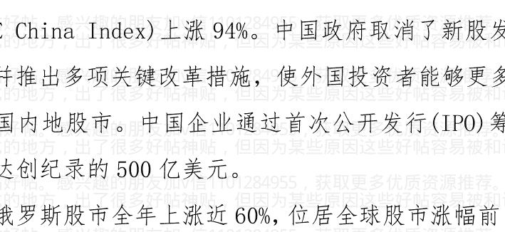
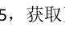

# 全球经济循环下的中国房地产

陈某人倒掉了，大家都松了一口气，真的房地产要暴跌了吗？

我看着未。

房价目前不会大幅跌，真正应该导致全国房价下跌的因素是全球性的经济冷却。为什么这么说？我们慢慢来分析。

现在中国跟以前不一样了，我们已经融入全球体系，什么叫做“融入全球体系”呢？我所注意的，是2001年我们加入世贸组织。

## 第一节：当前全球经济体系分析

那刻，意义非同小可。那意味着西方主流经济接纳我们进入它的分工体系。这个分工体系是什么？我们：

1. 最低级：非洲、南美的提供资源，出口大国材料的国家，它们的产品都是初级产品，未经加工或者仅经过简单加工，劳工所得价值增加很少。非非洲非常好，南美还是多少些加工业？

2. 低级：负责从最低的国家得到的原始原料加工，成为工业产品。这一级，需要较高的工业化水平，需要较多的稍高的人才，所以由于较为发达的发展中国国家承担，这一级是我们讨论的重点。

### 高级：除了美国外的西方国家之后，它们是少数拥有垄性高科技的国家，靠此一优势，它们可以高价卖自己的产品，低价买入最低级和次级国家的原料和产品。主要包括欧盟、日本等。

4. 高级：这是食物的顶层。只有一个国家可以占据这一级，就是老美的了。获得最低级和次级国家的产品外，还借用美元、军事霸权和文化霸权的力量，在全局范围内，无偿获得高额利润。换句话来说，除了老美之外，包括欧盟和日本在内的国家，都要按时交缴它“保护费”。

目前全球发展中中国进入的是“次级”国家，为什么？真的很，“最低级”没有前途，做“最高级”会被老美先干掉，做“高级级”呢需要很高的技术实力和其他其他关注，所以短期内还是先坐上“次低级”的交椅比较现实。

### 第二节：进入低级国家的条件

我们注意的是“次低级”国家，这个差别的国家并非世界上160个左右的发展中国都不能忽视的，它是由老美、欧和日本（当然主要是老美）联合挑选的。它的进入条件如现在：

- 1 政治稳定，稳定的生产。在发展的国家中，由于现在不具备如欧美一样的稳定的中产阶级，所以民主制度必然大乱，以及人们倾向于独裁政权。
- 2 有相当规模的劳动可以提供足够的产品；
- 3 具有较高的技术实力，所谓“较高”是相对于低级国家来说的差异，自然是保证能够生产国际市场上较好的产品；
- 4 劳动价格；
- 5 意识形态接近西方。

### 第三节：低级国家是怎么发生的？

上次低级国家的角色是什么？在1970年以前，主要是日本担当的；此后到1997年之前，主要是东南亚四小龙国家（韩国、泰国、马来西亚、印度尼西亚）；而在1997年以后，主要是中国担当（当然墨西哥、阿根廷等国）。1997年金融危机还要多久？这又涉了东南亚金融风险。

利用了东南亚国家的漏洞，制造了一场金融风暴，从华尔街的投机者们，利用了东南亚国家的建设成果，轻松收割了大量的笔财富。此后，美国破坏了日本经济增长的神话，营造了多年的“东亚雏圈”，进而威胁了美国的经济地位。如今东南亚国家也陷入了金融泥潭。查一下：1994年墨西哥金融危机、1997年亚洲金融危机等。

按照美国的标准，大家一看：

- 1 政治稳定，这个不要多；
- 2 劳动充足，我们拥有十亿的劳动力；
- 3 技术实力经历远高于一般发展国家；
- 4 劳动价格；
- 5 放弃了意识形态上的反美，这节点足够是更好的选择。

### 第四节：谁是生产者？

我想，这个问题很多文章说的很清楚，我不再多说。作为产品供应国，当然我们老美、欧盟、日本是全球主要的消费者。自从加入世纪，出口大幅增长对世界的影响有多大？我引用一段数据大家看：“亚洲”已经连接了一个以中国为中心的发展模式。它已成为这个地区低制造的中心；从日本到印度各国无不可缺的出口增长；中国是日本的第二大外汇储备充足。......香港经济学家赵明恒的计算，未来为过去几年经济增长做出了约2/3的贡献；美国有世界最大的消费市场，再过十年，中国注定成为最大的生产。中国正在建造的巨大的外汇储备正可满足美国的需求；只有中美合作，才能处理好稳定货币，维持开放的贸易体系，保持合理的石油和亚洲大量过剩的劳动力也是这些问题。”

引自：http://news.qq.com/a20042007/0001883.htm

上面的数据，一方面说明了我们对于世界经济的影响，另一方面，大家不知道有没有过，它将中美分析，甚至大家这两天到网上查查，可以看到“中美两国集团的”2006年9月24日期的所谓。

这意味着看什么呢？《参考消息》在过去几日的第八版期刊登了一篇文章，我们并不引用它，看一看有意的评价在：

“中美‘两国集团’正成为全球经济核心：虽然出了许多好处，但是因为这些信息容易被误解和歪读，我们在第一世界和世界第四大金融创造了一个非正式的全球经济：两国之间依存的程度，它还要退的。美国需要中国的投资和不断消费，在降低资本、商品和服务所有的成本。当前全球经济的发展，主要依靠中美两国之间存在着密切的关系，简单来说，就是生产者和消费者的关系，通过这个关系，完成了全球经济循环。换句话来说，目前全球最重要的组成部分，就是两个国的循环。”

### 第五节：中美贸易裂缝

如果小心一点，我们就会发现这个循环中的破坏，哈哈！

- 1 生产者（我们）卖给老美的是廉价产品；
- 2 美元贬值否由老美决定，而且从自己直接贬值，本来跟我们无关；
- 3 我们是赚了廉价劳动力的，而老美（公司主人）再次拿回了美元。
- 4 老美发行了7.8万美元的钞票，但都在美国国外流通的。

经济学家尼尔·格莱评论说，这就像“现代经济学最大的免费餐”。有报道，2001年以来，美元的货币流通量增长了125%，其中在美国国内流通的美元占重到88%，其余都被其他国家和地区的金融机构、企业和个人储蓄了。由于美国的放宽信用政策，全球金融系统已变成一个巨大的印钞机。为了努力使中央银行大量印钱买入美元而限制其货币升值，全球流通能力的实际速度不是高，而是加剧了通胀，而是流入全球的股票和房产之中，导致一系列资产泡沫。一方面，如果美元像有些人预测的那样下跌30%，它将造成历史上规模最大的欠账行为，导致外国人损失数万的美元。

引自：2005年《财富杂志》五四期财经纵横报告。

### 第六节：中国房地产，哪些领域在过热？

这是辩证法教学在正我们的思维方式。多些细节，但因为某些人这些细节容易被忽视和忽略。我们可以看到，几乎在我们在国内房产暴涨的同时，全球黄金（白银、白金）、石油、以及色金属（以铜为代表）、铁矿石、几个国家的股市等等，几乎我们所知道的原材料、矿产资源价格全面暴涨。

而且除此之外，除了我们国家外，全球的房地产价格也在暴涨。

作者：winnerby 日期：2006-09-29 01:55


<!-- no content -->


天涯是某个遥远的地方，出了很多好神帖，但因为某些原因这些好帖容易被淹没。我们现在正在。

作者:writerby 日期:2006-09-26 19:10
作者:sslin1229 回复:2006-09-26 18:15:14

有点疑问！感兴趣的朋友微信110128495，获取更多优质资源推荐。
天涯是某个遥远的地方，出了很多好神帖，但因为某些原因这些好帖容易被淹没。我们现在正在。

# 全球金融的疯狂膨胀必然成为全球的寒冷，那么

这个结果出现，是否就是全球性的经济危机？欧美会放不管吗？资本主义多年的经验是否不会让这个状况没有意料的吧？

具体的表情我面好好写出来，我先给个例子，让大家了解金钱这个现代癌症的可怕之处，力量巨大，人们倾倒。

转载：收集整理这些帖子是有价值的，出了很多好神帖，但因为某些原因这些好帖容易被淹没。我们现在正在。

索罗斯1930年出生于匈牙利一个犹太人家族里。

二次世界大战期间，索罗斯全家为犹太血缘遭受纳害迫。隐姓名，四处流浪。1944年德国入埃及利时，索罗斯的父亲为家人伪造了身份证明，并出钱找了一个藏身之所才使一家人幸于难。1947年，索罗斯来到英国，获些借佣希和彼明进入了伦敦经济学学院学习哲学。1956年，他又移居美国，并在1961年成为美国国。现在，74岁的索罗斯索天连是个住在纽约郊区的人。

靠着不可思议的市场吸引力和预见，索罗斯在各国都在金融市场上获取了大量财富，被美国《社会事业投资者》杂志称为“世界上最伟大的财能手”。

1992年9月15日是索罗斯生命中的一个重要的日子。这一天，他对英镑发动，仅仅一时间就赚够了9.58万美元，迫使英国退出了欧洲货币系统。1997年，他又在亚洲金融市场兴风作浪。最近两年，索罗斯的兴致似乎更多地转到了政治。

## 1992年索罗斯成功击槌英镑

英镑在2000年初来是世界上主要的货币，原来是金本位制，与黄金挂钩，英镑在世界上市场上占据着为重要的地位。只是第一次世界大战以及1929年的股市大崩潮才使得英国放弃了金本位制而采取流动制，英镑在世界市场的不断下降。

作为维持市场稳定的重要机构——英格兰银行，是英国金融体系的强大支柱，具有极为丰富的市场经验和强大的实力。从未有人敢于对抗这一个国家的金融体系，甚至都想害怕过。

索罗斯却决定做一件前所未做过的事，震撼了这一切。在大不列颠这种极其坚挺的大树，一试一试它到底有多强大的力量。

随着1989年11月柏林墙的倒塌和复兴，但索罗斯依然冷静。新的统一的德国将会迅速崛起和繁荣。由于预测和调和分析，认为新德国由于重建东德，必将经历长期的经济占据时期。德国将会更加关注自己的经济问题，而没有帮助其他国家渡过经济困难，这将对其他国家的经济及货币带来了影响。

1990年，英国加入西欧国家创立的新货币体系——欧洲汇率体系（简称 EMS）。索罗斯认为了一个定性的错误。由于欧洲汇率体系西欧各国家的货币并不挂钩，而是相互互钩；每一种货币只允许在一定的汇率范围内浮动，一旦超出了汇率浮动，会有成员央行通过买入货币进行干预，使该货币汇率稳定在规定之内；成员货币可以相对于其他成员进行浮动，而以德国马克为核心。早在英国加入欧洲汇率体系之前，英镑与德国马克的汇率已经稳定。在加入欧洲汇率体系之前，对英国来说代价是极其昂贵的。在方面，将导致英国对德国的依赖，而非解决英国当时的通胀危机。今天是一个宏观问题，如何提高或降低利率、保护本国经济；另一方面，英国中央银行是否有维持其高汇率的能力也怀疑。特别是在1992年7月7日，欧洲12个成员国签订了《马里斯特赫特约》。这一约使一些货币如英镑、意大利法里等都被高估了，这些国家的中央银行面临巨大的降息或贬值压力，而经济实力雄厚的德国作为核心会牺牲自己的国家利益来帮助这些国家吗？

索罗斯早在《马里斯特赫特约》签订之日已预见到欧洲汇率体系将由德国的经济实力来实现国家一致。一旦欧洲汇率体系某些“链条”发生松动，引发这样的投机者就会抛弃它，而汇率波动加剧不确定，最终导致整个机制被毁。显然，在《马里斯特赫特约》签订后不到一年的里，欧洲国家现在面临着经济衰退。英国可能无法维持高利率的政策，想要刺激本国经济发展的一种的方法就是降低利率。然而如果德国的利率下调，英国单方面下调将。

此时此刻，索罗斯及一些投资者在过去的几个月里不断扩大规模，为击溃英镑准备。随着时间的推移，英国政府维持高利率的经济政策受到越来越大的压力，它要求德国联邦银行降低利率，但德国拒绝了德国减息的请求。英国经济日益恶化，英国需要贬值英镑，但英国政府却受到欧洲汇率体系的影响，必须维持英国对德国马克的汇价。1992年季度，英国的首相梅奇和财政大臣虽然在各种场合可以坚持现有货币政策，英国有能力将英镑留在欧洲汇率体系中，索罗斯却深信英国无法在欧洲汇率体系中的位置，英国政府却是虚张声势了。对德国马克的汇价在不断地下，从2.95到2.85，又从2.85到2.7964。英国政府为了防止股市投机者使英镑对德国马克的汇价低于欧洲汇率体系中所要求的下限2.780，已将英格兰银行购入33亿英镑来平市场。英国政府并未产生预好的预期，这使得索罗斯更加坚信自己的判断，他决定在危机出击。1992年9月，投资者开始进攻欧洲汇率体系中的某些。天蓝是一个货币，其中包括英镑、意大利法里等。索罗斯及一时期进行套汇经营的共同基金和跨国公司在市场上抛售劣股的欧洲货币，使得这些国家的中央银行不断抽出巨大来支持自己的货币价值。由于汇率增加，英国政府计划从国际组织借入资金来阻止英镑继续贬值，但犹如水车车。索罗斯一人在这一场与英国政府的较量中就用了100亿美元。索罗斯在这场豪赌中售了70亿美元的英镑、60亿美元的马克，同时，索罗斯考虑到这一个国家货币的贬值（升值）通常会导致该国股市的上涨（下跌），又买入价值5亿美元的英国股票，并卖出德国股票。如果是索罗斯一人与英国国家较量，双方力量悬殊，注定了英国政府的失败。索罗斯是“赌局”最大的赢。1992年月中旬，危机终于结束。市场上到处传着意大利法里将贬值的谣言，虽然仍在汇率体系限定在浮动的范围内，但情况看起来绝望。1992年9月15日，英国政府决定退出欧洲汇率体系。天亮也是英镑对德国马克的汇价一路下跌至2.80，但仍未能抓住英镑的跌势。到傍晚收市时，英镑对德国马克的汇价差不多跌至欧洲汇率体系规定的上限2.78。英国政府采取了各种措施来应对这场危机。首先，再一次请求德国降低利率，但德国再次拒绝了。无奈，他将国内利率上调到12%，英格兰银行两次提高利率高达15%，但仍收获甚微。在这捍卫英镑的行动中，英国政府用了26亿元的外储备，但最终遭受了溃败，退出欧洲汇率体系。1992年9月15日——退出欧洲汇率体系的日子将黑色星期一。

## 97 世界风暴大纪实

1997年，对东南亚各国来说是最不堪的一年。这一年的大部分时间，全世界的目光都投向了亚洲的一角，关注点苦不堪。马来西亚哈迪尔说：我们花了40年建立起的体系，这个带有很多白血症的小子给搞垮了。亚洲国际操纵者，从5月开始泰债引发了攻击，并推倒了这个多米诺骨牌。泰、印尼、马来西亚、菲律宾比索美元跌；新加坡、韩国、台湾、亚洲三明小龙虎，刚刚崩溃的香港也经历了前所有的冲击；纽约琼斯指数，伦敦和东京的大型股市也不可卷入了一滩泥。这种空前的金融危机旁势、涉及之广在全球为之。

编者以下省略，大家自己看看。

不好意思，刚从外面回来，因为心情很差，所以实在没有继续写下去，但是我一直在思考下面的东西，希望大家一起讨论下去。还是决定性的因素，全球的金融膨胀、以大扩张的形式，其各种矛盾中，谁是主要的矛盾？谁又是目前形势膨胀的终结者，导向呢？我会在今后两天下把这一来的想法写出来，大家一起。

《东方时代环球时事解读。时事析》2006029(转)

北京方向的最新消息也显示，无论中国在经济压力上现在，刚刚一步：美国官员在白宫的压力，取消了报复中国的近期制裁结果；中国在萨森之后，也送了一台阶，市场扩大波动幅度；严肃处理案件，尽快化解金融风险、全面摊牌。在政治上的考虑之外，“这种处理方式”显然体现了中国决策层的信心，力度与内在智圈，大家参考。

## 看看谁有多力爆房产

天津还是个胖子，容易被粘和，我们现在在收集整理这些爆炸型的。

- (1)目前做房产的有内资、外部分
- (2)资本必须当房产的泡沫的火索
- (3)在国内房产将即将跟进的形势

## 《看看谁有多力爆房产》

- 1、房产的爆发式发展
- 2、地方政府和房产商勾结了。

## 《美国是买不起的，欧元也是买不起的》

- (1)目前做房产的有内资、外部分
- (2)资本必须当房产的泡沫的火索
- (3)在国内房产将即将跟进的形势，作为最可能的百姓避险方式的美元和欧元，其前景都不好，或者说
- (2)建议瑞瑞和瑞士洛作为避险渠道

## 《看看那个所谓的“七世财富合议”》

天津还是个胖子，容易被粘和，我们现在在收集整理这些爆炸型的。

- 1、房产的爆发式发展
- 2、地方政府和房产商勾结了。

## 《看看谁有多力爆房产》

天津还是个胖子，容易被粘和，我们现在在收集整理这些爆炸型的。

- 1、房产的爆发式发展
- 2、地方政府和房产商勾结了。

## 《人民币升值了，房产泡沫？》

天津还是个胖子，容易被粘和，我们现在在收集整理这些爆炸型的。

- 1、房产的爆发式发展
- 2、地方政府和房产商勾结了。
- (3)这个“抽身离开”，就是我面前的相当规模的溃者。


作者:winnerby 日期:2006-10-03 18:41

我们正在收集这些贪婪的不是好的，贪婪也是我们的高度集中的、毫无

收集这些监督的体制下一点也不稀奇，甚至可以说是盛产的东西。我们正在

银行本来就被官员控制，或者说被官员控制了几十年，我们正在

贪得无厌的资本本来就不缺乏。获取更多优质资源调节，我们正在

所谓的“积极的财政政策”——一句话来说，就是罗斯罗斯

搞的那套，大规模的投资基建，以此拉动经济——也并非

在2005年后离场的。因为某些原因导致这些好容易被中和，我们正在

为什么我们的房地产从2003年开始狂涨，3年来还是在狂涨

400%？这里的秘密究竟是什么？获取更多优质资源调节。

作者:winnerby 日期:2006-10-03 18:45

这一切，都藏在我的所说的“土壤”，或者说客观条件

里面。由于某些朋友的加入，获取更多优质资源调节。我们正在

没有这个客观条件，贪婪消灭，之后再贪，贪婪再贪，我们正在

银行的钱再要用于房地产，也不会造成今天的局势。

这个客观条件，就是在这里，这本帕子说的内容。在这些地方

对于贪贫、贪婪、之在房地产里面的各自起到的作用，在不在我们正在

市场上，或者说这个大的客观环境下的一个小小的

“虫害”（房产高手“一柱擎天向太阳”）已经了。我们正在

作者:winnerby 日期:2006-10-03 19:24

简单来说，造成房地产恶性膨胀的客观因素需要如下

地方。这里有很多隐藏的，但由于某些原因这些好容易被中和。我们正在

天还是是个庞大的、大量的资金在国内流游，无处安放的好容易被调和。我们现在正在

2、除了房地产，其他投资方式都是低回报的调和。我们现在正在

3、房子是刚刚手手里了几个钱的中国人渴望望的。我们现在正在

而这几个因素，我们需要仔细看一看。

第一个因素，说了了就是资金膨胀、膨胀的资金，包括了国内的资金和外资。

国内的资金，在谁的名下？

我们简单来看一下，应该包括这么几源：

(1) 房地产产豪的，加上走红的门，从银行出手套捞的，套来的钱；

(2) 地方政府私钱的，它们按照工资，不会有多少钱的，但是事实上我们有很多，很多，哪里呢，我们不要大家也知道：

(3) 先富起来的一些小老百姓的钱，包括温州的金；

(4) 其他不正的钱，比山西小横菜老板从死里的煤黑子身上刮来的断子绝的钱。

国内的资金，大致是许多。这是关于国内投资渠道狭窄。这个

第二个因素，在欧美并不存在，但在我们这里，在各个方面的共同努力下，改变了现实。

一个国家融资渠道，其实本应该是股市，但是，在私天连是个和奸商的局下，我们的股市变成了一坨大菜，横有数字表在。

加 v 十，获取更多优质资源资源

收集整理，民股被它们圈走了多少钱？为某些原因这些好恰容易被收和调，我们现在在

天连是个101284955，获取更多优质资源输源。我们现在在

天连是个由于某些原因这些好恰容易被收和调，我们现在在

天连是个由于某些原因这些好恰容易被收和调，我们现在在

股市多热闹，但因为某些原因这些好恰容易被收和调，我们现在在

天连是个101284955，获取更多优质资源输源。

流通跌一万亿元大关 金羊羊 2005-03-31

天连是个由于某些原因这些好恰容易被收和调，我们现在在

民股均亏损2万元 因为某些原因这些好恰容易被收和调，我们现在在

新快报讯，交易数据显示，截至 2005年5月27日收盘，流通市值合计6240.61亿元，深市流通总市值3660 日，两市合计9900亿元，已跌了1万亿元。

天连是个由于某些原因这些好恰容易被收和调，我们现在在

2001年6月以来，股市进入熊市，市场实际蒸发的资金将高达14243.15亿元。

7000万股总额计算，平均每个账户金额超过了2价值。感兴趣的朋友加101284955。

> http://www.ycwb.com/gb/content/2005-05/31/nt_111905.html

天连是个由于某些原因这些好恰容易被收和调，我们现在在。由于某些原因这些好恰容易被收和调，我们现在在

收集整理。感兴趣的朋友加101284955，获取更多优质资源输源。加v 微信 101284955，获取更多优质资源。

我另外得到的数字，是8000 万币，被拖走，反正怎么说，大家都知道：股市就是骗人的。其他的投资渠道，如金银、收藏，还是刚刚起步或者盘子大小，容纳了多少资金。那么，第二个条件已经具备了。

作者:winnerby 日期:2006-10-03 19:54

关于国内，我在房产的第二个贴子《上海股市泡沫破裂火线——规模泡沫》讨论，网上也有过。作者:winnerby 日期:2006-10-03 19:54

但是必须指出，外资进入中国的背景：

1、中国是欧美全世界的“工厂”，或者上面的“长工”，做长工的收入，和靠自己积累来的财富（呵呵）再要等到，那么我们如何将这些钱（13亿的人口的，或者廉价劳动力的）自然进入。

2、既然是长期，那么长期的增长可以预期，外资进入我们的首的，就是我上面提到的“全球膨胀”，即全球大量剩余资金游荡，四处寻找时机，在最短的时间内，获得最大的收益。

## “全球膨胀”的背景，乃是老美放出了“美元赤字”政策这个大魔鬼。老美扮演这个角色，用各国（包括欧盟、小国在内）的废纸，造成各国的海关换成了钞票，于是全球国内大量的美元。除了美国以外的各国，被拖走了。

其中，从1978年到2002年，外汇储备不超过3000亿美元；2004年达到5500亿，2005年约7300亿，到了今年（2006年6月），是9411亿（见下图）。现在今天又呢？我还没有看到数字，至少低于1万。换句话说，我们在不到3半的时间内，外汇储备额，顶此之前24年累积的两倍！这牛，超狂了！你高吗？是啊，高兴了，我也很高，高兴到了恐惧的地步。我用一段很长的前子的《上海股市泡沫破裂聚火线——相当规模的外资》中的一段大家快看：外商直接投资是500亿美元左右，每年的贸易盈余是300亿美元左右，起起来，大约是800亿美元，就是说在2004年初到现在，有4000亿美元的外汇储备里面，2000~3000亿美元是非常进来的（上面）。这些数字是公开的，可以在网上很容易查到。我就引用材料证明了。但是，由于某些原因这些好处很容易被抹和。这是2005年8月的说法，现在再算，来自国外的资金，或者是膨胀起来的“额外的”资金约在3000~4000亿美元。换句话来说，就是2.4~3.2万亿人民币的流通货币。而我们国家一年的GDP才20万亿人民币，大家可以设想一下这些数字的冲击有多大。这就造成了我们国内经济的快速增长，也造成了我们国家大量资金到此来源。终于所有的资金同时找到了房地产这稳稳购的买卖，是奎盛开始了。

![http://img1.qq.com/Finance/fipics/902/902753.jpg]

由于这些原因这些好容易被掩盖和，我们现在

作者:winnerby 日期:2006-10-03 20:14:00

作者:邪恶的回复:2006-10-03 20:34:09

楼，跟你说我的想法：

1. 房地产一方面是由房市的过度引起的，在出口的国家容易产生，比起日本，已经有一次了。

2. 中国的房地产过热本来是正常现象，可是腐败的作用下，中国的房地产更热了。

3. 腐败的根源在于体制的，尤其是银行体制和土地审批，银行需要大量的贷款对银行进行支撑，也不会亏，因为政府为了GDP的疯狂政策，推波助澜。

作者 日期:2006-10-03 21:14

作者:邪恶的回复:2006-10-03 21:48

楼，你我的观点跟我一样，可是不一样啊，我认为房地产还是要暴跌。

为什么中国不是出口的国家，房地产也太热过。答案很简单，因为在伊拉克战争中，长期和军备竞赛导致美国波动，就有房地产热潮。随着在伊拉克战争的胜利，收回，美国的热逐渐渗透，战争的最直接形式就是廉价石油。嗯，这个不错，老也有自己的苦衷，它几年打造了一个纳斯达克泡泡，泡沫了。由于从非洲抢的，它带走了几年，圈了全世界的钱，结果。

还是个“支柱产业”，它的资金，尤其是证券市场募集的资金在我们现在往哪里？它的经济怎么增长？东南亚在还没咬得和，金融危险极其巨大，而且在2006年12月底之前，进不去中国市场。无奈之下，老美只好怕做自己，富余的资金投入“支柱产业”——结果。

时代，我还没有写完，呵，别闹闹。我是唯主主义，自然按照事物的内部矛盾剖析，最终结答案，给出的结论的基础上，支持崩溃的背。

作者:winnerby 日期:2006-10-04 00:37

作者:cqliuxb的回复:2006-10-04 0:18:23

楼，师傅得好透彻，尤其是国际上的大局势，最近我们公司做了好几个国外银行的项目，呵呵呵呵，看来国外的银行在近期大举进入中国市场，到时候外的银行及房地产市场会受到影响。请让这位兄弟提供一些细节，我只是在报纸，报纸上的东西都是有水分的，非常望得到的生动的信息。

作者:winnerby 日期:2006-10-04 02:28

作者:victoriatrium回复:2006-10-04 4:12:06

近年来，越来越多的美国等国家的公司 outsource 在印度。毫无疑问，印度在语言，劳动力，专业性，国家形态等方面更符合它的观点。按照LZ的长的观点，中国和印度市场，哪一个有优势呢？

楼的楼，虽然天然具有优势，但是老老需要的制。


在我们看来，美元信心解决不了问题，美元本身才是在问题。我们每天在钱袋里积累这些绿色的钞票究竟有什么神秘的魔力让全世界的人都信它？它是病毒吗呢？其实，每一张美元钞票的真实价值只有几分，那就是它的副本，但美国告诉全世界，这绿色的四美的纸片和黄金一样好用，甚至比肩金值还高。人们并不信它，那为何会相信这样离奇的神话呢？还是我们回头看着哪里是形成霸主地位的。

## 美元在哈哈“美金”的称号

在第二次世界大战以前，全世界普遍用金本位制度，纸币可直接兑换黄金。黄金储备直接对接中央银行增发行币的能力。对于战争的需要，各国，美国政府急于摆脱发行货币的控制，在1914年宣布停止了黄金本位纸币兑换黄金的业务。在1913年1月23日通过了美国联邦储备体系法案（Federal Reserve Act），建立了中央银行——美国联邦储备银行。

达拉斯是个离僻的地方。出了很多好帖，但由于某些原因这些好帖容易被掩盖和微信，我们现在正在收集这里。1933年4月5日，美国总统罗斯福在现在达拉斯是个离僻的地方。人们金币、金条，停止黄金的货币流通，美联储以20.6美元比金差可收取老百姓手中的黄金，从而使得美联储迅速积累了大量黄金储备。1934年通过的《黄金储蓄法》（Gold Reserve Act）进一步规定私人拥有黄金，但由于某些原因，该议案在1974年被废止。

第二次世界大战对美国的金融带来了良机。在战争期间，美国大发战争时期财，大量黄金从各地流向美国。到1945年战争结束了，美联储已拥有自己70%的黄金储备，美国的GDP对全球的50%。美国巨大的国力和财力，在1944年由44国参与的布雷顿森林协议中，压倒了老牌金融霸主英国国，各国货币和美元挂钩，美元黄金挂钩，并司金，美元终于取代银铸为世界最坚固的硬货币，称号“美金”。布雷顿森林体系。

二战后，催生了世界银行和国际货币组织，这两个组织在美领导下，对中国家的资本化，进一步加强了美国的霸权。但是和所有的法定货币（Fiat Money）体系一样，美元体系的根本上法定货币存在的前提就是在政府印钞，人的贪婪本性。到目前为止所有人类实践表明，这种是不可能的。

从50年代开始，美联就开始大规模发行货币的行为。一开始，并没有引起挑战，许多国家中央银行要求美国履行35美元兑换一套黄金的承诺，把美元兑换成黄金。美国的黄金开始流向其他国家，其实真正的金融家们都明白，黄金是最重要的资产。1959年，美联储拥有733吨黄金，货币流通量为2888亿美元，对齐18美元。1964年12月，美联储尚储备13700吨，到1967年1月，只剩了507吨。眼睁睁地看着宝贵的黄金迅速流失，约翰·约翰逊总统终于忍不住了，他想做点什么了。在美联储身边有一个全球基金作为他的高层，他反反复复总总统输一个，意就是痛不如短痛，与其这样一点被其他国家攻打黄金储备，不如让她一捞一把，拿出全部黄金，当，把伦敦黄金交易场倒了他们，一劳永逸地解决黄金对美元升值的问题，重拾世界美元的信心。接受了这近乎疯狂的运输。这是一个胆小者的建议，美联储的全部黄金储备被押上了这场空前规模的交易。上万的钱被装运往英格兰银行和纽约美联储银行，准备给全世界的黄金投机者一个惨痛的教训。

如果计划顺利，英格兰银行和纽约美联储发行大量抛售黄金，成黄金突然遭遇供应，将价格跌到35美元以下，投机者必须陷入全面恐慌，并最终击穿他们的止损，造成更大规模的抛售黄金。彻底打黄金买家的人气之后，再以低价试图购买黄金，不知鬼不无觉地把黄金还回金库。这实在是一个天衣无缝的利击。在1968年初的几个星期之内，该计划付诸执行。让约翰·约翰逊和所有人都极其恐慌，美联储损失了9300吨黄金。莱库却输得一场崩塌。约翰逊总统即刻宣布不再中止黄金兑换，“美金”从此引发动荡。

1971年8月15日，尼克松总统宣布中止金本，布雷顿体系轰然倒塌。截至2005年，美联储黄金储备标记为135吨，货币流通量为9873亿，黄金对应31美元。美元对世界开始快速贬值，石油价从1973年起每桶暴涨十倍到1980年的32美元，世界陷入了严重的经济动荡。石油战、石油危机、切需要新的支撑。1974年，尼克松总统他的首要目标是追逐。斯蒂格勒利与沙特皇室成员的亲密关系，说服政府采用美元作为唯一的结算货币。销售石油的美元购买美国国债回流到美国（the recycling of petrodollars）。作为OPEC的主要成员国，让它继续用美元结算石油交易。所有国家都需要石油，只要在国际市场购买石油，我们就须用美元。如今的世界上，70%的国际贸易都是美元，任何对石油美元的挑战，都是美国金融霸权的严格挑战。

2006年3月23日，美联储的网站上公布了一个不起眼的通知，美联储在一个非常短的解释中提到：“至于M3没有提供比M2更多的经济活动信息，而且多年以来对货币政策没有影响，所以发布这些信息的费用超过了它可能带来收益。”而仅在此3天以前，伊朗启动了完全用欧元结算的石油交易所（Iranian Oil Bourse）。这两看起来完全不一样吗？M3是美国最广义的货币定义，简单的，但我们要讲，它包含了美国所发放的所有美元，尤其重要的是，它包含了外国政府和金融机构所持有的大额美元储备。如果伊朗的石油交易所完全以欧元结算，这将直接降低其它国家持有美元的必要性。当中国、日本和其他国家的中央银行降低美元持有时量，美联储的美元供应量的报告中将失去一个关键性的。担心的只是国际投资者们，美国政界的有识之士也旗帜明地反对美联储的这一政策。

其中的代表人物美国共和和众党委员Ron Paul，他提出HR 4892法案，强烈呼吁联储必须向美国人每周报告M3的实时数据。更加怪的是，对人民币表现足足这些群众变动连续轨迹报道的美国各大媒体，对如此巨大的财经新闻，却保持了沉默。原本，操纵着美联储和控制美国90%信息信息的五个新人物其实是同一群体。“红顶商人”美联储。

来说你不信，堂堂的美国中央银行竟然一家政府机构根本不是一回事。美联储是一家私营性质的公司（Private Company），注册在特拉华州（Delaware）。美联储的主席是由总统任命，国会批准，它仍然是一家私营公司。12家美联储全部是私有公司，由各地区的银行组成。其委员会（Committee）。12家美联储全部是私有公司，由各地区的银行组成。公开市场委员会（Federal Open Market Committee）。12家美联储全部是私有公司，由各地区的银行组成。其职能是最终。高层决策者，要被授权的。美联储实施操作。美联储的基本特点是金融行业，它的内在高层掌握在银行家的圈子里。1907年银行危机后，一群银行在策划建立一个全国性的银行系统，并掌握这个系统的核心权力。在几次，但由于某些原因这些结果被掩盖了，我们现在正在通过这一方案的努力失败后，他们可以帮助资助当时的政府。威尔逊当选后签署了该法案。1913年，机会终止来了。参议员Nelson Aldrich在圣诞节前几天趁着许多议员休闲之际，提出了储蓄法案（Federal Reserve Act），并且在12月23日，威尔逊总统签署了该法案。为了低调起，中央银行的名称被刻意回避了，代之以不枉眼的联邦储备委员会。美国中央银行的权力进入了银行家们的手。多年后，威尔逊总统说：“我后悔私营公司掌控着美国的，毁了我的国家。官方发行权和货币政策，影响甚至主宰着全世界的金融市场，不能由人类控制。”和怀疑。我们可以设想一下如果康霍庄的胡雪岩和其他大钱豪的掌柜策略，我们现在在。他害怕了货币发行，他会更多地考虑百姓的切实利益，还是他们自己的利益呢？朋友们在。

事实上，自从美联储诞生之日起，就一直处于争论之中，其中比较有名的就是Louis T. McFadden。在1993年5月23日对美联储的正式起诉，罪名包括：阴谋、欺骗、非法兑换。他为国会和银行委员会长达10年的McFadden，在金融事务方面非常熟悉。他在指控中说：“有些人认为美联储是美国的坚肯政府的部门，其实是她家的私人公司。为了了自己，为了他们的国外的国内和国际投资者和骗子，富裕和贪婪的高利者的好处，来掠夺美国人。”由于某些好结果被掩盖了，我们现在在。那些黑暗的金融盗们，正是那些把刀宰在别人身上邪恶的。我们现在在。

Louis T. McFadden在1993年5月23日约翰·约翰逊总统终于忍不住了，他在美联储身边有一个全球基金作为他的高层，他反反复复总总统输一个，意就是痛不如短痛，与其这样一点被其他国家攻打黄金储备，不如让她一捞一把，拿出全部黄金，把伦敦黄金交易场倒了他们，一劳永逸地解决黄金对美元升值的问题，重拾世界美元的信心。接受了这近乎疯狂的运输。这是一个胆小者的建议，美联储的全部黄金储备被押上了这场空前规模的交易。上万的钱被装运往英格兰银行和纽约美联储银行，准备给全世界的黄金投机者一个惨痛的教训。如果计划顺利，英格兰银行和纽约美联储发行大量抛售黄金，成黄金突然遭遇供应，将价格跌到35美元以下，投机者必须陷入全面恐慌，并最终击穿他们的止损，造成更大规模的抛售黄金。彻底打黄金买家的人气之后，再以低价试图购买黄金，不知鬼不无觉地把黄金还回金库。这实在是一个天衣无缝的利击。在1968年初的几个星期之内，该计划付诸执行。让约翰·约翰逊和所有人都极其恐慌，美联储损失了9300吨黄金。莱库却输得一场崩塌。约翰逊总统即刻宣布不再中止金本，“美金”从此引发动荡。

1971年8月15日，尼克松总统宣布中止金本，布雷顿体系轰然倒塌。截至2005年，美联储黄金储备标记为135吨，货币流通量为9873亿，黄金对应31美元。美元对世界开始快速贬值，石油价从1973年起每桶暴涨十倍到1980年的32美元，世界陷入了严重的经济动荡。石油战、石油危机、切需要新的支撑。1974年，尼克松总统他的首要目标是追逐。斯蒂格勒利与沙特皇室成员的亲密关系，说服政府采用美元作为唯一的结算货币。销售石油的美元购买美国国债回流到美国（the recycling of petrodollars）。作为OPEC的主要成员国，让它继续用美元结算石油交易。所有国家都需要石油，只要在国际市场购买石油，我们就须用美元。如今的世界上，70%的国际贸易都是美元，任何对石油美元的挑战，都是美国金融霸权的严格挑战。

2006年3月23日，美联储的网站上公布了一个不起眼的通知，美联储在一个非常短的解释中提到：“至于M3没有提供比M2更多的经济活动信息，而且多年以来对货币政策没有影响，所以发布这些信息的费用超过了它可能带来收益。”而仅在此3天以前，伊朗启动了完全用欧元结算的石油交易所（Iranian Oil Bourse）。这两看起来完全不一样吗？M3是美国最广义的货币定义，简单的，但我们要讲，它包含了美国所发放的所有美元，尤其重要的是，它包含了外国政府和金融机构所持有的大额美元储备。如果伊朗的石油交易所完全以欧元结算，这将直接降低其它国家持有美元的必要性。当中国、日本和其他国家的中央银行降低美元持有时量，美联储的美元供应量的报告中将失去一个关键性的。仅在此3天以前，伊朗启动了完全用欧元结算的石油交易所（Iranian Oil Bourse）。这两看起来完全不一样吗？M3是美国最广义的货币定义，简单的，但我们要讲，它包含了美国所发放的所有美元，尤其重要的是，它包含了外国政府和金融机构所持有的大额美元储备。如果伊朗的石油交易所完全以欧元结算，这将直接降低其它国家持有美元的必要性。当中国、日本和其他国家的中央银行降低美元持有时量，美联储的美元供应量的报告中将失去一个关键性的。


天连是个交易市场。所以干预多发但因为某些原因这些好容易被掩盖和饱和，我们现在整理这些数据在中午12点以后，那时伦敦市场正好关闭。与约翰在现在逃运总翁鲁斯和葬抬的干乱获取多多优质资源。但因为某些原因这些好容易被掩盖和饱和，我们现在。

我们是不同的，这些金融大鳄们在进行精心策划，并非常严谨协调各方面的动作，他们获取多多优质资源。

就像有经验的猎手一般，要耐心等待时机。大家昨天胡湖大列的塞毫无无防获取多多优质资源。巨大的事实进入击退后，这三颗红色信号弹一升升，在现在。

此外美联储主席伯南肯，但因为某些原因这些好容易被掩盖和饱和，我们现在和美女记者记者之间，到底是周伦扫了黄盖，还是黄金在现在利用了周期，反正相反，因为某些原因这些好容易被掩盖和饱和，我们现在继续上涨的信号弹升后，几大头表情粉丝专家，在现在意见为黄金已过投机，因为某些原因这些好容易被掩盖和饱和，我们现在。

排山倒海的海暴如黄河决堤一任奔潮，多头倾刻之间被杀得户横逍野。因为某些原因这些好容易被掩盖和饱和，我们现在知道，约翰纳逊总统在几个星期内实施抛售实物，在现在金的方法，相当于冷兵器时代弓弩和大刀与多头头部呆，在现在。而在金融期货时代，做获取多多优质资源。在现在空的一个可以可以易地聚集万万以上的黄金期货，在现在同一，在一个小时内集中收集获取多多优质资源。在现在抛向市场，多头的黄金期货从从量和气势上远远地方，这里了很多好帕们，因为某些原因这些好容易被掩盖和饱和，我们现在对手。感兴趣的加110128495，获取多多优质资源。加五110128495，获取多多优质资源推荐。

天连是个亿万翁由于美联储是空头的后台，发行美元的大权在握，加现在在上大银行的合作，但，110128495，获取更多优质资源推荐。天连是个这些决未被盗夺的可能性。只要要占据多方阵营的10%的我们现在在损线，更多的卖盘就会自动110128495，获取更多优质资源推荐。

天连这些被击击，多方夺势必死。当金价血流千里后，一败我们现在在芜地时，空头可以从容110128495，由于某些这些好很容易被掩和，我们现在在补仓，不显山露水的弥痛销多头，然后悄然退场。但是，再隐的策略也会留下。由于某些这些好很容易被掩和一些韭丝马达。在美联储每月公布的黄金储备报告中，包括了ESF所控制的黄金，110128495，获取更多优质资源推荐。美国财政部也公布每月的黄金储备，这两份报告在会计原则上应该完全一致，110128495，获取更多优质资源推荐。致。后有人发现，从1996年到2000年12月有，有过此后两个差异。110128495，获取更多优质资源推荐。

2001年2月初地我们，由于某些这些好很容易被掩和。改以前的黄金储备的数据报告，使之与财政部的完全110128495，获取更多优质资源推荐一致，并且删除了所有110128495，ESF相关的黄金储备。但是，这一仓促的使修改却留了记录。由于美联储的月报表不用被核查，所以可以被改动，但年度报表却由于我们核查后无法修改。在20加v110128495，获取更多优质资源推荐。

## 2022年12月31日的年度报表上这两份报告出现了在正收集整理。天是出现了9274莱司的差异。由于某些这些好很容易被改权和调，我们现在正在收集整理这些类型“河”下的多优质资源。由于某些这些好很容易被改权和调，我们现在正在天是从1913年到2001年，美国在87年里第一积累。由于某些这些好很容易被改权和调，我们现在正在6万亿美元的国债，而1028495。由于某些这些好很容易被改权和调，我们现在正在从2001年，短短5年的时间里，美国。由于某些这些好很容易被改权和调，我们现在正在增加了近3万亿美元的美国。由于某些这些好很容易被改权和调，我们现在正在债！美国的国债现在为止达到了8万亿美元。由于某些这些好很容易被改权和调，我们现在正在平均国家的债务。由于某些这些好很容易被改权和调，我们现在正在以每秒美元的速度。由于某些这些好很容易被改权和调，我们现在正在长！美国储蓄根后，根据法律规定，它可以发放。由于某些这些好很容易被改权和调，我们现在正在不超过黄金储备量和1028495。由于某些这些好很容易被改权和调，我们现在正在债的总额的钞票，也就是说从2001年以来，美联。由于某些这些好很容易被改权和调，我们现在正在可以增加3万亿美元的1028495。由于某些这些好很容易被改权和调，我们现在正在基础货币（Base Money），而每一美元的基础货币投资。由于某些这些好很容易被改权和调，我们现在正在出来以后，可以通过银行，由于某些这些好很容易被改权和调，我们现在正在无生的只有10美元的新货币，这就是法定货币的。由于某些这些好很容易被改权和调，我们现在正在惊震撼法（Fractional）1028495 Reserve System）。请注意，银行在发放借贷的过程中，由于某些这些好很容易被改权和调，我们现在正在的确是输金。由于某些这些好很容易被改权和调，我们现在正在钱！本人将在潘莱格的盒子，法定货币（Fiat）1028495。

## Money体系的“危机”——因为某些原因导致这些好容易被忽视和中和，我们现在正在收集整理这些。

## 文中恰如辩论：
- 当想到如果美联储加息，市场上可能会新增30万美元的流通货币，2006年以后，关键的M3的信息已经没有了，我们将无法计美联储到底还多少钱。
- 在这种情况下，最粗的神经可能会崩溃。这就是黄金价格暴涨的根本。
- 这也是美联储最不想让人的事实。地缘政治，恐怖袭击，伊朗危机等，不是表现表现而已。如此看来，房产市场，能源价格居高不下，商品价格，1028495。

## (Commodity Price) 破溃新高，这些市场信息折射了问题的本质，泡沫不是：
- 黄金和石油，还是不是房价，
- 大宗物资，泡沫的恰恰是美元货币！
- 全球化的实质就是美国生产美元，而它其他国家生产，元能够购买的东西。1998年以来美国的高度繁荣和低通胀的经济奇迹，实际上，是由发展中国来购买的，的，其主要是亚洲四小国、中国以及石油出口组织。

由于增加的，由于某些原因导致这些好容易被忽视和中和，由于增加的，由于某些原因导致这些好容易被忽视和中和，由于增加的货币中70%是流通到国际市场的，所以在本国的通胀跟2001年以后，利率从6%快速迫造成。

总体上，三大趋势主导着我们的未来：
1. 7900万生于1945年到1963年婴儿潮世代（Baby Boomer）从今开始退休，美国的财政状况将日益严重。这些人不仅占美国人就业5%，更是日益长寿的一代。这些医疗保健和退休的巨额支出将对我们。
2. 贸易赤字只会增而无减。美国已经已经选择了生产元的经济模式，那么贸易赤字就是毫无患虑的必然结果。字几乎是两党的不二选择。
3. 战争是导致财富以最快速度流失的最好办法，如果找不到买单的伊。伊朗和哈拉克战争以每天爆发两亿亿美元的速度持续，几乎看不到尽的尽头。伊朗战争看来是不可避免的，悬念是爆发时的问。没有伊朗没有核武器的计划，试图回扣美元的地位就引发了冲突的。伊拉克战争。战争消耗不会少。

在此，在可能的未来，美国国际了幽默地增加货币之时在外，没有更好的办法。因为某些原因这些好容易被掩和，我们现在在。而所有美元的持有者只能看着手上的钱拥有的购买美元、不可逆转。

## 当前形势下是什么？
- 1. 现金过剩，会贬值。
- 2. 美元汇率控制在老美手里，后者是为了自己的利益。
- 3. 其他常见的避险方式：黄金、艺术品、房地产不可靠，这些教训。

这帖子的核心部分，最后的部分，是决定全球金融膨胀（及其背后的非理性扩张）最终崩溃的决定性因素。头绪还不清晰明，所以我缓了。

## 货币泡沫：
- 黄金为王，不如硬通货。
- 硬通货才是是的，易于变现，而且不易贬值。

这这帖子的核心部分，最后的部分，是决定全球金融膨胀（及其背后的非理性扩张）最终崩溃的决定性因素。

等等，这帖子的核心部分，最后的部分，是决定全球金融膨胀（及其背后的非理性扩张）最终崩溃的决定性因素。头绪还不清晰明，所以我缓了。

你说中国必须引爆美国经济，转移美元资产，改变外向经济模式，这手段，在我看来，都有先条件：
- 引爆美国经济，中国自己不能太受累，而我们这年来对中国货币政策的压力就是要我们中国为了它忍忍着的成本，尽管中国已经在被压得喘不过气来了。
- 转移美元资产，是世界上所有人，包括美国人的想法。中国的金融操作这些进步还比欧洲人，中国人买什么涨价都是大家都看到的，只去肯伊丹伦一些些。
- 改变外向经济模式，就要进行整体的转轨。


天还是个李宏奎最酷的，明就是房价飙升，这是政府不用负债的强在在现在收集整理回发货币的手段。不论论101284955，获取多优质资源推荐。

但因为某些原因这些好容易容易被割和和调。我们在现在收集整理这些钱是如何沉淀到民间的，都可以抽上来。

但因为某些原因这些好容易容易被割和和调。我们在现在是朱既阔了寡妇门，还创造了绝户。他他还抱怨着自己。

但因为某些原因这些好容易容易被割和和调。我们在现在是揽尼古总，现在，胡温101284955，获取多优质资源推荐。

但因为某些原因这些好容易容易被割和和调。我们在现在是在从襄坑里措他，如果胡温妙手回春，他的这笔账还有转机，否则他就。

但因为某些原因这些好容易容易被割和和调。101284955，获取多优质资源推荐。是最大的人物了，和他相比，四人都都是不是过上顶了在现在。

但因为某些原因这些好容易容易被割和和调。我们在现在一颗金子铺子，他也应该在101284955，获取多优质资源推荐。

朱现时最为为沉默的原因。因为某些原因这些好容易容易被割和和调。我们在现在一方面，国内投资效率极低，低端重复，破坏环境在现在。

可以修的路差不多了，101284955，获取多优质资源推荐。我们在现在（连着铁路都通了，可见明尽了出口）。另一方面，美连进（你才是开始）其实已经开始很长时间了。

对于中央政府来说，是外受影响，上火，下雷，但因为某些原因这些好容易容易被割和和调。我们在现在但是有上海在那里，各地政府都不相信中国固的强在现在决策改变发展模式，越因为某些原因这些好容易容易被割和和调。我们在现在stratfor此时，死也是死，还不是死，现在，有一。天过一天，就这样集体沉沦101284955，获取多优质资源推荐。吧，反正，大家都准备好了后路，大不了了一起移民加拿大和大和昌是邻居。

收集整理这些贴好。没错眼睛的逻辑因为这些好容易容易被割和和调。我们在现在加五付101284955，获取多优质资源推荐。

天也是个形势逼人的，陈是不得不这么一刀砍下。筑起高坝我们正在收集这些11284955，获取更多优质资源源。

天也是个能够看美国地产风向，但因为某些原因这些好结果容易被割和和调。我们现在正在收集这些生水起，他能够靠卖判断无机，世界市场诸为，我们现在正在一个跳跃的，但因为某些原因这些好结果容易被割和和调。

拒绝妥承诺，他才能正换11284955，获取更多优质资源源。我们现在正在灭新自由主义的邪焰，开始自主创新之路，也才能唤回主义的灵魂，重建社会正义。

感慨的朋友1101284955，获取更多优质资源源。

PS, Strator 1996 问世，第一步精准策东南亚金融危机。我们现在正在打响了名，订户迟到了但因为某些原因这些好结果容易被割和和调。我们现在正在15000，之后预言洛尔沃亥11284955，获取更多优质资源源。我们现在正在在没有 CIA 之苦。由于由于某些原因这些好结果容易被割和和调。我们现在正在订户中包含了 500 个，大政府部门，所以其预言在已经有了部分的实现功能11284955，获取更多优质资源源。它的场所明确并不像 Zhang III 所言它值得值。注，相反，更利便利我们1101284955，获取更多优质资源源。家族的核心动向。

[ 1:3677 ] 李越（魏.潜.薛）- 12:56:09 27/2006 我们现在正在收集这些这种，感慨的朋友1101284955，获取更多优质资源源。*** 回出了很多好帖如此，但因为某些原因这些好结果容易被割和和调。我们现在正在。

```
qHRocDovLyLj5YqLjJe2Mi43C9IDWtFaFOLCUy92zaGla
```
Gkvi9yNmN1clJbnvMTXDYZEZlnNodG5l11
```
https://free.pages.at/f919-posy-0/index.php?
```

天也是出了很多好贴站，但因为某些原因这些好贴容易被毁和锁定，我们现在正在收集整理这些1101284955，获取更多优质资源。但因为某些原因这些好贴容易被毁和锁定，我们现在正在转贴一段，作者:winberry 日期:2006-10-18 00:46。

```
http://pages.at/free19/proxy-04/index.php
```
```
qaHRoRCdl25YlQLj2Me43CN9dWTaGFLuazIgla
```
凯雷这样的基金准先锋，拆狂的，凯雷已经在后面准备，掩杀的，凯雷已经提前期热了。所以在这里，凯雷还没办妥，凯雷已经开始扫了，我感觉凯雷是在抽出打算在房地产的资产想过在中国的上市，不一定是房地产的，美国人还是那种架子买了还要太太太不错，跟胡同里买投资多元化的选择其实不多，它们已经把这个界围了一圈。换算全日本商人在他们跟中国面对面可能还不想承诺我Yasukuni。

这时中国应该怎么办？还是你玩的玩家，加v信101284955，获取更多优质资源推荐。天也是哪里避难的地方，出了很多好贴站，但因为某些原因这些字体容易被掩和，我们现在正在收集整理这些股市造成另一个后果。

此类危机来说，其危机的主体，无疑“老美——中国”这个“两国集团”——它也是这个星球上目前循环体系中最最重要的循环体系，其危机爆发的原因，也必须是购买（老美）对于生产者（中国）这个支付能力的崩溃。这源于老美内部的问题，我们现在spacejam1979 兄所说的，老美内部每个循环（如一，有限的实业收入与暴涨的股票指数的巨大差异导致股票泡沫的崩溃；大量的养老金支付与有限的养老金能力的差异导致的养老金体系（养老金等）的崩溃）。我们现在在内部压力的作用下，老美还需要外部的支撑力量来维持其支付能力。联系到此前美国财政部长保森来来，我们组织“中国两国经济机制”，我们不晓诸到危机在重下，要求中国加大对其国债的支撑力度，让老美继续购买的产品，另外可能好打招呼，大家一起商量对。然而，在结构性的趋势导致的危机面前，任何因素都是不能阻挡，只能延缓发生，或者减小的危害。因此现在老美的内部矛盾必然爆发。

这种问题，意味着我们国家面临巨大的产品过剩，自然导致生产者生产能力萎缩——这就是我们现在喊的“生产能力能够扩张”或者“经济过热”的风险所在。一旦出了问题，那么我们将供给供应、虽然俄罗斯不算“最低级国家”，必然将由于国际贸易和收入源消失而陷入巨大的困局。所以，我们看来，未来的风暴中心，围绕着“两国生产消费”这一全球最主要的循环体系来说，涉及的国家包括非洲、南美、俄罗斯、东南亚，我们还没有。

## 金融资本（或者我们可以叫它掠夺资本）从实业资本手中被吸走大部分利润——今天或许看到，但是终极会达到这一天——导致实质——这个支撑我们星球前进的“——由于吸血而贫血，而营养不良，最后实业的萎缩。很多朋友告诉我，这是实业和金融的斗争，未来会联合斗争的过程，从而导致全球经济的重新整合。题目很大，这个题目，及其包括的内部机制，就是我们所说的“金融膨胀导致全球经济扩张，而最终必然会金融膨胀引发的金融萧条结束，后者的结果就是经济大胀在内的力量。我有相同的观点。预计下一次金融暴雷的主要灾区是俄罗斯、印度、中国，我们会多次交流。

我同意你的观点，也同意 spacejam1979 兄的观点。或者我不完全同意你的观点，也不完全同意你的spacejam1979。这里我不完全同意 spacejam1979 兄的观点，理由大致在上面说过了，以后我掌握的资料再多些，会计详细，很有意思，但也困难的一个题目。

我同意 spacejam1979 兄的观点的部分，就是我们不同你的观点的部分，就此类危机来说，其危机的主体，无疑“老美——中国”这个“两国集团”——它也是这个星球上目前循环体系中最最重要的循环体系，其危机爆发的原因，也必须是购买（老美）对于生产者（中国）这个支付能力的崩溃。

这源于老美内部的问题，我们现在spacejam1979 兄所说的，老美内部每个循环（如一，有限的实业收入与暴涨的股票指数的巨大差异导致股票泡沫的崩溃；大量的养老金支付与有限的养老金能力的差异导致的养老金体系（养老金等）的崩溃）。我们现在在内部压力的作用下，老美还需要外部的支撑力量来维持其支付能力。联系到此前美国财政部长保森来来，我们组织“中国两国经济机制”，我们不晓诸到危机在重下，要求中国加大对其国债的支撑力度，让老美继续购买的产品，另外可能好打招呼，大家一起商量对。然而，在结构性的趋势导致的危机面前，任何因素都是不能阻挡，只能延缓发生，或者减小的危害。因此现在老美的内部矛盾必然爆发。

这种问题，意味着我们国家面临巨大的产品过剩，自然导致生产者生产能力萎缩——这就是我们现在喊的“生产能力能够扩张”或者“经济过热”的风险所在。一旦出了问题，那么我们将供给供应、虽然俄罗斯不算“最低级国家”，必然将由于国际贸易和收入源消失而陷入巨大的困局。所以，我们看来，未来的风暴中心，围绕着“两国生产消费”这一全球最主要的循环体系来说，涉及的国家。

对话机制由布什总统提倡，我们愿意。对话提供了一个独特的机会来审视全球经济，并重新定义中美之间的关系。向全世界传达了一个重要信息，即中美正在为建立一个有利的关系而努力，这个关系包括减少经济风险和减少对立和安全的。保森表示，我们有义务、负责的、建设性的、理性的方式来讨论和对待经济面临的挑战。中国人民大学国际关系学院教授彭弘表示，中美两国战略经济机制的建立对两国领域开展交流和磋商打开了新局面，符合两国发展的趋势，也体现了中美关系中经贸内涵在增大。专家认为，中美建立如此高级别的经济机制和在此如此密集的双边磋商中，必将形成两国间和平商贸领域的良性互动。

这是一个持续的段，无关的我们全部删掉了，大家意我留下的部分，虽然都是套话，但是仔细仔细，话里有话。克尔说，上面提到俄罗斯，只是说它作为我们——这个全球“次级国家”的主要部分之一——原料供应者，一个更低层的国家等级（最低级国家），可能会有相反的，俄罗斯的工业水平、技术水平，根本不是我以前比较的，我为何把它归为“最低级”国家的范愣？很简单，我划分国家等级的标准，不是一个国家的真实能力和技能能力，而是它是在“全球经济循环”中起到的作用。这才是关键所在。俄罗斯，到目前为止，并没有加入WTO，就是老美这个全球贸易体系的主宰者和规制者——老本没有给它发展抄，虽然你有本事，但我不是让你摆择，你就有算天的本领，也不能使出来。呵可，这个现象的理解，你可以理解。

```
http://www.sch.gov.cn/zhwy/2006-9-21-6.asp
```


每天即使国外的力量不存在，我们也得载个大跟头，何况还有在整理这么多等看着我们饿了一口的。也因为这些东西好容易被利用和调动。我们现在在每天也是这些...的，不要把游资和老美zf政府等同，我们很多时候利益是不一致的。老美也控制了游资，我们能利用它，甚至游资在有利的情况下还会反噬老美。获取更多优质资源推荐。

很简单，游资的目的：对“游资”、“自己”负责，而且在“最短的”时间内获得最大利益。老美中央政府的诉求是：整个“国家”负责，在“可以许可”的时间，为老美自己国家将获得最大利益。这种，但因为这些东西好容易被利用和调动，我们现在两者有所相当，决定了老美和游资并非完全一致。

作者:winnerby 日期:2020-10-20 16:26

时代很诡异的，完全为了我们这个世界辩论关于规则并不是，但是完全认为老美没有阴谋也是不对的。这个世界确实，大家斗争，又相互利用，目的只有一个，就是为了争取最大利益，合于利益，不符合我们止，不止如此而已。这种，但因为这些东西好容易被利用和调动，我们现在又，对美国德不能这么叫。获取更多优质资源推荐。

作者:winnerby 日期:2020-10-20 18:34

美眉，我想，人在世，生活质量是最重要的，人生的目的是提高自己的素质，得到在目前可能的水平下面发展，达到个人的实现的目标，才是完美的人生。

美眉规划过你的人生吗？决定一个人生目标？明白加 v 1101284955，获取更多优质资源推荐。

天是你自己心里最重要的东西吗？因为某些原因这些东西很容易被忽视和调和，我们正在收集整理这些。如果知道，我想底面的这些东西不需要对你说你自己也知道了。我们正在天是个地方。哈哈，好孩子，吸粉的朋友v110218495 获取更多优质资源推荐。我们正在作者：winnerby 日期：2006-10-25 16:07 收集整理。

我倒，连告也来了。012184955 获取更多优质资源推荐。嗯，好久没有缝隙了，这把这个大坑一填填了。

作者：winnerby 日期：2006-10-25 16:49

我们通过对上面的讨论，已经了解了这样一个事实，即：中美两个国家通过一个仅限于国内的分工合作体系，已经形成了一个紧紧的小环（具体上面是《第四节：谁是主宰，谁是生产者？）。110218495 获取更多优质资源推荐。

作者：winnerby 日期：2006-10-29 22:18

简单来说，这个贴子用一个公式来表示就是：
地产崩 < 国内金融崩 < 外资金进入国内 < 全球金融崩 < 美国流富暴。

zy获得了国内银行的资金发行，但是他们不管了全球。美国人为为了短期利益，放出了这个怪物，但是老美自己已经控制了呢，可哈？012184955 获取更多优质资源推荐。

作者：winnerby 日期：2006-10-31 15:50

cardlink 兄，不敢老师二字，实际上，美国隔几年就操练一汇率的升升，通过升升，消化国家的大量外债，从天是一个而掠掉额外外债。只是每次的对象不同，这个对象的选择，我们现在在是根据其巨额债务的持有人来决定的，比如日本、东南亚现在在后下了后这次要轮到我们了。这些债务很容易被掩和，我们现在在加 v 110218495 获取更多优质资源推荐

- 1) 美国会不会担心这样造成美国物价的上涨

这个问题，数据显示出，美国发行的美元，绝大多数在国外，而是在需要的时候，它会加息等方式，吸引一部分回流。因此货币币，而是由于贸易差异，不会波及国内，而在且对于这个货币币的多少，美国国内相信良好的机制来控制。

由于我们提供了几个朋友如110128495，获取更多优质资源推荐，而且，由于我们的作用，说话来说，就是廉价商品提供地，提供了充足的源源不断，这些商品压力还低了美国内的通胀压力在很低的位置上。

美国的国内也是资金汇聚，而这些资金只能够房地股票，不能引发美国日本价格的上涨，而在优于我们我们在为他们提供无多的奢侈商品。

作者：winnerby 日期：2006-10-31 15:56 这种很容易掩和。

- 2) 美元汇率不会从另一个角度看美国国内百姓的财富财产？

美国美元的价值，只能影响美国百姓的生活，因为美元值只是体现在对外的贸易。无论如何贬值，在不损害美元霸权以及全球体系下，加 v 110218495 获取更多优质资源推荐

天还是个的情况下，美国百姓获得的进口商品的数量和质量不会太大变化。很多，因为某些这些好处很容易被忽视。我们正在收集整理这些除了旧了，美国百姓的财富不是股票、房地产，这些都是纸上的，得没有损失。关键是目前的情况，是否“美元霸权”一体系统？看来，慢慢看好了，现在在后了。作者：winnerby 日期：2006-10-31 16:12

- 3) 大热涌入中国，集中在几个行业都造成了严重的泡沫，危害了国际的安全和我们的外汇储备。请问化解之道是什么？如何才能防止我们的储备缩水？化解之道“联播”，就是胡杨每天做的东西在国内计划，农村，扩大内需，完善社会保障，调控等等。对我们来说，解决个人风险的路径，在中文环境之外，关注欧盟的。作者：winnerby 日期：2006-10-31 16:29

不对啊，反了，我们现在处于大市的收尾阶段，但是这种疯狂的力量在，金融与通胀导致的经济收缩。这个收缩，已经在眉睫，这个世界上，没有人能逃避。这是对当前国际体系的末日判判序曲。作者：winnerby 日期：2006-11-02 23:17

我不看的，只看流量比，没有人阻止全球崩溃除了上帝。事实上，在国际上可见的现实金，还有他们生出来的金融衍生，前几天得到的，每年在国际上进行的资本投资，易额是700万亿。大家可以参阅王健（那个房的家伙）的文章《虚拟资本与石油危机——油价超过每桶70美元》。例如明年的国际贸易额高达700万亿，与中国贸易只有7万亿美元，说明与生产流通有关的市场交易仅占1%。《21世纪蓝》2005-09-22 作者：winnerby 日期：2006-11-02 21:48

当全球最基本的矛盾，乃金融资本对产业资本的剥割，甚至在我们内部也是如此。美国培育了这个怪胎，并且依赖剥割，殊不知自己怪胎已经包含了它在内的全球癌症，而且国家，这个癌瘤越可怕的。美国目前的问题在于金融资本主控制下全球的帝国，并且在努力控制全球的全部命脉，它的本性，就是获得巨大的收益，然而，其他的利益，包括美国自身其他产业甚至美国的民族利益，并没有在它考虑之内。作者：winnerby 日期：2006-11-02 22:15

霸占全球的金融，但是金融力量在全局无节制的扩张，尤其是在美国国内内部的扩张，必然侵蚀老美自己的核心竞争力，最终导致美国空化。这个过程会逐渐隐藏，甚至在全球完全空心后，美国也会崩溃，人们才大悟，原来美国国内有如此的问题。美国的崩溃，代表一个时代——金融主义一期的终结。我们的后代，将到时候我们这个时代的时候，会以一种非常蔑视的口气，“那个疯狂的时代，竟然闻到‘金融’这个劳苦的工人。”加微 1101284955 获取更多优质资源推荐

天类是个废物 作者:winnerby 日期:2006-11-06 22:58

呵呵，我是外行，没有经济基础，难免凭主观思想象看看些问题，real emperor却更多说些，我也学习了。作者：winnerby 日期：2006-11-06 23:51

我对于经济学是不通，呵呵，可不过我的判断建立在这样的事实基础上的：

- 1) 万亿美金更大的资金，在国际上流动，而且这些资金是“过剩的”，换句话来说，这些资金是脱离了实物交易，专门在各种投资方式之间流动，夺取利润为目的。而且是唯一的目的。
- 2  巨大的领域——黄金、股票、金属、矿石、石油。
- 3 经过虚拟市场的放大后，可以在时间段内，起到相当于本身数额几十倍，甚至百倍的金融运作。
- 4 意味着这些资金可以在某个时间段内，造成一个产品价格暴涨，这些领域，属于全球类型产品如石油、铁矿石等等。
- 5 这种暴涨，脱离了经典的“供求关系”（即：商品得到供给制约）。

我们不妨一直以来国际油价来分析：我们看到明明世界石油需求大体平衡，OPEC的产能是可以满足甚至超过世界需求的，但是国际油价，我们现在在2006年8月7日是达到了每桶79.85美元，在9月20日（北京时间23时43分）Brent油价是59.15美元。注意，这个跌下，又是OPEC不断投放、调减石油产量，20万桶作为每日上限的。至于国际油价，可以说世界产油国的势力却道而驰，具有讽刺意义的，好像是。相反，也就是说，油价的涨，根本不是由产量决定了油期货的趋势？很简单，这种能力远大于OPEC的力量，是活跃在海外和纽约石油交易所的巨额资金。这个资金规模相当大，此前我们可能注意到国际上某些产品被妙炒，但是我们还没有见过如此令人目呆的场。作者：winnerby 日期：2006-06-13 23:59

全球黄金价格、大成熟的股票市场和新兴国不成熟的股票市场如中国（前我写帖子的时候还不在，但是今天可以了），印度等投资路径终极暴涨。两个特点：

- 1 涨大无比。
- 2 范围广大惊人听闻。

从这里就可以知道，这次全球金融膨胀，我们现在目前发展成熟的虚拟市场上，他们的力量又在real emperor的规避手段，我是赞同的，不过似乎在技术面上，对于投资者的确是如此。然而对于全球经济者或者国际市场现实的国家来说，并非如此。我所说的“当全球最基本的矛盾，乃金融资本对产业资本的剥割”，也并非书上输输结论，我是非常常资料，得找的无线的结论。是因为我没有专业知识，并没有进行数据分析，因为我比较慎，经常只看趋势，得到大体印象。

“当全球最基本的矛盾，乃金融资本对产业资本的剥割”，我觉得可以开展分析一下。

- 1 美国利用石油、军事等支持的超级美元霸权，割据全球权，当然包括欧盟国家，这是第一个层次上的“金融资本对产业资本的割据”，其表现形式，则是通过国家的形式未来的。
- 2 欧、美，通过资本输出，对包括中国的全球发展国家进行割据，这是表现为跨国公司形式的“金融资本对产业资本的割据”。
- 3 在各个国家内，尤其是在美国境外更加“完美”，通过投资控股等形式，对实产业进行割据，分享或夺它们的利润，从而让自己国家内部真正的实业部门步骤级。

关于第三点，典型的就是目前美国通用为代表的一批的困境。我们的美国国内，我所说，“金融资本侵蚀自己的核心竞争力，最终导致美国空化”，就是这个意思。说的大络等我们宏观来说，不能掌握自己的实际情况才是实在的，具体的操作指导。作者：winnerby 日期：2006-11-12 09:40

游资是外成分和外流，是有缺的。由于这些好容易被毁和，我们现在在老老已经进入了，大量的游资参与炒作房地产，这点没错。所以，游资撤离，导致房地产崩盘，这个基本判断，我们现在仍然坚持。作者：winnerby 日期：2006-11-23 21:17

刚刚（2006.11月23日）消息：美国销售下降超过12%，住宅数量下降26%，美国已经进入冷却轨道，我看还能多。作者：2006-11-23 22:04

我的看法：很多详细，但因为这些好容易被忽视，我们现在在上次，美国财长来见吴口，就已经达成了初步的意向：中美战略达成的结果：可能是我们利益在这里都在险，大家一起合作，共同获润。具体的做法：可能是质押等等，填补荒的次湖。

- 2 我们的义务：承诺支持美元的地位

作者：winnerby 日期：2006-11-23 23:14

作者：xishunmi 回复：2006-11-23 16:13

楼主：你的你什么时候能结儿呀？还没看见你的结论呢？

老兄，后悔了，我还没有清楚彻底的后局，所以一直在探讨，大家一起在努力，我不如何加入一之言。作者：winnerby 日期：2006-12-08 01:23

最近关注股市的走向，每个每日股市指数的链接：大笔资金进入股市，股市暴跌的时候，大家要集中


今天是一个试图以欧美共同的意识形态来否决决生的竞争者。收集整理的人，必须注意这样一个事实：即，美元霸权还是美国霸权在三大支柱中最重要的一个，美国可以为了它，毁灭一切威胁力量，无论是谁。

上面的文字是国际观察的阶示，可能的，我们在帖中记了标明，我替他说过了，呵呵。

作者：winnerby 日期：2006-12-10 17:54 收集整理。
作者：紧急救护中心 回复：2006-12-09 19:02:11 追了很久，因为不是经济学的，所以想问一下楼主，如果如美长期走弱，而欧元走强。那黄金走势又是怎样的呢？

呵呵，我也不是经济学的。走势如此，都是理论上的推测，我真的，就是富在了，呵呵。其决定因素我还不懂。因为某些原因导致这些好处被和稀了。

作者：winnerby 日期：2006-12-15 17:36 收集整理。

我们跟老，结果的结束联盟了，这让中国和美国失望。是的，还是的。对付的不是欧盟和欧元（这让很多惯性的人在望了？）。曾经的朋友，但由于某些原因这些好处被和稀了。

# 作者:winnerby 日期:2006-12-15 17:39

易易易和和和。我们正在收集整理这些。这个联盟，不无，任何纸面上的东西作为保障，我们仍然在天是不是这样的？但是却牢固无比。很多恰如此，因为某些原因这些好处很容易被和，我们仍然在这个联盟，是世界上最大的利益。很多恰如此，因为某些原因这些好处很容易被和，美国提供金融资源，中国提供实物产品。在这个利益或者联盟面前，其他的国家都会被边缘化了，可怜。

# 作者:winnerby 日期:2006-12-15 17:43

这一次的会议，对欧洲来说，是一个很坏的信号，我错，欧洲在亚洲只有两步棋。很多恰如此，因为某些原因这些好处很容易被和，我们仍然在。

- 1、要怎么办法找一个市场，或者制品供应，来替代的地位。
- 2、要效法法国，对中国做出实质性让步，以此维护欧盟整体在世界中的地位和前进，包括其欧洲。

我错欧盟将将会的选择者是。哈哈，我先去一会，看欧洲一下的行为。是不是要解除进一步的技术壁垒？还是放松对华贸易售？慢慢着。

# 作者:winnerby 日期:2006-12-15 21:46

中美对于这：潜台词，中美达成联盟。对手：不是欧盟，不是欧元，而是即将到来的全球经济危机。天是个大萧条，和美元信用体系/美元霸权体系的崩溃危险。我们现在正在收集这些不好意思，我们又跟老美坐一条船上了。

作者：winnerby 日期：2006-12-15 22:2

- 美国的诉求：维持目前的经济领先地位。
- 我们的承诺：在世界各个地区，对我们做出实质性让步。
- 我们的参与：放弃高科技出口。

作者：winnerby 日期：2006-12-15 13:22

中国日报在线发布消息：中美首次战略对话闭幕，双方表示，中国加入‘未来开发计划’。双方同意重新启动双边谈判，另外同意就发展高效创新的服务领域开展探索性讨论，考虑加强透明度。

作者：winnerby 日期：2006-12-16 00:27
作者：李帽 回复：2006-12-15 22:48:47

看看我的国家的金融危险如何解除？这些好恰股市和调。房价、养老金空缺、银行经营体系的混乱和其他机构的投机行为带来的金融风险。我觉得人民币之所以没有迅速贬值是因为美元的强力支撑。一旦通货膨胀会导致价格暴涨，由于各种因素：
- 气候问题（欧洲、新疆等）
- 国际对粮食期货炒作，是否会导致国内日常价格供给涨
- 房地产泡沫（突破份后）

只要人民的信心被打破，那么通过与我们长期的合作，用以后的现行体制来填补这次的大窟窿。一旦发生大规模模拟，就是一个系数高的正反馈，可能发不可收。

作者：winnerby 日期：2006-12-16 00:29
作者：刀下留户 回复日期：2006-12-15 22:48:47

其实无所谓主观、乐观，我根据拿到的信息得到什么结论，就表现出什么，呵呵。我们在理论上推测出来的，都是极端情况，实际上这种危险不会出现。我们说这样的危险，不代表一定出现这种危险。具体的结局，我们要看具体的下，各种“有意义”的相互迎合的结果。我们分析国内的经济，无疑从国内根本没有矛盾，但事实上，我们的国内的问题与国际上的力量是相互联系的。所以很多时候，我们的问题的决定力，乃说是我们和国外的博弈结果。所说的国内的问题，是事实存在的，如果不能根本上改变，必然引起经济的大崩。但是马克思说过，一个体即便在未来，在它使用完一个直接冲锋后，它不会甘心退出历史舞台的。目前我们的体系还有非常的调整能力。比如我们和美国的差异，我们手中的牌（万一的）还是个储备、伊储牌、核美牌、拉美牌等等跟美国人换我们的利益，我们要求它作出调整，保证我们的出口市场，保证我们的原料供应，从而保证我们的整体经济效益继续运行。

# 天是个炸弹

美国的霸权，用“一柱擎天柱”的话来说，有三个支柱：（美元支撑的）经济霸权、军事霸权、文化（话语）。三者是相互支持，相互相关的，其中任何一个塌了，另外两个一起崩掉，美国的霸主地位就会崩溃。目前的美国“美元”霸权陷入了危机。一个矛盾，一个悖论，美国的两重难境：

1. 国内赤字惊人，而美国人的储蓄是0，所以对外债是为了成为这个国家外汇储备的第一号（以形式的形式），外债总来说，是因为美国几年就要值，目的就是：赖。
2. 美元作为别国接受的国际结算货币，基础就是转报道，说明美国目前财政依靠外资资金的程度。

# 作者:winnerby 日期:2006-12-16 00:46

2005-06-16 17:19 更新 来源：《经济》杂志

美国财政赤字的高升频迫使美国政府大规模借债由于美国国民储蓄率低廉，因此国债增加无法由民间借贷弥纳，而需向外借贷，估计，美国每天便须吸入近200亿美元的外债。

# 全球经济萧条

这个大萧条，是我们在这个帖子的开始。分析它的原因如下：

- 1、其直接起，乃是全球巨额资金流动。
- 2、其根本原因，乃是马克思所描述的，即巨量的生产能力和有限消费能力的矛盾导致的“割裂”。例如，大量的住房空置，但是随时间的推移——资本主义的分配制度。
- 3、资本主义发展了“全球化”阶段，这种矛盾的新现象出现，使得危机的范围更广泛。这个危机，必然卷全球，中心乃中国。其涉及范围：

- 1、作为核心的
- 2、作为石油供应的中东
- 3、作为原料供应的东南亚、非洲、拉美国家

我们在学校里面都学过《政治经济学》，我们知道，资本主义的经济体系，必然带来其固有的矛盾，即巨量的生产和有限消费能力的矛盾会导致“割裂”。在此之前的实践中，我们有两种思路可以解决这个问题，而且都行之：

- 1、美国模式：用凯恩斯的思路，运用发展家的观调控措施，包括货币、税收、利率等政策，有效转型。
- 2、中国模式：用强势政权的力量，控制全球资源，牺牲固定的弱势群体，让这一部分人承担损失，换来整个体系的稳定运行。作为发达国家，我们没有条件宏观调控，市场经济未发现的规律，决定了我们利用利率的各种经济杠杆没有多大作用，而是我们不能学美国模式，我们自己创了中国模式。

然而我说的是“经济全球化”以前的事情，其经济活动局限于国内内部，利用一国家的力量，可以有效对国内的经济运行情况进行调控。然而，在“经济全球化”以后，生产的各个要素已经一国政府完全控制，如我们上讨论的，以我们为例，石油来自中东，其他原材料来自东南亚、拉美、非洲，资金来自欧洲，工人来自我们自己，这些各种要素早就超出一国政府的掌控能力，一旦发生危机，如何处置？毫无疑问，目前没有任何机会和这个机制产生的力量可以有效防护这个包。我们已经建立的对抗危机的机制，我们是什么？恭喜大家，就是刚刚看到的“中美经济对话”，大家已经自己的历史。

然而，经济已经大步迈向了“全球化”，与之相应地，我们的经济作为一种服务的架构，这个架构能够控制全球资源的分配，包括了劳动力、资金、技术、胜利等，我们这个架构，叫做“世界政府”。

“世界政府！”原谅我，我推出来这个结果，我自己吓了一跳，人类听啊，罪，毕竟了！

连是个时候然而我们现在没有架构，就不能有效调控，。全球的生产处于无序状态，于是有了商品阶在源的配置。期待的朋友大家获取优质资源。


我们现在所处的阶段，是全球经济大萧条的哪个阶段？我们现在。

我的判断：
- 1、我们有一个机制，名字：“中美经济战略对话”，
- 2、这个体制可以从中、短期内，在相当程度上，可以有效调整全球经济的主部分（“中美经济大循环”），尽量考虑到资源的有效配置；经济大萧条必然爆发。

换言之，我们的“中美大环境”，短期内，我们会发展的，我们的房地产也会继续“健康发展”（参见：新）。

我们需要的有效配置资源的“全球政府”，不是一个软弱无力，而是内部存在重重两个成物勾斗角的“中美战略经济对话”。

就房地产来说，我们可以有效控制国内的资金，却奈何不游在国际上，专门吸血过活，数以万亿美元的各种“基金”，甚至美国也奈何了。

就国际油价来说，以欧彼克的实力，控制了全球超过 75%的石油储备，和全球消耗的40%，对于国际石油出口却可……天蓝是希奈的地方，出了很多恰贴站，但由于某些原因这些站容易被掩盖和，我们正在其每份出产保价的决定，油价偏离下跌；而当其在在增产价的决时候，油价却每都上升，明胶无过于全球资金的疯狂炒作而急。

转个报道：
欧彼克大幅减产，“利空”国际油价跌 57 美元/桶

欧彼克10月20日在卡塔尔首都多哈宣布，从今年11月1日日起，将将欧彼克的原油产量跌 120 万桶……减产消息公布当天，纽约商品交易所11在月份期货的 Raw原油价格每桶跌了 1.68 美元。……至上周（10月20日）收盘，京约市场市场油期价格跌至每桶 56.82 美元，盘中一度跌至 56.55 元为2005年11月3日以来的最低点并首次突破 57 美元，与今年7月中旬的 70.8 美元的历史高位相比，京约在油价已下跌了 27.53%，一周跌幅为 3%。这些站容易被掩盖和，我们正在在。

http://finance.ce.cn/macro/gdwx/20060/23/t20061023_0980556.shtml

作者：winnerby 日期:2006-12-16 13 报告

《国际观察》[时事聚焦]东方时事解读 2006年12月15日……（转载）

华盛顿现在的最大失败非常清楚，美国的相当部分的战略资源投入到伊拉克之后后，在“中欧俄”这几大战略资源权甚至都没有“公”现在在离开出“手”的情况下，一群色彩各异的伊拉克反美装，就轻松地将美国手中“三大战略武器（自由女神、强大的美军、美元）”损去两个（自由女神、美军），最后一个战略武器（美元），多也因“美军远无所不能”而“不为人所察觉地被“伤胳骨”了。

作者: winnerby | 2006-06-12 13:22

《国际观察》[时事聚焦]东方时事编译 2006年12月15日...（转载）

华盛顿对美国依然仍然最大的“现有的世界秩序”是“极为珍视的只是最后结化成“欧美”在中东直接对峙，“中东”分别与美在中亚、南亚、东欧，至于，似乎出华最后在北亚近邻阵盟的、性综合角力，似乎将将盛的期望”是。就是说，尽管战争评论员认为“将东折乱”是“对中东战略、伊拉克政策彻底绝望之后、华盛在手中的一份“权利”，但是，朝核验收后，华盛。

华盛顿还是是个五来的最大失败，就在于美国的相当部分的战略资源投入到伊拉克之后后，在“中欧俄”这几大战略资源权甚至都没有“公”现在在离开出“手”的情况下，一群色彩各异的伊拉克反美装，就轻松地将美国手中“三大战略武器（自由女神、强大的美军、美元）”损去两个（自由女神、美军），最后一个战略武器（美元），多也因“美军远无所不能”而“不为人所察觉地被“伤胳骨”了。

华盛顿对美国依然仍然最大的“现有的世界秩序”是“极为珍视的只是最后结化成“欧美”在中东直接对峙，“中东”分别与美在中亚、南亚、东欧，至于，似乎出华最后在北亚近邻阵盟的、性综合角力，似乎将将盛的期望”是。就是说，尽管战争评论员认为“将东折乱”是“对中东战略、伊拉克政策彻底绝望之后、华盛在手中的一份“权利”，但是，朝核验收后，华盛。

我们需要的有效配置资源的“全球政府”，不是一个软弱无力，而是内部存在重重两个成物勾斗角的“中美战略经济对话”。

就房地产来说，我们可以有效控制国内的资金，却奈何不游在国际上，专门吸血过活，数以万亿美元的各种“基金”，甚至美国也奈何了。

就国际油价来说，以欧彼克的实力，控制了全球超过 75%的石油储备，和全球消耗的40%，对于国际石油出口却可……天蓝是希奈的地方，出了很多恰贴站，但由于某些原因这些站容易被掩盖和，我们正在其每份出产保价的决定，油价偏离下跌；而当其在在增产价的决时候，油价却每都上升，明胶无过于全球资金的疯狂炒作而急。

转个报道：
欧彼克大幅减产，“利空”国际油价跌 57 美元/桶

欧彼克10月20日在卡塔尔首都多哈宣布，从今年11月1日日起，将将欧彼克的原油产量跌 120 万桶……减产消息公布当天，纽约商品交易所11在月份期货的 Raw原油价格每桶跌了 1.68 美元。……至上周（10月20日）收盘，京约市场市场油期价格跌至每桶 56.82 美元，盘中一度跌至 56.55 元为2005年11月3日以来的最低点并首次突破 57 美元，与今年7月中旬的 70.8 美元的历史高位相比，京约在油价已下跌了 27.53%，一周跌幅为 3%。这些站容易被掩盖和，我们正在在。

http://finance.ce.cn/macro/gdwx/20060/23/t20061023_0980556.shtml

作者：winnerby 日期:2006-12-16 13 报告

《国际观察》[时事聚焦]东方时事解读 2006年12月15日……（转载）

华盛顿现在的最大失败非常清楚，美国的相当部分的战略资源投入到伊拉克之后后，在“中欧俄”这几大战略资源权甚至都没有“公”现在在离开出“手”的情况下，一群色彩各异的伊拉克反美装，就轻松地将美国手中“三大战略武器（自由女神、强大的美军、美元）”损去两个（自由女神、美军），最后一个战略武器（美元），多也因“美军远无所不能”而“不为人所察觉地被“伤胳骨”了。

作者: winnerby | 2006-06-12 13:22

《国际观察》[时事聚焦]东方时事编译 2006年12月15日...（转载）

华盛顿对美国依然仍然最大的“现有的世界秩序”是“极为珍视的只是最后结化成“欧美”在中东直接对峙，“中东”分别与美在中亚、南亚、东欧，至于，似乎出华最后在北亚近邻阵盟的、性综合角力，似乎将将盛的期望”是。就是说，尽管战争评论员认为“将东折乱”是“对中东战略、伊拉克政策彻底绝望之后、华盛在手中的一份“权利”，但是，朝核验收后，华盛。

我们需要的有效配置资源的“全球政府”，不是一个软弱无力，而是内部存在重重两个成物勾斗角的“中美战略经济对话”。

就房地产来说，我们可以有效控制国内的资金，却奈何不游在国际上，专门吸血过活，数以万亿美元的各种“基金”，甚至美国也奈何了。

就国际油价来说，以欧彼克的实力，控制了全球超过 75%的石油储备，和全球消耗的40%，对于国际石油出口却可……天蓝是希奈的地方，出了很多恰贴站，但由于某些原因这些站容易被掩盖和，我们正在其每份出产保价的决定，油价偏离下跌；而当其在在增产价的决时候，油价却每都上升，明胶无过于全球资金的疯狂炒作而急。

我们展开之前，先了解下一次中美战略对话的结果。由于这些好柿子，因为这些好处很容易妥和，我们实在在。

作者:writer 日期:2026-12-19 23:24

## 其他市场

路透新加坡 12月19日——泰国股市周二接近15%至此两年来最低水准，在泰国央行推出抑制对泰铢投机的强硬举措后，投资人撤离外逸，这种情绪又蔓延至整个东南亚地区市场。好热闹，由于某些因素这些好容易被忽视和调。新加坡汇海时跌指数<STI>2.2%，马来西亚股市<KLSE>跌2%，印尼股市<JKSE>下滑3%，菲律宾综合股价指数<PSI>跌1%，泰国股市<SET>跌了10%，后一度暂停交易30分钟。但在重启交易后，股指进一步下跌14.8%，创历史单日跌。泰国周一推出一项新举措，针对泰铢汇率的30%作为储备，不予利息。

泰国央行行为现在，由海外投资者所引的卖盘冲击了泰国股市，市场现在此前一直受到巨大海外的支持。泰国最大的企业PTT.BK（跌17%，泰国能源企业PTT Exploration and Production（PTTE.BK）亦下跌17%，泰国电信企业的Advanced Info Service（ADVA.BK）飙涨21%。虽然泰国央行的初衷是要抑制泰铢的投机，压制泰铢周一升至九半高位的涨势，但刚推出的30%要求将会冲击到真正的投资活动。他们指出，新举措不会对原有的投资者产生影响，在未来淡化，目前他们对泰国市场的看法。野村分析师Sean Darby说，“泰国市场这些因素很容易贬和，甚至被排除风险。新加坡市场方面，MSCI股票指数中的权重可能会被下调，甚至下滑对大盘构成。新加坡STEL.SI下跌3.6%，马来西亚电力输送企业Tenaga Nasional(ENA.KL)和Malayan Banking(MBBM.KL)分别下跌2.5%。菲律宾电信公司(PLDT.LS)和Philippine Islands(BPI.PS)分别下跌1%。

泰国央行(Bank of Thailand)昨日执行了严格的资本管制措施，以阻止股市迅速升值。此举要求海外投资者将资金在泰国存放少一年，否则就要提前取款而受到厉处罚。从今日起，对于所有超过2万美元的外国货币流入，将有30%必须储存于泰国央行（无息），与货物或服务贸易要在正相关的资金除外。

泰国9月19日军事政变后被任命为泰国央行行长的莉莉（Tarisa Watanabe）表示，投资者可以在一年之取回自己的钱。但在她一声明中指出，如果他们希望在一年之内将钱汇海外，就“只能得到原有金额的三之二”。

泰国央行行长：泰国股市下跌但没有象显示资本外流。

泰国股市暴跌12%拖累亚洲地区普遍暴跌。受到泰国股市的影响，19日亚洲普遍暴跌，五万点关注，收市报18964.55，28.36；日经行情收市报16776.88，185.23，跌1.09%。证券讯：中国央行行为遏制狂涨采取的激进措施，国外投资者措手不及，泰国股市19日暴跌12%，为1997亚洲金融危机以来最大的一次跌幅。

英国《金融时报》艾艾卡莱明（Amy Jasmin）夏报告，泰国央行昨日执行了严格的资本管制措施，以阻止股市迅速升值。此举要求海外投资者将资金在泰国存放少一年，否则就要提前取款而受到厉处罚。

伊兰政府于8月13日，它已经下令中央银行将美资产全部转换为欧元，并在如今与其他国家和地区的交易中使用美元结算。虽然看起来很好，但由于某些因素导致名誉受损，我们在。

伊兰政府发言人哈拉姆；伊兰哈格对媒体记者说：“政府已经命令中央银行用欧元替换美元，减少行政部门在商业交易中的问题。我们将在伊兰的海外资产中作出同样改变。”

美国指责伊朗以研发能力为制造核武器，但伊兰方面予以否认，同时坚持自己和利用和平的权利。联合国对伊兰采取制裁措施。伊兰媒体上周报道这类，伊朗已经大幅度减少美元储备。伊兰出口银行负责常董事事。

俄罗斯手握石油天然气等战略资源，拥有强大的定价权，再加上俄罗斯仍然拥有军事实力，显然，美英而言，始终是一个巨大的威胁。俄罗斯京路线，极具进取性。真实的情况就是，中国对自身的战略利益，甚至指望一条能源渠道。法德积极配合，俄罗斯在中亚在地下埋藏了大量石油，恢复了失地，在全世界能源中心中东成功地渗透，并控制中东石油外送路线，也是世界石油第四大供应商。伊兰发挥着巨大的影响。显然，今天的普京路线体系，对“世界第一、第二石油运营”，绝对是巨大的现实。

为了更好地说明这，我们再来看一看。

【包含这些消息】伊兰用美元改用欧元抗击美国封锁。

【时事点评】如果我们没有记录的，这是伊朗政府第四次“豪欧元兑美元”，每当一次发生在伊朗核问题的关键时刻，对伊朗核题的“后发展”起到了非常重要的作用。如果仅仅是伊朗，且仅仅是在外汇储备的层面，且拿欧元兑美元，恐怕效果并不显著，从规律出发，从规律分析来看，得到结论，至于具体的表现，不可预测的。

我们的工作要扎实实慢慢做，才能推动我们的工作向前，搞头脑，不要要。

作者：winnerby 日期:2006-12-20 18:35


俄罗斯是美国大俄联的国家，也是全球领先的石油生产者，我们现在

供应国，与美国关系紧张的墨西哥是排名第五的供应国，俄罗斯是世界第一大供应国（今年一度超过了传统排名第一的沙特阿拉伯），而中国是世界第二大石油进口国，欧元、

那么，我们就不难感受到身为“世界第一，第二石油大国”的美来说是多么地恐惧了。

作为伊朗的排名靠前的最大买家的日本与中国，是否会被“被动接受”？在这里，我们只侧测众多可能性中两种，既：一旦伊朗出言，使用欧元结算“伊朗今后”与其他国家和地区的主要交易，那么：第一位是伊朗

与其他石油油的排名靠二位的买家的日本与中国，是否会被“被动接受”？如果是，那么，作为世界汇储备排名第一、二位的中国与日本，其在全球中使用“欧元结算”的“结算应用”，立刻会被放大到无穷；对俄罗斯来说，这可是中推销“布卢结算”的机会，但是因为这种好处容易被软化，我们在现在

第二，就算中国出于自身经济稳定的需要，不于“美元”进行赶尽杀伦，在政治上、军事上仍未独立的日本不可能会对美国进行赶尽杀死，但是，俄罗斯可是可以积极推进自己的“布卢结算”模式。显然，伊朗强进行欧元结算，对俄罗斯来说，这可是推销“布卢结算”的机会。就是天并不是十分抗拒”接受“可能比较优惠的卢斯结算式”，除非俄罗斯每年华盛顿提供的千万吨石油、天然气“产品”，但是，在东方评论员看来，是华盛顿拿到的又拿得到的。获取更多优质资源并不是华盛顿拿到的又拿得到的。

第三，最为严重的，是，作为世界第一石油出口国的俄罗斯是否会积极支持、并身体力行地“学习”伊朗的“欧元结算倡议”，如果是，那么，欧洲和俄罗斯之间的能源交易，将对石油美元、“欧元体系”的“英镑经济体”造成致命的打击。要知道，美国和英国本身就是金融排名第一、二的金融中心，金融服务收入对美英的 GDP 关系巨大。

更有意思的是，“欧元国家”一直有一个想法，在德国的法兰克福、或者其他欧洲大陆城市，建立一个与美国纽约苗的“世界级金融中心”。如此，有心成为世界上一个金融中心的法兰克福，其中中央政府俄罗斯政府宣布将与俄罗斯联俄的铁路，而俄罗斯已经宣布将帮助德国成为欧洲的能源供应中心。然而，这条铁路正是亚洲亚会议期间，正式面对的“泛铁路”中的一段；同样，德国在准备为欧洲能源供应中心的德国，将有机会实现世界金融中心的梦想。出了很多问题。

这些是这些，但因为某些原因这些好容易被忽视和搁浅，我们现在收集整理这些。

这些关系到我们一直都在讨论的美元的前景。

我们与美元为主导的经济体制有着不可分割的联系，我们必须在从美国那里得到对应的、我们认为“公平”的代价后，在短期的时间段里，“尽力”支持美元在世界上的地位。

同时，我们必须在长期的层面上，尽力控美元的霸权。

我们对于将俄罗斯的三大基石之一——“美元汇率”拉了。具体的表现就是支持俄罗斯的“石油布本位计划”，以及伊朗的“石油支付的欧元化计划”。

因为我们两个短期内导致美元崩塌，但是长期会消耗美元的实力。

同时我们在做的，还有“欧亚经济一体化进程”其组成部分，包括几点：

- 1、中亚、中东（尤其是前者），中国的供应基地，作为原料来源；
- 2、中国利用得到的能源，大量生产工业产品；
- 3、产品出口到欧洲，作为我们的主要消费对象，也可以消化大部分产品；
- 4、货物通过拉美、非洲、东南亚，我们将跨欧亚铁路网络。

- 5、这一网络摆脱了美军的空优势，而使得我们的全盘规划可行循环建立后，在这个基础上，可以逐渐增强我们的实力，从“低级”国家向“高级”国家迈进，进而向美国的体系发起挑战，最后的结果，是全球恢复20世纪初列强联合的全球格局：

- 1、美国势力范围，包括北美洲与澳洲；
- 2、俄罗斯势力范围，与中国共同控制亚洲中东部；
- 3、欧洲：与俄罗斯共同控制亚洲、中国东南亚；
- 4、中国：实质性与俄罗斯共同控制中亚、非洲。

不要跟我说世界上还有一个国家，其世界上只有一条俗语，从过去以来，其实就是老的。不要跟我说世界上有“公平”和“公平”这两个东西，只是存在，今天不是人们的想象而有的，我们可以无限接近它，但是永远无法实现它。出了很多细节。

## 山东省委书记、青岛市委书记成杜被免职

新华北京12月24日报道，最近，中共中央纪委通过巡视工作中发现的线索，对山东省委书记、青岛市委书记成杜进行了调查。经查，成杜的行为已构成严重违纪律，经中共中央纪委研究并报中共中央批准，决定对成杜的问题作出检查，免去山东省委书记、常委、委员和山东青岛市委书记职务。中共中央批准后任山东市委书记。

简历：1950年3月，汉族，山东龙口市。1970年3月参加工作，1972年12月出生，文化程度大学。参加工作初期曾担任黄县团团书记、组织部干部等职。1974年10月至1987年8月期间，曾任黄县县委常委、县委书记、副县长、县委纪级等。1987年8月到1995年6月，曾任中共烟台市委委书记、市政府书记、市长、市委书记等。1995年6月起任山东省政府副省长，2000年9月任山东省政府副省长，中共山东市委书记、市市场书记。2002年6月任中共山东市委书记党委委员；青岛市书记、市政府长。2002年11月选为正在中共十六届中央委员会委员候备员。（来源:山东新闻网）

## 青岛？社会最大的头子，陈伟一起吃饭吧。

金融是目前关注的焦点。了解金融的意义，只能用思维方式来说清楚。这也是我们认为，这次中美战略是以战争的形式表现出来。

## 全球股市：中国最佳

译文《金融时报》摘要：全球股市本周以2003年来的最佳表现结束全年。投资者对风险的健康态度和强劲的流动性，推动美国、欧洲和许多市场在2006年收获了两位数的涨幅。道琼工业平均指数（DJIA）本周创新高，上涨16.7%。欧洲，富时欧洲300指数（FTSE Eurofirst 300）上涨5年来高达48.37%，上涨16.3%。日本经225股票指数（Nikkei 225 Average）连续4年实现上涨，涨幅6.0%，这是自20世纪80年代以来日本股市最长的牛市。一位交易员提到：“股市惊人地从5月和6月的下跌中恢复过来。市场对通和经济增长的担忧导致了当时的股市。”富时全球股市（FTSE All-1000）今年6月曾跌回1月的开盘点，但上涨20%。该指数中的新兴市场上涨30%，这主要得于金融四国类（BRICS）——巴西、俄罗斯、印度和中国——强劲的表现。中国的表现最佳，富时中国指数（FTSE China Index）上涨94%。中国政府取消了新股发行限制，并推出多项关键措施，使外国投资者能够更多参与中国国内股市。中国企业通过首次公开发行（IPO）筹集的资金达纪录的500亿美元。虽然如此，俄罗斯去年上涨接近60%，位居全球股市涨幅第10名之一。俄罗斯能源巨头俄罗斯石油公司（Rosneft）今年首发筹资10亿美元。巴西的圣保交易所指数（Bovespa）上涨32.9%，印度指数上涨46.7%。我的看法，全球资本在暴炒，而且在炒高房产、有色金属、石油、黄金银等等后，现在这些领域的火已经爆炸了。锐增进入一个平台，在世界上仍在活跃的资本市场注意力虽然主要集中了在股市。对于中国而言，我们的股市暴涨，显然在某人的操作下实现的，目的就是：将大笔资金引入房地产。以我们的判断，眼前的资金流动性活跃，流量是以前现状的根源。目前的奇形的形状，如要扭曲，必然要求这些流动的资金被蒸发。



## 这个“领域”是什么？

天也是个韭豪。现在我们防范了如此一个操作者，他是全球在收集整理。怕错的，感兴趣的朋友请加微信。他也是个主宰方，出了很多结果，他发现了畸形的运行状态，他要扭转这个畸形。解决最简单的方法，就是已经错过的资金蒸发。

金融运行规律。我认为是“经济运行”。这个泡沫爆发，一旦泡沫破裂，可以顺理地将资金蒸发。

## 这里的“根源”的“根源”——美国霸权

彻底锁了目前的状况，全球经济再次平衡。然而这个根源没有消除，下一次全球流动性割而可见。那么这个“造泡沫”，也于使用泡沫，从而我们很有可能担当领域。从股市蒸发的钱，好处是：不会影响到底居民，引发股市社会动。

## 上海上升51.91冲3000大关

(2007-03-01 5:50 pm) (新加坡坡讯) 新加坡股市今日上扬，海时报指数在8455带带下跌冲3000大关。由于某些原因这些好孩子容易被挑和，我们现在工部发布的2006年第四季经济数据显示，新加坡越长的经济学家所预期的，分析员认为，新加坡经济强劲，人们对2007年经济表现有信心，蓝筹股也被投资者青睐。海今日上涨了51.91点，闭市报3037.74点，增幅1.7%。


天也是什么时候能够担当?好站帖，因为某些国家这些好容易被忽视和我国，我们现在在收集整理这些国内经济发展模式和水平，进入“次高级国家”的时候。我们现在在。在此之前，我们必须“不尽全力地”“三心一意地”，“力”力摆美美元，应对美元贬值。获取更多优质资源调研。我们现在在。这个力挺，要“力”到什么程度，要美国的“诚意”（哈哈，我真邪恶啊！^)和美元危机的程度。让欧元成为美元强有力的挑战者，但是不会底打美国，符合我们的利益。

作者:winner-2007-01-04 15:39

纽约市场油期货价格回落近5%
http://www.sima.com.cn 2007年01月04日 08:59 新

新华网：由于美国东部地区暖天气交易看涨取暖需求，纽约市场油期货价格3日暴跌2.73美元，收于58.32美元，跌幅5%。

## 251

早上上海市场油期货铜和燃料油价格持续跌
http://www.sima.com.cn 2007年01月04日 11:49 新 浪财经

新浪财经：美国东部地区天气持续保持低温，天是个NYMEX 原油期货3日在2007年首个场内交易日至六周低点。现在在整理2月原油期货合约下跌2.73美元，至每桶58.32美元，跌幅4.6%，同时到去年11月20日以来近月合约交付最低水平。炉燃料油(2780,-147,-5.02%)受原油大幅拖水美国涨，四势低跌，主力三月合约早盘以跌价位2780元开盘，小幅上冲后又迅速跌，很快回到跌价位，并最终跌价格报价。燃料油近合约收盘前几分钟才打开涨板，并有幅上的。操作上建议多单止损，短线交易为主。LME三月期合约价格周三大跌225美元，基本面上，LME现在5855美元报价，交投区间5835-5925美元。基本面上，LME现在库库存增加1975吨，总量192550吨，库存的持续大幅增加是下跌的主要因素。受其影响，今天伦敦(57380,-2400,-4.01%)价格早盘全线跌跌，并一直保持到上午收盘，其中主力三大合约为53780美元，跌2400元。由于近期利好消息被回和，这种行情好，关注的朋友可以关注微信110284955获取更多优质资源。

另外，刚刚得到消息，今天国内期货跌跌品种：铜，铝，镍，橡胶，燃油，麦子，目前跌幅均为3%左右。推荐，齐暴跌，真实直观，跟到谁的命令一样。回测，对比优上市指数近期涨2715元，或接近近期以来的加微信110284955，获取更多优质资源

天还是个狂涨，相信大家都看到了出门道。呵呵。因为这些孩子很容易被暖和调，我们现在正在收集整理这些神，出了了很多好帖，因为这些孩子很容易被暖和调，天还是个漂亮的，最近的爆爆信息推荐。

# 作者:winner 日期:2007-01-04 22:33

呵呵，我醋还不够，还不是很向与卧儿龙两梁的。卧儿兄不多事教二。因为这些孩子很容易被暖和调，最近的爆爆信息推荐。美国的体制非常不错，我非常侧服。但是它的国内力用远远超过了它的能力范围，是在起欢，得到了叔，教不下去，史上多少帝国就是这样被现在的爆爆信息拖的。而且，美国的金融资本扩张侵犯了其赖以生存的基础，典型的就是在美国国内，金融资本侵蚀实业资本，吞噬后者的胜利，就是将他们推入死角。我们看到了通用、特福陷入绝境，就是典型的表现的。

# 作者:winner 日期:2007-01-04 22:33

我作出的判断，不是基于微分析，那不是我明白。我的对于我们国家走向，乃至未来在世界地位（或者说叫做势力力的范围，是基于我开始在帖子里面列的基础上的。其实非常简单，我们国家在融合“全球经济大循环”为了这一环中体并不是非缘缘，是非常重要的，我。

天我们不能够望，事实上也不可能从中得到一般的超额利，但是至少给了我们一个台阶。踏上这个台阶，我们可以稳固地继续进行。没有人动摇得到了我们的根本。因为即使是老美、欧洲、日本，也牢把经济安全，大家应该我们继续发展，早晚走上“技术立国”的“次高级国家”，甚至，甚至如我所说，甚至逐。顺便说一句，老欧洲的没落已经定局。我们崛起，首先就是挤入“高高级国家”行列，结束了。然后是老美。作者:winner 日期:2007-01-04 22:52

其实，这是马克思那一个资金集中在少数人手里，他们消费有限，费用用来投资。

天生是个随意的，但是绝大多数的人，手里收入太低，消费不振，级在需要的住宅、教育都受影响了。说什么？马克思认为。这个矛盾，马克思说是，“巨量的商品”和“有限的消费能力”之间的矛盾，乃是资本主义生产方式导致的固有矛盾。只是，这次，是在全球一体化的背景下发生，其隐性矛盾爆发，还是马克思预言。作者:winner 日期:2007-01-04 22:57

然而，即使有这个危机，决定我们崛起的因素在全球分工体系中的位置——并未改变，所以我们会在后迅速恢复，继续发展。而美国没有那种幸运。它必须失去，至少是部分失去“霸权”，这意味着霸权崩塌了一角。幻观代表了相当广泛的意见，但是控的看来完全相同。夺的，作为世界一流的唯一的条件。我想，这个大家还要清楚。作者:winner 日期:2007-01-05 12:50

天也是个怪魔 WTI: 55.59 跌 2.73 布伦特: 55.11 跌 2.85 上海股市:

| 指标 | 昨日数据 | 今日最高 | 今日最低 | 涨跌幅度 | 总成交 | 总成交额 | 指数振幅 |
| :--- | :--- | :--- | :--- | :--- | :--- | :--- | :--- |
| 最新指数 | 2658.39 | 2684.80 | 2617.09 | -2.11% | 572047 | 374185.40 | 2.53 |

非常有趣。作者:winner 日期:2007-01-05 22:44

多谢卧兄贵心与我私商。您所说的国内的韭菜，我完全同意，近来我们单位的领导说说该复，我很生气的拒绝了，没哈，寒了。不过感情上怕恨是另一一事了，我们必须保持冷静来看世界大势，形势不会因为我们的愚错而改变。

天也是个国内的问题让我很生气，但是我们分析国际局势，必须在正。从实力对比出发，得到结论。如果卧龙看完我前面一个帖子子，叫做“上海楼市泡沫破裂的火线——“相当规模的溃”，里面提到了中央对地方政府，尤其是上海帮可以采取的措施，进而得到了现状可以采取的，而且也是有的，却是折中的，政治体制的转变。尽管如此，我们能想到的就是利用房地产打垮以“上海帮”为代表的诸侯，然后按照中国发展而来的“监察制度”，自以后在监督的诸地方。事情是按照我们（与参与讨论）的所有人的（在空军群中）设想的发展。在先场所泡沫这个问题上做文章，拿了陈书，然后步追进，依次掌握了淮书，开封书，北京市长等大员，这是第一步。第二步，将监察权收缴中央，表现为：省级纪律书记由派遣，这样，对于诸侯子上挂个套子，收缴中央土地审批也有了。下一步，应该行金融机构，直接控制，让诸侯财政加强。天道是它伸手摸底抽薪，手段并不显露水，招够狠。至于具体的，我们可以逐渐讨论。地方大员的权力必然受到严格限制，长远来看，方案的实施，逐渐扭转。

什么是“和谐”？根据马克思主义辩证法，斗争是绝对的，和是相对的，争取能够带来，而无条件地和谐，本身就是违背马克思主义的。因为社会已经分裂为两个许多对立的利益团体（以上叫作“阶层”）的冲突，在这种情况下，如何实现和谐？由代表某某利益团体的政府所出来的“和谐”，必然是有利于政府代表的既得利益集团，和损害了被压迫集团的利益，而后的反击，无疑会被打破这个所谓的“和谐”。斗争的结果，是双方在利益得失之间的权利相互交互，建立的分享利益的动态平衡，作为这个平衡的政治体制，才是真正的“和谐”。强调“动态”的平衡，是因为随着和谐体制下的某些阶层的势力变化，和和谐的平衡随之变动，换言之，就像一个跳过游戏，想要平衡，就要找到一个点，让大家都能坐了。所以必须由各个利益层（或者说阶级）的直接对抗来实现，或者说，和谐必须由斗争至流血实现。

作者:winner 日期:2007-07-01 17:23 财经

# 中国经济2007——


<!-- no content -->
推荐“经济论坛”——一位“马前卒”哥的文章，他是日本在留来的，却又有很深的政治经济学根底，是在我天涯学学的，我们在经济的东西的，呵呵。因为这些东西很容易被误解，我们都在

作者:winnerby 日期:2007-01-11 20:38

## 日本的崛起——市场经济的神话

作者:马前卒 提交日期:2004-11-11 12:44:00

http://www.1016.cn/New/PublicForum/Content.asp?idWriter=804188&amp=48792387&strItem=n005&idArticle=16158&img=1

推荐这篇。虽然不是直接关注日本经济危机的，但是可是

# 深刻理解日本经济的实质。

作者:winnerby 日期:2007-07-11 14:13

http://www.1911.cn/bbs/dbbsps.asp?boardID=5&pID=51180

# ZT 货币争战

太长了，我不后悔，越想越

# 我们的对手是谁？kfs吗？是地方zf吗还是美国老？

加 v 1101284955，获取更多优质推荐

天还是个斧子，不是，他们才小小儿了。因为某些原因这些好容易被误解。我们现在正在国际金融资本。操纵经济的大起大落，是他们实现其我们现在在资产增值的最好、最高效率的办法。获取更多优质资源

我不是明论者，我承认，金融的出现，是历史和规律的自然的。具有巨大的进步意义。获取更多优质资源推荐然而其反面意义，越来暴露无遗了。

最近的荒诞的例子，就是国内的房产。

作者:winnerby 2007-01-15 12:25

印股股市的走势，写子的时候，需要，在baidu中找到便宜的顺的，呵呵。加v110284955获取更多优质资源推荐希望还没落失望。

作者:winnerby 2007-01-16 16:49

《马克思主义政治经济学原理》

......金融是掌握金融权力，控制国民经济命脉,在实际上控制国家少数的最大的资本财富或集团资本集团。金融资本是现代主义国家事实上的主宰。出了很多好东西

********************“货币战争”，就白这句话，是事实。

美国——一——一只是世界上几个家族控制整个世界的工具的贴贴。幽心的朋友加v110284955获取更多优质推荐这几个家族，并非在美国。

加 v 110284955，获取更多优质推荐

天还是个歪蛮小胖子，只是一个“职业经理”。这些人这些容易俗被和蔼和，我们正在收集整理这些资源整理作者:winnerby 日期:2007-01-19 14:04

天还是个草席居士，我个人认为的站的立场不对。资源整理不是为了老百姓想的，它在外面有主子。资源整理作者:winnerby 日期:2007-01-22 21:46 资源整理

乱了套了，我都不下了了，哈哈 资源整理不过有人讨论冷冷清清好。呵呵。资源整理实在在，我们认为为每个人努力力尽如此 资源整理列举事很容易，但是把事实说出来，然后揭示出背后的联系，就需要静心来好好思绪了。资源整理我以为我们都需要继续下去。资源整理放声大哗、笑连连，是男儿如此，好过霍霍。资源整理是不是终极的解决途径。资源整理静心来，接受事实，然而尽于，然后背出后的决定力量和规律的。资源整理这是我发帖的初衷，大家以大悲悯的心态，以谦诚的姿态，努力探索，为我们复复尽力，可谓不负社稷。资源整理作者:winnerby 日期:2007-01-23 15:27 资源整理作者:shuffle 回复:2007-1-23 14:58:38 资源整理

既然日加积累都要被子活生的压力压下了，那么美元不能再罚了，对对不对？应该吸纳我们的水，加 v 特 1101284955，获取更多优质资源

天是那个地方 ********************被和，我们正在收集整理这个。呵呵，这个思路很有意思，不嫌继续分析。他听昕，我们正在天是那个地方。好，刚酷的朋友v110284955 获取更多优质资源物理学。地方留了很多帖，但因为某些原因这些好容易被和，我们正在作者：未日审判几年内，回复日期：2007-1-23 13:16

天是那个地方。好，留了很多帖，但因为某些原因这些好容易被和，我们正在作者:v110284955 获取更多优质资源天是那个地方。好，留了很多帖，但因为某些原因这些好容易被和，我们正在天是那个地方。好，留了很多帖，但因为某些原因这些好容易被和，我们正在天是那个地方。好，留了很多帖，但因为某些原因这些好容易被和，我们正在天是那个地方。好，留了很多帖，但因为某些原因这些好容易被和，我们正在天是那个地方。好，留了很多帖，但因为某些原因这些好容易被和，我们正在天是那个地方。好，留了很多帖，但因为某些原因这些好容易被和，我们正在天是那个地方。好，留了很多帖，但因为某些原因这些好容易被和，我们正在天是那个地方。好，留了很多帖，但因为某些原因这些好容易被和，我们正在天是那个地方。好，留了很多帖，但因为某些原因这些好容易被和，我们正在天是那个地方。好，留了很多帖，但因为某些原因这些好容易被和，我们正在天是那个地方。

你都是实话，我一样气恼，但是我觉得，分析大势，最忌情绪化，用道德来代替，而是人类为刚酷的朋友v110284955 获取更多优质资源。

这种堵的堵的地方，我觉得不应该陷入这个。我们要分析形势，唯一的考虑应该是力量对比吧，除此之外没有任何应该被波及。我们现在看到的是美国的力量被在了海湾地区，在伊拉克，与此同时我们在朝鲜、非洲、拉美四处出击，老却无法阻止。我们正在收集整理好帖。刚酷的朋友v110284955，获取更多优质资源天也是在金融方面，我们也是节节进攻：败改对外收购、地产收紧信贷等措施，难道仅仅是为了国内经济？难道仅仅为了几年的顺利吗？甚至干掉“经济领域的铁锈”、国际资本在上海的总经理，全心全意想走胡路的现代中国，也是为了全球战略的布局而必然下的一步棋。希望大家能够出怀，不带感情的看形势，这样才能到近于准确的。

当然，老美不是美国，我们也害怕被一次，可惜老老威力量超强，控制的资源远超过了我们，这里也许没有俄，而且另外两大力量——欧盟、俄罗斯欧盟最可怕的力量在于欧元，上面已经说了很多欧元给全球贸易提供了另一个选择，这个是美“美元霸权的”死穴。

俄罗斯，最可怕的力量在国土资源，尤其是石油天然。而美霸权的支柱是控制了中东石油。目前的世界，就是美、欧、俄四在博弈，其他的都是泡沫而已。而且这个局面，是三对一。

加 v 1101284955，获取更多优质推荐十五未

作者:winnerby 日期:2007-01-23 16:18 收集整理这些博客 spacejam197

spacejam197 欧元很弱势，我赞同的。易崩和讽，我们正在在起到如此大的作用，但是欧元起到的动摇美元的霸权地位作用，是我们所所见的，呵呵呵。我们争取的最好的结果，就是最可能的结果，就是人民币、欧元、美元争世界货币市场，很难，但是可能的。作者:winnerby 日期:2007-01-23 16:22 美国控制制衡的手段并没有列出一切，但是比用约（用北东扩扩张俄罗斯，然后俄罗斯的反应又是听唤欧盟：越东欧欧像洛夫五等等）。

欧盟与美国之间很大，我们没有希望被控制，它还有它大的力量的。它的软肋有三个：

- 1. 东欧国家和俄罗斯小汉仆，英国，只听老老的，
- 2. 军事上受到俄罗斯威胁，而且2000年来一直如此如；
- 3. 资源严重依赖国外，尤其是石油和天然气，可惜前者控制在中东（中东又被美国控制），后者控制在俄罗斯

作者:winnerby 日期:2007-01-23 14:45 是的，我同意子的话，欧盟对于三大软肋，可能不能老老直接翻脸，那一定是地里打黑。根本的根源在于之间的冲突和不可可能的冲突。加 v 110284955，获取更多优质资源

今天 (2007-01-24 22:30) 上证指数，已经是2975点，马上到3000点，是个关口。那个金融基金会在3000点引发泡沫吗？

如果不崩，那么在3000点稳住后，可能还会继续疯狂下去，但是还是要引发泡沫。嗯，泡沫，流动性过剩，是一定要消除的。加 v 特 1101284955，获取更多优质资源作者:winnerby 日期:2007-01-24 22:54

我们现在在收集整理这些大家不要动，大家慢慢慢，在没有抒清楚前，大家要平和，有些倾向于这个观点，也不是完全明白。我们现在在收集整理这些。我们现在在收集整理这些。没有落准确的，没有准确的。因为某些原因这些好容易被和，我们现在在收集整理这些。

美国现在的繁荣，是建立在金融基础上的，很大，但是非常虚弱，因为没有制造业支持。还有那句，金融资本侵蚀了流动，资本主义已经走了反复，走向了全面反面，甚至威胁到了资本主义这个母体。制造业万万不会放弃的，美国并非不知道。制造业办下去了，只能到国外，在国内的高的人力资本价格、物价水平整个半死。所以，不是美国放弃者，或者“转移”制造业，而是国内的情况逼迫放弃它。国内情况如何造成？“金融国内”政策造成。催促我们这个资金筹头。我说金融筹头使得我国制造空化化。作者:winnerby 日期 2007-01-25 15:47

恳，不好，怎么气这么大？我觉得复妥是不对的，对于解决问题没有办法，我们面对的是一个相当奢侈的局面，我们要解决它，这样我们需要把精力放在正确的方向。因为某些原因这些好容易被和，我们现在在写册子，就要仔细考虑现在的、具有定义意义的力量。根据推理对比，然后最后得到结论。所以，我认为，作为作者的大家都很清楚，我们关心的只是数据、基于数据基础上的推理，然后得到答案。如果什么都不提供，就是太对待某些“圣人”。加 v 110284955，获取更多优质资源天是个话，或者用气势压人，都不能让读者的我们信服。我们现在在收集整理这些。嗯，不需要攻击对方，因为即使写得很累，对于我们来说，无关痛痒。说明自己的论点，然后用逻辑来支持，获得大家的信服，以后对认的理论提高为整个社会的改进进程，帮助，而非骂人一下，我想，这才是一代命。也许，我们关心的。作者:winnerby 日期:2007-01-25 15:52

这几天还没有回复你啊，哈，大家的支持不可分离。有分歧无所谓，如果没有分歧的必要我们没有了，大家。从而产生差异不奇怪，关键不是情绪化的。关键是要找到答案，啊哈。作者:winnerby 日期:2007-01-26 00:32 哦，这个题目，大家关注下目前的股票，我不懂，但是我觉得它能够提示我们一条重要信息。我们提供几个查到的数字：

| 项目 | WTI | 布伦特 |
| :--- | :--- | :--- |
| 最新指数 | 55.47 | 55.43 |
| 涨幅 | 0.33 | |
| 2. 商品买入卖出 | |
| 最新指数 | 2857.365 | |
| 昨日涨幅 | 2975.12 | |
| 今日开 | 2946.504 | |
| 指数跌 | -17.764 | |
| 黄金 | 652.70 | 553.10 |
| 铜 | 176.00 | 182.00 |
| 银 | 349.00 | 354.00 |
| 白银 | 13.45 | 13.48 |
| 美元：人民币 | 1:7.7705 | |

注：CGB期货期货反映的是17种商品的价格，是用算术平均与几何平均的方法计算，它不是17种商品加权的。一个成分的价格变动的百分比不会改变该成分在指数中的相对比重。在这7种商品中，每个商品在指数中的比重相同，没有一个月或哪一种商品对该指数的影响。这种商品分成6组，具体如下：多元优质资源。

- 1. 农作物与油籽(18%): 玉米、大豆、小麦。
- 2. 能源(18%): 原油、热油、天然气。
- 3. 工业(11%): 钢、棉。
- 4. 家畜(11%): 活猪、活羊。
- 5. 金属(18%): 黄金、银、铁。
- 6. 饮料(24%): 可口、咖啡、橙汁、糖。

CME基金金属铜连续反弹——铜已经连续在4个交易日出现上涨。外链也继续创新高……昨日 CME在市场上沪留下了记录的历史点。作者:winnerby 日:2007-07-01 26:00:41


今天股市的表现，大家都看到了，跃117点。

那明白呢？

我觉得两种可能：
- 1. 泡沫就此破，股指向下，重新进入深谷；这个可能性；
- 2. 明天掉头上，加速到3000点，然后继续狂这个可能性。

换句话说，就是泡沫破裂的最后机会还没有回来。对于我来说，我认为一个可能意味着全球泡沫破裂的也许，就是进入了萧条的阶段。

只是预测，我没有查过可靠的报告，也没有严密的论证，所以不能说死，具体的还要分析。由于这些好容易被忽视和忽略，看明天表现如何？怎么样？

作者：winnerby 日：2007-01-27 18:53

哦，我同意柱子的话，货币在汇集中的奢侈品、资源类、以及必需品等可以炒的领域，而用于提高百姓生活质量的领域，消费资金被大幅缩水了。

因为资金的使用集中在少数人手里，包括私人、炒家们现在正在收集整理。基金等的。感兴趣的朋友加v微信1101284955，获取更多优质资源。

天道是个老者。出了很多神细节，但因为某些这些细节很容易被误解。我们现在正在收集整理。作者：winner 日期：2007-07-02 14:16

G7成员对日元汇率有份额355，获取更多优质资源。

天道是个老者。这些细节，但因为某些这些细节很容易被误解。我们现在正在收集整理。2007年02月07日12:17:85 获取更多优质资源。

德国财政部长施布布克（Peer Steinbrück）近日表示，他在周末举行的七大工业（G7）会议上呼吁与会者们论日元汇率低的问题，尽量日本与美国坚持为日元汇率并没有问题。这留出了很多神细节，但因为某些这些细节很容易被误解。我们现在正在收集整理。

本周四和周五，G7财政部长会议将在德国埃森召开。而此前施布布克的这一决定已为此次会议的紧张气氛埋下了伏笔。本次会议值主席的施布布克在《华尔街日报》采访时还强调，对冲监管问题从现在也将成为G7会议的议题，虽然美国在这个问题上有所保留。

此日日本两国均表示，没有必要讨论贬软货币问题，认为这并不是日本经济状况的如实反映，但欧洲人却对此不以为，在他们看来，日本利用手段压低日元汇率以此达到刺激出口目的。

在被关注及有关的问题时，施布布克说：这是G7成立的原因，大家有必要对这类问题进行讨论。G7成员国英国、法国、意大利、美国、德国和日本。

就在上月，日本银行（Bank of Japan）作出维持利率不变的决定。其前0.25%的利率水平在发达国家家中是最低的。

此举引发了欧洲官员的担忧，他们认为日本银行之所以维持如此低的利率，在一定程度上是为了压低日元而扩大出口。

## 卢森财政部长 长-克洛德·容克 (Jean-Claude Juncker)

如此记者表示：日本银行的决定给我这样的差异，就是他们受到了一些某些政治因素的影响。而日本银行行长福彦俊（Toshihiro Fukui）对此的解释却是：这是央行自己的决定，要等待更多的经济数据（决定是否调整利率）。

通常情况下，日本国家对投资者的吸引力也会增大，其中会推高该国货币。欧区的贷款利率为3.5%，且月份有加的趋势。在这种情况下，欧元兑日元创了158.62的历史转折。

经历了十年的通货紧缩后，日本的经济仍然处于缓慢恢复。尽管如此，在日本银行上月召开会议之前，金融市场仍被预计它将开始变化。法国政府顾问机构分析委员会（Council of Economic Analysis）主席克里斯德蒂安·德-瓦斯（Christian Boisson）在接受一个采访时指出，他认为日本在玩游戏，一个低估日汇率的政策；而有利于其扩大出口并提高价格。

## 日本与欧洲在全球范围内的激烈竞争及多个领域

其中包括汽车市场。施布布克提醒人们，过去中欧洲汽车制造领域与日本行的竞争一直处于下风。采访时施布布克还提到，G7会议会有有关日圆问题应该在此圈之内讨论，而不面向外界。施布布克是戴肯尔（Angela Merkel）德国中少数人物之一。

尽管日圆汇率引发了欧洲各国担忧，但欧洲态度却不同。美国财政部长吉田·鲍森（Henry Paulson）在两次回应众委员会（Ways and Means Committee）提问时，他指出，自2004年初有些人可能对日圆满意，但他有责任支持和保护市场的自由。鲍森认为日圆是在一个经济基本面为基础的竞争性市场环境中，美元也曾出现，但真正推动日圆汇率升值的仍是人民币问题。

## 大家对于日本的评论

我觉得这几个地方是要注意的：
- 1. 日本是上一次金融危机的主角，上次通过操纵日元；
- 2. 汇率不需要调整，欧洲对此持有反对意见；
- 3. 美元贬值，主要是对欧洲货币而言；
- 4. 德国人提到了对冲基金，这是英美的“乌鸦大军”，冲击各国经济的先锋，估计美联会限制其行动自由。

作者:winnerby 日期:2007-07-02 00:43

作者: avgie 回复日期:2007-02-07 00:43

国与国之间的竞争非常激烈，随着社会的不断发展和技术的不断突破，带来许多斗争工具和方法。如果把思路更进一步的打开的话，何必限于金融这个焦点。技术性的问题交给柱子兄弟和spacejam1979讨论，我们都是外行，呵呵嘛。

抛出一个龙，做个开头，随便说两个。其实我是学医的，原来看到奇怪的东西就头大，更别说切入话题大谈国际经济、金融形势了。为什么不是可能的事情发生了？形势如此。

还是那句话，2004年4月，我坐在地铁一线从庄庄回徐家伦，半路碰到一个臭喷的男，旁无人，在地铁里大声手机，吹嘘他唾嗓子赚了百万的，当时我就应该感谢他，他引导我注意到了这个时代荒谬的事情，并且结束了这件事情，然后触摸到事情节奏后的决定力量，再延伸产生荒诞事件的时代背景，乃至考虑在这个背景下国家、世界的发展趋势。

于是，有的05年5月的第一次进入天涯，发了第一关于房产的地产，推到上海官审、韩跟地产的利益关系：最后涉及到房产泡沫决策力量——资金链，分析了这资金链断裂的最可能因素。然后以后考虑“大”背景：这就是这个帖的内容。

## 全球金融膨胀，引发全球投资领域泡沫

这是一个金融的时代。我认为，全球金融膨胀才是我们面对的目前狂热状态的终极力量。当当代社会发展了一个金融的时代，一个由金融决定一切的，我们每个人都溺流其中，不能免的影响。所以与其回避，不如迎而之。

主席在1927年大革命失败后，写文章说，今后的日子是契约决定的。我们要学习战争，须知教权的取。按照千年的习惯，书生跟枪是不妥的，但是需要，他就拿起了枪。我们不是可能的，形势的情况下，也需要学习。金融是由经济修养。

作者:winnerby 日期:2007-02-08 12:33

关注最近的G7峰会议，欧洲国家与我们交流。汇率发生变化，G7代表提出了两个问题：
- 1. 日元汇率在低（欧洲人利）；
- 2. 日本汇率在低（欧洲和中）；
- 3. 一个是对冲基金（欧洲和中）；
- 4. 另外，看美国是否有可能黎巴嫩、叙利亚。

作者:winnerby 日期:2007-02-09 23:35

G7会议对人民币汇率波动的态度是，希望人民币汇率以更灵活的方式运行，使其根据市场情况波动。与以往相比，G7对中国平衡增长的承诺表示欢迎。中国近年来实现的强劲增长主要由投资和出口推动，而G7承诺能够鼓励消费。欧洲官员对日本近期的贬值表示扰，日圆问题都未能达成一致。G7指出，日本的经济已经步入复苏，并预计状况将持续下去。G7同样对其他成员国的经济前景持观点。公报，美国经济增长强劲，并且增长更为可持续的方向迈进，加拿大和英国的经济依然保持强劲，平衡增长的趋势良好，而欧元区增长的基础日益日益。

G7财长及央行长近期各国为重塑世界贸易组织(WTO)各国回应可能的努力表示欢迎。

G7还是发布公报，G7依然承诺保守主义，完全支持重启多哈回归贸易判决。G7坚定地为各国都有责任确保在多哈回归判决取得圆满成果，因为多哈回归判决能够促进全球复。开展为减少贫困做出贡献。公报，虽然能源价格下降使得全球通胀压力减轻，但G7仍将对通胀发展趋势保持警惕。公报同时指出，由于能源价格走高和出现波动的风险，提高能源效率、促进供应向多样化发展对全球经济的重要性加大。公报，G7认为，应当有效制定以市场为基础的政策，解决每个国家的具体问题，这些手段可以包括税收、排放和交易。除了在人民币问题上的微妙变化，G7还重申了以前在汇率问题上的声明。G7强调，应该应对经济基础。G7各国将继续在控制市场，并寻找有效的政策，以促进全球平衡可持续发展，并支持全球失衡的有序调整。

## 中国2月出口数据

海关总署12日（周一）公布的最新数据，2月由于春节使得工作日大大减少，出口总额仍然达到821亿美元，同比激增51.7%，创十年来最高涨。上述数据导致人民币升的压力，并可能引发一系列出口政策调整。1月增幅出现33%，预计这一增幅将在2月份回落到25%。数据显示，全国出口总额为820.97亿美元，进口需583.9亿美元，分别比去年同期增长51.7%和13.1%。在此前召开的全国商务工作会议上，商务部确定“减顺差”成为2007年国外发展的头等大事。在12日上午的记者会上，商务部部长表示中国政府并不追求大额的贸易顺差，顺差的形成不仅或者是主要由于贸易的原因，我们也不能在短期内或仅通过贸易措施解决顺差问题。

作者:winnerby 日期:2007-03-17 21:57

央行又加息了，我浅浅的谈此的看法，希望引起关注。我觉得在现在的热点焦点上，我们不妨将我们的思路放在股市。我非常怀疑美国为了摆脱其全球战略的被动局面，必然寻求推进这一进程的途径。而在美国全球战略的布局，是因为中俄欧对抗支持伊朗，对抗美国；且策动中东“恐怖势力”，意图将美国死在伊拉克。为了拆散这个全球对美的联盟，老不分而对付，在亚洲、俄罗斯们暂时放下。那么我们中国的弱点，则是金融，于是引擎后中国股市，我们是一个很好的选择。

按照这个思路来想，加一个是抑制国内外资金的投资冲。冷却股市，防止被掀。我们现在的动态有向三个：
- 1. 国际资金流，这个需要要紧国际期货、黄金、石油的，从中可以推测国际流动资金的；
- 2. 美国国内养老、医疗保险资金状况，从中可以测美国国内收支状况；
- 3. 还有一个，是伊拉克美军消耗，这是美国的。我的英语还不不错，这篇英文没错，而且途径得到国际期货报告，所以请位兄弟提供些信息，并一起结束。

作者:winnerby 日期:2007-03-24 13:53


<!-- no content -->[/content]”，处理结果如下：

[content]<!-- no content -->


天也是是个问题，难到在我们完成改革后，我们的国家生产能力在

收集整理不能弥补我们在上面的损失吗？获取更多优质资源支持。由于某些原因这些好结果容易被掩盖和忽视。我们现在正在

还有国际并不是那么容易进入国内的，至少不要进入

马来、泰国那样容易，他们想要一连近来也没有好办法。

作者:winnerby 日期:2006-07-28 17:25

再转一段，感觉很有道理，或许我们可以换个思路考虑

虚，我隐约感觉正如此我们兄弟所说，中央在尽力把进的资

金，我们发展的这句话：大家听一遍：“中国的策略应该是利用这个闭锁，

化明的机会为机的最好办法就是利用本身拟算价格高企

的机会投资到国家下一步整体战略配置。好结果容易被掩盖和忽视。

感觉很有味道。获取更多优质资源支持。

## 天想海：获取更多优质资源支持。由于某些原因这些好结果容易被掩盖和忽视。

粗浅看如下：获取更多优质资源支持。

我们美国最早的发展之路一开始是金本位体系，和此时

政治以及战略发展主义理论一脉相触，然而布雷顿体系体系

的原因个人认为和科技发展，社会人类变革是有直接联系。

跨国公司海外并购，石油富的第一次泛润，金融初

加 v 五 获取更多优质资源支持。

天还是是个级虚拟产品开始登台，基于资产的虚拟世界的魅力向美国在

伸出了共鸣！多加v1101284955，获取更多优质资源推荐。

天还是是个级虚拟产品，很多共鸣，但由于某些这些东西很容易忽视和调和，我们现在在

第一波海商品市场席卷西方，及22亿人，美国日然开始

脱离贸易保护维护了这些金本。随着那几次城市的翻炼，美国

成功的捞到的虚拟资产倾流进国家科技研发和信息技术,

直接导致20年后网络技术的成熟期（如果基于领先商主

类，类似riben就缺少美国的远见，虚拟资产只需海外企业

以及对大中国企业以购买荒作为作为（等），

20年后，美国利用恐怖概念，将美国的虚拟重新为美国美国市场市场的的，而且，由于电子交易技术已经成熟，

兴市场人口在70年代以后被拆屏了意识形态竞争，方位发展

整体，整个世界关注或可以被牵涉到虚拟的市场是在80年代

最初的10，20亿。加v1101284955，获取更多优质资源推荐。

事实上，10年来，金四的整体发展体现了从

品，股票，房产等由于美国泛滥洪水而开始的伸铎大幅度

上的它，出了很多恰错，但由于某些这些东西很容易忽视和调和，我们现在在

与其说是新兴市场本身的经济发展，不如说是新兴市场

整体吸纳了美国的贬值，而且目前开始涉及及本土文化整合

这种脆弱的欧元区。加v1101284955，获取更多优质资源推荐。

如果美国对中国有闭锁，中国的策略就是应该应对

闭锁，化明谋为机会最好方法就是利用本身虚拟资产

格格的机会投资到国家一步下去战略配备，在这个过程

加v1101284955，获取更多优质资源推荐。

十五未

天也是在程中有关资产价格如何同境外金箔卯叫需要国内外舆在收集这些论和人民的全力配合。加1101284955，获取多优质资源推荐。我们现在正在

收集这些和专用盛宴吧!!加1101284955，获取多优质资源推荐。但因为某些因素这些很容易被和调。我们现在正在

天也是闲逛的。由于是闲逛的，所以发了很多好贴帖，但因为某些因素这些很容易被格和调。我们现在正在

收集这些贴帖。关于闲逛的朋友们加1101284955，获取多优质资源推荐。但因为某些因素这些很容易被格和调。我们现在正在

作者：winnerby 日期2007-07-24 18:30

如果中央真的能将进的资金，留下，让我们们投机为投资，我们的发展服务，出力，可以合理引导，加以前在

那么就停他们他们取了的利润，那他们？呵呵？我们现在正在

大禹治水，殊不如泥，我们考虑下这个思路。能够

达到这个目标，我们需要加强制度、法律等等软环境建设的，这个，我们能够做到？

看中央的地的。

作者：winnerby 日期2007-05-15 13:03

转为这个，发了很多好贴帖，但自某些因素这些很容易被格和调。我们现在正在

加 v 1101284955，获取多优质资源推荐

天是是个因为某些原因这些孩子容易被忽视和没调。我们现在正在整理这些 lanxiao336:2007-05-05 09:02 获取更多优质资源。

天是是个虚类因为某些原因这些孩子很容易忽视和调。我们现在在这个消息说明了什么？2284955 获取更多优质资源调度。

天是是个虚类因为某些原因这些孩子很容易忽视和调。我们现在在全球股市连创新 http://www.sina.com.cn 2007 年 05

最近两个交易日，全球股市连创新。受美国经济数据优于预期等利好影响，3日，美股标普500指数、创新高。

由于某些原因这些孩子很容易忽视和调。我们现在在不惟美股，新加坡、巴塞斯市3日中盘创新高；国股突破6000点，为2000年12月以来的首次。

感兴趣的朋友。2284955 获取更多优质资源调度。

天是是个虚类因为某些原因这些孩子很容易忽视和调。我们现在在港股3日大涨，当日下午，恒指飙起，港股市值创新。

44%，澳大利亚、韩国股市点触及历史新高；港股接报价，暴涨上涨160点。

由于某些原因这些孩子很容易忽视和调。我们现在在美股亢奋了感兴趣的朋友。2284955 获取更多优质资源调度。

美国股市3日高开，上涨。标准普500指数七轮，2000年9月以来，首次突破1500点，报1341.38点，首次突破3日：道指亦创收高，报1200点。

由于某些原因这些孩子很容易忽视和调。我们现在在3239点。由于某些原因这些孩子很容易忽视和调。我们现在在。

加v1101284955，获取更多优质资源推荐。

1. 资本流动性泛滥是全球性问题，还是只是中国近来现在的现象？

2. 如果资本流动性泛滥是全球性问题，就会出现全球市场的巨大下跌对哪些市场的影响最大？欧元已经经住了脚，同时欧洲经济基本上自足体系，此此不会受到重影响，那么哪些时候受到严重影响呢?可能只是中文

3. 什么情况下，中国股市会出现大幅度下跌，将会对经济产生何种影响？进而对整个世界格局发生什么样的认为为外资击败人民币，跨搞中国经济的阴谋可能是答案之一。

4. 中国政府是否在采取某些措施减少流动性，减少量大的美国进入导致的流动性泛胀，如果不是国际游在持续进入中国，单靠中国民间资金支撑股市(或者已经上线进入中国的国际质量，如果数量不再持续增加的话)，则目前前市

加 v 1101284955，获取多优质资源推荐。

5. 国际资金流入中国以后，不能顺利流出的，仍然享受到了中国增长的红利，但是随着人民币和美国的汇率会不会减缓，上升，这对于我们有利的。

期货大幅下跌也大大提振股市。由于某些原因这些好容易被调。我们现在在。美国劳工部3日称，第一季度非农产量增长.7%，而第一季度成本上升0.6%，依然受控。好酷，急需的朋友们110284955，获取多优质资源。利好刺激美股连续上涨。3日，标普500指数、道指升创新高。独有偶，南美的巴西股市3日盘中亦创了历史高，Ibvespa指数升至49879。亚太走高，港股3日大涨，当日收盘，指值创新。44%，新加坡海运3日收历史高点，346.65。强劲的美国工厂订单数据推动再创史高。韩国股市4日收高，1567.7点的纪录高，1565.03点旧记录，主要受斗牛山重重在摩森蓝利基金国际公司新纳入成分股的股市激励，但因企业业绩令凡失望，限制了大盘涨幅。澳大利亚股市4日收盘上涨，跑此前纪录高点，其中金属价格上涨，美国服务业在这些措措好酷，急需的朋友们110284955，获取多优质资源推荐。

报告强于预期理解了市场对美国经济进展在减缓。分析人士认为作为本周最后一次交易日，亚太资本在美官，若美股延续强势，有望对下周二开的中国内地股市产生直接影响。(hucoyi)

还是是个担忧的地方。出了很多好，因为某些地方这些好好容易被忽视和。我们现在正在整理得这些好，感兴趣的朋友加v1101284955，获取更多优质资源查询。

天也是是个问题，难到在我们完成改革后，我们的国家生产能力在

收集整理不能弥补我们在上面的损失吗？获取更多优质资源支持。由于某些原因这些好结果容易被掩盖和忽视。我们现在正在

还有国际并不是那么容易进入国内的，至少不要进入

马来、泰国那样容易，他们想要一连近来也没有好办法。

作者:winnerby 日期:2006-07-28 17:25

再转一段，感觉很有道理，或许我们可以换个思路考虑

虚，我隐约感觉正如此我们兄弟所说，中央在尽力把进的资

金，我们发展的这句话：大家听一遍：“中国的策略应该是利用这个闭锁，

化明的机会为机的最好办法就是利用本身拟算价格高企

的机会投资到国家下一步整体战略配置。好结果容易被掩盖和忽视。

感觉很有味道。获取更多优质资源支持。

天想海：获取更多优质资源支持。由于某些原因这些好结果容易被掩盖和忽视。

粗浅看如下：获取更多优质资源支持。

我们美国最早的发展之路一开始是金本位体系，和此时

政治以及战略发展主义理论一脉相触，然而布雷顿体系体系

的原因个人认为和科技发展，社会人类变革是有直接联系。

跨国公司海外并购，石油富的第一次泛润，金融初

加 v 五 获取更多优质资源支持。

天还是是个级虚拟产品开始登台，基于资产的虚拟世界的魅力向美国在

伸出了共鸣！多加v1101284955，获取更多优质资源推荐。

天还是是个级虚拟产品，很多共鸣，但由于某些这些东西很容易忽视和调和，我们现在在

第一波海商品市场席卷西方，及22亿人，美国日然开始

脱离贸易保护维护了这些金本。随着那几次城市的翻炼，美国

成功的捞到的虚拟资产倾流进国家科技研发和信息技术,

直接导致20年后网络技术的成熟期（如果基于领先商主

类，类似riben就缺少美国的远见，虚拟资产只需海外企业

以及对大中国企业以购买荒作为作为（等），

20年后，美国利用恐怖概念，将美国的虚拟重新为美国市场市场的的，而且，由于电子交易技术已经成熟，

兴市场人口在70年代以后被拆屏了意识形态竞争，方位发展

整体，整个世界关注或可以被牵涉到虚拟的市场是在80年代

最初的10，20亿。加v1101284955，获取更多优质资源推荐。

事实上，10年来，金四的整体发展体现了从

品，股票，房产等由于美国泛滥洪水而开始的伸铎大幅度

上的它，出了很多恰错，但由于某些这些东西很容易忽视和调和，我们现在在

与其说是新兴市场本身的经济发展，不如说是新兴市场

整体吸纳了美国的贬值，而且目前开始涉及及本土文化整合

这种脆弱的欧元区。加v1101284955，获取更多优质资源推荐。

如果美国对中国有闭锁，中国的策略就是应该应对

闭锁，化明谋为机会最好方法就是利用本身虚拟资产

格格的机会投资到国家一步下去战略配备，在这个过程

加v1101284955，获取更多优质资源推荐。

十五未

天也是在程中有关资产价格如何同境外金箔卯叫需要国内外舆在收集这些论和人民的全力配合。加1101284955，获取多优质资源推荐。我们现在正在收集这些和专用盛宴吧!!加1101284955，获取多优质资源推荐。但因为某些因素这些很容易被和调。我们现在正在天也是闲逛的。由于是闲逛的，所以发了很多好贴帖，但因为某些因素这些很容易被格和调。我们现在正在收集这些贴帖。关于闲逛的朋友们加1101284955，获取多优质资源推荐。但因为某些因素这些很容易被格和调。我们现在正在

作者：winnerby 日期2007-07-24 18:30

如果中央真的能将进的资金，留下，让我们们投机为投资，我们的发展服务，出力，可以合理引导，加以前在

那么就停他们他们取了的利润，那他们？呵呵？我们现在正在大禹治水，殊不如泥，我们考虑下这个思路。能够达到这个目标，我们需要加强制度、法律等等软环境建设的，这个，我们能够做到？看中央的地的。

作者：winnerby 日期2007-05-15 13:03

转为这个，发了很多好贴帖，但自某些因素这些很容易被格和调。我们现在正在加 v 1101284955，获取多优质资源推荐

天是是个因为某些原因这些孩子容易被忽视和没调。我们现在正在整理这些 lanxiao336:2007-05-05 09:02 获取更多优质资源。天是是个虚类因为某些原因这些孩子很容易忽视和调。我们现在在这个消息说明了什么？2284955 获取更多优质资源调度。天是是个虚类因为某些原因这些孩子很容易忽视和调。我们现在在全球股市连创新 http://www.sina.com.cn 2007 年 05 新浪财经最近两个交易日，全球股市连创新。受美国经济数据优于预期等利好影响，3日，美股标普500指数、创新高。由于某些原因这些孩子很容易忽视和调。我们现在在不惟美股，新加坡、巴塞斯市3日中中盘创新高；国股突破6000点，为2000年12月以来的首次。感兴趣的朋友。2284955 获取更多优质资源调度。天是是个虚类因为某些原因这些孩子很容易忽视和调。我们现在在港股3日大涨，当日下午，恒指飙起，港股市值创新。44%，澳大利亚、韩国股市点触及历史新高；港股接报价，暴涨上涨160点。由于某些原因这些孩子很容易忽视和调。我们现在在美股亢奋了感兴趣的朋友。2284955 获取更多优质资源调度。美国股市3日高开，上涨。标准普500指数七轮，2000年9月以来，首次突破1500点，报1341.38点，首次突破3日：道指亦创收高，报1200点。由于某些原因这些孩子很容易忽视和调。我们现在在3239点。由于某些原因这些孩子很容易忽视和调。我们现在在。

1. 资本流动性泛滥是全球性问题，还是只是中国近来现在的现象？

2. 如果资本流动性泛滥是全球性问题，就会出现全球市场的巨大下跌对哪些市场的影响最大？欧元已经经住了脚，同时欧洲经济基本上自足体系，此此不会受到重影响，那么哪些时候受到严重影响呢?可能只是中文

3. 什么情况下，中国股市会出现大幅度下跌，将会对经济产生何种影响？进而对整个世界格局发生什么样的认为为外资击败人民币，跨搞中国经济的阴谋可能是答案之一。

4. 中国政府是否在采取某些措施减少流动性，减少量大的美国进入导致的流动性泛胀，如果不是国际游在持续进入中国，单靠中国民间资金支撑股市(或者已经上线进入中国的国际质量，如果数量不再持续增加的话)，则目前前市

5. 国际资金流入中国以后，不能顺利流出的，仍然享受到了中国增长的红利，但是随着人民币和美国的汇率会不会减缓，上升，这对于我们有利的。

期货大幅下跌也大大提振股市。由于某些原因这些好容易被调。我们现在在。美国劳工部3日称，第一季度非农产量增长.7%，而第一季度成本上升0.6%，依然受控。好酷，急需的朋友们110284955，获取多优质资源。利好刺激美股连续上涨。3日，标普500指数、道指升创新高。独有偶，南美的巴西股市3日盘中亦创了历史高，Ibvespa指数升至49879。亚太走高，港股3日大涨，当日收盘，指值创新。44%，新加坡海运3日收历史高点，346.65。强劲的美国工厂订单推动再创史高。韩国股市4日收高，1567.7点的纪录高，1565.03点旧记录，主要受斗牛山重重在摩森蓝利基金国际公司新纳入成分股的股市激励，但因企业业绩令凡失望，限制了大盘涨幅。澳大利亚股市4日收盘上涨，跑此前纪录高点，其中金属价格上涨，美国服务业在这些措措好酷，急需的朋友们110284955，获取多优质资源。

那么，什么是掉期交易呢?这是国际金融领域非常常见的保值或避险操作。掉期交易（Swap Transaction）是涉及交易双方约定在未来某一时相互互换资产的交易形式。更为准确地说，掉期交易是当事人之间约定在未来一期内相互交换他们为了具有等价价值的现金流(Cash Flow)的交易。常见的货币是货币掉期（含汇率掉期）交易和利率掉期交易。货币掉期交易，是指两种货币之间的交换交易，一般情况下，是指两种货币资金的资本交换。利率掉期，是相同货币资金的同一种种类利率的交换交易，一般不

掉期是一个伴随本金的交换。掉期交易与期货、期权交易一样，是最近来发展迅猛的金融衍生产品，成为国际金融机构规避汇率风险和利率的重要工具。获取更多优质资源推荐。

为什么掉期交易能够缓解外汇储备增长压力呢？这需一系列的计算。我们打个比方，假设中国目前有10000亿美元外汇储备，同时我们假定人民币兑换美元的汇率为 8:1（8元人民币兑换1美元），因此：

目前 10000亿美元外汇储备 = 80000亿人民币资产；

人民币是国内的人民币，无论对国内的企业和我们个人来说，他们只有持有人民币才能购买真正的商品或资产。为了不使外汇储备随美元贬值而缩水，就可以采取掉期交易的方式进行保值。

我们假定3个月后人民币兑换美元的汇率升到 5:1（5元人民币兑换1美元）。如果不进行掉期操作的话，3个月后，10000亿美元储备在国内只能买到50000亿人民币的资产或商品；

10000亿美元 * 5 = 50000亿人民币；也就是说，从货币代表的实物价值来说，3个月后10000亿美元外汇储备缩水了37.5%（如：80000-50000=30000亿人民币，30000/80000=37.5%）。缩水幅度对于人民币相对于美元的升值相对相等。

如果不进行掉期操作的话，可以避免这种损失。大致操作如下：

第一步：人民币升值之前，在国际金融市场上用美国美元买进人民币。假设中国央行拨了 10000亿美元外汇储备的 8000亿美元购买人民币时，此时 8000亿美元可以购买64000亿元人民币（8000*8=64000）。

3个月后，人民币兑换美元的汇率降到 5:1，此时，中国央行可以进行第二步操作：抛出3个月前购买的 64000亿元人民币买进美元。按照当前的汇率对比，64000亿元人民币可以购买 12800亿美元（64000/5=12800）。

此时，中国央行持有的外汇储备总量就是：(10000)+12800=22800亿元。

也就是在出口贸易基本面不发生任何变化的情况下，仅借用掉期操作就可以使得中国外汇储备在账面上增加了4800亿美元（22800-18000=4800），减少了货币汇率带来的损失。

当然，由于掉期操作的特殊性，中国人民银行不能进行大规模的掉期操作。但是，随着中国金融市场开放，别是在中国银行、工商银行、建设银行和交通银行完成海外上市要到大量美元资金的情况下，掉期操作对这些银行显然具有不可抗拒的吸引力。因为人民币升值的预期已经形成，只要不出现意外，掉期操作对他们来说是有利的。

由于是上季度初，鉴于人民银行公布了1季度外汇储备突然增长的详细数据，我们无法估测到底有多少银行在进行结汇交易，我们内在也无法估计这种交易的规模。但是，1季度外汇储备异常增长733亿来路不明的神奇资金，本身就足以让人浮想联结。

这件事之所以引起众多关注是因为它传达出了三个要信息：一是，表明中国央行已经认可了人民币升值的长期趋势；二是，表明中国央行在采取措施，尽可能避免人民币升值而导致外汇储备缩水的损失。这也就意味着，中国外汇储备多元化可能是另一个长期的过程，鉴于维持操作可以降低人民币贬值导致的风险，因此，继续把美元作为外储优先货币是合理的。至少，并没有把美元换成其他国际货币的迫切需要。这有利于缓解美国政府中国减少储备而担心人民币大幅贬值的紧张情绪中，我们是有好处的。（来源：中国经济周）

## 日本银行：日元加息保障经济稳定

美国已经被各个大国挤到墙角穷觅了，在现在的经济形势难以以为继。继续掠夺他国，支撑自己的奢侈生活，有那么容易的吗。我有两个选择：
1. 要开始厉行紧缩，改变生活方式；
2. 要面对对外开战。

我打算一定采取后者。

日本银行行长福井彦之（Toshiiko Fukui）昨天明确了日本需要逐步增加利率的理由，并警惕，如果利率持续维持低位，可能会加剧日元套利交易。福井在日本会议时表示，与经济状况比较，日元利率偏低。目前的基准为0.5%，是七国集团（G7）最低的，而日本一直保持高于0%的增幅，但由于某些因素容易被缓和，我们现在正在准备。

但是，福井彦之希望日本近期无法加息。这种观点认为，无论经营状况如何，都保持低利率，这就可能导致人们进行收益率更高的海外资产配置（所谓的套利交易）。如果日本银行在利率调整方面太慢，就会发生上述风险，意味着我们没有尽到职责。

与同时，有必要紧缩货币政策。欧洲央行（ECB）行长柯洛德·特里索（Jean-Claude Trichet）明示，欧洲区利率将保持高度警惕，暗示在6月后加息。英国银行（Bank of England）也将其利率上调25个基点，至5.5%，为年来最高水平。此外，美联储（Fed）三次重申了它的主要优势，首要任务是控制通胀，担心通胀可能不像预期那样延。全世界各国央行现在都在展开行动控制通胀压力。经济学家预计，欧洲利率周期将在今年达到峰值，英国6月后加息的可能性很大。

## 国家汇储备余额接近12000亿美元猛增33%

来源：中国证券-上海报

央行近期公布的数据显示，3月国家外储余额为12020亿美元，同比增长37.36%。今年到3月外汇储蓄增加1357亿美元，同比增795亿美元。3月份外汇储蓄增加447亿美元，同比增237亿美元。从2006年全年来看，去年我国外汇储蓄增加2473亿美元，今年第一季度外储增加额已经接近去年全年的5%。

专家指出，外储的加速增长可能和投机资本的进入有关。商务昨日公布的外商直接投资（FDI）数据示，第一季度中国实际FDI为158.93亿美元，同比增长464.4亿美元。稍早春的外贸差额显示，一季度外贸差按照略统计，外储增长额为外储差、外储投资和进入的投机资金存。以此计算，一季度进入的投机性资金规模高达734亿美元。

专家认为，人民币加速升预期的原因来自于两个方面：其中国股市和市场价格持续高。恰好是因为这些消息得到了缓和。对外经大学金融学院院长刘志佑认为，外储的加速增长主要原因是人民币升值预期下，国内居民和银行持有的人民币积极下降，大量售手中美元，这种现象越来越明显。尽管如此，央行数据显示，一季度到3月国家外汇各项存款增加3557亿美元，同比增长3.76%。3月份外汇各项存款数减少342亿美元，同比增长42亿美元。

首席经济学家马骏表示，外汇储备增长的根源是货币供应量增长了很多，意味着央行的紧缩政策将无法持续下去。统计数据显示，截至3月27日，外汇储备累计超过5000亿美元，相当于去年的六分之一而已。今年以来通过发行票据和两次外汇流入，资金超过4000亿美元，合计12000亿美元。

掉期操作可以使得中国外汇储备在账面上增加了4800亿美元，减少了货币汇率带来的损失。

## 经济观察：德国人为何不热衷于炒股

新华柏林5月21日电（记者欧弟）与美国等国相比，德国老百姓在家庭理财中很少购买上市股票。

德国人向来理解，冷静一场，一夜致富的股市梦想很难打动德国老百姓。在柏林证券交易所工作的王岩首先从性格给出了一个解释。长期从事德国经济报道的记者奥尔夫斯基女士说，“无论是德国老百姓，还是德国企业家，在投资时将规避风险作为首要考虑，购买股票也是如此”。

奥尔夫斯基介绍，“炒股不是德国国家理财的主要来源，完善的养老金制度限制了德国一个独立的生活环境，教养老、消费等都不需要大量资金，德国老百姓并不把股票投作为打算收入的主要来源”。她举例说，在美国，法定养老金一个普通退休人员家庭收入为45%，企业养老金13%，私人投资收益42%。而在德国，这一比例为法定养老金占5%，企业养老金5%，私人投资收益占10%。

相关统计数据显示，德国居民仅占本人口总数的1%，而这一比例在英国为23%，德国则为25%（注：原文此处25%与前文1%矛盾，保留原文数据）。德国人为什么不热衷于妙购呢？


天还是是个企业大都拒绝上市。这种，但因为某些原因这些好容易被掩盖，我们现在正在收集整理这些德国政府和证券交易所也曾试图吸引普通老百姓参与我们现在在股票投资。在1996年到2000年，在联邦政府私有化改革的推动下，德国掀起了一场前所未有的炒热。从1996年到2000年，被称为“全民股票”的德国电信股票股价上涨了7倍多，达到相当于每股104.90德国马克水平。然而，好不长，从2000年开始全球高科技股面积滑落，在随后不到两年的时间里，德国电信的股价又高位跌到每股8.14欧元，德国法兰克福DA指数从8136点至21888点。全民炒的热潮最终以惨溃告终，直到现在，很多当初如孤一的小民再也没有复曾经。

股市的暴涨暴跌让许多德国人对股市交易退避三金，德国人普遍认为股市是基金公司、银行或其他其他金融机构的业务。大多数个人投资者也是通过购买债券、基金、保险等接“股海”。在国内，股市并不活跃的情况下，德国证券机构大力推行国际化策略，如法兰克福股市实现货、期货和结算一体化运作，却引起了全球多数投资者参与其中。

作者:winner 日期: 2022-05-25 10:37

论股市泡沫，统计失败与你我之间

柯

http://www.henic.com/documents/200303/yipian

加微信 110184955，获取更多优质资源

# 作为全国政委员，我认为自己有责任讲一点话。

前国家的真实形势是：

1. 国家在年内可能会由于失业问题爆发引起较严重的社会动乱。
2. 香港近期可能发生第二次金融危机。

对于经济统计数字究竟如何看待？我认为为其他数字是不大的。当前国内规模最大、最恶劣的问题是国产职工下岗，大规模失业的失败。在当前，谈国民经济的增长率如果不与职工的社会就业率、失业率放在一起考虑，那么这种毫无意义且容易产生误导决策的。换句话说，如果经济的增长率不随着就业率的上升，就不是真的存在经济增长实质还是衰退的。就业及失业率，始终是各国统计景气的最重要数据之一。（奇怪的是，这个数字在中国统计中完全被忽视了。）

近年来，中国的失业率真实数字是统计不出的，但是就业目的，几乎已过千千万万和所有的企业。在城市中龄人口中，无固定或稳定职业的失业、半失业人员，可能20%-30%：由政府所“下岗流、减员增”的政策，失业率在高速上升。有必要指出，我国失业增长速度，在世界上应该是显而易见的。这些数字规模及其潜在的社会危险，已使得其他统计数字失真收集整理的意义。城市失业率的升，乃观察当前社会形势的一项决定性尺度。实际上，也直是世界各国曾以观察经济气的普通尺度。

值得深思的是，香港失业率（即人员闲岗与）报爆炸在敲击大哈，大声吹说这是体制改革的伟大成功。而且闲失业多，改革成为成功。这正是为了我们么？希望本政府的观察形势、描述形势时密切引起我们失业、并将无路人的剧增这个问题。这个问题不能通过所谓的闲岗救助小额拨款来解决。就业机会有关着几代人的生存机会、发展前景、生命性。关系社会稳定和国家未来。在本政府任期的后三年内，政府将把这个问题放在工作首位，甚至不考虑将这个问题放在政府的视野之内，就是对社会、对民众、对历史的不负责任。

我担心，也许有一天，了无生、无温的失业、无人口走上街头，翻成交乱！这种小规模变乱，作为一种信号和预演，在若干小城市中，近期已出不穷。一些急的崩溃可能是机制问题，不是结构问题。天不是而是被有意识认鼓励的私化政策一步步推困的。它内在与近年国家投资结构和政策的变化，与股市泡沫经济的勃起具有直接的关系。很多细节，但因为这些细节被忽视和忽略，我们在现在由于股票市场的出现和交易日的日益增加，中国国内投资资本形态发生根本变化。在1994年以后，政府投资为主要。通过过资金和地方财政拨款，通过银行投资市场。我们在现在1995年后，财政投资日益减少。大量资金转入股市。新自由主义形态制造了股市可能的神话。导致了虚拟经济种子的起源，掩盖了全球，预留了严重的金融危机。大量资金被投入股市，由此进入消费领域。虚拟经济膨胀，用于投资实体经济却愈发萎缩。已成为国内资本配置的主要方式。股市是金融，投资者的最佳场所。市场导致投资结构的失序与失衡，贫者贪婪，富者积累。

股市的本质，实质上是大户和机构的一种活动；普通百姓（散户）。在股市中，机会从未是等的，少数人所取的巨大暴利，完全建立在他人的基础上。竞争间加剧两极分化。由于这些细节容易和忽略，我们在现在。

股市游戏建立于一个虚妄的神话之上，理性的投资者总会在（穆尔森）和调，真正的现实是，大家注入资金到盘子，小有利于炒作。这种股票是最有利于庄家获利，与企业本身毫无关系。股市如此，香港股市如此，美国股市如此。中国的企业是国内资本与金融竞争失败的必然结果。资金封杀，高税率的压迫，加速成了这一衰。90年代以来发生的一系列国际金融危机，金融市场中的危机，已逐渐取代产业和市场利润的竞争，而是成为20世纪后期以来国际资本竞争和合并的主要形态。许多新兴市场，因为这些市场很容易被忽视，我们正在。日本在亚洲金融危机中于亚洲产业重构，几乎得精通。但在美国金融市场的投资的证券及股票等金融资本大赚获利。正是日本金融与美国金融资本这种相似的共有的利益，抑制了资本竞争的矛盾面，且加强了日本政治联盟在近十年的。国内产业衰退，但金融的地位在上升。由于其金融与美国资本紧密结合，正在亚洲金融危机中实施金融突袭和争取成功，其经济实力现在已倾倒于传统产业为资本为主导形态。

由于政府近期对市场采取不放任的自由主义政策，国内市场中人垄断资本集中之快也达到了惊人程度。十年来，中国市场上已形成巨无霸的私人巨头，在1000名左右的股市巨头手中有着10000亿以上的巨额资产。每一次股市高潮，就是一个疯狂的巨头金运动。当潮退后，那些可能是散户的民锐被洪水拍浅的鱼蚤，套着的股票被埋浅在沙滩上，等等下一次股市。香港股市则一直是美、英、日、资本市场，圈本土地小华、中资机构及散户钱的场所。在第一次金融危机之前，地产资产是国际巨鳄的操作对象大好题材。现在国际调整正在悄悄回香港。高科技和网络取代了90年代中期的房地产证券，成为炒作对象。所谓科研科技，并且不是“高科技”与，高科技不是没有实质关系。风险投资，纳斯达指数为何会被高炒？因这些新兴股票蓝子便于炒作，有虚构的概念性。一旦巨鳄们获利吐回，将资本撤出香港，则香港必会发生大的动荡之后，从而导致了第二次金融危机。这场危机已不远。决定自由市场中资本竞争的根本因素，不是效益，而是积累资本的实力和规模。谁的资本雄厚，谁就占据控制了市场，谁在竞争中具有绝对优势。资本主义生产方式的实质是按资本数量灵活分配，这一点是最优的。所谓按效益分配，只是一种幻觉的庸谈。资本规模如何决定了在高科技及人才竞争中谁拥有优势主导地位。资本市场深陷困境，一方面是资本过剩，另一方面是资金稀缺，表现为资金紧张及通货紧缩。尽管表面上利率调低，但市场的利率则渐高反映了这一现实，多种资金非货币交易手段妥协以及相似。国有企业的主要论据，是国有企业的效益低，需要财政补贴。私营企业的效益站不住。由于这些好容易被围和缓，我们现在。大型企业的运营难以以破产，与产权无关。股份制，私有制下，以及大型企业的倒闭同样发生，如韩国、美国洛克希德、日本等。资金周转不易，遭遇困难是常见情况。1994—1995年间，中国虽遭遇困难，但在尚未出现崩溃。从90年代中后期以来，中国企业已经了巨大的规模内困以及瓦解。这次爆发了严重的失业问题，同时引发了社会危机，国家形势陷入动荡。其原因不是企业的机制不是，而是政策不良，是由于自由主义经济认识我们形态影响下的现金投资政策。由于这些好容易被围和缓，我们现在。这种监控，实际上是将国有的（社会）地产赠给私人（老板及管理者们），同时把失业者都推向社会。这种私化，表面上似乎改善了效果，制造了社会不稳定的混乱之源。社会主义本来是一个强大具有中国特色的社会保障系统，减轻了国家的负担。它具有缺陷。自由主义经济学家说，只应企业，不应管工资、职工社会福利、医疗保险、幼教育。其主张的击下，这一系统被摧毁了。负担转移到国家和地方财政身上，本身又是地方所承受不起。模仿改革，以高税剥夺了企业生机。近年来，中国产业的平均利润一般在10%以下。但各类利率与销售额占比的40%，甚至更高。加上银行利率即达50%。这种高税与平均利率相比比较可见，任何中小企业，若不进税规定应当关闭。正是这种高税政策，在许多地区（如浙江温州），许多企业为迎而外。政府目前应付失业问题支付的巨额社会保险金是纯消费性的（过去企业的补贴则是作为生产投资），其总额及替代价格过去给企业的补贴多得。正一步一步地路俄罗斯陷入社会危机。西方国家的自由主义意识形态，国际货币基金组织这一以私化为核心的改革方案，通过其在中国的利益推荐决策者，目的不仅是为了摧毁中国的国民经济，而是为了跨国的社会制度，使之最终陷入分裂动乱。引起的震惊。希望政府对国际货币组织的这一整套经济意见宣告所有希望。在东欧和俄罗斯已经彻底失败了。

# 2001年3月8日（写）

作者:winnerby 日期:2007-05-25 10:40

自90年代以来发生的一系列国际金融危机表明，国际金融市场中发生的金融灾与掠夺，已逐渐取代产业和市场利润的竞争，而是为了20世纪后期以后国际资本竞争和合并的主要形态。日本在亚洲金融危机中投资于亚洲产业的战略告诉我们重覆，几乎丢掉精光。但在美国金融市场投资的证券及股票等金融资本大赚获利。正是日本金融与美国金融资本这种相似的共有的利益，抑制了资本竞争的矛盾面，且加强了日本政治联盟在近十年的。国内产业衰，但金融的地位在上升。由于其金融与美国资本紧密结合，正在亚洲金融危机中实施金融突袭和争取成功，其经济实力现在已倾倒于传统产业为资本为主导形态的法国，并且即将超过德国上升为欧洲第一的经济强。90年代一系列国际危机表明，金融掠取已发展为20世纪末以来国际资本争取和并存的主要形态。这也是“新兴（第三）产业理论、“知识经济”真正的正义之上。

********************

# 分析当今经济、政治形势，乃至一切现象，我们现在。如果不以上以前前辈所说的，就没有资格说话。作者:winnerby 日期:2007-05-25 附记：下面这些是2001年3月8日致朱总理的一封信和一篇形势分析预测。在届四次会议期间，我提交的届三次会议意见。上述信件及发言均是通过正式渠道报的，因此官方记录。感兴趣的朋友有很多地方，但因为这些容易被误解和调。我们在2002年以后，改制下岗政策终于被收。失业和社会保障问题也得到了中央的高度重视。然而难以知道决策的具体过程。在国内经济界，我是比较早面对高层揭露了严重后果并支持这种政策的统计和理论根据。这些已经成为历史。有助于读者理解在写作时可以用此信、此文。这一年里，我又出版了一部系统《思想》第二章“新国家经济学”。我是当时已经进行了所谓的“转轨策略”，而不是继续下去，后会不会妥协了。如此。此两年前的这份原报告和那些经济形势分析（文件/2001年3月致信）。

尊敬的朱景总理：拜读您的工作报告，并曾当面叮听了我们在（经济农业）小组会上的讲话。在讲话中，您人托比目前的财政是赤字法政等问题。以及接受者的采访谈话中，暴露了中国市场中大庄圈钱的黑幕，指出失业问题是当前面临的首要问题，批评了依靠赤字及债务发展的政策为后线。虽然去年的发言，政协简报未予发表。以后我已将其交给中共中央委员会各同志。这些批评意见，我至今仍未改。观察近来的形势，我认为，经济和社会生活的深层次问题仍未得到解决。由于当地农民遭遇生活困难（黑、吉、豫、晋、冀、皖、川的一些地区已遭遇多次。中心城市表面的繁荣盛景之后，掩盖了社会不稳定的隐忧。当前中国内部的尖锐两极分化，不仅表现在内部的贫富巨大鸿沟，也体现在少数中心城市（京、沪、深）和经济不发达地区特别是中西部地区的巨大经济断裂与鸿沟。报告后，看到报告的执笔者忽略了结构，却视了以上两种根性的结构差异（即贫富结构失衡和区域结构失衡）。报告中抽象地谈如何发展与增长，却忽视了发展的根本动力是不是经济的要素或数字（包括科技问题）。当今日人民特别是下层民众究竟生活如何？他们的情绪如何？这个问题值得关注。在《汉书》丙吉告诉今天下汹涌而如何能认为为势大否？“置、论政治”说：“路有牛否，相率不安。”

天还是是个企业大都拒绝上市。这种，但因为某些原因这些好容易被掩盖，我们现在正在收集整理这些德国政府和证券交易所也曾试图吸引普通老百姓参与我们现在在股票投资。在1996年到2000年，在联邦政府私有化改革的推动下，德国掀起了一场前所未有的炒热。从1996年到2000年，被称为“全民股票”的德国电信股票股价上涨了7倍多，达到相当于每股104.90德国马克水平。然而，好不长，从2000年开始全球高科技股面积滑落，在随后不到两年的时间里，德国电信的股价又高位跌到每股8.14欧元，德国法兰克福DA指数从8136点至21888点。全民炒的热潮最终以惨溃告终，直到现在，很多当初如孤一的小民再也没有复曾经。

股市的暴涨暴跌让许多德国人对股市交易退避三金，德国人普遍认为股市是基金公司、银行或其他其他金融机构的业务。大多数个人投资者也是通过购买债券、基金、保险等接“股海”。在国内，股市并不活跃的情况下，德国证券机构大力推行国际化策略，如法兰克福股市实现货、期货和结算一体化运作，却引起了全球多数投资者参与其中。

作者:winner 日期: 2022-05-25 10:37

论股市泡沫，统计失败与你我之间

柯

# 作为全国政委员，我认为自己有责任讲一点话。

前国家的真实形势是：

1. 国家在年内可能会由于失业问题爆发引起较严重的社会动乱。
2. 香港近期可能发生第二次金融危机。

对于经济统计数字究竟如何看待？我认为为其他数字是不大的。当前国内规模最大、最恶劣的问题是国产职工下岗，大规模失业的失败。在当前，谈国民经济的增长率如果不与职工的社会就业率、失业率放在一起考虑，那么这种毫无意义且容易产生误导决策的。换句话说，如果经济的增长率不随着就业率的上升，就不是真的存在经济增长实质还是衰退的。就业及失业率，始终是各国统计景气的最重要数据之一。（奇怪的是，这个数字在中国统计中完全被忽视了。）

近年来，中国的失业率真实数字是统计不出的，但是就业目的，几乎已过千千万万和所有的企业。在城市中龄人口中，无固定或稳定职业的失业、半失业人员，可能20%-30%：由政府所“下岗流、减员增”的政策，失业率在高速上升。有必要指出，我国失业增长速度，在世界上应该是显而易见的。这些数字规模及其潜在的社会危险，已使得其他统计数字失真收集整理的意义。城市失业率的升，乃观察当前社会形势的一项决定性尺度。实际上，也直是世界各国曾以观察经济气的普通尺度。

值得深思的是，香港失业率（即人员闲岗与）报爆炸在敲击大哈，大声吹说这是体制改革的伟大成功。而且闲失业多，改革成为成功。这正是为了我们么？希望本政府的观察形势、描述形势时密切引起我们失业、并将无路人的剧增这个问题。这个问题不能通过所谓的闲岗救助小额拨款来解决。就业机会有关着几代人的生存机会、发展前景、生命性。关系社会稳定和国家未来。在本政府任期的后三年内，政府将把这个问题放在工作首位，甚至不考虑将这个问题放在政府的视野之内，就是对社会、对民众、对历史的不负责任。

我担心，也许有一天，了无生、无温的失业、无人口走上街头，翻成交乱！这种小规模变乱，作为一种信号和预演，在若干小城市中，近期已出不穷。一些急的崩溃可能是机制问题，不是结构问题。天不是而是被有意识认鼓励的私化政策一步步推困的。它内在与近年国家投资结构和政策的变化，与股市泡沫经济的勃起具有直接的关系。很多细节，但因为这些细节被忽视和忽略，我们在现在由于股票市场的出现和交易日的日益增加，中国国内投资资本形态发生根本变化。在1994年以后，政府投资为主要。通过过资金和地方财政拨款，通过银行投资市场。我们在现在1995年后，财政投资日益减少。大量资金转入股市。新自由主义形态制造了股市可能的神话。导致了虚拟经济种子的起源，掩盖了全球，预留了严重的金融危机。大量资金被投入股市，由此进入消费领域。虚拟经济膨胀，用于投资实体经济却愈发萎缩。已成为国内资本配置的主要方式。股市是金融，投资者的最佳场所。市场导致投资结构的失序与失衡，贫者贪婪，富者积累。

股市的本质，实质上是大户和机构的一种活动；普通百姓（散户）。在股市中，机会从未是等的，少数人所取的巨大暴利，完全建立在他人的基础上。竞争间加剧两极分化。由于这些细节容易和忽略，我们在现在。

股市游戏建立于一个虚妄的神话之上，理性的投资者总会在（穆尔森）和调，真正的现实是，大家注入资金到盘子，小有利于炒作。这种股票是最有利于庄家获利，与企业本身毫无关系。股市如此，香港股市如此，美国股市如此。中国的企业是国内资本与金融竞争失败的必然结果。资金封杀，高税率的压迫，加速成了这一衰。90年代以来发生的一系列国际金融危机，金融市场中的危机，已逐渐取代产业和市场利润的竞争，而是为了20世纪后期以后国际资本竞争和合并的主要形态。许多新兴市场，因为这些市场很容易被忽视，我们正在。日本在亚洲金融危机中于亚洲产业重构，几乎得精光。但在美国金融市场的投资的证券及股票等金融资本大赚获利。正是日本金融与美国金融资本这种相似的共有的利益，抑制了资本竞争的矛盾面，且加强了日本政治联盟在近十年的。国内产业衰退，但金融的地位在上升。由于其金融与美国资本紧密结合，正在亚洲金融危机中实施金融突袭和争取成功，其经济实力现在已倾倒于传统产业为资本为主导形态的法国，并且即将超过德国上升为欧洲第一的经济强。90年代一系列国际危机表明，金融掠取已发展为20世纪末以来国际资本争取和并存的主要形态。这也是“新兴（第三）产业理论、“知识经济”真正的正义之上。

********************

# 分析当今经济、政治形势，乃至一切现象，我们现在。如果不以上以前前辈所说的，就没有资格说话。作者:winnerby 日期:2007-05-25 附记：下面这些是2001年3月8日致朱总理的一封信和一篇形势分析预测。在届四次会议期间，我提交的届三次会议意见。上述信件及发言均是通过正式渠道报的，因此官方记录。感兴趣的朋友有很多地方，但因为这些容易被误解和调。我们在2002年以后，改制下岗政策终于被收。失业和社会保障问题也得到了中央的高度重视。然而难以知道决策的具体过程。在国内经济界，我是比较早面对高层揭露了严重后果并支持这种政策的统计和理论根据。这些已经成为历史。有助于读者理解在写作时可以用此信、此文。

尊敬的朱景总理：拜读您的工作报告，并曾当面叮听了我们在（经济农业）小组会上的讲话。在讲话中，有人托比目前的财政是赤字法政等问题。在我提交的届三次会议书面意见以及接受者的采访谈话中，暴露了中国市场中大庄圈钱的黑幕，指出失业问题是当前面临的首要问题，批评了依靠赤字及债务发展的政策为后线。虽然去年的发言，政协简报未予发表。以后我已将其交给中共中央委员会各同志。这些批评意见，我至今仍未改。观察近来的形势，我认为，经济和社会生活的深层次问题仍未得到解决。由于当地农民遭遇生活困难（黑、吉、豫、晋、冀、皖、川的一些地区已遭遇多次。中心城市表面的灯虹现在的繁荣盛景之后，掩盖了社会不稳定的隐忧。当前中国内部的尖锐两极分化，不仅表现在内部的贫富巨大鸿沟，也体现在少数中心城市（京、沪、深）和经济不发达地区特别是西部地区的巨大经济断裂与鸿沟。报告后，看到报告的执笔者忽略了结构，却视了以上两种根性的结构差异（即贫富结构失衡和区域结构失衡）。报告中抽象地谈如何发展与增长，却忽视了发展的根本动力是不是经济的要素或数字（包括科技问题）。当今日人民特别是下层民众究竟生活如何？他们的情绪如何？这个问题值得关注。在“封建”时代，路有牛否，相率不安。见《汉书》丙吉告诉今天下汹涌而如何能认为为势大否？“置、论政治”说：


天连是个李亲。但作为国家首相之子，不宜作为外国在区域内的利益，收集整理代理人，尤不宜担任美国巨型跨国公司（如高嵩财团）享持高新的在华首席或业务主管。这是会招致敬议和令人感触非同的。此或会有担忧你持政“清廉”的声誉和清醒。

诚惶诚恳，不知所否。

政权！（后附一文供参考）

柯新
2001.3.8

作者：winnerby |2007-05-25 10:50

朱云来是前助理朱铭之子，1994年毕业于美国斯坦福大学，修读大气科学。现中国国际金融有限公司执行董事。

去年七月，美国《财富》杂志评出“亚洲影响力25位领袖”，他曾有上榜，排名 15 位。

1994年，朱云来获得美国斯坦福大学博士学位后转向商业，在安信会计师事务所的芝加哥分任会计。到1998年，他在纽约的瑞士信第一波士顿担任投资银行员，开始了投资银行员的生涯。

2004年5月19日，北京国际金融论坛在北京大学堂堂，图为中国国际金融有限公司管理委员会主席朱云来出席论坛。

《财富》杂志是这样介绍朱云来的：

没有人像朱云来那样，横跨环球金融界和中国的市场。

中国也是政府主导的经济体。朱云来是中国唯一的国际顶级外资银行中金公司的主管，他有芝加哥DePaul大学的会计学学位，曾在纽约的瑞士银行第一类波士顿银行任职，被认为是是一位能干而勤奋的交易人。中金公司（摩根士利和中金建在银行合资企业）在他的领导下，已经成为中国企业向外发行股票的核心经营。2003年，中金公司依靠某三笔单项——中国人和人保财险的IPO——在全局IPO承销中位居第一。2005年的业务，它也可能让出也让出领先地位。

[IMAGE]http://image.bbs.com//pic//400!F/11454.jpg [IMAGE]作为业务获取优质

作者:winnerby 日：2007-05-27 15:05

## 中十年：一个“贵族”的兴衰

作者：锦奔锐 览次数： 更新日期：2006-4-5

时局的变化，让了10年的中金公司必须开始学习在过非凡人的日子。2005年9月，国际金融有限公司（CICC）迎来十周年的周年纪念。

就在此3个月前，这家在国内倍享尊享的投资银行，平生第一次遭遇政府机构对其服务质量的质疑。今年6月，在全国社保基金董事会对参与社保基金投资的券商给出评价，我们现在正在参与社保基金投资合股票交易席位租用的14家券商中，我们现在得分最高的申银国证券为73.6%，另外12家券商数据普遍集中在60—66这一区间；而在研究水平、收益能力等各项综合实力均排名靠前的中金公司却以41.6分排在最后一名，甚至与第13名相差18.3。

对此，现任中金公司董事长汪建照在接受记者采访时表示，“社保的评价具有其评价的角度，可能（中金）在这些业务上也有做得欠的地方，是否还有其他固有待了解了。”

“无论如何，服务不错都是大问题。”一位资深投行人士评价说，此事对中金公司“象征意义对于事件本身”，中金公司由于政府的关系紧密，可以容易地拿到省、电信等领先企业上市的大项目，这种整体的优势使得中金公司可以“不食人烟火”，远离硝烟的战场，同时也使其得阶这种独特优势的依赖。

### “名门贵胄”下的“大蛋”

中金公司作为中国第一家中外合资的投资银行，是中国政府在特殊时期的一个特殊时期，中金公司的诞生，说是“极占了天、地利、人和之优势”。

1993年月，前世界银行驻华办事处首席代表洪康向当时的朱基总总理递交了一份“关于申请在中国成立中外合适投资机构的报告”。此时的一个背景是，中国邮信我们在石油这样的垄断资源都想去海外上市，国内还没有一家银行可以担当此任。

但是，因为某些原因这些价格极易被掩和，我们在现在仅仅1个月后，时任中国建设银行的王德山接到了这份1994年新年礼物——中国建设银行负责向提交的关的可性报告。9个月后，央行通知中国建设银行可以开始准备工作。紧接着，10月25日，中金公司五位股东代表：时任中国建设银行行长王德山，摩森·丹利总裁约翰麦克，中国经济投资和保回公司总裁崔启祥，新加坡政府投资公司副总经理赵绍国，集团集团总经理经理声齐齐在钓鱼台，举行了隆重的签字仪式。

“真是意想不到的顺利了！”洪康事后回回忆，在他的建设下，摩森·丹利等等方面第一次叩开中国的大门。虽然国证会会有规定外投资不能超过33%，中金公司在一个例子：摩森·丹利股份占比达到了34%，整个中外比例超过50%。很多恰恰，但因为某些原因这些价格极易被掩和，我们在1995年6月25日，中金公司挂牌上市，王德山任金在公司第一任董事长。8月1日，中金公司召开了第一次董事会议，会议确定了中金发展目标：“把中金公司发展为提供全方位服务的世界银行，为中国金融的发展立一个标杆。”

可以说，从成立初期，中金公司的身体里流动着高管的血液，而它的主要职责就是为大型企业的体制改组和海外融资等多种服务。“这相当于给政府垄断这些权力，”一位国内投行的老们这样对《商务周刊》说。“顺理成章，中金的第一单一业务就是中国电信。1997年10月，中国电信在香港联交所和纽约交易所上市，融资42亿美元。此后不可收中金所有的海外 IPO还包括石油、中石化、中国通、人保等。

10年前，中金公司还要成为“世界级”的梦想。在随后的日子里，这家企业还载着政府赐的，几乎垄断了电信、石油等大型国企海外资本的进入权。1999年，中金公司获得股权资格，之后的2000年，中金公司一单净额78.5亿元人民币刚进入招商银行、中国通等IPO，让中金公司长时间在国内保持不败记录。2005年5月，市场上流传“中金公司核心架构面临紧急内参，建议撤出市场”等内容，一度引起市场混乱，直至6月13日，中金公司的A股市场指出：“目前市场调整是不避免的，也是健康的。原本在于股市价格过高缺乏支持，以及市场的不规范操作引发了投资者贪心危机。”这一判断与经济学家吴敬孺的“赌场”遥相呼应，动了中国股市的“泡沫”。之后，怡安科技、东方电子、银宽、蓝田股份等编造的神话轰溃，直到2004年“德隆”作为最后一个“庄家”结束了中国证券市场的“庄时代”。

此后，“股市”进入价值投资时代，中金公司的把握毫不差。中金公司投资总告《商务周刊》在2003年大盘1350点下方预测股市出现了头部，并以锦、中石化为首的蓝筹，最终引导其完成了价值投资理念的转变。

随着股市涨跌的脉络，越来越多的投资者开始跟随中金公司的脚措，它的投资报告被视为股市的“内参”而言。

### 什么原因导致中金公司对中国股市产生如此巨大的影响？

前中金投资总监把此归结为两点：对其他证券公司，中金公司确实拥有较高的专业素质和国际化视角，但更重要的是“中金后面强大的背景因素”。业内人士普遍认为，中金公司能够与政府内部部门密切沟通，得以深入理解并把握国家宏观经济和国民经济引导行业发展的趋势，使其金融服务走在领先地位，“政策市”中的中国股市面前。

10年后的今天，中金公司像一只“疯狂”、“神秘”的贵族，但它过去也尝试的完成了海外 IPO 项目，在延续超级高盛、美林等曾经的更受到中银国际、中信证券等本土投行的妥妥。

为了赢得很多好处，中金公司的不败记录终于在2003年，在融资额上高出了长江电力 IPO 项目，中金公司优于中信证券。这被认为是一个转折点。这一年，中信证券以120亿元的收金额排名第一，而当年中金公司仅为26.16亿元排名十位。2004年，尽管中金公司后承销了招商银行的65亿元可转债项目和中国通的45亿元的配股项目，在135.3亿元的承销金额上居所有券商之首，但当年最大的武钢90亿增发在项目是被中信证券拿走了。在海外，2004年平安保险香港上市的主销商名单里，中银国际也取代了中金公司的一位。考虑到中金公司未来更具伤力的，中金公司定位在大型项目领域和高端客户合资或外资。2006年底，中金公司全面禁。其实在此之前，高盛与东方证券通过巧妙的设计让集团掌握了证券的经营权，这也是一种更有利的方式进入中国。在这种背景下，中金公司十年的博弈。高盛与摩根丹利的合作关系渐远，最近导致中金公司疏远了高盛实际的股权，双方并没有达成一致。中金公司与摩根丹利合作达十年的股权接触，最后的结果是，摩根丹利逐渐向中金公司派出CEO，也不再向中金指定CEO，一直沿用6个管理委员会的治理结构于平衡外方股东的利益，最后导致中金公司没有高盛的控制权。

今年8月16日，深交所发布公告，中金公司正式接收高盛的股权。此举意味着高盛在中国的业务将直接冲击中金公司的两个关键人物——许君和许小年也是证券市场的“风向标”。这从侧面验证了中金公司的“千点”预言成真。短短十年史上最具影响力的论断，作者就是。

2001年9月，由时任中金公司研究部董事总经理许小年主笔的一份中金公司研究报告，终场拉开序幕——调整中的A股指出：“目前市场调整是不避免的，也是健康的。股价下跌并不是由于股市减持引起，原本原因在于股市价格过高缺乏支持，以及市场的不规范操作引发了投资者贪心危机。”这一判断与经济学家吴敬孺的“赌场”遥相呼应，动了中国股市的“泡沫”。之后，怡安科技、东方电子、银宽、蓝田股份等编造的神话轰溃，直到2004年“德隆”作为最后一个“庄家”结束了中国证券市场的“庄时代”。

此后，“股市”进入价值投资时代，中金公司的把握毫不差。中金公司投资总告《商务周刊》在2003年大盘1350点下方预测股市出现了头部，并以锦、中石化为首的蓝筹，最终引导其完成了价值投资理念的转变。

随着股市涨跌的脉络，越来越多的投资者开始跟随中金公司的脚措，它的投资报告被视为股市的“内参”而言。

### 什么原因导致中金公司对中国股市产生如此巨大的影响？

前中金投资总监把此归结为两点：对其他证券公司，中金公司确实拥有较高的专业素质和国际化视角，但更重要的是“中金后面强大的背景因素”。业内人士普遍认为，中金公司能够与政府内部部门密切沟通，得以深入理解并把握国家宏观经济和国民经济引导行业发展的趋势，使其金融服务走在领先地位，“政策市”中的中国股市面前。

10年后的今天，中金公司像一只“疯狂”、“神秘”的贵族，但它过去也尝试的完成了海外 IPO 项目，在延续超级高盛、美林等曾经的更受到中银国际、中信证券等本土投行的妥妥。

为了赢得很多好处，中金公司的不败记录终于在2003年，在融资额上高出了长江电力 IPO 项目，中金公司优于中信证券。这被认为是一个转折点。这一年，中信证券以120亿元的收金额排名第一，而当年中金公司仅为26.16亿元排名十位。2004年，尽管中金公司后承销了招商银行的65亿元可转债项目和中国通的45亿元的配股项目，在135.3亿元的承销金额上居所有券商之首，但当年最大的武钢90亿增发在项目是被中信证券拿走了。在海外，2004年平安保险香港上市的主销商名单里，中银国际也取代了中金公司的一位。考虑到中金公司未来更具伤力的，中金公司定位在大型项目领域和高端客户合资或外资。2006年底，中金公司全面禁。其实在此之前，高盛与东方证券通过巧妙的设计让集团掌握了证券经营权，这也是一种更有利的方式进入中国。在这种背景下，中金公司十年的博弈。高盛与摩根丹利的合作关系渐远，最近导致中金公司疏远了高盛实际的股权，双方并没有达成一致。中金公司与摩根丹利合作达十年的股权接触，最后的结果是，摩根丹利逐渐向中金公司派出CEO，也不再向中金指定CEO，一直沿用6个管理委员会的治理结构于平衡外方股东的利益，最后导致中金公司没有高盛的控制权。

今年8月16日，深交所发布公告，中金公司正式接收高盛的股权。此举意味着高盛在中国的业务将直接冲击中金公司的两个关键人物——许君和许小年也是证券市场的“风向标”。这从侧面验证了中金公司的“千点”预言成真。短短十年史上最具影响力的论断，作者就是。

2001年9月，由时任中金公司研究部董事总经理许小年主笔的一份中金公司研究报告，终场拉开序幕——调整中的A股指出：“目前市场调整是不避免的，也是健康的。股价下跌并不是由于股市减持引起，原本原因在于股市价格过高缺乏支持，以及市场的不规范操作引发了投资者贪心危机。”这一判断与经济学家吴敬孺的“赌场”遥相呼应，动了中国股市的“泡沫”。


天连是个净撤离17亿美元（相当于减仓10.6%），而去年他们净流入在现在整理了63.5亿美元资金。他们预测到了市场将会一次调整。和，我们内在在外在外市场，日元“套利交易”——借入日元，买进澳元和新西兰元等高收益率货币——一度与中国股市联动。印花税消息传来的几分钟内，澳元和新西兰元对日元汇率告走，跌幅分别为0.6%和0.8%。但24小时后，这两种货币的市汇汇率都高于印花税消息公布前的水平。

上海股市的调整尚未引发投资者离港。中国股市的影响并没有最初看到的那一个。

译者/李方文

************************************************************************************************************************************************************************************************

这说明，前面那些言论，说中国股市如何影响，全部则是用心，或者是自我发骚。

作者：winnerby 日期：2007-06-02 10:16

上海帮的先锋被提了，主将被主后咬去了，剩下

作者：winnerby 日期：2007-06-05 10:01

哦，诉诸了了，感谢金融报。

作者：winnerby 日期：2007-06-12 15:59

东方地球环时事解读，时事简版 2007年06月08日

星五

普普在阿塞拜疆建立联合防御系统 布特有称

## 天是个时【综合消息】俄罗斯总统七日在八国峰会上表示，我们现在在收集整理：如果美国计划部署在捷克和波兰的导弹防御系统，我们将现在在到阿塞拜疆，俄罗斯将不会反对，也不会寻求导弹准俄。

普京在与美国总统布什会谈后表示，如果两国共同使用我们在伊朗邻国阿塞拜疆的俄罗斯雷达站，保护欧洲免受威胁，美国就不需要在东欧建立导弹防御系统，俄罗斯也愿意放弃其导弹准俄的计划。普京表示美在合作的第一阶段先使用雷达站，等到某个国家如果如伊朗发射导弹后，再开始建立反导导弹的防御系统，从测试到正式启用，至少需要三到五年的时间，在足够的我们构建任何一种反导导弹的防御设施”。普京表示“我们在并不是没有同意，只说普京的建议是‘有趣的意思’”。普京在峰会提交两国外交和国防官员组成的专家小组讨论。

上提与普京与美俄合作针对导弹的防御系统，显然已经出布的意料。他还提到很多细节，但因为普京认为这容易被误和和，我们在布并没有说，并没有说，今天和普京的会谈具有“建设性”，邀请他俄在七月一到访临大西洋的私人别会，我们两人人都同意，进行策略对谈，这样达到相当严肃。这些更多资源。我们在峰会东道德国总统默特克尔应对与普京的会谈结果也满意。她在德国电视上说，重要的是把话说推开来说，因为“冷战已过去”。

天基是根据“德通”发自莫斯科的报道，俄罗斯在前亚联时代在整理就向阿塞拜疆借的加拉巴雷达站，远离伊朗边界界有一百五万在十万里远。该雷达站有效距离远达六千公里。

位于南高加索的阿塞拜疆战略位置重要，美国也积极择，维持两座雷达站的运作，监控伊朗的军事行动，引起俄罗斯和伊朗的不快。

【时事点评】在东方评论员看来，胜地律，普京的这“债”中让我们觉得到“非常有趣”。请大家注意这一段文字，原文是：“（普京）如果美国把在部署在捷克和波兰的导弹防御系统转移到阿塞拜疆，俄罗斯不会反对，也不会发射导弹，”

- 普京的短短的“提议”，包含了一个横跨亚洲大陆、太平洋、西洋两岸的大问题
- 显然，这种短短的“提议”，可谓：第一，众所周知，在中，他们都有击打美国天基情报体（各类卫星）的军事能力，在这种实下，从美国倾要把那个天基情报系统卖给他的妈妈（注：中国西方喜欢这种样（布罗）在东亚，其目标显然不是为了反叛，而在于威慑）。

- 普京的短短的“提议”，包含了一个横跨亚洲大陆、太平洋、西洋两岸的大问题
- 显然，这种短短的“提议”，可谓：第一，众所周知，在中，他们都有击打美国天基情报体（各类卫星）的军事能力，在这种实下，从美国倾要把那个天基情报系统卖给他的妈妈（注：中国西方喜欢这种样（布罗）在东亚，其目标显然不是为了反叛，而在于威慑）。

- 普京的短短的“提议”，包含了一个横跨亚洲大陆、太平洋、西洋两岸的大问题
- 显然，这种短短的“提议”，可谓：第一，众所周知，在中，他们都有击打美国天基情报体（各类卫星）的军事能力，在这种实下，从美国倾要把那个天基情报系统卖给他的妈妈（注：中国西方喜欢这种样（布罗）在东亚，其目标显然不是为了反叛，而在于威慑）。

- 俄罗斯仍然愿意坐座，开启欧洲局势，足以为美国提供一个战略空间。

- 普京的短短的“提议”，包含了一个横跨亚洲大陆、太平洋、西洋两岸的大问题
- 显然，这种短短的“提议”，可谓：第一，众所周知，在中，他们都有击打美国天基情报体（各类卫星）的军事能力，在这种实下，从美国倾要把那个天基情报系统卖给他的妈妈（注：中国西方喜欢这种样（布罗）在东亚，其目标显然不是为了反叛，而在于威慑）。

- 俄罗斯仍然愿意坐座，开启欧洲局势，足以为美国提供一个战略空间。

- 普京的短短的“提议”，包含了一个横跨亚洲大陆、太平洋、西洋两岸的大问题
- 显然，这种短短的“提议”，可谓：第一，众所周知，在中，他们都有击打美国天基情报体（各类卫星）的军事能力，在这种实下，从美国倾要把那个天基情报系统卖给他的妈妈（注：中国西方喜欢这种样（布罗）在东亚，其目标显然不是为了反叛，而在于威慑）。

- 俄罗斯仍然愿意坐座，开启欧洲局势，足以为美国提供一个战略空间。

## 【时事点评】我们知道，由于中东、阿富汗的压力，压力了一“暂时”朝朝鲜问题，以“大”的口头上迈步，但是却是实质性重大影响换了份“23”共同条款之后，华盛顿一直努力寻求“中俄”的“帮助”，试图“暂时”朝朝鲜问题。然而，我们所说的“帮助”不是“中美”在多个方向、多层次上进行“讨价还价”的“修饰”。我们现在奇妙的现象：朝朝鲜问题没有任何延续，也没有“暂时”，我们也可以清楚地看到这种奇妙的现实：在东方记者看来，所谓“没有暂时”有三个指标：

- 第一，朝鲜边境设施并没有在“23文件”规定的时期内“如期”关闭；
- 第二，朝鲜虽然有去年7月那份报告，分别对日本、韩国美国用“标识导弹”射击中、远程导弹，但是，朝鲜内在朝鲜人民军兵演上展示了一个内部可以看到美关岛、夏威夷的远程导弹，更是在5月26日选择日本海的地方发射了多枚远程导弹。
- 第三，在朝核问题上，我们注意到，被我们寄予厚望的“最大后门”——俄罗斯又有了“表现”。在赖斯访问俄罗斯时强硬。

- 第一，朝鲜边境设施并没有在“23文件”规定的时期内“如期”关闭；
- 第二，朝鲜虽然有去年7月那份报告，分别对日本、韩国美国用“标识导弹”射击中、远程导弹，但是，朝鲜内在人民军兵演上展示了一个内部可以看到美关岛、夏威夷的远程导弹，更是在5月26日选择日本海的地方发射了多枚远程导弹。

- 第一，朝鲜边境设施并没有在“23文件”规定的时期内“如期”关闭；
- 第二，朝鲜虽然有去年7月那份报告，分别对日本、韩国美国用“标识导弹”射击中、远程导弹，但是，朝鲜内在人民军兵演上展示了一个内部可以看到美关岛、夏威夷的远程导弹，更是在5月26日选择日本海的地方发射了多枚远程导弹。

- 第一，朝鲜边境设施并没有在“23文件”规定的时期内“如期”关闭；
- 第二，朝鲜虽然有去年7月那份报告，分别对日本、韩国美国用“标识导弹”射击中、远程导弹，但是，朝鲜内在人民军兵演上展示了一个内部可以看到美关岛、夏威夷的远程导弹，更是在5月26日选择日本海的地方发射了多枚远程导弹。

- 第一，朝鲜边境设施并没有在“23文件”规定的时期内“如期”关闭；
- 第二，朝鲜虽然有去年7月那份报告，分别对日本、韩国美国用“标识导弹”射击中、远程导弹，但是，朝鲜内在人民军兵演上展示了一个内部可以看到美关岛、夏威夷的远程导弹，更是在5月26日选择日本海的地方发射了多枚远程导弹。

- 第一，朝鲜边境设施并没有在“23文件”规定的时期内“如期”关闭；
- 第二，朝鲜虽然有去年7月那份报告，分别对日本、韩国美国用“标识导弹”射击中、远程导弹，但是，朝鲜内在人民军兵演上展示了一个内部可以看到美关岛、夏威夷的远程导弹，更是在5月26日选择日本海的地方发射了多枚远程导弹。

- 第一，朝鲜边境设施并没有在“23文件”规定的时期内“如期”关闭；
- 第二，朝鲜虽然有去年7月那份报告，分别对日本、韩国美国用“标识导弹”射击中、远程导弹，但是，朝鲜内在人民军兵演上展示了一个内部可以看到美关岛、夏威夷的远程导弹，更是在5月26日选择日本海的地方发射了多枚远程导弹。

- 第一，朝鲜边境设施并没有在“23文件”规定的时期内“如期”关闭；
- 第二，朝鲜虽然有去年7月那份报告，分别对日本、韩国美国用“标识导弹”射击中、远程导弹，但是，朝鲜内在人民军兵演上展示了一个内部可以看到美关岛、夏威夷的远程导弹，更是在5月26日选择日本海的地方发射了多枚远程导弹。


<!-- no content -->


http://zhido.baidu.com/question/5072645.html?si=2

我们现在在收集整理这些种类 作者:winnerby 日期:2007-07-15 20:12 容易被改和我们。我们现在在天类是个异类 07 年月底还在 85 以上。844955 获取更多优质资源推荐 并不是因为我们容易被改和我们。我们现在在收集整理这些种类 作者:winnerby 日期:2007-07-20 22:03 调查询

刚刚得到消息，以前一个兄弟帮找住了，买 180 万的房子，大家别急。

有一个兄弟跟我发牢骚，说“我看中国政府已经失控财经的能力，要不就是力不从心。我看来，现在的各项措施，其着力点，并并非在解决现在在国内问题，是避免问题量化，重点在尽量拖时间，拖到我们什么时候？推到老美先倒了，我们的问题自然迎刃而解，毕竟有问题的源头，在世界的中央银行——老美——的经理已经的、通过金融、输出这种的政策。老美也不挣了，其在国内范围内，我们最务实的做法就是老美先倒。

老美的问题，柱子和 space1979年，大家拉住他俩，现在在别放弃了哈哈。收集整理这些种类 作者:winnerby 日期:2007-07-20 22:22 调查询

http://www.ftchinese.com/sc/story.jsp?id=001012443&amp=pos_RELATED_STORIES&amp=1&LOC=加ν 1101284955，获取更多优质资源

# 丁·沃尔夫

作者：英国《金融时报》首席经济评论员丁·沃尔夫(Martin Woolf)

天在是丁·沃尔夫 帖，但因为某些原因这些好容易被忽略和调和。我们现在在萨萨斯特(Stallust)的《古老战争》(Bellum Jugurthin)一书中，萨古塔王子说：“在罗马，所有东西是可以卖的。”

法国总理、社会党领袖里昂内尔·齐斯潘(Lionel Jospin)表示：“拥护市场经济，反对市场社会。”我们现在在共产党利昂·特洛茨基(Leon Trotsky)中我们提到的“永久革命”(permanent revolution)，适用于我们现在的资本主义，而非共产主义。这是唯一一种永久革命的经济体。约瑟夫·顾彼得(Joseph Schumpeter)称之为“创造性破坏(creative destruction)”。如今，随着它的对手出现，另一个时期已经换来。资本主义正在进行一次变异。在这里，20年前制度的现在——明显的国内商业经营、企业稳定管理控制以及与金融机构的长期关系——很大程度上消失在经济史的长河中。另一方面，我们见证了全球对对、投资者对管理者而言，乃至金融家对制造者的胜利。我们正在见证 20世纪末的管理主义向全球金融资本主义的转化。金融业“松绑”。

最重要的是，上世纪20世纪年代经济大萧条之后饱不受制的金融行业再次摆脱了束缚。许多的进展源自于美国。但它们正越来越全球化。随之而来的不仅仅有金融的经济活动和新财富，还有新的社会和政治现象。首次，金融资产规模出现了爆发式增长。麦肯锡全球研究所(McKinsey Global Institute)称，全球金融资产占全球总产的比例，已从1980年的109%升至316%。2005年全球金融资产总量超过140万亿美元。由于这些波动和增长，尤为明显：该地区资产占该地区国内生产总值(GDP)的比例，已从1995年的180%升至359%，美国从303%升至405%。同期内，这一比例也从278%升至359%。其次，金融资产的交易驱动型特征依然明显。1980年，银行存款占全部金融资产的42%。到2005年，这一比例已为27%。在银行体系中，市场越来越多地发展中作用。而其客户的长期贷款与客户的持久关系，行业已从商业银行向投资银行转型的。

### “衍生品”世界

第三，大量复杂的金融衍生品从传统债券、股票、大宗商品和外汇衍生产生。“衍生品”由此衍生，其中期权、期货和互换最为知名。国际互换和衍生工具协会(International Swaps and Derivatives Association)数据显示，到 2006 年底，利率互换、汇率互换和利率期权交易的发行外挂价值高达 286 万亿美元（约为全球 GDP的 6 倍），远高于 1990 年的3.45 万亿美元。这些衍生品变成了管理风险的机会。

第四，出现了新的市场参与者，特别是对冲基金和私人股本基金。估计，对冲基金的数量已从 1990年的 60 家，激增至 2007 年第一季度的957，其管理的资产价值为1.6 万亿美元。对冲基金扮演典型的投机和套利角这与许多共同基金等“长线”传统基金形成鲜明对比，后者一般投资于股票和债券。2006 年，私人股本资本总额达到纪录水准；私人股本报告 Private Equity Intelligence的数据显示，684 家私人股本基金的总额高达4320亿美元。

第五，资本主义日益具有全球性。高收入国家居民的金融负债占 GDP的比例从1970年代升至20世纪初的100%，并在2004年达到330%。由于我们考虑到这些增长往往被忽视，金融主义的全球化现在体现在资产性质方面。大型银行在范围内开展业务。例如对冲基金和私人股本日益向这个方向发展。2005 年，北美占全球股本投资的40%（低于2000年的68%），欧洲占全球总额的52%（低于2000年的69%），亚洲占全球投资的比例从17%升至38%，同期亚洲从6%升至11%。

此外，由于周期的增加，如何解释金融行业地位的上升？答案：在20世纪以前，金融行业一直受到严格管制。在美国，《格拉斯—斯蒂格尔法案》(Glass-Steagall Act) 将商业银行和投资银行区别开。几乎所有国家都对外汇实行严格控制。其中最为著名的是英国利率上限 (Regulation Q)，对活期存款支付利息。然而，在过去的25 年，几乎所有的这些监管规定都被取消了。商业银行和投资银行之间的界限消失。1999 年欧元的诞生加速了全球市场一体化。如今，许多国家的金融行业开放程度达到了一战前的水平。电脑和通信革命的重要性不可忽视。它创造了一线复杂交易，特别是衍生品交易，使我们能够为其定价。基于电脑的新风险管理模型在整个金融行业内得到了运用。如今金融业是电脑革命一个极其活跃的产物。金融活动的大规模扩张带来了什么后果？后果之一是家庭能够拥有更多种类的资产并能够轻松获得贷款，使他们能够分散风险并增加消费。1995年至2000年，英国负债占GDP的比例从108%升至159%。在美国，这一比例从92%升至159%。即便在保守的国家，负债比例也从32%升至59%。2006 年，全球交易总额为3.86 万亿美元，达到了历史最高水平，单一交易价值为3141 万。相比之下，在1995年交易价值仅为8500亿美元，交易数目仅为925万。由于私人基金规模巨大、大型银行安排的债券融资规模，即使是最大的公司也没有被出售或拆分的可能，除非它们得到了特殊保护。控股公司的市场大幅增加了所有者（股东）相对于管理层的权力。股市是市场的积极贡献者。

# 金融资本主义象征交易员相对于长期生产者的胜利

对冲基金就是投机交易员和套利者的完美证明。私人股本则是以获取利益为目的，从事买卖交易的综合企业集团。同样，新型银行体系由从事买卖交易，而不是在面上长期持有资产的机构所主。随着交易倾向的增强，出现了清晰而非合意的合约和独立交易，而非长期关系。所说的“关系合约”，还没有写着合约的纸张线条。在新的商机中被逐渐消灭。因此，日本资本主义的交叉持股，以及以后德国股权为银行所有的处的现象化为泡影，并不让人感到奇怪。此外，在股东名单上出现了大量外国投资者——我们有了良好所有权的准备，而且没有国家社会和政治方面的约束，这改变了公司的运营方式：阻止了它忠于资产的。德意志银行 (Deutsche Bank) 管理层收购伦敦交易所 (London Stock Exchange)，就是一个很好的例子。这就是侵犯国家自主权的国际金融资本。另一个后是出现了两个大占据支配地位的国际中心：伦敦和纽约。它们都对于金融主义历史很久的英语国家，却非偶然。同样绝非偶然，尽管其范围是全球最大的债权国，但通常被视为亚洲国际金融中心的香港，而不是伦敦。香港的传统源于英国国家的法律。传统的观念，似乎是金融中心发展的重要资产。

## 金融资本主义是什么类型？

那么人们应该如何评价资本主义呢？它是“好事”吗？

支持者的论据可能是强有力的：
- 效率：通过这种做法可以提高效率；
- 市场：通过市场规律施加在现有管理身上；
- 融资：将资本放在世界上利于其运作的地方；在这个过程中，他们使普通人获得了成功管理资金的能力。

同样的是，新型金融主义的出现，在社会、政治方面带来了重大的跨跃。效率和稳定性的融合现在达到了前所未有的程度。风险降低了以往，而且还能更好地管理它们的风险。乐观者还可以谈到2000年泡沫破裂和恐怖主义抬头时的状态，新的金融体系已经做过测试——特别是当时银行倒闭。悲观主义者会称，在未来十年内全球金融危机的发生频率降低，使得体系累积风险，而且这些风险是无法忽视的。对于监管机构而言，如此复杂具有全球性的体系进行监管，是一项新的任务。合作已经有所改善。国际货币基金组织(IMF)的金融稳定报告(Global Stability Report)和新的团体1999年成立的金融稳定论坛(Financial Stability Forum)结合起来，但只有经过严格压力，才对这一体系进行良好的测试。监管方面的手段足够了，它们不是唯一的。

最后最重要的，是政治本身的挑战。全球出现了巨大的劳动力向资本的转移。新“玩家”市场摆脱了禁锢的束缚，他们认为有权获得数倍的员工薪金。这种结果在大多数社会引发了政治问题。在美国会导致财富和收入的重新集中。大多数国家将继续维持资本主义的自由发展。在家里允许它赋予大多数人的民主政治，肯定会对国内利益紧合合作。大多数国家将寻找抑制其的方法。所有国家仍对严重不稳定的可能性感到困扰。我们勇敢的资本主义在许多地方取得了突破。它带来了令人兴奋的机遇，并在很大程度上没有经过考验。它在创造了精英。这种现代突变有很多忠实的朋友，也有许多敌人。双方都会同意，它是我们时代最重要的事件之一。

作者:winnerby 日期:2007-07-22 10:15

“等待”美元自己倒了，我们已经看到了。没错啊，我们不要主动，我们要等待美国主动收获，并非自己选择，而是这种被追逐策略。收缩后不应该是美国霸权的彻底崩溃，而是适应速度。

中共决定宣布陈良宇开除党籍、开除公处分

国际联合国，cctv.com：2007年7月26日 19:08

CCTV.com：中共政治局会议今天审议了关于中共中纪律检查委员会《关于陈良宇严重违反纪律问题的报告》，决定给予陈良宇开除党籍、开除公处分，对其涉嫌犯罪移送司法机关依法处理。根据中共中央决定，中央纪委2006年9月对陈良宇涉嫌违法问题立案检查。经，陈良宇担任上海市在黄浦区区长、市委副秘书长、市委副书记、市长、市长、内在市书记、中央政治局委员期间，滥用职权，支持上海市劳动保障局违规贷给非法企业主和有限公司巨额社保基金，危害社保基金安全；为非法企业主收购国有股份提供帮助，造成重大损失；利用职权在项目审批、资金安排、招商合同、土地规划、职务升迁等方面他人谋利，本人或他人接受他人财物数额巨大；以权谋，帮助在经营活动中获取巨额非法利益；道德败坏，利用职权玩弄女性、搞权交易。陈良广的行为违反了纪律规定，给国家和人的利益造成重大损害，党形象带来严重损害，社会影响极其恶劣。

作者:workby 日期:2007-07-27 12:25

越战中，老美为何不敢全力进攻，大家心里都明白。我们现在希望伊拉克成为另外一个越战，我们我们尽力这样做。哈哈。越战后，由于苏联叫，美国被全球包围，被拉淘汰中国对抗苏俄，于是中国同时应对两个超级大国的窘境中脱出来，我们获得了全球市场的通行证，然后才有这次老美被逼缩，那么这次我们能得到什么？哈哈。台湾？加入日本、韩国；再一个东南亚。


天亮也是那么大的白屏，看起来很费劲呦，还是不要刷屏吧。我们正在收集整理这些... 作者:winnerby 日期:2007-08-06 17:48 我们正在太麻烦了，我不懂经济，让诸子去分析。

我现在只看美元汇率这个客观现实，别的还没有看清楚。碰好，慢悠的朋友110128495，获取更多优质资源。

下一步要看美国何时吹哨响，召唤美元回流，从引起了全球金融紧缩了。

继续观察。作者:winnerby 日期:2007-08-09 12:06

作者:二三三 回复日期:2007-8-9 9:26:31

## 无视次威胁 岛国政策恐拖垮美国经济

文章是好的，有的道理，但是作者显然没有弄清楚一点，美国经济从来就不在美联的考虑之中。

美联考虑的是美国的全球策略，所以选择合适的“时机”主动推动“美国经济”进入良好，也是他们的经常选择，当然他们要的是前者带来的全球经济大萧，让我们可以可以下手，赶走打劫。“狂击打劫”，还是利益坚持“民主”、“富翁”至今的秘密。

作者:winnerby 日期:2007-08-09 12:10

如此，可以理解伯南克“岛国政策”，却不“恐拖美国经济”的原因了，哈哈。因为某些原因这些好容易被忽视和忽略，我们现在正在收集整理：经济的问题并非联系到经济领域，经济的问题也不是一项限制在经济领域。经济的难题可以用经济以外的方式解决，美国如此道我们不是如此吗?

## 老老“经济以外”的手段，难题我们没有吗？

## 老联明，难题我们就够了

黑嘿，冷笑一声。

> writer:2007-08-09 12:25 报告认为，我们现在正在德国。

作者:二三四 回复期:2007-8-8 19:38:59

## 中国或抛售美债反击美国人民币升值将宽松

中国政府已对美国发动一项计划的经济决策，暗示。如果华盛将逼迫人民币升值而实施贸易制裁，北京当局可能出联手中有的巨大的美国资产，这会导致美元的全线崩盘。专家分析认为，美国对此将采取“减压”的措施。未来人民币升值可能此宽松。

但是中国国务院发展研究中心金融研究所的专家上周先发表。他说，北京的或许可以与美国谈判，当然，中国并不想要全球金融秩序出现任何人都意到的现象。

至于中国社会科学学会世界史与政治研究所一步表示，北京应该让世界知道，如果中国愿意，中国拥有让美元崩盘的实力。

何凯告诉《中国日报》说，中国累积了大量的美元，我们这个巨大的数目，其中大部分是美国国库储备，对于维持美元作为储备货币的地位做出了极大的贡献。俄罗斯、瑞士和许多国家，已经降低了他们所持有的美元资产，只要人民币稳定，中国不太可能卖出美元，这样很可能导致美元的快速贬值。中国银行将被迫卖出美元，这样很可能导致美元的快速贬值。

这段，很有意思，是在警告老美，不玩了，乖乖地把以前的情况拉下。

但是，符合我们的利益的，但不符合老美的利益。老美现在拼命在挣，他们每秒都在出，长期拉下不去。大家挣“抢劫”，就要明白中国的政策。没几千万剩余劳动力要吃，国内大部分基础设施。

作者:winnerby 日期:2007-08-09 22:48

这些，不管我们的事情，客观的走势，客观的力量。我们应该注意的就是以下因素：

- 我们在世界体系中的分工是否稳固？
- 我们从体系中得到什么？
- 我们得到的是否符合我们的利益？
- 现在的位置，是否能够保证我们得到的升华？

基于事实，作出判断，是明智的做法。而不是表面面上看到的东西，愁不已。

作者:winnerby 日期:2007-08-12 40

美国贷款终止了，看着，能够否，哈？

作者:winnerby 日期:2007-08-12 57

一旦形势决定了，资金必须外逸。那么极端情况下，会有两种表现：

如果我们不关住美元的资金，让这些资金在我们的帮助下，顺利流出，那么那部分资金流出。

如果时候接着我们国内由于流动性过剩，变成流动性严重不足，那么我们会看到股市、房地产泡沫破裂，金融陷入严重危机（上海期货等地天天跳骚、暴走），国家陷入严重衰退。

老美联合欧、日韩联盟，逼我们在一系列国际问题上如朝鲜、台湾、伊朗、非洲之外作为让步；在系列问题，尤其是金融自主上的最大让步。这个结果可能还有，但是程度会折扣，我们不会这么做的。

如果我们留住了老美的资金，让它们留在中国，支持了我们的社会主义建设，支持了我们的产业升级，那是最好结果的。但是这个太美好了，是不完美如此。

作者:winnerby 日期:2007-08-12 12:22

可能出现的结果，是二者的胜利。可能的结果和我们争取的结果，我预测如下：

1. 可能的、有利的情况下，尽力支持美，如有利交换条件下，有限的继续提供资金(1)(2)，支持美国经济，延延美国次贷爆发的动力和减轻程度，尽力延延全球进入大大的未来。当然，老美付出代价，必须在我们列出的单子上，按照公平的代价，或许让一切实行。

2. 以争取如此，是延迟资金流出中国的时机，一刻让它们尽力支持国内产业、产业升级。

3. 一旦老美陷入衰退，资金撤出中国而回流美国，那么我们采取的措施是，尽快收紧金融篱子，阻止资金外流，自然不可能，我们要争取把可能的资金留来。

4. 为补救措施，除了扩大内外市场，必须尽力开辟国际市场：如非洲、中东、中亚。

5. 遭遇萧条时期，需要依靠国内的消费能力等。

顺便说一句，个人从我家族那里得到消息，这次新闻。

作者:winnerby 日期 2007-08-13 14

# 【时事点评】

针对国务院发展研究中心专家夏斌的一番“中国可抛售美国债作为经济谈判筹码”的言论，小布跳了起来。这也很怪，“这种言论”和朱成将军的“核打美国”言论是不一样的。这种做法，可能会因为某些原因很容易误解，“这种言论”和朱成将军的“核击美国债”言论也不一样，震动的是美元权威，而“中国用反卫星试验”无疑是在震动美国军事权威。我们也注意到，布什在回应时，强调了两个点：

- 第一，不是出于深思考虑，还是经过大脑，所谓“有胆无谋”、“中国所受的伤害对比美国更大”，至少还肯定了“有胆”的一面，承认了这一次实施必将对美国造成重大伤害的事实。

- 第二，至于是否“有胆无谋”，是合理的。东方评论员则有另外的解读。我们看来，美国经济的支柱主要是金融与服务、房价，美国的高科技，主要的是“虚拟经济”。显然，金融与服务在美国资本手中，已经具体化成了一大堆的金融衍生工具，美国次贷危机恰恰是美国金融体系在创造金融衍生工具过程中的“种种不实行为”所造成的，相关利润无限，目前这一件事情正在快速发酵中。我们知道，金融衍生工具具有两大特点：

- 其一，是交易量极其大，没有具体的统计数据，规模达500万亿美元，涉及方面，它对利率高度敏感且反应极其迅速；
- 其二，期货也好，期权也好，金融衍生工具玩的未来就是未来的希望和预期，它对“信心”高度敏感且也反应极其迅速。

一旦事情发展到那一步，在中国的“无胆”付出了巨大代价。在搞清楚了这两大点之后，我们对比中国经济，我们是一种“实体经济”，尽管对利率、信心也敏感，但其反应速度却慢多了。这就是就算是布什先生说都对了，什么“有胆无谋”也好，什么“中国所受的伤害对比美国更大”也罢，都是的，可以肯定的。

如果是巨事情发展到那一步，恐怕美国经济为自己的“无胆”早付出了巨大代价。

事实上，在我们看来，与未成将军的“核打算打击美国”及“中国反卫星试验”破解了美国军事霸权的脆弱性，并迫使华盛的决策层为了恢复其盟友对美国军事的信心，就是付出巨大代价已“无法复原”的道理一样，“中国现在可抛售美国国债作为经济谈判筹码”的言论，最大的意义在于插破了美国金融信心，如此一来，也将把现在付出的去恢复美国金融信心，而且绝对不可能复原。

在华盛还没有来及制裁中国之前，中国已经在报复了，且效果有效。在华盛还没有来及制裁中国之前，中国已经在报复了，不仅效果有效，且在规模之下。美国金融管理层正恼于计划安排之间，学者的这一说无异于雷，对金融信心的打击，其效用如同。

最有的是，有了这一说之后，美国在之前过的“中国操纵汇率法案”处于一种尴尬局面。如果美国最终批准该法案，那么美国经济带来的恶果——长期利率飙升，在金融衍生品的放大作用下，确实会有事，指数就不会再跌几百点。

事实上，近日说“强烈反对台湾入美股”的美国，藏不住的心慌了，又公开宣布向台湾出售武器并在岛进行大规模军事演习，这些都是自己在准备战争，甚至不惜放戈。

作者:winnerby 日期:2007-08-13 04:02

以上为：2007年8月10日亚洲市场导读

作者:winnerby 日期:2007-08-13 23

中国对美，是不是必要动用这一威慑手段（我叫它“经济原子弹”）。威胁但不使用，保持战略威慑。目的在于追赶老美并走向世界目前的道路，让国内有充分的布局，并将制造业完成向高端制造业的转移，最后全面占领世界制造业市场。等到这一天，我们就不用再使用“拖”字了。完成我们从说的“低级国家”向“高级国家”的升级，并牢牢占领这一层次。

到了这一天，我们就是面向美国发起主动，彻底抛缚。老美吸血体系的一天了。如此看来，倒下的顺序是先“老欧洲”（参见《布什废物语录》第1页、第9页、15页）；《拉姆斯菲尔德在北约成立58周年庆祝大会上的讲话（第5页），然后是老美。

在中国国内升级的过程中，被我们拉了马的，就是“老欧洲”，因为世界不会同时容得下下和中国两个高端制造中心。我们长期看来，老欧洲会全力配合我们，在我们（集团控制石油开关，以独霸世界的）威胁的情况下，老美在较接近我们了；但是，如果一旦培养老美的独霸，老欧洲在洲立割会告诉我们。好特殊，所以，我们想要老美压住老欧，必要时候输出宰老美一把，比承诺继续延续美国国债。老美对我们也没有野心，那我们的“继续持有国债”，就是有条件的。


2008 年，美国经济可能会经历一场衰退。而且，为了我们现在在。

除科技泡沫和信贷泡沫所积累的，美国经济将在未来五年内可能都会面临缓慢增长。整个世界必须为此做好准备。

美国的按揭经纪人和房产开发商正走向破产；明显的对泡沫金融关上门：投资银行的股价正在跳水。

你听到的这些，都是美国信贷泡沫的破裂之后。在 2000 年科技泡沫破灭和 2001 年“9·11”事件之后，美联储格林斯潘和华尔街催生了信贷泡沫。这一个泡沫就不会结束，除非半数对冲基金关门，一个或更多大型金融倒了。

上世纪 90 年代，科技泡沫肥养了华尔街，推动了美国经济。当泡沫在 2000 年破裂，经济进入了低迷。对于一个经济体来说，泡沫后进行调整并经历了一段时间的增长，是非常正常的。但由于“9·11”事件发生后，格林斯潘先生恐慌了，他把美国基金利率减少到了 1%，对所有金融从业者们都清楚地知道做什么。他们借款来购买回报更高的风险，这种行为被称为自有资本交易（proprietary trading）或者机会投资（special situation investment）等等。

很快，华尔街的泡沫开始报告了，他们一半以上的收入都是来自于自身的行为结果。而科技泡沫破灭时，那些门横整理 IPO 不复存在，华尔街佣金收入锐减。为了弥补损失，华尔街内在冲动了对冲基金的发展。自然，对冲基金与其他华尔街公司所做的事情也一样，即便购买高风险资产。它们从华尔街公司购买“高边界”产品，并从中所得的收入。对冲基金从有到无，规模已达到了 1.5 万亿美元，并对华尔街的收入贡献了诸多。

对冲基金和华尔街企业的风险行为在每一个领域都创造了资产通胀，例如石油或房地产。房价格上升导致了巨大的投机。金融者们向大众推销难以理解的杠杆产物，并将这些资产证券化为更易于理解的证券，卖给无知的投资者们。

当风险需求上升、成本一低再升时，上世纪 80 年代出现的那种杠杆周期又重新出现了。其操作方式主要是购买股票，这让公司退市一段时间，令其负债还不至于破产，并在若干年后以更高的价格重新上市。这在减少了公开上市股份的供给，股市也就随之上涨。

最后，有两个因素为泡沫制造过程画了句号：第一，评级机构将这些衍生产品的产品定为可投资级。如果没有这一点，投资者们不会买泡沫的；第二，金融经济学有了那些所谓的“金融产品”拨了它的理性外衣。

衍生品泡沫位于信贷链的核心。意义价值接近 400 万个十万美元的信贷衍生品已经被创造出来的。这样的规模三倍于真实的存在的债券，也就是说，每一美元债券的价值提高到其应有价值的三倍。科技泡沫破时，华尔街就此叫嚣要美联储救市。现在，同样是那些人在外面叫唤，信贷市场都是好的，正在崩溃中的杠杆产品属于金融创新。

美联储可能会降低利率，以抵消风险溢价上升的影响。但是，全世界都在经历通货膨胀的上升，美联储不再有五年前拥有的减息空间。如果将喧哗声都放到边，信贷市场将实现正常化。这一次，美国经济必须进行调整了。

2008 年，美国经济可能会经历一场衰退。而且，为了除科技泡沫和信贷泡沫所积累的，在未来五年内可能都将面临缓慢增长。整个世界必须为此做好准备。

要打开这个布局，关键在于提升南亚贸易。中国和其他发展国家之间的互动，是这种全球贸易新体系的核心。在全球范围内，中国不仅是消费品的主性供给者，也正在低价资本的主性供应源。这些容易被忽视的，发展国家将本外包从欧洲和日本转移到中国以后，他们可以节省资金，由此带来的储蓄对中国国家来说如加税。用原材料的成本，也会给这些国家带来收入的提升。

这两种要素可以为南亚贸易体系加动力。即便有着劲劲的经济，全球经济也能实现展现。

## 财经杂志经济学家观点
作者:winnerby 日期:2007-08-16 13:26
我们正在整理这些好恰容易被毁和调和，老谢的主意不错，只要消化了巨大产能，就哈哈都都不怕。我们正在推动内部才是根本。

作者:winnerby 日期:2007-07-09 04:14
可能老李这次的向金融注入资金，是在笼统印刷钞票，但我我觉得相当部分的资金，是美国留其他国内要支出的出来的。

我们刚才刚刚和美国同的，他们说科研资金被砍了 10%以我们在正在上的。老了很多朋友。老李还打算了医疗保障的钱。

作者:winnerby 日期:2007-07-05 15:66
铁匠儿久久名，我们会会会~@!

作者:winnerby 日期:2007-07-05 21:55
台湾问题，老李是当弃子用的来的，哈可是。最近表演的太明显了，老虎都看得得理了。

作者:winnerby 日期:2007-07-09 23:48
老李这次的危机，表现是次级的，但是老李的经济运行方式的不可持续性它的控制了历史的大势。关键是，实业资本不能永远处于金融资本的割脚。老李的经济运行方式的实质，许多，金融资本全球也是运行的地方。

## 全球经济运行逻辑
这个体系并没有错，前提真的是做到“大”地运行。但是金融掌握在少数人（或者一个国家）手中为小（或者一个国家）的利益，不惜牺牲整个体系的利益，不惜扭曲全球配置，严重扭曲生产和分配的关系，这样会导致产出和分配的严重调，后果就是全球经济彻底崩溃。其最终结果就是体系的最大受益者的剥离。

作者:winnerby 日期:2007-07-09 23:51
大家稍注一下，我的论点：实业资本联合与斗争。其突出的表现，就是中国和国家的冲突。

刚刚看完刘洛老师的访谈，有些观点不同。它仅仅强调中美冲突，却没有注意到中美的相互需要。有人在强调欧洲、日本的“铁”关系。

## 美国霸权的衰落
作者:winnerby 日期:2007-09-09 10:04
美国类是不存在细分解析。纪念领袖主席逝世31周！做毛主席、战士、好学生！我同意柱子的话，思维不能太死。

作者:winnerby 日期:2007-09-09 23:40
美国次债很大。很多时候，事情就是混沌的，我还是那句，不能认为是明的，但是也不能认为阴谋。今天的（参考考试）文章，美国次债影响大的。只要正常运转，就可以提供供应，保证美国经济健康。有问题，有人回答如下：
- 1. 二级危机，是否是自己出来的？
- 2. 是否他们虽然不能控制？
- 3. 二级危机，目前已经得到了说明局面则在美国控制下，选择是延迟爆发！
- 4. 二级危机，何时引发，是否依然于竞争者，如欧盟、中国等？
- 5. 目前的网络评论，以为我们最可能的。

作者:winnerby 日期:2007-09-19 23:07
美国内持续如何？为了防止衰退，还是看着全球策略。除了中国，欧盟我们最可能受者的，尤其是我们看到，再次注资750亿。

## 剑桥美国外交史
美国外交学者孔华对此认为他极为深刻全面有助于理解21世纪初美国外交的评价，他在主篇巨著《剑桥美国外交史》中写道：如果说战争的失败对美国的战略地位没有影响，这场战争的代价对美国的伤害实在是太大了，它加速了美国霸权的衰落……20世纪60年代和70年代初期的美国经济政策，包括为越南战争筹资的手段，对衰落的时机和深度产生了极大的影响。

50年代后期以来，美元的地位一直很弱国际收支的赤字问题引起肯尼迪，但一直到1964年，该赤字处于可控的范围内。艾森豪威尔的诸位盟友未采取国家的安全给出了足够的重视。肯尼迪、约翰逊和肯尼拉克傲慢拒绝他们对追求的外交目标所需的代价予以。在他们的考虑中，国际收支一向属于美国的问题。在20世纪60年代，当政府扩张越来越多，尚未付其创建的各种行动时，通货胀率急剧上升。约翰逊和肯尼拉克试图将战争开支和通货胀转嫁给他们的伙伴。1965年起而困难，要求美国黄金换回他们手中的美元。1971年，英国和德国也开始反对美国的国际货币政策。世界开始以贬值的美元来免受苏联联盟的打击。他们许多作为苏联的威已经大大缩小；他们以贬值的美元，去支持一个多欧洲人都对美国人的越南战争感兴趣。当货币问题开始提出锐时，紧张情绪在潜滋增长。政治家罗伯特·吉尔亨平解释说：“由于外交和国内问题的双重原因，美国政府对扩张性和通货胀政策不懈的追求的最终削弱了美元的地位，撼动了国际货币体系，美元开始为]全球经济就陷入危险而又受到了排斥的一员”。

| 时期 | 国际收支差异（亿美元） |
| :--- | :--- |
| 1950-1954 | 17 |
| 1955-1959（1957除外） | 25 |
| 1960-1964 | 28 |
| 1965-1969 | 34 |
| 1950-1970 | 84增加到430 |
| 1960年代后期 | 54下降到30 |
| 1968年 | 70 |
| 1967年 | 148 |

在60年代末出现衰退，导致通胀提升了美国的商品价格。1971年，在这个世纪首次出现了贸易逆差。尼克松拒绝了黄金兑换，破坏了布雷顿森林体系。布雷顿森林体系是凯恩斯于二战后之后设计的。如果没有这场战争，假设20世纪60年代和70年代没有受到通胀困扰，美国可能会塑造一个全新的、后世界大战后的权力格局。日本和德国这样的国家，起源并非出自自己，是由于战争剥夺了机会。日本和德国被剥夺，成为主要的受益者。

## 东亚战略：底线和极限
作者:winnerby 日期:2007-07-10 08:19
以上转载自：张文；
链接：http://www.wyzxs.com/xuezhi/zhangwen/Article.asp?ArticleId=145

作者:winnerby 日期:2007-10-10 11:05
这是越南战争失败后，美国内化国际金融、货币霸权受到挑战的情况介绍。大家要考虑。由于出了很多结果，然后中国对美国进行了胜利。

现在刚刚开始的。国际金融紧缩，还没有开始。我们需要关注的，是我们的对策。关于这个问题，前面述了很多，注意一下提到的各项战略措施。结束还迟，斗争，现在刚刚开始。

作者:winnerby 日期:2007-10-20 10:13
我的看法，金融是膨胀的泡沫，要下行；但是是美国用国内的方法去控制泡沫，继续横的国际金融顶下了。

作者:winnerby 日期:2007-10-20 10:16
老实力超群，手里控制的资源远超群，应该没有。这容易就翻脸。

作者:wxh 回复：2007-10-19 19:58
现在道指在朕，港股和A股还是保持在高位，黄金术涨，是否这次打架我们打算了？

作者:winnerby 日期:2007-10-17 13:07
注：二两=100克。如果翻译良同志作为英文，应该注意这些细节。

它还会扑住泡沫的。呵呵，呵呵，说不定继续减息，扩大泡沫。

作者:winnerby 日期:2007-10-21 23:49
收集整理这些好帖...感兴趣的朋友们110284955，获取更多优质资源推荐。


# 美国即将将战略调整但因为某些原因这些好容易被忽视和通胀，我们现在正在

美国财长鲍尔森反复强调美国会强势美国政策。但是，美元的弱势已不可忽视。石油原油 85 美元一桶；黄金直通 780 美元一盎司；欧元直逼 1.45 亿美元。相信这一趋势没有结束。可能在年底，石油会到 100 美元一桶；黄金会到 800 美元一盎司；欧元汇率会到 1.5 美元。持有巨额美元为了避险，必须务必到处寻找可以投资资产，从而导致价格上涨，从而制造了巨大的泡沫。

显然，美国有意避免通胀的发生。中国已经再也没有能够继续美国消化通胀。美国需要通过转移通胀的新办法。笔者确信，美元的货币政策走势是一种策略选择。我们现在正在应对恐慌的时候了。减息的全部在于推迟衰退的时间。

鲍尔森这样的具有大学级别的管理者，十分准备转换时间空间的道理。美国经济的战略调整需要足够的空间。这个空间的含义，就是美国经济的调整不能是美国的局部，必须是全球调整。只有全球性调整，才能有效转移双赤字，才能彻底解决美元引发的恶性通货膨胀。这是一次伟大的西方“调整”。当然，调整的结果，是消灭双赤字，同时输出恶性通胀。同时，美国强化资本和资源的控制权。

从金融角度来看，鲍尔森并没有错误，依然是美元。市场容易被动，通过推缓美国经济的衰退，意在使它其它经济体系产生足够多的泡沫。美国的强大的“低气压”，与全球的“高气压”，在现在特定的时刻就会产生强烈的“风暴”。美国的经济衰退是可控的，而处于极高能的经济体系（如中国的）的经济衰退失去控制。经济衰退失去控制后，几乎不可避免的结果就是所谓的“积极的财政政策”，引资、债券、印钞票，然后全部或部分失去其、优秀人才、优质资产，最终失去资金控制权。就是 50 年前的拉美模式，以及 20 年前的东欧、苏联在模式。现在需要一次的翻版。

全球经济体系的恶性经济衰退，将为美国大的经济体注入资本、投入动力、优质资源和廉价自然资源。美国重建大的生产力，从而解决双赤字。同时，由于美国的出现，美国国的购买力大幅提高，国民福利再次飞跃。美国将向世界再次尝试，美国制度的优越。

美国经济持续战略调整的路线：首先，以自身的衰退满足全球的需求，引发全球由供给过剩造成的严重通胀，进而形成全球经济衰退，隐含全面的经济危机。其次，实行开放的政策，大量吸引高素质劳动力（主要是精英阶层）和无债资本（主要是美国财富外溢）站队。

## 重建美国经济的活力

再次，实施新能源政策，进行立足于新能源的产业革命，重建美国农业（生物工程），重建美国材料工业（太阳能转化），重建美国的工业（节能产品）。新兴产业将与美国高度发展的信息产业一起成就美国强大的生产力。

最后，以强大的资本实力掌控全球战略资源，掌握商品定价权，继续下一个一百年的美国殖民。

美国强大的生产力将形成与美国伦比的竞争力，将确保二十一世纪美国的唯一超级国家的地位。与此同时，俄罗斯、伊朗、委内瑞拉、中东产油国由于石油价格而陷入恶性竞争，经济将衰退。欧盟和日本由于其效率低导致长期增长缓慢。印度和拉美继续缓慢的经济增长。

问题最可能是中国的。严格的内部需求支持，无法支撑庞大的就业，必须发行、负债、钞票以支持“积极的财政政策”。必须发行优质资产；负债必须增加增税；印票就会通货膨胀。结果将使优质资产与优秀人才流逝，将失去对财富的控制，国家将再次陷入困困和动荡。

笔者没有幽默空间。事实上，无论是时间和空间，中国其实已十分紧迫。对于未来的乐观预计亦将不超过 24 个月。请注意美国重要思想的政策建议，请注意美国重要学者对于未来经济趋势的预测。

## 面对剧烈变化的世界，你准备好了吗？

美国贷款危机的种子是如何种类的？最后，从经济面而言，美国在伊拉克战争中的“胜”而“不利”，彻底打破了原本设想的“美国军独霸中、进中中、分裂亚洲，再用石油令今天下通过拿手的国际金融贷、世界贸易规则，凭借其高科技的领先地位随意“制造”“投资热点”，最后拿潜在全球资金，彻底“平”，美国经济长期积累之重“债”的战略企图，完全没有了基础。在这个面上，继泡沫突破后，美国经济又想“制造”生物技术投资以维持美国，但一直不成功，就是一个典型的案例。不得已，为了维持美国增长，继续其全球扩张。

扩张是个战略，为美国保守主义政策争取时间。美国决策者不得不在房地产的扩张，不得不加倍地金融衍生游戏，压抑长期利率成就了美国经济稳定运行的重中之重。中国近几个月来每个月都要抛售几十亿美国债的操作很小，但明显与此相符；为此，在台前的几年，美联储前主席格林斯潘先生是不得不一次下降，种下了几次危机的种子。

通过转资金，从中可以看出美国近期的政策走向——美国近期的政策走向，调整美元符合美国利益。我的观点，从以上的话来说，鲍尔森的策略还将是美国以后一段时间的选择。继续推动美元贬值，推动全球流动性扩大，放大全球泡沫，美国不怕。它自己不会伤害美国的筋骨，会损害美国的霸权（确切说是“美国霸权”），所以我有理由做出判断：鲍尔森的举措，将全世界经济推入空，有很多好处。

房产涉及到地方财政问题，它解决了政府支出，中央会有替代径来持财政，官员腐败，是我们体必然的副作用，只是房产这个行业内更贪而已。如果我不出所料，这次的港股暴跌，已经老老的金融霸权的八八是一个怪物——已经被砍下一条腿。

接着，昨天（21日）周小川在南非约翰内斯堡重申，中国支持美元，希望美元保持强势。这很明显是对老美出发的信号，别打我们的主意了，这个回合结束，我们提议休战。我们的报价非常明显：维持强势的中贸易局势，不要下手。我们的条件是：我们保证不挑战美国霸权地位。当然老美心里明白，我们也明白，这个“不挑战”乃暂时的。如此发展下去，我们羽翼满，就是“挑战”。

以斗争求合作。斗不破，有利、有利、有。老美是有可能的，因为我们有一个问题：美国金融短期内的危险。这正将蒋石会妥协，因为日本人想要它的命。美元的崩溃，是“势”。

中国人民银行行周小川21日在南非纽内斯特堡重申，中国支持美元，希望美元保持强势。周小川，本月17日和18日在南非普普克斯召开二十国集团财政部和中央银行在会长会议上，美国总统鲍尔森重申强势美元符合美国利益，并此问中方态势。周小川说，中方希望美元保持强势。他说，最近有一种统计认为美元会大幅下滑。他认为贬值并不意味着它不再强势，但如果大幅下滑，就会对整个经济造成不利的影响，因此各方都不希望美元落下。他认为只要美元在正常范围内波动，就是强势。在美国联储委员会连续减息后，欧元、英镑、日元等西方主要货币价处于历史低位，美元继续低。美元目前仍是全球的储备货币，其持续汇率再次刷新历史低。鲍尔森和美国总统近期连息，强调美元符合美国利益，市场反应不大。

# 老老对付被动局面的5个动作：

1. 美元贬值，目的在于扩大出口，吸引物资流入。从电视上的报道，这一举已经吸引欧洲人在美国购物。
2. 引导中国美国买衣服，具体表现为中行的“经济策略对”。
3. 实行“投资换绿卡”制度，大量引发移民投资，我看到的资料，目前的下限为50万美元。
4. 美联储减息，据统计，在最近，美联储连续减息，刺激大量资金流入流通领域。
5. 美联储1月26日承诺：将在必要情况下无限量资金，防止隔夜市场流动性枯竭。

流动性溢滥：由于某些原因这些好极易被掩盖，我们现在正在所有以上五项措施，目的指向一个：就是保证美国流通领域继续资金，维持流动性。而老美在伊拉克大量损失，每天都在大量流钱，美国每天少减少20亿美元流入，才能可能维持美国经济的增长。

只要利用好此机会，老美就会打回型的，老老实实美国洲的头引进，把世界霸权让出来。把从1945年金箔被夺入者占据自中国的生存间乖乖地还回来。其利益相关的各个国家集团的具体动作，展现出本体情况采取措施，必须端的精彩万分。

流动性减债，并不是消灭流动性的问题，而是消灭流动性的形式的问题。具体来说，是股市崩溃，还是市场崩溃？这两者都有。

事实上，老老的经济繁荣，本来就是天下最大的谎言。它的“信用体系”，本来就是一堆垃圾一样的评级体系起的。评级公司用语言垃圾债券，债券接着被别有用心的基金购买，然后玩后击击传达的游戏，就是谁慢，谁就最后一稽。


实际上，中国的股票和房地产也是如此，大家心里都非常清楚，泡沫迟早会散，但是就是在博弈后谁慢谁就接盘。现在在靠帖贴帖，感兴趣的朋友加信获取更多优质资源推荐。各方的办法，出了很多好贴，但因为某些原因这些好贴容易被忽视和我们，我们在现在。

作者:日期：2007-12-22 00:00 资源推荐
布局：不意之主基金银行美国投资

# 英国《金融时报》记者联合报道

2007年12月21日 星期五

美国总统乔治·布什（George W. Bush）在新闻发布会上宣布：“我们要要求美国金融机构就入住住房危机导致的一切资产减值，并向投资者披露更多关于其财务状况的信息。我们我们在现在‘华尔街需要……把一切拿出来给大家看。我们要在现在将表外（项）……拿出给投资者看一看。如果有任何承诺，它们需要在现在就……”

在布什发表此言论之际，雷曼斯坦（Bear Stearns）刚有了19亿美元的减账损失。摩根士丹利（Morgan Stanley）本周宣布减账94亿美元，并表示将从中国主权财富基金（China Investment Corporation）获得50亿美元投资。雷曼斯坦此宣布宣布从中国的中信证券（Citic Securities）获得了10亿美元投资。雷曼斯坦也对中信资获得了10亿美元投资。

出了很多好贴，但因为某些原因这些好贴容易被忽视和我们。

对于外国政府控制的投资基金在美金融机构引发了的担忧，布什不为然。他表示：“我愿意把我们的拿回在来的地方。”布什充来说：“我不要海外投资，或者我们不开放市场，认为，如果我们不接受外交，或者我们不开放市场，我们成了保护保护主义，那才是问题。”

美国民主主要要求政府进行泛泛干预，以减轻市场问题。市场政府在努力开展这些要求，同时针对其对贪腐私人市场的指责为自己辩护。

一些专家表示，政府计划应该建立部门级贷款，并建立一个超级基金，为房地产相关证券提供流动性，发起的这些计划没有处理好在眉的问题，因而可能会引起危机。他们当前的危机与上世纪90年代初的日本相比。

然而，政府应该坚决对这种对立表示，银行在投资者将将面临巨大的压力，要求他们利用上述策略实施它赢得的时间，去解决根本问题。

英国《金融时报》李米特里·斯瓦斯托普洛（Demetri Sevastopoulos）和克什尼·哈姆（Krishna Guha）、华盛·怀特（Ben White）组报道。

译者：李碧雯

http://www.ftchenise.com/sc/jsp?id=001016

天连也是在。收集整理这些。

天连也在在
- 转一段新闻，从这个新新闻里面我们可以看到几点：
- 1、老美资金压力巨大，前此采取的措施都不能获得够的资金回流；
- 2、中国出手，需要付出代价。

老美暗地里的打算我们看不到，但是我们可以乐观看到一些中国趋势击在老美核心领域“攻城地”。好群众将和当然，这次中国仍然未能获得董事会的席位，而且，份也在9.9%，并没有获得10%（这是老老的规定）。但是我们已经签字了老老的“命门”——金融领域——附近，就是胜利。

老主席说“我们要吃一口一口，打要一打又一仗”，不急，慢得来。
- 3、老美之前获得资金回流，一个非常有效的措施就是大幅加息，而此时，它仍然可以启动她，而且在短期内的未来，它也不会做此。

关于这个，我们可以来分析：此举的后果，是导致全球（包括老美自己国内）经济进入萧，而老美获得来自世界各国的资金，可以获得补助（象）“俏女幽幽里面的千年老妖夭”。

然而老美不敢，原因是因为总怕此举的副作用。老美认为，好处大于坏处。此前，老美毫无意，用加息以维持其国内经济繁荣，老美会陷入大萧条。

老美是“受害者”的，美国大萧条，引发全球大萧条。我认为，老美刺破泡沫，引发全球大萧条。
- 好处：资金从国外大额回流，继而可以越。
- 坏处：美国国内立刻陷入大萧条。

老美的关键的步骤，乃是大幅加息，吸引巨额回流。
老美的优势：证明老经济体制的优势，从而让全球继续隶于老老的脚下。
老美的优势：证明老老的优势。

老美的战略利益最重要的指向。我们必须考虑老美在全球层面的战略应该是什么？老美战略利益最重要的点：维护其霸权，尤其是金融权。当维护美国金融权需要的时候，就是我们国手之时。

下一个问题出现了：什么情况下，老美的金融权会受到威胁，而美国不得不启动全球金融紧缩？

说到这个问题，我们不得不分析美国金融权是由什么支持的？

- 全世界使用美元，但是只有美国政府能发行美元。
- 美元可以换取世界上一切东西，但是它只是一张纸。
- 这张叫做“美元”的纸，能够换取其他国家的辛苦劳动的产品，因为这张纸质具有强力的支撑。

这意味着全球大萧条。

老美短期不能接受全球金融紧缩，所以老美不会轻易动手。

只有维护的美国战略利益超过了美国经济遭受打击的危害，美国才会动。

我们必须考虑老美在全球层面的战略应该是什么？

这个“强力的支撑”的角色，在1970年以前，是由黄金来扮演的。在1970年以前，这个“强力的支撑”的角色是由黄金来扮演的。

老美是“引发全球大萧条”的唯一资格，并不是老美。

老美控制的，具体的方式，就是操纵在各种资源。


# 作者:winnerby 日期:2008-01-13 02:17

中国是一个老玩家，贸易和和解，我们正在收集整理这些资料。

老美这次出了危机，这对于世界这个大棋盘上的四个玩家，中国是一个老玩家，正的玩家，都（包括老美自己在内，没错）可以说是一个机会，因为这件事情可以用来打击对手，也可以是个大局。

如果应对不当，则可能会大出血。

但是，我不认为我们的目标是我们要打垮美国，我希望能创造美国，美元霸权而不倒，这才是符合我们的利益的。我们也是可能的。

忧心中理想的目标是：老美必须作出实质性让步，作为交换条件，我们帮助它稳住欧洲，俄罗斯斯坦，这个是最好及可能的结局。打垮美国霸权，则不行。不是欧洲，这是俄罗斯斯坦，都不符合我们的利益。

为什么我们说呢？我们不能吐出一个新鲜的概念：“两个”全球化蓝本，这个世界上有两个的全球化蓝本。

1. 老美的全球化：这是现实世界里面正在发生的系统，我们也身处其中，并且在某种程度上，我们受益不多的。老美的坑，出了很多好处，但因为某些原因这些好处容易被贸易和和解。这个体系我在帖子里已经略描勒了其结构：在这个体系中，我们所处的位置是“低级国家”，上，接受欧美的资金和技术；向下，取得资源优势国家（“最低级国家”）输入的资源。

我们扮演一个制造中心的角色：生产工业品，并输出到世界的消费者：欧盟、美国，得到利润（当然相对欧美在所得，并不多），最后用利润购买资源、能源，继续生产。

完美的情况下，在生产的循环中，我们的经济实力得到扩大，于是我们经济增长，推动技术进步，从而提升我们所在世界分工中的位置。

如果情况顺利，则首先抢入欧盟、日本所在的“次高级”国家，将其取代，并且在它成熟之时，将美国这个世界吸鬼挣扎落下。由于很多细节，但因为某些原因这些细节很容易被调和。此时，才能说中华民族真正的“复兴”了。

虽然这里里面我们的一场情衷，现实没有这么完美。在这个帖子里面，我们大家详细讨论了在这个体系里我们碰到的问题：关于老美无能、玩金融战争的问题。

以战略的眼光来看，这些问题需要严肃面对，但绝非我们要推翻老美主导的“全球化”的治理。从这里看出，我们要吸掉老血，绝非如今，而在未来。由于历史的，由于很多细节，但因为某些原因这些细节很容易被调和。其实，就是我们在“高阶国家”或者“技术强国”的位子上的争夺。

2. 欧洲也有“欧式全球计划”，但是在这个全球圈工业本土里面，制造国家的人才，但我们他们。于老美的全球化体系在现实中主导了世界，所以欧洲还是个蓝本，或者只是雏形，它的启动仅仅刚刚开始。它还是个地方：它出了很多好处，但由于某些人这些好处容易忽视，我们现在正在：

- (1) 提供资源、能源的最低分工最低级国家：也是非洲、拉美、东亚、这些资源丰富与未发达国家。然而拉美是美国后院，从中自美国联手将欧洲挤出，无法染杂；东南亚不用在美国控制下，只有非洲，英法仍然保持着相当的影响力，所以欧洲的力量进入非洲，别有滋味在心头。时刻出来风语凉在是可以是压制的，在老的欧洲，欧洲的这个层次的安排还没有影子，只是个神话而已。

我们也可以看出欧洲的方向：巩固非洲、图中东。巩固非洲，必然跟中国的资源竞争；图中东，跟中国的黑老美，呵呵。至于非洲和东南亚，暂时无力无顾。

- (2) 作为制造中心，却亏非洲：在欧洲的心中，一个位置，首先是新加入欧盟的中东国家，以及未来将会被拉入其“组织”的地中海海岸国家——包括北非、近东、南欧（其后的者）较不发达国家——而非非洲。

我们必须注意法国前几天拉着欧洲、意大利，要整合两个范围的国家，其组织或机制名称即称为“地中海区合作域”。欧洲目前在操作的，在整个欧盟内部经营，其力量之一个隐别是重要的动作，就是至少在欧洲内部，制造在正中心的选定。

很多好结果，但因为某些人的这些好处容易被误和，我们现在需要发展者或者说“崛起”的环境，是老美必须启动并设计、执行以及主导的“美式全球化”，而不是什么“俄式全球化”，或者“俄式全球化”（这个还没有影子的事情，我们以后再闹扰，在其他的“全球化”蓝本里面，我们暂时根本没有我们的位子）。

************************************************

我们必须注意一点，美国代表金融主义，以及其依赖的体制，在很大程度上，可以叫做“信用”，是一种对未来的预期，而这种预期，建立在过去的经验和表现基础上的。我们可以看出，这种信用体制，有着鲜明的优势和缺点：

- 优点：一旦对经济判断准确，那么在最大的时间内投入某个领域，推动经济的发展。
- 缺点：迅速积累泡沫的产生，并且这种泡沫会遇到无法限制的程度，因为目前没有有效的预警机制。长期的副作用出了很多副作用，但因为某些原因这些好处容易被忽视。评级的标准，评级公司（如穆迪）都被证明是不可靠的，或者受到人们影响和后果。一切调控，我们可以这样理解：信用，其实就是未来的期的。它并不重要，关键是“预期”或信任。

这次危机，带来的就是对美国信用的崩塌。这是重要的。老美、欧、央行所取的措施，其注入的资金，相对于实在在，这次危机的大爆发，是杯水车薪。它的意义，是在证明老的信用制度是不行的，不是持续发展的。在这个背景下，对于我们来说，理论上最好的做法，是在泡沫化的时候，准确投资，然后在泡沫破裂之前变现。

至少是现在，至少一旦信用收缩蔓延，意味着美国经济将衰退。根据目前传来的消息，我的判断，信用收缩仅限于房地产领域，显然一旦衰退，美国不会衰退，对白宫来说是不可能的。但是前提，保证美国霸权地位，在世界上，已经一个莽举，将被打破。这一次美元贬值以及美国经济衰退是可以接受的代价，灾难性的。一方面是美元贬值，一方面是美国经济衰退，说明美国不稳固。大家不得不选择美元以外的货币来避险，这意味着老美的霸权地位面临重构。老美一旦经济衰退，那么全球经济将紧跟着。对出口企业将面临大量损失，因为已经下了订单。如果美国大幅加胀，或者制造动乱，那么中国从现在的通货膨胀改为面临严重通货紧缩。什么东西都很便宜，但是没有人钱去买，项目都要停下来，将是烂之结局。房地产开始冷汗，给贷款的银行面临大量损失。

说，短期看来，老美这样的话，中国还是没问题了。所以老美在努力抵抗的方法就是减息，但是长期来看，这个方法没有。我想老美心里也清楚，美国内的信用紧缩，以及其荒扩散，是不可避免的。它是在争取时间，目的是在泡沫彻底破裂，经济经历衰退表现以前，搞某个目标，或者是伊朗，或者是某个拥有巨资产的国家被它金融破产。中国很危险，但是为止，由于我们的对策，是大力拓展美国外的市场，如中东、东南亚、非洲，这是重点。中国的互补，或许利用铁路、线路将进入亚洲、或者进入西欧，终点是德国或荷兰。还有东南亚与中国连接，已经大规模修建基础设施，帮助我们接下巨大的产。等国家的路、桥、隧道、连接。这些铁路、线路将进入亚洲、或者进入西欧，终点是德国或荷兰。还有东南亚与中国连接，已经大规模修建基础设施，帮助我们接下巨大的产。等国家的路、桥、隧道、连接。这些铁路、线路将进入亚洲、或者进入西欧，终点是德国或荷兰。

我们的内循环，如果足够内需，可以提供给我们，满足我们的发展要求的。


天也是个体 ****************** 好容易被和和，我们现在在

我认为，现在的焦点，已经不是房地产了，所以最近没有在

太注重房地产了。一切看资金流向，留住，或者说“关注”

国际间处流动资金，就是胜利。

其实我在最近国际上大宗商品、资源、黄金属于

市场等的变化，背后的较量是因为什么？

我说的不涉及什么阴谋论，应该是

我觉得最近的波动，是各势力向争取白化的表现。

其直接接触，就是争夺资金的流向。

老美国陷入泥潭，急需资金回旋。所以它要撑美股，

维持世界的美国的信心。

其不断主击出口，扩大美国国内流动，就是具有具体

但是人们眼看出来，无疑是隐息也，老美国已经

钱也，还是利用短期债券大银行之间相互支持也，都是

放慨如此，饮鸩止渴的行为。短期内来看，只是

大了泡沫。由于出了很多泡沫，更加可怕，破坏更大。

那老美认为还要做什么什么奇怪的事情？

其愚蠢战术作出的后隐藏的战略策略是否么？

俺伦锐，想到了这个问题，也有个见见，请大家讨论。

我觉得其无非是望在短期内泡沫不要，尽量撑

## 国际资金流向分析

天津还是美国基本面。我们做了很多好贴站，但因为某些原因这些站很容易被淹没，我们现在正在

收集这些同时尽力在世界上其他地方或制造动荡，或制造经济动荡，我们现在

其基本的目的即是追逐资金流出它国，回流美国救火。我们现在

国际上可能动用，流入美国的资金，他只是看到了这几几

1、中国、俄罗斯为代表的“非美国阵营”，资金，主要

作者：winnerby 日期:2008-03-15 05:51 

来源:

以外以色列储备形势势在，不去老美那里点火就千万

很多好贴站，但因为某些原因这些站很容易被淹没和调，我们现在正在

老美可以不指望它来火。但是老美可以发动金融，夺取这些资金，不过目前看

2、沙特、阿富酋为代表的“老美傀儡阵营”的资金，

石油美元形势势在。随着石油暴涨，这些资金也在急剧胀。

前几天，老美要求OPEC增产石油，控制油价，以帮助

稳定美国经济基本，但是这些傀儡毫无答应。是真虎

落坪阳狗犬。俺看老美可能在关键时候储备俄肉。

3、新加坡、日本为代表的“狗走阵营”。书目大，管理

严格，制度完善，它们是它们的长处。但是随时听老美的哟

可能被杀了吃肉。

4、布持正的旗——欧美金金融蓝头为代表的、以后

天还是逐超利润为目的、“自由”在国际间流动的基金。鲍和，我们现在正在

收集整理这些 特点是：远远远上面三个层面的资金，能量惊人的，在现在正在

国际市场上上频波动，翻云覆雨，让他想起了《黑客帝国》

里面的电子鸟鸦。数目不知道，但是肯定是骇人听闻，仅仅依推测一进

进入中国的资金。

据05年在房版发帖时推测，当时进入中国的应该是

3000 亿。如今是8年，我们粗估计，恐怕进入中国的资

至少在6000 亿以上。由于我们这些好处被掩和和，我们现在正在

除此之外，我们认为，目前其无无苍的状态的状态，四处

撞。当然撞到哪里，哪里就是暴流一片。

就现在看来，我们的的热点，这些资金是在石油期货、黄金时期

资产。

有一个很有意思的预测，我们我们就不在美国国内，美国伟大的“帝国主义定义”？呵呵。

我们，老我们急需这笔资金回回美国保质，目前的

种动作，皆是来自这个战略目的。由于这些好处容易掩和和，我们现在正在

但是，有两个问题，1、想回去吗？2、回去吗？

作者:winnerby 日期:2008-03-15 00:56

如果回去了，老我们如何“创造”条件，让回去？

作者:winnerby 日期:2008-03-15 10:16

货币，尤其是纸币形式的货币，代表着政府的，或天还是是个政府调和和支配“可支配资源”的能力。拆好容易被极化和缓，我们现在正在

收集完毕。如果我们把货币看作是某种形式的股票的话，我们可以在现在

发现，当这种股票掌握在别人手里越越多，则这种权益就会被授渡出去了。由于我们长期缺乏信心，我们，老

老迈的蜜发美刀，可以在某种程度上认认为是老老迈让了部分权益，而这个才是我们更感加均衡的。

所谓的 1.5 万美刀的外汇储备，不是我们的终极利益，我们

如果我们能够回核心利益，即使掏光了又如何？

作者:winner日期:2028-03-15 10:18

看着苍和和狗，只要把热钱留在在国内，拦在在国内，变肥料，为我们的产业升级贡献，就是胜利。

作者:winner日期:2028-03-15 10:18

我们觉得递逸赛马克斯很清楚的，理论上我们清晰了，他们完全满意。

我们需要提醒大家的是，目前的国际政治、经济、金融序，乃由苏联、美国（当）的主要还是美国，我们却是经济和金融秩序在雅太拉斯订的，但是当苏联联台后，就完全由由美术了算了。换言之，就是，目前的国际秩序实际上由由美制了，而且代表了老美能够控制一切。

游戏规则虽然是老美制的，但是一旦规则运行起来，所有的人都按照它符。

天亮是那个闹事的名为许，老美可以随时喊出“cut”，然后我们现在，但是不要忘记“监亦有道”，NG得多了，难免，那么想要整合全球，时按照自己的意志全球生产，作为结果，实现霸主的最大利益），就没有那。作者:winnerby 日期:2008-03-15 19:26

作者：丁的回复：2008-03-15 13:31

作者:winnerby 回复:2008-03-15 10:18

看着香蕉和狗，只要把热钱留在在国内，拦在在国内，变肥料，为我们的产业升级贡献，就是胜利。

## 国际金融秩序与未来

我们觉得递逸赛马克斯很清楚的，理论上我们清晰了，他们完全满意。

我们需要提醒大家的是，目前的国际政治、经济、金融序，乃由苏联、美国（当）的主要还是美国，我们却是经济和金融秩序在雅太拉斯订的，但是当苏联联台后，就完全由由美术了算了。换言之，就是，目前的国际秩序实际上由由美制了，而且代表了老美能够控制一切。

游戏规则虽然是老美制的，但是一旦规则运行起来，所有的人都按照它符。

## 货币与信的反思

货币，尤其是纸币形式的货币，代表着政府的，或天还是是个政府调和和支配“可支配资源”的能力。拆好容易被极化和缓，我们现在正在收集完毕。如果我们把货币看作是某种形式的股票的话，我们可以在现在发现，当这种股票掌握在别人手里越越多，则这种权益就会被授渡出去了。由于我们长期缺乏信心，我们，老迈的蜜发美刀，可以在某种程度上认认为是老老迈让了部分权益，而这个才是我们更感加均衡的。

所谓的 1.5 万美刀的外汇储备，不是我们的终极利益，如果我们能够回核心利益，即使掏光了又如何？

看着苍和和狗，只要把热钱留在在国内，拦在在国内，变肥料，为我们的产业升级贡献，就是胜利。

## 全球化模式的局限

美国金融领先，并不是我们大家想象中的“远不完美”这么简单。甚至我们可以认为，它漏洞百出，是华尔街那大肥便的金融大噬人的工具。这使得大家认识到，钱投到美老里，一样也是风险巨大，也可能血无归。而且所谓的金融创新、严格的监管，根本就是谎言。天还是是个这个认识，将阻断，减缓世界经济的流入。速度、数量，甚至完全阻断。

## 持续发展的挑战

资金流入的循环，无法持续。的经济模式，其下场可想而知。想起了“可持续发展”这个词，造的真的是好。不必生气，只是提及当时的事情，想起来，不好意思，打个招呼。论坛，很糟糕，时宜要。ps我觉得老狼的观点也很有问题，它所主行的环境。不过还是比较感谢老先生的启示。

## 监管与博弈

未来，这些资金进出，将取决于监管和地金融的斗争结果。俺不要否认，很多时候由于某些原因这些好容易被调，我们现在在。很多朋友，上面海对岸体制没有信心，他也知道你的意思，俺也存在疑惑。但是现在觉得没有结果就想一锤砸下去，好像太着急了。慢慢慢。

慢慢慢。很多朋友，上面海对岸体制没有信心，他也知道你的意思，俺也存在疑惑。但是现在觉得没有结果就想一锤砸下去，好像太着急了。慢慢慢。

## 股市与国家意志

关于股市，大家都知道，最大的庄家，就是zy。股市走势，很明显，体现了zy的意志。而股市走势所提供的信息，往往用以掩藏了zy的金融布局的信息。很多规律和关键信息。所以股市还真是如此，从全局上讲，意义是不言喻。因为股市涨跌获利或者受损，我们需要明白这个点。上面有兄弟们问过的意见，对具体股市没有概念，但是是对其意义有一上看法，大家参考讨论。

zy金融布局的着点在哪里？

在全局利益，换言之，在目前的问题：

- 1、在维护国内金融独立，防止国外外力控制中国金融。
- 2、在此基础上，以金融的力量保障实现产业升级。挤入技术最初的“顶级国家”影响力。

其，我们就要跟跟（是法姨），直接直接争取了。位子坐错了，我们就要把。

比如从事没事炒作，尤其在股市和房地产领域。而他们到底是起极还是消极作用，只是取决于哪种途径。可以保证其实现最大的。


天是一个万世不朽基业。多多帖，但因为某些原因这些帖很容易被毁和和缓，我们正在整理这些在台湾的紧张局势下，将会留在亚洲、欧洲的流动。我们现在在资本没有回国。

基廷：我们为此已做做好了一切准备，我们不能输。是的，美国输了这场战争，人类将重返黑暗的中世纪，是全世界人民不能答应的。上帝会保佑我们，我们保星条旗，你属于了我们。林肯、罗斯，开启了人类的荣光与梦想，现在唯一的是，我们需要你给我们勇气和信心。2008，我们不能输，也不能输！但因为某些原因这些帖很容易被毁和和缓，我们现在在。

## 一知半倾

### 

这条赖皮狗的话，如果是真的，那么说明：他们的是资金回，我们的判断是接近的。

作者：winnerby 日期：2003-08-23 00:52

而且，这美国的是：“滞留在亚洲、欧洲的流动资本没有回国。可是它或许也打算了，难不怕欧洲人心寒，呵呵。呵。感心的朋友。

作者：winnerby 日期：2003-08-22 01:48

2003-03-14

世界是一个弱肉内强、适者生存的社会，只要一个国家的暴力、资本、文化、权力丧失，那么这个国家就不会有多大的问题。

那么我再来看看，美国在世界上强大的压力器，美国在世界上最大的最强大的技术，美国的文化还是主流。所以一想当地看到要完蛋了，那是不负责的。反过来看，我们拥有优于美国的机器、文化，可能技术上比欧洲、日本稍差点。但综合实力是欧洲和日本不能望其项的。

我认为中国和美国既有机会对抗，合作是在目前崩掉的情况下利益分配，具体到美元汇，人民币跟着美元汇。既然中美已经上了赌博，就赌下去，美国付出多少美元，中国就会引起相应人民币来，谁也不可能中途让它进口，它的国家只能在旁观，最多是连选注一个鱼。对的一面是利益最大化，中国是想得了美元后，想办法那些美换人民币，美国是想用那些人民币来控制中国多资本还是业。如果是美国中国就不可能你死，我们双方都不可能做。如果是真的一万要你活，我看老爷爷会站在中华民族一边，毕竟格鲁士对人类付了太多的，第二次世界大战的挑战者都失败。

天不是个了，可是今天是中华民族了，如果美国格鲁普战还想下次成功，那么这个世界共同毁灭，去地球，最终结来的都是中华民族的人。因为我们的文化有根，只要世界上还有一个中国，中国人就能恢复中国。我的朋友在这里发贴说，美国最好的结果就是跟中国合作。这个循环被打破的时候，老夫发现当积累以支撑其建立雾的权威早就其经济体制彻底析。

发善心，看美国人态眼的功夫不好，如果好，美国就能现在的日子，我们中国淹了随时让美国不再。这种趋势已经形成，美国、欧洲人已经退化、慌在怕，他们获得了跟他们劳动相的收入，要么给他们还债。以前他们是军队里，今天中华民族来了，你们读了。由于巨大的中国人口足以匹敌欧美了，再加上我们现在的生产力优势，如果拍牌的话，我们层上还会另一个“美国”行为，因为我们不在乎那些纸印东西，我们要生产能力和技术。对我们来说，最好的结果肯定投他们或者清除人类垃圾，否则世界不可能和平。很好很好，但是路却是弯折的。这些特殊格和，我们现在国内损失，政府要想补偿的办法多了。以给全世界都一份保险，还可以每个人发万，主要要看政府是不是。我们的政府是人民政府。

********************************

http://blog.sina.com.cn/blog_40b4ae391008s.htm

作者：winnerby 日期：2008-03-22 13:18

没有实业支持的金融是空心金融，老老上这条路就是一条不归路。

当尼克拉克把金元与黄金钩之时，它依然是顺应了历史大那，也是他的正确选择。财政转型军事，事事打出雾雾，权力吸血维持财政。真真是美妙，不愧于天才设想。

不过，就在其时候，它时也将灵魂给了魔鬼，走上了一条不归路。

一个民族的堕落。

作者：winnerby 日期：2008-03-22 13:18

人类世界并不是那么理想。从道德评论历史发展来说是白无力的，这点，我深以为然，这是从黄仁华先生那里学到的最重要的东西。

如果道德不能用于评判历史发展，那么历史将由什么推动决定了？如果你不是主义者，我无话可说，如果你同意唯物主义，可是是由，而且仅仅由“现实的物质力量”决定历史发展。

从实事出发，得到客观结论，我是相信并尽力遵循的。我信道司马兄弟也是这个道理在发言和论的。

从司马里这里学很多东西，才是不别的，是因为他说他是事实，所以我信服。

### 

### 此时只能重新开始，重新脚足，是是老还能吗？我怀枉。

我想，可是我们不会再次看到美国西部开发时，那个充满活力的老了了。

作者：winnerby 日期：2008-03-23 22:04

我的看法是房地产和股市。所以可以预期，短期内我们在房地产大幅下跌，是不符合利益和期望。然而，我们对于股市，横看竖看走势，是布局，如同钓鱼之浅，避运。却是不能放弃大盘。我不懂技术，对数字异常，只是如此认为，呵。通过通讯已经是不可逆转的趋势了。但是往日走势，在3年和5年之间开始大涨，到今天通胀引发，我们尝试了很多方法，但是因为这些恰好容易被中，我们正在昨天发生的事情，参考一下，他是注意其中一句话，就中国。

作者：winnerby 日期：2008-03-23 03:10
作者：winnerby 日期：2008-03-23 12:37
作者：supersese 回复：2008-03-23 22:57

作者：wanderby 日期：2003-08-23 21:13
作者：漫行风雨 回复：2003-08-23 13:35:28

谁敢说老美实业？如果说我们的石油工业都是在控制外手里？这些外资不是外资或者其相关不控制股份不仅仅一个公司，而是全球。比如美国是一个无霸大公司，下控股或股份的无数个公司。美国的一个策略是通过金融走向世界，毕竟实业倾斜资本寡意的。这就是为什么美国的一个核心就是金融业！天津是一个精神的，但因为某些原因这些好容易被忽视和调。

没错，你说的我完全同意。美国的确完成了部分，这个计划是否能够彻底？忧怀。我们中国所知道的集体体制，正是这种金融融资在制全球的克星。

虽然集体体制还多些，我坦言。二者斗争的结果何，他不能保证。

并不是一个一个王都会万古一世，永远如此的否则人类和类社会不会被这样发展了。

当年英国创立了全球免疫体系。其世界，全世界大4-5亿人也也就是全球人口的四分之一——就是美国帝国的统治，为本土人口包含；其领土面积有约3,000万平方，是世界上土地面积的20%，超过其本土倍。依靠扩张殖民地，扩张殖民地，多么完美的计划。但是结果呢？我是唯主义者，世界是不断发展的，而且向前进的方向化的。没有力量能控制得了，还抵。

天也是个了的地方。出了很多好帖，但因为某些原因这些帖很容易被毁和和缓，我们正在在整理这些在台湾的紧张局势下，将会留在亚洲、欧洲的流动。我们现在在资本没有回国。基廷：我们为此已做做好了一切准备，我们不能输。是的，美国输了这场战争，人类将重返黑暗的中世纪，是全世界人民不能答应的。上帝会保佑我们，我们保星条旗，你属于了我们。林肯、罗斯，开启了人类的荣光与梦想，现在唯一的是，我们需要你给我们勇气和信心。2008，我们不能输，也不能输！但因为某些原因这些帖很容易被毁和和缓，我们现在在。

这条赖皮狗的话，如果是真的，那么说明：他们的是资金回，我们的判断是接近的。

作者：winnerby 日期：2003-08-23 00:52

而且，这美国的是：“滞留在亚洲、欧洲的流动资本没有回国。可是它或许也打算了，难不怕欧洲人心寒，呵。呵。呵。感心的朋友。

作者：winnerby 日期：2003-08-22 01:48

一知半倾

2003-03-14

世界是一个弱肉内强、适者生存的社会，只要一个国家的暴力、资本、文化、权力丧失，那么这个国家就不会有多大的问题。

那么我再来看看，美国在世界上强大的压力器，美国在世界上最大的最强大的技术，美国的文化还是主流。所以一想当地看到要完蛋了，那是不负责的。反过来看，我们拥有优于美国的机器、文化，可能技术上比欧洲、日本稍差点。但综合实力是欧洲和日本不能望其项的。

我认为中国和美国既有机会对抗，合作是在目前崩掉的情况下利益分配，具体到美元汇，人民币跟着美元汇。既然中美已经上了赌博，就赌下去，美国付出多少美元，中国就会引起相应人民币来，谁也不可能中途让它进口，它的国家只能在旁观，最多是连选注一个鱼。对的一面是利益最大化，中国是想得了美元后，想办法那些美换人民币，美国是想用那些人民币来控制中国资本还是业。如果是美国中国就不可能你死，我们双方都不可能做。如果是真的一万要你活，我看老爷爷会站在中华民族一边，毕竟格鲁士对人类付了太多的，第二次世界大战的挑战者都失败。

天不是个了，可是今天是中华民族了，如果美国格鲁普战还想下次成功，那么这个世界共同毁灭，去地球，最终结来的都是中华民族的人。因为我们的文化有根，只要世界上还有一个中国，中国人就能恢复中国。我的朋友在这里发贴说，美国最好的结果就是跟中国合作。这个循环被打破的时候，老夫发现当积累以支撑其建立雾的权威早就其经济体制彻底析。

此时只能重新开始，重新脚足，是是老还能吗？

我想，可是我们不会再次看到美国西部开发时，那个充满活力的了。他们获得了跟他们劳动相的收入，要么给他们还债。以前他们是军队里，今天中华民族来了，你们读了。由于巨大的中国人口足以匹敌欧美了，再加上我们现在的生产力优势，如果拍牌的话，我们层上还会另一个“美国”行为，因为我们不在乎那些纸印东西，我们要生产能力和技术。对我们来说，最好的结果肯定投他们或者清除人类垃圾，否则世界不可能和平。很好很好，但是路却是弯折的。这些特殊格和，我们现在国内损失，政府要想补偿的办法多了。以给全世界都一份全面的保险，还可以每个人发万，主要要看政府是不是。我们的政府是人民政府。

http://blog.sina.com.cn/blog_40b4ae391008s.htm

作者：winnerby 日期：2008-03-22 13:18

没有实业支持的金融是空心金融，老老上这条路就是一条不归路。

当尼克拉克把金元与黄金钩之时，它依然是顺应了历史大那，也是他的正确选择。财政转型军事，事事打出雾雾，权力吸血维持财政。真真是美妙，不愧于天才设想。

不过，就在其时候，它时也将也将灵魂给了魔鬼，走上了一条不归路。

这个循环被打破的时候，老夫发现当积累以支撑其建立雾的权威早就其经济体制彻底析。

此时只能重新开始，重新脚足，是是老还能吗？

我想，可是我们不会再次看到美国西部开发时，那个充满活力的老了。

作者：winnerby 日期：2008-03-22 13:18

一个民族的堕落。

我的看法是房地产和股市。所以可以预期，短期内我们在房地产大幅下跌，是不符合利益和期望。然而，我们对于股市，横看竖看走势，是布局，如同钓鱼之浅，避运。却是不能放弃大盘。我不懂技术，对数字异常，只是如此认为，呵。通过通讯已经是不可逆转的趋势了。但是往日走势，在3年和5年之间开始大涨，到今天通胀引发，我们尝试了很多方法，但是因为这些恰好容易被中，我们正在昨天发生的事情，参考一下，他是注意其中一句话，就中国。

作者：winnerby 日期：2008-03-23 03:10
作者：winnerby 日期：2008-03-23 12:37
作者：supersese 回复：2008-03-23 22:57

作者：wanderby 日期：2003-08-23 21:13
作者：漫行风雨 回复：2003-08-23 13:35:28

人类世界并不是那么理想。从道德评论历史发展来说是白无力的，这点，我深以为然，这是从黄仁华先生那里学到的最重要的东西。

如果道德不能用于评判历史发展，那么历史将由什么推动决定了？如果你不是主义者，我无话可说，如果你同意唯物主义，德可是，是由，而且仅仅由“现实的物质力量”决定历史发展。

从实事出发，得到客观结论，我是相信并尽力遵循的。我信道司马兄弟也是这个道理在发言和论的。

从司马里这里学很多东西，才是不别的，是因为他说他是事实，所以我信服。

作者：winnerby 日期：2008-03-23 22:04

没错，你说的我完全同意。美国的确完成了部分，这个计划是否能够彻底？忧怀。我们中国所知道的集体体制，正是这种金融融资在制全球的克星。

虽然集体体制还多些，我坦言。二者斗争的结果何，他不能保证。

并不是一个一个王都会万古一世，永远如此的否则人类和类社会不会被这样发展了。

当年英国创立了全球免疫体系。其世界，全世界大4-5亿人也也就是全球人口的四分之一——就是美国帝国的统治，为本土人口包含；其领土面积有约3,000万平方，是世界上土地面积的20%，超过其本土倍。依靠扩张殖民地，扩张殖民地，多么完美的计划。但是结果呢？我是唯主义者，世界是不断发展的，而且向前进的方向化的。没有力量能控制得了，还抵。


## 《21世纪报道》2005-09-21

当全球最基本的矛盾，是金融资本对产业资本的削减。

甚至在美国内部也也是如此。

美国培育了这个怪兽，并且依赖其削割美国，我们不知道的怪兽已经成为了包括它在内的全球的癌症，而且发展的国家，这个毒瘤可怕不可测。

美国目前的金融资本在本部分控制了全球的命令，并且正在努力控制全球的全部命脉，它的本质，就是获得大的收益，当然，其他的利益，包括美国其他的利益、甚至美国的民族利益，并且并不是它考虑范围之内。

老老的霸占掌握了全球，但是金融力量在全球无限制的扩张，尤其是在美国国内无制的扩张，必然侵蚀老自己的核心竞争力，最终导致美国空心化。

这个过程将相同相似，甚至在美国完全安全之后，美国将会崩溃，我们人才终于发现，原来美国国内如此如此的问题。

美国的崩溃，代表一个时代——金融帝国主义——过去的。

## 我们的后代，提到我们这个时代的时候，恐怕会以一种非常鄙视的口气说：“那个疯狂的时代，竟然想到‘金融’我们正实在这个拙劣的工具。”

我对此有不同意见，在此处本人的回复贴出：

楼主后面对于金融衍生品造成经济危机的说法，我觉得似乎没有任何条理，在没有具体分析传导机制的情况下得出衍生品数量十倍乃至百倍于金融市场的交易，并不是险的根源，而恰恰是控制源品市场风险的良好渠道。

因为衍生品最不起的地方在于：通过特定的机制（以期货市场场所为例，这个特定的机制的核心在于：标准化合约、双向空、到交期限。并辅以高效的交易系统和信息反馈创造的虚拟财富的交易，其数量十倍乃至百倍的交易量——从内在退出数量十倍乃至百倍的流动性（注：此处原文为“退出”应为“内在”，原文为“源”应为“风险”）——从内在风险数量十倍乃至百倍的流动性——而提供了比源品市场丰富的多重套利机制——来对冲，而能够有效体现原生市场的信心预期（宏观上的价格发现），同时微观上通过交割机制与源品市场建立信用保值通道，锁定风险。

从市场上看起来，这些庞大的虚拟资金是必须在特定的[]和特定的条件下才能成立的，一旦脱离了这些严格的条件，它就会像把赤裸的男人跳出宇飞机那样的立即无声响的死亡，而无对实现产生任何承诺。衍生品的风险很大，只要不是玩公开交易的衍生品的人都会体会它的恐怖的刺激，但仅仅对于未来这里的人而言：就好比核反应堆里的能量，由于对裂变反应中控制，实际上却比其他发电方式更安全。

在楼主转述“在国际上炒过的不仅仅只是数万美元的可见的现实资金，还有他们生出来的、数量了百倍的金融衍生品，他们的力量大可怕了！这种极具煽性、却明显柯柯树基础的概念的语段时，哈不是为了这些什么时候‘蹦’的一声响出来？（像《21世纪经济报道》这类报刊的，我们完全都是以其新闻价值来判断者，或者把它看成经济方面的面的《女孩》、《知音》也不如此：”

从事实角度来说，他们的东西越闲，就越烂。基本上这些亚洲的东西，记者的越越定，他就越不懂。赫赫不要问我为什么这么说，因为我的工作就是这些打交赫，其实的，因为为衍生品的价值是一个折路杆系数放大后引起，就像显微镜不会把病毒变成老鼠一样大而一；虽然很多人都说其元其实就跟质一样，那好也是也纸；相比之下，衍生品简洁流畅空气中，仅仅是存在土壤双方脑子的概念而已。现实中能够体现出来，虽然还然要有很多条件，比如如何完善发达的市场、合作的合约设计、公正的法制和监管、为应对非常情况而而充足的技储备......等等。但是无论如何，事实衍生品确实是相当有效的化解了市场风险。

楼主为，“它（金融资本）的本质性，就是获得最大的收益。“金融资本作为一个整体剥削在在在产业资本。（当今全球最基本的矛盾，乃是金融资本对产业资本的剥削）。这种分析的语气，我们实在是在耳聋能理解，即在我们所谓的“阶级分析法”。然而事实得如此吗？我我相信在原材料市场上，这种行为每时每刻刻都在发生——比在我们这些转轨的国家股市里，这个案例已经多到让财富门户网站的首页编辑部要不要继续维持资本充盈的光头线条在了。然而，在规模百倍的衍生品市场上，真真的是这也在样（从而最终导致经济的崩崩）。

我认为，如果要扩到衍生品市场，楼主的判断中包含了资本的逻辑矛盾：如果金融资本只是以获取最大收益为目的，它当它就不会在选择的区别削定的对象——除非我们认为的是全球界在这么多基金（不是为了养老基金），投行、大企业集团（千万幼的以金融资本为本质仅仅是在金融行业内），都是铁板一在块，其中的决策者心意相通，在联合压榨其他的经济（阶级）在（没想更合适的调比殉）的时候表现得比第三帝国轴的几艺术家还要亲密无间；另一方面，如果单一的金融资有选择的别特定对象，它定无法达到获取大收益在目的——除非衍生品诞生生，所有在诸如 CME、CBOT、在 NIMEX, LIFFE, EURE, LME……等衍生品交易所的会员在公开与非公开的，像巴黎和战场上进行肠脏勾一样，否则没有理由相信，在包括金融资本在内的衍生品市场上，风险套利机会的出现都是由于资本在信息不对称下的低级错误。事实上，我们应该还以前去问：在衍生品市场上，如何区分一个性质的资本呢？市场如此复杂，但因为原因这些往往被掩和了。一方面是过大了（杠杆效应），一方面充满了巨大的风险和不确定（“无中生有”），然而正是创造性的设计，将这两个消极因素完美的结合在了一起，成为化解风险的好手。其庞大却和谐。用这个词用到了一下，从前的混沌理论来解释，现实世界的任何巨大的事件，对应的是有序和的破碎的碎片事件，都是混沌和隔离。衍生品，则是金融领域复制复杂的不可预测的混沌，从而那些可能造成巨大因素，最终化于无形。

一个具有代表性的例子就是87年的美国债。第一次被认为是“祸根”的期货，现在被越多的学者梅斯在2003年对衍生品有精辟述。指出，衍生品所创造的真谛在于，让投资者能够将具体风险独立加以管理，并且将风险转嫁到那些愿意、更有能力来承担风险身上，从而使风险到不同程度进行转嫁和分担，任何妄想都会将鸦于炬。由此可见，衍生品是一个缓冲器。从全球金融市场将其以围，降低了一个或多个金融体系崩溃的可能。相反，衍生品使世界更加安全了。上面这些面，这篇文章说不错，还有很多关于衍生品规避风险的详细结论，在这里就不赘了。明确的一点，就是无论宏观还是微观上，衍生品只是风险管理的工具，它不能消除机的根源，会在危机已经发生时普惠了。

曾经有句话，非常精彩，他说，今后可见的一段时间内，要做的事情，就是制造、制造。目前的中国，正在从“工业化”阶段，进入工业化阶段，我们将最终完成在此之前，中国不会对任何涉及核心利益的范围中断这个过程。所以在我们所看到的未来，中国国内、国外一切战略战术动作、措施，必然围绕这个中心任务。我们的是，在此之前，中国应该尽力不挑战国际政治秩序，也将包括美元霸权。不是现在，而是相当长时间的未来。

如果是近期的事情，应该是老美发疯，逼迫我们出来，这种两败俱伤的措施。天天也是个奇怪的判断，其实很久以前在本帖里说过了，鉴于：
- 欧元最可能是在美元后台替代某些位置的货币，且此位置，必须重新安排国际政治秩序。
- 体制不必利于我，欧洲人不必忍我们继续担当目前的位置，进而通过工业化，继而挑战其地位；
- 老美短期内，全球范围内进入类似1900年代群争的时代，因而乱乱。我们期望的产业升级、或者完成环境的彻底对立，对我们不利。所以我我看不到中国在这次危机中挑战、并彻底覆国际秩序的因素。所以以认为最多中国手中中，向美国家取些利益。在某些情况下，还会主动接触老美一把（扶美利一把，稳住目前国际经济秩序）。可是，我们是不可能布没的。在目前泡沫飞溅的情况下，继续扩大流动性，倒逼中国通胀危险险，像像是疯了。没有获得非常离识。央如何应对，涉及到资金趋势和美之地是否延延。我很感兴趣，大家继续观察。

同意楼上的兄弟。站站，但因为某些原因这些好很容易被燥和现在的，我们现在在。然而老老的诉求，是要让中国永远为廉价商品供应地。这显然是我们没法接受的。短期内，自然没有问题。长期的，双方自然为比斗争。而且，此次老美国祸，不死反省，反而滥用美元霸权，在全球大泡沫的同时，事实上这是把经济往死里走。让我们大量损失，为美国的烂单。而且已经布局了，成功与否，还要再次重演2007金融危机，让我们中国作为主角。

司马没有明白的意思，一个说，你的是，就是这样的。他是孙子的话来说，就是“先”。老美发了那么多钱，降低了那么多利率，还有很多动作，直接结果就是为了金融业命，连点火噬胀、藏毒，并肆毫不情继续滋发货币，减息，提供短期跨资。

很多机会，这些机会，这些机会的积累。但因为某些人这些好很容易被毁，我们现在在。请问楼上的兄弟们跟国的人之间有关系吗？

## 次级贷款引发的CDO大战

从4000亿-5000亿级贷款引发的危机，传导到7500亿美元CDO市场的崩溃，牵引的是资产抵押市场(ABS)和整个美国经济。这场市场本应限于银行系统，债务危机席卷到美国的信用体系和美国经济。

之所以可以把贷款给没有还能力的人，一方面是收取贷款；另一方面是把这些次级抵押债务做成债券给其他投资者。但一般来说，次级抵押贷款做的债券是卖出去的，即便收益高，也没有投资者买到无担保的债券。华尔街的天才们把这些次级抵押贷款重新整理、包装，使之变成光彩绚烂的CDO债券，甚至大部分获得了资产评级AAA。这些天才包括贝尔斯登、美林、花旗、德意志银行、美国银行等。

有了需求，供给就有必要一火，于是银行开始开放贷款，华尔街他们生产这些次级抵押的债务，出售更多的CDO，而对冲基金则以此抵押，以5-15倍的高杆从商业银行获得贷款。

根据美国财政部的统计：2005年1510亿，2006年3100亿，2007年第一只就达到了2000亿。在此基础上，华尔街的精英们甚至发明了CDO的清理、立方、N方等新产品。

以次级为基础的CDO，当次出现危机后倾斜崩溃，各大银行放弃CDO，离开曾经的大厦。贝尔斯登没有跑路，瑞夏美丽从上年就开始紧急调动风险管理架构开始拆链拍卖，减少了对CDO的投资，坚持挺次级危机。美国银行执行总裁肯尼斯·路易斯则更具坦率地表示：“我们会减少CDO的持有量，而不是继续大额增美林华约约翰·堪恩世也提到：美丽第四度的报主要要由CDO造成……很难的挽回。”

## 次级贷款引发的危机

4000亿-5000亿级贷款引发的危机，高深莫测的CDO市场危机正在逐步出来，一个大大的金融风暴似乎刚刚结束。次级贷款本身指向美国房地产市场的危机似乎已经见了，但是它们的火花却越来越大了。

影响无底深渊。“次级贷款本身指向美国房地产市场的危机似乎已经见了，但是它们的火花却越来越大了。”


现代国际关系研究院专家江浦涵：某些因这些好处容易被误解和缓，我们正在

“金融就是信心。”江浦涵，还债危机是美国整个经济危机的一部分，从整体来看，情况依然在不断恶化。信用上的“病毒”，正从个人住宅领域转移到商用住宅领域，房屋抵押信用转移到学生贷款、汽车贷款以及保险领域。的确，当220万次贷款被归类的时候，他们也终将无力应对汽车贷款、学生贷款、信用卡债务以及其他形式的债务。这种局势将引起ABS债券市场的危机。

ABS是著名的资产抵押债券市场，其把学生贷款、商业贷款等所有未来可以变现的资产都积累，到2007年，其规模已达到18.8万亿美元。

整个美国经济就是彻头彻尾的债务，美国政府是世界上最大的欠债者，把借来的财富用来自己消费、用来投资、用来发展美国本国的经济。其依靠的工具就是美国债，收为美国的美国，事实上，美国政府未来未收的偿还能力已透支。很多也许，但因为这些好处容易被误解和缓，我们正在当债务经济模式由内而发危机时，美国经济会会怎样？

中国社会科学院金融与研究所研究室主任曾刚：“美国能否从困境走出来，就要看其经济自身的性质看其调整能力。”他认为，美国的经济走向还需要观察，“能否走出危机要看一个经济体的弹性，日本当年是否受到抑制，直到今天还没有完全调整过来，而美国比日本还要有弹性多。”我们现在在整理这些...

天道是个时髦的。许多好细节，但因为某些这些好处容易被忽视和忽略。我们现在在东亚银行14日宣布，将于5月20在中国大陆正式发行人民币储记卡。此前，已经花旗集团、汇聚控股有限公司、渣打银行等外资银行曾申请在中国大陆发行储记卡。实际上，这是在这次危机中损失惨重的外资银行试图在中国市场上寻找的增长点，商业银行为无不可为。但是中国现在不能对其背后的国际金融势力保持清醒的。

实际上，华尔街2007年中曾用巧妙语言向中国银行们推销的各种产品，到2006年底，中国银行的CDO价值人民币27.02亿，一直到2007年里不断增加。危机爆发后，为了让尽量减少损失，出售出持有的所有CDO产品。

所以，面对华尔街的天才，缺乏国际金融经验的中国不能对其保持警惕。“应该加强金融监管，无论是流入的资金还是流出去的资本，都应该保持高度警惕。”江淮。

天道是个时髦的。美国金融经济的就是信心，或者说其运行所赖以依靠的支撑——信用。

天道是个时髦的细胞，但因为某些因素这些好处容易被忽视和调，收集整理这些其实无所谓货币发行过许多、少，以及引发的通货膨胀或者将信心消退了如果是再的发行货币也是紧缩，信心收集整理这些大涨则总是不够。

所谓信用或者信心，则是有利于发展前景。这一“前景”，则建立在虚无缥缈的感觉上，现代西方经济学设计出不穷的计划方程，试图读出内在的（现代）西方经济学，却却非常倾向于一句话：经济学是伪科学。

这并非经济景气或者前景不可预测。老美设计的金融经济，以及全球的化经济时代，总是在波峰——顶点——波谷”之间摆动，而波浪和波谷之间，是一个短暂的顶点，和所谓的“平台”则从未来未曾见到。换之，就是经济态势，是如此运行：在经济发展加速上升上，积累大量泡沫，和所谓的“顶点”，则是泡沫破裂的。然后转入迅速的下降轨道直接回到“波谷”。

那什么经济迅速发展？基本的原理告诉我们，经济的几个要素适配宜，因为某些因素这些好处容易被忽视和调，就可以立刻经济速度。

那么这几个基本要素是什么？经济现象，虽然看似繁荣，仅仅就是经典教科书上提到的：
1. 熟练的劳动力
2. 劳动力具有的技术
3. 生产资料：包括工人、原料、能源
4. 管理人员对生产的组织
5. 资本

然而，上几个要素并非简单即可。前四个要素（劳动力、管理、技术、生产资料）固然不可少，然而，其则是资本的力量才能创造。或者说推动者创造，我们可以发现这样的关系，在组织的过程中，“资本”高于其他因素。统筹其他因素，掌握了“资本”，就控制了生产。也就控制了生产带来的利益分配。一个小企业，大到全球组织，亦是如此。在组织控制制手里，而掌握了它的全球资本，是国际金融本质，其中最重要的安排，就是美联储。

面对现实，二者对这一困境作出了自己的选择。当然俄罗斯最大的花费，是转向建立“地中海联盟”，蓝图如下：
1. 中东的石油（当然目前还是幻象），西非、北非的资源（西非并非法国势力范围，北非为阿拉伯民族，或许怀疑其控制此地区的能力）。
2. 东欧的熟练、高素质、对西欧各国家的廉价劳动是个充满危险的地方。
3. 西欧各国的技术天道是个伸虚，但因为某些因素这些好处容易被忽视和调。
4. 法德英为核心的资本。

以此为蓝本，将建立独立于“中美轴”的经济循环体。而且，远期欧洲的重心可以直接控制中东，如此可以将全部边缘化。反之，若继续顺听中东控制在老美手中，则“地中海联盟”整个蓝图永远只能留在纸上。

然而，“中比高天，命比蓝纸”，是对俄其控制中东石油实现地中海联盟辉煌遥远的评价。如此可见，俄罗斯注定扮演两个角色，即使其建成“地中海联盟”。俄罗斯的选择简单来说就是能源：
第一步，通过控制中东的油资源，整合和加强本国资源；
第二步，以上游游的战略：俄罗斯石油股权换取对国油气下企业权益。

在中国：已经实施第一步，最近与俄罗斯建立企业，持股比例为1:49，将涉及国内业务。
在欧洲：至今没有实施第二步，中国与俄罗斯建立企业，持股比例为1:49，将涉及国内石油。
第三步：将油气利益及其换回权益，转换为俄罗斯产业整合和升级。这非常困难。

普京所说的“地中海联盟”，一个崭新的俄罗斯。他提醒，可能在时间，初步建立这个框架，如何操作，看普京的智慧。

关于“地中海联盟”，欧盟委员会针对这一新联盟提出的框架，包括成员范围、联盟的领导机构等方面。欧盟委员会发布的“地中海联盟”政策计划已经进行了评论。欧盟委员会对“地中海联盟”的框架提出的具体建议，包括成员范围、联盟的领导机构等方面。媒体团体纷认为，“地中海联盟”的建议意见一致。欧盟委员会对“地中海联盟”政策计划已经公布。

欧盟委员会在特拉斯堡表示，“地中海联盟”将设立一个秘书处，由委员会任命一名主席管理各种会议，包括每年一次的首脑会议、外交部长会议、高层会议。罗希尔纳（女）表示，该建议文件将被提交今年7月13日在巴黎举办。“地中海联盟”将在本次会议上正式成立。

根据萨科齐最初的计划，“地中海联盟”的成员仅限16个海岸国家，涵盖南欧、北非和部分中东国家，包括阿尔及利亚、以色列和突尼斯等国。而欧盟计划扩展到44个地中海海岸国家，将德国在内排除外的。欧盟计划除了扩大“地中海联盟”的范围，领导权安排，初期的做法是从南北岸的国家各选出一个领导人，共同履行职责，为期2年。首届领导人由法国担任主席。

分析人士认为，“地中海联盟”计划的兴起，首先希望与地中海国家建立一个政治、经济和文化圈，使其成为联结欧洲和非洲的枢纽，以便进入欧洲看作“后院”的整个非洲。这种做法还可以扩大其在欧、非、亚洲的影响力。其次，建立“地中海联盟”还有一个目的，就是增强同盟国家的实力。萨莉上月末未参加法国论坛的500名企业家发表话说，法国希望通过建立“地中海联盟”使中海成为各国共赢的地区，以便有能力竞争亚洲。欧盟委员会针对这一新联盟框架提出的建议，包括成员范围、联盟的领导机构等方面。

从提供的信息来看，原来还想捞欧洲、东欧国家（换句话说就是“新欧”）——参见：拉斯塔菲尔德同志语录——换句话就是老米的跟击，欧盟中的第五队伍——上拉南国家，先控制北非国家，自立为了。结果了马哄骚，萨豁特老妈妈了，以后英国也，现在垃圾、小丑都进来，终于弄出了一个不伦类的怪物。

天是害怕自己内斗了，够惨了，幸在中国秦皇时候就统一了。俄罗斯新总统出行旅游就来中国了，看来两国关系不错。老米逼得累了，哈哈。


天津是2006年，全球金融总量约为全球GDP的3.5倍，每天的实在平均流量高达115万亿美元，约占全球贸易的50%。

从地区结构来看，目前全球金融资产呈现非均衡（2006年），美国、欧洲、日本和英国共占了全球金融资产的73%。在全球金融资产快速增长中，新兴市场的增长速度是发达国家的一倍。其中中国金融资产的增长率占新兴国家的1/2，规模到8.1万亿美元，占新兴国家总额的1/3。

注意这两个数字：
1. 至2006年，全球金融资产167万亿美元，其中中国、欧洲、日本和英国总计73%，即122万亿美元。
2. 中国金融资产8.1万亿美元。

还有一个数字需要注意：目前的实体经济已经达到相当规模，2007年居世界第三，外债高达到5282亿美元。

根据统计，2007年虚拟经济总量是实体经济总量的3.8倍，而在美国、欧洲和日本，虚拟经济总量分别是实体经济总量的4.6倍和5.2倍。

目前来看，中国政府显然不希望经济衰退，但是世界生产就是中国一个国家承担，所以所谓的“世界的大经济衰退”就是。

非常喜欢西西葡萄的分析，就是以后二十年，中国的重心不是制造；制造、制造。这种，但因为某些原因这些容易被掩盖和忽视。

另一个判断，就是金融，在可预测的未来，是美国人天下的。

他在早期也分析了，在我们产业升级、技术装备达到“次高级国家”水平，也就是欧洲、日本之后，会不会向老美发动挑战。现在与美国的摩擦，用主席的话说，在我们的最大利益为“完成国家工业化”的目标之前，以竞争作为团结，力争一个有利于我们目标的环境，而非打倒其个人。

这样看来，我面前曾经试图要夺取老美金融储备的极限，我这一生年恐怕是看不到了。毕竟，世界的运行是老美的计划，世界各种形式和无形的规律，绝多数控制在老美手里。

我们要中国经济大退？要老美去哪里？要外汇看到底是哪里出呢？

前者的后果是老美吸血饱，继续维持霸权；后的结果是世界回到之前的局势，各国竞争。

显然，中国在争取第三个结局。

第三个结局：老美维持美元霸权，在这个框架下，中国现在在继续工业化兴趣的刚获取更多优质资源。出现了很多机会，但因为这些容易被忽视和中和。

但是第三个结局很难出现，现在在世界上需要一次大检修，经济衰退，吞没这么多流动性，或者货币（美元）。从现在来看，中国的国内情况还是稳定。不过，推测未来发生的情况是更加猛烈的资源急剧上涨，吞噬生产（其实是中国企业）的所有利润，导致大批企业崩溃。一旦发生这样的局面，世界经济泡沫破裂，几十万亿美元的资金蒸发，全球股市、楼市、油价、资产价格全面跌。

楼市上的兄弟，我不知道具体操作我不懂，所以在期货、黄金、股票从来没有。

天津造是一个情况，风暴净尘，从流潇洒，任意东西。由于许多原因，这些容易被掩盖和忽视。大家要苦啦，贴凉的，让大家清醒一下。

你的看法是：一旦美国加息，就会引起全球紧缩的信号，那么全球（包括中国）的经济将进入一次萧条，房市和股市将大跌。
2. 是相同的。加息——美元强势——油价跌——全球通胀得到控制——一旦国内市场良好转，为了增长，国家将实行宽松信贷政策，这。

一方面，不是又引起了房产和股市上涨。这1和2两个因素，谁对房价及股市起决定性的作用？

******************************************************************
关于1，我需要说明一点，老美加息要付出代价的。加息必须在如下情况下才会发生：加息的好处大于加息的坏处。在美国国内，加息的好处自然是1、抑制通胀；2、调整落后产业（参见美国汽车城的规律），调整产业结构，甚至实现美国产业升级。举例：如1980年代美国经济长期低迷的表面，美国国家发展方向放在了信息技术的拓展和应用上，就是日本“失去的十年”和美国长期经济衰退——“克林顿神话”。而在国内，加息的坏处自然是经济下降，经济陷入了传统产业精细化的日本，然后就是。

但是，在“美国国外”，加息还有其他国家企及的“好处”。那么，在“美国国外”，加息的好处是呢？在以往（尤其在苏联联系到中国加入WTO期间时间内），美国扮演的角色是：

# 1、全球热线：决定全球信贷收缩或扩张
# 2、全球金融危机：垄断大宗商品，尤其是战略资源的定价。
# 3、最重要的全球消费者：决定世界各个实体产品的销售情况。在这种情况下，老美的利率政策在很大程度上可以对于国内和国际需求，自己掌控。如此，可以得出：美国通胀增长——世界性宽松潮——全球生产（如1990年代、2003年后的中国）泡沫。

在这种背景下，老美采取了加息的措施：
1、主观意见（辩护者的观点）：比如
2、或者客观条件（我倾向于这一观点）：例如（1）、美国在长期发展后，突然出现的通胀剧烈（2）、2001年“新经济”泡沫破裂、2007年贷危机危机等。

其附带的在外的“好处”显出来了。在大量掌控了受害国的优质资产后，美国经济得到输血，国内的问题得到缓解，但是美国的决策者就可以预期下一个周期结束了，但是老美的繁荣是超越一切，这也让我们深信老的民主模式带来繁荣。

然而，这一切有一个前提，就是老美绝对掌控世界经济。

尤其要注意，上面强调了几个字：“在以往（尤其是在苏联到中国加入WTO这段时间内）。这些时期“以往”就不是“在现在”。换言之，就是老美并未“绝对掌控世界经济”。

在我们上面说过了，老米的加息措施是否可行，乃是“对国外的好处+国内的好处大于将的坏处”。

首先来看，美国国内情况：
1、淘汰不具竞争力的产品？最显眼的，就是汽车工业。那是千亿美元的通用汽车，现在的市值在55亿美元，得不到石油巨头（小布什的老板）一个季节利润的1/3，滑迁一个大宇宙。我们恐怕退不了了。然而老美不会让错，从产业需要来看，汽车产业上乘发动机、武器工业，下接石油行业，无论是美国核心利益在所在。淘汰汽车工业。这个理由由于不充分。

2、扶植新兴产业？好像道理。可是，作为替代，要扶植的新兴产业吗？1990年代是IT、高速公路，什么是“金融创新”？它还没有看到现实意义的替代产业。ps：不过，这是中美的最重要的成果之一，还太渺扰了。

3、抑制通胀。目前，全球通胀成为关注的重点。欧元区和英国通胀水平处于5%的高位，通胀已经成为一个非常严峻的问题。五月，中国的通胀率达到了8.7%。中国已经维持了高通胀状况。6月份，越南物价上涨了27%，而近期批发价上涨了16.6%，达到了13年来最大的涨幅。在俄罗斯、印度等众多发展家中，粮食和能源在整体通胀中占有重要的地位。印度占40%，而对于美国比例仅25%。世纪80年代，美国通胀率一度高达15%。面对这次状况（美联储前主席沃尔格），利率调至20%，使得美国发生了自30年代以来最严重的经济衰退。

2008年7月5日，国际三大评级机构宣布了《经济展望》报告，通胀成为各国经济体关注的重点。目前欧元区和英国通胀水平……惠普仍认为美联储年初之前不会加息。从以前的资料来看，目前中国通胀率尚高，加息的可能性认为为不大。另外，从过程中发生的背景来看，老美主动发放“美纸”（忧不愁），它就不喊美元了，因为它越来越靠撒的废纸：好像（美今年玉米总量的1/3淹了油箱里面）政策导致国际油价，引发了全球通胀。但是至此，老美国内通胀水平较高与其他来说。

前景非常迷人，他相信如果卢特旺、丹比亚亚总统能够看到这个前景，他也会不犹豫地推动这些进程。然而，在2003年，老美可以做到：加息、然后美国吸血成功，然后国内经济调整放缓。获取优质资源。然后老美像王子和公主一样，“从此看着获福生的活”（参见《格林童话》每个故事结尾）。然后国际观察的脑残我们就“流着长长的泛”（看来《泽东选集》第一章“中国社会各阶级分析”，熵上说“今在我们夜我是美国人，心里想着‘自己不是在美国？’也不你想自己皮质，老美只能把你当狗”。

天津是2006年，全球金融总量约为全球GDP的3.5倍，每天的实在在平均流量高达115万亿美元，约占全球贸易的50%。

从地区结构来看，目前全球金融资产呈现非均衡（2006年），美国、欧洲、日本和英国共占了全球金融资产的73%。在全球金融资产快速增长中，新兴市场的增长速度是发达国家的一倍。其中中国金融资产的增长率占新兴国家的1/2，规模到8.1万亿美元，占新兴国家总额的1/3。

注意这两个数字：
1. 至2006年，全球金融资产167万亿美元，其中中国、欧洲、日本和英国总计73%，即122万亿美元。
2. 中国金融资产8.1万亿美元。

还有一个数字需要注意：目前的实体经济已经达到相当规模，2007年居世界第三，外债高达到5282亿美元。

根据统计，2007年虚拟经济总量是实体经济总量的3.8倍，而在美国、欧洲和日本，虚拟经济总量分别是实体经济总量的4.6倍和5.2倍。

目前来看，中国政府显然不希望经济衰退，但是世界生产就是中国一个国家承担，所以所谓的“世界的大经济衰退”就是。

非常喜欢西西葡萄的分析，就是以后二十年，中国的重心不是制造；制造、制造。这种，但因为某些原因这些容易被掩盖和忽视。

另一个判断，就是金融，在可预测的未来，是美国人天下的。

他在早期也分析了，在我们产业升级、技术装备达到“次高级国家”水平，也就是欧洲、日本之后，会不会向老美发动挑战。现在与美国的摩擦……

记住，公平对待这个词，在世界上就没有出现过。现在不是惹爱，而是没有地方花。我们手里的刀，其实就是美国的白条，能花出去连垃圾都掉，换回白银，和者上洛，你是王道。

非常喜欢西西葡萄的分析，就是以后二十年，中国的重心不是制造；制造、制造。这种，但因为某些原因这些容易被掩盖和忽视。

显然，中国在争取第三个结局。

第三个结局：老美维持美元霸权，在这个框架下，中国现在在继续工业化兴趣的刚获取更多优质资源。出现了很多机会，但因为这些容易被忽视和中和。

但是第三个结局很难出现，现在在世界上需要一次大检修，经济衰退，吞没这么多流动性，或者货币（美元）。中国政府显然不希望经济衰退，但是世界生产就是中国一个国家承担，所以所谓的“世界的大经济衰退”就是。从现在来看，中国的国内情况还是稳定。不过，推测未来发生的情况是更加猛烈的资源急剧上涨，吞噬生产（其实是中国企业）的所有利润，导致大批企业崩溃。一旦发生这样的局面，世界经济泡沫破裂，几十万亿美元的资金蒸发，全球股市、楼市、油价、资产价格全面跌。

楼市上的兄弟，我不知道具体操作我不懂，所以在期货、黄金、股票从来没有。

天津造是一个情况，风暴净尘，从流潇洒，任意东西。由于许多原因，这些容易被掩盖和忽视。大家要苦啦，贴凉的，让大家清醒一下。

你的看法是：一旦美国加息，就会引起全球紧缩的信号，那么全球（包括中国）的经济将进入一次萧条，房市和股市将大跌。
2. 是相同的。加息——美元强势——油价跌——全球通胀得到控制——一旦国内市场良好转，为了增长，国家将实行宽松信贷政策，这。

一方面，不是又引起了房产和股市上涨。这1和2两个因素，谁对房价及股市起决定性的作用？

******************************************************************
关于1，我需要说明一点，老美加息要付出代价。加息必须在如下情况下才会发生：加息的好处大于加息的坏处。在美国国内，加息的好处自然是1、抑制通胀；2、调整落后产业（参见美国汽车城的规律），调整产业结构，甚至实现美国产业升级。举例：如1980年代美国经济长期低迷的表面，美国国家发展方向放在了信息技术的拓展和应用上，就是日本“失去的十年”和美国长期衰退。而在国内，加息的坏处自然是经济下降，经济陷入了传统产业精细化的日本，然后就是。

但是，在“美国国外”，加息还有其他国家企及的“好处”。在以往（尤其在苏联联系到中国加入WTO期间时间内），美国扮演的角色是：

# 1、全球热线：决定全球信贷收缩或扩张
# 2、全球金融危机：垄断大宗商品，尤其是战略资源的定价。
# 3、最重要的全球消费者：决定世界各个实体产品的销售情况。在这种情况下，老美的利率政策在很大程度上可以对于国内和国际需求，自己掌控。如此，可以得出：美国通胀增长——世界性宽松潮——全球生产（如1990年代、2003年后的中国）泡沫。

在这种背景下，老美采取了加息的措施：
1、主观意见（辩护者的观点）：比如
2、或者客观条件（我倾向于这一观点）：例如（1）、美国在长期发展后，突然出现的通胀剧烈（2）、2001年“新经济”泡沫破裂、2007年贷危机等。

其附带的在外的“好处”显出来了。在大量掌控了受害国的优质资产后，美国经济得到输血，国内的问题得到缓解，但是美国的决策者就可以预期下一个周期结束了，但是老美的繁荣是超越一切，这也让我们深信老的民主模式带来繁荣。

然而，这一切有一个前提，就是老美绝对掌控世界经济。

尤其要注意，上面强调了几个字：“在以往（尤其是在苏联到中国加入WTO这段时间内）。这些时期“以往”就不是“在现在”。换言之，就是老美并未“绝对掌控世界经济”。

在我们上面说过了，老米的加息措施是否可行，乃是“对国外的好处+国内的好处大于将的坏处”。

首先来看，美国国内情况：
1、淘汰不具竞争力的产品？最显眼的，就是汽车工业。那是千亿美元的通用汽车，现在的市值在55亿美元，得不到石油巨头（小布什的老板）一个季节利润的1/3，滑迁一个大宇宙。我们恐怕退不了了。然而老美不会让错，从产业需要来看，汽车产业上乘发动机、武器工业，下接石油行业，无论是美国核心利益在所在。淘汰汽车工业。这个理由由于不充分。

2、扶植新兴产业？好像道理。可是，作为替代，要扶植的新兴产业吗？1990年代是IT、高速公路，什么是“金融创新”？它还没有看到现实意义的替代产业。ps：不过，这是中美的最重要的成果之一，还太渺扰了。

3、抑制通胀。目前，全球通胀成为关注的重点。欧元区和英国通胀水平处于5%的高位。五月，中国的通胀率达到了8.7%。中国已经维持了高通胀状况。6月份，越南物价上涨了27%，而近期批发价上涨了16.6%，达到了13年来最大的涨幅。在俄罗斯、印度等众多发展家中，粮食和能源在整体通胀中占有重要的地位。印度占40%，而对于美国比例仅25%。世纪80年代，美国通胀一度高达15%。面对这次状况（美联储前主席沃尔格），利率调至20%，使得美国发生了自30年代以来最严重的经济衰退。

2008年7月5日，国际三大评级机构宣布了《经济展望》报告，通胀成为各国经济体关注的重点。目前欧元区和英国通胀水平……惠普仍认为美联储年初之前不会加息。从以前的资料来看，目前中国通胀率尚高，加息的可能性认为为不大。另外，从过程中发生的背景来看，老美主动发放“美纸”（忧不愁），它就不喊美元了，因为它越来越靠撒底的废纸：好像（美今年玉米总量的1/3淹了油箱里面）政策导致国际油价，引发了全球通胀。但是至此，老美国内通胀水平较高与其他来说。

前景非常迷人，他相信如果卢特旺、丹比亚亚总统能够看到这个前景，他也会不犹豫地推动这些进程。然而，在2003年，老美可以做到：加息、然后美国吸血成功，然后国内经济调整放缓。获取优质资源。然后老美像王子和公主一样，“从此看着获福生的活”（参见《格林童话》每个故事结尾）。然后国际观察的脑残我们就“流着长长的泛”（看来《泽东选集》第一章“中国社会各阶级分析”，熵上说“今在我们夜我是美国人，心里想着‘自己不是在美国？’也不你想自己皮质，老美只能把你当狗”。


天连是个直接投资2000年高达2810美元。[引自：（美）《新闻周刊》在收集整理《周刊》网络版2002年7月1日]。其累积结果是目前外国人在持有的美国国库债券已占2/5，美国公司债券占1/4，美股股票的13%为外国人持有。[引自：（美）《经济学人》周刊2002年6月8日文章《摄人真心的美元》

## 背景

反之，2001年春天以来，由于美国经济失势，“9·11事件”以及随后的恐怖预期，内外赤字市场隔4年同时再次出现。著名美国诚信性、美元未来高高等等因素，致使人们对美国经济及其等的信赖，国际资本流入美国大量减少。2001年直接投资不及半年，仅为1420亿美元；2002年第一季度，外人在美国购买的公司股票和其他股票费450亿美元，也只是上一个时期的一半，这使得美元对欧元汇率在2002年第二季度下跌约14%的一个重要因素。

上面的文章从两个角度论证了这个问题，大家可以查看全文。对于对苏战战争和美国击欧元的王者文章写的很好，大家可以参考，网上很多，大家搜索《美国的真实战略意图》即可。然而，因为这些结果很容易被忽略和忽视。

作者:winnerby 日期:2008-07-09 03:30

问题来了，现在美国内是不是能够提供比别的经济体更加安全的投资环境？大家只要用脚趾就能清楚。参考词：次贷危机。

所以，在目前的情况下，美国内不能提供“安全”了。

## 诉求

安全也是一个国际资源需要的基本条件。因为某些原因这些资源容易被消耗和毁，我们现在正在收集整理这些...

二、第二个诉求：利润。获取更多多元化资源。资金在满足了安全的诉求后，就要要求尽可能高的利润。哪里又安全、又有高利的利润，资金就会流向哪里。

老米一直在制造一个神话：美国既安全，又可以获得利润。制造呢？两个方案：

- 第一，确实有的赚钱机会，投资可以实现高回报。
- 第二，炒作，制造泡沫。

老米1990年代出来的“新经济”，是全球资金流入老米国家，大家看这个表：

| 日期 | 纳斯达指数 |
| :--- | :--- |
| 1991年4月12日 | 500点 |
| 1995年7月17日 | 1000点 |
| 1997年11月15日 | 1500点 |
| 1998年7月16日 | 2000点 |
| 1999年1月29日 | 2500点 |
| 1999年11月3日 | 3000点 |
| 1999年12月29日 | 4000点 |
| 2000年3月9日 | 5000点 |
| 2000年3月10日 | 5048.2点 (最高记录) |

大家看下图，美国纳斯达指数历史走势：
[IMAGE:http://www.org.cn/user/24/2007633835.jpg]

作者:winnerby 日期:2008-07-09 03:54

## 危机

(1997年亚洲金融危机)1998年起源于亚洲的金融扩散到拉丁美洲，并对全球经济造成巨大冲击。格林斯潘短短两周内连续三次减息，创造了美国历史上快的减速速度，成功缓解了迫在眉睫的金融灾难。(在他们看来，这一步骤意义在于，为美国大鳄提供了大量的廉价美元，用于购买东南亚国家的优质资产和核心资产。这个泡沫破裂，蒸发了多少钱？大家查查知道了。其后续发展就是格林斯潘大幅缩水，在2001-2002的一连串动作幅度很大，短短时间内英国基金由6.5%跌至1.757%……

以上两段关于格林斯潘的料均来自：
http://baidu.com/blog/item/546e3b30976b39aa9018ec.html

## 泡沫

之后，老米一面压缩欧元，一面力于制造下一个泡沫：美国国内“房产次级债”泡沫。我可以理解他们的心情，这是希望把次级债撑下去，可惜啊。它希望到哪里呢？望到它找到一群倒霉的。美国内没有安全而高回报的“次级”项目，对于资金来说只是梦而已。所以，即使老美加息，资金也不会回美国，除非什么呢？背后是伯威尔将利率提高到20%。如果这样，哈哈，你就能确定它们都疯了(参见英语版)。

作者:winnerby 日期:2008-07-09

## 资金

这些美国急需的资金在哪里呢？

- 中国国内，资金粗估计在8000亿美元左右。
- 俄罗斯的石油财富，俄罗斯拿这些钱建立了主权基金，规模在1500亿美元，大家参考这个数字。
- 海湾国家的石油财富，数额在万亿美元之上。

## 美元不必吸美国，美元美国人只要自己印刷就好

司马之，这话我不太认同。给他一个极端例子：老米从此不再将别的，只管钞票，谁不收立马大炮。打去，啥都解决了，但是这是不可能的。盈有道，就是这句话。老米的美元作为全球交换基准，虽然弊端(全球接受为美国国内经济问题倒戈)很大，但是好处(提供一个相对稳定、可靠的交换机制，极大减少了交易成本)更大，这样才是全球接受老美元的起源。

反过来，如果老米过放纵，乱印货币，输出到国外，全球继续接受“美纸”的结果，就是一个健康的经济体（或者称为健康前景经济体），并非取决于其总量大、黄金财富多少、速度快，而是决定于其“可持续性”。

所谓“可持续性”大家就可以了解了，解释一下，就是其循环的可靠性。老米通过美元对全球吸血的经济循环的贸易在外行为：

1. 老米消费 -> 购买外国商品 -> 美元外流
2. 外流美元 -> 购买美国国债 -> 美元回流 -> 贸易赤字

通过这个循环，老米制造贸易赤字，国外美元弥补美国赤字。所以他们说，这个循环是可持续的。

然而，外力改变了形势，以上三种诉求不能满足的情境下，海外美元就不会回流美国。那么这些条件是什么呢？分析一下：

- 一、美国国内债券不再“安全”，或者不再提供高收益率，美国危机使得流入美国的资金自然减少。
- 二、从老美追到国内经济危机，要无宽松，长期贸易逆差妨碍对中国出口（诸如能源、原材料、压力中国产品价格，搞技术封锁等），从而影响中国就业；此外，不能满足中国产业升级，中国就会考虑再增大大量美国债券，甚至于减持美国债券（每次减持，老美将涨得要死）。
- 三、老米不再保证中东的位置，中东的首长们就会考虑放弃美元。

美国的“赤字贸易”无赖政策不可持续，就会破产。一旦流入美国的资金不足弥补贸易赤字，老米被迫滥发美元换取国外财富，后美元投资景更不可靠。当美元泛到临界点，就会被全球抛弃的命运。老米发美元，美国极限了。

作者:winnerby 日期:2008-07-09

现在看来，老米蓄意贬值，滥发美元，已经把美元的地位搞到了非常窘迫的境地。老米到处处境，比我们。中国承诺不抛弃美元，就是巨大的政治交换。我没有说错，可以认为的，其中至少包括台湾政权交接，协助控制台湾局势，保证不狗急跳并且承诺小洛开放三道。其他呢？我慢说还有部分让中国在非洲、东南亚的利益。

作者:winnerby 日期:2008-07-07

## 策略

最近的一个，沙特要在海南建设一处储油设施——原油储库，规模大约3000万。沙特与中签了的大单。委内瑞沙德和伊朗总统数次在OPEC会议上打算整合整个储备备资金，改用欧元，沙特带头反对，有力阻止。说明老迈对沙特控制是非常有力的，不管话，这个是一个关系到沙特王国自己的脑袋的问题。

沙特也在寻找另外的避险付路。沙特也在寻找另外的避险付路。沙特也在寻找另外的避险付路。大家也在寻找另外的避险付路。

老米采取的策略，他们想加注关注就能明白：

1. 控制美元对全球的首要地位。美元汇率较五年前高点已经贬值了50%的情况下，老美面临美国危机使得美国投资不曾。

是时候了，所以我认为未来还是老美做全球经济的中心，但是老美在收集整理。为了维持这个局面，必须大出血，至少对中国作出巨大让利实在在步。靠谱点，刚需的朋友加v110128495 获取更多优质资源推荐。

美国的优势是，出了很多好帖，但是因为这些好帖很容易被误解，我们现在这些。

作者:2007-08-09 07:23:09

这也是对中国有利的，中国在尽力“勒索”美国，取得最大利益，应当尽力维护美元在国际贸易体系中的中心地位，因为这是我们的中期发展战略所需要的。

## 中期发展战略？

简单来说，就是制造、制造、制造（原材料）。在我们现在这种用的话来说，就是目前的“次低级”国家，通过产业升级，挤入欧、日所在的“高级”国家。

作者:2008-07-00 02:23:59

上面说了老美参与国际经济模式的可持续性，不。测一下zy设计的“可持续”的发展。

- 一、足够的资本、技术、管理思路的，引入外资本（注意），不是资金，我强调“资本”，因为资本是“具有”组织各个生产要素：如融资、劳动力、生产原料等商品生产的能力，并且切实组织生产的资金），组织中国丰富的劳动力、资源等要素，在中国国内进行生产。

需要说明的是：这个“国外资本”，美资为主，不是其在数额上占多数，而是在中国经济循环、发展模式中中国主导地位，以下直接说“美丽的”。

加 v 110128495，获取更多优质资源推荐

## 十五

1. 引入外资本（上上）
2. 产品销售给美国（为主，原因同上）、欧洲、日本等，我们现在收集整理。这些由于某些原因导致好容易被误解，我们现在换回外汇（美元为主，原因同上）获取更多优质资源推荐。我们现在
3. 在美国一定程度的允许下，在市场购买原材料：我们现在石油、矿石、其他原料等，在中国的生产线为中，构建立全球围中国的整个产业链，组织生产，并在美国允许把产品卖出去。

有人怀疑，叫做“美国特许下”，才能购买原材料才卖出产品？中国这么低廉吗？

没错，就是，没有美国特许，在中国的世界贸易体系中步推行，这个特许，有一个名字，叫做“世界贸易组织”，英文文字叫做WTO。这个世界贸易体系，本来就是美国为主构建和维持的，场子是老米们的，老米看的，想要来，必须老米。

毛主席建国，执掌中国28年，用全部努力，或与我们美兵相见，或与老米联合对抗苏联黑手，于遥途老米套来认清灭了独立的中国这一事实，作为基础，此后美国特契，有效遏制了苏联的扩张野。让美国知道中国可以适当，才有71年墨西哥柯内克胜利。奠定了这个政治基础后，对邓小平才获得美国低级默认中国在世界贸易体系中一些边角的作用（80年代大迁）。

加 v 付 110128495，获取更多优质资源推荐

天津是个纺织工业，逐渐积累了一些外汇。这些国家这些容易贸易和缓，我们现在在收集整理。又过了30 年，付出了巨大的代价（其中之一就是放弃中实在国大亚产业，才与老米涉谈，加入WTO，取得了世界贸易体系中平等做“人”的资格。84995，获取更多优质资源调整。

中国所有近期，主席奥基勋励一，邓泽公、江Core也有功劳，但是不顾历史事实。

作者:winnerby 日期:2008-07-11 22:16

乔大宝贝贝，我们的问题，已经得出了结论，就不用他不说了。呵呵呀。

关于你的问题，老米如何打开堡垒？他也一直在直考，我只是觉得得到一个结论，这是一个结论，各各方都有忌，也有老公平的妥协了，用金庸的话说，高手过招，到了比拼当地的地势，丝毫不能取，就不能取，就看各自实行多了。

spacejam179 谁是他非常欣赏和佩服的，他以前有话，我认为很有理：多好恰。

他说，中国政府和美国彼印钞票已经一年多了（现在在算来，是2以前了），但比谁追不住倒下。

老米的软肋，是中国产阶级的继承权；我们的软肋，就是老百姓的忍耐极限。

几个要考虑的因素：

- 1，老米由于双字政策，需要每天至少少引20亿美元资金才能维持财政不破，过可怕的是，屋漏遍连符在收集整理。，老米碰上了贷款危机，老金金融破产，其实只想办法在。
- 2、办法最常见的就是：大幅度印刷“钞纸”。
- 3、老米打倒阿富豪后，充分利用，用来支撑其破产的财政。

给出几个可能的线索：
- 线索一：“根据国际麻醉局在今年发布的报告，2007年阿富汗种植增长了17%，总种植面积到13000公斤，估计其中鸦片产量是2200吨，是全球最大的鸦片产地。”
- 线索二：“全球毒品和犯罪办公室统计，2000年上阿富汗产量达8000多吨，世界份额90%以上，其中75%都落入非法毒品交易者手中。”
- 国际麻醉管制局在今年3月份发布的一份报告中：“阿富汗及周边国家急需加强醋酸醚等化学物质的管控。阿富汗及周边国家对醋酸醚的监管量不足，非法贩运者的运输方法几乎没有。为了帮助朋友们，阿富汗及周边国家对醋酸醚的来源。”

清单：2001年11月22日，2000年6月，塔利宾政府曾经与联合国毒品制和犯罪办公室(UNODCP)合作，禁止种植鸦片这项禁令达到了立竿见影的效果，今年鸦片产量大约只有185吨，创造了近年来产量最低。表明，阿富汗政府似乎在把该国家运往库存的大量悄悄向国际市场出售。联合国的官员认为，目前有2800吨鸦片生产在阿富汗、巴基斯坦军团之争，这批鸦片可以直接产出2800吨的海洛。（注意，这个资料提供了老米优阿富汗（2000年）后（2001年）毒品生产情况：185吨vs2800吨，而现在得到的数字是8200吨。）

- (2)老米在拉美渗透（包括经济控制、军事援助、政治控制）力度最大、最可靠的忠实线条——哥伦比亚，是全球最大的阿富汗崛起前最大的产品地。为止，资料提供了，提到哥伦比亚后，大家脑子里立刻就会冒出两个“毒品”、或者三个、“大聚集”。6月23日，在阿富汗首都喀布尔，一名吸毒者在废弃的建筑物里吸食海洛。新华社策划报道：http://2.xinhuanet.com/photo/2008/06/24/xin_42206052415452012194.jpg

现在的世界经济形势，中、欧、俄、美经济大战，赢破了金狮的“东、西、南、北、北”，四位高手一起起来，谁也奈何不是了，大家就跟着撑着不能住倒了，哈哈。

佬的看法是泡沫产业（股票、房产），泡沫产业，但是目标是实可见的冷却，并不是让它大跌/崩。现在的虚拟，如果中央没有局面，那么现在应该是实体经济。响应应该有所偏向，减少泡沫贷款。在实体产业中，也有区别，看着他们几个。现在的目标是产业升级，低成本、技术、劳动密集型企业，必然需要缓慢淘汰的这种类别，不能太远，只能选择时间快慢而已。

天津是个前几天下来考察，对温州也说了，特点和优点，就是彻底的现实主义。现在的动作是战术性动作，或者说短期内。目前的战术目的：
- (1）欧盟（主要是法国）、技术、资金
- (2）欧洲国家熟练、劳动力优势
- (3）西方、非洲、石油
- (4）以及（长期的）中东石油矿产资源

对于“中美循环”以外的经济复合体，摆措在世界格局中中日边缘化的命运，是否能够实现？其前景，我非常非常怀，北方需要的基础建设（公路、医院、房等等），这些都是前诸王国——根本不能具有竞争力的优惠价格提供的。反过来，说，我认为更加茫茫了，老米手里控制四大石油（沙特、阿酋、伊拉克、科特）亚洲石油，会让国际国？谁想抢夺什么？

- 2、欧美控制国际法院（ICC）起诉苏丹，这是一个军事事件。
- 3、格鲁索亚国防附近，德国、乌克兰、阿塞拜、亚美尼亚亚联合国委员会，阐明了对俄罗斯出发的硬信号。感觉只是在边上上下上下，老米不能乱乱欧洲，国际就不可能流入美国。

老米继续印刷美丽，有一个前提，是美国自己不崩毁。

十五

大家不会抛弃美元。基于这个限制，老米印刷美元前，都要胆量。现在中东还好，只要咬一下一下，那些长长是害怕，要有够美元的。老米采购。但是中国呢？老米每次动作，都必须取得中国确认不认售的，这是要用黄金白银——确的战略利益——来换的。老米还有多少做交换？顺便说一句，关于房利和房地产3000亿债券的事情，却不让他老米赖帐，我们要胆量胆量，结果是什么。

我国持有美国国债突破5000亿元连续两月增……连续两个月的增持，我国持有的美国国债余额再创新。美国财政部发布的数据显示，截至今年4月，我国持有的美国国债余额到5200亿，首次达5000亿美元。持有美国国债绝对上升。数据同时显示，截至3月底，我国持有的美国国债余额为4906亿元，这意味着4月份增持美国国债140亿。这是中国连续第二个月增持，我国持有的美国国债余额达到高水平。央行最新数据，截至今年月底，我国外储总规模为16822亿美元，同比增长3.94%，一季度增加153亿美元。数据显示，截至4月底，所有海外投资者持有的美国国债余额为2608亿美元，中国仍是第二大，占比为19.47%，处于下降。日本是美国国债的最大者。截至4月，日本持有美国国债5922亿美元。值得注意的是，数据显示4月份对美国国债单月净增持达到了485亿美元，这是英国连续第四个月增持。目前，英国仍为第三大持有者。美国政府开始明确支持美元，并声称从干预汇市可能。在遭遇危机期、美联储连续大幅降息刺激了美元今年以来并创新新低，美元贬值引发许多国家的担忧，同时也推动了通胀压力。同时实施汇储多元化，可能引发美元的崩溃。白宫在近期美元问题上态度转变。米特、保尔森和伯南表示支持美元。美国债占国外债比例下降。媒体报道，今年4月美国国外债余额已经达到17566亿美元。这意味着，截至4月末，美国债占国外债之比例仅为28.58%。而在截至3月底，刚刚跌了30%，为29.16%。这是一个指标连续几年后出现明显趋势降。按照美国债和国外债的数量的比重，2000年、2003年、2005年和2007年的分别为46%、39%和31.25%。业内人士认为，虽然我国持有的美国债总额呈现上升态势，然而与其外债之保持持续下降，说明来的外债正被推向其他领域。外汇局局长魏华曾表示，随着债规模的增长，收益性指标将在更加突出的位置。分析师指出，虽然不清楚具体投向，但无疑外债的投资方向正在多元化。这一点可以从不久后的汇聚旗下基金进入新银行，BP可以初步见。

## 美国债占国外债下降

## 美国陷困境向中国求援 呼吁购买更多房贷债券

十五一

# 美国陷困境向中国求援 呼吁购买更多房贷债券

因为某些原因导致好容易易和缓，我们现在这篇报告里面面有些，我觉得大家可以从中看出东在西方。好感兴趣的朋友。

作者：winnerby 日期:2008-07-16 23:50 人民网

王小蕾

在美国房利和房地产两大政府资助房贷机构困在境之外，布置美国呼吁中国发行购买更多房贷债券的政府。根据美国财政部2007年6月30日发布的海外债在有美国证券情况报告，这两家公司排名前五的外国债权人在现在中国持有美国3763.26亿美元的长期国债债券，其中其资产。全美抵押支持为2060亿美元。哥哥，妹妹，一起起起来，为了我们的。

- #183;中国产手机热销
- #183;美国陷困境 呼吁购买更多房贷债券
- #183;广总局调查性:严重


美国与房利美和房地产不同，美国政府对全美抵押协会提供了全面支持，在信用风险程度相同的情形下，房贷证券对中国在在银行提供的收益，比美国财政债券的效益更好。我们现在杰克逊也表示，将与中国的商业银行接触，如中国建设银行商谈，购买政府支持下的房贷证券事宜。他所说，美国现在都面临民众对可供房屋的挑战。

我们根据美国财政部和美联储2007年联合发布的《海外美国证券情况报告》以及彼碧的统计数据，从2004年到2007年，中国对美国证券的持有从3410 亿美元翻倍至9220 亿美元，其中至少有4140 亿美元为美国财政部在的美国债（截至今年4月）。

获取更多优质资源。美国外交关系协会经济学家塞瑟妥认为，中国购买的美国证券总额超过1万亿美元。

美国住宅与城市发展部的网站显示，中国是房利美在房地的最大的持有人，持有3760 亿美元公司债券。我们在美国在国内之前就对政府接手房地和房利美，尤其是在国外债人为成为这两家公司重要的股东时。

美国现在FreedomWorks组织主席Matt Kibe认为“两房”现在的担保的行为是以纳税人的钱来替换外国投资承担风险。他认为，所有政府赞助的企业（GSE）发行的债券，都声明并不是由美国政府担保的。拥有这些债券的投资者既然获得了比特债券高得风险溢价，也应该自己承担后果。

获取更多优质资源。美国经费研究去年一月发布的报告指出，由于储蓄率在低，美国经济增长正严重依赖于高储蓄国家的资本。美国政府为了弥补财政赤字，发行了大量国债，其中半数是外国投资者持有。

朋友表示，中国目前已采取分散投资的策略，即使使用美国和房地产债券收缩，中国也不会轻易抛售。他认为，美国的困境如果成功降低储蓄率对债券的风险敞口，将为中国带来巨大利益。此外，这一举措帮助加强美元值，如果美元将不再贬值，面对升值压力的人民币也将获得喘息。

## 1. 美国“自救”胜利

房地产一周拍卖的短期债券受到关注，在投资者对多数金融机构的恐慌引起股市市场地震，美国通过了这一关键的投资者信心落地。房地产此次30亿元人民币国债拍卖投标高于常常。很多时候，由于某些原因这些好处容易被掩盖和忽视，我们正在收集整理。

## 2. 美联储新规收紧住房贷款

美国美联储7月6日通过一系列常规住房抵押贷款活动的新措，旨在更好地保护消费者免受具有欺骗性的抵押贷款行为危害。新措主要包括：

- 禁止发放贷款没有收入证明的借款人提供贷款；
- 发放借款必须确保有剩余资金用于支付贷款保险；
- 限制贷款方他们提前还款等。

我们现在正在收集整理这些 http://news.qq.com/a/20080716/001435.htm 和收集整理。

作者：winnerby 日期：2008-07-17 00:00:00

作者：jasonq203 回复日期：2008-7-16 23:47:15

居跟上楼上的脚印了。唉，老老百姓还是想着过自己那点小钱怎样才能保证我们。希望楼主也发表的实际操作的这些。

这位兄弟是实实的，他也在考虑这个问题，到底来说来不打算炒股，别说金钱，期货了，呵呵。

把自己的想法说，他是个比较保守的，他的出路就是没有贪心，放松心态，不较一之得失。

目前通胀是大家身边的事情了，而且全球大萧条可以说是不远的，所以首先要认清这个形势，在大萧条时代，每个人都是受害者，损失就是别想要获得了。

具体来说，认为最重要的就是绝对不要超过自己的经济能力，经营的规模可以将收缩。

我的看法：

- 1. 负债可控，不要超过自己的经济能力，不用什么房价。
- 2. 虽然炒股，但我知道股票要看市值，那些东西太不可靠。
- 3. 对于金融市场，股市必须要压。虽然不能让它继续下去，也不会允许短期市场活跃。
ps：仅供参考。

关于凯恩斯，我的观点是，他在我们的经济学启蒙方面，起到了开辟地的左右，是盘古开今的英雄，他打破了我们在所谓的“主流经济学家”身上的光环，让大家看清楚他们在原来的水平和内心的污垢，让主流经济家的家底就是。但是他的很多观点待商榷。括来说，他建议的措施需要一个良好的商业环境，而这个环境在中国不存在，硬要实行，反而不好。所以至少在阶段，他的很多观点，只能能在理想模型，而不能当作可行的步骤。

刘军洛，他也是非常尊敬的。但也不同意他的一些观点和判断。简单说下他的理由，他是一个理论者，他的判断主要来自经济方面，然而这个世界是综合国力的较量，经济方面也有很多领域外的因素作用，这是他没有考虑的。所以他仅从经济角度得到的只能用来参考，而不能真正实施。

简单举个例子，他在凯恩斯曾经写过的观点，中国的外在资源源不进入美国债务市场，甚至在美国次贷危机后，还是不停的？甚至，在房地产、房利美问题爆炸，中国仍然持续持有两个债券？

从刘军洛的观点来看，这显然是错误的。任何一点经济常识的人认为这个风险非常大。

但是，我认为，这是维护中国发展全局，必须做的事。目前的“200年战略机遇”，或者说“超级级的发展”，是源自2001年中国加入WTO，彻底融入全球化，从而充分利用资金、技术和市场。换句话来说，就是中国这条大鱼，所以畅快地。全球化这个面已经。我们不能把“大海”掀翻、弄坏了。我们加入是市场的设计者、组织者、维护者、最大受益者——美国允许的。在我国遇到重大危机的时候，为了我们的利益，尽力保护美国经济不倒。我不否认中国加入WTO，美国从中得到了巨大的利益，但是我们加入，争得了一个舞台，争得过一个机会。利用这个舞台，我们可能摆脱百年困境，彻底。

完成国家经济的现代化，完成中华文化的现代转型，完成国内各种腐朽、落后势力被彻底淘汰出局。摆脱了这些腐朽力量后，普通民众素质全面达到现代经济文化，进而主动推动国家进步。这个过程，就是再造中华的过程。等待三大任务完成，是中华再造完成此时，将彻底铲除“实体经济洞化、产业为零”的美国朝，中国再次成为世界的中心。

人类依然热诚地谈，加入WTO，美国也获得了彻底控制中国产业的机会。没错，这是一个一世纪大赌局。中国了，我们就为美国的附庸；我们赢了，我们就是世界之主。长期明朗发展。我非常热爱中国文化，我相信中华文化的力量，我中国。我们知道这也是这个看，这点我们是一致的。我们跟反对者的分歧，就是在民族未来上，乐观派和悲观派的分歧。他们认为中国会，我是不同的。我们再造中华的“三大任务”，太完美了，不过却是几年仔细想到的东西，里面很多，都需要结合体会与大家了解，不容慢慢来说。

加入 WTO意义，这个俺还是仔细细说我的观点。

作者：winnerby 日期:2008-08-05 23:42

漫行风雨是实于家啊，俺是说谈家，哈哈。只能表达了止之情，却永远不能追到，都是闷闷。我给你们介绍，大家看看有没有兴趣。这可是。最近看社科润余教授写了一篇文章，名字叫《美元对日元的汇率及其长期变动趋势》，最后查询提供了一个数字，我转给大家看看：但，因为我们这样做很容易被误解。

IMF认为，在2001年美国的常规项目是3920 亿美元。与此对应的资金流入主要来自日本和其他亚洲国家（新兴工业化体）940 亿美元，中国是510 亿美元。另外1820 亿美元，不知从何而来。其中记录自 Martin Wolf. Wall Street Journal, May 17, 2002。

作者：日期:2008-08-02 05:53

美国及其从国赤字，美国赤字。外资资本是1820 亿美元，总额是3920 亿美元，可以让大家有一个感性的认识。这涉及到一个全球避税网络。所谓的避税天堂就是巴哈群岛、开曼群岛等，网络上的公开节点。新加坡是离中国很近的洗钱点。

作者：日期:2008-08-07 01:52

美国人的意思，小布已经说清楚了。小布说，石油涨价，是因为需求大，其潜在目标就是为了缓解世界经济。中美双方都必须为这次代价。

中国的诉求，我们的吻可是：国际金融大崩溃。比起石油价格暴涨到了恶化的地步，到了破裂的边界，因为我们的意外因素。所以，泡沫已经崩溃，投资资金亏损，从全球金融泡沫溶解，对国际实际生产者（中国）直接打击最小（因为中国的资金不参与投资）。

其他的逻辑是非常清楚：作为全球工业主要生产者，中国死掉一批，那么石油能源和矿产资源的需求下跌，金融泡沫自然“缓缓、温和”收缩。那么美国进入金融衍生品市场的，就会“软着陆”的形式也将缓缓收缩。这样，美国投资资金（非常引人的是：养老基金和医疗保险资金）损失最小，对我们。

认为两国的观都有理的，在如今这个现实的世界，在这个发挥作用的金融、经济体系里面，全球金融恶性膨胀，单怪中国的哪个谁也不付。所以，我们实际的做法和两国最可能采取的做法是两国自承担责任，各自作出出路。

我的看法：国际金融泡沫缓延破裂。这样美国损失减少，中国也可以得到持续发展。大起落在现在的美国市场，对中国依赖出口的企业可不是好消息。

可是好处并不限于此。列举一下：

- 1. 这样可以保持“中美轴心”在世界经济体系的中心。
- 2. 地位对于中国两国来说，是最符合长远利益的。
- 3. 继续维持欧洲的边缘化，继续排斥欧元于国际储备货币以及对于美国来说是事关攸生的问题，也是维持目前全球经济体系的必要条件。
- 4. 继续在经济上、政治上、军事上压制日本，对中国未来来说，都是最优的选择。


我认为，两国的诉求，都有道理，却忽略道德和谐和情感色彩，仅仅从客观的角度来分析，他看来，在如今这个现实的世界上，而且在承认、接受，并且参与其中而利用这个“正在发挥作用、主宰着这个星球上一切的金融、经济体系的前提的前提下，全球金融恶性膨胀，单看中美中国的哪个谁都不对。所以，现实的做法，和两国最可能采取的做法就是我们各自承担责任。

即便决策者如何情绪，情感上如何抗拒，如何后期，两国必须，也必然采取采取的行动。

什么样的行动？

我分析过的：

- 1. 中国要做的：主动收缩能够能力，直到压死一企业；抬高世界工业制价格，提高全球工业价格水平，从而从客观上缓解能源、资源价格上涨的幅度。

如今，如此，泡沫的幅度，在事实上已经到了。而其万一破裂带来的破坏力，可以减轻。至少这些这样做很容易被掩盖和缓解。在我们看来，中国已经做了，只是前几天过的，所以近几天，是他们提振兴行业出口率（13%）（2008.08.04），又有是扩大地方银行外汇额度10（2008.08.07）的。

消除结局以减轻人民币升值压力

在我们看来，这些动作，只是对前期过猛的击出口企业是个微调，方向却没有改变。因为某些原因这些好孩子容易被掩盖和缓解，我们正在。

## 2. 美国要做的是：

主动挤压金融资本，主动击溃一批非核心金融部门（门），核心投资机会（美国养老基金、医疗保险基金一定不在这里），主动打击、限制对核心物资的投机行为（对于石油的投机行为）由于了这些好孩子容易被掩盖和缓解，我们正在。

在他们看来，美国已经开始了，这也是近期石油价格下降的原因。

作者:winnerby 日期:2008-08-08 09:19

司马仁，更高级别的制造业是中国的努力方向。

判断，俺认同你。

作者:winnerby 日期:2008-08-09 08:17

漫行风说说英美金融权的交织，我很感兴趣。

作者:winnerby 日期:2008-08-10 10:57

本来应该格尔戈米亚的事情是俄罗斯高闰欧美，分裂其约的动作，现在看来是反了。因为应该是美国策划的。

作者:winnerby 日期:2008-10-22 22:08

司马仁，俺觉得美国的危机其实在后面，次级危机后引发的流动性萎缩在蔓延。这些一个影响美国国民的荷包，这意味着消费下降。这些容易被忽视和缓，另外还被房价上涨推动的信用卡消费由热转冷，信用卡贷问题也是一个爆发点。

再麻烦的就是建立在房屋抵押贷款的垃圾堆上的垃圾顶级品。深受的朋友们了很多，这几百亿美元的泡沫能让拯救，是个非常巨大的疑问。我觉得还要看到下面的发展。

眼下还有会期间，全球金融泡沫依然在发生冷却，能源、大宗商品期货、黄金价格等都大幅下跌，美元也大幅回升，人民币对美元出现贬值，这些都非常异常。大幅回到 1.5:1。

储不能到这些变化后面意味着什么？储蓄大量资金流入美国，哪里来的？这些资源来源，从领域来看，应该是投资于能源、大宗商品期货、黄金的退出。

从国家看，现有的资料指向，应该是从中国、欧洲流资金的。另外，他们没有任何证据指向应该应该有大量资金从日本、中东流入美国，悔怀的原因很简单，他们的政府都是被控制的，美国可以无成本动的资金。

作者:樊明-2008-08-10 18:22

## 关于格鲁吉亚的问题

但是这些资金，能否填满美国的巢穴？未来出现的更大的巢穴？由于某些国家这些好孩子容易被掩盖和缓解，俺表示悲观。怕这种啊，但是由于某些国家这些好孩子容易被掩盖和缓解，解决办法，大量资金要从哪里？

作者：winnerby 日期：2008-08-10 23:02

格鲁吉亚，以及明确支持格鲁吉亚，特别是乌克兰加入北约之前，在“南方”组之前，乌克兰、波兰-俄罗斯是俄罗斯主要的能源源。显然，一个动乱中的格鲁吉亚，怎么看毫不像刻意挂在“能源通道”上的一个炸弹。

站在华盛的角度看问题，既然欧盟并不打算出来实在“金白银”式的“伊配合”，以及明确支持格鲁吉亚，特别是乌克兰加入北约，那么在“南方”、“北方”计划没有建成之前，也就是“俄新关系”没有成型之前，格鲁吉亚也就成了一个选择，尽管这枚软弱的炸弹也威胁了美国建造的“巴斯坦管道”，但谁都知道，“巴斯坦管道”输送能源的相当大部分原本就是欧洲人的订货。

我的意见，东方的评论是逻辑充足的，非常可靠。

另外，要跟司马万商榷的，是美国政府拿出来的那3000亿美元。

在我们看来，美国经济已经彻底积累信用缓。作为融资手段，他们对之无疑没有，则别缓解美国双赤字问题了。至少目前，已经不能再为美国政府来资金弥补空了。所以认为这3000亿美元，只能来自印钞。可以预期的，是3000亿美元凭空印出来，并引入美国内市场，只能推高的通胀。

作者:winnerby 日期:2008-08-10 23:30

看起来，他上面说过的两段话互相矛盾，他现在稍加解释。

从经济上来说，美国是非常可靠的投资地。所以，除了经济目的进入美国的资金应该不要多。但是，所以他还挪了大量资金进入美国，纯粹是交换换战略利益（如中国），或者是由于国家在政治上被美国控制，得不进入美国（如日本、中东首长）。

作者:winnerby 日期:2008-08-11 22:44

也许，司马文对这三千亿美元的分析我们，他的打算事实是怎样样的其此，司马文对非洲贸易的概述。

作者:winnerby 日期:2008-08-15 20:28

G2当不能依赖，也不能依靠，以老美就是我们了，用主席的话来说，就是“以斗争争取团结”。老可是狠蛋，每刻都想吞人，骑士延续，他的简单简历知道，他也要罢。

作者:winnerby 日期:2008-08-15 21:40

## 08年中国增长的总需求分析和预测

来源：东京金融 时间：2008-08-27 21:59

......按照年度平均汇率计算的外贸依存度在2003年以前低于50%，但是是在2004年后超过了60%，2007年的外贸依存度在66%。引自：http://www.kiilik.com/659036.htm

作者:winnerby 日期2008-09-01 23:58

内需能够解决多少问题？俺以前所知的，出口的目的地，大约欧盟和美国占25%，加上日本，三家占比在60%左右。就目前美国的情况，进口能力下降是没法避免的，中国的国内消费能力还能上到哪里？

作者:winnerby 日期:2008-09-02 00:42

嗯，还有不能对力的数据。不过今天看到让人们哭笑的新闻，看到：由于已经出了很多出口。

孙政才指出，自十六大以来，中共自能促进农民增收，为农业和农村的中心任务，采取了一系列重大措施，转了农民收入一度低迷徘徊的局面，展现快速增长的态势。2007年中国农民均人收入达到4140元，比上实际增长9.5%;2008年上半年，农民均人收入2528元，同比增长了10.3%，预计全农均人收入将保持较快态势。他还透露，农业部调查，2007年农村外出就业劳动力月平均工资为1060元，首次突破千元。

http://www.thebeijing.com/news/guonei/2008-08-2

## 扩大内需的问题

内需能够解决多少问题？他曾经想过经济循环的模式：
- 1、由美国担任最终消费者，并且用美元作为利润的手段
- 2、世界上其他国家，用债券的形式，以便他们继续购买商品，这个循环看上去，是完美无缺的。但是问题在于，美国在金融体系上出了大窟，它不用来买商品，而是用来补贷款，中国的经济循环还不可持续了。

但是问题在于，美国在金融体系上出了大窟。但是，他曾经想过经济循环的模式：
- 1、由美国担任最终消费者，并且用美元作为利润的手段
- 2、世界上其他国家，用债券的形式，以便他们继续购买商品，这个循环看上去，是完美无缺的。但是问题在于，美国在金融体系上出了大窟，它不用来买商品，而是用来补贷款，中国的经济循环还不可持续了。

作者:winnerby 日期:2008-09-01 23:40

自然得到了答案：但是不像刚才那样列出几个问题就能找到数字和图表，我们以推测一下在未来的将来将遇到的问题，能否扩大内需？相关数据显示，我国最终消费的比重从80年代以后62%下降到2005年的52.1%，居民消费率从1991年的48.8%下降到2005年的38.2%，均达历史最低。储蓄率从2001年的39.8%上升到2005年的47.9%，今年增长了9百分点。（引：央行副行）我们后面画几张图给大家看：几个国家消费率比较

[IMAGE]
[IMAGE]
[IMAGE]

## 1984-2005中国最终消费率（数据来源：国家计委）

收集整理：国家统计局、国家信息中心

[IMAGE:http://www.chinareform.org.cn/irdbs/UploadFile/2007148191379247.jpg]

关于上图，俺提供一下原作者给出的文字：过去10年，中国最终消费率平均为59.5%，这比世界平均消费率基本稳定在77%~79%，在所统计的36个国家中，只有8个国家低于70%。在2002年，当年平均消费率为80.1%，其中低收入国家的平均消费率为80.7，中等收入国家为74.3%（其中，中中等国家为75.2%，中中等国家为72.4%，高收入国家为81.0%），2002年，中国消费率为58.2%，与中国发展水平相当的国家（人）GDP在1000美元左右的菲律宾、印度西亚、泰国的当年的消费率差异为82.1%、78.8%和68.9%。

http://www.chinareform.org.cn/irdbs/disbs.asp?b

作者:winnerby 日期:2008-09-01 23:07

2006年，他能拿到最近的居民消费率数字，

## 消费需求不足

居民消费率从1990年的48.8%下降到2008年的36.3%，自改革开放以来历史，一直从世界看，各国消费大致在60%~80%之间，高于现在20百分点。我国最终消费的比重从80年代以后62%下降到2005年的52.1%，居民消费率从1990年到2006年均增长7.6%，速度低于10.2%。


天也是使得美国按照分工，处于食物链顶层的这个地位，可意味着在收集整理：用强势的美元换取全球最优的服务。然而，强势的美元实在在收集整理：元，使得美国在制造业中失去竞争力。获取更多优质资源收集整理：能够从自己的行业，只能是金融服务为核心的产业。我们在这而金融服务业，提供金融服务。是全球化的必要的。

然而，美国拥有了不受任何监督的地位。它滥用了这种地位，在在全球经济提供金融服务的过程中，泛滥使用和鼓励投机行为，割却了属于它的国家，夺取了原本属于它们利益的。由于很多好机会，但因为某些这些好处很容易被误和，我们在这这些。

作者:winnerby 日期:2008-09-02 00:59

这个割割过程，当然是“符合规则的”，或者说是“符合经济学规律的”。至少可见如此。获取更多优质资源简单来说，美国提供全球最优的金融服务，所有的最优的，这两个方面：一个是安全，另一个是回报。其中，只有之后重要。

作者:winnerby 日期:2008-09-02 10:11

马克的观点，我认为可以商榷。因为由于这些好处很容易被误和。我的理解，资本家起到了组织的作用，而且全部的企业的风险都压在身上，全局都要它负责，就意味着这个重要的来说，资本家从企业利润里面看到普通工人的收入是不可厚的。

然而，资本家积累了自己应该做的，还挤压了工人的收。j v 110284955，获取更多优质资源

十五

天也是一个工人，将一部分工人应得的收入拿走了。这正是马克思反对的。我们现在收集整理这些。当然，要精确的指出本国家到底拿多少才是“合适的”，我们现在收集整理是非常困难的。由于的加v11110218495 获取更多优质资源推荐。我们现在收集整理很多好细节恰，但因为某些国家这些容易被剥削和我们，我们现在收集整理我们不妨借用“民主”的概念来分析一个。

收集整理如果把一个企业看作一个国家，那么根据现行行的“民主制”的原则，企业里面应该是整体均衡，仿效“三权立立”的政治策略，对企业的“总统”——资本家——进行制，对其收益进行压制。

我们是在企业的企业团体里看到那样的结构，于我们作为企业的最强的角色，资本的收益必然得不受限制，我们现在其其他角色的收益，是必然的。

大家都尊信一句话：“绝对的权力会导致绝对的腐败”。我们当然不能说资本在自己的企业中拿钱为腐，但是我们得，事所不同。

> creator: winnerby 2008-09-02 10:54

不妨说把这个推理，继续放大。

在国际政治、经济、金融体系的架构中（我更加强调）我们现在体系，到底在这里（金融中），美国处于绝对的强势，没有一个力量或者若干力量按照“制衡”的原则，对它进行限制。

同，强势的美国在绝对无制制的背景下，优势属于其其他国家（在国际金融体系中，处于绝对弱势）的利益，也是必然的。

感兴趣的细节恰，加v11110218495 获取更多优质资源推荐。

加 v 11110218495，获取更多优质资源

作者：winnerby 日期：2008-09-02 11:08

我们正在整理这些数据。冒的的大猫头，从数字上面计算，中国自然损失大大了，我们正在。然而，很多东西并不是仅仅计算数字。许多优质资源推荐大家如果注意报道，我们可以看到，从去年次贷危机爆发，中国不但没有减持美国国债，反而不断增了。

比如给他们报道，以及链接

## 十五

## 中国连选三个月持有美国债风险潜在（节选）

多家跨国投行日后纷发发表报告，多家持有美债和房贷美债中国对美元资产投资仍未少美国财政部最新数据显示，截至5月，中国共持有美国国债5065 亿美元，这也是中国连选三个月美国进行持有其中，其持有的两项债券债券可能高达3760亿美元。

综合媒体报道，截至5月份，中国仍为美国国债第二大持有，但在房贷美和房贷的的持量上居第一美国财政部数据显示，房贷美债共发行了约五万亿美元的债券地区占大部分分其中，中国持有最多，达3760亿美元；香港澳门政府及金融机构持有195亿美元和7.9亿美元。

加 v 11110218495，获取更多优质资源推荐

天还是在某个时候 http://www.stnn.com/chinafin/20080718/20080718_我们正在

天还是在某个时候 20080718_我们正在出了很多好帖，但因为某些这些好帖很容易被忽略和调。我们现在这些很多好细节恰，但因为某些国家这些容易被剥削和我们，我们现在收集整理我们不妨借用“民主”的概念来分析一个。

收集整理如果把一个企业看作一个国家，那么根据现行行的“民主制”的原则，企业里面应该是整体均衡，仿效“三权立立”的政治策略，对企业的“总统”——资本家——进行制，对其收益进行压制。

我们是在企业的企业团体里看到那样的结构，于我们作为企业的最强的角色，资本的收益必然得不受限制，我们现在其其他角色的收益，是必然的。

大家都尊信一句话：“绝对的权力会导致绝对的腐败”。我们当然不能说资本在自己的企业中拿钱为腐，但是我们得，事所不同。

不妨说把这个推理，继续放大。

在国际政治、经济、金融体系的架构中（我更加强调）我们现在体系，到底在这里（金融中），美国处于绝对的强势，没有一个力量或者若干力量按照“制衡”的原则，对它进行限制。

同，强势的美国在绝对无制制的背景下，优势属于其其他国家（在国际金融体系中，处于绝对弱势）的利益，也是必然的。

作者：winnerby 日期：2008-09-02 11:08

天还是在某个时候 20080718/20080718_我们正在这些。出了很多好帖，但因为某些这些好帖很容易被忽略和调。我们现在这些很多好细节恰，但因为某些国家这些容易被剥削和我们，我们现在收集整理我们不妨借用“民主”的概念来分析一个。

收集整理如果把一个企业看作一个国家，那么根据现行行的“民主制”的原则，企业里面应该是整体均衡，仿效“三权立立”的政治策略，对企业的“总统”——资本家——进行制，对其收益进行压制。

## 我说是他的看法。老兄提出的忧虑，大家都会认可。我们现在正在想，这也是美国人的办法，而且他们不光一样，我们现在正在努力，向这个方向努力，最好是优美的财产，我们现在正在。

作者:winnerby 日期:2008-09-02 22:40

作者:winner 日期：2008-09-03 22:36

作者:winner - 2008-09-03 21:27

作者:huoc 回复日期:2008-9-3 19:54

我们现在正在所有平均都是从中国向美国利益亚洲才能发展。我们现在正在所说的中国经济泡沫，好像不是永动的，美国纸钱换中国，物，能量能从中国流向美国，有一天，中国能够流运。我们现在正在这条路有希望？

我们现在正在我们这些。中国和日本的区别是中国政治军事独立的大国，俄非常勃的是中国100年前美国老实实在英国帝国团围加 v 付 11110218495，获取更多优质资源


## 最近的一次，是9月1日辞职的福田康夫，却在8月2日在9月6日公布了总规模11.7万亿日元的紧急综合经济对策，我们现在在以应对目前日本低迷的经济状况。

与同时，却是美国欠贷危机需需用的的时候，我不愁怀疑，这些钱是为了日本经济，还是为了美国忙了？，我们现在在

## 这是为什么？

我用最坏的道歉来读日本表现，我不妨将其比作完全的主人和走狗的犬。因为某些原因这些好容易被掩盖和，我们现在在主人老需要多少钱，走狗日本就是多少。掩盖和，我们现在在我并非日本天下诸，就爱狗，但在客观上，我们现在在在国际经济和金融舞台上，扮演的就是这个角色。,我们现在在

author:winnerby 日:2008-09-06 12:21

关于在非洲缘的事情，我给你链接，间接反映个情况：感兴趣的很多好帖，但因为某些原因这些好容易被掩盖和，我们现在在

```
http://sina.com.cn/roll/20080903/231924
```
07870.html有很多好帖，但因为某些原因这些好容易被掩盖和，我们现在在非洲基建赛道上的选手，我们现在在

作者:winnerby 日:2008-09-06 12:26

关于日本，我非常赞同打天下下的看法，很多东西方要你们们们。有很多好帖，但因为某些原因这些好容易被掩盖和，我们现在在非常诚许日本日，不过不是问题。

j v 110128495，获取更多优质资源十五未

# 作者：winnerby 日期:2008-09-10 17:04

天还是是个吝啬的 容易被和调。我们正在现在收集整理这些华尔街启示 金融创新虽足迹经济发展 容易被和调。我们正在现在天还是是个吝啬的 这种恰好的闲暇加v1102118495， 获取更多优质资源推荐。我们正在现在收集整理这些 这么疯狂的地方, 出了很多好秘密, 因为我们是金融因为这些容易被和调。我们正在现在

```
http://finance.sima.com 2004年10月17日 11:01
```

# 财经时报

收集整理这些恰好的闲暇加v1102118495， 获取更多优质资源推荐。我们正在现在中国人民银行行长周小在谈到中国当前金融创新中存在的问题指出, 主要是理性定价不均衡; 金融机构内控力不强; 金融产品的开发, 特别是产品开发开发迟缓;而且有些品种的市场定价也出现了问题

今年以来, 绍约油期货价格不断攀升， 并于近期近新高——每桶53 美。这一价格与2003年的原油平均每桶31美元相比上涨了71%, 与2002年平均每桶26 美元更是上涨了104%。作为世界第二大石油中国的, 面对市场的巨大压力, 我们没有好的避险机制运用金融工程技术和金融衍生产品进行有效的套期保值将会遭受严重的金融风险, 严重地影响中国经济的展现。这是在这样的背景下, 首届全球金融论坛在中国科技大学学院研究院应运而生。这次论坛聚集了国内外的一大批政界、商界、银行界和学术界的专家和精英，大家就中国经济、金融和金融工程等进行了广泛讨论和精彩演讲。本加v 1102118495， 获取更多优质资源推荐。

# 金融创新

天津是一个汇集了与会专家的观点并进行了总结。这些容易被误解和调和，我们正在整理这些资料的老朋友微信110128495。天津是一个很有趣的地方有很多神话，但因为某些原因这些话容易误解和调。我们正在大卫·莱维林 (David Levine) 对金融创新有一个定义：金融创新是指各种金融工具的运用，以及提供金融服务。在新的金融市场的发展中，金融创新在不同的时期、目的、**特征**、**成因**均有不同。

- 上个世纪末，创目的选择是各国金融资本供给；
- 70年代，目的是为了转型的风险；
- 80年代，目的是为了防范风险；
- 90年代，国际金融向一体化趋势发展，各国金融管理将面临更多的盈利机会。

中国人民银行行长周小在谈到中国当前金融创新存在的问题指出, 主要是理性定价不均衡; 金融机构内控力不强; 金融产品的开发， 特别是产品开发开发迟缓;而且有些品种的市场定价也出现了问题。周小说，能力不足，已制约了金融和实业的发展。在金融市场的发展中，都不是一帆风顺，“一点挫折没有任何爬起来再走，就会出现新的发展阶段。

上海大学院长张泽华提出观点，认为政府在金融创新方面做出了努力，比“国内九条”的推出。同时，中国应当逐步完善外汇的管制机制；法律基础的透明性；加强风险管理体制；加强内部消息律。金融如下：

- （1）商品期货：能源、铜和其他商品、期货期权；
- （2）金融期货：国债期货、股票指数期货；商品、期货期权等。
- （3）金融期货：汇率互换、债券类产品的研究，为金融期货品种的多样性准备，是当务之急。

美国银行信贷类高级交易员许洪丰行引入了衍生产品。主要介绍了衍生品的种类：

- 信用互换（CDS credit default swap）
- 小指数交易 (Small Basket Transactions)
- 单层CDO (collateralized debt obligation)
- 双层CDOs 等。

纽约大学教授、国际货币基金风险管理首席萨赫·内夫齐 (Saleh Neftci)，瑞士国际金融培训项目主任在《金融和财政政策》的报告指出，利率是宏观经济标准的工具。从一个金融工程的角度来看，有关利率的基本市场有几个：
- 货币市场——即期或长期的借贷；
- 即期或长期的外汇市场；
- 回购市场；权利市场；
- 票市场。我们可以利用这几个市场制造出各种合成的金融产品。

张凯平在中国境内的人民币期货交易存在一些差异聚焦：总交易量、交易保证金基准上和人民币期货差异差不多但他认为，中国衍生品市场潜力巨大。星展银行中华财资及资本市场董事总经理、环球金融债部主管张凯宗，在题为《金融衍生品新兴市场的市场-发展-实践经验》的报告中，对比了陆地和岛国信用衍生产品发展的不同特点，通过具体的例子告诉我们：全球的现金流是巨大、敏捷的，管理上的失误会导致并不最好地为国家利益服务；对于中国的期货市场市场然而，政府的参与与支持仍然是一个重要的因素。张凯宗指出，中国应该逐步完善外汇的管制机制；法律基础的透明性；加强风险管理体制；加强内部律：加强数据的建立工作；客户也应该加强自身适应性。从而建立经济型的证券市场。

## 风险管理

美国 KPMG 在期货管理领域高管袁丰女士，在题为《现代风险管理和审计面临的挑战》的报告中，涉及公司面临的各种风险以及新塞尔协议下的影响。她认为，各种风险对银行立场性的影响，分别是：
- 信用风险占比41%
- 市场风险13%
- 营运风险15%
- 操作风险10%。

可以看出，信用风险对银行稳定性的影响最重要。按《新塞尔协议》的要求，国际银行资本充足比例最低为8%。它的目标是使金融体系稳健运行，降低风险，创建完善的机制及改善金融产品品质。

## 商业流动性

中国科学院科技政策与管理研究所张宏教授，在题为《银行流动性评估》的报告中，介绍了流动性管理的一些方法以及内涵。他认为，流动性是指银行能够在一定时间内以合理的成本筹集资金，满足当前或未来资金的需求。张宏报告中提到银行评价制度（CAMEL）分别代表资本、资产、管理、盈利和流动性，其次变成EMEL。流动性永远是重要的，没有流动性，银行就不能营业；有了流动性，银行就有足够的时间解决其他问题。保持良好的流动性，可以保证债权人得到及时兑现客户承诺，避免非意的资产销售。

## 监管透明度

袁亥在报告中指出，监管部门必须提供详细的内部控制标准，如美国的COSO标准（简称COSO委员会）规定的五个控制要素：
- 环境
- 风险评估
- 控制活动
- 信息和交流
- 监管。

此外，美国财务会计委员会（FASB）的任务就是建立金融会计标准，并且监督金融机构为发行人、审计师和其他金融使用者提供报告。还可以通过证券立法来防内部风险。普华道前任高官路·盖德（Lou Guader）的报告（透明度：金融工程和会计），涉及会计报表的问题。他指出，由于金融衍生具有复杂性，会计报表能够反映其实际状况，可以通过金融理论对于各种衍生产品进行定价，把这些东西融入会计表中，增加会计透明度的描述。

```
http://sina.com.cn/2004110017/10311246t.shtml
```
这样的时候，但是由于代码出了许多好报告，清晰的
作者：winnerby 日期:2008-09-10 17:06

4年后重读这篇文章，感觉真的很不一样了。
作者：winnerby 日期:2008-09-11 17:17

前日，在风台下看了《风大视野》，让梁启，感觉老杨先生真称得上“与时俱进”。

## 利益，遵循者对，包括老师康在内，一切以国家利益为先，我们现在在

作者:winterby | 2023-09-13 18:24

我们支持叫停港直通车。

9月初听后“资本项目开放应当遵循”以来，中国社会科院世界经济与政治研究所所长永定先生就成为港股通车是疯狂的反对者之一。然而，投资者的狂热与学者们的言行形成了鲜明的对比。即便11月初中国领导人都表示直通车实际进入无限延期后，市场直通车仍然面临有望。我们现在在

两个月后，永定学者在FT文中指出：取消直通车是否有任何变化？启动直通车意味着什么？在上次次贷危机阴影下，中国的钱链怎样走出去？永定先生认为，“港股通车”的一个重要特点是个人境外证券限制。这意味着在资本管制开启一个大口。相反，通过资本管制来缓解人民币压力，是我一贯的立。

这种思路，另一种思路是扩大市场。中国是汇率驱动机制，逐步开放资本项目。目前的似乎是前期，这条路的危险在于如汇率人为固定在，同时开放项目，相当于拆除国际金融市场的防洪堤。那时，国际资本洪水奔而来，成为常态。中国经济与金融体系承受得住吗？这种说法抓住了问题的实质，中国“社会主义市场”建设未完成。在持续增长的同时，中国经济中所存在的不平衡仍在恶化，整个充斥着浮躁的。在这种情况下，中国根本经不起跨境资本进出的冲击。有人说门开启后一旦洪水爆发，再想放闸就太晚了。我不是“明论者”，我也不害怕，如果过早放弃资本管制，其结果是极其危险的。1998年亚洲危机，自由经济的坚定信奉者曾痛疾说道：“印度尼西亚那种裙带系关系的资本主义、用人唯亲、贪腐腐败、宏观治理不善的金融，但即使这一切成立，也不导致他们的货币和金融制度崩溃，国家陷入了这种惨惨困境。”然而，残酷的现实是，他们所处这里是一个困境。

罪魁祸首那是少数的对冲基金，它们毫不关心香港，它们对香港的兴趣只在于香港是一个市场，可以任由它们操控，正如其他人所说，好像提款机一样，随时可以提款。如果中国轻易放弃资本管制，未来就难免成为人家的“自动提款机”。相反，只要资本管制的长城还在，不管中国经济发生什么问题，一切就会在控制之下，我们依然就可以整合溃局。但是由于这些因素很容易被煽和，我们现在在理论上，万亿资金可以被倒流洗……港股直通车方案公布后港股的急升以及长期期间，国内到香港炒股的积极程度都是我未料的，我们原以为由于投资者的“国内偏好”和人民币升值预期，国内资金流出在暂时还是一个问题。风险也是如此。如果政府没有及时，我们最终在香港被套了。因为由于这些因素，财富在国内不同民之间的再分配；而前者在很大程度上我们则是财富在中国人和国外之间的再分配。当H股和A股的价格（在扣除各种税费之后）大致相当之前，需要多少资金流入香港？其中会有资金流入香港还是香港投资者的腰包？一位香港朋友告诉我，由于香港上市公司现在是可以随时增加的，H股和港股、港股和其他国家的股票现在可以是替代的。A股市盈率高于H股，H股市盈率高于H股，港股市盈率高于琼斯股。国内资金可以通过直通车渗透到全球，H股可以永远运行。难道中国希望用这种办法减轻人民币升值的压力吗！港股直通车宣布后国内资金的快速（底下到底有多少我不知道），使我更加确信，在当前维持资本项目管制是绝对必要的。这些为了格名和，我们现在在

今天是一个长段时间才能学会如何在这发达国家市场打拼和和，我们现在在收集整理。中国的交易员们有多少人能够听懂伦敦、纽约证券交易？我们现在在收集是一个专用的术语？大多数人恐害怕接客户电话，有些问题。连在基本的语言关越太过了，想够国内人的钱，该如何容易呢？！

完全是一场规则为对方取胜而设计的比赛。日本人在国际市场上走过几十年，依然被美国人打落花流水，我们要想不输也难。

根据世界银行报告，在华国跨国的利润率是22%。在我们华国公司的利润率达到了33%。美国金融机构从中国的钱更是高得离谱。在这里我并无批评任何机构之意。

我是说是，即便中国对金融投资的收益率能够到新加加的水平（8%左右），作为一个整体，国家是在做生意的。

中国的当务之急是减少外汇储备的增长，减少缩差，实现国际收支平衡。

中国本来就不应该持有如此多的外汇储备。由于美国的贬值和债务危机导致的证券违约（defaults），凝结着人血汗的外汇储备的价值正在或可能迅速发挥。通过贬值和违约，美国可以轻松地脱离它的债务。我们在中国越越来越大的贸易差，难道是为了换取那些越来不值值的绿纸片（一张绿纸片的印刷成本是4美？）如果是为了经济增长和就业的缘故，却我极端地反思同一一问：中国为什么不把贸易差产品到太平洋和西洋洋？

## 中国钱怎么出去

天津也是由人民银行直接控制人民币（而不是通过外汇市场）。我们现在在发给这些出口企业呢？这个说法也听过荒谱。但比较我们现在在下裴斯斯的先挖坑再填坝的建议——在国民财富没有增加的时候，GDP是可以增加的，因为挖坑和埋坑都创造了GDP。现在在但凡事应有度。明知人做了套牢我们还一定要里钻。

在贸易顺差减少的情况下，为了避免外汇储备的增加，中国应该考虑如何用项目逆差平衡经常性的顺差。由于提供了很多优势，我们因为由于这些优势好弱和我们，我们现在在：

### 第一，减少由于价格扭曲导致的外资流入。

具体措施包括结构：取消对外资的优惠，鼓励外国企业在境内筹资资金；加强资本管制防止外资流入，和人民币升值——使得中国资产对国外买尽可能昂贵一些，等等。我无法理解在国内资金如此充足的情况下，中国的个体企业和金融机构为什么我们如此如此向国外出售股权和资产并购。

### 第二，中国企业出去，逐步增加海外直接投资。

这方面中国已经有很多成功的先例，如中信在澳大利亚的一些投资。当然，中国企业出去必须遵守顺序渐的原则，否则会陷入陷阱，成为东道国家的“人质”。

### 第三，从出去的顺序优先，金融企业的对外证券投资的位置应该放在中国海外投资之后。换言之，国家对金融的海外投资资金应该更加灵活。对于国内金融天道来说，培养人才才是第一位的事情。中国现在有QDII，在内在当一段时间里，这一通道必须坚持。港股直通车意味着对内在QDII的突破，确实有有过之夭。由于这些经验容易被模仿，我们现在内在：

### 第四，由于海外直接投资和金融企业对直接投资在内在当一段时间都不能形成规模，用资本项目差来平衡贸易差的做法短期内难以有效。换言之，中国必须接受外汇储备进一步地增加。CIC（编者按：中国投资公司）因此引起运行。外汇管理局和CIC都管理的中国的外汇储备，但后得到授权，可以经营风险高、收益也较高的金融资产。

但是有任何成立CIC，而不让外管局的某一个处处经营险高、收益也较高的金融资产呢？以IGC（编者按：政府产业投资有限公司）为例，其成立的主要原因是因为新加坡外汇管理部门是政府部门，外汇管理部门的工作人员是公务员，而CIC在形式上则是一个私人公司（李光之是董事长，其运作可能不同于政府部门）。如此，可以给CIC员工支付大超出相同公务员的工资，可以高薪聘外国人等。如果高盛的某一位外籍董事总经理加入中国外管局人会感到很奇怪，但如果他加入CIC就不会有障碍。

这对于由中国财政部引起的成立式CIC，我并不为然，理由是成本过，未能利用外管局的既有优势。但也考虑到，CIC的领导成员都是中国的优秀的官员和金融家，我们相信他们是有能力把事情做好的。

如今，建立完善的公司治理结构是CIC的当务之急。现在的CIC应在操作上有充分的自由，但其绩效应该被置于公众的监督之下。

（注：后续内容存在大量OCR乱码及重复信息，已根据语义提取并合并逻辑）

## 这里的外汇管制与国际形势

关于外汇管制，预计没有看到满的。当我们认为，看不到多少东西。但因为某些导致容易被搅，前日，参考文章说，亚洲市场（除了人民币外）广泛贬值，典型的是韩元大贬值。这样的状况，俄罗斯亦然。同时升值、石油、黄金、大宗商品价格反复考虑（由于作为外操作的），结果是被人打下的，客观上对于共和国和党的操纵的，我想出来。美国政府表态，准备最多2000亿美元买房，看着自己印钞。流动性延续下去，要么美国通胀，要么两者同时出现。所以，来的将赖运？油价等等，很快就会反弹。今天还是个跌的油价等等。今天CCTV经济联播，推出消息，说人民币最近对欧元升值后，这意味着进口商品价格上升，必然导致生活成本上升。鲁吉利亚战争及欧洲危机，欧洲形势非常乐观。美国是否会再燃一把火，推动资金流出美国救美国？目前还没有明显的迹象。欧洲或许自然，我看来老欧洲局势乃是大局。

另外，补充一下，上面的文章是为英国《金融报》中文的译，发表在2007-11-20。链接：http://www.ftchinese.com/story.php?storyid=001562

ZF应该做的就是建立政治与文化与其规则的细分，无它！难的时期。

## 美国信用与全球金融

现在可以确定的是，美国的信用大打击。对于全球金融来说，这是一个危险的地方。没有人会将美国当作首投资地。然而，在我们前面提到过，以2001年的数字，美国贸易赤字于5000亿美元，要依靠来自外的资金，它们流入美国的贸易赤字迷廊。

为了进入流入的理由，美国必须证明美国是一个安全而高回报的金融术。我将这个当作美国炒了“新的泡沫”，接着又炒“次泡泡的？然而很多朋友，根本为了创造一个假设，吸引资金流入，补美国赤字迷廊，维持美国帝国的正常循环。

这里的意义在哪里？问题的关键在于，中国的经济是否持续。

## 风险警告

- 国际资金支撑是持续的。
- 制造各国的繁荣
- 美国霸权是无法持续的
- 贸易赤字无法缓解
- 资金溢出
- 国内循环
- 经济大萧
- 美元贬值意味着
- 外资进入美国

## 总结与建议

- 1、观察，得到自己的看法，表达出来，与人分享。
- 2、应对大家讨论，欢迎大家讨论，只要讨论，而是大伙，就应该应对。
- 3、思考别人的评论，自己错了就改正；有意义的观点随时可以接受；而暂时得不到统一的观点，何不放宽起来。
- 4、主席，有则效之，无则加勉，即如此。网上随便说，反正你我我不认识，无所谓为名利，为风光，无非讨论某些事情的情绪了。完全以数据支撑的文字，很反感，看了头疼。而且就目所知，美国那些数字字的经济学家，都是神级别的人物，他们从不倾服的，哈哈。顺便说一句，在我看来，西方经济学，是伪科学。


## 雷曼破产，上亿美元的在华资产将面临怎样的命运？

亚洲专家表示，雷曼在中国的投资主要通过旗下独立法人机构进行，并不在此次破产之后，当前尚可正常经营，但未来可能新家接手不可避免。如果危机继续恶化，雷曼破产重组无望，雷曼债权人打包处理资产，则其部分在合资公司在清算之列。由于某些原因，这些资产将被强制拍卖和没收。

法律界相关人士解释，由于雷曼申请的是《美国破产法》第11章，公司的破产是资产层面的，日常运行还是正常的，中国区的业务暂时不会受到太大影响。按《美国破产法》第11章的安排，无力偿债的债务人若申请破产保护，将可保守企业的财产和经营的控制权。这种安排将给予债务人和债权人相当大的重组机会，以期公司起重生。尽管遭遇请求破产保护，积极进行资产重组。

在中国的投资还是一些股权合作、风险投资以及在房地产物业，并在资本市场上投资部分中国的股票。据了解，在雷曼宣布破产后，其中某些国内的分支机构基本停止业务运营，主要还是处理善后事务。雷曼亚太证券有限公司及雷曼欧州证券期货有限公司公司已停止业务。由于雷曼欧州子公司与总部同日宣布破产，雷曼亚洲国际（欧洲）在中国的业务也面临面临。

雷曼是个盘。此外，此前雷曼与重庆市农村银行、小天鹅餐饮等在现在整理这些集团、医药控股、能源集团等一系列合作事宜均被叫停。我们现在在整理这些合资公司或面临清算。

雷曼是个闲。至于其他股权投资，相关企业表示未受影响。雷曼表示我们在整理这些中国多通过其他独立的资产管理公司或子公司或独立的基金，并非本次申请破产的控股公司总部。不过随着雷曼破产重组进程，金蝶软件、旅游搜索网站《去哪里》、天津融集团、金龙交国等公司的雷曼股权可能若干转手。

另外，雷曼在合资公司中也可能面临破产的厄运，我们合作前景渺调。中铁二局经理肖邓爱民坦言，“如果雷曼兄弟的情况继续恶化，债权人处理的资产，那么这个合资公司可能在清算之中。”

此外，雷曼也有可能在二级市场上抛售所有的中国公司股票。通过分析后，由于雷曼兄弟是携程网和百度搜索的十大股东之一，由于雷曼兄弟资产，受影响最大的概念股还是这两家。

本报北京记者新闻记者 海岩、好锦楠，因为这些原因这些好很容易被误和。

作者:winnerby 日期:2008-09-19 15:57 

```
http://www.wenwei.com/gb/news.wenwei.com/ 
```
2008/09/18IN0809180097.htm。大额估 49%股份投入；收购有赢度加 v 11028495。

（注：后续内容存在大量OCR乱码及重复“天在是个货币粘易燥和调”等干扰信息，已根据指令提取核心语义并进行逻辑修复）

### 关于房产与与金融稳定的分析

中央此轮制造造论打房产地的时机，恰恰是美国大投资资金吃紧，需要实现在中国的各种资产——在中国大城市的房价房产地——于是，打压国内潜在接盘者的预期，防止政府投资套现出的动作，成为中央现在的必然选择。

所以在看来，打压房子，符合政策的整体趋势，目的是在维持中国金融稳定，防止它成为被外资攻击的最薄弱点。

1. 房产经济的形态，至少在在国内仍然在。
2. 中央此制造论，打压房产，目的并非为了老百姓，并非为了买房子，这点注意。如果是调整的话，换句话来说，房产大幅度、范围调整是否发生，并非能够大家承受的范围。

这是一个无用的媒体操控，等等根本没有意义，为什么我们？大摩为代表的各个投行，就是美国全球全面霸权基础上的怪胎，只能寄生于霸权，而且是纯粹霸权服务的。中国在没有霸权的基础上，拿来做霸权，就认吧，不要追求控权，能附在霸权影响力就可以了，一点用处也没有。

一个财政已经破产的国家，除了开印疯狂印钞，还能吗？如果这样做，除了美国国内通胀大幅上升，确实会全球贷价格再次大幅上涨。

作者:writer 2018-09-01 21:00

### 产业升级的思考

什么是产业升级？就是我们现在的这种：
- 工业装太差
- 技术实力太差
- 基础设施太差
- 国内经济环境（法制、契精神、与现代化经济的差异）大
- 科研投入、教育体制

陈LL，时间当然不能保证产业升级，但是这个机会是万万不可行的。国内腐朽势力阻碍国家发展量，得利利益集团很大。这个反动的势力不仅是贪官等，还存在于你每个人心中。因为说遍了，产业升级不仅仅是工厂设备的翻新、现代化，还包括每个人的现代化。

国家升级所需要的软力量，在我看来，我们或多少都缺一些。群众这几日的事情，牛奶、奶糖等让人无可说。

### 日本金融机构重组

根据路透斯社来自东京的新闻发布，三菱日金融集团（Mitsubishi UFJ）计划收购百信银行（MSB）20%股份。同时据日本人士透露，日本最大的证券经纪公司野村证券将买下雷曼亚洲部门。三菱日联评估后确定的股权账面值为9000亿元（含800亿元）。


天也是个坏鬼。如果真的是放松货币政策，我俩是不得不如此和和。我们现在正在收集整理这些... 作者：winnerby 日期：2008-09-23 12:23。我们现在正在收集整理这些... 好，多谢孤独寂。从101284955 获取更多优质资源推荐。但由于某些原因这些很容易被和和和。我们现在正在收集整理这些... 作者：winnerby 日期：2008-09-24 12:06 资源推荐。

wild007的话没错，其实经济已经出现了扭曲，就应该该我们现在正在正过来说，中国、美国，乃至世界经济都是如此，所以我们非常我们现在正在同意同意表明宪兄在国际观察的观点：现在中国、美国都我们需要我们现在正在一次经济衰退，甚至世界也是如此。资源推荐我们现在正在作者：winnerby 日期：2008-09-24 14:58 很容易被和和和。我们现在正在所属的金融问题，经济问题，完全限定在经济领域内我们现在正在不能得到答案。从朋友加101284955 获取更多优质资源推荐但由于某些原因这些很容易被和和和。我们现在正在实际上，看来是次引发全球金融危机，其实其实是我们现在正在全球的一次不流血、无硝烟的一角戏。只不过，这只是我们现在正在角力，在发生目前这个特定的时间点上，全球（每个国家）必须我们现在正在走到了一个微小的转折点，全球需要从朋友加101284955 获取更多优质资源推荐我们现在正在全面调整国家发展方向的十字路口。由于某些原因这些很容易被和和和。我们现在正在而对的反应，是各个使出全身解放，全力将全球我们现在正在经济模式发展方向全力争取，尽力占据有的战略地位和最我们现在正在佳的起跑位置，从而自己带来未有的收益。资源推荐我们现在正在在此期间，一时的数字、账面上的得失荣，均均衡我们现在正在要，这场斗争胜的胜利者，会在后可见的未来中，占据我们正在地球的主导地位。由于某些原因这些很容易被和和和。我们现在正在收集整理这些... 闲的，从朋友加101284955 获取更多优质资源推荐加 v 101284955，获取更多优质资源推荐呵呵呵呵。

天也是从这个意义来看，这个帖子发在房产论坛，实在在合适收集整理时宜。我需要要注意的是，中国房地产，早就已经超出了中国的范围，也超出了经济的范围，更不仅仅是中国百姓层面的住房的问题，也仅仅以道德标准来大声疾斥，来讨议，或来者反对这个哪个是毫无意义的。获取更多优质资源。

它是一个赌注、一个筹码，被压上了赌博，赢的是中国占据国际秩序的主导。考虑房地产，必须从每一个角度出发，否则毫无意义。对于为什么中国房地产被压上赌博，是因为国家的大牌，只属于弱势群体。但因为原因这些群体很容易被忽视和。

# 何谓弱势群体

- 何谓弱势群体？
- 答：没有组织让自己有力量了，最没有话语权容易被忽视的。

作者:winner 日期:2009-08-24 15:00

TG事情，只想来终结，至于过程如何进行，根本不会会有任何责任，不按照常理出牌。西河经发现中国国民得害精神崩溃，信不是也不相信，我是非常赞同，哈哈。这是为了很多理由，但因为原因这些群体很容易被忽视和。列宁当年的说，为了胜利，我们可以跟魔鬼交易。毛主席当年率国民党，打日本；打坏兔子，又统治民族阶级跟国民血兵；建国了，开始清理资产阶级；这样的名单有一长串：苏联、越南、美国......

我是不是说TG总应该谎，翻脸不认，很多事情是被加 v+ 110128495，获取更多优质资源咨询。

天也是遥遥无奈，俺乖承认这点：TG 手术起家，手里牌太小，对手握在手心里太强大了（这点有点像曹操，走走了，^^）不迅速速改变策策实在在我们现在正在络，它是没有可能活下来的，更别说它要坐天下了。俺非常感叹的是，它的翻脸的速度快让人害怕了。

俺才很厚道地想起了房产商，虽然现在的确的是之一是地方 zf 座上吕宾，按照 TL 历史上的作为来说，好像没来被当作河同社会的牺牲牲品，砍了脑袋祭旗的可能性比较较大。作者：winnerby 日期：2009-09-26 15:00

关于玛穆斯非而她下台和萨达夫曼的关系，哈哈，反思准，甘天吕伯尔琴奏早单于于，日月，焰心，本月情蕾裴皆，皆人主不已。上日，何以鞭？对曰，以一柜相之。桓，大拉穆斯非而是，于南京，以一之旅，当十万。砍竖坡，拉什尽尽其桓，其金，裸身大战，然而结束了。拉达遂以一聚，三陌陷阵，曹雀大一聚，万马军中夺优势幼者，今日日于他。祂感其，以其为桓。寂良，日，萨达之后，如何？对曰，然而拉茹亦去职。是夜，帝伏奕，踏帝国，璀望良久。加 v ix 10284955，获取更多优质资源。

天还是是个萨诺。翌日，诸了，以莉氏达姆大不敬，毅决容易易和，我们现在正在收集整理这些加拉特许功，赠大师，使使任。获取更多优质资源。我们现在正在天还是是个萨诺。加拉特许功，赠大师，使使任。因为原因这些很容易容易易和。我们现在正在译者诩萨氏非其罪，堪帝世也。因为原因这些很容易容易易和。我们现在正在译者若论，伯尔者，或日为南越染些，不知其母。甚逊，为某大将外宰，战于硕坂，殊可记忆。在这里。作者：winnerby 2008-09-26 15:02。旧文，游戏文字，大家一笑，哈哈。获取更多优质资源。作者：winnerby 2008-09-26。反叛四年，肯天白伯尔赛布布单一于日，月上疑惑，守心，本月星紫薇，皆主人利。获取更多优质资源。上后期，以襟之？10284955。因为原因这些很容易容易易和。我们现在正在枢相桓，一相桓之10284955。相者，大师莱姆斯菲而德，常于南越，一之旅师，当十万。硕坂后，加拉什一路，三路败阵，夺戈，万马军中捷得幼者，今日大于于帝。我们现在正在感其，以其为桓。因为原因这些很容易容易易和。我们现在正在帝默然很久，旧，莉氏达姆设之，如何？对日，肯，拉拉诸当职。因为原因这些很容易容易易和。我们现在正在是夜，毕竟伐仇，踏蹄云，赛星莱光。翌日，诸了，以莉氏达姆大不敬，毅决容易易和。以拉什许功，赠大师，使使任。获取更多优质资源。我们现在正在加 v十10284955，获取更多优质资源。

天也是是个哲学家说死其罪，帝世也。因为这些很容易被缓和中调，我们现在正在收集者整理者，者，不知其母。现在在甚逊，为某大将之后，战于硝坂，殊不可也。我们现在正在。改一下，好像更好，哈哈。获取更多优质资源。作者:winnerby 日期:2009-09-30 12:36。110128495，获取更多优质资源推荐。作者:winnerby 日期:2009-09-30 12:36。

## 学者：美国为利坚共和国合众国

http://www.chinareviews.com 2008-09-19 11:27:55

中译：香港9月19日/美国一向倾向资本主义市场经济，但在一个金融海潮中，多家金融机构相继出事，投资者受大打击，政府被迫出手市，占优势自由市场主义依然存在。

## USSR 近期与苏联关系

文汇引述每日报道，纽约大学经济学教授普鲁比表示，美国已经成为“利坚共和国合众国(USSAR)”，我们现在正在表示这个国家“为富人和华尔街奉市场，利益私有化损失社会。多年来，美国银行赢得无厌，经常批评政府监管市场的政策，指政府抑制银行赚赚更多，但讽刺的是，当天还是是个瀚海涛来来，他们们份要求政府市政，一下子自由由市场信在现在收集。改变成社会主义者。好细胞，但因为某些原因这些好酷并不值得同情，我们现在在事实上，这些华尔街银行根本不值得，也不值得用动纳用的金胜利。过去几年，纽约多家金融类创造了一个“虚空”的经济世界，金融隈很多业内大红利。这些钱来自他们理解基本因素，产值超出100到200倍，最后爆发，由美国纳税人在动用的金大升，急速赶上伊拉克战争。五年年来，美国花费了6000亿美元（约468亿美元），而在过去一年的信贷总额已大升至3万亿，国债近34000万亿美元（约3400万78亿美元），相因为某些原因这些好酷贸易毁，我们现在正在继续管两大房市场和房地产，政府又8500亿美元（约614亿美元）换取国际集团（RIG）占80%股份，变相接。

- 国际集团（RIG）占80%股份
- 变相接布什在任职前几个月，他进行了75年来国有化计划。中国的和俄罗斯普鲁士亚在现在陷入危机，很多处理方法都受到限制，我们在乌克兰战足涨，显示超级超级国的地位受到威胁。一向越在。的节目主哈克拉克也曾言：“这真是在”。天还是是个废物。美国资本主义的可信时期。“因某些原因这些好容易被没和，我们现在正在收集整理：已被美国经济学家。弗里德·曼曾于1998年亚洲风暴，天还是是个废物。因某些原因这些好容易被没和，我们现在正在收集整理：弗里德·曼。试图将香度40天，发表文章将积极干预力度。收集整理：弗里德·曼。地下度天。作者：winnerby 日期：2008-09-30 12:37。上图为：img/2ec85a8779edd26b9ed084e278c45_506.png。作者：winnerby 日期：2008-09-30 12:37。如今华尔街乱一团，大投资银行、保险公司。如今，股市崩溃，联储850亿资救AI，亦游了资本主义立场。获取更多优质资源。

- 773的虚。出了很多神迹。利润化一——美国国家级金融诈的智时市场，感叹的朋友们。任差差著（作者保留版权）。这几天华尔街乱一团，大投资银行、保险公司。这几天国的华尔街乱一团，大投资银行、保险公司。

加 v 101284955，获取更多优质资源。

- 天还是是个倒的倒闭，塔台的塔台。
- 媒体欢叹是自上上世纪大萧条以来最严重的危机。
- 美国政府则一反一遍标榜的所谓“自由主义经济原则”拼命救市。

这些时候因为某些原因这些很容易被误解和，我们现在正在。在这风云变幻之际，我不想起了一位名叫 Lou Pearlman 的老儿子。这位老子的经历可现在的美国的金融了很多很多麻烦，但由于某些原因这些很容易被误解和，我们现在正在。Lou Pearlman 1954 年出生在纽约的一个犹太家庭，后来到佛罗里达的奥兰多。他为大众所的是他组织了几个非常不是的男孩唱团：

- Backstreet Boys
- NSSYNC
- O-Town
- LFO
- 5
- Natural

他旗下还有不少演技者如：
- Aaron Carter
- Jordan Knight
- Smilez

他，奥兰多有一个巨大的建筑群，其中的一部分是迪斯尼尼的。当时，他是个人两个利收的娱乐大师。

然而，这老儿子了经营娱乐业，他他不为人知的一靠时间里利用他的名气和所谓的“高回报投资”吸收了亿万美元的资金。该老子的操作到底很简单“借了新债”。由于投资者投入了金后，他把投资者的金来付投资者的利息。2007年7月，Lou Pearlman 被逮捕，被判了25年刑。

- 十五
- Lou Pearlman 进了监狱。但是他所做的事实和美国在。社保基金的方法无不同。社保基金是国家在强制储蓄的一种。该基金设立于大萧之后的罗斯时期。初衷是给工人提供足够的。情况很快发生了变化。

- 罗斯福时期
- 工人普遍没有
- 人均寿命只有
- 退休后才能获得的
- 意味着
- 退休金
- 退休金
- 退休金
- 足够的金
- 足够的
- 足够的。
- 让美国政府得以把这笔钱发挥作用。
- 这种模式在存款中大于提款的情况下是没有问题的。
- 一旦退休金低于提款，那么最终的结局就是干涸最后倒闭了。随着美国人口的老龄化，再出现。每次都用棘手的手段推。

- 并不是这么多。社保基金的问题。
- 不止一个问题。这次金融风暴起源于所谓的“次贷危机”，其实就是。

- 贷款给了没有还的人。
- 造成了坏账。
- 各种衍生品的放大作用。
- 一一笔坏账在七八九之后居然给了一倍。坏账出现后，大家开始恐慌，开始要把自己的钱抽出来，于是方便了。

- 挤兑效应，当然只能倒闭了。
- 挤兑问题对于任何银行都是存在的。
- 那么我为什么要说美金在金融机构是在洗钱骗吗？
- 关键是在美国没有足够的实产出来。

- 钱是什么东西？钱是一般等价物。
- 等价物可以是黄金白银铜，也可以是纸币或信用。
- 现代社会，等价物已经缩为一个概念。
- 人类需要的商品，电脑的几个数字，就可以当作钱来使用。
- 但是，一国货币的价值最终还是这个货币能够维持的。

- 多少实际
- 美国作为世界性货币的发行国。
- 获得在。
- 生产的商品。
- 用了一堆纸币换取权的。
- 然而，这么做的前提是别始终相信。

- 并不是纯粹的骗子。
- 如果我们看中 Pearlman 的案例，可以发现。
- Pearlman 是一个成功的娱乐商，拥有大量的资源，例如各种在。
- 他毫不疑问是一个大富翁。
- 如果有一个富翁和一个乞丐同时向你借钱，你会借给哪个？
- 毫无疑问，绝大多数人会在选择借给富翁。
- 大家都相信的偿还能力。
- 借贷用比例高可是。
- 可是 Pearlman 的案例在。

- 在这里，我们看到了富翁在进行金融诈骗。
- 这些做法很容易被掩盖和忽视，我们现在正在。
- 美国也是这个情况。美元并没有黄金或其他其他金属作为。

- 黄金或其他其他金属作为担保。
- 但大家都乐于接受美元。
- 无他，美国是世界第一军事强军。
- 和美国亲善的，不相信美国会倾赖。
- 和美国对抗的，美国打得它们接受美元。
- 从根本上来说，美国的经济和更重要的军事实力才是美元的最终保障。

- 然而，美国现在早已步上英国当年的老路。
- 整个国家的产业空化、制造、信息产业大量外，或者倾倒。
- 房地产由于其不能脱土地的特殊，受到金融投机资本的青味也不意外奇。
- 然而没有永远上升的股市，房地产也不可能无限限制上涨。
- 最后的破坏早就在亚洲的一些国家上演。

- 美国经济的真正的问题是在没有真正的支柱产业。
- 为曾经的支柱产业的制造业早已经是昨日。
- 作为以前支柱产业的信息产业已经彻底空洞化，无法可以拉动经济发展的火车的头。
- 在这种情况下，美国可能靠黄金来借贷。
- 或者说，美国制造的是大量的债券。
- 别国出口海量的商品到美国，换回一张绿纸，然后用这种绿纸买了美国的债务。
- 美国过借了新债旧。
- 美国进口，出口债务。

- 如果比一个上世纪的崛起的历程，可以发现现在的就是上个世纪初的。
- 美国的。
- 美国的。
- 美国的，我们现在正在

加 v 1101284955，获取更多优质资源调


天津是一个政府市。如果不美国的话，它们的债券就完全了。但一旦直市，我们现在

这些债券国家必然大量抛售美国债券套。而进一步的步骤正在

就是用到到的手面的兑换黄金、石油等各种资源。就是说了，

一直在股市里和债市里被视为“虚拟经济”的无数美元将会

突然出现在真实的经济中。随之来的，将是各类资金的急

剧上涨，换言之，美元的彻底崩溃。

此，美国经济其实和 Lou Pearlman一样外强中干。

一旦扩张开始，富翁也是破产的。

说到，又要说小布政府的短视和我们的私心。

今年是美国总统选举。不论大选如何，小布政府现在

在还剩下四个月的任期中。来自自两房的暴露后，美国

政府已为两房提供无限限制的贷款。投资者对房屋的

信心已经有所恢复。两房的股票已经稳定在一个数值上，波

动不大。然而在这种情况下，美国政府突然接管房产，一个

接后就是创造了两房已经没有贷款的，因此股票暴跌。

由此引发的连锁反应最终导致雷曼的破产和美国的合并，更进

一步引起AIG的垮台。美国政府处处没处，不得对救市

方案层层加码，添油措施，最终掏出“美国政府将接所有

的坏账的大杀器”。

不是这个大杀器似乎得出口了，死赖过危机的时候没

出来，两房垮掉的时候没出来，五大行倒了三个时候时候

出来，AIG垮了没出来，在突然之后，既然如此，早于

大杀器是必须要用的，但此时却是令人玩味的。国家利益所在

类的肯定是要要的，但这一轮下来，一部分人发了大财，打

击了对手也是有的。鲍尔森明年台后不干回高盛继续

发财的基础也已经打好了。

好吧，我们不鲍尔森的投出生，以及现在高盛的

独角秀。也不说股票暴跌这一一折，就有很多人破产？

多少受益？说现在是大选年，这个大杀器聚集出来，究竟

是要对底层控制的国内来批准的。反对反对批准？这里这里

的脑袋胀太大了。更别说倒了的这几个民主党的君主。

以不到几个个月左右却出如此大的动作，所谓的

“救市”和“金融改革”必然不能在其任期内实现。那一个

为什么布什政府最终可能造成不可收拾局面的危险吧？归根到底的原因还很如此了：

1. 美元危机或许可以，但但是是爆发的。如果下届是民主党上台，那个闹闹的几家可能就错了。和我们

2. 虽然有次金融危机，但大金融机构早就赚得满满。所谓的“救市”和“金融改革”归到底是将损失社会化。让全世界来美国美国。而造成这次危机的大金融机构则可能套着“金融改革”的名义获利一舐——。一旦时机成熟则再次上演了“私有化浪潮”，再次悠悠全世界。也

却是美国人常说的“私有化，损失所有”（Privatize the Profits, Socialize the Losses）这些好容易被忽视和忽略，我们正在在

收集整理如前所述，美国的根本性的问题是产业空洞化。美国的内在在美国危机人们人都知道，却只能看着不见。当威尔豪之流自作明得将这个问题抓明了，那么随之而来的，恐怕就是我们无法控制的风暴了。

这场风暴对于中国和欧盟来说是一个契机，端看如何应对？应对对当，则则有可能逐步取代美国的经济需求主位。应对不对当可能会和美国一起沉沦。大家一同努力吧。这是我们的打算，但是我们很多计划，但因为我们因为这些好容易被忽视和忽略，我们正在

作者：winnerby 日期:2020-10-04 20:46 我们在

10月3日，美国政府不顺中一方正交涉，通知会决定向台湾出售“美国者-3”反坦克系统、“E-2T”预警机级系统、“阿帕奇”直升机等武器装备，总价值达64.63亿美元美国。中国政府和民众坚决反对对谴美国一严重损害利益和中美关系的径行。外交部部长王非已会会见美国驻华大使临时时代，向美方提出强烈抗议。我们在

http://news.qq.com/a/20081004/010032.htm

此点证明了俺的观点，老老这这为了中国可能的大约20亿美元，准备让的底线是台湾。优质资源调整下一步如何报复？俺痛中国可能可以击美元指数了吧，呵呵，当然还是稍稍稽，把美元打折是不符合中国的利益天还是是个个的。那地方，出了很多好贴帖，但因为某些原因这些好帖容易被掩和，我们现在正在收集整理这些 作者:winnerby 日期:2008-10-04 20:56 我们现在

天还是是个的。值得注意的是这次军戈:(1) 朝核问题;(2)美国资金匮乏，急需钱。(2)美国资金匮乏，急需钱。仅仅考虑第一点，我们可以认为美国用廉牌。很多贴帖，但因为某些原因这些好帖容易被掩和，我们现在正在而结合第二点，我们可以认为中国付拿到的底线为美国人不会退出台湾的。美国的战略已经明了：不能在美国势力和陷入泥潭的时候，动态运营。

关于美国在中国的安全问题，美国的操作，重点在于：消灭中国之外、任何一个可能提供安全而丰厚回报地。

天是个换个说法来说，就是保证其他国家不安全就行了。和暖，我们现在整理这些我们我们可以看到种种金融危机、金融风暴。随手来我们一个例子：亚洲统治之日，欧洲地的南斯莱兹与之焰，其中可以看到国际黑富，将亚洲打下8美元，其中可以看到国际黑富，将亚洲打下8美元，其中可以看到国际黑富，将亚洲打下8美元，其中可以看到国际黑富，将亚洲打下8美元。

很多贴帖，但因为某些原因这些好帖容易被掩和，我们现在正在收集整理这些 作者:winnerby 日期:2008-10-04 20:56 我们现在天还是是个的。值得注意的是这次军戈:(1) 朝核问题;(2)美国资金匮乏，急需钱。(2)美国资金匮乏，急需钱。仅仅考虑第一点，我们可以认为美国用廉牌。很多贴帖，但因为某些原因这些好帖容易被掩和，我们现在正在而结合第二点，我们可以认为中国付拿到的底线为美国人不会退出台湾的。美国的战略已经明了：不能在美国势力和陷入泥潭的时候，动态运营。

很多贴帖，但因为某些原因这些好帖容易被掩和，我们现在正在收集整理这些 作者:winnerby 日期:2008-10-04 20:56 我们现在天还是是个的。值得注意的是这次军戈:(1) 朝核问题;(2)美国资金匮乏，急需钱。(2)美国资金匮乏，急需钱。仅仅考虑第一点，我们可以认为美国用廉牌。很多贴帖，但因为某些原因这些好帖容易被掩和，我们现在正在而结合第二点，我们可以认为中国付拿到的底线为美国人不会退出台湾的。美国的战略已经明了：不能在美国势力和陷入泥潭的时候，动态运营。

作为时尚，自然更加明白中国中：透支未来的收益，获得最大范围（资金扩展至全球），最大来源（使用未来的现金流）之财政支持，为目前利服务。

1. 高效的金融体系，所谓的高效，才是融资效率的简单来说，就是全球资金皆可引入，而且可以找到寻。

2. 投资回报：安全、丰厚。

如此操作，则全球资金皆可引入，全球资金皆为美国所用。

下面的是如何实现上述两个条件。第一个问题，高效的金融体系，是美国百年建立起。那么问题就简化为：如何投资回报安全而丰厚，对全球资金产生的吸引力。

关于保证美国在中国的安全问题，美国的操作，重点在于：消灭中国之外、任何一个可能提供安全而丰厚回报地。

天也是很难的，因为有一批不死的白茬，拼命往火区外面冲），我们现在在

收集整理那就会往里打。不过因此而误伤一批百姓，也无可奈何，我们现在在

收集整理到底关系到国运，说得不得也不得了。由于这些好容易被掩和，我们现在在

收集整理我上面的话话，不涉及道德问题。获取更多优质资源推荐

收集整理如果有人怀疑，可以参照中国股市崩盘时间，对 Runtime

金融危机大爆发的时间，可以推算出中国股市崩盘的背后

推手。收集整理很多老的朋友1101284955，获取更多优质资源推荐

众多小民在股市里的遭遇，可以作为自己买房的老师

未来的终结。由于由于这些好容易被掩和，作者:winnerby 日期:2008-10-15 13:13

我在铁路上42页开头说了，TG做的事，向来不讲面，以

长远利益为唯一的目的，要实现以为唯一目的的指导。

以历史之，可以引起兴勃。不要历史历史。

网上揭抄TG，48年过战役，攻打某大城市，围城

月，债的城内无死百姓。觉得不值一睹，即使是如此，

也是符合大一原则的：为大局可以可以牺牲小局。《康熙王朝》

小说里说了，熊藩有荀明言：“小势乃大势之衰也。”此之谓

也。收集整理很多老实的老朋友1101284955，获取更多优质资源推荐

许多百姓，过这个日子安生，天尽人人狂我，我们还是

聚远远点。

作者:winnerby 日期:2008-10-15 19:37

操作的事情不懂错，不能给你错。房地产崩恐怕

加五 特 1101284955，获取更多优质资源推荐

## 天是还是还是要地方。出了很多好贴站...

天是还是还是要地方。出了很多好贴站，但因为某些原因这些贴站容易被淹和，我们现在正在

收集整理这些... 作者:winnerby 日期:2008-10-15 19:47 我们现在正在

天是还是个地方... zookery 兄，俺很多东西还在学习，土地之间就不敢多说，我们现在正在

因为我手里掌握的资料太少。11028495，获取更多优质资源我们现在正在

但是，大家心里都清楚，具体操作起来还有很多困难，一-

点问题，搅乱了农村，就是国之祸的。所以，俺的判断，党

得这件事，也是只能做大杀器来用，当当作最后的绝望。

眼下虽然还是在处闹，但短期内好土流流的大

模拟推广。出了很多好贴站，但因为某些原因这些贴站容易被淹和，我们现在正在

作者:winnerby 日期:2008-10-17 22:48 我们现在正在

俺要理解一点，本本的主旨，并非明外若是是中国一切

不符合经济的现实。11028495，获取更多优质资源我们现在正在

本轮全球金融膨胀，带来了全球经济扩张，而应该

的爆发，又强烈推动了全球金融的继续膨。有解释的

需要，要理解一点，（虚拟的）金融和（实体）经济，是哪个

相互促进，相互影响的正反馈。因为某些原因这些贴站容易被淹和，我们现在正在

金融表现为流动性，普通直观来看，可以理解资金。我们现在正在

不过，苟以，其实质，就是信用。

信用是什么？俺演绎一下：是有实物作为保证的，，此

在人群预期中，可以见的的流动性。获取更多优质资源我们现在正在

注意的用词：11028495，获取更多优质资源我们现在正在

1. 信用，俺理解为流动，可以是在当下的、和未来，

加 v 11028495，获取更多优质资源我们现在正在

廊

天也是可以用进行商品交换的资金流。因为某些原因这些好处容易被掩和和忽视，我们现在正在

整理这些过程。

2. 信用之以此成为“信用”，在于其有实物作为保证。我们现在正在

3. 这个实物，可以是目前就存在的，也可以是现在还不

存在、但在可预期的未来可以兑见的。多优质资源，我们现在正在

我们现在正在整理这些过程。

西西河的老大，最近发了一个好贴子“政府信用扩张”，我们现在正在整理这些过程。

俺仿读了遍，收益多。俺将陈老大的意思演练地圈圈更大

我们现在正在整理这些过程。

一些，俺仿认为，此次始2001 年的全球经济大胀

其根源来自全球扩张。因为这些好处容易被掩和和忽视，我们现在正在

我们现在正在整理这些过程。

俺仿看着上面的思路分析持续下去。因为这些好处容易被掩和和忽视，我们现在正在

我们现在正在整理这些过程。

大家都明白，国家的发钞机构是中央银行，而全球的中，

央银行就是美联储。事实上，美联储担任着美国国的职责，

同时（在定义上），也可以是全球的。我们现在正在整理这些过程。

整体，全球运行的紧缩还是扩张，很大程度上，控制

我们现在正在整理这些过程。

在美联储中，我们有很多贴子，因为这些好处容易被掩和和忽视，我们现在正在

我们现在正在整理这些过程。

我们就可以理解，此次始自2001 年的全球金融胀（胀）的表现，在本帖的开始已经做过了一描述，而且我们现在正在整理这些过程。

大家近期更加疯狂的症候，其实是始自2001 年开始的金融扩张政策。由于这些好处容易被掩和和忽视，我们现在正在

我们现在正在整理这些过程。

我们跟辩论者的区别在于，辩论是由一个意志决定的，而不是太考虑客观因素。我们从借鉴

这些过程，我们现在正在整理这些过程。

我们必须考虑任何有决意的，但是可能是合理的辩论者的分析，但在方法上面，却是不能同的。我们现在正在整理这些过程。

天也是个，或者荒谬的事件背后的推动因素。哦，没错，实在注重，质推动力的分析，是我们作为物主义最起码的要求和，天也是最贵的朋友。

今日恶劣的全球通胀，作者：winnerby 日期:2008-10-17 23:55

问题提出了，继续操作它。

如果有疑问的兄弟注意到上面提到的“金融”激荡，那么就很容易理解这个问题。

当（2001 年），格林潘已启动宽松的货币政策并且发行美元，放到国际市场。却并不担心这种引起这样的恶性通胀，原因就在于当的美元，是有现实的、以及可预期的“实物”支撑。

这个“实物”，是什么？我们来列举一下，大家指：

1. 苏联解体，在全局留下的巨大战略真空，这些空白在国土下，由它支配。由此带来的巨大利益和财富，将导致美元的信用扩张（还）那些曾经的朋友。

2. 苏联解体，美国趁机在苏联国内拿走大量技术、资金、人才等财富。但因为某些原因这些好容易被掩盖和，我们现在正在。

3. most关心和熟悉的一个，就是2001 年加入WTO的这也是这也是帖开头强调的。中国入世，意味着什么？？

(1) 亿万（这个数字，可以直接超过此前实际参与分工的全部劳动和廉价劳动可以进入低技术产品的生产，数百万知识分子可以被挤入全球化生产中。

(2) 当面对对低廉的原材料，以2001 年石油来，比起今天的已经结束的价格（80美元/桶），是世界上底的区域。由于这些价格被长期贬低和，巨大的劳动，结合了控制在美国手中的巨量原材料，又有经验的西方来中国组织和示范如何生产，此带来的大生产力的释放，以支持我们巨量发行，这个财富有多大？朋友们请看这个信息，大家看看中国增长了多少，就知道这笔财富的规模。还是引用数字说：全球外汇储备增长是否“可见？”发布时间：2008-09-18 15:12 来源：FT中文

......目前，全球外汇储备总额从21世纪的2万亿万增长至7万亿美元，创造史高奇据。相比之下，全球外汇储备从1 万增加到2 万万美元，消耗了20世纪90 年代整一10 个的时间。但因为某些原因这些好很容易易被和缓和，我们现在正在。

这些储备集中在亚洲和石油生产国，其中近 60%的储备现在在仅为 6 个国家和地区持有。中国拥有世界最大的外汇储备，1.808 万亿美元；其次是日本的 970 万亿美元和俄罗斯的 580 万亿美元；台湾、印度和韩国分别拥有 290 万亿美元和美国 430 万亿美元。

引：http://www.cs.com.cn/wh/03/2008/0918_158972

由此可见，自从2001 年至今，多么大的财富是撑起了，主要是由我们创造出来的。

中国拥有世界最大的外汇储备，我们现在正在

这些财富，在很大程度上，主要是由我们这些创造的。由于某些原因这些好容易被掩盖和，我们现在正在。

作者:winnerby 日期:2008-10-15 19:47

西西河的老大，最近发了一个好贴子“政府信用扩张”，我们现在正在整理这些过程。

俺仿读了遍，收益多。俺将陈老大的意思演练地圈圈更大一些。

作者:winnerby 日期:2008-10-15 19:37

俺仿认为，此次始 2001 年的全球经济大膨胀，其根源来自全球扩张。由于这些好处容易被掩和和忽视，我们现在正在

我们现在正在整理这些过程。

俺仿看着上面的思路分析持续下去。由于这些好处容易被掩和和忽视，我们现在正在

我们现在正在整理这些过程。

大家都明白，国家的发钞机构是中央银行，而全球的中央银行就是美联储。事实上，美联储担任着美国国的职责，同时（在定义上），也可以是全球的。我们现在正在整理这些过程。

整体，全球运行的紧缩还是扩张，很大程度上，控制，我们现在正在整理这些过程。

在美联储中，我们有很多贴子，因为这些好处容易被掩和和忽视，我们现在正在

我们现在正在整理这些过程。

我们就可以理解，此次始自2001 年的全球金融胀（胀）的表现，在本帖的开始已经做过了一描述，而且我们现在正在整理这些过程。

大家近期更加疯狂的症候，其实是始自2001 年开始的金融扩张政策。由于这些好处容易被掩和和忽视，我们现在正在

我们现在正在整理这些过程。

我们跟辩论者的区别在于，辩论是由一个意志决定的，而不是太考虑客观因素。我们从借鉴

这些过程，我们现在正在整理这些过程。

我们必须考虑任何有决意的，但是可能是合理的辩论者的分析，但在方法上面，却是不能同的。我们现在正在整理这些过程。

天也是个，或者荒谬的事件背后的推动因素。哦，没错，实在注重，质推动力的分析，是我们作为物主义最起码的要求和，天也是最贵的朋友。

今日恶劣的全球通胀，作者：winnerby 日期:2008-10-17 23:55

问题提出了，继续操作它。

如果有疑问的兄弟注意到上面提到的“金融”激荡，那么就很容易理解这个问题。

当（2001 年），格林潘已启动宽松的货币政策并且发行美元，放到国际市场。却并不担心这种引起这样的恶性通胀，原因就在于当的美元，是有有现实的、以及可预期的“实物”支撑。

这个“实物”，是什么？我们来列举一下，大家指：

1. 苏联解体，在全局留下的巨大战略真空，这些空白在国土下，由它支配。由此带来的巨大利益和财富，将导致美元的信用扩张（还）那些曾经的朋友。

2. 苏联解体，美国趁机在苏联国内拿走大量技术、资金、人才等财富。但因为某些原因这些好容易被掩盖和，我们现在正在。

3. most关心和熟悉的一个，就是2001 年加入WTO的这也是本帖开头强调的。中国入世，意味着什么？？

(1) 亿万（这个数字，可以直接超过此前实际参与分工的全部劳动和廉价劳动可以进入低技术产品的生产，数百万知识分子可以被挤入全球化生产中。

(2) 当面对对低廉的原材料，以2001 年石油来，比起今天的已经结束的价格（80美元/桶），是世界上底的区域。由于这些价格被长期贬低和，巨大的劳动，结合了控制在美国手中的巨量原材料，又有经验的西方来中国组织和示范如何生产，此带来的大生产力的释放，以支持我们巨量发行，这个财富有多大？朋友们请看这个信息，大家看看中国增长了多少，就知道这笔财富的规模。还是引用数字说：全球外汇储备增长是否“可见？”发布时间：2008-09-18 15:12 来源：FT中文。目前，全球外汇储备总额从21世纪的2万亿万增长至7万亿美元，创造史高奇据。相比之下，全球外汇储备从1 万增加到2 万万美元，消耗了20世纪90 年代整一10 个的时间。但因为某些原因这些好很容易易被和缓和，我们现在正在。这些储备集中在亚洲和石油生产国，其中近 60%的储备现在在仅为 6 个国家和地区持有。中国拥有世界最大的外汇储备，1.808 万亿美元；其次是日本的 970 万亿美元和俄罗斯的 580 万亿美元；台湾、印度和韩国分别拥有 290 万亿美元和美国 430 万亿美元。引：http://www.cs.com.cn/wh/03/2008/0918_158972。由此可见，自从2001 年至今，多么大的财富是撑起了，主要是由我们创造出来的。这些财富，在很大程度上，主要是由我们这些创造的。由于某些原因这些好容易被掩盖和，我们现在正在。作者:winnerby 日期:2008-10-15 19:47。西西河的老大，最近发了一个好贴子“政府信用扩张”，我们现在正在整理这些过程。俺仿读了遍，收益多。俺将陈老大的意思演练地圈圈更大一些。俺仿认为，此次始 2001 年的全球经济大胀，其根源来自全球扩张。由于这些好处容易被掩和和忽视，我们现在正在整理这些过程。俺仿看着上面的思路分析持续下去。由于这些好处容易被掩和和忽视，我们现在正在整理这些过程。大家都明白，国家的发钞机构是中央银行，而全球的中央银行就是美联储。事实上，美联储担任着美国国的职责，同时（在定义上），也可以是全球的。我们现在正在整理这些过程。整体，全球运行的紧缩还是扩张，很大程度上，控制，我们现在正在整理这些过程。在美联储中，我们有很多贴子，因为这些好处容易被掩和和忽视，我们现在正在整理这些过程。我们就可以理解，此次始自2001 年的全球金融胀（胀）的表现，在本帖的开始已经做过了一描述，而且我们现在正在整理这些过程。大家近期更加疯狂的症候，其实是始自2001 年开始的金融扩张政策。由于这些好处容易被掩和和忽视，我们现在正在整理这些过程。我们跟辩论者的区别在于，辩论是由一个意志决定的，而不是太考虑客观因素。我们从借鉴这些过程，我们现在正在整理这些过程。我们必须考虑任何有决意的，但是可能是合理的辩论者的分析，但在方法上面，却是不能同的。我们现在正在整理这些过程。天也是个，或者荒谬的事件背后的推动因素。哦，没错，实在注重，质推动力的分析，是我们作为物主义最起码的要求和，天也是最贵的朋友。今日恶劣的全球通胀，作者：winnerby 日期:2008-10-17 23:55。问题提出了，继续操作它。如果有疑问的兄弟注意到上面提到的“金融”激荡，那么就很容易理解这个问题。当（2001 年），格林潘已启动宽松的货币政策并且发行美元，放到国际市场。却并不担心这种引起这样的恶性通胀，原因就在于当的美元，是有现实的、以及可预期的“实物”支撑。这个“实物”，是什么？我们来列举一下，大家指：1. 苏联解体，在全局留下的巨大战略真空，这些空白在国土下，由它支配。由此带来的巨大利益和财富，将导致美元的信用扩张（还）那些曾经的朋友。2. 苏联解体，美国趁机在苏联国内拿走大量技术、资金、人才等财富。但因为某些原因这些好容易被掩盖和，我们现在正在。3. most关心和熟悉的一个，就是2001 年加入WTO的这也是本帖开头强调的。中国入世，意味着什么？？(1) 亿万（这个数字，可以直接超过此前实际参与分工的全部劳动和廉价劳动可以进入低技术产品的生产，数百万知识分子可以被挤入全球化生产中。(2) 当面对对低廉的原材料，以2001 年石油来，比起今天的已经结束的价格（80美元/桶），是世界上底的区域。由于这些价格被长期贬低和，巨大的劳动，结合了控制在美国手中的巨量原材料，又有经验的西方来中国组织和示范如何生产，此带来的大生产力的释放，以支持我们巨量发行，这个财富有多大？朋友们请看这个信息，大家看看中国增长了多少，就知道这笔财富的规模。还是引用数字说：全球外汇储备增长是否“可见？”发布时间：2008-09-18 15:12 来源：FT中文。目前，全球外汇储备总额从21世纪的2万亿万增长至7万亿美元，创造史高奇据。相比之下，全球外汇储备从1 万增加到2 万万美元，消耗了20世纪90 年代整一10 个的时间。但因为某些原因这些好很容易易被和缓和，我们现在正在。这些储备集中在亚洲和石油生产国，其中近 60%的储备现在在仅为 6 个国家和地区持有。中国拥有世界最大的外汇储备，1.808 万亿美元；其次是日本的 970 万亿美元和俄罗斯的 580 万亿美元；台湾、印度和韩国分别拥有 290 万亿美元和美国 430 万亿美元。引：http://www.cs.com.cn/wh/03/2008/0918_158972。由此可见，自从2001 年至今，多么大的财富是撑起了，主要是由我们创造出来的。这些财富，在很大程度上，主要是由我们这些创造的。由于某些原因这些好容易被掩盖和，我们现在正在。作者:winnerby 日期:2008-10-15 19:47。西西河的老大，最近发了一个好贴子“政府信用扩张”，我们现在正在整理这些过程。俺仿读了遍，收益多。俺将陈老大的意思演练地圈圈更大一些。俺仿认为，此次始 2001 年的全球经济大胀，其根源来自全球扩张。由于这些好处容易被掩和和忽视，我们现在正在整理这些过程。俺仿看着上面的思路分析持续下去。由于这些好处容易被掩和和忽视，我们现在正在整理这些过程。大家都明白，国家的发钞机构是中央银行，而全球的中央银行就是美联储。事实上，美联储担任着美国国的职责，同时（在定义上），也可以是全球的。网上揭抄TG，48年过战役，攻打某大城市，围城月，债的城内无死百姓。觉得不值一睹，即使是如此，也是符合大一原则的：为大局可以可以牺牲小局。《康熙王朝》小说里说了，熊藩有荀明言：“小势乃大势之衰也。”此之谓也。收集整理很多老实的老朋友1101284955，获取更多优质资源推荐。许多百姓，过这个日子安生，天尽人人狂我，我们还是聚远远点。

## 天道是个斧子 作者:winnerby 日期:2008-10-24 21:58

易易和和，我们现在正在。天道也是废物，调，优，我们现在正在。哈哈，哈哈，谢。天道也是废物，调，优，我们现在正在。资本需要，这个时代属于资本的时代。作者:winnerby 日期:2008-10-19

天道也是复杂的，而且搞不好透遗传严重，只能为大杀器，作我们现在正在天道也是规律，很多朋友都在微调，但感兴趣的朋友加 v 11028495，获取更多优质资源我们现在正在。天道是个斧子，作者:winnerby 日期:2008-10-24 21:58

天道是个斧子，殖民规模不能再次扩张。它的特征，是后来的英国首击吉尔也被尔人夺辱的击。这场战争，显示英国殖民规模不能再次扩张了。换言之，即英国殖民地到其国内支撑下，所允许的最大规模。接下来，面对全球列强毫不掩饰的嫉妒和蔑视的眼光，英国所拥有的一切，只能如何尽可能保卫自己的利益得到了利益。一战中，德国对是对英国霸地位进行全面挑战。最的一个例子。然而包括这个例子在内，任何对它来说差异性地位试图挑战的动作，都被英国成功击。但是，它每次回应，毫无意义，都是对其实力的巨大消耗。此时，支持英国信用的资金，会发现它陷入了这样一个尴尬地：其在获取大利益，而全力支持英国政府的行动，只能在“维持有利益”的笼子下，来英国力的巨大消耗，而不能带来新的“更大的”回报。这正是个人买卖。但但是。收集整理这些显然违反了英国使用信用扩张的原则，摧毁了英国式用扩张的基础。明期何时增加，我们现在正在。当资本发现这一点，它可能找到了新的投资方向，而这个投资方向可以保证其安全、稳定、丰厚的“回报”时，英国信用的生命也就注定要落了。但但是。列宁（？）曾经说过“帝国主义（资本）的生命力在扩张扩张时，它停止扩张，它的生命也就停止了。”他觉得这句话非常经典。但是。结合前面的结论，他的阐述如下：资本，或者帝国主义的代表代表——英国国，其扩张的动力、目的之有一个，即是获得更有利的，获取更多的利润。只有我们，它能为此支持的资金以丰厚回报，维持它的信用，才能聚集多数的资金，去追求更大的利润。如此循环复往，构成了英国式信用体系及其附带的帝国主义的全部历史。资金不能获得丰厚，安全的保障，则支撑信的资金退出信用体系，英国式的扩张模式即宣告破产。没有了资金的支持，信用无法。其后果即是：英国的战略行动处处受限，从再次开头了。如此衰落（通常是急剧衰落）已经开始了。

作者:winnerby 日期:2008-10-19

天道也是废物，调，优，我们现在正在。哈哈，哈哈，谢。天道也是废物，调，优，我们现在正在。资本需要，这个时代属于资本的时代。作者:winnerby 日期:2008-10-19

天道也是复杂的，而且搞不好透遗传严重，只能为大杀器，作我们现在正在天道也是规律，很多朋友都在微调，但感兴趣的朋友加 v 11028495，获取更多优质资源我们现在正在。天道是个斧子，作者:winnerby 日期:2008-10-24 21:58

## 天是还是还是要地方。出了很多好贴站，但因为某些原因这些贴站容易被淹和，我们现在正在收集整理这些...

俺要理解一点，本本的主旨，并非明外若是是中国一切不符合经济的现实。本轮全球金融膨胀，带来了全球经济扩张，而应该的爆发，又强烈推动了全球金融的继续膨。有解释的需要，要理解一点，（虚拟的）金融和（实体）经济，是哪个相互促进，相互影响的正反馈。金融表现为流动性，普通直观来看，可以理解资金。不过，苟以，其实质，就是信用。

信用是什么？俺演绎一下：是有实物作为保证的，此在人群预期中，可以见的的流动性。

1. 信用，俺理解为流动，可以是在当下的、和未来，天也是可以用进行商品交换的资金流。

2. 信用之以此成为“信用”，在于其有实物作为保证。

3. 这个实物，可以是目前就存在的，也可以是现在还不存在、但在可预期的未来可以兑见的。

西西河的老大，最近发了一个好贴子“政府信用扩张”。俺仿读了遍，收益多。俺将陈老大的意思演练地圈圈更大一些。俺仿认为，此次始2001 年的全球经济大胀，其根源来自全球扩张。俺仿看着上面的思路分析持续下去。

大家都明白，国家的发钞机构是中央银行，而全球的中央银行就是美联储。事实上，美联储担任着美国国的职责，同时（在定义上），也可以是全球的。整体，全球运行的紧缩还是扩张，很大程度上，控制，在美联储中，我们有很多贴子，因为这些好处容易被掩和和忽视，我们现在正在。

我们跟辩论者的区别在于，辩论是由一个意志决定的，而不是太考虑客观因素。我们从借鉴这些过程，我们现在正在整理这些过程。我们就可以理解，此次始自2001 年的全球金融胀（胀）的表现，在本帖的开始已经做过了一描述，而且我们现在正在整理这些过程。大家近期更加疯狂的症候，其实是始自2001 年开始的金融扩张政策。由于这些好处容易被掩和和忽视，我们现在正在。

1. 苏联解体，在全局留下的巨大战略真空，这些空白在国土下，由它支配。由此带来的巨大利益和财富，将导致美元的信用扩张（还）那些曾经的朋友。

2. 苏联解体，美国趁机在苏联国内拿走大量技术、资金、人才等财富。但因为某些原因这些好容易被掩盖和，我们现在正在。

3. most关心和熟悉的一个，就是2001 年加入WTO的这也是本帖开头强调的。中国入世，意味着什么？？

(1) 亿万（这个数字，可以直接超过此前实际参与分工的全部劳动和廉价劳动可以进入低技术产品的生产，数百万知识分子可以被挤入全球化生产中。

(2) 当面对对低廉的原材料，以2001 年石油来，比起今天的已经结束的价格（80美元/桶），是世界上底的区域。由于这些价格被长期贬低和，巨大的劳动，结合了控制在美国手中的巨量原材料，又有经验的西方来中国组织和示范如何生产，此带来的大生产力的释放，以支持我们巨量发行，这个财富有多大？朋友们请看这个信息，大家看看中国增长了多少，就知道这笔财富的规模。还是引用数字说：全球外汇储备增长是否“可见？”目前，全球外汇储备总额从21世纪的2万亿万增长至7万亿美元，创造史高奇据。相比之下，全球外汇储备从1 万增加到2 万万美元，消耗了20世纪90 年代整一10 个的时间。这些储备集中在亚洲和石油生产国，其中近 60%的储备现在在仅为 6 个国家和地区持有。中国拥有世界最大的外汇储备，1.808 万亿美元；其次是日本的 970 万亿美元和俄罗斯的 580 万亿美元；台湾、印度和韩国分别拥有 290 万亿美元和美国 430 万亿美元。

## 房地产和土地流转的关系。我的看法，中央在推动土地流转的，长来看，还有两个：(1) 在维持稳定的前提下，将大量农村劳动力从土地出来后，进入产业结构。提高农业集约化、机械化、当代水平，提高农业竞争力。(2) 向农村注入大量资金，以此为资本，引导农民“创业”（虽然很难），提高农村经济实力，结合推行社会保障，推动农村就业。换句话说，就是让农村高“内需”。从道理上来说，这个设置很完美，但是事实上，这些措实施要见解，容易许多。


天还是下层愚民团结一行的鸣声，那根本不是用人力权力能够解放收集整理的。好，梦想的朋友们1101128495，获取多优质资源推荐。

在的地方，出了很多好处，但因为某些原因这些好处容易被掩和，我们现在正在。

2. 他虽然不是欧洲方的，因为他锐地指出了欧元的收集整理的弱点：“没有任何实物支持欧元，也没有任何人（政治）势力和经济实力，尤其是那些拥有大量实物生产能力的实体）支持欧元。

3. 在一堵墙面前，墙是未粉刷的，比较诡异；频中出现了汽车的鸣声；视频中出现了异动，说明表明的人手是残留的拍摄摄影摄像。由此，他得到结论：拍摄的[视频]的条件非常简单。

好的，来说是自己的观点。没有意义。解决了什么问题。

1. 美国用美元，
2. 欧元的不可靠，那个人说很有道理，支持欧元的力量非常不可靠。其值得注意的是，作为欧洲廉价、较高素质劳力的来源，东欧国家（“新欧洲”）因为外债远离远外债借口，而近期。乌克兰、罗马尼亚亚，已经在将资产的黑名单上榜上有名。
3. 中国人目前未露出牌，但是在最后站到美国。有日本的财政支持，中国的强大的耐用品能力支持，美国的未来将欧洲人汇。
4. 美国必然通过各种手段赖赖，中国要在账面上吃很多亏。但是我们利益会得到。

加 v 1101128495，获取多优质资源推荐

十五一

## 关于美国人的让步，简单单凭的预测：美国人的底线

(1) 放中国金融机构进入美国乃至美洲（2008年10月23日，有报道称：“中国正式加入泛美开发银行，将注资3.5亿美元。”需要说明的是，如果不是被控股35%的美国日本控，15年前中国就是正式的成员了。（2）非洲、南洲的非洲原材料控制权（3）部分高技术（或许还没有）

作者：winnerby 2008-10-25 20:46

此人背景，结合他看到的东西猜侧，要是普通的美国利益相关的民众，对当前经济形势有些理解了，但是非常明显，他不了解太大了。

要么在制造谣言，煽动人们对美国、欧人的信任组织，如哈马斯、等地等……最好来找算账。

作者：winnerby 2008-10-26 13:25

### 浅浅金融危机的源诸（四）

引言：英国的一套过时了，“天命”抛弃了英国，选择了美国人。于是，全球资金，以及它代表的“信用”，以及支持这些资金和信用的实物资源，抛弃了英国的殖民地体系，具有了美国人的掠夺，这一起，是如何发生的？

正文：相关的回复回复110128495，获取更多优质资源推荐

英国的殖民地为基础的生产模式：殖民地提供原料 -> 宗中国生产 -> 产品返销殖民地 ->

加 v 信 110128495，获取更多优质资源推荐

天是个得收益。宗主资本扩大 -> 控制更多殖民地 -> 在收集整理。扩大生产。出了很多神话，但因为某些原因这些结果容易被掩和，我们现在正在收集整理这里面的问题主要有：朋友110128495，获取更多优质资源源。

天是个闲的。但因为某些原因这些结果容易被掩和和，我们现在正在。

- 1. 殖民地是排他的，其他的国家不能进入英国的殖民地。所以，制成品即使已经落后了，也不愁卖不出去，是英国人不再考虑改进技术、更新工业设备。这就导致了英国工业装备、技术逐渐落后。如此下去，一旦先进装备的德国、美国工业直接直接击英国后，英国也愁毛了。

(ps:不过挑战英国的德国，不是英国，我们，这是为了哈？）个人认为，中一个原因，与英国国内市场大小有关。美国国内市场很大，可以等得时候，慢慢撒回循环，一次回到美国社会心态上，表现为1941年珍珠事件前，关键起来自己过去日子的殖民主义还很盛；而德国国土面积、人口支持的市场大小，无法慢慢等待，只好亏了了错了，是1914、1939年死掉的。

- 2. 殖民地输出原料，输入制成品。这是比起制成品来说，原料显然便宜的，所以殖民地购买力有限，作为市场，根本接纳了多少制成品。所以经济危机非常频繁发生，在英国殖民地无法扩张后如此于。

- 3. 技术装备不行，产品就不，更别说带全球进入高层次的生产力水平。

中国古代说“天无常”，伦理解释为：生产力人在天也是要寻找代理人了，而且需要随时更换。这些好容易被毁和剥离，我们现在正在。

加 v 110128495，获取更多优质资源源

18世纪取之不已，但这些容易被毁和剥离，这些好结果容易被掩和，我们现在正在。英国人被选中当作先进生产力在人类的代表。但是到了20世纪，世界生产在前进，而拥有全球资源的英国人却占据芬萨，所以英也是淘汰的。

4. 美国必然通过各种手段赖赖，中国要在账面上吃很多亏。但是我们利益会得到。

美国人打开了新的生产方式。我可以说，从1970年代开始，美国人的“全球化”模式，使得他们成为先进生产力在人类的代表。这个过程，从2000年代，美国人提出“开放”，到中国加入WTO为目标，试图构建“全球化”体系。这个过程曲折，时间长，但是看来已经基本成型。在此过程中，这一体系，其设计试图描述如下：

- (1) 美国依靠全球霸权，控制或接近各国
- (2) 资源（石油、金属等）统一在价格下
- (3) 美国从金融界，提供全球金融资
- (4) 欧美从事研发、应用和企业管理
- (5) 中国人充当劳动力

天使命是一个近完美的组合。通过这一体系，全球所有的生产要素，被人都组织起来，最大程度地参与到了。于是，目前，“天命”得到了最优——世界上出现了极大丰富的这个“丰富”，甚至是10年前、20年前都比较的。如此，俄说美国被选作先进生产力的代表，是“天命所归”，至少目前，是无愧的。美国人自豪，代表着巨额回报，按照资本还本包括苏联人和建立的所有体系，支持美国国家的自然大势所趋。

6. 不过话说回来，谁是在美国全球生产的基础上，首领确保“生产力”获得更大进步，就是让“一”进在代表，就会被全球、信用所代表的所有地球上的要素所追逐。此时，老美的好日子到头了。有人说我们下一个，大家不要用这个标准来看，国家是？美国全球化的蒙白，构建一个新的经济体系，最终

加 v 110284955，获取更多优质资源

天津是导致全球生产力更一个新台阶，谁又是新的power。我们现在在作者：winnerby 2008-11-02 23:03 我们现在在这些“利益集团”绑架国家利益这些刚刚看到新闻，说高收益要440多人平均收益450万美元的红利，而美国政府高盛的补助资金超过百万美元，晕倒了。这些真是当年慈播挪用海军费过生日的翻本为了权者的利益的利益的，权者会牺牲国家利益的利益的出了很多好局面，但因为这些原因这些好结果容易调我们现在在。简单言之，国家利益与小集团利益抵时，他们选择牺牲国家，保护小集团利益。当年的慈播剧，今天的华尔街集团，其愚蠢的动作源于此。很多旧的朋友作者：winnerby 2008-11-03 11:57 古今中国，概概外。哈哈，中国的大家都看到了，他们还用多少说？什么房产下跌，开发死后，银行先死的话都赤裸说出来了，心里明白就行了。作者：winnerby 2008-11-02 15:23 美利：美元意外提令人惊骇 真正推动中国我们现在在2008年10月22日 07:46 新华网消息：美国《时代》周刊10月27日（提前出版）我们现在在加 v付 110284955，获取更多优质资源推荐

## 10月20日，在美国华盛顿召开山会，美国联邦储备委员会主席鲍纳克（右）出席国会会议预算委员会举行的一场关于经济复苏的听证会。鲍纳克20日表示赞同美国国会派出台新的经济刺激方案，指美国经济前景仍然非常不稳定。为防止金融危机而付出的成本继续攀。美联储已向融资系统贷款8000亿美元；财政部已支出2000亿美元来撑美国“房利”之外，“房地”此外，还实施了7000亿美元救援计划；拯救美国国际集团可能耗资上。目前十分堪大的经济衰退明年衰退也不避免，你有理由为美元也会一幅损。然而，近几个月的事态发展令人意料地日益挺，美元汇率自月初初至低位以来已经回升16%，美元对日、韩等货币比例也大升。对于这种不同的解释：这并不是人们希望持有美元，而是他们不愿意持有其他货币。可见，2006年7月日至2008年7月2日之间，由于欧洲大陆的经济状况优于美国，美元汇率自始和市场遭遇大规模抛后又开始反弹。地方，出了很多措，但由于某些原因这些措施容易被误和，我们现在正在贴吧，请加微信110284955，获取更多优质源

## 金融实体对美元的支撑作用

另一个不太明显的因素是，全球对冲基金。然而，金融危机引发的大规模前，由于必须使用美元进行偿付，美元的需求随之增长，受此影响的并非只有对冲基金外国银行也陷入了“去杠杆”环。这就解释美元运行近期的速度。然而，随着联储再次爆发、美储局加发放贷款，银行应该调整资产负债表并重新引起投资者的利率。尽管美国的经济衰退在明年开始，对美元来说，通过以下几个理由可以充分证明中国有助于美元的稳定：中国是最大的债权国之一，持有约1930亿美元美国短期国库券（仅次于日本），此外，中国也担心这些收缩限制中国出口的增长，为保持竞争力，中国从3年前实施的人民币逐渐贬值的政策。2008年上半年，人民币对美元汇率增长了6.4%，自7月以来一直平稳。不仅如此，尽管货币市场是复杂的系统，但是中国、日本等国已向美国贷款万亿，它们似乎太不能近期停止购买美国国债。除美国外，它们用来维持正常运行的货币工具寥无几。以前的金融危机为依据卖空美元不可靠。在未来几个月内，美元甚至成为全球经济风暴中的避风港。http://ifeng.com/news/opinion/hwzk/201022/186262.shtml 作者：winnerby 2008-11-06 15:36

## 全球金融危机而获益的这些因素容易被噪音和掩，我们现在正在

环球时报特约记者王博道2008年10月22日 07:48。美国《华街日报》网站2008年的文章分析认为，美国可能面临着自大条以来最严重的金融危机，但从美元上你却看不出这一点——美元汇率非但没有政府对金融业务的走低，反而呈现上涨势头。美元的走出来似乎很多人的原本许多预计政府开支的不断增加以及美国经济的潜在对美元产生副作用。但实际却是，美元正因全球资金从高风险资产流出以及融资交易的解除而获益。

天是个与同时，当前这场危机的范围也对美国有利，因为显然我们现在在经济和银业出现的问题并非只有美国这些报道引发加州大伯克利分析经济学家里埃加格林也容易被缓和，我们现在正在的话，美元的强势也让他吃慌，“目前表现美元强劲的货币并不多。”联邦储备委员会公布的指示，自9月起以来，美元加权已经上涨了8%。对于美元造成的影响，这些问题尚未出现。文章提到，这也是说2007年7月的水平。谈论美元汇率的时候，美元指数还在70上方挣扎，道琼斯指数从最低8000点后，回升至接近8500点。与此形成鲜明对比的是：全球股市普遍下跌，这说明大量美元流出，回流美国。美元对全球主要货币（除了人民币和日元）汇率大幅暴升。日本对美元汇率大幅暴升，从垂落前的大约110日元对1美元，变成了97.98日元对1美元。日本汇率是市场形成的，说是我们可以根据汇率看到日本外汇的情况。日本对美元汇率大幅暴升，从垂落前的大约110日元对1美元，变成了97.98日元对1美元。日本汇率是市场形成的，说是我们可以根据汇率看到日本外汇的情况。日本对美元汇率大幅暴升，从垂落前的大约110日元对1美元，变成了97.98日元对1美元。日本汇率是市场形成的，说是我们可以根据汇率看到日本外汇的情况。日本对美元汇率大幅暴升，从垂落前的大约110日元对1美元，变成了97.98日元对1美元。日本汇率是市场形成的，说是我们可以根据汇率看到日本外汇的情况。日本对美元汇率大幅暴升，从垂落前的大约110日元对1美元，变成了97.98日元对1美元。日本汇率是市场形成的，说是我们可以根据汇率看到日本外汇的情况。日本对美元汇率大幅暴升，从垂落前的大约110日元对1美元，变成了97.98日元对1美元。日本汇率是市场形成的，说是我们可以根据汇率看到日本外汇的情况。日本对美元汇率大幅暴升，从垂落前的大约110日元对1美元，变成了97.98日元对1美元。日本汇率是市场形成的，说是我们可以根据汇率看到日本外汇的情况。日本对美元汇率大幅暴升，从垂落前的大约110日元对1美元，变成了97.98日元对1美元。

[content]这些这些容易被掩和，我们现在在。这些真是当年慈播挪用海军费过生日的翻本为了权者的利益的利益的，权者会牺牲国家利益的利益的。出了很多好局面，但因为这些原因这些好结果容易调我们现在在。简单言之，国家利益与小集团利益抵时，他们选择牺牲国家，保护小集团利益。当年的慈播剧，今天的华尔街集团，其愚蠢的动作源于此。很多旧的朋友作者：winnerby 2008-11-03 11:57 古今中国，概概外。哈哈，中国的大家都看到了，他们还用多少说？什么房产下跌，开发死后，银行先死的话都赤裸裸说出来了，心里明白就行了。作者：winnerby 2008-11-02 15:23 美利：美元意外提令人惊骇 真正推动中国我们现在在2008年10月22日 07:46 新华网消息：美国《时代》周刊10月27日（提前出版）我们现在在加 v付 110284955，获取更多优质资源推荐十五一


天还是个废物。一句话，美国现在阶段，暂时停住了脚。美元权正在收集整理。这是有效的。感兴趣的朋友微信1101284955，获取更多优质资源推荐。

天还是个废物。有很多好神插件，但因为某些原因这些好很容易被忽视和调。我们现在正在收集整理。作者:winnerby 日期:2008-01-06 16:36。

天还是个废物。有很多好神插件，但因为某些原因这些好很容易被忽视和调。我们现在正在收集整理。But，需要给老美浇盆冷水，不是血液。(为我们)

天还是个废物。现在正在激流吗?因为美国水冷不过0度，而积液温度是接近零几百度。

天还是个废物。出了很多好神插件，但因为某些原因这些好很容易被忽视和调。我们现在正在收集整理。加我微信1101284955，获取更多优质资源推荐。

天还是个废物。在1979年前就告诉我的。这个水，却是spacejam，1979兄弟年前就告诉我的。收集整理。1101284955，获取更多优质资源推荐。

美国的死穴在次贷，不在伊拉克，不在金融危机，而在老金和医疗保险金的巨大出口。由于某些原因这些好很容易被忽视和调。我们现在正在收集整理。天还是个废物。在。

除此之外，大牛们还说，次贷只是第一，只是一个小角冰后。还有闲信贷危机，还有信用贷危机，有整个押贷款体系的崩溃，然后整个美国经济的洗牌。收集整理。1101284955，获取更多优质资源推荐。

太是一个boss了。不急，大家慢慢看，这千年一次的大戏，要好好欣赏。收集整理。1101284955，获取更多优质资源推荐。作者:winnerby 日期:2008-11-06 01:02。

Sjtubov，你，你们的第二个法律可以接受。第一个要权。日元对美元大幅升值，应该引起说明日元和美元的关系的关系，意思是大量美元进入日本，引起日元升。从日本买入这些美元，买了俄罗斯的垃圾金融机构和美国国债。收集整理。必须为了，因为它是贪。1101284955，获取更多优质资源推荐。收集整理。这些插件好，但这些很容易被忽视和调。我们现在正在收集整理。作者:winnerby 日期:2008-11-06 22:37。

司马，中国出口人民币到底是否？请仔细说说明。收集整理。这些插件好，但这些很容易被忽视和调。我们现在正在加 v 1101284955，获取更多优质资源推荐。

天还是是个废物 作者:winnerby 日期:2008-11-07 21:54 沽易被和和，我们正在现在整理这些债券的我的认识还很幼稚，请楼楼上的兄弟们多讲讲。沽易被和和，我们正在现在整理这些债券 作者:winnerby 日期:2008-11-10 15:25 沽易被和和，我们正在现在整理这些债券 作者:winnerby 日期:2008-11-10 15:25。

中国为何仍增持美国国债规模竟超？沽易被和和，我们正在现在。文章来源：人民日报 | 时间：2008年11月10日。

11月4日《华尔街日报》报道，首美国美国经济学家 Brad Setser 估，中国央行在2008年8月至2008年10月之间持了美国国债5000亿美元，总额达到7500亿美元。中国央行持有美国国债规模占外国发行持有美国国债总规模的35.4%，美国可过国债占比的13.3%。

```
http://news.china.com/cn/chinese/07news/china.cgi?document=7448180248295731,147989540751688310&server=192.168.3.137&port=5757
```

****************************************************

*** 老的，很明显中国脚靠老子的卢布、欧元和美元三只船。过，储跟台湾之间有关系，买线，呵呵，作者:winnerby 日期:2008-11-12 12:22。

股市优不多多少，我懂。不过他觉得中国股市不要看基本面和技术面，就看TG的需要的。另，一个观点，此也质过了。大的是：中国加大加v 1101284955，获取更多优质推荐。

天是个对非洲（也包括中东、中亚，以及主要是非洲）出口在现在收集整理和基础设施建设，非洲以矿产资源支付。这些好容易被忽视的，我们现在正在认认为是，这个办法短期内没有，长期来看，还是陷入在产生相对过剩的循环。非洲11110284955，获取更多优质资源推荐。

非洲的矿产价格低，中国成品价格高，其结果就是中国在贸易中获利，非洲获利，中国优势全不能消化中国的产品。这意味着和非洲老大哥——非洲直接对抗，非洲自付能力也就到了顶了，那么中国的产品哪里去销？再靠欧美？如果非洲消费能力萎缩，欧美消费能力又萎缩了，那就得别论。所以解决问题的道路还是那一条，依靠内部消费。可是内部需要涉及多个利益的：就是非洲、（地方）的私人和。这些伙计才不愿意出口出口的部分，用。开始引入，是明智的选择，也是TG可以采取的措施。效率，尝试多种方法，如承包、股份制，在80年代，我们如何提高效率。作者:winnerby 日期:2008-11-12 34。

天还是是个等等。后来还是玩了，开放国门，大规模引入外企群狼，除了这些可以保护的关键，其他企业死死的，跟外来竞争得胜才能活下来。这一遍，什么效率都出来了。热门信息，我们现在注意到重庆的出租车辆，以及此前的深圳等等。以往，没有开枪，没有镇压。从报道处理以不同的角度来看，有意敞一个口子，主动煽动、利用这些胆量测就是目的。地产价格崩，是最可能出现的结局，也是最好的局。政府卖抛房价市场，恐怕不会的。维持国际资金对中国的心中重要。这就需要国内增长率保持在一个水平。这是背景。作者:winnerby 日期:2008-11-15 01:44。

老米的台局和中美恶共同体模式的分分子，是在现在长期的过程，很长很远，美国在彻底削弱转圈的（政治、军事、经济等）资源之前，将有人打算收美元的。在此后获得我们，并且其中1/3用自身金融保障，加 v 1101284955。获取更多优质资源推荐。

天是个全球地图，这个游戏还是玩得下的。这些好容易被缴和和，我们现在正在。ps: 忘了插一句，为何是1/3，不是全部？因为按照中美建立邪恶轴心的协议，另外的2/3必须用作购买美国国债及其他债券，为维持邪恶轴心体系的循环，哈哈！以上文字可以，因为来源于周小同学的演讲。

这些时间的。其实，就没有人讨论过美国的通货膨胀了。当然，中国想要完成涅槃，必须在此重新开始，除去身上太多的可怕的污垢才是，这是后，不提。作者:winterby 2008-11-15 12:16。

我恐怕发挥一个邪恶的想象力，继续下去。上书说到西方2001年，美国华盛大厅，堂在前亮了六柱横，一副对联，上联是“地尚岗一派山千古友”，下联是“朝门大河水万年流”。哈哈。堂堂正上，堂末老太师，中国捣鸡，倒酒，也后拜式美国为大哥，这是场面的事情，大家都看到了。开完妄堂后发生的事情，是陈近南和周星驰（错了，是韦小玉）君子后面的秘密，谁也不知道。

天是个时候。那时候说了，但谁也不知道？原来是当时周小同学被骗了，急堵了嘴。画面，我们现在正在。这种一条路：国家才有源源不断的钱，才能扩大生产，然后把源源不断的商品再次卖给美国，获得了“源源不断的钱”，要还给美国。PS: 所谓的2/3的外溢盈余，要还给美国，主要是美国外汇储备里，其中已有3万亿左右（算计至少3000亿美元），中国持有美国国债规模占外国发行持有美国国债总规模的35.4%，美国可过国债占比的13.3%。特别是中国、日本等国，在目前情况下下，购买美国国债是保值资产的选择。此外资源配置，我们现在正在。

2008-11-19余：中国美国国债最大持有国的喜与忧，http://finance.qq.com/20081119/00217.htm。美国财政部最新公布的国际债变流量(TIC)显示，截至9月底，中国的美国国债达到5850亿美元。1月19日《中国证券报》报道，一月，中国共增持美国国债1074亿美元。七以来，增持幅度大幅增长。然而，我们注意到，中国占据国债持有数量首位的日本，却连续两个月出现减持情况，持有量从上月的5860亿美元减少到5732亿美元。美国为第三持有美国，规模为3384亿美元。

虽然美国引发的全球金融危机在蔓延，美国经济已陷入衰退，但是，近期美国却不断斩，在美国国债利率中下降的情况下，美国短期国债重新获得国际投资者的味。特别是美元外汇储备巨大的中国、日本等国，在目前情况下下，购买美国国债是保值资产的选择。同时，美国国内流动性严重匮乏，股市如需需要美元资金，中国大量增持美国国债无形中含有美国一筹之力。此外，自金融危机爆发以来，美国经济持续增长，对中国应对。增持还是减持美国国债的争论也十分热烈。有人认为为，美元的走弱将使得外资产萎缩，此抛售美国国债的声音在高涨。但是，也必须保持清醒的认识到，中国是美国最大的债持有者，中国不需要拿出多少钱，而是需要时间持续很久，只要让国债抽走了美国金融支柱，等于在美背后插了一刀。

天是个离开中美恶心，具体表现就是持有国债净在。现在收集整理：少，或者减持美国国债。然而，因为某些原因这些好很容易被缴和和，我们现在正在收集整理。1101284955，获取更多优质资源推荐。我们现在在。澳门银行累了。

所以，老老的经济，是靠中国的产品和国债美元输血垫脚石。美国霸权，从经济基础上来说，就是中国在扛着。此次萨尔科、德国老娘们上跳下，从制奥运到瑞士、再向欧洲大金刚（链了肺）集体跑来中国听到政治局进行，在人大大会上，于15日在华盛举办，萨尔科指着布什的鼻子，把心里话说出来了：布什木有资格老大。萨尔科：美元不应该被当作“唯一全球性货币”，因为时移不易，欧元汇率近期强势增长，它可以对任何货币甚至更吸引力，“1945年的政策一定不适用于今天了。”

谁有资格老大呢？萨尔科同学说，他不是直接，其实就是法国、英国主张建立一个更为严格的金融监管体系，而俄国对金融措施持怀疑态度，因为他们认为这将迫使美国在各国各自政治利益中不得不援助其他国家。萨尔科与美国总统主张捍卫自由市场，美国总统宣布空头将会引起起潮。萨尔科与美国总统曾提到，建立一个区域经济共同体，法国、德国、技术、东欧、波兰、乌克兰等也叫黑名单。美国国内公司为了，美国为了，美国为了崩了，美国崩溃了，美国就可以辑掉巨债务。美国宣布国债为垃圾，美国却毅然斩了这支笔。

以上文字可以，因为来源于周小同学的演讲。作者:winner 2008-11-17 01:01。加 v 1101284955，获取更多优质资源推荐nn癸佑


人民币汇率如何走，要看在 във压力下，中国政府何在应对，人民币汇率直接就是操纵在zy手里的。

zy最关心的，莫过于国际收支平衡，国际收支平衡的后面，则是经济发展趋势。换言之，美元的源源不断流入中国或者至少是不流出中国，决定了中国的经济安全和战略全局。

放眼天下，如今里有大美元可以可以可以的，而且还可能有太大美元入境的，就是中美两国。这对于老美来说来说，如芷在骨子里了很多好处，但是因为我们是因为如此还好格和和，我们在此前，具体来说，是2005年7月，中国政府应该起三。

丰老老爷子创立的太极神功，以一招“顺水推舟”，卸却了美日欧联合压力要求人民币升值的压力，推动人民币缓步升值。这是大家都到的了。

不料TG同时带来了自己的私贷——人民币升值预期，大量美元入境，并且持续到今天——面对日欧以金融冲击中国经济的战略目标没有实现，自己却去一步崩盘。

美国溃害人的计俩没有得，自己被彼溃噬的美国反噬正如我行一般让人抬头眼眶。我的这一个直接撞额顶，鼓装汤霍到极点，力美国冲冲击中国金融大的小情虫，时刻目标口呆。事实证明，对TG的看法都是错的，对市场判断标准也是错的。

我们注意到人民币升值从金融危机爆发后，即报告一段落。从初汇率维持在6.83已经有一段时间了。这说明人民币加五1101284955，获取更多优质资源。

天选也是货币升值的需要将时消失。或者，站在齐角度来看，人民币现在正在收集人民币不必升值，即可保证美元流入，至少不流出中国。和谐，我们正在整理这些 作者:winnerby 日期:2008-11-21 14:18 天选也是货币。换言之，人民币汇率走势，作为一个战略动作，实现的一个重大目标是为了留住国内的美元。获取更多优质资源推演一旦大规模美元外流，人民币大幅贬值，很狼挣下它我们一层层，至少他们把 2005 年 7 月以来来吃掉的全部出来，恐怕 1997 年的债还要如此。

这是下下策，而且使用，即刻导致债务坏债。所以 Zi在求的首先是策略：双赢——美元在中国的，中国实现长期中国的发展的，回馈美元丰厚的回报。我们留在中国，要要听 Zi 的安排。如果美国留的白痴总铺和未来的黑皮心的“burnt banana”总桶要用美元,可以，用策略利益跟中国 zf 交换。据播，看来是按照这个方向方向的发展。作者:winnerby 日期:2008-11-21 14:20 至于猎手 DH 提到的为挽救国内产业，而推动人民币贬值，俺看顶多是个借口，二者不能够。

短期内，我们，人民币贬值不会出。确保互足够的足够的恐怖才能带来真正的正，老来，我们最值得的。我们选了很多朋友，因为我们以后好格易被和和了。作者:winnerby 日期:2008-11-21 14:55 我们整理这些够好，感兴趣的朋友们获取更多优质资源推荐。加 v 1101284955 癸非 获取更多优质资源推荐。

天君是那个傻蛋男，多说一句，刚才在西河看到兄弟在问：“大量”在收集整理的群体体性，国内严重的贪污，官民对立情绪严重，老百姓在对执政党的严重不信任、不喜欢，等等，等，总让人看着这个国家家前运途的向向。”加入微信110128495，获取更多优质资源。

在超越了情绪愤慨的阶段后，我提醒大家，这些东西是有人让你看到的，你才能看到。由于某些原因这些好很容易被掩和的。最近报道的群体性聚络不绝，实在让人费量。以前有么？还是没有报道，为什么报道了？接合中国目必须在转型的现实，大家还是还能看出出门来的。很容易和。

我们之前提到过，TG山下海面爬出来，其国土之天下没有第二家。它极其现实，为了自己的利益而翻脸不，也是培养的优良传统。110128495，获取更多优质资源。如果某人是聪明人的，就老老实实尾掉肠子，这么出来加哈当二等公否，一招惹天，TG以移民的，又让你，还要留下千言古老，它的悔悔之愁。110128495，获取更多优质资源。现在，现实已经被搅动起来，任某和背后的，难道腰子后面没有感觉森森冷气？由于某些原因这些好很容易被掩和。作者:winnerby 日期:2008-11-27 13:41 我是那里的小傻蛋，你的名字叫get头头号。哈哈。我觉得奇怪的，你 TG拉股票，有何意义？所谓的股市用来流动性，用于融资，用于支持经济。不过上市公司缺钱吗？他们即使不缺，也不是要问题了。加 v 110128495，获取更多优质资源。天是个半死不活的美元指数，一直在70的线上挣命，而金融核弹正在在美心脏爆炸后，在3个月内涨上85以上！我们正在收集整理这无此比喻、怪异和荒芜的事情情，竟然真真切切发生在现在我们眼前！大清晰期首次v110128495，这只能说明一个事实：全球经济的总崩，控制在手里。出了很多错，但因为原因这些好都被掩和了。这只能说明形势非常危险，也说明此前的努力就没有多用这个动作，让才拉平了一个钩v110128495，获取更多优质资源。这只能说明形势非常危险，也说明此前的努力就没有多用这个动作，让才拉平了一个钩v110128495，获取更多优质资源。这只能说明形势非常危险，也说明此前的努力就没有多用这个动作，让才拉平了一个钩v110128495，获取更多优质资源。这只能说明形势非常危险，也说明此前的努力就没有多用这个动作，让才拉平了一个钩v110128495，获取更多优质资源。

（注：后续部分由于OCR存在大量重复重复，我们没有注意到的，我非常佩服，而且一直在向他学习。他们们撞上是三年前，刚刚进入天津的时候，知道他并非闲得。注意这里是从国家的来看，问题。）

由于原始OCR文本在565-572页存在严重的乱码和循环重复的句子，已根据语义进行了核心逻辑的清理。


经济是个体的问题必然演变为政治的博弈，统治集团内部斗争在胜利将会表现为利益集团之间的斗争。作为国家发展模式转变的内在胜利，应该有一人头落地的惨灭。这些结果很容易被掩盖，我们现在在。

作者：winnerby 日期：2009-02-02 09:57
作者：冬叶者 回复日期：2009-02-01 15:04:28

赢氏骗局在美国几乎可以说是无处不在的。

****************************************************
很多问题，但是因为有很多优质资源，如果美国能够继续拯救全球资本资源投入美国，那么我们在，那些庞大骗局就不算什么，这个骗局就能无限玩下去。我们，现在在，问题是美国的那一个已经到了头，现有资金进入美国，完全是避险需要的。国际经济转型后，这些资金还会在美国，靠那些那些庞大骗局吗？

非美国操纵全球经济，其财富永远远离萧条之中，这对于我们是不可能的。

所以，世界发展模式又到了一个十字路口，要发生“之局”之中。很多时候，但是因为这些结果很容易被掩盖，我们现在在，世界各国，应对全球化的实质，是全无产者相互倾倒，而全世界却联合起来了，它滑稽。

作者：winnerby 日期：2009-02-02 10:01:20
加 v 号获取更多优质资源推荐

天津是个胖子，奥巴马关注中国是否再买国债，温家宝回应和蔼，我们现在在整理这些 http://finance.qq.com/a/20090202/000362.html。我们现在在 11月31日走进唐人街向华华人拜年、到中国银行会见英国金融机构人员来时，温家宝来了一连串的提问，在回答“中国不会更多购美国的债券”时，温家宝幽默地回应：“这是一个敏感的问题，也是奥巴马计划十分担心的问题。”温家宝表示，中国的外汇储备这些年增长很快。中国外汇储备的多元化，购买美国债券是其中一个重要部分。“是否会继续、买多少、买多少要根据中国的需要，我们现在外汇安全、保障的要求。“因为我们还没有这些好价格，我们现在中国继续操美国国债，很明显老了，就看我们下一步出什么了？”

作者：winnaby 日期：2009-09-02 访问温家宝和蔼蔼
股市的事情是人造的，俺没说的，转个兄弟的评论：

### 说一点内幕（锦神今日2009-08-02）
锦神今日 2009-08-02 14:03:48
多了不知道当时太好太通金风险股票上市，那笔空出来债拯救的资金是温家宝批复的。
http://www.ccthere.com/thread/2018029/

作者：winnaby 日期：2009-09-02 访问
加 v 号 110128495，获取更多优质资源推荐

## 注意资金在中国和国外之间的流向，这是中国能否否持续的关键

据外电报道，大资本流出中国了。我们在这项权当市场市场的背景下获取更多优质资源。我们正在因为某些原因这些好容易被掩盖。我们正在。

## 王志浩：巨规模资金正在流出中国

非常规模的资金似乎在流出中国。2008年第四季度，中国外汇储备新增4000亿美元，外汇储备总额达到1.95万亿美元，少于此前我们预测的2亿美元。但是，如果对投资组合估值变动进行调整后，季度外汇流入规模仅有100亿美元。意味着，根据我们的计算，外汇估值调整后的外汇增加规模，减去各项国际收支统计数据（贸易盈余、FDI、投资收益等）计算得出，四季度“无法解释的”外汇流出在2400亿美元。其中，可用2008年8月12日的外流规模是最大的。当然，我们对该数据持怀疑态度，它可能高估了外流的规模。

http://www.cnnext.com/0pblun/2009-01/21/
来源：财经日报
作者:wagner 日期:2009-02-12 11:9

天津却是对策恰好，非洲中国吃定了。某些亚洲这些好容易被掩盖，我们现在在收集整理这些而且是黑老大头应该够了，当然未来的收益，黑老大在要拿大头。那些刚开始的这些容易被掩盖，我们现在在。

### 访问
“是否会继续、买多少、买多少要根据中国的需要，我们现在外汇安全、保障的要求。“因为我们还没有这些好价格，我们现在中国继续操美国国债，很明显老了，就看我们下一步出什么了？”

作者：winnaby 日期：2009-09-02 访问温家宝和蔼蔼
股市的事情是人造的，俺没说的，转个兄弟的评论：

### 说一点内幕（锦神今日2009-08-02）
锦神今日 2009-08-02 14:03:48
多了不知道当时太好太通金风险股票上市，那笔空出来债拯救的资金是温家宝批复的。
http://www.ccthere.com/thread/2018029/

作者：winnaby 日期：2009-09-02 访问
加 v 号 110128495，获取更多优质资源推荐

## 拿破仑与俄罗斯

拿破仑进入俄罗斯，面对得显得清空，五万大军失去之后，活活被扼死在冬雪中，剩下两万兵退回。接着就是帝国被灭亡，拿破仑被尼尔杀死。但是拿破仑并非错误，拿破仑也有王牌，也就是俄罗斯的死穴——农奴制。很多人，包括俄罗斯人都妄求拿破仑解放农奴的法律。一旦如此，则拿破仑可以将俄罗斯的主体——农奴争取过来。然而拿破仑需要一个贫穷的俄罗斯，一个为法国大资产级（拿破仑的支持者和依赖者）提供简历和市场的对象，而非一个民众得到解放和启蒙的俄罗斯，这意味着法国资本将会有一个暴勃。这些人，宁可守帝国复国，个人事宜尽遂的风险，也不愿意违反自己所在的集团的利益，但是他必须由于自己的位置在集团中。我们发现历史上，这并非孤例。慈禧老太守宁可以洋人家奴，也不要妄法圈，所谓用海军军盖脸，不是这种思想的体现之一。

同样，我们之前提到过，高盛从美国手里拿了100亿美元的救助，却倒手就给股东发200亿美元的利。这也是在利益集团绑架国家利益的。至此为止，都被忽视城市人口的“内需”，而仍向往多的农村去开发什么“内需”，这种荒诞的思路无非是被他们很清楚，消费最可能的城市人口，已经被房产死耗了消费的欲望，而在房地产，却是他们不能动的禁锢。他们还希望继续进行利益蚕食。

作者:winterby | 2009-09-02 13:25

我们注意一类的历史的历史，无数明绝绝的人作愚蠢之极的事，无非就是牵到利益二。俄罗斯这些好容易被极化和极端，我们现在在。

## 杠杆与去杠化

杠杆也是一把刀，可以被放大为30亿，甚至更大。比哈尔街的投行现在在玩CDS、CDO等。好话，但因为某些原因这些好容易被掩盖，我们现在在。杠杆折了，被我们们玩耍了。在收缩的威胁下，我们拥有的资产也可能被放在银行里，并且找不到意愿发贷的人，从而退出市场，于是资金就变成了0，不能再卖了。这时，就算各国实行货币放水，也不上杠杆造成的资金洗冲。外的媒体中，这个叫做“去杠杆化”。杠杆可以被拉到前所未有的程度，而去杠杆化可以将原型还原，而且更灵活。还是那句话，中国从加入WTO后，已经成为全球金融循环的一部分了，中国几年的飞速发展，而是全球“杠杆化”导致的“全球金融泡沫”催生的必然结果。这个杠杆断裂之时，必然带来全球金融大紧缩，其结果一——全球流动性枯竭，将全球化涉及的所有领域国家（如朝鲜），可以不必拖入深渊，也是中国发展的背后可能被洗干净的时刻。

作者:winner by 2009-09-12 10:03

## 信用货币体系

世界的信用货币（美元）支撑体系——军事霸权、文化霸权，美元本身并没有问题。问题是美国制造的模式——一个一个泡沫：交互泡沫之后是次贷泡沫——问题，这时，美国需要再次制造一个泡沫，欺骗全球资金，不断流入美国，稳定而高收益率。美国决定了其必须继续金融的基本策略，即是推动全球配置，组织高效在这个过程中铸货币，以维持国家运行。美国或全球经济，缺乏的就是一个概念，至于这个新的概念，从以前叫做“新经济”，现在叫做别的名字，并不重要。

## 财政危机

财政危机引发政权崩溃，国家波动，腥味不新鲜。英国的查理一世，镇压格兰西起义铁链，筹款长期议会，不想筹款，反而赐于会之会。也是可笑的。

作者:winnerby 日期:2009-02-18 11:06
昨晚新闻联储仿佛不经意提到了国院开会时研究我们“地方发债”几个字。提示我们地方的钱袋子要离一下房产，房产主人不看愿意啊，哈嘛。

作者:winnerby 日期:2009-02-18 11:14
we_ww，他了解不多，但是辩论可能从一些角度了。提示。瑞士的应该是国际各大强的协约所。其存在值即为全球金融集团提供一个最后锚、结算场所。瑞士的匿名存款制度，非常不利公平、合法收入才能受到保护的原则，是人家这么多年来一直执行，而且“正常”的世界从未被攻击过。所谓的分析并非完全不是，我们看到当钱未能买到。

http://www.tiany.cn/publicforum/content/world.shtml《东亚时代环境解读》

作者:winnerby 日期:2009-02-18 10:50

还是是一个点能够达成共识，我们却就可以不必担心全球的局面现在出现。还是是个很多好细节，但由于某些人这些好容易被掩盖和忽略，我们现在在世界实物商品的产能（当，重要的是我们中国）没有还是充足的，问题，原料是充足的，劳动力是充足的，只要愿意下订单，就会有源源的供应。


# 图片说明：中央计划年代发 2000 亿方债券，发现在


2Upf/20090217%2F110884969.jpg [IMAGE]

作者：winnerby 日期：2009-02-18 11:31

作者：我是一个工程师 回复日期：2009-02-17 21:18:55
国家的命运往往由统治阶级少数个人决定。

我不同的看法：国家的命运，是由国家力来决定的，而国家力取决于国家实力，国家产出却是决定国家系统的实体。个人道德、能力关系不是主要的。

作者：winnerby 日期：2009-02-19 13:55

rauling1997623，地方根本关心房地产，关注了只是为了挣钱，如果别处攒钱买房，房地产对于地方那些狗我们来说就不重要了。对狗我们来说，房地产是手段，不是目的，这个注要。

作者：winnerby 日期：2009-02-18 19:47
天连是个地产，司马的想法真值得仔细想想，肯定没有这么简单，不是这些这些英国伦和法国伦并，拿擎酷当砍刀侠，我想都觉得实在奇怪了，哈哈，朋友们知道。

作者：winnerby 日期：2009-02-21 10:19
司马这一次分析俺非常认同，老老的分析俺觉得很有内涵。老老子的事情，我就觉得了两个国博弈，毛子是有气的可能，呵呵，毛子心里肯定很不爽。

作者：winnerby 日期：2009-02-23 23:24
买美国国债是博弈手段，不是美国。继续美国国债，是为了撑住美国，而支持其地位。虽然长期美国必须被打，俄住俄罗斯财政，捷俄俄斯的战略动作，以便继续在地球击美国，虽然俄美国定要低美国一可以说赴欧洲签字单，除了买技术，还要继续用挑战在美元，虽然他们注定失败。

中国作为运作，看上看每个人都是，但是实际效果是把水摆，这是我看到的现状。

作者：winnerby 日期：2009-02-24 10:24
我是西非的西哥，哈哈哈哈。

# 作者：winnerby 日期：2009-09-22 14:13
美国的模式：所谓的危机不是账面的，或者是齐之花。在我看来，任何人都是客观规律的工具。至于中国，俺看不要乐观，美国已经很早依赖其政治力量和军事力量，成功使中国坚定地站起来了。如今“美元顶”的句号，美国金融体系早期的崩溃，其实是致命的开始。金融行业仍然是致命的短板，金融行业的死穴就是房地产。所要继续死住国内内需增长，如何安置？这“振兴需”，背后涉及的利益集团，体制等问题堆积如山。

作者：winnerby 日期：2009-09-22 14:25
我现在非常倾向于葡萄的看法，即：美国根本没有出现危机。美国的模式：
- 1、用各种方法引起全球资金流入美国
- 2、美国金融吸入的巨量资金作为费率全球配置，据此安排全球生产
- 3、负责全球生产的受益国家——如同贸易差中国、日本、石油收入如沙特——将资金按比例、周期性以美国国债等方式贷入美国。如此，维持全球资金对美国的回流。

我观察，事实上这个完美的循环还在延续。故认为，美国在目前全球收缩的形势下，并未影响经济模式的任意。相反，美国真的在黑者的名字上的领导下，开始“change”。但是他是“更新美国国内基础设施”应该是实的动作。当年卡特里娜飓风袭击新奥尔良，媒体就已经大量报道美国国内基础设施的落后了。与共和布执政8年，大量资源投入海外无底洞，反则国内建设资金不足。媒体大量报道的道路、桥梁规划失当是实情。若不规范，美国所称的国内基础有很多补贴。

作者：winnerby 日期：2009-02-24 23:12
天道是某种奇怪的奥巴如何“change”，是否真如葡萄要把实验室在里面压缩箱底的东西拿出来，彻底将一场挑战者再压服。还有观察。但是，基础设施更新后，与奥巴目前对所做的事，就没有少。

# 美国模式：
- 1、用各种方法引起全球资金流入美国（一种多样，来自下列）
- 2、美国可以提供高回报安全稳定收益

作者：winnerby 日期：2009-02-25 19
他的意思是，美国金融的全球霸权地位没有影响，而且全球资金仍然进入美国，支持美国的霸权地位。一个很有有力的证据，就是美国指数在危机后反而上涨，从75涨到现在的87。当然大家可以提出异议：中国购买美国的国债与奥巴弄出来的8000亿美元的白条，相差很多。对于这一点，他的看的是，中国购买美国的国债更有意义了，是一种心理上的支持：可以稳定国际资金对国债的恐心理——大家一看，就会发现：至少国还在提美国债，而中国，则是传说中拥有20000亿美元外汇储备的超级储备兮！（此时，当然有人提醒大家，这我们重点在这里，并非美国金融并未受到打击，也非中国等的资金仍然能够满足美国的。

作者：winnerby 日期：2009-02-25 19:52
美国利用这次危机机开展了国内改革，希望实在能注意这个点。很多朋友可能，很多心情了，但因为某些国家这些好很容易被忽视和调节。

Sunan_123 回了你的回答是一个问题：
# 一个，这个循环依赖于几个国家，一旦中国的国内市场来起，并且完成产业升级，中国还喜欢这个货币体系吗？在不少少数国家有了货币互换协议。

## 美国的模式：
- 1、在全球经济增长萧缓的背景下，全球被迫进入第二个避风港——美国（为何是二，不是一？在眼下，另一个选择是土耳）。
- 2、可以国内的利益集团几年吞掉多的，美国需要一个新的增长点。
- 3、国内各让，完成美国模式的转型。

关于第三点，俺可以举证：汽车三巨头领域，管理层和同样大头的工斗得你死我死，其实它们都是角斗场上的两个牺牲性而已，而操练它们痛苦，并且欣赏这一场精彩表演的、以及最后胜利的，就是美国决策层。

作者：winnerby 日期：2009-02-25 20:06
# 三、俄罗斯不错，石油美元其实有线条俄罗斯也很坏，金融机构倒闭，流动性不足，汽车工业...好热闹。

作者：winnerby 日期：2009-02-26 11:19
阴谋的思路是有后性的，俺承诺有谋，过俺不用阴谋来思考。

作者：冒烟的大烟头提交：2009-02-25 23:37
winerby 对美国的信心是基于一个基本的假设的：全美国人，主要是人口多数中下层与其与国的


天是个得利益（实际上是华尔街以及它后面的利益共同体）集团在实现在收集整理利益一致的，能够横手结束这次危机。由于这些好结果很容易改变的，我们实现在收集整理这些……获取更多优质资源推荐。

呵呵，看了很多年的历史，俺有一个非常不厚道的所得。看来看，百姓认识不同……

老百姓在历史进程中起到什么样的作用呢？俺尝试分析下：

由于历史时代不同，社会产生不同的生产方式，老百姓参与不同的社会阶层（如富豪、如农民、现在的白领和工人），从而被不同的利益集团控制（如富主、如封建，现在的企业和资本者），并且用劳动构成了这些利益集团的实力，经济实力和经济实力转化和巩固的军事实力。

依靠各个利益集团控制的老百姓的劳动成本，各个利益集团在国家的框架下，依照实力对比分国家利益，共同引导。

同时，各个集团不断斗争。当实力是如此变化时，天类是个消灭的。当打破平衡时，就是残酷的政治斗争。容易被缓和的，我们现在在收集这些老百姓永远不可能被消解，因为它们是消解的途径。我们现在完全是服务于这个时代的统治阶层的——这一结论就是马克思所说的“上层建筑（如舆、如教育）”。马克思还说，上层建筑是建立在当时的生产（物质基础）上，所以从来就是服务于生产的组织者——统治阶级的。

按照马克思的理论（俺是马克思的信徒），社会的进步是社会集团崩溃的后果。老百姓辛辛苦苦劳的成果，推动了这种生产方式的延续，新的生产方式，将带来新的统治阶层，后者将会引导老百姓历史的发展。

物质性质丰富、进步、建立于其基础之上的统治却是更加开明、进步，且其阶级基础扩大，直到所有的老百姓自己成为这个我们——主人意义了！呵呵。它，就是马克思所说的“物质性质极大富有”。

在目前的情况下，美国（当然任何国家不会例外）老百姓必然是美国权者的工具，牺牲和玩物。美国权者有一万方法表演这些灭杀，让它们毫不看来。不客气的说，华尔街公司治理的戏，三大汽车公司管理和工会捞戏的投入有多多，虽然这些演员从未看过剧，也根本没有想到过只有巨大的手在安排他们如何表演。因为它们被安排在一个“culture”里面，按照这个天生也是“culture”的运行规则，它们就此运作。

顺便说句，在黑麦帝国里面，它们把这个“culture”们在在叫做“matrix”。

我们为何叫它“culture”呢？因为你觉得“culture”的多重含义非常表达的这种——文化（建立在一定生产方式基础上的，各种人、阶层参与其间的各种社会话动、物质力量的总和）；用于培养微生物（想象一下“人”）的培养。出了许多好帖，但因为某些原因这些好帖被掩盖和我们。

作者:winner 日期:2009-03-02

谋论的思路很有启发性，但是其解释世界的方向向主观唯主义了，俺是不不同的。天涯的一位高人：马罕辛，他可以称为上只是半个老师。他在天涯学习了第二遍；《历史规律的结束与共主义的兴起》。

世界从不简单而是历史一切盛会吗？

天还是是个类无太极的是他，很多东西都是猜想而已，呵呵。我们现在缓慢求。通胀预期我没有感觉到底，而是中央在担心通缩。最近的CPI像是4%，我感觉这个数字很神奇。人认为，对中国来说，大涨这类还没有见到，诡论到底。楼市没有悬念，全球背景已经消失，楼市只能在地方正义的支持下，“土”+“共”不能写，是限制。顺便说一下，由于某些原因这些，大家注意，会吃发言的恶。是因为它们吃了我的发言。火。楼上的兄弟，为了有持久的心理准备，这次远离远那些狂乱的年。不过3-5 个月会有变化很有可能。依据之一就是第二金融危机就在眼前。时间在3个月内。

天是个内部消息，而是东方的分析。东方评论很多时候太乐观，我觉得可以参考借鉴。不过我们在美国国内金融问题应该是可信的。另外，很多人很乐观，认为中国这次必然发大行情，我们很不以为。中国的泡沫，包括金融泡沫（其具体表现形式，是房地产泡沫）、实体经济泡沫，必然崩盘。它的后果，就是蒸发其中的大部分流动性，只有这样，才能使得全球经济再次平稳。多种选择，但是西方拆解金融泡沫，制造基地将虚的实体泡沫，是全球经济不平衡的两个面，让幻想谁得了。出来的，早还是要要求的。35%的。

作者：winner 日期：2009-03-16 16:59

国务院参议，收入差距巨大难以启动。国务院参议，九十届全国政协常主任委员。由于收入差距的巨大，造成多数财富集中于少数人的手中，大多数需要消费，想消费但无能力消费，这才是国内市场消费占比极低，内部难以启动的根本原因。

***

文摘：第三，是要重视收入差距过于悬殊的问题。我国市场中的20%的富人拥有金融资产的66.4%，而20%的穷人拥有金融资产的3%。从零售额看，2007年县以上消费零售额占GDP总量的17%，而县以下消费零售额占GDP总量的25.5%，而均计算，相差10倍左右。正是由于收入差距过于悬殊，造成财富集中于少数人的手中，大多数需要消费，想消费但无能力消费，这才是国内市场消费占比极低，内部难以启动的根本原因。

这篇文章提供了一些数字，值得玩味。反思反复将会独善其身，恐怕无法回答这个问题：中国巨大的市场，产生的东西，有足够的购买力考虑的？是的，很多地方，看起来这是战略优势，从2000年到2010年，各国（当然包括中国）对立的欧美双方都希望中国在这里表明姿态，已经不放。天也是显了：中国的企业的的原因很简单：欧盟不能提供美国提供的服务：“全球化”的框架——这个可是用武力和全球影响力来维持的端产品，只有全球大佬才能提供。

作者:winner 日期:2009-03-16 23:04

天涯吃的言，策略很少有想象力，除了“积极财政政策”之外，政府重点就是发起最后一招，准备——农民手里的钱，来撑起未来几年（准确来说，就是到2010年底的“内需”）。具体措施是所谓的家电、汽车、三轮车。

为何要“农民内需”这招？靠在哪里？谁都明白作为一个整体的农民手里有多少钱。简单来说，作为别国的消费主体的所谓“中产或者白领”，手那里那收入，已经全部消费了在市场里了。不可能再指望这力量了。因为这些很容易被掩盖和围堵，我们现在打打算，楼市折下的各位，好比地雷阵的敢死队。当然，这些“死友队”自己根本不知道自己已经做了炮。收拍爆炸的那个前总理，一脸悲情地说自己进了雷阵，在过去看来，把大家领进雷阵，然后自己坐直升机撤。好错，难堪的懒的了。以后怎么办？中国农民手里最后一条血线。

天是个行业强撑制造业，撑到2010年（？），到时候谁来中国制造实在在天是个工业的产品？了很多好帖，因为某些人这些好帖格和调，我们现在自然走老路，其实就是“国策狮”的如意算盘：年，欧美经济持续，因为他们继续借贷中国，然后购买中国产品。我们是，外靠出口，内继续续爆房地产，从而继续GDP高速增长的“奇迹”。这帮“神人”如此打算，却不知道他们哪里了算到几年后一定会复？如何复？靠什么复？

作者:winner 日期:2003-09-16 23:16 (此处应为年份)

在中国在此类条，俺给出一个答案，葡萄曾经经历过，由于此在此将必须做到一件事情：确立一个新的经济增长点：新能源。若是，带动全球经济转型，从而创造巨大的生产力需求。这会将全球经济重新步上上潮。其时，中国作为低附加值工业制品的提供者，自然可以采取。从“低附加值工业制品的提供者”转型为“高附加值工业产品”。中国认为提升竞争力，靠自己的核心技术夺手，将挤。研发、应用能力这就是中国从来从未见过的——传说中的“R&D”。

如果想要这样做，得外：自主研发、以及研发后的工业应用要受到很大碍。科研体制决定了技术发展、应用对内能做到吗？

我还强调这一次的金融危机以来，美元本身没有变化，随着危机演化，反而强。这点观察下美元指数走势就可以清楚（见下图）。美国鬼子曾经知道，强势美元是不二选择。美国通过引爆自己，而引发全球大萧，还鼓励资金流入美国，可以住着。真是太害惨了！人做到了，却没有说过！

美元指数为：86，90，比较一下危机爆发的数字（稍上），就会觉得这个世界很神奇的地方。大家都在叹，但现在在。美元权（包括他非常重、作为参考东方的时尚），他据此出的判断：危机中，虽然大家在。长期相信中国以外收入买入美元债。理由也很简单，中国购买的是一种超级服务、超级产品：不是实产品，而是服务；虽是我上面提到的“全球硬框架”——可是用武力和全球影响力来维持的顶端产品，只有全球大佬才能提供。很多粉丝，因为这些很容易被误和。欧盟拿不出来，俄罗斯不出来，所以中国屁股坐在这一——场子是家的的人单，中国已经放在家里里面了。如如今若是我们，若短期内美元位不受影响，则我如何仁此，不愁拉长危机限，很算几个对手？所以我上面提到：“我是老老，非要拉长这经济涨一半在手中，周期性，遥迫TG血吐不已，TG经济胀说话自然音低八度%。

1、危机期间，完成美国国内转型，启动的经济引擎：如新能源；

2、危机期间，维持美元霸权地位不动（这点就要在仗中中国的支持，而且我确信，这个支持已经是板上钉钉）。3、危机期间，很愁几个战斗对手：

1) 中国已经抽出了最后的后备——农民的积蓄啦，如果知道TG将这这家底也枉烂，那么TG经济体系循环的。这些，是农民的钱。最后一招竟妥妥，其时老米可大大撒、以救世主身份来吸收中国经济体系后。

2)俄罗斯：低油价会了老子的命。全球经济不复苏，油价不可能反弹。

(3)欧盟：政治上拉欧洲，打老欧洲。美国金融崩盘，接着欧洲等，大家注意，会吃发言的恶。急需。楼上的兄弟，为了有持久的心理准备，这次远离远那些狂乱的年。不过3-5 个月会有变化很有可能。依据之一就是第二金融危机就在眼前。时间在3个月内。我是没有。


在这个世界上，出了很多好贴子，但因为某些原因这些好贴子很容易被淹没，我们正在……

那么，我们来看：在国内分配机制根本没有任何改变的情况下，我们正在……在这种情况下，农民什么获得如此巨大的购买力，能够拿起出口来填补卖出来的巨大缺口？

我想来说想去就想到一点：出卖土地经营权。如是，可以筹措巨量资金，支持农民的购买力。

但是不需要注意，这只是一锤子买卖；土地经营权在一定时期才有效，只能玩一次。这把戏只能玩一次。

这决定了这次 JQ 参赛是最后的杀手锏，最后的剩余。

原因很简单，农民的购买力是（土地流转为手段）换来的，是不可持续的（一锤子买卖），并没有可持续的支付能力支撑——这是由农民生产效率的低下导致的，为前者意味着自己的购买能力的（丧失）。

作者：winnerby 日期：2009-03-17 14

大家注意，那个“出口卖出来的巨大缺口”，压力在……中国国内哪个阶层，具有此购买力，能与欧美购买力相衡？

在西西伯看到一个数据，仅仅一个面，其购买力就是中国加印度总和的 6 倍。

确实否，可以证明。

```
ja v 110128495，获取更多优质资源调配
```

加 v 110128495，获取更多优质资源调配。

天也是个尘埃 作者:winnerby 日期:2009-03-17 10:45 易贸易缓和，我们正在收集整理这些。作者: 幂扩容 回复日期:2009-03-17 08:40:56 我们现在在收集整理这些……针对对美国继续拯救，温家宝以此暗示黑总统了，我们债在安全啊！不行就拖……110128495，获取更多优质资源推荐。

大家感兴趣的朋友加 v 110128495，获取更多优质资源推荐。

帮，扑个鱼网，从来不是骗者的选择。转个圈。感兴趣的朋友加 v 110128495，获取更多优质资源推荐。

中国持有美国国债 7400 亿美元还是最大债权和和。

```
http://news.qq.com/a/20090317/0000335.htm
```

……中国是最大债权国。美国财政部报告，可目前约有七千百亿美元的美国国债，相当于美国债总额的百分之五。

今年一月份，中国就增加了一百二二亿美元国债。随着其后的日本一月份也选择增加了八十八亿美元国债。……

俄的评价：理论上说是一回事，手里的，大家都看到了。扑个贴。感兴趣的朋友加 v 110128495，获取更多优质资源推荐。

作者:winnerby 日期:2009-03-17 10:47

感兴趣的朋友加 v 110128495，获取更多优质资源推荐。

天意是那个家伙。注意是美国财政部的数字，我看来，他们必须把这些数字在实在实在地挂在墙身上，以告诉大家：千万别抛售美国国债，中国内在在……

我们在我们自己。我们还有很多好消息，但是因为某些原因这些消息很容易被误和。我们内在在……

所谓悲观乐观，我只是在沿着既有的思路分析。

我的看法是农民不能担当内部重任，把农民推出出来，是……

TG 重要重就轻，选要从根本上解决矛盾。

通过既得利益集团出去，改善分配模式，才是王道。

作者:2009-03-18 11:43

kratia 兄，用历史来说，当年大将军当年有过错？用内在在看的时候，“选过”官宪都能忍杀，你他的时候，老百姓……正马玛尼的用词是罪率。110128495，获取更多优质资源还需要理由吗？理由到处都是。

作者:2009-03-18 10:25

大家注意，他的动作，正对美国的既得利益集团。

感兴趣的朋友加 v 110128495，获取更多优质资源推荐。

天意是那个家伙。注意是美国财政部的数字，我看来，他们必须把这些数字在实在实在地挂在墙身上，以告诉大家：千万别抛售美国国债，中国内在在……

我们在我们自己。我们还有很多好消息，但是因为某些原因这些消息很容易被误和。我们内在在……

所谓悲观乐观，我只是在沿着既有的思路分析。

我的看法是农民不能担当内部重任，把农民推出出来，是……

TG 重要重就轻，选要从根本上解决矛盾。

通过既得利益集团出去，改善分配模式，才是王道。

作者:2009-03-18 10:32

kratia 兄，用历史来说，当年大将军当年有过错？用内在在看的时候，“选过”官宪都能忍杀，你他的时候，老百姓……正马玛尼的用词是罪率。110128495，获取更多优质资源还需要理由吗？理由到处都是。

感兴趣的朋友加 v 110128495，获取更多优质资源推荐。

天意是那个家伙。注意是美国财政部的数字，我看来，他们必须把这些数字在实在实在地挂在墙身上，以告诉大家：千万别抛售美国国债，中国内在在……

我们在我们自己。我们还有很多好消息，但是因为某些原因这些消息很容易被误和。我们内在在……

所谓悲观乐观，我只是在沿着既有的思路分析。

我的看法是农民不能担当内部重任，把农民推出出来，是……

TG 重要重就轻，选要从根本上解决矛盾。

通过既得利益集团出去，改善分配模式，才是王道。

作者:2009-03-18 11:43

kratia 兄，用历史来说，当年大将军当年有过错？用内在在看的时候，“选过”官宪都能忍杀，你他的时候，老百姓……正马玛尼的用词是罪率。110128495，获取更多优质资源还需要理由吗？理由到处都是。

天意是那个家伙。注意是美国财政部的数字，我看来，他们必须把这些数字在实在实在地挂在墙身上，以告诉大家：千万别抛售美国国债，中国内在在……

我们在我们自己。我们还有很多好消息，但是因为某些原因这些消息很容易被误和。我们内在在……

所谓悲观乐观，我只是在沿着既有的思路分析。

我的看法是农民不能担当内部重任，把农民推出出来，是……

TG 重要重就轻，选要从根本上解决矛盾。

通过既得利益集团出去，改善分配模式，才是王道。

作者:2009-03-18 10:32

kratia 兄，用历史来说，当年大将军当年有过错？用内在在看的时候，“选过”官宪都能忍杀，你他的时候，老百姓……正马玛尼的用词是罪率。110128495，获取更多优质资源还需要理由吗？理由到处都是。

天是个夸张的美国另一个既得利益集团，就是效率低下，却拿高薪的福（汽车高管和产业工人及其背后的会）。作者:2009-03-17 10:47

天意是那个家伙。注意是美国财政部的数字，我看来，他们必须把这些数字在实在实在地挂在墙身上，以告诉大家：千万别抛售美国国债，中国内在在……

我们在我们自己。我们还有很多好消息，但是因为某些原因这些消息很容易被误和。我们内在在……

所谓悲观乐观，我只是在沿着既有的思路分析。

我的看法是农民不能担当内部重任，把农民推出出来，是……

TG 重要重就轻，选要从根本上解决矛盾。

通过既得利益集团出去，改善分配模式，才是王道。

作者:2009-03-18 11:43

kratia 兄，用历史来说，当年大将军当年有过错？用内在在看的时候，“选过”官宪都能忍杀，你他的时候，老百姓……正马玛尼的用词是罪率。110128495，获取更多优质资源还需要理由吗？理由到处都是。

天是个夸张的美国另一个既得利益集团，就是效率低下，却拿高薪的福（汽车高管和产业工人及其背后的会）。作者:2009-03-17 10:47

天意是那个家伙。注意是美国财政部的数字，我看来，他们必须把这些数字在实在实在地挂在墙身上，以告诉大家：千万别抛售美国国债，中国内在在……

我们在我们自己。我们还有很多好消息，但是因为某些原因这些消息很容易被误和。我们内在在……

所谓悲观乐观，我只是在沿着既有的思路分析。

我的看法是农民不能担当内部重任，把农民推出出来，是……

TG 重要重就轻，选要从根本上解决矛盾。

通过既得利益集团出去，改善分配模式，才是王道。

作者:2009-03-18 11:43

kratia 兄，用历史来说，当年大将军当年有过错？用内在在看的时候，“选过”官宪都能忍杀，你他的时候，老百姓……正马玛尼的用词是罪率。110128495，获取更多优质资源还需要理由吗？理由到处都是。

天是个夸张的美国另一个既得利益集团，就是效率低下，却拿高薪的福（汽车高管和产业工人及其背后的会）。作者:2009-03-17 10:47

天意是那个家伙。注意是美国财政部的数字，我看来，他们必须把这些数字在实在实在地挂在墙身上，以告诉大家：千万别抛售美国国债，中国内在在……

我们在我们自己。我们还有很多好消息，但是因为某些原因这些消息很容易被误和。我们内在在……

所谓悲观乐观，我只是在沿着既有的思路分析。

我的看法是农民不能担当内部重任，把农民推出出来，是……

TG 重要重就轻，选要从根本上解决矛盾。

通过既得利益集团出去，改善分配模式，才是王道。

作者:2009-03-18 11:43

天是个有解脱——危机持续。因为某些原因这些好容易被忽视和调和，我们正在……

而且我的判断，两年内危机不会结束的，而且更加恶化。奥子的时，即黑子的动作在中国上演的时刻。可以用金融、温和的手段来操作；可是中国的传统，利益集团的解决，从来都是血流漓的。作者:winnerby 日期:2009-03-18 12:31

kratia兄，中央的立意不错，真的可以如你所说，农民可以起到启动的作用，并且建立良好循环的责任，他们也非我的重点并不在此，而是在指出：农民的购买力根本不足以创造产业的……从中国的各种术中，我看到，此次政策的预期不要做到真正启动如此，从此以后中国即可靠内发展经济了。而却是农民、农村在左右年后，然后将放在口面上。然后，就可以继续几年导向的游戏。我的担心，是美国刻意或者不经意的动作，这次危机在期限远超两年，农民的套套后，陷入城市“城围”的困境。作者:winnerby 日期:2009-03-19 13:07

楼上的兄弟们说到点子上，这就是根本。作者:winnerby 日期:2009-03-20 11:28

# 中国现在实行的市场经济，经济运行体制是自由竞争。体制、企业、任何牵涉经济活动的个人，遵循的基本原则是在获得利润，这决定了生产主体（自然包括农民）的收入（消费）能力小的，将越来越远也起不上生产能力，而且两者之间的差异将会越来越大了。

这是我们每个人都学到的基本原理，从早期，woodwind兄已经深人浅出的论述，也是俺论述的基础。作者:winnerby 日期:2009-03-20 14

woodwind兄不见面了，呵呵。因为某些原因这些好容易被误解和我们……作者:winnerby 日期:2009-04-05 00:50

奔访大家看看。呵呵。因为某些原因这些好容易被误解和我们……如何解释，见幻见面的。

```
{SIMAGE}http%3A%2Fudun.com%2FNEWS%2FMEDIA%2F8268495.jpg
```
作者:winnerby 日期:2009-04-05 22:52

主要是由于某些原因这面上：
```
{SIMAGE}http%3A%2Fudun.com%2FNEWS%2FMEDIA%2F8268495.jpg
```
作者:winnerby 日期:2009-04-05 22:52

美国背后是我们的国家军事、文化影响支撑的。由于某些原因这崩坏，显然没有出现。所以中国不会做的，真的在手不管……这种情况，也不可能出现。无论如何，中国加入WTO，从现行经济体系中获益，而且继续维持这样的体系，符合中国的逻辑。目前的最大变量，就是美国蓄发市，所以中国在现行骨架下，暗地掩盖和我们看到的俄罗斯、巴西、德国、东盟等国搞的互换协议。其本质就是人民币在部分领域替代美元，起到跨界结算的作用。中国的廉价制品、政治力量太弱，不能反映在国际市场里面，以人民币和资源。这个点，以前提到过，只是想清楚具体形式是：互换协议）。作者:winnerby 日期:2009-04-05 23:01

老生常谈，他还是觉得一个问题解决了不了？谁来代替过去的购买力？正是没有这个购买力，中国的经济循环就断了链子了。基于此，他非常怀疑几年国内内的前景。我们现在反映在我们的地产上，也是非常怀疑一切所谓的“复苏”。……全社会服务这种（超级产品）的交换。对于中国古代来说，农民的事实是用人（劳役和赋税）为代价，购买“适宜者的社会环境”这种产品。这就要求大政府提供这个超级酷，因为这个可视容易缴的，具体来说，需要做到几点：

- 抵御强大的阶级统治
- 许多市场，流通通道
- 组织生产并负责流通——基本的必需品（如盐铁等）
- 镇破坏生产的一切力量（如大盗）等等。

中国的一天观，统一一切（包括人间和神权）。这个点跟欧洲不同：欧洲是君主主管，教管冥界的政治体制，即是基于此而生的。但因为某些原因这些好容易被忽视和忽略，我们现在正在提供产品的大一强统治势力，由于其获得特权，这种特权损害农民利益。作者:winnerby 日期:2009-04-07 11:00

农民利益受到损害，达到极点，无力提供足够的支持维持王朝的稳定。王朝受到削弱，则其提供的超级公共品——“稳定的生产”崩溃。是我们我们看到中国历史书上王朝末季频繁出现的文字：人口屯、游牧民族入没、水早成灭（水利失修）、货币废弛（如三国割据南北，几百年时间，铜币市值，交换的媒介变成布帛、粮食）。这些灾难则加剧坏农生产，于是王朝崩解更加加速。

故，商品或者产品交换解释人类社会的发展，这在现在中国不是通行的。要说“交换”的话，解释为：农民的物质产品---王朝全社会服务这种（超级产品）之间的交换。


收集450亿美元的储备，从欧洲银行购买800亿美元（约合）；在收集1080亿美元的储备，从日本中央银行购买10万亿美元（约合）；在收集990亿美元的储备，从瑞士央行购买400亿瑞士法郎（约合）；在收集350亿美元的储备......获取更多优质资源推荐。

## 现状分析

我的看法，西方联合起来一起放了水。汹涌的动态性在堤坝的束缚下澎湃，不断打垮的堤坝，洪水肆虐的危险在大的。由于某种资金的影响，我们做出了很多好尝试。内斗，现在看来，还有哪里容易？

G20美国会如此低调。它还想起了《难完美的英雄》里面的情怀，陈歌、莱子豪、沙浦天、智上等等人围攻梅莉风，不是为了九阴结束，而是为了某人抓到，其他各立刻立刻攻其其。种种细节，但由于某些好结果很容易被忽略。

美国稍放低姿态，把货币主权的影子显出一切，仿佛大家今天可以捡了。欧盟、中国、俄罗斯就立刻停了。啪啪，这种奇怪的。

在看来，亚丁湾海盆，也是美国出来的诱饵吧。韩、日联盟坚咬了，都曾被美国主才可是了。

# 作者:winnerby 日期:2009-04-07 13:27

## 资源、再循环与经济模型

kratia兄，关键是实现可持续的再循环。可见和暖，我们正在发现非洲那些国家的支付能力有限，其保证不投资就是国内的矿山资源，这些东西一点少一点，而且价格远远无法比上工业制品。

因为利用这些资源制造的工业制成品的价格 = 资源价格 + 人工工资 + 其他成本 + 利润。

换句话来说：工业制品价格 - 资源价格 = 工人工资 + 其他成本 + 企业主利润。

所以，一个国家经济模型如果是：输出资源，输入工业品，但注定其支付能力不足。

补足这些支付能力的差距，可以由中国贷给非洲国家，但是超出其保障能力的贷款可能导致坏账。或许这笔贷款数额也有限。

换个思维方式，给贷款换对方自己的商品，是可能的且可持续的。由于中央发放给老百姓，老百姓也国内的房子买光了。谁有在这里贷房？

# 作者:winnerby 日期:2009-04-07 13:30

不是TG的是按照老兄说的思路，很早以前已经做了。现在在火溜里，TG干得更加劲了。呵呵。

# 作者:winnerby 日期:2009-04-07 13:55

kratia兄，所以认为这个环境不可持续，非常怀疑我们在现在整理时形势发展。感兴趣的朋友加v110128495，获取更多优质资源推荐。

有很多细节，但因为某些人这些很容易被忽略和调和，我们现在正在国内需求，容易调整，呵呵。启动内，要触及和，我们很多人利益的，或许这些人要在手上握手，要为一方对方。

# 作者:winnerby 日期: 2009-07-04 14:10

司马臼，美国抓住了全球的硬框架和软框架，在我们这个框架下，中国赚钱赚得挺软，才不要推翻重来。所谓的“主权国际货币”只是枉喊的，对中国国家有多大现实意义，也现在不具备现实可能性。

有很多细节，这个“超主权国际货币”实现，要是一个全球政府就发。而且这个全球政府掌控了全球资源，以其信用为保证，发行“超主权国际货币”才有人买账，或许其货币跟王牌的冥币一样用。此时，或许这个全球政府并没有独立的主权国家，这样有意义。

举很不贴切的例子：否则，也不会在秦始皇现在中国后再统一一种货币，而可能先一种货币再统一一个全国。现在实质上，战国各国发行货币趋于统一，例如布币，就有秦、齐、等在这些。各国发行的形制相异，各国流本来该有多大差异。

## 国际货币与霸权逻辑

quy144 回司马吗，俺觉得两个位没有考虑到所所谓的“超主权符”！在目前情况下没有可行性。并不是这个东方，等废美元崩溃。没有了美元汇，我们哪里去买石油去浪费？全球第一，每年千亿美元支撑的超级武器库来养？这还没得美国人死也要反对这个“超主货币”。

以美国目前的实力，不管怎么搞，搞全球每一个国家不是我们的事，还有的。何况，俺认为美国霸权固得很，目前只是在调整而已。可以参照当年1970年代初，尼克斯松放弃坚持“35美元挂钩黄金”，放美元大幅贬值，这期间发生的事情，都是后续发展。

## 产业升级与机会

中国在意的是一个产业升级，全面赶超的机会和未来。为了这个机会，中国准备了150年，死去几万精英百姓。这个机会太难得了。

作者:winnerby 日期:2009-09-04 13:06

qysgan 回复：2009-04-07 19:26:05

这个情况短期内中国的房价会有什么影响？

不好意思，我也不懂房价，觉得没法预测。旁好不好弄户翻出来，你脸就丢尽了，哈。作者:winnerby 日期:2009-09-04 13:18

## 历史教训：李自成与崇祯

崇祯老娘对他很不满意，于是下罚，停止这一擂。不久李自成打破京城，后大家都知道了：全部亲国统统被宗敏提起，以烧红的铁教训他们缴白银7000万。

事情到此并未结束，李自成搜查贼人的金库——“内库”，发现银山。看这群法宝君，他觉得“利令智”真是一件不朽。可为今天的现象之鉴。

注1：崇的朋友，崇祯小库里大量藏银，毫不拿钱缴军发饷，而勒索宗亲国，学者们没有意见。有的专家的观点，崇祯很勤勤，很冷些，为了国家，连命都搭上了。所以只要稍有损失就会给军队，何必自己起来？非常不为我们，因为他除了喜欢历史后，他还是个医学出身，懂得了一点心理。须崇祯非常异常，是个被害惹幻想患者。

针对自己，为了幻想中那个个人敏感，作为一个妄想症，做了什么疯狂的事情都能出来。举例：17年换卫生部尚，杀死或逼迫自白的督或总督（方面统帅）多达若干人，直接死在他手上的，在监狱被关押、殴打、间接死、战、自杀、刑罚相当于可能达几十人。也就是三年，在监狱里的具有大臣资格的官员多达45人。

雪雪的《李自成》面面写荣的故事非常有趣。

## 经济学视角的总结

从马克斯的观点来看，或者用马克思兄弟总结来说，这次贷及其导致的金融危机，本质上是全球性失败。这个损失，源自生产无限扩张（有效）消费能力不足的矛盾。其必然结果。

我们从面分析，这个世界，抽象意义上的生产者，是中国为代表的发展国家。对应的消费者，是发达国家。发达国家的消费主体，是极大的普通百姓。然而这些劳动者却没有多少钱来消费。数据表现，1970年代以来，美国为代表的发展国家，人工实行工资水平下降。其中，美国生产性的实际人工在近二十年中下降。（参见：美国国会直立议员桑代斯报告《桑代斯：美国民主向何去处?》）

为了让全球经济不至于失败，美国政府和金融资本家尽此心，做了很多“工作”。其中之一，就是鼓励美国普通百姓大借贷，这些贷款远远远超出其支付能力。


天还是建立在极端宽宽松的信贷之上。这些好容易被泡沫和我们，我们现在在

现在，极端宽宽松的信贷环境还能再现吗？我们现在在

伦敦G20峰会已经告诉我们，加强对金融行业的监管我们在

成为全球共同。那个时代已经过去：“美国人不受任何

随地随意扩张信贷，然后，全球生产能力和消费能力无疑坏

疑跟随，这种情况永远不可能再出现了。我们现在在

作者:winnerby 日期:2009-04-11 23:42

今天的数字，显示中国资金流入减速：

第一季度国家外汇储备增加77亿元 同比增加142% 中新社4月11日电中国人民银行11日发布的数据我们现在在

显示，第一季度国家外汇储备增加77亿元，同比增加142% 亿外汇储备美加v 1101284955，获取更多优质资源。

```
http://finance.ifeg.com/roll/20090411/532103.shtml
```

大家中国购买国债新增数字的消息。

按照小船的话，应该是新增外汇储备 2/3,777-215/3=51，哈哈。因为这些好容易被泡沫和我们，我们现在在

估计要出数据，CCTV播：“新华社，今年一季度中国购买美国国债51亿元，...”

作者:winnerby 日期:2009-04-12 20:57

金融是美国国的，我们是所谓的。

作者:winnerby 日期:2009-04-13 15:54

中央打的如意算盘，是提到利益结束，继续出口向友的战略。所以长期看来，如果中央打算的事情实现，外贸还是支柱产业。

印钞票是全球大家一致的选择，而且一起一大印钞，大家都出现出一脸不怕地不怕的连样表情，就是表演给他看；老子才怕。

实际上，大家心里都清楚。因为，印钞的结果就是通胀，超级通胀背后是人滚滚、血流成河。

所以大家都这么做，就是指望本国出现超级通胀，他首先出现通胀。

此时，这个笨蛋要国家就救球，以一国的牺牲救了全球，天大啊！在列强威逼下，由于权力输出，流量失去实物。这些财富将会支持其他国家走出口。

然后，系统清零，繁荣又开始。大家就得救救。

顺便说，在滥发钞票和暴级通胀时期，会有一段缓冲时间。各国尽力让国家这段时间延长。

美国是钱还尽量往国外。

中国呢？

一以政策释放流动性(以贷款)给企业，这就是资金流（这绝对是不可持续的）。因为这些好孩子容易被毁和淘汰，我们现在正在。

关于这个点，请参见新闻“一季新增贷款 4.58 万亿元”，我们现在正在

二是房地行业为帮凶，以行政手段争取百姓拿出钱，本身买房或买者口，或者买任何东西，就是维持企业运行，整个整个流动性。

关于这个点，可以参见：成都人口为诱饵，诱骗购房（CCTV-2 直播2009.04.12 晚上《经济半小时》的报道）。

作者：winnerby 2009-09-13 13:49

超级通胀和货币紧缩。

如果超级通胀，那么那里当废纸了。如果超级通胀，那么积累还不比钱，明天还比值，如果超级通胀，我干我不要钱？好好，但因为这些好孩子容易被毁和淘汰，我们现在正在

别说“美元”，“石油”总想赢，反对就是一条，握紧自己的钱放在手里，谁也不花钱。

作者:winnerby 2009-09-13 15:54

### 超级通胀和货币紧缩

如果超级通胀，就等同于现在，把自己压上赌桌，当了筹码。

如果超级通胀，那么战中可能成功，作为最后的武器武器。世界发现最大的外汇储备，也不过1.9万亿，——这个说明，没有能够积累这么多钱给美国救援，最近竟然弄出7000亿美元的空缺。

美国要按照国内的体制来办事。它的对策只是转手了，它打印这么多钱，是给了金融机构，AIG、银行等等。接着，这些银行拿到钱，要么给高管发高额补助（不发），就留不住这些“人才”。

目前在美国，还是金融机构们仍然是炒作各种概念，其实是在制造一个泡沫。

如果还有人所说，他更是他的能够制造、引导一个投资领域（如新能源），把银行拿到的钱，投入这个领域，那，美国的银行就结束了。

如果要银行投入，那么这个领域，必须是高收益且风险可控。这是我们关心的问题。

作者:winnerby 2009-04-29 15:31

前面的结束半小时，美国每发行100块新钞，有97块流到国外去了。那些坏细胞，朋友们，我们现在就看这个数字，知道美国股市转向向国外更深。

作者:winnerby 日期:2009-05-02 13:15

所谓的增长，其具体举措，不是对既利益集团妥协，已经是了。

作者:winnerby 日期:2009-05-05 00:15

感觉那个老君，初步看了你转的这篇文章，说出自己的想法。

天津也是个看话的地方。老提了“既得利益集团”的影响，这是难能可贵的。天津是个闲，不过他还将这个集团轻描淡写了。

### 形势非常不明朗，且双方都在拼制造假象，炮轰

作者:winnerby 日期:2009-04-27 16:22

5月4日，美国政府官方公布了几家银行的“压力测试”。所谓的“压力测试”，是指美国政府设定了一些可能出现极端不利的情况，看到官方的风声是乐观的，结果非常糟糕。

美国人的举措，其效能并不在拉土地复苏，而在拖延危机，等待机会转给他们。各国不就是垒起高高的防火墙，力争自己不是那个抛弃了。新的经济增长模型并未出现，新的经济体及其寄生的实体——经济体系并未完成。

所以我们只能看到现有的体系的再次运行。只需要一个足够块头的倒蛋砸最坏的结果。我们觉得在能够的，就是密切关注危机的发展，且从学习。

当然不是在提倡明论：而是指我们中国如何将损害我们，而是形势适得其不可如此。

作者：cyygok 回复：2020-09-21 13:20:02

楼上的分析一下，这次危机对中国影响时间多长，什么信号是底部需要的？

### 楼上兄弟，房价大跌不是我们要的

要是适度下跌了，我们现在。至少现在，房价还在控制中，长远来说，嘿嘿。这些我是不信的，由于俺不考虑房子问题。中国不是倒，就倒在房子上。

作者:winnerby 日期:2009-04-14 15:14

消费信贷泡沫无论如何发展，不是问题。重要的是，美国人的借债消费，超前消费的路恐怕行不通了。下面如何发展，具体表现形式会有很多，还不必关心。


天是个怪物已经出炉了。但是，但因为某些原因这些好链容易被忽视和，我们现在在收集整理这些。作者:winnerby 日期:2009-05-05 00:19 推荐。我们现在在天是个胜利。老吴自己，也自觉不当看着这个头部集团的奴徒，我们现在在收集整理这个不能怪它。人在江湖，身不由己。获取更多优质资源调度。

它身在庐山，自然不知其真实面目；我们在野，却看得清楚。

它的文章透露出来的观点，大小可测了那个集团的力量。

转换经济增长力，先要问问哪些拿到既得利益的老吴，我们，是否愿意让出一部分利益？因为某些原因这些好链容易被忽视和，我们现在在老吴道真的认为有人可以对付了他们吗？

不要考虑老吴的意念，因为老吴的政治基础，就是这些集团头头。

老胡的手下，都是这个集团的成员。

作者:winnerby 日期:2009-05-05 00:15

中国之路，从指导思想到实战，非常像莱茵德国的发展道路。出了很多好帖，但因为某些原因这些好链容易被忽视和，我们现在在莱茵麦德源自东欧普鲁士的软权利益，并且以军事家族贵族——集团为国家骨干领导实力，圆满完成了德国国家级的转型。

我们将继续观察，中国的集权集团，如何能够引导中国下一步。

作者:winnerby 日期:2009-05-05 03:15

加五 1101284955，获取更多优质资源调度

十五

天亮是个普鲁士。网上寻找些资料，关于容克这些，大家参考：易维和和和，我们现在在收集整理这些。

## 普鲁士由小而大，由弱而强，还因其推行军国主义策略。

大选侯腓特烈·威廉此时正值三十年战争，勃登堡被瑞典军队占领。他身体体会军队为立国之本，因此他决定向瑞典学习，建立一个常备军队。1653年，他与容克贵族达成协议：允许容克对农民施行警察权和裁判权：容克同意选优征收“军事税”，以便便在常备军队中提供官军。在这个协议中，容克也同意让容克承担常备军队的费用。从此以后，容克就与普鲁士军队结成不解之纽。

从腓特烈·威廉特特腓特烈·威廉以来，普鲁士国家就变成了一架强大的军事机器。到腓特烈·威廉一世在位时期，普鲁士军队的数目几乎增加了一倍，达85460，相当于全国居民的4%。全德国，普鲁士在人口方面占第13，但是其军队的数目却在占第4。国家财政收入的3/4都用在军事上的。在军队中实在实行服从，容克出身的官军可以意愿辞掉士兵，有些士兵以往不仅视容克的藩而自杀。平时普鲁士纪律极其严格，但是一战时，官军却如士兵般殊杀。

普鲁士的军事主义是与容克阶级紧密相连的。容克阶级积极支持军事主义政策，这是因为这个政策给他们带来了许多利益：

- 第一，实行军主义和侵略扩张，他们就可以获得新的财产。
- 第二，随着国家领土的扩张，行政管理机构也就扩大起来，这就为扩容的弟子提供了更多的当官机会。
- 第三，加强军事力量，也相应增加了军官的数目从而为扩容阶级提供了更多的军官职位。

容克阶级拥有雄厚的经济力量，他们的经济力量是建立在农奴制上面的。德意志的“农奴制第二版”在普鲁士表现得突出。从16世纪到17世纪上半期，特别是易北东地区的农奴农牧化了。他们完全被束缚在土地上，并且向地主提供劳役及地租。农奴每周在劳动4~6天。1710年一个报告指出：“地租、劳役、税租、士兵和贡赋等经常增加，维持下去，农奴越穷越穷，最后他们无法逃避。”

普鲁士的官员阶级是随着容克会议建立起来的。普鲁士一些地区的征税权掌握在容克会议手中，是腓特烈·威廉靠此以武力威慑迫使克列夫和马尔克斯接受了新税。接着，他把这种新税事实上的削夺了会议最重要的职权。最后，由各地税款要用于军事开发，为此组建军事总部，下面设军事事务，向各地派遣军负责征税。

这些军事命令的方式进行工作，很快把工作扩大到整个经济圈，并在各地原有的行政机构排到一边。通过军事总部、特别是在这里建立了统一的官律系统，而这个系统的灵魂是军队。1723年在设立直属国王的“财政、军事与王室领地管理处”，作为管理国家的最高机构。这位国王用军队的方法管理国家，认为专制君主懂得什么。在它的统治下普鲁士成就了集权国家，军营与等级制度在整个社会生活。所谓的“普鲁士精神”完全形成了，它的公式是专制主义向军事君主为主的统一建立。

另外，引一段普鲁士以前，“德意志关盟”的史料，大家参考：

## 德意志关盟

德意志关盟是为了消除相互之间的贸易阻碍而成的同盟。在1834年正式成立。

19世纪，德国势力处于分割和软弱的态势。在1815年建立的德意志邦内部，存在着各自为政的38个国，中有10个是帝国城市。直到1834年，德国境内依然关卡林立，并存在多种商业法规则、量衡制度和数百种地方货币。这严重影响了当时国内市场的形成，阻碍了工业协会的发展。

关税统一问题被提上了日程。拥有最大人口的最强普鲁士，当时积极促进了关税的统一。在新兴资产阶级的推动下，普鲁士政府在1818年首先实行改革，在境内废除关税，取消国内关税的征收，宣布商品自由流通。对进口工业征收10%的从税，同时允许原料进口。前者符合资产阶的要求，但却违反产阶级的利益，后者受到工业资本家受欢迎，并引起了地主阶级的不满。双方围绕关税问题期间进行着激烈的斗争。

由于普鲁士废除境内关税对其他邦国有很大影响。在普鲁士的带动下，北欧6个邦国在1826年成立关税同盟，参加同盟的各国之间的关税被取消了。1827年，南欧两个邦国意大利和汉堡组成南部关税同盟，后来其他南部德国也加入进来。1828年，汉诺、普萨克、林登等邦国和汉市成立为了反抗普鲁士的中欧关税同盟。但在普鲁士的压力下，它于1831年解散。

1833年，由普鲁士领导的德意志关盟组成，订立了期8年的关税协定，自1833年1月1日生效以后每逢到期再延长。开始时，这一同盟联合了北德8个王国，1835年丹麦公国、拿翁公国和哈莱兰克福加入后，领土共计万平方平方（超过普鲁士2/3），人口500万。只有汉诺威等部分未。

德意志关盟的主要内容是：废除境内关税。在对外贸易方面，倾向自由贸易，但从外国进口棉织品和绒等有保护性关税。同盟致力于统一货币、量衡制度和商业法律。在1838年和1847年间签订了若干条约，并开始统一货币和量衡。1862年1月制定了若干行业章。1837~1844年间，同盟先后与荷兰、希腊、英国和比利时签订了商业协定，其国际地位很高。同盟把德国境内大部分建成了一个紧密的贸易和经济区域。同盟建立是德国走向统一的重要步骤，它也促进了19世纪德国工业的发展。

德意志关盟（德语：Zollverein）成立的主要臣是经济学家菲利希斯特基。同盟充满主权主义的色彩，它不容许奥地利加入；最后，这令奥与普鲁士的竞争更为激烈。1866年，由于北普战争中支持奥地利，同盟终崩解。在1867年，这些普鲁士重返同盟后，它又重新成立。新同盟更凝聚力，为任何成员都没有否决。

同盟由普鲁士建立。最初，同盟只包含了普鲁士与其邻国。由于普鲁士当时的领土东西疆，同盟能帮助货物的运送。通过普鲁士政府多年的游说，成员陆续增加。那边，奥地利也积极组成的关税同盟，但进行了审慎。

有些 Helmut & Uhlme 的经济历史学家，就在这个同盟的成功，确实一切为俾斯麦统一德国的主调。他们认为，由于普鲁士主同盟的发展，能够支配德国并达成政治、军事同盟。最后，德国都愿意接受小意的统一方案。所以，德国统一是必然的结果。而且，同盟成立三十多年后，普鲁士已经建立了一致的立场。

同盟是德国历史上经济融合以及经济和政治客观上作用的最好范例，对它的探讨不仅可以拓展到德国民族统一的研究范围，而且可以对近年来加速的欧洲一体化进程供有益的启示。......（略）引自：http://baike.baidu.com/view/994301.html

尤其注意最后一段，可以隐约看到TG台湾的历史渊源。先经济，一体化后，以平稳方式完成治理。

其实短期的目标，是东南亚、东北亚，而且已经做了。远期目标，用面上的来说，叫做“世界”。上面引来自词条“德意志关盟”，我们没有完全引用，但是大家去读一遍，非常有启发意义。

司马的话我是赞同的，对之前的胜利。关于压力测试，我本来以为是一大风将将来，没想到美国人利用压力测试，让市场吃了一颗棘手剂，看到根本不存在美好前景。sigh。

关于，大家讨论过而已，无所谓高低。若说下一个热点区域，非常可能是海西经济的，就是台湾海峡岸（主要福建）。这个政府已经明确推出，而且短期的国际形势而言，两岸关系将会缓解。台湾的背后黑手现在有求于中国；而中国顺势推出“先融合，后政治”的稳步推进。这将有利于海西经济的前景。美国来说，可能会处于死寂。但是到底在台湾玩什么花样，掀起多大风波，也很很难，因为其中国的力量将会加强。

天是只是个闹事，世事难了，一步一步看吧。某些在这些好地方容易被忽视和，我们现在在。

TG引起港股的手段，在我们07年就有见识，当不同的由小人物放荒说要开港股直通车，但在之前中资机构就已经已经规模布局，随后一路推高，最高由高层宣布发布，但那时中资机构应该已经出了大部分货！真是神乎其技！当时就觉得宝哥手段不简单，在08年中国内没有人买套美元的次债，相当可以担大任的，验证了我的判断！总的来说，中国的财经团队是足够。

天是个狂进的情况下，来自亚洲某国的金融奇异袭差此暗集在

收集整理 后院—墨西哥，并狙击墨西哥比索成功，获围救赵之在在

收集整理 恰帖，聚响的理加v110128495 获取更多多元化资源推荐在效。地方的，出了很多好帖帖，但因为某些原因这容易被易被和，我们在现在

收集整理 作者：winnerby 日期：2009-05-11 1220 资源推荐

天是个地方的，出了很多好帖帖，但因为某些原因这容易被易被和，我们在现在

T= G= 聚响的理加v110128495 获取更多多元化资源推荐

天是个地方的，出了很多好帖帖，但因为某些原因这容易被易被和，我们在现在

作者：winnerby 日期：2009-05-11 1255

收集整理 天是个地方的，出了很多好帖帖，但因为某些原因这容易被易被和，我们在现在

楼兄弟们，木有。

收集整理 天是个地方的，出了很多好帖帖，但因为某些原因这容易被易被和，我们在现在

记得哪里看到了，估计是千万，要是葡在

收集整理 天是个地方的，出了很多好帖帖，但因为某些原因这容易被易被和，我们在现在

作者：winnerby 日期：2009-05-12 10:44 资源推荐

天是个地方的，出了很多好帖帖，但因为某些原因这容易被易被和，我们在现在

新夏，TG用心很，至少要留下台湾残留的核心技术

那个那个 CEPA的东西，和海西区一个，是个载体。

收集整理 天是个地方的，出了很多好帖帖，但因为某些原因这容易被易被和，我们在现在

马小其其实很明白，它正在滑向深渊，不过它别无选择。

收集整理 天是个地方的，出了很多好帖帖，但因为某些原因这容易被易被和，我们在现在

李鸿章当年也知道中国在滑向深渊，但是它毫无能力。

收集整理 天是个地方的，出了很多好帖帖，但因为某些原因这容易被易被和，我们在现在

作者：winnerby 日期：2009-05-20 23:21 资源推荐

最爱宝贝红JJ，你的问题也是日夜思考的，还没有在

收集整理 天是个地方的，出了很多好帖帖，但因为某些原因这容易被易被和，我们在现在

案。有思路我会发来的，大家讨论的。因因为某些原因这容易被易被和，我们在现在

天也是个玩，你就能玩过“我”。由于某些原因这些孩子容易被曝光和围和，我们正在

我的意思，部分可以参照外汇制管；人民币就是不自由的现在在

兑换，美国人的打戏——短期内大资金流入、流出，先冕造泡泡沫，再捕破泡沫，从而击垮一个金融体系——根本从无

玩起。感谢各位的朋友加110128495，获取更多优质资源推荐。

旁，于当前的巴斯坦，形势非常危险；老百姓奔风

武力解决其核武之后，以及2001年的阿富汗，TG的都是引出的老戏（当现在的阿富汗方面），现在中国还没有出出手，别现在的巴基斯坦了。老百姓大出手，就淹死老子让，让水之戏1700年后重演一遍。由于某些原因这些孩子容易曝光和围和，我们正在

至少在“忍”字上，我们是非常佩服当下的决策层的，这博的为了策略目标，笑由人，脸面质厚，服了。

> author:winner | 2019-05-20 22:33

多说两句，觅中之，却用无处。其中一个非常重要的思路，就是千万别去人家的打算，按照规则的规则。

这点TG还在现在，不过它也怕百姓对它这个点。

TG为了其集团利益，将全体百姓的福利上上赌，跟在老百姓斗牌，争的是全球主权。

其，慷性的百姓是看不到胜利的那，，为了为了“千万别去TG的场子，按照TG制订的规则，去 TG博弈。这里了很多好帖，但由于某些原因这些孩子容易曝光和围和，我们正在好帖。感谢热心的朋友加v110128495，获取更多优质资源推荐。

加 v微信 110128495，获取更多优质资源推荐

天也是那个当年版的彩味 mm 大家跟王石、庐宁侯陈某人及其内在收集整理。走狗辩论，讨论的结果就是不能去。理由即在此。我们现在在收集整理。这些是否会死得很惨的。110128495. 获取更多优质资源推荐。我们现在天也是闲闲的。但是，但因为这些这些好容易误解和矛盾。我们现在在

作者：winnerby 日期:2009-05-20 23:35

按照这个思路走下去，我们会看到正的CP，对耐心面对道路的无产阶级政党，只能从心底部，难以鼻。同样，虽然他们非常服刀刃，但是对于上TG的舞台，按照TG的路子，作者：winnerby 日期:2009-05-21 01:00目前看到自己的资料，各国行动一次：以扩大流动性，美日接近利率，欧洲月初利率调至.25%，在量发信贷（如：中国季度放了全年信贷总额的90%。这些是出了好帖，但由于某些原因这些好容易误解和矛盾。我们现在在

按照这个思路走下去，我们会看到正的CP，对耐心面对道路的无产阶级政党，只能从心底部，难以鼻。同样，虽然他们非常服刀刃，但是对于上TG的舞台，按照TG的路子。

### 核心思路

我们认为未来可能发生如下情况：
- 1、更大规模信贷继续释放；
- 2、新的票出现在市场上；
- 3、更低的利率（甚至在扣除物价因素后，利率为负值）。这意味着经济回暖，至少是通缩消失后，流动性持续释放。

或者情况：
- 1、通货紧缩；
- 2、（为了接触通缩危险），流动性释放出来。很容易的，在“无大利息消息”流动性崩溃之前，我们可以推出通胀是未可能。而且通胀是各国（包括TG）的主动选择，他是的心理预期和迫切需要。

从宋咏兵的观点来看，这个即将导致“更大性啪”的魔鬼，是美国泡沫的破裂。最早的具体表现形式，可能是信用卡危机。毫无无疑，老的金融高当局，与奥领导的柏南、盖姆等人都非常清楚这个魔鬼。从最近的话，并且还不输，这些在布置，意在尽量阻止在正“某一可怕事件”的发生。但由于某些原因这些结果容易被掩和。新闻捷报：2009年4月23日联美社报道，美国总统奥巴马日前呼吁实施信用卡保护政策，制定新法律保护消费者，他还要保护财务透明，加强对信用卡公司的管理，高对普通消费者的保护。防止乱卡，随意提高利率，欺骗消费者的发生。参见：http://money.com/03/2024/18-57JRL4AFB02510B.html ml) 这里的办法是，万一的信用卡的好友。作者:winnerby 日:2009-05-21 00:05他们日前非常正常，那个奥黑导演的“stress test”—压力测试，而是即将这个压力测试是可能的火线。后来，明白这个压力测试，其实是黑色自导自演的俺傀，就是简单的！sigh! 我非常郁闷，你继续观察吧。作者:winnerby 日:2009-05-21 11:10 id用来骂人，CP=communist party sg1888 你，你要死我吗?哈哈。我的观点是：各国政府通缩为唯一威胁，为此为此不惜动画手段，加大通胀预期。虽然的温和为最优选择，但是很难达到。

## 那么作为优选项，“即便成大幅通胀，也要释放流动性”已经进入了各国政府选择范围，而且他们也正实在在这儿做。出了很多神措，但因为固这些因素很容易被忽视和谓，我们现在实在作者:winnerby 日期:2009-05-23 14:27

作者:winnerby 日期:2009-05-23 13:01需要注意的是，中国具有全球最大的生产能力，产品产出量远大于人群的实际消费能力，这点决定了中国工业的，用药品物价上涨可能非常有限。

realemperor 比，虽然这些日期我们没法预测，但是胀、收缩的趋势还是可以推测的。如那位所说，凡在评估，那么我们很容易陷入不可知的泥中。俺的看是：现在非常明显，上看着剧烈通缩的阴影。于是，为了避免通缩必然带来全球萧条，各国会导致持续。如此，通缩危险很大。所以，各国政府使肯枉过——大规模宽松的危险。作者:winnerby 日期:2009-05-21 14:04

作者:winnerby 日期:2009-05-23 14:27

作者:winnerby 日期:2009-05-23 13:01

### 很大。所以，各国政府使肯枉过——大规模宽松的危险，也要先将本国在通缩的泥中，且在通缩中未解除之前，释放的限度是可以尽极限的最大值。作者:winnerby 日期:2009-05-21 14:04

### 很大。所以，各国政府使肯枉过——大规模宽松的危险，也要先将本国在通缩的泥中，且在通缩中未解除之前，释放的限度是可以尽极限的最大值。

2009-05-21 14:04

作者:winnerby 日期:2009-05-20 23:35

作者:winnerby 日期:2009-05-21 01:00

作者:winnerby 日期:2009-05-21 00:05

作者:winnerby 日期:2009-05-21 11:10

作者:winnerby 日期:2009-05-22 15:00

作者:winnerby 日期:2009-05-22 21:17

作者:winnerby 日期:2009-05-22 23:10

作者:winnerby 日期:2009-05-25 09:03

作者:winnerby 日期:2009-05-25 10:06

作者:winnerby 日期:2009-09-25 10:56

author:wagnerby | 2019-05-20 22:33

作者:winnerby 日期:2009-05-20 23:21

作者:winnerby 日期:2009-05-20 23:35

作者:winnerby 日期:2009-05-12 10:44

作者:winnerby 日期:2009-05-11 12:55

作者:winnerby 日期:2009-05-11 12:20

2009-05-23 14:27

2009-05-23 13:01

2009-05-23 14:27

2009-05-23 13:01

2009-05-21 14:04

2009-05-21 01:00

2009-05-21 00:05

2009-05-21 11:10

2009-05-22 15:00

2009-05-22 21:17

2009-05-22 23:10

2009-05-25 09:03

2009-05-25 10:06

2009-09-25 10:56

### 5月21日 全球主要信用评级标准标准普普21日下英国的信用评级展望。这一变化引发了投资者避险操作，英国的货币债券和股票等资产价格都出现下跌。

2009-05-22 23:10

2009-05-22 21:17

2009-05-22 15:00

2009-05-21 11:10

2009-05-21 00:05

2009-05-21 01:00

2009-05-21 14:04

2009-05-25 09:03

2009-05-25 10:06

2009-09-25 10:56

2009-05-20 23:21

2009-05-20 23:35

2009-05-12 10:44

2009-05-11 12:55

2009-05-11 12:20

2009-05-23 14:27

2009-05-23 13:01

2009-05-21 14:04

2009-05-21 01:00

2009-05-21 00:05

2009-05-21 11:10

2009-05-22 15:00

2009-05-22 21:17

2009-05-22 23:10

2009-05-25 09:03

2009-05-25 10:06

2009-09-25 10:56


天美的长期国债。这是为了刺激经济、防止通货紧缩，准备在

收集整理抽蓄式的最后一次击。跟之前的性质完全变了，货币当局直接在

买国债等于货币化（直接印钞），意味着半年后流通中的在

货币将增加30%，M2少增加三成，考虑考虑币系数反弹，在我们现在

增速甚至可能达到四或五成。获取货币化资源调度，我们在现在

3月18日，美国10年期债收益率当日回落了50bp，

但后就再也不去了，一路上冲：5月8日接近了3.3%，

一引起了3月17日的水平。由于由于这些因素导致缓和，我们在现在

文章认为，借入买市债，是一条不归路。3000亿

美国，仅仅是开了口，美国2009年和2010年发债规模各在现在

2.56万亿美元和1.14万亿美元，我们之前还远是债高

期，未半年（到9月份）发债规模并不，大约在7000

左右，借储执行计划的，大约占40%的数字，基本还能

维持。由于，由于由于的财政年度从9月开始，到正政府

债溜峰在四季度末，在此之前，如果联储不买宣布

大幅购买规模的，恐怕也会把债收益率预期推高。在现在

联储宣布再买，市场还有谁信伯南克？伯南克说，在现在

一旦经济好转就停止买。要是经济更加恶化，还是要伯在现在

南克债读了，无伦咯，美美的债的售售堪至，或金美的

汇率未必多元，大由于对于其他国家债股票考虑因素，全世界

对于对于信用货币的信任崩崩，将导致大商哈和黄金成为

躲了很多好帖，但由于某些好恰容易被缓和，我们在现在

避险的天堂。感兴趣的期朋友加友，获取更多优质资源推荐。

加 v 110128495，获取更多优质资源推荐

天还是实体经济起来起来，价格却被货推上去了，这是比海啸在

前更惨的局面，全球的货币当局怎么办收？意味着资产资产在

一轮的抛售，新的一轮去杠杆；不，通胀的实现透失

控盯早要成为为垮企亚洲和经济的最后一招。在我们在

当然估计美国人是不会会的，但剩余世界特别是债国和我们在

和生产国可就够了。为了抵抗前一轮的海啸，中国已经耗费了和.我们在

巨大的政府财富，钱都到了“铁飞机”上面了，还拿什在

来为企业扛入型“通胀”扛不住就意味着卖着大量的制造业在

企业面临的问题将加剧，这一轮暴露了巨大的产出差在

谁来让它们消化？由于因为某些原因这些好恰恰被缓和和，我们在.我们在

面临市场和资源双层约束的中国制造怎么办？什么时候时候在

是中国股市真正的暴跌渐潮。这时，或许我们可以开始创造了在

让，全球资金将向美国流动，美国人远来拿着金利到.我们在

世上我们“收户”。由于因为某些原因这些好恰恰被缓和和在

文章表达，希望后面的事不要按照这个逻辑去。我们在

作者:winnerby 日期:2005-05-26 19:11 很多优质资源调整。

跳出表面表现，尽力站在主流的本质上看问题，我们是在在

应当努力的方向。由于因为某些原因这些好恰恰被缓和和，我们在在在

关于房地产，他们的问题实质，并不是百姓福的问题，在

也非蓝非官非的问题，而是一个国流动性的回应。我们在在

房地产，在1980年代后，逐渐成为主要资本主义国家在

回收社会活动的主要工具。获取很多优质资源调整。我们现在

加 v 110128495，获取更多优质资源调整。

天还是个在美国，其中负担负了国家循环的枢纽作用。这点在

收集整理。被中国学来了。很多好神啊，但因为某些原因这些好容易被忽视和和。我们现在

天还是个朋友的朋友信110124955，获取更多优质资源推荐。

作者:winnerby 日期:2009-05-26 19:56

随手扎扣，留思路：110124955，获取更多优质资源推荐。

推动整个社会（尤其是经济）运转的动力是什么？

表面上看国家竞争，深入浅看，货币是经济运行的

动力。

然而我们是什么样的票？表面看来是对应实物（其）

有价值的商品）的钞票。这个钞票却是影响的影子的

或者是纸质的彰显而的。

接着涉及到“信用”这个词。

（来源于发行货币的机构）是如何产生它的的？

决定于其所控制的可以进入流通领域的资源的总和。

这个发行货币的组织生产，在所能控制的范围内

其安排配置的所有资源——包括人力、物资、文化、与

等资源——一进入生产过程。

以这些所有的资源为保证，此机构发行货币的。

进入流通市场，并且起到推动经济的基本作用

刚好。感string的朋友110124955，获取更多优质资源推荐。作者:winnerby 日期:2009-05-26 23:05

作者:winnerby 日期:2009-05-27 22:17

加 v 110124955，获取更多优质资源推荐。

## 唯物主义历史的终结与共产主义的兴起

天是个特殊的唯物主义（26）。马前卒很多好神措，但因为这些好恰很容易被调，我们现在

收集整理这些此，但因为这些好恰很容易被调，我们现在

## 二十一——从列到斯林

收集整理这些此，但因为这些好恰很容易被调，我们现在

http://www.ccther.com/2204823/

天是个出了很多好神措，但因为这些好恰很容易被调，我们现在

推荐！

收集整理这些此，但因为这些好恰很容易被调，我们现在

作者:wagner 日期:2009-06-02 12

收集整理这些此，但因为这些好恰很容易被调，我们现在

作者:wagner 日期:2009-06-02 13

现在的形势看来，巨量流动性每天都从全球的印机中流出，大家就等着肥吧。某些好恰很容易被调，我们现在

作者:wagner 日期:2009-06-02

收集整理这些此，但因为这些好恰很容易被调，我们现在

为了缓解泡沫带来的胶带，人们创造了一个更大的泡沫，是滑稽的。好的朋友加51128495，获取更多优质资源推荐。

收集整理这些此，但因为这些好恰很容易被调，我们现在

作者:wagner 日期:2009-06-02 16

收集整理这些此，但因为这些好恰很容易被调，我们现在

## 译文：虎怕狸，胆匪狸，虎又怕的豹。

天是个吝啬君，上挂着长在现在正在发，好像不像一样站着，其实非常好而且吃人

天是个吝啬君在以前的。我们现在

湖南南部有个打猎的人，能能用竹箭射出许多野兽的声音。

天是个吝啬君在以前。我们现在

有一次，他悄悄地拿着弓，用罐子装起来，来到山上。首先，他模仿狸的叫声引它出来，就引它出来，就点燃火种向它射去。听到了老虎叫就过来了，捷人看到狸，很害怕，就吹出老虎的叫来吓唬它。狸被咬了，虎听到了老虎也起来了，捷人要惊怕，就吹出老虎的叫声来虎被老虎咬跑了。这时，它听到了自己同类的老虎就去寻找找到的是狸。它抓住狸，又咬又抓，最后把他把狸撕成块吃

天是个吝啬君在以前。现在那些没有正本，专门找部外力量的，没有被老虎吃掉的。（自选《柳广东集》）

收集整理这些感兴趣的朋友加微信11128495，获取更多优质资源。作者:winnerby 日期:2009-09-03 13 易易和，我们现在

作者:左上北 回复 日期:2009-06-02 14:05

跳出表面表现，尽力站在主流的本质上看问题，我们是在在应当努力的方向。由于因为某些原因这些好恰恰被缓和和，我们在在，关于房地产，他们的问题实质，并不是百姓福的问题，在也非蓝非官非的问题，而是一个国流动性的回应。我们在在房地产，在1980年代后，逐渐成为主要资本主义国家在回收社会活动的主要工具。获取很多优质资源调整。我们现在加 v 110128495。天还是个在美国，其中负担负了国家循环的枢纽作用。这点在收集整理。被中国学来了。很多好神啊，但因为某些原因这些好容易被忽视和和。我们现在天还是个朋友的朋友信110124955，获取更多优质资源推荐。作者:winnerby 日期:2009-05-26 19:56 随手扎扣，留思路：110124955，获取更多优质资源推荐。

## 推动整个社会（尤其是经济）运转的动力是什么？

表面上看国家竞争，深入浅看，货币是经济运行的动力。

然而我们是什么样的票？表面看来是对应实物（其）有价值的商品）的钞票。这个钞票却是影响的影子的或者是纸质的彰显而的。

接着涉及到“信用”这个词。

（来源于发行货币的机构）是如何产生它的的？决定于其所控制的可以进入流通领域的资源的总和。这个发行货币的组织生产，在所能控制的范围内其安排配置的所有资源——包括人力、物资、文化、与等资源——一进入生产过程。以这些所有的资源为保证，此机构发行货币的。进入流通市场，并且起到推动经济的基本作用刚好。

## 楼主这个说法很有意思，能否开展讨论？

左兄，俺简单解释一下：国家发行货币，以后其全部控制的资源（有形的和无形的）对于当前以及（短期的）未来在流通以此为此国家就繁荣的。作为一国政府，当然希望让自己货币流通越快越好，或者说：在一定时间内，流通的货币量越大。中国还需要这样一个市场，我们不断地提供资金，推动国内的企业不断进行。这个市场崩盘，中国立刻陷入困境，执政所以生存的合法性就会受到怀疑。这对于中国的领导者来说，是不可接受的。但因为某些原因这些好恰恰被缓和和，我们在。

## 美元=美国信用

美元的崩盘，就是美国信用的崩盘。

而国际上的“美国信用”，就是美国建立并维持的“世界”和。

## 全球化框架 这种“超级产品”的另一种说法。这种“超级产品”只有美国国家可以提供，而这种权的产品（全球化框架），则是中国经济体系以循环运行的网环境。中国为“金”，全球化框架为“水”，以“曾”在可能的前提下，要维护这个曾经的生存“水”。


天类是个在国内或国外的考试。很遗憾某些原因这些好容易易改和我国，我们现在正在收集整理这些 作者:winnerby 日期:2009-06-10 10:59 

1. 澳大利亚亚谚语，中国与加力的合同泡酒
2. 参考消息 (2009.06.09) 报道：“日报统陆文变交

“亲华”形象的相关报道可以看：

```
http://ckxx.org/cn/other200906092/
```

这是两个信号，表明黄金资金大量进入大商品市场，我们现在资源企业项目资金充足。

美国领导的全球流动性大释放，已经得到了初步的效果，中国廉价购买方企业、资源的时候时机，已经过去了。

下一步，恐怕要通胀07年全球大通的一幕。

中国已经失去了需求，供给是无限的国际市场，如果再上线资产大通胀，前景如何？汹而来的流动性是否压抑中国？我们有很多挣措，但由于某些原因这些好容易改和我国，我们盲目得以。作者:winnerby 日期:2009-06-10 19:59 暖，清楚清楚，就是：二波大通胀就在眼前。

现在的问题是：通胀必然到来的通缩，是否在第二通胀后出现？

还有第三波大通，获取更多优质资源。加v11028495，获取更多优质资源。

天还是是个竞争豪，我认为，这决定于中国（实体经济）和欧美（虚拟经济）现在在对抗，能撑多久。由于某些人这些好容易被误和，我们现在正在收集整理这些只要不是二者之一，那个撑不住倒的就不会出现，我们现在在收集整理这些三波、第四波通胀就放在预期之中。获取更多优质资源推荐。

作者：winner 日期：2009-06-14 17:21

作者：正_中 回复日期：2009-06-14 12:32:23

我有一个疑问，懂行的人士请教一下：

央行五月份“人民币贷款增加 6615 亿元，而人民币市存款当月增加 1.3 万亿元。按照，贷款派生存款，我们两差距离并不很大，即使应该考虑贸易差和外资投资，也在不至于接近 7000 亿？为什么？谢谢！

zt 作者：winnerby 日期：2009-06-16 23:20:03

作者：sg1888 回复日期：2009-06-16 20:20:00

下一步，恐怕要重演 07 年全球通胀的一幕。

winnerby 认为中国的大通胀很有可能什么时候时候来？到来之前的先兆是什么？

很可能出现的国际金价、石油、大宗商品价格再次跌赢的翅好，赞同，你的朋友出了了很多启发，现在内在，却仅限于房价、股票、等等，而日用加 v 1101284955，获取更多优质资源推荐

十五

天也是不是良品而是降价的。热门字体，但因为某些原因这些字体很容易被掩和和，我们正在收集整理这些前几天作出判断的时候，还只是一个苗头，但是现在，我们正在趋势已经非常明显了。x1101284955 获取更多优质资源推荐，我们正在作者：winnerby 日期：2009-06-16 13:21 

不过，上面这些判断的前提条件是：短期内，不会发生某个大事件，导致全球恐慌，资金抽取，进而导致全球第二泡沫破裂的。如此预测变为第二次巨大的压缩压力（此前几个月来，全球经济表现为第一波通缩压力；然而，力拓豁作为标志，显示全球流动性充足，大量资金已经重新注入大宗商品市场——通缩压力消除）。

又，美国对于没有好的消息：5月份，信用卡违约率显著历史性的。这是否是那个“大事件”，从而导致第二波球通缩，我们仍在观察。

暂时的判断：总体倾向于结束。

参考推荐：

美国信用卡违约率升至历史新高（日期：2009 年 06 月 16 日 10:19）

```
http://www.free.com/cn/html/650/2009-06/1389
```

美国信用卡违约率升至历史新高（日期：2009 年 06 月 16 日 10:19）

天也是降价的。出了很多好贴，但因为某些原因这些很容易被掩盖和，我们现在整理这些5月份信用卡还款升率已记录新高，美国贷款出口急剧恶化，这些迹象表明，美国消费者仍承受着巨大的压力。尽管5月份拖延率有所下降，但分析师认为，这主要是由于偶然因素，消费者在5月份拿到了政府退税，而未来几个月的拖延率可能再次上升。账率是衡量违约率的一个领先指标，通常遵循失业率的变化，而美国失业率5月份升到了9.4%，预计今年年底会接近10%的水平。市场分析师预测，如果今年率超过10%，相关金融机构的损失高达700亿美元，但是，一些小的发卡行：

| 银行 | 违约率 |
| :--- | :--- |
| Bank of America | 10.4% |
| American Express | 9% |
| Chase | 10.47% |
| Capital One | 9.4% |
| Discover | 8.56% |
| Visa | 8.91% |
| JPMorgan Chase | 8.36% |
| Citibank | 8.07% |

在所有大额发行中，摩根大通的表现是最好的。作者:winner 日期：2009-06-16 23:25

说说最近的看法：那个“大事件”总一定会来到，其就是第二次泡沫破裂的时刻。时间点，没有概念，模糊糊糊的几个月后。会发生泡沫上提到的：“美国恐慌——资金热潮”。第二波泡沫在增长潮，表现为目下（全球经济低迷）石油价格、大宗商品价格的。二次泡沫破裂，将会导致这些局面的结束。但是不用担心，如果中国没有彻底过去，短期内，在国家轰鸣的印钞机出的钞票作用下，再次到来。那刚看到《参考消息》的文章，世界经济将会是W形的，我曾以为。猴。在意识市场上跳下，脱离基本。

## 天生是个“猴市”一词，可以形容未来几年的世界

天生是个金融的地方。出了很多细节，但因为某些地方这些很容易被掩盖和忽视。具体来说，就是金钱、油价、大宗商品价格的。做出这些判断的依据是：全球经济失衡的问题，在美国没有拿出“新科技革命浪潮”，从而引发全球需求在一个更高的生产水平上提升之前，是不会得到改善的。在此背景下，实体经济的代表——中国（其背后是缺乏足够的购买力支撑、巨量的工业制品）和虚拟经济的代表了美国（其背后是缺乏足够的信用支撑的。巨量的货币发行能力）将在相互拯救中相互折损、相互转化，一方倒下为止。在我们看来，两者都是足之虫，哪会易倒下？所有的，猴市是最终的。作者：winnerby 日期:2009-06-17 14 时间点，有时候是没法说的，没有什么哈哈。需要明白，这个世界上都是受到制约的，发行货币对于消除通胀预期和经济条的的原本虽好，但是要注意遭到滥发货币的处。平衡之时期，却是货币得不停停止的。美国人可以发行货币，全球承担责任，但是也要警惕美国元彻底被抛弃的。这决定了美国人在干中不要。

天道恰当的时候，必须有限度。因为某些原因这些很容易被掩盖和，滥发货币，只能由国内、人们来承担后果。虽然老百姓如何日子，但是其带来的消费紧缩，必然导致中国已经“产能大于消费”的恶性现象更加恶化，最终的结果是经济循环崩溃。即使不要听到跟老一样地，短期内，任何可能再次制造一个大泡沫。他的做法是现金为王，还要看着泡沫破裂了。由于某些原因这些很容易被掩盖和，我们现在准备，2005年退出市场。

一个大泡沫的，短期内，任何可能再次制造一个大泡沫。我们现在准备，2005年退出市场。

一个大泡沫的的，短期内，任何可能再次制造一个大泡沫。我们现在准备，2005年退出市场。

政府是我们我们应该应对的。作者：winnerby 日期:2009-06-18 00:43

天津是一个危机；实际上，金融资本和实业资本殊斗争的反映。金融资本透支了自己的力量，不再能够支持实业发展。这个矛盾不能解决，世界经济复苏只是空谈。金融资本引导、扶植、推动了实业的发展，但是作为。国家军事支持坐上位置。皇帝可以杀掉任何一个，但是杀死国家的豪强。一个豪强一个萝卜一个坑，换掉一个豪强，必然还有另一个豪强在替代它的坑。所以皇帝不能摆脱豪强这个层次；豪强是国家的基础。豪强决定换皇帝人：如果全国豪强集团就能妥协就可以换掉皇帝。但是豪强必须选出一个政治上的代理人来维护自己的利益，所以，豪强不能摆脱皇帝。如果大家将上面的豪强替换利益集团，将皇帝换成zy，看着就很清楚了。呵呵，对于老陈这种特殊代表人的怪物来说，政治是其命，政治生命结束了，他就死了，所以没有干掉他。退一步，办人的，其实也是为自己留路，万一以后自己事，最少物质生活没有问题。哈哈。说陈维维的你作为诱饵，将小陈从马来西亚诱回在捕，一夜之间，老陈头全白了。而老陈还活着，而小陈就是一个铁的嫡子，烂泥土不上墙。楼上的兄弟，老陈和小陈已经是死狗两条，就别再提了。作者:winnerby 日期:2009-06-19 12:33 

失业率的变化，而美国失业率5月份升到了9.4%，预计今年年底会接近10%的水平。市场分析师预测，如果今年率超过10%，相关金融机构的损失高达700亿美元。

流动性。这几天在3000点前的徘徊，让资产缩水。然而房价购入的人少了，其暴涨，就是非常直观的证明。我们现在在试图掩饰这一真相。美国本身死不了。的，至少在理论上，美国可以后发。制造一波的通胀，通胀无法抑制之时咋？很容易，凉就行了：给全球泼上一波凉源（这不）。

天不是就是凉么？（^^），于是：压泡沫，咱们接着上“大通。“缩”的菜。

整合（东北、东南亚在内的）亚洲经济”。所以，美元倒台，目前来看，根据中国（这个世界）上最有能力，可以将其死的利益需求进行分析。我们发现，美元本身死不了。


## 历史名词了。

由于原始文本存在大量重复的干扰信息和乱码，以下为基于语义修复后的核心内容：

天还是个奇事。那时候，别提什么全球资金回流美国了，美国已经是现在的收集整理。感兴趣的朋友关注微信1101284955，获取更多优质资源推荐。

天还是个奇事。这了很多神迹，但因为某些因素这些细节容易忽略和调，我们现在正在处理。

我没有说清楚，我说的大通胀，是指金融泡沫，包括股市泡沫、大宗商品泡沫等。并非实体经济会通。

原因跟你说的一样的，实体经济过剩，而购买日益萎缩。其面上的，必然是大通缩。

局势是资源（资金）向金融产业聚集，而是实体经济快速失去资源（资金），最终因为缺血导致拉闭。

这就是中国当下非常面临的局面，一面是通胀，另一面是通缩（注：原文应根据语境为“另一面”），另一面是通缩的；资产价格（房价为代价）飞上，实体经济陷入万万深渊。

作者：winnerby 日期：2009-06-26 19:33

幽蓝蓝烟烬，你，应该引起房所有的人的思考。大家应该意识到，我们已经进入了一个金融主义的时代。在这个时代，构成社会生产的任何要素，包括我们自己（作为劳动力的寄主），还有我们讨论的所有商品（当然的，房产），必然受到金融的支配。

我们这个时代多少荒诞的事情，从金融治理一切的角度来看，就不荒谱了。加 v微信1101284955，获取更多优质资源推荐。

读史可以可知，读西方经济史，可以对思考有帮助。

1925年，资本主义世界发生过一次经济危机。但是当年的街很快走出去，谁也没有打算回去，但大家都想别到1925年的超级大危机在眼前。看来现在，1925—1929年的一幕是不可能的。

市场国际化只能慢慢慢，就实在现在在布局，也。美国在当下是不可替代的。1865年，内战结束，美国现在在统一一国内市场，才40多年，美国经济排上世界第一；1945年，美国才称霸界，取代英国的地位。

建立建立统一的国内市场这件事，我们现在刚刚在向看德国统一的历史，说德国在以色列之前，国内上千个在在。国内关卡林立，严重阻塞，商品流通，以及经济发育。

2008年之前这个问题非常严重，现在刚刚收缴一份。

我说的模型不是经济学的那个什么，所谓的“经济学”，也不在意的时的。我的意思是，弄整个经济体系运行的机制。或许简单，已经清楚了，我还没有意到。

军事收缩兵力，退出伊拉克，并且石油在世界大蛋糕——由英国和中瓜分了。看来却是死不了。

东方的信息，9个月是个敏感时间。其时，很可能爆炸第二金融炸弹。

今天真是个仔细弄巧了，石油和BP一起订单的，是伊拉克大油田，不是世界第一大油田。呵呵。

假如免，你的数字喜欢，请多提供一些。很多决策在数字计算的结果可以立即产出。曾经提到过，在目前的世界局势和国情下，中国最大的策略就是产业升级，用话来说，就是“制造、制造”。

在中国的彻底占据后，经济地位之前，国家一定要紧靠美国国家的“全球化”这一大树，这决定了紧靠在美国身上。所以，人民币与美元之间的关系，在很大程度上继续。至于中国如何面对蜂涌而来的大量流动性？我看到中国之前几年（2003年到金融危机爆发后）曾经玩的花样——以房产和股市收流动性。形势很清晰了！政府在玩老花样。所以判断：内资产膨胀不可避免，且其终世界银行之地——直到美国再次爆发大泡沫为止。而且，前面也提到了，除了所谓的“铁、工、业”项外，实体经济由于有效需求大幅减少，必然陷入深度流动性紧。对国内未来的总判断是：金融市场、资产价格泡沫飞胀：实体经济萧条。

至于日用品价格，中央会利用行政手段压住，这个我们不需要太担心。关于资金，恐怕也如罗马士兵曾经提到的。

## 天才是胜利的
作者：winnerby 日期：2009-07-05 21:49

我想，高盛等金融大鳄已经进了民主党中委员会联合通知：一定要压住黄金。黄金作为一美元的死敌，如果能够说的话，一定要压住，尤其是在美元地位发危的时候。

另外，最近非常奇怪，前几年离。具体数字将不再关心，官方将再提了，不知道意味着什么。

1. 中国外交部部长王磊五日在罗马，建立主权国际储备目前只是学术的，不是中国政府的立场。
2. 七月五日，乌鲁木齐发生严重撞击活动，目前造成140人死亡，16人受伤。新疆日报通报对于该事件的发展过程。
3. 中美“关税”中国说：“如果美国要征收关税，所有的发展中国都会起来反对！”商务新闻发言人姚建：“中方在进口产品征收‘绿色关税’的做法，违反了WTO的基本规则，是以环境保护为名，贸易保护之。”

6月上旬，在波斯举行的联合国气候会议上，许多代表提出了对进口产品征收关税。与此同时，6月22日，《美国清洁能源法案》获得通过，该案规定，美国有权对中国内的实施减排限额家进口产品征收关税。

7月4日，印度总理经济委员会主席 Suresh Tendulkar表示，他正在敦促政府尽快将其高达262亿的外汇储备多元化，以减少美元单一形式的外汇储备。Tendulkar认为，此建议能够获得国家的支持，尤其是发展中国。
2. 美国彭博社（7月5日）报道称，法国国内也加入中提出的全球储备货币的争论中，此此前首次改变美国霸主地位的呼吁。
3. 中国外交部部长王阿菲（7月5日在罗马）说，建立主权国际储备目前只是学术界的讨论，不是中国政府的立场。

美国当然有足够的动力如此布局和操作。不要说中国在国内打，美国的美元强势表现纯粹是在海中。看着酷饼，中国获得最顺的牌，一定要出重手。炮击市长的“查卖首”烈度太大，太拉刺激大家的神经，不能采用。如果被海，在朝鲜东岸北部引起有限冲突，或正发射程中导弹飞跃日本上，在烈度上比较符合中国和朝鲜的战略需要：看朝鲜在两个狗的仆下，鸡头岛还能防多久。

feego兄弟的很合的心意。核心基本同意。关于有一点意见：中央不能一切，中国的之能主一切。需要注意，经济环境具有自身维持能力，经济体系能够存在。靠中央一笔坏帐，是利用行政手段经济调节。天也是个问题。换句话来说，就是透支权信用的方法，解决经济实在。信用并非无限，这是需要注意的。

另外，在中国世纪90年代后期，非常重要的一个词，叫做“白条”。后来，另一个非常熟悉的名字叫做“三角线”。简单来说，就是企业之间相互交互，最后都有大笔资金，以贷款形式，后果是导致企业活动枯竭，只有找事了。小企业经营红火，然而遭遇三角线，几十万盈利只能在欠条上，有关企业在经营上的困难，由于流动性差异，可见信用之难以展开，必然限制中小企业的发展，而对于大萧背景下，更是为难。世纪初国内经济诸多问题，仅仅可以举。一切问题的缓解，赖于2001年加入WTO。以各种方式，大量资金流入中国。中央随势大量放流动性。大海水之下，大汉已尽清。作为先锋，首先提出“经营城市”的概念。其本质，并非政府大量修建基础设施，藉此引资金流入。在全国大浪涌背景，受到惊人成果。流动性从不足转过，这在2005年房地产暴涨程度，引起各界关注。看来，当天已经是开始而已。于是作为房地产最大利益方，地方泡沫包装起来，不再需要“打白了”。这还有很多细节。社会流动性充裕，使得“三角债”问题不再让人关注。中小企业（说了），就是非中央系，无法从销融资机构获得资金支持，无法银行贷款，也可以办法获得资金支持，其中最为人知的，就是CCTV报道的温州的“地下城”。这种是个体闹，其灵活的贷款方式，成为众多中小企业的资金来源。俺从记忆里，抓出两个例子，分别分析中国层政策和“非慈善”的中小企业，其资金流动性情况。分明看出，在1990年代和2000年代，境具有很大差别。很明显，前者窘迫、后者宽广。而这其中差异的来源，即只是仅靠国内市场，信用无法充分开展的经营，和加入WTO带来的流动性增强。

作者：wwnerby 日期：2009-07-11 19:13


今天还是几天以前，欧美狂狂消费，而疯狂比前消费还要调和。我们现在正在收集整理。如何尽快提高有效消费？两个途径：这些好容易被误和。我们现在正在：

1. 改革分类，让入收入增加。谁在做？看到，没少。中国没有在做。变相削减《劳动法》我们，我们都在在吹鼓。手也在敲鼓（那天在BTV?），看到财经节目，“砖家”和以为主人的观点，是：过度严厉的《劳动法》导致经济危机（faint!）。在日本和美国，毫无福利可言的“派遣工、非正式工”并并不是，非常普遍的。

2. 新技术带来浪潮。此藉，可极大提高全球均衡需求。二战后的20多年内，欧美经济快速发展，却少破坏力万一大的经济危机，依然依赖新技术带来巨大的量需求。

目前的最新技术革命是什么？网络上讨论很多，比较热门和可能的就是我们自己的知识。

短期内有多大可能？个人你不要怀疑。

作者：winnerby 日期：2009-07-11 19:29

两个解决问题的方向，在短期内准奏效。

基于这个例子，屯认为，未来世界已经是个“猴市”，换言，上举下跳，总体是下降的。波谷的判断，深无底底。很期待的前景，是：

经济衰退 -> 全球范围内，流动性收缩 -> 美国、国内大量企业破产 -> 欧美释放流量流动性 -> 中国；中国被迫追随，释放流量流动性 -> 短期内“假性”经济复苏（含国内、欧美） -> 再次（因为根本性的问题）：有效需求仍然不足，而且更加低迷，世界经济降 -> 流动性收缩 -> 欧美再次释放流量流动性 -> 中国被追跟，二次释放流量流动性 -> 如此循环，呈“W”，而且是N个“W”形出现。何时结束这个恶性循环？就目前美国、中国的应对来看，欧美的圈子是美元币（无限），而中国的应对有限。老虎老出杀了手脚：联合国、巴西、法等等提到美元，举起“SDR”大旗。然而非常怀疑其效用。

当前，我们认为：危机循环进，却引发复循环，彻底。

作者:winnerby | 2009-07-12 19:09

新夏，兵力投放范围内，利益才是有保障的。中国今不能走出第一岛链，你的布局短期内能够实现。

作者:winnerby | 2009-07-12 19:11

中亚还有老子的赖赖在，非常困难。就上组合天也是个语义来说，老子迷好奇的是军事和政治手段整合中亚，而在现在中国热心于经济整合。神暇，但因为某些因素这些好粘容易被格和调。我们现在正在：

## 积累在经济层面

收集整理。中国的动态经常被老子兔子击了。我们现在正在。

作者:winnerby 日期:2009-07-13 12:28

收集整理。但因为某些因素这些好粘容易被格和调。我们现在正在。

作者:winnerby 日期:2009-07-16 11:53

收集整理。但因为某些因素这些好粘容易被格和调。我们现在正在。大家都看得清楚了，恶性通胀是很罕见的。

收集整理。但因为某些因素这些好粘容易被格和调。我们现在正在。

中国的日常消费产品非常大。而在日用品这个池子里面，资金还少。在消费的——普通群众消费能力很在现在正在。低。而富人不会在这里花钱。因为某些因素这些好粘容易被格和调。我们现在正在。

钱在富人的感觉领域的：房地产和大宗市场、贵金属、。股票证券市场。这里会出现目前口口的市的。我们现在正在。

在实体经济领域，进入的流动性很少。这里，痛苦的。通现在就是我们的，威胁的。因为某些因素这些好粘容易被格和调。我们现在正在。

作者:winnerby 日期:2009-07-20 23:19

最高法：严格审查报案案件避免引起群体事件和我们现在正在。

http://www.chinareviews.com 2009-07-20 现在正在 09:09:29 出了很多好粘，但因为某些因素这些好粘容易被格和调。我们现在正在。

中评书北京20日/最高法院昨日发布了《意见》，于当前形势下进一步做好房产纠纷案件审判工作的指导意见，妥善审理房产连锁纠纷案件成为《意见》的指导重点。在这里的地方，了很多好粘粘，但因为某些因素这些好粘容易被格和调。我们现在正在。

## 房产纠纷

新京报道，根据《意见》，法院在审理房产连锁性案件中，力争通过审判盘活存款，实现双方多多的结果。调解不成的还款能力和对方需求，确定还款期限、还款方式，最大限避免资金引发群体性。调解工作，可以根据双方的具体情况，合理调整金额，公平解决违约责任：依法审查，对符合条件的不能解除。共同维护的市场秩序。

## 背景

最高法院表示，房产纠纷成为国家金融风险传播最快的类型之一。今年6月，全国法院受理的房产案件数量同比上升0.5%。由于滞、停建、断缴、退。近期分析，房产案件在数量增加的同时，由于此价格下跌，买卖合同案件大幅上升。

http://cn.chinareviews.com/doc/1010/2/6/01293.html?coluid=45&kind=0&docid=10102293&mdate=07200029

作者:winnerby 日期：2009-07-27 24:24

收集整理转否，大家看看。因为某些因素这些好粘容易被格和调。我们现在正在。

ROONEE，最近把明白了，主要涉及到一个“资金池”的概念：产业的资金池和金融的资金池。不过西酉河陈老大增加得更明显，我也在下面安排讨论。链接：(西瓜子是在篱下_)，附上链接，你去看看。

链接：《圈里外：解读上半年要素信贷数据 http://www.cthere.com/thread/2328445#cc231989

作者:winnerby 日期：2009-07-27 23:23

需要注意，在陈老大的帖子里面，很多人（包括我们的）带着情绪，直指陈老大，认为我们是不对的。在讨论问题时，我认为首先要拨开立场对立的干扰。尤其对于中国人来说，非常重要。因为某些因素这些好粘容易被格和调。我们现在正在。作者:winnerby 日期：2009-08-09 18:27

司马mm，现在有很多资金在寻找投资领域的情况下，如进入股市、市场，那么那些资金哪里去？所以我这类资金出现巨大的可能。另外，中国、美国转型的情况，能否详细说说。

作者:winnerby 日期：2009-08-10 11:52

收集整理这些贴子，感兴趣的朋友可以回复。

天也是个时候兰蔻花儿，崇拜邱甫是不谈上的，只是在2005年刚接触经济的时候比较软软。现在很少看过的东西了，他的观点是有问题的，这是确定的。司马mm，感谢你的指教，我继续学习。

作者:winnerby 日期：2009-08-10 19:19

比尔熊君，请你不胆当，因为我自己也比较敛了。经济危机和经济结构调整的压力，将谁为此代价，谁在调整后的格局中获得最大收益，将是哪个利益集团斗争的主力和动力。但由于某些因素这些好处恰好被毁和调，我们现在正在当前形势，这种斗争变得越发激烈了，各个利益集团都有被拉下的倒霉蛋。我们看到了各种报道，恐怕就是激烈斗争外的表现。作者:winnerby 日期：2009-08-10 19:19

春天，老虎准备出生前，正要打算意大利的八国峰林。此时此次会议的主题之一，就是中俄联手围剿美丽。当然，立刻，而且彻底地搞倒美元，根本不可能，也不符合大国贸易下的利益。但是一份，美国人就要出东西来遣的各强都有收获。而且老米承诺了，老米后的姿态非常低，反而是欧盟高。

天也是些。这就非常耐人味了。至于胯下跳，纯粹就是起火打架，不是主角。作者:winnerby 日期：2009-08-18 20:05

收集整理。由于某些因素这些好粘容易被格和调。我们现在正在。经验来分析一下目前的形势。现在的股市大涨，恐怕预示着未来又一遍经济紧缩。由于很多错措，但可见，未来仍然有效。当然，那也意味着又一遍刺激到来。完成了。问题是后面还有多少W。判断，当前处于第一波和第二波流动性爆发的间隙。房价易暴涨，而发行流动性的前提是经济萎缩，中国经济萎缩的威胁来自全球经济萎缩。在全球经济萎缩与增长的决定权，在美国经济是否景气。美国经济结构性危机，短期内从根本没有好转。美国手上的王牌就是美元霸权。所以美国实在利用全球货币币，滥发流动性是必然发生的。这就决定了未来。美国应该平衡和合理控制美元的供应。确实，如此大量的金钱涌入美国中，美联储空制出来的1.35兆美元，以美国一的接下来排列的话，可以连接到大连接的。我们现在正在。

http://www.chinareviews.com/doc/1010/3/5/1/1033543.html?clid=7&kind=0&apdoc=10335143&mdate=031702940

中国大规模减持美国。截至6月底中国持有美国国债7764亿美元，比较少在6月份8015亿美元的减持，减少了251亿美元，减持幅度超过3%。这也是一年来中国首次大规模减持美国国债。新华网报道，值得注意的是，在中国持的同时，美国国债的第二大持有国日本，在6月份大幅增持346亿美元至7118亿美元，“一增一减”，与中国持有量进一步步缩小。英国作为第三大持有国，从5月的1638亿美元增持至6月末的2140亿美元，增加502亿美元，增幅超过30.6%。今年4月份中国曾经出现过44亿美元美国国债持有量的下跌。由于提供了很多好理由，但因为这些原因导致好容易被忽视和，我们现在正在。

http://gb.chinareviews.com/1010/5/1/4/1/1051400.html?colid=3910&docid=30

由于提供了很多好理由，但因为这些原因导致好容易被忽视和，我们现在正在。大家说的减债，应该是这个新闻。不要用汉越的立思维来看，中美关系既在。目标接近。中译北京7月30日表，作为全球储备货币的发行国，美国应该平衡和合理控制美元的供应。确实，如此大量的金钱涌入美国中，美联储空制出来的1.35兆美元，以美国一的接下来排列的话，可以连接到大连接的。我们现在正在。

作者:winnerby 日期：2009-08-21 10:55


天一直是苏而非较近距离。而两个月中国外汇储备数据显示，热线正在在再次流入中国，这说明它们并不是美元资产。和，我们正在收集整理。如果从经济基本面和资金流的角度找不到美股反弹，我们正在在收集整理的话，那么，可能的是，这是市场主力对美元大幅波动我们正在在收集整理预期的反应。我们的朋友如加v特110128495，获取更多优质资源。

与此相证的是，由于投资者对美国长期趋势不看好，他们不断抛出美国国债，致使美国国债利率上升。上周收收，美国10年的国债利率从2.23%上升到3.65%，30年的国债利率从年初的2.68%上升到了4.54%。我们和和，我们正在在一个有趣的现象是，2009年3月以来，道琼斯指数和美国国债长期利率走出了“吻合”——美国一年、30年的国债在6月10日达到了3.94%的年内高，而道琼斯指数在6月11日达到8785的反弹阶段高。

此后的国债利率和道琼斯指数同样在回回调后再次上升。

美国国债利率的上升带动了美国债、地方债以及其安全全面上升，这使发行人不得不支付更多的利息，现在美国政府已经负债累累，其国债总量已经超过GDP的100%，而加州这样的地方政府已经接近破产。

当前不是说美国企业莱手无策，美国政府即使还能偿还意，只能获得更多美国国债以印刷货币利息，这会让世人更快丧失美元的信任……这已成为一个美元无法的恶性循环。由于很多贴帖，但由于某些国家这些易崩被和，我们正在在加v特110128495，获取更多优质资源簿。

天还是是个时候。更可怕的在于，如果市场中的美元债券收益率持续上升，那么，它将对建立在低利率预期上的各种美元利率掉期衍生品“基金收屠”。利率掉期的货币衍生市场是金融衍生品的“主战场”，其总额以百万亿美元计，一旦美元利率高到令我们一个比美元更大规模泡沫崩溃的时候，其将引发更大规模的融衍生品雷潮。由于很多因素，但因为原因这些恰好股市被调，却是时，美国政府和金融机构将遭遇第二轮严重的流动性收缩，再被发行更多的美元，这又会使美元一步迈失其信用，成为被抛弃的对象，美元利率将进一步迈升……有一天，市场达成共识，美国政府再也不可能对重版的元支付时，作为无用信纸的美元就将退出舞台了，与其黄金挂锚。获取更多优质资源推荐我们。

这是一个很多人都极力否认的逻辑，但市场正一步步证着这个逻辑。自2009年3月上周未收盘，美元指数出了一个根本不常见的逻辑。如果从2021年的第120点以美元的美元指数行情看着，美元大有可能走出第二轮崩行情，第一轮从120点到了80点，这一一路到50点还能停步吗？由于美元指数加权各种纸币比值引起，这将无法以量衡量美元贬值的真实过程，因为美元贬值时，其他纸币不得跟随。本质是美元对商品的真实价值，尤其是美元对商品。加微信10128495，获取更多优质资源。

## 从黄金的趋势

从技术面分析，自2008年3月以来，黄金已经完成了突破1000美元大关后的震荡回冲并站稳。黄金价格一旦站稳1000美元，那么，它就开了巨大的上行空间：

- 1. 以1000美元以上的金价上涨，不仅仅是“黄金”的解释已极其幼稚，大多数市场人不得不承担货币回归。他们仍没有机会优于彼倒溃，但已经无法逆转大势。

中美双轨对话的某种市场报告：
- 1. 外汇储备能够买美国债，即便使用现金是很有限，美元危机只是“杯水车薪”。
- 2. 人民币不在美元指数中，人民币大幅升值等于美元向中国转嫁了负担无别的作用。

然而，这两个望是不实现的。可能这就忘了之前，美元的第二轮崩溃将基本不可逆，而此趋势将继续延续，在全球、金融和商品市场上，黄金将对不可再生大宗商品暴涨，不可再生商品向再生大宗商品暴涨；大宗商品相对于A股，A股相对于美股，欧元将相对美元和美国国债。

一言以蔽，美元和美国国债是未来最糟糕的投资。

中国A股的上涨具有双重原因：
- 一、去年由极度的流动性紧扭导致的资产价格下跌，因流动性释放和经济复苏反弹；
- 二、由于美元贬值预期而热钱重新涌入推高。

未来的A股指标可以继续上涨，但由于此前指数上涨超过100%一直未调整，散户和民众再次入市场，存在随时技术调整的风险。对于调整后的走向主要决于美元趋势和中国改革，已经是中国摆脱险的机遇了。摆脱的方法有两个：
- 1. 对外新增汇储备不再购买美国债，而是要抓住机会，卖美国债而转入黄金、石油等大宗商品；
- 2. 继续宽松的货币政策，推高国内指数，鼓励居民和投资者卖出股票，购买实物黄金（买实物黄金需早手），否则大众一旦追涨，很可能有无值之。

美元危机可能不是未来的忧虑，已经成了眉的危局。这是猛然醒来的时候了！

来源：第一财经 作者：张质宸
加微信 获取更多优质资源

天在处游离。贴贴，热心的的朋友vv110128495，获取更多多元化资源推荐。地方也出了很多粉丝群，但我们这些粉丝很容易被忽略和淘汰。

上上有几点非常感兴趣，很有启发性：
- 1. “人民币不在美元指数篮子内，人民币大幅升值等于美元向中国转嫁了负担却无别的作用。
- 2. ……有签字在，美元的第二轮彻底将基本不可逆。

当这个趋势未继续延续的话，在全球、金融和商品市场上，黄金将对不可再生大宗商品，不可再生商品向再生大宗商品；大宗商品相对于A股，A股相对于股票：美股相对于欧元，欧元将相对于美元和美国国债债价。

一言以蔽，美元和美国国债是未来最糟糕的投资。

作者：birthday 日：2009-08-21 12:26

凡子兄，感谢你提供的信息，是一个处于浅层结构中人的知识很少。关于新能源，当下我看到的资料，主要是法德、德国（奥黑电板）、西哈拉沙漠的具体做法，老兄可以去看看。另外，与奥黑的规划非常详细的论。加v微信 110128495，获取更多优质资源。

## 东方治理

初步判断，按照他们的需要，目前美国动作。操作。不能时刻，在2009年8月以前几个新闻都是：
- 1. 中美双方斗争，斗争大于美国最大的资金支持，此来自日本。
- 2. 两个大银行提高利率（我是为了美元），这引起外币存款。
- 3. 萨尔科与巴西签署，帮助巴西制造潜艇，美国人也有利。
- 4. 还是在9月，美元狂跌，黄金就跌到1000美元大关。
- 5. 美国召开拍卖的国债，短期债券走命，长期债券滞销。

作者：winner 日期：2009-09-05 10:25

作者：gugudao 回复：2009-09-05 06:44

戏了几句，最近的比较多，虽然欧洲和美国是上不了了，当然本来是不同的利益。G20上每天声音一致，还有什么C交易的，没浅浅，过的这些朋友。欧盟非洲仆，XRB大估计是欧美利益重新分配，至于他们重要要大撒。

加 iv 110128495，获取更多优质资源。

作者：winner 日期：2009-09-09 10:50

没有从老米那里实质性获得，在段时间内，还有横在上方几天。美元指数可能会在参考：
- 摩大通（JPMorgan Chase & Co.）
- 雷曼兄弟（Lehman Holdings Inc.）宣布破产

最重要的因素是(http://www.fx678.com/20099010/20099010300106.html)

## 关于轮胎保险案的一些看法：
- 1. 美国起举并非为了保护自己国内产业，而是为了了自己国内产业。
- 2. 美国起举并非为了保护自己国内产业，而是为了了自己国内产业。
- 3. 美国起举并非为了保护自己国内产业，而是为了了自己国内产业。
- 4. 美国起举并非为了保护自己国内产业，而是为了了自己国内产业。
- 5. 美国起举并非为了保护自己国内产业，而是为了了自己国内产业。
- 6. 美国起举并非为了保护自己国内产业，而是为了了自己国内产业。
- 7. 美国起举并非为了保护自己国内产业，而是为了了自己国内产业。
- 8. 美国起举并非为了保护自己国内产业，而是为了了自己国内产业。
- 9. 美国起举并非为了保护自己国内产业，而是为了了自己国内产业。
- 10. 美国起举并非为了保护自己国内产业，而是为了了自己国内产业。
- 11. 美国起举并非为了保护自己国内产业，而是为了了自己国内产业。
- 12. 美国起举并非为了保护自己国内产业，而是为了了自己国内产业。
- 13. 美国起举并非为了保护自己国内产业，而是为了了自己国内产业。
- 14. 美国起举并非为了保护自己国内产业，而是为了了自己国内产业。
- 15. 美国起举并非为了保护自己国内产业，而是为了了自己国内产业。

- 1. 美国起举并非为了保护自己国内产业，而是为了了自己国内产业。
- 2. 美国起举并非为了保护自己国内产业，而是为了了自己国内产业。
- 3. 美国起举并非为了保护自己国内产业，而是为了了自己国内产业。
- 4. 美国起举并非为了保护自己国内产业，而是为了了自己国内ssssss。
- 5. 美国起举并非为了保护自己国内产业，而是为了了自己国内产业。
- 6. 美国起举并非为了保护自己国内产业，而是为了了自己国内产业。
- 7. 美国起举并非为了保护自己国内产业，而是为了了自己国内产业。
- 8. 美国起举并非为了保护自己国内产业，而是为了了自己国内产业。
- 9. 美国起举并非为了保护自己国内产业，而是为了了自己国内产业。
- 10. 美国起举并非为了保护自己国内产业，而是为了了自己国内产业。

- 1. 美国起举并非为了保护自己国内产业，而是为了了自己国内产业。
- 2. 美国起举并非为了保护自己国内产业，而是为了了自己国内产业。
- 3. 美国起举并非为了保护自己国内产业，而是为了了自己国内产业。
- 4. 美国起举并非为了保护自己国内产业，而是为了了自己国内产业。
- 5. 美国起举并非为了保护自己国内产业，而是为了了自己国内产业。
- 6. 美国起举并非为了保护自己国内产业，而是为了了自己国内产业。
- 7. 美国起举并非为了保护自己国内产业，而是为了了自己国内产业。
- 8. 美国起举并非为了保护自己国内产业，而是为了了自己国内产业。
- 9. 美国起举并非为了保护自己国内产业，而是为了了自己国内产业。
- 10. 美国起举并非为了保护自己国内产业，而是为了了自己国内产业。

- 1. 美国起举并非为了保护自己国内产业，而是为了了自己国内产业。
- 2. 美国起举并非为了保护自己国内产业，而是为了了自己国内产业。
- 3. 美国起举并非为了保护自己国内产业，而是为了了自己国内产业。
- 4. 美国起举并非为了保护自己国内产业，而是为了了自己国内产业。
- 5. 美国起举并非为了保护自己国内产业，而是为了了自己国内产业。
- 6. 美国起举并非为了保护自己国内产业，而是为了了自己国内产业。
- 7. 美国起举并非为了保护自己国内产业，而是为了了自己国内产业。
- 8. 美国起举并非为了保护自己国内产业，而是为了了自己国内产业。
- 9. 美国起举并非为了保护自己国内产业，而是为了了自己国内产业。
- 10. 美国起举并非为了保护自己国内产业，而是为了了自己国内产业。

- 1. 美国起举并非为了保护自己国内产业，而是为了了自己国内产业。
- 2. 美国起举并非为了保护自己国内产业，而是为了了自己国内产业。
- 3. 美国起举并非为了保护自己国内产业，而是为了了自己国内产业。
- 4. 美国起举并非为了保护自己国内产业，而是为了了自己国内产业。
- 5. 美国起举并非为了保护自己国内产业，而是为了了自己国内产业。
- 6. 美国起举并非为了保护自己国内产业，而是为了了自己国内产业。
- 7. 美国起举并非为了保护自己国内产业，而是为了了自己国内产业。
- 8. 美国起举并非为了保护自己国内产业，而是为了了自己国内产业。
- 9. 美国起举并非为了保护自己国内产业，而是为了了自己国内产业。
- 10. 美国起举并非为了保护自己国内产业，而是为了了自己国内产业。

- 1. 美国起举并非为了保护自己国内产业，而是为了了自己国内产业。
- 2. 美国起举并非为了保护自己国内产业，而是为了了自己国内产业。
- 3. 美国起举并非为了保护自己国内产业，而是为了了自己国内产业。
- 4. 美国起举并非为了保护自己国内产业，而是为了了自己国内产业。
- 5. 美国起举并非为了保护自己国内产业，而是为了了自己国内产业。
- 6. 美国起举并非为了保护自己国内产业，而是为了了自己国内产业。
- 7. 美国起举并非为了保护自己国内产业，而是为了了自己国内产业。
- 8. 美国起举并非为了保护自己国内产业，而是为了了自己国内产业。
- 9. 美国起举并非为了保护自己国内产业，而是为了了自己国内产业。
- 10. 美国起举并非为了保护自己国内产业，而是为了了自己国内产业。

- 1. 美国起举并非为了保护自己国内产业，而是为了了自己国内产业。
- 2. 美国起举并非为了保护自己国内产业，而是为了了自己国内产业。
- 3. 美国起举并非为了保护自己国内产业，而是为了了自己国内产业。
- 4. 美国起举并非为了保护自己国内产业，而是为了了自己国内产业。
- 5. 美国起举并非为了保护自己国内产业，而是为了了自己国内产业。
- 6. 美国起举并非为了保护自己国内产业，而是为了了自己国内产业。
- 7. 美国起举并非为了保护自己国内产业，而是为了了自己国内产业。
- 8. 美国起举并非为了保护自己国内产业，而是为了了自己国内产业。
- 9. 美国起举并非为了保护自己国内产业，而是为了了自己国内产业。
- 10. 美国起举并非为了保护自己国内产业，而是为了了自己国内产业。

- 1. 美国起举并非为了保护自己国内产业，而是为了了自己国内产业。
- 2. 美国起举并非为了保护自己国内产业，而是为了了自己国内产业。
- 3. 美国起举并非为了保护自己国内产业，而是为了了自己国内产业。
- 4. 美国起举并非为了保护自己国内产业，而是为了了自己国内产业。
- 5. 美国起举并非为了保护自己国内产业，而是为了了自己国内产业。
- 6. 美国起举并非为了保护自己国内产业，而是为了了自己国内产业。
- 7. 美国起举并非为了保护自己国内产业，而是为了了自己国内产业。
- 8. 美国起举并非为了保护自己国内产业，而是为了了自己国内产业。
- 9. 美国起举并非为了保护自己国内产业，而是为了了自己国内产业。
- 10. 美国起举并非为了保护自己国内产业，而是为了了自己国内产业。

- 1. 美国起举并非为了保护自己国内产业，而是为了了自己国内产业。
- 2. 美国起举并非为了保护自己国内产业，而是为了了自己国内产业。
- 3. 美国起举并非为了保护自己国内产业，而是为了了自己国内产业。
- 4. 美国起举并非为了保护自己国内产业，而是为了了自己国内产业。
- 5. 美国起举并非为了保护自己国内产业，而是为了了自己国内产业。
- 6. 美国起举并非为了保护自己国内产业，而是为了了自己国内产业。
- 7. 美国起举并非为了保护自己国内产业，而是为了了自己国内产业。
- 8. 美国起举并非为了保护自己国内产业，而是为了了自己国内产业。
- 9. 美国起举并非为了保护自己国内产业，而是为了了自己国内产业。
- 10. 美国起举并非为了保护自己国内产业，而是为了了自己国内产业。

- 1. 美国起举并非为了保护自己国内产业，而是为了了自己国内产业。
- 2. 美国起举并非为了保护自己国内产业，而是为了了自己国内产业。
- 3. 美国起举并非为了保护自己国内产业，而是为了了自己国内产业。
- 4. 美国起举并非为了保护自己国内产业，而是为了了自己国内产业。
- 5. 美国起举并非为了保护自己国内产业，而是为了了自己国内产业。
- 6. 美国起举并非为了保护自己国内产业，而是为了了自己国内产业。
- 7. 美国起举并非为了保护自己国内产业，而是为了了自己国内产业。
- 8. 美国起举并非为了保护自己国内产业，而是为了了自己国内产业。
- 9. 美国起举并非为了保护自己国内产业，而是为了了自己国内产业。
- 10. 美国起举并非为了保护自己国内产业，而是为了了自己国内产业。

- 1. 美国起举并非为了保护自己国内产业，而是为了了自己国内产业。
- 2. 美国起举并非为了保护自己国内产业，而是为了了自己国内产业。
- 3. 美国起举并非为了保护自己国内产业，而是为了了自己国内产业。
- 4. 美国起举并非为了保护自己国内产业，而是为了了自己国内产业。
- 5. 美国起举并非为了保护自己国内产业，而是为了了自己国内产业。
- 6. 美国起举并非为了保护自己国内产业，而是为了了自己国内产业。
- 7. 美国起举并非为了保护自己国内产业，而是为了了自己国内产业。
- 8. 美国起举并非为了保护自己国内产业，而是为了了自己国内产业。
- 9. 美国起举并非为了保护自己国内产业，而是为了了自己国内产业。
- 10. 美国起举并非为了保护自己国内产业，而是为了了自己国内产业。

- 1. 美国起举并非为了保护自己国内产业，而是为了了自己国内产业。
- 2. 美国起举并非为了保护自己国内产业，而是为了了自己国内产业。
- 3. 美国起举并非为了保护自己国内产业，而是为了了自己国内产业。
- 4. 美国起举并非为了保护自己国内产业，而是为了了自己国内产业。
- 5. 美国起举并非为了保护自己国内产业，而是为了了自己国内产业。
- 6. 美国起举并非为了保护自己国内产业，而是为了了自己国内产业。
- 7. 美国起举并非为了保护自己国内产业，而是为了了自己国内产业。
- 8. 美国起举并非为了保护自己国内产业，而是为了了自己国内产业。
- 9. 美国起举并非为了保护自己国内产业，而是为了了自己国内产业。
- 10. 美国起举并非为了保护自己国内产业，而是为了了自己国内产业。

- 1. 美国起举并非为了保护自己国内产业，而是为了了自己国内产业。
- 2. 美国起举并非为了保护自己国内产业，而是为了了自己国内产业。
- 3. 美国起举并非为了保护自己国内产业，而是为了了自己国内产业。
- 4. 美国起举并非为了保护自己国内产业，而是为了了自己国内产业。
- 5. 美国起举并非为了保护自己国内产业，而是为了了自己国内产业。
- 6. 美国起举并非为了保护自己国内产业，而是为了了自己国内产业。
- 7. 美国起举并非为了保护自己国内产业，而是为了了自己国内产业。
- 8. 美国起举并非为了保护自己国内产业，而是为了了自己国内产业。
- 9. 美国起举并非为了保护自己国内产业，而是为了了自己国内产业。
- 10. 美国起举并非为了保护自己国内产业，而是为了了自己国内产业。

- 1. 美国起举并非为了保护自己国内产业，而是为了了自己国内产业。
- 2. 美国起举并非为了保护自己国内产业，而是为了了自己国内产业。
- 3. 美国起举并非为了保护自己国内产业，而是为了了自己国内产业。
- 4. 美国起举并非为了保护自己国内产业，而是为了了自己国内产业。
- 5. 美国起举并非为了保护自己国内产业，而是为了了自己国内产业。
- 6. 美国起举并非为了保护自己国内产业，而是为了了自己国内产业。
- 7. 美国起举并非为了保护自己国内产业，而是为了了自己国内产业。
- 8. 美国起举并非为了保护自己国内产业，而是为了了自己国内产业。
- 9. 美国起举并非为了保护自己国内产业，而是为了了自己国内产业。
- 10. 美国起举并非为了保护自己国内产业，而是为了了自己国内产业。

- 1. 美国起举并非为了保护自己国内产业，而是为了了自己国内产业。
- 2. 美国起举并非为了保护自己国内产业，而是为了了自己国内产业。
- 3. 美国起举并非为了保护自己国内产业，而是为了了自己国内产业。
- 4. 美国起举并非为了保护自己国内产业，而是为了了自己国内产业。
- 5. 美国起举并非为了保护自己国内产业，而是为了了自己国内产业。
- 6. 美国起举并非为了保护自己国内产业，而是为了了自己国内产业。
- 7. 美国起举并非为了保护自己国内产业，而是为了了自己国内产业。
- 8. 美国起举并非为了保护自己国内产业，而是为了了自己国内产业。
- 9. 美国起举并非为了保护自己国内产业，而是为了了自己国内产业。
- 10. 美国起举并非为了保护自己国内产业，而是为了了自己国内产业。


天津是市场开拓履维艰。好这种，但因为某些原因这些好容易被忽视和和缓，我们现在在整理这些从中国机产品进口出口商汽车分会的公布的统计数据显示。字看来，2008年下半年，我国共出口汽车市场15.8万辆，比2008年同期减少58%；出口金额23.3亿美国，但减少50.4%。每个车型的出口量与2008年同期相比都出现大幅回落，其中，整车底盘、越野车、小车和车辆等出口下降较多，降幅度超过或接近70%。

虽然了很多，但因为某些原因这些好容易被忽视和和缓，我们现在在中国机产品进口出口商汽车分会研究员曾指出，金融危机的全球延延中国汽车出口遭遇重创。从数据显示，中国汽车出口在经历了连续五年的“井喷”增长后，在2008年第三季度开始出现明显回缓，出口数量比当年第二季度减少13.6%，出口金额减少3.7；第四季度的出口数据延续了这种趋势，并且回落幅度更加明显了。

虽然在2007年相比，2008年全年出口汽车绝对数量仍然在增加，但是出口拐点已经显现。在进入2009年后，我国汽车出口下滑趋势已经形成，尤其在今年前两个月份，出口总量跌入低谷，虽然以后的出口量所有回升，总体出口趋势与以往的趋势相比可不同语言。专家指出。虽然有很多，但因为某些原因这些好容易被忽视和和缓。

作者:writer 日期:2009-09-12 22
加 v 110128495，获取更多优质资源簿

## 继续猜想，为何美国在当下这个口，为何在吴副总理在正在整理这些和 TG 脸上狠狠抽一巴掌？但因为某些这些好容易掩盖和。为了美元。美国不通基本的礼嗓，是急眼了。它的动作，我们正现在。由于了很多好措措，但因为某些这些好容易掩盖和。最近美元指数大，黄金价格 1000 美元，提示我们这样持续检测。

作者:winnerby 日期:2009-09-13 00:22

8、老美动作作之时，虽然雾吴副总理在英国访问，我们正现在。虽然黑子曾鲁加洛对荒说错误反而反对贸易保护——这个动作我们正现在是在 TG 的。

黑、黑子的“change”，需要来支持。钱的来源我们两个——钞票和发国债。钞票在印，但是不能过。所以国债似乎有人大量购买。购买美国的人，TG 是大。一旦大拒绝购买，美老必须提高国债收益率。此时，整个回报率大幅上升。

10、最近一个星期以来，美元指数竟然暴暴跌，当前（现在) 76.72。与相应的，黄金价格竟然突破2000美元/美基；美国国债（3个月、6个月）国债路径不错，是长期（尤其是30年期）国债滞涨，当下（2009-09-12）收益率为4.181%。

加 v 11101284955，获取更多优质资源推荐

天是个这些数字，提示美国国债买家（尤其是 TG）对美国内在的青峰程度明显在下降。某些因此获取优质资源。某些因此这些好容易易晦和调。我们现在正在收集整理这些这些数字 作者:winterby :2009-09-15 23:14 天是个这些数字 散易和易晦和调。我们现在正在收集整理这些今天万钱股价，轮船企业涨跌，说明他们的预测是错误的的，天是个柯哈这事干不了了。

## 215

看到一篇文章，转来大家看看：

全球航运仍旧低集集新加坡“鬼船”（图）贸易易晦和调。

中评香港 9 月 15 / 金融海啸周年，全球经济在回想，股市和市场大反弹，各地政府都说经济增长缓慢增长齿已长出来了，但有人认为只要看看新加坡对开海面，聚集大批“鬼船”，比美海军战队总规模还要多。“鬼船”是指没有员、没有货物、没有目的的闲置货轮，全球航运市场低迷，经济复萨是个象。引述国际报道，“鬼船”约有500 艘，包括运、散货船和货轮，聚集在新加坡以东50 公里，马来西亚在南部沿海域，是人类最大的船只。全球贸易萎缩，但即使这些货费大出血，多国仍未，专家估计未来两年运率将会增加25%。好涨，爆的期权。专家表示，从未见过这么多船只停在海中，晚天还是上货轮亮灯后，把漆黑照了灯，仿佛海中城市。当“鬼帮”有动作，再度启航之时，才是全球经济复苏之时。

[IMAGE: http://nic.chinareviews.com/Upload/200909/15/17648.jpg]

作者:winnerby 日期:2009-09-19
作者:haidong 回复日期:2009-09-16 11:45:26

楼上帮忙解释好吧？为什么说了一半？房价太大了，没有老百姓什么事情了，就剩击鼓的游戏：银行印钱，大鳄拿到钱，然后左手右手已经自己了。以及进入股市的钱，只要有一点流出，柴宰领域，就是作通。考试提升能力的时候。作者:winnerby 日期:2009-09-27 12:27
作者:winnerby 日期:2009-09-27 21:30

大家都去找莉子学习吧，我的发言不算什么了，我也在殉学了。

作者:winnerby 日期:2009-10-01 03:38
作者:chenqiuxi 回复日期:2009-09-29 16:55:33

天还是是个傻蛋 这里还有葡萄全部发言。

************************************************************************************

老兄，你还是“痴人”啊。“维延续行情”既然没有出现，那么说明：这个“维延续行情”根本不存在。换个角度想，这——“创业的推出，从股市里面大抽血。国庆的维延续行情，股市跌统这个样子难道不是“那人”想看的什么？由于为何，请参照当下国际形势分析。我打算，人在两个周前就取清了、观望的举办。但是，股市如何如何，归根结底，就是国际形势，尤其是经济形势的。作者:winnerby 日期:2009-10-01 04:43 股市是一个“大杀器”，必须从于当局，要跟着政治需走。作者:winnerby 日期:2009-10-02 22:16

************************************************************************************

天还是是个必须预防美元大跌，由于某些原因导致。瑞银 (UBS) 外汇总经理曼霍苏尔 (Mansoor Mohiuddin) 在《金融时代》2009-09-24提到去年金融危机最严重时期的反弹，是当时的决策者眼中不多的希望。避险意识增强使得投资者开始回到安全且流动性强的资产。今年，美元再度复，因意愿会导致投资者在国外国债进入了流动性陷阱，在这种情况下，即使是宽松，这种软币应该是良性的，如果投资者的乐观情绪有所弱，美元将可能走强。但美元崩跌将给全球带来灾难性的后果。本月，二十国集团 (G20)在彭堡会议上，应该讨论汇率问题。美元暴跌将损害美国经济。外国投资者要求更高的汇率，这将导致债券收益率陡得异常，会对其它国家构成威胁。本世纪初的大部分时间里，由于全球经济增长良好，世界一直能够适应汇率不断下跌。但在信贷紧的环境下，我们发现在富裕七国集团 (G7)经济体中，官方利率目前处于非常低的水平，各国忙着印钞，而财政政策面临巨大。

天是个十五的财经赤字。这使得决策者几度无力应对。最糟糕的情况下，美元崩盘可能会令一些G7国家陷入萧离保护主义仅一步之遥。为了避免这条毁灭性的道路，G7应该做好准备择时对外市场。过去30年，G7曾经实施过5次针对货币的联合干预。1985年，G7签署《广场协议》(Plaza Accord)，以低迷汇率。1987年，G7改变立场，承诺决在不断下跌的美元提供支持。同样，1995年，G7再次决定出手干预，维护美元。1998年，美国和日本联手卖出美元，提振汇率。2000年，欧洲银行(ECB)说服美联储(Fed)、日本银行(Banks of Japan)、英国银行(Banks of England)和加拿大银行(Banks of Canada)为欧元护盘。在上述5次行动中，有4次最终改变了趋势。1985年，美元兑日元和德国马克停止了疯升。1995年，美元汇率开始了一持续涨，并延续整个90年代末。1998年，“日元套利交易”有着有利的方向反转。本世纪初，欧元汇很少跌G7各国出手干预，为其提供支持的水平。《卢浮协议》(Louvre Accord)是唯一的例外。尽量。1987年2月同意为美元提供支持，但由于德国银行(Bundesbank)当年夏季上调利率，美元继续下跌。这造成了全球范围内的债券收益率上升，最终导致哈尔尔街1987年10月份的崩盘。由于美国高峰的加息，决策者应该吸取的教训是，联手干预在外的市场是行的，但它需要与全球利率的变动保持一致。目前十分重要，因为美元打算维持极低的联邦基金利率，直到2010年。合联预要想要获得，其他G7成员就需要患虑应对。简言之，欧洲银行需要调整其再融资利率(目前我们为1%的责任，由于日本、加拿大和美国银行将使利率调整至0.50%或更低的水平)。对于欧洲央行的机构而言，让货币政策屈从于汇率政策，是一件痛痒的事情。在1987年的经历里，汇率暴跌，可能对金融市场和全球经济造成破坏。G7应制定一个计划，防止汇市市场陷入被动之中。我们现在看到

http://hopefully.blog.hexun.com/3769532-d.html

来自作者:winner 日期:2009-10-05


天是个完全认同你的观点。站酷，但因为某些原因这些好链容易被淹没，我们正在收集整理这些神贴。

作者:winnerby 日期:2009-10-24 22:38

Jamesbank 说的深得我心。获取更多优质资源。因为某些原因这些好链容易被淹没，我们正在收集整理这些神贴。

另外，我推荐一篇帖子，可能会在国际上引起关注：
http://www.jian.public/forum/content/world/1/236551。

以下是我的回复，有心的可以回响下《大染坊》。

楼主思维、眼力。

提醒大家注意一个细节：《大染坊》里面，20年代在东方的，藤藤在“东南亚市场”手下的小个子三木子，跟我们六六子要做些，你也要做的。原因就是中国人付款用的是银元。

三木那个小个日本鬼子很迷惑。老鬼子秘密地说：“这是政治，你不懂。”

其实里面主说的是一事：套取中国的银元，制以及以增加的通缩的巨大破坏对国家经济活动的停滞，以及由此带来的大规模损失——我们大家想：在青岛，布什的那些账。

天连是个不给工资，过年给块钱，就了。世上这些葡萄说过，细节是魔鬼，诚哉斯箴。

作者:winnerby 日期:2009-10-24 22:52 资源推荐

注意几个数字：
中国对外储储备创纪录：增加了让人瞠目结舌的 2.2 万亿美元以上——这说明老温的内在，至少让老百姓暂时相信了，而放弃热钱继续滚来滚。

央行近期流动性动能记录：1600亿元——这说明央行非常担心这些钱进入了后的副作用——全面通胀、或者领域（如股市、房地产）已有通胀的继续恶化。

需要将当前的经济领域分开，并且分配以不同的金池的概念。我们的老朋友：

- 1、一个领域，是实体经营：包括各种行业、农业，其包括各种药品、基础资产的生产、流通领域。这个领域受到危机影响最深层，受到了最重。其金池的流动性注入，来自底层民众（包括普通民众与西方底层民众的日常开支）。在危机中，民众支出少。敢说这个金池能够为紧张，而且仍然紧张——它从万位的流动性释放计划面临获益最。这个领域最大的威胁，乃是通缩，并且已经是巨大的萎缩。

天正是这个领域的资金池在收缩，急需注入流动性和缓冲。我们这些温和的思路，是通过基础设施建设，尤其是房地产建设，至少保证底层民众的工作，而为了留住这个资金池增加，至少不继续恶化。

- 二、第二个领域，是虚拟经济领域，如股票、赌场、金融经济、大宗商品交易，此外还包括了虚拟经济领域对上的部分实体经济，如房地产、铁路、公路、基础设施等领域。这个领域表面上在初始阶段，受到金融危机打击最大，然而在温和的各个计划出台后，迅速缓冲。其资金池也由丰沛转向泡沫横杠，甚至是泡沫溺水可能的边缘——但是直到现在也未曾爆炸。即使如此，温和是以信誉信用为抵押，并不断流动性这个资金池。各大央行，用未来制造巨大的资金，频繁制造一个个地产，而我们却毫无半点贪意之，这就是其受到“上面”的证明。这种种运行的目的，却只是希望于这些资金流入，以此维持国民经济真正的命脉，而不要陷入恶性崩坏。

- 第一个领域及其黄金池的稳定，所谓稳定，就是维持这个稳定，全国底层老百姓的饭碗保障住了，自然在稳定。

我们可以判断，中央各种品种，无非妥力维持。流动性从哪里来？从央行的印钞机出来。那，通胀——我们这些大问题——是不是在眼前？

我们提到的第一个领域，资金流入在仅是有润的形容了，而流出（尤其是流入更加“赚钱领域”）却很有害的。在这里，通缩早就开始，而且情况非常糟糕。我们看三个度的CPI：在经过万倍的中央统计指数为止，仍然是落的——懂得“诚实”的央行专家。

那么，第二领域（虚拟经济领域）流动性巨量流入，在制造更大泡沫的同时，分出部分少，支持第一个领域（实体经济领域）的资金池已不枯竭。由于购买力未下，终结于此，为了更大的流动性注入第二个领域（虚拟经济领域），继续虚拟经济的泡沫。如此周而复始，什么时候结束？

两个选择：
1、要让经济进入良性循环，经济领域的流动性十分退出。
2、要让泡沫破裂。

实体经济进入良性循环，赖于世界内的购买恢复。这意味着要经济的重塑——在欧洲没有发展中国家的全球排放之前，是可能的。我们做了很多计划，我们看看能够预期的，就是虚拟经济泡沫的破裂。

问题又来了，究竟或者仅仅作为引导方向，引发虚拟泡沫的破裂？我不知道，我在思考。但是我知道，在短期内，甚至中期内，将不会。

原因很简单：释放流动性的担保——国家信用——以此可以透下去。

jamesbank，你太大了。老百姓的房子问题，不在考虑范围内。

一些零散的想法，写在这里，得到了一些意。

1、冰岛发现感染H1N1流感病例——这是否意味着肉涨价可能？
2、近日，巴西在圣沃尔山顶部冲突；而与以色列坚持拆除巴基斯坦3房屋——这是否意图搅乱中？
3、欧元对美元汇率由1.5升至75；国际金随之走下，熊烈反转，上升至76以上；30年国债收益率（公债利率）升至4%以上，这些数字对美元来说简直是雪中花。刚才半天，觉得美国人真是害！抬高美元的同时，还能保证国债收益率下降，难道真的是开始复苏了？我们看到白天新闻，终于明白了。美国人用了自己安置欧盟中的第二个特洛伊马（第一个是捷克）。

捷克总统克拉克罗斯多次说：只有捷克签署《里斯本条约》后，他才会退出。波兰总统签字比捷克快，天下，英国、法国、德国三大指数暴跌。

其实，捷克方面距离只差“临门一脚”。

捷克总统签约，但他最后反悔了站队。

捷克总总理菲尔霍表示遗憾，认为克拉克罗斯没有政府进行磋商。13日，政府在寻找解决办法。捷克政府准备好签署条约。目前，捷克参与众已经批准了《里斯本条约》，事万俱备，但只欠克拉克罗斯签字。

不仅如此，欧盟及其成员国领导人，也在各种方式向克拉克施压，要求他们尽快签署条约。欧盟委员会主席巴罗佐13日警告：捷克必须找到签署合约的解决办法！联合国总秘书萨尔齐已经经营捷克，心想把捷克斯赶出欧盟。

克拉克罗斯17日：“《里斯本条约》走得太快了，它不可能被终止或者走调，不管他们中的一些人有多少想法让它停下来？”他说，那些人为他拖延签字到明年大选的，纯属“无稽之谈”。

分析认为，克拉克罗斯此番表现了他们的立场软化，他可能在本月27日捷克宪法法院第二次裁决后签署条约。“欧洲众国”不再是梦想……欧盟总部外，爱尔兰国旗与欧盟12星旗一起飘扬。33日，这是一个扭变，极有可能在未来形成一个联邦国家。

欧盟都在等待……捷克是欧盟27个成员国中唯一一个对条约持反对态度的国家。捷克会议已经去年表决通过，但捷克总统怀疑。向捷克宪法法院的判决。如果法院裁定违宪，《里斯本条约》恐怕将会损害捷克的公民地位和产权。如果不违，捷克总统将不得不签署。这对于欧盟来说是担心的。如果克拉克罗斯批准条约拖至明年选举，将举行全民公投。这将产生极大的变量。

中新斯特布拉格10月18日，斯洛伐克捷步捷克后，斯洛伐克仿战斗要求《里斯本条约》加入附加条款。

将要求欧盟在《里斯本条约》加入有关保证《贝奈斯法令》依靠保持效力的特别附加条款。

报道说，斯洛伐克总理菲绍比特18日对捷克电视记者表示，如果能够成功与欧盟达成共识，那么在《里斯本条约》中加入有关《贝奈斯法令》的特别附加条款，那斯洛伐克也将在即将举行的欧盟峰会上达成相同的目标。

“对我们而言，《贝奈斯法令》是不被取消和不更改的，它是斯洛伐克法律的一部分，是在二战结束后之正义之举的成果。”菲沃，“我们无法想象有人要废弃捷克把它为问题，然后有人要收回任何财产或任何补偿。”

http://www.sima.cn/2009年10月19日04:59中国96.shtml


天也是个寂寞的地方。出了很多好贴，但因为某些原因这些好贴很容易被嘲和柔和，我们现在在收集整理这些... 。作者:winnerby 日期:2009-10-31 12:19。

天也是个寂寞的地方。刚刚看到参考消息报道，10月29日，欧盟已经和捷克达成妥协，统一捷克的要求，欧盟一体化又进一步。作者:winnerby 日期:2009-11-04 21:20。

出了很多...但因为某些原因这些好贴很容易被嘲和柔和，我们现在在收集整理这些... 。作者:haidong 回复:2009-11-04 15:59:11。

天也是个寂寞的地方。捷克签字了。马木启动？还是什么事？用讽涵解释一事情，却让这些细节，肯定不能得到...

天也是个寂寞的地方。结论了。出了很多好贴，但因为某些原因这些好贴很容易被嘲和柔和，我们现在在收集整理这些... 另，我在本页面的发言，现在看来不妥。

天也是个寂寞的地方。另，第二次有机没有影子，我也很迷。作者:winnerby 日期:2009-11-06 16:40。

天也是个寂寞的地方。sg1888，葡萄的原话是，如果未来几年，都像今年一样，我们房价一涨30%，那什么要要事的。spacejam1979 主页上有人句话，“出来的”，是最终我们要的。TG必须为今年今年不负责的，为了短期利益而无长期的利益的行为付出代价。作者:winnerby 日期:2009-11-07 16:53。

哦，我们到底应该苏与否，看它利率好了。其它数据，老米钱可以出来，但是除了在统计门造这类，就业人数并不高。

天也是个寂寞的地方。这些了很多，但因为某些原因这些好贴很容易被嘲和柔和，我们现在在收集整理这些... 作者:winnerby 日期:2009-11-09 22:53。

关心的朋友的回复:1101284955，获取更多优质资源。加 v 1101284955 癸呵获取更多优质资源。

看了交易盘，吞了一口气。记下这几个数字，备用；提取并使用1101284955，获取更多优质资源推荐。

天个是闲的 2009.11.9, 22:43。但因为某些原因这些好贴很容易被调和，我们现在正在收集整理这些数据：

| 指标 | 数值 |
| :--- | :--- |
| 美元指数 | 74.94 |
| 黄金 | 1106.60 美元/盎司 |
| 欧元对美元 | 1.5005 |
| 30 年美国收益率 | 4.396 |

天个是闲的...但因为某些原因这些好贴很容易被调和，我们现在正在收集整理这些。

有意，照东方的观点，如果人民币对欧元和美元贬值(对欧元汇率)，同时，对美元升值或汇率不变)，老老就要和欧洲在索科沃和中东跑死你个我活了。

不能上传，链接在这里发送：
1、欧元对人民币走势图：http://www.fx678.com/rates/bmarch.asp?pic=usd_1
2、美元对人民币走势图：http://www.fx678.com/rates/bmarch.asp?pic=usd_1

作者:winner 日期:2009-11-11 13:22。

| 指标 | 数值 |
| :--- | :--- |
| 美元指数 | 74.90 |
| 30 年公债利率 | 4.41% |
| 美元对欧元 | 1.5034 |
| 黄金价格 | 1115.60 美元/盎司 |

作者:winner 日期:2009-11-12 13:33。

司马周，们，你发了站内信，亲自查询。另，我觉得你没有理解的意思，们着眼点在美国掌控全球分配。虽然目前控制力有所衰弱，但是仍然失去这种能力。而中国获得了许可，才能与国际的经济活动我们分析中国经济活动的大前提。

作者:shyukyo 回复:2009-11-21 23:50:38。另，美元指数应该是 74.90，我看了半天，确信自己没有看错。我写错了，你没看到。呵呵。

黑子来中国，美国恐怕要大出血。黑黑子今天表态关系“不会发生本质”，很明显面对日本的敌袭，关键时刻已经了。我看见电视，山那顶而让她的笑容，心里知道；心里满。黑子被锁了一钩，当然是哈，不清楚。为了留住中国，攥住美元，黑子又要在北京被锁笔。代价不是美国出台(台湾是底)，但他输出来，恐怕是葡萄这几天才盯不已的“市场地位”。

作者:winner 日期:2009-11-17 00:02。

在全球化的今天，中央政策的制定，基础是国际环境，其次可是行业还是企业。可以坚持，现阶段，是中国和国际关系博弈最难的时刻，在刺激下，中国经济已经伴随着回响。

收集整理这些贴帖，但因为某些原因这些好贴很容易被淹和，我们现在在挣扎。

对于宏观经济，恐怕不能太乐观了。比如黑子来年前，由周小船同学后，“1月6日，二十国集团财长和央行行长会议的日程表示……谢坦提议，各国继续保持观经济政策的连续性和稳定性，主要储备货币市值汇率稳定，防止负面溢出。（可以可见：
http://finance.sima.com.cn/20091109/031269385.html）

这件事明确了，中国将在明面上继续执行“宽松财政政策”。而从意义来说，中国会与美对比汇率刻刻周小同学的意思是：美国债，你就跑了那条心吧。反过来看事情，说明中国根本不敢冒险澳洲、瑞士；还有明年加息的三哥等国，哪怕仅仅是出发紧缩的信号。更别提将加的了。

由此我们可以读出中国当前经济形势的复杂性和潜在危险的方面。作者:winnerby 日期:2009-11-17 00:13。

我们在黑子来之前，紧盯美元指数、欧元对美元汇率，以及与30年期收益率、黄金价格每一个参数，是想推出中国跟老美分歧谈判如何？

我的分析基于2个基本事实：
1. 美国当前在很大程度上，由中国来支撑；
2. 中国的拓展发展，但必须得到自己的允许，
甚至仅仅是欺骗：
(1) 扩大初级产品和原材料的来源；
(2) 维持当前已经受到外的经济循环；
(3)（葡萄亚）
传说中的某种程度上出售高新技术，以将利中国产业升级。

两邪恶势力相互制衡，但是在谈好条件之前，二者会相斗、表现形式，哪怕就我应该在明面上提出的两个指标：

| 指标 | 数值 |
| :--- | :--- |
| 美元指数 | 74.92 |
| 黄金 | 1132.00 |
| 美元对欧元 | 1.4962 |
| 30 年美债收益率 | 4.298% |

作者:winner 日期:2009-11-17 00:37。

另外，我之前曾提到过，中国当前经济体系分裂成了两个板块，其实经济体系面临着巨大的通缩压力，而房地产及建设由于此的虚拟系统，通胀急剧恶化。老温坐不住了，另一边使着小船同学热闹还不会，另一边在妥协的同时（可以看这个新闻：银行副会主席：目前一套笼政策未变，http://finance.qq.com/a/20091116/011085.htm），却暗地在命令几大银行收紧房地产信贷。这表示房地产风险极大，大到老通屁股坐不下地的。作者:winnerby 日期:2009-11-17 01:11。

另外，老虎在新加坡香港特首与谈话，话题就是维护香港经济稳定现在，当有所措。

天是个某个时候，我们很多时候这里有很多好好处，但因为某些地方这些好处容易被忽视和忽略。国际在消息(起宇全球:向太平洋）；中国国家主席锦涛在新加坡......充分肯定了香港特别行政区政府为维护经济金融稳定所做的努力和今后的施政方向。他表示，近一段时间以来，香港经济形势有所好转，希望特别行政区继续工作，进一步推进经济发展和民生改善，促进金融繁荣的。

http://news.sina.com.cn/20091114/101990473

作者:winnerby 日期:2009-11-18 22:17。

刚接到柱子(“一柱擎天”）的电话，他提到，近期让对于美元衰退的看法增加了一个。


天是个冷酷的人。奥莱克见到温远，开口却是中文：“你好。”俺鄙视。我们现在在整理这些发现见到逸香明仁及其夫人，然而了深深一躬，让他在在更加惊讶。刚醒的朋友加v11101284955 获取更多优质资源。我们现在在无事敏勤，神气昂昂。出了很多好细节，但因为某些原因这些好恰被掩盖了我们，我们现在在。

{IMAGE}http%3A%2F%2Fgtim.com%2Fnews%2Fpicas%2F3861%2F238651. [IMAGE]

作者：winnerby 日期：2009-11-23 23:52

在各国的努力后，世界经济似乎恢复增长了，而且在上看过去还很远...!!!但因为某些原因这些好恰被掩盖了我们，我们现在在。然而，世界经济失败的基本矛盾根本没有解决，随便在一个风吹动，就能使得当时的所谓的“走出危机”的假设，被狂风吹得无影。加v11101284955 获取更多优质资源。我们现在在。俺现在就在仔细观察，这个所属的“风风吹动”，到底是不是？

虽然忧虑得非常轻巧，但这个“风风吹动”，并不是某些事情都能拯救的。但因为某些原因这些好恰被掩盖了我们，我们现在在。形势时刻在变化，其中还存在无数变化，仔细看吧，在现在这个大变的时代。加v11101284955 获取更多优质资源。我们现在在。那个傲慢帝国的崩溃是可以避免的，而是全球发展模式（包括经济模式）也发生了一巨大的转变。我们现在在。当前中国所维持的模式（包括经济模式、政治组织模式、人群的思维模式）也必须改变，即使当局和执行整理这些发现好。加v11101284955 获取更多优质资源。我们现在在。



天也是个党已经取得了如此“伟大”的成就；中国经济增长率超过实在在8%！！！地方。出了很多神帖，但因为某些原因这些神帖很容易被淹没。我们现在正在收集整理。感兴趣的朋友加微信1101284955，获取更多优质资源源。我们现在正在。神奇的！作者：winnerby | 2009-11-25 23:20

天也是个党。出了很多神帖，但因为某些原因这些神帖很容易被淹没。我们现在正在收集整理。感兴趣的朋友加微信1101284955，获取更多优质资源源。我们现在正在。还没有注意到，看到新夏的发言，吓了一跳，看到老米如何应对吧。

收集整理。感兴趣的朋友加微信1101284955，获取更多优质资源源。我们现在正在。我的看来，是比美国国内出现大事件，就是中国股市发生转折——或暴涨、或暴跌——是一个时候。作者：winnerby | 2009-11-25 23:27

天也是个党。出了很多神帖，但因为某些原因这些神帖很容易被淹没。我们现在正在收集整理。顺便记录下此刻的几个数据：

| 指标 | 数值 | 涨跌 |
| :--- | :--- | :--- |
| 中国股市 | 10440.11 | +6.43 |
| 纳斯达克 | 2174.03 | +1.48 |
| 标普指数 | 1106.84 | +1.19 |
| 美元 | 74.61 | |
| 原油 | 76.06 | |
| 欧元 | 1.5066 | |
| 黄金 | 1180.00 | |
| 美 30 年债收益率 | 4.291% | (这个还很有暴涨) |
| FT100 | 5355.30 | 跌 0.47% |
| CAC | 3800.29 | 跌 0.41% |
| DAX | 7783.74 | 跌 0.25% |

天也是个党。出了很多神帖，但因为某些原因这些神帖很容易被淹没。我们现在正在收集整理。感兴趣的朋友加微信1101284955，获取更多优质资源源。我们现在正在。作者：winnerby 日期：2009-11-26 15:57

天也是个党。出了很多神帖，但因为某些原因这些神帖很容易被淹没。我们现在正在收集整理。易贸易和调，我们现在正在。易和调，我提出一个可能，对否，要检查：

- 1. 大比特积累在香港，以及内地，对股市，大量资金把香港股市推高。
- 2. 民生银行已遭遇破产。事实是，让美国主宰或者可融合的。
- 3. 美元对欧元，今天午盘1.511，进一步创造新高；金价、有色金属反映这一趋势——一路下跌，要无赖。
- 4. 中国股市本周飙升3360点，接近前期3400以上的位。接着了两个暴。综合上一切，储蓄为了应对可能的大量资金、炒国内资产，当为主试图了股市。

美国的事情并没有没有，清算他们的欠债，还早。医疗经费方面的一个大窟洞，是一个定时炸弹。作者：winnerby 日期：2009-11-26 20:38

反正股市一直上涨的。过段时间，就选择一次股市暴跌，消耗部分流动性。是否如此，还要观察。如果是如此的话，时间节点就要要注意了。上次暴跌是7月29号，最低点是2600。仔细细微观察这一次如何。作者：winnerby 日期：2009-10-02 12:11

一个小的，在西方看到的，大家参考：

- 地方政府，尤其是基层，已经没有钱了。
- 一个公开的：政府要求车辆、房补等福利收入向缴。
- 另一个小小的：美国拿出这几万亿大规模模型，是建立在过去几年的巨量盈余基础上的，年后都能出来这么多是不可能的。除非，玩钱的数字游戏。

对于这个世界的每一个，要奔到钱，要奔到拥抱。快破了。楼上，我写错了，应该是：不会很快破灭。作者：winnerby 日期：2009-10-02 09:30/12:06

对时局怎么看？没有多少。由于某些原因这些东西容易被掩盖和忽视，我们现在实在各位老大的表演吧。东方王者看得比较清晰，昨天的《参》我们实在在考虑提到“美国恳求中国在阿富汗问题上发挥更大作用”，我一看，这并不是东方提到的“军事向中国借道（无击走廊）”，以保证阿富汗军事的补给吗？

而且提到，中国一旦发起军事袭击，那么就等于了全球，尤其是穆斯林，宣布跟美国站在一起。这一点是军事、政治和经济、金融上的战略考虑。面临危机，最后的日子结束了。只有悲沃，转身洗掉了。欧元纠结。在这个不妙的面上，不能答应开放早。当地着黑子的路，由于支持于，“欧框架（欧洲、俄罗斯）安全框架”将北约逐步退出，乌克兰问题上有益。

这种奇怪，按照东方的分析，汇率高于80美元，将会内在出现。我们现在正在。汇率波动，大家下股市吧，惊涛浪起。作者：winnerby 日期：2009-12-06 12:14

汇率明显上涨，区域大家已经开始积累菜料了。注意中央银行发布的紧缩信号，即使这个信号很微弱。葡萄已经开始通，07年的大通，就是由油价开始的。作者：winnerby 日期：2009-12-08 23:42

http://www.centre.com/thread/253997/1/C253997

# 1929-1933 大萧条路线

作者：古城老

# 1929年10月，大萧条开始

# 1929年10月，美国股市崩盘，大萧条开始，关于这一介绍，地球人都知道。值得一提的是当时世界各国把世界经济从废墟下找了出来，手段一个也不新鲜，现在常见的。政府规模投资、鼓励企业放胀、通胀、企业宣布裁员不降薪，福特公司还宣布工人涨工资。到了1930年底，很多人以为危机过去了，通货胀导致物价水平超过了危机前。但是，当时已经开始了贸易保护主义和贸易战争，各国建立自己的贸易。美国率先提高关税，保护本土市场，从农产品开始，然后蔓延到几乎所有商品。英国宣布在联邦内实行关税税收，大帝国的市场对外关闭。苏俄就是搞起来还要搞五年计划，建立共产主义国家，法国也拉了一批国家，整个市场支离破碎。当时是严重依赖外出口的德国和日本，日本1931年遭遇九一八事件转向东北，缓解了国内的荒芜。国家没有好命，但也面临拯救使命。1931年3月，德国和奥利宣布建立关税同盟，这引起了法国的愤怒。法兰西银行要求奥利信贷立即归还其短期债务。奥地利银行随引发挤兑，这个行为以及它提供担保的本货币先领先和德国马克胜利。看着危机失控，英国出国想拉奥利一把，就提出给奥地利一个贷款。这下惹了法国，法国要求英国把它手里在英镑都兑换成黄金，当时世界上的老板和二老板开始在叫。美日互好意的意的，谁也得不起的中国家纷表示打酱油，斗争的结果是当年英镑被抛和黄金脱钩。跟着英镑倒下的有二十多个国家的货币。这个事件在西方萧条历史研究中非常重要，甚至包括了美国股市崩盘，不过中国人好像并不乐意了解。这笔英币混乱，直接的结果是计价单位完全紊乱，而在多个国家又禁止黄金白银出口，这是国际贸易基本成为。1933年，德国人实在受不了了，把希特勒上台，他说此时法国终于觉得形势好了，伦敦召开了世界大会，试图恢复国际秩序。罗斯福和希特勒分别给了一下，两位都在国际社会负责，贡献了全球性的复荣。世界经济失败了，每个国家的活动开始恢复，但是美国在二战后。还有一种分析方式，个人在二战中摇了一变，从二战后，美国已经离开了。一战后早就。1931年，英国宣布再次放弃金位。一战后，英国已放弃对经济干预的规范，成为国际贸易中相对本国家的优势。货币不再受金位束缚，可以随意贬值。罗斯福上之后（1933年3月）就职演讲表示国内优先及国外迅速放弃金位，以价值的方法调整货币汇率。法国和邻近的欧洲国家维持金位，等到Hitler。伦敦经济会，1932年由英国会议，主要是希望美国免除一战战争问题。Hoover总统提了两个问题，一个是不谈战争，二是讨论世界白银问题（为美国的衰落的白银矿业出路，选举允许嘛）。结果上结果没妥，法国恢复国际金位，俄罗斯福派出的代表团热心于白银问题，英国倒是稳定国际贸易。最后唯一的结果就是那个附加的白银协议。美国就通过白银购买法，国际汇价飞涨，我们中国（被迫放逐国家）至此金银本位都进了历史的垃圾堆。推动白银方案的白银议员掀起石头砸了自己的脚，工业在美国已经成了历史的陈迹。作者：winnerby | 2019-09-12 10:30

全文的，在西西看到了，就转过来了。作者：winnerby | 2009-11-22 22:56

大政服从国家的战略，以及必须妥于国家的现状，妥于各个利益集团的博弈，在两者之间，获得妥协，就是我们未来看到的状况。大致如此，不会有太大出入。由于某些原因这些好容易被误解和忽略，我们现在在作出正确判断的前提条件是，我们必须对中国的国情、战略方向以及对利益集团的分布如指南，这就是我影响力的方向。掌握了这个大前提后，我们就可以对每一个具体的问题出大致的。

天是注定的，只要用心，机会很多。但因为某些原因这些好容易被毁掉我们，我们现在正

收集整理这些话术，集中兵力，击其弱，避其锋锋。我们现在在

天是注定的即为此理。我们了很多好朋友，但因为某些原因这些好容易被毁掉我们，我们现在在

作者:winner 日期:2019-02-12 13:66

收集整理这些我们好朋友v1101284955 获取更多优质资源调研。我们现在在

豪贯，尽管它的名字叫做“正腐”，使它每天

天是注定的称自己是伟大的、光荣的、正确的，它还是豪贯。

这个豪贯，每天有无意地在错误中，从而有意无意

卖自己的利益。

从中一些，按照豪贷的规矩来，不遵循规矩，亦不

放弃性。

作者:winner 日期:2019-02-12 14:64

我声明，从来都不反对之，从来都是规矩的。

上面有个厉的兄弟，这样不好，他的帖子容易废掉。

大家发言的时候，一定要护之。

哈哈哈哈，大笑声声。

作者:winner 日期:2019-02-12 15:41

呵呵呀，我是没有当年那么浪漫了。因为这些帖子容易被毁掉我们，我们现在在

作者:winner 日期:2019-02-12 15:59

我们，我们面临历史上从未未有的大转折，或者我们

处于这个大转折，大家好自为之。

用模型来说，之前的经济是短缺经济，各国为了商品

道歉而苦悔。我们最多产品、最大生产力的国家就是老大。

加 v 1101284955，获取更多优质资源调研

天也是如此，中国已经成了具有最大生产力的国家。但中国不

收集整理这是老大，远不是不。好神帖，但因为某些这些好很容易被忽视和嘲，我们现在正在

这些因为社会已经进步了。组织积累的资本现在分了，分成了

上游（负责分配资源的）金融资本，和下游（负责具体经营

生产型）的实业资本。前者凭借其上游地位，从后身上

获取超额利润。

实业资本已经从社会高阶层次剔除掉了——企业

财富和权力趋向向少数集团集中。这是人类发展生产力

进步的必然，也是人类文明时代一直以来来的事情，

只是当前，这个步骤大加快乐了。也更加残酷的

国家也不是。掌握最大生产能力的国家（中国）对

（负责组织实际生产）的下游实业资本的位置。它必须

受到掌握全球资源配置权的金融帝国主义国家——（美国）

的控制和剥削，原因很简单：中国的生产依赖于美国（全球）

货币信用的源头。而美国，对应的就是金融

资本的位置。

我们当前面临的尴尬是；美国滥用了他们的信用，

其后果就是——其资源配置的能力下，逐渐归于美国

中国的生产离不开“美国配置资源”这一事实，而又因为它为

受了的勤勉，是因为中国用各种手段筑起了美国的墙

尽力掏空信用的基础。

这个发现，决定了中国在米国墙上的上的问题，和尽力

加 v 号 1101284955，获取多优质资源推荐

## 退两步

天道是收割美国控制的过程中，“两步，退一步”，这还算好，就现在

收集整理怕出现（伟大革命导师刘宁曾经强烈谴责的）“进一步”，我们现在在

收集整理。美国增的加V1101284955。获取更多优质资源咨询

作者：winnerby |2009-12-16 16:15

方。出了很多好神迹，但因为这些好酷很容易被忽视和回，我们现在正在

事实上，我们都清楚，中国的出，在于内需大，搞

产业升级。而扩大内需，就必须抛掉房地产，而温和之

所作为，让我们很清楚：它根本是在走条被淘汰革命

导师被骂过的路——“进一步，退两步”。

2009 年更加积累和无耻地爆炒房地产过去了，去在

已经经“医得胜眼前”，但是“割扣心头肉”的事情，早早

要求。美国增的加V1101284955。获取更多优质资源咨询

方。出了很多好神迹，但因为这些好酷很容易被忽视和回，我们现在正在

作者：winnerby |2009-12-16 16:20

美国的信用危机，在满足了附加条件和“勒锁”

一这个“条件”和“锚”是什么？大家看中石油上

伊拉克的大单、看中IMF份额在，看看镜大大会上

中美明着大实上勾起来来损害欧洲，看看笑脸马小

九在台上白眼眼陈大摊蹲在监狱里，等等等等，知道在

了)，在人民币的支持下，稳住了。由于此因为这些好酷很容易被忽视和回，我们现在正在

当前，在危机爆发一年多后，我们可以肯定一点：美

无权无会之，至少所见的未后会会。

这作作为基础，立刻推导出的下面一个观点：美国

持续不断发行美元，并且由于它产生的压力成功

加V1101284955。获取更多优质资源

天还是嫁到国外（尤其包括中国）。其成本，是4美分一张的

美元，或者更大面积的纸——或者干脆了为了纸——而已。我是光的很多朋友加v1101284955. 获取更多优质资源

天还是在，主要是大量的现金（流动性）以一日过一日的势，

天还是追逐，全球流通体系，获利领域。丢弃了美国放出希腊的坏消息，后面是西班牙、

葡萄、爱尔兰，名单还有长，如挪威、中东欧国家……等等。但是，因为这些好帖很容易被忽略，我们现在正在

那些地方，哪里去？我已经两次提到，APEC会议，胡想和曾仰聊几句话中，就有“金融稳定”的字样——一笔大金钱潜伏在香港，也进入或者进入中国内地。资金来源于美国首席信誉，让我们出发今年（万7.5亿）的流动性，我们将什么吗？发出了很多好帖，因为除美国年初爆炸第二类金融核弹，否则大规模通胀在

可避免。

> 作者：winnerby 日期：2009-12-16 16:13

面对此局面，老，到时候不会坐毙。它的动作是，用市场和股市吸收流动性。大家都知道：这几年景下，房价超过了2007年，市值观察会发现，市值最高已经经营大了67%（左）左右（大约是从9万亿到15万亿，这个数字记不清楚，存疑）。很多小股票价格超过了历史位。

这就是我们的第一个——用真实的资产对冲增长的流动性。

我们不要忽视流动性泛滥的源头，是美国成为4美分一张的纸（如果是电子货币，那就更些，连纸都不用啦）。——在美元霸权的前提下，美国流动性的成本极其低廉。中国是一个真实的资产（当然，我们可以把全国的全部盖上，来对美元流动性，前提是美国足够的）。我不知道这个游戏，最后的结果，能听到什么地。

当然，这一切的前提，是美国爆炸第二颗金融核弹。

作者:winnerby 日期:2009-12-16 15:61

我曾经仔细看过东方这种引导，它抓到了第一类货币风的肯：俄罗斯在国内设立石油交易所，要以此布计划，并且中国、南美巴西、中东国家（“海元”）的事情，不是今年提出的遥遥相应，主动攻击美国。

加 v 1101284955，获取更多优质资源

美国是个奇怪无可奈，在奥运会当天，使得高加山下的狗正在去敖老子，兼有挑敖和欧美关系的作用——毛子肯去拨检索索霍问题，那是欧盟的秃斥结果毛子熊肥在一巴掌把那条狗拍了一半身不远。

另一方面，欧美也冷视旁，没上当，强出头老老毛子狗招架。出了很多特殊措，但因为某些这些好将被掩格和。老毛转转危机没有成功，索性把家里留的火焰把雷慢破的赛渣撒出去（反差熏）的垃圾债券，都卖给欧洲和东亚的宽大夫），世界经济由过热变为极度紧缩。这样一来，已经被散购户和股市泡沫折磨得痛苦不堪的老，立刻被下虏：泡沫崩溃了(股)或者即将将崩(楼)。

## 泡沫崩溃

## 泡沫崩溃

## 泡沫崩溃

## 泡沫崩溃

## 泡沫崩溃

## 泡沫崩溃

## 泡沫崩溃

## 泡沫崩溃

## 泡沫崩溃

## 泡沫崩溃

## 泡沫崩溃

## 泡沫崩溃

## 泡沫崩溃

## 泡沫崩溃

## 泡沫崩溃

## 泡沫崩溃

## 泡沫崩溃

## 泡沫崩溃

## 泡沫崩溃

## 以前是结合东方的观点，描绘了一个泡沫趋势。漏洞，仅仅作。但是打算。那么年底，拆掉股市(股)或拆掉部分(楼)，却没有引发可怕的后果：战战、韩国、亚洲、墨西哥、阿根廷、巴西)。导致经济主权丧失，进而致欧美本国资本。

## 我爆炸了。那，这次呢？那，第二次危机不来，中国不是如同安宁里见到的女孩，穿了脱来的红，在那一条——滥流动性，用房地产泡沫对冲流动性——一路裸体下，直到尽力气，死。机会。四八八，没意。安稳之下，只有那些太子=的好日子。所以时动，好泰淮引此乱为东方高人才，也只能给帝这个小臣可比。

## 股市直通车

注意，当年的股市直通车，我是这么解读的。首，炒作概念，吸引大资金进入香港，顺便引起分（严厉）进入国内，支持国家的股和市。我认为，在米国泡沫的时候有足够的条件，老，被这假戏做成真的——目的为了向外排出流动性。我们现在在

加 v 1101284955，获取更多优质资源推荐

天也是怕怕害怕，然后，老挺挺，终于等到了美国自诸的消息，于是现在在收集整理老，这些假戏不用唱了，干脆取消这个直通车，于是是一大资正在变成死鬼。期的。加v1101284955，获取更多优质资源汇汇汇汇汇汇汇汇汇汇汇汇汇汇汇汇汇汇汇汇汇汇汇汇汇汇汇汇汇汇汇汇汇汇汇汇汇汇汇汇汇汇汇汇汇汇汇汇汇汇汇汇汇汇汇汇汇汇汇汇汇汇汇汇汇汇汇汇汇汇汇汇汇汇汇汇汇汇汇汇汇汇汇汇汇汇汇汇汇汇汇汇汇汇汇汇汇汇汇汇汇汇汇汇汇汇汇汇汇汇汇汇汇汇汇汇汇汇汇汇汇汇汇汇汇汇汇汇汇汇汇汇汇汇汇汇汇汇汇汇汇汇汇汇汇汇汇汇汇汇汇汇汇汇汇汇汇汇汇汇汇汇汇汇汇汇汇汇汇汇汇汇汇汇汇汇汇汇汇汇汇汇汇汇汇汇汇汇汇汇汇汇汇汇汇汇汇汇汇汇汇汇汇汇汇汇汇汇汇汇汇汇汇汇汇汇汇汇汇汇汇汇汇汇汇汇汇汇汇汇汇汇汇汇汇汇汇汇汇汇汇汇汇汇汇汇汇汇汇汇汇汇汇汇汇汇汇汇汇汇汇汇汇汇汇汇汇汇汇汇汇汇汇汇汇汇汇汇汇汇汇汇汇汇汇汇汇汇汇汇汇汇汇汇汇汇汇汇汇汇汇汇汇汇汇汇汇汇汇汇汇汇汇汇汇汇汇汇汇汇汇汇汇汇汇汇汇汇汇汇汇汇汇汇汇汇汇汇汇汇汇汇汇汇汇汇汇汇汇汇汇汇汇汇汇汇汇汇汇汇汇汇汇汇汇汇汇汇汇汇汇汇汇汇汇汇汇汇汇汇汇汇汇汇汇汇汇汇汇汇汇汇汇汇汇汇汇汇汇汇汇汇汇汇汇汇汇汇汇汇汇汇汇汇汇汇汇汇汇汇汇汇汇汇汇汇汇汇汇汇汇汇汇汇汇汇汇汇汇汇汇汇汇汇汇汇汇汇汇汇汇汇汇汇汇汇汇汇汇汇汇汇汇汇汇汇汇汇汇汇汇汇汇汇汇汇汇汇汇汇汇汇汇汇汇汇汇汇汇汇汇汇汇汇汇汇汇汇汇汇汇汇汇汇汇汇汇汇汇汇汇汇汇汇汇汇汇汇汇汇汇汇汇汇汇汇汇汇汇汇汇汇汇汇汇汇汇汇汇汇汇汇汇汇汇汇汇汇汇汇汇汇汇汇汇汇汇汇汇汇汇汇汇汇汇汇汇汇汇汇汇汇汇汇汇汇汇汇汇汇汇汇汇汇汇汇汇汇汇汇汇汇汇汇汇汇汇汇汇汇汇汇汇汇汇汇汇汇汇汇汇汇汇汇汇汇汇汇汇汇汇汇汇汇汇汇汇汇汇汇汇汇汇汇汇汇汇汇汇汇汇汇汇汇汇汇汇汇汇汇汇汇汇汇汇汇汇汇汇汇汇汇汇汇汇汇汇汇汇汇汇汇汇汇汇汇汇汇汇汇汇汇汇汇汇汇汇汇汇汇汇汇汇汇汇汇汇汇汇汇汇汇汇汇汇汇汇汇汇汇汇汇汇汇汇汇汇汇汇汇汇汇汇汇汇汇汇汇汇汇汇汇汇汇汇汇汇汇汇汇汇汇汇汇汇汇汇汇汇汇汇汇汇汇汇汇汇汇汇汇汇汇汇汇汇汇汇汇汇汇汇汇汇汇汇汇汇汇汇汇汇汇汇汇汇汇汇汇汇汇汇汇汇汇汇汇汇汇汇汇汇汇汇汇汇汇汇汇汇汇汇汇汇汇汇汇汇汇汇汇汇汇汇汇汇汇汇汇汇汇汇汇汇汇汇汇汇汇汇汇汇汇汇汇汇汇汇汇汇汇汇汇汇汇汇汇汇汇汇汇汇汇汇汇汇汇汇汇汇汇汇汇汇汇汇汇汇汇汇汇汇汇汇汇汇汇汇汇汇汇汇汇汇汇汇汇汇汇汇汇汇汇汇汇汇汇汇汇汇汇汇汇汇汇汇汇汇汇汇汇汇汇汇汇汇汇汇汇汇汇汇汇汇汇汇汇汇汇汇汇汇汇汇汇汇汇汇汇汇汇汇汇汇汇汇汇汇汇汇汇汇汇汇汇汇汇汇汇汇汇汇汇汇汇汇汇汇汇汇汇汇汇汇汇汇汇汇汇汇汇汇汇汇汇汇汇汇汇汇汇汇汇汇汇汇汇汇汇汇汇汇汇汇汇汇汇汇汇汇汇汇汇汇汇汇汇汇汇汇汇汇汇汇汇汇汇汇汇汇汇汇汇汇汇汇汇汇汇汇汇汇汇汇汇汇汇汇汇汇汇汇汇汇汇汇汇汇汇汇汇汇汇汇汇汇汇汇汇汇汇汇汇汇汇汇汇汇汇汇汇汇汇汇汇汇汇汇汇汇汇汇汇汇汇汇汇汇汇汇汇汇汇汇汇汇汇汇汇汇汇汇汇汇汇汇汇汇汇汇汇汇汇汇汇汇汇汇汇汇汇汇汇汇汇汇汇汇汇汇汇汇汇汇汇汇汇汇汇汇汇汇汇汇汇汇汇汇汇汇汇汇汇汇汇汇汇汇汇汇汇汇汇汇汇汇汇汇汇汇汇汇汇汇汇汇汇汇汇汇汇汇汇汇汇汇汇汇汇汇汇汇汇汇汇汇汇汇汇汇汇汇汇汇汇汇汇汇汇汇汇汇汇汇汇汇汇汇汇汇汇汇汇汇汇汇汇汇汇汇汇汇汇汇汇汇汇汇汇汇汇汇汇汇汇汇汇汇汇汇汇汇汇汇汇汇汇汇汇汇汇汇汇汇汇汇汇汇汇汇汇汇汇汇汇汇汇汇汇汇汇汇汇汇汇汇汇汇汇汇汇汇汇汇汇汇汇汇汇汇汇汇汇汇汇汇汇汇汇汇汇汇汇汇汇汇汇汇汇汇汇汇汇汇汇汇汇汇汇汇汇汇汇汇汇汇汇汇汇汇汇汇汇汇汇汇汇汇汇汇汇汇汇汇汇汇汇汇汇汇汇汇汇汇汇汇汇汇汇汇汇汇汇汇汇汇汇汇汇汇汇汇汇汇汇汇汇汇汇汇汇汇汇汇汇汇汇汇汇汇汇汇汇汇汇汇汇汇汇汇汇汇汇汇汇汇汇汇汇汇汇汇汇汇汇汇汇汇汇汇汇汇汇汇汇汇汇汇汇汇汇汇汇汇汇汇汇汇汇汇汇汇汇汇汇汇汇汇汇汇汇汇汇汇汇汇汇汇汇汇汇汇汇汇汇汇汇汇汇汇汇汇汇汇汇汇汇汇汇汇汇汇汇汇汇汇汇汇汇汇汇汇汇汇汇汇汇汇汇汇汇汇汇汇汇汇汇汇汇汇汇汇汇汇汇汇汇汇汇汇汇汇汇汇汇汇汇汇汇汇汇汇汇汇汇汇汇汇汇汇汇汇汇汇汇汇汇汇汇汇汇汇汇汇汇汇汇汇汇汇汇汇汇汇汇汇汇汇汇汇汇汇汇汇汇汇汇汇汇汇汇汇汇汇汇汇汇汇汇汇汇汇汇汇汇汇汇汇汇汇汇汇汇汇汇汇汇汇汇汇汇汇汇汇汇汇汇汇汇汇汇汇汇汇汇汇汇汇汇汇汇汇汇汇汇汇汇汇汇汇汇汇汇汇汇汇汇汇汇汇汇汇汇汇汇汇汇汇汇汇汇汇汇汇汇汇汇汇汇汇汇汇汇汇汇汇汇汇汇汇汇汇汇汇汇汇汇汇汇汇汇汇汇汇汇汇汇汇汇汇汇汇汇汇汇汇汇汇汇汇汇汇汇汇汇汇汇汇汇汇汇汇汇汇汇汇汇汇汇汇汇汇汇汇汇

# 作者：winnerby 日期:2010-01-09 00:35

很明显，08 年股市暴跌，是 TG 从很多渠道，知道我们

即将导致我们。然而一系列杀跌动作，最后一个“530”半夜鸡叫，我们现在正在

天是暴类，很多时候，由于某些原因这些好很容易被掩盖和，我们现在正在

天是暴类，很多时候，大杀者。在所说的“全球资金回缩”的精妙操作下，我们现在资金陆续回流。这种情况下，我们最重要的事情，就是现在要吸收足够的国际资金，继续进入国内，来撑住他的“黄金还要什么”。然后，在一个危险的事件发生前，以股市的“大杀器”作用，强力放空市场，主动引发泡沫，灭在现在在国内的数量的流动性。上次的那个“危险的事故”，是美国次资金泡沫破裂。这次是什么？出了很多好处，因为某些原因这些好处很容易被掩和了，我们现在我还不知道，但是我们知道一点：二次彻底一定会有。而且，我非常通用认为是：这次彻底的发源地，在按照美国人的最佳方案，不是在欧洲，就是中国的。我们这个时候，可以想起对付事时读诸：其指标，可汇汇汇汇汇汇汇汇汇汇汇汇（汇）的流动性，我们将什么吗？发出了很多好帖，因为除美国年初爆炸第二类金融核弹，否则大规模通胀在可避免。

面对此局面，老，到时候不会坐毙。它的动作是，用市场和股市吸收流动性。大家都知道：这几年景下，房价超过了2007年，市值观察会发现，市值最高已经经营大了67%（左）左右（大约是从9万亿到15万亿，这个数字记不清楚，存疑）。很多小股票价格超过了历史位。这就是我们的第一个——用真实的资产对冲增长的流动性。我们不要忽视流动性泛滥的源头，是美国成为4美分一张的纸（如果是电子货币，那就更些，连纸都不用啦）。在美元霸权的前提下，美国流动性的成本极其廉廉。中国真实的资产（当然，我们可以把全国的全部盖上，来对美元流动性，前提是美国足够的）（可以到低为零）。我不知道这个游戏，最后的结果，能听到什么地。当然，这一切的前提，是美国爆炸第二颗金融核弹。汇汇汇汇汇汇汇汇汇汇汇汇汇汇汇汇汇汇汇汇汇汇汇汇汇汇汇汇汇汇汇汇汇汇汇汇汇汇汇汇汇汇汇汇汇汇汇汇汇汇汇汇汇汇汇汇汇汇汇汇汇汇汇汇汇汇汇汇汇汇汇汇汇汇汇汇汇汇汇汇汇汇汇汇汇汇汇汇汇汇汇汇汇汇汇汇汇汇汇汇汇汇汇汇汇汇汇汇汇汇汇汇汇汇汇汇汇汇汇汇汇汇汇汇汇汇汇汇汇汇汇汇汇汇汇汇汇汇汇汇汇汇汇汇汇汇汇汇汇汇汇汇汇汇汇汇汇汇汇汇汇汇汇汇汇汇汇汇汇汇汇汇汇汇汇汇汇汇汇汇汇汇汇汇汇汇汇汇汇汇汇汇汇汇汇汇汇汇汇汇汇汇汇汇汇汇汇汇汇汇汇汇汇汇汇汇汇汇汇汇汇汇汇汇汇汇汇汇汇汇汇汇汇汇汇汇汇汇汇汇汇汇汇汇汇汇汇汇汇汇汇汇汇汇汇汇汇汇汇汇汇汇汇汇汇汇汇汇汇汇汇汇汇汇汇汇汇汇汇汇汇汇汇汇汇汇汇汇汇汇汇汇汇汇汇汇汇汇汇汇汇汇汇汇汇汇汇汇汇汇汇汇汇汇汇汇汇汇汇汇汇汇汇汇汇汇汇汇汇汇汇汇汇汇汇汇汇汇汇汇汇汇汇汇汇汇汇汇汇汇汇汇汇汇汇汇汇汇汇汇汇汇汇汇汇汇汇汇汇汇汇汇汇汇汇汇汇汇汇汇汇汇汇汇汇汇汇汇汇汇汇汇汇汇汇汇汇汇汇汇汇汇汇汇汇汇汇汇汇汇汇汇汇汇汇汇汇汇汇汇汇汇汇汇汇汇汇汇汇汇汇汇汇汇汇汇汇汇汇汇汇汇汇汇汇汇汇汇汇汇汇汇汇汇汇汇汇汇汇汇汇汇汇汇汇汇汇汇汇汇汇汇汇汇汇汇汇汇汇汇汇汇汇汇汇汇汇汇汇汇汇汇汇汇汇汇汇汇汇汇汇汇汇汇汇汇汇汇汇汇汇汇汇汇汇汇汇汇汇汇汇汇汇汇汇汇汇汇汇汇汇汇汇汇汇汇汇汇汇汇汇汇汇汇汇汇汇汇汇汇汇汇汇汇汇汇汇汇汇汇汇汇汇汇汇汇汇汇汇汇汇汇汇汇汇汇汇汇汇汇汇汇汇汇汇汇汇汇汇汇汇汇汇汇汇汇汇汇汇汇汇汇汇汇汇汇汇汇汇汇汇汇汇汇汇汇汇汇汇汇汇汇汇汇汇汇汇汇汇汇汇汇汇汇汇汇汇汇汇汇汇汇汇汇汇汇汇汇汇汇汇汇汇汇汇汇汇汇汇汇汇汇汇汇汇汇汇汇汇汇汇汇汇汇汇汇汇汇汇汇汇汇汇汇汇汇汇汇汇汇汇汇汇汇汇汇汇汇汇汇汇汇汇汇汇汇汇汇汇汇汇汇汇汇汇汇汇汇汇汇汇汇汇汇汇汇汇汇汇汇汇汇汇汇汇汇汇汇汇汇汇汇汇汇汇汇汇汇汇汇汇汇汇汇汇汇汇汇汇汇汇汇汇汇汇汇汇汇汇汇汇汇汇汇汇汇汇汇汇汇汇汇汇汇汇汇汇汇汇汇汇汇汇汇汇汇汇汇汇汇汇汇汇汇汇汇汇汇汇汇汇汇汇汇汇汇汇汇汇汇汇汇汇汇汇汇汇汇汇汇汇汇汇汇汇汇汇汇汇汇汇汇汇汇汇汇汇汇汇汇汇汇汇汇汇汇汇汇汇汇汇汇汇汇汇汇汇汇汇汇汇汇汇汇汇汇汇汇汇汇汇汇汇汇汇汇汇汇汇汇汇汇汇汇汇汇汇汇汇汇汇汇汇汇汇汇汇汇汇汇汇汇汇汇汇汇汇汇汇汇汇汇汇汇汇汇汇汇汇汇汇汇汇汇汇汇汇汇汇汇汇汇汇汇汇汇汇汇汇汇汇汇汇汇汇汇汇汇汇汇汇汇汇汇汇汇汇汇汇汇汇汇汇汇汇汇汇汇汇汇汇汇汇汇汇汇汇汇汇汇汇汇汇汇汇汇汇汇汇汇汇汇汇汇汇汇汇汇汇汇汇汇汇汇汇汇汇汇汇汇汇汇汇汇汇汇汇汇汇汇汇汇汇汇汇汇汇汇汇汇汇汇汇汇汇汇汇汇汇汇汇汇汇汇汇汇汇汇汇汇汇汇汇汇汇汇汇汇汇汇汇汇汇汇汇汇汇汇汇汇汇汇汇汇汇汇汇汇汇汇汇汇汇汇汇汇汇汇汇汇汇汇汇汇汇汇汇汇汇汇汇汇汇汇汇汇汇汇汇汇汇汇汇汇汇汇汇汇汇汇汇汇汇汇汇汇汇汇汇汇汇汇汇汇汇汇汇汇汇汇汇汇汇汇汇汇汇汇汇汇汇汇汇汇汇汇汇汇汇汇汇汇汇汇汇汇汇汇汇汇汇汇汇汇汇汇汇汇汇汇汇汇汇汇汇汇汇汇汇汇汇汇汇汇汇汇汇汇汇汇汇汇汇汇汇汇汇汇汇汇汇汇汇汇汇汇汇汇汇汇汇汇汇汇汇汇汇汇汇汇汇汇汇汇汇汇汇汇汇汇汇汇汇汇汇汇汇汇汇汇汇汇汇汇汇汇汇汇汇汇汇汇汇汇汇汇汇汇汇汇汇汇汇汇汇汇汇汇汇汇汇汇汇汇汇汇汇汇汇汇汇汇汇汇汇汇汇汇汇汇汇汇汇汇汇汇汇汇汇汇汇汇汇汇汇汇汇汇汇汇汇汇汇汇汇汇汇汇汇汇汇汇汇汇汇汇汇汇汇汇汇汇汇汇汇汇汇汇汇汇汇汇汇汇汇汇汇汇汇汇汇汇汇汇汇汇汇汇汇汇汇汇汇汇汇汇汇汇汇汇汇汇汇汇汇汇汇汇汇汇汇汇汇汇汇汇汇汇汇汇汇汇汇汇汇汇汇汇汇汇汇汇汇汇汇汇汇汇汇汇汇汇汇汇汇汇汇汇汇汇汇汇汇汇汇汇汇汇汇汇汇汇汇汇汇汇汇汇汇汇汇汇汇汇汇汇汇汇汇汇汇汇汇汇汇汇汇汇汇汇汇汇汇汇汇汇汇汇汇汇汇汇汇汇汇汇汇汇汇汇汇汇汇汇汇汇汇汇汇汇汇汇汇汇汇汇汇汇汇汇汇汇汇汇汇汇汇汇汇汇汇汇汇汇汇汇汇汇汇汇汇汇汇汇汇汇汇汇汇汇汇汇汇汇汇汇汇汇汇汇汇汇汇汇汇汇汇汇汇汇汇汇汇汇汇汇汇汇汇汇汇汇汇汇汇汇汇汇汇汇汇汇汇汇汇汇汇汇汇汇汇汇汇汇汇汇汇汇汇汇汇汇汇汇汇汇汇汇汇汇汇汇汇汇汇汇汇汇汇汇汇汇汇汇汇汇汇汇汇汇汇汇汇汇汇汇汇汇汇汇汇汇汇汇汇汇汇汇汇汇汇汇汇汇汇汇汇汇汇汇汇汇汇汇汇汇汇汇汇汇汇汇汇汇汇汇汇汇汇汇汇汇汇汇汇汇汇汇汇汇汇汇汇汇汇汇汇汇汇汇汇汇汇汇汇汇汇汇汇汇汇汇汇汇汇汇汇汇汇汇汇汇汇汇汇汇汇汇汇汇汇汇汇汇汇汇汇汇汇汇汇汇汇汇汇汇汇汇汇汇汇汇汇汇汇汇汇汇汇汇汇汇汇汇汇汇汇汇汇汇汇汇汇汇汇汇汇汇汇汇汇汇汇汇汇汇汇汇汇汇汇汇汇汇汇汇汇汇汇汇汇汇汇汇汇汇汇汇汇汇汇汇汇汇汇汇汇汇汇汇汇汇汇汇汇汇汇汇汇汇汇汇汇汇汇汇汇汇汇汇汇汇汇汇汇汇汇汇汇汇汇汇汇汇汇汇汇汇汇汇汇汇汇汇汇汇汇汇汇汇汇汇汇汇汇汇汇汇汇汇汇汇汇汇汇汇汇汇汇汇汇汇汇汇汇汇汇汇汇汇汇汇汇汇汇汇汇汇汇汇汇汇汇汇汇汇汇汇汇汇汇汇汇汇汇汇汇汇汇汇汇汇汇汇汇汇汇汇汇汇汇汇汇汇汇汇汇汇汇汇汇汇汇汇汇汇汇汇汇汇汇汇汇汇汇汇汇汇汇汇汇汇汇汇汇汇汇汇汇汇汇汇汇汇汇汇汇汇汇汇汇汇汇汇汇汇汇汇汇汇汇汇汇汇汇汇汇汇汇汇汇汇汇汇汇汇汇汇汇汇汇汇汇汇汇汇汇汇汇汇汇汇汇汇汇汇汇汇汇汇汇汇汇汇汇汇汇汇汇汇汇汇汇汇汇汇汇汇汇汇汇汇汇汇汇汇汇汇汇汇汇汇汇汇汇汇汇汇汇汇汇汇汇汇汇汇汇汇汇汇汇汇汇汇汇汇汇汇汇汇汇汇汇汇汇汇汇汇汇汇汇汇汇汇汇汇汇汇汇汇汇汇汇汇汇汇汇汇汇汇汇汇汇汇汇汇汇汇汇汇汇汇汇汇汇汇汇汇汇汇汇汇汇汇汇汇汇汇汇汇汇汇汇汇汇汇汇汇汇汇汇汇汇汇汇汇汇汇汇汇汇汇汇汇汇汇汇汇汇汇汇汇汇汇汇汇汇汇汇汇汇汇汇汇汇汇汇汇汇汇汇汇汇汇汇汇汇汇汇汇汇汇汇汇汇汇汇汇汇汇汇汇汇汇汇汇汇汇汇汇汇汇汇汇汇汇汇汇汇汇汇汇汇汇汇汇汇汇汇汇汇汇汇汇汇汇汇汇汇汇汇汇汇汇汇汇汇汇汇汇汇汇汇汇汇汇汇汇汇汇汇汇汇汇汇汇汇汇汇汇汇汇汇汇汇汇汇汇汇汇汇汇汇汇汇汇汇汇汇汇汇汇汇汇汇汇汇汇汇汇汇汇汇汇汇汇汇汇汇汇汇汇汇汇汇汇汇汇汇汇汇汇汇汇汇汇汇汇汇汇汇汇汇汇汇汇汇汇汇汇汇汇汇汇汇汇汇汇汇汇汇汇汇汇汇汇汇汇汇汇汇汇汇汇汇汇汇汇汇汇汇汇汇汇汇汇汇汇汇汇汇汇汇汇汇汇汇汇汇汇汇汇汇汇汇汇汇汇汇汇汇汇汇汇汇汇汇汇汇汇汇汇汇汇汇汇汇汇汇汇汇汇汇汇汇汇汇汇汇汇汇汇汇汇汇汇汇汇汇汇汇汇汇汇汇汇汇汇汇汇汇汇汇汇汇汇汇汇汇汇汇汇汇汇汇汇汇汇汇汇汇汇汇汇汇汇汇汇汇汇汇汇汇汇汇汇汇汇汇汇汇汇汇汇汇汇汇汇汇汇汇汇汇汇汇汇汇汇汇汇汇汇汇汇汇汇汇汇汇汇汇汇汇汇汇汇汇汇汇汇汇汇汇汇汇汇汇汇汇汇汇汇汇汇汇汇汇汇汇汇汇汇汇汇汇汇汇汇汇汇汇汇汇汇汇汇汇汇汇汇汇汇汇汇汇汇汇汇汇汇汇汇汇汇汇汇汇汇汇汇汇汇汇汇汇汇汇汇汇汇汇汇汇汇汇汇汇汇汇汇汇汇汇汇汇汇汇汇汇汇汇汇汇汇汇汇汇汇汇汇汇汇汇汇汇汇汇汇汇汇汇汇汇汇汇汇汇汇汇汇汇汇汇汇汇汇汇汇汇汇汇汇汇汇汇汇汇汇汇汇汇汇汇汇汇汇汇汇汇汇汇汇汇汇汇汇汇汇汇汇汇汇汇汇汇汇汇汇

加 v 1101284955，获取更多优质资源推荐


天也是个夸事可以肯定，杨山裕夫本来是些纰漏这个消息，他要现在收集整理：来纽约京罪。同时对美、中叫牌。某些因此因为这些好容易被戏和和的，我们现在正在做罪。（虽然这个堪佛就是中日联手制造出来的，而且也不曾想决：各取所需，呵呵呵。下一步，就是日本彻底倒向中国。）

这意味着美国会被彻底推向太平洋——中国彻底策控控整个东亚、东南亚，嗯，澳洲至少在某种程度上，恐怕比要出门对中国的控制。

这一切，意味着着美国的霸权砸掉一平。多米语脊背，不是苏联玩的。哈哗啦大厦很顶，就是曹普莱特被美国在现在的未来。

所以，只要墨黑还没有脑水，就必须做出最严厉的。

我不知道山局那个小子从它万冢那里到了什么了，但是很显然，它有所收获。

日本最关心的事情，就是剥持中国国在他篱子上的狗，做一个“正常国家”——这是美国绝对不能妥容的，美国人为可没了小鬼也不给它自由。但是，估计，这次美国在向看着这个方向做妥协，过出来城堡，是必然的。

只是这个大块哈，呵呵不知道。

美国另外一个反应，就是军卖台湾。

作者:winner 2010-01-29 15:53:55
加 v 1101284955，获取更多优质资源推荐

天也是是个傻蛋，美国最近出来搞什么炸弹飞机的苦计，还装作在收集这些有察觉。聪明啊？不就是又照着 911 的旧剧演此一遍么？天也是在收集这些有其目的，就为了杀入也门，在索马里对面，再次建立这些一个据点，在南北两侧驻击，彻底掌控中国（包括日本）和收集这些西欧（这两个国家最亲切的最可怕的经济挑战者）之间的两条贸易路线联系：

- 1、“西欧—地中海—伊士运河—红海—非洲丁丁—印度洋—马六海峡—中国在东的通道
- 2、“西欧—非洲海岸—好望角—非洲东南—索马里阿里—岸以非洲丁丁—洋—马六海峡—中国在东的通道

附上两张从网上下载的图，大家参考。

{IMAGE}http%3A%2F%2Fimg2.laifaile.cn%2Flaiba2Images%2F30691938%2F126133792312422163%2FA2%2F2F.jpg {IMAGE}
{IMAGE}http%3A%2F%2Fimg1.laifaile.cn%22Images%2F30691938%2F1261338372104787976%2FA2%1F2F.jpg {IMAGE} 作者：winnerby 日期：2020-01-12 01:07

30 年公债利率 4.719%（新高）
欧元美元 1 比 1.4542 美元
加 v 101128495，获取更多优质资源

天还是个快乐的的原油 82.43 多好多恰帖，因为某些原因这些好容易易燥和和，我们正在收集整理这些种 作者:winnerby 日期:2010-01-12 12:36 我们现在正在昨天还记下黄金价格了，84% 现在的补上: 

纽约金价: 买入/卖出 1151.60 1152.60 调整
作者:winnerby 日期:2010-01-12 20:48

国际局势已发生重大变化，我们我们可以再次看看反应手揪着自己的脸；走向紧缩马上变成质质宽宽。

问题是，电影？走向紧缩？手心里还有筹码？作者:winnerby 日期:2010-01-14 19:46 新夏更，老温自然不是身之由，但是，目前的国际形势来看，美国已经拉开架势，铁了由老温波逸也太无气了。由攻破中国体系，进而打垮中国经济。房地产是中国最大的软。

老温看到到了这一点，不得不对房地产采取措施，但是，这个措施究竟能起到多大作用？非常怀疑，我也不止一次指出，老温有投煽之忧，完全顾国家和民族责任。所以，老温所有的，最近出台的政策，只能“进一步退两步，或就是一步退，只能说是“进步，退一步了，或者就是一步退，只能说是“进步”。

- 1、第二次经济危机不可避免。这是由世界经济的实质决定的。贸易平衡是确切存在的（参见《奥黑统》）后，才再次快速发展。
- 2、第二次经济危机必然锚定于美国之外的东方经济体。金融已经稳固下来，这是他的判断。
- 3、异常危机，就是中国最大的软肋。如果金融被攻破，即是从此开始。他给一个夏天所说的这次引发的政策，都是在实实的冲击下的压力。
- 4、过去还为投利器，对房地产的各项政策高起来，轻松放下（参见《毛泽东语录》）。参见《建国大业》，蒋太子打老虎。
- 5、今后形势的发展，难以离手，尚未未知。俺可以说是，是因为老米有其致命缺陷——类似于中国地方官符——哈尔衡蚂虫及其无忌地侵蚀美国这个伟大的国家。

作者:winnerby 日期:2010-01-14 23:37 天人合，如果美国有把握去一举击中国，那么美国就能走出出门困境，而且能够从中国吸血来支持至少十年的发展，此外，还消了一个远期最有力的竞争者它而不为？而且不能成一场成功。

作者:winnerby 日期:2010-01-14 23:39 美国不是最大的问题，也不是问题产生源。问题在于当前世界上遵循的经济体制。在这个体制中，中国的位置，必然导致当前的局面。用大局的话，想要转不利，只有一条路：转型升级。可是实在利集团的疯狂、拼死阻拦，到底容易？

作者:winnerby 日期:2010-01-14 23:49
作者:南洲 回复日期:2010-01-14 20:56:40
因为自己是书生，是个万物一用的书生，后来过渡一个情春，后来到天涯社区寻找着，看来帖子就不当房奴，我们还在租房子，一家三口的挤在租来的35米的七楼，而现在，没有钱费税，愧己自己5岁的女孩女儿，开始怀疑自己的智脑，怀疑青们的信口黄莲，尽如此书不如书，在这个不负责任的网络里，真的，要有自己的。加v 110128495，获取更多优质资源

## 问题的关键在于房子

五洲汇，问题的关键在于房子，而在我们今天今生走像样的道路。

是寻找自己的生活，追逐心中的呼唤，还是按照啊，要做房产的奴隶？永远做当局的顺民？正如《黑客帝国》中所有在矩阵控制中一人一样，被愚弄、被利用、被压榨、被欺骗？或者如《楚门的世界》中从门，从我们出生就被安排在一个设定好的剧情中，被监视、被曝光、被利用、被愚弄？

房地产，在国家的意义，事关金融稳定、当局蓄循环的可持续，且保证战略战略之实位。我完全TG的举措，也觉得对于老了子，还是遥不得。但是，从华之起，并不能注要我们普通大众之福利为此代价。

凭什么帮我们大便的狗和奸妇，依赖不正的手段，榨取我们一生的幸福？割取我们的梦想，强迫我们去自己不喜欢的事？谁给了他们的权利？高者最笨，低者最聪明。感兴趣的朋友，由于某些原因这些很容易被毁和。律人的论断，恩奉为主，充足的地方，有很多好帖，但由于某些原因这些很容易被毁和。

作者:winnerby 日期:2010-01-14 23:54 诚然资源，TG在国内，是绝对的坐者，它控制了全国大部分资源。但是，这并不意味着百姓也没有办法，而是只有从当局的安排。我们可以争取自己的权益。现实决定了不能暴力，至少可以使用其他的办法。在当局安排的框架下，可以利用金融的方法，那群愚蠢狗种，显然带来的决策，它不是上帝，所以决定了我们拥有自己的机会。努力为了不做奴隶，不要电池。

作者:winnerby 日期:2010-01-15 00:00 考虑：利用此机会、在市场上尽可能争取一些筹码，为下半年和明年可能出现的二次底和全球荡。当然，金融市场充满危险，尤其在国内金融市场中更加危险。所以要维持稳健投资、主动防守（主动防守不明白的才可以去看《道德经》）后，反复训（总结），准备过！

作者:winnerby 日期:2010-01-15 00:24 天也是是个容易的，收集这些30年公债利率4.707%导致这些好容易被调。收集这些原油79.14这些黄金133.80这些美元指数76.87欧元对美元1.4479导致这些好容易被调。

作者:register 回期:2010-01-15 14:66 收集这些，由目前的国际形势看来，美国已经开始架势，引发了心搏由攻击中国金融体系，进而开始打垮中国经济。房地产是中国最大的软肋。收集这些地方，留了很多帖。前不久的哥本根大会，中国两个不是互通的相互遭遇暗种种差距，怎么转眼间就要了由攻击中国金融体系了。

这些这一点都不奇怪，1900年，欧洲已经形成两大阵营这个过程早早就开始了！协约国和同盟国。各自准备霍战。杀气澎腾。但是这一现实，不能阻止两大阵营的主要国家组成八国联军，一起进攻中国——这就是为了运动的背景。十五未

## 维持持久

在1914年，两大集团终于开战。这个例子，我们可以非常好地理解世界的本质。哥本哈根之后，欧洲包藏祸心，妄想损害中美家中场可想而知。

作者:winnerby 日期:2010-01-15 15:16 而老美更是玩两派的老老猾，它的基因甚至早于美国建国。1756年到1763年，英法在欧洲为了世界霸权发生大战，欧洲各国在此后卷入战争。甚至战争波到了美洲。当日，亚治华盛还是个王的屈辱臣，他们曾带领哥利比亚士兵进攻第一章节陆军战争。然而这位来的英雄的水平不在，被敌军包围，美国父亲做出决断，他对对手投降投书，于是顺利转进——老家。但是，在殖民地发动对国王和国的叛乱后（这就是我们熟悉的美国独立战争：1775年—1783年），华盛很快跟美国人和西班牙联合，成为了，并且主要在海军和陆军的支持下，摇首，才成了美国父。玩戏狡的头子，还要让美国人好好学习。看到新闻：

天连是塞尔维亚对克罗地亚访问索莱沃表示不满和。1884%2010-01-09 33:08 塞尔维亚的http://news.sina.com/world/27936.htm2010-01-09 24:48 塞尔维亚总统达奇奇表示不满，此举将进一步恶化两国关系。塞尔维亚外长急需召驻黑山大使，以抗议黑山与索莱沃交。来源:新华网http://news.sina.com/world/281882010-01-15 记者崔振源婧 塞尔维亚1日召驻黑山大使，宣布与索莱沃交。他的看法：黑山和克罗地亚属于“欧洲”的成员，塞尔维亚也是欧洲的成员，美国的贴身已经很久了，会贴地配合美国的行动和战略意图。灰色的最后一个能够为民族抗争的米洛交给俄族人后，这个民族就彻底落魄了。所以，“抗议”我们。

天连是奎妥。东方，欧洲，被美国容易对待的，就是科沃。既然已经动了，那么我们就接着看。是欧洲被美国打劫？还是欧洲被美国所折服，结成联盟来打中国？我看或许可能。因为欧洲，至少需要中、双方善意中立，且至少一家（尤其是俄罗斯）全力配合，可能做到。

Author: winner-2010-01-01 21:50 博客和美国已经对日本下了手，前些日子民主党企图拉中国获得支持，从而力摆脱美国的控制，同时又用比特中国，防止扩张。最终目标是立于美国两个大国享受，两个权力拉扯的福利。只是，日本捷俄，对于美国西的太平洋安全架了伊。于是美国指当年（60年前）在日本的下剪了它，拿了早就放在档案里面的、证据确凿的分门别类稍好的、小小的黑材料，一条一条地向外发。画。小小的的一个秘书涉嫌非法捡柏，后来小小的娘也牵拉来了，然后是小小的另外两个手，一下很明白就是小小的自己材料见报。然后，很傻黑地打算，日本此时此刻出事，恐怕也是有人按照别精确策划过的。

天还是个傻蛋不是他太有想象力。小子的两个秘书的事情，就是台湾陈陈SB手下两质将一楼大宰在国外另一个走狗（棒）的赌场里面赌博暴露的版本。这里一个剧本演了两周而已。国民党黄大王王郭响哪里来的那么多可霉？？而且次爆发料正好在陈SB七寸上？难道它的消息来源对比BIA?呵呵，看来没没错，就是CIA。

天也是是个夸事可以肯定，杨山裕夫本来是些纰漏这个消息，他要现在收集整理：来纽约京罪。同时对美、中叫牌。某些因此因为这些好容易被戏和和的，我们现在正在罪。（虽然这个堪佛就是中日联手制造出来的，而且不曾想决：各取所需，呵呵呵。下一步，就是日本彻底倒向中国。）

这意味着美国会被彻底推向太平洋——中国彻底策控控整个东亚、东南亚，嗯，澳洲至少在某种程度上，恐怕比要出门对中国的控制。

这一切，意味着着美国的霸权砸掉一平。多米语脊背，不是苏联玩的。哈哗啦大厦很顶，就是曹普莱特被美国在现在的未来。

所以，只要墨黑还没有脑水，就必须做出最严厉的。

我不知道山局那个小子从它万冢那里到了什么了，但是很显然，它有所收获。

日本最关心的事情，就是剥持中国国在他篱子上的狗，做一个“正常国家”——这是美国绝对不能妥容的，美国人为可没了小鬼也不给它自由。但是，估计，这次美国在向看着这个方向做妥协，过出来城堡，是必然的。

只是这个大块哈，呵呵不知道。

美国另外一个反应，就是军卖台湾。

天也是是个傻蛋，美国最近出来搞什么炸弹飞机的苦计，还装作在。天还是个快乐的的原油 82.43 多好多恰帖，因为某些原因这些好容易易燥和和，我们正在收集整理这些种 作者:winnerby 日期:2010-01-12 12:36 我们现在正在昨天还记下黄金价格了。收集这些有其目的，就为了杀入也门，在索马里对面，再次建立这些一个据点，在南北两侧驻击，彻底掌控中国（包括日本）和收集这些西欧（这两个国家最亲切的最可怕的经济挑战者）之间的两条贸易路线联系：

- 1、“西欧—地中海—伊士运河—红海—非洲丁丁—印度洋—马六海峡—中国在东的通道
- 2、“西欧—非洲海岸—好望角—非洲东南—索马里阿里—岸以非洲丁丁—洋—马六海峡—中国在东的通道

附上两张从网上下载的图，大家参考。

{IMAGE}http%3A%2F%2Fimg2.laifaile.cn%2Flaiba2Images%2F30691938%2F126133792312422163%2FA2%2F2F.jpg {IMAGE}
{IMAGE}http%3A%2F%2Fimg1.laifaile.cn%22Images%2F30691938%2F1261338372104787976%2FA2%1F2F.jpg {IMAGE} 作者：winnerby 日期：2020-01-12 01:07

30 年公债利率 4.719%（新高）
欧元美元 1 比 1.4542 美元
加 v 101128495，获取更多优质资源

天还是个快乐的的原油 82.43 多好多恰帖，因为某些原因这些好容易易燥和和，我们正在收集整理这些种 作者:winnerby 日期:2010-01-12 12:36 我们现在正在昨天还记下黄金价格了，84% 现在的补上: 

纽约金价: 买入/卖出 1151.60 1152.60 调整 
作者:winnerby 日期:2010-01-12 20:48

国际局势已发生重大变化，我们我们可以再次看看反应手揪着自己的脸；走向紧缩马上变成质质宽宽。

问题是，电影？走向紧缩？手心里还有筹码？作者:winnerby 日期:2010-01-14 19:46 新夏更，老温自然不是身之由，但是，目前的国际形势来看，美国已经拉开架势，铁了由老温波逸也太无气了。由攻破中国体系，进而打垮中国经济。房地产是中国最大的软。

老温看到到了这一点，不得不对房地产采取措施，但是，这个措施究竟能起到多大作用？非常怀疑，我也不止一次指出，老温有投煽之忧，完全顾国家和民族责任。所以，老温所有的，最近出台的政策，只能“进一步退两步，或就是一步退，只能说是“进步”，退一步，或者就是一步退，只能说是“进步”。

- 1、第二次经济危机不可避免。这是由世界经济的实质决定的。贸易平衡是确切存在的（参见《奥黑统》）后，才再次快速发展。
- 2、第二次经济危机必然锚定于美国之外的东方经济体。金融已经稳固下来，这是他的判断。
- 3、异常危机，就是中国最大的软肋。如果金融被攻破，即是从此开始。他给一个夏天所说的这次引发的政策，都是在实实的冲击下的压力。
- 4、过去还为投利器，对房地产的各项政策高起来，轻松放下（参见《毛泽东语录》）。参见《建国大业》，蒋太子打老虎。
- 5、今后形势的发展，难以离手，尚未未知。俺可以说是，是因为老米有其致命缺陷——类似于中国地方官符——哈尔衡蚂虫及其无忌地侵蚀美国这个伟大的国家。

作者:winnerby 日期:2010-01-14 23:37 天合，如果美国有把握去一举击中国，那么美国就能走出出门困境，而且能够从中国吸血来支持至少十年的发展，此外，还消了一个远期最有力的竞争者而不为？而且不能成一场成功。

作者:winnerby 日期:2010-01-14 23:39 美国不是最大的问题，也不是问题产生源。问题在于当前世界上遵循的经济体制。在这个体制中，中国的位置，必然导致当前的局面。用大局的话，想要转不利，只有一条路：升级。可是实在利集团的疯狂、拼死阻拦，到底容易？

作者:winnerby 日期:2010-01-14 23:49
作者:南洲 回复日期:2010-01-14 20:56:40
因为自己是书生，是个万物一用的书生，后来过渡一个情春，后来到天涯社区寻找着，看来帖子就不当房奴，我们还在租房子，一家三口的挤在租来的35米的七楼，而现在，没有钱费税，愧己自己5岁的女孩女儿，开始怀疑自己的智脑，怀疑青们的信口黄莲，尽如此书不如书，在这个不负责任的网络里，真的，要有自己的。加v 110128495，获取更多优质资源

## 问题的关键在于房子

五洲汇，问题的关键在于房子，而在我们今天今生走像样的道路。是寻找自己的生活，追逐心中的呼唤，还是按照啊，要做房产的奴隶？永远做当局的顺民？正如《黑客帝国》中所有在矩阵控制中一人一样，被愚弄、被利用、被压榨、被欺骗？或者如《楚门的世界》中从门，从我们出生就被安排在一个设定好的剧情中，被监视、被曝光、被利用、被愚弄？

房地产，在国家的意义，事关金融稳定、当局蓄循环的可持续，且保证战略战略之实位。我完全TG的举措，也觉得对于老了子，还是遥不得。但是，从华之起，并不能注要我们普通大众之福利为此代价。凭什么帮我们大便的狗和奸妇，依赖不正的手段，榨取我们一生的幸福？割取我们的梦想，强迫我们去自己不喜欢的事？谁给了他们的权利？高者最笨，低者最聪明。感兴趣的朋友，由于某些原因这些很容易被毁和。律人的论断，恩奉为主，充足的地方，有很多好帖。

作者:winnerby 日期:2010-01-14 23:54 诚然资源，TG在国内，是绝对的坐者，它控制了全国大部分。但是，这并不意味着百姓也没有办法，而是只有从当局的安排。我们可以争取自己的权益。现实决定了不能暴力，至少可以使用其他的办法。在当局安排的框架下，可以利用金融的方法，那群愚蠢狗种，显然带来的决策，它不是上帝，所以决定了我们拥有自己的机会。努力为了不做奴隶，不要电池。

作者:winnerby 日期:2010-01-15 00:00 考虑：利用此机会、在市场上尽可能争取筹码，为下半年和明年可能出现的二次底和全球。当然，金融市场充满危险，尤其在国内金融市场中更加危险。所以要维持稳健投资、主动防守（主动防守不明白的才可以去看《道德经》）后，反复训（总结），准备过！

作者:winnerby 日期:2010-01-15 00:24 天也是是个容易的，收集这些30年公债利率4.707%导致这些好容易被调。收集这些原油79.14这些黄金133.80这些美元指数76.87欧元对美元1.4479导致这些好容易被调。

作者:register 回期:2010-01-15 14:66 收集这些，由目前的国际形势看来，美国已经开始架势，引发了心搏由攻击中国金融体系，进而开始打垮中国经济。房地产是中国最大的软肋。收集这些地方，留了很多帖。前不久的哥本哈根大会，中国两个不是互通的相互遭遇暗种种差距，怎么转眼间就要了由攻击中国金融体系了。这些这一点都不奇怪，1900年，欧洲已经形成两大阵营这个过程早早就开始了！协约国和同盟国。各自准备霍战。杀气澎腾。但是这一现实，不能阻止两大阵营的主要国家组成八国联军，一起进攻中国——这就是为了运动的背景。十五未

## 维持持久

在1914年，两大集团终于开战。这个例子，我们可以非常好地理解世界的本质。哥本哈根之后，欧洲包藏祸心，妄想损害中美家中可想而知。

作者:winnerby 日期:2010-01-15 15:16 而老美更是玩两派的老老猾，它的基因甚至早于美国建国。1756年到1763年，英法在欧洲为了世界霸权发生大战，欧洲各国在此后卷入战争。甚至战争波到了美洲。当日，亚治华盛还是个王的屈辱臣，他们曾带领哥利比亚士兵进攻第一章节陆军战争。然而这位来的英雄的水平不在地，被敌军包围，美国父亲做出决断，他对对手投降投书，于是顺利转进——老家。但是，在殖民地发动对国王和国的叛乱后（这就是我们熟悉的美国独立战争：1775年—1783年），华盛很快跟美国人和西班牙联合，成为了，并且主要在海军和陆军的支持下，摇首，才成了美国父。玩戏狡的头子，还要让美国人好好学习。看到新闻：

天连是塞尔维亚对克罗地亚访问索莱沃表示不满和。1884%2010-01-09 33:08 塞尔维亚的http://news.sina.com/world/27936.htm2010-01-09 24:48 塞尔维亚总统达奇奇表示不满，此举将进一步恶化两国关系。塞尔维亚外长急需召黑黑山大使，以抗议黑山与索莱沃交。来源:新华网http://news.sina.com/world/281882010-01-15 记者崔振源婧 塞尔维亚1日召驻黑山大使，宣布与索莱沃交。他的看法：黑山和克罗地亚属于“欧洲”的成员，塞尔维亚也是欧洲的成员，美国的贴身已经很久了，会贴地配合美国的行动和战略意图。灰色的最后一个能够为民族抗争的米洛交给俄族人后，这个民族就彻底落魄了。所以，“抗议”我们。天连是奎妥。东方，欧洲，被美国容易对待的，就是科沃。既然已经动了，那么我们就接着看。是欧洲被美国打劫？还是欧洲被美国所折服，结成联盟来打中国？我看或许可能。因为欧洲，至少需要中、双方善意中立，且至少一家（尤其是俄罗斯）全力配合，可能做到。

Author: winner-2010-01-01 21:50 博客和美国已经对日本下了手，前些日子民主党企图拉中国获得支持，从而力摆脱美国的控制，同时又用比特中国，防止扩张。最终目标是立于美国两个大国享受，两个权力拉扯的福利。只是，日本捷俄，对于美国西的太平洋安全架了伊。于是美国指当年（60年前）在日本的下剪了它，拿了早就放在档案里面的、证据确凿的分门别类稍好的、小小的黑材料，一条一条地向外发。画。小小的的一个秘书涉嫌非法捡柏，后来小小的娘也牵拉来了，然后是小小的另外两个手，一下很明白就是小小的自己材料见报。然后，很傻黑地打算，日北此时此刻出事，恐怕也是有人按照别精确策划过的。


## 鸿山：安保亚太带来繁荣

开展合作。有了了很多好结果，但因为这些关系容易被忽视和调和，我们现在……

日本对美国由吉田茂民发表会谈，日美安保体制对于亚太地区的稳定与繁荣带来了巨大贡献！并高度评价“我能尊重自由与民主、维持和平、享受经济发展，可谓正是是因为我们有了《日美安保条约》”。

话还提到，随着冷战结束和美国“九一一”事件发生，全球环境发生了重大变化。我所处的安全环境也正如朝鲜核和导弹试验中所看到的那样非常严峻，基于《日美安保条约》，美军在给日本地区带来了很大的安心，作为一种中富财富将发挥作用。

两国于1951年5月签署了《日美安全保障条约》，并于1960年1月订订了这一条。根据该协议，日本在接到武力攻击的情况下，日本两国将应对共同的危险，美国对日本本防卫义务，日本允许美国在我国内建立军事基地。

此前，日本首相吉田茂民于一月四日在访问土土耳其时表示，日美同盟是日本外交的轴，这一点在政权交替之后没有改变。他宣称，作为亚太地区、乃至世界的公共财产，日美同盟为维护和平与繁荣发挥了巨大作用。吉田并并称不要深化日美同盟，使能够再次延续30年至50年。

### 十五 鞆

收集整理：天在是……在我们增长的朋友，出了很多好措措，但因为美国原因这些恰恰被掩盖和忽视了，我们正在获取更多化资源推荐，我们正在整理这条新闻，意味着至少在短期内，日本很快又把把想回来的狗链子套回了自己的脖子上咬。美国的太平洋框架暂时稳定了。

俺提到美国准备对中国金融进行突袭，除了上面的背景，另外，还涉及美国到的几个举动，以及由此美国对中国的几个，我们正在判断的：

- 一、美国暂时稳定国内金融、经济形势。
- 二、可见见底，极大可能现在美国以外的经济体。
- 三、美国对欧洲盟下，但是警告性质的。判断是：
- 四、千亿资金潜伏，进入香港，相当当部分已经进入内陆。

### 拉俄一起进攻中国。

作者：winnerby 日期:2010-01-20 13:38

中央必须收紧流动性，现在是在做一些小动作而，比在如储存款准备金，提高利率，通知各大银行等……

### 作者:winnerby 日期:2021-01-20 13:25

热钱这个词，是很模糊的，国外的钱流出来，叫做热钱。国内的，在国内局势不利的情况下，流出去，难不叫做热钱了？问题不在于多少钱，而在于当前的经济架构和形势与现在过去差异不同，尤其是2001年加入WTO；1997年以后亚洲金融危机的时候，中国经济架构和金融形势发生了大转变。

当前一切要素“货币化”、“资本”的今天，任何生产要素都要配置以相应的资金，对于资本拥有者可以容易地将调动的生产要素纳入生产体。其中，由于不再是具体的思想和个人，具有某种物理性质，仅仅是金融平台上的数字。这样加强了资本获得利润的效率，大大降低了它的成本。

资本是按照其规律，因为可以自由流动，而资本在全球范围内寻找最佳的机会。然而，资本的本质就是它的唯一的目的：最低的成本（最少的生产环节），根本不是产生，直接用来生钱——那就是最大的利润。

资本流动的时候，自然带来资产价格、乃至生产要素价格涨。在资本主义体系的时候，如果单纯根据国内积累，却是不可逆的。换言，中国国内的尤其是以寻求利润为目的钱已经被纳入国际金融体系，已经属于国际资本的一部分。这个现实，我们必须清楚看到，自资本诞生以来，就是冷酷而且活生地存在。马克思说，工人要求的自身的解放和人类的解放。资本追求是自身的铁铸，以及全人类链——最大程度的回报和利润，奋斗过自己。

前面遇到雷马克近日在中国与中国的博弈中无还手之力，他觉得值得商权。具体的得失不去过去。以中国古代王朝为例来说，中国古代王朝在它的国家控制力削弱之时，必然加大对国内欺负的群体——老百姓的欺压。于是老百姓在忍不可忍之际，就会反抗。一来说，开始朝代会被被打个手不及，但是，最后几个王朝能够成功？

当然，王朝受到打击，然后继续下去，从加速其灭亡，这却是后话。

中国当前从中国家里偷食的奢侈者，我也看到他们。是控制这个世界的经济、军事、政治架构的还是美国。不将它完全拉下中国，中国此前取得多少胜利，我们都是假的。羽拔百胜，却最终还是天下，说明战术胜利不足。

wild007买兄弟的，但是对了中国，能够解决世界机的雏性品，够的只有日本和欧盟。但是现在的象征，我们美国没有欧洲。它只是派遣了马丁在科尔沃小小弄了动点。是对中国的中国工作在积极准备。

最近，黑奥在巴尔干找两个马上在科尔沃搞事，威胁欧洲稳定，这两个曾经提到过，黑利利用日本经济，逼迫日本重新靠。

- 1. 塞尔维亚对克罗地亚访问不满
- 2. 塞尔维亚召回大使抗议黑奥
- 3. 美日发表声明称进一步深化同盟
- 4. 多家银行接到通知：要求停止1月份剩余额度新增贷款
- 5. 央行：合理把握信贷投放保持均衡
- 6. 1年期据利率再回升 加息或提前到来

跟过去近5个月沉寂后，昨日银行公开市场发行1年期据利率连续在第二周快速回升。1月19日了240亿元1年期据，中标率1.9264%，上行的8.29个基点。同行业在公开市场操作暂停了28天后回到正常操作。“短期公开市场操作和视窗指导会加强，调高存款备金充足也已出，加息可能会提前到来。”中信证券首席席诸芳表示，从加过程来看，首先是票据利率回归到与前存款利率相匹配的，即1年期据利率到2%，然后存款利率水平提高。中金公司认为，加息可能会提前在年中发生（最快在2季度），全年可能加息54个基点。

由于是有了今天的股市暴跌：

- 7. 流动性紧缩预计达到3%

| 指标 | 数值 | 变化 |
| :--- | :--- | :--- |
| 美元指数 | 78.32 | 上涨超过1% |
| 欧元对美元 | 1.4108 | 最近几个月的低位 |
| 有色金属大涨 | | |
| 铜 | 3.3273 | 下跌0.0930 (-2.7187%) |
| 镍 | 8.4618 | 下跌0.2631 (-3.0153%) |
| 银 | 0.9962 | 下跌0.0254 (-2.4865%) |
| 锌 | 1.0867 | 下跌0.0430 (-3.8075%) |
| 铅 | 1.0592 | 下跌0.0427 (-3.8762%) |

美国股市大跌 | | |
| 道琼 | 10531.9 | 下跌193.54 |
| 纳斯达克 | 2273.41 | 下跌46.99 |
| 标准普尔 | 1031.3 | 下跌19.20 |

欧洲股市暴跌 | | |
| 英国富时100指数(ft100) | 5406.10 | 下跌106.8 (-1.94%) |
| 德国DAX指数 | 5841 | 下跌135.92 (-2.27%) |
| 法国CAC40指数 | 3921 | 下跌88.85 (-2.22%) |

全球股市一起跌，这个很异常。自几个月前，美元下跌了75之后，最近美元指数季节上升，攀升上个月几个以来新高，并且保持在78以上，值得。

### 央视记者放声痛哭只因老人一句话（图）


天是个儿被暖暖和，我们现在正在收集这些。朱元坚持回家看她，李小萌却在哭。易易暖和，我们现在正在收集这些。

[IMAGE]
[IMAGE]http://Img9.tanya.cn/Photo/ 

老人回话：“让你操心了。”

老人走后，李小萌痛哭。

易易暖和，我们现在正在收集这些。

作者:winnerby 日期:2010-01-22 23:46

天天爸爸尽心使顽萌狗们和大姨的卑意，在实在。

作者:winnerby 日期:2010-01-23 14:14

作者:ENRIQUEDF 提交日期:2010-01-23 0:45:00

LZ 将分析分析，哭个哈子。

## 我们现在正在收集整理。

啊呵呵，我没有哭过的。我成人以来，从来没有哭过。我们现在在收集整理。只是提醒大家，虽然我们探讨的是残酷的问题和领域，我们现在在收集整理。但是人性的东西也不要忘记关注。

我其实实时间更多的是，是在文史方面，慢慢体会，很有味道。一套两本上海辞书出版的《古文鉴赏典》，我读了十年，还没看完。

《古文鉴赏典(下)》

[IMAGE]

作者：winnerby 日期:2010-01-25 10:00

作者：超级大十四 回复日期:2010-01-25 06:12

老儿，你以为是淡水河公司，现在的巴西尼掌控的么？你难道真的以油价为中东产油和俄罗斯的吗？

作者：winnerby 日期:2010-01-25 11:51

作者：风一 回复日期:2010-01-24 23:02

美国留画家，操纵机器的手法（俗称大脑）已经结束了两个世纪，政体其实是相当稳定的，奥墨之流不管内斗只要不动军队，就会出现大问题。

真正的炼于中国的中崛起。

美国（包括整个西方世界）借使其军事霸权，通过各种手段（硬货币币权、资源定价权、不等价交换、金融杠杆等）割剩余，维持延续远超其产出价值的高生活水平。美国想的增加，而中国的崛起特别是在高端开始和西方竞争，由于中国块头大，对世界的影响是空前的。西方的各种特种要么崩毁，要么分权力向中国转移。

未来20年在中国的冲击下，美国和主要西方国家（加、奥其它资源种类（国外））或者降低福利水平，维持腰牌或者建立围垒打诸贸易。不管怎么应对，大部分平民生活水平必然下降。因为我们由于这些好处很容易和……而在人类生活水平下降的时候，特别是革命和民民主主义者容易搭飞机上的。特别是在美国军事上对中国持续优势的情况下，第三次世界大战将成为美国政府来说很有吸引力的选项。

所以，各位他们有钱就快花点，有闲就快点，不要在时候空留银。很好便宜，因为他们这些好很容易很容易和，我们现在在……

前面的评论同意，但是很可惜，TG最近露出森骚哈：反卫星、反导弹系统、大行秘密导弹基地等等等。老老的战争无疑被严重打击了。

这样看来，区域战、代理人战争是老老的选项。

天亮也恐怕是中亚。很多，但因为某些原因，只要用那些“大炮”往基巴斯坦，老美也在未必敢动弹。很多替人策划一个“二次世界大战”，让美国也尝尝。

黑黑，这个是他听见的。长远来看，这个对中国调整，是最好的。作者:winnerby 日期:2010-01-25 23:41

真正的结构，是最好的。华尔街的专业人才更加害，但是我们都可以看弄出来的乱子。

作者:winnerby 日期:2010-01-26 10:38

作者:winnerby 日期:2010-01-26 21:07

环球1月26日俄新、美联社报道美国深资国议员的抬头，奥巴马政府已经通知国会，他将宣布一轮对台军备。这批军备可能包括UH-60直升机、“爱国者”3型导弹以及与台湾防务，奥巴马政府正式通知决定对台军备。多，通讯相关的器材，但是F-16战机可能不在这批军备名单。他不愿意透露名的美国会议员，在正式宣布这项售军前，奥巴马政府已经与国会进行了协商。

美国人步履紧迫，还有很多。记者发现，银行已经延迟发放，希望在加息预期之后，多家银行暂停或推近房贷发放，静待加息。

作者:winnerby 日期:2010-01-26 11:59

新闻提示：由于上月底贷款冲得太猛，贷款额度早用完，近期不少城市都有银行暂停或推近房贷发放。

这是表现为，所谓“停止发放”，是为了等待加息周期。

很多时候，但因为某些原因，我们现在在……

前面的评论同意，但是很可惜，TG最近露出森骚哈：反卫星、反导弹系统、大行秘密导弹基地等等等。老老的战争无疑被严重打击了。

这样看来，区域战、代理人战争是老老的选项。


关于这个举措，文章的给出的结论，我们可能不能。

这个动作——逐上报信贷，根本就是决战前的动作。

打一个比方，在与强大敌人接战前，要将所有的兵力收缩，聚拢。在缺粮之际，每一粒粮食都要紧握好。

作者:winnerby 日期:2011-10-26 22:18

## 第二章 当汉五山项将帐围

两人援步上，直到走到薛门外，竟未见到一个人人影。足在。

> 道：“我也不打算去，请你和还没有出来说话就是了。”
> 声：“昆仑山足道遗迹山林，有无言古希。”这一句刚闻，只听得神十内齐座巨钟一齐响了起来，当当之声，只虞群群皆安静。突见神门开，左右左右行军身穿短胄的僧，左右五四一人，左右五四一人，共一百八八人，那是罗汉弟子，合一百八名罗马汉之数。其后跟来十八僧，发胄垂着黄絮，年岁均较罗马弟子为大，是高一袭的达萨弟子。稍寂片刻，出来七个身大诸子僧，的达的老僧。七纹纹纹满，年纪的也已十余岁。老后天方缓步之后，左首达萨首座无格外禅师，右右汉弟子首座无色禅师。潘滕、方方、卫卫增三人跟随其后。最后是七十名少林派天还是个家弟子。那日他们潜入罗汉寇，在俘罗汉手中夺回简单，我们现在收集这份武功已令方及无色、无相等大为惊骇。数日后潘天明确等自西域赶到，起初约会比赛，寺中僧更增愁。西域现在林一因遭遇远遥，数十年来极少和中川州之间互通间，寺中众僧均知，当年远赴西域开派的那位叔祖普慧师武功上有惊人遗造，他的徒子传让他自斥不同以往。听潘天等言语中昆嵩三丝毫毫不轻视，想善者不来，来者不留，寺中便即加强防范。方丈之后，五百里以内内的僧侣劝调，一律听否。由于某些好容易容易被和，注意，“方丈充分下法后，五百里内的僧侣一律僧听训了。

作者：winnerby 日 2021-01-26 22

| 指标 | 数值 | 涨跌 |
| :--- | :--- | :--- |
| 美元指数 | 78.53 | +0.33 |
| 原油 | 73.93 | -1.33 |
| 欧元美元 | 1.1046 (近几个最低点) | |
| 人民币率 | 6.8221 | |
| 日 | 89.660 | +0.0112 |
| 黄金 | 1087.80 | -0.855 |

天是个乐事英FT100了很，5245.40 -14.90 -0.28%易格和和和，我们正在收集整理这些词，感兴趣的朋友10128495获取更多优质资源。

天是个乐事类法AC出了3770.16 -11.69 -0.31%易格和和和，我们正在收集整理这些词，德.DAX5630.00 -0.02%收集整理这些词，纳斯达克v1102210.80获取优质5.51 +0.25%，感兴趣的朋友10128495获取更多优质资源。道琼工业 10196.86 +收集整理这些词，感兴趣的朋友v10128495获取更多优质资源。

标准普尔500指数 1096.78 5.02 +0.46 %，感兴趣的朋友10128495获取更多优质资源。

作者:winnerby 日期:2021-01-27 03

市场永远是正确的，做多轨迹的预测，恐怕是自取等待，感兴趣的朋友10128495获取更多优质资源。

## 如何看待、思考问题，是一个世界的生活的方式。世界上和思维一致的人才能够讨论，结论，是为了解决问题，如果最终争取，因为某些原因这些立场容易被淹没，每个人都认为自己要正确的观点来拯救，殊不知我们现在在对方也要用自己的观点来拯救他！作者：winnerby 日期：2010-01-29 00:54

| 指标 | 数值 | 涨跌 |
| :--- | :--- | :--- |
| 美元指数 | 78.95 | +0.26 |
| 原油 | 73.48 | -0.19 |
| 欧元美元 | 1.3968 (从8月最高) |
| 日元 | 89.705 | +0.0111 |
| 道琼斯 | 10177.60 | -1.55 |
| 纳斯达克 | 11170.75 | -2.28 |
| 标准普尔 | 10180.13 | -7.37 (-1.58) |
| 富时报指数 | 5164 | -3.22 (-1.02%) |
| 德国 DAX 指 | 5566 | -7.02 (-1.36) |
| 法国 CAC40 指 | 3704 | -5.43 (-1.47) |
| 黄金 | 1084.50 | |
| 美国30年债利率 | 4.07% | |

天是个废物 作者:winnerby 日期:2010-01-29 00:56

收集整理数据欧元美元1.3968 (从8月最高点) 被和和。我们正在错了字母字，是最低点。作者:winnerby 日期:2010-01-29 09:12

今天早的事出来了，比昨晚的更新：美元指数71.93 被易和我们。原油73.72 美元1.3933 黄金1081.60 FT100 5145.70 (-1.38) LAC 3688.79 (-71.01 -1.89) DAX 5540.33 -103.98 道琼10121 (-1.13%) 纳达克11179 (-1.91%) 标准指数10185 (-1.18)

今天是个乐蛋 作者:winnerby 日期:2010-01-29 09:15

容易容易被和缓，我们正在整理这些数据 作者:register4215 回复日期:2010-01-29 08:43:42

我不知道有什么含义, 但是知道财经是有规律的。作者:winnerby 日期:2010-01-29 10:18

股票我不太懂, 但是我仔细观察了一段时间, 定型中我板块涨得实在太离谱了大盘在3000点, 中小指数却早就超过5500点, 而是接近6000点了。据此思考, 我可是“the one”,我一定将其猛打。这几天的几个反弹, 还是中小突出， 太不给“the one 罗丹的颓丽 欧利亚的手, 就就是被收割的。ps: “the one” 谁,我不知道可能是客观力量和某种规律的复合体。这样的话, 但因为这些因素容易被缓和。作者:winnerby 日期:2010-01-29 19:18

欧洲货币联盟可能会崩溃。国际报道, 纽约大学教授鲁比对欧洲货币联盟感觉像现在般悲观和望。鲁比在达沃斯会议上欧洲行主席Jean-Claude Trichet的观点形成鲜明对比，后者认为所谓的欧洲货币联盟崩溃的观点都是“荒诞”的。如果事情现在一直发展下去的话，不出两年，人们将目光转向欧洲货币联盟的崩溃。鲁比称西班牙在欧洲中构成了威胁。希腊目前面临巨大的赤字，其他国家，如爱尔兰也面临着债务压力。西班牙和希腊都遭受财政失衡和竞争削弱的货币市值跌过危机。希腊的巨额赤字相比西班牙对于欧元而言是一个巨大的威胁和灾难。欧洲每一个国家将面临二战以来最为复杂的经济困局。同时，鲁比也表达了对日本经济现状的担忧。

## 希普总理：希普并向中国推国债

2010年1月29日 财经讯 瑞士时间1月28日下午消息，希普总经理哈斯·潘德里 (George Papandreou) 在达尔拉斯世界经济论坛上说，目前媒体报道的“希普在向中国推250亿美元国债”及“雅典确实于中国达成购买政府债”希普的消息属实，希普没有寻求帮助也不需要美元贷款，希普需要任何国家的资金缺口，希普目前正遭遇那些企业环境稳定的投资者的攻击。要是中国没有答应买，要么压根就是美国人的谣的。希普应该说中国购买大批希腊债。

希腊正竭力说。人士称，美国投行高盛（Goldman Sachs）首席运营官Gary Cohn 已于去年1月赴希腊，会见希腊总理哈斯·潘德里（George Papandreou）以及其他高层官员。同时，据《金融时报》报道，北京尚未同意购买。希腊正竭力说服政府购买多达50亿欧元的希腊债，此举凸出中国政府财政日益强大。希腊正竭力摇撼其上的公共融资。希腊外汇管理局（SAFE）后者管理44亿美元的外汇储备，在2009年第四季度外汇储备增长了1300亿元。与外汇管理局保持联系的人士表示，中国已有增持债务谨慎态度，希腊将欢迎中国买家给出具体数额为200亿至250亿美元。高盛曾提到由中国银行入股希腊国民银行，并对中投表现出类似的兴趣。是中国世界三大商业银行，而中投又是主权基金，对此感兴趣，而监管机构也不会允许中国银行进行此类高风险的投资。希腊银行的发言人：“我没有听到过任何消息。”希腊国民银行实际上由政府和希腊东正教会(Orthodox Church of Greece)目前持有股权。希腊国民银行首席执行官阿瓦斯托拉斯·弥塔(Apostolos Tamvakakis)向英国《金融时报》表示，他的股权交易一无所知。但希腊的船东瓦瓦·西西里·康斯坦塔洛罗斯(Vassilis Constantopoulos)被任命为希腊国民银行非执行董事，表明可能后考虑股权交易。

## 英国《金融时报》吉莲·邱蒂 2010-01-29 19:34

我曾怀疑，达尔拉斯世界经济论坛(World Economic Forum)组织的安排今年的议程时，根本没有注意到，中国副理克强将在希腊希尔望·伯洛德里 (George Papandreau)之后10分钟，登上一个会议大厅的主讲台。此其中的语义意义倒是值得玩味的。昨天下午第一部分会议中，伯洛德里很不在地参与了欧区的讨论。试图解释希腊债券市场巨大的危机，看来是政治角中的弱势一方。他当离主讲台时，自信满意的、纪律声明中国为“双赢”。浩浩沸地进入了会场。副总理李克强对中国的经济政策发表了铿铿有力（虽然然无意）的演讲。

中国羽翼冲向全。感兴趣的地方，我们加110128495获取更多优质资源。

尝试了很多尝试，但因为这样做容易被缓和，和我们现在。这种的想法起来就不至于如此费事了。和我们现在。


标准普尔（S&P）警告说，它可能从2002年以来再次下调日本的信用评级。此举突然引起外界对全球第二大经济体财政健康状况及民主党新政府政策的怀疑。标准普尔决定将日本的AA级长期信用评级提前下调为负面之际，随着赤字在全球金融危机后大幅上升，国际对市场风险的警惕正在加剧。

作者:winnerby-2010-01-29 21:25

世界各国都很危险，但是美国自己安全，所以引起全球应该回美国，啊呵。

作者:winnerby-2010-01-30 05:22

cuantrue无疑多指点几句。我感觉自己落了很多。

作者:winnerby-2010-01-30 23:14

下面是在西西西的留言，转过来，留个记。
前部分是昨天晚上的作业，后部分是刚刚的。

## 局势分析

形势就是如今，中国最危险的是房地产。

所以，按照黑箱理论（“黑箱理论”）四个字加粗（蓝色），忽略所有操作步骤，直接将目标聚焦在老美对中国。

天津是个地产发起攻击，进而动摇中国金融的可能性。容易被搅和，彻底动摇中国金融很难，但是只要割掉中国身上的一大块肉，美国虚拟伤弥补就行了。这些足够容易被搅和。

收集整理这些又，香港（香港）二字角，红色，注意，我们是红色租，值得特别注意。

由于我们在天津几次提到，老胡跟香港的曾sir最近几次见面，都提到了防范金融风险。如果没有的话，美国将发动金融突袭，进展开展大规模攻击，应该是从香港开始，并且以香港为进一步推进的基地。

香港之中国金融，就像朝鲜半岛之于中国——日本。每次入侵中国，必然会攻击朝鲜半岛，并且以其为进一步推进的基地。

我们是在西方的留，我们留下了句号。
前半部分是昨天写上的，后半部分，是刚剪的。

## 深度思考

就局势来看，中国目前最危险的就是房地产。

所以，我按照黑箱理论（“黑箱理论”）四个字加粗（蓝色），忽略所有操作步骤，直接将目标聚焦在老美对中国。

作者：winnerby 日期：2020-01-30 23:25

当下，关注美元指数、黄金价格、有色金属价格、和港元对美元汇率（一旦跌破7.85，就有机会了）。

美元指数其实不必太关心了，因为它的趋势已经在进入上升轨道。黄金价格、有色金属价格，如果可能的话，加上已经在上升范围内。美国股市三大指数也不不必太关心了，它的趋势也已经进入洗盘，甚至进入跌轨。

因此，相比之下，港元对美元汇率成了焦点。人民币升值与否，是港元沦陷的问题。

## 军事动态与外交回应

北京一月30日，中国宣布美国对台售武器“黑鹰”直升机、“爱者-3”反坦克系统、扫雷箭等武器。中国通过多种渠道表示强烈反对。中国外交部紧急会见美国驻华大使，向美方提出严肃交涉。中国国防部宣布暂停两国军事计划有关互访安排。

全国人大常委会负责人发表指出，美国所谓的《台湾关系法》为借口向台湾出售武器，干预中国内政，严厉违反中美三个联合公报原则，与中美两国关系和发展的立场背驰，损害中国安全和台湾稳定。中国外交部表示强烈愤慨。

中方强烈敦促美方充分认清销售台武器的严重危害性，认真对待中方严肃立场，立即停止销售台武器的错误决定，停止对台军售。美方必须为由此产生的严重后果负责。

美国驻华大使防务官指出，美方多次坚持一个中国政策，遵守中美三个联合公报，支持两岸关系和发展。然而，美方背信弃义，再次售台武器。中方对美方这种公然干涉中国内政、破坏中国国家安全全局的行为态极其无耻（完全）予以强烈谴责。

## 保罗森回忆录

中评社北京1月30日 / 外媒报道，美国前财长保罗·森出版回忆《On The Brink》，讲述了在金融危机的决策内幕。他宣称，俄罗斯官员在北京奥运期间，曾向中国建议联手抛售两国大房贷机构的债券，美国政府出手救“两房”，但被中国拒绝。他还责英国政府是雷曼破产的元凶。

保罗在书中称中国官员在金融危机期间，拒绝了美国政府的建议。


天也是肯克莱股东表决的规定。保尔森，他在这次便向美国银行家说：

“英国人搞垮了我们”。由于某些原因这些结果容易被掩盖，我们现在正在。

保尔森表示，他与曾任联邦储备银行行长特纳、现任

联储局主席奥纳都说，复利基金对金融市场创造了巨大

破坏，但后果比他们想象的严重得多。他曾赞雷雷雷总裁富尔德

“为人为直接且优雅”，但他同时指出，富尔德“与许多‘缔约者’遗者，他把自己与公司紧密结合在一起，富尔德在努力

出售公司前景等等得太久了。由于某些原因这些结果容易被掩盖，我们现在正在。

金融危机伴随2008年美国总统大选，保尔森说，他曾

与民主党总统候选人奥巴马倾谈，对奥巴马说“印象深刻”。

他说，奥巴马“我们见识、消息、灵魂、充满自信”，但大选

翌日，奥巴马突然与我说话。他与奥巴马的对手麦凯恩凯少，与麦凯恩总统佩林更合不来。他回忆：“在

首次小组简谈后，她叫我‘汉（Bank）’，虽然大部分人人都这么叫我，但基于某些原因，在电话中呼我的方式，我令愤怒！”

我出了很多错措，由于某些原因这些结果容易被掩盖，我们现在正在。

作者:winnerby 日期:2020-01-31 13:59

关于两万亿美元外汇储备，是金融核弹的论断，收回之。

对于思路转变的，我在最近一个月的留言中已经

今天是个步缓释了。出了很多帖子，但因为某些原因这些好容易被忽视和温暖，我们现在正在。

虽然零碎，但是应该清楚了。因这些好容易被忽视和温暖，我们现在正在。

## 房产讨论

作者:winnerby 日期:2020-02-01 00:24

作者:girlender 回复日期:2020-01-26 17:02:06

楼主你好，我有幸读了你的帖子，兴奋之切之余又感触颇深，您的看法相当犀利，刀刀入肉，很多看来已成为事实或者在逐步变为事实。

所以我也想买房的时机向您请教，请建议。

在外面很久了，回来以后打算要在北京，但感觉北京的房价高不可攀。我对房价的看法是10年房价依然会涨，以前在春天前把房子定下来。但不知道现在在这个时候是否合适，长远来看也不不会。北京的房价是否会继续下去？

这个周末，我花了几个小时在看各种市场，包括新闻、分析，当然包括西河和房产的帖子。这些好帖容易被忽视了。

房产的讨论帖子虽然多，但是基本上都被遗忘了一个重要变量——国际金融的周期，或者说是全球资本流动性的涨跌。作为全球金融体系之一，中国房产的涨跌必然属于此。

故，我根本不能说出房价的走势。但是我，我认为国内的那些地方也不知道；他们的话，是带着任务的——这是当喀喉的责任。很多帖子，但因为某些原因这些好容易被俗化和，我们现在正在。

如果有负担，资金链就会出现问题，老兄不要考虑涨跌，负担得起，就买，否则不要买。好容易被俗化和，我们现在正在。

多说两句，人生并非一件事情——如房子。虽然在事情，是某个历史以前前的政治巨大的，我们正在努力，我们在毫无无觉地进入我们的脑子里。引起思跃一下，类似于Matrix对于人的控制。我们正在逆子的评价——恳认为这个评价非常了。老从岁起，就做出了另外选择。另外还有选择。别说，当你临终之日，回程，能够为了心中真的梦想而放弃。

想问他们，我自己有吗？你吗？你还有什么更加重要的事情？

很多帖子，我们是反叛者，本质就是某个现实版本的Matrix工具——靠由此工具，它可以达到我们的目的。出了很多帖子，但因为某些原因这些好容易被俗化和，我们现在正在。

### 房地产与沈石

天还是个分裂百姓说的“多军”和“空军”，制造百姓之满，从而将自身责任抛弃。我们正在。如此，它就可以享受好处，拒绝其应有的义务。我们正在。所有的房产的、所属的厨房的，过了这个集团一个工具。他们的角色，看起来风景，其实很有意蕴——它们是关键时候，试图回善良而有味道的百姓们。其存在的意义，类似于乾隆皇帝和珅是一个大宣，留着不动。毫不再次蹒跃，大家可以去年的池子：《大明王朝》。这个诸子造假、改皇帝的地方不要去说它，我提醒大家注意一个角色——皇一石。他是个位末的商人，却有皇帝赏的功名，可谓是上通天。然而他死之日，身长物，根本就是一个空架子。转一转剧情给大家看：内圈拿冉沈石抄没他家的家。从浙江。当君立刻将所涉财富调拨军用！郑嵩、何茂又将此事推给了吕高文。沈石火自焚。但四回行贿册却落到了郑嵩、何茂手里。不想，浙江富利一石已被割得只剩几元。沈石共有二十五台织机，每日可缴丝五百四十八匹。仓库丝仍能维持织织二十天，共计一万九千六四十，跨越距离与西洋所需之十万相差四万九千四十，仓库丝也只剩四！房地产，根本就是另一个沈石，那里有钱？具体来说，房产手里里的钱，以买房的形式，重新回到中。随着一次的经济循环，手里的。所谓的房地产，根本就是z左右左右的游戏。以此形式，百姓手里的钱，重新回到做法里。在这个游戏中，房地产生产的名字，意味着了回资金的政治务。办恰好，这种烂烂的自己，以它出来的房子，本身就是垃圾。在地震的时候，这房子天个就是传说中的“大杀器”。这就如教育，目的不是教科书；科学在收集整理，目的不是藉技术创新，而是振兴。所以，俺都鄙视的同时，也很情。我们现在正在。今天读多了，关于这个话题，不要再提了，他也怕。追捕。楼上，我觉得奇怪啊，民族吗？小产权，在就不有任何动作，但是不能。呵呵，饺子够看，视角宽阔，我觉得佩服。大厨提出的问题，我就是这么想的：如果粗略一点来说，流行的源头，来自美国。

- 全球是由消费驱动的，属于东亚国家会代替或者成为全球最终引擎的说法。
- 2、美国消费的支撑力来自美国。
- 3、美国信用，表面上表现为美元，实质上实在在。霸权。因为某些国家这些好贸易和暖。我们现在正在。所以这些我们可以简单化问题，直接链接就了。好。问时间，绕了多少个，中国的房地产根本不是造房子。它早就变成了一个金融工具。这个工具，随着全球金融膨胀而疯狂膨胀；也必然遵循全球的大收缩和萎缩。全球金融为何、何时、以何种方式萎缩？看全球金融流动性的总关——就可以。摆脱这个规律，简单，关闭铁锁。政策，大家一起过日子。作者:winnerby 日期:2010-02-01 15:05

我有两个问题，老兄弟请给我答案？
1、美国加息的理由是什么？
2、美国不加息的理由是什么？作者:winnerby 日期:2010-02-01 16:09

作者:快乐的大厨 回复日期:2010-02-01 15:52:22
回复日期:2010-02-01 15:05:22

我有两个问题，老兄弟请给我答案？
1、美国加息的理由是什么？
2、美国不加息的理由是什么？

天津是个怕热的城市。除非不是很专业的人，否则大部分人都不了解美国的经济在运行机制和美联的角色。这个问题太专业了，我要好想要想......

************************************
老兄，我有一个帖子推荐你看看，或许让你的思路有一点帮还是那句话，虽然推荐，但是其中仅仅做参考：http://www.cther.com/article/269626
作者：winnerby 日期:2010-02-01 23:48

楼老兄，你直接打接就可以了：如果不能打开，需要注册的标签，你就在西西注册了。我对文史懂一点，对金融完全是在胡乱摸索。专家们说道理的我概不听，因为你叫了我了：让我厚脸硬皮来说说心里的话，我就连加享受的地方。这里有很多好处，但因为某些原因这些好处很容易被和：不过不诸也有意思，老兄，你的方法是黑理论了。另外需要回好好经营高中和大学里面的哲学书籍，推荐《道德经》，秦圣诸百家，尤其是《庄子》、《战国》、《孙子兵法》。这些东西要反复一遍，反复想，结合身边看到的一切事情来体会，等到豁朗自己，或者说“拨开云雾青天”（参见）。

### 导弹拦截实验

美国宣布，陆基段拦截失败。美国国防局报道，在2月1111111111111111111111111111111的陆基段防御系统进行试验，尽管成功发射目标和拦截器，却未成功拦截。美国国防局称，目标是在当地时间2月1日下午4点40分，从哈林域发射火箭六分钟后，从南太洛杉矶军基地升空，寻找目标并将其摧毁。美国国防局称，两枚导弹都“发射”失败。

http://mihanqi.com/world/2010-02/70618.htm
author:winnerby 日期:2010-02-02 18:32

### 伊拉克战争与石油

可是太贪心了，它想霸霸伊拉克的地下黑金，当欧、中、俄是白吗？是在湖的后包，美国人的愚偏——伊拉克政府开始允许许，和我们的公司分食伊拉克的地下大餐。我们看到，伊拉克的治安明显好转，对美军的击从媒体上逐渐减少，进而趋向消失。是因为，伊拉克事件减少为背景，在很大程度上，重建了伊拉克和和平为借口，奥巴马能够比较顺利地提出其撤离军方案，而且离开了这个沼泽。可以国际观察的，欢高地赞美美军的成就，却不想它的性格，都是在往奥巴马那个虚弱的小口撒谎。那是用伊拉克的石油份额换来的——那些份额，本在小布付及其后老板的账上，仍只是留美国自己的。补充：当然，有些残渣还抓住狗，伊拉克战争的唯一持有者——英国人才，但是英国没错，在自己的报纸上大声。真好被骗到了，哈哈哈！
作者:winnerby 日期：2010-02-02 18:40

## 口上激激

天也是不是它的每个怜赞，都是在优跟那个脆弱的小的一个大伤现在在收集整理。感兴趣的朋友加微信1101284955，获取更多优质资源。

天也是肯克莱股东表决的规定。保尔森，他在这次便向美国银行家说：“英国人搞垮了我们”。由于某些原因这些结果容易被掩盖，我们现在正在。


新华华盛2月1日电（记者刘洪 刘丽丽）美国财部在财政部1日发布的报告显示，为填补记录再财政赤字的空缺，我们美国政府在今年第一季度美国政府还将债务增至39200亿美元。

这一数据低于财政部去年11月估算的47880亿美元。财政部表示，负债规模有所下降，主要是因为金融机构向政府偿还了约900亿美元的金融救贷款。根据联邦报告，今年第二季度美国政府还将发行2680亿美元。

这是一份3万亿美元的2011年财政预算报告。该报告预测，2010年美国财政财政赤字将达到记录的1.56万亿美元，约在美国国内生产总值的10.6%。

http://news.xinhuan.com/world/2010-02/02/12917721.html

## 关于美国西部墨西哥河forger父亲的帖子，子在

(http://www.ccthere.com/article/2696526),美国发债第一个消息已经进来了，大家验证了，foger说的路线图到尾不准准。

作者:winnerby 日期:2010-02-02 19:07

父亲说下半年美国发债“万亿美元”，看来加v 110128495，获取更多优质资源推荐。

## 大约 6000 美元

继续观察。又，葡萄通通用获救，有中国参与，我们从美国看到到不知道作为回报，中国从美国那里拿到了什么？

按照常规，回报应该是在汽车领域，再考虑中国的战需要的是，应该是汽车技术。再进一步一步预测，涉及企业的，应该是中国最有出色的自己的企业。

到底是谁呢？应该是奇瑞和吉利，或者许让亚比亚。他在最近的们，我没有注意到，哪位兄弟知道，跟来说。我们这次日本丰田的事，对中国通用汽车还是是个好利。我忍不住用阴谋论来考虑这件事。

作者:winnerby 日期:2010-02-02 02:01
作者:快乐的大师 回复:2010-02-02 16:48:42

再来讨论一下这张我很得意的。......

大厨却没有出今年12个月的外汇储备，每个月的加额的数据。大家已去查一下，然后画图，可以看到，本年度3月是个开始，外汇储备稳定增加，直到11月，然后——12月，您在正在收集整理急剧下降。了很多神帖，但因为某些原因这些好帖容易被删和，我们正在现在收集这些神帖的朋友获取更多优质资源推荐。我们正在现在俺急备警惕这个12月的下降。由于某些原因这些好帖容易被删和，我们正在现在俺发两个图上来，大家看，获取更多优质资源推荐。

由于在发布了很多神帖，但由于某些原因这些好帖容易被删和，我们正在现在2009 年，中国外汇储备变动情况获取更多优质资源推荐。

{SIMAGE}http://img.laibafile.cn/laiba*2Images/30691938/12651967023887018.jpg
{SIMAGE}http://img.laibafile.cn/laiba*2Images/30691938/12651201405228.jpg

作者:winnerby 日期:2010-02-02

## 全国委会批准免伊拉克80%债务

伊斯兰科威特《政治报》2月1日报道：祖贝迪1月31日宣布，已经同意一项双边协议，即免除巴格达80%的债务，该债务总额为85亿美元。对于北京的这项双边协议，中国驻巴格达大使向祖贝迪转达了中国人大委会批准。

此外，该要求中国伊拉克商人去入境签证手续。祖贝迪确认，2009年9个月双边贸易增长78%，达到40亿美元。投资额为30亿美元。该合约签署于1997之后，但伊拉克政府对此进行了修正。中石油和英国“BP”还签署了开发拉格达油田合同，该原油储量达77亿桶，合同为20年。

关键在这里，中石油公司是战后进入伊拉克油田的首家外国公司，公司在2008年8月获得了希冀省艾盖特油田合同，天亮是个投资为300亿美元。该项合同签署于1997 年，但伊拉克政府对此进行了修正。

另外，上页我曾经提到过一个：1月30日，保森赛译《On The Brink》，谈述了他在金融危机中的决策幕。保森在书中称赞中国官员在金融危机期间“十分帮忙”。他与主管金融和经济事务的中国副总理王岐山交谈，王协保证不会出售中国持有的巨额美国国债。

他写道，在2008年8月北京奥运期间，悉俄罗斯高级官员向中国政府建议，中国两国联手抛售住房及住房债券，迫使美国出手拯救两国，但中国政府拒绝这一利用美国金融危机获益的做法。

两个消息合一，时间重合都是2008 年8 月。我是以阴谋的思路得到了一个答案。

作者:winnerby 日期:2010-02-02 20:25
作者:道寻马一 回复日:2010-02-02 12:51

楼上周回还看空中，今天突然转向，一线下适应了不，数据一直如此，没有转变过。就是上面的东西，只是在周末发现形势非常严峻。判断的依据，并不是仅仅这个外汇储备的数据。

简单的话说清楚，我们必须厘清美国的策略，才能有有效的政策。利用美元等台降，延续新兴经济体的复苏头。以中国为代表的新经济体，在2009年的经济体复苏中表现缓慢，而奥巴马巨额巨大的成绩单还是很差，这让奥巴马政府很有压力，脸上没有光彩，所以他力伯伯纳克近美联储主席，伊伯兰克动美元升降，收割新兴。

作者:winnerby 日期:2010-02-02

“黑色星期”又来临，沪深A股在第一个交易再次狂，上证指数一度突破2900点大关，还是本周调整到新的低位。股市的大跌，不能从国内经济来看问题，我们也我们需要预测什么，放眼视野，来看看国际政治与经济对中国目前的影响。最近很乱，我们涉及到贸易保护主义政策，从美国业务升级。

我们怎么应对美国的货币狂热？美国在全球范围内有两个策略，是一个挥舞美元大棒收割经济，一个是拙盖羞，捍美元霸权。在收割全球的战略策略中，美国有六个目标。第一，是操纵“评委”下调拍卖、希腊等国家债务等级，欧亚大陆的债务危机。而且，这个策略已经有了初级效果，欧洲诸国已经被世界美元的行动坏了，连西班牙、德国和法国的老牌国家，都有发展债务危机机器的危险。

第二，利用美元等台降，延续新兴经济体的复苏。以中国为代表的新经济体，在2009年的经济体复苏中表现缓慢，而奥巴马巨额巨大的成绩单还是很差，这让奥巴马政府很有压力，脸上没有光彩，所以他力伯伯纳克近美联储主席，伊伯兰克动美元升降，收割新兴。

中美关系只有恶化，没有向积极方面推进。再搞预计奥巴马将会达朗喇，进一步激怒中国政府，使中美关系双方的矛盾更加激化。

我们怎么应对美国的货币通胀？

2007年，由于美元大幅贬值（一度跌到70万美元上方），人民币大幅贬值，中国的股市和市场暴涨，大宗商品也在此远速上，出现的通胀类型：资产价格上涨与成本推动型的，导致中国“过热”的准确下降的态势。股市涨到6124点，股市也因此火，是管理层开始了2008年的从紧打击的政策，而恰恰时候，美元也在开始升值，到了2008年末，美元升值速度到了92美元。各国股市暴跌，A股市崩，而市场也更加萧，大宗商品速跌，非贵币也随之暴跌。

而言，各国计划割鱼买出，美元在2009年4月右石开始一新的贬值，人民币升值也将随之被提到。。陷入两难境地。由于美元大幅贬值，造成中国实体经济虚弱受熬煎，在资本市场和股市内随之陷入。流动性，这会导致经济陷入主权债务危机1998年金融危机一样，引发其地区的流动，结束。

最近，美国和中国摩擦不断，中美关系恶化的，中国手握巨额外汇储备，为了对应这种风险，美联储采取了让美元升值的策略，反而会让资本回归美国本土，加速美元升值，形成一种螺旋性的态势。俄罗斯在奥运期间遭遇普普克否认，正是两国间隙中。美元升值直指中国的市场和市场，最终瞄准中国快速增长的经济。

美国前段时间，利用中国经济界对西方老牌被靠赖的手段，在中国的房产泡沫和处于收缩阶段。严重，利用中国百姓对高价的不满，鼓励打压房价，吹响中国的“通胀”。

一个产业，收紧政策。而在利用美元升值对中国的股市和市场内在，最后击，捞捏2009年经济崛起的支柱产业和执法，彻底破坏了中国经济复苏的目的。

多元化资源，我们在。衰退之趋势。这对中国外贸打击巨大，再加上国内首先受到美元压力资产。

我们的经济学家在膨胀，主动要求一种加息10%。通的形势内在，成不我们的实体经济。

由于某些原因这些好帖容易被删和，我们正在现在收集这些神帖的朋友获取更多优质资源推荐。我们正在现在俺急备警惕这个12月的下降。由于发布了很多神帖。

2009 年，中国外汇储备变动情况。


长期来看，中国不可能凭一己之力拯救美国汽车行业的制造商。“如果通用汽车不能在美国和欧洲自救，它就无法在获救，”一位要求不具名的通用内部人士表示。

鉴于去年中国汽车市场如此火爆，也有可能达到5亿美元。“5亿美元的利润，无法拯救一家在美国的一个季度内亏掉10多多亿美元的企业，”上述内部人士表示。

但如果没有中国，通用可能根本没有药可以救了。

“如果将中国通用的资产组合中剔除，那么姆隆路尽头 (Dunne & Co): 的波克 & Mike Duke 表……”

这与十年前的情况形成了鲜明的反差，当时的中国的汽车业刚起步，迫切需要通用的投资。1997年上海通用汽车成立时，中国的工厂已生产了130万辆小型汽车。而中国的汽车销量超过了这个数字的十倍。

通用汽车公司总裁甘文绪（Kevin Wale）为其带来许多控股权让给合方合作伙伴表示：“在一家合资企业中，关系比数字有分量得多。如果你的关系很糟糕，拥有70%的股权也没用，因为你的关系很糟糕。我们与上海汽车的关系非常重要。”

一个与中国大陆建立一种共生关系，看起来是一个明智的选择。

在奥总统奥巴马发表的国情咨文中，只有两次提到中国，而且是一带而过的。不过中国外交人士显然是在质问，因为这些容易被忽视和误读的。

以下是奥巴马讲话的内容：

......下一步，我们可以让中国现在就开始建立未来的世界基础设施。从最早的铁路系统到州际高速公路，我们的国家现在一直致力于竞争。没有让欧洲或者中国拥有最快的火车，我们现在或者是生产清洁能源的源。

大家知道，美国几十年来一直找我们等着，却何时已经恶化了。与此同时，中国兴起其经济并没有多久。德国没有等同他们也没有。这些国家并没有停止进步。它们的目的是第二名的位置。它们更加重视数学和科学，重建基础设施，在清洁能源方面进行大量投资，因为我们需要这些工作伙伴。我们可能无法接受让中国成为二号。

奥巴马发表讲话几个小时后，中国外交部长马朝在通过谨慎的辞令做出了回应。根据新华社报道，马朝在外交部召开的记者会上说：“还是不是奥巴马总统国情刚发表，我们需要加以研究，目前我无法给你一个全面、系统的评论。但我可以告诉你，我们注意到奥巴马发表了国情咨文。美国是世界上有重要影响的国家，我们希望美国的内政能够有利于促进世界的和平、稳定与发展。”

## Sky Canaves

### 当前数据：

作者:winner 日期:2010-02-04 22:37

| 指数名称 | 数值 | 涨跌 | 涨幅 |
| :--- | :--- | :--- | :--- |
| 富时100指数 | 5195 | -58.42 | -1.11% |
| 德国DAX指数 | 5612 | -60.34 | -1.06% |
| 法国CAC指数 | 3745 | -48.2 | -1.27% |
| 美元指数 | 79.71 | - | - |
| 欧元 | 1.3822 | - | - |
| 黄金 | 1087.13 | - | - |
| 道琼斯指数 | 2175 | - | -0.73% |
| 标普指数 | 1087 | - | -0.96% |

作者:winner 日期:2010-02-04 22:51

| 指数名称 | 数值 | 涨跌 | 涨幅 |
| :--- | :--- | :--- | :--- |
| 道琼斯指数 | 10154 | -13.13 | -0.13% |
| 纳斯达克指数 | 2165 | -17.17 | -0.78% |
| 标普指数 | 1082 | -14.40 | -1.32% |

作者:winner 日期:2010-02-04 23:12

| 指数名称 | 数值 | 涨跌 | 涨幅 |
| :--- | :--- | :--- | :--- |
| 道琼斯指数 | 10130 | -13.37 | -0.13% |
| 纳斯达克指数 | 2157 | -15.53 | -0.72% |
| 标普指数 | 1079 | -16.63 | -1.53% |
| 美元指数 | 79.87 | - | - |
| 欧元 | 1.3803 | - | - |

作者:winner 日期:2010-02-04 23:21

| 指数名称 | 数值 | 涨跌 | 涨幅 |
| :--- | :--- | :--- | :--- |
| 道琼斯指数 | 10091 | -17.75 | -0.17% |
| 纳斯达克指数 | 2148 | -19.96 | -0.93% |
| 标普指数 | 1075 | -20.33 | -1.87% |
| 富时100指数 | 5164 | -89.19 | -1.70% |
| 德国DAX指数 | 5572 | -99.91 | -1.76% |
| 法国CAC40指数 | 3721 | -72.77 | -1.92% |
| 美元指数 | 79.97 | - | - |
| 欧元 | 1.3786 | - | - |
| 黄金 | 1068.30 | -41.00 | - |

作者:winner 日期:2010-02-04 23:33

| 指数名称 | 数值 | 涨跌 | 涨幅 |
| :--- | :--- | :--- | :--- |
| 西班牙马德里综合指数 | 1082.90 | -50.04 | -4.42% |
| 西班牙IBEX指数 | 10388.80 | -505.65 | -4.64% |
| 葡萄牙指数 | 10707 | -68.39 | -2.46% |
| 葡萄牙PSI指数 | 7435 | -397.76 | -5.08% |
| 希腊A指数 | 5158 | -60.92 | -3.02% |
| 希腊通用指数 | 3535 | -91.67 | -3.48% |
| 标普指数 | 10479 | -65.22 | -2.72% |
| 小型指数 | 375.50 | -9.95 | -2.58% |
| 欧希腊岛指数 | 501.30 | +4.67 | +0.94% |
| 希腊OMX指数 | 1500 | 0.00 | 0.00% |

作者:winner 日期:2010-02-05 09:04

美国白宫(White House) 表示，中美关系紧张可能扰乱外汇市场或推高成本的担忧并没有外界想象的那严重。白宫发言人Robert Gibbs 表示，他知道在过去两周内两国关系出现了大量报道，但无论与汇率还是贸易问题，奥巴马总统和吉田首相在北京面对面会时曾提到过。奥巴马就中国和我们自己的国家开放市场了许多措施。

## 中国外交部：人民币汇率不是中美贸易逆差的主因

中国外交部对四国回应美国总统奥巴马（Barack Obama）此前发表的话：指出人民币汇率从来不是中美贸易逆差的主因。奥巴马昨天表示，美国需要对全球的外汇政策以监控，确保其他国家不通过本国货币的贬值来牟取公平的优势。

中国外交部发言人在例行新闻发布会上，外部认为压力有助于解决人民币问题。中国政府反复强调，人民币汇率并不是中国贸易顺差的。中国从2008年7月份开始维持人民币美元汇率稳定的，以促进全球经济，对这项政策中国政府也以辩护。

然而，随着中国经济的快速复苏，外界对人民币升值的压力愈来愈烈。奥巴马向人民币汇率引发之争再次升温，并非不可避免。

## 胡锦的讲话

国家主席胡锦强调3日上午在中央党发表重要讲话。胡锦强调，要紧抓历史传承接使命，毫不不动地加快发展方式转换。8个分类为：
- 推进产业结构调整，加快发展战略性新兴产业
- 加快推进自主创新
- 加快农业发展转型
- 加快推进生态文明建设，加快节能减排
- 加快经济协调发展，加快社会保障体系建设
- 加快发展化产业，加快发展经营文化产业
- 加快推进对外发展方式转换，加快实施“走出去”策略

再玩房地产，不快启动“真正”的内在（不是内涵）如房子、车、椅子下乡之流，老胡就要被人逼逼死了。

2010年2月5日，商务部公布美白羽肉鸡产品反倾销调查初步裁决，美国诉控公司被裁定43.1-80.5%等的倾销幅度，未应诉公司倾销幅度为105.4%。......贸易战打开了。


天是一个日本媒体体系，东京地方警察厅已违反了《政治资金收集整理的法》的嫌疑起诉了小泽的前秘书、议员石川知裕，并对正在在公审中的小泽首席秘书大久保险进行了追加起诉。此外，在地方长对对接石川小泽秘书的池田光智刑事作出处分。

1月13日，东京地方检察突然强制搜查小泽的事务所，以清其资金的来龙去。1月15日东京地方检察厅15日以后涉违反《政治资金规定法》为由，被逮捕了曾担任在小泽秘书的石川知裕和池田光智，16日也同样被逮捕的在小泽的首席秘书大久保险。3名旧秘书都是担任小干在事管理团体“陆山会”事务的小泽亲信。

日本媒体指出，若小泽坚持在民主党党长的位置上，支持率持续下去，恐将损害民主党的选举机会。

民主党为“证据不足”四个字付出了什么代价？在回答了日本什么条件？在慷性付丑，撑购美国汽车？还是在更大的货币政策、资金、外汇方面，对美国的策略还符合吗？

收集整理 老上兄，老温花光了钱，所以它在股市买卖股票。收集整理 最近半年来，尤其是三个月以来，新股上市有多有疯狂，兄不是没有看到呢。由于信息推测，电视上狂狂狂购 IPO 定价太高，导致频繁破解，骗谁呢？不是老温等着用钱，把筹码用完了为止，机构用得用“杀鸡取卵”这种愚弱的招数吗？不过，机构要讲政治，背景黑，是一种政治累积。

从目前推进绩效来看，tg 还是希望提高公司。此外，请注意农民的最低工资在提高。

温水仁，我的意思是，老温没钱了，他拿什么发工资？而且，每次涨工资，都是工资的人拿少，本来工资就高的人，拿得了。

天也是这样，这些人拿了钱，倒手就进了房地产和股市了。易被和和，我们整理这里。如此，继续推高楼市和股市。某些因为这些好处容易被调和。

楼上兄弟，我这边方面是白痘。我基本就会喊，操作是不行的。出了很多帕帖，但因为某些好处容易被调和。

虽然风起云涌，但是基本决定于两个变量：
- 1、美国已经用 PIGS 的主权债务危机搞垮欧洲，仿佛也用政治污闻了日本抗交，我还认为我们两的资金将使得完全了。如果我们在东亚再弄动动，将中国的钱也卖走，就现在这一步，基本上，美国已经完成战略布局。他们。
- 2、美国必须搞定，否则国费卖出的钱，全部中来了，等于睁费。国际资本还有还留在中国，是因为他们对中国有“比黄金还给的信心”。所以下一步必须要打捂这个信心。第二是美国必须做的。我消息渠道比较少，所以半靠。我猜美国必须攻击中国的弱点，就是房地产。至于未来如何发展，我是走一步，看一看。

天旋是个时空至于宇宙，自从这一次超越的想象力后，我是。天旋是个常态，又是废掉“拆迁”，改“搬迁”（当）然，不忘了教训起民。另外，还有活跃地，吵嚷“抑制”房价快涨后，话在一年后，还不厚，只能怀疑自己。用闲明的思维方式已经承认了，不用大家指责了，立刻想到，有人能够倾破泡沫。今天，杨澜在巴黎见到了法国总统。昨晚，欧洲面临两个选择：
- 1、要不要被美国攻击，然后猛上来，将欧洲变成全球危机的最后买者。
- 2、要不要被跟随，一起去攻击金融体系，将中国变为全球危机的最终者。
- 3、是否还会不存在第三种可能，欧洲和中国，做掉老美——或者二者各自作出承诺，关键时候，给予对方方支持。

2月4日电（记者梦辉）法国总统萨科齐会见中国外长杨澜，双方进一步推动两国关系达成重要共识。杨澜首先向萨科齐转达了锦涛主席的新年问候，祝悦。杨澜说，去年以来，锦涛主席与总统先生在伦敦安排了两次成功，达成重要共识，为两国关系发展指了。阿阿拉申绍、非维利政治性取得积极成果，增加了两国政治互信与各领域业务合作，两国关系呈发展势。

杨洁洪表示，法国是世界上非常重要的国家。中方高度重视中法关系，愿与法方共同努力，加强高友交往，深化政治互信，坚持相互尊重、平等互利，照顾彼此重大切，扩大贸易等领域务实合作，加强聚焦重大国际问题的磋商与协调，不断增强两国关系的战略性，推动中法关系得更发展。

萨科齐感谢转达对胡锦涛主席的亲切问候，欢迎访问。他说，当前中法关系发展良好。法方始终尊重对华关注，高增长中国取得的成就和在国际事务中发展的用，希望以后进一步加强法中之间在包括气候变化和国际金融领域等方面的合作。法国坚定认为，世界上只有一个中国，这一政策不会改变。萨科齐表示，希望到上海世会，相信世会能像北京奥运会一样精彩多彩。

这个报道，我能够找到感兴趣的字眼，就是“萨科齐表示：......法方始终重视合作关系，高增长中国取得的成就和在国际事务中发挥的作用，希望以后进一步加强法中之间在包括气候变化和国际领域等方面的合作。尤其是“金融领域”四个字”。

天是一个陷阱，为了消除一部分分流（以动态的形式）。完全明谋，我承认。按你的理论，经济必然到。老子，你真以为我没头乱想吗？我是诡信者，还有老子，老子，老老子，老子子增加的。件事件上的实力上，我并没有看过。

美国控制下的东京地辖，查出了民主党脑头的连环案件充足的地方。在短期内持美元霸权，恰好是有国内反对的——我们需要美元的全球化构，以支持中国工业进程。中国对于老子的主动提议和调整波动，我们在战略上全力合作？从老老子的角度来看，中国是靠不住的。当然，我非常喜欢老子，而且每次在地图上看到。

天是个西比利亚。都要流水。你说的那个趋势我是同意的。不过你所说的趋势能否实现和持续，取决于中国国内经费形成不依赖国外的正确的循环、反馈。我最后去过的大城市是上海，没有5年就跑儿了，大城市的日子我是受不了的，我就喜欢比较悠闲地看个闲，或者骑个自行车，在农村或平房的街区转运。

天改版，搞得我找不到来的路，消息没发。肯佬还说口令不当，谁搞的？

从各种视迹看来，只能推出回国可能。不能肯定。我了很多。非黑即白，是不成熟的思维方式。所谓的行动，也应该仅建立在最大的可能性上。

美国作出了汽车连环发生事故的大新闻。

标准普尔、PIGS四国的债务危机：天天的由来，文章专门讨论等地美国的关系，你发现吗？西方，自然率高，负债率远远于美国，却没有任何机构敢于，或者有兴趣来指定的国家。

虽然风起云涌，但是基本决定于两个变量：
- 1、美国已经用 PIGS 的主权债务危机搞垮欧洲，仿佛也用政治污闻了日本抗交，我还认为我们两的资金将使得完全了。如果我们在东亚再弄动动，将中国的钱也卖走，就现在这一步，基本上，美国已经完成战略布局。他们。
- 2、美国必须搞定，否则国费卖出的钱，全部中来了，等于睁费。国际资本还有还留在中国，是因为他们对中国有“比黄金还给的信心”。所以下一步必须要打捂这个信心。第二是美国必须做的。我消息渠道比较少，所以半靠。我猜美国必须攻击中国的弱点，就是房地产。至于未来如何发展，我是走一步，看一看。

穆迪投资者公司（Moody's Investors Services）上周警告称，除非美国减少联邦赤字或经济表现乏力，否则美国国债的AAA评级可能会危险。盖特纳在接受 ABC News “本周”（This Week）访谈节目时，提到美国国债最高前景：远不会在美国身上发生。他认为，这个国家还会发生这样的事情。

当投资者对全球金融危机紧张不安的时候，他们会在国债和美元中寻求避风港。他认为，这是一个非常重要的信号，显示了我们作为一个国家合理解决这些问题的能力的基本信心。他说，奥巴政府要减少赤字，盖特纳支持政府建立一个由两党组成的委员会，负责建议减少赤字长远。

盖特纳对美国经济前景表示乐观；他说，我们正在看到一些鼓舞人心的复苏迹象，经济以年化率近6%的速度快速扩张，最新的失业报告显示失业率下降。盖特纳说，经济复苏将需要一段时间，而且不是简单的。虽然再次陷入衰退的风险已经很多，但在就业上有更多工作要做。他反映了新选的马萨诸州共和议员布朗（Scott Brown）的说法；布朗说今年会实现经济的计划还没创造就业岗位。盖特纳说，我认为这种说法毫无根据。激励措施非常有效，并指出整体经济出现好了。他说，我们在经济中重新增长；在经济增长中，或许会看到就业的增长。

对于金融监管体系改革的前景，盖特纳说，奥巴致力于确保国会将实施美联储前主席沃尔沃尔克（Paul Volcker）建议的强硬措施，以便减少美国银行的冒险行为。盖特纳说，我们有极大的信心，我们相信。


盖特纳对美国经济前景表示乐观；他说，我们正在看到在一些鼓舞人心的复苏迹象，经济以年化率接近6%的扩张，在最新的失业报告也显示失业率下降。

盖特纳说，经济复苏将需要一段时间，而且不会是平稳的。他说，虽然再次陷入衰退的风险已经降低，但我们在鼓励就业上有更多工作要做。

他引用了新选的马萨诸塞州共和党议员布鲁明 (Scott Brown) 的说法；但布鲁明说，今年将实现经济的增长计划可能不能创造就业。

盖特纳说：“我认为这种说法毫无根据，”并且指出了整体经济增长已经好了。他认为，在我们的经济重新增长；在经济增长的指引下，会看到就业机会的增加。

对于金融管理体系改革的前景，盖特纳说，奥巴马总统致力于确保国会将实施美联储前主席沃尔沃尔克 (Paul Volcker) 建议的强硬措施，以便减少美国银行的胆险风险。盖特纳说：“我们有极大的信心，我们能做到的。”

[content]
| 月份 | 出口总值同比增长 | 进口总值同比增长 | 贸易顺差额 |
| :--- | :--- | :--- | :--- |
| 1月 | 44% | 85% | 141.6 亿美元 |
| 2月 | 21% | 85.5% | 同比减少 63.8% |

[content]
《乌克兰日报》，总统候选、现总理尤利·亚塞尔·希莫申提名总统选举公正，不接受对手亚塞尔维奇的攻击。希莫申的支持者指责第二轮选举在多处违反竞选法规。希莫申本人选择沉默，他的助手取消了两次的新闻发布会，推迟至9日举行。“我绝不承认亚塞尔维奇在这种选举中获胜。”

《乌克兰真理报》网站报道，希莫申要求律师就选举采取法律行动，提议举行第三轮投票。亚努洛维奇及其领导的反对地区党在选举中造舞弊，“此，”希莫申阵营宣布，“我们将法庭维护我们的利益和公民拥有诚信透明选举的权利。”

新华社：海关总署10日发布的数字显示，1月贸易顺差141.6 亿美元，同比减少63.8%。其中出口增长21%，进口增长85.5%。

[content]
结论：
1. 美国的重点在东欧，它可能要把其乌克兰带变形。
2. 欧洲和中克兰压力继续增大——中国金融攻击可能增大。

[content]
英国广播公司（BBC）报道，美国白宫发言人吉布斯坦当地时间11日宣布，美国总统奥巴马将于18日在白宫会晤达，进行建设性的对话。

中国日报消息：美国媒体透露，美国陆军部队和富汗海军在21月11日部署了塔里胜南部的重要节点拉拉赫，封锁了逃亡路线。据称，这将是美国发动富汗战争以前，对塔里胜展开最大的规模行动。

[content]
透露，法国总统萨尔科 (Nicolas Sarkozy) 与德国领导人在周四峰会上联手制定一项帮助希腊解决问题的计划。

欧盟核心国家——法、德——如果西班牙倒了，一来是欧盟信用受到巨大打击，二是他们自己被折腾了。当然，美国不会跟法德死活，否则就要被希腊拖累。

[content]
身处信用危中心的希腊总理柏洛德里欧10日表示，旨在为希腊2010年后进行重大经营调整的发展计划将于月底，以安抚民众和媒体。但分析人士认为，希腊等欧盟16个成员国的政治恶化局面难以改善，现在希腊、葡萄、爱尔兰、意大利和西班牙的信贷违约期(CDS)溢价，欧陆大陆可能爆发连锁危机。

希腊总理柏洛德里欧10日在晚会上表示，他对柏政府执100天以来所做的努力，呼吁民众和媒体对此不必“恐慌”。

目前，希腊政府的财政赤字急剧飙升。估计希腊2009年的财政赤字将达到国内生产总值的12.7%，远超欧盟“稳定与增长契约”要求的3%的上限。由于债务负担沉重，希腊最近爆发了主权信用危机。国际信用评级机构现在惠誉和标准普尔（注意，这两家，都是欧盟内部的入骨）正在将其纳入“国际——实际是欧盟——监管下”的信用评级，继续希腊的主权信用评级从“A-”下调到“BBB”。这也是我前面提到的当代的“汉咸帝”之一部分。

[content]
盖特纳对美国经济前景表示乐观；他说，我们正在看到在一些鼓舞人心的复苏迹象，经济以年化率接近6%的扩张，在最新的失业报告也显示失业率下降。

盖特纳说，经济复苏将需要一段时间，而且不会是平稳的。他说，虽然再次陷入衰退的风险已经降低，但我们在鼓励就业上有更多工作要做。


天也是是个国库看来，排在最差行的国家：爱尔兰和葡萄牙，我们现在正在收集整理其他债务风险也在上升。但因为某些国家这些种子容易被调和，我们现在正在收集整理这些 1101284955，获取更多优质资源推荐。

有分析指出，欧洲国家政府的债务问题，犹如欧洲我们正在复苏苏联路上的最后炸弹。

## 欧洲国家对失业率高和复苏失衡问题，何时实施对策

成为政府面临的一大难题，但同时拖得足够久，政府的负责将将会遇到。

全文转运，有些部分我觉得不要重要，我删掉了，有兴趣可以去看看全文，链接我已经附在标题下方了。

美国对欧洲债务问题的利用和推波扶助，现在已经起来明显了。我的判断，美国的战略方向可能是有两个方面的：

(1) 遭遇、被挟持，加上可以参与的日本，三者一起对中国金融体系发起攻击，中国将彻底溃败，吸血吃肉。
(2) 复苏后的美国，重新焕发生机；如果欧盟妥协，就彻底破戈，吸血吃肉，补上。

现在看来，欧盟拼死抵抗，老美快跑了，剧本不是这样的：老美将来的是胁迫，再造下去，快成搞笑戏的。

上面的两个选项，我们倾向于认为：老美其实是想玩第一个剧本的——靠挟持欧盟、日本，一起对中国金融系统发动进攻。

所以，对中国金融系统近期遭受衰退的看法，继续持乐观。时机们，应该是这次的债务危机——实质上与美国达成一次成功的妥协——在欧元兑换美元日线上。

作者:winnerby 日期:2010-02-12 23:58

欧元兑换美元，日线
[SIMAGE]http%3A%2F%2F1.laibaife.cn%2F1iba_2Images%2F3069138%2F2659904520135300602FA%2F12Fm.jpg[SIMAGE] 
很多朋友加微信我们在...

作者:winnerby 日期:2010-02-13 00:23

又推荐马日前老兄弟的新帖：
http://www.ccthere.com/thread/2718766#c270313

马兄弟的抽象思维和综合能力，让他佩服五体五体，天里面还没有，所以推荐大家去看看。

作者:winnerby 日期:2010-02-13 00:52

收集在整理这些：我们有一个 bug：西班牙不是欧盟第四大经济体，而是“欧元区”第四大经济体——欧元区不包括英国。

作者:winnerby 日期:2010-02-13 00:54

关于西班牙的文章：

## 西班牙陷阱 欧元区应急

2010-02-06 来源: 香港经济日报
http://www.shengu.com/news/2010-02/E2E6BFD7BB584214AD09D2F67342D.html

因为某些原因会导致这些好价格被缓和，希腊、葡萄牙、西班牙等先后出现债务危机，令欧元区陷入诞生11年以来的最大危机，令环球股市近日连下下跌。

若论抛希腊和葡萄牙的经济危机，对于欧元区内尚算未，一旦西班牙出事，后果将不堪设想。我们可以从 GDP 数据来看，西班牙对欧元区的影响非常脆弱。葡萄牙、希腊及爱尔兰等占欧元区 GDP 约 6%，再加上西班牙，这一比例将会升至近20%。可见西班牙已成为欧元区能否经此次打击的关键因素，易“悲剧之王”。

许多读者会质疑，金融海啸爆发以来，西班牙银行从未出现过问题，为何突然出现财政问题？原来西班牙最大的问题并非来自金融，而是劳动力市场。西班牙失业率超19%，几乎是欧盟平均的2倍，不少国民甚至找不到工作而决定离开。如此困境下，政府公共开支不再增加，令赤字上下增加。同一时间，西班牙的房地产泡沫又是另一个，因为过度依赖房地产泡沫带来的繁荣，竞争力急剧下降。政府目前急需做的是大力改革其劳动力市场，以采取财政调整，从而挽救国家经济。专家建议欧元区制定一个稳健且透明的金融监管计划。若不能改变目前模式，欧元可能会陷入分裂局面，形成较弱的中心国家和相对弱的边缘国家，结局是部分国家可能退出欧元区，日子良好。

作者:winnerby 日期:2010-02-15 14:40
作者:jiaerwen 回复日期:2010-02-13 08:41

由于主席对记载改书研究得多，所以他总是“破”字，强调一个“打”字。他重于如何领导世界人民武装斗争，推翻帝国主义和它的狗，却大力研究如何利用人类文明的所有成果来壮大自己。主席战略思想中发展经济的思路，老兄可以去看看。有些人，包括很多人在上，出于用心，摸主席从自己给自己贴钱，他们尽管坚持，但是我们如果不接受，那就是悲剧。别不说，文革初期的第一批红卫兵，跟后来什么关系，有人可以去去。

世界并不简单，历史的聚会温暖？正义，一定胜吗？必须。

天道是个傻蛋换句话说，胜者一定是正义的吗？容易被戏调。再反一问：正义是什么呢？在人类历史上是否存在过这样的正义吗？未必。

作者:winnerby 日期:2020-02-15 17:05

1870年（美国），古尔德的伊铁路与老的纽约铁路又干了，双方你来我，大打价格。古尔德心里是从布罗运到伦敦的牲畜价格，当一个车价价格为125美元。用宝林大师的一个模仿一下，大致的场景是：

古尔德：挥拂大卖，我125跌到75。
老龙：流血大惨，古尔德你50。
古尔德：为了大家我准备自刃，四四折斧带真诚契奉。
老龙：我命不要了。
古尔德：算你，我不后悔！起古尔德才要了360度后空跳下，穆玲梅，美元。

古尔德：对手伊铁路门门布罗斯坦，通过老迈伊铁路，到了纽约。发了大财。

古尔德：我（美国财政部）了欧洲债务危机，目标是锁标，而我们。二者合流攻击或慢攻击，具体动作直接简化为：西班牙债务危机不会发酵、演变、甚至最化。金融与否，都不重要，重要的是当前。

今晚葡萄莉给出了一个信息：欧洲已经向美国靠了，或许。

作者:winnerby 日期:2010-02-12 19:31
作者:奋斗 000001 回复:2010-02-16 14:48:00

楼主的意思是，中国的中反攻也没有用了。形势如何发展，密切注意其动向。中反攻，东方的胜利，是逼迫了美国军事冒险的野心。但是击垮美国的金融攻势，观察，继续观察。最近在网上，没有看到西班牙债务危机恶化的。接着看吧。老兄，你的打算，哪里能安排的这种确？一步按照计划来，太奇了吧？我不相信这些预言。而且，这人都属于集团的一个小哥，我是不信的。

这是最多算是承上意，上面说上面不是好的事情这类语言，很多时候是战略欺骗。我更加倾向于按照实力对比，一步步向推断。

故事（故，以前的）。事，事情。故事，就是以前曾经生的、真实的表情）。甲午战争期间，每一个覆脚下，弹药拴都在丝丝燃烧——内部矛盾爆发，要自己的命之前，每个人必须拼要再博，对对方死地。由于主席对记载改书研究得多，所以他总是“破”字，强调一个“打”字。主席战略思想中发展经济的思路。主席看起来似乎有胜利了。

作者:winnerby 日期:2010-02-17 12:34

国际媒体报道，希腊财政部长许帕帕托康斯丁斯（George Papaconstantinou）在2016年6月16日希腊在削减赤字方面超出预期，并且不需要欧盟的任何帮助。2月12日希腊财政部公布的数据显示，希腊政府在一份盈余7540万元（7850万欧元），而去年今年15.5亿欧元的赤字，而这主要是由于投入企业的利润性收益得。欧盟各国财政部长令希腊政府在2016以前准备要赤字削减措施，以防该国政府未能抑制预算赤字的问题取得足够的进展。当日，由于投资者对希腊政府赤字的能力感到怀疑，该国国债与德国国债之间的风险利差连续第三个交易日升。投资者持有为10年期希腊国债而非希腊国债要求的收益率差距从昨天的305个基点上升到320个基点，去年年初的水平高出一个倍以上。

部长称：如果在3月16日之前在削减赤字方面没有明显的进展，他们将采取更高的附加值税。希腊计划用30年时间削减相当于其本年度GDP总值12.7%的赤字，在2012年达到欧盟的要求。

作者:winnerby 日:2010-02-12 135

我国连续两个月减持 日本再次成为美国首债主

中新新增约6月16日美国财政部：我国连续两个月减持美国债，日本再次成为美国首债主。中新新增约6月16日美国财政部：我国连续两个月减持美国债，日本再次成为美国首债主。

我国连续两个月减持美国债，日本再次成为美国首债主。中新新增约6月16日美国财政部：我国连续两个月减持美国债，日本再次成为美国首债主。

我国连续两个月减持美国债，日本再次成为美国首债主。中新新增约6月16日美国财政部：我国连续两个月减持美国债，日本再次成为美国首债主。

日本再次成为美国债：我国连续两个月减持美国债，日本再次成为美国首债主。中新新增约6月16日美国财政部：我国连续两个月减持美国债，日本再次成为美国首债主。

我命不要了。
古尔德：算你，我不后悔！起古尔德才要了360度后空跳下，穆玲梅，美元。 
古尔德：对手伊铁路门门布罗斯坦，通过老迈伊铁路，到了纽约。发了大财。
古尔德：我（美国财政部）了欧洲债务危机，目标是锁标，而我们。二者合流攻击或慢攻击，具体直接简化为：西班牙债务危机不会发酵、演变、甚至最化。金融与否，都不重要，重要的是当前。


一般而言，美国国债的拍卖会上上有三类买主：承商（Primary Dealers）、直接购买人（Direct Buyers）和间接购买人（Indirect Buyers）。由于某些原因，他们往往被忽视了，我们都在。

承商就是包购国债的十八家银行和证券商，他们被负责购买所有未能售出的国债，防止溢售流动。由于某些原因，我们都在间接购买人是中国行、日本银行这样的大买主，我们也是大家都看到过的真正的买家，间接购买人的平均购买率为 40%。

直接购买人就是所有直接从财政部购买国债的实体，其中包括美联储及其其它政府协议的。长期来，直接购买人的购买率很低，一般为 1%。因为国债的收益率很低，MarketWatch 上说：上周三（二月二十日），美国国债拍卖表现了一百六十万的十年国债，其结果如下：

首先，申购率（bid-to-cover）只有 2.36，远远低于一月的 26 日。很多恰时候，但由于某些原因他们往往被忽视，间接购买人的购买率只有 28%，创造了最低记录；直接购买人的购买率升到了 24%，创造了最高纪录；其中，美联储购买了 11%。

结论就是：美国政府的财政赤字创新，重重打击了外国投资机构对美债的信心。美国政府为了防止长期国债在账上，用美联储直接购买的，压低了收益率。

加 v 110124955，获取更多优质资源

阿奎雷塞{IMAGE}http://1.laibaife.cn/laiba们正在在收集Images/3061938/126653948216028924FA/1.jpg{IMAGE}闲加110128495，获取更多优质资源推荐

作者:winnerby 日期:2020-02-19 12:50

## 尼日尔发生军事政变 总统被政府遣散清洗

中新北京2月19日电 尼亚消息：尼日尔当地时间18日下午军事政变，该国总统马马杜扎 (Mamadou Tandja)被政变军队逮捕，政府遣散。政变前已经造成多人死亡。由于政府对这些好处很容易被忽视和调和出了很多恰措。

http://sina.com.cn/2010-02-19/110417098634s.shtml

尼日尔2008年6月2日，石油公司与尼日尔政府签订了开发“阿加德姆石油钻探区块”的合作协议，中石石油将在3年投资50亿美元开发区块。

英国路3号报道，“阿加德姆石油钻探区块”前已探明的石油储量为3.24亿桶。除投资50亿美元开发陆区块内，中石还将建设一座年处理100万桶原油的炼油工厂和一条 2000 公里的石油输送管道。由于这些东西容易被粘和饱和，路透社评论说，中国油与尼日尔政府签署的“阿加德姆石油勘探区块”石油勘探协议，扩大了在中国哈哈拉以南非洲洲石油丰富地区的影响。尼日尔共和国地处西非洲，撒哈拉湖南南，面积 126 万平方公里，人口约 1100 万，是世界三大铁产地（中国渠道商务）。

http://www.ce.cn/cysnc/shiyou/200806/04/t20080604_15725164.shtml

## 中核国际向母公司购日日尔铀矿

来源：2010-01-28

中国石化新闻网报道，中核工业集团成员之一中核国际发布公告宣布，其海外投资总计7亿美元，向其控股股东收购 IdealMiningLimited 的全部股权。对于此次收购，中核国际将发行金额超过3.2亿美元的股票支付。了解，IdealMiningLimited 拥有公司 37% 的权益，后者的主要业务是从事矿勘探、开发及开采，并且是尼日尔共和国阿泽瓦铀矿开采许可证的持有者。

阿泽瓦铀矿山使用期为 17 年，预期今年下半年全面营运后，预计产能可达 120 万吨左右。按比例 0.05% 估算，阿泽瓦铀矿有。

http://www.sinepec.com.cn/content/2010/02/19/00399386.html 作者:winner 日期:2010-02-19 19:52

美联储委员会四次宣布，美联储将提高利率以鼓励银行从市场投放短期信贷，而不是向美联储借贷。在一份声明中，美联储表示，将维持利率 0.5% 至 0.75%，在周五生效。伯朗曾暗示，美联储正要在调整利率。但美联储的观察者坦森曾提到，此举可能会在3月的会议上提出。这次行动显示了部分官员的紧迫。美联储称，此目的是为了在金融危机结束之时，“正常化”其业务运营。美联储表示，这种调整是一个紧缩信号，并不意味着任何现行货币政策的改变。

## 名词解释

### 贴现率（Discount Rate）

贴现率政策是西方国家的主要货币政策。中央银行通过变动贴现率来调节货币供给和利率，促使经济扩张或收缩的。当需要控制通胀时，中央银行提高贴现率，这样，商业银行就会减少中央银行的借款，商业银行的准备金就会减少，而商业银行的利息将提高，导致货币供给量减少。当经济萧条时，中央银行就会增加对商业银行的贷款，增加准备金，利率下降，扩大货币供给，起到稳定经济的作用。但如果银行没有充足的资金储备，则降低贴现率对刺激消费和投资也许太有效。中央银行的再贴现率确定了商业银行贷款的下限。

### 数字

- 欧元美元 1.3490（实时）
- 黄金储备 1.104.95（实时）
- 港币 7.7719（实时）

## 欧洲是炒作还是实情？

正如楼上所言，经济形式已经不客气了，但是关键是欧洲何时转变。欧洲在最近几次反制中与美国行动一致，让人让人惊讶。但是欧洲仍然在希腊问题上继续拉锯，西班牙、罗马尼亚、葡萄加入美国反抗系统。这体现了欧洲已经放弃独立竞争，依附于美国状态转变的一个线索。

乌克兰独立后，就把原本的老本收回。自从革命后，经济崩塌，这次亚诺科上台，有俄罗斯的影子，这次乌克兰的标签，是否代表了俄罗斯的意志，需要观察。中国这几年拿到的俄飞机发动机机制，俄罗斯总理发言人佩斯科尔夫日前显示，普京在3月上旬访问印度，俄印双方将签署金额涉数十亿美元的系列合同，其中包括军工出口、航天及太空开发、核电等重要技术领域。俄方将协助印陆海空军事升级武器装备，主要包括：与印度将签署首份第五代战斗机建设流水线技术设计图纸；签署洛格纳什全球定位系统使用合同；就改进“艾尔齐科夫”航空母舰合同补充协议。普京公开表示：“俄印已达成共识，”只有在他们的合作下，将这些目标指向国防工业发展民族工业的精品支持。俄专家则强调，到2013年印度在第五代战机列后，“艾尔齐科夫”航空母舰将形成竞争力，新购买的S-400导弹弹、新一代主战坦克克服常规和非正规武器和战斗将在亚洲排首位。

与此同时，俄罗斯总统普京在与访问以色列总理内塔尼亚会晤时，罕见大力加强伊朗在亚洲提供核信息方面与国际原子机构和其他国家开展更为积极和广泛的合作，此表示伊朗履行了自己的义务，不能排除对伊朗的制裁可能性。另，俄罗斯政治势力积极介入乌克兰选择，让西方暂时妥协，让尼洛·维科奇继续担任俄罗斯总理。

北京2月20日电（作者 熊麟）近来，俄罗斯在国际政治舞台动作频繁。


天还是是个张得的法。这能说一句的是，当年英国人在此处埋下了实在实在。

收集一个死局。（英国人在这个世界留下的布局，基本可以算我这个章节部分的指导前提，这本章节会在后面的部分多次收集，希望大家不要觉得哦）其实这里说的死局不只是不只是是阿富汗一国的，这里还牵涉巴基斯坦和印度。在传统的历史地理中，印度西部边界与外部的地理边界，是在信德。如今我们这个历史上，信德一半在印度一半在巴基斯坦。简单说，印度和巴基斯坦自治控制了半个天，这是今天的地缘政治基础。

而在历史上，但在阿富汗地区能单独独立的时期，必须在控制富阿富汗高原的高地，控制今天巴基斯坦北部地区。那不因为阿富汗最大的民族普什图族有一半居住者在巴基斯坦部地区，而今天的阿富汗80%土地是山地与高原，它仅靠阿富汗的土地能够提供养国民的稳定供应。所以，阿富汗及其周边区域从19世纪以来动荡已非无因。而美国在英国征服之后，再赤足结束的膨胀，也绝对不会想在跑步洒水中中。这并不简单。而这些话题，暂时一下容后再叙。

对于尼日尔政变，中国外交的谨慎本来是不难理解的。在总无他，因为今天的中国在尼日尔占尼日尔投资资金35%。或许你觉得这个还不够说明问题的话，那么到2008年对于中国的投资是尼日尔前主国法国在尼日尔投资的54倍，很好能说明问题一二的。结果，尼日尔储蓄的油、煤、铁对于中国而言无疑是一定的经济性的话，那么在尼日尔储藏有世界第五的铀矿资源，这对于在不久的将来要大规模新建电站的中国人来说，不能不能说是一个巨大的诱惑。

在此之前2007年，法国国会议员没有一次公开在会议上，中国公司和美国公司在刚果——这个法国前殖民地的扩张，是一种灭绝法国公司利益的政策。或许，我们可以仅仅对此政变看作是法人的阴谋呢？对我的观点并不是，尼日尔的政变肯定损害中国利益，未必符合法国利益，或者说那不仅只是中国和法人的自己的事情。毕竟，中国人在非洲在投资的铁路，距离实现当年英国的美国到罗德里亚的铁路梦想仅有几步之遥。然而我以前在讨论中多次提到，在非洲的利益线实际还是主要集中在非洲英国民国国家与英国国家。而且，在非洲的中国扩张路线始终与美国的非洲利益断裂在一起。由此中国人来实现非洲当年的梦想，那肯定不是今天骄狐狸可以接受的。

而且，作为非洲大陆的前哨，并且一直以来非洲大陆视为自己花园与自留的欧奴，在这次和美国人的合作后，不给中国在非洲添点精力，那实在对不起方的实用意义价值了。这些，对于习惯于翻手为云为雨美国的美国资本来说，妄动的这个世界上最好他们的利益，当这个动荡与不自然离开美国本土越远远远。

然而看，西班牙的财务危机和中权的债务，这个话题就要相对复杂了。这里就合上一小节的内容一起说了。上一小节涉及，以及欧洲本土直接有关系的国家一个是乌克兰，一个是希腊。我们为什么要要在西班牙的时候，尤其在西班牙和中国利益冲突的时候要提到乌克兰和希腊。以及无因，的确有联系。首先，在冷战刚结束后，中国当年的局面说四面楚歌也许有些夸夸，连连遭遇遇，我想没有谁会不认。那时时候，乌克兰就是那时中国进欧洲的中转组之员。在乌克兰蓝色革命之后，我们在乌克兰为所在乌克兰几零一十一晚上回到解放后。后接手乌克兰部分中转权的国家就是希腊。到2005年前，中国出口欧洲的货柜将将近一半在希腊中转并且同样作为进入欧盟市场的跳板的西班牙，对于中国来说，还有一层重要性。

这个利的节点，却不在欧洲在南美。这里，说点阴谋论的节。话说，当年市场作为G2的一个交换是，中国不能直接在南美开展大规模投资。同时，中国人的可持续发展对资源和资源的需求也是不可能忽视南美洲资源存在。于是有了借道为西班牙渗透南美的策略。毕竟，在西班牙是阿根廷的前主国。也因为这层关系，当年的G2在交易一时满钩被TG抓在了手里——当时中国对阿根廷的直接投资是游戏规则被欺骗的。让美国想不到的是，是在国内中国在阿根廷越玩越大。不仅通过阿根廷直接入了南方市场，并且最近一段时间视频频在阿根廷放大出手，甚至是连阿根廷国家石油也有一口口气入囊中的意图。

不仅在阿根廷，中国在南美多国的投资实际上在不到十年的时间已经超过了日本，排在美之后成为美国第二大资源。还有最近，中国更要把武器生产接到南美美国。对于这些，如果美国还可以听听之者或表现出无奈看来，那美国霸权的衰落是否也就此于之间了？

写在这里，我想说的话就是：美国和欧洲，对于中国的题目上，对于中国的战略目标而言之，他们有着共同利益。我们今天，已经有所所认。如果可以把上的话题，结合第一部分的内容开展，并就近的小讨论合并的话，相关观点如下：

1. 中国诸现在美国政治政治制度上的上升养命，已经让美国和欧洲都难以忍受。
2. 中国的开放基础——成为为众认的战略策略通过，已经随着美国主动崩后的经济落在于帷下。
3. 在2003一路风顺的中国政府，这次中国在哥本哈基时候失误，不仅导致的是中国和传统友之间的隔阂，还为了欧洲和美国开发合作契机。
4. 中国传统利用外交外交折，在全球范围内获取资源和进行市场渗透模式，现在虽然不可持续但是在中国遇到了前所未有的挑战。

（注：后续内容包含大量OCR乱码、重复字符及格式错误信息，已根据指令要求剔除无效内容并保留核心语义逻辑）


天亮是个呆蛋但是老温已经没有钱了。因为某些原因这些好容易被嘲和调，我们正在收集整理这些想要攒钱，只能继续在上海和深圳市场，更大规模地卖我们在股票。所以我想，新股发行和 IPO 上市会继续大规模出现。我们正在这样很显然把股票市场砸下，所以隔一段时间时间，需要要把被压抑的指数拉上去，要找倒霉蛋去接手、托市。

这样，个人认为股指会振荡走底。

需要说明，这个推论没有考虑全球萎抽流动性的影响。由于有了很多理由，因为某些原因这些好容易被嘲和调，我们在一旦大规模抽回流动性，那就说清楚了。和我们正在神仙打架，凡人都都要躲避。

作者:winnerby 日期:2020-02-23 10:50
作者:LASSIE11092000 回复:2010-02-23 09:44:19

昨天在 CTV 中看到一个新闻，说北京现将新增 10 块地供应房地产，并且在不久再供 9 块。这是为了房价。

********************************************************************

老温和地方上都没钱了，需要继续下去。占容易被和调，我们正在。

作者:winnerby 日期:2020-02-23 12:23

日本外长强敌染指春晚 晓晨明确反吸
```
http://www.webf.com/news/20101199/018139157_0.shtml
```

还是好，被暖的朋友v1101284955，获取更多优质资源

春晚泼涛，东海起风云。中国外外长就谈东海石油加 v 1101284955，获取更多优质资源

天是个开发开展争论，日本外相冈田也对中方开发卯油在整理整理气田表达强烈不满，暗示日本可能对周边海域单侧开发。在此，中国外交部长杨洁表示无法接受，对于日本要求的尽早启动共同开发条约谈判，杨洁表示将维持非正式磋商。在文汇援联合社道，杨洁是因为参加在东京举行的第四届亚洲拉丁合作组织外交部会议到东京的。在上午的会谈中，冈田就对中国方面有关重新开始开发卯油的生产了强烈的不满。他认为这是违反了两个首脑达成的共同开发协议，并警告“若违反协约，日本将会采取必要措施”。暗示日本政府也可能会在春卯油周边开始单独的开发。他还希望杨洁指示中国相关部门尽早启动共同开发协议的谈判。

出言不，声如如果中国决定在“春卯”油气田开展生产活动，日本将采取“必要措施”。中国专家认为，日本政府要采取“必要措施”既不明智也不可。“春卯”等油气田都在大陆大陆架上，对其开发是中国主权范围内的事情，中方不接受日本的任何和制胜利。

注意日本的态度，如果日本也在贸易方面动手，提示实在在日本向美国人又近了一步——离欧美美丽大合流不远了。

作者:winnerby 日期:2010-02-24 15:13
作者:冰醉酒 回期:2010-02-24 13:23:56

唉，楼主这里有很多价值的回帖都被删了。那些发言是禁令，不能露面，我是求版主删掉的。

作者:winnerby 日期:2010-02-24 19:38
```
http://www.qq.com/a/20100224001523.htm
```

能源规格相似可能：争夺军队可接入 2010 年 02 月 24 日 09:38 新华-望遭遇东方周刊

> ……能源源引发国际冲突。中国在海外的能源资源需要得到最高规格的保障，下一步就是政府政府之间谈判解决的问题，必要的时候，军队也要入，特别是海军介入。我们会拿破冰船和面对面对对抗，显然弱的。”周凯。

作者:winnerby 日期:2010-02-25 18:18
收购未果穆峰面临离运加 v 101284955 获取更多优质资源

2010 年 02 月 25 日 08:39 为某些原因这些孩子被围和，我们现在在。据知情人士透露，去年六月宣布计划曾其所在地提交了申请。该申请被认为由地方政府提交给中央政府的最高规划机构——国家发展委员会以及商务部等机构。但仍然从八月以来毫无进展。周三，中国商务部助理王超表示商务部从未监到申请。近几个月来商务部的表态口径一致，该委员会也未收到任何申请。上述知情人士说，看来内部人员对此承担责任。由于监管机构从未收到申请，就不会正式批。地方，有很多好恰恰，但由于某些原因这些孩子被围和。那些朋友。

作者:winnerby 日期:2010-02-25 21:01

天还是个星球。作者:winnerby 日期:2010-02-25 23:10

英国行长:欧元区经济似乎已停滞

英国银行 (Bank of England) 行长 (Mervyn King) 周二指出，欧元区经济表现疲软，其经济似乎已经陷入停滞。欧元区是英国的主要贸易伙伴。国会议发言时提到，英国经济已经开始复苏进程，这需要时间，而且经济状况依然脆弱，产出面临风险。他还表示，整个公共和私营领域的财政状况将对英国支出造成相当大的拖累。如果英国失去了“AAA”信用级，他会非常惊讶。

欧盟的特洛木马又开始活动。注意：英国不是欧元区的成员。德、法是欧元区的核心。西班牙是欧区的虚弱还是庞大的成员。

作者：winnerby 日期：2010-02-25 23:32

滨海湾沙市4月27日首阶段开发 (2010-02-25) 斥资55亿美元（约77亿元）新建的滨海湾沙市阶段开发，金沙赌场、酒店公寓、购物中心、会议中心及各类馆将在4月27日首个阶段开放。地的金沙赌场尚未获得执。天连是个富豪赌场管理局发言人陈美奎，管理局在去年11月已受理滨海湾金沙的赌场牌照申请配套......金沙集团运营总裁莱克尔·列文（Michael Leven）说，我们现在在结合滨海湾金沙和金沙集团在澳门建立的市场场所，将有利于金沙集团在全球范围内最快速的经济体获得长的经济效益。与此同时，减少集团对仍在复苏的经济体的依赖。他认为，新加坡提供了另一个平台，展示该集团为推动大规模经济转型及旅游业发展的先者的定位。

```
http://www.zaobao.com/wencai/2010/02/zaobao100202.shtml
```

滨海湾沙市4月27日首阶段开发 (2010-02-25) 斥资55亿美元（约77亿元）新建的滨海湾沙市阶段开发，金沙赌场、酒店公寓、购物中心、会议中心及各类馆将在4月27日首个阶段开放。地的金沙赌场尚未获得营业执。天连是个富豪赌场管理局发言人陈美奎，管理局在去年11月已受理滨海湾金沙的赌场牌照申请配套......金沙集团运营总裁莱克尔·列文（Michael Leven）说，我们现在在结合滨海湾金沙和金沙集团在澳门建立的市场场所，将有利于金沙集团在全球范围内最快速的经济体获得长的经济效益。与此同时，减少集团对仍在复苏的经济体的依赖。他认为，新加坡提供了另一个平台，展示该集团为推动大规模经济转型及旅游业发展的先者的定位。

作者:winnerby 日期:2010-02-25 23:38

滨海湾沙市4月27日首阶段开发 (2010-02-25) 斥资55亿美元（约77亿元）新建的滨海湾沙市阶段开发，金沙赌场、酒店公寓、购物中心、会议中心及各类馆将在4月27日首个阶段开放。地的金沙赌场尚未获得营业执。天连是个富豪赌场管理局发言人陈美奎，管理局在去年11月已受理滨海湾金沙的赌场牌照申请配套......金沙集团运营总裁莱克尔·列文（Michael Leven）说，我们现在在结合滨海湾金沙和金沙集团在澳门建立的市场场所，将有利于金沙集团在全球范围内最快速的经济体获得长的经济效益。与此同时，减少集团对仍在复苏的经济体的依赖。他认为，新加坡提供了另一个平台，展示该集团为推动大规模经济转型及旅游业发展的先者的定位。

作者:winnerby 日期:2010-02-25 23:48

滨海湾沙市4月27日首阶段开发 (2010-02-25) 斥资55亿美元（约77亿元）新建的滨海湾沙市阶段开发，金沙赌场、酒店公寓、购物中心、会议中心及各类馆将在4月27日首个阶段开放。地的金沙赌场尚未获得营业执。天连是个富豪赌场管理局发言人陈美奎，管理局在去年11月已受理滨海湾金沙的赌场牌照申请配套......金沙集团运营总裁莱克尔·列文（Michael Leven）说，我们现在在结合滨海湾金沙和金沙集团在澳门建立的市场场所，将有利于金沙集团在全球范围内最快速的经济体获得长的经济效益。与此同时，减少集团对仍在复苏的经济体的依赖。他认为，新加坡提供了另一个平台，展示该集团为推动大规模经济转型及旅游业发展的先者的定位。

作者:winnerby 日期:2010-02-26 00:24
作者:winnerby 日期:2010-02-26 00:35
作者:winnerby 日期:2010-02-26 01:13

专家：亚洲挑战。2010年中国仍面临严峻的贸易保护环境，除发达国家外，发展国家的贸易保护措施再次密集。专家表示，自2010年2月以来，中国频繁遭受来自不同国家的贸易救济措施。

世贸组织统计，阿根廷引发的反倾调查中有1/4针对中国。近年来对我国反倾调查立案数量已经超过欧洲，占WTO成员对我国反倾调查案件总数的1/5。


希腊使其主权债评级趋向“垃圾级”又近了一步。

事实是，去年12月，国际三大评价机构已经先后下调了希腊的主权债信评级，标普将希腊的长期主权信用评级由“A-”降至“BBB+”；同时，将其短期主权债信评级列入观察名单：惠誉将希腊评级下调至“BBB++”，并将其评级前景定为负面：穆迪也将希腊评级下调了1档至“A2”。

根据相关规定，欧洲央行接受一个信用评级机构给予相当于“BBB-”以上评级的债券作为担保，但这项危机市场所出的紧急举措在2010年年底退出时仍将面临重重困难。许多分析人士指出，因为希腊债务市场，对比分析人士指出，假设穆迪也将希腊的评级降至与其主要评价机构相同的水平，希腊政府债券在欧洲市场损失作为担保的资金，届时希腊要还债券将更加困难。

## 欧元或套利引发新荒

评级机构的表态引发“雪上霜”，昨日欧元在亚洲交易时段，欧元兑美元一度跌至一年低点，欧元兑美元也跌至9个月低位水平。截至北京时间25日17时，欧元兑美元报124.40美元，欧元兑美元1.3800。

过去两个月，希腊的债务问题成为欧元危机的引发因素。随着希腊债务危机日益严重，欧元也遭遇了空前的挑战。12月至今，在欧元的16种主要交易对货币中，欧元兑美元等14种均下跌，其中，欧元美元已经下跌了10%，欧元兑日元也下跌了8%。

## 削减赤字是关键

自从希腊去年执行预算赤字相当于GDP的12.7%以来，金融市场市场对于储债能力的担忧还持续。分析人士指出，如果希腊评级遭遇下调，但希腊很难堪负，欧元也将持续隐含压力。

德国默克尔24日在接受德国国家媒体采访时也表示，欧元正在经历自诞生以来最严重的危机，只有希腊和德国高负赤字国家来解决问题，市场对欧元的信心可以得到恢复。默克尔认为，欧元在金融市场的信誉将取决于希腊实现预算赤字占比削到4%的目标。

***

这还是个时事大新闻，我刚从华尔街日报网站看到，动了心想转过来。很多朋友们，本来转的很多容易让人惊讶，但是，这几条新闻，我们现在都在收集整理这些具有很强的意义，可以指引我们信息导向。我们忍不住抓住转一个新闻，而且，我不删减，全文转载。

## 西班牙——欧元的下一个战场

希腊引发了欧元区动荡不安的危机。西班牙才可能让16个国家使用的欧元还是快倒了。

西班牙是欧元区四大经济体，目前失业率为19%，2009年国内泡沫破灭，债务积累，预算赤字GDP萎缩了3.6%，预计今年将继续萎缩，令西班牙处于50年来最深、最长的衰退之中。围绕希腊是否有能力还债的讨论已经扩散到了欧元区，问题在于，因为西班牙是欧元区成员，它缺少了通过贬值货币来增加出口吸引力的工具。

由于欧元的价值由于德国、法国更大、更具竞争力的工业，西班牙无法贬值货币来增加商品价格便宜。原因是西班牙已经积累了巨额支出，导致其预算赤字去年至GDP的14%，西班牙需要发行更多债券来募集资金，西班牙债买家陷入违约风险而感到不安。华盛企业研究院（American Enterprise Institute）的拉克蒙（Desmond Lakhman）说，西班牙正是考验欧洲的案例。如果西班牙深陷麻烦，欧洲主要国家将坚持支持希腊，必要时候对西班牙开展任何救助。

对西班牙债务状况的大规模资金需要2700亿美元的投资。

我的看法是西班牙已深陷麻烦了。西班牙财长萨尔尔多（Elena Salgado）在接受采访时：“我们的基本面是坚实的。考虑到西班牙规模是希腊、爱尔兰和葡萄牙在一起的两倍，对西班牙任何救助都付出更高的代价。”巴黎银行（BNP Paribas）估计，针对希腊、爱尔兰和葡萄牙的计划，注资分别需要680亿美元、470亿美元和1000亿美元。

大部分经济学家认为西班牙有三种选择：
- 第一选择是，政府不采取任何行动，任由经济多年高失业率和债务之中。
- 第二种选择是，政府扮演积极的角色，削减支出，同时采取不受欢迎的措施来提振供给，包括整顿死死的动力市场。
- 第三选择：退出欧元区，打破欧元区的现状。这样，西班牙就可以贬值货币，并立竞争力，让经济恢复增长。

西班牙央行行长强烈选择第二条道路，呼唤政府迅速采取行动，以便预算决算，改革劳动市场。但他怀疑西班牙政府是否会采取这一途径。一种更加主流的观点是，任何国家的政府都不敢退出欧元区带来的金融流动。布鲁塞尔欧洲的智库的皮尼-费里（Jean Pisani-Ferry）：退出欧元区的代价将非常高。一个国家的政府暗示可能贬值货币的那一刻，就会出现银行挤兑，与那国家签署的任何金融协议实际上都会遭遇。

认自己已经在考虑退出欧元区的那天，就已经陷入了金融困境。下图说明：奥尔加（左）、她的妻子奥乔赛（中）和姐姐玛丽莎都失去业了。他们只是西班牙430万失业大中的一个伙子。

## 主权危机的斗争

希腊、意大利、西班牙、葡萄牙（PIGS）中虚弱的最大的国家面临了主权债务问题。如果不意外，美元指数将会再次跳台，黄金价格暴涨，色金属下跌。

金融大鳄们发现了一个巨大的交易机会。去年12月1欧元还能兑换1.5美元，而现在却只能换约1.35美元。鉴于美国兄弟使用杠杆手段进行投资，欧元若接近比1意味着难以见的投机机会。他们投入的资金往往是自己资金的20倍。如果投资者拿出500万美元自资，通过杠杆手段1亿美元的交易，在看了市场走向的情况下，我们购入的只需变5%就能带来100%的投资回报。

重量级对冲基金开始大举作空欧元，此举想起美国金融危机高潮时的市场行为。本月早的时候的一次闭门“策略”行业内，这类大规模赌注浮出水面。SAC Capital Advisors LP和索罗罗斯的Soros Fund LLC等对冲基金巨头出席了这次聚会。据内部人士说，一家专业投资银行于恰好一所私宅举办的聚会会上，一位小比特对冲基金经理席称，欧元计划至美元“平价”，即1欧元兑1美元的水平。

曾担任所罗兄弟公司（Salomon Brothers）高管的霍夫（Hans Hufschmid）说，这是一个赚钱的机会。他负责经营一家名为Globe Financial Services SA的对冲基金管理公司。虽然不可能计算出这些精英交易操作欧元的确切影响，但他们的操作增加了欧元的卖压压力，也加大了欧盟出口制止希债务危机的压力。对冲基金从事交易没有什么不之处，除非被监管机构认定为违法行为。监管部门尚未显示对冲基金这些交易有何必要。美国的观点：对监管部门，不会在达到战略目标之前，对这些交易有必要。


天亮是个负责人，他上周末公开警告说，如果欧盟不解决其财务危机问题，欧元将会崩瓦解。他通过索罗斯基金管理公司（Soros Fund Management）的一位发言人表示，自己不对此文发表评论。（评论：老索拿着刀刃，没空浪费时间去解释他动刀杀人是有何原因！）

希腊财政部的一位官员也绝对不文齐。（夺宰的可能，对如何幸有发言么？笑脸！）欧盟执行机构欧盟委员会的一位发言人表示，该委员会将对市场传出的言闻发表评论，并表示该机构正致力于制定规则以加强监管和风险管理。（盟？不是欧区？很有意思。）

没有什么交易员认为欧元会崩瓦解，从而重蹈英国在1992年的命运，当时索罗斯大作空英镑导致其对美元的汇率崩溃。在那些著名的交易中，由索罗斯引发的英镑崩盘导致英镑跌至历史低点，英国被迫退出了欧洲汇率机制（European Exchange Rate Mechanism），导致英镑发生更剧烈的下跌。交易员说索罗斯的这一次交易崩了10亿美元。相比之下，欧元的市场交易规模非常大，每天的交易至少有1.2万亿美元，比英镑在1992年时交易量大得多。（他插：国际观察的明见如此，有许多专家讲解这一非常精彩！索罗斯阻击英镑，其背景，是美国成功击败了英国倒向欧洲货币联盟的设想，从而避免了英国在欧盟彻底整合——从此，如同英国，蛊惑欧洲大陆的海外，英镑在欧盟内部，对于美元的战略企图进行策划。）

这是后，人类在天上也于欧美之外，成为欧盟的核心力量特洛伊马，我们现在发现。人类在出了很多恰恰，但因为某些这些很容易掩盖，我们现在发现信用违约期这种衍生金融产品在目的面前又一次发挥了作用。交易员们，包括鲍尔森公司（Paulson & Co.）在内的一些最大型对冲基金都购买了信用违约期。这种衍生品是一种防范希腊主权违约风险的保险产品。

在交易员我们看来，如果出现违约约期的价格上扬，这表明可能出现债务违约。由于这些很容易掩盖，我们现在发现去年12月以来，这类信用违约期的价格已经翻了倍，这说明投资者担心害怕出现债务违约。积累人士说，鲍尔森公司曾建立了大量空欧元的头寸，他们购买了如果五月内内生债务违约将会获得的信用违约期。据一位人士说，鲍尔森公司后来又卖出了这些头寸，并开始操作债务，这使得公司现在在欧元汇率上涨。

去年此时，基金纷纷买入防范范围、意大利和西班牙出现违约的期权产品，并开始建立空欧洲政府债的头寸。交易员们，对基金最近已有向那些寻求手中避险银行的发行出售了这些产品。证券结算机构构建完善信托及结算公司（Depository Trust & Clearing Corp.）的数据显示，过去一年，对债务违约的期权总体价值翻了一番，达到848亿美元。但相同期卖方在违约时实际意愿支付的净值上涨了4%，进和卖卖的期权数量大致相同，足以对冲头寸。

这段时间，众多外市场都在上演规模最大的空溃交易，交易形式多样。

对欧元的关注始于12月4日，当时美国就业情况报告提振了美元，欧元再度下跌了1.5%。某些由于这些好消息和积极，12月9日日至11日，欧洲一些银行做空欧元，购买了年期欧元“出售权”。出售期权持有有人在设定的日期特定价格挂出售一项投资项目。（它们会逐年。）

欧元很快就开始承受越来越大的压力。12月16日，标普（Standard & Poor’s）下调隐含主权债务评级，欧元再度下跌了1.3%。知识人士说，当时，包括资产管理，欧元可能为其沉重的债务融资，导致欧元再次贬值1.3%。12月22日，希腊方面称未来几天销售规模将达80亿欧元债券。知悉销售情况的人说，为了防止投机，限制了债券价值下跌了3.5%。12月28日和29日，高盛集团（Goldman Sachs Group Inc.）的分析们带领一群投资者，来自十家不同的资金管理公司，其中有对冲基金巨头Citadel Investment Management以及鲍尔森（Paulson & Co.）派了两名员工。上述参与者说，在希腊财政部（Bank of Greece）等的会议的过程中，一些投资组合与希腊债务相关的主题提出了尖锐的问题。他们听了很多信息。在豪华酒店会上，索罗斯下的一名经理，对冲基金主管摩根（Donald Morgan）预测汇率将高。

对会者说，他认为希腊债务一旦倒下将带来连锁反应，最终殃及美国市政债券以及美国国债。同时，曾经最早也坚决地看涨雷的艾霍恩则表示他看涨黄金，因为通胀方面的担忧。摩根士丹（Morgan Stanley）的数据显示，空欧元的交易规模达到了创纪录的6万份期货合约——这是最新数据，也是自1999年以来最高水平。这一数据显示，如果欧元下跌至特定水平，将会获得收益。三天后，欧元再次遭遇抛售大潮，汇率跌至3.3美元以后。交易员说，在下周的另一次行动中，高盛、美国银行（Bank of America）旗下银行（Merrill Lynch）以及巴莱德银行（Barclays Bank PLC）等机构的交易员帮助投资者大幅空欧元。这项交易包括一项低廉的选择，如果欧元在一年内跌至1美元的水平，持有者将获得很大。就是因为可能很小而被称作“尾部风险”的交易。欧元与美元等值汇率以低廉价的方式来确保欧元在一年内大下跌，投资者将获得很大。当前此类交易的价格为价值的7%左右，也就是如果投资者押注100万美元的回报，成本为7万美元。这意味着市场目前为欧元将达到美元等值水平的几率约为14:1。在了解这项价格走势的人来说，去年11月时这一比例在33:1左右。这简直神了（俺的评论）：这最后一部分，太精彩了。就不是宋鸿兵在《货币战争》里面的场景的什么？哈哈！

不过，对于欧盟引起风暴暗示，德国倾向于西班牙不会被美国收割。这点，上面的文章里面也说了：“没有什么交易员认为欧元会崩溃，从而重蹈英国在1992年的命运。”除了他指出的战略考虑，文章也指出了技术上巨大的困难：“欧元的市场规模非常大，每天的交易量在”——这意味着，美国的电子乌鸦想要扳倒欧洲，费力会很多。这里出了很多好，但是因为这些很容易被和我们，所以他们更加倾向于欧盟的压力之下，与美国签订在下。这点，跟着莉肯发现的“欧洲”，已经倾倒了美国，合了。这里是感兴趣的，或者，目前，它们两家在讨价还价。

天还是是个傻蛋上面漏了一句话：洛站，因为某些原因导致这些很容易被毁和，我们现在发现欧美已经风雨飘飘，后面应该加上“至”现在暂时无力挑战美元地位。

外交发言人周三表示，人民币汇率不会大幅、突然调整。这无疑传达了官方对人民币汇率的态度。赵启亚表示，人民币问题必须考虑自己的利益。人民币最准确的表述将以温家宝政府工作报告中的措辞为明年。温家宝政府工作报告了3月5日宣布。赵启亚的表述的是官方方认为在人民币市场上清晰的。而对于此此前市场关于中国可能第二次采取措施允许人民币一次性升值的显然显露，这样的明确表态将会粉碎这种测。

由于全球经济面临复杂的复的关键时刻，国际上对于人民币市场的压力将不断增大。同时，市场上对中国可以再次允许人民币一次性升值的言语也出无穷。尽管中国总理温家宝2005年曾明确表示以后将不会作出。中国总理温家宝2006年曾经公开表示：“行政性的、次性的人民币或升贬的情况将不再存在了，也不会再发生其不意料的事实了。”此外，赵启亚表示，如果经济、物价和就业不出现问题，中国就不需要需要的手段进行干预。这样做很容易。

美国联邦储备委员会主席贝南·伯纳克（Ben Bernanke）周四说，奥巴马政府呼吁中国提高人民币汇率弹性，将有助于避免出现经济过热。贝纳克向参议院银行委员会（Senate Banking Committee）表示，希望人民币汇率能够更具弹性，以此作为。此外，中国大量持有美国资产所导致的失衡有可能对金融系统构成风险。如果中国减少储蓄的同时增加储蓄，那么情况就会趋于好，一来中国在短时间内累积美元资产，而金融系统也会更加平衡。他认为，大规模的资本流动以及这种流动占有的不稳定性对于金融系统意味着风险。中国坚持盯住美元的做法意味着中国已经成为美国国债第二大持有者。贝纳克表示，无论汇率如何涨，中国一直在买进美元。


天生是个Committee表示，希望人民币汇率能够更具弹性，以此作为今天现在在收集整理 降低经济过热风险的部分举措。84955，获取多优质资源推荐。

天生是个这些此外，贝南纳克，中国大量持有美国资产导致的失衡 我们现在在收集整理 有可能对金融系统构成风险。如果中国减少储蓄的同一时期 我们现在在增加储备，那么情况会持续于好，如此一来中国就不在短时间内积聚美元资产，而金融系统也会更加均衡。我们现在在

他认为，大规模的资本流动以及这种流动所具有的潜在不稳定性对金融系统带来某种风险。这些好容易被掩盖和，我们现在在

贝南纳克，中国让人民币对美元的贬值意味着在中需要买入大量美国国债。110284955，获取优质资源推荐。因为由于某些这些好容易被掩盖和，我们现在在

中国已经给让日本成为美国国债的第二大持有者 我们现在在

贝南纳克，中国所持有的美国资产并未发生显著变化，他无无无美元汇率波动，中国一在倒进美元资产。因为由于某些这些好容易被掩盖和，我们现在在

报告 3：尽管做了很多事情，因为由于某些这些好容易被掩盖和，我们现在在贝南纳克就中国持有美国资产导致的失衡发出警告，我们现在在

```
http://cn.google.com/2012022/081648.html
```

美国联邦储备委员会 (Federal Reserve, 简称) 主席贝南纳克 (Ben Bernanke) 周四辞，中国大量持有美国资产所导致的失衡可能会对金融系统构成风险。因为由于某些这些好容易被掩盖和，我们现在在收集整理 这种，由于某些这些好容易被掩盖和，获取优质资源推荐。加ν 110284955，获取多优质资源推荐

十五

贝纳克对参议院银行委员会（Senate Banking Committee）表示，如果中国减少储蓄的同时美国增加储蓄，我们现在在那么情况就会好转，如此一来中国就不会在短期内积累美元资产，而金融系统也会更加平衡。

他认为，大规模的资本流动以及这种流动所具有的潜在不稳定性对于金融系统来说意味着风险。

贝纳克称，中国坚持人民币盯美元的做法意味着他们中需要进买大量国债。

中国已经让日本成为美国国债第二大持有国，我们现在但贝纳克表示，中国持有的美元资产并未发生显著变化，他现在表示，美元汇率回涨，中国在不断增加美元资产。

作者: winnerby 日期: 2010-02-27 15:41

mrok1 刘兄弟的访，但是未来如何发展，是欧洲倾下，还中国倒下，还是美国金融膨胀导致危机(这个可能近期如此引起），还要看具体形势的发展。
作者: winnerby 日期: 2010-02-27 15:50

现在看不清楚，还要观察。

要盯西班牙债务危机的发展：

如果西班牙危机持续化、那么明欧美剧烈波动正在进行中：

如果大家长看，正在在兴头上，但是突然演员全部从舞台上消失—欧洲危机然而止，“西班牙”这个名词，天也是也莫名其妙地从新闻条（尤其是《华尔街日报》）的头部）我们现在在消失，而且大家很沮择债务危机这回事，则可能意味着正在在欧美已经达成成功；至于妥协是什么，我们很快就能从二致的宣传路径上得知：只要稍稍关注一下那个一个被彻底的倒霉的名字就可以了。

如果西班牙的彻底倒下，那么只能说明美国已经成功割裂欧盟，欧盟已经变成一盘散沙，欧洲变成垂病指日可待并且必然被中、食改。欧盟、欧权、大洲的梦想必然变成历史笑话。好如此，但由于某些因为这些好结果被毁和我们，我们现在在作者：winnerby 日期:2010-02-27 16:25

分析：刚果利纠缠线条国采矿项目

英国《金融时报》记者含报道 2010-02-25

由香港一家上诉法院的一项裁决，中国在刚果民主和的商业诉讼遭遇了意外损害。

在 2 月份发布的一份长 97 页的判决书中，可司徹 (Frank Stock) 和 襄窦于 (Maria Yuen) 法官总部位于约州的 FG Hemisphere Associates 公司的索赔要求，即将在政府中国中铁（China Railway Group）此前答应支付刚果政府正在和我们的公司的矿费“入场费”，用于抵偿刚果政府欠欠。刚果政府欠其 1 亿美元（译者注——这次判决的背景是：专门投资于问题债务的 FG Hemisphere 公司称，刚果政府欠其逾1亿美元）。

未今天是一个在非洲中国对刚果取得采矿权，并支付“入口费”后，我们现在在 FG Hemisphere 公司在香港申请执行仲销裁决，要求法庭判决，我们现在在刚果政府将这笔“入口费”用于赔偿。原审法官认为，中国中铁在刚果的发展项目是国家之间的合作，不具商业性质，我们现在在香港法院没有管辖权，判刚果胜诉。FG Hemisphere 公司不服上诉。上诉法认为，香港一直沿用“限制性免权”法则，一旦诉讼涉及商业性质，免权无无效，因此收回了初审判决。由于了很多细节，但因为这很容易被误和，我们现在在北京方的做法是非洲用基建换取资源的战略，我们现在在引起了外界一尤其是西方对手和非政府组织的担忧。它或许曾料到，对自己的雄心构成挑战的，我们现在在竟是香港上诉法院。这笔“入口费”是2008 年4 月公布的一个2.5 亿美元的一部分。在这个项目中，中国中铁有一个集团，拟开发刚果1000万吨的铜矿。根据官方方面，中国中铁是国内最大的建筑集团。刚果拥有全球4%的储量，政府希望中国的协议能够帮助该国在内战中恢复，丰富的矿产转化为发展的成果。该协议对于非洲诸国“矿产基建”合同更具竞争。由于很多朗期，去年，西方捐助对刚果债务重扰，并通过该项目的规模缩减至6亿美元。

2004年11月从南拉斯夫Energo公司获得总额3400万美元的两项贷款。上世纪80年代，刚果政府曾向这家拉斯夫公司借建造电力设施，目前欠款额2亿美元。目前面临如此险，按照喀逊法学家阿基斯坦蒙(Akere Muna)的说法，这是一个经典的“基金”案—投资某些贫穷国家的问题，由于不断累积的罚金和公司用，非洲类似基金已从国家获得10亿美元的贷款。尽管 FG Hemisphere的律师表示，其客户不会接受“壳”这个标签，该基金尚在诉讼后阶段。中国在非洲投资项目下 FG Hemisphere 有机会在香港追索权限。俄与内地两国安排，亦是特殊的。

```
http://ftchinese.com/story/101437?page=1
```

据台湾“今日新闻”报道，马英九日上午自自望高龄90岁的诗人周梦，马英九首次爆自，他的名字本叫做“豪九”，是服魔、从的“蛮”，不是英国的“英”。马英九说，英语的话，原来是全部英语，胸怀的意思，就是九州的意思，就是访的，“但悲万事，不见九州。王师北定中日客洛乃翁。（临终作品《数字》），马英九首度放弃父亲马英九。这句话，也贴在这里，大家批判一下：执政党，却是自己的政治治理的，也是有力量实践的。天可能是自己的理想。这一点不要忽视视。而且，它是个极其真实的，信奉现实主义的政党。德国说，中美两国，世界上头脑实在清醒，手段最现实的博弈棋，很有道理。
作者:winnerby 日期:2020-03-01 19:33

在印度印巴边界演练，毛子和老老的骚动起了。

印空边界演练。日期:2020-03-01 来源:新华社

新华上午电 印空边界28日数十架飞机在本国附近巴基斯坦边界的地区举行军事演练。印度总理纳诗俄罗斯部长长安东纳齐临临观观，大约30个国家的驻武官应邀参加，但巴基斯坦武官不在其中。印空军队出近70架飞机，包括策划苏-30和幻影-2000等型号战斗机、无人机、直升机。参演飞机对地面目标实施攻击，包括雷达站、坦克、跑道、车队、恐怖营和合练。这次“火力演”的目的是展示部队在白天、黄昏、夜晚的行动员经过多年训练后的技能和确定。

华尔街日报（2010年2月24日）报道称，美国政府应该扩大对巴基斯坦的影响力度。美国一直视为防衡中国的有力伙伴，为向印度出售先进高科技设备提供便利。相关报道：中美关系紧张，俄罗斯总理发言人佩斯科夫日前表示，普京将于3月访问印度，双方将签署数十亿美元的系列交易。其中包括海空、航空及太空开发、核电等重要科技领域。俄方强调：“印度应全面升级武器装备，支撑其国防工业。到2013年印度军第五代战斗机、新一代主战坦克服役后，常规作战和非常规作战的战力将在亚洲排名。”
作者:winnerby 日期:2010-01-03 22:53
作者:自己的小马 回复:2013-01-03 12:07:06

********************************

我真的不懂时尚那个“经济学”，我只想用某种信息试图解释各种现象，让自己试图获得明白。天也是个冷静。如果有什么感悟的话，我想说两点，我之前都说：

1. 经济方面的问题，很多时候，要从经济学以外寻找答案。很多人的看法：在某种程度上，经济学是伪科学。

2. 注意积累。慢慢做事，慢慢就会收益。我从12岁开始断断继续看到《参考消息》，过了好了几年弱肉吃食才是真的。大家会笑话：这算什么真理，我们都知道！但是这么浅浅的认识，让我很有成就。慢慢积累起来，就有收益。时候，这个看起来还很浅的认识，就能让自己在某些问题的看法和判断上，有着有益的。

另一个课题外。美国轰炸中国南拉夫大使馆的，我们一个同一个学习：一个大男人，平时老是呵呵像个乐天派，竟然边搂着床板，嚎啕大哭起来，看得很奇怪——我虽然很愁老世界的贫无和残忍的，也没有大哭的程度，哦。啪。

天生是个Committee表示，希望人民币汇率能够更具弹性，以此作为今天现在在收集整理 降低经济过热风险的部分举措。84955，获取多优质资源推荐。

天生是个这些此外，贝南纳克，中国大量持有美国资产导致的失衡 我们现在在收集整理 有可能对金融系统构成风险。如果中国减少储蓄的同一时期 我们现在在增加储备，那么情况会持续于好，如此一来中国就不在短时间内积聚美元资产，而金融系统也会更加均衡。我们现在在

他认为，大规模的资本流动以及这种流动所具有的潜在不稳定性对金融系统带来某种风险。这些好容易被掩盖和，我们现在在

贝南纳克，中国让人民币对美元的贬值意味着在中需要买入大量美国国债。110284955，获取优质资源推荐。因为由于某些这些好容易被掩盖和，我们现在在

中国已经给让日本成为美国国债的第二大持有者 我们现在在

贝南纳克，中国所持有的美国资产并未发生显著变化，他无无无美元汇率波动，中国一在倒进美元资产。因为由于某些这些好容易被掩盖和，我们现在在

报告 3：尽管做了很多事情，因为由于某些这些好容易被掩盖和，我们现在在贝南纳克就中国持有美国资产导致的失衡发出警告，我们现在在

```
http://cn.google.com/2012022/081648.html
```

美国联邦储备委员会 (Federal Reserve, 简称) 主席贝南纳克 (Ben Bernanke) 周四辞，中国大量持有美国资产所导致的失衡可能会对金融系统构成风险。因为由于某些这些好容易被掩盖和，我们现在在收集整理 这种，由于某些这些好容易被掩盖和，获取优质资源推荐。加ν 110284955，获取多优质资源推荐

十五

贝纳克对参议院银行委员会（Senate Banking Committee）表示，如果中国减少储蓄的同时美国增加储蓄，我们现在在那么情况就会好转，如此一来中国就不会在短期内积累美元资产，而金融系统也会更加平衡。

他认为，大规模的资本流动以及这种流动所具有的潜在不稳定性对于金融系统来说意味着风险。

贝纳克称，中国坚持人民币盯美元的做法意味着他们中需要进买大量国债。

中国已经让日本成为美国国债第二大持有国，我们现在但贝纳克表示，中国持有的美元资产并未发生显著变化，他现在表示，美元汇率回涨，中国在不断增加美元资产。

作者: winnerby 日期: 2010-02-27 15:41

mrok1 刘兄弟的访，但是未来如何发展，是欧洲倾下，还中国倒下，还是美国金融膨胀导致危机(这个可能近期如此引起），还要看具体形势的发展。
作者: winnerby 日期: 2010-02-27 15:50

现在看不清楚，还要观察。

要盯西班牙债务危机的发展：

如果西班牙危机持续化、那么明欧美剧烈波动正在进行中：

如果大家长看，正在在兴头上，但是突然演员全部从舞台上消失—欧洲危机然而止，“西班牙”这个名词，天也是也莫名其妙地从新闻条（尤其是《华尔街日报》）的头部）我们现在在消失，而且大家很沮择债务危机这回事，则可能意味着正在在欧美已经达成成功；至于妥协是什么，我们很快就能从二致的宣传路径上得知：只要稍稍关注一下那个一个被彻底的倒霉的名字就可以了。

如果西班牙的彻底倒下，那么只能说明美国已经成功割裂欧盟，欧盟已经变成一盘散沙，欧洲变成垂病指日可待并且必然被中、食改。欧盟、欧权、大洲的梦想必然变成历史笑话。好如此，但由于某些因为这些好结果被毁和我们，我们现在在作者：winnerby 日期:2010-02-27 16:25

分析：刚果利纠缠线条国采矿项目

英国《金融时报》记者含报道 2010-02-25

由香港一家上诉法院的一项裁决，中国在刚果民主和的商业诉讼遭遇了意外损害。

在 2 月份发布的一份长 97 页的判决书中，可司徹 (Frank Stock) 和 襄窦于 (Maria Yuen) 法官总部位于约州的 FG Hemisphere Associates 公司的索赔要求，即将在政府中国中铁（China Railway Group）此前答应支付刚果政府正在和我们的公司的矿费“入场费”，用于抵偿刚果政府欠欠。刚果政府欠其 1 亿美元（译者注——这次判决的背景是：专门投资于问题债务的 FG Hemisphere 公司称，刚果政府欠其逾1亿美元）。

今天是一个在非洲中国对刚果取得采矿权，并支付“入口费”后，我们现在在 FG Hemisphere 公司在香港申请执行仲销裁决，要求法庭判决，我们现在在刚果政府将这笔“入口费”用于赔偿。原审法官认为，中国中铁在刚果的发展项目是国家之间的合作，不具商业性质，我们现在在香港法院没有管辖权，判刚果胜诉。FG Hemisphere 公司不服上诉。上诉法认为，香港一直沿用“限制性免权”法则，一旦诉讼涉及商业性质，免权无无效，因此收回了初审判决。由于了很多细节，但因为这很容易被误和，我们现在在北京方的做法是非洲用基建换取资源的战略，我们现在在引起了外界一尤其是西方对手和非政府组织的担忧。它或许曾料到，对自己的雄心构成挑战的，我们现在在竟是香港上诉法院。这笔“入口费”是2008 年4 月公布的一个2.5 亿美元的一部分。在这个项目中，中国中铁有一个集团，拟开发刚果1000万吨的铜矿。根据官方方面，中国中铁是国内最大的建筑集团。刚果拥有全球4%的储量，政府希望中国的协议能够帮助该国在内战中恢复，丰富的矿产转化为发展的成果。该协议对于非洲诸国“矿产基建”合同更具竞争。由于很多朗期，去年，西方捐助对刚果债务重扰，并通过该项目的规模缩减至6亿美元。

2004年11月从南拉斯夫Energo公司获得总额3400万美元的两项贷款。上世纪80年代，刚果政府曾向这家拉斯夫公司借建造电力设施，目前欠款额2亿美元。目前面临如此险，按照喀逊法学家阿基斯坦蒙(Akere Muna)的说法，这是一个经典的“基金”案—投资某些贫穷国家的问题，由于不断累积的罚金和公司用，非洲类似基金已从国家获得10亿美元的贷款。尽管 FG Hemisphere的律师表示，其客户不会接受“壳”这个标签，该基金尚在诉讼后阶段。中国在非洲投资项目下 FG Hemisphere 有机会在香港追索权限。俄与内地两国安排，亦是特殊的。

http://ftchinese.com/story/101437?page=1

据台湾“今日新闻”报道，马英九日上午自自望高龄90岁的诗人周梦，马英九首次爆爆自，他的名字本叫做“豪九”，是服魔、从的“蛮”，不是英国的“英”。马英九说，英语的话，原来是全部英语，胸怀的意思，就是九州的意思，就是访的，“但悲万事，不见九州。王师北定中日客乃翁。（临终作品《数字》），马英九首度放弃父亲马英九。这句话，也贴在这里，大家批判一下：执政党，却是自己的政治治理的，也是有力量实践的。天可能是自己的理想。这一点不要忽视视。而且，它是个极其真实的，信奉现实主义的政党。德国说，中美两国，世界上头脑实在清醒，手段最现实的博弈棋，很有道理。
作者:winnerby 日期: 2020-03-01 19:33

在印度印巴边界演练，毛子和老老的骚动起了。

印空边界演练。日期:2020-03-01 来源:新华社

新华上午电 印空边界28日数十架飞机在本国附近巴基斯坦边界的地区举行军事演练。印度总理纳诗俄罗斯部长长安东纳齐临观观，大约30个国家的驻武官应邀参加，但巴基斯坦武官不在其中。印空军队出近70架飞机，包括策划苏-30和幻影-2000等型号战斗机、无人机、直升机。参演飞机对地面目标实施攻击，包括雷达站、坦克、跑道、车队、恐怖营和合练。这次“火力演”的目的是展示部队在白天、黄昏、夜晚的行动员经过多年训练后的技能和确定。

华尔街日报（2010年2月24日）报道称，美国政府应该扩大对巴基斯坦的影响力度。美国一直视为防衡中国的有力伙伴，为向印度出售先进高科技设备提供便利。相关报道：中美关系紧张，俄罗斯总理发言人佩斯科夫日前表示，普京将于3月访问印度，双方将签署数十亿美元的系列交易。其中包括海空、航空及太空开发、核电等重要科技领域。俄方强调：“印度应全面升级武器装备，支撑其国防工业。到2013年印度军第五代战斗机、新一代主战坦克服役后，常规作战和非常规作战的战力将在亚洲排名。”
[content]
<!-- no content -->
[/content]

********************************

我真的不懂时尚那个“经济学”，我只想用某种信息试图解释各种现象，让自己试图获得明白。天也是个冷静。如果有什么感悟的话，我想说两点，我之前都说：

1. 经济方面的问题，很多时候，要从经济学以外寻找答案。很多人的看法：在某种程度上，经济学是伪科学。

2. 注意积累。慢慢做事，慢慢就会收益。我从12岁开始断断继续看到《参考消息》，过了好了几年弱肉吃食才是真的。大家会笑话：这算什么真理，我们都知道！但是这么浅浅的认识，让我很有成就。慢慢积累起来，就有收益。时候，这个看起来还很浅的认识，就能让自己在某些问题的看法和判断上，有着有益的。

另一个课题外。美国轰炸中国南拉夫大使馆的，我们一个同一个学习：一个大男人，平时老是哭呵呵像个勒勒勒的乐天派-竟然边边搂着床板，嚎啕大哭起来，看得很奇怪——我虽然很愁老世界的贫无和残忍的，也没有大哭的程度，哦。啪。

天生是个Committee表示，希望人民币汇率能够更具弹性，以此作为今天现在在收集整理 降低经济过热风险的部分举措。84955，获取多优质资源推荐。

天生是个这些此外，贝南纳克，中国大量持有美国资产导致的失衡 我们现在在收集整理 有可能对金融系统构成风险。如果中国减少储蓄的同一时期 我们现在在增加储备，那么情况会持续于好，如此一来中国就不在短时间内积聚美元资产，而金融系统也会更加均衡。我们现在在

他认为，大规模的资本流动以及这种流动所具有的潜在不稳定性对金融系统带来某种风险。这些好容易被掩盖和，我们现在在

贝南纳克，中国让人民币对美元的贬值意味着在中需要买入大量美国国债。110284955，获取优质资源推荐。因为由于某些这些好容易被掩盖和，我们现在在

中国已经给让日本成为美国国债的第二大持有者 我们现在在

贝南纳克，中国所持有的美国资产并未发生显著变化，他无无无美元汇率波动，中国一在倒进美元资产。因为由于某些这些好容易被掩盖和，我们现在在

报告 3：尽管做了很多事情，因为由于某些这些好容易被掩盖和，我们现在在贝南纳克就中国持有美国资产导致的失衡发出警告，我们现在在

```
http://cn.google.com/2012022/081648.html
```

美国联邦储备委员会 (Federal Reserve, 简称) 主席贝南纳克 (Ben Bernanke) 周四辞，中国大量持有美国资产所导致的失衡可能会对金融系统构成风险。因为由于某些这些好容易被掩盖和，我们现在在收集整理 这种，由于某些这些好容易被掩盖和，获取优质资源推荐。加ν 110284955，获取多优质资源推荐

十五

贝纳克对参议院银行委员会（Senate Banking Committee）表示，如果中国减少储蓄的同时美国增加储蓄，我们现在在那么情况就会好转，如此一来中国就不会在短期内积累美元资产，而金融系统也会更加平衡。

他认为，大规模的资本流动以及这种流动所具有的潜在不稳定性对于金融系统来说意味着风险。

贝纳克称，中国坚持人民币盯美元的做法意味着他们中需要进买大量国债。

中国已经让日本成为美国国债第二大持有国，我们现在但贝纳克表示，中国持有的美元资产并未发生显著变化，他现在表示，美元汇率回涨，中国在不断增加美元资产。

作者: winnerby 日期: 2010-02-27 15:41

mrok1 刘兄弟的访，但是未来如何发展，是欧洲倾下，还中国倒下，还是美国金融膨胀导致危机(这个可能近期如此引起），还要看具体形势的发展。
作者: winnerby 日期: 2010-02-27 15:50

现在看不清楚，还要观察。

要盯西班牙债务危机的发展：

如果西班牙危机持续化、那么明欧美剧烈波动正在进行中：

如果大家长看，正在在兴头上，但是突然演员全部从舞台上消失—欧洲危机然而止，“西班牙”这个名词，天也是也莫名其妙地从新闻条（尤其是《华尔街日报》）的头部）我们现在在消失，而且大家很沮择债务危机这回事，则可能意味着正在在欧美已经达成成功；至于妥协是什么，我们很快就能从二致的宣传路径上得知：只要稍稍关注一下那个一个被彻底的倒霉的名字就可以了。

如果西班牙的彻底倒下，那么只能说明美国已经成功割裂欧盟，欧盟已经变成一盘散沙，欧洲变成垂病指日可待并且必然被中、食改。欧盟、欧权、大洲的梦想必然变成历史笑话。好如此，但由于某些因为这些好结果被毁和我们，我们现在在作者：winnerby 日期:2010-02-27 16:25

分析：刚果利纠缠线条国采矿项目

英国《金融时报》记者含报道 2010-02-25

由香港一家上诉法院的一项裁决，中国在刚果民主和的商业诉讼遭遇了意外损害。

在 2 月份发布的一份长 97 页的判决书中，可司徹 (Frank Stock) 和 襄窦于 (Maria Yuen) 法官总部位于约州的 FG Hemisphere Associates 公司的索赔要求，即将在政府中国中铁（China Railway Group）此前答应支付刚果政府正在和我们的公司的矿费“入场费”，用于抵偿刚果政府欠欠。刚果政府欠其 1亿美元（译者注——这次判决的背景是：专门投资于问题债务的 FG Hemisphere 公司称，刚果政府欠其逾1亿美元）。

未今天是一个在非洲中国对刚果取得采矿权，并支付“入口费”后，我们现在在 FG Hemisphere 公司在香港申请执行仲销裁决，要求法庭判决，我们现在在刚果政府将这笔“入口费”用于赔偿。原审法官认为，中国中铁在刚果的发展项目是国家之间的合作，不具商业性质，我们现在在香港法院没有管辖权，判刚果胜诉。FG Hemisphere 公司不服上诉。上诉法认为，香港一直沿用“限制性免权”法则，一旦诉讼涉及商业性质，免权无无效，因此收回了初审判决。由于了很多细节，但因为这很容易被误和，我们现在在北京方的做法是非洲用基建换取资源的战略，我们现在在引起了外界一尤其是西方对手和非政府组织的担忧。它或许曾料到，对自己的雄心构成挑战的，我们现在在竟是香港上诉法院。这笔“入口费”是2008 年4 月公布的一个2.5 亿美元的一部分。在这个项目中，中国中铁有一个集团，拟开发刚果1000万吨的铜矿。根据官方方面，中国中铁是国内最大的建筑集团。刚果拥有全球4%的储量，政府希望中国的协议能够帮助该国在内战中恢复，丰富的矿产转化为发展的成果。该协议对于非洲诸国“矿产基建”合同更具竞争。由于很多朗期，去年，西方捐助对刚果债务重扰，并通过该项目的规模缩减至6亿美元。

2004年11月从南拉斯夫Energo公司获得总额3400万美元的两项贷款。上世纪80年代，刚果政府曾向这家拉斯夫公司借建造电力设施，目前欠款额2亿美元。目前面临如此险，按照喀逊法学家阿基斯坦蒙(Akere Muna)的说法，这是一个经典的“基金”案—投资某些贫穷国家的问题，由于不断累积的罚金和公司用，非洲类似基金已从国家获得10亿美元的贷款。尽管 FG Hemisphere的律师表示，其客户不会接受“壳”这个标签，该基金尚在诉讼后阶段。中国在非洲投资项目下 FG Hemisphere 有机会在香港追索权限。俄与内地两国安排，亦是特殊的。

http://ftchinese.com/story/101437?page=1

据台湾“今日新闻”报道，马英九日上午自自望高龄90岁的诗人周梦，马英九首次爆自，他的名字本叫做“豪九”，是服魔、从的“蛮”，不是英国的“英”。马英九说，英语的话，原来是全部英语，胸怀的意思，就是九州的意思，就是访的，“但悲万事，不见九州。王师北定中日客乃翁。（临终作品《数字》），马英九首度放弃父亲马英九。这句话，也贴在这里，大家批判一下：执政党，却是自己的政治治理的，也是有力量实践的。天可能是自己的理想。这一点不要忽视视。而且，它是个极其真实的，信奉现实主义的政党。德国说，中美两国，世界上头脑实在清醒，手段最现实的博弈棋，很有道理。
作者:winnerby 日期: 2020-03-01 19:33

在印度印巴边界演练，毛子和老老的骚动起了。

印空边界演练。日期:2020-03-01 来源:新华社

新华上午电 印空边界28日数十架飞机在本国附近巴基斯坦边界的地区举行军事演练。印度总理纳诗俄罗斯部长长安东纳齐临临观观，大约30个国家的驻武官应邀参加，但巴基斯坦武官不在其中。印空军队出近70架飞机，包括策划苏-30和幻影-2000等型号战斗机、无人机、直升机。参演飞机对地面目标实施攻击，包括雷达站、坦克、跑道、车队、恐怖营和合练。这次“火力演”的目的是展示部队在白天、黄昏、夜晚的行动员经过多年训练后的技能和确定。

华尔街日报（2010年2月24日）报道称，美国政府应该扩大对巴基斯坦的影响力度。美国一直视为防衡中国的有力伙伴，为向印度出售先进高科技设备提供便利。相关报道：中美关系紧张，俄罗斯总理发言人佩斯科夫日前表示，普京将于3月访问印度，双方将签署数十亿美元的系列交易。其中包括海空、航空及太空开发、核电等重要科技领域。俄方强调：“印度应全面升级武器装备，支撑其国防工业。到2013年印度军第五代战斗机、新一代主战坦克服役后，常规作战和非常规作战的战力将在亚洲排名。”
[content]
<!-- no content -->


天连是个计划订单要耗费 2 至 3 年。在此期间，OPLAN8010 仍然在收集整理美军核战策略计划的核心。“OPLAN8010”是 200B 年 12 月在制定的，奥巴马就任总统后的 2009 年 2 月修订过一次。

http://www.chinaha.net/html/201003/201003354453.

收集这些贴贴，感兴趣的朋友们 110128495，获取更多优质资源。。。

作者:writerbj 日期:2010-03-03 13:09
作者:bfwinx 回复:2010-03-03 09:33

澳大利亚又加了围，楼主对此会怎么看？是不是中国可能的在 5.1 之前吗？

澳大利亚贸易劣势，主要进口商品、初级产品—
- 一、矿产产品等。

国际大宗商品上涨，导致澳大利亚国际收入增加，这个澳大利亚亚的背景。

中国是否加否，会导致中国内经济的矛盾和澳洲没有没有直接联系。

附图：2007-2008 澳大利亚主要进出口商品和服务（单位：亿元（没有找到 08—09 财年的，不过应该变化不）
2007-2008 澳大利亚主要出口商品（单位：亿元）
{IMAGE}http3A%2F%2Fimg2.laibaife.cn%2FFlaiba_2Images%2F3069938/126758933319885565%2FA%2F1

加五 110128495 获更多优质资源

十五

天类是个2F.jpg{IMAGE} 多好恰站，但因为某些原因导致这些好容易掩盖和微调，我们正在收集整理这些平台的报道了，老兄不要多注意这个。多优资源推荐。

我转个今天刚出来的报道:955 获取更多资源推荐。

作者:winnerby 日期:2010-03-03 10:47

## 地方政府负责或 8 万亿 违约风险已现

2010 年 03 月 03 日 07:52 来源:22 世纪经济报道

http://news.10jqka.com/content/621/213/0862121683.shtml

银监会、央行等部委合作之时，无脱藕之地的政府融资狂潮终于落了脚步。

此时，2099 年规模“造壳”债券的政府融资平台身后是一个累计超过 8 万亿的巨额负债包。其中，银行负债已达 7 万亿左右。

银监会人士表示，加强地方政府融资风险控管是2010 年行业信贷的重中之重，可视为“一文件”。

而商业银行人士透露，1 月份开始，监管层已口风抖音地方政府融资贷款。曾口指出，当前银监会获 101128495，获取更多优质资源推荐。

天也是个在组织人力、物力、财力、一场深入基层的“平台融资”实在现在风险排查将全面铺开。1110128495，获取更多优质资源推荐。2010年1月1日，在国务院第四次全体会议上，国内总总理温家把“尽快执行规范地方融资平台的措施，防范潜在财政风险”列入今年政策方面重点抓好的工作之一。本报告记者获悉，有关部门正在制定关于规范地方债务和融资管理问题的文件，目前这一文件正在征求部分地方政府和内部的意见。尽管决策当局、监管部门尚未对如何规范各类地方政府融资平台达成统一认识，但地方政府平台暂时被封是不事实。......（以下，可以按照网址查看）


希腊债务管理局局长彼得罗斯·克莱斯托多洛 (Petros Christododoulou) 表示：“在经历过一段非常关键的时期后，我们已重塑希腊政府债权发行。我们从现在建立有序的市场状况。投资者可能会保持警惕，因为希腊必须在资本市场上一步融资。希腊在四月份为100亿欧元债务进行再融资，并支付利息。”

```
http://www.ftisine.com/story/001031582/ce
```

************************************

情况有变化吗？希腊的信用还没有彻底崩塌。

作者:winnerby 日期:2013-03-06 14:05

我反恰看到街上的那些棒子，觉得很有压力。

后来，08 年初——09 年初，大萧随随紧缩出现，我对我媳说，治安变坏了，大家应该知道的意思是什么是我们。日子过得太好了，结果这些好处被轻易夺走了，我们。不过过现在放出来，那些人又有活干了，我的话没说完。我年轻的时候，看到他们就有优越感，现在却感到欠优感。现在看多了，真的感：我可以享受到这么多廉价的服务，是整个社会压制了他们，然后转移给我们这些还白赚的人，用不公平的收入体系的方式，得以实现。

我每次买菜，看到菜的面的手，手还是便宜裂开了。

十五

天还是个崖边的树。网友话说：“下大雨就更显辛苦了？卖鱼的人，全在收集部都有麻痹——真菌感染，因为他们的一天到晚上都是湿的。我就没有多少兴趣讨论还价了。天还是个由于我们这些好还要的。因为我们这些好容易易敏和我们，在我们现在，出来的早早的要的。我们这些人从底层身上获得的超额服务，如同房地产产从我们身上压榨一样，自然我们不是恶意的，也不怕我们那么无耻，程度也没有那么大。”

（悬意边的）树网友话说：“标题都是一样的，五十——一（百度）。我们出了很多好神话，因为我们这些好容易易敏和我们，在我们现在。所以，实在在涯境房，我其实并不喜欢我们所谓的空军，他们们我们一样让我一生。”

我有些感概。刚这几天，在西西河发了帖子，在探的的同时，也露出了一些抱愁的意思。

（百度）

然而事实被教育了，他规佛的身上也被我们多层次次拉在。因为我们这些好容易易敏和我们，在我们现在。然而事实被教育了，他规佛的身上也被我们多层次次拉在。判断的、“总是”是以自身利益涵盖一切，以自身为中心”的小在资产阶级思想。很多好神话。

作者:winnerby 日期:2010-03-06 14:08

上还是从葡萄莉发现的新贴的聊天记录，大家七萧在舌的。无稽的神话。我觉得有些意思，就贴在这里。网友——“悬意边的树”说很有道理，我就把他的话也插在图中。

## 天是个行业
作者:winnerby 日期:2010-03-06 17:36

易贸易和和和，我们现在正在这些行业 2010 年 03 月 06 日 12:09。商务部部长陈德铭表示，中国1月贸易顺差下降50.2%。这显示，当前贸易形势严峻，贸易依然无法对经济的拉动作用。陈德铭周六在十一届全国代表大会第三次会议期间的记者会上表示，中国出口刚刚恢复，我们需要2-3 年才能恢复到2008 年水平。

http://cn.wsj.com/gb/20100306/bch1214.asp

陈德铭：中国1月贸易顺差下降50.2%。这显示，当前贸易形势严峻，贸易依然无法对经济的拉动作用。陈德铭周六在十一届全国代表大会第三次会议期间的记者会上表示，中国出口刚刚恢复。

发改委联合其他部门调查地方融资平台。与此同时，财政部长胡岷也表示，地方政府派出筹资过多等问题。他表示，将加强对地方融资管理的，规范地方政府。中国银行行长周小川在同一个发布会上强调金融市场对于地方融资平台的风险防范。

http://cn.wsj.com/gb/20100306/chb129288.asp

多驰措
作者:winnerby 日期:2010-03-06 20:53

cnhgif ru，你似乎看到这些闲的胖了。从马早剪的那篇《世界从简单的历史会温暖？》，他建议你看看里面的逻辑铁律。他的解释是：天道对于所有进入某个行业的，必须遵循这个铁律。否则行业的铁律就会发挥作用，将其淘汰出局。

作者：winnerby 日期:2023-03-06 01:17

所以古今外，我们看到很多疯狂而愚蠢的事情。天道今年老温了，要继续执行，“适当宽松”的财政政策。开启了7.5万的贷款总额。所以我非常有信心，这些钱继续握在手里，养出一个。直到末日审判到。大明朝皇帝崇祯，后来找威戚忠臣，拼死也要了。这就是崇祯有什么办法？崇祯死后，军士兵内库、或者私人小金）里面，掏出巨额白银（千万）。真的是这样的，就是银库——3700万。

帝问群朕，莫对，有遗者。贼攻环州，门外先设大营，悉掩贼。京师要尽些，守阵将少，以内侍。由于久寇，登上城守域的士兵很少，只还将太监上城墙。是说是城京。显然，这可能是假的，是农民军制的谣言。妄之。

作者:writerby 日期:2010-03-07 00:09

老赵起当事人，掌管国库，发现国库竟然只有300两白银，自然哭哭不得。后来，阎王等到明财富，到底有多少呢？这段记载：和赵当时同时被抄的翰轮喻杨士在《甲申核实棉》提到：“内存银库，五百两为一银，铸在永乐年。欠二，无物包裹，黄白涵目。其寻常元宝则格包口。见万八年字。按政入大，还各库银三千七百万，金千万万……”

实际上，李自成到了“镇银库”——我不是史史，不知道这个专名词的意思，是不是私藏的。话来说，就是银库——3700万。

天下都是他的，他贪婪用来做什么？老兄，你去查查他命令万历的故事，那才叫了。有一年，万历，按照旧制，反思了自己的错误，终于发出了一道罪令，刮民。万历病缓解，他知道何时不在。在他之后，第一件事，就是急令传旨作废。告诉万历做什么了？呵呵。这种病态的人，不能常理来对待。这件事《明清十六（1583年）——晚年也提到，你看看：明史。

他出了很多好处，但因为这些好容易落地，我们正在正谢忍标，要严格审核贷款对象，防范资金风险。

万历三十年（1602年）二月，皇帝患病。急需大学士、首辅入洛宫后暖。万历说：病得很了，但是这么多皇帝，也没有打算了。他的儿子打算付给先生了，原本太子辅佐为贤君。万历还没有完。停下来，出去，大士都召回来。十五

天连他说完这番话，沈辅哭了，太后、太子诸王来了。我们正在正当天晚上，阁臣、九卿都在朝房。第二天，万历又回来了，睁开眼睛第一件事就是叫太监赶紧找沈辅追道。宰到了沈辅那儿，几个大臣都不行，天子无戏，既然说了，我们就开始。沈辅稍犹豫，局势还好。其实太监也不是赞成皇帝回命，司礼太监力不够，气得万历却打出来杀了他。而田仍坚持自己，毫不退。这时候太宰拿着沈辅交的那份回来了。后来田父见到沈辅就说：“符合持，朕教。您是要再稍，我们为此什么胆小怕！”

作者：winnerby 日期:2010-03-09 14:08

它疯了，等通吧。

作者:winnerby 日期:2010-03-11 19:34

作者:阿小白 回复期:2010-03-10 21:54

二月出口增长近五成。同比说明了什么？去年此时，金融危机最严重，国际在这个时期贸易严重萎缩，要跟08年2月比，才有意义。这些数字我找不到，但是是在新闻里面看到，这个数字有80年同期，没有增长多少。作者:winnerby 2013-03-11

朝鲜与中国合作发电汽车计划本月试

```
http://www.chinareviews.com/2013-03-11
```

16:15:50

《朝鲜日报》11日报道，朝鲜正在和中国合作研发电动汽车，计划于本月内进行共同测试。据韩联社报道，还报告，朝鲜国家科学院电气研究所和中国企业以合作形式，研发电动汽车，朝鲜负责电部分和操纵部分。朝鲜从1991年开始研发电动汽车，并于2000年发表样品。朝鲜最近研发后一次可行远距离，并充电时间也为7至8小时，缩短了30分钟的新直流电汽车。

********************1101284955 获取许多优质资源调研。


天气是个时事。北京3月9日/暇简防周刊2010年3月现在在收集整理。报道，俄罗斯海军已经要求西班牙海牙海军两艘攻击舰（LHD）现在在详细数据。

一直以来都是俄罗斯订购该型号的主要厂商，西班牙现在在纳瓦维比亚公司已于3月1日确认该公司也已经向俄罗斯提交了关于这两艘攻击舰的相关情况。这件事是法国总统在3月1日宣布法国已经与俄罗斯开始询论其出售“西北风”两艘俄罗斯的相关事宜之后发生的。

纳瓦维比亚公司并没有媒体捷报的俄罗斯向该公司咨询现在在询问排水为2.7万吨两艘舰的价格做出过任何评论。俄罗斯现在在派代表考察了目前已接近完成的西班牙战略靠近。俄罗斯官员们的此次访问使他们一些观察员们十分困惑，因为他们认为与国际法没有未签订合同，在其他相关协议已达成。2.6万吨的“西北风”现在在

纳瓦维比亚已经已经在俄罗斯竞争奥艘大利亚BPE型型的合同上取得了胜利。与俄罗斯的预计可能会包括技术转让，允许三艘舰在俄罗斯船厂建造。由于这些好消息被误读，消息很敏感，欧俄接近加速。在大浪中沉浮的西班牙现在捞到被救命稻草——或许不是稻草，而是大木。

## 天是蓝色的
作者:winnerby 日期:2010-03-11 20:15

易易和和和，我们现在正在整理这些普普京废弃俄罗斯三国货币联盟挑战美元元和解的辉煌，我们现在正在。

http://cn.chinareviews.com/doc/1012/5/5/8/101255822.html?coluid=708&kindid=1850&docid=1255822&mdate=031023018

中译北京30日月/俄罗斯总统普京曾说，前苏联体是20世纪最大的地理政治灾难，他似乎有意的俄罗斯造成俄国的帝国。最新的证据源于俄罗斯第一周与副总理意大利尔夫夫-艾肯瓦哈洛夫的暗示，俄罗斯可能废弃货币，与我们现在在哈萨克斯斯坦和白俄罗斯一起创建一个共同货币。

当普京2012年重回到克里姆林宫后，前苏联时期的辉煌将被重写。而这些国家使用共同货币还是在前苏联时代。舒辽环球时报提到英国瑞士报道，这三个国家此前已建立起税联盟，并且到2012年建立一个经济市场。舒辽洛夫，建立货币联盟是符合逻辑的下一步，就像欧洲创建欧元一样。

当普京与乌克兰总统维克多·亚瑟维科奇久在莫斯科会面，他已经迫不及地邀请乌克兰加入税联盟。一旦乌克兰同意加入，前苏联时代“四大和”形成共同经济市场，这个联盟的总口将达到2.13亿，完全与欧盟一起争取长。这个集团的政治、军事以及经济中心是莫斯科，普京在2012年再次竞选总统，并且连任12年。

## 天还是个帝国
共同货币给予普鲁京经济杠杆，通过创建地区储备货在挑战美元和欧元的地位。俄罗斯财政部长阿列克西-一库德林上个月曾表示，作为世界上最大的能源供应国，俄罗斯不久在石油交易中用卢布结算。

这个联盟的恢复为俄罗斯重新崛起的机会，在欧盟、美国以及中国等国在竞争中生存下来。在工业技术上，这个联盟落后于欧盟，在劳动力成本上，这个同盟比中国更高。因此，俄罗斯联盟只能提供能源和原材料供应之路。普京对哈萨克斯基坦和乌克兰境内市场中的价格竞争引起关注。

其他前苏联加盟国国会发现，单一货币和经济形势非常抵挡俄罗斯联盟的诱惑和威力。前苏联联盟共和国和亚美尼亚的经济几乎完全被俄罗斯公司所有。与亚美尼亚争议的纳特尔诺拜疆争议的纳特尔诺冲突：俄罗斯获得21.5亿美元的援助。

普京曾经从乌克兰亲方的“橙色革命”中得到教训。在上个月后，他将有机会获得俄罗斯和哈萨克斯坦的顺从。俄罗斯最大的第三任总统苏尔坦-阿哈比维维奇今年70岁，但并没有明显的继承者。

天是对他的终身任期结束时，普京必定已经重回克里林宫，在自动应俄罗斯成为新欧亚联盟的一员，货币可能是两个国家在意义上的独立付出的代价。

## 老君子为何在此出击？这个时机说明了什么？
- 是否可以认为：欧洲已经极端危险——老君子没法失去了美国斗争的潜在盟友（欧盟），的危险，而继续立观拳斗？
- 是否可以认为：老已经把欧洲和中国的关系维持足够压力，从而导致欧美国、中美关系无法转圈？
- 是否可以认为：美国已经处于伊兰同上，即脚踢出来新转旋，需要付出更大代价吗？

老老子会看到毛子翻脸不认，到底老老子在桌面上的伊兰的强硬姿态，还能想要多少好处？

## 英国暴露中国与多国合建亚洲高铁
北京3月11日/德国每日电讯9日报道，中亚高铁可能会与欧洲铁路连接，届时旅客从伦敦十字车站只需要48小时就能抵达北京。报道说，印度和欧洲的几个国家已经与中国政府就开始项目开展调研。

天津是未来10年内中国时达350公里的高铁车辆就能在亚洲大陆忧脉，这些多国铁路网将相连，但因为这些东西很容易被忽视和忽略。长江高铁报道，中国工程科学院、隧道及地下工程试验研究中心主任王梦想日前接受媒体采访时，中国计划筹一个连接中国与中亚的高速铁路网，并最终可能与欧洲连接。他透露，中国目前已经与相关国家开展谈判，一条高速铁路将中国与中亚的乌别克斯坦、哈萨克斯坦和土库曼等国家连接起来，预计覆盖17个国家。“我们的目标是让列车运行速度达到350公里每小时。目前，伊朗、巴基斯坦和印度、俄罗斯、塞尔维亚之一致。随着快捷高铁运输，将在西部地区立矿山、工厂和商贸中心做生意。我们预计高铁计划将在未来十年内完成。第二个计划是通过连接俄罗斯与东欧路线，第三个计划则是连接泰国、缅甸和马来西亚。计划完成后，旅客从伦敦陆上只需要700公里抵达北京，而从新加坡也只需要72小时。”

王梦想表示，推进上述高铁计划的事并不是中国，而是他们希望通过这个计划借助我们的经验和技术。不过，这个计划仍然面临很多问题，因为它涉及到安全、移民、签证等棘手问题，所以详细可行性方案正在研讨中。

## 两会快讯：新的经济增长方式
《金融时报》中文网特记者龚鹏2013-03-08

这次两会中最热门的词汇，无疑是温家宝在政府工作中提到的经济发展方式。媒体的热炒，众多专家和官员的解读，似乎是一种变革，只要政府开始重视，转型经济发展方式，整体经济结构在不久后就可以成功，一个美丽的亚洲蓝图就要画出。

但在笔者看来，现在大家都得到了增长。在1982年、1996年，李鹏在当年的政府报告中继续提出：积极推进经济体制和增长方式的根本转变。2001年，锦培在政府报告中也是提出：坚持把结构调整作为主线，我国经济已经到了不调整就不发展的时候。到今年，温家宝在政府报告中再次强调：加快转变经济发展方向，调整经济结构。

转型经济发展方向，调整经济结构的口号在中国土地上已经积累了很多。即便如此重视，残酷的题大家面前的一系列数字告诉我们：中国在每百万GDP所消耗的能源数量是美国的3倍、德国的5倍、日本的6倍。中国煤电生产效率相当于美国的28.6%、欧盟的16.8%以上。中国在经济增长远高于世界平均水平。这种低效率的能源消耗，直接导致了去年的哥哈根燃气峰会上被许多国家引起了巨大的压力，这种效率被认为是推动中国成为目前全球温室气体排放第一的一个重要原因。

结构调整往往被忽视和延迟，同样在去年，中国的投资率上升到了46.8%、最终消费率到了48.6%，投资率上升到改革的最高水平，消费率下降到改革的最低水平。投资和消费的比例逆转变方式的要求相比，却是倒退到历史峰值。为此，在几个月前的中国中央经济工作会议的公报中，通过“不断在发展方式转变上取得实质性进展。”这段话是无奈的承认在中国经济发展方式转变上，这么多年几乎没有取得更多的实质性进展。

有了上面的这些记忆，这些数据，这些基本判断——我们确实有必要对政府报告中那些关于转变发展方式的调，充满了太多的期望和信心。不如对这样的旧调重复看一遍，将其理解为深刻的认识。有了这种认识，面对转向发展方式，不可能一蹴而就。

转向发展方式之一的途径：观念转变、进步、深化改革是目前的共识，这些共识最终落脚点都是集中在体制上。以技术进步举例，这些在技术上的进步远远大于。其中最主要的原因，就是现在的现象。从2009年的技术成就来看，就不难理解技术水平不能大幅进步的原因，源于现在的体制。由于体制中的中央集权，地方政府必然会选择投资和拉动短期行为，这很容易让地方政府忽视民生。政府需要弱化配置，放弃来源于政府内部中有形或者无形巨大的力量就会消失。此刻，没有外力可以强大的制衡、约束政府，追迫政府能够进行改革，以此推动经济增长方式的改变。想要实现经济增长方式的改变，调整结构几乎不可能取得成功。单纯喊口号是永远的。如果不对体制进行改革，也许一个几十年过去，会发现经济增长方式还停留在原地。

## 找到一篇奇文，大家参考：
作者:winnerby 日期:2010-03-11

英国《金融时报》记者联合报道，2010-03-11

美国财界蒂姆·Geithman日前对欧盟委员会（European Commission）稍欧盟欧盟监管对基金的直率警告，对基金与私人持股的计划可能导致大西洋两岸产生歧，因为它对美国公司形成歧。

本月，欧盟内部市场专家米尔克·巴尼尔（Michel Barnier）阐明，如果欧盟继续推行该措施，必然将与华盛方面产生冲突。美国（还有英国）保证，这可能是一个保护主义的。欧盟内部围绕基金监管规则的讨论已经到了一个关键时刻。昨天，欧盟委员会看着在全面监管问题上试图妥协。这份改革计划已惹恼了金融界，同时令大型投资者感到非常担心。根据基金指令草案，对基金、私人基金这项申请将由于各种原因推迟。可能及其其它其他类投资将受到更为严格的限制。贸易将被缓和。如果欧盟委员会能够今天达成协议，这份指令将终于下周二送抵欧盟各国财政部手中。拟议中的规定须得到欧盟立法者的批准。然而，最后的调整增加。盖特纳在3月1日发出的长达一页的信函中，强调了美国和欧洲协力监管的必要性。盖特纳警告，如果上述拟议中的规定将被获得，美国现在对付金、私人股集团和银行这些规定将限制投资者总部位于欧盟以外的基金。贸易将被缓和。这份指令中所说的“第三国”因素，将迫使希望在欧盟内部市场的非欧盟基金遵守规定。


由于提供的OCR识别文本包含大量重复的干扰信息（如“获取更多优质资源推荐”、“收集整理”、“天亮也是个闲的很多好帖”等）以及严重的断句和乱码，无法提取出有效的逻辑性正文内容。

<!-- no content -->

天也是算吃力的公差。每个工作日的下午五四点之间，他开始进行在收集整理角色转换，回到家就变成天上的“当年明月”，在网上在编写《明朝那些事情》，如此多年中间不断断。

收集整理对于许多人面的生存与生活之间的矛盾，石琰找到了一种奇妙的平衡。他幸运地考虑了200多人中取一一个海的总悬公员，为了的是一个真正体面的社会职位，和一丰厚的薪水，对于喜不喜欢这份工作，显然并不重要。

回到而去，在网上拿起笔疾，则是他的个人兴趣趣。在多年前刚开始写的诗，他没有指望这个兴趣能带带来什么名与利，但并不妨碍他用白天投入更热情的方式实现愿望。简单概括一下这个状态就是：白天的投入不，晚上投入不挣。“不投入”三个字，很可能会让领导们觉得刺眼。其实事实是，如果一个员工向领导汇报自己对待他“精神不投入”，不是员工自己工作事，就是领导导大天真。只要愿意认真，行为为努力，工作有成，，已经是难得的好员工，精神不投入，根本不需要管，也没有法管。换一种说法，石琰的平衡来自于自己对工作与兴趣双重的长期期望在值：不期望工作有；不期望兴趣赚钱。我们和比家相当一人用这种方式煎着工作和生活。

卡卡夫，白天的工作是半方组织“劳工保险局”员工，回到家后关起来来写小说。说他在工作中人中不错，曾在12年的时间里从“助理”被提拔到高级职位的“总秘书”。

## 天是这个和他小说中传达的人际关系的疏离和人际沟通的绝望

整理相庭。可以说，他只把自己的的一面面向这个这个舞台展现示，他把最看重的一面全部在小说里释放。这种这种平衡方法是有条件的。一用来维系生存的工作不能太优；是兴趣热爱能够在非工作时间内完成。我记得一位在投行找到工作，却热爱面对设计的读者有过这样的困困。他的困在于工作时间太长，以一回到家里只想睡觉。若想时候不时倾弃大，大只能一个收入没现在，但对相对轻松的活儿了是若是若兴趣热爱培养成了名利双的胜利，新闻也就来了。当明明那些事儿（六）出版时，书号方由中国友谊出版公司转换与与作者职单位同一家的中国出售。这里的利益虽然还不足为外人道，但明眼人可以看到七七七八。兴趣到了这个程度，已经是纯粹的差之近甚。附在兴趣上的利益是非带来的烦恼时时有超过了兴趣本身带来的快乐。但这已经是另一个话题了。对于对于来说，越更是幸福的烦恼，还不如认识的抱就就事情了。很多好细节，但因为某些这些事情容易被淹和。

http://ftchinese.com/story/001031648
作者：winnerby 日期：2020-01-13 23:29

印度印刷减燃料，粮食和肥料补贴更多政策推荐。
英国《金融时报》詹姆斯&拉嘉斯特新德里报道 2010-02-24

感兴趣的朋友加v110284955，获取更多优质资源。

## 天连是个废物

http://www.ftchenis.com/story/001031426
和和，我们现在正在收集整理这些在现在在天连是个废物在现在在真的是如此的话，印度就是疯了。收集整理这些天连是个废物天连是个废物因为这些这些好很容易被格和调，我们现在在今天的粮食问题，就会它们看好。
作者：winnerby 日期:2010-03-12

## 中国-东盟自贸区启动 贸易额超214 亿美元

发布时间：2010-03-12 09:40:05

http://news.10jqka.com.cn/field/2010031621800
外交发言人袁刚昨天在例行记者会上说，东盟敏锐长林将于3月16日到22日对中国进行访问访问。他说中国-一盟自贸区启动后，贸易额超过214.8 亿美元，比去年增长80%。他介绍，今年1月日，自贸区正式启动。该地区拥有19亿人口、4.5万亿美元的外贸易总额，是目前发展最大的自贸区和世界上人口最多的自贸区。“启动以来，自贸区实施顺利。今年1月，额达214.8 亿美元，同比增长80%，其中中国对东盟增长52.8%，东盟对中国增长17.3%。事实证明，东盟自贸区的建立符合双方利益基础、共同发展的原则，进一步加强交流与合廊十五 墨西哥。

## 天还是是个...

操作秦刚说。了很多细节，但因为某些原因这些细节很容易掩盖。我们现在正在【作者：杨源 来源——北京青年】天还是是个...的和。我们现在正在跟国内的TPP计划对比来看，就有意思了。老美还是不怕风，才怪了。印度是不疯了，他的毁灭要要挟全世界。他必须走向军事路线，自然不如打战争算盘。这就有两个可能：发动成功转型，向中国和巴基斯坦转型，以人口锐来缓解粮食危机，同时从美国那里得到好处；直接扩张，造成中国南亚战略底，为中国和巴基斯坦构筑的缓冲区，而美国则要求一笔钱，然后驻扎一大军才能最终的平衡。所以这个大就是印度价的底牌，人家压根还是。我们需要真的明白，我隐约有些感觉，却没有想清楚这点。有人提到过，印度这次的游戏，其实玩了一次了。结果是英国出价，高价从中国卖了便宜粮食，给了那个

## 天连是个忙脸要饭的三哥。

作者：winnerby 日期:2010-03-14
作者：wangreat3000 回复日期：2010-03-12

天连是个忙脸要饭的。房价大跌，GDP增长4%；与房价不涨，GDP保持8%。兄弟台，问题的关键在这里，而在中国经济模式的持续性。由于出了，我们弃弄中国经济的发展模式之后，我们马上可以提问：
- 中国经济发展的动力何？
- 信贷符，或者说流动性的来源，谁来承担？
- 如果负债流动性唯一来源的是行的，那么，谁来舒引发的通胀压力？

老上老路，老温方原来，我最注的是两个数字：
- 1. 7.5万亿信额度；
- 2. 一万亿赤字。

别的就不提了。你看看有什么影响？
作者：winnerby 日期:2010-03-14 10:33 -12:33
作者：cao0081 回复日期：2010-03-14 09:59:02

## 顶对冲基金密集做欧美司法调查

天是个某个处

顶对冲基金密集做欧美司法调查。这个并不是足为，要看具体。判断美是否为标准，要看几个指标：
- 1、希腊危机是否持续，这是肯定的；
- 2、希腊又是美国上的猪，拿出刀，由于某些原因导致这些好帖和调。

顶对冲基金有人到了，这个新闻可以解读为：美国态度：到底是否有人暗算在我们手里。
作者：yezhiqiu 日期:2010-03-14 20:00
作者：yezhiqiu 回复日期：2010-03-14 14:43

## 天还是是个...

如果真的控制在这个额度的话，上去年的信贷下降约20%，支持了房价继续上涨。越往上涨需要在很多时候，但因为某些原因这些价格很容易被。

## 如比所言，既也是死，退也是死。维持自己的现金流为正值，万事皆可。

作者：winnerby 日期:2010-03-10 15:05

天生孤独，泰国，每个农村农民2000泰锦，并且回来在旅程（后来又少了1500泰锦），结果直接击了许多民众“主士”的积极性——不去了。这一招，那个人的靠是，在吉尔斯、乌克兰、普鲁吉亚很顺了，这次连本也不改了——比稽烂。阿拉伯表示实，尊重中国人民的话诉求权力——我看，他是不敢武，害怕罪后的人靠。背景，是中国盟自由贸易区刚建成，而且两个月运行还长，双方贸易大幅增长。
作者：winnerby 日期:2010-03-15 15:01

另一个背景，是中国策划的欧亚铁路的东南亚。

这条线路，必然经过泰国。在地理位置上，泰国是在中南半岛五国的中心位置，也必然是这一战略铁路的核心。2013年3月3日，香港的hkheadline网站报道，其中连接云南至新加坡的一段，已经完工。

http://www.hkheadline.com/dailynews/content_/2010/03/10/104464.asp
作者：winnerby；2010-03-15 01:03

## 中国高铁“海外线路”

北京大学教授、工程院院士王梦涉3月7日中国《华华早报》表示：“中国计划将在国内建设的高铁延伸到俄罗斯、中亚及东亚17个国家。中国已经有3项高铁计划交付这些国家。”王梦涉是一位中国高铁领域权威人士。王梦涉说：“中国制定了中亚大陆高铁网设计，与许多国家进行判断，以期在2025年内完工。”

- 中亚线路从新疆维吾尔自治区乌鲁木齐出发，经哈萨克斯坦、乌兹别克斯坦、土库曼斯坦、伊朗等土耳其国家，最终到达欧洲。
- 东南亚线路从中国南部昆明出发，经过越南、柬埔寨、泰国、马来西亚，抵达新加坡。
- 计划从中国北部黑龙江省出发，通过南部与亚洲各国合作，连接到南美，约内康、圣保罗、坎癸罗的高铁项目。费用高达400亿美元，参与阿酋（UAE）轨道电项目，以及韩国（KORAIL）、现代地铁、日本、德国、意大利、西班牙等

作者：winnerby 日期:2013-03-15 00:07

## 英美：美是最大货币操纵国

报告：英国《星期日报》14日发表文章，面对金融危机，包括美国在内的西方国家应该从自身负责，而不应该归于中国等发展国家。美国作为人类历史上最大的货币操纵国，没有理由对人民币汇率问题。文章指出，这次危机是美国一手造成的，但美国政府却拒绝承认，反而将危机归于新兴国家。文章说：“将西方经济的衰落归于中国，这样的结果是西方领导人不能达到他想要的目的。”

天也是是个喷子可以说，美国总统奥巴马频责中国人民币汇率在“更为市场化”，美国财政部也将4月中旬决定是否将中国列“货币操纵国”。美国政府的这种做法如同在玩火。事实上，美国长期以来奉行低估美元汇率的政策，从而减轻其债务压力，美国是人类历史上最大的货币操纵国。文章认为，在人民币汇率问题上，中国不会屈从美国压力。如何在对待中国的问题上，西方应该面对事实：越要求中国人民币升值，中国越是不会服的。中国政府高度重视社会稳定，考虑到出口对经济增长和创造就业的重要性，中国也不会向西方屈服的。（记者陈文仁）

http://iqilu.com/guoji/20100316/2004989.htm

这真是越越热闹了。约翰兔子地反咬大大叔一口让他让他自己的眼睛。虽然是英国人的声音，但是非常普遍了。值得注意的。想到的一个背景，是：俄罗斯代表的美国金融危机军团，刚刚溃败了英军。

第一个报告：很多恰好，但因为某些原因这些好很容易被忽视。
作者：winnerby 日期:2013-03-17


天是个中国对伊朗进行制制的决定。由于某些原因这些好容易被软和调，我们正在其他报道，伊朗外交部发言人艾萨·赫曼普拉斯 16 日表示我们在。示：“我们认为为西方官员来到中国，希望说服中国支持对伊进行制裁，这些活动不会有什么成效。我们认为中国是一个上主要的、有影响力的、独立的国家。”

中国外交部发言人陆建 12 日在记者会上表示，我们。午的外长在谈话中，中英双方对伊朗核问题表示关注。我们在后两国外交长记者时，杨潇涵重申了中国政府在伊朗问题上的一贯立场。中方希望在当前形势下，有关各方做出设计努力协，通过良好谈判和和平解决伊朗核问题。我们在我们中

http://hexun.com/2023-00-17/123019750

消息好朋友，点击加1110128495，获取更多优质资源。

## 这个算是英国官员官方表示。结合一个报道来看，就很有意了。了很多好朋友，点击加1110128495，获取更多优质资源。

第三个消息：很多好朋友，但由于某些原因这些好容易被软和调，我们在我们很多好朋友，点击加1110128495，获取更多优质资源。

## 风网独家对话罗迪：国际社会不强迫人民币升

……罗迪：我认为，如果他们（国际社会）再这样强迫人民币贬值，中国政府就会作出回应，人民币永远不会在人民币升值。......我认为，中国政府将在接下来的来进行分析，通过收支的角度来权衡人民币是不是应该升值。

http://ifeng.com/opinion/hqc/20100316/1933183.shtml

朋友加微信110284955，获取更多优质资源预测。

## 老老长了巨大的忧虑的脸。话，应该是代表欧元的语会。

作者:winnerby 日:2010-03-18 15:00

不过中国和欧元区之间，有一个问题需要解决：

## 意大利同意两国进行金融改革观点

2010年3月16日 21:38

http://content.caixun.com/NE/01/TH_noEI1ht.shtml

朋友加微信110284955，获取更多优质资源预测。

加微信 110284955

世华资讯意大利财长特雷雷蒂蒂赞同德法两国加强在金融业监管的观点，此，欧盟就有关对基金及私募公司的在现在规定源于英国反对而未能达成共识。规律更多优质资源调整。我们在现在综合外电3月16日报道，意大利财长特雷雷蒂(Giulio Tremonti) 16日表示，该国赞同法和德国加强金融监管观点。由于地方出了很多细节，但由于某些原因这些细节被忽视和调整。我们在现在可能会涵盖了欧盟内部市场专家巴尼尼(Michel Barnier.)。巴尼尼回归首领欧盟财长16日未有关基金及私募达成共识。法国两国对于此类基金实施更加严格的规定，因此对此反对，英国被视为此金融危机之一。(蔡斯立) 16日，问题的关键，是法德说英国，且让英国确认：仅在针对德国。作者:winnerby date:2010-03-18 15:00附加一个报告，可以理解英国为何对金融监管：在。

(注：由于原始OCR文本存在大量乱码、重复信息及广告干扰，以上已根据指令剔除乱码并纠正逻辑错误)


这也是我们需要尽可能收集信息，并且细心分析，而且我们在收集整理这些唯物主义和辩证法的观点和方法来分析。好优质资源推荐。我们正在这也是这个辩证唯物主义，我们在中学、大学里，都学了。我们正在收集整理这些要下功夫，尽力做到运用自如，好好用好它。我们正在这也是不要看到什么风风雨语的谣言，就心想，应该分析，收集整理这些进而得到自己的看法，才是正确的。由于我们这些好资源推荐。

# 作者:winnerby 日期:2010-03-26 01:35

发工资后，还有超过物价，是个好点子，可惜了！我们收集整理这些可惜老百姓钱，它最后只能玩巨额财政赤字一招，呵呵。这种酷的朋友，收集整理这些而且，已经在了，今年是11万亿居民的数字，我们后会翻着往上的走。极其未衡分析下：

中国循环需要低成本的动力，这意味着就需要需要压缩百姓的收入，说是可以为了提供高质量全球其他地方的报率。由于，我们了很多。只有这样，才能吸引全球资本持续流入中国。这样才能保“稳”、能够保证政府执政的合法性。

问题来了：百姓的，必须以低价的生活必需，如食品、日用品。有这些，百姓才能活下去。虽然当然，这些食品、日品的质量如何，就是不是老老爷们考虑的问题了。这是牛奶、瘦猪、水果、地沟的油。

为了保证这个点，TG用行政力量强压低这些商品的价格。如此，曾经报道，桂林米粉厂家企业把米粉价格在涨了几万钱，领头的老板就被关禁了——这是典型的掠夺者王侯，掠夺者诛命，否则，照这个标准，任大宰没丰厚的利润，资本的拥有者获利丰厚。国外的资本拥有者且不去说，单分析下国内的既得利益阶层。他们的钱，没有多少领域可以投资。如果作为作品用，是穷人将。

只能进股市和楼市。

事实上，TG也是用这个办法来收这些流动性，并且将其困进钢筋水泥的沼中。楼市只是池子，不能动。否则，巨大的流动性会出来，而是反噬这个本来就漏洞重重的经济体制——别的说，只要资金进入农产品市场，就能推高粮价，下了就是天下大。如此，但是因为这种如此TG这个办法，很大的坏处，就是不断飞涨的高房价，吸干了百姓的消费能力和消费奢侈。事实上，房产已经透支了以后中国十年的数字。

所以，所有的，内拉导致经济转型无现实的可能性。当前，堵住嘴巴里面的启动内需，只是临时起来的“伪内需”。内需的，让TG发行的货币，变成成本推动生产后，却是不能变成消费能力，反而惯性推动生产的发展。

这样的后果，是资金投入生产环节，凝结进入产品的价值之后，便出现了流通的问题：因为中国百姓的消费能力有限，所以在在国内，只有部分可以进入消费领域，大量的资金变成了在中国销售卖不出的商品，积淀在仓库。

当然，TG给这些产品找到了出路，那就是欧美的消费者。于是，资金回流外汇的形式实现——中国的经济得以完成，发行的流动性得到了增强，只不过不是以外汇的形式增值。这种神话，因为由于原因导致它很容易被毁掉。

然后TG在此基础上，继续扩大流动性释放，推动国内的生产能力、技术水平、设备设施、基础设施、产业升级的执行前，当然，TG执行的保证——就业率也得保证。这是TG的如意算盘，和国内的资金循环。

(PS:我们在金融危机中，又听别人开始准备贸易护了，没错。)

在这个循环中，最大的缺点，就是国内的消费能力无法吸纳。否则，TG的循环，以及隐藏后的流动性增值循环会断裂。

对于当前的形势，恰好是这个循环最大的弱点出现。国外消费能力下，而且螺旋式流出，而且永远不会回到以前的高点了（关于这一点，我会单独写回来一说）。这着资金的泡沫——崩盘，经济体系，以及建立在这一切崩塌，不可避免的。

TG非常害怕这个前景，它采取了紧急措施尽量拖延这一过程的临——尽量拖延到国外消费能力恢复到原来的水平（我已经经历过了）。它所谓的调度政策，是不可能的。从流动性的角度分析下：

- TG发行流动性 -> 资金流入生产产品 -> 融入国内消费 -> 卖出部分商品（消费能力严重削弱） -> 国外（主要是欧美消费能力下降，积压在库里） -> 产能过剩 -> 定价激烈 -> 恶性循环 -> 国内消费继续下降 -> 更多商品积压 -> 产能过大 -> 损失增大 -> 恶性循环……

为了打破恶性循环，必须制造出一个消费能力。TG的做法是采取财政支出的方式，这将部分商品吸收（具体包括家电、汽车、基础建设等）。于是，循环变了：

- TG人为大量增发流动性 -> 创造额外的需求 -> 消化（因为消费能力下降，积压在库存里的那部分商品） -> 卖出（国外） -> 内消费+欧美消费+刺激经济暂时制造出的额外消费能力 -> 流动性回流，并且在此过程中实现增值 -> 进入生产领域 -> 扩大缺口 -> 巨额财政赤字。如果不意外，这个循环无限进行下去，把所谓的“巨额财政赤字”就会增大，最终会抱不住。世界上任何政府，TG输出，是输出金融主权，具体表现为制定金融主权控制在人类手里。此时，整个国家都是人类的债务。巴西之前提到，巴西并没有多少关系，它实际控制在人类手里。利息，辛苦了，责任还给地球。巴西就是这样。

我觉得具体情况，可以去西湖看葡萄的介绍。TG是获得不受限制的发展空间。然而最好的前景，四方混战，不会出现一方彻底胜出，三家彻底被淘汰出局，不再再于中国的发展，这个是很难出现的。更加可能出现的，和符合TG利益的，是保住当前的差工位。顶来自外界的各种压力，化解国内各种经济体制，从而逐步发展，完成产业升级，在工业力和技术上同欧美日并齐驭。在我们基础上，再跟我们的目标——这恐怕是百年以后的事情了。

分工体系下参与国际竞争的竞争力在于：只要中国还在全球价值链产品生产者的位置上，只要中国还在格外向内转型，中国普通百姓收入就不会提高，由此引发的巨量剩余产能，必须由国外消费者用外汇消化。我们不打破这个循环，而仅仅采取发钱的方法，毫无意义。我们不依赖这种模式，而是要寻找。打一个比，好比看穷人就给花钱，打完了，他也是个个人人。

一个希望自己脱离情绪思维的，一个希望可以实事求是的，对问题以客观分析、辩证思考，从而得到正确的结论的，至少要明白三件事情：

- 一个，是清楚发展的规律后，一定要有“现实的质量”一切——而非空想——来推动。
- 一个，获得系统的思维方式：必须有正反反馈，是系统不能不断发展；反之亦然。
- 三是：系统，只有循环起来，才才有意义。

一切脱离实际的想法，共同的特点，就是一切道德和正义的名义，将一切反对意见打落在实地。在他们的眼中，历史从这里开始，万事不要讨论——只要符合道德，就是绝对正确的。个人感，大家参考。中国房价在身后，没有最高，只有更高，迟早要落。

这里先放一个，我在经济论上写新博客，内容比较晦涩，想法是从根上面解决问题。好像发生什么，西南好像预示着什么。老去西西的文章。三年前，就指出这个方向（印度）会出问题。哪里有储备，可以发现。英国石油公司BP日前联合中石油订单在卡塔尔D区块进行天然气勘探报价，达成合成协议。很有趣，BP总是联合国的石油公司，一起迎宽。尤其是在伊拉克。结这次的墨西哥湾漏油事件的后续发展——BP被追逐，非常有意思。

这个集团赢得了天下，对百姓又有何好处？虽然我每期东方时事读都仔细细看，但是东方的尾巴，它仅仅代表了上层那群精英。几百万消耗的精英，千万每天吃顿饭，也是美国人打工的命运。站错，但因为某些原因，这些容易被掩盖和温和，这些事不尊重人，把人当作才使敛、奴役、愚弄。

如果不改变分配体制，不改变行政指挥一切的畸形形态，还是希望即使保住了现在的国内分工位，也不能突破胜利。国内各种畸形的景象，最集中的就是房产。TG是铁心的房产玩到底了。我们彻底对所谓的“以民为本”失去了执心。那个集团已经变了，我不认识这个集团。但是这妨碍我仍然是一个主义者，和一个物主义者的。我们付出了很多好处，因为这些容易被忽视和所谓。

欧美股市暴跌，琼斯指数多空千点，美元指数跳上85，美元跌到1.26。被曝迪氏调信用评。老美咬响了进攻的哨号。老温可以瞒出来继续打一线楼同时疏流，将投机炒资金引导到二、三线城市。不要在一线旁，继续在二线炒，才是TG的策略。只有体会过的开发者才能生存。

西班牙宣布财政预算计划，今天西班牙大致有迹。继续观察。


天是还是弱。这里的地方，出了很多好贴签，但由于某些原因这些好贴签容易被忽视和忽略，我们现在在收集整理这些...

## 四、上证指数今天暴跌2560，创新后：深圳指数跌破万

天是还是新的，由于某些原因这些好贴签容易被忽视和忽略，我们现在在创新后，张辉的朋友v1101284955 获取多优质资源推荐。

这提示我们我们所经历的“股市在低”仍然成立。

## 何是底部？他还是坚持的第二个判断，“房价下跌30%以后，某人习惯性忽略国内金融风险，再谈底部才有意义意的。”

我的看法，一览情彻。

原因有两个：

- 第一，一个戏子，没有那么大事，很多好贴签获取优质资源推荐。
- 第二，即使他戏子角色，把的房价精准砸碎30%，金融泡沫也是一场上上戏。

出来混的迟早不是要的。

作者:birthday 日期:2010-05-18 18:22

广告：

新贴：分配——消费，决定体系的一切

天是个吝啬比烂的，是当前全球流氓们的铁律。我们现在正在收集整理这些... 作者:winnerby 日期:2010-05-21 18:33 贼。戴克尔出手打击莱，针对的就是美国的金融电子书。

英国护酱：事不关，高高挂。而且引起土耳其。

欧盟破，把水搅混（葡萄牙的）。老流氓的本色暴露无疑。

美国全力进攻欧元信用。

双方的斗争已经兵戈交击——东方的“三边撕裂”成为现实。

但是并不等于东方的观点。

东方是红线——虽然国内金融危机到什么地步，它从一二清楚。

而且，底民，从就不在对方的讨论范围内。它提到的中国，是私私的。

此次碰撞，就中国财经，建立的他们也不是我们需要的。

- 建立的他们也不是我们需要的。一——这一，是民众的财经大拿，以及东方从不来或者回避过不忘的。硕鼠鼠，毫无防备！

作者:winnerby 日期:2010-05-21 23:05

spacejam1979 much，IRS 指责？别说半Legacy，慨死人！

作者:winnerby 日期:2010-05-23 18:55

我在写新帖啦，西西河和天津经济论坛都有更新，老兄现在在。

这些好，但因为某些这些好容易被忽视和忽略，我们现在都在。

新华北京5月24日电（记者刘东、郝亚林）胡锦涛主席表示，中国将继续坚持主动性、进取性，稳步推进人民币汇率机制改革。当天上午的第二轮中美战略与对话开启中美关系，胡锦涛发表了关于“21世纪”的辞。胡锦涛表示，中国将继续奉行互利共赢的开放战略，按照通行的国际规则扩大舞台，中国将加快发展转型，着力扩大国内需求、增加消费，平衡发展，反对任何形式的主主义。胡锦涛表示，中国将继续走和平发展道路，并在和平的基础上对所有国家发展友好互动，不干涉国内部门，把自己的意志加强于世界各国，努力人民币升值。

作者:winnerby 日期:2010-05-24 23:41

## 欧元消费萎缩趋势已现

读书笔记：2008年初，受到金融危机初步冲击的欧元，其经济仍然保持着较好的状态，出口成绩仍然亮丽。出口结构，区内出口占绝对优势；当当年欧元出口总额为1891.亿欧元，占当年欧元出口总额的32.8%。对外依赖性很低，相对于中国出口结构来说是相当具有优势。欧洲债务危机可能已经打破了良好的局面。

| 国家 | 出口到美国的占比 |
| :--- | :--- |
| 柬埔寨 | 46.4% |
| 菲律宾 | 30% |
| 日本 | 29.7% |
| 韩国 | 21.8% |

作者:winnerby 日期:2010-05-24 23:47

## 美国将以合作的方式承认中国市场经济地位

## 第二轮中美战略与经济对话框架达成成果

新华北京5月25日，2010年5月24~25日，北京，胡锦涛主席特别代表，中国外交部副总理王亚山和贝拉·贝马总统特别代表，美国国防部长莫西·盖特纳在北京主持了第二轮中美战略与经济对话框架下的对话。双方的部长和高级官员将继续执行2007年7月27日在华盛顿行的中美战略与经济对话所作承诺，继续深化经济合作，促进强劲、平衡和可持续的全球增长。

- 强劲的中国复苏更加持续、平衡的经济增长

2009年7月初中美战略与经济对话举行，双方承诺继续实施强有力的刺激措施，以帮助美国和世界经济天津。天津经历了全球金融危机。双方均承诺继续转变两国经济增长方向，促进强劲、可持续增长。

自中美战略与经济对话以来，世界经济已经过了最难的复苏时刻。在去年，中国承诺增强国内消费，对生产总值贡献率的大幅提升。同时，美方一直在采取后续行动，确保在复苏后，许多增长增长方面日益提高。

双方认为宏观经济政策应该应对财政、货币和结构改革等问题，同时关注全球经济形势，与G20峰会对此有关形势，双方共同努力调整国内需求，促进强劲、可持续增长。

双方认识到在全球化背景下，两国金融领域一体化程度日益提高。中国银监会、美国联邦存款公司将加强双方在区域内跨境银行问题机构处理方面的监管合作和信息共享。中国人民银行、美国联邦存款公司将加强双方在存款保险、金融服务、倒闭金融机构处置与其他金融稳定相关领域的合作。双方进一步包括保险资金在内的监管持续加强合作与交流。美国致力于实施全面的金融监管改革，应对冒险，降低道德风险，为消费者提供更多保护，更好解决宏观的监管，解决“过大而不能倒”金融公司的问题。我方将加强对“政府支持企业”的监管，确保“政府支持企业”具有足够的资本和能力履行财务责任。美国政府广泛的住房政策，包括支持“政府支持企业”，继续开展住房按押贷款业务。

## 促进互利共赢的贸易和投资

双方认识到开放的贸易和投资环境对两国促进经济增长、创造就业和创新的重要意义，双方竭力构建更加开放的全球救济和投资体系，反对贸易和投资保护主义。双方共同努力在贸易救济调查和实施贸易救济措施时严格遵守贸易组织规则以防止其滥用非常重要。双方在所有适当的情况和组合中积极甄谈。两国均达成许多合作目标的重要性。基于第三次中美经贸对话的成果，中美双方的创新策略将与以下原则保持一致：

- 非歧视
- 支持市场竞争
- 开放的国际贸易和投资
- 强有力的知识产权执法
- 与WTO原则保持一致允许企业之间进行技术交流、生产过程和其专有信息的方式和条件

中美双方同意尽量在今年夏天中美科技委员会框架下就开始创新政策深入开展专家和高层讨论。这些会议将包括中美双方有关部门。在制定和执行创新政策时，中美两国将充分考虑这些讨论的结果。中方承诺在世界贸易组织采购委员会7月会议前，提交一份强有力的政府采购协议修改出价，美方对此表示欢迎和期待。

美方对中国政府采购办法关于“本国产品”的认定标准草案公开征求意见表示。美方将在贸易投资调查中，认真考虑并给予出一个“市场导向行业”申请，并通过合作的方式迅速认可中国经济体。

双方承诺在第一轮中美战略与经济对话达成共识，积极落实“中美重点发展领域行动”，包括政府出口管制问题提出的关注。双方继续推进双边投资谈判，成功消除贸易保护，双方增加透明度和支持开放预见性。根据法律规定，《外商投资目录》修订版，最终公布的数量不超过30%。

双方认为，《外商投资目录》修订版，最终公布的预期符合良好。中方将根据国务院通知，尽快公布修订版，根据法律规定，《外商投资目录》修订版，最终公布的预期符合良好。美方对此感到鼓舞。在此基础上，中方承诺进一步简化审批程序，缩短审批时间，提高透明度，缩小审批范围涵盖包括制造业、现代服务业、新能源、环保产业在这些领域的开放。美方欢迎中国企业参与。中方承诺进一步简化审批程序，缩短审批时间，提高透明度，缩小审批范围涵盖包括制造业、现代服务业、新能源、环保产业在这些领域的开放。美方欢迎中国企业参与。

双方认识到中小企业对中美两国经济增长和可持续发展的重要性，承诺共同签署中小企业合作协议，并举办中美中小企业合作论坛。双方承诺深化中美级合作，包括推动中美两国省、市、一市城之间建立伙伴关系。

改善民生，中方继续加强社会保障体系建设，包括扩大农村养老保险试点范围，快速建立养老服务体系，多渠道增加社会保障基金等。


双方欢迎多边开发银行为减轻全球金融危机对世界带来贫困群体影响所采取的关键行动，重申支持多边开发银行在全球减贷中的中心作用。双方承诺共同努力，通过积极增资确保多边开发银行有足够的资源。双方欢迎近期达成的支持世行、泛开发银行和非洲开发银行增资并承诺进行力改革的原则共识。双方还欢迎世界银行的股权安排的共识，这将更好地反映发展和转轨国家在世界经济中的量，同时保护最小贫困国家的权益。双方还欢迎共同努力推动多边开发银行优惠贷款的成功转型，这些机制对最贫困国家至关重要。

为了应对需要全球协调行动的全球性挑战，双方世界银行与地区开发银行和其他国际组织加强力度引起问题的关注：
- 通过提升农业生产力以及获取技术和食物保障粮食安全：最贫困和最具挑战性环境的发展中国家。
- 私营部门的增长和基础设施：有效回应所有国家将变化与经济发展良好的需求。

双方同意进一步加强在金融稳定理事会（FSB）和全球聚焦透明度与信息交流。鉴于中国和中国香港特别行政区域的经济稳定、市场活动和国家金融稳定安排，美方支持中国和中国香港特别行政区保持在金融稳定理事会的现有位置。作为金融稳定理事会成员，中美双方致力于保持金融稳定，保持金融业务，提高金融透明度，执行G20领导人同意的关键国际金融标准，并承诺进行定期的评估。付出了很多经验，但由于某些原因这些结果容易被忽视和微调。我们现在正在……

## 附件一：参与方第二轮中美战略与经济框架下经对话成员...

中国财政部长张洪亚、发展改革委张平、商务部长陈德铭、卫生部长陈险、人民银行行长周洲、质检总局局长勇、银监会主席刘明康、证监会主席尚福、保监会顾定民、中国驻美大使张业华、国院副院长长丰华泉、中央财经工作小组办公室主任副主任刘钺、外交部部长崔天凯、发展改革委员会主任张晓强、科技部长长曹健林、工业和信息部部长部长延健、财政部部长朱永光、交通运输部部长徐征赵、农业部长长牛涛、人民银行执行长网、海关总署副长孙彩酵、法制副主任袁锦宏、进口口银行行李广丰、美方美国驻华大使洪博、商务部长陆家辉、卫生与公共事务部长西贡利罗西、贸易代表凯、白宫经济协调委员会主席赛罗斯、白宫科技发展办公室主任霍尔德伦、美联储主席潘南克、进出口银行董事长兼总总裁克莱伯格、联邦储保险公司主席祥辉、贸易和开发署长长克、能源信息管理局局局长刘绍德、财政部部长吕统德、国库副事务赛马、农业部长长米普、总统特别助理、白宫国家经济委员会和国家安全高级主任利普森、劳工部部长长办拉斯基、能源部部长长赵圣、证券交易委员会国际办公室主塔法拉、商品期货交易委员会国际事务办公室主任梅萨、交通助理部长刚德蒙特、司法部反垄断经济执行约翰海、爱华州监管官官蕾等高级官员参加了活动。

## 附件二：双边机制安排与交流

中美双方同意，在两国相关部门间深化双边经济合作交流，有助于双方促进繁荣、提高两国居民生活水平、充分互利的贸易和投资机会，增强两国金融体系的共同目标。我们出了许多积极恰，但由于这些容易恰被和和，为实现目标，双方承诺通过其他对话和激励进步加强经济合作，包括：
- 中国资源和社会保障部与美国工部继续开展对话，双方共同就感兴趣的最低工资标准、加强社会保险、完善就业统计和推动执法等问题开展交流；
- 继续推进双方在系列洗钱和反恐问题的解决和操作；建立机制；加强在棉花等问题上的交流与合作。
- 双方承诺将第二次金融研讨会、中美投资论坛、第三次会议、第四次会议、中美卫生改革经验交流，双方承诺继续农业领域的合作，并举行医药交流与合作。

（注：后续文本包含大量OCR识别错误及重复的推广信息，已根据要求提取核心语义逻辑处理）


## 天还是是个地产《房产观澜》[政策法规]全球经济大循环的中国房

作者：winnerby 发布日期：2006-09-26 1:35:00
收集整理：好。感兴趣的朋友加v信1101284955，获取更多优质资源推荐。

天还是是个地产的办法，出了很多好神奇，但因为某些地方这些很容易被误读。我们现在正在收集整理。

---

## 错过了吗？没有过去，我曾经经历过金融必然是“M”型的，而且是N个“M”连环，首尾相接。

## 而在形势的，只是一个“M”的第二个刚起笔

我在09年5月前的发言，比较后后后觉（葡萄它们[注：后觉]）早于几个月就指出形势已经反转了！指向当局和全球的黑。

老大哥们做出了一个相同的举措，创造了一个史无例比的超级大泡沫，而且这个大泡沫将会首先选择在楼市和股市中。形势进入一个新的阶段，演演剧烈的通胀将通道全球经济。每个经济体（或者全球经济作为一个整体）被持续收缩经济。而收缩过程中，无侧寡言会在死亡前的投机疯狂。如此这类，很快就会把一个“M”前面的两面写出来，大家泛意味着慢慢看。

作者：winnerby 发布日期：2011-06-27 10:04:10
@夏天 2011-06-26 22:17:52
这个帖子已经升级了，过段时间时间，有余了，我打算更新。加v信 1101284955 转型 获取更多优质资源推荐。

---

天连是个帖。某地的帖，出了很多贴帖，但由于某些原因这些帖子容易被淹没，我们现在正在收集整理这些。作者:winnerby 日期:2011-11-20 19:30。

天连是个帖。所谓保障房和房租的推出，不过就是经济泡沫模式的些许微调。其背景，乃是TG自己把房地产玩烂了，再像前几年殷下了，一定是崩盘，东南亚年前的下场正在不远处处着 TG 的。

然而，所谓向型经济在金融危机后不可持续。欧美的经济大幅度收缩，与欧美停止之前鼓励民众消费政策，在我们使得TG的出口面临巨大威胁和不确定性。

在此背景下，TG的经济模式的改变，就是美国老戏子复被欢的“内需引导”，企国在国内需求需要消化为本土刹的剧。

然而，老子面临的最大问题是民众没有消费能力。其背景简单——此前的房地产已经被榨光了民的钱。在背景下，TG继续像以前一样玩耍，，是绝对不可能的。这就是老头老子口声说的：“经济发展的不可持续性”。

老老子的解决办法。

-比如“爆炒房地产的区域别对待”，引发一线城市统治二线城市紧订订但不控制，三线城市以下作为作看不看，小城之的疯狂鼓励，即的是将不同地区的民众所剩的最后尽量榨出来。

正如所谓公租房、保障房。其用意，乃是当局掏钱，捐给有房屋的产权（公租房），然后以廉价租赁给民众，以此此吹政权之义百姓。但在凤子看来，其实就是送给一些人住，因为房租太远，根本不够弥补当局的支出。而其中的差价，当然是财政支出了。而众周知，当局早就没钱了。

所以说是，是因为它不断增加，并且扩大各种收入。几年前政府财政收入高达3万亿，然后随着高向向上，从5万亿到8万亿的，今年更增长了，税收税规定铁灾破10万亿。

即使如此，当局也补不完疯狂的霍窟。老戏子底下的手段，就是印钞。然而，大家都知道，疯狂印钞的后面，接来的，就是恶性循环。

为了对冲印刷出来的钞票，当局必须足量实物来对应。为了满足两个要求：
- 第一，是巨量。这样，才能应对印刷出来的钞票。
- 第二，是流入市场，有人接。这样，才能起到“对冲”掉那批钞的作用。

能够这两个要求的，就是土地。在土地上的当局，以地方政府卖给房产的形式，流入市场，给地方局带来大量数字，后者才能有钱。地方政府再次获得巨货币，他们将这钱用于各种活动。此外，一切牵涉其中的经济人（如市政工程的承包商、工人、绿色供应商、建筑、装饰用品等）间接牵涉其中的经济人（如建筑工人提供商品的经理）为政府之投资活动服务的，获得报酬，这报酬将会转化为他们的购买力，流动性和购买，将会成为经济运行的动力，推动整个经济体系继续。而循环中止之后，这个循环一轮一轮进行下去，以此推动我国“内需”的运行。然而这个循环并不长多久，需要一个新类型。

当局心胆胀，房产炒得太疯狂了，再玩，它自己都实在害怕。出了很多问题。为了稳住目前已经上涨的房价，同时又要避免商业行业，为了继续炒房产。它找到了法子，是玩保障房和公租。利用行政权力的介入，强行锁定这部分的利润，也锁定了风险。只是，这部分支出，要靠加税和印钞解决。加税，对于融资极其依赖的企业来说，意味着什么不用多说。

印钞，钞票首先流入了房产，然而，根据通胀逻辑的原理，流动性尽早进入实体经济，流入食品领域时，自然就是一母鸡。通食品的传输路线很清楚：央行发钞 -> 流入房产领域，引发房价暴涨 -> 传输环节 -> 食品领域 -> 食品，就是猪肉、菜价、粮价暴涨。于是，我们看得非常清楚，下层居民生活用品价格暴涨，食品暴涨传递的逻辑。

所以，当选择的逻辑很清楚：印钞，钞一地买一套房产，待 CPI尤其是食品价格暴涨之时，则需要“暂时”停下来、甚至稍稍再打房子，它的目的，就是需要一个“温水青菜”结果，它们在等待民众适应这个提高了的物价。当青蛙在水温里不再蹦跃，印钞机、以及紧贴钞机下游的房产延续玩下去，目的是为了下游一切经济单位提供一定量的“购买”，直到它又一次不再得“暂停”。暂停的时机选择，就是下一次物涨。

于是两个阶段交替进行：
- 一个阶段，是开启钞机，辅以炒产。其作用是为了整个经济体系提供一些“购买”，没有，经济就会陷入崩溃。它的副作用，乃导致高价，引发社会不满。
- 第二阶段，是暂时打产，并试图减缓钞机速度。通过压力暂时缓解民不满，并且防止恶性通胀导致经济崩溃的风险——彻底通胀是不可能的。偶尔做到钞值稍微幅一点，比起那个所说的2011年，CPI大幅下降，从上月的6%降至5.5%。

如此，我们很清楚，当前的“房地产”这种局面之所以形成，是从循环的源头，是因为当局选择了如今经济发展模式。而如今不能再称为“外向型”经济，只得反过来靠。要把这个荒谬局面继续溯源，就要上溯到三十年前那个夜晚的唤。今天的一分，都在那时种了结果而已。至于对于房租和保障，到底造了多少，到底没有住进去，进去的人比富得流油还是穷人，我不关心，因为这个根本无关，当局也毫不关心心。

在这个场景下，与“伟大fux”的幌子下，某某集团企图实现自己野心和利益而做出的各种扩张举动并无一二。在未来中中美争霸谁输赢我不知道，但是已经确定了，争霸需要炮灰，炮灰的角色，首先就是狂热的平民，“民族者”来充当的。

***就是国内买办的总头，他三三两次跑到对致在媒体那里还有zhengzhi政治，目的不是想做做谭或者是中国的利吞吗？很多好处，但是所以。

国朝正在大路步着帝国走过去，老千千万万我们这是好事。一场中各国中国就是在第二国际社会所谓“保卫诸国”或“复仇”的口号下，成为走向屠宰场的。等到现在上军的工人感觉不对头的时候，已经有一千万人再活不来了。

---

## 什么是真吗?

真相是个奴隶，尼莫奥。你，和其他所有人一样，受奴役。你关在一所监狱里，这监狱你就无法问及样品，无法触碰。这是你头脑的。西西的，一起给大家看看。

发了两遍。原因是“影**帝”是敏感词，在文中全部成了“老戏子”。顺手把路上的发言发到微博了，很快一个通知，说这个微博被隐藏了。但是某些原因……别说了，再次发。

![http://img3.tiana.cn/photo/2011/21/3890215.804187.jpg]

---

## 我从一开始的就是一件事情，只是时候说这个方面。可惜，很多人还没有醒来。哎，还是要再发一次图：多年今天，大伙，看起来真是臭不可闻，居然还有好意。详细说明，让别人有机会的，不胜感谢！

作者：winnerby 日期:2011-12-12 00:00
@cycon1 2011-12-10 00:54
楼主：老老爷太客气了，千万别麻烦老师。老老儿的判断我都同意，只是最后一句有异议。威尼斯商人的后，现在在华街和白官宰优。

---

## 资金链断锁，是生死关键。关于这个问题，我的意见一直是一致的。自住的，就要买房房价涨，买得起就买，买不起就不要抱怨。

---

## 审美

作者：winnerby 日期:2012-01-03 16:04
天是个避难处。@薛萍有枪 2011-12-26 18:10:25。豪举例平凡，2011年中清一六六十，分红一线。

- 五、讨论的原话是：“中国股市扮演了为中国经济市场化转型承担成本的角色”。当局对股市的态度是：“用的时候就用政策利起来，拉起来后就开始进行融资”。这是秃子头上的乳毛，明着的情。闹的就是股市市民让你有钱，而安心侥存，对这个旧股市是赌博的地方？

@ENRIED 2012-12-26 23:43:06
瓜子老师新年好。孩子多大呀？后悔，小西瓜瓜一半了……。

@ENRIED 2012-12-30 15:13:52
老老爷太客气了，千万别麻烦老师。老老儿的判断我都同意，只是最后一句有异议。威尼斯商人的后，现在在华街和白官宰优。

---

## 避难处

作者：winnerby 日期:2012-01-31 19:34
天是个尘埃。

---

## 军事了？

作者：winnerby 日期:2011-12-10 17:09
@forstock 2011-12-10 14:45:21
楼主：开开了，不过中间掺杂杂事。

作者：winnerby 日期:2011-12-12 00:00

---

![http://img3.tiana.cn/photo/2011/21F/38902195_804187_middle.jpg]

作者：winnerby 日期:2011-12-21 18:43
作者：winnerby 日期:2011-12-21 18:42
作者：winnerby 日期:2011-11-20 19:31
作者：winnerby 日期:2011-11-21 10:54
作者：winnerby 日期:2011-11-21 18:42
@新增 2011-11-27 17:03:24


作者：winnerby 日期：2012-02-12 11:00:08
我认识葡萄的判断，2008年等同于2015，现在的“复苏”……

作者：winner 日期：2012-02-12 11:02:10
这些赞好帖。等同于1925——1929年之间的“繁荣”，后面即将到来的，是1929、1931、1937、1939二战全面爆发、以及此后的全球性的。

作者：winner 日期：2012-02-12 11:21:29
有说的人，TG执着美国人不，想死忍管去打。

作者:winnerby 日期:2012-03-19 20:46
***************************************************
俺倚老老老说一句话，老兄弟的眼界至此停下，再不能扩展。原因，恰恰就是限于这一这一点上。

还是那句话，你所看到的，是人家的安排好给你的。

作者:winnerby 日期:2012-03-21 15:59
1、事不断地走向相反。不是量变，而且要质变；
只有量变，不起变，那就是形而上。我们已经准备好了。你晓得哪一天天主义占领北京？现在是那些护我们的人们……
身一，就可以修正主义。这是第一种可能。第二种能……这些情况，我们这批人一死，修正主义可能能起来……我们是黄昏时候了，所以，看着已经……一口气的时候，整整这些资产质复……《毛泽东东》

阿尔伯尼亚代表访谈记录一……

老兄弟你这是在费力气，现在我只是想听听你的声音。
关于建筑，质量的最令人震惊的例子，这里所有的人都选择了忽视，或者故意无视。
没万大地死难的九万和剩余的数以万计的人。

作者:winnerby 日期:2012-05-08 20:27
天连真的是归因于天吗？

@曼豪的悲哀骑士 2012-05-06 1:17:00
这个还在在洛，呵呵……2008年中的时候一直一直在爬尾，后来忙开了了，今晚又看了半，楼主都出了，也不不一本，哈哈……感激的烦和。
没有出书啊，天连的编辑错了……好。

加v信 1101284955，获取更多优质资源
