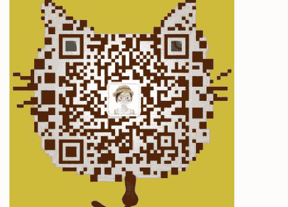

# 一百元人民币在泰国外能做什么 - 感受泰国人民的生活和物价

扫一扫加好友获取更多优质书籍推荐



加v信11011284955获取更多优质书籍推荐

一百元人民币在泰国能做什么 感受泰国国民的生活和物价

作者：骑白马的农民

物价飞涨的年代，天不乏比价，通常看到的都是德国、美国、加拿大这些国家比较，看上去的物价已经超英美了。当然群众们也有另外的错谬，如资本主义国家据宰专无割第三世界来供给本国享受云云云，物价虽便宜但是人工费贵无比云，言下之意能维持现在的生活水平实属不易。

和这样的伟大的国家相比，泰国应该是不入流的国家。但凡一起提起泰国，群众无不是“政治动荡”“色情泛滥”“人妖横行”一类的深水火热的感觉其实这也不算群众，“政治动荡”是因为国家 CCTV 看得多，在 CCTV 里面除了哪个国家不“政治动荡”？至于所谓“色情滥”，这个就是国内大大小小小孩旅行的责任。一般人跟团去泰国，是跑去 PATTAYA（芭提雅）睁眼一看，最后去全是假的。好像歪之旅旅游，也是跑去东莞观光，那得到的结论也就如此。

前几天还写了个帖子，讨论一万元人民币在中国能做什么？这里也对应有个帖子，看一看元人民币在泰国能做什么，做到图文并茂，积如山。

先说明一下泰国人的收入。泰国货币泰铢和人民币的汇率目前大概是 4.7 比 1。泰国的最低收入标准大概是 6500 泰铢左右，合人民币 1350 元。这是最低标准，不管你在泰国什么地方，雇主必须执行这个最低标准。一般便利店收银、超市员工等这类工作的薪资是 8000-10000 泰铢（人民币 1800-2100 元）。公司普通职员是 12000-15000 泰币（人民币 2500-3200 元）。再上层的不是很清楚了，公务员很少接触也不清楚收入，不过美女总理英拉的家族非常有钱（哥哥是前总理他信），夏谷的住宅价值 4000 万人民币以上。但是泰国人居然不富优。

其实作为泰国的中下层，还有很多的社会福利。例如每月用电量在十度以下，是免费的（你没看错，免费）；全国的所有公路都是免费的（你没看错，免费）；中小学生每天免费（你没看错，免费）提供大约半公斤牛奶……想某个企业以前提口号“每天 XX XX，强壮 XX 人”，结果泰国的人们买来的东西还能吃出来，嚼出大头娃娃……

可以这么说，从中下层的收入来说，泰国比要要，或者简单点看到一样的收入吧，那么一百人民币的收入，在泰国能做什么呢？

## 民以食为天，先说吃的吧。

在泰国中国贵的几样东西其中之一是大米，超市的大米折合人民币4 块多一市斤，原因是泰国政府保护稻种植，新台的英拉称要提高稻收购价。如果你在超市上看单价低于8 人民币的“泰国大米”，可以保证是假货。

不过泰国大米很好吃。

泰国的快餐价格是 30-35 铢（人民币 6.4-7.4 元）一份，全国统一价格。无论你在远离地区的小镇还是超市的食物广场，或者首都曼谷机场的餐厅（你没看错，机场餐厅），都是这个价格，不会有太大的偏离。图片是在曼谷泰国国立法政大学学生餐厅吃的快餐，价格30 铢，100人民币可以吃 15 份。

超市的物资来自泰国最常见的超市——易初莲花。泰国的超市都是自有品牌：易初莲花、Big C、罗森等。泰国很少有乐福、沃尔玛这样的大型外国超市。

http%3A%2F%2Fimg9.tanya.cn%2Fphoto%2F2021%2F8%2F18%2F40843661_527004.jpg

## 听说车比中国贵，不知道是不是真的

价格相当，普锐在泰国价格是 190,000 铢（人民币 2 万多），国内是日本装大约人民币 13 万。泰国汽油大约 8.5 元一升，但是路上没有收费。

首先是全国都关排骨，135 铁一公斤，100人民币可以买 3.5 公斤。注意泰国卖排骨不像切成一条而是横着切成链一样，只有中间的肋才算排骨。这种带软肉的 164 铁一公斤，100人民币可以买 2.8 公斤。瘦肉和排骨的价格 135 铁一公斤，100人民币可以买 3.5 公斤。

猪肉有瘦肉吗？鸡胸肉 119 铁一公斤，100人民币可以买 3.95 公斤。鸡 94 铁一公斤，100人民币可以买 5 公斤。猪腰 40.75 铁买 0.326 公斤（合 125 铁一公斤），100人民币可以买大约 3.8 公斤。

秋刀鱼特价 14 钱一条，100人民币可以买 33 条。类似基围的虾（不好意思本人不会认识虾）125 钱一公斤，100人民币可以买大约 3.8 公斤。三文鱼 79.5 钱能银 0.166 公斤（合 480 钱一公斤），100人民币可以买差不多 1 公斤。

数字是泰，重量是公斤，100人民币等于 470 铁，大家算了。数字是泰，重量是公斤，100人民币等于 470 铁，大家算了。食用油 42 铁一瓶，100人民币可以买 11 瓶。牛奶 5L 装的 177 铁，100人民币可以买 13L。牛奶 420 克装雪糕 69 铁，100人民币可以买 6.8 盒。雀果的便宜一些，420 克装的 59 铁一盒，100人民币可以买 8 盒。寿司这样的一盒 49 铁，100人民币可以买 9.5 盒。

泰国苹果、梨、橙子一类属于进口水果比较贵。优质苹果 14 铁一个，100人民币可以买 33 个。梨 53 铁一公斤，100人民币可以买 8.8 公斤。美国蛇苹果 10 铁一个，如果一袋 6 个是 52 铁，100人民币可以买 54 个。进口橙子 69 铁一公斤，100人民币可以买 6.8 公斤。

如果是泰国的水果，价格就......泰国东 Rayong（罗勇府）集市的山竹价格 10 铁一公斤，100人民币可以买 47 公斤山竹。另外从产地运到首都夏谷，山竹价格翻一倍，10-15 铁的街头小卖约 20-30 铁一公斤。为什么从产地到城市，价格翻 5-10 倍。

化妆品，曼秀雷霜一类的价格是三分之一到四分之一。这里放曼秀雷霜的一支 89 铁，100人民币可以买 5.2 支。甜甜圈 10 铁一个，100人民币可以买 47 支。红毛丹 18 铁一公斤，100人民币可以买 25 公斤。红毛丹 35 铁一公斤，100人民币可以买 20 公斤。

医疗保障，泰国国有 30 铢看病，不管大病小病，老百姓都用 30 铢其他费用都是国家补贴，这是泰国民的福利之一。易初莲花的价格比 Big C、罗森便宜多。

独立屋 180,000 铢（人民币可以买 11 万）。土地是 900,000 铢（人民币买不到 9 万）。土地是海滨公寓，31 平面积的公寓（全装修家具）售价 519,000 铢（人民币可以买 11 万）。

请问楼主，泰国的治安如何？据说很好，达到路不拾遗了。治安非常好，在泰国你基本看不到小偷骗子一类，连人与人之间争执的情况都很少。人心是非常平和的，不知道是不是就是常说的和谐社会？

移民泰国的冷水多，如果你是男性，你基本上没有希望移民泰国的，不关多少钱的事。（传说胡兵是泰国国籍，不知道是怎么搞的，难道是变性了嫁给泰国男人？）就算你要泰国，也只能随亲居住，如果离婚，该回哪里？如果是女性，嫁给泰国可以入籍。在泰国混还不错，学生签证，或者 VISA RUN 都可以，满50 岁就可以申请退休签证，大把欧美老人在泰国养老。


泰国第二语言是英语，第三种语言应该是潮州话吧？

---

作者:骑白马的农民 日期:2011-08-20 02:10

@jeffrey2013 2011-08-20 01:38:31

天啊，未道雷把楼主砸死吧。

---

不带鸡蛋......

楼主很快就要回来和大家一起共享***，只是离开前揭露一下国外的人的水深浅而已。

---

作者: 骑白马的农民 日期:2011-08-20 02:19

【再次给全部移民泰国的浇盆冷水】

泰国的移民比美国困难得多的，如果你是男性，你基本上没有希望移民泰国的，不关钱多少的事。（传说胡兵是泰国籍，不知道是怎么搞的，难道是变性了嫁给泰国男人？）

就算你要泰国MM，也只能随亲居住，如果离婚，该回哪里回哪哪里。

如果是女性，嫁给泰国人可以入境。不过在泰国混比较好，办学生签，或者 VISA RUN 都可以，满了50 岁就可以申请退休签证，把欧美老人在泰国养老。

---

加v信1101284955，获取更多优质书籍推荐

* 腻

既然有人房价，再点楼主了解的泰国房价吧。

还是 Rayong，离 Pattaya（芭提）大约100 公公里，离曼谷180公里的城市。

图片中的海滨酒店式公寓：
使用面积 36 平（建筑面积的话应该有40多吧）送装修和全套家具，二手售价 90W（人民币19万2千）。

---

作者：骑白马的农民 日期:2011-08-20 02:22

站在楼顶看海景，最近的地方 Samet 岛（沙美岛）。如果在国内，算几线海景？？

作者：骑白马的农民 日期:2011-08-20 02:24

物管费一年 5000 铢，没有其他费用。

游泳池是免费的。

作者：骑白马的农民 日期:2011-08-20 02:25

台球室是免费的。

{IMAGE}http%3A%2F%2Fimg9.tanya.cn%2Fphoto%2F2011%2F8%2F20%2F4088912_527004.jpg {IMAGE}

---

作者：骑白马的农民 日期:2011-08-20 02:27

停车场和网球场也是免费的。

{IMAGE}http%3A%2F%2Fimg9.tanya.cn%2Fphoto%2F2011%2F8%2F20%2F4088912_527004.jpg {IMAGE}

加v信1101284955，获取更多书籍推荐

作者: 骑马的农民 日期:2011-08-20 02:28

站在楼顶远望背后的山景。

作者：骑马的农民 日期:2011-08-20 02:35

@有深度没力度 2011-08-20 00:52:52

我是老烟民，我们十元的烟圈国家收八元的税，回复一下他们的烟便宜不？

泰国佛教国家不鼓励吸烟喝酒的。

万宝路 80 钱（人民币17块）不知道和***比怎样。

啤酒超市 8块，一瓶 600ML 的比国内费。

不过泰国公共场所严禁吸烟------最近烟好像涨价了 5000 铁！！（人民币1100 元）。

作者：骑马的农民 日期:2011-08-20 13:20

@lindongyang 2011-08-20 06:30:44

楼主，这贴是要发到国际观察，我就知道你内裤的颜色咯。敢试试吗?

你的意思是关的兄弟们们在这里无法发帖？？

作者：骑马的农民 日期:2011-08-20 14:20

@jujishou511 2011-08-20 11:09:30

加v信 1101284955，获取更多优质书籍推荐。

易初莲花是泰国的自有品牌吗？100元人民币在泰国可以放光。

易初莲花属于泰国正大集团。

品牌原名：
“易初”是正大集团创始人谢易初先生的尊名，易初一家是泰籍华人。
易初莲花：“莲花”是泰国的国花，易初莲花是在泰国开始创建的。“莲花”为佛教圣花，象征吉祥，泰国是一个佛教盛行的国家，取这个名字，是为了追求社会和社会集团事业的共同发展。

---
作者：骑白马的农民 日期:2011-08-20 14:22

顺便说一下莲花是泰国常见也是泰国人喜欢的圣花。但是泰国的国花不是黄色的。

作者：骑白马的农民 日期:2011-08-20 23:06

@骑白马的农民 2011-08-20 02:54

站在楼顶看海景，最近的地方 Samet 岛（沙美岛）。如果在国内，算几线海景？？

加v信1101284955, 获取更多书籍推荐。

楼主这张图是帕提亚不是罗勇。这是我在公寓楼顶拍的，怎么是 PATTAYA？这是在 RAYONG 梅洋滩看到 Samet 岛？？

作者：骑白马的农民 日期:2011-08-21 00:40

这里补充一点图片。首先声明：
第一、楼主在泰国呆了一段时间，但是就要回来和大家共享了，只不过离开下主义了。
二、想移民的朋友，劝你消念头，如果你是男性的，泰国籍基本为零。现补充一下泰国蔬菜价格：
100人民币可以买 6-7 公斤。

作者：骑白马的农民 日期:2011-08-21 00:49

100人民币能买 8 公斤。

作者：骑白马的农民 日期:2011-08-21 00:55

100人民币能买 9.4 公斤。

作者：骑白马的农民 日期:2011-08-21 00:57

明治牛奶 450ml 26钱，100人民币能买 18瓶。
{IMAGE}http%3A%2F%2FImg13.tanya.cn%2Fphoto%2F2011%2F28%2F21%2F4091332_527004.jpg {IMAGE}

作者：骑白马的农民 日期:2011-08-21 00:59

明治牛奶 958ml（一）44.5钱和47钱两种，100人民币能买 10盒。

作者：骑白马的农民 日期:2011-08-21 01:01

明治牛奶 2升装 82钱，100人民币能买 5.7桶。

作者：骑白马的农民 日期:2011-08-21 01:04

2升食用油 83.75钱，100人民币能买 5.6瓶。

作者：骑白马的农民 日期:2011-08-21 01:07

1升食用油都是42钱，100人民币能买 11瓶。

加v信 1101284955，获取更多优质书籍推荐。

{IMAGE}http%3A%2F%2Fimg13.tanya.cn%2Fphoto%2F2011%2F8%2F21%2F40913360_527004.jpg {IMAGE}

作者:骑白马的农民 日期:2011-08-21 01:09

385ml装炼乳 18钱，100人民币能买 26罐。
{IMAGE}http%3A%2F%2Fimg13.tanya.cn%2Fphoto%2F2011%2F8%2F21%2F40913362_527004.jpg {IMAGE}

作者：骑白马的农民 日期:2011-08-21 01:10

炼乳价格17~20钱不等一罐。
{IMAGE}http%3A%2F%2Fimg13.tanya.cn%2Fphoto%2F2011%2F8%2F21%2F40913361_527004.jpg {IMAGE}

作者：骑白马的农民 日期:2011-08-21 01:13

泰国大米 174钱 5公斤装，100人民币可以买 13.5公斤这样的米。
{IMAGE}http%3A%2F%2Fimg13.tanya.cn%2Fphoto%2F2011%2F8%2F21%2F40913348_527004.jpg {IMAGE}

作者：骑白马的农民 日期:2011-08-21 01:15

便宜的泰国米 7公斤装，100人民币可以买 24公斤。
{IMAGE}http%3A%2F%2Fimg9.tanya.cn%2Fphoto%2F2011%2F8%2F21%2F40913349_527004.jpg {IMAGE}

作者：骑白马的农民 日期:2011-08-21 01:18

这种便宜的冰凌 25钱，100人民币能买 19杯。
{IMAGE}http%3A%2F%2Fimg13.tanya.cn%2Fphoto%2F2011%2F8%2F21%2F40913315_527004.jpg {IMAGE}
{IMAGE}http%3A%2F%2Fimg13.tanya.cn%2Fphoto%2F2011%2F8%2F21%2F40913328_527004.jpg {IMAGE}
{IMAGE}http%3A%2F%2Fimg13.tanya.cn%2Fphoto%2F2011%2F8%2F21%2F40913330_527004.jpg {IMAGE}

作者：骑白马的农民 日期:2011-08-21 01:20

最便宜的蛋冰凌 9钱，100人民币能买 52个。
{IMAGE}http%3A%2F%2Fimg13.tanya.cn%2Fphoto%2F2011%2F8%2F21%2F40913329_527004.jpg {IMAGE}

作者：骑白马的农民 日期:2011-08-21 01:25

关于欧莱雅化妆品价格这里更正一下：三分之一到四分之一的价格，正常应该是国内的二分之一再便宜一些。楼主对化妆品不是太大了，这里发图用欧莱雅们可以认图片的数字是泰铢换成人民币除以4.7就可以。这个是防霜。
{IMAGE}http%3A%2F%2FImg13.tanya.cn%2Fphoto%2F2011%2F8%2F21%2F40913379_527004.jpg {IMAGE}

作者：骑马的农民 日期:2011-08-21 01:27

应该是日霜吧，数字是泰铢换成人民币除以4.7就可以。
{IMAGE}http%3A%2F%2FImg13.tanya.cn%2Fphoto%2F2011%2F8%2F21%2F40913378_527004.jpg {IMAGE}

作者：骑马的农民 日期:2011-08-21 01:28

{IMAGE}http%3A%2F%2FImg13.tanya.cn%2Fphoto%2F2011%2F8%2F21%2F40913378_527004.jpg {IMAGE}

作者：骑马的农民 日期:2011-08-21 01:30

眼霜等，数字是泰铢换成人民币除以4.7就可以。

加v信1101284955，获更多优质书籍推荐。

{IMAGE}http%3A%2F%2Fimg13.tanya.cn%2Fphoto%2F2011%2F8%2F21%2F40913377_527004.jpg {IMAGE}

作者：骑白马的农民 日期:2011-08-21 01:31

欧莱雅的晚霜，数字是泰铢换算成人民币除以4.7就可以。
{IMAGE}http%3A%2F%2Fimg13.tanya.cn%2Fphoto%2F2011%2F8%2F21%2F40913375_527004.jpg {IMAGE}

作者：骑白马的农民 日期:2011-08-21 01:31

其他的欧莱雅用品，数字是泰铢换算成人民币除以4.7就可以。
{IMAGE}http%3A%2F%2Fimg9.tanya.cn%2Fphoto%2F2011%2F8%2F21%2F40913387_527004.jpg {IMAGE}
{IMAGE}http%3A%2F%2Fimg9.tanya.cn%2Fphoto%2F2011%2F8%2F21%2F40913386_527004.jpg {IMAGE}
{IMAGE}http%3A%2F%2Fimg9.tanya.cn%2Fphoto%2F2011%2F8%2F21%2F40913385_527004.jpg {IMAGE}

作者：骑白马的农民 日期:2011-08-21 01:37

力士的洗发水 45钱一瓶，100人民币能买 10.4瓶。
{IMAGE}http%3A%2F%2Fimg13.tanya.cn%2Fphoto%2F2011%2F8%2F21%2F40913358_527004.jpg {IMAGE}
{IMAGE}http%3A%2F%2Fimg13.tanya.cn%2Fphoto%2F2011%2F8%2F21%2F40913359_527004.jpg {IMAGE}

作者：骑白马的农民 日期:2011-08-21 01:42

最后放在曼谷的房价：
曼谷市中心黄金地段，泰国最好的朱拉隆大学旁边，地铁上盖公寓。3~4房（大户型），单价69000铢（人民币14700）每平方米，左下角是地铁出口。

作者：骑白马的农民 日期:2011-08-21 03:01

@羊咩吕吼 2011-08-20 23:57

我就想问问，如果自由行泰国，签证好办吗?可以自己租房子呆几个月吗？可以凭一本护照到处去吗?华人会受到不公平待遇吗？看这贴内容啊，白活了这么多年，我强烈要求去吃有污染的泰国香米、泰国山竹、泰国榴莲。

加v信1101284955，获取更多书籍推荐。

签证很好办，签证费约200人民币。两个月如果时间不够，在泰国延续一个月。可以租房子住，其实家庭旅也很方便，250-500钱一晚的都有应该应该更便宜。凭一本护照可以去任何地方，你要租摩托车护照给对方就可以（不用交押金）。泰国没有歧视，每个人见你都会微笑，另外泰国华裔很多。

---
作者：骑白马的农民 日期:2011-08-21 13:58

@hncs1x 2011-08-21 09:32:47
作者：骑白马的农民 回复日期:2011-08-18 16:03:38

LZ，这个易初莲花的 Tesco 就是一家英国的大型连锁超市。所以别说泰国没有大型外国超市。我是习惯易初莲花（国内也有这个超市现在改叫碧莲），你也可以乐购莲花。英国和泰国正大集团合资的，泰资占大部分。

---
作者：骑白马的农民 日期:2011-08-21 14:09

@某月的肖鲍 2011-08-21 13:10:05

楼上主要是把泰钱换算成美元，再发到美国论坛，会不会老美也立。

加v信 1101284955，获取更多优质书籍推荐。

水深火热了?哈哈。美国人每月平均3,000美元，换成泰铢是90,000泰铢，水深火热个尼，没见到大把美国人在泰国享乐？？

水深火热的是***的脑吧？眯着良心发帖，才2块多泰铢，在泰国还好，发4个贴子就可以换一个甜圈，在******。

作者：骑白马的农民 日期:2011-08-21 14:13

@jonkey 2011-08-21 14:05

楼上主要是把泰钱换算成美元，再发到美国论坛，会不会老美也立。

100人民币能买 9.4斤。

100人民币能买 8斤。

100人民币能买 6.7斤。

100人民币能买 5.7桶。

100人民币能买 5.6瓶。

100人民币能买 11瓶。

100人民币能买 26罐。

100人民币能买 26罐。

100人民币能买 18瓶。

100人民币可以可以买 13.5公斤。

泰国大米 174钱 5公斤装，100人民币可以买 13.5公斤这样的米。

便宜的泰国米 7公斤装，100人民币可以买 24公斤。

这种便宜的冰凌 25钱，100人民币能买 19杯。

最便宜的蛋冰凌 9钱，100人民币能买 52个。

100人民币能买 10盒。

100人民币能买 18瓶。

100人民币能买 10盒。

100人民币能买 9.4斤。

100人民币能买 8斤。

100人民币能买 6.7斤。

100人民币能买 5.7桶。

100人民币能买 5.6瓶。

100人民币能买 11瓶。

100人民币能买 10.4瓶。

100人民币能买 26罐。

数字是泰铢换成人民币除以4.7就可以。

数字是泰铢换成人民币除以4.7就可以。


点差！

换不到 1000 泰铢按目前汇率 210 多点人民币

（—
作者：骑马的农民 日期:2011-08-21 19:26

爱吃冰激凌的 MM 推荐 SwensenS

两个人 一份 Banana Boat (79 泰铢) 一份 Nutty Basket (69 泰铢)

一共 148 泰铢 32 元

{IMAGE}http%3A%2F%2FImg9.tianya.cn%2Fphoto%2F2011%2FF8%2F%21%2F40928068_527004.jpg {IMAGE}

（—
作者：骑马的农民 日期:2011-08-21 19:29

人的话 可以点冰激凌火锅

九个球 259 泰铢 (55 泰铢)

{IMAGE}http%3A%2F%2FImg9.tianya.cn%2Fphoto%2F2011%2FF8%2F%21%2F409280669_527004.jpg {IMAGE}

（—
作者：骑马的农民 日期:2011-08-21 19:31

Swensens 居然还很用意的推出的冰激凌月饼

Moon Cake

4 个 189 泰铢 (40 元)

{IMAGE}http%3A%2F%2FImg9.tianya.cn%2Fphoto%2F2011%2FF8%2F21%2F40928070_527004.jpg {IMAGE}

加v信 1101284955，获取更多优质书籍推荐

## Pizza company 的套餐（注：此处纠正作者为骑白马的农民）

Pizza company 的套餐

披萨+4个鸡翅+面包 299 徕 (人民币 64 元)

{IMAGE}http%3A%2F%2Fimg9.tanya.cn%2Fphoto%2F2011%2F28%2F21%2F40928071_527004.jpg {IMAGE}

{IMAGE}http%3A%2F%2Fimg9.tanya.cn%2Fphoto%2F2011%2F28%2F21%2F40928072_527004.jpg {IMAGE}

--- 作者:骑白马的农民 日期:2011-08-21 19:44

聊天的造型型的各其能

{IMAGE}http%3A%2F%2Fimg13.tanya.cn%2Fphoto%2F2011%2F28%2F21%2F40928398_527004.jpg {IMAGE}

--- 作者:骑白马的农民 日期:2011-08-21 19:45

这些哪是来聚会的 明明明明就是来野餐的

{IMAGE}http%3A%2F%2Fimg13.tanya.cn%2Fphoto%2F2011%2F28%2F21%2F40928401_527004.jpg {IMAGE}

--- 作者:骑白马的农民 日期:2011-08-21 19:56

红辣椒+黄辣椒和和谐一家亲（番茄炒蛋？？）

加v信1101284955，获取更多优质书籍推荐

牛仔

{IMAGE}http%3A%2F%2Fimg13.tanya.cn%2Fphoto%2F2011%2F8%2F21%2F40928397_527004.jpg {IMAGE}

--- 作者：骑白马的农民 日期:2011-08-21 21:06

在曼谷有一定比例的公交车是免费车（空调调车外）

这种蓝条的公交车就是免费公交

{IMAGE}http%3A%2F%2Fimg13.tanya.cn%2Fphoto%2F2011%2F8%2F21%2F40930220_527004.jpg {IMAGE}

--- 作者：骑白马的农民 日期:2011-08-21 21:11

如果要去其他城市 可以坐这种双层观光巴士

从曼谷到清迈 约 700 公里程 8-9 小时行程

票价 300 元（人民币64 元）

{IMAGE}http%3A%2F%2Fimg9.tanya.cn%2Fphoto%2F2011%2F8%2F21%2F40930540_527004.jpg {IMAGE}

--- 作者：骑白马的农民 日期:2011-08-21 21:36

@冷暖不均 2011-08-21 21:11:47

泰国各行业收入大揭秘

```
http://www.axthai.com/read-htm-tid-1527.html
```

我帮你整理出来吧

加v信 1101284955 获取更多优质书籍推荐

在泰国的日本人办的DACO 杂志访问统计的2011年泰国行业收入（应该比较客观）

| 职业 | 工作经验 | 月收入 (泰铢) | 月收入 (人民币) |
| :--- | :--- | :--- | :--- |
| 电气系统工程师 | 三年工作经验 | 30,000 泰铢 | 6,400 元 |
| 公司普通职员 | 三十年工作经验 | 30,000 泰铢 | 6,400 元 |
| 按摩店按摩师 | 四年工作经验 | 15,000 泰铢 | 3,200 元 |
| 涉外导游 | 两年工作经验 | 1,500-2,000 泰铢 | 320-435 元 |
| 美容师 | 十年工作经验 | 18,000 泰铢 | 800 元 |
| 泰国语教师 | 三年工作经验 | 17,000 泰铢 | 600 元 |
| 高中教师 | 六年工作经验 | 17,000 泰铢 | 600 元 |
| 大学教授 | 二十年工作经验 | 100,000 泰铢 | 2100 元 |
| 小区保安 | 四年工作经验 | 15,000 泰铢 | 200 元 |
| 交通警察 | 十六年工作经验 | 18,000 泰铢 | 800 元 |
| 计程司机 | 七年工作经验 | 12,000-15,000 泰铢 | 500-600 元 |
| BTS 司机 | 五年工作经验 | 10,000-20,000 泰铢 | 210-400 元 |
| BTS 保安 | 六个月工作经验 | 12,000 泰铢 | 500 元 |
| 空姐 | 三年半工作经验 | 30,000-50,000 泰铢 | 6,400-10,600 元 |
| 便利店员工 | 六年工作经验 | 12,000 泰铢 | 500 元 |
| 银行员工 | 两年工作经验 | 2,000 泰铢 | 400 元 |

从泰国回来，表示楼主的很慷慨，但是要考虑下，泰国的份量很小，一份是30~40 泰铢，但是本地人只吃一份。

DQ 的冰激凌分量也比国内小的，DQ 的牛奶那么便宜，怪不得做 pancake 的大妈。泰国的街边饭，一般要加一份饭的（5铢）也有地方。泰国的贫穷真是残酷，对比中国，除了曼谷，还去过东部的 Rayong，南部的 Krabi 和北部的 Chiangmai，还有 Koh Tao、Koh Pangan 和 Koh Samui 这三个岛的。除了曼谷，很少看到豪华汽车，绝大部分是日本的家用，有些一家辆。放假（泰国一年差不多三分的时间是假期）就一家人开着车装东西出来（公路又不收费）。就算是最贫穷北部地方 Mae Salong（美斯乐），以前留在那里的孩子，在入学时也是免费学，免费提供午餐和牛奶……再看看天津的贵州学生捐午饭，能说泰国的贫富悬殊？

泰国女人可以办随亲居住，但是你离婚了就该哪里回哪里。不过不满50岁可以申请养老签证，长住泰国（但是不能享受买土地等）。

中国还能别的国家比富贫差距？世界上中国像比得到的应该用高吧？比别的。那边医生工资高不？

小区保安 四年工作经验 月收入15,000泰铢（人民币3,200元）
交通警察 十年工作经验 月收入18,000泰铢（人民币3,800元）

下面那个就是公务员待遇吧？？

要是你觉得偏烦，可以撰文反驳嘛，有有真相。

表羡慕我，据说会是可怕的经历。不是累，是太累。跟团的。

跟团的付出是自由行的5倍。

在曼谷几个景点玩的时候（其中一个是大宰，还有一个是大宰），泰国人是不需要门票的。

可见，泰国门票的地方也少，我遇到最贵的 350 铁（76 元）。在清迈边供泰释摩尼合的30铢（65 元）。

如果要去其他城市 可以坐这种双层观光巴士

从曼谷到清迈 大约700 公里程 8-9 小时行程

票价 300 元（人民币64 元）

请问 LZ 是哪家的 BUS 公司的车？在曼谷哪里上车？我上次去清迈的火车，比国内的慢车还要慢，晚上10 点开车第二天12 点才到清迈，卧铺空调下卧铺580的样子，说清山路有普通包座位很小的那种票都要400 多泰铢了~~一定要告诉我，因为我还要去清迈。考山路 大多数 Guest house 都能买到清迈边的双层 BUS 的票300-350 到你的 Guest house 来接你

晚上7-8 点出发 早上5 点左右到记住考山路任何一个可以报 tour 的地方都可以买

楼主，你 4.7 的汇率是在哪里换，能帮我换点吗，有多少我换少第一 我说的大概 4.7 你认为零点零几的汇率差很重要

第二 你用中国的银联卡 在泰国取款都是按当天的汇率给你算 泰华农民银行手续费

在泰国的日本人办的DACO 杂志访问统计的2011年泰国行业收入（应该比较客观）

在泰国的日本人办的DACO 杂志访问统计的2011年泰国行业收入（应该比较客观）


<!-- no content -->


哟撒泼了？呵呵呵。。本来以为是有种赌发誓就有种应约的，跟你较真了你又老了。原来只是喜欢害全家得艾滋火葬葬来计口的彩，喜欢你就睁着睡兜，过年再写个对联起挂门上，看着多喜夯，你有特殊爱好可拦着不是是不是？

自恰吐出来的自己都能吃回去，人哉则无敌到这份上了，说什么都是白搭，要再跟你扯下沦为爬人一档了，也糟了语言的艺术。

喜欢满地撒泼滚赖你可儿表演，帮看着帮你跺掌，毕竟还免费。就当发全民福利，你你哄围观，难得你拆那国也有免费的东西啊，你说不是？

------------------------------------------------

作者：骑白马的农民 日期:2011-08-30 00:22
@不高明 2011-08-29 23:25:51
@骑白马的农民 2011-08-29 21:48:52
@不高明 2011-08-29 13:19:13
@骑白马的农民 2011-08-29 04:21:57
@不高明 2011-08-28 14:35:35

------------------------------------------------

嗯接着表演，多打几个滚儿，会更好看呵。

加v信 1101284955，获取更多优质书籍推荐
