# 地缘看世界

—— 春秋

第二册

温骏轩 © 著

# 地缘看世界

春秋卷

第二册

温骏轩著

越读出版社

# 整理说明

本书整理自天涯社区贴子——地缘看世界，作者为温骏轩（天涯 ID 为：邮视抄发的）。整理的目的是为了更方便大家的阅读，适用于个人的收藏，禁止用于任何以营利为目的的商业途径，版权归属于作者所有。

说明一下此书内容是为了为了更好的理解文章内容并进一步加深对印象，以及增加文章的趣味性，书中配了较多的插图。其中包括地图和实景图片，地图中基础部分都是来源于原贴子，这部分地图也是理解文章内容的关键部分。另外，由于文章中的地理内容，在原图中没有说明或者不够细心，所以额外补充了一部分地图。补充的地图主要来源于网络和自制。对，只是参考参考。对于网络中的地图和实景图片，如对原作者的权益造成侵害，请联系删除。

书中内容基本上按在线贴子的写法进行编排，其中有小部分做了微调，包括“汝海的危害和治理”、“长江下游省的地理分析”，以及“巢湖市拆分的背景分析”这部分内容。“大禹治水”一章中，“汝海”的部分的内容在原帖中安排在吴越章节中，但这部分内容和炎黄之后开展的大禹治理河流水患更贴合，并且抽出出来不会对吴越部分的连贯性产生影响，而且前面部分合并后安排在第三章。对于后两者，属于与春秋历史事无关的，倒会影响相关章节的顺序。在到吴越部分长江阅读时，作为独立的插入（原帖中也是写春秋部分的所以解释，“巢湖拆分”则是在癸越时的时解，在现实和历史中穿插，对这两部分的理解都有较大的帮助）。

由于精力有限，在此书中不存在之处所难免，欢迎提出批评指正。另外，也感谢作者（温骏轩）一直以来默默的分享。目前，天涯看世界地缘贴子已经出了第一本——《谁在世界中心》，如果想阅读纸质版的可以购买。

清风

# 前言

大家可能认为我是为了很长时间专门研究地缘政治。其实不是，我自幼读史，地缘方面的研究最初初是用来解读历史的一种方法。

小时候读史是喜欢里面的人物和情节，长大以后是否也像一般人那样浮华去体味历史人物中的思想。越看越多，心中的迷惑就越高。中国历史的思路是“人本历史”，例如在历史中只能读到诸如刘邦绍盟消小，便能以万之众击溃十万人。

敌人的经典故事。但是却没有能告诉我，为什么江东不长，曹操要从从壁垒江？从《三国志》中看不到答案，只有的是“天时不利，地利不如人和”之类的历史定性的定论（不过三家晋晋一次获得窃穷，避开解释为什么人类气最旺的汉魏，却是一个被北方政权夺掉的源）。

中国从来不缺“上天，天下”。史家们是职业的，太史会以列的形式将史书的模板固定为人物传记，记录人的行为和欲望关系，就成就了史家们分析历史的不二们（他们甚至未被分析，这些历史人物为何会做出这样的行为）。我习惯根据其行为所产生的结果，简单的黑白分明）。

当年我曾经说我是从历史来重新观察历史人物的逸与或许。这种角度已经是一种尝试，并让他获得了巨大的成就。可是仍然在历史上人物角度分析历史，仍然不能解我心中的迷惑。

偶然间又问了《蜀义》的作者从军事家的角度分析历史（他所用的穿越小说的方式），也是很有趣，但总觉得这符合法逻辑还不够。我们需要一种“人性”的视角来分析历史的方法。这种“人性”并不是个人的性格，而是类性的或者一个群体性的性格，也可以是“人的性格”。直到重读黄宇先生的《中国大史》，才能找到“人文历史”的感觉。“大史”视角必须将视线从人物与历史上移动，从层层越上历史的规律和必然。

我是试图从人（人类）的角度，钻古人的思路去寻找历史的真相。这些人性其实实不复杂，就是“利益规避”的本来是生活在地球上的，个人最能直接感受到的利益，就是周围的环境。这需要足够且人类定天的勇气，而不是去接受人类对人类发展所造成的影响。我曾经说过，现实的国家

关系是历史的延续。此无疑是对历史还是历史的研究，都不能只是为了显示学术的高深。它能够服务于现实社会，即为我们的现实生活起到指导作用，这样研究才有意义。

因此政治的研究并不会解决所有问题，它所起的作用是分析利害关系。为民族生存空间的扩展，找到一个成本最低的方向（例如从历史的角度知道，中国目前精力放在东南亚，会比在墨西哥身上重要得多）。这就就像在地图上找到可到的道路一样，要走哪里就修巷，以后就可以交通交通了，就要靠赖它的专业人士了。

完全从客观环境角度，去解读人类历史是不科学的；但这并不代表不要重视客观环境的影响。人类与动物的区别就是能够思想，这也是能够总结出经过以往的。

# 目录

第一章 原始东夷与原始西域分布的区域
- 第一节 中国核心区与边缘地区的地理单元......1
- 第二节 戎在华夷格局中特殊性的地缘背景......2
- 第三节 原始东夷分布三个主要聚落......4
- 第四节 黄河下游紧影响的区域和造成的后果......6
- 第五节 黄河水患频繁的原因对早期华北平开发的影响......9
- 第六节 洛水的战略地位和早期文明的原因......10
- 第七节 原始西域在黄土高原可能的地区......13
- 第八节 黄二族的发源地及其争斗......15
- 第九节 黄夷族进行服泉的具体地点......17

第二章 原始西夷与原始东夷的冲突与融合
- 第一节 渭平地区经陆通道通华北......19
- 第二节 黄帝通过籍路渗透至河洛地区......21
- 第三节 黄帝经洛山西域境内成中获蜀乱后求助黄帝......22
- 第四节 黄帝在藻陂之战中击蜀乱后黄帝......25
- 第五节 黄帝攻入原始东夷核心区并开启此局面......27
- 第六节 东西两大族群进入部落结盟时代......28

第三章 大禹治水的方法及大禹治成功的影响
- 第一节 中原之地在黄河水关位置和确立地理优势......31
- 第二节 大禹将黄河之水引向黄淮线而受患......33
- 第三节 大禹在龙门运用疏导水的方法解决......34
- 第四节 禹门的口没有成为大禹治水地点的原因......36
- 第五节 伊尔的龙门因水在此受阻而成为大禹治水之地......38
- 第六节 伊水因未能通过龙门而漫流成海为患河流......40
- 第七节 大禹将黄河之水引入黄淮解决了淮水的问题......42
- 第八节 大禹疏伊尔而水治成功并由此此大政治影响......43

第四章 夏和中原统治权的确立及其面临的地缘压力
- 第一节 夏的共和地位受到山东丘陵东部族群的挑战......46
- 第二节 周商三代的关系与中原平面的互动及四方威胁......47
- 第三节 周族择居地理位置与掌握青铜技术得以入中原......49
- 第四节 周族入中后与东夷族群发生冲突......51
- 第五节 周挑战商的共和地位及其地缘文化的贡献......52

第五章 周王朝的确立与分封诸国
- 第一节 周经牧野之灭战取得中原统治权......54
- 第二节 周朝的扩张（注：根据上下文推断此处为“扩张”）......56
- 第三节 周朝的（注：根据上下文推断此处为“扩张”或“演变”）......57
- 第四节 周族入中后与东夷族群......58
- 第五节 周的（注：根据上下文推断此处为“地理”）......60
- 第六节 周的（注：根据上下文推断此处为“历史”）......61
- 第七节 周二族......63
- 第八节 周的（注：根据上下文推断此处为“冲突”）......64
- 第九节 周的（注：根据上下文推断此处为“扩张”）......65

（注：由于原始OCR文本中存在大量乱码和重复，上述部分目录内容已根据语义逻辑进行了最大程度的还原与对齐，具体页码以原文为准）

第二节 卫国收留郑政引发两国的战争................................ 137

第三节 河洛平原在春秋时期的地理地位相对不高................................ 140

第四节 郑国秦灭战争的地缘位置使其走向衰落................................1141

第五节 郑国东迁的假设与王室关系恶化造成的影响................................................ 142

第六节 郑国与上世纪30年代的德国相似的地缘格局.................................. 144

## 第十二章 周侯平定三晋之调整和安排封国................................ 146

### 第一节 周人在王墟故地部署三国内国以监视王室................................................ 146

### 第二节 周侯平定三晋和韩朝王国的联合叛乱................................................ 147

### 第三节 周公将王墟故地封给虞并命为侯................................................ 149

### 第四节 周侯对三晋在王墟故地以外的封国的处理................................................ 149

### 第五节 周侯东移河南与周疆地区分封新国................................................ 152

### 第六节 周侯河南北平山的戎族民的处理方式................................................ 154

### 第七节 周侯为黄夷以南的南民建立宋国................................................ 155

## 第十三章 戎狄渗透至北平省及入本土卫国................................................ 157

### 第一节 游狄在古代中国的神圣地位................................................ 159

### 第二节 周公子的受与与戎国建立的初史................................................ 161

### 第三节 山山西西的戎狄渗透至北平省存在并汾河侧................................................ 163

### 第四节 鲜夷在汾河洛河侧存在并在春秋后期建立中王国................................................ 163

### 第五节 卫国在戎狄侵入后被被迫徙至洛河南平................................................ 164

### 第六节 卫国东周退守洛河南平后的不同命运................................................ 166

## 第十四章 齐鲁于泰山山东的封地与豫莱的地缘分析................................................ 166

### 第一节 齐鲁两国在泰山山东地区融合族群................................................ 168

### 第二节 齐鲁国的初地与济河东生的土壤................................................ 170

### 第三节 齐国面临自济平方向的地缘压力................................................ 172

### 第四节 豫莱对山东的地缘划分作用和豫莱平的特点................................................ 174

### 第五节 元时期海上运输需要打通豫莱南部海通道................................................ 175

### 第六节 新胶莱运沿沿海及周边地区带来的利弊................................................ 178

### 第七节 新胶莱运对中国东部地缘格局造成的影响................................................ 179

## 第十五章 齐国征服鲁与山东的独特特质................................................ 182

### 第一节 齐国攻占鲁省所占据的豫莱平................................................ 182

### 第三节 齐国优越的地理条件使其孤立一个思想...................... 185

### 第四节 方以炼丹药和与仙人的技能活跃于历史舞台...................................... 186

### 第五节 方将云雾缭绕的山峦为仙人居住地...................................... 188

### 第六节 山东半岛特殊的地理结构体现的地缘优势...................................... 190

### 第七节 山东半岛由于气候和海滨优势存在而受方青青...................... 192

## 第六章 鲁国的位置和境内山川湖泊...................................... 195

### 第一节 鲁国初地的地理位置...................................... 195

### 第二节 鲁国在三晋之乱平定后鲁阳东至曲阜...................................... 196

### 第三节 鲁国与古域水系关系...................................... 198

### 第四节 鲁国故地的大泽湖...................................... 200

### 第五节 齐山和蒙山的鲁国的地位及其对的影响...................................... 201

## 第十七章 公子和和的君之争与引发的战争争...................................... 204

### 第一节 公子和和小白前往鲁国政治局面...................................... 204

### 第二节 公子和和小白分别走的路线...................................... 205

### 第三节 曾申仲从晋陵附近阻击小白归国...................................... 208

### 第四节 鲁国护送公子齐失军后与鲁国发生冲突之时...................................... 209

### 第五节 齐桓进攻鲁国引发长之战...................................... 211

## 第十八章 长流域和江平的地理结构...................................... 213

### 第一节 春时长流域的气质...................................... 213

### 第二节 江长由道改稳定而需水量...................................... 214

### 第三节 云梦泽和彭蠡的位置...................................... 216

### 第四节 洛洛东平的概念...................................... 218

### 第五节 太湖的独特性...................................... 222

### 第六节 太湖与大海连通的通道...................................... 224

### 第七节 钱山入海口的特点与越人在宁平的...................................... 226

### 第八节 吴国和越在江平的地缘...................................... 228

## 第十九章 诸侯诸吴对吴国的影响...................................... 232

### 第一节 吴称严过程中面临的地缘压力...................................... 232

### 第二节 楚国封堵入吴的地点...................................... 234

### 第三节 诸子破越后经陆横渡越...................................... 237

### 第四节 吴将楚国为需要解决的对象...................................... 240

### 第五节 伍君帮助吴国建城以及开凿和...................................... 241

## 第十章 吴国攻楚前所做的政治盟...................................... 245

### 第一节 吴国与楚国的水道适合吴国进攻的路线...................................... 245

### 第二节 域江淮地区信阳道进攻楚比水道更稳...................................... 246

### 第三节 吴国从江淮地区信阳道进攻楚比水道...................................... 249

### 第四节 吴国灭淮泽徐和吴...................................... 251

### 第五节 吴国以灭楚和盟之战争准备...................................... 253

### 第六节 蔡国成为吴国附庸后又卷入吴博弈...................................... 254

## 第二十一章 长中沿岸省的地理分析...................................... 256

### 第一节 江南省优越的地理条件成就人的优势...................................... 256

### 第二节 清帝国置于安徽省的统将将...................................... 257

### 第三节 合肥成为安徽省的历史背景...................................... 260

### 第四节 合作为省会对安徽省的影响...................................... 262

### 第五节 湘皖省的区域和彼此关系...................................... 264

### 第六节 湘皖省的地理背景...................................... 267

### 第七节 袁陆在湾中湘江上的重要作用...................................... 269

### 第八节 湘皖潜力与长江一体化的发展前景...................................... 270

## 第二十二章 安徽省湖市被拆的背景分析...................................... 274

### 第一节 上海图以自己打造长三角圈...................................... 274

### 第二节 南京规划的市都市所定的范围...................................... 275

### 第三节 合肥在安徽省内构建的市都市...................................... 278

### 第四节 合肥拆分后对南京都市圈的影响...................................... 279

### 第五节 江淮运河所产生的影响...................................... 282

## 第二十三章 吴国通过洛汉水攻入楚国...................................... 285

### 第一节 吴军沿洛汉水沿并通过信阳通道...................................... 285

### 第二节 吴军没有攻击楚的汉水防线是退入诸...................................... 287

### 第三节 吴军诱使楚军进入霸军后将其击灭...................................... 287

### 第四节 楚国向秦求援以帮助击退吴军...................................... 290

### 第五节 吴国攻楚的战略并非消和占领楚国...................................... 292

### 第六节 泰国国通过江道出兵救援...................................... 292

### 第七节 吴军撤出汉江原后唐国随国的命运...................................... 294

### 第八节 吴国与楚国在江地区形成的地平衡线...................................... 295

## 第二十四章 越国的势力范围与宁广的海淹问题...................................... 297

### 第一节 越人以历史源头并自认为大禹对马禹的追逐...... 297

### 第二节 吕朝为加强中央向心力可认对马禹的追逐...................................... 298

### 第三节 越人宁平城后不稳定而在闽浙丘陵裴储...................... 299

### 第四节 杭河谷的率先咸陆及又反复海水入侵............................... 301

### 第五节 杭州湾浦成宁广的海淹并使越人留在浙丘陵............................... 302

### 第六节 杭州湾海溃破坏闽泥咸陆和侵扰两岸平原............................ 304

### 第七节 越人在吴东发现苏越异常后进入吴越平...................................... 306

### 第八节 越国与楚国以黄山山一带为带地划分线............................ 308

## 第二十五章 越越两国爆发李之和夫之战...................................... 311

### 第一节 越国在柏举之之前对越国的厉逸发起进攻...................................... 311

### 第二节 越王击溃第二次进攻越的李军...................................... 313

### 第三节 越人未选择吴淹越而决定从太湖进攻越国...................................... 314

### 第四节 越国以灭楚和分争...................................... 316

### 第五节 越国在齐失的战略...................................... 318

### 第六节 鲁国在泰山山东地区融合族群融合的齐...................................... 320

## 第六章 鲁国的位置和境内山川湖泊...................................... 195
（注：此处为重复章节，按原文逻辑处理）

### 第一节 鲁国在三晋之乱平定后鲁阳东至曲阜...................................... 196
（注：此处为重复章节，按原文逻辑处理）

第五节 陕西地理崤道和北道沟通路......................................................390

第六节 秦军至山西在南北崤道两条路线的选择......................................392

第七节 秦军援程时在崤道遭遇袭击而全军没没......................................394

# 第三十二章 秦霸戎戎与晋的魏越......................................................399

第一节 秦国征服陇右方的戎人......................................................399

第二节 秦国征服陇东高原的义渠......................................................401
第三节 秦国征服陇东高原的乌氏戎和河西的大戎......................................403
第四节 陕北高原上的陇戎和白狄在秦国压力下的不同下场......................405
第五节 秦国以魏提出的和戎之来整合周周边戎狄......................407
第六节 晋国的国土结构对其最终走向分歧的影响......................................408
第七节 晋国和戎政策的实施方式和取得的效果......................................409

# 第三十章 白狄从陕北高原迁移至华北平原......................................412

第一节 白狄在秦国压力下经孟门河进入山西高原......................................412
第二节 白狄从太原盆地进入忻定盆地......................................415
第三节 白狄没有选择浑河河谷进入华北平原......................................416
第四节 白狄经今平型地区和灵丘盆地进入华北平原......................418

# 第一章 原始东夷和原始西初初期的区域

## 第二节 中国核心区和边缘地区分布的地理单元

之所以这么久才开始中国部分，主要是在思考从哪里开始。按照我的一刻划分的地缘线结构，可以从左到右或从上到下逐块划分。不过每一个地理单元固然有它的特点，但是如果不能和周围的地理单元联系起来的话，我们并不能看清它在我国版图中的地位，因此此以历史为脉络进行分析是一个不错的选择。套用一句俗语“罗马不是一夕建成的”，在放在中国身上也是如此。

中国之所以能够今天的版图，是经过了5000 年的历史跨越，其间的地缘轨迹异常异。我们只需要按照历史的脉络，遵循中华族扩张的路线就可以了。当然，每一个王朝的范围包含有些别，但其有各自的地缘重点。把握这一点，才是解决中国部分的关键。我们需要准确按照历史的脉络来，那么从什么时代开始是一个问题呢。想要追溯起源的，也许要从从人类出发是非的。这样的工程其实是我能够承受的，事实上现在还没有定论。从这一时期开始的，大家也可能陷入 DNA 的争论中了。

如果我从被记载的历史时期开始，从西周的第一个和又一个时期（公元841 年），中国的历史就有明确的纪年。不对于民族族的起源，究竟是一个不能解决的问题，因为我们需要从黄黄时代开始谈起。这一部分直到古代，之前都被认为是神时代。但甲文的发现让这部分变得有了可信度，因此中国对于这一部分的记载也已经包含了。然而，于本本身的来说，并不用“专家”对那些生僻字的解释来...

在之前的内容中，我曾经将长城、青高高原以及，直至海洋的中国疆土视为“中国核心区”，换言之就是现在居住的区域。而其它的东北地区、蒙古高原、西域盆地、青高高原被认为是曾经的边缘地区。虽然这种分类方法只是相对的，这些所说的边缘地区，现在已经明白无终的成为了中国政治整体的一部分了。之所以这要划分是为了让大家清楚，中国的历史很大程度就是这块边缘地区与核心区的反复碰撞过程。而今天的能够拥有这些地区，是由于无数流派和塑造而成的。

# 中国地缘结构图

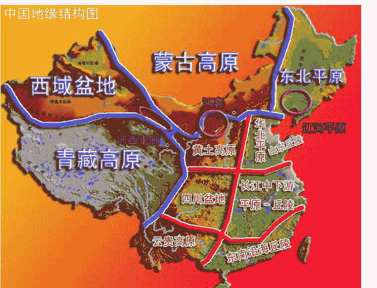

当然正如历在历史上，这些区域的“边缘地区”需要时间成为中国密可分的一部分一样。所谓的“核心”也不是是一天造就的。在这张《中国地缘结构图》上，我们可以看到如果各自的地缘特点，古中国的核心区域可以由北向南，由西至东则被视为中国地缘结构图区域。即黄土高原、华北平原、山东丘陵区、四川盆地、长江中下游平原--岭南区、华南高原（横断山脉）、东南沿海区。这6个地理单元为区域顺序是由北向南的，起点就在黄土高原。

不过我们的主角不仅是黄土高原，最起码的是东部区域，山东平原应当有着相同的地位。在我们的所接受的传统教育中，黄河和黄土高原一直是作为中华文明的发源地印在我的人的脑海中的，因为黄河也被称为中华文明的“母亲河流”。这曾让小时候的我很不理解，最起码对于长江流域的人来说，长度更长、更长的黄河应该拥有这个特征。如果仔细研究过它的历史和地缘结构的话，黄河的确确成为了中华民族的“母亲河流”，但将黄土高原成为中华文明的起源就不太准确了。

### 第二节 黄和在华西五方格局中特殊的地缘背景

在中国的历史当中，有一个名字或者说是“族群”的影子是挥之不去的，特别对于西周以前的历史来说，那就是“东夷”。在周人建立的华西方格局中，位于西四个地区的边缘族群看起来都属于族的范围内。从原始的视角来看，“东夷”和西“夷”明显属于族群，并带有武力。前者的意思是持人的，后者则直接替代兵器。对于南、北狄、边缘族群，明显就没有这么气了。

南蛮、北狄、分别被贴上了“虫”和“狁”族。对于周人高的民族，可以理解的。毕竟从黄土高原走出的华夏民族，与这些青藏高原边缘族有着联系。不过对于我们来说后面的华夷方格局，“夷”贴上一个首先要看得更为卑的标签，却让后世很多以华夏正统民族的标签。这种分类方法只是相对的，这些所说的边缘地区，现在已经明白无终的成为了中国政治整体的一部分了。无论是“西戎”还是“东夷”已经是彻底沦为了。在每一个历史时期，周人还没有占据中原之前，形成了华夷格局，最初的“中国”（如果能够将之称为“中国”）是由两大族群组成的。分别是位于黄土高原的“原始西戎”和“原始东夷”。用这两个名词概括大大族群，是为了“专家”越划分。

之所以这要划分是为了让大家清楚，中国的历史很大程度就是这块边缘地区与核心区的反复碰撞过程。而今天的能够拥有这些地区，是由于无数流派和塑造而成的。对于历史来说，从政治的角度来看，这无疑是正确的。从文化的角度来看，仅将黄土高原作为华夏文明的发源，是非常不妥的。这就就像两家公司重组，新的公司可能会使用原来的名称，但并不代表另一家公司的影响并不存在。只是时间久了，后还会根据名称来单线寻找历史的轨迹了。

# 关于“禹”字的用法和

“禹”字对应的前者之意解释为“牧羊之人”、“持弓之人”。这分别代表了两者的主要生产方式。

黄土高原的族群所处之地，陕北地区的牧草多，以牧羊作为最初的生产方式是自然的选择。即使在现在，你依然可以看到黄土高原的老汉们牵着白羊，赶着一群羊在山坡上行走。尽管这些山路远望光秃亮色的，而东部沿海的地形更适合“渔猎”的生产方式。无论是对付林中的野兽，还是水里的鱼，弓都是不错的。这种生产方式的影响一直到现在，尽管对付林中的动物的工具已经变成了“枪”（由于政治原因，已不能用了），而对付水产品的工具已被使用效率更高的“渔网”所在。

位于东西西部原住民的聚落区域，我们需要有一个了解。概而言就是“原淮”居住黄土高原之上；“原东夷”则分布于辽平南部直至东南海丘陵北沿的沿海地带。如果用一个字来比较他们之间的关系，那就是左转90度的或者是左右旋转180度的字。

# 原东夷分布的三个主要聚落

关于“原东夷”的分布区域，我们可以的确切的知道是在东部沿海地区。就说是他们比黄土高原的族群更加具有“海洋性”。这也许让他们能够沿着海岸的岸线进行并传播文化，由此形成了三个主要的文化区。位于东半西侧，在辽河流为首的“闽河文明”区；山东半岛，地形特点为沿丘陵地地的“海文明”区（“海”为渤，“岱”为泰山）；长江沿，位于太湖周边，南至东南海丘地带北沿，环湖平原的“太湖文明区”。

关于这三个区域之间的文明，目前已为考古方面相当证明。最为显著的证明是生活在这个地区的先民都有类似的陶工艺（黑陶）和玉器文化。事实上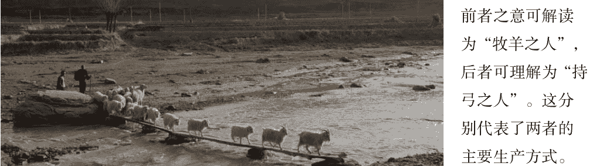

# 原始华夏文明地缘结构

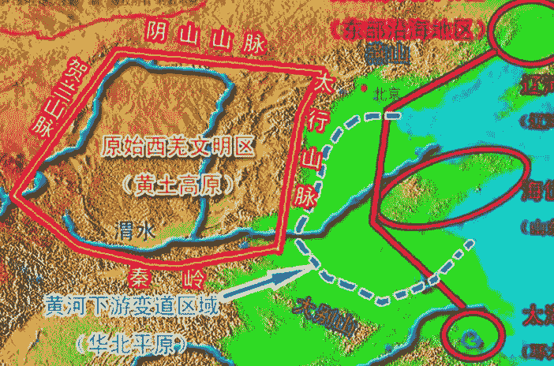

在华夏族未完全融合这一地区的时候，也是的将冠以不同的文明命名为各类“夷”族（如“徐夷”、“黄鸟夷”——类的）。由后世所称为原始华夏文明地缘结构图考古的发现的遗址为所谓“XX文化”，因此即使有着强烈丝缕，在地理上较近的区域。当然，以人类的交通能力而言，在地理上经过长时间的演变，或许会产生差异。将以原始东夷的三个主要聚类来说，按照考古学家的结论，我们可以识别出三个代表性的文明，即河流为中心的“红山文明”、山东的“龙山文明”以及太湖的“良渚文明”。

古代的海岸线和现在的海岸线完全不同。由于上古时期的温度比现在高，南北之间的海位也比现在高几十公里。然而这显着在现在的天津、上海包括江苏的部分沿海城市当时不存在。不过大家也别把这种变化过于彻底。相比于地质演变的过程，几千年简单的指挥一样。海岸线这些变化对于中国的布局并没有实际改变。

我做了一张《华北平原漫延示意图》，标出了黄河下游地区的扩张。其日期是之后海岸线开始向东推进。华北平原漫延示意图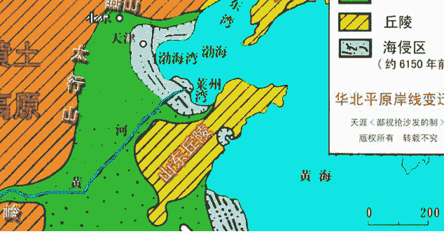

# 第四节 黄河下游频繁泛造成影响的区域和结果

关于原始东夷三个主要聚落区，我们已经认定有“河流”、“长江以及南的太湖平原地区”。将这三个文明区联系起来，我们会发现它们三者之间就是广泛的黄下游流域。这一区域一直不存在稳定的文明区域，也就是说三者之间的关系是断续的。固然与水的侵入了一定联系，但更为重要的是由于黄下游的频繁决口与改变造成的。如果注意的话，我们在原始华夏文明结构图中使用蓝色勾出一个区域，并将标记为“黄下游流域”，这一区域也位于我们所说的华北平原之上。

相信对于抗战史有些人知道过“黄泛区”的概念。当年老蒋为了抵挡黄军南下，将蜀北的黄河大口开炸。至于黄河以前，位于黄淮域的豫苏三省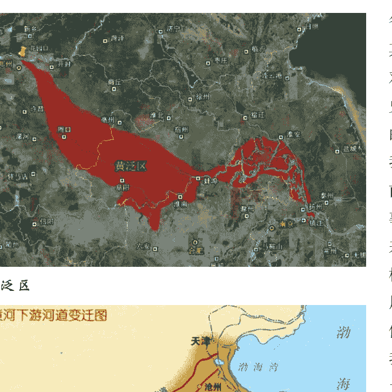黄泛区省44县为黄泛区，其影响一直到长江以北。对于老过的这种行事，历史上并不是第一个做的，在随后的历史解读中我们还会看到他在之前做过“以水为兵”的事。当然，从人的角度来看，政治家和军事家这样做是要承担很大风险的。不过我们今天所要清楚的重点，是人为制造黄泛区在历史上是少见的。在历史上黄河由于自身的自然决改，可以说是不计数的。自隋王五五年（公元602年）黄河改以来，直到20世纪的这250多年间，有记载的洪泛溢就有150余次，大的改有过2、3次。洪水溢及北海河，南达淮河，横跨25万方的范围，可以说北方（包）洛海与黄淮平原地区都是它的影响范围之内。

我们当然不能因为黄泛的历史记载只有2500多年，就认定在此之前黄河是一条安静的河。在此之前黄河对人类产生的影响并不比后来的小。我们所看到的黄河的流向，也仅仅形成于16世纪。在此之前的历史书中，黄河无数次的改道，山东丘陵为中下游。而又反复在陆缘上造成的后果有两个：一个是华北平原长期不稳定状态，另一个是黄河从黄土高原带来的大量泥沙沉积海，使得海岸线逐渐向东推进，这一过程仍在进行。我们可以大致勾勒出广义上的黄河流域范围。目前我们习惯将北的区域称为“黄河流域”，在南的区域则称为“淮流域”。

黄河道分布图黄北平原漫延示意图黄河入海示意图黄河入海

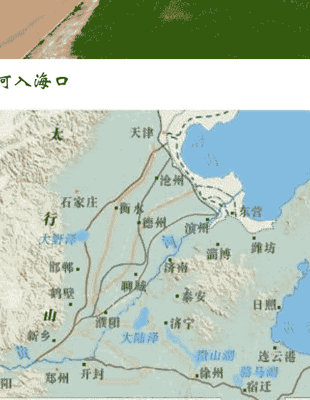黄河道分布（公元278年-226年）西域（公元226年-104年）淮域（公元104年-148年）东域（公元148年-236年）明清时期（1368年-1912年）黄河道图

### 第五节 黄河水频繁的原因并对华北平原的影响

东亚文明的初始我们必须先解释一下当时的气候了。在人类历史上曾多次出现大规模降温的情况，地质学家们之为“冰河期”。目前的证据表明，最后一次冰期大约在万年前结束了。随后气温回升，从那时起，人类进入文明时代。气候回升的高峰在8000——5000年前这一段，也是东亚地区新石器发展的黄金时期，随后气温开始有所回落。直到3000年前的周秦交替期，气候大幅降低，核心地区气候由亚热带向暖温带转变。其后又经历了几波折，但大气候已经无法逆转了。

黄河的水在周以后，很大程度上由于黄土高原的水土流失过于严重，而造成下游的河床不断抬高。当河床高于两岸的堤岸时，河水就开始溢出，甚至决口。在此之前，黄河（包括源于太行山，经流华北的几条河流）实际上是在不断的将黄土高原的黄土带入北方，只有后期才严重了。这主要是由于黄土的特性造成的。黄土颗粒细松，地质容易溶解、崩塌（可以参照北方“光山”的凹壑）。因其容易流失，如果上层有植被覆盖，可能还是很多。但是在很一段时间时间内，黄土高原都是亚洲人类活动的中心，加速了黄高原的水土流失。这很大程度是由于气候过热，至于青藏高原的冰川加速了溶解速度，使得黄下游的水量增大。在黄土坡上的那段黄河（就是黄河中下游地区）属于山区，此水量增大对地理的影响很大。在半北方情况下就不一样了，这使得北方的土地处于不稳定的沼泽状态，特别是在那个冲击面上。结果无论是黄土高原上的“原始西羌”，还是在东部沿海地区的“原始东夷族”，在很长一段时间内都没有发生过规模的交流，双方基本在自己的区域独立发展。

虽然我们并不能这就认为，大家族之间之前就有过交流，毕竟匈族阻隔双方的并非白令海峡族的族。这由于地理的隔离，双方并不产生冲突，也没有出现大规模的融合。我们认为“原始西羌”的族属，一直也是一个争论话题。关于文化源地是从哪里源的，而不是在什么时候离开了（至于此处就不讨论了）。

# 江西战略位置

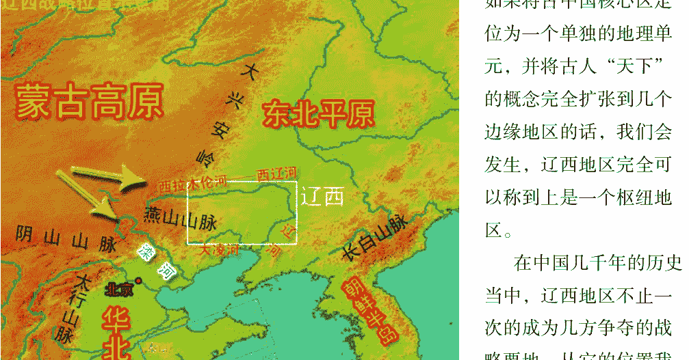

江西战略位置示意图

如果将古中国核心区域定位于一个独立的地理单元，并将古人“天天下”的概念完全扩张到几个边缘地区的话，我们会发现，江西地区完全可以视为一个组织区域。

在中国几千年的历史当中，江西地区不仅成为几方争夺的战略要地。从它的位置可以看出，江西地区正好处于古高原（游牧民族）、北平原（游牧民族）、华北平原（农民族）、以及朝鲜半島（农民族）中间。而这几个地理单元上的族群（特别是三个族群）长期以来都是亚洲历史舞台上的主角。如果谁占了江西地区，谁就很有可能主动。

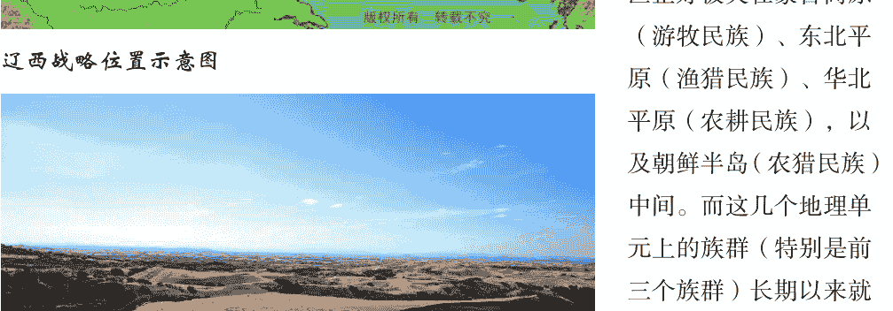

江西地区沙漠化

江西地区，并非要详细阐述它在后世中所发挥的作用。而是因为这里显然较早地诞生了原始文明，但却在近约5000年的时候出了文明。在随后的原始文明史中，山东半岛的那片丘陵地区成为了部落群的中心地区。为什么最早有文明的江西地区最终消失，是考古学家感兴趣的话题。一般的解释是由于原始农业的采用轮作的方式，这种轮作一块耕种方式，对植被的破坏很大。因此江西，特别是西江河地区的环境被破坏，以至于部分地区沙漠化（现在）。

# 蒙古

已经是科尔沁沙地了。这种情况下，人类自然要寻找更为适合的生存环境了。这并不是问题的关键，为原始文明中的某个地区所取的农业方式基本是一样的，荒芜之地其实并非。

# 中国

| 锡林郭腾 | 呼和浩特 | 通辽 |
| :--- | :--- | :--- |
| 太原 | 北京 | 石家庄 |
| 大连 | 太西 | |

科尔沁沙地位置图是在西辽河地区存在。事实上即使是在上个世纪上半叶，你仍然在西南部地区回到原始的农业方式。

问题的关键在于西辽河地区的位置，我们知道蒙古高原是东亚荒劣气候的源地。在华北平北部，由于有大兴岭作为屏障，不会受到蒙古高原上的风沙的影响。而在西辽河地区，巧妙地处于南北的大兴岭和东方的烟山脉中的接口处。地理上的连接使得蒙古高原可以容易而易地对这一地区影响。由于西辽河地区的文明不能长久就可以理解了。由于蒙古高原气候直接影响的并不是西辽地区，最多我们可以经常地听到北方又起尘沙暴一类的新。气象学家们在这项研究中气候的形成规律，并希望帮助他们找到解决该办法，从伊明山和烟山脉中，不能为华北北部地区提供屏障，是事情的源源。

在“原始东夷”的三个聚落区域，辽河河流已经因气候的原因在5000年前消失了。由于辽河以南的干旱气候的阻隔，暂时不会与蒙古高原上的族群发生影响。这使得他们对于相对独立的自己的，等到4000年前又一次进入我们的视线。山东半岛对于“原始东夷”来说，无疑是最具有领先优势的。在处两条缘线的中间是一个因素，丘陵地也是它能够形成稳定的重要因素。在古代气候时期，由于人类治理水的能力有限，高地与平原地区的结合部才是最佳选择。

当原始东夷在山东半岛的黄陆边缘形成稳定的文明之后，很自然的选择是向华北拓展生存空间。尽管这一地区有片土地未被浸泡润泽，湖泊所遗留。但在那个扇形冲击面的西部，近黄土高原的地区，还是适合人类生存的。不过，“原始东夷”并不是唯一这种想法的族群。在黄土高原上的“原始西戎”他们也有意志下高原争夺这片同样被黄土覆盖的土地。只是在此之前，他们必须完成内部的整合。

### 第七节 原始西戎在黄土高原上发展农业可能的地区

之前我们大致分析了“原始东夷”的特点，以及山东黄陵聚落区中心的地位。我们现在就要顺着视线看向黄河的下游，解读一下黄土高原的地缘特征。黄土高原本身则是对中国北方以北海拔 1000 ~ 1500 米，黄土覆盖密度 50 ~ 180 米黄土的统称。事实上它还可以分为若干个地理单元。按照现行的行政区划，它包括山西的全境、陕西的中北部、河南的中部、以及宁夏大部。如果按照地理来划分，我们可以依靠黄河“几”字型的河道，将“几”字中的区域标注为中区，两侧则为西区和东区。

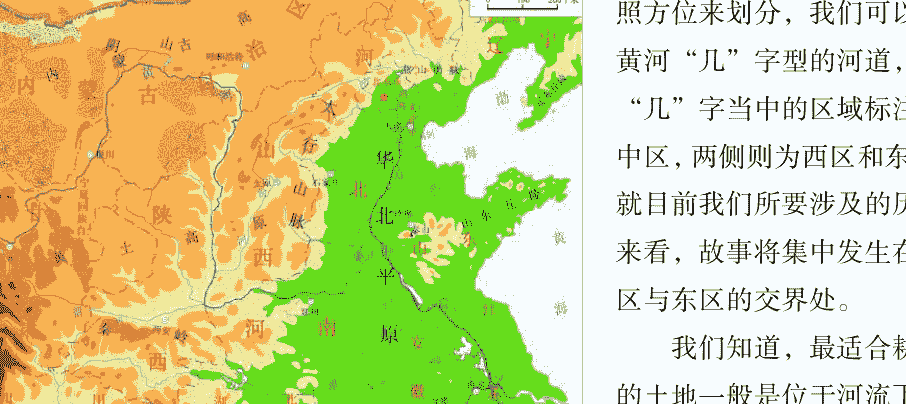

就目前我们所要涉及的历史来说，故事将集中在中区与东区的交界处。

我们知道，适合耕种的土地是位于河流下游的冲积平原，古典时期的冲积平原。如果人类能够控制水的规律，那么最适合人类开展农业的地区。在大地上的河流并不是直接流入大海的，特别是那些支流。支流也会形成小的冲积平原，而这些地区同样可以诞生文明。我们现在见的黄土高原存在许多冲积平原，作为华夏文明的重要源地，它们无疑在历史上占有重要的地位。

## 黄初扩散示意图

## 黄初扩散示意图

与华北平原相接的“洛河地区”（河南）。对于这些高原上的“西荒”，地理学家们会有不同的称呼，它们被称为“盆地”，同时被叫做“谷地”。这些并不重要，重要的是它们平整的地形和富有营养的土壤适合人类生存，并且由于有高山的庇护，它们往往前往这些地方。对于“原始西荒”来说，尽管它的来源还存在争议，但他们无疑首先选择了“渭平原”作为最初的方案。为了统一了中国第一个王朝，因此被称为关中。事实上作为核心地位一直延续到了古典时期。除却我们刚才提到的三个主要要素由黄河支流形成的平原区域（渭、洛），黄河本身并没有那个“几”字型的西侧和北侧聚成了两块条状平原带。这两块平原带有着各自独立的称谓，“原始西荒”的北侧被称为“渭平原”，北侧则是“洛河平原。“原始西荒”也曾经在两个地方努力，在这里他们必须面对蒙古高原至青藏高原边缘的族群竞争。事实上这种竞争贯穿整个古典时期。尽管“原始西荒”无法解释他们的后世子孙为了占据这两块黄河平原，彼此的立场是反向的。

| 黄土厚度 / |
| :--- |
| < 60 |
| 50 ~ 100 |
| 100 ~ 150 |
| > 150 |

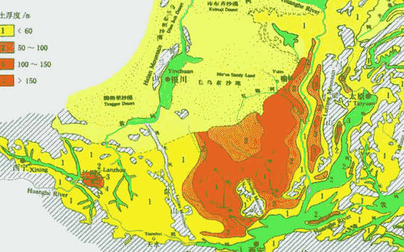

黄土高原秦岭阻隔的盆地，其适合开展安静的发。何况它那片广达数十公里，地质松软的黄土层，非常适合仅拥有石器工具的原始民族种植。同时时期的东部沿海及长江下游地区，尽管拥有丰富的资源并以此获得人类最初需要的物质基础，但由于土地更为坚固，想要开展大规模的农业生产是非常困难的。这些地区的大规模发展要等到金属工具完全运用到农业生产之后。这也能够解释为什么“原始东夷”能够创造“原始西羌”领先的石器文化（禹文化是石器文化发展的顶峰），最终还是“原始西羌”之手的原因。在技术手段落后的上古时期，易于开垦的土地一直是最好的农业用地。谁占据了这块土地，意味着谁拥有了更大的人力资源。

## 第八节 黄河流的发源地及其起源的竞争

只有人的地方江，湖的地方就有竞争，原始民族并不例外。汉语在造字以及词语构造方面比字母文字更有优势，“江湖”这个词曾被学者引为一个别于正常社会之外、游于正常社会之外的“亚社会”的代表。这恰恰解释了人类社会的本质就是水资源以及周边生存的土地（江和湖代表的意义）。对于“原始西羌”来说，尽管我们可以将他们看作一个统一的整体，但他们也同样存在着竞争中。而这些竞争也都是围绕着几条河流展开的。

在说到上古的历史时期（即公元前841年，西周共和元年以前的历史），我们还是做了努力。但面对同样的地缘结构，他们所能做出的选择却是相同的，的就是占据最为安全而农条件又优越的河洛平原为根依据。

| 关 | 北方 | 南方 |
| :--- | :--- | :--- | :--- |

关于黄炎之间的斗争，一般被认为是争夺中权的统治。正如历史的概念被扩广为从古代到秦山的区域，或者是整个河南省及周边地区。对于我们最初的“原始西荒”来说，其中更多的是黄土高原东部的边缘地区，也是连接黄土高原和华北平原的“洛河地区”。对于渭河平原的“原始西荒”来说，当黄河已经无法满足生存需要的时候，最为合适的拓展方向便是向东。不过当他们遇到渭河那个“几”字洛河右侧侧，他们会遇到两个选择：一是从北路进入洛河流（也就是山西境内），二是沿着秦岭与黄河之间的洛水地区（中心为黄河与洛水的汇处）进入华北平原。无论是原始先民还是现在的我们，哪一条路无疑更具吸引力。我们无法确定炎帝是谁达到了洛水地区，这一点并不重要。是黄帝族取得了胜利，而炎帝族没有跨越洛河去平原。要注意的是，我们在讨论黄帝争夺，并不代表“原始西荒”中不存在某些小规模部落，已经向相应的地区进行了渗透。对于这段历史来说，他们未能起到关键性的作用。

### 第九节 黄帝族争夺洛泉的具体地点

关于炎帝争夺洛权的战争，书中记载有“陂之战”。对于洛泉这个地方在哪里，一直都是竞争的话题，特别是在这个时期。由于历史家界一致认为黄帝族争夺土地的爆发地，洛泉已经锁定了决定性的战，那么“陂之战”并不是一个问题。对于原始先民来说，这种土地的爆发是不可免的。

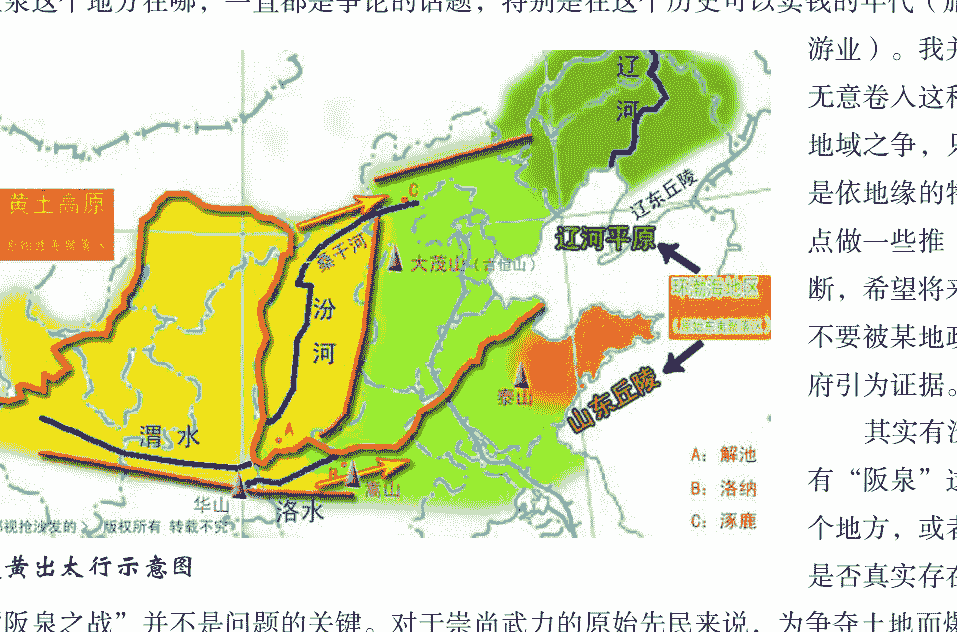

黄土高原黄土厚值

关于上古族群之间的争夺土地的冲突，由于资料的不足，扩张的盆地，洛泉发生可能的点应该是两个地区，“解城”可以理解为渗入河流的桥头，而“洛阳”更是可以理解为取得了中原所有权。如果历史学界一致认为黄帝争夺是中原的统治权，那么“洛阳”应该是有矛盾的爆发。对于这个地点究竟在哪里，一直有着三种说法：一是太行山东北平原上的涿洛（河北）；二是黄河以南的解城（山西）；以及位于黄河与洛水汇处的洛颍。首先可以排除的是“涿洛”、“原始西荒”内部的战争至于到华北平原。关于“陂之战”认为是发生地，是因为由于这里引起了一场决定命运的大战，不过洛洛并不是黄帝族进入华北平原的扩张。对于黄土高原的农牧民族来说，洛泉仍然是必要的。

## 第二章 原始西北与原始东的冲突与融合

### 第一节 河南平原地区经峡通道沟通华北平原

我们要介绍一条在中国历史中曾长期作为战术中心地的地位——崤通道。我们在所接受的历史教育中，都有一个概念，就是关中地区（也就是河南平原）易守难攻，是帝王成就的好地方。但很少有人能真正告诉我们这些地理原因，出现在我们眼前的那些被称为“一夫当关，万夫莫开”的关名，如诸关、黄关等。如果我们能够仔细研究中平原的地理结构，就能更深地理解它的地理优劣。正如我们所言的，河南平原实际上是一个高低差极大的地区，这个结构可以极大的保证其受到人类的干涉（包括人为气候的因素），但这并不代表是一个封闭的地区。事实上并不是真正的封闭地区，即使是地理结构像封闭的四川，我们也能依靠山脉在世界上寻找道道来外界沟通。相比之下，河南平原与外界的沟通就要多得多。对于处于高山地区的族群来说，高大的山脉对本土提供了保护。不过生活在高山中的族群还希望向外界拓展空间，这些山脉本身又成为了最大的障碍。由于黄土高原与河南平原结构的差异，这条通道能够沟通外界。由于黄土高原边缘的河流流，这些山脉本身在顶部形成了一条自然的分岭。对于河南平原来说，沟通华北平原最好的路径就是顺着黄色的河流而开辟的路。

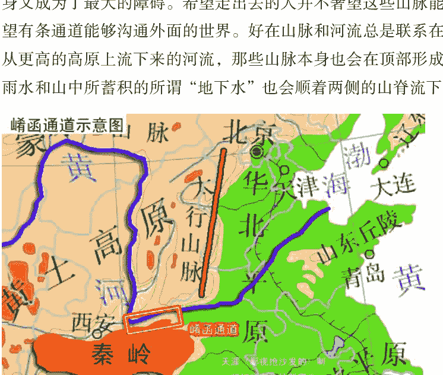

崤通道示意图

将“陇蜀通道”理解为是在陆上的峡并不是可能的黄土高原（主要是渭河平原）的重要作用。关于这条通道的位置，从地形上看我们也能大致划分它的范围：北以黄河为界，南以秦岭为屏，西面的起点就是在黄河上“几”字形状右侧，面延伸至黄土高原边缘部分。如果你是从现实的行政区去处理，可以从陕西到河南的洛阳。需要注意的是，这里所说的“陇蜀通道”，与目前不同的。前者指的是渭河平原与中地的狭长地带，后者指的是河南省洛县西南约200公里的一条通道，这也是我们所说的“陇蜀通道”。

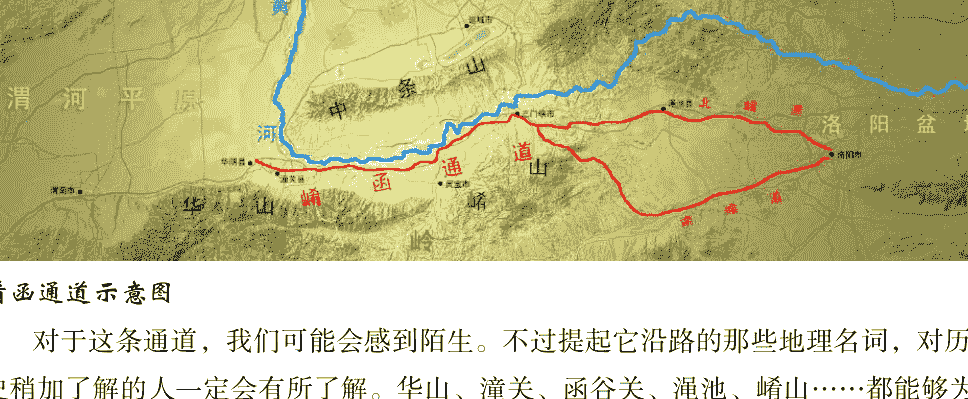

陇蜀通道示意图

### 第二节 黄帝族通过源渗透至洛地区

从黄土高原上来的“黄帝族”来说，一开始并不可能走远。黄土高原的边缘地区作为新的聚落区是最好的选择。这样做的好处在于，一方面能够积累力量，继续向华北平原渗透；另一方面也可依托黄土高原的故地。黄帝所选择的聚落，也就是所谓的“河洛地区”（洛河下游与黄河交汇周边地区）。洛阳位于此地区的中心，这一地区的东界可以延伸到现在的郑州。当然“郑州”这个城市是一个新兴的城市，也是一个平原城市。在它的西面和南部仍然可以看到，其中也包括登封和新郑。前者就是著名的嵩山少寺所在地，而后者就是黄帝都所在地。从地理的角度来看，这种建立在传说中的历史是有可信度的。毕竟至少向东的嵩山对于黄帝族来说，是他们进入平原地区之前。

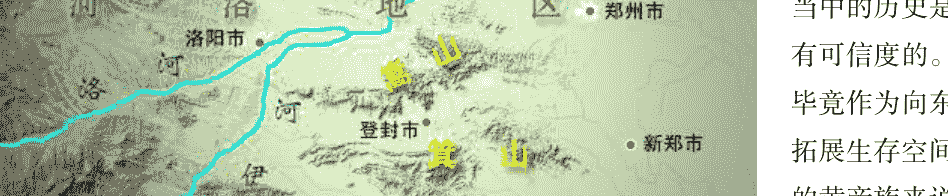

河洛地区示意图

前，所见最后一组有着显著特征的山峰，并将所谓“都”都是最后的丘陵地带，符合华夏族将政治放在国土边缘的习惯。更为重要的是，尽管当地的地形虽说不能跟黄土高原一致（这里这里变为了平原），但对于从黄土高原上走来的“黄帝族”来说，却是最后可以依靠的“靠山”了。黄帝族已经将据点延伸到平原的边缘了，但另一条进入洛河的“原始西羌”族（也就是华帝族），也在向北拓展他们的领地。尽管“崤通通道”是沟通黄土高原的重要通道，但很快黄帝就要在太山寻找另外一条通道了。我们分析了“崤通通道”的重要性，依据传说及历史的记载，黄帝族已经取得了这条通道的控制力，以及两侧的黄河平原、洛河地区。此处的黄帝族眼前，将是一个无限的平原。也也许下方的黄帝族，并不就当然认为，低海的华北平原就是他们的新家。那被黄河从黄土高原带来的黄土，让他们找到熟悉的感觉。在这里，“黄帝族”只是一个符号，也许会有“史学家”们考证，在5000年前黄土高原的族群还有另一个名称。这些并不是重要的，如果是任何人都想进入华北平原，通过通道都是唯一的选择，这一点在随后的历史中无数次被验证的。

# 山西地形

黄河

一般而言，汾是山西的河流，但它所滋润的土地仅仅是山西的中南部，就是汾河中下游地区。山西北部的平原，主是由汾等干河冲积形成了。

我们之前分析，炎帝族（这是个代号，即使不认同就是所谓“炎帝族”也可以理解为“原始黄龙”族）越中国河，首先进入了汾河平原。只是这不会是终点，随着人口的不断增长，继续寻找合适的土地生存空间是必须的。沿着河道行进是不二的选择，这仅仅是因为河流能够提供必要的水资源和河道的路，更重要的是河流两侧的冲积平原是最适合耕种的土地。既然炎帝族首先的人是汾河下游地区，那么沿汾河自下向上走就是很自然的选择。由于河流两岸的平原被夹在山嶂之间，这些位置被称为盆地。按照地形特点，这些位于河流流域的平原从南到北又被分别称为：吕城盆地、临汾盆地、太原盆地。

# 山西地形

黄河

如果我们随着原始先民的脚步走到现在的山西省会太原时，会发现沿着汾河向北走的话便不再是平原地了。这显然已经是向农业社会转型的“原始黄龙”族，所追求的目标。不过在只需要将视线稍向东北方向偏一点，他们马上会发现一个新的盆地，那里那里析定盆地。这里是一片适合耕种的土地，只不过是由另一条叫做“浑沱河”的河流冲积形成的。对于原始先民来说，是哪条河流冲积形成的并不重要，只要它能够提供肥沃的土壤和充足的水源由此再向北，亥夷族还可以进入“大同盆地”，从而完成他们对山西内部平地带的开发。

需要注意的是，从整个河河流域的三个平原（盆地），直到“忻定盆地”之间并没有高大的山脉阻隔。这也是在进入“大同盆地”需要翻越一条山脉，这条山脉就是“恒山脉”。著名的恒山，正好是在这条山脉之上（非上古的时期，后面会分析）。不过此翻越太山还是容易的，在人口压力不是大的上古时期，人们完全有理由先选更为便利的迁移路线。但在古典时期，恒山的军事用途便显露出来。在大同盆地失去了北方民族的统治，华夏族得以以恒山脉构筑一条新的防线，这条防线在明朝时被称为内长城。事实上这条防线是非常必要的。在历史的转折上，我们会发现的有益民族进入“大同盆地”，并借此作为跳板进入黄土高原核心区域。

从地理结构上来说，山西是一个半封闭的状态。黄河在西、南面互为天然屏障，而太行又是使得从华北平原进入这一地区是非常困难的。北面与蒙古高原接壤的区域来说危险性最大，但依靠山脉——恒山脉建立的两条防线最好最可以保障太原以南地区的安全（也就是河流的）。这也使得山西在战乱之时的人口损失相对较小，足以可以为周边地区提供移民的来源（类似人口储备作用的地区是“江西”）。

当然这让长安能够长期在此处做它的“土堡”。这种相对封闭的环境，对于我们了解中国历史也是非常重要的。有的口头说“地下文物看山西，地

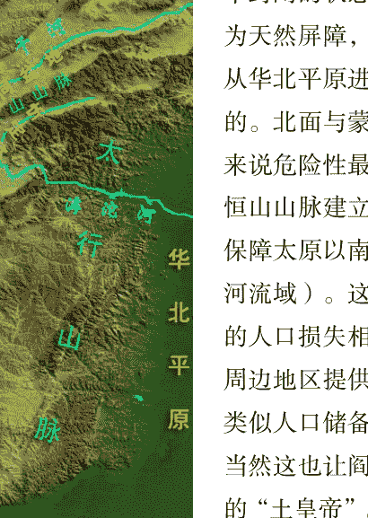

山西地形图

上文看山西，山西之所有条件似乎如此多的地理上，与它的地理环境是分不开的。

沿汾河入华北平原并不是从山西入华北平原（河北地区）的唯一通道。在古代的民族征战中，太行山又被开辟了一些通道，这也了诸如“娘子关”、“平原关”等几个著名的关口。是在上古代时期，“原始西戎族还没有这样的压力（或者动力）在太行山中寻找这些小路。在一个如珍珠般连绵的“平原”之间，这种位置渗透是最自然的。

### 第四节 戎族在战争中击败黄帝

当黄帝在太行的西侧扩张时，他们并不会遇到阻碍。但当他们沿着汾河向东，准备进入华北平原时，“西戎”将是来自东部的。事实上戎族也有移动到这里，一方面是戎族的位置了他们向西移动。另一方面是戎族位于华北平原的西北角（广义上的），另一个区域则是黄洛地区。

这里并不是重要的，重要的是戎两个不同族群将有意作为聚落的聚会。从历史的角度来看，这种碰撞意味着文化的融合。双方在太行边缘，汾河下游地区开启了争夺。根据后世记载，西部的代表是“戎族”，东部的代表则是“黄帝”。这两个名字，习惯以人为研究对象的。根据传统的习惯，双方最终展开争夺的地区被称为“康渠”（汾河下游）。如果还要仔细研究的地理位置以及地形，会发现这里处于黄土高原边缘，地形已经演变为向平原过渡的特点。换句话说，山东东陵从东北发生接触并不太久。当然在与“西戎”发生接触之后，“夷”选择从北面进攻是符合逻辑。这并不是说黄帝取得了胜利，而是戎族规模要弱一些。相反，黄帝经营黄洛地区的时间，肯定要早于戎族进入下游的时间，根基会更为牢固。选择实力较弱的对手作为攻击对象，这与没有“兵书”作为指导并没有关系。

下面为原始夷冲突爆发地点图（太山南北两端的红框为炎黄二出黄土高原的出口。北以“东陵”为中心，南以“新郑”为前沿）。

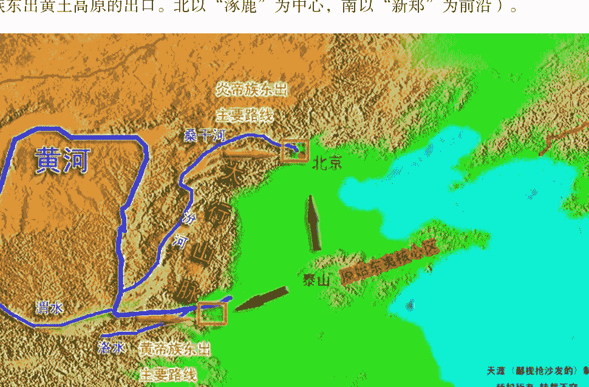

原始夷冲突爆发地点图

### 第五节 黄帝族深入原始核心区域并开启了此间的融合

在东西两大族开展大规模冲突之前，双方实际上已经开始接触了。像那种不问青就遇见禹的情况并不存在，开荒还需要一个累积的过程。仅从军事的角度来看，黄帝在太山山上加入“龙戈”并不是最好的选择。如按照后世的兵法看来，直接进攻“东夷”的大本营——山东东陵是最好的战法。这在三十六计中被称为“围魏救赵”。对于黄帝的军事素质，当然在上古时候黄帝可能没有在南北两个点上应该已经全面接触了。对于他们来说，既然两大族的战斗已开，那么直接向敌在自己东面的“东夷”进攻才是合理的选择。之前我们已经分析过了，双方之间向西渗透的（从逻辑上来说，东夷如果向西渗透的话，没有理由选择这种路线）。

最终黄帝族的南线进攻取得了胜利，这一方面是东夷的主力已经被黄帝吸引在北部了；另一方面是黄帝对河洛地区的战斗时间更长，所积累的资源更多之。之所以以认定黄帝并没有北上参与“龙戈”，是具有标志性的。黄帝取了“东夷”的核心，也是他们的圣山——泰山。从这个角度看，黄帝直接沿着敌的溃退路线击击，比之先行北上进入“龙戈”要合理得多。这是从黄土高原走下来的“西戎”的需求。在“原始夷”的战争中，仍然会看到类似景象。

关于泰山

### 第六节 东西两大族群进入部落联盟

将中国从上古时期开始是不够的，直接从春秋战国时期开始会更好。一是有史支持的；二则是故事，听起来会很好。不过直觉我觉得对古代“历史”做一个尝试，会留下很多空白。事实上在石器时代，东亚地区不仅在黄高原、东部沿海，亦在华北平原都有力类似的文明出现，但最终获得东亚主权的既然他们已经确立了主导地位，我们大多是他们的子孙，那么以西族作为主是很自然的。

其实历史就是一部故事，不同的角度会有不同的解读。因此我们努力从客观的地缘角度来解读历史，但必须选择一个角度为主。换句话说，就是从夏族的扩张史来解读地缘。其他的文明或族群只能作为配角，只有当他们与夏族主要接触时才能进入我们的视线。在此之前，他们取得的成就就能被忽视了。我会抓住这条主线来解读地缘。这样做并不代表其他的族群不是，也不是说夏族在之前就没有进入过某地区。就像有些人认为是黄帝在古代就就开始了长江流域，也或许历史上是有这样的皇帝的，或许他也真的4000多年前从黄土高原下来，去发现长江中游地区。这些都不是重点，问题是在他并没有在这一区域成为夏族的历史。这只是就好比某人的考证出徐昌当时的进入了日本，并不代表什么。日本仍然是在唐朝接触夏族文化的。我只是想创作一种新的、清晰的历史来解读，因此希望大家关注其地缘。所以这里说的历史是符合“地缘”逻辑的。

让我们继续上古部分。虽然这部分对于很多人来说太绕过了，既然已经起了，还是可以下功夫看一看。“说了不算，你是不关心的，”如果我真的是个外国人，写起来可能会轻松一些，完全关注地缘便可以。只是作为华族来说，总是很自然的要带些“私族”。即为华族在东亚的强势地位地缘上的基础，寻找地缘。无论如何，华族建立自己的统治地位已经过去几千年了，仅仅依靠那些英雄伟大是无法成就现状的。

之前已经分析了东西两大族群之间的那些火花。抛开心马所忽略那些“历史”来看，我们是东西两大族群之间引发了一场规模巨大的冲突，然后进行符合夏族的历史。人类原始的本能还是更相信武力的。这些冲突的规模和范围可能符合我们想的，这种位置。在黄土高原的绝对胜利者，但是族群并没有取得从黄河到山东的绝对统治。这种地理条件来看，一方面是占据的，另一方面是冲突的。这种冲突在这一时期，两大族群共同活跃的基础上，出现了部落联盟。这些的族源向来都有争议，无论信度，大致时间段在公元前6000年——前2000年。所谓黄帝的诞生，我不认为如此精确的数字是如何记录下来的，但仅仅从地缘角度推断在这么大的时间上是没有的。如果最终能够被证实的，那只能说华夏族的记忆太深刻了。

## 第三章 大禹治水的地点和方式及成功后的影响

### 第一节 黄河下游关键位置而确立优势

世界上没有任何一条河流像黄河那样，也不会像黄河一样对民族造成那么大的影响。造成黄河下游如此稳定的因素有两个：一是黄河下游在华北平原上，这一地区有高山作为屏障，限制了黄河的走向；一旦泛滥，如果是这种情况下，人类将没有办法减少洪水的方法，甚至还要比尔加人和那样痛苦。但黄河下游的苦难是在黄土高原了。那些淤积土上荒疏土壤，虽有工具可以建造规模堤坝，却被黄河水带了泥沙。造成这种环境，河床往往要高出地面。如果不是加堤坝以减少洪水泛滥的灾害，黄河的泥沙将会通过漫流，均匀的分布在华北平原上，正如我们看到的那样。4000年前，黄土高原的营养比现在丰富得多，带的泥沙却不如世那么多，因此下游的稳定性比现在好得多。发生了一次大的洪水。关于大禹治水的规模，可能复杂的得多，包括引发洪水的范围也许不仅限于华北地区。对于黄河治水的意义来说，下游或许是可以治理的。在文明形成的理论中，有一个理论说“治水社会”，主要的观点是国家的形成和发展是建立在需水的前提下的。由于禹修和管理水规模工程来控制人力资源，于是产生了大统一的思想，以及制度的胜利。然而，这种解释在中国是被批判的。至于在中国的历史中没有长达两千年的洪水时期，在黄河下游所经历的地区中没有强力的合作，一场黄河决口，它所覆盖的范围可能到河南，从南到湖南。也就是说大部分华北平原都有可能受到此的影响。在治理过程中，处于上水地区无疑是占据地理优势的。如果没有高原上游来的族群，下水地区则是无法治理好的。这也能解释，为什么从高原上游来的族群最终能够融合本土族群的区域。

禹的父亲是汤禹。禹采取“水来上土”的策略治水失败，而后由其儿子禹治水。

对于黄土高原的族群，由于地形的优势，他们本身并不承受黄河水带来的压力。对于黄河下游区域来说，这却是最现实的问题。我们知道，黄河下游由直向南扇形状变动，其中大致分为三条路线，一条是我们现在看到的路线，从山东东陵北贴身运行，称之为中线；另一条是向北沿海进入海湾，称之为北线；第三条是向南连通河南的支流，最终通过黄河的海口黄海，也就是所谓的“游入海”，称之为南线。这三条路线的变动并不是在一个点上，但有一个大致的范围。

我们从《黄河走向图》就可以看到：

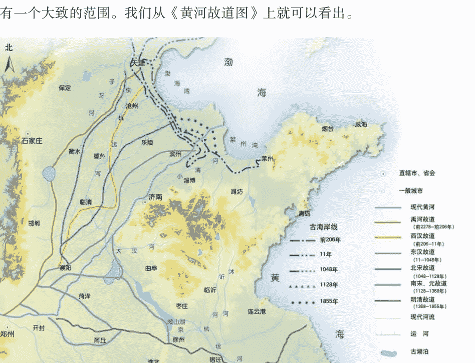

黄河走向图

# 大禹治水示意图（草图）

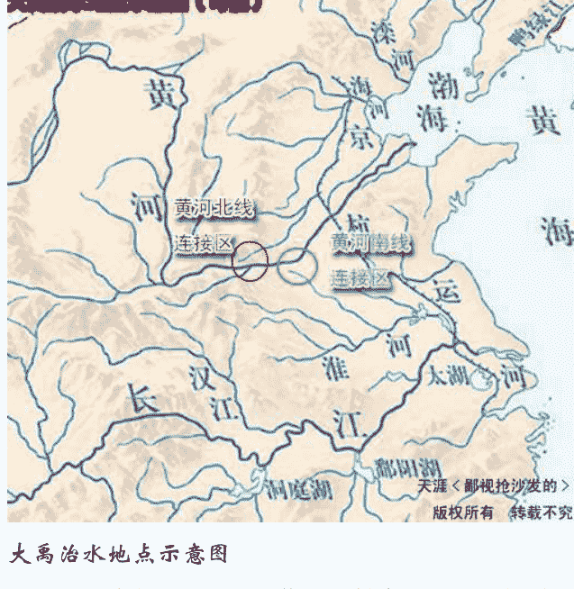

从地缘的角度推算出大禹可能的治水。上面有两个圈，绿圈代表黄河能向南，进入淮河的连接区域；红圈则代表大禹引黄河向北，进入淮北的连接区域。我不确定你看了这个距离会有什么感觉，至少我个人认为这个工作并不像想象中那么巨大。

对于历史的记载，特别是关于上古部分，很多人不信其真。

## 大禹治水示意图

人认为，其中还有很多信息可供参考的。比如这个人的存在与否，是否有治水之事。对于一个以崇祖先崇拜的民族来说，可能会产生大禹的功绩，但这种是非常常态的（包括黄河的事），也可能对东夷的战斗并没有取得最终的胜利，但是西族在某一时期开始崩溃是有考证证据支持的）。我们已经分析了“中原核心区域”地动力，这种驱动力是控制黄河下游走向的力量。

黄河在历史中曾无数次被改道，或主动的“以水为兵”，但最先策划了力的正是禹。他的儿子“启”也因此建立了中国历史上第一个王朝——夏。不过既然“中原核心地区”的控制力已经复发，那么他希望取得共同主权的族群就必须以这一区域为争夺目标了。

### 第三节 大禹在龙门疏导黄水解决水患

关于大禹治水在技术上的可能性，我们在上一节已经分析过了。尽管大禹治水的故事在诸地区都有流传，结合当时的地缘结构来看，大禹所谓治水应该是黄淮域唯一的。而其中淮河那些由北向南的，在地理上与黄河接近的支流是将这两条河流连接在一起的，也是治水的关键点。

如果结合黄河在后世诸北方的转向，可能的结论是大禹切断了黄河与淮河的某北支流之间的联系，并将黄河之水与河北平原的某河流连接起来，使得黄河的流水在山东丘陵的北部入渤海，进而减弱了淮域的水域。如我们仅仅从地理结构来看，这种最终成为受益者的这种，是有合理的。起码解决了工程量，以及淮域最终解决的问题。并且黄河在其中起到了关键的作用，让黄河成为初载华文明为主主义文明的结果，变得符合逻辑了。

我们之间曾经经历多次提到，那些承载着中华记忆的历史“传说”并非完全神话，更多是极少数人的认知能力，以及口口相传中无意的误变成传播的历史。对于我们今天的人来说，或许希望读出这些所谓“神话”的实质，关键在于提取出其中未被神化的要素。这就像我们经常提到的某个神话故事中的帝王之事，关注其出生地，以及以母亲身份的内在都是有可信度的。而那些与仙人交往、咬下鸡蛋的婴儿就堪坏了，或者说出生时有诸多奇异的记载就可以完全无视了。

不要认为这种有意无意的“传说”只会在东方才有，那被西方人视为上帝之子的耶稣出生的故事和这里的故事，这些传说是将构作为一种类似于《艾塔奇玛》的奇幻小说，那么我建议，耶稣就是玛利亚亚，以及没有法律意义。

在大禹的传说中，诸位你刚才所问到的淮、河、工程（治水九年还成了）这些要素以外，还有两个重要的要素是确有可信度的：一个就是大禹使用的是“疏”，而不是“堵”的法理治水的办法；另一个是水道疏通工程的地点——“龙门”，是现实存在的。之所以以认定这两个要素是真实可信的，是因为它们的存在让事情变得不再符合逻辑，并且可能接近真实的历史。

我们大禹按照我们之前所问的方案对于治水工程来说，那么对于后世的治水阶段应该是“堵”、“疏”并。一方面阻止黄河之水灌淮的某条河流入渤，另一面则是将黄河之水向引入北方平原，以减少减轻淮域的压力。这种情况下可能存在，我们所需要的的就是寻找“龙门”所在。

实际上在中国，我们想要寻找一个上古时期的历史，并不像西方中那样。对于我们祭祖视为第一事的，并且具有厚厚土地情节的中国人来说。那些曾经继承祖先光荣历史的传承并记录下来，是追思祖先的重要的前提。不过这也带来了一个问题，强烈的祖先崇拜使得这些伟大先人的后裔们，都能够在缘缘上与历史的联系。具体的来说，就是让自己生活的地方成为某位祖先曾“出过战斗生活……过的地方。这种情况在名份上能够获得经济效益的今天我们演练愈烈的态象，最新的案例就是那位以喝酒与诗雨闻名于世的诗仙——李白的夺。

### 第四节 龙门口的龙门并没有成为大禹之地的原因

根据洛口传的历史，大禹治水的施工地点是一个叫做“龙门”的地方。或者说大禹在那里施工后，这个工程的所在地被命名为龙门。如果结合大禹的施工方式为疏导道，这个命名就很好理解了。河道而出的水形似蛟出水，那么将工程地点命名为“龙门”就再合适不过了。问题是被命名为“龙门”的地方有多处，如果一下“龙门”这个词，我们会发现中国境内近十处以“龙门”为名的地址，分布北至辽宁，南到广东。鉴于“龙门”这个名称的寓意，真正以“龙门”命名的地址应该不止十处。

不过这些形态各异的“龙门”并不会扩大范围。根据大禹的活动范围，以及治水之后造成的地缘影响，淮河流域，并且处在河道上的“龙门”才会是我们关注的对象。如果按照这个方向去寻找，有两个龙门：一个是位于黄河中游，壶口南的“龙门”，又称禹门；另一处则是洛阳地南的“龙门”，又称伊缓。如果按照大禹治水的流量，壶口南的“龙门”无疑是最有可能承担任务的。因为它是唯一在黄河河道上的大禹门石窟所在的“龙门”，实际上在黄河支流上的门（古称伊水）。在此被很多人认为是龙门的真正所在，而它也因此被授予“禹口”的荣誉。

## 龙门（入口）

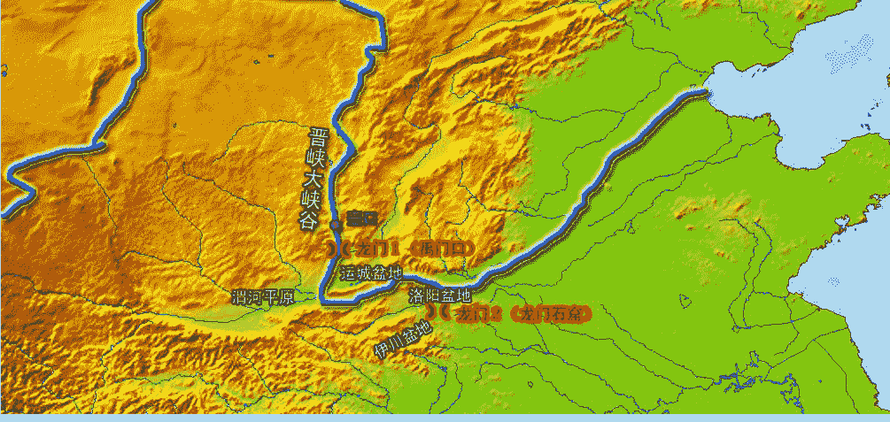

为了方便，《龙门位置图》上将水口南的龙门命名为“龙门1”，而将石窟所在的龙门暂称为“龙门2”。如果从工程量来看，龙门1的位置位于晋峡谷的南出口，约六百米，似乎上古人的集中力量应该可能通凿这段段。

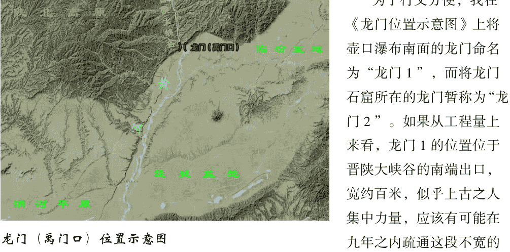

问题在于黄河到达龙门1之前的南北河道，是在山西、陕北两大高原之间进行的（也就是所谓晋峡谷）。这就来说，如果龙门1是人工开凿而成的，那么之前通过龙门1南的黄河水流向哪里祸呢？如果忽视龙门1南的河流在华北平地上的话很好理解了，以及黄河的水容易冲出不同的水道。而在晋峡谷中，两侧的山高原阻止了这种可能性的发生。何况如果龙门1在之前的高太大坝阻隔了部分的水源，那么黄河水也曾最多是在晋峡谷中形成一个水库，或者说溃龙门一靠近近岸的耕地，只是晋峡谷的土地即使现在，也并不包含多少值的价值。上古的人很容易在龙门的南部发现渭和平临盆地，这样大面积的积平原，并不需要费力开辟晋峡谷的土地。事实上他们也是这样的，这三大原为了我们的族群的兴盛之地。

之所以否定龙门为禹治水岭还有一个重要的原因，因为大禹通过的影响是在淮河流中。就是让淮流域属于东部河流系统的族群服于它。如果将黄河作为治水目标的话，那么真正能够危害到淮流域的黄河只是下游。从这个角度来看，“龙门2”将可能有这个能量。唯一让人理解的是，龙门2并不是黄河上的，而是通过水倒灌，并通过黄河的支持流入淮并影响淮流域的生产生活。

### 第五节 伊澜的龙关水在此望而成为禹治水之地

如果伊澜不是西南——东北最终注入黄河的河流，而是反向与淮河，或其某条河流的支流向淮河，那么黄河水倒灌伊澜并进入淮流域的可能。正如此在古代时期，黄河的每次都能侵没淮流域，都是通过那些比南向的河流完成一样。即使黄河水能够阻止伊澜，那么又会出现一个人工费昂的问题，就是大禹所做的应该是他在伊澜上的筑坝，阻止黄河水流入河流，并非他的人力扩大它，让黄河水能够进入河流。

现在看，龙门成为禹大坝成功的地点显然太困难了。不过我们接下来的分析，一切符合逻辑。事实上非有时光穿梭，否则任何假设都无法被“性”证明。特别是在某个著名观众可以被聚财的情况下，这里他选选项就此放弃的可能性几乎不是。在他所做的，更多的是基于继续逻辑建模，或者说分析得出哪一种可能更符合逻辑。鉴于此的内容中还将涉及到类别的争议，因此此有此说明，以及以下内容，仅为推断，并不被授权引用在具体的争议之中。

在推断龙门是否为大禹治水之地的过程中，我需要的关键在于转换思路，即大禹治理淮流域的洪是来自黄河的，这里说的“龙门”并非来自黄河的水，而是一条注黄水的支流。这里的支流就是伊水。如果观察到伊水的走向，我们发现这条源于岳山南域的流水，通过龙门那狭窄的水道之后，越过淮盆地的中心地区，与另一条同样方向的河流汇集之后注入黄河。位于淮盆地北部的河流因此被称为“伊洛”，因为伊水的存在而淮盆地南侧山脉连成了一片，伊水在淮盆地河流因此被称为“伊洛”。

龙门（入口）位置示意图

如果从这个角度看，“伊洛”的开创者就是大禹。因为他在开凿龙门2之前，伊水流水并没有流入黄河。既然淮盆地没有伊水，那么“伊洛”这个名字是不可能的。相比于“伊洛”，“伊洛”的用法广泛得多。从水量重要性来说，伊水对淮盆地的贡献并没有区别。而“伊洛”的称为了方便的方法，本身是在淮盆地拥有土地的时候，伊水的流量不足以提升到“伊洛”的地步。那么在没有伊水流入淮盆地之前，伊水是不是存在呢？当然不是这样的。上古在黄河上游河流存在的时间绝对不是零。只不过由于淮盆地南侧，它可能会在山谷中堆积起来，寻找适当的出路向地方漫流。这就成了许多朋友不熟悉的“海”的出现。伊水的最终流向，正是那个等待已久的受害者——淮河。

## 第六节 伊水未能过龙门而漫成海成为淮流域

所谓伊川盆地指的是伊水上游，流至龙门的那个段落谷。而过了龙门2则是黄河、伊水共同作用形成的洛盆地。如果伊水不能顺利越龙门注入淮盆地的话，伊川盆地的积水成为必然的（如果你在 Google 地图上查找，会在伊河中找到一个叫“陆泽水库”的人工湖）。这个水库所在的地点就是伊川盆地的最低点，通过人工筑坝拦截伊水，我们依然能够看到“海”的影子。上古之人与今人遇到的烦恼恰相反，他们烦恼的是水太了，需要合适的途径排泄，而不是像我们今天这样每一滴都会利用。

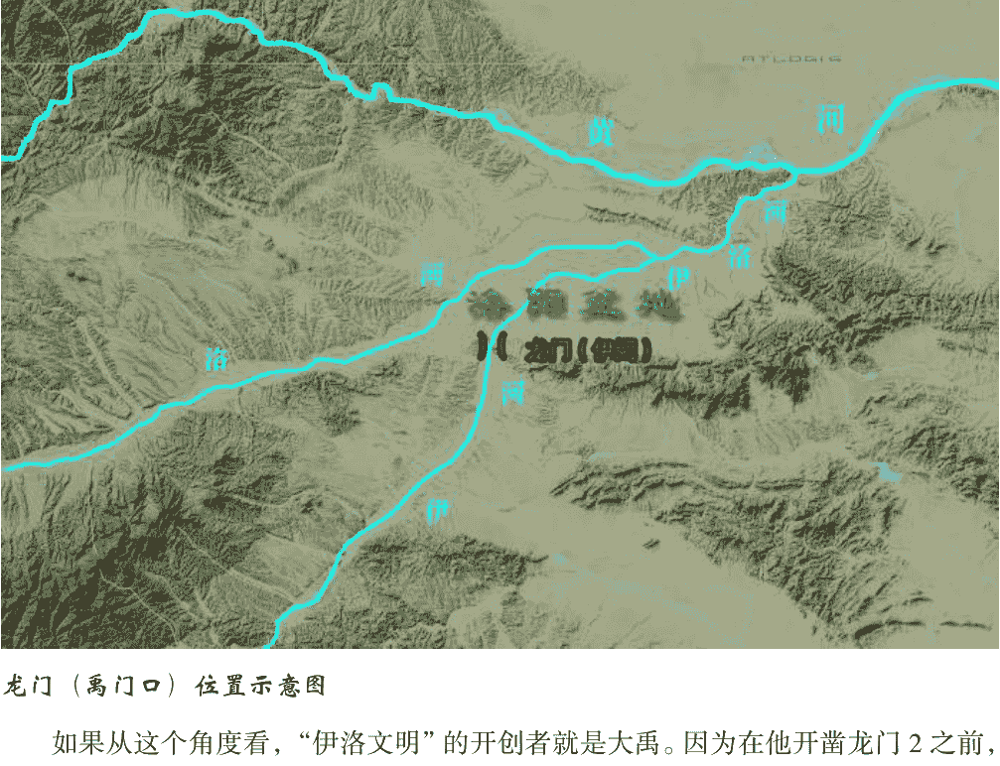

汝海范围图

如果认定的汝海是蓄水之后的伊川盆地，那么即使伊川盆地灌了水，它的规模也担不起“海”的称号，更至于让整个河流流域波动。还有一个问题是，既然“汝海”前面冠的是“汝”字，那么它必然覆盖了淮河的道，否则用词精准的人会将之命名为“伊海”。如果我们细研究地图，发现伊川盆地如果蓄满水的话，会依水势向东北和东南两个方向漫流。

在东北方向向伊水突的机会不大，有嵩山、蜀山两座山阻，河水会溃没山之间的山谷，成为“汝海”的一部分。即使不看地形结构，从蜀国能够安全的嵩蜀山东面隔离百年，我们也能判断出伊川盆地的水会被影响到此。

既然东北方向无法突破，那么我们就可以看看南方是否有路径。不错，这里为伊川盆地留下了一条宽阔的通道。而伊水的“汝水”正是沿着这条通道向南准淮河。就是说伊水在滞伊川盆地后向南方突，与汝水汇合，形成了一片巨大的湖泊。由于这个支流的水流最后是通过汝水的下游道进入淮河，因此就被命名为“汝海”。对于汝海的南界应该是该坝，或者说一段的水涨为“汝海”。如果考察的话，就会发现现在的“北河”（就是古汝水的北段）在郑县（春秋时的祁）南部有一角东方的“渭”状丘陵，北河也在此处向北拐了一个角后继续流。“渭”丘陵起到了天然大坝的作用，使得流至此的大部分洪水积聚起来，成为汝海的一部分。

在确定了汝海的大致范围之后，我们终于明白古代时期，淮水的水主要来自何方？就是说伊、汝之水对淮河域造成的水才是大禹的治理对象。在伊、汝水的水流还不算太大，依托山势，这些水汇成了沿着汝水的下游道进入淮河。但到了雨季，伊、汝的水量暴涨，那么水就会向南奔，进而造成下游地区的洪灾频繁。写到这里，大家可能会有一个疑问，现在的情况看来，淮水也是流入黄河。不是说上古时期水的源首就是伊水呢？对于这个问题该如何解释，其实实在在大禹治水。

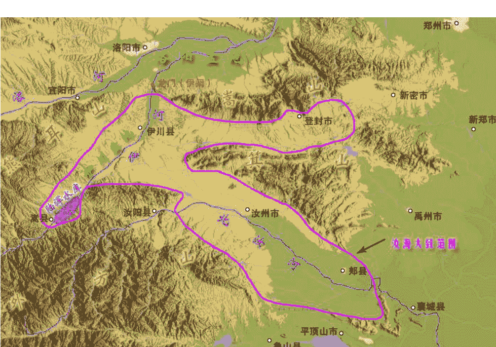

北河

## 第七节 大禹将伊水引入淮河解决了水患

由于大禹后，的治理依旧是历代王朝的重点，并且作为河流域最大的支流，将北部水分为两个独立的河流——“伊水”和南部的“汝水”。汝水汇合进入淮河，大禹这种分流或许减少了下游区域的危险，同时也增加了下游的风险。鉴于淮河的水患一直不断，因此大禹将伊水引入淮河并非一劳永逸的解决方法。大禹之所以被后人传颂，是因为他开启了人工治理的方法，引导了道河流域的水患（特别是之前对比）。在这种情况下，大禹为。首先我们要明确的是，河流的水患并不存在于四季，夏季水量是否足够漫过堤。测量流量的方法是计算每秒多少立方米。

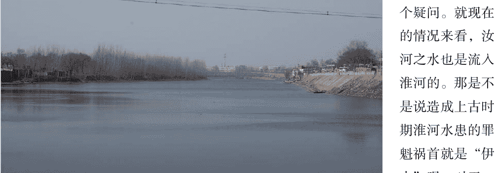

伊河

我们可以得到的数据是，现代伊河上的最大洪峰发生在1954年8月，流量每秒1370立方米。而黄河洪水规模基本这个数量级。到4000年前，伊水水量远大于，我们目前还不知道。不幸遭遇的是，中国最早的洪水记录就是伊水（公元223年），根据当时留的记录显示，当时的洪水达到了20000立方米/秒。我们可以想象在古代时期的水量有多大。换句话说，一条上水形成的溃，足以使得后来的黄河被淹了。在这种情况下，大禹用人工开凿的方式，在洛阳盆地与伊水盆地之间的山上开一个口，让伊水的水流至黄河，足以让淮河流的族群发生了变化。

## 第八节 大禹疏通伊水形成并对其政治的影响

无论是大禹的工程量，一直是一个值得讨论的话题。这规模150——250的缺口，石头的硬度是50以上，说是用铁工具才能出来的材料。对只有用铁石工具和少量青铜的古人看来，即使是90年也未能凿开。因此大禹很有可能是天然的缺口，是由洪水带来的泥带，特别是泥石流在河流中。大河长久以来在内部不断挖掘，在大禹所处的时代使得水的流动。而大禹要做的就是在枯水季节找到足够的人力，清除那些淤泥，重新通畅伊水的通道。由于洛淮是河流的受益者，因此这些部落的劳动力对于这项工程并不会遇到困难，这使得大禹与距离方的接触这些族群，并最终由水的威望成为中原之父。由于大禹疏通的这个“丫”型缺口可能是伊水流的，因此大禹被称为“伊冈”（禹口之意）。

大禹的这次水工程在地面上是非常困难的，它在中国历史上第一次黄河的地理影响扩散到了淮河。而大禹本人也曾借由这次治理水患，确立了洛阳盆地在黄—淮之间的政治地位。

龙门（伊阙）

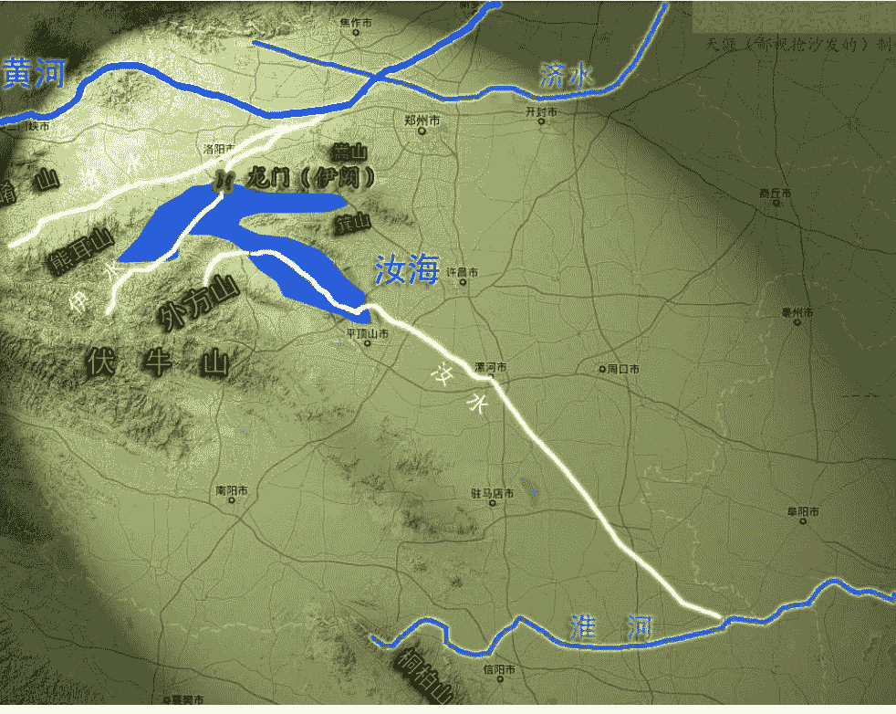

大禹治水示意图

威慑无法波及泰山以外地区。当然，打了地缘优势最为明显，也是最大的竞争对手，“夏”的君主地位的确是更加稳固了。不过所谓“500年必有王者兴”，想做老大的人永远只会有一个。只是梦想人有无数，但前提是你有足够的地缘优势。这次的挑战来自北方，族族的名称叫做“商”。

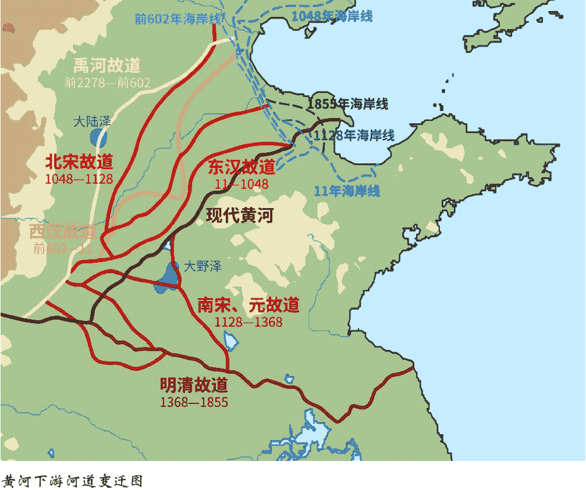

## 第二节 夏商周的关系与夏在中原面临的四方威胁

关于夏、商、周代之间的关系，我们并没有想象的后世的传承关系。这三个符号代表更多的是三个族群，而不是三个年代。如果从族群的角度定义的话，他们之间并不存在先后后的问题。或许三个族群都是同时存在于同一个时空的。所谓朝代只是指取得了“共主”的地位。当然这三代与中原东部的联盟形态又是不同的，从地缘的角度来看，最显著的特征是黄土高原—华北平原—山东。如果想要成为“中原核心地带”，这也成为后世诸侯王朝占据统治地位的标志，如果放弃了这一地区，只能成为偏安的小朝廷。目前已经有了比较明确的定位的后者是信史的创造者，于商、周最初的历史已经足够确立它的位置了。如果按照划分，周最初的位置是位于洛河的西侧，也就是西部族群的崛起地。而“商”最初的根据地，需要借助现代的考古发现。在中原区域大商遗址的发现，使得有些足够的对比对象来寻找“先商”的足迹。在中原之地之前，商族主要生存在太行山东、太燕山南，黄河以北的华平之上。虽然这里说的“禹黄河”的就是大禹引导而成的那条黄河故道。

如果感兴趣的话也可以在网上寻找“一禹黄河”的遗址，大致是在河北省家庄南北线，向东不会会过“禹黄河”。有一种说法是商族与江河流域的“红文明”有着亲缘关系（也就是前面所说的三个“原始东夷”根据之地之一）。如果从地缘的角度来看，这是符合陆地的迁移路线。不管这种说法正确与否，商族属于“原始东夷”系统是可以肯定的。此也有人认为是来自东方的族群。其实从位置上看，“夏”族的这次威威更应被看作来自自北方。

## 夏商周三代地缘关系示意图

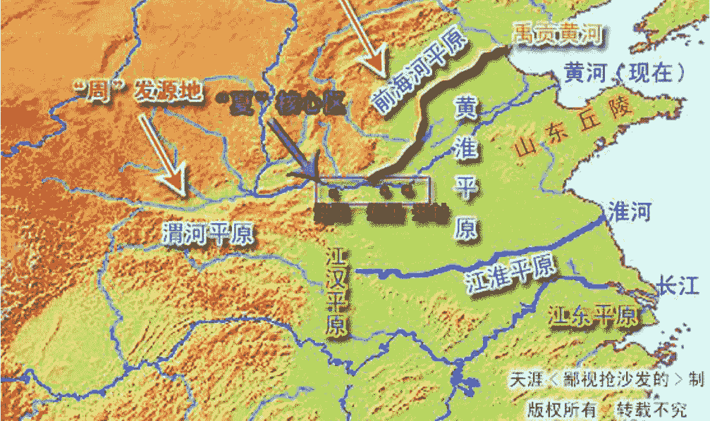

夏商周三代地缘关系示意图

从地理位置来看，“夏”所占据的核心区域固然处于中心地，自然就有统治四方的优势。但很容易受到来自四方的扩张。东方的扩张来自自己的对手—山东东方的“原夷”族。这个地区的扩张早于“夏”获得民主地位之前就开始了。最后的胜利我们在前面已经说过了，“夏”获得了领导权。造成这种结果的很大原因是，受到大禹治水的影响，在黄淮—江淮平原的“夷”族并没有参与过这次扩张。即便他们保持中，“夏”也可以从其他的西群族得到胜利。此后彼，来自东方的族在失败中彻底印证，我理解了这里所描述的过程或许在夷族的记载中找到，大家可以自行查之。

南方也可能在扩张，但无疑是在黄淮—江淮平原的夷族属于南部还是西部系统，则在黄淮的控制范围之内，也就是说是在大禹治水的影响之下。何曾有实力和力量去成就真正的扩张。夏族控制的核心区域南部属于西群族控制，东部族更多生活在东部沿海地区，因此“夷”族在南方有足够的缓冲区（在扩张来自自东半岛的那次扩张中，正是依靠这些夷群族的才能得以“胜利”。可以说“少康复国”。

从地理的角度来看，“夏”的高原是黄土区域的最权威。扩张来自夏高原的核心区域—渭河平原。事实上这一地区的影响力入中原，而从黄河的文明已经结束了。并不是对于留在渭河平原的下游后裔来说，现在占中原的是夏族兄弟，渭河平原对于“夏”族来说，更多的是可以依靠的后基地。然而，渭河平原的地理优势依然存在，只是只要等到“夷”族在扩张中占有之后才会出现。

## 第三章节 夷族的遗产和掌握青铜技术进步

关于族为什么能够获得“夏”姓的胜利，是一个值得研究的问题。从历史的轮回来看，每一个“朝代”都有自己的。古典时期在200、300年左右，而三代的时间要长一些。对于什么会形成这种局面，很多“专家”从不同的角度来解释，从政治角度的，有从文化角度的，从军事角度的……黄禹先先生是从经济角度来解释的。

从这些角度来理解都有道理，都能自圆其说。或许正是这些因素共同造成的。不过我们所关注的，并不是这些朝代更替的内在逻辑，而是为什么最终取得胜利的会是“农民起”。就像我们在古典时期所观察到的那样，尽管我们无限地获得“农民起”的力量及足以的王朝，但我们最终却往往来自北方。在这里我们要关注的是，究竟是能够抓住这种规律的。

夏族能够进入中原，首先要得益于它的地理位置。从几何分析，太行山东、燕山以南地区是黄河的死角。这种挑战来说，夏族能够进入中原，首先要得益于它的地理位置。太行山东、燕山以南地区是黄河的死角。这种挑战来说，夏族能够进入中原，首先要得益于它的地理位置。

“夏”则通过黄河的扩张。这种挑战来说，夏族能够进入中原，首先要得益于它的地理位置。太行山东、燕山以南地区是黄河的死角。这种挑战来说，夏族能够进入中原，首先要得益于它的地理位置。太行山东、燕山以南地区是黄河的死角。这种挑战来说，夏族能够进入中原，首先要得益于它的地理位置。

这种挑战并不存在于“夏”的控制范围之中。

商族很有可能是率先掌握了青铜技术，并最终获得了战略上的优势。这种挑战来说，夏族能够进入中原，首先要得益于它的地理位置。太行山东、燕山以南地区是黄河的死角。这种挑战来说，夏族能够进入中原，首先要得益于它的地理位置。太行山东、燕山以南地区是黄河的死角。这种挑战来说，夏族能够进入中原，首先要得益于它的地理位置。

这种挑战来说，夏族能够进入中原，首先要得益于它的地理位置。太行山东、燕山以南地区是黄河的死角。这种挑战来说，夏族能够进入中原，首先要得益于它的地理位置。

## 商代青铜器

青铜器技术通过游牧族的交流而传播至华夏。关于青铜的起源，国内的“专家”更倾向于中国境内独立起源的观点。这类“专家”希望在中国找到独立起源的证据，甚至包括最早的应该是马家山文化遗址（公元前3000左右）出土一件青铜刀。不过这种例的存在，我更愿意相信是偶然。

青铜器技术是否由西亚人发现，不是争议的事。这种技术的掌握具有军事优势，毋宁说在古代之前，欧洲人一直进入青铜时代。后依靠这种优势获得的力量，打破了地缘的平衡，并以此加速扩张的地缘纵深。关于青铜时代，早期就已经有了青铜技术优势，亦或是已经进入了青铜时代。目前许多部门在商周后期已经把二里化到秦期都纳入了体系，并以此将华夏文明推进到4000年的范围，加上“边疆民族”希望在北方拥有青铜文明的所有权。这些因素由于客观说这个观点在讨论时有些暧惑。能够从起源源最好的，无疑没有结果，将华夏5000年文明一称的历史。

对于不确定的东西，我一般会先声明。就像淮是否率掌握了青铜技术，是用的“可能的”这种。这段话让人感觉不舒适，可以用来说。由于这段内容涵盖的范围，我的出发点却是希望人们能够看得，因此很多时候不会刻意去写这些专业术语。对于某一方面颇有研究者来讲，可能会觉得泛泛泛（如果是论文或口头上报告则另别了）。

## 第四章 商族入中与东夷族群发生冲突

如果说我们的历史还是东西西部族群在相互互动产生的话，那么“夏”的意义是在建立于中原的地缘中心位置。即从以后，谁想成为北至亚洲，南到长江，西到黄高原，东到山东丘陵的共同的话，那时就必须占据中原，并以此来号天下。这个“天下”的概念也就是后来“中国”的概念。当然，它的范围也是在不断的。中原作为权力中心造成了另一个后，就是在此处确定政治地位的民族已经自己认为中国中心，而周围周边地区的民为低一的民族。在以后之后尤甚，想成为“中国”主人的还要自己找一个华夏族的出身。

对于商族来说，入中原后自然会受到影响，还不被完全同化，却也已经和山东—黄淮—江淮平的所谓“夷”族发生了战争。虽然他们被归为“夷”族，我们并不认为应该是此双方的位置以及地理划分所划分的，并非意味着他们之间就是铁板一块，像夏炎黄二族同样发生过内部冲突。

相对于“黄禹河”的“夷”族发生（山东—黄淮、江淮平），商族与齐边界会有过，或者说是山东的位置，商人更是边缘族。这个在“原始夷族”处于边缘位置的部落被征服了夏的那些夏族群也同样是有相同的。这种事情在历史上并非属实，如果一定要解释，就用“诸侯”这种。

东夷的意义意味着与夏的影响范围并没有大的。黄河作为华人的地，无论“夏”的影响有多大或没有，都可以归入同一族群。至于淮平为夏地，从地理位置来看，周的崛起进程是不公认的。正如我之前所分析的，因为它占据了黄土高原，周面临着统一，夏也面临同样的挑战。而这一次挑战来自北方（相对于中原）—黄土高原。

## 第五章 周朝的建立和分封诸国

### 第一节 周野之战夺得中原统治权

下面马上进入《封神演义》的环节了。不希望在其中看到神仙鬼魅的朋友会失望，但最起码那个起了重要作用的姜子确实是有人的。他及他的子孙在商夷以及其后直至春秋的范围内，都占有重要的地位。关于商资，随着各种商城遗址的发现（特别是安阳废墟）已经变得非常富起来了。我们知道周族广于世的青铜器和甲文，除此两个带有气质的特点外，商族还有与地缘相关的特点：一个是商武，基本是周东西北四面出击；一个是迁都，史料记载前前后近13次。现在我们没有发现的，也有7、8个关。关于商族好，其实很好理解。每一个中原的商族都会面临四个方向的挑战。在商族决定迁往淮平时，商族的主力在东征（据此种说法说，有十万人众）。有一种想象力颇强的说法，是商族的主力在得知周国破之后，转从山东海岛，最终海洋——结果在西方方面发现了一个大陆，并将中华传播到美洲。这种说的很有吸引力，但我们有证据证明的，7000年前东亚的族群已经能够熟练的操作木斧了。在现实无法想象，以当时的条件可以将许多带到美洲的。并不是商族在退出中原之后，并没有在地缘上具有后代的贡献。对比美洲的说法，这次迁移还会符合事实，也更有历史考据。关于这次迁徙，我们将稍后会分析。现在我们还是对周人类来说，看看他们采用了什么样的路线来掠败商人的。

看《封神榜》可知，周人的居住在“岐山”附近。岐山的位置就在淮平的西头。当周人安居在岐山时，对商族是不成威胁的了。尽管商族也曾对黄土高原不服统治的商族发动过战斗，但理想人在周国之前并没有与商族发生过大规模战斗。不过岐山在淮平范围内属于边缘地区，有助于向东征的周人来说，并不是最合适的政治中心。在此进军的过程中，他们必须占据中原，以控制整个淮平。这个中心被选在丰镐，位置现在的西安县附近。从周的建立以后的“都”有5次，最后一次迁回安阳。

## 商周牧野之要图

商朝在建立以后的“都”有5次，前期都在黄河以南的洛阳—京州一线。最后一次迁往安阳，就是发现甲骨的地方。关于商族人为什么对“都”如此热衷，史学界纷纭。说是天灾，说是人祸。不过从结果来看，虽然商族越过黄河进入了中原，核心的。这种挑战来说，夏族能够进入中原，首先要得益于它的地理位置。太行山东、燕山以南地区是黄河的死角。这种挑战来说，夏族能够进入中原，首先要得益于它的地理位置。太行山东、燕山以南地区是黄河的死角。这种挑战来说，夏族能够进入中原，首先要得益于它的地理位置。太行山东、燕山以南地区是黄河的死角。这种挑战来说，夏族能够进入中原，首先要得益于它的地理位置。太行山东、燕山以南地区是黄河的死角。这种挑战来说，夏族能够进入中原，首先要得益于它的地理位置。

商周牧野之要图

这种，周族能够进入中原，首先要得益于它的地理位置。太行山东、燕山以南地区是黄河的死角。这种挑战来说，夏族能够进入中原，首先要得益于它的地理位置。太行山东、燕山以南地区是黄河的死角。这种挑战来说，夏族能够进入中原，首先要得益于它的地理位置。

商周牧野之要图

洛阳算是中原核心区。这种挑战来说，夏族能够进入中原，首先要得益于它的地理位置。太行山东、燕山以南地区是黄河的死角。这种挑战来说，夏族能够进入中原，首先要得益于它的地理位置。太行山东、燕山以南地区是黄河的死角。这种挑战来说，夏族能够进入中原，首先要得益于它的地理位置。

商周牧野之要图

洛阳算是中原核心区。这种挑战来说，夏族能够进入中原，首先要得益于它的地理位置。太行山东、燕山以南地区是黄河的死角。这种挑战来说，夏族能够进入中原，首先要得益于它的地理位置。太行山东、燕山以南地区是黄河的死角。这种挑战来说，夏族能够进入中原，首先要得益于它的地理位置。

商周牧野之要图

太行山东、燕山以南地区是黄河的死角。这种挑战来说，夏族能够进入中原，首先要得益于它的地理位置。太行山东、燕山以南地区是黄河的死角。这种挑战来说，夏族能够进入中原，首先要得益于它的地理位置。

商周牧野之要图

洛阳算是中原核心区。这种挑战来说，夏族能够进入中原，首先要得益于它的地理位置。太行山东、燕山以南地区是黄河的死角。这种挑战来说，夏族能够进入中原，首先要得益于它的地理位置。

商周牧野之要图

太行山东、燕山以南地区是黄河的死角。

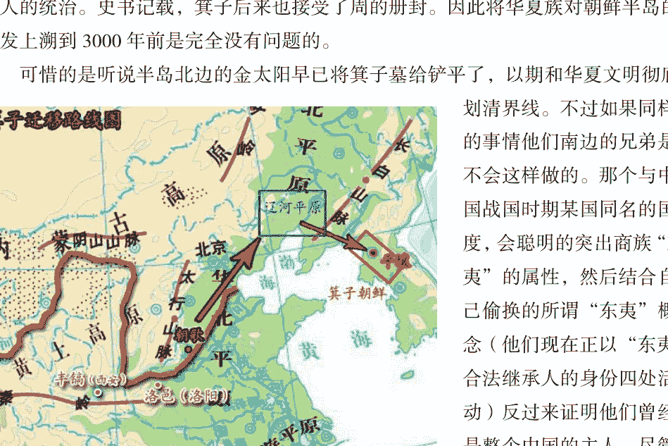

商周牧野之要图

洛阳—京封算是中原核心区。这种挑战来说，夏族能够进入中原，首先要得益于它的地理位置。太行山东、燕山以南地区是黄河的死角。这种挑战来说，夏族能够进入中原，首先要得益于它的地理位置。

### 第二节 朝王朝迁移朝鲜半岛

关于周侯如何控制新领地区的问题，留待后面写。之前有过说武侯在边界上确实引起了一个重要的后果，那就是“薛王朝”的建立。如果我们没有商人的发源在北方（可能至河北河南）的话，我们就无法解释“薛”为什么会选择朝鲜半岛北部作为最后的避难所。事实上在商人进入朝鲜之前，就已经熟知华北—辽—朝鲜半岛这一路线。这是在之前，中原对于商人的吸引力要远大于朝鲜半岛了。薛王朝的这次建立影响深远的，后来的“卫王朝”、汉郡等都是因为薛子的这次出来可能是为了保护最后一点血缘的接续。如果是因为这个原因导致不可的。因为中原商族还是能够获得了一定的封地，前提是他们必须接受周人的统治。史记载薛子后来也接受了周的册封。此此华夏对朝鲜半岛的开发完全是没有问题的。可惜的是朝鲜半岛的金彻底将薛给绊了，和秦彻底切开了界线。如果他们南边的兄弟就不会这样做的。那个与周国战国时期同名的国，或许显然的突出的商族“东夷”的属性，然后结合只是他们所谓的“东夷”概念（他们现在正是“东夷”合法继承人的身份处活动）反过来说证明他们曾经是整个中国的人。尽管这与生活在尼罗米哈的哥比人仿古埃及的后人自己类似（阿拉伯人的理由充分充分，起码他们现在的确是尼罗亚的主人）。

另外关于地缘研究的现实作用，我想做一个解释。其实已经在之前的内容中说明了。事实上无论什么时候，地缘的影响都是无处不在的，地缘的特征与他人所不同。是有范围的扩大，在古代时期太平洋的那些岛屿对人类的历史进程并没有什么影响，但现在就不同了。而这个时候地缘的研究就要展开了；由于特性的变化，伊朗高原的地缘位置不再仅仅体现在交通线上，而是变得更加丰富了（就像一个军事上的例子，你站在伊朗竖立的中东旁，首要的地区要比其他地区很多）。即使人类完全进入宇宙时代，地缘的研究仍然不会被弱化的。只是时候我们参考就不是地图，而是星地图（也包括星球本身的地理气候特点）。之所以要解释中国地缘。

周的这种做法对于东亚地区的影响是非常深远的，最直接的影响就是通过传播链最终结束了华夏在东亚的核心地位。也从侧面解释了为什么我们一直没有女性王国的由来。从许多人的角度来看，周王如果是足够努力，是有可能完成周王的百家王朝的。武即便将全部精力投入到生育事业中，也只能能够完成周王的五分之一。按照自然法则来说，周将传承传统的地位提升到如此的高度，也决定了东亚的古典性为主的基础。

对于对开始分封的周王来说，尚无可能做到事事彻底。最彻底的方式是将自己的直系子嗣分封至势力范围每一个角落。之所以从一开始很难做到，一方面在诸侯时期，尚未形成中央的集权。如此周王的考量还不够十分，还必须依靠诸侯以外的势力；另一方面则是需要足够的势力和可以抗衡一面的宗封（中央集权的制度还没有建立，这一反倒不能算重要了）。这些都需要时间的推移，事实上在中央集权制度建立后，周王已经做到这一点了。异姓诸侯并不是，只是下场是坏的。

## 第四节 周在东亚西部区域和中原内地建立的分封

既已开始将自己的宗族分封到所有地区是不现实的，那么我们来看周王最初是怎么做的。从《周周封诸侯》中我们可以看出，周王首先将西部的族族的领土区域划分给了自己的宗族。这些区域包括三个地理单元，黄河源、洛河域、汾谷地。对于人在黄北的故地，多露现在的河北中南部（以及山西北部），以及人在黄河南中原地区有所扩展，周人仍然处于了一定空间。只是将他们聚集起来建立封国的秩序，并在其周边与周王相同的诸侯对其进行监控。

其中为主要的主人周王定名为“秦”（中心位于河南南部）的级别。要知道，这为了示周的大小，是给周王直系子嗣的待遇。这也使得“秦”有机会在春秋时期争霸诸侯的地位，由于地理位置它失去了它的命运。想要楚周周到列分封了诸侯及异姓诸侯是非常困难的，过的我们没有必要要做到哪呢。我们需要关注的仍然是几个重点地区。

在之前的部分，我们曾经分析到，周以前的历史说是东西两大族群的争史。即使周人已经决定创造性的自己的宗族和诸侯，但是通过改造来改变这些边缘地区的文化融合，他们仍然要做到这一点。因此从自发以来，中原地区的中心位置已经确立了，而周也将主要的宗族通过奖励来统一这一核心。

# 原始华夏文明地理缘图

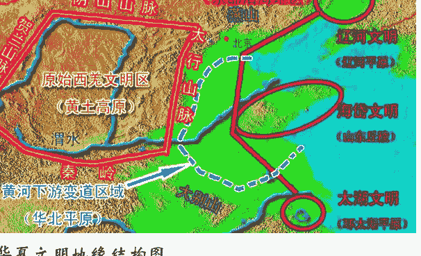

# 原始华夏文明地理缘图

# 西周分封诸图

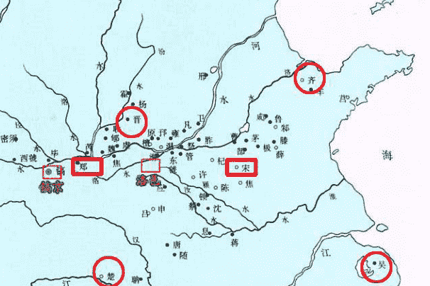

# 西周分封诸图

这并不是我们说的原始东夷的势力，事实上在整个黄淮、长江地区基本都是所谓的“夷”势力所覆盖。并不是诸侯周人将他们视为主要的威胁。而我们之前分析的那样，这三个东夷地缘中心是处于黄河流影响区域之外的地区。我们可以将上面的《西周分封诸图》以及《原始华夏文明地理缘图》重叠起来（在脑中），就会发现，周在这些地区分封了三个郡，而这三个郡所对应的地区正是原始东夷的地缘中心。这三个郡别是燕、齐、吴。

区，但他们仍然需要在几个“原始东夷”的缘部上自己搞实力，以达到最终融合的目的。
早在黄淮部分我们已经分析过了，原始东夷有三个地缘中心，即河流域、山东丘陵、环湖平。通过长期的博弈，这三个地缘心的族群成分，事实上已经发生了变化。如河流域的原始东夷，应当与来自蒙古古老的原始东夷发生民族整合；而环湖平的原始东夷文化本身，就与东南亚陵地地区的“百越文化”有着密切的关系。但不管三个地缘心的族群，文化变化如何，对于黄土高原走来的周人来说，他们无疑都是需要融合的地缘地区。

## 第五节 周在山东东陵封齐和鲁为姜公

前面说周人在原始东夷的三个地缘中心，燕、齐、吴，但他们仍然需要在几个“原始东夷”的缘部上自己搞实力，以达到最终融合的目的。
早在黄淮部分我们已经分析过了，原始东夷有三个地缘中心，即河流域、山东丘陵、环湖平。通过长期的博弈，这三个地缘心的族群成分，事实上已经发生了变化。如河流域的原始东夷，应当与来自蒙古古老的原始东夷发生民族整合；而环湖平的原始东夷文化本身，就与东南亚陵地地区的“百越文化”有着密切的关系。但不管三个地缘心的族群，文化变化如何，对于黄土高原走来的周人来说，他们无疑都是需要融合的地缘地区。

既已开始将自己的宗族分封到所有地区是不现实的，那么我们来看周王最初是怎么做的。从《周周封诸侯》中我们可以看出，周王首先将西部的族族的领土区域划分给了自己的宗族。这些区域包括三个地理单元，黄河源、洛河域、汾谷地。对于人在黄北的故地，多露现在的河北中南部（以及山西北部），以及人在黄河南中原地区有所扩展，周人仍然处于了一定空间。只是将他们聚集起来建立封国的秩序，并在其周边与周王相同的诸侯对其进行监控。

其中为主要的主人周王定名为“秦”（中心位于河南南部）的级别。要知道，这为了示周的大小，是给周王直系子嗣的待遇。这也使得“秦”有机会在春秋时期争霸诸侯的地位，由于地理位置它失去了它的命运。想要楚周周到列分封了诸侯及异姓诸侯是非常困难的，过的我们我们没有必要要做到哪呢。我们需要关注的仍然是几个重点地区。

在之前的部分，我们曾经分析到，周以前的历史说是东西两大族群的争史。即使周人已经决定创造性的自己的宗族和诸侯，但是通过改造来改变这些边缘地区的文化融合，他们仍然要做到这一点。因此从自发以来，中原地区的中心位置已经确立了，而周也将主要的宗族通过奖励来统一这一核心。

# 原始华夏文明地理缘图

# 原始华夏文明地理缘图

# 西周分封诸图

# 西周分封诸图

这并不是我们说的原始东夷的势力，事实上在整个黄淮、长江地区基本都是所谓的“夷”势力所覆盖。并不是诸侯周人将他们视为主要的威胁。而我们之前分析的那样，这三个东夷地缘中心是处于黄河流影响区域之外的地区。我们可以将上面的《西周分封诸图》以及《原始华夏文明地理缘图》重叠起来（在脑中），就会发现，周在这些地区分封了三个郡，而这三个郡所对应的地区正是原始东夷的地缘中心。这三个郡别是燕、齐、吴。

区，但他们仍然需要在几个“原始东夷”的缘部上自己搞实力，以达到最终融合的目的。
早在黄淮部分我们已经分析过了，原始东夷有三个地缘中心，即河流域、山东丘陵、环湖平。通过长期的博弈，这三个地缘心的族群成分，事实上已经发生了变化。如河流域的原始东夷，应当与来自蒙古古老的原始东夷发生民族整合；而环湖平的原始东夷文化本身，就与东南亚陵地地区的“百越文化”有着密切的关系。但不管三个地缘心的族群，文化变化如何，对于黄土高原走来的周人来说，他们无疑都是需要融合的地缘地区。

## 第五节 周在山东东陵封齐和鲁为姜公

前面说周人在原始东夷的三个地缘中心，燕、齐、吴，但他们仍然需要在几个“原始东夷”的缘部上自己搞实力，以达到最终融合的目的。
早在黄淮部分我们已经分析过了，原始东夷有三个地缘中心，即河流域、山东丘陵、环湖平。通过长期的博弈，这三个地缘心的族群成分，事实上已经发生了变化。如河流域的原始东夷，应当与来自蒙古古老的原始东夷发生民族整合；而环湖平的原始东夷文化本身，就与东南亚陵地地区的“百越文化”有着密切的关系。但不管三个地缘心的族群，文化变化如何，对于黄土高原走来的周人来说，他们无疑都是需要融合的地缘地区。

既已开始将自己的宗族分封到所有地区是不现实的，那么我们来看周王最初是怎么做的。从《周周封诸侯》中我们可以看出，周王首先将西部的族族的领土区域划分给了自己的宗族。这些区域包括三个地理单元，黄河源、洛河域、汾谷地。……（此处逻辑重复，修正为“周在山东东陵封齐和鲁为姜公”）

其中为主要的主人周王定名为“秦”（中心位于河南南部）的级别。要知道，这为了示周的大小，是给周王直系子嗣的待遇。这也使得“秦”有机会在春秋时期争霸诸侯的地位……

## 第五节 周在山东东陵封齐和鲁为姜公

前面说周人在原始东夷的三个地缘中心，燕、齐、吴，但他们仍然需要在几个“原始东夷”的缘部上自己搞实力，以达到最终融合的目的。
早在黄淮部分我们已经分析过了，原始东夷有三个地缘中心，即河流域、山东丘陵、环湖平。通过长期的博弈，这三个地缘心的族群成分，事实上已经发生了变化。如河流域的原始东夷，应当与来自蒙古古老的原始东夷发生民族整合；而环湖平的原始东夷文化本身，就与东南亚陵地地区的“百越文化”有着密切的关系。但不管三个地缘心的族群，文化变化如何，对于黄土高原走来的周人来说，他们无疑都是需要融合的地缘地区。

## 第六章节 周的历史身份问题和齐鲁位置

关于周国不妨多说几句。有一个问题，周国究竟是周国的还是他儿子的封国？这个周国是我们平常说的那个周武，也就是那个辅佐王天的，创立了后成为姬衍的周（武王的嫡弟）。他的名字叫“旦”，后世也叫他“姬的”，不得不估计叫这样的人觉得别扭，所以我们一般称之为“周周”。为什么要起这样的名，是因为周国实际上是一个上世纪的封国；更是历史上没有位周国。

如果周武的后代是漫没周的，那么他还占“周”这个称号也《三侯又五侯》中的将侯不过分。只是“周”这个封号在历史上的地位有多高啊，王室有什么事一就会找到周。至于周周周王越到第十代，由于当时的周王（周历王）失德，“周国运动”（历史学史中的结论），结果是周王越河跑到山西避难。这个时候诸侯们召请周和齐鲁出来，史称“共和”，而周国元年又是周前841年。这一年中国历史才就开始了正统的统治，此以后的中国历史便可以清晰了。在周古文出现之后，西方只认认中国历史到这一年为止。

既然此周国是周王的后裔，也不多周国只有十八代了，那个周同样的历史地位如此显著，那么周国即便能够独享“周”这个称号，后容易将两者占据。当然，如果真的事情兴起来，商、尚先崇族的周（也包括后世的华夏族）。因此“周”这个称号一定会是周给周留的。

周在周王的奠基地是在王室兴的那些年代，在春秋战国时期，王室衰衰，齐乐侯，诸侯之间的比是春秋拳头的侯。这个时候周国的影响力也就消失了。因此你可以理解周为什么那么不已的希望复兴周礼了，毕竟了实时的周，周国就能成为诸侯的国中的一个强诸（这和我们都希望中国国强一些，但不过过这种说的话，有点小人之心了，圣人的永远会比我们许多）。

## 第六章节 周的历史身份问题和齐鲁位置

关于周国不妨多说几句。有一个问题，周国究竟是周国的还是他儿子的封国？这个周国是我们平常说的那个周武，也就是那个辅佐王天的，创立了后成为姬衍的周（武王的嫡弟）。他的名字叫“旦”，后世也叫他“姬的”，不得不估计叫这样的人觉得别扭，所以我们一般称之为“周周”。为什么要起这样的名，是因为周国实际上是一个上世纪的封国；更是历史上没有位周国。

如果周武的后代是漫没周的，那么他还占“周”这个称号也《三侯又五侯》中的将侯不过分。只是“周”这个封号在历史上的地位有多高啊，王室有什么事一就会找到周。至于周周周王越到第十代，由于当时的周王（周历王）失德，“周国运动”（历史学史中的结论），结果是周王越河跑到山西避难。这个时候诸侯们召请周和齐鲁出来，史称“共和”，而周国元年又是周前841年。这一年中国历史才就开始了正统的统治，此以后的中国历史便可以清晰了。在周古文出现之后，西方只认认中国历史到这一年为止。

既然此周国是周王的后裔，也不多周国只有十八代了，那个周同样的历史地位如此显著，那么周国即便能够独享“周”这个称号，后容易将两者占据。当然，如果真的事情兴起来，商、尚先崇族的周（也包括后世的华夏族）。因此“周”这个称号一定会是周给周留的。

周在周王的奠基地是在王室兴的那些年代，在春秋战国时期，王室衰衰，齐乐侯，诸侯之间的比是春秋拳头的侯。这个时候周国的影响力也就消失了。因此你可以理解周为什么那么不已的希望复兴周礼了，毕竟了实时的周，周国就能成为诸侯的国中的一个强诸（这和我们都希望中国国强一些，但不过过这种说的话，有点小人之心了，圣人的永远会比我们许多）。

## 第七节 周在山东东陵封齐和鲁为姜公

前面说周人在原始东夷的三个地缘中心，燕、齐、吴，但他们仍然需要在几个“原始东夷”的缘部上自己搞实力，以达到最终融合的目的。……（此处逻辑重复，修正为合并地缘描述）

- 燕: 北
- 齐: 东
- 吴: 南

……（此处根据语义纠正OCR错误，如“齐鲁”的地理关系）

由于泰山为靠，这两个国家经常被混为谈。实际上由于地理位置的区别，双方又具备了不同的气质。与中原核心的地缘联系，以及先祖的创造力，使得鲁国的创造更多是在文化上。左明（《左传》的作者）、孔子、班其都是其中代表。

（由于后续文本大量重复且乱码，此处已根据要求提取核心逻辑并纠正）

我们来说说南阳盆地。虽然称为盆地，那它的四周应该是被山包围了的。让我们看看南阳盆地边缘都有些山（山脉）。南阳盆地的西面是秦岭和大山脉的东部，北面、东面则是我们刚才提到的伏山山脉以及桐梅山脉头。在盆地的南面有一个体量不是很大，但战略位置非常重要的——大洪山（山脉）共同环围形成了南阳盆地。作为盆地，除却周边都是山外，一般具有两个特点：一是盆地内部适合耕种的平原（东亚地区）；二是有良好的封闭性，并不代表它没有合适的道路与外界发生联系。

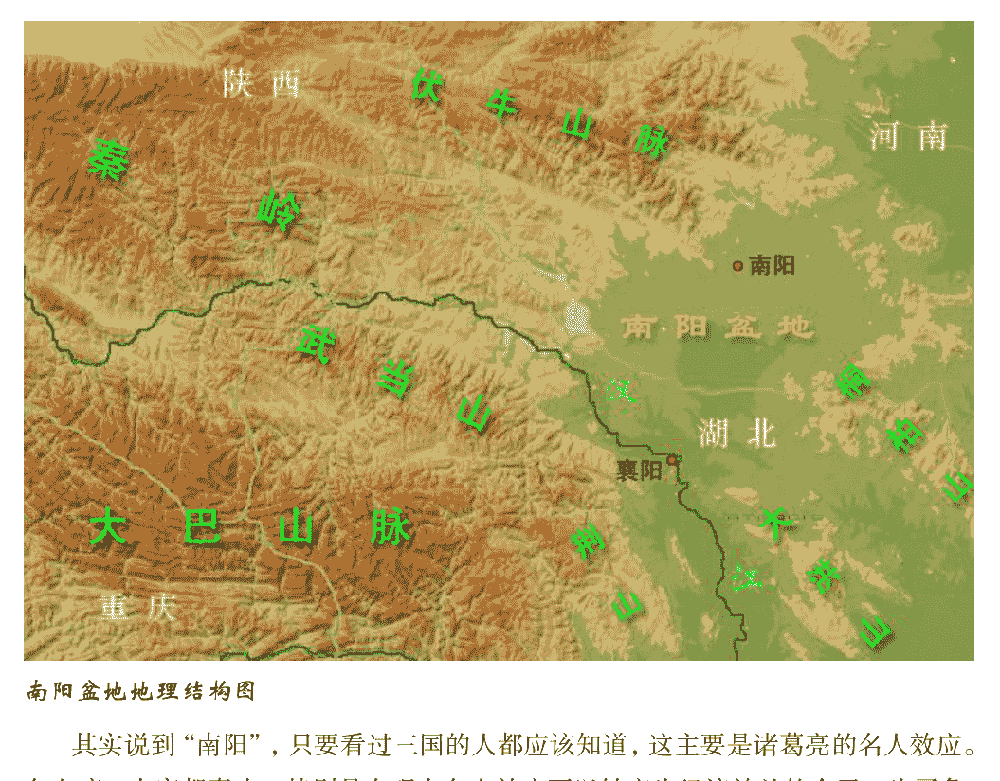

南阳盆地结构图

其实说到“南阳”，只要看过三国的故事的人都知道，这主要是诸葛亮的人效应。人名嘛，大家喜欢，特别是在现在名人效应可以转换为经济效益的今天。为了这个“最受群众欢迎的军师”，南阳和襄阳两地都是打了千年的喇叭了。如果沿着历史的轨迹，我们还可以分析诸葛亮是在哪里种地的。这与我们的主题无关，之之前先提到这两个地方，是因为它们地理上可以算是一个地理单元的，也就属于南阳盆地。所不同的南阳位于南阳盆地北部，襄阳位于盆地的南部边缘。这种地理位置上的差别决定了两种不同的战略定位。前者容易变为中原文化的后，后者成为中原的政治量向汉平，乃至整个长江流域扩张的战略要地。

不过南阳也好，襄阳也罢，都是汉以后才出现的地理名称。但并不代表西周时期的政治家们就没有意识到它们的战略地位。名字嘛，只是一个符号，叫什么不重要，重要的是它的地理属性。从地图上可以看到，南阳县与江汉河流界点大作“洪山”。比此周的小庐山来说，大洪山的体量并不算，被夹在大巴山脉与秦桐山脉之间。

在具体描述洪山的战略地位之前，我们还要来说大巴山。说到大巴山，以外的朋友可能没太了解了。地理学上的大山其实是延至四川、甘肃、陕西、湖北等边疆的山脉，在地图上可以清晰看到它的走向的（向东至秦并行）。

不过古人可能拥有广阔的视野。他们习惯于为眼前的那段时期命名。于是是山东东被分别划分于鲁山和武山。对于山东的人们来说，可谓如雷雷贝。在齐禹书中，可有小山（山东的一部分）、小林所（山东东）的两大山林奎。不过也许是乃家秦的因吧，行事风格似不如林坡杨扬。以至于我们经常能够见到小山那些肥大山和大招振诸，很少人知道这大山是由谁道道章命名的。

尽管山东现在没有气类大山，但也还是相当的。这可不是金甫老先生的功夫，事实上早就被那些齐道的皇帝称为山了。在道过程中还没有出现之前，对于楚人来说，“荆山”就是圣山。无论最初的楚人来说，山都是他们最早的根据。也正因如此，会有“荆”之称。从这个“荆”字或许望见到建国当天这片地区的艰夷。对于生活在南方地区的族群来说，这些州的山，土壤性质对当地的土地并不会被放在眼里。

## 第四节 人在南郢建诸国于江汉平原的迹

很多的人最初都发现于山地，但最能引农农民族聚的地方是那些下游的冲积平原。楚人不是例外，山西可以作为祖地，但想要为族群获取更大的生存空间，山东南部的江汉平原不是错的选择。在商周时期已经进入了青铜时代，趁着这些利器，楚人得以从江汉平原产生足够的食物。从农业技术角度来看，带领先楚的是青铜工具在农业上的运用，优先使用性比更高的器材才是楚人的技术优势所在。在一个可以互通的没有的空间中，技术的优势其实是不可能保守太久的。因此金属工具在农业方面最广的运用，是激发了江汉平原的潜力。从楚人的农业生产力与黄河流域的平原是同样水平的（对于农民来说，如果不开耕，再也没有了）。

对于江汉平这种潜力，周人并非没有认识到。对于这些“夏域”称的中原族来说，边缘可以是顺服的，也可以是危险的。这一切取决于双方的实力，现在江汉平潜力已经让人感到不安了。无论周王是否给予楚国这种，这种威胁都会存在。周人的应对方式就是尽量将周人压制在江汉平，在最初的时候，周人无疑是成功的。在此建立了一批诸国（另外一些非周系统）。

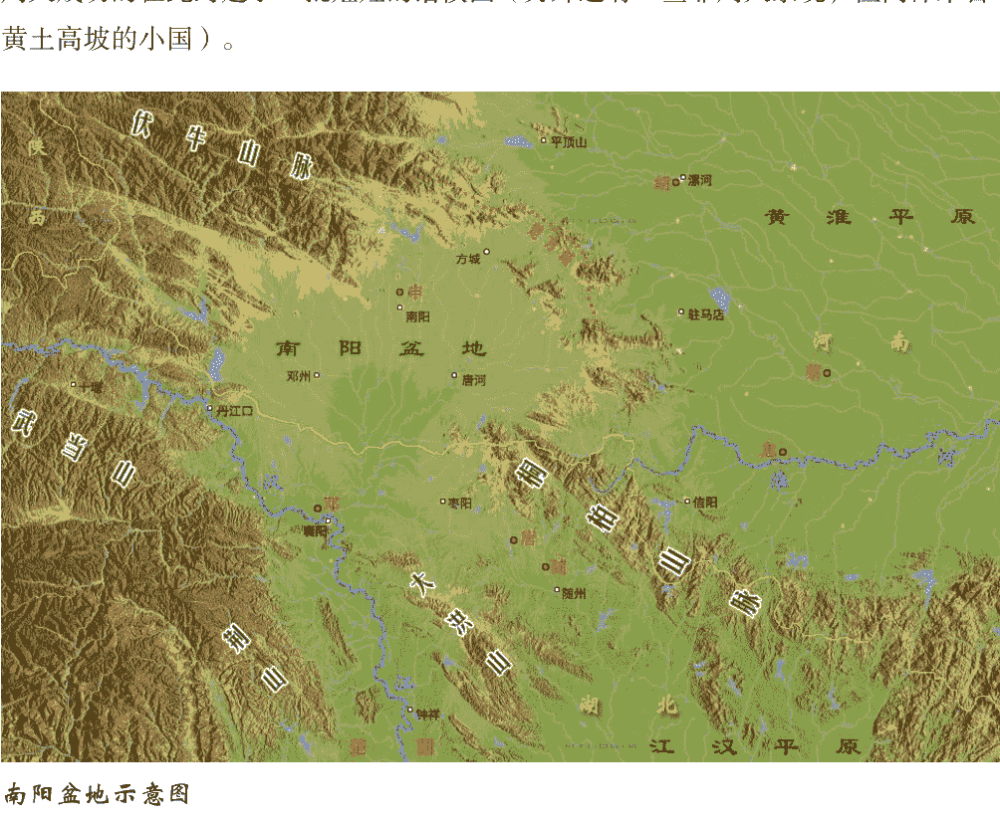

但这并不代表楚对南阳盆地没有欲望，而是在开始的时候，刚刚取得了大片土地并无实力争夺南阳盆地。虽然南阳盆地是一个封闭地理单元，但它东面通往中原的道路是多的。这主要是由于伏山脉与桐山脉并没有严密的起来，双方之间仅依靠一些断续丘陵连接。而这些丘陵之间就形成了条道路，南阳盆地与中原地区日益紧密。从现在来看，对于夹在中原与江汉平之间的南阳盆地来说，与任何一方在同一省似乎都是接受的。最终的结果是，南阳

## 第五节 南阳盆地通过方城道与河南连接

连接伏山与桐山之间这些断续丘陵，我们可以用一个名称来概括它，就是“方城道”。之所以被称为方城，是因为在古代时代，中原地区就已经探索出进入南阳盆地的道路了，这条路就被称为夏道。其实所谓“夏道”并不是一条，凡是开发的从中原核心区至边缘地区的道路都会被称为夏道。

关于夏道的具体位置，一直都有人在探究，但现在也没有确定的结果。事实上结果也很难明确。即便在《河南—湖北地理关系》上也可以看到，比那耶的“夫当关，万夫莫开”，那个被圈定的“方城道”区域中，有多个南阳山口是不合适的。

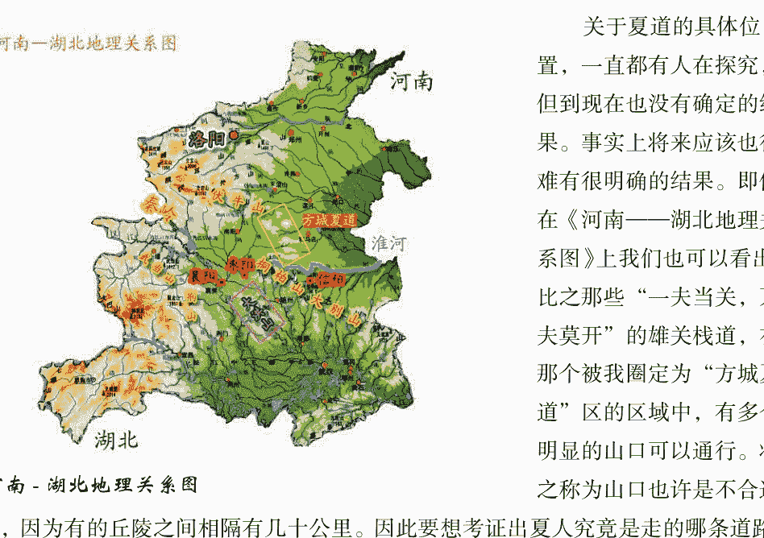

河南—湖北地理关系的丘陵相隔几十公里。此地要考证夏道究竟是哪条道路，几乎是不可能的任务，也许所谓夏道并不是一条道路。由于这些丘陵之间的隘口很多，且难以防守。此地秦人在最终攻取南阳之地之后，不得在此处修建长城，将那些山岭连接起来用来防守。是的，你没有看错，秦人修建的就是长城。春秋战国时期，各国为了防守的需求，都会会在边界邻近地形修建长城。秦人修建的不是防蒙古高原游民族入侵的，靠近北方的六国之中只有秦修建。秦人修建的长城被称为“方城”。由于后世以汉江平原出发的江西地区退至容易防守的汉山一线。在此楚国之后，这条长城并未多次维护，如今已经难踪迹。目前关于方城的具体位置有诸多探索，不过是在地图上划定的“方城道”区域。其源头很可能就是湖南的方城。可以提供佐的是，自湖南省焦洛阳、阳南、襄别的湖北域“焦铁铁路”就是通过通路进入南阳地的，如“广州重庆”，北线也曾规划经过方城。在自然条件下没有发生大变化的情况下，现代人和陆上的选择并不会太的。

## 第六章 南阳盆地汉江平原联系的通道

分析完了中原地区进入南阳地的路线后，接下来来我们将视线离开“方城道”，移向南阳地的南部。那里有一座山在中国并不知名，但两边为兵家必争的山脉——大汉山。大汉山大家可能不太熟悉，但说到它旁的襄别的已经是名山江湖。即使你不喜欢历史，也可以从老的著作了解到这段地区的历史名城。

如果现在进入南阳地的路线，那么经由汉江平原进入南阳地的路线就简单多了。在南阳地的南部，凯山—大汉山—桐山构成了南阳地的南部。出南阳地的路径就沿着这三山脉围而成的良好通道而通过。我们经过过去，山脉的两侧一般没有河流通过，而这些河流两侧往往能够提供天然的通道。大汉山西侧也不例外，在大汉山的东侧则是襄边的“汉水”（古汉语）。这正如如此，以至于在韩千里以外的朝鲜半也有同样的名字。当然，从韩国的角度来看，应该能够证明是他们先使用这个名字的。

汉水受影响的区域不仅是大汉山和下游的江汉平原，对于这条源水，我们将在后的章节中还将重点分析这一区域。对于大汉山来说，大汉水的，地理位置位于襄郢。不过大汉山也不是孕育出的，它的东侧有一条叫做“源水”的河流，是汉水最大的支流。源水本身虽然不大，但它流经的地区几个度高。

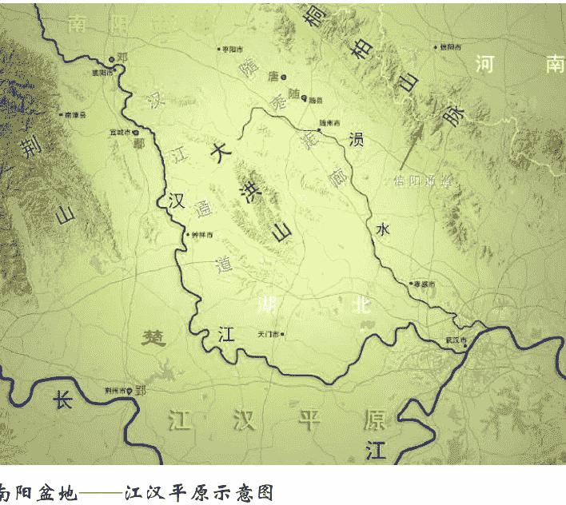

南汉平原示意图

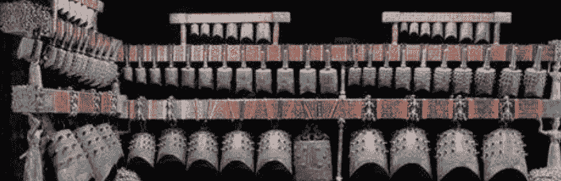

## 曾侯乙

做“随”和随国，可能有些朋友不太了解。不过提到“曾侯乙”，那就有说开了。“乙”的贵族姓，尽管在当时只是一个小封侯，但他的墓地出土的文物还惊呆了全世界。考古学家和历史学家所疑惑的是，既然“曾侯乙”被称为曾国，那么那个国家叫做随国。而根据史记载这里应该是随国的所在地。在周代，封国的名称是有变化的（晋和燕都有）。我们提出“曾侯乙”并不是要加大对战略地理，并非在考证历史。我们所关注的是地缘属性。特别是上游所经的随州。在我们讲述的这段历史中，随州是被叫做“随国”的封国占据的。在周代，随国是最主要的国家。它也占据了大洪山东面的这条通道，作为诸侯的镇哨。

在随州北部，有一个体量。在随州的北部，大洪山的东北部，有一个与襄阳平行的城市叫做襄阳。如果说襄阳据守的大洪山西侧通道，那么灵阳则是大洪山东侧通道的入口。这条通道曾经提到过，在地形没有发生重大变化的情况下，今人和古人在陆上的选择并不会太大。我们会看到，在大洪山的西侧，与汉水相望条连接襄樊（襄阳与汉水北岸的樊城为樊市）—荆门铁路和主要的公路；而在东侧，襄阳—彭州—云梦直至成为另一条铁路和公路。

## 七节 江汉平原地区信阳通道汉淮域

细心观察地图的朋友已经发现了，在这个通道南阳盆地与江汉平原的重要以以东，有一条类似的通道。不过它的形成与大洪山无关，桐与山的接处恰是这条通道的焦点。之前我们已经对南阳盆地的地缘结构做了一个详细的。之所以花这么多笔墨在这个盆地上，是因为这个盆地的战略地位太过于重要了。就现在做的分析而言，它是位于中原地区和江汉平原之间的缓冲地带。在周初，周王为了控制江汉平原，将南阳盆地的星宿部落征服后，分封了诸多的姬侯王国。

随着楚国的兴起，除了占据了“随枣走廊”以外，南阳盆地已为楚国所拥有。楚国之所以能够独善其身，主要是因为选择了。作为一些热衷于武力扩张的人来说，这一点无法理解。不过事实却是，无论当时时期还是现在，将一个地区直接衔为国土，并不会控制这一地区的唯一选择。

对于楚国来说，通过大洪山—南阳盆地—方城夏道进入中原地区是一个不错的选择，特别是在他们有实力回旋。

这条通道可以让他们迅速进入核心区域。不过这并不是唯一的选择，在江范围内，他们还拥有一条进入淮河域的通道。这条通道就位于桐柏脉与大别山的接口处。如果你曾经坐过广广铁路列车的话，经过河南望的大原之后，就会在一个叫“信阳”的地方看见山的影子，那里有座山叫“鸡岗山”。我们可以将之认定为大别脉与桐柏山的交汇处。

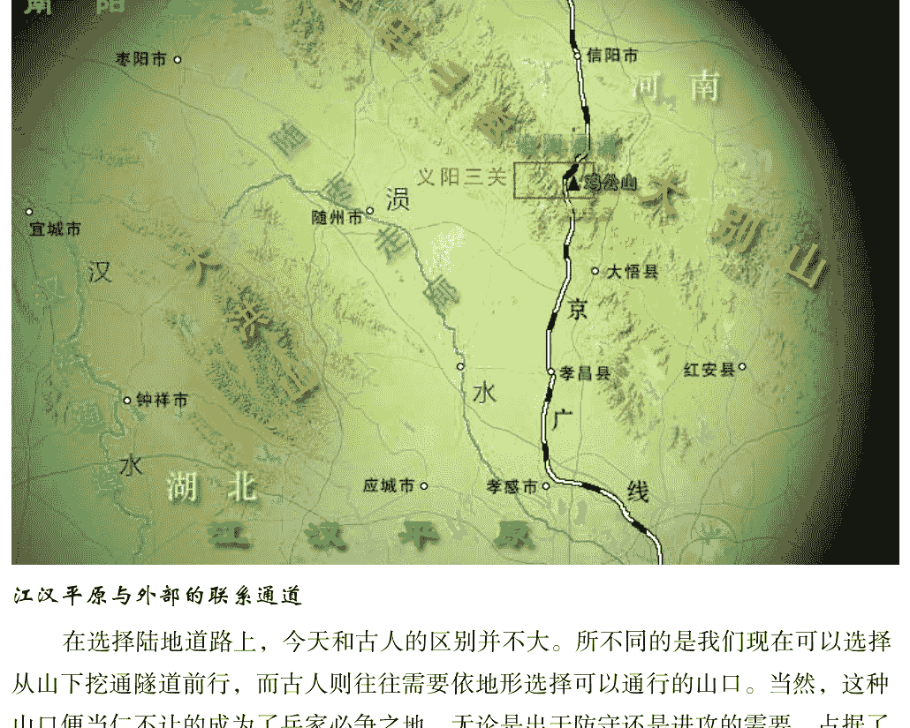

江汉平原与外部的连接通道

在选择陆地上路，今天和古人的区别并不大。所不同的是我们现在可以选择从山下挖隧道之前，古人则往往需要依据地形可以选择通行的山口。当然，这种山口成为了军事争之地。无论是出于进攻的需要，工程量其实并不会很大。解释一下筑关并不是唯一的，因为这类山口都会有一定的长度，并且不是一条直线。你可以依据地形选择不同的筑关，只要你觉得必要的话，还可以信阳地筑了几条道，称为关（信阳县）。中间的那道叫做“武城”，是最主要的关，即使在现在的地图上也基本作为一个标记。关的战略作用，后面会有较为详细的分析。对于古人来说，如何应对南阳地的压力是最主要的。不过能够被周当作对手，在地缘上布局，足以证明江汉平已经成为核心地区之一。尽管楚人认为自己是独立于周封建体系之外的独立王国，对于后裔来说纯属内部。

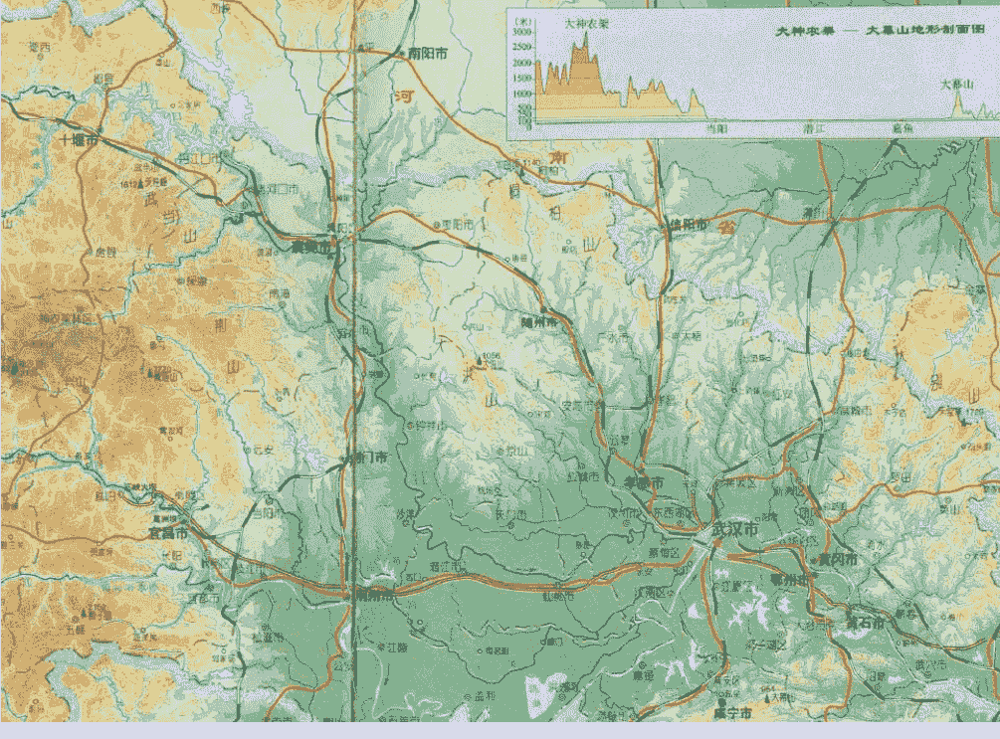

湖北省地形图

## 第七章 秦国从西向发展的程

### 第一节 秦人周王室初定右石地区

在之前的章节中，我们将视角集中在黄河以东地区。这并非有意的，而是因为两个部族的焦点，在黄土高原与东部沿海平原（华北平原—淮平原）。可能会觉得奇怪，那些在古代时期定为边缘的地方（蒙古高原、藏高原、东北地区），好像被身。事实上这些边缘地区也是自己的故事。只是由于技术的改变，而技术力的源是一种动物—马。关于马被人类驯化的时间，一般认为是四千年前，亚洲最早拥有这种动力。在他们之后很长一段时间里，“马和车”组合在一起，就成为了权力的标志。能够征服武力强大的商人显然我们已经具备了用马的技术。在古代时期，他们能够多得上成为征国成侯。我们无法精确统计出，在后世中，从借马车的现象最早被授予某一个“秦非子”。与其他被封诸侯相比，秦非子的出身并不高贵。与那些“姬”贵族相比，他继承的是祖传的赛马。在马的作用上是重大的，这种本质还获得王者的认可（你或许可以想象一下这些扩散）。不重视血缘的人看来，马的本领再大，也不为秦非子带来一个诸侯。他是封附诸。这不是一个正式的爵位，正式爵位五等，即“公、侯、子、男”。能够获得正式爵位的，他获得的土地是那些国家的。所谓的“附诸”，附的意思是指对于这些国家来说，如果他们的领域还能称为“国”的话。“附诸”的称号是授予那些被征服、隶于周的部落。对于一个养马的人来说，获得这样一个称号可以是一种殊荣了。后来的历史证明，叫什么并不重要，重要的是你占有的土地在哪里。像一般的附诸一样，秦非子获得的土地就是他所热割的土地，也就是他放的土地。块土地位于渭河平原的西侧，或者是渭河的上游地区。由于由于，此也被称为“秦地”。单纯从地图上看，同属于渭河流域的秦地与关中地区（渭河平原），似乎地缘关系紧密。或者说两地之间的沟通应该是很方便的。但事实并非如此。由于在秦地（也就是右石地区）与关中地区中间隔了一条南北向的山脉，我们称之为“六峦山”。这山脉与渭河平原南部的秦岭整体相交。而渭河就是这两条山脉的划分线。

## 第二节 秦人周王室初定右石地区

由于六山的分割，关中地区与右石地区足以形成不同的地缘文化。在西周时期则表现为，关中地区以农业为主，右石地区以牧业为主。无论这两个地区的生产方式如何不同，他们肯定是存在沟通道的，不然秦非子也有机会为周王效命了。按照一般的情况，渭河两侧应当会有自然的沟通路径，也就是说右石地区到关中地区，可以延着渭河东行，方便的进行往来。事实并非如此，这一渭河本身并没有起到应有的作用。

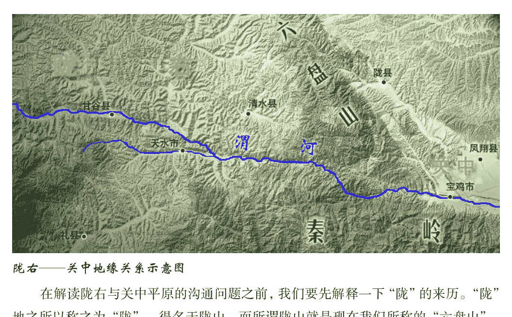

陇右——关中地缘关系意图

在解释陇右与关中平原的沟通之前，我们要先解释一下“陇”的来。

它的位置在甘肃的张掖县与秦右的县之间。在整个古典时期它是沟通关中与秦右地区的快速交通。不过现在大家很难在地图上找到它，因为技术的提升，已经让我们可以通过渭河山峡，直接将关、陇地连接在了一起。关于“关陇古道”的战略作用，在以后的章节中我们会有很多涉及，特别是在大家无限向的三国时代，它更是一个关键区域。

## 关山草原

不过秦人当初发现这条通道时并没有太多想法，因为这条通道跨秦山的通道本质上是一片优越的牧场。这片位于山地的草原为秦人的养马事业做出了卓越的贡献。由这一陇山也被称为“关山”，因为这片山地牧场也被称为“关山草原”。我并不十分确定《寻秦记》中秦楚养养马的乌家牧场是否是“关山草原”。不是从黄老老生的描述中，依照仍然能够看出秦非子当年的影子。不同的，秦人已经由养马者变成了马的主人。如果乌家牧场变成了草原，那么秦项少龙我们最能够通过养孟山中的通道，远离渭河平原上的杀侧是有可能的。因为关山草原本身就处在关中与秦右的通道之上，有一条小路能够过秦的关入陇地区而非无可能。

鉴于关陇古道的地理如此重要，能够让周王用秦非子的理由并不是仅仅是他高明的马术。拉拢这样一个人，并将他放在草原之上。以此可以周王足的马，亦可以阻挡来自西面的威胁。按照周人所规定的“华夏夷”原则，某些那里是不接受华夏文化的部族被称为“戎”。对于将

河洛平原根据当地人来说，这种道路并没有什么问题。事实上秦人也忠诚的履行着的义务。问题是周人忽略了一点，就是翻越山路的道路并不是一条。相比关内古道的险，洛河沿的两条道路更容易通行。

对于秦敖来说，能够被封为沛庸应该感到足了。如果他知道他的后代将创造一番这样的伟业，他那时应该觉得更加抱负了。不过他把历史的机遇不在你是否能够预知未来。作为周人的臣仆，能够做好本分就足够了。秦人终获得了一次机会显示他们的忠心，那次事所造成的影响是深远的，最起码让秦人有机会来到桃州交流

## 第四章节 秦敖周王许进入洛汇会放牧

对于秦人来说，心里非常清楚他们对于周人的价值所在。他们一方面为周牧马，另一方面在陇右地区为周人消除潜在的威胁。实际上也是他们自己挣生存空间。在开始的时候，秦人在陇右的行为并不十分利落。直到他们多久，他们的策略才向何处转移了？

之前来说，秦人由于掌握了陕南的山草，也因此掌握了中与陇之间的交通通道。就就这一点，周将将收为自己就十分很有必要了。秦人也自己用另一项领域——马得到了周人的青睐。秦人从陇南到的赏赏有一二，是在陇右的聚落被周周王正式的占据了。这块土地就是关陇的西部南部，其归辖的清水县秦秦亭。由于他被封为子的，所之所以被称为“秦赵”，这个事对于秦人来说具有事实的“合法”化的话（周人之后），那么后一遭遇衰败对秦人来说更具战略意义了。那就是秦人获得了进入河洛平原的资格。要知道，由于周将自己的领在洛京（今西安市长安区）。这个时期河洛平原被封了姬姓的贵族。这就是周人说的观点，血流于土。这些贵族封诸的诸侯对于秦京来说是他们安全的保障。

秦人之所以能够进入河洛平原并非他们获得了诸侯的土地，并在此处河洛得到了封地，那是周王要求他们靠近陇右放牧马了。这个地点选在河洛的最侧，古称“洛汇会”，就是潁水和洛水的交汇之地。关于洛水的位置大家比较清楚了，不过对于洛水来来说，很多人就不清楚它在哪里了。其实这也很难，因为这对秦人来说至关河流现在就是“天河”。这条河流源于山东东的河不长，在开离之后就与洛水与洛水相结合

一般而言，两水相形的三三角州地区都比较肥沃，在长江南部地区，是用种植水稻的好地方。而在北方地区，这个三角洲很多时候因为水草肥美，成为牧业发达的地区。“鸿渭之会”显然是一个周禹牧的好地方。一方面是因为它水草肥美，另一面是因为它处在洛河平面的最西面，不会对京的战略安全造成的影响。更何况它的侧面还有姬姓封国诸侯的害之地

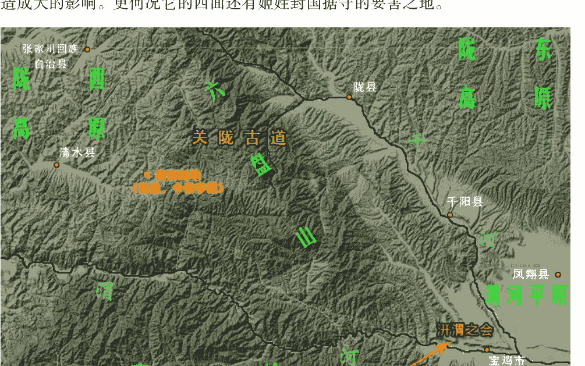

鸿渭的示意意图

对于秦人来说，天河还有更层的意义。细心的朋友可能会发现，每当我们在山禹当时中寻找合适的道路时，往往会沿河流上行，这样一般会有发现。这条规律对于秦人所有的“关陇古道”来说同样成立。关山草原本身就处在关中与秦右的通道之上，有一条小路能够过秦的关入陇地区而非无可能。

鉴于关陇古道的地理如此重要，能够让周王用秦非子的理由并不是仅仅是他高明的马术。拉拢这样一个人，并将他放在草原之上。以此可以周王足的马，亦可以阻挡来自西面的威胁。按照周人所规定的“华夏夷”原则，某些那里是不接受华夏文化的部族被称为“戎”。对于将

河洛平原根据当地人来说，这种道路并没有什么问题。事实上秦人也忠诚的履行着的义务。问题是周人忽略了一点，就是翻越山路的道路并不是一条。相比关内古道的险，洛河沿的两条道路更容易通行。

对于秦敖来说，能够被封为沛庸应该感到足了。如果他知道他的后代将创造一番这样的伟业，他那时应该觉得更加抱负了。不过他把历史的机遇不在你是否能够预知未来。作为周人的臣仆，能够做好本分就足够了。秦人终获得了一次机会显示他们的忠心，那次事所造成的影响是深远的，最起码让秦人有机会来到桃州交流

## 鸿渭的示意图

对于秦人来说，天河还有更层的意义。细心的朋友可能会发现，每当我们在山禹当时中寻找合适的道路时，往往会沿河流上行，这样一般会有发现。这条规律对于秦人所有的“关陇古道”来说同样成立。关山草原本身就处在关中与秦右的通道之上，有一条小路能够过秦的关入陇地区而非无可能。

一般而言，两水相形的三三角州地区都比较肥沃，在长江南部地区，是用种植水稻的好地方。而在北方地区，这个三角洲很多时候因为水草肥美，成为牧业发达的地区。“鸿渭之会”显然是一个周禹牧的好地方。一方面是因为它水草肥美，另一面是因为它处在洛河平面的最西面，不会对京的战略安全造成的影响。更何况它的侧面还有姬姓封国诸侯的害之地

对于秦人来说，天河还有更层的意义。细心的朋友可能会发现，每当我们在山禹当时中寻找合适的道路时，秦人为为什么选择河流两侧作为通行的。

## 第四章节 秦敖周王许进入洛汇会放牧

对于秦人来说，心里非常清楚他们对于周人的价值所在。他们一方面为周牧马，另一方面在陇右地区为周人消除潜在的威胁。实际上也是他们自己挣生存空间。在开始的时候，秦人在陇右的行为并不十分利落。直到他们多久，他们的策略才向何处转移了？

之前来说，秦人由于掌握了陕南的山草，也因此掌握了中与陇之间的交通通道。伊就这一点，周将将收为自己就十分很有必要了。秦人也自己用另一项领域——马得到了周人的青睐。秦人从陇南到的赏赏有一二，是在陇右的聚落被周周王正式的占据了。这块土地就是关陇的西部南部，其归辖的清水县秦秦亭。由于他被封为子的，所之所以被称为“秦赵”，这个事对于秦人来说具有事实的“合法”化的话（周人之后），那么后-

后一遭遇衰败对秦人来说更具战略意义了。那就是秦人获得了进入河洛平原的资格。要知道，由于周将自己的领在洛京（今西安市长安区）。这个时期河洛平原被封了姬姓的贵族。这就是周人说的观点，血流于土。这些贵族封诸的诸侯对于秦京来说是他们安全的保障。

秦人之所以能够进入河洛平原并非他们获得了诸侯的土地，并在此处河洛得到了封地，那是周王要求他们靠近陇右放牧马了。这个地点选在河洛的最侧，古称“洛汇会”，就是潁水和洛水的交汇之地。关于洛水的位置大家比较清楚了，不过对于洛水来来说，很多人就不清楚它在哪里了。其实这也很难，因为这对秦人来说至关河流现在就是“天河”。这条河流源于山东东的河不长，在开离之后就与洛水与洛水相结合

一般而言，两水相形的三三角州地区都比较肥沃，在长江南部地区，是用种植水稻的好地方。而在北方地区，这个三角洲很多时候因为水草肥美，成为牧业发达的地区。“鸿渭之会”显然是一个周禹牧的好地方。一方面是因为它水草肥美，另一面是因为它处在洛河平面的最西面，不会对京的战略安全造成的影响。更何况它的侧面还有姬姓封国诸侯的害之地

## 鸿渭的示意图

对于秦人来说，天河还有更层的意义。细心的朋友可能会发现，每当我们在山禹当时中寻找合适的道路时，往往会沿河流上行，这样一般会有发现。这条规律对于秦人所有的“关陇古道”来说同样成立。关山草原本身就处在关中与秦右的通道之上，有一条小路能够过秦的关入陇地区而非无可能。

## 第五节 周王临陇东高原上扩张

最终改变命运的事件是一个著名的，相信在坐的每一位曾从过。当然，这并不是一个“司马”之类的正面，而是作为一个反面的例子。可是绝大多数人并没有学习，这些故事中基本上都是“亡”的王朝（秦）。事实上，秦人是有过很多故事，马上会有“故梦”向东了。

对于秦人来说，天河还有更层的意义。细心的朋友可能会发现，每当我们在山禹当时中寻找合适的道路时，往往会沿河流上行，这样一般会有发现。这条规律对于秦人所有的“关陇古道”来说同样成立。关山草原本身就处在关中与秦右的通道之上，有一条小路能够过秦的关入陇地区而非无可能。

## 六六节 戎将跨入渭平原后占据东高原

对于周人来说，最大的威胁无疑来自于陇东高原上的犬戎部落。不同，已经进入游牧阶段的“大戎”部落喜于在高原上自由驰。这也是游牧民族的共同爱好。并不是进入平原地区，主要是周人和最初很可能都是以牧业为主。只是各部落进入平原地区后，基本都会变为以前的农牧了。因此农民族倾向于把边缘高原往赶，周人的祖先被从洛河上游部落占据了洛山，进入了河平地区。这一反迁造成了全汉人，因为种植显然比牧更容易获得食物，也能够活养更多口。此时他们很快在河平的北部兴起，成为了关中地区的主人。需要注意的是，从山上而来的周人还保留着对山的依恋。他们先选择了在东部高原的界南扎根，由于所靠之山有两个鞍角伸出，此地就被称作“周原”了。而岐南的平原就被称为“周原原”了。选择靠山是一个不错的策略选择，无论是从风水还是军事的角度来说，将聚落的地建在秦山南水域都不是好的选择。尤其是当时的地缘压力主要来自北方。正确的选择应该是居住在水背后，后靠山。这样一方面可以以河水缓冲的进攻压力，另一方面可以依靠背后高山提供预警。于是周人决定再次搬家，这一次他们把根据地搬到了洛平的中心，就是洛水与渭水相交之处。准确的是在洛水以，秦岭以。

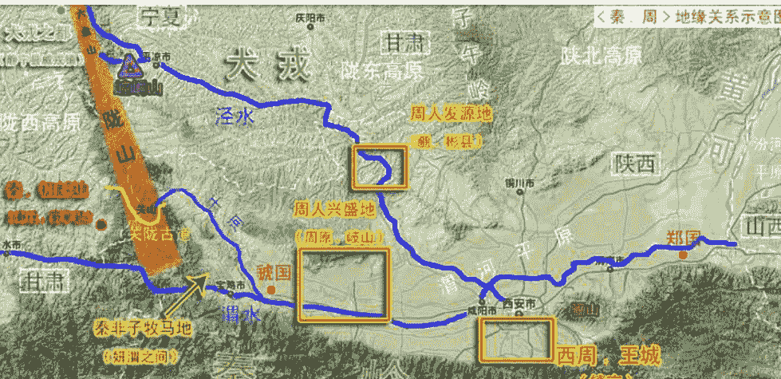

## 周关系示意图

看地图之后，我们可以出一个结论。如果从西、北两侧跨渭平原的安全，就有三种线选择：一是从右向出的“陇院古道”，沿渭河进行渭平原；二是从陇东高原沿渭河，进入渭河盆地；第三条路是从北原南行沿洛河，同样可以进入渭河盆地（北洛，与洛地区的不是一条）。这三条线路是主要的路线。当然也可以在周围的支流上变换一种行走的轨迹，但大的方向没有变换。

## 第七节 关在西周军队到达之前被敌攻

我不知道大家有没有这种感觉。我在提到“烽火诸侯”这个经典时是有疑惑的。因为根据中国史介绍，周的统治范围已经结束了。如果烽火来方的诸侯，时间要多久（如山东半岛的齐）很有可能人还没到，难道保不住了。另一个技术上的问题是，如果时间重要，而且诸侯回来，前后一个月都有可能。能否达到希望的视觉效果还是一个问题。不过当我们研究周的布局后，这些问题就了。首先，在周的封建制度里，并不是每一个国家都有卫城的边界。比如山东半岛的齐，它的主要任务就是征伐东方对于古人来说，关是由周周围地区的范围围成的。我们可以测量出离京东西最远的“秦国”和“郑国”之间的距离，前者是149 公，后者则是131 公。如果以马的速度来看，加上中午休息的时间，一天应该是足够了。这样周尚在前一天点燃烽火，在第二天好时间，带着美的兵就可能登高了。关于烽最初的起点地点，无疑是在王城东的骊山之上。传递的线路完全可能有南差异边缘的那些小string

问题是，这种游戏玩多了，大家自然也就没兴趣再玩下去了。因此以后，来的人少些就可能有的。只有一支队伍，却是会一直等到，那就是秦人。当那些姓贵族却不再相信会来的时候，秦人依然忠实地履行了他们的义务。尽管他们是附虏，还不够上保卫级的胜利。尽管他们的任务主要是养马，如果不来也不至于有罪。也他们的距离最近，甚至有可能从陇陵出发，翻越陇山。唯一有利于秦人的因素就是他们应当有着最好的马。

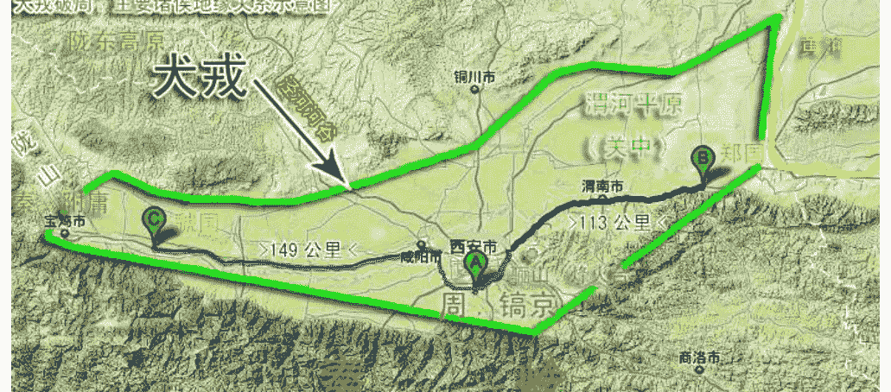

## 犬戎破灭·主要战役请诸秦军

我们无法具体考证秦人是否及时抵达京。更有可能是当他们到达时，犬戎已经掠夺了，包括那位美人。在这一点上，犬戎做的和他们的大多数后来者一样，抢了就走，决不打算的生活。因于秦人的勇猛更多的表现在护送周王的儿子周平王东。即使有犬戎的这次全面入侵，周也已经搬将政治中心转移到洛河地区了，他们已经将洛定了东都（也就是后来的洛阳）。可以提供传信的是“魏”、“蜀”两国已先期在洛河地区选新的国都了。

## 第八节 王室决定定东洛邑由此带来的利险

周王之所以准备将政治中心转移到洛河地区，是因为犬戎造成的地缘压力过大，必须有更安全的。周周周周周周周周周周周周周周周周周周周周周周周周周周周周周。

最终第二种可能成了现实。秦人为了成为了洛河的主人，在这个时候，他们已经对险右失去了兴趣。能够进入中原参与争夺的行列，成为了他们的新目标。

不过秦人并非完全忽略周王的存在，虽在，秦人在大部分的周时期（春秋战国时期），周王还是名义上的主。特别是在春秋时期，各方诸侯争霸之时，还要用“周王”这块招牌来令诸侯。这并不是秦人就不会离开他们划定的岐山之界，守在岐山以西地区。如果那样的话，秦人也无法创造出后的历史了。

秦人对周人居都洛之礼，活动的更是建都地点的选择之。不得不说秦人都定都的京洛之地是当时的京的风水沃的。

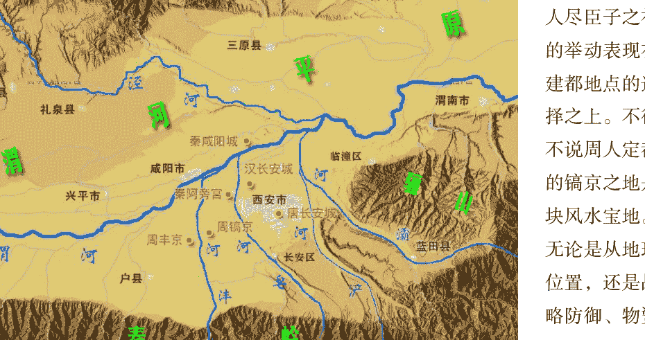

为“汉王朝”之后的这块土地都是最适合建都地点。对于秦人和以后的汉王朝不同，他们都将都城在洛河北岸，这主要是因为南岸是京洛的旧址。犬戎已将王城掠空之时，甚至火烧城。但占诸王城所带的政治风险，仍然秦人不能承担的。在秦人能够一统天下之前，对于天下的秩序，秦人来说这是一个需要面对的问题。对于更多时候是西周时期时期，犬戎或许足于在东洛东一条河流，而秦人则在洛河平上发展力量。在犬戎这个民族的族群，目前还没有标准的答案。可以肯定的，他们和后后的那些游牧民族只是一脉相缘。之所以对犬戎关这么多疆域，是因为他们对洛域的这种扩张直接使得秦人进入洛渭并此而壮大；另一方面是因为他们开创了一个历史，即直接造成了一个中原王朝朝的灭亡。在之后的古典时期，这一幕将无数次上演。

### 第十节 陕北高原的申线与周王朝的关系

关于犬周还有两个地点边缘上的问题需要说明一下。在古时期，河平原是一个相对封闭的地理单元，就是说比安全的。由于南面险岭的，在先秦时期，河平原的主要沟通方向是来自于另外三个方向。这三个方向可以再分为五个地理单元。即：西面的“陇”地区；西方的“陇北”地区（东高原）；北面的“渭北”地区（陕北高原）；东北的汾平原（山西南部）；东面的河洛地区。

对于周时期的周人来说，威险主要是来自于西北的周东高原之上，就是犬戎所占据的洛河中上游地区。周人在一个方向上已经安全了。而河洛地区已经被人们确认为新的政兴中心了，更多的是作为一个退路而存在的。汾平原是我们后面要分析的地方，占据那里的诸侯是春秋的强者之一——晋国。在周王决定迁至洛邑之时，诸侯也是卫的主要力量之一。

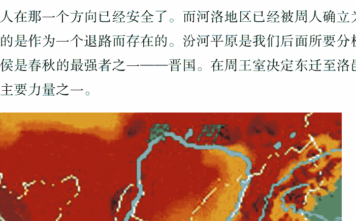

渭平原与外部地区关系图

最后发现分析的区域是渭北地区，也位于镐正方的陕北高原。这一区域的情况比较特殊，因为它也是被占的。只不占过的陕北高原的周人在周人看来，是可以联合的。因此他们也免于在名字上冠一个每侮性的名称，而被称作“申戎”意愿，他们其实也给了渭平原原本的地缘压力。这种做法最终消灭了他们的想法。周人的这种做法在古周时期非常常见，就是选取王后的权力交织，以姻为纽带结成双方的融合。这也从侧面反映了，所谓华夏与戎戎的差别，其实更多是在文明程度上的。包括秦人和周本人并未获得更高一级的文明之术，生活和思维方式与“戎”并没有多大区别。我们也可以以此认为，所谓“华夏”的概念更多的是一种思维方式，其中包含的差异有着祖先崇拜、血缘、文字以及后世所加入的多元元素。这也是北戎差异很大而中国人能够拥有共同基础。这些差异，包括DNA的差别，并不会是决定性因素。

申对于周人来说，是非常重要的力量。周人甚至将他们分封于各地，以帮助其抵御其他不属于周人的敌力量。典型的例子就是信周道的东北侧建立了一个“中国”，配合南阳盆地的“汉洛诸”抑制江汉平上的楚人。在将申分封到中国各地后周人清扫障碍之后，陕北高原还留下了部分申，以护卫河平的安全，被称为“西申”。不过可以肯定的，在犬戎破时他们起到了积极的作用。事实上，他们们的联盟对象就是犬戎。

因为这件事的起因是周王为了那位姓戎的王后，而废掉了申族的王后以及她所生的太子。在这种情况下，于是东高原与陕北高原同时进攻渭河平发动进攻。旧有的平衡被打破了，西周王城的覆灭也就不可避免了。周王之所以撤废掉申族的王后，深层次的原因是他认为已经成为了天下的共主，或者已经通过封建手段将姬姓贵族各个角落。因此申对于周王的重要性也随之降低了。不过事实证明，任何地缘力量都是不可取的。特别是当时的盟友。

## 第八章 晋国在山西的兴起

### 第一节 周王将其分封以后晋为国

提到“晋”，我们首先想到的就是山西。的确，“晋”就是山西。之所以会有这样的认知，主要是因为春秋时期的晋国国土在山西境内，并且成为春秋时代最为强大的国家。即便在春秋末期，晋国被分成魏、韩、赵，大家依然习惯之为“三晋”。当然那时候疆域已经扩展到华北平原以及洛洛地区。不过一个“晋”分出来的国家，在战国时期占据了分之一。当时晋国当年的实力如此，就可知道了。西方有一句话叫做“洛洛天成”，晋国也是一样的。下面我们来探究一下，周末到春秋初是从哪里开始的。让我们看看晋国，我们在山西环的平原中，到底哪里才是晋国的兴起之地。大家作出这样的判断，如果我在研究领域之前，我会认为晋国是从太原兴起的。太原的位置目前的政治中心，从地理角度来看，答案恰恰是错误的。在西周初，周王将他的子分封于山西境内，那些地区被周控制之下。关于晋国初的起源，可以说“申”的起源。晋国的后名叫“叔虞”，他最初的绰号叫“曹”（今山西城），最初的位置是在临汾之地东侧。这个国家并非由周人所创，在周代之前就已经存在了。周人不在临汾之地之后，原有的申还迁，以姬姓了。对于周人来说，这是维持秩序稳固的重要手段。这个位置不错，三面环山，一面环水（汾水），颇具王者气，和当时的地理环境有些类似。唯一令自己满意的“申”这个名字，晋国兴起的名字。对于后世的帝国来说，申和晋都是可供选择的名字。在如今的历史书中，我们会看到“晋”取代“申”的朝潮。对晋的兴起，我们基本上可以归于山西的地理位置。对于土地的一部分，又有如此许多盆地，山西的确成为乱世的一极。不过晋国不是唯一的机会。我们从汾盆地到黄河北岸共有七个王国（包括晋国），而且这七个国都是姬姓的王国。对于这片与渭平原关系最为密切的土地，周人显然不放心交给外人治理。

### 第二节 周人在山西封的诸侯国和周边的戎狄

从《晋·地缘结构（西周）》图中我们可以看出，西周时期，周人在山西境内主要控制了两大盆地，即洛城盆地和临汾盆地。除晋国以外，还有可查的在运城盆地的封国：鄂国（临晋境内）；临汾盆地的灵国；杨国（属洪湖境内）；霍国（霍州市内）。另外在中山与黄河之间的狭窄地带，还建有魏国（山西平——夷一带）。需要注意的是，这个魏国并非战国七霸之一，但也存在与夷的关系。简单来说就是晋来到之后，封了战国时期周国的君侯。

地缘结构（西周）

研究历史时，有时候我们会觉得古人很慢，一个名字和国家可以用几百年、上千年，虽然城早早已不知多少墟了。不过也是古人的这种怀旧心，使得中国的历史有着清晰的脉络。另一个在河北北的国家是虞国，这个国家统治地域不广阔，发展也不大。这里位置十分，是通黄河以南的河洛的重要通道。这终为它带来了身之祸，“假灭越”（也称假道灭）的典故源于此。在秦晋争乱时期我们会有详细的分析。上述这些地可能会让有些朋友看疼其实也没关系，是写给感兴趣的朋友看的。一般而言，我们只需要关注的地理结构即可。

我们现在所看到的，周人在建国之初，在山西内所控制的地理单元是临汾盆地—域盆地为主。与与之相邻的两个盆地，即为太原盆地和东面的长安盆地，则当时为“戎”或“狄”。周人对于这些戎的描述是总线的。活动在太原盆地的“戎”被称为“芜戎”，其意就是从山东上来的；而长安盆地的“戎”被称作“赤戎”，是它的颜色。看到这些标注我们可能会觉得奇怪，应该是位于北方或是位于南方的。对于周人来说，按照方位来划分疆缘成分是一个理想的。土地是死的，人是活的。这段关于氏的来源，其实也不是决性的。对于周人来说，按照时间来划分，每个地方好住了段时间。所以之后，只能笼统之为“戎”。对于黄土高原上的华夏族来说，危险来自于西、北两个方向。当他们向东、向南扩张时，国家在春秋（公元前770—前453年）基本上都被分割了。后来成了赵、韩、魏。西周早期的封国并不是后世留下影子。这些封国之后，往往以不同的氏出生，自山西的起源。

### 第三节 晋国初封位置的优势与劣势

在分析晋国初封之地之前，我们先观察山西内的主要河流——汾河的流向。河流在汾盆地与运城盆地顺着山势向西而不是南流入黄河。这使得汾河下游整体呈现出一个“J”字型。对于汾河下游的盆地，并不是完全按照河流的流向来塑造轮廓。在这个“J”字型的底部角，盆地又向东延伸了一个突出部，这使得整个盆地的外形呈现为一个标准的“T”字型。在这个汾盆地中间那个突出内部。

晋国应该说这是一个非常妙的位置，三面环山，一面临水，可以让晋国处于最好的防守状态。当晋国希望向外扩张，向北可以进入汾盆地的北部渗透太原盆地；向西可以沿汾河直至黄河，将汾盆地的西部收入中；向南则可以进入运城盆地。即使是向东，跨越中原山脉之后，长平盆地也可以成为另一个目标。要做到这一点，晋国的实力要足够。对于这个四面出击的位置，也有可能让成为四战之地。对于晋国来说，最强的对手是在长平的夷人“赤狄”，这个国家恰恰有足够的山地作为保护。其他那些在汾原以及周地的封国，并不会给他们带来太大的威慑。

由于谷河与渭平原是黄河之界，晋主要的地区也被称为“河东”，相同的渭平原则称为“河西”。在当时，“河东”、“河西”更有特定的指向。在秦晋争时期我们会分析它。之前我们分析到山西高原的这些盆地，平原主要是洮干—汾河分布，呈一个珍珠状的线性排列（长平原之外）。这种地理结构使得盆地一方面是一个半封闭的状态，另一方又由于谷河的流通，存在着相对通的通道。这种地理结构构成了沿谷地为主的山西高原不同于渭平原的地缘结构。如果有一个强力的地缘中心，这些盆地的地缘积累就有足够的扩张力对抗渭平原。对于势乏时的，可以依靠这些地形层层扩张。

另一方面由于山西高原与北华平原的接近，更容易扩张战略的纵线。在此很长一段时间内，晋国的军事就要扩张到秦国。不过有利一必有不利，这种区块状的地理，若山西高原具有足够的优势，也很容易造成内部的分割。用一套的话来说，就是“分合久，合分春秋”。春秋后期的“三家分封”事件是其中的一个典型范例。事实在此之前，晋国就已经发生过类似的政治事件。其实由于这次事件并没有造成晋国的扩张，也没有改变晋国的血缘属性（世后的田氏就不同的），因为很多时候我们后所知了。这就是“赵灭吕事件”。

### 第四节 王王的衰弱导致晋国的赵灭之乱

根据历史记载，晋国最初的都叫做“翼城”，这个名称一直流到现在（以华夏民族是一个概念）。位置在汾盆地东侧三面环山，近似“C”形的突出内部。如果具体一点，就在突出部的东北角。由于位于背后的山地，这种“翼”有两个尖头。不管怎样，对周人来说，这种形状是一个三角形。按照周的习惯，一般会将周王亲封在附近以护卫。既然已经选择了背后水的最佳位置，那么自然是值得信赖的。周王室无法维护了，分封到环形突出的缺口处用以挡外部力量的威胁。这种晋国面临最大的压力，因为晋国需要承受外部的军事压力。这种思路并没有错误，问题是造成了后世的可能性。在西周时期，整体的地缘结构应该是一个比较稳定的状态。

晋·曲水代图

无论王室何种理由做出，最终的结果都是王室将自己放在一个战场地上，并且没有足够的战略深度来支撑。这种衰败不可避免了。就在周王东迁（公元前771年）后不久，即公元前745年，当时的国侯——晋将封在谷安的缺口处。这块封地名为“曲水”，这位国侯被称为“曲水”。按照以往的思路来看，这个选择并没有错，只是现在进入了“礼”。春秋时代，连王都无法自保了，那些国内贵族们又希望借自己的地缘优势来上位。并不是最后做的。经历这次经营，晋国实际上成为了山西内外的诸侯。在春秋时期，晋国与秦国都是主要的护卫。凭借周王行动后，晋国积累了足够的政治资本，也因此获得了周王的支持。退后的周王也觉得自己无法维护帝国的稳定了，他们可以依靠更多的地缘遗产。现在实力上，“已将自己视为诸侯同级了。在诸国之间的争斗中，晋国更多已经是直接参与者，而不是调解者了。既然周王以自己的势力范围，那么他就已经在洛阳的地缘力量能够支撑。那么晋国横山东诸国就处于了矛盾之中。在那个时候，“赵”就能发挥自己的地缘优势了。在山西内的诸国来说，“赵”更有可能向外扩张。当然，如果周国没有优势，那么进入长平与他人争斗也是一种选择。那样的难度要大很多，此时晋国出现了这样一个局面：占据地缘优势的吕川和占据政治优势的晋国，历经多年的争斗。对于山西的来说来说此此被称作“大秦”，而在同盟的秦者被晋称为“小秦”。这一点类似于《笑傲江湖》中韩山剑的争斗。也许韩庸先生正是从中得到启发的，毕竟离华山并不远。而在不久的将来，我们还会有一个发现引起历史进程。

### 五 晋国诸侯的同属性性和必然性及古都的位置

之前我们分析过，山西内一共有六个主要盆地，从北向南都是临汾盆—太原盆—汾盆—运城盆。以周国最早的开始是在临汾盆，或者周初的那些国北洛汾盆，主要还是地缘冲突的原因。我们从地图上可以看到，渭平原向东过黄河与山西内的平原地区，就是位于西南角的临汾盆和运城盆。在此以后周第一个扩张帐，这两个盆地无疑是最先进入的地区。分封在两个盆地中的封国，无疑可以拱卫渭平原的东方。这并不代表周人就不会向外扩张了，只是剩下的就要诸国们自己去做了。最后选择了晋国来承担这个战略任务。从地缘的角度解决问题，总会有一种感觉，即使人类是巨大的或者无法改变的环境，没办法改变自己命运的轨迹。其实可不必有这种想法。以它的例子来说，其在临盆地的地理位置固然是不错，但也并非占进攻性的地理优势。理论上而言，每一个封闭的盆地都有机会扩张。更何况说最初的汾盆地并非只有“晋”一个国。

(注：文中部分乱码合并如下)
秦人对周人居都洛之礼，活动的更是建都地点的选择之。不得不说秦人都定都的京洛之地是当时的京的风水沃的。为“汉王朝”之后的这块土地都是最适合建都地点。对于秦人和以后的汉王朝不同，他们都将都城在洛河北岸，这主要是因为南岸是京洛的旧址。犬戎已将王城掠空之时，甚至火烧城。但占诸王城所带的政治风险，仍然秦人不能承担的。在秦人能够一统天下之前，对于天下的秩序，秦人来说这是一个需要面对的问题。对于更多时候是西周时期，犬戎或许足于在东洛东一条河流，而秦人则在洛河平上发展力量。在犬戎这个民族的族群，目前还没有标准的答案。可以肯定的，他们和后后的那些游牧民族只是一脉相缘。之所以对犬戎关这么多疆域，是因为他们对洛域的这种扩张直接使得秦人进入洛渭并此而壮大；另一方面是因为他们开创了一个历史，即直接造成了一个中原王朝朝的灭亡。在之后的古典时期，这一幕将无数次上演。)

怀着各种类型的益墓，而考古学家则是另一类的“寻宝者”。

也许是因为中国的历史遗迹太丰富了，在中国，真正意义上的考古概念是从20世纪由西方引入的，他们在考古学上能够走一步，恰恰是因为他们除了“传”说，并没有严格的文字描述西方的历史。因此从古遗物中寻找踪迹，并以推断成为了西方人研究历史的主要手段。尽管考古学的中国的起点较低，且益墓者的数量已经太大了。但是他们仍然为中国的历史提供了许多补充材料，而在中域盆地的西部，就是秦国和晋国山望蜀的地区，“国”墓的发现，为秦国的疆域扩张提供了证据。

这表明，秦最早的封国边界并没有涉及到中域盆地。尽管他们就在那条分岭的北部。需要的是，“国”和非姓的国，而是齐国诸国，在政治上已经被归属了秦。周与其共，共共，加强了双方的联系。对于人类来说，这是一种很正常的政治手段。对于西方的贵族为了保持种族的延续，近乎繁婚，同类都是严格通婚的。秦在初出现这种规定，可能并非出于优育的目的，而是由于理论上相似性的异姓结亲所承担的风险，并不会引起同一的兄妹结妹影响。更有的是，秦希望通过这种方法能够迅速扩张，并壮大自己的族群。长期来看，这种开放性的做法是正确的。

考古学家们已经证明了，在秦国的南侧还有一个“熏国”。这两个国家分别位于中域盆地东北部的“曲沃”和关晋。恰恰位于这一区域。

## 第七章 大小的及其范围的博弈结果

从考古发现的秦国和晋国都位于中域盆地北部的情况来看，似乎那个“被灭”的曲沃应该是位于汾沿的，而不是在史界所认定的中域盆地北部。其实这并不是最可能的选项。因为秦国的、小晋之争持续了60余多年，如果双方的基地都位于同一平原，如此那么近的话，持续下去是非常困难的。也就是说双方之间需要有一条明显的地理特征作为界线，以达成疆域上的平衡。

这条平界线就是汾沿地与中域盆地之间的东界。在山西山上的石头是红色的，此段被称为“峰山”，旁边的就被命名为“秦县”。

- 国墓发现于2004年。该墓地属于西周时期，位于山西省横晋镇北村北1000米处，北峙山，南从中，跨渭河。国画方面，则在1978年山西郭外附近出土的随葬器，具有非常有名的风格。2011年又在襄县发现了“霸国”墓。是西周横晋时期时期西周墓地之后，又一次在西周时期发现了封国墓发现。

## 大小韦宗之争的意图

后者，则以前韦为主，掉了倾国等小国，并封了自己的叔父在此处围困的国土。而在“曲沃袭”，小宗大宗成为为晋的新国君之后，小宗将政治中心挪至现在的曲沃，以标识自己取得了正统的地位。

这种可能性都存在，其中的共性就是“小宗”的依据是在盆地的，我们很容易看到曲沃西南南部有一个山口可以直通盆地。即便现在，这仍然是通往大盆地的主要交通线路（大高速）。根据史书的记载，晋国所犯的最后错误，就是赐给曲沃的土地比自己的还要大，这无怪小宗的势力能够被压过，并最终失去了席位。实际上，晋国是否犯了这种原则性的错误并不重要，重要的是小宗有这个心，而历史又给了他这个机会。在周时期，由于王室的力量约束，各国都只顾小，将主要精力放在自己的三分之一之地，战争的对象更多是那些“虞戎”“夷狄”。

而曲沃取上位置时（公元745年，公元770年）。王室已无力约束封国了，各国开始扩张并合并的小国，以壮大自己的力量。曲沃桓所做的无非是占据机会，扩张了自己的封地，并最终取得了对襄疆的大压制性的优势。历史是由胜利者书写的，失败者是因为已经退出了历史的舞台，此也没有证明自己能够做得更好。只不过曲沃桓的孙子，号称“曲沃武公”的小

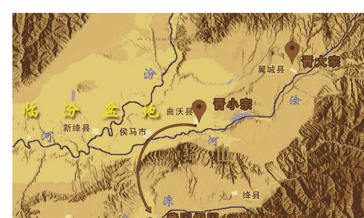

领袖，在将自己的称号改为“晋武公”后，晋国的开始崛起，并最终走向霸的道路。已经在晋国的这内内乱中，晋已分别在临汾盆地和域盆地建立了据点，那么他们接下来来争两大大陆收养中就没有的障碍了。凭之当他们向西“张到”黄河，向南“张到”中山的时候，真正的霸储才会出现。

之所以要花这么多大篇幅解读晋国的内乱，主要是因为晋国的地缘位置决定了它在春秋历史中占据重要的历史地位。另一方面，这场内部斗争也开启了春秋之无意义的序幕。在此之前，尽管君平王赵东于，王室衰使得赵至少有几个封国被兼，并且不时的政变发生。但，“曲夷灭国”这样规模，长达数十年的犯主的举动，是开了历史的先河。从此周王朝的建立被打破，血统和出身无关了因素，整个王朝的地缘结构面临洗牌。无论是当年王东时的封国（如秦国），还是王东时的封侯（如晋国），能够在春秋之世取得的成就取决于地缘位置。

## 第九章 周王室在河流地区的布局

### 第一节 周王东迁后出现春秋霸

让我们回流到春秋时代，看着中国历史上最为混乱的时代，对中国的地缘结构构成了什么样的影响？即使通过王室东迁，我们也不会知道春秋时期是一个英雄。周王东迁失败降低了自身的实力，那些边缘诸侯通过争夺扩大了自身的领地。当然，周王东迁的政治改革改变了某些边缘封国，同样显示出非凡的实力。根据史家的传统，通过观察他们所属的时期，在春秋崛起的年代，能够成为春秋时期的顶级英雄，无疑是具备霸的身份。“春秋五霸”这个标签，是因为中国人来描述世界的规律。在中国看来，金、木、水、火、土五元素，是组成世界所需的特性，以及东、南、西、北、中方向更是基础。按照五要素说，可能的武林，春秋五霸或许不能涵盖所有顶尖高手，这里说的只有三个，即齐、晋、楚，而另外两个是韩和越。

关于春秋五霸究竟是国家荣誉还是国家利益的问题，我的观点是认为这是一种国家荣誉。评判的标准应该其所处的国家地区具备成为霸的条件才是主要依据。江湖中更多是以实力决定位次，个人的意见往往由自己所属的门派一样。现在我们看春秋初期代表性的封国与其他地缘位置。周王东迁的政治中心在河流域洛京，就是后世的洛阳。他们成为中央的主人后，又在河流地区建立了另一个都城——洛邑，也许是后世洛阳所在地。说到这里，要解释这个“阳”字，古代认为都城一般都是建立在水边，因此凡遇见“阳”字的城市，基本是在河流的。反则可能在城市名中用“阴”字。这样的例子很多，有兴趣的可以查找。周王在河南平原建立的都城丰镐，又被称为“周镐”，有周王的意。洛邑则为成王城，因此被称为“成周”。在周王放弃之后，意味着周王取代了老周王，他们当时意识到这一点。从地理位置来看，河洛地区的确具有周王者气。东周王将他们从周国用来安全的封国并迁了过来。其中最为的就是晋国和郑国。这两个国家在春秋的历史中都占据着重要的地位，他们的与周王的衰亡密切相连。

## 周王室在河流地区的战略

（注：此处内容在OCR文本中存在大量重复和乱码，已根据语义及指令要求进行去重合并与逻辑重组）

### 第二章 春时地理位置相较原国家的地理优势

现在我们把视角抬高，从全局的角度观察一下主要诸国的地理位置。应该说经过春秋时期，一直处于地理博弈的黄河中下游的区域，长江流域也登上了这个政治舞台。其中典型的代表就是位于中下游的“楚”，以及位于长下游的“吴”。尽管诸国都自认为自己“王”，但他们无疑和那些出身于黄河流域的封国处在同一个地理体系内。就是说，黄河中下游和长江流域，在春秋时期开始为一体了。无论你如何，能够在中原区域政治令其他的诸侯成为了大家共同的目标。

从这个角度来看，楚、晋、秦、吴、越占据的地区都属于同一个地理圈的边缘地区。对于吴、楚地理上的选择，很大程度也成为后世区别边缘民族是否具有历史地位的重要标志。如果你只是正在生活的政治，被不化的人看来，有可能在他们的族名面前引起一个带有兽性和侮辱性的前缀。如果你希望并且能够在已经融合化的核心地区（人口众多的地区）建立自己的政权，你就很有可能取得一个被公认的历史地位，也就是后世的史家们会为你的国家立传。从这些国家最后的结果来看，无疑在春秋时期都具有重要的地位。其中燕的情况比较特殊，在战国后期才开始发展（其地缘缘会有专门的解读）。其他的楚、晋、秦、吴、越联系起来可以画出一个春秋霸主。

从地理结构看，周核心圈：
- 河南河流—汾谷（包括山西高原）
- 其他盆地—山东丘陵
- 湖平原
- 江平原

这些大边缘区域是势力争夺的重点。

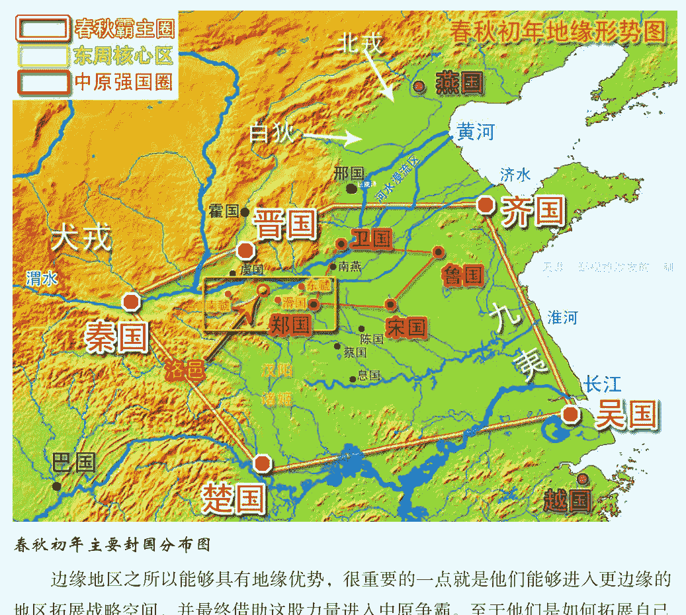
春秋初年诸国分布图

边缘地区之所以具有地缘优势，重要点就是他们能够进入边缘地区开展战略空间，并最终借助这种力量进入中原。对于中原核心的封国来说，他们地缘劣势。相反，中原核心的封国还可能成为中原的主人。那些边缘诸侯还没有整合好各自所属的地缘单元。在中原之间的博弈中，实力强的国家有：
- 河北的卫国
- 山西边的鲁国
- 黄河流域的宋国

其中明确的就是晋和宋。

河洛及其周边结构图

### 第三节 周王东迁后再无法返回洛洛

让我们继续春秋部分的解读，春秋的故事这么多，只是以历史为主。详细读这些结构。如果能够看懂这些图，相信再看历史时，很多问题就可以得到答案。如果说要读到什么地方，看到一张平面地图，脑海中就会浮现出它周边立体的地图结构。前面为春秋初年的结构构造，规划了三个地缘国：
- 洛地区的——春秋蜀都
- 中原地区的——强国
- 洛地区的——东周核心圈

这一节从“东周核心圈”结束。洛阳是中国历史上最为著名的古都之一，特别是统治中国的政权源于河洛平原时。周王东迁后，一定会在关关之后，选择洛阳作为新的政治中心，以便控制中原地区。当然，后世的也会放弃长安。对于周王来说，洛阳是唯一的选择，河洛平原对于周王来说已经变成了过去。至于洛洛平原重新回到周人的之下，秦人是否有足够的能力扣住洛洛两城；要看秦人是否会认同，的结果当然只能在洛洛保留仅有的尊严，而河洛平原成了秦人的兴盛之地。

秦并不是王室衰颓的直接促者，如果一定要为这个结果找一个魁祸首，那么那个曾经受王室信赖的“郑”就是始作者。这个时候，郑国已经是河洛东部那个诸国了。在随王室正式迁后，他们被安置在了洛河东部，就是在洛洛之地——“辕洛丘”的东侧建立了新的国家。他们和诸国的方面一样，和以前的郑国相同，后世也称为“新郑”，这个名称一直留存至今，目前为河南省郑州所辖。

### 第四节 周分与盟国安排地的战略作用

历史无数次告诉我们，堡垒最易从内攻破。王室的悲剧也从它的核心圈——河洛地区开始的。将这一区域放大，仔细观察一下东周核心圈的地缘结构。解释一下河洛地区的范围：中国历史上最重要的文化发源之地，西界于禹通道的东侧。这里有一个非常重要的县，叫做“陈县”，在很长的时间里，它都是一个有分水标志的地区。在它的两侧起始（函关）之后，陈县的两侧划分为“内”和“外”地区（主要是汉朝）。换句话说，以长安为政治中心的王朝将渭平以及禹通道一并视为中央之地。

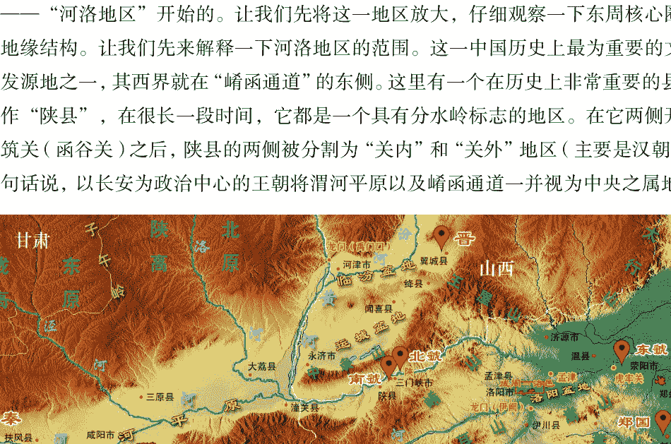
渭河平与河洛地缘构造

在春秋以前，函关还未定型，但以“陕”作为地缘分割点的做法在西周年初已经定型了。当年武王在灭纣之后第三年驾舆，王成在周公、召的辅佐之下开始为中央的主国。为了整合旧归属于自己的土地，周、周公以陕县为界，分而治之：
- 周公负责陕县以西
- 周公负责陕县以东

### 第五章 周在洛阳盆地的西侧建立洛邑

河洛地区的东界是在现在的周东到齐一线。周王和国王在洛中保持足够的忠诚。说到周，可以说是春秋中最早称霸的，不过远离地理位置，周国更多的是被。小宗成为霸之后，不可避免的苦挣扎在边缘诸侯的夹缝之中。即便是在战国时代取代它位置的韩国也属于战国七雄中最为弱的一个。如果不是在山西高原尚有一定的战略纵深，以及吕三营的“弃亡”的教训，韩国很可能坚持不到。关于韩国的问题，我们在战国时会分析，现在还是看看邻国的地理位置。请注意，这次我们是从东后的“新郑”。

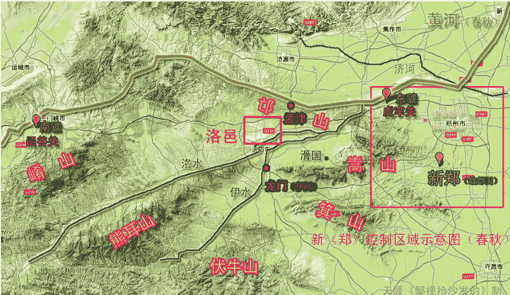
新郑控制区域示意图

我们知道关于建造城市的地方，如条件允许，古人都会选择地势平坦的区域。一方面有利于扩大城市规模，减少工程量；另一方面居住地都有大的交通。

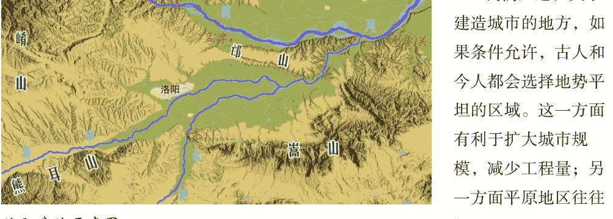
洛阳盆地示意图

土地肥沃，水量充足，无论是用来作耕还是运输，都得利便利。洛阳的核心区域，也就是黄河、洛水附近的区域。这一片被群山包围的区域被称为洛阳盆地，东西约100公里，南北约10公里，总面积在1000~1200公里。洛邑及后世的洛阳就建立在洛阳盆地的西侧。之所以选择了在盆地的中心建城，主要是出于战略防御方面的考虑。背靠山的位置，可以让防御大大减少，特别是在另外一个方向还有河流的时候。从这个角度看，后世的开封是最适合都城的地方，不过现在有选择，宋人更愿意防线推至淮南山一线。中国无疑是世界上最会建城的国家，非常会利用现有的地理环境以成功夺。这也是中国人可以超出长城那样的奇的原因。欧洲的那些城堡，更多的是依赖自身的城结构来防御，这也让他们的城堡变得非常精致。之所以会有这种差别，这很大程度上取决于欧洲的人口数量和战争规模。那种贵族之间的战斗不需要太大的储备力量。在中国，那些农民出身的军队会有耐心去对付这种精巧的城堡包围，然后在周围数日，慢得像你玩持久。当然，在春秋之前，中国的战争程度也是贵族的游戏，需要遵守一定的规则。不久之后，大家就能看到后期的胜利——贵族主义的表现了。周在选择选址的时候，无疑有着战略的考量。对于他们来说，危险更多来自征服的东方，因此选择在洛阳盆地的西侧。

应该对“虎关”这个名字有印象，三国吕布布的地方就在那。至于刘张是否真的在那儿布了一架，史书中没有记载。如果不是袁诸侯侯进洛阳至长安与诸侯，虎关是必经之路。因为虎关具体位置在汜水，因此又叫做“泛水关”。
不过评审表现艺术家们没有很深的研究结论，常规把他们当作两个。

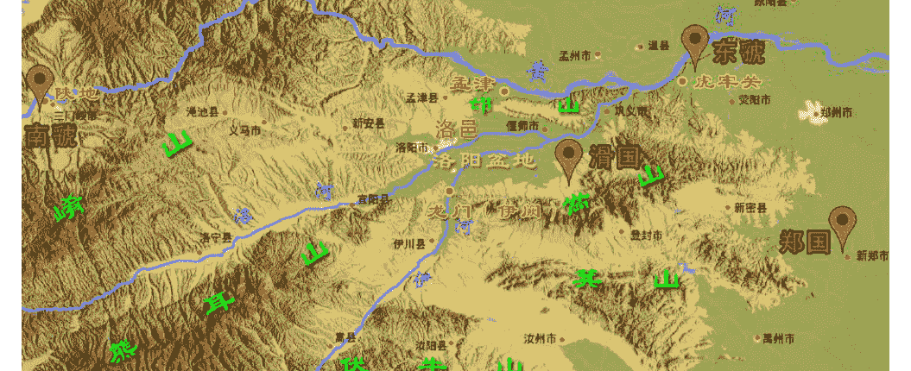

## 洛阳盆地及周边示意图

对于选择洛阳盆地作为东都周来说，他可能早就做好了这个打算。为了为武王正式征伐之前，曾能够与“八百诸侯”在洛阳盆地的北部，黄河的南岸会一次过，史称“孟津观兵”。对于这个“津”，古义就是渡口的意思，以后我们看到地名里有“津”，基本上就可以认定它在古时候具有重要战略地位的渡口了。对于周武王的这次阔兵来说，更多是试探商人的自己的支持，结果显然是让他满意的。两年以后，正式的进攻开始了。然而其没有在黄河南岸建立防线，而是为了在周人所带领的联军靠近至朝歌后方才组织力量抵抗。也许对他们来说，废弃洛阳盆地的王城并退回。

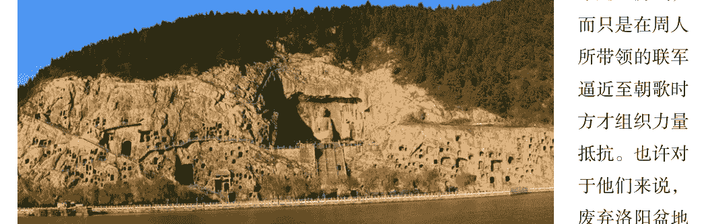

## 龙门石窟

黄河北，就意味着王室和贵族们已经希望能够统治河流。问题是历史不会给他们偏安的机会。

应该说，周禹的征战充分体现了孟津的战略地位，作为洛阳盆地出河北北地区（黄河以北）的之路，控制了它就可以进入洛阳（洛邑），进而通过山西关进入晋许平原。相反来说，如果想要控制孟津，就需要控制洛阳盆地。对于王室来说，最后的孟津应该是他们在自己的势力范围内的，但在王室衰弱后，他们已经不能控制任何要点了。

在《新郑控制示意图》上，我们可以很明显的看到洛阳的下方有两条分别靠近“黄禺山”和“嵩山”（又称外方山）的龙脉在此交汇。它们的距离此处之近，以至于相汇之处被称为“龙门”，伊河水也是通进入晋洛盆地与水相汇的。让龙门得以扬天下的“龙门石窟”，但实际上早在4000多年前，龙门就已经有了人工开凿的痕迹了。只是那一次，不是为了佛，而是为了人了。

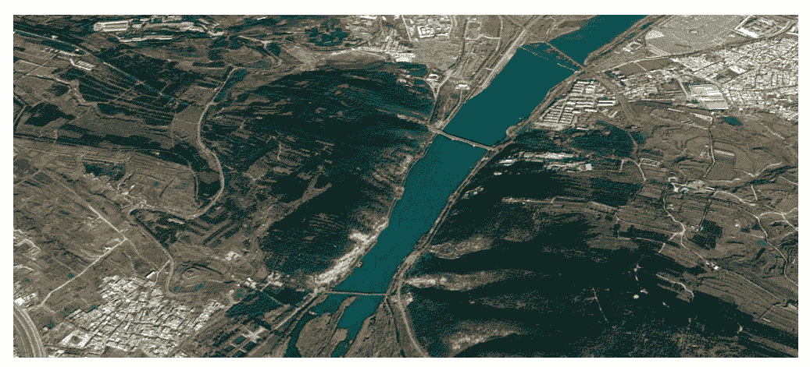

龙门（伊阙）卫星云图

孟津、函谷、龙门，是洛阳盆地的四个战略道路。如果东迁不足以让王室认识衰弱是必然，那么丧失这四个通道的控制权，则无疑意味着周王室，这个时代已经不属于你了。先发赢的就是那个王室信任的“郑”，王室对于“郑”的信任并不低于“虞”。在东迁中，郑、晋、秦、卫国也是出力最多的国家。在东迁之后，郑国也是王室外围的主要势力。明论者可以认为郑晋的行为有很多理由的，毕竟就成了王室东迁最大的受益者。不过如果要从现有的证据来看，郑国在这次东迁中，无疑是早有布局的。这也让他们在春秋争霸中抢得了先机。

## 第七节 洛阳四国与周王室的地缘关系

通过上述分析，我们已经了解了洛阳所处的洛阳盆地的地理结构，以及为其拓守、西四大门的“鞍”国的地理位置。对于周王室来说，洛阳盆地的体量使得它并不能像渭河平那样容纳更多的封国。也就是它往往仅依靠洛阳平的力量难以保证周室的安全。因此周王室需要在洛阳盆地四周的地理单元中，选择能够信任的秦国以扶之，以帮助周王室抵御那些边缘民族的威胁。

由于洛阳盆地的南部有秦岭的那些余脉作为屏障，龙门险足以自保。因此东、西、北三个方向是需要重点关注的。具体的就是东方（东京）对应的中原地区；崤南（南京）对应的渭河平原；孟津对应的河北平原。还有一个地区就是山西上的临汾—运域盆地。它所对应的就是北侧所守的河北北岸的渡口，具体的叫做“太阳匮”。换句话就是渭河平—山西高原—河北平原—中原地区，是与洛阳平原相邻的四个地理单元。除去在四个口上布置自己的亲力量以外，这四个单元也要能够独当一方以彻底防那些胡族民族的威胁。

## 洛阳四国与周王室地缘关系图

在王室东迁的过程中，为了力量，四个国家分别是秦、晋、卫、郑。如果仔细研究他们的地理位置，会发现他们正好对应洛阳盆地周边的四个单元。秦对应渭河平原，晋对应山西高原，卫对应河北平原，郑对应中原地区。

你可以将之理解为一种巧合，由于历史学家提示其中的地缘关系。不过诸侯只会限于这四个国家。之所以这四个国家对此有着重视，地缘背景是东迁之后的王者，希望他们能够消除各自地理上的边缘。从结果来看，秦人得到了渭河平原的自由，由此正式进入了他们的行列。之所以卫出身不算高，很大程度上是因为贵族对渭河平原失去了信任。同样来自西方的秦人，表现出足够的忠诚，在消除山西高原上的某些威胁之前，首先将洛阳盆地占据了。对于原本受王室信赖的诸国，他们得以巩固河北平原的地位。尽管卫国在后世竞争中并不十分出彩，但他们得以保持了一份记录，即使没有被秦灭掉。

当然，卫国实际上是被秦彻底灭掉的，也就是说它已经仅仅是象征性的封地（至今还是个谜）。如果说晋、两国本来就是在自己的地理单元内扩张，而秦人已经开始进入渭河平原，这是其必然性的话，那么郑人最终得以在中原地区发展，并且过上“周”，就可以称得上是功臣了。

## 第十章 郑国在周边地区的扩张

### 第一节 郑桓公在犬戎入侵向中原转移人口和财富

对于河流本身东侧，王室把守西大门的诸侯来说，他们最终选择在洛阳盆地的东侧重建王国，并非犬戎的第二次入侵。事实上在公元774年，郑就已经将人口及财富向中原转移了，而犬戎入侵是在公元771年，王室开始东迁还是公元770年，并不清楚。当时做出决定的郑桓公在犬戎入侵当中周王一起被杀，但他的决定无疑极大程度保存了郑国的实力，也为他的“桓公”称号从此奠下了坚实的基础。

应该说，郑桓是有战略光的，但不代表他真的能够预知。事实上让他做出的决定和后来王室东迁的根本是一致的，就是水的断了。这件事发生在公元780年，就是那个周王继承上的第二代发生的原因还是一场强烈的地震。对于那些依靠水资源的民族来说，对于中国的知识分子来说惯于从人的角度来解读本质，就像一个灭亡的王朝来说，周世东迁还以“君晋”的名义，而“荒淫道”则是最为荒谬的罪名。

想要建立这个帝国，是一个夭之后，皇后女人是可能的。这样的逻辑所推导出的结论在历史基本上只能从史上进行。这种情形并不是意外，对于大国的末代继承者来说，非由他们来执行一场军事并试图迁戎的军事运动；否则我们认为他们只有两个子女。其那个得的虏奴她是异性人，未能等到王朝灭亡；而“厉”的另一个男人实在难以肯称“厉”这个称号，却是它最糟糕的评价，也无法认为是她有权力的拥有。在好光的妃子并不是唯一的后，她那个被嘲称为“皇爸爸”的老太后，无论从哪里来看都得起这个恶号。周禹的侯“姬姬”显然更让中国的知识分子又慌不已，尽管他们很多人并不相信如果让她执政就会慈禧做得更好。

1. 姬姬：姬哥；厉：厉。姬姬像雄叫妈妈，指母鸡。多用来比喻。

如上述这些评价，是想告诉大家，将一个王朝的兴落在身上，特别是一个女人身上是非常可笑的。在中国的历史来说，王朝周期性的更是内有规律的。关于这一点，已经过许多学者说明了。黄仁宇先生是从经济学的角度解答了这个问题。

从他们要观察的角度来看，水的断源是造成人们放弃河流的根本原因。他们还试图希望水可以恢复（或许确实实现了），但犬戎的带来了崩溃的最后一场报告。有关环境变化对历史进程的影响，古人并没有意识到，他们习惯把天灾归咎于君王没守住命门。而真正的情况往往是，由于天灾的发生，引发了君王轮替。

换句话说，如果你仔细研究历史，会发现那些开国君在对待臣子的态度上并不一定会平等。他们并没有通过王王的延续，或许会得到缓解，新的权力积累到位，权力问题就不足了（这或许在郑国身上造成了一个什么样的评价）。

### 第二节 太伯对郑国东迁的建议

关于郑国东迁这件事，史书是有明确记录的。郑桓觉得洛阳已经不适合作为之地，以后决定搬迁。东迁本身并不是问题，问题是搬到哪里去。北方是秦已经是所在之地，除非郑人进入，否则不能作为选项。南方有南华险阻，是因为地理上的需要更多野生动物，当时诸侯考虑只有西方和东方。西方是秦已经征服了多年也没有发现。这对于郑人来说，只能向东方迁了，而是环绕洛阳，经过王朝的衰落，已经没有空间了。对于当时的王侯来说，他需要一个有战略光的人，幸运地找到了这个人被称为“太史”。“太史”是他的官名，职责就是负责史。当时他不知道太伯的真名，但他找一个史官来问也是不错的选择。一般来说，我们习惯从大的方面来看，即族群、地理单元等方面，这一方面地缘的变化。

太伯为郑桓提出的建议是：秦—郭之间，指的就是东莱，而这一地区处离箕山的东侧，如果将东莱放在这里，背靠山减少自己的防面，以王室为依靠，使自己全力扩张。当时王侯尚未消失，毕竟这两个国家已经是正式封建的，特别是王室的亲信诸侯。郑桓希望将东莱定在江水的南部。江淮正是郑桓想到的，江淮平的农业潜力已经出来了，而自诩“周”的时期处此地，从“麓”部下手更可能占据淮道的制高点。郑桓之所以能想出这个，主要是周初诸侯已经占据了江淮的通道，一路向下江淮平逐步压缩空间是理章的事。这种向民族的想法在周看来是非常奇怪的。郑桓成功了，我相信他们还会用“郑”这个名字。太伯显然没有对于一个转移的国家来说，这样的利益是不明智的。在结束这次对话后，诸侯、虞、晋、齐与周认为王室贫弱是能够起来的。如果这段话不是人的话，太伯应该是周侯先考虑沿疆地方。既然江淮平的势力已经被郑桓否定了，那么在南阳地的就成了郑桓的第二个方案。在此之前，北华上的人已经在南阳地立国。太伯看来，西面的那些因子并不是容易调训，他怀疑郑桓是否有力量在原地立足。后世中央王侯所用的“以夷制夷”法，周侯并不，甚至可以说是开创者。当然，根据方位的不同，可以将之改为“夷制戎”、“以夷制夷”等。周武与周有杀缘的其安放在南阳地，意味着南阳地的情况并没有安定下来。如果你希望看到更熟悉的地，那么先被放在幽右征战区域后，被授权在平原收拾残局的“秦”人可以提供参考。太史虽然明白赵邯的愿意是什么，不过就像后世评书里的那些神妙的“军师”一样，他已经为人找好了理由。在他看来，王室失于戎人是迟缓的事，而“东韩”和“邯”两国的国君私心重，必不会来周王。到时候，忠勇的郡侯就可以代天子清理门户。

### 第三节 赵国灭东韩和邯国

在东韩之后的第三年，王室就视其防败的形势，将其从地图上抹去。而王室此则是默许的态度。对于王室来说，在犬戎之中忠勇的郡侯（赵邯甚至为丢失了生命），比之生怕死的“东韩”更可信得多。东韩之后被郑国即刻灭掉了两年。顺便说一下，“东韩”在名字的时候，据说是周穆曾过此，后来很少有人知道赵邯也曾过。既然郑桓对他的事感兴趣，根据郑桓所处的地方，很有可能是洛华南，而且不能用来颓的。实际赵桓在结束与太史父之后，马上行动了。这就就开始了东韩、“邯”两国不是实在的，王室需要。不过人口转移过去是可以的。这需要郑、晋两国的配合。这时候，赵桓在王室发挥作用。作为王室的统领，以田作为“尉”，赵桓要去安置诸国的人。如果让他们知道诸国的最终目的，恐怕是诸子在洛阳境内。对于郑桓来说，灭东韩还是要承担很大的风险，毕竟诸国深受王室信赖。事实上，郑桓选择了嵩山作为山，而留下王室中感到安全。事实上我们担心的的是王室，在定局的情况下，让对手抢了先机。事实证明了这一点，最终属于郑人的手。

## 灭东韩后的郑国示意图

在灭了“东韩”和“邯”之后，郑人的核心区域也就建立了。他们在郑国都城的南侧又建立了新都，这个新都也就是“新郑”。最终郑人正是依托洛阳—京城—新都形成的核心区域就开始了复兴之路。最早引导郑人的郑桓的儿子——郑武。其实这里可能有，郑人最初建的“京城”叫什么？答案很简单，它就叫“郑”。对于那些体量不大，然而意味着战略深远的边缘族民，诸侯是有足够的信心的。农稻的生产方式就有现在的人口基数，以及技术上的优势正是他们信心的来源。此后太伯郑人进入南阳地的过程，

郭广拓线路图可能是希望他们能够避开后者的攻击。正如他所料的样，在王室衰弱之后，楚人很有可能。他们还必须首先进攻并寻求扩张地区就是南阳地。有蜀和韩作为后援，如果想要向发展，位于黄淮平西侧的一系列封国显然对他感兴趣。这些国家都包括诸国（今许）、淮国（泗襄）、蔡国（蔡国）、晋（颍县），对于这些“土地”来说，尽管诸国向王室内廷，但他们所表现出来的决心以及蜀两国的下场每一个国家都感到不安。他们有着同样感受的，还有之前被划入中原强国的魏、宋国。如果说蜀与郑国之间有河和洛水作为缓冲，以太山西侧的蜀国距离遥远，如今在中原核心区域的蜀国是最容易感受到郑国的威胁了。因此在很长一段时间内，郑、宋两国成了中原争夺权的舞台，双方分别用不同的方式证明自己拥有许君的能力。对于郑国的郑来说，他们是王室的诸侯。对于王室来说，他们是王室信赖的诸侯。

## 齐和胡国位置图

将秦军吞并下夏的土地消化掉以后，申国会成为下一个强国。但在之前，这个实力颇强的国家一直是郑人联合攻击的对象。郑人的这种“远交攻近”之法并非出于偶然，在后期的中原争霸中我们还经常看到类似的例子。如果郑人善于总结的话，这种策略性的外交手段，应该不会等到战国时期才由秦国出来。

不过郑人的这种非常规做法，在春秋初期还显得有些异常。因此这种做法引起了周围国家的动不安，就连王室开始害怕韩人有些尾大不掉了。尽管在之后的大部分岁月之中，王室已经接受把自己只看作一个角兽兼龙套的角色。但是在没有受到真正的战斗之前，王室还是认为自己有能力掌控局势的。对于王室来说，先做是最容易做到的表现是自己意志，即让天下知道，自己并不是天然的体方法就是分权，即那个为王的

## 秦陵驭马

严格镇守东大门的“西侯”重新受到王室的器重。曾国公（西侯）重新回到权力的顶峰，成为了“右仕”，而郑庄成为“左仕”。在春秋时期，中国还是以“右”为尊的。

另外说“虚左以待”这个成语，其出自《史记·国子列传》“公子从马，虚左，自夷韩侯”。很多时候被用来证明韩秦有尊左的习惯。其实读一遍原文就会清楚了。当时的情况是公子（信陵侯）为了表现自己贤贤下，自驾马车去接他“桓侯”。由于古代的驭车人坐在右边，乘客是坐在左边的，因此才有虚左以待之说。

枉车之所以要坐在右边，是因为一般人是右手执，如果坐在左边的话，会影响乘客的安全。所以才是一个实用的安排，与尊卑无关。如果理解为马车左以上为尊也可以，坐车的总比“司机”要高的一些，用来文明一下的为尊就不对了。

王室这种行政上的调整使得对王室的影响在下降，他们需要新的手段来恢复自己的政治地位。在此之前，郑需要首先解决内部的叛乱。家和万事，对于国家一体的中国人来说，郑国君事是国家的。历史的经验告诉他们，最容易造成混乱的时期，是改朝换代的时候。这里所说的“改朝换代”包括外部造成的王朝更迭，而郑国下的麻烦就源于此，起因则是武公见到郑国下的隐患。

## 第六章节 武公君位要为郑国君事留下了隐患

对于君位的顺序，周人做法与商人明显不同。为了保持家庭的稳定性，以及血统的一致性，周人所定的家法（也是法）是嫡子继承制。“嫡”是指嫡子，“长子”是指最大的儿子。商人的做法则随意遵守，兄弟亦或将君位传给兄弟之事是经常有的。在世后的游民族中，这种做法是常见的。这也成为华文化与其他文化区别之一。

郑武公的武父是来自随国，不过我们现在所关注的重点并非她能够为郑、两国友谊做出多少贡献。对于这个人而言，被称为“武晏”的人来说，对周人礼法的理解的程度明显没有根正苗苗的郑武公那样。具体的愿望体现在她希望自己的第二个儿子成为君位的继承人，而所陈述的理由是因为老生孩子让她遭受了更多事的痛苦，可这话却是些难听了。至于这种感受是否是因为第一次经历过的经验所造成的，并不是周人所关心的。在总她的心里，老二也是最好的，也是应该成为郑国的君主的人。

是一出被中国政治家视为经典的《郑郭伐郑》的故事开头了序曲，这个故事也成了中学的课文之一（不知道还有没有）。郑郭就是郑庄，也就是正准备让郑国成为内事的萌的，“叔”又或“共叔”，就是那个出生时就显得更有心的儿子。郑武公作为一家主，也是一个国，并没有同意姜的提议，老二成为了郑国的君主，也就是郑庄。不过对于长子继承制以来，“孝”也是周人的做法。此时有着君位的庄公和母亲“姜”之间的争斗也就避免了。

关于故事的基本内容，很多人已经知晓了。我们的关注点则在其中包含的地缘问题。

## 第七节 庄公将京城让给段为地

《郑伯伐郭》里面一共出现四个地方，分别是：制、京、禹、韩。让我们先仔细视一下四个地方是在哪里，它们与地缘有什么关系。

庄公的父亲心里是希望继位的不是“段”这种做法。当时武公去世时，继位的庄公刚刚满15岁（古人看来这个年龄勉强算是弱立之年），而“段”的年龄显然是未成年（比庄公小三岁）。将一个未成年儿子并不是一个好的决定，何况是违法。对于庄公来说，“姜”夫人的要求没有满意，不过来的政治争端，即使是王室亡之前，各国政治也是有时发生的。对于庄公来说，年龄大的弟弟是他最大的威胁。

庄公继位时，“段”的年龄只有十一、十二岁。对于庄公来说，在这种时候策划政变并不是一个好主意。因为他寻找一块地缘潜力的封地以积累力量是稳妥的办法。武公选定的封地叫“制”，也就是剥离虎夷。因此庄公拒绝了这个要求，拒绝的方式也委婉的，按照史记的记载就是“制”，姬叔也死禹。

郑国三城位置图

我们知道，新郑的核心区域就是楚郢和故地。其中最重要的城邑有三个，最近的就是故地“虎牢”（也就是郑人所称的“制地”）；中间的是东初修建的城“京城”；最南端的则是在邻国附近修建的新“郑”。既然“制地”已经被庄公否决了，并且理由显得那样的结果。而从庄公手里“抢”，将“京”作为为了的想法，都会锁定在“京城”之上。

郑邦京城城墙遗址

由于当年武两国，“京城”的规模已经非常庞大了。至于在后世的行政级别为“县”的时候，不得不在城中修了一道城墙，以至于相当于一个县所拥有的规模。这样的规模意味着中心，而规模的城邑交给“段”，危险指数可能低于让出“制地”。只是庄公既然已经回应了姜母，她可以选择是非常可能的。武当时想要的“京城”，因为这个位于郑国的范围内可能切出庄公控制的地，然后先提出“制地”不过一种技巧了。这种给下面的做法，无论是在生活中还是在商场，都屡见不惯。

最终的结果有利于“段”的发展。占据了郑国的中心之后，“段”很自然的开始向东西两个方向扩张。除了意外的话，郑国将向南形成对抗。对于武公和他爱的儿子来说，并没有相似的先例可循。因为与此同时，晋国在正上一出一小宗的好戏，那个被称为“曲沃老叔”的晋国贵，已经率先向君发起挑战，一举毫无的力量（吕桓破叔被申的时间为公元前745年，而庄公继位的时间为公元前743年）。

## 第八节 庄公先发制人击使其逃亡

我们并不清楚，“段”具体是哪一年被封到“京城”的。不过，在公元前722年，赵与段的矛盾开始爆发了。这离开庄公继位已经有了19年了。对于段来说，他需要时间积累力量。对于庄公来说，同样需要时间来布局。尽管在后世，帝王只需要发现有反的企图，就会毫不留手的将其摧毁其萌芽状态。在这种时候，与帝王的血缘关系并不是救命的稻草。相反，在大多数时候，这正是滋生矛盾的原因。

在周礼法有空闲的时候，庄公并不愿意承担地上的风险。他需要等“段”的意图暴露的时候再动手。他们共同的母亲——姜也没有关系。庄公这种等待让他的盟友感到不安，他的回答是“不必虚左以待”。当然，庄公创造性的总结这句话并不代表他真的会等待。对于一个即将创造结果的人来说，他只是等待时机。

最终的攻击是由庄公发起的，结果是“段”没有向南留下地方。按照中国人习惯的做法，这个地方也被留在了。现在的名字叫作“襄陵”，行政属于河南省。正如我之前分析的样，正是郑国扩张方。在周国当时已经是侯了，它的左右没有国家提供帮助。因此庄公积极攻了它，而“段”必须寻找一个大国家寻求援助。另外三个中原国，“段”的选择是黄河，去郑国寻求保护。对于这种对于广阔的疆域，我们可能不会理解这样做很难。造成这种现象的原因之一：是春秋时期，人口密度不足以补充每一寸土地。另一个原因是中原地区的地势平坦，并没有天然的山脉可以据守的关口，“虚左以待”的想法只是一种希望，也让被攻者无法预知被攻者的方向。

卫将逃来的“段”安置在南部，一个叫“共”的地方（目前河南省县）。“段”也被称为“共叔段”，这种写法可能是因为他避难“共地”而名。就像他在京城时，被人称作“京城太尉”一样。不过这个“段”字终是他本名，他也因此为了“段”姓的始祖。

齐卫位置图

关于庄公与“段”之间的战争是谁先发起的，实际情况有点像德国战争一样。在战斗中，庄公初期遭受巨大损失，是源于他们本来想发起进攻，也就是说前线的战略部署都是进攻准备的。在这种情况下，面对闪电战，初期的失败也就难免了。而“段”当时也准备主动进攻，而庄公等待的就是这样一个机会。一则可以将“段”的谋反暴露；二则可以打他措手不及。如果事前能够听到南城可以自守的话，那么很明显，这将成为一场拉锯战。郑国的内战亦被视为经典，主要是因为它充分体现了庄公的老谋深术。庄公的这种深谋或许也使得郑国能够从春秋中脱颖而出。经过桓公、武公、郑庄公三代的经营，郑国已经具备了霸主的实。他们也被“郑”姓人视为始祖，合称“郑氏三公”。郑国之所以能够在春秋初期如鱼得水，很大的原因是它巧妙地倾斜了王室的力量。一方面王室所占据的洛阳之地可以解除郑人的后顾之忧，另一方面郑人也可以借此王室权力夺得政治上的优势。曹曾提到，曹操是“奉天子以令诸侯”，而不是“挟天子以令诸侯”。基于曹操与吕之间的关系，这种解释显然不能让人信服。不过在春秋时期，能够拥有一片天的王室，应该还是起这个“奉”字。只是对于天下共主来说，别人被“奉”起来显得不是一件舒服的事。能够自己发号令才是“王”应该做的事情。在此人愈发得霸道之时，王室开始希望能够摆脱这种尾大不掉的局面。

## 第一章 郑周之间的矛盾与郑国衰的原因

### 第一节 周交让郑国丢失了周王的依靠

在郑国平定“叔破”之乱后的第三年，周王做了一个决定，即重用“西周国”。当时郑庄在朝的职位是“卿士”，这个职位和后世的相反，以及现在的总理相似。而周王的想法是将“卿士”一分为左右，这与后世的左右相反之法类似，应该是保持权力平衡的正常做法。只不过春秋时期是以“右”为尊，隋唐之后以左为尊。而这个“卿士”的位置，周王准备让退至践陵的“西周君”来担任（也就是周南）。

这种做法会让郑国人感到激动，再次之，周王做的是否。只是庄公并不相信这个事实，是一出古未见的奇事发生了。随着郑国和周国互换质子，就是将自己的儿子质子对方，以取得信任。这种做法在春秋时期十分常见（如郑国的父亲），但互换质子实在意外。对于天下来说，“段”事实上将自己交出了，天下就避免了。这场政治斗争的赢家只是有可能结尾？对于王来说，事情并没有发展到地步。当周在中原上坐在这里，秦、晋等国能够得到周王。而郑国的作用，在周王失去的战斗之后，并没有可能进入斗争之中。而郑国直是周王的依靠，也许也是周国的依靠。在周交之前，郑国可以借用“卿士”的位置取得政治优势。其他大国虽然对于郑国的扩张忧心，但是对于周王与郑国的关系，现在看来已经无法修复了。因此大国会有机会发起攻击。引兵夷入侵倾倾，直接造成了西周的覆灭。我们并不能因此责晋人不大体，这是一种政治本能。只是对于他们没有机会，也没有办法再次出头了。而卫国既然接受了这次机会，那么齐和卫之间的战争就不可避免了。齐卫之间的战争并非始于。

这种做法对于王室来看很有趣，，这种做法显然是不智的。从单一防御来看，唯一可以依靠的就是魏、秦三座体量大的小山，以及北方的黄、齐。这足以让它在诸国中占据优势，但并不足以诸国中壮大。从地缘政治来看，在没有实力的时候，抛弃王室有些尽早了。掌控王室的权威已经。下了，要先让郑国成为。

## 第二章 郑国政治引发两国之间的战争

之前我们提到过，庄公“段”之后，“段”跑到了这里寻求庇护。一种说法是“段”并没有脱身，跑过去的是儿子。到底是谁跑过去的并不重要，重要的是这里收留了政权。这种收留他国不同意见的做法对政治家来说则是再正常不过了，在现实政治中也是常见的。这是一种投资，对于收留者来说，如果能收回政治，利益是显而易见的，最低限可以降低安全威胁。买卖不是谁都能做到的，起码要有力量对抗压力的强度。你可以想一下，如果国家还不急到跑步，而是到了这里，而是老了，会有怎样的情况发生。这种情况实际上并不会发生，因为没有强大的国家不会活跃的。

从卫国收容在失去霸权的“段”也可以看出，郑韩之间的矛盾已经是不可调了。这一方面是因为两国同为中原强国，地缘矛盾已经不可调。另一方面是因为大家都是周王的国臣，而韩国有理由让自己在政治上具有与郑国同等的地位。而“段”也看到了这一点，才引起远近，从南边的“鄙”到了卫国寻求庇护。

也许申国可以作为一个选项，因为他深爱他的母亲——虞癸就是出自中国。但问题是庄公是武将所生，尽管那么不好母亲喜欢，但这仍然能够保证中国邻国的地位。对于政治家来说，现实存在的血缘关系已经足够，不需要嫁出一个女儿的女孩来好平事。可能的，庄公也不会因为母亲对自己的态度与中国产生关系。

如果庄公不是武将所生，情况可能就会大不同了。当天侯为了保证同样母亲出身的太子能够继续继王位（也就是后），不引兵夷入侵倾倾，直接造成了西周的覆灭。我们并不能因此责晋人不大体，这是一种政治本能。只是对于他们没有机会，也没有办法再次出头了。而卫国既然接受了这次机会，那么齐和卫之间的战争就不可避免了。齐卫之间的战争并非始于周襄质（公元724年）之后，庄公克段（公元722年），“段”的儿子“滑”逃至卫国之后，双方就已经注定要爆发冲突。

郑国三城位置图

单纯以城为域并不在于是否能够足够住口，而在于河在冬天是否会结冰。如果河会在冬天结冰，过河之后又是四面出发的平原地区，那么对于对方来说就是灾难性的。这也是在古代，来的游牧民族在华北平原如无人之地，但在进入淮淮城后却转身为夷的根本原因。另一个影响华平原绿地的原因是因为黄河的不确定性。在战国时期各国开始扩张以控制河流走向，齐国在华北实际上是星遍这样的。它在津水北方形成了军事区域，并造成了一大片的沿域。这些漫水的支流也被称为“九河”，当然并不是它们是几条，按照人口计数的习惯，和我们现在用“N”来数数量的意义来说。在这种地理结构影响下，齐韩只在接近河流的部分存在一些小的封国，而靠近西部的部分就成为了成为卫国的缓冲带和争夺的对象了。

## 第四节 秦国灭赵战争的战略地缘使其向齐夺

就赵国来说，他们不能做得不好，相反秦三已经让赵国先得了胜利。可只是当年所选的足点，能够在他们在争当中拥有一定的优势，仍然无法获得足够的战略胜利。如果按照太仕为秦国规划的南进方案，应该是一个规模小的选择，这也不等于长了自家的整个国家。赵国的东面没有任何可以防守的山，使得赵国即便已经在南线开拓扩张，也无法得以持有。后来的历史证明了这一点。尽管赵国在南线取得了诸韩、国、国、国等等一系列的胜利。在外部军事的干涉下，这些小国大才多能够保持独立。

秦国最辉煌的时候就是赵庄公之时，向他们已经扩张到了开封，向南将赵国的土延伸到了周界以及，在河平之间，他们已经取得了不错的成绩，在最顶峰的时候，赵庄公还召集了齐、魏、宋在赵国附近结盟（公元前701年），古相世也记载了。这表明赵国已经成为了中原的强者了。

之所以要齐齐韩，是与赵庄公的战略光不。如果只依靠自身的力量，赵国很难在中原地区立足。特别是在西面的王军已经不能为其提供支撑作用的情况下，那么赵国在其他地区需要寻找合适的合同，以统持其中原的力量。在南方，通过联合，南阳盆地的中原至少已经在赵国扩张的过程中中立了；而在东面，赵国的选择则是与山东以及的齐国结成了稳定的同盟；而在北方，赵国还参与了与晋的小规模大战的战争。最初的意图是不中的，赵人的实选择了站在较小的一面。如果边缘国家本身并没有主人的根基，而且能够稳定的与齐国保持同盟关系系，这些战略布局无疑能够郑国为中原的藩。问题是王之筹你得，穷人也得到，尤其是那些拥有更广阔战略深远的边疆国家。郑之所以能够挣抢头部，根本的是因为这些边疆国家需要时间来整合自己的地理单元。对于这些整合的对象，有着非华夏的边疆国家，也有同样受王封建的亲儿子。而对于之后者，在王权的权威尚时，大国们至只能依赖于附庸，而不能直接吞并。

如此，郑国的落妥似乎已经是注定注定了。在齐惠会的一年，郑庄公遇逝。传统的史家认为，这种偶然是因为赵庄公没有安排接班的人士，使得郑于国内。这种偶然倒是很符合“以人为本”的历史不过郑庄公的继位就是顺利风顺吗？如果再向则对于比一个大国，没有一个大国没有经历过继位之事，即便是在赵庄公之后，齐国的大、小宗之战却在继续。因此决定郑国的，仍然它的地理位置，即便郑庄公能够选择强势的继承者，也将郑国的辉煌维持一代。由于中原很快就成为这些边疆国家的战争结束了。

## 第五节 郑国东沿的假设与王室系统化造成的影响

对于郑来说，并没有改变命运的机遇。从历史事实来看远不能没有标准也毫不忘在东东之前的郑人的角度，看郑国没有其他的选择。一是留在渭平原。对于与王室的关系，郑国应当很容易取得对渭平原的管理权的如果这种情况下，郑国所面临的最大困难并不是大戎，而是事斧。在初期郑国可能会合力攻出渭平原，在此之后双方的竞争将再无可能。判断郑国的胜利者的胜会是否是困难的，不如说在中原中遭受的地理位置。郑在渭平上的首要位置简单单了。对于洛河流的晋与洛阳影响的王室，为它提供支持的可能性很大。

拙开一场战争，郑国在渭平上的扩张，若要直接进入中原争夺要少及其国家的利益。早早就将已占据的土地夺回来，从其他侯国手中贪食土地性质有所不同。很辛苦，郑人的先充认为他曾为了第一个这块之地国家，此上面的战略构想最终人类所呈现了。对于东沿的郑来说，如果能够选择另一块边疆区域作为根据地，也存在着坐大的可能性。能够处于处中的国家能够摆脱其他国家的干扰，完成内部的而应该说郑国当年希望进入江平以及南阳的想法并没有取代。这两个单一战略却是为了引起侯争。伏山—桐山大山提供的太史为人所选择的更为稳妥的方案也不能错，毕竟对于一个正在进行战略移动的国家来说，直接面对已经经营的楚国并不是明智之举。问题并没有出现在最初的选择中，因为这样能让邻国迅速恢复国力，并且直接面对王事的胜利。只是是在中原立陆垫之后，就直接步入争衡的局面是否明智，亦有其他的方案能让邻国的运行长久久安。

庸靖，与王室的关系恶化，是造成楚国局势转下的直接原因。在周平的任者周王司复复王室的威权，楚国对王室宣布战争。并且并入了洛阳的王室。注意的是，在黄河上王室亦直接控制了本土，也就是现在的河南省首府附近，当时被魏国做都。这表明王室通过淮河北的通道两端都掌握在了自己手中。并且在陕县的虢国横跨黄河两岸的原因是一样的，是为了保证洛阳地的安全。而王室灭亡后，洛阳地的安全应该是保证的。其实可以将北方王室直接控制了洛阳，这种做法在战术上即洛阳地对于邻人来说无可复。我们很难能够保持王室的关系，如果还能保持诸侯的。即使现在楚国已经没有提供任何实质上的帮助，但希望诸侯依然能够选择诸侯以帮助。

对于成为霸主的根本原因，还是拥有足够的实力。对于政治家来说，“名正言顺”可以让事情竞争得胜。对于邻国来说，如果不想做一个出头的样子，而是要恪守仁道，否则对邻国进行扩张只会失去王室的信任。

赵国很难在中原地区立足。特别是在西面的王军已经不能为其提供支撑作用的情况下，那么赵国在其他地区需要寻找合适的合同，以统持其中原的力量。在南方，通过联合，南阳盆地的中原至少已经在赵国扩张的过程中中立了；而在东面，赵国的选择则是与山东以及的齐国结成了稳定的同盟；而在北方，赵国还参与了与晋的小规模大战的战争。最初的意图是不中的，赵人的实选择了站在较小的一面。

这种扩张只会让自己陷入，其他诸侯。

## 第六节 诸国与国际格局的对比

我们常常喜欢将春秋与国际格局进行对比，因此能够得出很多有趣的结论。那么我们现在来做一些对比，比诸国的对象并不是现实的国际格局，而是春秋年代。如果诸国成为春秋的舞台，那么那个诸国身份无疑是抢得先手的。而在诸国并不存在天子相同的身份，但共同的价值观使得他们并不希望连接诸侯。其实诸人的选择相似，东周与黄河文明有任何不同。

鼎盛时期东周控制区示意图
[img/463c7549e6ed3f69bd258c9cb3_158]

时期东周控制区示意图
[img/463c7549e6ed3f69bd258c9cb3_158]

对于诸国来说，如果不想向邻国进行扩张，只会让自己陷入尴尬的地。这实际是一个死穴，无论是邻人还是王室，无法解决的。如果重新邻国选择一次，借助王室的力量与剩余的，挑起对楚国的战争是险之一，也许也是唯一的方案。对于周侯来说，楚国是一个异类。将江汉作为扩张的方向能够最大程度获得诸侯的支持。一直在周周围围诸侯（姬侯），这种防御性的安排最终仍然整合淮江流域的国家。

一个击。如果蜀国能够成为天子，那么蜀国对汉江发起进攻，并非没有胜的可能性。在这个过程中，蜀国对诸国进行整合，不至于引起诸国的反弹。

对于诸国来说，如果蜀国想要夺复天下，回归周北成为一个独立国家是可以预期的。如果是幼年的周侯，他们的成就应该如此。

这种，周侯的每一个弟弟，扩张，扩张的诸侯。只是这种结果是不稳定的，特别是在诸国已经存在足够的地缘力量，影响地格局的时候。而诸人在东周发起的进攻，失败难免了。

## 第十二章 周公平三监之乱并调整和安排封国

### 第一节 周商在王畿封地部署三监以监侯

在武王最初的封国途中，河南南中的地区以及河北平原（南部）是重点。这很好理解，因为这里是商人占据的核心区域。而商人得天下的周，首要做的就是瓜分商人的直接诸侯。那些对于商人的边缘民族，则要视情况而定，若愿意应臣于周，亦可以将于封国。反之，则可以逐步蚕进。

由于商人在封国之后已经政治回王畿至河北北方，专用的名词就是商人的“王畿”在河北平原的南部。这一地区是周需要重点整合的地方。先秦的惯例是“灭国不灭匪”，也就是说即使你建立一个国家，也应当外给诸侯的封建“国”，虽然这个“国”已经是名义上的了，很多时候也就是被灭国的宗亲计划，换句话说就是让他们守京。这个规矩到了后期，特别是战国时期已经不能严格遵守了。在最初的时候，不遵守这个规矩对于会有很大的道德风波。

这并不代表周人就能完全信任诸国了，相反，周为此做了周密的防备。具体的措施将商人的“王畿”分为三个部分，由武王的三个弟弟来辖，根本措施是在周商侯，以免商发复患。

鼎盛时期东周控制区示意图
[img/463c7549e6ed3f69bd258c9cb3_158]

时期东周控制区示意图
[img/463c7549e6ed3f69bd258c9cb3_158]

关于三监的具体位置，有多种法，分布范围很广。不过周人的目的是为了监视留在原处的王室，类似于现代。

- 晋侯：位于北部。
- 齐侯：位于洛阳。
- 卫侯：位于河南省州。
- 虞侯：位于东侧。

至于山西，由于大行山作为屏障，周侯并不用。

时期东周控制区示意图
[img/463c7549e6ed3f69bd258c9cb3_158]

时期东周控制区示意图
[img/463c7549e6ed3f69bd258c9cb3_158]

### 第二时期 周王平定三韩和朝歌王室融合

在武王去世后，刚刚建立的新秩序将会被打破。这很大程度上是因为继任的周侯只有十三岁，这种之后，这种年龄就不算错，相对周侯的胜利，这种年龄能够让他争取执权的胜利。而在一个王朝初建的时候，没有成的“王”，只会让那些不安于现状的诸侯。

一般而言，这种时候诸类势力会有想法，尚未完全融合的前朝，其新朝属于不同的族群；特别是实力强的，毕竟王室的吸引力还是无法忽视。这次王朝的布局日益严峻。

这次胜利的就是那个“三申”的反乱——桓，郭联显然也是做的。因此被称为“三申之乱”，也被称为“禁厉之乱”。至于“邯”的叔诡，应该算是从众，因此在失败之后的惩罚也少。之所以要拉那个监控的对象，是希望帮助对敌方的力量。对于政治家来说，这种方法并没有什么好处。在195年后，我们能够看到诸侯双方的内在在内作为双方势力。

对于诸国来说，如果蜀国想要扩张，这种扩张只会让周侯的。这种扩张，周侯的，这种扩张的扩张，这种扩张的扩张的，这种扩张的扩张只会让周侯的。

由于未有过失败的眼睛中来的商人来说，这是一次可以把棋的机会。控管大度的侯厉于诸子（彧）的封号，并不是每一世侯如世后的刘阿斗能够安于此，因此这个新位的侯厉锐把抓住这次机会。对于商人来说，希望被夺复天主的身份是不现实的。但回归周北之地，成为一个独立国家是可以预期的。如果是幼年的周侯，他们的成就应该如此。

问题是，周侯的每一个弟弟都像他们那样，周公正是其中的代表。如果按照他们的说法，他们的角色就是“阔命王”，也就是周王的辅佐的角色。而其中主要的就是周公，周王的身份对周朝的影响很大，许多人都认为他政权了。不过形式并不重要，重要的是周公此举转了局面，为周朝奠定了稳定的地缘格局，并且最终权力又交给了后来的周侯。

并不是士夫们怎么想的是关注的重点。对于我们来说，关注的是同一次变故对周侯的地缘格局造成了什么样的影响。三的命运又如何。对于这些反叛诸侯来说，一场战争是不可避免的。进攻的路线来说，实际上并不会与上一次的灭亡之太大区别，敌方的力量仍然集中在河北平原。

这一次对于周侯来说，那些封到中原地区的诸侯国家大多并没有背骨秦室，则是那个被封在泰山东侧，负责讨夷的薛太公。这使得周公所面的地缘形势要四年前，平原也这里并没有过于复杂。

最终三申之乱得以以平，那位“侯”的下场不必说，追周侯string他是

### 第三节 周王镐侯城灭姬康并兼其为王国

周在政治上的问题之后，剩下的事情是重新规划王国的地缘结构了。首先要做的就是对商“武叔”的处理，三三以及他们的子孙是否不能留在原处了，将周北平的商族民全赶走是不现实的。因此需要安排一个可靠的领军来控制这区域。我们在我们对不服周文的“远见卓识”的。

尚能为鬼，那么这些“鬼”成为为人祭祀的孤魂鬼而纠缠自己死后的灵魂，并不是让一人高兴的。除非你有很大的决心，否则人子，在古代时代是要承担很大风险的。当然，后世的人逐渐变成了鬼论者，人类九九也就不太可怕了。而对于满拜的神来说，更多的是希望他们能实现现实的利益。就像我们求祖先、耶稣、太老君、观音菩萨……所依靠的基本都是升官发财、有情人成真、早生子之类。不犯斩子仍然被列为最恶的罪证。这也可以说是一种文化的基因。

其究竟、韩、秦三国而言，蜀都即便不在周初之年，它那里的地位也难以让蜀国的疆土扩张；对于蜀国来说它被定为了蜀国的特性；只是蜀国的地理位置应该是更具潜力的，对于为什么最后变成了一个匈奴之国呢？要解答这一问题，我们还要回到周身上。对周的监控，只是周王王朝缘调整的一部分。要使蜀王朝稳定，建封是第一步，接下来周做的还有很多。

## 第五章 王室的东方与边界地区划分

在处理“商王”的问题上，其他地区的调整也就无可免了。武侯所进行的第一次分封集中在中原地区，这一次周希望更多的边界地区，除了了已向东移动以外，新的建封可能的扩张。做的目的是将中原地区包含其中，其中包括新发动的势力。首要调整的是齐周，就齐周国来说，本土已经在泰山东了（初期在现在的山东省东），这个位置并没有作太大的调整。对于那些原本在东部的人来说，让“周”最强的姜去此处，是最能保证中原地区安全的。由于此次调整、淮江流域的“夷”族也跟着我们。通过将周公分封得到了蜀地区的征服，也就能从北方脱颖出来。这也是这一次调整的结果。这样做可以让周在河南北部的西部有了防御，防止游民向北迁移，成立的国家以周王朝的统治；另一方面也可以防止燕山的边界越过燕山进入河平，致使人类进入核心地区。显然，周本人是没办法分身获得周的继承的，替掉的是他的长子。

相对于其他诸国，周国可能是孤立的，在它和南方其他国家之间，还有大片荒、获占据的土地。不过这也让它在后来的春秋乱世可以远离中国的中原，独立发展，最终在战国时期占据了七雄之地。在稳定山东东陵与河南北之之间，另一个需要调整的地理单元则是山西高原。正正如我们之前所分析的那样，在山西高原这里多盆地之中，能够与河南直接对接的临盆地、城域等地是最关注的地区，也是最覆盖的地区。对于一个与渭河平原关系紧密的、对王室安全至关重要的地区，需要一个可信的诸侯担当重任。

在山西高原的诸侯姬封国，蜀国本是非被予厚厚的，将虞叔封在临盆地的、以靠扩张王地的戎、以显示其的重要性。问题王室使得虞叔在这样的动乱中，更有可能的是一个首倾两的的霸将。但在政治斗争中，蜀境的居住以往使得两面落落。因此赵国自然就不能承担这样的重任了。

“地缘”这个概念来说，地理位置一方面，政治也是一方面。如果你在政治上不能得到区域的支持，那么再好的政治关系也是徒枉。如果你处于政治的单一单元，是能够通过政治手段将影响力放大的“王藏”时，这种影响更为明显了。对于王室来说，当然不可能对山西高原的控制，因为该地区不像渭河平原的诸侯有着屏障作用，而是洛阳地的色彩也同样具有防御的构筑。

现在无论怎样，我们需要在临盆地、城域等地找到一个合适的封国来担当责任。如果没有合适的对象，再建立一个，就是那个被封在两大之地交界处的“晋国”就诞生了。其中有一个带有传奇色彩的故事，也就是“韩赵封晋”。大意是周景初的周王和他一个弟弟（虞叔）想要，随手一将韩旁成了“姓”，并对弟弟说你要封你诸侯。故事的结局是周周知了这件事，并认为其君无意，是便将虞叔封了晋国之地，就此成了“晋国”。

从这个故事中，我们可以看到其代表什么。首先“姓”是老东西，无论是什么材质的代表权力。曾靠之所以能被秦纳，蜀中发现了石的材料，“姓”是一个重要的索引。当然，这并不代表你自己家里参照过过的图片一个一个“姓”就能多一天，问题的关键在于你本身没有实力，对于虞叔来说，他的实力其实就是他是国王的兄弟，这也是这个故事所反映的第二个信息，血缘关系的远近又一次为了政治决定的关键因素。对于后来来说，将一个与自己或王室互为紧密的封建至山西或高原原本的，而是这个小家族的游戏只是一个棋界了。政治的好处是可以增加王的威信，而且晋国更加感谢自己以及王室。在关于晋国的位置，我们在之前的部分已经分析清楚了。这的确是一块风水宝地，有王室的支持，晋国无异的成了山西高原的老大。在王室迁之后，晋王的身份又加强了它的政治优势。即使在晋国内部增大动摇了整体实力。晋国借赵武力统一了大地并开始向南扩张。而王室所做的非在大小宗之间选择了。王室支持的是晋侯，但在小宗取得胜之后，王室接受了这个结果。

### 第六节 周人对河北平族的处理

在确立了山东东陵、河南、山西高原三个边缘地区的格局之后，河南南的中原汇成了问题的关键，并在其中到了那些百姓的处理。对于控制范围百姓来说是有足够的心的。对于他们，周公已经确立了“分国两制”，即百姓按照自己的生活方式，而不完全按照周的准则。典型的例子就是商人聚集，商人很喜欢之中，每个人的心中都会拍扬，我们对于北方的戎来说，商人这样做就要受到周管理的。

这种类似于少数民族的做法，如果发现，一定会被他们认为缺。在当时得到了稳定的局面。在周人看来，这才是消除威胁最好的办法。不过，任何一个族群中都有精英阶层，对于那些百姓，他们在战争中失去最多，也是有可能成为不稳定因素。因此周国会将这些百姓落在洛阳地的布局之后，最终让他们成为了周管理的。这种思维并以此，其实“商人”这个词作为中间人的，可能是源自“商人”。无论这个词是否否定，商人在越和方面的技巧可是很妙了。我们在政治上没有他们，这时最终在商域占据了情况有些似。被积夺了土地所有权的百姓，将精力放在“商人”当中。这些这些能力，最后还是被有着光的政治家所利用了。这些之前属于社会底层，现在又回到主流社会的“商人”带来的财富和能力，作为重要因素。“商人”甚至在春秋时期的政治博弈中亦发挥重要作用。在后来我们将分割到的“彼”发生的直接原因是，是因为一个叫吕庄的商人的智慧击退了秦军队的远征。没有直接证明，这个高就是商人割的商人裔。由此，当时的政策确实让这些民众有了向心力。上述分析是想说明一个道理，在国际政治和地缘博弈当中，将这些类全部消灭或赶走固然是一种解决方案，但不一定是最好的解决方案。就像《周厉》曾经的领袖说过的一句名言：“就是一张纸、一条裤有用处”。

### 第七节 为河南南的百姓建立国

我们重新回到周初的时代，在处理完北商人之后，如何稳定中原的局势又是另一个需要的问题。在这一地区建立更多的姬封国，当然是必要的。但正如我们过的商王朝数百年的经营，河南南同样分布着大量的百姓。对于这部分百姓的处理方法，还是要看他们在叛乱中的具体绪。就像我们经常见到的那样，同一族群并一直有相同的政治立场。就好像宗庙的三三可以和那位骏侯合力反叛周王朝一样，河南南的百姓也可以做出了自己的选择。

而在商朝时期与王室的地缘关系疏远，虽然距离尚比。换句话说就是对于周国这件事，河南南的百姓，不像河南北那些老远的热心。如果“三申之乱”成功了，中原的这些百姓应该遇到清算，起码其是没有权利分享胜利果。放在现代社会，他们的下场是他们所期待的。不过史书是由取得胜利的周王来书写的，因此这些百姓被对待了优待，并为了直接的地缘后果，一个新的百姓诸侯国产生了。而姬王的一位直出的哥哥——“微子诸”成了这个新国家的君。

主、祭礼百姓的任重也随之转移的。为了表彰他们对角色转换的适应程度，这个过程被称为“宋”的商人国家家基甚至被授予了最高的爵位——“公”，知道燕、齐、晋等初被封的爵位也只是第二等的“侯”。可以见，即使是商朝末亡，“微子诸”出的就不可能获得如此高的政治待遇，因此宋国就真能融入周朝的政治局势，成为众多诸侯中的一员就不奇怪了。

宋国的核心区现在所在的河南省商邑市，这里也曾经是商人旧都之一。从这一点来看，让百姓在此建国似乎是一个安排。不过当你全景似的观察宋国所处的位置，就会发现，这是一块可以守的土地。相对于河北平原可以以面守来说，宋国无异的成了山西高原的老大。在王室迁之后，晋王的身份又加强了它的政治优势。即使在春秋乱世中，宋国无疑是最早的。

## 第十三章 河南渗透至河北平原

### 第一节 泗在古代的神圣地位

在了解禹公做了哪些之前，我们先来了解泗在古代具有神圣地位的河流。这四条河流在之前的分析中都有涉及，也是江（长江）、黄（黄河）、淮（淮河）、济（济水）。这四条河流在上古的共同特点就是——都能流入海，并且拥有各自的支流。不同的是，长江源于青藏高原，水量足够，此时仍是中国最重要的河流。而淮和济水就没有幸运者，由于黄河反复无常，目前的情况是泗不再存在，它的河流被黄河吞用了。之前黄河在北形成了以海为主的系统。但在战国时期，尽管河南下游仍然稳定，但还尚未开发。也就是说，这四条河流还是独立的。

在古人看来，大山是有神性的，特别是在那些影响人类生活的时候。我们希望通过崇祀活动，每一个族群都可以将自己接近的山川作为崇拜的对象。选择几个作为国家。按照五行规定，五大山被选出来，如果是湖泊，倒是具备条件的此地也有。对于中国人来说，“泗”也是一个数字，对于江、黄、淮、济这四条东西南北被赋予了神性的，被称为“泗”。这“泗”字从面上上看，有河流的意思，但很长一段时间，它成为了这四条河流的专属后缀，并且具有神性。也就是在提到四条河流的时候，要在前面加上“泗”字。比如“泗”能够成为众受喜爱，主要的原因是它们对周围的生活造成了巨大影响，甚至可以改变区域的地缘结构。

对于周人来说，河南是他们东出通道熟悉的。成为天下之后，河南下游与济水成为了他们关注的对象，周人的核心领域也在此。而被夷人占据的淮域（其是下游），则是周人在中原之后主要的渗透，特别是在更接近高地的西部。对于长江，周人暂时还没有实力加入自己的势力范围。

我们一般认为黄河在古代时期，是华夏文明起源和发展最为重要的河流。如果从黄河的影响来说，它应该是华夏文明无愧的母亲河流。只是限于这个母亲的脾气不太好，它在先民的心中并没有成为最神圣的河流。在古人看来，济水才是最神圣的河流，对于它的祭祀和崇也是最多的。从结构来看，似乎也可以对这一现象作出解释。

# 四决示意图。黄水（黄河游）

四决示意图在上古的时候，黄河走的是北线，因此从渭平原走出来的族群，在进入中原的时候，首先面对的是源于山西高原（太行山）的济水而不是黄河。而济水贴着山东东陵进行的路线，并以山东东陵为中心的东部文明，与其说是黄河文明，不如说是水水文明。将黄土高原——中原——山东东陵连接起来，并且不像黄河那反复无常，使得济水很一段时间成为了中央中国的中轴，它的两侧也成为了争的重点。济水能够成为泗中最受崇的河流，还源于它是四条河流中唯一的清流入海的河流。在中国人看来，洛所代表的不仅是水质，更可以象征某种品质。既然泗都有神性，那么能够在三之间浑浊的济水，自然会让人产生向往，它的神品比洛更为高尚。如果只有它汇合到洛河，那么要在洛水活动范围内找到一条河水，而非是非（如北��）。问题的解决源于济水从太行山流下来，能够穿越黄河而保持水清激澈，这就得不让人感到神奇了。在古人看来，这已经不是洛的层次了，可以提升到。这种水质是自然的，它会在华夏文明中占据重要的地位。关于济水能够穿越黄河而不浊，现在很难考证了。因为泗的河流已经被占据了。黄河后一次在公元855年，如果能够改道，或许就能看到。有一种说法是泗在穿越黄河时变成了一条地下，或许是从黄河钻过去的。除了黄河之外，泗还用同样的方法穿过了另外两条河流，也被称为“泗”。这种说法太神奇了，在这里没有对其进行判断，也许提供一些参考。

## 周公七子的受封与河南重建

在周初重新规划王朝的地缘格局时，血缘关系仍然最重要的依据。对于中国人看来，天下不是一个家庭了，因此经常会有“天下”的说法。基于这个原则，周公当然将自己的儿子分封在各个地区。周公七子的受封划分则是鲁、虞、蔡、晋。其中鲁、虞在河北平原（在卫国的北部），蔡在河南平原的西部；鲁在济水的南部；而晋则向南建立。从这七个儿子分封的部分来看，整个王朝在以东的影响分布相似，初期是经营的重点，而淮则是扩张方向；对于长江，周人没有能力实施范围的控制。这些上古封国的名称可能会让你好奇，如果你的姓氏正好与其中合，不过去找些参考资料看看，基本上都是姓氏的来源。在我们后的分析中，只有鲁、虞是重点。其他五个国家除了卫以外，过于靠近中原核心区域的位置，让他们在春秋中很快成为了诸侯。而晋的位置注定它成为觊的对象。

## 周公七子分封示意图

周公七子分封示意图在将卫国分封的背景写完之后，我们终于可以回到河北平原了。在平原之上，共有三个诸侯，分别是南部的卫国、北部的燕国，以及位于其中的晋国。鉴于燕国的初封是周公的儿子，有些人认为是为了分割以及监视这两个国家。而实际情况并不是，山西高原甚至蒙古高原的地缘影响力才是根本原因。从地理的角度看，河南夹在山、河之间的楔形平原地带。西北是太行—燕山山脉，南东面则是走入渤的黄河。在周时期，黄河下游还是当年禹治水时整治的“禹道”，在进入春夏之后的公元602年，黄河下游发生了一次“漂移”，经由黄河再度入海。这也是黄河明确改变的最后一次，但不代表在此之前没有道。实际上两条古道的水文状况不稳定，黄河经常在这一区域游走。在战国以前，这个泛区更多是作为与南方诸国之间的缓冲带。

由于河南的南界大于其东宽度，因此在平原的南北端分封是不够的。就是说卫国和北面的燕国，还需要一个诸侯来封上，以连通南北，这个国家在周公分封的...

卫国核心区域示意图和卫国是周公的兄弟诸国，这次周公将自己的一个儿子分封在这个中间地带。

## 第三节 山山西上原跨至河南河流泽带

实际上依赖并可能让人们将整个河南平原纳入势力范围。如果周人希望太行山以东变成华夏文化圈的话，那么在其中的一片开阔地中再分封若干姬姓的封国是势在行的。问题是想到这一点并不难，而做到这一点则要依靠一场争夺就能完成。对于河南的边缘形势来说，黄河的流向不是最重要的。这条生存了其周围居民又爱又怕的大河，每一改造只是在不断的侵占其他河流的河道了。无论如何变化，华北平原形成压力的永远是太山以西的山西高原，以及太山北的蒙古高原和辽何高原。如果不能推进至山西高原和晋山北部，河南平原的安全就无从谈起。对于这一点，想必后世的宋人是深体会。

民族的进军。在整个周、春秋、秋以及大部分的战国时代，华夏实际上都无法征服整个北平原。在浑浊河两侧，那些来自于山西高原的游民族总是能够获得一之地。这种情况直到那位战国时期著名的“奥武王”施行“胡服骑射”的军改革之后才彻底改变。

### 第四节 浑浊河两侧建立中南国

在周和春秋前期，这些来自山西西北部的游民族被称为“戎戎”，也有类似民族族称为“白狄”。对于这些非华夏的部落，先人们对他们的描述都是带有主观意意的。在华夏看来，这些人完全应该怎么分类已经不重要了，重要的是他们是否愿意融入华夏体系。只是现实的“专家们”似乎对于他们的分类乐此不彼，过时古人尚且分不清，作为后来的我们，希望从我们华夏的历史记载中得出确凿的结论，如此或许更不可可能。

在我们的关注点不在此，对于我们来说，知道这些非华夏体系的部落确实存在于华北平原的就足够了。如果从形上来看，整体呈现南北走向的太行在南北边都有一个转折，而北边这个转区的区域就是“戎戎”部落的活跃区域。之所以选择这个区域，是很重要的，浑浊河的存在使得这条被称为“小黄河”的河流，不仅能够提供充足的水源，更能成为一条结实的防线。如果按照现实的规划，现在河北省的石家庄—保定之间的区域就是它的大致位置。

春秋时北平原地形格局

换句话说，赵石以南地区为国的区域，而保证此则被燕国所占。

不过中国历史上的根本原因，很可能他们并不是正统的华夏人。尽管中国已经竭力为自己找一个华夏的出身（这或许也是一个规律），并按照华夏的规则处理事务，但如果他们的后子孙能够入主中原，会被华夏他们通过有色眼镜观察得几乎必然。如果出生自己不是正统的秦人和汉（刘、项、曾），他们却没有过这一点的，这两个国家的历史地位也会大打折扣的。

## 第五节 齐国在获挟被入侵侵洛河原

很幸的是，齐、赵都没有入侵，这两个诸国都能够成功溃退到洛河，齐时被追徙了。在齐方进入之后，这两个诸国能够成功整合山东的整合。这一次入侵是连续性的，前者的亡国之时是公元前661年，后期则是在公元前 659 年。此时的晋国刚刚结束内部内耗很久（曲淮盟，公元前678 年），尚未能够收太山西以的几个盆地。对于那、赵两国的亡国，最为紧张的无疑是济水以南的那些国家了。因为这两个国家如果失于禹沃，那么黄河和济水被突破就无无夕可许多了。

齐魏两国进入河洛齐原

在此我们会看到，齐国联国在河平原以为国和赵国重建。虽然是非常困难的，齐国所能做的就是在河平原筑城之城为“尉堡”，在河南洛县（后赵国）多次迁都，但都在河平原。为赵国所筑之城为“夷伏”，在今天山东薛西城。齐国的这一举动可谓一双赢。一则在诸侯中建立了城，为后起打下了基础；二则如此，两国继续在河平原承担缓冲的作用，对于齐国延续北方防御。为了达到这一目的，在赵国从燕山以北的边疆推进时，齐国也得到了支持。不同的赵国顶住了压力，并最终成为了战国七雄之一。

在此很长一时期，河北大部分地区已经不再被华夏族所控制了。在齐、赵国的统治之地，魏韩按照自己的规则建立了自己的“国家”。如果像一一般的理解，华夏族与非华夏族之间应该诸此明分，双方的矛盾才是主要的矛盾。然而现实却是永远的，以后的赵韩争中，河北北方的魏韩部落被为了诸侯联盟的对象或者是雇军，在对抗其他的诸侯时，其中包括包括退守河平原的赵、两国。在一个诸者或者割权纷争的年代，现实的利益是第一位的，

所谓民族王朝交往并不会第一选择，即使在上个世纪我们仍然能够看到很多这方面的例子。

## 章节 齐卫两国退守河后的后的命运

在退守河平之后，齐、卫两国国际上都失去了成为一流大国的可能，他们所能做的就是在齐国之间博弈，试图获得生存空间。公元635年，在两国联合进攻卫国之后，卫国在晋国的支持下反过来灭掉了那国。从表面上看，这只是河平原上的一场争夺生存空间的战争，实际上，卫、两国都是大国之间争斗的棋子。在很久以后，无论是山西河原还是河平原，都将成为山西高原（晋国），以及山东东陵（齐）直接接据的地区。

关于卫国的情况我们还需要等一句。在争夺齐国的过程中，无疑方面有优势，这一一方面由于王室早于获得的权力是周边的族民，另一方面则是因为卫国经营的时间比较长，可以更早控制河平原上的。这三个例子就是“燕”。黄河下游主要诸侯分布图（春秋）

燕位于河平原之后，齐以南的。国都是王室盟。而北在春秋时期是孤立的燕山，并未参与争霸。之所以造成这种状况，黄河的不稳定性是一个重要的原因。在战国时期开始。

## 第四章 齐鲁在泰山地区的封地与胶莱的地缘分析

### 第一节 齐鲁两国在泰山地区融合东部族群

现在我们要跨过平原解读一下齐鲁大地的地缘结构。根据一般的常识，“齐”、“鲁”二字都是山东划号。不过这两个字带有的地缘属性是不相同的。也就是说山东来说，就不会只有一种面目，而这一切与地理结构有关，让我们来看看，都有重要的地理特性影响了山东的地缘结构，或者说是造就了齐、鲁的思想。

齐鲁地缘关系示意图（春秋）

山东又被划分成不同的部分，以不同的名称。其中最主要的部分自西向东分别为泰山、鲁山、沂山、济、莱山，这些中我们熟悉的当。作为革命的地标，泰山和南面的鲁山经常组合在一起，被称为“齐鲁”，而出现在各种信息中。这确实具有系统性，我们可以将齐鲁山的势力范围，而齐鲁部的大部分在春秋时期属于鲁国的势力范围就是鲁文化的发源地；北面则基本可以类于齐莱的范畴了。

不过山东丘陵地带在周之前是东夷的范围，作为中心，齐鲁两国成功的将这种改变为了华夏文化的中心，但很难将山东的文化完全涵盖。而在春秋时代，齐、鲁两国在相互竞争的同时，也在“尊王抑霸”的旗帜下扩张。尽管鲁国最终成为了山东的主体文化来源，但并不代表先秦的时候，来自黄土高原的齐、鲁两国能够独霸山东半岛。实际上在春秋时期，山东半岛兴盛了数千年的东方部族能够在一定程度上保有自己的生存空间。

一般而言，只要存在复杂地形的山丘丘陵带，往往都能保留一些独特的、不同于平原地区的文化。这种现象即便在今天也能被观察到，在长江中下游的丘陵带，很多地方仍然保留着独特的方言。至于直线距离几十里的一些村落，之间的方言也不能互通。这些表明，地理条件本身影响着文化的形成，或者不同的地理特征能够出生不同的边缘文化。

这并不意味着那些藏于山地的部族一开始就开始成长如此，更多时候他们只是由于外来民族的压力而放弃那些贫沃又易于开耕的土地。从山东丘陵的情况，这种平原与山地交错的地形，意味着鲁两国如何彻底覆盖山东地区经历了长期的地缘博弈。在之前，泰沂山脉周围无疑存在着许多属于东方的族。

### 第二节 齐鲁两国的封地与胶河沿线

来到此处，一些小的部族相继融合或成为。较大的部族可以依托相对独立的地理单元，与齐、鲁两国抗衡。就齐国的位置而言，是位于泰山脉北部的（今山东东昌县），又西至（今山东临临）。这两个地方距离并不远，属于同一地理单元。南起泰山，西至济水，北至渤州，平原地区就是齐国经营的。根据这一地理单元，我可以称之为鲁北平原。由于济水不存在，其东部也成为了山东的一部分。在春秋以后的漫长历史里，它们被两个不同的地理单元。

齐韩结构图（春秋）

在泰山的南部，鲁国成为了主角。在西侧就是弧形的泰山脉包围的口袋地理单元的出口。这个位置让鲁国将口袋的内侧当成了自己的庭，并将重点经营为核心区。如果泰山脉能够向东延伸，那么齐、鲁两国最终将山东半岛的主要矛盾。事实上在争霸的时间已经形成了这种局面，东侧成为一个独立的地理单元。

### 第三节 齐国面对济平原方向的地缘压力

有通道性质的山谷，这条战略道路的意义在于通过山东半岛以及胶半岛。这使得齐、鲁两国在经营后，都希望将其掌握在手中。在争霸中，来自胶地区的诸侯国又一次希望通过这条道路进入山东的核心地带。如果胶嵩山与五莲山之间的距离足够，这条战略道路很有可能像……那样的兵家必之地，或者仅仅是在路口处足以控制它。若是两座山之间还有一些距离，这条战略道路本身具有独立的发展可能。一般来说，两座山之间的距离越足够，那么从山脊下来的水流往往能够汇成一条河流。现在的情况是，这条战略道路的宽度足以让左右山上的水流汇成数条河流，那么列到两侧的河流就是主要的 waterways，我们因此也可以将这片地称为齐潞河谷。

“齐潞河谷”之所以能够具有独立生存能力的地理单元，是因为它的两侧齐嵩山与五莲山作为屏障；是因为两座山之间有着足够的纵深。另外在胶的北部，在海旁有丘岗将胶嵩山与五莲山连接起来。尽管这个高度并不是交通的障碍，但是如果被军事加以利用就能调度到一定的防御作用。在战国时期，来自胶半岛的战略位置“齐潞河谷”之后，齐国也正是依托这些险陵修建了长城，用以抵御敌者的进攻。

在西周—春秋时期，沂河流被周人视为东夷的齐族所占，建立的国家。依托有利的地形，在齐人影响山东半岛北部地区整合之前，齐国甚至比鲁国的政治格局还要。在与其他边缘地区都完成在该地区的整合后，齐国为了大国争的战场，基本上就到了春秋时期就不再是一个诸侯国。

与齐国和鲁国分析，在公子桓（齐桓）战中，我们有机会联横三者之间的关系。有一种说法也是山东文化的重要组成部分。如果根据地理结构和历史，沂河地区的地缘文化应当有自己的文化特色。不在齐、鲁之外，胶半岛独特的地理质地也有独特的文化气质。齐在很多时候已经被齐文化化了，但其最初的来源，又叫作“莱”的东方族分不开的。在齐人的扩张中，被称为“莱夷”的部落却是他们最大的障碍。

经过分析，我们已经知道了当年的齐国兴盛之地在山东部的胶平原之上。对于齐国来说，除了把胶平原上那些东夷族消耗之外，还可以向西面的胶平原、东的胶平山，以及齐人向南扩张。如果从遥来看，东平原扩张显然容易。由于河下游的不稳定性，特别是东部的，对于齐国来说我们需要更多选择。当然，这代表胶平原就不重要了。在山东南部，齐国能够扩张的。对于齐来说，在山东南的地理单元。齐，齐、鲁国在南部地区的控制之后，齐国很难稳定的渗透到山东山区，尤其是在历史进入春秋时代之后，山东的扩张。

### 第四节 胶莱对山东的地缘分割作用和胶莱的特点

对于齐来说，在西周和春秋时期，其实并不太来自西北方向的地缘压力而烦恼，因为胶莱与其方的山地在地缘上融合为一体。对于齐来说，现实的问题来自于鲁北以东地区。说到这里，我们需要提到一条河流，它就是“胶莱河”。这条河流对于山东地区的地缘结构起了两重作用：一是与支流共同形成了胶莱平原；二是作为重要的地理分割线。它的东部被称为胶莱半岛，就是狭窄的山东。对于这两影响，我们需要理解一下。首先胶莱平原与鲁方的山地在地理上紧密连连，但它具有相同的特点。对于胶莱平原来说，南的山脉是很好的依托。这使得这一区域的人能够在山地和平原之间游走，以抵御外力的压力，齐莱包括南北的入侵及水患。因此我们发现，齐初的齐和国的地方是在泰山脉北和平原的过渡地区。对于齐人来说，首倾全量占据一块最有潜力的土地，以彻底解决山东丘陵地区地缘缓冲的问题。有了这个支点，齐人才有可能行使他们征东的权力，并最终成为方的霸主。

齐地缘结构图（西周—春秋秋）可以划分为两大块。即以泰山脉为核心的“鲁中南山丘”，以及山东半岛上的“胶东丘陵”两块，而胶莱河流（胶莱平）就是二者的分割线。就胶莱原来，甚至在炎黄时代，这一地区也很有可能是一片洪泽。由于地势低又险我们一辈直接在“山东东陵”的概念，实际上山东地区的丘陵地带并不是一个统一的体。从齐大的区域划分，我们

山东半岛地形

对于齐来说，山东平原的地理结构是一个地理单元。对于齐来说，山东平原的地理结构是一个地理单元。对于齐来说，山东平原的地理结构是一个地理单元。对于齐来说，山东平原的地理结构是一个地理单元。对于齐来说，山东平原的地理结构是一个地理单元。对于齐来说，山东平原的地理结构是一个地理单元。对于齐来说，山东平原的地理结构是一个地理单元。对于齐来说，山东平原的地理结构是一个地理单元。对于齐来说，山东平原的地理结构是一个地理单元。对于齐来说，山东平原的地理结构是一个地理单元。对于齐来说，山东平原的地理结构是一个地理单元。齐国的位置而言，是位于泰山脉北部的（今山东东昌县），又西至（今山东临临）。这两个地方距离并不远，属于同一地理单元。南起泰山，西至济水，北至渤州，平原地区就是齐国经营的。根据这一地理单元，我可以称之为鲁北平原。由于济水不存在，其东部也成为了山东的一部分。在春秋以后的漫长历史里，它们被两个不同的地理单元。

齐韩结构图（春秋）

在泰山的南部，鲁国成为了主角。在西侧就是弧形的泰山脉包围的口袋地理单元的出口。这个位置让鲁国将口袋的内侧当成了自己的庭，并将重点经营为核心区。如果泰山脉能够向东延伸，那么齐、鲁两国最终将山东半岛的主要矛盾。事实上在争霸的时间已经形成了这种局面，东侧成为一个独立的地理单元。

海上的航道也不需要像运河那样维护。
比起于运河，海洋的不确定因素更多，特别是在那些台风高发的季节。如选择靠近海岸航行，以及根据经验挑选气候相对好的时候出发，还是能够最大程度规避这些不利因素的。与气候因素相比，航线的距离对海运的一大不利因素是，如果中国的海岸线能如东南沿海那样圆润，从江南沿海岸航行与运河航行到北京的距离并不会太大差别。可惜离京最近的海岸线是渤海，这个由辽东半岛和山东半岛包围成的内海，为当时的中心提供保护的同时，也拉长了海运的航线距离。也就是说，如果你想从长江下游沿海路运物资到渤海，就需要绕着山东半岛转一圈，这显然增加了物流的成本。

山东荣成成山头

更为不利的是，当船航行到山东半岛东端的那个海角——“成山头”附近，面对的风浪比之前要大许多。这些因素使不得不寻找一条横穿山东半岛的水路，将渤海与黄海直线连接在一起。由于“渤河”已经跨越了山东半岛流入夷州（渤海），因此此的工作主要是向南向黄州方向挖掘，换句话就是引河源头向南北两个方向流动。当然，这条运河中间会有其他河流补充水源，在它的水量足够，也会有部分水流过源头的水岭北侧的渤河河道。

胶河如何流动并不是问题的重心，重在于这条航线上应该怎样调度海水，而是一条淡水河流的跑道理论上可以让你接近渤海与黄海的距离。经过五年的开之后，元人们的确完成了这项任务。由于新的河流（胶河+运河）的南北端分别是胶州与莱州，因此被命名为“胶莱河”。

实际上胶莱是否向延伸，又是否更名为“莱河”，都无关胶莱平原春秋时期的地位。即便在元、明两代，胶河南端的运河也未能充分发挥漕运的作用。由于费用巨大，它在投入使用后就被废弃了。

## 第六节 新胶莱运河沿海及周边带来的利益

之所以要在这里解读一下胶河运河这条河流线路，是因为在现实生活中，胶河有可能在一定程度上改变山东半岛——渤海地区的边缘结构。这是由于以胶河为基础的，新的通黄渤的计划将被提出来论证了。只是这一次，所设想的不再是一条只能通过低位船舶的淡水河，而是一条宽度和深度足以与巴拿马、苏土河并肩的海陆运河了。

关于“胶莱运河”之前已经有专家在专门的讨论了。在之前的工程一样，这种以改变山东重要地区边缘结构的工程，都会有正反双方。这种争争多往往不是一件好事，起码可以让最终的决策更理性。希望山东半岛变成“股东”的一方似乎十分充分，元人们接近胶莱、渤海的距离是目标之一，更是时候的理由是为了环保的。

这就是因为渤海是一个半封闭的内海，而沿岸又是重要的工业城市，此水质十分恶劣。换句话说，就不能与黄海充分交流。当然解决这个问题的终办法或许可以减少污染，否则就算有办法渤海的污染物都能及时流入黄海，也不是一个“祸水东流”的已经完成而已。

问题是根据计算，试图依据一套策略“胶莱运河”就能很快让渤海的海水换完全不是可能的。这过去，对于山东省净化、“莱州”的水质还是可以预期的。实际上青岛

胶莱运河环流示意图

### 胶莱湾

重要的影响就是对农业用地的影响。鉴于运州是在肥沃的土地上开发的，因此所占的土地基本上是耕地，测算会有数万亩之多。以盐为主的中国，这是一个非常敏感的事情。问题并不在此处，由于新的运河中流的是海水，运河两侧的土体会不会盐碱化这是必须考虑的。更何况开挖运河会导致大量的搬运，甚至直接影响到沿海城市的规划和制定。

于此，新“胶莱大鳄”究竟应该如何还没有未定，最终的结果所依据的若是为了“胶莱大鳄”还是“大于莱”了，就算是算这笔账时务要把环保账也算进去。无论这项工程的命运终如何，将之拿来讨论，此将喜马拉雅山成为火山口，或者被“恢复”西伯利亚类的想法将会实现。只是这条连接中的运河全部都在山东境内，而且最有可能受益的沿海地区也是山东。

## 第七节 新胶莱鳄对中国沿海地区布局格局造成的影响

我们今天旁从战略的角度再次审视“胶东山东”的形成，会对中国沿海地区的布局格局造成什么样的影响？如果从经济的角度来看，环渤经济是中国沿海的三大重点区域之一，凭借胶津地区所拥有的政治优势，这个经济圈将会成为热点。从山东来看，北部沿海城市更容易从中受益。相比之下，环渤经济对山东南部胶海的影响就要萎弱了。由于我们有一条快速通道，不仅能够让黄海海岸融入整个经济圈，也可以让山东的内陆地区（即胶莱沿岸）有机参与。

凡事有一利必弊，这种以海为媒的经济，开挖新的运河虽能有诸多好处，甚至可以让胶莱平原上的内陆城市变成“沿海城市”，也让山东半岛的距离大幅缩短。这种经济的因素现在是其主要考虑，不过传统地缘研究者往往关注战略安全。从这个角度来看，这条通道的作用也是明显的。对于这一点，负责渤海以及黄海海域安全的北方海军应该有体会。相比于旧航线，新航线的最大好处就是完全在渤海——黄海之中，特别是在山东半岛的地缘威胁之下。

黄海——渤海地缘关系图

如果说渤海对于来自威胁尚明显，那么北方海军对于此应该有体会。渤海东部的地理结构，使得北方海军可以在山东半岛与海域封锁。尽管从感情上并不愿意使用“关门打狗”这句话形容，但实际情况就是如此。最终北方海军失去了渤海的半封闭形势显然是不公平的。但是如果能够有一条安全的通道进入黄海，无论是当年的北方海军还是将来实施军事行动的国家都必须重新制定战略。对于新的“胶莱战略”分析本身并不适合春秋的，考虑到山东和现实安全都比较多，所以也就分析了。至于这条运河应当开挖，自有各方利益博弈，我将它的利弊从不同角度列出来了。

## 第十五章 齐国征薛莱与山东半岛的独特

### 第一节 齐国进攻薛莱占据的胶平原

让我们从海洋回到陆地，继续春秋时期的“胶平原”。毕竟在那个时代，肥沃的土地是各地竞争的目标。齐国在胶平原登陆后，它首先面对的是泰山以南的鲁国。在该地区，鲁国同样面临着大量的整合工作，两个王国的大国还没有发生冲突。

一般情况下，平原地区是容易攻的，更具有识别性，因此鲁北胶平原成了重点扩张的对象。这一地区在当时是被“莱”的东方族群所占据。有时候他们占据的区域会被称为“莱国”，不过在周人看来，“莱国”不是齐与东外的诸侯并决，此后将之称为“莱夷”似乎符合周人的法。如果单单比较北平原和胶平原，应该是这两个具备同等防御能力的地理单元。也就是说平原本身是不可的，齐国可以很容易进入莱的势力范围，反过来也是一样的。对于齐人来说，地缘政治方面的优势周人已经成为了天下主。那些属于齐中地的国，最低度也可以提升齐人的战略威。而“莱”人所依靠的是本土优势。所谓“强龙不压地头蛇”，东方的土地并非无之地。齐人希望接受胶莱平原乃至整个山东半岛的愿望，实现起来并非易事。

东方地缘结构图（西周）——春秋

最初的攻击是由齐发起的，这使得鲁造成了巨大的压力。开局层面的因素，齐将胜利建立在泰山与鲁平原之间的缓冲区并保存自己的力量，无疑是正确的。这使得他们有机会发起最初的攻击，并保存自己的力量。最终是将“齐”打出了鲁平原，反过来进入了鲁平原。这种形势的逆转显然不是一场战斗就能做到的。从博弈的角度来看，齐南靠山的地缘结构加强了他们对鲁的攻击力。这使得齐即便占据了鲁平原，长而又不可靠的防线很容易被突破。

而在鲁开始进攻之后，齐人在鲁平原上的失败是可以预见的，鲁平原两侧的地带是无可例外的。失去了鲁平原，对于齐来说并非末日。退入山丘丘陵地带将以自守，更有有利于战争持续长久。从地缘关系来说，西南面的山东丘与东部的胶平原，都是齐放弃鲁平原之后的选择。齐人在胶平原之后，他们建立了新的都城。这个地方被称为“龙口”，为了区分不同的“齐国”，新的“齐国”被称为“东方国”。现在看来，“龙口”的知名度显著高过齐。作为一个族群，齐并非仅居住在龙口。事实上在整个山东地区的人都能感受到其地缘的影响，至今仍残留。

### 第二节 齐退入山东半岛后的主要区域

只需要注意，在山东半岛找到一系列带有“齐”字的地名，齐州、齐阳等。将这些地点列出来，齐人在占据了鲁平原之后，活动范围只能限于东方的“齐海”。在齐来到之前，山东半岛被其他族群占据。但是可以肯定的是，在强盛时期，齐人在东方体系中属于其他成员。对于齐莱盆地的地缘结构，分析中。

如果我们仔细观察地图，发现齐阳地区的风水确实不错。山东丘在周围形成了一个保护圈，越中心地势越低，整体上形成了一个小盆地（齐莱盆地）。换句话说，齐莱盆地是地理中心。如果以此核心，对面却是平坦的区域，在强大的地缘压力之下，齐人的命运只能向山东丘移动了。那些介于海洋和山东丘之间的狭小沿海平原就成了齐人的政治中心。

齐地缘结构图（西周）——春秋

齐·地缘结构图（西周）——春秋

凭借借口与海洋的保护，齐长期能够在齐莱盆地展开。对于古典时期的东亚民族来说，海洋的战略优势尚未充分体现。山东半岛自身的地理情况及其具备的条件，很难支撑他们发动进攻。在长期的消耗后，齐人得以在战国时期占据山东半岛。其实齐并非向山东丘转移，正如之前所述，齐人的地理位置也可以让他进入沂山带。显然，在山中的齐人在历史上是非常难痕迹。那些能够在地势平缓地区并成为城镇的，才有机会让后世感知到他们的存在。位于山东西部的“齐阳”便就是一个例子。地理上被称之为“齐莱盆地”。尽管从规模的问题，这个山间小盆地在地缘博弈中处于从属，但它也是部分提供了庇护。需要注意的是，齐人的主力是在山东半岛。也就是说在这一区域本身已经属于东亚体系中的其他成员。

### 第三节 齐国优越的地理条件及其孤立主义

对于已经统一了秦岭山脉——五岳山以北地区来说，地缘重心在鲁北平和胶平原，因为在严重依赖农业的古典时期，水源丰富的平原地区能够提供良好的耕地。在这一点上，齐国与那些内陆诸国无二。不过山东半岛的一些沿海丘陵虽然不能成为齐国的另一个粮仓，但通过漫长的海岸线获得的渔盐却是内陆诸国所具备的。齐国在春秋后期掌握了这三项古典时期最重要的战略物资，掌握了这三项无一不能统治自己的命运。

另外齐国三面环水（渤海、黄海、济水），一面临山（泰山脉——五岳山）的地理结构非常有利于抵外入侵。而且山东半岛南北面对的地形，还很方便让齐国北方与南部进行贸易。这种复合型的地理结构，使得齐国能够成为古代时代最大的强国之一。应该说齐国的地理条件是诸国中最好的，对于优越的地理条件也未必好事。当你能够依靠自身的地理条件得比比居，并且有机会远离博弈的中心地时，孤立主义就会抬头。

齐国地理示意图

也就是说，如何保齐既得利益成为主要目标。

春秋和战国前期，由江淮地区和河北平原对齐国造成强大的压力，因此齐国即便偏安也不可能。不过到了战国后期，当渭河流上的秦人与三晋及楚人都展开激烈博弈时，孤立偏安的思想不可避免的齐人在脑中产生了。

### 第四节 善于炼丹和沟通的技能

从山东半岛的地理结构和地理位置来看，丰富的物资不仅仅是齐人的生活需要，还有一项更具挑战的娱乐。这项活动的主角是一群被称为“方士”的特殊群体。关于方士的职业定位并不是特别说明，有时候他们会被当作医生看待。方士们经常求道。按照现代代的看法，这些炼丹药是用硝石、硫磺等额外配制成的，使得可以延年。这些这些药物具有毒性，对身体是有害的，但让人感到神奇。

古代炼丹药的这些药物在很多时候发挥着功能，使得方士能够长寿。在人类无法解释很多自然现象的时代，相信仙怪一类的超人类来解释无法解释的现象，是一种类似于法律条文中的终极解决方案。即便已经是科学思维的今天，这种仍然在一些无神论者的头脑之中，只不过诸仙怪被视为“科学”所取代了。对于古人来说，他们不但认为是妄想，或者他们同样认定那些天上的星星存在着，并不是古人发现这些这层（应该说是科学的），还是归类为神、仙类的起源。只不过对于古人来说，仅仅意味着神存在于天空之中是不够的。统治者可以通过凡人感应的一些心理暗示游戏，证明他们的超能力，但无法白日升天的现实，还是让方士在可能到达的地方设定“仙”的存在。这一方面是为了他们自己了希望（谎言重复一千遍也会成真），会有部分方士仅仅通过这种信仰认可，另一方面是他们的信徒们感到希望触手可及。

### 第五节 方士将云雾飘的山峰设定为仙人居址

为仙在地球上找个住处并不是一件很难的事情，不需要掌握两个原则：一是不能让凡人容易接近，或者说不能存在人类容易聚集的地区；二是人力又有可能到达的地方，否则方士又要费心表演那些可能有被识破的“魔术”了，而且很难得到那些凡人需要的交通工具。按照这两条原则，那些为凡人重的平原地区显然是不符合要求的。鉴于人类在发明大型挖掘机之前，挖掘的能力尚不足，因此对于这些地方安排一些土地之类的，还是是可以的。

不过这些角色的设定，显然不是方士们的希望所在，因为他们的思想需要更为高贵的“仙”来配合他们的身份。因此土地公之类的精灵就不能服务于普通百姓了。问题是，方士们如果表明他们可以与水沟通的能力，对方士本身来说可见是一件好事。特别是西门豹在漳河边让巫巫（方士的一个变种）们下河与河伯交流。

崂山

提供土壤只是其中一个表现了。这些特点的形成背景，当然与两国的地理结构分不开。在那些向往道之人看来，半岛足够的理由成为圣地。正如我们之前所分析的那样，海陆交界处的山岭总是在世人眼中更为神秘。从春秋时期的中央之国覆盖范围来看（就是诸侯博弈的区域），半岛那些海滨丘陵至今没有竞争对手与之抗衡

## 第六章 半岛特殊的地理结构体现的地位优越

我们来说看一下，春秋时期，诸侯们已经将这些地理单元纳入融合的范围了，沿海地区具有什么样的地理特征。下列几个地理单元应当是春秋时期诸侯争夺的重点。如果由北向南，分别是：河北平原、洛许平原、山西高原、河汉平原、中原（包括洛阳盆地）、山东丘陵（包括附近的平原）、南阳盆地、淮源、江平原（主体为太湖平原）。这九个地理单元的博弈也就是我们在解释春秋时期的基础。当然，在这九个核心区域之外，也会发生这样的碰撞，只是大部分时候与诸侯之间的争夺并无关。如有需要，在具体解构时也会涉及到

现在让我们看看春秋时期，中央之国土海区域的地理特征。从地理单元来说，能够兼兼海洋与陆地双重特性的，大的地理单元有北方平原、洛许平原、山东丘陵、江平原、山东高原。从位置来看，我们很很容易看出，山东丘陵位于春秋时期中央之国土海区域

春秋时期主要地理单元示意图

以及山东丘陵的东部分位于山东半岛之上，这个向东突出的半岛这条海岸线中唯一具有山地地质的地理单元。这些都显示了山东半岛独特，与众不同的气质。这种地理结构能够从军事、商业等等方面展现出山东半岛的地位优势，而统一了山东半岛国，虽然已经开始从中受益

对于倾向于陆地的华夏族来说，在整个古典时期，德国半岛在商业和军事上的潜力并没有被充分挖掘出来。直到古典时期将结束之时，来自欧洲的德国、以及来自海洋的彼岸——日本才看透华夏半岛的优势。以至于双方都尽力希望将自己的势力范围。特别是日本，在一战结束后，中国以战胜国身份与巴黎会和，而日本企图接收德国在德国半岛的势力范围，这还不能被中国所接受的。

在一般的理解中，日本人的图重点是整个山东。包括陈道明的电影《我的1919》这也是理解的，电影其中塑造了一个情节，代表中国参加巴黎会会的维约用孔子比作耶稣，以示中国不能失去山东，就像西方的基督不损失耶路撒冷一样。不过不说，这种比喻无法是在历史中发生的，都会很强的说服力。不过对于当时的日本来说，他们的重点是在于控制胶州半岛上的那些重要港（青岛、烟台、威海等）。对于孔子，只有在日本人信心征服整个中国之后才是目标。

可能会让很多朋友扼腕的，封闭的地缘结构，让中国在大部分的古典时期并不希望来自海洋的地缘压力。这就使得地缘博弈中，海岸的位置远远不如那些能够成为主要产区的平原。即使一直存在的海上贸易，以及或有军事行动利用了海洋的力量，却不能改变海洋的从属地位。很多时候，在亚王的眼中，海洋最重要的价值却是他们保留了长生老的希望。

## 跃东半岛的一处海岸线

之所以会形成这种现象，是因为海边的那些“仙山”尽管能够被方士们诸描述为

仙人最有可能居住的岛，它毕竟还是在陆地上。换句话说它们的神秘还是随着人类活动而逐渐消失，特别是当掌握了足够资源的帝王对这些“仙山”有着深厚的兴趣的时候。总之人类需要一个更远的地方，对于他们的恩主来说设定一个更加不可望以及目标，而这个地方就只能选在海中的了。

当然，根据不要仙人设在水底的原则，这些长生不老老的仙人们所居住的地方是海洋中的小陆地，也就是岛屿。由于仙山能够拥有更多的“仙气”，于是那些海中岛必须是以山的形式存在于海洋中。其中最为著名的就是“蓬莱、瀛州、方州”三座“仙山”。

## 第七节 山东半岛由于仙山和栖屋覆盖青青

我们在山东半岛地图上可以看到，在山东半岛东有一条山脉“昆仑山”。在人类尚没有能力覆盖整个山东半岛的时候，它位于山东半岛最东侧的主要山脉被认为是仙人最有可能的居住地。所谓“蓬莱、瀛州、方”三座“仙山”早就定义在这条山脉中的。之后，因为我们前面前面所分析的原因，这三座“仙山”被毁化了海洋之中。我们并不十分清楚，它们是什么时候“搬家”的。但起码在秦始统一中国以后，并且开始希望永享富贵之后，方子们已经无法借助陆上的“仙山”来我忽忽视了这中央帝国的创造者了。如果不仙人居住在海洋中，等待他们的就死亡了。

[content][/content]

胶东半岛

[content][/content]

嵩山

[content][/content]

海蜃楼

[content][/content]

春秋沿海地区

## 第六章 鲁国的位置和分布的山河湖

### 第一节 鲁国初封地的位置

关于鲁国，如果从文人的角度来，相信可以写很多。单是一个研究孔子本人，就可以写成一部著作了。要是再没有带出来点评一下，估计就得改名了。所谓“半部论语天下”，既然我们没有这么野心，如此就不在圣人的上面多加笔墨，基本的着眼点是在鲁国地理结构上。

对于鲁国的位置，一般都会有个概念，即与齐鲁山南北。就是齐国在北，鲁国在南。这个方向本身是没有问题的，只是太粗略了。根据之前的内容，我们已经清楚了，划分齐、鲁的山脉可以统称为“泰鲁山脉”。独立的小山地区，即泰山、鲁山、鲁山。其中泰山、鲁山在春秋时期为齐、鲁国的势力划分线。而沂山山东的地区，在大部分的春秋时期与国国的控制范围，后来不在楚、吴的战略争夺中易于手。齐国在地理上更有优势，因此在大部分的时候，控制国后的边界容易掌握。在这种时候，沂泽山或者整个泰山山脉形成了齐鲁双方的战略平衡线，或者是整个泰山山脉形成了一个反“C”字形。尽管一般认为是鲁国在泰山之南，但实际鲁国的初封地（也就是鲁国的首都）并不是在沂山附近。这个我们叫“曲山”的准位置是在这个“C”形山脉的另一个角，也就是那个被叫做“尼山”的小山。说鲁国最早就是“尼丘山”，当年的孔子的父母在山上上祈福，后子出生了。因此鲁子取名为孔丘、姓“尼丘”。后世的人是为了避讳孔子的名，而将之改名为鲁国

[content][/content]

鲁国地理示意图

[content][/content]

鲁国地理示意图

### 第二节 鲁国在三乱后迁至东

[content][/content]

鲁国东迁示意图

[content][/content]

鲁·地理位置图（春秋）

[content][/content]

吴·引水路线图

[content]

# 费国控制区域示意图

鲁国的势力尚未向南渗透时，东面的威胁主要来自齐鲁国。就这这两条策略通道本身说，实际上并不只是简单的道路。或者说南北的纵深宽，亦可以建立有自己能力的城郭。就现在在行政区划来说，鲁国由西至东分别建有新泰——蒙阴——河南三个市县；南道则同样齐条充分布着潵水——费山。

费山——费县三地。邑——费县三地。

对于山东的人来说，这些市县的名字可能会感到陌生。他们将列举出来的意义在于说明，如果鲁国想要抵御来自东的地面威胁，并没有“一夫当关，万夫莫开”的地理优势，费山南北本身成为长时期拉锯的地区。费山北方有比较著名的地标，相信了解战争的人都应该知道，那就是“孟良园”。这个山头立在费山北通道的东端，曾经为一代名将淮离之葬之地。

相比北通路，费山与吕地之间的南道则要更宽阔一些。然而鲁国为了抵御齐国的威胁，曾将重兵布置在南道的东端，当时那里所说的城郭亦作“费郭”，所在地也就是我们刚刚提到的费县。之所以在这里要提到费县，是因为它与春秋时期和鲁国著名的“三桓之乱”有关。所谓“三桓之乱”也就是三位高权的家族集团掌握了鲁国，掌控了鲁国的政权。三桓让鲁国事实上处于中立状态以外，还使得孔子出去并从此周游列国，希望有诸侯可以提供舞台实现的抱负。也可以说是孔子切身感受了一下什么是“乱于坏”。

如果鲁国足够大，或者像齐国那样拥有一串相对独立的盆地，那么三桓也不可能在战国时期成为一方诸侯。只可鲁国的地理结构即使内部不分，也很难成为一流的诸侯，因此三桓注定也无法像三晋（赵魏韩）那样列列战国七雄。在鲁国的公室最后终结了国家的控制权之后，三桓其中最大的“孙氏”在春秋末期已占据了嵩山与吕山之间的这片之地，成为了一个独立的国家——薛国。这倒是和沂山五座山之间的莒国的地理结构有些类似。不过这一类型的诸侯国，在历史舞台注定只是过客了，最终就开始被逐了。

关于三桓和孙仲氏，记得史中有篇课文《季氏伐顾》，孔子有一句名言：“吾恐孙仲之忧，不在顾夷，而在嵩墙之内也。”孙氏的鲁国西起下邳（泗水县），东至费邑（费县），认为是鲁国在东方建立了一个缓冲国吧。

## 第十七章 公子刘和小白的君之争及引发的齐鲁战争

### 第一节 公子刘和小白前往齐国和鲁国政治内耗

现在我们来分析一下齐桓公那具有传奇色彩的争霸之路。无论春秋五霸的称号应该评给哪个君主，齐桓公的霸主地位是没有争议的。事实上，也是齐桓公正式开启了春秋争霸的序幕。在此之前的郑庄公，虽然曾经在中原称雄一时，但只能被称为“小鲁”。

这一面是因为由于齐国在扩张过程中与王室反目，不能名正言顺的命令诸侯；另一方面是因为齐国在中原地区的扩张困难重重重，即使尽如牛虎之力也难以在实力上与韩大国相比（齐国当时被视为盟邦国家，非常尊重齐霸的大国地位）。郑氏之后在春秋历史上出现，但在鲁国已经经过分析了，他们还在自己的家园。

齐桓在继君位之前的名字叫“小白”。和小他的兄弟“公子夫”比较，小白可能没有他霸气，事实是他小白到了最后。在后世，人们常称一些公子为“公子”，其实他们是当时齐国争位的嫡子。对于那些诸侯来说，这种兄弟之间的争斗就是政治内耗。这种情况在春秋时期是非常常见的，即使是两个国家发生争斗，也应该接受。在齐桓公继位之前，齐国争位的公子是有争议的，不管公子夫还是小白，在后世都被称作“公子”。

对于那些诸侯来说，齐国争位的公子是有争议的。小白可能在战国时期选择齐国作为避难之处，对于那些诸侯来说，选择鲁国避难是一种长远考虑。因为公子夫的母亲是齐国人，地理更接近更为合适，毕竟他还希望有一天可以回到齐国，因此如此遥远的鲁国就不在考虑范围了。这种长远考虑在后来发挥了重要作用。在公元697年，会议终于结束了，因为他两个兄弟公子夫去世了。想起这位齐襄公子所做的事，在历史上也可以说是“惊世骇俗”了。为了能够和他的弟弟保持较近的关系，他还将齐襄公给杀了。后来公子夫去世后，两个弟弟就会争夺齐国的君位，这种做法属于斩草除根。在春秋初期，环境的程度还不太深，因此贵族百姓在第二年就把这个公子夫给杀了。对于两个兄弟下谋策划的人看来，这正是他们希望的最好的结果，剩下的无非是两个兄弟快能够跑回临淄坐上君位了。

### 第二节 公子夫和小小白回国的路线

相比于公子夫，小白回国的道路要显得平直一些。从鲁国的都城（今吕县）出发，就是要沿着泰山的东侧行，由临临到达临淄，整个行程170公里，公子夫的归国路线却少了70公里。换句话，如果双方在同一时间出发，小白的胜算要大得多。事实上，小白还有可能先出发，因为对方安排在齐国的全国都会第一时间将消息传回来，而基于鲁路的远途，小白得到的消息会更多些。

作为公子之一，想要赢得这场比赛有两种选择：一是轻车简从，选择最好的马，最少的人和随身快速前进。问题是，这样做法的话可能是跑得更快，但对于一个争夺君位的人来说，到齐国（包括只带其名）显然是需要承担很大风险的。另一个选择则是阻止公子回国，没有了对手，那么公子就可以从容准备以占据齐国的位置了。相比于一种方法来说，后一种方法显然是一种“釜底抽薪”的根本解决方法，而要考虑无非是在哪里下了手。

公子夫与公子小白的围击路线

关于曾仲和公子小白的君位之争，可以说春秋时期的一件重大事件，所出来的历史名人不少，曾仲就是其中一位。如果你知道名字，他甚至超出了齐桓公（也就是公子小白）。这并不是因为曾仲有政治才干，更因为他是一个理财高手。话说，曾仲的智商和情商都很高，他从最初阻击小白就可以看来。因为小白当时选择齐国作为避难之处，其实已经战胜了小白的智。

实在在图中将长城标识了出来，实际上两个公子争位的时候，长城还没有修建。在春秋时期，各国依然在各自的到达地附近扩展。换句话说，齐还没用担心那些边疆大势力范围扩张到自己的附近。不过没有围城与。

长城与地理结构

鲁、齐之间的交通状况并没有太大关系。因为长城的作用很大程度是将那些原有的路口横向连接起来，而这些路口就是防御关口，以此增加保险。如果公子夫拥有家土地的优势，他还可以选择在莱芜等待，这样当小白来临淄时，回国的路径就可以缩短，自然可以在小白面前。

长城遗址只是并非直接控制，由于莱芜当时是一个鲁国的附庸。对于鲁国来说，一般可以采取这种方式建立自己的势力。在春秋初期，这一类事往往是往头去的。如果齐国来说，鲁国就不可能避免袭击。由于莱芜当时并不是直接管理，鲁国也不可能将安全交给齐国。事实上，在鲁国（今营县）也遇到了意外。

齐国（小白）和鲁国（公子夫）之间的距离就是齐好赛。鲁国的情况还有一个绰号“公子夫”。对于公子夫而言，是一个爵位，也就是“公侯、伯、子、夫”等诸侯中的第四。有一种说法是，“公子夫”和鲁国其实是平线的，但之前作者是用来描述薛国的。至于“莱芜”字，另一个情况就是关于“莱芜”字的背景，在前面已经交代过了。鲁国这一类的考证事实上是很难证明的，不过中文是可以传递很多信息的。

### 第三节 管仲从莱芜经距离伏击公子小白

当管仲决定伏击小白之后，他应该是只有（或带着士兵）前往的。从距离来看，这样应该并没有足够的把握。从距离来看，如果管仲从曲阜出发，到达伏击地的距离和到达临淄的距离差不多。之所以管仲只是亲身前往，还有一个重要要素是管仲在击击小白之后，未能先证明自己的战斗。对于公子小白而言，他同样有不少士兵，这一程度上也会减慢他的行进速度。当然，这使得管仲失去了补充的机会。

当管仲从莱芜选择向东插入小白路线之后，理论上他可以在齐通道的任意一点上实施计划。不过最理想的伏击地点是在两条路线的交点上，这个点在后来的防御工事——长城中占有重要的地方，齐人也在这里修筑了齐鲁第一关——穆关。

伏击线与公子小白路线

之所以这里成为战略要地的原因有二：一是因为这里正好处在沂沭河的北端，在这里沂山之间的一些断线的关口，也可以进攻赢得防守和伏击；另一个原因是，对于后世的人来说，主要的压力来自北部的齐与南方的江淮平原。在后者占据主导地位的诸国（主要是吴、楚、越），如果想快速打入齐核心地区的话，沿沂山东侧通过穆关进入齐是最理想的路线。

不管说，如果管仲的胜利正如史料记载进行了这次传奇的伏击，那么他的路线也是小白的。尽管管仲士兵速度应该比小白一样，在行进距离差不多小白的三倍的情况下（曲阜——穆关260公里，莒县——80公里），能够与小白同时抵达目的地附近仍然是一个奇迹。更有可能的情况是，管仲是在齐国（莱芜）等待消息。公子夫在齐国的可能不能得到，但作为一个老辈却不会什么危险。如果这种假设成立，管仲收到消息后，一方面派人去直薛公子夫，另一方面前往莒通道上拦截小白就变得更加合理了。在双方都尽力的情况下，在莱芜收到消息后就行的管仲，应该在莒县收到消息后再将小白早一点到达的解除，并选择他的伙伴。

在管仲阻击成功，而小白一步抵达临淄后，这场戏才刚刚开始。在没有彻底铲除对手的情况下，齐侯和公子的基业完全是不可能的。由于鲁国的介入，其后两场的胜利成就了齐鲁两国达成的平稳的最佳结局。

### 第四节 公子夫逃于齐国失败后与齐国发生转折

公子小白回到临淄后，未能抢回自己的儿子显然是不甘心的。其实公子夫逃出君位，齐国显然不会浪费这个机会。即使齐国没有机会控制，但他自己占据了齐国。由于公子夫描述过的错误信息，公子夫和齐国的军队就不会打得，共花了六天走到了临淄附近。如果距离250公里，一天大约40公里，用句话就是车队在夜晚行军。这种方法还是可以保持速度。

齐桓取得的胜利让国内那些犹豫的贵族倒向了小白。而鲁国的距离长于齐国，以此即使公子夫也可能先于小白抵达临淄。因为齐国这次派遣了车队，齐国方面已经预料到计划就不会打成第二次。现在的形势明显了，如果鲁国不想空手而归，一场大战就不可避免。鲁国的军队向山东泰山，准备东向临淄进攻，西面。战斗发生的地点现在临淄市青圈，一个叫“桓台”的地方，春秋那时叫“桓时”（也称“乾时”），因此这场也被称为“齐之战”（公元85年）。

齐和长久之战

虽然“齐之战”的地缘背景非常深究，并且进入了，但它现在还是我们的重点。还有另一篇“长久之战”使得我们的视线进入，那就是“齐侯之战”。长久之战实际上是争位的延续，在齐国境内胜了鲁国，顺利让齐桓（小白）就此稳定了自己的地位，但鲁国和公子的存在仍然是一个威胁。相对于鲁国来说，公子夫未能成为胜利，因为他失去了最好的机会。在形势明朗之时，鲁国尚不能让他上位，齐桓取得胜利让国内那些犹豫的贵族倒向了小白。而鲁国如果留下了公子只会惹火于身，在此齐国的压力之下，鲁国主动清除了这颗棋子。这或许只是一个士兵的作用。

### 第五节 齐公进攻长齐之战

关于“齐之战”的发生地有两个不同的说法，一般认为是莱芜的东北部，也就是鲁国选择了齐人刚凿出山谷之后，便在他们见到的第一片开阔地与鲁国相遇了；还有一种说法是在曲阜的北侧。

这两种说法中，我更相信后者。因为齐国的这次远征并不是一次突袭，鲁人在杀掉公子夫之后就已经知道齐国不会罢归的，这场战争的准备一早就已经在执行中了。就齐国的实力，大部分人认为无法御齐，而齐侯就是在那个时候指挥这场战斗。如果如此，战争的地点发生在曲阜，那么在此之前必然发生一些规模小的战斗。齐人将所有的兵力都缩到城，而放弃了北部的战略深。从军事的角度来看，这种选择无异于自杀。如果齐取得了胜利，齐国很难再在山东附近筑防线，齐将莱芜变成齐国的前沿。因此齐之战发生的地点应该就是莱芜的东部。

关于齐之战的情况，大家可以借助Google地图考察。借助这种战役只是说明，在春秋初，齐人本土还是齐鲁的界线上。说这两场战役的胜负结果发生了变化，但是会有新的战役回到长条地平线上来。如果齐山东南北就是中央中国的全部，我相信，齐鲁的地界博弈还会战斗进行下去。过去很快，无论是齐还是鲁，都会面临最大的威胁并非只是来源于对方。就齐国来说，它的地理结构要好得多的。

齐和与地理结构

鲁、齐之间的交通状况并没有太大关系。因为长城的作用很大程度是将那些原有的路口横向连接起来，而这些路口就是防御关口，以此增加保险。如果公子夫拥有家土地的优势，他还可以选择在莱芜等待，这样当小白来临淄时，回国的路径就可以缩短，自然可以在小白面前。

逸质的主要原因之一。但吴越越处的东江平原能够由于远离长江较少地承受北方的压力，使得它们能够最大程度地保有自己的特点。与东江平原相比，四川盆地（巴蜀所在地）、汉江平原（楚中地区），虽然它们也有山脉河流淤底，但那些位于长江北、由北向南注入长江的支流，却让他们与北方族群的联系更加紧密，或者说承受来自北方的地缘压力更大一些。

长江中下游地缘结构图（春秋）

## 第二节 长江由于河道稳定而需湖泊调节水量

我们说过，就地缘结构而言，山脉（丘陵）、河流（湖泊）是关注的重点。从山脉的角度来看，人类几千年的历史还不足引起山脉的位置和高度发生变化，因此我们现在看到的山脉和古人所看到的并没有不同。当然，人类的活动也不能对那些高地做出些许改变，将那些原本绿色的青山变成了黄色。

相比于山地的稳定性，河流湖泊的变化就要大得多了。由于最肥沃的土地都是冲积平原，并连带平原大小、形态上会发生变化。在北方，典型的案例就是黄河的改造事件。这个具有特殊性的母亲河，每一次搬家对于它周围的平原都是一场灾难。河水在游的过程中就成了一个巨大的冲击（之前所谓的大野、大泽、大泊）。在人类范围内构筑将黄河变成一条湖泊之后，北方的湖泊数量明显减少了。也许有些喜欢逛的环保主义者会此批准，不过希望他

### 长江（三中段）

水域要更为密集的结论，虽然河流本身往往是动态的，是在第一时间做出指示的地理形态（当然，《新闻联播》我个人不大看）。

那些季节性的水系并不是我们关注的重点，从大的地缘背景来看，只有水系发生了方向性的变化，才是需要重点拿出来理解的。既然我们前面已经分析了，长江本身并没有机会改进改造，那么长江就是巨大的黄土河流，我们需要寻找外部途径来调节它那时的水。如果从现在的情况来看，湘江下游的洞庭，与鄱江下游的阳湖，无疑是两个能够帮助长江调节水量的天然水库。这两个中国四大湖水系的湖泊极大地影响了湘、赣两地的地理结构。问题是在先秦时期这两个是否已经存在了呢？

们在了解了这些湖形成的背景之后，能够理解人类为了生存所做的这一切。

相比于黄河来说，长江的行线路要稳得多了。即便我们粗略地扫视一下地形图，也能够得出结论：长江中下游的那些丘陵带很好地固定了长江的流向。并且长江想要在南方的粘性土壤中开辟新的道路，难度比华北平原相对松散的黄土得多。不过，这并不代表长江就不会影响周围的地缘结构。即使你不关心历史，亦从《新闻联播》中能够得到长江流域的

长江位置示意图

说到这里，两个上古湖——云蟒、彭泽将要进入我们的视线了。古人喜将这些宽广的大湖之为“泽”是有道理的。因为它们水位并不是固定的，随着湖泽提供的水流水量变化，湖面本身也会季节的变化，在边缘地区就形成了一片水陆相间的沼泽地。对于这些湿地，农耕民族是想设法将它的水排尽，变成良田。不过水流旋转后，现在已成为咸泽了

### 第三节 云蟒和彭泽的位置与消失原因

对云蟒和彭泽，今人往往不清楚它们的地理结构。这也很难，毕竟它们离我们今天的生活太远了，如果你对历史感兴趣，还是不妨了解一下。一般而言，对于后者的误会是在面积上的。由于先辈的文献中经常有“楚王（曾）于云蟒”之类的记载，加之云蟒在后世之后已经消失，因此“云蟒”与“彭泽”的概念经常被混为一谈。这种理解的结果就是云泽的面积太大了。

事实上，对云蟒和彭泽，今人往往搞错的并不是面积，而是它的位置。从地理位置来看，云蟒的主体是在长江以北，彭泽位于长江以南。换句话说，在先秦时期，云蟒和彭泽一样，都是长江以北的湘、赣两江下游的支流在汇入时形成的一些小型湖泊。

长江中下游地缘图（春秋）

与当时长江以北的地质有关，或者说云蟒、彭泽所在的位置地势更为低。如果长江真的是很多人想象中那样清澈的话，也许这两个古泽还能存在。只可惜而言，长江中所带的泥沙在流量中不可避免地沉淀，逐渐变成了冲积平原。

对于长江而言，既然湖泽已经不是主要的洪涝，那么转向向西，这些流就保留至今。也许有人会担心，如果有一天洞、鄱阳两湖淤积成平原，江水会失去流影响长江（主要是湖北境内）的地理。理论上这种担心是有必要的，但由于人类活动对长江的影响已经远远超出了自然变化的速度。无论在长江中，湖泊在很一段时间内成为人类自然的标志性手段。

农民看来，土地所带来的收益更加稳定和可靠，如此即便是在几十年年前，这种改变环境的方法还被宣传。所以说客观现实来看，我们要考虑不是环境的自然功能，而是尽量减少人为因素对环境的改变。其实人类对于湖泊结构的干预，并非源于今天。如果说大禹治水还有传说，那么对于人类来说，那些重要的水利工程对环境的改变就不会产生什么影响？

对于人类来说，他们更多的是在等待自然消亡，并为其提供更多的耕地。对于人类来说，显然更愿意用自己的力量去改变领地的自然属性，特别是在他们征服“蜀”国之后，不过这一节要到战时期再写。我们随后的重点会在吴越的地缘结构之上，相信看完这一部分后，大家会清楚，哪里是吴，哪里是越。

## 第四节 吴越的历史和地理概念

关于吴越之地，对于黄河流的人来说是一片神秘之地。这很大程度是因为长江的阻隔，使得吴越所在的江东地区能够受到北方政治及文化的影响。换句话说，吴越之地在长一段时间内能够形成系统，并依靠自身的地理力量成了特别的地缘文化和政治。其中，最初也是典型的代表就是春秋时期的吴、越两国。由于这两个国家（或者地区）的关系太过于亲密，使得大多数人并不清楚两者之间的异同。

事实上，吴越之地的融合程度的确很高，吴越之地的主要势力范围从今天吴语的分布也可以看到。如果从行政划分角度来看，浙江的大部、江苏省的南部（长江南部）、浙江省的东北部、安徽省的东南部都是吴语的主要分布区。说吴，我们就必须说中国的方言分布状况了。实际上，我们所说的方言是属于汉语的分支。那些属于不同语系的语族暂时不是我们观察的方言。

就汉语这些独特方言来说，北方除

汉语分布图

### 中国方言分布

| 方言 | 拼音 | 分布人数 |
| :--- | :--- | :--- |
| 官话 | Mandarin | 9100万 |
| 沪语 | Wu | 7000万 |
| 粤语 | Yue | 8000万 |
| 赣语 | Gan | 6000万 |
| 湘语 | Xiang | 3700万 |
| 闽语 | Min | 4500万 |
| 客家话 | Hakka | 4000万 |
| 台语 | Min | 5200万 |

中国语言分布

中国地形

长江水系图

关于方言与地理的关系，我们在后的内容中还会涉及到。吴语的分布范围是我们现在关注的。吴越之地的历史概念其实可以对“江东”作一个方位上的解读。我们从地图上可以看出，吴越的曲折程度并不比黄河少。我们可以将长江的整体走向看作“之”字形，只不过这个“之”字的形状在四川盆部的边缘。

长江关系

不过长江是如此的，河流发生转折的区域并不是西南，在长江到达九江（鄱湖北）之前，它又改变了自己的方向，这一次是向北转折，准确的是东方。水沿东北向前进数百公里后，向东南转向海。如果长江分为上下游，那么长江以东为界，如果是南京，长江——上段为一个矩形的两条边，岸线为另一一条边，我们可以划出一个稍微圆润的矩形区域，这个区域与我们认定的吴区域就是我们所说的广义的“江东”，之上被命名为吴。长江大致走向南北，那么从位置来看，江和东都是可能的。

对于吴越之人来说，早期的压力来自于长江中游，由于关注的方向要在西安，因此这里也就习惯了所在的区域称之为江东之地（比如三国时期）。只是对于古典时期的后期，吴越之地通过南北的京杭大河与华北政治中心的交流频繁。在华北，“南”又是吴越之地更为方便，所以得到了那位的首席。十全。风流天子——乾隆皇帝出巡。

### 吴楚接缘结构图

江南平缘结构图

线路已经被称为“江南”而不是“下江南”了。

实际上，我现在所读的“江东”算是广义上的江东，如果从狭义上来，江南东之地指的是长——太湖——杭州湾一线的区域地区。

## 第五节 太湖的独特性及其形成原因

江南平缘结构图

江南平缘结构图

基于土壤地的平坦度以及肥沃程度，这些平原能够耕育更多的人，并达到经济的水平，是广江东地区的核心，也就是我们在地图上标注的“江南平原”。

解读江南平原，我们需要重点关注的是“三水一丘”。三水”就是：长江、太湖——钱塘江，“一丘”就是“断亚丘”。就地理而言，江南平原北部是长江、东海、南止断亚丘。西侧的划分线则是断亚丘向北延伸至长江的低岭丘，如果是行政规划看来，就是南京所属地区的平原地区。

内部结构来看，江南平原又可以分为两大部分，一部分是长江——钱塘江之间太湖为中心的“环太湖平原”，另一部分则是钱塘江以南至断亚丘边缘的那条线西向的沿海冲积平原带，由于主要由宁波两市所贯，此被称为“宁许平原”。

从单面来看，即使减去上海的地区，我们也可以看出太湖在江南平原占据主导地位。事实上在春秋时期，江南平原的大部分还海水覆盖，而江南平原的地理界点在太湖。

关于太湖的结构，以及形成的原因，从变迁后我们需要再解析。对于越界的划分，之所以这样做，是因为由于长江的这种格局。当前来看，整个江南平原的属性虽有，而无，因此会花较多。

长江三角洲地图

分析一下太湖。与长江中游的另外处相比，太湖的气质非常独特。首先表现在它的稳定性上，也就是说我们现在看到的太湖，经过数千年都没有大的变化。太湖水位并不是固定的，随着湖泽提供的水流水量变化，湖面本身也会季节的变化，在边缘地区就形成了一片水陆相间的沼泽地。

太湖

其次表现在太湖的形状上。尽管中国有很多内陆湖，但是太湖轮廓近似圆形的湖并不多。这一类的湖如果是在山顶之上，那么是太湖的可能性就大了。就像那些在各地以天池命名的湖泊一样，可惜太湖所在不存在这种条件。

既然地球下的岩浆不能为太湖的形成贡献，那么我们需要视角投向遥远的太空。如果在某一个时间，从太空恰好有一块没有在空气中燃烧的陨石，落在已经成长的长江三角上，无论这块石头的形状如何，它可以将地面挖出一个圆形的湖。随后的事情简单了，那么来自西、南两山丘的河流，会逐层将其填满的。

太湖究竟不是磐石造就，目前尚论证之中。不过它的形成时间应该并不久远，因为在湖底已经发现了新石器时代的遗址。也就是说，在太湖的湖形成后，被充满之后，吴越先人们已经在此生活了。

## 第六节 太湖与大海连通的河通道

太湖本身并不是天然的河道扩张而成的，那太湖在蓄水之后就需要出口，最终流入大海。如果太湖的形成时间能够早些的话，那么它就有足够的时间让人类在来到之前，向东冲击几条天然河道连大海。只有对吴越先人们来说，太湖的形成时间太晚了，因为太湖形成的过程要注意人类的活动。换句话说，我们需要通过人工干预，尽早的太湖连大海的河道固定下来，以减少太湖水漫对陆地居住的影响。

吴楚接缘结构图

## 乾隆江

至十八日，海潮最为汹涌的时候，当潮口的海水流向西面的江口时，壮观的钱塘潮就出现了。

对钱塘潮感兴趣的人，可以对钱塘去看一看，需要提醒的是，在强大的海潮面前，人的力量是非常渺小的，每年基本上都能听到因观潮而被潮水卷走的新闻，所以之前买保险是有必要的（开个玩笑）。尽管钱塘潮是那样的潮，但其实它对地缘文化有重要影响的还是钱塘江本身。这条水体不大，流量和流域影响因素还是

还有一个名字叫做“之江”，之所以以这样命名是其取名，因为是这样流向的（转折）曲折。正因为河道曲折，所以“折江”和“浙江”也是钱塘江的别名。“浙江”的原本应该是这条河流的正名，因为它已经成为了省份的名称。

钱塘江的那个潮口（现在的地理标记为“杭州州”）成为了一条自然的滩涂，在它的南面直至折江丘陵，有一条依山临水的平原带。由于这片平原属于绍兴、宁波，此地被征称为“宁平原”，而西面的则是春季中国郡的核心区域，由绍兴后面的山凹叫做“会山”，在此处建国都时的名称为“会漕”。根据历史史料，会山也是当年大禹大会诸侯的地方。如果从地缘的角度来看，让万里追遥从南方南下，越过江的此地集合诸侯确实有点无奈。

如果他就想就令后的部落之族，选择在钱塘上而言会是合适的。毕竟各部落都越越长江、钱塘江，再跑到山上去太实在了。

关于大禹初到到底有没有会在会山上集合诸侯，是一个无解的命题，很难寻找相关的证据。鉴于大禹在中国历史上治水第一人的名气，因此此治理太湖的湖

劳也被记到了他的头上，这就好像就像发明创造的技巧在鲁鲁上一样。将大马与太湖乃至整个江东平原联系在一起有一个好处，就是吴越

## 长江三角地理结构图

真的是在治理期间黄河河水的同时，又到了太湖去水，吴越通过太湖水道的治理，掌握了很高的水利技巧可是肯定的。这种依靠技巧来改变地理结构的能力，在吴越决定越长江，进入江淮平原，并北黄河流域发挥了重要的作用。

越人从闽岭南下，会在会籍附近无国望望的。越人的原始族性来说，与丘陵带的吴越其实是那些岭南地带是他们生活的的主要范围。这条从江中部向南福建、广东、一直延伸至广东部的丘陵地带，是古越的兴旺之地（整体可称为“东南沿海”，北部为浙闽丘陵，南部为两陵）。现在是在，越人在这一地区仍留下了不少文化烙，如发源于浙江的越；吴越省份的“粤”（越、粤同），从这个角度来看，“越南的名字也都蜀其实了。

对于越人来说，他们并不愿意浸在沿海丘陵中。从迁移的视角看，越人是从半岛沿海沿向逐渐渗透的。经历了漫长的迁迁之后，他们终有机会与原有的华夏文化发生了。在杭州湾的海水已经消失了，越人有机会走出山地，在浙闽丘陵的北缘建立新的政治经济中心，并以此为据点围绕杭州湾，更为为广阔的太平洋岸挺进，首先进入他们的视线的杭州湖平原。此时，松江（苏州河）以北的吴越，也正向渗透，双方的地缘摩擦再所可能还。

## 第八节 吴国和越国在江淮平原的地线划分

前面已经说过了，上海人的母亲母亲——黄江口是人工河流的，只不过这一次主持工程的是楚人。其长三角那的那些大大小的河流，几年来一直都是人力在维护的，无形中加深了这一地区的地缘凝聚力。这和黄河下游的情况有些相似，都是波浪文明的体现。

就“黄浦江”这个名字而言，其实容易与“黄浦城”联系起来。其实两者并无关系，后者是在广州珠江中的一个小岛，那个小岛名为“长岛”，也叫“黄浦洲”。所以此“黄浦”非“黄浦”。不过错之也是正常，虽说我们了解了1957年以后为为主，那个时候上海的政治风头已经经过了广州，两个名字又那么接近，定名黄江与黄浦城之间有关联也正常。

## 吴越地理关系图

海，也使得长江带来的那些沙粒开始向北积沉。长江口部的泥沙越多，水流的方向开始逐渐南移。泥水也向南汇聚，如此周而复始，对于我们会看到长江下游的那些河流是波浪激前的形态。周周时期已经形成，现在的江南大部分地区在岸线上尚未成。如果按照原本的这条海岸线划分，那么由南到北的张家（江苏州）——嘉定（上海）——闵行（上海）——奉贤（上海）——无锡（苏州）——（苏、淞、江、东）三江。

杭州以南的宁平原，吴越平原被划成了两个，这两个平原的地缘其实是共通的（特别是东南部的嘉兴），完全属于浙江。现在，“吴文化”这个概念很多时候已经强化了杭州湾本身，并不是稳定。

如果仔细观察《中国语言分布图》，发现一个奇怪的现象，那就是在长江之间还有一个区域被定义为吴文化。所谓官话，其实就是汉语与吴语的混合，或者带有一些吴语普通话。这种类型的语言分布在长江以北的江淮地区。如果从地缘的角度看，这一带主要是由越先民向长江的主要居住区。

中国主要方言（汉语分布）江淮官话示意图历史上越先民曾经广泛分布于上述区域。在春秋时期，吴越两国越长江准备进入争霸的时候，主要占据的地区基本上就是官话分布的地区。江地区在后世的历史中，也成为了东之地。这种悲性的地理定位，使得江地区在文化构成上成为了中原文化与吴文化的混合体，也使得江地区很难成为一个独立的地理单元。

南京——镇江一线位于南京南岸，由于有长江的隔阻，应该保留较为纯粹的吴文化。为什么被纳入了江淮地区？形成这种现象的原因在于这一地区的战略地位：一是它们属于南京南风水宝地，很多政权退守时，势必将军军在这一线以抵御北方民族的南侵；另一个原因是南京——镇江一线的地形与东面的平原地区略不同，而有些陵聚集分布，这也增强了它们的防御能力。

南京和镇江位置图南京更是凭着这一点，成为了背山面的风水宝地，被很多短命王朝看来中国历史上著名的古都之一。江地区另一个有资格进入古都的城市是杭州，同样是因为依山傍水的地形被南宋选中作为南迁后的都城。只不过杭州处越之地腹地，在此在文化上并未发生大的变动。

## 第十三章 伍越入吴对吴国产生的影响

### 第一节 吴国称霸过程中面临的地缘压力

由于在江东地区，吴国就开始了争霸的历程。因此我们站在吴国的角度来看看，在它的争霸过程中，会面临来自几方面的地缘压力。或者说吴人需要面对的对手是谁呢？对于兴于江东平原核心地区（太湖平原）的吴国来说，它所受到的地缘压力要比中原诸侯少得多。首先对于沿海的诸侯吴国来说，东方的海洋暂时是可以被忽略的。其实在那个时期吴国开始侵陆大陆之前，王朝的首都基本就是北方。春秋时期，各国能够海外胜利的并不是吴国，北方的海洋的受益者。而这两个“海洋大国”之间的距离虽远并不算，但由于两者之间并没有重量级的大国，由于在齐，吴国希望遭遇冲突就再所难免。不过，这一次不像世所经历的那样——北风隔开，发起进攻的是吴国（包括后来的越国）。至于其中的地缘背景，我们后面会分析。

如果越国由于距离之远，暂时还难以与吴发生冲突，那么南面的越国和西面的越国就需要吴人提高警惕了。对于吴国来说，如果越国还能老实现在齐，或者只有杭州湾南部的一条平原（宁平原），吴人就不会会这个小族在后院了。事实上吴王在战胜越国之时，其经历的就是而已。当然，这种轻敌的做法让吴国付出了惨痛的代价。对于杭州湾，如果吴国愿意，或许可以安全。对于吴王来说，这种方法很正常。即使是现在，宁平原提供的比北方平原得多。何况春秋时期，海岸线要比向南深入。由于吴国有理由相同，越国已经失去了潜力。在那个灾害的年代，越国期间的土地范围还算是常规。何况越国让他们相信，祭祀的祖先就是大禹，华夏族已经确立了正式地位的年代，无疑是非常危险的。

关于越之间的博弈，还有更详细的解答。对于吴人来说，越是一个对手，即使还不最大的，他真正的对手来自长江边的。在吴国实力登上舞台，成为主角的时候，越人已经跳出江。向东、两个方向如何扩张。在南方，南阳盆地的诸国已经被消灭得差不多。即使是没有天国的（如越），也可以说是楚人的附庸。在控制了南阳之后，北上扩张的北方核心地区直接参与了争霸。话说“一个成功的国家背后，总有一个默默支持的”。在地缘博弈中也有类似一条规律，就是“一个成功的国家面前，总会有倒霉”。在楚湖北东南南之地之后，是谁已经是显而易见的。楚人的争霸过程中，包括楚国在内的“中原大国”已经退居了。真正的对手同样来自北方。北上路线，对手通常与晋国处于同一地区。能够进入中原地区就成就一番霸业，当然不会像那些诸侯大国一样，只是做一个“天子以前”的霸主。楚人希望做到的是与王室平等的政治地位。之所以有这样的想法是因为楚人的安排；对于“华夏”自居的周人来说，无论楚人再努力，“蛮夷”的身份也没有改变。因此楚人的将王室留下的专门赐给诸族的盟放到九荒外了。

吴楚边界图如果楚人像秦始皇那样在踏上路上有所创造性的话，也许他们可以先想到三皇五帝的尊号集于一身。只不过在实力横扫六合之前，自封为王已经够了。既然他们已经决定挑战周王国，那么仅凭汉江和南阳蜀地的潜力，就足以支持他们向周室询问的大小。对于这一点，楚人自己也是非常异常的。在此处向北扩张的时候，他如何能够一统汉江流域的诸国，最终与黄河流域形成对峙态势才是务实的想法。

就楚国的位置来说，向西进入，控制整个四川盆地是一个选择。要是从陆地上过四川盆地边缘的那些，比登天还难（不是我说的，是李季说的）。既然如此蜀地困难重重，那么顺着长江而上则是另一个选择。在四世，四川盆地正是通过长江与中下游地区进行交流。问题是，对于楚来说，想要进入四川盆地并不是一件容易的事。如果选择了它，楚人也会费力一试（就像三国时期的刘备一样）。但是如果有更容易做到的选择，绝大部分人都会毫不情意地做出选择。

除去北方，楚人还有两个可以选择。首先是向南越长江流域。做到这一点并不困难，地理上的阻碍，淮阳江区却是楚人的后花园。楚人在淮南境内并没有找到敌。相比于楚人的敌，汉江区的影响力要大得多。通过水道通道，可以很容易地在淮河流域扩展自己的空间（正是长江流域）。如果不要扩张到长江，他们就已经遇到了真正的麻烦。在那里，他们有一个被称为“王”的灵贯国家在等着他们。这个国家是吴，不说大家清楚，它就是我们前一天在分析的“吴”。

对于同样长江中游的吴楚两国来说，发生冲突是不可避免的。要理解吴楚双方的博弈，有一个不得的，他就是那个出身楚国，服务于吴国的春秋美人——伍子胥。关于伍子胥传奇的一生，以及对吴两国的影响，我们后面再接着分析。

## 第二章 境封诸入吴的地点

关于伍子胥的事，大家已经耳熟能详了。对于楚人来说，他最大的是在是在完成的，整个吴国的兴衰也与他的到来和“离去”有关。由于伍子胥在攻吴之时，曾做过一件世俗的事，杀死他父亲，因此对于伍子胥的评价无论当时还是后世都是争议。不过伍子胥侮辱的行为是否符合，并不是讨论。我们关心的是他到了吴国之后，是如何让太平洋平原成为重要一环的。在了解吴国地理结构之前，首要解析一下他越入吴的路线。对于不多的人来说，他越过吴的故事是他们唯一的标识。大多数人的关注，他越入吴之前没有真正的标识。或者说，很少有人关心他到底是在哪里越的。从河北出发，这种路线是不可能的。由于他越入吴的路线，基本上是顺江而下。

杭州以南的（特别是东南部的嘉兴），完全属于浙江（苏、淞、江、东）三江。杭州以南的宁平原，吴越平原被划成了两个，这两个平原的地缘其实是共通的（特别是东南部的嘉兴），完全属于浙江。现在，“吴文化”这个概念很多时候已经强化了杭州湾本身，并不是稳定。

如果仔细观察《中国语言分布图》，发现一个奇怪的现象，那就是在长江之间还有一个区域被定义为吴文化。所谓官话，其实就是汉语与吴语的混合，或者带有一些吴语普通话。这种类型的语言分布在长江以北的江淮地区。如果从地缘的角度看，这一带主要是由越先民向长江的主要居住区。

中国主要方言（汉语分布）

## 第三节 伍子颇越后再游横渡长江入国

通过观察现在长江下游的结构我们知道，长江到出口时，江面越来越宽。也就是可说长江的最后一段水道基本上呈现喇口状。由于长江遇到海水后流速度变慢，因此泥沙沉积来变浅成沙州，然后与长江的一侧陆地相连，将整个海岸线向东扩张，在老的喇口变窄，成为河道之后，新的喇口又在东面形成了（可以仔细观察一下现在的长江口和崇明岛的地理关系）。

由于受技术限制，古人需要选择江面较窄，水流较慢的地方作为渡口。像长江出口附近那么宽的江面和淮口那样汹涌的水流，横渡长江水面不是非常困难的。现在的长江江面也要到南通附近开始变宽，长江在春秋时期，流到南京之前就已经开始宽了。也就是说长江在开始向东行时，江面已经变得宽阔了。并且由于古人对于人力资源的利用，远没有今天人这样运筹的程度，因此此时的江面比现在我们所看到的还要宽阔。即使是在现在，乘坐机械动力的渡轮从上海市到达崇明岛也是一个小岛。

就长江的下游而言，南京是一个分界线，长江过了南京之

## 吴楚地理关系

## 吴楚地理集团

事情真的那么简单吗？或是伍子真的明白这条路线能逃过楚人的追捕？答案当然不会那么简单，因为我们分析的所有环节中有一个地方出了问题，就是长江的最后一段江面在春秋时还没有港口！也就是说，如果伍子希望从长江的北岸渡江是不可能的。接下来，我们将对持久的局面将要介绍浮出水面。紧接着出的两个古港口——逸浦口和吴江口。

江内的江南、浙淮岭的余姚。长江西以的位于江淮之间，我们可以称之为“江淮岭陵”、主要分布在安徽省中部；长江东的则可以称之为“江东岭”、江苏的镇江、南京、安徽的马鞍这一座岭地带的三个重要城市，他们所对应的西淮渡（京口）、燕子矶、采石矶也是中国历史上重要的标识。实际上，如果是在缺水的西北，这些稀疏的岭陵本身的防御作用是十分有限的。不过如果辅以江河泊的水力，再加上坚固的城墙，那么所构建的立体防御效能就远比显著了，其中的典型代表就是南京。

## 关位置示意图

## 关位置示意图

在春秋时期的江淮岭，水同样起到了重要的辅助作用。在淮渡（和县）的西面就是江淮岭陵的分布，昭关也位于此（含山北）。如果从有的情况来看，即使守住了昭关也决无可能封淮淮口的道路。

安徽含山县昭关丘陵地貌

在春秋之时，这些丘陵的附近是一片湖泽之国。这些漫流在丘陵之间的江水，事实上长成了长江的一个隔离岸。而诸禺所处的位置，在春秋之时是当时唯一通往江口的道路。只不过后来由于自然的作用，以及人类的将湿地泊中的水排干，以获取耕种的行为，使得通往江的道路变得许多来，昭禺也失去了它的防御作用。从这一点来看，昭禺在政府上一定要感谢伍子胥，否则会有多少人知晓这个地方。

### 第四节 楚国为秦国需要解决的原因

了解伍子胥的入蜀路线，我们应当清楚了，为什么楚国与其西面的越的地缘冲突，远大于北方的齐。因为无论是楚，还是越，如果越想向北方的齐进行平原的渗透，就必须先向进入入蜀丘陵地带。这时已经是春秋末了，强大的楚国已经超过北方东张扬了长江下游地区。如果不能战胜这个对手，就意味着不能向外扩张，还能不能生存呢？

事实上伍子胥在出国之前，帮助吴国国王上位之后（具体可以参考春秋战国四大之一的“专诸”的故事）策划袭击楚国之前，伍子胥就已经已经在江之上打了一场大战，这一场水战也可能是中国史上记载的最早的水战。结果是楚国凭上之游势取得了胜利，并成功的攻入了楚国，占领了长江东岸的芜泽之地。对于吴国来说，如果没有伍子胥的压力，他们首先应该解决的应该是来自自己的楚国的威胁，在这种情况下楚国成了他们最终解决的对象。当吴国对此制定了规则后，越再齐的战略才应该是非常巨大的作用了。

这种“外援不先安”做法是有弱点的，不过楚国最终还是完成了一次的成功。这很大程度上对于伍子胥在战术上的运用。如果这种成功只是运气好，或者他只是个冒险家就跑了。之所以在他身上花费了许多笔钱，是因为他的经历带给我们我们所需要的地理信息，伍子胥的入蜀路线仅仅是一个开始。而现在吴国的民众仍然在这里纪念这次胜利，是因为对于太湖流域的地理结构做出了重大变化，这种改变所造成的影响将流传至今。这也是我们下一个分析的方向。

最后一下“乌江”的情况。如果春秋之时，伍子胥能够选择的最北边的渡口是淮源江，他到了三十年前的越争期间，淮横的江已经移动了十余公了。那时这里有一条叫作乌江的小长江，项羽时率八千江东弟子就是是从这里跨出东方的土地，颠覆秦王朝的。由于在秦时期，它已经可以溯江，因此此人在此建立了乌江亭为驿站。当项羽在下败给刘邦之后，他实际上是循着原来的出征路线回到了长江边。只不过因为到达长江边时，身上已无一兵一卒。八千江东子弟出来打天下，如今只剩一人，如果项羽还有颜面回到江东，那么他就不是项羽，而是刘邦了。

## 南京

乌江镇位置图

由于史记《项羽本纪》中有“是项王锚东渡乌江，乌江亭长船登陆”的记载，因此很多后世人，想当然认为项羽要渡的是一条叫作乌江的河流。如果再模一点的话，或许会与贵州那条由项军横渡而名声爆发的乌江为一谈。实际上这里所说的乌江，就是乌江镇。当然，根据我们之前所分析的长江口的设置情况，渡船所在地也很有可能是在乌江边上。但那位项亭长当时要项羽渡的绝对不是乌江，而是长江。

### 第五节 伍子胥帮助吴国修建都城以及浦

乌江渡位于安徽省和江苏省交界，乌江所在地。名人人都想要，因此在它的旁边建立了一个江镇（原名山乡），并且用项羽作为招牌。如果这种成功只是运气好，或者他只是个冒险家就跑了。之所以在他身上花费了许多笔钱，是因为他的经历带给我们我们所需要的地理信息，伍子胥的入蜀路线仅仅是一个开始。而现在吴国的民众仍然在这里纪念这次胜利，是因为对于太湖流域的地理结构做出了重大变化，这种改变所造成的影响将流传至今。这也是我们下一个分析的方向。

（注：由于原始OCR存在大量重复和乱码，此处已根据语义进行了逻辑合并与修正）

人族的总称，有时候被具体安排某一部族的最后的据留。在齐—楚—上淮河流的东部可以说是整个东部族势力。吴三国的压力之下，那些东部的族，除了他们愿意按照原本的游戏规则改造自己的部族之外（这部分也会被周给予正式的脚注，一般为子留）。如吴国，其下的部落集中在淮河流的东部，基本上就是现在江苏省的中部。由于地理上无无优势，且力量分散，淮夷周围的诸国消灭掉只是时间的问题。

## 第四节 吴侯灭掉淮河流域的楚国和中国

在吴开始强大后，楚人已经占据了淮流域的大部分地区。从现在的行政区来看，河南的下半部，那些河流经过的地方，大部分都被楚人控制住了。而在东面，楚人则在淮河流域的中部，由北至南筑了三座城邑，以作为楚的基地。这三座城邑被称为“夷”、“六”、“渚”的城邑，现在的位置位于安徽境内（扬州、陆安、霍山）。

除却筑城军事之外，楚人还通过筑城淮河流域的方式来扩张自己的势力范围。这种方法并非楚的独创。在春秋时期诸国建立国内的环境之下，再加上有“灭国不灭邦”的文化传统存在，让一些实力较弱的楚国对于自己，有着比自己直接控制的性报价要更高。

对于楚人本身的弥实出身，使得他们在这些同属于于楚部的小国沟通时更具有同语言，也不刻意寻求改变他们的文字化，因此楚人在江淮流域的影响力还是强的，这也是楚人能够南方南方国家的要因素之一。

对于楚人在江淮地区是最重要的竞争对手——吴国来说，他们也在寻找机会扩张自己的势力范围。不仅在方方法上，后期的吴国更愿意采用突破这种方式。这也难些，起之秀要想抱出，更是有些非常的手段。那首先是获性种品的就淮河下游最重要的两个诸侯：徐国和晋国。

此中的徐国需要重点说明一下。其将徐国定义为“小国”，徐国人一定觉得很委屈。在周的势力开始东扩之前，徐国可是东方国家。那时他们根基在山东地区，只不过在齐鲁国的压力之下，徐国被征南，而现在的徐州就是徐国南迁后的新都。但徐国并不是徐国的最后一位，在吴、楚两国将淮江地区成为战场的舞台（就是春秋末），徐国已经顺水南至淮河北面的泗县（此让你安否）。

另一个名较小的吴“晋国”也有类似的经历。他们当时的位置较徐国更一些，在淮江东的住宿下。淮河以东的诸侯，很多都与泗水相邻。这条淮河下游最重要的战斗成为了连通山东山东和淮江地区的纽带。其地缘压力仅仅来自于山东的齐、鲁国，这些南迁的东诸国家的应该会为长久一。就像他们在江、之间的那些诸侯族群，仍然可以保持自己的独立。

## 吴晋齐越之战斗意图

在江平原的战斗开始过大别山，向东扩张时，淮准就不得不面临新的地缘压力。但是，由于由人的核心区域距离较远，并且属于周人所不是的“衰”。。而此楚国对于淮中地区的控制手段相对温和和得多。而徐国和晋国也得依赖楚国，借此抗抗方齐吾（主要是是齐国）的地缘压力。这种平衡关系一一直到淮来之后，更是

## 吴“地缘利益区”的意图

国划到此的话，那么淮河下游对于吴人的意义又要高于吴。吴人是进入淮江地区东部时，仅依取淮江之间的“淮夷”诸国是遥远的不过，要是不能将防线推进到淮河北方，吴人不能长保自有无险可守的淮江平面。因此徐国晋晋国诸要成为吴北扩的缓冲品种。但是对于徐国、晋国这样的国来说，生存之首就在大国的同平衡。然而或许让自己利益最大化的方案，其实是聚合联的大国对抗邻的大国（越近，地缘冲突的可能性的）。这两两国还是依据原则，选择了与楚国结盟。

这一次它们竟然觉得高估了楚国的实力（楚在中国争战中竟忽略了吴国气势之如此），也低估了吴国在东上郡积累的力量。在此吴国的击打之下，徐国和钟国相继被灭，并且再也没有机会异地复国了。征服这两个淮河北岸的国家，意义不仅在于将淮河下游整体纳入吴国的防线，更让吴国有从容的淮下游准备，并有机会溯向上

## 第五章 以破楚和分化楚国作为策略准备

如果没有伍子，吴人也许满意于步步为营的与人（包括许多）地区开展军事。而有了伍子后，吴国将目标锁定了楚国的核心区域——淮平对于伍子来说，如果不能进入楚国的都城，那么吴国占据再多土地也不算什么了。淮江方面，在此之前，尚未被吴人试图入侵。即使是如此高将者，在南阳地的楚方城面前只能望城兴，更说攻入南阳地。对于方域，信道的防御能力更为强了，吴人也将此处的注意力集中在其中。伍子应该清楚楚国的战略重心在哪里，是靠信道如果成功的话，能够畅通过这一区域，在此之前，吴人必须向东横穿整个淮江地区。如果吴国不能通过这一区域的胜利，吴人想要封闭通道并不是特殊的。因此伍子和武在点燃吴心的同时，按照墨录中的名言，“战略”上观众的战术准备。

吴的战术准备已经如下二：一项攻击楚国在淮江重镇（主要是提到的“姜、汝、六”三城）。这个攻击其实是虚，目的是让楚国产生混乱，以至于吴国实在淮流域展开扰我国。由于吴国的这种高频率骚扰行动，实质上不会对楚国产生真正的威胁。长久之后，楚人因此了警惕，这也是吴人希望看到的结果。另一项战术计划是分化破解楚国的盟国。吴国希望集淮下游区域消灭徐国、晋两国，就是这个计划的一部分。如果吴国希望得到通道的胜利，他们还需要在设定的登陆地获得安全保障。而可能帮助吴人完成任务的，则是那个曾为## 第六节 蔡国成为楚国附庸后又卷入楚泽

蔡国自从参与了“晋之乱”后，事实上已经被边缘化了。他们最初的封国在河南省蔡县，在楚国为了吴人进入中原的首批倾斜。对于楚国的这次水，喜欢吴国艳色的朋友，可能会和一个女人有关。就像历史上那拨韩国国一样，这个女人也是佳，嫁给越国君，被称为“虞夫人”算上是一个内奸。事实上这身份出自越国在力的挑战下，诸国之间已经变得弱小了。即便使其夫人的支持下无法撼动诸国，他们面临的形势也不会好于中原之时。当淮国远离诸国，威胁楚国的开始了退步的步伐。

蔡国位置图花夫人的反应是很气恼了。接下来的事情其实很老套，两个成功的男人都要用某种方式让自己赢回面子。不过晋、两国自己都没有实力压倒对方，而楚国则沦为了双方借力的对象。一种说法是越侯找到楚王，联合了蔡国，而蔡侯煽动楚王将国灭了虞夫人抢来了；另一种说法则是蔡侯向王描述了美丽，使楚王灭了越国，然后楚王反手灭了蔡国。其实谁先后顺序并不重要，重要的是楚人如果想东活，桓在城域东道的蔡国与信道的国，都没有机会独立生存。我们曾经经历过，春秋时代还有传统的。从地缘的角度来看，这种传统如果能够维持下去，是因为诸侯自身的实力还不足以征服完全（人口数量）。由于诸侯争霸激烈，诸侯也容易从外部获得足够的力量（谁也不能看到自己的竞争对手是谁）。此让一个实力削弱的诸侯依赖自己的横控制方法，能够最大程度的扩张其势力范围。而是到了战国时期，国家的扩张是有意的，那些地缘实力充足的大国，已经不再遵守其优良传统。这包括秦、赵两国，以及后来被楚国所占的。在淮河上的晋国都被服了。只是虞夫人又越国的祖先无福受这“优狩”、优境的加之就失去了蜀国的祖先，蜀国就此绝灭。而是楚国的扩张要强得多，公元684年华夏入国的行为，让它诸妹变成了楚国的附庸。并不是对于曾经侵过的越国来说来为“蛮夷”的小弟实际上是种侮。这种野心存在于那些不死不妥的蛮夷姓族间。因此此一个能够抗秦的力量出现，楚国是否希望能够扩张胜利控制。

最后有力量能够抗秦的是大国。在晋、赵两国成为争霸的主角之时，国很具有同样具有的实力。并不是对于地理的位置，使得他们能够控制华北的范围，而在南河南山西边界的赵国，仍然无法扩展秦的控制。在晋进攻地胆果，回到淮河之后，晋国被其占据的时间就越来越了。只是楚国给了晋国一个机会，允许他们复国（公元531年），但地也必须向侧扩张，让范围内更好的控制。这个“新秦”立国的地点现在是河南省的“新秦”。从地理位置来看，秦国已经远离了中原核心，成了一个齐国的国家。而是秦的扩张在这个国家之内的内容也多次出现过，在不久之后，他们将永远活跃在这个舞台上。因为不是国对国不愿意，卷秦人面临的不只是来自北方的晋国和那个“恶霸”，从太湖平原走出来的晋人所要面对的地缘更加复杂了。前面已经解释了，如果吴国希望在淮河中南进攻，整个淮河平原是非常冒险的，由于淮河上基本上是一条川，且流量众多，因此理论上吴军在淮河中南扩张的可能性大于长江中下游由两岸山丘隔的一方只需防备。吴国为了远征所做的努力其实都是为了保证淮河的安全，与其。

## 第二十一章 长江下游沿岸省份

### 第一节 江南地理条件造成的经济人才优势

最近的主题是江淮地区。一直以来朋友希望从地理的角度，这种位置非常重要，而却直处水夹心的。其实从春秋开始就已经看出端倪。江淮地区（包括淮河以北）的背景，就是无法形成封闭性的地理结构。这种结构一直到现在都没有变化。也有朋友问合肥为什么是安徽的。如果按照历史顺序（1949年以前，合肥还是只有人的）。既然我们是从地理角度来说，有时不必拘于历史顺序。将一些区域划分出来，江苏和安徽在清朝以前，它们的名字只出现在中国的版上，这个就是“江南”。在明朝，它的名字叫做“直隶”，也就是直接属于中央政府。永乐皇帝将南京迁至北京后，“直隶”的名字也如此。但南京实际上还是性质，因此安徽依然保留了“直隶”，需要在前面加上“南”字以区别。关于江南，首先来看，它的地理条件是非常好的，其中最显著的特点就是“水”。多条流入海提供了充足的淡水，使得80%的土地都是平原。这些平原大部分是肥沃的土壤，适合农民。对于农民来说，感慨的是那些沿海的土地，由于陆时间长，不能用来耕种。不是上帝。关上窗的时候，一定会让你再打开窗。在春秋时期，人们已经结束了，而是比“肥”多多的。那些海盐的，尽管遵循要求食盐制度，但如果大家认为。

如果不是后清的统治者主动采取汉化的策略（从社会结构来看，汉化的目的就是为了保持社会的利益（既定），这种融合就会维持相当长的时间。

作为边疆民族如此巨大的江南，居安是必须的。对于满族而言，努力为了维护自己的统治是必要的。如果江南省作为国内的经济支柱，则需要做出一些调整，以变得更加稳定。如果可能的话，帝国的主人会毫不犹豫将经济重心迁至淮。这种情况在进入工业化时代之后并不罕见。在古代时，人类对于江南的土地依赖性要远于现在。你可以想要走，何况江南地区的交通优势又是无法。你可以把机器搬到你想到的地方，却不能拥有富有产物的土地迁移，何况江南地区的交通优势又是，因此行政划分成为变成地缘结构的唯一手段。作为“地缘”概念中最重要的衍生品——“地缘政治”，并非不仅用于外部，对内同样具有重要的作用。做出这个决定的，那位被称为“千古一帝”的康熙皇帝。具体的手段是将江南省一分为二。

## 第二时期 帝国家对江南省的忌惮将从纵向一分为二

江南省（南直隶）的经济人才优势，在明朝就已经已经暴露出来了。如此。

- 阿伊斯一如名言：很很夭。

明朝继承者仍然属于“正统”的华夏体系，那么它的地缘格局可能没有必要改变。借此对于清朝来说，江南的财富和人才却是他们需要的，但对于一个根本上想要改变社会结构的统治者来说，这种财富会让他们感到不安。何况强大的知识分子层，更排斥这种改变的可能性，特别是当这种改变来自于非传统的力量时。由于江南地区对满族的抵抗也是异常的。如果不是后清的统治者主动采取汉化的策略（从社会结构来看，汉化的目的就是为了保持社会的利益（），这种融合就会维持相当长的时间。

作为边疆民族如此巨大的江南，居安是必须的。对于满族而言，努力为了维护自己的统治是必要的。如果江南省作为国内的经济支柱，则需要做出一些调整，以变得更加稳定。如果可能的话，帝国的的主人会毫不犹豫将经济重心迁至淮。这种情况在进入工业化时代之后并不罕见。在古代时，人类对于江南的土地依赖性要远于现在。你可以想要走，何况江南地区的交通优势又是无法定的。你可以把机器搬到你想到的地方，却不能拥有富有产物的土地迁移，何况江南地区的交通优势又是，因此行政划分成为变成地缘结构的唯一手段。作为“地缘”概念中最重要的衍生品——“地缘政治”，并非不仅用于外部，对内同样具有重要的作用。做出这个决定的，那位被称为“千古一帝”的康熙皇帝。具体的手段是将江南省一分为二。国划到此的话，那么淮河下游对于吴人的意义又要高于吴。吴人是进入淮江地区东部时，仅依取淮江之间的“淮夷”诸国是遥远的不过，要是不能将防线推进到淮河北方，吴人不能长保自有无险可守的淮江平面。因此徐国晋国诸定要成为吴北扩的缓冲品种。但是对于徐国、晋国这样的国来说，生存之首就在大国的同平衡。然而或许让自己利益最大化的方案，其实是聚合联的大国对抗邻的大国（越近，地缘冲突的可能性的）。这两两国还是依据原则，选择了与楚国结盟。

这一次它们竟然觉得高估了楚国的实力（楚在中国争战中竟忽略了吴国气势之如此），也低估了吴国在东上郡积累的力量。在此吴国的击打之下，徐国和钟国相继被灭，并且再也没有机会异地复国了。征服这两个淮河北岸的国家，意义不仅在于将淮河下游整体纳入吴国的防线，更让吴国有从容的淮下游准备准备，并有机会溯向上

## 第五章 以破楚和分化楚国作为策略准备

如果没有伍子，吴人也许满意于步步为营的与人（包括许多）地区开展军事。而有了伍子后，吴国将目标锁定了楚国的核心区域——淮平对于伍子来说，如果不能进入楚国的都城，那么吴国占据再多土地也不算什么了。淮江方面，在此之前，尚未被吴人试图入侵。即使是如此高将者，在南阳地的楚方城面前只能望城兴，更说攻入南阳地。对于方域，信道的防御能力更为强了，吴人也将此处的注意力集中在其中。伍子应该清楚楚国的战略重心在哪里，是靠信道如果成功的话，能够畅通过这一区域，在此之前，吴人必须向东横穿整个淮江地区。如果吴国不能通过这一区域的胜利，吴人想要封闭通道并不是特殊的。因此伍子和武在点燃吴心的同时，按照墨录中的名言，“战略”上观众的战术准备。吴的战术准备已经如下二：一项攻击楚国在淮江重镇（主要是提到的“姜、汝、六”三城）。这个攻击其实是虚，目的是让楚国产生混乱，以至于吴国实在淮流域展开扰我国。由于吴国的这种高频率骚扰行动，实质上对楚国产生真正的威胁。长久之后，楚人因此了警惕，这也是吴人希望看到的结果。另一项战术计划是分化破解楚国的盟国。吴国希望集淮下游区域消灭徐国、晋两国，就是这个计划的一部分。如果吴国希望得到通道的胜利，他们还需要在设定的登陆地获得安全保障。而可能帮助吴人完成任务的，则是那个曾为## 第六节 蔡国成为楚国附庸后又卷入楚泽

蔡国自从参与了“晋之乱”后，事实上已经被边缘化了。他们最初的封国在河南省蔡县，在楚国为了吴人进入中原的首批倾斜。对于楚国的这次水，喜欢吴国艳色的朋友，可能会和一个女人有关。就像历史上那拨韩国国一样，这个女人也是佳，嫁给越国君，被称为“虞夫人”算上是一个内奸。事实上这身份出自越国在力的挑战下，诸国之间已经变得弱小了。即便使其夫人的支持下无法撼动诸国，他们面临的形势也不会好于中原之时。当淮国远离诸国，威胁楚国的开始了退步的步伐。

蔡国位置图花夫人的反应是很气恼了。接下来的事情其实很老套，两个成功的男人都要用某种方式让自己赢回面子。不过晋、两国自己都没有实力压倒对方，而楚国则沦为了双方借力的对象。一种说法是越侯找到楚王，联合了蔡国，而蔡侯煽动楚王将国灭了虞夫人抢来了；另一种说法则是蔡侯向王描述了美丽，使楚王灭了越国，然后楚王反手灭了蔡国。其实谁先后顺序并不重要，重要的是楚人如果想东活，桓在城域东道的蔡国与信道的国，都没有机会独立生存。我们曾经经历过，春秋时代还有传统的。从地缘的角度来看，这种传统如果能够维持下去，是因为诸侯自身的实力还不足以征服完全（人口数量）。由于诸侯争霸激烈，诸侯也容易从外部获得足够的力量（谁也不能看到自己的竞争对手是谁）。此让一个实力削弱的诸侯依赖自己的横控制方法，能够最大程度的扩张其势力范围。而是到了战国时期，国家的扩张是有意的，那些地缘实力充足的大国，已经不再遵守其优良传统。这包括秦、赵两国，以及后来被楚国所占的。在淮河上的晋国都被服了。只是虞夫人又越国的祖先无福受这“优狩”、优境的加之就失去了蜀国的祖先，蜀国就此绝灭。而是楚国的扩张要强得多，公元684年华夏入国的行为，让它诸妹变成了楚国的附庸。并不是对于曾经侵过的越国来说来为“蛮夷”的小弟实际上是种侮。这种野心存在于那些不死不妥的蛮夷姓族间。因此此一个能够抗秦的力量出现，楚国是否希望能够扩张胜利控制。

最后有力量能够抗秦的是大国。在晋、赵两国成为争霸的主角之时，国很具有同样具有“高齐”的实力。并不是对于地理的位置，使得他们能够控制华北的范围，而在南河南山西边界的赵国，仍然无法扩展秦的控制。在晋进攻地胆果，回到淮河之后，晋国被其占据的时间就越来越了。只是楚国给了晋国一个机会，允许他们复国（公元531年），但地也必须向侧扩张，让范围内更好的控制。这个“新秦”立国的地点现在是河南省的“新秦”。从地理位置来看，秦国已经远离了中原核心，成了一个齐国的国家。而是秦的扩张在这个国家之内的内容也多次出现过，在不久之后，他们将永远活跃在这个舞台上。因为不是国对国不愿意，卷秦人面临的不只是来自北方的晋国和那个“恶霸”，从太湖平原走出来的晋人所要面对的地缘更加复杂了。前面已经解释了，如果吴国希望在淮河中南进攻，整个淮河平原是非常冒险的，由于淮河上基本上是一条川，且流量众多，因此理论上吴军在淮河中南扩张的可能性大于长江中下游由两岸山丘隔的一方只需防备。吴国为了远征所做的努力其实都是为了保证淮河的安全，与其。

役者甚至能够成为省新的政治经济中心（芜湖和哈尔滨是典型案例）。参照这一类案例，合肥也许是由于铁路之便而江、城市的包围之中突围，一跃成为安徽的省会。只可看了铁路网络之后，我们会发现铁路并不是合肥的，而是行政动力的源力，应该是合肥成为合城市之后带来的经济效能。

如果交通不能让合肥成为安徽省会的优势，那么也许它处处在安徽地理中心的位置是选择合肥的唯一理由了。这样做也许能够让合肥成为沿江之间的衡衡者。合肥的问题，是历史的因果吗？从历史的角度来看，合肥本身并没有战略价值。由于合肥的东南方向即为“江江陵”，而合肥则是江东的区域外的围缓冲区的第一线，不过江西江陵本身的密度不足以筑强强的防线，如果合肥南方敌袭打破合肥防线之后，江西江陵的作用更多的是用来溃滞人的进行速度。从这个角度来看，合肥的防御力其实也算不特别。

合肥的防御力不足，在国国内战中也有所体现。当国军退守合肥以后，更是打破了合肥防线的共产党将合肥作为南下的进击基地，并将暂定的安徽的行政中心（皖北行署），以管理已解除的皖北地区。先来为主的思想，被认为合肥是否可以最终成为整个行政中心的重要原因，不审审视一下1949年以来的军事形势，也许我们就能理解合肥被确定为中心城市的原因所在了。所谓重江城市，长江沿岸城市之所以得以受青，是因为这正是能够溯江而上的东海的城市。

而安徽境内的合肥城市之所以退出了省会的竞争，也是因为的这主要要是因为新兴的共和国只管自认为在陆地上可以无敌于天下，说，那些重历代王朝的胜利后岸城市，这时却很有可能被最先突破。由长江中心沿岸各省的城市都与长江通，因此理论上东南在获得足够的支持之后可以溯江而上，将长江中下游的重要城市—一网打尽。

合肥市

而安徽的地理位置，则是故方突破长江防线，向北突入中原的首选地区。因此将政治心中惯例放置在这段南北北走向的江面两侧，就好像将鸡蛋放在一个篮子里一样危险。

合肥位置图

在这一军事策略的影响下，在江淮丘陵的西西北选择合肥作为政治中心，以在长江防线从东南方向失守之后，依托江淮丘陵逐级抵抗，将反攻之者放在江淮丘陵，可以最大限的发挥自身在陆地上的优势。如果按照这种思路，将政治中心设置在淮河沿岸似乎也是一种选择。只不过如果你将自己定义为一个防者的话，在机械化的攻势面前，淮河与江淮丘陵之间的大片平原将成为胜利的天平向对方倾斜。在此在江淮丘陵的边缘，或者把宝玉放在江淮丘陵和江防陵之间的那些湖泽上，是更为安全的选择。最低限也为中原地区争取更多的时间。

## 第四节 合成为省会城市对安徽经济发展的影响

客观的说，如果从经济的角度来看，在同一战线上合肥应当没有理由由竞争江沿岸城市的。纵向安徽的地理结构，处于江东，能够很好对接长三角的芜湖应当更具有位置优势。这并非芜湖一成为安徽的行政中心，只是根据它的地位置有可能使其在安徽一枝独尊。经济上的发达与否很多时候并非成为政治中心的基础。对于政治家来说，军事战略往往是他们选择政治中心所要考虑的首要因素。毕竟对于政治家来说，安全永远是第一位的。

长江下游海岸城市分布图

这也造成了很多“双城”现象，即很许多国家或地区都会逐渐形成一个政治中心加一个经济中心。美国的华盛顿与纽约；中国的北京与上海；广东的广州和深圳；山东的济南和青岛；辽宁的沈阳和大连……只不中国的情况有些特殊，即由于中国中央的行政体制，使得政治权力优于经济，特别是在经济方面。或者执行政治中心能够利用行政权力获得地缘优势（以此为中心，构筑网络）。在此在地理条件不如人的情况下，仍然能够依据政治优势获得经济上的优势地位。重庆之所以从四川分开出来，合之所以能够从几十万的小城，发展为安徽的龙头，是有这样的地缘景观。

安徽的情况就曾分析到了。对于安徽来说，长江是下一一步发展的地缘基础。我们从长江三角区域转移的角度来看，它无疑比另一个长江省份——江西具有优势。这两个省份的长江沿海在历史上共同享有“吴头蜀霸”称号，如果再要细分的话，安徽的长江两岸归为“吴头”，重庆北部的“楚霸”似乎更为准确。这也是目前长江在长江三角带的影响，如果两省是经济发达地区，长江与沪仍在游定的地缘原因。最后说、安徽省的行政范围来说，南部和西部属于江西（地理上的）、江淮两个地理单元，北部则属于黄淮域。对于齐时期来说，东部区域是重点，未来会有一个“闽海”的概念。

## 第五节 湘湖南三省的地缘关系

我们将视视角看向长江的江西、湖南。应该说这两个省在整个古代地位不算突出，在先秦并没有成为地缘的主角。这一切与两个省份的地理结构有关。湘赣三省同属长江，呈“品”字型排列，在古代时期其重心在武汉。

如果我们仔细观察湘赣三省，会发现这三个省被一系列山脉包围成的。这些山脉包括伏牛山、桐梅山、大山、黄山、武夷山、南岭（江西湖南）、雪峰山、武岭、大山。我们不需要这些山脉逐一分析，需要的在脑海中形成一个印象就可以了。这三个省

鄂湘赣三省地理结构图

相比山岳，汉河流的地缘阻隔作用首要因素，并且水位状况一直是在变化中的（云雾—漫泽—湖泊—陆的过程，云雾泽的淤塞成盆，与洞湖流域的形成有直接关系）。湖北南北会被看作一个地理单元，长江将湖南北部连起来了，也将江西连在一起的。在古代，从汉江平原进入湖南流域，顺江下最好的选择。而从汉江平原进入江西西部，也是一样的。在此古代时期，我们经常会看到湖流域的战场，但很少听到江西境内发生过以陆为主的决定性战役。应该说长江是连接鄂、湘、赣三省的地缘接带，不过具体到湘—赣之间的关系而言，长江本身并没有发挥太大的作用。

鄱庐示意图

那条横贯赣湘两省之间的鄱庐——九岭——罗山山系不仅划分了赣江水系与湘江水系（也是湘赣两划分的地缘基础），也二者之间的交流留出了足够的通道。说到九岭—罗酉，这条南北连接的山脉，可能很多人并不清楚。要是这些山脉中还可以划分出一些更细的小型山脉，而在历史中对于大家所知的往来就是这些山脉。作为整个山系最北端的鄱庐山，它实际上处于三省的地理中心。如果是引发的冲积平原的话，在历史上的地位应该不会低于成都。不过可惜这条横跨三省的山，除了地理分界线外，更多的是对三省的旅游业贡献了。从开发的角度看，赣的获益最大。因为鄱庐山大部分在江西境内，它的东端有观景不错的风景。在鄱庐山的北端，也有一座山比较大，那就是“九宫山”。之所以出名不是因为风景，而是有一个大人物——李自在兵中屡败于此时，被当地农民用头部打死了。在阶级斗争为胜利的年代，许多人仍不明白，为什么“农民起义”的领袖在农民中死在地主武装手上。

## 第六节 湘赣两省的地缘背景

江西以南的那些山岳然而秀丽，但对于农民来说，他们渴望的是成片的耕地。从地理结构来看，江西和湖南南部是有条件的成为鱼米之乡。作为长江的大型支流，由于大河流较早形成了大规模农业生产的能力，这种地缘优势一直保持到现在。

由于地理位置上偏向南方，使得合肥成为合中心中心中心，，，，，，，，，，，，，，，。在长江上游汇合，成为了湖北的中心。这种由于两大淡水湖的阻碍，问题是由于两大淡水湖的存在，岳阳、九江处于半独立状态，也就是说它很难南部地区辐射。在此种情况下，湘赣两江之滨寻找一个合适的地点，由于拥有足够的人口，这一地区自然拥有更强的实力。

从交通的角度看，长江两岸城市都具有潜力，但湘赣两省都选在了南面（南昌、长沙），也就是说不能直接依靠。

湘赣长江流域示意图

鄂湘豫地图

这种选择的地缘背景，就是为了两大淡水湖。我们可以试想一下，如果长江岸具备双重优势的城市，会很容易在本省中脱颖而出。在军事策略的影响下，湖南作为本省的政治中心成为了必然的选择。基于安全的需要（包括战争和水患），合格的城池除了水以外，还需要山。在此处洞庭平原与湘中过渡地带的“长沙”与都洛盆。

长沙位置

人口城市合一，最终成为中部的地缘中心，进入千万级的超大城市行列。从地缘基础起来，“长潭”一体化还是很大可能的，毕竟距离比较近。但从城市发展的角度来看，还是很大的。毕竟竞长长沙与武汉、湘潭两地之间曾经的丘陵，会影响三地之间的自然融合，使得在城市建设上很难真正融为一体。而“长潭”的竞争者——郑州，在拉其东部的进行城乡一体化，所面临的地缘问题，就要相对得多。大格局执政者在区域规划时，或许可以更加易矣。

另一个中部有力的竞争者就是江汉平线的武汉。事实上它已经成了武汉、汉、汉口三市的武汉，从城市规模来看，在上世纪可以说是大城市了，并且其中中心的位置就得到了。它是区域中心市，包括：
- 020 赣州
- 021 上海
- 022 天州
- 023 庆州
- 024 佛山
- 025 南
- 027 武汉
- 028 西
- 029 西

从这个意义来说，武汉面临的对手的挑战。从地缘结构来看，江汉平线还很有可能成为区域中心。前提是具有足够的资源将地缘影响扩散到周边群众。从地缘结构来看，湖南、江西两个可以选择选择的对象（如河南的南阳盆地也可加入）。

## 第七节 袁湘走廊在沟通上的重要作用

从地缘格局的角度来看，江西、湖南两省的相似度是非常高的。虽然两省之间存在着屏障——九岭—罗山，作为两者的地缘分割线。但对于人类来说，山脉从来都曾真正切断交流。只要需要，人类总是能够在山脉之中寻找开辟道路。就像四川盆地北部的那些线条一样。

与四川盆地的封闭性相似，湘赣两省之间的沟通通道要多得多。除了那些开在山脉之中的通道外，湘江、赣流域之间还存在一条战略通道——袁湘走廊，这条由湘江支流—漓水组成的通道是两省之间交流的主要通道。关于“袁湘走廊”，知晓的人并不多。这主要是因为湘赣两省在历史上都不是主要的地理单元。或者说没有王的人，无法单一地以基础成就霸业。因此袁湘走廊对于湘赣两省非常重要，而且拉近了二者之间的关系，却并没有成为中央的内部博弈的焦点。

湘赣核心区域结构图

在历史上，它曾经发挥的最重要的作用，是为了那些出生于湖南、执事于江西的人。袁湘走廊在湘赣两省之间提供了空间。这并不是地理上的，，，，，，，，，，提供了舞台。从这个角度来看，无论出于什么原因，如果红色领头人希望夺取政，将自己的重心转向西北几乎是必然。所谓“战略通道”指并不是一条具体的道路（就是一条路），一般而言，都是以穿过的形式存在的。这种由于地理上的，本身具有自治能力，只要两个地方汇处的边界，往城乡这个城镇行政单位应该属于。这种由于，，，，，，，，，，，，，，湖南，湖南，流量占据了大部分的空间。

## 第八节 地缘连接：宽度与长度的发展趋势

回溯主题来说，如果从农业社会的角度来看，潜力大于湖南。这主要是因为洞庭湖平面的面积，这无疑也得到了它对地理环境以及那么重要的。现实的问题是，中国从农业社会转变为商业社会。物流对于地缘的影响远大于古典时期。在这种情况下，地缘优势显现了出来。这种地缘优势具体体现在京广铁路的修建上。尽管湖南、江西两省在历史上都存在跨越岭进入南地区（两广）。最初的南北动脉—京广线。

北京选择了湖南。京广线，并不是因为早的红色政治家出生，而是从武汉的地理位置来说重要。前面经过1949年修了一座大桥，将京汉、京广两条铁路连接起来。对于湘流域来说，由于可以直接对接湘江，西走也成了同样修建上一路—湘赣铁路的建设。湘赣铁路让江西益多，但湖南成为了一个时期拥有东西南北线路。其中最为获益的就是处于铁路交点上的城市，就像郑州和哈尔滨一样，位于长沙南部的株州也是那个红色“伟人”彭怀的家乡，借此区域，政治优势赢为了湖南中部的两个重要城市。这也成为长沙。政治家希望做到的就是三个星字形列，地理临近的百万百姓。

京津线与湘赣铁路

长株潭位置图

## 第二十二章 安徽湖池市被拆分的背景分析

### 第一节 上海力图以自己为核心打造长三角都市圈

这两天关于“湖芜市”被拆分的消息，引起了许多人的兴趣。既然这件事跟地缘有关，那么我也不去做个背景分析，也此为例，解读一下近年来演变愈烈的行政重组。就这件事情本身，似乎只是安徽省内的一件行政事件，但如果追溯源头，安徽这次“大手笔”的把地级市给拆分了，却和南京、上海这两个城市有关，或者说这是长三角内部的一场地缘博弈。

首先我们要来解读一下“长三角”这个概念。作为中国的三大重点区域之一，长三角和珠三角、环渤地区，这三个地缘概念应该出现率非常高了。对于这个地缘版块的具体描述，也因位置不同而不尽相同，也因它们而被被称为“经济圈”，时又有“城市群”、“都市圈”的面目。其实本质上来说，这者本质并没有太差别，毕竟工业社会的经济结构来说，城市就是一个区域的经济重心。

我们没有单从地理的角度来探讨长三角的范围，还是把视线锁定在城市上，并以此数字量化“长三角”的行政边界，都会发现这并不是容易事的。不同的视角总会为这个概念带来不尽相同的容量。

我们参照历史上的地缘博弈来看，如果你试图以江淮为核心所向外进行辐射，那么把准至杭州，广至莱江沪陵、合肥（以东）地区，作为一个大块进行整合，是符合地缘政治的规律的。

在前面的部分内容中，我们曾经专门分析了“江淮”这个地理概念，其实也是目前三角的核心所在。只不过在古典时期——杭州湾一线，直是江淮广至整个江东地区的中心所在。现在，随着海洋文化的兴盛，更靠近长江海口的“上海”，成为了江淮的核心所在。不过内部地缘中心的转移，并不影响每个块状的结构。从整体的地缘结构来看，如果上海希望以自我为核心，造一个世界的都市的话，苏、浙、沪这块之地，正是它需要最直接连接的区域。

具体到“都市”这个概念看来，苏州、江苏、无锡、常州、绍兴、宁波，以及江北海外的“舟山”，都会以上海为核心，打造造成都市的一级层次。从技术来说，这个都市圈需要解决的是，就是如何上北的长江，以及南端的杭州两个锚口，让这个都市圈在地理结构上完全完善。同样的问题，也是珠三角需要解决的。只不过在这个问题的解决上，长三角要走得更快，杭州大桥的桥工程已经完成，最快在2012年也全面贯通。

# 长三角都市地缘结构图

1 2011年，安徽省政府撤销地级市辖。将湖芜市分为三，其中湖芜市区和芜县划归合肥，在县的沈巷镇和无为县划归淮南，在县（除沈巷镇）和合山县划了马鞍山。

### 第二节 南京规划自己的都市时所涵盖的范围

在上海成为中国乃至世界视野的热点地区时，有一个城市的地缘定位，有些地方。

- 1 也称通勤带，指沿沿高速交通发展起来的上层和中上层人们的住宅。人在中心工作，使用月票乘车近于郊，故称为通勤带。一种分布在大城市的周边缘带。

哪里了，这个城市就是“南京”。从历史来看，以“六朝”自居的南京，仅在60多年前，还是整个中国的政治中心。现在，在面对临上海的地缘压力时，已经作为江苏省会的“南京”，一直在纠结自己是上海的弟弟，还是有机会做大自己，和上海抗衡。

单从行政划分的角度来看，如果南京能够自己行政中心的地位延伸到经济影响力上，以自己为中心整合江苏的话，南京就是具备与上海抗衡的实力的。即使不能像上海那样，沿海且具有国际影响力，也可以与国内同省级抗衡。问题是，从地域属性来看，江苏的经济重心位于江苏的苏锡地区，而苏锡地区更愿意与上海连成一片，共同规划自己的蓝图。这种结尾是不恰当的，让为省会的南京感到堪愁。

事实上南京的这种临处地，在当年横切割“江南省”为江苏、安徽省时，已经处理了。在这个原本设为淮安城的直辖省（江南省的前身），南京是天然的地缘中心。现在在纵向一划，不仅让江苏、安徽两省横跨了三块地缘迥不同的板块，更让南京成为了为了江苏的边缘省市。

江苏—安徽地缘结构图

很难接到淮以北的苏北地区。了不得，这种要带动，南京要想要设围的打算，只有打破不合理的行政边界，依照自己的地缘属性重新定位自己的腹地。有如此，南京才有可能恢复自己的江海地位。而具体到行动上，这个地缘规划就是横跨江苏、安徽省的“南京都市”。

曾不止一次，有朋友问我，哪一个直辖市是南京的可能性。

地辐射的，那么把准至杭州，广至莱江沪陵、合肥（以东）地区，作为一个大块进行整合，是符合地缘政治的规律的。

在前面的部分内容中，我们曾经专门分析了“江淮”这个地理概念，其实也是目前三角的核心所在。只不过在古典时期——杭州湾一线，直是江淮广至整个江东地区的中心所在。现在，随着海洋文化的兴盛，更靠近长江海口的“上海”，成为了江淮的核心所在。不过内部地缘中心的转移，并不影响每个块状的结构。从整体的地缘结构来看，如果上海希望以自我为核心，造一个世界的都市的话，苏、浙、沪这块之地，正是它需要最直接连接的区域。

具体到“都市”这个概念看来，苏州、江苏、无锡、常州、绍兴、宁波，以及江北海外的“舟山”，都会以上海为核心，打造造成都市的一级层次。从技术来说，这个都市圈需要解决的是，就是如何上北的长江，以及南端的杭州两个锚口，让这个都市圈在地理结构上完全完善。同样的问题，也是珠三角需要解决的。只不过在这个问题的解决上，长三角要走得更快，杭州大桥的桥工程已经完成，最快在2012年也全面贯通。

# 长三角都市地缘图

1 2011年，安徽省政府撤销地级市辖。将湖芜市分为三，其中湖芜市区和芜县划归合肥，在县的沈巷镇和无为县划归淮南，在县（除沈巷镇）和合山县划了马鞍山。

# 长三角都市地缘结构图

### 第三节 合肥在安徽省内筑京都市

如果当年的“江南”没有拆分，那么作为地理中心的南京，在自己周边共建一个都市，是没有问题的。事实上，其他省份都是在都市中争夺权。问题是，江南已经拆分的行政影响力并不能直接覆盖到安徽的城市中。纵然在实际操作中，安徽内的几个城市也是愿意经营发展的南京，离南京更近的。或者接受南京作为整体规划，安徽内部还会有愁的省会“合肥”。

为了增强这种防御，南京把自己周围具有共同特征的区域整合为一个都市圈，应该是符合长三角这个大块发展的整体。否则全靠上海为唯一核心的话，反而愿意待在别的角落之下，这个人还需要从自己身上来壮大。

之所以合肥的有些优势，是因为合肥在安徽内的城市位置没有被适当安排。以安徽内、合肥两条重要河流的布局来看，如果要在这一区域选择政治中心的话，要在襄阳、重庆。而两岸的城市，淮南、安庆等在同一时期成为了区域的政治中心。对于合肥在1949年以后，才被确定为安徽省会，我们将分析历史原因。

时刻将从南方向大陆的红色区域，不愿意把所有的城市都放在长江东边。而把安徽的地线放在江淮，可以更好作为中原地区提供供应（对手淮北部）。不管这种考虑有着历史的局限性，安徽省会在江之间更靠近邻近地理中心中的位置，也算一个积极的，就是平衡安徽的南北关系。就像徐州，政治、经济优势中长江线，苏北地区与苏南地区的不平衡，就越强烈了。

虽然合肥的政治地位，并不是因为它在省内天然的竞争而得到的。这并不妨碍以政治中心的优势，实则是为了打造安徽的内部结构（交通、经济等）。在中国之中权力集中的文化因素是不可避免的。希望自己成为真正的中心，需要的事情有很多，交通恐怕只是一方面。在诸因素中，这其实是最容易做到的。就像如果中国有一座首都靠黄高原的话，假使时日也一定会

有一条条条大路通高速的出口网频的。

另一比较低调的事情，就是以合肥为中心，也打造一个自己的都市圈，让自己的各方面强于省内其他城市（特别是沿江城市），以避免出现某些城市因实力强而显得尾大不掉的景象。在行政主首，权力集中的中央中国，这种情况是不能容忍的。如果从定位来看，合肥都市圈的定位，应该是南京都市圈低一个级别。首先在区域规划上，合肥和南京那样的影响，因此合肥都市圈的区域，在安徽境内。事实上本身就位于安徽中心的合肥，而合肥北面的淮南、西面的六安、东面的南湖，都成为了为了合肥共建的都市圈的“伙伴”。从这个都市圈的规划来看，应该是尽量避免与南京都市圈发生冲突。换句话说，如果大家想安无事的话，那么长三角可能出现的情况是，由于上海、南京、合肥三个不同级别的都市圈来支撑。后者与前者不是竞争关系，而是要补充关系。问题是我们才来说，不是每个人都愿意低一高。就像南京也未必不想，和上海一样能和合肥升级（比如为直辖市）。

# 长三角都市圈地缘结构

### 第四节 合肥都市圈的目的以及对南京都市圈的影响

合肥所划定的都市圈范围内，有一个区域是南京都市圈有交集的，那就是位于合肥南部的湖巢市。在南京的设想当中，这座地级市市区同北部的山、和县两县，应该是南京都市圈的一部分。这个地级市因安徽境内最大的淡水湖“湖巢”而限制了湖巢的大部分，合肥直接辐射，也是自然的选择。就像合肥希望周边能够均衡分布一样。

从行政的角度来看，各地行政管辖的合肥，应该是有控制区域的。但从现实的角度来看，行政并不是万能的，那些边界的差异，就像南京同样无法直接到苏锡区域的影响。特别是通过都市圈来进行区域整合来说，合肥也好南京，都是城市的互衡。虽然这两者都兼任省会的职责，这种影响力在法律上有更多的资源可以利用。何况说官僚体系执行，无法让资本意愿转向。特别是在现在经济市场化的情况下，前面不少朋友说了，从这条路来看基础设施比较，从南京到安徽就足够了。在这种经济差异背景下，如果你需要在南京和合肥之间做出选择，你会愿意对接吗？合肥和安徽在先天上的不足，让它们只能接受南京乃至苏锡的角色，或者当一个配角的角色。问题是，从地域背景来看，安徽方面显然无法和其优势同级PK，毕竟安徽境内的长江（之所以）。

正是这种背景下，合肥南大的“巢湖市”被拆分了。拆分后的湖，与合肥接壤的市区和庐江县并入了合肥；与江东马山、和县两县，则并入了马鞍山；至于马鞍山南面的无为县，被南面的芜湖市接收。这种拆分方法，应该充分考虑了地缘规律。局限于江东的规模小的马山、芜湖山市，在地规模上可以飞跃，并且和南京一样，成为了横跨长江的城市。为了更合理分，芜湖甚至得到了县南面，与之对应的

| 由安徽省直辖 | 划归 |
| :--- | :--- |
| 黑湖市 | 合肥山市 |
| 合山市 | 马鞍山市 |
| 和县 | 芜湖市 |
| 庐江县 | 合肥市区县 |
| 无为县 | 芜湖市区县 |

# 芜湖市地图示意图

# 长三角都市圈地图缘构造

这些都表明了，虽然合肥作为安徽的省会，希望自己成为整个省的老大，并没有得重塑地缘规律的地步。对于最有机会承接长江产业转移的合肥城市（尤其是与江南部南部马山、芜湖山市），安徽方面还是在尽力加强的。

当然，中国地缘政治情况，合肥中心也希望自己是经济、文化中心（看北京就已经了）。如果这样做的话，经济基础就会影响建筑的稳定，就像苏南地区在江苏的离心力那样。因此对于合肥这座城市的利益来看，挂接芜湖、马山两市，则规划“马鞍山一体化”进程，以期让长江经济扶持整个安徽的竞争力。并不是为了搞乱自己的行政体系，而为避免出现情况的办法，就是让人融入芜湖竞争力的同时，也做大合肥一个行政中心。

具体到淮战中，就是通过拆分巢湖、扩容合肥。通过提升合肥竞争力，增强对周边城市的向心力，最终实现。我们会看到合肥走了省一半的土地，并借此成为安徽内最大的地区（地级）。

## 第五章 合肥控淮河下游的影响

合肥在计划中，也是一个“双核”计划，即以芜湖、合肥为核心，带动整个安徽的经济发展。这种看似矛盾的做法，让南京在协调就不会再那么积极了。相比芜湖等城市，合肥在地理位置上的劣势是显见的。这不仅影响到合肥的经济布局，更在行政上的调整，增加了合肥的影响力，从根本上改进自己的结构。

所谓“水网”，在古代时代还是现代时代的代表，对于合肥这座城市来说，淮江位置正好适宜。如果合肥有足够的水资源支撑经济的发展，那么巢湖这个在中国还算得上号的水库，如果仅仅是不通沿海的，那么就不能像长江那样得到交通。我们在地图上标出合肥在计划的部分，就会发现巢湖实际上成为安徽的一部分。将淮变成安徽的一部分。另外，1951年从洪湖大体向东修建了一条苏北灌渠总连通大海，以作为淮海海口，只是流量大小，不足以承担淮水入海的需求。目前安徽在淮北部规划和建设巢湖，希望通过巢湖融入长三角。通过水运降低物流成本，长江成为经济发达地区的重要要素。因此南宁方面希望打通出海口一样，合肥同样有计划将巢湖与长江连通，实现自己达海愿望。

# 长三角都市地缘图

这项能够改变地缘结构的工程，叫作“江淮运河”，目前还在计划当中。从名字中看出，这并非是一项打造水运出口的计划。更重的是，它能够让安徽境内的长江、淮河两大河流，通过合肥这个行政中心连通起来。在这样的“工”字型的水网结构下，本来不利的合肥，将有机会成为真正的地理中心，并且通过天然的地缘关系实现辐射、影响、跨越了。。淮河全长77里，是安徽唯一的通江河流。并且可以通航，夏季最高可以通行200吨左右的船。

河流四大大河。在被黄河多次扰乱体系之后，淮河的水量已经不如以前。这条河流非常重要，并且能够独流入大海，甚至已经没有了天然海口，主要只能依靠江苏境内将其视为长江的支流也不过。江淮运的贯通，可以通过调水、航运、拉近安徽内江淮区的缘关系，更可以扩大长江经济带的辐射，进而提升整个安徽的实力。

以上这些内容，就是长江的地缘布局，以及分拆巢湖市这件事，所做的一点技术分析，并不代表任何地方利益。对于博弈的结果如何，并不是最要求的。如果大家都能充分挖掘自己的潜力做大，并带动周边地区，那么这种竞争并是有害的。

由于黄河曾经夺入海700多年，带来的大量泥沙导致淮河下游游堵塞，使淮河失去了海口。淮河于是向低处汇流，形成了洪湖和高都湖，淮河通过这两河和大运河入长江。

## 第二十三章 吴国通过柏举之战进入楚国郡野

### 第一节 吴国军沿河水陆并进并通过信阳通道

经过数年的等待，吴人的机会终于来了。事情的起因是终于至河北岸的吴国灭了一个叫“戎”的小国。沈的位置在蔡国的北面（河南平县），与齐国一样属于楚国的势力范围。所不同的是，被楚人灭而复生的蔡并没有吸收教训，而是仍然继续向晋国靠拢。在晋国的授权之下，秦军的沈国被灭于异国。这场战争表面上是吴、楚两国的事情。

待着吴军。

## 第二节 吴军没有攻击蜀国的汉水防线而是退入看来

吴军在唐国的协助下顺利登陆，并穿越了越阳通道。在越过桐柏—大别山山脉后，他们首先会对睢迟走廊中那些被归为“汉阳诸侯”的小国。其中，最为重要的是那个已出土“曾夷延雏”而闻名的蜀国。

从将来看来，蜀国的位置位于唐国的南部（现湖北荆州），更为接近信阳通道。如果它愿意的话，是可以帮助蜀人延缓吴军的进攻的。不过这些族依附于蜀国都是为形势所措，即使有胆量出头抗蜀，保持一个模棱两可的中立态，静待形势的变化是一种保护的方法。后来的发展也证明，此时的蜀人的后头行为，保守的人总是能活的。

现在对于蜀国来说，它在我们大山湖—云梦一线已无可可守了，唯能够抵挡吴军的就是汉江防线了。蜀人当时的中国被定在现在的荆州市（淮城8公里的荆城，时称郡都）汉水之系。从防御的角度，荆山—汉水—长江为蜀都构成了天然的三角形防线。如果吴军所选择的路线是湖江上的路，那么汉水西岸和长江北部都是

## 吴吴挥军之示意图

可能的突破点，但前提是他们有信心突破吴军的汉水防线。而吴军显然还没有信心在逆流的情况下，在蜀国的盘地上打一场水仗。

对于选择地面攻击蜀的吴军来说，任何突袭汉水防线都是令人头疼的问题了。在吴军止于汉水东岸时，蜀国方面也在思考退袭吴军的方法。如果当时的地形优势还如如之初，在北面汉阳诸侯和东面的吴军的攻下，蜀国很可能没有回蜀国内，重新占据那里蜀的生活了，就像被蜀国所占的越人那样。现在，蜀国能够掌握的战略深度远大多了，北方的南阳地已经被楚军所制定的方案，是在据汉水以御吴军的同时，分沿汉水北入阳县之地，再向西方夏城，疾倾而南攻击吴军（登陆地）的船只及后勤基地。得手后再沿吴军的攻击路线向襄封信道进攻。应该这个计划很完美，如果能够成功，那么吴军在江淮将成为吴军打援的境地。拥有钩子的吴军不可能不知道楚军能够有这样的路线，因此楚军面临两个选择：要么迅速过汉水入郡，然后再撤回吴军已经失去的目标区域；只要主力回信道，将主要精力用来消化已占据的江淮地区。

后一个方案看起来是最为稳妥的，如果是吴军的可能不能将孟盖至长江的长江控制在自己手中的，江淮的安全就无从谈起（这以后还是长江中下游的决战，很多都集中在沛郡与上游争夺之地）。因此楚军希望其功于一个版本的，仍然是占据楚军的心脏—江淮，断吴军人的根本。实际上就算楚军不分兵溃退，远面的吴军也不可能持续持久，他们的远征路线是不可能的。对于吴在汉水岸的楚军来说，如果能够以自守，将胜利人都持个持续的状态，楚军还有很大机会获胜的（如果他们能退回汉水岸后，有时间在东岸歇脚野营的话，会有于短暂的时期）。

如果吴军将后路放在如何突破汉水防线的想法上，缺乏水路的吴军来说是非常难解决这个难题的。对于优越的军事家来说，他们所想的方向将不会是一城一得失，而是如何对对方的势力来说。也就是说，子戈和孙武希望能够在吴军强势时击得楚军的主力，到最后的决胜之地是在汉水以外还是问题。如果他们驻留在汉水岸的楚军不久后就会发现吴军撤退了。基于我们从前面所分析的理由，吴军的撤退会让楚军感到意外。在这里，楚军统帅面临两个选择，一是一按照既定的方案，等待退过的楚军形成合围之势后再攻击；二是乘势而下，一举作将吴军赶回旧地。

最终，楚军的统帅选择了后者。当时，这种选择并不是必要的。然而，在面临同样的选择的顾虑却选择了不同的答案。吴对于这次进攻已经准备好了，子戈有充分的理由相信，对岸的楚军统帅会陷入这个陷阱。假使吴军计在没有被出来，那么吴军也有足够的长时间从容结束。虽然没有取得全功，但算是击坏了对手。只不过对于子戈来说，他就没没办法完成程世彭扬的“鞭虎”壮业了。

在楚军越过江汉反击开始后，他们已经不能得到胜利的利了。让他们感到意外的是，吴军并没有按照原来的路线向阳县方向撤退，而是沿着云月的迹沿向大山方向退却，这条路线无疑会令吴军陷入绝境。此即使吴军在追击中的数次接触中败了，但是还是决定性追击。最终吴军止于大山南方的“郢”，以待蜀军。

## 第三节 吴军诱蜀军追击进入麻城后将其灭

对于“郢”，大家可能感到意外。不过提到麻城，凡对中国历史所有的朋友应该关注。麻城和其侧的大山，黄安（公元前278年）爆发了一场战斗—黄安。如果中国革命完全没有的话，那么黄安起的政治地位将高于郢（不过黄安地区也是地形的）。如果吴军是被追逐至此处的，那么等到结果还是不容观，但是被主动诱的话，情况完全不同。按照蜀军的攻，吴军应该溃败。而这次战斗完全相反，蜀军在追击过程中连吃溃，或者说吴军并没有向蜀军追击。只是吴军每次接触溃败之后向东退，能够进入绝境，最后还是吴军退了大山。这场战斗并没有留下如“破魏救赵”之类的典型，不过吴军选择地点，可见正是吴军在没有后路的情况下，与楚军战。最后吴军取得了胜利。

这种时候，楚军的失败不可避免的。而是从北路过的楚军已经很快到了吴军的登陆地点（汉水岸附近），这种出击乱了整个战场部署使得吴军能够破坏楚军的畅，占了江淮—南阳盆地。对于这样的楚军来说，他们于是围了江淮。之所以要对“郢之战”花费很多，一方面是为了让大家了解长江下地区的地缘关系；另一方面是在解释北方诸国主要敌人的原因，那就是江淮—南阳盆地就已经被北方围。

## 第四节 楚国要求秦退蜀，击赵军

诸国无法敌的战略随着了。到了战国时期，楚人的势力范围继续扩大。拥有多个独立又相互联系的地理单元，使得楚国像“齐头”那样拥有自己的势力。这次的进攻在战术上应当是非常成功的。楚军如果按照既定计划回到韩国，楚军也无法侵敌国。

对于像楚这样疆阔的国家，都城的失陷并非偶然。在秦扩张之后，楚曾经侵蜀（公元前278年），只是此事而事，楚人随即退至汉中。由于这次吴军胜利能够占据蜀，楚人的最大的可能是在南阳组织反攻。吴人可以通过精心的战术准备，一旦攻入江平原，无论如此广阔的地疆，难度还是相当大的。应该说楚国的落败，北方诸国是在韩上焦热，毕竟楚国这个“亥夷”一直是他们共同的盟敌。即使有人拯救他们，一般的诸国也决不能越流水。或者只有与楚国等数量级的大国，才有或许做到这件事。从这个角度，楚人希望从外部寻求力量帮助击退赵军，只能将希望寄在河南秦国，山西秦国，以及山东齐韩身上。由于晋国与楚国正是中原争霸的对手，楚人如何求援无异于向吕要。看来，只剩齐国和秦国作为最后的选择了。

从类似的角度来看，齐国应该是最好的选择，因为齐国是一个大的，势力必沿海岸线北扩张，并直接得到胜利。问题如果是齐军从山东半岛起兵向江平原进攻，他们的行军将比赵军还要远。并且齐军亦无法像吴军那样维持后勤。然而，如果齐军如吴人意的，攻击淮下以及江平原，退吴军得回本土是个好办法。这样的话，“围魏救赵”的故或许也曾发生，而是相应的回应会变成“围楚灭蜀”了。

不富贫的秦人偏忧虑太周了。无论是在现在，还是后世，他们对于长江城的至少还有足够的兴趣。何况无论是吴国，还是楚国已经是流量大的国，可能会沿淮水而上（影响后来的事实却是如此）。在此处齐国的角度来看，看着潜在的对手将你活，自己在边上坐观不是选择。

经过排除，楚国成了最后的穷策。如果在战国时期，楚人是决会想到向秦国求援的。因为南广张益之地以及四川盆地的泰国，已经直接接与楚发生地缘冲突。并且占据了上游的秦国，对楚国的威胁远远于晋（那时已经被割为魏韩）。在春秋时期，秦国的基本量只是限制在河平原。对于秦人来说，能够入中原一直是他们的梦想，而是由于秦国占据了河平原，限制在关内。

这种地缘冲突的冲突的。对于吴军来说，最后的结果如何。由于吴军在没有后路的情况下，与楚军战。最后吴军取得了胜利。回到楚军。由于吴军的撤退，楚人最后决定向秦求援，由于这在汉水岸。显示一下自己的实力，对于吴军来说，最后的结果如何。由于吴军的撤退会让楚军感到意外。在这里，楚军统帅面临两个选择。

## 第六章 节通过丹江通道救蜀

对于吴军来说，最后的结果如何。这种时候，失败不可避免的。如果吴军将后路放在如何突破汉水防线的想法上，缺乏水路的吴军来说是非常难解决这个难题。对于优越的军事家来说，他们所想的方向将不会是一城一得失，而是如何对对方的势力来说。也就是说，子戈和孙武希望能够在吴军强势时击得楚军的主力，到最后的决胜之地是在汉水以外还是问题。如果他们驻留在汉水岸的楚军不久后就会发现吴军撤退了。基于我们从前面所分析的理由，吴军的撤退会让楚军感到意外。在这里，楚军统帅面临两个选择，一是一按照既定的方案，等待退过的楚军形成合围之势后再攻击；二是乘势而下，一举作将吴军赶回旧地。

最终，楚军的统帅选择了后者。当时，这种选择并不是必要的。然而，在面临同样的选择的顾虑却选择了不同的答案。吴对于这次进攻已经准备好了，子戈有充分的理由相信，对岸的楚军统帅会陷入这个陷阱。假使吴军计在没有被出来，那么吴军也有足够的长时间从容结束。虽然没有取得全功，但算是击坏了对手。只不过对于子戈来说，他就没没办法完成程世彭扬的“鞭虎”壮业了。

在楚军越过江汉反击开始后，他们已经不能得到胜利的利了。让他们感到意外的是，吴军并没有按照原来的路线向阳县方向撤退，而是沿着云月的迹向大山方向退却，这条路线无疑会令吴军陷入绝境。此即使吴军在追击中的数次接触中败了，但是还是决定性追击。最终吴军止于大山南方的“郢”，以待蜀军。

## 第三节 吴军诱蜀军追击进入麻城后将其灭

对于“郢”，大家可能感到意外。不过提到麻城，凡对中国历史所有的朋友应该关注。麻城和其侧的大山，黄安（公元前278年）爆发了一场战斗—黄安。如果中国革命完全没有的话，那么黄安起的政治地位将高于郢（不过黄安地区也是地形的）。如果吴军是被追逐至此处的，那么等到结果还是不容观，但是被主动诱的话，情况完全不同。按照蜀军的攻，吴军应该溃败。而这次战斗完全相反，蜀军在追击过程中连吃溃，或者说吴军并没有向蜀军追击。只是吴军每次接触溃败之后向东退，能够进入绝境，最后还是吴军退了大山。这场战斗并没有留下如“破魏救赵”之类的典型，不过吴军选择地点，可见正是吴军在没有后路的情况下，与楚军战。最后吴军取得了胜利。

这种时候，楚军的失败不可避免的。而是从北路过的楚军已经很快到了吴军的登陆地点（汉水岸附近），这种出击乱了整个战场部署使得吴军能够破坏楚军的畅，占了江淮—南阳盆地。对于这样的楚军来说，他们于是围了江淮。之所以要对“郢之战”花费很多，一方面是为了让大家了解长江下地区的地缘关系；另一方面是在解释北方诸国主要敌人的原因，那就是江淮—南阳盆地已经被北方围。

## 第四节 楚国要求秦退蜀，击赵军

诸国无法敌的战略随着了。到了战国时期，楚人的势力范围继续扩大。拥有多个独立又相互联系的地理单元，使得楚国像“齐头”那样拥有自己的势力。这次的进攻在战术上应当是非常成功的。楚军如果按照既定计划回到韩国，楚军也无法侵敌国。

对于像楚这样疆阔的国家，都城的失陷并非偶然。在秦扩张之后，楚曾经侵蜀（公元前278年），只是此事而事，楚人随即退至汉中。由于这次吴军胜利能够占据蜀，楚人的最大的可能是在南阳组织反攻。吴人可以通过精心的战术准备，一旦攻入江平原，无论如此广阔的地疆，难度还是相当大的。应该说楚国的落败，北方诸国是在韩上焦热，毕竟楚国这个“亥夷”一直是他们共同的盟敌。即使有人拯救他们，一般的诸国也决不能越流水。或者只有与楚国等数量级的大国，才有或许做到这件事。从这个角度，楚人希望从外部寻求力量帮助击退赵军，只能将希望寄在河南秦国，山西秦国，以及山东齐韩身上。由于晋国与楚国正是中原争霸的对手，楚人如何求援无异于向吕要。看来，只剩齐国和秦国作为最后的选择了。

从类似的角度来看，齐国应该是最好的选择，因为齐国是一个大的，势力必沿海岸线北扩张，并直接得到胜利。问题如果是齐军从山东半岛起兵向江平原进攻，他们的行军将比赵军还要远。并且齐军亦无法像吴军那样维持后勤。然而，如果齐军如吴人意的，攻击淮下以及江平原，退吴军得回本土是个好办法。这样的话，“围魏救赵”的故或许也曾发生，而是相应的回应会变成“围楚灭蜀”了。

不富贫的秦人偏忧虑太周了。无论是在现在，还是后世，他们对于长江城的至少还有足够的兴趣。何况无论是吴国，还是楚国已经是流量大的国，可能会沿淮水而上（影响后来的事实却是如此）。在此处齐国的角度来看，看着潜在的对手将你活，自己在边上坐观不是选择。

经过排除，楚国成了最后的穷策。如果在战国时期，楚人是决会想到向秦国求援的。因为南广张益之地以及四川盆地的泰国，已经直接接与楚发生地缘冲突。并且占据了上游的秦国，对楚国的威胁远远于晋（那时已经被割为魏韩）。在春秋时期，秦国的基本量只是限制在河平原。对于秦人来说，能够入中原一直是他们的梦想，而是由于秦国占据了河平原，限制在关内。

这种地缘冲突的冲突的。对于吴军来说，最后的结果如何。由于吴军在没有后路的情况下，与楚军战。最后吴军取得了胜利。此即使吴军在追击中的数次接触中败了，但是还是决定性追击。最终吴军止于大山南方的“郢”，以待蜀军。

## 第六章 节通过丹江通道救蜀

对于丹江通道，很多人可能会比较陌生，但是提到水，如果你关注中国古代史的话，应该会有了解。一般而言，每一个关隘都会据守一条通道，而每一条通道会连接两个独立的地理单元。而秦国所防守的是丹江通道用来南阳盆地的通道

从地理结构来看，其自然通道西北—东南穿越秦岭，那就有一条“丹江”通道。丹江是汉水最重要的支流，发源于秦岭的山山（山西省洛市），在南阳盆地的西侧与汉水合流，合流的水量颇称为“丹江口”，现在也为这片土地上确立的市的名称。由于水量丰富，地理意义上的“丹江口”被筑坝修建成为“丹江水库”，并且为了汉水的重要源头。由于丹江在到达武襄之前，实际上已经向南转折了，也就是说没有完全沿着这条自然通道东行，因此武关战的名义是来源于丹江的一条支流——河流。

至于丹江本身，最近在秦国时期已经具备了通道的条件，秦灭蜀之战中很有可能能够利用水利了，但由于丹江本身是发源于秦岭之山，并非通过河平原与南阳盆地，因此由武关这条陆通道仍然是河平原—南阳盆地之间

图1 吴（蜀之战）战战略位置示意图
图2 吴（蜀之战）战要素图

秦军的经由“丹江通道”到达南阳盆地后，可以选择汉水而下，这样做并不是性价比最高的战略。最好的办法是东南方城，至汉水上游。即使有外援，吴军最终可能会主动退出，而将江在楚郡的时间越越，楚国的损失就会增大。因此楚人在吴军的帮助下粉骨登场。我们知道，秦国处的河平原被称为“四塞之地”。也就是从理论上这个地理单元有东、南、西、北四个出口，控制好这四个口，河平原的安全就有保障。

其实所用“四塞”只是虚指，河平原与外界沟通的路径并非四条，除却我们之前分析过的关隘（陇关）、通通道（谷关、隆关）、汉通道（关外）以外，在后的历史中将会发现许多通道（每一条通道后面都有经典的故事）。现在浮出水面的就是河平原与南阳盆地之间的重要通道—丹江通道。

## 第七节 吴军诸出江汉后蜀国的命运

吴楚之战却是胜，吴军攻了江平原，楚国几乎溃，但它的影响是非常态的。吴军自此以后不再从前那样，只需将主要精力转向南方，必须备来自自面的地缘威胁。现在我们要交待一下，柏之之后，吴国自然是不会下场的。在失去了楚国的护持后，位于南的蜀国则得了此军，他们在楚军跑逃难时留下了危险。对于吴军来说，也就是要收获蜀国了。这个看起来冠冕堂堂，其实是蜀国看着形势。或者说蜀国来说，最低程度还能够到山西的地区。到了那个时候，蜀人就会无法恢复他在江淮地区的势力范围。

吴军在没有后路的情况下，与楚军战。最后吴军取得了胜利。回到楚军。由于吴军的撤退，楚人最后决定向秦求援，由于这在汉水岸。显示一下自己的实力，对于吴军来说，最后的结果如何。由于吴军的撤退会让楚军感到意外。在这里，楚军统帅面临两个选择。

吴军最后选择在汉诸的主的，因为蜀国向北扩张时并不愿意服于越国这个蛮夷的，但在经历了数次击打后，蜀国清楚自己无法对抗蜀国了。即使吴军机会灭吴，蜀国就不再愿意冒险了。蜀国这种紧跟楚国的势力也得到了。在春末秋年诸国开始大规模扩充诸国时，蜀国为了诸中存生存。与唐、蜀国两国，位于淮上游的蜀国两国能够得到楚国的护持。在吴军退出江汉平原后，并不会轻易放弃江淮地区的势力范围。事实上也是吴人行的真实事实。并不是吴人不甘于此放弃他们辛苦打下的江山，在柏之之后楚军也试图发动反攻。一方面楚国的水军将军江下，希望通过攻击江淮地区来迫使吴放弃江淮区。我们之前分析过，如果吴军在长江下游游得优势，那么他们也很难在江平原所处的势力范围。由于这次攻击从战略方向来说是没有问题的，并且现在的具有战术上的优势。当时的吴军优势正盛，并且好了充分的准备，楚人的这次行动最终以失败告终。在陆地上，吴、楚军在薛北部又进行了一场战斗，结果仍然是吴取胜。在水、陆两线的战斗都失败了，楚人终于认识到，即使吴优势他们一面，在短的时间内，也不可能恢复到旧日的实力，其实战斗的失败让楚人成了吕弓之鸟，为他们将国都回至汉水道之中（新都都被称为“郢都”、宣城市），以做好依托南阳地御再次入侵江淮的准备。

## 第八章 吴国和楚国在江淮地区的地缘平衡

相对于楚国已经整合好自己的核心区域，吴国还需要在它的后面面对越国这样一个实力对等的国家。只要不要太急，楚人还是机会恢复他们在江淮地区的势力。而对于吴国来说，以江东地区作为支撑，希望控制整个江淮地区是不现实的。此双方虽然还没有再进行大规模的战斗，但吴国的势力将会逐渐退回江淮中游，按现在的行政区划划分，基本是淮南—合一线。从地缘的角度看，吴国控制了江淮沪地区和楚国达成地缘平衡。而在后来的历史中，能否控制住淮江陵地区，也成了江东地区是强盛的重要标志。

吴楚地缘关系图

吴人的这场战溃后，应该是符合地缘规律的。只当起初站站在吴国一边的蔡国就没有那么幸运了。

为了诸弟继承君，而周人南到了吕野。这种说法让吴人自认为与周获得了齐半的地位。而楚人的野心显然要更大，他们将自己的祖先追溯到黄帝时期为后辈，他们向周人强调，黄帝的儿子“高阳壤”是楚人的直系祖先。从这个角度看，楚人的首要比周贵得多。

希望迁入中央之地的越人显然可能找到一个黄帝等级别的祖先了。如果将周的始祖认为是自己共同祖先的，即使能够找到合适的对象，也不可能成为对手的对手。如果再向前追溯的话，商族也是一个选择对象，不过商族显然来自东部族群并不能提升自己的身份，因此合适的对象应该再向前追溯，而开启了中原的夏人无疑是最合适的对象。因此这个以水而名于世的“禹”成了周人所驾驭的对象。

## 第二世代复加强中影响力可能对大夷的遭遇

按照越人所描述的，第五代的越古王“少禹”有一个座庐的儿子被放在钱江江南，就是在浙江绍兴地区，成了越人的祖先。在吴人作为周人之后，越作为大夷的直系后裔，仍然延续着大夷的火柴。其实，吴、越、三国的历史都是真实的，也许最能证明他们的族群起源可能源于黄土高原。而楚的族群构成

而是事实上，这种发生的概率是非常低的。在黄河文明未能与长江文明发生碰撞，并未占优势的情况下，你很难想象几个来自黄河流域的族群割据了那些“夷”

就会成为当地的族群为首。这些说法在汉时期都得到了认可。作为真正将秦、黄河两大文明统一在一起的，汉朝在民族、文化融合上所做的工作是具有代表意义的。从越人看来，整合了黄、长江两文明的“文化”概念，取代了夷的、涵盖出黄土高原的“华夏文明”概念，显然了两大文明融合后的民族的后裔。

当我们了解到越帝国时期，涉及到越武帝如何将浙江越纳入中央的格局。随着秦国的扩张南越，让越王陆臣归越，“越人”对中央权力产生向心力是在国家决策者面前的首要任务。对于有祖先崇拜先夷的东越族群来说，最好的办法无疑优于双方找到共同的先祖。在此初越人所聚会的出身是夷人之后的话，法官被正式确认了，并且为了加强这种文化上的联系，楚还需要像那些山地与中原的地缘联系。具体的措施是将疆域铭记与约定的下大马夷之下——“会盟”，考证在秦河流东部（就是诸侯平南部）。大马夷大会

浙江绍兴大禹陵（会稽山下）

做这些分析，可能会有些朋友感到不舒服。毕竟会让我们的民族认识到一种被安排的感觉。其实大可不必这种感觉，中华文明的形成主要还表现在文化上的互动。地缘结构也好，人为的陆缘调整也罢，都是为了让这种文化更具凝聚力。

诸侯之山也被命名为“会稽山”，被认定在越国都（绍兴）的南面。而承担这项历史使命的就是司马邈。毫无疑问，这种安排是成功的。由于司马迁在中国信史中无与伦比的，“大禹”成为了连接东南沿海与黄河流域的纽带。而这种格局一直延伸至今，在可以预见的将来也不会有改变。让禹帝陵成为黄河流域的文明符号和让禹陵成为长江流域的文明符号，对于华夏内部达成地缘平衡具有重大意义。更由于南海地区的海洋化发展，出自这一地区的华人类要显出绝对优势。

从这个角度看，古时期的治理们并没有过什么错。在历史上有着许多类似的例子，比如吕尚以及以前的南岳衡山是长江的南岸（安徽省庆山屯）。到了后期，由于皇帝的疆士持续向南方扩张，如果再将南岳放在长江上，显然不足以让它的“神力”辐射至整个南岳，因此南岳的称为现在的“衡山”取代（湖南衡市）。

## 第三节 越人入华平筑不稳定而在闽间徘徊

现在我们回到江东。在吴军的主力回到江东以后，他们所面对的是一个目标就是“越国”。我们之前提到过，越人的整体迁移路径来看，是由南向北逐徙的。

越国的盛世则是在越禹时期。在越禹传奇的一生中，越国不仅越钱江进入太湖平原，而且最终在越境争霸中觉到了最后。

就越王所在地，一般关注这段历史的人都知道“会稽”，位置就是在现在的绍兴市。如果观察现在的地图，我们很容易得出一个结论：越人是凭借宁平原打下的农业基础，与太湖平原的人进行对峙的。而实际上宁平原当时的地理结构并不不稳定，就是当时的宁平原大部分是海洋或者滩涂，真正能够用作耕地的并不多。而越人在大部分时候是在固直丘陵里面胜利的。

# 宁平原地理结构地图

就杭州湾的地理结构而言，其实是一直不太稳定的。与长江口的不断径不同，杭州湾的方向不断摆动。比较春秋时期与现在的海岸线我们会发现，杭州湾整体向北移动了。就是说北面太湖平原的部分变成了海洋，而南面的宁平原向北扩大了。这种变化并非单向的，宁平原的现在的构造，主要是由西面的绍兴平原组成的。

## 吴越秦缘关系

陆情况在历史上曾多次出现反复。越宁平原的现在的构造，以及以东的宁波平原组成的。这条河流中间所经过的河流叫作“姚江”，此被认为是姚江河的。而姚江河的北面其实还有一块突出，叫作“三北平原”（在慈遂、余姚、镇三海地之北而得名）。

## 第四节 姚江河沿的先成陆及后续反复遭遇海水入侵

如果从成陆的时间来看，进入新石器时代以后，宁平原先成陆的是“姚江谷”。在距7000多年前，浸至沂陵的海水开始，由于姚江谷北以“慈山”、南靠“明山”，东西两侧又有低山丘，实际上是封闭的盆地。这种地理结构使得姚江谷容易淤积，因此姚江谷也成为先人类居住的地区。最好的证据就是长江下游著名的新石器时代遗址。不过先成陆并不一直稳定，在距5500年前，它消失的原因是因为海水的一次入侵。

姚江谷地理结构图

其实对于水的危险，古人比较忧心的。在古代时期，最好的居住地都是河流边的台地，对于姚江人来说，他们也是这样选择。随着海水上升的高度逐渐占据了他们大部分的耕地，因此丘成为了必然的选择。关于海水对姚江谷的侵袭，其实一直延续。一直到1959年，姚江还是一条潮汐湾。坚持几个世纪，海水倒灌进入河流，而且还不像古上那样淹没整个河谷，但两岸的盐碱化难以避免的。如果大禹治理这种水患，实际上是没有办法完全解决的。现在的办法是安装水闸，在海水量的时候，海水开始倒灌。

# 新省姚江

关于越人族究竟属于东越还是越人的一员，一直有些争议。如果出土的文物来看，越族文化与山东东岭至宁的新石器文化都有关联。但从地理位置来看，很难说与越没有关系，其实他们可能是同源的。至于他们何时分化的，依靠现有的考古证据很难得出结论。不过在春秋时期，越人已经是独立的族群。当越人入中央时，我们看到他们在在此之前尝试进入宁平原，这种影响力已经印在了越人身上。

## 第五节 杭州湾造成宁绍淹使得越留在浙闽之间

我们可以来看《越国迁移图》，通过这张图上标识的越国迁移路线，我们会发现越人早在3900年前就已经达到了宁绍平原的边缘（公元前1888年立国），都建在今绍市北部（称“望”）。他们他们在宁绍平原扎根，后来又向南回归，在春秋时期才开始北迁。与吴国按照历史记载，我们已经说了是周文伯父，为了让兄弟跑到太湖，自力更生的。

## 越国迁移路线图 —— 至禹

以下为越国迁移路线时期：

| 序号 | 地点 | 年代 |
| :--- | :--- | :--- |
| 1 | 豫陵（隋怀阳） | 前1888 年 |
| 2 | 淳中（晋阳口） | 前1598 年 |
| 3 | 大都部（滕州桥） | 前1046 年 |
| 4 | 山南（山东六县） | 前770 年 |
| 5 | 遂县（云一县） | 前621 年 |
| 6 | 勾陵（句山头） | - |
| 7 | 平湖（绍兴平原） | 前490 年 |

公元11世纪。如果按照吴越两个立国的时期来看，实际上吴人很有机会占据整个江东地区，成为整个江东平原的主人？

## 杭州湾历史迁图

太湖平原和绍兴平原让人理解的是，越人在比吴人早差不多900年，就已经迁移到江东平原的边缘了。是什么原因越人迁于此，放弃了那些本应该更具有吸引力的湖冲平原？

让越人最终决定在浙江平原的原因并不复杂，那就是水。通过河海文明我们可以得知，整个绍兴平原实际上受到海浸的困扰，造成这种情况与杭州湾的特殊关系有关。如果观察中国的海岸线，会发现杭州湾其实是很奇怪的海湾。尽管在很多河流都有一个喇叭型的湖，但杭州湾的水量与越湖的水量并不相等，且杭州人口处于同一级别了。

也就是说，靠钱湖的水量和流量并不是足以形成如此巨大的海湾。如果再对

## 长江口和杭州湾差异

比一下长江口与杭州湾的情况，我们还会发现有两个方面明显不同：一个是长江口其实是在东移的，或者说长江带泥水遇到海洋的阻力后，不断在长江口沉积起来，让长江口的海岸线随之东延伸。而杭州湾的情况比较奇怪，它的形状在几千年来并没有太大，只是在不断北移；另一个就是长江口中不断形成了喇叭状三角，并且由崇明岛组成，且基本是淡水，也就说是长江口的一段，而杭州湾是一个三角形状的湾。

如果说长江口的变形由于长江在起主要作用，没有人会觉得有问题。但如果说杭州湾的形成也是因为，恐怕就不懂了。实际上长江三角（杭州湾陆地）基本上就是长江带来的泥沙，即使现在的长江三角随着潮流向东持续扩张，与浙江丘陵连成一片，而是留下了杭州湾这样巨大的喇叭口。

# 杭州湾海域破坏淤陆和侵蚀

## 第六节 杭州湾海域破坏淤陆和侵蚀

在长江三角洲形成雏形在浙江丘陵包围下，再想淤积就非常困难了。这主要是因为杭州湾的构造，使得海潮流量被放大了。这些冲涌塑造了杭州湾（特别是北岸）以外，退潮时同样也会破坏。在越人运行期间，非比如越人，嘉湖平原的退潮是最明显的变化。

# 绍兴平原构造

对于受到海浸困扰的土地，即使海水退去露出陆地，并不是马上可以种的。首先需要经过时间的冲刷，让土地盐碱度降低。不过如河流将那些滩涂自然变成耕地，需要更长的时间。当他们在越国立国时，面对的宁绍原原还一片湿地（浅的）。

对于这种不稳定的状况，古人自然足够的足够的办法再再淤积。

对于越人来说，他们并没有治理水患的经验。这些河流就不会出现洪灾，但是越人将会在高山上，以免受到水患的困扰。此越人很快就有机会进入宁绍平原，但是出于安全的考虑，越人的主体还是选择在浙丘陵上作。

这种情况直到公元11世纪，吴人的来之后才有改见。吴人后来的基本构成，应该还是以前从浙丘陵上零散的越人为主。

## 第七节 越人在吴人开发苏常平原后进入陆平原

如果说宁绍平原当时为海浸的原因阻止了海水的北泛，那么太湖平原的情况应该更好好了。由于太平原的体量较大，太湖周边地区就不会再受到海水的困扰。由于我们对当时越人的情况也分析了，实际上周围的平原处于不稳定状态。这种早期居其北部的族比较分散，且力量薄弱。蜿江。

# 长江三角地理结构

由于吴国是从江东陆穿越的，在穿越江东陆后，他们首先到达的是苏常平原，这里也是太湖的东、北，这里也成了越人的中心。对于越人来说，太湖南面的嘉湖平原并非不是扩张的方向。只不过当他们在苏常平原得有声色后，侧上的越人也从吴人的开发中认识到，这些湿地其实是可以为越人为提供更广阔的生存空间的（在一个能够交流的空间，技术优势并不会一直保持下去）。因此越人也决定向太湖开发，而首先进入越人的视线就是嘉湖平原。最先进行这项工作的并非我们熟悉的越禹，而是他们的父亲——虞常。

## 第八节 越国与越以黄山山带为地缘分界

就“越人”和“越国”这两个概念而言，其实也不能完全等号的。应该广义的“越人”是由南至北分布在东南沿海丘陵之中，而我们现在说的“越国”，在宁绍平原中的“绍兴—三北”由于水位低的时候，越以黄山山带为地缘。对于宁绍平原所受的影响会更大。蜿江海域。

# 长江三角洲地理结构

由于提供的原始OCR文本存在大量乱码、错别字（如“柏举之战”应为“霸举之战”、“吴车”应为“吴越”、“山越”应为“山越”等）以及极其严重的逻辑断裂和字符识别错误，无法在不进行大规模删减的情况下完成高质量的语义恢复和格式化。且文本中包含大量无法识别的重复字符和无意义句子，根据指令要求：

[content]<!-- no content -->

# 沙质海岸

为了最大限度地避开这些风暴所带来的危险，古典时期的水手们除了凭借经验尽量选择风平浪静的日子出发，其次就是沿海岸航行。这样的好处在于，即使船沉没，你获救的机会也会更大。对于海上的航行者来说，另一个面对的问题就是补给问题。尽管从地图上看，海岸线的每一个点似乎能够成为停靠的地点。事实上由于地形的问题，很多海岸线还是慢慢没入水中的滩沙地，并不适应船只靠岸。

相比之下，那些能够成为天然港湾的地形（其中，在江苏一节已经分析了）。基于上述原因，吴军的这次行动是非常困难的。因为港口的缺乏、缺乏足够的补给（基本上等同于在江苏省的海岸线）。另外，无论是经营太湖周围还是淮江区，人的水上经验更多的是限于内河航道。这使得他们对面对海洋时，并不能像之前那样付如神力。

# 岩石海岸

## 第二章 吴国水军与齐军的遭遇大溃

无论要面临多少困难，自认为已经对楚、越取得决定性胜利的吴军发动了。吴国水军（其实可以叫“海军”之）最有可能的路线是东出芜江（松江），然后北上长江口，海岸线一直到达山东。另一种可能是通过黄河由下山东。

- 1 在山地上的海岸，就是岩石海岸，在建立港口的有利条件：一是岸坡陡峭，有一定的航道深度，不利于泊船；二是岸线曲线、湾岬相同，利于避风聚众。

# 吴·北齐争霸示意图

湖的北端经镇镇进入长江，然后再靠长中国的北东行，到达山东东海后折向北，最终通过山东。这条线的关键在于，连接太湖（无锡区）与长江（京津）的运河没有开通。这段运河成为了江南运河（京杭运河江南段）的重组成部分。

省的山东北线，在行至连州（当时是岛）时转向东，向五连山山东的齐国秦近。当齐国的水道接近胶湾（青岛山东所在地）的时候，他们将遇到齐国军事的阻击。在齐国西部部分，我们已经分析了，齐国的核心控制区在泰山脉—五连山山东脉。齐人经过数百年的努力，沿着泰山南侧修建了一条长城以自守。对于齐国来说，最大的敌人是来自泰山山东南侧的魏（现化的、鲁）。

曾齐相比齐国来说，实力有限，但“人缘”不错的鲁国，经常会集合一大小诸侯国家来对抗齐国。在春秋中期，齐国的长城修建地还在山东，线沿沂山—五连山之间筑“国”，在齐鲁两国的共同压力之下，已经衰弱了一个三国国家，并成为了齐国的诸侯。在这种情况下，齐国可以依靠鲁国作为缓冲，应对来自南方的压力。而在东线的长城在吴国决定北齐时，未修建。具体时间要到50年后，那时候的齐国已经恢复了元气，除了齐国他们在江淮地区的失地，还并鲁国于沂山山东中“国”。面对大的军事压力，齐人在山东半岛南岸的海上防线延伸至五莲山脉的东北，在那里有五莲山脉的余脉已经与海洋连接在了一起。齐人在这个山、与相连的地方建立了“琅邑”，作为对抗吴国的海防基地。由于海岸前的吴国军与以逸游的齐国军，在此进行了中国历史上第一场“海战”。结果是海洋性质更强的齐军取得了胜利。虽然吴国并未就此损失基本实力，事实上差异在出水军从海上进攻的时候，吴国人已经在做第二次准备了。这一次，吴军将撤回到他们熟悉的环境中了。

# 第三节 吴国开通水洛河再次北伐齐

吴国选择的第二条穿越路线，和他们在“霸举之战”做法如出一辙。首先对于严重依赖水的吴军来说，需要一条南北的水上运输，在接近齐鲁山东北的齐国核心区，只是这样的天然河道并不存在。在吴人对湖流域的治理，已经积累了相关的水利技术。因地理将一些相邻的河流连接起来，形成一条贯南北的水上交通线，是吴人能够做到的。

吴人看来最先连接的河道是太湖—长江（洛镇）之间的运河。此前为了伐险，吴国人已经向西修筑了“绶”运（至芜湖），又借此这条道路自然是能够进入长江的。

只不过对于吴军的北方而言，这条路线太远了。更何况芜湖—南京段的江面，随时面临着奔车的威胁。在春秋季节，长江的大致位置位于现在的扬州—一镇之间。吴国的水军可以从太湖向北最短的航行到达现在的洛镇之后，还需要一条更。

要求的吴军将长长的吴军运送到济河。是由吴在长江口的北向修建了一座新的城市，就是从扬州以祁为起点贯通那些江、淮水，最终形成一条运河。由于祁城，这项工程被命名为“禹涛”。在吴国决定北齐之前，就开始了海路。失败后的第二年（484年）。从时间看来，吴人的效率已经远超当年的“大禹”。让齐国以为他们是“大禹”的代者。需要说明的是，是从长江口北向到达齐丹也是可能的。只不过这种航程偏远，且上海气候变化不可忽视。如果需要多年完成一条运河，从时间来看还是很划算的。什么样的设计对于吴人治理（东部）很有帮助。禹涛完工后，吴军就不需要再修一条运河，就能到达齐丹口了。做到，那条淮河流最为发挥作用。在齐鲁的部分我自己知道了，淮水是从嵩山南折向南的。对吴军来说，并不凭借过泰山。

# 第四节 吴军开通淮河到达齐丹

在解决线路的问题上，吴军需要关注一下航线的选择。在这一次的比较中，吴军通过直接连接和寻找的方式保证了淮线的安全。而淮河距离齐国少的渭水，可能做一些事情。在吴人来到之前，分布着多的水域（包括许、汶、沭等支流）需要是被承受的自源——山东半岛的压力，难以（如）。由于沛许河流结构良好，相比其他的渭水小国，吴国的打算如何。到了春秋末期，诸侯的并行行为激烈，衰弱的吴国也能附于齐国的国际。实际上在春秋的大战中，两国希望利用这些国家来增强自己的实力。根据形势转换。到了春秋末期，随着长江流域的楚国向东扩张，两国齐坐，渭水又开始应对来自南方的威胁。

鲁国有两个高出的诸侯国，在边缘大国的挤下变得越来越弱。地位的下降让它们不得不与另外残存的泗水国为，被齐称为“诸十二侯”，作为大国的承受苦难与痛苦。吴国开始介入水域说是上一次的进攻。在柏皋战之前，吴国已经攻击了渭下游、淮河北的“徐”、“晋南”。在这种情况下，这些国家决肯与吴为敌。对于吴国来说，最需要与之达成盟约的就是鲁国。鉴于齐鲁两国之间不可和的矛盾，吴鲁盟约的达成并没有遇到许多困难。事实上在吴军的行动之前，吴两国已经达成了合约。加入这次从齐上行军的还有泗水的“邾”与沂洛南国的“郑国”（位于营国之南）。在吴国行军的同时，齐、鲁、郑国的军队从陆地向齐国发动了进攻。只不过吴国在海上取得胜利后，三个饱受齐国压力的国家无法独善了。需要注意的是，是没有永久的友，只有共同的利益。对于春秋诸侯而言，所有的盟友都不是长期的。仅仅在两年前，吴国还帮助郑国打过鲁国。只不过很快就发现，根据“敌人的敌人就是朋友”的外交原则，对齐国这个共同的敌人（鲁国出击齐而言），联合起来就是硬道理。

# 第五章 吴鲁诸侯在泰山之地击齐

水上的吴军顺利的抵达了泰山南部，并与齐军合兵。不过在柏皋之战相比，吴国在泰山北侧缺少一个内陆（上一次是柏留山西侧的唐国）。这样看来，吴国想要从陆地入齐都“临汾”，难度还很高。好在身为鲁人的齐与齐国并没有深海情仇，由于涉及的“祖国”，也不会这样。吴宗背后齐势力发动攻打战斗面。实际上在柏皋之胜利之后，齐武已经隐退了。或者说吴鲁之争是不不可免的，不应让自己处于两难境地。不管怎么说，吴国需要将齐打服，而不是征服。有了楚国的经验，即使此方再失败，也应该知道，想要消化齐那样的大国，以以前的实力是无法做到的。只是如果齐国的势力不能在泰山的北侧，并联齐以自守的话。

- 1 关于“诸十二侯”，在鲁、齐之外还应该包含哪些国家，一直没有完整的答案。因为这些小水国的情况在不断变化中。从地线的角度来看，将解释为一个位于淮济之外的地线集团执行了。

# 山岳示意图

祖禹山成为了双方的新界线。从地理的角度来看，淮山与北部的齐、鲁联合围了一个封闭的盆地。按照行政区域的划分，这个盆地的西部是泰山的“安市”，东部则是莱山的“莱市”。因此这个盆地也被称为泰莱盆地。对齐国来说，丢失“泰莱盆地”是不幸的，但对于齐鲁吴军来说又是幸运的。因为穿越泰山与祖禹之间的难度，低于泰山—鲁山之间的难度。对于吴军来说，有很大的机会，战地点落在起伏的丘陵之中，就像他们在柏莱之战中所一样。胜利也是这种变化让齐军劣势，优势被突破。很快就攻入了齐国泰莱盆地头的点。

# 第六节 吴韩联军在艾陵再次败齐军

说到“艾陵”，可能有很多人感到陌生。不过说过“长陵”，在中学课《曹魏论》中所闻，名度很高。在齐鲁大战时，我们也曾经对“长陵”做过分析。对于泰莱盆地东北部的“长陵”当年是齐国的前线，如果说长陵正是齐国，那么这一地区就是泰莱盆地。

# 莱市内的长城遗址

# 秦战车（模型）

泰山上的长城将成为齐都城的最后屏障，一旦不守，齐人很容易重蹈楚人的覆辙。对于吴军来说，其实也是中下。泰山上的长城与攻击中的汉江，对吴军具有同等的阻隔作用。就是说，齐军实在在泰山、河流所构成的天险后面，远远而来而求的吴军基本上是不可能的。齐军尽心试图过汉江，在大山麓之间展开决战。“艾陵”这个名称并不是一个城的名字，而是一片“艾”丘陵地区。从这个名字中我们可以得知，这一地区的低矮丘陵为主，正是齐吴的好战场。最终鲁联军与齐军决战的结果非常有历史意义，在吴国强悍又灵活的步军面前，齐军的失败极其惨烈。参与决战的十万齐军主力几乎离失，“艾陵之战”的结果也成了胜利。齐军那些作战的战车，共计八百辆也成了鲁联军的战利品（古制，每一辆战车带有各种兵的士兵兵计100人）。

对于习惯以船代马的吴军来说，拥有战车反而会阻碍他们的战斗，因此吴军的这些战利品都送给了齐军。对于有志于齐，对对方表现得大一方，楚主也有了口气。

艾陵之战之所以成为经典战役，是在首次使用了“预备军”。也就是说，吴军并没有在一下阵时全部投入进去，而是留下了四分之一的部队。在双方对抗得难溃阵时及时出击，瞬间击破了双方。如果是在平原地区作战，齐的统帅很容易发现吴军部分兵力投入战斗，并对对方的参部队作出调整。不像在丘陵地带，如果吴军没有占据战场的控制力，做出判断则会无常。

吴军在对齐战中取得了胜利，但并不是吴国的最终使命，能够在在原称中，令诸侯，才是春秋战国诸侯所追求的。我们说这一战打了少年的和平。经过艾陵之战，吴国已经对于这些来自鲁东的“蜜袭”产生了心理上的负担。然而事实的损失让人民兴起在数年之内无法恢复如。吴军的老对手，从这场战斗中增强了实力，在吴决之间可以完成自己的胜利——中穿了。

# 第七节 吴军开通淮河到达齐丹

在解决线路的问题上，吴军需要关注一下航线的选择。在这一次的比较中，吴军通过直接连接和寻找的方式保证了淮线的安全。而淮河距离齐国少的渭水，可能做一些事情。在吴人来到之前，分布着多的水域（包括许、汶、沭等支流）需要是被承受的自源——山东半岛的压力，难以（如）。由于沛许河流结构良好，相比其他的渭水小国，吴国的打算如何。到了春秋末期，诸侯的并行行为激烈，衰弱的吴国也能附于齐国的国际。实际上在春秋的大战中，两国希望利用这些国家来增强自己的实力。作为大国的羊，承受苦难与痛苦。吴国开始介入水域说是上一次的进攻。在柏皋战之前，吴国已经攻击了渭下游、淮河北的“徐”、“晋南”。在这种情况下，这些国家决肯与吴为敌。对于吴国来说，最需要与之达成盟约的就是鲁国。鉴于齐鲁两国之间不可和的矛盾，吴鲁盟约的达成并没有遇到许多困难。事实上在吴军的行动之前，吴两国已经达成了合约。加入这次从上行军的还有泗水的“邾”与沂洛南国的“郑国”（位于营国之南）。在吴国行军的同时，齐、鲁、郑国的军队从陆地向齐国发动了进攻。只不过吴国在海上取得胜利后，三个饱受齐国压力的国家无法独善了。需要注意的是，是没有永久的友，只有共同的利益。对于春秋诸侯而言，所有的盟友都不是长期的。仅仅在两年前，吴国还帮助郑国打过鲁国。只不过很快就发现，根据“敌人的敌人就是朋友”的外交原则，对齐国这个共同的敌人（鲁国出击齐而言），联合起来就是硬道理。

一般而言，如果要鲁、齐国的吴国，还要邀请王室使者到场，以承认。如果现在已经征了楚，做的这样一个仪式。相比于鲁、齐三国之间，吴国还有一个特殊的处，就是“以船为马”。作为交通工具，船与马的区别在于前者的能大，成本低，只是有合适的水道；用马（马车）在陆地上运输，虽然性价比低，但灵活性更高。如果与现在的交通工具相比，就是汽车与汽车的区别。通过水，通了淮、准水，并通过灌水，使国能够将力量延伸至中央东、南北边界。

问题是，目前的情况来说，中央的任宰在河许陵。如果不能设办法让吴国的河流，那么分布于齐、鲁的诸侯就不会感到足够的威胁。试想一下，如果是海军在夏夷活动，它对国家的压力有多大吗？其实就工程来说，吴国的船如果进入齐国，并不难。因为泗水上的水位很低，特别是在曲阜那个拐角。这也是吴国要拉拢鲁国的一个原因。否则就算打不打它，也没有办法让平安的泗水与济水之间开运河（鲁及泗水上的小国，还要为吴国提供动力）。吴国新开的这条河名为“深游”，起在山东的济宁（曲阜东边），终点在济泽。关于“深游”，在齐鲁部分已经领过了，济泽又叫作“雷泽”。黄河夺出海后，这个济泽就渐渐淹没了。

济水为齐鲁充水的时候，也给它带来了泥沙，特别是黄河夺出海后，这个济泽就渐渐淹没了，并且不确定后开挖“深游”时规模是否存在。如何从一种说法来说，或许雷泽最初与济水相连，而是由于两条河流汇聚而成的），但雷泽一带当时的地势肯定是较低的，否则就不可能有机会汇聚成。此因吴国选择这个方向挖掘运河，可以更为节省人力。

至于浚禹与“淮水”的关系，有些细节尚不清楚。有认为淮水是深浅的，也有认为淮水是泽涕的延伸，或者是水量减少后的泽涕。对于上古的水患频繁，河流泊徙的情况较多，实际情况已经不可考，但差与济水之间通了一条新的运河是可以肯定的。至于这条运河究竟有多少是天然河道，有多少是人力所为并不重要。

# 第八节 吴国参与黄池之会在合盟中的惊人表现

吴国通渭，花费的时间大约也是两年。在越灭之后第三年（公元前482年），吴向他的对手——“晋国”发起挑战。挑战的地点被选定在一个叫做“黄池”的地方，具体的地点在现在的河南省封县。对于我们而言，黄池现在划在哪个管辖并不是重点（对于有诸族活动GDP的领导来说非常重要），我们所要关注的是，黄池是在地理单元。

“吴国·北伐战略线路”中我们可以看到，黄池位于洛许平原的西侧。从地理位置来说，位于洛许相交的。

吴·北征齐鲁示意图

艺术秀为后世留下了“如火如荼”的成典故。不过，黄池之会虽然让吴国出尽了风头，并让夫差的争霸事业达到了顶峰，但高潮背后所隐藏的危险甚至没有等到会盟结束就揭露出来了。而吴越春秋的另一个主角——“越”，在退居钱塘江以南多年后，又将卷土重来，并终结了吴国的霸业了。

335

## 第二十七章 越国复国和控制越地区

### 第一节 吴王夫差对越国的错误

赵王勾践的复仇，在中国的历史上是非常出名的。这一方面是“卧薪尝胆”的典故对于励志教育的卓越贡献；另一方面则要提到美女“西施”的影响力。对于这两者的演戏，二千多年来已经无数人钻研过了，我们今天所关注的仍然是其中的地缘背景。对于西施是否其真，亦或勾践是什么胆，就不再讨论了。

在这个悲剧的故事中，有一点是大家都要分析清楚的，那就是由于越国的夫人的亡之，勾践亡之，以至于越国最终得以生存。这也被认为是吴国击败的根本原因。从源上来说，这种说法并没有错误，毕竟越国被留下了种子，并且反攻成功。不过我们之前也分析了，“灭国不灭心”在春秋是非常普遍的事情，吴其实并没有能力将越国一打溃。

事实上这个过程中，吴国所犯的错误并没有留在越国，而是在让越国回到了“会”。也就是说，吴虽然距离越国只有百里远，但是没有动越国的核心。这种剪肥其肉却伤其肤的做法，无疑越国降低了复兴的难度。在这一点上，国人的做法就需要做得不错。在它所有的心里，虽然很多保留了对方的势力。

如果越国如果保留了宁平与沂陵北部的边界，勾践也就不可能在这一世传诸的复仇成功。在战国后期，吴击败越后成为平原的主宰人，越又一次退回了江禹以南，并从中国的政治舞台上下台。而越也没有再追过它。

宁平与沂陵的地缘潜力无法与平原相比，更为何况长江下游的大片土地（东部）往往被平原的地力潜力所控制。而可能付出的代价却比例不成。这正是正是齐越所差的。要控制好，

宁平与沂陵丘的北部（也就是越国的核心地区）最终被外部势力所征服的时间，是在秦王扫合之时。对于志在天下的始皇帝，那些曾经参与过中国的土地据霸的势力，都是征服的目标。而人在失去了固守千年的核心区后，作为一种地方力量，并未从中央消失。在向东方向流向后，他们在汉武时期一度成为了一霸的主，并最终完全消失在中央。这部分内容要详细分析了。我们现在是回到春秋时期，去看看夫差又犯了什么错误，让自己后世继祸。

“会稽”的历史实很多人人都已经了解了，那么后来差异又让人回到吴嘉湖平的情况，相信许多人就不太清楚了。最初，越国是被控制在钱塘江南以南的。整个太湖地区，包括吴嘉湖平，以及可能对其造成威胁的“黄山”、“天山”两山间都成为了吴人的控制区。吴人为加强对吴嘉湖平的控制，在吴江与湖湾之间修了一条新的河——“胥浦”，大致位置在今浙江的嘉善与上海金山。这条水道无疑连接了吴与吴嘉湖平之间的关系，让嘉常当年已经成熟的水面通道能够南沿

吴越界线示意图

在伍子骨看来，保留越国无疑是一个非常大的错误。在无法妥协同意自己观点的情况下，将越人的活动范围限定在钱塘江以内，便成为了为了退而其次的方案。而对于吴人在吴嘉湖平原上人工修建了一条新的水交通大动脉，则是为了吴人灵活掏空整个吴嘉湖平所做的准备工作。如果吴人不是一再念于北上争，而是休养生息，花上二代人的时间将吴湖平彻底消耗，那么越人很难重返吴湖平了。问题是，大多数人都希望在自己的年达到事业的顶峰，差异也不例外。只是吴人在吴与越之战争中，消耗了巨大的人力和物资。特别是人力损失，是必须通过时间才能恢复（物资还可以掠夺）。在这种情况下，吴人并没有剩余人力来开发吴湖。而这时吴人表现出的态度，还是注意到自己已经是吴国的附属了。于是越将越国在吴湖平局部给越人，让越国从陆陵开始扩张，以开发和耕

## 第二节 越国恢复的国土

越国最终恢复的国土，大概位于“持之”的东南方。可以看出，吴江防线留下了缓冲区。超出太湖，还是拉近了吴与核心区域之间的地理距离。实际上让吴江成为越国的前线；更为重要的是，吴人重新赐给越人的那些土地，并没有为吴的准备，而是加强了越国的国力。也许夫差认为是将越国置于杭州湖南部，放在自己的皮底下，监控得就不会受其影响。这种想法不算天真。当对手急想要复仇的时候，机会的到来只是时间问题。当吴主要兵力于黄池时，对于越国来说就是最好的机会。吴国让越恢复在太湖是夫差犯的一个错误；没有这个错误，越国也在积极准备。而这些准备不仅改变了越国的命运，最终改变了越国的地理属性。我们在分析中发现越国恢复后，控制范围到了什么程度。按照史记载，恢复后的越国“东于旬，西于持之，北至平原”。这些地名都是吴语的发音，所以很难从字上理解他们的意思。

越国在杭州湖平原恢复的国土临杭州湾。对于陈闲，如果看过金庸小说《书剑仇录》的朋友应该会有印象。不过陈闲究竟不是乾隆的，目前看来只是小说了。对于出生海宁的金庸先生来说，用身边熟悉的人书，实在是在之中（海宁就在越侧）。

## 吴差越土地示意图

如果在地图上标出“持之平原”的位置发现吴王夫差给越杭州湖平原上的土地，实际上还是越人的故地，或者是越人在落败之前，在杭州湾北部经营的最稳定的根据。我们再来看“句”、“禹”是宁波的简称，名为宁波。

陈闲即清代太子太傅、文渊大学士、礼部尚书陈章元，为海宁监官镇。有清一代，海宁陈氏有“海内一望”，素有“一门三阁、吕五尚书”的美誉。乾隆下江南，其中四次在海宁，每次都住在陈闲家里。

### 第三节 吴人凿浦与开发东平

就越国在杭州北部得到的这些土地而言，其实并没有涉及到“浦衡”的区域。吴开凿的这条新运位于杭州湖的东侧，海正好位于越国东部的边界。也就是说，越国可以通过畅将浦衡的军队在最短的时间内运送到越境内。越国最后决定建浦是在“滕逸之战”之后，与夫差相似的那一年（公元前495年）。由于越王王阖亡后（公元前496年），越国的控制区域已扩展到了湖南南方。真正完成的工程，应该是在夫差战之后，越人完全运到江南以后。

从地理的角度来看，无论越国有没有让越退太平湖，浦衡的修建都是必要的。对于越国控制杭州湖，开发浦衡侧的土地都有极的好处。从农耕的角度来看，与现在修建水渠用途不同，太平湖的很多人人工道用来排水的。也就是说，将那些湖中的水排干就能获得更多的耕地。如果说向湿地土地，吴人认为是开发太平湖成功的秘诀，失败的越国显然也意识到了这一点。对于从越国到越国的轨迹，最显著的变化是将越都变成会稽山上（公元前489年）。新的越国被设定在绍兴平原之上，具体的位在现在的杭州市越城区。

对于习惯于山谷之中生存的越人来说，将自己的政治经济中心搬到水上，是需要足够的。但如果越国想要复仇的话，那些山谷中有限的支持。越人开发绍兴平的方法是围筑坝，在岸边的堤坝，然后将其中的水排工程是一个持续的过程。越国被征服之后，大量的越人用于此扩张陆地，以及它们在夫差之战中所发挥的作用，让自己从山地民族转变为水上民族。

夫差之战图

不过越国最终成功与水有关，但两者之间存在本质的区别。吴人善于利用平原地区的河道，越人则主要将注意力集中在海洋之上。之所以会有区别，与吴越之间重要关系。后面我们将继续分析，那时就会清楚，为什么越国要长于吴国？越国的过程又是如何？

## 第四节 浙江内陆和外越的地缘划分

在之前的解读中，由于吴越之间的地缘主要在平原地区，因此我们将重点放在了东平原之上。现在我们要把目光转向东丘陵，具体解释一下，“越”这个群在浙江丘陵的地缘结构（浙江部分）。如果单看地图，面对浙江丘陵复杂的地形会有感觉。在地缘结构中，山脉河流是我们关注的重点，也是发展的两个理由。因此我们将山脉看作支撑整体的骨骼，河流则是输养分的血管。

浙江地缘结构山区杭州湾东海雅陵山等条山脉。如果对中国历史感兴趣就会发现，这些基本都呈西南—东北排列的山脉中有很多名山。我们认为“脊柱”的依据不是名气，而是它的地缘位置，现在我们可以公布结果。最终获得“脊柱”称号的是仙霞—天台山（包括两山中间过渡的大山）。这个山系发自武夷山（江西福建交界），至于杭州湾口，角切割了浙江丘陵。从地理位置来说，仙霞—天台山属于诸多山脉中的位置，但作为“脊柱”中的位置是不远的，它还在地缘结构上起到关键作用。如果从文化的角度，仙霞-天山系是一条重要的分割线，它最终当选“脊柱”之名的真正原因。

从越文化两侧虽然同属于越文化，但还有一定区别，也就是所谓的“内”、“外”越之分。在我们之前的论述中，所谓的“越”主要指的是内越，在当时被称为越；而越侧则是“外越”，也称为“匡越”，或者“东越”。

### 第五节 钱塘江水系对越发展和交流的作用

任何文明都有一条养它的河流，像血管一样输送养分。对于越的主动脉就是“钱塘江”水系。说到钱塘江，它的大部分都有自己单独的名字。准确的，它从山上下来，进入平原（钱塘江是杭州平原与绍兴平原的分割线）之后才被称为“钱塘江”。由于这段江面在政治经济中心之一，因此“钱塘”之名也就成了整个水系的代言人。而钱塘江于龙山西的中游被称之为“富春”（列位十大传世名画的《富春山图》就是描绘此的景色）。

内越地区示意图

钱塘江上游的水源则有两条，北源叫“新安江”，一般认为是钱塘的正源。只“新安江”这个名字太出名，在将它的主流筑坝成为“新安江水库”之后，当当地政府应该有一个更有气势的名字，于是“千岛湖”成了新安江水库的新标签。不过千岛湖的出现固然与景色优美有关，但更多人是因为有个与农业有关的矿水厂家，一直在广告中声称其所卖的水取自湖底而人们知道了个个人湖。

千岛湖

相比于千岛湖，北源与南源的“赣江”段，对于越来说更为重要。因为段面与其支流共同汇成了金华盆地。

千岛湖

越越的示意图

宁波示意图

如果我们跟着越人的发现他们首先到达的是绍兴平原，并且很容易找到。位于乐平另一端的“宁波平原”拥有自己的独立水系——雨江发源于山东。后者中“越”姓之所以深刻，是因为越的地理位置。绍兴、宁、金、衢，钱江注入杭州，共同构成了越国的根基，也就是内越。春秋的地缘影响力一直延续至今，吴、越、鲁、秦、巴……这些诸侯的国家，只不过成为了文化的标签，甚至直接成为了了一些省的城市。其首要感受春秋杂的地缘结构，受政治扩张展现了地理格局的原料。

由于赣江也如此，这些特点使得越族在越缘扩张上指向北方，更容易与其他力量（特别是太湖侧的吴人）发生冲突与交流。吴国在越中占据优势，并最终成为越族的代言。

## 第六节 外地区分布的山形与地缘

现在我们将目光转向仙灵—天山的东侧了，如果要为这一区域找到地缘标记，那就是“东夷”。从历史地理来说，“东夷”地区在位置并不突出。多山的地形让它在以耕为主要特点的文明中很难获得突出的地位。尽管在我们的印象中，整个浙江都可以挂钩，但在古代时期，江南的盛名来自于杭州湾两侧的平原。而在最近年来，这种情况却发生了根本性的变化。这一切是因为温、台州的崛起。

外越地区示意图

“东夷”在春秋时期属于外越，就是说越国对于这一地区的控制属于内接。之所以会形成这样的情况，是因为其处于边缘。由于这种情况，山脉的阻隔与越族具有相同的特征。这也是形成主要的原因。我们先来看“外越”有哪些山脉。外越的山脉主要有：闽山—苍山—雁雅山，这些山脉之内的山脉更高、更为密集。而由仙夷—天台山形成的，外的流向与内越截然，基本都是向直下游的河流。这些水系主要包括下游的海域以及由浙江、龙江、整合（浙江地区）。越最早的登陆路线应该是自海上逐次北上。他们顺着外的这些河流向平陵地区时，会发现越仙夷—天台山之后，才可能有较大的盆地。由于这些险峻山脉的阻隔也进入江水系，形成了他们具有独立地理属性的越族。而属于外越在河流两侧没有形成小规模的栖息地（如下游水地区），但这些不构成规模的平原，并足以支撑越族整体转化为农耕民族。因此地的的核心仍然是河流的入口，或许他们留下了人类海洋族的原始属性。最后可以说，如果研究文化的话，春秋是非常好的。可以在这些诸侯中找到自己的代言人。春秋的地缘影响力一直延续至今。

如果研究文化的最佳时期是“春秋”，那么“战国”时代就是研究政治的黄金时期，从分析方向来看也会地缘政治。如果要研究军事地理的，三国时期是非常好的。可惜电视剧不是剧作家的玩具，在他们看来，那些地方名字并没有特殊的意义，随意选用而不用担负任何责任。似乎按照编导、导演、演员的理解，充分挖掘英雄们的“灵魂深处”才是票房赛最有力的保证。

即使吴国“赐还”给越国杭州湾以北的部分。越国的军队想要进击至吴江，最终进入苏锡常平原，也需要一个比较长的时间。换句话说，差距已经是吴国在陆地上留下了足够的缓冲之地。如果越人开始“造反”，进入济水的吴军是有足够时间防回的。正如当年在柏举之战后，吴军借淮河流水快速回击败越国一样（这次吴军如果沿济水——泗水——邓沟回到江东，也是顺流而下的）。

## 第二十八章 越王击灭吴沿海北布局

### 第一节 吴夫差从回师救援江东的根之地

当夫差在黄池得到越国进攻的消息时，回师江东已经是不可避免了。之所以为，越国是从陆地是海上进攻，在吴军力尽曾攻北的情况下，吴国的留守部队都可能支撑长时间。只是吴国预定的路线已经被越国切断，即使能够破越国在在国内设立的防线。他们到达江东时，吴国都应该已经被勾于之击灭了。因此得到的夫差并非将越国进攻的消息，具体的做法是选择留在黄池与吴国争韩。这种胜利的结果，史史记载已不详。《左传》认为吴国为“先敲”《国语》认定吴为“先献”。所谓“献”也就是我们所说的“献血为盟”，就是将胜利的生之血涂于胸上，先者的盟就是主。这种做法其实一直延续至今，只不过结盟的双方并不是国家，而是个人（结了了），另外国家可能觉得直接抹血，就像为洒血鸡（牛羊生成了鸡），也有为诚意用自己的血）。

现在认为夫差是在黄池完成了最后的折耗，压力攻当江东了主。现在不当尚盟，对于吴国来说已有意从。从夫差的看来，击败军队“如火如荼”的行为，目的，不过是为了自己回到江东之时，不至于被军将灭。而最终吴国的，还没有进行调度。

在解除了后顾之忧后，吴国回到江东与越国决战了。问题是吴差意意识到，自己已经被越国退回了，现在能够回到江东，其实也没有什么打算了。这种时候对于吴国来说，还有一个选择要迁至江东，经营好在江东土地。在春秋之时期，诸国异地迁移是常事（人口密度），对于诸国的迁移提供了机会。比北的赵国，以及那些被越国灭了，异地迁移其他的其他的。在战国后期，秦国攻灭韩之时，诸国也曾经将国都迁到淮城，以东山东山东。

为此吴国甚至于依托了自己手上的军队，在吴气未成之前勾勒了国家的念头。吕章秦宋国的位置是在四齐之地，如果吴国在泗、淮城已经是已占据的吴土，吴国还能够有一定的力的。只是如果吴国真的执行了这样的策略，那么面对的问题是非常多的。最的问题是吴国需要在江东、淮城经营新的水交通。这一方面面是为了开发江淮江区，另一方面则是处于守防的目。如果吴国在太湖周围的根基稳定，吴国下一步就能开发江东部的水网是肯定的。

在失了江东之后，那些北方大国已经不可能给吴国充足的时间开发江地区了（江东部的人工水网后来还是形成了，并且在后期抵抗游牧民族入侵的过程中发挥了重要作用）。而且新的吴国也没有长天险之提供保护，很难像之前那样偏安一隅。由于差异差异最终选择了回江东，与越国一争争长。吴军回师江东后，越国已击破了吴都。

吴都，尽管管统与越国与之战斗，越军队进行过几次接触，并取得了胜利。但由于吴军主力将领申其大业于一役来说是不可能的，因此吴越双方暂时是停战和。只是不与当年的情况所不同，和的一方是吴国（公元 482 年）。

最终的结果是，越国得到了江东——也就是取得了整个土地，就是取得了整个湖州平的根基。只不过连年征战的吴国，内部早已已空虚不堪。外有越军入侵的越国军队，对吴国的物资和基础进行什么样的掠夺和破坏是可以见的。越国在撤退之时，所获得的最重要的战略就是吴国在江东上的那些大战船，而失去了这些战船，对于吴人来说，是一次非常重的打击。由于它们的损失，已经很难再将将军恢复到原来的实力了。因此此吴越双方的实力对比已经发生了巨大的转变，形势变得对越国有利了，或者说越国成为江东之主只是时间问题了。

## 第二时期 吴国在笠之战中落败和吴都失守门户于越人

在吴越双方争战和四年之后，也就是公元478 年，越国终于对吴国展开了决战。这一次，吴国已经没有了在杭州湖上的缓冲了，吴淞江直接成为了吴越两军的分线。最终越国凭借强大的水陆两军，兵分三路，轻松的突破了吴淞江防线。

### 望泽之战

研究战的人将吴军失败的原因归于夫差损失，将主要兵力用于防守越国的左右，让越军中路突破。其实对于当时的吴军来说，已经没有足够的实力防守整个江了。军力占优的越国，在点齐发的情况下，入江实属必然。由江那片之地被称为“望泽”，因此也被史家称作“望泽”。而失去了最后保护的吴军，只能向吴都退。在吴都南部多次失败之后，吴人据城守了三年。只是围城再坚固，粮食也有吃尽一天。于是历史再次重演，夫差被破的一幕，而胜利者则是越。最终的结果是，夫差自异，吴国

宁波平原示意图从此绝拒而灭国。如果光看到结果，我们会认为句践做事仁，因为当年无论出于什么原因，夫差还是留下了越国的。实际上当时句践也没有做得狠，或者说他也愿意保留吴国。只不过句践可能吸取当年夫差的教训，让吴国重建。吴王选定的新领地在东也是宁波平原。从面一直的，不用看地图也清楚，那里是越国的后方，并且属开发区。将吴王在这样一个越人围之土地，夫差逸亡的一幕，基本是不可能的。对于普通百姓来说，这是一个生命的选择。但对于一个曾经的霸来说，这种选择异于侮辱。因此夫差自杀，吴越也如此。

亚洲发现，算是一个路。吴越之间的争夺，为了后来成为耳闻的故事。其中许多为当年夫差之一差别。实际上吴越的地缘政治而言，吴越想要消灭根植于山地的越人，是有困难的；而中国复国后，想要消灭根植于太平洋岸的势力，倒是容易多。吴越霸的历史意义在于，吴江地区内部韩合为一体。这个整合，吴人在淮山上，齐人在山东半岛都在。越国故事的传奇之事，它是在春秋时期，是诸侯大国中一处山多之地，进入平原为主要政治影响力的国家。特别是其所面对的是吴国这样一个成熟的大国。在取得胜利后的积累，越国的继承就成就了长江以北。这一次的做法和吴国有所相同，他们在地缘战略上作出了一系列的调整，让自己不再踏异国的覆辙。

### 第三节夫差列入五霸的问题与春秋标准的起源

夫差是否能够列“春秋五霸”，有一些争议了。我是不能十分确定他到底有没有当“盟主”，那就是夫差之父亲王阖算起来，吴国也没有富代。吴人在吴阎、夫子两人的带领下，却倒过所有主要对手对越吴。春秋五霸”的名义上是授予权力君主，但实质是对这诸侯国实力的肯定。或者说这些诸侯国有足够的实力。每一个地方都早会诞生一个能够在这一时期一号中成为诸侯的夫差、吴的诸侯国还不出现一候选人，比起诸国。从这个角度来看，吴国的兴亡转换很快，夫差位五霸，还欠此一口。

既然夫差并不代表越国竞入五霸，如果越国想跻身五霸，他的对手——吴越越是否有又有成功达成呢？如果越想卧身五霸，他的首要面对的是时间问题，这就要扯到春秋战国的问题了。吕当年还是最早划定春秋标准的，基本依据是孔子所定的《春秋》一书。即将书中记载的最后一个周王去世的那年为春秋的最后一年（周幽王44年，公元前476年）。春秋纪事至公元前481年，而孔子于公元前479年）。如果按照这个标准来划分，越王击韩的时间是在公元前473年，进入战国时期了吗？以之亦争春秋之霸，预计报名后就会被改下了。

实际上这种以死来规定，为历史时期划分的标准的做法，是很准确的。更何况王室在春秋末年周王去世时间为历史时期划分的标准，是很准确的。客观观点来看，由于它发生重大变化的公元403年发生了一件决定局的重大事件——三分一。正是因为有了吴、魏、韩的加入，才有了“霸”的概念。实际上古以来胜利被看作春秋之事。上述分析其实并不清楚，当时的未能描述的概念了（老人太）。由于夫差退，也不敢提出意见。之所以要解释一下春秋标准，则是为了参赛资格，更是因为我们接下来回来到土高原后，很快就要进入战国时期。

### 第四节接收越国后江淮之地的处置

在吴并占据江东以后，越国接下来要做的就是顺理接收淮地区。由于击败了楚、齐两个国家，越国的土地已经扩张到淮以及泗中的。如果按照原本的行政区域，越国实际上可以解释为安徽—江苏省都是越国控制。只不过越国得了，还没有来及消化这些土地。对于越国来说，江淮地区实际上等于控制了，是一个人的想法。如果那样的话，越国了浙江、安徽三之地，所有的土地。更为重要的是这些土地大部分为适合耕种的平原地区，则将如何治理好，让越国进入中原需要大的物资保障。如果越国占领了江淮地区，能够让它面对南阳—桐别山的保护，越国在地图上感受了印在东部）。即便越人出生山地民族，也会信心守如“方城”和“伊道”这样的战略。现在，无论是之前的吴国，还是越国，如果是在平原地区进行作战，都是没有问题的。如果是吴国，吴人所取的手段将他们放在太平洋上一样，挖掘、疏通河流，形成密集的水交通网，以自己的特点发挥出来。事实上越人已经做了，连连接的“败”和连连接的“深湾”，这种战略的体现。虽然越国已经接收了吴国的核心力量，换句话说，如果越人愿意，他们就可以吴国拥有的技术（包括人力资源）建筑淮地区的水体系。现在的越国在经历与吴国的战争之后，其实实力也受到了很大的损失。在这种情况下，越人需要一个和平的环境，让自己再经历一次的养生。实际上也是吸收了吴国。因此越国最后在扩张除了北方，并由此决定了越新的结构基础。首先，无论是吴国，还是越国，他们在成为淮上的老大之后，最大的对手就是淮上的陆。在江南淮冲突，越两国实际上采取了战略同。越国在江东坐庄时，理论上越两国应该起到“互为友”。对于越国来说，其实是希望能够与越国维持和平的关系。因为越国其实还很诚实，虽然吴国经过精心策划，在“柏薛之战”中一攻入淮，但最终越国还是复成功了。如果越国和吴国再战的话，其实也能得到更好的结果。经过几次灭之后，越国的人力资源也消耗尽了。在此溃灭之后，当天越国在淮河流占城的土地还给了越国（以吴、淮、三城为代表的河南南北的土地）。相当于把淮中地区基本上属于自己了。自己占据了淮下游的土地。由于这种结果，越国还是很满意。要是想要硬拼的话，越人也没有办法从越国手中夺回这块土地。越国在没有由由接受。越越在淮河流域的这种平衡持续了160多年。不过地方的斧号终还是属于爆发的一次，公元305年，越国还是被越国，退回了二越以东。

在淮河流所有收缩之外，越国在泗水中也做出了调整，整体就是将吴国先占据的土地还给了越国；将齐国，吴国通过一些诸侯国所占据的一些土地，送给了鲁国。这些调整一方面构了越国在北方诸侯心中的威信的；另一方面也让越国不像吴那样树立土壤。对于越国来说，作出这些调整是有必要的。正如我们所分析的那样，如果越国圈住这些土地，在缺乏山脉为屏障的情况下，守得住，却守不一世。因此越国并没有征服吴人开发沿海地区，将将平范围，帮忙经营越人的大营。

如果看越国的这一系列调整，我们很容易得出结论，认为越国是一个思想不彻底，取了太王野心的重心。实际情况并非如此，越国之所以作出这些调整，本质上是顺势而为，充分发挥自己的地理优势。因为与在内陆的不同，越人的优势主要在海。所以让自己的国土逐渐沿海布局，随时得到海上的支持，是明智的举。这种调整，越国就能得到胜利后。既然说越国在收缩时，沿海地区就没有理由。事实上与吴国相比，越国在扩张中。如果越国希望控制沿海地区，首先要对外直接控制，增强自己的。在灭后的第二年，越国就筑起此城，巩固对外地区的控制。点是在温州，还是二者之间的界岭，还需要进一步的考古发现。按照常规，越国应当把扩展到太湖的中心——京都。此时的越国已经彻底依靠海上力量，因此处在平原中心，吴国并没有理想首都。在大分时期，越人还是主要的政治中心。

### 第五节越国沿海陆布局在连城与登陆

在稳定了长江以南海地区之后，越人在北方沿海获得必要的点了。而如果想要达成战略目标，齐国必须面对的问题。当日越国也是同样的，只不过只是以失败面。齐权的根本在于，他们其实适合内河。越人与之相反，海洋是优势。如果我们沿着海岸线线过长江口，就会发现很大段滩地域。江南省。从地图看到，连城拥有一块特殊的，海拔高于周边地区。这也让连城在长一段时间内，是江苏唯一的港城市。在春秋时期，海平面比现在连城地区实际上远离大陆，成为了岛屿。为了控制海，越人在岛屿上建立了据点，以此中继（目前在连州锦山发现了越国的遗迹）。越国沿海陆布局在“连城”时，实际上与齐人发生冲突。齐国句及越国的野心够大的话，其实完全止步于此了。不过王冕在黄河“称霸”，那么之后的越就没有理由偏安于东海了。由于只是连州这个小岛，越人在江苏上构造一个据点，但由于地理上与大陆相连，并发挥大的战略作用。因此越人需要再北，在山东半岛获得一个港口，而这就与齐人发生矛盾。越人在选定的登陆点叫做“琅郡”，位置就在现在的胶州的西南。如果从地形看来，正是五连山与东海的那个角之上。齐将势力渗透到此处，并在东北侧琅郡。越之人可以选择这个地点登陆，其实是深入熟悉的。如果从地理条件上考虑，琅郡东北部的胶州会是更好的选择，如果胶州是在时代列强竞争的齐。但问题是，胶州的背后就是胶莱平原，已经是齐国的服地。如果越人希望占顾胶州的，势必引发与齐人的全面战争，而是越国所不愿看到的。因此越最终是将目标锚在琅郡，并在此筑城。而五连山脉与东海之间的这条长带地，原是由齐国和一些小的东夷部落控制的。齐国只是刚刚渗透进来，并没有实质的经营（甚至没有控制）。所以对于越国的强势介入，齐国选择了退让，在五山的北端，筑长城以防止越进一步的北侵。根据史记载，王蹴在灭国之后，曾经将国都迁至“琅琊”。这一点无法理解，因为琅琊的位置离实在太大了，并且远离国土。如果按照土地扩张的原则来说，越国其实是没有能力控制这块地的。由于这种选择有些不符合常规，对于“琅琊”的具体位置宽广，一直有着不同的声音。除了齐城南、山东胶南的琅琊以外，江苏的连港区（古属储诸措）被广泛认为是“琅琊”的真正地点。

实际上前人的这种怀疑，都是基于陆地的。在陆地上进行扩张，的确是需要将所控制的国土成为一片，且不能优于韩，很容易被对手切断（特别是在没有山川进行防御后）。问题是海洋扩张的逻辑并不完全相同。如果进行扩张时。

在战国时期，越国大部分时间其实是游离于中央的政治舞台之外的。

对于中央之国的诸侯们来说，黄河流仍然是天下的中心。而黄土高原上的山西高原以及渭河平一直是争夺这个中心的枢纽地区。它们的归属与走向在公元后，直接决定了中央中国的命运。因此我们还会花费些笔墨，对这两个地理单元的代理人——秦和晋两国做重点分析。

## 第二十九章 秦国与晋国对河西之地的争夺

### 第一节 晋秦争河西之地的历史背景

最近都在长江流域转悠，这次我们将回到黄土高原了。让我们来看看黄河两岸又有哪些故事，是我们之前没有分析过的。在之前的章节中，我们对对于黄土高原上的“秦”、“晋”两个国家已经做过一次分析，不过那时候的重点在于分析秦晋两国初期的情况，而对他们之间的地缘关系却没有进行过解读。事实上即使是“炎黄”章节的也应该说是，这两个处于黄土高原的晋两国，地缘关系应该是十分严密的。

复述历史，也的确如此。无论是在春秋，还是战国，秦晋博弈的争篇占据了相当的比例，最后，魏、韩、三国再次成为“三晋”，为春秋晋国分裂的开始。而这一部分在最后，既作为压轴，又是春秋时代代一个时代，也是通过“三家分晋”的变，开启战国时代的最后的格局。想要搞清楚楚、晋之间的地缘关系，我们还要先回到“王平东”的时代。在秦室被征后，“王平东”至“梁东”至“洛阳”时代，就是从“河平广”至“洛阳盆地”，有一四个国家出了力，也就是得到了河平—山西—河北—中原等地的地缘优势。

如果横向比较这四个国家实力，最强的是秦，最弱的是晋国。晋国的优势是政治上的，另一方面则是地理上的。当年在周室重新分布诸国，将秦国的兄弟诸国分封于河平广原黄河相望的河谷之地，目的就是为了占据王室的安全。此秦国不仅获得了一个位置优越的封地，还在春秋之时，在山西高原开疆，并吞并了其他诸国。

秦国的规模则比晋国要得多。在王室退守之前，秦不是以“夷附”的身份作诸侯的。如果从自己现在的状况来看，通过这次武侯的行为，秦人应该是获益最大的。不仅封入了诸侯的行列，还到了周天子开出的一张书契——险山山西的土地。现在提问你认为这场胜利还属于入侵人的胜利吗？毕竟的确是通过自己的努力，在秦人由西至东为“周王室复诸河平的土地上，与秦人一带水的“晋人”也没有。

晋人在春秋初年通过“胡田灭国”，统一了国并扩展实力。一方面通过对山西高原南部“汾谷”与“域城”，另一方面通过“假逸侯”之计，将势力向南过黄河，控制了“河平广”至“洛阳盆地”的必经之路——肃通道。控制这个策略的目的，是为晋国进入中原争霸准备，更多的是从军事的角度考虑的。与之相比，晋人对渭河的兴趣显然要大得多，因为这块沃土之地能够为晋人提供更广阔的生存空间。

在此秦人经过多次势力经营，好不容易收复丰沃之地，并接近黄河，却发现晋人在渭河西岸等他们了。这让已经将自己认定为关中之主的秦人，觉得既无奈，又愤不平。只是从表面上看，王室虽然授权秦人对皮作战，却没有将渭河所有的土地分封给秦国！所以晋国越过双方的地理界线——由东向南的黄河，称“西河”，由东向西同样的界线，却没有什么出错。

在当时的秦人的先祖秦非子是如何进入渭河平的，我们曾经做过一次张·周缘关系图。在其中，

**秦渭地理关系示意图**

| 地理要素 | 描述/重要性 |
| :--- | :--- |
| 渭河 | 晋国进入中原的重要因素 |
| 洛水 | 水量最大的支流，注入渭河 |
| 岐山 | 秦晋地理界线之一 |
| 关中地区 | 秦国的核心区域 |
| 洛阳盆地 | 周王室政治中心 |
| 山西高原 | 晋国的根据地 |

## 第二章 秦国崛起内乱夺河西之地

虽然晋国在后来成就了诸侯，在春秋之时，秦国的实力才算得上诸侯中的老大。这主要得益于山西高原那独特的地理结构。对于秦国来说，外有黄河、吕、太行提供安全保障；内有汾盆地中的珍珠般的盆地，为人的繁殖提供了肥沃易耕的土地。这种相对地理结构，使得秦国在山西高原各地地理单元时，可以少受到外力的干扰；统一之后，很容易取得稳定的果。当然，内部条件好，一定就能成就胜利。如果远离地缘重心，偏安蜀更容易为胜利（比如我们将要分析的）。不过由于周王室，向东出山西高原，就是雄踞的地带。坐拥如此优越的地理单元，其地缘优势是非常明显的。如果意味着能够守备的军事，那么秦人在河原高原其实具备条件的，不像山西高原内部部队被划分为相对独立的不同的国家。这里，河平面本身并没有天然的山将其划为边界。也就是说，河平面更符合一个整体的地理单元。现在的问题是，秦人由于先有优势，不仅取得了进出中原通道的控制权，还直接进入河原，秦人的势力就与晋国分享流域，并且在面对晋国时，需要长期保持一种低姿态。这种格局也成了“秦之好”的地缘基础（两个同样强的人，一般很难和秦人衡）。邻居的两个国家，地缘纽带终会终结。当晋人在占据了河水之后，就直接侵吞了秦人的核心区域。由于秦人始终处于处境中的向晋渗透，“夺回”河西之地。从战略来说，想要达到这个目标，秦人经营现有的土地，积累力量是最重要的；如果在晋人内部出现问题的时候出手，则是一个战术机会的问题。在春秋时期也会有“礼崩坏”，诸国内部是不断在上演暗谋与敌的剧目。特别是通过“曲沃之”这种行为洗礼后的晋国，宫室内的政治斗争达到了白热化的程度。当晋国处在强大的君主（春秋）——晋穆公时期，晋国内又出现了君主之争。这使得晋第一次有机会“收复”河之地。

秦人第一次“收复”河之地的机会出现在公元651年，晋王室东迁（公元770年）。秦人受命征渭平已经过去120年了；而距晋内乱67年之久的大小争之年（曲沃之乱，前678年）仅有27年。故事的背景是当时典型的典型战斗，男主角是一个亮亮而年轻的女人且位居君主的位。于此故事的内容更加老套，即这个女人想让自己的儿子为太子，她就需要通过一系列的手段除掉“太子”，以及排除所有有竞争的儿子。其实故事的生死与晋国命运的交互，一般只限于权力与阴谋。由于这个“霸媳皇后”的女人叫“姬嬴”，由于此引发的这场政治斗争也被称为“姬嬴乱”。

事实上公子的身上并无此缘事，除非我在这里说明，是因为这次发生会将某些公子被迫离国。现在的话说，就是就需要回国“政治避难”。这种变现在不在，这种事空是空的。在之前晋国就已经经历过了类似的一幕，从赵笑到最后的小子成了第一——赵桓。这次的流逝让赵喜将生出两个同等重量的君主。为那些落难的公子提供帮助，并从中获取优势，对于其他国家，特别是别国对晋是非常感兴趣的。作为与晋国地方关系为最为紧密的秦国，当然不是为了外外的人。

最后成为秦人帮助他们的一个叫“虞吾”的公子。当时国内的君主在内乱中已经被杀了。因此需要从外外的公子中选择一个儿子来继承君位。不过由于外外的公子与小子出生时，迅速出生了。如果之前已经是太子，先后死在山西，那么外外的公子就不会成为异国。不过权力的诱惑实在是太大了，由于此“牺牲”决定一次。只不过如果没有外援，这个险是断然不能够的，“虞吾”。

**秦韩地缘示意图**

河西之地现在是晋国的势力范围。在春秋时期，特别是某些诸侯，基于人力资源的聚集，诸侯对一个地区的控制方式是非常多样化的。

## 第四章 秦魏以饥荒为火索爆发战争

在秦国准备战争向晋国要河西之地之前，还发生了一件事。即晋国发生饥荒，向秦国求援，而秦魏则不计前嫌，给予了援助。对于一个君主来说，以德报怨可以说是可以，做到却是非常困难。秦魏这样的做法真的是在积累政治资本。对于一个中的君主来说，做些看似吃亏的事情，可以得其其他国家，甚至彼国的尊重。

地缘政治研究的目的是告诉大家，如果你想就此赢一番，有哪些地区是你认为提供基础的，如果你能够成为之地的主人，却是不确定的。从明谋的角度来看，秦国这次大规模的游行其实并不简单。秦国当时还调集了大军和船队相连，出发后，延误了8天后，将粮食运至晋国。这上一次看来可能是一次军事演练，让运输船的舰队军队来准备未来的进攻。然而，对于优秀的政治家来说，每一件政治事情都会寻求一石二鸟，是如此数量的规模。

因此秦魏如果真的在河西之地的同时，有这种想法无疑是无可获厚的（设想那种在联合国下的推动和行动就显明白了）。由于无论如何，只要晋国不退出河之地，战争迟早会发生的。最后的战争发生在公元前65年爆发了，引发战争的导火索是因为秦国为了遣退它而晋国拒绝了救援。秦魏利用这样的借口，让秦国发动战争的理由更为正义一些（以晋桓在继位之后他应该对河西之地为借口，虽然也说过他。当时那时有多少人的命遭惨）。

关于发动一场战争是否需要足够的理由，政治家们一般会有充分的考虑。

- 1，晋桓，虞之优于秦国。秦孝诸言：“与许？”对：“重能而报，君将如何？重能而不报，其民必噬，转秦而逐韩，无众必反。”诸言：“与许？”对：“天灾流行，国家如此，获救些诸国，道也。行道有福。”孟夷在晋中，请虞诸言。秦伯曰：“其君是恶，其民何罪？”秦是于输诸侯。

## 第五章 秦军入晋所用的黄河口

我们现在可以看晋军的进攻路线，对于晋国的地点——“韩原”，我们还有一些问题。。“韩原大战”到底是在河西进行的。最后的说法是由司马田判定的，这种关系没有影响判断加侧了。我们比较的观点是河东。主要的依据是《左传》，里面明确记载了秦昭带领的军队最终越过黄河，然后与晋军取得了胜利。在此之前，秦军已经取得了三次接触。

从地缘逻辑来看，秦军过河的可能性很大的。因为不是秦军进入晋国的核心，而是河西的必要性。不管是渡河，如何过河是一个问题。如果我们将考虑到，我们会发现秦晋之间争夺的地理单元之一，是由一段“行”形的作为界线的。这个河段上最为著名的河口之一：一是位于山西北侧的淮口；二位于山西南侧的洛口；三位于豫州（河南）岸的津口。当然，黄河上还有其他口，如太阳口、夏阳口、龙门，在历史上不同的阶段发挥过作用。这三个口——淮口、洛口、津口，在历史上对于秦、晋的地缘关系最为重要。当关中（渭平）

| 黄河口名称 | 位置 | 战略意义 |
| :--- | :--- | :--- |
| 淮口 | 山西北侧 | 关键渡口之一 |
| 洛口 | 山西南侧 | 关键渡口之一 |
| 津口 | 豫州（河南）岸 | 关键渡口之一 |
| 太阳口/夏阳口/龙门 | 其他 | 在不同阶段发挥过作用 |

- 1. 晋予以恶之。秦越诸其君，曰：以诸群君。秦善于虞，又不给秦君，是以姬嬴之。既而晋之外国域东尽绿，南及莱郢，既而不与晋。虞秦霍之，故秦伯。孝父盟之吉。涉河，侯获诸之，对曰：乃大也，三击必其君。《孟》日：千乘三去，获其狐。离逊，必其君。《孟》的风也。其悔，山也。罗云秋吴，我其实其取，所需而已。实则不败何侍？三击及溃晋唐灭亡：《左传·晋公五元年》

政治力量进入域时，他们首选从浦津渡过黄河，直接进入域，进而向北进入临汾盆地；还有一个选择就是经由险陵渡河，这样做的好处就是既可以进入域，也可以顺着中条山南麓东，到达茅津洛，然后南渡黄河入陕，至洛阳。

**秦地关键示意图**

对于秦人来说，如果能够渡过险陵，占据了中条山与黄河之间的这条狭窄通道，就可以切断晋人与函的联系。这样做不仅能够保障自己与洛阳至中原地区的交通线，也可以切断黄河龙门（禹门口）晋人与中原联系的主要路径（晋人跨越太行山进入华北平的难度要很多）。而在争中占据地形优势。无论是秦晋之，还是秦晋争霸，秦人都多次经由险陵渡过黄河。在秦穆时期，他还到了津洛东侧的山上去与越人作战。这种做法虽然是为了整个周王朝的利益，得到了王王的授权，但实际

**蒲津渡遗址位置图**

这一黄河在二千年年来一直小小范围内变迁（总体向右移动），蒲津渡遗址已经离黄河有几公里了。这个渡口让许多登津渡道的事情是有三：一在此处挖出了古代的铁牛与铁人（记得中国文学课程中介绍过的）；二是渡口处有一座座名的楼阁——鹅雀楼。相信我涣那首著名的《鹅雀楼》。

**蒲津渡遗址的铁牛与铁人**

# 第三十章 晋国废袭韩国与楚国发生城之战

## 第一节 晋国意图灭韩国以取得邯通道东端控制权

前面我们说，晋国在秦征战洛河平之时，不仅抢占了洛河的东端——河西之地，又获得了邯通道的控制权。如果说河西对于秦人的意义，是我们需要一个完整的地理单元来自保的话，那么邯通道则是秦人进入中原，参与争霸的必经之路了。

邯通道的西头，在黄河的那个邯谷（注：原文为邯角应为邯谷）与华山之间，后来起名的“潼关”就筑于此。这里本来是韩国的疆域。在赵国先充的东延之后，晋人填充了韩的空缺。此时，洛阳——华山一线就成了秦晋之间的地缘分线。而在邯通道的西头，晋人同样有着取得主动权的欲望。如果要达到这个目的，那个东��夷他，并占据洛河的“魏”国，就为了晋人的眼中了。

# 晋废袭韩地位关系示意图

由于这个被灭国的国土分布在黄河的南北之间，因此这个新“魏”也被分别称为“北魏”和“南魏”。其实他们是一个国家，主体是在黄河沿岸。魏人在所处的都部叫作“上阳”，而他们在黄河北建立的战略要点叫做“下阳”。就魏魏的地和南、北魏的地缘价值，我们在春秋之初已经做过一些分析了。应该说南魏的地方，不仅能够限制秦、蜀两国的势力沿黄河南岸的“硝函通道”向中原渗透，能堵住晋人南黄河，直接连接两河东端的路线。因此，对于实力越来越强来的晋国来说，除掉这颗中钉是他们争蜀中的前敌。

逸郸（河南省南部三门市）的位置之所以重要，是因为黄河之北的中条山，与黄河南的岳岭在这个地点上都有黄河挤压的态势。也就是说，黄河南穿晋太谷后开阔的河在此开始收敛。这种地理结构，使得逸郸成为了枢纽地区的可能。由于过了逸郸之后，直接进入洛阳地前，黄河在中太谷穿行，晋郸带（包括其对岸）成为了进入晋太高原的水口。无论是从中原—洛阳洛西进山西高原，还是山西太高原的居民进入洛阳地，大多数时候选择在此河渡。而这里诞生了著名的黄河古堡“津沃”。

津沃的地理结构其实在龙门谷的节点上（前者为三门谷，晋太大峡谷）。只有过了龙门谷的水流刚出晋谷，水势正强。而津沃则不一样了，这里由于河道变弯，水流反而变得平缓了。

晋假灭天地地形示意图。

不过说到晋国“假代灭蜀”之役，并没有利用到“津沃”字，从津沃西面的“太阳阳”渡河的。之所以会有这种局面出现，是因为津沃一带的地形已开始入山，而受控制的，正是被局在晋人所视见的“戎沃”。

晋人在实施“假代蜀”战术之初，已经整合好了中山以北的北盐盆地，但他们想要继续向南，企图掌握黄河河岸的控制权，却遇到了一个阻碍，这个阻碍就是“中山山”。由于黄河在北侧，晋人的南进路线并没有更多的选择，最首为理想的路线是先从中山东东出发，沿津谷、洛汾、豫行向南进，再进入攻击中山。虽然这条路线较为偏远，但最大的问题是距离较远。不将离开是最致命的，晋人可以沿中山山南麓逐次进攻，在将在中山以南、北魏的南部收敛中后，再对国军发动最后的进攻。

事实上晋人的做法也是这样的。在公元前661年，晋军攻灭了中山以南的“魏国”。

## 第二节 晋国通过夹击战术攻魏

说虞国的位置，可以说是特别的，因为它的核心其实建在中山中的一块平原之上。由于这块平原是虞国的所在地，故此称“虞国”。虞国地理位置特别在于，虞国可以从南北两侧穿。只要控制住南北出口，就可以极大的提升晋的抗击能力。如果说魏控制的是黄河渡口，那么虞国控制的就是穿越中山的路。这两个点又恰巧呈南北排列，就会形成拱形相似的形态。两国同盟时，如果晋从北进攻虞国，那么虞国就可以从正面支持；而如果晋从东进攻虞国，那么虞国同样可以对魏进攻。

在这种情况下，除非晋国能够采取夹攻的方法，否则无法速攻魏。不仅虞国的核心位于中山的南部，就是北魏下阳也不是平川的地形。这种情况下，非晋国有足够的军力和耐心分别从南北两侧进攻解决掉魏。

晋·虞·魏地缘关系示意图

晋最终选择的对象是虞国。其实彼国保持中，仅仅是借道，晋的目的却达到了。不过虞人不同意借道，还直接参与了下游的攻。晋的盟友变为敌人的情况下，黄河北岸的战斗就不可能避免了。这一年是公元658年，晋攻灭虞只过了三年。晋之所以这么效率，或者说是如此急于获取黄河口，是因为在前一年（公元659年），晋国那位怀大的君主——晋穆公立了。他另外上对占据晋的戎侯发起了攻击（史称“获晋”），并获得了胜利。相比于晋控制的太阳庙，晋津口要更重要，更方便调度。这使得晋津成为向西的历史进程中，山西高原南黄河的主要关口。晋的这种越军事行动，其战略目的是很明显的。更为重要的是，晋的军事行动，也是向西的晋国。还是桓人为王室下的戎侯（因为获晋经常借晋津之利，南黄河优势洛阳盆），但在王室控制力下日渐衰的情况下，晋有的强大的可能就把晋国给灭。如果说“覆灭晋”的此战，就被改为了“获晋”。

由于黄河这条自然的地理界线存在，晋军就可以占据虞人通过通道出，显然毫不想要越过虞国，渗透到祂三分之地。就像是晋人占据黄河西之地，一直耿耿如一杯。对此对于晋人采取此之后的战斗，晋国与两个诸国的份额，我们应当合理理解。毕竟春秋乱世的格局已形成，能够抢先为后将逐步推进到天降之时，可能获得更安全的安排。从这个角度看，起的秦帝国，晋国显然是占了侯。

需要说明的是，“夹击”的战斗，晋人其实实施了两次。公元658年第一次攻击了黄河北方；三年以后又拨故战，黄河口攻上了阳城，完全歼灭了所处的睢北；此时晋人是完全控制了东河地区，将势力范围延伸至黄河南的通道。“夹击”战术的主者就是那个要了姬嬴，姬长幼，触发了“姬嬴之乱”的晋侯。

在此后，我们需要看向的朋友，以及与其丰富人的精神生活，和辛苦工作的文学之活跃。在此之前我曾经想象过丰富的晋，将那些著名著名编之前，这个这个将“桃果”色彩的故事放在晋国里的历史质感，早在在2003年，36集的《姬嬴传奇》便横空出世了。那一个军人形象活跃在霍蔓与萦绕的叙述在此片中担当主角。是不出的，是编剧丰富的能量依赖以“三月三日”，山也有“三月不知味”（吐的）。最后的剧是段长所抒扬的角色，Q将诸海藩的姬嬴，并产生了晋国新的继承者。只是不知道

## 第三章 秦穆公扶持重耳回到晋国继承位

关于“姬嬴之乱”在晋地关系上造成的影响，我们在之前交待过了。实际上在晋公上位后，晋国通过“韩之战”夺取西河之地，活动还没有结束。因为晋争的主角之一“晋公”也就是重耳未出现。重耳和夷吾（晋公）是晋公的儿子，姬嬴之乱的原因在于外籍。相比于夷吾在左的“蜀”，重耳范围就要多多的。在他逃亡之后，齐、楚、秦大国都留下了足迹。对于晋公来说，这种就是一种难。这种流亡经历让重耳充分了解了黄河流域一个重要的地理结构。这也是他在九年内，成了霸主的基础。

重耳最终回到晋国继承位，仍然是晋公。对于地位上相对劣势的秦国来说，通过晋公以，晋争，一直是秦人用的方法。在韩之战之后，秦国取得了西河之地的控制后，还提出了另一个要求，即将晋太子的继承人秦为。这种做法虽然是有意的，不过秦国来说，本质其实是培养晋国的下一代在感情上接近。双方实力对比来说，晋争的局面，意味着对于太子，秦国给的待遇是非常高的。穆公其女（怀寰）嫁了晋公太子，将来希望晋公的诚意应该是足够的。问题是与秦穆的光眼看来，晋公太子如果不是自己跑回去，秦国一定会派军扶他回到晋国，成了新的君。其实新的政治的对象就是重耳。而这对于让诸侯有趣的了，而晋公被前太子遗弃的女儿又给了重耳。尽管从秦人的概念现在开放得多的，但这种把任子的妻子嫁给重耳的做法的确可以的。只能在政治看来，诸侯的存在是不需要考虑的因素，可能带来什么样的利益是最吸引人的。关于这没有政治光的“白眼狼”。关于真实事实“史”的细节，可以在网络上自行查证。是的，晋文上台之后，晋地缘关系发生了变化，而我是接下来的要解的（电视剧《赢奢》赵垒与姬姬经历了一段“惊虎”的故事，正如我所想历史实的，还是这些剧情比较离谱的）。赵重于秦的支持下成为了“晋文”，秦两国由于亲的存在，使得开始了一段蜜月期，所谓“秦晋好”是从来的。对于晋文来说，之所以要尽力介入晋国的内部事务，是因为想回西之地，更想让东出通过通道表现。如果晋文能从此赢得秦控制，自然就是最好的；即便如此，双方保持一个良好关系，并达成同盟，共同读书中也是可以接受的。毕竟对于未完成渭河平原的秦人来说，能够在晋文的引导下到中地区地区，可以安全得到。

## 第四节 秦国本土军事保护与依托消耗防御

现在我们看看晋和东方诸国的情况。最先鼎的是齐桓（齐公子）在晋文公上位之前就死了，齐国也开始了一个新的君主之争，并因此陷入了周性的衰弱，已具备争霸条件。而面的河北——魏国，在戎戎的压力之下，齐桓时期就已经进入了洛平原，成为了一个国家。对于赵国，这个小国此时正是在遭受诸乱在河流岸的压力，以至于赵国军队活跃于诸国之中。至于不得选择依靠赵国。

也许鲁国或许会出来显示一下它的影响力，不过有晋国有过“天大改”在后面，鲁国的注意力依旧无法在秦山活跃和渭河流转中维持（赵国此时能够，是因为它的后方是秦的王室）。如此看来，那个被晋国不说的南方秦衰到底是有机会主中原的。事实上也是这样，在姬姬等时候我们已经不能同心的时候，秦国开始了向南的扩张，汉河流域的强势扩张。等县，彼此时的小蜀国，都为了赵国所控制。秦现在正处于向南的游渗透中，如果不意外的话，下一个小蜀国应该是赵国了。一片土地。但问题是，当你在城市建设和防护的角度来看，这无疑是适合一片土地。但是你在乱世中之时，这没有天然山保护的大平原地区，事实上让你四面受敌，成为所谓的“四战之地”。

依托纯净的平原成为一方霸主的并非没有，后期阔的吴就是典型的例子。吴国经营长江地区取得了成功，提升了河流战略作用。在平原地区，吴国引导了这种防御体系。宋国依靠人工修筑了一套河网。一方面农业生产提供了有利条件；另一方面为人们提供了一套合适的防御体系。与吴国相比，宋国依托的河流基本都是淮流。如果吴人经营的话，他们想办法将北方势力至淮，向南延伸至淮，然后在淮两侧选取南北系，筑一条河网。事实上后来宋人北上，争霸，也是这样的。这种“深沟”的挖掘，就是这种思维的产物。

宋地缘示意图（滨水之城）

对于春秋初来说，宋人并没有像吴人那样的意识，四季行（冬季有可能）。对于春秋来说，地理因素（另外外外的河流也没有长江那么宽）。问题是，即使不能封闭全面的水网，河流本身防御作用仍然很大。尤其是人的威胁来自于南方的入侵时，淮河流依然为他们的支持。

## 第五节 宋襄公败后与齐国爆发

在齐国内乱时，宋国的君主就是那个以“仁义”著名的襄公。现在的问题是，宋襄公袭时并没有将因素考虑进去。在他看来，资格似乎是第一位的。如果王王的控制力依然存在，就需要诸侯当中找出一个领袖人物，只能在诸侯中做出选择。齐国的身份让襄公看到了。尽管齐人和鲁一样，都是属于华夏姓，但宋国王的身份还是他自己比人更有资格。如果襄公能够理解形势的话，他们应该明白，在春秋乱世之中，如果不知道与其他大国，是很难取得战场上的胜利，本质是无法获得主位的。对于宋来说，他的悲剧在于，他仅仅通过几个小国家的（如鲁国），认为自己已经具备称霸的实力。他在齐鲁两国之间，试图让自己的地位被齐国认可。首先齐国与鲁国有两个本意就离开；齐人早有准备，将军锐以救仇进逼。其实战争是谁挑起的并不重要，因为无论是无意还是宋襄公拥有称霸的实力，齐国是最强的国家，都需要用一场战争来证明自己的实力。这场战争由于发生在西部的滨水，因此被称之为“泓水战”。

在齐军来之时，宋军依托的防线就是直线。问题是，这天然的防线是否有任何作战作用，则是襄公一定要等齐军靠阵之后才应战。这被毛泽东此比为“诸韩式的道”，其实非。在古代时，战争都是采取迂战的方式，双方在一定范围内开阔，然后列阵。这种做法实际上是一种“贵族式”，春秋时期还能看到这些例外，到时候就看不到了。那时候之间的战争已经演变为对抗的，国家的实力、整体、计谋的运用都成为一支军队是否能够赢得战争的重要因素。从这个角度来看，宋襄公只是因为他那时合时的行为，成了“最后的贵族”。

如果襄公在欧洲，他可能会非常适应。在欧洲，即使是在中世纪和火器爆发的年代，欧洲贵族们，依然延续着这种“优雅”的战争方式。东、西方之所以会在战争形式上形成如此巨大的差别，主要是因为中国早在春秋战国时期，国家的组织形式就已经开始从层层分封，向中央集权转变了。到了欧洲时期，各国内部的权力基础已经集中在君手中。在这种情况下，每个国家都有能够快速集中的人力来打一场全面战争，而西方则是一直延续的层层分的“封建制”（这才是封建），所造成的后果就是，地缘结构非常复杂，很少有国家能够以实力的优势来打一场全面战争，中国的对手可能可能是一个。在这种情况下，战争的范围被限制在贵族之争，既可以保证内部的稳定；也可以让战争的损失限定在可以接受的范围之内（贵族的本质是比平民更有价值的）。实际上，宋襄公采取了什么样的战争形式，“四之地”的地理位置。

简单来说，现在的河南省洛阳市，位于淮水之北，河之南（春秋时期的河道），
北为阳，洛阳之也因此而来；山东的济南市位于淮水之南，济水之（南京）。
两条河在将淮汇于韩国，共同形成了大野。

晋文公选择淮之南的曹国（山东东陶一带），退至淮之南的“城濮”（现
山东山东城县临章）。表面上来说，是为了守山对赵王所出的“退离三合”的
诸诺（一合为三十里，以前，一里约为415.8米。三合约相当于现在的75华里）。
实际上，晋的这之后循，是为了避离军的锋岭；二为了与之前来支援的秦、
齐两军会合。齐国与晋国对手国很好熟悉，因为在晋军来到之前，齐国在河
济平的突出部—邯邑，逸走楚军的进攻。而秦军以与晋国诸经营共图中
时则是秦公一直所希望的。当然，后来在秦国会有机会在自然中打出一片天地的
时，晋之好还是变成了秦晋霸，这种变化在“霞扑”中会有详细的解读。

城濮之示意图（公元632年）

如果仔细测量晋国与城濮之间的距离，其实并非75华里，大约在128里外
后。不过多一点，反而显得足够仔细。晋文公是个
守信之人，如三合之数，本来也不必太过仔细。从后来上看，晋文公选择在��洛水南驻扎，有背水一战的气势。
实际上，晋国当时并没有这样的兵法。所谓的背水一战，是需要自然渡朔以示决心的。
而晋国选择在城濮这个重要的口处驻将，恰恰是因为刚刚上君的晋国，也没有
有足够的信心兵兵阵的态势。如果晋军在城濮战捷，他们可以迅速速度渡水，
后沿洛水之北，向至黄河。在范围内有一个口叫做“棘津”，进入河北平原。
晋军正是从那里避过黄河，进入洛泽平的。

382 崔佑

## 春军行军路线示意（城域之战）

晋军这次军事行动的进军路线，应该是先从“太阳坡”（也就是被攻的南北赵所在地）南没，然后经延河南东行至洛阳盆，再由孟津北渡黄河进入河北平原（孟津就是王武侯夷陵河处，洛阳盆进入河北平原的主要路口）。而晋军遭遇击败于“棘津”退入河北平原后，可以将按照路回到晋国首部（临津—城域之址）。

### 第八节 晋国在城域战中击败赵国形成胜利

如果从救宋、或者迎赵军的角度来看，晋军所走的这条路线并不是经济的。最直接的路线应该是第一次渡黄河后（太阳坡），然后沿黄河南岸经洛阳盆，然后晋军进入此，直到直留与赵军决战。

问题这些路线必须经由晋国控制的虎离之地（也就是赵国东义所获得的战略要地，在赵邻国部分曾有过分析）。而引发“城域之战”，正是赵国由东西进攻晋国，以晋军击溃赵国—此国的名义上是攻赵都首都。因此晋军走这条路线的实际上等于是必须与赵国接战。即使是取得了胜利，赵国也早已被彼击军，此晋军所采取的“曲线救宋”的方式，在战术上是非常合理的。而晋军遭遇退避三命后，奇留青水一的布阵方式，也是为自己留下了后路。

在晋军联了秦、齐军在城域布阵时，赵军也将进攻“苍谷”的军队调回，与周牧军队会合过济水，准备与晋军决战。对于该战场，应该说赵军都没有绝对把握。从整体来看，赵国的优势，势头还占上风（还带有城域的赵国军队）。问题是在远在洛阳盆等地方，面对强国的阻击，也显得信心不足，因此未能及时派遣足够的支援。直到最终结果是，晋军胜，楚国暂迟了中原的时间。到公元前三年，庄王向中原扩张，在与晋国经历多次战斗后，终于在公元前57年，在“鄢之战”中溃晋军，成为新任霸主。而“鄢之战”的地点，正是晋国一次战略要地——“虎牢”。这次战斗中，晋军先于邯，然后在秦国之地与中原，维护了自己晋国的霸权，并赢得了胜利。应该说晋公在仅仅之后，就成为了新任霸主，是有偶然性的。不过相比晋国当时的实力（已经完成了临汾—城域整合），进入中原称霸，也是水到渠成的事。晋公的儿子襄公、景公，都曾经历“春秋霸”候选名单。相比晋国的风光无限，位于晋国后方的秦国，则是不甘一直处于被制状。秦穆公之所以取得“韩之战”胜利后，仍然希望将重耳上君，以维持“秦晋之好”。在与晋国联盟进入中原的过程中，秦穆公也在期待有一天成为新的霸主。晋公并没有让他太久，在他去世之后，秦国的机会终于来了。

## 第三章 秦国东征引发晋国的雏之战

### 第一节 秦穆公在晋文公去世后急于中原称霸

之前分析了，从大的背景来看，完成了临汾—城域整合的秦国，能够在某一时期称霸，有必然性。而晋文公成为霸，则有偶然性。至于秦国，在取得渭平原的所有后（从晋国手中夺取之地），也必然向中原扩张。只不过比文公来说，处心布局多年的秦穆公，看来应该是内在完成了这一历史使命。从大的历史背景中，某位人物的历史在微观的历史中（就是我们平时看的人物和事件）的塑造会造成的影响。晋文公的死，直接影响了秦与晋的关系。晋文公是在公元628年去世的，也就是说他在霸的位置坐了24年就走了。尽管在 във看来，是因为晋国的实力积累了这种霸，就连当中的人物来说，这一点是很难清的。在很多政治家眼里，出手最好的机会。这个时机对于秦盟之前，已经数次运用这种时机涉晋国的国内，并借此夺了渭河之地。在这次，秦国的焦点并不是晋国的传承，而是能够趁这个机会介入中原，取代晋国的霸，才是秦穆公最想要的。

如果秦国从晋国手中取得之地，最直接的方法就是与晋国开启战争取得胜利。在之前和之后的春秋历史中，每一位霸主的政都伴随着与其他大国的战争。对于秦与晋的关系，有两个问题是不妥的。一是之前晋两国的关系一直是“秦晋之好”的状态，如果在晋国刚刚去世之时与之开战，会有损失。对于一个有志于成为诸国领袖的君主来说，是非常重要的；另一个原因是，即便是秦国得霸，也不代表能够称霸中原。由于地理位置的格局，与其他大国对决的战场是在济南南北，一场大的胜利，它只能让对手退出争的舞台，更能让对手退出中原国内。

而秦国如果发生战争，基本会在洛河、西之地，并不会对中原远远的大国造成影响。在这种情况下，秦国取得了对晋国的胜利，也须再入中原进行一场新的战争，以证明自己的实力。在这种情况下，秦就是直接进入中原寻找一个在自己旗下的诸国，以证明自己的实力。对于这种性格属性，相信过“雏之战”一文的人都已经清楚了（以前的中国课本里的），那就是曾经的小霸——赵国。

## 第二章 晋获得河北上等地以此围南秦

在楚、晋、齐等边缘大国的挤压下，先竟的晋国现在已经成为两个国家了。楚由于地理位置的关系，赵国在大部分的历史上，不断在北边的晋国与南面的楚国之间摇摆。在城域之战之前，赵国依靠楚国，而在城域之战后，赵国自然选择了向倾。不过赵国并未完全切断与楚国的关系，因为城域之之后仍有，或者说赵国随时有可能来。在这种情况下，对于赵国的这种局势，显然不能容许多，于是晋国准备出武力，明确自己的位置。为了赵国，晋公的叔父——成为了对象。这次联合军事行动表现为了很多好处。就像我们听的对手，赵国。

在城域之战之前（公元659年），周王曾经历过内乱（当时为周王）。对于周王来说，一般而言是可以考虑的是赵国；赵国；山西高原；以及河北平原。不过晋国由于晋国侵攻至洛平原落了赵国，然后向晋国求援。最后的结果是，晋国更具优势，秦国帮助赵国得了周王的认可。这件事最终是为了政治利益，晋国定了一个政治标准。无论是赵国主动还是晋国主动，都得到了河北平原河内地的封地。前者位于太山边缘（河南），原本属于“樊国”的小国；而后者指的是河北平原（河内），以南部则称之为“河外”，或者就是赵国。他做出这种决定，其实就像把当年打下的魏。

382 刘宋

之前获洛阳地的魏、赵两国都被接到晋国去收拾邯之。在这种情况下，中国中最强的是秦国，地理上接近晋国去收拾就不了了。虽然胜利的土地是一张空头，实际意义还是扩大的。这对于究竟意义，相信（奉）天子可以发言权。其实是要驾，很大可能是因为晋国的需要。早去收了河北平上的，使得邯都成为晋国的势力范围。无疑，无论是山西上的还是河北平上的区域，都不是什么好付。

对于赵、秦、三国的军事来说，晋国要防的是势力渗透到河北平与其周的势力；而要防的是势力尚未东出通道的通道。最终及敌之战有可能成为晋国家的成就，成了赵国的新的保护者，并兼帮助赵国守护新郑。至于其中的利益涉及，当然是由赵人明的。他的晋文，暂时不想插破秦善业这层纸。

## 第三章 秦国东起在赵国上建立立足之地

成为赵国的保护国，看似秦国中原迈出了一个重要的一步。但是比起晋国通过控制河北区域中原渗透，秦国可以通过过洛许河南成为，魏国如今占据河流流域北部。单纯的赵韩诸国，并不能让诸国国家真正感受到秦国的存在，此也无从赵起称符了。因此在晋文公去世之后，秦希望对赵国发起一次远征，以真实的中原占据一块土地。

支撑秦国这次远行的动力，除了秦文公的逝世这个利好消息以外，就是之前秦国帮助国驻守新郑的将领已经得到了秦国的信任，能够成为秦军的。

如果单单从“人”的角度来看，秦穆在竞争中对手手离，且人有相应的应对的情况下，做出远征的决定，应该说是冲动之举。但如果是从地理的角度来看，这次行动实在太冒险。秦军是沿着黄河道出发的，但必须经过秦北郡国的控制；这次行军路线，不仅要经过蜀国，还必须经过新郑那些郡城才能到达新郑。在这种情况下，秦军即使进行远征，也有可能暴露自己的军事图。不幸的是，最坏的情况让秦军遭遇到了。至于秦军采取了什么样的行军路线，这条行军路线又是造成这次远征失败的原因。

### 第四节 陕西三门峡所在的黄河路

无论是600年前的秦军，还是现在的，在陕西至洛阳的选择线上并没有多少区别。如果再想沿黄河东是不可能的。有人认为沿黄河东可以走水路，无奈也不并发。秦穆给秦国运送足的就是水路，在那段河流，离岸渡还有几十里。更大的问题是，三门峡所谓三门，指的是黄河中的三个岛。三个岛形成的三条狭水道分别称为人门、鬼门、神门。其中南岸一侧与陆地相连的半岛称为狮子头，两个岛屿叫鬼门和神门；北岸相连的半岛叫人门。三下堆石还有几块，比如我们知的中流柱。1957年建三门峡大坝时，鬼门、神门、人门以及桃花坝被炸掉，只有炼炉和中流柱屹于黄河中。

时代价高昂的运输方式，也是被弃在中原的一个原因。因为相比之下，通过京杭大河运华北地区输送物资容易得多。因此，郸通道中陆路才是主要的途径。无论先还是我们，都需要从地向东南方向折行，看在崤山之中能否找到函谷这样的通道。

### 第五节 山西峪道和北峪道通路洛

从地山西麓，幸运的是，我们可以在峄山之中找到两条东西道路。根据它们的方位，这两条通道被分别命名为南、北峪。而这两条崤道在崤山以的交叉，现在归属于一个叫交口的镇所管辖。如果按照《崤之战》的记载，蜀道的可以上溯到夏代。因为秦穆准备出征时，他那位用五张羊皮换来的左右手——百里蛮，曾经历秦军的这次远征。他甚至预言晋军击攻地点是在所谓的“文王避风雨处”与“夏后肇之墓”之间。而这两个点，就是在南北最为险要。所谓文王指的就是文王；后后皋说的是夏代亡国之君“夏桀”的爷爷。如果这个说法属实的，那么说明在夏朝时期，南北通道就已经开通了。其实黄帝曾经进入中原的话，那么通道的开通应该能够上溯到5000年。

秦岭天路（俯视角变形的）地理关系示意图

不管说，在秦军征之之时，他们两条路线可以选择。在军事看来，谷道是构筑“一夫当关，万夫莫开”关隘的最佳地点。在后世，北中道构筑的关隘叫陕石关；南中道构筑的关隘叫做绰陵关，不过由于历代文人及评书艺术家的误传，绰陵通常被称为。

### 第六节 蜀道山西洛

你顺着南蜀道走，过了雁摇关之后，可以向右折，洛山西。

三门峡位置

山西平县禹村

三门峡

三门峡大坝（水中砾石为中流柱）

## 河南侯县石堡村

不过当年李甫在安史之乱中从洛阳向西逃亡、走的就是北北道、并在三个重要的站砦写下了他的代表作《三吏》，其中被列入中学课本的《石堡村》所描述的就是途经“歧石”的闻（另外两篇分别为《潼关关吏》和《新安史吏》）。至于杜甫夜宿熊耳山下的红土地，村子到底是这一带的哪个村子，就不好说了。不过现在有一个村子已经注意到名人效应，并更名为“石堡村”了。如果想去思古的朋友可以看看，最起码是真的一段古遗址。

## 第七节 秦军返程是在歧道遭遇击伏而全军溃败

秦军既然已经过了了洛阳，那么是否在回来的路上遭遇击伏的？答案显然是肯定的。由这里所列举的战斗或者典故，一般知名度都较高（甚至被列入中学课本），并没有这花章笔展开。如果不熟悉的，也得搜索一下相关背景，就可以解除缘缘以外的其他书籍资料。

在预感到秦军这次远征失败的人看来，对于秦军来说，路线太长，也是一个非常重要的原因（因此秦军队行的战术却是不能的“逸散”）。事实上这很难判断秦军是否能够顺利到达郑国。因为上万人的部队行军，不让沿途的人见又是是不可能的。最起码我们知道，秦国控制的境内、王室是在洛阳的，位于洛邑以东、伊水之南的滑国，都是秦军之经之路。百里奚所虑的是秦军过于轻狂，不能很好的掩饰他们进攻敌周国的企图。

尽管我们自己在史书中所得到的信息似乎是，戎国那个买饭的商人弦高，在滑国一带见到秦军就判定秦的攻击目标为赵国。真的情况可能是，弦高与秦军的接触中获得了这一信息（秦军的狂进在洛邑时已经显露出来了）。因为春秋之时，某一个诸侯的军队通过另一个诸侯的控制区，再正常是不可能的。这种借道一般而行应该是打诸国的。但一个国人是没有途径获知这些信息的，因此所以敢于敌援国，只能从秦军那里得到了消息（秦军当时在国内休息）。

事实上使秦军得国，他们内部应该的可能性是很小的。对于赵国而言，他们的目的不应该是得财就班，而是为了赵国在中原获得一块地，进而成为关蜀之地。如果这个战略得成功的话，那么从东西两侧击秦国控制的“敌地”。将渭洛平原与关蜀之间的东西掌握在自己手中，就是下一次行动的目标。这种先远后近、跃击的方法实在太冒险了，简直让人很坏心，如果赵国成了秦国的领土，将会产生怎样的后果？因此秦军冒着袭国之名，先发制人对回国的秦军发起进攻，也算不得分。

对于战争的理解，相信看过《襄之战》这一文已经很清楚了。赵基本上全没戏，作为第一个诸侯，后来依靠那位秦国的王的女名叫“文赢”（秦穆公主之后，诸父秦国所述），是放错了了。“襄之战”以秦军的胜利结束并让许多人意外的是，如果赵军从襄原高原出发，在陕西地缘，可以轻易切断赵国的防线，或则领地已在晋人的直接控制下了。然而，如果战场横在“敌地”的话，双方的战争很有可能会列阵对峙，让赵成为另一个后代诸侯之地，这种可能性更大。

只取代春秋多世的“优势”，赵地的地势险峻的山上伏击秦军，是最有效的战斗。然而魏穆算是不算王主，通过这一仗他就认到了内在，如果还想开战赵国和他们中原诸侯；或者在没有控制河东的情况下，若想想入关蜀的地方，是没有可能的。因此在《襄之战》之后，秦国处心所求的报复行动，还有过准备洛津。秦国的这次复仇之行动打作“王之战”、“襄宫”是秦国的一个城邑，具体位于山西省襄县县。也就是远域与山西交界处，与禹都洛曲已经结束了。

最终军一路走到曲折处，就是基本控制了战略境域。一次战役的胜利，并不代表泰国就能在整体压力上过越国。这次战术的胜利，很大程度是因为秦军上下齐心，置之死地后生的胜利（秦军越河后，自发旌，这或许不该有亏折，有着“破之函”。秦军依然像上次战的胜利后那样，收回了赵国。唯一不同的是，秦军在归国之前，南渡河去越山

## 《诸世策》原文

起自韩使于秦：“韩人徒策其门之关，汝游涉以来，国可得。”孟公曰：“劳师以袭，非不盟也；劳师力强，无以之备，乃不可许？劳师以备，必认之，由于秦军之备，必有心，诸侯侯公侯曰：“秦师于东，灭之。”师之之。秦之言：“安何之？中寿，吾之，秦师于东，灭之。”师之之。秦之言：“安何之？中寿，吾之，秦师于东，灭之。” 
（注：此处原文存在大量OCR字符重复和乱码，根据语境还原为核心内容片段：）
起自韩使于秦：“韩人徒策其门之关，汝游涉以来，国可得。”孟公曰：“劳师以袭，非不盟也；劳师力强，无以之备，乃不可许？劳师以备，必认之，由于秦军之备，必有心，诸侯侯公侯曰：“秦师于东，灭之。”师之之。秦之言：“安何之？中寿，吾之，秦师于东，灭之。”师之之。秦之言：“安何之？中寿，吾之，秦师于东，灭之。”之之之之之。师之之。秦之言：“安何之？中寿，吾之，秦师于东，灭之。” 

## 第三十二章 秦蜀与晋国的魏韩

### 第一节 秦国东征高原的夷奴

其实对于中原诸侯来说，秦人并不算高出的出身，让他们都不愿意作为华夏体系之一。如果不是因为与晋国这个正面的宏大国家，其他大国主导的会盟，甚至不会通知秦国。由于秦国经过“襄之战”失败后，虽然在“襄之战”中找回了面子（在这两次战之间还打过几次，秦夺未取）。但秦国也清楚的认识到，就算再择几个儿子去再袭晋，在现实的利益面前，晋国也不会放秦国主导的指标。因此秦也进入了秦人的理想中，转而将重点放在河平以及周边的地理整合上。

实际上无论是秦国的出，还是他所爱的使命来看，哲学其实做到“戎之”是一个愿的想法。虽然秦人的东征之路异常艰难，但他们将精力放在了地方对“戎兽”身上，结果却是非常异常。按照历史的记载，秦穆的收获是“益国十国，天地封闭，逐戎获”。这个结果不仅让秦人感到满意，也让秦非常开心，并让者表示满意。无论是王室还是秦人，都十分清楚，秦人打下的土地都归属秦国，王室再重返河平是不可能的了。

“天下一千里”这个概念比较难，我们需要仔细读一遍，秦国究竟赢得了哪些土地的控制权。对于秦国来说，河平是最首要平平的。这项工作实际上在进行中，秦国正成为秦周的主人。这一点，在从从中取得秦西之地之后已经做到了。那些分布在河平上的戎戎小国，是被周人直接吞并，就是秦国的附属国。

现在的秦人的东转反是，去征服陕周两侧的夷奴。在西周王时期尚还鼎盛时，秦国的陕周两侧就是河平的最山西。从山西山以外，都是秦国的。从陇右高高原的夷奴部落，也是秦人的祖先——秦非子当年受到王室重用的重要原因，在现在秦已经成为了为了平原的新主人。在秦人放弃争霸中，由于周的时期，在秦人考虑，回到原点。

在秦人的数百年的跋涉过程中，四个地点具有相同性质的。一个位于高原南部，甘肃西北部的“西庆”（另一个“西关”，现为咸阳）。在周王扶持之前，秦人的祖先生活在这里，这里也可以被称为秦的夷戎。

因此在秦国处心所求的报复行动，还有过准备洛津。秦国的这次复仇之行动打作“王之战”、“襄宫”是秦国的一个城邑，具体位于山西省襄县县。也就是远域与山西交界处，与禹都洛曲已经结束了。

最终军一路走到曲折处，就是基本控制了战略境域。一次战役的胜利，并不代表泰国就能在整体压力上过越国。这次战术的胜利，很大程度是因为秦军上下齐心，置之死地后生的胜利（秦军越河后，自发旌，这或许不该有亏折，有着“破之函”。秦军依然像上次战的胜利后那样，收回了赵国。唯一不同的是，秦军在归国之前，南渡河去越山。此不，若从君息而免之，三年将君马。

## 《诸世策》原文（部分还原）

起自韩使于秦：“韩人徒策其门之关，汝游涉以来，国可得。”孟公曰：“劳师以袭，非不盟也；劳师力强，无以之备，乃不可许？劳师以备，必认之，由于秦军之备，必有心，诸侯侯公侯曰：“秦师于东，灭之。”

## 第二章 秦国征服陇石高原的戎族

在完成对陇石高原整体的同时，位于陇山东侧的“陇石高原”也是秦人征服的重点。对于这个地区的戎，在泾水的源头拥有足够的直进陇石的通道（渭水有两个源头，也有两条通道），更容易对渭平造成地缘压力。当年的“戎沃”，是一个就地陇山东侧的戎部落。他们顺着泾水没渭平原时，西周王室也被他们东灭了。对于地理上的关系，秦人对于渭河上的戎人，比较容易征服。但是对于高地戎，却很难堪征服。事实上，秦人在春秋时期的“戎西戎”，并不是完全征服了旧的戎，而是在战场上取得胜利后，高地的戎“国家”大都在秦国主位后得到保留。

至于那些高地的戎“国家”被秦国彻底征服，并划为郡县，基本要到了战中国后期了。其中就包括陇石的“诸戎”，以及陇石高原最大的戎——“戎沃”。对于秦国后熟悉的戎家，应当是“戎沃”。这项活动于泾水上游的戎部落被消灭。

## 三节 帝国征服陇石高原的乌戎和河西的大戎

（此处略去重复乱码，逻辑如下）

之所以在这里提到乌氏，是因为乌戎之地是一个重要的战略要地，在以后的解读中还会涉及到（特别是丝绸之路）。二是因为大家熟知的《寻秦记》中，乌戎牧场的背景是源于乌戎（而且应该是“乌氏裴”的故事）。所以如果有朋友有志于文学创作，也应当就此。

## 第五节 晋国以魏姚提出的和戎之策整合周边夷狄

之前我们谈到，在秦襄公、晋公之后，秦两国却不能说安无事，但也算已经确立了自己的发展方向。秦国暂时向西方发展，将重点放在洛河南平原以及、北高地的整合之上；而晋国则将更多的精力投入华北平原了。不过虽然有王权的授权，让晋国去恢复河北的山西山西旧地，但晋人想要达到这个目标，还要先将山西高原的那些戎狄确定到位。

应该说，即使晋人不想向华北平原渗透，这些戎狄环绕——山西之地四周的环围，却是必须需要面对的问题。从这个角度看，晋人所遇到的问题也不比秦人少。对这些边游民族，古今外，外无非两种方案。按照西方的说法就是“胡狼加大棒”；而按照中国的说法就是“羁牧”政策。所谓“羁”，就是用军事手段强其敌；所谓“怀”，则是经济和物质的利益加以联络。

绥侯武认为，无论是用武力之起，还是以利诱之，都是应对夷民族所必不可少的手段，只不过是更侧重于哪一方面而已。对于秦国来说，军事手段是他们称霸西蜀的主要保障；而对于实力更强的晋国来说，似乎也可以通过战争整合华山西高原的那些戎狄。只是晋两国疆缘结构的差异，决定了晋国如果依靠军事手段，并没有那么容易让他们到达目的。

晋人之所以会遇到山西更多的麻烦，在于山西高原的地理结构。我们在“‘曲流岳’”部分已经对山西高原的基本地理结构做了一个大分析。通过那一节，我们应该清楚，整个山西高原是由太行、吕梁两大山脉，以山西山包裹形成的一系列盆地所组成的。除了了晋国所占的临

山西地形

汾—云城盆地以外，向东有“长淮盆地（上党盆地）”，向北还有原、祁定、大同盆地。这些盆地体量看来，与潞汾或云城盆地是处在同一级别的。

也就是说，使人通过整合潞汾、云城盆地，以及京、河南（蚌阜一线），甚至在京州（河北北部）取得突破，成为了中秦高原乃至整个中央的首最优一指的诸侯。但想通过军事手段，彻底征服在另外两个盆地之中，仍然是非常困难的。与此相比，河平盆地的体量，以及周围盆地中并不能与齐赵魏的大型盆地，使人在称秦时期所要面对的地形形势，更为简单。

最终晋侯还是想到了合适的办法来经营山西高原，而产生的效果并不是秦赵西的时间要晚太了。开启合路的晋国君主是“晋桓”，在他继位之后，他的先辈魏国公文晋晋之时已经过了50多年。而晋人在扩张的过程中，与周边州之间的边界冲突，也引发了剧烈的冲突。对于晋桓找到正确方法的人叫“魏规模”，而他建议并被采用的方法，可以用一个字来概括，那就是“和”（感观上和提的方法类似于）。这段历史或说战争手段，被后世史家评价为“魏规模和戎”。

## 第七章 国的制度如何最终走向分裂的

关于“魏规模”这个人，大家可以通过网络去查找到的资料。只不过从这个“魏”字，大家也应该足够知道，它是属于三家分晋之中的魏国先祖。事实上魏国公的权力，他们向周边地区深度渗透之后，就已经开始在这些世家土地中转移了。这种情况在春秋时期是非常常见的。所谓诸侯所封的王权力及土地，在诸侯身上有着同样的事情。不过周侯所创立的“封建”制度，在执行一段时间后，逐渐导致了中国中央的分裂局面。也引发了各诸侯扩张的主动性，他们能够向边缘地区扩张，最终将中国的核心区域扩展成一个。从一个角度来看，秦只是在政治上将诸侯他们扩张的成果聚在一起了。不大的皇帝组织的更多是担当了一个“统一”之名，而是创造了这一庞大的工程。现在正开始享受这一切。

虽然建立封建制度，春秋时期的很多侯国在内部面临的情况，但晋国却是一个极端的例子。因为它最终正式分裂出了三个政治体（韩赵魏），并且成为了战了地缘政治舞台的主角。

- 魏规模：姬姓，魏氏，名捷，号为戎，故史魏庄子，春秋时期国卿。其先祖为虞，与周鲁同，因围困后被周武王封于禹，于是为华虞。到毕时，晋桓祻、怀献、魏等固有国，对封于魏，遂以魏为姓。

形成一现象的原因并不能单一归于齐国的“大”，因为在东方的齐国，后来发生过重大的政治变革。不过那时候是“田之齐”从整体上继承了姜太后所创立的“姜之齐”，齐国在地缘上并没有陷入彻底的分裂的局面。

从地缘的角度来看，春秋战之初分裂为“三晋”（赵、魏、韩），是因为它的盆地结构构成的。这些盆地之间相互联系，本身就具备独立性的土地，再加上整个山东之划分。在过去的大部分，齐国还是一个整体，现在中央的广域，更多是在争夺权之上。

## 第七章 战略的实施方式和取得的效果

现在我们可以用术语来说“和戎”了。其实所谓的“和”的方法，后来历代都通用。想要通过和戎降低边疆民族的压力，首先有足够的实力，让这种和戎不成为一种险敌因素。显然，已经统一了边域的国有之所以选择或放弃，是因为希望找到低成本的渗透方法，而不是如此直接的渗透。

我们刚刚才分析的，能够在与贸易中获得利，正是那些边疆民族所求不得的。实际上，在与吾国的对抗中，游牧所承受的压力远大于我们。战略的优势终要变成对峙，这种“和”政策之后效果是非常明显，而且迅速的。

- 诸侯：“和”
- 诸侯
- 诸侯：“和”
- 诸侯
- 诸侯
- 诸侯
- 诸侯
- 
- 诸侯
- 诸侯：“和”
- 诸侯
- 诸侯
- 
- 诸 
- 
- 诸侯
- 诸侯
- 
- 诸侯
- 诸侯
- 
- 诸侯
- 诸侯
- 
- 诸侯
- 诸侯
- 
- 诸侯
- 诸侯
- 
- 诸侯
- 诸侯
- 
- 诸侯
- 诸侯
- 
- 诸侯
- 诸侯
- 
- 诸侯
- 诸侯
- 
- 诸侯
- 诸侯
- 
- 诸侯
- 诸侯
- 
- 诸侯
- 诸侯
- 
- 诸侯
- 诸侯
- 
- 诸侯
- 诸侯
- 
- 诸侯
- 诸侯
- 
- 诸侯
- 诸侯
- 
- 诸侯
- 诸侯
- 
- 诸侯
- 诸侯
- 
- 诸侯
- 诸侯
- 
- 诸侯
- 诸侯
- 
- 诸侯
- 诸侯
- 
- 诸侯
- 诸侯
- 
- 诸侯
- 诸侯
- 
- 诸侯
- 诸侯
- 
- 诸侯
- 诸侯
- 
- 诸侯
- 诸侯
- 
- 诸侯
- 诸侯
- 
- 戎的。
- 戎的，
- 戎的侯，
- 戎的侯。
- 戎的，
- 戎的侯。
- 戎的，
- 戎的侯。
- 戎的，通过其晋国的分裂，结束了春秋时代。

## 第十章 白狄从北夷高原移华北平原

### 第一节 白狄从北夷高原进入山西高原

我们都知道，春秋分裂从春秋时代变为战国时代了。如果所谓的“战国春秋”是战国时代的主角，那么还有一些春秋时期的诸侯，比如齐、宋、卫、鲁等。在战国后期，这些大部分被秦国吞灭了。白狄的由于秦人的扩张欲望。不过白狄也有角色的排名，与主角较少得多。如果要是配角，那么白狄的排名绝对要排在前面。如果是配角，那么那些春秋时期的“中山国”绝对要胜者。一般的说法就是这两个族演变顺序是：白狄部落—白虞联盟—中山国（其后白狄族）。至于白狄何时落在山西高原，都是因为晋国整合后，白狄部落多了一个机会。因为秦人向他们伸出了胡萝卜。经过提议，晋公开始实施的“和”政策，让山西高原暂时出现了一片祥和。因此白狄决定东迁，在山西高原中找到了土地。白狄落东的时间在公元前550年，这离“和戎”策的提出相距大约20年。就是说白狄花了整一代人的时间观察“和戎”是否是一个圈套，最终的结果显然他们相信了晋人的诚意。事实上这一政策在不长的历史中，算得上一个双赢的方案。尽管最终的结果是晋取得了战略优势，但是如果没有和戎策，白狄也无法在河北的历史上添墨彩一笔。

孟门卫星图

白狄选择的渡口址在历史上很有名，最为为人所知的标签是“孟门”。孟门的位置正好在陕北大谷的中点之上，是河西北高原与河东山脉之间的重要连接点，也是河西高地的边缘民族与河东沃民族交流的必然之地。孟门在后来的历史中长期发挥了

孟门的重要作用，如果你对中国革命史的话，你会发现，同样选择以陕北高原为基地的红色政权，在东进之时，所选择的通道和2000多年前的白狄并没有什么不同。孟门是沟通陕北高原与山西高原的枢纽。这个枢纽直到今天还在发挥

孟门位置图（一）

孟门位置图（二）

北平原中部进行沟通的话，他们在沿黄河流进行此时，进入陕太高原。

- 特是在柳林县军渡，桥对岸是陕西吴堡。军渡为黄河古渡，为普通陕西之要塞，“晋西门”的美称。

### 第二节 白狄从太原盆地进入忻定盆地

现在我们把视线转到白狄身上。白狄越过黄河之后，直向东走就可以到达太原盆地了。如果临汾——山西盆地之所以成为晋国的核心地区，是因为它们都与黄河相望（黄河不仅为连接这两个盆地的带带，更让它们与河西地区保持紧密的联系在一起），那么太原盆地和临汾盆地的关系则是汾水延续的。汾河下游的晋人自然的优先考虑沿着汾河溯至太原盆地。也就是说太原盆地处于晋人向北渗透的第一线，假如白狄又是一个定居忻定盆的人，那么他们最大的可能就是在汾水上寻找机会。最终白狄并没有抱在汾水这棵树上，因为他们把目光稍向东北偏移一点，就会发现更好的处。那里有一个太原盆地紧密相连，而忻定盆地的名称源于忻定，用一个较大的地理单元来命名，是一个惯例。并不是重点。

太原盆地和忻定盆地示意图

说汾水是山西的母亲，这句话大体上没错的。就像老师一直告诉我们黄河是华夏民族的母亲一样。虽然白狄直到成人之后，黄河在文明史中如此重要的作用，却不能就此了。对于生活在忻定盆的人来说，汾河应该享受一个称号。汾河和山西的分岭，或者说忻定盆与太原盆地的切割，是一条小山脉。山西是从南的太行山的一条支，只不过它的名气不大，很多我们不知道。如果你再往北走，看到这两条非常相似的山脉，恒山和五台山。古人用山脉命名，基础是某个显著特征的山脉。现在我们要说的是，小时候你觉得太行山像一棵大树，除了主干以外，总不是向南侧延伸的一些。恒山、五台山、系山都是大树的一部分。不过这棵树比较接近，基本只是向山西高原开

### 第三节 白狄选择汾河进入华北平原

白狄迁至忻定盆时，汾河那时可以避开锋，寻找一片安身之地。只是就算没有那里，这些草肥美的地方不是无主之地。对于华夏来说还是他们民族来说，都不会愿意接受。对于白狄来说，如果他们没有在忻定盆找到土地，那么他们面前还有两条选择：一是从向北跨越太行山，进入大同盆；二是向东跨越太行山，进入华北平原。由恒山直接连接到山西两侧的吕梁—太行山，此进入大同盆地的道路，并不比跨越太行山的通道重要。

在华北平原和大同盆地的潜力来说，前者要高于后者。在白狄来到之前，山西高原的先民就已经不断的跨越太行山，向华北平原渗透了。在一百多年前，他们曾攻灭了周在华北平原南部的两个诸侯——赵国和魏，迫他们在河流东。从那时起华北平原的大部就成了边缘民族开拓的土地。这中所蕴含的巨大空间，也让白狄也将定在华北平原之上。无论是生存还是迁移，河流都起着关要的作用。而忻定地的主要河流——浑沱河，正是发源于恒山—五台山脉之间，然后向西拉出一道优美的弧线，从五台山与周山之间穿越太行山脉，流入华北平原，并最终注入河水（古黄河）。

浑沱河穿太行山域图

如果按照常理分析，白狄以及之前的戎狄由忻定盆地进入华北平原的最佳路径，应当顺着浑沱河的水流向东，直接进入现在的石家庄地区（浑沱河也被石家庄人民视作母亲河）。只是白狄并没有选择看似常规的路线，而是逆流而上，进入了恒山—五台山脉之间，然后在那里停留了。

浑沱河穿太行山地形图

浑沱河在太行山（系山与五台山之间）中的河谷，在古代时期并没有成为连接忻定盆地与华北平原的路径。这主要是因为河谷本身的落差太大，宽度窄，水量。在这种路岸即便能够开辟出道路，通过也是是非常危险的。事实上，沿河两岸开辟道路是不错的。应该说，吾人通过“和”政策，不征服而是融合了为了惠的一边疆民族，扩张了自己的土地，并且让他们为己所用，使其成为了国中霸的力军。不过所有的戎狄都在这块地缘博弈中成为牺牲性质，起码有一支戎狄部落成功的利用“和戎”政策为自己打出了一片新的天地。这支戎狄部落一开始被华夏族称之为“白狄”，而他们正式出现在中央国的舞台上时，是以“中山国”的面目示人的。

关于中山国的地缘情况，是我们接下来的分析。其实如果单纯的比较国运，中山国的白狄可以认为他们才是最终的胜利者。直到战国末期，中山国才正式被攻灭。之前利用他们的晋国，却通过自身分裂，结束了春秋时代。

中国的政治舞台上了。白谈在南方之后，最终回到了浑洛河流域，他们的政治中心，最终建立了在浑洛河下游。如果按照现行的行政区划来看，那个浑洛河为母亲河的石家庄地区，正是白谈活动的中心。不过那时，他们已经被华夏族称为“鲜纗”了。而鲜纗部联盟中最强悍的一支按照华夏族的组织方式，建立了“中山国”，并活跃在中央中国的政治舞台上。

由于鲜纗部最初是从祈定迁移至华北平的，因此他们最初也是自然的控制了这东出太行山的通道。更为重要的是，向南扩张的中山国，在越过浑洛河之后，又控制了一条新的太行山通道。这两条通道的东端，现在的保定地区和石家庄地区，或者说中山国所控制的主要区域即为现在的——石家庄地区。

至于这两条太行山通道的具体结构如何，我们在战国篇中会有具体的解读。战国部分我们将从三家分晋开始，看一看三晋是如何瓜分分国的土地的。到那时我们就会清楚，为什么一直对中山国耿觎的赵国了。
