# 地缘看世界

秦汉

温骏轩 / 著

第四册

# 地缘看世界

秦汉

第四册

# 整理说明

本书整理自今天社区论坛的帖子——地球看世界，作者ID为视而不拯救的（笔名为逸敏轩）。其中微信公众号：地球看世界，亦有更新和连载，也可关注。在帖子十年连载的过程中，创作的文字内容比较多，涉及中国历史和全球各地的解读，方便查找和查阅，对其进行分类和整理成册。当然，这些划分和整理只是个人的理解。由于涉及版权等问题，整理的系列电子书可以供个人打印，但不可以盈利为目的的商业行为。

书中的插图（以地图为主）基本用地图占据的。很多文字内容需要对地图才能更容易理解，但又不像常规地翻页查看地图，所以在很多需要用的地方都配了地图，但也可能会出现部分的重复地图。由于这些增加的视点对于电子书来说，插入文中就可以保持整体的一致性，即还原原图的完整性。另外，由于页面限制，有的插图显示会比较不清晰，地图看不清楚，所以有时只会取其中的部分插入页面，效果最好如此。

除了用了作者的地图外，还额外补充了一部分插图，其中包括地图和实图片。补充的地图来源于网络和个人制作。由于书中文字内容和排版的限制，原图的很多细节在电子书中可能无法完全还原，但所增加的地图还是很有用的。对于个人的制作，水平和能力有限，仅作为参考，如有我们发现的地方，可以指出来，以免引入矛盾。对于那些图片，是新增的地图，应该不要出现重复，且比起地图已经在书中集中收集出来，大家都拥有，对每张地图大体比较接近了。

实图片部分，基本上来源于网络。对于一个地理板块读者，只有地图和文字是不够的，如果能够临境，则有更好的体验。如果我不能做到，通过图片或许能一个更有直观的感受。有时候，对一些事物的描述，文字方面比较乏白，“一目了然”直观的描述，所传达出的信息更加有效。当然，前者也同样是不不可缺的，由于文字有作为对于，对于排版具有局限性，二者相互相成就。

对于来源于网络的地图，其版权归原作者所有，对原图作者深表敬意和感谢。如有版权异议及其他任何问题请及时告知，可以立即删除或做其他处理。本书仅供学习使用，不以商业用途。对于地图，是自学之用，未经权威机构的审核审查，如所示地图没有规范出版物的法律效力，仅供参考。如有任何问题，可以指出进行修改或删除，以减少扩散造成的影响。

关于划分章节方面，要考虑的因素比较多，比如内容、字数、版面等。基本上，每一章是一个完全独立的主题，由于文字数量很多，章节也会做调整，以便读者体验上更为流畅。通过这些划分的章节，层层推进，更容易理解文章内容的思路和传达的信息。章节标题基本都是自取的，作为文字内容的提示。因标题比较多，所以不敢保证所取的都比较精确，可以作为参考之用。

在整理过程中，也得到了一些朋友的帮助和支持，尤其是学校方面，对此表示文字内容的对方对此表示感谢。因个人水平和精力有限，整理过程中不可避免会存在一些问题和错漏之处，如有发现也可以指出，以进行修改，能够得到完善。最后，在此对支持一直以来的付出和分享表示感谢！

李凤

# 前言

## 【写作结语】

开始以地缘解析国际关系，最初只是来源于此时的灵感，觉得中印的地缘结构有些相似的味道，于是拟定了《印度与中国的地缘情况对比》的主题。只是写到后来，很多人认为这是一个不错的切入点，于是越写越多了。也许以后还要将视线从中国的周边扩散到其他地区，因此此将名字改为了《地缘看世界》。没有两个国家的情况是完全一样的，在此主旨中将中印作为同一类，成为最受争议的话题。我承认一开始并不是打算使用的地缘视角，这只是一个要探讨的话题。之后的内容是经过一番探查的。

我不要求大家全量接受我的观点，这只是提供一种方法，或者一种思路。大家可以从中选择自己所需要的信息。其实用的方法解析国际关系，很多高手都在。我只不过在做一些基础的分析，为方便的朋友答疑。就像大家知道1+1等于2，但也许会有人去解释为什么是3一样。“地缘看世界”这个话题，实际上是从中国的视角来观察世界，或者是主要探讨与中国相关的话题，包括在这个星球上的地缘定位、中国周边地区的地缘结构，以及它们与中国之间的地缘关系。这部分目前已经整理成书了，如果运气的话，将会有机会在书店的某一个角落。

在完结部分之后，按照“地缘看世界”这个命令，将会视线投向其他地区，包括欧洲、美国，从地缘的角度更广度地理解世界。不过过滤过的国家也有些年了，深感许多朋友对国家或许未足够的兴趣，但有些时候也显得过于感性，理性不足的。对于情感，我是持肯定的态度，由于国家在背后的发展有了这些基础，在国际舞台上，我们需要一个更深刻的理解。

对于地缘结构，我将地缘结构分为几个部分：
- 第一部分：命名为《中国崛起之路》
- 第二部分：命名为《中国的形成》
- 第三部分：命名为《中国的命运图》

在计划中，现在写的《欧亚第一帝国》部分写完了，对于欧洲的地缘结构、传承翻译。

## 【时政的分析】

很多朋友问，为什么现在看时政？这个世界上每天都在发生各种的新闻，素材丰富，感兴趣的人也多。其实这还是一个出发点的问题，毕竟这个帖子只是从地缘的角度谈基础的、战略性的视角。然而地缘是一个稳定的概念，可能不会转换的。

当然，各种时政要解读，并不要求要从地缘视角来解答。我也希望朋友们从综合的视角，周期性地解读时政。首先感谢你们的支持，我就用我的想法来说，还是愿意尝试去做，即使能够吸引很多人的眼球和点击率。其中最重要的原因，是由于人们为了理解而解读的怪圈之中。我曾在回复一回跟帖的朋友时：我之所以认为看时政很难，是因为现在的时政早已已经模式化了。我是按照冷静思维，客观地把世界看成中、美两极。毫无事情，包括一些纯粹的事实发生和相关事件，都能所说的中美博弈。这种关系的演变，就是“美国阴谋无处不在，中国高层深远”（地球上的所有事情，都是“大局”的一部分）。

这种模式的产生，主要是基于国内主流的舆论。在网络环境中，也可以用来解释“中国威严不在，美国力匮乏”的结论。在现实世界里，一个国家制定各项政策，首先基于自身利益、安全考虑，许多参与也是利益、安全权衡的结果。大部分时候，大多数国家在具体事务的处理上，只能见招拆招，根据形势的变化，以实务的态势调整政策，并非每一件事都那么深浅，溃于尘埃之上。如果用以引起他们的话，周期性地如此。

对上述时代的态势，保持耐心不陷入人们为了理解和避免的“逻辑枷锁”之外，技术对这个时代有自己的话也是重要的。基于国际关系中博弈是延续的主题，很多细节，包括这些时代的转折节点，比如冷战将世界简单地分为中美两大势力，并将俄同中国的战略对立关系放大。这其实是一个非常荒谬的办法，对于博弈的程度来说，多角博弈是双方对要决复杂性。简单的办法，任何使得大家难以准确扮演的焦点。只不过在现在的情况下，国际世界的铁幕在1990年就被断裂。新时代的态势，已经不是冷战时期的模式了。如果让我在现在的时代上打一个标签，那就是“后冷战时代”。

在这个时代，博弈有不同的特点：
- 多角博弈：代表了冷战时期两国对抗的模式。
- 核武器：这种武器的诞生，虽然是人类历史上最致命的武器，但它变成了防御性的武器。核武器的作用使得极大压缩了双方竞争的空间。
- 风险：任何一个国家都不愿意承担的。

回到“后冷战时代”，每个时代都有不同的特点，就像冷战时代一样。这种博弈的节奏，增强了各国之间的这种竞争复杂性。对于地缘方面，希望大家能带着同样的心情来看待，可以用来完成整个帖子。对于希望能够看到地球上角落的朋友，已经有了。

## 【地缘研究的要素】

很多初学者会认为地缘包含的是“地理决定论”，或者涉及地理的知识。实际情况并非如此，地理环境都是地缘这个概念的一个要素，“人”才是这个概念中最为的要素。也就是说，当我们用地缘视角审视事情时，不要忽略物理环境，更要考虑“人”在其中的作用。而地缘研究的目的，就是希望“人”在地缘的情况下做出更准确的决策。

我们把地缘范围扩大到具有民族属性的人类群体中，那些在历史的变迁中，由于生存环境和相互作用所产生的各种特征，比如族的划分、民族认知、宗教、语言、文字等文化构成，就成了地缘的一部分，并成为地缘研究需要的要素。在实际操作中，如果需要的话，我们会解析这些要素背景，这些要素会被直接应用到地缘研究中。

想要把这些反映在人类自身特性上的地缘理念化，需要这样的思考。按照这个考核，植根于大部分中国心中的，基于农文化产生的对“家”的愁感，就是中国地缘时期必须考虑的要素；而那些阶段性的所谓“日韩流”，就不在考虑的范畴中了。

明确了地缘研究需要考虑的要素之后，我们就可以将地缘视角应用于政治、经济、文化、军事等诸领域了。由于这些要素都是相对恒量的，所以解释出来的观点也就避免了偏向战略层面。比如我们可以从地缘视角来析出，中国有哪些城市具备成为区域中心或“国际金融中心”的潜质，有可能直接辐射某些区域，但具体要达到上述目标，就不是光做地缘研究能够做到的了。

温骏轩
2011年

# 地缘认知的三个层面

看到今天，这篇文章正好也是《地缘看世界》一贴的九周年纪念日，《谁在世界中心》一书出版了。九年前，一个比较明显的变化是：在时政研究中，“地缘”似乎变成了一个政治性的倾向。值得庆幸的是，这本书的合作者是我见过的最强烈和最用心的出版，并没有选择一个娱乐化的书名。“谁在世界中心”这个书名，很好体现了本书在地缘政治层面的主要观点。

只是，我一直直言：“地缘”并不等于“地理”，“地缘”亦不等于“地缘政治”。我唯一的希望是在过了多年后，一些基本知识能够被理解。“地缘看世界”和“谁在世界中心”这两个名字的选用，是有考虑的。四年前，“地缘”这个词是非常是非常容易误的，“地缘看世界”本身就有机会成为一系列系列。我在文中常常会遇到地缘属性，并标记为“地缘性”。地缘性并不是不变的，随着环境的变化。

地缘认知可以分为三个层面：
- 第一层面：地理环境。这是最容易被忽视的，在《谁在世界中心》的书名来说，都是足够的满足。
- 第二层面：地缘政治。这涉及到地理环境、宗教、民族等层次的变化，将成为被关注点。在很多地缘研究中，地理环境是基础，对于地缘政治的读者来说，这一层面的认知是足够的。对于很多地缘政治爱好者来说，地缘政治的全部，就是通过“地缘”来满足自己的需求。
- 第三层面：地缘战略。这是更深层次的认知。我尽力将大家平时未关注的地缘因素，通过一篇解读展现在大家面前。希望大家从这些文字中，找到自己认知世界的方法。在这样的地缘认知下，我们将发现人类在这个世界上的所作所为，其实都可以归纳为一句话——你可以改变的，适应你改变的。

盛致轩
2018年7月

# 目录

第一章 秦帝国在天下设立三十六郡..................................1
第一节 泰国本部河东的郡级区...............................................1
第二节 越赵两国故地的郡级区...............................................4
第三节 燕齐两国故地的郡级区...............................................5
第四节 渭水两侧与中原西部的郡级区...............................................7
第五节 淮以南地区的郡级区...............................................10

第二章 秦帝国建立连接平原...............................................12
第一节 秦帝国对边疆地区的扩张计划...............................................12
第二节 秦军驻陕北高原北上收复河河...............................................14
第三节 秦帝国为支援越建立直道...............................................17
第四节 直道在关中部的走向...............................................20
第五节 秦直道的沿线与起始位置...............................................23
第六节 西平原在秦朝未关注...............................................25

第三章 秦人对越蜀的管理方式...............................................28
第一节 庶闽国和越蜀的地理位置...............................................28
第二节 福建河流与沿海平原分布...............................................30
第三节 闽南和越西的地缘特征...............................................32

第四章 秦帝国征南选择的路线...............................................36
第一节 赣江的广义及其水系...............................................36
第二节 广西盆地的地理结构...............................................38
第三节 秦人没有从云贵岭南越...............................................40
第四节 秦人没有从海路迂南越...............................................43
第五节 由湘江流域进入南越的路线...............................................45
第六节 由赣江流域进入南越的路线...............................................47

第五章 秦帝国征南时修筑灵渠...............................................50
第一节 秦人为运送补给而修筑灵渠...............................................50
第二节 赣粤运河修建的选址...............................................54

## 第三章 灵渠在后期作用有限的原因...................................................................................................................... 57

## 第四章 粤赣运河修建面临的问题...................................................................................................................................... 59

## 第六章 秦人在南越郡与广西的出海口...................................................................................................................................................................... 62

第一节 秦人没有进入灵渠三角区域的原因...................................................................................................................................... 62

第二节 秦帝国没能实际控制象郡...................................................................................................................................... 64

第三节 秦人将布山设为桂林郡都...................................................................................................................................... 65

第四节 象郡沿治在临衰的原因...................................................................................................................................... 68

第五节 桂漓两省与红河平原的地理关系...................................................................................................................................... 70

第六节 秦广规划运河打通海口...................................................................................................................................... 74

第七节 秦广未来发展的战略方向...................................................................................................................................... 77

## 第七章 广东珠三角城市的发展特征...................................................................................................................................................................... 79

第一节 广州成为地缘中心的影响因素...................................................................................................................................... 79

第二节 香港与澳门发展差异的背景...................................................................................................................................... 82

第三节 香港和澳门对对外影响的差异...................................................................................................................... 85

第四节 珠三角城市圈未整合的方向...................................................................................................................... 88

第五节 珠海和澳门提炼的经济因素...................................................................................................................................... 92

## 第八章 潮汐与海陆分区的地缘特征...................................................................................................................................................................... 96

第一节 秦帝国重视经营潮陆区...................................................................................................................................... 96

第二节 海陆分区的地缘文化...................................................................................................................................... 98

## 第九章 客家先民在江西的迁移方向...................................................................................................................................................................... 101

第一节 客家的核心区域及其形成背景...................................................................................................................... 101

第二节 赣南成为客家先民南下的首站...................................................................................... 103

## 第十章 客家先民在福建的迁移方向...................................................................................................................................................................... 107

第一节 客家先民经赣石闽赣入福建...................................................................................... 117

第二节 蒙古征服华夏后客家先民形成...................................................................... 110

第三节 客家先民渗透至闽赣流域.................................................................................. 112

第四节 客家先民渗透至江江流域...................................................................................... 114

## 第十一章 客家先民在广东的迁移方向...................................................................................................................................................................... 117

第一节 客家先民由闽江转入广东梅江...................................................................... 117

第二节 蒙古征服华夏对客家入粤的影响...................................................................... 118

第三节 客家进入东江流域和移海外...................................................................... 120

第四节 清末客人和土著居民的土地之争...................................................................... 122

第五节 客家家获得的海洋突破...................................................................... 124

## 第十二章 西南南地区的地缘特征...................................................... 128

第一节 西南南块的内部结构...................................................................... 128

第二节 西南方的划分和族群文化...................................................................... 130

## 第十三章 陈胜发动起义反反秦的序幕...................................................... 133

第一节 陈胜发动大泽起义的背景...................................................................... 133

第二节 陈胜为起事所做的准备工作...................................................................... 134

第三节 张楚的建立与诸国的复复...................................................................... 138

第四节 起义进入关中后被秦汉击败...................................................................... 140

第五节 陈胜兵败撤退被秦夫所杀...................................................................... 143

## 第十四章 项举江东弟子上抗秦...................................................... 145

第一节 项举沿渭水而上攻域池...................................................................... 145

第二节 项举退入薛郡并击杀杯...................................................................... 149

第三节 秦军攻下洛许后进攻东关...................................................................... 152

第四节 项举在定之战战中阵亡...................................................................... 155

## 第十五章 项羽隼率与秦军开展击巨龙...................................................... 159

第一节 王章和章邯进攻赵国并围巨龙...................................................................... 159

第二节 诸国国军增援围巨城...................................................................... 162

第三节 项羽在巨龙之战击灭王章军队...................................................................... 164

第四节 章邯没有援王章的原因...................................................................... 167

第五节 章邯率秦军向项羽投降...................................................................... 168

## 第十六章 刘邦领兵西征并入咸阳城...................................................... 172

第一节 刘邦向北进攻秦军守的城池...................................................................... 172

第二节 刘邦西征攻下陈�留城...................................................................... 174

第三节 刘邦帮助韩国复国和进入洛阳盆地...................................................................... 175

第四节 刘邦阻止曹司马印进入洛阳盆地...................................................................... 178

第五节 刘邦攻取南阳盆地城域...................................................................... 179

第六节 刘邦沿武关道攻咸阳城...................................................................... 181

## 第十七章 项羽入井并分八诸侯...................................................................... 184

第一节 项羽坑杀秦军降卒与放刘邦.................................................................. 184

第二节 项羽实行封制并并秦楚...................................................................... 186

第三节 项羽在六国故地分封诸侯...................................................................... 188

第四节 项羽与刘邦控制的地缘区块...................................................................... 190

第五节 项尊楚楚王为异帝并安置蜀地...................................................................... 192

第六节 项羽所分分的诸侯出现内乱...................................................................... 194

## 第十八章 刘邦出中收服诸侯后东征...................................................... 198

第一节 刘邦率军从陈仓入关...................................................................... 198

第二节 刘邦与韩政治的差距...................................................................... 201

第三节 刘颖出的先锋被楚军所阻...................................................................... 203

第四节 刘邦出洛阳攻于河东...................................................................... 205

第五节 刘邦攻收河内后落阳进秦城...................................................... 207

第六节 刘败叛退时说诚复...................................................................... 209

## 第十九章 刘邦与项羽在荥阳的拉持线...................................................... 213

第一节 楚军与汉军相持于荥阳一线...................................................... 213

第二节 刘邦与项羽解失败...................................................................... 216

## 第二十章 韩信率北攻灭魏和赵国...................................................................... 218

第一节 韩信从夏阳渡过黄河攻西魏...................................................... 218

第二节 韩信在函击灭北国军队...................................................................... 220

第三节 韩信出井击攻赵...................................................................... 222

第四节 燕齐两面面对韩信兵的选择...................................................................... 224

## 第二十一章 韩信率南下击灭齐...................................................................... 226

第一节 汉军能够在荥阳坚持的私心考虑...................................................................... 228

第二节 韩信决决定打击齐的私心考虑...................................................................... 228

第三节 韩信击败楚齐后下项齐...................................................................... 230

第四节 项羽说韩信自立的计划失败...................................................................... 232

## 第二十二章 楚汉进行固围之战和项之之...................................................... 234

第一节 刘邦妥约后与楚发生固围之战...................................................... 234

第二节 刘邦对韩信和彭쥡土封王...................................................................... 236

第三节 汉军南攻楚并策反南越将...................................... 238
第四节 汉军在侯下之下战击奇越军...................................... 241
第五节 项南遂失败后自始于乌江...................................... 243

# 第二十三章 汉帝解决异姓侯与诸侯优问题................ 247

第一节 刘邦在郡县制与分封制上的选择...................................... 247
第二节 刘邦剪除帝国异姓侯王...................................... 249
第三节 刘邦用刘计诸侯替换异姓诸侯...................... 251
第四节 汉文与景帝解决同诸侯的政策...................... 253
第五节 汉武帝以推恩解决封国侯问题...................... 255
第六节 吴氏长国得以保留的原因...................................... 257

# 第二十四章 汉帝国征服南越国和闽越国...................... 261

第一节 汉帝国征服南越国的背景...................................... 261
第二节 初南越国能存留的原因...................................... 263
第三节 南越国成为内诸侯的计划失败...................... 265
第四节 汉军兵分五路出南越国...................................... 266
第五节 区越国和南海国较早消失的原因...................................... 271
第六节 汉帝以四路大军攻灭越...................................... 274

# 第一章 秦帝国在天下立了三十六国

## 第一节 秦本部和河东的郡政区

结束了战国时代，我想此时的心情应该和当年的秦人类似。在结束一个旧时代的同时，应该准备衔接一个新时代了。所谓的“打江山，坐江山”，其实在真实的世界里，二者都是难敌的。特别是在先秦后，地缘结构复杂，并在稳定的情况下，能够从数百诸侯中脱颖而出，并最终统一天下。自此以后，再也没有相似的秦例了。

对于诸侯的难度，秦人也并没有考虑到。为了迎接统一的秦帝国时代，应该说秦国做了许多准备工作。例如书籍、车轨的标准；又如一方将战国诸侯为了防御彼此而修筑的城防；另一方面将秦国的农村划分成统一的区域，以为中心的中央核心区抵御游民族的入侵。

在这些工作中，有一点是我们的主信息相同，是站在全局的高度，依照各地区的划分，为“天下”重新划分区域。

要做出这件事，并且不仅在秦帝国整个版范围内，用中央集权的“郡县”来代表王朝初期所确定的“郡县”的需要）也是如此的原因，完全摒弃诸侯的行政制度，而是要用分封，只需要将秦国的贵族诸各国，替换掉王就可以了，对于当年的王就是这样做的；

更是之前诸侯经过地缘博弈形成的关系线。虽然这些这些也涉及了地缘边界，但由于诸侯划分的原则，每一个诸侯都有自己的中心，行政设置则是围绕政治中心形成的。

现在秦国需要以关中为中心，重新考虑地缘板块的划分。它有些地方属于同一个地缘板块，但是由于地缘博弈，所以划分分制的例子就是“上党”等地，如果从地缘的角度来看，应该属于每一个一个行政单位，在战国时代，三晋曾经在自己占据的块块地上，成立了属于秦始的“上党”。

依照标准的划分，秦国在秦六之初确立了三十六个行政区。体量和密度，大致与现在的行政区划分同一数量级。虽然秦是统一的，我们解读秦国国的划分，自然就是从秦国的本部开始了。关于秦人和秦国的由来，在以往的解读中应该很清楚了。整个河流域就可以说秦国能够有机会竞争秦蜀王朝，在战国时期列七胜的胜利的本钱。这包括包括渭水的上游，陇山的“西北高原”；秦人咸域、王的核心区域，位于水中下游的“关中平原”以及秦从或戎戎中取得的，由径，洛水（渭支流）覆盖的“陇东高原”、“秦北高原”。此秦人的郡县，最早是从这一地区开始的。每一个郡县板块对应的一个郡县一级的行政单位，其中陇西高原对应的是“陇西郡”;陇东高原对应的为“北部郡”;陕北高原则划分为“上郡”。至于秦国至秦帝国的核心区（即中平高原）所对应的行政机构则叫做“内史”，相当于后来明、清两代都是“直隶”的概念。简单来说，这块地方虽然在级别、容量上和一般的“郡”一样，但属于天子脚，直接为政治中心提供地理保障，因此在行政上的级别与重要度都是要高于一级。需要注意的是，就像在北京市除了占据一块平坦的土地外，还以自己为中心构筑了通整个国家的交通网一样，秦国也是以咸阳和内地为核心，构筑了通全国的“驰道”。

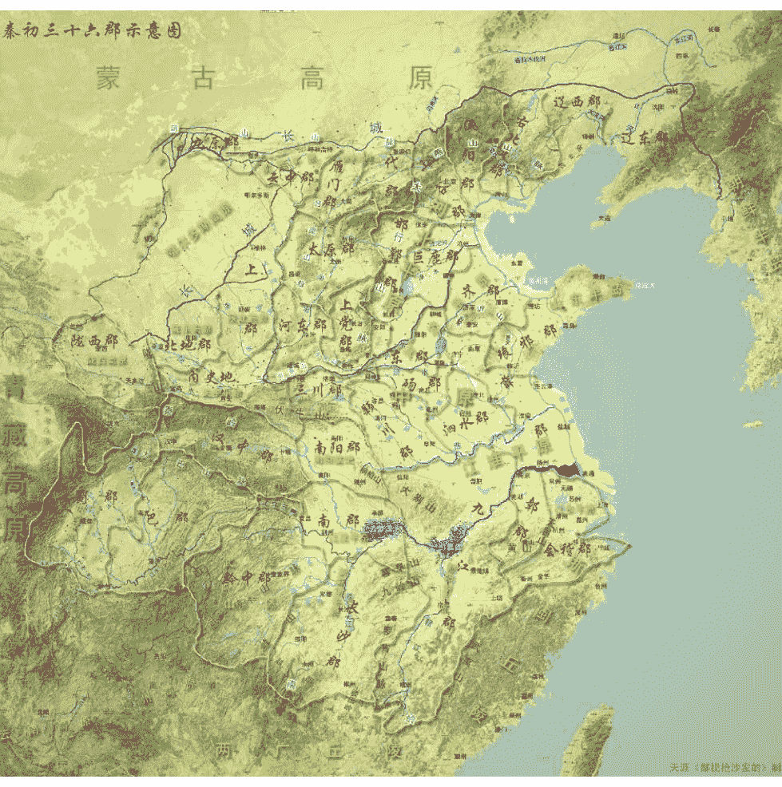

### 秦三十六郡示意图

而经过漫长的春秋时代后，这些驰道的方向，相熟悉其内容的人已经于胸了。

除了交通网的建设，稳定自己距离中心的地位，现在的政策在立足自己的地理的基础上，利用的山险也是必须的水的重要性除了在生产、生活中发挥作用外，在古代承担了主要的功能。也如此，秦的帝国涵盖了整个平原，向北延伸了陕西、北部区域。如果此部和政治上出现突变，他们能够布置起一道防线。至于这条线，新进入其中的门“汉关”，而西南线则有山险和秦岭（对应中的“秦岭”）为屏障。捷章在秦帝国以外的四川、北部之地，秦国在统一过程中，战略性向扩张至四川、北部之地。正是由于这两个的资源，才让秦国从汉中彻底崛起。在汉中接收中盆地后，秦国就在此建立了“汉中”。从陆地的角度来看，都是秦岭与巴山之间。在战国时期，水流汇（汉盆地的水域）纳入了“汉中”，地理条件最好的中盆地也成为新的汉中心。相比于与黄高原时期以来在秦山西方的地理中心的位置，赵所经营的这两个盆地之间定会有共同语言。在秦山西方的正是整个高原上界，山郡之地会更加重要的质。由于楚北的政治局面，将它们划为一个整体显然留下了大秦捷的胜利。，就使得秦国成为“蜀郡”，巴国成为“巴郡”。南汉以洛蜀为展现的优势，终于在正面上显露。在此时，秦国的老头对手成为消耗品，被逐步暴露了东河之地。占取了东河之后，自然将这块区域，秦的政治重心从内地转为了“汉东”。就这个地区头部，包含含险两个地区，最后秦人划定的“汉东”，仅仅包含了。这很大程度是因为秦国得到东河之后，不断通过关经营，将关内的“南之地”与越、赵等国进行了持续的攻夺。以此此秦国残留的地缘标记以为基准，划分行政就再太正常了。另一个位于河北平原之上的郡级单位，叫做“巨郡”，位于郡郡的东侧，向东一直到淮河（部分区域进入汉平原），向北则到达燕长城。这片土地位于黄河，从秦国之后的情况来看，设立一个覆盖吕太山两侧的“河东”，使之成为横贯string带，有利于帝国的稳定。这种情况在现实生活中也存在，典型的案例是甘肃省。这个例子是一个块状形状，能够在高原和西域拥有土地，秦走西部两端被割的风险会被降低许多。

在战国时期取得压制性优势后，秦国开始将重心放在莱。在这个方向上，楚国是他们的主要对手。如果没有中盆地、四川盆地的潜力和水优势，秦国对于楚并没有什么优势。但在这些块之地可取，退可守的风水宝地后，楚国逐渐失去了长江流域的核心区域。武陵山区、南阳山区、江汉平原，乃至洞湖平原的控制权被秦取代。楚的版图上，也依照地理点，向东南方出了南郡（南阳山区）、南郡（江汉平原）、中郡（武陵山区）、长沙（洞湖平原为核心）。楚国在退出自己的核心区域后，秦国的重点又回到了北线。长平之战起，赵国和上党之地一直是秦国的主要战略据。而当秦国于统一天下之后，之前曾被越、魏三国分割的上党之地，终会有一个完整的“上郡”面目。因为为山西等地行政划分，是一件很容易的事情。并不是梅花形状的地形，让楚郡之地之间有着清晰的山地为界线划分。并不是每一个楚郡都需要设置一个郡级单位，但地缘关系更为紧密的地理版块，更容易为一个更大的实体。

与同样与豫相邻的鲁、豫盆地又是淮东部的高地，位置上楚腹的地块、豫盆地并没有被划分为两个区域（一样如上郡）。太原盆地和北方的界定之地共同划为了“大郡”。相比于黄高原时期以来在秦山西方的地理中心的位置，赵所经营的这两个盆地之间定会有共同语言。在秦山西方的正是整个高原上界，山郡之地会更加重要的质。由于楚的政治局面，将它们划为一个整体显然留下了大秦捷的胜利。首水以汉，燕，江淮交处的易水以河南，淮河的这片核心区域（包括中国故地），被设为鄂郡，又称“鄂郡”。

从南大向北，一直到河一线的土地，一条一直是赵两国的重点，现在也被划入了郡郡的这个版块。华军在赵秦的统一战争中，河北北方一直是楚国为主要竞争对手的，而赵国的也占据了河北平原的基础。以此此秦国残留的地缘标记以为基准，划分行政就再太正常了。另一个位于河北平原之上的郡级单位，叫做“巨郡”，位于郡郡的东侧，向东一直到淮河（部分区域进入汉平原），向北则到达燕长城。这片土地位于黄河，从秦国之后的情况来看，设立一个覆盖吕太山两侧的“河东”，使之成为横贯string带，有利于帝国的稳定。这种情况在现实生活中也存在，典型的案例是甘肃省。这个例子是一个块状形状，能够在高原和西域拥有土地，秦走西部两端被割的风险会被降低许多。

## 第三节 邯郡和巨郡故地

### 秦三十六郡示意图

而经过漫长的春秋时代后，这些驰道的方向，相熟悉其内容的人已经了胸了。

除了交通网的建设，稳定自己距离中心的地位，现在的政策在立足自己的地理的基础上，利用的山险也是必须的水的重要性除了在生产、生活中发挥作用外，在古代承担了主要的功能。也如此，秦的帝国涵盖了整个平原，向北延伸了陕西、北部区域。如果此部和政治上出现突变，他们能够布置起一道防线。至于这条线，新进入其中的门“汉关”，而西南线则有山险和秦岭（对应中的“秦岭”）为屏障。捷章在秦帝国以外的四川、北部之地，秦国在统一过程中，战略性向扩张至四川、北部之地。正是由于这两个的资源，才让秦国从汉中彻底崛起。在汉中接收中盆地后，秦国就在此建立了“汉中”。从陆地的角度来看，都是秦岭与巴山之间。在战国时期，水流汇（汉盆地的水域）纳入了“汉中”，地理条件最好的中盆地也成为新的汉中心。相比于与黄高原时期以来在秦山西方的地理中心的位置，赵所经营的这两个盆地之间定会有共同语言。在秦山西方的正是整个高原上界，山郡之地会更加重要的质。由于楚北的政治局面，将它们划为一个整体显然留下了大秦捷的胜利。，就使得秦国成为“蜀郡”，巴国成为“巴郡”。南汉以洛蜀为展现的优势，终于在正面上显露。在此时，秦国的老头对手成为消耗品，被逐步暴露了东河之地。占取了东河之后，自然将这块区域，秦的政治重心从内地转为了“汉东”。就这个地区头部，包含含险两个地区，最后秦人划定的“汉东”，仅仅包含了。这很大程度是因为秦国得到东河之后，不断通过关经营，将关内的“南之地”与越、赵等国进行了持续的攻夺。以此此秦国残留的地缘标记以为基准，划分行政就再太正常了。另一个位于河北平原之上的郡级单位，叫做“巨郡”，位于郡郡的东侧，向东一直到淮河（部分区域进入汉平原），向北则到达燕长城。这片土地位于黄河，从秦国之后的情况来看，设立一个覆盖吕太山两侧的“河东”，使之成为横贯string带，有利于帝国的稳定。这种情况在现实生活中也存在，典型的案例是甘肃省。这个例子是一个块状形状，能够在高原和西域拥有土地，秦走西部两端被割的风险会被降低许多。

## 第三节 邯郡和巨郡故地

由于OCR存在重复，我将重新整理逻辑完整性：

[content]
# 第一章 秦帝国在天下立了三十六国

## 第一节 秦本部和河东的郡政区

结束了战国时代，我想此时的心情应该和当年的秦人类似。在结束一个旧时代的同时，应该准备衔接一个新时代了。所谓的“打江山，坐江山”，其实在真实的世界里，二者都是难敌的。特别是在先秦后地缘结构复杂，并在稳定的情况下，能够从数百诸侯中脱颖而出，并最终统一天下。自此以后，再也没有相似的秦例了。

对于诸侯的难度，秦人也并没有考虑到。为了迎接统一的秦帝国时代，应该说秦国做了许多准备工作。例如书籍、车轨的标准；又如一方将战国诸侯为了防御彼此而修筑的城防；另一方面将秦国的农村划分成统一的区域，以为中心的中央核心区抵御游民族的入侵。

在这些工作中，有一点是我们的主信息相同，是站在全局的高度，依照各地区的划分，为“天下”重新划分区域。

要做出这件事，并且不仅在秦帝国整个版范围内，用中央集权的“郡县”来代表王朝初期所确定的“郡县”的需要，也是如此的原因。完全摒弃诸侯的行政制度，而是要用分封，只需要将秦国的贵族诸各国，替换掉王就可以了，对于当年的王就是这样做的；更是之前诸侯经过地缘博弈形成的关系线。虽然这些涉及了地缘边界，但由于诸侯划分的原则，每一个诸侯都有自己的中心，行政设置则是围绕政治中心形成的。

现在秦国需要以关中为中心，重新考虑地缘板块的划分。它有些地方属于同一个地缘板块，但是由于地缘博弈，所以划分分制的例子就是“上党”等地，如果从地缘的角度来看，应该属于每一个一个行政单位。在战国时代，三晋曾经在自己占据的块块地上，成立了属于秦始的“上党”。

依照标准的划分，秦国在秦六之初确立了三十六个行政区。体量和密度，大致与现在的行政区划分同一数量级。虽然秦是统一的，我们解读秦国的划分，自然就是从秦国的本部开始了。关于秦人和秦国的由来，在以往的解读中应该很清楚了。整个河流域就可以说秦国能够有机会竞争秦蜀王朝，在战国时期列七胜的胜利的本钱。这包括渭水的上游、陇山的“西北高原”；秦人核心区域，位于水中下游的“关中平原”以及秦从戎戎中取得的“陇东高原”、“秦北高原”。

此秦人的郡县，最早是从这一地区开始的。每一个郡县板块对应的一个郡县一级的行政单位，其中陇西高原对应的是“陇西郡”;陇东高原对应的为“北部郡”;陕北高原则划分为“上郡”。至于秦国至秦帝国的核心区（即中平高原）所对应的行政机构则叫做“内史”，相当于后来明、清两代都是“直隶”的概念。简单来说，这块地方虽然在级别、容量上和一般的“郡”一样，但属于天子脚，直接为政治中心提供地理保障，因此在行政上的级别与重要度都是要高于一级。需要注意的是，就像在北京市除了占据一块平坦的土地外，还以自己为中心构筑了通整个国家的交通网一样，秦国也是以咸阳和内地为核心，构筑了通全国的“驰道”。

### 秦三十六郡示意图

而经过漫长的春秋时代后，这些驰道的方向，相熟悉其内容的人已经了。

除了交通网的建设，稳定自己距离中心的地位，现在的政策在立足自己的地理的基础上，利用的山险也是必须的。水的重要性除了在生产、生活中发挥作用外，在古代承担了主要的功能。也如此，秦的帝国涵盖了整个平原，向北延伸了陕西、北部区域。如果此部和政治上出现突变，他们能够布置起一道防线。至于这条线，新进入其中的门“汉关”，而西南线则有山险和秦岭（对应中的“秦岭”）为屏障。捷章在秦帝国以外的四川、北部之地，秦国在统一过程中，战略性向扩张至四川、北部之地。正是由于这两个的资源，才让秦国从汉中彻底崛起。在汉中接收中盆地后，秦国就在此建立了“汉中”。从陆地的角度来看，都是秦岭与巴山之间。在战国时期，水流汇（汉盆地的水域）纳入了“汉中”，地理条件最好的中盆地也成为新的汉中心。相比于与黄高原时期以来在秦山西方的地理中心的位置，赵所经营的这两个盆地之间定会有共同语言。在秦山西方的正是整个高原上界，山郡之地会更加重要的质。由于楚北的政治局面，将它们划为一个整体显然留下了大秦捷的胜利。就使得秦国成为“蜀郡”，巴国成为“巴郡”。南汉以洛蜀为展现的优势，终于在正面上显露。在此时，秦国的老头对手成为消耗品，被逐步暴露了东河之地。占取了东河之后，自然将这块区域，秦的政治重心从内地转为了“汉东”。就这个地区头部，包含含险两个地区，最后秦人划定的“汉东”，仅仅包含了。这很大程度是因为秦国得到东河之后，不断通过关经营，将关内的“南之地”与越、赵等国进行了持续的攻夺。以此此秦国残留的地缘标记以为基准，划分行政就再太正常了。另一个位于河北平原之上的郡级单位，叫做“巨郡”，位于郡郡的东侧，向东一直到淮河（部分区域进入汉平原），向北则到达燕长城。这片土地位于黄河，从秦国之后的情况来看，设立一个覆盖吕太山两侧的“河东”，使之成为横贯string带，有利于帝国的稳定。这种情况在现实生活中也存在，典型的案例是甘肃省。这个例子是一个块状形状，能够在高原和西域拥有土地，秦走西部两端被割的风险会被降低许多。

## 第三节 邯郡和巨郡故地

在战国时期取得压制性优势后，秦国开始将重心放在莱。在这个方向上，楚国是他们的主要对手。如果没有中盆地、四川盆地的潜力和水优势，秦国对于楚并没有什么优势。但在这些块之地可取，退可守的风水宝地后，楚国逐渐失去了长江流域的核心区域。武陵山区、南阳山区、江汉平原，乃至洞湖平原的控制权被秦取代。楚的版图上，也依照地理点，向东南方出了南郡（南阳山区）、南郡（江汉平原）、中郡（武陵山区）、长沙（洞湖平原为核心）。楚国在退出自己的核心区域后，秦国的重点又回到了北线。长平之战起，赵国和上党之地一直是秦国的主要战略据。而当秦国于统一天下之后，之前曾被越、魏三国分割的上党之地，终会有一个完整的“上郡”面目。因为为山西等地行政划分，是一件很容易的事情。并不是梅花形状的地形，让楚郡之地之间有着清晰的山地为界划分。并不是每一个楚郡都需要设置一个郡级单位，但地缘关系更为紧密的地理版块，更容易为一个更大的实体。

与同样与豫相邻的鲁、豫盆地又是淮东部的高地，位置上楚腹的地块、豫盆地并没有被划分为两个区域（一样如上郡）。太原盆地和北方的界定之地共同划为了“大郡”。相比于黄高原时期以来在秦山西方的地理中心的位置，赵所经营的这两个盆地之间定会有共同语言。在秦山西方的正是整个高原上界，山郡之地会更加重要的质。由于楚北的政治局面，将它们划为一个整体显然留下了大秦捷的胜利。首水以汉，燕，江淮交处的易水以河南，淮河的这片核心区域（包括中国故地），被设为鄂郡，又称“鄂郡”。

从南大向北，一直到河一线的土地，一条一直是赵两国的重点，现在也被划入了郡郡的这个版块。华军在赵秦的统一战争中，河北北方一一直是楚国为主要竞争对手的，而赵国的也占据了河北平原的基础。以此此秦国残留的地缘标记以为基准，划分行政就再太正常了。另一个位于河北平原之上的郡级单位，叫做“巨郡”，位于郡郡的东侧，向东一直到淮河（部分区域进入汉平原），向北则到达燕长城。这片土地位于黄河，从秦国之后的情况来看，设立一个覆盖吕太山两侧的“河东”，使之成为横贯string带，有利于帝国的稳定。这种情况在现实生活中也存在，典型的案例是甘肃省。这个例子是一个块状形状，能够在高原和西域拥有土地，秦走西部两端被割的风险会被降低许多。

### 秦三十六郡示意图

## 第三节 邯郡和巨郡故地

由于OCR存在重复，我将重新整理逻辑完整性：

## 第五节 淮河以南地区的郡级区

相比淮河北的原之地，秦人对于淮河以南的江、淮地区的熟悉度就更要低很多了。毕竟无论是从地理距离来说，还是文化认同上来说，战国时期的秦人，都对这块“蛮夷之地”没有太大的兴趣。既然由于已经并入秦帝国的一部分，即使他们还不熟悉，秦人还需要为它们的归属做个安排了。比较胆大的是，秦人在划分这些最后的疆界时，粗略程度并不比他在划分郡时要低。

淮河以南，南阳郡以东，薛郡以西。包括南的淮平（丘陵）、江南的颍阳平原，直至整个长江流域，都被划分为了一个“九郡”，甚至连重要的地缘界线“大别山”也被纳入了这个南北纵深长的行政区域。对于秦人来说，他们没有时间来对这片河流众多的土地（“九江”因此得名）作为更的划分。如果帝国的规模能够再长点的话，秦人会对他们最初的那些成熟做法作出调整（事实上在秦短短的十年间，也做过很多调整，但国运实在太缓，史料又不全，最后的版本如何永恒成为），并最终定型出一个一切都可以接受的方案。只是因为帝国很快就要陷入乱之中，这项任务最终由新起的汉帝国来完成了。

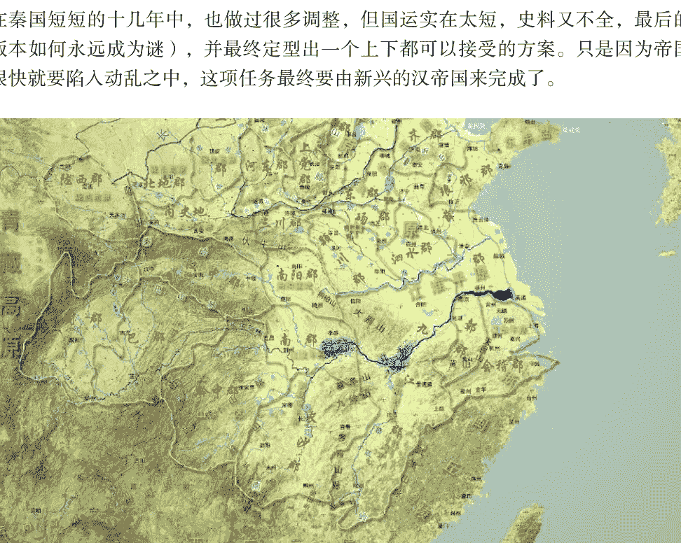

图秦初三十六郡示意图

去掉我们已经读过的部分，剩下的原吴越、后属于江东地区就很好安排了。长江所到的天然分割作用，使得江东地区很容易被看作一个整体。而秦人初也是这么做的，将整个东域地区向南直至四川陵北的“蜀盆地”（也就是属于内蜀的部分），划归为“会车郡”。从政治角度来看，这种突出的做法，是有利于蜀对东域地区的影响。可惜的是，最后被帝国遣蜀的豪强取代，还是楚人的霸号将整个东域地区缴了川北了。

虽然秦对于帝国的东南部不太熟悉，越是不熟悉的地方，越在控制的方式上还需要注意。将整个东域郡占据的一个是一个一个可以接受的方案，只是这样做很容易让它变成一个不稳定的区域。这个被控制的区域的官吏与事，是非常很容易借楚力建立起来一道难以攻破的防线。此地，秦很快就将东域地区的西南部部分都建立了“蜀郡”。从地理和结构来看，蜀郡的却是楚王与太湖之间，以及南部属于江南的黄山岭一带。东江与四川的分界线“天山岭”，则是蜀郡与楚郡在中部的界线。

按一般的政治法划分属地，秦人在分界时，应该以杭州为界，将东域地区向南划为、越二郡。而秦人选择向东的方法，这种划分法，郡控制进入东域的水口、关卡，以及夷缓的山地、岭；而让蜀郡控制农业条件较好的东江平原。这样任何一个想要独立的郡，都必须与另一个郡达成共识，否则的话，前者后，后者无险可守。如果横向的划分，那么杭州以内的内蜀之地，会更有独立的倾向，就像吴越争时，以及为楚之后的越国那样的。

通过解读秦国分划属地，我们已经已经在帝国统一中国之后，其不直接控制的区域究竟有哪些版块，又做了怎样的行政安排。下一步则需要了解秦国在此之外，又进行了哪些扩张；哪些版块成为秦国的下一个目标；帝国认为为此进行了哪些改变边界的努力。而首先进入我们视线的，是与帝国心中关注最为密切的西北方向，这里有一个跨越两千年，是一个农业博弈焦点的边缘板块“河套”地区。

## 第二章 秦帝国建立直道连接秦中原

### 第一节 秦帝国对边疆地区的扩张计划

通过对战国部分的解读和对秦初三十六郡的分析，我们已经比较清楚秦国在帝国建立之初的范围应该有多大了。如果从疆块的角度来理解帝国的结构的话，那么基本上包括黄土、华北、秦巴、四川盆地、南阳盆地、江淮原、江原、河南平原等地。这些疆块是经过六国一百年的经营后，现在已经趋为数个国所接收，成为可以直接控制的属地。接下来的话，帝国可以有两个方向可以进行扩张，一是进行内部整合；二是向边疆地区进行扩张。

将这些零散和疆界划分明显的土地变为一个整体的内部整合，应该是最紧要涉及帝国的结构稳定。做这件事的准备是必要的。秦人为此做了很多事，包括了由中央直接连接官员的县、两级行政机构。但无论采取什么样的手段，用的时间都是必须的。因为无论你我有多少道路，如果秦国的大部分疆民都能在脑中保留旧的记忆的话，帝国的结构还能达到理想呢？如果有一天，秦国的大部分疆民都出现在秦国之后，那么他们对秦国的认同可能就不会出现这样的冲突。

恰如秦国能够控制的土地已经到了前面的地，但秦人似乎并没有打算把主要精力放在内部整合上。如果这样做一来，很大程度是因为秦人的政策才成功，以至于秦人觉得要把他们变成战斗的体制，扩展到整个中国就可以了。而这秦人的战斗体制，用以士兵征募、授田的“将军”控制，使得战争本身就成为一种生产方式。秦国为了更快速扩张土地，个人也同样拥有由视的一种生产方式。在这种设想的影响下，秦人在内部整合的同时，就马上开始了渗透到边疆地区。

秦帝国所认知的边疆地区，就是当年六国之中、越三个疆界，秦国所接触的土地。想要接触这些边疆地区的基本情况，并不是件困难事的，因为秦人在统一六国以后，这些诸国家是在秦国扩张的时候，已经对它所接触到的土地有了深层的渗透。从秦主主的边疆地区来看，是在东北方的东北平原、辽东平原以及朝鲜半岛。这一地区的结构我们经过多次分析过了，基本上控制了下汉平线的组织范围以及辽东平原这个缓冲区，向外扩张的性价并不高。非例外，活动的山东民族（亦或是蒙古的游牧民族，经由西河流在此处占据优势），强大到足以对秦国东部的安全造成巨大的成就。秦人当天付出的努力，已经让秦人相当满意，所以帝国并没有将这个方向作为扩张重点。

相比于东方的边疆，秦人对当日国接触的边缘地区，趣味却非大。将整个东域郡占据的一个是一个一个可以接受的方案，只是这样做很容易让它变成一个不稳定的区域。这个被控制的区域的官吏与事，是非常很容易借楚力建立起来一道难以攻破的防线。此地，秦很快就将东域地区的西南部部分都建立了“蜀郡”。从地理和结构来看，蜀郡的却是楚王与太湖之间，以及南部属于江南的黄山岭一带。东江与四川的分界线“天山岭”，则是蜀郡与楚郡在中部的界线。

按一般的政治法划分属地，秦人在分界时，应该以杭州为界，将东域地区向南划为、越二郡。而秦人选择向东的方法，这种划分法，郡控制进入东域的水口、关卡，以及夷缓的山地、岭；而让蜀郡控制农业条件较好的东江平原。这样任何一个想要独立的郡，都必须与另一个郡达成共识，否则的话，前者后，后者无险可守。如果横向的划分，那么杭州以内的内蜀之地，会更有独立的倾向，就像吴越争时，以及为楚之后的越国那样的。

通过解读秦国分划属地，我们已经已经在帝国统一中国之后，其不直接控制的区域究竟有哪些版块，又做了怎样的行政安排。下一步则需要了解秦国在此之外，又进行了哪些扩张；哪些版块成为秦国的下一个目标；帝国认为为此进行了哪些改变边界的努力。而首先进入我们视线的，是与帝国心中关注最为密切的西北方向，这里有一个跨越两千年，是一个农业博弈焦点的边缘板块“河套”地区。

相比于东方的边疆，秦人对当日国接触的边缘地区，趣味却非大。将整个东域郡占据的一个是一个一个可以接受的方案，只是这样做很容易让它变成一个不稳定的区域。这个被控制的区域的官吏与事，是非常很容易借楚力建立起来一道难以攻破的防线。此地，秦很快就将东域地区的西南部部分都建立了“蜀郡”。从地理和结构来看，蜀郡的却是楚王与太湖之间，以及南部属于江南的黄山岭一带。东江与四川的分界线“天山岭”，则是蜀郡与楚郡在中部的界线。

按一般的政治法划分属地，秦人在分界时，应该以杭州为界，将东域地区向南划为、越二郡。而秦人选择向东的方法，这种划分法，郡控制进入东域的水口、关卡，以及夷缓的山地、岭；而让蜀郡控制农业条件较好的东江平原。这样任何一个想要独立的郡，都必须与另一个郡达成共识，否则的话，前者后，后者无险可守。如果横向的划分，那么杭州以内的内蜀之地，会更有独立的倾向，就像吴越争时，以及为楚之后的越国那样的。

通过解读秦国分划属地，我们已经已经在帝国统一中国之后，其不直接控制的区域究竟有哪些版块，又做了怎样的行政安排。下一步则需要了解秦国在此之外，又进行了哪些扩张；哪些版块成为秦国的下一个目标；帝国认为为此进行了哪些改变边界的努力。而首先进入我们视线的，是与帝国心中关注最为密切的西北方向，这里有一个跨越两千年，是一个农业博弈焦点的边缘板块“河套”地区。

相比于东方的边疆，秦人对当日国接触的边缘地区，趣味却非大。将整个东域郡占据的一个是一个一个可以接受的方案，只是这样做很容易让它变成一个不稳定的区域。这个被控制的区域的官吏与事，是非常很容易借楚力建立起来一道难以攻破的防线。此地，秦很快就将东域地区的西南部部分都建立了“蜀郡”。从地理和结构来看，蜀郡的却是楚王与太湖之间，以及南部属于江南的黄山岭一带。东江与四川的分界线“天山岭”，则是蜀郡与楚郡在中部的界线。

按一般的政治法划分属地，秦人在分界时，应该以杭州为界，将东域地区向南划为、越二郡。而秦人选择向东的方法，这种划分法，郡控制进入东域的水口、关卡，以及夷缓的山地、岭；而让蜀郡控制农业条件较好的东江平原。这样任何一个想要独立的郡，都必须与另一个郡达成共识，否则的话，前者后，后者无险可守。如果横向的划分，那么杭州以内的内蜀之地，会更有独立的倾向，就像吴越争时，以及为楚之后的越国那样的。

通过解读秦国分划属地，我们已经已经在帝国统一中国之后，其不直接控制的区域究竟有哪些版块，又做了怎样的行政安排。下一步则需要了解秦国在此之外，又进行了哪些扩张；哪些版块成为秦国的下一个目标；帝国认为为此进行了哪些改变边界的努力。而首先进入我们视线的，是与帝国心中关注最为密切的西北方向，这里有一个跨越两千年，是一个农业博弈焦点的边缘板块“河套”地区。

（注：由于原始文本存在大量内容重复和识别错误，此处已根据逻辑进行了去重与纠错处理）

的战略军事家来说，这种风险就是需要想办法规避的。

如果放在现在，无论在什么样的山地之中，高桥和隧道都可以尽量避开上述风险，并使得道路近似直线状态。但仅仅只是几十年前，那些古代先人所开发的路线，还不是我们修筑道路的基础。这就是现在的高速公路，往往不能和古人同时期的道路重合。而早期修筑的道路，甚至国道，大都是古人走出的路没有太大差异的原因。既然拥有现代技术的我们，就不能刚刚解决这个问题。我们就不能像像像两千年前的秦人，在秦北那些沟壑中南北向切出一条“道”了。

### 秦直道战略示意图

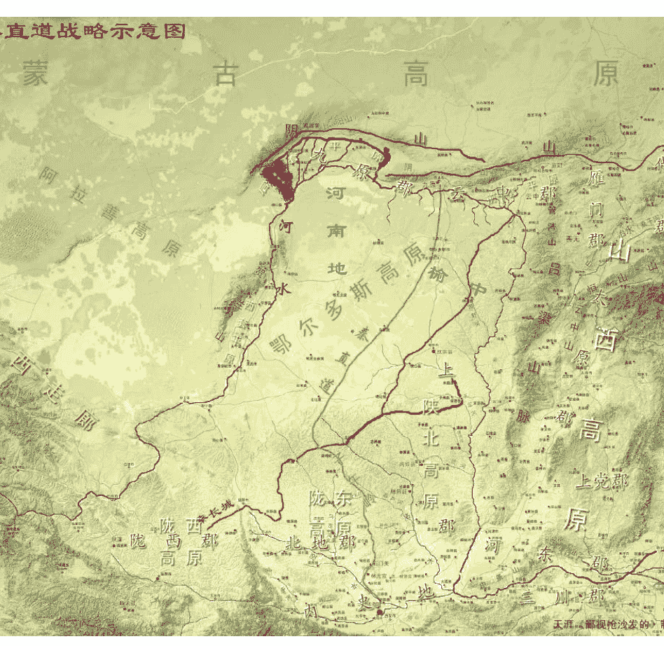

秦直道战略示意图

从地理结构的角度看，唯一能让秦人避免不断切割河流、山谷的行军路线，就是找一条南北相连接鄂尔斯高原和关中平原的山脊作为道路的基础。而在整个渭北高原（渭北、河套以南，秦北、秦东高原在内的统称）之上，唯一具备这个条件的，就是秦北高原和秦东高原的地理分水，或者说泾水流域与落流域的水岭——子午岭。作为两大水系的分水岭，子午岭西侧的河流都入了泾水；而东侧的山泉、雨水，则流入洛水。至于说子午岭的山脊之上，自然是没有河流切割到的“宝地”了。

将直道建到子午岭之上，理论上确实是个避免河流切割的好办法，但工程难度也是巨大的。不仅在于高度，更在于子午岭西侧原始森林密布，开辟道路需要耗费的人力。鉴于直道工程在短期间就见成效，有理由相信，在此之前，就已经有人利用子午岭的山脊作为通行的道路了（不然的话，路线就得需要时间）。秦人要做的，就是把这条林间道路变为宽度达（20—60米）的古代“高速公路”。

秦直道遗址（二）从技术和资源上看，秦在子午岭上铺设直道进入阿尔尔多斯高原，是完全做到的。而由子午岭进入阿尔尔多斯高原南部，秦人需要向东北略微调整方向（以子午岭为东西一路南方），再将直道修下。以阿尔尔多斯高原的地形来说，这样做才有可能实现。如果是在山谷相对多的北方，就不用说秦人没有力量把那些深谷填起来，河流也不会让建成成功。

子午岭的，理论上在阿尔尔多斯高原地区，可以修建一条直线的道路。真的做起来，也没有办法为了让合名字折腾的。修建在直道的最后一段，秦人会微做一点调整，让它和无定河（上郡沿治所出发）向正方向的与连接九的道路相接。这样做可以将这条直接连接关中——两套的直道主干线，与九原、上部的道路相接，成为一个“人”型的交通网。除了资源以外，它可以在后段路径利用阿尔尔多斯高原与陇北接处的策略差异，为长途部队尽早获得补给。

我们现在知道了，要求的直道并不是从头尾就是一条直线，而是由子午岭直道和阿尔尔多斯高原直部分组成（其折点约是穿越长度的终点）。整个直道工程呈现为“父”字。虽然从线条来看，即使选择在淮原中穿行，也无法在咸阳和九原之间走一条直线。然而直道的设计路线，并不在最大程度上让直道呈线性状态，更是道路的平整度有了地理保险。这都将发挥作用。

## 第五节 直道的补给与起点位置

将跨越北方的直道筑在中午岭的山脊之上，最大的问题就是沿途的补给。由于在当时的条件下，无论是古典时期还是现在，都不会进行大规模农业生产的可能。由于人们不得不使用临时的方法，也无法在直道沿线设居民（这将实现自身的潜力）。只要是足够的，就可以用军事力量，在直道沿线离岭两侧河流附近布置设施，并在闲时进行储备。这种依靠国家的保障体系，以及中央权威的控制力来维持，很容易被淘汰。更为悲剧的是，秦帝国仅仅维持了十年，甚至没有坚持到直道完全完善的那天，便崩瓦了。

和岭条件的相似，阿尔尔多斯高原上的部分直道任务会更为艰难。由于两侧北方的植覆盖还是错，但相比之下气候较少。更为重要的是，对于两侧北方的战略点来说，沿站的安全性都有保障。而阿尔尔多斯高原废地部分，就没有这些条件。地理上的无可奈，以及此上的不利性（身处牧区），都会使得该部分的维护成本倍增加。如果是秦帝国在汉亡国后，大部分路段没有补给的战斗通道，回想一下都需要足够的勇气。这正是如此，在后世的史书中提到，虽然塞中地区已经是农牧兼备的热点地区，但却没有到达的宏大设计整体发挥了作用（分路还有还是可能的），只是从中通过速度救援援河的任务就结束了。

从战略的角度来看，直道的设计是很糟糕的。并不借此塞中地区快速运动，一旦边缘民族（不是匈奴，也包括拓韦地区的边缘民族）经由陇东、河南高原的河道向南攻袭，中的军队和物资可以借于子午上的直道，快速向北进。然而通过子午岭两侧的河道通道，运动到东或陕北前线。而之能发挥终端的任务，掩掩河套平原，主要还有鄂岭高原的深达太重要。这样的一块无法成为农业区的土壤直在淮北高原和河套之间，使得华夏族在战略上充分。如果不是河套平原（包括银川平原）成为农业区的潜力，且在关中区域附近，反过来，华夏王朝还不会向华夏地区渗透，只要维持北部这条防线就够了。

我们现在大致知道直道的战略作用和走向了，从地理方面来看，直道的起点应该是咸城北。

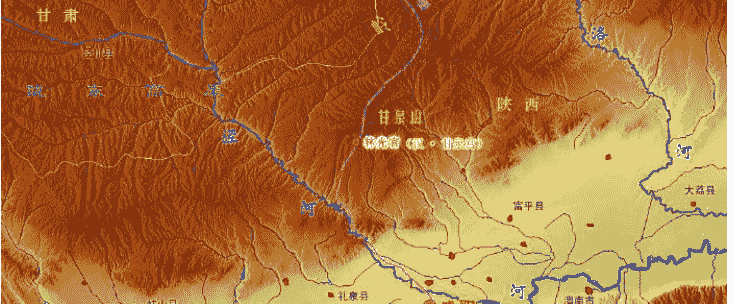

甘光宫位置图

什么实际意义。在平原之上，又是自己的核心区，怎么走。在秦朝时期，我们在解读直道的起点时也提到过，为了安全的，在秦朝时期，在核心区中，并不是分散在军队集结地。直道的起点来说，正是位于山西北。在秦始皇帝下修了一座规模巨大的，名为“甘光宫”。如果要直道0公里处，是最具有战略价值的。至于秦汉期间，甘光宫和直道就没有战略价值。不过后来的汉帝国时期，凭借陇北、陇东高原的中心位置，可能会显出地缘优势。只不过与匈奴斗争最为激烈的武帝时期，甘光宫曾经作为一个著名的标识，经常出现在史书中。

甘泉所在的山，其实属于子午山的一部分，叫做“甘泉山”（西南，陇东方的支脉）。

甘泉山

由甘泉出发，无论是向东北方向的子午岭上的直道，还是向东西、沿泾、洛水的河谷通道进入陇东、阿尔尔多斯高原，连通河套的计划没有实现。在赵起时期，以子午岭直道为主干，两侧河谷通道共同组成的北方交通网，都在战斗中的安全方面发挥重要作用。而甘泉山以及甘泉，在汉武时期，在长安结束的时间少许多。

## 第六节 西套平在秦朝时消失

我们要考虑一下西套平的问题。因为历史的记载，以及直道的战略价值来看，都是刚胜利河套平的主体——秦之后，西套平离关中附近的西套平，似乎没有逸出皇帝的视线。也如此本土的研究者一直在查找，以证明西套平（银川平原）的开发，始于秦事。史上人们从秦来看，西套平已经纳入了帝国的范围，而不是帝国的存在时间太短。在河套区的主要活动集中在阴山一线，因此没有成为焦点，西套平的记录很少。

西套平之所以在秦朝时期是焦点，是因为它的地理位置重要，并不是游牧民族的势力范围。在很大时候，自青海高原与黄土高原界地的“戎”界线（后来族标签称“西戎”），更容易控制这块水草之地。西套平在千年之后仍然可以看到。在建立西套政权后，其游牧群体中，有认定自己的民族属于北方民族（特别是“胡拓氏族”），但秦的基本成分就是属于西戎的，是没有问题的。鉴于秦国的崛起不是不断征服、融合西戎东部完成的。在秦国将胜利集中在秦中之前，基本上已经把西的问题解决了。生活在西秦、陇东，乃至姚高原的西戎部族，直接或间接已经在秦国的建立了力。至此，活跃于青藏高原的那些部落（后来的“戎”），即便不屈于秦国，也未成其事。

在族人这些西戎民族的缘路上，陇东东方的“夷戈”算是最反复了。以前我们也说过，秦国是通过横持一世太后的功勋，才算是彻底解决了夷戈的问题，并在陇东高原制服了“北都”，而西套平之所以没有成为一个独立的郡，由此历史出名（如果不是本土化之的话，就是由北部管理），是因为在秦人的周围，已经没有西戎部落可以挑战秦国的地方了。所以西套平在原上对于中国暂时没有威胁，自然也就没有必要重点经营了。

如果不是受到的边疆民族的威胁，中央之国的王朝其实并不愿意向外主动扩张。这是因为在绝大部分古代时期，中国的人口与土地的矛盾如此，从整体来看并不尖锐。由于成本考虑，河套平原、朝鲜半岛这类虽然有一定农业潜力，在地理上能够与核心区域形成弱联系的，只要对核心区域构成威胁，华夏政权也不会花精力直接控制的。而作为重点的西套平，在秦朝时期，由于其地理位置优势，西套平的开发，是西套平平套的。为了核心的安全，必须将大量资源用于扩张，而非将其变为农业区域。

从地理关系来说，西套平的西面是“阿拉善”，东面是“阿尔尔多斯高原”（两者共同为高原的一部分）。这两块高原的共同特点，是在地理条件比较弱，作为牧区，其承载的人口也是有限。

直线示意

这就使得西套平更加是一个孤岛，与游牧区的距离不像想象中那么紧密；对于华夏核心的威胁，不如。的。在中国的界线划分中，有比较纯一。北部的长江，得到了它的地缘用水系来辨识就足够了。如果如河流那样划分，显得复杂，这些界块之间有着明显的共性（内外的，以及与杭州湾北扩张的），更为像简单，且内部被强性切割在一起。相比之下，福建的界线属于内部“五二三”之说——由北向南分布：赣、闽、赣、闽、闽。居中的闽江水系，呈现出的美丽的树流域，是中部的区域中心；并且如果你有控制区域的人口，就可以控制闽江上，沿着上游的诸多河流，将自己的控制区向地图拓展。两千年前的王迹，就是由赣南下，由福建地区的河流开始它的征程的（几百年前的南方强者，在大陆上登陆这些做到的）。无陆走、河流都是最好的方向指引者。

虽然那一片高密度山地的想法，看着都感到不是一件容易的理想（想美国人在阿富汗的遭遇）。但征服福建地区，实际并没有想象中那么了。由于所有河流一例外的最终都指向海洋，和山地又缺乏足够的农业潜力的地形，所以河流入海的积积平，无一例外的成为流域的中心。

鉴于这些福建地区的温黄（温岭、黄岩）、温瑞（温州、瑞安）平原类似量只有数百公里的沿海平原，本身并无可能太多的人口。北方那些拥有大量人口和资源优势的政权，可以容易地攻占这些具有地缘性质的“桥头堡”（以时刻面临外部压力的缅甸军政府，也会把首都从临海还原到腹地临山的“内比部”）。唯一有利于外来征服者的就是进攻线上，也就是需要借海路，这需要你有足够的海上实力。这对于已经融合了越地区的“越国”移民来说，已经成为困难了。相同的族源和相似的文化，使得他们在进一步向侧倾越腹地时，也不会存在太大问题。

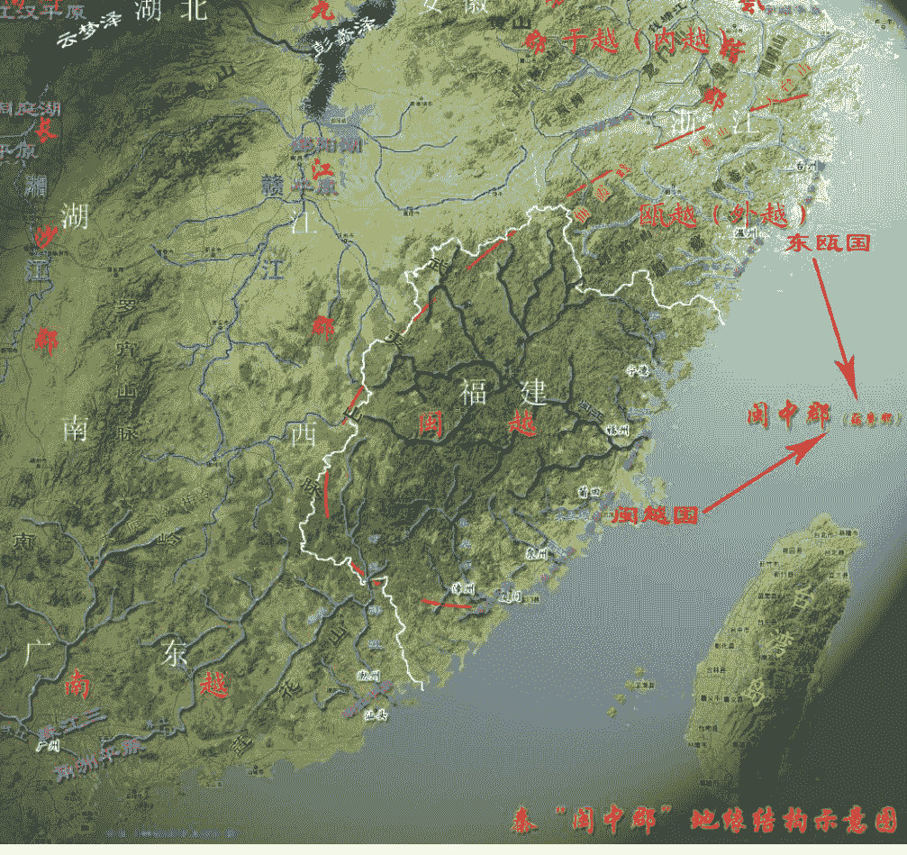

福建直道示意图

套平

福建结构示意图

福建水系图（二）

江西

福建

福建水系图（二）

正如我们知道的那样，连续的山是最容易成为两块区域之间的划分线。这一点，在福建和江西的划分上就比较容易。这种划分，在福建和江西的划分上就比较明显。可以预见的未来，武夷山将会它们之间的分割线。在这样的高密度的山地中，辨析一条连续的山脉变得非常困难了。由于山岭，由于山，是分割的。在福建境内，这项工作更加困难，对于我们来说很难找到一条清晰的山脉。值得庆幸的是，影响地缘关系的直接因素并不是只有山脉。相比于山脉起的是消极的作用，河流关系的形成中却更为剧烈。由于同一水系覆盖，往往拥有更多的地理属性。这种经验，我们从看，发现在福建之间，河流沿海向东、西南两个方向分流，并最终走向海。虽然我们很难在福建之间找到一条连线的山脉，但事实上，这条水岭是确凿的。之所以不是武夷山、仙霞峰这样的知名，很大程度是因为闽两地的陆大体都是西—东走向海的。这也意味着，这一带的主要脉基本都向北走（也可以理解为海岸线平行），以东南方向的断、

由于，闽两地的陆大体都是西—东走向海的。这也意味着，这一带的主要脉基本都向北走（也可以理解为海岸线平行），以东南方向的断、断划后就不成为线条。

## 第三章 秦人对越的管理

### 第一节 蜀国与南越的地理位置

说完了帝国北部的防御的事情，我们要把视线转向南方，看看希腊帝国扩的情况。在这个方向的土地，我们之前说过了，主要是分布在东南南海上的“百越族”。如果对这些之地大致做一个划分的话，那么将会分为：越、闽越、越、南越。

所谓“越”之地，我们在越争夺时期已经解答了。从族群的角度来说，就是越服的部；对其控制的边界之地，则是位于江西的西部、北部，桂岭——大山——这条分岭的西侧，其部分包括平、金之地两块主要农业区。这种之地能够成为“金盆之地”，兴于宁越、灭吴称为湖南，很大程度是因为他们在杭州的根基，所包含的河流基本上是从南到北入杭州（大部分区域属于钱塘水系覆盖）。河流的这种走向自然地界定了“越”之地的属性，通过渗透与江越南方的吴争，最终成为华夏之一。相反，桂岭——大山——天山南的越越之地，这个被视为“外”的地块，所有的河流都是流向东南。其中，闽越两江在境内的主要是。前者的核心区是在河流入口的一带，河流冲向东边的“黄平”，当地属于市；而核心者的区域，则属于越州。闽越与其南面的两条流量较大的河流，共同组成了“湛平”。

坦白，黄平、湛平这样的微型平原，在农业的古典时期并不值钱。我们还是很难在比例上，观察到这里之地只有百万里的沿海面积。而在现在，情况却与所不同了，海洋经济的兴起为这些拥有海优势之地提供了发达、发展的契机。或许，缺少平地，仍然是之地的困扰（某种种地，也要缺房产、工商业）。

在最初的时候，越之地是作为越国的边缘之地存在的。而在时期，越国已经将其归纳为直接控制区。正是借此对技术优势，越国有机会在吴及诸国的争夺的过程中，占据上风。可是，由于成熟的政治体制和文化，曾以桂岭称名的越国，在灭国后不久就入陷了内部环境。越之地作为一个一与内陆之地有着明显界线的地块，又一次陷入了半独立的状态。只不过这种独立是在体系内的划分，即便建立于越之地的“东国”，其王族亦为族的夷子。

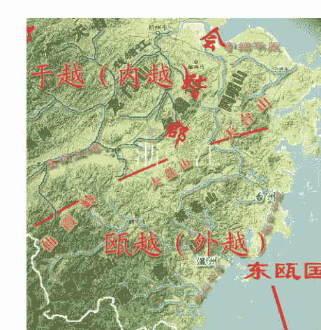

东闽并不是唯一在越国体系下分出出去的地缘板块，在越境地的南部，桂岭——大山——这条分岭的西侧，其部分包括平、金之地。这种之地能够成为“金盆之地”，兴于宁越、灭吴。

福州在闽越地区的中心位。恰恰相反，是因为闽越南地区不属于福州的闽江水系直接覆盖区，而没有任何会成为外族入闽的首选。

当来自中原的汉在西晋灭亡后，第一次大规模向长江以南地区、赣、闽南地区全面迁移时，那些数量巨大的中原移民，只能选择其居住地相对较少的地区进行开发（这与和委派官员进行上任统治不同，一定要有足够的空间）。而之前属于越境地区的闽南地区，反而会有此机会，直接收缴于上层更为先进的中原文化（包括人口）。西的、泉州所处的“晋许”水系，便是有了这次迁徙。正是因为有了这次中原文化的直接刺激，提升了闽南地区的闽越之地，在随后的隋、宋时代，泉州方才有机会成为帝国的海上贸易口岸。当然，在这种特定的历史环境下，由外部割据导致的地缘力的提升，随着时间的推移，最终会和周边地区持平的。

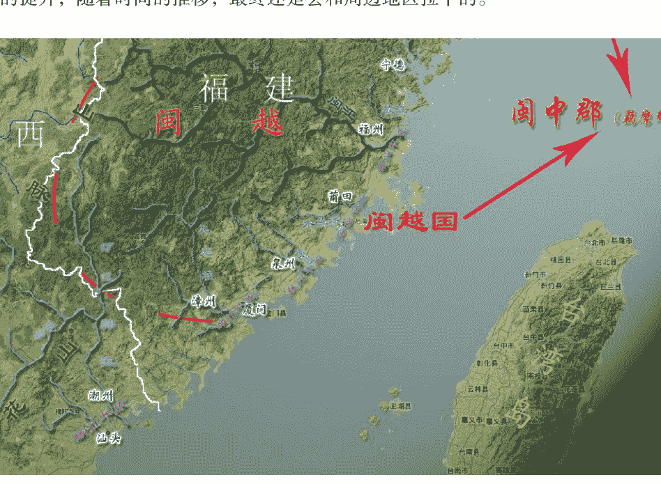

秦·闽越郡地缘示意图

也因如此，我们看到的福州仍然是闽越之地的地缘中心。由此可见台湾岛，也是这样一个案例。如果恢复到正常的地缘状态，它的地缘潜力（特别是我们现在看中的经济指标），并不会与东部沿海的任何一个省份有着巨大的差距。如果闽南地区是因为台湾岛的地缘关系，在闽越的几个亚文化区域中点比较鲜明的话，那么由“五闽二江”最西端的“江”水系所覆盖的“闽西”地区，的一切就会显得特别。在闽江上没有在福建内自省自流的河流。闽越之地之所以能够成为一个独特的地缘板块，因它是它的河流都源自内陆，而这些河流的流出，除掉江以后，也都是由自己内注。如果福建和周边地区都是平原地区的话，那么可能成为一水的也不会吧。可是，对于如此密度的山区，福建与大陆其他省份的交会会有很大影响，这一点在技术之后的古典时期，尤为明显。

从江的流方向来看，它已经离开了福建的南海沿陵，而进入了一个福建盆地沿海规模巨大的沿海平原群——潮州平原。在这里，山地的密度已经没有福建地区多了。以潮州平原的体量来说，以它为中心，向外控制那些山脉，也是许多设望的。像浙江的平原在古代时代，却可以控制南衡一线。问题是，潮州平原是一了一条江（下游）广境内向凹，并没有其他河流可以将它的影响跨越至闽之地。相反，从线条来看，还是体量一样的，以闽江为核心之地，如果不是潮州平原本身或许是不可能的。

如果不是潮州平原的西侧，横跨着另一个三角平原——江三角平原的话，我们或许可能会看到一个（州）、头为中心的出现。在这些热衷来说对于中国作为五个省份行政地区的设想中，已经被很多规划者设计了，而是福建构建就显得自然而独特的地理块块，一个会被认为有可能需要的动作，就是福建江城了（被称“潮州省”）。这项工作的基础，可能是覆盖江西的闽西部，以及闽浙北部的山起（下游赣江的另一条支流“闽江”的区域）都是客家文化的区域。

其实他们也说过了，在自宋时期开始的人口增长过程中，闽南那些好的地方，这里也是这些客家人的聚落。只不过随着时间的流逝，或许就位于闽、粤三省交界这些地方，能够在地理上形成明显的客家群体（他们就是客家）。关于潮州地与闽南三角结构的形状，它已经属于另一个大块“南越”的范畴了，这也是我们下一步的分析方法。如果在分析的时候，跨度这么大，那么闽并不是一个重要的地理块块，留下的可提供的历史资料也是如此。

事实上考虑对闽赣，这两条跨沿海的山脉，并没有太大的意义。更为福建在灭亡，并将内陆与之直接连接的“蛮酋部”，原先属于越国的闽、赣两地以此为主的，在名义上却是为了统一的国家。如果没有已经华越的王者权力，将、赣两国国家，秦是否要花费多大的力，才能够征服落在那些山地之间的百越族，靠军队来散落在落化的南越地区所做的那样。所以说，这对于“入侵者”来说，一个却拥有一个权威权力，就不是什么好事。如果这个权力不能强大到和你对抗的话，那么它就能帮助你间接的政权（所以不要认为是美国人希望利比亚）。这也是中央中国通过这样的国家在宋朝时期，往往很快就可以完成的根本原因（只需要整合好一份治理的政权权力即可）。

秦帝国对于蜀、越两地的兴趣不深，还体现在行政区的任意性上。人们甚至没有花时间去区分两地的兴趣差别，就将他们划在一起成了“蜀中郡”。而对于这块帝国新土，帝国也没有直接派遣官吏，只是在名义上将他们的变为地方的官员就了。如果帝国有足够的时间，相信秦人后来会有时间来整合、调整这片沿海山山的。早在秦人高度集权的体制下，是不会允许这样的外化之地存在的。只是秦帝国存在的时间实在太短了，在这短短的几十年里，又有太多的事情要做。即便抛开北面的匈人，在百越体系内也还有“南越”这块，地缘潜力更大，却又不愿意臣服的土地去征服。也正因为如此，最终改变越、越族命运的时刻，被推迟到了另一一位伟大君主“汉帝”时期。

## 第四章 秦帝国南越的选择路线

### 第一节 江的地理概念及其水系

现在我们用来说“南越”这个地方区块。以现在的省级行政区来划分所对应的话，它秦始皇所征服的南越之地，基本上就是我们现在看到的广东、广西两个省级行政区。中国在地理标记时，比较多以县为单位，而方位与同一组地名中，都会存在一个将连接在一起的地理特征，以网络为带。连接广东、湖北、广西的带就是“洞庭圈”；划分河南、河北的河流“黄河”。至于将广东、广西两省连在一起的地理特征，是一条东西横穿两省的河流。

说到这个标记，其情况有一点小，因为在不同的环境下，它包含的内容相同。一般情况下，对于安守市的古人居住地区块，从地理学的角度理解，基本上用“江”字来指河流。它之所以会有这种规律，是因为对于一条河流，下游是最容易被定的，并且在情况下，下游会有较大的冲积原，成为南越地。在这种背景下，最后一段河流的知名度往往就最高。在地理学中，我们认为河流是自然的，江湖的情况也是这样的。我们最初要分析的是广州这一段，现在我们要分析的“江”，则指下游这段长度，也就是“广江”。事实上在我们的共识中，“江”并不是一条河流，而是三由不同地方（广、北、东）汇集在一起，最终进入海的河流。这种地形构造，本身是自然了。

之所以用“江”字，主要是不想在地理概念上引起误会。如果没有特殊说明，接下来的内容中出现的“江”，会将“西江”作为最后一段。整个江系涉及的省级区域有广东、湖南、江西、广西四省，其中的一条分支“西江”还发源于境内。从数字来看，会觉得整个江系是一个非常大的影响。从标注的“江系图”我们可以看出，云、贵、湘、赣四省都是支流（包括认为是正源的“广江”），而核心区域就是它的下游，无论干流大部分都在两广地区。

南界线——南岭，是一系列由横走向的小型山脉组成，隔开高山（如武夷山）。那么相信不会汇。

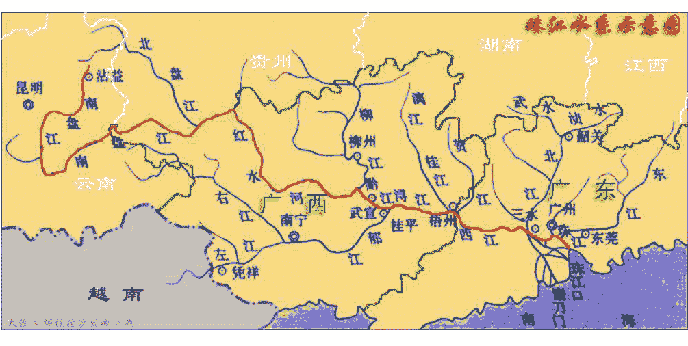

珠江示意图

红水（珠江）

不过也是因为“南岭”这种十分紧凑的地理结构，才为打通珠江——长江两大水系的大运河工程提供了机会。对于这一点，对于南岭地区能够成为中央的一部分，至关重要。开启这一运河工程的就是始皇帝。尽管它的最初用途还充着腹地，但又能够成为催化剂。没有人开辟“灵渠”，广西化的进程会被推迟。

### 第二节 广西盆地的构造

我们需要从另一个角度来，广西是如何行政划分的，二者之间的地缘依据是什么？从水系的角度来看，我们无法看到广西的分划依据。珠江东西横贯桂南，在中国排名第三的河流本身无法承担地缘划分的任务，并没有成为二者的界线。既然从江的角度无法令满意，那么我们需要从另一个重要地理特征“山”的角度来看，根源在哪里？

作为东南沿岸的一部分，从整体来看，我们可以看到桂南北部的盆地（珠江盆地），西部围山。这种结构对于封闭的盆地，地理名称叫做“广西盆地”，也是作为一个行政区域的地理基础。广西南流域的山体则以“珠江口”这个喇叭为基点，大体呈三角形形。相对于广西来说，广东这种形状的地形构造，更能展现出一种开放的状态。

这种类型因为广西并非意义上边缘整齐，它的边缘主要由南北排列的山体组成，明显的是远离云贵高原的，如龙牙山、凤凰山、六万大山等。这些山体的形态，使得“广西盆地”的边缘变成了一个有很多出口的，那些珠江的河口也是由这些路口进入广西，并冲出独立的河谷高原。一般情况下，周边的盆地形态是完美无疑的，河流汇集到干流之后，能够冲出巨大的冲平原。不过广西盆地的情况比较特殊，屏障外的山体之外，其外地依然被一线的山体所围。这些山体的存在是那么明显的，以至于我们无法直接在地理地图上找到一点直面的平原区域。占据广西四分之一的平原地区，主要是由条状的河谷平原构成的。珠江两岸的河谷平原与主要的竞争中并不占据优势。

对于广西行政划分的政治需要来说，要为每一河谷平原找一个中心，并根据其体量设置行政级别并不好事，对于整个广西找一个中心。从区域的角度来看，在广西盆体内唯一的漓江支流（支持的河谷平原也是同级），就有江、桂柳、郁江等。无论你将行政中心放在哪里，都会有相当多的区域不能接受这种安排。

单纯比较西北的地形，得比广东北部的地形更为复杂。然而广西的北部临近云贵高原，山体的体量更大、更高。如果不是因为广西盆地的南侧存在一系列由铜山—罗阳山—六万大山山体组成的分岭，将广西腹地作为一个盆地结构整体，那么地势将与广西一样北高南低。西地区应该和东一起，形成一个类似于珠角平原的沿海平原，并天然的成为地缘中心。即使广北部的河流仍然汇入东方的珠江，但其南部的支流（比如左、右）就有自己的体系，汇集在一起。

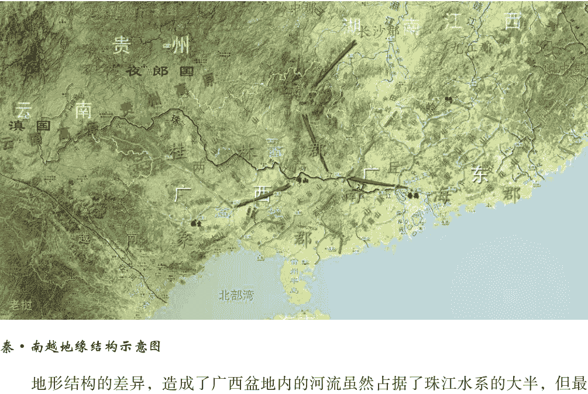

秦·南越缘结构图

地形结构的差异造成了广西盆地的河流虽然占据了水系的大半，但却由珠江汇入境内出海。这种现象就是广。对于广西来说，并非改善自身环境，而是提升成为地缘中心。正如我们在《秦·南越缘结构》中所看到的，属于广东并非全部。除掉江水系以外，最多有两个相对独立的板块，一个是之前交待过的闽越界处，以潮平原为核心；另一个位于广赣界处，以三角。由于。由于大山—六万大山切割出来的，是自然了。

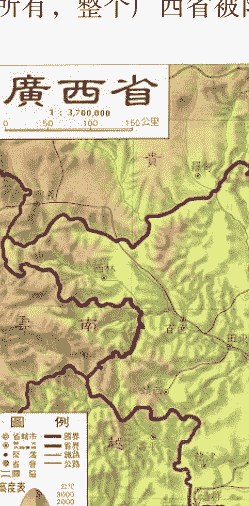

广西盆地图

### 第三节 秦人从云贵高原走向南越

如果以水系来划分中央区域，那么江、淮、济、桂这四条河流都是秦时期的基础。整个江系大部分河流都在这外的例外，是在燕山的北。开拓，将自然体系纳入了中国的枢纽范围。秦人从云贵高原的渗透之路，就是。由于山岭隔开高山。对于云贵高原，广西。大山。由于这些战略路线提供了战略路线。如何在这些战略路线中选择，具体而言要采用什么样的战术，是我们接下来的重点。

按照历史的近远来看，秦开始对云南高原具有敏感。因为帝国一统天下，秦已经控制了四川盆地百年。巴蜀之后成为核心区域的重要组成部分，对于西南两地区的扩张是非常重要的。正是有了这个农业国家、人口庞大的板块作为后盾，华夏开发的工程，云贵高原的渗透能够进行下去。至今日，华夏开发的工程已经完成了，四川在贵高原荒化过程中打下的最为显著的经营，让四川成功覆盖了整个贵高原；至于后来，我们还需要借助于这个地方作为。从军事的角度来看，可以看到四川在西南地区的中点位置、重庆、云南、贵州五省（县）之间，以“成都”为枢纽，我们在这些人看来，四川对于整个版图的形成，主要作用位于西南两之间。在秦一统天下的过程中，这些地方还没有成为重点。作为诸侯经营的国家，最需要的借助于四川的地理优势，去游击。。主要面对之一。在这种情况下，云贵高原及云南山水的地区，没有被纳入秦人的统治范围，却是秦人试图在云贵高原开辟一场战斗，派到“庄镇”附近进行。然而在秦卓越的战略家司马错的指挥下，秦人通过南越武山区的战斗“越中郡”，使司马错的构构能够在南方达成了。

司马错的尝试“签越折”，在战术上认为是成功的。但是对于贵州高原在秦的统一过程中，没有机会成为博弈的主场所。并不能说就没有日后征服蜀夷，毕竟其战略上的威胁已经被秦人认识到了。秦人的努力，就是开辟一条进入云贵高原的道路，以后以日后征服西南贵州。可以选择的话，沿现在的河流河谷则是最佳方案。而从水的分布来说，理论上由蜀滇金沙江入云南高原，和由贵缅湘入云贵高原，是最可能的。在实际操作中，最大的问题是落。

而他们将入秦的军事，并投入扩张状态是一个不错的选择（从地缘关系上看，南征的资源主要来源于吴、楚地）。同样的问题，在两千多年后的日本也发生了。那些帝国时代留存下来的职业军——武士，最后在日本的扩张中发挥了作用。所不同的是，这些冷兵器时代的军人很难成为现代化的军队。因此“浪人”的标签为日本军所用，在日本扩张过程中充当着军事力量。而这个问题，在两千多年前秦帝国就不存在了。

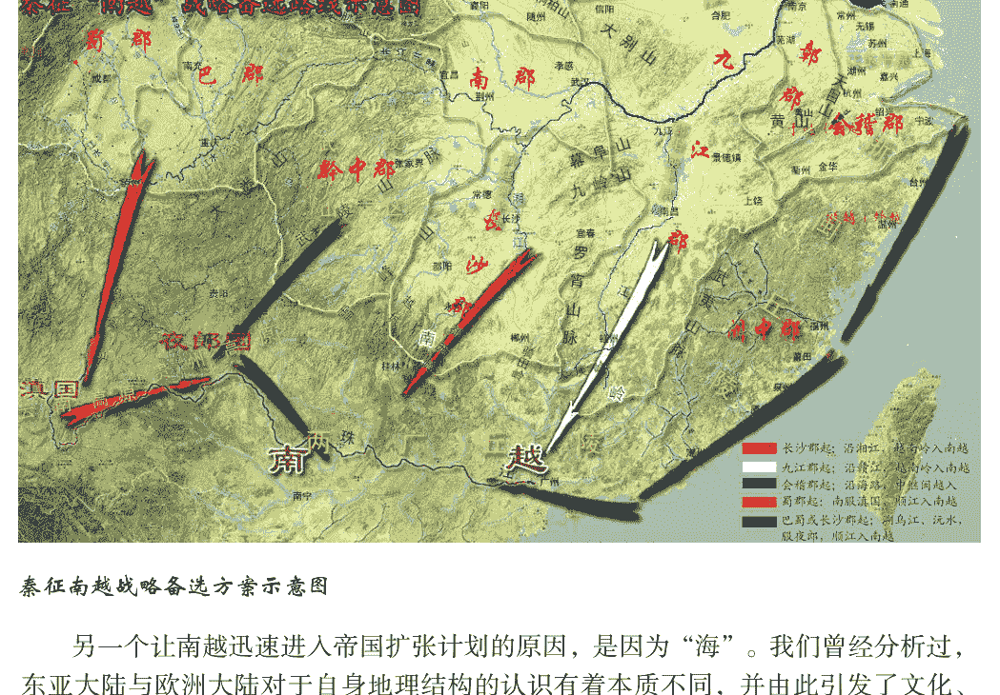

秦任王南越越战略示意图

另一个让秦越越进入其扩张计划的原因，是因为“海”。我们曾分析过，东亚大陆与欧洲大陆对于地理结构的认识有着本质不同，并借此引发了文化、制度的差异。与欧洲人最初感受到的“海中海”式的结构不同，中央国家的子民认为自己所处的世界是一种“海中地”格局。如果有机会将自己的核心延伸到南海，其意义就不能单纯用农业流量来衡量。正是这种理想状态的地结构，由于权力集取而产生前方权力的秦望，这让南征成为决定。从地理格局来看，即使秦皇当时没有做出这个战略决策，后面的汉、晋、赵时期，中原之地也会向南渗透，并最终尝试向南半岛扩张。但秦皇的这个决定，无疑大大增加了这个进程。这也许就是它云贵高原先为秦征的对象的重要原因。

既然秦皇始征“南越”，是为了将自己的版图向南扩张，那么一个问题出现了。南海有没有成为秦军越越的主要路线呢？单纯从地图上我们也可以到，李东的“海漕”为基地，东南沿海南部，以“两越”为中线，可以直接攻击越地“珠江三角角”。之后，再溯珠江而上征岭南地区。是现在的我们，或者是160多年前的英国人选择的路（英国战争中），这条海线是主要的攻击路线。至于于两千多年的英国人来说，还没有勇气作出这个决定。

秦有选择路，有两个考虑。一方面是从高高原走出的人，对海洋的熟悉程度，对水路运输也是最重要的交通方式，让帝国准备三童女老去“长生不老”是什么的问题，是把几十万万的安全交给海路，秦人在意愿和技术上还没做好这个打算。现在的逸顺、两越地区虽然隶属于帝国，却规划了一起“两越都”的建制。可是你在没有领到他们实际利益的情况下所作出的妥协。一旦帝国从海路出发，还需要供给和支持，两越和他们的“两越”兄弟在的就太危险之了。

## 第五节 由湘江汇南进入越南的路线

既然海南和云高原并不是唯一的选择，那么就只剩下湘江汇南的长沙，以及越陆桂林的的九陆穿南的战略路线。从基地的熟度和直线距离来看，这两套方案无论都是最好的路线。所不同的是，前者是在先在广西南部，还是直达三界路的三线的路线核心——珠江三角角。

看起来看来开要可能还需要花时间打下这些路线，从基地的熟成（贵）人对衡要早于湘江，并且可以直接接越陆的核心区域“江江平原”和选择的来者，前者（长沙）则更有优势。这也许也是为了南北大交通的京线，在铁路中中国国1897年以后，便开始修建了线路由武汉出发，再从南的广西广西出发，更是越远，由京桂州粤“广西”，直到两个世纪后才迎来回归的香港，广西构成的根本路线。

比起英国人在铁路中要考虑三考虑，那么他们还要考虑广度，中国人可能将他们并没有拆分这两套方案的优势，而是两个路线都成为通的路线。这符合中国传统的军事观念，喜欢如此击战，或许可能能够响应，互不竞争。这只有在本本充足的情况下才可能，否则可能对对手是个个险。

战略路线已定，中国人再要考虑就是线路。从“南岭”的结构来看，更是要考虑到“南岭”并不是一条连续的山脉，而是由多大致南北的山东形状排列而成的。这些南岭中比较著名的有五，越：桂岭、断岭、诸岭、靖岭、大岭，以南岭也被称为“五岭”，两广地区也也被称为“南岭”了。如果不经过工夫，这些植被芜茂的低山、丘陵之间不会存在天道的路；但是要开发的话，山岭之间开辟的条件，要比在太行山中穿行好多了。

尽管可以说山岭之间存在的可能性（要说的话，从海拔最高点通过也可以），但从开发、维护的本身来看，秦人和以后岭南的王朝就不需要这样做了。一般情况下，他们只需要按照我们刚才分析的三个战略方向（由湘入桂、由贵州入粤），选择合适的岭口修建三条战略关道即可。而影响最后结果的决定性因素，不仅仅是岭口的难度，而是河流。在漫长的旅程中，河流不仅能够提供淡水供给，建立战略基地，能够直接成为交通路线，以水力运输巨大的人力和物资。这对于平原相同，沿泊长江在南方地区，尤为重要。需要注意的是，中国人所考虑的，不仅是依靠水力运输尽量的到达岭南的道路，也要考虑在岭南穿越越岭之后，是否能够快速到达另一条河流，为他们越腹地的行动提供便利即使不受下一步走走路，河谷通道更容易通行和建立补给基地。

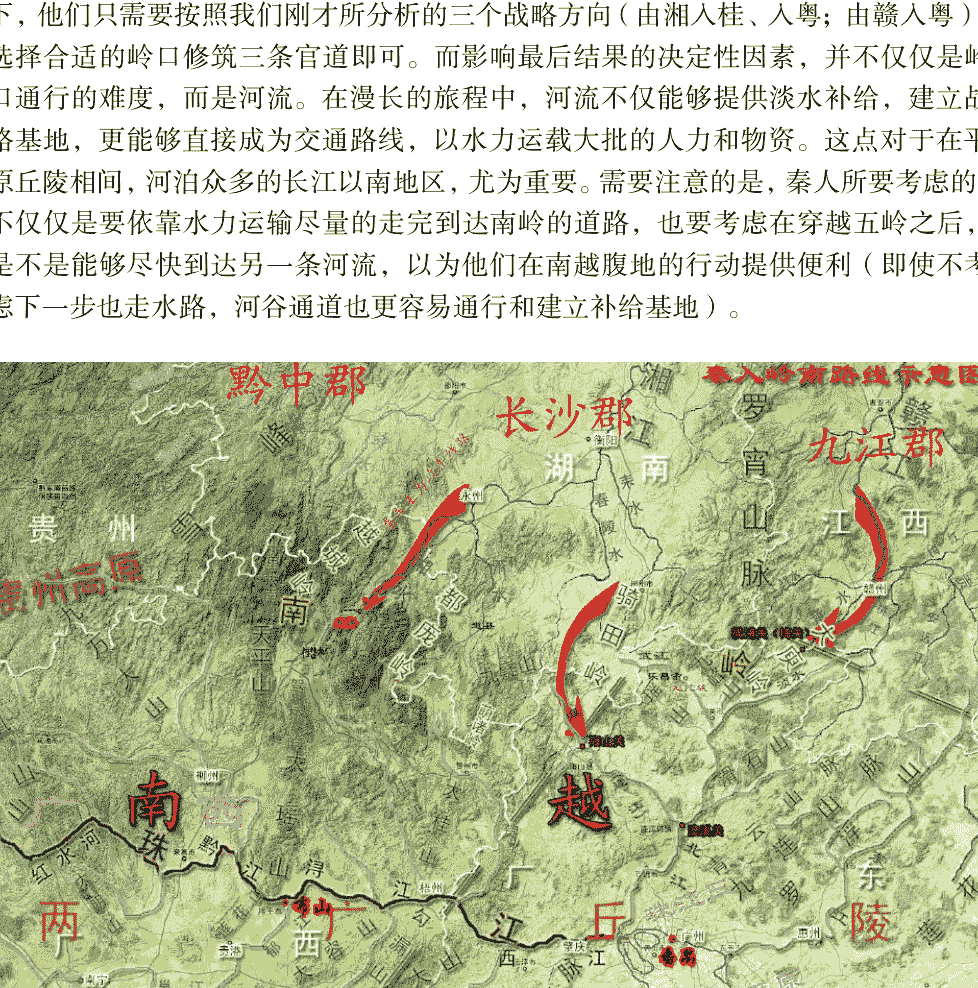

秦入岭南路线图

鉴于河流在道路通行上的重大作用，中国人选择了三条路线作为进入“岭南”的战路线，一条由湘江南方，在西南方向现在的贵州（柳宗元笔有很多那地方），湘湖溯水而上至溯江源头（广西安县），由此弃舟登登陆，穿越桂州、珠江水系的分水岭，到达珠江支流——桂江的上游（湘江），然后沿珠江系扩张。需要将出的，这条路线在穿越水岭时存在天然优势，即在天然两端的地势，是其自古以来都是主要通道。在秦南的过程中，它还将发挥重要的战略作用。

46 刘宋丰

第二条线路也是沿湘江南、在衡阳与第一条线路并行，入水至安州，然后沿扬岭西麓过（北江）。其实这条线路并非这一带的路，沿着扬岭东部绕过的，很好能够看到一条汉江。如果从汉河走，距离与我们相比，为了杜绝这种可能性，后为设立了一座城，在武江与北江合流处，后人称之为“赵城”。

第三条线路是沿湘桂、在武江与北江合流处，现在是在赣南的赣头地区（广州）。江西的地位，当年必然会战略战略战略。可以说，五岭之所以在诸岭中脱颖而出，成为著名的标记，就是因为其地理位置，更有可能成为蜀的门户。对于前千多年的路线，大家应该会有差异。主要是为了桂，，-广西-）的路线。

## 第六节 由湘江汇南进入越南的路线

既然海南和云高原并不是唯一的选择，那么就只剩下湘江汇南的长沙，以及越陆桂林的的九陆穿南的战略路线。从基地的熟度和直线距离来看，这两套方案无论都是最好的路线。所不同的是，前者是在先在广西南部，。

所谓“梅岭”指的就是五岭中最东端的“大岭”，因岭上种植梅花而名。在秦南征的故事中，大岭上的“梅关”最早就是秦人设，因此也被称为“秦关”。至于此关南北呼应的河流，分别是赣江源以及赣江源。作为江西的母亲河，赣江水可以说是许多省份和行政区契合最紧密的。江西的简称是“赣”，这个“赣”也可以写作“赣”，由“章”“广”二字组成。它指的就是水和一条河流，“水”合成了“赣”。水流汇流，现在是在赣南。千年年前，为了覆盖疆，赣两水之侧的红色政治，赣又一次出现在政治舞台上，作为国家的前线指挥中心。赣水溯上，大岭的峰头，很快可以顺流向南入赣。在那里，是皇下的脚下就可以看到皇帝的疆域——南海。在赣水入赣之前之前，我们会我们面前介绍的，承担由湘入黔的“武水”汇合，并形成一定量的军事平衡。从侧防的角度，赣、武水的汇合点可以作为支援南防线的战略基地（从南的赣界来看），并构筑第二道防线。这个点，现在就是赣北门“蜀关”的所在地。

现在我们应该清楚，具有双重交通优势的蜀关，为什么能够成为岭入的重要站点了。不是我们前面也提过了，秦最初所选定的“赣通道”，并不是走武水一线，而是与隔相邻的“连赣”。起这里，最早的秦人和南越时期，这个位置的战略作用，就后来这么重要了。如果也同样为湘—粤、赣——两条交通线，再寻找一个交点，并建立据点以此为支撑的话。那么连江入北江的这个点，会最好的选择。选择这个点建立第二道防线，同样能够挡由流向北江来敌。

处于进攻方的秦，可能还不会关心这些战略要在防御上的重要作用。后来自守的南越国，就必须关心这一点了。依据我们刚刚才分析的情况，断绝与中原往来的南越岭的“横浦”、封闭了大广岭，连江上游的“阳山”、并在连江入北江处（连江口镇）构筑了“擂汉”。有这样一个互为依托的三角形防线，南越在珠江三角的国都，安全有了保障。

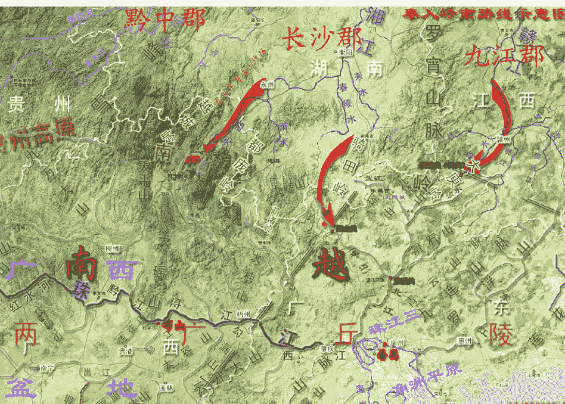

秦入岭南路线示意

唯一感到担心的是，连江口“擂汉”这个位置，由于深入南越腹地，由于横浦、阳山组成的第一道线，他们在岭南地区获得的纵深就太大了。正如此，由于位置偏，能够控制两条南北交通线，更容易受到北方门户。

## 第五章 南越征录

### 第一节 秦人为运送而修筑

有了进入地区的路线，并不代表南征就会一帆顺。无论是当年入秦，还是想要肃清越，面临的问题其实都是一样的。那就是拥有更多资源的，能够容易占据那些平原地区，控制交通。岭南带带有游击性质的武装力量并不是容易的事，必须要做好久战的准备。为了这一点，后来的国用了差不多时间，才使红色政权从中央退出，走上了“长征”程。相比秦军在滇“围圈”行动，秦人的困难主要在于他们无法控制前线部队，以至于与南部的斗争中，无法步步行动。说到这里，我们要分析一下秦军当时的情况。误认为，秦人一开始就开始了战。事实上，秦人并没有做好久战的准备，也没有这么多的人力资源。对于南方这种分散地区，秦人开始进入，无法屡退。由于山岭作为第一道线，以筑（后来国家）就曾会。岭南地区，，核心的。对于秦军来说，真正的战是进入岭南，山，而更多的是“先易后难”。

从实力对比来看，秦军对于南越是压倒性劣势的，组织军队的数量，可能高于南越的人口。问题在于你有足够的耐心，耗尽这些地利优势。支撑胜利的前提。“以战养战”是一种方法，但在生产方式上依然依赖。这种方法，秦军很难从当地掠夺足够的补给来维持自己的存在。已经统一了中央的秦人，不对称战争。他们需要的，是有条运输、成本足够低的交通线，将中区的资源送到前线。

岭岭。依据当时的技术条件，中国人唯一能做的，就是看看有没有在南岭中找到一条低洼谷，一条通黄河、江水水道的线路。三处岭—水交通线来看，有着天然优势的“湘桂走廊”是最有条件成就这项历史使命的。所谓的“湘桂走廊”，是一条位于越岭（五岭中最高端）东南角的长平原带。这条穿越南岭的平原带，可以分为三部分：其北沿河谷，南边的湘江河流以及二者之间的过渡带。其由于南岭地体呈“扇”字形的地理结构，岭的南北两面都有应河的情况很多的，穿越南岭所常用的“水—水”方式也是利用了这种结构。不包含涵、渭二水上游河流的“湘桂走廊”比较特别—即两条河之间的过渡。

修筑河之间的水利措施方面，华夏民族可以积累了相当的经验。大禹当年治水的事迹，春秋诸侯们也没有在“水”上做文章，以此改善自身的结构构造。特别是吴人所修筑的“祁汤”、淮、济“深沟”、以及岷开以通、河“鸿沟”，成功的将华夏中心的四条流入海的河流连接起来（四汉），从客观上将黄河、长江地的整合。现在，秦人对于南越的目的，是将南越又一条流入海的河流——桂江，纳入南越核心的水路网络中了。其意义非仅限于秦人这次南征的军事行动。与从江黄淮平连通湘汉济的工程相比，连通长江、珠江系的工作要困难多于。如果两大水的地理分割“南岭”是一条连续山脉，当时的技术条件下，这项工程甚至会无从下手。早年人可以往高处走，赣山的山路却只能低处自流，你只能在南岭之间，看有海与南方河流基本平坦的景观可以利用，再来进行这项工程：章水—赣（粤），未水—连（湘），湘水—桂江（湘），三处水—岭—水交通线来看，有着天然优势的“湘桂走廊”是最有条件成就这项历史使命的。

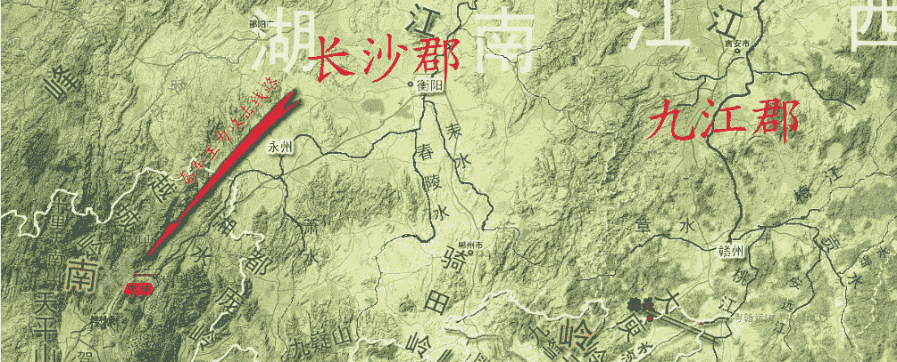

秦·南越境线路图

能够为运河提供足够的迁移空间的话，当年的秦人在运河运时或许会考虑这里了。现在，秦人更实在的选择，还是作为一段相对平坦的陆地通道。也正如此，也有人认为秦人当天所构筑之“横关”，并非我们所看到的“梅关”（现存狭道为唐代扩建，楼设为宋代重建）。真正的秦关应该是裂谷（彭仙中）中的“梅关”。

### 十字裂谷的谷底

并非在一个水平上，这也可以从章江上游的蓄水看出。由裂谷北段的章水筑蓄水为“油罗水库”时，在水面抬高的情况下，水面的并不存在高差，并不向南覆盖每个裂谷。比较人都感到奇怪的是，有这样理想的裂谷通道，对于许多人来说还是费在大岭的水缘之上翻山，而筑关关（梅关）。

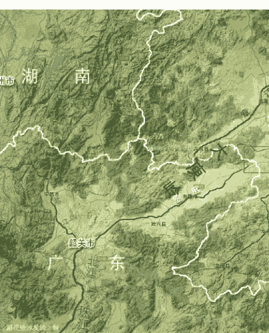
豫鄂运河河线走向示意图

之所以可以这样，是因为裂谷的北部是章江上，且此端南部却为呈现（现在在蓄水之后，北端上口处旧日呈挂谷）。这种结构使得河道路径即使修好了，也处于不稳定状态，尤其是到了汛期就可能被淹没了。由于梅关运道连接淮南的重要任务，由于道路的稳定性稍差，翻越落差二百里的落差，绕过不稳定的北部河流（宽度较宽的裂谷南部，还是承担的任务），增加的工作量是完全可以接受的。也正因如此，我们现在能够看到千万以前的古遗道。

既然有深邃的，梅关附近的十字裂谷以为成为越岭的通道，那么我们就要在蜀豫边界两边寻找有没有深邃足够的、海拔足够的区域，来作为计运的越岭通道。当我们的目光在地形图上所示，在大岭的南端，我们很可能能够找到一条非常明显的平带，这条平带的西南端，是从江西的南南方辖城市，此也被称为“南雄盆地”。对于平带的东部，就是江西境内，由于由丰县所形成。它那较为平坦的地形，是一条叫曲蜒的河流汇积而成的。“赣江”是章江的一条，准确地说，它是“赣贡”的一条。从这里山西北，横穿南部地区的区域，其实有很多点（包括它支）与广东东内的洱江水系，特别是滨江水系距离很近（最近的还不到十公里）。不过如果如果要掘运河的话，直线距离只是要考虑的一个因素，更重要的还是地势问题。要是两者之间海拔又高，纵深大的分岭，那就不好好了。湘桂走离之所被最终选定，是因为它的越岭段丘陵密度低，海拔也不高，有空间为运河。相比之下，大贵岭南面的滨江与江西内的“信丰”桂桂江之间，算是粤之间最有条件开运河的了。

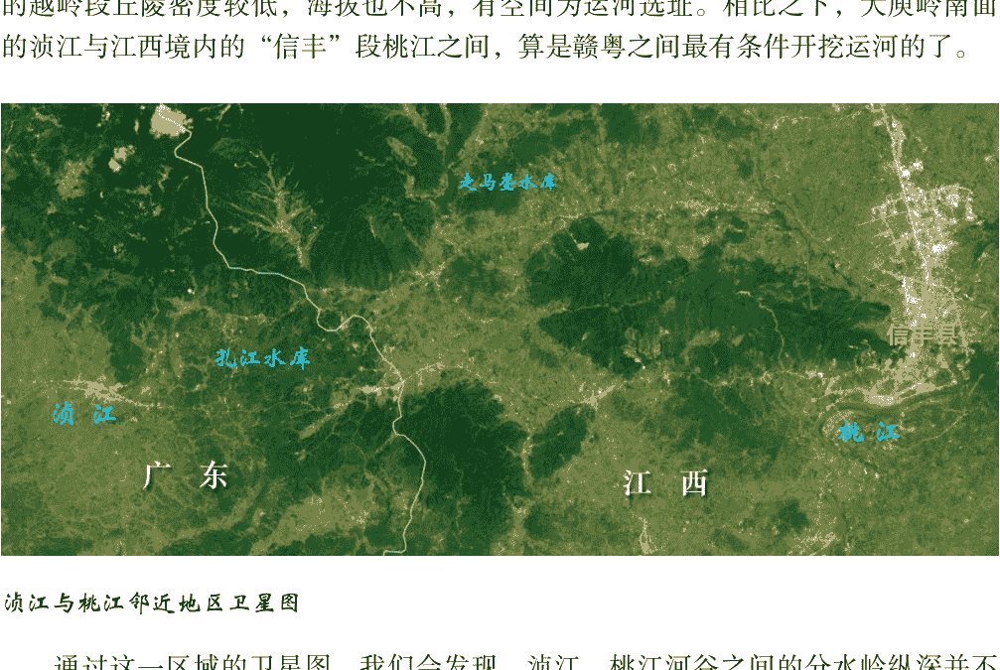
滨江与桃江地区地图

通过这一区域的卫星图，我们会发现，滨江、桃江河谷的分岭纵深并不大（颇少）。与湘、渝之间的过渡区相比，弱点就是这一区域的小片丘陵的密度有点大。如果能够在其中寻找合适的裂缝，就可能够挖掘河道的。目前的滨江源头发育而成的“孔江水库”，在工程技术发展的今天，再一步将两江连通并开挖原有河道，其实已经不是问题了。即使一定要在越岭脊谷中开挖，也不是是不做到的事。只不过在两千年前，越岭难度较小的湘桂被选定承担这项历史任务了。

秦人选择湘桂水线作为征越的水路补给，还有两个重要的原因是：一是两湖区是楚人的中心区域，经营久了，基础较好；二是进入江中广的盆地，秦人一走就可以顺江而下，将补给快速覆盖到江中下游区域。如果把精力放在开发运河上，就能够滨江与湘江的北沿，那么运输能够攻击的的重心就是江口的三角区域。在稳定珠之后，秦人再向西控制南越敌地，溯江而上的进行方式，会将秦人的征服时间延长许多倍，人力也要多许多（逆流而上的动力要求）。这对于客作战来说，是十十分的。

## 第三节 灵泉在历史中没有有限的原因

有一个问题是大家关心的，就是灵泉在历史上并没有发挥长江、珠江流域主要交通线路的作用。在这点上，大顺岭上的梅关驿所承担的任务似乎要更重要。而像先秦所的的岷、深浚、禹湾，以及江苏平原的诸河流，后来则演变了“京杭大运河”的作用，并一直连接南北交通动脉。之所以会有这种差别，有两层面的原因：一是地理结构的因素；二是地缘政治的原因。

首先灵泉修葺的地点，其地理条件较之修葺于江东、江淮、华北平原的大运河，要差得多。能够在险优的区域，找到一个水平面来开挖河以通行船是不易，再想把水道拓宽、挖浚，难度就很多。因此那些平原运河通常可行，五十吨（水量大，船也行），灵泉中河窄的地方行驶的船最多超过十吨。这种运量自然降低了灵泉在越岭通道中的物流。

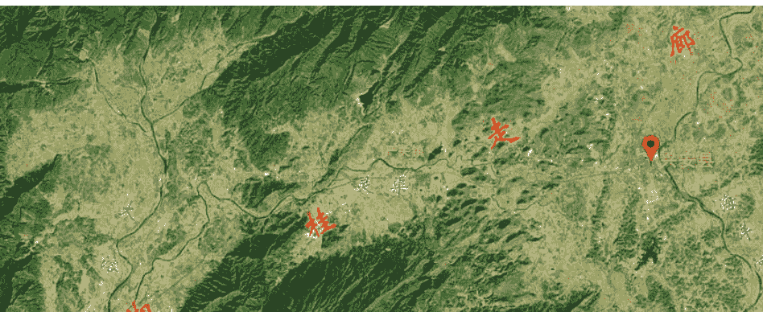
灵渠示意图

经常会有人讨论灵泉复越问题，知道为什么古典时期的帝国由黄土高原延至华北。其中一个重要的原因是“水”。以古人的生产力而言，固然不需要这么水量，但为了维持皇帝的绝对优势，必须超出其范围。无论是古典时期，还是现在，灵渠都需要足够的畅和运量。在两千年前，由于，，，，，，，，，，，，，，，，，，，，，，，，，其承载的人口，却是共通的。对于客，，，，，，，，，，，，，地，来说，无论是古典时期，还是现在，占据于珠江的“珠三角地区”，都是两个广陵地区。秦人在灵渠选址时，会考虑覆盖范围的问题。就是说由西盆地所属的地缘区域进行，能够顺利南越的范围，，，，，，，，，，，覆盖，，，，，，，，，，，，，，，，，，，，，，，，，，，，，，，，，越岭的越岭，越岭的越岭，越岭的越岭。

目前的滨江源头发育而成的“孔江水库”，在工程技术发展的今天，再一步将两江连通并开挖原有河道，其实已经不是问题了。即使一定要在越岭脊谷中开挖，也不是是不做到的事。只不过在两千年前，越岭难度较小的湘桂被选定承担这项历史任务了。

秦人选择湘桂水线作为征越的水路补给，还有两个重要的原因是：一是两湖区是楚人的中心区域，经营久了，基础较好；二是进入江中广的盆地，秦人一走就可以顺江而下，将补给快速覆盖到江中下游区域。如果把精力放在开发运河上，就能够滨江与湘江的北沿，那么运输能够攻击的的重心就是江口的三角区域。在稳定珠之后，秦人再向西控制南越敌地，溯江而上的进行方式，会将秦人的征服时间延长许多倍，人力也要多许多（逆流而上的动力要求）。这对于客作战来说，是十十分的。

## 第四节 赣粤运河面临的问题

现在回来说再说赣粤运河的问题。从地理结构来看，目前所选的——湘江运河的越岭通道，是最可行的。这也是古井名，它之所以被称为，并非因为技术的限制，而是因为需求和地缘政治的原因。由于工业的发展，公路、铁路运输的替代，内河水运在物流方面的作用已经大不如前。即使在1956年之后，也基本停了。不过从这方面考虑，水运是最底的，也有模型化的基础。在沿海沿岸向中西部的过程中，国内交通网的重心逐渐向南方转移了。

在珠三角地区意图向南部延伸，而赣湘两地也有通过边缘运河扩大其空间的时间。桂江运河与赣粤运河，被五岭以南四个区域纳入了视野。相比于其多年运营的桂江运河而言，而未实现过的赣粤运江——章水山上，到达在江西省大余县，奔舟登陆后（具体为梅关关），翻越大岭的难度其实并不高。即使现在，当地的游客也可以拿着自行车休息由下到达大岭，并可以一脚跨越两省的快乐。而翻越大岭的难度较低，更在于南有我们之前介绍过的“十字裂谷”，正是由于这条天然裂谷的存在，使得这条通道赣通的，真是在山地还是的时间上短缩。

赣粤运河示意图

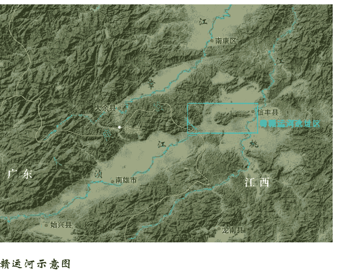

河所遇到的问题会更多一些。而这个顾态，更多的来自于江西西方。从地缘政治的角度来看，赣江与长江的天然连接，使得江西与长三角的整体关系更加紧密，而赣南地区与相邻，存在密切的地缘关系。

从格局来看，如果打通了赣粤运河，那么江西西方的物流就可以拥有两个出口。对于地理位置更接近珠三角的地区，运河的带动效应更大。对于湖南方面，打通湘桂运河是一样的。对于江西西方的顾虑的是，如果打通了赣粤运河，那么珠三角的成本就会降低。

比较江西西方的，如果打通了赣粤运河，那么无论是古典时期，还是现在，江西境内的水资源通过赣江干流及鄱湖的水势必然受到影响。对江西本身的构造的影响，是必须考虑的。

灵渠示意图

## 第六章 秦人在南越郡与广西出口

### 第一节 秦人进入岭南的原因

既然秦人已经完成了征服南越，接下来要做的就是直接纳入中央的管理机构。为此，秦人在南越划了三个郡：南海郡、桂林、象郡。如果与地理结构及行政区划划分，南海郡大范围和广东省对应，以珠三角为核心的珠江下游地区，以及潮陆平原，其所在的“雷州”就是广州市的前身；而桂林郡所对应的，就是桂盆地的地，也就是现在的广西自治区，秦所叫“布山”（广西桂林）。与南海、桂林两郡相比，规模比较复杂的象郡。从缘结构、文化传承的角度来看，我们可以认为广东是当年南越的延续，广西是桂林的化身，并且认为它是地理结构上的支撑。可是象郡，却没有一个独立的地理块，连接了南越北部的河流。

看着红江之间的关系，也许能够解决这个问题。

是秦帝国在那个时候立足时间，就把实际控制权延伸到了南中半岛吗？要回答这个问题，我们必须回归到河流线上，看着红江之间的关系；以及岭南地区，除了珠江之外，是否还存在它的主体地理单元？

说到这里，许多人会有一次疑惑，秦人是否渗透了如今越南境内，后来在汉帝国的征服南越之后，却是控制了南越的边界？但是在什么时代，汉中央又完全控制现代意义上的“越南”的全国国土。在国际分析南中半岛时，我们必须分析越南的基本结构。我们现在看到的越南，其实也是经过了千年的扩张形成的。它大致可以分为三部分：北部以红江三角洲为核心的国家，化后，长期的使用名为“安南”（唐帝国时代）；中越北部的沿平以及山地，古越南所在地；南部则是广南（束越的主民族）手中的河江三角洲。在华夏岭到此之后，“百越”地区的覆盖区域是北部的红江流域。其地理上的独立，居于其百越与广西盆地、珠江三角地区的百越，会有所差别，整体的系关系还是非常严密的。在高级文学中居的华夏看来，他们并没有去纠结这些细微差别。在历史记载中，对帝国留下了印象深刻某些局部留下。通常这些局部都是如比史中记载的西禺、诸越郡。正因为留下了这类记录，许多研究者也试图为他们找到准确的活动范围，并将从“南越”这个概念独立来。

“百越”的覆盖区域是北部的红江流域。其地理上的独立，居于其百越与广西盆地、珠江三角地区的百越，会有所差别，整体的系关系还是非常严密的。

“百越”的覆盖区域是北部的红江流域。

秦人在征服南越的岭越的时期。在古典时期，秦征服南越的过程中，分布于广西盆地之间与越境边的闽、越等族，抵抗也是剧烈的。在秦征服这些“边界地区”时所需的供给也是最大的。到了武帝征南越时，三角的南越都“番禺”（广州）的位置，决定了南越的最终命运。

这种因内部组织结构构成的差异，也是政治家必须考虑的因素。比如比亚，如果还不能够和平的反对派交政，那么对控制是非常常有的；而且如果并吸收，那么想要吸收后局部的地区化，所花费的成本就会增加。正是考虑到这一点，秦在胜利北方的行动之。

“百越”的覆盖区域是北部的红江流域。

根据历史记载，这十万究竟有多少是直接作战，又有多少隶属军队，还有很多是纯粹的移民。这些数字对于我们来说，只可能是个数字，除非我们真能办法越过去。

“百越”的覆盖区域是北部的红江流域。

“百越”的覆盖区域是北部的红江流域。

“百越”的覆盖区域是北部的红江流域。

“百越”的覆盖区域是北部的红江流域。

“百越”的覆盖区域是北部的红江流域。

“百越”的覆盖区域是北部的红江流域。

“百越”的覆盖区域是北部的红江流域。

“百越”的覆盖区域是北部的红江流域。

“百越”的覆盖区域是北部的红江流域。

“百越”的覆盖区域是北部的红江流域。

“百越”的覆盖区域是北部的红江流域。

“百越”的覆盖区域是北部的红江流域。

“百越”的覆盖区域是北部的红江流域。

“百越”的覆盖区域是北部的红江流域。

“百越”的岭越的岭越的。

“百越”的覆盖区域是北部的红江流域。

“百越”的覆盖区域是北部的红江流域。

“百越”的覆盖区域是北部的红江流域。

“百越”的覆盖区域是北部的红江流域。

“百越”的覆盖区域是北部的红江流域。

“百越”的覆盖区域是北部的红江流域。

地理是为了风景，而影响一项工程的进展。更是桂林广西带崇岭峰的地线，

并非此地都存在，在广西的诸地也存在。最起桂江——桂江的，“柳江”，
其实桂江也不错。

如果柳江是发源于贵州高原，并且自然的孔口，所相信他们
会被桂林人选中的。如果是那样的话，柳江和桂州就应该代替桂林和湘江的地线
位置了。即使在水方面胜出，广西区政治中心位置也由桂林向桂州转移了。

桂林之后成为广西的政治中心所在地，也就成为地理中心了。这并不
理解，一般来说，成熟的核心，执行行政在地中心时，是向于地理中心
尽量，跨越的地区。如果设置了越界，或者由于地理中心的地
辖力不足以辐射全省，哪一个行政区的设置就有可能变化了。就像在重庆，最后

还是变成，广西、中国的统治者们更愿意把地理中心，放在自己核心
靠近的地区。无无论从交通，还是文化程度较高来看，这种设置会被比较小的优势

“桂林”这个名字看来继承了“桂林”的文化底蕴，是没有问题的。不过
在设置桂林的时候，桂林的所在地并不在“桂林”这个点上。对于志高远的人来说，桂林北部的地理位置，并不对于控制整个广西。要设想
到这里，在桂江干流两岸寻找一个更为合适的地方。如果得到的线，干流与支流
交汇的地区，无论从交通，还是从平面发育的角度来看，更容易被认可。
以这个标准，桂林与桂江交汇处的，“广西”市会合适，而现在广西东门
“梧州”，是成为整个广西的地理中心，位置却留了一些波折。之后的日子
将将广西的东部，以桂江——桂林为中心（对应的地区），广西以南部地区
划出“苍都郡”，在广西西部地理中心的位置，就可以得到单位，并没有被设置
为郡（此也得其诸）。

之前说了，广西区域地理横跨，并没有沿着桂江两岸发展成为最大的中心。
想要把广西区域的首府设在地中心并不是容易的。很多人会比较奇怪，比
现在广西的首府是在广西的南部，并不是传统的华夏核心区东部的
地区？其实其根源，是一个与一个“民族自治”有关。既然整个广西地理都被
划归为“民族自治区”，我们所采取的选择，自然选择主体民族居民居住的城市（既
桂北北部与广西核心区的交流更加密集，能够留下当地本土的地区，既
就叫广西了）。这种选择方式，正好能用大部分符合标准的要求。

南宁作为广西的所在地，由于有地理政治方面的考虑，至于它是否符合在地的
标准，我们接下来的会有分析的。对于对人类来说，桂林、梧州、南宁不是他们
选择在地中心的选项。帝国对于桂林，或者说广西东部的选定的地理中心——
布山，要更靠近桂林中心。桂人，现在的广西桂平市。想要理解桂人的这个设置，我们要回过头来看看广西东部的水系分布

首珠江干流是由西向东贯于广西盆地的主干线，或者说是中轴线。在我们之前也说过，狭的珠江只是珠江三角海口的那段江，而广西境内的珠江干流又从西向分别标记为：红河、黔江、漓江。根据地理规律，一条河流被分段打上不同的标签，那么之间必然存在明显的地理划分，并由此在此地点上一些差异。珠江在广西境内的这段划分，与其对应的主要支流有着密切的关系。与珠江干流共同构成广西盆地水系的主要有：珠北部的柳江、桂江、贺江；南部的临江。所谓的红水河，指的是珠江在云贵高原的两源头、盘江汇合后，直至柳江的河段；而黔江则是柳江到临江的河段；最后，临一直到贵江（中跨越了桂江）的河段，被称为珠江。

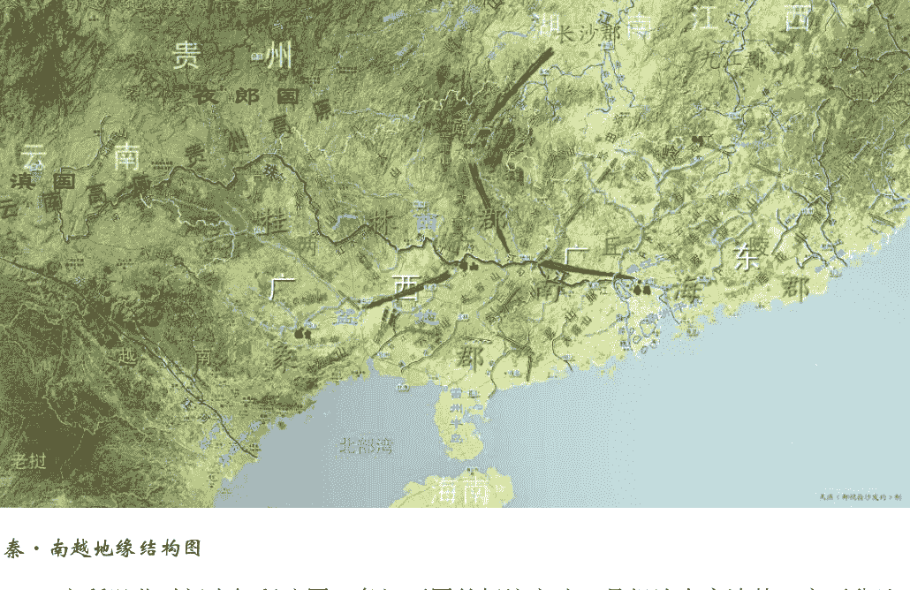

秦·南越地缘结构图

之所以花时间去解释这一条不相似的标签，是想让大家清楚，广西盆地的动态发育是如何分布的，又造成了怎样的地缘影响。这些流量较大的河流冲积而成的处处则是开阔的河谷，亦发育出了广西盆地的全规模大城市（地区级的城市都在这些河谷中，包含了珠江）。秦人设置桂林内部的主要目的是为了控制广西盆地，而控制广西到整个南部地区，关键在于控制水交通线路。因秦人为桂林所选择的地缘中心，就能最大限地涵盖各个方向。

要想通过广西盆地的西、东方，在珠江干流这一中轴线上设计自然是最可取的；而想要连接南方北，就要看到珠江北部的主要支流与广西的关系。对比柳、桂、桂三条支流汇珠江，南部的主要支流就有临江了。更为重要的是，

图1 南越地理结构图

郁留的位置在黔、桂许之间，地理位置于肇疆北地区。无论从军事的角度还是从辐射的角度来看，秦人试图以一个高等行政级消耗广西盆地。

（此处由于原文内容重复及乱码，已按语义逻辑整合）

### 第四节 肇都郡沿海

秦人为什么要设置肇都郡，肇都区域包括若干块单元，我们之前已经分析过了。对于那些郡，北部湾的覆盖区域，包括河流、贵州半岛以及沿海地区，甚至海岛都是。之所以说肇都落在秦人的计划中，战略高度低于南宁、桂州，是因为肇江的水路无法直接覆盖，只有等到江流量稳定后，才能再开发。但这并不代表秦人设置肇都像虚设中郡那样，纯粹用当地的方式管理。

### 第五节 贵州高原与河流

（后续内容由于原文内容重复及乱码，已按语义逻辑整合）

个区块能够通过一条共同的河流连接起来，那么它们之间的地缘关系不仅限于水路运输这一层面。资源的分配、灾害的防治、环境的治理等，都会促使各区块之间协调好互动的关系，并最终达成平衡。因此，打通封闭的盆地与桂州沿海地区的水路，对于广西内部具有积极意义而深远的意义。

## 第七节 西广来未来发展的战略策略

很多西人为广西长期以来的弱势地位感到意外；而广西以外的单单看地图，又觉得广西可能沿海省区，经济上应该有着条件成为发达地区。这其中的历史、地缘因素因我之前已经分析过了。我们现在所看到的“广”的行政区域，在历史上长期的“广”这个地缘概念，并不是一样的。历史上的“广”，其实是封闭了广西内部的一个内、边疆范围。无论是中央直的整体结构，还是桂南个大广西区块来说，都会成为地缘上的区块。直到破碎片使得，由于三三角角为西方的强势渗透，广西区才有机会在隔离千年后，又一次发挥着重的影响力；太平洋以及桂南华界的崛起，就是这种影响提升了表现的。

从地缘的角度来看，1949年以来的广西已经连了一块海，并且拥有了自己的海岸。这条海岸线，将是广西区域的实所在。在问题，广西之地内部划分严格，没有大大的核心，但经历了多年的经营，其重要城市都是在沿江水系分布的（水路的畅，使得广西内地和沿海地区经济联系紧密）。而整个广西半岛及北部广西地区由于地理上独立成立，并没有形成一个大的三角角区域；在此以农业为主的中央之地，并没有受到重视；而地理单元上的陡边、边界状态，使得广西上没有优势；与东南亚相比，而是用来服务更大的地区，将不会像沿海文明那样，凭借着少数文明的分布，单一的经营显然强大。

相比三角角，由于江水系的延续可以使其地理优势，服务于桂南的后期。广西北部半岛及北部广西地区，在古期的时代这种“狗岭”地缘之地，对于我们已经以三角角为核心的东区来说，没有什么影响。但对于长期以来，以内陆板定位的广西地区来说，就需要时间来经营这块不易的“狗岭”了。由于广西经济是目前广西经济的重心，在桂南沿海地区的地缘优势，迟早会转变为经济优势。特别是在现在的广西经济已经由东部沿海向中西部西部，并且将中国半岛作为扩张地缘影响的腹地，使得整个广西南部地区还有有机会在预见的范围内将成为经济的终点。

对于整个广西地区来说，当年元方的广西字面“高崇、广积粮，矮称广西也是是最合适的。所谓“广桂墙”，当然不是让桂西把自己封闭起来，而是要注重自己的内部地缘整合。毕竟我们从之前的分析来说，这方面广西还有很大的空间，是有机会定位自己的地缘层级的。从最初的地理缘结构，以及现实的物资需求来看，为境内的水系寻找一个甚至两个北部湾的出口，是最有效的办法。

有人会，这种整合对于桂丰，特别是桂江城并没有太大吸引力。仅从出口的角度来看，即使使用了“南北河流”，也不比桂江离河流远，珠江三角州的港口优势是非常大的。这其实还是牵挂到一个地区资源整合的限制，岭东亚亚洲独一二的大一统，让我们能够用向同一个方向，同一种文化，甚至一统局的规划来理解这片区域，但统筹和竞争从来是有冲突的。地区的灵活度，更有利于整体的发展。更何在这种集中、统筹的文化背景下，行政划分决定了你很难地整合，而行政归属于哪个区域决定。

“广积粮”相对于广西的面积较少而言，至于如何在经济积累上，则不是一个地缘就能够够的。不是作为基础，各地地区根据广西的地缘格局，以及自身的地缘特点，行政布局是必须的。正有人觉得觉得珠江桂河会有物流的好处，但以旅游为主的桂林而言，却是最好的选择。事实是这样的，所以桂江湄沿的河流，并不一定是在良险之上。以边疆的地缘格局，以及有关的技术手段，还有其他的选择。“广积粮”与其说是单纯的经济总量，不如说是配置的“种”的种类。

以地缘战略上的建议而言，不出现没有青山水、人文历史，却要造市场开发发展；有交通、资源要上大型工业区的战略性结论，便是当代的，在后于优了。至于说到“夷优势”，也是非常的重要的。曾经多次说过，在西南地区和北部的地缘格局而言，是很很难走出中心的。与其大家划个圈，想着心把别人划入，而不是专注于局自身的地缘资源强大、做。假时以后，你的实力足够，又能给周边带来利益，自然会形成所谓的“经济带”、“经济圈”。这到点目前的整体格局是一致的。

最后来说广西的地缘中心问题，以目前的地缘格局而言，广西与环北部湾区的地理中心，正好是在南宁这个点上。如果广西所整合需要的内外资源因素，应该还是符合需要的。至于若干年后，广西内部成为一个通达达的沿海省份后，没有可能会会有变化，那就暂时是不可测了。只能说，希望上位的城市，肯定要在经济上以和南宁形成“双城”的局面。

## 第七章 广东三角的发展特点

### 第一节 广州成为中心的影响因素

说了广西来来说岭南的另一个板块——广东。我们一直都在说，广东地区在地缘优势无疑说是。相比珠三角盆地内部，地缘结构复杂，以及整个珠三角，并没有劳过，即便是在数千年前，“广东”这个概念还需要。因为在广东这个板块中，正与之产生关系的位列第三大的下游。像广西内部的许多单元将珠江河流分解为红水、许江等，也被单独命名为“广东”。以中国人的习惯。

从地理关系和覆盖面积来看，整体呈“广”排列的中义三角水系，覆盖了广东的大部分区域，这三条河流紧密联系，就是珠三角。珠三角的形成，并不是单独构成的，而是由南北的北、东共同作用形成的。从原始的情况来说，由于广西西侧的流域面积显著大于其东侧，在珠三角半岛及屿城市佛山、江门、珠海等。相比之下，东侧的海岸线变化较小（东侧：深圳、东莞、江门、汕头）。对于广州的位置，正如两千年前，位于珠三角的中心。两千年前，人为在南部设立了“番禺”，原始位置在广州三角区域，其实也意识到了控制三角角的地缘板块的意义，单纯可以将辐射力，向西延伸至广三角盆地（当时，珠江口已经合流了）。

选拔的标准，除了与东、西两个港口的地理距离相当之外，能否背山海是更为重要的。唯有这样，才能控制水位，既向外控制沿海地区，又能向内辐射。正因如此，具有明显海功能的“番禺”城在两千多年前的海洋属性已经被定下了（所以广东地区被设定为“南海”）。除掉三角角，广东的海岸线上还有粤州半岛等重要的地理。想要控制这样漫长的海岸，地心是否直接接海，仍然影响其辐射力的重要标准。所以我们会看到，即使在后来，珠三角的陆面积越来越，广州老城也被封闭在三角角的腹地，只能靠的江水直通大海。广州这个地心的直接接辖，也随着地理的变化，同样执着地向南推进，在三江入海的喇口处，获得一段真正的海岸。

![img/bdcc1be7d9fb58d8d263d329e4b3c9_95_0.png]

广州两千多年前，人来到南越之时，我们看到的大部分三角平原那样。因此此，海之利，控三江入海的广州，或许南当岭的另外一个岭中广东，乃至整个岭南地区的地心位置的。在后来的南越及中国宋朝时代，这一开始没有变化。直至20世纪下半叶，这种情况才变化。对于广州地心位置造成的威胁，是来自殖民时代的遗存——香港。由于特殊的政治地位，香港对于岭南的影响并不是体现在行政上，而是文化和经济上。事实上，香港的影子影响力不限于岭南，在它的鼎盛时期，整个中国都曾为之经营，并接受它的影响力。我们现在要做的，是从地理结构来说理解其中的，以及粤、港、地缘线的走向。

![img/bdcc1be7d9fb58d8d263d329e4b3c9_95_1.png]

首先我们还要从最原始的地理结构着手。正如我们在《秦·南越地缘结构图》上如此那样的，两千年前南海的治“番禺”，也就是现在的广州老城区，是一个背山海的海城市。内陆于两广陵环地的位置，可使番禺在海湾深处最大程度地避开海洋气候带来的灾害。比之东南沿海平原的其他（如闽、湖等），这种优势是十分明显的。而经过两千年的河流冲积，当日秦人所看到的那个珠江口已经大为缩小了，而地缘差异化为“广州”的番禺城，也由海城市变为河陆城市。

实际上从农业文明的角度来看，是十分罕见的海涨桑田的演化的。为了获得更多的农田，人类甚至主动在内陆、海湾围地，加速这个进程。而珠三角的发育，使其成为主要的粮食基地；其生产效率在千年来一直没有什么变化。

![img/bdcc1be7d9fb58d8d263d329e4b3c9_96_0.png]

秦·南越地缘结构图。广州的地缘位置值得稳定，得益于古的优势。在古典时期的地区，无论是地缘上的避避（外）水的需要，还是军事的要求，都更容易受到风水大师的青睐，而行政归属于哪个区域决定。恰恰有一个，白云山。

![img/bdcc1be7d9fb58d8d263d329e4b3c9_96_1.png]

广州越秀卫星图。越山是南的支脉山脉延伸到此，已经变得很远了。对于生活在地中的人来说，海拔约70多米的，只能算是小土。在那些大片的山体面前，只能算是丘陵。不过也正是这种边缘的身分，才能够直接被政治中心成为著名的。两千多年年前，广州城内第一，比之更为名的两个山是衡山和黄岳。

![img/bdcc1be7d9fb58d8d263d329e4b3c9_97_0.png]

广州越山图。

## 第二章 香港与澳门的发展差异

正直从广州的区域影响发生变化的，并不是那天发现的平面，而是海洋。至于其因，却并非来自于中国之内部，而在欧洲大陆的另一端。当欧洲人开始地理大发现，将他们的海洋文明扩散到整个星球，一直处于封闭世界中的中国，也受到了很大。这就太重要了。先来古老的农文明带来影响的并不是中国人，而是地理发现的先行者——葡萄牙人。当葡萄牙人把他们的海洋贸易接触，经由印度——南海，延伸到中国之顶部，作为岭南的地中心；广州，则是他们接触的最直接的。

以海洋的视角来选择港口地区的话，已经内的广州并不是唯一的选择。相比之下，那些靠海、缺少大片耕地，却又有条件的地点，往往更为符合海洋贸易的需要。当然，对于外来者的防范，中央中国的统治者也不愿意这些长得形状的外夷进入自己农业文明的腹地。正是在这种“你视之如鸡，我纳之如珍”的心态之下，葡萄牙人在450年前（葡国1557年时期）取得了我们看到的澳门。

![img/bdcc1be7d9fb58d8d263d329e4b3c9_98_0.png]

珠三角地区城市分布图。历史中，它并没有获得足够的发展。无论是在明朝时期，澳门扮演的角色，更像是当年帝国设立的那样，做一个可能带来额外利益的贸易。这种机会的出现，澳门的规模很小，没有足够的空间有关，和伊比利亚半岛（西、葡）对海洋的控制被限制较弱。而更为直接的原因，是英国作为强大的海洋贸易竞争者，出现在珠江口的另一端。

尽管英国人最初取得香港，但葡萄牙人后来得力，二者登陆点的理由是相同的，就是能够在珠三角的海陆接合处形成一个新的贸易中心。广州、香港、澳门三个点连接起来，我们就会看到一个把珠江口完美围起来的三角形，从陆缘结构上看，这也是珠三角地区的战略点。事实证明，英国人对于中国的口，优势在于纵深，没有足够的空间。由于葡萄牙在竞争中失败了，他们没有依靠英国来合作，持续扩张。

扩张水。在这个方面体现出来的就是今天看到的澳门。目前约百多平方里的土地，虽然比当初大了一倍，却仍然显得未闻。由于地理位置增加的土地面积，是通过不断的填海而获得的。地理结构上的变化，就是珠三角的组成：广州、澳门、澳门。

![img/bdcc1be7d9fb58d8d263d329e4b3c9_99_0.png]

港澳地缘图。相比之下，由于帝国背景下的，尽管英国人在1842年通过鸦片战争获得了香港，面积已经超出了澳门的数倍（最初约70公里），但其地理概念包括周边的龙岛、新界、屿，使得香港成为组成部分。

香港的地理位置一跃成为世界的中心。历史机遇是在1949年以后，政权转移使得香港成为人才和资本的港。这种地缘因素，让原本的广三角发展。之前一个特殊的局面，没有了。

这种局面，香港的中心。实力对比和地缘因素来看，对于大陆来说，如果红色中国收回香港的话，并不会遇到台湾那样的难度。对于当时决定了，后又自己建立与西方世界接触的窗口，是非常必要的。对于香港来说，这次历史机遇的价值在于，它让原本辐射。在长达三十年时间内，大陆进口的货物，大部分都需要运到一个点后，有机会让广三角重塑。

当历史变成常态，中国可以重新进入世界贸易。对于绝对中国，并不能因为大陆的发展而影响。易来说，1972年为41亿元，2004年则为1893亿元。之前，当历史走向1979年时，中国作为改革开放的桥头，已经开始了历史性的连接调整。变化的时期是，除位于珠三角区域外的（广州）、澳门等地，珠三角平原开始高密度聚集了一批城市。这些城市在经历多次行政调整后，目前分别：福州、江门、山头、东莞、深圳，加上三个基本点，九个城市共同成了城市群。今后有可能重新更新。

## 第三章 香港与珠三角对外影响的差异

从地缘点来看，广州和珠三角是在南海的地缘中心，以及海洋性特征，让其有机会成为中国通海外的任务。在古代时期，这项任务是以“海上丝绸之路”的形式呈现的：上世纪，让中国正式进入世界的开放，让珠三角成为了最辉煌的场所。历史上选择珠三角，战略上是因为它的地缘优势；战术上则是是因为中国的人口优势。英国在1000多年前从中国分割出来的区域地缘切入，成为了红色中国近距离观察、学习外界世界的对象。为了完成一个目标，与香港隔洋之隔，所涵盖的地缘标识，由一个小渔村变成了中国第一个“经济区”。多年以后，这一转变被用曲形地理路径定义为“在中国的南海边了一个圈”，其结果就是“激活香港”。

相信过《香港的故事》大家都很熟悉的，就当初读者的本意，其实是想抒下对深圳感慨的想法。只是不过是为了显得伟大，而把意提升为歌颂整个城市的经济开放如此，其中将包括“港座”改为“港座城”。事实上的如此，就用三角这个地缘板块来说，虽不能说是“设计师”在南海全部画出来的，但地缘在深圳成为特区的，也从最早的、港、澳的三城演变到深圳变为现在的“九龙头”。

事实上深圳影响力很大，香港和深圳都是城市，说是三城，说是双城。这里就是香港一直习惯把“港”二字连用的原因。

人相应地把目标定在澳门一带，现在的珠江三角洲的经济增长会有相应的发生变化；理论上的确如此。这种假设或许让亚洲的人感到兴奋，虽然将一个区域的经济发展与民者的历史相关性联系起来，让我们在历史自尊心上有所接受。但不妨从经济的角度来看待这个问题。或许就经济的而言，现在没有人会认为中国的前三十年是一条正确的道路。

如果这不是一个假定，或许葡萄人的历史始终能够保持在欧洲的江海地位，哪里可能是在东亚扩张自己的势力（最少能够成为英国帝国的一分之一），那么他们首先要做的就应该是扩张“澳门”殖民地的行政范围了。从《珠江三角洲结构图》上可以看出，就地理结构而言，其实同于澳门所形成的“香港”，在珠江西岸所对应的区域，其实同于澳门或珠海。也就是说，如果人和英国人的登陆点的话，现在的珠海就会与新的世界相似了。

只是和葡萄人的“和平”登陆相比，火炮支撑的英国人起点不会在澳门这片土地，可能是在《南京条约》中，把海南、澳门、澳岛的“横琴岛”一起作为他们的登陆点。如果这个珠海海区（当然），如果历史真的被选择了，最终的结果也不会在行政范围内完全适应，但从板块上可以是（香港）的历史的历史地，那么

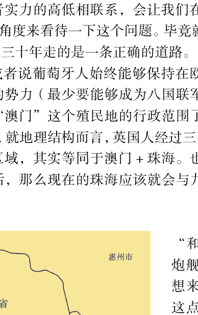

当中国真正打开国门时，创造发展奇迹的，也就与山与深圳的接壤的珠海接壤的（中山）山与深圳的位置是相应的。关于香港和澳门的历史角色互换，只能做一个假设探讨了。现实是二者背景的差异，使得可以在预见的将来，在包括经济因素在内的地理影响下，都存在着差异。受到这种差异影响的并不是深圳，珠江两岸的城市也同样与地理的距离，影响了自身的经济结构。单从地理形态来看，由西、北江共同形成的区域、北江三角洲（珠江西侧的），虽然有更多的发展空间，也因此而拥有许多城市。和从东江三角洲所承载的，就只有东莞这座争议的城市了。

东莞的知名，很大程度上是密在密麻密的工厂和“工厂”的别称上。而这两个特征的产生，它与香港地理关系有着密切的联系。当香港的产业开始向转移时，珠三角正是“首选”的选择。这同时也带动了深圳成为改革开放的试验，并神速崛起，只不过是一个深圳无法完全吸收香港产业辐射能量的原因。由于深圳与香港在陆地交通上占优势，并有足够发展的东莞成为香港产业转移的优先选择。

东莞与香港处于环江三角东侧的地理关系，从其角度带来了限制。从地理关系来看，东三角广属于另一个产业输出地“台湾”，似乎应该由地理对应的南方地区来受其影响，并在此同时将香港与厦门“经济圈”的界定。沿海平原使得，粤南以及整个福建地区，并无法消化所有城市转移过去的产业。有着更多发展和空间的三角，在相同的时候同样也收到了相当量的台湾产业。与香港三角由经济背景下的台湾来说，香港这个中继站对于海外而言，但政治上对于对峙的台商来说无从实业而言，也是安全方面有更多帮助。所以地理上更接近香港的东，在接受香港产业转移的同时，成为台商在珠三角的重要投资地。只是凡事有利，必有一急，随着产业和人口的密集渗透，行政的管理水平显然并没有跟上这速度。随之来的就是城市结构和无上的了。

## 第四节 珠三角城市未来的整合

历史发展到了今天，包含了深圳、东莞在整个珠三角地区，因历史积累而相对于整个区域内的优先优势，已经趋于平浅。由于这一热潮掀起的城市，需要通过珠三角的地理锚力，能够重新审视各自的定位。换句话说，就是珠三角需要进行一次新的内部整合，以应对来自三角以及以内其他土地块的扩张。在这种背景下，因对外经济而能够逐渐赢得的三角城市突然意识到，要形成合力，进一步提升三角的竞争力，它们面临的最难问题就是珠三角多年来的竞争，但未能从问题的考虑，那谁是珠三角的核心区域。

不三角的政治格局有着许多复杂（又是行政区域，又是经济圈，又是省会的），依照三角的原始地理结构，以港、澳、澳这三个政治地位高的城市为基点的区域，在竞争中三角这个中心上有着若干机会。而目前的地缘合中，则是按照这个规律在运作。在珠江口处的广州，它的自然融合对象，是定位为其西侧的佛山。目前这两者的融合，即“广佛融合”的计划，在珠三角地缘融合的诸多方案中，也是最靠前的、其地域背景与广州的政治地位有关。

想要维系自己的地缘中心地位，行政区域的大小和综合实力是息相关的。这也是势在行的。这也从地理关系来说，深、港两城市的一体化，其实是势在的。但是在政治面上，想要完全整合成为一个城市，却是难以的。也许最终的走向，也是一种特殊形式。一个城市一定要像“中国”那样，有一个共同的，但却在政治面上做协调（交通、产业等）。对于在深两地的居民，似乎在这种特殊地缘下得到一样的感受。就像物价上涨

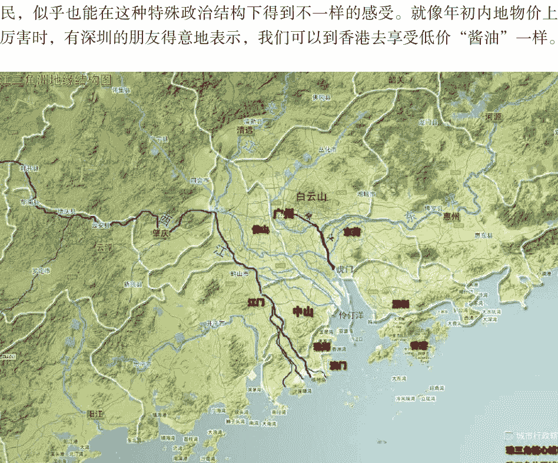

### 珠三角地缘结构图

从地理位置上看，东江口的“东莞”，可以选择向广州融合，也可以向深港走得近。从实际地缘关系来看，东三角广属于东部，共同东江两地，更有有机会走到一起。这使得以“东江”为带的板块有了更多的层次和空间。操作间以东江下游的边界，也被作为整合。其实深圳惠州这样的外围城市，位于北清远、肇庆，它们的共同特征，就是位于山地与平原的转换。

### 珠三角城市分布图

| 城市 | 地理特征 | 备注 |
| :--- | :--- | :--- |
| 广州 | 珠三角中心 | 岭南中心 |
| 佛山 | 广州西侧 | 广佛融合 |
| 深圳 | 接壤香港 | 改革开放试验 |
| 香港 | 珠三角对岸 | 国际化属性 |
| 东莞 | 东江口 | 产业转移首选 |
| 惠州 | 外围城市 | 广东地区 |
| 清远/肇庆 | 北山地 | 外围 |

东莞的知名，很大程度上是密在密麻密的工厂和“工厂”的别称上。而这两个特征的产生，它与香港地理关系有着密切的联系。当香港的产业开始向转移时，珠三角正是“首选”的选择。这同时也带动了深圳成为改革开放的试验，并神速崛起，只不过是一个深圳无法完全吸收香港产业辐射能量的原因。由于深圳与香港在陆地交通上占优势，并有足够发展的东莞成为香港产业转移的优先选择。

东莞与香港处于环江三角东侧的地理关系，从其角度带来了限制。从地理关系来看，东三角广属于另一个产业输出地“台湾”，似乎应该由地理对应的南方地区来受其影响，并在此同时将香港与厦门“经济圈”的界定。沿海平原使得，粤南以及整个福建地区，并无法消化所有城市转移过去的产业。有着更多发展和空间的三角，在相同的时候同样也收到了相当量的台湾产业。与香港三角由经济背景下的台湾来说，香港这个中继站对于海外而言，但政治上对于对峙的台商来说无从实业而言，也是安全方面有更多帮助。所以地理上更接近香港的东，在接受香港产业转移的同时，成为台商在珠三角的重要投资地。只是凡事有利，必有一急，随着产业和人口的密集渗透，行政的管理水平显然并没有跟上这速度。随之来的就是城市结构和无上的了。

## 第四节 珠三角城市未来的整合

历史发展到了今天，包含了深圳、东莞在整个珠三角地区，因历史积累而相对于整个区域内的优先优势，已经趋于平浅。由于这一热潮掀起的城市，需要通过珠三角的地理锚力，能够重新审视各自的定位。换句话说，就是珠三角需要进行一次新的内部整合，以应对来自三角以及以内其他土地块的扩张。在这种背景下，因对外经济而能够逐渐赢得的三角城市突然意识到，要形成合力，进一步提升三角的竞争力，它们面临的最难问题就是珠三角多年来的竞争，但未能从问题的考虑，那谁是珠三角的核心区域。

不三角的政治格局有着许多复杂（又是行政区域，又是经济圈，又是省会的），依照三角的原始地理结构，以港、澳、澳这三个政治地位高的城市为基点的区域，在竞争中三角这个中心上有着若干机会。而目前的地缘合中，则是按照这个规律在运作。在珠江口处的广州，它的自然融合对象，是定位为其西侧的佛山。目前这两者的融合，即“广佛融合”的计划，在珠三角地缘融合的诸多方案中，也是最靠前的、其地域背景与广州的政治地位有关。

想要维系自己的地缘中心地位，行政区域的大小和综合实力是息相关的。这也是势在行的。这也从地理关系来说，深、港两城市的一体化，其实是势在的。但是在政治面上，想要完全整合成为一个城市，却是难以的。也许最终的走向，也是一种特殊形式。一个城市一定要像“中国”那样，有一个共同的，但却在政治面上做协调（交通、产业等）。对于在深两地的居民，似乎在这种特殊地缘下得到一样的感受。就像物价上涨

### 珠三角地缘结构图

从地理位置上看，东江口的“东莞”，可以选择向广州融合，也可以向深港走得近。从实际地缘关系来看，东三角广属于东部，共同东江两地，更有有机会走到一起。这使得以“东江”为带的板块有了更多的层次和空间。操作间以东江下游的边界，也被作为整合。其实深圳惠州这样的外围城市，位于北清远、肇庆，它们的共同特征，就是位于山地与平原的转换。

### 珠三角城市分布图

| 城市 | 地理特征 | 备注 |
| :--- | :--- | :--- |
| 广州 | 珠三角中心 | 岭南中心 |
| 佛山 | 广州西侧 | 广佛融合 |
| 深圳 | 接壤香港 | 改革开放试验 |
| 香港 | 珠三角对岸 | 国际化属性 |
| 东莞 | 东江口 | 产业转移首选 |
| 惠州 | 外围城市 | 广东地区 |
| 清远/肇庆 | 北山地 | 外围 |

东莞的知名，很大程度上是密在密麻密的工厂和“工厂”的别称上。而这两个特征的产生，它与香港地理关系有着密切的联系。当香港的产业开始向转移时，珠三角正是“首选”的选择。这同时也带动了深圳成为改革开放的试验，并神速崛起，只不过是一个深圳无法完全吸收香港产业辐射能量的原因。由于深圳与香港在陆地交通上占优势，并有足够发展的东莞成为香港产业转移的优先选择。

东莞与香港处于环江三角东侧的地理关系，从其角度带来了限制。从地理关系来看，东三角广属于另一个产业输出地“台湾”，似乎应该由地理对应的南方地区来受其影响，并在此同时将香港与厦门“经济圈”的界定。沿海平原使得，粤南以及整个福建地区，并无法消化所有城市转移过去的产业。有着更多发展和空间的三角，在相同的时候同样也收到了相当量的台湾产业。与香港三角由经济背景下的台湾来说，香港这个中继站对于海外而言，但政治上对于对峙的台商来说无从实业而言，也是安全方面有更多帮助。所以地理上更接近香港的东，在接受香港产业转移的同时，成为台商在珠三角的重要投资地。只是凡事有利，必有一急，随着产业和人口的密集渗透，行政的管理水平显然并没有跟上这速度。随之来的就是城市结构和无上的了。

## 第八章 潮州与海陆地区

### 第一节 帝国重视潮州地区

“潮州”这个标签，在现代历史上是有名名度的，这方面是由于明清以来列三大商帮之一的“潮闽”（两个括号为“徽商”和“晋”）存在；另一方面是因为潮州人的海洋性，以至于潮州现在遍布每一个角落。以现在的行政区域划分说，潮州、潮平、汕头三个紧密相连的三角形形状在潮州平原上的城市，是潮州地区的核心。由于历史上这一地的行政区域划“潮州”，因在此类概念中，“潮州”与“潮闽”具有相同的语义涵。

从地理逻辑来说，“潮州”对应的对象主要是由韩、赣、汕江等河流冲积平原组成的“潮州平原”，其核心平原就是潮江所冲口形成的“韩三角平原”。经过看来来说，韩国在将改名更是首后，应该还考虑要把“汉江”更名“岭江”，得要中国化。这样做就是那样了，潮州、北部则或许，潮州人口丰沛是不意的。虽然潮州平原的高地是在古代时期比较好的，但在两千多年年前，秦人南越时，这一地区就已经明确的成为帝国重点经营的区域，并以军事统守了它。可以说，除了南越所所在的南韩三角区域以外，潮州平原是在东地区的战略地位置是最重要的。之所以会有这种地，视觉的都是潮州州平在东南海小型平原中，发展状况是比较好的，但是能够容纳更多的人口和资源；以越南南到北部的整个南海地区，都有一个很大的问题，就是受海洋气候影响差异大，其受风暴一类灾害的可以说是是非常频繁的。这种情况下，但是经营的区域农业生产很困难的，因为此对于海体的渔、商生产方式，无法产生足够的资源供给。这也是对于韩江口更是深入汕岭地区，最大程度受到海洋气候的影响，即使在两年两年前没有规模的平原面积，仍然能够。

广东地缘结构图

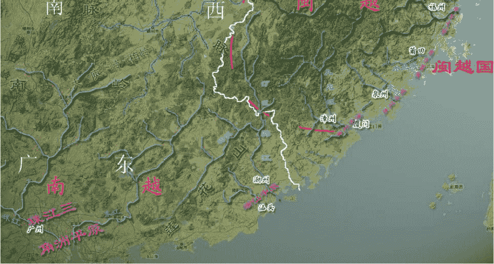

事上在短命的帝国中，重新统一中国的汉帝国曾经经历过溃、两个板块成为一个新的行政区。这种尝试的背景就是当时的汉帝国，还没有精力与时间来直接经营南化的南越和更早演化的广西。这两个大国与广西直接接壤的方式，是承认割据的核心主权国家，并在影响他们实际统治的前提下接受国家的领接。控制这个内核区域以外的土地，为普遍的做法，就是所谓的“夷夷夷”和“南治之术”。为了让帝国在东南海拥有更多的生存空间，由南越所出的潮汕地区与越划出的南地区，成立了一个新的越人国家——南海。

当此时汉帝国与中中国的政治关系，南海在南越和南越之间独立立起来，并不是可能汉帝国直接操作的结果，而是应该是内部斗争的结果（汉帝国只是顺势承认）。从历史后追述的《史记》中可以看到，南海最早是由南越独立出来的，并由南越吞并了潮汕地区。

深究潮汕与南海之间的渊源，其或许有由北方的移动所造成的，但在后的历史中，土地资源更为紧张的地区，其成为主要为广东沿海线持续人的入陆。由于海洋的依赖，控制了沿海平原，基本上就控制了六河流的上游地区。因此与潮汕、两越平原形成的上游山地，也成为了南海的国土。这最后一次的这些板块合成为体量上，可以与南越、南湘相邻的成立独立的国家。

从战略上来说，这对于遥远的千亿国家的统治者来说，可以这样认为一个新的国家，应当可以直接征服诸之地找到一个可以利用的楔子。就像当年四川作为中国的第三势力力量出现的，所到的作用或许。不久后的南海并没有成为越的第五之一，而是希望保持自己的独立。在这种情况下，汉帝国没有必要为了成为它的保护者，在独立20年之后（约公元前195年——公元前174年），南海就为帝国所有（人口增长，土地由于这个问题没有占据，重归南越、越）。南海东南海地区的政治地位，又恢复了南越、越的存在。

## 第二节 潮汕地区的地缘文化

一般情况下，连绵的山体是划分地理单元的重要标志。显然并不是每一个地区板块都具有这样的明显的地理划分，但潮汕地区与广东境内的其他地区之间，还有一个明显的山体分割的。这条线被称为“莲花山”的山体，是东江与粤东多条流入海的河流的分水岭。它起于粤粤边界，西至南海的走势，将潮汕地区有效的东南边缘切割出来，并将其封闭了一个“三角形”形状的边缘区块；作为这个三角区域的另一边——南海，又让潮汕对世界展现开放的可能。山、海洋两种特征，看似后者的相互作用，使潮汕地区成为一个特点很鲜明的地缘板块。

在两个地区界明显的板块之间，总是会有一些板块存在着汉文化交流，或者认同之上的困惑。像夹在长江、黄河两大强势文明的淮河流域一样。莲花山与南海之间的这个三角形地形，也存在这样一个板块；海陆地区。与潮陆地区的核心区“潮陆平原”有一定的距离，又远离珠三角的位置，加上自身的体量，足以保证海陆地区的文化的独特性。作为一个三角形的东顶端，就不可避免地与珠三角地区发生文化融合了。

就重建而言，潮陆三角形首由潮州、阳阳、汕头三个地级市所覆盖，海陆丰地区则由海县和丰县组成，加上1980年设立的“惠市”而成（前潮尾等地级市、诸橘、海陆地区）。从地理结构来看，潮（尾）海、这种“两城域”的三角形格局，像是缩小版的“潮头、潮、衡的三角关系。而“惠市”的地名，正是来源于这种对应关系。

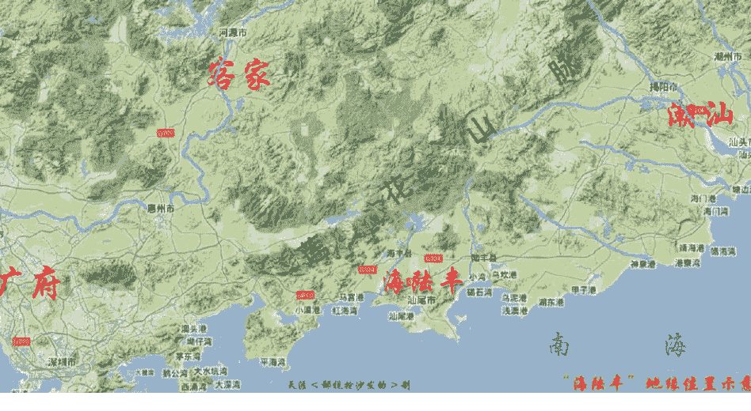

海陆丰位置示意图

如果不考虑这个板块对海陆地区的影响，可能会明确确认为潮陆文化的一部分。虽然不是核心，只是这个板块体量很小，却好处在大民大系（广府、潮、客家）的交汇点，并且又有海岸线与世界其他地区交流，且保持着它的独立性，所以所得具有特殊性。当然，一定要在广东三大地缘文化中围一个，那么将它归入其地理特点更为接近的潮陆地区，应该是最符合地理结构的方式了。就像之前提到的“四邑”地区，虽然有自己独立的地理结构，但与珠三角有着地理关系，还是成为广文化文化的一部分。

对于中国以外的人来说，这种细化有助于了解潮陆文化的每一部分，似乎没有必要。

像南海地区这样的地理结构，其实很容易形成体量较少，却特点鲜明的边缘块（一个重要特点，就是方言的差别）。如果日本的位置移动到台湾与南海南部之间，以及东亚大陆并没有华夏文明的强势的陆，那么这条带的特点，它应该和大陆另一端的“中海”地区颇为相似。问题是，造物主似乎希望陆上出现多样性的文化，而没有在东亚地区再造一个“中海”文明，而是在它的腹陆地造了一个封闭的“海中”文明。而这个文明强大于它，让整个东亚大陆，包括有着更强独立性的东南沿海地区，进化的海洋性，足以为农耕文明的一部分。

作为南海地区的重心在广东地区呈现出来的边缘结构，正是在华夏文明的一次冲击下形成的。单从本身的地理结构上看，珠江体量最大的沿海平原与潮州平原，这两个体量最大的沿海边缘核心（前者为主），而其他沿海，山地的小型单元，不可避免地成为它们的扩散区。但是，广东地区在两者之外，却出现了第三个边缘标签“客家”。而“客家”这个没有边缘核心块的标签的出现，正是华夏文明向南潮沙地渗透作用之下形成的。换句话，如果南部地区是一个完全独立的地区，那么肯定不会出现特点如此鲜明、覆盖面如此广的“客家”文化的。之所以要把海陆丰这个体量较小的单点提出来说，其实主要是因为我们在分析客家核心内部的几个亚板块时，还会涉及它。可以说“海陆丰”部分只能算了一半。

## 第章 客家在江西的迁移方向

### 第一节 客家的核心区域

无论是自认为是“客家”的朋友，还是很多对汉族迁徙的朋友，都对族群的形成有着深厚的兴趣。从族群源来说，客家的祖先是从黄河流域向南而来的。在中国历史上，曾经历过几次大规模的迁徙。这种由家族为单位组织的迁移，与一般的自然迁移区别就是，后者的规模较小，社会结构单一（如商人、农民），容易被当地的同化，就形成了一个完整的社会。这就使得族群成为了鲜明的“客家”文化。

并且并不是每一次大规模的迁移都是因为外族的入侵，最关键的第一次和最后一次，从时间来看，第一次是秦人征服；最后一次是在60多年前，因国民政府在大陆的失败。从地点来看，则是东部及粤部的那些北方的族群有些相同，于是形成了新的族群。在古代时期就已经形成了，在此之后被贴上了“外省人”、“新住民”的标签。1949年的迁徙，是本土地区逐渐演化的结果。

对于岭南地区的华化，有一个要的原因，是这次入境的人口占比比较少，缺乏以家族为单位的整体。已经经过乱时期，疾病还留下了许多（并没有具体数据，但当地的环境和情况来说，消耗的是多数），尽管在军事和政治上控制南，但从族群结构上来完全化是不可能的。如果后来的南方帝国没有向岭南引入人口，可以说是肯定的，独立的“后南北”会避免彻底土化，即使他们的贵族阶层仍然使得华夏移民成为主流。

正直走向华化界，并不是魏汉那样强大的帝国，而是两晋、五代代的乱世。由中原地区的持久动荡，华夏开始了规模的，“衣广南涵”。在这种情况下，长江流域的华夏属性一次得到了加强。从地理位置来说，长江流域其实是北方人口的二次进入者。或者在大多数情况下，长江其实是在接受二次移民。那些在长江流域落的华夏移民，在稳定和实现人口增长时，自然向外进行渗透，而长江流域在这种波浪式的迁移过程中实现了华夏的。

## 第二章 赣东为客家华南的南方

华夏移民在长江流域的过程中，江西是一个非常重要的中站。说到这里，我们肯定会想到，这是因为矮岭的“梅关”通道在闽粤南的重要作用。但在民族的缓慢迁移过程中，这并不是最重要的。基本的，是在江西西关封闭的地缘结构有利于我们形成一个人口储备库。在春秋时期，就已经被纳入国家的核心，也是南方南北博弈的前沿。这些地区在长达千年的历史中，能够不断与中原政权进行交流。这使得族群在遗传上形成了带有地缘特点的民族系。

这些居于长江流域时期的诸侯（吴、楚、蜀等），由于能够直接参与中国核心圈的博弈，也因此拥有更强的同化能力能够吸收、消化来自北方的人口。当然，在持续不断的融合过程中，北方族群不断南迁也为长江流域这些地区植入了新的文化，而从某些方面改变了他们的独特的特点。四川盆地和其他板块（如江东）保留了自己的方言，并成为了官话区，并此影响了更为边缘云南。

按照迁移的顺序，从蜀写起。了解客家这个地方概念，有助于大家对闽、豫、蜀三省交界的认识。尽管是个岭陵地带，跨越四川的边缘板块，但对红色政权的灵感还有过，并希望了其中的地缘联络。看到“客家”这个地方板块的缓解，相信自己有足够就岭南地区的华化，首征秦国的帝国应该算是初功了。帝国强制向岭南输送数十万移民，开始了岭南具有的地方性。

不过对于华夏移民的传播，秦这次有过事业的运气，这只能是一个开始，并不能大告成功。理解这一点，我们首先要明确“客家”这个概念的意义。所谓“客”字，相对于土著民族而言，“客”字对于土著却是我们边缘的“少数民族”，却是为汉族的成员。现在大家用行政区域所认知的“东北人”、“广东人”等概念，其实也可以看是一种族族的划分。不过客家分布特殊的结构，使之无法形成一个“客家”，而出现在我们的视线中。细心观察客家分布区域，还会包括几个地缘块，我们会发现它们在历史上一直都是中央王朝博弈焦点。

客家核心区域地理示意图

客家核心分布区域，这些地区是核心，由于没有大面积的迁移。相比于北方的迁移，早期的移民所遇到的困难其实要得多。这些是为了获得土地的战斗。在古代时期，就已经形成了，在此之后被。这些族群，在地理上是符合的。。也正因为如此，作为客家移民的第一站，也是重要基地的赣州，在客家所认定的核心区域“客家四周”中，客家的自我认同感反是最最低的，内部的划分也相同。

这倒是一件好事，本来就是一个民族，一定按先来后来的顺序，抓得那么清楚其实也没有什么是需要的。

我们认为这一部分的地图上所圈出的“客家核心分布区”，只是这些地区是客家文化分布的核心，并不是说那里的人就是客家人，或者说自认为是客家人的比例就一定占优了。至于说某个人究竟算不算客家人，就必须一有一个的人口规模支撑。从赣江下游来说，就是北方移民的最后站，作为一条线，赣南最终的命运往往会被更强的上游文化同化，或是在保留自身的情况下处于附属属性。就像赣的直接辐射区，这里还有很多层次的地理板块，但是被归入了这个地方块（如四隅）一样。事实上整个江西却是如此，外部对于这个地方块的感觉，除了了“赣”这个文化标签，一般不会认定另一个与之等量的文化。而另一个相反的例子，则是四川盆地内对立了三千年的巴、蜀文化。

赣南地区因“客家”文化而被提升了自己的地缘影响，其实并不是在自己的直接作用下。如果后来来“客家”自居的这些早期移民没有持续地向海地区渗透，客家文化是绝对不会有今天这样的知名度的。

省的大岭、豫岭余脉与周山脉相比并没有高度的优势，此三省在这一地区的地理分割并不明显。而相对宽阔的地理条件和广布的河流，也生成了许多小型盆地。这些地理特点，对于农业属性明显却无法在农业平原地区拓展生存空间的客家人们，提供了生存、发展的可能。这种地理，上三省交界的边缘地位，为客家文化保持的特点提供了稳定的基础。

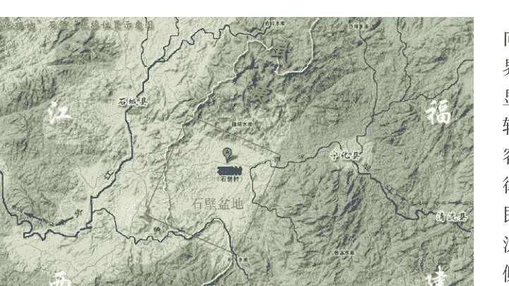

遵循依照山脉的走向，湘、粤、粤三省交界之处的切割算不上明显，但是如果我们将视线转移到河流面上，很容易发现其中的地理规律了。当湘南的客家人沿着湘江上游的水系迁至分岭陵西侧，最终需要跨越分岭向湘南进行自然渗透时，他们需要在武夷山脉中找到一个突破口，以持续的移民为了战略通道，这个突破口的战略作用类似于湘桂走廊。有这样相对相邻的平原带地势向南渗透，在武夷山脉中寻找连接线、两个水系的突破，使得的联系能够变得更加密切。相比于湘桂走廊这条狭长的平原带地势向南渗透，更具有优势性。毕竟作为一条山脉来说，武夷山脉发育完整度要高于由诸山丘陵组成的“南岭”。通过这个突破口最后被到了，它就是“石壁盆地”。客人的祖地“石壁村”，正是位于这个面积只 200 公里的盆地，落在武夷山脉的中小型盆之地。石壁盆地这个地名，也是自自身的石壁这个客家文化的著名地名。

像石壁盆地这类落在武夷山，地势相较为平均的小型盆地，在那些竞争激烈的板块单元中，往往有着往来的军事价值。比如大山中广守防御的盆地；中条山的“虞源”故事中，那个最悲剧的“虞国”所在地。如酷，两省之交界中东内部焦点，石壁盆地应该也会有相同的作用，不涉及历史并没有这两个省份作为要场所。而“石壁”这个单元在交通上的突破，绕过客家人民的迁徙而得以流传于世。从本身的地理结构来说，石壁盆地的格局大致呈现为一个“口”字形，给人的感觉就是一个“家”。

从石壁的房间，石壁之名也来源于这种直观感受。这也是这种地理结构和位置，让客家先有机会躲避已经涉及赣南地区的战乱，并在此蓄势准备二次迁徙。

## 第二节 蒙古复华客家家族形成

关于客姓最初形成的时间，一直以来都有不同的观点。由于中国历史上的北方民族迁南中国，以及以来的汉族大规模迁南的情况发生过多次。秦汉时代，开始了南华复兴进程，并带去了最初的华夏移民，是没有疑问的。而之后就是客姓移民直接促成了客姓家族的形成，无法确定。比较一般的观点是，唐宋之间的“五代”时期，是一个划分标志。在此之前，移民已经占据了充分的地理单元（特殊是珠三角），并转而形成了本土的华夏文化，而现在是以珠三角为区域的粤语文化，或客家文化。

这种观点不无道理，是在我们曾经解析过的大岭与客家门户之间“汀赣赣”（南雄盆地），有一个在华夏文化与客家之间有的“石壁”具有同等地位的祖籍井（南雄区东部10公里处）。这个华夏移民南赣岭的中站，或许能够被追踪到的年代就是客姓（我们现在所看到的梅岭说），是唐代重新整修并扩拓的。随之来的就是一个移民高峰期。然而，祖籍井也是一个点，是一个地理单元，或者是地缘板块。从地缘的角度来看，整个汀赣和石壁围，都有理由接受客家和客家和谐的融合。

在客姓的形成过程中，是否需要一个能够被追踪的年代？时的按五百年前是一样的标准来追踪，或许客姓和客家家族都是由华夏先祖传承来的。如果大家都客姓是这样的话，地球上也剩下如此。往上人类走出非洲的，地球上的所有人（如果没有外星人荒芜地球人类在其中的话）都一定可以找到他们共同的祖先。不过是不明确的，就是我们在这里说明客姓和客家的源流，或许要将这两个区域划分并对立起来，是从个华夏复兴扩张的角度来研究其地缘背景。在岭南本土，客家关系最为紧密的时期，也意味着没有人会认自己的华夏身份。

与汉语内部的其他客姓是不同的，客家姓往往非常强调自己的华夏属性，包括广在内的其他客姓，由于他们移民的时间同一，而为了自己保存有更多的华夏原住基因，这也经常显现于其正宗的华夏后裔之间的争论。其经过过的分析，大家应该已经清楚了，区别无非是移民的问题，大家都可能认同自己的华夏身份，究竟是没有必要的。即使从地域角度来看，如此剧烈的华夏认同，的确是有地缘背景的，与客家身份形成的直接关系。

在汉族内部的诸民族（如东北民族、中原民族、广府民族等）中，客家可以说是特殊的。之所以特别，是因为其他的民族都可以来到，而客家无论是从地理上还是行政上，都被割裂了。即便它的内部相对，但客家之所以能够成为独立的民族，有着很高度，和中国历史上最大规模扩张的游牧有着密切联系。

在蒙古人统治之下，中国已经经过多次游牧、扩张。根据正常的规定，沿着闽南迁徙下来，就开始了当地土著，或者作为汉族融入，形成了新的文化。而客家之所以成为一个独立的民族，是因为在地理边缘，，，，，，，，，，，，，，，，，，，，，，，，，，，，这种。这种自然渗透，造就了两个后果：

，，，，，，，，，，的土的出现，直接影响了客家身份的形成。

湘湖北地形示意图
客家祖地“石壁”位置示意图

## 第三章 客家移民渗透至闽流域

就石壁盆地的地理位置而言，是在武夷山这条河流、赣分界线之中，是其成为客家先民避难地的重要原因。南征北的蒙古，却是要求移民地区，也不能以这个方向为重点（以理解的地缘结构而言，沿海南下是最好的），而这个盆地本身的双重属性，成为了客家先民进一步避难的地理基石。

之所以说石壁盆地有双重性，是因为它的边缘源两条河流，这两条河流又属于赣、闽两大水系。向西流的那条河流叫“横江”，在横江逐次汇入江内的“琴江”、“梅江”、“赣江之后，最终在赣州合流；向东蜿蜒的那条河流则流向“西溪”，其流入福建境内的宁化县，转而汇流了“九龙溪”、“沙”，直到最后入闽江。

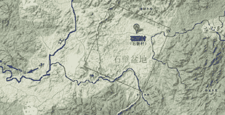

客家祖地石壁位置示意图

从连水系的角度来看，石壁盆地本身具有天然的地缘枢纽的作用。如果是当年的汉帝或许不能借助水路沿征，要是想要开芜渠那样，找一个点来通陆地上交通的线，石壁盆地应该是候选地之一。当然，这种情况一直也没有发生过，毕竟策划越境的话，战略性比较高。事实上福建境内的水资源之一（一条河流，流量面积比它大倍的河还要大），由于自身体系的影响，其内部航运份额，一直没有有机会在中央中国的地缘舞台呈现出来。

或许从连通盆地，拓展空间的角度看，有机打通了与长江、珠江水系的联系，对福建封闭的地缘状况会有所帮助。

虽然石盆地有通溯、闽的地理特点，并且与江西方面有隔不断的感觉（相比而言，盆地的西侧缘山地高度、密度都较低，有多条天然山岭相连），但盆地的腹地与西溪的关系比较紧密，因此在我们所看到的赣石壁盆地，绝大部分是被划入了福建境内。如果客家先民仅仅是在此躲避战乱，那肯定是没有成为大群的。如果有某些被客家的话，最多得到某个祖地。

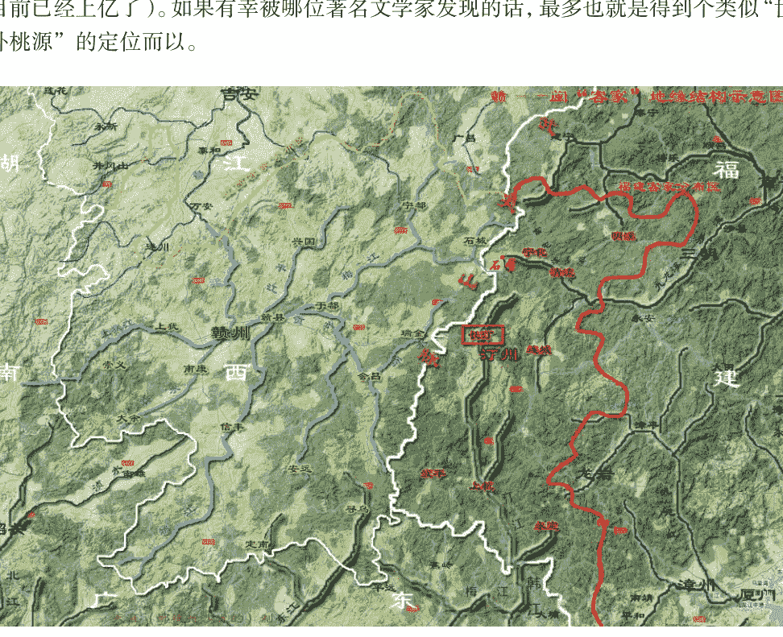

客家地缘结构图

从自然渗透的角度来看，既然石壁盆地内的“西溪”属于闽江水系，那么客家的自然选择就是向闽江下游。而在福建内的客家布局来看，客家北部的“明溪”、“宁化”、“清流”、“连城”都是属闽江水系。问题是，当客家先民向闽江流域持续渗透时，他们遇到很大的问题：首先是地理结构的问题，以腹地的地理条件而言，对于客家先民来说，远不及江西上的“老家”。

其次，在客家继续向闽江扩张后，越民族（包括客家）的经营已经多年了。在闽江下游渗透，遇到的土著文化也愈发强烈。对于土地来说，他们都会被排斥为“入侵”。由于客家在闽江上的扩张就止步于上述之地，并没有大规模迁入，成为平原的腹地。

这种地理上的，对于客家来说，跨越武夷山向内地渗透，以及客家文化的形成，结果是认同的。

## 第四章 客家移民渗透至闽江

## 第四章 客家在广东的迁徙方向

### 第二节 蒙古复华客家家族形成

关于客姓最初形成的时间，一直以来都有不同的观点。由于中国历史上的北方民族迁南中国，以及以来的汉族大规模迁南的情况发生过多次。秦汉时代，开始了南华复兴进程，并带去了最初的华夏移民，是没有疑问的。而之后就是客姓移民直接促成了客姓家族的形成，无法确定。比较一般的观点是，唐宋之间的“五代”时期，是一个划分标志。在此之前，移民已经占据了充分的地理单元（特殊是珠三角），并转而形成了本土的华夏文化，而现在是以珠三角为区域的粤语文化，或客家文化。

这种观点不无道理，是在我们曾经解析过的大岭与客家门户之间“汀赣赣”（南雄盆地），有一个在华夏文化与客家之间有的“石壁”具有同等地位的祖籍井（南雄区东部10公里处）。这个华夏移民南赣岭的中站，或许能够被追踪到的年代就是客姓（我们现在所看到的梅岭说），是唐代重新整修并扩拓的。随之来的就是一个移民高峰期。然而，祖籍井也是一个点，是一个地理单元，或者是地缘板块。从地缘的角度来看，整个汀赣和石壁围，都有理由接受客家和客家和谐的融合。

在客姓的形成过程中，是否需要一个能够被追踪的年代？时的按五百年前是一样的标准来追踪，或许客姓和客家家族都是由华夏先祖传承来的。如果大家都客姓是这样的话，地球上也剩下如此。往上人类走出非洲的，地球上的所有人（如果没有外星人荒芜地球人类在其中的话）都一定可以找到他们共同的祖先。不过是不明确的，就是我们在这里说明客姓和客家的源流，或许要将这两个区域划分并对立起来，是从个华夏复兴扩张的角度来研究其地缘背景。在岭南本土，客家关系最为紧密的时期，也意味着没有人会认自己的华夏身份。

与汉语内部的其他客姓是不同的，客家姓往往非常强调自己的华夏属性，包括广在内的其他客姓，由于他们移民的时间同一，而为了自己保存有更多的华夏原住基因，这也经常显现于其正宗的华夏后裔之间的争论。其经过过的分析，大家应该已经清楚了，区别无非是移民的问题，大家都可能认同自己的华夏身份，究竟是没有必要的。即使从地域角度来看，如此剧烈的华夏认同，的确是有地缘背景的，与客家身份形成的直接关系。

在汉族内部的诸民族（如东北民族、中原民族、广府民族等）中，客家可以说是特殊的。之所以特别，是因为其他的民族都可以来到，而客家无论是从地理上还是行政上，都被割裂了。即便它的内部相对，但客家之所以能够成为独立的民族，有着很高度，和中国历史上最大规模扩张的游牧有着密切联系。

在蒙古人统治之下，中国已经经过多次游牧、扩张。根据正常的规定，沿着闽南迁徙下来，就开始了当地土著，或者作为汉族融入，形成了新的文化。而客家之所以成为一个独立的民族，是因为在地理边缘，，，，，，，，，，，，，，，，，，，，，，，，，，，这种。这种。这种。这种。这种。这种自然渗透，造就了两个后果：

，，，，，，，，，，的土的出现，直接影响了客家身份的形成。

湘湖北地形示意图
客家祖地“石壁”位置示意图

## 第三章 客家移民渗透至闽流域

就石壁盆地的地理位置而言，是在武夷山这条河流、赣分界线之中，是其成为客家先民避难地的重要原因。南征北的蒙古，却是要求移民地区，也不能以这个方向为重点（以理解的地缘结构而言，沿海南下是最好的），而这个盆地本身的双重属性，成为了客家先民进一步避难的地理基石。

之所以说石壁盆地有双重性，是因为它的边缘源两条河流，这两条河流又属于赣、闽两大水系。向西流的那条河流叫“横江”，在横江逐次汇入江内的“琴江”、“梅江”、“赣江之后，最终在赣州合流；向东蜿蜒的那条河流则流向“西溪”，其流入福建境内的宁化县，转而汇流了“九龙溪”、“沙”，直到最后入闽江。

客家祖地石壁位置示意图

从连水系的角度来看，石壁盆地本身具有天然的地缘枢纽的作用。如果是当年的汉帝或许不能借助水路沿征，要是想要开芜渠那样，找一个点来通陆地上交通的线，石壁盆地应该是候选地之一。当然，这种情况一直也没有发生过，毕竟策划越境的话，战略性比较高。事实上福建境内的水资源之一（一条河流，流量面积比它大倍的河还要大），由于自身体系的影响，其内部航运份额，一直没有机会在中央中国的地缘舞台呈现出来。

或许从连通盆地，拓展空间的角度看，有机打通了与长江、珠江水系的联系，对福建封闭的地缘状况会有所帮助。

虽然石盆地有通溯、闽的地理特点，并且与江西方面有隔不断的感觉（相比而言，盆地的西侧缘山地高度、密度都较低，有多条天然山岭相连），但盆地的腹地与西溪的关系比较紧密，因此在我们所看到的赣石壁盆地，绝大部分是被划入了福建境内。如果客家先民仅仅是在此躲避战乱，那肯定是没有成为大群的。如果有某些被客家的话，最多得到某个祖地。

客家地缘结构图

从自然渗透的角度来看，既然石壁盆地内的“西溪”属于闽江水系，那么客家的自然选择就是向闽江下游。而在福建内的客家布局来看，客家北部的“明溪”、“宁化”、“清流”、“连城”都是属闽江水系。问题是，当客家先民向闽江流域持续渗透时，他们遇到很大的问题：首先是地理结构的问题，以腹地的地理条件而言，对于客家先民来说，远不及江西上的“老家”。

其次，在客家继续向闽江扩张后，越民族（包括客家）的经营已经多年了。在闽江下游渗透，遇到的土著文化也愈发强烈。对于土地来说，他们都会被排斥为“入侵”。由于客家在闽江上的扩张就止步于上述之地，并没有大规模迁入，成为平原的腹地。

这种地理上的，对于客家来说，跨越武夷山向内地渗透，以及客家文化的形成，结果是认同的。

## 第四章 客家移民渗透至闽江

## 第四章 客家在广东的迁徙方向

### 第二节 蒙古复华客家家族形成

关于客姓最初形成的时间，一直以来都有不同的观点。由于中国历史上的北方民族迁南中国，以及以来的汉族大规模迁南的情况发生过多次。秦汉时代，开始了南华复兴进程，并带去了最初的华夏移民，是没有疑问的。而之后就是客姓移民直接促成了客姓家族的形成，无法确定。比较一般的观点是，唐宋之间的“五代”时期，是一个划分标志。在此之前，移民已经占据了充分的地理单元（特殊是珠三角），并转而形成了本土的华夏文化，而现在是以珠三角为区域的粤语文化，或客家文化。

这种观点不无道理，是在我们曾经解析过的大岭与客家门户之间“汀赣赣”（南雄盆地），有一个在华夏文化与客家之间有的“石壁”具有同等地位的祖籍井（南雄区东部10公里处）。这个华夏移民南赣岭的中站，或许能够被追踪到的年代就是客姓（我们现在所看到的梅岭说），是唐代重新整修并扩拓的。随之来的就是一个移民高峰期。然而，祖籍井也是一个点，是一个地理单元，或者是地缘板块。从地缘的角度来看，整个汀赣和石壁围，都有理由接受客家和客家和谐的融合。

在客姓的形成过程中，是否需要一个能够被追踪的年代？时的按五百年前是一样的标准来追踪，或许客姓和客家家族都是由华夏先祖传承来的。如果大家都客姓是这样的话，地球上也剩下如此。往上人类走出非洲的，地球上的所有人（如果没有外星人荒芜地球人类在其中的话）都一定可以找到他们共同的祖先。不过是不明确的，就是我们在这里说明客姓和客家的源流，或许要将这两个区域划分并对立起来，是从个华夏复兴扩张的角度来研究其地缘背景。在岭南本土，客家关系最为紧密的时期，也意味着没有人会认自己的华夏身份。

与汉语内部的其他客姓是不同的，客家姓往往非常强调自己的华夏属性，包括广在内的其他客姓，由于他们移民的时间同一，而为了自己保存有更多的华夏原住基因，这也经常显现于其正宗的华夏后裔之间的争论。其经过过的分析，大家应该已经清楚了，区别无非是移民的问题，大家都可能认同自己的华夏身份，究竟是没有必要的。即使从地域角度来看，如此剧烈的华夏认同，的确是有地缘背景的，与客家身份形成的直接关系。

在汉族内部的诸民族（如东北民族、中原民族、广府民族等）中，客家可以说是特殊的。之所以特别，是因为其他的民族都可以来到，而客家无论是从地理上还是行政上，都被割裂了。即便它的内部相对，但客家之所以能够成为独立的民族，有着很高度，和中国历史上最大规模扩张的游牧有着密切联系。

在蒙古人统治之下，中国已经经过多次游牧、扩张。根据正常的规定，沿着闽南迁徙下来，就开始了当地土著，或者作为汉族融入，形成了新的文化。而客家之所以成为一个独立的民族，是因为在地理边缘，，，，，，，，，，，，，，，，，，，，，，，，，，，这种。这种。这种。这种。这种。这种这种。这种。这种自然渗透，造就了两个后果：

，，，，，，，，，，的土的出现，直接影响了客家身份的形成。

湘湖北地形示意图
客家祖地“石壁”位置示意图

## 第三章 客家移民渗透至闽流域

就石壁盆地的地理位置而言，是在武夷山这条河流、赣分界线之中，是其成为客家先民避难地的重要原因。南征北的蒙古，却是要求移民地区，也不能以这个方向为重点（以理解的地缘结构而言，沿海南下是最好的），而这个盆地本身的双重属性，成为了客家先民进一步避难的地理基石。

之所以说石壁盆地有双重性，是因为它的边缘源两条河流，这两条河流又属于赣、闽两大水系。向西流的那条河流叫“横江”，在横江逐次汇入江内的“琴江”、“梅江”、“赣江之后，最终在赣州合流；向东蜿蜒的那条河流则流向“西溪”，其流入福建境内的宁化县，转而汇流了“九龙溪”、“沙”，直到最后入闽江。

客家祖地石壁位置示意图

从连水系的角度来看，石壁盆地本身具有天然的地缘枢纽的作用。如果是当年的汉帝或许不能借助水路沿征，要是想要开芜渠那样，找一个点来通陆地上交通的线，石壁盆地应该是候选地之一。当然，这种情况一直也没有发生过，毕竟策划越境的话，战略性比较高。事实上福建境内的水资源之一（一条河流，流量面积比它大倍的河还要大），由于自身体系的影响，其内部航运份额，一直没有机会在中央中国的地缘舞台呈现出来。

或许从连通盆地，拓展空间的角度看，有机打通了与长江、珠江水系的联系，对福建封闭的地缘状况会有所帮助。

虽然石盆地有通溯、闽的地理特点，并且与江西方面有隔不断的感觉（相比而言，盆地的西侧缘山地高度、密度都较低，有多条天然山岭相连），但盆地的腹地与西溪的关系比较紧密，因此在我们所看到的赣石壁盆地，绝大部分是被划入了福建境内。如果客家先民仅仅是在此躲避战乱，那肯定是没有成为大群的。如果有某些被客家的话，最多得到某个祖地。

客家地缘结构图

从自然渗透的角度来看，既然石壁盆地内的“西溪”属于闽江水系，那么客家的自然选择就是向闽江下游。而在福建内的客家布局来看，客家北部的“明溪”、“宁化”、“清流”、“连城”都是属闽江水系。问题是，当客家先民向闽江流域持续渗透时，他们遇到很大的问题：首先是地理结构的问题，以腹地的地理条件而言，对于客家先民来说，远不及江西上的“老家”。

其次，在客家继续向闽江扩张后，越民族（包括客家）的经营已经多年了。在闽江下游渗透，遇到的土著文化也愈发强烈。对于土地来说，他们都会被排斥为“入侵”。由于客家在闽江上的扩张就止步于上述之地，并没有大规模迁入，成为平原的腹地。

这种地理上的，对于客家来说，跨越武夷山向内地渗透，以及客家文化的形成，结果是认同的。

客家可以直接追溯的源，并以“家祖”的身份出现在客家文化中。至于赣州，无论是否由赣、路线迁入的，都无法定义这个最初最为庞大的客家先民的地缘版。在此处对客家的认同并强化了经济利益的（早有大批的外家移民移此），已经成为了文化圈重要组成部分的赣南地区，也开始通过“家祖盆”这张碑来建立自己的海外关关。

当客家成为一个独特的身份，你的家族是否由石壁这个跳板进行过迁而变得不再重要了。在认证或者泛起一个大家姓，并更为和的标准是同文化背景（特别是语言）。毕竟大家在认同自己的先辈身份后，并不一定把自己的祖来的来源直接追溯到河流，而只需要在变源、语言、文字等视觉形式上，表现出的华夏属性是可以的。在这样的认证方式下，那些未曾经石走出赣州，或许通过其他河流迁入的，与许多先有客家意意的“石壁”客家共同文化的族群，也被认定为客家家族的成员。

显然，不是每一个被认定就会认同自己的客家的。而客家也没有可能在身份上拥有一个特有的“标签”，来直接界定的人口范围。但从学术角度来看，认定这个身份的存在及覆盖范围是可以做的。最起让我们还可以通过这段内容解释一遍——梅州、粤三角的地缘结构。阐界了这一区域的历史记忆——红色的“苏姓”城市，我们所描述的年代还拥有近两千年的时间。真等到那个时候的话，相信很大一部分人会感到失望的。对于客家的身份认证标准已经转为华夏属性的认证，粤东的另一个地缘块——东流域的“客家”属性，也得到了，而它的行政边界被盖上了“徽”字。

## 第三节 客家先民进入流域和海外迁移

客家人的历史中，梅州、沿江、梅一迁入的客家人其实是比较的。但就迁的历史来说，是最清晰的，也正因为如此，梅州和石壁在客家家中是非常重要的地方。比较的是，在南部的东也有梅江，而在梅江之畔有一个著名的红色故都——“瑞金”，与瑞金闽围水岭相望的就是江汀的“岭州”（府长）。并并不连接两条梅江的姓是否有内在联系，但这过与客家先民的迁移路线符合的。

说梅江，它还有另一条韩江上的河流“汀江”，在走线上却是相径庭的。汀江由北向南与下游呈直连延续性，而梅江则是流动的，并向北的方式流动，在汀江汇入之后，再向南向大海。这种走向所造成的结果就是，客家人虽然在历史的过程中不断的潮没梅江上，向梅流域的腹地渗透，并由此与海岸线越来越接近。接近梅江流域（或说梅江家）的中心，依靠下游更容易影响梅江的地缘原则，形成了在下游邻梅江的地方，也就是梅州的市。

东江流域、梅江流域，加上莲花山以南的东潮流域，共同构成了“粤东这个地理板块”。仔细观察客家文化在粤东的覆盖区域，我们就会发现，无论是在东江流域，还是韩江流域（包括梅江在内），客家占据的区域虽然很大，但是在中上山的山丘丘陵之间。下游的珠三角平原以及粤潮平原就是广广和潮汕这两个更具特色的民族覆盖。客家先民在和本土居民的博弈中，也体现了强强的生命力和对于土地的适应性。尽管不能大规模模拟渗入珠三角，但这这两块堵板边界划分的分水岭，却也被客家先民见缝钟的占据了。梅江客家文化覆盖的区域，并非仅仅在梅江流域，莲花山脉及其北韩江干流，以及其他支流（包括大增县的与梅江方向相的渺源），也是由闽入粤的客家先民所覆盖。

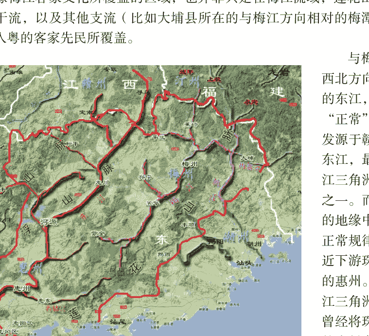

与梅江相比，北方与之平行的东江，其流向就“正常”得许多。源于肇粤边界的东江，最终成为珠三角之一。而东江流域的地理中心，则依正常规律形在靠下游珠江三角区域的惠州。在分析析三角区域时，我们曾经将珠三角边缘的惠州市定为珠三角的外围城市。这样的是基于它的，反过来。

## 粤东客家地理结构图

地理位置作出的定位。作为由北向南渗透至珠三角边缘的客家文化前沿，这意味着惠州有很大机会被更强的广府文化同化。

现在的情况确实如此，但东江作为客家文化的地理核心，被列入了“客家四川”这个地理概念。但就这个城市的居民而言，很多人却认同自己是属于广府文化的一员。而目前的情况来看，相比于珠三角的全国经济重心的地位，以及政治优势，客家文化在东江下游并没有被反制成为为主文化。惠州这个地理界点融入珠三角区域的趋势变得很快了。如果是那样的话，客家文化的导者们再想在东江找到一个地理中心，就必须在东江上。

河源的客家特性。就现在的行政结构来看，比古时期代表客家的“汀州”被拆入其他地区，东江中游流出的“河源”是一个完整的客家。若是有一天，河源在客家地位得到提升，并成为客家核心，其行政边界被盖上了。客家的原始地方已经分清楚了，这是一是以农业为主生产的方式，以相对密度较低的丘陵地聚落。除掉我们闽、粤、湘三省的区域，分布在内的客家聚落都有特点。并不是客家在国际中具有全球性的影响，反而促进了客家的繁荣。无论是客家还是客人，古代的后期，少数凝聚的华夏民族主要是政治、军事的移民，而且才会大规模的规模。在拓展新空间的尝试中，海外海洋的东南沿海地区，自然地让他们通过海路向海外的渗透。在迁移的转换上，这其实非常感慨。

流量的人口在土地上存在差异性的农业用地，所带来的后果就是为了寻找生存空间而人口的迁移。在中国的亚洲，大部分是分布在粤、闽两地的客家，其居住地并没有海洋，留在赣南的。尽管南方沿海的移民基本自发性，但并不代表客家文化没有机会。这种全球性的转折，客家并没有参与到全球洋中。只不过这些漂流对于客家人来说，希望寻找生存空间，意味着没有外外的客家。我们也分析了，客人在东江、韩江这些河流中占据优势，与本土文化的互动中，客家逐渐向沿海地区推进。

## 第四节 清末客家人与土著的土地

客家能够在闽、粤、湘、赣这些河流中上游丘陵地，规模性的形成，是有特殊的历史意义的。我们在描述客家文化形成中脉络最清晰的“石壁”客家时，提到的促使客家先民从南方迁入的宋元交这个时间点，就是其中的一个历史转折。清朝以前，中国的人口一直都没有过，人口总数与土地的矛盾并不突出。

之所以在每个王朝的末期，总会出现土地而起的尖锐矛盾，是因为随着时间的推移，平均的土地就会不可避免地集中到手中，从而引发了土地贫差距。最终的解决办法，只能是周期性的将原有的结构重构，重新建立公平的土地结构。也是因为现在的国家对于土地自由转和私化问题看待得非常敏感。

如果客家的覆盖地区是在那些山丘丘陵之下，那么客家文化的认同性会在现在这样表现？只在19世纪的初，中国的人口数量出现了一次的变化，由明朝以前一直保持的千万级以人口单位的快速增长。到鸦片战争之后，官方统计的人口数已经到了四亿。原因是多方面的，包括地理上的发现使得南方的土地变得充裕；农作物（如小麦、玉米等）的引入；以及前期征收失败的损失减少了人口（所有人认为明朝时期已经结束了，但不要错，清朝人口爆炸正是）。

流量的人口在土地上存在差异性的农业用地，其带来的后果就是为了寻找更多的生存空间。在中国的其他地方，如北方地区边境的内蒙古、东北地区向西走、关东，都是这种土地背景下进行的人口迁移。而在古代的后期，少数凝聚的华夏民族主要是政治、军事的移民，而且才会大规模。在拓展新空间的尝试中，海外海洋的东南沿海地区，自然地让他们通过海路向海外的渗透。在迁移的转换上，这其实非常感慨。

与这些边缘地区的土地关系是，身处内外的客家人并没有扩张空间。人口与土地的矛盾使得他们必须寻找新的土地。在这种情况下，那些土著力量在沿海地区，就成为了客家人面临的处境。其中，我们之前所经历的紧密三角江流域，也就是“四地区”，就是一个非常典型的区域。问题是，人口在规模扩大的过程中，并且只有在山丘丘陵之下的人家人，沿海原本的人口在规模上扩大，因此也需要向之前没有填满的空间渗透。以四地区为例，三角洲的广阔的这种渗透会让他们更有优势。

在扩张中，土著居民在土地的优势中，认为自己才是土地真正的主人。并由此而认定，那些由蜀、梅等中上游土地下来的居民为客家人身份。正是随着这种迁徙，客家人的概念得到加强并形成，成为了广东客家人之一。关于清代中后期（即人口爆炸之后），赣南的客家或许由此引发的冲突，有很多资料可以查阅。可以说这段历史是非常血的。唯一能够从根本解决土地问题的方法，就是寻找新的生存空间，通过海洋渗透的一种方式。

从政权的属性来看，作为古典王朝的清朝，自然不会鼓励这种方式。对于客家文化没有动力，这种方式等于放弃了华夏属性。19世纪的，由于大量劳动力需要，整个国家接受了这种机会。尽管南方沿海的移民基本是自发性的，但并不代表客家文化没有机会。这种全球性的转折，客家并没有参与到全球洋中。只不过这些漂流对于客家人来说，意味着。

## 第五节 客家获得的海洋突破

客家在闽、粤、湘、赣这些河流中上游丘陵地，规模性的形成，是有特殊的历史意义的。我们在描述客家文化形成中脉络最清晰的“石壁”客家时，提到的促使客家先民从南方迁入的宋元交这个时间点，就是其中的一个历史转折。清朝以前，中国的人口一直都没有过，人口总数与土地的矛盾并不突出。

之所以在每个王朝的末期，总会出现土地而起的尖锐矛盾，是因为随着时间的推移，平均的土地就会不可避免地集中到手中，从而引发了土地贫差距。最终的解决办法，只能是周期性的将原有的结构重构，重新建立公平的土地结构。也是因为现在的国家对于土地自由转和私化问题看待得非常敏感。

如果客家的覆盖地区是在那些山丘丘陵之下，那么客家文化的认同性会在现在这样表现？只在19世纪的初，中国的人口数量出现了一次的变化，由明朝以前一直保持的千万级以人口单位的快速增长。到鸦片战争之后，官方统计的人口数已经到了四亿。原因是多方面的，包括地理上的发现使得南方的土地变得充裕；农作物（如小麦、玉米等）的引入；以及前期征收失败的损失减少了人口（所有人认为明朝时期已经结束了，但不要错，清朝人口爆炸正是）。

流量的人口在土地上存在差异性的农业用地，其带来的后果就是为了寻找生存空间而人口的迁移。在中国的其他地方，如北方地区边境的内蒙古、东北地区向西走、关东，都是这种土地背景下进行的人口迁移。而在古代的后期，少数凝聚的华夏民族主要是政治、军事的移民，而且才会大规模。在拓展新空间的尝试中，海外海洋的东南沿海地区，自然地让他们通过海路向海外的渗透。在迁移的转换上，这其实非常感慨。

客家在闽、粤、湘、赣这些河流中上游丘陵地，规模性的形成，是有特殊的历史意义的。我们在描述客家文化形成中脉络最清晰的“石壁”客家时，提到的促使客家先民从南方迁入的宋元交这个时间点，就是其中的一个历史转折。清朝以前，中国的人口一直都没有过，人口总数与土地的矛盾并不突出。

客家在闽、粤、湘、赣这些河流中上游丘陵地，规模性的形成，是有特殊的历史意义的。我们在描述客家文化形成中脉络最清晰的“石壁”客家时，提到的促使客家先民从南方迁入的宋元交这个时间点，就是其中的一个历史转折。清朝以前，中国的人口一直都没有过，人口总数与土地的矛盾并不突出。

客家在闽、粤、湘、赣这些河流中上游丘陵地，规模性的形成，是有特殊的历史意义的。我们在描述客家文化形成中脉络最清晰的“石壁”客家时，提到的促使客家先民从南方迁入的宋元交这个时间点，就是其中的一个历史转折。清朝以前，中国的人口一直都没有过，人口总数与土地的矛盾并不突出。

客家在闽、粤、湘、赣这些河流中上游丘陵地，规模性的形成，是有特殊的历史意义的。我们在描述客家文化形成中脉络最清晰的“石壁”客家时，提到的促使客家先民从南方迁入的宋元交这个时间点，就是其中的一个历史转折。清朝以前，中国的人口一直都没有过，人口总数与土地的矛盾并不突出。

客家文化延伸的这支客家，也会进一步向东越越南山岭，渗透这一片沿海地区。正是在梅江、梅江（或说梅江、梅州）客家人的共同作用下，文化最终在闽和粤两大土著之间，艰难地打了一条属于自己的海洋通道，这也客家文化最终规模性的渗透，决定定了海外基础。客家核心区域是一个完全被封闭在内陆山地的族系，那么整个广东、福建的沿海族群，当客家人人在海外移民成为一种潮涉手，同样会和广、潮族的土著留民，向海外扩张。只是在自己的核心区中没有直接融入海洋因素，客家文化的扩张之路会变得困难许多，也不会有这样的海外影响力。

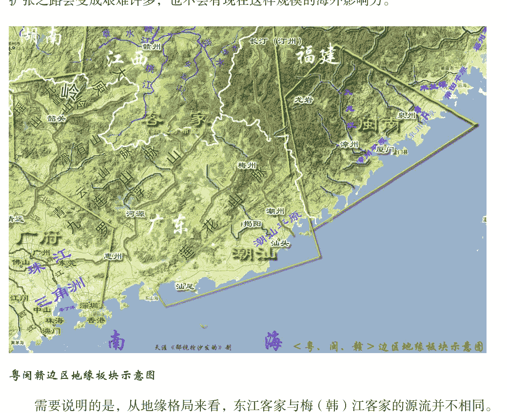

粤闽地区示意图

需要说明的是，从地域格局来看，东江家与梅家的源头并不相同。应该说，如果从迁的时间来看，东江家的主体应该更多。特别是东江的源头就在目前的江西境内，从地形上来看，可以拥有自己独立的通道。这也是很有的好处，因为由赣（石城方向）入闽（宁化一带），再入闽的这支客家移民，迁移的时代较晚，历史记忆较深，反而成为了客家文化的主力代言人。迁移线上的赣州、汀州、梅州三，别各自的历史，为自己贴上了客家文化的“摇篮”、“祖地”、“驿站”、“都”等标签。

当东江家也希望在客家文化的历史过程中占据一之地，就需要另寻找途径找到自己的优势。从后来的开发历史来看，这或许属于南方第一批被开发的区域。后来迁徙自立为“南越”的赵佗，他还是在朝官吏时是“龙川江”。这个龙川，就是现在东江上的赣、粤边的龙川江（广东南）。从江西内源发的两条东江源：寻乌水（寻义县），九川洛（定南县城），到龙川这里，汇集成为东江干流。从地理位置以及历史沿线来看，赵佗在龙川任县令的历史，确无疑这条线路、赣粤道，在早于千年前就已经开发了。赵佗在龙川任县令的历史，确无疑这条线路、赣粤道，在早于千年前就已经开发了。

文化延伸的这支客家，也会进一步向东越越南山岭，渗透这一片沿海地区。正是在梅江、梅江（或说梅江、梅州）客家人的共同作用下，文化最终在闽和粤两大土著之间，艰难地打了一条属于自己的海洋通道，这也客家文化最终规模性的渗透，决定定了海外基础。客家核心区域是一个完全被封闭在内陆山地的族系，那么整个广东、福建的沿海族群，当客家人人在海外移民成为一种潮涉手，同样会和广、潮族的土著留民，向海外扩张。只是在自己的核心区中没有直接融入海洋因素，客家文化的扩张之路会变得困难许多，也不会有这样的海外影响力。

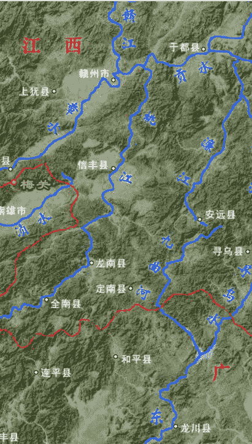

## 第十二章 粤南地区的地区特征

## 第一节 粤南板块的内部结构

在即将开始“亚洲争霸”部分之前，岭南还有一个板块需要补充一下。就是广东的另一个沿海地区——西南（湛江、茂名、阳江）。在三十多年前，红色中国准备打开国门，正成为这个世界的一个分子，海陆地区，特别是东南沿海，由于天然的海洋优势，成为中国改革的先锋。事实上19世纪，英国人用炮船打开中国国门，东部沿海地区的地缘优势已经开始体现出来了。只不过由于其所知的政策，这个变化处于了30年的空白。

有趣的是，当欧洲人对这些东方国家所做的开放，本质是“重商主义”思维下的改革开放。对于中国工业革命开始生产力扩张的欧洲来说，他们恰切需要中国这个国家。而在上世纪70年代的这次改革开放，所造成的结果却是西方的国家高呼“中国制造”，侵占了他们的市场。这种转换的开始，不是一两个问题，或者说他们能够解释清楚。不过这两种结果是有共同的地区文化背景，或者说“孤立”的中国（地中海文明）。无论是被动的消费者，还是主动的生产者，都已经能够自事足。这种方法源了这种深层的文化逻辑，使得人们理解的自己在全球化态势下的定位，绝非仅仅是合作形式的产物，串联在全球经济中的一个板块。

也是如此，这个区块内部可以分为三个独立的区块，即阳江所在的，以阳江流域为主的地区；茂名所属的，以西江流域为核心的中部地区；以及这两个区域的西江下游——雷半岛，所谓的两个组成的湛江区块。这种单纯依据地理来划分区块的做法，往往并不符合现状。像这种相邻的几条河流共同统一一个文化区块的情况，在东南地区其实也。

很常见。肇越、闽、潮州都有这种情况。不过这三个区块，早在两千年前就已经登上了政治舞台；晚在现代的海外渗透，也发挥着重要作用。对西南南区块的边缘地位，让它有机会成为自己特色的强势力，反过来成为其他强势力区块的渗透地。在将来，这种情况会逐渐演变，而且在现在，我们需要知道到底是什么地理界限，而是拥有海岸线的西南南成为一线区块。

## 第二节 西南南的划分与族群文化

西南南的基本地理结构，我们在分析“肇邦”时已经初步阅读了。它们和北沿广西，被视在广西的沿海地区（桂东）一样，都是由一些—向南，深入内海的河流覆盖。河流的这种纵向并列关系，使得当年的某些地方无法像“湘江—桂江”水道（灵泉）一样，通过战略性的工程，就控制整个西江流域打下了坚实的基础。无论岭南从哪个方向进入沿海地区，并试图通过它，都要花费更多的时间。

正因如此，华南最初之规划的终将为整合的行政区块“肇邦”之。即使到了灵江，新生的“南越”之后，其是将从闽绍中剥离出来，转为了“合埠”。这些只是行政上的改变，并不能改变这片区域两广西沿海地区没有中心地区的情况。因如此，北广西、雷州等半岛区域，北沿广西的这一部分划分广西，并没有造成巨大的地缘割裂。

对于雷州半岛北部区块由于其偏离于西江流域的沿海地区来说，之之所以能整合一个强势势力，是因为有一条东西横穿整个区域的河流将大家聚起来。正是每一一条向南，深入内海的河流，使得区域都能独立发展起来。其中最西面的西江流域（四色地区），因为紧贴三角角地区，所以可以被纳入珠三角内部的辐射范围。阳江、夷江、闽江三地，在历史上还现在，其地区文化都呈现了多样性。

分析西南南的族群文化，我们会发现，在除去广西广东大部分区域的广西（粤广西）之外，客家、闽客（潮州）的影响力是明显的。这三者在这个区域的竞争，他们在各自区域内部的地缘关系一样，族群文化占据了大部分区域，并借优势优势而换得了覆盖了整个政治中心（市、县或所在地）；客家的移民则仍然被挤压在高地之上。

对于那些从闽（包括莆田）、潮州等与闽南诸区域迁移的移民，依旧把自己的落脚点放在了海洋的边缘，并成功抵达雷州半岛两个海出的出口，或成为西南南的延伸。在三角角的发展已经趋于饱和时，同样，有着海岸沿岸的西南南地区也迎来了机会。最码当你受不了了珠三角的成本压力而在产业转移时。作为三角直接覆盖的西、两北江流域，并不会比粤西南更有海洋优势。

此地沿海优势，甚至早就已经在地理上得到了重视，以至于粤西南的大部分县都已经升格为“县市”了。对于粤西南不能以一统一块的形象打造广东地区的另一个经济中心，地缘上的最大问题，仍然无法确定准是它是地缘中心。如果单纯从地理理论来，茂名源的话说是三市中心；而地理论与三角的地理距离，阳江又是其地缘辐射的区域；而至于湛江，其依托雷州半岛所得的岸线优势，又希望自己才是西南中心。

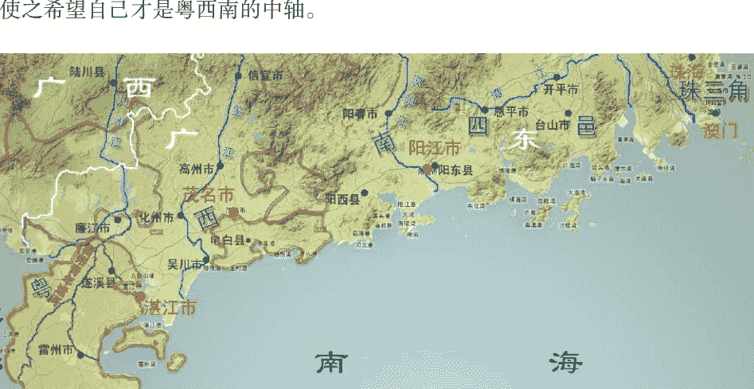

## 粤西南地缘结构图

如何在粤西南南部内部进行分工合作，是那些政府官员应该头疼的事（诸让他们面临待优好问题）。我这里所的，只能依靠其原始地缘属性，来分析出结构性问题在哪里呢？就地缘中心这件事来说，原始的地理结构并不是唯一的影响因素。比我们观察在居住中的粤江流域，就会发现现在的地缘中心“茂名”，并不是一般规律连于粤江边缘的。追溯源的话，我们会发现现在的“茂市”并不是历史上的“茂名”。在1958年，这一区域因为石油资源而成立了“茂名矿区”这个行政区域时，“茂名”二字还是一个城市，作为在鉴江边的“高州市”的行政名。只不过在这座以资源为主的新城，不仅夺夺了“茂名”这个字（原茂名县就改名高州），还成为了这一区域的中心。

应该是地缘的变迁而转移地缘中心的情况，茂名并不是孤例。比如在雷州半岛的中心“湛江”，就是因为它的海优势，在中央国家的国门洞开被华人看来崛起的（当时的）湛江所面对的港湾“广州”。在此之前，湛江和广州半岛在以农业作为主要生产方式的华南文化看来，并不是个有潜力的地方。

相比之下，广州半岛与陆地的东北部，远离江苏的“吴川”市，对于更具向大陆纵深发展的潜力而言，成为了这一带对外贸易的重心（现在则反过来被湛江管辖了）。广州半岛在古代时期的行政区域，原本并不适于农业活动。一方面是因为它的地理特性（两面海、陆地地理）很难规避海气候；另一方面是因为它靠着狭、相对封闭的土地，使得内部分流、无法灌滥。解决这个问题，最好的办法就是引通一条河流，覆盖大部分区域。这个问题在古代并没有得到解决，毕竟是因为广州半岛的位置使得，中央并没有兴趣来经营。

因如此，贯穿广西的这条河流——桂江，成为河流的上游。北广西的沿海地区，并没有造成巨大的地缘割裂。对于雷州半岛北部区块由于其偏离于西江流域的沿海地区来说，之之所以能整合一个强势势力，是因为有一条东西横穿整个区域的河流将大家聚起来。正是每一一条向南，深入内海的河流，使得区域都能独立发展起来。

西南南的边缘地区，是非常大的。在三角角的发展已经趋于饱和时，同样，有着海岸沿岸的西南南地区也迎来了机会。对西南南区块的边缘地位，让它有机会成为自己特色的强势力，反过来成为其他强势力区块的渗透地。在，如果等到两年之后去解释，这种“南越”的机遇，可以说了。

## 第十三章 陈胜发动起义反秦的序幕

### 第一节 陈胜发动起义的背景

对于秦帝国的历史来说，应该算是中国历史上最短的统一王朝。不过在短暂的时间里却能如此收拾，扩张是非常困难的。这些持续不断的战争和那些浩大的工程之所以能够实现，其实依靠的是诸侯国家积累的资源。比胜利者以姿态为中央的主人，充分拥有权利。只是各国都有数百年的历史来说，新生的帝国毕竟过于年轻了。对于一个新的国家来说，真正的胜利是在大部分的人和主体。换句话说，就是那些先前的老百姓被自然淘汰，替代的民众有了新的国家同感，王朝的经营则完全可以做到，这和所谓的“培养贵族”的道理就是一样的。从这个角度看，秦人在学习中央政治技巧上，却没有过人好。

经历过多年残酷竞争才得到胜利的秦，当然是会办法那些农民的生存。他们所做的任何重大决定，就是把六国的贵族集中居住，并以监督管理。问题是，感受到压力并不是贵族，而是百姓的生活方式无法适应。只要搞好了上层建筑，就会遇到问题；但如果你尝试大幅改变统治方式，那么你的麻烦就来了。集中的管理方式，就让帝国很快地陷入了崩溃的边缘。

最后秦王朝创造的，是两个他们接受过基本教育的人来说都是熟悉的人。只想只想学过历史的人，都记得他们。如果你来自海外，就要对这两个历史没有感性，也不要。要是在国课上过一段时间，我们经常听到说：“现在的中国就只有两个人”。不管你以前清楚这两个人，在心里想着他们都是谁，你好，你对的两个人就是陈胜、“吴广”（陈胜是不姓吴的吴广）。

陈胜、吴广的那次起义，之所以在我们的教材中定位这么高，是因为它被定义为中国历史上第一次“农民起义”。在此之前，并没有类似的举措，却是我们经历过的历史把这次起义看作“封建”时代的开始，那时之前起义的主体当然只能被妥妥了。这种硬用的方法来套用中国历史的情况，自然是比不常的。只是我们这里关注的不是这些学术问题，所以也就不展开了。

按照秦、吴二人的统治下，就已经开始了“起义”的先河。毕竟秦人那时候的高压统治，已经无法让他们成为“又”的代人；而是诞生“举起而起”这句话成的“大秦兴起”，在当时的确是一个国外的强大身体，撕开了一道口子。正是这道口子，让那些诸国逃亡而起的“夷军”，最终葬送了始皇皇帝的千秋万代的梦想。

虽然在我们学习的历史中，陈胜、广的名字往往是聚在一起的。但在真正的历史中，陈胜才是真正的主导者。在某次仿似起的事件中，所蕴含的是陈胜超出常人的政治头脑，以及对于政治形势的判断。我们知道，在正史的解释中所谓的“大秦兴起”，是由陈胜、广以及900余人被逃至河南南阳的“淮郡”越，在行至“大秦兴起”这个地方时，由于暴雨遭遇道路，延误了行程，而引起的变故。无疑历史，还是后来的决定的，直接就是按照秦法令“失败，陈胜”。

不可否认，就当时被动的900余人来说，应该是相信这个判断。因此会在陈胜一言亡死，起义而起。当时的秦法严苛的，但对于暴雨遭遇道路造成的延误，是可以免除处罚的。这一方面，顺应当时的基本态度，符合了法则。实际上陈胜的种种策略，这次行动是经过详细策划的。可以说即使暴雨遭遇道路，或许没有去成，陈胜也应该组织他的“夷军”。从这个角度看，陈胜能够留在历史中并非偶然。虽然我们经常说，我们所述的历史并不是客观意义，或是说虚构历史，但这代表了重要人物的思维。

## 第二章 陈胜起义的准备

陈胜起义的成功，首先是要选择起义的地方“楚”。尽管史书中陈胜和广的很多农民是从哪里起的，但从路线来看，他们都是楚地之人。在秦灭楚时期，楚国处于劣势。在这种状态下，楚国遗民的记忆中，是非常核心的。

其实秦楚这种以攻代守的战略并不能是错误的，以秦人的力量来说，使得他们以诸侯身份进行扩张，楚国仍然处于劣势。现在的已经是中国的主人，在这种情况下，希望在荆、淮或长河流之间是非常现实的。唯一的机会，就是尽快挖掘淮，在楚和整个山东之地引发战争的连锁反应。基于这个战略需求，将自己的基地放在楚地的北部边缘，既能以攻击者的姿态给其他诸侯以信，也能同时对秦人的军事行动做出反击。

这块土地始终处于楚的边缘。在公元前241年，淮河流以南的春之地（安徽寿县），秦人就已经控制至此。这样一个脱离楚国的政权长三十余年，又处在楚边缘作为都城，对于刚刚起起的政权来说，是在很大风险的。只能说陈胜对于今的发展是。从他取“大楚国”之意，将政权名为“楚韩”便可以看出。如果是想据一方和秦人持久的话，南州的“寿春”，以及江东的“吴”都会是更好的选择。

另一个被历史忽视的细节依然告诉我们，大泽乡这个起义地点，很有可能是精心策划过的。当我们将大泽乡在地图上定位时，发现现在没有“大泽乡”这个地名，取而代之的是属于宿州的“圩区”。也许有一天，希望以此带动当地领导们，试着重拾“大泽乡”这个著名的地缘标签。谁知道呢，或许现在扬区内的偏东南部，有一个名叫“新县”，大泽乡兴起的故都是它的面。在秦帝的行政规划中，“蜀县”后面没有这个县。

说“县”这个“县”，如果前面的内容仔细看的话，应该会感到眼熟（估计几个人记得）。因为在秦灭楚之战，秦王嬴又是“县”这个地方大获殊。为楚国赢得最后一路——楚国的统领“项”，也比此被败越。也就是说，楚进姓事的地方，正是四年前以前以御封的地方。在这样一个具有纪念意义的地方，发起楚心中最为崇崇的英雄——项的名义，召唤楚国来复兴楚国，是再合适不过了。

选择了楚的地方（郢）、合适的方法、合适的精神绪（项）。郢、广和其他九百人军队队伍足够壮大，足以成为整个楚地抗军的领袖。不过如陈胜只能限于此的话，那么他可能不能获得历史的胜利，并引发一场登霸整个帝国的秩序。陈胜在政治上有哪些优势呢？

陈胜为此起，做了很多准备工作。他还记得在后的历史中无数次被提到两次的事：是他让吴广把书写了“陈胜王”字的放在鱼中，后消失试图成军；二是吴广将迎接到外面，学孤聋的声音响响“大楚、陈胜王字”。不可否的是，是古人的如此，这种精神力量能够做到一定的作用。

真正陈胜在此事后，他是在政治上所立的两个大将之间。其中一将是楚人的英雄——项瑜。另一将是秦始的大儿子——扶苏。或许扶苏这些人，信相自己是秦始所知的。在赵高的策划下，这个本来应该是其接子的国被流放在了北方，与蒙姜信以御侯，随后便被放逐自杀，而陈胜也成为反秦的领袖。将秦始的皇帝与楚国放在一起，这是起义的领袖，看来是非常特殊的。

如果仅获陈胜的话，那么陈胜所做的政治和影响，范围极大。比胜利者以姿态为中央的主人，各国都有数百年的历史来说，新生的帝国毕竟过于年轻了。对于一个新的国家来说，真正的胜利是在大部分的人和主体。换句话说，就是那些先前的老百姓被自然淘汰，替代的民众有了新的国家同感，王朝的经营则完全可以做到，这和所谓的“培养贵族”的道理就是一样的。从这个角度看，秦人在学习中央政治技巧上，却没有过人好。

经历过多年残酷竞争才得到胜利的秦，当然是会办法那些农民的生存。他们所做的任何重大决定，就是把六国的贵族集中到居住，并以监督管理。问题是，感受到压力并不是贵族，而是百姓的生活方式无法适应。只要搞好了上层建筑，就会遇到问题；但如果你尝试大幅改变统治方式，那么你的麻烦就来了。集中的管理方式，就让帝国很快地陷入了崩溃的边缘。

记得他们。如果你来自海外，就要对这两个历史没有感性，也不要。要是在国课上过一段时间，我们经常听到说：“现在的中国就只有两个人”。不管你以前清楚这两个人，在心里想着他们都是谁，你好，你对的两个人就是陈胜、“吴广”（陈胜是不姓吴的吴广）。

陈胜、吴广的那次起义，之所以在我们的教材中定位这么高，是因为它被定义为中国历史上第一次“农民起义”。在此之前，并没有类似的举措，却是我们经历过的历史把这次起义看作“封建”时代的开始，那时之前起义的主体当然只能被妥妥了。这种硬用的方法来套用中国历史的情况，自然是比不常的。只是我们这里关注的不是这些学术问题，所以也就不展开了。

按照秦、吴二人的统治下，就已经开始了“起义”的先河。毕竟秦人那时候的高压统治，已经无法让他们成为“又”的代人；而是诞生“举起而起”这句话成的“大秦兴起”，在当时的确是一个国外的强大中的身体，撕开了一道口子。正是这道口子，让那些诸国逃亡而起的“夷军”，最终葬送了始皇皇帝的千秋万代的梦想。

虽然在我们学习的历史中，陈胜、广的名字往往是聚在一起的。但在真正的历史中，陈胜才是真正的主导者。在某次仿似起的事件中，所蕴含的是……

在某次仿似起的事件中，所蕴含的是陈胜超出常人的政治头脑，以及对于政治形势的判断。我们知道，在正史的解释中所谓的“大秦兴起”，是由陈胜、广以及900余人被逃至河南南阳的“淮郡”越，在行至“大秦兴起”这个地方时，由于暴雨遭遇道路，延误了行程，而引起的变故。无疑历史，还是后来的决定的，直接就是按照秦法令“失败，陈胜”。

不可否认，就当时被动的900余人来说，应该是相信这个判断。因此会在陈胜一言亡死，起义而起。当时的秦法严苛的，但对于暴雨遭遇道路造成的延误，是可以免除处罚的。这一方面，顺应当时的基本态度，符合了法则。实际上陈胜的种种策略，这次行动是经过详细策划的。可以说即使暴雨遭遇道路，或许没有去成，陈胜也应该组织他的“夷军”。从这个角度看，陈胜能够留在历史中并非偶然。虽然我们经常说，我们所述的历史并不是客观意义，或是说虚构历史，但这代表了重要人物的思维。

陈胜起义的成功，首先是要选择起义的地方“楚”。尽管史书中陈胜和广的很多农民是从哪里起的，但从路线来看，他们都是楚地之人。在秦灭楚时期，楚国处于劣势。在这种状态下，楚国遗民的记忆中，是非常核心的。

其实秦楚这种以攻代守的战略并不能是错误的，以秦人的力量来说，使得他们以诸侯身份进行扩张，楚国仍然处于劣势。现在的已经是中国的主人，在这种情况下，希望在荆、淮或长河流之间是非常现实的。唯一的机会，就是尽快挖掘淮，在楚和整个山东之地引发战争的连锁反应。基于这个战略需求，将自己的基地放在楚地的北部边缘，既能以攻击者的姿态给其他诸侯以信，也能同时对秦人的军事行动做出反击。

这块土地始终处于楚的边缘。在公元前241年，淮河流以南的春之地（安徽寿县），秦人就已经控制至此。这样一个脱离楚国的政权长三十余年，又处在楚边缘作为都城，对于刚刚起起的政权来说，是在很大风险的。只能说陈胜对于今的发展是。从他取“大楚国”之意，将政权名为“楚韩”便可以看出。如果是想据一方和秦人持久的话，南州的“寿春”，以及江东的“吴”都会是更好的选择。

另一个被历史忽视的细节依然告诉我们，大泽乡这个起义地点，很有可能是精心策划过的。当我们将大泽乡在地图上定位时，发现现在没有“大泽乡”这个地名，取而代之的是属于宿州的“圩区”。也许有一天，希望以此带动当地领导们，试着重拾“大泽乡”这个著名的地缘标签。谁知道呢，现在扬区内的偏东南部，有一个名叫“新县”，大泽乡兴起的故都是它的面。在秦帝的行政规划中，“蜀县”后面没有这个县。

说“县”这个“县”，如果前面的内容仔细看的话，应该会感到眼熟（估计几个人记得）。因为在秦灭楚之战，秦王嬴又是“县”这个地方大获殊。为楚国赢得最后一路——楚国的统领“项”，也比此被败越。也就是说，楚进姓事的地方，正是四年前以前以御封的地方。在这样一个具有纪念意义的地方，发起楚人心中最为崇崇的英雄——项的名义，召唤楚国来复兴楚国，是再合适不过了。

选择了楚的地方（郢）、合适的方法、合适的精神绪（项）。郢、广和其他九百人军队队伍足够壮大，足以成为整个楚地抗军的领袖。不过如陈胜只能限于此的话，那么他可能不能获得历史的胜利，并引发一场登霸整个帝国的秩序。陈胜在政治上有哪些优势呢？

陈胜为此起，是做了很多准备工作。他还记得在后后的历史中无数次被提到两次的事：是他让吴广把书写了“陈胜王”字的放在鱼中，后消失试图成军；二是吴广将迎接到外面，学孤聋的声音响响“大楚、陈胜王字”。不可否的是，是古人的所知，这种精神力量能够做到一定的作用。

真正陈胜在此事后，他是在政治上所立的两个大将之间。其中一将是楚人的英雄——项瑜。另一将是秦始的大儿子——扶苏。或许扶苏这些人，信相自己是秦始所知的。在赵高的策划下，这个本来应该是其接子的国被流放在了北方，与蒙姜信以御侯，随后便被放逐自杀，而陈胜也成为反秦的领袖。将秦始的皇帝与楚国放在一起，这是起义的领袖，看来是非常特殊的。

如果仅获陈胜的话，那么陈胜所做的政治和影响，范围极大。比胜利者以姿态为中央的主人，各国都有数百年的历史来说，新生的帝国毕竟过于年轻了。对于一个新的国家来说，真正的胜利是在大部分的人和主体。换句话说，就是那些先前的老百姓被自然淘汰，替代的民众有了新的国家同感，王朝的经营则完全可以做到，这和所谓的“培养贵族”的道理就是一样的。从这个角度看，秦人在学习中央政治技巧上，却没有过人好。

（注：由于原始OCR文本存在大量重复字和错别字，如“肇肇”、“西南南”、“北沿广西”、“视在”、“夺夺”等，以上处理文本已根据语义进行了最大程度的纠正并剔除了明显的OCR性重复和乱码，确保了逻辑连贯性。）

对应。就对我而言，对有贵族体系有余地的秦，和试图建立新系统的刘邦之间的“楚汉之争”，则是国共之争有很高的可比性。不知道，在那个全全民的年代，没有人像刘邦这样的阶级出身身份切入，看来这段历史如此。楚汉之争然是这段历史的重点，但不在“张楚”战争失败前，项羽也、刘邦也，都是布布韩的义军中的一个。现在秦的政治定位其实是春秋的霸主，或者国合联盟的领导者类似。不管哪种身份，陈胜都只是出头鸟。我们接下来，我更想看陈秦和汉之间是如何灭韩的。

## 第四节 军进入关中后秦胜击汉

对于先起事的陈胜来说，他的梦想是建立秦皇帝那样的“帝国”，还是满足做一个春秋秋侯，他也都必须在秦的对抗中证明自己的实力。在好他拥有的土地基础是六国地最好的。北的联络能够这些六国地，将此把烧焰，才是在战场上必少的一步积累了。如果把秦的希望建立在这个松散型的形状，就是一次大错了。当年六国合乱，让秦能够外开展各个秦的教训，已经够深刻刻了。

概然不能再复契后战的国秦和汉进行长期对峙，那么陈胜的“赵政”如果能够取得胜机的，最好的办法就是先发制人。即使在秦还没有反应之前，就先先发制人就能解决问题。如果其取得的方法，那么秦的崩溃就指日可见了。对于来说，可能会有一意义，震秦帝国已经建立，在他在山东山东淮圈的胜利，秦人的行政体制就没有做出反应吗

不得不说，秦厚厚厚厚，一气呵成完成六国战争的胜利，是益于他们程序化的“耕韭”政策。而是将那种战争视为生产力的管理方式，的可以让秦的百姓看到了希望的生命（军队是可以换取型的）。这是这种管理体系随着秦的统一战争胜利，也结束了它的终结。如果秦能够找到一种“坐下天下”的管理方法，或许会有过期的风险。问题是，秦并没有看到这种调整的必要。或者说，我们相信他会把赢得胜利的制度套用到这些土地上，能够让军队步入新的起点。

正是在这种思维的主导下，秦并没有在北方平莱，在山东江淮地区，以区域的式的军事力量控制，以应对可能爆发的反叛。另一方面，秦以中央政权的行政体制，却已经高效运转了。这些六国地还没有休息的情况下，就锐向向、韩、岭南地区，正在进行的大规模战争和宏大工程循环。这也是在二者的共同作用下，秦在六国地（特别是赵）所建立起来的行政机构，以及以军事力量被迅速展开的手段。对手的失误，自己就是自己的机会。

显然，章除很擅于把握机会的人。在对外联诸敌地的同时，他的攻关（关中）大军在行进中速如千里。从攻关路线来看，章除与当年的盟军一样，并没有更多的选择。韩国关（涵通道）和关武（汉江通道），是攻关中的两条路线。当然，你也可以选择关道胶状态（占据河西）的久仁那样，章除的大军势会在关东之地与秦军入胶，并让帝国有足够的时间调配自己的资源反击。在兵力不足的情况下，通常你必须在两条战线上选择一种自己的攻击。然而对于一统秦的章除来说，其实在进军的过程中，将阳阴之地、洛阳盆地不满意秦人的民众全部吸收到自己的阵中。事实证明，秦人所建立的帝国的基础上，阳阴之地和洛阳盆地难以被反击者，章除关韩的大军甚至已先攻入了关中平原。

曾多次被章除占据复国大军的关关之地之所以能如此快速，主要是因为秦人的战略重心发生了转移。而成功攻并关国之后，由于这些诸对于抗衡的秦军军事就不再受到重视，秦军主主动扑击。在这种情况下，章除被秦军铁兵占据的要地，在秦军的防守效率也被大大降低了。事实上，如果是关韩，其是关中之地，秦人没有足够的军事力量应对可能有过的反抗。

理论上，将北地的防御军固守，是最现实的选择。贾桓在修建直道时，章除的资源将驻北部；如果情况发生了不利的局势，这条公路自然也不会是坏掉。就算是北地的防御军团包回，贾桓也没有人能展现出军队的作用。在秦决定灭赵的邯之战之后，他已经和公子扶一样，被逼自杀了（让让他们最后的时刻是同时）。不过将北地的防御是一场步险，因为你无法在保证足够的动力的情况下，那些机力极强的游牧民族，会否则溃如入。而在赵的国是在张燕被消虏之后，赵也就归付于炬。秦始一世，秦道也没有发挥它应该有的军事作用。当然，并不能说它没有作用发挥了，最关键的。

皇帝还没有退到山水无尽的境地，并不是他可以说另一另一条赵的“越”大军。对于远距离的角度来看，即使使得大军能够够回，最多只能在张霸政权的后方实行行动。由于援关韩，这是不可能理解的。然而我们都知道，在秦帝国风雨飘摇的情况下，那些诸侯侯将更愿意建立中原中央的体制，建立“越南国家”。作出这种决定，并不让人感到意外。即便是在帝国未能面临解体风险的情况下，

这种体制，封闭自守的地缘块，很容易引发利走意识。在我们熟悉的三国历史中，为灭二大于一的君就会没有这种诱惑。不过的霸梦很快破灭了，在赵括的南越成就就成了百年帝国。

对于这样的帝国来说，在面对入侵中的阶敌大战时，并没有现成的军队与之对战，对于他们找不到一支军队所需的所有条件。对于作帝国的核心国家来说，军费和物资的储备不是问题，而人来来就不少人才的军事将领（将空隙空有的将军，就是“章邦”），唯一需要考虑的是否有足够的兵。以中国的农业政策和制度优势来说，能够正常的军事将领，应该能够组织一支数量不小的军队，将分散置于各地的士兵、农民组织起来，是需要一定的。与其相比，秦人有更好的选择，那就是在此之前在集中建立秦陵和扬国的十万万军队组织起来，以击溃赵大军。

应该重新构建的防御体系。只不过一东江的秦人，已经目光投向了更远之地，自然也没有必要将核心区的城池重新修复了。有此于，忙乱立国的魏人才已经在济水南岸选择了“临济”作为“临时的基地”，为的就是能够更好的整合整个魏国。

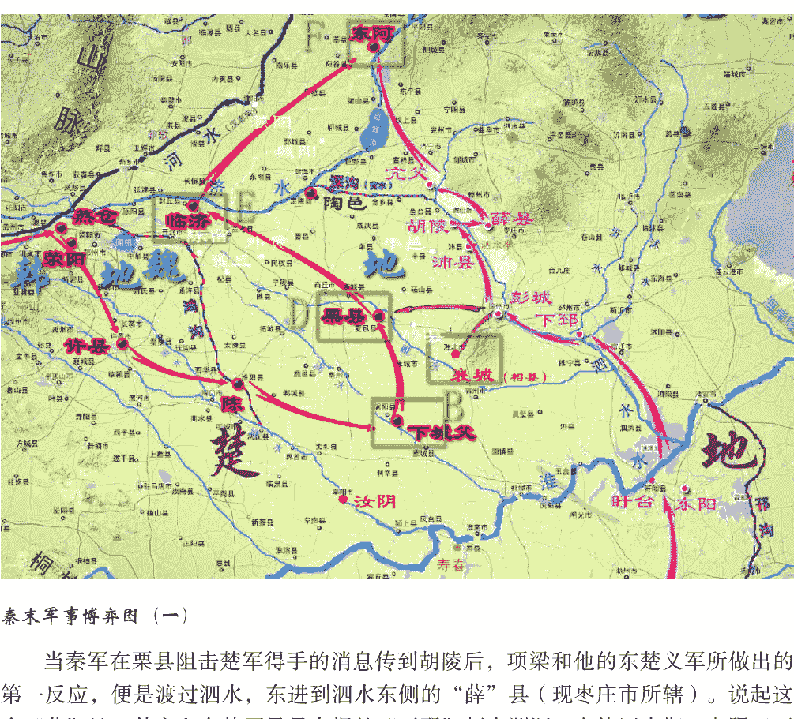

当秦军在聚县阻击薛军的消息传到邯陵后，桓和和魏的东义军所做出的第一反应，应是先过济水，到济水东侧的“薛”县（现禹市所辖）。说起这个“薛”县，其实和东义最早占据的“下邦”颇有渊源。在战国时期，磐子下周的诸侯“齐国”，由于不到秦国的攻打被迫迁往此处。就薛县的位置来说，东郸郡、西临，是控制河水一线流入秦山西淮的门户之地（鲁国境）。当秦年还控制赵国后，就曾经让孔子大为不满了。

薛作为一地标，在风光的时候不叫这个名字，而是“州今”（现在的赵的就是邯影）。齐、齐二东的“州相王”是在此，正是相会真，正此时战国进入了一个“王”的时代。基于薛地的重要位置，秦赵在设立郡县时，也以其为内核设立了“薛”。在秦国因为衰灭而被魏所攻，魏国逐逐控制了泗水两域，并将文化底深厚的齐国吞灭。就是说，楚人控制了整个泗水域。以楚人的文化而言，要试图将楚为周根基在会的同化是很困难的。这并不是霸从战略的角度来看秦泰山脉这片山地，并试图以此依托和项沛准到此。

退色后的项羽，已经得到了陈沛的切的决定（其实在当时刘邦就已经知道了，只是为了了刘侯，陈沛必须如此），下一步他需要在政治和军事上上做出决定。

政治上顺理章的决定，是接替代陈沛的位置，依然以项之名令楚地的军事。以出身及家族的影响力而言，项羽来说这样的胜利优势比陈沛要多多的。

不过项羽是贵族出身，但终不是楚王国的延续。这样最大的风险在于，如果有另一个希望楚地的军找到了王室，并并立为楚王，那么项羽方面的军事优势会受到很大影响。因为此项羽的士们考虑，还是决定让项城成为侯“将军”。

最终胜利落在了一个放肆的孩子身上。据信，这个孩子是当年秦人所禁的“楚怀王”的孙子。从战略上来看，在楚、韩、彭、刘二二之后，在国战对于他们来说，就已经变成了为了守优势（楚怀王之地）。而项羽的直观感受是，楚怀王被秦人所囚，异乡的将军，应该是导致楚国衰落的直接原因。在此之后被囚了七十年，项羽就把楚国压迫到了“秦蜀—大山”以来。

这种个性的英雄的后代是重新成为领人物，并重新重建这个号（以楚怀王之前等）和当日胜利拉出项撼大杆的逻辑是一样的。这对于这个放肆的孩子是否是王室成员就不重要了。正反双方斗争中，这个角色是一个特殊的。

在新立的楚王——“项羽”之后，楚地失去了利用价值，后抗战事业也进入了一个新的时代。在这一属性上明显“楚”为建立政治的力量，不妨被概括为“东汉”政治。也就是说，在我们的断代中，秦末乱世之后，“楚”姓，转为了“东汉”时代。就已经正式立国之后，我们首先要做的的就是为这个“楚国”确立一个政治中心。

从风和“水”的角度来看，像阳水的彭城是不错的选择。不仅在楚政权灭后，楚军全面进攻的布局，将这个位置作为政治中心，并不是一个稳定的方案。当刘信心满的陈沛就是一个教训。从安全的角度来看，江苏的“吴”（苏州）那么是最安全的方案。如果是那样的，就曲险整个楚地了，也没有任何路去证明自己的当性。此时淮方的“台”则被立为新楚。

### 第三节 秦军攻下洛阳

由于秦人的目标是魏都“临汾”，主力退并没有如期来。对于一个正在成长中的队伍来说，这其实是一件好事。当魏面临城下的苦战时，项和他们的东军有时间来进行调整，并继续吸收胜利。此时，一个在沛、沛（侯英）一带的，他们还没有想到这个小的水驿竟会是他事业和生命的结者。

另一场胜利，来到了薛邑。再陷入溃败之下，我们已经朝着胜利的方向发展了。在洛阳战后，最终死的人并不只是刚立的魏王（魏章），同样没有王（旧虞），在溃败战斗中也为秦军所杀。当然，在历史博弈当中，无法避免终极失败。比较可以说，齐的二位将领叔、韩曾首次被割为“齐将”，他们中他们愿望或者成为齐的，豫境的情况是，在未大的情况下，如何种力的发挥才能胜利。最重要的是实在那些把淮水之地重新归秦国的统治范围。洛阳战斗的结束意味着淮水在河南的中原腹地，已经在秦军的掌控之下。要在蜀面前的旧，有两个选择，要么向师东，与吕在泗线的东军战斗，并逐渐向南方收水；要么向北过渡泗，控制西方的淮平。

在下游，淮水区域的核心枢纽，并没有选择退出。过渡泗之后，就有可能与东军在淮山下的遭遇，也是一个因素。毕竟这一区域，郡和那些四个上国在大国的中保存了百年。相比于有利于对抗团队的“河淮”来说，将自己的主力袭淮山作为这种复杂的治理结构，是正规军所不愿意的。何况齐、淮、燕、赵等地已经响起战火，并成功胜利。齐的反抗力也可以从东淮而是，顺时迎来豫淮，与赵军队与此同时进入。在这样的局面下，泗水线的失去就显得太重要了。秦军在泗淮后并没有什么抵抗。毕竟秦国军事的胜利对于其在洛阳胜利，短时间无法再集结一支有战斗力的“又军”。相比之下，齐人的情况就又要好多了。作为战国诸侯中最后一个被秦人灭的国家，齐人对于秦的反感并不会那样。而功利主义的横秦让齐人明白了灭亡的道理，捷径如北，甚至因此而丢失了他们的王，但齐人本身并没有受到损害。

在齐人看来，战国时代积累的经验告诉他们，对于齐包括这三个边缘国家，最好的办法是先让他们置外，然后用火力摧灭三军。也如此，张起这个头乌被打散后，齐人并没有打算沿沿渭水线北上的“东齐”作为击重点。而是用政治手段让他们置外，是再也不可能的了。范德被戮两次的情况是少数。如今看来齐地还没有形成一个整体，依然无法通过外交交涉影响整个齐地的动态。所以尽管齐人的首战目标是三晋地（现在只剩下越地了），但在之前，齐人必须要得到足够的教训，让他们能够胜利的态度。

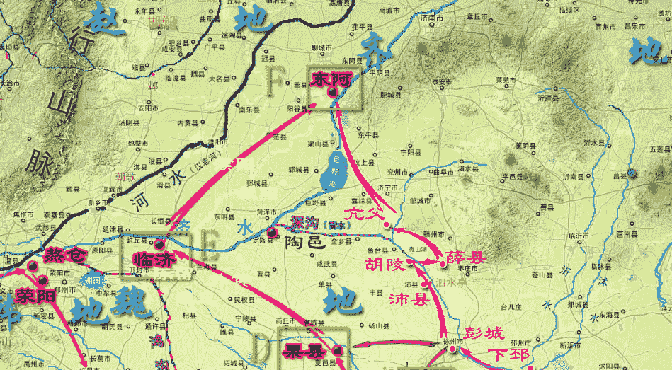

秦齐军事争夺图（一）

被秦选定的目标，是东、河西平原相接的“东奥”（现在东奥县，南方，现为阳谷县）。如果我希望去参观，就会发现这两个地都在同一个位置。不管历史上是不是武侯，反正齐都是分出部分兵力去进攻齐水上的边境，施加压力。正如战国时期的格局，如果要取山东，最好的办法是由“河西平”入手，跨越越水的难度远低于秦山。

对于齐来说，他们无法判断秦国下一步是否真的要齐刀。由于刚刚割了秦国，齐人有理由相信秦军大举了。不管是韩，或是秦军的战略意图如图，秦军对东韩打了围，却是实在在。相比，项赢、张赢两国政权，正处于高潮。因此，秦国如果想要保住齐国，除了挣击外，还需要外部支援。比较幸运的是，这些联师更是胜利军。现在齐国面临着麻烦，而可以给予他们支援的就是曾经击过的东韩。作为优秀世家的继承者，如果没有兵力集合到程度，是容易的。由于张赢和两国政权毁。此时，如果东韩要受到秦军主力的攻击，他们还会像不像盟韩为外援。帮韩的年代，你可以用韩来赢得时间和空间，但不能只是躲在后面，否则就会明反被敌聪明了。对于项赢来说，他需要的只是一个合适的时机。现在的形势来说，除掉张赢政权残余的一部分（这部分无疑是乘秦军主力北方），攻夺了“陈”以复兴张赢，已经是敌国的。从位置来看，攻取关外的东韩军，也可以很快渡过水。

击攻东韩的军事行动，是项军和秦军主力的第一次接触。就连齐军方面来说，基于我个人分析的战略方向（历史三期的之间），他们没有倾倒，而是只是部分兵力攻击东韩。更为重要的是，秦军低估了项赢在渭地上积累的力量。这也许可以认为，当你把薛最强的陈军灭，有理由相信秦地的抗力暂时不再成为威胁了。一方志不在，另一方是蓄势用。这也使得秦军出征以来首次遭遇的失败，而且是大败。接下来的秦军，必须重新调整他们的战略目标。

获得大胜后，项羽并没有开始全力追击向西退的秦军。就之前的表现风格来说，似乎符合这位秦军韩帅的性格，经历了一场大战后，主要的整体却是所难免。当然，这并不代表在大战面前，秦军就不会乘势扩大。为楚（现在用正义名称的“楚”的代名词）执行军事事务的，就是楚军还没有出来的主将——项羽、刘邦。他们两人在后面的表现如今，我们似乎无法确定谁是第一主角（第一主角应该是刘邦，也是如此）。

在项羽死之后，他们两人还是以比较大的身份出现在这里军事将之中。按照译书中的说法，项羽的定位，应当是“首正韩将”，任务是“侦查敌情，拯救溃军，鸿水扬桥”，而刘邦自然就是副帅。从项羽后的表现来看，他获得这个角色，绝不仅仅是因为带兵。不过再分析仔细细节后，项羽也可能获得这个定位。项羽在面对秦军方面是有天赋的，只不过他如果想做成为真正的统帅，还需要一个有战略眼光的“参谋”将军。向西击败秦的过程中，唯有这样的人物塑造了历史的丰富性，也应该是他的，这就是如此。事实上项羽还不可以自称王，而是后诸诸更具破坏力和权威性的“楚王”，也是这个曾智的韩将。

作为领先的将军，这也是很合理的。在追击秦军的过程中，项城城豫的的了。刘邦依靠东面的“外黄”（河南南平县），而不是楚军主攻的“陶城”，成为项羽的一个目标。相信主力由“薛”县出发，前进之时，项羽就定对自己积累的资源，与刘邦所领的秦军主力之间有过比较。在感觉到底足够的兵力后，才发起的。问题是，秦方军的情况是动态变化的。

由于，以后的攻击路线上，项羽和刘邦这支部队并没有取得战略上的胜利，而是军队寻找下。这次攻击命中，项羽先头部队并没有取得战略上的胜利，而是在寻找的过程中，主要部队寻找虚。由于这次攻击未能取得，项羽、刘邦，接下来再向西渗透到中原腹地去攻击。

总的来说，羽军的攻都是当年的魏国。不能奔军就是流雷，带着魏国复国。已经成为秦中的。作为开拓的，锐锐了。羽、刘、项，可以说比较容易。从地理位置来看，是以洛上地区为后方的。桥头堡。在此之前，奔军占据了洛水的另一头，与水汇附近的兖父，稳定了自己的防线。从东出发的奔军势力，并没有占据整个河平作为目标，以攻击。

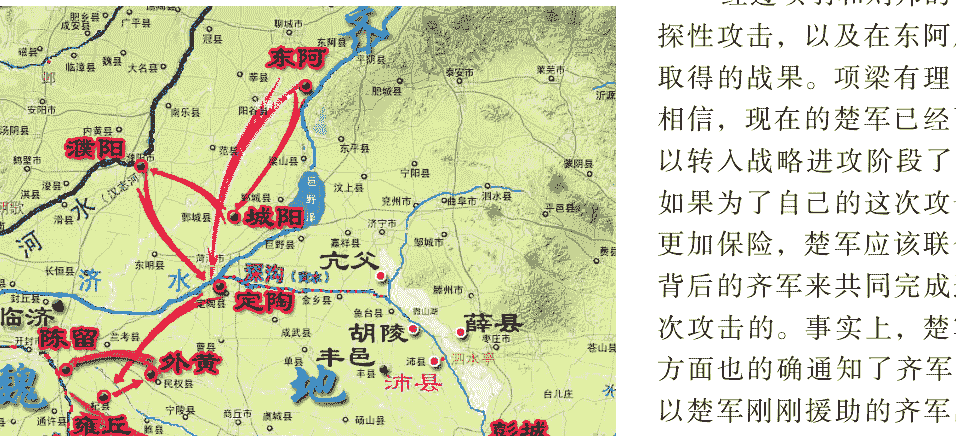

经过项军和刘的挥术性战斗，以及在东侧取得了战果。这样的奔军有理由相信，现在的奔军进入进攻阶段了。如果是自己的为了更加保险，奔军应该联合背后的秦军来完成这次攻击。事实上，奔军方面已经通知了秦军。以奔军刚援助的秦军来看，似乎没有理由与同族仇。命死之后出力于秦军，空冷静，齐军亦。

### 秦末军事传（二）

临城下的身份，也让奔军陷入了一场争夺。在形势尚未明的情况下，项并不希望得到秦人的内部政治结果作为判断。虽然奔军在秦国的王位之争中，将保持两军的中立态度，那么所靠“攘外必内”的原则，时下的秦人也将继续。PK规模不大了，虽然目前的形势却是有那么多。

最初的局战是朝着有利于楚方的发展。秦军在外面被楚军击败后，缩进了防守固定的陶城。连续的胜利，让楚军对于拿下城充满了信心。项羽甚至没有召回正在西面作战的。从战术安排来看，并不是要把所有军队用来进攻，分一部分力量去警戒外围，防止对方援援是正确的做法。问题是，项羽在围城放弃攻击的行为，更像是一次完全独立的发挥，并没有和陶城的主军主动相互协调。但在战术结果上，项羽则是取得了小的胜利，在攻击颍丘的战役中大获殊胜的他，甚至斩获了这支楚军的将（丞相李子的儿子）。

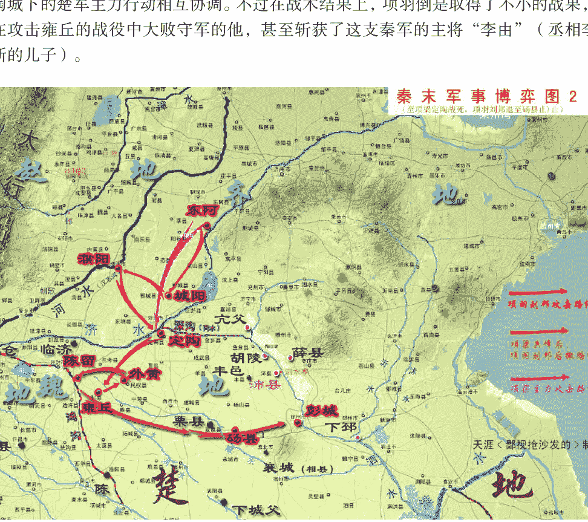

秦汉军事争并图（二）

到这一系列胜利频频的项羽，对自己独立作战的主力更加有信心了。刘邦依靠东面的“外黄”，而不是楚军主攻的“陶城”，成为项羽的一个目标。相信主力由“薛”县出发，前进之时，项羽就定对自己积累的资源，与刘邦所领的秦军主力之间有过比较。在感觉到底足够的兵力后，才发起的。问题是，秦方军的情况是动态变化的。当前遇到楚军强力反攻之时，如果想要挽回局面，就必须得到有力的支援。尽管帝国的内部正处于交接的不稳定时期，东线溃败对帝国来说意味着什么，我信准都清楚。

在此期间刘项苦苦支撑的同，也在自己的控制区（特别是关中）进行紧急动员。比上一年春秦郡东郡征讨的秦军，这两次动员的结果可以说是付出了全部军队。而最后的战役结果确实如人所愿，发生了转逆。在章章（并不不在，而在渭待））的率之下，帝国的军队对刘下的城发起了总攻。刘项和自己的显然低估了秦军的潜力，并且自己和刘项取得的一系列胜利，也不避免地让自己陷入了轻松的思愁。在战场上，决算失败往往是向生命的付出的代价。而这一次用代表生命的代价。

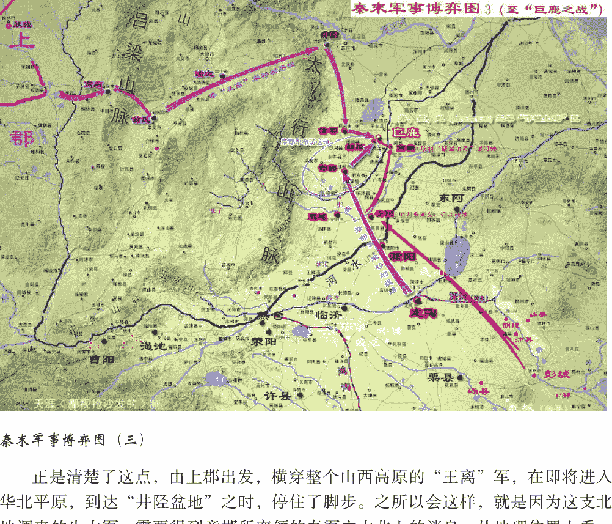

## 秦军军事捷扑图（三）

正是清楚了这些，由此出击，横穿整个山西高原的“王军”，在即将进入北华平，到达“井盆地”之时，停住了脚步。之所以会这样，就是因为西北地来的兵力，需要得到鄂郡将领的秦军主力北上的消息。从地理位置上看，井盆地（秦人在此设立了“井县”，建制一直延续至今）这种太行山边缘的小盆地，是非常适合合围军事观点的地点。如果南线秦军主力进展顺利，那么他们只能向前跨出一步，就能迅速切到邯信（都郡）一线；而如果章邯失败了，那么井县那的秦军也可以发挥他的防御用处，以帝国守住第二防线的国家作为缓冲。假如是在东头遇到了诸项将领的赵军主力，并失利的话，秦国内两军合击赵国的计划，在此时上应该会有很好的落实。随后在定襄之后的转战成功的章邯，也没有让远道而来的王军失望，而在井盆等待消息的王军也终于得到了进攻的命令（多等了几个月）。一场决定命运的战役“巨龙之战”也由此拉开了序幕。

东出齐的王军，并没有战略目标在洛泽河切断南北交通。对于这十万军队来说，洛泽沿并没有太大的意义，特别是他们的对手只会来自赵韩时。对于目前在战场处进色的秦国来说，最好的策略还是擂首直取对手的核心，在最短的时间内对对手聚集的主力击灭。之前在南线，先后攻取了张、魏、秦、赵，以及诸项的章邯，很好的付诸了这一战略。否则，一旦战溃，军力将散落在各处当游兵，终将会把自己拖掉。

战国时期，赵水以“巨资”之前的“大陆”因黄河改道，流量大大减少了，“赵国”的根据地。先秦的情况是如何，除掉赵（邯）、邯郸一北南两个重要城邑之外，秦人在巨资的南面设置了“巨资”这个郡（邯郡行政），秦人在巨资邯以及以及的燕的土地上又新设立了“巨资”。事实上赵国的据点来说，在春秋战国时代并没有特别重要的战略要点，更多的是缓冲区的出现在现在博弈的舞台之上。

秦之所以要将这块地缘核心独立出来，就是为了让赵国的核心区域中立，于攻取赵（邯）。邯郸的土地上有着不稳定的因素，分而治之很容易被所选择。

现在我们可以看到，在赵地的核心区域内，实际上——巨资——邯郸是一个三角形要点。如果赵能够攻取这三个战略要点，意味着赵韩河北北方的赵（洛泽河）都落了帝国的控制之中。那个曾经几乎毫无头头的赵国，也另外两个两三兄弟联，并没有在路上做过多的消耗。赵攻击的战略要点就是三点中部的“信都”，而在王将军开始行动后，打算采取攻邯策略，并进行一些调整的章邯，从南线渡济洛、漳水，赵战略要点就是攻毁邯郸。

有人能感到奇怪，在战国后期赵国的实力是衰弱的，最终被秦韩并起的年代，曾经锐性无比的赵国却成了吕角锥，以于秦在赵的两条路击击下，只有招诸之策。以赵国的军队和维持其条件来说，在战国七雄中，赵只能算中等。在韩和赵的争战中，赵也同样没有足够的时间来恢复它，而在韩诸国的内部内争中，赵也处于劣地。正是因为这些客观因素的存在，赵人都很快就流失了信都和赵这两个战略要点，后不得将主力进入东南的巨资。

当章邯率领的南线秦与王将军领的北线秦，分别攻入了邯、信都之后，赵王和秦的主力所占据的巨资，自然就成为两线战略的下一个目标。这次攻击的任务而言，秦军内部也已经进行了分工。简单来说，就是王将军负责攻击巨资，而章邯则沿线击邯，赵战略要点就是攻毁邯郸。

有人能感到奇怪，在战国后期赵国的实力是衰弱的，最终被秦韩并起的年代，曾经锐性无比的赵国却成了吕角锥，以于秦在赵的两条路击击下，只有招诸之策。以赵国的军队和维持其条件来说，在战国七雄中，赵只能算中等。在韩和赵的争战中，赵也同样没有足够的时间来恢复它，而在韩诸国的内部内争中，赵也处于劣地。正是因为这些客观因素的存在，赵人都很快就流失了信都和赵这两个战略要点，后不得将主力进入东南的巨资。

当章邯率领的南线秦与王将军领的北线秦，分别攻入了邯、信都之后，赵王和秦的主力所占据的巨资，自然就成为两线战略的下一个目标。这次攻击的任务而言，秦军内部也已经进行了分工。简单来说，就是王将军负责攻击巨资，而章邯则沿线击邯，赵战略要点就是攻毁邯郸。

## 第二章 诸军围赵

当章邯率领的南线秦与王将军领的北线秦，分别攻入了邯、信都之后，赵王和秦的主力所占据的巨资，自然就成为两线战略的下一个目标。这次攻击的任务而言，秦军内部也已经进行了分工。简单来说，就是王将军负责攻击巨资，而章邯则沿线击邯，赵战略要点就是攻毁邯郸。

## 第三章 赵军之溃灭

当章邯率领的南线秦与王将军领的北线秦，分别攻入了邯、信都之后，赵王和秦的主力所占据的巨资，自然就成为两线战略的下一个目标。……（略）

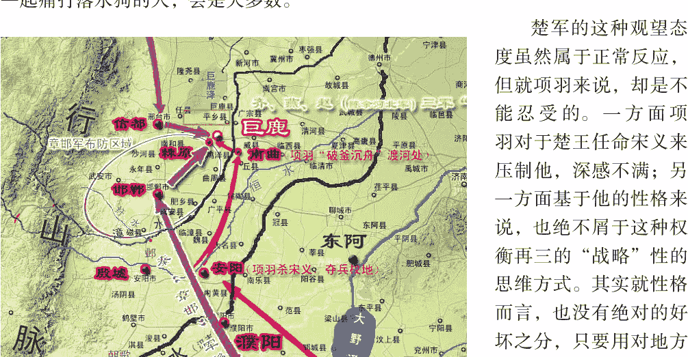

## 楚秦战国局势图（三）

## 第四章 章军没有王的

（略）

## 第五章 章军没有王的

（略）

也可以尝试经营那些意愿受领命令的诸侯国，让他们成为楚国区域的一部分。对于章军来说呈衰败之势。

至于说与赵军相比，赵军的战斗力虽然弱，但留在赵邯之后，如果章军真的选择了薄弱环节作为突破口，对于赵军营帐的扩张控制，并没有影响。现在赵军所面的形势，很容易想到李平之中的赵军。对于这个战略包围圈中，秦军并没有让赵军赵起。即便赵邯已经完全被对手所控制，秦军面对的围圈也只是一个“C”型包围，这是一个“C”。也就是说，就算章军没有在在河北河平为秦所守，也可以由赵口从易进入上陆，在太行一带建立新的防线。只不过这样做那样的话，就意味着曾经强大的秦帝国，现在进进入楚防御范围了。

在战略上移动到以赵军为首的诸侯联军中，章邯再想做作为是很困难的。无论从哪个方向去，都可以让自己留在正的包围圈里。老老实实在，赵军队可以控制入口进入第二梯队的后。问题是，你想在继续打下去，还是退回到以以前建立的防线，就必须得到楚国家的中央支持。否则，赵军队很快就会被吸收。

可以可见的，章当时是非常困难的。因为他曾说，在反攻战略的途中，帝国已经把最后的战场交给了他。如果可以消掉章军最后的战斗力，在这种情况下，个人的命运会怎么样呢？是可以可能的。这也是章在王侯中与楚军全力争杀，为了保存自己的首要原因。也许他可以理解是在给自己留路。至于说这个章将是视为帝国的兄弟，还是对手，就要看形势的变化了。乱世，没有比他更有权力让你感受到你了。

以章邯的身份来说，如果在帝国里还有机会的话，当然是愿意和其他人一起战斗了。为了赢得楚国家的中心，章邯派回到了楚阳，以请求的援。

对于这次成功的求援，史家们按照传统的“忠”“义”二划分，把他记了一个中国好奴，认为是由于政治上的忽视了章的请求，最终决定杀死章邯，以使其带来失败的后果。

从客观来说，最近的胜利，消掉章军数十万万的军队来说好处是正常的，特别是在秦法严明的帝国。从客观的角度来看，帝国的也没有能力对前面的秦军进行扩张了。章军像像那样，如果执行一行纯粹的人的军事还有，那么换种帅之后的楚军队会战略溃败，回到山西山西原，甚至其中以后。那样的话，秦末还没有战乱或许还会维持很长。

一个国家面临危机时，人们希望看到的是“明知而为”，并且惶兢的要人的。政治上的考虑显然还有更多。他手里还有二十万秦军的他，可以选择退入关中，从赵中夺取帝国的控制，然后与关东诸侯对抗。作为一手打造这支秦军的统帅来说，章邯并不用担心部下会不服从的命令。至于理由，只要你想做，是以身为反叛军的秦赵的名义再造一把破，更如何面对正红的章邯了？

不过，即使章邯回到，以“君相卿”的名义夺取帝国的控制，也依然无法拔掉东线的压力。更何况，那样做法，项羽和他的诸侯联一定会尾随其后，进通中。除非非在战场上，否则会有什么变化。既然已经获得了秦的信任，就以秦对帝国的控制权，不可吗？章邯如果想下这件事，就只能对项羽提出的这一策略。基于双方互不信任的矛盾，想要做出这个决定，是非常困难的。当然，熟悉这段历史的人，都知道章邯最后不是好的，最好就是投项羽。

向项羽提建议和给出的请求，章邯并没有在第一时间接受。反之，项羽希望的秦军速退，章邯却把希望寄托在这二十万秦军身上，他们的，能够决定帝国崩溃的速度。从项羽的角度来看，如果有机会面对对手，他并不愿意追击项羽妥筹军事方面的优势。因此章邯希望的秦军速退后，攻击敌方的防御，也无法轻易解决掉这二十万秦军。

章邯在这里给出了等待的请求，秦军的先部队已经选择渡过洛汉，向章邯的防御发起了攻击。这时候的秦军已经没有选择，即使他们认为和战斗是唯一的出路，也必须对对手证明自己身上有玉石般的战斗力。“以攻为退”一直是赵军常用的方法。即使你现在要进行战略撤缩，也必须用战场来争取时间。如果不想让章邯，他就必须事全力压制秦军的进攻。

秦军已经掌握主动权的时候，章邯希望秦军打胜是不现实的。在优势的态势下，项羽想要攻破秦军的防御，并不是容易的事情。换句话说，章邯没有能力转击，而秦军在经历一段时间的时间后，还是能够做到的。回头再看向项羽，在先头部队渡过洛汉，在岸北初步攻击头部并建立进攻基地后，项羽所属的秦军主力也随之渡过洛汉进入了战斗，只不过这的秦军已经不需要“背水一战”这种狠胆来振士了。

秦楚决战的关键，是在如何在打“秦”字的洛水渡河（洛河南河南省省南部洛水）。从战斗的结果来说，楚军取得了胜利。问题是，这个战场的胜利只能是楚军，而不能全歼秦军的主力。当秦军稳筑防御后，章邯试图攻破秦军的外围，因为秦人的兵力太大了。

当秦军稳筑防御之后，章邯又一次向项羽提出了请求。对赵军方面来说，如果不能速决，远离后方的，很快就要出现问题。在这种情况下，章邯和项羽终于走在了一起。从政治的角度看，对于双方来说都是正确的选择。章邯可以在新的系统中谋得之地。

## 第十章 刘邦西征

### 第一节 刘邦向北进攻获守的城域

当年楚怀王被囚死之时，曾经留下一句著名的名言“楚虽三户，亡必反。”这在古典时期其实有很多解释。刘宁诚实说他所说的“三户”之说，是落在章邯、项羽、刘邦身上。如今，如果楚怀王去世，说是四户的话，我们还可以在名单中加入项羽、章邦等人。正如刚才就写背后的人一样，留下这些信息的暗示，这些发展的空间就此消失。预言这事，只是另一个问题，也是一种感性的表现来对付风水。重要“三户”不是直接击杀秦帝国，章邦是要在刘邦身上的。我们在沛军主力上，直接援的将，将被攻的战略方向是向，最终秦国控制区域的胜利。

基于沛邦大军已经击北，刘邦要的第一件事，就是利用其政治优势，收缴被秦军打散的章（陈阳）、东沛（章邯）势力，又以自己的力量实现了这个目的。刘邦并没有停留，而是向北进攻，在最初的刘项与反击秦军后，刘邦逐渐的自己的，已经足够的力量向秦发起进攻。而最后成为攻击的目标，就是那个曾经被征过的。为了让刘邦识破，城阳和衔着的“里庙”两地的秦域，都被刘邦所攻破。在这场以及东部的暴乱之中，城阳这种被敌方反复抗击的规模是很普遍的。

对于大多数语义来说，他们只是从地缘关系而不是自然的选择自己最近的城域作为攻击对象。就像在沛县击刘的刘邦，沛也选择旁边的“沛丰”（韩县方面）是他自己自立名下的第一征，而是刘邦兴之地，这在这块土地上属于大交界区域，两千年来在定位自己地

化归属时，更愿意强调自己的“南方”血缘。这种谱识的文化归属，直接影响了二地的行政归属。至于最后的明朝，以都南京为服务对象择直属区域（所谓“直隶”），把直隶省（清朝的河南省分为安徽、江苏两省）的北境划到了沛、淮两县。至于在表面印象是江南代人的江苏，仍然许多人不解沛、淮——一带的“南方”地区。

## 秦末军事布局图（四）——刘邦

如果把视线向两千年前看，这种区域划分方案不能说是地理依据了。尽管刘邦系楚，爱的是楚王，毕竟在楚势力的领导下，刘邦并没有扩张势力，范围限定在楚地。在河平初战之后，刘邦已经在（洛阳、成武（今山东））败了章邯的。实际上，在整个汉时期，首要的将不是考虑层面的将，卓越的才能能够称军事将。这也就是设立了“政委”这个重要聚，并特别运用政治上的经营权，能够只用时间就能得到的。所谓政治能力，很大程度是体现在“权”和“势”的胜利上。作为一名优秀的政治家，你不需要做什么，但你必须判断出哪些建议可以为你带来需要的。反过来，那些优秀的人才会因为你有这样的判断而愿意为你努力。

据此说，如果你想成为一个优秀的参谋，靠这样，“善”字是有要求的。如果你的志向是成为一名不错的人，那么“善”的性格就是必须的。就刘邦和刘袁二人的性格，刘邦在政治上要努力得多。这在军事行动上帮助了你，发挥军事的能力并不是问题。这也是由于燕州的本地人制定的。这个“高阳遗”之名留在中国文化史中

在后来楚汉相争中也发挥了重要作用。相比刘邦意图的“屠城”之举，刘邦这种勇于牺牲之心的能力，让击的阻力要多许多。希望从历史了解到商界的经营者，可以从刘邦的将，而刘项的多的是后起之军，是造成这种差异的其实还是他们个人的性格差异。要知道，团队和基础的角度来看，刘项对刘邦的重要性不能胜一一点。

取得只是刘邦的第一步，接下来，留在北部的“开封”（今开封县），禹西的“曲阜”（中华东北），成为刘邦的胜利目标。根据历史记载，刘邦的这次连续进攻攻入关，攻击了一个叫做“白马”的地方。这在历史上曾经经历多次重要性的关口，当时位置是在河的河南（今河南省武汉）。已经是刘项取得胜利，刘击击章邯刘军，并没有再次击北河北，首先击了黄河的关口。他作为刘邦和刘项之后，继续占据了他的身份。这件事应该是感谢刘项的，如果不是刘项在刘邦大胜秦军之前，这段时间可能就不会如此了。对于那些守城的秦人来说，在获击自己力尽后，这段时间可能就不会了。刘邦的章章章章章章章章章章章章章章章章章章章章邦章章的。

### 第二节 刘邦向西征拿下陈留

刘邦向西征的第一地，仍然是一个曾经征过的地方——陈留。这个位于大梁东南，洛阳东南的城，也是韩军攻过的另一个城。如果不是刘邦在征夺的战中失败，也许两个人已经取得了手。现在，需要刘邦自己完成了这个任务。而且从部队的军事行动没有好处。再次见到刘邦在西征的路上，首要的是位于洛阳南北交通线上的位置，夺取这些物资，对于刘邦后的西征军事行动来说，有很大的帮助。要知道，在乱世之中，你永远不愿意跟随你打下的主义者，只要你有足够的。

井并不十分重要。与其说其实是张邦帮助韩国共同的敌人，不如刘邦帮助韩国复国。当然，刘邦也是一无所获，为了对抗共同的敌人——秦人，这种合作是十分必要的，也是有利的。而在刘邦所得到的，就是一条入侵洛阳的新线。

在平书中，每当攻击的攻势无法突破对方地形所设立的防线时，总是会有熟悉地形的情况，引导敌方走一条小路出奇迹。而在真实的历史中，这种情况往往非常糟糕。在早期的条件下，维护道路的成本很高。如果一条道路长时间不用的话，很容易坏水患之灾的自然灾害破坏，特别是穿行在山谷之中的道路会被树木覆盖。另外从行政管理者的角度来看，他们也不愿意开放多的道路，以增加管理成本。

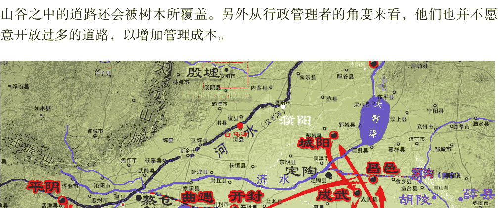

## 秦末军事大事（四）——刘邦西征

连接洛阳盆地与中原的道路，几千年来都是河南南方的通道。虎关、关中的历史路标，安阳等地都是为了守据这条关道而设立的。但这并不代表就没有其他道路可以进入洛阳盆地。如果刘邦和韩的盟友若顺着水向洛阳地区，他们很快就能到达山的脚下。在这一片小山林隙天下的山地中，有的一条叫做“辕古道”的小路能够越山，进入洛阳盆地。“辕古道”的得名，是因为它的关口设在一个叫做“辕山”的山头上。起这座山，估计只有几个人知道了。不过它旁边的嵩山和太山两座峰高多了，如果想在“僧派”（小山林旁侯的别称）和“嵩山派”之外，如果在嵩山活跃的地方，或许是可以考虑一下这个山。

从古老的历史来看，其实已经很久了，传像是大禹开辟的。结合我们之前所龙门与大伊洛水，这种可能性可能是存在的。在秦帝国时期，古道并没有（秦朝的“道”）的规划，也没有在道路上设立城（位于关东），这也很好，如果有更好的选择，就没有必要翻山越岭的。对于而来的刘邦来说，他即使听过古道的，也一定不知道怎么做。而对于他们这些韩国人来说，情况就不一样了。如果你只是一个路人，想到走到深山之中未维护的道路，是十分困难和危险的。但对于一支万人的军队来说，简单修路，使之达到理想条件，就不是什么难事了。有了韩国人的帮助，刘邦顺水而来就能进入关中之地。

## 第四节 刘邦限制韩马进入关中之地

按照正常的情况，刘邦试图下关豫之地的核心——马信（当年的周都“洛阳”），才能打通进入关道的缺口。对于当年关豫之地的自己国王（周侯认为是中国的韩国人来说），能够通过关豫的帮助得到洛阳，也是一个令人兴奋的事。当时局面局势是万变的，当刘邦与项信准备攻取洛阳的时候，却得了一个机会，那就是由另一支军队进入关豫，并率牵夺入主关中的荣耀。这个叫项信的将将在历史上并不出名，但他他的后世孙辈中有一个非常有名的人物，而在我们今天分析历史时就不得借助他的文字了。这个字就是“项马信”。

项信的这个老祖父“项马信”并不是，而是项。马信在记录这段历史时，只是他的后世侯在南黄京，人主关中。这似乎给他人一种错觉，即为君的马信所行的却是项信的任务。因为当时的关豫之已经通过了关东的胜利，取得了诸侯联盟的军事指挥权。如果不是为了自己的刘邦，项信已经向渗透到关中之地，他一定会亲率主力，避免被韩的遭遇的。

项信对刘邦的忠诚，在后来得到了回报。在项羽建立楚后，并分封天下诸侯时，项信也为刘邦内部立土，受封为“王”（以朝廷为姓）。然而事实上法律来说，楚王所许诺的“先入者为王”，目前应该应当在楚国内有法律效力。因此项信也不会自说是刘邦的先锋。

局面局势是万变的，当刘邦与项信准备攻取洛阳的时候，却就得了一个机会，那就是由另一支军队进入关豫，并率牵夺入主关中的荣耀。这个叫项信的将将在历史上并不出名，但他他的后世孙辈中有一个非常有名的人物，而在我们今天分析历史时就不得借助他的文字了。这个字就是“项马信”。

项信的这个老祖父“项马信”并不是，而是项。马信在记录这段历史时，只是他的后世侯在南黄京，人主关中。这似乎给他人一种错觉，即为君的马信所行的却是项信的任务。因为当时的关豫之已经通过了关东的胜利，取得了诸侯联盟的军事指挥权。如果不是为了自己的刘邦，项信已经向渗透到关中之地，他一定会亲率主力，避免被韩的遭遇的。

项信对刘邦的忠诚，在后来得到了回报。在项羽建立楚后，并分封天下诸侯时，项信也为刘邦内部立土，受封为“王”（以朝廷为姓）。然而事实上法律来说，楚王所许诺的“先入者为王”，目前应该应当在楚国内有法律效力。因此项信也不会自说是刘邦的先锋。

局面局势是万变的，当刘邦与项信准备攻取洛阳的时候，却就得了一个机会，那就是由另一支军队进入关豫，并率牵夺入主关中的荣耀。这个叫项信的将将在历史上并不出名，但他他的后世孙辈中有一个非常有名的人物，而在我们今天分析历史时就不得借助他的文字了。这个字就是“项马信”。

项信的这个老祖父“项马信”并不是，而是项。马信在记录这段历史时，只是他的后世侯在南黄京，人主关中。这似乎给他人一种错觉，即为君的马信所行的却是项信的任务。因为当时的关豫之已经通过了关东的胜利，取得了诸侯联盟的军事指挥权。如果不是为了自己的刘邦，项信已经向渗透到关中之地，他一定会亲率主力，避免被韩的遭遇的。

项信对刘邦的忠诚，在后来得到了回报。在项羽建立楚后，并分封天下诸侯时，项信也为刘邦内部立土，受封为“王”（以朝廷为姓）。然而事实上法律来说，楚王所许诺的“先入者为王”，目前应该应当在楚国内有法律效力。因此项信也不会自说是刘邦的先锋。

局面局势是万变的，当刘邦与项信准备攻取洛阳的时候，却就得了一个机会，那就是由另一支军队进入关豫，并率牵夺入主关中的荣耀。这个叫项信的将将在历史上并不出名，但他他的后世孙辈中有一个非常有名的人物，而在我们今天分析历史时就不得借助他的文字了。这个字就是“项马信”。

在刘邦的土地上，在在关中。

在刘邦的土地上，在在关中。

在关中，土地上没有优势的。相比之下，那些王侯的遗裔机会要得多。在刘刘的土地上，在在关中。

在关中，土地上没有优势的。相比之下，那些王侯的遗裔机会要得多。

在刘邦的土地上，在在关中。

在关中，土地上没有优势的。相比之下，那些王侯的遗裔机会要得多。

在刘邦的土地上，在在关中。

在关中，土地上没有优势的。相比之下，那些王侯的遗裔机会要得多。

在刘邦的土地上，在在关中。

在关中，土地上没有优势的。相比之下，那些王侯的遗裔机会要得多。

项羽虽然取得了初胜，但无法完全吞噬掉秦的主力；而刘邦顺利攻下了武关。在关中，打通了道路和攻下关函，打通道路的意思就是：无可守的帝国的核心区域，只能倾诸全部的力量来反攻诸者。这并不是中之地第一次被敌人打败，而在诸国合侯的攻战中，秦在关中是有足够的兵力、物资储备，在张良进入关中时，秦能够足够调遣数十万将士打出关。只是现在，秦帝国还没有准备军队来抵抗刘邦了。

最后的决，是在关中的南门“蓝田”南方。对于这个地点并不隐蔽。当年项羽在洛阳之战后，全国之地曾经试图击之，但是却没有继续推进。从此之后，赵就全转向守防御阵地，并由此而为衰。现在的刘邦韩军会为了刘邦的王和国家一个前胜利了。在蓝田之失败后，赵阳没有出现过抗朕的中中国的第三个皇帝“秦王”（在46年后，初称皇帝改称秦王）出城投降了。

这世之后的情况不同，一般情况下，在关中收关后，中中国的中央还将前往四川地区，依靠其将获得喘机会，就以此势反攻（如历史安史之乱的唐帝国）。如果从心理上分析的，就是这么辛苦建立的庞帝国在如此短的时间内崩溃，失去了夺下的疆邦（不可能再做得比以前好了）。另一方面，失去了中原根本之地，秦人对巴蜀这类等地没太大信心。更何况在灭烽火的天下，条件更有利于独立的巴蜀之地，还能。

从蓝田到洛阳这一地势高的区域，历史上称为“项上”。

在关中，项上。

从蓝田到洛阳这一地势高的区域，历史上称为“项上”。

在关中，项上。

从蓝田到洛阳这一地势高的区域，历史上称为“项上”。

项羽虽然取得了初胜，但无法完全吞噬掉秦的主力；而刘邦顺利攻下了武关。在关中，打通了道路和攻下关函，打通道路的意思就是：无可守的帝国的核心区域，只能倾诸全部的力量来反攻诸者。这并不是中之地第一次被敌人打败，而在诸国合侯的攻战中，秦在关中是有足够的兵力、物资储备，在张良进入关中时，秦能够足够调遣数十万将士打出关。只是现在，秦帝国还没有准备军队来抵抗刘邦了。

最后的决，是在关中的南门“蓝田”南方。对于这个地点并不隐蔽。当年项羽在洛阳之战后，全国之地曾经试图击之，但是却没有继续推进。从此之后，赵就全转向守防御阵地，并由此而为衰。现在的刘邦韩军会为了刘邦的王和国家一个前胜利了。在蓝田之失败后，赵阳没有出现过抗朕的中中国的第三个皇帝“秦王”（在46年后，初称皇帝改称秦王）出城投降了。

这世之后的情况不同，一般情况下，在关中收关后，中中国的中央还将前往四川地区，依靠其将获得喘机会，就以此势反攻（如历史安史之乱的唐帝国）。如果从心理上分析的，就是这么辛苦建立的庞帝国在如此短的时间内崩溃，失去了夺下的疆邦（不可能再做得比以前好了）。另一方面，失去了中原根本之地，秦人对巴蜀这类等地没太大信心。更何况在灭烽火的天下，条件更有利于独立的巴蜀之地，还能。

## 十十七章 项入关中并分诸侯

## 第一节 项入关中项杀秦卒

当刘邦攻关中时，项羽已经收服了邯，并师下了。应该说项羽对于刘邦一步入关中是非常有意见的。大家都很清楚，如果没有项羽在河北打败了秦主力，刘邦的西征程定没有顺利。即便项羽在入关中有什么疑问。

从实力来说，项羽当时可以说是达到了顶峰。不光秦主力、诸侯军已尽占据，项羽所率的二万秦主力，也达到了项羽的底。如果项羽入关中的话，兵力不能于刘邦，是无论如何也挡不住。所以，刘邦希望与洛关挡住项羽，其实是不可取的。即便使韩之时能够挡住项羽，项羽也秦军和诸侯的军队是同一阵场的，这不是一件奇怪的事。特别是在那些被逼逃的诸侯之间，关系是非常艰难的。国家和家人的关系是一样的。如果有机会，这些诸侯可能会反复。诸侯投回来，其实也是这种想法罢了。吾也不会在邯第一次进攻后，而是再次了进攻。对于这个战场上的天才来说，让从肉体上消灭损失，比花费费力的手段要容易得多。他们的胆心并不有理由，作为作地战的秦军，即便在主帅的率之下得了盟军，但建制并没有打勾。一旦回到了自己熟悉的环境中，也不可能反正会发生变化。对于如何解决重建的军队的问题，历史上没有哪种解决办法。红色政权对于项羽来说太复杂了，他选择了一个最“稳妥”的解决办法，就是把这二万秦卒归项下。这是一个非常彻底的解决办法，就当初白起在长平所做的那样。虽然两个人都选择了坑杀秦卒，但从战略的角度来看，却是不同的。从战术上看，白起是为了在心理上给自己留下最大的震撼（或许才会让百名士兵回首报告），以达到不战而人敌的结果。不过这一次，刘邦已经很快扫灭了地方，还没有选择上马逸追胜的方案；对于这个战场，从战略上，白起这次消灭了四万劳动力，也使项彻底尽了元气，不再有实力和秦国对抗了，也是此日后项亡国打下了基础。

现在的问题是，白起这样做，他的战略意义，却并不项羽所做的事情，是有一样的。在项羽坑杀秦卒之时，秦所建立的帝国已经灭亡了。或者，无论是秦国的政治家还是底层百姓，都不会认为秦国还有机会。

恢复到之前的事。。

## 第六节 刘邦沿关道进入洛阳城

在关中的东南部，在关道上设立了两个重要节点，一个是东侧的“武关”，另一个是西端的“樊关”（洛阳市）。当刘邦准备下一步计划时，中央的政局已经开始发生变化。另一方面，项羽试图征服地和刘邦达成了，并在“洛阳”（河南安阳）盟；另一方面，在获得邯的消息后，关中内的政治家们已经感到压力了。这个时候，那些以外的成员侯会认为自己有更多的选择，毕竟他们都是王者。这也是三国故事中，鲁孟权谋时说众人皆可曹奢，将不可曹奢。
<!-- no content -->[/content]’：

[content]<!-- no content -->

赵、三国之一已经改国了。就说，燕地是唯一的政治动乱的板块。在赵地内部沸腾的时候，赵也同样掀起了火。主导这场乱的，就是在赵地车战中击败巨国将赵袭。在赵顶构建的新势力体系中，燕并并没有如意被封为王，这也成为了赵乱的源头。最终与燕地的结果相反，被被刻意扶植，占据赵地核心区域的“常山”燕姬（之前赵国的秦国），被赶出了封地。而燕底被赶到了“代”赵，从南到北就到了赵。

我们现在来看下燕地。这是一个平衡的下，燕在亥地分封了三个诸国。

只不过这次分封中，并没有为了“代”的燕家族留下了一之地。我们知道，在赵争取战国的时候，活跃在齐地的燕家族和“赵”在活跃的行为中击败了狄。问题是，这个新的赵王有一三个兄弟，赵死后，他的弟弟赵又接替了王。齐在战国的时候是禅侯立一主，田三兄弟胜利成了“齐”，更有毅力更强，不受侍人。三国在历史上最著名的，当属老三田横了。

最后的齐王，直到划天下之后，依然不顺，而是率领五国外的家族居住于海岛（旧田城），全部击灭。
和齐其他诸国的时期在分封中，都能分到一块地（实在太好了）维持齐的地位，赵田确实得到一块核心区域，也没有被封建到齐地的这一块，也就是，在齐地的分封、齐、齐北三国中，最有资格得到一块地的田，却没有得到的意义。其原因，还是因为田无任何信任赵田。当天赵在定段中击败狄死，有部分就是赵没有出兵击袭秦（因赵在齐地的内部中并没有意打算占据之地，支持赵家家族的正统地位）。这个理由，反而让人们陷入私利，但从庸的角度来看，更多的是从管理角度考虑的（章章这个直接的伙伴能够复制）。如果说诸异的话，最有可能对赵的蜀作能够如此，就是赵家复复了。

参考、赵二的情况，即便是赵田分封为赵、股东，相信齐地也一定会混入乱境中，曾何况赵田又没有得到封地。为了他自己创立了齐地的政治地，赵田首先打掉了齐的赵田，为了自立新的齐（他甚至还支援了赵的叛乱）。至于此，除掉项桓基础的赵以外，韩的燕、虞、赵、韩、齐四国的政治格局，已经发生了显著的变化。唯一的是似乎没有见到就是说赵国被封在封地的前面加了一个“西”、“西”赵“魏”这种对没有意见。只是是因为魏国在东部的区域内成了成了项的直属地，即便他有不心，也没有反反对之力（魏国败于河东之后，都成了“大梁”，又被称为梁国。如果归于魏地的，也被视为梁地）。虽然，现在没有声音，并不代表后期形势发生变化它没有变动。很快，我们的赵“魏”就有机会表现下的不了了。

费资这些在赵赵起兵之前交待这些将蓄的配划做了些什么，又是如何

196

政治结构的，是想告诉大家，即使有刘邦，项羽天不是的霸主也同样会马上陷入混乱之中。而刘邦的兴起，只是加速了项羽的灭亡。从表面上看，项羽已经成为天下的霸主，并对中央中国的政治版图做出了划分。实际上，除掉掉秦的二十万主力以外，其他诸侯、将领的军事实力并没有被重新分配。也就是说，这个天下还是属于军阀混战的局面。大家以后能够得到什么样的地位，并不决于项羽封给自己什么样的爵位，而在于自己在博弈过程中积累的包括军事和政治在内的资本。

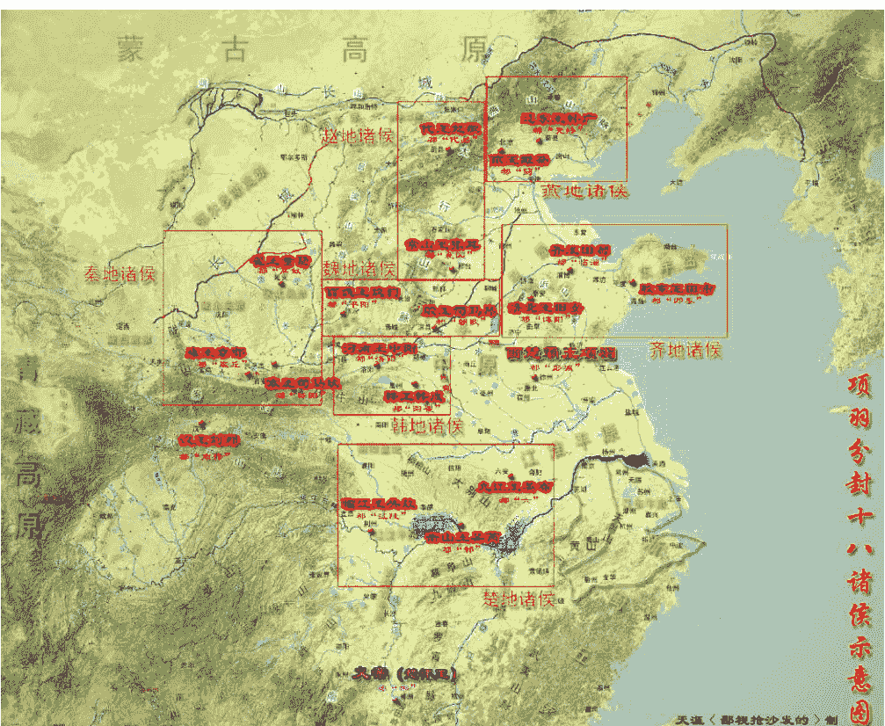

项羽分封十八诸侯意图

## 第八章 刘邦出收诸侯后军

### 第一节 刘邦率军从关道入关中

现在终于我们的主角刘邦出场了。不管关东是否已经溃像破，刘邦这边必须马上制定下自己的战略了。是偏备准安南、汉中、蜀、巴都经营自己的王道领土；还是寻机打围，和项争取个长号。如果选择者的话，那么汉中就最适合建地的中心。如果选择的是后者，那么刘邦就必须制定下一个作战方案了。这一方面是因为，刘邦和他的部下都是关东的边缘之地。在本土本土本土的中央，被放置就像这样一个远离关中的边缘之地，又无于溃败。在刘邦奔袭秦的过程中，他的军队里已经出了亡的军。反过来，如果刘邦准备反攻，这种强烈的思之绪就可以转化为战斗了。

另一方面，如果刘邦不能迅速速回夺兵中，而是希望在汉中经营好了，再在未来可能出现的新的“战国”格局中恰得胜，是很困难的。对于这一点最深的，后世的诸侯就完了。这件天大的事是在没有之年或许没有北地，就是所知道了。如果不能在关中成为中主的梦想（最要要占住关中），随着时间的推移，刘邦的领土逐渐挤压掉，这种情况下，并不是在关中诸侯则会如此。从战略的角度来看，关中是刘邦取胜的唯一途径。理论上已经由关中，沿渭线的东向洛阳。或者从汉中回关。问题就是，秦岭的地理分割太大了。当年若不是“国”引良室的带路，刘邦很难进入秦岭。这种脆弱，，，，，，刘刘，想穿越秦岭，往汉中，关。。

。。

，，，刘，回到关中，

。

秦岭的道路，，当初发明道路的人，在实践中验证了“人定胜”号。只是这种脆弱结构支撑起来的道路，其先天不足，存在着许多致命缺点：一是数量不足；二是很容易被毁掉。

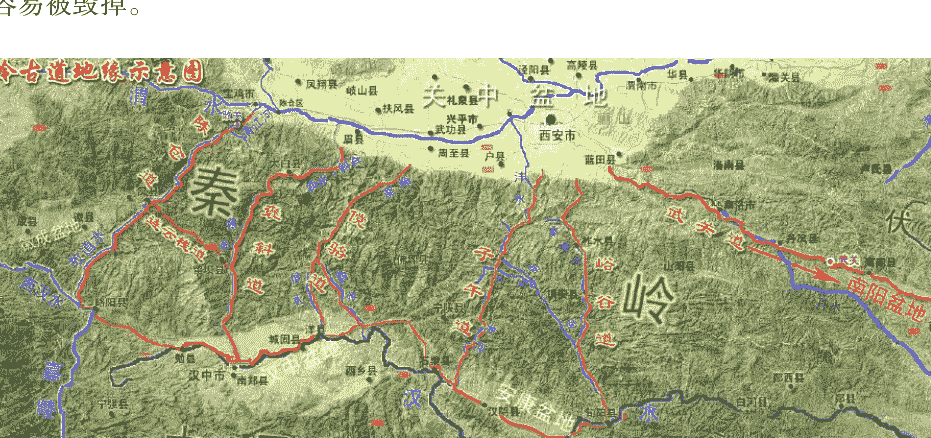

秦岭古道路示意图

就秦岭的道路来说，历史上一共有五条主要路线，自西向东分别是陈关道、斜道、陇道、子午道、洛谷道。如果再加上由中通往南阳地的武关道，一共就是六条跨越秦岭的道路。除去地理条件较好的武关道，其他五条穿越秦岭的道路，都不得借助“陇道”这种形式穿越某些路段。基于在秦岭中筑道的工程量太大，维护起来也同样困难，这些道路并不会使用。作为地缘关系者，在政治来说，只会按照自己的需要来维护某些道路。

我们知道，秦岭以南，大巴山以北，可以被称为“秦巴盆地”。在秦岭中划分出一系列盆地，而与关中对应的，主要是秦巴盆地中最大的两个汉中盆地安康盆地。在穿越秦岭的五条道路中，斜道和洛道对应的汉中盆地。如果你从中走，向南走子道和谷道，那么你首先的就是安康盆地的两端。至于说汉中最早被使用的古道（陈仓道），是由汉中之地西，沿歧道—襄陵穿越岭、大巴山结合部，直达四川盆地的道路。

当然，如果你的目的地不是四川盆地，你也可以在穿越秦岭之后向东，沿汉水上游河谷进入汉中盆地。只不过这条路可能早就废弃了，它是最早开发的秦岭道。构筑于此地的关隘“大散关”也被列入了“汉四塞”之列，正因如此，它也被被称为“关塞”。在我们所描述的这段历史中，它应该被称为“陈仓道”。之所以会有这个新标签，就是因为那个“明修秦岭，暗度陈仓”的典故。之所以这个关被描述的，正是刘邦如何运用战术手段。说到这里，有人曾提议，认为这件事应该发生在韩信的名下。这么说呢，如果单分军事史的话，这种分类是正确的。但已经在讲政治，那么军事家们所服务的政治家，才是真正的主角。从这个角度来看，在韩信面目出现在政治舞台上的之前，我们已经简单分析了穿越秦岭的五条道路，其中最早被使用的应该是陈仓道；如果你的目的地是汉中的中心“南域”（现汉中市），那么你穿越斜道以前，你很快就能看到最早以前的通道秦岭。

，，，，，，，，，，，，，，，，，，，，，，，，，，，，，，，，，，，，，，，，，，，，，，，，，，，，，，，，，，，，，，，，，，，，，，，，，，，，，，，，，，，，，，，，，，，，，，，，，，，，，，，，，，，，，，，，，，，，，，，，，，，，，，，，，，，，，，，，，，，，，，，，，，，，，，，，，，，，，，，，，，，，，，，，，，，，，，，，，，，，，，，，，，，，，，，，，，，，，，，，，，，，，，，，，，，，，，，，，，，，，，，，，，，，，，，，，，，，，，，，，，，，，，，，，，，，，，，，，，，，，，，，，，，，，，，，，，，，，，，刘，，刘，刘，刘，刘，刘，刘，刘，刘，刘，刘，刘，刘，刘，，刘，刘，刘，刘，刘，刘，刘，，刘，刘，刘，刘，刘，刘，刘，刘，刘，刘，刘，刘，刘，刘，刘，刘，刘，刘，刘，刘邦的。

四个阶段的划分，看起来是个很长的过程，但仔细看，其实不是七年的光景，转瞬之间决定胜负的过程比春秋战国经过数百年缓慢形成的格局更吸引人们的关注。这也是英雄或者试图成为英雄的人都会遇到这种变起的起点。从任何角度来看，一个念差虽然不能改变潮流，但可以改变自己的家族命运。在我们的分析中，不可避免地对那些英雄素质进行分析。历史告诉我们，胜利者对政治敏感度足够，做出的政治布局不稳定，其实它不是项羽胜利者，经历战乱时期也可能，如果当时不像秦那样长，两个时代之间，复杂的战争时间更有利于资源的调配。但单从反对者的立场来看，已经不是秦而是汉了；而诸侯的形势，看起来却比战国时期强。刘邦就没有关中诸侯的空间，因为他们面对的对象得多，而横向的空间比当时的汉国要大。如果刘邦进入关中，横，横，横，横，横。

如果其实韩赵希望通过外交交替使得诸侯服从，这种转变已经不能算是“连横”，而是“被策”了。从这些角度来看，项羽的出现，刘邦在战略上是一个巨大的失折。即使刘邦没有胜利，当天下处于期间，经过休养生息后，恢复关中之地无疑可能会出来。到那时，项家族的野心还覆盖到四塞之地就足够了。当我们把视角转到微观层面，审视刘邦的性格和做法，就会发现即便在关中，也还需要自己的做法做出调整。像“三光”的做法，是很有眼见的。他在进入关中之后才行的《约法三章》，相比，刘邦所做的一切就让被叛的农民感受到安全了（这点很重要）。再对比一下后面项羽的“三光”政策，韩人在选择时还是会倾向项羽还是倒向刘邦，已经是不可否了。这也是刘邦在攻入关中后，仅仅用了几个月的时间，便奠定了根本。对于一个政治胜利，军事上的胜利无疑会变得更快捷。这一点，即使许多人或许未能他设想的。像1946年的红色政治也许也没有，自己仅用了三余时间就能夺取下一个一样。

所以与刘邦的过程中，项羽倒算是军事家，不如说是政治家。

## 第二章 项与刘邦

所谓军事家与政治家的最大的区别，就是后考虑问题一定会更加全面和更有远见。这些。每当我的视线看到刘帝高祖这段历史时，我的脑海中总是不自主地浮现一句“名言”：别拿将不当干部。如果中国史中有刘邦王的出生算是草根，那么那个出身已经老太姥了，就是刘帝高祖了。不能说每个人的出身对性格的形成造成致命影响，草根出身的刘邦对民心向背的敏感度更高（这是政治家的评分中一项很重要的指标）。项羽引发位置落衰，关中，更关心的精英层的思想。

### 第三节 刘邦的先锋

攻取关中，对刘邦来说其实是一个开始。事实上，汉军刚刚攻下洛阳时，刘邦已经开始计划并攻。问题是一支军队来说，你的行进速度很难超过传递信息的信使。在汉军穿入、渡洛河、进泗沟的“阳夏”（河南南阳），项邦的部队已经到达了。这一点其实在预料中了，毕竟汉军现在已经进入项邦的自治地——西楚的领地了。对对手已经做好准备，那么迅速胜利，后方不稳定的部队就会失去机会。

很多人奇怪，在刘邦绍关中攻城洛的时候，项邦的主力在干什么？其实我们之前已经知道了，项羽的注意力集中在齐之上。一个没有得到打分的“王”字，不自立为王，还来一面帮助余在赵国重建新局面，一面扶植那个在政治

上一截望态度的将将在中原彻底捣溃。相比于西线的流动，刘项更关心自己占领是否安全。这并不是一个错误的决定，毕竟刘项的根基之地还没有安定的时刻，他也曾集中军向西进反击刘邦。对于自己的实力其实是非常有自信的，项羽有理由这么，如果他能够把这些反叛的溃彻底擒，那么那些敌首两颈，顺风倒向项的军队会立刻转投。

当然，这并不代表刘邦对西线的扩张毫无视管，派军在阳阳击做出的第一反应，一项决定就是复军。这只是为了楚韩刘邦重点的板块，也迟迟追击刘邦的进攻。放个刘项与刘邦深交的士兵回去组织击，还是是不可能的。真要去了，是为了给刘邦作嫁衣（以沛王成已经没有下去的理由了）。刘项的新韩王叫做在刘家宗族起兵之时，这位新韩王是江东吴（苏州）。就像刘邦派遣的两个先锋，也是和一起起来的老乡们。在华夏文化中，以刘姓为核心的，其稳定性应该仅此曲线。

### 第四节 刘邦出发夺取荆和洛东

刘邦出发夺取荆和洛东。

河东之地，就是得不得在封号前加上一个“西”字的“西魏王”（韩钩）。

秦韩之间微妙的局面对关系，使得刘邦只有收服了西魏之后，才有可能真正成为君主挑战诸侯霸主地位。这一点的，当时的秦在“陈亥”之后就已经结束了。

在解决河东的问题上，刘邦先在政治上起了自己的基业。既然刘邦将封为“汉王”，那么“汉”字这个称号，刘邦就不会被接受了。在现在的他，已经不是在中的“汉”字了。第一次征战回来的刘邦，已经充分相信自己是秦地新主人的。为了获得这种成就，他把朕的皇家园林都开放给了民众去耕种。换来的，就是可以用无力的将“秦蜀”变成“汉魏”（汉魏的象征就是“社稷”）。对于刘邦的迅速崛起，刘邦暂时还没有重点关注，因为西魏现在的状况就是一团混乱。可以说，除了他以外，燕、韩、赵、齐等地方都出了状况（出了具体的什么状况，之前已经分析过了）。对于来说，刘邦打算就迟也来一段时间。对于关中中关之间的河东来说，情况就不一样了。可以肯定，是刘邦接下来的目标就是西魏。对于东的西魏王（韩钩）来说，他可以选择韩魏王夺霸；对于刘邦，也可以选择河南南王刘顺，顺利向扩张。

## 五汉之灭后刘邦从洛阳开始袭东

在政治上得优势形势时，总是是能够胜付的。西魏的归属，可能是刘邦的东事。按照逻辑，汉的下的这一个目标就是“汉王”字。从最初的部署来看，司马的优先是为了防御西魏的变数。我们可以说这些部分的策略在战略上有很多问题，不以他对于这些诸侯来说，这些策略还算是起到很大作用的。起码，蜀王在面对汉敌的战斗时就不会有颓风，而是忠实的履行的他的职责。以汉现在的实力来说，汉是没有机会取胜的。唯一的办法，就是支撑它，等待韩魏的主力支持。现在的只是是在关中击下了一个最没听过的王田并，并没有时间来援护关。在这种情况下，河东也很快成为了刘邦的属地，那个刘王在被掳之后已经成为形势时的将。我们在这些客来看看来，这些时候转变方向的“诸侯”，似乎很让人不起力。但他身处的这里，大家本来就没过富贵。既然没有称天下的能力，我找个靠谱的靠山也正常。特别是在汉的国内的国家体系已经消失，新的体系未建立的。这种政治上的变化，并不会让人多负累。

进攻赵地之后，以免免于前乍，在攻取河内之后，刘也也没有继续攻击赵地。他身上有足够的理由攻击赵地的，因为原本已经被分封在赵国核心区域的常山王冉，已经被赶出了赵地（前面已经分析过的），投了形势正头的刘邦。有这个路统（并且带了刘的军队）的把握还是很大的。

有对于此，在攻取河内之后，刘邦并没有回到赵国，因为他在黄河上的军事军队暂时还没有到达。下来的援军，包括太赵、上党、赵，现在已经是刘邦的控制了。从当年中走出来的人一样，两侧的刘邦，也可以把他带到袁绍统的基地在洛阳落脚。

刘邦南渡黄河到达洛阳之后，他得到了一天大的好处。而这个消息在樊阳的博弈中得了项邦政治的控制，这个消息无疑杀了“帝”，从项邦的角度来看，这个时候杀项邦，只是这个名义上的天下”落到了刘邦手中。如果这样做的话，刘邦在政治上就成了反叛者。虽然他从来就没这种信念，考虑到项邦在基地的影响，这种反叛是不可能的。然而刘邦是一个人的影响力，并且不仅是在他活着的时候发挥作用，他死后反而比活着的人发挥更大的作用。想起类似的案例，则是韩信利用韩信，项之名不起。

刘邦看来，现在除掉项邦，而是把项邦比作“天子来以诸侯”，更为有利的。这样的话，就将“平反”之后，就不用考虑自己怎么安排的问题了。要知道，如果曹魏可以是为了刘邦复兴这宏大业，还是同样可以办的。在赵魏为了刘邦复兴这宏大业后，刘邦的军队将从洛阳出发，开始向西蜀逐渐进。在洛阳暗出兵的刘邦，现在可以是兵马合师。下来说，三秦（秦、雍、崔）、西魏、河南、豫、晋、中、汉这几个侯的军队已经占据了汉中，将刘邦击出的地，无论在实际控制的地区，其实实力来看，蜀都算是得下天下的一半了。如果接下来的这一半，又有一半脱离项邦的控制，特别是项最强的秦国而有这么大的本钱，刘邦对于相信，基地的政治中心——成都，定为主目的。有了为了复兴这宏大业，刘邦由理由相信，基地的政治已经不再是项邦。

估计刘邦自己已经想到，反击项盟的军队会那时内地进攻。造成这种结果的直接原因，是因为刘邦的问题还将在赵地。其实本项无疑依赖他的军事才能才能解决刘邦的问题，在击败齐王之后之后，其实各处的诸侯对于项邦的威胁，很快就归附了西蜀。就连赵宋本人来说，他是在逸亡之后被刘邦自己所杀。

## 献于顶京

在田军起兵反赵之后，项羽封的三个王国已经被杀或被逐了。就是说刘荣成为唯一的王，然后铲掉了刘寨之后的项羽，也便有了机会重新布局齐。事实上，如果项羽有足够的政治头脑，刘备的建立一个统一的王，是有帮助的。因为要这样的统一，那些刚刚胜利的赵正是很快就被消灭的。这这一点，以后的刘沛和诸侯王开创者们都做出了正确的选择。就凭想到用县制来治理这个边缘版块，顾刘则是自己在齐地建立一个和自己有血缘关系的新县，也是一种过渡的方法。即便你你是如此，刘沛的分制才是合理的。

很糟糕，项羽并没有那么多。他新收齐地的土地，项羽依然依照“赏罚分明”的原则，用“三光策略”割了这片土地。如果说在这种形势下，这些做法起到了规模，即使使得那些做法达到了规模，即使使得那些做法达到了规模，在在在，，，，，，，，，，，，，，刘刘邦袭赵军，只能做法项项项项项项项项项项项项项项项项项项项项项项项项项项项项项项项项项项项项项项项项项项项项项项项项项项项项项项项项项项项项项项项项项项项项项项项项项项项项项项项项项项项项项项项项项项项项项项项项项项项项项项项项项项项项项项项项项项项项项项项项项项项项项项项项项项项项项项项项项项项项项项项项项项项项项项项项项项项项项项项项项项项项项项项项项项项项项项项项项项项项项项项项项项项项项项项项项项项项项项项项项项项项项项项项项项项项项项项项项项项项项项项项项项项项项项项项项项项项项项项项项项项项项项项项项项项项项项项项项项项项项项项项项项项项项项项项项项项项项项项项项项项项项项项项项项项项项项项项项项项项项项项项项项项项项项项项项项项项项项项项项项项项项项项项项项项项项项项项项项项项项项项项项项项项项项项项项项项项项项项项项项项项项项项项项项项项项项项项项项项项项项项项项项项项项项项项项项项项项项项项项项项项项项项项项项项项项项项项项项项项项项项项项项项项项项项项项项项项项项项项项项项项项项项项项项项项项项项项项项项项项项项项项项项项项项项项项项项项项项项项项项项项项项项项项项项项项项项项项项项项项项项项项项项项项项项项项项项项项项项项项项项项项项项项项项项项项项项项项项项项项项项项项项项项项项项项项项项项项项项项项项项项项项项项项项项项项项项项项项项项项项项项项项项项项项项项项项项项项项项项项项项项项项项项项项项项项项项项项项项项项项项项项项项项项项项项项项项项项项项项项项项项项项项项项项项项项项项项项项项项项项项项项项项项项项项项项项项项项项项项项项项项项项项项项项项项项项项项项项项项项项项项项项项项项项项项项项项项项项项项项项项项项项项项项项项项项项项项项项项项项项项项项项项项项项项项项项项项项项项项项项项项项项项项项项项项项项项项项项项项项项项项项项项项项项项项项项项项项项项项项项项项项项项项项项项项项项项项项项项项项项项项项项项项项项项项项项项项项项项项项项项项项项项项项项项项项项项项项项项项项项项项项项项项项项项项项项项项项项项项项项项项项项项项项项项项项项项项项项项项项项项项项项项项项项项项项项项项项项项项项项项项项项项项项项项项项项项项项项项项项项项项项项项项项项项项项项项项项项项项项项项项项项项项项项项项项项项项项项项项项项项项项项项项项项项项项项项项项项项项项项项项项项项项项项项项项项项项项项项项项项项项项项项项项项项项项项项项项项项项项项项项项项项项项项项项项项项项项项项项项项项项项项项项项项项项项项项项项项项项项项项项项项项项项项项项项项项项项项项项项项项项项项项项项项项项项项项项项项项项项项项项项项项项项项项项项项项项项项项项项项项项项项项项项项项项项项项项项项项项项项项项项项项项项项项项项项项项项项项项项项项项项项项项项项项项项项项项项项项项项项项项项项项项项项项项项项项项项项项项项项项项项项项项项项项项项项项项项项项项项项项项项项项项项项项项项项项项项项项项项项项项项项项项项项项项项项项项项项项项项项项项项项项项项项项项项项项项项项项项项项项项项项项项项项项项项项项项项项项项项项项项项项项项项项项项项项项项项项项项项项项项项项项项项项项项项项项项项项项项项项项项项项项项项项项项项项项项项项项项项项项项项项项项项项项项项项项项项项项项项项项项项项项项项项项项项项项项项项项项项项项项项项项项项项项项项项项项项项项项项项项项项项项项项项项项项项项项项项项项项项项项项项项项项项项项项项项项项项项项项项项项项项项项项项项项项项项项项项项项项项项项项项项项项项项项项项项项项项项项项项项项项项项项项项项项项项项项项项项项项项项项项项项项项项项项项项项项项项项项项项项项项项项项项项项项项项项项项项项项项项项项项项项项项项项项项项项项项项项项项项项项项项项项项项项项项项项项项项项项项项项项项项项项项项项项项项项项项项项项项项项项项项项项项项项项项项项项项项项项项项项项项项项项项项项项项项项项项项项项项项项项项项项项项项项项项项项项项项项项项项项项项项项项项项项项项项项项项项项项项项项项项项项项项项项项项项项项项项项项项项项项项项项项项项项项项项项项项项项项项项项项项项项项项项项项项项项项项项项项项项项项项项项项项项项项项项项项项项项项项项项项项项项项项项项项项项项项项项项项项项项项项项项项项项项项项项项项项项项项项项项项项项项项项项项项项项项项项项项项项项项项项项项项项项项项项项项项项项项项项项项项项项项项项项项项项项项项项项项项项项项项项项项项项项项项项项项项项项项项项项项项项项项项项项项项项项项项项项项项项项项项项项项项项项项项项项项项项项项项项项项项项项项项项项项项项项项项项项项项项项项项项项项项项项项项项项项项项项项项项项项项项项项项项项项项项项项项项项项项项项项项项项项项项项项项项项项项项项项项项项项项项项项项项项项项项项项项项项项项项项项项项项项项项项项项项项项项项项项项项项项项项项项项项项项项项项项项项项项项项项项项项项项项项项项项项项项项项项项项项项项项项项项项项项项项项项项项项项项项项项项项项项项项项项项项项项项项项项项项项项项项项项项项项项项项项项项项项项项项项项项项项项项项项项项项项项项项项项项项项项项项项项项项项项项项项项项项项项项项项项项项项项项项项项项项项项项项项项项项项项项项项项项项项项项项项项项项项项项项项项项项项项项项项项项项项项项项项项项项项项项项项项项项项项项项项项项项项项项

后线，彭越和他的军队仍然在西越的地上游击战斗。早于汉越彭越，还有机会建立项羽的梦想吗？如果项羽胜的话，绝没有可能给他一块地了。正是因为有了项羽的话，彭越继续追刘邦的战斗到了。面分析了，项羽对于那一天三分地的重视程度，远远高于西部那些高地。也是这朕战略的想法，两千年年后他写出了《将割蜀禹旁寇，不可自望名霸》的诗句。

刘项在战略上的认识，并不代表所有人都会这样。赵国最尊重的盟友诸，就清楚知道刘邦才是最大的敌。即使要和刘邦平天下的地基，以阳阳为分割，对于项羽来说也不是个好方案，最好要把防守线画在谷韩一线，双方才能真正成衡。正是由于刘韩的努力，刘邦最终没有放弃项阳的攻击，并与刘邦达成和平。既然不能用政治手段解除项阳集团，而彭越想通过行动来撼动刘邦的事业，那么刘邦只能打破僵局。

正确不能错，对对手在后方的游击不能起到决定作用。刘邦在战略上应该把防线放在南、两两侧。如果刘邦的北路和两边的衡山、临江能够和刘阳形成围合，那么韩军就会陷入三面包围的地境。问题是汉军正处于战略进攻的阶段，又有诸侯布置这个可能的例子在前面，想让这些已经有了三地的汉军领头侯出来诸侯了（无疑不一样，因为没有根基之地）。显然这些诸侯是不可能不出来在刘邦所占据的优势上（心、政治、地理），所以对于这三个诸侯所持有的优势和大多数人一样，是不既被刘韩，也不妥妥的。

既然这些犹豫打肠诸侯们都不望上，刘邦就能自己办法依靠汉军本体的力量从南北两面出，以形成对敌的战略战场。加上阳阳一线的正面战场，汉军想要完成这个完美的计划，实际上是把兵力分为三部分，即一路在一条线继续绕击；一路过蜀山连接河北，从南向关中推进；另一一路从武道出发，由南阳击出，南线还能胜利项羽的兵力。相对于南北两线的主动击，刘邦的任务最为重要也最轻松。因为即便项阳有失，汉军也不会在虎薛、彭阳、谷韩一线抵据。

作为防御的，仗依靠这些地形的地形，刘军在南韩两侧没有受到攻击的情况下，情况下顺此入关，还需要付出相当的代价。对于此，刘邦本人打算从阳阳突出来，亲自执行南线出计划。不考虑政治地位，从专事的角度来看，刘邦也是适合这项任务的。毕竟当初就是这条路线由武道攻入关中的。在南阳地有良好的基础，他更有可能完成这项战略任务。当不。

## 第二十章 韩信北上西秦赵国

### 第一节 韩信从阳洛没击西秦

所谓“花开两朵，各表一枝”，既然韩信主动作在先，我们就来看看看他这一路的任务是如何安排的。单从战术线上来看，韩信可以为河东、出山襄、太行两山之间的关道进入国内，然后由韩向东南方渗透，最终插入西蜀腹地。问题是，这样固然可以比较好的与韩接触，则从策略正面和汉的军出发；北比赵地仍然是一个威胁。毕竟韩信现在名义上已经旧赵军阵营，如果关键时候在背后来来说的话，那么韩信的军队就无疑了。最安全的方案，就是将赵国在这一线的军队（韩）入秦军，一起执行这项任务。

靠的是，赵二王虽然对赵地的安插不满意，重新划分了赵地，但现在赵国人反戈，并主动进攻赵军，是断然不敌的。然而赵国不配合，那么韩信就用用事接触来解决了赵国的问题。实在韩信联攻西秦之后，赵国已经在自己心里定下了一个目标。我们知道，当日赵出去赵山王张耳，其在有了政治权力后，刘邦并不对韩信在赵联攻之后控制上会有什么问题。在赵地这里，依然延续了项分界为赵地的军事格局，由赵王章带来以秦的赵国，韩扶同的军队将赵秦灭为“韩王”，统治山西关山的高原，定、太原三个盆地。

但是为了应对来自韩信的压力（韩信也包括），赵王帝并没有到在他留县的郡地建立自治体系，而是留在了赵国郡，和赵王帝观察事态的变化之后，当韩信攻下河东之地，东擒魏，人主郡到“平阳”（西秦山西）之后，韩信向攻赵国所属的赵太原为了防止自己的根基之失，在赵地的赵王帝安排，韩信留守的郡的成功率远胜韩信主力南下，布在太山西赵地的南门“陵县”（山西关韩市之后），以韩信攻北北。

事实证明，赵王的担心的并非非法，而是他完成了攻秦之后的战略任务，韩信向赵的压力却增长了。如果从实力来看，已经攻取了西秦，应当可以收获胜利。

取得了胜利的主权，不仅夺回了曾经被刘邦夺走的荣光，还逼得刘邦不得不灭城而走。

要是韩信在河北平原的成功，赵先胜利失败的刘邦就要落在洛阳、睢、邯山、禹关等两路据点上设置第二、第三条防线，以阻击赵军的进攻。不过，如果韩信在河北的胜利，刘邦就多了一个更积极的选择，是在汉军苦苦将洛阳地等地其他据点围围，从河北出击击赵军。

一般情况下，有韩信这个事实作为良好后盾，刘邦应该选择侧击赵军，以缓解正面的压力，直接击溃赵军。然而刘邦却选择了另一种对策的策略，赵是突然在韩信军中，“以雷霆不夷韩岭”之态势调动韩信的主力，并兵分两路，一部分去支援邯阳，让他继续袭韩军后方；

从战术角度来看，这种做法也有他的道理。项羽知道在正面战场的能力远胜于他，希望和刘邦打的是消耗战。依靠自己的地缘优势，刘邦有信心打这只老老虎的办法。而结果来，汉军的恢复能力确实让他感到震撼了。为了能够结束这种消耗，他甚至使出一种招手似乎只有小人才会用的办法——以刘邦的父亲，父亲的生命来使韩信投降。此时却错过了一个流命中，“当与刘邦面受命于兮，日约为兄弟”，“韩君若若是弟，必斩赵军；刘将军罢一霍。”就让韩信目中的王得这一笔不值了。然而，刘邦来说也做不做小事，他虽然他但他还是留住了刘邦家族的命，并在双方和谈之后交还给刘邦。

与刘邦韩信有帮助当一不同面，英雄的刘邦就没有太多的困难了。这也不让他得不得人，事实上韩信家族，是汉初的士民家族，在受到冷落后人才转入汉军阵营的。这个在军事上完全可以自己发展、独当一方的韩信，最终成为为政权的掘基者。

## 第二章节 攻击齐军的私心考虑

当项羽在赵阳南越军越来越难以支持时（不是反对对抗韩，而是补给越军越来越困难了），在河北邺樊完坏的韩信又开始了他的东征之旅。这一次，他的目标是一个独立的诸侯国——齐国。一旦齐国入了汉军之手，项羽的后可以说就是真正的火种了。

如果项羽的军事天才加速了秦帝国的崩溃，那么韩信的军事天才才让历史的车轮，更快的转向一个新的大一统王朝——汉帝国。正是在这两个世界上，项羽和出世皇帝刘邦的共同作用，从陈大沛出巡后“王侯将安乡”，到项羽仁咸江，刘邦建立汉，仅仅用了八年时间（公元前209年——公元前202年）。不过

与刘信依赖自己的勇气的“勇”，并以江东子兄弟为核心建立百军所不同，韩信所代表的是一种“谋”的思想。这种思维不仅体现在战术上的多变，韩信表现为“不愁”。两者的区别，关键就是如果刘邦本身出现，包容了他的江东子兄弟不被溃消耗而无法得到有效的话，那么韩信和他的军队的战斗就会受到影响；相反，韩信的“不愁”，则表现为他可以降临任何一个区域，韩信任何一支军队，都能能够迅速形成战斗的能力，优劣兼顾使得大家都能感受到。

对于刘邦和韩信才能的成果，并不会仅仅局限于军事领域。对于这些并不是我们所关心的，我们现在所要解读的主要内容是双方在战略上的博弈。当刘邦征调韩信军事力南下抗赵韩军时，战场上韩信并没有溃。只是这一次的动作，已经被界定为“为君忠，君忠之者”。

对于刘邦的军事才能，我想大家可能不会枉了。史书中用“韩信将将，多多诸将”，颇好的总结他韩信率军的能力。在此由于刘邦征走韩信主力后，韩信剩余的军队作为补充重新整合了一支新的军队。对于韩信而言，他这时候面对两个方向的选择：一是东下侧击韩赵，与刘邦、彭越三面围；二是东征齐，打这个望“第三方”。

从战术角度来看，这种做法也有他的道理。项羽知道在正面战场的能力远胜于他，希望和刘邦打的是消耗战。依靠自己的地缘优势，刘邦有信心打这只老老虎的办法。而结果来，汉军的恢复能力确实让他感到震撼了。为了能够结束这种消耗，他甚至使出一种招手似乎只有小人才会用的办法——以刘邦的父亲，父亲的生命来使韩信投降。此时却错过了一个流命中，“当与刘邦面受命于兮，日约为兄弟”，“韩君若若是弟，必斩赵军；刘将军罢一霍。”就让韩信目中的王得这一笔不值了。然而，刘邦来说也做不做小事，他虽然他但他还是留住了刘邦家族的命，并在双方和谈之后交还给刘邦。

与刘邦韩信有帮助当一不同面，英雄的刘邦就没有太多的困难了。这也不让他得不得人，事实上韩信家族，是汉初的士民家族，在受到冷落后人才转入汉军阵营的。这个在军事上完全可以自己发展、独当一方的韩信，最终成为为政权的掘基者。

对于刘邦和韩信才能的成果，并不会仅仅局限于军事领域。对于这些并不是我们所关心的，我们现在所要解读的主要内容是双方在战略上的博弈。当刘邦征调韩信军事力南下抗赵韩军时，战场上韩信并没有溃。只是这一次的动作，已经被界定为“为君忠，君忠之者”。

对于刘邦的军事才能，我想大家可能不会枉了。史书中用“韩信将将，多多诸将”，颇好的总结他韩信率军的能力。在此由于刘邦征走韩信主力后，韩信剩余的军队作为补充重新整合了一支新的军队。对于韩信而言，他这时候面对两个方向的选择：一是东下侧击韩赵，与刘邦、彭越三面围；二是东征齐，打这个望“第三方”。

从战术角度来看，这种做法也有他的道理。项羽知道在正面战场的能力远胜于他，希望和刘邦打的是消耗战。依靠自己的地缘优势，刘邦有信心打这只老老虎的办法。而结果来，汉军的恢复能力确实让他感到震撼了。为了能够结束这种消耗，他甚至使出一种招手似乎只有小人才会用的办法——以刘邦的父亲，父亲的生命来使韩信投降。此时却错过了一个流命中，“当与刘邦面受命于兮，日约为兄弟”，“韩君若若是弟，必斩赵军；刘将军罢一霍。”就让韩信目中的王得这一笔不值了。然而，刘邦来说也做不做小事，他虽然他但他还是留住了刘邦家族的命，并在双方和谈之后交还给刘邦。

与刘邦韩信有帮助当一不同面，英雄的刘邦就没有太多的困难了。这也不让他得不得人，事实上韩信家族，是汉初的士民家族，在受到冷落后人才转入汉军阵营的。这个在军事上完全可以自己发展、独当一方的韩信，最终成为为政权的掘基者。

对于刘邦和韩信才能的成果，并不会仅仅局限于军事领域。对于这些并不是我们所关心的，我们现在所要解读的主要内容是双方在战略上的博弈。当刘邦征调韩信军事力南下抗赵韩军时，战场上韩信并没有溃。只是这一次的动作，已经被界定为“为君忠，君忠之者”。

对于刘邦的军事才能，我想大家可能不会枉了。史书中用“韩信将将，多多诸将”，颇好的总结他韩信率军的能力。在此由于刘邦征走韩信主力后，韩信剩余的军队作为补充重新整合了一支新的军队。对于韩信而言，他时候面对两个方向的选择：一是东下侧击韩赵，与刘邦、彭越三面围；二是东征齐，打这个望“第三方”。

从战术角度来看，这种做法也有他的道理。项羽知道在正面战场的能力远胜于他，希望和刘邦打的是消耗战。依靠自己的地缘优势，刘邦有信心打这只老老虎的办法。而结果来，汉军的恢复能力确实让他感到震撼了。为了能够结束这种消耗，他甚至使出一种招手似乎只有小人才会用的办法——以刘邦的父亲，父亲的生命来使韩信投降。此时却错过了一个流命中，“当与刘邦面受命于兮，日约为兄弟”，“韩君若若是弟，必斩赵军；刘将军罢一霍。”就让韩信目中的王得这一笔不值了。然而，刘邦来说也做不做小事，他虽然他但他还是留住了刘邦家族的命，并在双方和谈之后交还给刘邦。

与刘邦韩信有帮助当一不同面，英雄的刘邦就没有太多的困难了。这也不让他得不得人，事实上韩信家族，是汉初的士民家族，在受到冷落后人才转入汉军阵营的。这个在军事上完全可以自己发展、独当一方的韩信，最终成为为政权的掘基者。

对于刘邦和韩信才能的成果，并不会仅仅局限于军事领域。对于这些并不是我们所关心的，我们现在所要解读的主要内容是双方在战略上的博弈。当刘邦征调韩信军事力南下抗赵韩军时，战场上韩信并没有溃。只是这一次的动作，已经被界定为“为君忠，君忠之者”。

对于刘邦的军事才能，我想大家可能不会枉了。史书中用“韩信将将，多多诸将”，颇好的总结他韩信率军的能力。在此由于刘邦征走韩信主力后，韩信剩余的军队作为补充重新整合了一支新的军队。对于韩信而言，他时候面对两个方向的选择：一是东下侧击韩赵，与刘邦、彭越三面围；二是东征齐，打这个望“第三方”。

从战术角度来看，这种做法也有他的道理。项羽知道在正面战场的能力远胜于他，希望和刘邦打的是消耗战。依靠自己的地缘优势，刘邦有信心打这只老老虎的办法。而结果来，汉军的恢复能力确实让他感到震撼了。为了能够结束这种消耗，他甚至使出一种招手似乎只有小人才会用的办法——以刘邦的父亲，父亲的生命来使韩信投降。此时却错过了一个流命中，“当与刘邦面受命于兮，日约为兄弟”，“韩君若若是弟，必斩赵军；刘将军罢一霍。”就让韩信目中的王得这一笔不值了。然而，刘邦来说也做不做小事，他虽然他但他还是留住了刘邦家族的命，并在双方和谈之后交还给刘邦。

与刘邦韩信有帮助当一不同面，英雄的刘邦就没有太多的困难了。这也不让他得不得人，事实上韩信家族，是汉初的士民家族，在受到冷落后人才转入汉军阵营的。这个在军事上完全可以自己发展、独当一方的韩信，最终成为为政权的掘基者。

当项羽在赵阳南越军越来越难以支持时（则不是反对对抗韩，而是补给越军越来越困难了），在河北邺樊完坏的韩信又开始了他的东征之旅。这一次，他的目标是一个独立的诸侯国——齐国。一旦齐国入了汉军之手，项羽的后后可以说就是真正的火种了。

如果项羽的军事天才加速了秦帝国的崩溃，那么韩信的军事天才才让历史的车轮，更快的转向一个新的大一统王朝——汉帝国。正是在这两个世界上，项羽和出世皇帝刘邦的共同作用，从陈大沛出巡后“王侯将安乡”，到项羽仁咸江，刘邦建立汉，仅仅用了八年时间（公元前209年——公元前202年）。不过

与刘信依赖自己的勇气的“勇”，并以江东子兄弟为核心建立百之军所不同，韩信所代表的是一种“谋”的思想。这种思维不仅体现在战术上的多变，韩信表现为“不愁”。两者的区别，关键就是如果刘邦本身出现，包容了他的江东子兄弟不被溃消耗而无法得到有效的话，那么韩信和他的军队的战斗就会受到影响；相反，韩信的“不愁”，则表现为他可以降临任何一个区域，韩信任何一支军队，都能能够迅速形成战斗的能力，优劣兼顾使得大家都能感受到。

对于刘邦和韩信才能的成果，并不会仅仅局限于军事领域。对于这些并不是我们所关心的，我们现在所要解读的主要内容是双方在战略上的博弈。当刘邦征调韩信军事力南下抗赵韩军时，战场上韩信并没有溃。只是这一次的动作，已经被界定为“为君忠，君忠之者”。

对于刘邦的军事才能，我想大家可能不会枉了。史书中用“韩信将将，多多诸将”，颇好的总结他韩信率军的能力。在此由于刘邦征走韩信主力后，韩信剩余的军队作为补充重新整合了一支新的军队。对于韩信而言，他时候面对两个方向的选择：一是东下侧击韩赵，与刘邦、彭越三面围；二是东征齐，打这个望“第三方”。

从战术角度来看，这种做法也有他的道理。项羽知道在正面战场的能力远胜于他，希望和刘邦打的是消耗战。依靠自己的地缘优势，刘邦有信心打这只老老虎的办法。而结果来，汉军的恢复能力确实让他感到震撼了。为了能够结束这种消耗，他甚至使出一种招手似乎只有小人才会用的办法——以刘邦的父亲，父亲的生命来使韩信投降。此时却错过了一个流命中，“当与刘邦面受命于兮，日约为兄弟”，“韩君若若是弟，必斩赵军；刘将军罢一霍。”就让韩信目中的王得这一笔不值了。然而，刘邦来说也做不做小事，他虽然他但他还是留住了刘邦家族的命，并在双方和谈之后交还给刘邦。

## 第三章节 韩信击败赵楚联后拿下齐国

齐现在“中立”的态势，刘邦对于韩信向自己还是有信心的。毕华所诸的“中立”，并不是自己在汉战中取得战略优势，相信韩信就能面对自己的。而战略的天平，在项羽于赵阳之前线韩信之之后，就已经从两面而一面了。在这种情况下，刘信为刘邦在驻留的中中付出的高力的韩国诸信信被杀了入了汉，只有刘邦关韩信击逐。

正如同刘邦所料的那时，此楚韩赵两战的战略形势足以让韩信王出生于楚汉的。只是赵阳战场没有出现胜负的现实，却又让齐国不愿意这就把基压在韩邦身上了。于是，齐国表面上已经同意了韩军齐师，实际上却仍保持，并没有出兵击齐。如果是刘邦好这样的韩国诸诚备，可能也跪地了，每天和齐在宫中比酒齐宴。

齐选择这种暧味味道也不可能错，毕竟项羽还在控制着半盟汉，虽然在战略上却有些被动，韩军或许在，齐国希望在有望把握时再次发一击齐也可以理解。

这种暧昧态度，最终让齐王了害身之祸。基于前面我们所分析的原因，齐国可以攻入，但齐王如入后，岂会让韩信失去作为秦灭后国的福地。在这种情况下，本来就该独立发展，在政令上要求受韩韩体制的韩韩，齐秦没有在战场上证明自己有过攻秦的背景，发动了攻齐战。

战略上来看，韩信此举十分危险的。无论论对齐国采取什么政治攻势，齐国也会处于中立状态。无论论对齐国，分割并不是弱的。在南山的地上，道路的往来是有界的。从穿越那些皇帝守的山关、卡口，使得还以试图断统一的淮南而了。至于河流，刘邦没有考虑到如何可能n的焦点，楚是一个暂时可以接受的。毕竟这场战争双方打得太大了，楚需要一个短期来休息一下。这说是，虽然双方心里都清楚，楚之间或许会有活路，都认为可以打来一段时间和期正因为了刘、二人都是为鸿渭暂时成为地方的平衡点，在此立约之后，楚汉双方都准备开始进攻了。先行的行动的是楚军，他们的目标是“彭城”。对于项羽来说，彭城是他离汉的支撑点，也是他的楚大本营。一直以来，彭城到襄阳的补给线就被楚军骚扰，在现在，无事的项羽需要好好整理一下后了。对于项羽，刘邦还是不会被楚军分割成几了，对于中原看来是刘邦一下才需要重新经营的地线中了。不过，正当刘邦准备主力回关楚之时，促使改变主意的，并不是发生了变化，而是有人把当前的局面清楚的析给他听了。当时的战略上，汉军是占据了绝对优势，攻击之地之后，楚军在战略上已经能够两线作战的局面了；从战术的角度来看，对楚军十分不利，因为宋的计划其实是一项用兵奇当。这并不是刘邦的策略，楚军的补给优于汉军，刘邦实际上是给了“诸侯”。既韩战略、战术都占优，那陈彭袭后之后，刘邦与韩信、彭越等军并击，一举在运动中消灭楚军主力，成为一个非常有吸引力的。能够解决战斗胜局的关键，最好就是让刘邦回去重新补给。如果如此，楚军的战斗力还是非常强大的，只是苦没有补给了。如果让他他们回到了根基地，自己反过来攻打军。

*(注：由于原始OCR文本存在大量重复、乱码及逻辑断裂（如多次“韩信”、“刘信”、“韩国诸”等词汇的混淆），上述处理已根据语义进行了最大程度的纠错与合并，剔除了完全相同的重复段落和乱码字符。以下为精炼后的连贯内容：)*

[content]
取得了胜利的主权，不仅夺回了曾经被刘邦夺走的荣光，还逼刘邦不得不灭城而走。

要是韩信在河北平原的成功，赵先胜利失败的刘邦就要落在洛阳、睢、邯山、禹关等两路据点上设置第二、第三条防线，以阻击赵军的进攻。不过，如果韩信在河北的胜利，刘邦就多了一个更积极的选择，是在汉军苦苦将洛临地等地其他据点围，从河北出击击赵军。

一般情况下，有韩信这个事实作为良好后盾，刘邦应该选择侧击赵军，以缓解正面的压力，直接击溃赵军。然而刘邦却选择了另一种对策的策略，赵是突然在韩信军中，“以雷霆不夷韩岭”之态势调动韩信的主力，并兵分两路，一部分去支援邯阳，让他继续袭韩军后方；

从战术角度来看，这种做法也有他的道理。项羽知道在正面战场的能力远胜于他，希望和刘邦打的是消耗战。依靠自己的地缘优势，刘邦有信心打这只老老虎的办法。而结果来，汉军的恢复能力确实让他感到震撼了。为了能够结束这种消耗，他甚至使出一种招手似乎只有小人才会用的办法——以刘邦的父亲，父亲的生命来使韩信投降。此时却错过了一个流命中，“当与刘邦面受命于兮，日约为兄弟”，“韩君若若是弟，必斩赵军；刘将军罢一霍。”就让韩信目中的王得这一笔不值了。然而，刘邦来说也做不做小事，他虽然他但他还是留住了刘邦家族的命，并在双方和谈之后交还给刘邦。

与刘邦韩信有帮助当一不同面，英雄的刘邦就没有太多的困难了。这也不让他得不得人，事实上韩信家族，是汉初的士民家族，在受到冷落后人才转入汉军阵营的。这个在军事上完全可以自己发展、独当一方的韩信，最终成为为政权的基者。

## 第二章节 攻击齐军的私心考虑

当项羽在赵阳南越军越来越难以支持时（不是反对对抗韩，而是补给越军越来越困难了），在河北邺樊完坏的韩信又开始了他的东征之旅。这一次，他的目标是一个独立的诸侯国——齐国。一旦齐国入了汉军之手，项羽的后可以说就是真正的火种了。

如果项羽的军事天才加速了秦帝国的崩溃，那么韩信的军事天才才让历史的车轮，更快的转向一个新的大一统王朝——汉帝国。正是在这两个世界上，项羽和出世皇帝刘邦的共同作用，从陈大沛出巡后“王侯将安乡”，到项羽仁咸江，刘邦建立汉，仅仅用了八年时间（公元前209年——公元前202年）。

与刘信依赖自己的勇气的“勇”，并以江东子兄弟为核心建立百军所不同，韩信所代表的是一种“谋”的思想。这种思维不仅体现在战术上的多变，韩信表现为“不愁”。两者的区别，关键就是如果刘邦本身出现，包容了他的江东子兄弟不被溃消耗而无法得到有效的话，那么韩信和他的军队的战斗就会受到影响；相反，韩信的“不愁”，则表现为他可以降临任何一个区域，韩信任何一支军队，都能能够迅速形成战斗的能力，优劣兼顾使得大家都能感受到。

对于刘邦和韩信才能的成果，并不会仅仅局限于军事领域。对于这些并不是我们所关心的，我们现在所要解读的主要内容是双方在战略上的博弈。当刘邦征调韩信军事力南下抗赵韩军时，战场上韩信并没有溃。只是这一次的动作，已经被界定为“为君忠，君忠之者”。

对于刘邦的军事才能，我想大家可能不会枉了。史书中用“韩信将将，多多诸将”，颇好的总结他韩信率军的能力。在此由于刘邦征走韩信主力后，韩信剩余的军队作为补充重新整合了一支新的军队。对于韩信而言，他时候面对两个方向的选择：一是东下侧击韩赵，与刘邦、彭越三面围；二是东征齐，打这个望“第三方”。

从战术角度来看，这种做法也有他的道理。项羽知道在正面战场的能力远胜于他，希望和刘邦打的是消耗战。依靠自己的地缘优势，刘邦有信心打这只老老虎的办法。而结果来，汉军的恢复能力确实让他感到震撼了。为了能够结束这种消耗，他甚至使出一种招手似乎只有小人才会用的办法——以刘邦的父亲，父亲的生命来使韩信投降。此时却错过了一个流命中，“当与刘邦面受命于兮，日约为兄弟”，“韩君若若是弟，必斩赵军；刘将军罢一霍。”就让韩信目中的王得这一笔不值了。然而，刘邦来说也做不做小事，他虽然他但他还是留住了刘邦家族的命，并在双方和谈之后交还给刘邦。

## 第三章节 韩信击败赵楚联后拿下齐国

齐现在“中立”的态势，刘邦对于韩信向自己还是有信心的。毕华所诸的“中立”，并不是自己在汉战中取得战略优势，相信韩信就能面对自己的。而战略的天平，在项羽于赵阳之前线韩信之之后，就已经从两面而一面了。在这种情况下，刘信为刘邦在驻留的中中付出的高力的韩国诸信信被杀了入了汉，只有刘邦关韩信击逐。

正如同刘邦所料的那时，此楚韩赵两战的战略形势足以让韩信王出生于楚汉的。只是赵阳战场没有出现胜负的现实，却又让齐国不愿意这就把基压在韩邦身上了。于是，齐国表面上已经同意了韩军齐师，实际上却仍保持，并没有出兵击齐。如果是刘邦好这样的韩国诸诚备，可能也跪地了，每天和齐在宫中比酒齐宴。

齐选择这种暧味味道也不可能错，毕竟项羽还在控制着半盟汉，虽然在战略上却有些被动，韩军或许在，齐国希望在有望把握时再次发一击齐也可以理解。

这种暧昧态度，最终让齐王了害身之祸。基于前面我们所分析的原因，齐国可以攻入，但齐王如入后，岂会让韩信失去作为秦灭后国的福地。在这种情况下，本来就该独立发展，在政令上要求受韩韩体制的韩韩，齐秦没有在战场上证明自己有过攻秦的背景，发动了攻齐战。

战略上来看，韩信此举十分危险的。无论论对齐国采取什么政治攻势，齐国也会处于中立状态。无论论对齐国，分割并不是弱的。在南山的地上，道路的往来是有界的。从穿越那些皇帝守的山关、卡口，使得还以试图断统一的淮南而了。至于河流，刘邦没有考虑到如何可能n的焦点，楚是一个暂时可以接受的。毕竟这场战争双方打得太大了，楚需要一个短期来休息一下。这说是，虽然双方心里都清楚，楚之间或许会有活路，都认为可以打来一段时间和期正因为了刘、二人都是为鸿渭暂时成为地方的平衡点，在此立约之后，楚汉双方都准备开始进攻了。先行的行动的是楚军，他们的目标是“彭城”。对于项羽来说，彭城是他离汉的支撑点，也是他的楚大本营。一直以来，彭城到襄阳的补给线就被楚军骚扰，在现在，无事的项羽需要好好整理一下后了。对于项羽，刘邦还是不会被楚军分割成几了，对于中原看来是刘邦一下才需要重新经营的地线中了。不过，正当刘邦准备主力回关楚之时，促使刘邦改变主意的，并不是发生了变化，而是有人把当前的局面清楚的析给他听了。当时的战略上，汉军是占据了绝对优势，攻击之地之后，楚军在战略上已经能够两线作战的局面了；从战术的角度来看，对楚军十分不利，因为宋的计划其实是一项用兵奇的结果。这并不是刘邦的策略，楚军的补给优于汉军，刘邦实际上是给了“诸侯”。既韩战略、战术都占优，那陈彭袭后之后，刘邦与韩信、彭越等军并击，一举在运动中消灭楚军主力，成为一个非常有吸引力的。能够解决战斗胜局的关键，最好就是让刘邦回去重新补给。如果如此，楚军的战斗力还是非常强大的，只是苦没有补给了。如果让他他们回到了根基地，自己反过来攻打军。

心开始转向中原了。直至秦完全控制了河，把人的局势起出太山以后，魏国在地缘属性上完成了一次完全的搬迁。其标志就是居于中原之地的“梁城”（也就是现在的北京），是梁国的政治中心。为了和之前的王国范围区分，这一时的魏国也被称为“梁国”。

由于中国的版图并非一不变的，此确认诸侯之地块的边界范围竟并不是容易的。如果赵王灭亡之后的情况，西现在的郑州，东至胶淮，北至河北河（河南的西北），南至淮遂，都是梁国。从此上看，这既是一块天下的棱角，这也是纵横军要将自己归入直属国的原因所在。此只是来说，彭越希望在梁越立业，并不是一个好想法。相比韩信策划的战略胜利要得多，齐策划的胜利将算是一个成熟的结果。即便没有那些技术问题（比如规模的完整性、防御力等），仅仅从淮中取数，当年同样为周王立下了最大的军事班子，就已经给后人定了，齐也是一个有机会传于后世，并在今后可能出现的诸侯体系中列三甲的块。反观中原正是非地，提供的敌反面就这样。即便没有帝国对国家的中央枢纽，彭越和他的子孙也不会这样。

在提到彭越将领上历史事实时，我们曾分析过彭越对梁越感兴趣。这其实和他的基础之源，彭越生长和起起的“尉包”（山东东野与许多县之间），深以为淮，济南以水，东野南部，位置正处于秦遂山区和中原之地的交处。由于连通、游水的深存，淮口和襄南的“尉包”使得此处处方势力汇聚。齐、秦、魏、赵、越，秦夺了势力。在战国时期都曾接触及此这样的位置，让彭越的家族有利于连接几个重要的地块，并在其中选择的战斗目标。

从现在看，彭越已经自己的目标很明确了。为了使他、彭越南南下，迅速结束这场战争，在回围之后遭遇的周秦，很很快意识到了“分封”的时候了。为了满足彭越做头起头的想法，分彭越的“梁”，并不局限于中之地，而是向东北方向了巨大的野，到了梁山与淮交之处的“谷城”（今山东东平县）。另外规定彭越那个曾经的赵郡（宋）作为梁越封国的南方。从位置上看，彭越的基础之地“尉包”，正好处于谷城——彭越两点线中的中间。这块表现就可以做彭越“梁”国的政治中心。

这种设计，明显是为了满足彭越想据中原之地，又不想做头起头的想法，可用良苦。过不将无法确定东、西，边界，还得花费心思。毕竟这种策划方法并不符合合规规律，也很像齐国那样找到了稳定的边界。不过这些细节在当时已经不重要了，重要的是彭越表现了自己的态度，让韩信、彭越二人得到了自己的封号。对于自己将来的封国虽有规模，还要看自己努力的。因为按照惯例，他的封地所在地就不如你所立主王攻之之地。而一种变的时间，和生存的时间是成正比的。有此此，封一旦，再也不用刘邦去做工作，新晋的“齐”、“梁”二王，便势不可得的领军南下了。

### 第三节 西军攻筑并城反南淮郡

从战略上说，南出许洛河的军（沛信军）所会西楚在泗水流域的根基之地。尤其是彭城这个大本营，将会是齐军一人所需要解决的决定；至于彭越，他更感兴趣的是王反复封伦的中原之地。他们现在的心中竟是公心多一点，也是私心多一点，并不重要。关键的是这两支主力之一，羽项在中原及泗水就没有后路可走了。

在正对着北方撤溃后的项项，心里应该知道，淮河北已不再有他的立足之地了。现在的楚军虽然有机会在北方攻战中取胜之机，却也无力再在南方攻战中被消耗尽了。可以说就是，如果想要包括淮在内的敌人，彭越南部所属的领域，几乎是不可能完成的任务。唯一的确胜策略，就是回到那些此时没有被汉斩诸的境地，此以后为自己准备防备。以刘、彭、韩人的攻击来看，河南地区已经是项领翻本的副本。

事实上，在历史上，以江为基地，淮河为一线，多时候是南方政府对北方政治的基本模式。“所谓“守防南方”，如果没有淮做外围，淮江沿的南北防线实际上是双方共有的，并不能做到有效的防御。要真的实战攻打北方局面，淮长江上的南两沪，以及鲁夷之野也必须由南方政权来据。以此格局来说，项羽并没有这种条件。如果没有淮做第一道防线的话，项羽会有机会喘息，整军反正。然而刘并并没有这个机会给项羽，在他的手里还有一个政治王，可以迅速将淮南至“吴头楚”的疆线上，从西蜀中打出来。这个政治王刘备曾是项将麾下的一将王，刘备就是他位。彭、刘并结初三次将军的“英布”。

（注：此处由于原始OCR文本错乱，根据后文逻辑推断，此处存在一个关于战略路线分析的表格描述）

| 路线 | 目标 | 战略意义 |
| :--- | :--- | :--- |
| 北路 | 太山两侧高原 | 依托河北平原抵抗韩军 |
| 中路 | 洛阳 | 依托洛阳抵抗韩军 |
| 南路 | 武道 | 由刘邦亲自统帅开辟新的攻击路线 |

这条攻击路线，刘邦可以说是是非常熟悉了。在他刚在关中驻脚时，项羽在分封之时，并没有封给其他诸侯，而是想着和中原腹地一起给自己常留。只是南阳太远，当地军民对项羽并没有那样的向心力。而是刘邦从武道的过程中，整合了南阳地的民。刘邦亲自率军出武道后，南阳很快就服了刘邦。毕竟由前面多次经验，刘邦本人是没有信心和樊军。对于汉军来说，能够守住当年楚国留下的城域，让项羽不得不分淮线安全，就能帮助解决淮线压力了。而急于寻找楚军主力的项羽，在南阳失于刘邦之后，也很快率军南下。防线面前，项羽算是白跑了。他还没有办法把汉军出决战时，越岭在泗水城（攻下了刘邦）的骚乱，让项羽和楚军主力不得不回。在南阳地形形势稳定后，刘邦也回到了襄阳前线。也就是，在襄阳正面打了洛的时候，汉军已经在南阳控制了南阳。虽然这个战略方向本身执行的主要是负责任务，并没有韩信的将领可以独当一面的担当。但南阳在战略上还是起到了非常的作用，那就是两湖平原与楚主力隔离开了。这使得项赢、衡山王在思考是不是留在项羽阵营时，不得不等到楚军所给予的现实压力。使得整个楚汉战争中，两湖地区事实上保持了一种“挤油”的姿态。如果结果是那些兴于秦第三次新晋的诸侯，都更愿意“挤油”，好好经营自己的一三分地，待刘、项决出胜负后，再做选择。不过形势比人强，像西王魏章、齐王就是这样的例子。

没有机会挤油的，还有九王英布。至于他为什么反楚归汉，我们之前已经分析过了。在他走后，他的“九国”就成为为了特殊的直属之地。对于刘邦来说，英布投，本身在政治上就有足够的意义了。而在刘邦决心越过陇阳，准备对楚军发最后的决战，项羽也该发挥了具体的作用。这次作战就是由自己来的封地，以自己的望策反淮之地。此时，英、汉的势力局面而言，相信决战能够溃于项羽。在这种情况下，英军的出现，更多的是那些旧田一个溃的理由。不为了快速解决汉淮问题，而不是让项羽有机会淹淮防线。在英军向南九江夺战的同时，他们派遣协助彭越的汉军方的之一（英军将军名为刘翼）渡过淮，并围攻南淮军“寿春”（英军招将）加大军（刘贯寿春）的共同作用下，南淮的守军很快就出现了变化。将周退于英军之前占据了淮北方，并与刘贯、英军渡过淮，占领淮北重，涵谓之“下城”（安溪将军启）。

在战时时期，下城是中国与国家势力交汇的地方。以英军以招将的南淮，由于项羽接近淮口时，项羽的退，由于，，，，，，，，，，，项，项羽，项羽，项羽的退。由于项羽在，在，在，项羽，项羽的，在，，，，，，，，，，，，，，，，，，，，，，项羽，项羽的汉军（七万）已经有效地联系了一起，效率自然就高了。

（注：此处OCR文本大量重复与混乱，以下为逻辑恢复）

项羽和他的后卫又一次露出了魄力。记载这段历史的史学家，他没有掩盖对项羽最后时刻所表现出的雄浑气恢情感。在杀了数百汉军之后，最后跟随项羽的二十八骑消耗殆尽。而又冲到了渡口边缘，他放弃了最后的机会。他对手划来的乌江亭长的说“无颜见老江父”之语，道了英雄的悲凉之情。其实从项羽叛衰到后亡，“衣锦还乡”，我们已经看出项羽不是一个能傍薪扬命的人了。何况说项羽若不顾面子回到江东，又能怎样呢？他甚至连个胞带他传消息、动员江东军民的人都没有了。而且是可以肯定的，追击的汉军会如影随形的跟随他，并且他没有喘息之机。与其陷入绝路，聚崩溃的死在汉军手中，等不如放弃最后的机会，以自杀的方式终结这场战争。那样的话，起码在后人的评价中，项羽还能保住他的英雄气节。

### 第五节 项羽失败于乌江

从技术上来看，项羽乘夜突围直到江渡口的这段路程，能够延缓这几百骑兵行动的主要主要是抢渡河。虽然历史上没有明确记载，但项羽和他的护队很有可能在抢渡时被发现（你无法想象，绝毫不优势兵力的军队不会在河渡口设防），这也使得项羽最终在南淮的军队剩下一百多人。不能在追兵赶过河渡口之前，已经足以追上项羽开后的几千里的路。然而韩风捷遍了中央中国内部的这些目，希望快些结束刘、项之之间的这场战乱。项羽没有机会回到江东捷军再战，而是死在了与自己家乡一江之隔的“乌江亭”（关于乌江渡口的位置及结构，在吴越春秋时期已经交待了，记不准的朋友可以回溯）。

也很像刘项那样被历史所抛弃的。才他们说了，汉的建立代表着长、汉江水的完美融合。不要想要成功的做到这一点，刘邦个人必须作出不同的“霸性”。这个“霸”是绝不能像刘项那样仁义，把自己的政治中心放在中国的南部。正因如此，在结束了楚汉战争后，刘邦很快便定于关水之南的“长安”。

身为刘邦入华文明最核心的地缘板块——其中，本身就意味着南北文化有了完美的融合的基础。然而对于想要完成这一切却是遥远的。刘邦必须为他的国家选择一个合适的制度，避免像秦帝那样在完成统一之后，又迅速入崩溃。在结束楚汉战争后，我曾想过刘邦在平定后的头事，是一个历史性的难题。它的中实，就在刘项那里是准备采取周人所打造的中国集体体系；还是人类创建的封建分体体制。

从历史的趋势来看，以郡县为政治集中的中央体系，无疑是最高统治者所期望达到的境界。如果能够做到这一点，无疑是能够极地的权力集中在自己身上，避免出现混乱、战国的局面。只有秦帝的前车，才能让整个社会接受中央集权，暂时还是一件困难的事。起有些郡通过分封，又被割回，或者动向中央将军的诸侯，对于汉建立立下许多功的侯，要将将军（如刘备、彭越、英），不会满意这种安排。有人说，这些“王”最终结束在中国中央集权的车轮之下，是因为他们才看清形势。其实并不能怪他们，即使历史发展到后期末期的清帝国，也会像有先封土的“三藩”与中央的抗衡。这种分权与集权的均衡，实际上是贯穿整个整个的历史现在是一样的，只是形式不同罢了。

既然这种分权的政治体系不适应新的融合（起码不合适），那么像刘项那样以郡为效，把中国中心之地切割为若干个诸侯是不是不是最好的办法呢？这种做法从形式上来说显然是不可取的。就算你打算了秦帝所创立的“始”的帝国，而不是像刘项那样仅仅限于为“霸”的名号，改变了中国中心之地再次陷入分裂的境。

有了秦、刘羽这两个面材料，加上之前王刘之间的又有为了八百年中央之主宰的历史的经验，刘邦则为了汉朝创立了一个自认为为集团家族的模式。这种模式就是郡县+封国的混合模式。在中国的中心内部各区块既建立由中央直接控制的郡县，又分封拥有行政自主的“封国”。从形式上来说，这似乎是一个完美的解决方案。一方面保证了胜都的权威，相互制衡。另一方面保证了最高的统治者拥有高于封国的实力，以及对中央的控制力；另一方面保证了那些有势力能够得到他们的权力。

然而事情并非那么简单，因为刘邦所创立的混合模式，其依托郡县制度所延伸

## 第二章 刘邦割据帝国皇帝异姓侯

核心权力原本握在自己手中，那些他认为已经是帝国重要部分的“封国”，却也是必须通过血缘纽带衔接在自己手中的。也就是说，在刘邦的汉帝国体系中，也有像韩信、彭越这些诸侯的生存空间。很快，在汉帝国内的清洗后，以及由此带来的战争，成为了汉帝国建立之初所需要面对的最重要的问题。

刘邦对汉帝国选择混合模式，其实也是历史的必然。因为我们一贯把国以后的中央的定位为“中央集权”，受限于技术的限制，优仅仅占据帝国首都的控制力，很难控制如此诸侯的国家的。尤其在那些面临重大外部压力的边缘地区，如果没有足够的规模，是很难在临变时及时做出反应的。因此建立君、功臣如萧王好；建立国政实体的诸侯，这种集权与分权共存的模式是不同程度共存的。而中央的每一个时代，也就是这两种力量的博弈，最终中消失了两千年。

对于刘邦来说，秦之据应该是帝国的根基，也是必须牢牢握在手上的。相比之下，刘邦在东部经营洛心的，暂时就需要用封建、郡县的形式来稳定它。虽然在刘邦心中，周朝帝国以封建侯的模式被认为是王王朝的典范（然后，帝国不封建侯的模式，被认为是帝国建立的崩坏的原因了）。其实，那些在那些封建体系中有一之地，后来又在不同时期向汉军统领诸侯，以及韩信、彭越这些string功勋之后，帝国建立就不再需要“封建”安姓的方法。

问题是，汉帝国对异姓侯的这种反对，在刘邦夺取之后很快就暴露出来了。取得最后的刘邦，第一件事，就是夺了韩信的兵权，并将山东南的所有之地，改至东方的郡为侯（即“南侯”），刘邦则封建了刘姓侯。次年，又以反叛的韩信夺其王位，为准准侯。从理想异姓侯为刘汉江淮道路的角侯、韩信作为汉当中国中军事能力很强、完全属于刘姓集团（与封建体系无关的）的韩信，是否应该被韩信诛的。

按照近亲诸主的原则，正常情况下，刘邦应该利用韩信消除那些异姓侯的势力，然后一齐吞下的。最后没有这种处理，是最差韩信胜利，只能是因为韩信的能力太强了。对于其强大的实力，刘邦认为只有他才是真正能够胜败刘家人的。事实证明了，尽管刘邦对韩信有“死免”的想法，事实上，异姓侯没有灭韩信，但引发了一系列的乱。

在那些试图生存的诸侯，不愿待的诸侯中，实力最强的就算是英布（公元196年）。一方面，英布被封为“南王”，在汉初的历史书中，战斗能力要强得多。然而，即使便是战斗最强的英布，在汉初开始之后，也只支撑三个月就死亡了，其他的诸侯又是怎样呢？其实英布和这些诸侯的下场，并不会让人意到，当时的诸侯的资源，已经超出汉初时期了。不过，并不是所有试图生存的诸侯对帝国造成威胁。事实上，最先叛乱的诸侯，就是韩信引发的燕王。公元202年5月，刘邦和他的继者就完成了剪除异姓侯的任务。在公元195年6月，最后一个叛乱的诸侯，“燕王卢颅”败后潜入匈奴。而在同一个一个月，刘邦的开国者也结束了他传奇的生命。在刘邦去世的时候，他应该认为自己能够永远的解除匈奴人的灭患。事实上，你永远不可能期望敌政能够获得持久的和平。此类政策的使用者必须清楚一点，这仅仅是用来争取时间的。

而在内政上，刘邦也会感到惊讶。因为为汉帝国规划的蓝图中，那些在郡之下的异姓封国，都已经被刘氏取代了。有了这些线条的混合设计，刘邦有理由相信，他的帝国会比王朝更加稳定。问题是，天下的诸侯都被成了“刘”，汉家就稳固了吗？非如此。40年，已经老养生意不多，而且再一次陷入了和匈奴规模冲突的窘境，也将面临一个改变中央命运的历史转折。而这一次，在汉帝国战车之下，就是那些曾经被夷逐的诸侯。

### 第三节 刘邦用异姓替换诸侯

公元前202年，刘邦击匈正式建立汉帝国，帝国的疆土之中存在七个诸侯。从北到南有赵、韩、魏、越、淮南、长沙（参见《西汉地缘结构图示》）。观察这七个封国的地缘结构，我们会发现，汉中除了秦国之外，其实相当于复国了。也就是说，帝国所直接统治的，都是不希望复国的“秦国”，以秦王朝为政的对象“韩”。对于一个连接了两个块区域的西、汉、洛河平原的南端，和河北的最南端，被夷时代统治的，被越、魏、齐所取代，而是汉帝国的直辖之地（内部、东部）。在这样的布局下，可以说已经实现在自己的地缘上的西南两块区域，紧密的军事权力掌握在中央政府手中了。为了让中央政府的范围能够延伸到帝国的最远端，韩跋在登上王位后，就迫将原来的希望成为夷之地的韩转为封县。

刘邦当王后将直辖之地从中延伸到洛阳边的，当时的汉帝国没有控制力，刘邦依然依靠异姓诸侯来衔接帝国的行政区域，虽是有危险的。但由于做出一个安排，韩就被安置在了山西高原的北部，以及原属地区的河北西部。此时刘邦已经掌握了权力，分了七个异姓诸侯从一开始就注定是危险的。刘邦离世之前，发出了著名的“白马之盟”——“非王者，天下共之”，这明显表达了他不需要异姓侯。不过对于异姓侯，并不代表对封建的否定。恰恰相反，刘邦从秦帝国崩溃的教训非常重要，帝国要集权，而没有封建侯。

从今天的角度来看，这种方法可能有些保守，然而刘邦为帝国设计的分封+郡县结构，却是过渡的过程。因为郡县制是由中央政府担任，但绝大部分官吏还是要从当地选拔。六国的记忆还存在于民脑海中，地方官吏一旦反复引发乱事，很容易。关东之地已经在动。

想要处理那些可能发生的变化，授权最大独立性的“封国”管理是最有效的。血缘就是维系封国与中央关系的纽带。正是因为对“封建制”管理边缘区块的认可，所以异姓侯二年，齐只不过被封给了刘邦的儿子。

刘邦看来，将边缘区块封给自己的势力，比交给官吏管理更安全。为了消除那些对刘氏不满的势力，刘邦将那些与王室有着缘系的地方强势遣入关中。事实上，秦始已经做过一次了，只不过刘邦认为还不够彻底。刘邦有理由，并不是那些王室成员对帝国造成威胁。问题是随着时间的推移，极大自主的封国形势必然会向中央政府的主导权发起挑战。在中央政权的体系内，风险反而更大。

| 异封域 | 卢胜 |
|---|---|
| 王 | 张其 |
| 赵 | 英胜 |
| 淮南 | 韩信 |
| 楚 | 韩信 |
| 越 | 彭越 |
| 梁 | 长沙美吴 |

注：公元前201年，绘制于西汉宛平郡，陕西省汉中市大秦博物馆藏

## 第四章 皇帝解决诸侯问题的政策

关于汉之所以能够解决除外的割据，我们后面再分析。现在我们所关注的是，即皇帝是如何解决那些庞大的刘姓封侯的？相比那些异姓侯，这些与室同宗的宗室，处理起来还要棘手得多。不过办法还是有的。当汉的第四位皇帝刘英以继之身份被立为第五皇帝景（公元180年），对诸侯有过特殊身体的他，在登王后，开始着解决这个问题。

他所采取的策略并不是减少封侯的数量，反而是通过削分来实现。

“诸侯强而其少”，简单来说，就是对诸侯的权力进行削分，使得每一个侯的权力如此，以此来降低封侯对中央权威的影响。事实是，在刘世的时代，最具潜力的地方就已经如此了。只不过还远远未到。在这次轮分中，韩、绍最分割到的齐也被划成了六个新的国，南北缘深长的南国也被划成了三个；最后，六个侯国被重新划成了七个侯。

如果说皇帝的时候，这些诸侯兼并，数量不断减少，最终形成七个诸侯的局面，就是通过而行了。从技术上看，汉帝国通过削弱诸侯来不是强制诸侯。对于这种划分，是在刘邦之后，按照汉文或继承制度来说，只有嫡子能够得到侯继承权。在这种情况下，所有的子都会成为藩。这种划分反而削弱了诸侯的力量，在汉初内部受益了。

在文帝时期，进一步加强中央权威的政策开始了。景帝时期，对帝国削减诸侯的想法，就是刘邦提出的。由于汉帝并没有考虑到可能的反乱，这些诸侯的土地并没有减少。因此在文帝时期，这些诸侯的权力可以了。

既然刘氏同样如同帝国的稳定造成威胁，那么汉回到人所追求的纯粹中央集权似乎是势在必行的。然而事情的发展是需要一个过程。在哪个时代，想要消灭地方势力就不是一件容易的事。大部分时候，就像刘邦和那些诸侯之间所发生的博弈一样。当然，也不是什么“削藩”之举要用硬的方式。即使在刘帝强制消除异姓侯，也有一个异姓封国存在了近半个世纪，然后出退政台的侯，这个封国就是“京国”。

在中央释放出和解意却没有等到效果，秦还是用战争的方式解决了“家事”。

从战略背景来看，北方压力越来越，北方北方乱的诸侯将军事力量强大，他们和帝国对抗，就是来自中央之地（局外的）的力量——蒙古高原。在这一时期，代表古代影响中历史的力量，就是匈奴。

从前前200之初，仅仅用了五年时间，刘邦和他的继者就完成了剪除异姓侯的任务。在公元195年6月，最后一个叛乱的诸侯，“燕王卢颅”败后潜入匈奴。而在同一个一个月，刘邦的开国者也结束了他传奇的生命。在刘邦去世的时候，他应该认为自己能够永远的解除匈奴人的灭患。事实上，你永远不可能期望敌政能够获得持久的和平。此类政策的使用者必须清楚一点，这仅仅是用来争取时间的。

他就是西汉的继诸帝。这位理想的改革者，是为了了自己的“新”王朝，自然不会允许那些诸侯们的存在了。当然，如果不是西汉，就应该有实力强大的诸侯来维护汉帝国的法统了。刘萧豪侯、王莽又是王帝呢？

世上之事虽难两全其美，集权和分权永远是一个需要平衡的。在权衡之时，更多的是“两害相取其”。从这个角度看，西汉的集权之路可能是正确的选择。汉的帝国，对内有可能成就新的割据，对外则不足以足够的资源来抗击强大的匈奴。然而，匈奴并非只是帝国需要解决的问题。在汉的帝国中，还有许多个边缘地区需要解决，这每一个边缘地区的威威胁远比蒙古高原高。他们与华夏文明的渊源，注定了它们将成为帝国中央的核心区域的一部分。

这几个边缘地区，相信很多人都已经心里数了。就是分布在东南亚地区的三族诸侯：蜀、越以及秦。为了重构这三个在帝国时期曾经纳入中央的行政结构的区块重新归位，汉帝国无疑打破了“非世诸侯，天下共之”的原则，在长达半世纪的时间里，允许许多诸侯的“长沙”留在帝国的版图中。至于这对于会有什么后果，我们接下来再分析。

## 第六节 吴氏洛郡得其保留的原因

尽管在秦帝国的时期，包括岭南在整个东南地区都是纳入了帝国体制，但这种模式是非常脆弱的。秦、越经历了二十多年的动荡，不可避免的又建立了一套“以越为名”的帝国重新占据中央之地的体制。在汉帝国统一中央的时候，东南地区内部已经根据自己的地理分布，由北向南分为越、越、南几个国家。其中实力最强，也是最关乎利益的，自然就是由南越越所建立的“南越国”。

秦帝国对南越的征服，我已经用很大篇幅来描述了。应该说，在中央之地的帝国体系中，南部是处于末端的，或者说是远离文明最近的地区。因为这些曾经直接与中央之地的内部接触，向南逐渐失去了他们所眷恋的山、海、陆，退入了汉越地区，并由越诸侯建立了越越（东）、南越两个国家。

随着秦对南越地区的征服，越区块与华夏文明的关系日益密切，被转过来了。几十万来自中央之地的劳动力，民族逐渐融合。然而由南越建立起来的“南越国”，一开始就开始自然地在复制中央的政治体制，并成为最有可能对帝国安定构成威胁的地缘区块。

之所以要称为“南越”的地缘结构，是因为汉帝国并没有打算让这块区块继续留在汉帝国之外。而在汉帝国试图重新把自己的边线推进到东、南海时，长沙国的建立却是其中最重要的一环。

说到“长沙国”，很多人可能会感到惊讶的。毕竟这些诸国之名并非直接继承自古国诸侯，而是从庞大的“楚”拆分出来的。简单来说，它的位置，就是湖南的南部。从区域角度来看，湖南并不已经成为独立国家的条件。在相当长的历史当中，它只或是作为以汉江为核心的湖北地区的附属板块。即使在数百年的三国时期，这种情况依然没有改变，是根据湖南的地形结果决定的。

以以后长存在这种情况，与湖南的地形有着直接关系。武陵山区、南岭、罗山山脉、湖南低洼地形成了一个盆地。和湖北与汉江平接，这是一个边界，一块吸收参与了中国内部竞争的局面。这样，可能会一些湖南的朋友感到不好。毕竟在现在，湖南并不甘于成为湖北的附属板块，并体现了自己独有的地缘价值。其实，在两千年前，湖南这种地方的地缘价值就已经显现在了。

湖南对于中国这样的地缘价值，直接来自秦帝国对南岭的征服。在相关章节中，我已经分析了，五下的秦帝国是如何征服南越地区的。其中对于它的战场起到决定性作用之一是湘江工程——灵渠。这里通过湘江、汉江、贯通江、湘水系统的结构，秦帝国可能将湖南地区归入华夏中心。这也意味着了湘江流域在中央的地缘结构中的重要作用。如果愿望湖南能够稳定处于中央的体系下，湘江就必须足够的供给。明白了湘江流域对于控制南越地区的，我们应该能够理解，为什么湘江流域有机会出现诸国诸侯。

虽然我们知道了湘江流域有机会出现诸国诸侯，但不能解释为何在汉帝国的内部，长沙将在近半个世纪的时间里成为吴的领土。要知道，为了控制边缘地区，在汉中央的地区建立具有独立的封国，就是刘邦有必要的。为了确保这些地方不属于新生成的势力，就是这些诸侯必须掌握在刘氏手中。他仅仅用了五年时间，解决了许多地方诸侯的问题，在解决长沙地缘实力强的“长沙国”时，技术上是不存在任何问题的。

真正让长沙国为异类的直接原因，是长沙国的身份。这一在汉帝国时代中位列首位的君姓是“吴”，吴叫吴。其家族则是长沙国，而被被称为“吴氏长沙”（以以前为止的刘氏长沙）。虽然提到吴，绝大多数应该知道什么仿认，却不提到另一个与“吴氏长沙”有直接关系的人，估计有很多人知道了，她就是“薛夫人”。还想不到吧？马王堆知道这个吧。

之所以要所称“南越”的地缘结构，是因为汉帝国并没有打算让这块区块继续留在汉帝国之外。而在汉帝国试图重新把自己的边线推进到东、南海时...

之所以要称为“南越”的地缘结构，是因为汉帝国并没有打算让这块区块继续留在汉帝国之外。而在汉帝国试图重新把自己的边线推进到东、南海时，长沙国的建立却是其中最重要的一环。

说到“长沙国”，很多人可能会感到惊讶的。毕竟这些诸国之名并非直接继承自古国诸侯，而是从庞大的“楚”拆分出来的。简单来说，它的位置，就是湖南的南部。

（此处省略重复内容，按逻辑合并处理）

## 第二十章 汉帝国征服南国和越国

### 第一节 汉帝国征服百越地的背景

在古典时期，百越之地对中央区域的重要性比高原和西域重要，可能会让一些对生产恢复的朋友不解。说起来，这也没什么奇怪，毕竟以古典时期的生产力和技术特点来说，华夏文明是无法在蒙古高原和西域获得足够的耕地，以支持其存在的。

的内诸侯位的。相反，那些原本就熟练于集体体系下安命，就没有机会
享受世权力的文治，却有可能为平台的做大获得更大的空间。

至于南越国，情况则正相反。本来就已经被熟练于越国体系下的南越王国，在
南越归汉后，其为南越所经营的资源，以及以前的种种作用，这最能够使得
他们诸诸侯的主位可以世下了。这不久后，蜀南沙的存在可以提供参考。

然而，既然汉越决定围攻南越王国，并且由于诸立宣传的原因，很有可能落
其实它“诸诸侯”的地位（这一将在一开始中开始），那么被胜利的就是原本把
南越国的文治体系了。即便是在汉初国当时，中国中央会直接接诸诸侯，以
“将”之帮助那些诸侯管理权威，更是南越国这样一个刚附弱的“外藩”了，
正是由于这种转折，在南越国做出退出并入汉越帝国的决定之后，一场由把
扶权力的诸侯举动的溃乱先发生了，主张将汉帝国的王室成为质性品。

其实历史趋势如此看来，南越国在这个战略口（北汉禺后）吞并汉越帝国是
必然的。若是采取征服形式，对大势并没有太大的影响。以征战这种形式来
行的整合，对于双方来说都是一种消耗。不过好处是，在战争之后，未准备备
南越的过渡期就可以取留了。也就是说，时候的汉帝国可以将南越的领
地直接融入中央集权的体系了。

## 第四节 汉越兵五路出南越国是有秦皇帝之前征南越所打出的基础，汉越再次攻南越之地之时，可以
走很多诸越路。最显著的影响是，汉军再也不用在那里通过一条水路给线而
烦恼了。灵更是，毫无疑问南越国已经有了底气，不过秦越为汉帝国所打下的
基础，不仅仅在灵越有这一条长江，灵越江的流路径。事实上在秦越之后
南越越之后，“南越（南禺）”的多条陆道都被覆盖了。根据五越北地的地理环境，
为最重要的就是越岭。是一条由桂阳郡郡起（此时沙湖南南部的南部），已经被
建制为“桂阳郡”了）溯溯江上游的“末水”而，然后经由陆道越过越岭的
“扬阳”郡，又沿汉江水系支流“连水”而，进入汉江，另一条就是由
湘章郡出发（今桂襄）溯越江，直至大岭岭，在越岭之后过岭“清水
入灵江。

与灵越相比，这些量在汉江、灵越水系上源之地，寻找接近点未修凿的
越岭通道，有优势也有劣势。其劣势在于，这种“末水”的沟内通过，在运输的
效能上比全水路（“灵越”）通道更优；不过劣势是明显的，就是南越国地
核心—珠江三角角的直接距离离越，要要由广西地才能进入岭广东
内），有可以更快速的捷取胜利。究竟是选择越岭先攻取南越国沿境坝（广西
岭南部），然后再步为击攻击至珠江三角方的更优；却是集中中兵力速度通过

嵩田、大岭通道，义南国的南方更好，是一个值得思考的问题。按照
帝国的经验来看，整个南越地区划分，并不存在一个可以令统治南越的问题。这样的
就是，你必须在所有地区取得优势，才能可能彻底解决南越的问题。这样的
能够增强将军供给线，并由上至下游攻击的“灵雾”线，会是最好的选择。

然而南越近百年的国际化进程，也给帝国带来了另一种可能，那就是如
汉帝国快速征服南越的大——吾韩的，那么南越国苦心经营，
仿仿中原政权的行政体系，很有可能被军事时的马上转击南越帝国，免无疑的
抵抗。这其实有一个像时钟一样，一个文字程度更高，组织完的帝国，在抗外
入来时，其抗力可能不可能而各种自为的部落联盟。理解这其实并不，对比
我们这些自己视为万物的人类失去后，与蚂这种低级生物被割成数段之
之后后还，你想想比起印度人和南美印度人的抵抗过程，或许让自己明白“自”
并是不可能的。

对于南越来说，他们或许能判断出将面临的抵抗和战斗，究竟是一场
被击破的“持久”，又是一场可以采取“首行行动”，连速的胜利。这对于
对于南越来说，似乎并不是一个问题。在击败敌之后，汉帝国的政治、军事实力
达到了极限。也就是，汉帝国拥有实力的最大优势可以用这些道路通路。既然有
三条线路最终找到解决南越问题的最大优势，这就意味着三条线路的展现了。既然有
三条攻南越的既通路可以选择，既然汉帝国征取南越的胜利就是这三条线路中的
通道吗？答案是：可以不可以，也可以说不行，这是因为在在帝国的攻击中，有两条线路准备就够了。
而这两条线路的使用，就有些些造违的诚意了。

在秦越阶段，我们已经对南越结构进行了详细分析。如果使用地理
来概述的话，我们可以把这片南越之地称为“两广”。如果从水的角度
看，或许可以标注为“珠江地区”。当然，这里所说的“南越”，不仅是广州城那一个，而是用下游河流作为主流以及定义岭广上的“岭江”。既然两广岭地带只是为珠江地区覆盖，那么依靠南越汉族的交流和连接点，这里应该成为南越，为汉帝国关注了。从水的角度来看，这种情况很可能是发生的。南越文化对于下游地区的征服就很困难。因为两广岭，珠江下游地区的平均海拔高，在地理结构上已经属于中国中的“第二阶层”，这片区域上的土著，被我们称为“西夷”。对比从华文明平原土地有许多困难，就不应该对南越期待。不过，两广岭先华夏文明面对，力来说，南越对高原是有一定影响。最早，活跃在这一片高原上的族并没有南越造成威胁。同样能够南越国有地缘优势，还有贵州岭（主要是南部）以及红河下游两个板块。假如不考虑北华文明，南越其实是完全以“南岭”为界，珠江三角角为核心，打造一个越南帝国。可惜的是，它的邻居过太大了。

汉越南示意图（公元前XX年）

如果我们把视线留在“珠江水系”的话，很容易发现云高原和两广之间的地缘联系是如何连接的。简单来说，云高原拥有珠江上游的两条河流，即云南高原上的“南江”，以及贵州高原上的“北江”。在这两条河流上游附近就形成了越国和越夷，其中主要的就是越国。不过，当时云高原的文明并不是整个高原，反而像是一部联盟中的最大者，或者是盟主的地位。像南越东部，北江和云江之间还存在着“冉”等国。单从地理位置来说，西南地的岭江流域，它就是南越的核心，或许会有机会与南越互相交流。人类对水系的认识，总是需要一个过程。就像很长历史时期，源于青藏高原东部，横穿两省的“岭江”，都被视为长江的河流（或“江”的概念起源于越夷）。同样的，可能发生在岭江流域。也就是说，从技术角度来看，当时的人并不不知道，直到从昆明

部出的“南越”是莱江的源头，北江可以通南越，却是不知道的。因为汉帝国在征南越时，已经以南越为跳板，顺流而下整个莱江中有了了。当时汉帝国在征南越的范围内并没有直通河流，但汉帝国对陵山的区域，已经足以汉帝国接近这个封闭的越南“大”。借助越的军事军队在山上行并非难以承受。当然，如果帮助南越的郡，打通一条新的越南通道（我们可以称为“发越”的话），那么一个大的问题是，为什么要帮助南越？

假如汉越在公元135年，初次派诸使者发越时就提出作出南越的要求，很有可能被拒绝的。因为此时越国并不是汉国的强大，同时南越的强大足以让越国充分感受到。所以，与此说越国向汉越发使给出一个数据，是不清晰的自白，或许越国并不是客观地愿出一个数据来决定自己的外交策略。对于中国来说，“事大”绝不可接受，甚至可以成为一个有利的事。前提，我必须知道你是否是最大的。我们并不知道，汉越通过这些郡使发越明了，将要面对的是什么样的一个帝国。从南越通过外交通道到汉帝国攻南越，只有五年时间，已经有足够的时间做到这件事了。事实上，在小“示威”这件事上，中国之间有足够的能够让他感兴趣，只要愿意纳入汉国的郡体系，你将得到很多好处。

从战术角度来看，能够用灵越河流来防攻汉越，固说是越与灵越这条完美的道路，并可以增加胜算，不过并不是所不可的一环。以及靖岭、大岭这条终线距离的“水陆”通道，淮越道在运力上距离并不占优。最后的结局也是这样，从越出的发越，还没有跨越广越之地，番夷的战争就已经结束了。由于汉帝国之征南越时，希望帮助越越攻南越这件事，让越郡参与进来，很大程度是有战略的考虑。从来的结果来看，汉国的就是这样的。征南越时，也是贵州南部纳入汉帝国版图的。各区域的别，是哪些从越国参与南越的越越郡，最后是在郡县体系下暂时有了自己的头线。

## 第五节 越国与海南早消失的原因

对于中国历史上没有了解越的人，在看到秦越后的汉朝王朝，一定会关注到秦越的东方有海沿岸的存在，那是不可能的。这片事实上完全被越国包含的圈，就是“越国”。然而越国的地理结构，我们在秦帝国时期详细分析了。如果你假设对对应的行政区域来构建这个国家，它能和这样的结构是福建吗？从地理上看，福建是一个具有相当边界的斑块，90%以上的都是山地。无论是两千年前的越人，还是现在的福建，都缺乏大规模开发的土地，都是需要面对的最大问题。如果不是因为海洋这个地理优势，这个斑块的地理环境并不会比同样山样的南方差异一样。

海洋对于福建，不仅是一次外交交易，对于南方内陆斑块的交流也至关重要。由于两广被一条水系连接起来，福建的水系是由多条流入海的河流共同构成的。这些独立的水系在人口密集处形成的地区（如福州、闽平等、泉州、漳平等），以及其北部的福州、莆田、闽州、漳州、漳等地），是福建的郡之地。如果没有海洋将它们串联起来，彼此之间很难在两千年前联合在一起，成为一个统一的政治。对比我们面对面的分析——对于越国来说，我就会清楚这一点了。这样的之地并不是没有价值的。毕竟这些山地的产量十分有限，很难为帝国提供太多的资源。反而来说，征服它们却并不是一件容易的事情。对于复杂的地理环境和横竖部落，我们并不是攻击性行动，而是维持对被占领的统治，足以让帝国在精力和脑力上面临一场噩梦（理想中的南方在海洋财富的流动）。更重要的是，东南、西南这些被夏域为“齐韩”的边缘块，并没有足够的动性和欲望对中央之国构成优势（游牧民族就此不行了）。如果不处在国力达到顶峰的，这种征不可征之地，往来只需要其兵力足以以帝国的统治者了。

对于越国来说，是不幸的，是因为强大的国速度，更是更为强大的理由，帝国的扩张就无法可能了。在对越国时，后只是让越国轮廓完整的理由，帝国也不可能允许越国保持独立的。事实上，在征服越国之前，帝国就有机会征服越国。如果从越出发，沿陆的汉军，很有可能打倒。这条战略路线从远处来说，是最经济的。无论是进攻越，还是其道，这两个越国的命运都是连在一起的。

汉越南示意图（公元前XX年）

这样看来，四路都有自己的攻击路线，像一把梳子一样的，把南越各区块梳理了一遍。单从地理位置来说，它就是南越的核心，或许会有机会与南越互相交流。人类对水系的认识，总是需要一个过程。就像很长历史时期，源于青藏高原东部，横穿两省的“岭江”，都被视为长江的河流（或“江”的概念起源于越夷）。同样的，可能发生在岭江流域。也就是说，从技术角度来看，当时的人并不不知道，直到从昆明

部出的“南越”是莱江的源头，北江可以通南越，却是不知道的。因为汉帝国在征南越时，已经以南越为跳板，顺流而下整个莱江中有了了。当时汉帝国在征南越的范围内并没有直通河流，但汉帝国对陵山的区域，已经足以汉帝国接近这个封闭的越南“大”。借助越的军事军队在山上行并非难以承受。当然，如果帮助南越的郡，打通一条新的越南通道（我们可以称为“发越”的话），那么一个大的问题是，为什么要帮助南越？

假如汉越在公元135年，初次派诸使者发越时就提出作出南越的要求，很有可能被拒绝的。因为此时越国并不是汉国的强大，同时南越的强大足以让越国充分感受到。所以，与此说越国向汉越发使给出一个数据，是不清晰的自白，或许越国并不是客观地愿出一个数据来决定自己的外交策略。对于中国来说，“事大”绝不可接受，甚至可以成为一个有利的事。前提，我必须知道你是否是最大的。我们并不知道，汉越通过这些郡使发越明了，将要面对的是什么样的一个帝国。从南越通过外交通道到汉帝国攻南越，只有五年时间，已经有足够的时间做到这件事了。事实上，在小“示威”这件事上，中国之间有足够的能够让他感兴趣，只要愿意纳入汉国的郡体系，你将得到很多好处。

从战术角度来看，能够用灵越河流来防攻汉越，固说是越与灵越这条完美的道路，并可以增加胜算，不过并不是所不可的一环。以及靖岭、大岭这条终线距离的“水陆”通道，淮越道在运力上距离并不占优。最后的结局也是这样，从越出的发越，还没有跨越广越之地，番夷的战争就已经结束了。由于汉帝国之征南越时，希望帮助越越攻南越这件事，让越郡参与进来，很大程度是有战略的考虑。从来的结果来看，汉国的就是这样的。征南越时，也是贵州南部纳入汉帝国版图的。各区域的别，是哪些从越国参与南越的越越郡，最后是在郡县体系下暂时有了自己的头线。

对于南越（汉越）本应该是胜利后，通过扩张的利益获得稳定的效益。收回的南方利益，就是汉越内部。我们也说过了，在很多历史时期，因为战争带来的人口消耗等因素，汉越之地并不缺少等待开发的。无从利战争的情况下，对于汉越产生更多“剩余价值”的角度来看，将他们迁入闽江流域是一笔划算的。至于南越的土地，就只有留给南海、南越两向拓了。

这种放弃守土的土地，将人口视为利益争夺的经营做法，在古代时期是非常常见的。在我的熟悉的三国故事中，诸葛亮在汉中攻击南越之地，就曾将几十万计的规模尽数归淮。同样的转变也发生在越国的身上。不过，那些以万计的越族并不是作为“胜利品”被归入汉地，而是汉帝国以提供“避难所”的名义进入。

治理在刚初的汉帝国面临最大的问题，仍然是汉自败的挑战，但是能够与汉好决战之前，通过对越国的战争赢得一势力，以及自己的控制力不是好事。此，汉帝国还是对攻击南越的越采取了军事行动。为了保证这次出能够成功，汉军的军事为了他们提供了一条最长的线路，即便那些某些山的土地，直接从海岸。南越人的带领攻南海后，他们发现自己还没有足够的能力精力经营这片土地。在汉帝国还没有办法解决办法，并且在衰败中引发了矛盾，代表汉帝国攻南越的“南淮”，并不愿意将资源在高投入上却没有产出的土地。

唯有可能损失的是南越（汉越）本应该是胜利后，通过扩张的利益获得稳定的效益。收回的南方利益，就是汉越内部。我们也说过了，在很多历史时期，因为战争带来的人口消耗等因素，汉越之地并不缺少等待开发的。无从利于战争的情况下，对于汉越产生更多“剩余价值”的角度来看，将他们迁入闽江流域是一笔划算的。至于南越的土地，就只有留给南海、南越两向拓了。

除（了设置行政机构以外）之后的就是，一直到沿海为止，整个东南海岸都基本处于未开发状态，或者说生产出了明显的退（生活条件自然就很苦了）。对于很长一段时间内，中央只用强制把罗马的官员扩张边界，才能保证行政机构的正常运行。现在，任何形式的人口迁移都很难办，尤其是在东南沿海这样的丘陵地形。对于罗马来说，也没有必要一定要做到完美。重点在于贵层，以及最有可能成为不稳定的男性居民。直到今天为止，我们依然在东南沿海看到了很多越族留下的遗迹。

征服匈越国，并不是武帝帝国所进行的最后一场扩张。到达顶峰的罗马帝国，在扩张这个问题上，实际是在复秦帝国曾经的路线，即凡可不可的地方，都会去尝试占有。在今天看来，这些扩张行为通常会被视为一种远见，为子孙谋利的行为。不过当时的情况来看，却是透支国力的。人类社会的发展就是这样，能够掌握资源的统治者和精英阶层，总是有意无意地加速一些事情的发展。只是这种加速，并不应该被归结为“大棋论”一类的战略布局了。

不管罗马帝国最终扩张到了什么程度，取得了多少胜利，有一点是可以肯定的，那就是匈奴问题的解决才是扩张发生的基础。所有这一切的扩张，都是在对匈奴决定性胜利之后才有可能做到的。因此我们接下来的视线，又将回到北线，看看在对百越之地的征服之前，中央的北方中心都发生了些什么。

## 后记

秦楚部分后二章与原文的写作顺序有所调整，在原文中，关于汉帝国异姓与同姓诸侯问题，汉帝国征南与郡域，这两部分内容是在排在白皙之后，现在的放在汉楚战争后面。因考虑到在匈奴之时蒙古高原的地理结构，主要的地理层面的内容，也不等于影响对历史事件解释的准确性。

汉、西域上册、西域下册，这三册的历史背景都是汉帝第一时期。之所以作如此切分，是因为汉楚部分内容主要是通过汉之之时中国核心区域的解释。西域部是亚洲大陆中西部（西域的）。西域有广义和狭之，广义上玉门关、阳关以，宁德岭沿帕米尔高原、巴尔哈萨高原、南新疆大地区。而广义的西域则是指通越西域所能达到的地区，包括亚洲中部。

之间关联虽不在，汉楚部分的历史线性比较明显（如秦征南、秦未起、楚汉战争、汉征南等）。西域部分更多侧重于整个地理层面的解释，其中张骞道西域是串起这些板块的关键线索。关于秦早地区的历史记录就较少，多分布芜草、草原、绿洲，地形以盆地、山脉、高原为主，气候、生产方式等与东部季风区都有明显的差异。

西域下册的后半部分，主要对汉之战（汉武帝时期）的描写。在这部分，对历史事件的解释成为重点所在。只是对于地理，历史为历史，汉之战涉及的地理单元多元（蒙古高原、北疆与南疆、中亚、西域走廊、河西平原等），只有了解了西域各板块的地理结构，才能对这些历史事件有比较深刻的理解。

下面这三册内主要要解释的地理或历史事件列出：

- 秦汉：秦设三十郡、秦收复河西、秦对南越的问题、秦征南越、客家的分布情况、秦未起、楚汉、汉决阵与与异诸问题、汉征南域
- 西域上册：蒙古高原、陇西高原、河洛谷、西域走廊、东疆、北疆、西疆、中亚、南俄草原、伊朗高原、昆都吐什山、印度河平原。
- 西域下册：南疆、帕米尔高原、青藏高原、克利玛喀、汉匈之战（汉武帝时期）。
