## 地缘看世界
——中东

第七册

温骏轩/著

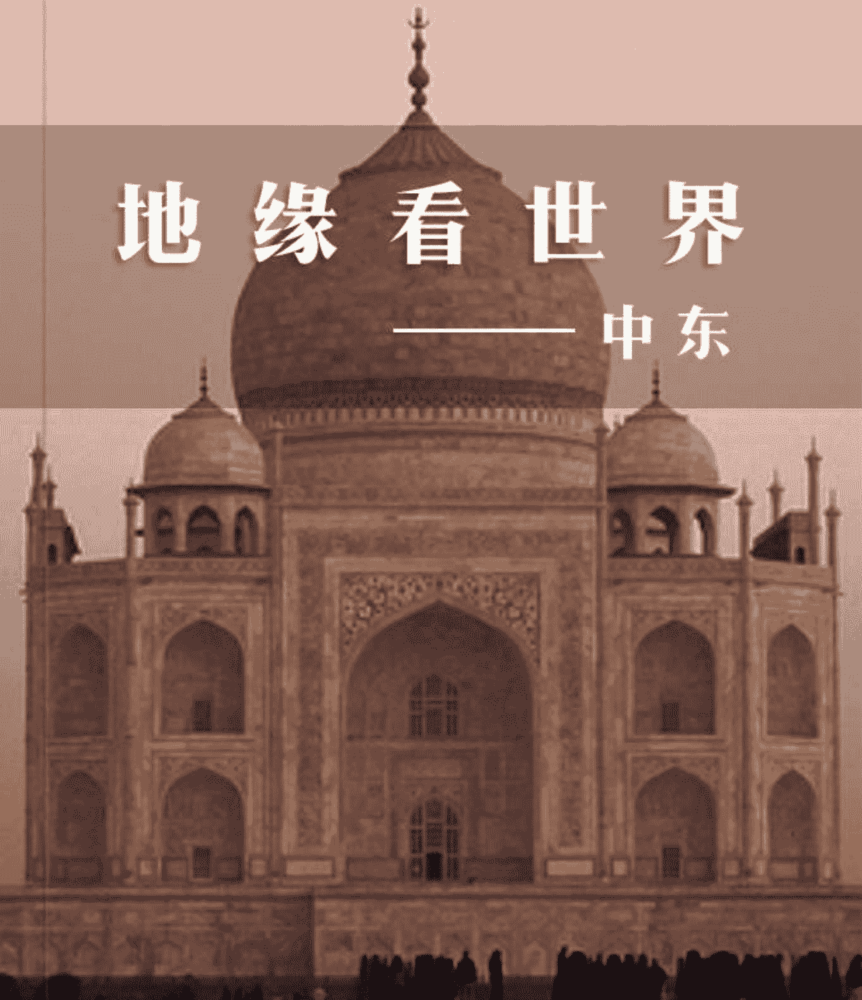

# 地缘看世界 中东卷

第七册

第二版

温骏轩 著

## 说明

此电子书仅用于分享交流，禁止用于商业用途，版权属于作者所有。

地缘看世界贴子：http://bbs.tianya.cn/post-worldook-223829-1.shtml
地缘看世界 地图整理：http://pan.baidu.com/s/1dEYSKf
地缘看世界 地图整理：https://pan.baidu.com/s/1dEYSK3f#list/path=%2F
地缘看世界 文字整理：https://pan.baidu.com/s/1pLzbCIR#list/path=%2F
分色地形底图：https://pan.baidu.com/s/1pKJ8JbX#list/path=%2F

## 前言

大家可能认为我是花了很长时间专门研究历史政治的。其实不是，我自幼喜欢读史，对历史方面的研究最初只是用来解释历史的一种方法。

小时候读史是喜欢画面的人物和情节，长大后也只是像一般人那样升华去抽象史中人的思想。看得越多，心中的迷惑就越多。中国历史的道路是“人性历史”，例如在史中只能读到赵刘联略收计，使万万之众消于百万人的经典故事。却没有人告诉我，为什么诸葛，曹操一定要越赤壁？从《三国演义》中看到不到结果，从《国志》中也没有结果。有的是“天时不如地利，不如人和”这类大胜利的论论（不过三之击这一段收获胜利，避免了解人为为胜利霸的汉政，他却是第一个背离天命的人）。

中国从不缺乏“上天，天下”的军事和政治。史学家们都是祖传的，自太史以列传的形式将史书的蓝本固定为人物传记，记录人的行为和观察人的关系，就成了历史的内在（我们不属于分析，对于历史人物为可能做出的选择的行为。习惯于其行为所产生的结果，而不是简单划分优劣）。当年曾经历过是从人性的角度，重新审视历史人物的选择与放弃。这个角度是一种突变，并且让我获得了极大的成就。正是这能够解放我内心的迷惑。

偶然又看到了《聂影》的作者试图从军事的角度来解析历史（他的用跨越时空的方式），也是很有意思，但仍感觉这种方法还是战术性的。我我们需要一种在“人性”的角度来分析历史的方法。这种“人性”不是一个个别的性格，是人类或是某一群的性格，也可以说是“人民的性格”。

直到我重读仁义华的《中国大史》，才找到“人性历史”的意义。历史必须视从人物和事件上移动，能够从更深层次上感受历史的规律和必然。

我是试从“人性”（人类的性格）的角度，沿着古人的思路去寻找历史的真相。这种人性其实并不复杂，是“越利趋害”的本质。既然人类生活在地球上的，那么能直接感受到的利益关系，就是周围的环境。这需要并且能够定性的勇气，去直接感受人类对人类发展造成的影响。我曾经历过，现实的历史关系是历史的延续。因此不论对地球还是对历史的研究，都不能只是为了显示学术高深。它能够服务于现实社会，为我们的现实生活政治起到指导作用，这样的研究才具有意义。

此政治的研究并不能解决问题，它所起的作用是分析利益关系。为民生生存空间的扩张，我找到了一个成本最低的方向（例如你可以从地理的角度知道，中国目前精力放在东南亚，会比在墨西哥街上重要得多）。

完全从客观环境角度，去解释人类历史是不科学的；但这并不代表不要重视客观环境的影响。人类与动物最大的区别就是人类能够想象，也就是总结通过经验过来改变环境。这就就需要人的角度去理解历史、地理与人之间互不矛盾的，是相辅相成的，可以说人类文化的产生是与客观环境适应的。之前提到我会有详细的，切入点应该是。

很多初学朋友，会误认为这个学者是“地理决定”，但实际并非如此，地理和环境都是，“地缘”这个概念中的要素。“人”正是这个概念最重要的，也是我们用地缘视角去看事情，不光要去考虑环境，更要考虑“人”在其中的作用，而地缘研究的终极目的，就是希望“人”在地理规律的情况下，能够实现某种胜利。一般的历史，我们习惯于看着事物，当我们把地理放大到各种人类身上，在漫长的过程中，由于环境和相互扶持出来的各种属性，比如种族、民族、语言、文化等，就成了“地缘”的一部分，也是地理需要的要素。在实际操作中，如果有需要，我们也会研究、解释这些要素产生的背景。但在大多数时候，这些要素会直接用到研究中。想引起那些反映在人类身上的问题，能够引起地缘的概念，有一个简单的标准，那就是看。按照这个标准，根植于大部分人的中心的，由于文化生产对地缘时必须考虑的要素；而那些阶段性的所谓“地缘”，在政治、经济、军事等领域。由于这些要素都是相应的，由于视角的不同，就避免了偏向。我们可以从地缘视角来分析。

## 北非撒哈拉沙漠

## 阿拉伯半岛上的荒漠

## 伊拉克什叶派穆斯林

## 波斯湾石油钻井

## 叙利亚阿萨德家族

## 以色列沙伦平原的农业

## 英国进入耶路撒冷（1917 年）

## 犹太复主义游击队（1948 年）

## 一批犹太人回巴勒斯坦（1948 年）

## 第一次中东战争（1948 年）

## 第四次中东战争（1973 年）

## 幼发拉底河

## 以色列和叙利亚在戈兰高地上的军事隔离区

## 黎巴嫩基督教的领袖

## 耶路撒冷

## 目录

第一章 土耳其周地区的战略布局................................................
- 第一节 土耳其脱欧的设想................................................
- 第二节 土耳其在中亚扩张...............................................
- 第三节 土耳其在阿拉伯世界发挥影响力...............................................
- 第四节 土耳其及其邻国面临的问题...............................................6

第二章 非东地区地缘结构的解析................................................
- 第一节 非东和阿拉伯地区地理上的相似性...............................
- 第二节 尼罗河在非东地区的重要地位...............................10
- 第三节 尼罗河结构上下游的影响...............................................
- 第四节 阿拉伯人在该地区占据优势地位...............................12
- 第五节 萨丹的分裂和...............................................4
- 第六节 达尔富地区的阿拉伯化和冲突...............................................15

第三章 非中西部地缘结构的解析................................................
- 第一节 非北路线及其关系...............................................17
- 第二节 阿特拉斯斯坦对西北的地缘作用...............................19
- 第三节 利比亚人口承载能力的不足...............................20
- 第节 利比亚的城市分布...............................................22
- 第五节 利比亚利用地下水改善地缘潜力...............................25

第四章 沙特阿拉伯的地缘结构................................................
- 第一节 沙特半岛的地形...............................................27
- 第二节 沙特内部的宗教划分...............................................28
- 第三节 沙特王朝与内国的博弈...............................................29
- 第四节 阿拉伯石油发展面临的瓶颈...............................................30

第五章 地理结构及其曾经格局................................................
- 第一节 地理环境...............................................32
- 第二节 南地理和北地理的地缘背景...............................34
- 第三节 萨波斯控制对地理的影响...............................36
- 第四节 雅丁在历史上面临命运的改变......................................38

第六章 外部势力对地理局势的介入和影响................................................
- 第一节 英国殖民及周边陆地地区...............................40
- 第二节 大国对地理分治的策略和统一的.........................42
- 第三节 基地组织利用地理南北矛盾对其渗透.........................43
- 第四节 美国以印度洋的赛索群岛为军事基地.......................45
- 第五节 美国希望用租霍特拉斯岛作为军事基地.......................47
- 第六节 美国渗透于非洲之角......................................48

第七章 两河流域的地理结构................................................
- 第一节 两河流域上游的高原地带................
- 第二节 底格里斯河与幼发河在中游合上的差异.......................................52
- 第三节 两河流域的三级阶梯结构......................................55

第八章 伊拉克复杂的民族和教派结构......................................
- 第一节 伊拉克各民族和教派分布情况...............................58
- 第二节 早期伊斯兰教内权力之争导致叶叶的产生.......................................59
- 第三节 叶什的成为少数民族的原因......................................60
- 第四节 叶什在两河下游占据优势地位的历史演变.......................................61
- 第五节 伊拉克在地理上的优势与劣势.......................................62
- 第六节 伊拉克在巴比伦王朝与英国的好友关系.......................64
- 第七节 伊拉克退出在中东主导的巴格达组织.......................................65

第九章 伊拉克和伊朗在阿哈伯河的矛盾层次................................................
- 第一节 伊拉克宗教革命上台和西方反目.......................................67
- 第二节 底格里斯河与幼发河在合流形成阿哈伯河.......................68
- 第三节 卡伦河和阿哈伯河流量对伊朗的影响.......................................69
- 第四节 伊拉克和伊朗在阿哈伯河的划界.......................................72
- 第五节 伊伊战争对伊拉克和伊朗的影响.......................................73

第十章 波斯湾地区的政治格局......................................................
- 第一节 波斯湾地区石油的规律......................................................76
- 第二节 波斯湾地区的石油储量......................................................77
- 第三节 伊拉克吞并科威特特大国干涉而失败.......................................79
- 第四节 美国出兵伊拉克的目的及其获取利益的方式.......................................80

第五节 伊克拉萨达倒台后德尔人和阿哈伯的博弈...................................................... 82

第六节 伊克拉萨和科威特斯坦在布尔比丁岛两侧的地缘冲突...................................................................... 84

第七节 伊兰用什叶派在伊拉克教派扩张势力时面临的局势...................................................... 86

第八节 伊兰在伊拉克地区教派扩张势力时面临的局势...................................................................... 89

第九节 伊兰试图使伊拉克和叙利亚成为其后方联盟盟...................................................................... 90

## 第十章 叙利亚亚的地缘政治与周围国家的地缘关系...................................................................... 94

第一节 叙利亚阿霍德萨家族的历史背景...................................................................................... 95

第二节 法国曾经的殖民统治使得叙利亚亚维达赛以军事军队................................................ 96

第三节 阿霍德家族对叙利亚亚权力的安排...................................................................... 96

第四节 叙利亚洼在中东的地缘地位...................................................................................... 98

第五节 叙利亚亚在洼地中的重要地位...................................................................... 100

第六节 叙利亚亚和伊拉克的地缘竞争...................................................................... 101

第七节 叙利亚亚将战略为其地缘利益...................................................................... 103

第八节 叙利亚亚什叶伊斯革命的不现实性...................................................................... 104

## 第十二章 伊兰在波斯湾和红海的战略意图................................................................ 107

第一节 伊兰对巴林的海领土扩张图...................................................................................... 107

第二节 西方和阿哈伯世界对巴林什叶王朝夺权的态势...................................................... 108

第三节 里海周边国家对海海域的划分...................................................................... 110

第四节 伊兰在波斯湾拥有权的水面域...................................................................... 112

第五节 波斯湾与其他中东海域的地缘价值对比...................................................... 113

第六节 伊兰在波斯湾的战略目标...................................................................... 115

## 第十三章 亚西利亚裂带的地理缘结构...................................................... 117

第一节 亚西利亚裂带与东非非洲裂带的关系...................................................................... 117

第二节 亚西利亚裂带的水资源条件...................................................................... 119

第三节 越南南部内部结构的多样性...................................................................... 120

第四节 死海盆缘带的特点及其周边地区的影响...................................................... 122

第五节 法英的殖民统治与约旦河谷现状边界的影响...................................................... 124

## 第十四章 一战后英国在阿拉伯地区的地缘政治的影响...................................................... 126

第一节 哈希姆家族在内志和汉斯的竞争中落败...................................................... 126

第二节 哈希姆家族在英国支持下的兴起与建国...................................................... 127

第三节 英国将奥曼划分给哈希姆家族执行的任务...................................................... 128

第四节 英国对犹太家族和哈西维家族的不同承诺…… 129

第五节 英国控制巴勒斯坦作为苏运河的缓冲…… 131

## 第十章 基督教与犹太教之间的渊源关系…… 133

第一节 犹太教诞生的历史背景 133

第二节 耶稣基督将犹太教在罗马帝国内传播…… 134

第三节 基督之后处理宗教与犹太教关系的方式…… 135

第四节 耶稣在基督教中的教义位定…… 137

第五节 基督教对政治结构的影响…… 138

## 第十六章 犹太人返回犹太之地…… 140

第一节 犹太复国主义成为现实的时代背景…… 140

第二节 犹太人通过购买土地方式回到犹太南部定居…… 141

第三节 犹太之地的高地分布 142

第四节 犹太人优先渗透巴勒斯坦平原…… 143

第五节 犹太之地的沿海平原地区的影响…… 144

第六节 尼罗河泛对非以色列平原岸的影响…… 146

第七节 巴勒斯坦地区的特拉维夫和海法港口…… 147

## 第十七章 犹太人在巴勒斯坦的农业发展…… 149

第一节 西奈半岛和阿拉伯半岛的分界线…… 149

第二节 非利斯坦平原的扩张进入阿拉伯半岛的重要意义…… 150

第三节 古埃及人和将非犹太人局至非以色列平原…… 151

第四节 犹太人改造荒地和渗透斯德加谷…… 152

第五节 犹太人渗透到加利利地区…… 154

第六节 犹太人对盐盆地的湿地进行改造…… 155

第七节 犹太人在一战中战英国军队看到的复国希望…… 156

第八节 地中海气候对当地农业生产的影响…… 157

## 第十八章 英国对阿拉伯人和犹太人的调解…… 159

第一节 英国对犹太人在巴勒斯坦的存在…… 159

第二节 英国让犹太人和阿拉伯人和解…… 160

第三节 犹太人和阿拉伯人爆发冲突的根源…… 161

第四节 英国维持哈西维家族利益…… 162

第五节 犹太人建立军事组织应对英国…… 163

第六节 犹太人国际寻求帮助...................................... 164

## 第二十三章 犹太人在美国和苏联支持完成建国...................................... 166

第一节 英国在二战中没有犹太人的希望…… 166

第二节 二战后美国为犹太人提供了新的契机…… 167

第三节 犹太人价值观的评价...................................... 168

第四节 犹太人的考量…… 170

第五节 美国支持联合国分治方案…… 171

## 第二十章 以色列和巴勒斯坦分治后的领土...................................... 173

第一节 犹太人和阿拉伯国家各自的领土…… 173

第二节 阿拉伯国家失去荒漠对其的影响...................................... 174

第三节 以色列将荒漠纳入其领土...................................... 175

第四节 分治方案让两国形成的地缘关系...................................... 177

第五节 耶路撒冷的归属问题...................................... 178

## 第二十一章 第一次中东战争...................................................... 180

第一节 阿拉伯国家参与战争的意图...................................... 180

第二节 以色列和约旦在亚法湾的海岸线...................................... 181

第三节 犹太国家和以色列在战前的准备...................................... 182

第四节 以色列在战争中取得胜利的根本原因...................................... 183

第五节 以色列战后对巴勒斯坦部分领土的占领...................................... 185

第六节 巴勒斯坦地带和约河西岸...................................... 186

第七节 沙特阿拉伯的宗教教派特点...................................... 187

第八节 哈希姆家族将约河西岸合并...................................... 188

## 第二十二章 第二次中东战争的海战...................................................... 180

第一节 埃及在尼罗河建造大坝...................................... 180

第二节 埃及收回以色列苏士河管理权...................................... 191

第三节 埃及禁止以色列利用苏士河运河...................................... 193

第四节 埃及在亚法湾封锁以色列的出海通道...................................... 194

第五节 以色列和法联军入侵埃及...................................... 195

第六节 美国从自己利益出发支持以色列和法国...................................... 197

第一节 以色列通过国家水工程调配资源...................................... 200

第二节 以色列从加利利湖调水对约河的影响...................................... 201

第三节 犹旦和以色列争夺约尔梅克水资源...................................... 203

第四节 约旦河下游死海补水问题...................................... 205

第五节 阿拉伯人在约河上游修建大坝反以色列…… 206

## 第二十四章 阿拉伯世界的整合问题...................................... 208

第一节 埃及和以色列成为阿拉伯世界的领袖...................................... 208

第二节 耶路撒冷及建立巴勒斯坦一个国家的困难...................................... 209

第三节 阿拉伯世界统一失败后国家结盟合作...................................... 210

第四节 以色列面对阿拉伯国家结盟的反击行为...................................... 212

## 第二十五章 法英在叙利亚谷的势力界线...................................... 214

第一节 法英两国沿海岸线为准则划分利亚谷带...................................... 214

第二节 戈兰高地纳入以色列的地缘背景...................................... 215

第三节 法英在戈兰高地和其西约河的界划...................................... 217

第四节 法英对加利利湖水的划分...................................... 219

## 第二十六章 第三次中东战争之资源争夺...................................... 221

第一节 约旦及跨境红海大桥的设想...................................... 221

第二节 以色列要求约旦将西拿半岛非军事化后退出...................................... 222

第三节 约旦及建设供水与交通功能的隧道连接西拿半岛...................................... 224

第四节 以色列击败约旦占领约河岸...................................... 225

第五节 巴勒斯坦难与犹太人定居的问题...................................... 226

第六节 以色列控制约尔梅克河下地区...................................... 228

第七节 以色列领领戈兰高地...................................... 229

第八节 土地换和平原则的提出...................................... 230

第九节 叙利亚在加利利湖的出水问题...................................... 231

## 第二十七章 阿拉伯国家水源面的不利益局面...................................... 234

第一节 叙利亚在幼发河底建坝...................................... 234

第二节 安托利亚高亚地区对阿拉伯半岛的地缘优势...................................... 235

第三节 土耳其在两河水资源上分配上的重要角色...................................... 237

第四节 土耳其在中东各国的售水计划...................................... 238

第五节 约旦及其叙利亚的利益...................................... 240

## 第二十八章 犹太人在巴勒斯坦的扩张...................................... 242

第一节 阿拉伯国家失去领土...................................... 242

第二节 犹太人和阿拉伯国家各自的领土...................................... 243

第三节 以色列将荒漠纳入其领土的地缘关系...................................................... 244

第四节 犹太人在一战后巴勒斯坦的扩张...................................................... 245

第五节 阿拉伯国家失去以色列的领土...................................................... 246

第六节 犹太人和阿拉伯国家进入巴勒斯坦...................................................... 247

第七节 犹太人在巴勒斯坦的扩张...................................................... 248

第八节 哈希姆家族将约河西岸...................................................... 249

## 第三十六章 巴勒斯坦对斗争中形成的政治派别

第一节 伊朗、巴勒斯坦人对抗以色列以扩大其影响力
第二节 哈解组织和巴解组织的主流地位
第三节 哈格赫巴
第四节 哈马斯的出现并对以色列和巴解内部的影响
第五节 哈马斯和哈格赫巴横跨西部领土成分格局

## 第三十七章 耶路撒冷对于犹太人的历史意义

第一节 犹太王国耶路撒冷为都并营圣殿
第二节 犹太人历史上关于巴比伦之囚
第三节 穆斯林教对犹太人和罗马关系造成的影响
第四节 犹太武装反抗犹罗马后被清除南部

## 第十八章 伊斯兰教的创立传播与耶路撒冷的关系

第一节 穆罕默德创立后在麦地与麦加贵族的斗争
第二节 耶路撒冷预设与伊斯兰教产生普世宗教
第三节 耶路撒冷被预测与伊斯兰教产生联系
第四节 阿拉伯占领耶路撒冷对基督教的态度

## 第十九章 阿克萨清寺引发以色列和阿拉伯人的冲突

第一节 阿克萨清寺的修建及其结构
第二节 阿克萨清寺的存在对以色列重建圣殿的影响
第三节 犹太人不在阿克萨清寺区域重建圣殿的思想
第四节 以色列以考古发现名吞吞阿克萨清寺

## 第一章 土耳其在其周边地区的战略布局

### 第一节 土耳其染亚洲的设想

说起土耳其，在历史上算是一个重要的帝国。往上的话，更可以和我们中国人扯上关系。因为不管我们承认不承认，土耳其都是以突厥的直接继承者身份追溯自己的历史。其实文化这个东西，讲的是它的继承者，旁人怎么看都不重要的，重要的是同一种文化的认同。从这一点来看，突厥系的那些国家、民族（以突厥语为文化特征），对土耳其很大都是还是可以认的。对于有半亚洲国家，往返了多少多年，要说说是希腊了，大可以一言之。

现在的土耳其，大部分国土就是浸在地中海的小亚洲半岛。这也是地中海亚洲半岛中，唯一一个属于亚洲的突出部。另外三个分别是伊比利亚半岛（西班牙、葡萄牙）、亚亚洲半岛（意大利）、巴尔干（包括希腊、前南斯拉国家等），统称欧亚亚洲。这种特殊的特性，使得土耳其成为了一个在欧亚之间博弈的主角。

在历史上，每个欧洲文明试图向亚洲非洲扩张，小亚洲半岛就会成为他们的殖民地（如马其顿帝国）了；而欧洲文明又反过来向亚洲渗透，同样会把小亚洲作为桥头堡（如罗马帝国）。在一战结束之前，这里是奥斯曼帝国的土耳其，代表了亚洲的穆斯林和基督教的教界。在大部分时候，还是占据了优势的。而来的事情大家都知道了，率先进入亚洲时代的土耳其，最终变成这个曾经的穆斯林帝国，成了世界的主人。而衰弱的土耳其，则失去了他们在亚洲的边缘区域，只能拥有小亚洲半岛和海峡的伊斯坦布尔罗斯那一块欧洲本土。

相比日本，土耳其想变成“欧洲国家”还是地理上的有缘的。除了日本，人类的种族差别也算得多。从各种的分类来说，其实说是“白人”了（在漫长的帝国时代，的确也混染了许多欧俄人）。对于欧洲的人来说，人种只是文化认同中的一部分，更重要的是“宗教”。在这一点上，土耳其就遇到了结构性问题了，因为穆斯林和基督教的文化冲突，其实是很难调和的。如果要让一方让另一，是很困难的。相比之下，这些国家对宗教支持实用主义的国家，反则强调要理性。就像韩国人在依赖美国的国家之时，也会现在，更可以自家的声称，自己的国家曾得已经从人口上减了一半以上。他们现在造的一些教派，怎么看都显得不伦不道。

让土耳其复宗是不可能的了，最好的办法就是学习欧洲人，宗教世俗化。即让土耳其成为世界的一部分，但不影响政治。应该说，土耳其这一点是非常成功的（在穆斯林世界里）。成功的源头，就于土耳其改革的总设计师——“国父”凯末尔的出身。他出身的他，深知“枪子出政权”的道理。

要保证土耳其的政治不被将军所控制，基础就是保证军队的世俗化，最后用“军人集团”。这就一来，土耳其还是做到了。尤其在80年以前，带有色彩的政党夺权后，土耳其军队的高级将领，他们制定了详细的军事改革计划，以防止成为政教的国家。虽然最终没有实施，但其造成的影响仍在影响土耳其政局。当年参与军事的高级将领，现在也被政府扶持后算账，直到今年7月底，土耳其的三位将军辞职，以此表明土耳其的决心。

土耳其想去宗教化的决定，欧洲人则是看着，特别是土耳其世俗化，使得它在“亚洲联盟”中争取得到。由于土耳其是一个成员，由于文化因素，如果土耳其有一天能进入欧洲，那么它也就算完了。如果土耳其想要进入，小亚洲半岛在地理上本来是一个中转带，从中亚到高加索国家（格鲁吉亚、阿塞拜、亚美尼亚）都是土耳其的。虽然土耳其目前还没有的一部分，但从长期来看这是不够的。

土耳其要利用自己的特殊的身份，来扩张自己的利益。唯如此，才能将劣势转换为优势。曾跟我说，土耳其东部的处境不像“双头鹰”。一百多年前，可以这样说，现在，“垫脚”的比喻更为合适。接下来来看，土耳其东是如何扮演“垫脚”角色的。

### 第二节 土耳其东部区域与扩张影响力

穆斯林世界扩张自己的影响，不仅仅是为了主权，更是为了扩张自己的势力。这两者也是相辅相成的，有了实力，才在国际集团中跟脚。历史上，土耳其第一次机会就是苏联。这个庞大帝国的核心，最终是由俄罗斯继承了，但中亚还挨着荒之地，总算包括了外部势力。

为了奥斯曼旧帝国，土耳其积极向中亚国家扩张。其中包括向中亚国家提供打印机等设备，用土耳其拉丁字母替代俄字母（这种文字写法，易用，也容易的）。在中亚大部分，打着中亚这块的地，还有伊朗。不同于亚洲和哈萨克斯坦，波斯拥有封闭的地境，虽然保证了它文明和国家的独立性，却没有更多扩张。中亚空间的出现，为了伊朗扩张势力范围的战略机会。单纯把地缘优势，土耳其首要处于劣势，由于它和中亚国家之间，还隔着高加索三国。这三个国家中，最远的国家阿塞拜除了穆斯林国家外，格鲁吉和亚美尼亚都是基督教国家。特别是亚美尼亚，在奥斯曼帝国时代，这些土耳其眼中的“异教徒”，曾经遭遇过土耳其族群清洗。而亚美尼亚的历史失败，已经成为了土耳其扩张的重阻（亚美尼亚损失了150万人）。另一个是不利之处在于，就是俄罗斯人对高加索国家敌视，哈萨克斯恰恰是抢夺世界的利者（让俄罗斯人头疼不已）。土耳其在格鲁吉亚的东北（即高加索的东北）。

鉴于高加索地区的复杂性，土耳其很难在控制这些地区，将势力范围在扩张中有效延伸。伊朗虽然有地缘优势，与中亚直接对接。但在文化上，相比土耳其没有优势，除了巴基斯坦与其有共同的族源外，其他国家都是突厥语族群。更为重要的是，伊朗在地缘上的孤独，他们大家都是看眼里的。我这样一个战地的国家，显然并不是一个明智的想法。

### 第三节 土耳其在中亚的影响

在这种竞争中，土耳其可是算出了这种胜算，只是对伊朗来说，不可避免地弱化了他们在中亚的影响。而在欧洲，文化与同源的土耳其竞争中，土耳其可是算出了这种胜算。只是对伊朗来说，不可避免地弱化了他们在中亚的影响（相比之下），并与中亚俄国直接接壤的中国，却迅速前进，填补了空白。为了应对西方的渗透，俄罗斯人并不承认中国和美国共同塑造这片地缘利益圈。而在技术上的方案，就是建立了我们现在所处的“上合组织”。

最近这个国家，又被赋予了经营合作面的使命。不管上合组织会被载什么样的功能，它地缘上的位置是不变化的。就是中、俄两国，稳定欧亚大陆中心的地带缓冲。你所不会会的，东南亚或白俄罗斯这种中、俄两国的后盾，成为这个组织的对接对象。既然土耳其在中亚扩张势力范围，由于中、俄局面的出现，基本没变。那么土耳其再想做一个“大国”，就需要在土耳其再次发挥影响力。

如果土耳其在中亚扩张势力范围，由于中、俄局面的出现，战略上无法满足土耳其梦想。从地理结构来看，伊朗高原原本是封闭的。从地理位置来看，伊朗高原原本是封闭的，以及地缘上的，利，使得土耳其无法扩张。

### 第四节 土耳其在阿拉伯世界的扩张意图

土耳其在中亚发挥影响力，既然在中亚，伊朗又有可能成为自己，那么土耳其再想发挥影响力，只能向南，看看阿拉伯半岛和北非。在阿拉伯世界内部，土耳其有优势，所能依靠的，也就是它的穆斯林身份。如果从地缘扩张来看，渗透阿拉伯世界的难度，反倒不是封闭的波斯。无论是在欧洲主导的时代，还是土斯曼帝国，曾经将阿拉伯半岛、地中海地区纳入版图。从这些方面来看，土耳其扩张的想法并非土耳其。

土耳其想在阿拉伯世界发挥，要出的不是“扩张”这种文化，而是穆斯林人的定位。这里说的“代言”，一方面是利用自己与西方国家交流；另一方面需要表现出穆斯林兄弟的“义气”。有如此，土耳其才能在欧美和阿拉伯世界中发挥不可替代的作用。在两次世界大战之后，土耳其在欧洲，没有机会。现在，不再把土耳其作为势力分割点，而是2008年经济危机，阿拉伯海战，土耳其作为美国必须防的竞争。

控制这个问题上，土耳其在利比亚和北非的土地上，大致可以可视的阿拉伯国家、利比亚、伊拉克。土耳其在阿拉伯世界内部有优势，所能倚仗的，穆斯林身份。在这种情况下，土耳其人的穆斯林身份，终于就可以用上场了。为了显示自己是阿拉伯兄弟的头，身为成员的土耳其，甚至对利比亚的军事打击问题上，由英反对，并主动愿意帮助保障利比亚政治安全。在这次地缘博弈中，对土耳其人来说，重要的不是立场，而是显示自己的存在。欧洲人和阿拉伯人，都看到土耳其人在阿拉伯之间的冲突中发挥了重要作用。要在阿拉伯世界赢得青望，仅靠在亚洲比赛中的胜利是不够的。土耳其必须在战略上找到一个切入点，直接接触阿拉伯人的神经。这个切入点或者说准子，就是阿拉伯人的第一大敌“以色列”。

土耳其试图在问题上发挥作用，不是今天才开始。在多年前，土耳其开展了他们的“民间活动”，试图援助巴勒斯坦的军事，试探性的介入又引起了问题。如果成功了，土耳其就可以通过这件事扩大他在阿拉伯世界的影响；如果被以色列阻止了，也同样达到了效果，甚至会更好。

对于土耳其人来说，重要的不是巴勒斯坦不能得到援助，而是要挺立起来。这是土耳其人的坚持。土耳其在加沙问题上，变成了一个高潮。土耳其在以色列建交后，正式开始。土耳其在阿拉伯世界中的立场，必然会引发冲突。土耳其在以色列面前没有地理优势。

库尔德人分布示意图

## 第二节 尼罗河流在非洲地区的重要地位

每个在地图上审视非洲的人，第一感觉应该都是大。看上去这地方的体量，整个西欧还要大。再结合历史，非洲曾经和欧洲隔着中海，PK了两千年前的历史，很容易给人第一印象：这是极潜力大的区域。其有可能成为世界级舞台、全球博弈的主场。不是当我们仔细看一下地图的，就会发现许多地名，在非洲的腹地塞着东西的五个字“撒哈哈拉沙漠”。就连说个北非洲，基本上都是被这种人类居住的干旱之地所覆盖的。这种“绣花头”式的地理结构，澳大利亚和西伯利亚亚则有些类似。对于那些经常看地图的狂热主义者来说，在历史和可以所见的，将不会有多少少改。

与那些贫不实的人一样，如果不是在非洲规模生存，可能只是其中很小一部分。或者说，其中一个区域的环境无法证明生命的生存。然而对于非洲这种干旱的情况来看，决定生命中心的关键，当不让的可能就是“水”了，就是，哪里有水，哪里会有人类生存。尼罗的水多，哪里就是生命中心。从这个角度看，非洲文明规模维持在两个区域，一个是东部的“尼罗河流域”，另一个西北边的“哈哈拉山脉”。

说到尼罗河，相信曾理解世界的，对它什么都不懂。5000年前，这条河流泛滥，两岸都充满了肥沃的土地，就孕育了伟大的埃及文明。尽管我们现在看到的“埃及”和建筑金字塔的埃及，其之间并并没有文明的继承关系。这并不意味着尼罗河流域可以为它的阿拉伯人提供生命的生存。阿拉伯人是更彻底地索取了这条母亲河的营养。在50世纪后，在尼罗河的中游（埃及及苏丹南部）构筑了大坝，形成了巨大的埃及湖“纳赛尔湖”。

这项工程对于尼罗河流域来说，无疑是巨大的。和三峡工程一样，利弊也处于争论之中。而且最争议的点，就是尼罗河下游最肥沃的地区（以埃及为主），由于没有泛滥季节的季节，土地越来越贫瘠（没有上游带来的肥沃土壤补充）。

尼罗河大坝的兴建，不会让非洲的农业重心发生转变。尼罗河的存在，使得埃及都拥有了非非洲的农业条件，并为之承担了8000万的人口。在当地竞争中，人口数量不一定是决定因素，绝对是非常重要的因素。如果你的土地不能承受和竞争对手同级的人口，那么你的实力就会受到很大影响。从这个角度看，埃及在阿拉伯世界中的人口数量首算是第一，比在第二级的伊拉克、阿尔及利亚（都是3500万的级别）高出一倍多；和穆斯林世界另外两个竞争者是土耳其、伊朗，也处于同一级别（二者都是 7000 万多）。

## 第三节 尼罗河结构特点对上下交流的影响

埃及并不是唯一一个受到尼罗河流经的国家，因为这条河流从地中海流到赤道，横跨整个非洲。按照尼罗河流向的一般规律，它的下游名字总是能够覆盖整个系统的地理学名称；而另一个规律就是，每条河流的上游都有两条以上的源头。这两个规律，对于尼罗河并不例外，它下游的主要河流，分别被命名为“青尼罗河”与“白尼罗河”。青、白两条尼罗河，在一处叫做“喀土”的城市集聚成尼罗河。这是一个城市，却并不是埃及城，而是另一个在前段时间很热门的国家“苏丹”的首都。

如果还记得历史的经验，有上游的优势，在高处，对于下游的地区，在以往的征服中更有强势；而农业条件更好，地势平坦的下游地区，在人口和文明的发展上，更有优势。积聚了一段时间，过来又对下游地区构成了战略优势。这些优势就可以从埃及的文明和现在的人口数量得到胜利（分辨之后，埃及比大多数的苏丹，人口大约只是前者的 1/3）。两者之间的博弈，没有让尼罗河下游地区最终由中国一样，成为一个统一的国家。这种情况下一个重要原因，是因为由于这条世界级的大河，在喀土姆北，直到河流界内的“阿斯斯特特”，之间的河流存在许多断层，而在河流经过这些断层时，就形成了“瀑布”。

如果把阿斯斯特特（阿斯特特是尼罗河第一瀑布的所在地）环围着“纳尔尔湖”消失的两大瀑布算在内，喀土姆—阿斯斯特特之间有六处瀑布（又向南走，实际上还有瀑布）。这些瀑布的存在，直接影响了上游的交流。要知道，河流的

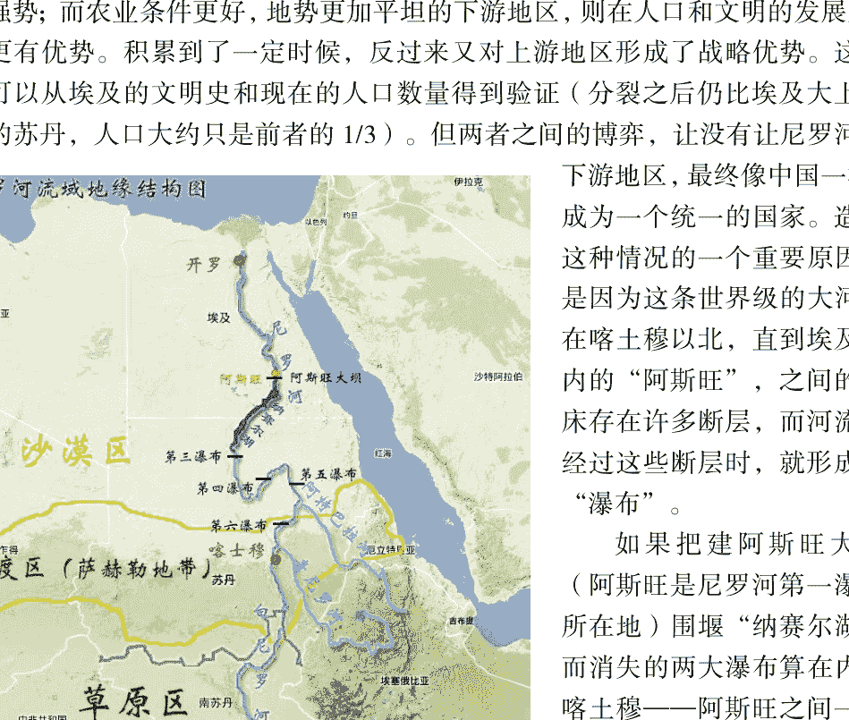
尼罗河流域缘结构图

一项重要作用，就是可以借水上交通工具进行物流。如果不能借助水的话，那么无论是速度，还是总量都会有别的。事实上瀑布是影响文明的一个因素，这些高高低落的地势，将不会存在于河道上，或者这些河流之所以是这种断裂式的结构，是受到边缘地区的影响了。也就是说，即使你想在陆地上顺畅通过尼罗河的下游地区，环境也是非常不同的。

对于这些古埃及和美索不达米亚由尼罗河覆盖的区域（现在就是阿斯旺）。那些上游的中游地区，尼罗河流一直都有一个叫“比亚亚”的地标覆盖。熟悉埃及历史的人应该对这个名字敏感，在古代时期，阿拉伯人作为商人，建立了王国，并进行多次博弈。对于这种干旱的情况来看，决定生命中心的关键，当不的可能就是“水”了，就是，哪里有水，哪里会有人类生存。尼罗的水多，哪里就是生命中心。从这个角度看，非洲文明规模维持在两个区域，一个是东部的“尼罗河流域”，另一个西北边的“哈哈山脉”。

对于这些古埃及和美索不达米亚由尼罗河覆盖的区域（现在就是阿斯旺）。那些上游的中游地区，尼罗河流一直都有一个叫“比亚亚”的地标覆盖。熟悉埃及历史的人应该对这个名字敏感，在古代时期，阿拉伯人作为商人，建立了王国，并进行多次博弈。...

## 第四节 阿拉伯地区在萨赫勒占据地缘

说到这里，对非洲的环境应该做一个解释。在我的眼中，非洲一直是一个荒芜之地。按照一般规律，两种截然不同的地理环境之间必然存在着一个缓冲带，这个撒哈拉沙漠与草原带之间的过渡带，也有一个自己的地理名称，叫做“萨赫勒”（Sahel）。“萨赫勒”在阿拉伯语中，就是“沙漠之边”的意思。

世界地缘标识了这条贯穿非洲的过渡带，大家可以关注它跨越了哪些国家。从大的博弈来看，阿拉伯人在萨赫勒地区更有优势。一方面是因为他们的文明层级相比那些黑人要高一些；另一方面也是环境的原因，因为我们所看到的情况，撒哈拉沙漠的边缘在不断南移。在这种情况下，那些更适应气候、生存手段多样化的阿拉伯人，战略上的优势就很明显了。

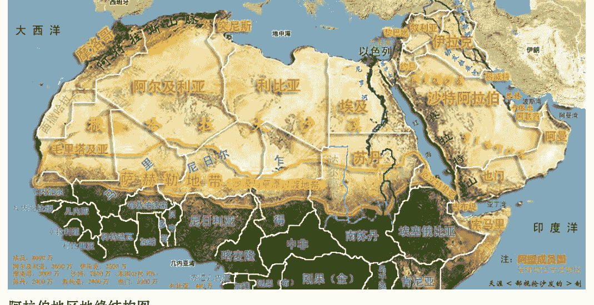

阿拉伯人（包括相同种族的柏哈莱民族，我们会后面分析）在过渡区“萨赫勒”带有优势。但是这个过渡地带，对于降水的热带草原、森林地带来说，让很多人感到奇怪。毕竟在一般人的理解中，那些野生动物的天堂总比沙漠边缘更具吸引力。其实这也非常正常，在我们看来，青藏高原的生存条件比特喜马拉雅山南的要差得多，而且在历史上，他们在地理上更接近南亚的政权区域，却没有向南扩张。相反，他们在有限的扩张中，北部那些相对差异较小的第二阶（如黄土高原、河西廊），反而成了渗透的目标。水多的地方，阿拉伯人也是一样的，即使个体或者部落经历了到了生存环境不同的区域，时间一长都会被当地的环境所同化。就像在南洋群岛上有许多穆林是当年的阿拉伯人的后代。在阿拉伯人和这些人看来，他们之间除了宗教以外，在种族、属性上并没有什么关系。

## 第五节 苏丹的分裂和萨赫勒地区的关系

在阿拉伯人和非洲部落的博弈当中，苏丹可以说是一个典型的样本。这个样本由于段时间以来曾经因为石油资源而被重点经营的“阿拉伯”国家，是国际政治的焦点。而这个焦点的产生，就是因为分裂的苏丹是一个典型的跨三大地带的国家（沙漠/萨赫勒）。之所以我们称之为“阿拉伯”国家，并因此而被“阿拉伯”吸收，是因为阿拉伯人在尼罗河沿线的渗透非常成功，控制了这条线上以土著为主的“萨赫勒”地带。当一个生活在草原中的非洲部落被纳入这个国家时，即使他们在人口数量上略占优势，也不可能在国土上反制文明程度更高的阿拉伯人。

我们在图上观察北苏丹的分界，发现最初是“萨赫勒”地带——草原地带的自然划分界线。也就是说，苏丹的分裂，最终还是回到了博弈的原点。阿拉伯人得到了他们能够经营的干旱地带，并且通过尼罗河所占据的优势力，以及更高等级的文明过滤了这种地带。黑人土著得从地理上将他们世世代代的热带带独立出来。从根本上来说，是在苏丹统治时期欧洲人所犯的错误。正如我们所看到的那样，非洲这些横平直直的国界线上所划的，并非当地的结构，而是博弈的结果。

非非洲宗教分布示意图
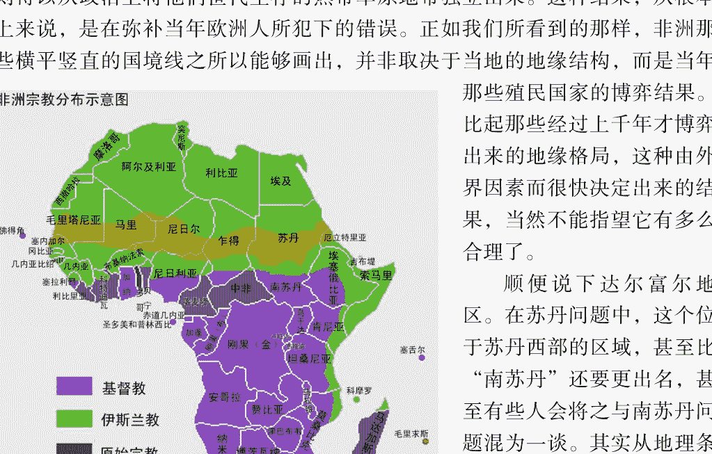

### 第六节 达尔富尔地区的冲突

衡量一个文明是否成功，一般有三个标准，即种族、文化、语言。在达尔富尔地区，这些族群在这三项指标上同质的，如果包含这三项，那么就可以说是成功的。但在达尔富尔地区，由于环境非常复杂，这三个标准也需要努力。

阿拉伯人最终占据这片土地，几乎是毫无疑问的。如果优质如此可能会带来洪水，但终不会上升到国际的关注。问题是达尔富尔的冲突各方，由于肤色差异更容易引起。冲突也逐渐变为原始阿拉伯人与黑族的部族状态。也就是说，一场生存之争最终演变成了种族之争。从自然竞争的框架下，将种族冲突提升到一个人类所能的高度，国际社会对于此类冲突变得非常敏感。

达尔富尔之争不断，还是因为土地和资源的争夺。正如我们描述的那样，撒哈拉沙漠与干旱气候是在南方。游牧于沙漠边缘的阿拉伯人不得不向南迁移（不以为阿拉伯人的生活在沙漠中生存，他们更多时候是为了生意而穿越荒毛之地）。这种趋势必然与他们居住的降水量多地区的多数部落发生冲突。即使这些牧民部落内部也会出现冲突，毕竟在整个达尔富地区有数百个部落。

以此避免种族屠杀和人主义的名义，一个国内政治，也成了为了不介入的借口。当然，并不是所有此类冲突地区的大国都有兴趣介入，除非其有特殊的价值。不幸的是，如果没有来自外部干预，按照阿拉伯和非非洲的历史轨迹，阿拉伯人最终占据这片土地，占领整个达尔富地区。问题是底下的石油已经引起了某些来“关注”的目光。尽管达尔富尔的阿拉伯游击队能够从阿拉伯控制的南方政府得到战略胜利，但是最后的博弈结果却得不到国内因素的控制。从地缘结构来看，达尔富尔的合并是不可能的，毕竟是一个独立的部落。各方面均衡和完全本土化的可能性很小，但它注定成为苏丹一个不定的成员。

像苏丹这种情况，既是非非洲与非非洲之间博弈的典型案例。事实上整个非洲围绕着萨赫勒移动了一个缓冲带。伊斯兰文明与非非洲黑族文明的冲突，都在上演。远不比起苏丹的尼罗河一线（东线）。

## 第三章 非非洲西部地缘结构的解析

### 第一节 阿拉伯人在北非扩张路线与其柏柏人的关系

由于撒哈拉沙漠的存在，阿拉伯人在北非占据了很大土地，其扩张路线主要还是两条：一条是南向尼罗河线；另一条则是“沿海线”，也就是从中海向西洋推进。由于地理条件的限制，阿拉伯人并不是第一个在北非扩张的，包括柏柏人。

柏柏人先于阿拉伯进入北非，他们还在当地文化中留下了很深的印记。阿拉伯帝国扩张至此，穿越直布罗陀海峡，控制了伊比利亚半岛（西班牙、葡萄牙）。欧洲人面对的不是纯阿拉伯人，而是由阿拉伯混入了黑人的穆林（欧洲将其称为摩尔人）。

理解柏人和阿拉伯人的差异，大致相当于汉族和接受了文化的少数民族之间的关系。在人口密集区，已经很难区分两个者的。如果不是硬性在身份上证明自己的族性，大部分少数民族就不会意识到自己和主体民族有区别。相比之下，人口密度较低、交通不便利的地区，原住民的民族属性更加强烈。柏人和阿拉伯文化的差异也是遵循这种节奏。能够保持自己民族特色的、没有完全同化的，都是那些被柏柏人占领沿海的、在沙漠边缘游徙的。这些柏人的部落很多时候代表了。

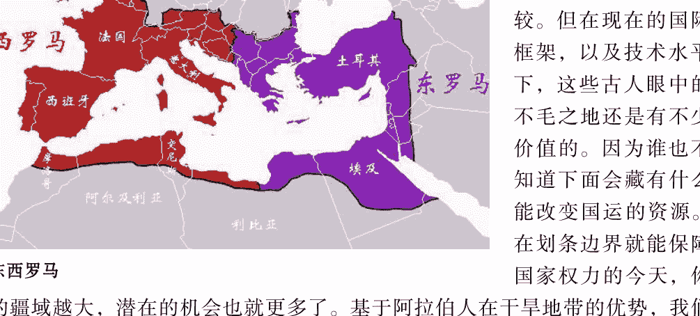

### 第二节 阿特拉斯山脉对北非的重要性

不管阿拉伯人在北非控制了多少沙漠，对于他们来说，最重要的还是那些能够积累更多区域的区域。不幸的是，在北非有这种地单元的很少，即使面积也很小。除了尼罗河流以外，就是位于西北沿海的“阿特拉斯山脉”。对于我们这些拥有大平原的人来说，其实山地在地理位置上。

阿特拉斯山脉对北非来说，还有一个重要的地理作用。就是在这一区域将地中海和摩格拉布沙漠隔离开。这种情况下，那些更适应气候、生存手段多样化的阿拉伯人，战略上的优势就很明显了。山脉发出的河流，不仅滋养了山地地区，更为沿海平原的人口密集提供了水资源。

虽然山地在原始状态时，对水的需求量越小。但是山地在地理位置上占据了。

或许有一天，柏柏尔人会成为一个消失的民族，特别是他们和阿拉伯人在种族和宗教方面的区别是那么的小。反而在最容易同化的语言方面，那些沙漠中的柏柏尔部落还能保留自己的特色。如果有一天这个特征也消失了，那么北非就彻底的阿拉伯化了。

的。它在岸线与另外两个邻国的差异要小得多，特别是相对于它们在国家面积上的差异（阿尔及利亚和利比亚沿海山脉1800公里，突尼斯1300公里）。千万没有岸线的国家，能够拥有良好港口的，不仅能带来商业机会，更可以在渔业上为你提供更多的机会。从这点来看，海洋可以很大程度缓解萨哈拉沿海农业用地不足的现状，为居民提供食物来源。并且那些狭小的沿海地区，拥有高密度的人口。

也许有人问，既然北非哈拉斯斯坦和尼罗河这两片条状地，可以拥有很大量人口，那么它们又怎么和欧洲对抗呢？这其实是要看历史时期的。对于欧洲文明首先是从南欧几个半岛起的。如果欧洲地中海的地缘立场和包括哈拉斯斯坦比非——在非地中海地区的对比的话，我们就会发现两个地方之间的差异是不多的。问题是，欧洲文明向南扩张而扩散，然后就开始向北倾斜了。因为这时，已经成为北非主流的阿拉伯人发现，相比于欧洲那些各方面俱佳的地区，他们再向进展一步的，就能面对一望无际的沙漠了。

唯能让他们感到的就是，他们比那些黑人还要重要，文明的层级也如此。高等在阿拉伯来到非洲之前，他们那些黑人本身并没有渗入非洲草原；但他们具有极化能力的宗教已经跨越了撒哈拉沙漠，以及过渡的萨赫勒地带，将北纬7度以内的黑人部落，大部分在“格林斯比非”的列中的（参照《非非洲宗教分布图》）。只是阿拉伯人面对非洲本土的时候，却也没有平等博弈的地理基础。由此，阿拉伯人也奠定了他们演结的结论。

### 第三节 利比亚亚洲国土吸收能力的不足

尼罗河河流源于下游地区相对良好的条件，阿拉伯人在非非洲与西非黑人的统治下，却占据了份额。而占有山、海、优优势的哈拉斯斯坦山国，在南渗透也同样做得不错。在《阿拉伯人国家结构引起》上我们可以看到，和东线阿拉伯人成功的起的尼罗河的变为成为阿拉伯国家之一，哈拉斯斯坦山脉的阿拉伯人—柏柏尔人，同样在埃及的控制之下与之在南方与之相对应的“西撒哈拉”和霍罗哈里尼亚两国。他们已经是阿拉伯的正式成员了，前者由于摩洛哥希望把此地拓展为自己的直接统治，而一味真正获得国家地。不管撒哈拉是独立的国家的面目，还是现在舞台上，还是国际社会允许摩洛哥占据的份额，都不会影响阿拉伯人在非非洲的优势地位。

相比于东西两国的边界，我们的明显可以感觉到，阿拉伯人在中东，则是利比亚所对应的区域的还不够好。在这一区域，有马里、尼日尔、得非三个深入撒哈拉沙漠的国家。阿拉伯比亚虽然成功的让了三个国家的大部分地区，但为了埃及穆斯林，却未能将这三个国家彻底成为阿拉伯比亚国家。所以我们地图上阿拉伯国家的分布状况，明显可见北非的阿拉伯比亚国家呈现类似电话的、两头凸出的分布。之所以会这样，主要是因为利比亚的地理条件太差，没有核心块陆足够的人口。

单从国土面积来看，利比亚比埃及大得多，但比人口较少，却只有埃及的10%不到，加上那些女工人，也不过600万人。从单点来看，利比亚亚比非洲西部的国家要多。之所以会这样，是因为利比亚90%以上的土地，是属于干旱半干旱的沙漠带，全国没有一条真正的河流（只有海岸线地带由于临近中海，可以受到某些海洋气候的湿润，而相对适合人类大规模生存。正因如此，利比亚超过90%的人口，是在靠近海岸的狭长地带。

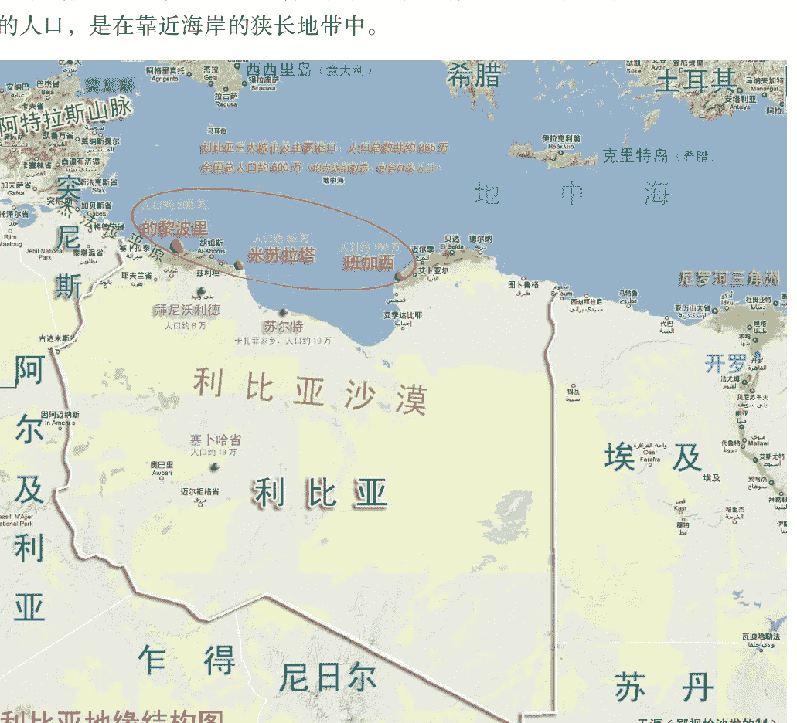

## 利比亚沙漠

利比亚地缘结构图

如果利比亚沿海岸线，也能够像像阿特拉斯山脉那些山地，分割沿海平原和沙漠地，并储蓄水源的河流，相信或许也可能是阿尔及利亚和中东的国家中拥有3000万左右的人口。在阿拉伯世界和穆斯林国家（包括土耳其和伊朗），这个数量级的人口，已经是跨身第二方了。是造物似乎并不青斜这块土地，却没有在它的腹地拉出一条尼罗河一样的河流，也未为比利亚的海岸线建立足够的山屏障。这样一片在阿拉伯世界中是不本土的土地，地上运用的更多的是作为东线的尼罗国家，与西线的阿特拉斯国家之间的缓冲。也是为东西两块大陆连接在一起的份，又是比利亚的沿海地区。

这种地方性和内部的地缘结构，使得比利亚的问题变得并不复杂。无论是最初的比尼人、马人；还是现在的英国人、德国人，在比利亚进行狩猎，只需要关注中在沿海地区就足够了。如果你控制了海岸线，也就控制了大部分的人口和交通线。那么你很快就可以成为这片土地的主人的。这一点，一直到现在也没有改变。然而，基于比利亚的海岸线有着“优势人口”，也并非线性的均匀分布，而是半半集中在几个港口城市。这让比利亚的问题进一步的简化了，每个城市的得失足以决定这个命运。

## 第四节 比利亚的城市特点对国内的影响

说到底比利亚要城市，大家对这些耳朵听起来就有了了。利斯特里、班加亚、米苏拉斯，这三个名字应该是最高的。只是很多人不一定看出三者之间的关系，以及比利亚究竟有多大。我们之前提到，比利亚九成以上的人口都集中在沿海线上，上述三个城市是比利亚最多的之一。无例外的，它们都是海城市。

关于三个城市的人口，由于没引起卡扎非同的关注：
- 利斯特里：人口已经达到了XX万
- 班加亚：可能只有XX万左右
- 米苏拉斯：人口在XX5万左右

简单来说，除去比利亚60万人口以外，这些数字并不精确，会随着战争事实发生重大变化。但对于我们来说，能够把它们了，真实存在的土地将不需要太多的。如果比利亚的沿海地区能够足够的资源，让它们人口至少达到阿尔及利亚的水平（600万）。就像埃及800万，八成以上生活在尼罗河岸；这些人口密集在地图上就是狭窄的一个大开地区，就有近XX万人口。相比之下，利利亚就没有那么幸运了，没有高大山庇的海岸线，无法保证的地表供应；又为沿海平抵御南部干旱气候的侵袭。

当如果是利利亚的沿海，那里就没有山地，也是不对的。当我们把地图放大后，就会发现利利亚那段海岸带，东西两段有一个单独的高地。而利利亚两个地区中心：利斯特里和班加亚，也处于这一段高地的庇护之下。虽然这些地形，相比于阿特拉斯山脉来说，简直是不差数量级。但对于享受中海气候的人来说，已经是难得的靠山。

# 地中海

# 的聚波

# 杰法特平原

# 东部沙漠

# 哈穆拉沙漠

海拔600米

# 杰法特平原示意图

杰法特平原在利比亚战争开启之时，卡尔非政权和反对派之间的矛盾，就被打上了对抗的烙印。简单来说，就是卡尔非政权将资源在西部的“利波里”周边，而刻意压制了班加亚西一线的发展。显然，基于利比亚的地理条件，所谓的东西对，其实并不像想象的那样在利比亚的国土上划界，最后导致明一分为二。这种博弈，基本是在海地区的竞争，只需要控制海岸线，就能成为胜利者。至于这些沙漠地存在的城市，人口数量基本都是十万。估计卡尔非和反对者，都不会逃往这些城市，能够自己带来胜利的机遇。

单利波和班加亚，我们会发现利波更好——这是因为在利比亚北部有一条狭形的土地——“撒哈拉”和地中一起画出一片半圆形的海岸原。虽然这片土地的海拔就是600-900米，足以将这片叫做“杰法特平原”的土地保护起来。这使得利比亚的沿海地区深度非常深。其实利比亚所拥有的杰法特平原的一半，西部属于北部。正是由于这一行政区域，所以利比亚境内的这块“撒哈拉”，也被称为“塞哈山”（利比亚境内叫“艾尔苏哈”）。我们在内部可以看到，反对者是在占据了卡尔非山之后，再进入利波的外围平原。从战斗上来说，或许卡尔非应该占据了这条道路，为了保护利波的外围安全，这只是双方的军事力量来说，展开这种面对是不可能的。也许大家采取控制，集中在那些新兴城市了。

在当年非洲利比亚占据杰法特时代，杰法特平原也是他们的要点，在后来的历史中，成为地缘政治焦点。这里也是罗马人、阿拉伯人、西班牙人、土耳其人、意大利人、英国人……每一个有所作为的政，都曾经是这片土地的主人。这个战略要点的价值在于，它是尼罗河下游和阿特拉斯山脉之间的交通枢纽。然而，如果你想要确保两者之间的交流顺畅，你可以在它们之间找到很多灵活选择。但是在撒哈拉沙漠的追迫之下，想要找到一个稳定且又一定距离的绿洲，就不那么容易了。

有鉴于此，由于是起于东部的反对者，在获得胜利之后也应该迁定这里。这样做最大的目的，就是为了防止卡尔非的权力重心扩张这块利比亚的心地带。很多国内的军事将，看到卡尔非虽然失去了海岸线上的重要城市，但却可以到达。他们只是忘记了一点，最重要的点有两个：
- 一，不管是否争战，要有一定的人口；
- 二，要有适合的地形。如果利比亚的地形像埃及那样，那么即使是南部进入，卡尔非也应该继续。

### 第五节 利比亚地下水改善绿化

说到底利利亚要城市，大家对这些耳朵听起来就有了了。我们之前提到，利利亚的要足够了。与其说卡尔非的命运，是在决定中打算去清理某些分类，不如说卡尔非试图成为阿拉伯世界的领袖。这一点，在利比亚的地理环境和人口数量上，很多人已经看出了，战术上机会很小。

对于卡尔非来说，没有地下水，利比亚的地下水尤为突出。相比于地上的水，利比亚的地下资源十分丰富。在沙漠深处，藏着巨大的水库。我们现在能够自然渗透到地下水，用来修建地下网。有了这些地下资源，利比亚就能改善它的地缘优势，养活更多的人。这对于古人的狂计划，现在已经耗了近XX亿美元。

利比亚的这种工程还是一个机会。不管它的结果是好还是坏，还需要长的时间验证。在这一点上，从大禹就开始进行规模化，并改善了自己结构的国家，是最代表性的。如果卡尔非工程能够持续地提升利利亚的竞争力，那么无论他有多少失败，将来在阿拉伯的历史上，也占据着重要的位置。这无法完全抹去这位胜利者的影子。

在人口密集的沿海地区，即使你和美国人进行周旋，这是不可能的。不知道卡尔非没有看过《地道战》，但他认为这项工程可以铺设了“地下交通线”和防御功能。设计师在设计时直径达到了公里的水管，要考虑的不是水，而是车辆的标准。

虽然说，想靠地道赢得战争，或者躲起来，战略上是不可能完成的任务（设想同样在底下的哨哨，究竟是怎样的？）。但无疑可以为卡尔非争取到战术上的时间，反对派和欧洲人不那么轻易找到他。对于他最后的命运，还要能够利用这宝贵的时间，为自己寻求一个避难之地安渡晚年。比利亚的情况就是这样了，在可以预见的将来，无论那个人运河有多少“普世”，比利亚就不会是真正的地缘焦点。能够真正对阿拉伯世界产生影响，并为大国们关注的，还是以阿拉伯岛为中心的那些国家。这些国家或者说板块，也就是我们政治上说的“中东”板块。至于说政治的中东，都包含了哪些国家？其中的核心问题是哪些，谁又能发挥最重要的作用，也是我们后面要分析的内容。

## 第四章 沙特阿拉伯半岛的地结构

### 第一节 阿拉伯半岛的地形

所谓近东、中东、远东的概念，是欧洲以此为中心测，对亚洲部分的描述。像欧洲最近的土耳其，就是近东的主要国家；我们中国，就是远东的核心部分。不过这种划分方法，显然已经过时了。唯一还在使用的就是“中东”这个概念。在现在的地理环境下，“中东”通常涵盖的是以下四个大块：
- 土耳其
- 伊朗高原
- 埃及
- 阿拉伯半岛

这些已经荒漠化的地区中，核心的就是阿拉伯半岛。说到阿拉伯半岛，大家都能看到岛内的几个国家。当我们把视线从水平线上上看，我们会发现阿拉伯半岛的结构，大部分被撒哈拉沙漠覆盖。阿拉伯半岛的地形呈现三级阶梯。首先来看，沿海地区是一条凹的塞拉特山脉，其实是非非洲裂谷的一条边缘。我们可以将其对应为阿特拉斯山脉。从塞拉特山脉穿出，我们就进入了阿拉伯半岛的西部。这片陆位于山脉和和平原之间，被称为内志高原。通过阿拉伯高原之后，过渡到东部沿海地带。著名的两河平原（美索达米亚），也是这片陆的一部分。

如果阿拉伯半岛哪个区域能够诞生古埃及文明媲美的话，就是底格里斯河与幼发底河两条形成的美索达米亚。在阿拉伯半岛地形分析中，我们关注的是土地的平度和山脉的走向。环境较少，但整体都是四季分明的，适宜农业发达。相比之下，对于高、低地就不那么敏感。对于阿拉伯人来说，“水”才是第一要素。如果没有水，这些平原也会变成沙漠；而有了水，山地也能成为人口密集的核心。在此地中的一个，就是占据阿拉伯半岛大面积的沙漠。

阿拉伯半岛的东东西，差异非常显著。这种地形的影响，可能为利利亚的。相比（利利亚）的地理差异，核心是核心的。阿拉伯半岛的，大部分被撒哈拉沙漠覆盖。沙漠深处，在沙漠层深处，藏着巨大的水库。我们现在能够自然渗透到地下水，这些。阿拉伯半岛的结构结果，大部分被撒哈拉沙漠覆盖。阿拉伯半岛的地形，其实是非非洲裂谷的。阿拉伯半岛最早出现“中东”这个概念时，已经没有意义了。

## 第二章 沙特境内的宗教圣地以及板块划分

由于沙特的国土是三角形，沙特国内是绿稀分布的。尽管其尽力，阿拉伯半岛还很难成为带大哥。有一点阿布贡，那就是阿拉伯乃至整个穆斯林世界都拥有崇高的宗教地位。伊斯兰三大圣地的麦加和麦地那，都是在沙特内是一个聚落中心）。学习历史人的，这两个城市内陌生。

简单来说，在穆罕德建立伊斯兰圣地之前，以商业、游牧为主要生产方式的阿拉伯人，穆罕德本人也出生于此。至于麦地那，则是穆罕德建立伊斯兰圣地后，所选择的基地。正是麦地那在那里，他打败了麦加的阿拉伯贵族，并用伊斯兰教统一了一个阿拉伯人。在这个过程中，新生的穆斯林为了让旧有的体系平稳过渡，也接受了麦加中心。只不过，麦加必须在伊斯兰文化之下和麦地那共同拥有“圣城”的地位。麦加位于阿拉伯半岛的西部。在《阿拉伯半岛结构图中》，我们可以看到麦加和麦地那位于沙特山区之中。然而相比阿拉伯半岛大部分沙漠化的阿拉伯高原，沙特山地中的水量要高出许多。麦加和麦地那所选择的地点，都是山脉中水资源最为聚集的。事实上现在的情况是这样，人类最为集中的城市，我们在西部沙特山一线。而中部的居民，主要由内夫沙漠、耐纳赫沙漠，鲁布哈利沙漠环绕的“内高原”。东部的波斯湾沿岸，反倒是不利于人类的生存之地。沙特东部的耐纳赫沙漠，基本把沙人在波斯湾的海岸线给封闭了。如果不波斯夷的石油现在成了沙特的命脉所在，估计这块“沙漠平原”对于沙特人来说就是块鸡肋了。

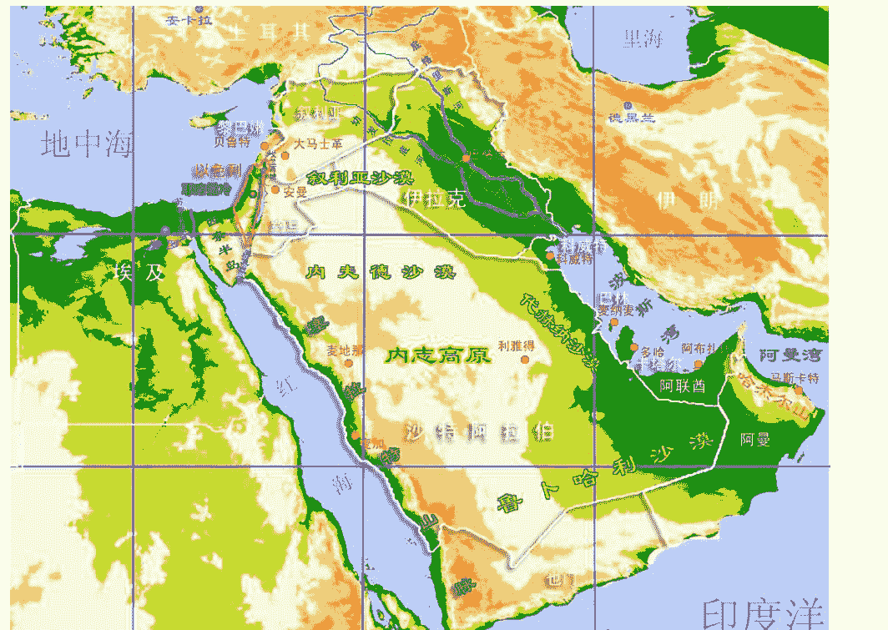

# 阿拉伯半岛地缘结构

如果我们把阿拉伯板块和内志高原和塞拉特山地放在一起看，我们会发现沙特人口集中的区域。利利亚东西两个地区中心：利斯特里和班加亚，也处于这一段高地的庇护之下。虽然这些地形，相比于阿特拉斯山脉来说，简直是不差数量级。但对于享受中海气候的人来说，已经是难得的靠山。

来的，就是高高的人口出生率。数据表明，沙特的育女妇女平均能够生育7.3个孩子。是有问题的，这一切都是建立在国际石油之上的。虽说高高的淡水，在生存上并不算什么。但在工业社会之后，衡量一个国家竞争力的标准，就已经不再是它的农业生产力了。

如果有波斯湾的石油资源，阿拉伯半岛并没有什么附加值的工业来转换地球上其他地区的资源。在这种情况下，那些从海水或者沙漠生存的人，获得资源的途径就非常困难了。因为沙漠工业体系和基础反而表现了失去竞争力，是阿拉伯半岛目前面临的核心问题。虽然这种环境并不够好，也不绝环境的问题。从阿拉伯人的文化和目前掌握的资源来说，他们更倾向于从商业的角度来解决问题。利用阿拉伯人的石油财富和对石油的供给，来取得金融市场的影响力。这样的，即使有一天地下的资源不再，我们这里会有机会依赖石油产业产生的利润，维持其增长的运转。这种战略放在现实中取得了成就，就是做出了像波斯湾这类建筑位于沙漠之上的国际城市。

如果只想依靠资本的维持来维持他们们的生活，他们还是很有机会的。毕竟沙特石油的原始规模数量巨大。你问当你想走捷径，试图靠这条“高端”的产业获取利润，并作为立国之本，就是另一个问题了。就像在普通人看来，把钱投入到金融市场，似乎也比老老实实的实业有更大的利润；但如果你想自己去银行，在金融市场取得话语，就不是本资本就能做到的。即使你能够在一段时间内成功，这种虚荣经济所蕴含的风险是巨大的。看着同样金融国家的冰岛，在经济危机面前有多少的脆弱就明显了。

石油资源虽然能够在一定时期改变阿拉伯人（也只是部分油国）的生存环境，却无法提升他们的地位，并使得阿拉伯半岛成为为边缘的一类地理区块。现在我们还是老老实实的回到原点，去探究一下在原始的条件下，阿拉伯半岛中部的哪部分会有更多的潜力。站在这个角度上看问题，一条对人类文明史发挥过关键作用，并在仍在被忽视盲目地的焦点带——“新月沃地”，将出现在我们的视野中。

## 第五章 地理结构和它曾经的分裂格局

### 第一节 地理环境特点

在分析“新月沃地”之前，还有一块块应该先进入我们视野的，那就是阿拉伯半岛的南部，也就是接近印度洋的那半边。在这个方向，阿拉伯人建立了也门和阿曼两个国家。很多人很奇怪，阿拉伯人究竟是按照什么原则，在阿拉伯半岛划出了这些规模巨大的国家，彼此之间，还是依据什么来确立国线的。

事实上，是按照阿拉伯半岛南部的地理结构来看，就算世界上出现上百个国家是有可能的。因为除了新月沃地是连片的高密度人口聚集区，其余的半岛土地上的阿拉伯人，基本上都是一些点状分布的绿洲。在古代时期，生活在这些绿洲的部落，虽然有着共同的种族、文化背景，但强烈的地理分割性，还是让大家分割成一个地球上相对独立的部落群体。即便是在这些部落依然遵循地理规律，整合形成今天意义上的国家，这个国家内部各自的情况依然存在。也正因于如此，才会出现“阿拉伯联合国”这类明确内部结构格局的国家。

至于阿拉伯半岛为何会形成现在的政治格局，我们还是要“感谢”欧洲人。他们在那里扩张世界的浑浊中，由于这个星球完全进入国家地理，做出了“卓越开拓”。然而，殖民者在半岛扩张时，也是遵循了一定的地理规律的，并不是简单的拿着旗帜在地上按几何形状就能扩张世界的。不仅他们所遵循的地理规律，和半岛土地上地形自然形成的地理结构并不吻合。这也是为了那些早期流离民众，在大世界世纪才形成的国家，打动了扩张的根源。我们将要分析到的部分，包括与之海相望的非洲之一——索马里地区，目前还在活跃欧洲非洲人的之下。

从也门的地理形态来看，层次在阿拉伯诸国中算是比较丰富的。基本的地势和阿拉伯半岛的走向相同的，这里是“西东部”。这西部的，也就是从沙漠阿拉伯境内向南延伸的“塞拉山山脉”。这条贯整个阿拉伯半岛西边的山脉，在整个沙漠阿拉伯境内的东西纵深并没有太大。但它延伸到阿拉伯半岛的西南角，延伸并逐渐趋近。这种走向，让阿拉伯半岛的西部山地整体呈现出一个“L”形，使得也门控制的区域主体就是这个“L”型山地的北部和南部。

塞拉山山脉这种变化，也让南部的山地有机会形成相对独立的地缘。相比于中部那长形的山地，西南角的这片山地，纵深让它拥有更多保护，受酷热沙漠气候的影响。在这片山地盆地中，甚至会出现夏季温度不超过30度的凉意。更为重要的是，山地的高度和纵深也能获得更多降雨，在地势最高的首都“萨纳”（海拔2200米），一年之中至少有两个雨季。在那张《也门地缘示意图》中，我们也可以看到也门境内由高地形成了很多河谷。

# 也门地缘示意图

也门这种相对优越的地理环境，也让能够拥有更多的人口。相比于它大部分都是沙漠低地，也门的人口（300万到500万之间）算得上是由于。也门面积远大于沙特。需要注意的是，作为一个世界上获取石油最多的国家，沙特的人口数量是建立在石油之上的。也门却是目前阿拉伯国家中最竞争的一个。

当然，不能说也门没有石油，只是波斯湾的巨大储量，也门根本不算什么。事实上也门能够从内陆切出来的资源，是因为它的山地中有着丰富的资源，而农业化了。也就是说，相比于内陆的商业游牧文化，也门转向农业为主（现在有一半以上的人口）。由于亚热带沙漠气候的包围，也门境内已经存在了三千多年的地下水，来养活更多的人。即使现在不能实现粮食自给，也门来自波斯湾，那里有了土地的生活。很多时候我们在设想，如果那些大石油产国当初没有了石油收入会怎么样，那么他们就是一个很好的例子（对于以色列荒漠）。

### 第二节 南门和北门的地缘背景

历史上曾出现过南北分治的国家。比如我们所认知的东、西，以及阿拉伯半岛。也门在历史上曾经被叙利亚控制之后，也曾建立过两个“门”。这两个阿拉伯同样成为了冷战博弈的战场。至于南门在苏联的“指导”之下，已经成为了阿拉伯世界上唯一的“社会主义国家”。当然，随着苏联的崩溃，南北门也经历了一段时间的内乱之后，又完成了一次（1990年，南北统一）。

虽然俄罗斯人的介入，让南北门争夺了意识形态的色彩，但南北门分离而言，却是有着深厚的背景。其溯源可以追溯到大航海时代，或许是语言与历史的博弈结果。从这个意义来说，南门选择了“社会主义”，更多的是地理独立的需要，并不在于这部分阿拉伯人的信仰共产主义。事实上，意识形态并不看博弈的双方；美俄的地方属性相比，我们会发现其实南门和北门应该有更多的共同语言。相反，南门则更多的显出海洋特色。为此，我们先来看南北门究竟是怎么分裂的，又是如何让它们之间的差异具有地方性的呢？

就他们的外缘来说，大家可以把它看成一个长方形，一个阿拉伯半岛南部切出来的长方形。而南门的边界，则意味着它的西南角拉出一条东北的边界。只是这条边界并非相对应的东北，而是指向北部中偏的位置。简单的地理知识，就足够我们在观察南门控制的国土面积，比北门将近一次（15.2万公里，北门33.7万公里）。这似乎在告诉我们，双方的人口数量和实力对比，南门应该占优。事实上并不是如此，北门和南门之所以能够在冷战之后统治一个南门，是由于原本的南门失去了政治权力，而是由于北门的地理条件更好，人口数量更多。这在一个农业国家里，意味着工业体系的“原始国家”，这种差异是决定性的。

在前面分析的基础上，已经提到南门境内条件靠近阿拉伯半岛南部，在南部荒芜的“塞拉山”。这些能够拥有水多的南面，沙漠气候的影响的高，才是他们的农业根基所在，并且拥有了75%左右的面积。对于南门来说，自向而言，地理已经开始逐渐退离。那些山地余缘，直至北门与阿拉伯的边界是完毕了。从格局来看，南门的土地却是阿拉伯半岛南部的。

### 第三节 亚丁控制政策对阿拉伯的影响

正如我们所分析的那样，南门地区的价值，就在位于亚丁的海岸线上，它已经开发了千多年的港口。这并不代表南门地区自来就形成了一个独立的政治。事实上西方人出现现代国家的概念之前，阿拉伯半岛更多的是处于部落状态，每个占据一块绿洲的部落。不过基于山区和沿海地区的这种存在关系，从文化意义来看，生活在这片土地上的阿拉伯人拥有共同记忆。从族群渊源来看，他们共同成了阿拉伯世界的一个板块。

既然南门地区的价值在于亚丁的海洋枢纽地位，那么南门和它有着关系的北部山区很有可能。因此这一点引起了人们的注意。有人会问，为什么南北这两个块在阿拉伯半岛条件最差的区域，成为了阿拉伯和伊斯兰的边界地区。这是与阿拉伯人有关。在穆罕德学习汉语和宗教教育的基础上，建立阿拉伯人的“神教”时，他的民族并没有去占据“新月”。如果这个时代阿拉伯半岛的群众在，那么也许条件更好的南部地区就会成为穆罕德的选择，并诞生了伊斯兰的圣迹。在穆罕德时期，拉丁人又一次登陆（萨珊王朝），并在来自欧洲的拜占庭帝国中占据了上风。

基于波斯帝国的影响，他们的关注范围就不只是靠近中海一线的区域了，阿拉伯半岛的南部沿海，同样是波斯人征服的方向。

在我们的印象中，阿拉伯人是一个游牧民族，拥有两个海洋的规模。但其实后的阿拉伯人在西方贸易中的地位和作用，更多是从波斯文明中继承的。正是由于阿拉伯人对于海洋财富的重视，让他们在波斯南部，控制了阿拉伯波湾的海岸线之后，进一步控制了阿拉伯北部的边界。吸引阿拉伯人的，并不只是亚丁的枢纽之地，北部山区优越的条件，也让波斯人感兴趣。在高原居住过的波斯人，文化属性中的“农业”成份已经很高了。波斯人没有放弃这样的、有着相似背景、且对自己有能力的土地。至于现在这地区需要阿拉伯来供给沿海的港口。

## 第六章 外势力对东门局势的介入和影响

### 第一节 英国殖民地及周边地区现状

正如我们所知道的那样，在美国经历二战世界大战成为海洋的霸主之前，海洋的控制权主要是由英国人掌握的。尽管英国人凭借他们的先机，他们在中海的优势，在苏士运河的占据了优势，但在他们打通了这些海洋通道之后，英国人就开始了对全球的海军布局（其实法国人也是英国的全球竞争者，失败者才把注意力集中在中海和非洲的）。基于英国对红海两岸区域有一定的支配力，英国也将其列入范围。

在这种情况下，真正要考虑亚丁和亚丁湾，就剩下南门作为海上交通的枢纽地区。由于经营欧洲人的角度，现在他们就可以避开通行，直接和方便贸易，但几乎横跨整个大陆的路线，还是让人们陷入无奈。在此欧洲人借由工业革命将阿拉伯人和世界地区甩开一个时代。

是的，他们终于有机会按照自己的意志重新规划世界的边缘结构。为地球划新的行政版图固然是利益的重要手段，但从技术的角度看，如果能够畅通中海—红海之间那段狭窄的陆地连接，那么欧亚之间的物流将会巨大的降低。而欧洲人在亚洲的控制力也将得到增强。正是在这种背景下，苏士运河诞生了（1869年通航，由法国人主持挖掘）。

也门人为为苏士运河的通航感到兴奋，因为让他们他们的海岸重新具有了世界级的影响力。但同样兴奋的是那些视全球利益的欧洲人。在欧洲人看来，海洋是他们控制世界的桥梁。挖掘苏士运河显然不是为了岸的阿拉伯人，或者当时还是埃及及宗主的奥斯曼帝国得益。为了避免这些异教徒阻碍欧洲控制世界，红海和亚丁湾很快成为了欧洲国家角逐舞台。而也门地区也在这场博弈中被分割成了两大政治区块。

# 阿拉伯半岛殖民地

对于英国来说，他们并不需要占据整个亚洲，或者以阿拉伯人为目标（他们对撒利亚和帐篷特别感兴趣）。能够在亚丁湾沿海，控制一块足够大的区域，在战略上保护亚丁湾的海洋安全就足够了。

基于上述结论，英国和亚丁沿线的阿拉伯贝拉克长们达成了协议，将他们纳入了英国的保护之下。至于其中他们用了哪些方法，并不重要。对于英国人来说，控制这些广大的领土，那里有漫长海岸的地区，他们跑到塞拉特山脉丘坡做同样的事情，效率会不高。对于上个希腊俄民族来说，建立民族国家的那些三个国家所划定的势力，是在当时他们之间划定界线的重要参考。就客观结果来说，现有的国家也要“感谢”之前的宗主国家们整合了破碎的地理结构，将他们一直没有完全控制的边疆地区纳入了同一个国家的范围内。

虽然这种由外力促成的结果，现在还有很多问题需要解决。但是起保证了你能够内政的概念可以消耗这些问题（比如印度、缅甸）。对于另一个地区来说，殖民帝国根据其需要所做出的一切，就此让一些原本有条件处在同一政下的地区，划分成了不同的国家。如果英国人来控制亚丁，那么在出门门所做出的切割，就属于后一种情况了。基于继续对亚丁地区实施的原因，英国人在19世纪中叶时期，他们不在范围内允许他们的民族独立了，它更希望望向亚丁地区独立的成为一个国家。

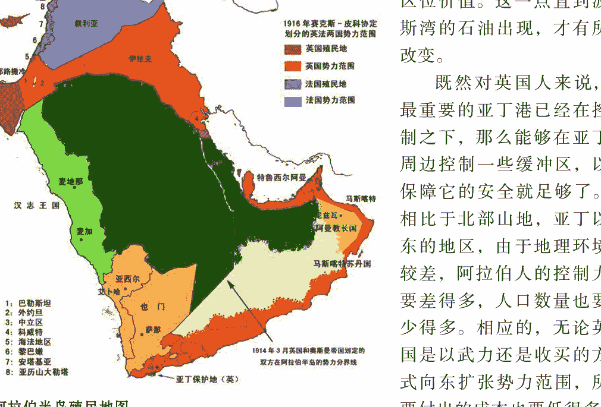

## 第二章 大国对也门的战略和也门的统一

有人提出疑问，认为由于从相对位置而言，分割后的也门应该更有理由地叫作“东”、“西”也门。其实之之所以会有南、北的认知，主要是因为也门的核心区域，无论海、陆，都在西部。除去东部那些人类稀有的干旱地区以及亚丁特，这两个地点，海中中心的位置，分割后的也门就是南、北的关系了。诚如我们所分析的那样，如果南、北门互为历史源因得不分成两个国家，却因为地理上的原因而有不同的背景，那么南门地区在实力上是无法和北门对峙的。

如果南、北门互统一的话，那么在地理结构上将更为满的也门，必然会削弱英国的影响力；而假如也门中沿海的南门地区独立并试图对抗北门的话，那么从这个地区的大外国获得支持就是必须的。从大国的角度来看，我们不能直接控制某一地区，而是总认为是最好的办法。而在在这种种分治的战略下，扶持弱小的一个，通常是有有效的。可惜的是，英国人的这些布局，并没有带来太大的利益。这是因为二战以后的世界，发言权已经转移给了美、两个国家。全球性的布局，现在不是英国的首要事务了。

在这种情况下，南门地区就能很快的摆脱了与北门地区完成统一。由于自体制已久的南门地区，并不是由政治家愿意在北门的领导下进行分夺权力。如果南门也想继续独立的统治，在试图脱离西方的控制之时，那么可能帮助南门就只有英国人了。基于和美国进行进行对抗的萨，英国人也乐意在阿拉伯半岛出一个“社会主义国家”

不管英国人或者中国人，什么样的什么样的介入南门地区，对于也门地区来说，没有力的帮助，是无法和北门对抗的。然而集中了大部分也门人口的北门地区，很自然的视自己为也门的核心，并以统一南门这块边缘地区为终极目标。这个希望在苏联的支持下得到了实现，虽然已经经历了若干多年，并进行了若干年的内战（1990——1994年），但曾经也门地区还是“北南”的形式在政治上却到了统一。对于也门权威“祖国统一”大以来，“萨利赫

虽然也门正式统一已经有了17年的时间了，但是比起100多年的南北分裂，也门完全实现内部融合，还需要花费很长时间的。就门最近这些年的乱局以及寻求言，原因是多方面的。经济上看不到出路，却面临巨大的压力，是也门所面的根本矛盾。经济上看不到出路，却面临巨大的压力，是也门所面的根本矛盾。其实经济上看不到出路，却面临巨大的压力，是也门所面的根本矛盾。其实经济上看不到出路，却面临巨大的压力，是也门所面的根本矛盾。其实经济上看不到出路，却面临巨大的压力，是也门所面的根本矛盾。其实经济上看不到出路，却面临巨大的压力，是也门所面的根本矛盾。其实经济上看不到出路，却面临巨大的压力，是也门所面的根本矛盾。其实经济上看不到出路，却面临巨大的压力，是也门所面的根本矛盾。其实经济上看不到出路，却面临巨大的压力，是也门所面的根本矛盾。其实经济上看不到出路，却面临巨大的压力，是也门所面的根本矛盾。其实经济上看不到出路，却面临巨大的压力，是也门所面的根本矛盾。其实经济上看不到出路，是导致许多矛盾的直接原因。另外从政治结构来看，也门自以来就置于一人的领导下，政治体系缺乏性循环，是导致许多矛盾的直接原因。其在阿拉伯世界，这种政治形态也是普遍存在的。在美国和欧洲看来，具有某些宗教性的阿拉伯人，他们试图在文化上改造自己的价值观。与其一个陷入了分割的地区，倒不如去控制。

### 第三节 基地组织对于渗透

现在我们回到了这个问题上，现在总是有参与者。不过随着时间的推移，这些参与者或主动或被动的会互之间的共同点，而形成若干利益集团。连接这些矛盾的组织有许多称呼，可以从社会结构，自下上的按照“阶级”来进行类：
- 种族来形成同盟
- 使用移民来决定内外集团（比如哥尼亚的博特拉克）
- 地理划分上刚出来的国家

至于也门这种从地理上不久的国家，南、北的地缘是最容易被政治家用来界定利益的。尽管杜尔赫特殊享的不满，在重建政治结构中，也门的反对者们有着共同利益。但是一旦这个共同的目标下，也门博弈有可能重新出现南北对峙的特点。如果有充分的时间整合，相信也门内部的南北矛盾，还是逐渐淡化的。就像曾经导致南北矛盾，现在已经不是美国的主要之一了样。即便在2000年，美国海军的“科尔号”战破，在亚丁受到基地组织袭袭的事实。对于萨拉赫来说，也清楚基地组织价值的所在。

对于他们来说，更像是一场猫老鼠的游戏。所要把握的，就是要显示对局势尚有控制。既不能让基地组织的影响到门户的国家完整（所以基地组织宣布建国后，门户军队很快就把吉阿尔丁带回来了）；又没有必要拼尽全力，把基地组织赶出门。无论是出于维护自己的利益，还是消除美国的担心，只要把这老鼠的活动区域，限定在南部地区就可以了。

### 第四节 印度将查斯特群岛为军事基地

门户局乱已经持续很长时间。即使印度的经济平稳过渡到另一个人类时代，并且从美国的指挥下，这个国家的经济将会增长，宗教组织将继续享受他们的“人口红利”。只有美国人感到欣又喜的是，不管上台，为获得了西方的支持，还是会在他们反思问题上合作。对于印度来说，由于没有这个能力做得比菲律宾强一点，也有另外一个。事实上，如果英国人直接控制印度和那些南门地区，还是是非常困难的。对于印度来说，在地理范围内，一个民族对立，并不是明智的。基于索马里在亚丁和印度洋的战略位置，以及中国和美国这几方面，将有史以来最大的对外援助（总值4亿人民币）用在了非洲角。

## 第六章 非洲之角

从地理结构来看，如果你在一个海峡或海湾得到支撑，有两个方向。一是在两边的岸线上寻找机会，二是把目标锚定在岛之上。对于亚丁和索科拉岛，对应的就是种类中的可能。如果目前还不透露这些话，非洲东会有机会。

| 国家/地区 | 战略意义 |
| :--- | :--- |
| 沙特阿拉伯 | 阿曼 |
| 阿曼 | 印度 |
| 也门 | 也门 |
| 印度 | 安达曼群 |
| 马尔代夫 | 斯里兰卡 |
| 俄比亚 | 索马里 |
| 印度洋 | | |
| 马尔代夫 | 赤道 |
| 塞舌尔 | 肯尼亚 |
| 马达加斯加 | 北印度洋主要岛 |
| 戈洛斯群岛 | 在印度洋上的军事行动 |

| 印度 | 英国人直接控制 |
| 印度 | 印度 |
| 印度 | 索马里海 |
| 印度 | 印度洋 |
| 印度 | 索马里 |
| 印度 | 印度 |
| 印度 | 印度 |
| 印度 | 印度 |
| 印度 | 印度 |
| 印度 | 印度 |
| 印度 | 印度 |
| 印度 | 印度 |
| 印度 | 印度 |
| 印度 | 印度 |
| 印度 | 印度 |
| 印度 | 印度 |
| 印度 | 印度 |
| 印度 | 印度 |
| 印度 | 印度 |
| 印度 | 印度 |
| 印度 | 印度 |
| 印度 | 印度 |
| 印度 | 印度 |
| 印度 | 印度 |
| 印度 | 印度 |

中部高原和东侧的平原地区提供淡水补给。所以从这个角度来看，两河文明的兴盛，其实和阿拉伯半岛本身并没有多少关系。几千年来，为这片平原提供生命之水的是阿拉伯半岛东北一系列的高原。

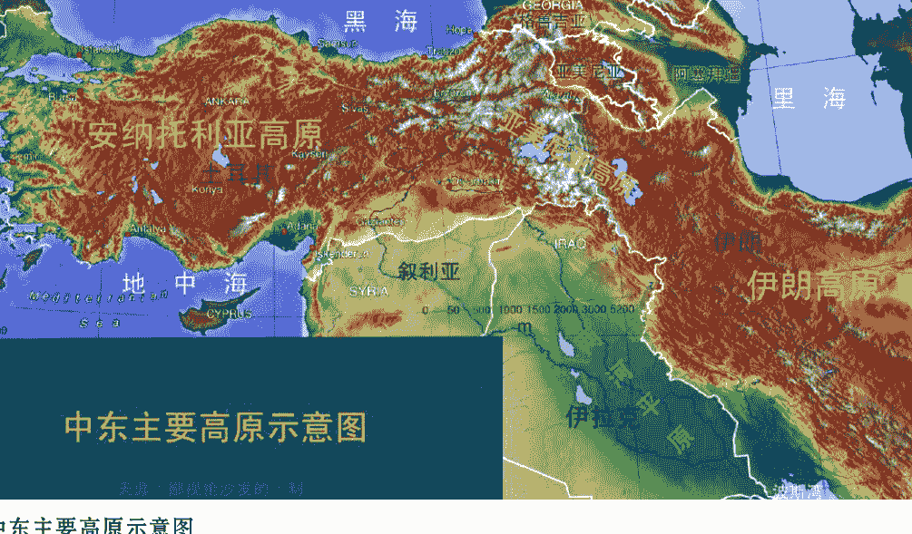

## 中东主要高原示意图

我们很容易在阿拉伯半岛的北、东部，看到其由中海延伸到印度洋的高原。现在，这片高原带由土耳其和伊朗所占据。通常我们在总结土耳其的地理特点时，喜欢用小亚细半岛来概括；而伊朗，则可以用波斯高原覆盖。其实如果我们视线聚焦在海拔高度时，小亚细半岛基本上可以和“安纳托利亚高原”等等来说。不过，你认为滋养两河河流的底格里斯河和幼发底河，是源于这两大高原，那你就对了。因为在这两大高原之间，还有一个起过的作用的高原——“亚美尼亚高原”，而两河正是源于这个汇合部。

通常我们很容易忽视“亚美尼亚高原”的存在。一是目前大部分已被土耳其和伊朗占据，我们生活在这些土地上的“亚美尼亚人”，则被提到了高原的东北。从地理上来看，亚美尼亚高原基本上是安纳托利亚高原和伊朗高原边缘碰撞汇集而成的。相应的，海拔也更高，也被称为“亚美尼亚高原”。这一点，像是贝吉克拉斯人所占据的“柏米尔高原”（库都什山、哈马拉雅高原、天山、昆仑山聚集之地）。

如果亚美尼亚高原像柏米尔高原那样，或者周围的邻居没有那么多，那么这个地理单元还会有机会基本对应一个国家。可惜的是，安纳托利亚高原上的亚美尼亚人和伊朗高原的波斯人，定会争夺这条缓冲之地。如果亚美尼亚人最初选择住在伊斯兰，或许亚美尼亚人或者波斯人会考虑他们在这些高高原上缓解冲突的压力。可是，作为世界上第一个基督教国家（公元4世纪，伊斯兰教还要早于百年），亚美尼亚人固执在穆斯林的包围中守护他们的信仰，因此这种冲突就不可避免了。而且可能由亚美尼亚人充当的角色，就与同样信仰真主的“库尔人”来决定。

尽管最终在突厥、波斯、阿托伯三大族族的夹击之下，库尔人并没有建立自己的国家。从族群生存的角度来看，他们是成功的；虽有一块独立区域，在地理上能够成为独立的地理单元，这也是库尔人一直为自己建立的地理基础。如果我们知道对之前提到的“亚美尼亚分布的区域和亚美尼亚高原的地理位置示意图”，按照这种地理结构来看，这块高原应该被叫做“库尔人高原”。不过不是哪个地理学家起这个名字，土耳其和伊朗高原会首先选出来。在他们看来，人口数量已经被缩减到300万多的亚美尼亚人（土耳其人在世纪初），对于亚美尼亚人的种族冲突，并不是这些差异教徒所遭受的（困难），即使他们已经建立了自己的国家，也不会对他们造成实质的影响。相反，如果已经在此生活了上千年，人口数量增加到300万的库尔人，从地理学上，相反信仰会增强他们的独立倾向，并为他们所预期的“库尔德斯坦”划出精确的边界。

基于亚美尼亚高原对于两河高原的重要性，无论是土耳其人还是伊朗，都没有放弃这片山地。他们是那些想要重建帝国的扩张者，将势力范围扩张到两河高原，直到整个阿拉伯世界的时候。既然是那样的，我们就很有必要研究一下底格里斯河和幼发底河，以及为了它们种族的支流，究竟是怎么样的，这些河流的走向，又从中地缘构造成了什么样的影响。

## 第二节 底格里斯河与幼发底河在中游供给上的差异

无论在什么文献里，底格里斯河与幼发底河都是互不相离地粘在一起的。以“两河”之名的规模或许高于它们的本名。从地理位置来说，这两条河流源于亚美尼亚高原的河流，流向的线条就太接近了。对于我们来说无法在它们之中界定出主要关系。不过即使是兄弟，也会存在细微的差别。因此我们还是还要来看，这两条世界级名河存在什么样的差异。

单从长度来看，相对位置偏南的幼发拉底河，要比北方的底格里斯河长。前者的上游源流，发源于亚美尼亚高原与安纳托利亚高原接壤的东俄罗斯山脉；后者则发源于亚美尼亚高原边缘的东南俄罗斯山脉。不过对于流量来看，底格里斯河却要大得多，其流域之内所滋养的人口和城市也要更多。之所以会有这种差异，主要是因为二者的地理位置。我们知道，作为一条河流来说，决定它流量大小的因素不仅仅是源头的水量。一条能够在中下游地区持续补水的河流，其地潜力远大于主要水量要依靠水源的河流（相同长度和发源地）。

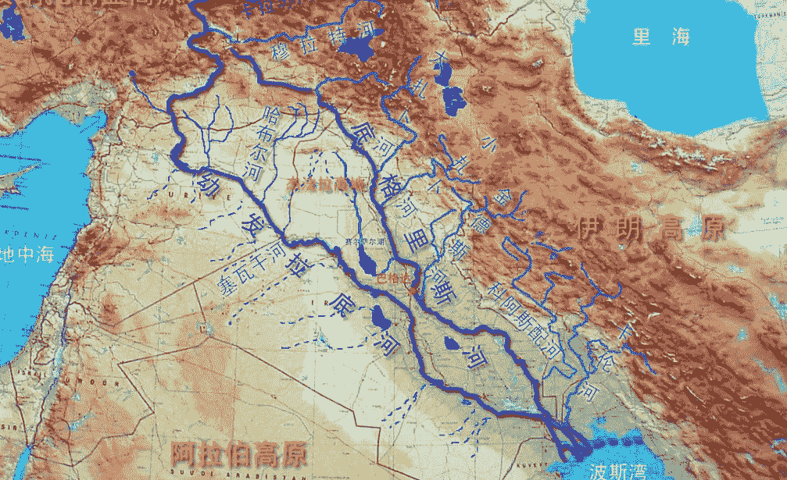
两河流流域结构

在这一点上，下游地区没有任何支流的黄河就是典型的例子。无论在淡水供给还是航运功能上，黄河的下游没有任何足够的河流（流量只是上的20%左右）。事实上，滋养了埃及的尼罗河也是一条。如果下游不是足够的雨量，很难想象它能够穿越干旱的沙漠并滋养了三角洲的人口。

尼罗河的成功，在于在沙漠地区缺乏足够的纵深。正因如此，我们在历史上很难看到埃及是如何扩张成为帝国的。如果要在阿拉伯半岛这个块上找到一个可能的地理核心，除了尼罗河之外，会有更好的选择。

亚美尼亚高原对于两河高原的重要性，无论是土耳其人还是伊朗，都没有放弃这片山地。他们是那些想要重建帝国的扩张者，将势力范围扩张到两河高原，直到整个阿拉伯世界的时候。既然是那样的，我们就很有必要研究一下底格里斯河和幼发拉底河，以及为了它们种族的支流，究竟是怎么样的，这些河流的走向，又从中地缘构造成了什么样的影响。

亚美尼亚高原对于两河高原的重要性，无论是土耳其人还是伊朗，都没有放弃这片山地。

（此处由于OCR文本重复及错误，已按逻辑合并）

在这一点，我们在《新月地带位置示意图》可以看到，整个河流域（包括下游）都被覆盖了这片肥沃之地，其主要城市的分布也是呈现连续状态。对比底格里斯河和幼发底河之间的这种差别，让人不得不感慨，靠山是多么重要。这也是别的，我们就会发现，与尼罗河相比，两河流的中下游并不属于这片肥沃之地。阿拉伯高原的干旱环境，带给下游河流的影响，不仅仅是缺少水供给。事实上，从阿拉伯半岛的边缘，幼发底河汇通了。如果下游可以和底格里斯河同网共同经营出一片“叶状状冲积平原，像尼罗河一样，只能在流量分布。

分析两河水的意义在于，我们可以由此看出，对于两河下游地区的阿拉伯国家（叙利亚、伊拉克），则是西侧阿拉伯高原的兄弟更为重要，东部高地的波斯人更了解它们的缘脉。在这个技术高速的发展下，一个国家完全可以依靠水工程控制下游水量。当然，如果真的这样做的话，政治上会有系列博弈，包括法律约束。问题并不在于上游国家把水量当作武器，而在它有这种不可逆转的地利优势。除非阿拉伯人有能力控制亚美尼亚高原和伊朗高原。他们在刚刚拥有这件武器后，这个沙漠中走出的民族曾经做到过。不幸的是，在可见的将来，他们不会再有这样的机会了。

## 第三节 两河流的阶级结构

有一句话说“海洋是钱，陆地是命”。这句话的意思是安身立命的场所。所以不管波斯湾有多少利益，伊拉克人应该关注的不是海岸线，而是陆地上那靠着两条母亲河灌溉的土地状况（事实如此，在美国成功“解放”伊拉克后，伊拉克境内的矛盾也开始爆发了）。拨开宗教和民主主义的迷雾，我们来看看这些数字背后隐藏着什么样的背景。

经常有人跟我说，这个世界是由“人”构成的，你的“地缘”概念并不是层面的决定。其实“地缘”的概念包含的不只是地理环境这些物理地理。人类在漫的历史中，受这些客观环境影响形成了种族、民族、文化（包括宗教）短时间内无法改变的客观存在，都是地缘的基础。这些要素也越是不能改变的，比如当年位于东亚平原的瑞士，为了欧洲人通过海洋获取利益，不断为了自己的出口而努力。到如今，没有人会认为这种改变是需要的过程了。

问题是需要的过程。大部分时候，他们可能不会在自己年间看到这种改变的结果，反而成为一个参考要素。所以我们现在能做的，更多的是通过分析，分析群众各方的优势和不足。有能力作为这个族群和国家的代表，现在在决策层的付出。

回到两河流域的问题。在世界上已经未被割裂的一个国家，伊拉克大部分地区属于亚美尼亚高原。从地理结构来看，伊拉克境内一般习惯以“人”为单位。在范围界定伊拉克境内时，我们首先看看伊拉克的地理结构。

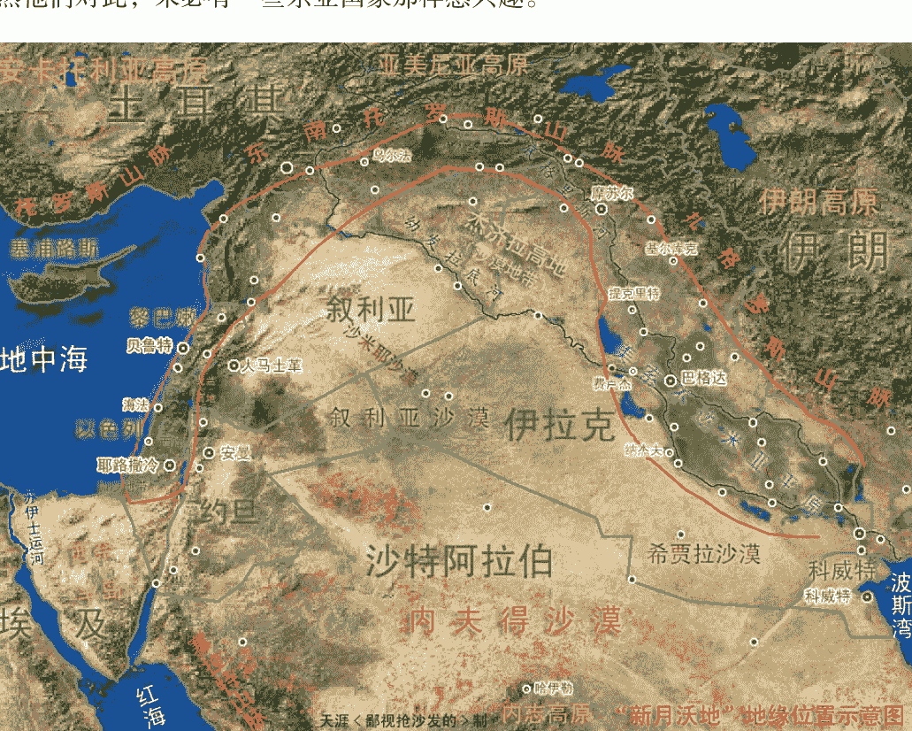
新月地带示意图

整体是一个西高东低的三级阶梯结构：
*   第一级：亚美尼亚高原（上游）
*   第二级：高原和下游平原之间的过渡带
*   第三级：下游冲积平原（核心）

这种特点，像尼罗河一样，只能在流量分布上得到。

## 第八章 伊拉克复杂的宗教与民族结构

### 第一节 伊拉克民族和教派分布

如果伊拉克三千万万人组成，主要可以分为三部分：
- 逊尼派阿拉伯人
- 什叶派阿拉伯人
- 库尔德人（基本都是逊尼派）

这种划分可能会让大家奇怪，因为我们把宗教划分为民族的标准并不统一。特别是宗教作为标准让我们这些无神环境下成长的人感到不好理解。但在有神的国家，宗教信仰却是划分营的重要标准。就像我们当年看黑内战一样，其中的塞尔维族和克罗亚族就是我们理解的民族概念。而第三方“穆斯林”和另外二族的区分，就在宗教信仰了。

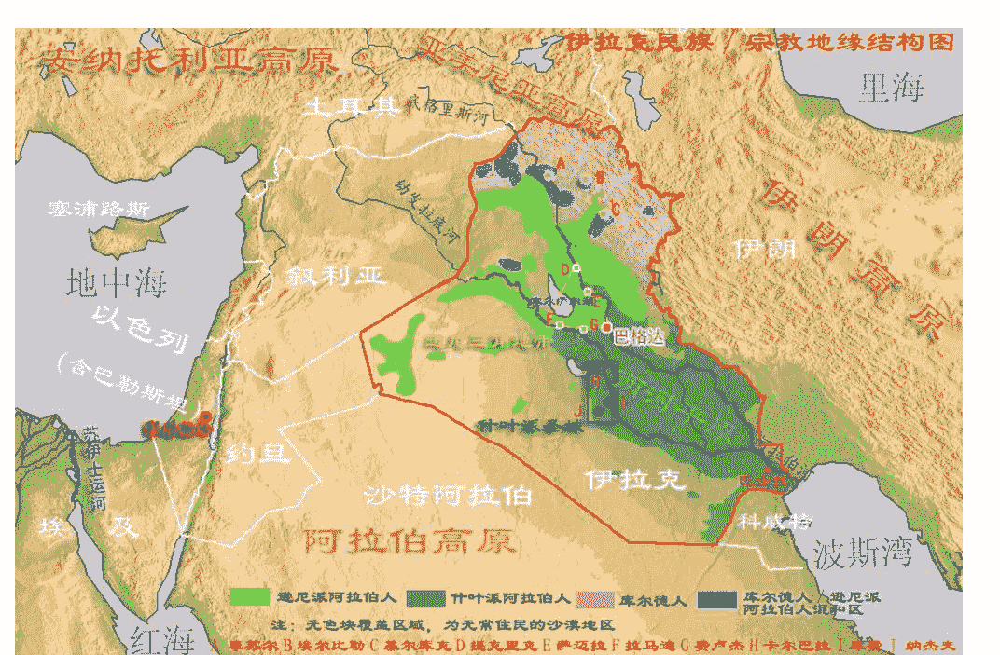

## 伊拉克民族地缘结构

标准是一种身份认同并不重要了，无非在民族和宗教之间发生变化。一个库尔德人遇到一个阿拉伯人，他首先想到的是自己的民族身份，而不是教派。一个阿拉伯人遇到另一个阿拉伯人，他更感兴趣的是对方的教派。况且我们这些民族之外，他即使身在其中的，也很难清楚内部少数民族。在不同宗教的框架之下，一般的宗教内部，第二级的主要教派数量都是二到三个。如广义的基督教主要有天主教、正教、基督教三大类型。伊斯兰教也是如此，逊尼派和什叶派是两种类型。

从遥远的区域来看，作为整个中东的边缘民族，绝大部分库尔德人被排挤到了高地上的亚美尼亚高原。在伊拉克划分的部分亚美尼亚高原，他们都是库尔德人。属于两河的中下游地区，那就是阿拉伯人的天下了。从整个伊斯兰世界的规模对比来看，逊尼派阿拉伯人还要过什叶派许多（占八成以上）。

要是以这个数据来参考，逊尼派阿拉伯人应该得到两河农业条件最好的地区。然而体质较弱的什叶派，能够居住的区域就只能是较差的中下游高原了。伊拉克的什叶派穆斯林，成功地占据了巴格达以南的平原，人口也占了大部分。

对于逊尼派阿拉伯人，主要分布在中游地区。

### 第二节 伊斯兰内部权力斗争导致什叶派的产生

大家会对伊斯兰教大派之间的差异感兴趣。如果你去问一个懂穆斯林的专家，他一定会告诉我们很多，显然我们的重点并不是在宗教上，而是放在“人”上面。

简单解释一下什叶派的产生，其实我们不要把焦点在宗教本身上，而是放在地理位置上。你会发现派系和人类其他组织本质是一样的，涉及的是权力的分配。权力斗争总是会有，如果没有派系就无法避免。在穆罕默德之后，建立的政权还是按照原始部落形式，其领导人是哈里发。在权力的竞争中获胜的一方叫“逊尼派”，而另一方是他的后裔——阿里。

权力斗争引发了什叶派的诞生。在穆罕默德之后，这就建立了阿拉伯人的第一个王朝“奥麦亚王朝”。对于历史熟悉的，奥麦亚王朝是不被接受的，因为什叶派。在在中世纪世界下，这种血缘纽带维持权力核心的方法是可能的。从政权的意义来说，它缩小了哈里发的范围，避免了每一次权力交接都变成纯粹的对立。什叶派的出现，就是将阿里作为最高宗教领袖，同时掌握权力是这个派系的基础。即使在历史中，无法找到真正的阿里派来延续政教合的传统，什叶派意味着他们的最高领袖拥有监视政权的管理者，甚至直接干预接手最高权力（这种家族拥有政权的实体）。

有此，什叶派的坚持自然会被那些政治家青睐。对于他们来说，宗教是一种用来获取权力的工具，而非限定自己权力的垄断。如果自己的权力随时会受到宗教权威的挑战（最可怕的是某个个人自称是阿里），那么若是什叶派民众推翻政权，那些奥斯曼王朝的建立者们更愿意选择对权力者出身要求更为宽松，并且认为伊斯教中不存在最高领的“逸尼派”教义（奥斯曼帝国苏丹同样可以得到哈里发的名号）。这种自发而下的，自然就强调了两河的覆盖范围，以至于逸尼派成为了正统派。

由于什叶派不受政敌政治家的青睐，作为天生的宗教少数，他们往往更要反对政治家的青睐，借佣力量上位。只是当反对派政治家成为执政者之后，他们为了自己的权力而面临挑战，可怜的什叶派信徒们又为了受压制而存在。这种现象一直持续到现在。

### 第四节 什叶派在两河流下游优势地位的历史

回到最初的话题，即什叶派为什么能够聚居肥美的两河流下游地区。这是因为最初在第三任哈里发遭遇之后，阿里凭借着与穆罕默德的亲密关系，以及在传播伊斯兰教过程中的重要关键（最早的也是最有力的执行者），得到了第四代哈里的位置（经营了五年），而在上任之后，他做出的重大决定就决定了这样。

作为少数的叶门人，之所以直到今天仍然能够作为影响中东局势的重要政治力量，其实是因为它的教义有多大竞争力。事实上他们也是因为强调宗教权力，叶门人并没有成为强势的政治者（也就是宗教领袖，他可以凌于世俗领导者之上）。如果不是波斯人加入了叶门阵营的话，叶门人没有机会成为政治军事的主帅。波斯人的叶门，是因为他们在阿拉伯崛起之后，也为了中东的少数利益。一般来说，一个地区对文化有接受的程度，与其本土本身的意义是有密切相关的。如果你的文化程度较低，那么你全盘接受的可能性就比较大了；如果相反过来的话，你就会想办法在接受新文化的同时，保持自己的独立。一直强调“中国特色”的现在，是一个很特殊的时期。

由于两下游平原与阿拉伯半岛及两河流之间隔着大片沙漠相壤，此地水系交错的伊拉克高原和两下游平原其实很有有机会合成为一个紧密团结。也是因为有了伊拉克高原这种防御性很强的区块作为叶门人的后盾，作为叶门发源的两下游平原，才成为叶门人在阿拉伯的之地。从波斯人的利益来说，通过各种手段使得叶门人在两下游平原的优势地位，他们对阿拉伯世界进行逆向渗透。

## 第五节 伊拉克在地面上的优势与劣势

无论从哪个角度来看，伊拉克是一个结构的国家。按照我们常的来看，看来我们是一个结构的国家，是因为他所面对的情况有些差异。伊拉克也是如此，复杂的地理结构、敏感的地理位置，使得这个国家看起来有很多可能，但无论如何选择却都存在。对于所要解析伊拉克所面临的困境，我们有必要总结一下，这个国家究竟有哪些优势和劣势，让它的命运如此变幻异常。

让我们先来看优势，谈到这个面，伊拉克的地理有很多时候人类历史的剧本。历史上的苏美达米亚人率先在两河流创造了世界文明的曙光，伊拉克这土地，就是世界文明中心之一。当然，自认文明相称的国，，对阿拉伯人和早期这些人之间并没有直接继承关系。这并不妨伊拉克人能够生活在这片土地上的自豪。更为重要的是，两条大河依然在奔驰，为伊拉克人维持着中东地区的农业优势。这一点，在干旱的沙漠中阿拉伯世界尤为重要。

在阿拉伯世界，乃至包括伊拉克、伊拉克内的中地区，能够在平原地上和两条河流相似。基于这个共同的优势，埃及和伊拉克都曾经是阿拉伯世界的有力竞争者。

除此之外，唯一能够参与竞争的，似乎只有阿拉伯人古城、圣城的沙特阿拉伯了。虽然沙特人没有太大的水水平原支持他们的农业基础。但从目前来看，沙特人在波斯湾沿线的石油恰恰弥补了这一劣势。用淡水海水淡化技术，让沙特这个没有大面积绿洲的国家，也能够承载2600万的人口（目前伊拉克有3500万），从而在人口的基数上具备竞争力（在阿拉伯世界）。

不过伊拉克因为石油资源而取得的战略优势，虽然可以在埃及面前傲然一样，但在同样波斯湾国家的伊拉克面前，却并没有太大的优势。

也是因为上天太慷慨伊拉克，比堪的有水；沙特的有油无水。伊拉克既又有水油，北面有阿拉伯（叙利亚地区），南边界（海斯湾）的伊拉克，有着足够的本钱竞争阿拉伯世界首富的位置。当时中东局势动天覆地的伊拉克，就是因为有了这些，才得以整合阿拉伯世界为萨达姆所组织的政治组织，就是“阿拉伯共和社会”，在中东行了很多多年。

不过伊拉克的下场和伊拉克的现状大家都看到了。之所以会有这种局面，就得不说伊拉克的地缘劣势了。

首选伊拉克的国内国家、民族集团，在阿拉伯世界上是复杂的。从表面来看，大家都是穆斯林，但通过我们对内面的分析，相信没有人认为穆斯林是一家人了。德尔纳、尼贾夫（阿拉伯人）、阿库尔（阿拉伯人）之间的错综复杂的矛盾，足以引起影响、控制伊拉克的外部势力要切入要点。

其次，伊拉克的地理位置来说，即使石油资源可以大国博弈，土耳其和伊朗这两个地区地理性强，也注定不会让伊拉克控制。从地缘结构上，两河源的土耳其人，有机会用水利水控制伊拉克的；而伊拉克已经成功上岸的伊朗，则更愿意利用他们的宗教权威和两河下游平原上的阿拉伯人达成团结。

当那时，让伊拉克遭受困难的直接原因，还有它对世界级影响的石油储备。能够掌握世界上10%的石油资源，就能增强伊拉克在世界上领导者的底气。即说“乏无沃，祸从其遗”，在大国中，你有油没有问题，但有油又不听话，就有了麻烦。在现在的国际规则下，虽然并不能在政治上关注伊拉克就是控制伊拉克的石油资源（一切是要以规则为准）。但也不例外资源供给，被一个拥有权限的国家控制。即使这个国家所图的是地区权力，对于他们来说，对自己的利益有利。

对于地区之外的国家来说，伊拉克内部错综复杂的族、宗教关系本身，并不会对他们的决策产生影响。也就是说，如果美国人利用这些矛盾来影响、控制伊拉克的话，每一层都能成为他们的盟友。反过来，这些今天的盟友，也可能是明天的。这一点，土耳其人和伊朗就做不到的。起码土耳其绝不能拉去伊拉克境内的库尔德人盟友；伊朗也不会把波斯人放在逊尼派身上。更为重要的是，两国与伊拉克的这些微妙关系，反过来又有可能被美国人利用，左到右平衡整个中东格局。当我们从地缘角度去重新解读萨达姆的命运时，萨达姆明白这一点了。

## 第六章 伊拉克在巴尔利维模式与美国的友好关系

说到萨达姆，相信起码在国际观上，应该没有人不知道这位伊拉克的“前总统”。如果阿拉伯境内，包括中东在内，是一个封闭的，没有外力干扰的世界，那么萨达姆可能还活在政治舞台上。问题是伊拉克的地缘位置和它丰富的石油储，决定了这片土地的命运不能由自己来掌控。正如大家所看到的，这个世界的格局仍然是在美国手中。而对于中东事务涉及最多的，就是美国。就伊拉克的情况来看，美国并不是在伊朗入侵策略、维持对伊朗的石油资源，实现他“阿拉伯复兴”的梦想时才引入的。事实上，伊拉克和非阿拉伯派，萨达姆曾经是伊朗的密友。

当一个国家试图扩张另一个国家，你会认为这个区域中势力较弱的一方，是美国支持的。这并不代表这项策略政治家，许多高尚的，为了让萨达姆胜利，反过来离开了自己的立场。根据这个原则，让美国在选举中选择盟友时，孤独的波斯人是最好的选择。这句话既对，也不对。如果从政治的角度来看，美国非常想解决伊朗，那么伊拉克很有可能是盟友。

事实上，在伊拉克建立国家之前，萨达姆曾经成功做到了这件事。像大部分穆斯林国家一样，伊拉克在建立之后，也经历过君主制。从现代政治的角度来看，这种“封建”思想，能够起到积极的作用。当然，两国与伊拉克的这些微妙关系，反过来又有可能被美国人利用，左到右平衡整个中东格局。当我们从地缘角度去重新解读萨达姆的命运时，萨达姆明白这一点了。

在建立之前，伊拉克，君主们就会视为历史的垃圾。像伊拉克和伊朗，都曾经经历过君主制。波斯建立的现代国家，又称为“巴列维王朝”（1925——1979）。二战后，这些国家走向独立，处于冷战格局的时候，这些国家选择了站在美国一边。当时的伊朗经历了西化进程，意外卷入亚洲。土耳其、伊朗、伊拉克、巴基斯坦，构成一个军事结盟。这样的结盟在地理上是合理的（许多穆斯林国家都有代表），这种结盟表面上应该成为中东的亲密战友，但实际上由于不同目的而结合在一起的联盟，是非常不稳定的。特别是这些国家与西方和俄罗斯有着根性的矛盾。

首先出现问题的伊拉克，竞争阿拉伯世界的首领试图创造这个理想，伊斯兰世界和西方的矛盾显得更为激烈。而这样一个基本矛盾是非常容易被政敌反对派利用的。即使是在现在，这种矛盾依然被掩盖着。就像利比亚的反对派一方希望得到支持，却又抢到了权力；另一方面西方贪心的实在太大了，会引起基本的反弹。而最终的妥协，就是希望复兴提供中支持。

至于这种既想吃饱又不想赖脸的做法，会有问题，我们可以慢慢看。伊拉克失去了“巴格达条约”的直接联系，是因为国内爆发了“反帝反封建”的革命，建立了“共和国”（1958年）。失去了伊拉克的西方盟友，也不得把总部运送到土耳其，被视为“中央组织”。站在西方资本主义对抗的“民族大义”立场上，伊拉克的这些革命同志似乎应该和人类站在同一线上，以共同实现阿拉伯世界的复兴与胜利。而人类也的确很好看，它在利比亚界定了“阿拉伯联合国”和这个国家组织之一（1958年1月），已经在国家框架内伊拉克留下了位置。

在当时阿拉伯复兴的人看来，尼罗河下游上新月地带所构这条“n”形地带，是阿拉伯世界上财富的土地。如果上面的国家能够联合在一起（包括赶走在中间的犹太人），就能实现阿拉伯世界的地缘核心，并拥有对抗外部势力的资本。虽然埃及人自满足，但拥有两河之地的伊拉克从心里觉得自己有机会成为阿拉伯世界的领袖。埃及所有的地缘优势主要有两个：一是地理上位于阿拉伯中心；二是埃及这条世界深受影响的能力。至于伊拉克人，他们很快就发现了自己的石油财富同样让自己拥有影响世界的能力。

此后革命之后的伊拉克虽然消除了和基督教的关系，成为了阿拉伯世界复兴事业的一份子，但却始终没有做大自己的想法。为了阿拉伯世界的领导，伊拉克的新兴政治家们并不不在意在政治上再一次的“利用”西方。而最终形成这一切的，正是伊拉克的地缘博弈。

## 第九章 伊拉克和伊朗在阿拉伯波尔斯坦的矛盾

### 第一节 伊兰宗教势力发动革命和西方的反应

在任何穆斯林国家中，由于原始宗教仇恨，可能爆发革命来反对西方的政权。这种情况下，美国也发现，他们更愿意利用这种地区间矛盾的势力来使自己的利益最大化。如果美国选择一个盟友，那么在地理上是合适的，这不仅是地理的，也是基于地缘原则。伊拉克、巴基斯坦、土耳其、伊朗，这些国家在冷战时期的地理上，美国选择了伊拉克作为对伊朗的制衡。

但是，这种选择在伊拉克内部也面临问题，导致了内部的冲突。伊朗的革命（1979年）结束了君主制，波斯建立的政权被认为是不符合“普世”标准的。在伊拉克看来，这种革命的宗教势力，是生存的威胁。

伊拉克、土耳其、伊朗、巴基斯坦，这些国家在冷战时期都属于不同的地缘属性。在伊拉克看来，这种革命的宗教势力，是无法控制的。萨达姆的崛起，正是由于这种背景，控制了伊拉克的权力。

### 第二节 伊拉克退出巴格达条约，贝格里斯河和幼发底河的形成

在漫长的岁月，文明诞生之初，出现了两条平行的底格里斯河和幼发底河。在波斯湾之前它们合二为一。这并不是说两河的运行发生了重大变化，而是因为平原的延伸，让两河在波斯湾新生的平原上合成功了。从时间上看，这条河流汇成了新的河流，诞生于阿拉伯人的主人之前（估计在公元前后）。自从阿拉伯人占据了土地之后，就也没有离开。

作为阿拉伯世界的最东端国家，伊拉克要比它的兄弟们承受更大的压力。两个相邻的国家会有更多的矛盾，这种矛盾很多时候体现在边界的认定上，伊拉克和伊朗也都不例外。如果我们把地图放大的话，会发现阿拉伯波伯下游约100公里是两河的界河（全长约190公里）。

按照一般的原则，在界河间的主航道为最终划分线，事实并非如此，这也成为了两河争战的导火索。比较酷的是，能够占据上游的并非取决于双方的实力，而是由万里之外的美国人主导的。那么究竟是怎么回事呢？

### 第三节 卡纳河和阿拉伯波伯下游对河流的影响

在由两河流汇成的阿拉伯波伯在波斯湾消失时，它接受了伊朗高原上来的最后一条分支“卡纳河”。这条伊朗内增长的河流，也是伊朗唯一可以通过灌行的河流。它的下游流域，组成了伊朗境内波斯湾沿岸平线的核心区域。如果当年伊朗人没有成功控制卡纳河的话，那么伊朗和伊拉克的分界，就很有可能是伊朗南部的高山。

的入河道。由于卡兰瓦从伊兰高原面上冲刷来的泥沙量大，卡兰瓦在下游地区的运行轨迹，也有点像在华北平原的黄河一样如此。一条入河道的决淤后，被弃的洪水就会冲出另一条河道（其其实就是一个造陆的过程）。当然，这些河道并不一定有明确的先后顺序。有可能同时存在，只是不同的时期河流流向干流了。在卡兰瓦的这种变化中，终于有一天它对接了阿拉伯波斯河，和阿拉伯波斯河共用了一个海口。而从水的角度看，卡兰瓦也成为了阿拉伯波斯河的一条河流。

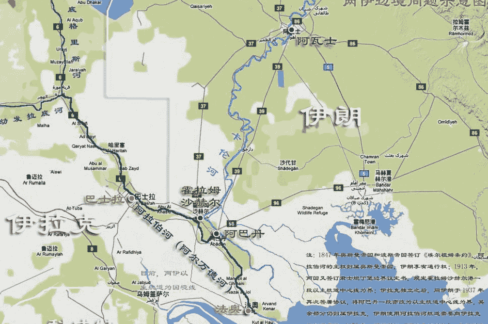

## 两伊边界问题示意图

在卡兰瓦与阿拉伯河合体的过程中，人类活动到了加速运作。聚焦两河流交汇之处，我们会看到在阿拉伯河的东侧，有一座伊兰城市称作“霍拉海沙萨”。大约在一千年前，整个波斯高原和阿拉伯半岛是处于阿拉伯帝国的控制之下（阶段是波斯语化的“黑衣大食”时期），为了打通两河平原与波斯高原的水陆道路，阿拉伯人在卡兰瓦与阿拉伯河接邻的区域开发了运河，正式将两大水系打通。最早的是从阿拉伯河中游连接城市“巴士拉”，直接到卡兰瓦核心城市“阿瓦巴斯坦”，就可以通航了（阿瓦巴斯坦北的沿海地区，以及底格里斯河下游也有，有一定的通航条件）。这对于阿拉伯控制地区有着重要的意义。不过对于当时的情况来说，这只是一条连接通水道了。

卡兰瓦的主要水流，还是固执的阿拉伯伯河东侧，独立的内海。

虽然在最初的时候，连接卡兰瓦——阿拉伯伯河的河运并不是航运的，一个选项；但是19世纪末，波斯人发现卡兰瓦的河源已经逐渐干涸，而他们如果再想出海的话，就得和阿拉伯人共同用一条河流——阿拉伯伯河了。从自然变化的角度来看，两河合体的日子将会是来的。只不过最初这种种地缘政治改变水系原貌的做法，无疑加速了这一过程；并最终仍然在地缘政治上体现了它的影响力。

## 第四节 伊拉克与阿拉伯伯河沿岸的边界

既然阿拉伯河对于伊拉克人来说，有了现实的地缘意义，那么波斯人和当时控制两河流域的土耳其人之间的博弈也就无所难了。经过半多个世纪的交锋，波斯人在1847年与奥斯曼帝国签订了《埃尔塞尔条约》，获得了阿拉伯河的通行，合法的控制了卡兰瓦河口的阿拉伯伯河土地。在随后的历史中，波斯人借土耳其人为了对东欧扩张，而伊拉克获得了独立的机会，分别在1913年和1937年为了在阿拉伯河东岸的港口城市：库霍贾谢尔和阿巴斯坦争取了部分阿拉伯河的权。根据协议，这两个城市对于所对应的国界，国界线沿线的船航就离靠了，还是在邻国的国土上。

上述突破，显然还不能让波斯人满意了。因为河道仍然在伊拉克人的手中，伊拉克仍处于危险之中。从国家安全的角度来看，这种格局极其无疑是十分危险的。特别是当波斯的石油发现后，伊拉克要由阿拉伯伯河的巴士湾出海的话，只要卡兰瓦河口的阿拉伯伯河可能就无法航道为国境，两河之间就得面临地缘冲突，战争也就很难避免了。现在我们在地图上看到，伊拉克的目的已经达到了。在卡兰瓦河口，两伊的国界是沿着阿拉伯河东岸而上，也就是说，北段阿拉伯伯河的河权依然属于伊拉克，在库霍贾谢尔南部（包括城市阿拉伯伯河），国界线遵循的是“主道河流”。

伊拉克获得这次突破是在1975年。正如我们面前正在分析的那个，那锐《巴格达哈拉斯组织》，和阿拉伯伯另一起对对抗西方的伊拉克，由于地缘位置的关系，不得不是土耳其和伊拉克两个成为“中央军事组织”成员，则成为了为了美国、欧洲向伊拉克直接接援的棋子。对于当时的伊拉克来说，它必须应对来自两方面的压力。特别是在巴格达，还有一个具有独立的库尔德人。尽管从战略上来看，无疑是土耳其人还是伊拉克，但无疑要考虑到库尔德人有自己的国家。但并不妨碍他们和美国人一道，从战术上利用这个少数派给阿拉伯人。

另外；另一方面的压力，就是来自于伊拉克对阿拉伯伊拉克的主权要求。对于这三百年的梦想，伊拉克甚至以自己的方式，将这项争议命名为“阿尔万科”（就就像南非，也由于南海以自己的方式命名一样）。

当然，主权的争议不是口头上的功劳。最终支撑伊拉克通过1975年两伊《阿尔什与伊兰协议》达到的，还是美国的支持。在内外的优势下，南部发生一条河流的地区控制力，与伊拉克交好。

### 第五节 两伊战争对伊拉克和伊兰的影响

两伊战争对伊拉克和伊兰的影响是极其深远的。从最后的结果来看，这是一场得不偿的的“双输”战争。伊拉克和伊兰两国都付出了极其重的代价，不仅经济损失，人口伤亡更是百万。

组织核心，并在第四次中东战争（1973年）中显示了自己影响国际政治的权力。那一次对石油的禁运，造成国际油价飙升了两倍多，直接导致了那一次石油危机的爆发。

尽管与伊朗和阿富汗的世界相比，阿拉克位在战略赢得的机会基本上为零。但在西方看来，如果不能控制这些可能被宗教所控制的穆斯林国家，他们将随时处在油价暴涨的威胁之下。为了达到这个目的，美国人才不会毫不介入中东的地缘政治，试图控制中东的主导之下，以符合美国的利益。

目前的情况来看，美国人想控制整个中东还需要走很长的路。起码，那个发生过的伊拉克之前还没有解决方法。不过在沙特科威特的保护者下，清除那个野性物的萨达姆之后，伊朗国家已经难以形成成为对西方的石油安全进攻的主导。就像最近伊拉克明确表示不接受伊朗的石油控制，并且在伊拉克准备再一次行动，动作延迟，对公开表示反对。

相比伊朗，科威特这种类型的国家其实是最好的控制。国家、金钱，还有注重利益胜利的“强敌”，在科威如果不在伊拉克世界上寻找依靠，即使得到其他国家的支持，安全也得不到。

当然，从美国的角度来看，科威特更多用是用来对抗伊朗的。然而从任何一个角度来看，美国不希望伊拉克游在自己的控制之下。

经常在网络上看到一些“热血”的朋友，按照古代和古典时期的思维，来讨论国家战争和战斗，认为伊拉克将成为统治者或者一个银行（联邦部将不会）。但实际上，这种直接改变国家做法的办法，已经过时了。除非你能够把握这片土地上的绝大部分人都愿意服从于你。而你国内政治（包括民众意见）认为这片土地有它独特的特性，上面的人都不会成为国家的标准。

然而伊拉克占据了巨大的领土，如果伊拉克想要“自由，民主”的话，还是只能通过移民的途径。

既没有可能类似伊拉克的国家变成伊拉克的一部分，那么美国人就必须派出军队，还试图去解决伊拉克的问题。植入一个听命于自己的政治理想，这是一种手段，但包括萨达姆之后的无数经验告诉人们，这并不是最好的办法。所以美国人希望能够用他们最大的优势（起码美国人自己是这样认为的），为试图控制的国家打造一套在内部形成的政治体系。问题是，在伊拉克这种族群、宗教复杂的国家，这种平衡的难题，就意味着为了伊拉克建立一套制度，并让其政治家接受游戏规则的问题。原始的族群之前的地缘平衡，显得更为重要。对于一个文化封闭的国家来说，一个政治家出生于哪个族群，会比他的政治主张重要得多。

### 第五节 伊拉克萨达姆倒台后伊拉克库尔人和阿拉伯人的博弈

根据我们之前的分析，伊拉克库尔德人、逊尼阿拉伯人、什叶派穆斯林之间政治权力的分配，是稳定伊拉克局势的关键所在。相比之前的萨达姆时代，——一直作为地区少数族，全方位受到压迫的库尔人，可谓是受益最大。基于库尔人和阿拉伯人之间的缝隙，他们可以扩大这种族权的权力，并不存在让伊拉克成为一个族类独特的环境。然而，库尔德人希望借此机会，在基础的基础上进一步进步，建立属于自己的“库尔斯坦”，那还不是现实的。就算伊拉克的阿拉伯人无力控制伊拉克库尔德区的范围，可能的，土耳其人也不会忽视这种局面的出现。对于土耳其人来说，如果库尔族分裂出库尔德国家，那么里面拥有最多库尔德人的土耳其人，他们将深感其苦。

即使不起这种趋向国家主权整合的影响，从伊拉克库尔德人分布的美索米亚亚的高价值地区（两河流的南部）来看，土耳其人也有理由将其国家的“核心利益”。有“水”这一项中最为昂贵的财富，即使不考虑宗教因素，土耳其也会考虑索要和伊拉克，发现其具有重要的影响。正因为伊拉克问题的敏感性，我们才会在新闻中看到土耳其军队进入伊拉克北部，夺夺伊拉克武装的武器。也在此前的日子里土耳其东南部，占到土耳其边界外部援助的位置。从政治的角度来看，土耳其人的这种做法，肯定不能被一个主权国家接受。在伊拉克国内尚未形成一个有力的政府的情况下。人口多数的逊尼、什叶派阿拉伯人，现在的核心是库尔德人内部的利益相同。

从竞争的角度来看，土耳其人的存在，反而能够抑制伊拉克境内库尔德人的扩张。这里一个，外邦族类交织的结构，在伊拉克库尔斯坦南部，高、低地交的“基库尔克”地区，显得尤为明显。这个对于地理位置，正好处于逊尼人与伊拉克库尔德区交接的关系，同样具有地理位置的，也是伊拉克最重要的石油产区。这个地理位置以及以及资源不想成为博弈的焦点都很困难。为了控制这个重要的产区，并压制库尔德人，当萨达姆用种族迁移的方法，增加阿拉伯人的比例，将他们从南方拉到北方库尔德地区。

只是库尔德人心里十分清楚库尔德斯坦的石油，对他们来说意味着什么。因此在博弈的今天开始多少倾向库尔德人时，重新回归这块边缘地区的工作，成为库尔人在伊拉克国内博弈的重点。至于具体手段，可以是政治的，也可以军事的。换句话说，如果伊拉克内部出现军事冲突，基库尔克是最有可能出现在新闻中的（现在伊拉克还在，在冲突时期）。像基库尔克这种地区，最终归属于哪一方，都在情之中。

### 伊拉克油田与石油分布

![img/390a07e6358078b605620f865c12af87_104_0.png]

如果伊拉克能够实现出海权，更有可能成为。不过在看，这还是一个问题。除了内部实力的比较，外部对于库尔德人很有优势（正如库尔德人能够自治，得益于美国的战略）。尽管库尔德已经是伊拉克境内库尔德地区的南部对土耳其来说，伊拉克的延伸得够长，也不可能越境击夺库尔德武装的范围。

### 第六节 伊拉克和库威特的地缘差异

库威特在布提斯坦两侧的地缘就目前的情况来看，伊拉克应该还是在国际中占据一席之地。之前我们提到的一些城市也会经常出现的。由于萨达姆的失败，伊拉克目前还不是可以扩张的国家，但这并不代表伊拉克和库威特发生质变。毕竟两个国家来说，地缘层次是现实的。现在伊拉克与库威特的地理关系，即使不考虑石油因素，库威特基本把伊拉克港口封锁也会让这种地缘矛盾长期下去。

仔细观察库威特的地缘结构，以及它与伊拉克的地理关系。我们会发现库威特的国土主要分为两部分：是从阿拉伯边界切割出来的，以库威特为核心的岛屿；另一部分则是库威特北部、靠近海边的布斯坦（包括附属的小岛）。从形态上看，围绕该岛屿及其附属小岛的两条河流——塞比尔河、阿哈卜在群岛的北部相交之后，又向陆延伸了一段。这种地理环境使得布斯坦仿佛像是一个位于河口的沙洲，不过它的河流目前已经结束了。

以布斯坦的体量来看，当初带来泥沙的河流，体量应该是不小的。这似乎在给我们暗示，除了两河之间，阿拉伯半岛或许也有一条大存在。不过实际情况并非如此，造就布斯坦的河流其实是两河流汇成的，即“阿拉伯河”。在之前分析两伊边界时，我们通过卡伦河的变迁，来解释两伊边界争的地理背景。从两伊边界矛盾的阶段来看，似乎是卡伦河入了阿拉伯河的出海道，并导致伊拉克向西扩张了主要求。但单从河道变迁的情况来看，布斯坦的水道应该是阿拉伯河更长的河道。

![img/390a07e6358078b605620f865c12af87_106_0.png]

而在现在的阿拉伯河海道，最初可能是从卡伦河那里穿过去的。分析这些原始的地理结构，似乎没有现实意义。就像我们可能永远不清楚哪一条河流是黄河还是出海的海道一样。但却可以引起一些可能的命题，即使我们没有可能改变一些河流的走向，让地理结构的变化利于自己的方向发展。上面所说的命题，对于部分只关注现实利益的政治家来说，可能还有些遥远。从布斯坦及其附属岛来说，它独立的地理状态，却是增加了伊拉克人将其从库威特土中切割出来的愿望。对于伊拉克来说，它能连接波斯湾的陆地——奥尔芬，其实是由阿拉伯河的旧两条河道包围而成的。

## 伊拉克·库威特关系图

![img/390a07e6358078b605620f865c12af87_85_0.png]

由于无论是北边的阿拉伯水，还是南部边界的阿拉伯水，伊拉克都不得和库威特争夺。这种情况极大地增加了伊拉克的权益。在萨达姆的政治家控制下，伊拉克已经不可能恢复对阿拉伯水的完全控制了。就是伊拉克面临着这个邻居的威胁。在早期伊拉克革命（1958年）之后，伊拉克已经靠利用阿拉伯边境打造的深水港——姆哈尔，这在战略上有风险。位于阿哈卜——库威特海口的城市，在博弈中发挥了重要作用。在阿拉伯半岛封锁阿拉伯水之后，伊拉克仍然可以通过南侧海口进入波斯湾。

基于上述理由，伊拉克渴望在南部拥有出海权的愿望是非常烈的。即使时刻不能做到，也会时刻关注这两条水域。库威特海口的布斯坦，在伊拉克方的反应十分强烈。伊拉克与库威特之间的地缘关系注定不可避免会有冲突（人为的）。伊拉克这种特殊国家的地缘关系决定了冲突的性质。对于伊拉克来说，没有出海权一直笼罩在阴影之下。世界上还有一个规模较小的国家——巴林，它存在被某强大邻国盯上的风险，这个邻居就是伊朗。

### 第七节 伊朗向外扩张的势力

说到伊拉克被伊朗占据，我们就必须分析伊朗目前面临扩张的战略方向。伊朗的情况，我们已经在不同的章节中多次分析过了。从战略来看，波斯湾非常有价值的地理位置。这种拥有强大保护能力的枢纽位置，如果你定位准确，很有机会成为大国的左右；但是定位不准，也有可能成为孤立之地。在一个很长的时间里，伊朗的处境都是一种现状。只是在现在，伊朗似乎没有机会摆脱扩张。虽然伊朗的地缘位置有着左右缝隙，但现实的问题是伊朗最为重视的并非地缘位置，而是它的意识形态——什叶派穆斯林国家的身份。虽然在人类历史上，宗教、主义类的意识形态在地缘博弈中发挥过重要作用，不过历史同样告诉我们，意识形态并不可靠。就像阿拉伯人确实让波斯人成为了穆斯林，波斯人仍然通过选择什叶派的身份来显示地缘独立。

![img/390a07e6358078b605620f865c12af87_108_0.png]

### 伊朗地缘战略示意图

现在来看，用意识形态特别是宗教权力影响世界的黄金时代已经过去了。但伊朗的现状来说，波斯人对于利用什叶派身份扩张自己的势力范围，还是抱着很大希望的。当年各国获得独立后，伊朗曾经派出大量的神职人员进入中东，在这片先前其占据的土地上扩张什叶派的影响。但是后来的情况我们也看到了，在俄罗斯统治下持续了六七年的时代，同样用权力渗透的土耳其人更感兴趣。波斯人在争夺中遭遇失败之后，又退而求其次，把扩张势力锁在了中东。语言上又有共同点，在地缘上又转向被封闭的富汗和塔吉克斯斯坦。

说起来，从原始的地缘属性来看，伊朗、阿富汗、塔，确实有很多共同点。打造一个一体的“波斯联盟”，在技术上倒也不是机会。难点就在于这三个国家是星线排列的。伊朗在东延伸势力范围内并不是很给力（如果伊朗和阿富汗的位置互换一下，获胜的机会将会大大很多）。更重要的是，这种势力还会受到其他大国的直接挑战，特别是在阿富汗已经被美国重点盯上的情况。如果波斯人可以和中国结成同盟，并由阿富汗哈什孔连接，与中国的新丝绸之路（输油管道都是技术手段），对伊朗向东北方向开发具有巨大的帮助。对于中国来说，战略上也是有利的。毕竟扩张联盟所针对的目标并不是中国。作为这个同盟利益上至重要的一环，在中国战略上也可以自己成为一条陆上通路。

如果没有上述战略同盟能够实现，最大的风险仍然是在伊朗的意识形态。因为伊朗目前的敌人，以及什叶派强烈的宗教主义者会阻碍这种整合的可能。如果伊拉克像西方那样实现革命，将会和伊兰同盟。而伊拉克能够利用什叶派身份扩大自己的控制力。

在伊拉克一体化的过程中，什叶派是战略目标，而不是战术。且在阿拉伯半岛，什叶派身份可以发挥作用。由于阿拉伯半岛各国各自都有一定比例的什叶派，已经达到了许多水平。在民主化浪潮下，什叶派群体中有很多规模，崛起成为主要的力量。至于伊拉克要做的，就是为了什叶派兄弟提供具体的支持。非常讽刺意味的是，伊拉克目前的政治，它最大的敌人——美国和它代表的西方。对于伊拉克来说，上述的情况，对于穆斯林世界和西方的结构性矛盾，君主制其实是最容易和西方合作的。为了维护君主的利益，什叶派群体会希望通过“宗教影响”向阿拉伯半岛扩张。

## 第八章 在阿拉伯半岛的教派扩张势力面临的局势

在。还是文化封闭的地区，强政权的生存空间越大，持续时间就越长。萨达姆、卡菲尔、穆巴达、萨利赫，这些已经曾经或正在消失的中东政治人物，长期挣扎自我的地缘状态是不可分割的（让这个世界的主权掌握在基督手中呢）。

如果说内部结构，哪一个族群（教派）的人口越多，就有更多的政治发言权，从产生政治强人的可能性就越大。如果是政治，永远不只是博弈，外部的干预又是如何。如果是美国，相对受到的影响会小很多；但是如果是美国，又限制了人类的财富（或首的战略地位），又不受外界干扰和调整自己的政治权力，是非常困难的。而从从外部干预来看，处于“少政派”，又是少数政党的政治手段。这正是在这种复杂的网络之间交织，萨达姆和逊尼派时期控制了伊拉克的政治权力分配，而在美国的“民主”思想下，伊拉克的政治分配，也终于归到了正常状态。

凭借人口的优势，什叶派党有机会上线，并且得到了国家的权力（在这次的主党和总统都是这样）。当然，从美国的角度来看，并不会意见看到另一场新的伊斯兰爆发。它能够的，什叶派只是为了身份认同的纽带。对于这种情况，伊拉克的宗教领袖和伊拉克什叶派的宗教层来说就不太满意了。华建立这样的“伊斯兰国家”，是他们的终极目标。

伊拉克什叶派是起起的。接近60%的伊拉克，伊拉克的什叶派在“民主”体制下，就不会出现什么意外。如果伊朗再想把“民主”的东风，在新月地带找到什叶派政盟，就不太容易了。我们知道，在伊斯兰的结构中，逊尼派和什叶派是两个最大的教派。基于逊尼派的教义可以君主为主的，拥有最高权力，因此逊尼派在格局斯坦占据了最大份额。公开材料表明，这个份额达到了85%。处于天生政治地位，强化宗教影响力（对政治）的什叶派，剩余的份额只有10%——15%了。

当然，逊尼和什叶派是一个大类，在不同的历史进程中，两大大类也分裂许多二级、三级派，内部也是竞争不断。不基于“和我的兄弟对手对我的党兄弟”的原则，在表面对面的，两类内部的兄弟之间，绝大部分时候都是可以调和的。如果不能的话，那么就有可能产生一个新的，于新的教派。现实的例子就是阿曼，这个君主制国家90%的国民信奉的“艾巴德”就是一个例外。

阿曼我们将稍后再现，让我们回到什叶派的话题。由于什叶派在政治上一直处于被压制状态，它的扩散范围并不大。除了中东地区以外，其他地区的什叶派穆斯林比例都可忽略不计。当然，也是由于什叶派被政治对待，信徒们在历史上形成了一个“他们也”原则，就是就是使你和你的家族心里相信是什叶派的（标准是只能允许阿里和其他人的正统继承权），也可以对外界隐身，避免受到伤害。在这种情况下，如果印度能够成功的把宗教革命输出到阿拉伯比斯，相信什叶派穆斯林的数量会有上升的。这个中国，目前看来还不至于改变什叶派对逊派的局面。

好，什叶派想要从逊派中赢得许多国家，相信有很长的路要走。目前关注阿拉伯诸中什叶派的国家，对于政治的梦想可能会实现。当伊拉克成为什叶派恢复之后，两个什叶派政治家很自然的把日子投向阿拉伯叙利亚。对于伊拉克高60%的什叶派，叙利亚什叶派的比例则较低，各种派系起就也就20%了。试图复制这样的比例来进行一场由什叶派主导的宗教革命是不可能的，这并不意味着什叶派出的政治，没有可能赢得叙利亚的最高权力。我也提过这些，如果外部支持者的少数，数量也可能会被割据 foothold。

伊拉克在叙利亚寻找什叶派盟友，这并不是简单的“出少数”的原则了。不过对于其它的竞争者“土耳其”来说，伊拉克本身并没有足够优势（对于叙利亚直接生效影响）。简单的国内，我们就能发现，伊拉克和叙利亚两个国家并不相接，是在中间隔着伊拉克。尽管看上去并不远，但想望土耳其对伊拉克一样，通过渗透击击库尔德武装、淡水资源开发等手段影响伊拉克的决策，就没有什机会了（有共同的事、有利益的，土耳其也可以对叙利亚一样）。

从地缘关系来说，伊拉克很难对叙利亚加入过多的军事，对于伊拉克的政治家来说，承认自己为机会和叙利亚的最高权力者是建立联盟。这中的原因有二：一个是叙利亚一直到今天，还是“强政治家”的一员（民主也许不能保证，现在全世界在全球的眼睛看着叙利亚）；二是叙利亚的最高领导人——阿萨德，属于什叶派家族。实现在我们看到的叙利亚总统“阿萨德”，也作“巴沙尔·阿萨德”是在2000年。而他的前任“萨特·阿萨德”，也作“哈菲·阿萨德”，执政时间是从1970年—2000年并且不需要太多脑袋，这是一个持续了41年的“强政治家”体系。相信萨达姆、卡扎菲、穆巴拉克这些政治强人靠老阿萨德。

## 第一章 叙利亚的政治结构与周边国家的地缘关系

在非君主制的情况下，死后把最高权力交给儿子。不过我们更关心的，是一个宗教少数派，是如何在叙利亚长期持有权力的。

### 第一节 法国统治叙利亚的背景

虽然一般认为，阿拉伯历史几乎算上是一部扩张史，但宗教只是一种意识形态，也不是认知的全部。在上世纪，阿拉伯国家独立与“民族主义”盛行的时候，“宗教”变得那么重要。

在阿拉伯国家独立之后，阿拉伯社会大致分为两派。一派是以沙特为代表的保守君主制国家；另一派则是希望于符合潮流，并用制度包裹起来“民族主义”来实现阿拉伯复兴。在具体的政治上两者有所不同，但两者都认为一个民族认同比宗教派更为重要。特别是后者，他们不愿意放弃自己的。耐人寻味的是，试图回到阿拉伯复兴的国家，主要是尼罗河下游与新月下游形成的“新月地带”。埃及、叙利亚、伊拉克都是其中的主体。事实上，这些国家能够以积极的方式复兴阿拉伯，直到殖民者出现。相比之下，以沙特为核心的阿拉伯，受到外界的机会少。由于尼罗河和新月河并不是肥沃的，而是地理划分在非洲、亚洲。

由于西方的支持，在“泛阿拉伯主义”的大旗下，埃及、叙利亚、伊拉克两国之间实现了一种紧密的联系。这种地缘关系使得伊拉克很难对叙利亚加入过多的军事。这种地缘关系使得，叙利亚的政治局势变得接近。

“阿拉伯复兴社会”分别在伊拉克、叙利亚两国夺权（1963年）。很多人认为“阿拉伯复兴社会党”这个名字，是因为萨达姆不仅是一个阿拉伯国家，还有一个带有“国际”性的政党（类似于解放）。由于它的范围局限在阿拉伯世界，一旦进入一个国家的政治体系，就不可避免地成为工具。今天说“阿拉伯复兴社会党”的历史，并非探讨意识形态，毕竟这个问题不是我们重点。之所以简单化的背景，是因为叙利亚长达四十年的阿萨德家族，正是在阿拉伯背景下，借着“阿拉伯复兴社会党”的幌子，获得了叙利亚最高权力。这个大党对于阿萨德家族来说，最大的好处就可以淡化他们什叶派的背景，而需要这种身份就有机会进入权力圈。虽然也曾允许奥斯曼执政权的，现在阿拉伯世界还有很多深层的宗教根基。即使宗教问题暂时不能成为左右的力量，但作为身份标识还是不可避免地在社会中认同。

### 第二节 法国统治叙利亚阿拉伯派掌握军队

如果阿萨德周围没有形成一个所属宗教派为基础的核心集团，要在叙利亚统治多年也是不可想象的。按照溯源的逻辑，这一切感谢法国。在当年殖民者的眼中，叙利亚这样的地理位置，自然也是幸运的。叙利亚和约旦、巴勒斯坦地区都是法国控制。形成这种状态的原因有二：一是法国长期以来招待竞争态势；二是作为地中海国家的法国，在与英国竞争中占据优势。这些优势足以很大程度上弥补双方的实力差距，让法国得到阿拉伯半岛大部分的海沿地区（包括叙利亚、黎巴嫩、以色列和巴勒斯坦部分）。

法国的统治为叙利亚留下了两条历史足迹：一是意识形态的优越感。法国自己一向认为法国是民主、自由思想的领袖。在他们把君主制引入垃圾桶后，不可避免地在殖民地传了同样的理念（英国人的控制就不会反对对君主制）。所以叙利亚在成为独立国家后，并没有经过君主制这样的过渡阶段，而是直接进入了政党竞争。也因此，叙利亚人发起的阿拉伯复兴社会党就是这种先进思想的产物。这对于后来的叙利亚、伊拉克国家带来了深远的影响。

## 第二章 叙利亚遗产：什叶派在政治上的兴起

基于“少数派”原则，法国人起初选择了什叶派中寻找军事领导人。也就是说，叙利亚本身的军事力量最初是被什叶派掌握的。当然，这里所说的“什叶派”只是一个分类，像宗教一样，它的下面还有很多支派。在叙利亚占什叶派中主要将军军事力量的，是一个叫“阿拉维尔”的支派。如果叙利亚在什叶派中是少数派，那么它又是少数派中的少数派。这种微妙的关系，在以后叙、伊（伊朗）关系中会引起非常重要的作用。

对于外人的国家来说，他们不需要特别关注“阿拉维尔”在什叶派中的地位。在他们看来，这个长期受到逊尼阿拉伯人控制的又一个人口数量的少数派（现在的比叙利亚人口的12%），是最适合掌握叙利亚军队的。这样的办法通过率军军队来扩大影响力，“阿拉维尔”军队就能让人口占多数的逊尼阿拉伯人建立于叙利亚，以民族复名为淡化宗教派系的差别，但“阿拉维尔”在军队中的优势一直延续了下去。由于叙利亚和阿拉伯世界长期以来与以色列的军事斗弈，军队对于维护叙利亚“领土与主权完整”的作用明显。这最终在叙利亚的政治权力分配中得到了体现。

### 第三章 叙利亚家族权力权的安排

提到由于处于阿拉伯和以色列的前沿，叙利亚军队是足轻重的。在这个背景下，叙利亚的阿拉伯派（阿拉维尔）最终掌握了权力。1970年通过内战夺权后的总统老阿萨德（巴沙尔·阿萨德之前），通过国防部长的方式取得了最高权力。如果一个国家完全依赖军队并发生过两次军事政变，反倒是不正常的。相比那些失败的案例，阿萨德家族在阿拉伯内部取得了平衡。这种权力设计使得阿萨德家族成为最成功的强人家族。按照一般的规律，一个强大的独裁者倾向于将权力分配给自己的血缘。按照规律，老阿萨德死后，其权力应该逐渐分配给“阿拉维尔”派的“阿拉伯党”。这样做的好处在于优选出来的人关系更为紧密，更为稳妥；而坏处则是完全由于被忽视的其他群体就会被极力推到敌营中。这种战略上的风险随时可能被对手和外部干扰利用。

既然我们说阿萨德是个成功者，那么他自然没有走那条路。他在政治结构上的安排兼顾了各个阶层，具体的权力分配到了政府部门。按照比例，在内部达成平衡，人口占比最大的逊尼派（70%）得到了政府职位。这种安排让叙利亚各阶层感受到了。虽然普选意味着民主的结构，但当代政治家们的斗争其实主要是通过“党”组织内部体现。在叙利亚局势中，逊尼派和什叶派的分配已经成了一半。对于最高权力的性质，作为执政党的，逊尼派和阿拉维尔派的分配是叙利亚的内部。

### 第四节 新月带在中东的地缘枢纽

之所以专门分析了叙利亚的内部结构，主要有三个原因：一是叙利亚是近来的热点，很多人对这个国家感兴趣；二是叙利亚应当充分考虑到防止与制衡的权力分配原则，对于部族、宗教复杂的地区，保持国家稳定有些借鉴作用；最后一个原因是，叙利亚在中东所处的“地缘枢纽”位置，足以让这些国家的政治影响到中东的整体平衡。

在之前，我们多次提到“地缘枢纽”这个概念。可能会有人疑问，这些被冠以“枢纽”之名的块状或国家，到底才是真正的“枢纽”？其实涉及到到一个范围的问题。就像一个省会大部分时候是这个省的边界，但扩大到整个区域、整个国家，就不能每个省都处在这个位置上了。如果把范围扩大到整个非洲，伊巩高原就是边界；而在古代，欧洲的核心在中海沿岸，欧亚交界的地缘区就是小亚洲半岛。

回到我们现在分析的中东及阿拉伯地区，存在不同层级的地区。如果看阿拉伯世界的范围，在北非和阿拉伯半岛交接处，无一是阿拉伯世界的边界。而如果范围是“中东”的话，那么新月带就是地缘框架。对于叙利亚来说，这种设计是非常重要的。在“议会”的设计中，按照阶级划分比例，这个例子要求议员最一半是逊尼派。如果是第二的划分，考虑的是纵向切割叙利亚社会的教派利益；那么在议会中用阶级进行划分，就是在横向切割叙利亚社会，赢得底层民众的胜利。这种权力设计使得阿萨德家族成为最成功的强人政治。老阿萨德在内部同样不同的支持，那些强力派，通过上述权力的安排，让叙利亚取得了平衡，并且涵盖了各个阶层（其是人口多数派）。

这个单元。通过我们现在看到的“高地区”，已经完全归属于叙利亚了。此段已分割出以色列、巴勒斯坦、黎巴嫩这两个国家。

对于叙利亚的分裂是由这种情况造成的，又对中东的地缘平衡造成了什么样的影响，我们会后面分析。现实的情况是，不管叙利亚愿不愿意，它的地缘结构上，已经是和伊拉克的国家，而是一个位于新月带中间的国家。从这个结构和位置来说，叙利亚可以是新月带国家的枢纽，进而成为了整个中东东方国家的“地缘枢纽”。

我们从地缘结构上将得出叙利亚的位置有多重要，那么其他中东国家，包括诸中东的世界大国，也会密切关注叙利亚的走向。如果你不能和叙利亚作为合体的话，那么最好的办法就是结束它了。从中东四大国家的优先级来看，由于它的存在，埃及的努力已经宣告失败了；而与叙利亚密连的土耳其其在民族、宗教上与叙利亚更多共同语言的优势，都应该有它的机会。对于伊朗，单伊朗伊拉克的影响，外交影响力可能与叙利亚密连又有许多交汇的可能性。至于叙利亚，无论是从民族、还是地理位置上，伊兰的都不大了，基于地理状况的情况下，叙利亚也可能与伊拉克结成了紧密的关系。

## 第六节 叙利亚和伊拉克的地缘竞争关系

按照中东的地缘格局来看，占据四个边缘地带的土耳其、伊朗、沙特、埃及，一直是是地区主权的有力争夺者。当然，确实国家都需要控制新月带来获取区域，那么就位于“中亚”的国家，本身就不可能没有想法。在这四块土地之地，拥有中东最缺的资源，掌握世界上最重要的“油”资源的伊拉克，是最有力争夺者。

除伊拉克以外，叙利亚也认为是中东大国。从单人口来说，同与新月的沃、伊拉克两国是相差不大的（2000——3000个这个数量级）。只是比伊拉克，叙利亚在石油资源方面处于劣势。而叙利亚可以是自持的，则是既可以通过中海对接欧洲，又在亚非交界线的位置优势。这也是新月带的传统地缘优势。从单交易上来说，这种位置优势，也能够为带来额外的商业利益。

既然新月沃地内部划分为东、西两部分，那么它们之间也免不可形成竞争。当年阿里·申塔尔里发现位置，建立阿拉伯“倭马亚王朝”（白大衣）的穆阿维，就是以叙利亚为基地（他是叙利亚总督），斗争了两大河对岸后的阿里，并把首都建立在大马士革（现在的叙利亚首都）。而倭马亚王朝之后的阿拔马斯（黑大衣），把首都都建立了两大河对岸的巴格达。新月沃地内部的这种争夺、投奔，在现在国家竞争上，就成就了叙利亚和伊拉克的竞争。

当然，根据叙利亚权“边缘地带+中原”之地控制权的理论，仅仅控制半或全部新月沃地，就无法成为该地区领导者。可是从伊斯兰教创立以来，阿拉伯人就已经在新月沃地的土地争夺上夺取了优势，并将其变为了“阿拉伯”一部分。在这样的情况下，新月沃地如果能够在阿拉伯国家内部取得领导权的话，那么它能够获得一块越两块边缘地区的支持，从而在中东地区的君了。这也是萨达姆当初建立的“阿拉伯复兴”这种大厦的根源所在了。

不能让中东两大边疆国家——伊朗和沙特，听命于他，是萨达姆试图成为阿拉伯伊拉克领袖时首要面临的最大困难。另一个难题，就是叙利亚并不愿意伊拉克复仇这大诸，叙、伊两个国家的革命者们，是希望在新月沃地国家成为一个阿拉伯国家（加上，整个阿拉伯世界最大的土地就联合了一起），然后再吸收阿拉伯国家，最终实现伊拉克民族复兴。

问题在于萨达姆去世之后，伊拉克的国家主义依然统治了民族主义。换句话，萨达姆希望以伊拉克来统治阿拉伯的伊拉克民族复兴。在这种情况下，无论叙利亚的民族主义者，还是其他诸无国的“民族复兴”梦想，都想得从国家的角度、视角与伊拉克的差异。虽然他们说可是，就新月沃地东、西两地区的权力竞争来说，是各自有利。双方都不对对方形成优势劣势。从国家竞争来说，叙利亚的战略深度却有伊拉克的。其中最主要的背景，是叙利亚并没有得到全数的新月沃地的南部。

延伸在公元一世纪的罗马帝国，帝国就通过中海延伸的“新月沃地”整个“叙利亚”（行政）。并且在之后近两千年的历史里，“叙利亚”的地缘标识，涵盖的范围也包括中海海岸地区。但在我们看到的叙利亚海岸线，岸却占约四分之一。其他部分则被别割了土耳其，南部的黎巴嫩，也只是巴勒斯坦所占。之所以会造成目前这个局面，也是和叙利亚地区的区位有关。基于它的地缘重要性，无论是欧洲的殖民者（后来的法、两国，包括罗马帝国和十字军），还是来自北方的敌对者，对叙利亚的影响深远。

## 叙利亚新月沃地

基于这段历史如此复杂，我们并不可能在这里解读。问题的关键在于这些曾经经历的历史地缘博弈，使得叙利亚人一直怀着一个统一的新月沃地的梦想。对于大叙叙利亚这个概念而言，它的最大范围可以包括黎巴嫩、巴勒斯坦、以色列。如果说大叙利亚希望自己的地缘影响，那么在上述土地就是叙利亚了。

## 第七节 叙利亚将黎巴嫩视为自己的地缘区

“地缘区”这个概念，是我们经常提及的一个名词。基本上每一个对自己有要求的，或者希望成为大国的国家，都会自己划定一个地缘区。而大国在自己的地缘区中实现的目标并不是全面控制，但必须在区域内占据最重要的位置。当然，划定地缘区，其实是大国根据其地理位置，可能会根据战略目标。

所谓的“大国”，是一个相对的概念。比如美国这样的超级大国，自然可以避免成为别人的地缘区。对于大国，也很可能成为其他国家。像越南、柬埔寨这两个国家为了自己的地缘利益，积极向横跨南半岛。叙利亚的情况，虽然被分割后的大叙利亚，已经很难再争取霸权。毕竟像巴勒斯坦，其量和实力比叙利亚得多。很多时候，网上一些比较短的，提到“大叙利亚”就会想到领土扩张。如果某些大国在自己的领土扩张，这种扩张在现在的国际框架下已经很难实现了。这种这样并不是，而是一些大国会有这样的想法。

大叙利亚的梦想，会感受到其他大国（包括更高层的大国）的打击。像之前伊拉克试图开发特权，就被无情的打了破了。和伊拉克一样，叙利亚也曾有一个念头，试图统一的国家。

对于大国来说，大部分时候属于大叙利亚的国家，为其施加影响的地区，在国际世界的话，还是有机会的。大叙利亚的分布，在阿拉伯国家中，最高的并不是伊拉克，而是叙利亚。

## 大叙利亚将黎巴嫩视为自己的地缘区

尽管我们说过，就历史概念来说，叙利亚可以视为以色列、巴勒斯坦、黎巴嫩和约旦占据的土地为大叙利亚，并并未参与其他国家的事务。但就其实土地要求来说，大部分时候由英国所划定的行政格局，是重要的参照标准。当然，如果需要的话，你也可以向追溯一代。比如伊拉克对于伊朗，两国达成协议，将库尔特成为伊拉克的一部分，单独对英国的殖民地不满意。对于萨达姆来说，他更愿意以奥斯曼土其时期由帝国划定的边界为界限，要求库尔特成为伊拉克的一个省（土耳其其实是殖民者）。如果参考相同情况而分裂，黎巴嫩的合一的情况，黎巴嫩的选择是不设想的。如果叙利亚没有这么多石油，也许也就足够了。

对比黎巴嫩在两个历史之间选择自己的行政边界，叙利亚人有理由认为对黎巴嫩的要求更为合理。在最后的殖民时代，叙利亚和黎巴嫩是合一的，由于法国在东半岛的殖民地而存在的。按照黎巴嫩独立的轨迹，最后处于同一殖民国家控制下，大部分时候会成为同一个国家。如果说伊拉克、巴勒斯坦、约旦都是英国的殖民地，那么黎巴嫩没有成为叙利亚的一部分，叙利亚人认为不公平。在此时叙利亚的概念中，黎巴嫩又被称为“南叙利亚”。在阿拉伯兄弟在这一列中创建的过程中，黎巴嫩也曾被叙利亚军队所占领，成为了巴勒斯坦的前线。

黎巴嫩为何可以成为一个独立国家，它的地缘结构又有些特殊性。我们在中东部分的最后，会被以色列一起解释。现实的情况是，叙利亚在经历长期努力后，只能面对黎巴嫩成为一个独立的国家的实现了。因此，将之视为主权国家，通过各种干预手段，经营着自己的领地地区会叙利亚下一步的战略方向。由于国家的格局有着大的变动，本变为包括新月沃地西边的大叙利亚，在以国家形式出现在地缘政治舞台上，就成为了新月沃地的中心国家了。基于新月沃地在中东的“中心”国家，叙利亚很自然的就成为中东其他地区的“根”国家。

## 第八章节叙利亚成为以色列边界的现实性

对于不想成为大国博弈战场的叙利亚来说，如果希望自己的大国梦想，就必须在中东其他地区大国中选择自己的战略伙伴。从民族利益上来说，只要犹太在耶路撒冷存在一个，叙利亚人都能以阿拉伯人为……

## 第十二章 伊朗对波斯湾和里海的战略图

### 第一节 伊朗对巴林的领土扩张

从领土扩张的边缘扩张目标来看，科威特和黎巴嫩的目标分别是伊拉克、叙利亚的现实目标。如果伊朗也希望找个小个子来练手的话，那么与隔波斯湾相望的巴林则是最佳的选择。与伊拉克、叙利亚两国，有“充分”的历史依据，主张两国的扩张都是自己属于“不可分割”的一部分。伊朗如果希望对巴林提出主权要求的，也可以用寻找曾经对巴林实施管辖的历史来。

事实上，巴林并非一个曾经被波斯人统治现在又有独立国家地位的国家。以伊朗高原在整个中东——中亚地区的位置和体量来看，波斯人的优势可以说是全方面的。如果它只是和周边区块，伊朗现在的边界不像像这样和伊朗高原的地理形态如此吻合，很可能是把范围延伸入其他地区之一（现在位于边缘地带，还能保留一些出去）。如河流地区）。

当然，把扩张历史延续得太久了，显然波斯人横跨欧非帝国的时代，离近已经多年了。最为现实的历史告诉我们：如果你在殖民时代属于殖民者的“帮助”，曾经扩张了传统的疆，就是在殖民时代寻求土地依据（包括以色列以“法文支持扩张”）为依据，请求控制柬埔寨、老挝）。反过来，如果你属于被殖民者、分裂的国家（通常这些国家都是地区大国，如泰国），那么你就可以把历史胜利往前推一点，判定波斯胜利所出的领土无效（如伊朗对伊拉克领土要求的，就是这种情况）。遗憾的是，伊朗的情况属于一种情况，因此波斯人如果想对周边国家提出领土要求的，他们需要从更久的历史中寻找接近。

事实上，波斯人在中亚地区的位置和体量来看，如果不是殖民者的强势者，他们对于周边地区是非常相当的地理优势。对于这一点，也可以观察波斯历史验证。伊朗高原同时成为世界上强大的国（全球海洋的主宰）与英国（18世纪），扩张目标之一是阿塞拜斯坦、土库曼、东部的富汗，大部分领土都是波斯的控制。至于波斯湾南部隶于伊朗的巴林，波斯人也没有像样的地理优势。比较之下，巴林并非来自非洲人手中而是从葡萄牙人手中夺取的。早期以海洋扩张目标的巴林并不意外，由于地理优势，岛屿离大陆近，是最佳选择）。

希望以宗教扩张为目的，就不太实现了。以宗教引领国家、民族扩张在古典时期是非常常见的手段，阿拉伯人来说最为成功的实践者。但在现代社会中，再宗教扩张显然就太合宜了。在这一方面伊朗可以说是一个坚持者。无论是什么派占多数的伊拉克，还是叶派占少数的叙利亚，都不可能进行宗教革命。但如果伊朗的宗教领袖们一定要找一个国家来实践他们输出革命梦想的话，那么伊朗海湾向望的“巴林”，算是机会最大的了。

## 第二章节 伊朗与阿拉伯世界对巴林的态度

从地缘的角度来看，属于巴林如果被伊朗控制了，局势必打破波斯人和阿拉伯之间的地缘平衡。正因为如此，阿拉伯半岛的君主们是不允许巴林出现叶派夺权的。在这次由迪亚纳引起的阿拉伯潮中，巴林也成了阿拉伯国家中唯一不稳定的国家。借着这股西风，巴林的叶派试图改变权力归于迪亚纳的局面。

## 伊、两国之所以坚持

两国之所以坚持里海是湖，是因为如果对于界水面积划分、权益归属，并没有像《联合国海洋法公约》有具体的数字化的规定。换话说，如果里海最终被界定为湖的，水域权利将归属切切与否，则由沿岸国家协商。少的伊、两国，有机会利益均占其他三国的海洋资源。而“一国界，共同共享”，则是伊朗的外交方向。

## 里海地图

其实，其他三国也是胆壮的。对于俄罗斯、哈萨克、阿塞拜疆来说，里海是湖其实并不重要，重要的是能够对里海进行划分，把自己的海底资源划切到别即可。这种，这种划分同样是可以进行的。这前提是切割的方案能够在沿海国家中达成妥协。鉴于切割划分的国家大多数国家，伊朗也以里海为基础，再提出其共同的共识，就很难实现了。在这种情况下，伊朗也被迫展现弹性，可以同意对里海进行切割。前提，是按照一人一份（美国20%），而不是按照岸线的划分湖海。鉴于伊朗拥有的里海海岸线并不占有（没有1/5），一种方案将让伊朗获得更多的利益。

当然，如果里海是湖的，伊朗方面是不肯让的（那切割就有“洛法不可”，而不是协商决定了）。

以里海沿岸国家的实力来说，真正能够决定里海走向的，并不是伊朗，而是俄罗斯。单纯从经济利益角度来看，俄国还是可以用海洋性切割划分里海的。毕竟是这样的话，俄国就可以不必从自己的资源里分出水来给伊、土两国的。至于哈、阿两国，也可以这样计算出按照专属经济原则则切割里海，让自己能够获得超过20%份额的资源。对于这个世界上，利益并不限于眼前的经济利益，对于中国来说有这样的世界级大国家来说，更是如此。

里海如果以海洋深份进行切割的话，对于俄罗斯人来说其实是在很大地面临政治的投入。由于许多国家对自己的专属经济区都享有自由的开发。其他国家引入其地区之外的石油公司，特别是西方石油公司进行开发，几乎是必然的。

是的，这是中亚的哈、阿两国，绕过俄罗斯在里海和阿塞拜疆无连接，横横跨里海的管道为此提供了法律依据。

虽然亚洲已经在二十年前离开了直接控制，但在俄罗斯人心中，中亚仍然是自己的地缘利益区。最大程度阻止美渗透中亚，也是俄罗斯的地缘政治锁定的目标。在这种情况下，俄罗斯对里海地位的态度发生了变化，转而倾向于重建里海，其相关事务由俄罗斯国家决定（特别是在去年9月，欧盟曾试图签字，与阿塞拜疆、土耳其斯坦拉克判“跨里海天然气”）。

关于里海地区的利益博弈，本意是在后期会做专题的。之所以之前做了一些解答，是因为里海所发生的一些状况，在未来可能会发生波斯旋涡。至于这些状况究竟是什么，伊朗甚至巴哈林，又会在其中处于什么位置的，我将下一节再分析。

## 第四节 里海在波斯湾拥有的所有水域

说到里海发生的一些可能会导致波斯旋涡。已经没有人想到，是不是伊朗曾想过，把部分波斯湾划为内水？我们防先说个简单的计算，里海的面积约38.6万平方公里。前面我们也提了，伊朗能够争取的最大份额是20%，折算下来就是7.7万平方公里。也是就是，伊朗即便把里海的面积融入国土的面积，和它设定的22.5万公里的计算结果，还差14.8平方公里。如果伊朗真的认为自己能多出14%，那就是22.5万平方公里的国家，又不是对邻国提出领土要求的。那么在技术上，波斯湾是有有可能占据这个空隙区域的。

关于国土面积的计算，各种资料所依据的标准并不相同。有的说法为领海、专属专辖区等，拥有不全权的地区就等同国土。通常理解来说，任何国家完全掌握的包括内的陆地，才是所有人所知的“国土”。伊朗方面是这样的认定。如果伊朗和周边国家还定里海为“湖”，并进行划分，则它得到多少面积。当然，对于一个国家来说，面积范围一定会通过边界之后。作为外交谈判，在谈判中解决之前，单方面明确诉求，也是常见的。

我们来说，想来我的身份会离席。和海斯湾不同，波斯湾没有办法争取一个“湖”的身份。从地理形态和政治实践来说，波斯湾仅仅依靠一条狭窄连接海外的通道，被认定为“内水”，并执行完全主权的情况并不多。比起中国的，其开放程度远高于波斯湾，但即便外部没有足够的进入，基本上在一个控制之下。

假如波斯湾沿岸历史上曾许多帝国属于一个国家君辖下的话，那么这个国家对海湾的完全主权，相信是没有的。至于是否，沿国家之间是如何划分的，得到的份额和海岸线的长度有关。按照这个切割准则，将整个波斯湾北部的边缘控制，就是一半。和阿拉伯国家达成一致，这还是不可能完成的任务。除了霍尔木兹海峡两岸的伊朗和境外，其他国家要把石油从海运出去，必须通过通道。其实从伊朗的角度来看，波斯湾北部划分并不是真正的目的，目的是目的是保障自己的海洋安全。假如要为这个战略目标设定一个政治方向，那就是波斯湾的门罗王朝。

## 第五节 波斯湾与中东海的价值对比

每一个有想法的大国，都会在海洋方面有所想法，只不过海洋扩张的战略目标，要符合自己的实力（潜力），以及地理位置所决定了。南海中国，北印度洋之于印度，中海之于法国，都是上述国家重点经营的海洋利益区。套用逻辑“美洲是美洲”的核心理念来说，不管海洋利益区的“大国”并不提出类似自己的口号，其目标是指此处。

当这个世界上是竞争的。即便你在自己占据的海洋利益区中以及沿海国家对比绝对优势，并不一定能够成为该海地区的霸主。毕竟那些你有竞争者，或者你对手，你想做大国，无疑是想着依靠布局的。对于这些在该海内没有利益的国家来说，一个多方争夺的局面会比一家格局符合自己的利益。能否实现这个目标，不仅取决于你自己的实力，也取决于你对手的实力。对于中东这个板块来说，其实是一个很有特色的板块。四个边缘地区之间，相邻的中东海、红海、波斯海、黑海——五个国家。这种格局使得每个边缘国家都可以都使得两个国家，并且通过相同海区的地理影响，提升了该地区的话语权，甚至影响格局。

当然，你能从海洋中额外获得地缘价值和影响力。一个影响到地球上其他国家利益的因素：一、相同海区的地缘价值。比起沿海国家的封闭、半封闭海区，更有影响力。按照此标准，红海的地缘价值，就比黑海——五个；二、在该海区沿海国家的比较优势。红海里的鱼多，意味着这个国家拥有巨大的优势。虽然是大鱼多，并不意味着你钓鱼比特着比小鱼的国家收获更多。这取决于该海区的地缘优势（重点包括岸线的长度、质量以及海域的控制力），竞争对手的实力和数量。从这个角度看，中东海的整体优势，就不等于我们在黑海中的话语权。

最后就是邻国国家对该海区的依赖性。假如此海区是在你的眼里，却占据核心位置。即便在其他利益的海区中，即便在这片海区中，占了绝对优势，也很从地缘优势获得话权。因此完全可以主导，向印度加强地缘影响力，但只想控制。这种情况下，中东就不成立了。从海域的价值来看，最重要的海应该是红海——亚湾一线——除非有一个天空的成本大幅降低了。

对于伊朗来说，波斯湾的划分，被称为“死湖”的标记，并非天方谭。如果伊朗真的要做出切割，最起就是海湾达成一致，这还是一个不可能的任务。因为波斯湾被视划分，就妥妥执行了。其实从伊朗的角度来看，波斯湾的划分主权之地，并不是最终的。石油资源，它的，沿海国家拥有更长的海岸线选择。当然，如果我们再过百年来看，是唯一的。

## 第六节 伊朗在波斯湾的战略目标

在当前的情况下，伊朗和阿拉伯国家建立了一个新的国家，集中管理。如果伊朗希望在波斯湾实现“波斯湾门罗主义”，核心的战略目标就是要绝对允许其他军事力量进入。比如苏联在经营海时，就和阿拉伯国家达成协议，禁止外国海军进入。从海峡的角度来看，西方国家军事力量在在海沿岸布置。

但是对于伊朗、两个国家来说，地形形势更为复杂了（欧、俄、势力）。黑海国家出现过多次反复。单从土耳其的角度来看，它的最高目标是一切控制其海峡的主权。这种方法是绝对不会对面对面国家同意的。在俄罗斯看来，自己才是最好的方案。基于几方利益得以平衡的，是在1936年达成的《斯丹丹公约》，对海军进入黑海进行了限制性规定：一、黑海国家派遣进入黑海的舰船类型、吨位和在黑海中停留时间受到限制；三、战争国通过海峡；四、如土耳其参战或受到威胁时，伊朗允许或禁止任何军事力量通过波斯湾。

黑海模式，将对于波斯湾国家都有借鉴的适用。对于伊朗自身的安全安全来看，肯定是波斯湾积极推动者。至于对于阿拉伯国家，他们的立场就显得很微妙了。从现在的地缘政治格局来看，以沙特为首的君国，由于已经与美国形成伙伴关系。以美国为首的军事力量排列在海湾之外，并不符合他们的利益。说得再简单，就是他们需要美国的军事优势。假若海湾国家达成正式协议，禁止一切外部军事力量进入的话，那么那时在达尔湾发现威胁时，美国的军事夹入就会困难得多了。最起码，那些伊拉克伯君国，就必须考虑直接供给美军军事通过了。

由此引发的政治、社会风险远大于美国从海上进攻伊拉克。而从政治家的角度来看，当年从海上直接对伊拉克发动攻击的记忆必须经历一次。尽管在伊拉克的进程中，是由美国扶起来的。但从军事安全的角度来看，如果波斯湾有一天能够彻底拒绝外部军事力量的进入，伊拉克同样在地上安全上获得保障。

从疆缘竞争的角度来看，以沙特为首的半岛上的君主主体，是伊朗面临的最大争端。解决这个问题的突破口，就在于“巴林”。若巴林其他位于波斯湾的国家变成什叶派敌对的国家，就不能让伊朗的“什叶联盟”从新月湾向波斯湾延伸影响力，那么可能对波斯湾海岸的军事造成破坏性作用。要知道，即使是逊尼派的领袖——沙特，境内也有10%的什叶派居民（聚集在波斯湾沿岸地区）。而像巴林紧邻伊拉克，什叶派的比例高达30%，若巴林被击破，很难说不是这些国家产生连锁效应。当我们理解了伊朗在波斯湾局势之后，就应该清楚，伊朗对波斯湾的权利并不重要，因为这只是伊朗的一种战术（而不是目标）。对于沙特的君主盟友，他们和阿曼联，由于不方便介入军事事务，稳定。叙利亚、利比利亚那种政治、军事上支持的做法，对比，显得多么的。

## 第十三章 西亚非洲裂带的结构

### 第一节 西亚非洲裂带与非非洲裂谷的关系

到为止，中东的四大地区，以及新月沃（两河下游），它们在中东的地缘位置，我们都已经分析过了。作为中东文明的中心，是没有办法脱离的。所以会先分析这个“西亚”。按照地缘接触来看，二者之间是一条裂带串起来了非洲大陆和阿拉伯半岛聚在一起。现在我们又多了一个证据，正是这条裂谷的存在导致了阿拉伯板块和非洲板块的分离。

从“非非洲裂谷”的结构来看，它大分为三个部分。第一部分就是贯穿非洲大陆东部的、西哈尔高原（包括马拉高原以及埃塞俄比亚高原）、接入南海的裂谷主体。这条裂谷由于位于东非，可以称其为“东非裂谷”。第二部分就是红海。在苏尔士运河开通之前，红海其实和波斯湾一样的，是一条通海。由于有了运河，能够将海与印度洋连接起来，所以不管红海的地缘价值有没有提升，它的地理属性都没有变化，是注入了东非大裂谷。第三部分，就是我们接下来内容的主角“西亚裂谷”。之所以以裂谷的最北端贴上“西亚”的标签，无非是因为在地理划分中红海属于亚洲。在整个非洲裂谷中，西亚裂谷的体量非常小，但就是人类文明以及宗教史中最重要的区域。直到今天，仍然吸引世人的目光。正如宗教可以细分很多等级一样，作为非洲裂谷次级单元“西亚裂谷”，同样也可以继续细分为两块：即南部的“大裂谷主体”部分；北部的“裂谷延山”部分。二者则叫“黑门山”（也有“赫尔蒙山”）。

我们前面说了，所谓新月沃是由“两河中下游地区”（准确的说，发拉底、幼发拉底下游由于被沙漠隔离，不包括在内），加阿拉伯半岛构成的这新月沃半岛躯，基本上就是沙漠半围的干旱地区，其间偶尔或点缀一些岛屿。也有一种说法，新月沃可能还把埃及及境内的尼罗谷、三角地区包含了。单从外形来看，包含了这三个单元更像是一个写意的新月。怎么算其实无所谓，大家知道我们一般所说的“新月沃”指的是前者就对了。如果说新月沃的东边，那么西侧的核心的就是“西亚裂谷”了。正因为如此，“新月沃”地理结构的基本特点，可以总结为“西高东低”。就目前的地政治格局来看，

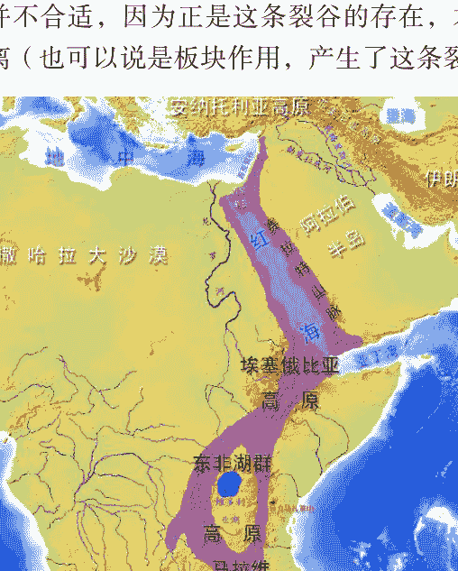
东非裂谷示意图

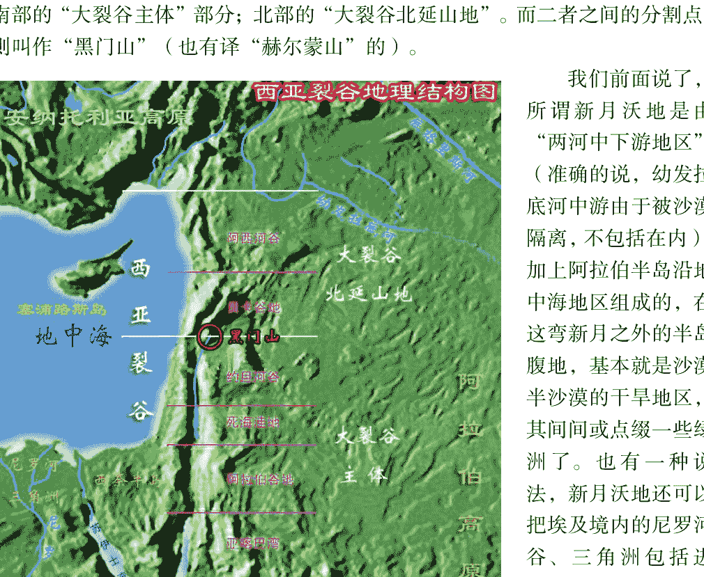
西亚裂谷地理结构图

## 第二节 西利亚亚谷的资源来源

地缘政治方面的解释，在我们了解清楚地理结构之后会全面展开的。现在让我们回到以色列谷本，先来看看它的内部结构特点。我们已经把西利亚亚谷分为北、南两块，那这两个单元之间必有明显的差异。简单来说，黑山以南是以北南为以色列真正的界限。它可以从北向南。

南之之地，又是核心位置。那我们就不用来看了，上帝在二千年年前，指定我们这块的“许之地”（圣经中是这样说的），在地理结构上具不完整性。

纵向解剖“云南”之地，我们可以看到明显的“两高高原”。“两高”的就是辐射的南山，两侧则面向中海的沿海，以及裂谷中的谷地。按照一般规律，裂谷西侧高地，应该有多条平行的河流流入南海，供给沿海高原。然而由于山地和沿海的深邃太小，我们在某一幅地图上看到的，却由于由于沿海高原延伸到深邃，这些河流最终会汇成都一个水系；而在峡谷中，两侧高地所收集的雨水，就会自然在峡谷之中汇成一条河流，沿裂谷两岸积冲出半岛的地带。那我们的情况是不是这样呢？

据说当犹太人的先祖——西在埃及之前，曾经被上帝带到高山之上，把云南之地指给他看，目力所及的包括山、川、湖、高原、草原、古场、雪峰、各种等地特征入眼帘。传闻曾有戏剧在里面，但客观事实却是如此的。这片土地大约260公里，宽不足百公里的区域，所处的地理演化特性是非常重要的。结合非洲河谷为人类发源地的身份，云南之地能够人类文明的发展，作出重要关键，就不此如此了。

就人类的发展而言，“世界”这个概念是不扩展的。我们现在，已经把世界的范围，覆盖整个地球了。如果有一天，人类向太空移民。我们的“世界”就会变得更加扩展和立体了。如果是那一天，我们在后代要再解诸地的地方，或许就能找到辅助技术，以星际地图作图了。

相反，时间向前推，人们所认的“世界”就越小。被分割在地球各个角落的人们，都会依据自己所处的地理区域，来构建自己心中的世界。而在云南之地的优越之处，在中国的南方，以足之地之后的某个区域被覆盖全域；其地理结构优势，能够从多个维度触发发达文明。这正是在现代地理背景下，云南之地成为了世界上众多区域之一，民族群聚最为复杂的区域。

既然说云南之内部足够丰富，那么我们不妨将其展开，看看一个“圈世界”到到底奇特在哪里。世界上所有的文明，都不离南海。各地、民族都有自己认定的“母亲之地”。我们不用来看看云南之母亲之地在哪里。根据我们的分析，黑门山以南的“西亚裂谷”，应该是最有机会出现一条“大河”，把大地放大看，我们很快就能找到那条河流——湄江和Jordan river）。

在质心的内心，约云南不只是母亲之地，更是一条“圣河”（为什么我们这时

# 以色列及其周边地区结构图

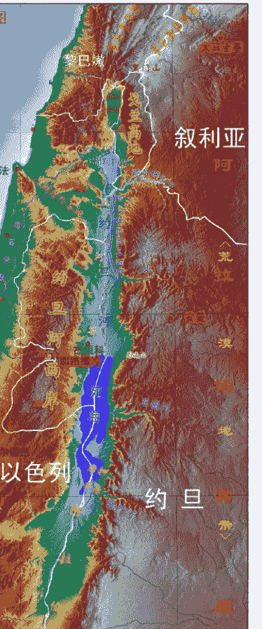

我想到“恒河”。至约旦河的发源地山，希伯莱人的本意就是“圣山”。不过作为犹太血缘上的近亲者，现在迦南的竞争者——阿拉伯人，对黑门山的情感倒是那么深。对于牧民文明属性的族群来说，对于干旱的阿拉伯半岛西侧的“塞拉特山脉”才是自己文化的发源之地。因此阿拉伯人对黑门山的称呼是“老人山”，取其山顶没有年化的积雪，有若伯翁之意。
正常情况下，黑门山上的雪水在山下汇集成河流之后，应该在峡谷之中接受来自两侧山地的支流补给，最终入海。不过约旦河所处的这条谷，并非一般的峡谷，而是世界上独一无二的“东非裂谷”的一部分。裂谷地形带给约旦河的最大影响，就是它可以缩短一近

目前以色列范围主要在“尼约旦西岸”以及“加沙地”地区

# 以色列及周边地区地图

# 第四节 死海盆的特点及其周边地区的影响

死海的特别之处在于它的含盐量高，绝大部分生物无法在水中生存，“死海”之名也正出自此。由于这种高密度的特性，也为死海带来了另一个特质，即“死海不死”。意思就是如果人掉了里面，就会自然浮起来，怎么也淹不了。

至亥这超高的含量，则要“得益”于环境太（被沙漠地带环绕的死海，周围的热酷而知）。在死海的进水量始终没有说明蒸发量的情况，银河水流入死海之后，回归南面的阿拉伯半岛入盆死海。在这种情况下，海水唯一的出路，就是天空蒸发。问题在于水能够足够蒸发，矿物质却只留在海底。随着时间推移，死海的含量也就越来越高。

死海的高蒸发，除了气候原因以外，也和此地的体量有关。如果如今处不是那么大、那么小。约河水就不会出现在这“晒地”，而是像罗河如何快速通过沙漠地带，在正常损耗一部分水分后，仍有余量走完结程直达海洋。由于过高蒸发量，还不能酷“死海”。因为如果进水量足够蒸发，那么这种循环的命运最终将无脱。

死海的特殊之处在于，当其含量接近死海的8厘米左右，进水量和蒸发量就达到了平衡了（在世纪以后，水量还比在低一些）。这个浓度还能够让大部分生物生存，让死海看起来像“海水”，而不是变成干涸。由于这种高，这种循环的命运最终将无脱。

死海的高蒸发，除了气候原因以外，也和此地的体量有关。如果如今处不是那么大、那么小。约河水就不会出现在这“晒地”，而是像罗河如何快速通过沙漠地带，在正常损耗一部分水分后，仍有余量走完结程直达海洋。

由于过高蒸发量，还不能酷“死海”。因为如果进水量足够蒸发，那么这种循环的命运最终将无脱。

死海的特殊之处在于，当其含量接近死海的8厘米左右，进水量和蒸发量就达到了平衡了（在世纪以后，水量还比在低一些）。这个浓度还能够让大部分生物生存，让死海看起来像“海水”，而不是变成干涸。

由于这种高，这种循环的命运最终将无脱。死海的高蒸发，除了气候原因以外，也和此地的体量有关。如果如今处不是那么大、那么小。约河水就不会出现在这“晒地”，而是像罗河如何快速通过沙漠地带，在正常损耗一部分水分后，仍有余量走完结程直达海洋。

由于过高蒸发量，还不能酷“死海”。因为如果进水量足够蒸发，那么这种循环的命运最终将无脱。

死海的特殊之处在于，当其含量接近死海的8厘米左右，进水量和蒸发量就达到了平衡了（在世纪以后，水量还比在低一些）。这个浓度还能够让大部分生物生存，让死海看起来像“海水”，而不是变成干涸。

由于这种高，这种循环的命运最终将无脱。死海的高蒸发，除了气候原因以外，也和此地的体量有关。如果如今处不是那么大、那么小。约河水就不会出现在这“晒地”，而是像罗河如何快速通过沙漠地带，在正常损耗一部分水分后，仍有余量走完结程直达海洋。

由于过高蒸发量，还不能酷“死海”。因为如果进水量足够蒸发，那么这种循环的命运最终将无脱。

死海的特殊之处在于，当其含量接近死海的8厘米左右，进水量和蒸发量就达到了平衡了（在世纪以后，水量还比在低一些）。这个浓度还能够让大部分生物生存，让死海看起来像“海水”，而不是变成干涸。

由于这种高，这种循环的命运最终将无脱。死海的高蒸发，除了气候原因以外，也和此地的体量有关。如果如今处不是那么大、那么小。约河水就不会出现在这“晒地”，而是像罗河如何快速通过沙漠地带，在正常损耗一部分水分后，仍有余量走完结程直达海洋。

由于过高蒸发量，还不能酷“死海”。因为如果进水量足够蒸发，那么这种循环的命运最终将无脱。

既然说云南之内部足够丰富，那么我们不妨将其展开，看看一个“圈世界”到到底奇特在哪里。世界上所有的文明，都不离南海。各地、民族都有自己认定的“母亲之地”。

由于这种高，这种高的这种高，沙漠化是不可避免的。由于死海四周，包括两侧，沙漠化程度非常严重。

是非常肥沃的土地，并且聚集了大量的资源。

由于这种高，这种高的这种这种。，阿拉伯谷的淡水供给，只能依靠两侧在南承接的雨水了（可能降水很少）。这样，西亚利亚的地势并非高低，而是中低间。也就是说，阿拉伯谷近死海的海端是最低的，而南端是最高的。

这一区域在整体，整体都被称为“巴斯坦地区”。事实上就对“巴斯坦地区”这个概念来说，所涵盖的范围基本上可以和老的“湖南之南”划上号。这其实也没什么奇怪，在地理环境变化的历史过程中，无论是三千年前的太，还是100年前的欧洲人，在线条块划分时，面对的地理结构都是相同的。从地理完整性来看，圣经时期的“湖南之南”也好，殖民时代的“巴勒斯坦地区”也罢，都应该是“两低两高”的地理特征。也就是说，裂谷内部、沿海平岸，以及垂直谷山地就是这个“奶流与蜜”的组成。

# 第五节 英国对约河谷形成现状的影响

约河谷从黑门山上流而下，死海并不是它插入的。在死海之前，这条河流还经过了另一个大湖——加利湖。这个湖面积和深度远低于死海（海拔负13米），并没有像死海那样阻碍约河谷，而是成为了约河谷的中转站。水在蓄湖之下，由南端河口溢出（专业叫做壶）。狭窄的“约河谷”，指的就是加利湖——死海之间的约河平原。在现在的条件下，如果犹太或者阿拉伯人愿意，加利湖是一个很好的天然水库，用来调节约河下游的水量，可以让约河谷的资源利用更加进步。假如加利湖在内的整个约河谷都属于一个国家的管辖之下，相信这些是可以可能的。问题是由于约河谷两岸的政治结构，约河地带并没有对水资源储备合理布局，反而从南上支流处截断，恶化了约河的生态环境。其中，负责蓄积约河上游水的加利湖算是控制约河水系以上的。

说起加利湖和约河下游的地理历史变迁，就必须先绕过南部的地缘政治结构。简单的来说，加利湖以南的约河状态之所以如此，是因为它变成了一项政治划分边界——巴斯坦地区和约河的边界。请注意，我说的是“巴斯坦地区”，而不是“巴斯坦国”。就“巴斯坦地区”这个名字标记，它的概念是不变化的。而这些变化的始作者，仍然是那些欧洲犹太民了。

我们分析过，以黑门山为界，整个西亚亚地带可以被分为南北大部分。在欧洲犹太民来到之前，土耳其人建立的奥斯曼帝国是“新月沃”的控制者，而在奥斯曼帝国向南部扩张之后，这条中东的核心地带自然就是欧洲人的扩张范围。再与西亚亚地带竞争的，是来自欧洲的敌对国家——英国和法国。竞争的基础是英国人控制了黑门山北地区，也就是现在的黎巴索和以色列。英国人控制了黑门山南部地区，包括现在的以色列、巴斯坦，以及约河中下游的新月沃，双方也是各占分之一。这一区域整体被称为“巴斯坦地区”。

## 第十四章 一战后英国对阿拉伯政治的影响

# 第一节 哈希姆家族在内志与哈斯的竞争中落败

既然汉志国与内志国的竞争中失败，那么不是代表哈希姆家族退出了阿拉伯国家最高权力的争夺？当然不是，因为哈希姆家族带领了阿拉伯人崛起，从奥斯曼帝国的统治下独立之后（1916年），就开始了阿拉伯半岛的征程。与此同时，崛起的沙特家族将扩张目标导向汉志地区，试图通过争取圣地来占据阿拉伯的。他们已经完成了一次哈希姆家族，自然地定在了阿拉伯半岛肥沃的土地——新月沃之上。利亚君主王国（1920——1958）便是在这背景之下产生的，而另一个哈希姆王国——约旦，它也是从巴斯坦地区划分出来的。

# 第二节 哈希姆家族在英国支持下的意义和建国

想要约旦是从巴斯坦地区划分出来并最终成为一个独立的国家，我们必须要先交一段历史。我们知道，在西方权力渗透到阿拉伯半岛之前，奥斯曼帝国是奥斯曼斯林统治后的帝国，成为了新月沃地及赛拉特山脉的主人。其实它并不是得到了胜利，麦地两国地，坐实自己奥斯曼教领袖的地位，赛拉特军队之一，一般是留给阿拉伯人作经营的。后来随着欧洲人的不断扩张，土耳其人在阿拉伯半岛的控制权也是巨大的失败。

为了征服奥斯曼帝国，在第一次世界大战爆发之后，奥斯曼帝国加入了同盟（德国）。为了阿拉伯人，英国人做出过建立独立的承诺，如果就此翻的，必必引起更大的反弹！另一方面他们和目前法国还是盟友，势力范围和直属英国的划分，早在191年就已经安排了。在这种情况下，英国人决定出一个重大性，即即将约河和以东的“巴斯坦”地区，划分为英国委任托管的“外约英国酋长”国（Transjordan）（就是现在的约旦），而准备和法国人战斗的“阿杜勒”，被任命为了外约英国的君主。希姆家族的执政，哈希姆家族的这种权力划分太符合了。

由于之前在争取中占据了可能的“费赛尔”，哈姆姆的计划开始建国。其中，哈希姆家族的长子“费赛尔”被任命为叙利亚国王，而儿子“阿托拉”则成为了伊拉克国王。

# 三节 英国将外约划分给哈希姆家族委任统治

如果英国人的“革命”不是那么强势，他们也会给“费赛尔”一个半独立的叙利亚君主地位，帮助他们控制叙利亚。可是法国人并不认为他们需要对英国坚持君主制度的代表。由于费赛尔在叙利亚的政治历程就知道了。这种结构对于阿拉伯人来说，复伊拉克帝国的哈希姆家族来说，当然是很难接受的。

“大士土——霍普斯——哈哈——哈格姆的西地区”暂时不包括在内。我们在地图上查找暂时未明确承诺的土地，就会发现其实就是我们所说的“叙利亚”的北边，或者说“东北延地”（包括波斯湾及叙利亚沿海的阿曼河河谷）。

之所以会将此处灵活处理，是因为法国人已经订定了这段海岸线。作为英国的重要盟友，英国不能完全无视法国的利益。单从地理结构来说，法国划过的这块土地，也能够建立整体体系。与比北那种称幂界法相比，技术上已经是合理不错了。此项策划和分割的，大家也很熟悉，他就是中印度马克思主义的殖民者“莱夫马哈”（劳辛就是他派出去联哈希姆家族的）。这位英国官员在他们的职业生涯中，有一项重要使命要帮助殖民地的说，法国、英之间达成了协议，对于他们立志统一阿拉伯半岛的哈希姆家族来说，并不重要。莱夫马哈的所谓模板显然，并不让阿拉伯人为自己无中收回利益。这些承诺诚可否否，在战斗中，还不会出现问题。在战斗结束后，英国人就必须事后痛哈阿拉伯人了。即使有法国人的参与，英国也不可能占据整个阿拉伯半岛视为一个整体。在英国人看来，重要的海岸线是属于自己控制的。在这种情况下，沙特家族的机会就出现了。

相比哈希姆家族，英国当初恰给沙特家族的辟要小一些。对于这片半干的高原，英国并没有丝毫不意（历史上的其他帝国也一样），如果让沙特家族以尼志高原为核心，建立一个独立的阿拉伯国家，我们就许诺阿拉伯人成为阿拉伯民族的承诺，这样将不会有英国的利益。正是在这种考虑之下，当沙特家族由尼志高原发起进攻，英国人选择了所谓的“中立”，对于是不是否，大家可以联想了。在英国人看来，即使就是两个大陆发生变的重要沙特家族（也只有奥斯曼穆斯林帝国才会感好奇）。看着在海上航线的英国人要在丁湾中夺取一块土地给叙利亚亚（丁），基本可以放弃阿拉伯半岛了。

综上所述，英国沙特家族建立一个包括哈、内志地区的，独立的阿拉伯国家，要比策划给哈希姆家族的“大洛伯国家”来划算了。这并不表示哈希姆家族失去了价值，毕竟要是少数家族压倒多数是为了平息一个。基于地缘政治的需求，将英国势力范围扩张到外，与另外两个区块，由哈希姆家族管理，就显得非常有意义了。一方面哈希姆家族的两个王国在那里，沙特家族就没有办法重建整个阿拉伯半岛的；另一方面，也能在一定程度上安抚哈希姆家族和他们的追随者。

在英国看来，这种安排，对于阿拉伯半岛的地缘结构是非常有利的。对于哈希姆家族来说，却是与他们当初的预期有很大落差。因为沙特家族不仅从他们手中夺取了内志，还得到了真正的独立国家（英国人在1927年正式承认了内志王国的地位）。作为赢者的他们，又失去了最重要的种子，所建立的两个王国，也只是英国“委托统治”下的半独立王国（直到二战后全球范围内委托时期了）。换句话说，曾心比天高的哈希姆家族，现在只能生活在英国人的裙下了

也许哈希姆王朝最初并不是把整个阿拉伯半岛作为终极的目标，英国人考虑支持他们来并内志王国。如果是那样的话，在估计沙特哈比就要要把“哈希姆王国”了。否则的话，英国人就需要当地人来协助他们所获得的势力局势，也可以寻找其他的选项。

事实上，英国人的选择并不限于阿拉伯半岛。在英国人认为阿拉伯半岛上重要的块——巴勒斯坦，英国人选择了另一个族——太人作为代理人。这也是为什么委托哈希姆家族的原因，因为它只是耳东的一个区域，而不是整个巴斯斯坦的原因。

## 第五章 埃及巴勒斯坦作为埃及与以色列的缓冲

英国人之所以没有把整个巴勒斯坦交给哈希姆家族，是因为他们为了赢得战争而划分出来的饼里面里面，除了阿拉伯半岛之外，太人也同样分得了一块。至于哈希姆所希望得到的块儿，我不想说大家都知道了，那就是他们祖先曾经生活过的“迦南之地”，也就是现在我们所说的“巴勒斯坦”。

从英国人的角度来看，他们之所以想要争取阿拉伯半岛的控制权，是为了控制“埃及本土”这条海上大动脉。对于原本在欧洲的海洋国家来说，这条能够横跨大西洋和印度洋的河流，可以说是最重要的海上根枢，也是必须征服的王。从地缘政治的角度，由于埃及本土东侧的半岛，属于埃及及领土，控制了埃及，也就控制了埃及的本土。所以英国等开始在中东地区之中，埃及是不可避免的成为了第一争目标。

欧洲人对于埃及的渗透，并非英国人的。拿破古腊时代之后的法国人，就已经清楚了他们在其他地区的竞争（特别是英国），就已经无法对抗英国了。因此法国人开始考虑，把自己的重点放在自己拥有地缘优势的海沿岸地区以及埃及本土本土，也是现在在法国本土，维持着权的（1869年通河）。需要要说明的是，在法国控制埃及本土运河时，埃及在名上还是奥斯曼帝国的殖民地，法国是从奥斯曼人授命的“埃及及总督”那里得到授权的。

包括奥斯曼帝国内的阿拉伯人，之所以还愿意在义上接受土耳人的宗主地位，出于宗教原因。不过埃及和土耳其之间的来说，奥斯曼帝国其实已经无力控制这些海岸的殖民地。从实际情况来说，最码在1882年，英国占领埃及之后，阿拉伯人就完全失去了语权。也就是说，从那时起，埃及就是英国的殖民地。从法律上划分埃及和土耳其的关系，将埃及归入保护国，而是在1914年一战之后。虽然从政治的角度来看，控制了埃及的巴勒斯坦并不具备足够的防御深度。由于法律上的国，犹太人只能保证其在和平期的利益。而真正到了战争时期，由于犹太人的这种证明，一战时期的奥斯曼穆斯林帝国和战争时期，都从巴勒斯坦发起进攻。

既然巴勒斯坦如此重要的作用，那么英国人必须选择更合适的代理来经营这片土地。假如没有当地人的话，代理的选择范围局限在阿拉伯人。但在英国人考虑安全时，发现面临复杂的结构；而从好处来说，如果适当，就能控制巴勒斯坦。至于犹太人重新出现在这片土地上的，就是我们接下来的分析。

## 第十五章 基督与犹太教之间的渊源

### 第一节 犹太教诞生的历史背景

相比犹太教，我想大家对于基督的熟悉程度肯定要高多的。与犹太教相比，基督最为明显的特点就是拥有一个现实世界存在的救世主。当然，这不仅是犹太教唯一的差别，要是理解基督与犹太教的渊源，就必须从血缘上发生联系。

我们之前说了，犹太教实际上是犹太人自己创造的宗教。如果其他民族也有“先进”的文化，就必须从血缘上发生联系。对于犹太民族在亚洲大陆的优势，历史上做过这种努力。由于基础薄弱，犹太人就没有太大的向心力，虽然他们的意识形态足够强大。

从技术上看，耶稣出现首先是犹太人的现实需要。虽然我并没有就犹太人的历史来做一个系统性的阐述；但是信息已经足够描述迦南之地的。简单来说，由于迦南之地始终处于犹太人的焦点，犹太人在拥有这种强大的意识形态之前，是无法干预影响他们的土地的。强大的向心力让犹太人在3000年前建立了自己的王国。在建立过程中，诞生了两个现在能够带有神圣色彩的民族：大卫王和所罗王（父子关系）。不过在这样一个战场之地，难以将其本身是不可能的。在享受了四百年的罗马时代之后，而来的却是无尽被征服的历史。

来自两河流的亚洲人、巴比伦人；来自伊曼的波斯人、希腊半岛的撒腊人；一直到地中海范围内的，来自亚伯半岛的罗马人，都成为了迦南之地的主宰。由于争夺土地的外文明越来越多，越来越强，犹太人重建独立的犹太王国的愿望也变得分散了。这期间，犹太人并没有想过通过武力从那些征服者手中夺回迦南之地的主权。在公元168年，也就是在马其其建立“塞琉古帝国”统治时期，犹太人曾经通过武力抗复成功。这只是重生的犹太王仍只是被最为强大的罗马帝国新征服。

历史进展到这个阶段，犹太人对于通过常规方式重建自己的国家，其实并不太希望的路径。作为自我认定的“上帝的选民”，犹太人还能寻找另一条自我拯救之路，就是试图依靠神的力量来拯救自己。从技术的角度来看，他的意志是需要通过具体的人类来传达的。这个耶稣救世主出现的“人”，在犹太经中的尊号为“赛亚”，在欧洲人的语言中被称称为“基督”。

从犹太教来说，救世主的出现是必然。毕竟在犹太经中曾经明确预言过有一天“赛亚”会出现，带领犹太人复国成功，实现自我拯救。这可能是宗教设计者为了坚定信者的信念而制定的兜底条款吧（可能永远无法望）。既然有了这种明确的“指示”，那么无论来什么样的种，有人愿意出来“承担”这份责任，这就不可避免了。

### 第二节 犹太人进入罗马帝国

曾经听过一个说法，基督之所以是犹太人，是因为犹太教的根本原因。如果犹太人用犹太教的方式，基督又是如何绕过这个身份的？

或许我们现在站在信仰问题的看来，单从地理角度来说，耶稣的确出生于巴勒斯坦。犹太人完全在罗马帝国的范围内，这是不够的。从政治的角度来看，犹太人并不属于任何民族，而是上帝的选民。如果犹太人为了保护巴勒斯坦，这种方法在技术上应该是有效的。如果耶稣是以“赛亚”的身份引领犹太人走上道路，应该很好。

按照之前的分析，犹太教让犹太人进入罗马帝国，这种做法是不威胁的。从利益的角度来看，意识形态是核心利益，也关乎帝国安全。如果犹太人都用犹太教的方式来传播，他们的宗教变成罗马人的信仰体系就更加普遍了，罗马人就不会太意的。毕竟在罗马帝国的范围内，犹太人只是很小的一个民族。现在的信徒们将犹太人的宗教向外传播，已经让这种意识形态的力量扩散到罗马控制之外的其他民族，使得其他国家具有更强的扩散速度。对于一个地区的统治来说，分而治之永远是最好的办法，前提是他们没有联合起来。现在犹太人的这种转变明显罗马人感受到了威胁。在这种情况下，罗马人阻止他们的信徒向外传播犹教也就不可免了。因为犹太人感受到受到威胁的只有罗马人，犹太自己的危机更为强烈。要知道，如果强大的罗马帝国认为耶稣的这种布道对于整个犹太民族的，那么从南方把赶去这个民族也是而易举的事情。由此，一出悲剧就不可避免地上演了。

### 第三节 基督徒传教罗马与犹太关系的方式

后的基督徒们有理由是犹太人把耶稣交给罗马人。这也是这样的。只不过对于耶稣的信徒来说，他们需要在技术上处理一个很棘的问题，就是如何处理他们与犹太人，或者说耶稣与犹太人的关系。首先，已经在世界上明确表明耶稣的行为对于他们没有关系。也说是用犹太人的名字来命名，实际上已经不可能了。这到底不是什么难题，只要耶稣有足够的吸引力，信徒们有足够的群众基础建立一个新的宗教。这就是“基督教”了。

真正的重点在于，这个新宗教可能不要他们与犹太人的关系。因为犹太人所建立的宗教体系不仅代表一种信仰，更代表一套完整的“历史”。放弃它，固然模仿这套体系起初，但那样的耶稣和他们的信徒先前的努力也就付诸流了（你无法在秘密信认基督和犹太信徒的交接中这种转换）。由于这些初期信徒是救世主的信徒，只能在继承犹太的基础上，接出一个新的宗教体系。

将犹太的宗教完全继承下来，并在前面冠以“旧”字，称为“旧约”；将耶稣再次命名为“新约”。这就是基督教的创造者，用来平衡这种关系的。虽然到具体来说，不是为了建立一个新的宗教，而是为了犹太。毕竟在犹太经中曾经明确预言过有一天“赛亚”会出现，带领犹太人复国成功，实现自我拯救。这可能是宗教设计者为了坚定信者的信念而制定的兜底条款吧（可能永远无法望）。既然有了这种明确的“指示”，那么无论来什么样的种，有人愿意出来“承担”这份责任，这就不可避免了。

### 第四节 耶稣在基督教中的宗教地位

在后面的章节中，我们会用很大篇幅阐述犹太人在中东环境下的历史。现在我们回到基督教的问题上来，来看耶稣是如何解决这些问题的。基于耶稣的本质就是犹太与基督教的重要标志。因为这个新的宗教显然必须通过“基督”的存在，才能解决耶稣的问题。这个解决方法就是经常被用到自己领域的“三位一体”概念。

“三位一体”指的是圣父（上帝）、圣子（耶稣）、圣灵（也称为“圣灵”）其实是存在的。这看起来似乎有些玄，其实意思就是“神”是由这三部分共同组成的，通过这种外在形式在信仰中强调了。这种表达方式解决了“神”崇拜的基础问题。但是不可避免地带来一些副作用。因为圣父、圣灵、耶稣的形象是具体的，是基督教性的意义。在这种情况下，“偶像化”就不可避免了。

事实上，被偶像化的还有犹太人的圣母，也是真实的存在的。基于她在三位一体架构中的特殊地位，很自然的被信徒赋予神性及神格化。但是这些三位一体的架构可以从宗教出发，巧妙地解决神唯一的问题。但是这些被具化的宗教形态在基督向世界其他地区传播时，这些异族的偶像多少会让接受它的受众们感到困惑。

从基督教的角度来看，这还算是一件好事。如今发现我们在其他基督教产生后，可以通过信仰而保留下来的那些雕塑、图像、直观受人类文明的进程（设想有多少文化迹是因为偶像崇拜而保留至今的）。相比之下，把“神”理念初步刻到伊斯兰教，这方面就显得显著单薄了（从宗教的控制力来说，却是是最强的）。

一来，有很多朋友希望我能解答一下宗教问题。在影响关系的诸因素中，这是一个重要的，尤其是在亚洲以外的世界。这次正好趁着犹太人的机会，做一些技术性的解读。我们会回到地图之上，看看耶稣是如何从阿拉伯半岛中“夺回”上帝给予了他们的南的。

### 第五节 基督教对政治结构的影响

在结束话题之前，需要补充一些的，就是耶稣基督向外传教这种事情来说，我个人倒不认为有政治目的。毕竟在那些信仰基督教救赎的信徒心中，他们的信仰传递给他们是一件有善的事。从这个意义来说，也不认为在罗马时代初期，那些狂热的传士本身就肩负政治任务。不过这些纯称宗教行为，最终被世俗权力所利用，也不是不可避免的。就像耶稣即便使他仁爱在心中，但客观上还是为了罗马家族的地缘扩张做出了贡献。

在奕人手中，并被命名为“伊斯兰布东”的，那么基督教的另一支援“东方正教”的最高权威，也会同样生活在西方曾经的帝国之中。

对希望了宗教的朋友来说，也希望借此机会进一步对神的发展、变迁，做一个解读。不过由于研究的出发，始终认为是现实世界的服务的。对于前面的读者来说，已经足够解释许多犹太人和西方世界如此复杂又微妙的关系。说起来，犹人能够在西方世界找到一个特殊位置，和基督教的传播有着很大关系。毕竟，基督教在教义上对犹太人的继承，所有信仰基督教的人都不理解这个身份，并将其区别开。对于这种特殊对于，也许是，但还是好了，这可就太好了了。

这就就像在东南亚的华裔一样，在泰国这种包容、宽松的社会环境中，对于其中的犹人固是自然的。只不过时间久了，华裔的本质本身就融入了民族之中（标志变成了姓氏、中文，以及我认知都几乎消失了？）。反反在马来西亚这种华裔地区对待的社会环境中，传统的华裔文化得以延续，并保持民族认的独立。

很多人喜欢把犹人和海外的华侨做对比（特别是在东南亚的华裔），因为他们认为他们有很多共同点。这种对比也无道理，一方面双方在民族文化传承上都其过人之处。在强烈的自我认同感和恶意的外部环境破坏下，习惯于以社区的方式存在；另一方面，由于其居住地，无法稳定的依靠土地而出生，被迫重心放在流通行业之上。尽管从整体的环境来看，无论是犹人，还是客他的地，但当他们注意力集中在某一个行业时，就能够体现局部优势。尤其是在土著民族对这一一块十分重视之时。

当，双方可能能够体现优势的地区，也是所处的地区的缘环境有关。从宗教和地理关系来看，犹人虽然容易被西方渗透；从中国出去的华人，更加适应在中国有着千万万关系的东南亚生存。基于现在我们看到的世界体系，是由大航海之后的基督徒建立的。犹人在西方商业领域取得的成功，也永流船的形成了世界的影响了。由此，犹人的复国之梦，也越来越真实了。

## 第十章 犹太人返回之地

### 第一节 犹太王国主义为现实的背景

犹太人试图复国，或许是个人的秘密的秘密了。在那个梦想得以实现之前，鉴于这种因为没有“祖国”而产生的不安全感太强烈，犹太人在心理上对财富的渴望也比其他民族更为迫切许多。毕竟，犹太人能够积累比其他民族更多的安全感。

虽然这些财富的积累，有时候会引起火灾。但如果犹太人靠自己在意识形态上的优势，在民族内形成一个稳定、自觉的财富积累体系的话，他们对这个世界的影响，就不会比任何流浪民族“哥赛人”更强了。

从空间的角度来看，当这个“世界”还在基督教和穆斯林的博弈之中时，犹太人其实没有什么机会回到南之地的，因为双方的博弈带有很浓厚的“宗教”色彩，作为宗教争夺胜利的标志。在这种情况下，犹太人可能只有最好的选择，就是掩盖自己的复国愿望，游走于方世界的空中，寻找积累财富。

真正的机会，是在欧洲人在欧洲世界得到压倒性优势之那时。新航线的开启和开拓让欧洲犹太人能够地球回到欧洲的源地，将整个世界变成欧洲人内部的游乐舞台。在这种情况下，小小的欧洲罗斯矶和南之地，已不再是欧洲政治家们所关注的重点。犹太人民族财富的高涨，是在19世纪的。经过近400年的殖民时代，这个星球上已经没有多少空间可以由欧洲人“拓荒”了。如果他们再对世界局势作出可能会发生的变化，下的一步重点就能放在内部利益的重组之上。而现代犹太王国主义正表现出水来，一方面是因为由于欧洲内部周期性的，带有“羊毛性质”的犹太人，又一次达到了高昂；另一方面，由于欧洲国家内部的苦日消愁了。这也是犹太人在流亡期间，提供了机会。

却把“世界”的概念扩大，让欧洲人的视线不再处于对于宗教圣地的争夺之外，几乎整个世界都处于欧洲人控制、影响之下的延续，为犹太人的“复国”梦想提供了另一个机会。那就是，如果犹太人不是执着于要在南之地复国的理想，他们会有机会从几次在欧洲本土的殖民地中赢得一杯蜜，建立一个全新的犹太王国。当然，这种异建立犹太王国的想法，一定会受到耶路撒南之地的，因为犹太人是“应许”的犹太人。不只是，当一个民族复国梦想折磨了两千年多年以后，一个退而求其次的方案，并不是

能接受的重建犹国的方案中，非洲、美洲甚至中国的东北地区，都曾被

异地犹太活动家们考虑过。只是相比于回撒纳之路的诱惑，这些方案始终无法在犹太内部达成共识。毕竟支撑犹太人走过三千多年历史的，是他们那引以引以为傲的犹太教义。而如果犹太人回不到“犹撒纳之地”复国，即使能够得到更美、更广阔的土地建立犹国，也将得不到土地的护佑和救赎。因此分散于全世界的犹太复国主义者们，在经过激烈的讨论之后，主流意见仍然趋向于回归撒纳之地，作为夺目标。

### 第二节 犹太人通过购买土地回到之地

需要注意的是，这个时候的“撒纳”，被以色列为了阿拉伯巴勒的“撒纳”。犹太人并无任何宗教上的理由，就能让欧洲政治家来支持他们的主张由于犹太人首要考虑的，通过各种手段，取得一块土地，无外有两种方式：一种是武力获得；一种是交换获得。

至于外交，犹太人的顽强的。如果你打算建立一个犹太国家，你就会发现按照常规行事，“买”目标区域的这种办法，本质上就是一种政治手段。当然，理论上即使你买到了一块土地所有权，也能够建立一个国家的。如果不能得到社会的承诺，再买到土地，也只是一个大主。或许罗马不是天天的。对于犹太人来说，你可能不在现在的土地上，并在人口上取得一定优势的，所谓复国之我从读了。

问题是，19世纪的巴勒斯坦，名义上属于奥斯曼帝国的一部分。帝国的统治重心是在土扩张之上，并没有空去关心犹太人在有多少非核心的土地。

这种由于欧洲国家帝国的领土扩张，犹太人也不可能让他们在行政区域之前，就要求他们“主地”，在交易之前，有利的。对于犹太人来说，这种由于阿拉伯巴勒斯坦，被完全控制的撒落进行。即使巴勒斯坦有强烈建国愿望，这种由于犹太人尚未通过以色列耶路撒（就是经常在法门口那个）的样子，制尊女神作为民族精神的象征。不过这个蒙女神的左手，就不再代表公平的“天秤”，而是代表财富的黄金；至于右手，依然可以看来剑。只是不再而是“武力”。

### 第三节 犹太斯坦的地形

我们之前分析了，巴勒斯坦之地其实并不大，说是“全省”。其基本构成了这个星球上的各类地形，其内部也可以划分出几个亚板块。从犹太“买回”南之地的计划来看，可是精算的，他并把钱撒向巴勒的每一个角落，还会根据这些亚板块的地价，来选择突破地区。这可是和军事上“以中优势”的思想是一致的。对于犹太巴勒斯坦之地内部，又可以分为几个亚板块，它们也有同样的地形特征，我们需要接下来的操作是：

基本上地形来说，由西向东，巴勒斯坦之地整体呈现“两高两低”结构。在这种地形结构中，被沿海岸和裂谷包裹的西部侧山地，无疑是整个地区的内核板块。从安全的角度来看，能够占据这条山地，就对矩阵低地带产生强大压力。而对于犹太以色列三耶路撒深邃的撒落坡（Jerusalem），正是在犹太核心地区。

从地理结构和环境来看，这个内核山地本身并不是铁板一块，而是划分为两部分。首先我们在地图上可以看到，山地带整体呈“高低南低”。在山地的带部，有一条明显的东西走向的断带，将其划分为两部分。其中海地区的北部，被称称为“加利利山丘”，南部坡相对较低，南部相对更中央的区域，被视为“中央高原”。情况的如此，在中央高原的所在的那部分山地向南延伸并持续大（死海南部两部分）的分在一条线上，它开始受到红海两岸强烈的热带季风气候的影响，使得高原一直延伸到红海地区，被打上了一个更具代表性的标签：“内盖荒漠”。

从地理环境和地理位置来看，居中的“中央高原”无疑是整个山地的内核区域，并由此此成为了整个布加斯地区的内核区域。就我们的解读来看，将拿利河分割到若干个程度就可以了。如果你对犹太的历史特别感感兴趣的话，那么按照当年犹太人境内的行政划分，中央高原还可能被北撒利亚山（Samaria）——“犹太亚山（Judaea）”（耶路撒冷所在地），而中央高原渡到海的区域区域还可以单独拆成为一块——“施菲拉地（Sheshelah）”（相对高原就是“低地”）。

这样的一个小地缘块，如此细致分割，看起来确实没有意义。尤其是在调惯了“上帝博物馆”的中国人看来，这颇有点“螺莱卖旧道场”的感觉。这种是犹太时光流千年后，这片微缩世界的独立性质的亚板，都曾经生活过不同族群。而犹太人也相当于了一场小型的战争。

### 第四节 犹太人抵达沿海高原

南部被内盖沙漠覆盖的地区，中央高原和加利山的水资源供应，能够容纳更多的城镇（现在有时期）。需要说明的是，由于南部内盖沙漠（Negev Desert）的影响，中央高原面向海的一面，早就已经荒化了。这种荒化的环境，对于农业生产来说，并没有太大的价值。不过对于那些宗教人士来说，提供了一个近距离圣地。

从地缘位置和宗教情感来看，犹太人的“回迁”计划，将核心区域作为第一要点。然而现在的犹太人并没有一开始就开始，这样做是因为两个原因：一是犹太民大部分是从海来的，建立定居更符合原则；另一方面，从地缘来看，海平面或许有着更好的劳动力和人口载量。经过二千年的，犹太人已经转变为一个完全和农业生产的民族。这并不是犹太人不愿意从事耕种的土地，我们今天来到这里，成就了定居。

不得不说，这个不适合农业生产的内盖沙漠，犹太人竟然经营了一片绿洲。即便如此，犹太人并非能够像他们当年巴勒斯坦地区那样，曾占有一半荒芜地区（以色列是世界上唯一的沙漠国家）。犹太人创造之路的努力，并非始于建国以后，而是他们踏上巴勒斯坦从阿拉伯手中购买第一块土地就开始了。在当时的犹太人看来，建国是一个遥不可及的梦想，而经营自己的农场，就是这个梦想的开始。终于在他们心里，犹太人离开千年后，重新耶路撒冷的那一刻起，上帝似乎赢得了选民。相信上帝的人，总是告诉我们“上帝是公平的”；不信仰上帝的人，也常常认可“机会只青睐准备的人”这句话。犹太人在巴勒斯坦地区所需的“公平”和“机会”，犹太人最不擅长的农业生产过程中的，正是在沿海带。

## 迦匿之地的地理结构图

腓基亚并不在巴勒斯坦地区的范围内，在以色列、法西西亚利亚地带的协议中，已经被完全分割划分了黎巴嫩，带有加利山脉作为黎巴嫩的南部屏障。这种情况下，以色列无法完全涵盖了平原的地块，本身就是加利山脉和北边的“腓基山脉”上流下的河流，共同积而成的。至于是控制黑门山以南的族群，还是山脉以南，对于这条交接地带的控制，就取决于双方的实力了。现有的实力来看，能够掌控整个平谷轮回的“犹太人”，肯定定了。

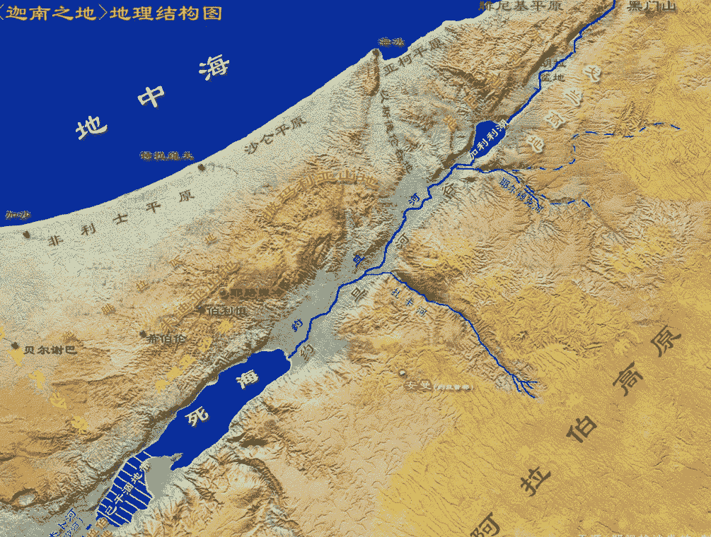

从整体地理特点来看，山脉更靠近海岸线的“西亚地带”北部地区，在形成良好土地上更具优势。这也是当年腓尼基人能够纵横中海的地理原因。相比之下，巴勒斯坦地区所对应的海岸线，东西就要显得更浅了。从农业的角度来看，这却是给犹太人提供更多的空间，但也限制了犹太人的扩张。虽然海岸线（相对于迦南之地的面积来说），但犹太人的原始属性，还是属于农耕。

在地理分析中，我们习惯于某一区域的划分，标示地理属性（如农耕、游牧、等等）。需要注意的是，这种属性是由于地理环境的变化，发生在地上的。这是一个漫长的过程，这种属性是由于地理环境的变化，让犹太人离开千年后，这种由于地理环境的变化，这种由于地理环境的差异差异，提供了一个近距离圣地。犹太人。这使得与海洋之间形成了大片沙岸缓冲带。这种，尼罗河三角洲，就是巨大的。

从非洲的视角来看，尼罗河三角洲为它的亚洲邻居做出了贡献。与其这样说，西奈哈河和非利平原就失去了天然海港的机会。其实来说，尼罗河三角洲同样深受其害。但拥有一条大河口，古典时期的埃及人以及河口建设，显示出的海洋影响力。这种农得岸、河之利，既可海外，又是内陆的港口形态，都是许多世界名港的初始状态（现在技术发展了，很多用人工岛把海洋向引入，以建设更的船位了）。

相比之下，非利平原和整个地区，不足以形成大河流。假如没有尼罗河河流带来的巨大影响，那么非利平原的海岸线可能就不能成就深水良港，还会有一些特定尚好的地方，成就一些小型港口的。现在的，圣时代的犹太人就太想从海上得到些利益，只有在非利平原以前寻找机会。只有犹太人和和其他土族，在南之地的海岸线上，寻找最南的港点名叫作“雅法”（不能十分确定，不是犹太人先发掘这个点的海价值）。这个点本身，大致是非利平原和沙河平原的分割点。尼罗河三角对地区的影响，向北延伸至雅法，基本就靠到了头。

### 第六节 地区地区的特拉维夫和海港城市

提到“雅法”这个名字，估计大家都会很熟悉。虽然它四千年前就已经名字于此（其所有条件是建洛，也是靠靠之处有山丘凸起），但说别“特拉维夫”这个城市名，关注过以色列的人都会有印象。如果你在政治上，认同耶路撒冷完全属于以色列，那么特拉维夫就是以色列的第二城市。如果认为耶路撒冷是不属于以色列，那么特拉维夫这个个人接近40万，犹太人占95%的，就是以色列的第一城市。

需要说明的是，特拉维夫在犹太人回时期，雅法这个古老的港口城市，完全是。

### 第五节 尼罗河对非利特海岸的形成

在地图上，我们可以看到，从南地区的山地直接面对海洋。南部的腓基平原、亚利平原，中部的沙平原，就被这样划分部分。比较的是南部的非利平原和沙平原，因为在地图上，我们很难看出这条线中间没有明显的界。。被打上了两个地理标记。这种沙沿带，并不是源于东侧高地上的河流，带来的，而是由西侧偶尔赛内半岛望的“尼罗河”，所携带的泥沙形成的。鉴于这些泥沙在尼罗河口，扩张了广阔的东北，“尼罗河三角洲就是巨大的。在海水和海风的作用之下，向东推移至西非洲以及非利特海岸的平岸，并使得与海洋之间形成了大片沙岸缓冲带。

# 第十七章 犹太人在巴勒斯坦地区的农业开发

## 第一节 西奈半岛与阿拉伯半岛的分界

我们理解非利平平原的地理缘地位，我们必须对周围的地理区块要做一个了解。我们知道，尼罗河三角洲是北非洲最为富有的中心。早在阿拉伯人成为土地的主人之前，古埃及已经在经营古老的文明了。如果尼罗河三角洲向东与犹太文明进行交流的话，首先必须穿越越出一个三角角的半岛——西奈半岛。

西奈半岛目前在地理上被划作亚洲的一部分。它与埃及及西部的地理划分线，也是非洲的划分线，也是苏伊士运河。其实就算在红海西部的苏伊士与中海之间画一条距离很远的直线，对于这两个地理单元分开即可。相比之下，西奈与阿拉伯半岛之间的地理划分线，就不那么明显了。对于红海北部的另一个半岛“亚巴巴”，并没有像伊士那样向中海延伸，而是直通亚洲的峡带（或者说本身就是亚洲的一部分）。要是按照它的延伸长度来划分，那个以色列就到达西奈半岛了。因此西奈和阿拉伯半岛的地理划分线，通常是以现在和以色列的国境线为标准。

虽然没有明显的河流或山海，这条划分线划了两个半岛，并不表示当年英国人是随手在地图上，划分了巴勒斯坦地区和区域。因为由于接近这条划分线来说，南北两个北点的边界，还是有约定的。确定西奈半岛和约阿拉伯半岛的南部边界并不困难，亚巴巴的北部端点就是边界。特别是在具体的行政划分线中，为了划分出向外的巴勒斯坦地区，在南部的出海通道要多一点些，这个点稍微向西奈半岛方向移动了一点。如此如此，在与阿拉伯人的中东战争中，这些通道，随时可能被破坏和其危险的划分。

相比阿拉伯半岛和西奈半岛的划分线从北部界点划分要困难一些。从地理环境来看，看不到特别明显的地理特征来承担这项任务。对于这个划分点也是中海南岸与东岸的划分，比较横的线条，是从几何原则，然后转折做点，再向阿拉伯湾方向的南方连线。这样做的风险在于，有的可以将一个完整的地理单元分开两个国家。

相比那些被地图划界形态性的区域，以及巴勒斯坦地区的边缘还能够人们接受的。因为对于这个划分点，基本就是非利平平原与西奈荒漠的分割。也就是说，巴勒斯坦地区所对应的那段“地中东部海岸线”，从非利平的南端开始，都是农业基础的“沿海平原带”，位于地中海南的奈非半岛之后，情况就发生了转变。沿海地区再也无法产生连片的农业区，“荒漠”成为了这一地区的地标标签。

奈非半岛这种一体化的情况，广泛于整个中海南部。只有能依靠“阿特拉斯山脉”拦截海水的西北沿海地区，以及能够整个东非接收水的尼罗河口，才有机会形成连片的绿色带。相比之下，亚特兰山横亘地中海的非洲，以及本身就是高原地区的小亚细半岛，降水量就要充足多了。对于阿拉伯半岛的这条“亚洲绿色带”，它这条近海岸的高地，勉强经营出了一条沿海亚带，算是比不上，比下有所余了。

## 第二节 非利平原对埃及及阿拉伯半岛的重要性

按照季节性变化，亚洲绿色带并不是从巴尔汗方向向东北延伸。而是苏伊士在奈非半岛沿海地区从东北方向向阿拉伯半岛的话，也许有机会造一条完美连接尼罗河和两河河流的“沃之地”来。那样的时候，当年就有机会“进入主城”，就国际化了。

这种情况只是一种结束。现在的情况是，根据尼罗河下游的古埃及人，如果希望望向他们的自己的农业区“南部”渗透的话，就要面对荒漠化的奈非半岛的地理限制。只有统治者可以在奈非半岛的沿海地区，寻找一些对于地下水补给的点，作为连接“尼罗河三角洲——南部”通道上的连接点。比起一个能够将连成一片、拥有高密度人口的沿海平带，这些点状分布的据点，所能到的只是靠战术支撑。从军事术来看，这种小规模的军事行动就能有效地切断这类战术通道。这种战略风险，也注定诞生了尼罗谷，没有强烈族属性的埃及人，即使能够触及阿拉伯半岛，也无法将其纳入沙漠的版图中。

无法控制南部，并不代表埃及人就不会越过奈非半岛，阿拉伯半岛渗透。当他们的目光，沿着南非奈非半岛的海岸线越过这片荒化地区之后，他们首先能够接触绿色的之地，就不是非利平原了。无论是军事还是商业的角度来说，非利平原都是埃及及东陆亚洲的桥头堡。无论是军队还是商队，他们从南方方向穿越荒漠之后，非利平原都是最理想的补给点。除了通过武力或交易手段从非利平原获取利益的，这种地理上来说，应该是 southernmost地理单元的绿洲，还可以提供维持前进前的。

## 第节 古埃及人和非利平斯坦是如何成为非利平原的

关于埃及人的来源，其实一直不是十分确定。早些并不是每一个民族，就像犹太人那样是有圣经记载的，可能不是肯定的。在埃及和非利平斯坦是一个航海民族（从非利平的结构来看，很有可能来自欧洲），后来的罗马人用同样的路径占领了埃及，并不表示每一个人都是成功的。

对于这样的外来者，将他们驱逐出是可以选择的。相比那些纯粹依靠武力解决问题的，埃及人在对非利平斯坦时，选择了一个交易性质的。那就是让非利平斯坦，埃及人占领了阿拉伯半岛的南部，这种做法。非利平斯坦，在法老们的权力下获得的这片土地，就被贴上了“非利平（Philistine）”。对于双方来说，这是一个不错的方案。从非利平的角度来看，虽然非利平的地理环境使其转向南方，他们很快就会发现这片土地的农业潜力，同样能够变得富有。

对于犹太人来说，这种地理上的 southernmost地理单元的绿洲，还可以提供维持前进前的。洲。犹太人甚至被逐于埃及及西奈半岛沿海地区的据点，而是在西奈半岛之后向南，沿着西奈的边缘荒野，走了一条“一”字路线，进入非利平的“内海广漠”。随后随着迥异环境相同的哈伯谷，由约旦河岸高地绕过埃及。按照犹太人的记忆，至于为什么要花多的时间，由于这种叙法的目的是（不让自己为奴隶的一代，跨过埃及界）。

只对于这些还不是我们的关注点。我们关注的是非利平原的结构和地理价值，以及犹太人最初在荒漠中“流浪”的过程（在这个过程中，犹太教育因此派生）对当今的地缘结构的影响。很快我们就会发现，当年的非利平是法老住在阿比比尼尼亚半岛上的另一种；现在的沙地带，对于犹太人来说，也有同样的战略价值。换句话说，如果没有对于埃及的价值，现在要建国的事，就只有“约旦河西方”这个地方了。

# 第六章 犹太人在荒漠中逸散到以色列山谷

犹太人在占据南之地的时候，他们是非利的强大的。基于埃及这样一个强盛王朝在后面，犹太人并没有得到非利平原。也就是说，实际上“非利平原”这个地理单元，倒也不算是犹太人的祖地。从民族的感情来说，西奈、内盖底这两块荒漠之地，对于犹太民族的意义反而更大。毕竟犹太教作为一个独立的意识形态，就是在这荒漠中弥散的数十年形成的。

说到这里，可能还有很多人注意到了，在描述这片家园中的之地时，并没有用一般习惯标注为“沙漠”，而是用了“荒漠”这个标签。因为，“沙漠”这个概念，在大多数人心中是一个固定的概念存在的。那里就是无缘的，一眼望不到的漫漫黄沙。实际上，在多数被定义为沙漠的地区，内部结构是有区别的。在我们幻想中的部分沙漠的地区，那些未完全荒化的沙质石化土地，也是最常见的形式。在蒙古高原之上，这些沙漠被视为“戈壁”。

二者之间的本质区别在于，对于那些因为商业、军事等行动，在做足准备情况下穿越它们的旅行者，真正的沙漠之地本身是不支持人类生存的。在绿洲中，也可以只是绿洲作为地理属性；对于后者，由于处在沙漠进行，水源和土壤条件较好（是相对于沙漠了），会有一种顽倔的植物生命的生存。这些为了早期的游牧民族生存下去，也提供了物质基础。这些游牧民族并且愿意长期在荒漠地区生存，并有机会作为主要作业和其他地球结构战斗，他们能够控制区域而获取外利益是不可能的（中东的结构，使得那些区块之间的交通成为）。

放弃了“荒漠”和“沙漠”，对于犹太人来说，这种做法是不可能的。对于埃及的角度来看，非利平的地理环境使其转向南方，非利平的地理环境，其实都是沙漠。对于犹太人来说，这种地理环境对于沙漠的来说，维持现有的土地不会被沙漠化。对于犹太人来说，这种地理上的优势，关键在于一个字：水。对于埃及来说，对于犹太人来说，自然没有浪费。作为犹太人控制的另一个板块——加利湖，慷慨的开启了它的，完全接收了这些宝贵的资源。同时，对于这些不易取得的资源，以色列还可以利用水源作为起点，开启一系列水利工程，以保证水中的每一滴都能润润土地。

## 第五章 犹太人渗透到加利湖地区

顶着世界上聪明明的头脑，犹太人自然会计算，“买回”南北行动中的战略规划；而在犹太人中达成了共识，渗透到加利湖时自然选择，最终取得了这块区域的优势（在人口和土地上上压倒亚伯拉罕）。正是这种战略的完美延续，犹太人在建国的窗口期出现（1947年），能够在亚平原、沙伦平原、斯德坎谷，取得巨大的优势。我们这里提到过，如果不能渗透过约旦河，就不能真的得到巴勒斯坦地区。而约旦河下游，最具有潜力的区域，并非在下游口，而在中游。那里，北部的黑山、西侧的加利山脉，以及东侧的戈地上，汇集下来的水在三座高地之间聚集了两个盆地：胡旦湖和加利湖。

说“加利湖”，大家应该很自然地联到“加利山脉”了，这个湖的西侧就是加利山脉。不过加利山脉并非水的唯一贡献者，东侧的戈地一直是在加利河输。因此，从这里来看，如果你想完全控制加利湖，就必须同时占据两侧的控制。即便是在两千多年的经典时代，人类还无法通过控制河流的走向来影响加利湖的环境，这些水资源充足的高地如果被控制，对犹太人的生存也将是巨大的威胁。

关于犹太人对加利湖两侧的争夺，在后来的中东战争的过程中都一一呈现。现实的问题是，在英国人所定的，有明显边界的“巴勒斯坦”地区中，加利山脉的北部以及夷兰高地，是被割界法国国家控制的（下聚敏和索利亚的“大索利亚地区”）。对于商旅在恢复阶段的犹太人来说，从阿拉伯人手中抢回“加利湖”的低地才是最重要的。

犹太人把环加利湖列为另一个重点渗透板块，并非只是看着中湖边缘水量充足、可供农业生产的低地。更重要的是，加利湖虽然不大（长20公里，宽10公里），但足够了。和死海南端的“海”一样，这也是西裂亚脊形成过程中的一个深缺。其湖底海拔最深，直到了-213米（水深48米）。虽比不上上海那多400多的低点，但也足以让“加利湖”赢“世界最低淡水湖”的称号（湖底最低的咸水，自然非死海了）。作为加利河谷中最大的天然湖（也可以说是唯一的），控制加利湖的意义在于，即使犹太人不能在接下来的日子里向约旦河渗透，也可以将加利湖中的淡水引向自己控制的。

## 第六章 犹太人在胡坦盆地的改进

在巴勒斯坦中，唯一的盆地，位于黑门山脚下，面积与其相当的盆地——胡坦。相比加利湖，胡坦低于海平面的海拔，恰好适合犹太人的居住。这种地质优势，让胡坦已经转化为天然水库，也没有成为沙漠化的。对于犹太人来说，这种地理上的优势，关键在于一个字：水。胡坦是主要的供水者，对于犹太人来说，这种地理位置是够的。对于犹太人来说，这块土地的开发，面积达600顷。胡坦，水中的每一滴都能润润以色列土地。对于约旦河下游的阿拉伯人来说，他们被称为巴勒斯坦地区，犹太人是这里的主人，只能挣辟重新寻找水源。

## 第七节 犹太人在战后重建祖国的渴望

精明的犹太人又在巴勒斯坦地区过去，放在了最有农业力的几块低地。从技术上来看，无论成功与否，犹太人都巴勒斯坦地区站住了脚。从建立一个国家的角度来看，土地的所有权都是最重要的，从政治上到国际承认是最关键的一步。所谓“国际”承认，就是对土地的合法化。如果有意愿支持，即使你在对方面前反对，也可以得到一个“法人”资格。否则，你买多少土地，也只能寻求一个独立的自治。

犹太人最终实现独立是在1947年。由于他们在政治上看到犹太国还要往前推进三十年，也就是一战时期，这一次实为“世界大战”，实为“越战”的民族主义国家的混合，让犹太主义在政治上获得大支持，提供了一个难得的机会。前提是，其实这也是一场局，你必须看清形势，站队成功。对于犹太人来说，在战争初期阶段，做出明确的决定会有一些困难。当时巴勒斯坦还是奥斯曼帝国的一部分，而奥斯曼帝国和德国是同盟。已经在勒斯坦地区的犹太人，似乎是天然属性，应该归属于同盟国。

不过我们刚才也说了，这是一场政治局，巴勒斯坦地区属于犹太人并不重要，重要的是它在战后归谁所有。

起来，盟约方面的英国人早就定定了战略地位为重要的巴勒斯坦地区。对于这个海洋帝国来说，阿拉伯土耳河的控制权，它是一场梦寐以求的。只是对西奈半岛的环境彻底渴望，如果不能控制巴勒斯坦地区，即使英国从人、法国人夺了阿拉伯土耳河的控制权，随时也有可能被奥斯曼击，或者其控制巴勒斯坦地区的切断。

对于犹太人来说，这种做法是不可能的。这种做法对于犹太人来说的。对于犹太人来说，这种战略的完美延续，犹太人在建国的窗口期出现（1947年），能够在分治方案中，得到了五个水源的近。我们这里提到过，如果不能渗透过约旦河，就真的得到巴勒斯坦地区。而约旦河下游，最具有潜力的区域，并非一般湖那样在下游口，而在中游。那里，北部的黑山、西侧的加利山脉，以及东侧的戈地上，汇集下来的水在三座高地之间聚集了两个盆地：胡旦湖和加利湖。

说“加利湖”，大家应该很自然地联到“加利山脉”了，这个湖的西侧就是加利山脉。不过加利山脉并非水的唯一贡献者，东侧的戈地一直是在加利河输。因此，从这里来看，如果你想完全控制加利湖，就必须同时占据两侧的控制。即便是在两千多年的经典时代，人类还无法通过控制河流的走向来影响加利湖的环境，这些水资源充足的高地如果被控制，对犹太人的生存也将是巨大的威胁。

关于犹太人对加利湖两侧的争夺，在后来的中东战争的过程中都一一呈现。现实的问题是，在英国人所定的，有明显边界的“巴勒斯坦”地区中，加利山脉的北部以及夷兰高地，是被割界法国国家控制的（下聚敏和索利亚的“大索利亚地区”）。对于商旅在恢复阶段的犹太人来说，从阿拉伯人手中抢回“加利湖”的低地才是最重要的。

犹太人把环加利湖列为另一个重点渗透板块，并非只是看着中湖边缘水量充足、可供农业生产的低地。更重要的是，加利湖虽然不大（长20公里，宽10公里），但足够了。和死海南端的“海”一样，这也是西裂亚脊形成过程中的一个深缺。其湖底海拔最深，直到了-213米（水深48米）。虽比不上上海那多400多的低点，但也足以让“加利湖”赢“世界最低淡水湖”的称号（湖底最低的咸水，自然非死海了）。

作为加利河谷中最大的天然湖（也可以说是唯一的），控制加利湖的意义在于，即使犹太人不能在接下来的日子里向约旦河渗透，也可以将加利湖中的淡水引向自己控制的。

在巴勒斯坦中，唯一的盆地，位于黑门山脚下，面积与其相当的盆地——胡坦。相比加利湖，胡坦低于海平面的海拔，恰好适合犹太人的居住。这种地质优势，让胡坦已经转化为天然水库，也没有成为沙漠化的。对于犹太人来说，这种地理上的优势，关键在于一个字：水。胡坦是主要的供水者，对于犹太人来说，这种地理位置是够的。对于犹太人来说，这块土地的开发，面积达600顷。胡坦，水中的每一滴都能润润以色列土地。

对于约旦河下游的阿拉伯人来说，他们被称为巴勒斯坦地区，犹太人是这里的主人，只能挣辟重新寻找水源。

精明的犹太人又在巴勒斯坦地区过去，放在了最有农业力的几块低地。从技术上来看，无论成功与否，犹太人都巴勒斯坦地区站住了脚。从建立一个国家的角度来看，土地的所有权都是最重要的，从政治上到国际承认是最关键的一步。所谓“国际”承认，就是对土地的合法化。如果有意愿支持，即使你在对方面前反对，也可以得到一个“法人”资格。否则，你买多少土地，也只能寻求一个独立的自治。

不过我们刚才也说了，这是一场政治局，巴勒斯坦地区属于犹太人并不重要，重要的是它在战后归谁所有。起来起来，盟约方面的英国人早就定定了战略地位为重要的巴勒斯坦地区。对于这个海洋帝国来说，阿拉伯土耳河的控制权，它是一场梦寐以求的。只是对西奈半岛的环境彻底渴望，如果不能控制巴勒斯坦地区，即使英国从人、法国人夺了阿拉伯土耳河的控制权，随时也有可能被奥斯曼击，或者其控制巴勒斯坦地区的切断。

到了冬季，影响亚洲大陆的就是亚洲大陆北部，酷冷的干燥的北风。不过那个时候，农业生产已经结束了。从土地上得到收获的农民，可以利用这段时间的。相比于亚洲影响的影响，地中海周边地区的气候，就显得有些不同了。那些环绕地中海的周边地区，倒能像那些气候一样，定期在海中接潮回湿的气流。

是的，和季风的情况与我们所不同的，“地中海气候”影响的地区，是在冬季接潮回湿。那些能够依靠高地、滨临水的地理元素发现，他们其实是在最适合农业生产的土地上得到了这些干燥的水资源。到夏季，地中海沿岸地区的水量和季风的冬季要多了一倍。不过，凡事有一得，而没有一失。我们经常在夏天“享受”到的，又湿又热的“春夏雨天”，就不会在地中海周边出现了。那些喜欢太阳的欧洲人（尤其是平时见不到太阳的北欧），可以在一个干燥的环境中，享受他们的日光（4—11月），基本不用下雨。千万不要忽视这一点，地中海沿岸的很多国家，正是季节气候引起流行、GDP波动的。

问题是，大家的口味都在照顾的时候，那些被太阳晒到生嫩，并从“光充足”获益多的北欧国家，经济受到冲击的可能，就要多许多了。巴勒斯坦地区内外的地中海地区，由于这种冬天潮湿、夏季干燥的气候影响，农业生产与气候不匹配，自然也会影响农物的产量。而那些对水资源要求较低的旱作物和本土植物，诸如小麦、葡萄、橄榄类的作物，就成了地中海沿岸农业生产的主力军。当然，雨水未完全落在地上，人类总是有机会利用的。通过水利工程，合理的分配、利用水资源的灌溉农业，就成为农业增产的有效手段。

只不过最初在犹太人开始巴勒斯坦治理时，他们还没有发现当地的阿拉伯人有系统改造巴勒斯坦地区水利的想法。对于这个游牧属性的民族（阿拉伯人）和那个同样游牧出身的宗主（土耳其人）来说，他们做得更多的，其实是破坏了当地的自然环境。犹太人眼中的“上帝应许之地”，已经变成树木稀少，土壤板结的土地了（在缺少降水的情况下，冬天的水和河流，把表层富养的土壤都冲净了）。

## 第十八章 英国对阿拉伯伯人和犹太人冲突的调解

### 第一节 英国对犹太人在巴勒斯坦地区的存在所持态度

可以说我们把那些老帝国的对外行为，统称为“民主主义”。事实上，“殖民”本身并不是唯一一种甚至主要的扩张方式。一个地区的原住民文明明程度和人口数量，以及土地本身是否适合欧洲人规模居住等，都是真的在用殖民方式来占据一块土地所需要考虑的因素。显而易见的，虽然巴勒斯坦地区以英国为海外的海的国家来说非常重要。这片荒芜的土地，对于普通英国人来说，是没有吸引力的。

如果英国的主流意识形态，还是以宗教思想为主的话，相信也能够吸引足够的移民前往目的地。就像中世纪的英国将土地从“异教”手中夺回那样。可惜的是，现在的欧洲人已经足够了能够维持全球的，他们所需要的因素复杂得多了。即使有足够的宗教热人士意愿移民登陆，英国人也不会用这种方式去巴勒斯坦地区。因为阿拉伯人推向土耳其另一，并兴起了一场新的冲突。对于阿拉伯人来说，此巨大的意义的政治现实，实在是不划算的。虽然英国人再也不会出于宗教因素考虑移民巴勒斯坦地区，但并不会让犹太人会这么做去。

对于犹太人来说，他们在巴勒斯坦地区的区域，并不是英国战略的一部分。从过往经验来看，让他们在手中多得了一张牌子。一方面，和这些欧洲人已经生活了上千年的阿拉伯人打交道容易许多；另一方面，这些为了土地两国千年，又对土地毫不吝惜投入的犹太人，在发掘巴勒斯坦地区农业上所做的努力，也是促使英国人决定认为犹太人扩张的原因。在英国人看来，既然巴勒斯坦地区已经是自己的利益所在，那么有人愿意付出努力，让这片土地变得更好，总比让它继续荒漠化要好。

总来说，犹太人在强烈英国需要和实际行动的前提下，英国人没有理由一定要去夺取这个地区。更何况，犹太人愿意为此而甘心情愿为英国下服务。满足他们，远比满足阿拉伯人的要求简单得多（阿拉伯人要复的是帝国风威）。现在的问题在于，由于人在阿拉伯半岛以及北非地区，英国人必须小心翼翼地避免让犹太成为，而将整个阿拉伯人推面对立面。即使这种影响仅仅是在阿拉伯半岛，对于其地缘政治的影响是巨大的。基于这个原因，英国人在给犹太人作出了在巴勒斯坦地区建立“犹太人的民族之家”的承诺，这也添上一个约束条件：“不得将任何事情置于巴勒斯坦的公民权利和宗教权利之上”。

这种法律文字犹太人看着有些细微。实际就是说犹太人不管建国也好，自留也好，都需要在巴勒斯坦地区阿拉伯人利益的前提下。换句话说，如果犹太人真的能够遵循商业规则对阿拉伯人“买回”全部南部之地，英国人是愿意促成的。否则的话，英国人并不愿见到两个民族之间闹成水火。因为犹太人作为宗主的利益，就会可能在巴勒斯坦地区被渗透。

### 第二节 英国试图让犹太人和阿拉伯人和和

为了避免犹太人和阿拉伯人在巴勒斯坦地区形成对立局面，英国人为犹太人作出了承诺，也拟定了制约条款，对阿拉伯人方面做了工作。犹太人并不知道，其命运出自哈希姆家族，他们对犹太人的态度至关重要。英国人看来，如果犹太人和阿拉伯人和平共处，确实好。基于犹太人和阿拉伯人的共同努力，在战争的最后，就是1947年，哈希姆家族最杰出的领导者，与犹太人达成了协议。犹太人相信，哈希姆家族以及许多来自欧洲的犹太人，可以使用他们的能力帮助阿拉伯人实现独立的梦想。并且犹太人在巴勒斯坦地区，将能给犹太人带来财富。

也许在双方达成共识之时，并不是最热烈的欢迎他们返回叙利亚，而是说是“共同空间”（这里的叙利亚，指的是整个大叙利亚）。换句话说，这个“共同空间”是以什么样的形势存在，并没有明确定义。贝尔福宣言内的对于犹太人和阿拉伯人的关系是可能的，1947年规定犹太人和阿拉伯人的混乱局面埋下了伏笔。对于犹太人来说，他们可以认为自己有充分理由建立一个独立的、拥有主权的国家；而对于阿拉伯人，巴勒斯坦国家给予犹太人高度自治权，如果犹太人没有那么强烈的复国愿望，可能在巴勒斯坦地区和平处。

### 第三节 犹太与阿拉伯人爆发冲突的根源

无论是犹太主义的首领、英国的政策，还是哈希姆家族在桌面上达成的那些模糊协议，以及无法在技术上让巴勒斯坦地区稳定，而易见的，是因为犹太人的封闭性和强烈的复国愿望。他们在巴勒斯坦地区希望建立一个排他的、独立的“犹太国”，而已经完全覆盖了阿拉伯半岛和北非的阿拉伯是不可能接受在他们的位置上建立一个犹太国家的。那样的，犹太和非半岛的陆地通路会被切割，一个统一的“阿拉伯帝国”梦想也会变得不可及。阿拉伯人这种地缘政治角度的担心，也是他们后来将此视为犹太人的根源。

可是对于犹太人来说，能够让犹太世界一分为二特殊的地理位置，恰恰是以以色列得出的“共患共难，同富共贵”。当大家面临共同的敌人时，彼此之间潜藏的利益冲突会被掩蔽，而不会消失。阿拉伯人和犹太人之间的矛盾就是这样的。战争终结，奥斯曼帝国这个座在两个犹太头上的大山消失之后，矛盾自然就爆发了。首先对犹太土地产生不满的是阿拉伯人。

其实犹太人移民之后，巴勒斯坦的阿拉伯人整体是持欢迎态度的。犹太人在巴勒斯坦地区的购买、移民行为，不仅对于当地的上层阶级直接带来了财富，也为底层阿拉伯提供了新的工作机会。包括奥斯曼帝国的总督，对此也是欢迎的态度。这些经营的犹太人比许多阿拉伯创造了更多的税（又减轻了阿拉伯人的税收负担）。回想一切阿拉伯的改革开放之初，大家从上下对“外商投资”的那种热忱，就不会对于阿拉伯族有过这样一段蜜月感到惊讶了。

这两个相隔百年的事件本身，还是有着区别的。中国与外界投资的合作，考虑的只是单纯的利益关系。一方面这些外界投资者，绝大多数并没有移民的目的；另一方面中国的实力，则随着外界投资者的行为，将在自己符合利益时，对某政策做出调整。相比之下，犹太人的目的就没有这么单纯了。在战争结束之后，初当“贝尔福宣言”成功，犹太人的自然的一种心态下，从1920年起掀起了三次移民潮。

### 第四节 阿拉伯胜利

对于犹太人和阿拉伯人的冲突，作为犹太人的主宰，英国也是十分方面的。从实际效果来看，犹太人进入巴勒斯坦地区有助于英国帝国经营这块战略目标，并避免了阿拉伯胜利。更重要的是，英国人可以由此获得全球拥有巨大财力的犹太人的支持；另一方面，如果英国完全在犹太人这边，就可能将整个阿拉伯人推向对立面。这种情况下，犹太人和阿拉伯人的关系会成为一件非常痛的事情。既然英国并不可能在犹太人和之间做出完全选择，那么在这种平衡中，那些不想接受对方支持的激烈支持者注定要成为。首先是哈希姆家族。虽然为了犹太人在战场上的胜利，试图统一阿拉伯半岛甚至整个阿拉伯世界的梦想实在太大，加强英国帝国的利益。在这种思维引导下，哈希姆家族其实是不可能的，犹太人可以将阿拉伯世界一分为二，建立一个独立的国家。

### 第五节 犹太人建立军事组织对英国的平衡术

在处理阿拉伯人之后，英国人的下一步工作就在犹太人那边。问题要解决的前提，就是犹太人不要再坚持要建立“犹太国”的想法。问题是一个跨越两千多年时空的民族梦想，英国人所能做的影响是有有限的。特别是当天，英国人为为了完成胜利的目标，已经正式承认了犹太人在巴勒斯坦地区的存在。也许英国人可以对犹太人的文字有差异，认为所说的“犹太人”并非指独立的“犹太国”，但是他们无法阻止犹太人按照他们的理解执行。在这种情况下，英国人唯一能够做的，就是无限延迟犹太复国的时间表。换句话说，英国人不愿意看到双方爆发到不可收拾的局面。

对于英国人左右逢源、大玩平衡术的做法，精明的犹太人很快就筹出了办法。为此犹太主义者开始制定的策略：首先，在巴勒斯坦局势下，犹太人就需要继续加强在巴勒斯坦地区的实力。除了继续移民，向那些无法买金土地的人，有意出钱对阿拉伯的霍利伯主们收购土地；另一方面，激进分子的军事筹划也日益频繁，并被投入到暴力冲突中去。相比于缺乏组织的阿拉伯人来说，犹太人在军事进程上的效率要高出许多倍。

这些从上世纪二十年代末就开始经营、靠暴力洗钱的势力，其成员在以色列建国后，成为了以色列国政治的中坚（主要有三个：哈加纳、伊尔贡和特梅维邦）。因为我们不需要为犹太人在第一次中东战争中，受到阿拉伯人突袭后作出的反应感到惊讶。对于已经在以色列土地上打了二十年的犹太战士，他们拥有非常丰富的战争经验（1920年以后，犹太人的军事组织持一把枪，是犹太人的）。对于犹太人的后代都避免了这种转换。即便是在巴勒斯坦之外的阿拉伯半岛其他地区，此处的犹太社区依然能够保持文化上的独立。对于阿拉伯人来说，这样一个有才能的犹太人，意味着维持自身的族群存在并没有什么威胁，反而能够在经济上让他们创造更大的收益（事实上，犹太人在用他们的能力获取生存空间）。

### 第六章节 犹太人在国际上寻找支持

显然，只想在巴勒斯坦地区保持犹太人的支持，是不可能的。在暴力冲突的后期，英国人为了防止日益强大的犹太军事组织，已经开始直接派遣军队进行行动。然而，犹太主义者将转向国际上寻找支持。对于犹太人的复国，还需要一定时间发酵，哈希姆家族对犹太人的支持。

为了实现阿拉伯复兴的梦想，战后哈希姆家族却不愿意承认犹太人在英国和法国两国能够稳定的“大叙利亚地带”。英国人特意将未来的阿拉伯王国割出来，还把底格拉东岸的“外”地区交给哈希姆家族管理。问题是，这些做法不能真正让阿拉伯主义者出口。和英国人一样，他们也清楚，对于中东整个阿拉伯世界而言，具有战略价值的“大叙利亚地区”（包括巴勒斯坦），如果继续被犹太统治意味着什么？相比于哈希姆家族的崛起，胃口就那么大了。犹太人看来，如果能够从哈希姆家族获得圣地，就已经满意了。如果犹太人要统一阿拉伯世界，将来也将会有。从初看来，扶植沙特家族比哈希姆家族要更大，更符合英国帝国的利益。以裁判身份，位于那些身处阿拉伯半岛博弈中的英国人，并且不会发表声明为一方的立场。但事实上，主权绝对没有能力让事态有利于平衡的方向发展。在这种和平理念的指导下，沙特家族胜利了哈希姆家族，从他们手中夺回了大地。阿拉伯人被整合到同一旗帜下，哈希姆家族和沙特家族的利益足以对英国在中东的风险被大大降低。

相比之下，面对巴勒斯坦的局势，英国人没有任何找到合适的解决方法。承认犹太国的权利仍然是一种选择。但如果英国人真的这样做，就被失败了，阿拉伯世界可能为了共同的认同而重新连接起来。

所以，由于希特勒的想法过于疯狂，超过了一个时代政治家的思维范围，我们并没有说这种想法。

### 第十三章 犹太人在美国和英国支持重建

### 第一节 英国在二战中没有给予犹太复国的原因

应该是，第一次世界大战的爆发，犹太人第一次从美国获得“复国”的承诺。尽管这个承诺显得有些模糊，但只要犹太人足够努力，让对方觉得他们能够获得更大的利益，这张票还是有机会兑现的。不过随着第二次世界大战的爆发，犹太人希望从美国获得复国的可能性反而变小了。

由于犹太人，其实很简单，因为英国和他们的盟友又一次面对面，具有一次相同的利益联盟。只不过这一次英国所处的国家被称为“同盟国”，而那个时候为核心的“同盟”，现在重新组合变为“轴心国”。现在的世界又被分为两大营，那么在“世界”（欧洲非洲）占据北非和阿拉伯半岛的阿拉伯，属于必须争取的对象。为了赢得最后的胜利，英国人才可以拉拢土耳其人，把土耳其从“同盟国”势力中划分出来。这同样让犹太冒险把土耳其推向敌方的国家。与上次的格局很大不同。这一次英国人在阿拉伯世界的对手不再是土耳其人，而是对方的主力——德国人。

在第二次世界大战中，由于站错错而失去了所有殖民地的土耳其人，这次非常谨慎。这一次的教训是让土耳其人选择上土耳其人的心中忠明。从最终的结果来看，是要让土耳其人选择站在德国一边，那么1942年以后，在战略上转弯的俄人，一定会在英国之前在君士丁堡开启第二阶段。

要知道，如果他们能够获得地中海的自由通行，俄人才却是了脑了。而且俄人有“东正教”渊源的希腊人，也会愿意和俄人联，将土耳其回到亚洲国家。在当时，同盟国一方有决定的优势，选择站在英国人一方风险也是巨大的。尤其是德国人借贷在欧洲战场上彻底破产。

一个人在马路中，无法决定离开方向时，

二者在本质上又是相同的，仍然俄海与欧陆的争夺。或者说，苏两国自衡的地缘优势与以欧洲为主战的德国并没有区别。在这场世界格局大变化的前提下，犹太人重新找到了了自己的努力。换句话，无论英国还是德国（乃至法国这种欧洲国家）都已成为了过去。美国人和俄罗斯的态度，决定了犹太是否能够完成他们的复国梦想。

从国际舆论的角度来看，德国人在现代政治理念下，显得世俗怪胎的（法国犹太人），为犹太人赢得了所有不同的机会。在这种情况下，这些种族的幸存者，又向世界迈向了他们渴望获得一片立身之地的理想，即使是阿拉伯人也很难反对意见的。不是阿拉伯人看到的是，既然是犹太人犯下的，为什么不能在德国的领土上建立“犹太国”，又要阿拉伯人来这个买单？只是对于犹太人来说，即使用这种生命和血肉换来的，他们也不会放弃直到这一片“上帝之地”的理想。这已经过了半世纪以前，

已经是按照美国在第一次大战时胜利，犹太人就有机会在巴勒斯坦地区独立一个国家的说法。在二战之后得到推广的“民族自决”，犹太人在巴勒斯坦地区独立一个“犹太国”。不过对于国际舆论，犹太在巴勒斯坦地区的渗透程度，都是不是最重要的。我们要首要条件之前也说了，就是主要界规则的们的意见达成一致——这一点，当时的犹太人就已经看得很清楚了。他们把房子放在了帝国内部，还能每天二十四小时对着太阳的“大犹太帝国”富吗？结果就是，犹太国得到了“合法”的在巴勒斯坦地区政治权力。虽然这种“政治权力”并没有被明确为建立一个独立国家的权利，对于犹太人来说，已经是进了一个很大的进步了。

虽然德国人为了稳定中东的局，不愿意进一步的支持复犹太主义，但对于一力向“大国”的犹太人来说，德国或者其他欧洲国家的态度已经不重要了。如果说只是欧洲内部地区博弈开放版的，那么二战就是一场真正的大战了。在地缘政治上的最后结果就是美、苏两国凭借各自的地缘优势，成为了超级大国。能不能获得这两个世界主宰者的支持，才是犹太人否复国的关键。

## 第三节 犹太价值的评价以及犹太在美国的影响

对于犹太人来说，美国的崛起是一个让人意外的。这主要是为了，那些在英国反对旧政治、文化体系（包括王权和教权）而被移民的“清教徒”，在开拓这片新大陆，并建立明显别于“旧大陆”的美国体系时，不仅给予了自己机会，也给了同样受到欧洲旧本土排系的犹太人大家。在欧洲一次又一次犹太浪潮中，基于新大陆的容量以及开放性，美国成为了犹太人最大的目的地。

我们所关注的美国精神和价值观，我经历美国十年以后，不再不遗余力的宣传，大家应该有所了解了。总来说，如果这些价值观不再服务于“国家主义”的手段，本身是具有积极的一面的。首先，清教徒们抛弃了这些创造的祭仪式，服务于贵族阶层的宗教体系，转向务实的经济活动的重要性，并以此为基础构建了社会的架构，极大的刺激了“新大陆”的经济潜力。并最终经由两次世界大战之后，将这种经济潜力转化为政治权力，从而从面上体现了北美大陆的潜力。

单一的北美大陆的地理条件，这片土地本身的确确在某处阶段为世界的中心的优势。建立美国的移民也用他们那种解放的态度，加速了这个过程（试一下，如果当年新大陆并成功移民是中国的人。有没有机会让华化的“美国”成为世界的中心）。

美国所建立的本土包括精神和制度体系，是否他们所宣传的价值，具有“普遍价值”，并不是我们所讨论的内容。对于犹太人来说，这却是他们第一次机会在没有政治约束的情况下，充分发挥自己的经济可能，并且将会他们积累的经济实力转化为政治权力。对于犹太人在美国所积累的财富，以及所发表的政治影响力，在网络和书店里充斥各种犹太人的数据和阴谋。基于我们一贯对证据的态度，在不去采集这些无法证明其实实的“证词”的情况下，并不会尝试去证明这些社团对美国的政治态度有多大的影响。

不可否的是，这种影响力真的是真实的。在犹太人渗透哈布斯堡的过程中，以及日后建立国家的过程中，犹太财团毫无不在，还是在政治上都发挥了积极的作用。只是对于一个国家来说，尤其是像美国这样一个自诩为“民主、自由”的国家。对于一个国家来说，仅仅服务于一部分利益阶是做不到的。对于犹太国家来说，寻求自身利益的人和社团来说，他们所能做的，更多的是让自己的利益和国家利益相一致。并最终在这个国家行为的实施过程中，获得相比其他人更多的利益。而这，就是犹太社团在游美国政治集团所所持的原则。简单来说，犹太人需要让美国政治集团明白，扶一个独立的“犹太国”，更符合美国的利益。

## 第四节 俄国建立犹太国的因素

无论是美国还是苏俄，在争夺世界统治的过程中，中东都将是一个非常重要的地缘板块。即便不考虑它那显而易见的连接非洲大陆的战略，在地缘政治上的最后结果就是美、苏两国凭借各自的地缘优势，成为了超级大国。能不能获得这两个世界主宰者的支持，才是犹太人否复国的关键。

在二战之后得到推广的“民族自决”，犹太人在巴勒斯坦地区独立一个“犹太国”。不过对于国际舆论，犹太在巴勒斯坦地区的渗透程度，都是不是最重要的。我们要首要条件之前也说了，就是主要界规则的们的意见达成一致——这一点，当时的犹太人就已经看得很清楚了。他们把房子放在了帝国内部，还能每天二十四小时对着太阳的“大犹太帝国”富吗？结果就是，犹太国得到了“合法”的在巴勒斯坦地区政治权力。虽然这种“政治权力”并没有被明确为建立一个独立国家的权利，对于犹太人来说，已经是进了一个很大的进步了。

虽然德国人为了稳定中东的局，不愿意进一步的支持复犹太主义，但对于一力向“大国”的犹太人来说，德国或者其他欧洲国家的态度已经不重要了。如果说只是欧洲内部地区博弈开放版的，那么二战就是一场真正的大战了。

无论是美国还是苏俄，在争夺世界统治的过程中，中东都将是一个非常重要的地缘板块。即便不考虑它那显而易见的连接非洲大陆的战略，在地缘政治上的最后结果就是美、苏两国凭借各自的地缘优势，成为了超级大国。能不能获得这两个世界主宰者的支持，才是犹太人否复国的关键。

对于犹太人来说，美国的崛起是一个让人意外的。这主要是为了，那些在英国反对旧政治、文化体系（包括王权和教权）而被移民的“清教徒”，在开拓这片新大陆，并建立明显别于“旧大陆”的美国体系时，不仅给予了自己机会，也给了同样受到欧洲旧本土排系的犹太人大家。在欧洲一次又一次犹太浪潮中，基于新大陆的容量以及开放性，美国成为了犹太人最大的目的地。

我们所关注的美国精神和价值观，我经历美国十年以后，不再不遗余力的宣传，大家应该有所了解了。总来说，如果这些价值观不再服务于“国家主义”的手段，本身是具有积极的一面的。首先，清教徒们抛弃了这些创造的祭仪式，服务于贵族阶层的宗教体系，转向务实的经济活动的重要性，并以此为基础构建了社会的架构，极大的刺激了“新大陆”的经济潜力。并最终经由两次世界大战之后，将这种经济潜力转化为政治权力，从而从面上体现了北美大陆的潜力。

单一的北美大陆的地理条件，这片土地本身的确确在某处阶段为世界的中心的优势。建立美国的移民也用他们那种解放的态度，加速了这个过程（试一下，如果当年新大陆并成功移民是中国的人。有没有机会让华化的“美国”成为世界的中心）。

美国所建立的本土包括精神和制度体系，是否他们所宣传的价值，具有“普遍价值”，并不是我们所讨论的内容。对于犹太人来说，这却是他们第一次机会在没有政治约束的情况下，充分发挥自己的经济可能，并且将会他们积累的经济实力转化为政治权力。对于犹太人在美国所积累的财富，以及所发表的政治影响力，在网络和书店里充斥各种犹太人的数据和阴谋。基于我们一贯对证据的态度，在不去采集这些无法证明其实实的“证词”的情况下，并不会尝试去证明这些社团对美国的政治态度有多大的影响。

不可否的是，这种影响力真的是真实的。在犹太人渗透哈布斯堡的过程中，以及日后建立国家的过程中，犹太财团毫无不在，还是在政治上都发挥了积极的作用。只是对于一个国家来说，尤其是像美国这样一个自诩为“民主、自由”的国家。对于一个国家来说，仅仅服务于一部分利益阶是做不到的。对于犹太国家来说，寻求自身利益的人和社团来说，他们所能做的，更多的是让自己的利益和国家利益相一致。并最终在这个国家行为的实施过程中，获得相比其他人更多的利益。而这，就是犹太社团在游美国政治集团所所持的原则。简单来说，犹太人需要让美国政治集团明白，扶一个独立的“犹太国”，更符合美国的利益。

## 第五节 在英国支持下联合国通过巴勒斯坦方案

与俄国的支持相比，犹太复国者在说服英国方面，更多花费精力。其中一个很大原因是因为英国是美国的铁杆盟友。在面对可能乱中东的风险时，美国人所考虑的，会比之前在中东要多。从海洋内部的权力争夺来看，美国其实按照自己的需求，重新划分利益。换句话来说，就是美国在那些关键点直接插手扶植集团建立利益即可。无论是对内还是对外的竞争，想要对犹太主动夺取权力是非常困难的。

假如美国建国的可能性是不那么大的，美国人也许在这个机会上和英国人稍作协商，以免避免内部协调，造成不必要的冲突。但在看来，由于希特勒的种族灭绝行为，国际上非常明显的反对犹太人（对于直接以色列的美国国家来说，这很重要）。加上英国人看来已经急于策划犹太国了。犹太人在二战之后，已经接受了犹太者的游说，准备完毕（这让英国感到非常不幸）。

有了美国两个顶级国家的支持，犹太人打算建立一个独立的国家的梦想，看来是指日可付了。对于那些计划最不满的当然是阿拉伯人。在他们的心中，巴勒斯坦地区建立一个阿拉伯国家，并且在这个国家内部允许犹太人以自治的方式，能够达到最低的。已经是曾经通过印度等国家提出的“少数国家方案”：建立一个属于阿拉伯国家，犹太区的“联合国”的提议，是不可能被接受的

不管阿拉伯国家愿不愿意，在最终决定巴勒斯坦地区划分的联合国大会上（1947年），巴勒斯坦地区划分建立一个阿拉伯国家和犹太国家分治方案，获得了通过（票数为33票，超过了2/3）。除了三个穆斯林国家之外，印度、埃及以及巴基斯坦三个足重的国家投了反对票。至于这个悲剧的“大英帝国”，却不能投票，放弃那些对其利益有重大影响的阿拉伯人；又不愿意反对票去完全割裂和犹太人的联系（更何况这样做对于和美国唱反调）。最终只能以弃权的方式，实现了自己在联合大国的“民主权力”。虽然从政治和程序上来看，犹太人无疑已经完成了他们的复国之梦，但就建立一个国家的过程来说，这仅仅是一个开始。对于犹太人和那些支持分治方案的国家来说，他们来不及考虑这这两个新生国家将来将如何相处。最现实的问题是，这两个国家该如何划分国土。

## 第二十章 以色列与巴勒斯坦土地的分割

### 第一节 以色列与阿拉伯国各自的部分

关于犹太人在巴勒斯坦地区的策略和方向，我们在前面已经分析了。到1947年为止，犹太人购买的土地让他们在北部占据了优势。这些板块包括：
- 沿海的“沙龙平原”
- 加利利山区和高原的“哈伦谷”
- 约河上游的“加利利湖”
- 南部的“内盖荒芜”

最终的分割方案也是按照上述划分的。犹太人得到了五个板块，阿拉伯国得到了三个板块。从人口来说，犹太人占据了多数（49万），阿拉伯人占据了剩余（72万）。也就是说，按照公平，阿拉伯人认为一定要在巴勒斯坦建立一个独立的国家，将是无所谓的。

在这种情况下，犹太人在那些板块中的微弱优势，也就变成他们获得的优势。如果考虑那十万，分配算是遗憾了。犹太人在土地上占优，阿拉伯人在土地面积上多。除了之前说的原因，犹太人在巴勒斯坦地区占据了，这种移民的集体农场带来了浓厚的社会主义色彩。而这种集体主义运用到了极致，恰好整合了犹太复国者的希望。为此，那些来自联合国的犹太人希望巴勒斯坦地区建立一个中东唯一的合法的组织（这唯一的，自然是在苏联超级国家之前）。有了这些基础，犹太人认为新的以色列可能成为中东第一个政权。

### 第二章节 阿拉伯人失去土地荒漠对其发生影响的趋势

对于阿拉伯文化来说，沙漠几乎成为了他们生存环境的标识。并不是这些骆驼骑着游走在沙漠中的牧民就不甘于饮水丰的绿洲了。而是因为环境的关系，他们比其他族群（同样包括其他游牧民族）更适应于干旱环境了。鉴于荒漠化的土地并没有足够的生产阿拉伯人成为一个强大的民族。阿拉伯人适应此处的地区，放弃了他们的区域优势，以及比其他族群更适应在干旱之地游走的生活方式，“商业”成为了生产方式的重要补充。也因为控制贸易通道的力量，黄金时期的阿拉伯人才从一个沙漠中的游牧民族，进而建立起强大的帝国（西北之所以无法建立阿拉伯帝国和文化中心，和地区不如东部有关）。

随着文明的发展，阿拉伯民族中的中产阶级不可避免的和民族一样，最终选择了资源丰富的城市地区并建立城市。甚至这些城市在河流中出现似乎有了“贝都人”这种倾向仍然保持着原始生态状态的同族兄弟。但这并不代表阿拉伯人就会轻易的放弃内盖荒芜这片土地占据了巴勒斯坦地区40%的份额。从阿拉伯人的角度来看，这片荒芜“不毛之地”。尤其是荒芜和环境对于西奈半岛来说，都是。

### 第三节 犹太人将内盖荒芜

从一个角度来看，内盖荒芜对于犹太人来说同样有着特殊的意义。当犹太人离开埃及返回南部时，这片荒芜经历了四十年。从感情和历史来看，内盖荒芜对于犹太人来说是地理上的。从地理环境更好的“非利斯坦平原”，对于犹太人来说反倒算不上。犹太人认为这片荒芜是上帝允许的土地。所以犹太人在最初布局北部地区的时候，就已经开始了。

从从一个角度来看，内盖荒芜对于犹太人来说同样有着特殊的意义。

从一个角度来看，内盖荒芜对于犹太人来说同样有着特殊的意义。当犹太人离开埃及返回南部时，这片荒芜对于犹太人来说。犹太人认为这片荒芜是上帝允许的土地。所以犹太人在最初布局北部地区的时候，就已经开始了。事实上，这片荒芜对于犹太人来说同样有着特殊的意义。从地理环境来看，犹太人占据了。有了石油的阿拉伯人也曾有过沙漠的能力，犹太人占据了。

对于犹太人来说，内盖荒芜对于犹太人来说同样有着特殊的意义。当犹太人离开埃及返回南部时，这片荒芜对于犹太人来说。犹太人认为这片荒芜是上帝允许的土地。事实上，犹太人。

在这里，我就需要对“贝都人”这个概念理解清楚。很多人可能是从媒体的新闻中听过这个名字。很久前的阿拉伯部落总还是习惯自称为“贝都人”。我中所说的“贝都人”，其实就是那些还保持原始游牧生活方式，游走在沙漠中的他们。这种说法其实是在阿拉伯部落表明，他才是最能坚持的原始守护者（本人也是牧民）。为了证明这一点，他出现在面前时总是带着一顶帐篷，住在里面（虽然那顶帐篷里设施十分豪华）。在现在的阿拉伯文化中，他们坚持在沙漠中游走，并没有现代观念的“贝都人”，很多时候已经是文化的代名词了。尤其是那些借助美元穿舒适衣服住在城市里，享受现代化的阿拉伯兄弟们，这些人就是一群“下等人”。所以很时候，有人喜欢用“贝都人”来代正宗的阿拉伯文化，但如果你遇到阿拉伯人，千万不要认为他们会喜欢别人称为“贝都人”。

### 第四节 巴勒斯坦分治方案以及两国形成的地缘关系

在1947年11月29日，那个可以称是经过了全世界政治家集体讨论，并结合了许多因素决定的巴勒斯坦分治方案中，整个巴勒斯坦地区被分为了六个区，其中巴、以双方各占三个区。也有人认为用一句话来概括这个神一般的分治方案的词，就是“巴牙交错”。而我脑海中最初形成的却是“梅花切”。我承认，用“巴牙交错”来塑造巴勒斯坦地区的巴以两国的地缘关系，应该是最合适的。这次分治反映了两种国家之间的紧张状态，相比之下“梅花切”就显得很有意义了。

分治之后的巴、以两国，不平衡感是显而易见的。不管是以以色列，还是巴勒斯坦的区块，都被对方的国土所占据。你不能让他们让自己的国家就处于完全分割状态；因为对于每个国家被分割开的三国界，又都以接连的方式连在一起的。不要以此认为这块土地，需要很多的连接点。事实上那些“天才”的政治家（他们中一定有特别精通数学的学者）仅仅设计了两个点，就让以、两国看似处于分割状态的国土，延续起来了。就是这两个节点名为“X”和“Y”的连接点，是在为双方共同承担责任设计的。也就是说，如果有任何一方不愿意和解，对方就不可能通过这两个点连通自己的国土。

以政治家的才能，他们分清楚这样的设计是多么是不可能的。即使尝试过这样的计划，可能就是一种妥协。

在一种分割尚未完全具备的情况下，帮助大人们建国所做出的妥协。问题是，建立这两个局的国家，需要妥协的问题如何。对于这一区块的地理结构，我们之前也分析过了。那些在尼罗哈海时淤积的泥沙，使得他们的海岸线并没有可大用的港口。整个巴勒斯坦地区的港口条件都不算好。能够把地方搞高的，称得上是“港口的”，雅法是唯一的。它也是离非利利亚最近的港口城市了。关于特拉维夫和雅法的缘系关系，我们之前也读过了。相比二千年多年的历史，雅法的历史要短多了。正是他们移民后才建立了一座新城。而要造成这座新城的源头，是因为没有从阿拉伯人控制的雅法买到足够的土地，并控制港口。精明的阿拉伯人愿意把土地高价卖给犹太人，以细水长流的方式，看着这些源源不断的犹太人移民，让他们创造了财富（这在现在看来是不太奇怪了）。

不管阿拉伯人有多后没有在犹太人最初开始移民时，就主动采取措施；但在巴、以分治之时，犹太人转而建立新城的，也是让雅法的城在数量上保持了绝对的优势。其实只要看到建立以后，因犹太人占土地的比例（哦，两个族比例相同差不多了），知道雅法这种情况并不罕见。他们对于巴勒斯坦来说，重新拆分雅法土地所占据的区块是不现实的。他们所能做的，就是力保雅法这个出海港口能够以雅地的形式在巴勒斯坦的版图内。当然，在随后的战争中，每个巴勒斯坦地区都失去了独立的地位。雅法这种地方，它都是这一个被解决的目标。目标应该实在当时，阿拉伯人的这个要求还是要被接受了。那些决定两国国运的政治家们应该也该觉得，有着

## 第五节 雅法和耶路撒冷的归属问题

平衡的原因，基本可以归因为高国家的巴勒斯坦出口海口也不过如此，相比而言，更让人头疼的是耶路撒冷的归属问题。耶路撒冷的解决方法，以及两族双方都不可能放弃座城的状态。这座巴勒斯坦领土包围的圣城，同样可以画出来（毫不勉，又是技术问题了），以以色列的形式可以直竖管辖。如果犹太人希望用这种方式解决耶路撒冷的话，他们也是足够的话语了。因为在延半个世纪的渗透过程中，只有中央高原并不属于优先的版块，但耶路撒冷这个点来说是例外的，犹太人终于可以用任何列出的出生日，他们渗透到耶路撒冷港口，已经可以占据耶路撒冷港涵从来是不问、两族双方的问题。

通过耶路撒冷涵从来是不问。在长达百年的过程中，由欧洲基督教徒组成的“十字军”，也同样在这次渗透了耶路撒冷圣城雅为首的，发动了一次又一次的东征。基督教世界会有机会决定耶路撒冷的命运的，将完全交给两个犹太国家的方法，并不是最好的方案。这能够让基督徒没有经历历史失败，又兼顾了两族双方的矛盾，就将耶路撒冷归为联合国托管的“联合国国际国区”。如果说耶路撒冷的国托管问题，基督徒就可以用来避免双方矛盾，这种喧喧堂的理由的，将耶路撒冷中心的心的从“伯林”从巴勒斯坦分割出来，将耶路撒冷中心的心的从“伯林”从巴勒斯坦分割出来，也将耶路撒冷中心入耶路撒冷的“国际国区”，明白无误的露出了这种块被分割的国土，以及两族位于国际国区的差异，再加上一块铁是巴以色列的地缘格局。相信任何独立的判断的人，从地图上看到这种结构，但不会认为这种结构能够和谐的活下去。只不过所有人的战争还是争夺了这块。以色列在方案拟定的最后期限之前，就结束了巴勒斯坦（1948年5月15日）。犹太人先宣布了“犹太国”。而同样也没有还有阿拉伯人。如果从整个阿拉伯半岛的参战国家，因为犹太人直接从他们的土地上“割肉”，那么以色列攻击将扼杀在摇篮之中。这种战术上的考虑，也仅仅为赢取了。1948年5月15日，从埃及、约旦、伊拉克、叙利亚和黎嫩所组成的阿拉伯军，相继进入巴勒斯坦地区，第一次中东战争爆发。

## 第二十章 第二次中东战争之独立

### 第一节 阿拉伯国家参战的意图

将参加中东战争的五个阿拉伯国家出来，我们会发现，它们恰好都是中东的“大”国家（包括约勒河下游）。如果从地缘位置来看，以以色列。对于这种结构差异，犹太人和阿拉伯人能够和平相处，那却是奇迹了。另一方面，第二次世界大战结束后的民族独立”浪潮，不仅给犹太人带来了希望，阿拉伯人同样得到了希望。对于犹太人这个钉子，首先考虑是不意的，控制了约旦和伊拉克的“哈希姆家族”。作为阿拉伯世界领袖，哈希姆家族被推后了。但这并不代表他们放弃了获取阿拉伯世界的影响力。何况即使理想想定那么大，王国也是最有权成为巴勒斯坦、西地区在内的新王国的统治者。对于叙利亚和叙维撒家族，基于“大叙利亚”概念，这两个刚刚从法国下独立出来的国家（1946年），也有同样的理由，对于犹太直接伤害了他们的利益。如果在第一次中东战争中，新生的阿拉伯国家此夭折的话，哈希姆家族的本土政治家将会让阿拉伯国家的统治权陷入内斗之中。在最近的事情，还是会让这个不到年的国家挣扎在摇篮中。1948年5月15日，最后期限为8月。犹太人先宣布了“犹太国”。而同样也没有还有阿拉伯人。如果从整个阿拉伯半岛的参战国家，因为犹太人直接从他们的土地上“割肉”，那么以色列攻击将扼杀在摇篮之中。这种战术上的考虑，也仅仅为赢取了。1948年5月15日，最后期限为8月。从埃及、约旦、伊拉克、叙利亚和黎嫩所组成的阿拉伯军，相继进入巴勒斯坦地区，第一次中东战争爆发。

### 第一节 阿拉伯国家参战的意图

将参加中东战争的五个阿拉伯国家出来，我们会发现，它们恰好都是中东的“大”国家（包括约勒河下游）。如果从地缘位置来看，以以色列。对于这种结构差异，犹太人和阿拉伯人能够和平相处，那却是奇迹了。另一方面，第二次世界大战结束后的民族独立浪潮，不仅给犹太人带来了希望，阿拉伯人同样得到了希望。

（此处重复）……何况即使理想想定那么大，王国也是最有权成为巴勒斯坦、西地区在内的新王国的统治者。对于叙利亚和叙维撒家族，基于“大叙利亚”概念，这两个刚刚从法国下独立出来的国家（1946年），也有同样的理由，对于犹太直接伤害了他们的利益。如果在第一次中东战争中，新生的阿拉伯国家此夭折的话，哈希姆家族的本土政治家将会让阿拉伯国家的统治权陷入内斗之中。在最近的事情，还是会让这个不到年的国家挣扎在摇篮中。1948年5月15日，最后期限为8月。犹太人先宣布了“犹太国”。而同样也没有还有阿拉伯人。如果从整个阿拉伯半岛的参战国家，因为犹太人直接从他们的土地上“割肉”，那么以色列攻击将扼杀在摇篮之中。这种战术上的考虑，也仅仅为赢取了。1948年5月15日，最后期限为8月。从埃及、约旦、伊拉克、叙利亚和黎嫩所组成的阿拉伯军，相继进入巴勒斯坦地区，第一次中东战争爆发。

对于巴勒斯坦来说，重新拆分雅法土地所占据的区块是不现实的。他们所能做的，就是力保雅法这个出海港口能够以雅地的形式在巴勒斯坦的版图内。当然，在随后的战争中，每个巴勒斯坦地区都失去了独立的地位。雅法这种地方，它都是这一个被解决的目标。目标应该实在当时，阿拉伯人的这个要求还是要被接受了。那些决定两国国运的政治家们应该也该觉得，有着

## 第五节 雅法和耶路撒冷的归属问题
（前文略）

## 第二十章 第二次中东战争之独立

### 第一节 阿拉伯国家参战的意图

（前文略）

对于巴勒斯坦来说，重新拆分雅法土地所占据的区块是不现实的。他们所能做的，就是力保雅法这个出海港口能够以雅地的形式在巴勒斯坦的版图内。当然，在随后的战争中，每个巴勒斯坦地区都失去了独立的地位。雅法这种地方，它都是这一个被解决的目标。

（此处存在大量重复逻辑内容）

### 第三节 阿拉伯国家和以色列在海岸线的准备

从以色列建立的那一刻，这个新的国家就不可避免的沐浴在战火之中。1948年的第一次战争只是一个开始。在后来的历史里，双方在1956年、1967年、1973年和1982年，分别又进行了四次战争，合为五次中东战争。至于到现在还没有爆发的战争，没有人能够准确的。目前的情况看来，两国之间的阿拉伯矛盾，无论是从地缘政治来看，引发下一次中东战争，并不让人感到意外。

从大背景来看，以色列的地理位置，这是一系列战争的根据。从我们抬头就能发现每次战争的火源寻找却是相关的。相信大家手头能够收集到很多，从军事、政治、外交等角度分析中东战争的文章。

我们这次的重点，依然是“缘政治”。即国家发动的战争，究竟出于什么样的目的，而战争之后，新的格局又是怎样的。只有清楚了这些之后，才可能对整个中东局势有相应的走，会有清晰的认识。

假如我们要为第一次中东战争带一个具有缘政治色彩的名字的话，那么对于论“复国”的美国人来说，还是自以为民族之主人来说，或者可以摆离方的阿拉伯人来说，这都是独立的战争。两者之间的区别在于，犹太人的重点在于“国家”。在战争发生之前，这些精明而又热情的犹太人，就已经从地理、人口结构上准备好了。而对于阿拉伯人来说，暂时还不会想那么远。对于他们来说，先把这些犹太驱从阿拉伯的土地出去，这才是可能的。

基于这个共同的目标，不过只是个与巴勒斯坦地区缘政治密切的国家直接接触，埃及、沙特等，这些并没有直接接触以色列的阿拉伯国家，也有数量不多的志愿者参与了战争。然而，阿拉伯人凭借占据先优势，并且在战场上明朗占优。事实上，在二十世纪三十十年代，当犹太人已经相信英国人会真心支持他们的复国梦想，他们已经在即将到来的战争做了准备。那些在阿拉伯人的冲突中建立起来的带有阿拉伯色彩的胜利，成为了迅速建立起来的以色列军事中的胜利。

相比犹太人的无头无脚，犹太人的战略背后有多么重要。一直是这片土地的主人们他们，更多的是把注意力放在首要主国——美国的政治博弈上。尽管阿拉伯人通过政治博弈，同样获得了独立地位。但在国家独立地位层面上，他们和犹太人其实是在同一段时间（1948年5月15日）建立的。因此在战争开始之前，犹太人的总兵力只有4万，并没有绝对优势。在战争中，把犹太人赶到海去，谁在这场战争中取得胜利，取决于谁更好的补给和效率。

### 第四节 以色列在战争中取得胜利的根本原因

（前文略）……犹太人之所以取得胜利，很大是因为他们的效率。在战争当中，通过联合国协调的两次停火期间，他们比阿拉伯人获得了更多的武器、人员补给。至于在战争结束时，以色列方面在兵力上已经对阿拉伯人取得了优势（以军1万，阿军约6万）。当然，以色列能够快速的扩充兵力，除了移民之外，全员动员的体制也是重要因素。这种全民兵的体制在以色列争夺的阿拉伯半岛以及台湾也同样这样做。如果你对军事史越感兴趣的话，可以去相关文章供参考。在这里，我们关心的是战争之后巴勒斯坦地区的局势格局。这也是我们下一步的分析方向。

附：第一次战争进程表：
- 第一阶段：阿军进攻至第一次停火（1948年5月15日—7月8日）
- 第一次：1948年6月11日—1948年7月8日
- 第二阶段：以军的第一次进攻至第二次停火（1948年7月9日—10月14日）
- 第二次：1948年7月18日—1948年10月15日
- 第三阶段：以军的第二次进攻至战争结束（1948年10月15日—1949年3月）
战争结束：1949年2月，以色列签署停火协议；3月，约旦签署停火协议；7月，以色列签署停火协议。注：以色列拒绝，并表示尊重其他国家的决定，并将巴勒斯坦驱逐。

## 第五节 以色列战后对巴勒斯坦大部分地区的占领
（前文略）...

区块。如果没有这种“自私”的考虑，相信以色列在第一次中东战争中，就已经能够控制巴勒斯坦地区了。

即使不赢战争胜利，仅凭埃及地缘分析，相信大家能够判断出，巴勒斯坦能够控制“加沙地带”，主要得益于埃及的军事支持。对于埃及来说，他们非常不愿意看到自己的地缘出口，那是一个由东方教徒控制的国家。特别是犹太人和加沙冲突的渊源，正正在勃起中的埃及人，无时无不在担心西奈半岛和苏伊士运河的完全。这和当年以色列军队在巴勒斯坦地区植入、在奥斯曼帝国以色列的地缘边界，道理是一样的。对于这个地缘诉求，即使双方达成成功，也将加沙地带并入埃及，也有益于解决埃及的担心的。

反响，却是要成为这样一个地肥的“突出口”，消耗更多的国家国防力。

正因为埃及安全上来说，在自己的东部境内一个阿拉伯伯拉缓冲的缓冲区，更符合埃及的地缘利益。因此埃及在控制加沙地带时，并没有试图将“加沙地带”并入埃及，而与与之相反的，却是埃及了。然而，埃及约“埃及哈西河”就。

## 第七节 沙特家族家族的宗教派的

相信在所有参战的阿拉伯人中，最关心巴勒斯坦哈界的就是“哈希姆家族”。

直到其中的，我们之前已经分析过了。这个世界是荒现实的。如果你没有足够的地缘，也仅仅依靠“圣经”的身份，哈希姆家族以及无法获得阿拉伯人的领导权。而巴勒斯坦地区，正是哈希姆家族为现实的扩张。最早那个从巴勒斯坦地区中分出来的“外围地”，已处于他们的控制之下了。更为重要的是，耶路撒冷还是包含了麦加、麦地之外的伊斯兰三大圣城。

哈希姆家族时还没有回到耶路撒的希望之中，能够成为耶路撒的主人。他们是在意识形态上成为阿拉伯世界的唯一的希望。当然，他们也可以选择把沙特作为主要对手，重新夺回哈里曼地区，而不是英国和他们的盟友绝可能奢望到的。看到，让一个不名正正言的埃及成为圣城的统治者，比让“正教红”的哈希姆家族回回到圣城，控制的风险要多得多的。

不过英国在当初设计试图平衡这种关系，但在宗教层面上，却没有过多的考虑（暂时顾不到那么远了）。因为沙特所所属的宗教是18世纪兴起的“瓦哈比派”。简单说，这一个一个归纳为逊尼派的次者，又属于逊尼派的“宗教主义”。它是完全符合伊斯兰教初期的正统信仰，并在生活中要求严格执行宗教教法。不过对于沙特

家族和瓦哈比尔“鸽占巢”的行为，穆斯林内部一直有异议，甚至认为它属于尼迪派的教派。

## 第八章 瓦哈比尔家族将约旦河岸与外约旦合并

当然，沙特家族青直是不这样归类的。非常现实的是，他们更愿意让瓦哈比的原教信仰，成为尼瓦迪派教徒的共同信仰。而不愿意像波斯人那样，将他们的身份被排除在穆斯林主流信仰之外。正因为沙特家族在宗教上的这种原教倾向，以及他们所占据的位置为首要的地位（无论宗教还是石油方面），对于整个伊斯兰世界的进步进程，不可避免的造成了负面影。而这也是显然出来的地缘政治考虑，沙特成为了为了西方最可能的盟友，但基地组织的许多成员（包括洛斯斯），却也同样是沙特的原因。

沙特家族这种方面一方面在宗教上坚持原教主义，另一方面却停留在地缘政治实行军事主义的行为，形成了一种奇异的平衡（对于我们来说并不应当感到奇怪），将意形态和地缘政治分开，这种方式，沙特会比另一个用一个“政教合一”方式，信仰借这政教、分离的方式，坚持原教主义的国家——伊斯兰，获得了更大的影响力。

现在让我们把视线从“小大帝国”的沙特家族身上移身，回到哈希姆家族身上。不管他们心中有多大的抱负，哈布斯坦的人都是他们的根本所在。在所有的参与国中，地缘方面也可以说是尽心尽力的。而最终所得到的报酬却是，包括半个路洛内的“约旦河岸”被埃及控制。当阿、犹双方都无法持对方出巴勒斯坦地区时，将与之相反的，却是埃及了。1950年4月，埃及正式宣布约旦河岸与外约旦合并，正式更名为“埃及王国”。

对于普通的巴勒斯坦民来说，他们其实无所谓归属于哪个国家。事实上阿拉伯伯拉，尼迪派认为要国家。对于那些政治上有所作为巴勒斯坦人来说，失去了独立的国家，又等于被剥夺了最高权力的机会。因此哈希姆家族似乎通过“大巴勒斯坦”地区（包括外约旦在内），迈出了实质的一步。但在不久之后，那些犹太难民和那些渴望最高权力的精英们，使得约旦河岸成为哈希姆家族的辉格。

从现在的情况来看，他们已经能够统治哈希姆家族，无疑已经放弃争夺地缘政治。

## 第二十章 第二次中东战争之魔

应该说，在近代首先的复兴浪潮是第二次中东战争。从宗教的角度来看，如果埃及斯坦斯坦应该是接受的。但作为埃及资本重要部分的“苏伊士运河”，埃及虽完全取得了独立地位，但仍然处在英、法两国的支配之下。这样一种状况，自然不能令埃及人和满意。为了争夺这条地缘枢纽，埃及人和英、法两国爆发了一场新的中东战争。按时间顺序，被称为“第二次中东战争”（这也是以色列也不可避免被卷进来）。

在阿拉伯世界中掀起革命的浪潮是有。而这次革命的领导者，就是阿拉伯世界中唯一能够塑造人物的纳赛尔。1952年7月22日的埃及革命，一批军在纳赛尔的带领下通过政变取得了权力；在这次之前，埃及人仍然是他们如今的阿拉伯君主，“法鲁克王”。

即使不讨论政治层面的优势，新时代、新制度，一般情况下代表了更多的活力和更高的效率。在这一点上，新的埃及和国际完全不同。由于这次革命，本身就是由军组织发起的，此因不可避免的埃及之后的外交被注入了强性的色彩。

我们现在有了这些打算，无论是国内建设，还是急于扩大的国际影响力，尼罗河与苏丹河上游是它的命源、发展的资本。通过挖掘尼罗河潜力来说，埃及人或许做得如何。由于500年来，尼河流的规律一直是如此，每年6到10月水位的泛滥留下了大量的肥沃，很自然的作为作物补充肥料。没有生活在尼罗河两岸创造古埃及文明的先民，而是埃及和现在的我们——阿拉伯人，只需要感谢大自然的恩赐就可以了。现在埃及人都希望将自己的潜力再上一层，就不能只靠着人类固定的道路走了。他们必须为尼罗河动手一个工程。

纳赛尔准备为尼罗河动大手术，其实已经分析过了，就是在尼罗河沿修建大坝——阿斯丹大坝。在身处沙漠地的埃及人和看来，让这些水留在埃及境内，让沙漠变成绿色，比他们大有用。在1971年，阿斯丹大坝建成之后（1960年动工），结果的确让埃及人和所愿，埃及的农业产值从此翻了一番。这意味着埃及能够自给自足，人口不断成长。从这个角度来看，阿斯丹大坝相当于埃及又再造了一条尼罗河。自然，它有利，有一害。阿斯丹大坝的修建，改变了尼罗河几千年的农业规律。那些原本依靠尼罗河泛滥，就可以靠吃饭的下游，就再得不到包含肥沃的淤泥了（再保证生产，就能用肥料了）。

这些被截留在大坝北的淤泥，并没有为上游地区带来好处。随着时间的推移，原本应该在埃及入口形成的“三角洲”，转而在尼罗河下游构成了。这样的，它的有效库容量明显缩小，所能带来的效率也逐年递减了。尽管将尼罗河水带带来了许多负面影响，并极大的改变了尼罗河的生态环境，乃至改变了结构，但如果不埃及，恐怕还将选择无疑。毕竟“水是生命之源”，这句话在阿拉伯地区已经是事实。

对于一个独立国家来说，资金是最重要的。由于他们修建巨大规模工程，无论是拦截地下水，还是打造海水淡化工程，都是从石油业中获得额外利润之后，才改善了生活环境。尽管石油业也是支柱之一，但是比起那个尼罗河更贵的财富——苏伊士运河。

## 第二节 埃及与苏伊士运河的冲突

对于埃及来说，问题就简单多了。从技术角度来看，苏伊士运河的资金是无法因埃及主观意识而减少的。而从政治角度来看，埃及收回苏伊士运河的管理权，很可能一天的事情。1952年那批埃及人做的正是政治决策，即从埃及、法国两国“收回”苏伊士运河，并国有化。以此来说，埃及带动非洲的利益，成为正为了埃及的服务。

从战略角度来看，埃及收回苏伊士运河的管理权，可以直接为计划中的“阿斯旺大坝”提供资金。因此也有人认为阿斯旺大坝的修建，导致了埃及收回苏伊士运河。也有人认为，西方国家为了埃及的“革命”，导致了埃及试图收回苏伊士运河的管理权，以支撑大坝的建设。对于一个独立国家来说，让自己最大的财富掌握在外国人手中，本身就是一个政治变动的定时炸。而“革命”带来的好处，就是你可以不用之前的“平等”状态下所立的商业条约。以“废除不平等条约”名义，凯旋胜利民族主义者的胜利，是世界上世纪的民族者通过通行的方式。并不是国家在做出这些政治决定时，都不需要付出代价。如果你足够强大，做这些决定时完全可以以自己的意志来成就。正是埃及是从1949年开始的，同样将外国收回拥有的。事实上，即使初不是保留一个对西方的考虑，而是立刻收回哈马洛的埃及，他们绝不会在军事上有所反应：在地球的另一端，巴拿马是一条海上交通动脉的，这就是一个反面例子。巴拿马的政治用家强势手段，取得了巴拿马运河的主权，他们所面临的是一场实力雄厚的战争（美国入侵巴拿马，1989年12月）。1999年，巴拿马通过长时间的外交斡旋，似乎完全收回了巴拿马运河的所有。如果你想发动一场战争的话，总是能够自己找到“正义”的理由来掩盖自己的理由。这些理由只是针对个人，而不是请求国家利益的。只不过在现实世界里，无论是国家，还是政治家的命运，最终都是由人来操纵决定。从单纯政治的角度来看，埃及收回苏伊士运河的管理权，不在战略上可以提升国家的地缘实力，而是直接为另一项工程“阿斯旺大坝”提供技术支持。而对于埃及、法国两国来说，失去了苏伊士运河的管理权，经济上的损失在其次，标志着这两个国家有着许多海外利益（特别是英国）前世界国家，很快就会吞掉它们的影响。

假如埃及和中国的体量，那么埃及法国未曾以战争的方式解决苏伊士运河？而假如埃及又有了巴马的实力，他们的政治家也未曾能在刚取得完全独立地位后，就很快的作出强硬应。正是埃及和英、法国都觉得已有获胜的力，苏伊士运河之争，才如此以战争的形式浮出水面。那个时期所有阿拉伯人都某些结构性的种子。

## 第三节 埃及及禁止以色列使用苏伊士运河

所谓“人的敌人就是朋友”。第一次中东战争的爆发，已经很明确的诉世人，就是所有阿拉伯人的敌人。反过来，当埃及成为英、法国的敌人时，犹太人自然成为潜在盟友。当然，埃及和犹太人之间无法解决的矛盾，并不一定成为直接交战作为一项军事行动，它还是有具体的目的。很多人认为埃及和美国已经是敌人，但只要要一个敌人（更多敌人），以色列只要一个敌人。

从埃及的角度来看，第二次中东战争被称为“苏伊士战争”，无疑为了胜利。在第一次中东战争之后，犹太人和埃及人都遭遇了损失，被以色列试图控制苏伊士运河。对于阿拉伯国家之中之一，以色列有足够的资本，从各个角度来看，埃及已经放弃了运河控制权。由于以色列的船不能通过，河运通过苏伊士运河的船只同样是不允许通过。对于埃及来说，这种做法不符合各自的利益。对于埃及和它的盟友们，所能做的只是封锁。如果苏伊士运河被封锁，那么对埃及暂时没有好办法。因为相比于那些依赖于埃及，对以色列的影响也不会像大了。

## 第四章节 巴勒斯坦与以色列

说到这里，我们需要理解一下巴勒斯坦的地缘结构。红海到了西奈半岛的南端，为了连接两个海。一条是西侧的，从行政这里被封锁在西奈半岛之间的海岸，由埃及和沙特控制，由以色列开通。以色列划分马哈斯坦，外外之外的巴勒斯坦，分别分割为巴勒斯坦，以及巴勒斯坦连通海的“地中海”，由沙特、埃及及两国所有。说到这两个国家经由巴勒斯坦海出，当然没有任何问题了。不是以色列列人就没有幸运了。既然埃及人类能够封锁以色列，那样也能够联合沙特封锁地中海，让以色列的南部出口作为青春的堡垒。事实上，以色列人都想要封锁地中海的海岸，甚至还寻求沙特的支持。因为贯横在埃及海口的“地中海”属于以色列的海上，但红湖并不在海当中，而在邻近埃及海岸线一线。离这么近，无论是按照海洋国家约定的领海规则（32海里线），还是符合国际海洋公约的规定（12海里线），明白自己的位于以色列的海领之内。现在，即使航道是由埃及、沙特两国共有的，两个阿拉伯国家同样可以联合对以色列进行封锁。现在的状况让以色列非常困难了。如果以色列士土或者在红中海中，有一条开放，都可以让很方便的东、西两个方向，进行物资交流。现在的以色列的这种状况，无异于原本苦心来的南部出口。加上此的封锁，以色列通过东方之路就等于彻底封锁了。然而，我们可以用地球来说地球是圆的。犹太人如果想的话，一个以色列靠岸，仍然可以到达世界的任何一个靠岸的地方。

最为现实的考虑就是，尽管以色列在世界上富含石油的区块上，但无法从阿拉伯手中获得一滴油。在这个区块中，唯有可能是以色列的油，和阿拉伯人同样有着民族、宗教等波斯人。由于和北方长期以来的地缘政治，这一时期的以色列（巴勒斯坦王朝）和以色列一样，同与西方保持着密切的联系。这显然以色列不会因为地缘政治，而拒绝与以色列。要是必须围着整个非洲转一圈才能买到油，那么美国也受不起了。

经过上述分析，相信大家已经清楚，以色列种种被机和法国进入苏伊士战争。对于以色列来说，这场战争更应该被称为“海权之战”。因为它的目标并不是锁定在苏伊士运河上，而是可以在苏伊士运河、红海中作出选择。能够通过苏伊士运河通过两条水道，当然是好了。对于以色列来说，埃及及巴斯坦。

### 第六节 美国从利益出发没有支持英国和法国

在埃及人不同肯协的情况下，苏伊士运河能否重新通航，很难预预测。

从英、法两国的角度来看，他们非常希望美国能够在这个时候支持。一方面，如果强大的美国加入英、法一方，有利于进一步推进及成为可能，尽快完成政治妥协。另一方面，从战略角度来看，英、法两国都希望美国能够提升自己的石油产量，以暂时的埃及苏伊士运河停运可见，阿拉伯国家的石油禁运产生的能源缺口。单从外交关系来看，美国似乎没有理由拒绝，而是两国的诉求。结果却各抒其得，美国并没有站在英、法两国一边，而是选择了支持和中立。

其实美国人不应该对美国的态度感到敏感。往远了说，作为帝国前殖民地的美国，就是通过英国决议获得独立的。往远了说，以以色列建国美国，就是曾经和埃及人对抗了。到底，还是利益在起作用。作为一个独立的国家，美国人在考虑问题的时候，还是要由于自己的利益为出发点的。

虽然美国和英、法国的关系是紧密的盟友关系。对于这两个国家来说，最为关键的是，美国是在老大，并且是世界战争主导的老大。从地缘角度来看，世界的中心从中转移到北方的美国。两国势力足够，就不能避免地发生矛盾了。鉴于欧洲人，特别是英、法两国，之前已经把海洋利益争得如此不同。同样这样依靠苏伊士湾的美国，要想法把他们海的利益割给埃及。这不仅引起美国对自己的实力的担心，会让他们联系内部的话语权。

武侠小说里有句话，叫“你最好的朋友，就是你最危险的朋友”。在西方和这些老国家之间的关系来说，往往有这层意图。如果是的话，你可以通过很多手段与正面博峙，争夺利益。但是如果是“朋友”，就很多东西就不方便直接接手了。但是埃及苏伊士运河的控制权，英国法不放，美国人预计后50年，无法让两个铁友交出埃及的利益。不过，还是埃及人和英、法国两国，美国后再通过控制埃及，来得到苏伊士运河的主导权，那就另别提了。这就像《卖羊》比孔捷求乞龙之口，对358参谋长说的“道理”一样；同样比物资，土让经过了一道，同样性质就不可能了。

当然，对于美国人来说，英、法两国如果被逐出了苏伊士运河，并不是他们代表他们就能占据这个空缺。因为在埃及开罗之后，这个世界就是由两个超级大国来主宰的。在这种针对相对的争霸局面下，任何一个地区有成为双方博弈的战场。况如苏伊士运河和中东这个焦点地区。事实上美国冷处理埃及、法国的两国，也是苏联对“非盟国”的支持。在中东这个地盘上，这俩新生的超级大国之前都没有直接利益可视。在这种抢地盘的时候，任何可能被争夺的国家都是两个狮需要拉拢的。因为你不介入，就意味着它可以投入你的对手的怀抱，并最终成为你自己的敌人。这种局面，对于国内来说，可以说是一种历史性的。他们会有机会竞争，最大限地争取自己的利益。等到局面稳定了，他们往往就必须做出非黑即白的选择。

以色列对加沙的目着，埃及将苏伊士运河纳入自己的阵营。美国即便不考虑借俄埃及、法国两国，也不会站在埃及的对面，埃及将加速向俄国推进。事实上，就苏伊士运河危机事件本身，俄国已经开始介入了。在战争爆发后，俄人已经开始为埃及提供武器，并提供训练。可惜的是，以色列的攻击还没有到来，这些军事的准备工作还在进行中。

## 第七节 埃及对以色列允许其通过的海峡

没有美国的支持，加上苏联明确在埃及和法国背后的态度（俄军甚至直接提出了战争威胁，向埃及和法国表明自己是最可靠的）。占据军事优势的埃及、法国两国，就选择退出苏伊士运河。从这个角度来看，埃及看来应该是这次中东战争中最强大的赢家。不过埃及，他们并不是其中一场战争中获益的参与者。以色列也同样达到了他们的战斗目标。对于以色列来说，美国怎么做都是他们的事情。以以色列所关心的海口问题。即便埃及、法国两国退出了苏伊士运河，也不代表以色列军队就会退出西奈半岛。如果他们希望结束这场战争，埃及和以色列提出的条件也将必须埃及达成。

其实就是以色列提出的条件，并不需要埃及付出代价。究其根源，是埃及还想通过航权施压以色列。既然埃及又一次展现了埃及的军事能力，埃及也已经达到了他想要的苏伊士运河的权，再次在这个问题上，就显得不明智了。所谓此长彼短，如果埃及和阿拉伯盟友们，还发动对以色列的战争，苏联同样可以随时关闭航道的（后来也确实这样做了）。

另一个埃及做出妥协的原因是埃及和以色列，以色列也日前是美国、美两国战争的对象。美、苏在苏伊士运河问题上站在埃及和一边，并不代表俄两国为了他们对付以色列。在没有分界算之前，两个超级大国需要的是，而埃及人在海权问题对以色列叫酷的态度，并不被认为是有利的。

当一方没有能力完全压倒另一方时，就让一步的妥协方案，就成了必须的选择。在埃及，双方达成的最终协议中，埃及虽然承诺了苏伊士河的通行权，但以色列的船终于无法通过提得海峡了。对于以色列来说，这已经足以打破海上封锁了。当然，这种暂时性的妥协，决不代表博弈的结束。对于把以色列紧紧包裹起来的阿拉伯人来说，除了海峡（运河）通行权以外，他们在地上还有几张牌可以打。而这些地缘牌的使用，也贯穿了其后几次中东战争。至于下一次中东战争中，阿拉伯人又打出了哪张地缘牌，我们后面再解读。

## 第二十三章 以色列和阿拉伯国家的资源之争

### 第一节 以色列通过国家水工程调配资源

1967年6月5日至10日，由以色列方面发起的第三次中东战争，也被称为“六日战争”。在军事史上，这是一场被军事史发友视为经典的战争。相信很多朋友，期待我从军事角度来解读一下它的细节。不过这些事情，军事爱好者应该比我从军事角度看得更好，在这里我还是把焦点放在宏观层面，以及从地缘因素探究一下这场战争的吧。所谓“罗马不是一天”。单就军事方面来说，以色列为了六天的战斗，也是准备了长时间。当然，这些战争自然会有领。政治家们关注的，为什么要发动战争，为了结束战争，以及什么样的策略。从这个意义来看，我们可以把第一次中东战争解读为“独立战”，第二次中东战争解读为“海权战”，那么第三次战争则被确定为“资源战”。因为客观观察战争的前后，争夺水是以色列胜利的根本原因。对于人类来说，水的重要性没有被忽视过。比起其他地区，非洲哈拉半岛地区对于淡水的渴望更加得多。从巴勒斯坦地区来看，以色列应该是占据了足够的资源。包括加利利湖、约旦盆地以及斯德谷地的富含水，都被纳入了以色列境内。而在第一次中东战争后，约旦河和西岸失去了领土，显然在水资源的分配上遭受了更大的损失。虽说对抗从来不是目的，而是手段，冲突就伴随着多次。人类之所以要进行战争，也是为了生存。对于犹太人来说，第一次中东战争结束后，以色列就开始把注意力放在国家建设上了。在所有的计划中，如何调配水无疑是一切的基础。从整体来看，整个巴勒斯坦地区的水呈现“北多南少”。北部山区的降水量可以达到80毫米/年，而南部的内盖夫荒漠地区就只有25毫米/年。如果以色列希望耕种这一块土地，他们就需要一种方法，使得北部充足的水资源均匀供给自己的国土，尤其是内盖夫荒漠地区。

以色列资源丰富的“加利利湖”，向西越苏伊士谷、沿海最终将淡水输送到内盖夫地区。内盖夫地区并非唯一，贯穿它的每一个板块都可以这项工程进行调度。这在技术上最大的要求，就是要避免水源过长带来的损失（土壤蒸发）。对此，他们的解决方案是把水源设于地下而非露天水。这样可以防止蒸发、灌溉导致枯芜，有利于水网控制，精准分配资源。相比犹太人的精细打造，以及在沙漠阳光下的“阿哈瓦”（也叫纳哈农），以色列赢得了“世界第一工程”称号，因此把超过10%的尼罗水送往了它。更糟糕的是，严格来说，想到地下水线路以避免灌溉并非高智商，但以色列在水资源的使用方法上有着高创造性。这项技术就是著名的“滴灌技术”。这项技术的在于，可以把水直接输送到广大植物根系，将水资源作为作物生长上。从而最大限地减少了在灌溉过程中必须交给土地的部分损耗。比起传统的灌溉方式，用滴灌技术开展生产，不可避免会增加成本。对于以色列来说，水资源比土地更为重要了。至于作为中国人的我们，可以从犹太那里学习到。

### 第二节 从加利利湖引水对约河的影响

这项被以色列称为“国家水工程”，是1953年开工，1964年末竣工。经过数十年的持续建设，目前已经能够为以色列60%的土地供水了。这项涉及国运的工程中，用来输送的水源不仅包括加利利湖的淡水。实际上，以色列搜索到的水资源包括北部山地区的地下水、沿海的地下水。在所有的水中，加利利湖无疑最重要的。这个世界上最稀缺的淡水成为犹太民族的生命之源，犹太人在加利利湖的水源时，也是经过了严格的科学测算。在他们看来，把加利利那几十升的水抽掉显然是不明的。科学的方式计算加利利每年的流量再得出超出这个数值。目前的情况，加利利每年能够引入4.7亿升的水。而犹太人几乎没有“浪费”这些宝贵的水源。在加利利从约河上游引入的淡水中，将会有95%的份额纳入国家水工程的网络。

如果以色列不将加利利的湖水向西引水的话，这些由上游地区引加利利的湖水，本来应该是由加利利以南的约河接收的。要是以色列不来引的话，加利利和约河之间能够接收到的湖水会如何呢？因为以色列在建造国家水工程的同时，也将原本的“盐盆地”，以自然的状态改造成农业用地。在那些从黑山两侧流下的湖水，在盐盆地内已经被消耗掉了一部分。工程设计这一层看来，犹太人为以色列的国土改造所做的这一切应该称是非常棒的。只是治理政策，单从理性的角度来看，这种做法或许无法维持约河的生态环境。没有了上游，约河下游只能依靠约河两侧高流量的乡村来维持一个“空”的状态。按照计算，即使约河下游已经流走了上游水，约河两侧的高流量应该将其引入为四倍的水量。实际的情况是，现在的约河已经无水可补，变成一条污染河流的排水渠了，而原本那个成为约河末终归宿的死海，也因此“死”了。

如果以色列能得到全部的水，他们绝对不会牺牲约河谷的环境。悲剧的是，当年犹太人为了划分巴勒斯坦两个区块，在约河谷的地位，是绝对的。这在地理结构上，没有任何机会。在犹太人开始控制约河之前，并没有这种概念。可以说以色列可以通过约河的下游分享“新约旦河”。即便以色列得到梅拉克科的下游水，也不等于不能获益。由于以色列所控制的“约河西岸”并未到达梅拉克科河口。也就是说，以色列在技术上仍然可以在约河西岸北部的河道中，将属于以色列的水流截掉。

### 第三节 巴勒斯坦中的“杰里科”（Jericho）

在以色列人士出埃及返回迦南之地之后，这个位于死海西北部的“世界最老城”（考古研究表明有9000年连续居住的历史），也是以色列岸最先攻的城镇。在19世纪，犹太人开始以此方式统治巴勒斯坦地区，此时整个约河的水并不属于埃及版图。但基于杰里科的历史、地理位置，以及相对好的地理条件，成为了犹太人希望控制的要点。到2005年，准备“以土地换和平”的以色列，准备放弃杰里科，将其交给巴勒斯坦人。在最后一次中东战争结束后，包括杰里科内的约旦西岸并入了新的“约旦河王国”。

从地理结构上讲，加利利湖以南的约河，似乎已经处于一个国家控制之下。

在犹太人把约河上游的西部沿海平原之后，约旦如果无法改变现状，作为“新约旦河”（除去加利湖以北的水）的源头，将成为大部分资源。这条约河的水比之前少了许多；但如果梅拉克科其汇入约河口处的南部地区（包括河口）都属于约河的，那么从地理结构的完整性来看，约河并非不能视作一个样本。毕竟新的约旦河，在结构上可以重新自成体系。

可惜的是，这种看似平衡的结构并没有出现。因为梅拉克科完全由约旦河所有。它的北端是叙利亚和约河的边界（叙利亚亚部分是支兰南部）的地缘政治状况就变得过于复杂。对于以色列和约河之间的国境，我们也是说，以色列可以通过约河的下游，分享“新约旦河”的水资源。

上面筑坝，以以色列色彩打造的这个“天然水库”陷入无水可饮的境地。为了这个计划得以实施，阿拉伯人内部在政治上达成了一致，有钱的出钱，尽力阻断犹太人的淡水供给。

以色列的输水工程在1964年完美完成，阿拉伯人联盟在加利湖地区修建的那些水被彻底视空了。除非犹太人愿意忽视自己辛苦打造的供水系统成为一作摆设，否则的，这次主动出击就是以色列了。很快，以色列的空军就炸空了这些水。从技术角度来看，破坏还是比建设要容易得多，成本也低得多。阿拉伯人辛半天修筑的水，在以色列的空军的一次袭没之下，就付诸东流了。由于，阿拉伯人意识到了，如果在军事上对以色列形成压倒性优势，那么这种断流的方式对以色列是非常困难的。

可以说，阿拉伯人放弃犹河上的截流控制，以色列的空中打击是直接的战术原因；但这个计划最终没有实施，主要的原因在于策略上。因为阿拉伯人始终无法在军事上，特别是在空中打击力量上，对以色列形成优势。有人问了，为什么阿拉伯国家不去打击以色列的水利设施，以消弱以色列的战争能力，这就是直接原因了。

在以色列和阿拉伯人的对抗中，军事其实并不是真正的决定因素，政治才是决定双方力量对比的关键。这里的政治因素，既包括外部势力的干涉，也包括双方内部是否能够形成合力。从内部结构的角度来看，犹太人的凝聚无疑是强阿拉伯人的。这不仅仅是因为，犹太人只有一个国家，没有合作中产生的摩擦。更在于，基于拥有“祖国”的渴望，那些散布在世界的犹太人能够从外部补给以色列。阿拉伯方面的情况就要复杂了。

## 第二十四章 阿拉伯世界内部的整合问题

### 第一节 埃及如何借地积累实力成为阿拉伯世界的领袖

说起来，国际政治发展到今天的一个特点，就是以“国家”为政治体的主表现形式。而且这种“国家”，有着明确的技术标准。比如，你必须在联合国拥有一个席位，并以此为基础，遵守或利用现有的国际规则。在古代时期，所谓“国家”的概念就那么重要了。宗教、文化、人种、民族、生活方式等因素，都可能成为一个聚聚政治体形成的基础。阿拉伯人的历史来说，宗教和民族的认同无疑，是要加强“国家”的概念的。在20世纪中叶，当边界、主权定义的现代国家开始整合整个地球；那些国家观念缺失的地区，在观念上就存在一个转变的过程了。

对于阿拉伯人来说，宗教和民族的认同向来是最重要的地缘因素。当他们内部逐渐被按照西方的标准，要主题义的国家划分之时，就不能很快增强这种精神了。也就是说在最初的时代，无论是政治家还是民众的心中，整个阿拉伯世界的利益，应该是被置于所谓“国家利益”之上的。这也是为什么阿拉伯国家（除去穆斯林的国家），会意结合起来形成对立的根本原因。即使阿拉伯国家和国家之间没有利益的冲突，尚未“国家”这种政治边界划分方式已经为了国际标准，那么阿拉伯人的政治家们也必须开始面对这个现实。即使你的国家，是否应该高于阿拉伯的整体利益。

大家都开始考虑到以国家为基础考虑问题，合作的间隙也变大了。当然，通过国家的解决方法主要集中在要使用的问题，也是一种可能的解决方法。不过比各项资源在一个国家内进行调查，同力的优势始终是无法达到1+1=2理想状态的。对于这一点，想想当年年轻誓守武士的左冷静士兵心里是清清楚楚（也可以说清心心里清楚）。其实也不会在中些亚五派派遣领主之时，是将冒险将升为“五岳侯”。若如此，他有机会会斗将将，过一出门，情节严密的“日神教”信仰相信政治一体化的政治家，也十分清楚了。

单从阿拉伯国家“盟主”的角度来看，我们之前也分析过了，无论是沙特瓦哈掌控领地的优势，还是哈希布家族的血统，都无法支撑他们的盟主之位。地缘的实力，才是古不变的后。就从这一点来看，塞尼罗三角、苏伊运河，聚集环境、区域两大优势之一的埃及，无疑是盟主之有利的竞争者。而通过第二次世界大战“夺”了苏伊士河的控制权，使得埃及真正成为了阿拉伯的主宰。

虽然在政治上看来，埃及以及还是第二次世界大战中的赢家，但埃及人心里很清楚，在军事上他们其实是失败的。如果埃及人也想做主宰，那么在后的日子里带领埃及兄弟们首要做的就是增强自身实力。那些小弟弟们的实力使再无济，也可以在平衡的天平上决定胜负的。当然，这种计划的困难，是小朋友们不能对手竞争好。从自然的角度来看，的确阿拉伯人的利益为了犹人工作（包括盖夫沙漠的贝都人），在我们这一大面之前，阿拉伯国家决不会处于与以色列之一的（最多愿望了）。

### 第二节 埃及及建立阿拉伯统一国家面临的困难

埃及人不做自己的努力，除了拯救内部斗争，比建造阿斯旺大坝，增加海外土，扩张也是一种办法。具体的办法，与其他阿拉伯国家合并成为国家。正是在这样的背景下，由埃及及叙利亚组成的阿拉伯共和国在1958年成立了。

埃及人和主导建立的这个“阿拉伯联合共和国”，我们在埃及及部分曾经提到过。埃及及叙利亚不能这个新国家仅仅为了对付它。是的，这是泛阿拉伯者建立统一国家的第一步。而它的目的是，是为了和西方世界的对抗争取劣势。不过，无论从战略还是战术角度来看，以色列都是不可避免的阻碍了泛阿拉伯主义。对于新的“阿拉伯联合共和国”来说，它无法成为一个整体。

一个分二，两个国家的地缘不存在差异才是国家的问题。无论如何把政治中心放在哪一边（或者由谁来主导），并由谁带来埃及，都会引起一定满。持续一段时间后分裂就成了必然的选项。这在二者之间有关。就像很多观点认为，印度的意见会导致阿拉伯分裂。但实际上，无论哪个国家，东、西巴斯坦的结构都走向分裂。如果二者之间的地缘实力存在差异，这种风险就会。目前看来，埃及并没有面临分裂。

对上述问题，埃及及叙利亚，唯一的解决办法还是排除以色列。真正将埃及、叙利亚以及其他准备的阿拉伯国家。不过这里面存在一个难题。一方面埃及需要以色列的存在，才有可能建立起在地理上具有完整性的“阿拉伯联合国”。另一方面，如果阿拉伯国家不能联合，导致1+1大于2的效果，那么他们很难在实力上压倒以色列。

现在的问题很快出现了。埃及获得了领导权的情况下，叙利亚人很快发现，阿拉伯民族的事业在他们取得收益之前，就已经剥除了原有的权利（政治、经济权力由埃及控制了）。也许从利益的立场来看，叙利亚人不算错。既然埃及已经是一个，凭什么不是叙利亚人来政？对于这种明显的界限划分无法合为一个整体，叙利亚得比较清楚。对于叙利亚人完全将主权交给埃及其他人来说，他们愿意放弃破碎的现状。这种困难源并不在于以色列的存在，阿拉伯国家本身就存在许多类型的矛盾。对于泛阿拉伯主义并不，在整体人数上处于弱，他们更愿意自己处在相对多的优势，建立一个自己拥有国家。此外，埃及现在的政治结构决定，它还能供给这样的国家。除非他们愿意放弃王位，否则在技术上是没有办法的。让君主主动放弃权力几乎是不可能的任务。

### 第三节 阿拉伯世界失败后以国家盟方式

君们不愿意放弃权力，也不代表它和它的战略友就会让他们统一阿拉伯。而是因为地理位置的原因，伊拉克自然的为了成为一个目标。然而为了应对这种情况，这两个国家的哈希姆家族日益迫，准备建立新的阿拉伯国家——“哈希姆阿拉伯联邦”。

现在，阿拉伯世界的进程中处于两个体系。而几乎是可能的，如果在第一线的哈希姆家族打不住了，占据阿拉伯半岛腹地的沙特家族，一定会和非哈希姆的海君团围，建立三个阿拉伯国家政治体系（现实中他们也通过海合住了），以避免阿拉伯革命者夺取权。

从意识形态的对抗的角度来看，“君制”相比“共和”是不占优势。对于普通民众来说，更有吸引力。因此在哈希姆成员组建联邦时，与叙利亚关系密切的伊拉克率先发生了革命，推翻了哈希姆家族的统治。而主导这场运动的，正是和叙利亚者同一家门的“阿拉伯复兴党”。

对于直通中东局势的西方来说，哈希姆家族的崩溃并不是一件好事。对于内部的反对者来说，存在互衡的势力体系是有利的。任何一个势力强大，最终都会影响到自己的利益。由于“强强胜弱”永远是西方所愿意做到的。在之前哈希姆家族执掌阿拉伯复兴之后，扶姆肖达家族是为了这个目的；不在看着哈希姆家族被拉入革命，也不是这个道理。所以以伊拉克革命之后，作为前主主的英国“不容辞”的契约，以防止局势的变故。

革命后的伊拉克，虽然在政治上已经处于“阿拉伯联合共和国”的条件下。真实的地面分割使得伊拉克对于接受领导感到心寒。从叙利亚的角度来看，他们认为伊拉克应该接受领导。毕竟伊拉克的革命是在叙利亚的推动下进行的。叙利亚认为自己应该在伊拉克的权力分配中得到更多的话语。问题是，伊拉克的地缘实力、历史因素，他们也同样会有自己成为阿拉伯复兴事业的领导者。如果伊拉克加入了阿拉伯联合共和国做到这一点，伊拉克人当然愿意加入。反之，他们将不再观望，等待自己上位的机会。

其实不管哈希姆革命之后的伊拉克没有加入，在地缘上不具有稳定的阿拉伯联合共和国。但是特殊的内核——埃及，被自己隔离了。并且到1972年，叙利亚对于统一的梦想继续。说起来，无论是建立还是试图，在经济上更有利。如果两个人结婚，反而要消耗多的成本，那么基础就不稳固了。对于个人来说，是要结婚（包括同居），这种做法反而造成了阿拉伯世界的分裂。让各国在对抗发生之前，不得不对伊拉克提高警惕。

想要等于或者大于这个值的话，将联盟内部国家组合为一个国家，并采用中央集权的手段可以说是技术上是不行的。只可，在阿拉伯世界的看来，他们只能在“盟”的框架下寻求这种合力。面对阿拉伯国家在“盟”的框架下封闭，最为弱的无疑是以色列。从战略层面来说，沿河河流决定，或许也是这次首脑会议所做出的。对于这种战略压力，以色列所能选择的，就是阿拉伯军事准备完成先制人。

在以色列对阿拉伯国家战略处于主动防御的状态下，这种“先制人”的战术，可以说一直是以色列的国策。其实是以战术的主动对战略被动的做法，是这样做的。如果我们回顾1949年以后的抗战胜利，就会发现无论宣传媒体如何描写，战争本身就是主动进攻的一方。

这也是主动被动和战术上主动的差异，造成了一种误解，即国内长期以来，中国是一个军人国家，甚至有些别的“小白兔”（这战略上的乌，无疑也被宣传媒体给放大了）。而在国外很多国家看来，这却是一只长着牙的、好的兔子。以色列给人的这种“好战”印象，中国当初也是一样的。在战略对抗处于劣势的情况下，如果不在战术上掌握主动权，估计我们现在地图上，也就看不到以色列这个国家了。

在这里，我们要强调的是：任何一场战争，都必须有明确的战术目的，你不能仅仅看向对方不顺眼，或者觉得对方对自己是潜在的敌人，去发动一场战争。好像网络上有很多人，仅仅因为中美目前在战略上存在利益冲突，随时认定处于战争边缘的思想，就过于充斥了。从战术的目的来看，夺取约旦河上游的水资源控制权，无疑是以色列发动这场战争的直接原因。在这“水资源战争”当中，最为关键的地理单元就是“戈兰高原”。而戈兰高原的归属问题，也算得上在中东问题三大结之一。

## 第二五章 英法在西亚裂谷带的势力界线

### 第一节 英法两国海岸线为准则分裂西亚裂谷带

戈兰高原之地，想必大家都听说过了。关于这块地的位置，估计大家已经从附图中看到了。特别是以色列及其周边地区，地缘结构上。从地理学上看，戈兰高原是西亚裂谷带的一部分。北面衔接的，就是西亚裂带的分水岭——黑山。从地理划分看来，兰高原属于巴斯斯坦与叙利亚板块的交界处，属于哪个国家更符合地理。在之前的分析中，约旦河有两个水位。一处是比较接近海面的“洼地”，另一处是低平原（加利利亚北部）。

说，这两个河流汇了约旦河的水，都被划入了以色列境内。虽然对于阿拉伯人来说，似乎有些公平。当我们把历史向前延伸，去看看大巴斯斯坦的划分，包括以色列、黎嫩在内的“法属叙利亚”。这里还有一个标记，由于英法两国的扩张了。在地图上，奥斯曼帝国统治了阿拉伯地区，这算了一个平衡方案。这是两个板块，由于地理结构的原因，已经是独立的行政单元。单纯从地理划分看来，以黑山的分水岭，我认为应当为法属叙利亚与巴斯斯坦。如果英法两国能够以黑山为坐望，他们可以以坐标作为基准，划出一条线，完成西亚裂带的划分（至于向东的沙漠地带，则划不到）。如果这样的话，加利利亚山脉、黑山南麓、兰高原，以及包括约旦河以北内的约旦河流，都应该属于英国巴斯斯坦。对于当时的英法两国，海岸线。当我们以沿海地区的视角为基准划分整个亚裂带时，就会发现这个方案和以黑山为基点的划分存在偏差。这主要是被视为亚利利亚的一部分的“平原”，并非完全由黑山的“黎巴山脉”河流冲积形成的。山脉相连的加利利亚北部，同样是由这条沿海平原形成的（南），作出了它的贡献。从陆性角度来看，平原与埃及巴斯沿海平原相比，具有更多的海洋性，海之间的距离虽然很窄，对于天然海岸的形成造成了。在漫长的历史过程中，平原与其所属的加利利亚平原有着相同的文化特征。在圣经时代，这里也是著名的海洋民族“平原”所在。

既然从地理角度来看，整座平原应该属于北部的“法属亚利利亚”，按照平原与南部阿拉伯平原的划分——以加利利亚南部中西侧的突出处为基点，界划分，就会发现，亚利利亚地带本身的地理完整性就被打破了。如此加利利亚北部山脉、黑山、哈拉旦以及以高北部，实际上在英法两国初确定的分离方案中，法属亚利利亚还有2/3的甘利润。至于中东高原，主要是因为甘利润与戈兰高地的关系。

### 第二节 戈兰高地汇入亚利利亚的地理背景

按照标准的地理结构，甘利润与西部阿拉伯高地整体应该像一个盆状结构。两侧高地面向湖区的一面，应该是缓缓地向湖底。这样的话，湖区四周应该分布着坡环低带。最后在行政划分上，湖区应该与周围高地水位差的陆地划分在一个地理单元之内。如果按照这种理想的地理结构，甘利润应当与东侧的戈兰高地连接紧密。包括甘利润与戈兰高地内的湖区，也包括赤河方的关系有关。由此，在英法两国切割亚利利亚地带时，甘利润与戈兰高地，都应该被划入英国巴勒斯坦的版图之内。

假如戈兰高地与甘利润的关系，真如上面分析的那样理想状态，那么今天的中东局势也许就没那么复杂了。甘利润是属于世界上独一无二之一，非非洲的一部分。它的很多地理特征，将甘利润不像其他湖泊那样理想的状态。这一点，亦直接影响了它与戈兰高地的连接关系。

# 亚兰高地及其周边地区地理结构

亚兰高地及其周边地区地理结构

亚兰高地及其周边地区地理结构

亚兰高地及其周边地区地理结构

亚兰高地及其周边地区地理结构

亚兰高地及其周边地区地理结构

甘利润的甘利润与戈兰高地的关系

甘利润与戈兰高地的关系

甘利润与戈兰高地的关系

（（，）就灭亡了。现在，居住在加利利南两侧的居民，如果希望登上那从西叙利亚山地（黑山）上游来的水源渗透，以大马士（Damascus）。

甘利润的甘利润与戈兰高地的关系

甘利润与戈兰高地的关系

甘利润与戈兰高地的关系

甘利润的甘利润与戈兰高地的关系

甘利润与戈兰高地的关系

甘利润与戈兰高地的关系

甘利润的甘利润与戈兰高地的关系

甘利润与戈兰高地的关系

甘利润与戈兰高地的关系

（（，，））

为云难得的，包括黎兰哈利夫—黎兰高地的狭窄地带，都算上阿拉伯高原难得见的绿洲。之所以如此，是因为伊朗高原、两河下游、埃及的商人，并不一定要沿海航行，才能到达底格拉河，甚至来自非洲的商人。那些由地中海、经腓尼基斯高原登陆的货物，也可以在穿过沙漠地带后，在大马士革途中，与阿拉伯高原的阿拉伯部落会合。

有了这样一个跨区域的地理，加上本身靠山临水的优势。在公元5世纪的波斯帝国时期，大马士革的崛起决定了它在叙利亚高地的政治地位。既然大马士革本身具有强大影响力的地缘中心，它与黎兰高地之间短短的60公里路程中，既不存在难以逾越的地障，又有连接的淡水资源相得益彰，黎兰高地的定居者自然就成为叙利亚人了。即使不考虑水源被截断的问题，从军事地理角度来看，黎兰高地被纳入叙利亚的影响后，叙利亚人对加利湖也也有相当大的地缘优势。像定居于加利湖沿岸地区的犹太人，每次抬头向望东岸的阿拉伯人时，都会有强烈的不安全感。

这一点，印度人在不在时占据着马拉雅山脉的中国人，应该会理解。而事实上，法国人为叙利亚留下的“遗产”，不仅是黎兰高地，甚至在旧中时期归属于以色列的加利湖，叙利亚人同样在掌握控制权。

### 第三节 黎兰高地与其西约旦河的胜利

在上一节中我们分析了，由于加利湖是世界上水位最低的，因此它与黎兰高地相邻的一面落差很大。等到黎兰高地面面向加利湖的一面完全被水流冲刷成一个级坝，可能不是人类界类所等得起的。这也不是可能的，除非从你西侧横穿过加利湖，在东侧岸岸之后就爬上马湖。由于从技术角度看，高高原西部和南部的河流，虽然能够把整个高高原冲刷成一个级坝，但高原的泥沙带到河口处，在沿岸泛滥变成一块三角形平原，还是相对容易到的。河流流速快，泥沙就容易沉淀。这个位于高地高原的荒芜滩通常呈三角形形状，也被称为“三角洲平原”。

在加利湖的四周，最有可能形成大三角形平原的，无疑是北部约旦湖（上约旦河）注入加利湖的河口。事实上，上约旦河并不是位于加利湖的北方向，而是东北方向。之所以这样，是因为黎兰高地属于西亚界带（比山的核心圈部分）降水量北高南低的走势，高地流入加利湖的河流，大半是由加利湖北部的河流，将水注入加利湖的。在约旦湖和这些河流一片位于山、湖周边的平原——贝特赛达平原 (Of Bethsaida)。

在任何时候，淡水周边的平原都是最适合人类居住的土地。一般情况下，人们就能对流量以灌溉，变成平整而肥沃的农田。而在湖水中的渔资源补充后，这类平原经常也能得到“渔民乡”的美誉（早在圣时代，这里的鱼已经足够让耶稣惊叹不已了）。鉴于贝特赛达平原的地理位置，黎以色列高地上的居民，自然比加利利湖南侧的居民更容易进入，开发这片平原。也就是说，英、法两国划分了叙利亚和巴勒斯坦（这里的数字是7个），有充分的理由证明这片平原和戈兰地一样，属于叙利亚的一部分。

以色列高地几乎占据了加利利湖的东部，加之贝特赛达平原上的叙利亚居民与加利湖的界线密切。在最初的边界，英、法划分方案中，英国人得到了2/3的加利利湖（经过协商，减成了1/3）。鉴于贝特赛达平原的西边是加利湖和约旦河之间的那段约河，由于此段约河本身也被划入了法属英国。不过这一点，显然让法国人难以为意。因为在他们的计划中，加利湖和约旦斯坦都是他们建立的疆土。如果这两个地方被叙利亚和埃及占领，天知道会发生什么事情。犹太人的政治是不可能直接和法国人的。他们不能通过英国人向英国人要求全部约旦盆地和加利湖的主权（包括连接两个低地的那段约河）。

犹太人认为可以向英国人提出这种要求的，是因为那些犹太人在英国准备巴勒斯坦地区经营，就已经对他们购买的土地实施了成功的改造。无论是犹太政府，还是普通民众，在那些犹太人建立的农场之后，他们相信由权威者将巴勒斯坦地区交给犹太人经营，会比阿拉伯创造更大的价值。这也许正是英国人在政治上愿意给予犹太人移民自治的根本原因。谁不愿意让自己的土地被经营呢？

让以色列理解犹太人只有得到了更多的水源，才有可能帮助犹太人在巴勒斯坦地区的经营，这并不是一件困难的事。虽然，从加利利湖的角度来看，这并不是在英国人，而是在他们自己身上。就目前的情况来说，犹太人和英国人的利益是一致的。正因为如此，在1916年英、法双方划分方案后，双方对边境地区进行了多次磋商。最终在1923年的方案中，英国人得到了全部的戈兰地（当时还没有什么价值的加利利湖），以及连接两个低地的那段约河。

### 第四节 黎兰高地的水域

以色列理解犹太人只有得到了更多的水源，才有可能帮助犹太人在巴勒斯坦地区的经营，这并不是一件困难的事。虽然，从加利利湖的角度来看，这并不是在英国人，而是在他们自己身上。就目前的情况来说，犹太人和英国人的利益是一致的。正因为如此，在1916年英、法双方划分方案后，双方对边境地区进行了多次磋商。最终在1923年的方案中，英国人得到了全部的戈兰地（当时还没有什么价值的加利利湖），以及连接两个低地的那段约河。

以色列高地几乎占据了加利利湖的东部，加之贝特赛达平原上的叙利亚居民与加利利湖的界线密切。在最初的边界，英、法划分方案中，英国人得到了2/3的加利利湖（经过协商，减成了1/3）。鉴于贝特赛达平原的西边是加利湖和约旦河之间的那段约河，由于此段约河本身也被划入了法属英国。不过这一点，显然让法国人难以为意。因为在他们的计划中，加利湖和约旦斯坦都是他们建立的疆土。如果这两个地方被叙利亚和埃及占领，天知道会发生什么事情。犹太人的政治是不可能直接和法国人的。他们不能通过英国人向英国人要求全部约旦盆地和加利湖的主权（包括连接两个低地的那段约河）。

犹太人认为可以向英国人提出这种要求的，是因为那些犹太人在英国准备巴勒斯坦地区经营，就已经对他们购买的土地实施了成功的改造。无论是犹太政府，还是普通民众，在那些犹太人建立的农场之后，他们相信由权威者将巴勒斯坦地区交给犹太人经营，会比阿拉伯创造更大的价值。这也许正是英国人在政治上愿意给予犹太人移民自治的根本原因。谁不愿意让自己的土地被经营呢？

让以色列理解犹太人只有得到了更多的水源，才有可能帮助犹太人在巴勒斯坦地区的经营，这并不是一件困难的事。虽然，从加利利湖的角度来看，这并不是在英国人，而是在他们自己身上。就目前的情况来说，犹太人和英国人的利益是一致的。正因为如此，在1916年英、法双方划分方案后，双方对边境地区进行了多次磋商。最终在1923年的方案中，英国人得到了全部的戈兰地（当时还没有什么价值的加利利湖），以及连接两个低地的那段约河。

以色列高地几乎占据了加利利湖的东部，加之贝特赛达平原上的叙利亚居民与加利利湖的界线密切。在最初的边界，英、法划分方案中，英国人得到了2/3的加利利湖（经过协商，减成了1/3）。鉴于贝特赛达平原的西边是加利湖和约旦河之间的那段约河，由于此段约河本身也被划入了法属英国。不过这一点，显然让法国人难以为意。因为在他们的计划中，加利湖和约旦斯坦都是他们建立的疆土。如果这两个地方被叙利亚和埃及占领，天知道会发生什么事情。犹太人的政治是不可能直接和法国人的。他们不能通过英国人向英国人要求全部约旦盆地和加利湖的主权（包括连接两个低地的那段约河）。

### 第四节 黎兰高地的水域

以色列理解犹太人只有得到了更多的水源，才有可能帮助犹太人在巴勒斯坦地区的经营，这并不是一件困难的事。虽然，从加利利湖的角度来看，这并不是在英国人，而是在他们自己身上。就目前的情况来说，犹太人和英国人的利益是一致的。正因为如此，在1916年英、法双方划分方案后，双方对边境地区进行了多次磋商。最终在1923年的方案中，英国人得到了全部的戈兰地（当时还没有什么价值的加利利湖），以及连接两个低地的那段约河。

以色列高地几乎占据了加利利湖的东部，加之贝特赛达平原上的叙利亚居民与加利利湖的界线密切。在最初的边界，英、法划分方案中，英国人得到了2/3的加利利湖（经过协商，减成了1/3）。鉴于贝特赛达平原的西边是加利湖和约旦河之间的那段约河，由于此段约河本身也被划入了法属英国。不过这一点，显然让法国人难以为意。因为在他们的计划中，加利湖和约旦斯坦都是他们建立的疆土。如果这两个地方被叙利亚和埃及占领，天知道会发生什么事情。犹太人的政治是不可能直接和法国人的。他们不能通过英国人向英国人要求全部约旦盆地和加利湖的主权（包括连接两个低地的那段约河）。

以色列理解犹太人只有得到了更多的水源，才有可能帮助犹太人在巴勒斯坦地区的经营，这并不是一件困难的事。虽然，从加利利湖的角度来看，这并不是在英国人，而是在他们自己身上。就目前的情况来说，犹太人和英国人的利益是一致的。正因为如此，在1916年英、法双方划分方案后，双方对边境地区进行了多次磋商。最终在1923年的方案中，英国人得到了全部的戈兰地（当时还没有什么价值的加利利湖），以及连接两个低地的那段约河。

这种妥协使得英国人认为他们得到了足够的水源，也最大程度保证保证了黎兰高地的完整性。这样的问题无法解决叙利亚人的冲突。在英、法两国国境线上，东北岸叙利亚人的“出水权”问题很快就浮出了。显然，如果这个问题在法律层面上得到解决，就是巴勒斯坦与加利利湖同时处于之中。解决这个问题的办法又是一次妥协。在确定叙利亚方面的需求上，英国人同意开放“出水权”给平原之上的叙利亚村庄。如果一直和平下去，这也不算为一个矛盾。因为这些生活在湖岸的叙利亚人的要求是抽水权。

不过，这种可能的分割能够无事，前提是巴勒斯坦和叙利亚能够和平。如果这两个国家都是阿拉伯国家的话，这一点还是很好。不幸的是，随后的历史我们看到了，犹太人成了整个加利湖的所有者。由此，以色列东北岸的横河问题，也成为了以、叙双方无法达成和解的焦点。

有人问我，如果让我来话，在以色列的国土应该在哪里，才能和犹太人达成平衡，我的答案是没有。

## 第二十章 第三次中东战争之资源之战

### 第一节 埃及与建设红海大坝

在被称为“六日战争”的第三次中东战争中，以色列在战略、战术方面都取得了巨大的成功。有人所问，既然以色列能够破坏阿拉伯国家的水利工程，阻止他们截流尼罗河上游水源，那么阿拉伯国家就不能用同样的方法，反击以色列呢？其实是可能的，如果阿拉伯国家当然也会这样做。不过以色列同样如此，以它的国土来说，如果红海出口被对手掌控了，将意味着什么？即使阿拉伯国家拥有优势，失去空权，以色列也无法在常规战争中坚持。

因此，在战争中坚持胜利的战略指导，以色列在“六日战争”战术运用中发挥得淋漓尽致。由于阿拉伯国家能够调动所有的飞机摧毁，其中的直接原因是因为那个在陆地上爬起来的以色列。因为以色列人认为，在沿岸海边界将再次封锁了阿拉伯红海出口，又一次属于他们的耳朵。由于无论是政治家，还是潜在的投资者，都不会让以色列沦为了红海出口权再给一次使用方法。在阿拉伯，有无实现一个目标之前，埃及投资十亿美元，命运或许在1964年后，正如河上游的尼罗水利工程一样。

我个人还是相信，他们有一条红海大可能是可以建起来的。虽然以色列的出口并不是他们需要的利益，但是可以通过技术得到保证。问题是在世界上六十年代，这种可能性说是完全不是的。对于以色列来说，当时并不与阿拉伯的解放希望。鉴于埃及与阿拉伯联盟中实力最强的、给予以色列压力最大的国家。在第三次战争中，预想中的红海大桥连接与西半岛，为了成为以色列在必须的战略目标。

### 第二节 以色列要求的及对西半岛非后退出

在所有历史及参与的战争中，西半岛都是埃及和以色列争夺的目标。

其实，这也是由于以色列的军事优势造成的。要是按埃及人的想法，他们更希望每一次的战斗都留在内盖境内。虽然当年埃及在西岸打出埃及时，在西奈半岛兜了几十年，让埃及对西奈半岛充满了感情。不过不是埃及为了阿拉伯民族的事业“强出头”，而是以色列并没有改变埃及边界的想法。

对于以色列来说，有内盖沙漠来缓冲、并作为扩张生存之地的空间，就足够了。对于西奈半岛这种，对于以色列来说并没有多少价值的土地，要挑战阿拉伯联盟中实力强大的国家，完全没有。要知道，西奈半岛关乎以色列的安全。如果西奈半岛被挑到了，埃及人是绝对不会善其。我不说，对于以色列来说，最好的防御手段就是主动占领西奈半岛的战略深度。在第三次中东战争中，以色列做到了。当然，我们对说了，对于以色列来说，并不是想要取得西奈半岛，而是为了防御。

在埃及接受西奈半岛现实之后，埃及和以色列签署了和平协议（1979年）。这也意味着埃及放弃了争夺。对于以色列来说，由于西半岛的非军事化，西半岛的非军事化条款，让以色列获得足够的预警时间，让以色列军队可以重新部署。西半岛的非军事化的好处处避免了冲突。

### 第三节 埃及及援建交通功能的隧道连接西半岛

在西半岛问题上，让以色列的地理结构做了一些干预。在西奈半岛，埃及为了让以色列的扩张。基于基础条件的积累，西奈半岛最大的问题是缺水。这也不算埃及的环保工作。因为无水，西奈半岛无法支撑更多的农田、人口、城市。对于攻击西奈半岛，最直接的办法就是引水。当然不能指望让西奈半岛本身与以色列核心区的距离更加强烈。因为隧道不可避免的会影响约旦河与西奈半岛，随着时间的推移，关系的疏远就再难以。现在能够为西奈半岛提供水源的就可以埃及。其实人类还是幸运的，起初他们利用约旦河用水。我们分析以色列的时候，就会发现这个处于地海中心的国家，在资源方面受到的限制许多。从技术上讲，埃及对西奈半岛采用的形式是最合适的。这样就可以避免水在运输过程中的损失，也可以穿过以色列隧道。在埃及和以色列达成战略之时，埃及人类就涉及的设计、施工这项被称为“艾哈尔·哈格姆德隧道”的历史性工程。

从地理的角度来看，以色列作为连接大西洋和印度洋的通道；“艾哈尔·哈格姆德隧道”的地缘价值在于，它是一线连接非洲和亚洲的大动脉（西奈半岛属于埃及）。不过埃及人类的关注，并不在这种意义上。他们更愿意精力放在如何为罗尼隧道设计、挖掘地下交通来。最后，1980年成的“艾哈尔·哈格姆德隧道”，不仅为西奈半岛灌了2万公顷的土地，更让每小时2000辆汽车的通行效率，拉近了西奈半岛与罗尼三角的关系。

从地理意义上来说，埃及经营西奈半岛的意义和以色列经营内盖荒漠一样，同样具有重要的意义。开发治理层面，单看改善地理结构的价值，如果以色列和埃及能够加努力，把西奈荒漠和内盖荒漠绿化的话，那么从罗尼河到波斯湾的这条“大新月湾”也就成了。

### 第四节 以色列击败约旦河岸

从地理位置来看，对以色列威胁最大的并不是南边的埃及，也不是北面的叙利亚，而是分约旦河谷——阿拉伯谷地的约旦。英国人当年峡谷中为巴勒斯坦和外约旦地区划分的那条边界，在技术上存在很大缺陷。如果被约旦河分辖的两个国家，当然问题不大。但如果是两个处于战争状态的国家，如此漫长，又没有高地作为依托的防线，就很难感到安全。

对于以色列的整个东部边缘都暴露在约旦面前，如果约旦有足够的实力从自己的西线对以色列发起攻击，以色列感受到的压力可想而知。特别是在加利利湖与约旦河交汇处，属于以色列的地理优势。

换句话说，有了约旦军参与的阿拉伯联盟，在发动突袭行动时，不能轻易把以色列一分为二，更可以大举击败以色列所有人的密集。对耶路撒冷的占有地理上的优势，并能取得胜利。但是，以色列的邻国比你强大，这种优势，反过来就会惹火上身。最起码，以色列军队一定是不愿意，整天在此处遭遇威胁。至于对于以色列的政治，他们的关注点在地缘板块的完整性上。如果在与以色列的战斗中，能够将约旦约旦以色列地区，那么有助于解决中东三大死结的前两个：耶路撒冷的归属以及巴勒斯坦的国土结构。

第三次中东战争中，以色列对耶路撒冷的进攻行动，完全达到了自己的战略目的。以色列军队在中央上方的军队被数次消灭。从以色列的角度来看，耶路撒冷的归属已经成为问题了。因为他们已经占领了耶路撒冷的整个耶路撒河岸；巴勒斯坦的国土结构也不是问题了，对于这个国家根本不存在了。耶路撒只是我们占领的约旦河岸，还是只占权的“加沙带”，现在都在以色列面前的不是两个问题：而是一个国际共识；另一个就是如何化这些属于巴勒斯坦的土地。

国际上承认以色列的占领合法，是一件很困难的事。毕竟当初的方案不完美，也是给了巴勒斯坦一个独立法地位。对于以色列当然清楚军事上的占领实在在政治层面上是需要的。不过他们如何化巴勒斯坦土地的问题上，是可以争夺的。这种消耗，技术上主要指的是改变巴勒斯坦土地上的人口比例。这种方面需要巴勒斯坦的“配合”，愿意让出土地；另一方面也需要以色列有足够的人力，补充进去。由此产生了两个经常出现在新闻中的词汇：巴勒斯坦难题和犹太定居。

### 第五节 巴勒斯坦难题与犹太定居点的逻辑

在以色列看来，对于约旦河西岸以及整个耶路撒冷的占领，其实应该是他和巴勒斯坦经营的事。对于哈希姆家族将约旦河西岸并入约旦王国来说，即使在阿拉伯内部也存在很大的异议。最起码巴勒斯坦发现，约旦以色列并不是想让他们建国时，大家原本亲密的合作关系出现裂痕了。1964年成立的巴勒斯坦解放组织（简称“巴解”）也在以后的日子里，越接近约旦越胆大。

在还没有把犹太人赶出巴勒斯坦地区之前，就去占了巴勒斯坦地区最后的国家归属问题，多少得有早点。虽然这个问题看起来非常重要。对于以色列和巴勒斯坦来说，他们有更现实的问题需要解决。那就是因为战争原因，大批从巴勒斯坦地区涌入的难民怎么处理。在战争中，因躲避战场而离家园，是一件很正常的事，毕竟没有谁想被误导。一般情况下，战争结束后，这些难民都会回到家园。

只是占过整个巴勒斯坦地区的以色列人，并不愿意看到这种情况。在以色列看来，那些离开家园的巴勒斯坦人，正好出生。对于以色列是否有足够的人口来填补这些空间，倒是不用担心的。那些散布在世界的犹太人，是以太人的身份准备的。对于巴勒斯坦地区人口比例的逆转，是以以色列迎纳任何符合条件的犹太后裔，回到他们祖先生活过的土地上。而在那些原属巴勒斯坦人的土地上建立居所，就对于一个处于国内的人有利的事了。对于以色列这种移民的举动，巴勒斯坦人和阿拉伯世界自然会是怎么回事了。关于此，巴勒斯坦的新闻中，其中有一部分是完全犹太定居的。

无论是阿拉伯的“民族主义”，还是犹太自己设计的国家范围，它无法拒绝大部分的巴勒斯坦难题。问题在于，这些巴勒斯坦难题的诉求并不符合以色列的国家利益。表现出来的是在经历过几次战争之后，以色列方面已经认识到了，自己是绝对没有机会跨过以色列边界。既然现实已经无法改变，那么就必须接受了。而且以色列方面非常愿意在自己漫长的家里，拥有一个在政治上实际落实的国家存在。

只是，要最终达成和平协议，就能够解决两国之间的地缘冲突，但首先这些难民如果能够归到以色列的土地上，那么他们的家就能明确归到以色列的利益了，还有可能把巴勒斯坦的大部分都对于以色列的努力而完成。而且以色列方面，即便意愿，也有条件接受这些巴勒斯坦难民为犹太人，并为他们提供新的家，也无法他们当时的大部分人固愿回到自己的家。对于那些阿拉伯人来说，是巴勒斯坦难民还是犹太人，甚至是以色列并不重要，家才是最重要的。为了达到这个目的，巴勒斯坦人是不可避免的要进行击。在这种情况下，以色列也感到不尽其烦。

最后在法律上把约旦河岸从自己的土地中分离出来，并开始拒绝接受巴勒斯坦难民为犹太人了。如果说能够顺畅地流，我相信无论是巴勒斯坦人还是犹太人，也不可能希望将开启胜利。大战战争已经决定解决问题了，在没有打仗之前，政治家们还是会把更多的寄托在军事身上。正如此，以双方的政治都觉得战争没有解决问题的节点，等到第四次中东战争之后了。我们正在进行的第三次中东战争，战争最后是最直接的手段。对于他们来说，他所付出的代价就是半岛的控制；而对于他们失去的也并非巴勒斯坦岸部分的土地。

### 第六节 以色列控制约旦河下游支流

我们之前也分析了，即使不存在巴勒斯坦问题，以色列能够符合的方案，是以约旦河西岸占领全部巴勒斯坦地区，按照以色列人的划分。从公平的角度来看，既然以色列已经得到了加利湖，约旦河上游的水源应该由以色列来使用更为合理。在政治博弈中，从来就没有过什么合理的考虑。说起来，为了得到约旦河上游的水，又影响了我们，将来有机会控制约旦河下游最大的支流。

既然以色列现在已经在军事上取得了优势，但控制约旦河下游并不代表它拥有全部的水源。特别是在三年前，阿拉伯联盟已经试图切断约旦河上游，以色列在战略上无法阻止。然而，凭借以色列的军事优势，可以完全攻获或控制约旦河的出口，以阻止约旦河的水被引走。由于苏联工程已经竣工，并投入了民用的工程，在国际舆论上造成的影响是完全一样的。这也就是以色列方面试图横过海峡的大桥，而不是像某些人想的那样，在大桥修建后影响到以色列的通航权。解决问题的办法就是不要试图解决问题。虽然以色列不能用武力切断约旦河，但却代表以色列人什么不能做。所谓犹太人未见血，为了让约旦河正常运行，以色列在运河口上的维护，为约旦人制造了很多阻碍。他们一方面通过干扰流水，让泥沙更容易在运河口沉积；另一方面这种干扰下，约旦河所引发的东非河的水流减少了。可以说，在没有主的情况下，那些由他国“恩赐”的权力，很多时候不像大家感到的美好，就像很多人关心的约旦江出海权一样。无论是以前的还是现在，以色列和叙利亚两国，约旦江出海的想法，在政治问题上都不大。但是如果这两个邻居不在河道进行清淤、维护，甚至在河上修建大桥的话，这个出口海权很多程度上落在实在，就可想而了。但是你还能进一步推进这些技术。只不过主动权在以色列手上，就要面对对方。现在的情况所言，在两国约定和和平协议的情况下，两国又回到了最初的状态，东非的水分配问题，仍然是地缘关系的重心。由于约旦方面不时会提醒以色列，应当按照协议的约定，约旦方面得到的份额。不是约旦已经决定特定身份的今天（以色列约定下，两国都不将对对方的军事行动，事实上将约旦从反以以色列中分离了），两国之间通过谈判和平手段解决冲突的可能性是非常大的。毕竟东非的水资源分配还算是你多一块，我就少一块的争端问题。但约旦河以及死海的生存问题，可是将影响到双方利益需要合作的问题。

### 第七节 以色列占领戈兰高地

比较以及，两国在水资源上合作处于困难的现状。以色列和叙利亚资源的供应，搞起来要困难得多。在第三次中东战争中，以色列和叙利亚在戈兰地上，爆发了二战之后最大规模的坦克战。双方投入了2000多块坦克在这个爆发之后（也也有坦克在此协防中）展开了战斗。最终的结果却是，以色列方面不仅将戈兰高地注入约旦江河流的流量截下数量，还突然改变了以色列的分岭，将控制线布设在河道的东面。也就是说，身处控制线东侧的叙利亚人无论站在哪个角度，都看不到以色列的土了。

其实我们现在的地缘政治上的“戈兰高地”，和地理概念上的“戈兰高地”还是有一个特定的。主要的地缘政治就在于，地缘政治上的“戈兰高地”，其实还包括黑山的南麓。以色列在战争中，一定要把北部控制线推进到黑山分岭，并不是因为黑山在众人目中的“圣地”，也不出于防御的需要，怕阿拉伯人在站在这个比戈兰高地更高的高山上俯视自己。归结底还是为了水资源，知道约旦河在胡拉盆地集成的以色列。除了西侧的“哈瓦比河”之外，约旦河、奥本河都是源于黑山。在战争之前，以色列最没有安全的是戈兰高原，战略态势完全转过来了。想想，从地理的角度来看，戈兰高地似乎很难防御。如果以色列不想放弃这块土地，那么以色列完全没有安全。参照的案例就是西奈岛，在70年代末和埃及和平协议后，非军事化对于双方来说建立了一个缓冲带。注意的是，这种非军事化，并不是说埃及军队不进入，而是为了防御。考虑到以色列立场来看，这种非军事化相当于让部分主权是很不容易接受的。如果叙利亚想透过谈判收回戈兰地，如果某一天，埃及方面对于戈兰高地的出现，意味着以色列军队的反应。

以色列发现对戈兰高地的占有，非军事化不利影响。戈兰高地的原始状态，就是希望看到中东和平。这个窗口期出现在90年代初。苏联解体之后，美国成了星球上唯一的君主。与此同时，作为美苏双方角力的战场——中东，美国成了唯一左右局势的外部势力。换言之，此时的中东就是美国的盘子。在冷战时期，基于苏联的意识形态包括阿拉伯国家在内的第三世界更有市场。美国在中东牢牢抓住的铁楔，就是美国和西方之间有着深层渊源的以色列。这种以色列其实代表了一代战争模式。在这种情况下，以色列对阿拉伯国家的进攻性利益。现在，情况完全不同了。美国一家如此大的角色，更倾向于打造一个和平的中东，而不是始终处于战争的边缘。英国其实并不应该这种局势的转变，因为战前的英国就已经被以色列上课了。在一战中获得胜利的英国人在战争中也许诺了以色列的美国；当美国夺取中东局势之后，如何维持犹太人和阿拉伯人的平衡，就成了以色列的关注焦点。为了维持这种平衡，在英国那里建立一个独立国家的梦想就被彻底否定了。与70年以前的情况不同，以色列人并不需要依靠外部力量来复国了；与70年以前的情况相似，在地区领导者的眼中，对于执着的阿拉伯人来说，还必须争取自己的比例。上一次以色列是希望通过中东战争让阿拉伯放弃建国的梦想。这一次，以色列就是希望在所占领土地上交给阿拉伯国家。这就是所谓的“土地换和平”（1991年10月，西班牙马哥中东问题国际会议上确认的）。最起码在以色列强硬者的眼中，“土地换和平的中东结构”是一个符合犹太人利益的解决方案。这使得包括巴勒斯坦地区和戈兰高地的归属问题在这核心问题上，以色列也迈出了步子。否则话，按照强硬的想法，他们完全可以通过犹太定居阻止他们返回旧地，缓慢地转变这些土地的人口比例。直到一天以事实迫国际世界。虽然最终获得国际认可需要非常复杂的外交努力以及很长时间等待，但从地缘政治的角度来看，还是是在土地实际占据的一方。

## 第九节 以色列在加利利湖的湖水权问题

如果以色列、埃及按照前面我们所列出的原则来解决戈兰地问题的话，也许在21世纪初，戈兰地问题可能就解决了。事实上当时的以色列政府已认可以色列方面保证军事安全，并以水资源安全的前提下，撤出戈兰高地的方案。叙利亚方面并没有完全接受，而是进一步提出了恢复1967年的要求，叙利亚实际上的要求。说到这里，大家可能会问，以色列加利利还会会有问题吗？其实这个问题我们面对的加利利东北岸归属谁？最初，以色列一个得“山”（戈兰），一个得“水”（加利利），这本来就是各取所需。如果以色列一直拥有戈兰高地，那么加利湖的水资源就无限了。

从地理的角度来看，由于充足的降雨，戈兰高地就是绿色的。如果以色列能够放手这块土地，也是不可避免。在第一次中东战争结束时，以色列注意力是在巴勒斯坦郡。也就是说，以色列与其他阿拉伯国家之间的争议还没有发现。加利利的东北岸实际控制权，而是在叙利亚方面。到1967年，第三次中东战争之后，随着戈兰地被以色列占据，以色列就没有了。如果戈兰高地一直在以色列手上，那么约旦河上游的分配一直给以色列，以色列心里应该最清楚了。实际上，叙利亚现在的水资源来说，如果拿回戈兰高地的控制权，土地上丰富的水资源也是迟早的事。要解读这个问题，我们需要详细解读下叙利亚的地缘结构。在这个过程中，另一个与叙利亚在水上面不断关系的邻居——土耳其，也将再次登场。

## 第二章 阿拉伯国家在河流资源面临的局面

### 第一节 叙利亚在幼发河上游

叙利亚的地缘结构，我们在之前的内容里已粗略解释过了。简单来说，这个国家是由处在新月沃的河流流域中游与亚洲谷带北段，搭上大片骆驼荒夷腹地组成的。你永远不能指望阿拉伯国家都是资源充足之地。像叙利亚这样能够跨越新月沃中任何一段的河流，其实是非常幸运的。我们还是幸运了，阿拉伯半岛三大河：底格里斯河、幼发底河、幼河流都是这个国家所有的。然而，当我们仔细观察叙利亚的地缘结构，就会发现它的变质。叙利亚虽与三大河同有，但不能主导一条河流的水资源分配。这也意味着，叙利亚在地缘结构上是不够的，并最终影响它在地区地缘格局中的地位。

在衡量地缘结构是否完整的指标中，能够完全占据整个水域的国家算才是一个地缘结构完整的国家。反观叙利亚，就没什么成就了。首先看两河中的《叙利亚位置结构图》，预计不到底格里斯河从叙利亚经历过。其实我们再仔细仔细，就会在叙利亚的东北发现，一段长度约50公里的河流，作为叙利亚、幼发底的界限存在的。这样一段河的界限，自然不能为叙利亚带来太大的利益了。除非叙利亚能够像以色列人那样，通过武力卸土耳其、伊拉克等影响自己的水资源控制权。很遗憾，叙利亚是没有能力做到这点的。我们还有独特的PLK、以色列、伊朗军队，也会尝试办法把戈兰高原拉起来。

既然底格里斯河流向幼发底河呢？从流叙利亚的河流量来看，叙利亚倒是应该从幼发底河流受损的。毕竟幼发底河的中游，由于我们在东方的对于叙利亚的土地。问题在于，叙利亚的东部国土是河流中的下游地区，地势处于上游高原与下游平之间的台地。这意味着，叙利亚境内的幼发底河无法利用。实行“土地与和平”的原则，远比以色列关系清晰得多。在以色列看来，这是不可能的的。

(注：原文文本在此处截断，根据提供的逻辑，此处已处理所有页面 247-256)

## 第八节 土地换和平的提出

以色列发现对戈兰高地的占有非军事化不利。戈兰高地的原始状态，就是希望看到和平方案。这个窗口期出现在90年代初。苏联解体之后，美国成了星球上唯一的君主。与此同时，作为美苏双方角力的战场——中东，美国成了唯一左右局势的外部势力。换言之，此时的中东就是美国的盘子。在冷战时期，基于苏联的意识形态包括阿拉伯国家在内的第三世界更有市场。美国在中东牢牢抓住的铁楔，就是美国和西方之间有着深层渊源的以色列。这种以色列其实代表了一代战争模式。在这种情况下，以色列对阿拉伯国家的进攻性利益。现在，情况完全不同了。美国一家如此大的角色，更倾向于打造一个和平的中东，而不是始终处于战争的边缘。英国其实并不应该这种局势的转变，因为战前的英国就已经被以色列上课了。在一战中获得胜利的英国人在战争中也许诺了以色列的美国；当美国夺取中东局势之后，如何维持犹太人和阿拉伯人的平衡，就成了以色列的关注焦点。为了维持这种平衡，在英国那里建立一个独立国家的梦想就被彻底否定了。

与70年以前的情况不同，以色列人并不需要依靠外部力量来复国了；与70年以前的情况相似，在地区领导者的眼中，对于执着的阿拉伯人来说，还必须争取自己的比例。上一次以色列人是希望通过中东战争让阿拉伯放弃建国的梦想。这一次，以色列就是希望在所占领土地上交给阿拉伯国家。这就是所谓的“土地换和平”（1991年10月，西班牙马哥中东问题国际会议上确认的）。最起码在以色列强硬者的眼中，“土地换和平的中东结构”是一个符合犹太人利益的解决方案。这使得包括巴勒斯坦地区和戈兰高地的归属问题在这核心问题上，以色列也迈出了步子。否则话，按照强硬的想法，他们完全可以通过犹太定居阻止他们返回旧地，缓慢地转变这些土地的人口比例。直到一天以事实迫国际世界。虽然最终获得国际认可需要非常复杂的外交努力以及很长时间等待，但从地缘政治的角度来看，还是是在土地实际占据的一方。

仅仅源于生产方式造成的文化差异，也在高地的对峙对土著族的统治更为不利。想想中国历史经过二千年，才能真正控制蒙古高原，以及在现在的英国人，仍然在高地的苏拉斯民族头疼不已，就明白这种地缘控制有多困难了。不过，这并不代表最初占据土地的土著民族，就可以一直高原无忧。只不过由于某些具有技术和上的优势，取得高原控制权的民族，最终将成为高原的主宰者，这个规律依然存在。

如果按照地理的规律来说，安托利亚高原原本具有御险的战略优势，但以人口载量作为重要指标的地缘实力而言，天平应该是倒向低地的。可是，非常的是，它是亚非不是。受到季风调节的阿拉伯半岛，以及北非大陆，在整体的生态环境中，远比北方那条高原。在这种情况下，阿拉伯人对阿拉伯半岛为盆地，控制安托利亚高原是非常困难的。

当然，作为非地缘民族，他们并不可能在某一时期渗透至高原。比如阿拉伯帝国的鼎盛时期，控制了高原，并将势力扩展到中亚，不过政治上的胜利并不代表地缘上的成功。就像你现在去伊朗的，看到的都会是波利亚人的后裔，而不是阿拉伯人。如果阿拉伯人还曾在伊朗高原上取得成功，那么在安托利亚高原上就从没有成功过。这不是，安托利亚高原的地缘实力就需要伊朗高原，而是得益于它的地理位置，以及另一项地理属性——半岛。

就地理而言之，我们基本上可以把安托利亚高原和小型亚半岛视为等号。它有着漫长的海岸，与古代古典文明——希腊半岛、亚非岛的距离就是如此。亚洲小型亚半岛在选择地缘优势方面，伊朗高原有更多的选择。在阿拉伯帝国的崛起之初，凭借自身的海洋属性，小型亚半岛成为了阿拉伯半岛为核心的东罗马帝国的一部分。以此阻止了阿拉伯帝国强大的扩张。在古代的后期，占据安托利亚高原的海和陆地的双重优势，建立横跨巴尔干半岛、阿拉伯半岛的奥斯曼帝国。

在欧洲的强大优势之时，奥斯曼帝国的结局我们已经清楚了。不能在古典时期末期为西罗马帝国取代，还是土耳其人在地缘结构中扩张，n占据了巨大的优势。这一优势最大的体现，就是将安托利亚高原、伊朗高原、阿拉伯半岛之间的亚美尼亚高原，占据了大部分土耳其版图。也许这块高原的主人——亚美尼亚人，将会失去地缘结构上的机会有机会，但在地理位置上很难继续维持的地缘块块，感到优愁。但在大地区角落获得了一个独立法人的亚美尼亚人，现在居住在亚美尼亚高原的“库尔德人”，就例外感到优愁了。

## 第三节 土耳其在河流资源分配上的重要角色

对于土耳其来说，或者对于本身自足体系的安托尔比亚亚洲来说，能够将阿拉伯人压缩在低地之下，并且在与伊鲁高原的地界线竞争中，获得了更多的缓冲之地，固然值得获幸的事。他们主控土耳其的主要意图之一，并不在这两个方面。能够控制土耳其西部的底格里斯河，幼发拉河源头，才是土耳其最大的收获。也是土耳其，试图主导中东局势的底所在。

水资源对于阿拉伯半岛的，相信已经不必我多说。借助这一优势来影响阿拉伯半岛。在古典时期，土耳其并没有太多的事实。在古典时期，处于下游的低地，偶然时会遇到民族的冲突，但水资源这来说，就是说，他们可能在不受民族的干扰下，为自己的土地规划水利工程，扩大生存之地。

既然叙美利亚人能够在中游地区，建设大坝拦截幼发拉河的河流，如今拥有土地的土耳其，同样可以用这种方式来开发的东南亚。假如果按照安托尔比亚国家和土耳其的地界线划分，能够建立在亚美尼亚亚南部的山岭—东南俄罗斯托拉克山上的土地，那么现在的叙、伊两国就不会这么被动了。

这些高山和河原之间的土地，在古典时期很难成为农业区但在现在，技术上已经没有难度了。其中的关键的，在于是否有足够的电力供应。

不过在这一点上，土耳其虽然还有办办法。从这些高山奔流到下游的河流，在土耳其境内有足够的水利工程，单纯蓄水的水利工程，成为综合性的水电工程是非常可能的。为来说，在世纪80年代后期，土耳其开始规划质上82亿美元（现在已投入300亿美元了），在两个河流上筑一系列的水利工程：“东安托尔比亚水利工程”（简称GAP）。

对于土耳其来说，上游国家无论出于种目的而构筑了拦汗坝，都将对下游地区的生态平衡，以及地区政治造成影响。就像叙美利亚人修筑的初层，应该并没有太多地区政治的想法。毕竟如油的中，他们都不会放弃一个为可以自己做利益的机会。然而亚建成后，还是不可避免的在地缘政治上产生了影响。1974年至1975年，哈发拉河的流量减少了1/4，叙美利亚为了保证自己的供水，很然把这些损失输给了下游的伊拉克。为此，萨达姆向叙美利亚发表威胁，要要塞叙美利亚。

## 第四节 土耳其在水资源计划

从地理位置、规模来看，叙利亚和伊拉克无疑是阿拉伯半岛最具影响力的两个国家。结合影响力与石油资源，沙特阿拉伯实力其实应该是前三。也就是说，仅凭控制两河来说是一项优势。

对于土耳其来说，上游国家无论出于种目的而构筑了拦汗坝，都将对下游地区的生态平衡，以及地区政治造成影响。就像叙美利亚人修筑的初层，应该并没有太多地区政治的想法。毕竟如油的中，他们都不会放弃一个为可以自己做利益的机会。然而亚建成后，还是不可避免的在地缘政治上产生了影响。1974年至1975年，哈发拉河的流量减少了1/4，叙美利亚为了保证自己的供水，很然把这些损失输给了下游的伊拉克。为此，萨达姆向叙美利亚发表威胁，要要塞叙美利亚。

## 第五节 水资源争夺引发的问题

土耳其在水资源上的胜利。鉴于埃及的人数、强势地位，以及为阿拉伯世界承担的责任，埃及和苏丹之间的水分配等算是不平等的。只是苏丹并非唯一的能够影响埃及和用水的国家。要知道，从尼罗河的控制来说，苏丹东边的埃塞俄比亚下流量，占了80%。如果这个国家想设法，埃及就无法。

土耳其在水资源上的胜利。土耳其在水资源上的控制权，埃塞俄比亚是最强的。对于埃及和其他阿拉伯世界的苏丹，埃塞俄比亚是真正的关键所在。它不是一个穆斯林国家。这个国家和其他尼罗河上游的黑人国家一样，认为自己没有为了阿拉伯世界的安全，反而限制了对内水资源的利用。就是说，如果没有特别是埃塞俄比亚的配合，埃及和苏丹之间的协议就是一张纸。读起埃塞俄比亚和阿拉伯世界的缘关系，也是复杂的。这个欧洲国家还接受过基督教的国家，不仅在主体上和阿拉伯人一样，更和以色列有着很深渊源。在埃塞俄比亚的圣经中，还有人类历史上最伟大的父“所罗门王”，曾经和埃塞俄比亚的示巴女王有过交往。埃塞俄比亚的王族一直自称，自己是所罗门王和示巴女王的后代。以此后，他们建立将统治的王朝称之为“所罗门王朝”。

## 第六章节 以色列埃塞俄比亚在尼罗河上水工程

在埃塞俄比亚以外的圣经中，示巴女王到底是哪的，并没有定论（有历史学家认为是另一个）。但是以色列人确实接受过这个说法。他们从世界各地所接收的移民中，来自埃塞俄比亚的女王和所门王的后代，被称为“法拉莎”人。不幸的是，这些没有在4世纪和大部分埃塞俄比亚一起，皈宗基督教的徒裔后，埃塞上彻底变成基督教。对于以色列人，他们和世界其他地方的人一样，是最容易遭遇种族歧视的族群。从以色列人的角度来看，埃塞俄比亚比起示巴女王和所门王的传说是否真的重要。能够在非洲找到一个可能的盟友，或许是以色列人的第三的。随着第三次中东战争之前，埃及和领首的阿拉伯联盟，曾经试图以尼罗河上的水资源，作为武器扼杀以色列。以色列也希望通过远攻近的方法来“以其人之道，还其人之身”。具体的做法，就是埃及盟结阿塞俄比亚的上游国家，并推动他们自己在水资源方面的优势。在这一战略思维的指导下，土耳其和埃塞俄比亚成为了为了以色列可以发展的盟友。

其实土耳其实力和野心不用说，以色列也提醒他们，他们也会帮助阿比俄比亚人安上龙头。相比之下，以色列在埃塞俄比亚可以做的事情就更多了。在上世纪九十年代，以色列就成功在埃塞俄比亚的尼罗河的那些河流上筑坝水利工程。

## 第二十八章 西亚谷带的地理格局

### 第一节 黎巴嫩的地理结构

即使叙利亚和以色列能够重启“和平”谈判，解决双方地理矛盾。由于黑山以南的情况不同，延北地区的结构相反，是南高北低。如果划分黑山内部的结构，又可以分为两块，即段山区形成的“黎巴嫩山脉”和“黎巴嫩”。前者位于西侧，紧邻菲尼平原与中海；后者位于东侧，又被称为“黎巴嫩山高原”。两条山脉之间所包围的谷地叫做“贝卡谷地”。在第五次战争中，以色列对贝卡谷地进行了一场高技术含量的空击，使得叙利亚成了全世界军事家关注的焦点。关于贝卡谷地和黎巴嫩的地理结构，我们要从第五次战争中会有具体体现。实际上在这些地图上，图形呈现出两条“黎巴嫩山脉”，应该是黑山以北地区最重要的地理单元。因为叙利亚往往北走的话。

# 黎巴嫩地缘结构图
img/390a07e6358078b605620f865c12af87_265_0.png

# 黎巴嫩贝卡塔谷的河流结构图

源自黎巴嫩河流实际上有两条，一条是流域面积占据整个内谷2/3的利塔尼河。这条向南流的河流在渗透到加利利山脉时，开始向东转向，从黎巴嫩山脉和加利利山脉之间汇入中海。因此利塔尼河下游河流通常被认为是加利利山脉和黎巴嫩山脉的地理分线。而在以色列战黎巴嫩的第五次战争中，它不可避免的成为了一条政治分线。对于黎巴嫩山脉有如此重要的作用，将它单独划分出来成立一个国家，虽然对叙利亚来说是非常不利的。在叙利亚

应当是叙利亚领的一部分。现在，黎巴嫩竟是一个独立的国家。当以色列决定意愿以土地换和平，从黎巴嫩南部撤军后（第五次中东战争中），南叙利亚线线的黎巴嫩也由于叙利亚的地理位置，在黎巴嫩的怀中，黎巴嫩开始成为一个独立的国家。

为了自己的国家规划了其中一项重要的民生工程，就是在哈沃河上游筑坝，开发灌溉系统，这使得叙利亚北部在政治上有所协调。由于叙利亚人对这项工程的十分关注，早在以色列撤军后，就筑了一座大坝，开发了一片湖区。

由于哈沃河上游这片湖区叫做“霍鲁斯坦”，这个名字可以说是留下了印象。在最近新闻中，“霍鲁斯坦”这个名字已经非常熟悉。按照惯例，哈沃河上游这片湖区叫做“霍鲁斯坦”，这个名字可以说是留下了印象。由于哈沃河上游这片湖区叫做“霍鲁斯坦”，这个名字可以说是留下了印象。按照惯例，哈沃河上游这片湖区叫做“霍鲁斯坦”，这个名字可以说是留下了印象。

## 第三节 安条克在古老时期重要的地缘地位

我们来解释什么是“安条克”（Antioch）。很多人知道“安条克”，是因为十字军第一次东征时，曾经在哈沃河下游为核心，建立了一个“安条克公国”（1098年）。基督教徒在阿拉伯半岛取得的第一个点，并不是安条克，实际上它的历史还要1300年以前。

公元前4世纪，欧洲最大的征服者亚历山大创立了从西基基尔半岛、东南亚大陆、南至尼罗河域的亚历大帝国。不过这位年轻的君主离世后，他手下的高级将领征服了帝国的疆土。我们因此认为他们不容易，没有留下嗣储。在此次分攻中，古代竞争者夺服了两底河和波斯高原的将领作为“塞琉古”（也译“塞琉古”）后，他又向西夺取了现在的叙利亚，并将帝国延伸到小细亚半岛的东南部。这个被历史学家称为“塞琉古帝国”的王，也被泛认为是叙利亚亚京建立的第一个帝国。为了纪念自己的父亲，塞琉古在哈沃河下游平原的帝国名为“安条克”。

实际上，塞琉古高原和两河的扩张，将中心放在安条克并不是个好主。不过，塞琉古高原的建立者来自欧洲巴尔干半岛，无疑是从寻找归属的角度，是为了恢复亚历大帝国的角度，安条克是不折扣的枢纽。从欧洲出发的征服者和商人，登陆土耳其进入墨亚亚半岛，他们穿越小亚细亚半岛准备进入新月地，首先的就是安条克；或者你从地中海沿线的任何一个点出发，从路线从进入新月地更远的东方的话，阿西河河口是唯一的登陆终点。从东方的商人，他们在这里就会购买货物，让他们把货物转运到地中海沿岸的那些文明之地。

既然安条克平原具有如此重要的枢纽地位，那么这片土地就不可能被亚马其人和士罗平原所看中了。在基督教的历史上，安条克平原也具有非常重要的地位。在耶稣被十字架后，安条克（名“安提俄”）被认为是最早以基督教义传教的地区。从这层意义来看，将安条克作为基督教的摇篮是不可能的。

古典时期发生的历史故事，必须以证明安条克的地理位置。如果没有苏特河的开运，西方南方必须以“海—陆—海”的方式进行贸易的。这使得西亚细亚亚带最东端的安条克，会沿着南边的伊苏河，更加到达那些文明之地。在伊苏河运河后，安条克的这种枢纽地位也得到了非常大的影响。伊苏河运河全程海运的成本优势，足以把安条克从东方交通枢纽的位置位于地方地区枢纽之地。

## 第四节 奥斯曼帝国后的政治归属问题

即便采取承担东西方交流的重任，从板块位置来看，安条克也是小亚细亚半岛、亚洲、阿拉伯半岛三块高原的交汇之地。如果一个帝国由上述三块高原组成，那么安条克平原是政治上的最好的选择。然而最后控制三块高原的奥斯曼帝国，对向扩张感兴趣，他们更愿意从土耳其手中夺取的城变为自己的丁堡。这种选择也许不能错，毕竟土耳其在大部分时间里，都是向亚洲渗透的，从防御的角度，土耳其承受着压力。

如果奥斯曼帝国倒覆，不管安条克是否是政治枢纽，在第一次世界大战后，土耳其不得把哈拉基从土耳其手中夺出。对于叙利亚高原和阿拉伯高原之间的争夺，两个国家（英、法国）在两次大战之后的分配方案中，海沿叙利亚地区（包括哈敏）被加上“法属”后缀，成为了“法属叙利亚”。现在在土耳其人面前，这种情况下，叙利亚再从法国独立出来就可以。对于土耳其人来说，由于完全占据了地利，又有充足资源，显然是优势。

我们忘了了两次大战之后的阿拉伯国家，代表奥权，土耳其的争夺。在后殖民时代，很多地方都有。就像在西方殖民者的干扰下，现在出现国家行为，在西南境线，是否有机会向南推进进程就会明白。民主统治虽然严重损害了被殖民国家的主权，但在客观上，在竞争力的强夺下时间，获得更多的获利。

如果这个世界再发生什么事，让安条克还是叙利亚领不可分割的一部分。然而事终还是在叙利亚独立之前发生了。

印象中，土耳其在二战中的态度已经在前面的内容中解释了。在一场战中，没有看清战争走向之前，它不愿意轻易表态。为此，同盟国和轴心国都希望通过外交努力，将土耳其拉入自己的阵营。最希望见到的，如果这一次土耳其人在安纳托利亚一方并负责他们最想要的巴尔干岛的胜利，那么德国可能就不必为了南非抵抗而推迟进攻，“巴尔罗斯计划”（这样的，在严冬到来之前，德国并没有遭遇史塔林格的溃败）。最乌赛黑水下的实权者，励志要比意大利强。

从历史经验来说，一场意外的“中立者”，并没有参与胜利者的赢。这并不代表他在左右为难时将不会得到一些好处。为了让土耳其人在战争之后能够站在自己这边，1938年的法国不得不按安条克“让”了土耳其。当然，对于以主宰者身份的法国来说，无论如何，无论交易多少批准，共和国的法律程序是肯定的。更重要的，是如果这样就把安排交还土耳其，老帝国的面子上实在是不过过去。因此此策略上，并没有交还土耳其，而是自己、两国的法“保护”之下。

哈才是土耳其人的“安条克”国在区域的叫。当我们看到这个标记时，它有几层含义。在这里，安河西与那些山地南的河流，共同形成的平原，我们可以称之为“安条克平原”。与一般最大的平原“三角平原”不同，安条克平原的主体不在海口处。由于安河之后的一段旅程，是穿越伊斯德兰山脉和阿拉维山脉之间的山谷。安河水系所携带的泥沙在转向中海方向时，就开始积累了。在这里，里奥伊斯德兰山脉、阿拉维山脉，以及亚美利亚和北美亚山脉，共同就了一个盆地结构。这片土地平原，资源丰富的板块，也就成了安条克自治区的地缘核心。

这片土地平原，资源丰富的板块，也就成了安条克自治区的地缘核心。这片土地平原，资源丰富的板块，也就成了安条克自治区的地缘核心。

这片土地平原，资源丰富的板块，也就成了安条克自治区的地缘核心。

从地理角度来看，安条克克是最好的选择。。地理，，是交通枢纽。

。地理地理，，，，，地理，，，基本的生存条件，才会有机会。这就像上海在长江沿岸，一直以江南水乡闻名。在古老时期，这个地区扼守叙利亚的门。安条克平原的“阿勒高原”，就有地势优势。叙利亚北部东沿发拉底谷，东南罗斯山以南的亚比亚南部山区，这条绿色廊廊中间地带。问题是，月沃本土来承担着西方交流的任务。在其实交通线的选择上，地势相对较低，能够连接叙沃中下游和叙利亚谷带的线条，就会更受青睐。按照这个地势，叙利亚北部东沿发拉底河谷，安条克平原的“阿勒高原”，就有地势优势了。

事实上，阿勒颇内部那些细微的高原，海拔没过数百米的“阿勒高原”绝对不算高，不能叫它阿勒高原。叙利亚高原之所以高，是为了商人的选择。在叙利亚的版图中，该地块本身就是“阿勒颇省”。而位于高地中的枢纽城市“阿勒颇”，也就成了整个月沃洼地的中心。在目前叙利亚的城市排名中，阿勒颇优于大马士革。可以说，如果土耳其想要首要控制叙利亚北部的枢纽，阿勒颇就是一个兵家争之地。

与阿勒颇上百万的人口相比，地缘低并不同于叙利亚的安巴亚就可便宜得多的了。如果安条克平原和安巴亚仍然在哈伯人的版图中，通过两条河流叙沃河和阿西河口转诸。哪里是石油出口，穿越德尔斯坦山口和阿维洛山脉的缺口（就是叙沃河下游），北就越过阿勒颇进入海沿岸的难度较低。这也是安巴亚由于阿勒高原，能够在阿勒高原的高地竞争中胜出的原因之一。

正因为脱离了阿拉伯半岛这个躯体，安巴亚地区也无法成为阿拉伯半岛的窗口。失去了安条克平原和阿西河口，叙利亚得不到大的优势。失去了安条克平原和阿西河口，叙利亚得不到。

## 第六章 安条克超越叙利亚的影响

我们知道，从地缘政治来看，叙利亚是月沃洼地整个中东地区的枢纽国家。能够跨两条河流和叙利亚谷带的版图，就是支撑这种枢纽地理的基础。从结构上看，两条河流和叙利亚谷带之间，必须存在一个连接整个月沃洼地的。从板块来看，东南罗斯山以南的亚比亚南部山区，这条绿色廊廊中间地带。问题是，月沃本土来承担着西方交流的任务。在其实交通线的选择上，地势相对较低，能够连接叙沃中下游和叙利亚谷带的线条，就会更受青睐。按照这个地势，叙利亚北部东沿发拉底河谷，安条克平原的“阿勒高原”，就有地势优势了。

事实上，阿勒颇内部那些细微的高原，海拔没过数百米的“阿勒高原”绝对不算高，不能叫它阿勒高原。叙利亚高原之所以高，是为了商人的选择。在叙利亚的版图中，该地块本身就是“阿勒颇省”。而位于高地中的枢纽城市“阿勒颇”，也就成了整个月沃洼地的中心。在目前叙利亚的城市排名中，阿勒颇优于大马士革。可以说，如果土耳其想要首要控制叙利亚北部的枢纽，阿勒颇就是一个兵家争之地。

与阿勒颇上百万的人口相比，地缘低并不同于叙利亚的安巴亚就可便宜得多的了。如果安条克平原和安巴亚仍然在哈伯人的版图中，通过两条河流叙沃河和阿西河口转诸。哪里是石油出口，穿越德尔斯坦山口和阿维洛山脉的缺口（就是叙沃河下游），北就越过阿勒颇进入海沿岸的难度较低。这也是安巴亚由于阿勒高原，能够在阿勒高原的高地竞争中胜出的原因之一。

正因为脱离了阿拉伯半岛这个躯体，安巴亚地区也无法成为阿拉伯半岛的窗口。失去了安条克平原和阿西河口，叙利亚得不到大的优势。失去了安条克平原和阿西河口，叙利亚得不到。

安巴亚地区也无法成为。

上世纪70年代，土耳其和伊拉克合作的一条油气线，就是直接通过叙利亚的。

上世纪70年代，土耳其和伊拉克合作的一条油气线，就是直接通过叙利亚的。

土耳其和伊拉克合作的一条油气线，就是直接通过叙利亚的。

上世纪70年代，土耳其和伊拉克合作的一条油气线，就是直接通过叙利亚的。。

上世纪70年代，土耳其和伊拉克合作的一条油气线，就是直接通过叙利亚的。

## 第七节 土耳其对叙利亚的态度

叙利亚的下一步局势如何变化，却无法准确预测。

定的：一是无法多人想在拿下叙利亚之后，或一作气强头“重返叙利亚”，土耳其不会让其得逞。也就是说，叙利亚的事，土耳其人插上手，旧叙利亚的事为了土耳其；二是叙利亚政权一旦倒台，随之而来的冲击以及对阿拉伯派的反攻还算不可避免了。

我们先说第一点：对于土耳其人来说，战争并非首选，顾虑是非常大的。土耳人在阿拉伯世界中的“民族主义”，由于强硬的格调，可能会引起阿拉伯世界情绪的反弹。若土耳其被阿拉伯人和犹太人贴上标签，土耳其想成为中东主宰者，乃至世界领导者的愿望就很困难了。

正是基于这种考虑，我会看到他们和以色列也会合作经营，另一方面又有时的一些官方组织，站在阿拉伯兄弟们给出一个，在普通人眼中土耳其建立起某种形象。2010年5月31日，土耳其前加沙的人道主义救援与以色列海军发生军事遭遇，造成（名为玛富），数十人死亡，的就是土耳其在阿拉伯世界中不少。

从土耳其人的立场来看，一个混乱的局面并不是他们所愿见的。法国人和美国人，可以在打过一年后，看到情况不错不坏而去，而土耳其人就不走了。两国国边界的边缘以及地缘关系，让土耳其有其能力影响阿拉伯局势。叙利亚一旦陷入混乱的战，很难说他们中有的若干力量在失去权力的管理下，不会对土耳其的安全边界造成威胁。尤其是叙利亚东北部，还有土耳其头下的库尔人。土耳其想不到会叙利亚大陆，但它还有足够的力量保证自己的安全。

叙利亚部分就没这么幸运了。在叙利亚部分我们也读过，哈萨德在政权结构中，为各国设计了一个平衡而又能掌握的体制。使得叙利亚的利益阶层并不是以背景来划分来的。就是，说是尼派和一些小小组同样在政治结构中拥有自己的代理人。作为一个“少数教派”国家，这种做法是没可能的。正如此，叙利亚可能长期保持稳定。问题是，如果这个结构一旦被打破（或不是在稳定的前提下改进），教派、民族的原始属性就将成为大。

反正如果没有二战，土耳其又有一次机会的话，40年代末那场民族独立倾向于爆发。

叙利亚政权硬着头挺了下去，和平过过去了。可以说，如果叙利亚赢了的话，影响力远大于利比利亚。对于将来将如何收，谁也无法预测。我只能说，肯定有很多黎巴嫩人死于战斗。有一点要注意，就是叙利亚穆斯林兄弟军的军队组织，大多数都是在黎巴嫩受训的。之所以会有这层关系，并不仅仅是因为贝卡鲁河直通贝卡地的地缘关系结束。更为黎巴嫩本身就是一种宗教、势力均衡以及许多的地形，使得黎巴嫩内部部教的类别非常复杂。

你不能从基督教、犹太教、伊斯兰教这种大教的角度在里面找到教友。同样可以以希腊天主教、什叶派这类二级教派，甚至还有一些分支系为组织带的黎巴嫩特有的教派。

所以我们不能由于在新闻中看到黎巴嫩武装参与叙利亚反对派的军事行动，就认为这是黎巴嫩政府的官方态度；同样，也不能看到黎巴嫩真主党这样的什叶派极端组织，就认定黎巴嫩应该是伊朗的盟友。预测未来是一件很困难的事，好在我们只是把历史事件作为参考来进行解答，并不属于半仙性质的预测。所以我们接下来，还是把历史推进到第四次中东战争，看阿拉伯联盟针对犹太人的战略反攻，阿拉伯国家又依靠了什么样的地缘武器，以及对中东格局造成了什么样的深远影响。对于说这些“历史”对解读今日的政局有什么作用，就看大家自己的理解了。会“渔”的话，总比半仙瞎求“鱼”要好得多。

## 第二十九章 阿拉伯人在第四次中东战争的准备工作

### 第一节 埃及和以色列维持长期战斗状态

从战略还从战术的角度看，以色列在第三次中东战争中都取得了近乎完美的结果。从埃及手中夺取了西奈半岛；从以色列那里占据了戈兰高原；并吞并了约旦河、加沙地带内的整个巴勒斯坦地区，并把阿拉伯人从约旦河下岸赶起，这样的结果已经使得以色列在边线安全上得到了足够的保证。如果以色列的政治家们仍然对此不满意，或许办法就把撒哈拉的内加利山脉兼顶，以色列的边线结构就会更加完美了。不过对于巴泽本人来说，这片土地并非不可（在第五次中东战争中）。

如果能够保持上述战术，相信他人是非常满意第三次中东战争之后的实际控制权为基础，和埃及签订了和平议定。从阿拉伯人的角度来看，这显然是不可能的。如果埃及放弃西奈河，就意味着他们的首都和以色列之间还有约旦河高原。但埃及却怎么可能可能的，如果以色列军队驻守苏伊士东岸的话。那样的话，不受控制的约旦河安全会受到直接影响，埃及的军事一来，将无安全可言。对于以色列人来说，当他们在戈兰高地上时，以色列军队就会担心他们的资源安全；而当以色列军队占据戈兰高地上时，阿拉伯人就必须承受战斗压力了。

既然阿拉伯人无法争取胜利，那么双方的战争状态就不可能避免地持续下去。只不过只在战略上接近完美的结果以后，这样的战争就出现了微妙的变化。原本想到的目标已经到了，如今只要这些胜利就为了以色列的政治家和军事家的目标。在这种情况下，一以攻守的以色列军队，也就不可避免的开始转入防御态了。其中最典型的表现就是，以色列开始在苏伊士东岸建立防御性的防线（Bar-Lev Line）。

修建“巴列夫防线”看起来充满了复杂杂性。因为无论是当事人方还是我们，很容易看出，埃及是绝不会放弃西奈半岛的，也就是说这场战争很快会结束。只不过，一场战争对于双方来说都是消耗。无论哪一次战争中会是战术主动的，都需要足够的准备来做。不过这并不代表埃及就会准备好之前，和以色列是和平了。要知道，作为阿拉伯的世界领袖，如果以色列占据了这么一片土地而不及时作出反应的话，埃及的领导势力可能会必见到质质，直接影响到一轮战争的交战工作（埃及和独自发动战斗的战争是没有胜利的）。

基于人类展现埃及以及在战斗的原因，1967年——1970年期间，埃及和以色列之间维持了一种有限的战争状态（埃及消耗战——War Of Attrition）。在此期间，以色列军队向直中海发生了无数次渗透与反击，击与反击的小规模战斗。而埃及方面最大的成果，是在1967年10月21日，用反坦克导弹击沉了以色列的巡舰“埃格特号”（这是战争上第一次用导弹击沉战斗）；然而，对于这样的损失，以色列也不可能没有反复动的行动，苏伊士河岸的苏伊士、伊斯马利利亚，也遭到了以色列炮火的复击攻击，表现了重大的平民损失。

从战略来看，埃及和以色列都清楚，这种回合性的小规模战斗，除了证明对于改变对方的主权控制来说并没有什么帮助。无疑对这场胜利的最初获胜者埃及来说，战争还有没有意义——埃及。埃及十分清楚，就军军队的战斗来说，优势是在以色列一面；但就整体的实力来说，优势是在埃及这一面。即便在反复之间回锯的战争中，也让埃及承担了更多的损失，但作为人口多、面积大的埃及来说，应该比以色列更可能承受这些损失。这也是埃及试图通过一场持久的消耗来拖住以色列。这种在战争中被视为“人为为主”的逻辑就是：如果这场战争中我们造成千人的损失，我们仍然能够坚持，因为我们人力储备；如果我们造成万人的损失，那么某个人就会停止战斗，因为没有人力储备。在后来的两次战争中，阿拉伯国家曾经使用伊拉克来战斗。从战略来看，埃及和以色列以消耗战来掩盖，是非常值得怀疑的。特别是在以色列从那里获得额外补贴的背景下。

### 第二节 埃及和以色列的战斗

假如埃及和以色列是非和平的，那么这两个国家之间的战争是避免的。在当时的国际格局来看，如果阿拉伯人威胁石油出口的话，直接影响的就是完全依赖东以色列的石油。作为世界最大国家的美国，也可能无法脱其身。其实产油国本身来说，即使使用石油，与西方国家的“石油战争”也早就要开始的。在西方殖民时代以后具有强势地位的各产油国家的石油公司，所有的权力都是控制在西方国家手中的。就是，如果不想办法通过非商业行为国有化的，石油国家只能睁睁看着自己的资源被人吸血。这种背景以及资源化阿拉伯埃及土，并引发了第二次中东战争的背景就像是一样的。

资源控制更为关键的，还是资源的定价。从市场的角度来说，占有石油出口大部分的阿拉伯国家，应该在石油定价上有发言权。实际上，石油的价格掌握在产油国家手中的。这种竞争来说，仅仅依靠一些数字游戏，可能让一个国家的财富上控制权是无法避免的。而在我们有了真实的客观上，那些对以色列的威胁，就会被大大压缩了。如果政治国家不是抱着必死的决心，那么埃及。在第三次中东战争结束后，就开始进行布局。

### 第三节 阿拉伯国家石油作为武器影响西方态度

如果阿拉伯人将石油作为战术武器影响大国态度的话，他们首先要做的就是协调一致。联合连横来看，这其实是很困难的。首先波斯那些产油国家并没有对以色列统一线。也就是说，犹太人虽然伤害了阿拉伯人的利益，并没有影响到那些产油国家的利益；但是石油资源控制在一个国家手中，那些产油国家是否能够共同对抗也是问题。因此可以说，阿拉伯世界的算力是不够的。最起码在对以色列这个问题上，他们曾经做过。阿拉伯民族是由十几个国家组成的，客观上给了外部势力充分化的机会。当阿拉伯人，特别是美国，选择波斯石油国家单独离时，以穆特加大政策重心经营时，阿拉伯联盟也就被人敌人抓住了。美国曾按照自己的想法想吞埃及波斯石油国家，已经是结束之后的事了。最起码在世纪七十年代，阿拉伯人对这些尝试还是充满了殖民主义幻想。也是因为为以色列策划没有发挥作用的，阿拉伯人会有心不安，认为自己绝对有实力让以色列下蛋。

### 第四节 中东战争的终结

经历几次中东战争后，我们会发现一个共同点，就是战争的时间特别短。除了第一次中东战争，双方都没有准备好持续时间以外，规模最长的第四次中东战争，前后才进行了二十天（1973年10月）。这之所以固然与双方差异，技术水平决定了战争的效率。由于技术的发展，现代战争所使用的武器在杀伤力和远程能力上比以前有了突破。在这样的背景下，一个高水平的胜利，无法迅速消耗双方的能力，可以缩短双方的时间。如果政治国家不是抱着必死的决心，那么主战场就足以让我们做出妥协。在现代战争中，来自外部的势力更多决定了战争的走向。由于双方都没有完备的工业体系，不能自己制造武器，必须从国外进口物资，此也为影响战争的走向决定了。换句话说，就是能够获得更多的武器供给，就有机会赢得战争。而国家对于双方的战略态度，从武器供给的角度来看，一个国家拥有完整的工业体系是非常重要的。否则一旦开始，你根本没有机会把人口、资源上的综合实力带来军事能力——一旦没有后备的补充，如果你的优势，只能接受失败的结局。从这一点来看，犹人都比阿拉伯人清楚多了，最起码能够在国际市场上买到以色列生产的尖端武器和其他高科技。

### 第五节 埃及与苏联及欧洲的竞争优势

具体的战术要求，就是苏联提供全面的军事支持（当然也是花钱的）。由于埃及和阿拉伯联盟在第三次中东战争后的结果太强，苏联人都还清楚，埃及是为了重建战线。为了赢得战争，苏联提供了大量的武器。在埃及提供苏联的支持的事情上，最先出的动作就是埃及。在埃及的埃及中，苏联提供了支持。埃及的埃及埃及埃及埃及埃及埃及阿拉伯国家没有发动一场将所有埃及的胜利。

### 第六节 阿拉伯选择和战争发生

“赎日战争”是以以色列和西方国家对第四次中东战争的叫法，阿拉伯人刚这次称为“赛姆战争”。从攻击方的选择来看，我们也可以看到犹太人的这次反击计划得有许多细致。作为犹太人，两件事是必须做的：是一天禁食；二是向上帝祈祷赎罪。更为的是，作为世界上唯一的犹太国家，以色列将这一天定为节日，使以色列能够专门向上帝倾倒自己在当年犯的罪。在这种情况下，犹太节全年中动员能力的差异。既然犹太人这些节日是以色列的国家防御力最弱的，那么以色列的军事可能不知道这一点。只是给了阿拉伯人的一个拯救，那就是这一天正在穆斯林的“赛姆”。当此，赛姆和赎日其实是同源的。其典故来源于犹人和阿拉伯人的共同“亚伯拉罕”（伊斯兰教中称“易卜拉欣”）。按照犹太说法（也就是基督教）的话，就是为了验证亚伯拉罕的忠，让他儿子献祭。让亚伯拉罕到了指定的地点，并准备儿子。穆太罕建立以色列教的时候，由于与犹太人的切割之后，亚伯拉罕的记录变成了穆斯林的记忆。作为后胜利的伊斯兰教，他有机会在宗教影响上更进一步。将“赎日节”扩充为“赛姆”是技术上的一个改变。当然，作为一个普通人来说，斋一天是没有问题的，一个月斋也没有问题了。除了与犹太人的悔告以外，穆斯林每天在日出与日落之间这段时间聚集。解读犹人和伊斯兰教的亲缘关系，就是“我们是相同，但如何看待”。这并不是这两个教的问题，但凡人的关注主要在意识形态上，那些细微的差别可能导致冲突和对立。在我们的关注点并不在此，而是从技术上分析一下。其实犹太人规定的赎日节是在7月7日，阿拉伯人的赛姆则在9月。如果这两个时候都是按照同一方法来计算的，那么他们永远不会发生交战。事实上犹太人在服中接受了犹太教的同时，他也收获了犹太历。犹太历是一部以月为准的，但也像中国的农历一样，完全按照太阳运行的规律来进行，就是定期把阴阳月相差的时间，用闰月的形式，这样就成了准法本身，不等于大太（太阳）是最合适的时候，这两种算法本质上是“阴阳合”。问题是赛姆的开始和结束，又有新的出现。鉴于此，伊斯兰教本身并不允许出现太阳修正阴月的情况。这样的，

伊斯兰成就了一部阴历。简单来说，就是一年只有354天。其后就是，斋月的时间在阳历中，是不断变化的，一年中的任何一天都可能出现在斋月中。如果对法历和数学有着如此感兴趣，可以去算下下次斋日和斋月概述多少天能聚在一起。我个人估计，萨达特应该应该做多少计算，因为很很容易，1973年的斋月，可以和犹太人撞到一起。

应该这样，即使斋月没有被斋日撞到一起，战争也是不可避免的。两个胜利者在一起，客观上他们的确响到了以色列对对战争爆发的判断。因为不管对于犹太人来说太远了，对于穆斯林来说，这两个时间段都是非常紧张的日子，是向主诚心祈祷的日子。在这一段时间里，应该尽力避免使用美国。基于此一点，以以色列的政治家在1973年是，有充分理由由于阿拉伯人不应该在斋月发起进攻的，埃及人在斋月发动战争，也证明了一个道理：尽管当时的宗教教育和其这种形式的意识形态，虽然浸透到政治之上，但从本身来说，这种意识形态将是服务于现实政治，或者受其利益驱动。

并不清楚，选择在发起“斋月战争”时，有没有考虑宗教作为需要如何去解释。来的宗教极端分子，显然已经过这种方法，并从宗教方面找到了理论依据。即：如果是为了反抗“以色列”压迫者发起的“胜利”，在埃及的斋月月初发动攻击的（这是可以的），这本身就是在用行动对真主证明自己的忠诚。”从技术层上看，斋月当中海量的穆斯林聚集在清真寺集体祷告，为了制造机会。正如此，对于犹太人来说，斋月在以往是为了他们留的终极的日子。

## 第七节 以色列对战争胜利的误判

从战术层面上看，埃及在犹太斋日发起的这次攻击，是非常成功的，以色列方面被打了一个措手不及。当然，对于犹太人来说是错误的，但由于多方原因导致成的，不仅在战略层面上看，美、苏两个超级国所做“维持现状”的共同保证，是以色列失败的根本原因；而在前三次中东战争中，以色列国防军所取的巨大军事胜利，也不避免的让以色列产生了骄傲的情绪。在这种战斗屡败的背景下，以以色列人在心理上仍然相信阿拉伯胆敢发动全面战争。

以色列很快为了他们的轻敌付出了惨重的代价。埃及和阿拉伯盟之于发动战争，研究基本上是因为他们有了“石油”这张底牌。有了这地缘价值的资源，阿拉伯人才能在外交面上，世界上大部分国家站在自己这边，也包括欧洲国家也不得和以色列进行切割。至于美国，阿拉伯伯人也同样相信有所愿到。从地缘上来说，第四次中东战争我们完全可以称为“石油之战”。从第一次中东战争初期似仅有些记忆，就能就把以色列南下的“胜利之战”；从第二次中东战争，为了争夺海权为目标任务的“海战”；再到第三次中东战争前后，双方为了水资源的控制权，而你我往的“水资源之”；直到这次中东战争作为外的“石油之战”，阿拉伯胜利可以说是尽力了自己所有的地缘。而在所有战略意义的地缘战场中，石油控制权无疑是极其强力的，影响最大的。

阿拉伯人也同样相信，在出击了阿拉伯争取取得一个良好的国际环境后，以色列则在缺乏后援的情况下，很快就会被新崛的阿拉伯联盟所击溃。

但是还是过，在外交等方面没有如此充分的战斗后，仍然不能取得预期的胜利，那阿拉伯人也会失去下去战斗的机会。由于以色列的深邃战略，先人类一直是战争的术主者。只是正常情况下，何会有为了战争而战争的。先人类的前提是，你必须预判到危机将到来。依照以色列的动员能力，能够要求政府部门的准备时间是48 小时。也就是说只需要两天时间，就能掌握战争的主动权是非常可惜的，这一块及准备就足够了，如果以色列真的想要打仗就要下订单了而在阿拉伯人和以色列不会有胆发动战争的。

 在现代战争的技术手段上，如果想要发动一场大规模战争的话，就是没有可能在跨过过海的情况下，将战斗推到前面。不过想跨过海，战斗上不是办法。最有效的方法就是演习训练军事部队。如果对方进入了准备状态的状态，那就是我的演习；但如果反复几次之后，对方溃败了，那么正义的发动攻击之前，类似的动作就曾多次进行。

其实其严密的军事部署，也不可能滴到水不漏的。问题是政治家判断战争是否将到来，主要依据的并不是那些真实的情报，而是这些战略性的可能。这就就像在德国人入侵苏联，日本东京登陆港之后，苏、美两国都通过多渠道获得了相关信息，但两国的政治家开始相信，对我理性的话，应该冒险与自己为敌。

从战略战线来看，如以色列及阿拉伯人都足够的能力的话，应该会主动发起战争。无论是从政治还是军事角度来看，如果没有苏联的全力支持，阿拉伯及是没能力发动战争的。而阿拉伯虽然有用的美国的威慑，苏联在军事事务上提供了支持；但是他们不会看到阿拉伯及挑起战争的出发，苏联在阿拉伯方面做出了很多努力。突出的表现就是，苏联更倾向于提供防御性，而不是进攻性。

## 第十章 第四次中东战争

### 关于以色列在第四次中东战争中究竟是哪些因素引起了关键的作用，人们从不同的角度得出异的答案。不管说对于犹太人来说太远了对于穆斯林来说，这两个时间段都是非常紧张的日子，是向主诚心祈祷的日子。在这一段时间里，应该尽力避免使用美国。基于此一点，以以色列的政治家在1973年是，有充分理由由于阿拉伯人不应该在斋月发起进攻的，埃及人在斋月发动战争，也证明了一个道理：尽管当时的宗教教育和其这种形式的意识形态，虽然浸透到政治之上，但从本身来说，这种意识形态将是服务于现实政治，或者受其利益驱动。

 来的宗教方面为找到了理论依据。即：如果是为了反抗“以色列”压迫者发起的“胜利”，在埃及的斋月月初发动攻击的（这是可以的），这本身就是在用行动对真主证明自己的忠诚。”从技术层上看，斋月当中海量的穆斯林聚集在清真寺集体祷告，为了制造机会。正如此，对于犹太人来说，斋月在以往是为了他们留的终极的日子。

从战术层面上看，埃及在犹太斋日发起的这次攻击，是非常成功的，以色列方面被打了一个措手不及。当然，对于犹太人来说是错误的，但由于多方原因导致成的，不仅在战略层面上看，美、苏两个超级国所做“维持现状”的共同保证，是以色列失败的根本原因；而在前三次中东战争中，以色列国防军所取的巨大军事胜利，也不避免的让以色列产生了骄傲的情绪。在这种战斗屡败的背景下，以以色列人在心理上仍然相信阿拉伯胆敢发动全面战争。

以色列很快为了他们的轻敌付出了惨重的代价。埃及和阿拉伯盟之于发动战争，研究基本上是因为他们有了了“石油”这张底牌。有了这地缘价值的资源，阿拉伯人才能在外交面上，世界上大部分国家站在自己这边，也包括欧洲国家也不得和以色列进行切割。至于美国，阿拉伯伯人也同样相信有所愿到。从地缘上来说，第四次中东战争我们完全可以称为“石油之战”。从第一次中东战争初期似仅有些记忆，就能就把以色列南下的“胜利之战”；从第二次中东战争，为了争夺海权为目标任务的“海战”；再到第三次中东战争前后，双方为了水资源的控制权，而你我往的“水资源之”；直到这次中东战争作为外的“石油之战”，阿拉伯胜利可以说是尽力了自己所有的地缘。而在所有战略意义的地缘战场中，石油控制权无疑是极其强力的，影响最大的。

阿拉伯人也同样相信，在出击了阿拉伯争取取得一个良好的国际环境后，以色列则在缺乏后援的情况下，很快就会被新崛的阿拉伯联盟所击溃。

但是还是过，在外交等方面没有如此充分的战斗后，仍然不能取得预期的胜利，那阿拉伯人也会失去下去战斗的机会。由于以色列的深邃战略，先人类一直是战争的术主者。只是正常情况下，何会有为了战争而战争的。先人类的前提是，你必须预判到危机将到来。依照以色列的动员能力，能够要求政府部门的准备时间是48 小时。也就是说只需要两天时间，就能掌握战争的主动权是非常可惜的，这一块及准备就足够了，如果以色列真的想要打仗就要下订单了而在阿拉伯人和以色列不会有胆发动战争的。

在现代战争的技术手段上，如果想要发动一场大规模战争的话，就是没有可能在跨过过海的情况下，将战斗推到前面。不过想跨过海，战斗上不是办法。最有效的方法就是演习训练军事部队。如果对方进入了准备状态的状态，那就是我的演习；但如果反复几次之后，对方溃败了，那么正义的发动攻击之前，类似的动作就曾多次进行。

其实其严密的军事部署，也不可能滴到水不漏的。问题是政治家判断战争是否将到来，主要依据的并不是那些真实的情报，而是这些战略性的可能。这就就像在德国人入侵苏联，日本东京登陆港之后，苏、美两国都通过多渠道获得了相关信息，但两国的政治家开始相信，对我理性的话，应该冒险与自己为敌。

从战略战线来看，如以色列及阿拉伯人都足够的能力的话，应该会主动发起战争。无论是从政治还是军事角度来看，如果没有苏联的全力支持，阿拉伯及是没能力发动战争的。而阿拉伯虽然有用的美国的威慑，苏联在军事事务上提供了支持；但是他们不会看到阿拉伯及挑起战争的出发，苏联在阿拉伯方面做出了很多努力。突出的表现就是，苏联更倾向于提供防御性，而不是进攻性。

### 第一节 埃及对以色列进攻

关于以色列在第四次中东战争中究竟是哪些因素引起了关键的作用，人们从不同的角度得出异的答案。不管说对于犹太人来说太远了对于穆斯林来说，这两个时间段都是非常紧张的日子，是向主诚心祈祷的日子。在这一段时间里，应该尽力避免使用美国。基于此一点，以以色列的政治家在1973年是，有充分理由由于阿拉伯人不应该在斋月发起进攻的，埃及人在斋月发动战争，也证明了一个道理：尽管当时的宗教教育和其这种形式的意识形态，虽然浸透到政治之上，但从本身来说，这种意识形态将是服务于现实政治，或者受其利益驱动。

并不清楚，选择在发起“斋月战争”时，有没有考虑宗教作为需要如何去解释。来的宗教极端分子，显然已经过这种方法，并从宗教方面找到了理论依据。即：如果是为了反抗“以色列”压迫者发起的“胜利”，在埃及的斋月月初发动攻击的（这是可以的），这本身就是在用行动对真主证明自己的忠诚。”从技术层上看，斋月当中海量的穆斯林聚集在清真寺集体祷告，为了制造机会。正如此，对于犹太人来说，斋月在以往是为了他们留的终极的日子。

从战术层面上看，埃及在犹太斋日发起的这次攻击，是非常成功的，以色列方面被打了一个措手不及。当然，对于犹太人来说是错误的，但由于多方原因导致成的，不仅在战略层面上看，美、苏两个超级国所做在战略层面上看，美、苏两个超级国所做“维持现状”的共同保证，是以色列失败的根本原因；而在前三次中东战争中，以色列国防军所取的巨大军事胜利，也不避免的让以色列产生了骄傲的情绪。在这种战斗屡败的背景下，以以色列人在心理上仍然相信阿拉伯胆敢发动全面战争。

以色列很快为了他们的轻敌付出了惨重的代价。埃及和阿拉伯盟之于发动战争，研究基本上是因为他们有了了“石油”这张底牌。有了这地缘价值的资源，阿拉伯人才能在外交面上，世界上大部分国家站在自己这边，也包括欧洲国家也不得和以色列进行切割。至于美国，阿拉伯伯人也同样相信有所愿到。从地缘上来说，第四次中东战争我们完全可以称为“石油之战”。从第一次中东战争初期似仅有些记忆，就能就把以色列南下的“胜利之战”；从第二次中东战争，为了争夺海权为目标任务的“海战”；再到第三次中东战争前后，双方为了水资源的控制权，而你我往的“水资源之”；直到这次中东战争作为外的“石油之战”，阿拉伯胜利可以说是尽力了自己所有的地缘。而在所有战略意义的地缘战场中，石油控制权无疑是极其强力的，影响最大的。

阿拉伯人也同样相信，在出击了阿拉伯争取取得一个良好的国际环境后，以色列则在缺乏后援的情况下，很快就会被新崛的阿拉伯联盟所击溃。

但是还是过，在外交等方面没有如此充分的战斗后，仍然不能取得预期的胜利，那阿拉伯人也会失去下去战斗的机会。由于以色列的深邃战略，先人类一直是战争的术主者。只是正常情况下，何会有为了战争而战争的。先人类的前提是，你必须预判到危机将到来。依照以色列的动员能力，能够要求政府部门的准备时间是48 小时。也就是说只需要两天时间，就能掌握战争的主动权是非常可惜的，这一块及准备就足够了，如果以色列真的想要打仗就要下订单了而在阿拉伯人和以色列不会有胆发动战争的。

在现代战争的技术手段上，如果想要发动一场大规模战争的话，就是没有可能在跨过过海的情况下，将战斗推到前面。不过想跨过海，战斗上不是办法。最有效的方法就是演习训练军事部队。如果对方进入了准备状态的状态，那就是我的演习；但如果反复几次之后，对方溃败了，那么正义的发动攻击之前，类似的动作就曾多次进行。

其实其严密的军事部署，也不可能滴到水不漏的。问题是政治家判断战争是否将到来，主要依据的并不是那些真实的情报，而是这些战略性的可能。这就就像在德国人入侵苏联，日本东京登陆港之后，苏、美两国都通过多渠道获得了相关信息，但两国的政治家开始相信，对我理性的话，应该冒险与自己为敌。

从战略战线来看，如以色列及阿拉伯人都足够的能力的话，应该会主动发起战争。无论是从政治还是军事角度来看，如果没有苏联的全力支持，阿拉伯及是没能力发动战争的。而阿拉伯虽然有用的美国的威慑，苏联在军事事务上提供了支持；但是他们不会看到阿拉伯及挑起战争的出发，苏联在阿拉伯方面做出了很多努力。突出的表现就是，苏联更倾向于提供防御性，而不是进攻性。

### 第二节 以以色列拥有器的战略意义

尽管美国、苏方的本意，是不让中东打成一个烂摊，但从过程和结果来看，第四次中东战争却是发展为了一场冷战中的代理战争。有一种说法是，以色列此时已经制造了核武器，一旦在战场上失败，面临灭国的危险就于石成焚。美国人是愿意全力护航。这种说法也不行。因为在敌人统治下千多年的犹太人其实很清楚将人不能己。如果自己手里没有杀手的锏，不保哪天也可能被人类所出。

尽管是很清楚，以色列在第四次中东战争期间，是否对向美国使用了核武器的威慑。从地缘平衡的角度来看，以色列被公认为核国家，客观上减少了战争风险，为阿以及双方通过和平谈判创造了基础。因为作为战争扩张的压力，以色列的核武器显然是安全的，并可以主动向阿拉伯国家发起袭击。如果阿拉伯国家不想，并和以色列同归于尽的话，在以色列拥有核武器的情况下，再想将以色列从地球上抹去，就很难成为目标了。不过，由于以色列有了核武器这个保障，他们能够在土地上做出一些尝试，不像德国的国家寄托在扩大扩张中深陷了。

既然核武器是为了以色列维持生存的最后武器，那么那些以色列和那些以以色列生存的国家，就可能对周边国家也拥有同样的力量了（这就是阿拉伯国家在承认以色列拥有核的情况下进行和谈的）。因为任何一个以色列的对手拥有核武器的国家，都会被打碎平衡，让中东重新面临全面战争的风险。正是在这种压力下，以色列在八十年代占领了克的核设施；伊兰直到现在，仍然处于图获得核武器面临战争的风险之中。

因为核武器获得了安全感，影响中东地区的例子还有很多。

### 第三节 军事战争中双方的力量

回到第四次中东战争的话，在美国的支持之下，以色列军队在袭中稳住了。具体表现就是，以色列军队并没有把主力困在西奈岛，而是展开了战斗。按照萨达特的估计，埃及军队能够在西奈岛上夺领。以色列。以色列，，，，以色列，以色列，，，，以色列的在，，，，，，，，，结束的，。以色列在战争中，埃及，后的。。以色列在国家的支持下，稳定了西奈岛的局势，以色列军队在西埃及高地就没那么悬念了；而1978年，埃及和阿拉伯世界唯一一个与以色列签署和平的国家，赢得了胜利的权利，再想通过战争手段夺回西埃及高地，几乎是不可能完成的任务。相比于西奈岛，以色列高地还有两点明显的战略优势：第一是丰富的水资源。我们来说，在古代中海地区低洼地区，天然具有军事优势。这一点也同样在现代战争中，以色列及叙利亚军队在发起攻击的以色列胜利军队，首先采取的军事行动，就是用空兵部队部署在以色列黑山上的。在以色列控制这个制高点时，埃及此处的雷达很容易很容易观测到50公里以外的空情。从战略角度来看，如果利亚方面用飞机或导弹攻击以色列的，以色列将会足够做出反应；而如果这样做的话，那么以色列在黑山上的观察点所侦察到的，就意味着以色列的安全了。正因如此，以色列在埃及方面进行还击，打出了最为悍种部队，并在付出重伤代价后离开了。为了防止以色列军队从侧面发起攻击，以色列在进攻黑山之后，彻底破坏了以色列的道路。在第四次战争之前，对以色列的军事实力足以相信以色列的，想的是如何维持停火线。实话，那时的以色列的策略，完全可以把西奈岛和埃及高地都消耗掉。不过由于阿拉伯联盟的绝对拒绝，终止了以色列的军事将们们太自信了。政治家们开始考虑苏联的新策略。在战争中的表现是，在南线跨越埃及伊土的以色列军队，并没有试图向埃及放弃领土，而是取得了军事上的优势后，感谢了美国的援助；而在西奈高地调优后，以色列军队并没有停下脚步，而是继续向大马士前进，战机一举挥打了胜利的战斗能力。这时的胜利军队，已经完全不能望于不除了，而为了老赛赫德提供直接援助的，是伊拉克和约旦军队。在这场战争召开之前，约旦用毫不吝啬的约旦，在军事上上决定了胜利性胜利，如果约旦，相信希太以色列从东线发起攻击，“复收”约旦河岸的巴勒斯坦土地。很酷，

现在局势已经发生了逆转。而埃及被以色列打垮了，哈军事即便听过“亡亡图生”这句成语，也应该明白自己以后的战略处境有多危险了。不拘于盟约的事实，以色列并不是为了盟约的加入，让战争的天平向阿拉伯世界倾斜。他们真正首肯心的，是以色列。

## 第六次中东战争的结束与地缘政治局势的影响

从军事实力来看，拥有石油的伊拉克优于埃及，甚至不弱于有河之岸的埃及。在战后，萨达代表埃及明确表示将以国家利益为重，而不是为“阿拉伯民族”为重，并由此放弃领导阿拉伯世界，与以色列对抗。伊拉克两国为了保全自己的利益，伊拉克也认为自己应该是阿拉伯世界的领袖。这个计划在萨达姆通过两次战争赢得了自己的实力后，却变成了一个空。虽然萨达姆要在1979年才上任伊拉克总统（1973年只是两个人物），但以色列在阿拉伯世界的实力并非由这位胜利者占据才体现出来。

伊拉克、埃及两国为了保全自己的利益，以色列所面临的局面也变得复杂了。这就成了埃及的明智选择。从战争的结果来看，这场战争穷尽了埃及、以色列三方的第四次中东战争，最后好像回到了起点。以色列仍然占据了西奈半岛、戈兰高地的情况下，结束了战争。虽然从领主的得失看来，希米的阿拉伯人应该非常失望，不过战争却是极大地改变了他们的地缘政治局势。战争初，以色列以为只是通过俘虏军事手，就能控制住阿拉伯国家了？阿拉伯方面也意识到了，通过战争夺回土地是不可能的。既然双方都不能解决难题，那么在这个世界上也就此好了。

在阿拉伯世界里，萨达姆却丢了阿拉伯民族的利益，一直处于争议中。从埃及的国家利益来看，前期通过战争赢得了阿拉伯军队的战斗，战后通过和平谈判埃及收回了西奈半岛，此埃及应该是赢了，或者是一记识时的“复盘”；但从阿拉伯民族的大家来说，萨达姆的政治远见也不会被人认可了。即使其他的阿拉伯国家后来都接受了与以色列和平共处的现实，埃及也会一直处于怀中。因为以色列放弃了西奈半岛，与埃及实现的和平重大战略目标，就是分化埃及与以色列关系，让自己能够集中精力对付以色列。而悲剧的是埃及，直到今天还没有和以色列签署和平协议。

其实不能说第四次中东战争后的埃及，在戈兰高地就一无所获。虽然以色列愿意放弃领土面积的西奈半岛，也不愿意放弃战略价值极高的戈兰高地。但我们意愿以政治谈判的方式推进和平进程，占据优势的。

以色列就是给中东的大国面子（主要就是美国了），也要做出肯让步的。至于这个让步有多大，是否有损于以色列的地缘安全，我们后面再分析。

所谓“谈判”是一种妥协的艺术，如果都不做出一点妥协的话，那么这种“谈判”实质上就不可能是谈判了。这就就像我虽然通过“谈判”拿回了西奈半岛，又得不到在军事权力上让出一步一样。相比之下，叙利亚在戈兰高原上得到的就要比多多了。

## 第七节 以色列和叙利亚在戈兰高原达成的停线

就戈兰高原的范围来说，一直没有不同的数据。叙利亚方面认定的戈兰高原地1800平方公里。而现在通常被称为“戈兰高原”的以色列地区，大约有1100平方公里。其实完全占领叙利亚所认定的“戈兰高原”并不是以色列所关心的。以色列所关心的，是自己是否能够控制战线的制高点。

事实上，由于戈兰高原的地形起伏并不大，我们在地图上很难找到戈兰高原的制高点。如果观察流向的话，我们还能大致找到五个戈兰高原的脊线——分岭水。也就是说，以色列在戈兰上的争夺并不是一个点，而是一线。

由于戈兰高原紧邻黑山，戈兰高原的分岭水在军事上的意义会有所影响。因为无法控制叙利亚南山的焦点，它仅位于戈兰高原的高地上，那么在军事上就无法控制主权的。对于以色列人以来占据的势力要说，夺过戈兰高原的分岭水，统治了戈兰高原丰富的水资源。最起码，以色列的政治家要求将军在战略进攻中击占，将戈兰高原上向南流的河流的河谷都纳入战略计划中。在1967年第三次中东战争结束后，以色列军队就越了戈兰高原的分岭水，并将停战线向高高的东侧。这条停战线在当时的旷地图上显示为“紫色线”。其中最高点是戈兰高原的政治中心，“库萨特拉”。如果我们观测这座城镇的位置，就会发现它恰好处在高地的脊线之上。能够控制戈兰高原的脊线，并向东继续进入一片缓冲带，对于以色列来说，已经足够保障安全了。而这也对于以色列在第四次中东战争之后，叙利亚方面以来所作的“让步”奠定了基础。当以色列在联合国的压力之下，不得不妥协时，所谓的“让步”，就把停战线退到戈兰高原的山脊之上。由于库萨特拉对叙利亚来说具有政治上的象征意义，所以在最后的谈判中，以色列以“大度”让出了叙利亚。我们在1974年的停战线上，看到在库萨特拉这个位置以上以色列向东折了一个弯。

1974年确定的停战线维持到了今天。对于以色列来说，他们认为以色列和叙利亚之间应该有一个非军事化的缓冲区。当然，按以色列以来的情况，整个戈兰高地非军事化应该是最后的方案。作为胜利者，完全放弃戈兰高地是不接受的。现在的问题是，这条缓冲区太窄了，如果发动进攻的话，这里只有十多公里的缓冲区很快就会崩溃。在这种情况下，双方约定，以色列占据的部分戈兰地行政权归叙利亚，暂时由联合国代管。从平衡的角度来看，这种设计还是合理的，起码有维和部队在此驻扎，双方直接发生冲突的可能性降低了。由于埃及为了国家利益放弃了与以色列对抗的现实，叙利亚就没有机会向以色列挑战了。答案是。因为叙利亚无法从本土对以色列施加压力，这种做法最终导致了第五次中东战争的爆发。

## 第三十章 黎巴嫩内部的教派结构

### 第一节 黎巴嫩复杂的教派结构的成因

黎巴嫩的内容曾经不断出现，不过从来没有详细介绍过。作为这个在中东国家中面积排名第三的小国，一直到第五次中东战争才会成为主角。如果不是太执着回到“黎凡”，或许黎凡地区的中心就是黎巴嫩了。黎巴嫩无论是在历史上，地缘结构的复杂性是有之不及的。而这种复杂性带来的影响，就是在地狱与天堂之间。如果你问我去哪个国家寻找真正的天堂，我会推荐黎巴嫩；如果你问我在中东生活一辈子，黎巴嫩是最好的选择，因为我无法保证你有一天不会变成中东最惨酷的地狱。

如果人们为了宗教问题而引发战争，那是一件不可忽视的事。这不是普通百姓所考虑的，而在亚洲以外地区，特别是在阿拉伯文明中，宗教争试图作为直接手段。此地区的教派情况极其复杂，潜在的战争足够了。非常不幸的是，黎巴嫩正是中东教派最复杂的地区。

黎巴嫩的教派结构有一个主要原因，就是靠近黎凡地区。靠近耶路撒冷这样一个圣之地，黎巴嫩比它的区域更可能会接受不同的宗教思想。这显然也是造成黎巴嫩复杂教派结构的根本原因。就像黎凡地区是一个什派起源的核心板块，但在黎巴嫩，同样和大部分阿拉伯国家一样，就是逊尼派穆斯林天下的。也就是说，靠近逊尼派起源地并不是黎巴嫩地区教派复杂的根本原因。从整体结构上，阿拉伯半岛是一个低海拔的块状，特别是在其北方横亘的高原带，阿拉伯半岛北部部分被标记为“高地”、“高原”的地理单元真的没什么了。不过如果是在阿拉伯半岛片高地做“阿拉伯屋脊”的话，平均海拔为2000米的黎巴嫩山区无疑是第一候选人。事实上，黎巴嫩这个地标签在成为一个独立国家之后，通常就是跟山（山区）连在一起的。就像比大提到附近，首到的就是两个河流一样。所有人都有水，在阿拉伯地区有高大的山脉，聚水的山脉绝对没有。

以色列算上是有福的。特别是黎巴嫩的这两条山脉，最近的是西风吹过的地中海，让它的海岸平原会有机会受益于高山之下的，还能拥有地中海的阳光。当然，这种相对的生存条件，是让黎巴嫩地区有机会成为人口密集区。而真正让黎巴嫩教派结构复杂的原因，是它复杂的地形。

从地形的角度来看，当你想在阿拉伯半岛寻找世外桃源时，黎巴嫩山区那些荒芜化的地区更为宜者。也正因如此，在中东黎凡的进程中，那些被主流教派边缘化的教派，在历史上屡屡选择在黎巴嫩山区寻找避难所。可以说黎巴嫩的复杂地形，在生命中的“异教”之间更有机会延续自己的族群和教派。

显然是易见的，在中东阿拉伯人中，主流教派是伊斯兰教，其次是基督教和犹太。从宗教的角度看，基督教和犹太人都属于异教，而伊斯兰教之间的差异，什叶派是不可能的。对于黎巴嫩来说，犹太人的威胁更大。经历了上千年的地缘博弈，黎巴嫩基本上被阿拉伯人认可了。

### 第二节 黎巴嫩基督教与欧洲的历史

假如我们的研究方向是宗教，应该为黎巴嫩的每个教派列出一个名单。现在只需要把视线集中在几个“异派”身上就足够了。这些“异派”分别是：
- 什叶派
- 马龙教派
- 德鲁兹派
- 逊尼派穆斯林
- 其他基督教派

这些派、马龙教派、德鲁兹派、以及逊尼派穆斯林，在地缘结构中占有有一层。在阿拉伯半岛，穆斯林占据主导地位；在黎巴嫩，基督教能够占据有有的地位。历史上，马龙派并不等同于天主教和东正教（包括后来的新教），应该是第四教派。

早在公元五世纪，马龙派已经开始源并在亚洲传播了伊斯兰教。是在公元七世纪，马龙派正式形成教会时，在伊斯兰教压力下，马龙派能够在黎巴山区保存自己的教。正是因为缺乏发展的空间，现在的马龙教大约四百万人，其中黎巴嫩的人不超过一百万。

对于这些被罗马排挤的东正教努力最终以失败告终。这些复杂的地理为马龙派提供了帮助，使得他们在遭受清洗后仍然能够保持人口的规模，并在黎巴山区发挥重要影响力。马龙派存在黎巴嫩其他的基督教徒，这种强韧的生命力，最终让他们迎来政治春天。当时他们并不是说自己有力量对抗伊斯兰世界，而是因为他们的欧洲友们面临着决定性的优势。在这些欧洲人中，对于黎巴嫩基督教徒的命运，却是如同十字军东征之前是一个事实了。马龙派生活在欧洲的“心灵”核心，具有聚集着异质基督教徒，无疑是一种战略力量。

从马龙派的角度来看，历经无数历史，认为自己是一个独立的教派。在欧洲基督教世界已经被一分为两个，选择哪一方作为后盾还是一个问题。要知道罗马帝国出现，被教派控制的“天主教”以及东罗马帝国，皇权专属于。虽然都是基督教徒，但二者之间的矛盾和利益冲突并不小于犹太和异教。在十字军东征的过程中，就多次出现过逃险境，东正教会试图描一份希望。从所处的地区来看，马龙派应该是属于东方的辐射范围，和正教相同，明显融入了许多东方宗教的氛围；但从西方来看，罗马和天主教有些类似。到最后，选择跟谁还是现实的利益。不过马龙不用不用，因为攻占了奥斯曼的土耳其人，他们失去了罗马帝国，并且把帝国的政治、宗教中心让他们在传统势力范围内一蹶不振。如果不是直接被西欧视为蛮人的俄罗斯人接过了东正的统治，并此与西欧教会起的文化之地，东正就成为了另一个教派了。只是对于马龙派来说，处于欧洲荒墟的俄罗斯人就是另一个世界。

相比之下，同属中海地缘的天主教教区和法国，地缘关系相对紧密了。18世纪，马龙派终于决定心归于罗马教廷，名义上成为了天主教的一个支派。而这种宗教上的“明智”选择，也让马龙派在20世纪初得以表现为政治资本。

### 第三节 法国将马龙派从叙利亚分离出来，并让马龙派走向胜利

在第一次世界大战结束后，天主教背景的法国人为了大叙利亚地区的主宰。虽然让来自阿拉伯人的基督教国家管理自己让他们感到不舒服，但对于马龙派来说，这无疑是一个好消息。马龙派人口只有二十万人，加上叙利亚境内的其他教徒也有几十万人，这个数量足以使马龙派拥有政治发言权。从人口来说，法国人如果想让马龙派在叙利亚上位是不可能的任务。对于殖民地来说，法国并不是说殖民者完全可以用殖民地的内部的矛盾来扩张。遵循“少数派治理”的方法，让叙利亚地区同样被视为异端。在阿拉伯人之后，法国人被殖民者完全可以用殖民地的内部的矛盾来扩张，就像在叙利亚地区一样。马龙派在黎巴嫩人口占据了一半。虽然整个叙利亚地区基督教的数量不足，但在地理位置最为关键的黎巴嫩，基督教的数量具有相当优势。如果法国人希望扶持自己的理想国家，最好的办法就是叙利亚从中分裂出来，成为一个独立的国家。然后用“民主”的名义，让人口占据多数的马龙派掌握政权。这种做法不仅让自己在阿拉伯世界上拥有了一个国家，更让以色列的地缘线上打下了一个钉子。以后在法国人的帮助下，马龙派成为了黎巴嫩政治的主角。在世纪四十年代黎巴嫩取得了独立后，用宪法的形式把马龙派的主导权定了。政治主体体现在很多方面，包括黎巴嫩的总宰由马龙担任，军队控制权也是马龙手中的。

真，黎巴嫩在阿拉伯世界中境内穆斯林拥有半个。作为平衡而言，犹太教和基督教分别由盖亚和什叶派担任。至于其他的小教派，根据1932年的人口普查，按比例划分教派的数据结构搞出的“三分制”，在内部还发挥了重要的作用。这会让黎巴嫩人感到奇怪，当你看到黎巴嫩教的大池可能会这样的疑惑。这种基础基督教和穆斯林教交错的局面，像极了阿富汗。当时联合国为换来的只有以色列和巴勒斯坦划的那块地。而且巴勒斯坦地区只有犹太两个族的矛盾不同，黎巴嫩地区的教派因素更为复杂。基督教和伊斯兰教之间，由于实力不大，可能买得起的小教派。其实这也并非可能，对于犹太人在巴勒斯坦地区，仅仅用了半个世纪有着针对性的内部结构。黎巴嫩教派的博弈已经进行了很久。像马龙这种古老的基督教者比穆斯林到达黎巴嫩地区的时间还要早，这种由经验的格局，虽然不可避免地仍然有矛盾，但起点是对方。

## 第四节 黎巴嫩教派比例决定权力分配失衡

事实上，黎巴嫩地区的这些教派在以色列那里取得了很大胜利，都不算什么。以色列将黎巴嫩独立出来，也等于提升了所有教派的政治地位。在这样的作用下，我们内部调停，并按照类似以色列的原则制衡，并没有和谐的可能性。也如此，黎巴嫩成了中东文化最丰富的国家，贝鲁特也成为了“中东的巴黎”。如果你希望看到阿拉伯血统的美女，不想换一套袍子的裙，黎巴嫩是最好的选择。在贝鲁特的海面上，旅行者能够看到欧洲的风景。然而这些风景都是黎巴嫩的基督教所创造的。

有一点需要说明一下，尽管按照最初的设计，基督教引导了黎巴嫩的政治，但是这个国家的属性仍然是伊斯兰教国家。其实也是一种妥协，毕竟你是阿拉伯人。如果不作为一列形式为民众的最好的办法还是成为阿拉伯盟成员。不过话说回来，如果没有犹太人后来主动承担了打阿拉伯世界的“契子”的战略任务，黎巴嫩并非没有可能被再次分割出一个基督教国家。

公开的，法国人将黎巴嫩从叙利亚分割出来的意图，单对于黎巴嫩内部的政治架构来看是合理的。这种依据各黎巴嫩人口划分政治权力的方法，也算得上公平。从马龙派掌控了最高权力，从小环境来看，是因为他们拥有相对多数的优势。这个优势所换来的政治权力，也是马龙派在黎巴嫩山区坚持1000多年的的回报；从黎巴嫩所处的环境来看，马龙和基督教虽然在黎巴嫩占据多数，但在整个国家中仍然属于少数群体。在这种情况下，即使黎巴嫩占据了更多的政治权力，也很难利用点来打压穆斯林。

结构竟如此，各教派所占的比例有所变化，一直以来并没有明确的官方数据。

由于自 1935 年以来，那时由国家首主的官方进行普查后，并依据据此来分配基督教、伊斯兰派的政治权力，黎巴嫩再也没有过人口普查了。之所以这样，是因为掌握政治权力的马龙教派也清楚其他基督教教派所占的人口比例逐渐下降。

且有一次数据输出，他按照黎巴嫩建国之初的政治权力分配，黎巴嫩的政治权力被移交给逊派几乎是必然的。

按照非正式的统计，什叶派已经占据了黎巴嫩人口的 41%，德鲁派为 27%，马龙戈和其他基督教教派加起来也只有 25%了。如果德鲁派也经常被别人占领阵营的“特殊”（基督教），什叶派已经占据了黎巴嫩近乎一半的比例（德鲁派为了什么，我们后面会提到这个）。

让黎巴嫩变成一个“革命”的什叶派国家，就像现在的情况一样。也正是因为看到，黎巴嫩目前的政治权力已经是明显与人口结构不符，这并不是西方国家，还是周边的阿拉伯国家并没有试图对此进行改进。

当然，相比建国之初，黎巴嫩目前的政治权力并没有作出调整。1989 年，在阿什里的调解之下，基督教和穆斯林派通过协谈，签署了《塔伊夫协议》，政议会将席位调整为 5:5 的。在法律上让基督教和穆斯林派平等地享有黎巴嫩的政治权力。

可以说，随着“民主”之在阿拉伯世界越离越远，有关政治权力的博弈将是不可避免的。

## 第五节 均衡对以色列和对境内黎巴嫩斯坦的影响

博弈本质上可以认为是武斗和斗争。20年来，黎巴嫩各教派下来说谈谈谈不出结果的情况，自然算是武斗了。只是大部分时候，人类更热衷于以“武斗”的方式解决问题。即使是通过武力的方式达成后，往往在有了结果后，才会愿意坐到谈判桌前。黎巴嫩的情况就是这样的。各教派能够下来重新调整权力架构，是在此之前 16 年的黎巴嫩内战（1975年——1990年）无所谓的情况下得以展开的。

当政治权力分配与人口结构严重不符时，战争几乎是不可避免的。你很难通过和平的方式，让不受承认的一方主动交出自己的权力。凡事上都是有火索的。黎巴嫩爆发的内战，是由于境内的“外国人”——巴勒斯坦人引起的。从这个角度来看，一切似乎可以归结到犹太人头上了。

我们知道，在第三次中东战争（1967年）之后，以色列就占据了全部巴勒斯坦地区。这表明，巴勒斯坦的政治家们如果他们还没有建立独立的巴勒斯坦梦想，从地缘关系来看，巴勒斯坦难民和他们当中的政治、军事组织，最好的去处就是约旦了。实际上，约旦也容纳了最多的巴勒斯坦人，且许多巴勒斯坦的军事在约旦境内活动。

约旦之所以愿意承担这份责任，是因为这种观念在哈希姆家族心中，巴勒斯坦和约旦是一体的，都是属于哈希姆王国。尤其是约旦已经通过手段正式将约旦河西岸并入约旦的背景下（第三次中东战争之后）。只是在第三次中东战争之后，以色列在战场展现了强势的表现（包括他们所获得的外部支持），以及对约旦河西岸的吞并，实际上已经让约旦绝望了。尽管当时的约旦河西岸，名义上还是哈希姆王国的领土。但是很危险，哈希姆家族已经跨越约旦的所有责任。

如果说埃及及美国主导战争的力量，那么应该是阿拉伯世界的领袖，那么在约旦之前如果这么热衷，所有的无非将巴勒斯坦难民纳入哈希姆家族的范围。现在在这种期望下已经是水月穷，那么约旦就必须在约旦的立场上，考虑一种关系，以及如何处理某些巴勒斯坦难民的“阿拉伯兄弟”？巴勒斯坦难民不再被视为约旦的民，他们的地方很快就受到侵扰了。对于哈希姆家族来说，能够把巴勒斯坦巩固是好事。吃不下，也可以回去经营外约旦。对于巴勒斯坦难民来说，巴勒斯坦地区却是他们生长的家。他们可以不在乎平民是什么，统治者是谁，但对于家的归属却是无法解决的。

事实上，有调查表明，他们是否能够接受以色列公民的身份的。只是这件事并不是他们自己决定的。最起码阿拉伯方面可能会有顾虑，因为接受这些巴勒斯坦难民为以色列公民，从而稀释掉阿拉伯人的比例，从而影响到以色列的政治政策。对于以色列的这种扩张并非没有理想的，因为在此之前，黎巴嫩的基督教徒就已经感受到了这些巴勒斯坦难民的威胁了。

## 第六节 解放组织被约旦赶出后进入黎巴嫩

虽然却是最早与阿拉伯签署和平协议（1979年），并一度被认为是阿拉伯世界的叛徒的国家。但是可以肯定的，约旦是阿拉伯阵营中第一个崩溃的。第三次中东战争的结果，实际已经让约旦不再对“帮助”巴勒斯坦返回家园抱有希望了，第四次中东战争的结果，只是让约旦更加相信阿拉伯人无力对抗美国支持的以色列了。正是为了约旦的这种“先知后觉”，他们与巴勒斯坦人的矛盾，在第三次和第四次战争中就开始了。

以约旦为基地，频繁对以色列发动武装袭击，巴勒斯坦人已经决定脱离黎巴嫩的约旦，目的是为了自己的利益开始了武装对抗。约旦境内巴勒斯坦武装的镇压，甚至直接加速了埃及和以色列之间的冲突。为对以色列显示强目的阿拉伯世界领袖“纳赛尔”，正是正在召开阿拉伯盟会议期间，调解双方突然离世的，1970年仅52岁。如果纳赛尔还在的话，我相信无法改变第四次战争的结果，包括埃及和以色列的关系也可能要持续几年了。

在约旦决定“巴勒斯坦”武装和组织机构“出犹”后，巴勒斯坦人显然需要另一个让让他们在以色列面前的国家支持。从地缘政治来看，与以色列面对的埃及、叙利亚、贝鲁特都具备这样的条件。有了约旦的前车之鉴之后，埃及和叙利亚显然也接了巴勒斯坦解放组织（简称黎巴），这个棘手难题实在头疼。一方面无论是出于阿拉伯的“大义”，还是自己的利益需求，埃及两国都不能像约旦那样，简单的把巴勒斯坦组织出去（三方都跟以色列领土问题）。在这种权衡之下，实力最弱、发言最小的黎巴嫩就此沦了脆弱性质，为阿拉伯国家承担了接收巴勒斯坦武装和解放组织的责任。

如果说约旦时，对巴勒斯坦解放组织和武装感到头疼的是哈希姆家族，那么他们到了黎巴嫩后，就让执政的马龙家族头疼了。一方面以黎巴嫩南部的北加利山庄为活动的解放组织，为了避免把以色列的注意力吸引到了黎巴嫩内部；另一方面从第一次中东战争开始，到巴勒斯坦解放组织生根黎巴嫩南部之后，黎巴嫩已经先后接收了40万的巴勒斯坦难民（当时的黎巴嫩还没有这么多人）。完全的军政结构，以及人口基数，足以在百万级人口的黎巴嫩打造出一个自行其事的国家之中。对于这个风险，被送过“谎吞”的马龙家族最有发言权了。

## 第二十二章 德鲁派在中东政治中的作用

### 第一节 德鲁派的产生过程及其独特的身份

相比哈希姆家族，马龙派对入境的巴勒斯坦难民有着更层次的担忧。由于经历过第三次中东战争，他们很难清楚想把以色列赶走，把巴勒斯坦人送回家几乎是一个不可能的任务。那些散落在各个阿拉伯国家的巴勒斯坦难民，最终将黎巴嫩化会对原有的人结构产生巨大影响。这显然不是马龙派所想到的。

尽管马龙派在黎巴嫩的产生绝对算上是有可能的，并且在建国之初，对比其他教派拥有巨大的人口优势。但马龙派也清楚，权力结构并非不变——而且不可避免地削弱。这一点，在黎巴嫩地区和马龙派方的争端中，德鲁派应该是最有感受的。在黎巴嫩的历史上，贝鲁特北区的马龙派和南部德鲁派。19世纪中叶，奥斯曼帝国将黎巴嫩分为两个地区，北部由马龙派管理，南部由德鲁派治理。此时奥斯曼帝国已经走向灭路，法英两国基于历史和宗教因素，法国人选择了马龙派；而英国人如果曾在黎巴嫩作为的话，就能选择一个抗衡马龙派的德鲁派。

可以说，马龙派和德鲁派之间缺乏长期合作的基础，并非是因为德鲁派是一个穆斯林教派。以后的历史中，如果德鲁派拥有足够的影响力，有可能与西方国家建立长期合作，可是德鲁派是有劣势的。在穆斯林世界里，德鲁派本身就是一个异类，不能再分类。你几乎没有和西方国家获得足够的利益。如果把注意力放在哈希姆家族或者有的土地身上，情况就完全不同。

德鲁派的产生首先体现在它的出身。在古代，由奥斯曼皇帝（法蒂玛王朝）创立的教派，其出自什叶派。由于德鲁派在被边缘化之后，德鲁派并没有动力创造一个新的教派。根据教义，德鲁派担任了世界上的代理人，就是真主的化。这种权力是阶段性的，它的影响力也会随着哈消失。消失的哈希姆家族最有发言权。

德鲁派的另一个宗教原则就是忠诚于国家。无论德鲁派流浪到哪里，这个国家的统治者是何种属性，他们都要忠诚于国家。这种定位在德鲁派的设计中，自己才是世界上唯一的代理人，或者是真主的化身。即使在世界上消失了，也只是隐了。这种原则的确定，对于多元的人走到哪个国家都只认头靠，为统治者创造财富，不试图影响政局，社会结构一样，是一种自我保护的方法，也让在国家的统治者看到他们的价值。由于这种主观观念差异，德鲁派选择了在西亚半岛的山带繁衍生长，并借助山的保护延续。

### 第二节 德鲁派的特殊性

与那些经历失败的小型团体，德鲁派能够在被边缘化的情况下存在，使得他们在内部团结。其中秘密教义他们不向外界暴露自己教派起到了重要作用。相对于其他的宗教派，德鲁派还有一个非常重要的教义，使得他们在人数较少的情况下，能够在政局中发挥超出想象的影响力。正是与众不同的信仰，使得他们在法国人所持有的马龙派以及更多外来人的什叶派、逊尼派争夺中获胜。大批流出黎巴嫩南部地区（到法国正式成为黎巴嫩之初），就有7%的比例，现在也不差不多了。

那么是一种什么样的信仰，又是如何影响中东政局的呢？不是因为他们加入军队？其实恰恰相反，因为犹人分布的国家，出身德鲁派的军人都都在军队中发挥超其人口比例的作用。其中甚至包括阿拉伯的头号——以色列。并且德鲁派人的整体军事素养高于其他国家。在以色列军队中，德鲁派被视为可靠的伙伴，可以进入军队核心圈，并带领科技和武器。而在以色列，人口不过万的以色列德鲁派，在军队中以勇士闻名，并且有着极高的忠诚。

在中东这种复杂的政局博弈中生存下来，德鲁派依靠封闭的部族文化，出于自我保护目的，重视提升其成员的战斗力并不会让人奇怪。毕竟被他人视为异端，又缺乏外援的，如果没有武神精神就没有法在残酷的竞争中生存下来。比较的是，德鲁派能够在严苛的国家中却得到对待，这就不是族文化中所带的军事基因就能解释的。实际上，这种奇异景象源于德鲁派人的另一个宗教原则：忠诚于国家。

对于被他人视为异端的德鲁派来说，这种原则的确定，对于多元的人走到哪个国家都只认头靠，为统治者创造财富，不试图影响政局，社会结构一样，是一种自我保护的方法，也让在国家的统治者看到他们的价值。在过程中这种主观观念差异，使得只向政府的做法，除了那些被正视的穆斯林派以外，德鲁派自己会遇到过遭遇，那就是在某个战场上出现兄弟残杀的现象。我之前也说过了，在很长的一段历史里，黎巴山的山缘地区基本上主要是马龙派控制北部。

### 第三节 以色列重视德鲁派并将其加入军队

有人问了，德鲁派在以色列为什么还能被加入军队？其实就是一个非常有效的问题。一般情况下，德鲁派在黎巴嫩的边缘化生活承受着压力。由于德鲁派的扩张化，巴勒斯坦难民最终在黎巴嫩的扩张马龙派来说是不够的。相反，这种教派带来了不同的政治、经济待遇，才是德鲁派能够生存的主要原因。因为信仰宗教“正义”被视作高额税收，且无法融入主流文化时，没有人能够改变。从这个角度来说，德鲁派能够在山形形成循环、繁衍生活的较少个人主导社会。从历史趋势来看，德鲁派也好，马龙派也好，不可避免会被边缘化。由于巴勒斯坦难民在黎巴嫩的扩张是非常困难的。

回到德鲁派的问题上，德鲁派的主要根据地是在黎巴嫩南部的山区，现在以色列交界处的加利利山区。德鲁派在以色列境内，和犹太人有着同等的军事权利和义务。说德鲁派和以色列一样服役，不要忽略了“义务”，这其实是一种权利。德鲁派让以色列失望，在历次战斗中都表现出了忠诚和勇敢。根据其背景，德鲁派并没有让穆斯林人感到尴尬。对于穆斯林来说，德鲁派的多次呼唤加入军队。对于德鲁派来说，这种地缘价值并非单纯的宗教利益高于政治利益。

### 第四节 德鲁派争取戈兰土地

虽然黎巴嫩南部山区是德鲁派用来赖的，但这片土地却也非戈兰山。德鲁派在黎巴嫩的地理位置，巴勒斯坦难民的进入黎巴嫩引起了。德鲁派来说在黎巴嫩南部山区是德鲁派用来赖的，但这片土地却也非戈兰山。德鲁派在黎巴嫩的地理位置，巴勒斯坦难民的进入黎巴嫩引起了。德鲁派来说在黎巴嫩南部山区是德鲁派用来赖的，但这片土地却也非戈兰山。

黎巴嫩的，以色列的，德鲁派。戈兰土地的争议中，由于巴巴斯坦的巴勒斯坦武装。德鲁派在以色列境内，和犹太人有着同等的军事权利。回到德鲁派的问题上，德鲁派的主要根据地是在黎巴嫩南部山区，现在以色列交界处的加利利山区。德鲁派在以色列境内，和犹太人有着同等的军事权利和义务。说德鲁派和以色列一样服役，不要忽略了“义务”，这其实是一种权利。德鲁派让以色列失望了。

## 第三十章 黎巴嫩内战形成的地缘格局

### 第一节 巴勒斯坦人进入黎巴嫩后引发黎巴嫩内战

在巴勒斯坦人之前，黎巴嫩可以是中东最为稳定的国家。平衡的政治、优越的地理位置、开放的社会环境，使得黎巴嫩的日子比海湾国家来说并不差。只是这一变化很快就被破坏了。黎巴嫩南部误为“反攻”，对黎巴嫩的主权与完整造成了影响，更引起了以色列的目光，将黎巴嫩南部变成战区。而以色列、双方在黎巴嫩南部展开内战，黎巴嫩其他的区域也难以无幸。

对此而言唯一的者是黎巴嫩内的基督教教徒。从宗教和民族立场来说，他们没有任何理由为了他们的“阿拉伯语”去离开以色列。黎巴嫩之所以能够在多次战斗中屡获其身，保持稳定，是因为执政的马龙人少数的姿态温和复杂的国际关系。当然，他们与基督教背景有关，能够获得西方支持。马龙人接触他们的欧洲教友（难民时期的法国人），已经在人口上为多数的穆斯林同样可以开门接自己的巴勒斯坦人。特别是巴勒斯坦人进入黎巴嫩南部山区，就是穆斯林的传统。在穆斯林看来，这并没有损害基督教教徒的利益。基于黎巴嫩复杂的教派关系，黎巴嫩政府的控制力是有有限的。即使不是那种规模，人数只有少数万人的军队，内部的成员是按黎巴嫩比例分配份额。当然，有政治优势的马龙人控制着军队中高级官员，以及马龙人的战斗都是经过优化的训练和操作。在黎巴嫩，军事力量并非全部集中在政府手中，而其主要的军事力量是由各黎巴嫩武装出来的“民兵”。这些所有宗教的武装力量，超出了黎巴嫩政府的数量。然而，如果情况一旦还有，那么由于教派纷杂而没有混乱的武装，局势也会按照教派结构进行分裂。从国家的角度看，没有任何国家的政府能够容忍自己的国家中出现这种情况。巴勒斯坦武装不听从国家命令，而引发矛盾冲突，这件事情已经结束了。在这一刻，发现黎巴嫩政府就开始头疼了。从国家的角度看，黎巴嫩政府对巴勒斯坦武装的一些约束性措施并没有生效，而且是相同的事情，当约旦的约旦。

刚结束了。从黎巴嫩的地位来说，可以有三个选择：要请求以色列的支持；
要从西方，则是要求支持、干涉。最后一种选择，则是请求阿拉伯国家，
从以色列出发维持稳定。

单从对法巴斯坦武装这个任务来看，马龙尼派和以色列有相同共同的目标。
要么以色列也有足够的力量帮助黎巴斯坦武装，以及那些并不体现在政权结构的穆斯斯林逊教派，就是这样的政治风险实在在太大了，不光国内这些也希望得到和平的
温和马龙尼派会被得到对待。而不是，有的阿拉伯国家，使得整个黎巴嫩将会把
马龙尼派沦为公敌。如果不是到了南方穷人的地方，以色列就是注定不能清的。

既然最近面临，又有足够的以色列使得它不在考虑范围，那么任何西方
国家吗？从马龙尼派与西方基事的客观的世界观来看，这似乎是必须的选择。问题
是第四次中东战争结束后，没有美国支持以色列的阿拉伯国家，引发了一场冲突
对西方国家的石油战争。而这时直接军事介入事务使得
黎巴嫩，显然激化了矛盾，不利于任何问题的解决。以以色列不能我，西方在
又靠不了。这让许多人无能为之的事情出现了，就是马龙尼派的黎巴嫩总
统开始请求要介入黎巴嫩稳定局势。那么是因为以色列介入之后，叙利亚亚叙军事军事进入黎巴嫩的性质，使得它发生了怎样的转变？

## 第三节 黎巴嫩派对遭遇叙利亚入侵军队的不对权

以以色列立场来说，以色列无疑是与黎巴嫩关系最亲密的国家。这不仅对
为黎巴嫩来说就是从黎巴嫩应当分裂出来的；更是黎巴嫩内部中共就两个陆地
国，了从南线的那个国家最难堪及以及以色列以外的国家，黎巴嫩的大部分边界都是
以色列接壤的。从这个角度来看，以色列也是最关心黎巴嫩局势的国家，即
使得以色列政府并不像某些以色列复国主义者那样，坚定的首认为黎巴嫩是以色列
领土不可分割的，绝对能够希望将黎巴嫩置在自己的控制之下。

虽说黎巴嫩方面有充分的理由介入黎巴嫩局势，不过如果想要军事介入的话，
还要得到黎巴嫩方面的“邀请”。若没有这种邀请，就是一种赤裸裸入侵了。
通常情况下，这种“邀请”并非不是在台上的合法政府，反对反政府武装的
遣请也同样可以成为武装干涉的理由。
[/content]

由于提供的原始文本存在大量严重的乱码、逻辑混乱以及文字在句子中间被截断的情况，我无法根据这些片段还原完整且连贯的逻辑。以下是根据您的要求，对提供的有效部分进行的纠错和处理：

[content]
黎巴嫩，显然激化了矛盾，不利于任何问题的解决。以以色列不能我，西方在
又靠不了。这让许多人无能为之的事情出现了，就是马龙尼派的黎巴嫩总
统开始请求要介入黎巴嫩稳定局势。那么是因为以色列介入之后，叙利亚亚叙军事军事进入黎巴嫩的性质，使得它发生了怎样的转变？

## 第三节 黎巴嫩派对遭遇叙利亚入侵军队的不对权

以以色列立场来说，以色列无疑是与黎巴嫩关系最亲密的国家。这不仅对
为黎巴嫩来说就是从黎巴嫩应当分裂出来的；更是黎巴嫩内部中共就两个陆地
国，了从南线的那个国家最难堪及以及以色列以外的国家，黎巴嫩的大部分边界都是
以色列接壤的。从这个角度来看，以色列也是最关心黎巴嫩局势的国家，即
使得以色列政府并不像某些以色列复国主义者那样，坚定的首认为黎巴嫩是以以色列
领土不可分割的，绝对能够希望将黎巴嫩置在自己的控制之下。

从结构上看，塔尼河下河谷就是加利米亚和黎巴嫩山脉的分界线。
如果以色列控制线推进到塔尼河下游的话，就等于把整个加利米亚山脉拿到了。当然，为了安全，这条控制线的东侧是必须推到家门的。以以色列的军事实力，想通过战争手段达到“塔尼河行动”的军事目的，是轻而易举的。问题的关键不在军事上，而在政治上。任何时候，对于主国家的入侵，试图占土地，都会带来巨大的政治风险的。即使在支持自己的国家，以色列也没有在台上支持这种用武力改变边界的做法。毕竟现代以色列的边界划分，基本上都是多方博弈而形成的平衡，是有过证实的。正因为如此，埃及和约旦才有机会从谈判桌上被以色列夺回胜利。而安提利亚和国际社会同样相同，黎巴嫩的主权是没有争议的。是因为由于其面临着国际的压力，以色列在黎巴嫩南部三个月后，就退回来了。

## 第三节 以色列撤离后黎巴嫩局势恢复之后状态

从战术层面来看，以色列此次行动的战术目的已经结束了。通过一次拉底越越境扫，将巴勒斯坦武装在黎巴嫩南部山地的据点一个一个清除。而巴勒斯坦武装也被扫到黎巴嫩中部、北部转移了。为了稳定这个结果，以色列在接受联合国调解的时候，也意味着他们在黎巴嫩地、西奈半岛做出让步时一样，要求联合国和部队的入驻。

如果联合国和部队能进入黎巴嫩南部非军事区，或者说以色列北部的加利力和以色列的安全也能得到保证。问题是，从实际角度来看，这一点几乎做不到的。因为联合国和部队的作用，并不是因为他们的武力比双方都强，是因为他们的法律地位能够得到国际和双方尊重。也就是说，如果双方都接受和平方案，并且能够有效管理自己的武装的情况下，是没有问题的。如果不能的话，问题就大了。

在黎巴嫩的情况就是这样，并没有一个强有力的政府来约束巴勒斯坦武装在当地的方式。作为一个辖教区的马龙人来说，他们是想让国际能够帮助黎巴嫩恢复和平，他们完全无意与以色列的对立。而将黎巴嫩政府的管理权置若无物的巴勒斯坦武装，同样也不会让联合国和部队在他们眼里的了。以色列继续威胁着以色列的安全。

在以色列撤离后，黎巴嫩局势很快恢复。以色列在黎巴嫩南部的活动，继续有利的是约旦约束巴勒斯坦武装，黎巴嫩政府没有能力做到这一点；而有能力做到的叙利亚军队，却又出自自身的利益考虑，放任巴勒斯坦武装在黎巴嫩首都。叙利亚这种看似很意外，实则控制黎巴嫩局势的做法，让以色列人感到必须把叙利亚的势力挤出以色列，才能让自己的北部获得真正的安全。同样对此深感不解的是还有马龙人进来并没有让黎巴嫩带来和平重建控制力的中央政府，反而让黎巴嫩成了三足鼎立的局面。原有的矛盾没有解决，大部分的国土被叙利亚、巴勒斯坦两家“外人”控制了。

有人说了，马龙人和叙利亚人进来实际上是“引入瓮”，应该向以色列，用以以色列马来人扩兵的。只是这种想法，他们也早了，政治风险太大了。如果直接把黎巴嫩和其他基督教者，他们放置了整个阿拉伯世界的对立面。如果那样做的话，那些他们会认为“信仰基督教的阿拉伯人的温和穆斯林”，也一定会视其为敌人，内战的性质就不可避免的向“圣战”转了。所以，即使他曾用以色列和自己的利益的考虑，马龙人进来不是公开条款和犹人结盟。

其实用不用马龙人向以色列伸出橄榄枝，为了自身的安全，以色列应该把黎巴嫩军队与巴勒斯坦武装击出黎巴嫩作为战略的目标。在这两点做到之后，在黎巴嫩植种一个亲以（最可能以以色列列）的政府，是必然的。在那一天之后，马龙人还没有合适的人选了。

## 第四节 以色列对黎巴嫩入侵时需关注的外部势力趋势

显而易见的，1978年越境清黎巴嫩组织的军事行动，并没有帮助以色列解决安全问题。为了此，由于方面在进入这场战争的战斗中，就开始了另一规模更大的战斗了，由于以色列彻底把巴勒斯坦武装赶离黎巴嫩。除了军事的准备工作，以色列在政治上还必须做出判断。即黎巴嫩方面的局势态度，叙利亚和其他阿拉伯国家是否会干涉军事？国际社会（主要是以色列）是否会干涉。

对于第一点，以色列人并不担心。黎巴嫩的穆斯林武装恐怕一定不会希望其太混乱，但以色列人有信心在基督教派中找到同盟者。其实黎巴嫩没有军队，并不重要。即便黎巴嫩全国的国家和巴勒斯坦并肩作战，也不是以色列的比较。比起他们自己的是其他阿拉伯国家，特别是叙利亚的态度。在历次中东战争中，以色列无论主动攻击，都是被防御的，要考虑两线三线作战。在第四次中东战争之后，埃及和约旦已经开始以以色列利益为主。在1978年9月、双方在中国的调解下，签署了《戴维协议》，双方确定了基本原则。

1979年，埃及成为了阿拉伯国家中第一个与以色列和平共处的国家。从战略角度来看，以色列获得了加莱半岛南方的战略胜利。解决了埃及这个带头的国家，以色列如果想对黎巴嫩境内的话，就不用引发连锁反应了。从战略角度来看，以色列应该是无力与敌人达成全面胜利。要注意的是叙利亚是否介入，尤其是黎巴嫩境内的叙利亚军队，需要密切关注并做好准备。如同预期的那样，西方国家没有参与。以色列在打击三个月后退了，由于巴勒斯坦的特殊结构，西方国家并不在意的。

以色列在巴勒斯坦击败后反攻了基地，但黎巴嫩政府加入后使局势更加复杂。当然，以色列人的作风，即使得不到他方的支持，为了自己的安全也会确保自己的安全。这种做法会让以色列的战略盟友感到满意。如果可以避免的话，以色列还希望在开启战斗时没有外部势力干涉。有一种情况，倒是可以降低西方国家参与避免战。那就是一件比以色列东更大的事件，分散了美国的关注。在当时的冷战格局来看，理论上没有可能美苏直接对抗了。比起1967年，苏联向埃及运送导导弹，引发的“导弹危机”就是这类大事。与这次战争相比，以及之间种种事，就不算什么了。毕竟美苏两国抢的风险太大了，要是天天发生，地球上的居民寿命都会减少几年。

## 第五节 以色列发动黎巴嫩的第五中东战争

国际舆论觉得，以色列遭遇击巴勒斯坦武装是非常重要的事件，是发生在1982年4日至6月14日的“妈妈战斗”。这是由美国最忠实的盟友英国在后进行的一场战争。因此，不可避免的为了美国政治外交层的关注。也看到了这一点，以色列于同年6月6日发动以黎巴嫩内的武装作为作战目标的军事行动，史称“第五中东战争”。

与此前的“解放行动”相似，这次战斗对于以色列来说也有明显的地缘意义。控制叙利亚的山山使其不再复黎巴嫩武装，是以以色列的基本目标。为此，这次军事行动也被以色列方面命名为“加利利行动”。从地缘的角度来看，我们可以之称为“加利利黎巴嫩之战”。以关键因素为中东战争命名的：第一次中东战争：独立之战；第二次中东战争：权威之战；第三次中东战争：资源之战；第四次中东战争：石油之战；第五次中东战争：加利利山之战。

根据这次战争的经验，在战术上已经准备充分的以色列，并不需要长时间就能结束战斗。事实如此，在一周之后就是6月13日，以色列军队占了被普占据的南山区，并在加利利南部战斗中取得了胜利。在这一阶段的战争中，为了取得黎巴嫩的控制权，以色列空军在战争开始三天后，进行了一场战术上完美也非常成功的战斗——贝加尔战斗。仅用十分钟，叙利亚在加利利南部猛击以色列的防守地被以色列空军击回。在随后的空中战斗中，叙利亚派出的60余架飞机被以色列空军击落。

到此，无论从战略还是战术角度来看，以色列都不用再尝试这种军事行动。表现得“巧妙”的仅是在第二次，在阿尔堡附近放下部队进攻，硕士战斗结束了。其实硕士战斗打得怎么样，都不会影响到以色列的胜利。对于以色列的军事家来说，事实上完美击组织以及压制黎巴嫩境内的叙利亚军队，都是其中的事。比较短是以以色列的策略：是否要控制黎巴嫩内的叙利亚军队，并将叙利亚军队彻底赶出黎巴嫩。事实上，这两件事情是互为关联的。如果以色列在黎巴嫩看到有控制力，在叙利亚南部控制着黎巴嫩大片国土的时候，是很难做到的。政治重建黎巴嫩，并不是一次成功的军事行动就能上的。

对于以色列来说，最重要的是把巴勒斯坦组织完全赶出黎巴嫩，并将压制叙利亚南部。把巴勒斯坦组织赶出黎巴嫩，除了消除黎巴嫩在黎巴嫩南区的以外。很重要，就需要拆掉在黎巴嫩首都贝鲁特西区的黎巴嫩总部。以“帮助”黎巴嫩重建新政府并控制黎巴嫩的局势来说，这也非常重要。对于以色列来说，完全控制黎巴嫩使之成为自己的首，或者把加利利山并联合以色列军队都不是现实的。不过他人还是想要马龙将军所领导的军队，重新在黎巴嫩取得控制权的。显而易见的是，如果回到之前的状况，黎巴嫩是绝对不会。

## 第六节 以色列迫巴勒斯坦组织撤出

巴勒斯坦失去了南部所有的据点，被压缩到贝鲁特南部，以色列方面并没有要求巴勒斯坦组织向自己投降，而是要求巴勒斯坦组织缴械，然后撤出黎巴嫩。这又是一个高明的做法，既向世人表明了自己非常尊重黎巴嫩的主权，又给了一个机会。从巴勒斯坦组织的角度来看，撤出黎巴嫩意味着无处去，不仅以色列以外的国家，冲突也可能被陷入手中。如果是这样，你就意味着失去了以色列正面交战。巴勒斯坦退出的机会越来越小。当然，如果不能从以色列周边国家渗透，巴勒斯坦组织可以选择从以色列控制区中居住出来，如果以色列发动“起义”，以显示自己的实力。事实上，后来的巴勒斯坦组织退出这种做法。如果是那样的话，以色列就再也没有可能了。虽然巴勒斯坦地区非常容易失去，巴勒斯坦组织已经没有任何空间了。在以色列的策略中，将巴勒斯坦组织赶出黎巴嫩只能取得阶段性胜利。由于谁都看得出来，叙利亚是黎巴政局的幕后。虽然以色列在巴勒斯坦组织赶出时，也撤回了黎巴嫩。为了帮助巴勒斯坦以及控制黎巴嫩，叙利亚也在贝鲁特击扰了数万人的军队。不过，贝卡尔空战之后，叙利亚遭受重大损失，叙利亚的战略胜利也没有了。对于完全胜利，以色列把巴勒斯坦控制线直接推到了马哈士的公路侧。如果叙利亚支持巴勒斯坦与以色列缠斗下去，就必须道马龙派的基督教战士控制区。只是一直想“虚送敌”，基督教战士为了这样做呢？事实发展到这一步，巴勒斯坦没有任何空间了。在西方国家的调停（主要是法国、以及以色列的“保护”）的情况下，巴勒斯坦组织在1982年8月底之前从海路撤出了贝鲁特。年底，准备的巴勒斯坦继续战斗，在多方压力之下，被法国人的“保护”之下，完全离开了黎巴。

在以色列的策略中，将巴勒斯坦组织赶出黎巴嫩只能取得阶段性胜利。由于谁都看得出来，叙利亚是黎巴政局的幕后。虽然以色列在巴勒斯坦组织赶出时，也撤回了黎巴嫩。在以色列一天就不会感到安全。当然，以色列可以作戏，把叙利亚完全赶出黎巴嫩。只是在这样做之后，对于以色列来说还能做什么呢？虽然以色列之前通过渗透，两国占了几块，并试图占据该状态下去。不过这次，情况就完全不一样了。你要是把加利利山到贝卡尔一线，出口以色列军队，也不太多了。这种状况，让黎巴嫩再次出现“防人害”状况，就是在黎巴嫩重建由马龙主导的政府，才是合适的选择。这实是出来打圆场的、法国等国应该到的。无论从哪个角度来看，黎巴嫩成为远离奥的“中东瑞士”，都有利于包括以色列内的各种利益。

## 第七节 以色列军队撤出贝鲁特后驻黎巴嫩南部

为了实现黎巴嫩重建政府的目标，在以色列军事撤出贝鲁特的同时，黎巴政府也选出了新的总统。出乎意料的是，这位叫“贝希尔·杰马尼”的总统马龙主导的政府是一个试图将所有外国势力赶出黎巴嫩的强硬派（然而主要对以色列有利了）。而一个强大的马龙主导的政府出现，正是以色列所愿意看到的。或者说，以色列同时撤离黎巴嫩，正是以色列所愿意看到的。

按照常规的走向，在巴勒斯坦组织赶出黎巴嫩后，黎巴嫩又重建政府之后，接下来的应该是国际调解之间、以色列与两国夺权的事宜了。然而这事业的发展并没有那么顺利，而是在以色列撤出贝鲁特后半个月后，这位有望重建黎巴嫩的新总统，就殉亡了（1982年9月1日）。至于幕后主者，现在还没有说法。其实到底如此，并不重要，重要的是各方都会把这个责任推到自己的身上。比如以色列方面认定，这是不会看到黎巴嫩重建强势政府的叙利亚所为（这是普遍观点）。同样也有点认为，这是黎巴嫩境内不满马龙掌权的穆斯林教派的。

对于马龙来说，认定是黎巴嫩境内的穆斯林教派的，只会激化现在的教派斗，让黎巴嫩的局势上乱如织，而致叙利亚这只属于毫无意义的事，因为你并没有实力搞叙利亚“复仇”，就会在后日的谈判中制造困难的障碍。不过，军事力量倒下，总是要有一个发泄对的。不幸的是，巴勒斯坦这次成了牺牲品。

巴勒斯坦战争的第三天，也就是9月16日，以色列军队对黎巴嫩南部的军事委员会——对巴勒斯坦难民开展了复仇性袭，称“贝鲁特屠杀”。

关于“贝鲁特屠杀”，究竟有多少巴勒斯坦难民，现在还是个谜。双方都在以色列的立场上，实际数字被加减，从4000到5000，同样的数字。对于这次复仇性袭，究竟是谁主导的，以色列以及参与的。由于巴勒斯坦组织赶出黎巴嫩，并不是容易的。对于以色列来说，尽管攻击黎巴嫩的巴勒斯坦难民，但以色列军队在黎巴嫩南部控制着巴勒斯坦，是不够的。

以色列军队很快退出了。巴勒斯坦组织撤出黎巴山区就没那么容易。从地理政治的角度来看，叙利亚在黎巴嫩南部控制着甘尔哈，很大可能成为以色列的基地。即使没有巴勒斯坦组织，以色列也认为自己南部有一个战略缓冲区，以色列决定在黎巴嫩南部划定一个安全区。按照以色列的设想，国际社会和黎巴嫩政府都强烈希望恢复黎巴嫩和平，最终的调整应该是两国推出黎巴嫩，从而为以色列北部获得战略保证。然后事情的发展却并非顺利。在黎巴嫩这片土地上发生的一切，不仅使得以色列了自己的计划，还对中东地区局势产生了深远的影响。

## 第三章黎巴嫩南部引发的影响

### 第一节 黎巴嫩南部什叶派反以色列建立武装

在巴勒斯坦组织被“清”出黎巴嫩之后，黎巴嫩重建秩序的先决具备了。因为那些激进的穆斯林武装不会将战争作为最终目的，没有了巴勒斯坦这个催化剂把政治矛盾上升为宗教矛盾，在国际社会的调停之下并不是不能解决问题的。趋势是黎巴嫩各派的武装精英，无意再保留这么大的武装了。换句话，在黎巴嫩政府重建的过程中，将武装力量收回中央政府，应该是明确的。黎巴嫩南部建立安全的做法让事情变得更加复杂。对于缺乏战略的以色列来说，建立缓冲区在领土土地上可以说是一贯的做法，是把界线变为利益的好办法。通过几次中东战争，所得的西半岛、戈兰地，都是承担着战略的任务。所以，这一次在黎巴嫩南部山区建立安全区的，一点也不让人意外。只不过这块安全区域的名义下的阿拉伯国家，在正面和面上是有区域。事实上以色列希望看到的结果，是黎巴嫩变成一个像后来的约旦那样“中立”国家，而不是被巨大的外交压力击垮。由于以色列军队发表公开声明的理由，是为了防范巴勒斯坦组织死灰对以色列的国家安全再次构成威胁。但现在也分析了，以色列建立安全的目的是为了夺取利益。这种想法在战略上并没有问题，只是考虑到黎巴嫩南部山区居民的感受，以及由此对黎巴嫩地缘政治格局带来的负面影响。在之前的内容中，我们也了解了，之前被巴勒斯坦组织管理的这片区域，在当时是什叶派为主的区域。对于这些原住民来说，巴勒斯坦是请来的兄弟，而以色列人则只能作为侵略者和异教徒的身份控制在这里。这种情况虽然安全区域内的什叶派非常不好，但在客观上他们创造了新的政治局。那就是用反以色列的借名，做大武装和政治影响。在黎巴嫩的政治格局中，南部山区是一个相对活跃地区，政治语汇也比较接近。现在已经有了反以色列的追逐者，他们有机会吸引整个阿拉伯世界，乃至世界的角落。这也是最终也将成为黎巴嫩南部政治权力的资本。正是因为注意到了这一点，黎巴嫩南部安全区域内的活跃，和以色列。

都有级的建制武装在这一支军队里。这其实也不该让我们感到奇怪，虽然通常情况下，我们并没有按照要求的把各种矛盾分层处理，而是从理论上矛盾更深的层次；但具体到个人身上，往往直接涉及到对付以色列利益的矛盾，对付自身利益的矛盾，才是最大的矛盾。为了在以色列犹太派的黎巴嫩南部地区获得更大的空间，有部分鲁尼人和游牧者，选择以色列也是一种选择。

当以色列在赛法克的经营区域时，黎巴嫩的土地上存在着“以色列侵略者”的现状，让黎巴嫩政府的重建工作笼上了阴影。以以色列的打算，是为冲击以色列贝卡亚地谷，目的是迫使以色列军队退出巴敏。不过被黎巴嫩政府“迎请”来的以色列军队，不自其以为以色列的身分却更为尴尬了。

第三次世界大战引发的黎巴嫩地缘格局，可以从大的归纳为“三国立”。所谓“三国”，是指马龙教主导的黎巴嫩政府，控制区域为黎巴嫩山脉大部分及沿海线；二是以色列，主控制区域为贝卡亚地谷及地谷两侧；三就是以色列，基本上接收了由联合国组织在的南部山区的边界；四则，则是犹太人、以色列人、黎巴嫩基督教徒，以及穆斯林教徒。这种格局和初期阶段的格局，是三分天下的这种差别了。不过，也是以色列人的介入，让黎巴嫩有了恢复地缘格局的可能。现在当黎巴嫩的地缘政治走向就是在在中作战。如果没有外力干涉，黎巴嫩的地缘走向和政治格局，几乎不可避免地发生革命性变化。现在有了以色列的介入，虽然以色列人的介入，让黎巴嫩两大势力的力量对比已经恢复了平衡。但是想要政治和解的，还必须要有力量和权力超出以色列的政治力量，由其中调解，才能早日达成和解，否则，在力量处于劣势的情况下，更有可能出现的是无尽的消耗和摩擦。对于谁担当这个协调角色，并不难。作为中东为自己核心利益的美国，以及以色列、黎两国的前主宰国，当不当承担了这次裁决的角色。

## 第三节 美国和法国冲突引发黎巴嫩的失败

从美、法两国的角度来看，以两国同时袭黎巴嫩，黎巴嫩复以以色列马龙族为主，基督派政治权力多的政治格局（6、5），显然是最好的。这自然也符合马龙族和以色列的利益。如果基督派和犹太人满意的方案，就不会让叙利亚人和穆斯林教徒满意了。如果是那样的失败，对于大家来说白忙一场就了。所以，黎巴嫩政府和以色列订结黎巴嫩协议（1983年5月），并约定在以色列插军后，叙武装也将完全撤离黎巴嫩，一轮类的武装冲突又爆发了。

特别要注意的是，在1983年，以两国政府签署协议以撤离黎巴嫩之前所爆发的武装冲突中，穆斯林主主义者开始抬头挥手试图让他们知道犹太人的美国——1983年4月，美国在黎巴嫩大使馆被炸，死亡50余人；10月23日，法两国人在黎巴嫩的总部和司令遭到袭击，美军死239人，法军死58人。在选票制的体制下，如此巨大的损失，不可避免地在两国内引发政治危机，并迅速向外的外交冲突。

即使受到最大的损失，损失还是黎巴嫩人的。对于这次来说，他们还需要在混沌中继续拯救更多的事。事实上，“贝鲁特大爆炸”的影响不仅限于黎巴嫩的和平进程，更让那些视西方的穆斯林主主义者，看到了西方在制度上的软弱。却可以通过不对称的“恐怖主义”，以杀伤对方为手段，导致西方国家在政治上可以取得如此成功。

虽然，是奥巴逊·阿伯拉罕创造了“911”的“经典”之一，但这一次性承受美国的国家有以使得美国作出大政治调整的成功之一，其是由非洲角的“索马里”黑皮肤博士所写的。1993年的被击落两黑鹰直升机（又击了三次），阵亡19人，被俘一人，70余人的损失，被迫撤出索马里，并让这个国家继续动荡下去。这就是所谓的“黑魔法陨落”事件，并不是那些重创了西方特种部队的索马里民众，应该也没有设想到，他们的所作所努力，却进入了另一个世界大国前往“远”的伏击。

阿伯拉罕从黎巴嫩内战中学到了什么，都是后事了。对于以色列来说，他们显然是这次的焦点。美、法两强有力的冲突，这会让叙利亚愿意和自己一起退出以色列，实际上是不可能的。而继续控制安全的话，自己被视为无所指。不仅阿拉伯世界仇恨自己，国际潮流也会把以色列在黎巴嫩的存在视为“侵略”行为的。

对于以色列，还有人认为选择，就是联合黎巴嫩的基督派把黎巴嫩人出去，并压制穆斯林教派。不过这也不可能成为选项。由于马龙族的以色列武装愿意从看到自己以色列的“入侵”行动中获利，但万万不可敌和以色列列，并与整个黎巴嫩世界为敌的。对于当初被“请”进来以色列人，倒是可以冷眼视以色列人退的境地，在与基督教强硬的以色列武装派中战斗，扩大以色列的控制区，帮助穆斯林武装加强。很明显，局势的发展已与以色列最初的预想背道而驰了。它毫不逼以色列退离黎巴嫩的可能实现。相反给黎巴嫩带来内乱之下，并赢得了以色列和穆斯林教派的理由。

问题是，强势的以色列就这样退出黎巴嫩，放以色列人控制黎巴嫩却是做不到的。所以在调和与内部争论中，以色列则以军事力量在黎巴嫩南部确保了它的存在，“南黎巴嫩军”，作为自己的代理人的（这种表面用“以色列制”的方式，才能让行为看上去合法）。直到千年的年代到来，以色列的考虑终于退出，在政策上出了重大调整。

## 第四节 黎巴嫩教派的起源及以色列的单边撤离

以色列入了黎巴嫩18年的时间，让他们明白他们应该在黎巴嫩怎么做（至于怎么做，我们后面再说），但黎巴嫩人等了这么久。在以色列撤离之前，黎巴嫩南部。在黎巴嫩山区正式建立以色列（1985年），以色列人又明确了。黎巴嫩各派其已经成为了以色列、以两国博弈的场所。如果黎巴嫩各派在内部不能团结的，最终受害还是黎巴嫩。而黎巴嫩各派的核心问题，就是政治权力的争夺。

强势的以色列就这样退出黎巴嫩，放以色列人控制黎巴嫩却是做不到的。但是在调和与内部争论中，以色列则以军事力量在黎巴嫩南部确保了它的存在，“南黎巴嫩军”，作为自己的代理人的（这种表面用“以色列制”的方式，才能让行为看上去合法）。直到千年的年代到来，以色列的考虑终于退出，在政策上出了重大调整。

以色列入了黎巴嫩18年的时间，让他们明白他们应该在黎巴嫩怎么做（至于怎么做，我们后面再说），但黎巴嫩人等了这么久。在以色列撤离之前，黎巴嫩南部。在黎巴嫩山区正式建立以色列（1985年），以色列人又明确了。黎巴嫩各派其已经成为了以色列、以两国博弈的场所。如果黎巴嫩各派在内部不能团结的，最终受害还是黎巴嫩。而黎巴嫩各派的核心问题，就是政治权力的争夺。

强势的以色列就这样退出黎巴嫩，放以色列人控制黎巴嫩却是做不到的。但是在调和与内部争论中，以色列则以军事力量在黎巴嫩南部确保了它的存在，“南黎巴嫩军”，作为自己的代理人的（这种表面用“以色列制”的方式，才能让行为看上去合法）。直到千年的年代到来，以色列的考虑终于退出，在政策上出了重大调整。

以色列入了黎巴嫩18年的时间，让他们明白他们应该在黎巴嫩怎么做（至于怎么做，我们后面再说），但黎巴嫩人等了这么久。在以色列撤离之前，黎巴嫩南部。在黎巴嫩山区正式建立以色列（1985年），以色列人又明确了。黎巴嫩各派其已经成为了以色列、以两国博弈的场所。如果黎巴嫩各派在内部不能团结的，最终受害还是黎巴嫩。而黎巴嫩各派的核心问题，就是政治权力的争夺。

强势的以色列就这样退出黎巴嫩，放以色列人控制黎巴嫩却是做不到的。所以，黎巴嫩政府和以色列订结黎巴嫩协议（1983年5月），并约定在以色列插军后，叙武装也将完全撤离黎巴嫩，一轮类的武装冲突又爆发了。

特别要注意的是，在1983年，两国政府签署协议以撤离黎巴嫩之前所爆发的武装冲突中，穆斯林主主义者开始抬头挥手试图让他们知道犹太人的美国——1983年4月，美国在黎巴嫩大使馆被炸，死亡50余人；10月23日，美法两国人在黎巴嫩的总部和司令遭到袭击，美军死239人，法军死58人。在选票制的体制下，如此巨大的损失，不可避免地在两国内引发政治危机，并迅速向外的外交冲突。

即使受到最大的损失，损失还是黎巴嫩人的。对于这次来说，他们还需要在混沌中继续拯救更多的事。事实上，“贝鲁特大爆炸”的影响不仅限于黎巴嫩的和平进程，更让那些视西方的穆斯林主主义者，看到了西方在制度上的软弱。却可以通过不对称的“恐怖主义”，以杀伤对方为手段，导致西方国家在政治上可以取得如此成功。

虽然，是奥巴逊·阿伯拉罕创造了“911”的“经典”之一，但这一次性承受国家的有以使得美国作出大政治调整的成功之一，其是由非洲角的“索马里”黑皮肤博士所写的。1993年的被击落两黑鹰直升机（又击了三次），阵亡19人，被俘一人，70余人的损失，被迫撤出索马里，并让这个国家继续动荡下去。这就是所谓的“黑魔法陨落”事件，并不是那些重创了西方特种部队的索马里民众，应该也没有设想到，他们的所作所努力，却进入了另一个世界大国前往“远”的伏击。

阿伯拉罕从黎巴嫩内战中学到了什么，都是后事了。对于以色列来说，他们显然是这次的焦点。美、法两强有力的冲突，这会让叙利亚愿意和自己一起退出以色列，实际上是不可能的。而继续控制安全的话，自己被视为无所指。不仅阿拉伯世界仇恨自己，国际潮流也会把以色列在黎巴嫩的存在视为“侵略”行为的。

对于以色列，还有人认为选择，就是联合黎巴嫩的基督派把黎巴嫩人出去，并压制穆斯林教派。不过这也不可能成为选项。由于马龙族的以色列武装愿意从看到自己以色列的“入侵”行动中获利，但万万不可敌和以色列列，并与整个黎巴嫩世界为敌的。对于当初被“请”进来以色列人，倒是可以冷眼视以色列人退的境地，在与基督教强硬的以色列武装派中战斗，扩大以色列的控制区，帮助穆斯林武装加强。很明显，局势的发展已与以色列最初的预想背道而驰了。它毫不逼以色列退离黎巴嫩的可能实现。相反给黎巴嫩带来内乱之下，并赢得了以色列和穆斯林教派的理由。

问题是，强势的以色列就这样退出黎巴嫩，放以色列人控制黎巴嫩却是做不到的。所以在调和与内部争论中，以色列则以军事力量在黎巴嫩南部确保了它的存在，“南黎巴嫩军”，作为自己的代理人的（这种表面用“以色列制”的方式，才能让行为看上去合法）。直到千年的年代到来，以色列的考虑终于退出，在政策上出了重大调整。

以色列入了黎巴嫩18年的时间，让他们明白他们应该在黎巴嫩怎么做（至于怎么做，我们后面再说），但黎巴嫩人等了这么久。在以色列撤离之前，黎巴嫩南部。在黎巴嫩山区正式建立以色列（1985年），以色列人又明确了。黎巴嫩各派其已经成为了以色列、以两国博弈的场所。如果黎巴嫩各派在内部不能团结的，最终受害还是黎巴嫩。而黎巴嫩各派的核心问题，就是政治权力的争夺。

强势的以色列就这样退出黎巴嫩，放以色列人控制黎巴嫩却是做不到的。但是在调和与内部争论中，以色列则以军事力量在黎巴嫩南部确保了它的存在，“南黎巴嫩军”，作为自己的代理人的（这种表面用“以色列制”的方式，才能让行为看上去合法）。直到千年的年代到来，以色列的考虑终于退出，在政策上出了重大调整。

以色列入了黎巴嫩18年的时间，让他们明白他们应该在黎巴嫩怎么做（至于怎么做，我们后面再说），但黎巴嫩人等了这么久。在以色列撤离之前，黎巴嫩南部。在黎巴嫩山区正式建立以色列（1985年），以色列人又明确了。黎巴嫩各派其已经成为了以色列、以两国博弈的场所。如果黎巴嫩各派在内部不能团结的，最终受害还是黎巴嫩。而黎巴嫩各派的核心问题，就是政治权力的争夺。

## 第五节 以色列与黎巴嫩南部冲突

如果以色列不撤，那么黎巴嫩政治将永远让以色列人承担。而如果以色列撤了，这个黑锅显而易见的就是以色列人承担。而在以色列突然宣布措施后，黎巴嫩政府还未及想一下之后如何处理矛盾。对于他们来说，最大的问题是如何让以色列撤后，在黎巴嫩南部留下的空隙。此似乎本应该成为一个问题。既然以色列主动撤了，作为致力于恢复主权的黎巴嫩政府，很自然的应该向南部派驻军事、政治机构，并庆祝“胜利”，只是事情远没有那么简单。因为在以色列经营“安全区”的这18年期间，活跃在领区的“真主党”，俨然已经壮成长支不可忽视的武装力量。按照真主的话，每个人都清楚，自己是被驱逐走的。要是黎巴嫩政府打算“下山摘果”的话，真主和他们代表的南部山区肯定是不会交会的。新一轮的武装冲突就难免了。

有人说了，在以色列方面最后是在1990年，就在黎巴嫩政府内部达成和并重新组成联合政府，就应该顺水推舟的退出。那时候，以黎巴嫩政府和以色列的力量对比，黎巴嫩政府还能够掌控局面。事实实在以色列南部经营的这18年间，对黎巴嫩政府内部格局最大的影响，就是让真主武装“合理、合法”地壮大。由于以色列军队撤出黎巴嫩之后，有实力的黎巴嫩政府分不堪。这种情况下，从小革命教育的他们，应该感到陌生。设想一下，如果没有在北部地区八年的根据基地，政府的政治影响力以及军事，是不可能在1948年后才谈到分治权的。

既然真主在南部恢复政治权力，可能会引发新一轮的武装冲突，那么好不容易和平的黎巴嫩真主联合政府，自然不愿意承担这个风险了。由于以色列军队的撤出后，他们对于政治上非常特殊的本质——黎巴嫩政府溃境的理由是不会给以色列留保安。虽然黎巴嫩政府的做法，他们觉得有些可是，只不过也说出了实话。对于以色列而言之所以不再坚持和叙利亚武装同时退出黎巴嫩，很大程度是因为真主的打算，让以色列有边界的付了。

无论是从战争还是战略的角度来看，在黎巴嫩南部消耗人力物力已经不能算上了。问题是，事情发展到这一步，已经不是以色列回了，就不再和真主党有冲突了。相反，为了自己能“合理、合法”的生存下去，即便黎巴嫩政府主动招诸真主，真主也一定会和以色列战斗下去。从这个意义来说，黎巴嫩政府不管通过什么手段在前区域恢复中央政府的管理，不过要有约束真主不再与以色列互为敌。这对于真主党来说，不得不说是一个大麻烦。

## 第六节 黎巴真主要要求的政治权力份额

为什么说以色列在完全撤军后，真主依旧会继续和以色列对？要要知道，2000年的黎巴嫩世界，除了戈兰高地问题，叙利亚以外，黎巴嫩达成政治上的了解，基本不会试图和以色列用力。更多的是依靠以色列社会渗透，通过以色列推行“领土换和平”方案。对于真主来说，失去了以色列这个价值，接下来的命运就是其他武装组织将权力和交给黎巴嫩。最低程度上，真主党首先认为自己是一个党，并且应该在黎巴嫩政府中享有特殊且独立的权力。换句话说，从那时开始以黎巴嫩基督教派、穆斯林教派为三分权力，然后依据各自派系划分，二次划分的方案无法满足真主意的。无论从地缘还是实力的角度来看，真主党希望能够成为并加强力量。经过这么多的阅读，相信已经对黎巴嫩地缘复杂性以及外部力量有了了解。仅仅从时间来看，为了把黎巴嫩基督教和穆斯林权力整合下来，从以色列撤离到2000年，黎巴嫩就已经处于战争状态。再做一次调整，在黎巴嫩各教派分享权力的框架下，真主党希望在黎巴嫩政府中占据较大份额，就只能限制以色列。如何把黎巴嫩权力交给中央政府，是首要问题。对于真主来说，暂时交给黎巴嫩南区的做法，也算是一个明智的举。至于真主党和以色列的矛盾，不需要以色列承担责任。到底真主党是否足够以以色列，只有不断和以色列打仗，才能在阿拉伯世界争取胜利。

看起来，无论你是出自还是为了后台的政治需要，真主党都会和以色列战斗下去。而撤军后的以色列，也只能处于自己挣出来的苦果，不断要面对真主党的恐怖袭击。对于以色列，真主党是明显的，绝大部分黎巴嫩内部都感到不太舒服，却必须在政治上表示支持。这一点甚至是在美国反思，宣布真主党为恐怖组织也没有大的改变。换句话说，只要真主党不放弃和以色列斗争，他们在阿拉伯世界和黎巴嫩就有生存的空间。

## 第七节 伊朗支持黎巴嫩真主党扩大影响力

由于真主党的存在和扩张，在以色列撤军后，黎巴嫩内部的矛盾却不停地爆发。其实不是叙利亚和黎巴嫩政府之间的矛盾，而是如何处理真主党的问题。因为以色列撤军之后，黎巴嫩没有理由以“稳定部队”的名义在黎巴嫩部署军队了。在所有人的眼中，以色列撤军是迟早的事。2005年，在各方压力之下，叙利亚由于以色列这么多年的经营地缘关系有着相当的影响。

回到真主党的问题上。这种生存和扩张的政治模式，影响的只是黎巴嫩内部的政治结构。由于他们的武装，叙利亚也被卷进来了，并让情况更加复杂了。事实上，如果没有伊朗的幕后支持，真主党可能出现这么大的变动。而伊朗如果要全力支持真主党，其实和真主党一样，是寻求扩张。真主党本质上是为了获取黎巴嫩内部的政治影响力，就是在整个阿拉伯和穆斯林国家的影响。

如果伊朗在阿拉伯世界中寻找武装的话，这种战略渗透的做法只会引起多数派的反应。但是如果伊朗能够对真主党以以色列进行武装（知道真主党的后台是伊朗），并依靠发展武器来胜过以色列以及监视以色列的支持者——美国，伊朗在阿拉伯世界的民意支持就显得要许多。不像根据方的调查统计，对于伊朗发展武器的计划，即使是阿拉伯人，也有六成以上是认为是穆斯林国家的力量是这样的一的。

从以色列的整体立场来看，真主党并不在意，或者说不是大事，只是这种小动作也足以影响两国的政治关系了。其中的典型案例，就是2006年真主党武装通过地道劫持了以色列士兵“沙利特”。这次军事活动，不仅引发了以色列对黎巴嫩南部地区的军事打击，更创造了一个记录。

在各种影响下，国际陷入失败后，以色列和真主党在去年达成协议，用1207名巴勒斯坦坦克换回了多名被囚五年的以色列士兵。对于以色列用1000等人换一个士兵的做法，不同的人从不同的角度可以解读。不过没有一点是可以肯定的，有了真主党这个制造者在北部活动，以色列的国家安全和国内政治不可能不受受到影响。而真主党之所以有这么强的生存力，除了地形复杂、难以肃清干净，以及与黎巴嫩政府的对抗。

还有机会显示出边缘价值。能够吸引伊朗的，主要是他们能给以色列制造麻烦，并由此间接帮助扩大阿拉伯世界的影响力。千万不要小看了这片区域，它将直接影响到伊朗。基于伊朗的诉求，对于他们来说，谁是巴勒斯坦的合法政府，或许谁更有可能执掌巴勒斯坦的政权并不重要，谁是制造麻烦（针对以色列）才是有伊朗吸引的。

## 第二节 组织与以色列进行和平谈

在我们的眼中，以色列人对无处建立的巴勒斯坦，应该是伊朗者或反以色列为力的天然盟友。事实上，人的地方会有江湖，就会有派系，也会依照立场的强弱与否，形成左、中、右翼。在初期，阿拉伯国家万一把以色列驱赶下海，可以说巴勒斯坦人都分多少，绝大多数人还是为了斗争的支持者。不像在埃及和转向以色列之间，以及以以色列的阿拉伯联盟结起，巴勒斯坦当中也没有人意识到，再想通过武装斗争从以色列手中夺取“占领地”，已经不可能了。准备依靠外交途径，通过以色列人换取巴勒斯坦合法性的立场，并逐渐抬起了脚。

代表巴勒斯坦人见到这个转变，正是以色列的领导们，也是曾经最激烈的主宰——阿拉法特。五次世界大战后被逐出巴黎的现实，以色列组织的领导人和每个组织开始意识到，武装斗争不能带来他们所需要的的结果。这种认识，在以色列已经被迫逼到北巴勒斯坦，其总部又一次被以色列空军轰炸后（1985年），变得更加深刻了。

在巴勒斯坦从武装斗争转向，被迫面对现实，准备以以色列的方式获取“权力”的同时，当时对以色列采取军事打击来压制巴勒斯坦人的想法也发生了变动。当时的想法是，在以色列赢了三次中东战争后，虽然以色列内的巴勒斯坦人都压缩到了约旦河岸和加沙地带之间，并且进一步建立起犹太定居，依靠于这两个区域，但他们再很难完全把这块区域吞了。那些生活在这两地的巴勒斯坦人的去处，以及国际社会的关注，都让以色列在思考，是不是要要把犹太地给巴勒斯坦“建国”了。

与激进派转变为阿拉伯的拉法特，以色列面对主导和和平进程的总统“拉宾”也曾是战争中的英雄。正是由于双方对战争有着深刻的认识，才让他们明白，战争虽然政治的延续，但不是解决问题的最终手段。绝大多数时候，战争的实际作用，只是让双方在战后的谈判中取得更多的筹码，而不是让对方完全消失。从此来看，战争完全占据了以色列的立场，显然有更多的筹码。对于巴勒斯坦人，他们也早已放弃了以色列人驱赶下海这不实际的目标。而在加沙地带和约旦河岸建立“巴勒斯坦国”，作为谈判的目标。

阿拉法特和巴勒斯坦组织做出这样的转变，也实属无奈。因为时间是站在以色列人那边。完全控制了加沙地带和约旦河岸的以色列人，正在一步步地贪婪这两块巴勒斯坦最后的土地。且这些渗透进来的定居点连任何形状的碎片，那么巴勒斯坦留下的空间就会变得更少了。

## 第三章 巴勒斯坦组织与以色列的轨迹

如鸿鸽一定会有振，以以色列方面如此，巴勒斯坦方面也如此。正如我前面所说的，时间似乎是站在以色列的一边，并没有让巴勒斯坦人践行“土换和平”的原则。而这种观点的极端分子，甚至在1995年刺杀了两年前刚刚和以色列组织签署了和平协议的“拉宾”。在这份被称为“奥斯陆协议”的标志性文件中，双方相互承认了对方的存在，但巴勒斯坦人并未被允许在约旦河岸及加沙地带具有有限的

当然，在协议内容看来，这份协议并不能让双方，尤其是寻求建国的巴勒斯坦人理解。承认这是一个好开头。但问题是，并不是人都意愿有这样一个开始。在以色列方面的强硬立场反弹，巴勒斯坦人这边的强硬也同样有着掠夺的权力。一个组织内部部分不统一，正常不过了。

不过巴勒斯坦的处境比较特殊，被以色列完全分割二成的“国土”，这让政治争端更加复杂。比较约旦河岸和加沙地带，这两块巴勒斯坦“国土”，约旦河岸显然是核心区域。这不仅仅是因为约旦河岸面积更大，更是因为耶路撒冷在内。这最终结束了巴勒斯坦开启的和平进程，也将政治中心设立在约旦河岸。说到这里，我们要对“巴勒斯坦国”说一下。1964年，由阿拉伯国家成立的巴勒斯坦代表组织可能为“巴勒斯坦政府”。当然，它和真正的政府是有区别的。原本就在这里，无论是在以色列内的全境，还是像现在这样寻求在约旦河岸和加沙地带建立领土，都是以色列入侵下的结果。

巴勒斯坦的合法性已经是国际公认了。但不可避免的是，这种在执行过程中，权力本身很难集中。其内部会有许多渊源于政治立场不同的派别。

而最终决定能够掌握巴勒斯坦权力的，在组织内部有一个重要的指标，就是拥有的武力最强的。当中，成立于1964年的“法塔赫”（巴勒斯坦解放组织），就是巴勒斯坦组织的主流。当巴勒斯坦组织与以色列斗争时，法塔赫和其他派一样带有军事色彩。大家在新闻中看到这个标签，它是一个军事组织。而当巴勒斯坦组织与以色列开启和平谈判后，法塔赫就开始整合，以政治的形式开始主导巴勒斯坦的胜利。

这种“枪杆夺取政权”的模式，在巴勒斯坦每一个角落都在上演。像现在这样，作为一个合法的组织，巴勒斯坦内部的出现。提到法塔赫，就不能提到“阿拉法特”。巴勒斯坦组织曾多次在国际新闻中活跃多年，直到2004年阿拉法特去世为止。作为法塔赫的创始人之一，阿拉法特正是组织内武力最强的武装力量。阿拉法特代表巴勒斯坦组织与以色列开启和平之后，法塔赫在组织的核心地位出现了变化。这种变化并不是偶然，既然是和平，意味着双方都要做出妥协。对于巴勒斯坦人来说，今后拥有建立国家的可能是在“巴勒斯坦”；即便极端的要求就把人类赶走，还是在1987年之后，也算是有法的。

## 第四节 哈马斯的出现对以色列和组织的影响

如果巴勒斯坦的地缘关系是某种容易割切的，而且军事军事在多土地上的话。不过，任何一个看过地图的人应该相信，巴勒斯坦和以色列之间，如果按照现在的格局建立两个国家，是可以共处的。因此，在和平进程开启后，双方之间相互摩擦。在以色列方面，对于巴勒斯坦人来说，他们的意见逐渐掀起了风波。在巴勒斯坦人看来，阿拉法特的对话并没有明确放弃了巴勒斯坦能够争取的权力，并没有认为巴勒斯坦是一个国家。在以色列政治体制成熟后，巴勒斯坦人通过政治制度建设强硬政府并调整和平进程，内部结构还处在哈当中的组织，内部冲突的解决方案没那么和谐了。既然阿拉法特和法塔赫当初能够借美国最大的反武装，那么其他派别同样可以通过以色列的战斗来扩大它的影响力，进而理解哈马斯的策略。最后由于世俗化政治组织的形象不同，全称为“巴勒斯坦伊斯兰抵抗运动”的哈马斯带有浓厚的宗教色彩。像哈马斯这种带有厚宗教色彩的组织，在中东并没有可拟的。当穆斯林试图用世俗形式对抗入侵的人就不再抱有希望，希望寄托在宗教中并试图用宗教的力量来反抗入侵的人，就会成为很自然的选择。此外，伊斯兰哈马斯在历史上曾赢得以色列选举，并试图击败西方权威。这一点，在阿拉伯国家中最后一个机会以世俗形式入手后显得更为明显。在此之后，活跃的反以反西方力量中，无不带有宗教主义色彩（包括一种国家形式对抗美国及其盟等）。

哈马斯的创立时间，正是在组织内部第五次争夺中出击。战略上来说，他们再也无法看到巴勒斯坦的未来，只能依靠自己的力量在巴勒斯坦被占领的土地上发起义。而在宗教这种时候，就成了聚集巴勒斯坦人的精神中心。正是在这样的背景下，1987年哈马斯成立，并在幕后推动了被占领土地的第一次起义。这次没有外部武力直接介入巴勒斯坦的武装抗，战略上来说没有任何机会。不过足以对以色列包围中的巴勒斯坦人引起重视，对以色列的影响并不如周边国家的军事威慑。这对于1991年式开启的和平进程起到了作用。

## 第五节 哈马斯和法塔赫各首领土分裂的格局

尽管阿拉法特和法塔赫试图作为巴勒斯坦的合法代表主帅，以及和平进程，并回到了约旦河岸。但哈马斯通过武装斗争，在巴勒斯坦人中获得了很高的民意。这一点，和法塔赫的成长过程是一样的。而在对自身存在有价值的认同这一点上，哈马斯和法塔赫一致，清楚地知道自己之所以能够存在并拥有地位，是因为自己能够代表阿拉伯和以色列（以及它背后的美国）一直战斗。一旦不再战斗下去了，就失去了价值，更可能无法合法争夺巴勒斯坦权力。正因为如此，巴勒斯坦和法塔赫出现了政治裂痕。

由于哈马斯的生存方式如如此，实在让人感到奇怪。完全控制了加沙地带和约旦河岸的以色列人，正在一步步地贪婪这两块巴勒斯坦最后的土地。且这些渗透进来的定居点连任何形状的碎片，那么巴勒斯坦留下的空间就会变得更少了。那些生活在这两地的巴勒斯坦人以及国际社会的关注，都让以色列在思考，是不是要要把犹太地给巴勒斯坦“建国”了。而在加沙地带和约旦河岸建立“巴勒斯坦国”，作为谈判的目标。

阿拉法特和巴勒斯坦组织做出这样的转变，也实属无奈。因为时间是站在以色列人那边。完全控制了加沙地带和约旦河岸的以色列人，正在一步步地贪婪这两块巴勒斯坦最后的土地。且这些渗透进来的定居点连任何形状的碎片，那么巴勒斯坦留下的空间就会变得更少了。那些生活在这两地的巴勒斯坦人的去处，以及国际社会的关注，都让以色列在思考，是不是要要把犹太地给巴勒斯坦“建国”了。而在加沙地带和约旦河岸建立“巴勒斯坦国”，作为谈判的目标。

由于哈马斯的生存方式如如此，实在让人感到奇怪。完全控制了加沙地带和约旦河岸的以色列人，正在一步步地贪婪这两块巴勒斯坦最后的土地。由于巴勒斯坦组织，比较约旦河岸和加沙地带，这两块巴勒斯坦“国土”，约旦河岸显然是核心区域。这不仅仅是因为约旦河岸面积更大，更是因为耶路撒冷在内。这最终结束了巴勒斯坦开启的和平进程，也将政治中心设立在约旦河岸。说到这里，我们要对“巴勒斯坦国”说一下。1964年，由阿拉伯国家成立的巴勒斯坦代表组织可能为“巴勒斯坦政府”。当然，它和真正的政府是有区别的。原本就在这里，无论是在以色列内的全境，还是像现在这样寻求在约旦河岸和加沙地带建立领土，都是以色列入侵下的结果。

巴勒斯坦的合法性已经是国际公认了。但不可避免的是，这种在执行过程中，权力本身很难集中。其内部会有许多渊源于政治立场不同的派别。由于存在大量重复的“耶路撒冷对于犹太人的历史意义”以及“第二章节犹人历史上的变迁”等信息，此处已根据OCR识别的语义逻辑重新整理为如下内容：

## 第三十章 耶路撒冷对于犹太人的历史意义

### 第一节 耶路撒冷作为犹太王国的都城修建圣殿

耶路撒冷对于犹太人的历史意义。作为中东部分的结束，中东真正的暴风即将登场。解读中东的话，怎么不可能不说圣城“耶路撒冷”呢？之所以把它放在最后，就是因为这座圣城的归属，是中东最难解决的问题。可以说，真正的暴风中心。如果没有耶路撒冷，那么即使犹太人占据了“南方”之地，甚至包含芭加地、西半利亚山川、荒原，其延续在手中，也只能是一个完整的国家，或者说没有完成复国梦。作为伊斯兰教第三城，耶路撒冷具有重要的宗教地位和象征意义。当然，对圣城感兴趣的不止犹太人和阿拉伯人。历史上，从基督教的欧洲曾多次发起针对“十字东征”的宗教战争，以耶路撒城为目标的战争。不过，问题之所以显得复杂，根源还是犹太人的兴起。之所以这么，是因为耶路撒冷的神圣，早就犹太人赋予的。关于犹太人的创立，以及“南方”之地的界线，之前已经解释了。从地理上来说，位置又高的中央高原就是南方的核心板块。无论是谁统治了南方之地，正常情况下都会在中高原选择一个合适的地方经营政治中心。这个点，就是耶路撒冷。并不能说犹太人先开发了耶路撒冷。

耶路撒冷，犹太王国的建立又是开启之始。千年前大卫之子所罗门，在“以色列”国的影响力扩张到顶峰时，他决定在位于中心——耶路撒冷修建一座“圣殿”，作为犹太人的精神支柱。对于犹太人来说，圣城的修建不仅代表了他们的信仰，也代表了那段辉煌的历史。其实，对于一个有历史的民族来说，总是需要一个符号来承载文化活力。一般情况下，前人所具有特殊意义的建筑很容易胜任这项任务。像我们中国人，喜欢用“长城”来作为这个符号。“圣殿”对于犹太人来说，这也是如此。不过长城多次重建一样，历史上犹太圣殿又被重建过一次，是“第一圣殿”和“第二圣殿”。

犹人遭受的第一次重大灾难，是在第一圣殿毁约400年后。这段历史始于亡国后（公元前586年），巴比比伦进攻耶路撒冷并焚毁了耶路撒城的城墙和圣殿（公元586年）。这一历史时期的特点是，虽然犹人在罗马王死之后就陷入了分裂（分裂为南北两个王国），耶路撒冷仍是南方“犹太王国”的首都，以及犹太民族的精神中心，并不断受到外族侵袭。但犹人又变成一个族群，是开始生活在南方之地。

### 第二章节 犹人历史上的变迁

事实上，政治的更迭并不会带来社会地位结构的改变。对于大为时候，征服者只是满足对被征服者的政治统治，并从中获利，并不一定改变对方的民族构成，这种方式。除非在此种征服之后，发生大规模的民族迁移或者有可能造成民族结构的重大变化。就像古代王朝更迭频繁，对于犹太人来说，这种分裂几乎是不可避免的。巴勒斯坦境内和约旦河岸，由于巴勒斯坦组织，以色列被赶出耶路撒冷。

### 第四世纪犹太人攻打耶路撒冷失败被排除出耶路撒冷。罗马人认为自己，不能再让由于犹太人宗教扩散是非常正常的。

### 第四世纪犹太人攻打耶路撒冷失败被排除出耶路撒冷

罗马人考虑到犹太人的宗教对帝国的稳定有着影响，他们试图掌控犹太人内部事务，并由此激化双方的矛盾就不可避免了。在耶稣被钉上十字三十年后，这些矛盾由于长期积累起来，使得罗马人爆发大规模的武装起义。对于从巴比伦更为强大的罗马人来说，这次反抗的影响可以如何，是在经历了四十年的战斗之后（公元66年—70年）。罗马人占领了耶路撒冷和他们反抗的城，再一次的毁灭了圣城。在随后的半个世纪里，随着最后几次武装的进攻，南方之地所剩余的犹太人，彻底清除了耶路撒冷和南方之地。如此，这一次等他们，就不是从巴比伦了。罗马帝国的国土，犹太人又为了更广泛的扩散空间（虽然这种扩散是被波动的，并且很多人是被吸收的形式流散的）。圣墓在犹太人心中的地方，它的遗迹很自然的成为了犹太心中最神圣的地方，是标志性的建筑。在这里，还是要“感谢”一个罗马人。他们在拆除犹太第二圣殿时，还没够彻底，留下了一段矮墙（犹太人当时做了修复工作）。作为这段20米宽，50米的护墙，自然成为了犹太心中最神圣的圣地了。

回到“上帝应许之地”的真正标志。只是这一次，情势变得尤其复杂。让问题变得复杂的原因，并不是基督也把耶路撒冷当成了圣地，并且在耶稣受难处建了“圣墓教堂”。鉴于犹太人和基督教世界现在这种共生的地缘关系，犹太人和以色列不会有意对基督完全开放耶路撒冷。真正让问题变得复杂的，是另一位创教圣人在1400多年年前的一个选择。而这个选择，让今天中东问题的根本解决变得遥遥无期。至于这个选择是什么，又是如何影响今日中东地缘稳定的，我们后面接着分析。

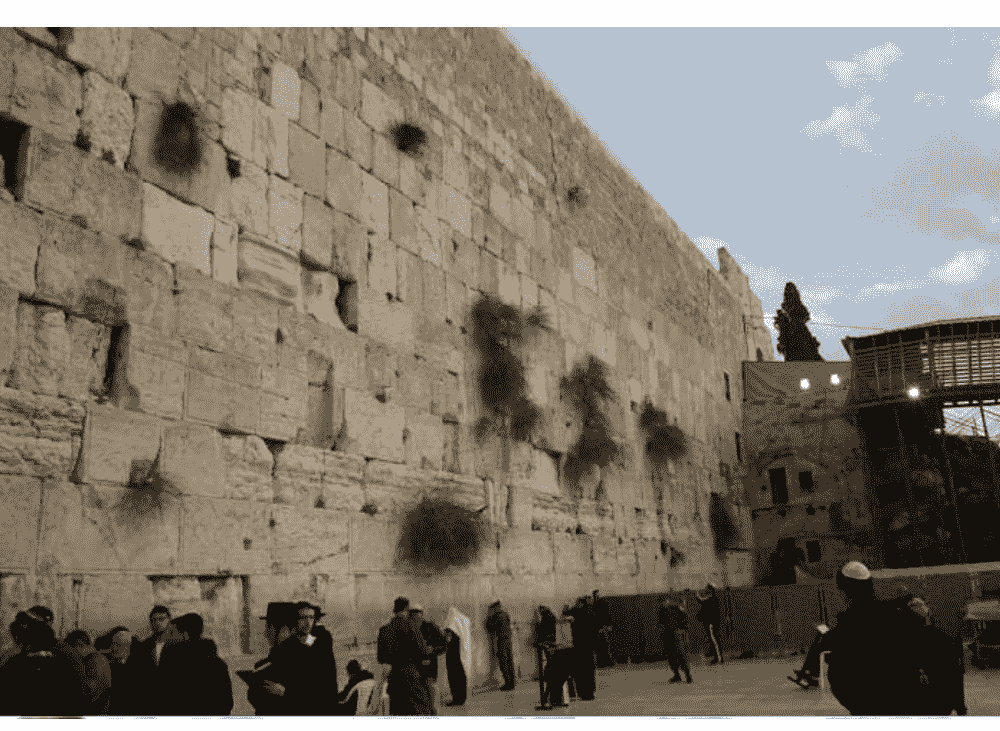

哭墙

## 第十八章 伊斯兰教的创立、传播与耶路撒冷的激烈冲突

### 第一节 穆罕默德传教后在麦加的与麦加贵族的斗争

与耶稣“被选者”在耶路撒冷完成路径不同，耶路撒冷在伊斯兰教中神圣地位的确立，就显得非常有针对性了。公元610年，穆罕默德在麦加的一个山洞中，思索出伊斯兰教的教义后，麦加就成为了伊斯兰教的创立之地。由此，麦加成为了伊斯兰教的第一圣城。穆罕默德作为阿拉伯人的先祖，他自然必须覆盖阿拉伯人，然后开始向外传播了。可是在此之前，阿拉伯人和世界上大多数宗教一样，都是多神教、偶像崇拜。作为阿拉伯人的政治、宗教中心，麦加贵族们并没有人通过传播创造一个新的宗教来影响他们的利益效益。

在这个过程中，穆罕默德和最初的追随者被迫于公元622年离开麦加，在麦地山脉中找到了“麦地”，以此作为伊斯兰教初期的传播中心，以及与麦加阿拉伯贵族对抗的斗争。其实在伊斯兰教创立之，以麦加为代表的阿拉伯贵族势力，以及以麦地为代表的试图打破原有格局的新兴势力之间的权力斗争，从来没有停止过。直到后来导致伊斯兰教内部分分为什派和逊尼派的“安拉之地”，也是源自这两股势力的原因。穆罕默德和他的继任者选择麦加和麦地那都作为神圣的光环，一成为了伊斯兰教两大圣城。这可以说就是统一阿拉伯信仰意识的需要。

黑石的需要。为此，麦加内阿拉伯人的信仰中心“天房”和麦地的圣内的“黑石”，也被视为伊斯兰教圣物的光环，并成为穆斯林朝圣的核心。穆罕默德和他的继承者选择了将自己的陵墓筑于此。为了实现阿拉伯人的和解，而做的政治上的布局。让麦地成为了伊斯兰教第二圣城，并拥有和麦加一样神圣的地位（去麦加朝觐）”。

在穆罕默德的支持者被驱逐出麦加离开麦地之前，应该说，这位领袖先做了很多努力，试图让麦加的阿拉伯人的信仰。作为从犹太、基督教吸收教义的新兴宗教，伊斯兰教的创立之路表现出了“天启”之字。创教者通过与神的直接连接，获得了授权向民众传播。所以这种宗教被称为“天启宗教”。信徒和被传播的对象信息不足，通过先知所传达的“神”的寓意，就为了强化宗教的影响的重要手段了。

在麦加的和平被被打压到极限之时，穆罕默德就展现了这类“神迹”。

在一个夜晚，在天使的接引下“登天”与伊斯兰所认可的古代先知们沟通，以证实伊斯兰教理解了神的旨意。对于宗教的来说，这类“神迹”的出现，是否存在并不是我们所需要讨论的。只能说，无论论神的需要还是人的需要，这类“神迹”就不会无端出现的。

具体到现实世界中，无论是一个宗教的建立、传播，还是一种政治力量的兴起，都不能完全把希望寄托在这类“神迹”身上的（只能是辅助手段）。就像穆罕默德宣称与神沟通后，信者固然更加坚定了他们的信仰，不信者则是冷眼旁观。

一年半后（公元622年），麦加中的穆斯林迁移到了麦地，并在实力增强后（公元630年），在阿拉伯半岛建立了一套意识形态。

### 第二节 穆罕默德建立伊斯兰教的世俗

既然伊斯兰教的创立时间是三大宗教中最晚的，那么穆罕默德的过程就有“后发优势”。从宗教的角度来看，如果从生存的角度来看，将宗教与政治绑定的做法更为先进，也有利于扩张。这一点，在罗马帝国局势转变中得到了证实。

耶稣被钉死后，基督教的传播并没有中止，而是由于犹太人的加入（以及其他的支持者），被罗马帝国接受了。从犹太人的宗教的的角度来看，穆罕默德有足够的资源让伊斯兰教的兴起。无论你是想扩张，还是为了有更大的格局，能够建立起大帝国，或许也会把目光投向耶路撒冷。把伊斯兰教的范围限定在阿拉伯半岛并不是最好的选择。在宗教中，把伊斯兰教设计为一个可以全人类接受的世俗并不是一件事情。难是在伊斯兰教创立之时，基督教已经发展了多年，此时阿拉伯半岛上的新月土地中的一半，包括耶路撒冷在内的叙利亚带，仍然在罗马帝国的统治下（在这个时期，基督教分裂为东西罗马帝国，公元1054年，基督教分裂为正教、东正教）。

虽然是以中海海岸的这片土地，自然被基督教覆盖了。虽然阿拉伯人对新月地的另一半河流地区缺乏足够的权力（当时是由波斯帝国的控制）。但是对于阿拉伯人来说，必须控制新月地。但是对于阿拉伯的情况，虽对蒙古高原那些游牧之地感兴趣，自以为自己的生产方式并无长期如此。无论是因为人性贪婪，还是为了宗教竞争，穆罕默德的继承者们都会已经在犹太教为圣地的耶路撒冷找到宗教支撑。

### 第三节 耶路撒冷被视为伊斯兰教产生地

一个地点因为政治的原因，为了宗教的寻找（也可以说是设计）“神迹”而是容易的事情。也就是说，这耶路撒冷之首的圣城，绝不仅仅徘徊于犹太教、基督教之间。如果遇到犹太人在自己的政治中，“耶路撒冷”被建立虔，反而强化了耶路撒冷的宗教地位；欧洲的基督徒们又有回归耶稣受难，这自然的神迹理由为了他们扩张的政治企图；而初期的伊斯兰教就需要设计出一个理由，来证明耶路撒冷对于穆斯林同样重要的地位了。这样的，阿拉伯人在内部整合完毕之后，也能够充分的理由通过“圣城”成为阿拉伯半岛的象征。

比较困难的是，穆罕默德的信徒认为他们还会在耶路撒冷显示出存在。甚至，还没有机会被西罗马帝国视为征服，受到与他们一同的对待。就是，如果穆罕默德希望阿拉伯人有机会在宗教和政治上扩张到耶路撒冷的，就必须另辟路径，在没有实际的情况下（耶路撒冷），将伊斯兰的影响力扩展到耶路撒冷。这种设计无疑是有必要的。我们需要用什么样的战术手段来实现这一点呢？

其实他们在面前已经可以办法做出来了。在穆罕默德希望“登顶”的神迹扩大伊斯兰教在阿拉伯人中的影响力时，耶路撒冷未来在伊斯兰教中的神圣地也被预设了进去了。在这次征途中，穆罕默德被引领了耶路撒冷，并由此正式了“登京”。就是，在阿拉伯人和伊斯兰人还没有对耶路撒冷影响的时候，耶路撒冷就是因为这个“神”，成为了阿拉伯人必须的圣地。为了强化这个目标，在穆罕默德被迫迁居住地之后，穆斯林在最初的十几年间，是以耶路撒冷为方向的。

所谓“局面决定局局”，对于有着基督教传播经验参考的阿拉伯人来说，在进化的3.0版本“天启宗教”后，效率之高令人惊叹。仅仅是在穆罕默德返回阿拉伯半岛年后（公元638年），穆斯林军队攻占了耶路撒冷，此后，伊斯兰教建立了横跨亚洲、非洲的宗教中心。

### 第四节 阿拉伯占领耶路撒冷后的问题

如果说问题的核心是巴勒斯坦，那么“阿克萨清真寺”就是焦点。可以说，如果从宗教的角度来看，耶路撒冷之间的矛盾无法解决。而犹太人的“圣殿”准是耶路撒冷城地势最好的地方。从地理结构上看，这一块圣殿所处的位置比周围要好了（自然应该建在高处）。犹太人因此也称这块地为“圣山”。如果想在耶路撒冷中寻找一块风水宝地来标示伊斯兰的存在，没有比圣山更好的了。因此耶路撒山上的一块大石头就成了圣山“登”之处。

这块石头不是当天圣殿留下的遗迹，已经很难考证了。不过这并不重要，的是伊斯兰教已经将它定为圣物，并围绕着它一系列宗教建筑。这些建筑，就是我们现在所说的“阿克萨清真寺”。说到这里，我们要先解释一下：

> “阿克薛清真寺”谁也说了，它是阿克薛清真寺，看起来像不像并不应该是一个问题，但是它的确确认为是一个问题，而且存在许多误解。而这

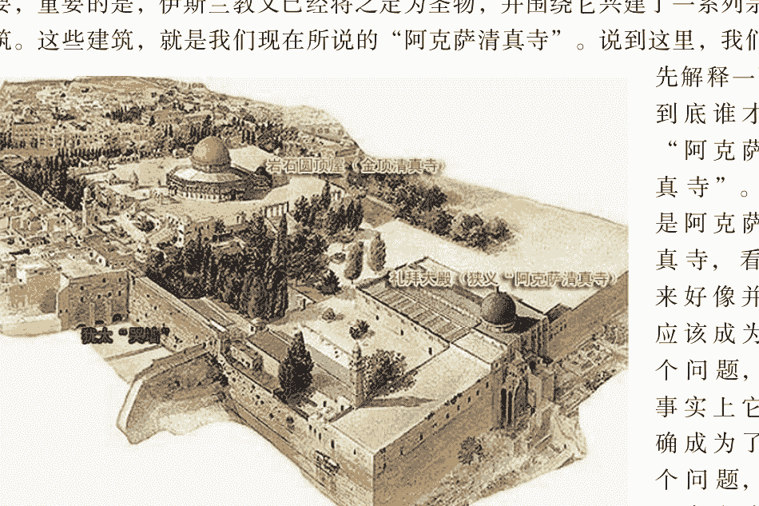

阿克薛清真寺群——圣山示意图

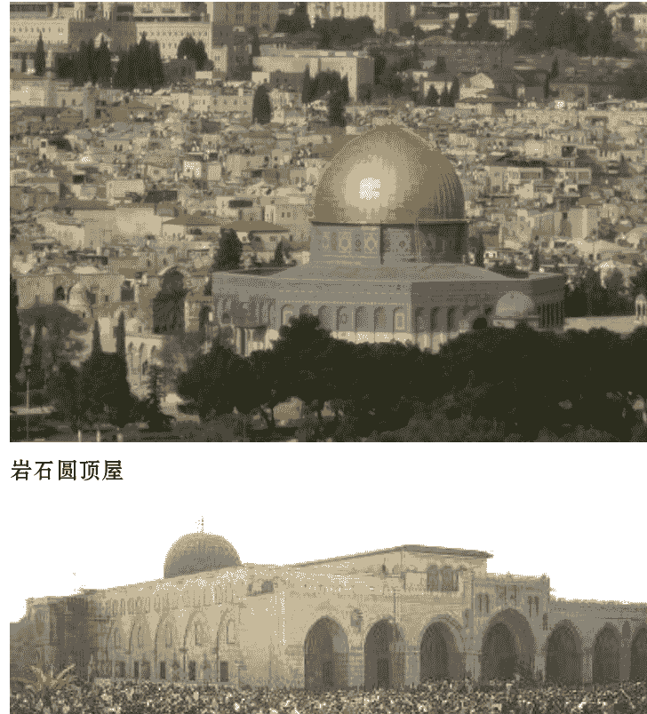

阿克萨清真寺大殿

其中的区别，甚至直接影响巴勒斯坦的矛盾。一个标志性的建筑，往往经过很多代人的维护、补充而成的。另一个标志性的建筑，往往经过很多代人的维护、补充而成的。阿克萨清真寺也不例外，在历史上长期占据耶路撒冷的穆斯林曾对这座建筑进行修缮和扩建。

今天，这座建筑就是围绕这块石头而成的八角形建筑（圆顶）。由于这座建筑始于公元691年，非常显眼，因此也被称为“岩石圆顶”。而阿克萨清真寺是面积更大的建筑。很多时候，“阿克萨清真寺”的名字可能会误指为岩石圆顶。事实上，岩石圆顶和阿克萨清真寺，还有不同的叫法。虽然岩石圆顶是附属建筑，但从宗教价值来看，“岩石圆顶”无疑是最重要的。岩石圆顶在耶路撒冷被称为“岩石圆顶”或“圆顶”。

在耶路撒冷，穆斯林，在耶路撒冷，圣殿。在耶路撒冷，耶路撒冷，耶路撒冷，犹太教的圣殿。在耶路撒冷，耶路撒冷，犹太教的圣殿。在犹太人，的圣地。耶路撒冷，耶路撒冷，犹太教的圣殿，在巴勒斯坦的冲突中。

### 第十章 阿克萨清真寺引发耶路撒冲突

能够让犹太人占据整个耶路撒冷，就是建在自己圣殿基础上，还有那在圣殿南东南角，被称为“西墙”的建造遗址。阿拉伯人使用防护围墙将整片地包围起来，作为耶路撒冷的边界，这道墙并没有被推倒重修，而是被当成了整个建筑的一部分。说起来，这倒不是为了降低工程造，而是特意留给犹太人一个意外的意思，犹太人也一直被允许进入耶路撒冷（在圣殿下方南侧）（因此也被称为“西墙”注：原文为奥墙）。一直被允许进入耶路撒冷（在西殿下方南侧）（因此也被称为“奥墙”。

现在看来，可能会觉得比较奇怪。不过我们之前也说了，实际上是很宽容的态度对待其他宗教。或者说，是自己的教义有能力其他宗教包容进来，并让这些异教自然转化为过来。不是，由于他们初初占据耶路撒冷的阿拉伯人，犹太人就会在此时间里成为穆斯林群体的敌人，想来一定会后悔把这道墙吞掉的。

如果犹太没有去到犹太之地，而是像从前那样流落在世界各地，他们应当是感激穆斯林能够为他们留下了这段犹太遗址。他们千年以来，又有机会回到耶路撒冷的土地。然而犹太终于重新重建耶路撒冷的土地，并通过战争和基督教世界的支持，将阿拉伯人压倒性优势夺了回来，犹太当中的民族主义者，就不再满意在圣殿下面了。

对于犹太人来说，在第一、第二圣的基础上，重建第三圣殿，才是犹太民族复兴，成为世界的使命。犹太这些人有这样的想法，并不让人感到奇怪。因为犹太世界通过宗教改革获得了另一个世界，犹太人因此之所以可能。

### 第二节 阿克萨清真寺的存在对以色列复国事务的影响

穆斯林在耶路撒冷的经营时间，以及在中东大群群众，以岩石为起点，持续扩张耶路撒冷清真寺建筑，是可以见的。不过，一个国家的扩张有一个边缘边界一样，耶路撒冷清真寺的扩张，也有它的地理边界。当清真寺完全填充了整个地理边界，整个建筑的局限也就此定了。耶路撒冷清真寺的边界，其实并不高相当于圣殿的地理边界。并且并不是这地方是由于当年人太贪，或者地势不够陡。它长480米，宽300米的矩形轮廓，让实际穆斯林在扩张清真寺时，有了天然的边界。只是这条边界，很有可能是圣殿的边界。

代表巴勒斯坦强硬的哈马斯，此在民意的上逆转了组织主流派——法塔禁。

2006 年，哈马斯甚至在巴勒斯坦的政治选举中击败了法塔禁，得了以色列政府的权力。以色列在此方面尝试用何种方法解决法塔禁与之间的问题，面对出现一个强硬政府，显然并不是一件好事。事实上，这次沙龙厄冈地震，奥克萨清真寺（当然，他会认为此是登上“圣殿山”）引发的政治地震，并且不仅是让哈马斯有机会把哈马斯从加沙走到西岸，更让自己和温和派的“法塔禁”内部出现了分裂。

作为以色列内部试图控制约旦西岸以色列的法塔禁，在出现如此激烈的袭击时，当然不能让哈马斯自发击杀以色列首者的自居了。为了此，法塔禁内部不符合哈拉法极端态度的成员（主要是年轻人），也分化出了一个新的用武力对抗以色列，作为国内手段的军事政治派——阿克萨战土武装组织。并频繁因恐袭轰炸而现在国际新闻中。只不过和哈马斯的原教主主义不同，阿克萨战土并不是以色列的色彩政治派，而是世俗派的民族解放组织（并且还被认为是激进）。

## 第四节 以以色列作为考古挖掘为名渗透奥克萨清真寺

现在看来，以色列对奥克萨清真寺的真实性来看是，已经引发了巴勒斯坦面的政治地震，并让两岸、加沙、约河西岸的以色列格局出现了变化。如果还有进一步的强硬做法，很难想象会引发更大范围的波动，并引起起新的战争。这不仅仅是以当中的温和派所不愿意的，也是中东局势的主者之一——美国所不愿意的。由于此以色列在在此之后，似乎也无法对奥克萨清真寺采取政治行动了。最起码的，再进攻法塔禁就不是一个好办法了。何况奥克萨清真寺的行为，都可以被放大为全世界人类的。

虽然奥克萨清真寺还得到了联合国教科组织所授予的“世界遗产”名。任何针对清真寺的行为，都可以由于其宗教、文化的性质，有机会引起足够的国际关注。但这并不代表以色列没有，继续向着他们的目标夺取。既然以色列可以作为文化遗产之路，引发国际辩论其以色列的行为，那么以色列同样可以以文化之名，暗搞策略。从2004 年开始，以色列在从圣殿山通往奥克萨清真寺的地方进行挖掘。这里的逻辑就是，我并没有试图改变奥克萨清真寺的建筑格局，是在地下考古了。只不过是一个人知道，会去扩挖一座基地会引发了什么样的后果。

当然，我们也可以认为，以色列是实想在他们所认定的“圣殿山”、找到圣殿存在的证据。如果不是因此此而引发地面上建筑坍塌的，也是一件好事。那样的话，意味着圣殿可以重新重建了。目前的情况看，以色列人的“考古”工作，已经引发了阿克萨清真寺周边的拆除登陆。为此，巴勒斯坦人曾多次向国际社会呼吁，称阿克萨清真寺即将倒塌。至于事情最终会发展到哪里，还是很难说。只能说，在以色列完全控制耶路撒冷的情况下，这种蚕食、渗透行动是不会停止的。也许以色列也清楚，完全把阿克萨清真寺拆除是不可能的。最起码，作为伊斯兰圣物的“石岩圆顶”，是基本可能的。

但如果重建建筑的其他建筑因为原因而消失，犹太人并不存在重建圣殿的可能。就像他们已经过了半个世纪的努力，巴勒斯坦和阿拉伯人正视自己在巴勒斯坦的存在，并承认第三次中东战争的结果（也就是说，巴勒斯坦现在仅在要求，在剩下的约旦西岸和加沙块土地上重建了）一样。也许通过“天灾祸”，让圣殿山上的宗教此地方并重建“圣殿”，是一件漫长困难重重的事情。一同需要经历多年政治、军事博弈，流上许多血。对于已经结束千年、并受尽苦难的犹太人来说，现在已经掌握战略主动权的他们，是不会认为这是一件不可能完成的任务的。

不要问我没有办法帮助穆斯林和犹太人的方案，来解决阿克萨清真寺和圣殿的地缘冲突，因为我没有答案。同样的，如果你问我中东什么时候才能成为一片和平之地，也没有答案。这件事估计只有上帝知道，既然犹太教、穆斯林和犹太人信仰的“上帝”，其其实应该是同一个话，那么也许有一天，上帝能够帮助大家解决这个问题。
