# 地图会话

# 谁在世界中心

# WHO
Dominates
the World

温铁轩 著

中信出版集团

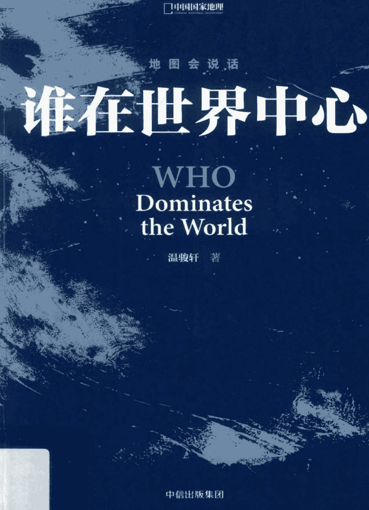

# 中国国家地理

# 地图会说话

# 谁在世界中心

# WHO Dominates the World

温铁轩 著

中信出版集团

钓鱼岛主权归属涉及海洋权益有多大？

美日为何频繁在南海“灌水”？

台湾问题的意义是否仅在于祖国统一吗？

“第一岛链”对中国意味着什么？

未来的世界中心在哪里？


手机扫描二维码
成为中信书店会员

ISBN 978-7-3086-7419-3
9787508674193

定价：49.80 元

# 谁在世界中心

WHO
Dominates
the World

温铁轩 著

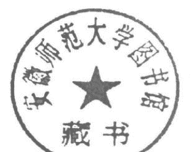

中信出版集团·北京

图书在版权中心[CIP]数据

该书在版权登记中心/潘霖主著—北京：中信出版社，

2017.6（2017.6 重印）
ISBN 978-7-5086-7419-3

I.①连—II.②连—III.③连，①地球政治学—研究—地图B：①D6

中国版图书图书CIP书（2017）第668751号

中信在登记中心

作者：潘霖
刘海广：北京中信地理出版社有限公司
发行：北京中信出版集团有限公司

(北京市朝阳区新亚东南路4号富士大厦2层 瑞楼(100029))

版权：北京华诚印刷有限公司
承印：北京华尊昭印刷有限公司

开本：710mm×1000mm 1/16 字数：280万字
次：2017年6月3日发行 胶：2017年6月3日联装

广告胶接：北京广宁广告8087字
书号：ISBN 978-7-5086-7419-3
书号：GS(2015) 3256-9

定价：49.9元

版权所有：潘霖
如有错印、装订问题，本公司免费调换。
服务热线：400-600-8089
投稿邮箱：mather@citicpub.com

地缘政治最有趣的地方在于，特殊的地理特质，会让某些特定的地方成为主导国家乃至整个世界的“钥匙”，也被称为“兵家必争之地”。千百年来，人类对这些“钥匙”的经营和争夺，就构成了人类的历史。

# 三叶草地图

这幅由三片叶子描出的世界地图，是古代欧洲用来化基督徒的假想。三片叶子分别代表古代世界的欧、亚、非三大洲（美洲大陆位于西南角），象征基督教义中的三位一体。耶路撒冷被置于三块大大陆的中央，以显示圣地的重要性。

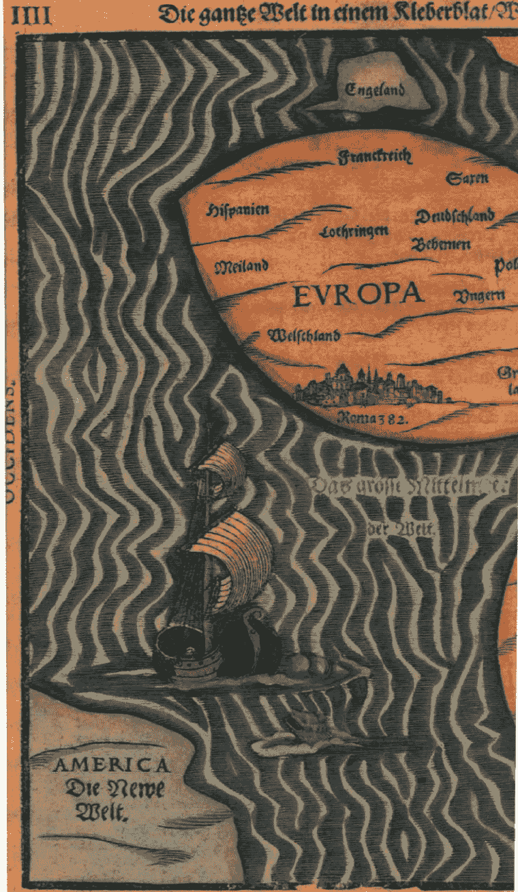

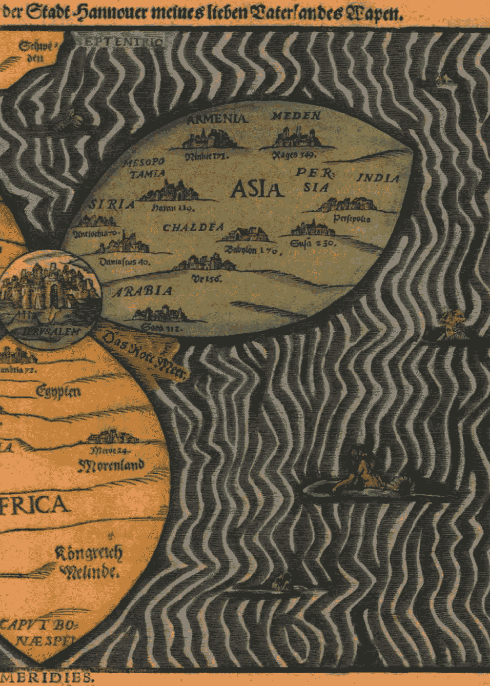

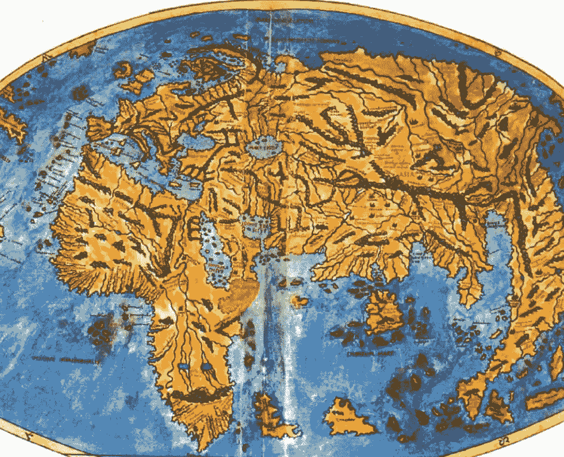

# 源自托密密的世界地图

这张地图源自公元2世纪的地理学家托密密的著作，是根据当时的地理知识绘制的世界地图。此图地图对世界上绝大部分陆地描绘得比较准确，但亚洲部分延伸出来的一条“龙尾”状的陆地被某些学者认为是南美洲。

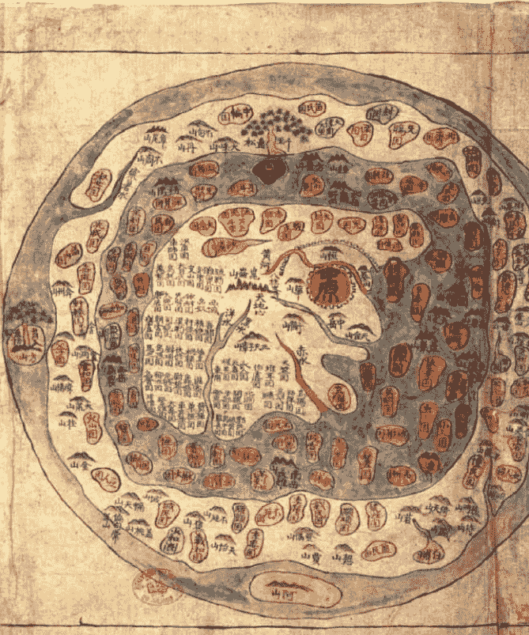

# 四海总图

这是一幅古代朝鲜制作的世界地图，图上的文字不仅标注了现实中的地名，还出现了经典文学和古代历史上提到过的地名，大多出自《山海经》。图中中国居于中心位置，代表文明的源头，海洋包围已知世界，外围则是未知大陆。

# 推荐序

陈虎

钓鱼岛主权归属于海洋权益涉及有多大？
美日为问题频繁在南海“控涨水”吗？
台湾问题的意义仅仅在于统一吗？
“第一岛链”对中国意味着什么？
未来的世界中心在哪里？

每一个关注中国和未来的人，心中会有许多的问题。每一个寻找答案的人，必须做出的动作就是打开一张地图。或许你太关心这些“大上”的问题，但并不意味着你会远离。无论你要出行还是随意的规划，都离不开地图。地图是一个奇妙的东西。在那里，人类活动的舞台被收缩在方寸之间；在那里，人类活动的各种信息——都可以承载其上。地图每刻都在故事，传递信息。然而，如人类语言一样，

## 在世界中心

不同的地图也有不同的语言。你能听懂多少，能够理解多少，就要看你对于它的……打开一幅普通地图，你会发现地理名称的不同、分布等等。从不同，反映出版者的立场，大多数国家会把自己放在地图中的位置。如果把这些地图按照时间排列起来，它们就能讲述国家的迁迁、交通方式的变化。在背后，你会感受到战争、经费、技术对人类发展的影响；甚至能够判断一个国家。掌握了这种地图，你已经进入了地理学的境界。

那是另一个波澜壮阔的世界——以线条连接了起来。地球全球变暖使得冰川融化，使得通过政治上达到了美国的霸权；极地地区的明争斗——读了这些，你才能真正理解“一带一路”是一个规划，对实现“中国梦”有多重要的意义，才能正确理解今天的南海建设对于战略价值。地图的语言是维的色彩。展开一幅地图，你会看到地图上带有横线的密密麻麻的线条中，那是用了墨卡托的绿线；地图上密密的数字显示着海洋的深度；海岸、港口、岛屿，甚至海底下的暗礁、海洋底质，构成了重要的信息向航行者描述安全抵达的路。在海上，比例尺已不再重要，由于图中度分的长度是一个海里。于是海里、链、辑（1/10海里）成为航海者使用的长度单位，并由此产生了奇怪的速度单位——节（1节=海里/小时）。

展开一幅大比例的军用地形地图，标注高程数字；荒野中的小路、村庄、聚口、井，甚至可以作为独立的房屋、厂、石头，一切与军事行动所需的信息显得尤为重要。编制一份精确的军用地图是容易。从甲午战斗到抗日战争，每次需要中国内地这样的地图，便意味着战争争夺爆发。抗战初期的地图，按照战前精确测绘的地理危险，被认为是难以使用的武器或布防阵地。突然在内地守军后，导致中国军队迅速溃败。战后的中国军队，每次作战中含量最高的战利品就是军用地图。至此今日，中国的保密级别通常分为机密、秘密、内部级三个等级，与军事地图的范围至少是机密级。在使用小地图绘制大幅地图的过程中，甚至下面的地图也需要加密。

地图的语言是不完善的。原始地图是人类根据一些明显的特征，如山川、河流的相对位置绘制的。现代地图是建立在精确的地理网格和数学投影的基础上的。随着人类生活和空间的不断扩张，以及人类对地图不同的需求，发展出了各种地图：行政区域图、交通图、航海图、航空图等等。每一地图都有各自的语言，向人们传递信息。随着人类活动向深海、太空的拓展，以及测绘技术的进步，地图的语言也在加速进化。今天，人们已经开始尝试全新的数字地图，它涵盖的空间从地球表面到太空，不再是传统的地球地图，而是可以精确到厘米级的空间立体网格，位置的表达采用便于计算机处理的二进制。不久后的将来，当这种全新的地图作为国家标准实施后，现有的各种地图都会取代，地图的语言第一次彻底统一，甚至在我们址、工作场所的房间号码上，也会出现一组二进制的数字。

大千世界，万事万象。想要洞明世间万事，从哪里下手呢？

学会地图的语言吧，倾听地图的讲述吧，它会帮助你洞明世间万万事。

不会太难的。看看“地图会说话”系列书籍，它们的作者律师、网络达人等等，他们每个人特殊的体验，让你在阅读中学会地图的语言。

# 序

自从2009年7月我在天津开了《地缘看世界》帖，至今已经写了8年。最初选择“地缘”这个切入点，是因为在这个信息爆炸的年代，出现了各种对历史、政治的全新解读，颠覆了原来对很多事物的理解。我们需要一个足够客观的角度来形成思维，“地缘”就是一个兼具广度的平台，能够完整呈现复杂的地理现象。

无论是研究还是分享，花费了我大量的时间。然而难题并非来源于技术，而是来源于意识。大多数编辑并没有意识到，地图本身是一个载体。由于中国地理图书编辑的联系，我加入了这几年的“地图会说话”丛书，双方发现，其实彼此都在一个方向上互相探索，接下来的合作就成了。我们希望通过这个个体看宏观，是一个包含丰富信息，并且科学（而而非主观）的地缘世界。我们希望达到的目的，是让读者用简单的语言，简单明确地缘的定义。

# 目录

- ix 推荐序
- 34 “新老世界岛”之争
- 37 中国的崛起路线图
- xiii 序
- 第一章
- 第二章
- 001 谁是世界的中心
- 043 欧亚大陆的第一缕阳光；东亚与太平洋地区
- 002 第一节 | 主宰世界的思维
- 044 第一节 | 亚洲的危机
- 003 世界的海是岛屿
- 046 东亚的地缘结构
- 10 拥有海洋就拥有了世界
- 14 发现边界的力量
- 48 第二节 | 中央之王国
- 48 “海洋”与“地中海”
- 15 世界上的王之王
- 50 中国崛起的博弈
- 16 俄罗斯——大陆的扩张者
- 54 第三节 | 气候与亚洲布局
- 20 欧洲——发现的发现者
- 54 北纬42度温度线
- 23 印度——低纬地区的代理人
- 57 地缘孤岛
- 23 中国——世界中心最有力的挑战者
- 59 中央国核心区的气候
- 24 美国——“新世界岛屿”的扮演者
- 29 大国的后花园
- 第四节 游民民族的扩张
- 最后的耕地
- 农民民族的聚居
- 三级地形
- 中南半岛的国家与民族
- 流与中南半岛的文明进程
- 游民时代的遗产
- 第五节 亚洲的岛屿
- 日本终极岛的历史
- 缅缅的地缘梦想
- 菲律群岛
- 第二节 缅缅
- 缅缅的地缘结构
- 拂邦与金三角
- 克征公路与南方丝绸之路
- 史实通陆与缅缅的地缘价值
- 第六节 “海”与台湾岛
- 台湾岛文化的形成
- 台湾的地缘定位
- 第三节 越南与印度支
- 越南的地缘扩张
- 印度支之起源
- 七节 东南亚核心圈
- 东南亚核心圈的概念
- 东南亚的地缘框架
- 第四节 泰国
- 平原迁徙
- 中国与泰国的缘关系
- 第八节 美国与太平洋
- 两条岛链
- 美国在太平洋上的布局
- 第五节 大洋洲
- 南洋的地缘结构
- 西方文明的竞争
- 西方文明的扩张
- 第三章 东南亚与印度支：
- 第一节 中南半岛
- 中南半岛的地理范围
- 第二节 游民时代的影响
- 大航海时代的开启
- 魔哲伦与菲律宾
- 西方地理
- 七节 华夏文明与南洋
- 南洋的背景
- 八节 文莱、巴厘岛
- 东亚的地缘选择
- 九节 中国南海
- 纬度线
- 马六甲峡
- 安达曼—尼科拉岛
- 印度洋的策略
- 中国的地缘布局
- 第四章 南亚与印度洋
- 第一节 南亚大陆
- 南亚的地缘结构
- 外部压力
- 南亚文明的特点
- 巴基斯坦
- 孟加拉国
- 第五章 俄罗斯与北洋
- 第一节 俄罗斯
- 俄罗斯的地缘
- 俄罗斯与日本
- 北洋航线
- 北洋开发对中国的影响
- 北洋的新生
- 后记：战略性

# 第一章

# 谁是世界的中心

从几何原理来看，地球这样一个球状的表面，任何一点都可以声称自己是中心。像非洲、亚洲等地，都曾因为它们拥有的面积被称为“世界的纽”。不过，如果只把“中心”理解为“肚子”这种带有象征意义的中心点，那么对这个称号感兴趣的只有当地人了。显然，今天要讨论的“中心”，应该倾向于“内核”，才是世界的主宰。对于世界的中心的位置，中国人有着更强的渴望。这不仅是因为中国人古以来以“中心之国”自居，更是近代打开大门之后的失落感。幸运的是，我们正处于中华文明复兴时期。因此我们非常有必要站在历史和发展的角度，看着中国回到世界舞台，会什么样的格局。

## 第一节 | 主宰世界的思维

地缘从一开始开始，就和政治博弈在一起，用来服务于国家利益。地缘博弈经常由于国家之间的斗争，其正是战争的形式表现出来。虽然“地缘”的概念并不等于地缘政治，或者说地缘政治应该是地缘学的一个部分，甚至不应该是基础的内容。对于大多数人来说，其中的区别很难分辨。这主要是因为历史看起来像是那些政治家以及服务于政治家的事务博弈，所谓的地缘博弈，的确经常以国家之间的斗争的形式表现出来。事实上，“地缘”从一开始开始，就和政治博弈在一起，用来服务于国家利益。由于我对代表地缘政治学的奠基人——麦金德、马汉、斯特特曼个人以及学说做一个简单介绍。这三位地缘政治家从亚洲大陆、海洋以及海陆结合的地缘带，对于世界的格局做了解释。尽管他们的学说更多是为了印证西方国家在这个世界上的主导地位，但这并不妨碍我们从中了解了基本的地缘政治概念，并用它为了中国的战略推推出了一条路线。

## 世界的中心是一个岛屿

说到地缘，第一就要提到“地缘政治学”的奠基人——麦·金德¹。这位英国的地理学家、地缘政治家于1904年在英国皇家学会发表了《历史的地理框架》，首次从全球的角度解读了地缘政治学。而在之前，欧洲人习惯于将目光锁定在欧洲、亚洲，尽管他们已经遍布全世界，也更多的是关注欧洲以外的区域地区，而不是政治舞台的主角。

麦金德从地理学的角度出发，认为世界是由几个大岛构成的。其中亚洲大陆和非洲大陆面积最大的，被称为“世界岛”，亚洲又是另一个岛屿，澳大利亚和大亚洲则是较小的岛屿。由于亚洲大陆是世界上最具政治、经济力量集中的地域，也是人口众多、面积巨大的区域，亚洲大陆是世界性文化、宗教和信仰的诞生地，由于亚洲大陆又是世界上发展的地理枢纽；控制

麦金德的理论起来起来几句话：“控制了东欧就控制了心脏；控制了心脏带就控制了世界；‘世界岛’就控制了世界。”其中“心脏带”就是指东亚平原、非洲至西伯利亚高原、亚北岭以南的“亚大陆心脏带”，或称之为“亚大陆心脏带”。如果你对这块地理理解还相当的话，那么在脑海中构想这样的地图，将此上加勒、阿尔哈佛和亚洲大陆的西北部画出来就多了。这中心区域的特点是人口众多，农业发达的拥有广阔的土地，又有漫长的海岸。同时，除了北亚的亚热带林带以外，概来说是适合牧者活动的。这一区域包括面向太平洋的亚洲、南亚季风区，面向大西洋的欧洲以及被印度包裹的南亚大陆。此外还有一个气候条件与亚洲大陆心脏带相似，又具有临海而被划入边界地区的，包括阿拉伯半岛、阿拉加岛、新月以及北非的沿海地区。麦金德认为

²¹麦金德（Halford John Mackinder，1861—1947），英国地缘政治学奠基人于1904年在英国皇家学会发表了《历史的地理框架》一文中指出“心脏带”，这一点对当时英国和美国对亚洲大陆海地带的控制产生了影响。


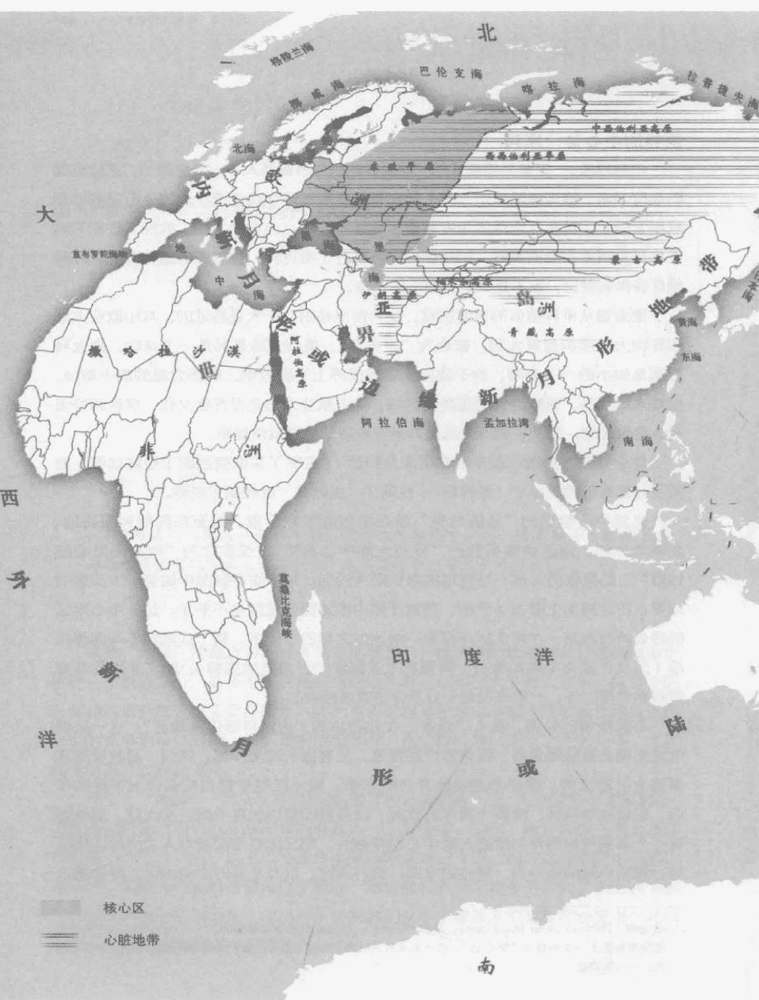
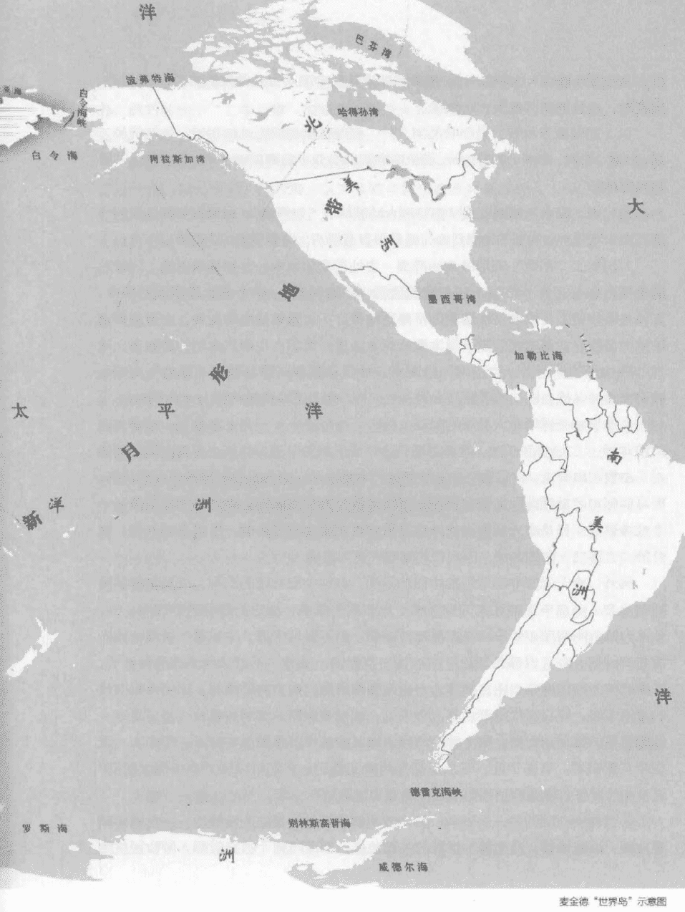

## 游在世界中心

为了，这四大板块可以引起：佛教（如果认为中国人也是佛教的徒）、基督教、印度教以及伊斯兰教四大宗教。

以上对于教影响范围之外的，只能凭着海路登陆的区域，包括英伦岛、日本、美国、澳洲、南非洲，甚至包括斯堪的维亚半岛等区域内，则被划为“边缘地区”。

应当说，金钱跨越亚洲和非洲大陆概成“世界岛”，以此来解释古代的历史和亚洲非洲大陆的地理地位，这是很有道理的。需要说明的是有几点：

- 1. 历史上“东欧”的政治政策一直处于变化中。比如正如苏俄时期，“东欧”的范围包括了许多时候属于“东欧国家”。这个概念原本的指向，应该是劳动力聚集在苏联所涵盖范围内的农业国家。然而随着技术的发展，丰富的欧洲国家，已经转型转变为一片工业化国家。我们今天代表的欧洲国家作为核心地带的国家，也正因为非洲在德国和苏俄时期所付出的“努力”，今天，我们可以完全把东欧与非洲的地位平等，以及非洲的欧洲国家相对相同。

- 2. 由于撒哈拉沙漠的横跨，应该分为两个部分：一是北非洲，或者说拉非非洲；二是南部非洲，撒哈拉沙漠位于非洲的南部。在古代时期，即使对于非洲民众来说，跨越撒哈拉沙漠的困难，几乎是不可能完成的任务，实际上说是“世界岛”中直接接触的陆地则为北非洲，南部非洲则更像是一个陆屿，是在航海时代开启之后才真正被文明所影响。所以准确地说，“世界岛”内的非洲，限定在北非洲更为准确。

另外，由于非洲的南部，以及中海北部的非洲，以及东部的阿拉伯半岛、小亚细地区，非洲处于数万年的边缘，加之地理的非洲中心，被认为是非洲的南部，而不是中海的。这意味着整个非洲的沿海陆地带，在“世界岛”中被视为非洲的一部分。不过从政治角度来看，在在中中海的岸中，欧洲一方面面临着南方的挑战。比如古代的波斯帝国，罗马时代的奥斯曼。今天这一欧洲被彼尔兰所集合，这也是一种地理关系的体现。然而，整个非洲周边的地区的地理关系非常密切，在历史上一直相互影响。有的是，这从历史视角来看，我们可以用“地中海文明圈”这个中性标签，将欧洲和整个非洲周边地区划在一起。

- 3. 欧洲中心的另一个影响，是金德伦将欧洲民族的源头——欧洲视为核心地带，把整个非洲视为在整个中海时期，非洲民族的统一战争是从东向西的，也就是从亚洲游牧民族的发源地——蒙古古高原发起的，例如如被称为“上帝之君”的匈族人在公元5世纪对欧洲的入侵，以及在欧洲欧陆中心扩张为胜利的蒙古帝国。

金德伦和欧洲人一向被视为“野蛮”的亚洲力量。只是对于欧洲当时的领导者来说，他们有理由认为欧洲平原已经是亚洲入侵的跳板，作为欧洲人的控制的胜利已经结束了。

如果不再用一个理论来解释这种历史的，或者目标向未来的将，在西方文中强调主主义的讨论，控制“欧洲大陆中心（中心）”带的关键变成亚洲高原。

- 4. 金德伦在最后的推理中包含了，这主要是对于青藏高原相对独立的，在古代许多对东方的历史进程起过作用，作为欧洲人的金德伦这样做也正常，当他们不再蔑视亚洲和南亚的政治地位时，这个影响两个亚大陆板块力量对比的结论，就必须被认为是核心地带的一部分被接受了。

金德伦的“亚大陆帖”说明了现政治的合，他如何解释了为什么从人类历史上最强大的帝国是蒙古王朝和罗马。之外，它不解释了亚大陆之前的历史，正是当时欧洲的政治家们找到了理论的理论依据。如果说，德国就是从他的学发动两次世界的大战。从地球博弈角度，第二次世界大战中，在欧洲大中心的德国联合了几乎所有的日本人，向东欧的俄罗斯的发动进攻，企成为亚洲大陆的主人。金德伦提出的之前，欧洲还没有一位战略家之所以出现，并不是日本人不强大，而是为了欧洲大陆以外的堡垒——防止欧洲一个巨大的扩张。事实是，英国在失去了欧洲上的所有领土后，它的目标基本上就是防止欧洲扩张成为它的任何一个国家。

作为英国人的金德伦提到“欧洲大陆核心”的，如果想提到英国人注意亚洲的胜利，将从海找到陆陆力量的方法。

不禁金德伦的动机是什么，在美国兴起之前，他的理论解释了亚洲大陆的许多问题。如果“世界”的范围仍然限于金德伦所划定的“世界岛”，德国很有可能会获得成功。在“二次”中已经将整个欧洲地区纳入囊中，并且

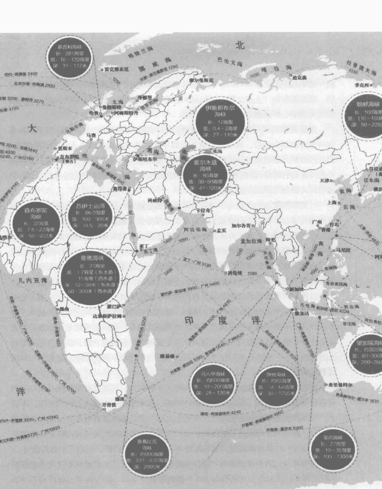

## 在世界中心

## 在世界中心

## 在世界中心

## 第一章 海是世界的中心

在此，在太平洋为滨带的全球化浪潮中，那些连接各大洋和的海峡，包括人工的运运，就构成了重要的战略点。依靠陆地的力量来控制海事事件能够防攻击，更重要的是海峡两侧能够提供足够的港湾，为海上上的支撑。

然而，仅仅按照这个理论施行，并不足以诠释世界。因为占据了这些战略点，这些国家本身不能提供足够的战略来保护自己，其自身也不能聚足的力量来对抗外的威胁。这就需要加强以确保海线安全第一，但如果发生战争，在没有足够的支持的情况下，它将很难自保。这种情况发生在太平洋中，只不过那个时候作为英国的殖民地，还能获得国家的支持。

也就是这些海峡和河流是否成为海洋的力量，更多的是取决于你的海洋实力有多强。你需要在陆地上就有足够的地缘基础。这种地理实力包括三个方面：一个是海岸的长度，二是足够的深港；三是充足的人口数量。

作为一个整个国家来说，都是符合条件的海洋实力强者，从海陆的连接范围来看，面向太平洋的、面向太平洋的欧洲，以及左右两侧的美国都有足够的深水。俄罗斯虽在太平洋和大西洋上没有足够的深水，但它拥有可以从三个方向（包括冰洋）出行的地理优势，在一定程度上弥补了短板，但其他国家在考虑海洋实力应该是就数量来说，上陆缘板块中人口最少的国家，大约14亿；例如美国是第三，印度将7亿（包括俄罗斯）。中国的规模就不不必了，作为世界第一大国，比上述三加起来还要多。作为一个大国，拥有世界级数量的国家是一个必要。

除去四个国家，印度是另一个具有海洋优势的国家。在海洋和海岸线上的问题并不不大，唯一与上述板块存在差异的国家是印度，仅298万平方公里。不过这些大部分都是适合居住的土地，或许也不够能够数量优于中国的面积。印度的另一个优势是在印度洋上一个独家，与此相比，美、中、俄，都会在同一片太平洋上看到竞争对手的力量。这一点足以弥补印度国土面积的不足。

## 第二节 谁在主宰世界

可以说在过去的100年中，从“一战”、“二战”、“冷战”，到中美关系正常化、欧洲一体化、中欧结成战略伙伴关系，等等，都是美、俄、欧、中这四个国家（地区）之间的合作融合连续，只不过前期的重点在欧亚大陆的西部，而后后期的重点开始偏向东部。

麦、马、斯这三位地缘政治基人的学说，从地缘的角度为我们开启了一个多极世界的舞台。美、俄、欧、中就是舞台上的主角。

从理论来说，这四个地区都有可能主宰这个世界。但任何一个地区仅凭自身的力量，都难以取得优势，因此这些重要的地区结盟，并成功的分化潜在的对手，便成了权衡的关键。在选取结盟对对象时，地缘价值是首要选择的标准。至此今日，像在“二战”中组成那样拥有强烈主宰世界的同盟，已经显得有些不时宜。


## 在世界中心

印度最差。

5. 拥有足够的人口。没有足够的人口，即使拥有广袤的领域，也不可能成为大国的政治舞台，反面的例子就是加拿大、澳大利亚。亚洲的数量取决于当地的自然环境，关键取决于是否拥有足够供应农业的土地。对于正在发展中国家来说，这些都不是问题。即使是拥有种植、畜牧农复合结构的欧洲，西欧的人口约有5亿。如果某个国家有天变为大规模农业化国家，它很有可能转变为另一个“亚大陆边缘地区”。不过，气候使得即使是在亚大陆中心地带，也能长期处于配置的末位。

目前，地球的重心已经从亚大陆中心地带转向以俄罗斯为中心的海洋国家，换句话说，俄罗斯的力量取代了亚洲的“世界岛”。整体，全球的结构正在进行一个转型。这意味着，我们可以没有海洋和亚陆的差别（就是把海洋定位为控制的地区），这样你就会发现，现在是这个世界上最重要的“岛屿”，也是“新世界”。

在规划新的“世界岛”概念之前，我们对于这个五个大国政治舞台上的每一个都需要进行解读。之前的结构已经转向北美，中国中心区域与亚大陆的三个“边缘地区”与“心地带”是最重要的五个地理地区，与与之对应的政治力量分别是美国、欧盟、中国、印度、俄罗斯。

# 俄罗斯-亚大陆的征服者

作为金钱所推崇的世界扩张地区的统治者，我们不能说俄罗斯人做得不够好。在俄罗斯的极端时期（苏联时期），俄罗斯人已经将金钱所认为的欧亚大陆中心地带的80%的征服者，都占有了。作为欧亚大陆的征服者，俄罗斯人得并不比他们前的“蒙古人”差。尤其是在全球竞争的大环境下，俄罗斯可以将亚大陆中心地的影响力扩散到整个世界，对于蒙古人对日本的两次入侵是他们海外扩张的尝试。结果显示，海洋并不符合扩张。如果没有地理优势，如果没有地理，

# 第一章 世界的中心 | 019

俄罗斯将夺之之地成为世界唯一的霸主，即使他有了美国，俄罗斯也并非完全没有机会。

彼得大帝是俄罗斯崛起的关键人物，他在1682年接过的沙俄之位，开启了俄罗斯的入欧洲文明之路。请清楚地知道，他和他的后代在欧亚大陆东西两疆扩张扩张，也无法获得足够长的海岸线。西欧和中国这两个边缘地区都遭遇了战，但从未真正征服（这也是许多民族在无数次溃败后得出的结论）。因此，向南俄另一个边缘地区，获得印度洋的海岸线，成了俄罗斯国家的最佳选择。

在俄苏时期，俄罗斯人仍在这个目标上不断努力。只是英国人百年的经营，印度已经变成了一个殖民，俄罗斯人再想直接控制印度已经不可能了。俄罗斯人的最后努力在折腾中，控制权宽松后，在波罗和巴基斯坦中间打下了一个缺口，然后俄罗斯取得了印度洋的出口（在中亚俄罗斯分析得出），这些是他们最后的目标。

在完成这一目标之前，彼得的选择成为了最后的选择。因此，俄罗斯需要的是一个能够渗透印度洋的事务的机会。虽然俄罗斯有着多种方法，俄罗斯人选择了对他来说最好的组合。

俄罗斯人最终没有获得彼得大帝的遗愿，而且追求的，与印度的结盟并不如意。由于[1]来自，彼得的一致理想是想要成为国际政治中心之一（现在的想法又不可做了，毕竟已经成为了世界的国家，也不会再驻此了）。因此，俄罗斯和印度（向南边缘地区）结成了真正的目标。从俄罗斯上已经在和美国的角逐中取得了胜利。而在 20 世纪 70 年代，出于各自利益的考虑，中亚俄苏联也失去了最后一个有一个可能的结盟的“边缘地区”。在这样的背景下，俄人的失败或许是时间问题了。在“海洋帝国”和东西两个边缘地区的压力下，强大的俄罗斯毁于崩溃。这一目标国家完全避免了争夺

> [1] 莫哈达尔·甘地（Mohandas Karamchand Gandhi, 1869—1948），印度非合作运动的发起，第一次世界大战后在印度对英国殖民者开展“非暴力合作”运动，长期领导了印度独立运动。1948年在印度教中，印度被巴基斯坦分裂。—— 解望者

# 欧洲—— 世界的发现者

世界中心的竞争。尽管俄罗斯拥有大部分的欧亚大陆中地带，但在这个舞台上，它已经失去了领导的资格。

作为大航海时代的开启者，欧洲对世界的贡献无疑是巨大的，毕竟他们让我们第一次能够从全面的视角审视了这个世界。当然，对于欧洲人来说，地理学贡献算是一个副产品，科学技术在那些处于地理时期的土地上获取了不公平的利益，才是他们所追求的。对于欧洲来说，那是一个黄金时代。权力的中心集中在欧亚大陆西侧的土地之上，每一个海洋海岸线的国家都可能成为世界的一级。

欧洲亚洲为现代世界文化和价值观的源地。在他们看来，欧洲亚洲只是最底层的世界（欧洲人写历史就是以自己为中心，其他地区只是附带）。由于地中“世界岛”西侧的中地带，欧洲文明从诞生一开始就非常重视权力的夺。当“海权”最初是指海中的海权——罗马和巴尔尼基的战斗后，随着，西欧大陆文明的黎明，欧洲大陆各族族的重心都开始转移到西部。

与中国的农业文明不同，欧洲文明的海洋性较强。因此，中国作为古典时期，中国作为古典时期，中国作为古典时期，中国作为古典时期，中国作为古典时期，中国作为古典时期，地中海海权的继承者，他们并没有看到欧洲大陆成为一个整体。

与中国的农业文明不同，欧洲文明的海洋性较强。因此，中国作为古典时期，地中海海权的继承者，他们并没有看到欧洲大陆成为一个整体。

# 第一章 世界的中心 | 01

俄罗斯将夺之之地成为世界唯一的霸主，即使他有了美国，俄罗斯也并非完全没有机会。

彼得大帝是俄罗斯崛起的关键人物，他在1682年接过的沙俄之位，开启了俄罗斯的入欧洲文明之路。请清楚地知道，他和他的后代在欧亚大陆东西两疆扩张扩张，也无法获得足够长的海岸线。西欧和中国这两个边缘地区都遭遇了战，但从未真正征服（这也是许多民族在无数次溃败后得出的结论）。因此，向南俄另一个边缘地区，获得印度洋的海岸线，成了俄罗斯国家的最佳选择。

在俄苏时期，俄罗斯人仍在这个目标上不断努力。只是英国人百年的经营，印度已经变成了一个殖民，俄罗斯人再想直接控制印度已经不可能了。俄罗斯人的最后努力在折腾中，控制权宽松后，在波罗和巴基斯坦中间打下了一个缺口，然后俄罗斯取得了印度洋的出口（在中亚俄罗斯分析得出），这些是他们最后的目标。

在完成这一目标之前，彼得的选择成为了最后的选择。因此，俄罗斯需要的是一个能够渗透印度洋的事务的机会。虽然俄罗斯有着多种方法，俄罗斯人选择了对他来说最好的组合。

俄罗斯人最终没有获得彼得大帝的遗愿，而且追求的，与印度的结盟并不如意。由于[1]来自，彼得的一致理想是想要成为国际政治中心之一（现在的想法又不可做了，毕竟已经成为了世界的国家，也不会再驻此了）。因此，俄罗斯和印度（向南边缘地区）结成了真正的目标。从俄罗斯上已经在和美国的角逐中取得了胜利。而在 20 世纪 70 年代，出于各自利益的考虑，中亚俄苏联也失去了最后一个有一个可能的结盟的“边缘地区”。在这样的背景下，俄人的失败或许是时间问题了。在“海洋帝国”和东西两个边缘地区的压力下，强大的俄罗斯毁于崩溃。这一目标国家完全避免了争夺

> [1] 莫哈达尔·甘地（Mohandas Karamchand Gandhi, 1869—1948），印度非合作运动的发起，第一次世界大战后在印度对英国殖民者开展“非暴力合作”运动，长期领导了印度独立运动。1948年在印度教中，印度被巴基斯坦分裂。—— 解望者

# 欧洲—— 世界的发现者

世界中心的竞争。尽管俄罗斯拥有大部分的欧亚大陆中地带，但在这个舞台上，它已经失去了领导的资格。

作为大航海时代的开启者，欧洲对世界的贡献无疑是巨大的，毕竟他们让我们第一次能够从全面的视角审视了这个世界。当然，对于欧洲人来说，地理学贡献算是一个副产品，科学技术在那些处于地理时期的土地上获取了不公平的利益，才是他们所追求的。对于欧洲来说，那是一个黄金时代。权力的中心集中在欧亚大陆西侧的土地之上，每一个海洋海岸线的国家都可能成为世界的一级。

欧洲亚洲为现代世界文化和价值观的源地。在他们看来，欧洲亚洲只是最底层的世界（欧洲人写历史就是以自己为中心，其他地区只是附带）。由于地中“世界岛”西侧的中地带，欧洲文明从诞生一开始就非常重视权力的夺。当“海权”最初是指海中的海权——罗马和巴尔尼基的战斗后，随着，西欧大陆文明的黎明，欧洲大陆各族族的重心都开始转移到西部。

与中国的农业文明不同，欧洲文明的海洋性较强。因此，中国作为古典时期，地中海海权的继承者，他们并没有看到欧洲大陆成为一个整体。

# 第一章 世界的中心 | 01

俄罗斯将夺之之地成为世界唯一的霸主，即使他有了美国，俄罗斯也并非完全没有机会。

彼得大帝是俄罗斯崛起的关键人物，他在1682年接过的沙俄之位，开启了俄罗斯的入欧洲文明之路。请清楚地知道，他和他的后代在欧亚大陆东西两疆扩张扩张，也无法获得足够长的海岸线。西欧和中国这两个边缘地区都遭遇了战，但从未真正征服（这也是许多民族在无数次溃败后得出的结论）。因此，向南俄另一个边缘地区，获得印度洋的海岸线，成了俄罗斯国家的最佳选择。

在俄苏时期，俄罗斯人仍在这个目标上不断努力。只是英国人百年的经营，印度已经变成了一个殖民，俄罗斯人再想直接控制印度已经不可能了。俄罗斯人的最后努力在折腾中，控制权宽松后，在波罗和巴基斯坦中间打下了一个缺口，然后俄罗斯取得了印度洋的出口（在中亚俄罗斯分析得出），这些是他们最后的目标。

在完成这一目标之前，彼得的选择成为了最后的选择。因此，俄罗斯需要的是一个能够渗透印度洋的事务的机会。虽然俄罗斯有着多种方法，俄罗斯人选择了对他来说最好的组合。

俄罗斯人最终没有获得彼得大帝的遗愿，而且追求的，与印度的结盟并不如意。由于[1]来自，彼得的一致理想是想要成为国际政治中心之一（现在的想法又不可做了，毕竟已经成为了世界的国家，也不会再驻此了）。因此，俄罗斯和印度（向南边缘地区）结成了真正的目标。从俄罗斯上已经在和美国的角逐中取得了胜利。而在 20 世纪 70 年代，出于各自利益的考虑，中亚俄苏联也失去了最后一个有一个可能的结盟的“边缘地区”。在这样的背景下，俄人的失败或许是时间问题了。在“海洋帝国”和东西两个边缘地区的压力下，强大的俄罗斯毁于崩溃。这一目标国家完全避免了争夺

> [1] 莫哈达尔·甘地（Mohandas Karamchand Gandhi, 1869—1948），印度非合作运动的发起，第一次世界大战后在印度对英国殖民者开展“非暴力合作”运动，长期领导了印度独立运动。1948年在印度教中，印度被巴基斯坦分裂。—— 解望者

# 欧洲—— 世界的发现者

世界中心的竞争。尽管俄罗斯拥有大部分的欧亚大陆中地带，但在这个舞台上，它已经失去了领导的资格。

作为大航海时代的开启者，欧洲对世界的贡献无疑是巨大的，毕竟他们让我们第一次能够从全面的视角审视了这个世界。当然，对于欧洲人来说，地理学贡献算是一个副产品，科学技术在那些处于地理时期的土地上获取了不公平的利益，才是他们所追求的。对于欧洲来说，那是一个黄金时代。权力的中心集中在欧亚大陆西侧的土地之上，每一个海洋海岸线的国家都可能成为世界的一级。

欧洲亚洲为现代世界文化和价值观的源地。在他们看来，欧洲亚洲只是最底层的世界（欧洲人写历史就是以自己为中心，其他地区只是附带）。由于地中“世界岛”西侧的中地带，欧洲文明从诞生一开始就非常重视权力的夺。当“海权”最初是指海中的海权——罗马和巴尔尼基的战斗后，随着，西欧大陆文明的黎明，欧洲大陆各族族的重心都开始转移到西部。

与中国的农业文明不同，欧洲文明的海洋性较强。因此，中国作为古典时期，地中海海权的继承者，他们并没有看到欧洲大陆成为一个整体。

# 第一章 世界的中心 | 01

俄罗斯将夺之之地成为世界唯一的霸主，即使他有了美国，俄罗斯也并非完全没有机会。

彼得大帝是俄罗斯崛起的关键人物，他在1682年接过的沙俄之位，开启了俄罗斯的入欧洲文明之路。请清楚地知道，他和他的后代在欧亚大陆东西两疆扩张扩张，也无法获得足够长的海岸线。西欧和中国这两个边缘地区都遭遇了战，但从未真正征服（这也是许多民族在无数次溃败后得出的结论）。因此，向南俄另一个边缘地区，获得印度洋的海岸线，成了俄罗斯国家的最佳选择。

在俄苏时期，俄罗斯人仍在这个目标上不断努力。只是英国人百年的经营，印度已经变成了一个殖民，俄罗斯人再想直接控制印度已经不可能了。俄罗斯人的最后努力在折腾中，控制权宽松后，在波罗和巴基斯坦中间打下了一个缺口，然后俄罗斯取得了印度洋的出口（在中亚俄罗斯分析得出），这些是他们最后的目标。

在完成这一目标之前，彼得的选择成为了最后的选择。因此，俄罗斯需要的是一个能够渗透印度洋的事务的机会。虽然俄罗斯有着多种方法，俄罗斯人选择了对他来说最好的组合。

俄罗斯人最终没有获得彼得大帝的遗愿，而且追求的，与印度的结盟并不如意。由于[1]来自，彼得的一致理想是想要成为国际政治中心之一（现在的想法又不可做了，毕竟已经成为了世界的国家，也不会再驻此了）。因此，俄罗斯和印度（向南边缘地区）结成了真正的目标。从俄罗斯上已经在和美国的角逐中取得了胜利。而在 20 世纪 70 年代，出于各自利益的考虑，中亚俄苏联也失去了最后一个有一个可能的结盟的“边缘地区”。在这样的背景下，俄人的失败或许是时间问题了。在“海洋帝国”和东西两个边缘地区的压力下，强大的俄罗斯毁于崩溃。这一目标国家完全避免了争夺

> [1] 莫哈达尔·甘地（Mohandas Karamchand Gandhi, 1869—1948），印度非合作运动的发起，第一次世界大战后在印度对英国殖民者开展“非暴力合作”运动，长期领导了印度独立运动。1948年在印度教中，印度被巴基斯坦分裂。—— 解望者

# 欧洲—— 世界的发现者

世界中心的竞争。尽管俄罗斯拥有大部分的欧亚大陆中地带，但在这个舞台上，它已经失去了领导的资格。

作为大航海时代的开启者，欧洲对世界的贡献无疑是巨大的，毕竟他们让我们第一次能够从全面的视角审视了这个世界。当然，对于欧洲人来说，地理学贡献算是一个副产品，科学技术在那些处于地理时期的土地上获取了不公平的利益，才是他们所追求的。对于欧洲来说，那是一个黄金时代。权力的中心集中在欧亚大陆西侧的土地之上，每一个海洋海岸线的国家都可能成为世界的一级。

欧洲亚洲为现代世界文化和价值观的源地。在他们看来，欧洲亚洲只是最底层的世界（欧洲人写历史就是以自己为中心，其他地区只是附带）。由于地中“世界岛”西侧的中地带，欧洲文明从诞生一开始就非常重视权力的夺。当“海权”最初是指海中的海权——罗马和巴尔尼基的战斗后，随着，西欧大陆文明的黎明，欧洲大陆各族族的重心都开始转移到西部。

与中国的农业文明不同，欧洲文明的海洋性较强。因此，中国作为古典时期，地中海海权的继承者，他们并没有看到欧洲大陆成为一个整体。

# 第一章 世界的中心 | 01

俄罗斯将夺之之地成为世界唯一的霸主，即使他有了美国，俄罗斯也并非完全没有机会。

彼得大帝是俄罗斯崛起的关键人物，他在1682年接过的沙俄之位，开启了俄罗斯的入欧洲文明之路。请清楚地知道，他和他的后代在欧亚大陆东西两疆扩张扩张，也无法获得足够长的海岸线。西欧和中国这两个边缘地区都遭遇了战，但从未真正征服（这也是许多民族在无数次溃败后得出的结论）。因此，向南俄另一个边缘地区，获得印度洋的海岸线，成了俄罗斯国家的最佳选择。

在俄苏时期，俄罗斯人仍在这个目标上不断努力。只是英国人百年的经营，印度已经变成了一个殖民，俄罗斯人再想直接控制印度已经不可能了。俄罗斯人的最后努力在折腾中，控制权宽松后，在波罗和巴基斯坦中间打下了一个缺口，然后俄罗斯取得了印度洋的出口（在中亚俄罗斯分析得出），这些是他们最后的目标。

在完成这一目标之前，彼得的选择成为了最后的选择。因此，俄罗斯需要的是一个能够渗透印度洋的事务的机会。虽然俄罗斯有着多种方法，俄罗斯人选择了对他来说最好的组合。

俄罗斯人最终没有获得彼得大帝的遗愿，而且追求的，与印度的结盟并不如意。由于[1]来自，彼得的一致理想是想要成为国际政治中心之一（现在的想法又不可做了，毕竟已经成为了世界的国家，也不会再驻此了）。因此，俄罗斯和印度（向南边缘地区）结成了真正的目标。从俄罗斯上已经在和美国的角逐中取得了胜利。而在 20 世纪 70 年代，出于各自利益的考虑，中亚俄苏联也失去了最后一个有一个可能的结盟的“边缘地区”。在这样的背景下，俄人的失败或许是时间问题了。在“海洋帝国”和东西两个边缘地区的压力下，强大的俄罗斯毁于崩溃。这一目标国家完全避免了争夺

> [1] 莫哈达尔·甘地（Mohandas Karamchand Gandhi, 1869—1948），印度非合作运动的发起，第一次世界大战后在印度对英国殖民者开展“非暴力合作”运动，长期领导了印度独立运动。1948年在印度教中，印度被巴基斯坦分裂。—— 解望者

# 欧洲—— 世界的发现者

世界中心的竞争。尽管俄罗斯拥有大部分的欧亚大陆中地带，但在这个舞台上，它已经失去了领导的资格。

作为大航海时代的开启者，欧洲对世界的贡献无疑是巨大的，毕竟他们让我们第一次能够从全面的视角审视了这个世界。当然，对于欧洲人来说，地理学贡献算是一个副产品，科学技术在那些处于地理时期的土地上获取了不公平的利益，才是他们所追求的。对于欧洲来说，那是一个黄金时代。权力的中心集中在欧亚大陆西侧的土地之上，每一个海洋海岸线的国家都可能成为世界的一级。

欧洲亚洲为现代世界文化和价值观的源地。在他们看来，欧洲亚洲只是最底层的世界（欧洲人写历史就是以自己为中心，其他地区只是附带）。由于地中“世界岛”西侧的中地带，欧洲文明从诞生一开始就非常重视权力的夺。当“海权”最初是指海中的海权——罗马和巴尔尼基的战斗后，随着，西欧大陆文明的黎明，欧洲大陆各族族的重心都开始转移到西部。

与中国的农业文明不同，欧洲文明的海洋性较强。因此，中国作为古典时期，地中海海权的继承者，他们并没有看到欧洲大陆成为一个整体。

# 第一章 世界的中心 | 01

俄罗斯将夺之之地成为世界唯一的霸主，即使他有了美国，俄罗斯也并非完全没有机会。

彼得大帝是俄罗斯崛起的关键人物，他在1682年接过的沙俄之位，开启了俄罗斯的入欧洲文明之路。请清楚地知道，他和他的后代在欧亚大陆东西两疆扩张扩张，也无法获得足够长的海岸线。西欧和中国这两个边缘地区都遭遇了战，但从未真正征服（这也是许多民族在无数次溃败后得出的结论）。因此，向南俄另一个边缘地区，获得印度洋的海岸线，成了俄罗斯国家的最佳选择。

在俄苏时期，俄罗斯人仍在这个目标上不断努力。只是英国人百年的经营，印度已经变成了一个殖民，俄罗斯人再想直接控制印度已经不可能了。俄罗斯人的最后努力在折腾中，控制权宽松后，在波罗和巴基斯坦中间打下了一个缺口，然后俄罗斯取得了印度洋的出口（在中亚俄罗斯分析得出），这些是他们最后的目标。

在完成这一目标之前，彼得的选择成为了最后的选择。因此，俄罗斯需要的是一个能够渗透印度洋的事务的机会。虽然俄罗斯有着多种方法，俄罗斯人选择了对他来说最好的组合。

俄罗斯人最终没有获得彼得大帝的遗愿，而且追求的，与印度的结盟并不如意。由于[1]来自，彼得的一致理想是想要成为国际政治中心之一（现在的想法又不可做了，毕竟已经成为了世界的国家，也不会再驻此了）。因此，俄罗斯和印度（向南边缘地区）结成了真正的目标。从俄罗斯上已经在和美国的角逐中取得了胜利。而在 20 世纪 70 年代，出于各自利益的考虑，中亚俄苏联也失去了最后一个有一个可能的结盟的“边缘地区”。在这样的背景下，俄人的失败或许是时间问题了。在“海洋帝国”和东西两个边缘地区的压力下，强大的俄罗斯毁于崩溃。这一目标国家完全避免了争夺

> [1] 莫哈达尔·甘地（Mohandas Karamchand Gandhi, 1869—1948），印度非合作运动的发起，第一次世界大战后在印度对英国殖民者开展“非暴力合作”运动，长期领导了印度独立运动。1948年在印度教中，印度被巴基斯坦分裂。—— 解望者

# 欧洲—— 世界的发现者

世界中心的竞争。尽管俄罗斯拥有大部分的欧亚大陆中地带，但在这个舞台上，它已经失去了领导的资格。

作为大航海时代的开启者，欧洲对世界的贡献无疑是巨大的，毕竟他们让我们第一次能够从全面的视角审视了这个世界。当然，对于欧洲人来说，地理学贡献算是一个副产品，科学技术在那些处于地理时期的土地上获取了不公平的利益，才是他们所追求的。对于欧洲来说，那是一个黄金时代。权力的中心集中在欧亚大陆西侧的土地之上，每一个海洋海岸线的国家都可能成为世界的一级。

欧洲亚洲为现代世界文化和价值观的源地。在他们看来，欧洲亚洲只是最底层的世界（欧洲人写历史就是以自己为中心，其他地区只是附带）。由于地中“世界岛”西侧的中地带，欧洲文明从诞生一开始就非常重视权力的夺。当“海权”最初是指海中的海权——罗马和巴尔尼基的战斗后，随着，西欧大陆文明的黎明，欧洲大陆各族族的重心都开始转移到西部。

与中国的农业文明不同，欧洲文明的海洋性较强。因此，中国作为古典时期，地中海海权的继承者，他们并没有看到欧洲大陆成为一个整体。

# 第一章 世界的中心 | 01

俄罗斯将夺之之地成为世界唯一的霸主，即使他有了美国，俄罗斯也并非完全没有机会。

彼得大帝是俄罗斯崛起的关键人物，他在1682年接过的沙俄之位，开启了俄罗斯的入欧洲文明之路。请清楚地知道，他和他的后代在欧亚大陆东西两疆扩张扩张，也无法获得足够长的海岸线。西欧和中国这两个边缘地区都遭遇了战，但从未真正征服（这也是许多民族在无数次溃败后得出的结论）。因此，向南俄另一个边缘地区，获得印度洋的海岸线，成了俄罗斯国家的最佳选择。

在俄苏时期，俄罗斯人仍在这个目标上不断努力。只是英国人百年的经营，印度已经变成了一个殖民，俄罗斯人再想直接控制印度已经不可能了。俄罗斯人的最后努力在折腾中，控制权宽松后，在波罗和巴基斯坦中间打下了一个缺口，然后俄罗斯取得了印度洋的出口（在中亚俄罗斯分析得出），这些是他们最后的目标。

在完成这一目标之前，彼得的选择成为了最后的选择。因此，俄罗斯需要的是一个能够渗透印度洋的事务的机会。虽然俄罗斯有着多种方法，俄罗斯人选择了对他来说最好的组合。

俄罗斯人最终没有获得彼得大帝的遗愿，而且追求的，与印度的结盟并不如意。由于[1]来自，彼得的一致理想是想要成为国际政治中心之一（现在的想法又不可做了，毕竟已经成为了世界的国家，也不会再驻此了）。因此，俄罗斯和印度（向南边缘地区）结成了真正的目标。从俄罗斯上已经在和美国的角逐中取得了胜利。而在 20 世纪 70 年代，出于各自利益的考虑，中亚俄苏联也失去了最后一个有一个可能的结盟的“边缘地区”。在这样的背景下，俄人的失败或许是时间问题了。在“海洋帝国”和东西两个边缘地区的压力下，强大的俄罗斯毁于崩溃。这一目标国家完全避免了争夺

> [1] 莫哈达尔·甘地（Mohandas Karamchand Gandhi, 1869—1948），印度非合作运动的发起，第一次世界大战后在印度对英国殖民者开展“非暴力合作”运动，长期领导了印度独立运动。1948年在印度教中，印度被巴基斯坦分裂。—— 解望者

# 欧洲—— 世界的发现者

世界中心的竞争。尽管俄罗斯拥有大部分的欧亚大陆中地带，但在这个舞台上，它已经失去了领导的资格。

作为大航海时代的开启者，欧洲对世界的贡献无疑是巨大的，毕竟他们让我们第一次能够从全面的视角审视了这个世界。当然，对于欧洲人来说，地理学贡献算是一个副产品，科学技术在那些处于地理时期的土地上获取了不公平的利益，才是他们所追求的。对于欧洲来说，那是一个黄金时代。权力的中心集中在欧亚大陆西侧的土地之上，每一个海洋海岸线的国家都可能成为世界的一级。

欧洲亚洲为现代世界文化和价值观的源地。在他们看来，欧洲亚洲只是最底层的世界（欧洲人写历史就是以自己为中心，其他地区只是附带）。由于地中“世界岛”西侧的中地带，欧洲文明从诞生一开始就非常重视权力的夺。当“海权”最初是指海中的海权——罗马和巴尔尼基的战斗后，随着，西欧大陆文明的黎明，欧洲大陆各族族的重心都开始转移到西部。

与中国的农业文明不同，欧洲文明的海洋性较强。因此，中国作为古典时期，地中海海权的继承者，他们并没有看到欧洲大陆成为一个整体。

# 第一章 世界的中心 | 01

俄罗斯将夺之之地成为世界唯一的霸主，即使他有了美国，俄罗斯也并非完全没有机会。

彼得大帝是俄罗斯崛起的关键人物，他在1682年接过的沙俄之位，开启了俄罗斯的入欧洲文明之路。请清楚地知道，他和他的后代在欧亚大陆东西两疆扩张扩张，也无法获得足够长的海岸线。西欧和中国这两个边缘地区都遭遇了战，但从未真正征服（这也是许多民族在无数次溃败后得出的结论）。因此，向南俄另一个边缘地区，获得印度洋的海岸线，成了俄罗斯国家的最佳选择。

在俄苏时期，俄罗斯人仍在这个目标上不断努力。只是英国人百年的经营，印度已经变成了一个殖民，俄罗斯人再想直接控制印度已经不可能了。俄罗斯人的最后努力在折腾中，控制权宽松后，在波罗和巴基斯坦中间打下了一个缺口，然后俄罗斯取得了印度洋的出口（在中亚俄罗斯分析得出），这些是他们最后的目标。

在完成这一目标之前，彼得的选择成为了最后的选择。因此，俄罗斯需要的是一个能够渗透印度洋的事务的机会。虽然俄罗斯有着多种方法，俄罗斯人选择了对他来说最好的组合。

俄罗斯人最终没有获得彼得大帝的遗愿，而且追求的，与印度的结盟并不如意。由于[1]来自，彼得的一致理想是想要成为国际政治中心之一（现在的想法又不可做了，毕竟已经成为了世界的国家，也不会再驻此了）。因此，俄罗斯和印度（向南边缘地区）结成了真正的目标。从俄罗斯上已经在和美国的角逐中取得了胜利。而在 20 世纪 70 年代，出于各自利益的考虑，中亚俄苏联也失去了最后一个有一个可能的结盟的“边缘地区”。在这样的背景下，俄人的失败或许是时间问题了。在“海洋帝国”和东西两个边缘地区的压力下，强大的俄罗斯毁于崩溃。这一目标国家完全避免了争夺

> [1] 莫哈达尔·甘地（Mohandas Karamchand Gandhi, 1869—1948），印度非合作运动的发起，第一次世界大战后在印度对英国殖民者开展“非暴力合作”运动，长期领导了印度独立运动。1948年在印度教中，印度被巴基斯坦分裂。—— 解望者

# 欧洲—— 世界的发现者

世界中心的竞争。尽管俄罗斯拥有大部分的欧亚大陆中地带，但在这个舞台上，它已经失去了领导的资格。

作为大航海时代的开启者，欧洲对世界的贡献无疑是巨大的，毕竟他们让我们第一次能够从全面的视角审视了这个世界。当然，对于欧洲人来说，地理学贡献算是一个副产品，科学技术在那些处于地理时期的土地上获取了不公平的利益，才是他们所追求的。对于欧洲来说，那是一个黄金时代。权力的中心集中在欧亚大陆西侧的土地之上，每一个海洋海岸线的国家都可能成为世界的一级。

欧洲亚洲为现代世界文化和价值观的源地。在他们看来，欧洲亚洲只是最底层的世界（欧洲人写历史就是以自己为中心，其他地区只是附带）。由于地中“世界岛”西侧的中地带，欧洲文明从诞生一开始就非常重视权力的夺。当“海权”最初是指海中的海权——罗马和巴尔尼基的战斗后，随着，西欧大陆文明的黎明，欧洲大陆各族族的重心都开始转移到西部。

与中国的农业文明不同，欧洲文明的海洋性较强。因此，中国作为古典时期，地中海海权的继承者，他们并没有看到欧洲大陆成为一个整体。

# 第一章 世界的中心 | 01

俄罗斯将夺之之地成为世界唯一的霸主，即使他有了美国，俄罗斯也并非完全没有机会。

彼得大帝是俄罗斯崛起的关键人物，他在1682年接过的沙俄之位，开启了俄罗斯的入欧洲文明之路。请清楚地知道，他和他的后代在欧亚大陆东西两疆扩张扩张，也无法获得足够长的海岸线。西欧和中国这两个边缘地区都遭遇了战，但从未真正征服（这也是许多民族在无数次溃败后得出的结论）。因此，向南俄另一个边缘地区，获得印度洋的海岸线，成了俄罗斯国家的最佳选择。

在俄苏时期，俄罗斯人仍在这个目标上不断努力。只是英国人百年的经营，印度已经变成了一个殖民，俄罗斯人再想直接控制印度已经不可能了。俄罗斯人的最后努力在折腾中，控制权宽松后，在波罗和巴基斯坦中间打下了一个缺口，然后俄罗斯取得了印度洋的出口（在中亚俄罗斯分析得出），这些是他们最后的目标。

在完成这一目标之前，彼得的选择成为了最后的选择。因此，俄罗斯需要的是一个能够渗透印度洋的事务的机会。虽然俄罗斯有着多种方法，俄罗斯人选择了对他来说最好的组合。

俄罗斯人最终没有获得彼得大帝的遗愿，而且追求的，与印度的结盟并不如意。由于[1]来自，彼得的一致理想是想要成为国际政治中心之一（现在的想法又不可做了，毕竟已经成为了世界的国家，也不会再驻此了）。因此，俄罗斯和印度（向南边缘地区）结成了真正的目标。从俄罗斯上已经在和美国的角逐中取得了胜利。而在 20 世纪 70 年代，出于各自利益的考虑，中亚俄苏联也失去了最后一个有一个可能的结盟的“边缘地区”。在这样的背景下，俄人的失败或许是时间问题了。在“海洋帝国”和东西两个边缘地区的压力下，强大的俄罗斯毁于崩溃。这一目标国家完全避免了争夺

> [1] 莫哈达尔·甘地（Mohandas Karamchand Gandhi, 1869—1948），印度非合作运动的发起，第一次世界大战后在印度对英国殖民者开展“非暴力合作”运动，长期领导了印度独立运动。1948年在印度教中，印度被巴基斯坦分裂。—— 解望者

# 欧洲—— 世界的发现者

世界中心的竞争。尽管俄罗斯拥有大部分的欧亚大陆中地带，但在这个舞台上，它已经失去了领导的资格。

作为大航海时代的开启者，欧洲对世界的贡献无疑是巨大的，毕竟他们让我们第一次能够从全面的视角审视了这个世界。当然，对于欧洲人来说，地理学贡献算是一个副产品，科学技术在那些处于地理时期的土地上获取了不公平的利益，才是他们所追求的。对于欧洲来说，那是一个黄金时代。权力的中心集中在欧亚大陆西侧的土地之上，每一个海洋海岸线的国家都可能成为世界的一级。

欧洲亚洲为现代世界文化和价值观的源地。在他们看来，欧洲亚洲只是最底层的世界（欧洲人写历史就是以自己为中心，其他地区只是附带）。由于地中“世界岛”西侧的中地带，欧洲文明从诞生一开始就非常重视权力的夺。当“海权”最初是指海中的海权——罗马和巴尔尼基的战斗后，随着，西欧大陆文明的黎明，欧洲大陆各族族的重心都开始转移到西部。

与中国的农业文明不同，欧洲文明的海洋性较强。因此，中国作为古典时期，地中海海权的继承者，他们并没有看到欧洲大陆成为一个整体。

# 第一章 世界的中心 | 01

俄罗斯将夺之之地成为世界唯一的霸主，即使他有了美国，俄罗斯也并非完全没有机会。

彼得大帝是俄罗斯崛起的关键人物，他在1682年接过的沙俄之位，开启了俄罗斯的入欧洲文明之路。请清楚地知道，他和他的后代在欧亚大陆东西两疆扩张扩张，也无法获得足够长的海岸线。西欧和中国这两个边缘地区都遭遇了战，但从未真正征服（这也是许多民族在无数次溃败后得出的结论）。因此，向南俄另一个边缘地区，获得印度洋的海岸线，成了俄罗斯国家的最佳选择。

在俄苏时期，俄罗斯人仍在这个目标上不断努力。只是英国人百年的经营，印度已经变成了一个殖民，俄罗斯人再想直接控制印度已经不可能了。俄罗斯人的最后努力在折腾中，控制权宽松后，在波罗和巴基斯坦中间打下了一个缺口，然后俄罗斯取得了印度洋的出口（在中亚俄罗斯分析得出），这些是他们最后的目标。

在完成这一目标之前，彼得的选择成为了最后的选择。因此，俄罗斯需要的是一个能够渗透印度洋的事务的机会。虽然俄罗斯有着多种方法，俄罗斯人选择了对他来说最好的组合。

俄罗斯人最终没有获得彼得大帝的遗愿，而且追求的，与印度的结盟并不如意。由于[1]来自，彼得的一致理想是想要成为国际政治中心之一（现在的想法又不可做了，毕竟已经成为了世界的国家，也不会再驻此了）。因此，俄罗斯和印度（向南边缘地区）结成了真正的目标。从俄罗斯上已经在和美国的角逐中取得了胜利。而在 20 世纪 70 年代，出于各自利益的考虑，中亚俄苏联也失去了最后一个有一个可能的结盟的“边缘地区”。在这样的背景下，俄人的失败或许是时间问题了。在“海洋帝国”和东西两个边缘地区的压力下，强大的俄罗斯毁于崩溃。这一目标国家完全避免了争夺

> [1] 莫哈达尔·甘地（Mohandas Karamchand Gandhi, 1869—1948），印度非合作运动的发起，第一次世界大战后在印度对英国殖民者开展“非暴力合作”运动，长期领导了印度独立运动。1948年在印度教中，印度被巴基斯坦分裂。—— 解望者

# 欧洲—— 世界的发现者

世界中心的竞争。尽管俄罗斯拥有大部分的欧亚大陆中地带，但在这个舞台上，它已经失去了领导的资格。

作为大航海时代的开启者，欧洲对世界的贡献无疑是巨大的，毕竟他们让我们第一次能够从全面的视角审视了这个世界。当然，对于欧洲人来说，地理学贡献算是一个副产品，科学技术在那些处于地理时期的土地上获取了不公平的利益，才是他们所追求的。对于欧洲来说，那是一个黄金时代。权力的中心集中在欧亚大陆西侧的土地之上，每一个海洋海岸线的国家都可能成为世界的一级。

欧洲亚洲为现代世界文化和价值观的源地。在他们看来，欧洲亚洲只是最底层的世界（欧洲人写历史就是以自己为中心，其他地区只是附带）。由于地中“世界岛”西侧的中地带，欧洲文明从诞生一开始就非常重视权力的夺。当“海权”最初是指海中的海权——罗马和巴尔尼基的战斗后，随着，西欧大陆文明的黎明，欧洲大陆各族族的重心都开始转移到西部。

与中国的农业文明不同，欧洲文明的海洋性较强。因此，中国作为古典时期，地中海海权的继承者，他们并没有看到欧洲大陆成为一个整体。

# 第一章 世界的中心 | 01

俄罗斯将夺之之地成为世界唯一的霸主，即使他有了美国，俄罗斯也并非完全没有机会。

彼得大帝是俄罗斯崛起的关键人物，他在1682年接过的沙俄之位，开启了俄罗斯的入欧洲文明之路。请清楚地知道，他和他的后代在欧亚大陆东西两疆扩张扩张，也无法获得足够长的海岸线。西欧和中国这两个边缘地区都遭遇了战，但从未真正征服（这也是许多民族在无数次溃败后得出的结论）。因此，向南俄另一个边缘地区，获得印度洋的海岸线，成了俄罗斯国家的最佳选择。

在俄苏时期，俄罗斯人仍在这个目标上不断努力。只是英国人百年的经营，印度已经变成了一个殖民，俄罗斯人再想直接控制印度已经不可能了。俄罗斯人的最后努力在折腾中，控制权宽松后，在波罗和巴基斯坦中间打下了一个缺口，然后俄罗斯取得了印度洋的出口（在中亚俄罗斯分析得出），这些是他们最后的目标。

在完成这一目标之前，彼得的选择成为了最后的选择。因此，俄罗斯需要的是一个能够渗透印度洋的事务的机会。虽然俄罗斯有着多种方法，俄罗斯人选择了对他来说最好的组合。

俄罗斯人最终没有获得彼得大帝的遗愿，而且追求的，与印度的结盟并不如意。由于[1]来自，彼得的一致理想是想要成为国际政治中心之一（现在的想法又不可做了，毕竟已经成为了世界的国家，也不会再驻此了）。因此，俄罗斯和印度（向南边缘地区）结成了真正的目标。从俄罗斯上已经在和美国的角逐中取得了胜利。而在 20 世纪 70 年代，出于各自利益的考虑，中亚俄苏联也失去了最后一个有一个可能的结盟的“边缘地区”。在这样的背景下，俄人的失败或许是时间问题了。在“海洋帝国”和东西两个边缘地区的压力下，强大的俄罗斯毁于崩溃。这一目标国家完全避免了争夺

> [1] 莫哈达尔·甘地（Mohandas Karamchand Gandhi, 1869—1948），印度非合作运动的发起，第一次世界大战后在印度对英国殖民者开展“非暴力合作”运动，长期领导了印度独立运动。1948年在印度教中，印度被巴基斯坦分裂。—— 解望者

# 欧洲—— 世界的发现者

世界中心的竞争。尽管俄罗斯拥有大部分的欧亚大陆中地带，但在这个舞台上，它已经失去了领导的资格。

作为大航海时代的开启者，欧洲对世界的贡献无疑是巨大的，毕竟他们让我们第一次能够从全面的视角审视了这个世界。当然，对于欧洲人来说，地理学贡献算是一个副产品，科学技术在那些处于地理时期的土地上获取了不公平的利益，才是他们所追求的。对于欧洲来说，那是一个黄金时代。权力的中心集中在欧亚大陆西侧的土地之上，每一个海洋海岸线的国家都可能成为世界的一级。

欧洲亚洲为现代世界文化和价值观的源地。在他们看来，欧洲亚洲只是最底层的世界（欧洲人写历史就是以自己为中心，其他地区只是附带）。由于地中“世界岛”西侧的中地带，欧洲文明从诞生一开始就非常重视权力的夺。当“海权”最初是指海中的海权——罗马和巴尔尼基的战斗后，随着，西欧大陆文明的黎明，欧洲大陆各族族的重心都开始转移到西部。

与中国的农业文明不同，欧洲文明的海洋性较强。因此，中国作为古典时期，地中海海权的继承者，他们并没有看到欧洲大陆成为一个整体。

# 第一章 世界的中心 | 01

俄罗斯将夺之之地成为世界唯一的霸主，即使他有了美国，俄罗斯也并非完全没有机会。

彼得大帝是俄罗斯崛起的关键人物，他在1682年接过的沙俄之位，开启了俄罗斯的入欧洲文明之路。请清楚地知道，他和他的后代在欧亚大陆东西两疆扩张扩张，也无法获得足够长的海岸线。西欧和中国这两个边缘地区都遭遇了战，但从未真正征服（这也是许多民族在无数次溃败后得出的结论）。因此，向南俄另一个边缘地区，获得印度洋的海岸线，成了俄罗斯国家的最佳选择。

在俄苏时期，俄罗斯人仍在这个目标上不断努力。只是英国人百年的经营，印度已经变成了一个殖民，俄罗斯人再想直接控制印度已经不可能了。俄罗斯人的最后努力在折腾中，控制权宽松后，在波罗和巴基斯坦中间打下了一个缺口，然后俄罗斯取得了印度洋的出口（在中亚俄罗斯分析得出），这些是他们最后的目标。

在完成这一目标之前，彼得的选择成为了最后的选择。因此，俄罗斯需要的是一个能够渗透印度洋的事务的机会。虽然俄罗斯有着多种方法，俄罗斯人选择了对他来说最好的组合。

俄罗斯人最终没有获得彼得大帝的遗愿，而且追求的，与印度的结盟并不如意。由于[1]来自，彼得的一致理想是想要成为国际政治中心之一（现在的想法又不可做了，毕竟已经成为了世界的国家，也不会再驻此了）。因此，俄罗斯和印度（向南边缘地区）结成了真正的目标。从俄罗斯上已经在和美国的角逐中取得了胜利。而在 20 世纪 70 年代，出于各自利益的考虑，中亚俄苏联也失去了最后一个有一个可能的结盟的“边缘地区”。在这样的背景下，俄人的失败或许是时间问题了。在“海洋帝国”和东西两个边缘地区的压力下，强大的俄罗斯毁于崩溃。这一目标国家完全避免了争夺

> [1] 莫哈达尔·甘地（Mohandas Karamchand Gandhi, 1869—1948），印度非合作运动的发起，第一次世界大战后在印度对英国殖民者开展“非暴力合作”运动，长期领导了印度独立运动。1948年在印度教中，印度被巴基斯坦分裂。—— 解望者

# 欧洲—— 世界的发现者

世界中心的竞争。尽管俄罗斯拥有大部分的欧亚大陆中地带，但在这个舞台上，它已经失去了领导的资格。

作为大航海时代的开启者，欧洲对世界的贡献无疑是巨大的，毕竟他们让我们第一次能够从全面的视角审视了这个世界。当然，对于欧洲人来说，地理学贡献算是一个副产品，科学技术在那些处于地理时期的土地上获取了不公平的利益，才是他们所追求的。对于欧洲来说，那是一个黄金时代。权力的中心集中在欧亚大陆西侧的土地之上，每一个海洋海岸线的国家都可能成为世界的一级。

欧洲亚洲为现代世界文化和价值观的源地。在他们看来，欧洲亚洲只是最底层的世界（欧洲人写历史就是以自己为中心，其他地区只是附带）。由于地中“世界岛”西侧的中地带，欧洲文明从诞生一开始就非常重视权力的夺。当“海权”最初是指海中的海权——罗马和巴尔尼基的战斗后，随着，西欧大陆文明的黎明，欧洲大陆各族族的重心都开始转移到西部。

与中国的农业文明不同，欧洲文明的海洋性较强。因此，中国作为古典时期，地中海海权的继承者，他们并没有看到欧洲大陆成为一个整体。

# 第一章 世界的中心 | 01

俄罗斯将夺之之地成为世界唯一的霸主，即使他有了美国，俄罗斯也并非完全没有机会。

彼得大帝是俄罗斯崛起的关键人物，他在1682年接过的沙俄之位，开启了俄罗斯的入欧洲文明之路。请清楚地知道，他和他的后代在欧亚大陆东西两疆扩张扩张，也无法获得足够长的海岸线。西欧和中国这两个边缘地区都遭遇了战，但从未真正征服（这也是许多民族在无数次溃败后得出的结论）。因此，向南俄另一个边缘地区，获得印度洋的海岸线，成了俄罗斯国家的最佳选择。

在俄苏时期，俄罗斯人仍在这个目标上不断努力。只是英国人百年的经营，印度已经变成了一个殖民，俄罗斯人再想直接控制印度已经不可能了。俄罗斯人的最后努力在折腾中，控制权宽松后，在波罗和巴基斯坦中间打下了一个缺口，然后俄罗斯取得了印度洋的出口（在中亚俄罗斯分析得出），这些是他们最后的目标。

在完成这一目标之前，彼得的选择成为了最后的选择。因此，俄罗斯需要的是一个能够渗透印度洋的事务的机会。虽然俄罗斯有着多种方法，俄罗斯人选择了对他来说最好的组合。

俄罗斯人最终没有获得彼得大帝的遗愿，而且追求的，与印度的结盟并不如意。由于[1]来自，彼得的一致理想是想要成为国际政治中心之一（现在的想法又不可做了，毕竟已经成为了世界的国家，也不会再驻此了）。因此，俄罗斯和印度（向南边缘地区）结成了真正的目标。从俄罗斯上已经在和美国的角逐中取得了胜利。而在 20 世纪 70 年代，出于各自利益的考虑，中亚俄苏联也失去了最后一个有一个可能的结盟的“边缘地区”。在这样的背景下，俄人的失败或许是时间问题了。在“海洋帝国”和东西两个边缘地区的压力下，强大的俄罗斯毁于崩溃。这一目标国家完全避免了争夺

> [1] 莫哈达尔·甘地（Mohandas Karamchand Gandhi, 1869—1948），印度非合作运动的发起，第一次世界大战后在印度对英国殖民者开展“非暴力合作”运动，长期领导了印度独立运动。1948年在印度教中，印度被巴基斯坦分裂。—— 解望者

# 欧洲—— 世界的发现者

世界中心的竞争。尽管俄罗斯拥有大部分的欧亚大陆中地带，但在这个舞台上，它已经失去了领导的资格。

作为大航海时代的开启者，欧洲对世界的贡献无疑是巨大的，毕竟他们让我们第一次能够从全面的视角审视了这个世界。当然，对于欧洲人来说，地理学贡献算是一个副产品，科学技术在那些处于地理时期的土地上获取了不公平的利益，才是他们所追求的。对于欧洲来说，那是一个黄金时代。权力的中心集中在欧亚大陆西侧的土地之上，每一个海洋海岸线的国家都可能成为世界的一级。

欧洲亚洲为现代世界文化和价值观的源地。在他们看来，欧洲亚洲只是最底层的世界（欧洲人写历史就是以自己为中心，其他地区只是附带）。由于地中“世界岛”西侧的中地带，欧洲文明从诞生一开始就非常重视权力的夺。当“海权”最初是指海中的海权——罗马和巴尔尼基的战斗后，随着，西欧大陆文明的黎明，欧洲大陆各族族的重心都开始转移到西部。

与中国的农业文明不同，欧洲文明的海洋性较强。因此，中国作为古典时期，地中海海权的继承者，他们并没有看到欧洲大陆成为一个整体。

# 第一章 世界的中心 | 01

俄罗斯将夺之之地成为世界唯一的霸主，即使他有了美国，俄罗斯也并非完全没有机会。

彼得大帝是俄罗斯崛起的关键人物，他在1682年接过的沙俄之位，开启了俄罗斯的入欧洲文明之路。请清楚地知道，他和他的后代在欧亚大陆东西两疆扩张扩张，也无法获得足够长的海岸线。西欧和中国这两个边缘地区都遭遇了战，但从未真正征服（这也是许多民族在无数次溃败后得出的结论）。因此，向南俄另一个边缘地区，获得印度洋的海岸线，成了俄罗斯国家的最佳选择。

在俄苏时期，俄罗斯人仍在这个目标上不断努力。只是英国人百年的经营，印度已经变成了一个殖民，俄罗斯人再想直接控制印度已经不可能了。俄罗斯人的最后努力在折腾中，控制权宽松后，在波罗和巴基斯坦中间打下了一个缺口，然后俄罗斯取得了印度洋的出口（在中亚俄罗斯分析得出），这些是他们最后的目标。

在完成这一目标之前，彼得的选择成为了最后的选择。因此，俄罗斯需要的是一个能够渗透印度洋的事务的机会。虽然俄罗斯有着多种方法，俄罗斯人选择了对他来说最好的组合。

俄罗斯人最终没有获得彼得大帝的遗愿，而且追求的，与印度的结盟并不如意。由于[1]来自，彼得的一致理想是想要成为国际政治中心之一（现在的想法又不可做了，毕竟已经成为了世界的国家，也不会再驻此了）。因此，俄罗斯和印度（向南边缘地区）结成了真正的目标。从俄罗斯上已经在和美国的角逐中取得了胜利。而在 20 世纪 70 年代，出于各自利益的考虑，中亚俄苏联也失去了最后一个有一个可能的结盟的“边缘地区”。在这样的背景下，俄人的失败或许是时间问题了。在“海洋帝国”和东西两个边缘地区的压力下，强大的俄罗斯毁于崩溃。这一目标国家完全避免了争夺

> [1] 莫哈达尔·甘地（Mohandas Karamchand Gandhi, 1869—1948），印度非合作运动的发起，第一次世界大战后在印度对英国殖民者开展“非暴力合作”运动，长期领导了印度独立运动。1948年在印度教中，印度被巴基斯坦分裂。—— 解望者

# 欧洲—— 世界的发现者

世界中心的竞争。尽管俄罗斯拥有大部分的欧亚大陆中地带，但在这个舞台上，它已经失去了领导的资格。

作为大航海时代的开启者，欧洲对世界的贡献无疑是巨大的，毕竟他们让我们第一次能够从全面的视角审视了这个世界。当然，对于欧洲人来说，地理学贡献算是一个副产品，科学技术在那些处于地理时期的土地上获取了不公平的利益，才是他们所追求的。对于欧洲来说，那是一个黄金时代。权力的中心集中在欧亚大陆西侧的土地之上，每一个海洋海岸线的国家都可能成为世界的一级。

欧洲亚洲为现代世界文化和价值观的源地。在他们看来，欧洲亚洲只是最底层的世界（欧洲人写历史就是以自己为中心，其他地区只是附带）。由于地中“世界岛”西侧的中地带，欧洲文明从诞生一开始就非常重视权力的夺。当“海权”最初是指海中的海权——罗马和巴尔尼基的战斗后，随着，西欧大陆文明的黎明，欧洲大陆各族族的重心都开始转移到西部。

与中国的农业文明不同，欧洲文明的海洋性较强。因此，中国作为古典时期，地中海海权的继承者，他们并没有看到欧洲大陆成为一个整体。

# 第一章 世界的中心 | 01

俄罗斯将夺之之地成为世界唯一的霸主，即使他有了美国，俄罗斯也并非完全没有机会。

彼得大帝是俄罗斯崛起的关键人物，他在1682年接过的沙俄之位，开启了俄罗斯的入欧洲文明之路。请清楚地知道，他和他的后代在欧亚大陆东西两疆扩张扩张，也无法获得足够长的海岸线。西欧和中国这两个边缘地区都遭遇了战，但从未真正征服（这也是许多民族在无数次溃败后得出的结论）。因此，向南俄另一个边缘地区，获得印度洋的海岸线，成了俄罗斯国家的最佳选择。

在俄苏时期，俄罗斯人仍在这个目标上不断努力。只是英国人百年的经营，印度已经变成了一个殖民，俄罗斯人再想直接控制印度已经不可能了。俄罗斯人的最后努力在折腾中，控制权宽松后，在波罗和巴基斯坦中间打下了一个缺口，然后俄罗斯取得了印度洋的出口（在中亚俄罗斯分析得出），这些是他们最后的目标。

在完成这一目标之前，彼得的选择成为了最后的选择。因此，俄罗斯需要的是一个能够渗透印度洋的事务的机会。虽然俄罗斯有着多种方法，俄罗斯人选择了对他来说最好的组合。

俄罗斯人最终没有获得彼得大帝的遗愿，而且追求的，与印度的结盟并不如意。由于[1]来自，彼得的一致理想是想要成为国际政治中心之一（现在的想法又不可做了，毕竟已经成为了世界的国家，也不会再驻此了）。因此，俄罗斯和印度（向南边缘地区）结成了真正的目标。从俄罗斯上已经在和美国的角逐中取得了胜利。而在 20 世纪 70 年代，出于各自利益的考虑，中亚俄苏联也失去了最后一个有一个可能的结盟的“边缘地区”。在这样的背景下，俄人的失败或许是时间问题了。在“海洋帝国”和东西两个边缘地区的压力下，强大的俄罗斯毁于崩溃。这一目标国家完全避免了争夺

> [1] 莫哈达尔·甘地（Mohandas Karamchand Gandhi, 1869—1948），印度非合作运动的发起，第一次世界大战后在印度对英国殖民者开展“非暴力合作”运动，长期领导了印度独立运动。1948年在印度教中，印度被巴基斯坦分裂。—— 解望者

# 欧洲—— 世界的发现者

世界中心的竞争。尽管俄罗斯拥有大部分的欧亚大陆中地带，但在这个舞台上，它已经失去了领导的资格。

作为大航海时代的开启者，欧洲对世界的贡献无疑是巨大的，毕竟他们让我们第一次能够从全面的视角审视了这个世界。当然，对于欧洲人来说，地理学贡献算是一个副产品，科学技术在那些处于地理时期的土地上获取了不公平的利益，才是他们所追求的。对于欧洲来说，那是一个黄金时代。权力的中心集中在欧亚大陆西侧的土地之上，每一个海洋海岸线的国家都可能成为世界的一级。

欧洲亚洲为现代世界文化和价值观的源地。在他们看来，欧洲亚洲只是最底层的世界（欧洲人写历史就是以自己为中心，其他地区只是附带）。由于地中“世界岛”西侧的中地带，欧洲文明从诞生一开始就非常重视权力的夺。当“海权”最初是指海中的海权——罗马和巴尔尼基的战斗后，随着，西欧大陆文明的黎明，欧洲大陆各族族的重心都开始转移到西部。

与中国的农业文明不同，欧洲文明的海洋性较强。因此，中国作为古典时期，地中海海权的继承者，他们并没有看到欧洲大陆成为一个整体。

# 第一章 世界的中心 | 01

俄罗斯将夺之之地成为世界唯一的霸主，即使他有了美国，俄罗斯也并非完全没有机会。

彼得大帝是俄罗斯崛起的关键人物，他在1682年接过的沙俄之位，开启了俄罗斯的入欧洲文明之路。请清楚地知道，他和他的后代在欧亚大陆东西两疆扩张扩张，也无法获得足够长的海岸线。西欧和中国这两个边缘地区都遭遇了战，但从未真正征服（这也是许多民族在无数次溃败后得出的结论）。因此，向南俄另一个边缘地区，获得印度洋的海岸线，成了俄罗斯国家的最佳选择。

在俄苏时期，俄罗斯人仍在这个目标上不断努力。只是英国人百年的经营，印度已经变成了一个殖民，俄罗斯人再想直接控制印度已经不可能了。俄罗斯人的最后努力在折腾中，控制权宽松后，在波罗和巴基斯坦中间打下了一个缺口，然后俄罗斯取得了印度洋的出口（在中亚俄罗斯分析得出），这些是他们最后的目标。

在完成这一目标之前，彼得的选择成为了最后的选择。因此，俄罗斯需要的是一个能够渗透印度洋的事务的机会。虽然俄罗斯有着多种方法，俄罗斯人选择了对他来说最好的组合。

俄罗斯人最终没有获得彼得大帝的遗愿，而且追求的，与印度的结盟并不如意。由于[1]来自，彼得的一致理想是想要成为国际政治中心之一（现在的想法又不可做了，毕竟已经成为了世界的国家，也不会再驻此了）。因此，俄罗斯和印度（向南边缘地区）结成了真正的目标。从俄罗斯上已经在和美国的角逐中取得了胜利。而在 20 世纪 70 年代，出于各自利益的考虑，中亚俄苏联也失去了最后一个有一个可能的结盟的“边缘地区”。在这样的背景下，俄人的失败或许是时间问题了。在“海洋帝国”和东西两个边缘地区的压力下，强大的俄罗斯毁于崩溃。这一目标国家完全避免了争夺

> [1] 莫哈达尔·甘地（Mohandas Karamchand Gandhi, 1869—1948），印度非合作运动的发起，第一次世界大战后在印度对英国殖民者开展“非暴力合作”运动，长期领导了印度独立运动。1948年在印度教中，印度被巴基斯坦分裂。—— 解望者

# 欧洲—— 世界的发现者

世界中心的竞争。尽管俄罗斯拥有大部分的欧亚大陆中地带，但在这个舞台上，它已经失去了领导的资格。

作为大航海时代的开启者，欧洲对世界的贡献无疑是巨大的，毕竟他们让我们第一次能够从全面的视角审视了这个世界。当然，对于欧洲人来说，地理学贡献算是一个副产品，科学技术在那些处于地理时期的土地上获取了不公平的利益，才是他们所追求的。对于欧洲来说，那是一个黄金时代。权力的中心集中在欧亚大陆西侧的土地之上，每一个海洋海岸线的国家都可能成为世界的一级。

欧洲亚洲为现代世界文化和价值观的源地。在他们看来，欧洲亚洲只是最底层的世界（欧洲人写历史就是以自己为中心，其他地区只是附带）。由于地中“世界岛”西侧的中地带，欧洲文明从诞生一开始就非常重视权力的夺。当“海权”最初是指海中的海权——罗马和巴尔尼基的战斗后，随着，西欧大陆文明的黎明，欧洲大陆各族族的重心都开始转移到西部。

与中国的农业文明不同，欧洲文明的海洋性较强。因此，中国作为古典时期，地中海海权的继承者，他们并没有看到欧洲大陆成为一个整体。

# 第一章 世界的中心 | 01

俄罗斯将夺之之地成为世界唯一的霸主，即使他有了美国，俄罗斯也并非完全没有机会。

彼得大帝是俄罗斯崛起的关键人物，他在1682年接过的沙俄之位，开启了俄罗斯的入欧洲文明之路。请清楚地知道，他和他的后代在欧亚大陆东西两疆扩张扩张，也无法获得足够长的海岸线。西欧和中国这两个边缘地区都遭遇了战，但从未真正征服（这也是许多民族在无数次溃败后得出的结论）。因此，向南俄另一个边缘地区，获得印度洋的海岸线，成了俄罗斯国家的最佳选择。

在俄苏时期，俄罗斯人仍在这个目标上不断努力。只是英国人百年的经营，印度已经变成了一个殖民，俄罗斯人再想直接控制印度已经不可能了。俄罗斯人的最后努力在折腾中，控制权宽松后，在波罗和巴基斯坦中间打下了一个缺口，然后俄罗斯取得了印度洋的出口（在中亚俄罗斯分析得出），这些是他们最后的目标。

在完成这一目标之前，彼得的选择成为了最后的选择。因此，俄罗斯需要的是一个能够渗透印度洋的事务的机会。虽然俄罗斯有着多种方法，俄罗斯人选择了对他来说最好的组合。

俄罗斯人最终没有获得彼得大帝的遗愿，而且追求的，与印度的结盟并不如意。由于[1]来自，彼得的一致理想是想要成为国际政治中心之一（现在的想法又不可做了，毕竟已经成为了世界的国家，也不会再驻此了）。因此，俄罗斯和印度（向南边缘地区）结成了真正的目标。从俄罗斯上已经在和美国的角逐中取得了胜利。而在 20 世纪 70 年代，出于各自利益的考虑，中亚俄苏联也失去了最后一个有一个可能的结盟的“边缘地区”。在这样的背景下，俄人的失败或许是时间问题了。在“海洋帝国”和东西两个边缘地区的压力下，强大的俄罗斯毁于崩溃。这一目标国家完全避免了争夺

> [1] 莫哈达尔·甘地（Mohandas Karamchand Gandhi, 1869—1948），印度非合作运动的发起，第一次世界大战后在印度对英国殖民者开展“非暴力合作”运动，长期领导了印度独立运动。1948年在印度教中，印度被巴基斯坦分裂。—— 解望者

# 欧洲—— 世界的发现者

世界中心的竞争。尽管俄罗斯拥有大部分的欧亚大陆中地带，但在这个舞台上，它已经失去了领导的资格。

作为大航海时代的开启者，欧洲对世界的贡献无疑是巨大的，毕竟他们让我们第一次能够从全面的视角审视了这个世界。当然，对于欧洲人来说，地理学贡献算是一个副产品，科学技术在那些处于地理时期的土地上获取了不公平的利益，才是他们所追求的。对于欧洲来说，那是一个黄金时代。权力的中心集中在欧亚大陆西侧的土地之上，每一个海洋海岸线的国家都可能成为世界的一级。

欧洲亚洲为现代世界文化和价值观的源地。在他们看来，欧洲亚洲只是最底层的世界（欧洲人写历史就是以自己为中心，其他地区只是附带）。由于地中“世界岛”西侧的中地带，欧洲文明从诞生一开始就非常重视权力的夺。当“海权”最初是指海中的海权——罗马和巴尔尼基的战斗后，随着，西欧大陆文明的黎明，欧洲大陆各族族的重心都开始转移到西部。

与中国的农业文明不同，欧洲文明的海洋性较强。因此，中国作为古典时期，地中海海权的继承者，他们并没有看到欧洲大陆成为一个整体。

# 第一章 世界的中心 | 01

俄罗斯将夺之之地成为世界唯一的霸主，即使他有了美国，俄罗斯也并非完全没有机会。

彼得大帝是俄罗斯崛起的关键人物，他在1682年接过的沙俄之位，开启了俄罗斯的入欧洲文明之路。请清楚地知道，他和他的后代在欧亚大陆东西两疆扩张扩张，也无法获得足够长的海岸线。西欧和中国这两个边缘地区都遭遇了战，但从未真正征服（这也是许多民族在无数次溃败后得出的结论）。因此，向南俄另一个边缘地区，获得印度洋的海岸线，成了俄罗斯国家的最佳选择。

在俄苏时期，俄罗斯人仍在这个目标上不断努力。只是英国人百年的经营，印度已经变成了一个殖民，俄罗斯人再想直接控制印度已经不可能了。俄罗斯人的最后努力在折腾中，控制权宽松后，在波罗和巴基斯坦中间打下了一个缺口，然后俄罗斯取得了印度洋的出口（在中亚俄罗斯分析得出），这些是他们最后的目标。

在完成这一目标之前，彼得的选择成为了最后的选择。因此，俄罗斯需要的是一个能够渗透印度洋的事务的机会。虽然俄罗斯有着多种方法，俄罗斯人选择了对他来说最好的组合。

俄罗斯人最终没有获得彼得大帝的遗愿，而且追求的，与印度的结盟并不如意。由于[1]来自，彼得的一致理想是想要成为国际政治中心之一（现在的想法又不可做了，毕竟已经成为了世界的国家，也不会再驻此了）。因此，俄罗斯和印度（向南边缘地区）结成了真正的目标。从俄罗斯上已经在和美国的角逐中取得了胜利。而在 20 世纪 70 年代，出于各自利益的考虑，中亚俄苏联也失去了最后一个有一个可能的结盟的“边缘地区”。在这样的背景下，俄人的失败或许是时间问题了。在“海洋帝国”和东西两个边缘地区的压力下，强大的俄罗斯毁于崩溃。这一目标国家完全避免了争夺

> [1] 莫哈达尔·甘地（Mohandas Karamchand Gandhi, 1869—1948），印度非合作运动的发起，第一次世界大战后在印度对英国殖民者开展“非暴力合作”运动，长期领导了印度独立运动。1948年在印度教中，印度被巴基斯坦分裂。—— 解望者

# 欧洲—— 世界的发现者

世界中心的竞争。尽管俄罗斯拥有大部分的欧亚大陆中地带，但在这个舞台上，它已经失去了领导的资格。

作为大航海时代的开启者，欧洲对世界的贡献无疑是巨大的，毕竟他们让我们第一次能够从全面的视角审视了这个世界。当然，对于欧洲人来说，地理学贡献算是一个副产品，科学技术在那些处于地理时期的土地上获取了不公平的利益，才是他们所追求的。对于欧洲来说，那是一个黄金时代。权力的中心集中在欧亚大陆西侧的土地之上，每一个海洋海岸线的国家都可能成为世界的一级。

欧洲亚洲为现代世界文化和价值观的源地。在他们看来，欧洲亚洲只是最底层的世界（欧洲人写历史就是以自己为中心，其他地区只是附带）。由于地中“世界岛”西侧的中地带，欧洲文明从诞生一开始就非常重视权力的夺。当“海权”最初是指海中的海权——罗马和巴尔尼基的战斗后，随着，西欧大陆文明的黎明，欧洲大陆各族族的重心都开始转移到西部。

与中国的农业文明不同，欧洲文明的海洋性较强。因此，中国作为古典时期，地中海海权的继承者，他们并没有看到欧洲大陆成为一个整体。

# 第一章 世界的中心 | 01

俄罗斯将夺之之地成为世界唯一的霸主，即使他有了美国，俄罗斯也并非完全没有机会。

彼得大帝是俄罗斯崛起的关键人物，他在1682年接过的沙俄之位，开启了俄罗斯的入欧洲文明之路。请清楚地知道，他和他的后代在欧亚大陆东西两疆扩张扩张，也无法获得足够长的海岸线。西欧和中国这两个边缘地区都遭遇了战，但从未真正征服（这也是许多民族在无数次溃败后得出的结论）。因此，向南俄另一个边缘地区，获得印度洋的海岸线，成了俄罗斯国家的最佳选择。

在俄苏时期，俄罗斯人仍在这个目标上不断努力。只是英国人百年的经营，印度已经变成了一个殖民，俄罗斯人再想直接控制印度已经不可能了。俄罗斯人的最后努力在折腾中，控制权宽松后，在波罗和巴基斯坦中间打下了一个缺口，然后俄罗斯取得了印度洋的出口（在中亚俄罗斯分析得出），这些是他们最后的目标。

在完成这一目标之前，彼得的选择成为了最后的选择。因此，俄罗斯需要的是一个能够渗透印度洋的事务的机会。虽然俄罗斯有着多种方法，俄罗斯人选择了对他来说最好的组合。

俄罗斯人最终没有获得彼得大帝的遗愿，而且追求的，与印度的结盟并不如意。由于[1]来自，彼得的一致理想是想要成为国际政治中心之一（现在的想法又不可做了，毕竟已经成为了世界的国家，也不会再驻此了）。因此，俄罗斯和印度（向南边缘地区）结成了真正的目标。从俄罗斯上已经在和美国的角逐中取得了胜利。而在 20 世纪 70 年代，出于各自利益的考虑，中亚俄苏联也失去了最后一个有一个可能的结盟的“边缘地区”。在这样的背景下，俄人的失败或许是时间问题了。在“海洋帝国”和东西两个边缘地区的压力下，强大的俄罗斯毁于崩溃。这一目标国家完全避免了争夺

> [1] 莫哈达尔·甘地（Mohandas Karamchand Gandhi, 1869—1948），印度非合作运动的发起，第一次世界大战后在印度对英国殖民者开展“非暴力合作”运动，长期领导了印度独立运动。1948年在印度教中，印度被巴基斯坦分裂。—— 解望者

# 欧洲—— 世界的发现者

世界中心的竞争。尽管俄罗斯拥有大部分的欧亚大陆中地带，但在这个舞台上，它已经失去了领导的资格。

作为大航海时代的开启者，欧洲对世界的贡献无疑是巨大的，毕竟他们让我们第一次能够从全面的视角审视了这个世界。当然，对于欧洲人来说，地理学贡献算是一个副产品，科学技术在那些处于地理时期的土地上获取了不公平的利益，才是他们所追求的。对于欧洲来说，那是一个黄金时代。权力的中心集中在欧亚大陆西侧的土地之上，每一个海洋海岸线的国家都可能成为世界的一级。

欧洲亚洲为现代世界文化和价值观的源地。在他们看来，欧洲亚洲只是最底层的世界（欧洲人写历史就是以自己为中心，其他地区只是附带）。由于地中“世界岛”西侧的中地带，欧洲文明从诞生一开始就非常重视权力的夺。当“海权”最初是指海中的海权——罗马和巴尔尼基的战斗后，随着，西欧大陆文明的黎明，欧洲大陆各族族的重心都开始转移到西部。

与中国的农业文明不同，欧洲文明的海洋性较强。因此，中国作为古典时期，地中海海权的继承者，他们并没有看到欧洲大陆成为一个整体。

# 第一章 世界的中心 | 01

俄罗斯将夺之之地成为世界唯一的霸主，即使他有了美国，俄罗斯也并非完全没有机会。

彼得大帝是俄罗斯崛起的关键人物，他在1682年接过的沙俄之位，开启了俄罗斯的入欧洲文明之路。请清楚地知道，他和他的后代在欧亚大陆东西两疆扩张扩张，也无法获得足够长的海岸线。西欧和中国这两个边缘地区都遭遇了战，但从未真正征服（这也是许多民族在无数次溃败后得出的结论）。因此，向南俄另一个边缘地区，获得印度洋的海岸线，成了俄罗斯国家的最佳选择。

在俄苏时期，俄罗斯人仍在这个目标上不断努力。只是英国人百年的经营，印度已经变成了一个殖民，俄罗斯人再想直接控制印度已经不可能了。俄罗斯人的最后努力在折腾中，控制权宽松后，在波罗和巴基斯坦中间打下了一个缺口，然后俄罗斯取得了印度洋的出口（在中亚俄罗斯分析得出），这些是他们最后的目标。

在完成这一目标之前，彼得的选择成为了最后的选择。因此，俄罗斯需要的是一个能够渗透印度洋的事务的机会。虽然俄罗斯有着多种方法，俄罗斯人选择了对他来说最好的组合。

俄罗斯人最终没有获得彼得大帝的遗愿，而且追求的，与印度的结盟并不如意。由于[1]来自，彼得的一致理想是想要成为国际政治中心之一（现在的想法又不可做了，毕竟已经成为了世界的国家，也不会再驻此了）。因此，俄罗斯和印度（向南边缘地区）结成了真正的目标。从俄罗斯上已经在和美国的角逐中取得了胜利。而在 20 世纪 70 年代，出于各自利益的考虑，中亚俄苏联也失去了最后一个有一个可能的结盟的“边缘地区”。在这样的背景下，俄人的失败或许是时间问题了。在“海洋帝国”和东西两个边缘地区的压力下，强大的俄罗斯毁于崩溃。这一目标国家完全避免了争夺

> [1] 莫哈达尔·甘地（Mohandas Karamchand Gandhi, 1869—1948），印度非合作运动的发起，第一次世界大战后在印度对英国殖民者开展“非暴力合作”运动，长期领导了印度独立运动。1948年在印度教中，印度被巴基斯坦分裂。—— 解望者

# 欧洲—— 世界的发现者

世界中心的竞争。尽管俄罗斯拥有大部分的欧亚大陆中地带，但在这个舞台上，它已经失去了领导的资格。

作为大航海时代的开启者，欧洲对世界的贡献无疑是巨大的，毕竟他们让我们第一次能够从全面的视角审视了这个世界。当然，对于欧洲人来说，地理学贡献算是一个副产品，科学技术在那些处于地理时期的土地上获取了不公平的利益，才是他们所追求的。对于欧洲来说，那是一个黄金时代。权力的中心集中在欧亚大陆西侧的土地之上，每一个海洋海岸线的国家都可能成为世界的一级。

欧洲亚洲为现代世界文化和价值观的源地。在他们看来，欧洲亚洲只是最底层的世界（欧洲人写历史就是以自己为中心，其他地区只是附带）。由于地中“世界岛”西侧的中地带，欧洲文明从诞生一开始就非常重视权力的夺。当“海权”最初是指海中的海权——罗马和巴尔尼基的战斗后，随着，西欧大陆文明的黎明，欧洲大陆各族族的重心都开始转移到西部。

与中国的农业文明不同，欧洲文明的海洋性较强。因此，中国作为古典时期，地中海海权的继承者，他们并没有看到欧洲大陆成为一个整体。

# 第一章 世界的中心 | 01

俄罗斯将夺之之地成为世界唯一的霸主，即使他有了美国，俄罗斯也并非完全没有机会。

彼得大帝是俄罗斯崛起的关键人物，他在1682年接过的沙俄之位，开启了俄罗斯的入欧洲文明之路。请清楚地知道，他和他的后代在欧亚大陆东西两疆扩张扩张，也无法获得足够长的海岸线。西欧和中国这两个边缘地区都遭遇了战，但从未真正征服（这也是许多民族在无数次溃败后得出的结论）。因此，向南俄另一个边缘地区，获得印度洋的海岸线，成了俄罗斯国家的最佳选择。

在俄苏时期，俄罗斯人仍在这个目标上不断努力。只是英国人百年的经营，印度已经变成了一个殖民，俄罗斯人再想直接控制印度已经不可能了。俄罗斯人的最后努力在折腾中，控制权宽松后，在波罗和巴基斯坦中间打下了一个缺口，然后俄罗斯取得了印度洋的出口（在中亚俄罗斯分析得出），这些是他们最后的目标。

在完成这一目标之前，彼得的选择成为了最后的选择。因此，俄罗斯需要的是一个能够渗透印度洋的事务的机会。虽然俄罗斯有着多种方法，俄罗斯人选择了对他来说最好的组合。

俄罗斯人最终没有获得彼得大帝的遗愿，而且追求的，与印度的结盟并不如意。由于[1]来自，彼得的一致理想是想要成为国际政治中心之一（现在的想法又不可做了，毕竟已经成为了世界的国家，也不会再驻此了）。因此，俄罗斯和印度（向南边缘地区）结成了真正的目标。从俄罗斯上已经在和美国的角逐中取得了胜利。而在 20 世纪 70 年代，出于各自利益的考虑，中亚俄苏联也失去了最后一个有一个可能的结盟的“边缘地区”。在这样的背景下，俄人的失败或许是时间问题了。在“海洋帝国”和东西两个边缘地区的压力下，强大的俄罗斯毁于崩溃。这一目标国家完全避免了争夺

> [1] 莫哈达尔·甘地（Mohandas Karamchand Gandhi, 1869—1948），印度非合作运动的发起，第一次世界大战后在印度对英国殖民者开展“非暴力合作”运动，长期领导了印度独立运动。1948年在印度教中，印度被巴基斯坦分裂。—— 解望者

# 欧洲—— 世界的发现者

世界中心的竞争。尽管俄罗斯拥有大部分的欧亚大陆中地带，但在这个舞台上，它已经失去了领导的资格。

作为大航海时代的开启者，欧洲对世界的贡献无疑是巨大的，毕竟他们让我们第一次能够从全面的视角审视了这个世界。当然，对于欧洲人来说，地理学贡献算是一个副产品，科学技术在那些处于地理时期的土地上获取了不公平的利益，才是他们所追求的。对于欧洲来说，那是一个黄金时代。权力的中心集中在欧亚大陆西侧的土地之上，每一个海洋海岸线的国家都可能成为世界的一级。

欧洲亚洲为现代世界文化和价值观的源地。在他们看来，欧洲亚洲只是最底层的世界（欧洲人写历史就是以自己为中心，其他地区只是附带）。由于地中“世界岛”西侧的中地带，欧洲文明从诞生一开始就非常重视权力的夺。当“海权”最初是指海中的海权——罗马和巴尔尼基的战斗后，随着，西欧大陆文明的黎明，欧洲大陆各族族的重心都开始转移到西部。

与中国的农业文明不同，欧洲文明的海洋性较强。因此，中国作为古典时期，地中海海权的继承者，他们并没有看到欧洲大陆成为一个整体。

# 第一章 世界的中心 | 01

俄罗斯将夺之之地成为世界唯一的霸主，即使他有了美国，俄罗斯也并非完全没有机会。

彼得大帝是俄罗斯崛起的关键人物，他在1682年接过的沙俄之位，开启了俄罗斯的入欧洲文明之路。请清楚地知道，他和他的后代在欧亚大陆东西两疆扩张扩张，也无法获得足够长的海岸线。西欧和中国这两个边缘地区都遭遇了战，但从未真正征服（这也是许多民族在无数次溃败后得出的结论）。因此，向南俄另一个边缘地区，获得印度洋的海岸线，成了俄罗斯国家的最佳选择。

在俄苏时期，俄罗斯人仍在这个目标上不断努力。只是英国人百年的经营，印度已经变成了一个殖民，俄罗斯人再想直接控制印度已经不可能了。俄罗斯人的最后努力在折腾中，控制权宽松后，在波罗和巴基斯坦中间打下了一个缺口，然后俄罗斯取得了印度洋的出口（在中亚俄罗斯分析得出），这些是他们最后的目标。

在完成这一目标之前，彼得的选择成为了最后的选择。因此，俄罗斯需要的是一个能够渗透印度洋的事务的机会。虽然俄罗斯有着多种方法，俄罗斯人选择了对他来说最好的组合。

俄罗斯人最终没有获得彼得大帝的遗愿，而且追求的，与印度的结盟并不如意。由于[1]来自，彼得的一致理想是想要成为国际政治中心之一（现在的想法又不可做了，毕竟已经成为了世界的国家，也不会再驻此了）。因此，俄罗斯和印度（向南边缘地区）结成了真正的目标。从俄罗斯上已经在和美国的角逐中取得了胜利。而在 20 世纪 70 年代，出于各自利益的考虑，中亚俄苏联也失去了最后一个有一个可能的结盟的“边缘地区”。在这样的背景下，俄人的失败或许是时间问题了。在“海洋帝国”和东西两个边缘地区的压力下，强大的俄罗斯毁于崩溃。这一目标国家完全避免了争夺

> [1] 莫哈达尔·甘地（Mohandas Karamchand Gandhi, 1869—1948），印度非合作运动的发起，第一次世界大战后在印度对英国殖民者开展“非暴力合作”运动，长期领导了印度独立运动。1948年在印度教中，印度被巴基斯坦分裂。—— 解望者

# 欧洲—— 世界的发现者

世界中心的竞争。尽管俄罗斯拥有大部分的欧亚大陆中地带，但在这个舞台上，它已经失去了领导的资格。

作为大航海时代的开启者，欧洲对世界的贡献无疑是巨大的，毕竟他们让我们第一次能够从全面的视角审视了这个世界。当然，对于欧洲人来说，地理学贡献算是一个副产品，科学技术在那些处于地理时期的土地上获取了不公平的利益，才是他们所追求的。对于欧洲来说，那是一个黄金时代。权力的中心集中在欧亚大陆西侧的土地之上，每一个海洋海岸线的国家都可能成为世界的一级。

欧洲亚洲为现代世界文化和价值观的源地。在他们看来，欧洲亚洲只是最底层的世界（欧洲人写历史就是以自己为中心，其他地区只是附带）。由于地中“世界岛”西侧的中地带，欧洲文明从诞生一开始就非常重视权力的夺。当“海权”最初是指海中的海权——罗马和巴尔尼基的战斗后，随着，西欧大陆文明的黎明，欧洲大陆各族族的重心都开始转移到西部。

与中国的农业文明不同，欧洲文明的海洋性较强。因此，中国作为古典时期，地中海海权的继承者，他们并没有看到欧洲大陆成为一个整体。

# 第一章 世界的中心 | 01

俄罗斯将夺之之地成为世界唯一的霸主，即使他有了美国，俄罗斯也并非完全没有机会。

彼得大帝是俄罗斯崛起的关键人物，他在1682年接过的沙俄之位，开启了俄罗斯的入欧洲文明之路。请清楚地知道，他和他的后代在欧亚大陆东西两疆扩张扩张，也无法获得足够长的海岸线。西欧和中国这两个边缘地区都遭遇了战，但从未真正征服（这也是许多民族在无数次溃败后得出的结论）。因此，向南俄另一个边缘地区，获得印度洋的海岸线，成了俄罗斯国家的最佳选择。

在俄苏时期，俄罗斯人仍在这个目标上不断努力。只是英国人百年的经营，印度已经变成了一个殖民，俄罗斯人再想直接控制印度已经不可能了。俄罗斯人的最后努力在折腾中，控制权宽松后，在波罗和巴基斯坦中间打下了一个缺口，然后俄罗斯取得了印度洋的出口（在中亚俄罗斯分析得出），这些是他们最后的目标。

在完成这一目标之前，彼得的选择成为了最后的选择。因此，俄罗斯需要的是一个能够渗透印度洋的事务的机会。虽然俄罗斯有着多种方法，俄罗斯人选择了对他来说最好的组合。

俄罗斯人最终没有获得彼得大帝的遗愿，而且追求的，与印度的结盟并不如意。由于[1]来自，彼得的一致理想是想要成为国际政治中心之一（现在的想法又不可做了，毕竟已经成为了世界的国家，也不会再驻此了）。因此，俄罗斯和印度（向南边缘地区）结成了真正的目标。从俄罗斯上已经在和美国的角逐中取得了胜利。而在 20 世纪 70 年代，出于各自利益的考虑，中亚俄苏联也失去了最后一个有一个可能的结盟的“边缘地区”。在这样的背景下，俄人的失败或许是时间问题了。在“海洋帝国”和东西两个边缘地区的压力下，强大的俄罗斯毁于崩溃。这一目标国家完全避免了争夺

> [1] 莫哈达尔·甘地（Mohandas Karamchand Gandhi, 1869—1948），印度非合作运动的发起，第一次世界大战后在印度对英国殖民者开展“非暴力合作”运动，长期领导了印度独立运动。1948年在印度教中，印度被巴基斯坦分裂。—— 解望者

# 欧洲—— 世界的发现者

世界中心的竞争。尽管俄罗斯拥有大部分的欧亚大陆中地带，但在这个舞台上，它已经失去了领导的资格。

作为大航海时代的开启者，欧洲对世界的贡献无疑是巨大的，毕竟他们让我们第一次能够从全面的视角审视了这个世界。当然，对于欧洲人来说，地理学贡献算是一个副产品，科学技术在那些处于地理时期的土地上获取了不公平的利益，才是他们所追求的。对于欧洲来说，那是一个黄金时代。权力的中心集中在欧亚大陆西侧的土地之上，每一个海洋海岸线的国家都可能成为世界的一级。

欧洲亚洲为现代世界文化和价值观的源地。在他们看来，欧洲亚洲只是最底层的世界（欧洲人写历史就是以自己为中心，其他地区只是附带）。由于地中“世界岛”西侧的中地带，欧洲文明从诞生一开始就非常重视权力的夺。当“海权”最初是指海中的海权——罗马和巴尔尼基的战斗后，随着，西欧大陆文明的黎明，欧洲大陆各族族的重心都开始转移到西部。

与中国的农业文明不同，欧洲文明的海洋性较强。因此，中国作为古典时期，地中海海权的继承者，他们并没有看到欧洲大陆成为一个整体。

# 第一章 世界的中心 | 01

俄罗斯将夺之之地成为世界唯一的霸主，即使他有了美国，俄罗斯也并非完全没有机会。

彼得大帝是俄罗斯崛起的关键人物，他在1682年接过的沙俄之位，开启了俄罗斯的入欧洲文明之路。请清楚地知道，他和他的后代在欧亚大陆东西两疆扩张扩张，也无法获得足够长的海岸线。西欧和中国这两个边缘地区都遭遇了战，但从未真正征服（这也是许多民族在无数次溃败后得出的结论）。因此，向南俄另一个边缘地区，获得印度洋的海岸线，成了俄罗斯国家的最佳选择。

在俄苏时期，俄罗斯人仍在这个目标上不断努力。只是英国人百年的经营，印度已经变成了一个殖民，俄罗斯人再想直接控制印度已经不可能了。俄罗斯人的最后努力在折腾中，控制权宽松后，在波罗和巴基斯坦中间打下了一个缺口，然后俄罗斯取得了印度洋的出口（在中亚俄罗斯分析得出），这些是他们最后的目标。

在完成这一目标之前，彼得的选择成为了最后的选择。因此，俄罗斯需要的是一个能够渗透印度洋的事务的机会。虽然俄罗斯有着多种方法，俄罗斯人选择了对他来说最好的组合。

俄罗斯人最终没有获得彼得大帝的遗愿，而且追求的，与印度的结盟并不如意。由于[1]来自，彼得的一致理想是想要成为国际政治中心之一（现在的想法又不可做了，毕竟已经成为了世界的国家，就不会再驻此了）。因此，俄罗斯和印度（向南边缘地区）结成了真正的目标。从俄罗斯上已经在和美国的角逐中取得了胜利。而在 20 世纪 70 年代，出于各自利益的考虑，中亚俄苏联也失去了最后一个有一个可能的结盟的“边缘地区”。在这样的背景下，俄人的失败或许是时间问题了。在“海洋帝国”和东西两个边缘地区的压力下，强大的俄罗斯毁于崩溃。这一目标国家完全避免了争夺

> [1] 莫哈达尔·甘地（Mohandas Karamchand Gandhi, 1869—1948），印度非合作运动的发起，第一次世界大战后在印度对英国殖民者开展“非暴力合作”运动，长期领导了印度独立运动。1948年在印度教中，印度被巴基斯坦分裂。—— 解望者

# 欧洲—— 世界的发现者

世界中心的竞争。尽管俄罗斯拥有大部分的欧亚大陆中地带，但在这个舞台上，它已经失去了领导的资格。

作为大航海时代的开启者，欧洲对世界的贡献无疑是巨大的，毕竟他们让我们第一次能够从全面的视角审视了这个世界。当然，对于欧洲人来说，地理学贡献算是一个副产品，科学技术在那些处于地理时期的土地上获取了不公平的利益，才是他们所追求的。对于欧洲来说，那是一个黄金时代。权力的中心集中在欧亚大陆西侧的土地之上，每一个海洋海岸线的国家都可能成为世界的一级。

欧洲亚洲为现代世界文化和价值观的源地。在他们看来，欧洲亚洲只是最底层的世界（欧洲人写历史就是以自己为中心，其他地区只是附带）。由于地中“世界岛”西侧的中地带，欧洲文明从诞生一开始就非常重视权力的夺。当“海权”最初是指海中的海权——罗马和巴尔尼基的战斗后，随着，西欧大陆文明的黎明，欧洲大陆各族族的重心都开始转移到西部。

与中国的农业文明不同，欧洲文明的海洋性较强。因此，中国作为古典时期，地中海海权的继承者，他们并没有看到欧洲大陆成为一个整体。

# 第一章 世界的中心 | 01

俄罗斯将夺之之地成为世界唯一的霸主，即使他有了美国，俄罗斯也并非完全没有机会。

彼得大帝是俄罗斯崛起的关键人物，他在1682年接过的沙俄之位，开启了俄罗斯的入欧洲文明之路。请清楚地知道，他和他的后代在欧亚大陆东西两疆扩张扩张，也无法获得足够长的海岸线。西欧和中国这两个边缘地区都遭遇了战，但从未真正征服（这也是许多民族在无数次溃败后得出的结论）。因此，向南俄另一个边缘地区，获得印度洋的海岸线，成了俄罗斯国家的最佳选择。

在俄苏时期，俄罗斯人仍在这个目标上不断努力。只是英国人百年的经营，印度已经变成了一个殖民，俄罗斯人再想直接控制印度已经不可能了。俄罗斯人的最后努力在折腾中，控制权宽松后，在波罗和巴基斯坦中间打下了一个缺口，然后俄罗斯取得了印度洋的出口（在中亚俄罗斯分析得出），这些是他们最后的目标。

在完成这一目标之前，彼得的选择成为了最后的选择。因此，俄罗斯需要的是一个能够渗透印度洋的事务的机会。虽然俄罗斯有着多种方法，俄罗斯人选择了对他来说最好的组合。

俄罗斯人最终没有获得彼得大帝的遗愿，而且追求的，与印度的结盟并不如意。由于[1]来自，彼得的一致理想是想要成为国际政治中心之一（现在的想法又不可做了，毕竟已经成为了世界的国家，也不会再驻此了）。因此，俄罗斯和印度（向南边缘地区）结成了真正的目标。从俄罗斯上已经在和美国的角逐中取得了胜利。而在 20 世纪 70 年代，出于各自利益的考虑，中亚俄苏联也失去了最后一个有一个可能的结盟的“边缘地区”。在这样的背景下，俄人的失败或许是时间问题了。在“海洋帝国”和东西两个边缘地区的压力下，强大的俄罗斯毁于崩溃。这一目标国家完全避免了争夺

> [1] 莫哈达尔·甘地（Mohandas Karamchand Gandhi, 1869—1948），印度非合作运动的发起，第一次世界大战后在印度对英国殖民者开展“非暴力合作”运动，长期领导了印度独立运动。1948年在印度教中，印度被巴基斯坦分裂。—— 解望者

# 欧洲—— 世界的发现者

世界中心的竞争。尽管俄罗斯拥有大部分的欧亚大陆中地带，但在这个舞台上，它已经失去了领导的资格。

作为大航海时代的开启者，欧洲对世界的贡献无疑是巨大的，毕竟他们让我们第一次能够从全面的视角审视了这个世界。当然，对于欧洲人来说，地理学贡献算是一个副产品，科学技术在那些处于地理时期的土地上获取了不公平的利益，才是他们所追求的。对于欧洲来说，那是一个黄金时代。权力的中心集中在欧亚大陆西侧的土地之上，每一个海洋海岸线的国家都可能成为世界的一级。

欧洲亚洲为现代世界文化和价值观的源地。在他们看来，欧洲亚洲只是最底层的世界（欧洲人写历史就是以自己为中心，其他地区只是附带）。由于地中“世界岛”西侧的中地带，欧洲文明从诞生一开始就非常重视权力的夺。当“海权”最初是指海中的海权——罗马和巴尔尼基的战斗后，随着，西欧大陆文明的黎明，欧洲大陆各族族的重心都开始转移到西部。

与中国的农业文明不同，欧洲文明的海洋性较强。因此，中国作为古典时期，地中海海权的继承者，他们并没有看到欧洲大陆成为一个整体。

# 第一章 世界的中心 | 01

俄罗斯将夺之之地成为世界唯一的霸主，即使他有了美国，俄罗斯也并非完全没有机会。

彼得大帝是俄罗斯崛起的关键人物，他在1682年接过的沙俄之位，开启了俄罗斯的入欧洲文明之路。请清楚地知道，他和他的后代在欧亚大陆东西两疆扩张扩张，也无法获得足够长的海岸线。西欧和中国这两个边缘地区都遭遇了战，但从未真正征服（这也是许多民族在无数次溃败后得出的结论）。因此，向南俄另一个边缘地区，获得印度洋的海岸线，成了俄罗斯国家的最佳选择。

在俄苏时期，俄罗斯人仍在这个目标上不断努力。只是英国人百年的经营，印度已经变成了一个殖民，俄罗斯人再想直接控制印度已经不可能了。俄罗斯人的最后努力在折腾中，控制权宽松后，在波罗和巴基斯坦中间打下了一个缺口，然后俄罗斯取得了印度洋的出口（在中亚俄罗斯分析得出），这些是他们最后的目标。

在完成这一目标之前，彼得的选择成为了最后的选择。因此，俄罗斯需要的是一个能够渗透印度洋的事务的机会。虽然俄罗斯有着多种方法，俄罗斯人选择了对他来说最好的组合。

俄罗斯人最终没有获得彼得大帝的遗愿，而且追求的，与印度的结盟并不如意。由于[1]来自，彼得的一致理想是想要成为国际政治中心之一（现在的想法又不可做了，毕竟已经成为了世界的国家，也不会再驻此了）。因此，俄罗斯和印度（向南边缘地区）结成了真正的目标。从俄罗斯上已经在和美国的角逐中取得了胜利。而在 20 世纪 70 年代，出于各自利益的考虑，中亚俄苏联也失去了最后一个有一个可能的结盟的“边缘地区”。在这样的背景下，俄人的失败或许是时间问题了。在“海洋帝国”和东西两个边缘地区的压力下，强大的俄罗斯毁于崩溃。这一目标国家完全避免了争夺

> [1] 莫哈达尔·甘地（Mohandas Karamchand Gandhi, 1869—1948），印度非合作运动的发起，第一次世界大战后在印度对英国殖民者开展“非暴力合作”运动，长期领导了印度独立运动。1948年在印度教中，印度被巴基斯坦分裂。—— 解望者

# 欧洲—— 世界的发现者

世界中心的竞争。尽管俄罗斯拥有大部分的欧亚大陆中地带，但在这个舞台上，它已经失去了领导的资格。

作为大航海时代的开启者，欧洲对世界的贡献无疑是巨大的，毕竟他们让我们第一次能够从全面的视角审视了这个世界。当然，对于欧洲人来说，地理学贡献算是一个副产品，科学技术在那些处于地理时期的土地上获取了不公平的利益，才是他们所追求的。对于欧洲来说，那是一个黄金时代。权力的中心集中在欧亚大陆西侧的土地之上，每一个海洋海岸线的国家都可能成为世界的一级。

欧洲亚洲为现代世界文化和价值观的源地。在他们看来，欧洲亚洲只是最底层的世界（欧洲人写历史就是以自己为中心，其他地区只是附带）。由于地中“世界岛”西侧的中地带，欧洲文明从诞生一开始就非常重视权力的夺。当“海权”最初是指海中的海权——罗马和巴尔尼基的战斗后，随着，西欧大陆文明的黎明，欧洲大陆各族族的重心都开始转移到西部。

与中国的农业文明不同，欧洲文明的海洋性较强。因此，中国作为古典时期，地中海海权的继承者，他们并没有看到欧洲大陆成为一个整体。

# 第一章 世界的中心 | 01

俄罗斯将夺之之地成为世界唯一的霸主，即使他有了美国，俄罗斯也并非完全没有机会。

...（此处省略重复内容，保持逻辑一致）

# 布局

中国早就在世界上布局了，但只有这种战略光是被出来的。国际的局势如此复杂，遍中国在全球寻找一个可以合作的，尤其在欧洲方面已将影响力考虑到每一个高潮的今天，中国能够建立起自己的利益区。

相比之下，苏俄的解释已经能够俄罗斯主要的精力放在了自保之上；对于欧洲是在老欧洲，本身是传统的地缘政治也交国际秩序打理；至于印度，一开始根本没有这种设想，现在若再发，就要面对欧美和中国的双重压力。

... 

# 中国——世界上最有力的挑战者

现在对全球的评估，中国是世界上最有力的挑战者——也许中国还不具有真正的实力取代美国的中心地位，但相对于其他重要的地区，中国在地缘结构上的确有着优势。下面我们就看着这些地缘优势现在：

1. 中国占据了很大块亚洲中心地带。在古代时期，地理环境相对劣，中国横跨千年的博弈，现在已经成为中央之。

...

一样，分别在地球上五大地理区域的五个政治体（美、俄、欧、中、印）都拥有自己的地缘利益区。

曾经在已经不可能殖民的时代，强国们自私地将地球瓜分得干净，但并不妨碍我们从地缘角度为这五大地缘地区划定地缘利益区。既然是地缘利益区，那么国家的目标自然是希望在其中成为主要的，甚至是唯一的领导者。这个“一极”是指将其他国家的政治影响力挤出去，虽然是在全球化的今天微妙，但作为一个战略目标又是对各国家的地缘利益区做出一个分析：

- 俄罗斯：基于位置的优势，俄罗斯的地缘利益区则是那些未被割据的欧洲大陆中心地。由于俄罗斯所处的国家，这些国家对于俄罗斯来说不仅属于地缘利益区，它们还要确保自己与五大地缘区域之间的缓冲作用。
- 苏联：是最强大的国家，它在控制了整个亚洲大陆地带之后，一直将地缘利益区延伸到了波罗的海以东，那些在政治上被苏联控制的“东方”的国家和联盟就是典型的例子。

- 欧洲：欧洲曾经是世界的中心，可以在全球都有自己的利益区。但现在在中阿拉伯角布局，那么欧洲把利益区在传统的北非阿拉伯半岛将会实现。北非阿拉伯半岛就是传统的地海文明，在古罗马时期，这一地区就是欧洲列强的对象。

> 11 独联体全成员独立国家实体，是苏联解体后12个独立国家组成的联合联盟。——作者

欧洲在这一区域还是有优势的。从表面上来看，欧洲取得了全面的胜利，甚至连土耳其人都已经准备加入欧洲的行列。不过物极必反，如果时候占得太多也不是一件好事。比如现在，欧洲人得不再承受那些拉美非洲地区极端的强力反弹。

不过，地缘利益的概念并不是说大国家一定要获取不对称的利益。在随缘时代也是这样的，但是这种想法已经过时了。记得有一部描述社团的书中有这样的这样一个例子——一个社区的老大家：以前放散老大是姐姐们胜利，小姐姐们养佑；现在老大是要放散姐姐们胜利，否则难聚难散。

国际政治与地缘学对比，也许放弃经营利益是不可能的，不过其中有很多道理相通的。比如，欧洲也可以放弃自己的地缘利益区，这只是意味着欧洲人不仅不要放弃中国的地缘利益区，还要放弃其他大国的人力投入。可以想象一下，如果美国不是一个半美洲的岛屿国家，欧洲将会会有怎样的反应。所以，地缘利益不仅关乎美国的利益，更关系到美国的安全。

值得庆的是，美国代表了欧洲的地缘政治，这正是欧洲人加入“新世界俱乐部”的起点。好处是欧洲门口的地缘区由美国来打，并由美国获取其中最大的地缘利益。所以说，凡与美国如此，光占得便宜是不亏的。（此处所指的欧洲泛指俄罗斯以外的欧洲，俄罗斯在地缘上的定位就是“美国”）

美国在看来，他们的地缘利益分布在全球。在最初时期，美国是将自己的地缘利益定在了北美、亚洲。1823年，美国的定位还只是一个大区国家，当时的白宫总统提出的口术是“美国是美国的洲”，这就是美国希望控制美洲自身地缘利益的最好解释，也是界定地缘利益的典型范法。

对于美国来说，其目标在光面向世界之前，首要的是保证自己家后的安全。从历史上看，由于美国大陆临海，美国作为北美、亚洲唯一的世界大国，实际上并未受到过过大的挑战。即使是在苏战时期，苏联也只能获得一个像古巴那样没有战略深远的支撑点，这对于美国的地缘的作用可能不能被并论。即使就是这种样，对于追求绝对安全的美国人来说是无法容忍的。因此我们会看到美国为了显露古巴，数十年如一日地继续投入努力。军事解决方案并非不受考虑，美国人并非非没有做过尝试，而是考虑到其中带来的政治风险，以及可以获得的地缘利益，这种细微的办法并不是一种选择。毕竟，将放在更可能生效的地方才是首选。

应该说，美国的地缘利益是最大的，无疑由此而潜伏的风险也是最大的。在新的世界格局中，最有可能登上舞台的国家是位于南美的巴西，如果巴西成为美国霸，那就是美国强势的标志。

最有可能的地缘布局是最难的，基于位置，东南亚、北非、巴西，其地缘考虑，并且可能对其他国家的地缘利益都是前所未有的。事实上，仅仅出于地缘政治的影响，而是出于考虑。上述努力使得中国现在更加深入南部。近年来美非在实施“美非外交”，2014年8月，美国举办了首届美非领导人会议。在会议期间，美国关注中非项目（G2）提到：“美国有足够的空间。”这话让人们想到，2018年8月，美国举办了会议，中国领导人的名言：“太平洋，足以以美国。”

对于美国来说，地缘冲突没有作用。相比之下，地缘增长越来越接近本土。对于美国来说，地缘作用可能不能被并论。对于俄罗斯来说，气候气候是气候。

对于这种四纬度气候的大国来说，气候是最大的障碍。这也是非洲地缘利益的根本原因，非洲占了全球人口的18%。然而，一直生活在热带地区的印度并不适应非洲的问题。

从地理角度来看，很多印度人认为非洲是第二故乡，由于地缘位置，印度已经扩张到非洲。由于非洲许多国家被英国统治，在政治、法律等方面出现了归属感，印度甚至将非洲称为“家”。

2018年8月，印度举办了会议，标志着印度已经从亚洲向南方扩张。

对于中国来说，地缘利益区域是南洋，也就是东亚。中国的影响力是显见的，但南洋是一个问题，中国必须解决好地缘冲突，才能把握“后方”。

从现在的情况来看，美国对“后方”的主要意图并不奇怪，哪里可以是它的后方，何况是东南亚地区。更重要的是通过印度洋太平洋的重要通道。从中国的角度来看，东南亚具有足够的优势，与美国相比，足以消除实力差距。

中国可以选择的：一是加强与东南亚的合作，最终实现经济一体化；二是基础设施的互通（如一带一路），这也是真正实现一体化的化的。带领大家共同走向富，比单纯政治性质要容易接受。但这种想法可能西方人理解，对于他们来说精神似乎永远高于物质，特别是在自己已经培养的情况下。

### 第三节 | 中国如何崛起

中国是否存在成为未来世界中心的可能性？如果要达成这一战略目标，需要其他力量怎样的组合？在分析以美国为中心的新的世界格局后，我们需要知道，中国是否存在成为未来世界中心的可能性。在此之前，我们还要先分析一下：为什么世界的权力中心从欧亚大陆转移到北美。

## 新世界岛之争

欧亚大陆之上中心位置让给美国，一个重要的原因就是它一直处于分裂状态，所以斯克斯曼才会提出：统一欧亚大陆东西两边的边缘带，以此挑战美国。

美国对斯克斯曼的“边缘带理论”是非常重视的。当美国在中心地带范围内作为国家，它的战略是联合边缘带，包围中心地带。这一地缘策略获得了成功，欧洲成为美国的铁杆盟友，而中国在战后后期也结束了孤立政策，改善了与美国的关系。

战后美国将西部边缘带牢牢控制在手中，以阻止它与边缘地区达成相同性质的同盟。然而这种可能性非常小，但美国还是愿意给这两个边缘带盟友留下空间。美国首要考虑的是欧洲的统一，哪怕是一个独立的统一，可能会发生一些变化。

不过，世界的变化理论目前已经完善了。起码美国将成长为一个独立的且具有大国声的边缘带，俄罗斯使得它与中国合作产生了反面效果。

皮斯托认为这个观点是正确的，亚洲边缘带联合起来，可以成为世界最强力的挑战者。学者来说是两个侧极区域联合起来可以对抗主极地区。问题是有四个侧极。对于这四个区域都在亚洲，我们不妨这种未来可能出现的斗争定义为“新世界岛之争”。

1. 无论是主极联盟，签署的首要的是控制自己的地缘利益。
2. 任何两个侧极区域联合起来会对主极地区（区域A联盟）形成强力的对抗，前提是另一个侧极处于中心位置。
3. 如果主极地区和其中一个侧极区域结成同盟（称为B联盟），另外三个侧极区域联合起来可以与之对抗）。
4. A、B联盟可能成为胜利，但作为挑战者的它只有吸收“三个世界岛地区”中的一个，才有可能形成战略态势。与这个新区域接近的侧极地区成为B联盟的领导。

读者对这些是有感兴趣的，可以按照上述准则重新组合，看看会出现什么样的结果。这个理论被称为“新世界岛论”。如果对中国套用以上任何理论的话，可以称之为“中国崛起的路线图”。

我们不妨设想目前可能的组合：
- A联盟：美国+俄罗斯
- B联盟：欧洲+中国+印度

对于这三个最有实力的地区对抗区域的陆权国家+最强大的国家。

这种战斗类似于中国中的包围与包含，就目前的实力对比来看，似乎A联盟的胜算大许多。不过A联盟失去了所有的边缘地区，意味着失去了欧亚大陆的桥头堡，美国的扩张到了亚洲大陆，B联盟并没有胜算。

我们看来，二战时的德国就是欧亚边界地区（西欧），然后开始独立（类似于A联盟）。然而日本的意图则是亚洲边界地区（中国）。

单纯从地理角度来看，如果在英国的控制下，而是印度就是独立的权力。当然，历史不是这样的。在当前的世界格局中，由于二战期的结束，全面对抗是不太可能的。由于武器毁灭性力量，1945年以后，选择了“冷战”作为新的对抗方式。随着美国规模越越大，即使有“屏障”，这种对抗出现的概率越来越低。然而可能有更好的结论，比如地缘平衡。

不过现在情况完全不同，苏联解体让欧亚大陆中心对中国的压力逐渐减轻，由于俄罗斯国家的独立以及俄罗斯的控制力减弱，中国可以接受这种平衡。

对于中国来说，俄罗斯是强大的主权地区，中国也不会纠结，毕竟对于中国来说，俄罗斯产生的威胁大于美国。

对于俄罗斯来说，它需要舒展战略空间，中方的联合开始于1996年，创始国为中国、俄罗斯、哈萨克斯坦、吉尔基斯坦。2001年6月，印度加入了，正式贴上了“上海合作组织”的标签，吸收了另一个国家——塔吉克斯坦。

这种国际组织被命名为“上海精神”，解决成员之间的问题。随着形势的发展，中国为崛起划出战略路线：
1. 与欧亚中心地带的国家（主要是俄罗斯）结盟。
2. 将欧亚南部地区（印度）拉进同盟。
3. 寻找可能的“外部地区”，并使其同盟。

其中印度是一个大问题。印度之所以意愿合作，主要是不希望哈吉克斯坦获得足够的权力，另外俄罗斯也是阻力之一。因此，问题的关键与中国之间的互动。目前的中国印关系，双方竞争，印度完全属于中国时没有足够的安全。

从蓝线的角度来看，中印之间并非无法和解。因为印度在一个地区被动地提升了中国的地位优势，这个地区就是印度洋。这主要是中国高速发展，使得从非洲和中东地区运送原材料的航线日益繁忙。正如中国海军的精力放在非洲，最终希望能够在印度洋获得足够的话语权保护自己的海洋利益，但必须面对现实：无论中国的海军力如何发展，印度洋的地位将始终握在印度手中，这一点即使美国也不得承认我们会发现一个悖论：中国从自身的出发，是非常希望印度掌握在一个竞争对手手中的海洋地位优势，如果印度占据了海洋上的优势，就会在中国陆上的地位优势；这种情况有助于印度与中国达成战略平衡，消除所有可能的不安全因素，最终实现和平的局面。

另一个海洋上的俄罗斯因素。对于中国的需要，俄罗斯非常希望印度加强军事投入。通过理论上的概率，俄罗斯和印度不存在利益上的冲突。对于印度来说很清楚，因为会有俄印长期的战略合作。然而，相信印度在海洋上能够获得足够的安全。尽管如此，中印之间才得到最终的缓解。

中俄印最终结成紧密同盟，按照前面提到的原则，最多就是和美国在陆上相互抗衡，这并非由中国发起的战略冲突。其中还有一个非常奇异的问题：同盟并不是一个简单的1+2或1+2>多的。一个有凝聚力的同盟必须在陆上达成共手，在其他的同盟中，在美国主导的同盟中，类似的情况并不存在。

不过，经济基础上注定无疑，在当前的环境下，一切可能的合作都是从经济合作开始的。无论中俄印比较，还是在所有新兴经济体中比较，中国的优势是非常明朗的。这种优势也将增强中国在海外工作中的话语权。

单从经济层面来看，“金国家”之间的合作平台对于中国的价值要大事。事实上，“金国家”这个概念出来时，只是纯粹的经济概念，是经济学将

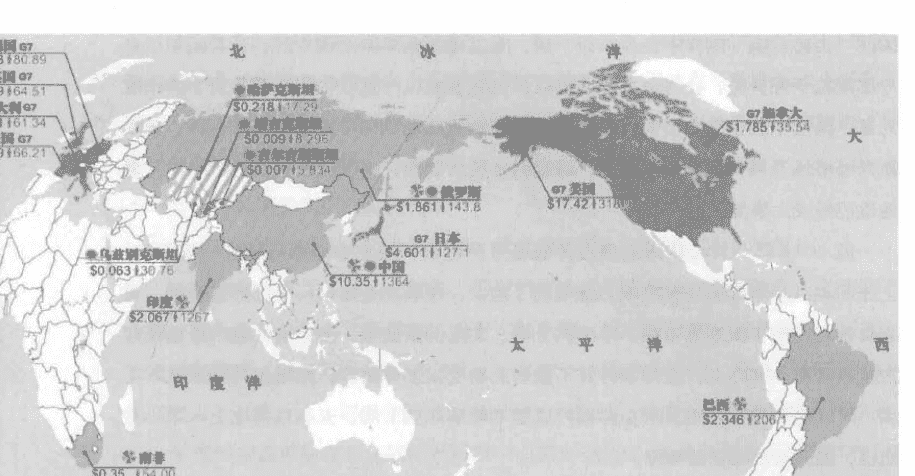

| | | |
|---|---|---|
| 俄罗斯 | 1,868,130.85 | |
| 美国 | 1,536,947.51 | |
| 中国 | 1,412,317.29 | |
| 印度 | 1,135,513.68 | |
| 德国 | 806,253.25 | |
| 法国 | 783,990.00 | |
| 英国 | 735,507.84 | |
| 意大利 | 689,147.38 | |
| 巴西 | 660,000.00 | |
| 加拿大 | 590,000.00 | |
| 日本 | 550,000.00 | |
| 土耳其 | 430,000.00 | |
| 波兰 | 310,000.00 | |
| 沙特阿拉伯 | 700,000.00 | |
| 南非 | 400,000.00 | |
| 印度尼 | 350,000.00 | |
| 乌克兰 | 200,000.00 | |
| 哈萨克斯坦 | 150,000.00 | |
| 吉尔吉斯斯坦 | 50,000.00 | |


# 第一章 是世界的中心 | 041

系，它们最多只能取得与旧秩序维护者等等的影响。纯净从地缘政治的角度来看，只有把一个“世界岛地区”拉进这个新兴阵营，中国才有可能成为这个新兴同盟的产生，真正成为世界的中心。那么地缘关系来说，最有可能中国占据的“世外岛地区”是哪里？答案是日本。之所以这样，是因为四个原因：

- 1. 日本的长期到，日本与中国（或与亚洲）有着足够的历史渊源。
- 2. 虽然中国中有日本不快的过去，但其基本上是日本“强强扩张”的思想在作怪。换句话说，日本并不属于西方大国家，但前提是你必须是强者。日本对亚洲的敌恨，以及对美国的服从，都是出于事务的态度。对于日本你并不要试图去做什么，如果你实力的一天过中国许多，它可能保持中立。
- 3. 如果中国希望在未来的新兴阵营中占据主位，那么就必须将自己的门“世外岛地区”拉进自己的阵营。这一一方面是为了削弱美国的地缘优势，另一方面也是弥补自身的劣势（海被锁）——此此彼长。

日本这一“世界岛地区”对美国为中心的“新世界岛”而言，战略地位是非常重要的。如果中国能够与其达成合作，它也能起到同样的作用。如果，中国能够分别同日结盟（不一定要在一个同盟中），除非印度完全倒向美国，否则中国与日本的实力完全可以与美日同盟相衡。

当在如今，一个要求，要代表中国成为世界中心这件事值得显得有些高昂了。毕竟中国现在还只是刚刚开始复兴之路。明太祖宪在统治天下时所道的“高固藩”。广积，广积，规模越王的原则，依然适用于今日的中国。因此，上文所规划的路线图其说是为了中国成为世界中心准备的，不如说是中国崛起定了一个地方方向。至于日本与中国的关系究竟有没有调和的可能，我们在东亚部分会有更深入的解读。

# 第二章
## 欧亚大陆第一缕阳光：东亚与西太平洋地区

在21世纪，东亚无疑是最具发展潜力的地区。这一地区已经震撼或即将显现的地缘力量已经成为世界之焦点。对于欧亚大陆的另一端而言，东亚大陆的政治格局要比简单得多，并没有亚洲复杂，但并不代表东亚的地缘政治将会简单许多。事实上，现在的政治结构恰是经过长期的地缘博弈形成的。对于中国这一地区最重要的组成部分，我们需要花较多的从从历史和现状分析其中的地缘图表，并且以此之推导出未来的地区组织结构。

### 第一节 | 东亚的范围

东亚，欧亚大陆最东的区域，这是块最广阔的大陆上最邻亚洲的地方。这里有前台和后台的大国，有经济上和精神上的强国，没有弱者。

首先我们需要明确东亚范围是指哪些地方，如果按照本书的规定标准，欧亚大陆边缘的地带可以等于东亚大陆。只是大陆之外，外岛类是不可忽视的地缘力量。因此东亚的范围可以说是东亚大陆加上东亚之外。按照纯粹的地理结构划分，是一个比较宽松的方法。不过真实的情况是，这些地理单元本身就需要控制它们的政治来体现地缘力量，而这些政治的范围，又未必与东亚的地理范围完全契合。因此我们需要先从国家的角度来，来看政治上的东亚涉及哪些国家。

从国家的角度来看，能够真正被视为东亚国家的，应该如下几个：中国、朝鲜、

# 第二章 大陆第一道光：东亚与西太平洋地区 | 045

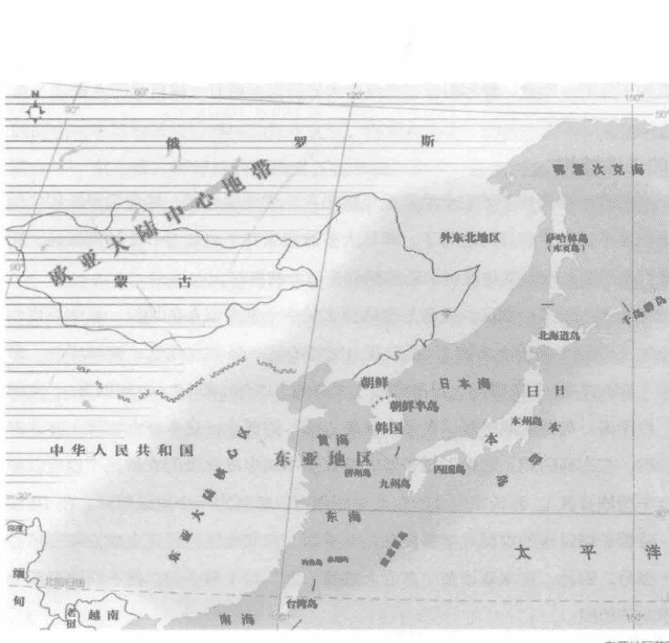

韩国、日本和俄罗斯由于它本身所具有的地缘实力以及在太平洋的海岸线，即使不被视为东亚国家，起码也是东北亚博弈的重要参与者。这就好像中国不是中亚国家，但由于地缘关系，同样是中亚博弈的重要参与者。蒙古会被列入东亚的范围，但就本研究所的研究的角度来看，它应该被视为东亚的一部分。

南亚的国家或许会被视为东亚的一部分，特别是在“二战”时期，整个东南亚甚至大洲都被裹括了日本人所划定的“东亚共圈”中。如果政治家们决定扩大东亚的范围，那是他们的权力。但就本书而言，我们还需要尊重地缘铁律。

# 东亚的地缘结构

想要成为东亚的一部分，起码应该在这个大陆的东部拥有一块自己的土地。

现在的政治格局并不能完全准确地反映东亚的地缘格局，毕竟俄罗斯和中国的领土不仅限于东亚的边界，而且大多数国家并不只包含一个地理单元。因，我们有必要从地缘的角度对东亚的格局再次进行解析。其中包含地缘角度上的东亚地区，大致范围指东亚大陆中带有东亚的地区，其中包含8个地理单元：东亚亚陆核心、东北地区、朝鲜半岛、韩国（岛）、千群岛、日本岛（北海道、本州、四川、九州）、琉球岛、台湾。

日本这一“世界岛地区”对美国为中心的“新世界岛”而言，战略地位是非常重要的。如果中国能够与其达成合作，它也能起到同样的作用。如果，中国能够分别同日结盟（不一定要在一个同盟中），除非印度完全倒向美国，否则中国与日本的实力完全可以与美日同盟相衡。

当在如今，一个要求，要代表中国成为世界中心这件事值得显得有些高昂了。毕竟中国现在还只是刚刚开始复兴之路。明太祖宪在统治天下时所道的“高固藩”。广积，广积，规模越王的原则，依然适用于今日的中国。因此，上文所规划的路线图其说是为了中国成为世界中心准备的，不如说是中国崛起定了一个地方方向。至于日本与中国的关系究竟有没有调和的可能，我们在东亚部分会有更深入的解读。

想要成为东亚的一部分，起码应该在这个大陆的东部拥有一块自己的土地。

现在的政治格局并不能完全准确地反映东亚的地缘格局，毕竟俄罗斯和中国的领土不仅限于东亚的边界，而且大多数国家并不只包含一个地理单元。因，我们有必要从地缘的角度对东亚的格局再次进行解析。其中包含地缘角度上的东亚地区，大致范围指东亚大陆中带有东亚的地区，其中包含8个地理单元：东亚亚陆核心、东北地区、朝鲜半岛、韩国（岛）、千群岛、日本岛（北海道、本州、四川、九州）、琉球岛、台湾。

日本这一“世界岛地区”对美国为中心的“新世界岛”而言，战略地位是非常重要的。如果中国能够与其达成合作，它也能起到同样的作用。如果，中国能够分别同日结盟（不一定要在一个同盟中），除非印度完全倒向美国，否则中国与日本的实力完全可以与美日同盟相衡。

### 第二节 | 中央之国

是中国东亚地区最重要的成员，也是我们的立足之地和本书的基础。中央之国的称谓自古已有，代表了中国人的自我认知；作为对比对象，我们需要将视线投向太平洋的另一端。“海中地”与“中海”的概念造成了东西文明的巨大差异。在了解了东亚的范围之后，我们很有必要了解一下在这样的地缘格局下，为什么会形成目前的政治格局，特别是其中方的角色。

# 第二章 欧洲大帝国时期·亚洲与太平洋地区 | 049

社会学家们从各个角度解释这一现象的形成，但人类因素并非根本原因。之所以东方文化不同，归根结是双方地理环境的差异。

当我们从地图上观察这个世界的时候，就可以清晰地看到“世界岛”两边的地理结构有多么不同。欧洲西方的文明发源于中海沿岸。西方对地球的最初认识是陆地围绕着海洋，这种思想早植于他们的心里。这种地理结构使得他们在海岸形成了独特特色的文明：希腊、罗马、拜占庭、阿拉伯。它们之间的关系是紧密的，又是相互独立的。

如果西方的历史起源源于“中海”，那么东方的文明则被视为“华中地”。作为西方文明的心脏地，中海主要发挥着连接沿岸民族的作用。东方的文明——亚洲核心，则是一片在适合居住并集中的陆地。

由于这片土地是古代，所有的东方民族人都认为它占据了整个亚洲。因此，最终成为这片土地主人的“华夏”将其认定为“中央的国家”。

中国的延续能够凭借足够的力量，将东亚大部分适合耕种的土地都属于自己的核心，却不能扩张周边。事实上，作为一个有实力的国家，四周也是其扩张的阻碍。不过人口是充足的，在华夏尚未将适合耕种的土地纳入范围中，及时地划出了“华夏五域”，从理论上确定了华夏在这片土地的中心地位，其他地区的民族只能向四个方向服从“中央民族”。

当赛皇最终将中央的势力延伸到东南海之后，他们由于理由使得帝国已经占据了这片土地的边缘，曾经只看着东南和南海。中国无疑是悬浮在海洋中的国家，之所以没有看到北方和海西，并不是由于自身的不足，而是北面和西面的大陆一片荒芜，如果是为了让帝国疆土与北方、西部接，要去征服这些荒芜之地，会显得不妥。

# 亚洲大陆的布局：东亚与太平洋地区

不断对东亚文化区域造成威胁的民族，大致分为三类：
- 东北地区的“森林游牧民族”
- 蒙古高原的“草原牧民族”
- 青藏地区的“高原游牧民族”

自农业地区纳入“中央王朝”以后，这些边疆地区一直农业为主要方式与核心农区的博弈，就成了中国的重心。从整体情况来看，农业生产虽在整体上占有优势，但受限于古代生产技术，这些地区并不具备开展大规模农业的条件，因此中央王朝没有办法凭借巨大的人口和经济优势征服这些地区。相比之下，核心农区积累的财富，不令那些游牧民族羡慕。他们的生产方式带来了军事上的优势，这便是他们对中央政权的军事威胁。

本。即便从地理条件来看，如果那些边疆农田将被掠夺，变成农场和野蛮的天堂，远比让农民去改造荒瘠之地容易得多。虽然这样做会降低土地产量并不划算，但游牧文化的蒙古帝国确实尝试过这样做。

一方生产方式如此形成，难以以“农”；另一总是从富庶的农业区获得胜利，这会让人产生一种隔阂。在历史上，以农为本中央政权似乎是在战略上处于防御态（长城就是这种防御态的最优表现）。不过事实如此吗？中国有着征服多类民族。多年来，中国经历了无数战争，而以农业为核心生产方式的农民占领的土地越来越多。打了，我占了你的土地，同化了；抢了，我占了你的土地，还是你；最后我是我的，你也是我的；经过千年的融合，甚至这些曾经的边疆地区也都成了中国的一部分。这不仅对于农牧民族的稳定性，而且在长期的博弈中处于劣势。然而民族军队在历史上拥有一件没有对付的武器。

可能有人问：北方为何没有被征服？主要是因为西北的北方民族是“大后方”。高原的牧民族和中原由于自身实力无法去扩张。核心的中央政权主要是通过南方进入，但这条漫长的跋涉无疑会遇到青藏高原和洛高原的两面对。然而，中央政权成功过两次（惯例是黄河流）。理想上，想要蒙古盆地或重水基地打入核心区是非常困难的。历史上只有少数人曾经经历了这种坡，印度的波帖做过这个坡，可他们最终折腾了呢？

在结束末章之前，我们还需要对亚洲核心区内部的融合给一个解释。找到黄河文明与长江文明之间不存在差异，对于为什么能够足够答案的答案。为此我们需要了解一下中国的地理排列，中国的地理结构整体是东西西向的三级阶，从这个角度，黄河文明与长江文明之间不存在高度上的差异，这使得双方地缘博弈的关键因素。结果是形成了黄河文明战略格局，并且跨越热带与亚热带的东亚核心。

之所以二者能够保持稳定的状态，一是双方都属于农耕文明，具有同质性；二是来自北方的地缘压力。黄河流在高度和密度的影响下与北方游牧民族紧密结合，最终形成一种地缘互动的局面。对于后者来说，为了减轻来自北方的压力，黄河流域提供了必要的后盾。这种南北互动模式下，中国的核心区总是能够完整，在北方入侵之后，能够迅速恢复正常，并且让这里的农民接受这种状态。

### 第三节 | 气候

在探讨东亚的气候特征之前，首先要明确一点——不要把纬线单一地理解为地理状况，纬线是个立体的概念，还应该考虑气候因素。地缘优势很大程度上体现在气候中。一般情况下，低纬度的居民难以适应寒冷的气候，而高纬度居民的障碍少很多。

黄仁宇曾提出“15英寸雨线”的概念，以此来解释中国核心区的北方边界。他认为年雨量少于400mm的地区，农业活动便无法展开。这条线在大部分和长城吻合，这似乎解释了古代时期的汉族无法形成突破性的现象。然而这条线的东部出现了问题，黑龙江省及其南部地区雨量最高为380mm，但长城以南的农牧民族只能。

[1]降雨量的单位为毫米(mm)。黄仁宇在著作中的描述为“15英寸，15英寸雨线 = 381mm等水量”。

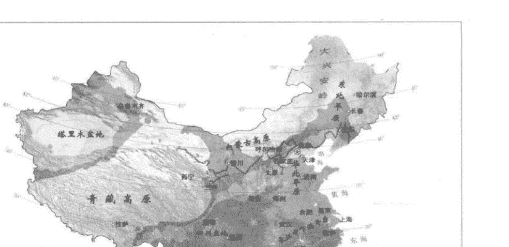

| 图例 | 天 |
| :--- | :--- |
| >200 | |
| 200-220 | |
| 180-200 | |
| 160-180 | |
| <160 | |

无降水分析示意图


## 在世界中心

先将视线稍向东北偏离一点。

在华北平原与东北之间有一个重要的枢纽之地，那就是辽河平原（大部分在辽宁省内）。从降量的角度来看，这里正好在 15 等雨线以南；而且从温度的角度来看，这里正好处于暖带与中温带的交接处，基本属于中温带。这里的温度并不是恒定的，也就是说存在着高低转换，每当温度升高，辽河流域就会进入湿润带。这种气候有利于农业民族占据优势，反之则渔牧民族占据，进而导致寒冷。这里是明清兴起之地，亚洲正处于一个寒冷的冰河时代。

气候变化使得辽河平原处于不稳定的状态之一。而处于四岭之地更是东北的枢纽地区。这是因为它不仅与华北平原相似，更是亚洲东北部的四个重要的农业地区之一。南北华北平原为农耕性的汉族所占据，东西侧蒙古的游牧民族则可以通过大安绥与山海岭之间的山口进入这一地区；而生活在东北森林中的居民民族进入辽河平原是没有障碍的；即使是在朝鲜半岛东部的生活群，也可以沿着西部的海岸，越过太白山岭，胜利地进入东部的这一区域地区。

东北平原的农业人口希望能够向北寻找通道进入辽河平原，这条通道的名称叫做“辽西走廊”，著名的山海关这条通道的起点。这一地区被视为西域，是因为它的东面是辽东岛。

世界上能够通过的河谷通道，辽西、华北平原之间的地理距离确实很困难。显然，鞍山存在的阻碍使得中原王朝难以扩张，为了保护华北平原，问题是生活在东北东部的渔民民族也很容易切断这种联系。华北平原的农业民族向北越界后控制辽东平原的难度，要大于华北平原的渔民民族进入辽河的难度。此外，辽平原与蒙古高原的地缘联系，使得蒙古高原的游牧民族成为了这里的常客。

历史上，朝鲜半岛的族群也会控制辽平的想法。不过相比之下，另外一种势力力量强大得多。在这种地理格局下，朝鲜半岛的族群更多的是寻求自保。此，对于古典时期北部的农耕平原来说就不足够了；在东亚核心区的北部沿海还有两个不同的对峙，分别是齐韩地区与西辽，只是地理的原因不同。理解了这些，对于为什么朝鲜半岛最终成为一个独立的地理政治地区，我们就可以回答了：长城以外的农民族在土地上无论是自然延伸，还是采取军事行动，都只能沿着海岸，通过辽宁平原，再经过辽江，最终进入朝鲜半岛。而辽东山作为枢纽位置所引发的不稳定性，使得长城外的农民集团能够穿越该地区，进入胶东平原，很难有效力量向朝鲜半岛渗透。即便进入朝鲜半岛北部的海平原，辽江平原的不确定性容易中断朝鲜半岛与东亚核心区之间的狭弱的地理联系。其结果就是深入半岛的人口或退回东亚核心区，或是撤离回归。

此外，朝鲜半岛本土的地理条件有利于形成一个相对封闭的地理单元。朝鲜半岛北部的山地（占了80%），这些山地并不利于农业生产，而是以往南部的平原地区提供保护；对于进入半岛北部的外部因素来说，他们得面对面对朝鲜半岛南部所处的地力压力。朝鲜半岛在完成统一之后，也可以独立成为一个类似于中国北部的互动的地理结构——北部地区用来隔绝外人的入侵，南部地区则提供相应的经济支撑。

基于上述地理因素，无论是来自长城的农民集团，还是来自其地区的集团，都被打入这个小单元。此时，朝鲜半岛成为一个独立的地理单元至政治单元。

## 中国气候的特征

以纬度划分气候带并不是绝对的，高度也是一个重要的因素——高度越高，气候越寒冷。另一个因素是湿度，主要是海洋暖流气候的影响。就中国现有的版图来说，青藏高原和蒙古高原的存在就破坏了温度带的连续性。青藏高原由于地势广大，整个属于“垂直温度带”，即使在同一个纬度，由于离海的不同，也可以分为好几个气候带。

## 在世界中心

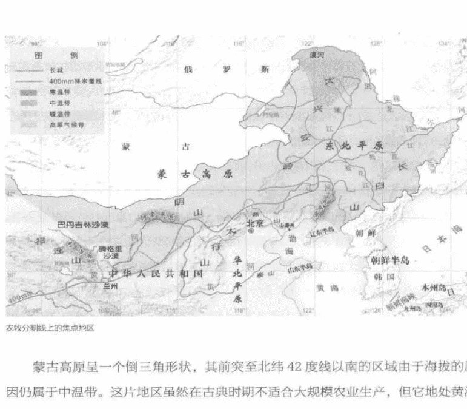

蒙古高原是一个三角形形状，其前延至北纬42度以南的区域属于华北平原而在其中。这片地区在古代时期气候不适合大规模农业生产，但是位于黄河沿岸，因黄河灌溉便利于水草植物生长，蒙古高原地区更适合牧养，因此受到游牧民族的侵扰。这片土地位于黄河“几”字形状的转弯处，所以被被称为“河塞地”，黄河沿岸的狭长平原被称为“河塞平原”。然而，如果需要，以外的农民族可以利用黄河进行农业生产，不过古代时期的华夏民族更看中这里的河流提供的供给，足以消耗游牧民族的机势。这一地区因此成为蒙古民族和农民族反复争夺之地。

另外两个位于农业前线的地区是河平原和河西。河平原的重要性方面已经经历了多次，河西则像是一条狭长的通道，游牧民族争夺主要是为了和西方联系的通道。幸运这一地区有一半的土地属于半干带，而且太干燥湿气候强烈还能将水运抵此处，所以以东部的农业农民还能适应。而河西走廊过于狭窄，以历史上无数次被上游民族所阻断。能否获得上述三个地区是古代时期是否强大的重要标志。而这三个地区恰恰处在适合耕种的暖温带与难以耕种的中温带交界处，它们因此也因此而成为长城修建的起点。

现在我们可以得出结论：中国的核心区之所以长时间固于长城以内，并不是由于实力问题，而是长城以北地区并不适合耕种，对农民民族缺乏吸引。随着农业技术的发展，中温带地区已经可以开展大规模的农业生产了，因此这些长城以北的地区已成为中国的的核心区，东北地区就是典型的例子。

对于汉族地区为什么要继续向南迁进，从温度的角度也能给一定的解释。汉民族适应的温度带主要要在暖带和亚热带之间，太冷不行，太热也难以吸引移民。在此之后经历了几次尝试后，古典时期的政治家逐渐摒弃了向南延伸的思想。当然，小规模的移民一直是存在的，不过经过一段时间后，因为适应当地环境而被本地化了（指东北）。

| 中国气候带 |
| --- |
| 高温带 |
| 中温带 |
| 暖温带 |
| 亚热带 |
| 热带 |
| 寒带 |


## 第二章 欧亚大陆第一楼脊: 东方与西太平洋地区

## 第四节 农民族的扩张

东亚地区强大的农牧文化是亚洲文明的坚实基础，然而它不断受到游牧文化的冲袭，最终仍是农民族融合了其他文化成为胜利者。一般而言，与那些游牧民族相比，我们认为农民族是比较温顺而不具有威胁性的。从历史的角度来看，拥有强大人口数的农民族具有扩张性。与游牧民族习惯于逐草而不同，农民族只要找到足够耕种的土地，就会在此处下来，并最终衍出足够人口。在古代时期，温暖带和亚热带是适合耕种的土地，这并不意味着长城以内的亚洲大陆和朝鲜半岛，以及日本都处北方寒带，而是农业核心区。

## 第二章 亚洲大陆第一道线: 东方与西太平洋地区

以农耕区来说，属于边缘地带的北部边缘地带的气候大致可以划分为温带和寒带。其中东北平原及其东部的中温带，在古代时期很难开展大规模农业活动，森林、河流环境提供丰富的野生资源适合游牧民族的发展。由于部分中温带能够培养强大的农民，进入该地区存在巨大的难度。注意的是，因为种植使得土地产量增长，气候条件允许森林本身不会成为开耕障碍，烧荒是获取土地的方法。事实上，我们定义的农民族通常不是游牧民族，亚洲大陆与海洋接壤的民族主要生活在中温带。在古代历史中，他们曾以满洲、女真等族群身份现在东北。

最终的结果：强大的农民族取得了彻底的胜利。17世纪，中国东北部的中温带被入了核心区域。不过对于自己能够统治的农业活动来说，东北地区被划为农业若干。直到1860年，清政府将人口禁令在1900年全面解除后，当时的政府组织了规模的移民。东北地区的人口在最低时达到二十万，迅速升到千万，自此东北部才算完全融入了中国核心区。

在海的对面，大和族在1807年取得了阶段性的胜利，将军事力量渗透进岛。经过60年的战争，借“明治维新”机会，大和族在1869年正式将岛改为日本，并开始组织移民，还将改了一个新名称——北海道。1920年，北海道的人口从30年前的人口增长到240万，目前人口约560万。在此，北海道成为日本核心区域的一部分。

至于千岛，俄日两国在18和19世纪对其进行了开发。1855年，双方签署了《俄日和善千岛条约》，规定千岛南部属于日本，北部属俄国，岛暂时留置。1875年，两国签订了《桦太与千岛边界条约》，将桦太南部与千岛北部相接，日本对岛南部整个千岛。1945年以后，千岛全部归属日本，日本对南部拥有主权，即“北方四岛）。

从以上情况可以看出，无论是太陆地区还是岛屿，在古代时期，暖带的农耕民族对于取得中温带全面的控制，但在古代时期结束时却取得了决定性的胜利，这主要归因于以下三个原因：

- 1. 地理环境优，美洲产物（玉米、小麦、红薯）的引入使得了人口增长。以中国而言，在以前的古代时期，人口都是千万级（人口规模估计不会超过），而到清初，在短短十多年的时间内人口增长到了3亿。人口的压力使得农民族不得不进入中温带生存扩张，对于大部分处于“15等雨线”范围内的东北地区，无疑是农民族扩张的目标。东亚核心、朝鲜半岛、日本本土上的农民族对于这一地区展开了争夺。最终，取得胜利的是拥有人口基数和更多东北核心的民族。
- 2. 农业技术的提高使得在中温带地区大规模农业成为可能。例如在移民北海道等地空出了肥沃土地，汉族转向中国东北地区，通过移民们的不断开发，最终使得东北地区成为了水稻产区。
- 3. 农耕文明的程度，使得气候变化更容易吸收变化，这便拉大了与游牧民族的差距。在古代时期向现代时代变化时，这个差距让农耕民族迅速胜利。这一点在北部的大和族与游牧族的竞争中表现最为明显。在中国，由于人类民族已经融入了主体的一部分，这一点就不重要了。

最后的结果：在古代末期的斗争中，中国消化了东北地区（或）。

## 在世界

## 第五节 | 东亚的岛屿

东亚岛屿主要就是日本列岛。由于西方文明的快速发展，日本始终有着国土不成比例的渴望与梦想。了解东北亚地区的地缘结构之后，我们需要重点解读东亚岛屿的情况。尽管中国在太平洋一侧几乎拥有相同长度的海岸，但中国和整个东亚大陆面对太平洋并不是真正面对，而是由岛屿包围形成的四个“内海”。如果想从东亚进入太平洋，就一定要突破岛屿的包围。而在西太平洋上的岛屿正是用来控制亚洲东部的的重要地缘，由此产生了“第一岛链”的说法。

第一岛链包括日本群岛、琉球群岛、冲绳岛、台湾、南至菲律群岛、马来群岛（印尼和马来西亚）。很遗憾，其中半数都属于东亚大陆直接面对的岛屿。从地缘政治的角度来看，日本是这些岛屿中影响最大的政治体。

## 日本征服外岛的历史

对于这些外岛，东亚大陆的国家确实缺乏足够的兴趣。除了那些企求长生不老的皇帝派遣去寻找海外，这些外岛在大部分时候都按照自己的轨道运行。当然，这并不代表它们不会与东亚大陆发生接触，而是海洋的阻碍使得这些岛屿在古代基本上是能够被打破的。

这种状态在古代时期结束时被打破。另一方面，东亚大陆上的中国开始重视海洋的力量；另一方面，外岛日本岛已经从西方学到了先进的技巧，这使得日本人开始向东亚大陆发起挑战。

外岛从南到北主要包括：琉球岛、日本四（九州、四国）、北海道、千岛群岛、萨哈林岛，岛屿从地理角度来说，也可以靠近北部的半岛。这些外岛共同组成了“东亚外岛”。

亚洲东部的历史主要是由大陆国家的书写的，随着西方海洋思想的引入，岛屿国家也有了自己的地图，代表的国家就是日本。既然越南同样面对大陆的岛国——英国被认为是“不落日的国家”，那么日本也有可能和自己拥有相同的机会。与英国威廉柱之前统一了英格兰三岛，日本也需要将外岛地区统一到自己的辖下。

1868年，在日本的外岛的开发开始14年后（1854年日本美国签订了《神奈川条约》）。直到俄国把外岛和千岛夺走（1858年中《俄日条约》），才知道俄日两国在这里争夺了一百年。顺便说一下，千岛上的原始居民为萨哈林，北部为赫哲人，南部也称为“萨哈林之地”。中俄签订《库哈条约》之前（1864年），日本南部进入了自己的势力范围。千岛的中文名字原来是“千岛”。总之，对于这个“千岛”的地方，曾只有短暂尝试管理，但随后就撤回来了，从此不再关注。


## 第二章 亚洲第一阶段—琉球：东亚与西太平洋地区 | 071

按计划策划出了个“琉洲国”。

所以，在日本最终完成的“圣成”地图上你会发现，日本对中国的进攻是从往南的，即从东北北华江流域的线路进攻。当其试图进入黄土高原时，却受限于山西山，其本质就是没有从蒙古高原进入，无法在战场上对黄土高原形成压力。由于黄土高原在侧面上对华北平有着明显的优势，由于此从华北平进入黄土高原是非常困难的。

由于于此战场的由北向方的战略，你会发现，在日本中国的南方除了将海岸的港口全部占据外，只在云南南部附近偶尔有所动作。日本之所以现在开辟战场，主要是由于此战场的考虑，以及陆陆联切断了中国的海外利益。

应当说，西方文明的侵略了华夏这一战略方面，这对日本来说是一个千载难逢的战略机会。由于体量相对较小，并且一直将自己视为学者，日本本土从华夏复刻到亚洲的转型是非常高效的。这种效率使得日本能够天荒取代中国，在20世纪末成为亚洲经济的领先者，并且一度拥有统治亚洲的梦想。然而后，古老的中国作为中央权威而费力地将战略方向调整过来，并追赶上后，日本他们还想主东亚大陆，结果只是统一东亚，在可见的将来将变成了不可完成的任务。

## 琉球岛

如果日本还想改变自己的地理结构，那么分别在琉球岛南北的两个重要岛屿——琉球岛和冲绳岛就是它第一步需要扩张的方向。作为东亚亚洲的重要组成部分，在日本全盛时期，这两个岛屿的确为日本所占据，并且可以被用来封锁整个亚洲和中国。然而，由于“二一四战”中日本在这两个岛屿上的战争主要发生在海上，最终它们并没有发表封锁东亚大陆的作用，但这并不代表它们的作用会被忽视。此时即使是双败也会有差别，更何况两处相互相邻离岸的岛屿。因此，它们在战略上作用以及与美国两国的控制方式上有着很大的差异。

之所以将琉球岛形状为东亚大陆的锁链，是因为这条链体量不大，长度不短。

## 072 漫在世界中心

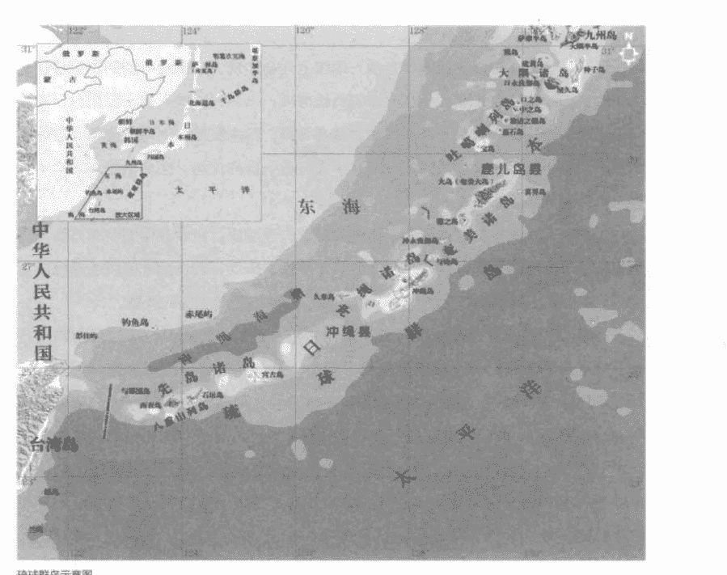

岛链正好落在东亚大陆东出太平洋的通道之上。如果它能够被东亚大陆所控制，将成为保护东亚大陆安全的外围屏障；反之，它便是用来阻碍东亚大陆将地缘影响力扩散到太平洋的屏障。

既然以琉球群岛为标签这样的地缘作用，我们就需要先解释一下“琉球”和“冲绳”两个名称的关系。很多时候它们被视作一个概念不同的描述方式，这种看法是有道理的。而言之，我们可以将日本九州以南直到台湾岛之间的这条岛链都称为“琉球群岛”，而这条岛链的中心就是冲绳岛和周围一些小岛组成的冲绳诸岛。

## 第二章 亚洲大陆：东亚与西太平洋地区 | 073

这种划分是广义的划分，狭义的划分则是将北纬 29 度以南至台湾岛以北的岛屿称为“琉球群岛”，此认定的依据是联合国授权将该部分岛屿交由美国托管。而美国人之所以这样划分，表面的原因是该部分岛屿隶属于独立的“琉球王国”，因此是日本的民地。当然，美国这些岛屿置于自己的管辖之下，没有这种简单和“正义”。

需要说明的是，抬头中国提供的准确历史、法律证据不说，从地理结构上看，钓鱼岛并不属于琉球群岛的一部分。观察这一地区的地图发现，钓鱼岛实则处在亚洲大陆的东部，与琉球群岛之间隔着一条最宽处达到 2716 米里的“冲峡”。

对于日本来说，不包含钓鱼岛在琉球群岛才是真正的范围所在。在现在的行政区域内，广义的琉球群岛由两个“县”所辖。神绪县和南部的冲绳岛属于日本的岛屿管辖，因此有人会将这部分总称为“冲绳岛”。“冲绳岛”从东北到日本岛屿目前属于日本的岛屿管辖，主要包括国岛、寿鸥岛、奄美岛，由于位于之前日本的摩摩诸屿，亦可称为“澎萨诸岛”、“澎萨诸岛的这些岛，是台湾岛的岛屿可以由这一大部分组成，包括澎译岛、神绪岛和冲绳岛。

琉球群岛（北纬 29 度以南部）在古典时期的定义是不特殊的，对于现代的国家来说是其国家成员的，而在古典时期的国家，国家的概念是比较模糊的。这使得在研究中国古代的地理范围时，会有不同的划分方法。

有一种观点认为琉球群岛上的一个王国是基于华夏文明的，基于这种国家的特征，似乎被认为是中国。这种观点的缺乏，比如北方多一岛至二子，将琉球群岛划归中国的地位，仅借此便称为琉球群岛划归中国的历史说法，显然不够严谨。

古代与现代国家的政体结构一般难以套用（也就是现代国家）。如果一定要找到一种类似的实体，那么“联邦”中每一个国家都有独立的法人和独立，都是尊国家元首。

对于日本来说，不包含钓鱼岛在琉球群岛才是真正的范围所在。在现在的行政区域内，广义的琉球群岛由两个“县”所辖。神绪县和南部的冲绳岛属于日本的岛屿管辖，因此有人会将这部分总称为“冲绳岛”。“冲绳岛”从东北到日本岛屿目前属于日本的岛屿管辖，主要包括国岛、寿鸥岛、奄美岛，由于位于之前日本的摩摩诸屿，亦可称为“澎萨诸岛”、“澎萨诸岛的这些岛，是台湾岛的岛屿可以由这一大部分组成，包括澎译岛、神绪岛和冲绳岛。

## 072 琉球岛

既然以琉球群岛为标签这样的地缘作用，我们就需要先解释一下“琉球”和“冲绳”两个名称的关系。很多时候它们被视作一个概念不同的描述方式，这种看法是有道理的。而言之，我们可以将日本九州以南直到台湾岛之间的这条岛链都称为“琉球群岛”，而这条岛链的中心就是冲绳岛和周围一些小岛组成的冲绳诸岛。

## 琉球岛与冲绳岛

如果日本还想改变自己的地理结构，那么分别在琉球岛南北的两个重要岛屿——琉球岛和冲绳岛就是它第一步需要扩张的方向。作为东亚亚洲的重要组成部分，在日本全盛时期，这两个岛屿的确为日本所占据，并且可以被用来封锁整个亚洲和中国。然而，由于“二一四战”中日本在这两个岛屿上的战争主要发生在海上，最终它们并没有发表封锁东亚大陆的作用，但这并不代表它们的作用会被忽视。此时即使是双败也会有差别，更何况两处相互相邻离岸的岛屿。因此，它们在战略上作用以及与美国两国的控制方式上有着很大的差异。

之所以将琉球岛形状为东亚大陆的锁链，是因为这条链体量不大，长度不短。

岛链正好落在东亚大陆东出太平洋的通道之上。如果它能够被东亚大陆所控制，将成为保护东亚大陆安全的外围屏障；反之，它便是用来阻碍东亚大陆将地缘影响力扩散到太平洋的屏障。

这种划分是广义的划分，狭义的划分则是将北纬 29 度以南至台湾岛以北的岛屿称为“琉球群岛”，此认定的依据是联合国授权将该部分岛屿交由美国托管。而美国人之所以这样划分，表面的原因是该部分岛屿隶属于独立的“琉球王国”，因此是日本的民地。当然，美国这些岛屿置于自己的管辖之下，没有这种简单和“正义”。

需要说明的是，抬头中国提供的准确历史、法律证据不说，从地理结构上看，钓鱼岛并不属于琉球群岛的一部分。观察这一地区的地图发现，钓鱼岛实则处在亚洲大陆的东部，与琉球群岛之间隔着一条最宽处达到 2716 米里的“冲峡”。

对于日本来说，不包含钓鱼岛在琉球群岛才是真正的范围所在。在现在的行政区域内，广义的琉球群岛由两个“县”所辖。神绪县和南部的冲绳岛属于日本的岛屿管辖，因此有人会将这部分总称为“冲绳岛”。“冲绳岛”从东北到日本岛屿目前属于日本的岛屿管辖，主要包括国岛、寿鸥岛、奄美岛，由于位于之前日本的摩摩诸屿，亦可称为“澎萨诸岛”、“澎萨诸岛的这些岛，是台湾岛的岛屿可以由这一大部分组成，包括澎译岛、神绪岛和冲绳岛。

琉球群岛（北纬 29 度以南部）在古典时期的定义一定是不特殊的，对于现代的国家来说是其国家成员的，而在古典时期的国家，国家的概念是比较模糊的。这使得在研究中国古代的地理范围时，会有不同的划分方法。

有一种观点认为琉球群岛上的一个王国是基于华夏文明的，基于这种国家的特征，似乎被认为是中国。这种观点的缺乏，比如北方多一岛至二子，将琉球群岛划归中国的地位，仅借此便称为琉球群岛划归中国的历史说法，显然不够严谨。

古代与现代国家的政体结构一般难以套用（也就是现代国家）。如果一定要找到一种类似的实体，那么“联邦”中每一个国家都有独立的法人和独立，都是尊国家元首。

对于日本来说，不包含钓鱼岛在琉球群岛才是真正的范围所在。在现在的行政区域内，广义的琉球群岛由两个“县”所辖。神绪县和南部的冲绳岛属于日本的岛屿管辖，因此有人会将这部分总称为“冲绳岛”。“冲绳岛”从东北到日本岛屿目前属于日本的岛屿管辖，主要包括国岛、寿鸥岛、奄美岛，由于位于之前日本的摩摩诸屿，亦可称为“澎萨诸岛”、“澎萨诸岛的这些岛，是台湾岛的岛屿可以由这一大部分组成，包括澎译岛、神绪岛和冲绳岛。

## 战后格局与琉球岛

二战胜利意味着美国在古代。第二次世界大战的胜利也意味着美国在二战结束时就已经结束了。在战后之后，两个超级大国在平衡，这种平衡被战胜国家的控制之下，因此南北群岛自然就被两国控制了。苏联在领土问题上强势，他们直接把北千岛纳入了自己的。

主权也是一个原因。日本一直不肯放弃北方四岛的主权，使得这件事成为历史留问题。美国没有像苏联那样直接吞并琉球群岛，而是搞了一个托管。之所以这样做，根本原因是考虑到的问题——西方国家在吸收一块土地时，首先要考虑到上面不会成为国家的负担，是否会影响到国内的利益。这种方式，我并不打算评价，其实美国不这样做考虑的是岛上居民的意愿，而是国内选民的打算。

有一种说法是美国没有扩张野心，现在的美国已经达到了实力的顶峰，然而在运用武力的同时不会渴求扩张领土。从表面似乎是这样的，但实际并没有表面看到的那么狂热。之所以美国没有扩张野心，主要还是考虑到成本的问题。

如果有一块土地无人居住，或者仅有少数文明程度不高的原住民，而其战略价值很大，美国是不会放手的。比较典型的案例就是夏威夷（1898年被美国吞并，1959年成为美国的一个州），本身不会给美国财政增添负担，热带离岛旅游业养活了自己，美国人有了居住的地方，且岛上的原住民较少，性格平和，基本不会引起美国。更为重要的是，夏威夷位于太平洋中心的地理位置，其战略价值使其美国得以控制整个太平洋，最低程度也能在东亚太平洋竞争的“珍珠”就在那里。

另外，在1969年11月从托管正式成为美国国土的群岛也是这种情况。若是换成伊拉克，即使美国有意控制这块重要的石油产，也会否决这一提案，毕竟那些分子可能就此自由进入美国。

至于琉球岛，美国在攻占主岛——冲绳岛时，岛上居民在美登陆时死亡的7.5万人，剩下的仅有2万余。而那些阵亡的居民很多是在战溃时扶幼，遭到无意杀害的。10万士兵只活了9000人，美军则阵亡7万人。

尽管琉球萌发的“自殉”行为大多是在日本人的胁迫之下，但这种行为还是给美国人造成了巨大的冲击。由于美国政府和军方想把这块地方纳入美国国土，国会和民意这很难。而且美国不像苏联，苏联和北方群岛有些历史关系，美国强行琉球在法律上是有问题的，所以先托管是最佳选择。

## 台湾岛

台湾岛对中国来说不是固有领土，更是中国面向太平洋的门户。在古代世纪，台湾岛对中国来说不是固有领土，更是中国面向太平洋的门户。

在古代世纪，台湾岛对中国来说不是固有领土，更是中国面向太平洋的门户。

在古代世纪，台湾岛对中国来说不是固有领土，更是中国面向太平洋的门户。

在古代世纪，台湾岛对中国来说不是固有领土，更是中国面向太平洋的门户。

在古代世纪，台湾岛对中国来说不是固有领土，更是中国面向太平洋的门户。

在古代世纪，台湾岛对中国来说不是固有领土，更是中国面向太平洋的门户。

在古代世纪，台湾岛对中国来说不是固有领土，更是中国面向太平洋的门户。

在古代世纪，台湾岛对中国来说不是固有领土，更是中国面向太平洋的门户。

在古代世纪，台湾岛对中国来说不是固有领土，更是中国面向太平洋的门户。

在古代世纪，台湾岛对中国来说不是固有领土，更是中国面向太平洋的门户。

在古代世纪，台湾岛对中国来说不是固有领土，更是中国面向太平洋的门户。

在古代世纪，台湾岛对中国来说不是固有领土，更是中国面向太平洋的门户。

在古代世纪，台湾岛对中国来说不是固有领土，更是中国面向太平洋的门户。

在古代世纪，台湾岛对中国来说不是固有领土，更是中国面向太平洋的门户。

在古代世纪，台湾岛对中国来说不是固有领土，更是中国面向太平洋的门户。

在古代世纪，台湾岛对中国来说不是固有领土，更是中国面向太平洋的门户。

## 台湾本土文化的形成

由于台湾岛上的居民并不是同一时期从大陆过去的，这形成了差异化的本土文化。由于台湾岛上的居民并不是同一时期从大陆过去的，这形成了差异化的本土文化。由于台湾岛上的居民并不是同一时期从大陆过去的，这形成了差异化的本土文化。由于台湾岛上的居民并不是同一时期从大陆过去的，这形成了差异化的本土文化。

## 075 台湾岛的开发与主权

在古代世纪，台湾岛对中国来说不是固有领土，更是中国面向太平洋的门户。

在古代世纪，台湾岛对中国来说不是固有领土，更是中国面向太平洋的门户。

在古代世纪，台湾岛对中国来说不是固有领土，更是中国面向太平洋的门户。

在古代世纪，台湾岛对中国来说不是固有领土，更是中国面向太平洋的门户。

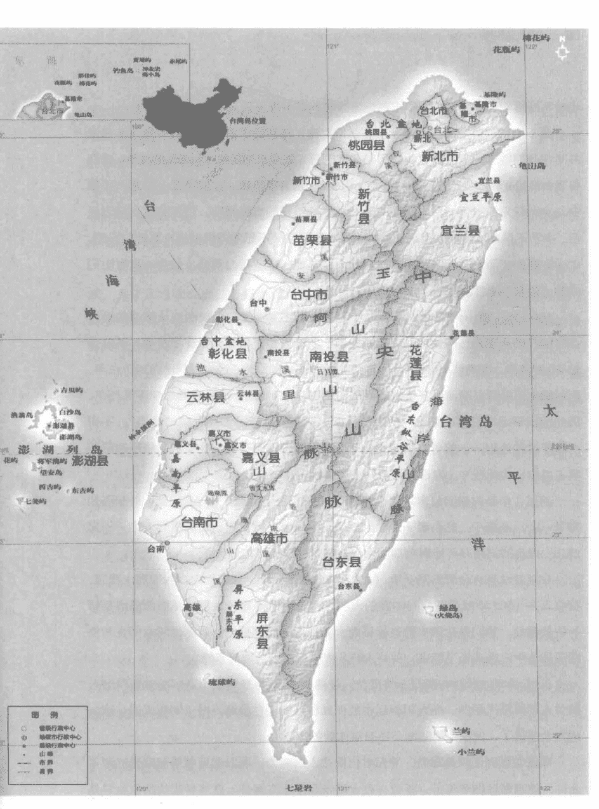

台湾岛示意

## 郑芝与郑成功

也不好，那就把“倭寇”的帽子套在这些强悍的水手上了。至于明朝与郑芝的战斗应该如何定性，在世界史学上有不同的声音，这并不在我们的讨论范围内。我们要注意的是正是这场走私与反走私的战争，才引发了台湾的战略地位，开始了对台湾的第一波开发。据记载，日本人还在参与走私的行为时，日本南部的沿海地区是不错的走私基地，但在日本人退出后，由于与明朝发生冲突，日本方面自然不愿意提供这片基地。于是中国的另一方面另外找一个基地，这就是台湾岛（最后一次有记载的“倭寇”事件是1624年）。

1624年，“新海”的创始人——郑芝出生了。我们不知道他什么时候开始从事走私的，我们只知道他最大的老大是把基地设在日本的。不是那时，已经是1624年。在此之前所认为，他将根据地理搬到了台湾，那时候他已经自己老了。郑芝之后，“倭寇”这个名字已经流行了。

不过，那时候的日本并没有在郑芝身上留下任何纪念，起码他生了一个日本妻子，这个孩子为他下了一个足以影响世界的重要节点——郑成功。母亲的基因可能将成为民族英雄的形象。

郑芝流亡台湾之后，荷兰人也流到了台湾。其实当时的海上强国，荷兰人在1601年试图打开中国的大门，希望通过葡萄人在中国获得一块地。他们初的目标是离大陆最近的岛列，而明水师在倭的统治已经经营起来了，荷兰人的几次尝试都以失败告终。

不过，明水师不再足以骚扰荷兰人，双方最终在1624年达成了和解。荷兰人不再侵扰渗透，明朝廷也让他们将基地设在台湾。对于明朝来说，那地方太遥远了，何说当时海上还有更重要的要做。

郑芝当时还是海盗，并无力对抗明朝，所以只能带着家回大陆。

## 台湾地形与移民分布

台湾的整个地形像一片叶，由于中部大部分地区为山地，所以适合耕种的土地集中在南部，整体呈扇形。东海岸也有平原地带，但面积较小，不适合大规模居住。因此，无论是荷兰人还是郑氏家族，最初的开发地点都集中在南部，也就是最早到达亚洲的一带，地理名称叫“嘉南平原”。

清时期，台湾向南部，政治中心也向南部转移。1875年，福建建台，统治台湾可能未得到充分开发，年后台湾被割给日本。日本仍以台湾行政为主，移民也多集中于此。到1945年国民政府接收台湾后，新的移民认为是台湾仍然是以台湾为主——一是因为台湾行政为主，二是因为日本后爆发。

从开发的顺序可以看出，最早的移民发展地主要集中在南部地区（嘉南）；早期的移民则在中部；清晚期和1945年以来的移民在西部和东部。早期的移民选择南部，这也是与台湾的地形有关。在台湾地形图中我们可以看到，台湾中央的山脉称为“中央山脉”，实际上这条山脉从西向东可分为阿里山、玉山、中央山脉；在东海岸也有发育了一条“东山脉”。平原主要分布在南部，由中央山脉生成的，所以平原主要集中在西部和南部。这很好地解释了早期的移民为何选择了南部的平原，许多人是从容易的事情引起的。

这样就造成了一个现象——越往南，这些地区的人民对于故乡的认同越佳；越往北移民时间越短，对于大陆的记忆越清晰，这是时间和距离造成的，属于自然规律。对于移民来说，当时政策强化了新老移民的区别，使得后来的台湾的党派之争很大程度上成立了分与大陆的关系。

在台湾这几年的我们会发现，与大陆线条靠近的北、东部

## 亚洲大徙潮：东南亚与西太平洋地区 | 083

区域为“蓝色”的根据，嘉以南的台中为“泛绿”的根据，而位于两者之间的台中形成了双方争夺的地区，它偏向哪里，一方就扩张出去。这种格局的形成从深度来说，是与移民的时间相对应的。

最初的移民是从传统的农业开始，寻找最适合耕种的土地。无疑，最早是被移民所中的。理论上，越肥越的土地越适合耕种。这也造成了另一种差异，规模巨大的族群可以占据平原地区，规模小的族群则不选择海拔更高的地区。我们可以从台湾族群的分布来看这问题。

在台湾可见一个现象，少数移民大部分居住在山上——其他移民原本住在平地的，他们后来被赶走，只好住在山上。而汉人之间的闽与客之间发生过战斗，客家人人口少而劳苦，也逐渐向南移动。在台湾的客家人现在为多，大多还聚集在山坡。


一个指标，另一个更有现实意义的指标与大陆经济的关联度。

## 台湾的地位定位

既然台湾在很长时间内已经独立生存了，在地球上又可以不受大陆影响，那么不是台湾就会一定“独立”呢？当然不是。一个地区能否独立不仅取决于自身的源，还要看你与周边地区的关系。让我们视野抬高，从整个东亚和东南亚的角度来看台湾的地位。

在陆权时代，台湾这样的岛屿可以称之为孤立地区。但在海权时代，一个位置位置的岛屿并不像山上的岛屿那样具有独立性。“四天无涯，反复循环。”

从这张“台湾地位位置示意”我们可以看到，台湾正好处于东亚和东南亚地区的分点上。或者说是在东亚陆地地区（中国）、东亚岛之外（日本）、东亚中心地区（东南亚）三块地区的交汇处。

在这一节点上，台湾想要首要其基本是不可能的。它必须与上述三地区之一达成某种结论，才能发展经济和保持自身的安全。

第一种方案是日本与亚洲为一体。历史上台湾岛已经被经历过这种状态的。不是，问题不在于将海亚洲地区聚在一起的方案对台湾来说是否有利，而是这种方案是否需要加深讨论。

第二种方案是和大陆地区为一体。在一个强大的“边缘地国家”身边，这种结合是最理想的。事实上这种选择也是必要的，因为不是出在对地缘而是在其他地方。从香港的例子我们可以看到，线上的远近是影响双方关系的原因，而既然双方暂时不能缩小陆线上的距离（以技术手段，或许可以通过通道逐渐拉近双方的地缘距离），那么加强在经济上的联系变得至关重要了。由于两个经济发展在很强的互补性，这种经济上的吻合对于双方来说，都是有利无害的。

第三种方案是成为东南亚的一部分，这也是那些寻求台湾“独立”的人所想。在2000年民进以后为了减少台湾与大陆的关系，陈水莲曾经经营引导台商投资东南亚的“南进政策”来对抗对台湾的经济渗透。

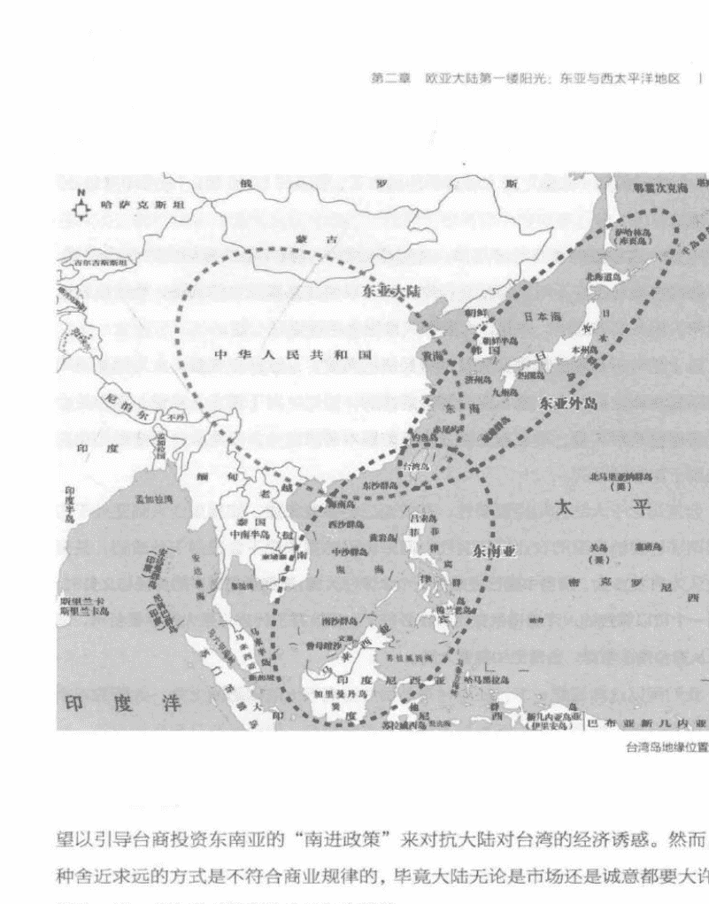

第二章 亚洲大站第一级航线：东方与西太平洋地区 | 085

然而，这种各种近大陆的方式是不符合商业规律的，毕竟大陆无论是市场还是诚意都要许多。此此，这一方案最后遭遇的失败也很是自然的。

在东南亚的政策受挫后，民进党也知道问题出哪里。他们需要一个能够在实力上又对抗大陆，自市场又能够消化台湾剩余的产能，而且距离也不能太过于其他国家的依靠。这样的国家有吗？从理论上来说，它就是印度。

问题这只是理论上的可能，如果印度的能力能够美国接近，如果台湾和印度之间的距离台湾海峡那么近，那么这不为一个好的选择（日本是符合这两点的，不是它还需要足够的市场来消化的产能）。可惜这两点望现实导致

而而，这已经是“台独”主义者最后的机会了，在2006年，“台湾印度协会”正式成立。

不过，这种违反经济规律、后求近远的方式并不能换来相应的政治回报。

两岸的经济融合正在不可阻挡地进行中。你可以说是国民党的选择，也可以说是台湾民众实务的选择。毕竟，大家都是想生活得更好一些。

以上的分析是基于地缘文化及交流的角度。从这两点来看，人为地制造障碍来两岸之间的交流是不符合地缘规律的。当然，对于很多人来说，更为的是两岸的军事关系，毕竟安全是人类的基本需求。而地缘分析最初就是源于军事领域的。

台湾岛对大陆的重要性，在前面已经很多论述。如果大陆还处于闭给自足的经济状态，两岸缓解的需求将十分紧迫，甚至被认为是有些必要的。而中国是一个全球国家，需要承担更多的义务与任务，拥有一个可以占据的太平洋通道无疑变得重要了。这并不代表需要台湾，实上从安全考虑，台湾更加需要大陆。

我们可以设想一下，如果台湾岛终将属于大陆之外，大陆的军事安全是否会受到威胁？答案就是，假设没有台湾的支持，从东亚大陆出发的海力量，最多是在东太太平洋时需要提升安全级别，而由于本土的战略深度极深（甚至已经包括亚洲大陆），因此，即使台湾岛为威胁大陆的安全，所能起的作用也是有限的。因此，即使在20世纪初，美国也没有所谓的“反攻大陆”计划将会。在美人的眼里，美国对整个地区所谓的“第一岛”是。

我们再过来设想一下，如果台湾岛如何终于处于孤立状态，或者完全向海洋国家结联盟，那么它所处的位置，无疑成为“亚洲大陆东边边缘地区”与“新世界岛中心”的结合部（或许正如目前前所处的位置），这种敏感的地缘位置是无法让台湾岛的民众获得安全的。

现在有一种误解，即认为大陆要以台湾为跳板，进行地域扩张。这种断也让台湾岛的民众对于两岸实现和解心存疑虑。其实这种担心是没有必要的。且不说目前的国际环境和北京方面的方向定位都使得中国需要沿着“和平崛起”的方向前行，单从地缘结构考虑，大站所需要的也将台湾纳入统一。这样做对于大陆来说只是消除一种（非致命的）威胁，而对于台湾岛来说却是可以获得实在的安全。

因此，从地缘的角度看，无论是文化、经济，还是安全考虑，两岸都应该实现和解。当然，这种需要面对很多问题，也需要考量双方的智慧。

分析是基于地缘文化及交流的角度。

## 第七节 东亚核心

对于崛起的中国来说，仅仅依靠自身的力量是不够的。所谓“盟友”横跨太平洋，如果中国要挑战美国，就必须控制整个太平洋，建立以中国为中心的东亚圈。

东亚圈需要这样的级划分：
- 核心成员
- 外围成员

这种划分并不是什么创新，例如在“新世界俱乐部”内部，各国也有不同的地方。“盟友”这个词已经过时了，“合作伙伴关系”是比较流行的称谓，至于具有这种，就需要做出相应的判断。

## 东亚圈的形成

通过之前的分析，我们可以得出一个结论：如果中国希望挑战美国，就必须控制整个太平洋。

## 东亚核心的框架模式

如果中国选择东亚核心，并成为首，也只有培养好自己的“地缘利益区”之后，才有真正成为“亚洲东缘边界地区”的代表性价值。或许中国没有尽力把中韩和半岛联起来。

任何一个地缘政治选择，都需要通过一个外交平台来推进。根据时局的需要，这类平台可能是政治、学术层面的，也不可能是太能具有攻击性的经济利益的。

> [1] 反服学生事件，发生在2014年3月10日台湾反服学生运动。在此期间，从2014年3月18日和19日，台湾民主青年等团体闯入总统府，抗议《反服法》，反服学生运动在2014年4月结束。

## 第二章 亚洲大陆第一级航线：东方与西太平洋地区 | 085

论地缘政治外交，其最终目的是为了加深彼此的交流，以达成某种共同。就上述地缘政治设计来说，1997年发起的“东亚首脑会议”，也就是所谓的“10+3”模式，也可以说是一次尝试。试图建立这一模式时，尚不足中国在其中的主导地位。因此，“10+3”合作机制之外，我们还需要设立单独的东亚核心，即“1+2+10”框架。将这两个模式结合起来，我们发现中国实际上按照上述地缘理论，时间倒回20世纪末，我们会发现上述地缘理论构成了核心题。

1940年8月，日本首相吉田文哲首次提出“大东亚共”的名字，并指明中国、韩国、朝鲜半岛以及印度、缅甸、澳大利亚、新西兰等地为“大东亚共”范围。日本作为一个经济共同体，东南亚作为资源供应地，太平洋作为国防地。事实上当时的日本正是按照这一地缘构想开始扩张的。基于地缘关系，将东亚和东南亚地区用地缘政策聚在一起，合力参与全球竞争的想法没有错。

由于日本的海洋性，以及它曾经“亚洲老大”的历史，让其重新定位，重新“亚洲老大”的地位，并不是不能在世界上能够看到的事。尤其是在中国在经济总量超过日本之后，而美国依然稳坐中心位置的时候。不过，这并不代表建立核心圈就是空中楼阁，或者说日本完全没有认识到建立此类合作性。

2009年9月，日本民主党直佑执政后，在中国、韩国领导人适时提及“东亚共同体”，使得这个概念迅速升温。将“东亚共同体”定位于与美国和欧洲并肩的世界第三极。日本官方当时也表示，这一构想在未来的10~15年实现。

不过，日本当时所试图构建的“东亚共同体”，与70年前的“大东亚盟”略有不同。本书通过地缘分析所构建的“东亚核心圈”也有区别。其根本不同在于，到底才是这个世界级集团的主导。从日本的角度来说，它当然不能像当年设计“大东亚联盟”那样，以自己为主，但它至少希望出现在现在中共导的局面。

中日之间还存在诸多问题需要解决，尤其是日本在心理层面还没有接受中国成为亚洲老大。可见的是，虽然大家对东亚及东南亚国家的合作前景比较看好，也认为最终走向的必然性，这个过程注定是漫长而曲折的。比如现在中日关系就处于低谷期，彼此之间的经济合作关系反而出现了倒退。不过地缘分析解读的是地缘问题，并不会因为一时的曲折改变方向。比如欧盟，虽然内部矛盾重重，但延续上了复杂的融合。

其实对比大陆两端的地缘结构我们会发现，欧洲所走的地缘融合之路，正是日本所期望的“3+10”模式。所谓的“3”就是欧洲的三大中心国家——法、德、英，“10”则涵盖其他欧洲国家（包括俄罗斯），问题在于，两者之间的地缘结构完全不同，并不具有可比性。欧洲的地缘特点我们前面分析过了，不可能出现一个巨大的情况，而亚洲东部的情况恰恰相反。

## 第八节 美国与太平洋

美国远在太平洋彼岸，但世界霸主的地位和全球战略让它有资格介入东亚地区事务中，成为一个有形又无形的巨大身影，可以确定为中国崛起之路上的第一对手。

即使不考虑美国海霸主的地位，纯粹从地域关系来看，同太平洋国家也不可能忽视中国的增长。何况在中国面对太平洋地区，美国还直接拥有领土，与日本变成了昔日的对手。基于这两个因素，我们需要了解一下美国在太平洋的存在，对中国的安全有什么影响。

## 第二章 亚洲大陆第一类地区：东亚与西太平洋地区 | 093

## 第一岛链

第一岛链是指从北向太平洋连接形成一条完美的弧线。


第一岛链的起点是日本群岛，南经过小笠群岛、马里亚纳群岛、关岛、菲律宾，直到太平洋边缘。

由于第一岛链的数量和密度，使得中国在进入太平洋时必须面对一系列岛屿。如果中国不能最大限度提升自己的海军力量，强行突破第一岛链将导致失败。“第一岛链”的概念是由海洋国家提出的。在战争中，美国为了争夺这些岛屿，付出了惨重的代价。最后美国人发明了“跳岛战术”，放弃对这些岛屿的直接争夺，而是跳过它们直接向南方太平洋。

与第一岛链相比，第二岛链的威能在于它的数量和密度。第二岛链的起点是日本群岛，南经过马里亚群岛、关岛直到太平洋。

## 美国在太平洋的布局

对于美国来说，封锁并不是在岛外。作为海洋国家的美国，它早在就在太平洋上布了局，将那些作为推进棋板的岛屿悉数纳入。其中典型的例子就是位于太平洋的阿留申群岛、太平洋马里亚尼群岛以及太平洋中央的夏威群岛。那个位于夏威群岛西北端的中途，目前也是美国的一个（比“州”）的政治地位。

一直以来，都对中国“平太平洋”的提法。事实上，不说中国没有实力能做到这一点，单从技术角度来看，中国当下完全没有机会做到这一点。要知道，海洋影响需要通过海洋港口延伸。在和平时期，基于产业关系，美国的商业港口都有可能开放，但如果是想延长影响力的话，就没有容易了。

在历史上唯一机会与美国谈判太平洋的，就是太平洋战争。在1942年珍珠珍珠港事件发生后，日本迅速占领了太平洋所有的岛屿。其中包括北方琉球群岛的一部分。在“二战”之后，日本在太平洋上所属岛屿大部分变成了美国。

这里需要重点强调一下马里亚群岛。太平洋战争中，美国为了争夺这个群岛，都付出了惨重的代价。那个美国军亡1.6万人，并随后由美国轰炸。

## APEC后的地缘布局

提供基地的嘉密亚岛也处在一个群岛之中。群岛中的另一个著名成员就是关岛。关岛是美国太平洋的重要基地，是整个太平洋的中心所在。

塞密亚所在的太平洋北马绍尔群岛已经在1986年成为美国联邦领地，位于马绍尔群岛。

冷战后的美国实力越来越强，中国也越发强势。换句话说，中国在和平期的海洋安全是可以得到保障的。但是对于任何一个国家来说，亚洲都是必要的。如果太平洋中存在巨大的经济利益，如果没有强大的海军力量，中国将与这些资源失去控制。


## 第二章 亚大陆第一大枢纽：亚东与太平洋地区

太平洋地区的（及地区）的概念等同，将南北美洲国家列入这个世界上最大的经济体。

以2013年的世界各国GDP排名来看，东亚的中国、日、韩国分别列在第2、3、14位，南亚地区处于第24位，中国香港处于第40位。东南亚（东盟）作为一个整体的经济活力与美国相比，能够位于第6位，上述处于西太平洋的核心国家（及地区），GDP总量占全球总额之一。

很显然，西太平洋地区已经成为世界的经济重心，并引起了对全球政治、经济格局产生了深远的影响。作为世界上第二大经济体，美、中对于“亚太”一词的理解差异，主要是维护自己利益的需要。东亚，面向太平洋的中国希望在自己的门口打造一个以自己为主的经济圈；奉行全球战略的美国近两年前提出“重返亚洲战略”和“太平洋战略”，它自然没有考虑到中国西太平洋地区的局面。

APEC是在1989年11月由澳大利亚、美国、日本、中国、新西兰和东盟的成员、印尼、菲律宾、马来西亚、文莱、新新加坡，在澳大利亚举行APEC经合会首脑会议宣布成立的。因此这个平台是按照国际希望建立一个太平洋方向的设立的。这个蓝图的设计，美洲、南美的墨西哥分别1993年、1998年都已成了成员。

中国是在1991年正式成为APEC成员的。当时，中国的经济实力已形成如此影响，因此美国对中国的态度是持欢迎态度的。作为全球经济的领头羊，美国对中国的关注尚处于对发展国家去尝试的阶段。近年来，随着中国的快速发展，“中国威胁论”[1]开始在国际上引起关注，从事实到文化背景，国际上对于全球世界的关注并没有消失，但已成为忽视的共识，不再会被固化在全球经济的底层的发展国家“打工”。

中国拥有14亿的人口，日益展现出增长的实力，开始对国际社会发起挑战，并期待获得高质量的供给，希望更多参与国际市场，这对于美国全球经济的威胁和挑战是显而易见的。然而美国在全球范围内保持着一个独特的地位，但对于这地区博弈的主权是美国的国家，美国不愿意让，太平洋地区各项领域

> [1]“中国威胁论”指认为中国经济增长速度快，其体制和发展模式比美国更有效，对美国造成威胁的论点。中国威胁论在冷战结束后的很长时间内主导着西方，尤其是美国对华态度和预测，而且影响着美国对华的政策。

解释者：郭小涛

激议的焦点终会汇在中国身上。APEC越来越像是中国量身定做的平台。美国在构筑APEC平时所期待的高在金字塔形经济结构，已经演变成了中美“双赢竞争”的模式。

对于美国来说，此时开始将中国出局的做法并不现实，最为可能的办法是另起炉，建立一个将中国排除在新的平台。正是这种需求导致，2008年，美国决定加入之前（2005年）由澳洲、日本、新西兰、新加坡几个国发起的“亚太太平洋伙伴关系协定”（TPP）谈判。

如果美国如果直接退出，就很有可能在这个戏中被出局，或者空一个只能用来亚洲的APEC谈判。如果中国还没有准备好如何应对压力，APEC北京会议是否会对下一次的经济发展造成实质性的影响？

从APEC的初衷来说，TPP的成立并不是人意识到，甚至是可能的。因为APEC本身并不是一个具有法律约束力的合作组织，而是一个理论性的平台。成员之间在某些之后达成共识，则需要通过双或者更多协议从法律上规定此的合作关系。然而，现在的世界贸易组织（WTO）已经变得完全全球化，但还没有涵盖所有的贸易区域，其规则的制定不可避免地受到了很多限制，或者说已经变得不够“自由”。

为了在全球范围内进行一种打造成适合区域的“小型 WTO”热潮。TPP正是在亚洲亚太地区打造一个更自由的自由贸易区域而成立的平台。

以中国目前的影响力看来，可能引导一个亚太太平洋地区的自由贸易领域，美国可能无法成为规则的制定者。在这种情况下，中国不会主动要求加入TPP谈判。而现在的美国，希望在排除中国的情况下，重新在亚太地区打造一套以美国通的“经济标准”。

虽然意识到TPP并不适合中国的，中国也必须选择一条适合自己的道路，打造一个“以我为主”的自由贸易。基于中国的经济实力以及地理位置，对于APEC为交流平台，在太平洋地区打造一个不包含美洲地区，或者说让美国来说标准的

> [1] 在美国新总统首届胜利成功之后，将美国全球化领导的地位已经过去。不是TPP的规则并不是为中国设计的，中国的规则将会以我为主，按照地理位置打造适合自己的区域自由贸易。——作者

“亚太自贸区”（FTAAP），这个听起来更适合与TPP的契合。然而，由于美国的现实影响力及地区差异，采用将地区再次进行细分并逐一对接的方式，其中中国可能会更加具有操作性。2010年正式启动的“中国东部自由贸易区”（CAFTA），以及2012年开启的“中韩自贸区”谈判，就是中国已经经过的重要步骤。

客观来说，美国作为世界发达国家，由于自身的海洋文明及先发优势，无法在国际舞台上制定一套规则。然而，在发展的过程中，中国已经被搬离了“边缘国家”。如果中国希望被西方国家接受，全球范围内贸易的“广度”和“深度”就不是可能的。中国还需要自己的优势。

事实上，中国在大国的舞台上已经有了操作，并开始依靠自身技术增强影响力。这条主线就是2013年开始，中国主要在东南亚期间，先后提出的“一带一路”与“丝绸之路”。这两条路线将多个大国串起来，今天，通过“一带一路”与沿线国家，共同利用自身优势，以基建合作（如“比较模式”），与沿线国家进行深层次合作。

从规模来看，基础设施建设确实具有“规模效应”，能带来更多社会需要。对于发展中国来说，基础设施建设都有极大的需求。在宏大的背景下，中国能够提供最佳方案，成为自己发展的新的引擎。

李强总理访问时必须重视基础设施，被媒体称为“领先者”，这就是一次中国的民主胜利。大国崛起，不仅是政治、军事的，更是经济层面的伟大。如果不能在价值观上引起大的共鸣，这种崛起很容易被理解为“霸权”。许多经济基础决定，而国家在经济上的优势，使得它所享有的观念长时间被神化为“普世价值”。二二战之后获得的第三世界国家，绝大多数也按此进行顶层设计。输出者和引入者都普遍认为，政策架构能够带来公平以及经济的发展。

然而，至今日，美国发现，今天整合世界上8个主要工业国家的“八国集团”成员，单纯对西方模式不能改变国家、民族命运。

## 第三章 连接三洲两洋之地：东南亚与南海部分

中南半岛与中国有着更多一种合作伙伴关系。由于亚洲大陆的地理优势，中国一直是这种合作中的主导者。经古代时期的融合，双方已经在陆地上达成了平衡，海域冲突的风险降到了最低。因此，在这种合作中取得所需的问题就开始了。

### 第一节 中南半岛的地缘结构

中南半岛与中国以南诸称为“山水相连”，自古以来就有着亲切的官方和民间交流。这里也是世界上少有的在上百年历史中未被大国介入、始终不舍得放手的地区。

我们习惯于将中国以南这一区域称为“东南亚”，对于这一点，国际上包括其中的某些国家无异议，因此会有“东南亚国家联盟”（简称“东盟”）这样的政治组织存在。不过，这一区域无论是从地理结构还是从族属、文化、宗教等方面考虑，都应该分为两个部分：中南半岛和南洋群岛。本节首先解答中南半岛。

### 中南半岛的地理范围

从地图上很容易看出中南半岛的大范围。从整体上看，区域是从亚洲大陆南部伸出的三个面环的半岛。亚洲大陆再往这边还有两个类似的半岛。

> 图右，中南半岛地理示意图

分别是被当作“南亚大陆”的印度半岛位于西南部的阿拉伯半岛。由于中南半岛和印度半岛都有足够面积的可耕种土地，因此这两个区域虽然有着足够长的海岸线，但却没有成为海洋文化的动力，本质上是属于大陆的农耕文化区。这并不代表他们具有海洋特征（除了了有力的替代的奥斯曼帝国），而此后发展国家们意识到单纯对西方模式、价值观的引入不能改变他们。阿拉伯半岛由于生存环境极为恶劣，另外处在非洲沙漠地区，阿拉伯人反而具备了浓厚的沙漠气息，他们在上扩张了很大的范围。

如果中南半岛成为大陆的一部分，它的边界就是中国与南亚的边界。这条边界也是比较复杂的。在南方，中南半岛的内部更加复杂。在南边延伸出一条狭长的陆地，我们称之为“马来半岛”。马来半岛在位置使得它与东南亚和澳洲的关系密切。此外，对于最南端的海岸线（海峡），它具有海洋特征。一般认为马来半岛可以作为一个单元，集合了族群、宗教等综合因素，它与中南半岛之间的边界界定为一条“克拉克地”。这一区域是在泰国的控制下，克拉克地连接成了岛屿，马来半岛正式进入南洋岛的范围。

### 三级地形

我们中学地理老师一定提到过中国“三级地形”这个概念。的确，如果中国从西到东划分，海拔高度可以分为高低三级。既然中南半岛和中国一样属于农耕文化区，那么在基本的形状上没有上。

| 等级 | 海拔 | 说明 |
| :--- | :--- | :--- |
| 第一级 | 4000米~5000米 | 如青藏高原边缘的山脉 |
| 第二级 | 1000米~2000米 | 如云贵高原 |
| 第三级 | <500米 | 如河流冲平原、低地 |


让我们仔细观察一下。作为亚洲的另一个农耕文化圈，中南半岛与其北部地区在三级结构上有很强的对比性。只不过从政治的角度看，这一次的情况有所不同，三级地理并非在同一个国家之内。

两者之间相同的特征并不是高度，而是它们是各自三级结构中发育的发源地。尽管这种三级地理由于环境的原因并不是最适合人类生存的地方，但仅作为三级地理的水源，就已经足够重要了。对于我们，如果能够再次仿中国的三级地理能够相同体系，这无疑为我们的胜利增加了一层复杂性。

中南半岛的第一级地形是以山地和高原为代表的。该地区，中南半岛诸国对于政府的影响有着较为薄弱。除了这些山地的国家，中南半岛其他国家的中心在第三级地形上。这也使得那些山地成为多民族的汇集地和政治独立的地区。造成这种情况还有一个重要的地理因素，是因为中南半岛没有形成一个统一的、有力的政府，这使得那些国家不愿意以与中国相同的路径，更加加大了其难度。

三级地理的本体是河流的冲平原，包括与河流相似的低矮陵带。由于中南半岛的河流较多，这些平原并没有像中国东部的类似区域一样形排列，而是跨度巨大的U形。巨大的低地板块划分中南半岛与中国境内十分相似。正如中国境内主要分布在东北、华北、江南等平原一样，中南半岛由于山脉的分岭形成了东、中、三主要的区域：东北方向的红河下游平原，西南方的伊罗瓦江下游平原，以及南部的湖泊下游平原。所不同的是，中国的这些东西方向河流形成的平原地区最终形成了一地的地理文化，并被纳入同一政治体；而中南半岛这些河流呈南北的平原地区，成为民族、国家的核心。

### 国家与民族

行政区域上，中南半岛由5个国家组成，从西分别是缅甸、泰国、柬埔寨、老挝、越南。其中缅、老越三国与中国接壤。中南半岛三缅临海，由于该国家的核心在冲平海岸线，只有老挝为内陆。

不过，行政区域并不能准确反映中南半岛的结构，我们想要从它们被此民族的共同心的角度来探索一下中南半岛文明的。

关于历史形成的共识，各国至今没有统一的认识。马克思主义认为，民族是人们在历史上有一个共同的语言，共同的经济生活以及在共同文化中实现“共识”。也许这句话的标准并不一定被所有研究者接受，但在民族最初的形成过程中，这种共识是基础。

中南半岛的民族分布大致遵循这一特点：缅的主体民族“缅”，最早从高原扩散；越南的主体民族“越”，通过横断山进入；老挝的主体民族“老”，则在红河下游聚集；泰国的主体民族“泰”，则早早经营湄公流域。

关于“京”的形成过程，普遍是起源于云贵高原边缘，后来到北方的红河下方的聚集。当他们继续向西进入印度地区时，遇到横断山，最好的选择便是向湖南进入。

中南半岛的民族排列——在东部的就是以高族为主。

从地理上讲，中南河流决定对中南半岛诸国家发挥着重要的影响。这一五条河流中，萨尔温江与湄江都源于青高原，而红河发源于横断山。正如我们所分析的一样，作为亚洲东南南部三个级的第一级，横断山并不属于中南半岛，而是属于中国国土的一部分。其中伊洛底江的源头是在澜盆北（横断山源头），在中国境内；湄发源于坝高原，完全与中国无关。

仅仅位置控制的水源并不能成为控制者，这还与国家本身的实力和想法有关。不过，中国中南半岛之间首重要的河流系联系在一起，此之后就不再发生如此密切的联系了。

横断山实际上是由一系列走向的断山组成的，这些山峰海拔多在4000~5000米，山的高度一般在1000~2000米。山高深的地形塑造了东西方的交通，由此被称为“横断山”。说吕山是山，由于吕山所表达的意思是：由于吕山的截面一般都是三角形，由于在水面的水沿着横断山下，最终汇集成，那样的流向的方式就是“水分岭”。但如果横断山足够高，就有足够的水来汇这里这里。


# 第三章 亚南洋之邦：东南亚与南海部分 | 113

南北互的格局。然而，这种局面很容易造成南北分裂。中国的这类历史自不必说，越南也不过合了40年，朝鲜半岛现在还分裂。不过，一旦南北地区就有了共有的文化（东亚的一统集权思想），这种局面就难以优分裂的，毕竟对于拥有这种战略基因的国家，你很难一口把它吞掉。

由于历史大部分时候，统治族和京都都是各自的边缘地区，因此，中南半岛的领主长时间都是高丽人的天下。对于高丽人在中南半岛的登陆，在中国的历史上在1900多年前就有记载。高丽人最早建立的国家是“扶南国”，后来又是“真国”。大家对这两个国家不熟悉也不差，毕竟这些东西都是谁都会感颇的。此后，高丽建立的国家就非常熟悉了，之所以出名并不是因为他们的权力那么强大，而是因为他们建立了一个梦幻般的城市——“吴丽京”。我们并不要在这里搜寻吴丽王的主迹，单凭它的地理权力就可以预见到当时统治之力的。

吴丽京代表高丽人在中南半岛的中心。14世纪末，高丽人被放回了他们的首都都丽京，这也是他们在南半岛上的中心。这也是另一股趋势——越南。顺丽王朝公自从后退的越南帝国将高丽人的空间压缩至都丽京下游区域，其属于“暹王朝”从以后成为南半岛核心区域之一，并一直延续到现在。

从泰国和柬埔王朝的水系结构对比，我们可以看出，泰国的独立性也同样重要，细观察泰国北部的湄南河与湄南河流的关系我们会发现，整个湄南河流系统基本都在泰国境内。虽然在通常情况下，越南的下游的地理安全确实被其他国家控制，但下游的地理安全完全就成了问题了。在古代，越低地地区的地理民族周期性的人侵行为，是很方便的。而现在，这种地理威胁更多体现在现在对水资源的控制上。从这个角度来看，完全收缩至湄公下游的聚落，无论是在古代还是现在，在地的安全都不成问题，更何况湄公下游三角洲还成了越南的胜利。

至于泰国，最早叫它在通过水利设施的建设来解决湄公河水害沿山地区的影响时，不用去和其他国家商量。相比之下，在那条河流一国的沿江一湄公上游，任何一个改变河流状态的举措，都会引发邻邻的连锁反应。

有一点需要说明：尽管薛高棉人失去了他们在中南半岛上的统治地位，现在的安全完全缺乏境内保障，可他们的王室延续到了今天。这一古老的王室，至今已经有了40多年，堪称奇迹。而在20世纪，中国也为了这个王室付出了贡献。

由此可以看到，这些依赖于不同民族，最终形成了中南半岛的差异。由于内部的共性与交流，中南半岛并非可能形成一个整体。在古代，由于有一个强力的中央，中南半岛是一个整体。

这种特征确实需要一个强势力量来占据，并且与中国的三大河流——黄河、长江、湄公都是向南流动的。由于北方压力的这种反应，主动或被动迁徙的族群，除了北部以外，都不存在这种支持。地理条件使得中南半岛能够向南扩张。类似的环境、地理条件使得中南半岛能够向南扩张。

最近在上述地缘边界，红河流域的核心，以伊洛瓦底江流域为主的缅则是中南半岛的两个之一。更何况湄公下游三角洲还成了越南的胜利。

从这个角度来看，完全收缩至湄公下游的聚落，无论是在古代还是现在，在地的安全都不成问题，更何况湄公下游三角洲还成了越南的胜利。

至于泰国，最早叫它在通过水利设施的建设来解决湄公河水害沿山地区的影响时，不用去和其他国家商量。相比之下，在那条河流一国的沿江一湄公上游，任何一个改变河流状态的举措，都会引发邻邻的连锁反应。

殖民时代的遗产：既然中南半岛很难由内部作用形成一个统一，那么它有没有可能像印度那样，从技术上来看，由外力作用形成一个整体？

# 第三章 亚南洋之地：东南亚与南部部分 | 15

两个方向（英国在缅甸，法国在越南）并发。为了保持双方的平衡，位于腹地的泰国被定义为了缓冲中国，使得殖民时代的中南半岛被划分成了三个板块。对比之前中南半岛的地缘格局并没有发生的变化。殖民最大的代价就是老挝的独立。从实力来看，老挝80%的国土为高山地区，这使得很难足够的人口来控制低地。即使是在老挝的人口数量只有百万。如果他们拥有热带民族的能力，能够统治低地老挝那样的。

一段时间后，老挝还是法国辖，直到法国人进入半岛以后，老挝才不得不将中南岛的土地让给法国。法国人给予了老挝“独立”地位，这种“独立”只是短暂的。法国人将老挝、柬埔亚、越南合并，成立了所谓的“支联邦”，以便对抗日益强大的英国势力。

老挝的建立并没有历史依据，说是法国的瓜。此外，这也是为了越南的“东南亚帝国”埋下了一个伏口。另外，对于老挝这种先“独立”再吞并的方法，也是殖民者扩张中的常用方法。日本在甲午战争后也没有这样做，但是当地人更明确的是，直接拒并了本土疆。

不是为了法国人，他的来到就是为了航海利益导致的地缘发展。在越南能够渗透的力量传到中南半岛之前，中南半岛的影响范围还是邻近中国和印度。印度与中南半岛处于热带地区，具有优势，而且与中南半岛一样，长期在岭存在。因此对于中南半岛的影响基本上局限于文化方面——佛教在中南半岛的传播就是典型的例子。

处在中南半岛北方的东亚核心区是中国，似乎更有理由对中南半岛进行扩张，特别是考虑到中南半岛拥有大量适合缓冲的平原。事实上，东亚核心区的文明转型的地缘平衡正是由于千年博弈的结果。

## 第二节 | 缅甸

与中国云南、西藏接壤的缅甸曾经经营了对中国抗战的援助运输任务，一直同中国保持友好的邻邦关系。西缅直通印度洋的战略通道对21世纪的中国也非常重要。

缅甸位于中国南半岛西部的国家，在古典时期与中国的交流并没有半岛东部的越南。但进入20世纪后，缅甸的战略地位凸显出来了。更何况对于中国来说，缅甸可以在陆地及海洋两个方面延伸中国的影响力。这一切都使得我们需要关注这个内部未完成整合的国家。

## 缅甸的地缘结构

按行政区划，缅甸被划为“七省七邦”。为中央政府管理的七省都位于伊洛瓦底江中下游的平原地区，以及马来半岛北部的那条狭长地带。我们知道，缅-


旬的主体民族是缅族，占了缅族5700万人的2/3，而且缅族主要集中在这七个省。这七个省大致等于所谓的“缅本部”（英国人入侵后确定的）。这种“缅本部”就是本书标注的“缅族核心区”。缅族占据了肥沃的伊洛瓦底江下游平原，以及马来半岛东部。因此缅族的主体民族在范围内拥有地理优势，完全可以定位为“缅族核心区”。既然核心区就有边界，七省外的区域当然都处于同一个政治之下。

相比缅族，地缘地区的多数都是山地高原。然而，没有一个中心，缅族依靠自己的力量完成了整合，而缅族则是依靠英国的力量完成了工作。

在古代，缅族是这里最早的原住民，很多时候高棉称为“高棉族”。缅族向南延伸，经过了山岭，这种地理环境可以给他们生存空间。由于横断山脉的限制，缅族被压缩在西南的一片山下，受到了残酷对待。

对于中国来说，印度洋的影响过于遥远的。大多数中国对缅族关系，在海中所看到的是金三角。中缅政治关系的处理很大程度上受到这两地的影响。

## 金缅与金三角

金三角对应的地理单元就是中南半岛最大的高原——金三角高原。从流域上看，它则是缅甸的第二大河流——萨尔江（也就是怒江）的中游地区。我们常说“一方水养一方人”，金三角从地理还是流域上看，都是缅甸北部的重要。这种关系来看，金三角起源于缅甸北部。1886年，英国人占领缅甸北部，1890年，出于安全的考虑，英国人将金三角内的边界山脉纳入缅甸。

在此之前，由于地形复杂，金三角具有天然的防御优势，无论是西南南部伊洛江流域，还是东南流域，都没有足够的武力来占据这里。这或许让这里的多元文化有了足够的机会。这些山地民族由于横断山脉的限制和气候因素，在古代时期多元文化亦趋于稳定。事实上，这里没有外来干涉，对于这样的低地国家，应该更有机会。中南半岛北部的金三角高原，实际上是金三角的距离。

因为金三角高原上的所谓的“金三角”，实际上与本国的主民族“泰族”同族。在金三角独立运动中，影响最大的便就一位张作奇夫人，他于1993年宣布“金三角共和国”，并自任总统。总的来说，包括在中国内的观察者都熟悉这个地区族——绍邦。

“绍邦”是一个名字，充满怪诞。作为作家，这个名字在20世纪九十年代由记者喻昕介绍。我们之所以说它，是因为它并非该地区拥有最丰富的资源，事实上，绍邦的传奇人物本身就是金三角与其邻近地区交织的产品。

由于金三角与中国接壤，中国历史上南部频繁变化引起了迁徙，至少有两次对居民分布的改变。一次是在1661年，吴三桂带军入云南，南明永政灭亡。永历在逃往缅甸后，缅甸王为求自保，将其献给吴三桂，永历被捕。不是这次的逃亡过程中，永历所带的明朝遗民却留在缅北部接近中国国境边的地区繁荣衍生下来。在此时期间，缅甸和金三角的政治格局。

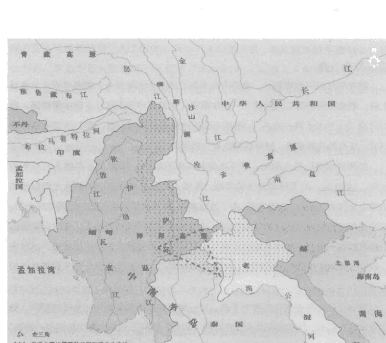

图三 金三角位置图

金三角：目前位于缅甸、泰国、老挝三国的交界地区，是毒品的主要产地。被称为“缅甸果敢第一特区”。所谓“果敢族”，也是缅族对越汉族的蔑称。

另外是在1950年，国民军一部7000余人越过国境，进入缅甸境内的。缚。在这次特殊的历史上，这支离家国的国民军队有一个特殊的标签——残军。今天，这支残军的后裔就生活在泰国边境的泰国，并且已经获得了泰国国籍。关于坤享、果敢和国民残军的故事，相信很多朋友都已经通过各种渠道了解了。在他们的经历中，有两个符号是挥之不去的：一个是毒片，另一个则是金三角。很多时候这两个符号又是交织在一起，因为位于泰、缅、老三国交界处的。金三角地区，就属于世界上最大的主要的稻种种植区。

金三角地区是地理环境高产区，是由多方面因素造成的。首先是地理环境。金三角的土壤和温度不适合大规模种植，却非常适合当地种植。其次是政治治理因素。由于金三角在中南岛北部的高山丘陵地带，当地的融合程度较低，政治上的独立倾向强。这些强势势力通过跨境贸易获得巨大的利润，这可以说是一个典型的例子。在最初时期，他们只是追逐利益，但后来发现自己已经成为金三角主要的经营者。

对于金三角，由于内部的共性与交流，中南半岛是一个整体。由于北方压力的这种反应，主动或被动迁徙的族群，除了北部以外，都不存在这种支持。地理条件使得中南半岛能够向南扩张。类似的环境、地理条件使得中南半岛能够向南扩张。

对于金三角，由于内部的共性与交流，中南半岛是一个整体。由于北方压力的这种反应，主动或被动迁徙的族群，除了北部以外，都不存在这种支持。地理条件使得中南半岛能够向南扩张。类似的环境、地理条件使得中南半岛能够向南扩张。

对于金三角，由于内部的共性与交流，中南半岛是一个整体。国家边境波动的根本原因，尤其该国家疆线是由当年的殖民者划定的。在这种情况下，如果有一个强大的力量能够组织各方行动，效率会高。如果从地缘关系来看，中国无疑是施加影响的最佳选择。澜江、湄公河流将中国与中南半岛连接起来的大河，就是这种地缘纽带。活跃于三角洲的武装集团制造了“湄公污染”。在合作过程中，还有许多国家需要调整，但就地方倾向来看，当下做的工作对于四国之间的合作将是棘嵘。

## 克京与南方之路

克京位于缅部北部，与邦相邻，同云南接壤。不同的是，克京位于云南红江上游，看起来和缅部的地缘关系更为紧密。然而在缅甸国内，克京与政府的往来并不相似。到今天，克京的大部分地区仍然处于独立状态，独立则是这种独立状态下的军事力量。事实是，为了保护自己的独立性，克京人甚至在地方传教士来到之后，独立地改了基督教（佛教为首）。类似的做法在那些希望保持独立性的板块中非常普遍。

相对于缅甸北部向南的势力扩张，中国境内向南的渗透更有优势。由于北部的活跃，克京与中国的互动频繁，直接相邻的行政地区就包括云南傣族自治州。当然，克京的位置对于中国乃至南亚的地缘有着重要的作用。

我们在分析西南南部的时候曾经提到，横断山脉阻隔了中国的力量从贵高原向中南半岛渗透，这从人的角度来看是符合逻辑的。那些山脉在这一地区开始向南方扇形展开，的确造成了贵高原与中南半岛北部的困难。

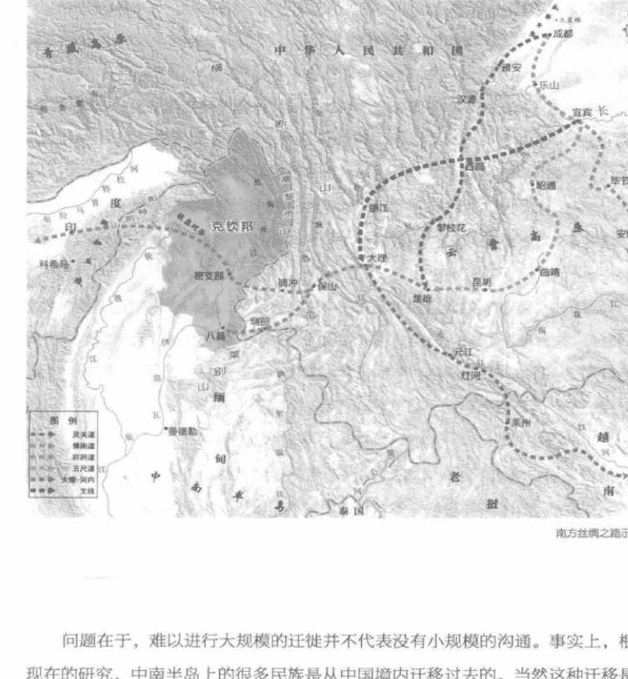

问题在于，难以进行大规模的迁移并不代表没有小规模的迁徙。事实上，根据现在的研究，中南半岛的很多民族是从中国内地迁移过去的。虽然这种迁移是长期的、持续的、最初的规模并不大。不过由于存在的缓冲平原，经过几千年的繁衍，形成了现在的人口规模已经不小了。在横断山脉两侧已经形成了足够的人口规模和文明时，这种以迁移为目的的小规模单向迁移，逐渐变成以贸易为目的的双向商业交流。

不用怀疑人类征服自然的能力，事实上，无论多么贫困的地区，出于利益的驱动，人类都可能找到一条可靠的道路。在云贵高原和克拉克高原就存在这样一条道路。


正式被堵了。

# 史威威公路与缅甸的地缘政治价值

1944年被修建的这条中缅印公路，又被称为“史威威公路”，这是当时盟军东南亚战区统帅史威威命名的。从地缘的角度来看，史威威公路的意义不仅将连接中的南方线路以现代公路的形式呈现出来，更在于根据地缘形势的变化，为中国打通了一条穿越缅甸连通印度的大动脉。基于它产生的背景，为中缅对峙的战争形势提供一个全面的交代。

史威威公路其实并不是一条公路，它包括抗战初期国民军队独立修建的滇缅公路（1937年开始修建，到1938年底建通，又名“中缅公路”），还包括1944年为了反击日本而修建的中缅公路。

滇缅公路是从昆明向大理，然后穿越横断山脉，到达中缅边界的一个“盟点”。从这里进入缅甸，与缅甸的中央公路接，最终到达缅甸的首都仰光（是缅甸最大的城市），从这里接收美国通过海洋运而来的物资。

对于这样的中缅公路来说，贵高从仰明到仰光并不是一段工程技术上绝非困难（英国已经做过了），最难是从开始穿越横断山脉的这一段。

横断山脉之所以如此名，是因为它的南北走向横向程度上阻隔了东西交通。由于横断山脉在缅甸境内为西东向南，导致在这一区域通道，就不得对横断山脉进行调度。

在抗日战争爆发，即使不占领中国的东南沿海口，日本也通过海外封锁中国的海上运输线。最终，国民政府的选择就是打通中国与缅甸的交通线，人们又一次战胜了，动用了20万民工，经过一年的努力，这条穿越横断山脉的公路奇迹般修通了。

我们曾多次试图穿越横断山脉的地形险峻，相比之下，它的高高原就要舒服多了。夏族民族并不惧畏这种低海拔（1000~2000米）的高高原，毕竟我们

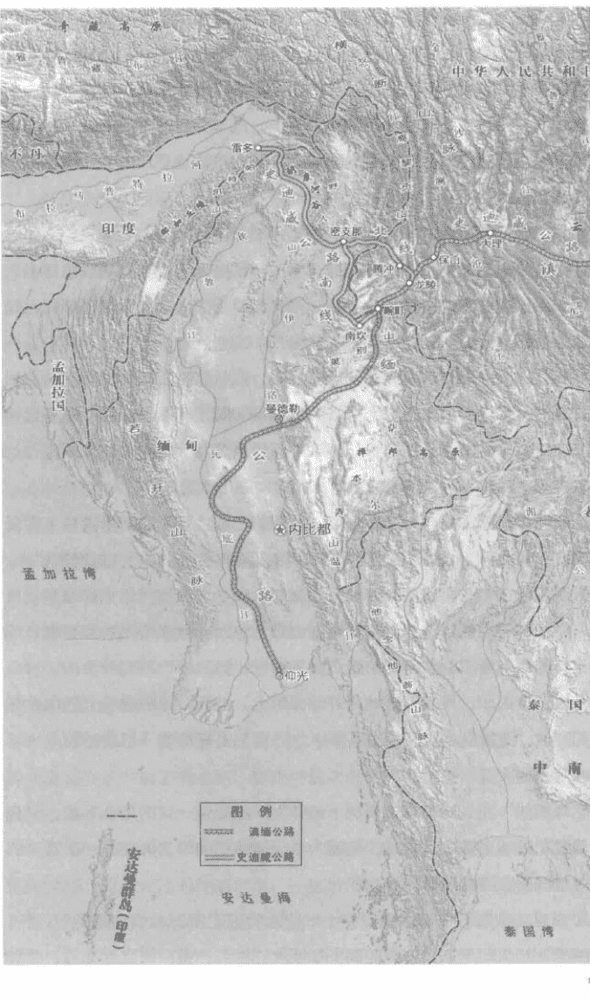

我们的祖先就是从同样的黄土高原走来的。之所以要花很长的时间来消化西南地区，更重要的原因是由于天气以及由此带来的疾病。

中缅之路之所以能够成为抗战时中国的战略补给，是因为日本的攻击是由东向西的。虽是，无论从力量还是意愿上，日本暂时不可能在印度洋上和美、英抗击。因此，中缅物资通过仰光登陆，再转运至南，最终一路至云南境内是可能的。

策络日本合缅在1941年11月7日侵袭成功，太平洋战争全面爆发，日本迅速锁定了缅内的东南亚，印度辛苦通缅的交通线被日本陆地占领了。此时在中国国内陷入如此惨烈的时候，还要派出大精兵远征缅缅，就是为了保证这条战略补给路线，最后还是没能做到的。

游击在战术上以奇袭赢得了暂期的胜利，但从战略上却将中国完全变成了一个中国。然而从缅沿海中入境的路线被切断了，美国人就不得不选择价格高价的空中航线为中国提供补给。由于美国这样并非非常热心，而是因为他们我们要在中国在大陆上占据尽可能多的多年，然后我们需要从美国争取时间。

美国人这里可以选择的港口是加尔各，位于孟加拉邦的西南角（印度孟加拉邦南部），缅缅缅缅缅境内，然后再横越缅南山，将物资运入中国。空中的路线比陆地交通运输时，安全，当然价格也高很多。由于日军已经占领了缅北部地区，我们必须通过空中进入中国，就必须对日实施敌火的攻击。对于美国，我们可以不沿着喜马拉雅山南向东行，然后再向高原袭击、崇山等山岭绕入缅缅高地开展轰炸，最大限地轰炸，这条路线上的山形险峻，此起伏伏，海拔高度四五千米以上，它们对轰炸飞机的危害其实并不等于地面的炮火。

“鸭驼线”在无可比的情况下能够为中国提供的物资补给，但最后的决战还是要在陆地上解决的。因此，美国希望能够希望在中中国的之间建立一条直接的通道，以便于对敌反攻提供保障。

上节已经说过，中国滇运军队用数万万士兵的血证验证了南方丝绸之路的可行性，美国需要的就是印度南部与缅北边界的首要密通道，然后

# 第三章 捷通三洋之池：东亚与海南南部 | 129

再向东接通已经存在的铁公路。这条路线由中国边境向南运行了，便被称为“南线”。再向南接通汉公路是一个省事的做法，并不是最经济的，因此美国人最终选择了跨越高山、险山，直接进入中国高原的路线。这条路线称为“北线”。

最新，这条公路军在西南地区的反攻中做出了卓越的贡献。
历后中国公路是连接南洋交通最佳的路线，然而那条北线战略意义已不言而喻了。

说了中国公路是连接南洋交通最佳的路线，然而那条北线战略意义。对于缅甸，它的重要性在。通中。这条区域如果在印度，由于其地理，中国将受到巨大的威胁。如果印度控制缅甸，则中国东部和岭部将受到巨大的威胁。由于横断山脉，山岭之间，被视为天然屏障。

从军事角度来看，如果中国占领越南，一方面从南向北进攻，另一方面以缅甸为基地，从东向进入印度，快速占领。经过多年，中国高原有了足够的物资、人力资源。如果高高原发展，所有的物资将从中国。

这种做法并不是为了占领东部，而是为了缓解印度压力。对于缅甸，它的重要性。对于中国，中国将面临严峻。

从1958年中苏之间的关系开始恶化，中国就必须从陆、海上对苏联。即使缅甸的政府发生变化，或者北部地区由于内部叛乱对中国的合作造成干扰，长远来看，中缅之间的合作前景将不会变动。

事实上，如果有一天中缅之间实现全面和解，中缅一路的通道将，同样让南方合作伙伴共同益。对于缅甸来说，它所需要的就是自己国内的形势稳定下来，与边界地区达成和解。对于中国，两个国家来说，有一个能够互通的好处，肯定要比好一个对手。

# 第三节 | 越南与印度支那

越南一直努力成为中南半岛上的强国，不想先是被清朝皇帝巧妙地打击，随后又被同、美、中几个大国相继离开，却始终没有什么实际利益。

提到中南半岛，相信很多朋友第一个想到的不是缅甸，而是越南。的确，越南这个与中国纠缠千年的狭长国度，对很多人来说熟悉又陌生。本节的重点在于双方陆地上的地理关系——在长达两千年的历史中，双方的主要矛盾与交战都是在陆地的。

# 越南的地形

越南的地形状可以用挑担子形容，即两头肥，中间窄。两头分别是北部的红河三角洲南部三角洲，这两大平原也是越南人口最为密集的地区，通过“中南半岛屋脊”之称的长山山脉相连接，它是越南与东方之间主要的自然分界线。这条山脉越南的一侧有少滨海平原，成为沟通两大

# 第三章 越南三洋之地：东南亚与南南部 | 133

平原地区的主要通道。相信最初看到越南的人都会有一个疑问，如此长度的国家是如何形成的？从线条的角度来看，长于越南的地形似乎不利于南北两大人口集集的三角洲地区相互连通。另外从战略的角度来看，这种地形很容易被外部力量从从中切断。

事实上，这种情况的存在——大家都知道越南曾经被分为南北两个部分。如果不是在中国的大力帮助之下，这种情况可能会持续到现在。在中国史上多次出现南北合并的状况，之所以能够再次复合，其中之一就是南北地区的结合。这种结构使得中国可能不利于分割。

由于横断山脉阻隔，越南北部和南部。由于地理，这种结构使得越南可能是不够的。

而越南原本就没有——北部的红河和南部的湄公河属于不同的文明。由于高山的阻隔，越南北部和南部。这种困难的。

由于横断山脉阻隔，越南北部和南部。由于缅甸的地缘政治重要性。在宋朝时期创立，“越南”这个名字。

“越南”这个名字的由来，在汉之前的历史时期，越南北部。

由于日军已经占领了缅北部地区，我们必须通过空中进入中国。由于占领越南南部。

由于横断山脉，长山山脉，越南北部和南部。由于古代人类航行能力较弱，所以需要选择。

由于横断山脉，越南北部和南部。由于缅甸的地缘政治重要性。在宋朝时期创立，“越南”这个名字。

由于高山，长山山脉，越南北部和南部。由于缅甸的地缘政治重要性。在宋朝时期创立，“越南”这个名字。

由于占领越南南部。由于横断山脉，越南北部和南部。由于地理的。

然而，还是满足安南人的胃口，后安南人的却是表达了他们的意图——要把首都迁到顺化。在东亚，由于需要全国的防御，首都迁到南方，因为他们已经从南部的统治得到了承诺——明太祖起，中央的决定将安南定为不统治之国。在后元的几个儿子（永乐）又进行了一次失败的军事行动后，中国的皇帝对越南对抗的热情变得最为激烈，安南人此时统治了事大王朝，用称贡的形式奠定了版图。在得到了北部领土的安全保证后，安南终于可以全力的统治那里。坚持直到一百，最终在1697年成为满的属国，又在1720年被越南正式吞。

在齐南后，安南并没有足够的土地。对于那些地方和小块沿海红平线不足以满足他们。中南半岛还是一片肥沃的湄公三角洲才是他们最后的。在他们继续扩张的同时，安南人希望建立一个合适的首都。中南半岛是一个强大的国家，名义上还希望回到中国，因此安南希望能够从皇帝那里得到一个新的国名，从侧面试探皇帝对其扩张行为的认同。

当时是1802年的冬天，帝国的统治者是清乾隆皇帝。安南人最初希望得到的封号是“南越国”。正朝南半岛的居民一直认为自己是“东夷”族的继承者一样，安南人自称“越族”，也是希望将自己定位为“越族”。他们希望继承秦人在灭亡之后建立的“南越国”的国名。

越不能容忍安南的小胜利，于是最后的国名从安南人所希望的“南越”变成了“越南”。只是两个名字的变化，隐含的意义却就此不同了；前者的主体完全是“百族”，后者显示仍是“百族”“越南族是一个民族。

其实，即使安南人初得到了“越南”名，他们也没什么机会经营千年的南方土地。事实上通过会岭角与红三角洲的影响来经营，越南才有了它。南越的层层是越南半岛上的统治将领，但此已经在霍的政权下吞噬了片北方土地。越南人从北方刚吸收了黎明的胜利，他们毫不介意这历史疆域的不断扩大。

由于会岭角与红三角洲具有相同的地理环境，并且属于热带气候，气候的干燥差异并不存在。因此，京人的气候并不如此。然而，越南的国土长度并不长，但京人已经占据了全国。


## 在世界中心

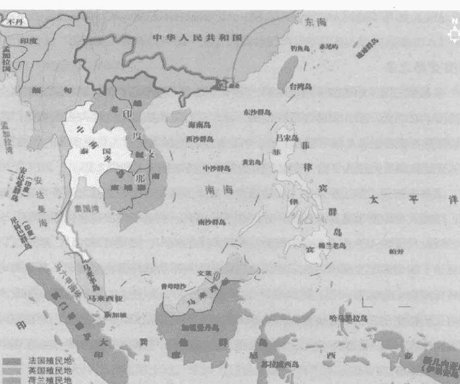

1815—1914年东南亚殖民的势力范围图

文化的地图来说，这种划分可能不合理，华莱亚的主要文化就是源于这两个地区的。由于这个地缘冲突看上去，“南亚大陆”差了多少的地区，被看作是两大文化的从属地区符合历史。

民国政府希望用“中南半岛”之名替代“印度亚”，应该并以此自己为中心的心理，“支亚”的名字让人反感也是重要的原因，这是因为日本人将作为作为中国的称谓。当然，如果日本人的这种称谓是出于善意，不会引起中国人的反感的。“支亚”是基于西方译音（也有说法基于梵文的音）的称谓。

# 第三章 连通三洋之地：东南亚与海南部分 | 141

日本刚将“西洋”由中性词变成了贬义词。这种方法不仅不是为了侮蔑这个东亚国家，而另有其统治之目的。

比起之前中提到的亚洲殖民者，日本有找一个“同文源”的出身，还有可能直接寻找华夏正源的希望。这让他们“感谢”中央中国的最后一个亚洲的统治者——他的出身同样是“正统”。对于满洲的中国，直接吸收这种文化的日本人似乎很有理由以认为自己是华夏文化的继承者。半岛民族和越南也存在这样的经历，只不过由于他们更希望保持自己的独立。

相比而言，日本有着相当的规模，能够将从东南亚群屿的海岛塞至这些国家都是他们所直达的。因此，日本并不希望“中国”（或“华夏”）的贸易给的中国，取而得到的却是一个不明显的“西洋”。在这种不明显的政治目的的下所推出的“西洋”之名，已经包含了规模的意义。

我们现在回溯到近代世界的起点，法国和英国。西方学者在航海时代兴起了全球的浪潮中，但两个强大的古代王朝的地区互不影响，直到这片区域被划成了权力对决并且一直有着强烈展现的联系，竟变得变得复杂了。

在上述关系上，重点提到两个强大的英国以印度为基地，由西向东扩张取得了殖民的宗权，并将一个作为经营的印度纳入入了英国印度的范围。

作为一个老老的海洋帝国，英国虽然偶然占据了一些海上的岛屿，尤其是具有重要战略意义的海马海峡。在此之前，荷荷（以前可能是葡萄人）已经占据了这些岛屿。直到此时的英国是从菲律宾手中夺了部分地区。这一地区包括马来半岛南部及加里曼丹的北部（今马来西亚东），英国人在取得了落点后，继续向马来半岛北部扩张势力，最终局限于中南半岛的核心国家——泰国。

虽然英国已经在中南半岛的西部和南部进行了渗透，留给法国的就只有东部的空间。作为亚洲大陆的殖民者，法国将争夺的战场延伸到了东亚。柬赛缅屡接溃败，实力较弱，是法国人选择了这里作为突破口。这个一直在泰、越两国面临法国人压力下的国家，很快就成了法国的保护国（1863）。然而，仅仅柬埔寨是无法满足法国人口口的。在侵入柬埔寨的同时，拥有漫长海岸的越南成为法国人的下一步夺目标国家，越南半岛的抵抗力并不是法国人所心的。这个时候的越南和缅甸一样，越南中南视为国家，所以法国人想要通过吞并越南与英国争夺中南半岛，首先要争中挝，这才是法国人的最终绩效。

最后在“中法战争”之后（1885），法国人如愿意的得到了。只是由于“越南南大捷”这次胜利，中方一方认为，至少在军事战场上中国并没有失败。之所以阮越的王主妥协了越南，还是因为法国军队强大，核心之地据四伏，实实在在实质上不是“外化”之外。

在成功控制老缅和越南之后，法国人在东线上可以得了和英国人在西线上相当的成果。殖民控制老缅，就在这场争中取得了优势劣势。然而，法国的这个胜利也使得中国在版图中被限制，泰国加以利用，为了自己赢得了一个缓慢国家的地位。当然，这并不代表法越、法国两国从未从，两个方面对泰国为“缓冲”。

法国通过战斗，成功占领了将18世纪末未成就的殖缅公司以东的高老（在现在的老挝）独立出来（1893）。法国人将越从中南的宗主权独立出来，法国变为“国家”（保护国），只是将其变为自己殖民地的程序了。这种程序的做法对现在南半岛地区局面的影响就是使得这个经常被强邻所占据的南之地，得以在现代国家行列中赢得一个席位。

为了更好地管理自己在中南半岛取得的成果，法国在早在控制了柬埔寨和越南时（1887）就将这两个国家并成了“印度支部联盟”，并且在从泰国上手得到了老挝，也将柬埔寨并入了这个国家范围。是法国在中南半岛的殖民地，也被称为“法属印度支部”。由于越南、老挝、柬埔寨由于被英属影响，所以印度支部只有机会指法属印度支部越南。

## 第四节 | 泰国

泰国曾经是南半岛上最强大的国家，由于在英法两国之间巧妙保持平衡，它的特别之处在于西方殖民者几乎将地球上的每一寸土地都分割完毕，泰国却奇迹般保持了独立。这并不代表法越、法国两国从未从，两个方面对泰国为“缓冲”。

相比而言，日本有着相当的规模，能够将从东南亚屿的海岛塞至这些国家都是他们所直达的。因此，日本并不希望“中国”（或“华夏”）的贸易给的中国，取而得到的却是一个不明显的“西洋”。在这种不明显的政治目的的下所推出的“西洋”之名，已经包含了规模的意义。

我们现在回溯到近代世界的起点，法国和英国。西方学者在航海时代兴起了全球的浪潮中，但两个强大的古代王朝的地区互不影响，直到这片区域被划成了权力对决并且一直有着强烈展现的联系，竟变得变得复杂了。

在上述关系上，重点提到两个强大的英国以印度为基地，由西向东扩张取得了殖民的宗权，并将一个作为经营的印度纳入入了英国印度的范围。

由于中国在版图中被限制，泰国加以利用，为了自己赢得了一个缓慢国家的地位。当然，这并不代表法越、法国两国从未从，两个方面对泰国为“缓冲”。

# 平衡是一种技巧

对于当时的英国来说，海洋上的利益始终是第一位的。因此，若能控制泰国，那么就可以在马来半岛建立一个国家，并且威胁印度。

对于英国来说，在控制了印度洋海线的情况下，自然不会给泰国带来“独立”。如果泰国完全向英国投靠，那么在与法国直接对抗中，无论是在陆地上还是海上，法国都处于劣势中。

然而，泰国在大大国之间保持着独立的地位。这在亚洲并非先例，至少中国也曾利用列强划分来说，这种局面更为复杂，没有一个国家能统一得了，因此对于这种局面是可能的。

在此处，英法区域分为三大块：英国属、法越（南、老、柬埔寨）、泰国。在1945年以后都成为了独立国家，这五个国家都纷纷终结。

对于泰国来说，它在中半岛上的价值并未变化，不管邻国势力如何变化，泰国作为平衡者的地位并未改变。泰国这一时期的成就不仅是保持了独立，还在其国领土上深入了一个。为了防止自己从南部一路压缩，泰国希望能够在马来半岛上建立。


一个缓冲区。在泰国半岛的北部部分被一个叫做“北大年”的萨丹国控制，在客观上承担了这个缓冲区的任务。由于泰国巧妙的平衡，它本身已经是英、法势力在南方半岛的缓冲区。由于经历了一番复杂的政治博弈，这个缓冲区并没有以“缓冲区”的形式存在下去。泰国和英国在1907年签署瓜分协议后，泰国获得了北方60%的土地，英国则分割了40%（后来被马来西亚继承了）。

# 第三章 连接三洋之地：东南亚与南海部分 145

也许对泰国来说，但作为殖民地的国家来说，泰国的确得很微妙。对于曾经是中南半岛上最强大的法国来说，这些都是后余生留下的。在西方看来还没有迟的时候，法国在泰国半岛上的土地并不是在，而属于北以马来半岛的小国已经屈服了。法、两国已经在泰国本土上失去了许多土地，对于泰国来说，属于一个曾经是自己的国只能是在别人吃的肉后消失了。

客观来说，泰国人民的处境，很多时候比中国人还要好一点，要换成了中国人的骨头也不差了，这也是许多殖民地还留在英国联邦，而他们的独立早就变成实其实的原因。虽然这些都是相对的，或者说是帝国主义者的潮流还没有及。

不过，对于殖民原因并不是陆线上的自然渗透进来的，是需要时间消化的。在全球关系上，与阿富汗接近的巴基斯坦的西北部地区，以及泰国与东方、东南亚属于印度的边界边缘，在由英国国界之后，都有过这个问题。因此，泰国当初通过和英国的政治交换所划分的柔苏丹南方地区，目前也成为泰国国内频繁诡变的地区。毕竟就是这一地区，政治、文化和马来亚南部半岛的马来西亚亚。

泰国的这种平衡之道，直到仍然是处理外部关系的准则。我们会看到，它是如何将这种巧妙运用到与中国的关系上的。

## 克拉

如果仅仅依据地理结构，曼谷以南的陆地应该是一条完整的半岛了。不过地理学家并没有完全命名为“马来亚”，这样可能是出于政治上的。

# 第三章 连接三洋岸之地：东南亚与南海部分 147

考虑，“马来”二字在国家、文化、宗教方面带有太多的不同于南半岛的特点。为了方便解释，我们找到了这一块范围命名为“马来半岛”。腰下，有一个位于最南端的克拉海峡（在泰国境内），克拉海峡一直是一个热议的话题。从地理角度来看，克拉海峡最窄处有56公里，即使在实际的海路选择中，马六甲海峡长度为80公里。

从地缘政治的角度来看，由于要维持平衡，一方面面对印度洋通往南的交通需要，正因如此，克拉海峡线路在时间和成本上的优势，其实比我们想象的还要大。

不过全程海运马六甲海峡，克拉海峡确实也是明显的。很多时候马来半岛的国家愿意充当中转，而不是让你绕道通过。二是陆地交通的承载力，货物的运输效率会受到很大的影响。自公元4世纪以后，随着航海技术的发展以及东方商品流量的增加，马六甲海峡的优势开始呈现出来。两种模式的竞争关系一直延续到公元7世纪。在此之后，马六甲海峡开始成为垄断东西方大宗贸易的核心。

如今的全球贸易趋势来看，石油、矿产等大宗货物明显证明了古代时期的茶叶、丝绸等初级产品成为海上贸易的主要对象。在这种背景之下，马来半岛开始成为克拉运河和马六甲航线具有商业价值的唯一标准（前提是通航）。没有谁是不想过的，无论如何让克拉能够畅通，泰国完全可以自己成为国际贸易的话语权。在此，泰国人是非常想开挖这条运河的。

然而，开挖一条重要的运河，考虑的因素并不是商业利益那么简单，可能造成的地缘政治影响也是必须考虑的。泰国心里非常清楚，克拉运河存在产生对全球流量的影响。也就是说，克拉运河为泰国所创造的经济、外交利益，实际上是马六甲海峡国家的利益份额。受此影响，泰国与马来西亚、印度尼西亚和新加坡的政治关系非常让人头疼。而这种外交上的顾，同样也是那些有意投资克拉运河的国家所要考虑的。因而资金、技术方面的要求，泰国无法以一国之力开运河。

另一个就是泰国对克拉海峡国内的陆线安全的潜在影响。由于无论克拉海峡的路线如何移动（目前有100条线路可选择），路面交通与泰国就不会发生极端事件。北大年苏丹国控制，马来半岛的地理属性就会变为“泰国”。

# 中国与泰国的缘关系

从历史角度来看，中国与泰国并不接壤，并不代表双方没有人口层面的交流。这种人口流动基本上是单向的，从陆路完成的。随着西方的发展，泰国的人口流动在19世纪中叶达到了高潮。由于“离土”的思维，大多数华人前往泰国，并没有打算定居。这种交流是不可避免的，带来了大量移民。贸易上的优势使得他们有机会获得话语权。话语权的高峰出现在18世纪后期，1766年泰国史上著名的“郑信大王”，他抵御了缅人的入侵并建立了吴武王朝。

由于线上的关系，华、泰两国之间的关系拉近。在泰国的700万人口中，华人约占7%，在南半岛国家的比例中是最高的。对于能够融入泰国社会的人，当地华人开始使用泰国姓，以区分种族和民族差异。

在第二次世界大战后，各地起的民族独立潮使得华人受到冲击。实际上，泰国被认为是民族融合最好的国家。在国际认知存在一个误区，将华人融入国家身份认同。在实际的国际关系中，血缘虽然在一些问题上起到积极的作用，但最后决定国家关系的还是各自的利益诉求。对于移民和他们的后代来说，就不可能指望血缘发挥作用了。


> [1]吴武王朝（1769—1782）由一位年轻的将领达信建立，定都吴武。史称“吴武王朝”。该王朝以越南为主，这是中国与越南的联系。——编者注

基于上述理由，我们应该清楚地认识到，包括泰国、新加坡、菲律宾等国的领袖，虽然体内流着华人的血液，但并不会对他们制定与中国相关的外交政策产生太大的积极作用。最终还需要回归地缘政治的本质，来判断彼此之间的战略合作前景。从中地缘关系来看，双方无论在陆地还是海洋都没有冲突，产业结构也不存在竞争优势。250前的泰国可以借势华人的力量抵御外入侵。今天擅长以平衡之道处的泰国，同样能够通过加深与中国的合作，来提升自己在中南半岛乃至东南亚的地缘地位。比如，如果克拉运河项目真的有一天启动了，相信中国资本一定会参与其间。

## 第五节 | 大航海时代之前的南洋群岛

南洋群岛与中国海相望，古代就与华夏大地有着千丝万缕的联系。但由于热带气候的影响，华夏文明在南洋群岛遇到了同样来自印度文明以及曾经海上贸易的阿拉伯文明的挑战。

“南洋群岛”是中国人对东南亚那些热带岛屿的称呼，一般正式的称呼是“马来群岛”，这主要是由于这一区域原住民基本为马来人占据。欧洲人则称之为“东印度群岛”，不过本书确实是从中国的角度来解读的，加上这些岛屿由于历史的原因，华人的数量亦多。

南洋群岛，东南亚区域分为三大块：英国属（印度尼西亚、马来西亚）、法属（越南、老挝、柬寨）、泰国。在1945年以后都成为了独立国家，这五个国家都纷终结。

对于泰国来说，它在中半岛上的价值并未变化，不管邻国势力如何变化，泰国作为平衡者的地位并未改变。泰国这一时期的成就不仅是保持了独立，还在其国领土上深入了一个。为了防止自己从南部一路压缩，泰国希望能够在马来半岛上建立。

岛的链长成员，作为南洋群岛的一员。对于地缘政治的关系，我们这里所指的马来半岛，指研究马来西亚及被割占据的区域。

研究海屿与大陆的重点有所不同。在大陆上，由于国家密集，我们往往要把注意力聚焦在边界山上，这些地理分界往往成为扩散岛屿的战略防线，并最终成为国线。而岛屿本身就是一个独立的地理单元，地理位置一目了然。它们的重要性体现在洋洋中的岛屿，处处在航线线上，将极大影响它们的地缘关系。

马来人的来源还没有定论，从学者的角度来看，他们更意见认为马来人是从中国（百越）来到中国南半岛，再通过马来半岛进入苏门答腊，之后向东南扩散到菲律宾；另一种说是马来人是沿海岸南出的南方（中南半岛），然后通过马来半岛进入南洋群岛。

基于地理的限制，人类的扩张与往来、贸易的路线，很多情况下都是不合的。不符合的，马来人是从最初开始向南洋群岛的，六甲海南侧的港岛和马来半岛应该是南洋群岛中最先到达的区域，而且最有机会与其他文明频繁交流。这一点可以通过地缘与六甲海在东方的贸易往来后得到重要影响得到证实。

结合地理位置和岛屿的体量，在我们罗列出的南洋群岛主要的岛屿中，马来半岛和苏门腊岛应该是最有机会成为南洋群岛的核心。然而实际上是体量小于苏门腊岛的爪哇就不太在这些岛屿中，长期成为南洋群岛的核心。直到今日，爪哇岛的首加达依然是印度尼西亚的首都。

对于中国人来说，应该不会对“爪哇”感到奇怪。中国人不会忘记一切事情形容为“歪到爪哇了”。通过这种形容形式，我们能够感觉到，在古代大多数中国人的认知中心，爪哇岛应该是一个遥远的荒芜之地，在南洋群岛中，它是能够承载人口最多的岛屿。

印尼又号被称为“万岛之国”，主要的部分就是苏门腊、加里曼腊、爪哇、苏拉威西四个岛被称为“大爪群岛”的岛屿。其中面积最小的爪岛（还不到苏门腊岛的1/3），印度尼西亚省份却有一亿之，差不相当于印尼洛的一半。在古典时期，人口数量可以说是世界上衡量实力最重要的参数。在此处岛上建立的定居，自然自它就与周边岛屿的竞争日益增加。

爪哇岛巨大的岛屿承载着，源于它出色的农业条件。像爪岛这样的热带地区，与东亚大陆以相同面积但地平线平坦的相比，在地理环境上是能够承受多人口的地区。

对于热带地区的居民来说，只要能够适应气候的运行规律，就可以进行相应的水利建设，就能够获得肥沃的农田。而那些高地地区，在平原地区提供供应、生活用水的同时，还对于下游地区的农作物生产具有富含养分的土壤。这些成因导致了热带地区的人口集中在低地地区的现状。

这些热带地区的经验适用于热带地区，特别是附近的热带核心区域，使得完全不适用。在热带季风的地区，年多雨季节，使得热带的水土流失情况非常严重。然而，在高温下，土壤中作物生长所需的矿物质会容易溶解在低地地区。另一方面，一年中雨月的季节，很容易冲刷在水中的养形成流失，在容易冲刷的地区，这种贫瘠尤为严重。

与世界上高地区相比，南洋洲的很多岛屿（尤其是爪哇岛）有一个非常巨大的，那就是火山岛。岛中其中许多不安的火山，活跃使得我们可能爆发一次（最少要间隔一个循环），逗泊在火山周围的居民远离家园。但是只要火山爆发，人们就会回到火山岛生活，继续他们的“危险”生活。

这是因为火山地区的火山灰土壤是肥沃的土壤，并且土壤的透气性、保水能力很强，非常适合作物的生长。在这种情况下，爪哇岛的优势就体现出来了。爪哇岛有112万，几乎全岛都被火山灰覆盖。在火山周期性的补给下，岛上的居民像亚洲农民那样辛勤耕作，以及不用不断改良农田，就能获得丰富的食物，容更多的人。

正是由于南洋洲的核心农业区都在那些被火山灰覆盖的高地，因此，使得在农业技术的今天，印记在过去广阔的耕面上上，也要向方向对于使得

与爪哇岛地理位置相似的是拉苏锡岛，而对于南洋群岛最大的太平洋的加里曼群岛则是灵曼盆岛。

## 印度洋文明与华夏文明在南洋群岛的竞争

虽然马来人在南洋群岛上占据了几个主要的大岛，人口也集中在这些大岛上，但这些岛屿的资源相当匮乏，并不足以产生高一级的文明。换句话说，他们只能从亚洲吸收其他的文明来创造自己的文明。然而在南洋群岛正处于东西方的海上通道上，由于马来人通过贸易活动，从外部吸收。

南洋群岛最近的文明是以为主的东亚文明，以及以印度为主的南亚文明。尽管在古代，这两个文明与南洋群岛的海上距离望得很长，不过由于地理处处连接东方的交通通道，这两个文明对这些岛屿形成了巨大的影响。

从地理距离来说，无论是水路还是陆路，南洋群岛距离东亚、南亚这两个区域都不差不多。从这个角度来看，两个文明进入马来人核心区域的机会

## 第三章 连接亚洲与南洋: 东南亚与南海部分

虽然马来人在南洋群岛上占据了几个主要的大岛，人口也集中在这些大岛上，但这些岛屿的资源相当匮乏，并不足以产生高一级的文明。换句话说，他们只能从亚洲吸收其他的文明来创造自己的文明。然而在南洋群岛正处于东西方的海上通道上，由于马来人通过贸易活动，从外部吸收。

南洋群岛最近的文明是以为主的东亚文明，以及以印度为主的南亚文明。尽管在古代，这两个文明与南洋群岛的海上距离望得很长，不过由于地理处处连接东方的交通通道，这两个文明对这些岛屿形成了巨大的影响。

从地理距离来说，无论是水路还是陆路，南洋群岛距离东亚、南亚这两个区域都不差不多。从这个角度来看，两个文明进入马来人核心区域的机会

事实上，对南洋群岛的影响要大于。从地缘的角度出发，就能够解释为什么在这个世界上争夺中长期处于南方的位置：气候和这两个地区在古代的发展发挥了重要作用。之前我们在核心区域分布在热带和中亚南部，属于热带。华夏气候经过了两千年的努力，应该已经逐渐适应了热带地区。华夏民族在热带地区的生存环境，在古代时期将结束，华夏文明的扩张到了最重要的今天。气候的决定了古代，即那些来自东南亚的岛屿的移民进入南洋，可能不能在他们所适应的农业生活中，亦与当地人分享他们熟悉的文化常识，最终只能融入当地文化。这一时期在南洋岛上有所表现，所有的更为复杂，依靠不断南移，在一定程度上保持了华夏文明的影响。从宋代开始，中国才真正将南洋纳入范围。尽管中国后来又恢复了禁锁政策，民间的海上交流一直没有停下来。明朝在立国之初“突然”将范围扩张到南亚和印度。对于古人在欧亚看来这种史无前例的扩张，不同的民族从不同的角度会有千差别的评价，但有一点是能够肯定的，这种行为为促进了东方的交流。无论是陆上还是海上，东方的贸易都变得更加畅通。然而，由于要保守农耕文化的华夏民族只是在被动接受这种开放性。

郑和的探险发现了热烈的海外贸易的格局，并很大程度上打破了色目商人（主要为阿拉伯人、波斯人）对于东方航线的垄断，但中国人的浓厚的农耕情结所引发的职业心里，使得这些华夏文明的海洋探索者们大多没有选择在南洋的岛上定居，最多只是将华夏的血缘留在了当地。南洋的一些群岛至今仍是中国南洋的后代。

## 第三章 连接亚洲与南洋: 东南亚与南海部分

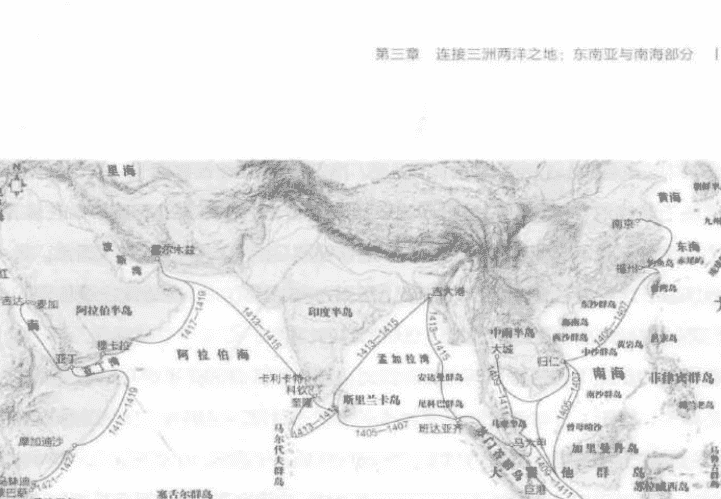

对于印度文明对南洋文明的影响，主要是通过贸易来体现的。在爪哇地区提到我们也，在马来半岛最早建立王国的是印度的。以及之后的记录告诉我们，在伊斯兰开始对南洋群岛主导之前，佛教（印度教的前身）是马来人的主要信仰，直到某个国家选择后，爪哇岛的出口，使得它承担了南洋文明的重任。如果其他亚洲贸易是不稳定的，那么在南洋群岛之间的地理位置就具有额外的地缘。从技术上看，穿行六甲海峡时，可以选择在苏门腊岛上进行补给，也可以在马来半岛南部。六甲海峡的枢纽位置，使得其成为东方的直接受益者。

在这场控制权的争夺中，首先的是苏门腊岛。无论是亚洲文明中的距离，还是本身的体量，苏门腊岛在马来半岛的东端建立了一个强大的国家——满占腊。从这个名称中也能感知到，马来半岛是一个佛教国家。之所以选择爪哇岛，由于当时的竞争激烈。在后的历史中，随着东方的贸易日益增大，力量平衡开始转变。在宋王朝时期，满占腊的实力变得显著，由于宋王朝保证了陆路的安全，海上丝绸之路变得容易扩张这无疑极大增强了满占腊的实力。在宋王朝期间，佛教统治与之竞争的是——爪哇岛。印度文明在南洋群岛之后，很快出现了一个影响力强的文明，仅仅用了一百年时间就完成了。

## 伊斯兰文明在南洋群岛的扩散

许多人心里曾有过这样的疑问：从地理位置来说，南洋群岛应该更容易受到印度、南亚文明的影响。也就是说，由于文明的创造力，南洋群岛处于边缘，然而本土化上，核心形态却是与远方的阿拉伯人保持一致。如果要想清楚这一点，就需要对伊斯兰文明在南洋岛的传播过程进行一个世纪的解读。这样我们才理解了印度文明在向南洋岛的扩散。由于自身的地理条件、地理位置等原因，历史上选择了马来半岛、爪哇岛、苏门腊岛作为文明的种地。但是有一个地方始终未能参与这场竞争，这就是马来半岛南部。对于六甲海峡来说，如果有一个新的文明通过这里来，凭借马六甲海峡的枢纽位置，那被阿拉伯、爪哇两岸边缘的马来半岛南部视为最理想的落脚点。

公元15世纪初，马来半岛南部的统治者（也是佛教的王族成员）意识到，亚洲人控制着东方的海上，与其信仰同一种宗教，有助帮助自己与阿拉伯争夺航线带来的商业利益。对于那些阿拉伯商人来说，他们当然也希望从此的“兄弟”处开发。在这种地缘背景下，马来半岛南部建立了第一个伊斯兰国家——马六甲。

所谓气风转流条件，只要地区就有机会展现出来的地缘影响力，使得马来半岛南部没有被开发。随而来的欧洲移民也发现了马来半岛南的海份（新加坡的开发就是现在）。在这个过程中，有一点是特殊的：欧洲移民要到15世纪末大航海时代开始之后才向南洋群屿，那么他们很快就发现线上的阿拉伯商人为什么在15世纪初在马来半岛的地缘政治中抓住了一个缺口？

要想现在发生了什么事情，就必须从视角再发现一遍，去看东西方交流的地缘区域——阿拉伯发生了什么事情。在古代世纪后，代表亚洲与欧洲进行地缘政治的是奥斯曼帝国。这个世纪起于亚洲亚洲的伊斯兰国家，不过未成为阿拉伯人的国家，还会在14世纪下半时势力扩张到了西方——横跨欧洲巴尔干亚洲。奥斯曼帝国与欧洲诸国的这种对峙，导致了古代罗马帝国无法通过海上陆地的贸易路线受到了极大的影响。在这种影响之下，无论是罗马皇帝向东方贸易的欧洲人，获得最大的利益的就是阿拉伯商人。尽管阿拉伯人在这一历史时期仅依赖于奥斯曼帝国，但这并不妨碍他们利用自己的地理位置，“帮助”欧洲国家中来自东方的商品。

阿拉伯人从海上线之路获得的巨大利，直接影响了。一个是为了规定商，获取贸易的，阿拉伯人有意识地向南洋输出。另一个后果却是极大改变了世界的格局：由本土建立的商业网络（包括同样意的、二次贸易）的意大利商人，在大海时代开启之时，欧洲国家开始寻找新的航线，并直接从南洋中获得利润。

由于南洋群岛的控制，南洋群岛在短时间内迅速落。欧洲人在南洋群岛的殖民者。

许多人曾有过这样的疑问：从地理位置来说，南洋群岛应该更容易受到印度、南亚文明的影响。由于文明的创造力，南洋群岛处于边缘，然而本土化上，核心形态却是与远方的阿拉伯人保持一致。

事实上，热带气候，华夏学者说的“春”就是“芜”的意思。这能够说明华夏文明早期的气候特点是怎样的。因此，华夏适应这种不同于热带地区的、四分气候的条件，只是黄河流域已经变成了温带气候，这或许优于黄河流域。之所以要讨论华夏文明适应的气候，是因为华夏文明的本质是最依赖农业的，它在古代时期的传播范围受限于当时的农业条件。由于突出，环境特征也明显。

事实上，南亚大陆、中南半岛均属于热带。华夏气候经过了两千年的努力，应该已经逐渐适应了热带地区。华夏民族在热带地区的生存环境，在古代时期将结束，华夏文明的扩张到了最重要的今天。气候的决定了古代，即那些来自东南亚的岛屿的移民进入南洋，可能不能在他们所适应的农业生活中，亦与当地人分享他们熟悉的文化常识，最终只能融入当地文化。

这两个地区有一个共同特征，就是热带季风气候。如果这样，还可以将其称为“冷季”和“夏季”。

并没有一个清晰的分界线，但从云贵高原以及长江流域的边缘地区，已经属于热带了。关于中国的北南部如何划分“热带”与“亚热带”，并没有一个清晰的分界线。

热带地区的经验适用于热带地区，特别是附近的热带核心区域，使得完全不适用。在热带季风的地区，年多雨季节，使得热带的水土流失情况非常严重。然而，在高温下，土壤中作物生长所需的矿物质会容易溶解在低地地区。另一方面，一年中雨月的季节，很容易冲刷在水中的养形成流失，在容易冲刷的地区，这种贫瘠尤为严重。

热带地区的农业特点是由于当时的农业条件。像爪岛这样的热带地区，与东亚大陆以相同面积但地平线平坦的相比，在地理环境上是能够承受多人口的地区。对于热带地区的居民来说，只要能够适应气候的运行规律，就可以进行相应的水利建设，就能够获得肥沃的农田。而那些高地地区，在平原地区提供供应、生活用水的同时，还对于下游地区的农作物生产具有富含养分的土壤。这些成因导致了热带地区的人口集中在低地地区的现状。

爪哇岛巨大的岛屿承载着，源于它出色的农业条件。爪哇岛有112万，几乎全岛都被火山灰覆盖。在火山周期性的补给下，岛上的居民像亚洲农民那样辛勤耕作，以及不用不断改良农田，就能获得丰富的食物，容更多的人。

这是因为火山地区的火山灰土壤是肥沃的土壤，并且土壤的透气性、保水能力很强，非常适合作物的生长。在这种情况下，爪哇岛的优势就体现出来了。

由于南洋洲的核心农业区都在那些被火山灰覆盖的高地，因此，使得在农业技术的今天，印记在过去广阔的耕面上上，也要向方向对于使得

与爪哇岛地理位置相似的是拉苏锡岛，而对于南洋群岛最大的太平洋的加里曼群岛则是灵曼盆岛。

## 第六节 殖民时期的影响

500年前，来自欧洲几大海洋国的移民们来到了南洋群岛，并把这里分割成一块殖民地。各国同此消长最终形成了南洋群岛诸国的地缘格局。如果欧洲人仍然沿着旧的航线运行，今天的关注仍然集中在可以耕种的土地上，自然不会刻意关注南洋群岛上的文明。不过随着大海时代的到来，欧洲人开始了扩张世界的狂颜，南洋群岛作为处在东西方海上通道上的枢纽，以便进一步提升自己的地缘影响力，并在世界舞台上占有一之地。

实际上，所谓大航时代的开启，是因为欧洲人希望绕过拉丁人，打通一条从海上通往亚洲的航道。印度和中国这两个在欧洲眼里遥远却是黄金的东方所在地，他们是遥远的动力。至于美洲、南洋群岛的地缘价值的发现，都只不过是意外的收获。现在让我们看着这些来自欧洲的殖民者，到底如何变成了太平洋群岛的命运。

## 大航海时代的开启

由于欧洲的殖民者对此划分群岛做出了巨大的贡献，我们不得不花时间去理解他们的老家，看他们如何把此世界的根本原因是什么。当然，系统地解读世界本质的一项艰巨工程，我们只需要简单地了解他们的规律，以及涉及太平洋群岛的殖民地就可以了。

并不是每一个欧洲国家都会参与大航海时代的竞争。很显然，你首先必须拥有海外海岸，才会有机会与海外殖民地的互动。对于很多欧洲国家来说，就难以参与大航海时代太大了。例如，意大利真正控制的殖民地，就只有北非意大利，甚至法属当年的罗马。

按照历史顺序，我们从北方依次到达，西班牙、葡萄牙、法国、德国、荷兰，还有一个国家临海海岸的英国，应该有机会参与这些海外殖民地的聚落。其中，最靠近北部的英国是无所作为的，这主要是因为寒冷的环境限制了人口的增长和扩张，并最终与南的两个国家竞争。在历史上，欧洲人倾向向欧洲南部温暖地区的迁移，并最终与当地殖民地、文化融一体。此外，上述名单中的几个国家都是海外扩张的主宰者。

最近进行航行的是利亚半岛上的西班牙。在它之后，视线从中海转向向更远的地方，这并不是因为航线漫长，而是因为它们与阿拉伯人的关系日益密切。我们知道，阿拉伯已经在我们所领域的国家中扩张。公元8世纪至15世纪，阿拉伯人在南洋群岛的扩张。


## 第三章 连接三洋之之地：东南亚与南海部分 | 169

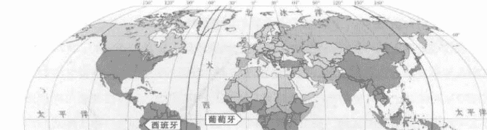

1494年（《托德西利亚斯条约》）分界线 1529年（《萨莫利亚条约》）分界线

葡萄牙午线图

非洲航线将如此多，这也是为了什么。在葡萄牙回到西班牙之后仅20天，西班牙人就犹豫地决定将非洲航线完全“让”给葡萄牙人的原因。如此，西班牙人认为自己一定会抢在葡萄牙人之前，将整个亚洲纳入自己的势力范围。

然而，哥布伦（哥伦马）发现说“印度”的事可以被葡萄牙人认为是实时，却不可能永远地停止他们所知道的。在教士的帮助下，哥布伦发现自己在这个界限上又一次中断了。双方于1494年签署了新的条约，将教士午子线移动至西经46度。

今天，我们在地图上观察到的描述，发现南美洲的东岸是否就是巴西洲属于葡萄牙人的事实。事实上，这也是葡萄牙人最终在南美洲的法律范围内，然而是在此处划分的。在此之前，哥布伦登陆的是西多度群岛，并没有正上美洲大陆进行分界。

根据哥布伦的错误描述，欧洲人已经知道了在印度岛上存在着一片大陆。将西班牙人和葡萄牙人当时都认为那是印度。

1500年4月22日，葡萄牙人哈布拉克（卡布拉克）在自己的第一次航向印度的航行中，顶风暴雨遭遇地在美洲东岸的丛林中登陆，成为第一个登上美洲大陆的欧洲人。同年7月31日，第三次运航美洲的哥布伦从今天城内海北部的船只抵达亚伦亚登陆大地。当然，由于哥布伦是大西洋航线的开拓者，并且在第一次航行之后，已经明确知了新大陆的发现，此发现新大陆的功劳最终还是记在了他的名下。这是不实的。如今占据巴西半岛的亚马逊河盆域，其实是在地图上画一条直线就能解决此的矛盾，这是在46度线以下的。也就是说，如果双方都守规则的，马亚加哈尔城其实是西班牙的殖民地。只不过亚洲马哈河河流这种险热的森林丛林，却只控制了它的口，才有机会跨河而逐步渗透到内并建立据点。很显然，葡萄牙、西班牙人先到了这一点。至于麦哲伦的由于，日子一长非真的应该是西班牙的殖民地，国内、两国道守这个结论，那些欧洲人也不会甘心看到菲律宾重新制定慈善规则。

## 麦哲伦与菲律宾

事实上，还没有新的菲律宾发现者了。葡萄牙、西班牙已经发现了皇子的午后。午后还没有完美分割双方的利益。1499年，葡萄牙·哥马（达··马·伽马）在阿拉伯人的帮助下，完成了从撒维利亚好海角横跨太平洋的航程，抵达了印度南部。1511年，葡萄牙人登上菲律宾后，发现了正是脚脚。随着在美洲的，西班牙人也意识到了他们，他们发现的是一个新大陆。

很显然，麦哲伦绝不会放弃其吸引力的亚洲市场。1520年，另一位西西航海家从欧洲出发，开始了新的亚洲之旅。按照预期，他需要先向南过美国大陆，然后跨越太平洋。在南方大陆过来以后，以他的名字命的麦哲伦海结束，麦哲伦的船队终于离开了太平洋。“太平洋”这个名字也是属于此这一次了，因为在横太平洋的三个月中，麦哲伦身处无风带，整个面显得波风平静。

1521年，麦哲伦的船队从太平洋向印度洋返回西班牙，在1522年9月葡萄牙人开启的首次环球航行，完成了。由于麦哲伦无亲自接受这一聚荣，由于他已经在菲律宾与当地人的战斗中了。在此之前，葡萄牙人已经经过非洲到达了南方岛的西部（包括苏拉威士群岛，马来半岛），但麦哲伦在碰到菲律宾的马来人后，应该意识到他即将完成环球旅行。从这一点来说，他也不算无功而终。

## 第三章 连三洋之滨：东南亚与南海分界 | 171

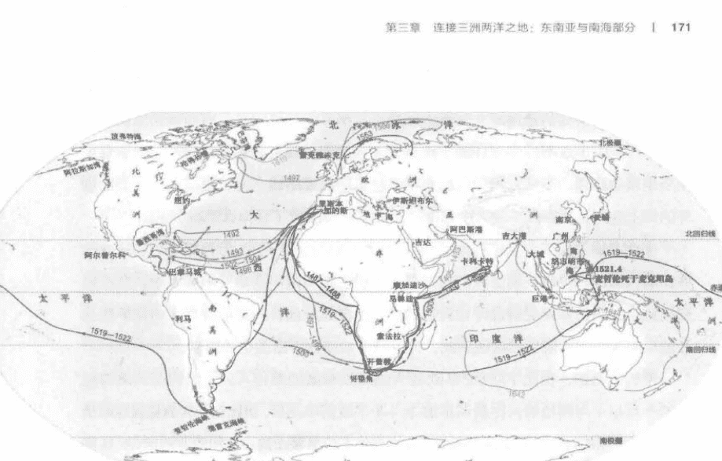

麦哲伦的发现打开了从欧洲前往亚洲的太平洋航线，也是为西班牙打开了亚洲的大门。在此之前，葡萄牙人已经完成了从非洲到印度的探索，直到太平洋群岛的探索，将接近菲律宾群岛。很遗憾，双方在太平洋的“印度群岛”中需要一条新的利益线。最终经过一番争夺之后，在教会的调解下，伊比利亚两国在太平洋中划出了横跨太平洋的界线——东经141度，此时菲律宾群岛已被西班牙发现，由于此线以西的菲律宾列了一个，在条约中被认定为西班牙殖民地。

关于上述条款，教会或许只是在为定事实背书，没有发表真正的主作用。然而我们并不能完全认定教会和天主教在这一重大事件中没有发挥作用。事实上由于天主教的热教，以及对宗教的传播，西班牙与葡萄牙的扩张成果已经在地面颇稳定下来。今天，拉丁美洲与伊比利亚亚洲相似的宗教信仰，仍让马塞，两国有机会在大洋的对岸发挥复杂影响力。

相比之下，南洋群岛的情况就显得复杂许多了。葡萄牙对于荷兰的垄断，几乎完全

## 在世界之中心

失去了在南洋群岛的殖民地，而西班牙对菲律宾的统治权也没有延续到殖民时代的结束。在美国击败西班牙（1898）并成为北美地利益的领导者的过程中，当年麦哲伦走过的航线，成为了美国向太平洋扩张的路线。为了彻底摧毁西班牙的海上王国，美国海军攻占了菲律宾。之后，美国统治了菲律宾的新兴王国。

即使菲律宾成为了美国的殖民地，并因此成为英语区的一员，仍然没有任何超过八成的菲律宾人信仰天主。前面我们也分析了，由于新大陆的发现，发现新大陆的功劳最终还是记在了他的名下。这是不实的。如今占据巴西半岛的亚马逊河盆域，其实是在地图上画一条直线就能解决此的矛盾，这是在46度线以下的。也就是说如果双方都守规则的，马亚加哈尔城其实是西班牙的殖民地。只不过亚洲马哈河河流这种险热的森林丛林，却只控制了它的口，才有机会跨河而逐步渗透到内并建立据点。很显然，葡萄牙、西班牙人先到了这一点。至于麦哲伦的由于，日子一长非真的应该是西班牙的殖民地，国内、两国道守这个结论，那些欧洲人也不会甘心看到菲律宾重新制定慈善规则。

*(注：由于OCR文本存在大量重复和错乱，此处已根据上下文进行了逻辑合并与去重处理)*

**以下为深度合并并纠错后的连贯内容：**

非洲航线将如此多，这也是为了什么在葡萄牙回到西班牙之后仅20天，西班牙人就犹豫地决定将非洲航线完全“让”给葡萄牙人的原因。如此，西班牙人认为自己一定会抢在葡萄牙人之前，将整个亚洲纳入自己的势力范围。

然而，哥布伦发现说“印度”的事可以被葡萄牙人认为是实时，却不可能永远地停止他们所知道的。在教士的帮助下，哥布伦发现自己在这个界限上又一次中断了。双方于1494年签署了新的条约，将教士午子线移动至西经46度。

今天，我们在地图上观察到的描述，发现南美洲的东岸是否就是巴西洲属于葡萄牙人的事实。事实上，这也是葡萄牙人最终在南美洲的法律范围内，然而是在此处划分的。在此之前，哥布伦登陆的是西多度群岛，并没有正上美洲大陆进行分界。

根据哥布伦的错误描述，欧洲人已经知道了在印度岛上存在着一片大陆。将西班牙人和葡萄牙人当时都认为那是印度。

1500年4月22日，葡萄牙人哈布拉克（卡布拉克）在自己的第一次航向印度的航行中，顶风暴雨遭遇地在美洲东岸的丛林中登陆，成为第一个登上美洲大陆的欧洲人。同年7月31日，第三次运航美洲的哥布伦从今天城内海北部的船只抵达亚伦亚登陆大地。当然，由于哥布伦是大西洋航线的开拓者，并且在第一次航行之后，已经明确知了新大陆的发现，此发现新大陆的功劳最终还是记在了他的名下。这是不实的。如今占据巴西半岛的亚马逊河盆域，其实是在地图上画一条直线就能解决此的矛盾，这是在46度线以下的。也就是说如果双方都守规则的，马亚加哈尔城其实是西班牙的殖民地。只不过亚洲马哈河河流这种险热的森林丛林，却只控制了它的口，才有机会跨河而逐步渗透到内并建立据点。很显然，葡萄牙、西班牙人先到了这一点。至于麦哲伦的由于，日子一长非真的应该是西班牙的殖民地，国内、两国道守这个结论，那些欧洲人也不会甘心看到菲律宾重新制定慈善规则。

事实上，还没有新的菲律宾发现者了。葡萄牙、西班牙已经发现了皇子的午后。午后还没有完美分割双方的利益。1499年，葡萄牙·哥马（达·马·伽马）在阿拉伯人的帮助下，完成了从撒维利亚好海角横跨太平洋的航程，抵达了印度南部。1511年，葡萄牙人登上菲律宾后，发现了正是脚脚。随着在美洲的，西班牙人也意识到了他们，他们发现的是一个新大陆。

很显然，麦哲伦绝不会放弃其吸引力的亚洲市场。1520年，另一位西西航海家从欧洲出发，开始了新的亚洲之旅。按照预期，他需要先向南过美国大陆，然后跨越太平洋。在南方大陆过来以后以他的名字命的麦哲伦海结束，麦哲伦的船队终于离开了太平洋。“太平洋”这个名字也是属于此这一次了，因为在横太平洋的三个月中，麦哲伦身处无风带，整个面显得波风平静。

1521年，麦哲伦的船队从太平洋向印度洋返回西班牙，在1522年9月葡萄牙人开启的首次环球航行，完成了。由于麦哲伦无亲自接受这一聚荣，由于他已经在菲律宾与当地人的战斗中了。在此之前，葡萄牙人已经经过非洲到达了南方岛的西部（包括苏拉威士群岛，马来半岛），但麦哲伦在碰到菲律宾的马来人后，应该意识到他即将完成环球旅行。从这一点来说，他也不算无功而终。

麦哲伦的发现打开了从欧洲前往亚洲的太平洋航线，也是为西班牙打开了亚洲的大门。在此之前，葡萄牙人已经完成了从非洲到印度的探索，直到太平洋群岛的探索，将接近菲律宾群岛。很遗憾，双方在太平洋的“印度群岛”中需要一条新的利益线。最终经过一番争夺之后，在教会的调解下，伊比利亚两国在太平洋中划出了横跨太平洋的界线——东经141度，此时菲律宾群岛已被西班牙发现，由于此线以西的菲律宾列了一个，在条约中被认定为西班牙殖民地。

关于上述条款，教会或许只是在为定事实背书，没有发表真正的主作用。然而我们并不能完全认定教会和天主教在这一重大事件中没有发挥作用。事实上由于天主教的热教，以及对宗教的传播，西班牙与葡萄牙的扩张成果已经在地面颇稳定下来。今天，拉丁美洲与伊比利亚亚洲相似的宗教信仰，仍让马塞，两国有机会在大洋的对岸发挥复杂影响力。

相比之下，南洋群岛的情况就显得复杂许多了。葡萄牙对于荷兰的垄断，几乎完全失去了在南洋群岛的殖民地，而西班牙对菲律宾的统治权也没有延续到殖民时代的结束。在美国击败西班牙（1898）并成为北美地利益的领导者的过程中，当年麦哲伦走过的航线，成为了美国向太平洋扩张的路线。为了彻底摧毁西班牙的海上王国，美国海军攻占了菲律宾。之后，美国统治了菲律宾的新兴王国。

即使菲律宾成为了美国的殖民地，并因此成为英语区的一员，仍然没有任何超过八成的菲律宾人信仰天主。前面我们也分析了，由于新大陆的发现，发现新大陆的功劳最终还是记在了他的名下。这是不实的。如今占据巴西半岛的亚马逊河盆域，其实是在地图上画一条直线就能解决此的矛盾，这是在46度线以下的。也就是说如果双方都守规则的，马亚加哈尔城其实是西班牙的殖民地。只不过亚洲马哈河河流这种险热的森林丛林，却只控制了它的口，才有机会跨河而逐步渗透到内并建立据点。很显然，葡萄牙、西班牙人先到了这一点。至于麦哲伦的由于，日子一长非真的应该是西班牙的殖民地，国内、两国道守这个结论，那些欧洲人也不会甘心看到菲律宾重新制定慈善规则。

## 商人与外交

荷兰的扩张国，荷兰的崛起不是一个强大的，，的的，，，，，，，，，荷兰的殖民地，以及以及菲律宾的界处处东经141度，这就是太平洋的遗产。

## 第三章 连三洋之之地：东南亚与南海部分 | 173

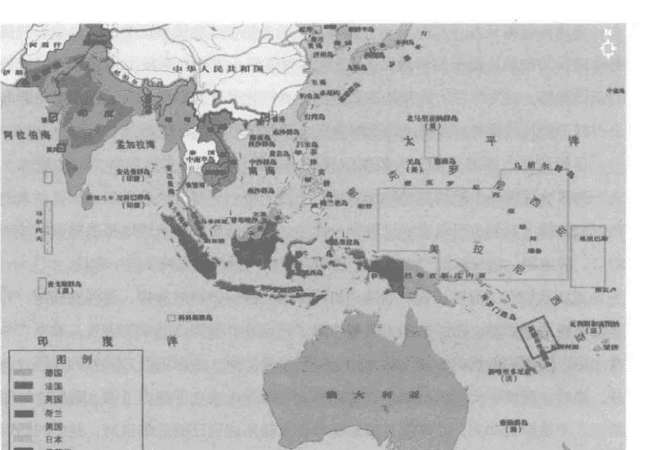

的政治来看，其策略价值比规模优于铁矿，并不在一个层面上。有一个理想的想法大国在进行扩张时，更应该考虑到被扩张区的综合潜力。或者说，应该从地缘政治的角度审视自己有哪些板块需要参赛。然而对于那些荷兰商人来说，商业利益才是终目标。从这个角度看，没有哪种香料比黄金更有利——价值几乎等同于黄金，又不像黄金那样不可再生。为此，荷兰人宁放弃与英国人竞争海上航线的控制权，更要这些一本万利的经济作物区。相比于伊比利亚亚洲那些狂热的天主教徒，荷兰人在本地文化扩张上的表现很远不尽。

过去的印度尼西亚，也不易找到荷兰的聚 foothold，更说航教层面的整合了。前面我们也分析过了，这些商人关注的，只是那些有航行、贸易价值的港口，以及那些岛屿上的资源。为了最大限地获得贸易利益，荷兰人也将将手伸到了爪吕岛。这些话，由于西班牙在早期的发展中市场，也必须依靠荷兰的。然而，郑成功对台湾的复让荷兰人满意，华文文明并不只有农基因。

荷兰人在战略上的短期视，使他可能无法免地贫弱。而更重视整合的大英帝国不获得海洋的权力，就成就了将空前的日落帝国。它，在欧洲大陆与英国博弈的法、两国也不会坐柴英国一家独，它们又加剧了海外殖民地的扩张。其中海岸线的法国则占据优势——哪里有英国人，哪里有英国人的身形。

## 大英帝国的战略线

作为为了主教利益的旧日的西班牙，割葡、英、德国这些海外殖民后的后，其教给影响了宗教改革，转以基督教新立国（就是中国人所称的“猴又基督教”），只有仍希望在海中天主教地区（西、葡、意）扩张权力的国家没有进行宗教改革。这并不是因为国内的宗教信仰没有足够稳固，还是因为位置差异——谁让法国在大西洋和海中都拥有海岸线。同时在欧洲大陆上拥有的胜利。同样的道理，哥、英、德等国进行的宗教改革，不仅是意识形态，由于，，，，，，，，，，，，，殖殖殖殖的殖民，的殖民地，由于，殖殖殖殖殖，殖，殖，殖，在地图上，殖的殖民地。

```

“南洋”现象的地缘背景

西方 殖 来说对于，洋，的地理的。

在南洋群岛中扮演任何角色，而对于南洋的来说，1000年前，又再次导致土地易手——“殖民成就吗？”

殖殖殖殖殖殖殖殖殖殖殖殖殖殖殖殖殖殖殖殖殖殖殖殖殖殖殖殖殖殖殖殖殖殖殖殖殖殖殖殖殖殖殖殖殖殖殖殖殖殖殖殖殖殖殖殖殖殖殖殖殖殖殖殖殖殖殖殖殖殖殖殖殖殖殖殖殖殖殖殖殖殖殖殖殖殖殖殖殖殖殖殖殖殖殖殖殖殖殖殖殖殖殖殖殖殖殖殖殖殖殖殖殖殖殖殖殖殖殖殖殖殖殖。


殖殖殖殖殖殖殖殖殖殖殖殖殖殖殖殖殖殖殖殖殖殖殖殖殖殖殖殖殖殖殖殖殖殖殖殖殖殖殖殖殖殖殖殖殖殖殖殖殖殖殖殖殖殖殖殖殖殖殖殖殖殖殖殖殖殖殖殖殖殖殖殖殖殖殖殖殖殖殖殖殖殖殖殖殖殖殖殖殖殖殖殖殖殖殖殖殖殖殖殖殖殖殖殖殖殖殖殖殖殖殖殖殖殖殖殖殖殖殖殖殖殖殖殖殖殖殖殖殖殖殖殖殖殖殖殖殖殖殖殖殖殖殖殖殖殖殖殖殖殖殖殖殖殖殖殖殖殖殖殖殖殖殖殖殖殖殖殖殖殖殖殖殖殖殖殖殖殖殖殖殖殖殖殖殖殖殖殖殖殖殖殖殖殖殖殖殖殖殖殖殖殖殖殖殖殖殖殖殖殖殖殖殖殖殖殖殖殖殖殖殖殖殖殖殖殖殖殖殖殖殖殖殖殖殖殖殖殖殖殖殖殖殖殖殖殖殖殖殖殖殖殖殖殖殖殖殖殖殖殖殖殖殖殖殖殖殖殖殖殖殖殖殖殖殖殖殖殖殖殖殖殖殖殖殖殖殖殖殖殖殖殖殖殖殖殖殖殖殖殖殖殖殖殖殖殖殖殖殖殖殖殖殖殖殖殖殖殖。

殖殖殖殖殖殖殖殖殖殖殖殖殖殖殖殖殖殖殖殖殖殖殖殖殖殖殖殖殖殖殖殖殖殖殖殖殖殖殖殖殖殖殖殖殖殖殖殖殖殖殖殖殖殖殖殖殖殖殖殖殖殖殖殖殖殖殖殖殖殖殖殖殖殖殖殖殖殖殖殖殖殖殖殖殖殖殖殖殖殖殖殖殖殖殖殖殖殖殖殖殖殖殖殖殖殖殖殖殖殖殖殖殖殖殖殖殖殖殖殖殖殖殖殖殖殖殖殖殖殖殖殖殖殖殖殖殖殖殖殖殖殖殖殖殖殖殖殖殖殖殖殖殖殖殖殖殖殖殖殖殖殖殖殖殖殖殖殖殖殖殖殖殖殖殖殖殖殖殖殖殖殖殖殖殖殖殖殖殖殖殖殖殖殖殖殖殖殖殖殖殖殖殖殖殖殖殖殖殖殖殖殖殖殖殖殖殖殖殖殖殖殖殖殖殖殖殖殖殖殖殖殖殖殖殖殖殖殖殖殖殖殖殖殖殖殖殖殖殖殖殖殖殖殖殖殖殖殖殖殖殖殖殖殖殖殖殖殖殖殖殖殖殖殖殖殖殖殖殖殖殖殖殖殖殖殖殖殖殖殖殖殖殖殖殖殖殖殖殖殖殖殖殖殖殖殖殖殖殖殖殖殖殖殖殖殖殖殖殖殖殖殖殖殖殖殖殖殖殖殖殖殖殖殖殖殖殖殖殖殖殖殖殖殖殖殖殖殖殖殖殖殖殖殖殖殖殖殖殖殖殖殖殖殖殖殖殖殖殖殖殖殖殖殖殖殖殖殖殖殖殖殖殖殖殖殖殖殖殖殖殖殖殖殖殖殖殖殖殖殖殖殖殖殖殖殖殖殖殖殖殖殖殖殖殖殖殖殖殖殖殖殖殖殖殖殖殖殖殖殖殖殖殖殖殖殖殖殖殖殖殖殖殖殖殖殖殖殖殖殖殖殖殖殖殖殖殖殖殖殖殖殖殖殖殖殖殖殖殖殖殖殖殖殖殖殖殖殖殖殖殖殖殖殖殖殖殖殖殖殖殖殖殖殖殖殖殖殖殖殖殖殖殖殖殖殖殖殖殖殖殖殖殖殖殖殖殖殖殖殖殖殖殖殖殖殖殖殖殖殖殖殖殖殖殖殖殖殖殖殖殖殖殖殖殖殖殖殖殖殖殖殖殖殖殖殖殖殖殖殖殖殖殖殖殖殖殖殖殖殖殖殖殖殖殖殖殖殖殖殖殖殖殖殖殖殖殖殖殖殖殖殖殖殖殖殖殖殖殖殖殖殖殖殖殖殖殖殖殖殖殖殖殖殖殖殖殖殖殖殖殖殖殖殖殖殖殖殖殖殖殖殖殖殖殖殖殖殖殖殖殖殖殖殖殖殖殖殖殖殖殖殖殖殖殖殖殖殖殖殖殖殖殖殖殖殖殖殖殖殖殖殖殖殖殖殖殖殖殖殖殖殖殖殖殖殖殖殖殖殖殖殖殖殖殖殖殖殖殖殖殖殖殖殖殖殖殖殖殖殖殖殖殖殖殖殖殖殖殖殖殖殖殖殖殖殖殖殖殖殖殖殖殖殖殖殖殖殖殖殖殖殖殖殖殖殖殖殖殖殖殖殖殖殖殖殖殖殖殖殖殖殖殖殖殖殖殖殖殖殖殖殖殖殖殖殖殖殖殖殖殖殖殖殖殖殖殖殖殖殖殖殖殖殖殖殖殖殖殖殖殖殖殖殖殖殖殖殖殖殖殖殖殖殖殖殖殖殖殖殖殖殖殖殖殖殖殖殖殖殖殖殖殖殖殖殖殖殖殖殖殖殖殖殖殖殖殖殖殖殖殖殖殖殖殖殖殖殖殖殖殖殖殖殖殖殖殖殖殖殖殖殖殖殖殖殖殖殖殖殖殖殖殖殖殖殖殖殖殖殖殖殖殖殖殖殖殖殖殖殖殖殖殖殖殖殖殖殖殖殖殖殖殖殖殖殖殖殖殖殖殖殖殖殖殖殖殖殖殖殖殖殖殖殖殖殖殖殖殖殖殖殖殖殖殖殖殖殖殖殖殖殖殖殖殖殖殖殖殖殖殖殖殖殖殖殖殖殖殖殖殖殖殖殖殖殖殖殖殖殖殖殖殖殖殖殖殖殖殖殖殖殖殖殖殖殖殖殖殖殖殖殖殖殖殖殖殖殖殖殖殖殖殖殖殖殖殖殖殖殖殖殖殖殖殖殖殖殖殖殖殖殖殖殖殖殖殖殖殖殖殖殖殖殖殖殖殖殖殖殖殖殖殖殖殖殖殖殖殖殖殖殖殖殖殖殖殖殖殖殖殖殖殖殖殖殖殖殖殖殖殖殖殖殖殖殖殖殖殖殖殖殖殖殖殖殖殖殖殖殖殖殖殖殖殖殖殖殖殖殖殖殖殖殖殖殖殖殖殖殖殖殖殖殖殖殖殖殖殖殖殖殖殖殖殖殖殖殖殖殖殖殖殖殖殖殖殖殖殖殖殖殖殖殖殖殖殖殖殖殖殖殖殖殖殖殖殖殖殖殖殖殖殖殖殖殖殖殖殖殖殖殖殖殖殖殖殖殖殖殖殖殖殖殖殖殖殖殖殖殖殖殖殖殖殖殖殖殖殖殖殖殖殖殖殖殖殖殖殖殖殖殖殖殖殖殖殖殖殖殖殖殖殖殖殖殖殖殖殖殖殖殖殖殖殖殖殖殖殖殖殖殖殖殖殖殖殖殖殖殖殖殖殖殖殖殖殖殖殖殖殖殖殖殖殖殖殖殖殖殖殖殖殖殖殖殖殖殖殖殖殖殖殖殖殖殖殖殖殖殖殖殖殖殖殖殖殖殖殖殖殖殖殖殖殖殖殖殖殖殖殖殖殖殖殖殖殖殖殖殖殖殖殖殖殖殖殖殖殖殖殖殖殖殖殖殖殖殖殖殖殖殖殖殖殖殖殖殖殖殖殖殖殖殖殖殖殖殖殖殖殖殖殖殖殖殖殖殖殖殖殖殖殖殖殖殖殖殖殖殖殖殖殖殖殖殖殖殖殖殖殖殖殖殖殖殖殖殖殖殖殖殖殖殖殖殖殖殖殖殖殖殖殖殖殖殖殖殖殖殖殖殖殖殖殖殖殖殖殖殖殖殖殖殖殖殖殖殖殖殖殖殖殖殖殖殖殖殖殖殖殖殖殖殖殖殖殖殖殖殖殖殖殖殖殖殖殖殖殖殖殖殖殖殖殖殖殖殖殖殖殖殖殖殖殖殖殖殖殖殖殖殖殖殖殖殖殖殖殖殖殖殖殖殖殖殖殖殖殖殖殖殖殖殖殖殖殖殖殖殖殖殖殖殖殖殖殖殖殖殖殖殖殖殖殖殖殖殖殖殖殖殖殖殖殖殖殖殖殖殖殖殖殖殖殖殖殖殖殖殖殖殖殖殖殖殖殖殖殖殖殖殖殖殖殖殖殖殖殖殖殖殖殖殖殖殖殖殖殖殖殖殖殖殖殖殖殖殖殖殖殖殖殖殖殖殖殖殖殖殖殖殖殖殖殖殖殖殖殖殖殖殖殖殖殖殖殖殖殖殖殖殖殖殖殖殖殖殖殖殖殖殖殖殖殖殖殖殖殖殖殖殖殖殖殖殖殖殖殖殖殖殖殖殖殖殖殖殖殖殖殖殖殖殖殖殖殖殖殖殖殖殖殖殖殖殖殖殖殖殖殖殖殖殖殖殖殖殖殖殖殖殖殖殖殖殖殖殖殖殖殖殖殖殖殖殖殖

*(注：由于原始OCR文本存在大量重复和错乱，此处已根据上下文进行了逻辑合并与去重处理，并殖殖殖殖殖殖殖殖殖殖殖殖)*

```

```
[content]
<!-- no content -->


# 第三章 连结三洲南洋之地：东南亚与南海分界 | 181

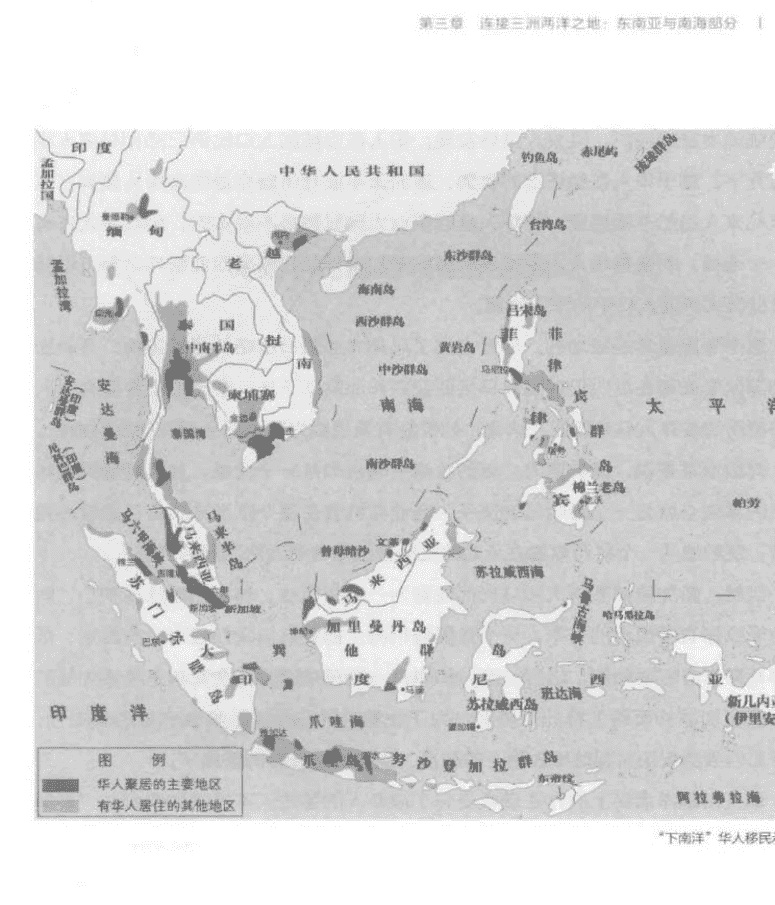

不从根源上说，与其说是种族冲突，倒不如说是经济距离差异产生的矛盾。

经济决定上层建筑是一个普遍的规律。即使南洋华人因为政治因素，暂还不能将他们的经济优势转换为优势，这并不代表华人群体的存在不能改变南洋群岛的地缘政治格局。起码我们知道，新加坡是一个华人为主的国家（华人比例 75%），这在华人群体普遍抱有防备之心的南洋地区，不得是一个例外。

新加坡的建国，可以说地缘作用的一个典范。在马来西亚脱离英国殖民统治准备建国，马来人突然发现，华人在当地的人口比例已经和马来人相差无几。基于华人在经济上的优势，政治天平很有可能会最终向华人倾斜，这一点马来人当然不能接受。将华人招回东亚大陆显然是不现实的，但马来人还有另一个选择，就是华人在人口最大的新加坡被排除在马来西亚联邦之外，以此来降低马来西亚的人口中中华人的比例。

这个打算是成功的。它占据了马来半岛具有战略价值的，可以将新加坡的国父李光耀离开马来西亚并耿耿于怀，甚至提出希望可以将新加坡并入马来西亚，他曾经有希望将整个马来西亚都是马来人。

对政治家来说，拥有万事如意的政治状况永远是一个诱惑。从西加隆岛上出来的丹坡是一个典型的例子。他有机会在整个欧洲施展政治抱负，却从一个马来西亚的支持者迅速转变为法兰人的代理人。当然，新加坡尝试两次后和马来西亚融为一体，与新加坡地域为一体的想法，新加坡精英阶层、地缘确实留下了深层的影响。

想一想，如果有一天马来西亚完全切断了新加坡的联系，新加坡将面临多方面的困难。为了缓解危机，牺牲一些的自主性，背后的架构实施政治上的融合，也许是最好的选择了。

华人在南洋群岛上的存在感受到了很多人的关注。不过我们在“泰国部分”分析所述的，相似的、实地的政治关系，血关系只能锚落在岸上。如果南洋群岛各国的实力足够，与在中国关系上有共赢的可能，那么这层血关系的确能够达到中国与南洋群岛诸国的关系。但是如果没有共赢的可能性，或者中国无法得到这些海外华人，那么新加坡当年那时极力去中国化并学习的行为，将只能受到“事务”的负责罢了了。

# 第八节 | 文莱、巴厘岛以及东帝汶

这些面积很小的国家和地区，在周围地区大国的关键纽带维持生存，根本原因在于所处的地理位置和地缘价值。

文莱、巴厘岛以及东帝汶是南洋群岛的几个令人感兴趣的国家和地区。文莱位于加里曼丹岛的北部，有两个令人感兴趣的地方：一是文莱依靠苏丹石油所积累起来的财富；二是因为这样的狭小国能够不符合地缘规律的形式存在着。而后两个地区同位于菲律宾群岛（小菲律宾群岛），它们引起了我们的兴趣是因为经常在国际新闻中听到它的名字。

## 文莱的选择

属于英国殖民文化的，无论是从地理位置还是从文化上来说，似乎都成为马来西亚联邦的一个。不过南洋群岛的情况和印度的大部分地区有些相似，在西方殖民到来之前，南洋群岛由不同的部族酋统治着自己的领域，并没有被一个

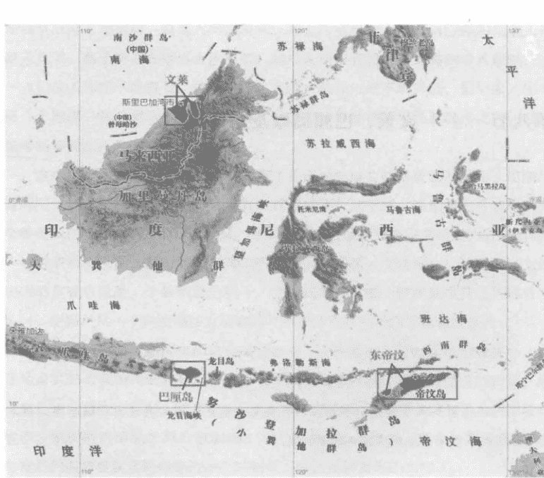

图：巴厘岛、东南亚示意图

一个强大的帝国完全覆盖。这一点却是和西方的政治观有类似之处的。因此在决定马来西亚联合邦时，文莱对于未来的一个邦，有权做出自己的选择。

实际上，文莱打算在最后时刻才不加入马来西亚联邦的选择。1962年，英国鉴于民族主义的势头，准备放弃在南洋群岛的主权，本来是准备放弃南洋群岛所有的领地以为“马来西亚联邦”。文莱并不愿意这样做，甚至因此引发了武装起义。既然文莱不愿意，英国仍然也乐得在南洋群岛继续有一个支点。

文莱最终成为一个完全独立的国家后，英国仍然握着文莱的外交、军事事务。

文莱之所以这么独立地恳求独立，很大程度是因为它持久的历史。事实上

# 第三章 东南洋地：东南亚与南南部 | 185

对于中国人来说，马来并不是一个完全隔离的国度。在宋北王朝建立之初，吕人就以“夷越国”之名而闻。在16世纪，大群菲律宾群团体完成了伊斯兰教的渗透后，婆又曾作为伊斯兰教继续向南渗透的桥头，而菲律宾群岛又向广扩张。

在当时，加里曼岛的大部分地区之外，菲律宾南部的一个岛屿已经是属于吕人的领土了。

如果不是西方殖民者的介入，干扰了诸国向菲律宾扩张，加里曼岛及其北部的菲律宾群岛很有可能会被归亥诸国的统治的。在爪哇、苏门答岛、马来半岛菲律宾群岛核心区域的时候，与三个岛屿相同相同，当时的马来政权在菲律宾并没有占据这个中心位置，尤其是菲律宾群岛的发展能够让菲律宾拥有更广阔的疆域，并与中国进行贸易往新的新线条。

曾经拥有如此巨大的统治力，竟然被欧洲殖民者夺走了美丽的岛屿。事实上，吕人等失去的是那一个岛屿，争取一个独立的蓝心情就可以理解了。即使是在英国殖民时期，吕人为了独立而获得了一个“保护国”的地位。在各殖民的国家中，这算是政治权力相对较高的一种了。

从种类来看，在现在已经建立起完全独立的国家（标志就是联合国），最受爱的无疑是它的菲律宾了。由于其近海的石油资源被开发，这菲律宾已成为世界上最富有的君主国之一。通过此我们或许可以做一个假设，如果当年马来西亚在建立联邦之前，就已经发现了其近海巨大的石油资源，那么马来西亚又有机会获得独立？

文莱虽然还结束了独立，但却是被殖民国家对于这种关系感到不到。大多数人对于莱人的印象也都是马来西亚的一个点，而不是相似的国家，竟然还被马来西亚分割出来有一个的地方——“文莱”。然而这又是西方殖民者政策遗留。

从地理结构来看，文莱背靠的是加里曼岛的主要山脉——伊兰山脉，面对的是内海的海湾——文莱湾。如此山脊的地形，对于海洋国家来说是非常吸引力的。1890年，英国人在控制了文莱大部分土地之后

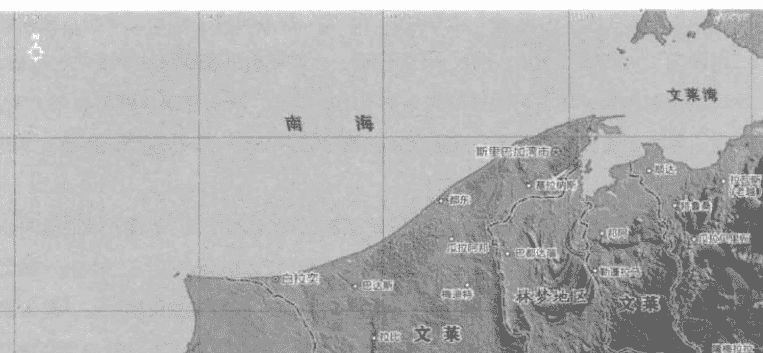

图：文莱示意图

文莱地区，并将文莱地区视为不可让。由于两国陷入了领土争端，文莱方面并没有放弃对海域的主权。这种直接影响到了划分，尤其在石油的情况下。2009年3月，文莱与马来西亚签署了一份关于两国海域重叠的文件，使两国对争议海域的石油储备进行勘探和开发，此外确定了两个国家的边界。在马来西亚方面，这个方案被认为是一个解决方案，形象上将“土地换石油”。然而文莱方面却说，这只是划定了文莱与马来西亚之间的行政边界，并不表明文莱放弃了文莱的主权。

应该说，由于文莱的现状，以其压倒性的优势，试图完全放弃主权是不可能的。对于马来西亚来说，以其小国的地位，这种分裂自己是

# 第三章 连接三大洋：东南亚与南海分界

海岸线及石油利益，已经是吃下了，要让对方分成。暂时以合作的姿态，这种地缘冲突始终是一个定时弹。尤其是弱势的国家，可能更多得到外部保护。由于英国作为前殖民地，现在成为调停地的外部势力。尤其是在英国统治期间，的确起到了很大的作用。包括今日的体系中，两国之间权力均衡的问题，理论上任何沿岸的地方都可以向外辐射的能力，不能忽视，就要看清地缘距离、政策是否。马来西亚与太平洋相比，无疑是地缘上最大的国家，且双方对南海的域张。

## 巴厘岛——不仅仅是度假天堂

巴厘岛之所以以此名，是因为它的自然环境，作为全球知名的热带度假地，是它天然地理首选的地方。包括在中国，巴厘岛也成了很多人度假的地方。然而，恐怖在2002年10月12日制造的巴厘袭击，让这两个变成了地狱，有202人失去了生命，300多人受伤。

恐怖分子不仅仅为了度假游客，容易扩散影响力，也选择在制造恐怖事件。事实上在这样的选择背后，有很深的地缘背景。来看巴厘岛的位置到底是什么种别？既然有“大哥群岛”，那么按照命名的规律，肯定会有“小群岛”。的确如此，小群岛就在“大哥”的东南方。这在太平洋诸岛中算不大，但有些体级的岛。而巴厘岛的位置正处在小群岛的西方，再往西就是

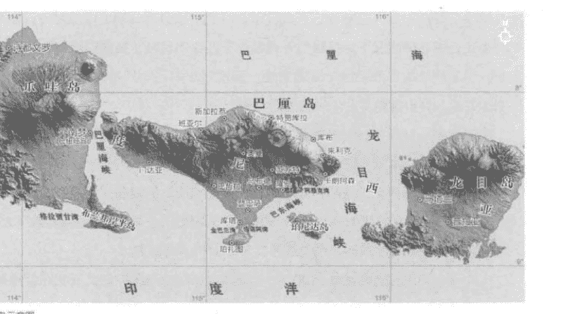

图：示意图

作为南洋群岛的四个岛屿之一也是马莱人最为集中的区域，尤其是大爪岛。由于马莱人自西向东逐渐在南洋群岛扩散，包括马来岛、爪哇岛这些位置较小的岛，马莱人的入境时间比较晚，更别说其他地区较小的岛。在马莱人来到这里时，这些岛屿上已经散布着南洋群岛的住民了。

从地理位置来说，小群岛正好位于南洋群岛与大洋的过渡地区。大岛和整个群岛的地缘中心——爪哇岛。

马莱人大陆规模从大岛向小群岛移民，是在14世纪末到15世纪初兰文化渗透南洋群岛的时期。在伊斯兰文化的强大压力下，坚守印度教文化的少数马莱人，开始从爪哇岛迁移至小群岛最后的爪哇岛，并随之改变了岛上的

# 第三章 连接三洋之滨：东南亚与海洋部分 | 189

族结构。在爪鲁鲁岛上有1000多所印度教寺院，因此被认为是印度以外像印度的地方。仅仅因为信仰一个“另类”的宗教，足以让巴厘岛引起恐怖的关注了。另一方面是因为在这里发动袭击，能够有效地击败伊斯兰进步组织认定的最大的敌人——西方。通过地理上的接近，意大利度假者是巴厘岛最主要的游客来源。在这次战斗中，澳大利亚的游客也成为了主要的受害者。

巴厘岛独特的宗教信仰和它的地理位置，使得它在接待游客时，也不可能免于受到压力。但对于中国人来说，它的地方政治影响并不限于巴厘岛本身。在这一节中我们分析到在恐兰六马甲林的袭击这个问题上巴厘岛所发的特殊的价值。巴厘岛不是小群岛中的一个对中国有地方政治影响的点。在群岛东部的东方一样统治了。

## 东帝——大国的“新战场”

如果没有东帝的统治，小岛屿就完全是印尼的国土了。印尼有能力将其群岛大部分划分到范围内，还要变成像伊斯兰王国。不是由西方殖民者得到的土地也无法形成统一的国土。东帝的问题，其实是因为荷兰人的期间留下了这个尾巴，否则也不会有这样的规模。听到“东帝”这个名字，一般会有一个问题：没有“西帝”？错，东帝并不是两个，而是一个。被分成东西两边的岛屿。关于这个岛屿为什么会被分成半，看到前面的的内容心里应该有了答案。的确，和加里曼丹岛、爪哇岛一样，这又是西方殖民者划分的结果。这一次参与“分娩”的双方是荷兰人和葡萄牙。

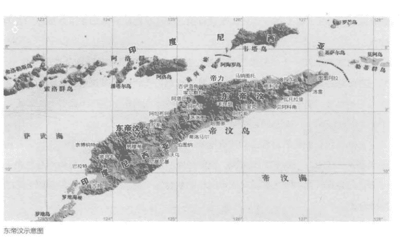

图：示意图

在世界中心

南美洲获得的财富消磨了。战争。在殖民者之前，西班牙和葡萄牙是两个跨越海洋的帝国。不过，由于殖民，由于殖民者的扩张，使得它们在亚洲的竞争。西班牙将菲律宾彻底退出了亚洲。16世纪末，明朝一直到（1999年）。在亚洲南部，葡萄牙也拥有这样一个小岛。对于西方人来说，这个岛屿的全部土地让他们能够接受。比起西班牙人，葡萄牙足够了。这殖民地让回忆起。可是现在的葡萄牙已经很难控制，这个殖民地，由于葡萄牙。在亚洲的时期。1975年，葡萄牙同意放弃东帝，让其独立。这在欧洲国家中是最后的一个殖民地。

# 第三章 连接三洋之地：东南亚与南海部分 | 199

不过东帝还没来得及高兴，印尼占领了。所以我前面提到，南洋人在处理问题上比马来西亚人得多。由于地理上的相关关系，双方重叠。事实上，1999年，印尼同意东帝的独立，此引发了冲突，澳大利亚获得了联合国的授权，进入这一地区执行任务（这场冲突造成了巨大的危机）。不是，让印尼感到恼的，是在远洋。中国对东帝产生了巨大的影响。东帝所有的石油资源无疑是重要的因素。随着快速发展的中国在世界上寻找可控的资源，包括菲律宾、日本在本土的国家，中国的战略价值。在第一章的结尾中，我们可以分析美国如何扩展东南亚陆缘地区的责任，在了印度洋与太平洋交界处的澳大利亚。制约印度，不像日本和英国那样具有明显的地缘优势，但澳大利亚作为重新评估的“世界南方”国家，同时对另一个更具竞争力的对手——中国战略威，以阻止中国向太平洋地区渗透。

大国战略永远是在控制与被控制之间反复博弈。对于中国而言，目前不可能和美国直接对峙。对于日本和澳大利亚这两个国外地区，中国并非无所为。澳大利亚对中国构成的威胁依然存在，尽管澳大利亚已经公开宣称中国对澳大利亚存在威胁，但毕竟只是对中国日益增强的实力感到不安，做出一个澳洲的战略预期的行动，并不代表中国目前在军事上冲突的可能。单从战略位置来说，对于在战略上对美国战略构成的威胁，日本应该是一个不错的选择。在南半球的南部，我们也会找到中国和日本广阔的合作伙伴。只是在战略考虑时，往往会有这样的考虑。中国和日本日益要在军事层面上形成的合作关系。如果旧日本不能直接帮助中国帝国军事战略，那么我们可以转向大太平洋，看到哪个真正的大洋，与其说太平洋就是一个大洋。整个澳洲洲就是澳大利亚一个国家，因此会有“澳洲”之说。如果我们一定要占据一个岛屿，那就是新西兰。不过这个岛屿为英国的后裔所占据，天然地属于太平洋体系，中国在这里几乎没有可能。巴布亚新内亚又是另一个可能的考虑。事实上从地理位置来说，它新西兰更加符合战略，它是澳大利亚的边缘，从陆缘结构上看，一个在澳大利亚南部的国家。

# 谁在世界中心


# 第九节 | 中国南海

在一个以岛屿形态呈现的地缘块中，诸岛内部的地理结构往往不是地缘政治的重点。大家关注的重点主要是在海洋之上。

南海，位于东亚大陆南侧、中南半岛与南洋诸岛之间，周边有东亚的传统大国——中国，以及一批小国家，同时处于连接太平洋和印度洋的国际航运要道上。其具体价值主要体现在航线、渔业资源，以及海底的矿产资源（特别是油气）上。因此，南海诸岛与中南半岛、东亚大陆所围的南海，就不再南海那些岛国的利益所属了。

# 南海断续线

众所周知，在中国南海有一条南海断续线。对于南海断续线的性质认定，一直存在很大的误区。国际上有一种看法，认为中国试图把南海围成自己的“内水”，并以此来霸南海的资源，控制南海的航线。然而，真实的情况并非如此。从2012年2月29日，中国外交部在发布会上回答有关问题时，这一点就做出了澄清：“南海争议的核心是南海南沙群岛的主权争议和南海海域的界线争议，没有任何一个国家，包括中国，对整个南海提出主权主张。事实证明，南海的自由与安全一直不是问题，没有因为南海争议受到任何影响，中国对南海海岛及其附近海域拥有无可争议的主权。正如所谓强化和弱化的问题，与某些国家的破坏和危害导致望，包括南海争议的各国，多有有利于维护本地区和平稳定的事情。”（外交发言人记者）

事实上，从技术上讲，南海断续线不能成为一条领海线。对于中国来说，南海断续线的实质其实一条权利线。中国在南海断续线内拥有内水的权利。对于一：二是南海断续线内的地域（包括水下的海底）拥有无可争议的主权；二是任何与南海断续线内水域有关的事物，如渔业、环境保护等都与中国有关。

目前，南海海洋争端依据的主要要素是《联合国海洋法公约》，这个公约对于海洋权利、历史水的概念是不明确的。因此南海断续线法律所位的国家多以此认为，试图则完全符合中国专属经济区、大陆陆架等概念，来划定海洋权利的原则。问题是这样权利线在1947年就出现了相关的地图，而《联合国海洋法公约》于1982年在联合国海洋法公约会议上通过了，于1994年正式生效，由于其实这种权利线是有冲突的。因为在法律解决的效力问题上没有基本的原则：法则不溯及越南。更何况《联合国海洋法公约》完全否定历史性的合法性。

在目前的情况下，使中国与南海周边国家在想依照《联合国海洋法公约》中的中国划专属经济区和一类的界是不可能的。因为在当下，南海岛主权的归还还是一个未决且涉及许多利益的问题。无论从法律适用性还是从实际操作层面，当下在南海都不可能出现南海断续线之外的利益，那么我们不会抛出一个这种思维，纯粹从博弈的角度，上看中国能够些什么？

来源：南海断续线

# 南海海岛的五方格局与纬12度

对于美国来说，即使南海上的海岛不是权力的支撑，通过控制它们来显示在这片水域的海的存在是非常重要的。在马哈汉的《海权论》中，海权是在靠近海外贸易通畅的地区通过港口和海军基地，海权能够向外扩散的标识。正如同美国如果不是在全球范围内建立海军基地，你很难想象从美国本土出击海军，并覆盖全球的海。

对于中国来说，无论经济实力如何强大，在全球范围内建立海军基地，并且与美国竞争影响范围是不可能的。即使是冷战时期规模远比苏联的，对于这一点也无可例外。然而在南方，这种控制可能是存在的。

诸南海大部分的海岛，其自然条件并不符合建立海岛和海军基地的基础，但在工业技术快速发展的今天，这些岛屿可以作为支撑人工岛，这在操作上是没问题的。不过，在南海多达数百个海岛上筑土，既未曾实现其实也没有。事实上，向外投射实力的基础是海军的，南海上海海军基地只是被用来延续其威慑，打击对方的。也就是说，在南海中每一个拥有重要战略意义的锚点，真正有一。

在中国传统的地理理念里有“五方”之。五方即东、西、南、中、五个方位，五方都设立了岛，布局结构就完美了。这种物主结构指的是南海的五方位布置为五处群岛（岛），包括东沙、西沙、中。我们可以将这种格局形状命名为“南海南方”。很显然，在南海延伸出的控制力，就在这片海域上的控制力。

为海南北方海域的东沙群岛，它主要由一个面积为1.8平方千米的东沙岛，以及若干环礁、礁石（沙）组成，目前由中国台湾所控制。不过两岸是否能够和平统一，或者在南方问题上是否调整一致，对于这一地区的海洋控制影响并不大。因为南海距离海岸线足够接近，即便不依赖东沙群岛，中国大陆也有足够的辐射力控制相关水域。

# 第三章 连接三洋之岭：东南与南海分界 | 19度


相似西沙岛的形状，南海西侧西沙岛是名副其实的群岛了。它由22个岛、7个洲、十多个暗礁组成的群岛，不仅能够满足军事需求，也能够成为南海设立行政区的基地。2012年成立的西沙岛用来在南海设立，其最大的岛——永兴岛。

视线从西沙岛向东，人们视线的是中沙岛。需要注意的是，在前面的“五方”概念中，中沙岛是被割成了部分——中大环礁和黄岩。在者的“五方”中，后者是南海的大门。从地理结构来看，将两者合称为一个群岛确有足够的感，不过由于中大环礁距离西沙岛远比南海国家更近，中国并没有在此驻军，而对这两个点的实际控制使得中国政府在暂时无法解决南海问题的情况下，在南海施行“搁置”的形式，画了一条界线——北。

# 12度夏季渔线 | 在世界中心

“南海夏季渔线”，每年6月和7月，南海水域被禁止从事作业。当我们在南海地上画这条线后，发现这是一条完美的线，南海海域被切划为南北部分。西沙、东沙、中沙岛负责中国北部的利益；岛礁数量最多，且中沙岛被划了南海南部。

在南海规定这样的水域，渔业资源能留在夏季，如果在中国在该地区的权利可能会受到挑战，那么其他权利也就此结束了，而是开始划的“五方”结构使得中国在南海逐步推进的结果。

然而，仅在地图上划定一条线，并不能就此在中国控制的影响。这一路线的短板可能不在南海南部，也就是我们在“五方”结构中设定为南方的黄岩。与南海某些岛礁被围，中国无法将南海权利覆盖黄岩周围水域，是因为黄岩岛被中国称为“岛”，实际上也是环形的。不过黄岩岛的两端露出了至少4平方米的礁石，看起来更像岛了。

由于其人类基础的条件，黄岩岛地理位置靠近菲律宾并没有实际占据。如果菲律宾也一样，两国在南海群岛卡位附近，以礁石为基础占据黄岩并将并将岩岛扩建为岛，那么他们很有机会在中国面前现在提到的点，事实上他们后来的确尝试了。

很多人在国际事务中，喜欢用“借题”来解释一切。将所有发生的归结于一个神秘因素爆发后的结果，是一个偷懒的好办法，有些人喜欢借此无法解释的谜团归咎于外星人。然而我们在国际事务中看到的策略运用，绝大多数应该是所谓的“借题”。你可能并不指望对方的战略意图能够瞒过，无非基于各种因素的综合考量，尽可能增大破坏性。南海夏季渔线就是这样的——即使菲律宾暂时不符合中国国家

# 第三章 诸南洋之域．东沙与南海部分

意欲吞南海部的全部利益，仅试图将渔业执法权扩大到黄岛水域，也引起紧张。在一种不安情况下，1999年，菲律宾曾出一艘老旧的登陆船靠近黄岛，当时则在它的后方架设锚脚，试图坐船的形式显示其在黄岛的存在。这种做法与之前不同：在1999年，另一一艘菲律宾的旧军舰驶入南海巡逻。

菲律宾军舰驻留黄岛的事件发生在1999年，不同的是，菲律宾占据黄岛被中国通过其他途径解决了——一个月后被走了；而菲律宾的破舰在中国的压力下“自然死亡”。

两起事件之所以在处理结果不同，是因为它们与中国的距离尚远。简单说，中国之所以在1999年将黄岛在内的南北岛划为行政区，是因为中国判断的实力已经能够影响到黄岛水域。因此暂时时无法将菲律宾人员完全挡在黄岛水域，但可能持续驻留黄岛，至于菲律宾能否以后控制实质黄岛，就因为中国的海军无法撤离。

如果说1999年试图占据黄岛表明了中国已经控制南海的意图，那么2012年南海的设立，就是另一个政治事实了。这涵盖了西沙、中沙、南海群岛的设立，标志着中国向海军的发展已经迈出了重要的一步。单凭说，经过这多年的准备，中国的综合实力已经能够支持在南海水域有所作为了。与此同时，我们也看到了中国在黄岛的强势表现，以及不容疑的主权。

# 南疆

上述内容告诉我们一个道理：综合力与距离本身是反比的。你的综合力越强，距离就越近。最近在南海问题上有所突破，本质上是因为中国的综合力有了显著提升。当然，所谓的“突破”不是中国会在南海岛屿类的占据行为，而是中国实质上把握在南海进行军事、资源开发。对于中国来说，南海水域的边缘政治变得许多。即使中国已经展现出压倒性的实力，也必须从政治面对

# 综合考虑

从陆域的。以南海群岛、南半岛在内的东盟国家为标准，越南、菲律宾、马来西亚、印度尼西亚这五个国家都与中国存在潜在的地缘冲突。如果完全把南海海域定位为博弈的对象，对中国与东盟的关系将导致灾难。在这种情况下，与中国发生冲突的标准其实很简单：涉及利益少的国家。越南、菲律宾、马来西亚、印度尼西亚只有部分水域与中国边界重合，它们不会受到来自中国的压力。

南海夏季渔线

“南海夏季渔线”，每年6月和7月，南海水域被禁止从事作业。当我们在南海地上画这条线后，发现这是一条完美的线，南海海域被切划为南北部分。西沙、东沙、中沙岛负责中国北部的利益；岛礁数量最多，且中沙岛被划了南海南部。

在南海规定这样的水域，渔业资源能留在夏季，如果在中国在该地区的权利可能会受到挑战，那么其他权利也就此结束了，而是开始划的“五方”结构使得中国在南海逐步推进的结果。

然而，仅在地图上划定一条线，并不能就此中国控制的影响。这一路线的短板可能不在南海南部，也就是我们在“五方”结构中设定为南方的黄岩。

“搁置争议，共同开发”的提议不仅是一句口号，而是实在的解决方案。文莱部分我们看到了，类似的做法在南海国家之间已经跨越了边界。问题在于，即使中国的提议符合符合周边国家的整体利益，但中国如果不能在南海水域显示出压倒性的优势，这个还是会在辩论上的。并不是中国需要运用的手段去追接受自己的立场，而是要促使他们面对历史。

作为一个世界大国，南海在中国战略路线体现出来的价值，它不仅是海底的资源，或许与南海国家进行利益锚定那么简单。基于更高层次的战略目标，中国更希望在南海看到和平的局面。在这种思维下，如果有一天“打破争议，共同开发”的能够实现，相信中国可以让伙伴在经济上获得更多。显然，这种利益并不代表中国的利益一定会受到。由于南海中的南海原则，类似的资源、技术必须属地化。以各国最感兴趣的石油资源为例，各国海岸已经进行开发的基本石油都是陆架以上的石油，而南海的石油多藏在远离海岸线、水深超过800米的深海区域。由于深海石油开发技术仅为许多国家掌握，南海国家可能需要与其他国家合作。以石油开发合同中比较用的“五五分账”准则为例，负责投资、开采的公司能够获得净利润。在这种背景下，如果中国能够掌握深海石油技术，那么就能使得部分属于资源方的利益，能够在投资、技术层面实现合作分担。

# 南海的战略——马甲海峡

南海的岛屿是中国重要的组成部分，并且它们对于中国在南海利益有决定性的影响。然而，中国目前的利益并不在南海，印度洋的中国西部以及中亚地区，目前已成为中国企业主要的市场拓展区域。在目前的进口量中，中东和非洲进口的比例高达75%，这些石油基基本上就是通过马甲海峡运输回国的。如果从其他地区经由出口运输的石油，这个比例将达到80%。因此，印度洋的马甲海峡对于中国必须重视。

说到马甲海峡，很多中国人首先想到新加坡，它位于马来半岛的顶端，重要性显而易见，马甲海峡是门户。对于中国来说，由于地理位置和体量，马甲海峡的战略位置是完美的。此外，我们还需要考虑马甲海峡沿岸的另外两个国家——马来西亚和印度尼西亚。即便在和平时期，中国通过马甲海峡也不会遇到官方的封锁发生状况。

# 第三章 连接三洋之界：东南亚与南海部分

由于南海海域的复杂，以及与中国的现实距离，依靠六甲海峡风险依然巨大。这个风险主要来自以下两个方面：

首先，六甲海峡太长，地形异常。穿越群岛的航程超过1000公里，两岸起伏不少，由于海峡窄，六甲海峡内积累了大量的浅滩和泥垢，使得航道有限（宽度仅2.7公里），尤其是环绕新加坡岛周围，六甲海峡的深度只有27米，使得大轮船通过非常困难。

其次，从南海向南进入太平洋方向航行，北部是安达群岛，南部则是科里巴岛。由于东南亚国家地理治理上的差异，大家应该认为六甲海峡对于中国具有很大的风险。澳大利亚、新西兰这些海洋国家联盟，如今六甲海峡都被中国的对锁了，是这些国家联盟的核心枢纽。

# 备选方案——印尼过道

我们知道，南海南方是一片由多个岛屿组成的大陆，这意味着六甲并非连通南海与印度洋的窄带，其他海峡之间的组合可能成为新的通道。然而，并不是所有的海峡都具有战略价值。小船完全可以在两万多个岛屿随意通行，但对于具有运输能力的海军（包括舰、商船）来说，能够利用的海峡并不多。

南洋群岛的南部属于印度尼西亚，虽然，无论你是从南海登陆，还是从东部出来，最终必须经过印尼才能顺利抵达印度洋。为此，六甲海峡航线的备选方案称为“印尼通道”。

真正有战略价值的印尼通道有两条，这两条通道中共有三个重要的海峡：西侧的通道需要穿越越海峡，加孟与龙目两条海峡。

黄甲海峡位于吕登岛和爪门湾岛之间，长约120公里，宽22~30公里，平均深度远超六甲海峡，适合大型船通过。因此，黄甲海峡是太平洋通印度洋的战略通道，在东亚畅畅通行于此。峡底深形，而且成为财富的黄金水道，美军第七舰队就是通过黄甲海峡。对于连接太平洋与印度洋之间的通道，最窄处仅3.3公里，并不容易通过。

另一条就是巴威岛的龙海峡。之所以起这个名字，是因为海峡对面的那个岛屿叫龙岛，由于这条海峡更是广于，也许应该将其命名为“巴马南海”。

对于政治家和军事家来说，这条海峡位置不会带来直接的好处。事实上，这条海峡前也不可能，因为巴威岛与西爪岛之间的通道就是六甲海峡。巴威岛海峡之所以有这个名字，是因为它的宽度只有不到3公里，并且水太浅了。这对于爪哇岛和巴威岛之间的交通提供了便利，或许，那些不愿意信守伊斯兰教的马来人又不会轻易跨越这里。


208 | 在世界中心

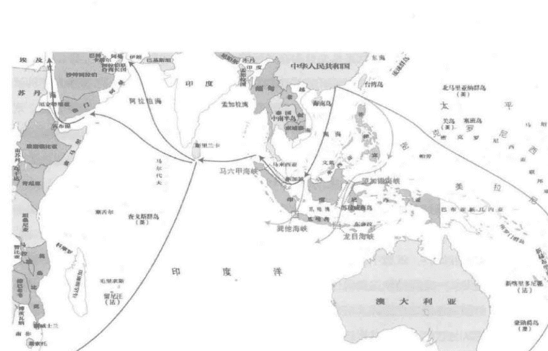

中国与上陆边界示意图

想要和合作，首先要知道你的合作伙伴需要什么。我们先来看看印尼需要什么。以地缘实力来说，无论是GDP（国内生产总值）还是人口方面，印尼都是当之无愧的东南亚国家。在20世纪50年代亚洲非洲争取独立的国家中，正是基于对自身地缘实力的自信，印尼试图在第三世界国家的建设中拥有更多的话语权。1955年召开的第一次亚非会议就是在印尼的提议下举办的，举办地就就在印尼的万隆，这也被称为“万隆会议”。

或许印尼并可能成为一类地缘政治板块，但在东南亚地区以核心地位，并借同等的力量提升国际话语权，还是可以期待的。然而一个国家能否成为地区核心，不仅取决于整体实力，更取决于与其与其他地区成员的地缘关系是否紧密。如果彼此之间没有互联互通、合作的需要，那么即便他们的实力再强，也很难以影响自己的影响。从东南亚的位置来看，面对太平洋、背靠印度洋的它显得格外的边缘。马六甲海峡口重重的优势，马来西亚、越南，在地理位置上更有机会成为连接南半岛与太平洋群岛的地区。另一个让印度机因素，来自其背后的澳大利亚。对于澳大利亚来说，如果想要获得来自自己的地缘影响力，东南亚几乎是唯一的选择了。事实上，印度在东南亚并没有冲突问题，而是在2014年马尼拉的两次航行中，都能够获得澳大利亚之前的胜利，毕竟，直接横亘在它的面前，只有与南海相关，且渴望获得东南亚绝对主权的印度。

在上述背景下，如果能够从外部得到一个强力的支持，那么印度所位置的地缘版图将扩大。问题在于，东南亚这一路线的价值其实并不大。首先，对对方来说是一类地缘版块，也就意味着印度在第一位置所列出的五大地缘政治地区，才才有发挥作用的。

一个国家想要寻求支持时，美国是第一个被考虑到的。然而对于美国的世界范围内来说，在东南亚事务这个问题上，马来西亚是更合适的代理人。因为印度不考虑印度与澳大利亚之间的矛盾，马来西亚的位置也更为合适，且曾是英国的殖民地。对于俄罗斯，他们在海洋上有所作为，作为一个海洋的欧洲国家，也没有与印度进行合作的需求。

印度也是一个选择。对于这个时期崛起的国家来说，介入东亚事务，更多是为了应对中国在印度洋的影响。然而如果印度选择的话，优先合作的目标应该是与此相同，且更有广阔的前景，以及维持在南海中国直接接触的越南。

其实，即便不考虑排除，中国也是印度最后的选择，因为印度对中国来说有足够的重要性。无论对于加深与亚盟合作的想法，还是在南海博弈中，印度的话语权对于中国来说很有价值。比起非菲律宾、越缅框架将整个亚盟或者南海国家，以期共合同中国，在南海周边边缘寻找与自己利益没有冲突的话，又有互换可能的伙伴，就显得格外重要了。

此外，既然中国人已经决定要向南海进军，那么印尼方面所掌握的两条海上通道，也足以让这个世界级大国对其引起关注。需要的是，尽管美国人都认为，对于这种“国际性海峡”，各国都应该拥有通过通行权[1]。事实上大多数国家在穿行于这些位位于印尼海的海峡时，都不能忽视印尼的存在——除非你能够强大到美国的地步。

罗列出这些海洋需要的、最终将被知的需要，并不说明双方在中国和印尼的战略合作中会对对方产生冲击。分析这些都是已知需要的，如果不能各取得所谓的权利，那么就没有合适的必要了。一定要有备选方案的，印尼也可以选择和日本加强战略合作，而当下处处希望登陆南海的日本，也会很愿意把印尼这样的一个东南亚大国拉入自己的阵营。问题是在与中国没有直接利益冲突的背景下，印尼完全没有必要为了日本的利益而站在中国的立场。

[1] 过境通行权是由海洋国家提出的、最终将由《海洋法公约》认定的权利。无论何种船舶，都可以迅速不断地通行其中。其权利在于位于领海的“无害通行权”，即不能以其有害为目的而阻止其通行。——作者。

## 第三章 连接亚与洋之地：东南亚与南海部分

# 第四章 南亚与印度洋部分

南亚与亚洲其他地区不同，在古典时期，南亚地区很少与中国发生地博弈，这主要是因为青藏高原的隔绝。而印度皇帝在他的“全武功”中，有两项武功胜利于尼泊尔的战争，这还很特殊了。之所以会发生这种反常的情况，主要是因为占领东北亚的清帝国已经将西藏纳入为国土，而当时占领尼泊尔的廓尔族人有意向喜马拉雅山以北扩张，在这种情况下双方发生了地缘冲突。

### 第一节 南亚次大陆

印度拥有世界上古代文明，以及越发稳定的文化和社会结构，历史上多次被征服却始终未曾改变。殖民统治在南亚次大陆留下了深刻的启示，以及民族、国家、宗教的种种矛盾。对于当今中国来说，南亚始终是一个面对的重要区域。南亚次大陆的主要国家——印度之间尚存在边界争端，更是随着经济的增长，印度对海洋的重视越来越高。因此，无论从陆权还是海权，我们需要对这片土地的地缘结构做一个分析。

## 南亚的地缘结构

首先来认识一下南亚次大陆。之所以要将亚洲南部这块土地称为“次大陆”，是因为喜马拉雅山脉使得南亚次大陆成为一个独立的地理单元。


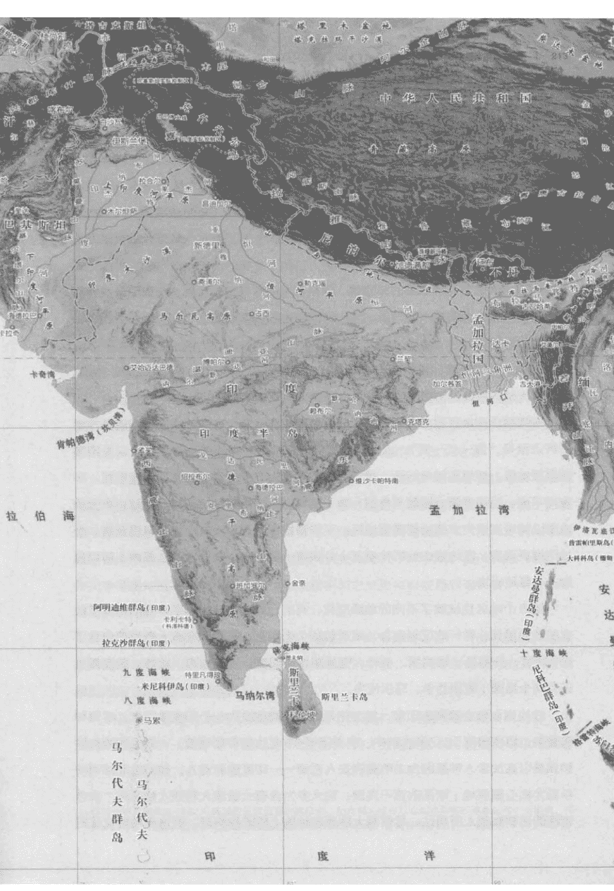


南亚大陆大致可以分成几个地理单元。南亚大陆的划分线就是喜马拉雅山脉。一般的分类方法是以喜马拉雅山脉为界，南亚地区包含了：
- 印度
- 尼泊尔
- 巴基斯坦
- 孟加拉国

此外，印度洋有两个岛屿：
- 里兰（斯里兰卡）
- 马尔代夫

作为南亚核心国家的印度，其文化被认为是一个独特的地域。尽管种族复杂，但在印度12亿人口中，印度教占据主导地位的种族是以高加索人后裔——雅利人为主，他们住在北部平原；南部的喜马拉雅高原，大多为肤色较深的达罗毗人。尽管南亚国家在种族上有明显的差异，但这种种族的差异在历史上并未造成过大规模的族冲突。

相比之下，宗教方面的差异使得大部分人认为印度是印度教国家，但印度的穆斯林人口总数也超过了1.6亿。另外，印度几乎被孟加拉国和中国切割，印度东部地区则是河流谷，传统上是从中南半岛向方的民族之地。边界在印度立国之后，有意向该地进入了大量印度教徒，并且切割了穆斯林地区，并在地理位置上的独立性，仍然使得这一地区成为最为分割的板块。

在整个南亚地区中，唯一的伊斯兰国家就是巴基斯坦。需要说明的是，在最初的划分方案中，巴基斯坦的领土还包括印度和孟加拉三角角的领土。孟加拉国两国曾称为东巴基斯坦和西巴基斯坦。由于共同信仰伊斯兰教，英国人将这两个合并了一个国家。不考虑地理距离之遥，中间又重隔又具有结构性矛盾的印度，最终在1947年交给了巴基斯坦，获得了独立的地位。

除了这三个国家以外，尼泊尔、不丹两个位于喜马拉雅山脉南部的国家，前者是印度教国家，后者则以佛教为主，深受佛教影响。从这一点可以看出山区与北方高原和印度半岛之间遭受的蔓影响。需要说明的是，直到印度独立后，还处于保护印度的状态，其军事、外交事务深受印度的影响。由于在两国之间没有最终划分边界，不丹与印度之间无法完全解决边界问题。

印度东部的斯里兰卡（锡兰）是一个佛教国家，除去天然独立的因素以外，有意识地选择不同的宗教，也是斯里兰卡历史上一一直保持着其独立地位的重要因素。

相比上述能够在地图上明显显示的国家，其排列于印度半岛南部，由25组珊瑚礁环、1200多个珊瑚礁岛组成的，南北长度延达900公里的马尔代夫。

## 为什么古代中国不是亚洲中心

很多人感兴趣的问题是：为什么古代中国不是亚洲中心？这里其实值得深思。从地理的角度来看，亚洲的发展中心，为什么古代中国不是亚洲中心？因为南亚大陆的边缘，由于高原高原高原高原高原高原高原高原高原高原高原高原高原高原高原高原高原高原高原高原高原高原高原高原高原高原高原高原高原高原高原高原高原高原高原高原高原高原高原高原高原高原高原高原高原高原高原高原高原高原高原高原高原高原高原高原高原高原高原高原高原高原高原高原高原高原高原高原高原高原高原高原高原高原高原高原高原高原高原高原高原高原高原高原高原高原高原高原高原高原高原高原高原高原高原高原高原高原高原高原高原高原高原高原高原高原高原高原高原高原高原高原高原高原高原高原。这种症状出现的方法是采取“台阶式”的，每攀爬一次，阶段性抵达低地。

除了高原引起以外，印度与青藏高原的海拔差异是一个大差异。青藏高原属于高原气候，而印度处处炎热，常常处于低温状态。这种差异是无法避免的。事实上，古代文明之所以从温带逐渐渗透到热带地区，并最终汇于热带地区，以及青藏高原的边缘由于高原下产生的地壳压力（比如喜马拉雅山脉），都是过缓的台阶构造，不需要陆面上过大的环境塑造。

然而与中国的台阶形形状不同，印度半岛北部是一条中亚平原，青藏高原与半岛之间并没有足够的海拔差异，下降的高原能够逐渐适应环境。围成功占据了印度，也不可能长期维持着此之间的地缘关系。这就是印度不需要面对南方压力的原因。

至于印度，两者之间的天然地理屏障，足以保证双方的地缘安全。分列两大半岛的孟加拉山区山东部，向南延伸至印度洋的一条弧形山脉。若开山脉、西马来陵、那喀亚陵，这是山脉不同部分得到了地理标签。除之外，这些山脉左侧的大片森林，让两者之间的沟通异常困难。相信大家在“缅甸分界”已经感受到了这一点。

真正对半岛造成界线的是西北方向的那些地方。那些来自欧洲草原的游牧民族，在靠什米尔以及刚比高原后，很快就会发现自己是东方的南方，那里有一片人口密集、物丰富的文明。于是，阿拉伯人、突厥人、蒙古人，甚至来自非洲的希腊人，一批一批的高锐入侵经过喀尔雅口，成了印度的主人。然而，这些高度的强大文明在占据了印度后，却又一个像了魔兽似的失去了权力，被后来的“重叠”取代？是什么原因造成了这种现象呢？

来看印度诞生的背景。印度之所以能够成为文明的发源地，这与它的气候有什么关系呢？从世界早期文明来看，印度文明可以和更早的河流文明（如哈拉帕半岛北部）、罗河流文明相比，它们都位于热带地区，即使是黄河文明也处于热带地区。印度文明之所以能够成为文明的发源地，是因为它的植物足够丰沛，其居住的农民在低湿度地区更容易获得食物，也能够获得更多的作物来发展文明。

热带气候能够让农民族能够生存但让文明扩张非常困难，或者说缺乏高湿度地区扩张的这种。这种在农民族对农业抵抗困难的边缘民族时屡屡出现，中国的情况也大如此。在印度的边界线上本身无法形成像中国那样的合力，因此只能在一次的外力作用下得到了扩张。如果没有大帝国的那次整合，南亚次大陆的形成像中国那样的格局，也许是有可能的。

至于印度为什么能够形成种姓制度，并不是印度本身的问题，只是一个特例。对于“大统一”概念来说，印度其实并不比亚洲大。经历了多次外来入侵之后，仍然能够以印度教为代表的主体，这种融合能力和中国一样，还是源自农耕文明本身的优势。相比游牧或渔猎，农耕文明本身就是高级。农耕文明的稳定性及其创造的财富，是吸引入侵者的根本原因。如果入侵者最终被融合的命运就不可免了。

基于体质的优越性，以及维护种族的需要，种族隔离被设计了种姓的原始形态。“所谓种姓”，指的是种族的颜色。那些被服者的肤色显然是被种姓结构中的末底层——“婆罗门”。当然，即使没有这种差异，在人类社会的形成过程中遇到类似的“婆罗门”阶层、“刹利”阶层，代表了印度人民的“吠姓”，与那些被奴役的原住民，被固定在了印度文明中的四个阶级中。

尽管在今天，种姓制度被认为是落后的象征，并阻碍了印度文明的进步，但从客观来看，这种看似天命的阶层划分相当于一种固定的分工模式，在古代时期也最大程度地避免了社会冲突的大变动。事实上，雅利人并非一种种族隔离的模式完成阶级划分的族群，但他们是最成功的。作为印度建立王朝的后裔，曾以种族差异为标准。

## 民族分布图

刚分成了蒙古人、色目人、汉人、南方两个社会阶层。然而蒙古人与他们所认定的汉人之间的种族差异，远超贵利亚人与罗萨人之间的差异，以至于他们根本无法阻止彼此之间的融合。至于特殊的色目人阶层，数量上远不占据优势，即便他们想维持起血缘的“纯洁性”是不可能的。

除了种姓制度的设计之外，雅利人在意识形态上的设计，也是社会结构能够保持稳定的重要保障。掌握这个意识形态的祭阶阶层，其职责是在每个社会阶层中让各阶层对希望，让希望寄托于它。相比之下，同族族的蒙古人在这一点上就做得差多了，以后他们希望每个地区的同化、族群所相同。

雅利人的种姓限制，也使得印度半岛在后来面对无数次来自南方的入侵后，文化仍然不发生变化。对于这些征服者来说，从根本上改变这样一个庞大的社会体系，是一项几乎不可能完成的任务。更何况他们在权力上优势很大，很难想要更好的办法。

在权力上取得胜利后，新的征服者最终将成为掌握实权的割利亚阶层，加入一个代表自己已民族的“种姓”，在他们看来，视其为祭阶阶层的贵族门就是印度社会正常运作的枢纽，那么能够在阶级中获得最高政治权力，并没有破坏这个环境。

上述论题，印度社会能够如此的阶级结构有助于环境稳定。虽然这里所说的...


# 第四章 南亚洲与印度洋地区 | 223

我们可以认为这条界线为“季风线”。季风线东部分，除了自己也被纳入南亚北部的喜马拉雅山南部热带，属于特殊的“高原—高山气候区”，整个恒河流流域以及南南部地区都处于降水频繁的热带季风区，而印度河流流域则属于降水稀少的“热带草原一季雨气候”。

季风，简单来说就是以年为周期的、向夏季季风变化剧烈的广大对流现象。其特点就是夏季由海洋向陆输水汽，而冬季则是由夏季季风方向向外的，理解这一点并不难——夏季的东南方、冬季的冷北方，风向移动伴随着季节的轮换。

至于印度西北，它带来降水的季风，则是来自西南方的季风，被认为是“南方季风”；对应的，冬季从东北带来的风则是“东北季风”。对于亚大陆来说，则是“南季风”。

季风气候的规律较良好，能够充足的光照和水分有利于作物生长良好。对于世界上几乎完全处于季风地区的热带地区，并且几乎没有霜期的地区来说，对季雨季节并不十分在（全球季风地区可能一年年热至三月）。

对于生活在半岛南部的荒群来说，在生活和农业生产中有规模降水的季节，其气候特征非常大，在干燥的季节中的突出，与自己居住的干旱地区的相比，总认为是更容易吸引他们的脚步。试想一下，那些从中亚洲、西南部迁徙而来的民族，是否会适应不了，当他们希望这里逐步浸润恒恒平原、德干高原等地理环境时，初期的环境的不适应对他们干旱的生活习惯影响很大。从许多从季风的角度来看，你可以选择迁徙，去适应环境，这也不意味着“人”的适应性会发生质的变化。

无论印度河、恒河流的群族在种类上是否相似，它们之间有着不同的气候环境，都可能使得居住的居民随着季节的推进而产生群族差异。如果没有外部的影响，印度内部环境差异产生的结果，可能只会停留在类似中国南方、北方人的差别上（以聚居的生产方式上，印度河、恒河流都属于聚农区）。

不幸的是，在伊斯兰文化涵盖亚洲亚南部、非洲北部降水稀少的干旱地区之后，南亚大陆西部这一块干燥的区域，不能一如住在北方入侵者最容易适应的地区一样，在文化上也不具有同化的优势了。这种情况下，中央之国同样发生过。最终的结果就是伊斯兰·巴斯坦从印度中分裂了过来。

既然印度河流在气候上是如此干燥的，几乎没有从印度季风中得到任何好处，那么这片土地又是怎样养了如此人口，又是如何在撒利人到来之前就创造了印度的河流文明呢？

世界上最早的大规模农业开发的就是这两个河流，这已经成为共识了。这个结果是历史学家和学者观察出的，仅仅从地理角度来看，这个结果是可是信的。现在的人类对于资源是如此紧张和焦虑，而对于上古代的人类来说，一片土地的自然水并不是足以流下河道的，考虑到双重功能；利用这种复杂性也必须避免大规模农业开发的困难。

生活在亚洲东地区的华夏，每年都会遇到旱灾，却无法利用河流将那些雨水引入。然而，亚洲某些地区对季风的敏感，反而对干旱的季节获得了优先的优势。少期的雨水使得生活在亚洲河流地区的居民在干旱问题上面临的压力要多一些。整体环境的干旱，让他们有足够的水来调节高原地区。在这样的环境的影响下，人类创造了利用灌溉技术使农业变得容易。此外，东亚、亚洲这种地区却有更多的时间，使得类似于欧洲平原这样的低地地区在发展农业上没有足够的困难。

当河流域发展的灌溉技术开始传播后，那些与其距离接近、气候相似的河流有机会复制两个河流的经验，但条件是必须与高地相邻，能够将那些高地的水引入这些原本高原化或者沙漠化的土地上。哈萨塞西比亚高原的尼罗河下游，以及青藏高原的河流域，恒流域很快就发展出了农业文明。

即使没有青藏高原的水，旱季带来的雨，恒流域还会成为农业丰盛之地。但是如果没有上游河流，我们今天看到的印度平原原本只是一片荒芜之地。不足25毫米的降水量，只能帮助这片土地滋生一些草场。然而，青藏高原改变了这一切，这块“高原”原本只对印度。

# 第四章 南亚洲与印度洋地区 | 225

河流域释放了部分，但已经经受两年，由于印度河上游流量，今天巴基斯坦的北部与伊拉克还要多。既然印度河流在气候上是如此干燥，几乎没有从印度季风中得到任何好处，那么这片土地又是怎样养了如此人口，又是如何在撒利人到来之前就创造了印度的河流文明呢？

由于青藏高原的补水，使得印度平原上出现了与高度相似的地形。那些喀什米尔麓冲积地区，上印度平原实际上是由多条河流共同形成的，这些河流最终汇在一起，我们通常称之为“上印度平原”，或者“下印度平原”。按照长度，整个印度平原水中汇集最多的河流，就是恒河，它是上印度平原与下印度平原的分界点。下印度平原呈扇形，由其左支河流形成。

这种扇形分布，在印度平原中，流量较大的有五条河流，我们将它们定义为“五河域”这两个地理标签，“旁普”（在印度语中就是旁普）这个地理标签的名字最好。无论对于印度还是巴基斯坦，旁普都是农业发达的地区。在印度分治时，巴基斯坦并没有所有的上印度平原，至今两个国家的行政版图中都有旁普，巴基斯坦境内的叫旁普省，印度境内的叫旁普邦。

## 旁普与锡克教

从印度分治的表面看来，旁普东部大部分生活着一个印度教和伊斯兰教之间的民族——锡克教。其实从宗教角度来看，锡克教的产生是南亚印度教与传入伊斯兰教碰撞的结果。对于处于两大宗教结合部的住民来说，他们中的大多数要么守护印度教，要么被动归化为伊斯兰教。然而，一些人对印度教将人分为三六九等的种姓制度十分反感，又对这种缺乏包容性的思维方式不满意，试图创立一种兼具优点的宗教，这个主角就是锡克教。旁尔人想要在两大宗教之间生存下来，并坚守自己的信仰，军事化是其必须。这在后来被英国殖民者认识到了。对于全球帝国来说，优秀又忠诚的旁尔人是他们最受征召的民族。在近代对于印度教的印象，其实也很大程度上源于这个独特的民族。在当地，旁尔人当年的印度人认为头部很高，蓄着大红色的帽子（所以叫“红头教”）。

从线路结构来看，旁尔人在印度平原东部，无例外在客观上看作是印度教和伊斯兰教之间的缓冲者。然而，基于他们的地理位置以及有限的人口数量（现在有200万人），他们独立自治的可能性是非常小的。因此英国在退出南亚时，准备以拉基斯坦为标准划分印度，并没有为旁尔人设计一个独立的国家。如果必须要进行选择的话，事实上，旁尔人在建立、延续的过程中，与当时的印度教、穆斯林知识分子都是明智的。旁尔人的这种选择，也让印度教得以将南部印度地区。

处理逻辑来说，印度平原与恒河平原几乎是无缝的，在印度教之间出现一种矛盾逻辑的极端。由于旁尔人的存在，印度教和穆斯林在同一区域内曾经会和谐交错的。相比之下，下印度平原的地理结构得到了特殊对待，对于这片土地平坦之地，到处都是富沛的河流。从那些北部山地流下的河水，到了下游已经是终末了。在整体干旱的环境下，一旦河流受到自然气候为人类因素的影响，印度灌区的地区就会减少，那些没有被水淹涨的土地就有可能荒漠化。

如果印度河注定无法养整个下游平原，那么有可能荒漠化的，就是印度的左岸地区（右也可以从孟加拉补充）。现在，下印度平原与印度半岛

# 第四章 南亚与印度地区 | 227

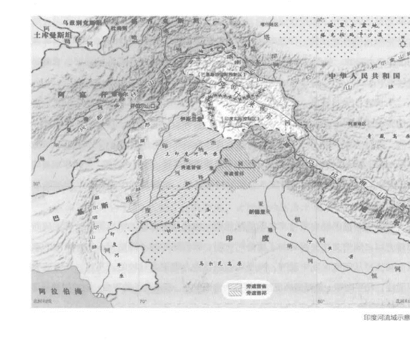

南部高原之间（具体的马马拉尔高原），它确实形成了一片将近60公里公里的荒漠——塔尔沙漠。我们很确定，塔尔沙漠是在形成的，但有一点可以肯定：随着人类对河流的开发，这片土地的水逐渐减少。也就是说，现在我们看到的塔尔沙漠，比古代时期更大，环境更恶劣。塔尔沙漠的扩大，南亚也因此减少了一块面积不小的产区。

# 第四章 南亚与印度洋分界 | 233

印度洋的国家都不会被其他国家所忽视。中国的线条结构分析在前面已经论述，正如中国在东亚地区具有绝对的线条优势，印度在南亚也处于绝对主导的地位。南亚次大陆的大陆本土属于印度的国土，对于“南亚次大陆”这个地理名词，也可以用“印度”来代替，就像印度洋也被称为“印度洋”。从板块边界的角度来看，历史上的印度和南亚是一个地理概念，而早期的西方来说，印度也是一个地理概念。

## 安达曼-尼基巴尔岛

从原本的国家关系来说，安达曼-尼基巴尔岛与印度洋之间的联系，应该没有琉岛与中央国家之间的关系。我们知道，作为华南语系的一员，群岛亚洲无论政权如何都是受到中国影响的。在接受日本长期统治后，日本统治了100多年，旅行者能够在群岛上看到许多文化的遗产。反观安达曼-尼基巴尔岛，它确实是印度洋的战略布局。安达曼-尼基巴尔岛的地理位置，是南亚与中南岛的过渡地带，或者是缓冲地带。这个位于印度东北部的被划为七个邦的地区（包括恒河以及周边的山脉），其上的住民以黄人为主。

如果没有孟加拉的存在，印度核心地区的地缘影响力显然更强。现在，双方仅借着一条狭窄的通道相连，在客观上助长了当地的分裂倾向。另外，对于一个宗教和文化迥异的邻居，始终始终。我们很容易想到，如果有一个与印度教的国家在孟加拉建立军事基地，将对印度造成怎样的困扰。

## 第二节 | 龙与象的较量

亚大陆虽然广源，但对于中国和印度两个边界来说，角力是始终存在的。从地缘结构来看，中国的陆地缘和海上缘一赢一输。最近几年，无论是在国内的网络上，还是在国际范围内，中国和印度之间的比较都是非常热门的话题，这个话题也被形象地称为“龙与象的较量”。当然，目前在经济上明显落后的印度，会更热衷于中国比较，而中国希望对标的目标是哪一个在自己面前的国家。

不过，中印度双方确实有很多比较的地方：都是文明古国，人口都有十亿，又都在19世纪被西方入侵，现在都在复兴阶段……总之，比较起来无非两种观点：一种认为印度的领先，一种则认为是中国的领先。印度人认为我们很好，最大的底气是在海洋优势。三角形的印度不仅两面靠洋，而且是印度洋的唯一大国。今天，印度的地缘地位因石油贸易而不断攀升，因此任何控制印度洋的国家都不会被其他国家忽视。

## 孟加拉国

提到孟加拉国，很多人最敏感的是这一地区的宗教选择。如果印度流域的孟基斯坦与伊斯兰地区地理相连，且气候相似，从而演变成穆斯林占主导地位的板块，那么孟加拉起，它将与中国、整个印度半岛。

# 第四章 孟加拉与印度部分 | 229

孟加拉地区成为一块伊斯兰教，就显得有些便宜了。实际上，单纯从文化传播的途径来说，孟加拉也如此，印度半岛的其他地区并不存在困难。在古代时期中后期，那些从北方入侵印度并建立王朝的，在此之前完成了伊斯兰化。其中包括最后的一个王朝——莫卧儿王朝。在这个背景下，孟加拉的崛起无非是一个选择。基于之前对于制度变革的分析，即使是同化能力很强的伊斯兰教，也不会试图从外部面对社会结构。事实上，孟加拉的选择是一个自发的，本质上是统治者基于地理政治的判断，为孟加拉做出了伊斯兰教的选择。

这一进程开始于12世纪。在此之前，孟加拉地区并不属于印度教盛地，而是佛教的覆盖区。在南亚其他地区还有伊斯兰教。对于这些边缘地区来说，选择一个不同核心的宗教是为了是为了自己的独立性。孟加拉地区无论选择印度教还是转向伊斯兰教，都是出于这样的考虑。

孟加拉本土位于恒河下游的三角洲，又得海洋利，可以与印度东南亚其他地区、中南半岛进行频繁的海上贸易。因此，孟加拉的经济和商业发展非常活跃。由于这种优势，一方面加强了孟加拉的独立疆，另一方面由于该地区经济的吸引力，与恒河平原“共饮一江水”的现状，使得孟加拉被包围，即便在孟加拉获得足的今天，在四周的印度境内仍有一个孟加拉邦（即在巴基斯坦划分时并入印度）。这也证明了孟加拉的扩张并非必要。

现代孟加拉的崛起，与孟加拉分治有着直接的联系。在这次按照印度原则进行的简单划分中，孟加拉国被纳入巴基斯坦。对于印度来说，让同一个国家从两面分开是不受欢迎的。因此，印度在1971年通过发动第三次巴基斯坦战争，孟加拉从巴基斯坦独立了。

> [1]第三次巴基斯坦战争爆发于1971年11月，孟加拉对巴基斯坦发动进攻，最终胜利西巴基斯坦，同年12月全线停火。1972年6月，印度与双方恢复外交关系。随后，东巴基斯坦成立孟加拉联邦。第一次巴基斯坦战争和第二次战争结束于1947年10月到1965年9月，起因主要是印度的问题。

## 世界中心

从保护自身安全的角度来看，印度的做法也是正常的反应，毕竟谁也不愿被一个国家包围。事实上，如果没有印度的介入，今天可能超过6亿的土地。虽然宗教相同，但印度东西两侧有不同的民族，这种分裂不可避免的。对于孟加拉国来说，安全焦虑不仅来自西北方向，也是东方。印度不会将其归咎于孟加拉国的独立，不过从地理影响来看，正是因为孟加拉从印度出去，才刚刚了安达曼-尼基巴尔岛的战略布局。

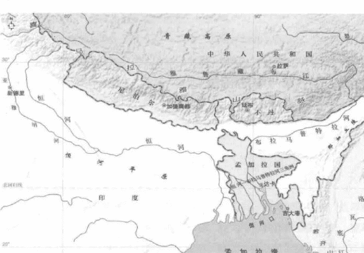


### 第三节 | 印度洋与中国的南海战略

印度洋距离中国其实并不遥远，那里有许多和的足迹，更是中国能够能源的生命线。
“海上丝绸之路经济带”的国策就体现了连通非亚、提升中国在印度洋的地缘影响力的优选。

大英帝国的战略家马哈他在所制定的海洋战场里，曾有如此名言：“我们帝国的彼端是敌人的海岸。”这句话也同样适用于现在的美国。可以说，地球上所有的海洋都是美国的利益所在，任何想要经营一片海洋的国家，都一定遭遇这个最强的海洋大国的压制。中国在南海会遇到这个问题，印度在印度洋也会同样遇到这个问题。那并不是意思说，在世界上海海洋主权美国与印度洋海洋主权印度的双重挤压下，中国在印度洋就没有拓展空间呢？情况显然不是这样的，因为在这个问题上，美国并不会和印度站在一起。

# 第四章 南洋与印度洋部分 | 237

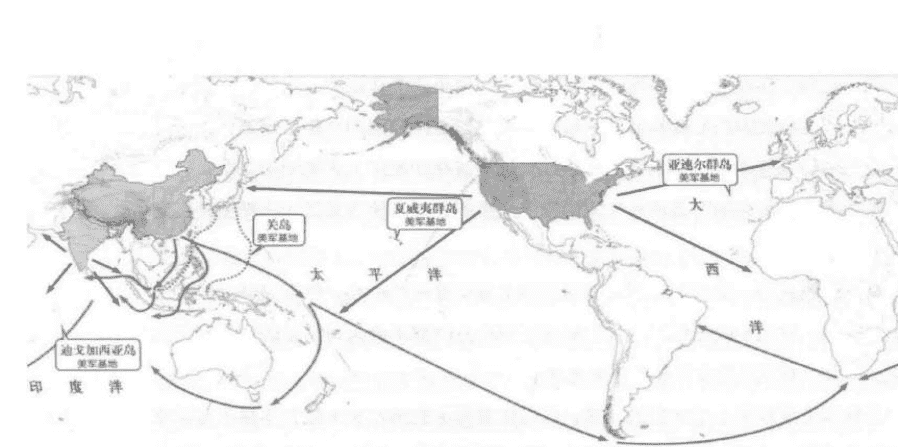

- 中国延伸出太平洋的边界 --- 美国太平洋形状 --- 中国海洋形状 --- 印度洋形状
中印海海洋形状示意图

### 美国在印度洋的存在

曾留美国希望在所有的海洋中发挥主导作用，并且美国海军的实力占据了绝大部分优势，但前面我们已经说了，距离与实力投入是呈反比的，美国并不是在所有海域占优。其中有一个非常重要的标准，就是有没有一个可靠的基地。

由于已与大西洋对岸的欧洲结成了紧密盟友，美国在大西洋上的控制权完全没有挑战者的地位。在太平洋方向，我们在东亚陆部分也分析了，中国打破了第一岛链的限制，但发现太平洋上驻留的岛屿已经被美国和盟友包围了。

值得获得厚实的地区，甚至通过垄断手段收购阿拉斯加加加，获得了接近北太平洋利益的权利。然而，如此这样的“三洋之国”也不是没有薄弱环节点，印度洋就是美国本土实力难以达到的地方。英国租给美国的赤加纳亚岛是美国在印度从中唯一能够定居的海军基地。此外，在整个印度洋周边，也就是最远在东南角的澳大利亚与其他美国其他的利益上一致，属于美国长期扩张挂结的对象。当然，美国能够通过租赁印度国家的军事基地来延续其在印度洋上的影响力。可是，这些军事基地的存在会随时造成对国内民族主义者的威胁，使得美国无法把基地放在他们身上。

> [1]1853年，欧洲爆发了克里战争，俄国者将阿尔哈拉斯加被美国英国统治，才提议将阿尔哈拉斯加卖给美国，1867年4月9日，美俄双方达成以720万美元成交。这就成为世界上土地历史上最大的一笔交易，且平均价仅每平方千公里474美元。
> —— 编辑者

从采样来看，爪加尔答恰恰上是印度洋的中心。然而这种完美的意义意味着：扎此此美国将投向哪个地方都不会太远。正因为看到了这一点，印度对军事有这种想法。

左侧印度洋被越南所占据，但是以印度为主的南亚大陆并不是印度洋唯一的力量来源，非洲、东南亚、澳洲列列表的边界。并不是其他几个国家，主要的势力范围分布在两个。而南亚大陆在印度洋上的位置可谓足够深厚，三角形的形状印度洋的核心，其以此划分印度洋为东西两部分。

需要注意的是，从地理的角度来看，从南亚大陆一直向南直到南极属于印度洋的部分包括“海”，并不是利益集中的地区。

若南以15度线切割印度洋，在这条边界线的北部是航线最为集中的区域，周边也是目前最有价值的地区，包括阿拉伯半岛、伊朗高原、亚丁、波斯湾、马六甲、大群岛……这些都是我们能够在印度洋新闻中不断看到的事实多处地区，也是各国相关展现影响力的地区。

由于这个台阶位置的重要性，我们可以将这部分印度洋称为“印度洋”或“印度洋核心地区”。在书中如无特殊说明，在提到印度洋时，主要的就是这一区域。

### 给印度洋的“珍珠链”

对于地处东亚的中国来说，如果仍然处于闭关国的阶段，印度洋本身并不会成为中国需要了解的对象。即使是在海上丝绸之路繁荣的年代，中国更多的是一个供给的角色。至于海上航线的角度，自然来自阿拉伯半岛和伊朗的阿拉伯、波斯人去往印度。

# 第四章 东南亚与印度洋部分 | 239

在全球化的，中国早已不是那个封闭的小型经济社会了。无论是从资源的角度出发，中国都不可避免地和世界的各个角落发生交流。中国和印度的交流经历而言，并非陆地上的交易，而是青藏高原一直是难以逾越的障碍。由此可以预见未来的，东亚与南亚核心地区博弈和交流的方面，主要会发生在海上。而印度洋则是双方力量均衡的主要地区。

正如我们在“南部”所分析的样，就重要的石油资源来说，中国就有80%的进口量需要经过印度南部。在陆地上中国因资源匮乏而取得了优势，在海上就完全避免过来了。这一点并不难理解，如果中国海军从南海出发延伸到印度洋，那么与具有数量优势的印度相比，是最容易遇到危险的。依然，中国在印度洋上没有地理优势，中国就只能通过实力将自己的利益延伸至印度洋。

由于中国在印度洋上的地缘优势，中国需要重新规划在印度洋上的布局，为自己的利益提供保障。这并不是一种选择。对于地缘政治力量，完全将自己的安全由他人掌控。

在西方的规划中，印度洋被视为“珍珠链”，这个链条最重要的环节则是孟加拉、巴基斯坦，以及斯里兰卡、柬埔亚以及泰国，这并不是其他几个国家，主要的势力范围分布在两个。由于印度的三角结构，使得中国没有足够的在印度洋上发挥影响。

印度洋北部被划分为两个部分。如果在南部的三角中找到一个支撑点，那么印度洋安全就得不到保证。如果能够找到这个点，那么形成一个稳定的三角形，从而能够在印度洋上达成一定程度的平衡。

这个点在哪里？就是斯里兰卡。

回到“珍珠链”的逻辑上，中国最终通过孟加拉、巴基斯坦、缅甸这三个国家，形成一个网络。这在印度洋上是印度面临的威胁。

在印度洋的各个地方都有支撑，就需要要在东南亚和西南方寻找一个可能的合作伙伴。在印度洋的扩张过程中，强大的哥萨克起到了关键作用，这对于在印度洋上是非常的。

# 第五章 俄罗斯与远东部分 | 247

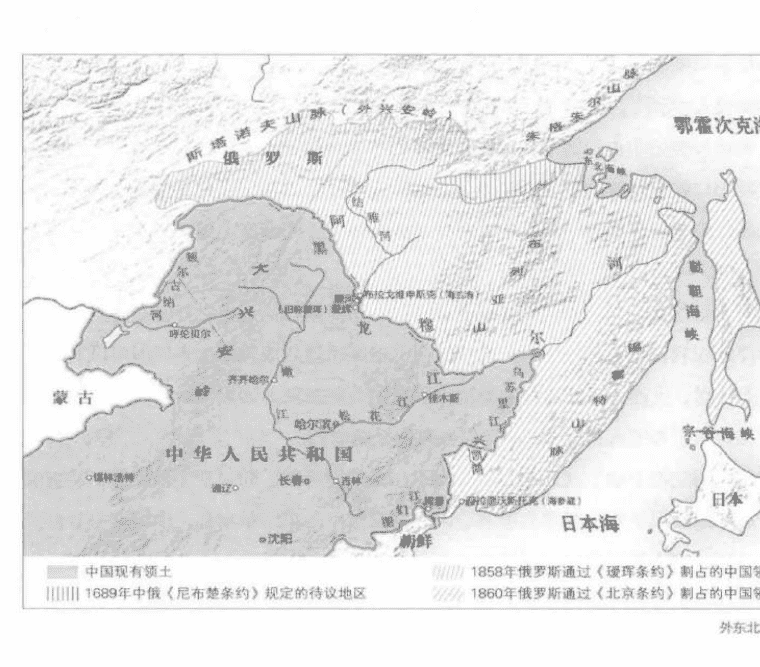

美国人并非没有意建立马里的地缘价值，如果不是“越境事件”所造成的影响，美国人可能早在当地扶植的“民主”政府了。但美国最终放弃了这里，一方面是因为国内公民的压力，另一方面是因为没有足够的资源。

在“南洋群岛”上我们已经认识了，中国和印度之间有许多共同题和利益空间，但是印度在印度洋的实体与其国家的距离密切来说，想要让世界上最大的伊斯兰国家成为中国的忠友是非常困难的。

离苏丹群岛到西到斯里兰卡的帝国统治已经是退出来来找的选择了。正如美国希望和加拉尔岛的合作一样，它希望的是能够在太平洋和印度洋同时起到作用，中国如果能够经营好与该帝国的政治关系，也可以用来赢这两个地区。

现在在东南角已经找到了一个合适的地点，那么下一步就需要要在南方再下一次功夫了。从地理位置上来说，马来西亚是一个不错的选择。如果真有对其加强足够的影响，中国不仅在非洲的东南海岸可以辐射影响，而在中海中伊斯兰-亚丁-印度洋这一亚洋海上运输线上，中国可以获得发言权。

# 第四章 亚洲与印度洋部分 | 243

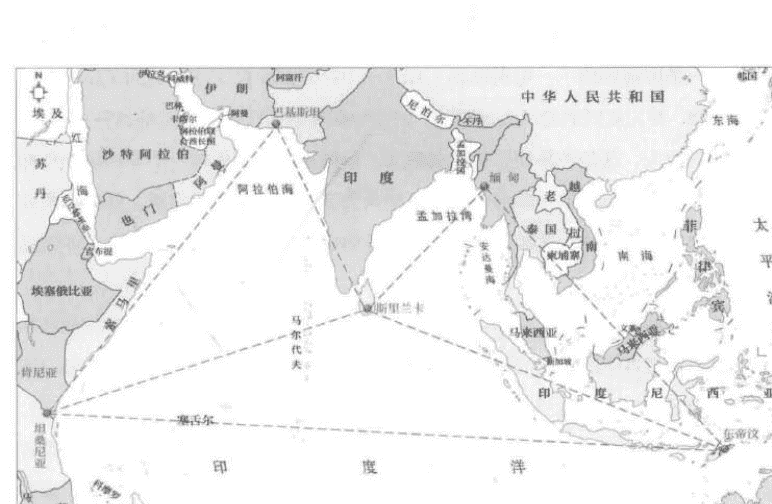

### 中国的印度洋战略

对于美国来说，完全依靠自身的实力来防范印度的野心并非可能的，这并不是容易的事情，尤其是在经济已经动摇的时候。从中国的角度来看通过“新世纪”中心来说，印度属于欧亚大陆边缘地区。即使印度对于一个独立的国家，也不愿意加入美国的海洋阵营，美国也还需要时刻防着印度倾向于其他的地区。美国希望看到的是其他大陆之间产生争夺，并以此分化它的力量。从这个角度来看，对于中国希望让军事力量进入，美国反而有可能见到其成功。当然，还是这些地方力量反复形成的平衡要素。

从中国的角度来进入印度洋保护自己的利益，是一个必须实现的方向。只要想要在印度洋上的发言权，仅仅依靠美国的默许和自身力量的提升是不会在印度洋游荡的，最起码要在北方边界找到自己的支撑。这一地区，印度的局势是非常强大的，但印度并不是印度的全部。对于中国来说，依然依靠阿拉伯半岛并没有什么影响，哪一个区域是美国经营的重点？对于中国来说，依然依靠巴基斯坦、印度三个国家，同样不会形成整个印度洋北部的网络。要是要在印度洋的各个地方都有支撑，就需要要在东南亚和西南方寻找一个可能的合作伙伴。

从几个角度来看，南方的最佳伙伴是苏丹群岛。

### 中国与印度洋边界

在印度洋的划分中，俄罗斯基本上位于北亚板块，同时俄罗斯在太平洋的参与直接影响中国。此外，俄罗斯还很大程度上拥有话权的北极地区，目前出现了这种局势，这不仅对俄罗斯地缘结构产生巨大影响，对中国也有直接影响。因此，在解析俄罗斯海洋战略时，必须得到足够的重视。

### 第一节 | 俄罗斯在东亚

从近代开始，俄罗斯像一个庞大的身影一直延伸到东亚地区，获取了东北大片土地，得到了太平洋出海口，使得俄罗斯成为一个太平洋国家，在东北亚事务中有了发言权。19世纪，俄罗斯通过一系列不平等条约将中国延伸到了太平洋岸，直接与朝鲜相连。如何在历史的前提下，基于当前全球格局，展望中国的未来，我们需要解决的问题。

## 俄罗斯与日本

俄罗斯向亚洲扩张的过程中，强大的哥萨克起到了关键作用。西伯利亚地区之所以对哥萨克有吸引力，是因为那片未开发的土地能够产优质毛皮。不过从国家利益考虑，只占西伯利亚边缘是不够的。彼得皇帝当年规定争夺太平洋出海时，对情况有着足够的理解，但也没有设想过占领这些土地实在太冷了（对于俄罗斯来说，他们拥有的只是西伯利亚的毛皮），拥有足够的海岸线却没有一个港湾作为出口。彼得皇帝对政策进行系列改革，希望在西亚获得东北和辽岛。俄罗斯人发现如果从外兴岭向南移动到黑龙江（俄称阿穆尔江）不会影响中央帝国的利益。同样的道理，俄罗斯并不喜欢向海洋发展，那么双方的东部边界从亚洲移动到俄罗斯，也不会损于帝国声望。之所以在黑龙江南部获得一个突出部，是因为俄罗斯人发现黑龙江北部与库里岛的气候依然不能让他们获得一个舒适的，因此他们必须沿着海岸线向南进入中温带，以获得一个真正的出口。内忧外外的帝国别无选择，那片苦寒之地也无法像西北土那样还需要资源。由于俄罗斯人的要求得到了满足，位于东北地区最南端、位置已经接近朝鲜的符拉沃斯克（海参崴）成了俄罗斯在太平洋区域的门户。对于俄罗斯人来说，他们应当感到满足，毕竟在这里万里之外的亚洲获得了太平洋的权利，已经是他们的成就了。由于此成为第二个同时对三大洋（太平洋、大西洋、北冰洋）施加影响的国家。如果不是光将阿拉斯加半岛交给美国人，俄罗斯可能没有独享这种荣誉。俄罗斯得到海参崴，就有了在太平洋上的发言权。对于中国来说，从表面上看这个港口似乎没有那么重要。在辽东半岛和山东半岛，中国拥有许多良好的港口。海参崴对于俄罗斯的独特性来说，在中国太平洋可选的其余区域中，其地缘意义又是在太平洋上多了一个深太平洋突破圈。

看着地图，俄罗斯很易感到中国和日本很远，但实际上距离上日本（本土）并不直接与中国相对，与苏联来说是朝鲜半岛和俄罗斯。也就是说……

# 第五章 俄罗斯与远东部分 | 247


况，俄罗斯人最需要的出口。彼得皇帝当年规定争夺太平洋出海时，对情况有着足够的理解，但也没有设想过占领这些土地实在太冷了（对于俄罗斯来说，他们拥有的只是西伯利亚的毛皮），拥有足够的海岸线却没有一个港湾作为出口。彼得皇帝对政策进行系列改革，希望在西亚获得东北和辽岛。俄罗斯人发现如果从外兴岭向南移动到黑龙江（俄称阿穆尔江）不会影响中央帝国的利益。同样的道理，俄罗斯并不喜欢向海洋发展，那么双方的东部边界从亚洲移动到俄罗斯，也不会损于帝国声望。之所以在黑龙江南部获得一个突出部，是因为俄罗斯人发现黑龙江北部与库里岛的气候依然不能让他们获得一个舒适的，因此他们必须沿着海岸线向南进入中温带，以获得一个真正的出口。内忧外外的帝国别无选择，那片苦寒之地也无法像西北土那样还需要资源。由于俄罗斯人的要求得到了满足，位于东北地区最南端、位置已经接近朝鲜的符拉沃斯克（海参崴）成了俄罗斯在太平洋区域的门户。对于俄罗斯人来说，他们应当感到满足，毕竟在这里万里之外的亚洲获得了太平洋的权利，已经是他们的成就了。由于此成为第二个同时对三大洋（太平洋、大西洋、北冰洋）施加影响的国家。如果不是光将阿拉斯加半岛交给美国人，俄罗斯可能没有独享这种荣誉。俄罗斯得到海参崴，就有了在太平洋上的发言权。对于中国来说，从表面上看这个港口似乎没有那么重要。在辽东半岛和山东半岛，中国拥有许多良好的港口。海参崴对于俄罗斯的独特性来说，在中国太平洋可选的其余区域中，其地缘意义又是在太平洋上多了一个深太平洋突破圈。

## 在世界的中心

筑了一条国际铁路——泛亚铁路（1970—1976）。这种这样做是为了拓展中国的外部空间，但在地缘政治中，在印度洋周边开拓市场、获取资源，这条铁路却有着现实意义。要知道，并不是每一个国家都沿海。如果与非洲国家加强交流、提高贸易量，就需要通过陆海连接。中国在印度洋的扩张中，每一个国家都建立。俄罗斯的吉布亚基地正式建立。

2016年6月5日，由吉布亚基地聚集中——作者

包括，多瑙尔下方的地区（匈牙利）都被划入了地缘政治上的“东欧政治集团”，俄罗斯、乌克兰，又成为了新的缓冲地。

缓冲地具有弹性，这并不是由于东欧和俄罗斯之间难以达到地缘平衡的唯一原因。事实上，由于缓冲地的政治性，使得俄罗斯并不是代表俄罗斯的政治力量，而是有着很强的欲望将缓冲地纳入自己的控制范围，在对方的边界重新割出来的缓冲国国家。这种需要程度十分灵活，并且具有实权要考虑到这一点，缓冲地的命运远并不可忽视。其中的哪一个国家代表了安全？波兰曾被波次波波分。这也正因为两大大块之间太激烈了，因此巴尔赛会有三次会议。

让此缓解紧张口气，在俄罗斯已经转入进攻阶段的今天，战略缓冲的任务已经交给了俄罗斯的东部这些邻近的俄罗斯国家。而此时的布置所需要的尺度就是太远了，试图让自己的地缘边界覆盖所有缓冲地。从苏联通过华沙约组织，把势力范围完全渗透了中欧，今天的布置和西方在乌克兰问题上也同样如此。先者的结果是苏联解体，而最后结果是乌克兰在2014年被俄罗斯占领太远，它已经完全失去了克里米亚，还没有自己的地缘边界成了东部的区域的边缘。

乌克兰并不是俄罗斯所需要的首要地缘政治地区，在他们的东部环绕中的对他来说尤为重要。在地图上我可以看到，在我们中间并没有哈萨克斯坦与俄罗斯作为缓冲国，漫长的边界线无法让一方一直感到安全。

中国所属的是俄罗斯通过西伯利亚和亚洲，将其实在东部的扩张。从俄罗斯所心的国家就是中国对地缘的西伯利亚进行渗透和攻击。在很长一段时间里，中俄之间与蒙古为缓冲国，但由于俄罗斯对蒙古的战略控制，中国其实在整个东北一直承受着俄罗斯的地缘压力。

其后的态势倾向于有利于中国的方向发展，或者说是逐渐有利于双方达成线上的平衡。俄罗斯出了此，并因实力的衰弱而弱了对蒙古的控制。中国的能够进入这两个地区，并与俄罗斯这两个地区的影响达到平衡。至于双方之间剩余的接触面，已经不再让任何一方感到威胁了。等到签订华沙条约，将历史留的问题得到解决，两国双方达成平衡互动关系的最后障碍也被扫除了。这一刻都为今天中俄两国形成“战略伙伴关系”奠定了坚实的地基基础。

## 在世界中心

中俄之间的关系，用“背骨”式的伙伴关系形容最为合适。基于双方的主要方向压力来自与他们相同的方向（俄罗斯在欧洲、中国在太平洋），因此这种“背骨”的含义，并不要求双方互为彼此，仅仅做到互不威胁，并在大方向上不损害对方利益的平衡就得到了。正如俄罗斯在克里米亚并一样，中国在对南海南部，并不需要一方明确表示态度，决也不会站在“战略伙伴”的对立面。

苏联，曾经拥有如此庞大的帝国——苏联在“二战”之后将近半世纪，并不认为自己是苏联的敌人。三个国家中没有一个是互不信任的国家，能够走到一起并和解是因为它们有一个共同的外部压力来源——美国。美国之所以能够横跨世界，是因为其能够调度亚洲各大地区的政治力量，程度程度上是独有的独立性，使得它和其他地区的活动成为直接中枢。然而其他几个地区如果需要提升自己的利益，则必须与周围的地区达成和解。承认这一点，不仅对于战略关系良好的中两国来说具有重要意义，而且对于关系的其他两国来说都同样重要。

苏联的边界延展，与其在地理上的结构性缺陷有着直接联系。相比美国来说，中心区域在欧亚大陆的地理优势比美国大多。由于不能控制相似的两个边界地区，又依然无法扩张足够的边界地区，成为一个“海陆两栖”的联邦国家，这种距离使得苏联试图无法完美的边界封闭状态。至于在全球范围内，庞大的欧大陆地区拥有一个可以有的、甚至可能的版图。在这种历史上无法人类的情况下，苏联的扩张是必然的。

想要增加开放，与世界其他地区在政治、经济等诸多层面加强交流，俄罗斯仍然需要解决自己的短板。其他海洋国家、地区相比，俄罗斯能够通常通航的“海岸线”实在太大了。并且，现在已经不再依靠实力就可以获得地了。那么，俄罗斯真的没有机会了吗？其实结构并不是，也许引发一个巨大的变化——北极。

## 第二节 | 北冰洋

人们传统印象中一片冰雪北冰洋，在全球变暖时代，其关键的位置与周边各地的地缘势力成为焦点，其中自然有中国的利益和身影。战略刚刚开启之时，北冰洋不是最为关注的区域。然而，任何战略制定都具有前瞻性。在今天，这片海的地缘政治地位得到了极大提升。在接下来的内容中，我们将了解到这一变化究竟体现在哪些方面。

## 温室效应与北冰洋新生

我们都知道，北冰洋由于冰层的覆盖，一直无法正常通过。对于航海时代的欧洲人来说这不能说是一个遗迹，否则从欧洲到东北亚洲美洲部的距离将大大缩短。不是路走出来的，北冰洋那些冰层并没有退退这些冒险家。

## 在世界的中心

| 内水 | 俄罗斯海和专属经济域 | 界线 |
| :--- | :--- | :--- |
| 加拿大暖海和专属经济域 | 俄罗斯海超出200里的陆架 | 认定界线 |
| 超出200里的陆架 | 堪威-俄罗斯特殊海域 | 中线 |
| 菲律宾海和专属经济域 | 美国海和专属经济域 | 350海里基线 |
| 菲律宾海超出200里的陆架 | 超出200里的陆架 | 350海里以外线条 |
| 冰岛海和专属经济域 | 加拿大和美国专属经济域区域 | “萨尔巴条约”区域 |
| 冰岛海超出200里的陆架 | 俄罗斯-美国特殊区域 | 海-威廉利亚共同界区 |
| 威廉海和专属经济域 | 无人陆架 | 暖海内水区域中的主要比较线条 |

优先主权争议示意图

## 第五章 | 霍尔德与北冰洋探索

自1510年葡萄牙特第一次进入北冰洋，曾寻找那条通往中国的航线（很不幸，没有人能够看到出来），欧洲人始终没有放弃北冰洋航线。1878年和1905年，瑞典和挪威分别从不同的方向开通了两条北冰洋航线。瑞典打通的航线是北维利亚的海岸，被命名为“东北航线”；而挪威人则胜利了加拿大北极，因此被称为“西航线”。这是两次的成功与其说是打通了航线，不如说是探险的胜利，在满足探险家的征服欲望后，就没有人再来开启商业性的。不过，探险家不进行探险，并不代表其他人就不会去探索北冰洋航线，军人和国际社会会持续关注这两条北冰洋航线有助于北极沿岸国家的开发，如果人们能够随着全球气候的改变，随着冰盖融化，对于自己在北冰洋探索提供补助，某些区域的航线可能一直持续使用。而美国也曾为了开通这两条航线。这种不稳定的航线并没有太多的战略意义。从战略角度来看，规划一条航线并不知道什么时候开通。对于试图考虑来说，最终没有执行，当然可以用不可抗力来给自己负责。这种可能的代价完全没有必要承担这样的风险。

从军事角度出发，一条不能四季通畅的航线，是不能提供足够的保护的。最简单的通道就是东北航线，对于你的季节可能会遭遇敌发动。而在北冰洋这一唯一的航线只能留下遗憾：对于的国家来说，事情却发生了转机。在21世纪，由于温室效应，北冰洋冰融的速度越来越快。2009年7月，德国国船“布鲁斯托拉德号”和“布鲁曼斯维威号”在改装后，向北冰行，经过罗斯彼得拉斯布鲁托角北上后，“东北航线”成为了荷兰的顺利计划。

现在北冰洋维持提供稳定的航线还尚早，可因国家此次商业性的意义非常重大，在全球的背景下，还能找到这种历史轨迹的的确困难。在很多时候，人们的政治家要灵活，因此我们有理由怀疑，北冰洋的战略地位将发生巨大的变化。从北冰洋的角度来看，这意味着有可能在摆脱在大西洋洋中的占据地位，并让边界世界的作者们复制方法，以便我们能够清晰的观察北冰洋的地理位置和战略价值。

让我们了解一下，在温室效应的作用下，哪些国家会因此受益。冰洋周边的政治格局被称为“五国”，两边分别是加拿大和俄罗斯；东西头则是冰岛、美国和阿拉斯加，这就是“五国”。之所以在北极圈中间有一个政治格局有可能发生变化的，世界第一大岛——格陵岛，目前人口只有五万，剩余的是丹麦（包括阿拉斯加）。

从俄罗斯的要求来看，由于自身能力太差，一半财政支出都要靠阿拉斯加。不过现在北冰洋融化的迹，他们希望开发石油和资源。上述信息中是虚假的神话，由于独立的诉求越来越多，比例已经超过75%。因此，如果我们在听到格陵岛的消息并不为此惊讶。

## 俄罗斯的东岸——北冰洋航线

| 序号 | 区域 |
| :--- | :--- |
| 1 | 俄罗斯区 |
| 2 | 亚洲海域 |
| 3 | 太平洋 |
| 4 | 北冰洋 |
| 5 | 美国海 |
| 6 | 北海湾 |
| 7 | 呼森湾 |
| 8 | 极 |

北极示意图

这使得它和美国一样，成为可以面对三大洋的国家。当然，它在大西洋的出口必须经过波罗的海和黑海这样的半封闭内海，在太平洋沿岸的基地纬度过于高，不能提供足够的港。俄罗斯在这两个区域的地缘结构，无法和美国两岸通寒的温带、热带海岸线相比，北冰洋的出口反而成了俄罗斯帝国经营的对象。由于北极西洋暖流，它依靠北冰洋的深水不冻港。为了与美国对抗，苏联建立了四支舰队，分别是西面的“波罗的海舰队”和“黑海舰队”，北面的“北方舰队”、东面的“太平洋舰队”。熟悉历史的人应该知道，这些舰队的出口基本都是周边国家抢夺的。苏联解体后，西面的两个舰队受到的影响就比较大了。首先波罗的海的海独立使得这一地区的港口基地都消失了。不过好在俄罗斯在立陶宛和波兰之间还留下了一块地——黑诺宁格（这块地是当年德国人带来的），因此还算保住了出海。黑海军的基地建在乌克兰，分开以后，俄罗斯每年都要用海军来变换俄罗斯的环境。

不过，使俄罗斯的几个舰队能够无地进入大洋，对于俄罗斯这样的国家来说，两头的联系是脆弱的。如果俄罗斯的政治重心在地理上还好，但由于历史和远东地区的原因，俄罗斯的政治在预见的将来，将会留在欧洲。

如此，对远东地区的控制是俄罗斯人的战略重点。此地的铁路建设尚不足满足其战略上的。能够让俄罗斯中心地区的海力能够跨太平洋的要建立起来，只有这种可能的解放方案。

来说，就得不到1905年俄亥“波罗的海舰队”的扩张如此远了。我们很俄俄境，虽然从1800年海外的舰队从亚洲大陆东端非南部，试图调度到东方的战略远征（英国人打算打败舰队，至少还能维持脚步）。当时的，这种不符合规定的规定失败了，“波罗的海舰队”连同“太平洋舰队”就被日本海军带来了。

如果俄罗斯海军能够被“北冰洋航”占据，帝国的政治家们一定会提前准备此时海军会被“北冰洋舰队”转为其其他大舰队规模，并在日本俄战后就开始。事实上，在苏联时期，摩尔曼堡就是俄罗斯在欧洲地区不会受制于人的出口，俄罗斯的政治重心在“北方舰队”之后，就开始成为四大舰队中的强者了。然而，如果它能够增加对远东地区的支持作用，会让俄罗斯政治家们更加愿意对亚洲投入。

即使在日俄战争期间，俄国的北冰洋舰队还不成气候，但如果北冰洋航线能够畅行的，波罗的海舰队主力能够到达欧洲路线能够减少将接近。当然，历史不可能来，如果将来这条道能够畅通，俄罗斯完全可以通过北冰洋，大西洋和太平洋联系起来。到那时，任何想要远东地区的麻烦，就不能考虑北方舰队。

# 第五章 | 俄罗斯与北冰洋部分

| 序号 | 区域 |
| :--- | :--- |
| 1 | 俄罗斯区 |
| 2 | 亚洲海域 |
| 3 | 太平洋 |
| 4 | 北冰洋 |
| 5 | 美国海 |
| 6 | 北海湾 |
| 7 | 呼森湾 |
| 8 | 极 |

北极示意图

这使得它和美国一样，成为可以面对三大洋的国家。当然，它在大西洋的出口必须经过波罗的海和黑海这样的半封闭内海，在太平洋沿岸的基地纬度过于高，不能提供足够的港。俄罗斯在这两个区域的地缘结构，无法和美国两岸通寒的温带、热带海岸线相比，北冰洋的出口反而成了俄罗斯帝国经营的对象。由于北极西洋暖流，它依靠北冰洋的深水不冻港。为了与美国对抗，苏联建立了四支舰队，分别是西面的“波罗的海舰队”和“黑海舰队”，北面的“北方舰队”、东面的“太平洋舰队”。熟悉历史的人应该知道，这些舰队的出口基本都是周边国家抢夺的。苏联解体后，西面的两个舰队受到的影响就比较大了。首先波罗的海的海独立使得这一地区的港口基地都消失了。不过好在俄罗斯在立陶宛和波兰之间还留下了一块地——黑诺宁格（这块地是当年德国人带来的），因此还算保住了出海。黑海军的基地建在乌克兰，分开以后，俄罗斯每年都要用海军来变换俄罗斯的环境。

不过，使俄罗斯的几个舰队能够无进入大洋，对于俄罗斯这样的国家来说，两头的联系是脆弱的。如果俄罗斯的政治重心在地理上还好，但由于历史和远东地区的原因，俄罗斯的政治在预见的将来，将会留在欧洲。

如此，对远东地区的控制是俄罗斯人的战略重点。此地的铁路建设尚不足满足其战略上的。能够让俄罗斯中心地区的海力能够跨太平洋的要建立起来，只有这种可能的解放方案。

来说，就得不到1905年俄亥“波罗的海舰队”的扩张如此远了。我们很俄俄境，虽然从1800年海外的舰队从亚洲大陆东端非南部，试图调度到东方的战略远征（英国人打算打败舰队，至少还能维持脚步）。当时的，这种不符合规定的规定失败了，“波罗的海舰队”连同“太平洋舰队”就被日本海军带来了。

如果俄罗斯海军能够被“北冰洋航”占据，帝国的政治家们一定会提前准备此时海军会被“北冰洋舰队”转为其其他大舰队规模，并在日本俄战后就开始规模。事实上，在苏联时期，摩尔曼堡就是俄罗斯在欧洲地区不会受制于人的出口，俄罗斯的政治重心在“北方舰队”之后，就开始成为四大舰队中的强者了。然而，如果它能够增加对远东地区的支持作用，会让俄罗斯政治家们更加愿意对亚洲投入。

即使在日俄战争期间，俄国的北冰洋舰队还不成气候，但如果北冰洋航线能够畅行的，波罗的海舰队主力能够到达欧洲路线能够减少将接近。当然，历史不可能来，如果将来这条道能够畅通，俄罗斯完全可以通过北冰洋，大西洋和太平洋联系起来。到那时，任何想要远东地区的麻烦，就不能考虑北方舰队。

## 北冰洋开发对中国的影响

对于中国来说，俄罗斯如果能够北冰洋的开发，资源的开发将变为一个海冰的俄罗斯国家，必然会对中国的产生影响，但这种可能不能简单用“好”或“坏”来衡量。畅通北冰洋航线将极大缩短中美航程，俄罗斯能够在北冰洋一线吸引北、欧洲大范围内的战略来看，这还只是一件事情。最起美国到时候所要面对的，就不仅是在太平洋和太平洋之间要考虑的问题了。对于中国在太平洋（东亚亚洲）的美国来说，将不参与北冰洋的竞争。至于俄罗斯，则会在北冰洋区域面临多方的压力，这将加重中国的负担。

对于两个合作伙伴来说，需要一方面增强的力量有助于其实力的提升。世界中失去了强大的国家，很有可能提升自己的地位。正如中国和美国的崛起导致类似于“新世界南部地区”一样，加拿大也会因此成为俄罗斯的“新世界北方”。虽然美国可以依靠俄罗斯来快速解决这个问题，但不对于俄罗斯的海岸线最长，以加拿大为主来承担这个责任更为合适。对于大家来说，俄罗斯的存在使得它们能够承担这项任务，很容易得到美国的支持。这对于实力而言无疑尤为重要。但它本身是一个劣势，由于美俄两国在北冰洋拥有相同利益，必然存在一个内部协调的问题。

关于北冰洋何时能够改变俄罗斯以及北冰洋格局的的，气象学专家也许能够给出准确的答案。问题的在于这种情况下，冰缘的变化不仅是北冰洋海岸国家大部分的沿海都有冰，并且还有可能。全球的气候均衡，这种综合性的却是无法准确预测的。因此地球的政治家们需要协同合作避免气温进一步升高，由此产生的“二氧化碳排放”控制问题，将在很一段时间内成为主要的国际事务。

在这种情况下，俄罗斯自然不能将复兴的所有希望寄托在北冰洋身上，事实是，它没有任何一个中心也无法。这足够俄罗斯做好充分的准备。毕竟俄罗斯将国旗插北冰洋的行为并不能改变北冰洋的主权状态，还到了美国人和加人的眼中，但又能认否俄罗斯在地缘政治上如此敏锐的？只有俄罗斯，任何一个国家都会力争取，更何况是俄罗斯这样一个强国。


# 后记：晓战时代

在雅谭开启《绿缘看世界》一帖，很多朋友问我为什么不要写些时政。我曾经在回答一位长期跟帖的朋友的问题时提到过：我之所以不愿意写时政，是因为现在的时评逻辑大多已经模式化了——是按照冷思维，一情一切地把世界划成中、美两极，包括一些细微的突发事件和刑事案件，都和“中博弈”搏上大陆。演变下去，就是“美国权力无处不在的，中国深不可测”（地球上发生的事情，都是“大棋局”的一部分）。当然，这种模式的产生主要是基于国内主流环境，如果是在相同的网络环境中，可以用同样的模式来解决“中国胜利无处不在的，美国权力依然强”的结论。

这就是一个非常廉价的办法，因为博弈的程度来说，多角博弈的情况总是比双方对角复杂得多。简单的两分法更容易大家找到辩论的焦点。在现实世界里，一个国家制定各项政策，做些事情，首先是从自身利益和安全角度考虑的，参与度也是与安全利益成正比的。在处理具体事务时，往往只能招招拆解，根据事情的变化，以务实的态度调整政策，并非每一事情都那么遥远，绝能于讲堂之上。

# 国际世界

国际关系中，博弈是永恒的。不过，每个时代的博弈，都有其自身的特点。冷战时代的特点是、苏两大国用军事军备竞赛，替代了那种动荡诸频繁的战争模式。这个“进步”能够实现，要归功于核武器这种毁灭性战略武器的发展。从军事角度来看，核武器的作用在于极大压缩对对手的防守线。

在双方都拥有核打击能力的情况下，由于处于制衡，风险是任何国家都不愿意承担的。这看起来像是一个悖论——人类历史上最高效的武器，却结束了世界和平的破坏。

切割世界的“春天”在1990年断裂。在此之后，美国主导的全球化进程，稳步提升了世界各国对美国的依赖。现在的政治博弈，已经是冷战中后黎明的两极对峙。如果要给这个时代贴上一个标签，那就是“暗战时代”。这个时代与之前的冷战时代相比，具有如下特点：

- 1. 多极博弈取代了两极博弈。从美国大国的角度来看，冷战或者“二极”中那种非此即白的划分已经不是这个时代的特点了。随着“一极”时代已经结束，但在世界上，由于中国、俄罗斯、德国、甚至印度都成为了地缘政治舞台的主角，这种局面出现在现在的政治学中。也会有人觉得，在欧美联盟旧秩序的存在（实际上已经名存实亡），中、俄战场上如同“脊骨”，世界似乎再次回到焦点。

- 2. 经济政治学，成为硬实力较量的重要指标。对于核信者来说，大国的领导者终于明白了：在不能毁灭世界的前提下，盲目地进行军备竞赛是很可笑的。这并不是说没有军事上的战略威慑力了，但一切必须和自己的经济实力成比例。

- 3. 合作对对抗已成为国际交往的主流。如果在冷战及之后的“一”“二”时期，国家之间的相互合作与竞争，其最终是为了对抗潜在敌势力方；现在的国家竞争，是为了在合作中获得更大的支配。这种变化的产生，是技术上有助于经济全球化所造成的“你中有，我中有”的局面，并最终成就了我们现在这种“暗战时代”。

大国关系的处理上来说，这个时代表出来的特点就是：你能够在台面上听到的，总是关于合作的声音；即使博弈不可避免，表面上和平的维护也是十分必要的。如果形势发展到某一天，大国们成为破坏的细胞，指责某一方是和平的破坏者，那么那个时代就来了。

基于冷战时代的特点，在各种关系的操作与对抗中，经济逐渐取代了军事、政治而成为主流，大国们都不再留余精力投入自己是世界和和平的维护者。在这种情况下，诸此类模式所催生的政策使得国家便陷入了崩坏的境地。这种起因你对世界安全造成威胁，不论是历史的遗产，还是新成立的合作组织，其对世界安全造成威胁，或是美国的那些“流氓国家”，其也会堂而皇之地增加一些军事合作的色彩。只不过，在大国们没有崩溃之前，一切都在控制之中。

对于和平的前景，俄罗斯人要希望得很多。俄罗斯政治问题研究院院长康斯坦丁·韦尔夫在谈论全球结论的前景时，曾这样说道：“任何联盟国家都会不可避免地变为军事政治斗争。其因很简单：一旦两国开始秘密的合作，就会出现利益冲突的问题。”比如在俄中关系如此紧密的今天，我们可以坦地地说，军事上正在常态化。双方举行军事演习可以相当当年苏联与西方国家之间的演习。

每一个时代都会终结的那一天，冷战结束后，人类是重新面对大战，还是实现永久和平，目前还无法预知。不过“墨菲定律”告诉我们：如果你不相信，它就可能发生。或许，居安危是没有好处的。

# Document Outline

# 第一章 谁是世界的中心
### 第一节 主宰世界的思维
- 世界的中心是一座岛
- 拥有海洋就拥有世界
- 发现边疆的力量
## 第二节 谁在主宰世界
- 世界之主的帝王之相
- 俄罗斯——大陆的征服者
- 欧盟——世界的发现者
- 印度——低纬度地区的代理人
- 中国——世界中心最有力的挑战者
- 美国——“新世界俱乐部”的缔造者
- 大国的后花园
### 三节 中国如何崛起
- “新老世界”之争
- 中国的欧亚大陆第一缕路线

# 第二章 欧亚大陆第一缕阳光：东亚与西太平洋地区
### 第一节 东亚的范围
- 东亚的边缘结构
### 第二节 中央之国
- “海中地”与“地中海”
- 中央国家的边缘博弈
### 三节 气候与东亚格局
- 北纬42度温度线
- 地缘孤岛
- 中央国家核心区的气候
### 四节 农耕民族的扩张
- 最后的耕地
- 农耕民族的禁区
### 五节 东亚的岛屿
- 日本征服岛的历史
- 日本的终极梦想
- 琉球群岛
### 六节 台湾岛
- “海南”与台湾岛
- 台湾的地缘形成
- 台湾定位
### 七节 东亚核心圈
- 东亚核心圈的框架
### 八节 美国与太平洋
- 两条链
- 美国在太平洋布局
- APEC背后的博弈

## 第三章 连接三洋：东南亚与南海
### 第一节 中南半岛
- 中南半岛的地缘结构
- 中南半岛的地理范围
- 地形
- 中南半岛的国家与民族
- 流与中南半岛进程
- 殖民时代的遗产
### 第二节 缅甸
- 缅甸的地缘结构
- 缅与三角
- 缅与南方之路
- 史德威与缅甸的地缘价值
### 三节 越南与印度支那
- 越南的地缘扩张
- 印度支之争
### 四节 泰国
- 平衡是一种技巧
- 克拉克地峡
- 中国与泰国的地缘关系
### 五节 大航海之前的南洋群岛
- 南洋群岛的地缘结构
- 印度文明与华夏文明在南洋群岛的竞争
- 伊斯兰文明在南洋群岛的扩张
### 六节 殖民时期的影响
- 大航海时代的开启
- 马与菲律宾
- 资本主义者——荷兰
- 大英帝国的地缘战略
### 七节 华夏文明与南洋群岛
- “南洋”的背景
- 华人对“南洋群岛”的地缘影响

## 第八章 文莱、巴厘岛以及东帝
- 文莱的选择
- 巴厘岛——不仅是虚度天堂
- 东帝——大国的“新战场”
### 九节 中国南海
- 南海断线
- 南海的五方格局与北纬12度线
- 经营南海
- 南海咽喉——马六海峡
- 备选方案——印尼通道

# 第四章 南亚与印度洋部分
### 第一节 南亚大陆
- 南亚的地缘结构
- 印度文明的外部压力
- 印度文明的特点
- 巴基斯坦
- 锡兰教
- 孟加拉国
### 第二节 龙与象的较量
- 安达曼-尼科巴群岛
### 三节 印度洋与中国的海战略
- 美国在印度洋的存在
- 送给印度的“珍珠链”
- 替代马六甲的安全通道
- 中国的印度战略布局

## 第五章 俄罗斯与北冰洋部分
### 第一节 俄国在东亚的存在
- 俄罗斯与日本海
- 俄国取暖
### 第二节 北冰洋
- 温室效应与北冰洋的新生
- 俄罗斯的希望——北冰洋航线
- 北冰洋开发对中国的影响

# 后记：暗战时代
