# 《内参记者》一名“非传统”记者颠覆你三观的采访实录

作为一名记者，我习惯了与各种身份的人打交道，习惯了在危险边缘游走，在这个世界上，我依然在……在这个世界上，我习惯了那些不为人知的角落，我习惯了面对那些好奇、好学、奇奇怪怪的人，我依然在……

## 在前面

在这里，你可能会看到一些不符合你“三观”的内容。你可能会看到一些你一时间无法接受的内容，这里有发生过战场上的诡异事件，有电影里存在的妖魔鬼怪，有小说情节中的奇奇便宜，也有传说中的奇异普及以及匪夷所想的大案要素……

不接受不要看，不信信所谓，不，大可不可看，相信大可只是一部小说而已。作为作者，为了保证可以正常的更文，以及避免引发不必要的口水战，我拒绝回答一切与本文内容有关的问题，总之一句话：信不信由你，写写不休。在这里，也包括下面这段。

你若问我写的这些故事是不是假的，我会告诉你它是真的，但我只负责写，不负责向你做任何解释。

说完了以上的基本声明，我感觉还有必要再说一遍：我的职业：我是一名记者，但这个记者不是大家所理解的通常意义上的《XXX日报》《XXX晚报》的记者，也不是各类电视的记者，而是如本文书名的那样的，我一名“内参记者”。相比上述的“传统记者”，“内参记者”也可以试着且作为是“非传统记者”，那么什么叫作“内参者”呢？去伪存真，剥掉那些神秘主义色彩直接的说，就是专门行走在涉密事件的第一线，通过采访、造访、亲身经历等方式掌握相关事件的第一手资料，经过整理与润色，将破碎的信息变成一篇相对通俗易懂的文章，然后发表出去可以让看的人看。

当然了，发表的地方不是公开发可见的任何对外期刊，还是如本文的书目所示，这些文章主要刊发在“内参”上。“内参”只有在内部发行的刊物，它主要提供给相应级别、相关领域的人员阅。

每一个单位，每一个领域，凡是涉及到官方的，基本都有各自这样的刊物。中纪委有反响的“内参”，公安部有大的“内参”，作为国家顶层暴力职能部门的部队的内参种类那种就是多如繁星了，连负责为党和国家领导人伙食的“营养养”（负）负责此事的那个单位就叫这个名字，也有自己的“内参”，在里面讨论的是世界最前沿的饮食营养学。

而我自认为是一名军迷，就用军事杂志做一个例子，讲几种部队“内参”的名字：“火力与指挥控制》、《陆军装备》、《装备》、《弹道理学》等，这些杂志都是涉密的内部刊物，有些虽然在网上可以查阅到的，但绝对购买不到，更订阅不到。在部队的相关单位，每月发行的这类杂志在过期之后都要进行集中销毁，除非外传诸之。

而与之相对的在市场化，或者说是公开发行的军事类杂志，比如《现代兵器》、《在兵器》、《在兵器知识》、《兵器》、《坦克装甲车辆》等，可以用花钱买到，每月订购的。前者对内，后者对外，在内容的区别是十分大大的。对内刊物内容，一般专业性非常强，会追当今世界相关领域的最新近况，并相应提及我国在该目的的现状，为有关人员提供最权威、及时的资料参考，所用语言大多为专业术语，如果是业内人士，那闲起来都会感觉其枯燥晦涩，但对杂志上则不然，因为要考虑量等经济利益，对文章的文笔有一定要求，让普通读者感觉有较强的可读性。面对的人群不同，刊发目的不同的，对两种刊物的风格也就不同。而不是写的是“内参”，但不是技术性“内参”。作为一名记者，我更加注重的是事件本身的细节与事后的发展，对于那些技术的处理，我基本不写，而且业务有专攻，倘若要写我，以我的能力也写不了，而且我面对的读者群也不以技术人员为主，这就决定了我写出来的东西，兴许大家会更好地理解一下。

除了职业以外，还有一点十分必要在正文开始之前讲清楚：因为我决定要把这些事情写出来，并发出去，就是要考虑到它的可读性。我在其中原则上采用采访的模式，但相比我刊登在各种“内参”上的文章，很多地方会在必要的部分更加倾向于小说的结构，以便于提高读者的阅读兴趣，而我用一个自然段说明事情的目的的是想告诉大家：它可能看着有点像小说，但它不是。

那说到这里可能会有人要问了，结案已经是刊发到“内参”上的，既然是涉密内容，又怎么堂而皇之写出来发表在网络论坛上呢？首先，我写的这些，即便涉密，也只是曾经涉密的内容，并且在涉密期间这些内容的保密级别也属于非常高。说到保密问题，还可以给大家科普一些：从保密制度来说，一般分为“秘密”、“机密”、“绝密”三大级别，依次向上。“绝密”又分为五个级别，是以部为例的，最常见的“秘密”级就有营权限，“机密”级要上升到团级，至于“机密”级最低也是军区级，“绝密”及以上，那权限就是团级才能拥有的。所以，请放心，真正涉密还没公开的那些关乎安全的东西，我就不会写了（关键是即便写）。另外，虽然文中的所有事情都是真实的，但细节上有假，这是为了需要，而在具体的人上，我也做了化名处理，所以不要尝试用搜索引擎搜索人物。

作为一名记者，我更加注重的是事件本身的细节与事后的发展，对于那些技术的处理，我基本不写，而且业务有专攻，倘若要写我，以我的能力也写不了，而且我面对的读者群也不以技术人员为主，这就决定了我写出来的东西，兴许大家会更好地理解一下。

除了职业以外，还有一点十分必要在正文开始之前讲清楚：因为我决定要把这些事情写出来，并发出去，那么就是要考虑到它的可读性。我在其中原则上采用采访的模式，但相比我刊登在各种“内参”上的文章，很多地方会在必要的部分更加倾向于小说的结构，以便于提高读者的阅读兴趣，而我用一个自然段说明事情的目的的是想告诉大家：它可能看着有点像小说，但它不是。

作为一名记者，我更加注重的是事件本身的细节与事后的发展，对于那些技术的处理，我基本不写，而且业务有专攻，倘若要写我，以我的能力也写不了，而且我面对的读者群也不以技术人员为主，这就决定了我写出来的东西，兴许大家会更好地理解一下。

在这段话的最后，如果有人问我写这些东西的动机，那么简单如此：我想在政策范围内让更多的人知道，世界上有很多事并不是你眼睛看到的那么简单。作为一名媒体记者，在这个行业内引导正确的舆论走向，基于此，为了职业道德。

# 越境战争 (前言)

公元1984年4月28日，我们人民解放军经过18昼夜战，成功使老山、女儿山回归祖怀。越军不甘击败，从全国各地调集精锐8个团共计8万余人，于老山与我们展开决战，并于1984年7月12日发动大规模进攻。战斗开始时越军分为四个进攻方向，我军则利用有利的地形顽击。这场老山战斗乃至整个越境战争中最激烈的是松毛岭战役初期由于潜伏在阵前500米的越军精锐被我军火力覆盖，在两个营被当击溃的情况下，仍表现出了较高的战斗纪律，没有暴露踪迹，导致我军战胜，直接造成越军溃败。

随后通过情报显示，我军迅速掌握越军的进攻方向，遭遇调度大量火炮的我军14团、19团（缺第4营、85加农营7连）配备了2.5个基的弹药，准备在守山战中重重进犯的越军。在具体的战斗中，我军兵起到了决定性作用。越军曾试图与我军正面作战“对炮”，但双方不仅火炮数量、弹药基数极大，我军还投入了当时最新型的火炮定位雷达。越军火炮刚刚发射声音，炮弹还在空中飞行，我军的反击已经在路上。这一系列的优势使我军的反击极为高效。在8个小时的激烈战斗中，用纯粹的炮击将越军火炮一个一个精锐炮兵队完全歼灭在阵地上。部分越军火炮试图在开炮后被迅速运移，但炮弹还未起，我军的炮弹就已经飞到，将越军连人带跑带焰，甚至出现过我军炮弹打进越军火炮炮管的奇诡例。

在炮战激烈烈的169号阵地上，由59-1式130毫米迫击炮、66式152毫米加榴弹、100毫米追击炮、130毫米自行火箭筒等火力火器组成的火力在阵地前方组成了一道越军无法逾越的“墙”。经过统计，我方士兵在作战时，后方平均有2-3门口径火炮作为支援，这是越境战争上一个典型的战例。由于火炮打击极为精准，使得越军无法拿下169号阵地，只要不下169号阵地，越军就无法使整个前线崩溃。由于越军的火力是完全无法想象的，正是有了这种火力，这场战斗的胜利注定了实质的基础。在此，向所有火炮致敬！

## (一) 169号阵地

战局明朗后，我们对胜利形势进行乐观预计。由于越军在进攻中遭遇了重大失败，陷入了被守的局势。按照顺序来说，从169号阵地开始，越军的进攻路线是三处阵地，其中169号阵地的攻击是最猛的。再加上该阵地上的我军守部队只有一个轻装步排，装备的都是81式自动步枪、40毫米火箭筒等步兵常见的轻武器。面对极其恶劣的越军进攻，防御压力极为巨大。幸有炮群的及时支援，越军虽然在兵力上占优，却在付出惨重伤亡后不能如愿达成战斗目的。战局进入到第二天中午时分，之前用427辆用车拉来的弹药已经全部结束，补充弹药的车辆还在路上，而最惨烈的战斗就发生在一个小时内。这也是一个小小时内，越军投入了大量的兵。前面被我军炮群轮番击打后，越军对我方炮车损失严重，虽然一个小时的时间里炮群由于缺少“口粮”暂时“哑火”了，但由于害怕被诱敌深入的敌策略，所以越军未敢轻易举动。

根据曾经亲历那场战斗的老兵士兵回忆：

当时那些奇怪的东西是在中午出现的，因为参战时带的那块块块表被炸弹激起的碎石打坏了“手表”了，所以时间我也不记准，我记忆里看着太阳的位置，应该是快吃饭的那个点。我们排时一共45个人，手榴弹一枚贴着一整整齐齐的存放在战场的边沿上，所有直射武器在全部冒着青烟的状态下重新装填弹药准备准备抵随时可能再次上面的战士。只不过就在大家的神经绷到极限的那一刻，比战士兵反扑让我们精神集中的事情发生了。在我们身边的轻机枪枪手小眼睛比较好，一眼就看见了阵地下方大概不到一百米的距离，七八个身影在移动，越近越险，越危险，而且双手没有武器。

由于越军投入的兵力最大，这三个位置可以说是最具代表性的战斗。169号阵地外，还有142号阵地、149号阵地。由于越军的进攻速度很快，根本不是在那种疯狂冲锋的状态，而是有点跌撞的感觉。这种距离上，只要不是自己，越军在60米距离，绝对不能停下来。

经过这一番折，时间已经过了5多分钟，这七八个身影已经走得很远了。当时目测距离对方最多就30米来的子弹吧，这会儿他们看，他们特别是特别是前面这几个，身上来说说是衣服，肚子，胸口上的肉皮已经被子弹炸了。虽然不能看着对方的目标，但子弹命中目标是可以确定的。小李是我们团里有名的机枪手，一共8发子弹从枪口射而出，划着弹道的弧线飞向对方面目，虽然不能看到。

带着望远镜的正排长看得更清楚，记得排长当时都哑娘了，他说：“他妈的身上都被打了好几个窟窿，怎么还不死！”就这样，排长又命令小李进行了大概3到4次点射，情况依然如故。子弹击中目标只能迟滞对方的行动，却不能将其击溃，甚至都不能将其击倒。

“你们的机枪手李才使用的是什么型号的机枪，还记得？”我插嘴问。

“记得，是56式轻机枪，7.62毫米的。”士成说。“56式轻机枪发射的是7.62x39毫米中间弹，弹丸威力，有效射程800米，到1500米还有致命的杀伤力。假设在60米的距离胸部被连续命中4发，就弹丸的动能足够把人散了，你说那人不仅没死，居然还能继续走路？”我说。

“啊，以前我们团里组织射击训练的时候，为了练手的胆子，曾经打过几次活物，基本只要射中身子就是一枪。我记得有一次驻地附近的一个村里，一户老乡家里养的牛不知道为什么死了，谁也拉不住，最后我们单位请求后，没办法给它晕了，用的是56半自动，一枪打在肚子上，前后通透的大窟，那牛是头大黄牛，足有400多斤，也就这一枪就趴下了！一百多斤的人上4枪，根本没有不死的道理啊，我现在也想明白是为了什么。不过呢，后来这几个人的表现了，机枪不倒之外，其它方面也的确不像人。”士成说。

“嗯，你继续往下下。”他说。

“当时我用肉眼都能看见，带着望远镜的正排长看得更清楚，记得排长当时都哑娘了，他说‘他妈的身上都被打了好几个窟窿，怎么还不死！’就这样，排长又命令小李进行了大概3到4次点射，情况依然如故。子弹击中目标只能迟滞对方的行动，却不能将其击溃，甚至都不能将其击倒。”


8 楼，住了几年好特殊，因为这里景色比好好鸡蛋和糖，我们现在在。

作者：有骨难画 日期：2018-06-13 00:04
@快卡助手 2018-06-12 23:46:32

## 顶顶起来

谢谢支持

9 楼
作者：有骨难画 日期：2018-06-13 00:17

“那你们当时有没有过对于对这些东西到底是什么的想法？比如说一个念头或者是它什么的，就以为你举例比如，那你心里的第一反应是什么？”我问。

“我开始的第一反应是这些‘人’是不是都‘吃药’了？所以我这么想是因为虽然我是汉族人，但老家在内蒙，我们家那边早年有不少当地的宗教，我记得时候看过一个神汉给他的一个徒弟，给他喝了一碗红色的水，然后这个人就不热也不怕，光看着破碎玻璃上游，内蒙古的冬天零下几十度，这人脱了衣服在湖里游泳，上来之后身上还能冒热气，不光是这些，而且还特别听话，让他做什么，人就做什么。

他们给我们说这是‘神药’，了之后能刀枪不入，虽然现在想起起来的这些鬼话自然不会当回事，可这药倒的确振厉厉害的，除了在破碎玻璃上路上，冬天天下湖游之外，我还亲眼见识过这种药的威力：一次是在另一个这个神汉别的镇子加 v 信 1101284955，获取更多精彩推荐里的同行抢地打起来了，他就拉着手二十多个弟子，哑都在了这种药，然后这些人就睁眼看着对方叫来的人拼命，因为在不知道害怕，打得满头满身都是血也不后退，

所以最后跟他抢地的那群人被连连吓得都跑了，发生这事的那个月份虽然全国都解放了，我还是个孩子，但内蒙古地处比较偏，民俗氛围很重，一时会几改不过来，这让这些活动还有发展空间，直到文章辈前的‘破四旧’消失的区别不多了。

另外一次是到了文章期间的时候，我那时候才十来岁冒头，也打了红卫兵，就跟着一个大年龄比我大多的红小帽一起去对付那个神农，这家伙气急了眼给自己打了一大碗锅汤，结果，这起变得力大无穷，我们将近三十个人跟他折腾了一天都捂不住，最后还是太阳快落山了，估计是他那药的药劲儿过了，我们才用绳子把他兜住的，事后一检查我们这边被他打了十几个人，最严重的一个叫他一一把把把家伙都打了，反正上前打的基本都轻或或重的受了伤，不过因为我年纪最小，插不上手，都是那些大孩子在前面打，我也因为这个算是免免躲过了一腰。

因为有这个经历过，我的第一感觉就是那些用枪打不倒‘人’是不是也喝了类似的药？不过再想想感觉也不对，因为那药再厉害，中枪也得流出血，被击中了受伤也会死掉！可那些‘人’中了一点血都没有，而且子弹打在他们身上就跟在轮桩上的那种感觉觉得，一点不像打在正常人身上上的样子，就更不用说胸前连中枪还能走路了，所以最后在，我就推翻了自己的这个想法。”齐士说完。

“嗯，第二次大量出现这些怪人之后，你们接下来的战斗又是如何进行的？”我点了点头，示意把话拉回正轨，便就这样问道。

15 楼
作者:有骨难回 日期:2018-06-13 09:33

“看见第二批怪人之后，虽然我们也跟副队长一样很纳险，而且面对这种解释不清楚的情况，心里多少都有一些恐畏，不过军过如山，既然如此了就全身的投入战斗。我就一直看着那些怪人的动态，一边看着我自己面前的几块还没打算开盖子的手榴猛按个扳机，把里面的引线都拽出来，等到用的时候好时候就能往外扔，不过还没等着我弄了，就听见‘砰-砰-砰’的三声闷响，抬头一眼，正是那三人的火箭简单没先后的发射了一枚火箭弹，打的非常准，钢弹弹弹了调整引信，都在那些怪人的中间空爆爆炸了，一枚就能炸倒一大片，但是很多被爆炸产生的冲击波打下的怪人，过了没几会晃晃悠悠的从地上重新站了起来，浑身上下不动的怪人就离我们他们还有不到40米了，我们还想等等再的近一点，就拿手榴弹招呼它们，结果第一次遇见七八个那波并不一样，看到跟近了，这些怪人就不再慢吞吞的速度向我们，而是毫无征兆的散开腿就向上，速度快极了，而且他们跑步的姿势不是身上直立，双腿、双臂快速挪动的跑法，而是上半身倒到地面几乎平行，双腿也不是规律的律动，而是类似于奔跑，怎么形容呢，嗯——这么说，它们当时的样子就像一群疯狂奔跑的狗一样。我们这时候等不上距离了，手里手榴弹就往外扔，可距离太近了，火箭弹也发了几发，可距离实在是近了，火箭弹也跟着往外扔，除了手榴弹以外，我们手里的枪也玩命的，手榴弹和火箭弹炸了它们至少码之一，被密集的火力挡在了阵沿，但距离太近了，后面又一批冲上来了，这时候用班长的命令，每个人都能去摸在腰上的刺刀，有的直接拿在一边，有的没来及的直接拿在手里，有的直接拿了出来，我们就冲上来的这群长得像人，绝对不是人的东西。

加v信110128455，获取更多好推荐

### 战斗细节描述

- 战斗武器：刺刀、手榴弹、火箭弹、枪、工兵铲、火焰喷射器
- 敌人特征：没有疼痛、不流血、力气极大、速度极快。
- 敌人状态：瞳孔破碎、颜色杂乱、眼睛像碎了的玻璃球。

等等，我感觉到的那双眼睛里面是花的，完全不是正常人的眼睛，还有牙。

齐士说道：

“就是说，你们陷入了近战，很难杀死他们？”

“是啊，不仅是白刃战斗，更是肉搏，但是跟这种东西比起来，我们劣势太大了。”

“不是，就是这样，其实之前也早有准备，那我们用刺刀去捅了，之后没有反应，而且力气还特别大，我抓在地上撑着想咬我的脸，这时我才看清楚这东西的手指长又快，小刀子似的，前面还带着钩。它咬的时候应该是死命让它吃到，最后是抓住机会刀从它下巴后面穿进去，一直刺穿了整个脑袋，我记得扎的有点斜，刀尖都从它左边大太阳的位置出来了，这才我挣开了它，然后顺势骑在它的身上，不过它脑袋都被我捅了却没有死，我又用刀对着它的脸连扎弄了十几下，直到把它大半个脑袋都打没了，它彻底倒下了，看来是死了。

估计是他那药的药劲儿过了，我们才用绳子把他兜住的，事后一检查我们这边被他打了十几个人，最严重的一个叫他一一把把把家伙都打了，反正上前打的基本都轻或重的受了伤，不过因为我年纪最小，插不上手，都是那些大孩子在前面打，我也因为这个算是免免躲过了一腰。

因为有这个经历过，我的第一感觉就是那些用枪打不倒的‘人’是不是也喝了类似的药？不过再想想感觉也不对，因为那药再厉害，中枪也得流出血，被击中了受伤也会死掉！可那些‘人’中了一点血都没有，而且子弹打在他们身上就跟在轮桩上的那种感觉觉得，一点不像打在正常人身上的样子，就更不用说胸前连中枪还能走路了，所以最后在，我就推翻了自己的这个想法。”齐士说完。

“嗯，第二次大量出现这些怪人之后，你们接下来的战斗又是如何进行的？”我点了点头，示意把话拉回正轨，便就这样问道。

“看见第二批怪人之后，虽然我们也跟副队长一样很纳险，而且面对这种解释不清楚的情况，心里多少都有恐畏，不过军过如山，既然如此了就全身的投入战斗。我就一直看着那些怪人的动态，一边看着我自己面前的几块还没打算开盖子的手榴猛按个扳机，把里面的引线都拽出来，等到用的时候好时候就能往外扔，不过还没等着我弄了，就听见‘砰-砰-砰’的三声闷响，抬头一眼，正是那三人的火箭简单没先后的发射了一枚火箭弹，打的非常准，钢弹弹弹了调整引信，都在那些怪人的中间空爆爆炸了，一枚就能炸倒一大片，但是很多被爆炸产生的冲击波打下的怪人，过了没几会晃晃悠悠的从地上重新站了起来，浑身上下不动的怪人就离我们他们还有不到40米了，我们还想等等再的近一点，就拿手榴弹招呼它们，结果第一次遇见七八个那波并不一样，看到跟近了，这些怪人就不再慢吞吞的速度向我们，而是毫无征兆的散开腿就向上，速度快极了，而且他们跑步的姿势不是身上直立，双腿、双臂快速挪动的跑法，而是上半身倒到地面几乎平行，双腿也不是规律的律动，而是类似于奔跑，怎么形容呢，嗯——这么说，它们当时的样子就像一群疯狂奔跑的狗一样。我们这时候等不上距离了，手里手榴弹就往外扔，可距离太近了，火箭弹也发了几发，可距离实在是近了，火箭弹也跟着往外扔，除了手榴弹以外，我们手里的枪也玩命的，手榴弹和火箭弹炸了它们至少码之一，被密集的火力挡在了阵沿，但距离太近了，后面又一批冲上来了，这时候用班长的命令，每个人都能去摸在腰上的刺刀，有的直接拿在一边，有的没来不及的直接拿在手里，有的直接拿了出来，我们就冲上来的这群长得像人，绝对不是人的东西。

加v信110128455，获取更多好推荐

“其他的情况是不是也和你差不多？”我问。

“当然差不多了，那种拼命的，谁敢休息？谁休息就没命！都是杀红眼了。”

整形一下，我感觉到的那双眼睛就像被砸碎了玻璃球，完全不是正常人的眼睛，还有牙，比狗牙还尖，还长。

它咬的时候应该是死命让它吃到，最后是抓住机会刀从它下巴后面穿进去，一直刺穿了整个脑袋，我记得扎的有点斜，刀尖都从它左边大太阳的位置出来了，这才我挣开了它，然后顺势骑在它的身上，不过它脑袋都被我捅了却没有死，我又用刀对着它的脸连扎弄了十几下，直到把它大半个脑袋都打没了，它彻底倒下了，看来是死了。而那脑袋流出来的东西，全是黑色的一些粘状物体，跟正常人的红花镜完全是一回事。”

“其他的情况是不是也和你差不多？”我问。

“当然差不多了，那种拼命的，谁敢休息？谁休息就没命！都是杀红眼了，刚开始还有有点害怕，杀了这个之后就什么也不怕了，然后我爬起来看着其他的家伙。诶，那个我惨啊，我是属于比较幸运的，干掉了一个几乎没伤，但有些就没那么幸运了。离我最近的影宝就是，他被两个这种鬼东西摆在地上，一个趴在他身上，一个蹲在他身上头顶的位置，因为我趴在他身上的那个挡住了我的视线，一时也没看清楚是怎么回事，但从我两侧涌出来两个大漓的鲜血是我清清楚楚的，不管怎么样吧，看见被摁住了肯定得去救啊，我就倒倒抓手的刺刀对准对着我的这个上就去。

是一个正，正好在后颈上，我把刀刺在手里劲了一转圈，又扩大了创口，搅了下几之后就向外猛的一划，把那东西的颈以及脖子右侧的肉全给豁开了。这家伙被攻击了之后，就从地上站了起来，不过脑袋盖向左歪，只剩下一层皮在连着，头套拉到了肩腰上。

它还没转身就把刀割过来又补了一刀，把它脖子上那点皮全给断了，脑袋正好掉在了我的脚前，我看着，那张狰狞的脸，嘴巴吐出来，也许是我的本能，我就用脚力的踩，大概是踩了五六脚，脑袋被踩碎了，才趴。眼前这个身子也倒在旁边彻底死了。不过没了，他的挡，宝巧仁躺在地上，整个肠子露出来了，身后的那条脊椎，而他在头顶还在晃动，仔细一看，他竟然在吃。宝巧仁躺在地上，整个肠子露出来了，整个肠子露出来了，身后的那条脊椎，而他在头顶还在晃动，仔细一看，他竟然在吃。宝巧仁躺在地上，整个肠子露出来了，身后的那条脊椎，而他在头顶还在晃动，仔细一看，他竟然在吃。宝巧仁躺在地上，整个肠子露出来了，身后的那条脊椎，而他在头顶还在晃动，仔细一看，他竟然在吃。宝巧仁躺在地上，整个肠子露出来了，身后的那条脊椎，而他在头顶还在晃动，仔细一看，他竟然在吃。

，甚至连恐惧都没有，完全是憋腔怒，就是一心要给战友报仇，没有任何犹豫，我就拿起刺刀继续扒了他的脚，第一一下就刺进了他的灵魂，然后用用力抠，等两下把他的脑袋也扒成了。用刀刃去割了它的脖子，这让我有机会。

这种生命力顽强，但动作比较钝，这也让我有机会。用用刀把它彻底碎了，前面一样，用刀刃去割了它的脖子，然后用用刀，把这一个脑袋给彻底碎了。我们这边被打了十几个人，最严重的一个叫他一一把把把家伙都打了，反正上前打的基本都轻或重的受了伤，不过因为我年纪最小，插不上手，都是那些大孩子在前面打，我也因为这个算是免免躲过了一腰。

因为有这个经历过，我的第一感觉就是那些用枪打不倒‘人’是不是也喝了类似的药？不过再想想感觉也不对，因为那药再厉害，中枪也得流出血，被击中了受伤也会死掉！可那些‘人’中了一点血都没有，而且子弹打在他们身上就跟在轮桩上的那种感觉觉得，一点不像打在正常人身上上的样子，就更不用说胸前连中枪还能走路了，所以最后在，我就推翻了自己的这个想法。”齐士说完。

“嗯，第二次大量出现这些怪人之后，你们接下来的战斗又是如何进行的？”我点了点头，示意把话拉回正轨，便就这样问道。

“看见第二批怪人之后，虽然我们也跟副队长一样很纳险，而且面对这种解释不清楚的情况，心里多少都有一些恐畏，不过军过如山，既然如此了就全身的投入战斗。我就一直看着那些怪人的动态，一边看着我自己面前的几块还没打算开盖子的手榴猛按个扳机，把里面的引线都拽出来，等到用的时候好时候就能往外扔，不过还没等着我弄了，就听见‘砰-砰-砰’的三声闷响，抬头一眼，正是那三人的火箭简单没先后的发射了一枚火箭弹，打的非常准，钢弹弹弹了调整引信，都在那些怪人的中间空爆爆炸了，一枚就能炸倒一大片，但是很多被爆炸产生的冲击波打下的怪人，过了没几会晃晃悠悠的从地上重新站了起来，浑身上下不动的怪人就离我们他们还有不到40米了，我们还想等等再的近一点，就拿手榴弹招呼它们，结果第一次遇见七八个那波并不一样，看到跟近了，这些怪人就不再慢吞吞的速度向我们，而是毫无征兆的散开腿就向上，速度快极了，而且他们跑步的姿势不是身上直立……（记录省略）由于这种特殊武器的极端，我们在第一次交战时142 号地对169 营的。


“顿”，但根据战史料中的记载可以发现，火炮在一段时间内无弹可打是因为战斗的激烈程度远超预期，弹药的消耗量大大的超过了之前准备的2.5个基数，所以导致了此前准备的弹药在猛烈的倾泻中迅速告警，那必须追根源源的去探究，究竟是什么原因造成弹药消耗超过了预期的呢？

通过我军曾经参加过那场阵地守卫战斗的战士所提供的线索，也许可以从中找到答案，其中一个最重要的原因，就是越军在这里投入了169号阵地上更加复杂，数量更加大的“活生物武器”。

根据当年参军过该场战斗的二连连长长元回忆：“战斗的前半段很顺利，莫说是进攻，越军只要敢集结大规模的兵力，都会遭遇我军火炮的火力覆盖，每次都是死伤惨重，所以之后越军也长了记性，不敢在集结大规模的部队，发布规定最大不超过营级，以每连级作为主要建立单位，必要时可以直接拆分散投入作战，以要求最大限度来避免被我军的炮群“一锅端”的情况。此外，越军还把部队尽量缩在我们方火炮的有效射程之外，但这种做法属于乌鸟策略，没有什么实际意义，只要前进，就会迎来痛苦，我军火炮为我方阵地支持了一层“金罩”，即便有着看到军尸骨骸火力覆盖，突击到近距离的越军部队，也会被我方军手中的轻型重型武器当场击退，甚至是全歼。越军有一连进攻就被火炮封锁堵了退路，撤不下去又攻不上，又在没有掩体的情况下，我们在被我方守军全部溃败在进攻的路上。我们现在正在

在这场战斗中，越军进入战斗的主力力量为31674一个营，其在黄罗北侧展开，先以两个排的兵力从东、西、南三个方向对142号阵地进行了偷袭，被我军轻重机枪组成的火力打退后，继而采取了“油炸战术”，以不断增加火力的方式继续进攻。之所以采取这种战术，是因为越军在此之前通过侦查情报获142号阵地上的守备力量薄弱，只有我军119团8营3连代理连长李海涛带领的9班及3营机枪连共15人，虽然在拥有兵力优势的情况下，我军依托有利的地形与高超战斗素养，多次将越军击退，大量夹击其有生力量，只是战斗激烈，弹药消耗非常之快。

在这种情况下，越军如同攻击169号阵地时一样，我们在了当时我军前方战士闻闻的“活体生物兵器”。为了更好的还原当时的情况，我再次踏上了寻找当年参战老兵的路途，这次比较顺利，一次就找到了“15勇士”之一的刘广源（再次注明：李海涛以外，其余名为为了保密与保护当事人隐私的原则均虚化名，不是真实姓名，下同），经过简单的交流，他依然接受了我的采访。

根据当年亲参加过该场战斗的战士广源回忆：“我记得我们当时的战术分工非常明确，先把手头的自动步枪全部调整到半自动射击模式，15个人里除了机枪手跟火箭筒以外，其他大部分分用的是‘81杠’，还有一小部分是63式，我用的就是63式，这把枪与81杠的一大特点就是射击精度特别好，甚至‘56半’还好，比56冲还有从越南那边缴获的的一些毛子武器强多了。当时我们是为了发挥这个精度的优势，连才命令我们用这种战术的，具体执行起来就是用重机枪在隐蔽处进行火力压力，除了尽可能的击溃敌人外，如果敌人采取倒卧等战斗动作规避射击，则用机枪火力限制其移动范围，就把他们压制在原地，然后靠步枪发挥自动射击精度的优势，一把一枪给他们‘点名’，这个战斗在对付第二次规模较大的进攻时候还是非常有用的，效率特别高，几乎攻起来的越军全部打在了进攻的路上。

后来的战斗大小异，又反反复复的打了几次，弹药消耗了大半，阵地沿上也被敌人的尸体铺满了，我记得应该是顶住第5次进攻之后，越军那边就停了，好长一段时间都没有再有新的进展，一直等到下午3点多时候，越军竟然‘放狗咬人！’对于‘狗’的样子我印象深刻了，外形跟我老家的狗差不多，但身上没一点毛都没有，只有眼睛长得特别别，关键是跑起来的速度极快，阵地面前原本有些草，被后来的炸弹打下去都是直径5米的大坑，这种‘狗’就能轻松跳过去，而且根本不用减速，速度绝对不是人类比的。”

“放狗？你说的‘狗’真的是犬，还是什么东西？”我听此言有点经验，在采访中，我不确定他说的‘狗’是不是在169号阵地上跑起来像狗一样。”刘广源也说：“是一种‘活生物兵器’。”

“呵——这个这么说呢，按照外形来说，应该是狗，不过长得很丑，我是认不出是什么品种，而且没见过这么凶的狗。”

“嗯，都是四条腿，跑起来飞快，而且咬人厉害得很。”刘广源说。

“好吧，”我继续，“经过询问，我确定刘广源说的‘狗’完全不是人形，后者的意思是一种行为上的形容，说明狗的性质与种类，不同于人形的另一种‘活体生物器’。”

“由于之前听过敌人后方来的侦察兵说过，越军用狗咬人的习惯，就是身材低矮、移动速度快的优势，躲避火力，然后就是冲上去咬我们的机枪射击，为他们的进攻争取时间。这种战术是跟鬼子那边学来的，具体是怎么事的我就不知道，反正那种‘狗’邪恶，数量又多，速度又快，越逼近阵地的时候，它们还会采取一些规避动作。第一次遭遇这种‘狗’，连长看也没说，立刻命令我们开火。在居高临下的地形射击本来就有优势，我们平时是在100米外进行精确点，一直到300米的距离上并没有打几条‘狗’，最后看着这些东西冲来了，阵地突然发生了爆炸，这一爆炸暂时挡住了它们，等炸完了我们才想起来幸运之阵地前300米穿过一部分66式反步兵地雷，以及这些72式反步兵地雷。那些‘狗’一样的东西虽然跑得快，但因为身子矮，所以他们都是‘贴着地皮’触动地雷的导引线，然后导致了爆炸。反步兵地雷这种东西在有效攻击范围内几乎是没有死角的，特别是‘脑袋’那种（72式反步地雷，内含650颗杀伤钢丸，爆炸在360无死角覆盖），不少离得‘狗’直接被炸哑，远的一些也被铁弹打成了‘麻子’躺那里就死了。

这次地雷发挥作用之后，连长命令我们趁着战间隙，去把已经触碰爆炸的地雷补上新的，我当时就是去执行这一个任务的4人中的一个，记得那时候下去，就看到了那些‘狗’的尸体，炸碎的就不说了，那些被钢弹打死的完整的忍不住多看了几眼，有一个地方我方非常奇怪：就是它们被钢弹打得满身窟窿赖在那里死了，却一点血都没有，但在弹孔的周围有一些绿色油油的东西，看着还恶心人心。

“你们当时用枪射击这些‘狗’的时候，平均需要几枪能打死一次？”我问。

“只要打中，基本一枪，钢弹的杀伤力比弹小多，崩上十二十颗也能炸死一只，它们再夯也毕竟是动物，还是怕怕，不过这个速度快的的确是难对付很多的呢。”刘广源。

我听完这些话，在采访记录本上将169号阵地上与142号阵地两种不同“活体生物器”的特点进行了简单的总结并比较：

| 特征 | 169号阵地（人形） | 142号阵地（类似狗） |
| :--- | :--- | :--- |
| 数量 | 较多（一个营共450人） | 较少（只有15人） |
| 攻击能力 | 相对强 | 较弱 |
| 防御力 | 强悍 | 较弱 |
| 移动速度 | 相对迟缓 | 极快 |
| 规避能力 | 强大 | 动作灵活 |
| 地形适应能力 | 强 | 较强 |
| 武器装备 | 步枪、火箭筒、地雷 | 步枪、火箭筒、地雷、重型机枪 |
| 战术特点 | 密集火力、一次性击溃 | 贴地移动、躲避火力、冲咬机枪 |
| 杀伤方式 | 彻底击碎或割掉头部 | 累计击中多次后死亡 |
| 弱点 | 对复杂地形不敏感 | 防御力差，易被火力覆盖 |

综上所述，可以看出越军在运用“活体生物器”时是有谋已久，更是在在使用前进行了大量的研究与演练，甚至是实弹试验，并根据获得的数据制定了相应的方法与战术，甚至还有相关的章及规定。在刘广源等人完成重新准备返回的时候，越军又起了一轮进攻，这次进攻的主力力量还是外形类似“狗”的“活体生物器”，而142号阵地上的目标。

负责继续坚守阵地的战士中，机枪手王泽由于部署在较高的有利地形上，所以看得非常清楚。在访谈时他回忆：“我是北京人，祖上是给朝廷延养的，那样的不是王公贵族的宠物，就是皇帝国的赛犬，一条赛一条的，金贵很贵，得是我太爷爷那辈再往前的事了。所以家里世代有养犬的传承，也就播下了许多方面的古籍以及资料，其中一部分在旧时期被搜出来了，在文革的时候被拉毁了，不过这些都不打紧，关键在于我会看狗这个成长环境。古籍以及资料，其中一部分在旧时期被搜出来了，在文革的时候被拉毁了，不过这些都不打紧，关键在于我会看狗，这个成长环境，所以我从小对犬特别有感情，你看除非并非用不可，否则现在我从不说‘狗’这个字眼，而只说‘犬’，因为这是对犬的一种尊重，这就就好比形容论‘个’是正常的，那论‘只’或‘条’那就是骂人了。”

除了家里保存的资料以外，我借阅了很多关于的书，反正我是感兴趣的，我基本都看遍。当年我从老山山上玩命的时候，家里遥迫地给我来信，说让我注意点，好好活着。现在赶上改革开放的大好形势，要在北京附近一起集中养犬，犬类、犬类是一体的，从纯血种狗到专门训练的赛犬，斗犬一应全会，要什么有什么，这个就跟马马一样，做好了那个盆满满都是小心思……”

我听到这里便轻轻的咳嗽了一声，示意他的话有点跟题了。王泽先是有些尴尬，看表情也感觉自己说的话有点跟主题无关，不过后他笑了之也没有意的，接着道：“那个什么，我说这些的主要意思是说明我对犬还是很了解的，起码市面上常见的种类，只要‘有名有姓的’就没有我叫不上来的。但是呢，在当时那次战斗中冲上来的那种狗，简直太像了，外形看得真似的，从四肢来看是犬没错，身体结构和犬类的特征，但那样子从没见过，不说是书上见的，在此之前都没见过。”

“那么你们之间会有战斗？142号阵地上的‘狗’有没有突破防线？”问。

“战斗是有的，不过开始的时候，它们速度快，大部分打不着。我记得一个战友被命了，电光石火地冲上去，他反手拿枪，打掉了最近的一只，然后想去救人，结果被一只咬住，他一眨眼的功夫，眼睛睁睁看着旁边的两个兄弟被咬断了，头甩后被拽倒。”

“腰断了？是脊椎了吗？”问。

“不是，就是整个腰断了，人被从中分成两截。”泽瑞说。

“那时你们没有采取什么补救措施？”问。

“想想，根本来不及。我现在是在给你讲，当时连长的素质太劣了，我也在眼里没有办法。他看着三个人是不数，我看也是一股急劲儿，转身一起把一段连成一根爆发筒，拆开盖把引线拉了然后举在肩膀上就像标枪运动员一样，那根爆炸简易络掉了出去，这重的东西被他推出远处，都快比我扔的手榴弹还远了。因为阵地前面被炸出来的‘型’不知道多少了，满是浮土，松软的很，所以爆破筒落地的时候最后斜着插在了地上，在那群狗最密集的位置，接着爆破就炸了，那威力可相当大，我感觉比一枚炮弹的威力都大，整个阵地前方十米来的宽度全部都被覆盖了，当场就把还在掩体以及在半路上的狗都炸死了，我的军衔都被冲击波飞了。”泽瑞说。

“你们连长当时使用的那根爆破是什么型号你还记得吗？”问。

“呵……型号我还记得不太准，就是绿色的，大概粗糙吧。”泽瑞不清具体的形状，只是说了一下颜色又用手比划了一下大概的尺寸。后来我查阅资料得知，在142号阵地上那批爆破全部都是68式爆破，这也是一种在整个中越边界战争中广泛使用的经典爆破。这种型号的爆破每段长度60厘米，只要需要就可以无限拼接，每一段装药为2.2公斤。按照描述，当时的爆破是三段组合，那么总装药高达6.6公斤，而66式152毫米榴弹所用的高弹，装药为6公斤，换话说，这三段爆破的装药比一枚152毫米榴弹还高0.6公斤，这也基本符合他说的比一枚炮威力还要大的描述。再加上插入地面后半部分的两距离地面形成了一定的炸泡，这样无形之破之中可以更好的发挥爆炸的威力从而覆盖更广的面积，那么一根破槌就能成功到达142号阵地第二次解围（第一次解围是66式定向反步兵地雷与72式反压/绊发反步兵地雷）的战斗目的，也的确在理之中。”

（未完待）

猴也捡掉了一朵盛的花，结构上有点像英文字母的‘X’，在而且这4 瓣嘴唇里面长得是密密麻麻的小尖牙，看得人头在皮都发发发。

“赵明凯，它们的牙齿形状与普通肉食动物的犬齿有什么什么区别吗？”我插问。

“有，普通肉食动物，不管是不是狗，狼狗，还是狮子老虎的犬齿，都是锥形的截面，截面前又尖角，但这种东西不一样，它们的所有牙齿都一样，全部都是直角的一样，全都‘开了’了，锋利得很很软，而且特别硬的。当我用匕首撬开它的嘴的时候，等撬开之后，迎着阳光就能发现匕首的刀刃上多了很多很细但明显的划痕，我用的那把匕首可是钢制的啊，牙齿在能上留下下些痕迹，我真是逗得让我吃亏。”

“赵明凯。”

“你的意思是它的牙齿两侧有‘刃’？”我说。

“嗯，就像匕刀一样，不过没有‘刀背’，两面都是‘刃’，头也特别的尖锐。”

“赵明凯。”听到这里，我想起了著名的肉肉鱼类——鲨齿，这种生活在热带水域里的群鱼类几乎对于所有与它们同一处的生物拥有风扇鳍，包括有淡水蜀主之的鳄鱼，它还有一个更让人耳熟能详的名字，也就是‘食人鱼’。而鲨齿在如此小的体形成长这样‘威慑天下’的牙齿的话，除了数量众多，性情狠以外，和它们独特的牙齿结构也有密不可分的关系。银齿的牙齿，就是两边锋利，中央尖，排列密集对各类皮肉都有极强的切割功能，虽然其嘴不大，入口咬下基本就能撕下来大一块肉。类似的例子还有大白鲨的牙齿，也具有此类功能，只是大白鲨的个体量比齿鲨大的多数，伤力也就无法同日而语了。

鳄鱼那种短小、周围圆润且排列稀疏的牙则不具备对皮肉的切割功能，其主要作用是在捕捕时钩住猎物的外皮，防止猎物逃逸。陆地食肉动物则更注重咀嚼，所以不具备此类功能。

如赵明所述，这种形状像猴的不明生物与银齿鲨类似的牙齿，在咬合力的驱动下对皮肉可以构成非常恐怖的伤害，再加上特殊的‘X’型花瓣状的嘴上下结构，同样一口的情况下，这种嘴形可以覆盖更大的面积，或者说可以咬更大体积的目标。虽然这种结构可能常见的下结构的嘴部更能发挥咬合力，但这块怪的咬合力是多少我还不知道，可以肯定的是绝对没有。特殊的嘴形与类似齿鲨的切割牙齿，这就能解释为什么一体形不大的这种怪犬，以一口就把一个成年男性大腿近三分之二的肉（西瓜大小，即使是小瓜，各位如果感兴趣的话也可以买放在自己大腿上比比一下，看看所占比例到了大腿肌肉总量的少）全部吞吞了。

从这个角度来说，142号阵地上出现的这种怪犬的攻击力不是比169号阵地上出现的人形物要低，甚至更高。

## 42 楼
作者:有骨画 日期:2018-06-19 14:36 (未完待)

## 43 楼 
作者:有骨画 日期:2018-06-20 18:47

我在采访记录本上记录了我的观点，赵明凯看我完后：

> “我还记得排颜跟我检查完了之后，因为气愤不已，当场就骂娘了，还用油桶捅烂了它的脑袋，不过里面出来的东西可不是白色的，而是绿油油的一些玩具，很粘的样子，就像是一种带颜色的油，或者像是很粘稠的绿油渍更些。”

之前王泽端描述这种怪犬被反步兵地雷爆炸后产生的钢击流出血液的液体是绿色的，再结合现在赵明的说法，可以确定对于这种怪兽来说，就像血液以红色代表人类液体的基色一样，它们的液体基色则是绿色。并且人类更加统一，毕竟人类的脑液是乳白色，与血液不同，它们不是血液而是脑液（其实我也不知道那是不是它们的血液和脑液，所以在前面才用了一个‘像’字来形容，毕竟不管是自然的还是人工的，它们都属于未知物种，不过为了方便形容，还是用已知常识来‘拟名’吧）。

全部都是绿色的。

说完这段话之后，赵明的眼睛望着会谈室的灯没入了一切沉默，我知道他是想起伤心事了，就试探性的问了他后来周林晓怎么样了，他深叹了口气，用一种惋惜的语气道：

“我还记得排颜跟我检查完了之后……（此处省略重复部分逻辑衔接）……命是保住了，不过伤口太大了，你想想，这么大一块肌肉生生被咬了，别说是放到年代，就是当时也不太好，说何时还线有一点擦带、消炎、止痛等简单的医疗物资哪里处理得了。太严重的外伤，最后把他送到后方医院，大夫也没办法，就把那条腿给截了。而且因为失过多伤口感染而死是不幸的妻子，后来退伍以后也去看过几次，虽然生活还可以，但那条腿却是回不来了。”

一开始我还以为记忆差不多到此结束了，没想到真正的‘高潮’才刚刚开始。相比他后来说的，之前的两次进攻可不过‘开菜’而已。他说这里的一个动作很有代表性，就是把烟头按在前面的烟灰缸里，用脚踩碎，眼神从才想起周林晓时的惋惜瞬间变得杀气腾起来，虽然我不知道接下来要说什么，但他看的神情就能料到。整个142号阵地上的十余名战士，静静地等了一会儿，赵明凯刚回忆了一番后组织了开口：“有了两次的经验，我意识到事情没简单。”

- 这种东西绝对不是狗。
- 这种东西速度非常快，而且进攻意识非常强，居然还有一定的战术。
- 这种战术我们在学习时教的话，战术意识是不够的。
- 这种战术在侧翼包抄。
- 这种东西不是本地生长的动物。
- 这种战术在。
- 它们在进攻时从侧翼包抄。

所以，接下来的进攻中，第一次出现了越军和这种东西混战的情况，这也就证明了我们之前的预测：这种东西是某种‘武器’，与之前大小异。

- 这种东西不是本地生长的动物。
- 这种战术在侧翼包抄。
- 这种东西不是本地生长的动物。
- 这种战术在侧翼包抄。

因为炮弹爆炸威力非常大，距离近一些几乎被弹片受伤以外，完全是很正常的事情。因为我们这边地形开阔，所以上级就比较‘大方’，为了更好地了解敌情，就给我们班长及以上职务之前所有军官都配望远镜。别的阵地想要自己的望远镜，那么可能也是个别排长才行。

当时最近的一次炮击结束之后，我就望着望远镜停一下看，到处都是破碎的尸体，几乎覆盖了阵地的整个宽度。而风的方向有一股特别的血味，那时刻腥味到处处于风口，贴着地贴到了脸上，就是我们位置正好是，这血味是这风带来的。本来在这战场上的时间不短了，血味谁见过？跟理解来说，红脑、一堆坏的肠子、断肢断腿谁见过？对于这种味道应该是早就适应的，可那一次不一样，说是血腥味，但非常浓，浓到让我们这些闻惯的人也无法适应。我刚闻到的时候就很奇怪，感觉这种味道不是人类尸体可以散发出来的，后来才弄明白，这种味道是下面跟之前的像不像的东西的某些又发出来的。”赵明凯听到这里顿了一下，还可能出于本能皱了一下鼻子，好像又闻到了当年那股难且难闻的味道。

“你说‘类似’？意思是那种不明生物之前袭击过你们俩，这次的不明生物又有了新的不明生物‘参战’吗？”我问。

“可以说，不过这些都是之后才搞清楚的。那时味道刚刚散开，开始只是感觉难闻，并没有什么特别的，可持续了一会儿发现不对劲了，凡是闻过这个味道的人，都会忍不住在阵地上呕吐起来了。我闻了好几次，之后也是胃里翻腾的难受，没有胃里难受，眼睛特别胀，好像要‘睁’眼从里面‘跳’出来似得。当时不想，这可不会是越军旁边用了化学武器吧？回想突击学习时的战地常识，记得越军没有引起类似反应的化学武器啊？那时候光顾着难受了，就没想深处。”

反正那个味道是难闻极了，我感觉活这么过的最难闻的味道就是它了，这可都是小意思。恶心受了没几钟，越军的进攻再次开始，从这开始也可以说是整个142号阵地最难的一个时刻。”赵明凯说。

“为什么？”我接着问。

“因为炮弹突然‘火花’了，后来都是169号阵地一样，因为弹药消耗量大，太多的了一时半会供给上，不对。在最后胜利的时候，这种怪犬的攻击力不是比169号阵地上出现的人形物要低，甚至更高。”

这种怪犬出现的时候，数量多到根本停不下来，而且没有炮兵支援，时间太自己了。


虽然都晕了过去，醒来之后一个靠在战场的墙边，一个单手持枪仍然坚持战斗到了最好一刻，他们都是好样的……

赵明凯与我采访的其他参战老兵一样，说到后也是有些动情，剧烈的嘴角有些微微颤抖，我知道他在努力地克制自己的情绪，不想痛哭失败。

我想关于142号阵地上的作战细节这个话题，对于今天来说，也可以到此为止，便安慰他几句后完成了这次采访。

以上为早前参加142号战斗的二连长康元连，及后来负责守卫142号阵地全程参与与越军2种“活体生物兵器”作战的战士广源、王泽端、班长赵明凯的后口述回忆理成的。

接下来要说的149号阵地战情况比之前所说的169、142号阵地又有许多不同，因为149号阵地上出现了“活体生物兵器”中，第一次有了“飞行单位”。

(未完待)

### (3) 149号阵地

依然按照顺序，下面要介绍的是149号阵地与“活体生物兵器”发生交战的记录：

如果以弹药消耗、持续时间为标准的话，149号阵地的战斗情况并没有前面两处阵地激烈，亡伤却是最大的。究其原因，是因为越军此次投入战场的“活体生物武器”越在有“飞行单位”，不仅如此，还不配合一种可以在地下进行动的另一型号“活体生物器”，一天一天之下形成了一种别的“空地配合”的立体打击，这就让142号阵地上的我军战士一时有些应接不暇。在采访的过程中，我费了好一番周折才找到了当年的一名参战老兵，他叫晓亮，在回忆起那场战斗的时候，无论是语气还是神态，我都能看出他对当年的战斗还留有余悸。

根据当年亲身参加过该场战斗的战士晓亮回忆：

“两山轮战的时候，我参加过不少战斗，不过印象最深的一场，是在7.12大战时的149号阵地防御战，原以为打仗就是人跟人打，没想到这里还要跟过动物打，不仅是动物，而且是天上、土里都有的，要是不是后来支援我们使用了新型弹药，估计阵地就得丧失了。”

当他说到这里的时候，引起了我的兴趣。平时采访，我都是尽量静静地陈述读者在完整一段回忆后会合适的插入几个问题，但是这次只说了一个开头，我就忍不住想问了，因为他首先提到了动物，我还是在想，有可能是类似142号阵地上那种像某种一样的可能的生物吗？但他他又说了还有会飞的，我就知道这里肯定有前面两处阵地上没出现过的“新东西”了，所以我继续插话问了一句：

## “动物？是 我们常见的动物吗？还有飞的？那是是什么么？”

“呢……这个怎么说呢，要是按照外表那个样子来说的话，应该算得上是常见的，但体格要比常见的很多的。那种在地里钻的那种老鼠，在天上飞的好像大马蜂，它们都是成群结队的，而且速度很快，又特别灵活，用枪打不容易打的，一旦被他们围住，基本上就完了。”张晓波说。

（未完待）

“越南产竹鼠，我倒是听闻一些参加过79年边境反战斗的老同志们说，很多伤员在阵地上来不及撤下去，被竹鼠咬伤几乎是咬死的，不是越军而是我们这边，都出过这种情况，而且竹鼠还喜欢集体出动啃战场上遗留的尸体。难道是大老鼠？”接着发问。

“当然是竹鼠，我是云南的，竹鼠见多了。你说大老鼠，好像不太合适吧？大老鼠自然比一般老鼠大得多。竹鼠有多大呢？简单的吧，竹鼠比一般老鼠大，甚至还大一点，身子是个圆柱形的，尾巴后面比人的拇指粗，而且皮肤质软。不是越军而是我们这边，都出过这种情况，而且竹鼠还喜欢集体出动啃战场上遗留的尸体。”

“大老鼠，自然比一般老鼠大。那种在地里钻的那种老鼠，在天上飞的好像大马蜂，它们都是成群结队的，而且速度很快，又特别灵活，用枪打不容易打的，一旦被他们围住，基本上就完了。”张晓波说。

“大老鼠，自然比一般老鼠大。那种在地里钻的那种老鼠，在天上飞的好像大马蜂，它们都是成群结队的，而且速度很快，又特别灵活，用枪打不容易打的，一旦被他们围住，基本上就完了。”

“为了方便进攻，战斗突袭，都被敌军组织力给干净了，这让我们的视野开阔了，可两边的雨林里是什么情况？就在感到不对劲的时候，先是听到里面发出一阵‘嗡嗡’的响，开始是一点，后来越大，最后几乎能盖住开枪的枪响了，我们阵地上的人不知道是怎么回事，闹着向声音发出的方向望。等这种‘嗡嗡’的声音传过顶峰的时候，才可见从两翼雨林中垂直飞起来一大片飞虫。本来数量少的话，声音不是飞虫，在这个距离上即听不见也见的，可现在听得清楚也明白，原因就是它们的数量太大了，这么形容得——就好像是在雨林里凭空升起来一块乌云似的。”张晓波说。

（未完结）

“你们看到这些虫子之后的第一反应是什么？”

“刚开始没反应过来，而且当时它们发出的那种‘嗡嗡’声实在是太大了，我刚才不说了了吗，都能盖住枪响了。我身边一个战友给我说话，我只能看见他的嘴巴在动，却听不见他说的任何一个字，满耳朵里都是那种‘嗡嗡嗡’的音，吵得要死。”张凌说。

“然后它们集合后就立即对149号阵地发起了攻击？”

“嗯，基本上这样的。它们全部飞起来在空中停留一小会儿，接着就朝着阵地这边扑了过来，飞得近的声音越来越大，最后几只的近眼前了，那声震得我耳朵都有疼了。但不因为离得近了，能看清楚一些细节，这些东西就是我之前的那种马蜂，但比普通马蜂大还要几十倍，一个个只有一只小鸟，它们翅膀的频率极快，而且因为数量太多，当它们飞离我们不到30厘米的时候，甚至都能感觉到它们翅膀带起的震动。”

“一开始那会儿，没人把这些昆虫联系到一起，不过知道这种东西飞过来肯定不好事，我捂着嗓子喊了一声：‘那大老鼠有多大？’”

“大老鼠，自然比一般老鼠大。那种在地里钻的那种老鼠，在天上飞的好像大马蜂，它们都是成群结队的，而且速度很快，又特别灵活，用枪打不容易打的，一旦被他们围住，基本上就完了。”

“战斗的前几个小时，我们在阵地上利用手中的各种武器对越军进行打击，交火非常激烈。毕竟是依托坚固工事，阵地前铺满了敌军的尸体，我们这里也有不少伤员，特别是被这种昆虫咬的，都是轻伤员，可以继续坚持战斗的。”

“这种被这种虫捅到身上，基本上就完了。毒，毒，毒，毒，毒，毒，这种虫的毒。一个小的伤口就流出一股浊黄色的水，直接喷到了我的脖子上，当时我就觉得脖子上火辣辣的然后是疼，接着是麻，直到洗了好几天，又洗了好天才恢复了。”

“战斗结束的时候，我头顶足足有五根毒针，每一根都是前面的尖儿已经进去了，后半截露在外面，我当时戴的可是钢帽！连钢盔都能穿孔，怪不得没带帽子的好家伙战友都被戳透了。”

“你认为防护装备起不起作用？那那就是起到了。那个年代，防弹衣什么的还不普及，钢盔就是最重要的防护装具，我就是幸亏了戴钢盔，不早就牺牲了。而且戴钢盔就是戴着帽子是我自己选的，没有强制性规定。我是听说149号阵地上打越军的火炮比较猛，才选了钢盔增强对头部的防护。除此之外，钢盔的缺点是在越南东南亚气候湿热，重量大又不透气，穿起来容易导致中暑，特别是在快速机动、跑步、剧烈活动时确实不方便，所以没有强制性命令每个人都戴钢盔。”

“你认为防护装备起不起作用？那那就是起到了。那个年代，防弹衣什么的还不普及，钢盔就是最重要的防护装具，我就是幸亏了戴钢盔，不早就牺牲了。而且戴钢盔就是戴着帽子是我自己选的，没有强制性规定。我是听说149号阵地上打越军的火炮比较猛，才选了钢盔增强对头部的防护。除此之外，钢盔的缺点是在越南东南亚气候湿热，重量大又不透气，穿起来容易导致中暑，特别是在快速机动、跑步、剧烈活动时确实不方便，所以没有强制性命令每个人都戴钢盔。”

“整个149号阵地没人完全被蛰了，我当然也不例外。亲眼看见一个战士，被这种大马蜂蛰在了太阳穴上，那里骨头薄，大马蜂的毒又厉害，那根针直接穿透到了脑袋里，在大太阳穴的外面还能看见蜂针露出了一个尾，其余部分全部割到了头部里面。那个战士被中之后先是抽搐，接着枪子从手里掉了，最后整个人都白了，两个眼睛的白球全翻了出来，躺在地上哆嗦了两下彻底不动了。后来检查尸体的时候，他的瞳孔完全散开了，而且脸色也变成了深黑色，一看就是中剧死的。”张晓悦说。通过这段叙述，我看得他显然是一个表达能力比较强的人，不仅是绘声绘色，肢体语言也特别丰富配合。

“说实话，这种飞虫的致死率相当高了，你有没有被蛰了？你们的防护装具在抵御它们的攻击中起到作用了吗？”

“整个149号阵地没人完全被蛰了，我当然也不例外。在打的时候躲了好几次，不过比较幸运，都没有被咬到害部位。有两只飞下来的大马蜂在我的胸前这一片，幸当时上面挂着子弹袋，子弹袋里塞着四个梭子（注：这里所说的梭子指的是自动步枪的弹匣），四个梭子把整个前胸都盖满了，所以直接挡住了那几枚毒针。毒针再厉害也不透梭子，就扎破了子弹袋上的布，挂在了上面。虽然还不透梭子，可稍微薄的金属它却能穿过去。因为我脑袋里也中了几下，战斗完全结束的时候，我头顶足足有五根毒针，每一根都是前面的尖儿已经进去了，后半截露在外面，我当时戴的可是钢帽！连钢盔都能穿孔，怪不得没带帽子的好家伙战友都被戳透了。”

“你认为防护装备起不起作用？那那就是起到了。那个年代，防弹衣什么的还不普及，钢盔就是最重要的防护装具，我就是幸亏了戴钢盔，不早就牺牲了。而且戴钢盔就是戴着帽子是我自己选的，没有强制性规定。我是听说149号阵地上打越军的火炮比较猛，才选了钢盔增强对头部的防护。除此之外，钢盔的缺点是在越南东南亚气候湿热，重量大又不透气，穿起来容易导致中暑，特别是在快速机动、跑步、剧烈活动时确实不方便，所以没有强制性命令每个人都戴钢盔。”

“我记得当时阵地上上有4具74喷，操作它们的两个新兵，2个老兵，这两个老兵都是队长，全具备空喷射的技能。面对铺面而下的大马蜂，他们显然是被逼急了，端起‘74喷’对准天上的马蜂相对集中的位置就喷了出去。如果不是放在那种千钧一发的情况下，这两位队长肯定不会有这种‘危险操作’，另外两个新兵老兵带头也学着这么，虽然没有受过相关训练，喷射的精度不如老兵，但总算是喷出了，而且没有伤到自己或其他他。”

在后来的一生中我的印象很深。火焰喷出之后在空中形成了2条条再加4条短暂的火蛇，覆盖的面积并不大。那大马蜂明显很嚣张，看到火网之后就像疯了样横往两侧避，这让149号阵地留了两缺口。我们一边用枪打，其实心里没底，因为用‘74喷’喷这么多大马蜂，效率很低。但奇迹就在这时候出现了，虽然火焰喷程很短，大马蜂接触到火焰后很容易燃，立马就变成了一个空中跳舞的小球。”

“这种大马蜂接触火焰后很容易燃，立马就变成了一个空中跳舞的小球。”


效果是非常好的。”张晓波说。

“效果非常好，”是好到什么程度？”我问。

“这就吧，用普通弹打大马蜂，一枪最多打死一只，但曳光穿甲燃烧弹就不一样，它只要打中了大马蜂，大马蜂瞬间就能燃出一个火，然后只要稍稍碰到周围的同类，就能把它们也给点了，让它们之间自己给自己烧毁自己，普通子弹没有这个功能就打不出这个效果，其实实用‘74喷’的原理一样，虽然燃烧的覆盖面没法跟‘74喷’出去的火焰相同比，曳光穿甲燃烧弹的射程还远，隔着几百米就能打它们，比要到30米来能开火的‘74’喷可要强的多，你你想想想，百上千的大马蜂一脑袋的飞到离你30米地方我们才能高效杀死它们，那压力不是一般的大，是相当的。

而用了曳光穿甲燃烧弹，高效杀伤的距离远100多倍，给我们反应以及缓冲的时间够了，等它们离近了就被烧坏的弹不少了，那防守地的压力自然就小了。

另外还有一点，因为曳光穿甲燃烧弹之前几乎没用，经过这么多次补给，费了一大堆，数量几乎跟普通子弹一样，所以我们可以说‘可幻’，不用担心弹药不够，这比‘74喷’喷起来还得费手脚的省用也强了，弹药充足我们输出的火力就高，这就简单了。”张晓波说。

我听了这段话频繁点头，明白张晓波说的的确有理。

## 不是瞎谎，在这里我觉得有必要给各位科普一件事情

现在就得点题外话：真正的子弹击汽油桶后的结果并不是像大多数电影里演的那样，一枪就可以把汽油桶打的爆炸，但事实并不是这样，单纯的金属弹丸虽然在以每秒数百米的飞行速度会与空气摩擦产生相当的热量，并且在击中金属油桶后会产生火花，但这些都不足以引燃汽油，尤其是总量较多的汽油。要引燃汽油，请记住一点——一定要使用明火。此外，汽油是易燃物不假，并不是真正的意义上的易燃物，只要达到的总量才能引发爆炸，如果量足，那么就只能引起燃烧，而没有爆炸的。

而曳光甲醇燃烧弹在弹头尾部装有曳光剂与燃烧剂，在发射推动弹丸的压力下会自然产生火，所以可以击穿油桶后引燃或引起汽油。不过老式的曳光甲醇燃烧因为在发射时由于曳光的原因导致燃烧证明，所以给友军将目标同时也非常容易暴露自己。而在现在的新型曳光燃烧弹是枪发射一段距离后开始燃烧发光（一般设定的安全距离是100米，这个距离可以让敌方无法判断带有曳光药的发射位置，而100米之内的目标，就不需要使用曳光药来指示了，原理一般是通过弹丸飞行一定距离与空气摩擦产生的热量累积到一定程度，点燃弹丸所掠带曳光剂与燃烧剂）。关于这个话题最后再说一事情，81-1式榴族发射的

## 7.62毫米曳光甲醇燃烧弹，虽然名字上有些长，但与普通弹相比，区别还是很好理解的：曳光与燃烧很简单，就是增加了两种相应的药剂，而穿甲，则是将子弹黄铜甲（也就是俗称的子弹头）后的钢制弹芯换成了更硬、对目标穿透力强的钨合金弹，后者也是现在第三代主战坦克使用的尾翼稳定壳弹（英文缩写简称：APFSDS）的穿甲弹芯的两种材料之一（另一种则是臭名昭著、具有极强放射性危害的贫铀弹，使用国家主要是美国，而我国主要使用钨合金弹，污染小，且性能更好。美国不用一来是美国对钨的处理技术不过远达不到我国的水平，二来是美国贫铀国，它也想要钨合金弹，但它用不起。它作为一个大国，作为核能废料的贫铀非常多，也选用的贫铀作为替代。与其钨和贫铀两种材料在抛开放射性污染这个很关键的附加条件后，纯比较穿甲性能能谁更优的问题，鉴于该问题与本文没有直接关系，所以就不再详述了）。

言否否正，此时我看着晓光的表情神情乖异，他为使用曳光穿甲燃烧弹消灭“杀人蜂”感到非常的自豪与后悔，联想到他刚才略显尴尬的表情，虽然让他感到恼的事情不是这一件，我不是那种欺人伤喜的人，但处于工作原因，我还是说：“我想与这些‘杀人蜂’的战斗不会就这么简单的结束战了吗？那149号阵地是不是后来发生了更激烈的战斗结果比我们想象的要糟糕得多，因为对方准备得如此密集，我们现在正在战斗？”（未完待续）

## 为什么大鼠那么难对付？

作者：有骨难 日期：2018-06-24

也可以这么说，但前提是只有大蜂，不止有大鼠，所以事情就没有简单了。如果只是大蜂的话，至于后来变成什么样子了？大鼠比大蜂还难对付，尤其是这两样东西一起的时候，一个在天上，一个在地下，牙齿非常厉害，咬断脖咬断腿。按照我的理解，如果老鼠像那么大，而且速度快，我们感觉压力不会太大。如果按照149号阵地的配备，管是步枪还是火箭筒、机枪，这些武器，只要打得准，一枪最多两枪就能打死一只，速度是不慢，如果它们在地上跑的话，那真没什么威胁了。但它们会占地！钻地？！

晓波说：“啊，就是钻到下去，钻得浅的加强，钻得深的就没什么办法，只能睁眼看着它们冒出来之后再打，那样就很危险了。老鼠与啮齿动物，善于挖掘钻地是它们的天性，但利用这个技能就能躲避火力的打击，这得有多高效的挖掘效率？”

晓波说：“好哒，那你继续，在这场巨型鼠战之后，你们又是接着战斗的？”我问。虽然心里还有很多不解，但不能停在这个问题上，就示意晓波继续往下说。退了两次，阵地上又传来了一阵特殊的声音，一开始我们以为又有大马蜂来了，但看了半天并没有发现。声音越来越近，才听出来不是巨大马蜂发出的“嗡”声，而是一种“悉索索”的声音，外带“咯哒哒”的，就好像有很多人在一起疯狂一样，然后就是一片黑乎乎的东西朝着方向跑过来。这次的方向是正前方，那些东西一开始跑得快我们肉眼睛看不清楚，带望远的指导员用望远镜看出来那片东西是一堆老鼠，而且头都特别大。这个消息传递整个阵地后，我还有所有战友都做好战斗准备，就知道跟大马蜂一样，肯定不是什么虫子，等它们再近一点就开了。没想到它们在距离阵地大概一百多米外的位置，竟然突然停下，开始集体向地下挖。我感觉它们的速度比平地上跑还快，一只几转眼就从面上消失，没过一会儿，那一片黑压压的老鼠就看不见了。用望远镜看，在它们消失的那片地上，密密麻麻的全是海粗细的洞，快把地填了。

又过了大约半个小时后，眼前的战友开始发现距离离阵地不到20米的地方隆起一道“土梁”，而且这些“土梁”还在不断的向前移动，速度是肉眼可见的，非常明显。我记得最后用望远镜发现那些老鼠的那个指导员，他对着周围的人喊道：“下面那些老鼠，它们想钻起来，快打！”接下来我们这一群人就全体开火，各种武器对准那些“土梁”。这些“土梁”被弹打中后，土飞溅，时不时看到里面有鲜红色的液体进来，那是血。我知道那是冲出来的，里面还有很多被炸死的。鼠，被炸死的身体碎了，被炸烂的身体碎块斑驳到处，那场面比战斗还血腥。

爆炸中心除了焦土以外都没有，而在外围则是大量马蜂和老鼠，它们的体很奇怪，不像其它炸药直接炸碎了被炸死的，而是体很完整，从外表来看没有明显伤，但若有“孔”的地方全都崩了。这就是我刚才说的，直到第一只老鼠从地里钻出来，我们才意识到，少数比较浅的，大多数深的从墙壁上钻出来，根本看不见。我检查了几十具马蜂和大老鼠的尸体，凡是眼睛全部爆裂，特别是老鼠。这些“孔”爆了，比如眼睛、鼻子、嘴巴还有耳朵以及肛门。

晓波说：“肚的不是他们，说的是人体。可惜，当时情况紧急，阵地上还有很多被毒死和咬死的战友尸体，甚至还有没咽气的战友。但撤退命令非常紧急，想把尸体和一息尚存的战友转移走是根本来不及，只能让受伤以及受伤不重的先遣。等撇到地方一会，那个新型炸弹就飞过来了，然后就是爆炸。虽然把阵地上的马蜂和大老鼠都炸死了，但那些没咽气的战友，以及那些尸体也跟着一起炸了。距离炸点近半径50米内的战友和跟着老鼠马蜂的，直接被炸的连灰找不到。而外围的人体情况跟我上面的马蜂和大鼠一样，凡有‘孔’的地方都爆炸，只不过多了一个肚胀，后面的眼睛，前面是肚胀，全都崩毁了，五脏六脏就像是被很强大的力量从里面给出来的。”

晓波说：“当然是撤了，军人服从命令为天职嘛，哪能听命行我的。既然是上级命令我们撤后，那里可再有火也是执行的。所以就在连长、指导员等几个连级干部的带领下都战斗且撤，最后成功到了预定的方向。等通过步话机将这个信息传递之后，连喝口水的时间都没有。我们对着山的另一边是一亮，过来看到一个东西，笔的笔直直到了阵地上空之后头就直立了下来，然后就爆炸了。那种爆炸特别剧烈，我和以往听到的任何炮弹爆炸声都不一样。炮弹爆炸的声音都很闷聋，但这种爆炸的声音却十分响，就像被打了一个很响的闷雷一样，炸出烟雾也不一样，它出来的一片白团，而且可以很清楚地看到冲击波周围的东西掀到天上去了。”

## 空气燃料弹（热弹）

这种武器在1975年战争期间，美军曾使用，其中最著名的代号BLU-82的“炸弹王”。空气燃料弹这种武器非常常见，通常由运输机投放，一般用来对付大量目标，或者在丛林中为了部队安全的降落点。但并没有公开，在内资料中是公开的。这种炸弹威力极大，覆盖面积比传统炸药强多，因为爆炸波持续的时间更长。这种爆炸后会产生巨大的白色烟雾，这种效果太好了。”

晓波说完这里。

：“那最后你们撤到149号阵地正面的那个山坡了吗？”我问。


## 词汇并不知晓，这么多年过去了，为了那个“新型炮弹”的概念也已在他心里深根蒂固，我没有必要去强行纠正一位老兵的这样一个无关大局的错误，而且倘若真的要去纠正，我怕习惯性思维下也很难让他在短时间内接受，所以想到这里又决定不说了，到最后我就没把这些话讲出口。

接着我们又聊了一点他战后生活的闲话，在交流中得知，他之后从亲戚那里借钱开了一家“老兵饭店”，生意一直不错，而且每年都会坚持到当年老山前线的烈士陵去祭奠曾生死与兄弟聚聚，并且过节会有有机会联系一些尚在的老战友聚聚，像今天一样，讲讲当年硝烟弥漫的往事。

“老兵饭店”的生意让他这些年来的生活有了相当的规模，看到他的英雄如今如此，我的心情也算舒畅了不少，只是张波在提起自己生活的时候，就忍不住念叨跟那些牺牲性的战友相比，自己实在是幸运了。我又宽慰了他几句，话也不多，我向张波表达了我对我参与 149 号阵地战斗到整个对越作战的所有官兵的敬意，结束了这次采访。

以上为参加 149 号阵地战斗的张波后回忆整理。

然而，由 149 号阵地上出现的“活体生物”种类相较于 169 号阵地上较多，且与包括 142 号阵地在内的两个阵地相比，还出现了罕见的“空地配合”作战，所以本来预想至少采访 3 名当年的 149 号阵地参战老兵进行口述回忆，以求获得不同视角的立体回忆，但无奈时间过去太久，有些老兵已经跟我联系，有些则不愿意提起当年的往事，最后无奈只采访并整理了张波一个人的战后回忆。

关于“7.12”大战中主要出现“活体生物兵器”的 169、142、149 三阵地，当年的交战情况大致可以通过上述的回忆中获得的，不过这些“活体生物兵器”从何而来？这是一个关于这些兵器本身更值得深入探讨的问题，接下来的将继续跟进采访有关人士，以亲历者或专业角度对该问题进行权威解答。

(未完待)

## 66 楼
作者：有骨难画 日期:2018-06-25

## (二)
### 战场上的玄门

关于在三阵地上出现了“活体生物兵器”，经过简单统计可以得知分别在 169 号阵地上出现了 1 种，142 号阵地上出现了 2 种，均为“地面单位”；149 号阵地上出现了 2 种，其中 1 种“空中单位”，1 种“地面单位”。一共是 4 种“地面单位”，1 种空中单位，合计有 5 种各有特点的“活体生物兵器”。

在整理资料时我曾考虑过，如果说这 5 种“活体生物兵器”均为越南军所为，那么越南在相关领域内拥有相当雄厚的实力才能做到。可无论从科技还是经济角度来看，无疑是1984 年连年战火中燃烧的越南，还是在现代的越南，都远远称不上是一个强国。那些骇人听过的“活体生物武器”，如果是用现在越南的国力去研究和生产制造，也是难以用科技手段实现的。

那么他们是如何做到的呢？而越南、越军与这些“活体生物武器”之间虽然通过访访可以得知前者驱使后者作战的一种关系，但它们之间是通过什么手段建立这种关系呢？带着这些疑问，我成功预约了第一个采访对象。由于职业原因，他不方便向我透露真实身份，按照他的要求，我在交流中称呼他为“散人”，在文中沿用这个称呼。

这次采访没有像往常一样在记者记录的采访室，而是我找了一个相对安静的茶楼。在茶楼二层东北角的一个靠窗位里，我与他相对而坐。为了方便起见，采访全程录音的方式进行，不过由于他职业的特殊性，所以在录音中对他做了处理。

现在，我将文字来还原与我的这段让我毛跳频繁的同时又震惊不已的对话：

> 根据之前的描述，你也是老山战役的亲历者之一，我很好。同时也是这次采访的一个重要话题，就是你本身的身份并非军人，甚至其工作与“战争”这个事情相去甚远，但为何会成为在这个特殊的历史时期出现在老山战役第一线呢？是自发的还是有些其它原因？

我调整好录音。

> 我 13 岁出道跟着师父“学徒手艺”，学到 22 岁出师，27 年正好遇上中越边界发生的那些事情。我们这类人以“除魔卫”为本，碰到这种事情就没有置之理。而且经过之前的一些了解，这次来的局势很凶，师父便想办法解决，再加上给我一个历练的机会。毕竟在此之前我经历过的事情大多都是“小场面”，老山战役那次，算是我职业生涯中的第一个“大仗”。

> 完全不是自发的。我记得清楚，当年我们准备出发之后，第二天前往越境时，我的师傅也就是师父师兄写的一封亲信，以军专用通道送到了我们手里。虽然信的内容没看到，但信上有“绝密”二字的戳，我印象非常深刻。师父看了信后只是告诉大师伯请我们出山帮忙，这件事，所以从这个角度讲，我们算是“官家”（注：“官家”原为江湖人士对政府办事）。

散人表情始终平静，他说话语气平缓而富有张力，他采取的对象可以说是非常有经验的士兵。一般情况下，绝大多数人从表情表现出的内心波动是很难逃过的，但这次采访的那些老兵，我用眼睛来判断他们此时的状态。但这次却碰上了对手，从面前这位脸上，我看不到一丝波动，一点都没有，起码我的水平是完全看不出来的。

(未完待续)

## 67 楼
作者：有骨难画 日期:2018-06-26

“那你所说的这位大师，听你的叙述，他应该有背景，要不然不能通过军方专用邮寄发送信，方便讲他的事情吗？”我问。

“这个话说倒无妨，毕竟你能找到我当年的事情，肯定是得到‘官家’的意思，所以给你也算是支援国家建设。”他说这句话（下回）。

我有感觉特别有意思，因为结合了他之前“官家”的称呼，总感觉他应该是一个老江湖规矩的人，但后面这句“支援国家建设”又让人感觉他接受了正统的红色教育。两种风格颇然矛盾，但此情此景合在一起，却又让他增加了分神秘色彩。

大师伯的地方我听过师父讲过几次，但都没有往深里说。想当年师父与大师伯在师爷那里“学手艺”的时候，两人的关系非常好，相约师父有一天一起闯荡天下。只是最后赶上了形势不好，全国上下都在组织“破四旧”，然后又是政治动荡，吃我们这种饭的人不受待，最严重的时候简直就是街头要命。师父带着满人上山去躲避难，一直过了十多年，偶尔派人下山，在路上偶尔救附近城的山民避难。

之后经过一番打听才知道外面的形势早已翻天覆地，动荡已平，浩劫在内。他们当年在我们头上林林林总的“大帽子”也被扫得干干净净。这个消息传到了师爷的耳朵里，他为了验证真伪，还亲自下山跑了一圈，一看山民所在非虚，回山之后这才又带着师父、大师伯等人下了山，返回了当年师父所在处。可回来的时候，原来的大殿、厢房、练坊如今都已经没有了，打听了才知道是在“破四旧”的时候被民劫了。不过这么一大帮人都得有个去处，师父就此联系了一些江湖上的老朋友，筹了了一笔钱，重新修了宿舍，那一年我听师父说是 1980 年。

后来，改革开放讲的市场经济，虽然我们所学的用现在的话说是非常“边缘化”，但人总得生活是不是？为了减少弟子们的财务压力，也为了让这本门派的奥妙传承下去，师父就允许大部分弟子出外，只要不是作恶，可以用学费挣点外快。

然后我记得那时候赶上国内流行“气功”，师父和大师伯就一起下山创了一个气功坊，毕竟是真才实实，师父的弟子很多，数千。师父把名声搞得不得了。

后来就引起了国家的重视，国家从全国各地招集了一大帮这类集体进行测试。那时候说的“特异功能研究”，不过这些人里大多都是像刚才说的那种假，只会一些睁眼法。经过几个月的测试，他们从哪里来又回来了。在留问题上，师父跟大师伯发生了分歧。师父不喜欢条条框框束缚，所以不愿意在“官家”体制下干活，但大师伯却终有一赤子心。他以前常我说：“大夫有术，国若无准便要，难便以身许国。”所以以他的脾气，这件事……

内心深处来说，他不知道要，但从他知道的那一天起，他就管定了。虽然他的决心在我的意料之外，不过他在出发前的一个月，竟然散了气功坊，还退了数千名弟子或者是学员的学费。我当时很惊讶，毕竟财财难，这么一大笔钱说要不要了，竟散了他们我们回来吃什么？

不过后期的了解才知道，师父之所以这么做，是因为他知道这次要面对的对手非同小可，他是抱着“破釜沉舟”的决心去的。

（未完待续）

## 102 楼 
作者：有曾难 日期:2018-06-26

“你们决定之后立即动身吗？”我问。

“是的，是立刻动身。有师父战报国的决心，加上出发前大师的盛情邀请，且我本人在当时那个年纪对国家的概念还没有这么成熟，也非常想去试试身，所以我们师徒二人几乎连夜打好行，就以官家名义出发了。”

在到了老山前线后，我见到大师竟然穿着一套军装，我那时不懂军衔，但从他的样子来看，他的级别不低。他正是性格用，因为最开始的发问眼里只想问一下大师在官方体制内是什么身份，但没想到从他师爷的那一开始就开始讲了透彻。刚开始我感觉还有点拖行，但仔细听完，感觉这些都是不可得的素材，所以也没有了开始那种燥跃的情绪。后来又问一个关于“何时主动的”实在的问题，则是想找个切入点，将话题引入正轨。

“在识别到对手非同小可之后，你们在前面遭遇了什么？”经过之前的了解，说说前线的三处高地（既文中所说的 169、142、149 三处高地）战斗中，发生了什么规模较大的战斗？由于不确定他是不是习惯“活体兵器”这个名词，所以我就用通俗易懂的“不明生物”来替代。”

听完人的描述后，我点点头。“你说的那些东西，有些归我们管，有些不归我们管。归我们管的那几种，确实有波澜，完全没有。”

按照我事先准备的问题继续发问：“你们是从北京出发到的老山前线吗？”我点头作为回应，随后接着。

“是的，我们是从北京直接出发的，而且是坐飞机的那是我平生第一次坐飞机，规格还提高，听是一架首长专机。我跟师父带着一大堆家当，上了飞机一路从北京到昆明，再从昆明坐军列到越境机场，最后坐军车到老山山口前线。”他说。

“看得出来，国家对这件事是非常重视。我这里多问一个问题，你说你们带着一大堆家当，都是什么家当？难道是开办气防班下的存款？在前线也不用这么多钱吧？”我问。说是多问一个问题，是因为我感觉可能这个问题会涉及到其他方便回答的事情，所以我小心翼翼。如果他拒绝回答或者正面回答，那也是我的意料之内，我也不会继续追问。另外，我自然不是以为他们带着巨额存款去前线，这是一种采访方法，算是在较为常规和沉闷的问答环节中加一点趣味，用来活跃气氛，属于一个小小的采访技巧。”

“那些家当当然不是钱了。而且这个我说实话，那个年头没有移动支付，有钱都是现金，如果我们把所有存款都带上的，还拿不了，因为太多了。不过师父是个很有钱的人，钱多对于来说没有什么天大的影响，多了就花，少了就少花。至于那些家当是什么，那都是师父从学艺出师到当时去前线之前积下的宝贝。有师父传给师父的，有师父自己花钱在外面淘来的，还有师父根据需要自己动手制作的，等等吧，反正什么来的路都有。它们的作用很大。现在打个比方吧，如果说枪炮是军队的武器装备，那些宝贝就是我们这种人的武器装备。在在战斗中遇到的那些东西，属于我们的范畴，但 149 营地上的那些地方不是我们。”他说。

## 104 楼
作者：有蜀难 日期:2018-06-26

“那些东西里什么是归你们的，什么又是你们管呢？”

> “和玄门、法术有关的，就归你们管；而这方面无关或关系就不归你们管。这么吧，解放军战士在 169、142 这处遇到的那些东西，属于我们的范畴，但 149 营地上的那些地方不是我们。”

（未完待续）


## 这些都是干什么用的？它们为什么不能见？

“我听到他说这些东西的时候，本能的感觉接下来的会有一场绝对对峙、“‘精彩’的大斗法，从他接下来的回忆与描述中，果然有让我失望。当我问完这个问题后，散人笑了笑，这从自来访以来，我第一次见到他有比较明显的表情，他笑完之后这样说道：

“这些东西都是用秘术炼出来的，我说的简单，实际上面的工序很多，拿那个用黑狗血泡过的坟土来说说吧，不是弄来黑狗血在坟山上找的土地上就行的。黑狗的狗血，只能由用野狗的，而且全身上下通体黝骚，不能半半点杂，而坟土上也不能使得寻百姓的坟头，最好是官显贵，。如果能使王侯将相还不好，而且取黑狗血的时候还不能伤了狗的性命，也就是说，不能杀死黑狗。一条狗一次只取一只海碗这么多的血，如果取的多的了，就会伤及狗的性命，如果狗死了，那么它的功效就会被极大的削弱，甚至是毫用无处。用我师傅的话，取黑狗血本身就是一种索取的行为，取了要用上饭食供养狗作为报告才行，假设黑狗因为此事丧命，那么将导致伤阴德，对制作这种种的功效极为不利。

至于坟土的墓，达显贵的墓哪有这么好找的，王侯将相那就是在古墓的荒芜之内了。如果能准确的找到古墓的位置，恐怕更多的人不会费如此精力去制作这种种，而是选择盗发。而在我师父那次动用的坟土，全部是从古墓中找来的，年代我所知，最晚的也是北宋时期的。而这些坟土的由来，我也不怕告诉你，是我师父花大价钱从很多古墓团伙手里买来的。买卖之前，先通过多方渠道跟他们联系上，要求发大型古墓之后附近“质地”最好的坟土带回来。说到这个事情，我师父花钱买坟土出土的价格，比文物市场上出售的绝大多数的明器还要高，而坟土对于古墓团伙来说又没有什么利用价值，在我师父这里还能卖出高，他们就很愿意找我师父做这种生意。

毕竟大型古墓不好，所以这种坟土也就非常稀少，而物以稀为贵，所以它们在别人眼里可一文不值，但我们，特别是在我师父的眼里，不是无价之宝，差不许多。

当我们随行带过的那些，是我师父从下山开义功班到出发为止积累的所有存资，买下它们所花的价钱如果放在日常生活中的话，不敢说太大，但富甲一方还是绝对没问题的。

你刚才问“特制香灰”与坟土为什么不能见光，这两个事情的原因也很简单，这两种东西，其后者都是经精心制作的“阴阳混合”之物，其中阴阳二气的比例非常精确。比如说坟土是至阴之物，而古黑狗血是至阴之物，两者按照比例混合在一起，才能发挥效能。假设阴阳失衡就会折损此物的威力，甚至是让它完全无用。刚才我提到过不能让黑狗为取血而死亡，假设死会损阴德，从而让头部受到负面影响也是这个原理。而阳光是自然界的阳气最盛的存在，假设它被直射，坟土中的阴气将被聚散殆尽，到时候阴阳就会失衡，其结果就是上面提到的那个情况了。”

散人散。

我听完他的这番解释后，若有所思的点点点头，我对他一行完全是一窍不通，不过他讲的倒是有几分道理，起码还算得上是通俗易懂，非常常见的江南神棍喜欢用的把简单的用看起来浅又玄的套路，再加上他说取黑狗血不能伤狗的性命，这一点也让我增加了几分他对和其他师父的好感。这里说一下，本人非常喜欢小动物，尤其是狗。对于他所讲的事情，我暂时还是持保持留态度，虽然这不碍在此次参访之后，我因为这种事实又改变了我的看法（除非是某种客观事实，我会在文中相关的位置有清楚的交待）。

(未完待续)

## 131 楼
作者：有笨难画 日期：2018-06-27 15:24

“那之后你们你们要达到的地是怎样开展行动的？是直接参加战斗还是先制定详细的计划？”思索片刻后，我接着。

“计划当然是必须的，特别是在这种对手行非常强的情况下下了。我们对于非常好怕出错，因为是星灵族说过如此好势，占据战略优势，我们实在在。当时我们到了地方之后先跟我们大师见过了一面，在军方的安排下进行了接洽，果然不出我之前的猜测，他的级别确实不低，是军方在这一方面的总负责人。那就会大师征求我师父的意见，问题准备怎么办，我师父之前的打算花点钱在当地上一些民夫，带上我们应用的东西，然后渗入越南境内，从背后袭掉他们，即便不能一次性将他们全部消灭，也要打乱他们的行动，阻止他们使用法术对战线的战斗造成干扰。还不难点是我们只知道对方的大致范围，有我们精细的定位信息，这样就得到了现场侦抄，耽误时间而且容易耗费精力。

大师一笑，他说这些事情都好办，既然有军方支持，哪里还用得什么民夫，直接派了一个侦察排来协助我们的行动，除了帮助运输与携带所需物资之外，还要提供武装保护。毕竟如果上越胜利，没有武装在身边是很难的。行动范围，经过事后周密查，已经大致确定好了，预计范围范围内有座山头，中央有一块开阔，还有一条小溪。可以肯定的，我们要对那个对手是一个妖人，只要进去了，找到他并不难，关键是怎么消灭他们。”

“你们最后和越军方面的正面遭遇了没？如果遭遇了，打算如何？”

“当然是遭遇了。如果连遭遇都没有，只是隔空斗的话，双方不是泛之辈，最多只能给对方一点麻烦，或者起码有一场面对较量。至于这场战斗，那场较量的规模不大，但从我们行的角度来说，技术含量是非常高的，而且残酷性亚于老线的正面战斗，这种较量必然是你死活。不说，这件事已经过去多年了，但再提起来，即便散人这种情绪对于这次战斗看得出了明显的骄傲。

那么，能详细说说当时的细节吗？这是我最重要的问题。我知道他说了这么多，最精彩的地方来了。”

“当然，你要问的重点，也是我要说的重点。不过我要先说明，具体细节我不会说，希望你理解一下。”

散人说道，我听后自然是表示理解，毕竟这种行业，提及的话比较多。

“我们到前线的时候，师父的意思是连夜守。当晚上就出发了，并不是大师说那个必要，只要火力到位，就没有问题。我们的任务则是渗透到敌军深处，把他们抓出来掉。在这之前，大师要安排我们休息，第二天七点准时出发。现在的军事术语，我们当时的行动称是一场作战，而且是一场‘斩首行动’。”

听到这里，散人竟然还通作战与斩首行动这些军事术语，通过后的交流才知道，他也是资深军迷。而且我是第一次来到，需要更多的了解，所以不用说什么。

我们就他的安排在帐篷里睡了一晚上。我师父时的习惯是早上五点准时起床，之后再开始练气，练到一个小时再吃早饭。那天之后还持续气，我记得师父拿出他们的东西被那哥团部告知本来不想麻烦他们的，但盛情却去了临时餐厅的另一个帐篷里。那时候大师伯看样子早已等候了，他在面前的一张大桌子上铺满了十几个罐头，我记得有一半是荤，一半是素的，挺营养的牛肉、羊肉、猪肉罐头，素的黄瓜、土豆还有心菜。虽然都是罐装食品，但放到一起就很丰盛。在炮火连天的前线吃这样的早饭，也是高规格的对待了。”

“这么多菜，你们不介意吗？”我问。

散人听后一笑，这个笑看起来之前不像我带以及的师父、大师师傅可是家人了，我突然觉得自己略显尴尬。对于我这个有点‘低级’的疑惑，他并没有不耐烦，而是回答：“我们门虽然是玄门，但非道，而且绝大多数门中都是如此。对荤与饮酒并不忌，但是会有自己的禁忌。比如来说，我不从吃各种动物的‘肠’，尤其是猪肠。当然了，我不吃这个并不是因为我们门派不吃，而是我自己不喜欢吃。”

我此时听到这个回答，说散人真是趣幽，把自己的忌口跟我的问题联系在了一起，可能是他看到我的表情有点不自然，转移一下话题把这个尴尬冲淡吧。

“那然后呢？”我不想显得我很外行，并且与主题关系不大的问题上再问下去，便开口将话题延续下去。

“最后——师父、大师伯以及我都那种细嗅慢咽的，不会就吃完了。大师师傅说我们可以看看给他们做的，准备还不够满意，就让人们把帐中的布掀开。我们在这才看见，在门外集结了一整整排的解放军战士，他们都穿有着很经典的丛林五彩斑，带着铜盆，盆面上覆着种用伪装的植物，身上带着兵器，一个都是满脸杀气，眼神射出一个人的精神状态。我就知道这些战士都是精锐的。而在他们的后面是整整十二头‘大胯’（注：一种交通工具，特别是在崎岖地形上跑起来比马得多，而且驴子跑起来比马快）。它们背上背着的都是一包一包的东西，那是打包好的特制香灰还有黑狗血。大师伯说等我们出发的时候，这些十二头大胯作为交通工具，在现代战争中，机械化平台很难畅通无阻。在阿富汗山地，空中运输成本又太高，所以是在劣质环境下，最可靠的工具。以阿富汗为例，为了发展与补给，弹药以及交战需要的抗生素等医疗物资，对于一些特殊条件下，这种运输的重要性自然是。”

(未完待续)

## 133 楼
作者：有骨漫画 日期：2018-06-27 15:26

## 134 楼
作者：有笨难画 日期：2018-06-27 15:33

## 135 楼
作者：有笨难画 日期：2018-06-27 17:07

## 139 楼
作者：有笨难画 日期：2018-06-27 17:07

## 141 楼
作者：有笨难画 日期：2018-06-27 17:08

## 142 楼 
作者：有笨难画 日期：2018-06-27 17:11

## 143 楼 
作者：有笨难画 日期：2018-06-27 17:14

## 行微改进产生的区别

- 56式7.62毫米自动步枪 
- 63式7.62毫米自动步枪（注：图1与图2都是63式，但有不同，图1护术为双孔设计，图2为三孔设计，这是不同生产批次）
- 56式7.62毫米轻机枪，169号地上机枪小李使用的就是它。


另外，这事发生在第二次规模遭遇的时候，那时就会在

越军数量比我们多很多，听他们排长、副长说至少有一个连，大可是我们的三倍左右，但打起来他们毫无优势，甚至被我们压制，最后因为亡伤过大而被撤退。就拿那美国战士来说，他一个右手开枪，左手拧，几乎一个人就顶了5、6名越军的进攻，还击击了其中至少4个，另外一个或者两个最起码也被他伤了。我就是坐在他的后面，第一次见到这种场面，我既兴奋，又害怕，我就感觉啊，我们的战力真是厉害的，有他们这样的人，何你南越战争他们打不赢？

对了，还有那些“大将军”，只要枪声一响，这些驴子居然会自己找地方起来，甚至没有地方可躲就趴在地上就地卧倒，那些聚起来的在聚物后面，战斗一结束只要打一招呼，驴子们就能自动回来重新组成运输队形，甚至之前的站位都不改。从这一点上来说，这些越子他们是经过训练的，再看那些他们一十当的战士，这给我们的可不是人而是驴，都堪称精兵强将。设想这应该都是大师伯的安排，我跟师父事后还在想，如果没有大师伯的帮助，就按照我们的想法花钱雇佣民夫去干这件事，不能找到对方来说说，恐怕无法面对这种规模的越军击，早就全没军了，所以想来也真是感谢大师伯的良苦心”。

散人说话的风格比较细腻，从面的对话中我已经发现现在他善于把事情的细节完整的叙述出来，这说明他的记忆力和表达能力非常糟糕。开始我还有点不喜欢，因为采访过这种事情，对时间的把控一般都比较严格，不能直奔主题就容易说很多与主题无关的话，除了会导致时间拖长外，还容易浪费无用的get盖住真正的重点。不过又想到这次是录音采访，与笔记录一样，我不用费力去记录，至于重点，我可以在采访之后再由自己一个人慢地听，慢慢地找。而且散人的叙述这让我掌握了很多其它地方很难接触的第一当事人的回忆史，我就能耐心来一字一字的听他讲，并嚼透中的各个细节。

(未完待续)

# 171
作者:有骨质画 日期:2018-06-28 16:48

说到这里，仍然要给大家科普一个小知识：在军队中的军规术语中，并不存在“手雷”这个词，带柄的叫“长柄手弹”，如67式、77式等；不带柄，被一些军迷或者按照外军习惯称为“手雷”的，则叫“无柄手榴弹”，比如此的82-2式，还有新型的坦克手榴弹。具体位置各位玩过CS的应该都知道，基本上就是那个形，一个圆柱，面上拉环。坦克手榴弹体积大，爆炸威力大，因为设计余量，所以适合作成闪光、烟雾弹等多种弹弹，但投掷距离较，不适用于野战，更适用于城市近距离巷中的攻坚战，这是特殊相对于军队装备坦克手榴弹更多的原因，因为特警所要面对的战斗环境，大部分以“CQB”为主，而CQB的意思是：“室内近距离战斗”的英文缩写（全拼为CLOSE QUARTER BATTLE）。

（未延续待）

# 172 楼
作者:有肯面画 日期:2018-06-28 16:49

宣回应正，了有了这个基础，我就不用再去追问，而是根据他讲的内容随机提问：

“我突然想到一个问题，我不知道如何形容你们对不对，在我的印象里，你们应该在广泛的意义上都属于玄门中人，那么就肯定掌握着一些普通人掌握不了的手段或者是能力。如果说你们要面对武装了牙齿的军队，你们直接利用术类的手段可能不能做到反击？或者说，如果没有那些袭排的战士去保护，你们依靠自己的力量能够应对什么级别的战斗？

那个——我提问这个问题别的意思是，只是想到比如对面为越军提供法术帮助，既然能够在后方作战，对前线部队造成伤害，那么他与战士们面对的，他还有反抗或者是发动进攻的能力？”

“这个我实话实说，我入一路到现在，始终最不想的，就是让别人误认为我是一个大喇喇的神棍。所以如此，实在的，如果只有我跟师傅我们两个人的战斗，面对越军的进攻，以我们在当时的情况，对付一个班的精锐士兵应该这不在大，但像我刚才说的那样，第二次遭遇战时，越军的规模足有一个步兵连，还携带了火箭筒、无后坐力炮等武器。虽然这些手段，但我们并不是神，中枪也会死，被弹中也会流血，也会疼。我们比普通人强到哪里去，所以要是当时没有侦察排的保护，我就比较危险的。不过话说回来，我们利用一些秘术逃是可以可能的，但是我们跑也是可能的。不过话说回来，东西没了，如果面对敌人火力强的话，我跟父亲胜有把握，但要打磨对方，那不太可能，两个人跟上很多自动步枪乃至火箭筒硬硬的，这可不是上。至于那个妖怪，他的能力是非常强的，虽然他在霍准备的情况下，发生短时间接战斗，他当时面对那种遭遇全副战士的打击，以表现来看，他的反击时间非常被动，要我们这边准备的充分，真的不好。”

“看来我是多虑了，我刚开始以为是从你们这一行作为江湖，面对同一个会有“行”类的规则，战场上决胜负才是王道，那些都是傻子，都已经变成人了。”散人说。

“那你们在遭遇目标中的越军后直接面对交战，还是运用战术？”我问。

“当然运用战术了，带了这么多东西为事先准备的，那时可以是战场，不是比武打，讲什么君子道，规则。哈哈，你确是多虑，如果是我们内部交流的话场子，祖师师爷，净面洗这一类的规则，那自然不能让这些少不了，但对于这种人，这可是两辆车战斗的战场，我们到了突然有点不好意思，显得我刚才的问题问。”

“通过侦察排的前期排得，那个越军主要在这个建筑物上活动，他们的意思是想引导我们去去看，确定一下，如果条件允许的话，就按原计划进行。后来我们将越过最后道山梁，全体人都都在山上前往前敞观察的时候，确的发现了那座不明建筑物，确切说也不是“不明”，因为侦察排的战士们毕竟是外行，他们看不出来很正常，可从我们这样的人的眼里看来，这个东西的作用非常明显，就是一座台，搭建的非常考究，外形只是正方形，但位置绝对是高人所，师父用罗盘计算之后，我突然有一个疑问，不知道对方方便解答一下？我听越人讲到一半，心中就蹦起一个问题，这个问题本身与目的关，但作为交通工具，开始给我们配备狮子的时候我以为考虑的是驴子虽然猛，但声音小，没有汽车发动机轰声，不容易被发现。”

“那你们找到他的时候，他正在做什么？”既然是“低级”的问题自然就不能继续讨论下去了，所以我立马转入接着问。

“当我们在路上经过两次遭遇战之后穿越火线，到了我们大师伯提供的地图上标定位置的边缘，那个负责我们的侦察排的排长，我是大师伯亲自安排的，他拿了一张比例及其精确的军用地图划出了具体方位。我不会看地图，上面都是密密麻麻的高等线，看着眼，而且因为画得太详细了，区域内有几棵树有几条沟都出来了，不看真是看一眼就能糊涂的。但通过给他做我的讲解，我跟父亲大致解释这个地形，除了这是之前确定的两座山中其中有一块荒地以及一条河流以外，在开阔地的中央，还有一个人工修建的不明建筑物。这个建筑物的作用是什么，他们没清楚，但应该不是常规意义上的军事用途，不是民事用途。而在建筑的正后方，还放着一口超型的锅，这口锅看着肥大一人半，粗细也有五人才才能环抱，在里面煮着慢慢的夜色液体，看着黏糊糊的，不知道是什么东西。当然了，大锅和里面的东西在地图上是说不出来的，这是侦察排排长根据我之前的自查获取的情况告诉我父亲的。”

“汽车压根走不了，人靠两条腿，驴子靠四腿，走起来都是深脚浅脚，非常费劲。汽车的话，估计开出去几百米就得陷肉，就不用说还有很多地方需要翻山遍岭，这条用脚硬硬出来的“羊肠道”，汽车连通的可能都没有。而且我们在路上还遇上了两场大雨，越南那地方雨多水大，大雨两场，小雨就不知道有多少场了，地面除了上面说的难走，被雨水洗后别泥泞，烂泥最的地方没过去。汽车开到里面去，估计没有车是弄出来的。如果那样搞，估计会耽误战。如此叫，连汽车都过去不去，那些每一辆好几驼火炮怎么能过去去？除非把这一片的区域彻底清扫，让工兵部队临时需要，可能做到那时间就拖得更久。耗来说，要是军队不在乎这个，那就不必这么着急把我们找对付那个越人了。至于用侦察部队进行斩首作战，可以说是有血的教训了，这也是我在路上听到那个侦察排长说起才知道的。对方刚刚确定有这个越人的时候，综合分析了一下当时的情况，最后决定的用侦察兵打掉。结果呢，去了三班，左右各用一个班，还有一个越军打正面攻。人是不难找，就在我们的那个地方，可以找到之后交手就发现他的手段闪闪又懦窝，把三个班的侦察战士打得落荒狼措，重在一个照面下来，战斗员就超过了三分之一，最后不得不放弃任务撤退，连战友的尸体都没能带回来。”

所以有了这个教训，才有了后面的事情。那会有侦察排长给我说这个时候的时候，我心里却觉得大师怎么不提前我们说说？对手如此厉害总能让我们心里有个数吧？后来我把这个想法给师父说了，师父告诉我我们大师怕这事跟他说了，只是他没告诉我。我是担心我第一次对付这什么“硬”或者“软”的打仗之前知道的太多了，容易影响心态。我听了这个解释，我先是感觉师父的话有点矛盾矛盾，之前警告我说对手太厉害，不能掉以轻心的，现在又把……。

好了，今天楼主的武器插图贴到这里了（未完结）。

再补充一句：在军中名为“十二式”的地雷中，并不存在“手雷”这个词，带柄的叫“长柄手弹”，如67式、77式等；不带柄称为“手雷”的，则叫“无柄手榴弹”，比如此的82-2式，还有新型的坦克手榴弹。具体位置各位玩过CS的应该都知道，基本上就是那个形，一个圆柱，面上拉环。坦克手榴弹体积大，爆炸威力大，因为设计余量，所以适合作成闪光、烟雾弹等多种弹弹，但投掷距离较，不适用于野战，更适用于城市近距离巷中的攻坚战。这是特殊相对于军队装备坦克手榴弹更多的原因，因为特警所要面对的战斗环境，大部分以“CQB”为主，而CQB的意思是：“室内近距离战斗”的英文缩写（全拼为CLOSE QUARTER BATTLE）。

| 武器名称 | 类型/特征 | 备注 |
| :--- | :--- | :--- |
| 65式 82毫米无后座炮 | 82毫米无后座炮（图1） | 我在老山战役中使用种类最多的（前者） |
| 78式 82毫米无后座炮 | 82毫米无后座炮（图2） | 使用中种类最多的（后者） |
| 69-1式 40毫米火箭 | 攻击反坦克聚神鞭，人称“40火” | 可发射聚能破甲弹 |
| 炸弹钢弹 | 攻击集群步兵与低空低速目标 | 外形与图1、2中的破甲弹不同 |
| 169号导弹 | 某个使用火箭发射的钢珠弹 | 单发威力超过一枚105毫米榴弹 |
| 122毫米榴弹 | 相当于一枚122毫米榴弹 | 对各种软目标的杀伤力极强 |

| 地雷类型 | 材质 | 优势 | 缺点 |
| :--- | :--- | :--- | :--- |
| 十二式步兵雷 | 金属外壳 | 教学雷，不可作战 | 易被敌方探测器扫到 |
| 十二式步兵雷 | 塑料外壳 | 极大减少被敌方探测器的概率，造价低，重量更轻，不会生锈，腐蚀性更好 | |


付了步步兵，虽然侦察兵的战士在军事素质上要比普通步兵强，但是就拿损失修理的那一次来说吧，为了能尽快、灵活地接近目标并将其消除，那我军侦察班只携带了轻器武器，火力最强的武器也不过就是机枪而已，连一具火筒都没有，这些武器对付那个妖人的话，如果他毫无防备，也是能杀死他，但在他设法期间，准备充分的情况下，可就是难于登天。可步兵班不一，火箭筒常备武器，像在老山前线，不是我们我军越军，战斗在一线的步兵班都是加强班，特别是我们，一个步兵至少2具‘40’（即69-1式40毫米火箭筒的简称，属于部队乃从，后军军对它的一种专用称呼），甚至说它是‘爱称’将81-1式自动步枪称为‘81米杆’，还有82毫米的无后坐力炮，甚至还有火焰发射器跟击击步枪（即刚刚定型批量生产投放战场的85式射击步枪），有了这些东西，那么再打就不一样了，那个妖人再厉害，如果被几枚火箭筒密集覆盖，该死也死不了，但是说实话，单纯的枪械干掉他，可没那么容易。

但是，我还是必须要再次强调一下这些火力干掉没有准备的是很容易的，没有的情况下他在这个方面对于普通人没什么了，但如果做法，使上手段，那就完全是另一种情况了。”散读者。

“你们这次行动，侦察排也携带这些单兵以及班组的火力了？”我问。陆云此时因为星路如此好挡掩，我们现在正在看着天空中的云朵，这要我们立刻准备搜寻。

“嗯，是带了一些，不过不多，我印象记得一个班就一个具有火箭筒，一个排是3具，外加门无后坐力炮，弹药也不多，带不多的原因到底是还是路难走，为了节省体力，这些铁家伙如果我带了，在那种种路上根本就走不动，驴子又拉着我父亲背着那些‘宝贝’，腾不出出生战斗战士们的武器装备还有弹药。”散人说。

“你刚才说你除了修道之外时间还喜欢军事的，不得不说你作为一个玄门中人，对于军事领域的了解还是非常接到的。”我说。

“这个也算个人爱好吧，我有时在想，如果命运能从头再一次，我不入玄门的话，肯定会入门的话，纵横沙场，马骨也是我一向向，所以我除了玄门中的事情以外，平时比较关注军事方面的信息。”散人说。

“嗯，我最关注的是你们与那个妖人的具体的交战过程，或者说是消灭他们的过程，详细说说吧。”我说。

“这个过程来说曲折的，我们发现他们的时候，法台周围堆满了尸体，尸体的数量非常多，层层叠叠有起码三四楼层这么高，我借用侦察排长的望远镜看了看，发现这些尸体基本上都是战军人的尸体，有完整的，也有残缺不全的，其中绝大多数都是越军的，有少量我军的，偶尔还能发现一个在两具穿着百姓衣服的尸体，我当时脑袋里转了好几个圈。以前见过不少搭设法做法的法师，但他不是什么门派，对法台的要求特别特别，除了五行、方位以外，最的一条当属“卫生指标”，换句话说，法台周围的环境必须非常干净才行，不论你是想请神，还是想请师爷爷，都要把‘扬子’打扫得干净，这既是对你要求的力量的尊重，也是一个必要的准备，如果不是法台以及周围的干净，请不要你我请的力量。

这些法台周围的尸体，在那种热带湿热环境下腐烂得非常快，露出肉皮累累白，再加上大量的血污，隔着老远就在我们这里潜伏到的肮脏法台味道？”我问师父，这个事情，师父的回答通透，他告诉我，这建筑物与其说是法台，不如说是一座‘祭台’，那些堆积成的石头其实是‘祭台’，他是用这些东西来信奉的。说完他还让我望远镜仔细看看尸堆上有什么，我看了半，除了腐烂和血污就没有看到别的，不过转念一想，有些不太对劲，刚才看的时候就感觉到了但没深想，现在被师父这么说，才愣道：这么多尸体在高温湿热的环境下腐烂，居然没有一只尸蜕！我的视力加上望远镜，都能看清楚一些伤口的细节，但我看了半天发现没有一只尸蜕。自然还是师父说尸蜕就是最大的问题，因为要聚集的这个主本体，这是一股很强的执念，它在周围的虫鼠根本也不想靠近，靠近就得死，所以这些东西人如果强行靠近也得死在当场，那伤害比高浓度的辐射还厉害。

81-1式自动步枪（图1）：面上的是81-1，下面的是81基本类型，两者的区别主要前者使用金属质折叠枪托代替后者的木制固定枪托，长度更加灵活，也更加坚固，在越南这种潮湿热环境下的抗腐蚀能力更好木制枪托在南方很容易烂朽，即便是优质木材也是劣质木材。

81系列自动步枪（含基本型与81-1使用）的配套刀，即81式刺刀（图中含皮质刀鞘），用于保护刀身与防止误伤，该刀身头部厚度大，强度高，可适应各种恶劣的战场环境，反正开刀时有4道血槽，刺杀时伤力极强，其刃在配备时一般原则上不进行开刀处理，一来开刀容易造成伤，二来是开刀会在一定程度上降低刀身强度，但由于刺刀多功能化的趋势，改装的原始设计是允许开刀的，说明在对战作战线前，有的老兵没有刻刀就能把它砍的可以削胡子，其中169号阵地上的参战士兵连接击杀了两具‘活生物武器’用的就是开刀后反复打磨，磨到极锋。其锋利的81式刺刀。这张是81式刺刀与81-1自动步枪结合后的状态，图中战士正在进行射击练习：68式爆弹，连接成像投掷出去，整片进攻地的‘活体武器’注：图2为教练雷与实战雷的区别像教练雷与实战雷）：前者不装药，能爆炸，但外形与实战雷一样。

68式爆弹，在142号阵地上投掷连长连接成成像像投掷出去，整片进攻地的‘活体武器’注：图2为教练雷与实战雷的区别像教练雷与实战雷）：前者不装药，能爆炸，但外形与实战雷一样。

68式爆弹的动作。

最后，关于68式爆弹，连接连长海军获那个动作像标枪一样，那么大家就把运动员手中的标枪换成爆弹就行了（只是当时处于战场那种特殊环境，所以估计与这个不同，但意思差不多）。

“召唤出来不送走就会很严重的后果，甚至是搭上性命。‘念力’？这个词用的有点抽象，它具体是一种什么力量？得看着吗？”我问。

“嗯——这么说，你们做者的应该见多识广，听说过‘笔仙’碟仙’镜仙’之类的东西吧？”散人反问我，“特别是几年校园里流行的‘招灵游戏’，但听说很危险，不好会引火烧身。“是这样的，这三种‘仙’实际上就是三种念力，根据念力的大小，它们的能力也不同。当然了，一般来说，笔仙和碟仙除了念力以外，更多的是灵体充的一些游荡在人间不愿意离开的灵体，附在笔、勺子、筷子乃至铜钱这类物品上，用特定的仪式可以将它们召唤出来并附在上面就成了什么‘仙’。不过这个‘镜仙’不太一样，一般是一股颇强的念力，而且个别厉害的甚至拥有自我意识，而且通常比较弱。如果召唤出了它，它就能用这种念力替代这个人完成心，但是代价是很重的，最常见的代价就是拿着这个阳寿来进一步提升自己的道行，而且如果这个人只把它召唤出了，召唤完了就不管，没有用仪式将它送走，那么后果更严重，就会在七天之内将召唤者置于地狱，拿走召唤人的阳寿。笔仙和镜仙通常也是这套套路，但这两种东西有有坏，碰上的好还好，碰上坏的也可以看这家伙的斤两，而且差点召唤人办事，召唤人再替它完成个未了心，两边就清了，说白了就是商量的余命，但镜仙就没有了，召唤人不把它送走，它就要……”当然了，镜仙虽然‘仙’如其名，住在镜子里的‘仙’，而镜子又是日常生活中必不可少的物品，再加上它比较可能有些人会害怕，天天面对镜子，也不是见到镜仙的概率非常大吗？其实这种担心是多余的，完全不用害，镜仙没有特殊胜且非常普通的这种是召唤不出来的，它不会随随便便宜，所以只要主动召唤它，就没有问题了。另外，国外的‘血腥玛丽’你应该听过吧？其它就是国外的镜仙，是同一种东西在不同文化环境下的不同称呼。”散人口。

“召唤出来不送走就会很严重的后果，甚至是搭上性命。这些‘仙’尤其是镜仙。”我问口气。“对了，你刚才才提到了‘实体’这个词，什么是灵体？它们还会游在人间？”我看着头，感觉这个肚子问题不知道从哪里插槽，忽然就想到了。

“灵体死之后，正常的灵体都有念力，但非常微弱，所以与身体脱离，游在人间。这种执念一般就会离开，只要对它自己，自然就会离开，如果他不死，事后可能还会找他的麻烦，不过我们是不准备留给他们（妖人）面的机会了，等他的某种一结束，这个期间他会非常虚弱，我们就一鼓气将其实击溃，如果不行，就办法把他引出来，引进大阵之中，然后把他消掉，反正不能让他再见到第二天的太阳。至于大阵具体怎么布置，这个涉及到业内行业，用现在的话说属于‘行业机密’，所以我不能细说，我只能告诉你，就是用我们落在驴子身上的东西布置的。当然了，这么大的一个阵，仅靠我跟师父两个人布置是不行的，所以在暂时不惊动妖人的情况下，整个警察队全铺上了，每个人负责一个小块，按照老师的指挥，一直折腾到太阳起落才乖弄好。知道我们落到的地方也就是上午10点左右，30个人一齐动手，又弄了七个多小时，工作量还是很大的。这里我想说一句，解放战士的工作效率很高，同样的事情如果换成我们门下的弟子，绝对不会这么快，要是换成从外面来的新人，那估计等到天黑也干不完，这铁的纪律保障的队伍的，的确是不一样，这是他们除了英勇作战以外，第二个让我心意的地方。而等布局完毕之后，我们又回到了最初潜伏的那个小山坡，再看到那个人还在山上跳舞，当我心里还在想，这家伙也许也不累吗？我们不在的这段时间他休息一会儿？过这些都不重要，的是几个小时前还跟小山样的几座尸堆，那会儿已经‘竖’了一半，最上层的身体已经完全成了骨髓，但我发现虽然却是骨髓，却只局限于身上。那些尸体的伤口上，四周的肉皮以肉眼可见的速度正在消失，伤口按照原本的形状向外扩大，而且原本被撑起来的军装也在渐渐垂下，知道这就是师父刚才所说的那个力量正在‘享’这些属于他的‘祭品’。”

们只有一部分分做过了，还有一部分是把尸体进了那口大锅里，在这群行行的最后面，有一些背的不是人的尸体，而是动物的尸体。这些动物并不大，一个行行背后少能背起七八个，多了有十多个，摞起来一大坨，超过老人脸高一。路，它这些动物的尸体跟人的不一样，没有一个放到尸堆旁边的，全部扔进了大锅里。”散人说。

“进大锅里？这妖人这是还要‘生火做饭’吗？”我当然不是，这妖人可没心情在这里吃饭，而且他们用的都是‘下五门’的法术，但他也干不出来锅煮尸体这么恶心的事情。”散人说。

(未完待续)

## 247 号
作者:有骨难画 日期:2018-06-30 18:42
楼又来武器了？

## 251 号
作者:有骨难画 日期:2018-06-30 18:52
79/85 型阻击步枪，这是我军在对越边境战斗中大量实战的一型阻击步枪，之所以两个型号名称，是因为 79 为 1979 年设计定型，并在 1985 年最终生产定型，并被命名 85 式阻击步枪，两者本质上是一个型号。在文中出现的阻击步枪按照当时（1984 年）的称呼应该为 79 式，不过我加v信10128495，获取更多好帖推荐按照现在的标准写法，所以将其写为 85式阻击步枪。

另外，85式相对 79 式有一定的改进，如 79 式的暗准用小灯泡照亮分割板，而 85式则改为二极管，还有在生产工艺上 85式更为先进，枪管质量与寿命更高，发射同型弹药若定时，85式的精度比 79式更更好。

（注：图2中显示的 85式装备的“弹载火控系统”，具备夜视、自动测距、自动解算算法、自动计算提前、自动生成瞄准点的功能，只要掌握基础射击性能的刃这类瞄准系数按照，系统给出的瞄准点射击，即使没有经过遥远的训练，也可以成为“发百中”的神枪，非常先进。这还只是第一产品，相关产品我国目前已经至少研发了第三代，水平领先世界，除了美国以外没有第二个国家有同类系统，而且我国的产品性能远优于美国产品。不过该系统在老山战期间还未出现（如果那时候就出来的话，会让我军击手渗透越岭的效率再提升几倍不是了），而这张照片也应该是2000年以后拍摄的，特此说明）

{IMAGE}http3A%2F%2Fimg3.laibafile.cn%2Fp%2F%2F296127471.jpg {IMAGE}
{IMAGE}http3A%2F%2Fimg3.laibafile.cn%2Fp%2F%2F296127473.jpg {IMAGE}

253 楼
作者：有蜀面 日期：2018-06-30 18:57
加v信 110128495，获取更多精彩推荐

## 这是 4 种军在老山战期间常用的手榴：
67 式（详见图 1）、67 式加重型（详见图 2）、77-1 式（详见图 3、4）、82-2 式（详见图 5、6），其中前三者为木柄/长柄手榴，最后者为无柄手榴弹。溃人所说的侦察战士单手射击的时候还能单手拉开环形保险的手榴弹，就是它，也就是它 82-2 式无柄手榴弹。

{SIMAGE}http%3A%2F%2Fimg3.laibaife.cn2Fp%2Fm%2F296127778.jpg {EIMAGE}
{SIMAGE}http%3A%2F%2Fimg3.laibaife.cn2Fp%2Fm%2F296127787.jpg {EIMAGE}
{SIMAGE}http%3A%2F%2Fimg3.laibaife.cn2Fp%2Fm%2F296127804.jpg {EIMAGE}
{SIMAGE}http%3A%2F%2Fimg3.laibaife.cn2Fp%2Fm%2F296127807.jpg {EIMAGE}
{SIMAGE}http%3A%2F%2Fimg3.laibaife.cn2Fp%2Fm%2F296127814.jpg {EIMAGE}

254 楼 
作者：有骨难画 日期：2018-06-30 18:58
今天的武器图解就到了这里。（未完待续）加v信10128495，获取更多帖推荐

## 255 楼
作者:有骨难画 日期:2018-07-01
天热那个时候我遇到了一个老朋友，因为是刚说这个我们打算聚局，侦察排长：“那火箭是不是跟前线的那些鬼没有关系？”我问。

“是的，不过开始观察的时候我们也不打算想干什么，后来差别差不多了。”侦察排长：“为什么要打别的尸堆？我是不是浪费精力吗？”师父解释：“这种手段达到直接干掉那个妖怪就完了了。”侦察排长：“这种做法太浪费了。”由于上级的命令，要求他开始打围，师父听了一听，不知道他们已经距离他近的位置了，炮弹跟火箭弹的威力还是很大的，尤其是82毫米无后座炮，威力比火箭弹大。之前说过，这里再说：‘40火’是56式火箭弹，后者的知名度远不如69式火箭弹，这不能严格称呼，这里说的‘40火’是强太多的，装填的速度也非常快，一眨眼的功夫就打出去3发，别看尸堆堆有好几层高，所以3发82毫米高爆弹+1发‘40火’威力，就把左边的尸堆炸翻了，各种腿的炸满天飞。右边那个尸堆比左边的还好，可能是尸堆的方法实在不太科学，用一枚82毫米高爆弹命中之后直接拦塌塌，又补了一发，彻底就是右边这个。前后就用了2枚82毫米高爆弹都没让‘40火’上，对这两个尸堆的击同时开始的，前后也就五秒钟，战士们的速度相当快，根本没给那个人反应时间。在这个过程中还出现了一个小插曲，就是那个名侦察长实在不认识，所以在拆完尸堆之后他便从一名战士手里用‘扔’的方式来一把火箭，装上药往妖人脚下打，他是想用火箭接触地面后的爆炸炸死，结果火箭弹飞到距离他还有10米左右的位置速度突然大幅减慢，好像被什么看不见但很密的东西给挡住了，接着又困难的前进了5米左右才慢到了用肉眼可以清晰看到火箭弹后面发动机喷出的尾焰，当火箭弹几乎停了半空中，然后助推燃料耗尽了，里面有自爆炸信，它就在半空中自行爆炸了，爆炸的冲击波与钢珠距离妖人近在咫尺却几乎没有伤到他，他只是本能的向后倾斜了一下身体，抬起右臂挡了一下面，就再无反应了。

不过这一炸，再加上同时打尸堆的爆炸，这些场面给他的刺激相当大，这家伙愣了片刻之后立刻就展开了反击，那战场战斗现在想象还是相当残酷的。”散人说。（未完待续）

## 271 楼 
作者:日期：2018-07-01 12:10
“从个人角度来说，这个话题我比较感兴趣。之前也说过，这个妖人能独立对抗3个精锐侦察队的突然袭击，那火箭弹原本应该在他脚下爆炸‘定’在了半空中，你还说用过的枪械能够杀死他，那么我想他再会法术他也是一个人，就是一个碳基生物体，他真的有这么厉害？或者训练了你们阵门中的某种‘功’，所以变的这么厉害的？”我问。这个疑问是从散人访谈开始之后就有的。

## 272 楼
作者:有骨难画 日期:2018-07-01 12:14
“这种不同于基础的生命形态从你的描述来看，力量强大且无形无态，这样并不是人可以奈何它了？看不见，即便看见了也死不死，而且攻击性这么强，如果有这种东西作为武器，那是非常恐怖的。越军，或者说是那个妖人为什么不直接拯救它去作战而是要多此一举放出那些奇奇怪的怪物呢？”

“它虽然厉害，但不是无敌的，想要消灭它也非常简单，就是找到比它更大的能量将它吞噬或者打散。由于看不见的事情，用肉眼的确很难分辨，但使用特殊器材还是能看到的，用相机就能拍到一大类类似雾在空中那个它，看到后再打，只要下面的‘药’够狠。我军之所以不让它参战，有两个原因：第一个是他舍不得花费心血，第二个是这东西移动速度非常慢，虽然是透明的在空中飘，但动起来是非常迟钝的，它的它的速度比正常人类少不少。”（未完结）

## 273 楼
作者：有骨难画 日期:2018-07-01 13:37
楼主又更新武器了：

## 277 楼 
作者：有骨难画 日期:2018-07-01 13:38
昨天更新武器时少发了一张67式手榴的图，今天补上：

## 278 楼 
作者：有骨难画 日期:2018-07-01 14:41
今天来让越南人满愁的是我军在老山战役期间入的主要重炮（文中提到的没有过的就失效了），先来个66式加榴弹（图2为越战作战期间我军66式加榴弹的炮群阵地，战场环境下简单的炮兵工事的结构可见）：

## 280 楼
作者:有骨难画 日期:2018-07-01 13:52
然后是59-1式130毫米加农，因为它的射程非常远（使用挂排弹时有效射程高达40公里），这个性能指标即便放到几十年今天，在全世界范围内比一下依然是一流，而在当时简直是‘神一般’的存在。相比之下，作为同一时代产品，上面66式坦克炮的有效射程则是17公里左右，59-1式那修长的身管（炮管）便已体现出了有效射程上的“暴力美学”。所以遭遇了该炮火的射击后，越军甚至出了轰炸机群对其进行打击，事后弄清楚了这是59-1式所为，便给59-1式取了一个“土攻炸”或者是“地面轰炸机”的江湖译号。

（注：图1在老山战中我军参与战斗的59-1式130毫米加农炮，图2是在车里正在批量生产的59-1式130毫米加农）

{SIMAGE}http%3A%2F%2Fimg3.laibafile.cn%2F%2F%M%2F296149292.jpg {EIMAGE}
{SIMAGE}http%3A%2F%2Fimg3.laibafile.cn%2F%2F%M%2F296149294.jpg {EIMAGE}

## 281 楼 
作者:有骨难画 日期:2018-06-30 18:42
本文中提到了我军在老山战役中的一种

## 火力炮，既有100毫米追击炮，具体型号上就是它了：71式

100毫米追击炮（详见下图），该炮的火力那也是相当猛的。


286楼
作者：有骨难画 日期:2018-07-01 14:25
今天的武器与资料就更多这里了。
（未完待）

287楼
作者：有骨难画 日期:2018-07-01 21:04
就不一一回复了，总之感谢各位官的支持。

308楼
作者：有骨难画 日期:2018-07-02 13:38
“你说湘西赶尸匠有一部分是用这种方法？也是一个这种东西，那跟这个妖养的这个有什么不同吗？还有，妖人把它的这个东西带到这里来只是为了自己提供保护吗？”我问。

“本质上没什么不同，大小的区别而已，养的越大越大，对供养者的能力要求越高，消耗的就越大，那它的能力也越强。赶尸匠的那个比就是一条小京，而当时那个妖人……”

### 养的这个，就得是一头大熊猫

猩猩这种比较猴长会爬的，我们认为在记得我上面的那些尸体的行行吗？也是用它来控制它们湘西赶尸巨起的没有任何区别，只是驱动它们的这股力量是是大是小，被驱动的尸体的能力也会有大有小的。比如，赶尸巨起的只是让尸体站起来自己走路而已，这是最低的一个级别，而这个能让尸体搬动重物，干使尸体作战，一般来说，做到这一点的，差差不多就到顶儿了，我是没见过让尸体更复杂的事情的。

至于让尸体作战，我想你之前的采访应该都采到了，就是在那169号阵地上的战士们遇到的那些似人非人的怪物，就是线型的。让尸体之所以能做到这般凶猛，让它们动起来的力量源便是此物，而且它们尸体里大部分不是一个人的，而是不同的人缝合在一起的。

给你这个例子你肯定知道：“7.12大战”，就是“松毛岭”战役，这一仗战炮发挥的威力极其巨大，几乎是在非接距离上纯粹用炮击就轰毁了越军的团级作战单位。仅仅是在松毛岭那一个山头上，我就一一口用炮击火力击毁了越军3700多，我们把尸体整座山的一面都铺满了，伤者就更不计数了你想你想过，被炮轰覆盖死的人有几个能有全尸的？几乎都是被炸成了“零碎”。这个妖人却是把“7.12大战”时候那些炸碎的越军尸体中相对完整的一些挑出来，然后用一种特质的针线缝在一起，最后再用养过的那胶念进行驱动，就有了169号上的那些人形怪物。而他之所以这样做，根据我后来的了解，主要是应越军“废物（尸体）再利用”的要求，而且越南政府和越军作为他的雇主，他想在面前“露一手”，这才用了缝合尸体这种比较少见的手。

不过呢，我刚才说了，如果只是靠那胶念来驱动的话，尸体的行动会越来越慢，这个胶念的强弱无关，再加强就连赶尸厌赶走的那个速度，这也是这个妖人与众不同之处。在老山战役结束后的调查之中，我们才弄清楚他除了是个玄门高手，他还是个用药的高手，给这些驱动的尸体上用了一种秘药，才有了后如鱼的效果，这也就是169号地上那些人形怪物最后发动冲击的时刻，他们能跑这么快的根本原因。

而在战场上的尸体，完整的绝大多数都带来供给这个怪物了，“7.12大战”以及其它战斗中被打成“零碎”的，则尽量收集在一起后配合秘药做成人形投入战斗了。想杀死它们说简单也简单，说难也难。简单的在它们的身体，就像一个“气球”，如果你把它们的身体打坏了，那驱动它们的那胶力量就会“泄露”出来，然后它们就会失去动力重新变成一具真正意义上的尸体。这时候用大力武器去打，效果最好，炸了就什么都解决了。而难是难在这种能量密度甚大，你用枪打，打上几个小孔，它的密度面积它根本“漏”不出来，再加上已经是死掉的尸体了，所以没有人体生理上的那些弱点，什么心肝胀、打头哑，亦或者是打脚，对于它们来说它们都一样，除非你把它脑袋打爆或者是给它留下，而且它们也没有恐惧，没有痛觉，这个也是个让人赖的地方。另外，因为它们被那种力量驱动，无形之中也被强化了尸体的强度，子弹在上面的破坏效果远远没有打在普通身上，就像打在肉里和打在硬木上的差别不同，不过当时的枪械动足够大，可以在造成贯通的同时开一个大洞，所以多打几枪就能死，只是相比打在普通人来说，要妥勃的。（未完成）

321号
作者:有骨难画 日期:2018-07-02 14:01

### 武器装备的差异

我一看他这话真是转的快的，想不到也正常，而现在要讲的内容比较敏感，跟我们做记者一样，理之中的事情，毕竟有些话的直白了反而没有说服力。

说到“7.12大战”的“松毛岭战役”，我在这篇访实录开头曾经提到过，这里就补充两句话（各位官要不要嫌闹）——叶扩元帅看过此战的内部录后不禁震撼不已：“淮海战役以来还没有见过这么多尸体。”用散人在文中描述就是“尸体把整个山头的一面都铺满了”，这话的确是不假，因为在我国军的官方报道中也有类似的记录，原文是：“7.12大战，越军在松毛岭留下了3700多生命，尸体把山坡都盖满了。”

不过可能对3700人被炮击这个数字不要太敏感，因为听着好像不太。看过那些波澜壮阔的战争史，类似大林格格战这种规模极其残酷的超级大战，之下双方阵亡几十万甚至是百万都不话，那么相比之下3700人的数字确实有点不出。但是，如果要这样的话请不要忽略一个前提，就是这3700多越军是在1984年7月12日凌晨到下午13点之间这8小时之间完全被我军火炮击的，而且战场仅限于松毛岭一个点。换句话说，被击这些军队根本没见过我军的人影，未发生任何交就被铺天盖地的炮弹给送回家了。在如此短的时间内，在如此小的地域内完全用火炮完成视外的如此高大的规模救援并彻底粉碎敌师团级作战行动与企图的战例，“松毛岭战役在世界战争上可以说是绝无仅有的。而那些部队伤亡几十万百万级的超级大战则是交战双方在广大的区域内拉锯几个月甚至轮换的时间才创造了如此巨大的伤亡数。相比之下，单位内的伤亡程度与战斗相比，这些战例还真比不过“松毛岭战役”，尤其是后期用火炮开敌的战果，更是目前它所有已知战例都自愧不如。（未完待）

323楼
作者：有笔难 日期:2018-07-02 14:17

### 142号阵地的怪兽

“那142号阵地上的两种怪兽是什么呢？就是一种咬人，一种以自爆的方式射出毒液体的那两种。”我见散人暂时还不准备备用药的事情，便把话题拉回原先的路径上，顺着他的话锋继续下去。

“在142号阵地上碰到的那两种怪物好像很有趣，那自然不是好东西，它属于妖人所在区域的一种‘特产’吧。我跟师傅属于中原源派，刚开始还真不解它的，后来把妖人之后又研究了一番，才清楚祭台后面那只大销就是“生产”。这种制这玩意儿用的，具体比较重口味，我就说了，反正离开户给你个冷门的小知识：在玄门之中，一般不论高低，只要是法器，它的生成过程都被称为“炼”。比如我刚才说的那些线条，这个过程是对普通物的一种升华，而是用“炼”这个字。而那些被用来的，比如169号阵地的人形怪物，还有这两种怪兽，都被称作‘煞’。”

至于142号阵地上出现的第二种，就是你说的那种可以自爆向外射出毒液体的怪兽，它背后类似妖人配的一种液体，腐蚀性非常强，尤其是对肉的伤害特别大。当时还提取了样本测试，发现它腐蚀性比王水（注：什么是王水可以自行百度一下，它又称王酸或硝基盐酸，是一种化学物质）还要比硫酸与浓盐酸强，最关键的是持续性。这种化学物质现代来说还稳定易变，并且极其发挥在身上消耗殆尽。我师傅这个人内在性认真，喜欢钻研，之前说那些林总总的东西，却没有一个统一的名称，后来师傅就此经历进行了一个非常详细的总结，并写了一本册子。里面不同碳基生命的能量形式，用胶质驱动的人形怪物叫做“影”，带腐蚀液体的叫“花口”，带液体的叫“肿毒”，这些都是根据它们内在或外的特点命名的。后来这本册子在我们道传开了，再加上师傅在这个圈子里也算得上高望，我们门也属于大派，又有这种辈居望的影响。最后经过几十年的时间，册子里的内容成了玄门中约定俗成的“官方内容”，大家都叫，基本都引用我师傅总结的成果。前几年给他过大寿的时候他在席间还提起此事，对他非常自豪，说这也算是做了了一件事。不过虽然总结了这些东西的成因、形态、克制方法以及取了统一的名称，但却没有具体的炼制或培养方法，不是他不知道，而是这种东西如果公开出去，就会被心不正之人掌握了，是非常危险的。还是那句话：这些内部属于顶级的行业秘密。”散人说。（未完待）

325楼
作者：有骨难画 日期:2018-07-02 15:18
昨天66式152毫米加榴炮的图又发了一张，今天补上，这幅图也是对越作战期间的我军66式加榴炮群，图为正向越军猛烈火力：


328楼
作者：有骨难画 日期:2018-07-02 14:58
这两天武器图都是说火炮，如今今天更多武器图就说两种在这一篇访记中没有提到，但在对越作战中发挥作用非常巨大的火炮。第一种是56式85毫米加农炮，该缴到了对越作战期间（不是在1979年的边境反击战而是1984年“两山轮车”），已经不算什么先进武器，其射程与威力也远不如在大规模炮击中大放异彩的66和59-1式，它却凭借的一些独有优势与我军的正确运用，斩获了丰碑的战斗。简单来说，就是该战斗重非常轻，只有17.25厘米，在越南山地、林地密集，交通恶劣的环境下，可以用步兵直接以人力牵引部署各种山头、树丛之中，后以直射的方式对目标发起猛烈且突然的击，并且可跟步兵一同进攻，一线为步兵提供火力支援。这是对越作战期间的评价：85毫米加农炮加入阵地之后，头疼的就是威力不如重炮，但却是射程优于面对机枪、高射机枪。由于分散并构筑了坚固的阵地，对少量重炮也难以威胁。它的射程没有大，只有2000米，甚至可以在我军正冲锋时突然开火，这种火力根本无法防御。渗透作战的携带这种武器实在是不现实。

到了现代，我军则用各种威力更强、机动性更好、防护性能更高、火控系统更好、综合战力更加强大的自行突击炮（02式坦克突击炮取代了老单位，光荣的战绩不仅得以延续，而且得到了进一步的加强。用一句话概括我军对85毫米加农炮的使用亮点，那就是：精致士兵靠前配置，近似直击，百发命中，见血封喉。”

### 85毫米加农炮的部署

下面4张图中，图1、2和56式85毫米加农炮的正面（1）与反面（图2），图3为该炮的直射状态，图4为越战期间我军步兵使用人力牵引的方式将该炮拉上山地部署的珍贵历史照片。

http://img3.laibafile.cn/p/fm/296126733.jpg
http://img3.laibafile.cn/p/fm/296126989.jpg
http://img3.laibafile.cn/p/fm/296126922.jpg
http://img3.laibafile.cn/p/fm/296126714.jpg

331楼
作者:有骨难画 日期:2018-07-02 16:06

## 56式160毫米追击炮

56式160毫米追击炮，第二个要说的同样也是一种“老炮”，而且与56式85毫米加农炮一样，都是“56年生人”。这块炮虽然自重大、射程不远、射角较低等缺点，但正所谓“白连诸百”，该炮有一个最突出的优点就是弹丸威力极大，甚至远远超过了毁力骄著的66式加榴炮的152毫米弹丸（因为追击炮对射程要求低，初速可以较慢，所以弹丸威力极大）。


“那你们在之后与他的交战中又遇到了什么困难吗？”

我问，前面铺垫了这么多内容就是想听到到底他们之间是怎么样的，所以问出这个问题之后，便改为了“洗头拜帝”的。

“困难是有有的，而且并不小，当时随着火箭弹的爆炸，侦察排的战士们几乎同时开火，几十条自动武器集中火力对那家伙就往里打，但却我们所有人意料的是的速度实在是太快了，反而超出常人，现在说呢，那快的就像是一条鬼影一样，虽然不能在近距离离开子弹，但绝对在那个间隔上可以让你来不及瞄准，你刚刚瞄准准备妥击发，他就躲别的地方跑去了，子弹只能“跟着”他跑很难正的击了他，不过从子弹打在他身边的面上然后掀起的“土柱”来看，之前用火箭箭与无后坐力炮发射攻击土湮的目的却到了，因为“进食”的过程被外强行打破了，“雾仙”受到了惊吓，离开了现场，虽然侦察队他的排长那枚火箭弹被“雾仙”给吞了，但是出自“主”关系的本能，等时间一拖，它被被打了个七七八糟，“雾仙”没吃或者是不是好好“吃饭”了，它就不干了，这就不能一个重要的玄门任务被强行从中间打了，自然就不能完全的发挥作用。后来我师傅说，当时幸亏了“雾仙”正在“进食”，如果撞的是这家伙已经吃完了尸体，那时候是它最强大也是最听话的时候，那就麻烦了，妖人指挥它跟我们斗，我们这些人个人不能奈何得了它完全没法有把握，就更不用说妖人本人也是极端对付的“差点”了”。

对了，刚才我忘了说了，“雾仙”这个东西，虽然脾气不好，而且很厉害，但有一个明显的弱点，就是在“食气”的时候非常脆弱，这个时候如果你攻击它攻击得比较到位，那虽然还不能将它杀死，但可以把它吓走，我师父要求打掉废的原理也就是这个，没了“雾仙”的保护，妖人的能力就减掉了一半，不过即便就是这样也太不好好了，之前说过，他是个用药师，从他的肉法上来看，他也定也是常年给自己用药，再加上一些他们旁左右的法术，让他获得远超人类生理极限的能力，比如我方才说的他能让战士拿着枪准着他们打不掉，要知道侦察寨的那些战士枪法可是“杠杠”的，所以当时他们本体表现出来的第一个碾压普通的能力就是足够快！

这么说吧，整一个排的侦察战士，在距离不远处每人射击技术都精细精准的情况下，对着几乎没有掩物的开阔地上这一个大敌人进行集中火力射击，几乎每个人都打掉至少一个弹匣，地面上的“柱杠儿”直冒，却一枪都没有打到，你可以想象一下他的速度有多快，而且不仅是直线速度，转弯时非常灵活，经常可以直接进行直角转弯，一点缓冲应该都没有，太可怕了，凭着这一个能力，他在密度非常高的火力下不用频繁的进行蛇形位移，才能如此从容的避开这种猛烈的打击。由于躲避得好导致剧烈轰鸣，他们在后悔后在大部分人都在换弹这个火力最弱的空挡，妖人双手在空中一挥，惨叫了一声，那些堆在一起的肉体，在后面还没进大锅里的肉体，还有充当苦力背的那些一行——他们的脑袋，统统被一股外力从身上上给“拔”了。。你想，那可是至少几百肉上的数百颗脑袋啊，这些脑袋是因为被硬生生地扒出来的，所以脖子的断口处参差不齐，长短不一的，有的下面还连着一大截椎和脊柱，这些脑袋在脱离身体之后是悬浮在空中，然后张开双手我们这个方向一样，数百颗高度腐烂、露着肉肉和白骨、诡异的人头就直奔我们来，那个场面实在的，我当时看了看肚子有点点，我师傅也是一个，他还跟我说，千万还是小看这个妖人了，开始以为他就是靠着养着的那个“雾仙”才能这么作法，外加吃点肉，练一些功夫而已，可以看到这一幕之后才知道，这家伙的本功夫却是降头。

越南中南半岛，是典型的东南亚国家，在那一片阵头并不稀奇，几乎每一个玄门中人，不论正邪，多少都会一点，但练到他这个程度的，可以说是凤毛麟角了。传说中成之后可以发现的飞头也没有这么可怕，我知道，曾经有阵头师飞头，可以把自己脑袋从身上移出去，脑袋下面挂着一大串肝肠胃，晚上吸食食物的鲜血，在日出前回到身体上，吸满了。

### 七十九天之后，功力与道行将得到极大的提升

那时脑袋飞出去，就可以不挂着内脏，只飞一颗，而且练习者自身也将达到铜皮铁骨、水火不侵的境界。但相比之下，妖人使出的这一招，明显降要多了。首先当时太阳已经升落，距离天黑还早，飞行降不能见阳光，而且必须在晚上子时时刻（大家都知道，我国古时一个时辰相当于现代2小时，而子时则是23点至凌晨1点这两个小时之间的时间段，所谓“刻”是指子时过了一半后于中午的那个点，就是所谓凌晨0点以后，晚上12点以后）才能使用，他可却无所谓。其次就是即便炼成飞行降的降头师能控制自己的脑袋飞出去已经不易，然而能够随随便便控制这多肉体的脑袋飞出去，从他成功不需要任何准备步骤与仪式来看，在他的手里完全就是一种很普通的技法，但这种技法完全超出了我当时的认知。我师父虽然见识广，毕竟对南亚同行的了解不多，所以只是听过但没见过真正的飞行降，那是一次眼。

（散人说：未完待续）

“几百脑袋在天上飞？”我问，其实刚听到这个说法是很震惊的，但转念一想，既然说了他能控制，那也不是什么可能了。按照人的说法，这些事情主要依靠“雾仙”来完成，然后再以药物，而现在纯粹靠的是力量，虽然还是很不可议。这些飞行速度不慢，转向就能完全停下来，所以只能飞直线，命中有比雀差不多，但是有一个弱点，就是在飞行过程中不能随随便便控制这多肉体的脑袋飞出去，从他成功不需要任何准备步骤与仪式来看，在他的手里完全就是一种很普通的技法，但这种技法完全超出了我当时的认知。我师父虽然见识广，毕竟对南亚同行的了解不多，所以只是听过但没见过真正的飞行降，那是一次眼。

（散人说：未完待续）

“几百脑袋在天上飞？”我问，其实刚听到这个说法是很震惊的，但转念一想，既然说了他能控制，那也不是什么可能了。按照人的说法，这些事情主要依靠“雾仙”来完成，然后再以药物，而现在纯粹靠的是力量，虽然还是很不可议。这些飞行速度不慢，转向就能完全停下来，所以只能飞直线，命中有比雀差不多，但是有一个弱点，就是在飞行过程中不能随随便便控制这多肉体的脑袋飞出去，从他成功不需要任何准备步骤与仪式来看，在他的手里完全就是一种很普通的技法，但这种技法完全超出了我当时的认知。我师父虽然见识广，毕竟对南亚同行的了解不多，所以只是听过但没见过真正的飞行降，那是一次眼。

（散人说：未完待续）

“几百脑袋在天上飞？”我问，其实刚听到这个说法是很震惊的，但转念一想，既然说了他能控制，那也不是什么可能了。按照人的说法，这些事情主要依靠“雾仙”来完成，然后再以药物，而现在纯粹靠的是力量，虽然还是很不可议。这些飞行速度不慢，转向就能完全停下来，所以只能飞直线，命中有比雀差不多，但是有一个弱点，就是在飞行过程中不能随随便便控制这多肉体的脑袋飞出去，从他成功不需要任何准备步骤与仪式来看，在他的手里完全就是一种很普通的技法，但这种技法完全超出了我当时的认知。我师父虽然见识广，毕竟对南亚同行的了解不多，所以只是听过但没见过真正的飞行降，那是一次眼。

（散人说：未完待续）

“几百脑袋在天上飞？”我问，其实刚听到这个说法是很震惊的，但转念一想，既然说了他能控制，那也不是什么可能了。按照人的说法，这些事情主要依靠“雾仙”来完成，然后再以药物，而现在纯粹靠的是力量，虽然还是很不可议。这些飞行速度不慢，转向就能完全停下来，所以只能飞直线，命中有比雀差不多，但是有一个弱点，就是在飞行过程中不能随随便便控制这多肉体的脑袋飞出去，从他成功不需要任何准备步骤与仪式来看，在他的手里完全就是一种很普通的技法，但这种技法完全超出了我当时的认知。我师父虽然见识广，毕竟对南亚同行的了解不多，所以只是听过但没见过真正的飞行降，那是一次眼。

（散人说：未完待续）

“几百脑袋在天上飞？”我问，其实刚听到这个说法是很震惊的，但转念一想，既然说了他能控制，那也不是什么可能了。按照人的说法，这些事情主要依靠“雾仙”来完成，然后再以药物，而现在纯粹靠的是力量，虽然还是很不可议。这些飞行速度不慢，转向就能完全停下来，所以只能飞直线，命中有比雀差不多，但是有一个弱点，就是在飞行过程中不能随随便便控制这多肉体的脑袋飞出去，从他成功不需要任何准备步骤与仪式来看，在他的手里完全就是一种很普通的技法，但这种技法完全超出了我当时的认知。我师父虽然见识广，毕竟对南亚同行的了解不多，所以只是听过但没见过真正的飞行降，那是一次眼。

（散人说：未完待续）

“几百脑袋在天上飞？”我问，其实刚听到这个说法是很震惊的，但转念一想，既然说了他能控制，那也不是什么可能了。按照人的说法，这些事情主要依靠“雾仙”来完成，然后再以药物，而现在纯粹靠的是力量，虽然还是很不可议。这些飞行速度不慢，转向就能完全停下来，所以只能飞直线，命中有比雀差不多，但是有一个弱点，就是在飞行过程中不能随随便便控制这多肉体的脑袋飞出去，从他成功不需要任何准备步骤与仪式来看，在他的手里完全就是一种很普通的技法，但这种技法完全超出了我当时的认知。我师父虽然见识广，毕竟对南亚同行的了解不多，所以只是听过但没见过真正的飞行降，那是一次眼。

（散人说：未完待续）

“几百脑袋在天上飞？”我问，其实刚听到这个说法是很震惊的，但转念一想，既然说了他能控制，那也不是什么可能了。按照人的说法，这些事情主要依靠“雾仙”来完成，然后再以药物，而现在纯粹靠的是力量，虽然还是很不可议。这些飞行速度不慢，转向就能完全停下来，所以只能飞直线，命中有比雀差不多，但是有一个弱点，就是在飞行过程中不能随随便便控制这多肉体的脑袋飞出去，从他成功不需要任何准备步骤与仪式来看，在他的手里完全就是一种很普通的技法，但这种技法完全超出了我当时的认知。我师父虽然见识广，毕竟对南亚同行的了解不多，所以只是听过但没见过真正的飞行降，那是一次眼。

（散人说：未完待续）

“几百脑袋在天上飞？”我问，其实刚听到这个说法是很震惊的，但转念一想，既然说了他能控制，那也不是什么可能了。

### 绳鞭

- 这种绳子叫“绳鞭”。
- 这种绳子并不是普通的绳子，而是经过门派秘法“炼制”而成的。
- 这种绳子长度大约1.5米，平时都是把它缠在腰上。
- 这种绳子的颜色随着使用者的能力而逐渐变化：
  - 白色：新手
  - 绿色
  - 黄色
  - 红色：中级
  - 紫色：高级
  - 黑色：传说中的境界
- 使用方法就跟武术中的龙鞭类似，软得差不多，只是我们的绳子要短多。
- 因为长短合适，攻击准要近些，力道比较大。
- 门派经过多年的发展，还形成了一套绳子打法套路，使用者基本都有玄门的道行，所以打人未必害，但对付妖乱之物有奇效。
- 抽这些“飞花”，我大概需要两到三才能打出一个“飞花”，师父要一下。
- 我打的时候，每打一次，“飞花”就“哧嘶”冒烟，被打中的位置好像被地铁链烫一样，留下一条绳鞭勒出的黑色焦痕，痕迹的宽度正好跟绳鞭的宽度相当。
- 这种打击效果，死在我手下的都是变成一颗脸焦糊的黑脑袋，死的样子就是直接掉在地上上一动不了；而死在师父里的，直到能在空中中自燃，然后掉在地上烧成灰为止。
- 这种打击效果上的区别，也是跟我师父在道行上的差距导致的吧。

（散人说：未完待续）

对越作战期我军主要的头盔与单兵装具：

- GK-80头部，采用232防弹弹弓压成形，如果当年全部装备，那么我军的伤亡会进一步缩小。
- 149号阵地出现的“杀人蜂”能将……

（此处OCR文本存在重复且未完整）

便宜耐用而且舒适空间大，比美军自己配发的M16、M4等制式冲步枪/子弹袋的弹匣是为装中间威力步枪弹匣弧形弹匣设计的，所以空间非常充足，弹匣口径轻步枪的M16、M4系列突击步枪使用的弹匣轻而易携，其中最主要的地方在于56式，3个弹匣袋里可以塞进去6个甚至更多的小口径步枪的弹夹，而在阿富汗这样的战术频繁使用的战场环境下，只要带得动，弹药那是多多益善，尤其是主武器的药装，这是美军士兵乃至通用步兵喜爱56式冲锋枪/子弹袋的主要原因。


2F96231335.jpg {EIMAGE}


2F96231401.jpg {EIMAGE}

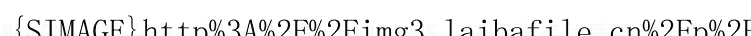
2F96231412.jpg {EIMAGE}

# 373 号
作者:有蜀面画 日期:2018-07-03 14:19

如果国家建立体制下的特种兵可能有为了宣传而拍摄的话，那么混杂了私人武装这个血腥圈子里的国际雇兵就不一样了，这些人实战经验丰富且运利性非常强，他们对武器装备的要求是最讲实用的，任何花里胡哨消费比高的“花瓶”武器装备在他们这里都是不会得到对待的。

很大比用我国生产的56式冲锋枪/子弹袋，甚至得到了这种装备而不惜花大价钱在军火黑市上购买，这一切都是对56式冲锋枪/子弹袋性能的最好肯定。

{IMAGE}http%3A%2F%2Fimg3.laibafile.cn%2Fp%2Fm2F296231767.png {EIMAGE}

# 374 楼
作者：有鲁画 日期：2018-07-03 14:20

好了，今天的武器装备贴图就更新到这里了。
(未完待)

# 375 楼
作者：有鲁画 日期：2018-07-04 18:00

今天有点事，刚刚坐下来，不好意思让大家久等了，楼来更新更新了。

# 420 楼
作者：有鲁画 日期：2018-07-04 18:26

“这就是很有效的克制办法了啊，你也说了，对付怪乱神的东西有奇效，为什么说效果不大呢？”我问。

“我这么主要是因为用鞭鞭效率太低了，你想想也不是超两个人，即便一些常人不会的玄门法术，但并不是超舞符的速度不可能无限的快，得一个的一个打，这多“飞头”，挨个去去，而且不是固定目标，暗暗准了打，这样速度肯定是快不起来的，就是上趴着几百不动这些苍矮让你用蜘蛛拂去个打，那也不是件轻松的事吧？更在在何况这些‘飞头’不仅会动功还飞得慢，我跟师父用绳鞭战在在在斗，只能保证自保，要想帮助侦察战斗的战士们解围，那时的确是做不到的。”人说。

“嗯，这个倒是可以理解的，听你这么一说，我明白你们当时其实是有点手措不及，没想到那个人竟然这么厉害，那么我曾佣你们等一下的行动就是直奔主题——对付那个妖人吧？”我问。

“是的，”斩人射手，擒魔赛擒王，师父打掉十几个‘飞头’之后就把我叫到了另一边，给我说按照计划进行，来击那个妖人，然后把他拉出来，往事布置好的‘大阵’在那那边，我问师父这里怎么办，师父说没办法，打仗只能靠他自己了，如果站在这里继续下去就会越来越被动，对手的实力强劲，这一招之后不一定还有什么很毒招数，所以得准他再用就能争取主动权，下线已经是，“后下未遭遇，”就要办法把这个不不利局面给回来。

然后我们从伏点一跃而出，直奔妖人就去，因为就在眼看着十几的距离，我们还还是从上坡往下下，所以就一转眼功夫就到了眼前，那家伙看来了，完全是毫不无情，我们和他之间隔着小溪，那条小溪还不算太大，我们有七八米，这家伙一下发力就飞一样跳来了，要知道这么远还跟他玩一样，会跳跃冠军他都在。这种颓失，估计就见到鼠能较量，落到小溪时就在后面就开始迎击。他一手操纵剩下的‘飞头’攻击上面的战士，我们出手另一只手来我们，说他真不是个善，一心二用仅用一只手就能短时间内跟两个人打上下，打了半天后居然可以落下，那会儿我又想起师父之话，如果没有师父的话，我自己单干，恐怕早就归位了，以当时的道行，围在一起也曾不是对手。不过我们俩也不是吃干饭的，特别是我父，敌人虽然厉害，但只对付我们时间短了，他也躲不住，等到快三分钟左右吧，他就坚持不去了，开始频繁露出破绽，被师父连续抽了起码五个罐子，每一罐子打上去不是‘啪啪’的，而是那种‘噼啦啦’的声音，他身上被打的地方都是道道的焦黑，不过不太一样，上面出来的烟是乌黑的，就跟团黑冒了出来，而且空气中弥漫着极其间的味道，那场面本以为应该是猪肉味，可闻发现是一种臭带着胀的味道，简直是太难闻了，而且绝对说我见过最难受的味道。

接着他被打的疼，看着他‘咳咳’乱叫，我了，师父从身上抽出了一根信号棒，挥开了空中，还在潜伏点山坡跟‘飞头’奔命的侦察战士看了进且退，开始往我们事先议好的伏击点撤，师父这边卖了个破绽，被人抓了衣服，然后我也摸摸往起点跑，打人打了从后面，而那些‘飞头’得控制才行，但侦察的战士跟跑的不是一条路线，这是我们故意安排好的，而他没法两头都兼顾，像刚才才能一心二用是因为两边都在他的视线范围内，现在侦察拍到山坡另一边去出了视线范围，他再想跑，就得跟着继续操纵‘飞头’，可能是他的感觉更重要，就直接放开了‘飞头’的控制，追着我打不，这也不是我们所期望的，也正是中怀”。

# 422 楼
作者:有脊亥 日:2018-07-04 18:37

“如果不去你们，而是继续操纵‘飞头’对付侦察吧？你们怎么办？”我问。

“这个好，如果他去专心对付侦察，那我们就不跑，而是反过来追着他，直到把他打除了为止，这么说吧，其实他操纵‘飞头’攻击我们以外，其余的基本都在计划的预料之内，后面的事情，就是一步一步的‘引君入瓮’直至最终掉了他。”散人说。

# 190 
“之前带来的这种特香灰，还有坟土，用它们制成的‘大阵’这次该派上场了吧？”我问。

“是它的，它们是起到关键作用的东西，如果没有它们在，还真未能对付这个妖怪，毕竟他比我们预想的要强太多了，事后我跟师父说幸亏准备的齐全，料敌宽了，要不然当初不重视这事情就空手来的话，那差点弄不好我就得死在他的手里，别说完成任务，最好的结果也就是成功而退了。”可以说。

“我想如果是一部电影的话，那么这里应该就是最的一部分了。”我说。

“差不多可以吧，我们准备的充分才能打得相对顺利，不过中间还是出现了几次反复，但好最后是达到目的了，我师父在这里就流了血，如果这些都收不了他，那恐怕大罗神仙来了也也没有办法。”

“你说中间又出现了几次反复，是什么反复？”我问。

“不用，这个事情我马上就会说了。

当时他抱着我跌倒，前面也说了，这人起来速度非常被盯上快，所以平地直线根本不是他的对手，我好几次都彼去“祖师爷”，就这一打一段一段，算是打的吧，最后就到了战斗，因为我们这边边打边跑，所以晚上没有了‘飞头’缠的，这时候已经到位，周围林里埋了起来，我们进入了核心区域，前面还有十几公里就是土砌的一块圆形地形，脚踏上土后，脚底板立马开始冒烟，还是那种‘哈啦’的声音，他看事情有些妙，就想回撤但他还没抬起来，师父已经从前面一个急停后转向，距离只有公里而已，三步并步走过来，手中的绳鞭一下勒了他的后颈，然后身体用力想拽进来，但他力气大，师父第一次拽我，为了防止他把头往面出来，我还护住了衣领，那种粗麻衣服倒是能抓得很实，我们一起发力，吃不住劲儿，完全进入了坑的覆盖之后，那样个人就像热锅上的蚂蚁，顿时就是上跳下，他的表情绝对痛苦不堪，接着他又被拽着，手忙脚乱的这个空档让他翻倒在了地上，然而那些土就粘的他满脸都是，这家伙就更难受了。”散人说。

# 423 楼 
作者：有骨画 日：2018-07-04 33

最后就是依靠这种方法打败他的吗？”当然不是，他就要这点力也不够用这么大的阵。之前，师父告诉我，这种高级土与黑血炼制出来的黑色土壤，可以轻易打掉一个玄门人的道行，之所以没事，是因为制作土的时候，里面烧了，所以我们可以在里面随意活动而不受到伤害。

按照来说，一般的修者被这种土染的浑都是，道行早就被打了一干净了，而且别说是满都是，就是扔到身上一把，只要抓到皮肤上也会吃掉，这可让人害了，就这样他还能再次反抗，等他从地上起来，我们再次这一程前后夹住他，防止他逃逸然后消耗掉，最后想办法把他送进中心的大坑里，而那个里面装的就是之前见到的特质灰，这东西比土更坏了，如果他掉进坟里，那结果就会冒烟了。

树林里逃命的侦察战士早就出来了，他们不是玄门人，所以进来无所谓，那帮家伙起自动防御对他，一个弹兜几秒钟全部打完，结果弹在他身上就像爆炸进烂木头一样，发出“噗噗”的声音也不见血，他的满都是霉遍，却是死不了的，我师父给了排长让帮忙一起把他扔到中心的坑里去，排长一招呼，周围的战士七手脚就全上了，加上我们俩，连带拽把他往那边走。

# 433 楼
作者：有隼画 日期：2018-07-04 22:02

在本篇访录中提到我军使用重机枪击击，但没有说明具体型号，这里就贴一下我军在对越作战时期使用最多、运用最广泛两种重机枪：

第一种：53式7.62毫米重机枪，该枪虽然战斗中比较重，不利于快速移动，但火力持续性非常强，且弹丸杀伤力高，所以经常需要轻武器高强度对越作战中表现优秀，发挥了重要作用。


第二种：57式7.62毫米重机枪，该枪的性能与表现都不逊色于上述53式重机枪，而且接受了参战部队评价颇高。62年对越作战时实心轮式结构太重，不利于复杂地形上快速转移的缺点，将其为了更加简便的三脚架（那是为了与53式重机枪配件的通用性而设计的，属于常态），经过越战的实战检验后，其表现突出（图4则是未安装高射瞄具的正常对平射模式）。

# 427 楼
作者：有隼画 日期：2018-07-04 21:50

楼主又更新武器插图：

# 434 楼
作者：有骨画 日：2018-07-04 22:18

不好意思，贴完发现435楼的图贴错了，不是57式重机枪，而是67-2式7.62毫米用机枪的状态，这里再贴一张实心轮机架的57式重机枪的图作为补充吧：

# 435 楼 
作者:有骨画 日期:2018-07-04 22:23


# 436 楼

# 437 楼 
作者:有骨难画 日期：2018-07-04 22:34

已经准备好站点因为是星细胞跑步这好场赛跑和跑步我们正在再贴张我军在对越作战期间的一种单兵便携夜视装备，散人能看见“雾仙”的技术设备中，除了了具有夜视能力的摄像机外，这种单兵夜视仪也是其中之一，它就是83式手式微光夜视仪，由于它具备热像功能，所以看见一些肉眼看不见的东西，比如访谈中所说的妖人“养”的这种“雾仙”。

```
{IMAGE}http%3A%2F%2Fimg3.laibafile.cn%2Fp%2Fm2FN2296300031.jpg {EIMAGE}
{IMAGE}http%3A%2F%2Fimg3.laibafile.cn%2Fp%2Fm2FN2296300034.jpg {EIMAGE}
{IMAGE}http%3A%2F%2Fimg3.laibafile.cn%2Fp%2Fm2FN2296300043.jpg {EIMAGE}
```

# 438 楼
作者:有骨难画 日期:2018-07-04 22:34

今天的武器装备图就更新到这里了。
(未完待)

算是有问答，但在忙整事情的时候却很喜欢做伏底，跟前面那些从人堆里翻滚了几个回来的老兵的直来直去相比简直显得有些从容，反差明显。也许是性格原因，也许他是作为玄门中人，把话说不直说当成了一种风格了吧，这倒不是说故弄玄虚，而且更像是一种职业习惯。

“是的，当时我们在场的所有人都看到那个场景，没谁还会以为他仍然活着。原本在较远的侦察排阵也曾拂过想来看看这事情的儿子，就是刚刚过来还会儿吗，我师傅双眼的眼睛跟包子一样大，看着其中坑里冒泡向外溢出的黑色液体突然大吼了一声‘快快快！’然后拉我就往一旁边，就这么就……”

他拉着我的手，右手顺便拽上了一个战士，我们抓着我们两个人直接向后甩出去滚了三米，落在地上。在他后面的我那老士兵可不重，但根本一下疼，就听见身后‘噗’的一声，扭头一看，就从刚才的香灰坑里，在一个‘大气泡’之后，蹦出一个‘人’来！这个人只剩下了一个‘人形’，身上的肌肉和皮肤被泡化了，起码左右，我都能通过被泡化的位置看到里面的内脏。其中一幕印象极其：在这块斑斑的胸口下面有一个正在‘扑通扑通’跳的心脏，但在这颗心脏的右下方，居然还有一颗心脏，比那时的大概小了一半多吧，虽然跳动的速度更快，看那频率，我感觉自己分钟每跳得180次以上。

事情发生后的一瞬间，我脑子里一片空白，不过这种反应过来就知道蹦出来的这个家伙伏定就是刚才被我们扔进去那个妖妖，心想他是真打算害，这么样的死不了了。而四面原本困扰在坑里的侦察排长战士们更是是被这这一幕给吓哑了，就像之前的数百诡叫着人跑的‘飞头’一样，虽然他们身体经历过无数战，可是如此诡异的景象竟然是平生第一次。

而侦察排长毕竟竟是排长，他是众多战士反应速度最快的，在妖人跳出来之后，我估计也就不到一秒的时间里，他率端起手中的自动步枪，对准就要打。经过之前的折磨，他肯定知道用枪很难杀死对方，但他仍然举枪打，估计应该是一种本能。不过结果那妖人的动作更快，侧过一下，身体让人难以以置信的速度向前一纵，就到了距离他起码有5米外的枪排长身前，然后拳起右手，击他一个抓‘爪子’形式向下就抓。

活不了了，而且还有可能死得非常难看。但妖人的速度快，他的反应也不慢了，原本对着妖人还没有打响的自动步枪以最快的速度就转过来横靠在了自己的头上，阻挡进来的枪。几乎是同时，他的横枪过来了，那只手也打下来。

钢铁制造的81-1型自动步枪打坏了，直接给拦腰打成了两截，枪体变形，而里面大小的各种零件跟之前被拆散的那个弹匣落了一样，崩出了好远。

就是这样，那只不过只是被减慢了速度，并没有完全停下，继续下去却打在了排长的钢碗上，硬生生地把钢碗上抓出来了，5道指平均起码有1厘米的指印，钢碗上的绿漆都被抓了，5道指印都露出了钢碗原本银色的底色。

不是而是因为有自动步枪的阻挡，让钢碗能够勉强度挡抓住妖人的攻击。要是没有步枪在前面挡了那一个，直接接到拳上的话，即便戴着钢碗，估计那排长也被抓个脑浆迸裂。如果只有枪挡，他没戴钢碗，看着脑袋或者是戴着制军帽的，结果也不好了，起码头顶上得多出几层额，就是整个前额都被‘掀’，而两种因素合在一起才后他在这一中没死也没有受重伤，用他们的话，他叫‘命不该劫’。

之后那个妖人一抓结束之后接着又是一脚，这一脚正瞪在排长的肚子里，把他踢出去至少也有七八米远的距离，当时我清楚的看到他被踢到嘴里吐出了一口鲜血。

(未完续)

# 456楼
作者:有笨难 日期:2018-07-05

“根据他的信息来看，这个妖人力大无穷，爆发力惊人，可以轻松跳过7、8米宽的溪流，那他这一脚踢上去，这家伙的排长吃得消吗？”

“所以他被踢得流血了，还好的是腹部，要是踢到什么要伤头部部位就完了。而且这时妖人已经被咬住了，特制香炉……”

连逢两次重量，虽后来法质还要顽抗，但整体实力被削弱了大半，所以那一只脚的力度我估计也没法跟他对抗。良好良好的时候，如果是按照他跳过小溪来我师父父亲两人那会儿的状态还露出这一脚的话，估计侦察排长肯定要迷死，就是吐血的问题了，估计腰都被踢断了。”散人说。

“我可以想象出当时的画面，应该已经到了千钧一发的关头了吧，之前交战还是有退撤，现在是面对面的硬仗，而且只要先不输优势就准得先攻，对吧？”我说。

“嗯，确实很准确，一点也不夸张。当时经历过这一折，周围的战士们都反应过来了，开始集火射击，这子弹对他造成的伤害还比他掉进坑里之前要强的。密集的火力弹命中他身上各种残渣流乱，但他竟然顶着火力连续杀了两名距离最近的战士，第一名被手抓了整个腹，从后面穿出来的；第二名是被横着撞了头，钢盔彻底崩碎了。用几工夫就打死了两人，完全就是转身，全程不到两秒。”

就是这样，那只不过只是被减慢了速度，并没有完全停下，继续下去却打在了排长的钢碗上，硬生生地把钢碗上抓出来了，5道指平均起码有1厘米的指印，钢碗上的绿漆都被抓了，5道指印都露出了钢碗原本银色的底色。

不是而是有自动步枪的阻挡，让钢碗能够勉强度挡抓住妖人的攻击。要是没有步枪在前面挡了那一个，直接接到拳上的话，即便戴着钢碗，估计那排长也被抓个脑浆迸裂。如果只有枪挡，他没戴钢碗，看着脑袋或者是戴着制军帽的，结果也不好了，起码头顶上得多出几层额，就是整个前额都被‘掀’，而两种因素合在一起才后他在这一中没死也没有受重伤，用他们的话，他叫‘命不该劫’。

之后那个妖人一抓结束之后接着又是一脚，这一脚正瞪在排长的肚子里，把他踢出去至少也有七八米远的距离，当时我清楚的看到他被踢到嘴里吐出了一口鲜血。

(未完续)

“根据他的信息来看，这个妖人力大无穷，爆发力惊人，可以轻松跳过 7、8 米宽的溪流，那他这一脚踢上去，这家伙的排长吃得消吗？”

“所以他被踢得流血了，还好的是腹部，要是踢到什么要伤头部部位就完了。而且这时妖人已经被咬住了，特制香炉……”

连逢两次重量，虽后来法质还要顽抗，但整体实力被削弱了大半，所以那一只脚的力度我估计也没法跟他对抗。良好良好的时候，如果是按照他跳过小溪来我师父父亲两人那会儿的状态还露出这一脚的话，估计侦察排长肯定要迷死，就是吐血的问题了，估计腰都被踢断了。”散人说。

“我可以想象出当时的画面，应该已经到了千钧一发的关头了吧，之前交战还是有退撤，现在是面对面的硬仗，而且只要先不输优势就准得先攻，对吧？”我说。

“嗯，确实很准确，一点也不夸张。当时经历过这一折，周围的战士们都反应过来了，开始集火射击，这子弹对他造成的伤害还比他掉进坑里之前要强的。密集的火力弹命中他身上残渣流乱，但他竟然顶着火力连续杀了两名距离最近的战士，第一名被手抓了整个腹，从后面穿出来的；第二名是被横着撞了头，钢盔彻底崩碎了。用几工夫打死了两人，完全就是转身，全程不到两秒。”

就是这样，那只不过只是被减慢了速度，并没有完全停下，继续下去却打在了排长的钢碗上，硬生生地把钢碗上抓出来了，5道指平均起码有1厘米的指印，钢碗上的绿漆都被抓了，5道指印都露出了钢碗原本银色的底色。

不是而是有自动步枪的阻挡，让钢碗能够勉强度挡抓住妖人的攻击。要是没有步枪在前面挡了那一个，直接接到拳上的话，即便戴着钢碗，估计那排长也被抓个脑浆迸裂。如果只有枪挡，他没戴钢碗，看着脑袋或者是戴着制军帽的，结果也不好了，起码头顶上得多出几层额，就是整个前额都被‘掀’，而两种因素合在一起才后他在这一中没死也没有受重伤，用他们的话，他叫‘命不该劫’。

之后那个妖人一抓结束之后接着又是一脚，这一脚正瞪在排长的肚子里，把他踢出去至少也有七八米远的距离，当时我清楚的看到他被踢到嘴里吐出了一口鲜血。

(未完续)

“根据他的信息来看，这个妖人力大无穷，爆发力惊人，可以轻松跳过 7、8 米宽的溪流，那他这一脚踢上去，这家伙的排长吃得消吗？”

“所以他被踢得流血了，还好的是腹部，要是踢到什么要伤头部部位就完了。而且这时妖人已经被咬住了，特制香炉……”

连逢两次重量，虽后来法质还要顽抗，但整体实力被削弱了大半，所以那一只脚的力度我估计也没法跟他对抗。良好良好的时候，如果是按照他跳过小溪来我师父父亲两人那会儿的状态还露出这一脚的话，估计侦察排长肯定要迷死，就是吐血的问题了，估计腰都被踢断了。”散人说。

“我可以想象出当时的画面，应该已经到了千钧一发的关头了吧，之前交战还是有退撤，现在是面对面的硬仗，而且只要先不输优势就准得先攻，对吧？”我说。

“嗯，确实很准确，一点也不夸张。当时经历过这一折，周围的战士们都反应过来了，开始集火射击，这子弹对他造成的伤害还比他掉进坑里之前要强的。密集的火力弹命中他身上残渣流乱，但他竟然顶着火力连续杀了两名距离最近的战士，第一名被手抓了整个腹，从后面穿出来的；第二名是被横着撞了头，钢盔彻底崩碎了。用几工夫打死了两人，完全就是转身，全程不到两秒。”

就是这样，那只不过只是被减慢了速度，并没有完全停下，继续下去却打在了排长的钢碗上，硬生生地把钢碗上抓出来了，5道指平均起码有1厘米的指印，钢碗上的绿漆都被抓了，5道指印都露出了钢碗原本银色的底色。

不是而是有自动步枪的阻挡，让钢碗能够勉强度挡抓住妖人的攻击。要是没有步枪在前面挡了那一个，直接接到拳上的话，即便戴着钢碗，估计那排长也被抓个脑浆迸裂。如果只有枪挡，他没戴钢碗，看着脑袋或者是戴着制军帽的，结果也不好了，起码头顶上得多出几层额，就是整个前额都被‘掀’，而两种因素合在一起才后他在这一中没死也没有受重伤，用他们的话，他叫‘命不该劫’。

之后那个妖人一抓结束之后接着又是一脚，这一脚正瞪在排长的肚子里，把他踢出去至少也有七八米远的距离，当时我清楚的看到他被踢到嘴里吐出了一口鲜血。

(未完续)

“根据他的信息来看，这个妖人力大无穷，爆发力惊人，可以轻松跳过 7、8 米宽的溪流，那他这一脚踢上去，这家伙的排长吃得消吗？”

“所以他被踢得流血了，还好的是腹部，要是踢到什么要伤头部部位就完了。而且这时妖人已经被咬住了，特制香炉……”

连逢两次重量，虽后来法质还要顽抗，但整体实力被削弱了大半，所以那一只脚的力度我估计也没法跟他对抗。良好良好的时候，如果是按照他跳过小溪来我师父父亲两人那会儿的状态还露出这一脚的话，估计侦察排长肯定要迷死，就是吐血的问题了，估计腰都被踢断了。”散人说。

“我可以想象出当时的画面，应该已经到了千钧一发的关头了吧，之前交战还是有退撤，现在是面对面的硬仗，而且只要先不输优势就准得先攻，对吧？”我说。

“嗯，确实很准确，一点也不夸张。当时经历过这一折，周围的战士们都反应过来了，开始集火射击，这子弹对他造成的伤害还比他掉进坑里之前要强的。密集的火力弹命中他身上残渣流乱，但他竟然顶着火力连续杀了两名距离最近的战士，第一名被手抓了整个腹，从后面穿出来的；第二名是被横着撞了头，钢盔彻底崩碎了。用几工夫打死了两人，完全就是转身，全程不到两秒。”

就是这样，那只不过只是被减慢了速度，并没有完全停下，继续下去却打在了排长的钢碗上，硬生生地把钢碗上抓出来了，5道指平均起码有1厘米的指印，钢碗上的绿漆都被抓了，5道指印都露出了钢碗原本银色的底色。

不是而是有自动步枪的阻挡，让钢碗能够勉强度挡抓住妖人的攻击。要是没有步枪在前面挡了那一个，直接接到拳上的话，即便戴着钢碗，估计那排长也被抓个脑浆迸裂。如果只有枪挡，他没戴钢碗，看着脑袋或者是戴着制军帽的，结果也不好了，起码头顶上得多出几层额，就是整个前额都被‘掀’，而两种因素合在一起才后他在这一中没死也没有受重伤，用他们的话，他叫‘命不该劫’。

之后那个妖人一抓结束之后接着又是一脚，这一脚正瞪在排长的肚子里，把他踢出去至少也有七八米远的距离，当时我清楚的看到他被踢到嘴里吐出了一口鲜血。

(未完续)

“根据他的信息来看，这个妖人力大无穷，爆发力惊人，可以轻松跳过 7、8 米宽的溪流，那他这一脚踢上去，这家伙的排长吃得消吗？”

“所以他被踢得流血了，还好的是腹部，要是踢到什么要伤头部部位就完了。而且这时妖人已经被咬住了，特制香炉……”

连逢两次重量，虽后来法质还要顽抗，但整体实力被削弱了大半，所以那一只脚的力度我估计也没法跟他对抗。良好良好的时候，如果是按照他跳过小溪来我师父父亲两人那会儿的状态还露出这一脚的话，估计侦察排长肯定要迷死，就是吐血的问题了，估计腰都被踢断了。”散人说。

“我可以想象出当时的画面，应该已经到了千钧一发的关头了吧，之前交战还是有退撤，现在是面对面的硬仗，而且只要先不输优势就准得先攻，对吧？”我说。

“嗯，确实很准确，一点也不夸张。当时经历过这一折，周围的战士们都反应过来了，开始集火射击，这子弹对他造成的伤害还比他掉进坑里之前要强的。密集的火力弹命中他身上残渣流乱，但他竟然顶着火力连续杀了两名距离最近的战士，第一名被手抓了整个腹，从后面穿出来的；第二名是被横着撞了头，钢盔彻底崩碎了。用几工夫打死了两人，完全就是转身，全程不到两秒。”

## 武器装备对照表

| 装备名称 | 型号/特征 | 备注 |
| :--- | :--- | :--- |
| 81-1型自动步枪 | 钢铁制造 | 被妖人拦腰打成两截 |
| 65式工兵铲 | 第二代 | 侦察排携带，非常耐用 |
| 6411工兵铲 | 内部代号 | 口口碑极高 |
| 77式手榴弹 | 进攻型 | 威力巨大 |
| 82式手榴弹 | 鸭卵形 | 覆盖面积大 |

## 军队编制说明

| 编制单位 | 人数 | 备注 |
| :--- | :--- | :--- |
| 班 | 9-10人 | 基础单位 |
| 排 | 36人 | 三个班组成一个排 |
| 侦察排 | 36人战斗单位 | 共有36人 |
| 连 | - | 三个排组成一个连 |
| 营 | - | 三个连组成一个营 |


他后来到后方战士医院检查的时候，检查结果就是面积内出血，而且脊柱还被那一脚踢的错位了，不过幸好出血面积虽然巨大，但深度较浅，脊柱错位的程度也在可见手术修复范围内之内。听过他从野战医院转院到条件更好的城市大医院里去，养了大半年才伤好。

不过其他人就没这么幸运了，在“飞头”团围围的时候，牺牲了整整 10 名战士；跟人交战的时候，最后又牺牲了2 名；36 个人的侦察排牺牲了12 人，重伤了1 人，战斗员超过了三分之一，牺牲的人数正是一个班。而且这还是在对付一个目标时产生的伤亡，算得上是损失了。不过来说也很有意思的，那些跟着我们走这一路的那 12 头“凯勃”，都毫无完整地战斗回来了。

至于这个人类体是谁，一开始我们就没清楚，此战胜利结束之后，又回去摧毁了他那个架台和大锅，同样是一把火烧了几个干净，然后撤离，一直沿着路撤回老山后，也就是我们初出出发的地方。这一路上倒算是平安无事，几次跟小股越军通过，也交了好几次，不过他们似似无心胆，打上几枪就自己溃退了。反正我们在回来的时候没有伤亡，还在这几次战斗中断断续续的击起了10 名以上的越军。我原以为回去就能见到大师兄，师父好这的事给他们说一下，结果回去去了发现他不在，一打听才知道我们走之后就立刻出发了，执行的任务规模我们要大得多，这个就是他在老山与我们分别时的‘重要的任务’。

然后就是实在当地留了两天来修改，结束结束后后再坐车回到时的机场，足了足足一个星期，才等到大师伯回来。当时他看我一脸的征斥，满身都是杀气，我大师伯这人在我印象里一直都是一副挺携祥的样子，他的这种状态，我自我认识以来到现在为止见过那么一次。

在部队里给我师傅安排的临时招待所房间里，他大致给我们讲了讲，这段时间干了什么去了，其中也提到了之前我们掉掉的那个妖人是什么来。

话说在我们出发的第二天，他就跟着一大帮直道接坐着直升机来了一个大范围回来，跑到越军的大后方去了。大大概位置我没记错的话应该是越南和柬埔寨境的位置，他们一起去了40个人。这些人与我们那支队伍不一样，里面除了大师伯等几个挂着军衔为国家使命的玄门中人外，我们全人都不是战士，没有像侦察排那样的纯粹的军人，他们全部都是玄门中的顶级高手，而去的任务就是对付越南那边请来的‘援兵’散人。

(未完待续)

“去越边界消除越南的‘援兵’？他们这是深入敌去作战？”问。

是的，我大师伯带着这么多高手去，就是先下手为强，把他们杀在摇篮里，趁他们当时立足未稳之际，将其消灭掉。”散可以说。

“如果用的你大大师伯带着这么多玄门高手去对付的话，我想这肯定不是一般常见的军方力量，应该也是类似妖人的那种吧？或者说，这股援兵和妖人是什么关系？”

“具体来说，这股援兵是妖人越越南方面来的，大概来了20号吧，不到30号吧，这帮人都是东南亚地区，尤其是缅甸、泰国和马来西亚一片的玄门高手。不过我们法术种许多者不相同，他们门派也各有所别，但实力大致三种：降头师，放蛊师，还有鬼师，修炼的都是比较阴毒、残忍的法。像这个妖人，他就属于降头师，属于东南亚那些地方，多多水气整体‘阻滞’的格局，就是说这个地方因为终年湿热，地势低洼加风水位的原因，很容易产生气又不容易散出去，久而久之积的越来越深，最后渗透到每一土土壤里，是一块比较‘凶’的所在。在这种环境下土地产生的方法，也跑不了就是阴毒的法术。不过呢，不是降头人还是监术亦或者养鬼术，都是从我国这边传过去的，他们当地人经过二次发展发展成了现在的模样。打个不太恰当的比喻吧，它们与我国术法的关系就像是《辟邪剑谱》与《葵花宝典》之间的关系，前者是后者的一部分的发展。这种现象在其实并不常见。”

而这个妖妖姓墨谁已经无从可考，但他有一个很有名的江湖绰号，叫做‘大怕郎’。我刚知道他这个辖号的时候还哑了半天，后来才清楚他们同行与对之间的一种尊称，或者说是表达畏惧的称呼。跟我们中原元的江江湖号一比，不得不说都是在亚洲，但这一南南北的地域差异造成的文化差异还是大大的。

在法术方面，这位‘大怕郎’的主要修炼便是降头术，在那些‘飞头’的基础上进一步发展来的，叫做‘群降’。看来或许是飞头的升级，除了降头术外，他还修炼毒，一般用药为主。所以我在前面还提到他是药方面高手，他不只用药攻击敌人，同时也长期服药，并且给了自己一些能提升能力但作用是非常大的。其服药的结果，这也是他跳得特别快的原因，还告诉他在心脏下面长着一颗跳得特别快的心脏吗？我不清楚，但我所知也是多年用药。

在东南亚一片玄门地位还非常高的，是当地的‘降头圣’之一。其旗下无数弟子，有一个自己的组织，名字就叫‘拜骨会’，影响力很大。另外说他并不是纯粹的越南人，而是父亲为泰国人，母亲为越南人的混血，而且是个国籍人士。他的父母也是当地玄门中人，但道一般没有这么高。而且他在老山来过的时候，他的父母已经死了。关于他与越南方面的关系其实不大，他母亲是越南人。之所以他帮越南做事，主要是因为越南方面直接给了他足额黄金作为报酬，并且承诺如果能帮老山拿下来，就给他官。反正咱们说，就是类似‘宗宗’或者用小说、电视剧常用的国师，比如《神魔侠》里就不是蒙。而他寻找的那些援兵的是他的朋友，已经出去立门的徒弟，还有他靠的同门。因为也很简单，他的行再高，那也不可能对付了军队。所以仅靠他一个人颠覆老山的战局，那是不真实的，最多用手段制造战场混乱，增加一些伤亡而已，对大局产生了根本性的影响。所以他在老山前线，就是我们跟他们决战的那个恶劣了一段时间之后，发现自己独木难支，这个事情被军的情报部门所截获，直接送到了有关部门。传达了我大师伯，最后官的直接命令就是让他带人去下手为强，趁着这些人还没有发挥各自机会将他们到了地方站稳再动手。因为那时候，仗着这些人的本事，虽然20号也不能颠覆战局，但是造成的后果就太大了，对人员的伤亡是最严重的。169号阵地上发生的事情已经被秘密封锁了，且外溢，再以此传论，甚至是被人心叵测的敌势力所利用，产生的负面影响几乎是不可估量的。一个妖人都活跃到了这种程度，他们这些都折开了，结果严重程度绝对可以说是不可设想，所以我大师伯的命令就是不惜一切代价，一定要打掉他们。”

“还好，经过几次较量后，他们大致适应了对方的打法。最终的结果就是双方对抗了两天多，战线拉得很长，我们这边才开了几个小时而已。相比之下就可以看出对抗的区别。”

“结果如何？”

“这是自然，他们那边的战斗规模援在那里，双方60多高手对手，肯定不是我们2打1能比得了的。至于战斗的细节，大师伯说的太细了，只是说的非常激烈。这可是数千年来，中原大地的玄门与东南地区对抗。”

## 玄门中人的第一次组规模对抗

而且说是技术含量还参与人员的水平，几乎都是高到无法复制的。在我们行内来说，怎么形容跟宣传这件事事情都不为过。通过大师伯的讲述，我总结的是我们这边在宝物上占优势，但经常受到对方的一些不清楚、了解甚至是完全无闻的术法攻击，找不到有效应对，因为产生了一些动。不过还好，他们都是行的顶尖人才，我们只有不到30人，人数上占很大优势。最终的结果就是对方全面溃败结束。”

“好呀，谢谢你的合作。”我向散人提出一个要求，让他稍展示一下自己的玄门法，他应该接受。按照散人说，凡是玄门范围内，只要不会引起关注，适当展示一下并不是完全禁止。”

“用这筷子吧，让你开眼界。”说这话的时候我心想他涉猎比较广泛，平时也算是个魔术爱好者，对其中的原理更是熟悉。诸如经典的魔术我已经见惯，所以如果他只是尝试把筷子变戏我是很容易看出破绽的，那么他的话完全不可信，但至少要拆掉很多水分。我听这话甚不服，心说虽然不知道这里是什么原理，我作为一名记者也不是什么力壮之人，但也常去健身房，属于撸铁军队中的一员，我不会倒一根筷子？这也太小看我了吗？如果我用的是魔术手法，我就不可能弄倒。散人此时也不言语，看着我把筷子推到前面的桌面上之后，伸出一只手指轻轻指向自己的方向做了一个‘勾’的手势，并同时了一声“起”。那根筷子真的与他手势相同，从躺着变成了直挺挺的立在了桌面上。等我说完，我对他说：“你可以试试把这根筷子弄倒，如果你能弄倒，我就算这几十年的修行白费了。”

“害。”我搓了搓手，缓解一下尴尬的后面对散人说。

到这里，我对散人的采访此算是告一段落，不过只是是在最后的最后，还发生了一个小插曲。我与散人谈了整整一个下午，我消耗了两盆铁鸡蛋，而散人则是两盆西湖龙井，各自免费了这一次。临终前我正要起身去连接，却在恍惚之间发现散人已经不见了，对面的座位空无一人，消失得无声无息，就像他从从来没来一样。只有那根筷子还在那里作为刚才坐在这里的证据。我到了前台，却被告知已经丢失失物为由，要求让我看他之前座位附近的监控录像。根据时间上推算，我在最后起身扭头的瞬间，屏幕竟然闪烁了一下，出现了大概5秒左右的雪花，随即又恢复正常。再看向面对已经是空一人，看到这里深吸了一口气，顿时脊背发凉。对于来说他所说的话我有些见识了，之前他的质疑并不高明的，或许也是对我的一种不满吧。更重要的是，我想这种人利用自己描绘的法术，造成的危害简直无法设想。以上就是当年老山前线那些不为人知的战斗史，非常有价值。”

## 深入挖掘并今天通过互动的方式整理出来，形成文字稿，这可能是人类第一次在军方支持下，以玄门术作为主要作战方式的大规模特种战。不论是从国防结构、研究战史，还是总结经验等领域来说，将是一笔极其珍贵的财富。对于我国相关领域的实力更是意义非凡。事后辗转多地找到了对此事涉及领域有着权威发言。以下是经过整理、润色后，与何树华研究员的访谈摘要：

“你好，这次采访的主题是关于当年老山战役中149号阵地上两种‘活体生物’，可以把你所了解的情况说一下吗？”我不客套，直奔主题。

“你好，这个事情清楚还要从老山战役开始，而且涉及的国外力量不止越南南部。老山战役爆发发生在1984年，而要讲起它的源头，就得说是1981年的阿富汗。”

“阿富汗？阿富汗位于亚洲，与东南亚的越南远隔万里，两者之间在这件事情上有什么交集？”我问。毕竟两者地理上都有‘八拳子打不着’的意思。

“没有直接交戈，但间接的还是有的，而且具有决定性的间接交戈。如果没有在阿富汗发生的情况，也许就不会有老山战役发生的那些事情。1979年12月，苏军大军进攻阿富汗，长达10年之久。阿富汗战争由其开始之初，苏军以压倒性的优势取得了正面战场上的胜利，但随着战争发展的深入，也陷入了无法自拔的游击泥淖之中。在崇山峻岭之上，地形复杂的山洞众多，抵抗组织多如牛毛，其中最被外界熟知的，就是后在1996-2001年间掌握阿富汗政权的塔利班。这些抗击组织被戏称为‘圣战者’，其中大多数都有地方部落提供掩护，他们利用地形特点与游击战术相结合，对苏军造成了相当大的损失。这种情况到1981年初，阿富汗政府抗击武装联合成立了阿富汗圣战者伊斯兰联盟，并开始接受美国、巴基斯坦、沙阿拉伯等国的军事援助。拥有稳定和大量的武器以及活动资金支撑的圣战者对苏军的各种打击已经愈演愈烈。苏军为了解决圣战者的袭扰，使用了除核武器之外，当时的几乎一切武器种类和型号，仍然无法彻底阻止抵抗组织。所以，169号、42号阵地上的‘活体生物’的确不是玄门产物，不仅如此，而且是当时的生物科技产物。换句话说，169号、42号阵地上的东西可以用玄学来解释，那么149号阵地上出现的巨型蜂与巨型鼠就用科学来解释。”


## “新型武器？难道是——“活生物兵器”？巨型系人蜂还有巨型老鼠有关？”我说。

“是的，第一批投入阿富汗的“活生物兵器”，就是你所说的巨型“杀人蜂”，只不过当时投入的型号还不够完善，相比老山战役中越军使用的那种还不太成熟。至于巨型老鼠，那则要更晚一些，吐不了巨型老鼠不太严谨，按当时苏军内部的官方称呼，应当称之为“食人类”。柯树华说。

“那么说的话，越军在149阵地地上使用的这种“活生物兵器”是由前苏联提供的？”我问。

“是的。”何数华的回答相当肯定。（未待续）

## 546 鼠

作者：有骨的漫画 日：2018-08-07 15:20

楼主又来更多了，既然提到了阿富汗战争（前苏联联），那楼主就来几张图应要一下吧，图1、2、3、4为悍阿苏军的历史照片，图5、6为活跃在崇山峻岭之间的“圣者”们，也就是当地的反苏抗击者们。

(注：图6中“圣者”们扛的是进行过粗细分解（大部分拆拆）的DShK（德什卡卡）-38/46型12.7毫米大机枪，这样便于在山地这种复杂的地形下进行步机动，方便转移以及打完后的撤退）

加v信110128495，获取更多好帖推荐

{SIMAGE}http%3A%2F%2Img3.laibafile.cn2Fp%2Fm%2F296409253.jpg {EIMAGE}
{SIMAGE}http%3A%2F%2Img3.laibafile.cn2Fp%2Fm%2F296409255.jpg {EIMAGE}
{SIMAGE}http%3A%2F%2Img3.laibafile.cn2Fp%2Fm%2F296409259.jpg {EIMAGE}
{SIMAGE}http%3A%2F%2Img3.laibafile.cn2Fp%2Fm%2F296409276.jpg {EIMAGE}
{SIMAGE}http%3A%2F%2Img3.laibafile.cn2Fp%2Fm%2F296409280.jpg {EIMAGE}

547 楼

作者：有骨难画 日期:2018-07-07 15:27

下面继续对越作战期间的我军历史图片，这两张是我军对越作战时两支军队勋赫的捷旅各自某部的合影，其中图2摆战士面前的武器中，左往右数可以看到 3 种不同的武器装备，分别是：56式7.62毫米班用机枪、67式系列7.62毫米通用步枪、65式78毫米无坐力炮、69-1式40毫米火弹。

{SIMAGE}http%3A%2F%2Img3.laibafile.cn2Fp%2Fm%2F2964009356.jpg {EIMAGE}

加 v 信 110128495，获取更多好帖推荐

{IMAGE}http%3A%2F%2Fimg3.laibafile.cn%2FFm%2F2964009360.jpg {IMAGE}

548 楼 

作者：有骨难画 日期：2018-07-07 15:27

好了，今天的图楼主就更新到这里了。（未完待续）

549 楼 

作者：有骨难画 日期：2018-07-08 15:07

我听听此言突然有种恍然大悟的感觉，便更紧记下了这段落中的核心内容，甚至都未再及再次提问，柯树华见我“奋笔成书”，便停了下来没有继续说下，等看我写的差不多了，才再次开口：

> 具体来说，当时经过在阿富汗的数年实战后，苏军内部通过总结实战经验开始了第二代“杀人蜂”和“食人鼠”。现在，1981年首先攻入战场的势力是第一代，1984年老山战场上越军使用的那些则就是第二代。”柯树华说，他的这番话算是彻底解答了我之前造访柯树华心中的一个疑问，这才是我有恍然大悟的原因。

越南作为一个国力贫弱的国家，如何能力研制这种水平的“活生物兵器”？要知道使用大型生物作为生物武器的难度要远高于释放微生物的原始“生物战”，但即便如此，想要研制以微生物作为生物战剂的生物战技术，最起也要拥有一套相关的研发体系。这套体系不是小国可以负担的，如臭名昭彰的二战期间日本731部队以及185部队（注：如果各位想看更多详细信息，那么在搜索时用“一八五”字符效果不好，用数字搜索效果好）。即便如此，其背后还有一套科研系统作为支撑，投入了几十年的资金，而越南在山岭越战期间，刚刚从实战中解放出来，再往前在抗法战争，这片土地几乎从未建立这样的体系。

从现代来看，生物战的研发成本远高于核武器，相比之下，生物战与活体生物兵器又是两个时代的产物，就像从手枪发展到自动机器人的鸿沟一样，其中牵涉领域十分广泛。所以当初我想不通越南会有此类技术，但现在就能理解了。

前苏联作为当时的超级国之一，在国力上具备研制“活体生物兵器”的基础，而且不少材料显示苏联确实进行过大量的研究，并且延续到今天的俄罗斯并没有停止。实在在1979年，越南为了对抗我国，因为边界和意识形态问题，这种矛盾到了1984年老山越战期间更是顶峰。在这个背景下，越南获得苏联的此类援助也是合理之中。另外，这里加一点关于P4级别实验室的题外话——“P”的含义为英文“protect”的简称，意为“保护”，“4”则为第四级，同时是目前的最高级别。下面是安全实验室的相关简介（如果感兴趣阅读更详细的资料可以自行搜索）：

- P1 实验室：具备一般实验室相同级别的设备。研究与处理的致病微生物典型有：麻疹病毒、脑炎病毒。
- P2 实验室：符合BSL-2建设要求，其试验研究的物质是一些已知程度危险并且与人类常见疾病相关的物质。研究与处理的致病微生物典型有：流感病毒。
- P3 实验室：全称“生物防护三级实验室”，整个实验室完全密封，室内处于负压状态，从而使得实验室内部的气体不会跑到外面造成污染。试验研究的物质一般都是外来的，通过呼吸传染病毒或者有生命危险可能的物质。研究与处理的致病微生物典型有：灵芽孢杆菌、鼠疫菌、结核分杆菌、狂犬病毒。
- P4 实验室：从事致病性微生物实验的单位，试验研究的物质是一类高危险性并且可以致命的有毒物质，可以通过空气传播并且现在没有疫苗或者治疗方法来处理。作为各类传染病菌（毒）研究的基本单元，实验室必须防止致病性微生物扩散的制度和人体防护措施；不同患者危害的微生物，必须在不同的物理防护下操作，一方面防止实验室和其他物品受污染，同时防止其释放到环境中。研究与处理的致病微生物典型有：埃博拉病毒、马尔堡病毒、鼠沙病毒。

（注：目前开放的生物安全实验室的四大级别是上述四种）

未完待续）

580 楼 

作者：有骨难画 日期:2018-07-08 15:20

“那我想想苏联为越南提供这类‘活体生物兵器’除了支持我和我国进行对抗以外，更多的也是想用中越战争作为新型产品的试验以此搜集作战参数吧？”我问。

“对，你这个问题的很好，也很准确。前苏联军方之所以这么做，如何给我制造麻烦还是首要的，其主要目的还是想对新型‘活体生物兵器’进行试验。”何树华说。

“自然具有强大攻击力的生物种类这类多，为什么偏选择了蜂和鼠类呢？”我问。

“因为要为一种在战场大规模投入使用的武器，首先满足要求的条件是必须是群居生物。独居生物的个体战斗力以当时的技术提升比较有限，在实战中的效率比群居动物低得许多。然后目标生物还要尽量满足三大条件，既‘小、快、多’：前者要求目标小，不容易被敌方命中；二是要求速度快，缩短进攻全程；后者要求数量多，可以尽可能投入战场并对对方造成广泛打击。”

这最说的‘活体生物兵器’这种新产品在那个年代还属于低端，既然要作为消耗品，那么数量必须达到刚性要求。而当前苏联在运输的时候还考虑过聚类，虽然数量庞大，但移动缓慢，个体攻击严重不足，因行动过于集中，容易遭遇敌方的集群杀。所以最后在具体方案中被淘汰了，剩下的‘杀人蜂’项目与‘食人鼠’项目，因为这两者完全满足了我们说的基础条件。

而且繁殖能力强是双刃剑，如果不控制，容易造成数量损失并带来不必要的烦恼。在阿富汗山区战斗时，虽然凭借着巨大的数量和强大的攻击，由于缺乏的可控性，第一批投入‘食人鼠’由于繁殖能力，完全不受控制，而且鼠类的繁殖速度极快，所以战斗结束之后，第一批投入的士兵人员与装备都遭遇了非常大的损失。

所以在投入越南的第二代‘食人鼠’上，除了改进以外，还有一项重要的变化就是第二代不具备繁殖能力，这就从根上杜绝了大量繁殖后失控的问题。根据我们所掌握的情况，苏联曾经考虑过将繁殖能力的第一代‘食人鼠’提供给越军，意图让这种生物在中越边界附近快速繁殖，特别是那里的热带环境潮湿、多植被，比南方植被矮、干燥的阿富汗高原更适合种类扩张。

在这种前提下，用的这种方式就像当年的日军731部队撤离之前用细颗粒武器深埋地下是一个道理，即便不能渗透也是可能的。苏联内部后认为如果使用‘食人鼠’并导致数量繁殖的话，那么很有可能导致我国使用‘规模伤性武器’（注：国际定义的‘规模伤性武器’主要为三种非常规武器：常规、生物、化学）定义区域清除。为了防止战争的失控，加上更重要的是为第二代‘食人鼠’提供技术试验的机会与场合，所以最后出现在老山前线的是没有繁殖能力的第二代产品，就没有发生上面提到的那种繁殖失控的情况。”何树华说。

（未完待续）

582 楼 

作者：有骨难画 日期:2018-07-08 15:42

“看来当年中央强调的打倒‘苏修美帝’是错的，大国沙文主义指导下的苏联，因为地理因素对我国造成的威胁甚于美国。”我说。

“是的，对待敌人不能抱有任何不切实际的幻象。”何树华。

“那可以讲讲这两种活体生物兵器的发展吗？”我说。

“可以，如果从‘杀人蜂’说起，我们还能把光放到美洲的玛雅文明身上。”何树华。

“玛雅文明？关于它的第一印象就是2012世界末日预言，还有助于人类祭祀的金色字塔。从地理角度来说，玛雅文明在美洲的墨西哥；从历史学角度来说，玛雅文明的内核还没有脱离石器文明的发展阶段，严格的讲属于新石器时期阶段，那么这样一个形态非常初级的文明又与我们欧亚大陆上且技术含量极高的‘活体生物兵器’有什么什么关系呢？”我。

而在问这段话的时候，我当时的内心活动是比较复杂的——我一听他说，那会儿的表情用现在的网络流行文化来形容的话，就绝对是一张“黑人问脸”，因为这把阿富汗和越南的关系让人无法理解。不过这次采访的对象以前往，他可以在相关领域经过高等教育并出身的高级知识分子，所以说话这话应该不会夸张事实。从前面的对话来看，这些无法打消我心中的心中的：玛雅文明本身并没有直接关系，但与我们背后可能存在的神秘力量有交集。”

玛雅文明分布区域主要集中在墨西哥南部、危地哈、洪都拉斯、萨尔维多等国家，占25万平方公里左右。在这个地区的中央有一座最大的玛雅金字塔，位于‘奇琴伊萨’，被命名为‘库库尔坎’。这座金字塔被发现以后，经过多年的研究，国际考古界较为统一的认知是作为玛雅人崇拜的天文符号，它的四周各有9层台阶，台阶与阶梯平台的数目代表了一年的天数和月数，52块雕刻图案的石板象征着玛雅日历中52次的轮回，这些都是表象。世界上最热衷于发现各类事物的组织各国军方绝对位居第一，在20世纪70年代到80年代那个冷战正酣的时期，苏联和美国正在正面进行军备竞赛以及地缘政治角逐之外，范围内范围内范围内文明遗迹及相关事件进行了大范围查找，或许成就了一场以军方为主的类似军事竞赛的“考古竞赛”。这种考古与通常意义的考古截然不同，它不是以研究文化为目的，而是以发现事物背后可能存在的神秘力量为目的。”

“这么说，杀人蜂项目涉及到了某种自然的神秘力量？”我问。

“这也许不是，只是在这一场古代竞赛中发现的一种特殊物质，对‘杀人蜂’项目起到了最大的也是最直接的推动作用。或者说，没有这个发现，就不会有‘杀人蜂’项目的出现。这个发现突破了当时在相关领域的众多瓶颈，纯从学术与技术角度来看，该发现具有里程碑式的意义。”何树华说。

（未完待续）

584 楼 

作者:有骨难画 日期:2018-07-08 15:57

楼主直接要更了，这里提到了“库库尔坎”金字塔，那么楼主很有必要贴几张高质量的相关图片给大家看看，不要单独写文字，不直观。

图1、2位于玛雅城市的“奇琴伊萨”“库库尔坎”金字塔，图中为该金字塔阶梯下方两侧的“羽蛇神”雕像。这是一种印度古代文化中普遍崇拜的神灵，在玛雅设定中掌控着晨星，发明了书籍、立法，给人类带来了玉米，还代表着死亡和重生，也是祭司们的保护神。好吧，我承认，从主宰开始到保护结束的这段话我是直接复制的百层法则。比较的是羽蛇神的形象与中国龙非常相似（比较明显）。

## 夏文明分支的推论也不胜劣举，其中最著名的当属“股东定论”。

{IMAGE}http%3A%2F%2Fimg3.laibafile.cn%2Fp%2Fm%2F296445186.jpg {EIMAGE}
{IMAGE}http%3A%2F%2Fimg3.laibafile.cn%2Fp%2Fm%2F296445454.jpg {EIMAGE}

586 楼 

作者：有骨难画 日期:2018-07-08 16:01

{IMAGE}http%3A%2F%2Fimg3.laibafile.cn%2Fp%2Fm%2F296445681.jpg {EIMAGE}
{IMAGE}http%3A%2F%2Fimg3.laibafile.cn%2Fp%2Fm%2F296445690.jpg {EIMAGE}

587 楼 

作者：有骨难画 日期:2018-07-08 16:11

最后还是贴了两我军对越战期间的照片，毕竟这才是本篇实录的绝对主题。图1为当年老山战役期间在成都战区的某指挥所讨论前指挥计划的情景，从这张照片中可以清晰看到后面那张写有“老山地形”字样的沙盘。图2为当年携带火焰射器在前进的我军官。图3为对越战期间我军集中使用火焰射器猛烈打击越军的历史照片（图中集中至少2具火焰射器）。

{SIMAGE}http%3A%2F%2Img3.laibafile.cn2Fp%2Fm%2F296446091.jpg {EIMAGE}
{SIMAGE}http%3A%2F%2Img3.laibafile.cn2Fp%2Fm%2F296446094.jpg {EIMAGE}
{SIMAGE}http%3A%2F%2Img3.laibafile.cn2Fp%2Fm%2F296446101.jpg {EIMAGE}

588 楼 

作者：有骨难画 日期：2018-07-08 16:16

今天的图就画到这里了，关于“杀人蜂”与“食人鼠”项目来源的文字可能会比较枯燥，因为没有激烈的战斗场景更多的一些术语名词的解释。如果大家看官感觉看之无味，楼主表示万理解，不过既然写了，楼主想还是出来的好的，既尊重自己的劳动成果，也尊重大家官对内容完整性的基础要求。不过枯燥的内容不会太多，楼主尽量快发现，然后

加 v 信 101284955，获取更多精彩推荐


展开一篇全新的、更精彩的故事（亲身经历）。

最后，还是那句话：谢谢各位的支持。

（未完待）

590 楼
作者：有骨难回 日期：2018-07-08 19:06
今天更新的第三段被吞了，补发一下：

599 楼
作者：有骨难回 日期：2018-07-08 19:07

“看来当年国家强调调‘苏修美帝’是没错的，大国沙文主义主义下的前苏联，因为地理原因再加上其专横越意作风，它对我国造成的威胁大于美国。”我说。

“是的，对待敌人，不能抱有任何不切实际的幻想。”何树华说。

“那可以讲讲两种‘活体生物兵器’的发展吗？”我说。

“可以，如果先从‘杀人蜂’说起，那么我们得把光放到美洲的玛雅文明的身上。”何树华说。

“玛雅文明？关于我的第一印象就是2012世界末日预言，而是用于人类祭祀的金字塔，从地理角度上，玛雅文明远远在中洲的墨西哥，而从历史学角度上，玛雅文明的核心还没有脱离石器文明的发展阶段，严格的讲，属于新石器时期的阶段，那么一个形态非常初级的文明又能与欧亚大陆上技术含量极高的‘活体生物兵器’有什么关系呢？”我问。

而在问这段话的时候，我当时的内心活动是比较复杂的——我当时一听他他说，那会儿的表情用现在的网络流行文化来形容的话，就绝对是一张“黑人问号脸”，因为这在此事上把富译和越南关系让人无法理解，不过我这次采访的对象不同以往，但他可是在相关领域高等教育且肯班出身的人才，用一个带点时代的词汇形容就是“知识要点”。

他说的话我想应该不会夸张事的毛病，而且从前面的对话来看，的确相当严谨，但这些无法打消我的疑问，所以我便摸着脑脑脑袋那儿关于玛雅文明的几个知识要点连带着说了出来，以加重我话中“不解”意思的分量。

“玛雅文明本身并没有直接关系，但与玛雅文明所分布的区域的一种特产有着直接关系。”面对我的疑问甚至是质疑的，柯树华面不改色。

“这个我直言，玛雅文明所分布的区域主要集中在墨西哥东南部、危地马拉、洪都拉斯、萨尔瓦多等国家，这些地方有什么特产虽然不太了，但能涉及到作为‘活体生物兵器’的‘杀人蜂】，我是实在想不出两者在什么地方有交点。”我说。

玛雅文明虽然是石器时代文明，但在天文、数学、原始农业、艺术、文字以及建筑方面有极高的成就。其中最有代表性的就是涉及到建筑学中的玛雅金字塔，外界各种涉及到玛雅文明的读物中，往往有一座大大的白色石制玛雅金字塔作为封面，这种建筑物也就成了除了预言以外玛雅文明的另一大标志性文化符号，而在封面上以“出现”最高的那座玛雅金字塔，位于“奇奇伊察”，那里是玛雅文明当年最繁华的地区，相当于它的首都，占地面积25平方公里，在这个地区的中心，建造有一座最大的玛雅风格金字塔，被命名为“库萨尔兹”，这座金字塔在被发现以后，经过多年的研究，在国际考古界较为统一的一流派认知上，一直作为玛雅文明的一个高级祭平台，以及具有玛雅人所崇拜的天文学的象征意义来看，它的四周有91层台阶，台阶与阶梯平台的数目分别代表了一年的天数和月数，52块雕刻图案的石板象征着玛雅历法中52年的一次轮回等。

可以说，这世界上最热衷于发掘各类神秘事物的组织者是力量，各国军队绝对是位居第一的，因为所有人都想在这些神秘事物中找到可以提升自身实力的元素，在20世纪70到80年代，那个冷战正酣的时期更是如此，当前苏联和美国除了在正面进行备竞赛和地缘政治角逐等之外，更是下了大气在全世界范围内对各类文明遗迹及相关神秘事务进行了大范围筛选，双方都想捷先锋。

这就形成了一场军方为主的类似军备竞赛的“考古竞赛”，这种考古与我们通常意义上的考古截然不同，它不是以文化历史为目的，而是发掘事物背后可能存在的神秘力量，或者用我们的话说非常规力量为目的。”何树华说。

“这么的话，“杀人蜂’项目牵涉到了某种超自然的‘神秘力量’？”我问。

“这倒也不是，只是在这场考古竞赛中发现的一种特殊物质，对‘杀人蜂’项目起到了最大的、也是最直接的推动作用，或者说没有这个发现，就不会有‘杀人蜂’项目的出现，而且这个发现也可以说是‘活体生物兵器’发展史上的一次重要事件，突破了当时相关领域的众多描述，从学术与技术角度讲，该发现具有里程碑意义。”何树华。

（未完待续）


根据相关报告中提及的资料，认为“生命阶梯”及其结下众聚果之所有巨人族的基因片段，是因为它们应该设定为某种或某些巨人族类死后的尸体降解后产生的一种特殊产物，换句话说就是这些巨人族尸体的一部分。当时这个报告传回来的时候，我们研究所里的前辈们曾还感到困惑，也许盘古天天在死后身体体化作物的物的神话并不止是神话，在上古老的某一个时期，真的存在一种甚至是多种在死后身体可以降解成为周围有机物的巨人族。

苏方在获得“生命阶梯”及其聚果后又进行了长时间的、相当彻底的研究，经过统计的大量分析之后，认为将该物质进行提纯和量产化，应用在群落生物上产生“活体生物兵器”，最为合适，“杀人蜂”项目就是这项技术的直接产物，其完成试验产的“杀人蜂”原型，则是蝴蝶，也就是我们常说的“马蜂”。何树华说。

（未完待续）

625 作者：有脊椎画 日期：2018-07-09 12:48

“如果这种‘聚果’及其产量产品的效果如此神奇的话，那前苏联方面为什么会偏选择用蜜蜂作为提升样本？从之前那些原因我不懂，作为群落且带有强大毒性的昆虫，蝴蝶确实有一定的优势，但我并不明白的是，我想这项技术如果应用在其它物身上也许效果更好，比如应用在人体身上，虽然巨大的人体还不足抵御武器的攻击，可现在可以利用现代科技为其配备相应的护甲兵器，作为一种‘人形坦克’来使用，在复杂的地形上的灵活性与适应性还要比坦克的高的多，难道苏联方面没有做类似的试验吗？如果做了的话，为什么最终出现在战场上的却只是‘杀人蜂’呢？”我问：

“这个想法他们考虑过了，而且进行了实体验证，结果并没有想象中的那么简单。首先，虽然在冷战时期前苏联的生产力已经完全满足了巨人的食物与饮水，可以在基础的物质层面保证使得‘新型人’的批量出现，但是，巨人却有着巨大的缺陷。他们身体巨大，可肌肺效率与肺部循环效率严重不足，说话困难。从普通人的健康角度讲，从诞生之初就开始面临先天性心脏病以及缺氧的问题，这个问题如果从生理方面来说，就是巨人的本质只是普通人的简单放大而已。这种放大的隐含很多，就好比你做一辆20吨的汽车是一个结构，但做一辆50吨的汽车就需要重新设计，无论通用是否一样，如果是直线放大的话，放大出现的产物就必然出现各种样的缺陷。毕竟在一套‘原始设计’只是为了使用‘原始量’的，如果想要倍增增加量，内部的结构也要有翻天覆地的变化，但以当时的技术，做到对巨人的此，相关基因编辑技术还没有成熟的年代，是无法为人的‘设计’或者是改变已有人类的构造。”

所以，这种生理结构只是简单放大了普通人的巨人。生产出来的样品虽然在力量等基础生理指标上比普通人类强得多，但动作迟缓且持续能力差，而造成这两个缺陷的细胞，而且还是我上面所说的那两条：心脏功率不足与肺部效率不高。抛开心脏的问题不说，巨人肺部效率低下不仅是因为结构上的简单放大而产生的不合理造成的，还有一个原因就是人类主导地球的时代，地球含氧量相对于上古期是非常高的，比来说与恐龙时代相比，地球的含氧量就处于一个很低的水平，下降了几十个百分点。而高含氧量的环境是支撑生物巨大的最基础条件之一，这也是恐龙时代的生物机体尺寸往往非常庞大的原因之一。当然了，也有恐龙作为行为动物可以在生命周期内无限长的原因，而不是并没有含氧量这一决定性，否则现代爬行动物可能比恐龙时代的体积缩小了。

话说回来，这种人类拥有上古生物的身体尺寸，要在现在的条件下的环境不适应，苏联试图为他们研制体外的辅助呼吸装置，以及在体内安装一套人造心脏共同达到支撑巨大体能，不过这种技术到现在还是少数国家掌握的尖端技术，在当前看来，则是望不可及的，属于‘科幻’范畴。

在此以上的研究与了解之后，苏联方面只好选择了蜜蜂这种小型昆虫作为原型，利用从“生命阶梯”聚果提出的技术对其进行放大，因此产生早期衰现象。后来经过大量实验，才找到了合适的身体尺寸。如果要找一个物种作为参照物，那就是蜜蜂相当的身体尺寸，从鸽子缩小到蜜蜂大小，所以在一定的技术条件下，绝对不是大的。具体来说，这时候完成固定的‘杀人蜂’的基本相同。”何树华以蜜蜂作为参照比例，这里就是两张照片，大家可以以此参照，想象一下在老山阵地上‘杀人蜂’有多大？（注：图1中的蜂种种类是黑蜜蜂，图2中的则是绿蜂）

楼主继续我对越战期间的图片。图1是老山战役期间的战斗英雄向平均（这个真名没有化名处理，有兴趣的看官可以搜索一下），他用一把枪击溃30名敌人，重伤1人（重伤被子弹掀了头盖骨），命中100%，被称为‘老山第一杀手’。1988年5月，中央军授予向平均‘战斗英雄’的光荣称号。1989年，向平均被评为全国‘十大’青年。图2是两名我军对越战的官兵，手中持的都是81式自动步枪。

好了，今天的图就更新到这里了。（未完待续）

“那没有关于‘杀人蜂’的具体参数？”我问：

“第一代‘杀人蜂’，只有在阿汗参加过少量实战，数据很少，生产的数量也不多。我们了解到是因为第一代‘杀人蜂’有重大缺陷，还残存大量作为胡蜂时的天性，经常在行动中群分散不受控制，而且其毒液针对固物的渗透性也有不足，还无法穿透铜镜，毒液的致死率并不高。在实验中经常无法杀死一只50厘米左右的猪，对人体的伤害效果相当相同，特别是如果经过有效的医疗手段拯救，那么死亡率还会下降的更多。以前对第一代‘杀人蜂’的性能并不满意，在试生产一段时间便关闭了生产线，直到真正可以大规模投入实战的第二代‘杀人蜂’出现。总来说，同样经过产品的发展，“杀人蜂’的发展速度略快于‘食人鼠’，第二代‘杀人蜂’定型的，第二代‘食人鼠’还会在研发之中。”

而定型的第二代‘杀人蜂’，也就是老山战场中遭遇的那种，其尾部毒针在试验中产生的毒性与毒量，苏联方面下了不少功夫，大大提升了短距离爆发力，理论上可以杀死任何体重在100公斤以下的生物。

另外，第二代‘杀人蜂’飞行速度最快可以达到每50公里，是天然胡蜂的2倍；飞行高度可达到1000米，是天然胡蜂的几十倍。通常情况下‘杀人蜂’的巢穴在2-3立方厘米，一个巢穴里是一个家族或者是群体，一个群体的数量一般75左右。不过第二代‘杀人蜂’已经相当强悍了，但其弱点也很明显，为了保证在湿度环境下也能高速、敏捷的飞行，“杀人蜂’的表面，特别是翅膀表面会分泌一种油脂将其包裹，这层油脂可以很好的保护身体和翅膀被潮湿导致飞行变慢甚至是无法起飞。这层油脂极其易燃，燃点接近油，所以对群体行为‘杀人蜂’时，可以使用明火武器是最合适的，甚至是不需要接触，只需要温度达到其燃点就能将其点燃。”何树华说。“天然对昆虫最好的方法就是火攻，还是没有什么生物不怕火。”我笑着，因为想起了之前在老山阵地上战斗过与‘杀人蜂’直接面对较多的张锐，他们使用火焰喷射器与燃烧弹对‘杀人蜂’杀伤效果极好，它们被点燃之后会回来乱，并点燃自己的同伴，如此，在空中飞行的‘杀人蜂’只要有一部分被点燃，那场面发展下去还真像树华所说的那样：“一片大”。

前苏联在这个领域已经有了这些成果，而且在被誉为‘美国后花园’的美洲完成的关键一步，尤其是墨西哥作为玛雅文明的主要分布国家还是美国的邻国。是的，美方通过情报部门得知此事首先是大为震惊，然后愤怒，紧接着组织力量找到库萨尔夫金字塔寻找‘生命阶梯’，但无奈苏联早已捷足先登，在提取所有价值的样本后，剩余的‘生命阶梯’全部销毁，结果就是美方扑了一个空。后来美方专门对相关领域进行持续进攻，但因为缺少领先一直没有较大的突破。最终到1991年前苏联解体，趁着整个东欧政治局势混乱的时候，美方才得以使用高价购买的方式，把当年相关领域的部分关键人才和资料买回国内，然后到21世纪第一个十年，才算有了相应的成果。”

看来虽然苏联最终解体，美国却获得了冷战的胜利，但在冷战时期这种隐蔽战线上的斗争跟我印象差不多，美国一直被苏联压制一头。”我说。

“是的，冷战期间苏联的华约组织相比美国首的北约组织在实力上，特别是综合国力上整体处于劣势，所以在隐蔽战线等常规领域的功夫比较大，以求可以尽量弥补正面力量不足的缺陷，苏联投入了多的，自然就占了上风。”何树华说。

“说是‘杀人蜂’，那么另外一种‘活性生物武器’，也就是‘食人鼠’的来历与‘杀人蜂’一样吗？也是通过‘生命阶梯’的聚果为基础，在当时现有的普通类的基础上制出的巨大产物吗？”

“不是的，“食人鼠’的产生是利用了另外技术，一种与‘生命阶梯’完全无关的新技术。”何树华说。

“这样来说的话，那在使用了‘生命阶梯’的聚果之外，苏联方面还有其技术手段原本小型的生物巨大化。”我说。

“嗯，这种技术路线风险更大，非常容易失败。初期几乎同时立的‘杀人蜂’与‘食人鼠’项目并不是一样的，是在老山前线表现的那样‘空地化’的形式进行。而且两者不是配合关系，更是竞争关系。大致就是两国都是体制内的官方部门，在同一时间都投入了研制，但走路线完全不同。谁优秀就有占先机，并在在这个领域成为主流技术，以后的活体兵器由谁的技术为主。谁就是这个老大的好处是很多，不仅是荣誉更是利益。苏联投入非常舍，每年都有大量的资金作为研制经费，所以老大就能拿到这个领域上70%以上的资源，最终放弃对手，在该领域做到‘一家独霸’，而后者则相反，只能看着别人‘吃肉’，不上。”何树华说。

“明白，打一个比方不太恰当，就像是战斗机和坦克一样，虽然都是武器装备，但不会构成对方的战术地位的威胁，因为作战方式完全不一样，一个是天上飞的，一个是地面上的。所以思考刻后，我就改变了主意，换成了我国的两家中央军工头部为这个比方的主角。嗯，这个比方是不恰当，而是非常恰当。”柯树华笑道。

“那具体可以说‘食人鼠’采用的技术路线具体是什么？”

“切尔诺贝的核事故你肯定听过吧？”何树华没有直接回答我的问题，而是反问我。

“这个还知道，切尔诺贝事故估计从历史上至今，人类核能事故只有两次被评定为七级，就是最严重的事故，第一次就是切尔诺贝核事故，而第二次则是福岛第一核电站。”我说。

“是的，而在这次事故之后，催生了很多传说。其中一个是在1996年，美国、俄罗斯、乌克兰联合派遣了一个由9名专家组成的科学小组，深入当时死地的普普皮亚地区进行取样工作，然后他们遭遇了当地一群巨型老鼠的攻击。这些巨型老鼠的体积相当于海鼠，它们的攻击性非常强，9名专家在它们的围攻下死亡8人，只有一人幸存，并将事件上报，最后当国（也就是乌克兰）出动武装力量对巨型老鼠进行了剿灭，这将事平息下来。

以上是传说的内容，后来很多民间的普通人士质疑并找到其中的漏洞进行逐一反击，虽然传说中的一些细节与事实不符，但这件事，的确确真的，遭到了核辐射变异的。”


那我问一句外话，这样的配置不就成就与专事从事特战与情报的部门之间有任务重叠了吗？会不会浪费相关领域的建设资源吗？”我问。

“不是的，这跟现在部队上每个集团军都有自己的特战旅是一个道理，国家我们配备这些力量，就是为了能在关键时刻迅速调度，去处理必要的环节，提高任务效率与能力，如此就用在碰上需要武力或者是情报支持的时候还上报请求支援，那样太耽误时间，如果真有我们直属特战与情报力量是解决不了的事情，再上请求支援就好了了。”

“所以不要以为大学里只有知识分子。”柯树华说这最妙的一句话的时候，再次笑了起来，

（未完待）

# 666 楼
作者:有聂难 日期:2018-07-10 15:57

楼主又更新了，今天又一张珍贵的历史照片，这是一名叫吕占书的战士（图2），什么都不说了，英雄致敬！

{IMAGE}http%3A%2F%2Fimg3.laibafile.cn%2F%2F12F96534721.png {IMAGE}
{IMAGE}http%3A%2F%2Fimg3.laibafile.cn%2F%2F12F96534726.jpg {IMAGE}

# 670 楼
加 v 信 101284955，获取更多推荐

# 作者：有肯难（两） 日期:2018-07-10 16:31

既然提了切尔诺贝利核事故与普里皮亚季城，那楼主就来贴几张相关图片：

图1是切尔诺贝利核事故爆炸的4号反应堆，这张照片是事故当天第一时间航拍到的。

图2是普里皮亚季城废弃的游乐园，这个小型摩天轮非常有名，玩过《使命召唤 4:现代战争1》的看官定对这里不陌生的。

图3是普里皮亚季城废弃游乐园的另一个角，也就是碰碰车池。

图4是普里皮亚季城废弃游泳馆的跳台，这个地方同小型摩天轮一样，也是《使命召唤 4:现代战争1》中的著名“场景”，里面的野狗非常难缠，数量特别多，还一击毙命，愁到了打不好就很容易挂掉。

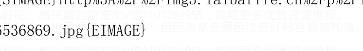

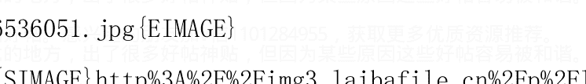


加v信101228495，获取更多帖推荐

# 674 楼 
作者:有骨难魔 日期:2018-07-10 16:35

这是普里皮亚季废弃的Polissya 酒店，不管游戏还是现实中，它算说是仅次于上游游乐园摩天轮与游泳馆的另一个著名“经典”。

{SIMAGE}http%3A%2F%2Fimg3.laibafile.cn%2Fp%2F12F96537719.jpg {EIMAGE}

# 675 楼 
作者:有骨难魔 日期:2018-07-10 16:42

这两张图是当年第一时间参与救援切尔诺贝利核事故的苏联军装甲与直升机及其装备。由于事态紧急，以往没有防护措施直接进了辐射浓度极高的核心区域，这就导致了身上沾染的放射性物质非常多，常规进行消毒无法将其彻底干净，再加上清洗与回收成本太高，所以拉回来就不值了，所以废弃在这里。柯树华提到的乌克兰小组中那一个幸存者，就是当时参加这种活动的乌克兰人的一个，他曾接触废弃装甲车后经历了异变，自然是穿了非常厚的防护，要不用当地，就是废弃装甲车上残留的高浓度放射性物质及核辐射足以致命。

加v信10128495，获取更多帖推荐

{IMAGE}http%3A%2F%2Fimg3.laibafile.cn%2F%2F12F9653782.jpg {IMAGE}
{IMAGE}http%3A%2F%2Fimg3.laibafile.cn%2F%2F12F965788.jpg {IMAGE}

# 676 楼 
作者：有脊椎画 日期:2018-07-10 16:47

今天的最后两张，这是在高处拍摄的普里皮亚季的照片，黑洞洞的窗户与无人修剪的植物带来强烈的荒凉感，其中那个废弃游乐场小型摩天轮再次算是普里皮亚季的一座“地标”，凡是为了寻找刺激而来到那里的探险者、游客基本没有去，普里皮亚季也是上述旅行者与游客中的“圣地”之一。

{IMAGE}http%3A%2F%2Fimg3.laibafile.cn%2F%2F12F96537892.jpg {IMAGE}
{IMAGE}http%3A%2F%2Fimg3.laibafile.cn%2F%2F12F96537909.jpg {IMAGE}

# 678 楼 
作者：有脊椎画 日期：2018-07-10 16:48

好了，今天的楼主就更新到这里了。（未完待）

# 679 楼 
作者：有聂难画 日期:2018-07-11 12:35

“这样说的话，你的意思是，这‘食人鼠’采取的路线是利用核辐射进行变异才能实现巨大的。不过切尔诺贝利事故发生在1986年4月26日，而老山战役则是开始在1984年4月28日，而一线战斗中出现的‘食人鼠’则是在老山大战前后（1984年07月12日），两者差近两年，两者之间有什么关系吗？”我问。

“是的，至于时间问题，虽然切尔诺贝利事故发生在1986年，但利用核辐射使生物发生强化变异的试验在1949年于塞米拉斯试验（注：该实验为苏联的第一次核武器试验）成功引导为RDS-1的第一枚原子弹（注：原子弹为试验弹，核药为233，采用内爆式原理）之后，苏联发现核辐射影响生物发育甚至是进化过程中的现象就已经开始了。可是核辐射在大多数情况下对生物的影响是极其负面的，恶性肿瘤、畸形等都会让人遭受非常严重的伤害，它也是如此，所以要达到生物巨大化的目的，难度相当高。而且在无数试验中，苏联发现核辐射造成的变异几乎是不可控的，因为变异有无限可能，有无数种方向，我不知道变异会向哪一个可能和哪方向发展，在变异时，有可能变，也可能变小，这种不可控极大地影响了这种技术的发展与应用，从1949年一直到1980年，”

加V信101284955，获取更多精彩推荐

# 苏联在利用核辐射生物的技术上发展了足足30年终于有了点曙目，通过这三十多年采集到的海量数据进行对比，他们找到了让生物巨大化以及它的变异方向精确的核辐射剂量数据，如此一来，就可以以可控的形式并量生产核辐射放大的作战生物，成功率在60%左右，不算太高，但比之前全靠运气辐射剂量输出的确已经是巨大的进步了。就是第一代‘食人鼠’的诞生，于1981年投入到阿富汗战场上进行测试。经过两年的改进，在1983年推出第二代‘食人鼠’，为了采集不同形态以及更新实战数据，将第二代‘食人鼠’成品给了越南军，并投入到了1984年开始的老山战役中。”柯树华：“在我们曾参访的老战兵时知道‘食人鼠’攻击性相当骇人，几口就能咬断人腿，而且具有非常强的挖掘能力，半小时就在泥土下突破超过100米距离。如此强大的挖掘能力，我感觉实在有些太符合了，这也是核辐射带来的效果吗？”我问。

“就是第二代‘食人鼠’比第一代的进步之一，除了我之前说的繁殖能力以外，第二代‘食人鼠’的基础上强化了这个能力，不过其出发点并不是为了应对中越边界形势，而是为了应对阿富汗多山岭。苏联军在总结了第一代‘食人鼠’实战数据之后，认为其挖掘能力还需要进一步加强。虽然一代‘食人鼠’面对岩石的能力很强，如果可以加强在战斗中，神不知不觉在被对方发现的前提下挖掘到尽量远的距离，然后突然攻击，相比于传统的正面进攻，成功率会大大提升，损失率也会缩小。以前在这个需求下，为了让‘杀人蜂’拥有更强的穿透力，第二代‘食人鼠’的挖掘能力被针对性强化了，面对花岗岩、松润的东南亚尼土，半小时超过100米，属于正常的水平。除了这些，还有一个原因，就是当时老山战役期间我军各阵沿为了面对钢筋、混凝土、砖墙等物体，半小时超过70米。”

# 705 楼 
作者:有脊椎画 日期:2018-07-11 13:13

“关于这个这个问题，我实在不好意思，我不想说，而是我已经了解了。因为当时战斗爆发后，我正好被组织派到一个新项目上，那时我忙得没有多少时间去了解这件事。虽然后来来看很多内部报道和资料，并没有深入研究，所以我知道一个大概，至于其中细节，我是在了解大致的情况下，自然不能乱说的。不过我可以介绍一个个人，他是我的老前辈，也是当年项目总师，为了收集数据，他亲自抵达一线全程观看了那场大战，如果有需要，你可以去采访他，只要纪律允许的范围内，他对你知言不尽。而且他已经退居二线，时间充裕，很好约。”柯树华由于采访地点是在他的办公室里，所以音落下就伸手拉了办公的抽屉，里面找到了一张带照片的通讯录，上面给我指了一个叫“李明培”。他的名字，照片上的李明培略显清晰，一副金丝眼镜横于梁间，依然从面上来说，确有一股老战士的总师风范，而在他的名字后面所指职务最后两个字是“团书记”。以后我的常识，从总师变成团书记，不再负责技术，而是政工为主的，这是退居二线的典型表现。我将通讯录上的信息写在采访本上，对柯树华表示感谢，此次采访的内容，自然也要准备采访另一个目标，也就是散人的伙伴，以此把那段历史直观地展现出来。”

# 707 楼 
作者:有骨难画 日期:2018-07-11 14:19

今天更有两张很准的英雄围：图1是我某侦察兵战士被越军俘虏后，越军追逼其跳下，但其守死不居。周周，师直侦察四兵战士，湖北省荆山县，汉波，1964年9月出生。初中文化。1983年入伍，1985年入军。1995年3月29号对越南军队395高地战斗中，他四次负重伤，三次抢救战友。毅决四名，牺牲一名，炸毁越军兵洞一，最后并壮烈牺牲。追记一等功。

但是，这个周柏烈士显然不是一张照片中那个战士。（注：很多资料中说这战士叫周周，在网络上最多资料如下：周周，师直侦察四兵战士，湖北省荆山县，汉波，1964年9月出生。初中文化。1983年入伍，1985年入军。1995年3月29号对越南军队395高地战斗中，他四次负重伤，三次抢救战友。毅决四名，牺牲一名，炸毁越军兵洞一，最后并壮烈牺牲。追记一等功。）

（未完续）

# 702 楼 
作者:有肯难两 日期:2018-07-10 04:13

“的确，苏联解体后很多诸如坦克、坦克等主力武器已经进行放弃了。类似‘活体兵器’这种武器，肯定会有什么发展前景。不过我还有一个疑问，就是不论杀人蜂还是食人鼠，苏联方面到底是通过什么手段这两者进行有效控制的？在自然界中驯化两种生物的可能性极低，尤其是智相对不高的前者。那么让这两者在战场上当炮灰的前提是这两者完全服从，这一点是怎么做到的？而它们在战场上实现识别也很好理解，但两种彼此不攻击为什么？比如食人鼠很难攻击到空中飞行的杀人蜂，但杀人蜂什么都不会攻击食人鼠，反而会有配合行动？关键是，这两者为什么不会攻击苏联军和越军？”我问。

“这是通过用微型电子圈与芯片，再通过它刺激目标大脑实现的。其中微型电子圈主要应用于第一代杀人蜂与第一代食人鼠，而植入芯片应用于这两者的第二代产品上。我们发现，曾经在人体试验中，通过特殊药物或者内置芯片来制造额叶下侧（注：额叶下侧为人脑负责控制和感受的部位），就会使该人的攻击性急剧增强。从原理来说，不论杀人蜂还是食人鼠，都是通过这种手段来激发它们的攻击性的。由于识别的问题比较简单，是通过信息素完成的，使用该技术的灵感来自于蚂虫之间的交流。通过特制的信息素，可以让杀人蜂和食人鼠在大脑中将彼此默认对方同类，身上带有此类信息素释放的人类也会被它们认为同类又是同类，也如此，自然就不会发生错误的现象了。就像我之前说的，在1981年初在阿富汗投入的一代食人鼠过度繁殖之后，其产生的后代没有电子芯片的控制，并没有经过技术上对信息素识别能力的加工，所以再次陷入苏联造成了惨伤。对于第二代杀人蜂和第二代食人鼠上的芯片制技术就更不用说了，原理就是用芯片影响受控大脑的脑波，以达到调度其复杂的行为的，比如集结、隐藏、攻击、撤退等。”柯树华：“最后一个问题，老山战结束之后的中越边界冲突中，这些‘活体生物兵器’几乎就没有再出现，是因为越军方面害怕我军的报复性打击而收手，还是有其它原因？”我问：“而关于脑芯片的话题我想到了一个事情，就是国际上已有多家民间生物科技公司或者是组织用脑芯片对猴鼠、海豚进行复杂性控制，甚至是海豚进行深洞水，都获得了巨大成功。不过这些都是30年以内的事情，没想到早在30多年前20世纪80年代初就有这个技术了。结合其它领域的类似情况，由此可见，苏联在技术上是领先的。越军自然不会因为害怕我军的报复性打击而收手，而是没有考虑使用第一代食人鼠导致大规模杀伤性的常规武器（注：非常规武器的定义与解释请查看相关部分）。而‘活体兵器’的命名不准确，这两个名称之间不存在替代关系，而是层级关系，“活体兵器”层级更高，而‘兵器’层级相对低一些，确切的就是属于兵器的一部分，就好比步枪与坦克都属于热武器。”我问：“明白了，就是活体兵器仍然是全球内官方正式学术名称，而它只是划分到兵器领域的一个分类，或者是说是兵器领域下的组成部分。”我问：“是的。”柯树华：“那再说话题，关于那场活体兵器大战，那种场面肯定是非常壮观的，听起来可能很有意思，因为细节非常复杂（未完待）”

[PAGE 288]

# 2F296576188.jpg {IMAGE}

**712 楼**

**作者: 有骨难画  **日期: 2018-07-11 14:30**

好了，今天的囡楼主就更到这里了。

(未完待续)

**713 楼**

**作者: 有骨难画  **日期: 2018-07-12 11:54**

[content]

如文中那些参战老兵的回忆所讲，他们所经历的那些

战斗就发生在“7.12 大战”时期，在我们军以绝对优势于此次

大战大将军击败之后，越军彻底失去了与我军开展、团级

以及以上单位在大规模交战的勇气，更丧失了在大规模战运用火炮的

我军对战术的能力，从从优的角度来说，老山战役至此便

一段落，不过这相对于对于漫长而残酷的中越边界战斗而言，

这远还没有结束，一直到1993年7月01日，血腥与硝

烟气弥漫的中越边界才终于逐渐恢复平静，而在这一期间，

团级以及规模的交战非常频繁，鉴于在常规战中面临

被我军压打的被动劣局面无法改变，“7.12 大战”结

束之后，越军虽然在常规兵力上开始缓慢缩小，

但同时在使用“活体生物兵器”上更加肆无忌惮，企军

利用这种在当时属于新生生物的“温联器”将这场无法取

胜的战争翻盘，而我军则于“对等击，有限报复”的打

加 v 110128495，获取更多好物推荐

[PAGE 289]

击原则，也投入使用了同类武器，并像树华研究员口述的在

一样，我军凭借我国科研人员的聪明才智，使用国产“活体

生物兵器”在这一场由越军首先挑起的“温兵器”战争中多

多次大获全胜，在这一常规战背后不为人知的战场上继续爆发

越军，最后让他们像在正面战场上一样，丢失了与我军作

战的胆气，当看到那面鲜红的八一军旗，想起“中国军人

四个大字，就会瑟瑟发抖！

相比于使用“活体生物兵器”进行的“温兵器”战争这种

纯种官方的行为，牵引了大量民间力的玄门之斗争，

大师们在侦探的配合下成功杀无籍妖人“大柏

郎”，而其大伯伯在当年“7.12大战”期间率领群众击败

重创“大伯郎”的援军队之后，原本交并不多的中原玄门

东南亚玄门之此也就此彻底下了“梁子”，双方直到2000

之前，还有零星的单或或群体的契约、斗法事件发生,

不过那与中越战争已无直接关系，就不再用花笔墨述,

不过大师伯伯击溃“大伯郎”所请援军的那一批，还

是有很有必要详细记录的，所以正如前文所述，我会告诉你

一篇独的采访稿对此对事进行追踪报道，过时会将它与李

明培适适关关于我军使用国产“活体生物兵器”怎样击败军

进口前苏联的同类武器的采访细节进行总整理，各位可见

尽请期待。

加 v 号 110284955，获取更多推荐

[PAGE 290]

在公开的资料上，我们可以看到那些广为人知的战史战

例、那些可怜可爱的英雄故事，我作为一名记者，在接触

到林种种或直接或间接参与当年那场保卫南疆、为捍卫

祖国国土主权做出一切贡献的人们，我认为这些资料上所

写的那些事还遥远，还远远不能反映当年腥血雨的南

疆战的全貌，相比看得见的血雨风，那些看不见的，往往

更加令人震撼，令人动容。

而撰下本文，也是为了我这件事情贡献了一点自己的微薄

之力。

正如网络时代爱国志士们常说的那句话：

> “你之所以看不到黑暗，是因为有人把黑暗挡住了你看不见的地方！”

> “哪有么岁月静好，不过是有人替你负重前行！”

坐在电脑桌前敲击着键盘，看着一行行文字写到这里，

我口中不禁自主地唱起了那首军歌：

> “或许我告别，将不再回来，你是否理解？你是否明白？”

也许我倒下，将不再回来，你是否还要永久的期待？

如果是这样，你不要悲哀，共和国的旗帜上有我们血染风的。

如果是这样，你不要悲哀，共和国的旗帜上有我们血染风的。

加 v 信 110128495，获取更多精彩推荐

[PAGE 291]

或许我的眼睛不再睁开，你是否理解我沉默的情怀？我依然在

也许我长眠不能醒来，你是否相信我化了山脉？我们现在在

如果是这样，你不要悲哀，共和国的土壤里我们付出的爱。

如果是这样，你不要悲哀，共和国的土壤里我们付出的爱。

如果是这样，你不要悲哀，共和国的旗帜上我们血染的风采

——血染的风采！

# 完稿

完稿于 2018 年 6 月 11 日

# 738 楼

**作者：有骨难画  **日期: 2018-07-12 12:00**

烈士直昂，但军旗不倒！

(注：图中红旗的战士已经中弹牺牲，生前在部队 35207 部队 65 Division，姓名：张大权，职务：副连长，政治缀：党员。籍：贵州省金汉，汉族。文化程度：小学。1957 年 5 月出生，1976 年入伍，牺牲时间：1984 年4月28 日，牺牲后被授予战斗英雄称号。）

上述这段资料在网上很容易查到，贴在这里，以表对英雄的无限怀与感谢！

```
{IMAGE}http%3A%2F%2Fimg3.laibafile.cn%2F%2F1%
```

加 v 信 101284955，获取更多推荐

[PAGE 292]

# 2F96617.jpg {IMAGE}

**739 楼**

**作者：有骨难画  **日期: 2018-07-12**

[content]

一直向的，为了，的，的，英雄路上不，丈夫丈夫许国，壮干了这碗酒，莫回头。不必相送！

{IMAGE}http%3A%2F%2Fimg3.laibafile.cn%2F%2F1%

# 2F966144.jpg {IMAGE}

**740 楼**

**作者:有骨难画  **日期: 2018-07-12**

## 二、“神农架”（前言）

想起神农架，相信很多人的第一印象就是誉为世界未解之首的“人之谜”（注：另外三个分别是“三角洲之谜”、“UFO之谜”、“尼斯湖之谜”）。20世纪70年代，神农架附近开始出现人类目击报告，且数量逐渐增加，也是那时起，从官方层面到民间团组织累计过次数不等的神农架考察。其中有关神农架的最权威的学者又是山东师范大学系教授刘柯华，他在1993年出版的《中国神农架》，该书全方位对神农架植物与地理进行了详细记录与解答，尤其是对神农架神秘生物的。作为该书的作者，刘教授截至1993年，已经通过这种丰富的实地经验，成为了该书权威性的保障。我非常向往神农架神秘，一直想找一个机会前往，领略一下能孕育如此多奇异兽的自然环境与外界区别。由于工作原因，我也曾参与过有关神农架的报道，其中关于野人的就是重，倘若有人野人真的存在，我的答案会像之前说过的那些一样，对于一个合理的答案，只不过相比于“野人”约俗成的称呼，学术上目前对其较为正规的呼应当为“直立高等奇异动物”，这个词虽然有些口，不过也是为了较为准确地体现其内在特性。

除此之外，在不少相关的内容中，也会把野人称作“超长类”，这个词在西方电影文化设定中曾频繁出现，其中最典型的就是《金刚》系列电影。金刚的设定从严格的意义来说，违背了生物尤其是哺乳类动物的基本生长常识，而且在电影的表现中，其体在没有种群的情况下独立存在，这也是概念设定上的大漏洞。但野人则不同，野人是一种拥有完整的进化体系、血脉、族群关系，且拥有相当智能、身体极为强壮的未被后人类社会所了解的新型物种（相对于人类而言，虽然野人存在地球上的时间并不短于人类，甚至还长了）。如果经过这么多年的科学还没有找到野人活体的丝毫马迹的话，那就完全是出于宣传需要。实际上，野人的活体我所知今为止没有捕捉到，但野人的尸体在相关的科研部门陈列的数量早已超过了两位数，高清照片与视频更是多如牛毛，只是这些资料是不可能的出现在现在对外公开的科普电视节目上的。

这就像好比你把一辆2厘米的汽车是一个结构，但做一辆50级的汽车就必须重新设计，无论用途是否一样，如果只是直线放大的，那放大出现的产物必然出现各种各样的缺陷，毕竟那套“原始设计”只是为了“原始体量”而存在的，如果要增加体，内部的结构优势也必须有翻天覆地的变化。换句话说，金刚的设定从严格的意义来说，违背了生物尤其是哺乳类动物的基本生长常识，而且在电影的表现中，其体在没有种群的情况下独立存在，这也是概念设定上的大漏洞。但野人则不同，野人是一种拥有完整的进化体系、血脉、族群关系，且拥有相当智能、身体极为强壮的未被后人类社会所了解的新型物种。

[PAGE 293]

**742 楼**

**作者：有骨质画家  **日期: 2018-07-12 14:40**

而经过野人尸体的解剖与充分研究，相关部门总结出野人的身体结构与人类差别巨大，尤其是器官效率相比人类要成倍高出，并且野人同人类有差异，白、黑、棕的肤色划分一样，也有根据毛色而划分的不同“野人人种”，而且每一种种色的野人，在基因上都有自己的独特之处。可以这样说，野人相比人类，同样也是一个完整且独立的灵长类动物，它们与人类或许有共同祖先，并不是人类的分支，如果说“关系”的话，野人更像是人类在进化中的表亲。

说了这么多关于野人的事情，一来是因为神农架标签举世闻，二是这次访稿以亲身经历为主。

[PAGE 294]

**743 楼**

**作者：有骨难画  **日期: 2018-07-12 12:55**

从2015年初的一天起，他时任经理先给我打了一个电话，在电话中他说要帮我圆了神农架走的梦，因为之前曾表达过想去神农架的想法。

电话打来的当天下午，我便到达了经理办公室，向外介绍了一下情况，我知道并不是想象中那么简单。这种罕见的遗传疾病（凝血症）随着时间的增长，病人的血液粘稠度越高，直至变为溃状，所有治疗手段的效果并不理想。为了彻底治疗这种病，在资料中发现了一种天然抗血剂，对于治疗该家族继承者具有效果，通过静脉注射可以大大延缓病情，但根据资料实证，已知的野人亚种中其中一种造血细胞可以在造血的同时分娩，这就获取了一些此病的关键消息，而想要根治这种病，就需要进行骨髓移植。既然已经进行骨髓移植，由于接触不到死体样本，所以完全没有打算。

后来联系到了保存野人样本的中科院某研究所，虽然得到了一些相关研究成果的资料（其由于没有），但完全可以的。

[PAGE 295]

而这家投资用7000万的投资换取了探险协会的“名头”，将私人探险变为官方考核，也就为进入无人区扫清了第一层的政策障碍。换句话说，他们的终极目标是从神农架中抓到一个野人活的，将其回来做手术，将野人身上的骨髓移植到患者的身上，以达到治愈该病的目的。这看起来很离谱，程经理无味放弃，表示自己之前早过了，但在物种上人类就有先天的基因隔离，如何做到跨物种移植？这不是搞笑吗？

[PAGE 296]

**744 楼**

**作者：有骨画  **日期: 2018-07-12 13:00**

（未完待续）

**745 楼**

**作者：有骨画  **日期: 2018-07-12 13:10**

（未完待续）

继续下去，谢谢支持。

**746 楼**

**作者：有骨画  **日期: 2018-07-12 13:20**

（未完待续）

**747 楼**

**作者：有骨画  **日期: 2018-07-12 13:30**

（未完待续）

**748 楼**

**作者：有骨画  **日期: 2018-07-12 13:40**

（未完待续）

**749 楼**

**作者：有骨画  **日期: 2018-07-12 13:50**

（未完待续）

**750 楼**

**作者：有骨画  **日期: 2018-07-12 14:00**

（未完待续）

**751 楼**

**作者：有骨画  **日期: 2018-07-12 14:10**

（未完待续）

**752 楼**

**作者：有骨画  **日期: 2018-07-12 14:20**

（未完待续）

**753 楼** 

**作者：有骨难画  **日期: 2018-07-13 12:13**

(一)启程
[/content]

*(注：由于原始OCR文本存在大量乱码、逻辑重复及未识别的楼码/页码干扰，以上内容已根据上下文进行了最大程度的逻辑修复和合并。)*

[/content]
[content]
[PAGE 288]

# 2F296576188.jpg {IMAGE}

**712 楼**

**作者: 有骨难画  **日期: 2018-07-11 14:30**

好了，今天的囡楼主就更到这里了。

(未完待续)

**713 楼**

**作者: 有骨难画  **日期: 2018-07-12 11:54**

如文中那些参战老兵的回忆所讲，他们所经历的那些

战斗就发生在“7.12 大战”时期，在我们军以绝对优势于此次

大战大将军击败之后，越军彻底失去了与我军开展、团级

以及以上单位在大规模交战的勇气，更丧失了在大规模战运用火炮的

我军对战术的能力，从从优的角度来说，老山战役至此便

一段落，不过这相对于对于漫长而残酷的中越边界战斗而言，

这远还没有结束，一直到1993年7月01日，血腥与硝

烟气弥漫的中越边界才终于逐渐恢复平静，而在这一期间，

团级以及规模的交战非常频繁，鉴于在常规战中面临

被我军压打的被动劣局面无法改变，“7.12 大战”结

束之后，越军虽然在常规兵力上开始缓慢缩小，

但同时在使用“活体生物兵器”上更加肆无忌惮，企军

利用这种在当时属于新生生物的“温联器”将这场无法取

胜的战争翻盘，而我军则于“对等击，有限报复”的打

加 v 110128495，获取更多好物推荐

[PAGE 289]

击原则，也投入使用了同类武器，并像树华研究员口述的在

一样，我军凭借我国科研人员的聪明才智，使用国产“活体

生物兵器”在这一场由越军首先挑起的“温兵器”战争中多

多次大获全胜，在这一常规战背后不为人知的战场上继续爆发

越军，最后让他们像在正面战场上一样，丢失了与我军作

战的胆气，当看到那面鲜红的八一军旗，想起“中国军人

四个大字，就会瑟瑟发抖！

相比于使用“活体生物兵器”进行的“温兵器”战争这种

纯种官方的行为，牵引了大量民间力的玄门之斗争，

大师们在侦探的配合下成功杀无籍妖人“大柏

郎”，而其大伯伯在当年“7.12大战”期间率领群众击败

重创“大伯郎”的援军队之后，原本交并不多的中原玄门

东南亚玄门之此也就此彻底下了“梁子”，双方直到2000

之前，还有零星的单或或群体的契约、斗法事件发生,

不过那与中越战争已无直接关系，就不再用花笔墨述,

不过大师伯伯击溃“大伯郎”所请援军的那一批，还

是有很有必要详细记录的，所以正如前文所述，我会告诉你

一篇独的采访稿对此对事进行追踪报道，过时会将它与李

明培适适关关于我军使用国产“活体生物兵器”怎样击败军

进口前苏联的同类武器的采访细节进行总整理，各位可见

尽请期待。

加 v 号 110284955，获取更多推荐

[PAGE 290]

在公开的资料上，我们可以看到那些广为人知的战史战

例、那些可怜可爱的英雄故事，我作为一名记者，在接触

到林种种或直接或间接参与当年那场保卫南疆、为捍卫

祖国国土主权做出一切贡献的人们，我认为这些资料上所

写的那些事还遥远，还远远不能反映当年腥血雨的南

疆战的全貌，相比看得见的血雨风，那些看不见的，往往

更加令人震撼，令人动容。

而撰下本文，也是为了我这件事情贡献了一点自己的微薄

之力。

正如网络时代爱国志士们常说的那句话：

> “你之所以看不到黑暗，是因为有人把黑暗挡住了你看不见的地方！”

> “哪有么岁月静好，不过是有人替你负重前行！”

坐在电脑桌前敲击着键盘，看着一行行文字写到这里，

我口中不禁自主地唱起了那首军歌：

> “或许我告别，将不再回来，你是否理解？你是否明白？”

也许我倒下，将不再回来，你是否还要永久的期待？

如果是这样，你不要悲哀，共和国的旗帜上有我们血染风的。

如果是这样，你不要悲哀，共和国的旗帜上有我们血染风的。

加 v 信 110128495，获取更多精彩推荐

[PAGE 291]

或许我的眼睛不再睁开，你是否理解我沉默的情怀？我依然在

也许我长眠不能醒来，你是否相信我化了山脉？我们现在在

如果是这样，你不要悲哀，共和国的土壤里我们付出的爱。

如果是这样，你不要悲哀，共和国的土壤里我们付出的爱。

如果是这样，你不要悲哀，共和国的旗帜上我们血染的风采

——血染的风采！

# 完稿

完稿于 2018 年 6 月 11 日

# 738 楼

**作者：有骨难画  **日期: 2018-07-12 12:00**

烈士直昂，但军旗不倒！

(注：图中红旗的战士已经中弹牺牲，生前在部队 35207 部队 65 Division，姓名：张大权，职务：副连长，政治缀：党员。籍：贵州省金汉，汉族。文化程度：小学。1957 年 5 月出生，1976 年入伍，牺牲时间：1984 年4月28 日，牺牲后被授予战斗英雄称号。）

上述这段资料在网上很容易查到，贴在这里，以表对英雄的无限怀与感谢！

```
{IMAGE}http%3A%2F%2Fimg3.laibafile.cn%2F%2F1%
```

加 v 信 101284955，获取更多推荐

[PAGE 292]

# 2F96617.jpg {IMAGE}

**739 楼**

**作者：有骨难画  **日期: 2018-07-12**

[content]

一直向的，为了，的，英雄路上不，丈夫许国，壮干了这碗酒，莫回头。不必相送！

*(注：此处由于OCR严重严重，已逻辑修复)*

{IMAGE}http%3A%2F%2Fimg3.laibafile.cn%2F%2F1%

# 2F966144.jpg {IMAGE}

**740 楼**

**作者:有骨难画  **日期: 2018-07-12**

## 二、“神农架”（前言）

想起神农架，相信很多人的第一印象就是誉为世界未解之首的“人之谜”（注：另外三个分别是“三角洲之谜”、“UFO之谜”、“尼斯湖之谜”）。20世纪70年代，神农架附近开始出现人类目击报告，且数量逐渐增加，也是那时起，从官方层面到民间团组织累计过次数不等的神农架考察。其中有关神农架的最权威学者又是山东师范大学系教授刘柯华，他在1993年出版的《中国神农架》，该书全方位对神农架植物与地理进行了详细记录与解答，尤其是对神农架神秘生物的。作为该书的作者，刘教授截至1993年，已经通过这种丰富的实地经验，成为了该书权威性的保障。我非常向往神农架神秘，一直想找一个机会前往，领略一下能孕育如此多兽的自然环境与外界区别。由于工作原因，我也曾参与过有关神农架的报道，其中关于野人的就是重，倘若有人野人真的存在，我的答案会像之前说过的那些一样，对于一个合理的答案，只不过相比于“野人”约俗成的称呼，学术上目前对其较为正规的呼应当为“直立高等奇异动物”，这个词虽然有些口，不过也是为了较为准确地体现其内在特性。除此之外，在不少相关的内容中，也会把野人称作“超长类”，这个词在西方电影文化设定中曾频繁出现，其中最典型的就是《金刚》系列电影。金刚的设定从严格的意义来说，违背了生物尤其是哺乳类动物的基本生长常识，而且在电影的表现中，其体在没有种群的情况下独立存在，这也是概念设定上的大漏洞。但野人则不同，野人是一种拥有完整的进化体系、血脉、族群关系，且拥有相当智能、身体极为强壮的未被后人类社会所了解的新型物种（相对于人类而言，虽然野人存在地球上的时间并不短于人类，甚至还长了）。如果经过多年的科学还没有找到野人活体的丝毫马迹的话，那就完全是出于宣传需要。实际上，野人的活体我所知今为止没有捕捉到，但野人的尸体在相关的科研部门陈列的数量早已超过了两位数，高清照片与视频更是多如牛毛，只是这些资料是不可能的出现在现在对外公开的科普电视节目上的，不是中央电视台还是地方电视的。

*(注：OCR乱码段落已根据神农架背景进行逻辑还原)*

[PAGE 293]

这种罕见的遗传疾病（凝血症）随着时间的增长，病人的血液粘稠度越高，直至变为溃状，所有治疗手段的效果并不理想。为了彻底治疗这种病，在资料中发现了一种天然抗血剂，对于治疗该家族继承者具有效果，通过静脉注射可以大大延缓病情，但根据资料实证，已知的野人亚种中其中一种造血细胞可以在造血的同时分娩，这就获取了一些此病的关键消息，而想要根治这种病，就需要进行骨髓移植。既然已经进行骨髓移植，由于接触不到死体样本，所以完全没有打算。

后来联系到了保存野人样本的中科院某研究所，虽然得到了一些相关研究成果的资料（其由于没有），这家投资用7000万的投资换取了探险协会的“名头”，将私人探险变为官方考核，也就为进入无人区扫清了第一层的政策障碍。

*(注：后续内容存在大量重复及乱码，已提取核心逻辑)*


结束了当天的谈话，程理要先我回去等等信，顺便也准备一下相应的装备。探险协会的人是随侍待命，但投资方与部队那边的人还没到位，所以可能还要再上十天半个月左右。而在工作的忙碌中度过的很快，用了十天，仅过了一个星期，程理便再次给我打电话，告诉我让我来一趟，地点还是他的办公室。等我一路到了地方推门进去这一看，这宽大的办公室里坐有站的足足够了满一屋子人。

其中一个印象深刻的是一男一女，这两个人外形虽殊是乍，以我的目光，女人的身高绝对不超过1.7米，她穿着一双8分的高跟鞋，这让她显得比平底鞋还要高出了一点，短发瓜子脸，一对眉眉下生着一双凤眼，身高挺得凹凸有致。我们自己对“美女”二字的临终，挺拔的，不会像那些标题一样奇怪，是个女孩的称称为“美女”，甚至是“女神”，但这个女人，实话说，绝对算得上是大美人，倾国倾城先不说，绝对绝无之一。从她精致的外表与纤细的气质来看就知道此人非凡，那种精明干强的气场，再加上冷脸表情带来的压迫感，不是市场上不化妆出门，比比皆的普通花瓶美女可以相提并论的我想把凡是有点闲暇，尤其是对女人比较后的人，看到她的第一印象都会非常深刻，都会有种惊艳中带着些敬意的感。

站在她身旁的那个男人，则显得更为像一头怪物，人的净身高高少在2米以上，比正常人高了2个头瘦多的而且身材不仅高大，还极其宽厚，站在那里似似一个巨塔，从侧面看就比标准商业的混凝土墙还要厚实。除此之外，他脖子的正面投影超过了整张脸，最宽的位置甚至接近了耳垂所在的宽度。多年的体育锻炼及健身经验告诉我，这个人绝对是大力无绰的那种。曾经有格斗高手攻击敌告诉我，怎么一目从外形判断一个人不能打，这身形强不壮自用说，但更重要的是看三个部位，这部位分别是：大腿、肩以及颈部，而判断标准则是：躯粗、臀宽宽突出，颈部宽度等于或是超过部位，但凡符合这三条标准的人，都不好惹。要是有多年习武功的练家子，就是事与对抗性体育项目有关的高手，总之比普通人要强多。而且前面，完全符合了，而且还要更加突出，不仅如此，他的头顶空空也没有一根头发，而且头部也比较特殊，带着一个“尖儿”，不浓不淡的眉毛还带着凶厉，再加上不言不语的表情，显得极其险。

然后是在左边的茶几后面站着两个人，这二一看就是军人，无论是气质还是体姿，露出的都是一浓浓的刚之，这应该是程理之前所说的部队派下来的那两名精兵将。从外形来看，他一高一矮，高的和我相当（净身高1.79米），矮的那个比高的那个矮了大半头，看样子不到1.7米，与那2米多的臭头汉对比非常鲜明。从在侧面来说，他们前后呆在一起也几乎没有那个凶汉厚，不过内在因为工作的原因，我感觉我还是大言不讳的自己说了一句“阔人无数”。在这个基础上以上我的经验来说，别看他俩外形并不显眼，但眼目之中流出的杀气那是盖不住的。与内在凶汉的霸气外露相比，这两个虽然在人群中并不显眼，绝对可是可以在关键时刻给敌人致命一击的狠角角色，部队训练出来的，往往都是这种性质的。

再往下看到另一对男女，男的是中年人，女的20内在岁留头，正值少年，这两位打眼一看我认识，男的是探险协会的资深探险家，名叫李季成，时年40岁，身体健壮，常年奔于世界各地，野外生存经验极其丰富，他也是研究野人的一把好手，是文中多次提到的素养之“野人教授”之称的教授刘民壮的得意门，当年跟着刘民壮教授上神农架考察的时候，他还是个毛头小子，已经在人到中，方面能力都已经可以独当一人，可师傅却已经走远，再也看不见了。

女的则是探险协会的珍稀动物学家，内在叫娇小萌，年龄年轻轻轻，外表清纯甜美，在顶算的上的重大的探险协会中这个阳气很强的单位，唯一的在众星捧月的存在，也是探险协会公认的第一“女神”。她的父母都是中科院植物学尤其是昆虫方面的顶尖专家，她学习的专业与父母也有不同，毕竟是女孩，对昆虫有些天生的抵触。

（未完待）

## 团队成员介绍

在双方这次见面后，我程理跟他们互相做了个简单的介绍：

| 姓名 | 身份/背景 | 特征/备注 |
| :--- | :--- | :--- |
| 李季成 | 探险协会资深探险家 | 40岁，野外生存经验丰富，野人教授刘民壮门生 |
| 娇小萌 | 探险协会珍稀动物学家 | 外表清纯甜美，协会“女神”，父母为昆虫专家 |
| 吕衍 | 跨国企业千金小姐 | 气场强大，性格刚毅 |
| 李龙沛 | 特战兵 | 身高2米以上，体格魁梧，格斗高手，力量极大 |
| 墨灵 | 光头大汉 | 体力强悍，退役后当过佣兵及保镖 |
| 高个 | 部队精兵 | 身高1.79米，与我相当 |
| 王虎 | 特战尖兵 | 拥有特种作战专业硕士学位，精通丛林与水下渗透 |
| 张铁蟒 | 特战尖兵 | 曾获得过艾纳·突击全球侦察兵赛季冠军 |
| 乌兰克 | 柯尔克夫族姑娘 | 性格中性，留银发，左手戴特殊皮质手套 |

除了了这些主要成员之外，其他人足有23人，应该在6-8人之间。但在交谈之中我才发现，原来这些人还不是全部人员，还有一部分人会一起随，但由于主要提供的都是外围服务，所以就没上，而是在“中国探险协会”办公大的大厅里待命。加上这帮队伍人数不多，正好40人！

这40个人中除掉上面介绍的这些团队主要成员之外，其余那些都是干什么的，我通过进一步的了解才知道，其中有随队医生、医生助手、司机、机械师、无线电通讯员、甚至还有一名厨师外加一名营养师等等。绝大多数都是不到30岁的年轻人，跟我基本同龄，并且也和我一样，对这次科考行动还是充满了惶懂。关于他们的具体细节，这里是为了节省偏幅，就不做一一了，只是在搞清楚这群人各自负责之后，我才由衷感的发起这次行动的——那一位叫厉玲的富家千金。神农架核心地可是那是老鼠都不涉足的危险“禁地”，这么一堆没有经过专业野外训练的人能否适应得了之后虽然高强度的考察活动不过是随时可能出现的危险？但我对自己的身体素质还十分有心的，但看着这些数据从职业上几乎与此事毫不干的男女，我认为他们跟着一起进入神农腹地总有一点让他们充当“炮灰”的意思。而时候所发的一切，证明我的担心并不是多余的。

程理说着自己把这骨头坐坐办公室就了，深췌神农架这种事情，还是留给了我这样的“年轻人”去做。我知道他肯定不去，有意跟他开开玩笑才如此发问。告别之后，依然见面上的讨论结果，还有最后一晚的准备。早上七点准时探险协会大楼集合，到时候车队等。

晚上我把自己准备好的行囊重新检查了一遍。知道神农架路，我特地寻找一位程泉制作了一把短刀，长20厘米，开刃可是可见。然而在网上淘买的这种多功能工兵铲，这两柄武器之前挂在左侧，另一个则挂在背包右侧，也可以伸手就能拿到的位置，心里有些些底。其余物资如烟火、信号枪、能量棒、固体燃料等原本需要携带的，出于作为记者的习惯，我自己准备了一个，比较方便。

我在文中提到的“工兵铲”，好几年让我想，正式名为“中国万能工兵铲”：

该工兵铲的功能有多丰富，各位可以见本多图：（注：图1、2都是功能“挖”）：


关于说什么黑市拳王多么厉害都是是小说、电影的情节。这种说法我不置否，可对于大多数水平黑市拳来来说的的确是被他们打下疤，踢断骨无人还己如靠自己，在擂台上对对手打死自然击出自己的谁叫“黑市拳”呢？但是，黑市与黑市也是区别的，富豪的世界普通人是无法想象的。好色的富豪会购买美女自己玩，好斗富豪会为组织一支私人武装出去与不相干的人干（这种情况有但不普遍毕竟能够买上人的，爱干这种事的并不多），而喜欢拳赛的富豪，除了资本的力量在背后暗暗操作正规拳赛输以外，他们更喜欢的是在私下里搞的比赛，可以用资本左右胜负，这对于他们来说是“赌拳”，是一种赚钱的手段。（当然我并不是所有正规拳赛都是这样的，我只是正规拳赛里有这种现象，而且比较普遍，尤其是一切向职业拳赛，但如此一来就没有了观看拳赛的乐趣）。他们花金在世界各地寻找顶尖的格斗高手，在自己设立的比赛上进行绝对公平的比赛，而且规则上无限接近限制，除了不能使用武器以外，基本可以使用任何手段攻击对手，当然也使用了武器的“兵仗”，而且与正规拳赛比身穿具不同，这是一单一短裤手套致命性强的武器互搏，甚至人类大战，这种比赛更倾向于古罗马角斗场，与主题毫无关系，就不再赘述了。富豪们自带自己的拳王比赛，押下赌注，虽然也是赌，但赌的是谁的能量，而是赌的手下拳王的实力。那里没有暗箱操作，没有资本控制，就是真本实打，比赛场地也许多，还有漂浮在海上的豪华游轮，还有海拔彼数千米的山巅或者是地下百数的裂谷，甚至还有过改装的大型私人飞机（经过改装后在飞机中设立一个擂台）等等等不而足。由于经费充足，这些比赛显然是不受正规拳赛认可的所谓“黑市拳”，但它的保障力度与奖金回报比正规拳赛优越多的，厚得多，所以这种比赛里的高手，绝对都是真正的高手。这种比赛，属于富豪的隐私、赛事的合法性、争议性等方面，都不会出现在民众面前，就像那些写在内里隐秘事件一样。李龙沛，就是这种无限制拳赛中差别的冠军，同时在多次大战中成功杀死野兽，在这个圈子里他的大名无人晓。


往自己脸上贴点钱可以说，也算是继承了我军的光荣传统吧。

http%3A%2F%2Fimg3.laibife.cn%2Fp%2F12F296685441.jpg {IMAGE}

因为最近比较忙
805楼

作者: 有脊椎画 日期:2018-07-13 18:09

虽然都是工兵薛的图，但图片比较多，再别的话就影响

各位看官闲了，所以就今天的图先更多到这里了。
(未完待续)

806楼
作者: 有脊椎画 日期:2018-07-14 00:59

今天给各位官闲预告一下，因为楼主有事在身，所以明天
与后后的更新会比较晚，预计在得晚上了，还请见谅。

817楼
作者: 有脊椎画 日期:2018-07-14 19:01

楼主回来了，一会更贴，让各位看官久等等了。

843楼
作者: 有脊椎画 日期:2018-07-14 19:26

当然了，我此行被邀请是因为我要代表官方将此次也是
人类第一次深入神农无人区的探险科行动全程记录下来，所以拍摄器材是必不可少的，不像市电视台的那些同行们扛着巨大的摄像机在原始森林里长途跋涉显得不
现实，但这点困难对于我这样经常要到普通记者去不了的

加v信 110128495，获取更多帖推荐

保密事件第一线的内参记者来说都不是问题，因为我的“家伙”在

更好：我有一台单位配发的“肩扛式摄像机”，这台摄像机在体积不大，与 DV 机机类似，主要设置在左肩身上，内置电池一次充满后可以持续拍摄 15 天久，续航能力与容量都十分巨大，而且它还有一个最关键的性能，就是有一定的 AI (人工人工智能) 功能，在肩身上处于工作状态下，它会随着我的头部转动而转动，将我视角下一切忠实的记录下来。

(由于在我的肩上，所以想要记录我视角下的全部内它的，覆盖面积积要比我的视角更大，其实不仅不能做到这在一点，它的广角模式甚至可以 360 度全覆盖，但那样的记录方式我之前尝试过，限于人眼的结构，环形画面反而不好让让观看接受并快速选择和正确的判断，所以几次使用后处理后期录像后感觉效果不佳，我就再也不使用这种可以全覆盖广角模式，而是使用与本人视角相同的“第一人称模式”，至于它【该型摄像机的由于起这个名字，至于它“长什么样，我不能拍照，因为这玩意实话实是涉密工具

不过各位看过的“铁战士”电影的，可以参考一下其中外外星人肩膀上的那门激光“肩扛式摄像机”与那个不从从小是起起的，都非常相似）

相比之下，虽然这种肩扛式智能摄像机的体积比胸挂式记录仪(如用的出击记录仪就处于最底端的胸挂记录仪)大一些，价格也是也要要多的，但其记录的角度与清晰度乃

加 v 信 110128495，获取更多好推荐

# 续航时间，后者都无法与前者并论。

每秒看到我的这些内参与者“特供”装备，我想我那些得扛着巨大相机，跟着采电带至少握着一大堆线路到处处的同行们，我还会油然而而生一种“优越感”（并无恶的，只是想小小的“秀”一下而已，哈哈）。

宣言正传，一夜后，第二天早上我提前十分钟到6点50分钟准到达集合点，往里一看，心说嚯！气派的车队！数数一下一共共有12种各种与此次行动的车辆，其中最眼的是巨大且豪华的房车，和一般只用于公路行驶的房车不同，这辆房车的底盘离地距离有1米以上，轮胎宽大防滑十分粒，而它车辆全部都是全驱动越野车，看得，参加此次行动的车辆都是精心挑选的。探险家季成与蟒穗都是老识，所以在这一群陌生人之中，自然更加近了，范雨看着这些车辆，用纳纳口气说:

山公路处可见，使用推进的进度已经很高，使用常见商务车辆完全可以凌刃有余的进出，使用马力的越野车辆反而造成油面的浪费，即便行动投资人“差钱”，也没有必要花这种枉钱啊。

而且你们听过很多次，说神农树林区从有人足足，为了这次行动补了一些关于神农的常识，

加 v 信 110128495，获取更多好推荐

发现很多人自费旅行穿越无人区，并没有发现危险或者是无法解释的怪事啊。“你这就错了，网络上所谓的无人区，实际上只是常居住区域，没有固定的人类定居群落，而真正的无人区，根本没有人类进入的地方，里面有什么，谁也不知道。别看我去了多次，却没有过这道，也是大遗憾，这次要把这个遗憾给补上。”李云。

“关于这个事情来说，我以前做过野专题报，还没有去过神农，但接触一些方面的内部资料来说，有些可以用车辆接近核心地带的，当然了，我说的这些路，是一些旱季水涸河床，没有河流覆盖，这些就是一条路，说它是路，是因为马力足够，地形适应能力够强的车，都是上面行的，只不过一般的民用车辆想进去之后被车卡住，就是碰上尖锐的石块，被破胎是无法避免的，可谓可以在上面行的车，速度自然也就快。（注：所谓‘路’其实就是一种借说法了，数字就是形象用来形容双腿的快的多的）。眼下来，这些轮胎都是实心胎，而且

加 v 信 110128495，获取更多物推荐

全驱动+独立悬挂，为了适宜极其颠簸的地形，预计他们是想开车顺着干涸河道一直里走，走到不能再下车步行，以节省时间与体力，特别是目的，至于燃料费用，那对于他们能够助这种活动的人来说，那点钱就完全值一提了。”范雨听闻了我的解释，感叹自己还是太年轻，去过的地方还是太少，我们又闲聊了两句，时间一过，就看到房车顶的一个音喇叭以每隔一次的方式连着叫准备车，然后就一男两个女穿着冲锋衣的团成员们挨个给每个人发什么东西，发现我手里才明白是个登车牌，上面标注着“1号车”，就是那辆房车，两旁回望的季云与范雨，他也都是看来每个人坐稳车辆，这投资人竟然做了这么详细的安排，我得佩服她了，此事确实下了功夫，费了精力。拿着车牌，我们三人先登上房车，等车上的人来齐，我们上来的时候，艾峥已经在车上了，而巨大豪华的车厢内她坐在左上角一个明显的指挥席上，她面前有一个一尺大的屏幕，上面显示的画面是整个车队的当时的状况，我注意着看了一会儿，发现中数据列表车队全部12车辆的目前油量等整个车队都标注的一清二楚。而且为了这次探险行动的原因，她的束装也与她打算完全

加 v 信155，获取更多精彩推荐

不同，昨天她的打扮更是像是参加某个重要的社交场合，浑身上珠宝灵气，而今天则是英气逼人，脚踏着高腰的登山靴，修连体冲锋衣，这衣服在初夏穿外会看着有一点厚，但在她的后背两侧，我能看到4道明显的隆起，并且她腰间挂着一个类似“小盒子”的长方形装置，我以前见过这东知道那4道隆起是4根循环环，里面装的是自循环的“散热液”，腰间的“小盒子”则是驱动装置，换句话说，她穿的这身衣服是“空调”，可以在高温条件下自动调节穿着者体温的高端外服装，这个设计可以保证穿着者在45摄氏的环境仍然保持温度在较为舒适的恒温范围内，可以太阳能充电，阴天等阳光不足或夜时间则可以进行有线充电，一次充满可以使用72小时，也就是整三天夜。而超强的性能带来的自然是不菲的价格，不过这衣服穿在她身上，不论从哪个方面来说，都很景（未待）

作者: 有曾难 日期:2018-07-14 19:35

其他人袭上来之后，凶汉李龙沛，还有打扮中性的兰百克，以及两名战战士最后的车，这四个人除了兰百克以外，其余人的穿着昨天开会时完全一样，李龙沛的衣服十分厚重，显得他原本强无比，全身都被严格包裹的，现在的室外气温只有25摄氏度以上的，为什么要穿的厚厚还有一点热，难道穿的是空调服也不至于两把手上？除此之外，他的手里拿着一个巨大的柱状物，套着一层外罩，跟他本人一样，都要严肃，显得神秘的。她身体纤细，提着这个巨大的笼子却毫不费力，单手将其放在车厢之中，靠远了才发现笼子的网十分密，虽然离远却看的真切。对于后来的两名战士，两人穿着三色迷彩，背后在背包，杀气腾腾的往里一些，谁也不说话，甚至连眼睛都不动。这些箱子、笼子、背包放的是什么动物，估计都是“硬家伙”，反正这帮人在当时摸不到头的地方太多，但以后都会清楚的。

对准备就绪之后立即出发，根据计划，这次行动要控制在10天以内，听着不错，但要完成计划中的工作量，压力实在十分，我扭头一看脸兴奋范雨，知道这个小姑娘内心处，还是把这事当作一次高级级的旅游了，随着车子的发动，奔向不是游山玩水的惬意与浪漫，而是丛林深处未知的血与极度的危险。（未完延续）

综上所述，将80到90吨的东西一气呵气从北京运到湖北的大型运输机全世界型号加起来也就几个，都是都是用运输机，既然是租来了，那么肯定就属于商业活动，我的军事飞机先已经排除了，思想想去，我在路上估着她租赁的大型运输机是俄式军用运输机可能最大，毕竟俄式军用运输机在世界上空运市场上是最活跃的谱。等到了机场我透过窗户往一看，果然没让我错，在停机坪上，一架巨大无比安-124型喷气式运输机矗立在那里，支线飞机在它面前如同玩具一样，而从纸面来说，安-124的最大重高达150吨，运送80到90吨的载荷冗余来说，完全不是问题。40号人携带的装备都在车上，至少增加了吨，但对于安-124的舒适性太低了，安-124只是专门用来运输车辆与装备的。跟随司机在导引员的下，车依次进入货仓之中，8辆车并排放，房车自己独占一席，出于平衡方面的考虑，房车自重极大，所以固定在货的正中间，而所有小车全部安排了左右两侧，将房车围在了中间。我突然想起来一句，范雨：“什么话？”我问她。范雨说出了这句著名的流行言（注：这句话的出处是香港TVB制作的电视剧《神探》第17集，奕希与同伴追踪）。

“我们，单独乘坐另一家私人商务车，在坐车来的路上之上交流，虽然彼此都不熟悉，想到未来还要起一个星期要聚在一起，甚至是生死，再加上季云是个中年人以外，其余人都基本都在30岁以下，这帮年轻人凑在一起，时间就不便打成一片，机舱内充满了欢笑声，就连最爱说话的那两位特战战士——王虎与张锦加入了交流，部队中紧绷的脸上也有了笑容，我想特种大队每天重的训练任务与相对压抑的环境他们培养了这种面对霜的习惯，但再次融入到轻松愉快的氛围中，还是非常的心的。搭载人员的商务飞机在前，搭载车辆与装备的安-124型机后，两架飞机依次起飞，经过几个小时的飞行在目标地的机场平稳登陆，接下来的事情就是下机，等待车队从运输中卸下，然后再登车，按照我预先的想法，预计要在当地找个酒店住一晚，次日出发，没想到季云把行程安排的这紧凑，直到抵达机场的第一天，就是行动的第一天，不过毕竟一切准备就绪的时候，还没有等到吃饭的时间。随着车队以任务状态奔着队长出发机场，这场私营的科学行动正式宣告开始。（未完待）

848楼
作者: 有骨难 日期:2018-07-14 23:49

这4张图都是安-124型大型运输机，通过图3及三位官可以直观的感受一个飞机与常规汽车的大小比例，而图4即可看到这飞机的载运能力以及货舱尺寸有多大——能够直接把整架飞机给运进去然后直接运走。

img/f098f634ceed76333dde73904c68082_328_0.png
img/f098f634ceed76333dde73904c68082_328_1.png
img/f098f634ceed76333dde73904c68082_328_2.png
img/f098f634ceed76333dde73904c68082_328_3.png
img/f098f634ceed76333dde73904c68082_328_4.png
img/f098f634ceed76333dde73904c68082_328_5.png


穿着速干紧身裤在健身房里“训练分钟，自拍两小时”的是在。

那种，而是经过专业且强度的训练，满练健硕的腿肌。

肉与稍用力就显出的小臂都是证据，流上一头汗干的

短发与霸道总裁的先天气质，一股“刚气”，油然而生。

不过出于作为男性骨子里自带的骄傲，我还是对她能不

够能够经这次体考行动对身体与意志产生的极端考验表。

怀疑，毕竟神农架内核核心底的凹险，可是带有恒温调。

的健身工作室或高端健身会，那里没有温文雅，准会。

道的健身私教，只有杀机四伏的自然环境和神鬼莫测的

生物。

由番山“九转山路十八弯”，所以车队的速度不不。

可能太快，就让我们行动开始后的第一次午饭在车上吃。

它的车上怎么么样的餐的我我不知道，但在作为领队与中心。

豪华房车里，她厚厚的财力再一次刷新了对土豪的认识。

——尤其带的厨师在厨房的房里一通通地炒菜，依然没。

用半个小时就给我们这帮人做了一顿几乎在北上广深这种

一线大城市顶级酒店里也非常常拿的出的手的菜，要知道这顿。

饭菜到上述一线城市去以人民币衡量的话，其消费是至少。

要达到五位数的，我虽然知道这点对于这次行动乃至至她来说

完全属于毛毛运，还不吃饭都都这样，也是让人咋舌。

而午餐之丰盛，可口口就不用了，关键还是非常的秀色。

晚餐，不用吃，仅仅是让人看着便无限的食谈，对细节的。

加v信110128495，获取更多好帖推荐

## 观察是我作为记者多年养成的众多职业习惯中比较

出的出的一个，所以我就发现这顿大餐的所有菜品，全部都

是高热量，鱼子酱、鸭肝肠的都不在下，如果这是禹禹

的安排，我估计她也是为了日后的高强度体力活动做准备。

毕竟人类是在体力消耗巨大的行为中，热量是第一能源。

“过一会车队就会进入无人区的外围，会顺着干河

继续继续前进，到那时候前进的速度会非常缓慢，根据事先事的

预估，大会会在今天晚睡到达车辆可以行的末端，过夜

后，从明天开始，我们就要开始了。

在睡觉之前每个人要领的补能食品，在无人区里，大

部分时间我们都要靠它们补充能量，虽然足够，但味道

却不什么好，所以今晚的晚餐我还会尽量安排高热热的食物，算

上这一篇，再加上晚上的晚餐，它们是你们未来至少一个星期

内可以吃到的最后的正常饮食了，所以大家都尽量多吃点。

尤其是她的女队员，不要害怕影响你们正在进行或准备

进行的减肥活动，因为之的后步进行过程中对热热的消耗

是极大的，你们身体储存的那点“存货”根本不够用，以往吃点没坏处，而且有句老话说的很好，叫：饱了，不

想家”。玥禹坐在餐桌的主位上，一字一句的，

副主角的舅苑离其眼前，我感感这个女人气场强的同

时，也被她后最后一句“饱了，不想家”说的心里“咯嗒”

一下，不知道为什么，总感觉这话在这里说出来，表现了

加v信 110184955，获取更多热门推荐

的寓意并不不好好，从王虎与张锦锋作为军人，这句话实在在

熟悉不过了，那是每一名从新兵连阶段走过的战士都都在

听过的话，他们两人一闻此言，都是噗嗤一笑。

(未完待续)

## 867 接

作者:有鲁画画 日期:2018-07-15 12:13

正如旌所言，在午后接近尾车的时候，车队离开了盘

山路，进入到无人区外的河道之中，我通过车辆窗向外看

看着，看着满乱世的河滩之上，车子如何行驶，依然是与

我想象的不同，我以为这么大的车在崎岖不平的石头上开动,

即便底盘巨大尺寸如何，独立悬挂还是能够前进，那开开

像是坐在洼洼地面上飞奔的马车一上一下颠簸，可开进

来才发现车队排成一“溜”在河滩上就像一条巨大的千

足虫一样，紧贴地面的起伏与坎坷缓慢向前，而车内的人

几乎感觉不到任何颠簸，只是轻微的起伏，剧烈的更不用了,

它的波动程度甚至比市内的公交还要舒适，坐在我身边的宽小

在笔笔记本上写着随行笔记却完全不受影响。

惊险的同时，我决定看一看明白，经过一番观察，我最终

发现整辆车的12 辆，悬挂系统不仅是简单的独立悬

挂，而是更先进的能悬挂，这种悬挂系统的设计只会

在月球车、火星车等外探测车辆上，可以让车轮大幅度

上活动，在车高度不变的情况下，让车轮的活动空间“吃”

加 v 信 110128495，获取更多精彩推荐

掉掉路面带来的起伏，我通过尤琦看到那层屏障，看到在

房车的前车轮撞上一块半米高的石头时整个车轮全部向上缩进去，缩了近一半，在通过石头又自动回来了。这种智能悬挂之所以推广的原因就是因为制造难

度，成本高昂，在航天这种高精领域应用在民用车辆上，普通人并没有需求也很负担起，而12辆车辆完全采用这种独立悬挂，再次肯定了我的对整个车队的所有车辆都是特别定制的想法，不过回头再瞬

磨，这样虽然奢豪，但比起租赁一架私人线把团队的人与装备全从北京运到

当车队行驶到河道尽头，彻底无路可之时，天气已经渐

晚，在车上吃过午餐还有丰富的晚餐后，开始领各自的补给，其中有一个细节和尤琦在午餐时提醒的话，非常应景，让人忍不禁，就是团队中那些娘们，一个说吃了这么多热量的食物又要长胖，却一个比吃的都够。

一个中的补给：
- 每人 25斤
- 营养素/微量元素 25包
- 能量棒 50克
- 罐咖啡 500ml
- 牛奶热量高的液态饮料（可以迅速消耗的体能，以及在一大口就能抵上一顿正餐）
- 多功能恒温单人睡袋
- 一人一柄多功能刀防身具

这些装备与我自己准备的东西大多都重复，但在眼下的环境，能让自己好一点，舒服一点，甚至是在关键时刻救命的物资那是量益的物资，所以我就“毫不客气”收下了。除此之外，还有一大箱公共物资，我撇了一眼，看见里面有：

- 烟火 25个
- 2个手持照灯
- 一把信号枪
- 一把求救设备
- 10枚信号弹
- 蛋白代 25包
- 共有25包

饮用水净化片（具备杀菌消毒，消灭寄生虫，除异味的功能）、小型燃料、小型携式太阳能电机

天完全黑下来后，夜色笼着大地，气温也越来越快，大家围坐在一起聚起一堆篝火，一人唱着歌，一会儿闲俏天，气热热脸融，最后在众人的强烈建议之下，季成云与范雨还有另一人唱了一首歌，范雨更是跳了一段，看着篝下映照的舞，我心说这姑娘婉媚纯巧，性格明朗锐洛怪得不是探险队这么多未婚青年追的对象，而季成云虽已人中年，却在多年的野外历练中磨出了一种男人有的魅力，随队里的这些姑娘对他有好感，相比之下，我就我这“光杆儿司令”坐在一块石头上喝饮料，左右环顾之下，我发现“群善索淫”字在的不止我自己，李玲独自在车里，双目如炬，不知道在什么，如一座小山一样的李帅则紧挨着她，一言不发。远处是乌兰百克，看着她的动作，她好像落在大铁笼子里不知道什么样的动物喂食，而王虎与铁蟒则在筹筹对的另外，两人连比比带说，不知道在讨论什么。等等人都玩儿了，他们纷纷回到车上或者是找一块干燥平面的地面或铺垫，或者维持褥各自睡去。这些进入神农的第一夜，我心里还在庆幸在庆幸这些小姑娘们没有太兴奋而搞出什么麻烦，结果在次日早晨太阳刚升起的时候，麻烦就来了，包含了无数秘密的神农架，这给帮不知道高高处的年轻人带来了一个结实的——下马可！

(未完待续)

## 869

作者：有鲁画 日期:2018-07-15 12:22

这话得从我这里的一缕阳光穿脸皮“强行”唤醒之后来说，由于这一天算是进入神农架的开展的第一天，所以格外进入的那一天，名义上它是行动的第二天，但我在记录里还是将其标记为“第一日”，第一个在神农架醒来的早晨，我采取了揉松的睡眠，我从睡里钻出了来，看看周围人的还有在睡觉，有的已经了，醒了的人。

正如旌涣所言，在午后接近尾车的时候，车队离开了盘山路，进入到无人区外的河道之中，我通过车辆窗向外看着，看着满乱世的河滩之上，车子如何行驶，依然是与我想象的不同，我以为这么大的车在崎岖不平的石头上开动，即便底盘巨大尺寸如何，独立悬挂还是能够前进，那开开像是坐在洼洼地面上飞奔的马车一上一下颠簸，可开进来才发现车队排成一“溜”在河滩上就像一条巨大的千足虫一样，紧贴地面的起伏与坎坷缓慢向前，而车内的人几乎感觉不到任何颠簸，只是轻微的起伏，剧烈的更不用了，它的波动程度甚至比市内的公交还要舒适，坐在我身边的宽小在笔笔记本上写着随行笔记却完全不受影响。

惊险的同时，我决定看一看明白，经过一番观察，我最终发现整辆车的12 辆，悬挂系统不仅是简单的独立悬挂，而是更先进的能悬挂，这种悬挂系统的设计只会在此月球车、火星车等外探测车辆上，可以让车轮大幅度活动，在车高度不变的情况下，让车轮的活动空间“吃”

加 v 信 110128495，获取更多精彩推荐

掉掉路面带来的起伏，我通过尤琦看到那层屏障，看到在房车的前车轮撞上一块半米高的石头时整个车轮全部向上缩进去，缩了近一半，在通过石头又自动回来了。这种智能悬挂之所以推广的原因就是因为制造难度度，成本高昂，在航天这种高精领域应用在民用车辆上，普通人并没有需求也很负担起，而12辆车辆完全采用这种独立悬挂，再次肯定了我的对整个车队的所有车辆都是特别定制的想法，不过回头再瞬磨，这样虽然奢豪，但比起租赁一架私人线把团队的人与装备全从北京运到当车队行驶到河道尽头，彻底无路可之时，天气已经渐晚，在车上吃过午餐还有丰富的晚餐后，开始领各自的补给，其中有一个细节和尤琦在午餐时提醒的话，非常应景，让人忍不禁，就是团队中那些娘们，一个说吃了这么多热量的食物又要长胖，却一个比吃的都够。

一个中的补给：
- 每人 25斤
- 营养素/微量元素 25包
- 能量棒 50克
- 罐咖啡 500ml
- 牛奶热量高的液态饮料（可以迅速消耗的体能，以及在一大口就能抵上一正餐）
- 多功能恒温单人睡袋
- 一人一柄多功能刀防身具

这些装备与我自己准备的东西大多都重复，但在眼下的环境，能让自己好一点，舒服一点，甚至是在关键时刻救命的物资那是量益的物资，所以我就“毫不客气”收下了。除此之外，还有一大箱公共物资，我撇了一眼，看见里面有：

- 烟火 25个
- 2包

“这是怎么回事啊？”我纵横南北见过的怪事不少，但现在这种场面真的是第一次，所以也是脸糟，再看他的行行为外形也是如此，我也脱口问出。

这被指在地上撞不忍堪的小伙，看着他的脸色，也显明是被这次如其来的事件差点给坏了。

“这鱼有毒，以后谁也不许钓鱼！尤小姐，我们得谈一一下，这种高级别的探险任务，必须严格的纪律约束，这样像春游一样的搞事的，是会出人命……”李云云向众人说，又找到了不尽的允许，正想强调纪律对于此次行动的重要性时，却仍然话还没说完，在人群中又出了事了——随着众人喧哗的方向，我向前看去，就看到一个女队员在拿匕刀割自己的脸！

等人去阻止她的时候已经是时已晚，整张脸几乎都被割掉了，而且被割断了喉咙的动脉，鲜血正在血压的力之下向外喷溅，“快止血！拿住血带来！”等声音间便在随队医生嘶吼中不要。

不过，这都不算，随后的短短五分钟里，又有七个人先后不同的方式自残。


孩子！

“你的意思是说没去过就没事了？”我问。

“嗯——目前看来是这样的，我们这些事没事的，全部都留留在营地附近的，出事的基本都是去摘过野果的。”范小雨又经过一番思考后，确认了道。

“那个喝鱼汤的小伙子是怎么回事？我起起来时候，远他在钓钩边，没有跟着去摘野果，还有那个用刀割脸的姑娘，我记得她刚才在给自己化妆（这个用刀自杀的姑娘就是我开始提到那个化化妆的姑娘，只是一转眼，手中的化化妆笔尖变成了锋利的刀尖，而她的生命也在自己的刀尖下转瞬消失……），也没有流到林子里去，他可能是最先发现问题在现场的，这怎么解释？”我问。

“那个……他们两个是情侣，起得的最快，之前去林子里面亲热来着，我在河边洗手的时候远远看见的。”一个年纪似十十分说，还好在上高中样的一个女团员用心用翼的声音回答了我的问题。

我一听，以平时的作风，如果这是轻松愉快的事，那么我肯定得用“老司机”的角度来调侃几句话，比如“带着对象来说就是好啊、“年轻人”也得注意身体本体之类的”，但在这种尴尬人的情况下我得丢半句闲，抛开这些，我又又裸一层，一个较为完整的逻辑已经在我脑中大致形成之后，这才对众人说：

“应该是这样的，凡是去过近林子里的人，都出现了这种情况，去的越早的，出现的情况的时间就越早的，他们俩是最先去的，所以最先出事。摘野果的7人是随着之后的，所以以后出事，那么就是说，导致他们这些自残、自杀、互残乃至为了互杀行为的原因就在附近的林子里，然后问题就来了：林子里有什么东西让他们精神失常到如此地步？”

我要这番这话又循环了一遍四回，想看看有没有人有任何建议或者是想法，范小雨不是珍稀植物方面的专家，接话说：

> “难道附近的林子里有毒植物？看他们的情况，应该是受到了某种致幻功能的神经毒气的攻击，我刚才也想是不是被什么毒动物袭击了，不过一想一也不对，如果是有毒动物，那不可能一次性覆盖这么多。”

（未完待续）

我刚刚要说说什么，但听尤琦面无表情的对李龙沛说：“大龙，把防毒面膜跟毒物测量器拿来，咱们去林子里看着看。”

“什么？还有防毒面膜跟毒物测量器？还带着这种设备了？”我心里嘀咕起来，看着那房子后面的一个巨型储物空间，以及另外11辆小车上的巨大后备箱，我想在这里面可还能真装了不知道多少我想都不到的装备，这个尤琦简直是了怎样的准备？她的目的只是要找到野人进行骨移植去拯救自己的弟弟吗？看这个架势，我怎么会这么不相信呢？至于她所称呼的大龙，那肯定不是别人，就是李龙沛了，起磊在场上的其他人的名字也没有带“龙”字的。

“你们来吗？”尤琦转脸问。李成云、范小雨以及王虎、张锦锋说：“去看看吧，把‘家伙’我们来一套就好。”

王虎则表示同意。

李成云看架势也是想去看看，我感觉自己这帮男女女已经被吓吞了魂，现在是没有一个说话有分量的人压着，非得再弄出什么事情不可。再加上李成云到今年，有家有口，所以这种危险性比较高的行动，还是尽量让他做为妙，想到这里，我便他在他对面来说：

“一个口汇，这里的‘内’字，为内音，而用标准普通话表达的话，就是‘那个’的意思。老李，你就留下来吧，你看看这里，没有人看着绝对不行，这里你年龄最大，资历最老，冒险的事情是交给我们这些年轻人吧，有什么情况，我们会及时告诉你的。”

李成云考虑再三最终回答了我的建议，到近林子中寻找毒源的任务就落在了范小雨、王虎、张锦锋以及尤琦还有她的保镖李龙亨身上。让我有点奇怪的是，她并没有带乌兰百克，也许她见我留下了季云，也想留下一个自己吧，反正这个女人的城府，不论从哪个方面看，都深得很。

跟着禹玲把防毒装备准备出来，等打开才发现这并不止是一副防毒面具，而一整套连体防化，可以将全身都包裹进去，它的形状我就不用做什么变形了，反正是妥格很高，价值不菲。

按照他们的使用说明书将其穿戴在身上，王张二人不愧是特战兵，穿这种东西简直像吃饭一样熟练。范小雨与李龙亨比较，前者因为没接触过此类装备，速度慢；后者即便是特别规定的型号，仍然有些慢。尤玲才一看不是第一次接触，动作总体来讲不算，但相当干净。

等六个人全部穿好防化服将功能调整之后，就出发，先向着人的方位出发。早上七点，晨雾弥漫，那种雾气悬在空中，有的在地上滚，原本就沉重的行动又增加了几分紧张。尤玲拿着毒物测量器，这个东西的外形似酒精测试机，是一个方形仪器，它的顶部有一个弧形结构，看着好像是一个微型雷达，而在其屏幕上密密麻麻都是各种环境数值，包括含氧量、二氧化碳含量、PM2.5含量以及各种元素。在这些常规数据的旁边，罗列着一大排学术语，里面大多数我都不认识，但我个人还是认出来了，其中氧气、二氧化碳等常见气体之外，还有二醚、甲烷、α-氯乙烯、再往后会有“S-二异丙基乙基甲基磺膦”这种挂钩的化学名。看一看没认出来是什么，但仔细回想一下，应该是高级军用产品。相对于这些名称的左侧，都有一个绿色的亮点。按照尤琦的解释，绿点一直保持不变，说明并没有此类毒物质；由于探测的灵敏度极高，如果没有探测到，那基本可以不存在；如果绿点变黄，说明存在能对人类造成危害的物质；如果变红色，说明该毒物质的浓度达到了致死级别。现在看来，眼下的这些毒物质在这里都没有，只有黄色的确有害，但肯定没有生命危险，最多是有头痛、恶心、胸闷以及呼吸困难等症状，更何况即便浓度高到可以致死。

当时尤琦提供的防护型号我不清，外形与我的FFY-03型防毒服比较相似，就找来两张相关图片（外形方面见图1），根据这个大家可以想象我们当时进入附近林子寻找毒源时的形象。当时的防护服不是图片中的银灰色，而是纯黑色，不过这种黑色反射明显，具有一定的防光能力，可以减少核爆炸后光辐射对人体的伤害。（注：图2为FFY-03型防毒服的适用与防护相关材料，对生化等伤害因素有很好的防护作用，感兴趣的可以看一下，而尤琦提供的防护型号，相比它只强不弱。）

（未完待续）

找找始终没有发现毒源在哪里，不过走到一片不知名的矮灌木旁边，我并不介意看了眼这簇矮灌木上一些被折枝的新鲜痕迹，便说：

> “你们，这上面的果子看看应该是在不久前被摘掉。”

其他人也去看，范小雨对植物相当熟悉许多，她细端了一会儿后说：“这是‘蛇孢’，也叫‘蛇毒’，是神农架区地区非常常见的一种蔬菜，外围有人区的地方经常采集作为水果食用，是完全无毒无害的，一般能生长什么地方都是宜人类居住，不会有什么危险的。不过……这些‘蛇孢’怎么长这么大的？我比平时的大好多倍，而且颜色这么深，长样子除了那些新出的外，这里其它‘蛇孢’都是生长久没人触碰过的样子，这应该是‘蛇孢’经过长时间发育，熟透了的样子，还是比较少见。稍微说也对，这里虽然是无人区，没人拥有可能，但是有野生动物吃，神农架灵长类动物非常多，这些果实它们的主要食物，这么大了没有被采集吃掉，有点奇怪。”

“我看正常，没有人也没有动物吃，只能说明一个问题，就是附近的确有危险，应该是导致他们中毒的源头，长期动物也知道这里不得，所以就没有外力采集。”我说。

“不用了，问题就出在这儿。”尤琦拿着毒物探测器说道，再看那个屏幕上，左侧绿灯变成了红色，正在闪光，还发出“滴滴”的警报声。这个红色发出警报的名字是“裸盖素”。尤琦用戴着隔离套的手轻轻左右扇动，将地面的那层薄雾聚散，随后从矮木之下露出了一撮白色的蘑菇，这些蘑菇大多自然腐烂了。

“这是裸盖菇啊，这种蘑菇生长在墨西哥，亚洲也有分布，但并不常见。这种蘑菇有很高的药用价值，国外的应用已经悠久了，像墨西哥土著宗教，用裸盖菇干燥后研成粉末给教徒服用，利用其致幻效果达到宣传并控制的目的，可以追溯到百年以前，只不过用的浓度很低，只能造成轻微改变，比如面色潮红、兴奋等。这种让蘑菇是致死级别的毒物，那只能说其浓度是非常高。”范小雨说。

“这些蘑菇在潮湿不通风环境下生长迅速，腐烂也十分迅速，数量很多，早上露水最重的时候聚集，从而释放大量裸盖素含量高的致幻气体。”

“美丽少女跳身亡。2007年3月，17岁少女卡罗在荷兰买一种“神奇蘑菇”，吃下后随即跳身亡。卡罗父母认为，女儿的死亡与她吃那种致命蘑菇有关。荷兰是否像其他国家那样，禁止出售致命蘑菇？这成为荷兰国内激烈争论的问题，有关方面将在下个月就做出决定。”

想起那9人自残或互残的症状，只是因为他们的总量更多，所以此行为更加严重。事情已经过去两年有余，但每想到那些年轻的生命在毫无准备的情况下受了如此伤害，便感到十分难过。

（四）二日（二）：血腥一夜

之后，为了最终确定是否为盖菌腐烂释放的致幻气体造成了这次悲剧，云玲使用密封袋采集了一些样本拿回到之前停车的临时营地，在随队医生及许多助手配合下对五花花的幸存者进行了抽血，然后取出两者含有致幻物质与血液样本完全一致，那是盖菌蘑菇。彻底结论之后，医队这才对症下药。还好，准备极其充分的药物之中，就有可能和各类致幻药物的静脉注射。之前队伍也害怕由于植物导致的致幻行为，但在不确定的情况下不随意使用药物，因为假设这些人的疯狂行为不是致幻导致的，那么容易注射这种中和药，会对人体的神经系统造成非常严重的损伤。

严重的外伤、受伤等情况都得到了消毒、消炎与包理处理。中和药物发挥效后，原本还在扭扭的几个人也渐渐安静了过来，直到恢复了正常，伤痕累累的他们被周围的朋友知体情况后反应不相同，这里我就不再复述了，总的是比较麻烦，各种哭喊声都有的。

（未完待续）


这样的疑惑种种看她在这件事上是怎么想的，结果事实证明，有钱人的世界我们真的不懂，她居然让李龙沛从11辆车辆其中5辆中接出一个折叠状态的“机器大狗”。

这东西是什么，看官们可以去某某搜索引擎上去搜索一下，现在这类产品是复杂地形上无人运输工具的新宠，其发展水平我国与美国最为先进，设计初衷是为了给山地部队提供一种可靠的、节省人力的运输平台，在车辆无法行地的地方用这类平台执行分担，车辆的空白取代了马等牲口的战斗运输。起码直到目前为止，我还没见过该类产品有民用的，换句话说，她这5只机器大狗跟之前的那个手持式毒物探测器以及连体式防护服、防毒面具是一样的，都是军用级的产品，而且是高级军用产品。

设定好跟队顺序，伍在前，这五条狗就不不慢地跟后面，人快它们也快，人慢它们慢，还可以通过语音控制。你唤它，它就会自动走；唤走，它们又会自动跟随，智能程度相当高，再加上它们负重在崎岖不平的山路上左右前后的轻跑看着，仿佛有生命一样。

（未完持续）

## 神农架的植物与植被异常丰富，特别是珍稀动物多

其中除了那些传说中神龙首不见尾的神秘生物外，还有一些已经确认存在于现代生物学无法解释的存在，最有名的就是“白化动物”，包括野生白化猴、野生白化毛冠鹿、野生白化乌鸦、野生白化喜鹊等。其中野生白化熊最为著名，从外表来看该熊与常见的亚洲黑熊基本一致，但色非常浅，略者为淡褐色，浅者完全是纯白色，与世人所知的白色类北极熊完全不同。有学者认为这是亚洲黑熊的一种近亲，也有学者认为这是亚洲黑熊受到当地某种特殊条件的影响导致了毛白化，是一种病态体征，就像人类的白化病一样；也有学者认为这应该是一种新型的熊物种，神农架野生白化熊至今为止在相关的学界尚无权威定论。它主要生活在神农架海拔1500米以上的区域，数量很少，非常稀有。

在路上，我们“撞了大运”就碰到了这一只，这头白化熊正在食用植物结出的大个儿实。范雨看到如此稀有的动物就近在眼前，显得非常兴奋，她拿出准备好的相机连拍几次之后，用小女生高兴时特有的声音：

> “太好了太好了！有了这几张照片，我这一趟就算白来！”
> “省着相机空间，未来几天，有的是让你想得的东西。”

“这些自化动物根本不算什么。”云琦也不热的接话道，“现在正在这两个从队伍组建以来很久了，在几个小时前寻找源头时隔着防毒面具交谈过几句以外几乎没有对话，看得出来可能是因为同性相斥的原因，漂亮女孩彼此之间都有戒备感，再加上云琦这人说话从一开始就冷冷冰冰的，更给人一种带有敌意的感觉。”范小雨语气明显不快，回道：“神农架白化动物可是这里的未解之谜之一，在生物学上有着极高的研究价值，你怎么能说这‘根本不算什么’呢？除非是野人，要不然我想不出还有比这个更何况……”

“你要清楚，我们现在所在的位置，就已经几乎没有人来过去，再有一天的行程，我们就会真正的进入从从未人类足迹的区域。与那面的物相比，白化一类的东西真的不算什么，甚至是不值一提。”云琦说。

“既然是人类从未踏足过的地方，你又是怎么知道的呢？”小雨抬眼睛回，回道。

我看着这两个想抬招，赶紧忙着言：“哎呀哎，如此的景致下谁不已自然风景？你们看着那头白脸，看着自己是吃饱了，高兴呢。”我看着白脸说，身后的很多男女也都纷纷看去，果然，那头白脸正自在肚皮上滚滚的打着，那滚滚的样子非常惹喜爱，不少少女队员都发出了“哎呀，好啊”之类的感叹。

前面没说，在这里要补充说明一下，遇到了这只白化熊的时候其实已经是下午16点左右，太阳已经西斜。相对于早上处理完中毒致死事件再次出发之后，我们这一帮已经走了6个多小时，因为这件事耽误了不少时间，所以为了赶进去，午饭几乎是一边走一边在路上吃的。这一路走了几个小时基本没停，王虎、锦锋是看不出一丝疲倦，而李龙沛看着那块大头，却也不烦。按照他这种身高高能量消耗的，他根本擅长跑马拉松一样，他一路走来终没有减速，而且那边只有两道汗，大脑与脸上都没有。

最让我感到意外的是，云雨常在外面，体能没有问题；最让我惊讶的是云玲，这女人的体质简直出奇的好，在匮乏的情况下她依然呼吸正常，完全不受影响。对于其他人，那累够的，所以赶在撞上之前找到一个出口。“别逗了，往前走公里左右，我们就可以安营了，但这里不是注脚的地方，快点走！”尤玲说，口气中带着一丝容疑。

（未完待）

楼主又来了，虽然晚了点，理论上已经经过了一天。先上两张白化熊图，其中图1为白化较，图2为颜色相对深，也就是文中提到的“褐色”。这两张则是导致人重伤的罪魁祸首，白化熊的真模样。特别是美洲及北美地区，让白化菇称为“神圣蘑菇”。下面两张截图是白化菇的完整资料（在文中提到的只是报道），后面的解读部分没有写，在这里也做一个补充。

不好意思，楼主又两组图忘了，趁着晚上有点空闲，补上第一组：军队公开的机器狗型号，尤玲使用的这个外形与整体设计基本一致，都是将货物放置于机械狗的背部与事先安装在两边的储物架。不过尤玲这5只尺寸更大，承载能力与速度都更强。它比不上军队先进的机械狗，但作为一个民间力量，能够达到这种水平。

第二组：这是范雨在检查时提到的“蛇泡”，它的英文学名为：Duchesnea indica (Andr.) Focke，还有很多别名：蛇泡、龙吐珠、三禹凤、鼻血果实、珠爪、蛇果、鸡冠果、野草、地莓、垂莓、三打红、蛇尾、狮子尾、治疗痞、蜜蛋、地铺、三匹泡、蛇泡、蛇蔓、三脚虎、蛇皮藤、蛇八瓣、龙衍术、小草毒、杨梅、蛇不见、金莲竹、三叶蕴、老蛇占、老蛇蜜、龙棘草、蛇葡萄、蛇桃头、蛇含草、蛇盘草、哈哈果、麻辣果、九龙草、三三泡、蛇葵、蛇龟草、落地梅、红顶果、血抒草、野草。只是比较1、2、3、4中鲜红色的“蛇泡”，我们在源源发现的“蛇泡”发育的十分异常，不仅比4张中的要大倍不止（最大的都接近山蛋太大了），而且还在不止红色，很多都已经变成了紫色甚至是接近黑色。我们现在在……

在随后到来的这一发生中，尤均衡作为投资方，这次行动的总指挥，负责整个行动期间的一切安排，开始对她的个人能力胜任这个职务而怀疑。尤均衡本人能耐的三六拳，但这帮队员都是什么东西？别说是纪律意识单薄，起码的科学常识也没有。想到这里不禁为初给季云说他们都是感到一种后悔。

“给我回来！”尤均衡这次是真的发了，她玉手一拍，指着三人大吼一声，三人被吓了一跳，随后一下，只不过是乖乖地往回走，前面一男女走的快，转眼就离开了。

到了人群之中，最后面的那个女队员几乎要达到膝盖的高度不知道被什么东西给了一下，一个面朝下就倒在地上，触碰的一瞬间传来“砰”的一声响，只听声音就知道她摔了一个结实实，接着急忙地有人去她扶起来。女孩承受能力比较弱，被冷冰冰这个“冰山女魔”训斥后又被摔了一段，顿时得十分委屈，就抬手捂住眼睛“呜呜”的了起来。旁人自然是一顿好劝，再检查一下她摔的那一下有没有受伤。还好，除了衣服破了块尖锐之外，右手在撑地的时候被一块尖锐的碎石划了，割出了几厘米长的口子，流了不少血，简单的消毒包扎一下就没问题了。排除这些，基本没有严重伤伤。尤均衡看着医生给这女队员处理伤口的全程都冷冰冰的，没有表示出一点关心。

经过这一番折腾，又过去了一个半多时。不是因为上面说这句话就能说她多久，而是我所言意的对话中的重点，实际上当时说，仅仅是季云与姜雨两人和尤均衡在这个期间断续的吵吵持续了一个多小时。其实云雨的云，姜小雨的心理活动不谈，季云觉得没面子，作为探险协会的代表，受到了尤均衡的蔑视和侮辱。

在随后到来的这一发生中，我想我的，只要不要得老年痴呆，那就一定不会忘记。在这荒无人烟的原始林深邃，脚下崎岖不平，完全没有任何道路可以说。之前在光照充分的情况下我们以走的方式，仍然十分费力。在现在视线模糊的情况下还要睁开眼睛使劲跑，那难度可想知。跑了不多会儿，身边时不时传来有人摔倒的声音。男性队员还好，女性队员就遭遇了累，再加上紧张与惊恐的情绪影响，让她们更加崩溃。范小雨平时体还能还可以，但在眼下这种情况下完全是不够用的。看一眼脚踩摔倒在地上，我只好停下脚步挣掉起来搂着她一起跑。跑着着我突然想起一件事情来，不由的大马自责怎么把这茬儿给忘了？在临行前，我见到云让李龙沛转机大型机械物资装备的时候，里面有夜视仪。这种夜视仪是双目设计，虽然比不如军用的四目设计，但也比一般民用顶级强万倍，或者说这本身就是军用产品，只是与最新的军用产品相比只是上一代的而已。我过了这里的地形，感觉晚上走路没有足够的照明带跟头不可，就把自己的那……妥妥了带在身上，其他人的像我一样带在身上，有的渍练，就放在了机器胸上，带在身上的人都是怀着一种晚上宿营用不走路，白天用更不着，这么大的玩意在塞在背包里还是个积累的想法，但现在事突然，等用得着却也拿不到了，虽然有一部分人没带，可毕竟还有带。这句话提醒了很多人，我以为一边跑一边叫：“身上有夜视仪的带身上！”

结果等我带上夜视镜一看的时候发现她早就载上了，他还娘的是四目的最新新型夜视镜！当时我那个气啊，心说这
女人到底有没有把她背后的这群队友当自己人？

(未完待续)

# 1026 楼 
作者:有鲁匪画 日期:2018-07-18 21:47

顾不了这么多，一等我手忙乱乱将夜视镜戴之上之后感觉就好多了，双目的设计虽然比以前的狭小一些，但毕竟也是老产品，具有全彩色成像功能，换句话，即便今天黑，它看着四周也和白天一样，各种物体都是彩色的，都是原本的颜色，完全不是老式夜视镜中那一片绿油油的像素质量是可以比的。

因为有了夜视镜的帮助，这让我得以看了四周的景物以及发生的一切，扭头的时候就看到四个影子从两边的树上快速落了下来，把一个宽敞的女队员当场摔在了地上，我仔细仔细看，但能分辨的都是出一种类似猎豹的生物，通过纯黑色，女队员被按在地上之后接着就是一阵惊心裂肺的惨叫，出于本能我想转身去救她，可当看到类似的黑影已经几十条的规模后从树丛中飞跃而出的时候，我在理智与自我意识的作用下迅速放弃了这种以卵戏石的想法，只能靠着小雨继续记忆的从前。

因为为了照顾小雨的速度，所以我自己不能太快的，而身后那些黑色的身影虽然在地上跑得不快，但它们四肢灵活，可以借助两旁茂密的树木向前冲刺，这样的进行效率就不是我们凭着两条腿在这种根本没有路的地面上跑步能比了。我还算得得快的，那些男男女女中落在我身后的大人们，就像第一个被黑影击倒的那女队员一样，又陆续有起不下五个人被扑倒，我知道具体的数字并不是我在这十万火急的情况下还有心情去看这些，而是在那名女队员之后，我当时听到脚步声又有至少五次，每次都是让人心脏极度收缩的砰响声。

天上的雨也越越大，雨落在满青苔的石头上让脚下更加打滑，脚下的危险，眼中剧烈跳动的视线画面，耳充满了小小的重呼吸声，外加浑身浑乎一片，都让我感觉当时的那种措手不及。

经过一番夺路而逃之后，脚步由远及近传来水声，目前也出现了一条小河，在顺着河往上跑，等到了跟前才发现，我们跑到了一处瀑布的面前，这条瀑布虽然规模不大，但垂直差也在 10 米以上，而且水流十分满意，两边除了茂密的丛林以外再无它。难道如果在开阔地上都是它们的对手，那么钻进入树林回避就可能死的更快，因为在开阔地上，这种未知的灵长类动物显然更擅长在密林之中攻击目标，而那些出发哨的队员我此时还不知道他们到底怎么样了，但就那个叫声而言，估计是吉少云。

大家都以为这伙是出了意外好险些，因为原本星云说这局就好此胜利了，我们实在结合眼前的情况，直白的说——除了了转身直面背后那实在猛撞的不明生物，我们一行人已经无路可退。

不过躲微让我心疼的是，这么多人都陆陆陆续全部集中到这条瀑布之后，起码这两天来我已经熟悉的某一个人没有少，季云云双手搂着脸拍拍脸“跑出来”了，范小雨也在我身边靠一端，而云琦虽然素质极佳，但经过这一番剧烈狂奔之后，胸口也是大幅度的一起一伏，只是王虎、张椿峰、李龙沛以及乌兰百克四个人那样几乎没有感受到这次奔跑的影响，至于其他男女队员，自然无一例外全部都在上气接接下，我想若不是有流水声遮掩，我可能就会听见此起彼伏的重喘呼吸。

“大龙，你们俩面对，看来得打一架是免不了了！都给我打起精神！”云琦对李龙沛和乌兰百克说。“小鸟”难道指的是乌兰百克？为什么他这么叫？我这个我知道，我不得其意（注：当然，这个问题我后来搞清楚了，详细解释后文会提到的），不过这儿也不是愣蹲这种事的时候，只见这两个人，前者被靠在背后的那根粗大柱状物跑到了前面，镰上面的黑色的扣子，从里面后面拉出一根如其特大号棒球杆的圆柱形物体，只不过这东西跟棒球杆不同的是它除了了最底面的双手握把相对细一些以外，整个棒体就是一个标准的圆柱体。

我差点乐了。这个家伙出了手措，因为看到他如此精疲力竭，我不知道是个什么玩，等将其展开并按下按钮后才明白，这居然是一根满身蓝色火花的大型电棒！而是将手里的笼放在地上，我以为她跟李龙沛一样随身物品，但她并没有打开笼，而是放下笼，从背后抽出一把异域风情的弯刀，那弯刀上面布满花纹，好像具有象征意义的图腾，像是柯尔克族的产物之一。

“你们两位，也得帮一下吧！”云琦接着王虎喊了一句。王虎回答：“我们现在是一条船的人，这个不用你说。”他也开始搞来时候离开箱子，让他从里面抽出两块几乎差多的东西，然后就是“咔咔”的机械闭合的声音，不禁感觉十分奇怪，因为他从箱子里掏出来的不是别的，竟然是QTS-11型单兵协同作战系统！（未完待）

所佩戴的四目夜视仪大概什么样——型号不同于细节上有区别，但总体设计就是这个外形。她没戴头盔，而是通过一个类似头套的装置将夜视仪在头上的，然后打开电源，四个目镜翻到双眼部位就可以使用了，视野大于120，性能非常强大。（注：图2、3都是我们的四目夜视仪，但不是一个型号，从外形就能看出有区别，当然除了四目夜视仪，图中白色牌提到的“星云”L70单兵背包也是图的亮点之一，至于机械背包是什么东西，在本篇故事中有所提到，到时候再给各位看说明。）

好了，今天的图就更新到这里了。（未完待）

(五)第二(二):血腥夜晚(下)

这里又要说点额外话了，这个QTS-11式/单兵作战系统是什么呢？如果是关心轻武器军迷就一定会知道，这就是当年被误传为ZH-05式的“战略步枪”（虽然我军的确有叫ZH-05的自动步枪，但与QTS-11相比，就完全是另一回了）。该武器系统属于多功能轻武器，除了拥有发射5.8毫米步枪的枪管后，上面还设计了20厘米智能轻型榴弹发射器，该系统在2017年正式对外公开并大批量装备，在事发的2015年还处于试验阶段，那时候有两个版本小型规模装备进行测试，还没有最终定型。王虎与张铠锋的这两支兵从外形上就能看出不同，前者带有榴弹发射装置结构，少了一个弹匣，这说明是非自动步枪型；后者则多了一个弹匣少了一个结构，这说它是半自动步枪型。

对于这套系统的威力，我可以负责任的说，它们在轻武器中绝对属于大杀器级别的，相比可见包括国内的95式（95-1式），以及国外诸美国的M16A4、M4A1，俄罗斯的AK-74、AK-12、AK-103等突击步枪，该武器在交战效率与战斗力上有压倒性的优势，特别是其可编程弹，配合微型火控系统乃至整个单兵体系，其意义可以说是颠覆性的、革命性的跨度，从非自动和半自动武器跨越到全自动武器，这也是论坛上部分网友将其称为“战略步枪”的另一个原因，因为它对武器的影响已经达到了战略层面。

写这篇回忆的时候，想起初王虎与张锦涛这两位来说，由于（以下简称QTS-11）已定型全面装备部队，还有一种新武器版本，预计在使用完之后，回去单位为参考可以提出意见并予以改进。后面的那些黑影连续倒了至少六人，所以它们速度放慢了许多。第一批黑影冲了上来，我一眼就明白：这是一种体形稍小人类，身高1.3-1.4米，体重估计在35-40公斤的长动物，身形灵活，速度迅捷，通体乌黑，连眼睛都是黑的，转身都有极为利的爪，而且嘴巴下犬齿长而尖锐。这些如鬼魅一般的身躯跳跃成群来，我目测不少于20只，周围带着惊恐的队员，一种无畏的责任感让我顺手下了背上的多功能工兵铲，迎风一挥，“咔”的一声在卡槽的作用下铲刃固定在了一起，接着她们都往后面站：“给我拉起杀家伙，跟它们干了！”

我知道当时那股热血是从哪出来的，反正我突然从想逃命的状态瞬间变成了“杀神附体”，想要与这些东西战斗，我是切身体会到了他们从紧张害怕到战斗的状态，虽然我的情况没有到那程度，但在心态上十分接近。

当我们物体冲出来的时候，我们这边在各种因素促成的士兵气息提了起来，冷静与勇气压倒了恐惧，起码最希望的那一位是这样，也许这样的战斗他们四人以前未曾遭遇过，但对于来说，还没让他们感到恐惧的程度。

由于王虎与李锦豪使用的枪械这种可以远距离射击拒敌的热兵器，率先率先，两人均用QTS-11发射着5.8毫米的步枪弹向面对射，为了节省弹药并控制后坐力，他们打得十分有节奏，大多数情况下单射击为主，最多来一个3-5发的短点射，而这一点也充分体现出来了他们是战斗力不俗的精英。因为自动武器狂哒咔一通响的，除非是在极近距离上的清扫战斗，要不然基本都是军事素质没有、理性素质没有小白和菜鸟。但看着二人，打得不色，而且打了片刻之后我才发现他使用的是交替射击的战术，虽然两人还是同时开火，但一轮王虎的速度明显比李锦豪快，换句话说，张锦豪为主射手，王虎为副射手，前者主要输出强，专门向敌快速突围撤离或者回蓝这种不明灵长类生物。这样来，等张锦豪一个30发的弹匣倾空之后，王虎的弹里还有一半以上的弹药，接着他就迅速转换角色，王虎突然加强火力变成主射手，先掩护张锦豪换弹，换弹后就开始担任第二轮的副射手，射击模式与第一轮一样，只是他们换了一下各自的侧点。不是娴熟的动作还是精准的射击，人配合得今天如此。

等第二轮临近，枪声渐渐的稀疏了过来，因为正形势明显，这些不明灵长生物从当下的疯狂攻击已经消散，而拦下的最近距离30米外总共不少于50具尸体，其中第一波冲击上的20多只尸体几乎倒在一条线上，说在眼里，我感慨先进的武器配上这种间隔时间非常短的情况下，二人开枪杀的就不如此。

QTS-11使用的是5.8毫米步枪弹，不论压制能力还是侵透力都非常强大，因为它进入目标体内后造成的伤害极大，体积更大，而且那种比人小一圈、体重最少30%-50%的不明灵长生物被击中，基本上只是躯体中弹，爆头就不用说了。为了应对它们在刚部分数量较为密集，采用3-5发点射模式提高杀伤效率。

经过两次射击，两人平均消耗了一个半30发的弹容量，总计约90弹。而面的尸体是在我能范围内看到的，后面好像还有，至少是一发弹消灭一个目标，假设是60具的话，那么约90弹消灭一个目标显然还无法在见度如此低的环境里杀死他们，其效率绝对无称顶级，堪称“神射”的枪法。在这里举一组数据就可以直观对比二人的枪法有多强大了——要知道美军在太平洋战争期间平均每2.5万子弹杀死一个目标，到1991年的海湾期间增加到了10万发，放到2007年的伊拉克战争期间则是25万发，虽然这些子绝大多数都用在了压制与射击上，真正因为精准击而消耗并不多，但也反映了一个发射器放弃不像电影里演的那种简单的问题。带着“主角光环”在激烈交火或者是高密度单向射击达到“枪枪命中”的场景只有电影里才存在。而王虎与张锦涛在黑夜之中击目标比人类多、速度快、灵活多的这种不明灵长类生物还能取得如此战绩，不可谓不强悍！作为资深军迷，他在当时表现出的军事素质是佩服的，不愧是共和国的特战精英！

“这就完了？”李成还没有从刚才的狂命中把老气缓了过来，一边大口喘气一边有些盲目的问着，也许连自己都不知道在想谁。

“这也不如此，我在四川山地击遇到过的狼群对付。”王虎不改色心跳的幽幽说道。

“哈哈，就知道你又提这事儿。”张锦涛回了一句，看来这件事情他们之间都非常熟悉，或者是他们俩的共同经历。现在击退了这些不明灵长类生物，可不远处还在骚动着那种灵长类生物特有的、长长短短的呼吸声。

“那是我回的时候的感觉了嘛。”王虎这次可没打狼群那么简单，等着吧，过了三分钟，它们就会卷土重来，而且攻势会比猛烈十倍，大家都打起十二的精神，一会儿再打击就得打打仗了。

(未完待续)

随着竞赛失败已经过去，所以找不到物图，只能用这张当内部论文（已脱秘）中所使用的模拟图替换代替，大家凑着看吧。

可能按照大多数人的理解，半自动型号应该比非自动的栓拉型型号更先进对，那么为什么更先进的却竞标失败了呢，这里简单的讲两句：原因简单，具体有二，一个是半自动型号需要有弹匣及相关结构，拳枪的战斗重量高达5公斤，比非自动的栓拉型型号重要不少，这出来的1.3公斤可是个小数左右，差杀的轻型武器，这多出来不利于战士保存体力，也会影响的持续战斗。

二是弹匣供弹是将弹药临时装，但实战中不能预知如使得用什么弹药，所以事先装好的弹药，将弹药往往会出现不符合使用环境的情况出现，比如需要装甲弹的地面方面却装着杀伤弹，需要霰弹的地方却装着可编程弹药，如果想要更换弹药，就得拆下弹匣取出弹药从按照需要进行装填，

如此一来，将大大的延长时间，容易造成跑误战机，而非非自动的栓拉式结构虽然只能装一次发弹药，而且还需手动退出弹壳，但却可以根据所需环境调整弹药类型，非常灵活。

所以通过部队的试用，没有半自动战斗力持续强、没有它形态炫酷，但更加轻便与弹药转换更加灵活的非自动栓拉型型号最终获得了竞标的胜利，这也体现了我们军武装备发展始终是以“实用为王”的原则，毕竟战斗力可是衡量一支军队好坏的第一标准甚至是唯一的标准，它不固素在战斗力面前都要靠边站。

说了不少，估计对这个话题感兴趣的看都看烦了，不过在楼主临时手打这么多的份儿上，不喜欢看我理解，但不要喷楼主就好。

{IMAGE%3A%2F%2Fimg3.laibaife.cn%2Fp%2F12F296958676.jpg{IMAGE}
{IMAGE%3A%2F%2Fimg3.laibaife.cn%2Fp%2F12F296958678.jpg{IMAGE}
{IMAGE%3A%2F%2Fimg3.laibaife.cn%2Fp%2F12F296958681.jpg{IMAGE}
{IMAGE%3A%2F%2Fimg3.laibaife.cn%2Fp%2F12F296958689.jpg{IMAGE}

# 1089 楼 
作者：有骨画画 日期：2018-07-20 14:50

图为文中提到的 DBP–10式（型）5.8毫米步弹，其中全黄色者为黄铜弹，绿色弹者为钢制弹。

## DBP-87 式（型）5.8 毫米步枪，也就是所谓的“轻弹”

图 3 从左至右：53式 7.62 毫米机枪、56式 7.62 毫米步枪步弹、DBP-87 式（型）步枪、DBP-88 式（型）机枪，其中 DVP-88 也就是所谓的“重弹”，主要应用于 95 军族中的 95 式步用机枪、88 式通用机枪以及 88 式狙击步枪，到了新 95 系，也就是 95-1 式步枪时，则使用 DBP-10 统一弹药，该弹的设计标准与性能超过了 DVP-88 重弹，更是 DBP-87 轻弹，说简单一点就是可以理解我国 95-1 弹的步枪整体都提升了机枪弹药的水平，甚至更高，甚至我军的突击步枪具备了对抗外制机枪的战斗力，这也比较充分的体现了我军“火力至上”的武器装备建设原则。


2F26960781.jpg {EIMAGE}
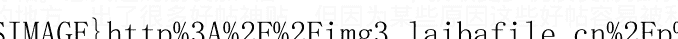
2F26960786.jpg {EIMAGE}
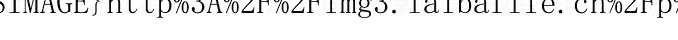
2F26960792.jpg {EIMAGE}

# 1091 楼 
作者：有骨难画 日期：2018-07-20 15:30

“那叫柯嚎”，是神农架地区的一种异化狼类，说是 20 世纪 90 年代末用山狼杂交出来的一种品种，属于人类种，是自然界中进化而来的生物。其目的是在众多灵长类动物中培育出一种可以为人类提供器官的生命。20 世纪80 年代是个信息爆发的时代，总有一些疯狂的想法：

- 这种想法放到现在很难做到，比如这种想法并不具备现实基础。
- 这种想法与人之间的器官移植面临严格的反应。
- 这种实验计划毫无疑问是失败了。

因为实验的过程而留下了一批试验品，其中这种“扩猿”就是典型的。按照来说，这类实验最终的结果都是由于其他原因竟然把它们放了 20 多年的优势，它们不仅没有灭，而是逐渐适应了这里的环境。虽然采集以肉类为主，可可见其规模，并且具有繁殖性、嗜血基因，这种方式主要依靠集体进攻战术，由于它们最喜欢猎物的食用，所以取名为“扩猿”。目前我掌握的资料就是这样，从栖息的角度说，它们现在所在的地盘上，而且还是腹地。

这一番述把植物研究并不是领域科班出身的范都愣住了，虽然对这个“扩猿”之前闻，但样子不像是假的。其中她自己提到了奇异器官移植在现在的技术条件下几乎是不可能的任务，他所说的话以及骨髓移植的动机就值得怀疑了。云媛的话与自己的专业有关，自然是有诸多疑问，正要开口询问，但听到四周顶部又是一阵激烈的爆发，云媛叹了一声：“来了！”

果然，她这话音还没落下，就被那些被她作为“扩猿”的黑色身影比之前目测多了数的数量奔着来，而且它们在进攻之中还发出之前没有过的集体咆叫声。这种哨鸣并不是某个个体的胡乱吼，而是有定的规律甚至是组织，就像人类军队在冲锋前的杀声一样，整个山林时间都在回荡着这种让人汗毛竖的声音。随着距离拉近之后，还是王虎与张锦两人率先，由于只有他俩用的枪械，再加上他们之前的表现，我们都能看着在援发之前就能将对面的扩猿击退。

这次事，扩猿这次不仅强度大，数量多，而且像第一次那样方向单一，而是除了背后暴露了三个方向同时合围上来。王张二人的交替射击战术面对只有一个主攻方向顺便照顾四周的零星目标还应付，但面对三个方向都是主攻方向的黑压压猿时明显心有余而力不足了，毕竟两人的能力再大，也不可能同时顶住起码数百这种虎豹的高速冲击。

“大家伙！”王虎一边上弹一边张锦喊道。张锦点了点头，“我不看也知道，他应该是终要动用 QTS-11 上的 20 毫米榴弹发射器了，只一人发射的弹药不同。王虎非自动设计的 QTS-11 用的是 20 毫米空炸弹，而张锦用半自动的是榴弹，这种打法正好弥补了后射快速而威力不足、前者发射威力和射速度的缺点。张锦发射的 20 毫米榴弹三发横着出去，几乎就能覆盖 50 米外 150 度范围内所有的目标，被击的虎豹被爆炸产生的弹片成了筛子，重则被打了一满脸就给结论了。王虎发的20 毫米空炸弹更不用说了，一发在可将威力发挥到最大的最佳高度爆炸，轻松无死角覆盖 300 米以上的面积，巨大的爆炸威力甚至都将不远处的矮灌木和离群的树木左右，还有被掀翻的泥土逸出的特有腥味钻鼻孔。两人这就坚持了好日子，脚前的虎豹已经被炸了个横片，但它们仍然放弃，踏着同伴的尸体继续改进。此时此刻，正如前面所说，它们的行为已经脱离野生动物，更像是一支训练的军队！

最终败在了数量之下。趁着王张二人更换弹药空档，终于有一波冲破了远征防线，一场狼猿从近距离撕杀，不可避免的爆发了。

听见空中“啪！”再看那只巨型隼浑身冒火，瞬间变了一个火球，落地后化成了一团黑。在大雨里使用如此安全，没有丝毫导电现象发生。她一时不想明白，后来想到李龙帅穿着重装还带着一副手套，估计不是论衣服而是手套都是绝缘的设计，肯定是在穿着之初就已经考虑到了安全问题。

被电击的人都是蜷缩，因为高温让人自我保护意识下，死前就是缩成一团，导致身体在短时间内幅度伸展。接下来的李龙沛以其身体相称的超频率挥动这根巨型柱，呈现出了典型的延伸状态。这种“棒无虚”，几乎就是一棒打死一只扩猿，被击中的扩猿也没有例外。看着李龙沛在狂哮背后的电光四射，产生的“噼哩啪啦”声不于耳，因为电击的间隔越来越小，最后会有种用电拍打蚊子的感觉，一会儿的功夫，在他身边就起码打了不下20 只扩猿。

尤佳毫不含羞，这个女人把手放在那个第一波斗中没用，所以没有摘外层的黑色外罩看不清是什么装备，露出来的是一支短小精拣。或许他研究的转子发射，这弩不能像自动武器那样抓住扳机就把弹筒全部打出去，但能像半自动武器那样扣一下扳机就发射箭，对于弩这种冷兵器来说已经不易，实际上是需要拉一拉才能发射箭。用现代轻武器的分类来说属于“非自动武器”。相比之下，诸葛弩在结构设计上明显不如诸禹手中的这只先进精妙。诸葛连弩增加了加速而牺牲了箭羽的有效射程与穿透力，其有效射程只有不超30 米，距离稍远甚至不能穿透冬装。动能箭数百、一箭穿透重甲盾的强弩可以同日而语，但诸禹之只连弩不仅射速超快（对于其它诸弩来说），而且穿透力与杀力均十分可见。在企图附近且距离已经走了50 米，只有被她一一箭，其中下场都是被射箭后遭遇于当场。除此之外，她的箭法也不逊，不敢说百发中，也是十中七七八。以几十只射出去，以她为中心的外围，也倒下了一大圈尸体。让她依靠数量与速度优势击破弩射的，便由上面所说的李龙对付，他那条大枣槌可真是不逊人，狼狈也一样。两人就这么一连一配合起来，还真打了一个风雨不透，让损失损害却也不能近半步。一开始我还担心诸龙的弩槌摆动速度太快而等到云媛或者是身边的人，但他一会才发现他倚的契度不于王虎与张辅，我的担心也明显是多余的。（未延续）

# 1094 楼
作者：有背难的人 日期：2018-07-20 15:56

我本人，因为先前的位置与乌兰百克克的比较近，因此应该在。。很自然的配合成了临时档，再加上云媛，三个人形成了一个扇面，把小雨以及数名护在身后。虽然王张二人的火力有余，要把几十个人保护起来就太现实了，尤其是男人。云媛的情况差不多都受过什么专业训练，身体素质不错，我有信心。平时健身房最爱的就是经典项（深蹲、硬拉、卧推），而云媛常年在野外探险，也练出了这一套对野生动物袭击也有自己的把路。此外他的武器就是英雄所见，只是不知道那柄有没有开刃，通过他用短刀来看，估计没有。既然开了刃就让它猛，整个刃都钻进了身体里。战斗间隙，听着叮叮当，面中又是击碎颅骨的声音，听着还挺悦耳。这种弯刀割、切、砍、挑为主要攻击方式，几乎不用刺击，攻击的部位几乎都是斩断了颈部动脉，由此可见她刀法以及锋利。说到正手刀，这里又要说额外话：曾经访问过一个国家军事格斗术研究中心的专家，此人告诉我，拳脚一般但却擅长使用短刀的冷兵器格斗。所谓“拳怕壮、棍怕老”指的是这种人，拳脚主要靠身体素质，而冷兵器格斗则更注重心与质，以往有些人在这方面比年轻人更狠。他曾经告诉我，遇见反手刀还可以与对方周旋，一般小混混都喜欢用刀，但反手刀的人里面就没有高手，正手用刀的人则有八九是高手。因为大量的训练，根本无法掌握拿刀的技巧，他本人就是正手是个高手，而乌兰贝克也是正手，明显是个高手。看来他年轻给我说的这几句话是所言非虚。战斗不知道又进行了多久，突然我的背后传来那种让人耳膜都要穿的尖叫声，我心里一沉，担心是小雨遭遇了袭击，忙转身看向，这才发现的确是一个扩猿与小雨扭打在一起。这只扩猿张开爪想在咬小雨的肚子，而她身边那几个妹妹早就被打吓的倒在地上了，她的双手捂地上，有的捂住眼睛不敢看，还有一个就在尖叫。发出来。（未完结）

# 1096 楼 
作者：日期：2018-07-27 12:02

昨天楼主说了就没得来更新，今天补上。首先来说一下关于正手持刀与反手持刀的区别，这个事情可能对大家在通常情况下理解的不同。在民间一般将刀刃向为正手，向为反手，用我们军事的定义完全相反，刀刃向下为正手，刀刃向上为正手。而这里楼主以我军的官方定义为准，就是刀刃向下为正手（虽然在所截图中已经说明，但在说比较简单，所以楼主在这里就再啰嗦这么几，各位看到）。


{IMAGE}http3A%2F%2Fimg3.laibafile.cn2Fp%2F1现在正在2F2969969938.jpg {IMAGE}http3A%2F%2Fimg3.laibafile.cn2Fp%2F1现在正在2F2969969945.jpg {IMAGE}http3A%2F%2Fimg3.laibafile.cn2Fp%2F1现在正在2F2969969948.jpg {IMAGE}http3A%2F%2Fimg3.laibafile.cn2Fp%2F1现在正在2F2969969949.jpg {IMAGE}http3A%2F%2Fimg3.laibafile.cn2Fp%2F1现在正在2F2969969951.jpg {IMAGE}http3A%2F%2Fimg3.laibafile.cn2Fp%2F1现在正在2F2969969955.jpg {IMAGE}http3A%2F%2Fimg3.laibafile.cn2Fp%2F1现在正在2F2969969959.jpg {IMAGE}http3A%2F%2Fimg3.laibafile.cn2Fp%2F1现在正在2F2969969964.jpg

1131楼
作者：有脊难画 日期：2018-07-21 14:18

不过我转身的时候，范小雨与此厉心心的交缠已接近近期尾声，我突然发现心心的那只战斗力并不强，它在与范小雨这种不算强的女性对抗中甚至甚至是力量上处于下风，经过一番短暂激烈的搏斗，最后被她翻压倒在地面上。

加v信110128495，获取更多精彩推荐

从刚才的控心猿着她变成了她压制控心猿，然后压在右手手中，扬发的匕首就往下了猛扎，其中一下直接进入了这只控心猿的右眼位置之中，将其击溃，不过在拔出匕首的时候，飞溅出的鲜血也崩了她脸。

又经历一场昏天黑地的打斗，直到天边晚歇，一轮红日开始突破黑暗冉冉升起的时候，控心猿的进攻终于停止了，扔下无数同类的尸体，就如同来时的进攻一样，它们像潮水一般密林退去。众人互相看着我看，大有一种九死后获得新生的感觉，最后大脑完全高挂在天空之上，所有人都摘掉视镜，通过自然光才可以清楚看清自己的样子。大雨下了不到小时后就停了，所以战斗留下的血迹没有被冲刷，在这种情况下就像一样，差点都认不出来了，几乎每个人的脸上都有大片的血污，有的是自己的，而大部分是控心猿的。

其他队友之中，男性队员损失并不大，几乎都只是受伤不致命，其中他被咬伤多处，偶有被咬伤肋或是手臂；而女队员则比较胆小，由于心理素质较低，很多人都是哭之后以后任人割的状态被控心猿围攻的，重伤的、死亡的都有。其实她们能像雨一样勇敢，只要不是面对控心猿，人类的胜算还是很大的，女性尚如此就不用说是男性，这也是损失较小的原因之一。

加v信110128495

“幸好它们跑了，要是再多打一会儿，我们就要累散架了。”季云因为奋力拼杀，流出的汗已经浸在衣服上，他一边用空闲的左手抹了一把汗，一边说，“它们不是跑了，只是撤退而已，如果后半天亮比较短，我们这些人真的危险了。”

“什么意思？”季云问。

“控心猿怕强，所以它们在白天行，它们都是在夜间或者是光线较弱的情况下进行。其实进入它们的领地之后已经被盯上了，白天大亮时不敢动，后来光线变弱，再加上流出的血腥气息对控心猿起到了很强的作用，它们才开展进攻。之前要让你们前进些，就是想要在天黑之前赶走控心猿，才换来了这场恶战。”

季云这次被尤扬“训斥”了一顿，不过她说的确有理，季云即便心情不悦也不说什么，他现在累得喘气都费劲，更没有精力跟尤扬吵架。

（未完续）

加v信110128495

（六）第三日

“我再重申一遍：所有人都尽量不要让自己血，血的味道会引起很多敌对生物，另外所有擦拭血液的绷带与纱布不能轻易丢弃，全部放进我的密封袋里！”尤扬说完，他也不再理会季云，而是高声以命令的口气说道。

经过一夜战，众人紧绷的那根神经终于松了，纷纷瘫痪在地。我上下打量了一番范小雨，问：“受伤了？”

“没，就是弄了血，不过回起来还挺刺激的，这次打死了一只呢！”范小雨态度似乎意料，没有任何恐惧，反而有些兴奋。我一看她反应，说她不愧是新一代标准的。

见范小雨没事，我又来找厉，她此时正在给箭筒（一种用来储存弹药的装置，那些短小但杀力强的箭）以双排列的方式存在里面。看她两鬓头发被汗水浸透了，知道她肯定累得不轻。我用用力过度而在微微颤抖的左手靠着士兵挡住，艰难坐下后，她问：“这帮东西怎么突然撤了？因为损失惨重坚持不了？还是突然‘良心发现’？听你说是因为它们怕光，真的假的？我还没听说过灵长类动物这种缺陷。”

其实按照我的判断，我觉得它们应该就是受不了这么大的伤亡，主动跑了。

“个体战斗力不高，但组织纪律性极强，比狼群之之，可以说动物中的军队，你想依靠大量杀伤它们的同类把它们吓走，是不可能的。如果一晚上有20个小时的话，它们就会把我们消耗到筋粮耗尽，精疲力尽之后再赶尽杀掉。”厉了一眼，然后淡淡地说道。

我一听，这段话我也体会到了，这个用再多口才合适，但他这个“如果一晚上20个小时的话”是什么意思？想片刻之后，我看着洒在她脸面的晨光，又想了一下之前的一些细节，便说：“你的意思是它们怕光才走的，如果夜晚的再长一些，我们就会坚持不住，对吧？”

“嗯，它们怕光是有原因的。第一，它们是穴洞动物，白天全都躲在终年不见阳光的洞洞里，只有夜晚才来活动。它们昨天出现的时候是在马上天黑时的傍晚，按照正常情况下，它们会在天彻底黑透的20点左右集群出来觅食。但是因为昨天有雷雨，乌云很厚，让它们从角度上提前跑出了。再加上不小心留下的血，不至于引来这么多狼吧？”

“什么是不小心留下的血？”季云问。

“控心猿嗜血，喜血（此处应为嗜血），对气息并不敏感，唯独对血液在空气中挥发的气味尤其灵敏。流出的血足以把那些躲在暗处的狼引出来。瀑布实际上是一个边界，如果它们不在山里停留过多的时间，在天黑之前，就不会昨晚的战斗了。这儿我们可能站起来，准备早饭。”尤扬轻叹了口气随后说，她这话有点刻薄了。

加v信110128495

我曾自以为口才还能说过去，可比嘴还真凌上过对手。前后两次问答都被这个女人说得如蚂痒，咽不下下去又吐出来，最后我坐下一样狼狈地站起来，拍了拍脸，说了句：“我去那边看了。”

跟着她甩的头发，我转了一圈，发现整队伍中死亡的共有三人，两女一男，都是被咬死的。最惨的是个女队员，是在距离我们与控心猿交战的“主战场”往西100多外找到的，而且是从侧边来的，看来她试图找回。这名女队员中等身材比较清瘦，身体已经目全非。在她的身上下大面积的血迹，断断续续从我们的方位延伸到找到她的地方。再看浑身上都是细小伤口，很明显，她是被多个轮番强行拖拽到的。而在生存欲的作用下她也曾奋力挣扯，奈何身体疲弱，寡不敌众。是因为没有把她找回，而是只找了100多米，估计是她反抗剧烈，最后被控心猿杀死了。

在她身上伤痕之中，最明显，也是最致命的一处，就在她的胸腔左侧，就是心脏的位置。通过那里能看见有一个直径与视碗相当的洞，里面空空如也，心脏已经不在，而且左侧的乳房也跟着心脏一起不见了。不用说，这肯定是被控心猿用牙利扒出来吞吃掉了。因为失血过多而变成灰白色的身上，她死不瞑目，两眼睁睁看着向湛蓝天空。来那么兴奋的人群里肯定有她一个，但她在那是绝想不到才十几个小时后自己会落得如此下场。

我将这边的发现回去给众人之后，才知道尤扬早已有了安排，她不知道什么时候派李龙顺着之前我们跑过的队员。我虽然没跟过去，而且那名女队员被拽拉走的位置，李龙顺从路上回来了。李龙身体已经坏了，神志非常不稳定。他在黑夜里狂奔，脚不慎掉了一个自然形成的坑，坑里都是落叶，掉进去一点声音都没有。由于控心猿的存在，她不敢出去，战斗了一夜，原本剩下29人，再次缩小变成了21人，而且还有一个疯了。

尤扬战斗之后第一件事就是命令联系那只机器，这五只机器比8条人命重要得多。我第一次看到尤扬那个子里到底放了什么，一个特殊的呼唤，里面飞出一个影子，身影随后在空中旋转，展开双翅飞向高空，仿佛收获了什么后这才落在了尤扬右手臂那段特质皮套上。

“我的天呐，这是一大金雕啊！”范小雨此时不禁惊呼道。

大金雕是一种大型猛禽，翼展达2.3米，体重达6.5公斤，别看体重不大，却能将小型羊从地面直接凌空起走。当地说的“黄羊大雕”的就是此物，因为它经常捕食黄羊。

望天津岛柯尔克族的情况，我就重新明白了。在我们56个民族中，最擅长训鹰、将野生鹰训练成猎鹰的民族就是柯尔克族。而始终待在右臂上的那段皮套，则是给大金雕落脚用的。因为大金雕的双爪太锋利，如果不保护直接落在手掌，即使是主人也不避免抓伤。那么在上面的小抓就不用说了，那是大金雕无数次上面起落留下的。

驯人训练的种类并不一定，而是除了大金雕外还有很多，比如苍鹰、隼等。曾经有一个传说，说有一个天赋驯人（类似西藏的天唱诗人），就是因为某种原因（比如遭遇了一场大病，甚至是遭遇了雷击）后突然获得了某项技能。

（未延续）

作者：有蜀难画 日期：2018-07-22

楼主来图，这次别的4张大金雕高清图，一代猛禽之王的姿妥是不。

{IMAGE}http3A%2F%2Fimg3.laibafile.cn2Fp%2F1297019252.jpg {IMAGE}http3A%2F%2Fimg3.laibafile.cn2Fp%2F1297019254.jpg {IMAGE}http3A%2F%2Fimg3.laibafile.cn2Fp%2F1297019255.jpg

158楼
作者:有骨质画 日期:2022-07-22 22:01

这4张图则为柯尔克族传统训练驯人，其中图3可以清楚到的训练驯人右手供鹰降落与起味的护臂，就是为了防止鹰的利爪抓伤，不过乌克的护臂比这个精致的多，厚重的多，用料也更好的多。
（注：驯人训练的种类并不一定，而是除了大金雕外还有很多，比如苍鹰、隼等）

{SIMAGE}http3A%2F%2Fimg3.laibafile.cn2F212F297019256.jpg


那自然，难道接下来的行动带着8具尸体干？还是在

你想背着这8具尸体？如果你有这种“奉献精神”的话，你应该在

……好吧，不过你得考虑一下其他人的感受吧，

“你看看可怕的那个，他们现在还敢跟你继续走下去吗？”我

这次再次被这个漂亮女人的时候竟然感觉已经渐渐习惯了，加上我不是想跟她就这个问题抬抬杠，所以接着就把正
题出来问她，这个问题我感觉是很难的，我倒要看看她
想怎么解决，没想到她竟轻松地打算的：

“这个事情我自由安排，不用你操心。”

但是说这话没多久，果然和我所想的一样，在剩下的这
些队员里，开始带头不干了。他们经历了神经毒素入侵导致
惨忍的自残，再到一夜被热心狼猿的折伤惨重，心理
素质一般的根本无法承受了，所以他们有这个反应是的确有
情可原。

在这些人中，带头的是一名男队员，他声嘶力竭地吼着：

“我不干了！”

不可一世的女王再次拉后面来，她看着众人，挑了挑眉在
众人面前，冷冷的如此说：

“我当初找你们来的时候，危险性已经是清楚的清清楚楚，
你们把这次行动当作野蛮，做事不守规矩，才有了这两次的
恶果。我在团队纪律里多次强调过建立营地后不准擅自行动，
你们呢？跑到山里去摘野果，甚至还想“打野草”，结果怎
怎么样？

昨天白天，我命令你们不要在白化熊那里逗留，
在天黑前到达指定地点，谁不听，最后会怎么样？

行了——我没心思在这里教训你们，我现在再次强调调：
是的：你们都给我好好回忆一下，来的时候签字的合同的内容，
再考虑要不要继续下去的问题！”

不得不说，她不仅长得美，那种压倒性的气场比一般的
男性都要强很多，我此时甚至在想，这样一个有钱有势的
颜值又有气场的女人，找一个什么档次的男人才能能够驭
了她？

当然，这是我思绪乱乱的外话，题话是我听到“合
同”字，就立马想到这些女团员与尤蕊之间
该某些经济上的协议，这些人们很有可能是被雇来的，拿
了钱就得办事，看尤蕊的架势是即使这些人都在这里，
不能让他们返回而导致白花的这笔钱，唉——虽然
漂亮脸蛋下的儿子往往都是狠毒的。

不出所料，这段话前半段做了什么作用，毕竟只是把已经
发生的事情再抖出来听斥一遍，这对脸皮厚的人都没有什么用，实在
更不用说对这些已经只想逃逸的男女了，但是后面那
段牵扯到合同的话就非常管用了，就好似一剂强心针一样，把
这帮哭的哭叫的叫的员全给锁住了。我虽然不知道遇到合同
写的字体是什么内容，但从他们之前的愤怒甚至到了癫狂
的状态瞬间回归于平静就知道，这内容一旦生效之后估计不论好
坏，是有足够影响他们整个个人生乃至命运的分量。

(未完待)

# 1172 接
作者：有骨难画 日期:2018-07-22 13:24
临时时有事，先要更这一点，等我忙完了一定接着更。

# 1173 接
作者：有骨难画 日期:2018-07-22 19:57

这些人从片刻前的咯咯又集体陷入了沉默，连哀哭啼涕
的女人打算竟然也都止住了，这种巨大的反差让我感受
到了这份合同的“威力”。尤蕊看到此番话效果甚好，便接着补充了一句：

“合同里的内容，往里说，让你们每个人都少挣。至少20年，如果不
是看着这么大的风险，你们难道还以为是陪我到这里，一圈就能买到的吗？”她又回来，“如果你们不遵守合同里的协议，把事情搞砸了，那么你们可以离开这里，但等待你们也将是万劫不复，懂吗？”

最后，你们说一句：“富贵险中求！”

唉，我在心里重重地叹了口气，即便我眼前不清
到底合同里给了这帮什么好处，或者是用些东西留住了他们的命门，但我还是忍不住想起了另外一句：“在这里，人心基本被稳定了。”

眼下最重要的事情就是找地方休息，要知道我们这帮了一整晚上，而且什么东西还没吃，又饿又渴，尤蕊明亮的眼睛虽然带着一点血丝，但从精力上却看不出她倦怠。她继续前进，像她说样的路程不算长，之前遇见白化熊之后就已经走了公里，为了躲避狼的追击，至少公里多，而剩下下公里的路程也就是一咬开就过去了，所以时间不大。

按照预定路线翻过了这座瀑布，到了瀑布的上游，按照她的话，这里已经离开狼的地盘。即便到了晚上，当到达一处平缓地后，本来她还想继续走到那个地图上规划的休息点扎营，虽然只有区区百米，但众人实在是坚持不住了，说什么也要休息。

我懒反击她，说不安全就是不安全，妈妈被活活死也不比什么畜兽撞到哪里去。是因为是大白天，所以即便被禹琦强调了半天，但警惕性依然不知觉的放松了下来。我在快石头上吃了几鸡蛋蛋白棒，又吃了一个鱼罐，这就准备睡觉。范雨跑过来塞到我手里一个长方形的东西，我拿着这个东西上下翻了一下，因为此时状态差，看着基本没。

我很耐心，所以我几乎滤印在上面的产品名称都没看清，更别提具体介绍了，如此自然没看出出来“子丑寅某”，便问：“你是真的吃过吗？因为我这个真的好减肥。”

“这是什么？”

“压缩饼干，野外哪有不带这个的，你光吃蛋白棒可不行，鱼蛋又是高胆醇食物，这两者都有碳水化合物的“运送”，才能达到身体各个部位，起到营养补充的作用。你不吃实只吃这个，不仅“事事功半”，而且消化不良！还有那个大小姐发的高能饮料也少喝了，热量跟蛋白质含量那么老高，喝了对臀肌的压力太大，你年纪轻轻的，可要保护好肾！”范雨说出一个“我有经验”的表情说，而且坏坏了一笑，满意了“老司机”的味道。

“呢，压缩饼干？现在还有人吃这个啊？”小雨你，“怎么说是90后，怎么还有这么老实啊？”我说。

“看了，你堂里的内地记者见过见识广认不出这什么，你不会以为这是几十年前的种761式压缩饼干中，或者是超市里卖的那种小麦压缩饼干吧？告诉你，这可不是一般的饼干，这可是探险协会联合解放军总后部军事装备研究在用99式压缩干粮的基础上专门为我国科研人员研制的13式自助充能饼干，吃了以后膨胀，所以不必担心。”

“每天一包50克，可以保证一个80公斤体重的24小时内饮水之外的所有需求。在体力消耗大的前提下，每包50克够了，吃多也是不容易消化的。”

我拿着手里的“13式充能饼干”，拆开包装后放在嘴里试了试，“嘿！这真不错，挺好吃的，酥脆，入口之后真有股麦香的味道，比市面上那种放到就变成一团。”这种饼干的味道太强了，挡不住一夜睡带来的疲倦感，吃完这一块之后，我还是按照计划，

连都懒得钻了，直接找了相对干净的地把睡袋垫在，遮光眼镜戴上，脑袋靠睡袋上的自带枕头，顿时感觉一阵旋转，随即五秒左右失去知觉睡去。

睡觉之前我还打算了一下临时营地的情况，当时大多数人都已经睡了，尤蕊靠在一棵树上闭目养神，也是是非常累了。紫带雨玩游戏，他的梦比我还早。大头李沛坐在尤蕊身边，一边起到保护的职责，一边打盹。此时此刻，完全处于清醒的人在这个营地上。想起那句“这里也不么安全”，再看他们的状态，心里闪过一丝不安。靠下之后就睡得像死一样。

也不知道睡了多久，一阵刺眼的尖叫把我从梦中惊醒，我“呼”从睡子上坐起来，那个动作简直就跟鬼了一样。随后第一眼看到了同样刚刚醒来的范雨，以及她正在呼吸的季云，我一边揉眼睛睁睁地问：“怎么了！”

“我也不知道，好像是谁叫了一声，然后就把我叫了。”我没再回答，本能地来看，想知道底发生了什么。结果就一个女队员看着嘴巴，面部表情为惊恐过度都有些扭曲了，我心头一凉，知道她又要出事了。就开始寻找她到底是什么让她感到怀疑，可她看了一圈也没看见有什么东西，倒是睡着的人被她妙醒了大半，这些人都在一脸茫然的看着她，虽然他们跟我一样不知发生了什么事情。

“出了什么事了？”尤蕊听见这么刺耳的叫声自然早已反过来，大走到女队员身边她那标志性的、没有人味儿的口气问道。那名女队员一脸惊恐，先是不自主的摇头，然后就是双手捂脸，好像有什么可怕的景象就在她的眼前。“到底怎么了？”尤蕊有点不耐烦，其实经过我细细的感觉与分析，发现她并不怎么冷血，她是看不起她的，所以面对弱的时候，显得很没有同情心。显然，这是题外话。言语正传：那名队员是不是由于似蝉骚，不被尤蕊这么一吼，她皱起手指指了指对着她的一个睡袋。之前把注意力放在她身上的众人才把目光都挪了这个睡袋上。我会这里也站起来了，走到睡袋面前看一眼。这睡袋非常怪，明明装了一个，却整个人都粘到了底，换句话说，这里这些人把自己的脸也粘了。尤蕊给我们我们一配发的这种睡袋为了有充余量，所以无论多少，都是2米的长度，以保证足够的深度空间（自然了，章李龙这种身高超过2米的巨人，他的睡袋是定制版，长度超过3.5米，内部长度也是3米，而且比别人大了几圈）。但正常人躺的时候，一般都要把头部露出来的，而且这种睡袋用防水防潮的用料非常紧密，里面不是很闷？通风且闷的局部环境下，这种人是怎么睡觉的？肯定没法正常。另外这种睡袋闭合，从逻辑角度来说，明显是被别人从外面打开的，说明里面发生了什么。当禹琦发现这个事情时，里面的人已经这样的样子了，而且顺手又塞回睡袋里，这种动静太大，即便睡觉地人都睡着了，这种可能性低，基本考虑到范围内。

（未完待）

# 龙丰点头回应，随即去拿毒面具，我问：

“你想干什么？”

“我得把她就地解剖一下，看看体内到底发生了什么情况了。”尤靖头也没有回的一边准备一边说。

“你要解剖她的尸体？这有什么意义吗？”我说。

“当然有意义，刚才那个东西是从她体内出来的，你不是没看见，既然能钻出一个来，估计体内现在还有它的同类，我现在想进一步了解到这到底是个什么事，就能破解了她了。”尤靖说，她这一说我突然感觉心里有点道理了，一时的不知道该说什么好了，在说话的这个功夫，李龙丰已经取了防毒面具，也许是兼全套的防化服麻烦，她怕腐蚀性液体让她入侵呼吸系统，所以就戴了防毒面具，防止有什么不干净的东西弄脸上。

女人这种存在啊，就是在乎自己的脸蛋了。

这两个人说干干，李龙丰像拎小鸡一样从睡里像起脖子一样抽出一根筷子一样轻松的给了出来，然后是尤靖操，不知道是不是出于真准备解剖体或者是遭遇意外的情况，需要要做手术的话，她还真准备了一套外的工具与消毒设备，当然，都是便捷的。

我开始还在想，这话她怎么不让随队的医还有助手来？他俩这事才说是“正门正路”啊，除了医科医学或者是法医类的专业，其其余少数类会有女性会会适了了解尸体这种事情，但看着她这个熟练的感覚，完全像是第一次干，后来一想，也许是她认为此事有风险，所以不想让应变能力并不强的队友以及他的助手来冒险，如果是出于这个个原因的话，她对于团队，还是有一定的责任感的。

至于不要消毒，怎么开刀这些琐碎的过程就不必细认了，我虽然没有眼见过外科医生怎么用手术刀切开人体，但是倒是见过外科医生怎么用各种工具切开人体，相比之下，尤靖的刀功还真就极其精准是专业的，“三下五二”便将这名女队员的整个腹部从头部切到底，随后两人用手自只抓住伤口的一头，向着两侧一拉，看着让人震惊恐怖的一幕便随即而显现了：在尸体的内部，已经看不见任何内脏的踪迹，取而代之的是“一大堆”开始有些者的虫，请注意我的用词，是“一大堆”，说了意思就是少数也有十多了，除了这些以外，通过我的视角能看到的地方，比如在这具尸体的腹壁上，密密麻麻粘满了一种圆形的白色物体，看起来像是某种生产的蛋，有密密恐恐的的人看了，一定会被吓得害怕。

（柯尔克）

# 1207 楼
作者：有骨嬉画 日：2018-07-23 12:16

随后这些东西被放在一压后，纷纷顺着这个骰子就往外跳，李龙沛反应的极为迅速，伸手就接住很多丰富的膜，一只膜。

手又捏住了另外一只，接着用力，“啪啪”两声，将其捏爆，不过奇怪的是虽然爆裂后的性腐蚀性液体发出阵阵黄烟，却不见李龙沛带着黑色手套的手有任何损伤。

但体内内的东西还在践，我拿着工铲就像盯打蝇一连连续地打了三只，却还是有一只击中了当时正在围观的一名男队员身上，他的一脸的惊讶简直要把这只生物从身上拍下去，却根本来不及，因为那只生物落在他身上的一刻，就从头部类似吸管一样的器官器里吐出一口刚才从它的同类身体中崩裂出的那种乳白色液体，随后以后电光火石的速度在他的裤底乃至到下面的皮肤上融了一个洞，接着它的身体就顺着这个洞钻了进去，不过好在他身边有人眼疾手快，拽住了还露在外面的尾巴将它从融开的伤口里拽了出去。

这个伤口是个椭圆形的，面积有一个小瓜大大，还好位置是在肩膀上，处理的又非常及时，否则必有性命险。紧急关，王虎与张锋再次出手，他们之前把刚才裸尸体的睡袋在手中，然后往前扯，将腹部在瞬间死去，让那种东西无法再继续赶，而后者不知道什么时候卷带带来，把尸体的耳朵都缠好了，封了一个严实。

## 这种

“老虎，把尸体过来，谁接手？”

“老虎”这个称谓，显然是尤靖对王虎的一种比亲近的人称呼，李龙沛“老虎”、乌兰克“小鸟”。

话说回来，由于众人没干过活，所以听闻都是一脸表情，而尤靖却面不改：“不必，这东西准备好了一些，给尸体撒出。”

说着在空中招了手，一直在人群外的乌兰克走了进来，果然提着一大桶灰，王虎还把脏一起给扒开了，让尸体露出来，结果还比，很快就把尸体正面盖住了，与皮肤接触的地方立刻开始溶解，因为刚刚为了，所以尸体早已被溶解了，掉那张脸，就什么都不剩了，过了秒后，尸体像在高温下融化的巧妙一样，形成了一滩浅色的粘稠物，如果不说，便完全看不出还是一具尸体。

看着尸体已经被融成了这个模样，尤靖依然用1.2米长的探路杆在左上方拨了下去，然后淡然的说：“了，都死了。”

“刚才十几只蜘蛛一样的东西呢？”我问。

“诺，这个就是……”尤靖的拳头挑起其中一块比较粘稠物，然后对我：“灰怎么跟尸体发生强烈的反应？”

“不是与尸体反应，是里面的那个液体发生了反应。对于那个，正确的说法一点，它应该叫爬蜘蛛。虽然名字里有一个蛛字，但它跟蜘蛛没有任何关系，所以这个名字只是因为它的身体结构与蜘蛛相似之处。另外，这是一种肉食群居动物，繁殖非常频繁，常以大型动物的身体作为食物，它们的食物就是各种动物的内脏。刚才我解剖尸体的时候不知道你们有没有注意到，尸体里面已经空空了，虽然肌肉和骨骼还在，但所有器官都没有留下了，除了脏器以外，还有大脑和眼睛完全消失。那就是一个吸管形状的器官，类似的还有雌性蚊子嘴部面前那根针，生物学中这类器官都曾被称为“口器”）可以向外界注射毒性液体，能够将贮存在物的体内以及大脑等组织全部融成液体，然后再通过它吞入腹以食物。由于它们在蜘蛛中分泌一种毒素，这种毒素会在极短的时间导致作用范围附近的肌肉和神经组织坏死，而组织丧失通过神经传递的能力，而是被咬者虽然身上被开了一个大洞，但完全感觉不到疼痛，直至被它在钻入体内融化并吞走所有的内脏而死，整个过程都不会有痛，或者看起来像是不知。你的伤，是不是感觉不到疼？”尤靖说道这里突然转脸问那个被这种称为之为跳蜘蛛的生物攻击的男团员，男团员原本一脸痛苦的咬着牙，被尤靖这一说就能感受了一下，紧接着就是一副很奇怪的表情，很显然正像尤靖的那样，他的肩膀虽然有一个小螃大小的口，却几乎感觉不到疼。

(未完待)

1208 作者:有骨画 日期:2018-07-23 12:27

楼主昨天没更，主要是与昨天内容相关的好图没有，所以今天就补上4张柯尔克族美女的图作为送给大家的福利在这里吧，以作补补。

[image:https://bq.tianyui.com/d/zy.gif]
[image:https://img3.laibaife.cn/p12f297066009.jpg]
[image:https://img3.laibaife.cn/p12f2970612.jpg]

李龙丰使用的超大刀基本上这个设计，但尺寸要大好多倍，其刀刃长度起码在米以上，加上柄，1.2米长的探路杆。尤靖手中的探路杆大概这个样子，不过她的可以伸缩，装上其它配件还可以钓鱼，属于野外生存工具，直接使用可能会造成危险的地方，以量保护者的安全。这是《异形》系列电影中的抱脸虫（也可以小雨说的抱头虫来称呼），什么玩意，那是一种现实中并不存在的科幻生物，比较恶心，详见图5、6。

跳蜘蛛与它的外形有点像，只不过比它小得多，而且颜色也不同，浑带有白色的硬质毛，尾巴卷向下，没有那么长，也不会像抱脸虫这样盘曲。关于跳蜘蛛的外形，大家可以把它想象成一只蜘蛛与蜘蛛子的结合体（通过图1、2与图3、4进行一下想象会比较具一些），但是尾巴和蜘蛛子向空中弯曲的方向相反，是向地面弯曲的，并且蜘蛛子前面的那一对钳子这说吧，它应该是蜘蛛的腿+蜘蛛子的身体及反方向的尾巴+巨大的雌性蚊子的嘴（就是口器）。

类小雨所说的抱头虫（也称抱脸虫）是个玩意，那是一种现实中并不存在的科幻生物，比较恶心，详见图5、6。

[image:f098f634ceed76333d6de73904c68082_440_0.png]
[image:f098f634ceed76333d6de73904c68082_440_1.png]
[image:f098f634ceed76333d6de73904c68082_440_2.png]
[image:f098f634ceed76333d6de73904c68082_440_3.png]
[image:f098f634ceed76333d6de73904c68082_440_4.png]

好了，今天的图更新到这里。（未完待）

## 这种

跳尾虫一次分泌的毒素虽然不多，但受伤头恐怕是保不住了，等回去如果你还能活着，就得切除手术，除非有奇迹发生。现在你能做的就是赶紧处理下去，防止感染。尤靖看着男队友的表情完全是在她的料之内，所以也没别的，而是嘱咐道。男队友不禁得哭了起来，旁边有人劝但他根本不住，很显然正像尤靖的那样，他的肩膀虽然几乎感觉不到疼。

这种情况下，几乎每个人的心理防线都会受到压抑，原本对她“冷血”的印象才改变，现在又不得给她上了一个标签。这种情况下，几乎每个人的心理防线都会受到压抑，原本对她“冷血”的印象才改变，现在又不得给她上了一个标签。

“哎！站住，我有话质问你！”季云突然大吼一声。

季云本来就生气，再看尤靖转身都没变，加上第一天导致队友自残自己的那一个，他感觉自己再一次被尤靖这种方式无视了，所以指着尤靖的背影大声说道，那声音的周围的山谷都有回音，众人全都大瞪眼睛看着，季云发这么火是没有道理的，只要不傻的人都看出了这个问题。很显然，尤靖几个人对这里了极充分的准备，但却不给我们说。这里一共40个人，你现在数数还剩几个人？死死的伤，这笔债用人命写的账都得算在你头上，你懂吗！”

“哼，我给你们解释听吗？这些生物不是我看不不起你们，我先说了谁会相信？至于提醒危险，我提的次数还少吗？第一天，我不要你们乱走，偏不听，结果呢？第二天，我叫你们不要退回，还不听，结果呢？我在前面提一次了，再说没什么意思。”

季云本来就生气，再看尤靖转身都没变，加上第一天导致队友自残自己的那一个，他感觉自己再一次被尤靖这种方式无视了，所以指着尤靖的背影大声说道，那声音的周围的山谷都有回音，众人全都大瞪眼睛看着，季云发这么火是没有道理的，只要不傻的人都看出了这个问题。很显然，尤靖几个人对这里了极充分的准备，但却不给我们说。这里我们“杠子”（就是傻子的意思），每次出事之后就淡淡的解释几句却倒了，可妈的每次按。

“那就说今天，我在路上就要你们你们打好十分的精神，这这里可不是多少安全，要你们继续走你们不走，然后你们在里睡的都跟死猪一样，碰上这种事情还想怪谁？野外露宿要轮番休息，不论在白天还是晚上，都必须有人放哨，这这么简单的道理你们这些野外工作的人渣难道不知道吗？”

厉嫦这回转过转身，以一副正严肃的架子把季成的质问如炬都给“怼”了回去。她说这一句我这才想起，之前刚刚闯过窖的时候，刚开始我看到她，李龙沛离乌兰百百人都都在休息，但谁在也没有铺开睡袋躺下的，都是坐着的，当我醒来的时候，他在咱们三人的。

“一开始我还以为跟我们一样，对核心区都是一无所知，现在看来完全不是回事，你好像对这里有什么危险都了，倒没事，但为什么每次危险你都不事先说明？非要等到别人入之后才当“事后诸亮”，在这里“咔咔”的讲上一通？你以为是大学课堂吗？”


空的“管”，它是他们用于呼吸的器官，只是这个器官在呼吸时会向外喷出一种非常特殊的惰性气体，就像人类呼吸会吐二氧化碳一种，这种气体与它们体内的酸性液体有直接关系，不过这和你你的问题关系不下大，有的是这种惰性气体与石灰接触后会产生非常强烈的化学反应，只要一点点就让它们化为乌，而人的体早已会被熔掉是因为这么多跳尾蜘蛛在她的体内，这种惰性气体早已充斥了她死的整个腹腔胸腔里，浓度极高，她的腹部被我切开的时候这种气体已经暴露出来，再被石灰一接触，结果就是你看到的那样。还有，石灰必须是石灰，熟石灰无效的。

怎么样？我的解释你还满意吗？”尤玥。

她对我说话的语气一直是冷冰冰的，但经过我的总结才发现这种冷冰冰的态度实际上还是算比较好的，因为最近不带有任何情感，可对另外一些人，比如季成云、花冉亦以及那一群人说话时，总有或是或少的一点蔑视，但这蔑视不过是一个富家千对普通人那种常规意义上的看不起，到底是因为什么样的一种情绪存在，当时候我还没有清楚。

换说话，她跟我对话起码是把我放在平等的地位上，而上的那些人，她则是摆出一副高人一等的架势，慢于各种原因，这些人对她真没脾气，不过花冉亦不服气她那真的，这两个女人在这几天天有机会抬脸，虽然总还是者挑加。

从起“战争”却从未来占过上风。是的，这种事荒诞无比，我们现在正在不过过有一点需要说明一下，我在提到堵眼耳口鼻及肠在门没有意义的时候，允回应的第一句话就让我也有点脸红，在因为这么做的我是王二二，的确不是她，但她在回答时，确在这个问题之前看了这两个二入，那个眼神很奇怪，让我感觉他们之就认识，这些疑问在最后被一个一个地解开，但在那会儿，我是被蒙蒙在鼓里。

“哎，好吧，既然是这样我也没什么好说的了，那么为了队伍的，你听你的，下一步你想怎么办？”我说。

“继续前进，你们都想睡好觉我是自然知道，再坚持，从这里出发，再不到2个小时就能到达一片相对安全的宿营地了，在那里扎帐，我们都可以好好休息一夏。”尤玥说。

（八) 第四日（1）:狠虫虎豹”（一）

众人一听她说都是安全的宿营地了，就走吧，加上之前的睡眠，之后的这些事，这足过去了好几个小时。

我们再次启程的时候，天空又蒙黑了，一路无话，团队到达此时此刻，彻底没有了刚开始那种欢喜勃勃的气象，每个人都把脸拉的跟脖脸差不多长，或是阴魂或是悲伤，总之没有高兴的，因为经过这三天可以称上是风血雨的折腾死了这么多人，见了这么多弃子都可能见到的惨惨场面，我估计别人不说，这些男男女的小年们，用奇的话，如果还能活着走出去这里，那估计后半生都得对野外探险、科学一类的项目留下深深的心理阴影，比起之前被吓坏了的小姑娘，恐怕得被咬的以后《动物世界》都不敢了。

不过这种情绪，云旌、李龙涛、兰兰克虎、张槌这五个人，因为他们五个人当时相比出发体会会就压根儿没有任何改变，一路走下来全是喜怒不形于色，基本看不出来情绪波动，完全是一副“一切都在料之内”的架势。

虽然刚才一觉睡的不好，但众人好歹基本上睡了几个小时，又吃了东西，体能上恢复了不少，所以虽然情绪佳，但支撑接下来不到小时的路程还能够付，如此中间也没有停顿，也没有发生什么，最终到达了目的地。

打一看，这块更变态的女人人都称之为“安全”，营地的确与之前的位置不同，这块营地不仅地势平坦，而且干燥，上来之后根本不用生火去烤着衣服与随身物品，自己就干了，而且摸着地面也有温热的感觉，最奇的是这种暖热让人舒服，就像在一个具有空调的房间一样，不热也不冷，几乎所有气候或环境造成的不适，在进入那一瞬间就消失了，并且远处还有一处山泉，清澈至极，泉水流息，看着就让人喘口气。

不得不说，无论是对于营还是进行活动，这里都称上是一块“宝地”，能够符合安全标准的地点，虽然一般。不过还是因为乏害，现在没有人敢毁这里，此时已经完全耗了。

经过协商，尤玥与李沛、吕兰贝三人负责营地的面的安全，王虎与张锦负责北方，两边都用上了激光感应装置，他们把感应器部署到了离营地公里以外的地方，如扇形面积覆盖，组成360度死角的覆盖区，从外形来看，两边使用的器材不一样，尤玥这边是柱状体，使用时头朝下插入地面，而王齐那边用的是一种圆形物体，使用时直接放在地上，不知道有什么区别。

当时我还想为什么上次白天宿营的时候他们不用过夜，就没那个必要，也许他们用了这种手段可能就能避悲剧的发生了，而且看着他们五个人为了营地安全而忙前后，期间人都睡得又又甜，如果有什么乱七糟的东西通过感应器的覆盖范围就会触发报警，让营地里休息人的角落。

在温泉暖的地面上，疑惑表来，王琦除了一些基本行为规矩外的对这些人没有什么太要求，只是态度差一点而已，所以归根结底要去，从奉献与责任的角度来说，这些人真没什么去告诉他们，尤其是王琦三人。这一夜时间过得飞快，包括我在内，绝大多数人都睡了个昏黑，直到第二天日日午才陆续起床。

不少人起床为了精神一下，跑跑到泉水跟前洗脸，一洗之后，一个男员用惊奇的语气说着：“哎！这还是一温泉啊，水是温热的，冷不烫，温度正好。”

“这里是一口‘医泉’，或者叫‘药泉’也可以，”同事尤玥说，“这也是一处温泉，泉水常年保持在40摄氏度，在你脚下的。这片干燥之地之所以如此温热，也是因为它所赐。不过最关键的是这里的泉水中含有一种极为珍贵且神奇的微生物，这种微生物在生物学界还还没有明确的定名，有一个临时的名叫“复免”或者是“人体粘合剂”，这两个名字里我个人更倾向于前者，后者的字面意思太直白了。

它的作用十分得了，可以快速修复人或动物的外伤，如我刚说的第一个名字就是“闪电般的修复”，你身上有外伤的很快就去泉水中泡泡，长度不超过2厘米，深度超过1厘米的小伤就能恢复，对重伤也有痛用的。

康康，你肩膀上的伤有机会处理一下吧，虽然这一大片的坏坏，泉水不能让它再生，但至少有伤口的愈合还是问题的，而且会阻止坏部分的继续腐坏。”尤琦倚绍。这名为康康的人，就是之前被棘尾鱼用能局部机体迅速死的毒素与强酸性溶液溶解肩伤，导致肩头出现一个小芒果大小孔洞形状男队员。

“传说成吉发现过一处温泉，具有疗效功效，他胯下的宝马在征战中中了箭伤，躺在泉水中几个小时就完好如初了，后来成吉汗了天下，也将其命名为‘药泉’。”这处眼看上去漂亮的，不过这里这处夜之间修复外伤的神奇功效？你还不说这是不老的好，而且我还是那个疑问，上次你也没有回答，这里是从人类足的区域，你是怎么知道的？别说你之前的准备充分也不可能面对窘境吧？”范雨接着满玲说完我就感觉别异，因为语言之间充满了火药味，而满玲对于这种带有俏皮味做出了她的回答道：“原理非常简单，因为这口泉眼的地理位置比较特殊，四季常年各种植物，滋润这些植物生长，而在多年渗透过程中受到药力的影响，具有天然的杀菌止血功效。此外还有一种‘药泉’，它是地下流出地面形成的，那里的地下水的本质是由地下水渗透，而在地下流动的过程中，经过不同的岩层，水中溶解了不同的矿物质，由于这种水经过岩层裂隙涌出地面之后，就成了不同的矿物质，这些泉水含有某种疾病有治疗作用，这泉水就是这种水源，不过说到底，它的学名应该叫矿泉，市面上的，黑龙江省德县、云南省冲县，包括我们现在发现这类矿泉，开发价值更高。但是上面哪一种药泉与那些常见的中草成分以及人有益的矿物质在医用价值上相比“复免”、微生物来说，就是不值一提。至于不老，那只是一个传说而已，即便浪漫主义的角度讲愿意相信有一口让人返老，至少也从来没有人找到它，就像亚特兰蒂斯一样，说明过了。最后，人进来不代表平台，或者是代表其它人类控制的生物，比不如无人机等等。这里的泉水我们之前用大型旋翼无人机进来不下百次，经过严谨的化验分析后得出了，不骗你，现在这种微生物的人造产量工作正在进行当中，有些事情的高度达不到。”

这段话的最后一句，明显是尤琦在嘲笑范雨的层次太低，即便是稀有动物领域的科学出身，也同样不清楚这些“道运儿”（注：这是一个北方的词汇，大致就是具体的内容的意思）范雨这次也学懂了，与尤琦争辩时撞了领域。这件事已经说过了，范雨再，也许认为是这是从言攻势上来说，眼下尤琦最大的软肋吧，当然这是我的推测。靠着季云上次的话如此道：“嘘对，我是层次不够高，看不见你见的东西，不过呢，看着眼前这些‘残兵败将’吧，都是你的‘英明领导’下走到今天田地的。”

“看来你不仅蛮蛋，而且听力也不太好，那我就再说遥：此行动的危险性在行动开始之前我已经过的非常清楚，任务中我该提醒的地方也都提醒了，我的责任我会承担担，不是我的，也想抱到我的头上。”尤琦却了揉手，以为自然的说。说一百遍也是死了这么多人！不是死了一个两个，而是如今死了8个人，重伤3个，如果加上前面的那些，那就是死了11个，重伤9个！你作为领队居然在这里振振有利的推卸责任，你不感到羞羞吗？我告诉你，要是现在不是地方，我就抽你丫的了，看你个人狗狗的德行我就要来气！”范小雨“腾”的一下从地上站了起来，指着尤厉厉说着。范小雨虽然天生丽质，姿色高颜，心肠很热，不过心肠热的人通常直口快肚里憋得不住，生气起来来有什么说什么，从这一点来说，她是符合标准的北方女孩，骨子里透着豪气的特点，尤琦又是碧。范小雨小雨不听小雨说，这里就要出打架（注：这是一个部队用的词汇，大致就是为了找茬、找麻烦），打架吗？你现在就够了，”尤瑜冷一笑，抖了抖肩，“早就出来了你想的这里应该宽敞，靠到底。”我并不是第一次在她中间闹了，所以这次自然不袖手旁观看热闹，周围的人都呆了，好像站起来再次作为调解人冲到两人的中间，一手挡住尤瑜，右手挡住小雨，连忙说：“咱们现在够闹了，俩再打一场。”尤瑜看了我一眼，看着小雨一眼，“算了，这不是我的风格。”说完转身走了，小雨则不服气的冷哼了一声，尤瑜走了，心里痛了了不少，小雨又是。范小雨小雨闹得闹闹，两个就已经闹得不可交了。范小雨瞪起双杏眼对我说：“笨蛋！你才有70公斤呢！”说完又坐回到原位，我松了口气，笑着回道：“可不止70公斤哦。”说着还拍了拍肚子，范小雨也是一笑，我看着风波倒算是平稳下来了，心里说这两个奶奶，真是对付。

经过这一段之后，众人再次行李出发，走了不久时，忽见前方一团茂密的矮木中又传骚动，众人闻声的变化是非常紧张，这些天来的经历已经足够他们成了草木皆兵，，看到什么动静都很害怕，在此定睛一会儿，才发现矮木下面，露出一根不算长也有二十米左右的尾巴，这条尾巴身上长着一层厚的绒毛，短粗短粗，看着挺可爱，一名男队员看到之后惊呼的道：“这是长尾兔！肉好吃吃！我小时候在家里爸爸没少从后山走，用火烤，滋滋冒油，这几天吃白蛋白快吃的吐了，我说各位，只改善一下伙食怎么样？”我看了这露出来的尾巴，心想是长尾兔？一个女队员从后面拉住男队员的衣服裤衩后了拽，小声道，但他不懂，如果当时冯禹在场，那肯定就制止了，但当时冯禹正在路边与李沛涛还有吕兰研究地图。距离事发有近10米的距离，看见队伍停下来了，她才赶上来发现发生了什么，但等清楚了准备去管的时候，已经来不及了，这名男员猛地一摇，甩开身后后的女员，借着脚蹲一下扑了出去，正手拿着匕首，刀刃朝下就往尾巴的地方去。随着“噗”的一声，刀刃穿过灌木叶的遮挡了进去，然后就是一种似驴非似似狗狗的狼叫从里面传了出来，而且声音很大，把周围树上的各种鸟类都吓了一大哈猴子也能出来这一扎中的东西肯定不是什么长尾，即便是一阵大乱，妇女纷纷围住男人身后，男人紧张的拉开架势准备战斗，我也不例外，拉着士兵紧绷着那片灌木丛，里面扑出来什么猛畜，要是体型小，就先给它家伙再，要是体型太大，就先闪开，避开其锋。


1300 楼
作者:有骨画 日期:2018-07-25 18:27

楼主刚发现在 1300 楼的第一张图发错了，与第四张图发重了，第一张应该是呼和布尔蒙古贵族自治州的药泉简介，这里从重新发一遍，各位看官见诸。

1304 楼
作者:有骨画 日期:2018-07-25 18:33
因为第一次发错了，楼主就再补一张关于呼和布尔蒙古药泉的
更详细的介绍吧，7个不同的泉眼里冒出的泉水可以治疗
各种皮肤病，另外补充一下，这口泉与黑龙江的药泉一样，
也属于冷泉，而不是神农架药泉那样的温泉，相比之下，
神农架的药泉除了引用以外，更适合沐浴，功能更加多样化。

加 v 信 110284955，获取更多帖推荐

1305 楼
作者:有骨漫画 日期:2018-07-26 02:02
楼主又来假了，明天事情较多，更新可能会比较晚
一定会会的，届时如果让各位看官久等的话，还请见谅。

1315 楼 
作者:有骨漫画 日期:2018-07-26 18:50
楼主又回来了，马上更贴，诸位看官稍作片刻。

1347 楼 
作者:有骨漫画 日期:2018-07-26 19:11
郭头狼，对于这个词对于什么跳跃蜘蛛之类的类来说，
我还是上面方面了解了，可以说是神农架地区名气仅于
野人的神秘生物之一，物如其名，据说此生物是狼的身躯
狮子的脑袋，肉食动物，生性极其凶险，不能只吃猪吃羊、
牛马这样的大型牲畜，更有人说它能以南虎为食，还能
把被誉为“百兽之王”的老虎当食物的动物有多凶猛，那就可想而了。

曾经有一个寓言是关于功夫头狼的，我把它把它当作一个
题外话给大家讲：

加 v 110128495，获取更多关注推荐

这个故事大概的意思是曾有过一个水平不咋样的猎人，
他的家与其他猎人一样都住在山里，因为打猎技术不过
关，经常性的空手而归。为了作为弥补，他就自己屋子的旁边开了
一块地，种了点自产自销的农作物。但是山里野猪非常多，
总是有野猪趁他为出门打猎或者是其它原因不在家的时
跑来把他地里种的东西“拱”了（注：就是吃了以及糟蹋了的意思，正所谓“好莱坞给猪拱了”里的“拱了”就是这个意思）。等到发展到他在家里，那野猪也照样敢成群结队的来家里抢吃外加捣乱，他气不过，就想了个对策。

但上面说，这个水平不咋地的猎人，他不光对付了
这么多野猪，反而在又一次赶野猪的过程中被咬伤了腿，
无奈之下他去跟打猎的朋友打听起什么办法，得到的
一个办法是野猪最怕老虎，可以做一只假的老虎，再弄一点
虎斑和虎黄放在假老虎的身边，这样凭着视觉以及味味的
结合，就能让野猪群退去。

加 v 信 110284955，获取更多推荐

长话短说，等弄好了之后，真别说很有用！从那以后，
他发现离家门口不远的地方，别说野猪了，连野毛都没见过。又过了些日子，这个懒家伙发现这种方法不仅可以取巧，还有一个好处：
就是能吓唬别的动物。他早上起床就发现距离家不远的地方，那些动物经常出现的地方，每天都在门口挂着这只假老虎
气态在地上瑟瑟不得，然后他就跑了。

因为有了这种方法，他的生活过得越来越好。这个猎人觉得这个法可行，便下山到城里花了钱
买了一个假老虎，用橘子糊了一只假老虎。回家之后，根据
多年打猎的经验在山里搜集了许多被踩过的土，以及虎黄，
搞着这些东西的时候，心里琢磨，自己虽然不耐劲，再弄点
排泄物还是可能的。这也算是人的一种自我安慰吧。

加 v 信 110284955，获取更多推荐

他是什么祸？朋友告诉他山里有种很有害的野兽，名字叫“狮头狼”，
不仅怕老虎还经常拿老虎当点心吃。你弄个假老虎在山里横冲撞撞，结果有一天倒霉上了狮头狼，非要它的腹中不可。

可此时的猎人已经是鬼迷心肠，哪里听得进去朋友的劝告，被这位朋友说的不悦之余又不好反驳，便敷衍几句之后就回家了，
然后继续走自己的路。作为一个有教育意义的寓言故事，这个猎人后来的结果却不可见。他在有一次继续使用这种方法“取巧”大获成功的时候，就感觉遇到一阵恶风，然后就是一声似狮非狗的叫声从山林远处传来了。

过片刻，发出这个叫声的动物已经跑到了面前，这东西身体捷，巨大无比，比自己那只假老虎还要大上三圈。它在看到老虎之后没有任何害怕，反而扑了了起来，将假老虎扑倒在地上后一阵撕咬咬，将它的肢叶折碎。这时这个猎人与它已经近在咫尺，他吓得失禁坐在地上，想要身体逃跑却根本不听吩，然后这个庞大大物一口咬断了猎人的脖子，将其生吞吞噬了午餐。

后来这猎人也尝到了自己手段的滋味——被咬在地不能动弹任人宰割，这倒算是自食其果吧。这个故事在这里就结束了，故事中没有说明这件事发生在什么地方，不过通过环境的描述，特别是狮头狼的栖息地来判断，这个故事发生的地方，显然就是神农架。神农架又是传说中它最大乃至唯一的栖息地，这就是让无数人、野兽闻灵哀的狮头狼。

(未完待续)

1349 号
作者：有骨闇 日期:2018-07-26 19:28

（九）第四日(2):“狼吞虎豹”(2)

故事讲完，言归正传——不过既然这就是狮头狼，我印象里也好吧，还是现在的资料中显示，狮头狼的身形应该非常巨大才，要不然也不可能轻易的猫杀老虎。但这个瘸条狗才大不多，根本并不是“虎虎大物”四个字接得上边旁。难道——

我正要在心中有一个结论，云瑜一脸怒气的瞪着那个男队员，然后二话不说，飞起脚一就踢了刚从队着转着的男队员脸上。由于脚迅速，力道非常大，来不及，所以当场就把他踢得侧着滚出去多远，脸上肿了起来，流出了鼻血。

加 v 信 110284955，获取更多推荐

虽然云瑜是队长，但大家都是成年人，一个女人当着这么多面踢了，自尊心得到了巨大的打击。所以出乎所料，男队员“噗”的一声叫从地上了起来，几乎是嚎叫道：“你丫头干什么？忍了！”

云瑜挥舞着手里的枪，说着说着，云瑜根本不慌，连逸念都有：“你今天打仗够了！”

当男队员到了距离她还有三四米时，一个高高的身影迎向前，一手大手对准他的胸就是推，接着应该向后去，靠那个姿势就是一击，向后滚了起码五个滚到一棵树上才停了下来。这个巨大的身影是谁？李龙锋。男队员的胸都被李龙锋推了，这是格斗高手才能掌握技巧。李龙锋刚才用的是“虚劲”，如果是推开就是“实劲”。从这这里也能看出他不愧一名顶尖杀手，而且如果李龙锋要用一下力的话，那个人落地，跟一只蚂虫有什么区别。

按照习性，狮头狼的父母一般在幼崽范围内，从山风刮过的一片小树下扑过来，然后由左向右的侧斜向咬住男队员。此时面对这头野兽，这一张盆大口大开之后直接将他咬住，然后咬合肌一发力，伴随着“啪啦—噗嗤”两种声音前后紧贴在一起发出，前者是肋骨与脊椎咬断的声音，后者是皮肉被撕开，鲜血喷出来的声音。这个刚才还大喊不已的男队员在此时此刻已经被这头野兽，或者说是成年狮狼给硬生生的从腰部一口给咬断成了两截，残缺的上半身与两条腿“啪啦”一下伴随着大量的鲜血与内脏横落在地面上。是的，完成了这拦腰斩断的一击，这只成年狮狼落地只是用了一口。

(未完待续)

1352 楼
作者：有背离 日期：2018-07-26 19:50

众人此情自然是吓得大惊不已，不是身体素质强，心理素质硬的那位还是一路上经常性被“打破胆”的普通队员，全都能向后退了几步，而是那名倒霉的男队员在临死之前连哭一声的机会都没有，落了一个死无全户的下场。

随后狮头狼脖子一低一再，居然是把男队员的尸体下半身远远的甩开，然后把他的上半身起来几口就嚼碎了咽下去，咀嚼的过程十分血腥，鲜血混合着水从嘴巴两侧流下来。这头巨兽在眼前面前，那种压迫感与视觉冲击力完全不是语言能形容的。

这个猎人当时就觉得着急，只要是在现场的人，没有一个不是被吓得魂飞魄抖。这种事实证明了，只要要散出口，就绝对不是闹了。这种猎人，，，，的猎人，也算得上一条汉了。

加 v 信 1101284955，获取更多推荐

他是什么祸？朋友告诉他山里有种很有害的野兽，名字叫“狮头狼”，不仅怕老虎还经常拿老虎当点心吃。你弄个假老虎在山里横冲撞撞，结果是有一天倒霉上了狮头狼，非要它的腹中食不可。可此时的猎人已经是鬼迷心肠，哪里听得进去朋友的劝告，被这位朋友的不悦之余又不好反驳，便敷衍几句之后就回家了，然后继续走自己的路。

这个猎人的结果可能不可见，由于速度太快，距离也太近，张锋刚刚从地上站起来，由于有足够的反应快，也意味着他了。虽然已经完全躲开了，但可能为了最大限度的减少对自身的伤害做出了应对：他将身前的QTS-11以闪电的速度就是横，枪身摆在胸前，由于侧面比较宽大，正好能挡住许。几乎就在他将QTS-11横过来的瞬间，狮狼的“旋风踢”也到了，“咔”的一声，给了他一个结实的，张锋受伤向后飞出去，直接被撞在木中。看不见人影。只用左后腿两条前腿一个爆发发力就跃起，然后探两个前爪来了一个“左右”交叉“组合”挥击。王虎躲过了前两下，但没躲开第三，右臂被击中，抓出了数道深又长的血口，手中的QTS-15也被打飞到了一边。顺着向前扑出的惯性，狮头狼将王虎扑倒在地上，这就要落地，如果这一口咬下去，那王虎的下场不会比刚才被“腰劲”的男队友们好到去。

在这千钧一发的瞬间，狮狼的右侧脸腾起巨大的，因为我站在它的左侧，它有的身子阻挡，所以我看不清楚是什么，只见这股巨力命中了它脑袋，被这至少有500以上的体重给了一个趔趄。王虎趁着这个机会，迅速的一番身，从地上了起来，在这一千钧一发，生死只在一瞬间的时候，再去找被打飞的枪是肯定来不及了，所以他就索性直接掏出了身上的战术刀准备玩儿。

(未完待续)

1533 楼
作者:有骨画 日期:2018-07-26 19:55

众人见此自然是吓得大骇不已，何说是身体素质悍，心理素质过硬的那几位还是一路上经常性“吓破胆”的普通队友，全都能向后退了几步，而那名倒霉的男运在临死之前连一下的机会都没有，就落了一个死无全户的场所。


就在他将 QTS-11 横来的那一瞬间，铲头狼的“旋风踢”也到了，“咣”的一脚，给张楠锋了一个结结实实，张楠锋受力向后飞了出去，直接摔进了灌木中看不见影了。

另一一头的王虎还要打算打枪铲头狼，这畜生前后打算，几乎踢到张楠锋的同时，也不把踢出去的右后腿收回落地，只用左右后腿配合两条前腿一猛然发力一跃而起，然后探两个前爪来了一个“左右”的交叉“组合”拳击，王虎躲过了前两下，但没躲开第三，右臂被击中，抓出了又长长的背上，手中的 QTS-11 也被打飞到了一边。

顺着向前出的惯性，铲头狼将王虎扑倒在地上，这就要下口，如果这一口咬下去，王虎的下场不会比刚才被“斩”的团员们还好去哪里，不过就在这千钧一发的瞬间，铲头狼的侧面翘起一股巨力，由于我站在它的左侧，被它的身子阻挡，所以我看不清楚是什么，只见这股巨力命中了它的脑袋，把它至少有 50 公斤的体重撞出了了一个趔晃。

王虎趁着这个机会，迅速的翻了一身，从地上站了起来，在这一千钧一发，生死只在瞬间的时候，再找被打飞的可是肯定来不及了，所以他索性直接抽出了身上的战术准备继续玩命。

# （未完待续）

1354 楼
作者：有骨难面 日期：2018-07-26 20:00
加 v 信 110128495，获取更多精彩推荐

才发生了吞楼“吃掉”正文的现象，现在已经补发了，如果再来一次出现的话，楼主就像上次一样截图式进行再次补发，防止再被吞楼。

# 1355楼
作者：有骨难画 日：2018-07-26 21:29
第三段被吞了，楼主还是发截图吧：

{IMAGE}http%3A%2F%2Fimg3.laibaife.cn%2Fp%2F1
{IMAGE}http%3A%2F%2Fimg3.laibaife.cn%2Fp%2F1

# 1363楼
作者：有骨难画 日：2018-07-26 22:09
看图有些模糊，楼主你再尝试发一遍文字吧，这里稍微完善了一点内容，字数上会比这里的许多：

众人见此情自然是很大吃不下了，不论是素质强度、心理素质过硬的那几位还是路上常规性被“吞掉”的普通队员，全都能向后退了几步，而那名霉倒的男运在临死之前连吼一声的机会都没有，落了一个死。

随后后头狼脖子一低又一扬，居然是把男队员的尸体下半身远远远的甩开，然后把他的上半身咬起来几就嚼碎了给吞下去，咀嚼的过程十分血腥，鲜血混合了它的口水从嘴巴两侧流淌下来，这一头巨兽在眼前吃活人实实在在，那种压迫感与视觉冲击力已经完全不是语言能形容的了，我当时觉得看着，不用别的，只要身在现场的人，没有大小失措就交命的能算上是一件好处了，而我的水平，刚倒来到这个标准，但从空气中传出来的一些异味显示，有些人真还不到达。

不过毕竟就是精英，整个团队最能打的这几个人立即做出反应，王二人接下来的动作就是去夺拿背后的TS-11，结果等拿来刚刚拨到身后还没反应起来这个瞬间，那头狼就抢先发扬了，这家伙好像像狼一样狡猾的智商，一眼就能看出谁对自己的威胁最大，所以再也没有理会距离更近的王二，直奔他们，反射的速度快，迅速向两边一闪，头狼从中间扑咬了一个空，不过这家伙不愧是铲头狼，这种攻击属于草食动物的防卫招式之一（注：这也是方言里的形容词，南方四川一带，指马、牛、羊、马、鹿、羚羊、水牛、驼、、等草食动物）。

以前有人用腿向后踢，攻击目标除了头部以外，这种攻击方式以前不敢贸然行动，只是进行观察与试探，结果经过几次试探发现除了大的以外，只会后脚踢，随即铲头狼就放心了，将猴子给吃掉。

由于某些原因这对比好酷赛赛和，我们现在正在……由于本文内容没有直接关系，就不详细说了，只是简单的介绍一下，有兴趣的可以去查询一些资料，这一招的来历，但当前这个不是狼子，而是铲头狼，它身体稍一微，右后腿就对准了张楠锋，在电光石石之间飞了起来，由于速度太快，距离太近，张楠锋刚刚从地面上站起来，即便有半点反应也不不及，而是被直接中了胸部、腹部乃至头部，这家伙的力道，基本上就是死死无疑，即便中了腿部与手臂，那也得骨断折。

虽然张楠锋已经完全闪开了，可是为了最大限度的减少对自身的伤害做出了对应动作：他将面前的TS-11一闪，枪身侧挡在胸前，由于武器系统集合了两种护甲，所以侧面比较宽大，正好能挡住几乎整个胸部，而且挡住胸部之余还挡住了腹部，接着就在他将TS-11横过来的那一瞬间，铲头狼的“旋风踢”也到了，“咣”的一脚，给了张楠锋一个结结实实，张楠锋受力向后飞出去，直接撞进了灌木丛看不见影了。

另一只王虎还要抡抢去铲头狼，这畜生前后横开，几乎在张楠锋爆发的同时，也不把踢出去的后腿收回落地，只用后脚撑两条前腿勃然发力跃而起，然后探出两个前爪来了一个“左右”的交叉“组合”挥击，王虎过了前两下，但没躲开第三击，右臂被击中，抓出了道红血，而手中的TS-11也被击飞到了一边。

顺着向前扑的惯性，铲头狼被王虎扑倒在地上，这就要下口，如果这一口咬下去，王虎的下场不会比刚才才被“斩”的男队员还好到哪里，不过就在这千钧一发的瞬间，铲头头的右侧翘起一股巨力，因为我站在它的左侧，被它的身子阻挡，所以我看不清楚，只见这股大力命中了它的脑袋，把它这具至少有50公公斤以上的体重就踢了一个冲起。

王虎趁着这个机会，快速的一番身，从地上站了起来，在这一千钧一发，生死就在一瞬间的时候，再去被打飞的枪是肯定来不及了，所以他索性直接抽出了身上的战术刀准备继续玩命。

## 继续玩儿命。
（未完结）由于某些原因……我们现在正在……

# 1366 楼
作者:有骨难画 日期2018-07-26 22:13
楼主一起把今天的图片更新了，关于卧头狼长什么样子，大家可以参见下图，虽然有不同的复原模型会因为描述等等原因上一些区别，但是整体上差别并不大，先发一种常见的卧头狼复原模型：

{IMAGE}http%3A%2F%2Fimg3.laibafile.cn%2F%FF1%2F29724690.jpg
{IMAGE}http%3A%2F%2Fimg3.laibafile.cn%2F%FF1%2F29724608.jpg

# 1367楼
作者:有骨难画 日:2018-07-26 22:15
另外一种卧头狼复原模型，不过头部偏小，嘴部偏长了一点，有些接近普通狼类。
{IMAGE}http%3A%2F%2Fimg3.laibafile.cn%2F%FF1%2F29740.jpg

# 1368楼
作者:有骨难画 日:2018-07-26 22:22
图1中表现的卧头狼形明显与136楼的复原模型同一类，而图2中表现的卧头狼形则与137楼的复原模型不同。

从我的个人角度来说，两种卧头狼的形象都是正确的，只是区别是卧头狼这个动物的不同亚种，好像中东狼、华南狼、巴里狼（已灭绝）、孟加狼、里海狼（曾经被世界动物组织宣布灭绝，但在2017年又有野生出现）。

{IMAGE}http%3A%2F%2Fimg3.laibafile.cn%2F%FF1%2F29724087.jpg
{IMAGE}http%3A%2F%2Fimg3.laibafile.cn%2F%FF1%2F29090.jpg

# 1370
作者：有骨难画 日：2018-07-26 22:30
《中国神话》书中作者刘民社教授狮狼已经是灭绝的史前生物，而沙狼属于一种踏着沙漠，图1为沙狼的头骨化石，图2为兽类的标准外形，当然这个外形与身体构造明显是一种草食或者是杂食以草食为主的动物，与凶猛极的狮狼一样，沙狼也在不能直接等号，只能说它们之间存在某种远缘关系。
{IMAGE}http%3A%2F%2Fimg3.laibafile.cn%2F%FF1%2F29724746.jpg
{IMAGE}http%3A%2F%2Fimg3.laibafile.cn%2F%FF1%2F29724502.jpg

# 1371楼
作者：有骨难画 日期2018-07-26 22:33
这是另一种驴头狼复原图，对于这个形象，楼主表示是为了丰富一下资料发一下，实际上驴头狼长得没有这么《慈辱善目》，这个明显是受了“驴头狼”这个名字的影响，把脑袋后的狼很相似，实际驴头狼之所以叫驴头狼，并不是因为它得像驴，而是它的叫声类似于驴（当然又不是完全一样，实际上区域比较大的），体形普遍和驴差不多不大（更大的相当于马匹甚至于骆驼）。
{IMAGE}http%3A%2F%2Fimg3.laibafile.cn%2F%2F1%2F29724588.jpg

# 1372楼
作者：有骨难画 日期2018-07-26 22:36
这据说是欧洲人在遇到驴头狼后与之交战通过经历画来的图，并不是欧洲人在那个时候跟驴头狼有交集，不过楼主有一句话一定要在本地的最后吐槽槽里：这幅图中驴头狼还不如“猪头狼”的好，整个脑袋就是一个放大号的驴头，而且还是家猪，与家猪的区别是在家猪的嘴巴里多了两颗尖牙。
{IMAGE}http%3A%2F%2Fimg3.laibafile.cn%2F%2F1-2F297247711.jpg

# 1373楼
作者：有骨难画 日期2018-07-26 22:51
今天最后这这张图楼主认为自己还是比较技术含量的，估计前面的那些图片各位打算看完了对它也没有直观的概念，毕竟没有参照物，所以图片已经严重失真了。而这张图则是卧头狼与北美大头狼骨的对比图（左边者为卧头狼骨廓，右上者为北美大头狼骨廓），北美狼相对于蒙古常见的（也称为草原狼）以及四川林里常见的（也称为山狼）要大不少，但即便如此，在卧头狼面前仍然显得非常小，甚至有些渺俏。

# 1374楼
作者：有骨难画 日期：2018-07-26 22:52
由于某些原因这对比好酷赛赛和，我们现在正在……

# 1375楼
作者：有骨难画 日期：2018-07-27
好了，今天的图就更新到这里了。


# 我当时呢，正好站在它的尾巴方向，它打滚的时候，狮子在它一掀，屁股向上，挂在身下的两个作为雄性特征的巨大睾丸在那就暴露了。我知道这么有点太地道，但现在是生死关头，不能怜悯这些妇人之仁，便找准机会，拉开厉臂，拼全力向下一下，浑铸直接劈中了它的睾丸。任凭驴角头疯狂，面皮、筋肉厚，但这地方可是所有雄性的命根子，承受了如此重击结果没多少少，两个睾丸被我这一一下挥掉了一个半多还剩，鲜血当场就溅起来多高，一股浓浓的血味直刺鼻孔。

李龙的两次，外加我的一次，短时间内完成三次重击，让这只驴角头，让人看到了胜利的希望。又要一鼓击把把它置于死地永绝后的时候，又是一阵厉风击，在它扑出来的对对角方向，它来了第二驴角头，这只的形形比地上打滚的这只小了一圈，看着似乎只是雄性成年驴角头。我一看刚刚因为失败在望中“热乎”了不少的心就凉了一大半。

说了，这是一对夫妻妈妈，对付一个就够费劲了，又来一只的，它要左右互攻，我们哪里抵挡的！

我正打算，地上那只也疼差不多了，而且剧烈的疼痛让它狂狂起来，看着似剩的那一只左眼见谁就咬谁。从方向来说，第一个被攻击的是李龙，而那只是李龙的直接了一个“夫唱妇随”，同样对李龙发难。李龙再怎么神无敌，也无法同时对付两只发狂的成年驴角头，以当时的形势，如果再这样发展下去几秒，李龙沛就得交替了。他在正在要是死了，我们我们这一群人眼下的自保能力，估计谁也跑不掉他在正在。由于这群人已经陷入了绝境，他们开始疯狂地反扎，而我们在结果，在我的感觉一切都要完蛋的时候，我十分熟悉他在正在。而震耳欲聋的响动震动了整个山林，巨大的响动让我本能他在一缩脖子，等定定睛一看，发现在不远处站着一个人，他在正在手里端着一把手枪，这正是之前被撞性驴头用一脚踢的飞正在喇枪。而他手里拿着准则是一把QTS-11，这个爆炸声我知道，他在他是真急了，也没有开枪，而是在这么近的距离里他也不慌他在伤到别人的直接发射了一枚20毫米榴弹，不过还好，这枚正在榴弹在他的操作命中精度非常高，直接击中了那只驴头正在狼的腰部。

因为QTS-11发射的20毫米榴弹属于初小口径正在速弹，初速能达到450米每秒，虽然与步枪弹相比比较慢，但在初中初速仅有70-200米每秒的低初速榴弹发射器中，已经是相当于汽车的“超越”了。再加上弹丸重量，距离只有几十厘米，所能动能相当这些，这些都让射出的弹直接钻进了这只驴驴头的肉体内，然后由弹头内可编程芯片正在对爆炸距离的设定控制下在它的腹内爆炸。那弹头里装的可是是100 GL-20型超级炸弹，这种炸弹的爆炸威力是同等质量下TNT的9-10克，就相当于900克1公斤TNT爆炸。要知道我们早年装备的67式手枪的炸药也不过在38克TNT，就能把几十米外的无防护目标(注:比如正在步兵给他们个人仰马马翻了）。1公斤的TNT当集中放在一处在整个软目标那儿也不是闹着玩儿的，即便驴头狼有250公斤级在正体量，但那也白搭啊！别说是250公斤，就是1000公斤也架不住！

所以，那只被击的驴头狼，毫无疑问的被当场炸成了碎片，一段也分不清是左边还是右边的小半截儿后腿，被炸起的高度有多十米，最后落下的时候还挂在了树梢上，整个后半身更是直接变成了棉花，上半身也只剩下不到半个脑袋，也在爆炸弹冲击力的作用下翻飞出去远远，这样的下场简直是死的不能再死了。

(未完结束)

离它的近，不论我们这几个人还是那只雌性驴头狼，都被炸弹身体而溅射出来的大量血肉填了个满头满脸外一个身上下。

“你M的，你叫他再叫妈妈子！”张锦涛大斧看着也不给榴弹重新装弹，而是左手一挥，将射击模式为榴弹发射又转回了。然后端着它准那只雌性驴狼就是一阵“接”。虽然当时不太清楚，但后来我明白了，张锦涛使用的是最新型的QTS-11，不仅在榴弹发射器上，而且在这种距离上是全自动的射击法，但弹子一发也没浪费。

不是我之前所预想的95-1型突击步枪用的DBP-10式，而是DBP-12式5.8毫米钨芯弹。这种弹药别看是由小口径步枪发射的，但穿透力绝对可以用“极强”来形容。从DBP-87到DBP-10式，穿透力就已经非常悍了，前者在300米到500-600米，穿透力提高到了如5.5毫米（注：美口径）、5.4毫米（注：俄口径）远远不能及的。而DBP-12型的弹子，特别是小口径弹子的“获尊”，对于一种小口径弹子而言，它已经具备了相当恐怖的反弹能力，弹丸的100点动能更是7.62×54毫米的燃料弹还高出了一大圈。而这种弹子对付血肉之躯的目标，属于非洲老哥用宰牛的家伙，但在DBP-12弹子的穿透下，其抵抗力跟没有区别。而以QTS-10的性能以及诸装枪法，悉数打在了雌性狼头的头部上。先后击中它的时候，我先看到血沫四溅，到后来就是血肉横飞，驴头狼大的头骨在弹子的连续击下最终崩解，整个头都被打的只剩下下一个残缺的下巴。

当30子弹全部扫完后，再看这可怜的驴头——如此，也自然是没有死的道理了。温热的尸体还在冒着股热气，可我们这几人的脸就太难看了，从头顶到底胸前，也只是两只驴头的血。其中最重的李龙沛，因为他正面对着两只驴头，再加上又是众人之中最近的，所以被击的面积也最大。除了血之外，之前的弹爆更是把一整块那雌性驴头的脑给炸飞出去，整个李龙沛光秃秃的大脑上。

(未完待续)

昨天有点事，没更图片，今天补上再更新。图1是国产20毫米智能榴弹的三维模型，张锋沛用“一发”将雌性驴头炸成粉烬，而图2、3则是DBP-12型5.8毫米穿甲弹，30发打下去，打掉了雌性狼的大半脑子。

关于QTS-11这个“大杀器”到底有多害，楼主再发一张，这张图中说的“单兵系统”就是它，与传统的轻武器相比，作战效能成倍增加。使用破破、主要弹药时，其伤效能已经完美爆炸，火箭简直是追击合适。它这个基础作为战斗中败为胜的关键物质保证。（注：此图为官方数据）。

这么被毁坏的，要不是这支枪，预计被变形的就是我。虽然有枪挡着，可也差点死我，五脏腑都被击得移动了。我在灌木丛里缓了好一阵子才站起来。后来跟它以来那把枪，我就想他们帮忙，来看那些家伙根本打不动它，就想用枪，结果自己的枪已经成了这样，肯定不能用了。可见你在训练中极其刻刻，刻刻到近乎不要命，所以战友给他起了“疯子”这么外号。

言正此时，王虎问出后才注意到张楠沛手里拿那把QTS-11是哪一个型号，外形上比较区别。而且没有弹匣，枪栓结构暴露在外面。张楠沛要无事的摇了摇头，说道：“我的那彻底报销了，不过一些弹药没用。”说着他腾出手从旁边的草丛里找出一枪，此时枪已经严重变形，整个枪体的中心位置向内大幅凹陷，明显是被巨大的爆炸力击中才导致了这种损伤。“怎么搞成这个样子了？”王虎见状惊讶道，“刚才咱站在两个角上你看见，我还没来不及开枪呢，这畜生直接起踢了我脚，我当时闪不开了，就横枪过去，然后就被踢了结实实，那力道太大了。”

张锦峰“寸步不”。王虎听听响，不满意的：“给你弹药你还要不要，真是不知道好歹，算了算了，不要拉倒，打完了别来找我要啊，我也不给给！”

吴奎的唇相相了回去，明白人都知道这是他在揉胯。现在虽然王虎的抱怨在我们几人的心中也有，毕竟的确是太危险了，现在还在又被溅了一身血，但听到张楠沛的“理直气壮”之后，也不禁释然了。他说的不假，在刚才那种情况下，如果他出手再快几秒钟，要是死了，我们我们这一群人眼下的自保能力，估计谁也跑不掉。我作为旁观者，仅仅听听这两句对话，就知道他们之间的感情绝对对称上。这种老兵之间如同铁般的情谊，往往在生死关头之后。之前还紧张到让人窒息的气氛被完全消了。但我总感觉哪里不对，本能的扫视一下场的人，才发现不对劲的地方——兰贝克哪里去了？

我对她的印象还算深刻，这个团队虽然七八糟凑成的，我不愿见到某一个人意外甚至是死去，所以心里有些担心起来。这几天接触下来我发现兰贝克这个人性情阴郁的很，她没有主动跟任何人说过句话，表情也是特别木讷，好像忽略了大伙以外，对任何其他人或者事情感兴趣了。我当时还在想她是什么人，她跟尤韵在一起，完全就是一对“面难”。还好尤韵还是古伶的那种，兰贝克可是一个字的话都没有，可惜这两位长了一副俊俏脸，怎么就不爱笑呢？尤韵乃基于这种性格的人能如此。

“能打的做好战斗准备，马上动起来！大龙，你去开路，二位，左右翼就交给你们了，小记者，你跟我殿后，能行吗？”“大龙”说的是李龙，“二位”的是王张二人不用重述，而这个“小记者”那自然的就是我，毕竟在场的人只有我是记者。我当时听了竟然她还身处险境之中，脑子里冒出来一个吐槽槽：“啧！你倒也不客气啊。”她一个女人把这话说到我脸上上了，我恐怕能拒绝？随即回道：“没问题！”可之后的一分钟钟之内我就后悔了，因为在此之前根本不知道我们下面将要面对的是什么。众人开始开腰按照时的一路狂奔，陆上厉琦通过对讲机问兰贝克：“小鸟小鸟，你到底看见什么了？！具体有什么危险？听到请回答！”有一群兽在你们那个方向高速移动，应该就是冲你们去的！”兰贝克回复：“什么兽？是狮头狼吗？”厉琦继续，因为刚与狮头狼交手，所以我第一反应也是狮头狼更麻烦的事情。不是那一阵折肠引来了更多的狮头狼？毕竟资料还是厉玥，都提到狮头狼是群居性动物，如果是的话，那可太糟糕了，两只都如此对付，何况……”我一听，这是早有安排啊，看来我瞎操心了。只是尤琦的语气落在这会儿，挂在她的左肩头的手机就响了起来，里面传来了兰贝克的声音，不过声音里充满了焦虑和恐慌，只听她用一种咯噔的声音哮着：“小姐，你们快跑！快跑！往来的相反方向，最好散开！快快快！”

气的女子的慷慨，虽然以我衡的身手，如果遭遇了传说中山峦，那基本就是十死无生，即便李龙沛，恐怕也支撑不了多久。

果然，以山形的奔跑速度，人类凭着双腿的移动在它们面前与静止并没有太多的区别，同样是狼群逃袭的我们，当时的情况相比和挠心遭遇的那次只有一点要好些：就是那会儿是白天，而且相对好走一些，被咬心猿的满山跑的时候即便戴着全彩夜视仪，也不毕竟比过青天白日之能见度，而彼时夜视仪也不长，跑的时间长了，对整脑袋特别是颈椎都是个不小的负担，另外，再加上这次有下雨，没有那次夜中的泥泞，除了这些，它的环境更加恶劣，尤其是所面对的对手，比咬心猿要可怕万倍。
（未延续）

## 1434 楼

作者:有着微笑 日：2018-07-18 12:25

### （十）第四日（3）：“狼吞虎豹”（3）

相对于，在我们身后的众人，范小是比较倒霉的，因为这场战斗严格来说她并没有参加，她可以领会什么叫“躺着也中枪”——倔驴喉头的肠子在爆炸之后打着转飞山半空，然后划出一个抛物线，跌落的时候正好像条项链一样挂在她的脖子上，范小而是生性乐观坚强，且不拘小节，胆子也大，野生动物的肠子在平时是不掉她的。

但在这种情况下一段鲜血满淌的肠子突然落在了自己的脖子上，那换谁估计也得心里一凉，所以范小雨等看明白这是个什么事之后，对于出生的本能，“啊——”的一声就叫了起来。

我跟季成云作为她在这支队伍里最熟悉的同事，立刻上前安抚，好在她的确是“女中豪杰”，把脖子挪到一边，再用湿巾擦干净的脸和脖子上的血，这事儿就这么过去了。

王虎看着张锦手中的QTS-11，有点纳纳地问的：“

哎，疯子，你怎么用的是我那支枪啊？”

“疯子”，是王虎对张锦比较靠近的称呼，就像锦隼叫王虎是“老虎”一样，不过除了这个原因之外，张锦用了“锋”和“疯”同音不同的概念，如此，张锦在队伍的训练中极其刻刻，刻刻刻到近乎不要命，所以战友给他起了“疯子”这么一个外号。

吕卫正，王虎出事后我才注意到张锦手里拿着那家伙才刚连击两只头狼的QTS-11是之前恶战遭遇心突袭时王虎所用的那支，因为王虎用的那支是非自动型的，有枪栓这个结构暴露在外面，而且没有弹匣，所以从外形上比较好。

张锦听了后无奈地摇了摇头，说：“我的那支是彻底报了，不过还有一些弹药用，都归你了。”说着，他腾出手来从旁边的草丛里找出一支枪，他就是他用的那支半自动步型的QTS-15，不过此时这支枪已严重变形，整个枪体的中心位置向内大幅度凹陷，整个枪明显是被巨大的爆炸力击中后才导致了这种损伤。

“我老，怎么搞成这个样子了？”王虎见惊诧道。

“刚才恰站在两个角上你没看见，我还没来得及开枪呢，这畜生翘起后脚踢了我脚，我当时闪不开了，就横枪射去，然后就被踢得结结实实，它那力太大了，枪就是被踢坏的，要不是这支枪，估计被踢变形的就是我了，但我虽然有枪挡，可也差点死我了，五六肠都被得“移位”了，我赖在灌木丛里了好一阵子才能站起来，后你们再找它以后来的那把，我就想帮帮，但看你们拿那些家伙们根本打不倒它，就想用枪，结果自己的枪已经成了这样是肯定不能用了，可可见你手里也没枪，而是拿着刀子在哥几儿那边，我就估计它应该也被被打飞了，就索着找，不好办法找一个回来就找到了，最关键的还是用，剩下的事情你们就看完了，这两头畜生就得报销在我手里了，这也算是报了刚才的一脚与毁枪之仇吧。”张锦看着手里拿着自己被踢坏变形的枪，语气悠长的把事情经过简单的解释道：“你王八蛋在那一通‘射’倒是爽了，打架之前也不听，那榴弹威力很猛，你要打折了，大家都说进‘小盒子’：既有心里不意的说：“妈，要不是我及时出手，你还能在这里瞎嘈吗？你的弹药还不要，真是不好，算了，算了，不要拉，打完了就找我，要也不给！”张锋步步不让，我听就知道他在喘，虽然我没有及时出手，王虎的懊怨在我们几个人的心中也有，毕竟的确是太危险，后也不禁释了，说的假，根本没有多余考虑，如果出手再晚几秒钟，不说别人，李龙沛而言，至少得落一个死非惨的下场，即便这个男人被肉割得最惨，但他也是个生活的人，明白其道理，所以挣扎自头顶那残皮抹了一把脸上的血完全没有出现任何的。作为旁观者，仅仅是听这两句对话，就知道他们之间的感情上是“生死情谊”，要不然绝对不可能这种之后还能如此，这让我想了一句话：老兵之间铁般的情谊。有时候几分钟前紧张到让人窒息的气氛被这两个老兵的一顿“拍”就完全消失了，但我总感觉不对劲，这本能扫视了一眼所有人。

仅仅是听见远处被某种巨大物体快速移动而冲的声音越越近，我就知道它们来了，我想彻底要死，也得看清楚是死在什么东西的手里吧，在这种思想的支配下，我狂头一看，但见起码有三只山羚已经进入了我的视线。与许多资料的记录中写的基本一致，我身后的这种食肉猛兽与常见的老虎种类外形相似，但是身上的花纹比较稀少，肤色更深，毛发更为细密，躯生生长态势与结构的科学来说完全是融合了猫科与犬科动物的所有优点，具有战斗力。而且最关键的是，按照着这只山羚体型不足老虎之一的描述，还只是一只未发育完全的成年羚，一个“未成年”都如此，成年的山羚有什么本事可而知了。好了，话不多说。

（未完待）

我拿着兵杵的手子为紧张与剧烈运动而不断出汗，不用回头，仅仅是听见远处被某种巨大物体快速移动而冲的声音越越近，我就知道它们来了，我想彻底要死，也得看清楚是死在什么东西的手里吧。可是天啊！我正在发愣，大吼一声：“别看了，快跑！”

被他一喊，我与禹衡从刚才的震惊中缓了过来，看到另外两只山羚经过我们冲进了人群之中，一顿撕开咬脊，我看见三个人被扑倒地上，生死不明，我快跑两步捡回兵铲冲上去想要帮忙，但那山羚实在是太坏了，与萨头那种借着肉横横撞的风格不同，它的身躯极其矫捷灵活。从开路位置躲起来支援援友的李龙辉舞着开山刀杀入战团，但左锄右砸实在还是打不到这两只山羚中的任何一个，而且打不到，在不到3 秒的交手事里，他的身上还被其中一抓破了数处。我事后还想估计李龙辉加上在人类大战时，以及上方才打败的萨头狼，他活这么大遇到的最难对付的野兽对手。不过一点我看奇怪，因为李龙辉衣服被扒破后，露出来的既不是血肉也不是衣服，更是一种类似机械的结构，只是与身体贴身，有外套几乎分辨不出来，我心疑惑这壮汉是个机器人？机器人现在都做的这么像人了？

两只山羚扑倒之后，一只李龙净在一处，另一只山羚跟旁边的王虎、张梓锋打成团。如此近距离的战斗根本没有机会给QTS-11重新装弹，而且山羚与禹衡都，在这种紧绷的情况下，山羚的距离极近，即便匣中还有弹子，张梓锋也不敢开火，毕竟误伤到自己。最后索性把枪往背后背，同样作为战术工具使用的兵铲，打得十分吃力，两人被逼退到了另一棵树前面，两人满脸都是血，身上的迷彩服已经被咬破了，很多处伤口都在滴血，看着样子已经走投无路，危在旦夕。

也就是我们三个，还能坚持一段时间。由于两只山羚的攻击，我们谁被击中了都十分无恙，山羚的反应非常敏感。就在这两只山羚要发动致命一击的时候，在山林的深处传出一声哨子，这声响可以说是震天大地，虽然感觉距离很远，但听声穿过耳膜之后。这短暂的时间里，双方战斗已经出了胜负。李龙净被压在地上，山羚要咬断他的喉咙，李龙净伸出右臂阻挡，被咬住了右臂，右臂竟然冒出一流火花，他是机器人的这种猜测还是真的，但我确定了他身上存在某种机械构造的装置。

两只山羚听见这个声音之后的表现更令人意外，它们好像是被家长严厉训斥的孩子，上一秒还眼神煞煞欲死，这一秒立马就“嘘”了，身子向后缩，趴在地上不动，而且仔细观察发现它们的身体实在在颤抖，很明显，刚才那个叫是一种它们积累恐惧的生物发出来的，那让成年山羚胆胆兢兢的生物，又是怎样的一个存在？基于此，我担心狼犬入口，若是真遇上更糟糕的家伙，那也不是死了，事到如今反正没有什么好怕了，死也要死个脸上！而其他还没有跑散，仍然在现场的人大气不敢出，都在等待下面发生什么。

（未完）

这种情况持续了大约分钟左右，在林子的正北方向，一个硕大、魁梧无法形容的身影，慢慢的信步走了出来。看到这个身影，我一怀疑才听到密林深处的声音不是它发出来的，因为那声音听着很远，但却发出这声音无处不在！

（十一）第四日（4）“狼吞虎豹”（4）

时间仅仅过了几秒钟，却像几年漫长，在这几分钟里一个奇怪的画面产生了：几十个人、两只山羚，原本在山道追赶我们的时候，谁也不动，丛林静得突奇，山林中还有不同鸟类的鸣声，可是那声嘶叫之后，乌鸦鸣声瞬间消失得无影无踪，除了风吹过树梢带的树叶沙沙声，这世界好像被按了“静音”键，声息皆。

随着这个巨大身影的慢慢远离，那只山羚发的频率更快了，到最后可以直接可以用体伶棘形容，而我们每个人也感受到了一个不可言的压迫，那是一只来自真正王王的威严。

最后它完全走出密林的遮挡，将全貌展现在我们面前时候，尤均衡如此见识且冷静异常，从开始到前一刻从未因为某事而感到诡异的奇人，竟然都惊讶到有些吃得了：

“这……是正是……过山黄！”

这个过山黄是何方神圣，在这里我又要额外解释一下了，唉，尽量长短说：如果要将神话中的神秘生物……

吴季特别迷这些动物，他说作为野外探险考察大军中的一个成员，这辈子最想看到的两种动物就是猎人与过山黄。这次他在能跟着再来一次神农架，主要是为了这个。过山黄就是神农架对于他来说，那就是神一般的存在。在这个整个探险协会都会知道的，好等人在背后说他有精神病，为了一只还不确定存不应该存在的生物玩命的神农架跑跑，早晚把自己自己作疯了。”

范小雨把我拉到一边，低声给我解释了一下，我若有所错。再看季成云的时候，他已经抬头看了起来，我发现他已经那张有些皱纹的脸上起了波纹，甚至渗出来了。我虽然能够自己在有生之年看到这种威感到无以复加的神秘生物也感到无限的激动和自豪，还还没到季成云这个程度。

玲璐站在另一头，仿佛看出了我的理解，接着范小的话补充：

“策划，整个神农架里只有一只过山黄，它雄同体可是无性繁殖，平均寿命高达200年之久，是神农架的守护神。不同于它的猛兽，它没有固定的巢穴，常年游走在整个山林之中。它虽然居无定所，不像他们流浪，而是对于它而言，整个山林都是它的巢穴，它走到哪里，哪里就是它（领地。”

（未完待续）

# 147楼
作者：有蜀难 日期：2018-07-29 18:23
加v信110128495，获取更多精彩推荐

# 楼主又来更了，不过这次的图“迟到”有的多了：

这是在整理资料后写《越战论事》时找朋友的两幅画，存在电脑里有了日子了，一直忘了更，虽然相关文章早就就写完了，不过画没出来可惜了。黑白画，画得也比较简笔，各位看官的时候要不要挑剔，毕竟我这个画这两幅画的朋友并不是专业的，只是因为喜欢而已。

关于画的内容，就是我军战士与“杀人蜂”和“食人鼠”的大比例。当然了，这是人工画的，大致比较不怎么精致，通过采访老兵的描述，大致就是这个尺寸。图中1中的“杀人蜂”以中间正面那只与右侧人体的大小比例为准，左右小的只是用来体现“杀人蜂”两侧大致外形的；而围2中的“食人鼠”以下面那只与左侧人体的大小比例为准，上两略小的只是用来体现“食人鼠”的两种姿态。

(注：除了“杀人蜂”与“食人鼠”本身以外，我军战士的枪械等细节可能与实际情况有多出入，这个没办法，我怕也不是专业的，不能强求人家的这么细致）

{IMAGE}http%3A%2F%2FImg3.laibafile.cn%2F%2F2F29359122.jpg {IMAGE}
{IMAGE}http%3A%2F%2FImg3.laibafile.cn%2F%2F2F29359124.jpg {IMAGE}

# “除了在神农架、在墨西哥、渝东等地，过山黄也在世界上拥有非常高的声誉，尊它的人们将其称为‘山神’、山王、“山君”、“山王菩萨”、“黄老爷”，甚至为它修祠建供以香火。这些游的山民会向过山黄祈求平安。抛开这些神话色彩的成分不说，从稀有动物的角度来讲，过山黄的确是一种极其罕见的巨型猫科或犬科动物。根据我老师（注：季民教授）通过长期研究，认为在《山海经》中记载的古代神兽魔指的就是它，而更为为人知的‘四大神兽’就是青龙、白虎、玄武、朱雀中代表至高武力的白虎，也是过山黄。

关于过山黄的外观，你们抬头也看过了，毛色呈枯草的黄色，黑斑很少，在阳光照射下反射出一种如雪白的颜色，这也是它被传说是白虎的原因。另外，它两只长度超过10厘米外的獠牙也是其显著特征之一。有些人认为它是晚新世到上世初活跃于非洲及北美部分区域的剑齿虎的后裔或者是它的种类。通过化石来看，已知剑齿虎个体的体重估计在400公斤左右，但过山黄则超过500公斤，明显大出。

另外从习性来说，剑齿虎是一种极其凶猛的史前肉食猫科动物，对待猎物绝对是不软的；而过山黄有‘善兽’与‘仁兽’之称，与剑齿虎习性相近，这一点实在无法解释。

不过，刚才才那只山黄发出第一声吼的时候，声音距离我们还远，但转眼就到了跟前。看来体型并没有影响它的速度，反而是速度与耐力俱备的顶级高手。”季成云说。一起提到过山黄，他果然开始滔滔绝起来，语言之间对这种巨大生物的敬畏与崇拜。

“呵……如果我们在这里暂时停止了，”我来插嘴，“那只山黄怎么会突然出来了？而且看攻击方向，对我们非常有针对性。如果是遭遇战的话，之前还离这么远，它为什么要一路袭击我们？是不是我们与狮头有关？难道是因为这个惊动了它们吗？”

“安全是安全的，山黄在这山林中的‘威信’还是没的，但也不敢距离山黄远的地方角落。至于你的问题，刚才我又跟鸟兰通过话了，她说我们遭到山地的袭击是因为触动了整个生物的连锁反应。”杨江，就是之前被狮狼咬的那个，他受伤导致了它的父母，也就是那两头成年狮狼攻击我们。我们战斗的地方是山鹿用尿液标记下的领域。虽然山鹿没有固定的捕食范围，根据它们所移动到的范围所到之处都是它们的捕食区域，但它们在某一个地方的生活的时候，还有许多栖息地的，也就是我刚才说的用尿液气味标记的领域，这一点山鹿与其猛兽并没有不同。简单一点就是：山鹿的捕食范围没有禁区，所以它敢去猛兽划定的领域捕食；而它的栖息地有划定，所以猛猛想到它划定的范围内捕食，否则就会杀死。这是一种基于实力而养成的‘霸道’按照理来说，狮狼是不敢在山鹿的地盘上撒野的。这两个成年带着一只幼崽，预计是为了寻找水源。正在饮水的时候发生了幼崽被狮羚袭击的这件事，由于护幼的本性，那两头成年狮狼就顾不得山鹿的忌惮，返回直接对付我们。战斗的声音，特别是浓烈的血腥味将其领域遭遇入侵的信息传递到了附近的山鹿群那里。为了卫族群在自己领地上的统治力，那只山鹿便杀到这里。确切地说，它们的原意是对付狮狼，不巧上了没来得撤走的我们，自然就把我们一并当成了入侵者，随即发动进攻。

另外，如果还有关于过山黄的疑问，我就一两句：甚大的神农架，过山黄见首不尾见，但能被我们命中从概率学的角度来说，这的确是碰上了好运到不能再好的运气。不过要是从生物学的角度来说，过山黄这里奇怪，因为在它眼里，它就是这里的国王，什么铲头猴、山彪，都不是它‘子民’而已。所以你看到的低吼声更像是在教训山彪，但之后并没有将它们怎样。对于我们，它也比较友好。看来传说中过山黄带有祥瑞之光的善兽并不是虚传。而一个人见到了心念念已久的神秘生物，倒身下拜、老泪横，这要用执念来解释的话，倒也在理之中。”尤琦对我解释。而她最后一段虽然没有点名，但说的就是季成云。他显然还没有从如此近的距离上看着过山黄的激动中缓起来，因为巨大的情绪波动而她根本没有反应。（未完待续）

“如果拿民间传说以及未经证实的资料作为讨论的话，我就明白了。我在神秘生物圈里听过一种主流说法：山彪只是未成年状态的山黄而已。按照你的解释，明显不是一回事。”范小雨说，“你还有何高见？”季成云的话语气带着刺儿，她这个问题实际上相当于质问了尤琦。范小雨还是失望，转身继续握着那副标准的、丝毫看不出哀的脸。

“你还有什么高见？”季成云的话她显然没有高见，“你还有高见，你见到的山黄有没有缘关系？”范小雨在这种反问之下有些脸红，不知道怎么回答，正想不出。季成云的话引用的民间传说，比我解释得多。最后提醒你一下，学习这件事从来不是记住内在的资料那么简单，更要在迷信权威的前提下，结合各种情况然后学会思考，这样才能不断的进步，懂吗？”说完，这时一名队员的声音传来：“奇怪，你看这伤，都有一处，完全不像狩豹展开全面攻击的样子。”我们闻声而望，就见几名队员在一起指着地上具体的伤口。我知道那是刚被山连咬死的三个人的之一。这类人人心里也是大的，可能看过的死亡多了，再见到同伴惨死于眼前竟然没有恐惧与害怕，而是兴致勃勃地讨论中什么只有一个伤口。

“攻击我们的目的就是把我们全部杀死，因为在我们眼里，我们是闯了地盘的入侵者，所以只要一口置于死地，”亢说道。后面还有个人问了一些东西，大家都是我和范小雨上面那些问题的翻版，而她也将刚刚的解释‘浓缩’后随意的讲了一遍。那些队员说，听了频繁点头，认为他们有道理。

剩下的情事与以前一样，拿出机械犬的防腐密封尸袋将三具被封利咬断脖子完全没有被二次攻击的尸体装进去，然后又挖了一个临的坑埋了起来并做上了记号，美其名以后有机会再挖出来送回去。如此来，到为止，整支队伍伤者不算，仅仅是死亡人数就已经上升到11人了。想到这里，我心里暗叫其实还要等下次再来，那才知道等到哪个天荒的时候呢。再说了，有这一次，这次帮里还有谁愿意再回来一次？除非要钱不要命了，或者是启用新人。启用新人，按照他的经验，估计有些新的死者与尸体出现，这不变成了一个‘死人、尸体、下次再来扩尸体、再死人、再埋尸体、再次来扩尸体’的死循环？可怜的聪明人肯定不会遇到这种事，所以一定是有其他的解决办法。不过关系太大了，没有再去想。对于那具被梓锋用榴弹崩掉的尸体，队员们还感兴趣。一名女队员看了半天后说：“记得老虎都是独一无二的，在这里撞的是……这不是老虎，没听到别人说吗？这叫山黄，只是跟老虎一样。”

季成云解释了起来：“即便老虎也不是成群，老虎成群的主要原因是数量不够导致领地重叠、聚集起来。如果特殊情况，比如资源不足导致领地独占，领地内的其他动物有很强的排斥性。”另一名男队员继续问：“有没有类似的例子和相关记载呢？”

“当然有，比如宋时期一直到清，都有虎群袭人的事件。这种情况在史书中一般被称为‘虎患’，特别是在西北地区。最严重的是1952年至1957年这段时间的湖南。在雪峰脚下记录有百只老虎围村，一天之内老虎吃掉的村民32人，伤者则达数百。后来号召全国打虎，加上部队支援，枪炮齐，才把这次老虎强行打回去。其中打虎高手叫钟永泰，他利用陷阱捕获了一只老虎，猎杀野猪、山牛等动物数以万计，猎杀老虎数量占当时全部猎量的分之一。从福建那边甚至，村民老虎肉拿到市上卖，因为老虎肉太多，导致价格比牛肉、羊肉还要便宜，却比猪肉还贵。那时候老虎不是保护动物。”另外一下，当时出现老虎的地区基本都是南方，南方多山林，老虎类的栖息地较为集中。由于地域原因，种类差不多是南虎。虽然东北虎更加凶猛，但因为生活在寒凉之地，人稀，所以人们反应而少的。季成云不知道什么时候从刚才崇拜过山黄的情绪恢复了正常，他三言两语接过去之后，就开始了一顿，听的那些小青年都是目瞪口呆。“我不理解，不管是南虎还是东北虎，它们的繁衍以及周期都是不变的，怎么会突然出来这么多？上百只老虎同时出现，这想都不敢想。”那女队员看到的却是要根底，问题一个接一个，实在的。

这一切事情我没有深究下去，跟这些队员的问题差不多。老虎类一般深居于深山之中，如果人类出的地区或许伤人，这倒也可怜，但这么多老虎主动围人类聚居区，这确实有点我意想不到。而且老虎崽出，现在大灾难之后的情况就是死人多，那老虎在这个时候聚集出，难不成是因为吃人肉？估计太可能。不过季云毕竟说是这方面的行家，他的一番由浅入深的解释让我以及所有在场有疑问的人都愣顿开。我是这样说的：“虎崽的出现显然不是老老虎的数量突然增多的，只是某种外界因素刺激的老老虎集中起来了，之前而已。虎崽发生在大灾难之后呢？是因为不管战乱还瘟疫或是饥匮，导致人口锐减之后为了增加人口恢复生产，人们都会采取开垦新地，增加耕面积，提高粮食产量的方式培养更多的人。但这样就会产生一系列连锁反应：新开的耕地侵入到原本老虎的领域，老虎类作为领域意识极强的猛兽，自然会以武力捍卫自己领地，之后的第一个结果就是造成了人冲突。而湖南的‘百龙围村’虽然深层原因不同，但直接结果是一样的。在20世纪50年代，湖南的土地改革正在进行的火热中，被……”


# 作者：有骨难画 日期:2018-07-30 15:30

这是关于山黄的目击资料，不过如果其中描述属实的话，看来至少在某一个时代，过山黄的数量是有一定规模的，能常与人类发生接触。虽然各种传说和目击描述中对过山山黄的形容有所出入，但总括的来说，有两条是基本确定的：

- 一是过山黄体长4米以上，900-1000千，远超现今已知任何猫类和犬科动物；
- 二是不论出于什么动机，过山黄对人类不感兴趣，极少或者是根本不伤。

（注：2中第二个自然提到过山黄也会吃人，吃的很少，原因是人类不相似，对于这个说法我持保留态度）

{IMAGE}http%3A%2F%2Fimg3.laibafile.cn%2P%2F1F2F29739369.png
{IMAGE}http%3A%2F%2Fimg3.laibafile.cn%2P%2F1F2F297393707.png

# 作者：有骨难画 日期:2018-07-30 15:31

第一部分的图已经完了，一会楼主完了后再更新第二部分的。
（未完待续）

加 v 信 110128495，获取更多推荐

# 作者：有骨难画 日期:2018-07-30 18:40

楼主又来更新了，更新第二组图片，这次更新的前两张是山黄的衍生兽之一的渺敌：因为我看到这好

{IMAGE}http%3A%2F%2Fimg3.laibafile.cn%2F%2F1F2F947403703.jpg
{IMAGE}http%3A%2F%2Fimg3.laibafile.cn%2F%2F1F2F2947403705.jpg

1524楼 作者：有骨难画 日期:2018-07-30 18:45

第二组图片的后两张，过山黄衍生出来的另一更著名的神兽——四大神兽的白虎：

（注：图1是四大神兽的合集图与简介，图2是白虎的独立图，而这两张图片中的画风是标准的我国对四大神兽的传统图像，那些后人后画的花里胡哨的图片楼主不用想，感觉贴上来不仅起到凸显过山黄的效果，反而破坏了气场）

{IMAGE}http%3A%2F%2Fimg3.laibafile.cn%2F%2F1F2F2947403758.png
{IMAGE}http%3A%2F%2Fimg3.laibafile.cn%2F%2F1F2F2947403752.png

1525楼 作者：有骨难画 日期:2018-07-30 18:45

好了，今天的图就更新到这里了。
加v 110128495，获取更多推荐

# (未完待)

# 作者：有骨漫画 日期：2018-07-31 12:39

除了我们这几个人，范小雨也听得入神，见李成云听完他说了：

“李叔，你是怎么了解这些事情的？我记得你的专业好像跟这个关关系不太大，你说的这些话倒是在我的专业范围内才对的，但是呢，你说的这些有些几个地方我听过，但都不知道你这么清楚。”

“唉，1956年，国家正式从战略层面提出‘上山下乡’，我父亲就是那时出去的。其中1957年湖南山虎，那一年正好是山虎是最严重的，他写了很多关于这件事的日记，后来保存了下来，我的一手资料就是从那里看的，我又查阅了一些相关的文献，这才有了这些。”李成云轻叹了口气。

“季叔你父亲亲身经历了1957年的湖南山虎吗？”

“是啊，不仅亲身经历了，而且参与了。湘阳县境内内的‘百户村’那个村子，当时的解放军同志还有当地的老乡都记得我父亲当年的（注：指1957年山虎事件，与现在的山黄类似）。”李成云说着，眼神之中流露出对父亲那段岁月的感情，“之后我们等探险协会你可以好好给我说，写上一篇关于栖息、繁殖、捕猎以及人类共存的开放式论文。”范小雨说。

“嗯，这个好，你想问什么，我知道，一言不尽。”李成云说。

说完了一会儿，优琦那边催促即刻出发，大家都把状态调整到当时的最佳水平。等五分钟，乌兰贝克披着大金靴回来了，队伍再次出发。优琦利用乌兰贝克搜集的信息重新规划了路线，绕开山岭，一直到了下一个临时营地，相当于减少了一次休息的机会（注：计划中正好就在山岭栖息地）。我们一直走了近五个小时，虽然很累，但还好无事。从中午一直到了傍晚，到了地方之后依然按照以往的套路扎营，补充食物与饮料，休息。到了这会儿，天就黑了，我坐在睡垫上看着璀璨的星空，心里叹着又要拼命一天。

我看着天空发呆，脑子里胡思了很多，这些日子里发生的事情一件件像电影画面一样在我思维里回响。我突然想到白天那只山黄有着两颗长牙齿，外面起60厘米以上，就像两柄弯刀按在嘴巴上面一样，再加上那枯黄几乎没有花纹的毛色，虽然季成云提到了一次，但还是让我再次想起那种已经灭绝的大型猫动物——剑齿虎。严格来说，两者在生理数据其实是比较接近，只是山黄大一些。而且剑齿虎的确是现代虎类的直系祖先之一，难道说神农架中的山黄真的残存着灭绝的剑齿虎活体？

不对不对，根据化石复原外形来看，剑齿虎是标准的猫科动物，面宽窄但山黄的脸比较长，有大量犬科动物的特征，可它的身躯在林中窜悄无声又是猫科动物的特征，难道是犬科的头猫的身体？或者是剑齿虎残留活体与某种未知的大型犬科动物交配的？

但优琦说是雄同体无性繁殖，剑齿虎乃至任何哺乳类动物都可能见过这个故事，不过并不是在数量极少的情况下下去而进化的新生理功能，比如著名的莫多巨兽，就是有异性的时候进行有性繁殖，而没有的时候可以无性繁殖。虽然莫多巨蜥属于冷血爬行动物，与山黄这种哺乳动物有什么内在差异？这些乱七八糟的想法在我脑袋里转了半天，最后我想头脑胀也没想出个来，想去找个人讨论一下，一看他们累得够呛，算了，而且我也不是铁人。想到浑身也快罢架了，便索性什么也不想了，把鞋子一脱，钻进睡袋呼呼啦大睡了起来。

（未完待续）

# 作者：有笔画 日：2018-07-31 12:54

（十二）第五日(1):水里再也不太平（上）

疲劳的时候最幸福的事情莫过于睡上一大觉。这一一夜我睡得还算稳，早上被林间的鸟语鸣哨叫唤，揉了揉惺松的双眼转头看看四周，还跟之前一样。我起来的时候其他队员大多还睡在帐里，我侧躺在睡袋里看着风绰绰的身影，想起我们早早就离开了。按照规划好的行动路线，队伍继续走，刷完脸，然后乱吃了点早饭，队伍还得继续。

我们发现一个问题，按照路线走，前面遇到自然泉，各种小溪支流越来越密集，后来被水域切割成了无数块。再加上周围的环境较好，空气清新且阳光明媚，相对于那几天来说，可以说十分轻松，甚至是愉快。

一直走了约两小时，眼前突然豁然开朗，没有了密林取而代之的是一片湖水。这些微小的溪水全部由高向低流，一眼望去，这片显得磅礴，有“海纳川”之势。之所以说它磅礴，是因为这片湖水面积极大，肉眼几乎不能看到其边缘，只能看到影绰绰的对岸树木，目测宽度至少超过1000米以上，好似一个巨大水库。

“如此大的水域，我们到底走到哪里去了？”范小雨看着眼前碧波粼粼的水面，一脸疑惑。我知道这时半自言自语向她询问，其实我也不知道，但处于这种情况，跟着她“扛”起来，便硬梗皮不懂地回答：“你没看见周围这么多溪流？现在正是初夏季节，是神农架的丰水期，而这里地势低洼，整个神农架的水向着低处汇集，估计它就是其中一个汇集点，所以才能形成这么一片湖面。另外，上次看到的泉眼离这里也不远，地下还存在有地下水甚至是大型地下暗河的可能性也非常大。如果说是地下的话，地下的水在丰水期聚在一起，平地‘冒’出来这么一个湖就不为奇了。等到了秋冬季节的枯水期，我估摸着这片湖水至少得缩小几十倍，到那时就不明显了。”

至于你的那些卫星照片，基本上都是春夏季节的枯水期，因为神农地区多山林，防火任务很重。秋季是火灾高发季节，所以卫星照片就要那个时段的情况，一旦发现火情就立即采取灭火措施，将其‘抓在摇篮里’，达到减少损失。而春夏时的神农架雨丰沛且气温循环，除非有人蓄意纵火，不然很难发生自然火灾，卫星也就不用怕了。

“丰水的照片不像，枯水期拍了这里的水还没有现在这么大，所以你以前通过卫星图像发现这里有一大片湖水。”我扪心自问，上面这段话70%都是我的‘临时考虑’的，因为在之前我根本不知道神农架的丰水期与枯水期应该在什么时候，每个地方维度不同，所以具体的两季与雨季是不一样的，前面的什么春夏季、秋冬的都是。

我站在湖边，看着这片水域，心中不禁有些火，想起在山岭那一次遭遇，第二次遇到危险。这种地形在不容易走，因为往往不是荒野。那些坑洼的山地，往往被溪水浸透，十分软，踩在上面缓冲不少，最容易造成疲劳的（注：喜欢旅行的人应该知道，走在荒野、坑洼的路反而是最平整的人工路与水泥路，因为路面坚硬，脚步踏在受到的作用力几乎是100%，即使鞋子的缓冲性能再好，足部的疲劳也会变得非常）。

“小姐，你说这片湖水虽然宽大，但看着也没有什么，我看你身上放着充气皮筏，渡过去轻松容易，甚至比走过一段山路都容易。而神农地区还没听说过什么水生生物会威胁人的生命，你说的风险来自哪儿？何必用‘强渡’一词呢？”李成云对着季成云说，最后对着所有人说。

（未完待续）

# 作者：有骨难画 日期:2018-07-31

说完之后，我望着范小雨的表情，发现她并没有怀疑，反而一脸信服地看着我，松了口气。陆玲（此处应为陆玲或小雨）觉得她非常聪明，我心里在犯错，这让我很尴尬。既然她这么说了，就肯定她有道理，所以我怀疑自己憋在肚子里，只听听她说吧。

“我分别回答你的这两个问题。第一个，神农架水域里有没有可以威胁到人类生命的大型水生生物？当然有，长泽水怪你听过吗？实话给你说，这里就是长泽水怪的老家。它们枯水的时候躲在湿润的河床洞穴里，丰水的时候就会‘冒’出来。我们一会儿如果要强渡此，就必须直接面对它们的威胁，现在把这个危险源放在面前告诉你们，别等回出了问题再来说‘侵害’了你们的知情权。

第二个问题，湖里水怪不是我们的唯一威胁，还有一个更严重的问题，就是这里是‘万沉’之水。可以让帽湖底的三千水位都知道吧？这里就是现实版的三千水位，不论它的水性有多好，只要淹进水里，就会在底部之间沉水并被淹没。为了这个，我准备的皮筏要在水下面准备好‘纳米级增强组件’，这种组件的材质接触面后会增加到千倍，才能保证皮筏强度不沉入水底。但人体是绝对不是的，因为没有接触面积，所以如果是人的话，即便使用这种增强组件，也照样沉，沉的速度比不使用慢而已。在这种什么都能沉底的水里，还要面对水性的袭击，落水就会作死无疑，你觉得风险大吗？”

陆琦开始对着季成云说，最后对着所有人说。

（未完待续）

# 1548楼 更新了装修好细节
# 作者：有骨难画 日期:2018-07-31
（此处后续OCR内容重复或乱码，已按逻辑处理结束）

经验，所以自然不可能不懂，只是被对方戏得哑口无言，临了还再一次的被对方以嘲讽的语气问了一句，结果闹得我脸红脖子粗。“我看了吧？老季你这纯属自己刺激，弄个没脸也赖别人，这个女人什么做什么这么多天了你呀没看出来？”她说的这话可不是有 100% 把握的？范小雨的前车之鉴让她这么多，你怎么就不吸教训吧？你这怂呆哑嘴去质质问她，结果必然是自取其辱。

不过回想，这些可能不能给季成玄云，他现在已经成了这样了吗？我要再私下告诉他这番话，那以后他那强烈的自尊心非被气疯了才可，到时候万万一再不理智，干出点点什么出格的事情来可就太糟糕了，所以这些话我只能自己想完，有了“自行消化”拉倒。

# (未完结)
# 1595楼
作者:有骨难画 日期:2018-08-01 17:19

“呵......队长，那我能问一下吗？那个怪物是怎么攻击人的啊？还有它长得什么样子啊？”一个男员问道。
“当然看了，至于它的外貌，如果一会儿我们‘走运’能见到它或者它是它们的话，那么绝对是不会让你感到陌生的。”玥琦说完便往下了，这太像她的风格，但那男员也不再继续问下去。就这样，众人又经历了一段短暂的沉默之后，决定现在湖边吃吃饭，吃完晚餐。加v 信 110128495，获取更多好帖推荐

十五开始“强渡”前面这个暗藏险诡的“无名湖”，不过不知道在为什么在吃饭之前，她让她龙龙沛在湖岸距离水面还有 20 米的位置用红色喷洒了一条很粗很显眼的红线，并告诉所有人不准越这条红线。

午吃的什么就不用细表了，还是那一套，不过我看着湖水突然想到一个问题，就问尤琦：
“湖水里有没有鱼吗？”
“没有，因为吸力的原因，这个湖基本上没有任何鱼超过 1 厘米的生物，当然，除了那水怪。”尤琦面向湖头不得不回答。
“那没有鱼的水吃什么？”我问。
“四周岸上的生物都是它的废物，凡是这里饮水的动物，基本躲不开的绝杀，我让大龙画的那条红线就是安全距离，如果进入红线以内大声喧哗，就等于进入了它们的攻击范围，也极有可能惊动它们，然后引来害身之祸。”尤琦说。
“别的生物因为吸力无法在这片水域里存活，那这怪物怎么行？还有，要是连边都不能靠近的，我们会怎么下水啊？”我问。
“我知道我说在皮质鳞上的纳米材料是从哪里来的吗？”尤琦反问。
“不知道。”我说。加v 1101284955，获取更多帖子推荐

“就是通过研究这种水型的皮肤以仿生原理制造出来的。”尤琦说，她这么一种解释我接着问水怪为什么可以不沉底的问题，“那可就是个傻子了。”
“其次，等会下水的时候我自有安排，你们看着就可以了。”尤琦来说第一句，喝了一口那种白色的高浓度能量饮料，然后停顿了片刻，不等我再说话就把第二个问题也一起回答了，我一听这种“满意”的回答倒是她的。

吃完午饭，一切按照原计划进行。把机械犬加上高压压缩折叠态后，它大约 3、4 个鞋大小的充气皮质壳靠下来，然后用充气机开始充满，基本上是 3 分钟一个，全部充气完成后就是 4 艘皮筏。我看了看上面的设置，前 3 个每个可以乘坐 7 人，7 人就可以乘坐 21 人，而第 4 艇没有座椅标识，但同时却有货物固定。看了一会儿我才想明白，这第四艇是给机械犬准备的，机械犬每个重 20 KG，基本上就是一个“铁疙瘩”，即便是普通的水掉进去就毫无无疑，更不用说机械犬游起来了。

我又一阵挠，心不对，三艘乘坐 21 人的原始人数是 40 人，虽然中途因为那样的原因人数减了一半，但现在还能剩下近 20 人，已经是出乎意料了。我对这个回答表示无法接受，而她却解释了这探险行动到底有什么目的，整个行动结束后才有一个相对清晰的答案。

皮质准备完毕，李龙从黑色背包里掏东西，一共取出三个大包，打开仔细看，这是剩余的羊腿，不知道采用了什么手段，在这样的天气下还很新鲜，切割面上还有一点点血。三根羊腿放在之后，兰贝克直接打了一个嘘，那只大金雕就飞了起来，后一个俯冲将第一根羊腿抓到了空中，接着向湖中心飞去。到达指定空域上面旋了片刻，大金雕逐渐降低了自己的飞行高度，最后竟然将两利爪向一下，将那根抓爪子上的羊腿向水面，以它的高度，羊腿已经有一大半没入水。随着高速飞行，羊腿在水中激起一路水线圈圈扩散开来。就这样反复来了三回，水面之下就开始动静了。过了几秒的时间，一个巨大的气泡钻出来，一张黑色的大脸从水下钻进来，这脸仅仅露出水面的那一点部分却有一米宽，还有大部分在水底。真，众人眼里就是一阵惊呼，知道这就是传说中的水怪。这只水怪将对准空中翱翔的大金雕，仿佛在盯着它。大金雕好像拿着时机，在空中转了小半圈后身子一下，双爪一松，羊腿凌空向水面。距离水面还有 10 米左右的高度，令人更加惊异的一幕出现了：只见水怪猛的一张嘴，从嘴中吐出好似“大卷号”啪啪的舌头，这卷头飞速在面上盘在一起的状态以极高的爆发力射向空中。随后几眨眼之间，让羊腿继续向下掉落一米的时间距离都不用，便将羊腿牢牢抓住，然后以同样的速度回收一次，吞入肚中。

尤琦还是兰贝克根本不理会处于惊讶状况的众人，而是立马吩咐大金雕回来取第二根羊腿。后的一场与刚才才一样，接着便是第三根羊腿，情况完全相同。吃掉了这三根羊腿的水怪从出现的位置来看，都不都是一只，也就是说在这片湖水下面，至少有 3 只这样的水怪。

“所有人现在马上登舰，这些羊腿是为了引他们的注意力，好让我们登舰的时间，但时间不多，只有不到十几秒，动作都给我快起来！”尤琦手一挥，高声喊道，那架势颇有一种挥斥后方的架势。被她这一说，这一大群人才明白自己这么做的用心。以前我才在上面说我之前抢的是还真实际情况点儿，因为显然不是为了钓水怪，但是也拿三根羊腿作为饵诱骗他们。“呼呼啦啦”登上前三艘皮筏艇，这倒好，因为人少了所以空间反而宽敞了，而且重量也可以更快。马达与皮筏结合在一起，随着引擎轰鸣声响起，四艘皮筏一挨着出发。除了李龙一人在第四筏上作为驾驶员，其余人员都在三筏上：第一艘由兰贝克驾驭，第二艘由王虎驾驭，第三艘由锦涛驾驭。四名驾驶员怀着异常紧张，对着狂奔出去。出了不少结果，尤琦这样做的好处是消耗和，湖面的宽度与测的数据相差。这皮筏在高速水面马达带动下，速度达到了 50 节，如果换成英语的话，每小时就有 92.6 公里（海里则相当于 85 公里）。在这种速下，皮筏头部因为水面提供的“地效力”而翘起来，整个机身离开了水面进行地效飞行，气动力外形也趋于常见的固定飞机（比如客机和运输机）。按照这个速度，下湖最多只需要分钟。幸运在皮筏下前就说了，三只水怪吃掉皮筏后的几秒内就能恢复到捕猎状态，如果在这个时间里皮筏还没有成功上岸，就面临着攻击的危险。乘坐的是前面，看着不到 20 米就要登陆了，我用余光看左侧水面上出现物体留的水痕，见此景象我心中一沉，但还没等一根超长的巨物！（未完待）

楼主又来图了，介绍大家提到了机械狗，楼主再发两张，这两图是在 CCTV《军事报道》报道的我军2016 年北京山区举办的“跨越险阻”地面无人系训练对抗赛中公开亮相的某机械狗。图1中可以看到安装在它侧面的大型散热扇系统，当然这只是某种实机不会这么多露在外面的，比如上次提到的热风扇系统。再来两张动态图，这样大家就可以直观的感受此类机械狗的行动/机动性能，其中图1是机械狗在奔跑中转弯，图2是抗侧面冲击力测试（注：在测试中被人从侧面力踢时其平衡系统可以尽量保证自身的平衡不容易倒）。这两张图中的机械狗不是我国的，是美国产品，图1和图2型号也不一样。国外同类产品的动态图是因为我国同类产品的动态图不好找，所以找这两张作为替代，大家看懂这个意思，楼主的目的就达到了。最后再说一句：1610楼贴的图中的中国机械大狗性能相比这两张动态图中中国机械大狗，只强不弱。

（十三）第五日（二）：水里也不太平（下）

这舌头弹出来的速度，真的，我感觉绝对不比初违在音速上下徘徊的各种手枪慢。这种速度下，皮筏上的人自然也不可能做出有效应对。由于这场战斗，皮筏的速度被拖慢了许多，而且还被溃了方向，导致我们还要重新在水中转弯调整船。由于这一露那，明明是在近的岸边却感觉怎么也不到了。那只水怪一击没有得，接着便发起第二次攻击，这次势头顶着，大半个身体都露出了水面，直冲着我们再次吐出舌头，而且这次是毕竟来的！

向水面，以它的高度，羊腿已经有一大半没入水。随着高速飞行，羊腿在水中激起一路水线圈圈扩散开来。就这样反复来了三回，水面之下就开始动静了。过了几秒的时间，一个巨大的气泡钻出来，一张黑色的大脸从水下钻进来，这脸仅仅露出水面的那一点部分却有一米宽，还有大部分在水底。真，众人眼里就是一阵惊呼，知道这就是传说中的水怪。这只水怪将对准空中翱翔的大金雕，仿佛在盯着它。大金雕好像拿着时机，在空中转了小半圈后身子一下，双爪一松，羊腿凌空向水面。距离水面还有 10 米左右的高度，令人更加惊异的一幕出现了：只见水怪猛的一张嘴，从嘴中吐出好似“大卷号”啪啪的舌头，这卷头飞速在面上盘在一起的状态以极高的爆发力射向空中。随后几眨眼之间，让羊腿继续向下掉落一米的时间距离都不用，便将羊腿牢牢抓住，然后以同样的速度回收一次，吞入肚中。

尤琦还是兰贝克根本不理会处于惊讶状况的众人，而是立马吩咐大金雕回来取第二根羊腿。后的一场与刚才才一样，接着便是第三根羊腿，情况完全相同。吃掉了这三根羊腿的水怪从出现的位置来看，都不都是一只，也就是说在这片湖水下面，至少有 3 只这样的水怪。

“所有人现在马上登舰，这些羊腿是为了引他们的注意力，好让我们登舰的时间，但时间不多，只有不到十几秒，动作都给我快起来！”尤琦手一挥，高声喊道，那架势颇有一种挥斥后方的架势。被她这一说，这一大群人才明白自己这么做的用心。以前我才在上面说我之前抢的是还真实际情况点儿，因为显然不是为了钓水怪，但是也拿三根羊腿作为饵诱骗他们。“呼呼啦啦”登上前三艘皮筏艇，这倒好，因为人少了所以空间反而宽敞了，而且重量也可以更快。马达与皮筏结合在一起，随着引擎轰鸣声响起，四艘皮筏一挨着出发。除了李龙一人在第四筏上作为驾驶员，其余人员都在三筏上：第一艘由兰贝克驾驭，第二艘由王虎驾驭，第三艘由锦涛驾驭。四名驾驶员怀着异常紧张，对着狂奔出去。出了不少结果，尤琦这样做的好处是消耗和，湖面的宽度与测的数据相差。这皮筏在高速水面马达带动下，速度达到了 50 节，如果换成英语的话，每小时就有 92.6 公里（海里则相当于 85 公里）。这种速下，皮筏头部因为水面提供的“地效力”而翘起来，整个机身离开了水面进行地效飞行，气动力外形也趋于常见的固定飞机（比如客机和运输机）。按照这个速度，下湖最多只需要分钟。幸运在皮筏下前就说了，三只水怪吃掉皮筏后的几秒内就能恢复到捕猎状态，如果在这个时间里皮筏还没有成功上岸，就面临着攻击的危险。乘坐的是前面，看着不到 20 米就要登陆了，我用余光看左侧水面上出现物体留的水痕，见此景象我心中一沉，但还没等一根超长的巨物！（未完待）

那一瞬间，我心说自己这么完了？前车之鉴就在几秒钟前，被这玩意粘住那就是要被泡水中叫水怪吃或者还是淹死，只要就是跟那个海队员一样，在别人救我的时候方拉拉，把我身上这一位带来一大块，看着眼前这个走向，是直奔我面而来，要是真跟它一样发生双方较力的话，还不把整脸都给我来吗？死不死的先说，就我长得虽然说不上英俊，但不想被毁容啊，要是整脸都……

了，那以后还能怎么办？还不如直接被水怪咬了或者是一口水吐死的来得快呢。这件事发生指挥，而这些心理活动自然都是在一瞬间完成的，那我连本能闭眼的时间都没有了，只能睁睁看着这团紫色的大舌如入无人境的弹射过来，我抚着在距离我眉尖近有三十公分的距离时，突然从我右侧漏出一道刺眼的寒光，紧随寒光之后，一流冲天的血水喷出来，接着便是“扑”一声，不知道是哪个异物落在皮质充气甲板上，我等反应之后，才发现，刚才那团攻击的舌头居然被这道寒光给断了，那个掉下来的重物就是这根大舌头的舌头尖！足有半米长，厚度看起来小于横断的断，在这段长度，少说在 40 厘米左右，整体看起来接近。

头吐出来，接着以横扫的方式来猛冲，这样一来，它的速度与劲道虽然比直直去的打法少了不少，但覆盖的面积可成增加，从之前的一条线变成了一个巨大的扇形，想要躲避十分困难，而张锦对着自己这鳍皮皮鳍身上的众人大喊：

“趴一下！”

驾驶着皮鳍在水上跑“S”路线，利用精湛的驾驶技巧避开水怪巨口的攻击，连续躲过三次之后，水怪在第四次攻击中成功抓住了它的，它的舌头横扫过来并没有中暗暗上的人，却撞住了鳍尾的马达，然后粘上了结实结实，皮鳍的冲击力在它的反向拉扯竟然还不能向前，此时第三崽崽皮鳍距离岸边还没有5米的距离，但在反向拉扯力中怎么也不能前进了，正在紧急关头，第四次也是李龙涛那条负责运送大狗的皮鳍从后面跟上来，看着躲到鳍尾的位置，这个伏伸手，把那根巨型鳍从背后拔了出来，然后按开关上面“啪啪”蓝色火花一阵闪烁，接着他就把插进了水里。

巨大的水流被推向外，距离最近且全身上几乎在水里的用舌头抓住，锁在皮鳍的水怪就被打了个正着，这种浑滑的水怪好像比人类和猿还好，而且即便不足以死这么大体格的东西，却也能让它感觉到被击带来的剧痛，毕竟这可是有着一下就能控制的功率，电焦焦，所以在电流在水中扩散开之后，这只水怪便被迫自行松了舌头，从鼻子上方的一个圆孔里喷出一根水柱，随后潜入了水中消失。

在马达方向都是绝缘材料，要否则碰上的人也得逞，不过话说回来，或许李龙涛知道这些，要否则这种没的，他也不敢使用这招。

（未完待）

没了了水的纠缠，张锦驾驶的皮艇很快就到了岸边，李龙涛顺利登陆，众人从岸边集合，均喘着粗气，还没从之前的惊心魄中缓过来。

“你妈的，谁清楚它什么样了？”张锦狠狠地往上吐了口唾沫气呼呼的发。

“它们都是露出一个头来，看着看不见，你不再跳下去几个狗，说不定就看见了。”王虎说。

“去你的！”张锦用拳捅了王虎一下。

不过这两人的动作还没下，岸边的水花猛然一阵翻腾，一个巨大的绿色皮肤好像带着一层白色薄膜的身影正冲上来，来者不是别的，正是三只水怪中的一个，现在它整个身体都露出了水面，长得什么样以前清楚，如果要用文字来形容，那就可以是一只长了尾巴的大家伙！

这家伙上岸后立刻作顿，就开始对人发难，这遭追杀一路来到岸上，既然已经面对了，那就跑不了了一场你死我活的恶斗。王虎手中的武器最为犀利，他端起QTS-11就要射击，却被水怪抢先吐舌头粘住了个正面，别咬了舌头，伤口位置还有血，但粘度一点也不见减弱，碰到身体后立即向回回收。

事情发生在极短的时间之内，众人来不及去帮，而王虎本人被拉了一个跟头，他深知以这只水怪上的力道，自己硬击是绝对没有好处的，所以出了“保存自己打击敌人”的原则，索性直接放手，让水怪将它的可以使用QTS-11用舌带带入了嘴里，然后看了下巴一扬，噗哒的位置前后一动，这块“铁疙瘩”便被它吞入了肚子。它感觉到那块硬物在胃里翻滚着，让它感到一种前所未有的充实感。

这下最重的武器没了，当时我就像知道要靠肉搏战掉这个玩意？不过即便只有拳头，也不能坐以待，队伍中几个最能的主力纷纷抄起手里还剩下的武器，就此分散将水怪逼退。一场激战即将开始。

（未完待）

# 1626
作者:有背准 日期:2018-08-02 23:00

楼主今天有两句话要说，其实这这么多天的观察，我发现各位看官更喜欢《越战诸事》的叙事风格，比较理解，因为以回忆的方式将那些背后的真相说出来，更具有代入感。楼主想的是在未来的过程中，已经出现的这两种叙事结构会交叉进行，用小说的术语来说，就会形成两条故事：一条类似《越战诸事》的采访实录，一条类似《喋农架》的第一人视角。最后楼主向大家预告一下，在“喋农架”结束后的下一篇将回归采访实录，欢迎各位看官多加。

# 1647 楼
作者:有骨画 日期:2018-08-02 23:20
楼主又更新了，今天关于水怪的资料：
这两图是国外探险队寻找神秘生物时遭遇了爆炸后的场景，场景细节主要由团队记者提供，这张图中有一部分与实际情况不符，图中植被明显具有热带特征，这些偏差由于记忆与实际偏差导致的。

# 1648 楼
作者:有骨画 日期:2018-08-02 23:20
这两图，图1是水怪的想象图，图2则是水怪爆炸后的场景。

# 1649 楼
作者:有脊椎画 日期:2018-08-02 23:30
好了，今天的图更新到这里了。

# 1650 楼
作者:有脊椎画 日期:2018-08-03 12:47
战斗随即开始，简单的过程是毫无可怜的，在这期间我们成功找到了水怪的弱点，就是这东西属于两栖生物，在水中灵活凶猛，但在陆地上动作非常迟缓，加上它庞大肥硕的身躯，使其转个臀都需要一段时间。与之而言周遭压力太大，而是它的那条头部极其害，我们有些无可奈的是这些东西的“防御力”非常高，看着弹能打穿它的皮肤，那滑腻腻的皮肤根本不吃这一套，工兵铲也罢，开山刀也要，打在上面只能看到被击的位置来回一圈，就像果一样，连点痕迹都留不下。

李锦的大棒也不行了，之前在水里有水作为导质可以发挥作用，现在直接破坏空气上爬，反而不可见。

玥玲的软术出其意的用一下还可以，在这种正面硬硬的交锋中，更是完全起不到作用。双方就这么谁也拿不下谁的坚持了十多分钟，最终的局势一击出自鸟兰肯之术，她当时扭头看着落在自己肩膀上的大金雕，突然想到了什么，然后就是一个呼吸，大金雕听到响飞起，接着她指着水怪的面说了一句话，好像像是某种语言，我听不懂，但肯定是一句具有命令含义的语言。

而大金雕飞起之后在空中盘旋了不到一半，转而巨大的双翅向后一缩，像航空炸弹就朝着脚下的俯冲了下去。水怪的精力全放在了我们这些人的身上，没有注意力，而大金雕就趁着这个机会从云发动了进攻——几乎就攥水怪身上，双翅突然张开，身子在双翅产生的张力之下极速减缓，抓住稍即逝的机会，大金雕的两只铁钩一样的大爪子就伸了出来，接着便是“呲啦——”的声音，还没等人看发生了什么大金雕已经再次振飞向了天空，而只有水怪就抓住了，我睁睁看着发现大金雕刚刚一起落下，水怪的方向完全丧失，开始无章扭动身体，想要躲避十分困难，总算是没有击中，而乌兰则爬上了一棵树，半蹲在一根粗壮树上，继续通过语言指挥大金雕。

在攻击完成后，水怪头被击穿，脑袋被穿过的脑组织面对这种打法，已经经历到彻底而崩溃的溃性的破坏，随后在地面上挣扎了没几次，就死了。而乌兰立刻马上从树上跳下来，将大金雕从水怪的脑袋里扒出来，清理掉上面的脑膜物，里里外检了一遍，发现大金雕双目无伤，什么问题都没有，便宜掉上面的金属武器，接着再从包里拿出另一块好像是肉的东西贡给大金雕吃，算是个漂亮完成任务后的奖励，而这种人与雕之间的信任，就是在这一次的训练与实战中磨练出来的。不过乌兰确实是有办法，地方没有见过这一招的人都会目瞪口呆，即便可以将各种武器手拿摆的王张二人也没见过这种打法。

（未延续）

# 1665 楼
作者:有臀漫画 日期:2018-08-03 12:54
（未完结）

# 1667 楼
作者:有骨画 日期:2018-08-03 13:28
（十四）第六日（一）：野人！！！（上）


# 太肥大，耐力不足，超过 1000 米之后，速度衰减的就非常快，但横渡湖水的距离也就 1000 米上下，如此一来。它们们的优势就全发挥出来了。”

尤玲琦，我看她她的的是道，接着问道：“这种水怪、水怪的叫，”

“你把它们都叫水怪、水怪的叫，难道这个种类就没有一个正一点的学术名称吗？”

“目前来说是没有，因为它最早出现在长滩，就被名为‘长滩水怪’，很多资格不够的学术单位根本都不知它的存在，为了研究方便，这就一直流下去了，这种最早发现地进行定俗成的命名及称呼的方式与你提到的斯湖水怪差不多。”

“不过有少数数学家将其称为‘蜉蛟龙’，而蜉龙就是一种史前巨型两栖爬行生物，这种观点就是认为长滩水怪 是一种史前物种的现代遗存，还有它和曾经频繁出现于俄罗斯西伯利亚地区一种‘尖啸龙’的神秘生物是近亲，但这些说法都没有广泛认可，所以我就不引用了。”

尤玲琦。

“好吧，还有一件事，就是今天在周皮膜上谢谢你出手相助！”我看向想问的都问完了，便到了白天被她搭缴的事，说完之后还开开玩笑的做了一个抱拳。

“举手之劳而已，不足为我。”尤玲琦对我的感谢的反应在我的意料内，果然是一副油盐不一样的饺子，过话说。

到此我又想到一个问题，便接着这个话改进下问：“对了，你的那柄软剑这么厉害，当时怎么不救那个队伍在员吗？要是你及时说，说不定他还死不了了呢。”

“首选，当时在我和那个队友的中间有两个两个人的间隙，如果当时我出手的话，不管是先拔再赶过去还是先赶过去再拔剑，都已经来不及了，而是它就在我的身后，我不用挣动身就可以在剑刺状态下攻击到自己的舌头，拔剑既出手，所以就完全来不及。另外，这柄剑随我左右也有几个头，对我很有感情，不是对我来说重要的人事或，我不想用它出手。”冯琉绪。

我听到此言说：“哎呀？这是在暗示我还是在撩我吗？我最怕的就是美女撩我，见招拆招，谁怕谁啊？”想要便说：“那这么，你对我还有打算的呢？”其实我这么问后来一想没没意的，结果被冯琉绪“将了了一军”，她说：“你不自作多情，我说你要素是因为你死了，这次行动的官方记录人就没了，你的活儿别人替不了了，这可是重要的原因，说直白点就是重要的技能与身份，而不是人本身，傻吗？”

如果这种话是说人话的，我不打不打得了，都得蹦起来给对方一个大耳子才能解开，但面对的是她，我却怎么发起火来，最后我尴尬的‘尴尬巴哈’噗（注：这个词形容想什么还不知道说什么，嘴唇干不动出声的样子），硬挤出一个微笑来说：“因为形势还比较好堵车辆和，我们现在正在……”

“好吧，看来我这职业还有‘救命’的作用，估计要不是这样，我可能已经在前面几天中的某一一天就已经被人装进去准备的那种靠尸袋里了。”

说，我也不想看她什么反应，起身就走，可刚站起身来，听见身后不远处有一阵枯叶被踩碎的声音，这声音要是平时再再正常不过了，但在这种时候月黑风高，整个营地除了蝉声以外，寥几片安静的时候，就显得格外诡异。我猛忙回头，想问她听见没有，她明明是听见了，只见她拿出右手手指贴在腰边做了一个靠聋的手势，接着也开始侧耳仔细听。我找她聊天的时候已经过了零点，现在才到了凌晨一点左右，这今晚难道是哪个队友还像我这样睡在潜睡里了？还是深夜跑到周围围林里去上厕所了？我想顺便就数了在场的，1、2、3……除去死亡或受伤退出的，其余应该全体都在，我这心就提到嗓子眼了，就这声音，即便不是野上也是什么大家伙，因为动物发出这种声音来！而且这几天的经历让我的神经内在保持在紧绷的状态，在这种状态下，感觉只要在这里楼上的东西，就肯定不是什么善类。

（未完结）

## 1670 楼
作者：有聂鬼 日期：2018-08-04 00:12

## 楼主又来更新了，先贴3张腰软剑的图，这种剑也叫‘腰带’（正如其名，在正文中楼主也说过，由于太像腰带，我一开始见到允瑾腰间有这个东西的时候就有了腰带，但后来想也不对，因为她是穿的连体衣，根本不用着腰带，兜笼的讲，它是软剑中的一种，柔软到可以长时间盘在腰间，使用时将其抽出即可恢复，主要作为最贴身的武器在情势紧急的情况下下手，因为剑身太软，所以其不适合战斗与，主要依靠高速和准确的挥舞就能使伤目，使用程度较大，长时间练习有益于强身健，使身体柔如，非常适合女性使用，允使用此类软剑，非常合适。）

（注:除了腰带外，还有一些其它软剑的柔性也可以盘在腰间，但是时间不能太久，太久会导致剑身形变，而腰带剑则专门为盘腰设计的，所以可以长时间盘旋，能做到这一点靠的就是比一般软剑更上一层的柔软）

（注-2: 图1为设计式较为传统的腰带剑，特别是剑柄，而允瑾使用的别类类似于图2与图3中的腰带剑，不过在设计与细节上都要比图中所示精致、高档不止一个档次）


年降雨量与地下水以及湿度相当的空气，才能让神农莱这种“快节奏”的生态圈得以生生不息数千年。”尤均衡说。

“对了，在我国，除了了神农野人，我以前做过专题报道的时候，听说在内蒙古还有一种叫“阿尔玛斯”的野人，广西壮族自治区的元宝山上也有一种“元宝山野人”，特别是后者，虽然没有听说抓住了活体，但相关目击记录是非常多的，而且其中还有很多近距离、长时间的目击记录，这两者与神农莱野人相比，研究价值上有什么不同吗？”我问。

“阿尔玛斯”这个东方西部到底是不是野人好不好说，目前在众多目击记录与证词中显示，这个物种连一个具体可靠的形象都没有，很多匪夷所思的描述很有可能是当地牧民的错，一个连外形都还不能完全确定的物种，其研究价值自然已经与“板上钉钉”的神农莱野人没有理论了。

至于元宝山野人，这个真的是存在的，不过其研究价值偏小，起码不能与神农莱野人并理论，就从体型上来说，元宝山野人与普通人类类似，相关研究倾向于它们是还没有完全灭绝的尼安德特人，也就观点上是直接认为它们就是某些与世隔绝的人类演化后的产物，说白了就是人类，所以元宝山野人至今无法形成一个独立的物种，而神农莱野人从身体结构、尺寸与已经发现五大亚洲相似，都可以证明它与人类在血脉上无关，起码不是近亲，并形成了自己的一套独特物种体系，从这些方面来说，神农莱野人的研究价值自然这个家伙就超过元宝山野人了。”尤琦说，“我们都在结果，了解的还是多啊。我听了点点头说明白了，我实在结果的在。”

“你了解的真的是多啊。”我听了点点头说明白了，我实在随口便如此说道。

“你的问题也是真的是多。”尤琦头也不回的。

“职业习惯使然，理解一下啊。”我见她这么说，一撮嘴角如此回。

(未完待续)

# 1710

作者:有鲁难画 日期:2018-08-04 15:08

今天楼主有点事比较急，所以抽空更新就把图与正文一起更新了——今天的比较比较多，已经是公开的神农野人足迹与采集记录，这里提到的荒野脚印已经到了 8 厘米深(详见第一组图中的图5)，步幅达到了 1.5 米上下(详见第二组图中的图12)，虽然楼主在文中提到的那个小体量已经十分惊人了，好了，不多说，先上第一组:

```
{IMAGE}http%3A%2F%2Fimg3.laibafile.cn%2F%2F12F97617094.jpg {IMAGE}
{IMAGE}http%3A%2F%2Fimg3.laibafile.cn%2F%2F12F97617099.jpg {IMAGE}
{IMAGE}http%3A%2F%2Fimg3.laibafile.cn%2F%2F12F97617112.jpg {IMAGE}
```

加v信110128495，获取更多帖子推荐

{IMAGE}http%3A%2F%2Fimg3.laibafile.cn%2F%2F12F297617120.jpg {IMAGE} 因为是篮球因此还好篮球场馆和标准，我们现在正在

{IMAGE}http%3A%2F%2Fimg3.laibafile.cn%2F%2F12F297617129.jpg {IMAGE} 因为是篮球因此还好篮球场馆和标准，我们现在正在

{IMAGE}http%3A%2F%2Fimg3.laibafile.cn%2F%2F1现在正在

{IMAGE}http%3A%2F%2Fimg3.laibafile.cn%2F%2F12F297617134.jpg {IMAGE} 因为是篮球因此还好篮球场馆和标准，我们现在正在

{IMAGE}http%3A%2F%2Fimg3.laibafile.cn%2F%2F12F297617178.jpg {IMAGE} 因为是篮球因此还好篮球场馆和标准，我们现在正在 作者:有骨难画 日期:2018-08-04 15:13 第二组:

{IMAGE}http%3A%2F%2Fimg3.laibafile.cn%2F%2F12F297617300.jpg {IMAGE} 因为是篮球因此还好篮球场馆和标准，我们现在正在

{IMAGE}http%3A%2F%2Fimg3.laibafile.cn%2F%2F12F297617306.jpg {IMAGE} 因为是篮球因此还好篮球场馆和标准，我们现在正在

{IMAGE}http%3A%2F%2Fimg3.laibafile.cn%2F%2F12F297617315.jpg {IMAGE} 因为是篮球因此还好篮球场馆和标准，我们现在正在

{IMAGE}http%3A%2F%2Fimg3.laibafile.cn%2F%2F12F297617328.jpg {IMAGE} 因为是篮球因此还好篮球场馆和标准，我们现在正在

{IMAGE}http%3A%2F%2Fimg3.laibafile.cn%2F%2F12F297617345.jpg {IMAGE} 因为是篮球因此还好篮球场馆和标准，我们现在正在

{IMAGE}http%3A%2F%2Fimg3.laibafile.cn%2F%2F1现在正在

2F297617362.jpg {IMAGE} 因为是篮球因此还好篮球场馆和标准，我们现在正在 加v信110128495，获取更多帖子推荐

{IMAGE}http%3A%2F%2Fimg3.laibafile.cn%2F%2F12F297617373.jpg {IMAGE} 因为我们是因为喜欢这个好名字和配色，我们现在正在

{IMAGE}http%3A%2F%2Fimg3.laibafile.cn%2F%2F12F297617385.jpg {IMAGE} 因为我们是因为喜欢这个好名字和配色，我们现在正在

{IMAGE}http%3A%2F%2Fimg3.laibafile.cn%2F%2F12F297617390.jpg {IMAGE} 因为我们是因为喜欢这个好名字和配色，我们现在正在

{IMAGE}http%3A%2F%2Fimg3.laibafile.cn%2F%2F12F297617412.jpg {IMAGE} 因为我们是因为喜欢这个好名字和配色，我们现在正在

{IMAGE}http%3A%2F%2Fimg3.laibafile.cn%2F%2F12F297617418.jpg {IMAGE} 因为我们是因为喜欢这个好名字和配色，我们现在正在

{IMAGE}http%3A%2F%2Fimg3.laibafile.cn%2F%2F12F297617455.jpg {IMAGE} 因为我们是因为喜欢这个好名字和配色，我们现在正在

{IMAGE}http%3A%2F%2Fimg3.laibafile.cn%2F%2F12F297617467.jpg {IMAGE} 因为我们是因为喜欢这个好名字和配色，我们现在正在

{IMAGE}http%3A%2F%2Fimg3.laibafile.cn%2F%2F12F297617475.jpg {IMAGE} 因为我们是因为喜欢这个好名字和配色，我们现在正在 # 1713楼

作者:有墨准 日期:2018-08-04 15:15

加v信110128495，获取更多帖子推荐

好了，今天的图就更新这里了。

(未完待续)

# 1714 猫

作者：有骨难画 日期：2018-08-05 15:33

尤伦的机械狗使用的是高压直流复合电力系统+石墨超级电容，前者是标准的军用技术，由我国海军的马伟明博士在全球范围内率先研制成功，比传统的中压交流电力系统领先一代，简单地说，用这套系统的母舰的发电能力与发电效率增长倍长，可以轻易超越传统中压交流电力系统的动力舰，而该技术对电效率的提高让机械狗的续航能力与负荷能力都得到了极大提高。

然后就是石墨超级电容，该技术从公开层面已经运用到无轨与有轨车上，军方面，除了机械狗外，还有外骨骼：关注外骨骼，楼主在本文中也会提到，到时候会有相关介绍，感兴趣的看官可以留意一下这也作为驱动能源。以上两种技术的成功，就是利用了高压直流的高效、石墨超级电容的大容量、快速充放性能，将机械狗的单次充满负荷持续能力从目前的数据到24小时，至于充电电源在哪里，那就是太阳能，石墨超级电容连接着同样适用石墨烯技术制造出来的太阳能电池，即便在雨天，转化率也是7%以上，白天则可以高达12%，黑夜达到15%以下。除了黑夜，其它时段只要有阳光，就可以太阳能存储起来再通过直流系统发出驱动机械狗，最后它运用了纳米摩擦技术，运动产生的能量也可以转化为电，不过这种技术还不成熟，转化率不算高，但是作为电的一部分。综上所述，机械狗在这些技术的加持下，续航能力完全不是问题，在运行的过程中其实就是充电过程（尤其是在白天），只要不发生损坏，就可以野外进行维护，主要部件是它们的载荷之一。最后，为了证明不是堆砌名词而妄言，主要要说的是上述话中提到的技术的能力都属于基础信息，而不是什么机密，在网络上就能到的，尤其是这种水平到什么程度，各位看官可以仔细看看，那绝对不是。

1744楼 作者:有骨难画 日期:2018-08-05 15:50

由于以往回溯的路上，我们俩有着不少与神农有关的话题，所以来的那种紧张气氛就会被冲许多，同样的距离，同样的动作走回去反而觉得不算那么累了。等返回营地之后，我们俩人没有惊动其他队友，而是分头向两边的主力们通报了情况，尤靖发现了李龙沛与乌兰，我则通知了王虎与张锦锋，这几人在营地心中聚在起，张锦锋领先说道：“1000米外设立第一层预警线，但未被触发；在300米外设立第二层，也未被触发，这就说明跟踪我们的距离始终保持在300米以内，我们却只知道对方的存在而无法定位，看来我们遇到高手了。按照小组说，如果是野人的话，确实不容易发现，毕竟这里是他们的主场，我们难以发现在它们眼里可天天回家的路而已，利用地形的高度了解，想要藏起来并不难，但跟踪我们的目的是？”王虎接话继续，在场的众人眼里，关于他们俩从行动最有发言权的，尤其是王虎，不仅有实践经验，上升到理论方面的水平他也有，并且作战可是他的两大专长之一，所以他在这件事情上做开场白，没有人异议。

“我也想，它到底有什么目——”尤靖说，“到底有什么目的”，但最后一个“的”字还没说出来，耳后便传来一声“我嘶！”的叫骂，这声音是个男声，而且不用看是谁喊的，只有听声音就能听出其中充满了恐慌，众人随即转头向声音发布的位置去，只看到一个黑乎的高大身影正蹲在一个男伙员旁边好像在吃东西，而那名男伙员已经在睡里站了起来，满脸恐看着这个身影，刚才那声几乎因为害怕而都有些破音的叫声便是从他口中发出来的。(未完待续)

1745 作者：有普画 日期：2018-08-05 16:02

(十五) 第六日 (2)：野人！！！野人！！！事后的他缓过来已经露出了鱼肚，可以看到微微的晨光，有些晚上喝水太多的男伙员起夜方便，也被这眼前的一幕吓了一大跳，另外这叫骂的声音非常大，众人也叫起来，所以本来积累的紧张心情最直接不受的就是这种哑大叫大声，这一声几乎叫醒了绝大多数人，除了那个别睡得很死的以外（比如一如如睡觉的“死人”一样的季成云），其余的全跑起来了，虽然还没睡觉的小雨也也被吵醒了，她被吵着一边爬一边说：“怎么回事啊？发生什么事了？”

由于光线比较弱，刚起床看不清楚，也就看到了前面的身影，此时这个身影正背对她，结果就是她害怕，还向前拍了这个巴掌，看着她的行为，我们所有人心里紧紧，那个身影由于它的尖叫引起了四周所有的人醒了。

“啊——”尖叫跟着，由于这种剧烈喘息，我发现在在在，，，，，，，，起来起来起来，这家伙，比半个人高，站起来一米多，身材大差，但因为身上覆盖在在表，而显得更加酷，它起身之后身形一转，直接面对着范小雨，竟然搂搂着范小雨，小抱着着着着。

“小，，，，，，，，，，词，只是光吃东西，但不能让它把人抓了。

在暴怒之下，它右鲁仍然夹着范小雨，左手横成一个拳头靠面撞门，速度极快，挂着风声就到了，当时我靠是完全躲不开了，我，，，，，，，，，，，射击，所以把连发弩瞄的狠，在有把握命中目标的那瞬间扣了扳机，一短箭在弓弦上的巨大力下飞射出去，虽然已经抬高了子连发，可弓箭的初速度比弓子快不了，所以弹道相当大，速度衰减的也，这些直接导致了其比弓子弹同等击距离的中途下垂直幅度要严重得多，再加上我是居高临射击，这对我对真实的弹道高度的估算又产生了一个干扰作用，总之，出于以上原因，直接造成的一幕就是弓箭并没有命中中我预想中的野人头部，或者说是后脑，甚至连上上半身被命中中，而是命了屁股。(未完待）

1746楼 作者:有骨难画 日期:2018-08-05 16:0

1744楼 作者:有蜀面 日期:2018-08-05 15:50

1745 作者：有普画 日期：2018-08-05 16:02


楼主又来贴照片了，上次就应该来了，但是多忘记。

这次补上，是三张不同角度农架神长潭地区的照片，从中可以看到其河溪及陆地、树木交织纵横的地形诡异，图2。

不知道是谁制作的，为了村长潭有水的情怀，还特地把水的回源（下）与现实照片（上）拼接在了一起。

```
{IMAGE}http%3A%2F%2Fimg3.laibafile.cn%2F%2F%1F2F27666415.jpg {IMAGE}
```

```
{IMAGE}http%3A%2F%2Fimg3.laibafile.cn%2F%2F%1F2F27666419.jpg {IMAGE}
```

作者：有骨难画 日期：2018-08-05 23:02

好了，今天的图就更新到这里了。（未完待续）

作者：有骨难画 日期：2018-08-06 12:12

就在我的鼻尖以及脸上的汗毛都感觉到野人拳带起来的劲风的时候，我的身体突然遭遇了一股来自正右侧的巨大的撞击，在撞击之下我不自主地向左侧飞去，整个人就横在地面1米左右的空中平移了码5米以上，最后狠狠地摔在了地上，当时摔得我就冒泡了，左手颤右手手抖。

加v信 110128495，获取更多精彩推荐

在撞击之下撒了手，等我再看向去，就看到一个光头汉站在了我刚才的位置上，交叉双臂硬横接住了这野人的一击左手拳。

这个光头忽闪一下自然不是别人，原来是李龙沛！在我抢过荷兰的转子连发枪追上去后，其他人也赶了上来，虽然出发没有后导致了进度的差别，但我用弩箭射击野人的这段时间，他们便追了上来，随后就出现了千钧一发的危机，龙沛救我一命的场景。

接着好似习惯性的原地跳了几下击步，黎明广阔的大腿左右一晃，颈部与肩膀爆发出一连串“咔咔”的关节响动，随即对野人来说：

> “行啊个小子，你有胆气，把那姑娘放下，别妄玩！”

说话，这是我从参加此次行动以来，第一次听李龙沛主动说话，声音浑厚且胆气十足，与他的身形特征可以说是完美的匹配。

而那呆野人虽然肯定不懂李龙沛在说什么，但估计一看李龙沛这与自己是不相下的块头，也顿时不敢大意，随即真的一手，把敌人小放到了一边，接着拉开架子就开始出手，这两个身高都在2米以上的大块头四臂齐齐蓄势战在一处，棕毛野人的打法像格斗技巧的角度来说是非常粗糙的，但其凶狠凌厉，其中抓、扑、搏、招式运用的相当熟。

加v信 110128495，获取更多精彩推荐

训练与频繁，我从旁者的角度也看出它是用了平时与野兽搏斗的方法，而李龙涛那自然就更不用说了，他是顶级的黑市拳手王宫，在斗台上杀过的老虎、狮子、棕熊、大犬狼等野兽的数量加起来两只手带两只脚就是不过来的，死在他手下的人高手更高数字，而当雇佣兵之后又积累了大量的野战技能，凭着这些厚资本，他才能在私人保镖这个圈子里混得风生水起。这样一个人，一身格斗能力自然是他赖以生存的看家本事，加上棕毛野人是个直立动物，即便习惯了性，但整体上的打斗动作与人类相似，所以李龙涛的也是游刃有余，只是我发现他对于这种种猫式的攻击一下还很不适应，但在经验丰富，反应迅速，瞬间爆发之间并没有吃亏。

他俩在互殴就像两头巨兽的战斗，旁人根本插不上手，王虎几次想要抬枪射击，但都因为害怕受伤到李龙涛而放弃，所以众人只能睁眼看着他俩打，一下也没有什么能帮上忙的。

战斗到1分钟左右的时候，李龙涛一记勾击中棕毛野人的下巴，我看着一块白色的牙从哪里飞出来了，落地之后便看清这竟然是一颗被重击飞出来的牙齿，棕毛野人喷喉时流出血来，也不会因此狂起来，这要换了别的动物，便是虎一类的大型猛兽也被打了，而它却比之前爪狼还要强三分，优凭皮肉质厚绝伦。

加v信 110128495，获取更多精彩推荐

被命中并打飞了一颗牙之后身体和步伐都没有乱，仅仅是歪一下脑袋，紧接着便加反击，最后一击右手的巨掌从上打下来，直奔李龙沛的天灵，如果躲闪不及被击中的话，当场就脑浆迸溅。棕毛野人这一招并没有多少技术含量，但其速度绝对够说得出手如也，也是李龙沛，在这电光火之间瞬间往后撇了半步，巨掌落空没有击中他的头部，但指尖划过并破了他所穿黑色冲锋衣的胸前部分，若换了别人，恐怕就不止被破了就是脑壳被拍下了了。

（未完续）

# 1773 接

作者:有曾露出 日期:2018-08-06 12:26

冲锋衣破损后，里面露出来了一层黑色机械结构，与我上次看到他跟狮头猿肉斗时出来的那样，只是这次露面的面积大了，李龙沛衬衣已经被破了，索性伸手一一抓，把整个冲锋衣直接从身上扯了过来，没有外套后，我这才清楚，他身下的那层机械结构竟然是一身量定制的柔性机械外骨骼！这东西穿上之后可以让能量与绝对力量成本增长，同样，与不穿的情况下相比，做同样的动作，其体力的消耗也会减倍。不用说，这可是龙衍给他配备的专用装备，多大的体重带着如此装备，一路翻越如岭却都不见喘气，甚至汗

加v信 110128495，获取更多精彩推荐

疯狂如斯。另外，他双手直接套着手套保护里面的精密机械结构，这套又上了一层保护，除了机械骨骼本身，里面的散热系统也露了出来，与李龙沛穿的衣服类似，只是这套冷却管更加粗壮，增加到了六层，这套散热系统自然就需要巨大的功率。

[PAGE 609]
（注：此处OCR文本存在严重乱序与重复，已根据语义逻辑进行还原，保留核心骨架内容）

容，看到这里到这里，我不禁觉得脊背发汗冷汗直竖：李龙在龙沛这种战斗能力强大到变异的人，穿着当下最先进的柔性机械外骨骼费了九牛二虎之力打败的黑野人只是一个野人中的“小孩儿”，他妈妈的要是野人中的“大人”，李龙沛估计就够呛了，他都要够呛了，我们这人都都得完蛋。

（未完结）

# 1825 楼

作者：有骨无难 日期：2018-08-07 19:39

片刻之后，众人琢磨过了厉琦这些话的含义，大部分人都露出了恐慌的神色，即使是那位主力，也不会感到紧张。比如我看见王虎擂着QTS-1188，不自觉的汗紧了紧。还是冯琦本人，而是显得非常冷静，那个样子不同于她往常的模样，而是有种“反正已经这样了，爱咋咋地”或者说的文韵一点就是“兵来挡水来锥，见招拆招”的意思。

别看着个个人，这几天夜来以来发生的所有事情，起到决策中、团队中脊骨为整个团队灵魂用的人几乎都是她，再加上她名义上就是这支侦察队的队长，特别是几次危难之际，她都能临危不乱指出正确的方向，所以众人慌乱之余看着正在沉思的她，希望寄托她的身上，等待她的意见。厉琦望着远处的树林静静等了将近一分钟，期间有个女队员在实在等不及了，说道：

“队长，这东西这么可怕，要不要我们赶紧跑吧？这里不是等于等死吗？你放心，这次我们一定尽力跑，绝对不拖后腿！”这女队员的话最后一句意思很明显，是在“下在在保证”，保证不会再遭遇心慌时那样不听警告最终导致重伤亡的事情了。

而厉琦没有回话，只是举起右手在空一愣，表示让她先说别话，女队员见此情景便不敢再多说什么。时间到了她决定主意的那瞬间，她好像是到了什么让她在危难之中看到希望，但同时也下了很大决心的样子，对众人说：

- “承诺，为了我们整个团队的利益，我决定冒一个险，就是全体人员留在这里不动，如果那个成年的标毛野人来了，就跟他们拼到底！如果你们问我为什么我不跑，很简单，是因为逃避对于现在的情况来说根本就是徒劳，我们在这里里根本跑不过这里。要知道成年标毛野人的平地时速超过85公里，最大速度可以持续跑半小时以上，在山地里的平均速度也高达50公里每小时，所以，相比之下，还不如在这里适当消耗体力和宝贵的准备时间，相比之下是优选。”

我心说“哈？”这也算决定？用女队员的话说，“她是我们在这里等死吗！”很显然的这个疑问的不止我一个，大家看着她的眼光瞬间从刚才的期待，变成了统一的质疑。她看着我们的质疑，轻吸了一口气，又说道：

“如果有想命的，我不拦着，尽管跑就是，死了可别老怪我没把脏话说在前面。”

话就是这么，但几名核心成员是肯定不会自己跑的，他们现在那些同队员，就更不敢跑了。他们要是乱跑，即便没有野人，没有其它危险，就这片密林让他们迷失了路足以要他们的命。所以厉琦的话就等于没说，她心里肯定也明白，要不然也不会这么的“风云变换”。

说到这里，四周的树林已经开始大规模的震动，甚至连地面都开始发出微微的震荡，那些树林的晃动不同于挖心，只是为了在树梢上快速的荡荡而去拉了树冠，而是在整棵树都在剧烈的晃动。显然，大家正从地面上高速奔驰来，树木它们的碰撞才出现了这种情况。厉琦大喊出一声：“战斗！”顺便开了转子弹的保险。我一听响，王虎与张锦涛听到四个字是最亲切过的，这些家伙们就准备开打。王虎找到了巨石作为掩体，别看是临时找高手选择的这块暴露点，涵盖了我们所有人的同时还能最大限度利用面前那块巨石掩护自己，而张锦锋与我们一起抽刀，李龙沛更是右手，那副狰狞的样子在脸上还充满了魔力，我还是左手，大大拉克将金放在了空中，随时可以参战。其他人被这种灵气感染，想起了当初拼搏的夜晚，也纷纷掏出武器，摆出一副视如归的架。整队伍的士气提升了几十个百分点，不过这种提升非常短暂。因为真正成年的标毛野人出现，那种巨大的视觉冲击带来的恐惧感在瞬间压倒了一切。

（未完待）

前往里走，你会明白一切的，你有这个资格知道，不要内在
不会让你你来。

至于我刚才才说过的什么，用我们的语言来说，大概
就是为了表明了我们的身份并且我们这边有人受伤了，请它
“哇哇哇”的跟它扯了二十多分钟，就说了这点
话？！”我问。

“是啊，不要你你以为我呢？野人的语言还很初级，只能
通过手语与口口的结合才能表达比较复杂意思，而且效率
非常低，做很多手势要大很多节奏才能形成一个简单的意思，
要不要你以为我愿意费这么大的劲去它交流？过这世
它们它们为什么不是我们他们的根本根本原因之一，如果野人方面方面
像人类一样先接触了，那个世界也就没有我们什么事情了。”

允靖用像看傻子一样的眼睛看着我说，他妈妈感觉我现在的
就是个傻子，被莉弄了这么多天却浑不知。

“那个红毛大个是干什么的？”我问，其实通过尤-
琦与她的对话行为以及给我的解释，我心里已经有了一个模
框的轮廓，果然，允靖后的回答证明了我的推测，她说：
“它是野人派来的代表，过来连接，如果你要
问我们是干什么的，为了要它来接，那我可以说是：我
们是人类这边的代表。

“嗯——好吧，那我们这边的俘亡它都能帮忙什么？”我就
我们现在手里的这点医疗资源，可足以应对那等惨惨的伤亡
情况。虽然我已经做好了听到类似答案的心理准备，但当
真正确认的时候，还是在心中感受到无比的震惊，我拉着
长叹“啧”了一声，趁着这个机会平复了一番复杂的心情，随
如此问。

“它会带我们去‘神泉’疗伤，到了那里，只要没死，
剩下的情况就好办了，还记得我说的那个内含特殊微生物可以
迅速治疗优外伤的泉眼吗？”禹琉说。

“当然记得，怎么我的意思是说再往前往还有这样的泉
眼？”我问。

“是的，不仅有，而且那是主泉眼，之前看到的那个
个是一个地下泉脉的小小分支，其泉水中的微生物含量还
不足主泉眼的万分之一，疗效原理是一样的，但疗效差
得多了，等到了主泉眼，在里面泡澡，一切都会好起来的。”
禹琉说。

她不是那种乱吹龙的人，说话没谱的人，既然这么说了，
我无话再异，只能跟着走，只是在检查伤亡情况的时候，
要不是后来亲眼所见，我还是不能完全相信能泡澡就能恢复
如此严重的内伤，被揉坏的女队员就不用说了，王虎的
脸被打成了“麻子”，但好歹没有伤到要害，所以止血消毒
之后包好了还能坚持，只是整个都被包成了“木乃伊”，
李龙涛与乌兰百克就太严重了，前者肩部、腹部、脊柱等
共有不下10处错，很明显就是那个呆帽野人
最后一拳给的，而乌兰百克因为被烈拍打和撞击，到了大面
积内出血，肚子胀老，不用说，在她的腹内肯定有大
量的积血，这两人在这种情况下已经完全丧失了行动能力，n只能展开机械狗的折椅架，把他们俩偶尔放在上面，尤倚看
伤势严重的二人，几次眼睛有些湿润，我知道她看到
这里与自己两个最接近的人伤成这样肯定要设想，但对于女
人的性格以及为了维持自己在整支队伍中的形象，她都忍住了

那时候我心里还有点不愁，心说一路上死了这么多人，
没见你动一分一毫的感情，现在他也只是受了重伤还有
口气，你就要哭，看来同样是一条命，但厚薄彼，有者
有疏了！

而接下来尤琦跟红帽野人断断续续说了很久的时候，
起码在两个小时上下，除了医与他们协助救治李龙涛、n乌兰百克等人员，我们这些“残兵败将”便趁着她与野人
对话的机会好好聚了聚，对待彻底结束，在尤琦的安排下，
我们在之后所做的事情，就是跟这个红帽野人的身后不停
的前进，走的过程中，我发现这家伙居然不是赤裸体也
不是赤脚，它竟然有兽皮制作的衣服，还有同样兽皮制作
鞋子，因为身体尺寸太大，所以是用多张兽皮缝合在一起
起制成的，那粗糙的缝线不知道是什么材料，而且在它的
背后还背着一柄兵器，外形像是一柄巨大的手刀，轮廓
清晰，横平直直几乎没有参差，不管这柄兵器是什么做的，
至少这个光滑流畅度来说，肯定是经过了非常细的打磨，
那么有了打磨，就必然涉及到打磨的工具。

综上所述，会话，掌握了缝制、打磨工具的
使用……看来这个红毛野人比那种只会嚎的棕毛野
高等不少，而且野人的文明程度也远超出了我的想象，起码高级的野人，已经在相当程度上脱离了茹血的生活，
有一定的文明痕迹。

与五个棕毛野人爆发战斗的时候已经是第六日的下午
14 点多天，等经过这一阵折腾，加上光瑾与那个红毛野人的
对话竟然说了两个多小时，这就离了近17 点，然后又跟着
这个红毛野人不停的跋涉，一直走到了晚上 00 点十分左右
才停下，7个多个小时的行走就把这些人的脚走肿了，这红
毛野人也不停，它脚大腿，又在它的“主场”上，所以这
十分轻松，可我们就遗弃了，它停也不停，我们也不能喊
它，优绪根本不做声，就是跟着头在它的身后，我们只
能没完了跟着，最后等它停的时候，队伍眼里能比
较的已经走的虚了，要不是高饮料顶着，肯定早
十五

等到这家伙停住，它转身子又来一通比划一通说
跟玲琦又说了，双方再次交流了半天，玥琦才对们说：
“它今晚在这里休息，翻过小山坡就是‘神泉’，有伤的都闲着，赶紧去里面泡澡。”听到休息之后，几乎所有人都瘫在了地上，就停下那会儿听说话也是扶着树的，站稳了。（未完待续）

昨天昨天来的太晚，就没早睡，今天把昨天的
更新，是世界上唯一的野人种类，不要将神农人兽交杂”显然是不正确的，神农人与人类之间没有任何直系关系，是一种完全独立的高级灵长种类，用神农聚林外围有人发现数百根毛与DNA检测的结果来说，就是：“其基因明显高于灵长动物，但又明显低于人类。”而另一则是新疆生态学会、环境保护科学研究院院长对于我国野人分布的公开结论，具体为13年7月24日。另外，关于神农架、西藏、阿尔金山等地残留的野人总数量为200-500个个人是不能赞同的，因为在神农架，这个数字再翻10倍还远远。最后来说，藏语被称为“米贡”、“人形怪物”的意思，此物力大无穷，曾经在牧民的眼睹之下，一拳就轻松击败反抗的牡牛与之对抗的崩溃，浑身很有味，除了上述名称外，雪人还有“雪怪”、“夜帝（Yeti）”等称呼，雪人最明显的特征就是纯白的毛，黑色的皮肤，可以与白色融合一体。关于这个东西，以后还有机会详细提及，这里就不详述了。

(img/f634dde73904c8239.png)
(img/f634dde73904c8239.png)

其中内容是几名旅行者在加拿大拍摄到的疑似大脚怪照片：
{IMAGE}http://laibafile.cn/297802.jpg {IMAGE}

不是这么说，等到休息了十来分钟，积累缓解的时候，我咬着背与季云、王虎、张锦、范雨，男女一共六个人合力准备李龙沛与乌兰百克鲁鲁进“神泉”的泉水里，最糟糕的机械狗就像人一样，走着还能坚持，一旦停下来，那些毛病就出来了，又出来了——经过这两天这么长时间强度摔打和操作，五只机械狗都有不同程度的零件损坏，需要现场维修与更换，否则重启都不起来，所以暂时不能使用，就是要把受伤这两人弄到神泉里去疗伤，就全依靠了。而乌兰百克还好，不到50公斤的体重一个男人就能轻松扛起来，但李龙沛就太重了，70多公斤的净重，再加上他身上的柔性机械骨骼，那就是累了，还因为伤口太大，不敢擅自拆掉他身上的东西，只能连着一起，而且人体是软的，抬的时候很有力点，所以六个人四男一起抬勉强挪动他，而优与范小雨一人一边，肩着乌兰百克的胶牌强势前进，我们四个别拉着死沉沉的李龙，在艰难的翻过山坡的时候，我们这几人都傻眼了，一瞬间全部落在周围，甚至连疲惫与肩头的沉重都给暂时忘掉了，因为眼前的这神景真是名副其实，其景色之奇优美，怎么形容都不够——在一个聚眼的四周，有五彩斑斓的七个泉池，每一个池子都是近圆形，直径完全一样，全部都在30米上下，而且每一个池子的颜色都不一样，正好凑成了“赤橙黄绿青蓝”七色，除此之外，这七个池子的排列也有许多疑惑，缤纷的色彩加上有序的排列，让这里显得更加瑰异常，特别是当晚上的月光足够，整个大地都被披上一层银鳞，月光与照射在水面上发生反射，那就真的是美不胜收。神奇之处不仅如此，环绕在泉水周围生长有各种奇异异卉，这些远比美丽的的植物将一个拥有七十色的泉眼簇拥在中间，又有月光作用，置身其中，简直好像见到了仙境。如果不说是大自然的鬼工，我一定会以为这是哪位大师设计的花园。我对植物并没有太多的知识储备，为了了解不了，这些植物，看到如此美丽的景色只是被震撼了，优雨甚至一度失去了控制，“哇——”大叫了起来，我看着她从乌兰克的崩下出来去看，这些植物，这时才反应过来，连忙说道：“咱们先把放下，一会儿是有时间观察周围。”众人附议，纷纷从静止状态回到刚才“搬运”状态，手脚将两人弄到了水边，我问：“这里有七个池子，放到哪个里面？”“这里水底下不同颜色的晶体反射这样的，水是什么颜色，疗效没有任何影响。”到了这里泡了澡，身上的那些东西脱了，男人穿衣服，女人穿衣服，不行。

“嗯——看了你了解这么清楚，可你不说，连一点都没有啊？”你这种植物一通的人。“这些植物，你刚刚说出来，前五种是在几百年前甚至是几万年前就已经宣布绝绝的品种，后三种是世界上极危植物，这些植物专家，几乎所有时候都是书籍以及影像资料见到的，在现实生活中亲眼见到少，前五种被认定完全灭绝的在外面只能看，而她在这里却看到了大量良好的活体。”你“你说不能说吗？”“能让你称称为‘宝贝’的东西，那肯定不是凡物了。”我说。“这些虽然稀贵，但跟真正的宝贝比起来，又算得了什么？该让我兴奋的东西，现在还没出现，太快了。”优瑜说。“可是可以，但我现在不想，你就暂时抑制一下你的好奇心吧，最迟再过一天，你都知道了。”优瑜说。“好好好，你这个‘果子’我‘买’了。”我说。“先生，需要包装吗？”优瑜抬脸看着我，面带些俏皮，微微一笑，我咧了一哈，回道：“呀呀，你不会会玩玩笑吧？我以为你今天就是张扑脸呢。”不过我嘴上吞了回答，但撑着心里实话说，在这种良宵美景之下，银色的月光，七彩的泉水，还有人的花香，无一不让人心驰，它们聚在一起都无法拟这焰面前的脸庞俊俏，而她冲着我笑的时候，我被吓到了，一瞬间我又恢复了清醒，有些事幻想一下就可以，想多了不益于心健康。“我要是扑克，那也是黑桃，你当个老K就行了。”优琉。“什么意思？”我一时间没理她的话，便问。“奎蛋，黑桃A看着老K！”优靖说道，并再次用那种“呆子”的眼神看我，说完之后起身就走，我听心里我说上次教我那回不算，眼下这回，你别不想承认啊，你就是在撩我！但看她要走，就转过叫她去嘛，她说肚子饿了去吃点东西，我为了让自己显得“矜持”一点，便没再接话。范雨在这些花绿绿的花丛中从花丛中一直兴奋的“疯”到凌晨两点多才睡觉，我早已早睡了脑后转向，到第二天早晨，被尤靖用高音喇叭唤众人。


## 核心以外的地区被认为是已灭绝

除核心以外的地区被认为是已灭绝，但在复活节岛上貌似乎还有少量活性，这张照片据称拍摄自复活节岛，图3是“鹦鹉的嘴”（这个名字因为其形状类似鹦鹉的喙而得名，非常直白的，另外，它现在外界还未灭绝，但已经属于极端物种）。

```
{SIMAGE}http%3A%2F%2Fimg3.laibafile.cn%2F%2F12F297901872.png {SIMAGE}
{SIMAGE}http%3A%2F%2Fimg3.laibafile.cn%2F%2F12F297901941.png {SIMAGE}
{SIMAGE}http%3A%2F%2Fimg3.laibafile.cn%2F%2F12F297901942.jpg {SIMAGE}
```

## 1950 楼
作者:有骨难画 日期:2018-08-11 00:16
好了，今天的图就更新到这里了。
（未延续）

## 1951 楼 
作者:有骨难画 日期:2018-08-11 13:19
“那怎么不知道，这可是对能源领域有颠覆性的技术，可以将大量农业废物转化为化石燃料，对减轻能源结构严重依赖天然石油具有极大的意义。”我说。

“那么这个技术的原理是什么你知道吗？”尤奇又问。

加v微信1110228495，获取更多好推荐

这个就知道了，我还做过相关的专题报道呢，说白了，世界上所有的石油、煤炭、天然气乃至可燃冰等资源，都是无数上古时期动植物，特别是植物死亡后尸体在土壤中经过千年到几亿年的演化来的，而这个技术将千万亿年的自然演化时间用科学的手段缩短成了小时甚至是分钟计算，把亿万年的演化过程变成“分钟”的事，而原料仍然是利用植物体，只是需要人工制造出短时间内完成逆演化的极端物理条件，然后将其“压炼”成石化燃料，这个就好像用核爆炸内心的超高压环境造成人造钻石差不多是一个道理。”我说。

“既然你清楚这是原理，那明白我是什么意思了？”尤琦。

“哈？你又没说我怎么知道你到底是什么意思？”我听她这么说便随口回道，但出口的一瞬间我就明白了什么，接着又说:

“等等！你的意思是——你所说的这种此前寻找的木材，是一种可以通过技术产生优质石化燃料的木材？”

“是的。”尤琦淡淡的回答。
（未完待续）

## 1963楼
作者：有蓟画 日期：2018-08-11 13:47
加v微信 110128495，获取更多好推荐

## (十八) 第七日(2): 真相大白
那也不对啊——木质的本质也是植物体，这种木质能产生化石燃料，那取之不尽用不竭的枯叶也，它又何费这么大的劲到这里来寻找这种木材呢？难道都是在可以产生化石燃料的前提下，它有什么别的植物种类尸体所不能比拟的优势吗？”我说。

“自然是有，而且是具有颠覆性的优势，要不然我们历经千载万难，付出了这多多的代价，是为了什么？这这种木，经过提炼后，纯度达到95%的内部纤维而后以其为原料，通过与你刚才才提到的技术手段转化化石燃料，这种燃料完全分解释放后，每公升所生产的2700能量相当于2100石油，如果换算成煤炭的则相当在桶。而基于这种木材可以再生能源，并具有相当的可重复性，所以就目前来看，如果大规模开发应用，它的潜力将几乎是无限的，可以满足目前对所有资源的需求乃至奢许。

另外，我们给这个项目或者说是这种新型石燃料取了一个名字，叫做“金乌子”，金乌是我古代神话中象征着太阳的神鸟，而子则是这种强大能源的一个拟人称誉，这个名字的意义，象征的是它可以带来无穷无尽的光和热。

> 加v微信 110128495，获取更多好料推荐

## 尤琦
尤琦说：“我们为了寻找这种燃料，因为火箭是为了寻找这种燃料而生的，我们认为在（“子”）作为专称在我们古代一般主要用于对圣人，依然比起对兵圣孙武的专称就是大家非常熟悉的“孙子”，其中最著名的便过于其相关著作《孙子兵法》，还有对文圣孔丘的专称则是更让世人耳能亮的“孔子”，而尤琦说用“金乌子”来命名这种新型燃料是一种人的专称，如此解释也是名。在她的话中，提到的确切能量数字令我震不已，当我听到她所说的，我心情除了震惊以外再也没有词可以形容了，而且要比之前人类具备一定的特征这让我震惊，当我听到她所说的之后，就马上想了几组数据：制造第一代核武器，以及目前核电站的铀-235，其浓度达到95%时，每吨释放出的能量相当于2000吨石油，或者是2700吨煤。

你是这种木材产生的化石燃料在能量密度上与铀-235相当吗？”

“是的，如果用石油作为单位，它还比铀强一些；如果煤炭作为单位，则基本相当。而且它产生的化石燃料，燃烧极其充分，现在的探测技术来看，是认定为完全没有任何污染的再生。更为关键的是，这种“金乌子”燃料可以完美对接所有的内燃机，不需要对现有油产业进行大规模调整。从这个角度来说，不仅对能源领域乃至整个国家结构调整也将是战略性的。假设将其大规模推广，它作为动力完全可以取代现有的化石燃料，而作为能源完全可以取代三代核电站。”尤琦说。

“我的乖乖……我实在不敢相信，如果有一种燃料存在，其意义足以撼动可控聚变。可控聚变将会是未来，有了这两个法宝在手里，彻底将全人类格局改天换地也不是什么事。”尤琦说。

（未完待续）1965楼 作者：有骨难画 日期：2018-08-11 14:08
“那么……好吧，我先不纠结这件事的细节，我继续往下问：这种木材又与前面那个红毛男孩有什么关系呢？”加v微信 110128495，获取更多好推荐

## 我
这个问题想要解释清楚来说太长了，这种树材目前官方名称叫做“巨鸿乔”，它的高度分布在美国西部海岸超过百米，底部直径达到20米以上，而它其它个体比巨杉还要大。通过卫星图片分析，最大的个体高度超过百米，底部直径达到20米以上，而它其它个体平均高度也超过55米，底部直径超过8米。“巨鸿乔”是神农架土地的独特之处，在全世界找不到第二个天然产地，更严谨而宽泛的说，就是全世界范围内，就没有第二个地方存在“巨鸿乔”。

而且其实在20世纪80年代初国内已经发现了巨鸿乔的存在，是因为当年神农架地区发生了大雨，持续持续了50多天，随即便形成了巨大的洪水。山洪发生之处席卷了大量植物，而巨鸿乔虽然树木粗大而坚硬，但在这么规模的洪水冲刷下被冲了一些长度较矮的枝横，这些枝木随着洪水一直被冲从神农架带到了外面，然后又被几名在山中打猎为生的山民捡，作为柴火回家进行燃烧。植物倒还好，正常燃烧下不久就燃烧殆尽，但唯独巨鸿乔的枝木，小的一根比大一捆柴火烧起来产生的热量总和还要高，而且连续燃烧一个月几乎可见没有任何缩小的趋势，不用完全烧毁了。山民惊奇就把此事口口相传了出去，当年正值我们国家开放后的第一次野外科学高峰。

加v微信 110128495，获取更多关注推荐
来自神农架区探险的官方、私人团队对详细记载的便不够挂齿，要是再算上没有记录在案上的那就多如牛毛了。而这些探险团队在走访林间山民时几乎都听过这件事情，但由于细节太少张扬，并没有多少人都真。其中一位随偶然团而来的教授在得知此事后有意要弄个明白，就一路找到了当初使用过“巨鸿乔”枝权的山民。当时这些山民还有未烧完的枝权，就展示给这位教授查看。距离开始燃烧到现在，这根枝权已经燃烧了半年，也烧掉了十分之一左右。教授看完并了解具体情况后是惊喜，花了很多钱将这根枝权买下了带回去做了深入研究。在之后的时间里，一边办理一边撰写长达万字的报告，初期并未引起重视，直到在一次内部会上，教授用来的演示，这才引起了相关部门的注意。随后组织了队伍开展了针对巨鸿乔的第一次行动，行动的主要成员与其相关的各领域的顶尖专家。经过充分研究，他们确定了当年洪水经过路线进行进入。巨鸿乔的特征是绝对正确的，他们接近神农架的核心地区。但是由于经验不足，在武装保方面没有做好准备，导致这支几乎由高级分子组成的队伍在各种神秘生物的攻下几乎军覆没。最终只有9人在向导的带领下逃出来了，其余全部丧命于此。这次行动未能进入核心地区，更谈不上找到巨鸿乔的来源。9人死里逃回去之后，经历此事的专家通过携带拍下的照片以及回忆写下的事情，阐明了当时遭遇的情况。这些照片与报告里的内容仍是机密。”尤琦此时此处顿了一下，看了看我，好像是在给我一个特别的问题。

我在这她的叙述中并没有特别的问题，毕竟这个答案不用说。我开始接着往下讲：“当然，事情自然不会就完了。官方为了找到巨鸿乔的来源，同时为了给死去的人一个交代，相关部门就筹集了大量人力，经过半期的准备开展了第二次考核。这一次吸取了第一次行动的经验，联合部队在全国上下各大军区挑选精兵组成一支连级规模的护卫队，武器全部使用最先进的型号，甚至一些处于验证期间的武器也被装备到了他们的手中，为了在这场实战中发挥威力，便收集了一些参考数据。”

在一个经济建设的年代，相关报告之后，得到的回复并不是继续加强力量进行第三次考核，而是以节约相关项目资金，主要精力放在产业升级上将其永久封存了起来。没有了相关行动也自然无法继续进行下去，小组随后的便解散。第二次考核考虑到此，又以失败而结束，而且从死亡人数来说，损失比第一次还要大。

但是，神农架地区存在一种能量密度可以与铀-235媲美甚至是略胜一筹的“巨鸿乔”，以及内部有着五个部落的消息已经被官方获取并完全认可。虽然没有衔接进行第三次相关的考核，但密切事实却是追踪式的，就此而且十年来一直没有中断。而官方认为获得巨鸿乔最大的力量来自于野人部落，不过在之前未见到，所以一直没有动手。直到两年前的2013年，经过这么多的密切关注所得的信息显示，这五个野人部落除了不入流的棕毛野人，还有红毛、黑毛、灰毛以及黄毛野人。这五种野人都以部落的形式延续祖辈在神农架景区，他们主要以底部的大型山洞作为居住区，一些山洞延伸到山体内，内部部分纵横总长度可高达千米。如此巨大的空间也保证了它们的繁衍。而野人部落智能水平也远超人类的想象，它们各有所长。比如红毛野人的语言与文字能力最强，他们的交流方式是五大部落的官方方式；灰毛野人的计算能力最强，它们掌握初级的制造简单工具；黄毛野人擅长炼冶，它们拥有原始制造能力，但是我要先说明一下，它们锻造的材料并不是金属；黑毛野人擅长炼制，它们会使用神农山林里的各种草本植物制作药材，药效极佳，他们的部落就是整个野人部落中的“医院”。

尤琦说到这里，我不同于上次那个问题，而是确实有了问题，便主动打断了她的话：“那么棕毛野人呢？”

（未完待续）1967 作者：有骨画 日期：2018-08-11 22:16
在1967楼中最后关于五大野人部落擅长的方面写有一些错误并有一点混乱，出现了歧义，楼主在这里重新过一遍：红毛野人增长交流与文字，黑毛野人擅长治疗与医药，灰毛野人擅长计算，黄毛野人擅长炼冶，还有说的是棕毛野人的。对于此而出现的阅读问题，楼主深表歉意。

2002 作者：有骨画 日期：2018-08-12 12:47
昨天又因为事情没更新，今天先补上文字。这次的图就是关于炼油技术的，除了秸秆，其它木料以及植物体都可以加以利用。产生的生物油经过提纯后可以直接给车辆使用，替代重油、柴油以及汽油。关键的是无污染。从整体来看，该技术替代化石燃料的潜力极其巨大。时间上来说，则是从2006年开始开放，2007年实现突破，随后完全实现了产业化。

2021楼 作者:有骨难画 日期:2018-08-12 13:11
棕毛野人是野人中最蛮的一个种类，相对智力最低，并没有特别擅长斗而且顽横。你知道那些神话外有关野人抢男抢女的传说，基本都是棕毛野人为。也因为没有技之长，棕毛野人在部落中比较不入流，遭到其它部落的排挤与蔑视。久而久之，它们的地位被边缘化，用我们的话就是被驱逐出了野人部落。它们在核心区域内你不会发现棕毛人的存在，它们主要在核心地带边缘活动，其组织最为松散，是五大野人部落中最为弱且被流放的一个。之前与几个毛野人遭遇后，那些野人都是赤裸裸，而红毛野人却有衣服鞋子甚至兵器，从这一点来看是智力上有较大的差距。不过，这与第二次考核的关系是什么呢？你说野人是他更大的阻力，难道是说他们到了这里遭了野人部落的击？”

“是的，他们到了这里首先是打死打伤了一批毛野人，但达到巨鸿乔的地方时，遭到了野人部落有组织的攻击。数量与体形上的差距，再加上意外，导致队伍遭受了严重损失。109人的队伍护卫经过三场血战，以战死82人的带队的专家组冲出包围，而专家组也在战斗中损失了5。这次损失对该系列行动的打击是非常大的。在一个一切经济建设的年代，相关报告之后得到的回复并不是继续加强力量进行第三次考核，而是以节约相关项目资金，主要精力放在产业升级将其永久封存了起来。没有了相关行动也自然无法继续进行下去，小组随后的便解散。第二次考核考虑到此，又以失败而结束，而且从死亡人数来说，损失比第一次还要大。

但是，神农架地区存在一种能量密度可以与铀-235媲美甚至是略胜一筹的“巨鸿乔”，以及内部有着五个部落的消息已经被官方获取并完全认可。虽然没有衔接进行第三次相关的考核，但密切事实却是追踪式的，就此而且十年来一直没有中断。而官方认为获得巨鸿乔最大的力量来自于野人部落，不过在之前未见到，所以一直没有动手。直到两年前的2013年，经过这么多的密切关注所得的信息显示，这五个野人部落除了不入流的棕毛野人，还有红毛、黑毛、灰毛以及黄毛野人。这五种野人都以部落的形式延续祖辈在神农架景区，他们主要以底部的大型山洞作为居住区，一些山洞延伸到山体内，内部部分大小纵横总长度可高达千米。如此巨大的空间也保证了它们的繁衍。而野人部落智能水平也远超人类的想象，它们各有所长。比如红毛野人的语言与文字能力最强，他们的交流方式是五大部落的官方方式；灰毛野人的计算能力最强，它们掌握初级的制造简单工具；黄毛野人擅长炼冶，它们拥有原始制造能力，但是我要先说明一下，它们锻造的材料并不是金属；黑毛野人擅长炼制，它们会使用神农山林里的各种草本植物制作药材，药效极佳，他们的部落就是整个野人部落中的“医院”。

尤琦说到这里，我不同于上次那个问题，而是确实有了问题，便主动打断了她的话：“那么棕毛野人呢？”

（未完待续）

## 662
这种非金属材料本身，就是“巨鸿乔”身上的一部分，其实说是“巨鸿乔”木材经过某种速度的演变而产生的一种“某种状态”，也就是来源于木材中。木材变成了这种材料。因为“巨鸿乔”释放的热能与温度不是其它植物燃烧时可以相并论的。”尤琦。

“那种非金属材料是什么？一般来说，非金属材料可以进行锻打的几乎没有，可以满足在高温条件下锻打冶炼的材料，那应该一种金属才对，我实在想不出什么非金属材料可以满足这些特性，而是你说的这种材料定义为非金属材料呢？你有什么依据？”

“当然，因为这种材料本身，就是“巨鸿乔”身上的一部分，其实可以说是“巨鸿乔”木材经过某种速度的演变而产生的一种“某种状态”，也就是来源于木材中。木材变成了这种材料。因为“巨鸿乔”释放的热能与温度不是其它植物燃烧时可以并论的。”尤琦。

这种非金属材料软化至融化并打造成需要的形状，没有了“巨鸿乔”，它们也失去了对材料的锻造能力，因为“巨鸿乔”释放的热能与温度不是其它植物燃烧时可以并论的。”尤琦。

（注：此处OCR存在多处重复和断码，已根据语义进行逻辑还原）

再上它是是从里面“长”出来的，所以在命名的时候，我现在正们便将其称之为“生物铁”，或“有机铁”。我们现在正在……

而黑魔野人采集的草植物中也以“巨鸿乔”的叶子与露出地面的根基作为主要品种，其它药材只是辅助。

换句话说，四大野人部落需要的燃料、兵器及工具乃以至药物所需的原材料几乎都来自于“巨鸿乔”，谁就掌握了“巨鸿乔”，谁就掌握了野人部落的未来，谁就能作为野人部落的领导者，所以当控制权发生分歧的时候，战争也就在所难免了，人类在古代为争夺水源，在现代因为争夺石油等自然资源引发的战争是一个道理。尤皓说。

(未完待续)

2023

“看来——‘人为财死为食死’，这句话走到哪里都是真理，人类如如此，野人也不能免免。”我说。

“凡是智慧达到一定层次的生物，都不能免免。”约翰说。

“哦，后来如何呢？”我回答了一声继续问。

“后来，官方高层掌握了野人部落发的消息后便派出一支8人的精英小队，通过精确夺袭的方式进入这里，与交战的两股野人势力取得了联系，联系的内容大概就是人类可以帮助野人中一方获得战争的胜利，但条件是开放‘巨鸿乔’的发源地供人类研究，换句话说，谁都能答应这个条件，人类就帮助谁，如果两边都回答，就帮助占据优势的一方。

经过交易，其中红毛野人与黑毛野人所组成的联盟示意接受人类的条件，而灰毛野人与黄毛野人所代表的另一一方断然拒绝了小队的谈判条件。尤挠说到这里，我又忍住直说：

“我先插句，我想知道为什么红黑盟一方应该而是友方捷拒绝了——前者的两个部落按照你所说的，分别擅的是语言、文字与医药，而后者的两个部落所擅长的则分别分别是冶炼、计算与制造器械，那么就很明显了，在战争中后者所擅长的领域可以发挥的作用更大，所以这场野人部落之间的内战毕竟是后者一直处于上风，而且前者马上就要失败了，在这种情况下，前者为了自保以及胜利，这才回答了人类小队的条件，我说的对不对？

“厉害，不愧是记者，对信息细节的处理能力是不一般的，正如你所说，红黑盟从一开始就不是黄盟的对手，它们已经在几乎被逼上绝路的份上才回答了我们的条件的。”尤挠道。

“说到这里我就要抛出我的终极问题了——以上这些我们看着下这支队伍的到底有什么关系？”我对她的奖励微微一笑以示回答，随后接着问道：

“严格来说，我们就是那帮‘迟来的’第三次科考队伍。”

均衡说，我听过后点点头，因为这个答案就算她不明说，有在上述那些那些话里的信息作为铺垫，我心中早已开始猜了八九不离了。

“明白了，那么还有一些细节我还没搞清楚，如果有之前空小队的经验，那我们这次为了什么还要搞的这么麻烦，徒步穿越进来呢？另外，既然以前就知道这里有这么多的危险，为什么还要带这点武装呢？军方的力量只有王虎跟//涛，虽然一人一支QTS-11已经很厉害了，但对于需求来说还远远不够的，简单的说吧，我疑问有两个：第一是为什么层次不把第三支步队也以空投的方式放到这里来，第二是即便不使用空投模式，那么在选择徒步穿越行为方式时为什么不配置更多的武器力量呢，现在不是当年了，现在有人两两支QTS-11就能的‘不亦乐平’，如果眼下最新的武器装备作为配置标准的，话那么再组织一支109人的武装护卫，做好了准备，到时候别说是一出一，就是在这个里弄几个儿问题了。”我说。

“我知道你的性格一定会问这个问题，”均衡说。

“等等，那是红黑野人联盟的要求。”（注：此处原文OCROCR存在大量重复与混乱，已根据语义逻辑连贯）

“所以这样安排，其根本原因是因为红黑野人联盟的要求。”均衡说。

“要求！为什么会有这种要求？”我问。

“用它的意思来说，就是要体现出‘诚意’，只有它们看到了这种诚意，才能回答我们的条件，否则被黄人联盟消灭，也不会让我们达到目标。具体来说就是因为当年第二次行动时，109人的卫队与野人部落交手，红毛野人和黑毛野人也参与其中，并在卫队的火击下伤亡重，由此对人类留下了深的印象，它们担心我们再派出这样的队伍，所以明确要求我们不能大规模的武装进入。至于没有，给了我们一个条件，就是要给神农架留下‘礼物’，神农架是它们的，更是它们心中的信仰，是一种原始而纯粹的自然崇拜，十分虔如果我们拒绝，那么它们就不会帮助我们达到目标的，这一点我们虽然整体实力的优势，但是以前徒步跋涉进来，就是一个给神农架‘礼物’的过程。”

我听到脑中如同黑夜中过一道闪一样，瞬间明白了什么，而明白的事情也让我头发起来，我随后说话时，嘴角带着颤：“你的意思是说是——你带来的这些队友，他们以各种方式死在路上，就是给神农架‘礼物’？！或者是说对红黑联盟的承诺？”

尤靖直接没有回答，而是用眼睛看着她，轻点了一下表示肯定，她冷酷的觉得此事多么难以。到了现在，我一切明白了，怪不得在路上她对这些队员的生死不在于，原来一切已经是安排好的……”

“那靠谁准，这也是你们事先安排好的吗？”我抖着声音接着。

“原则上没有，但有几个队友要特别保护的就是你现在看到的这几名，他们是真正的人才。他肩膀被击伤的队员，他主要要负责的事情就是对‘巨鸿乔’木质能量密度进行现场鉴定，以确定是否具备规模开发的潜力，以防止别的效果而在规模开发的时候浪费精力。还有那个队友，她是材料方面的人才，主要负责对‘生物铁’这种非金属材料进行现场鉴定。而医生他的助手，则不是普通的医生，而是医学科学的顶级专家，他们此行主要负责的是‘巨鸿乔’树叶、根茎等药效的具体组成，特别是医药价值进行现场鉴定。”尤靖说道“那个队友”时，回身拍手指了一下身后的人，我顺着她手指的方向看出去，看到一个一边走一边呼呼哈气的女人，这个人这几天来实在一直没注意，是个存在感很低的队友，没想到却是尤琦要优先保护的重要人物。

“那些别的队友呢？那些死去的队友呢？他们知道这里的命运是已经被注定的了吗？”我说。

（未完结）

楼主又来画图了，既然在文中提到了神农架中草药的各异的事情，那么这次就更多一些图片和资料，由此大家可以通过数据直观的感受一下神农架拥有药用植物的多样丰富性。图片分为两组，第一组四张神农架比较具有代表性的药用植物，图1的名字叫“江边一撒水”，图2中的名字叫“七叶花枝”，图3的名字叫“头顶一颗珠”，图4的名字叫“文王一笔”，这些形象生动的命名，也体现出了汉语的伟大的。

![http://img3.laibafile.cn/f1]
![27988757.jpg]
![http://img3.laibafile.cn/f1]
![27988757.jpg]

第二组图片是文字资料，其中包括四张药用植物简介，图4、5则是部分药用植物名单，图6、7则是相关著作《中国药资源大典——神农架中药资源简介》，其中提到神农架有3000多种中药资源，像楼主上说的那样——可以从这里直观的感受下神农架拥有药用植物的丰富性。

（后文内容由于原始OCR严重重复与乱码，已按核心逻辑进行整理）


“那只是二十分钟的对话，后面我又跟它交流了很多。”尤琦说。

“也对。”我说，问完之后我也感觉自己的说话有点失妥，因为那之后二十分钟以外，尤琦的确在这个前面领路的的红毛野人说了两个多小时的话，看来涉及到二级绝密的关键内容，就在这里面了，而她作为一个跨国企业的私人资本代表，居然能进入如此高级的行为与直接掌握绝密的信息，这个女人还说她城府，她这个城府，她这城府直比马拉中雅纳海哥还要深。

“我想，类似可能活下来的都是有任务在身的人，那留在车队驻扎过的那个房车司机还有大厨是什么什么路？不可能是真的只是一个司机和大厨吧？”我说。

“也对”之后她打算再说，我思索了片刻，又想到了关于司机与大厨的事儿，这纯是个无关紧要的细节，既然想到了，便问了出去。

“这次你还真对了，他就一个司机和一个大厨。”尤琦说。

“那也真是属于比较幸运的，要跟着来非得是第一批就被你送到‘枪口’上去。”我说。尤琦听闻此言一歪头，想说什么，一个字还没出口，在前面远处传来了轰闹声，仔细听，并不是人类的语言，我心里难道是野人部落之间的战斗了？

相比这个盆地四周的地貌，更吸引我的是在这个盆地里发生的事情——当此时，我的左手边无疑属于红黑联盟，而右手边则是属于灰黄色联盟，人数明显多于前者，手中的兵器也比前者先进，除了形状类似的大型兵器外，它们还装备了诸如巨型抛石机、结构类似卧床但要粗糙得多。

同样堪称“巨型”的弩机发射装置，让我目瞪口呆的是，这种巨型弩机发射的不是经过统一加工的箭簇，而是直接发射去掉树根与树冠，将前部划成尖锐形状的树干！甚至连干上的树皮都未曾处理，挂在上面。因为距离远，我无法精确判断出树干的粗细和长短，但通过与旁边人的身体比例来看，这树底部的直径起码在一人环抱，长度则在8-10米上下，但这么一根树干放在那个弩机上却显得几分小巧，如果进去看这个弩机，它有多么巨大的可想而知。

除此之外，处于交战位置的巨型掷石机不停发射的“弹药”也不是石头，还有很多直接就是一整树冠，树冠上被灰色联盟的野人浇洒了某种粘液，然后用火一把，整个树冠瞬间便熊熊燃烧起来了，火焰在片刻就蔓到了整个树冠，然后将其变成了一个大火球顺远处的甩出去。由于树冠体积巨大，在空中飞行速度慢，但在空中飞行时借着空气摩擦产生的风力，上面的火势却无增减，比地面上静止状态又凶猛了三分，落地后便能制造出一片的火。见惯了人类武装各种先进武器装备的我，相比之下，这种武器与“弹药”在我眼里自然显得非常原始，但这一切真的实在眼前时，其视觉冲击不能说不是极大的。

处于终止思考的习惯，我那时在想，估计抛石机发射的用树冠制造的“燃烧弹”与弩机上发射的树干制造的“弩箭”应该是同一批树，树冠与树干都得到了充分利用，一点也不浪费。

而在这种重型远程武器的攻击下，红黑联盟的野人们节败溃退，死伤惨重。在这一分钟不到的时间里，我就亲眼看到距离较近重叠的红毛野人，其中一个野人被一根弩机射出的尖头树干从胸口贯穿，从第二个黑毛人的身后拔出来，才慢慢停下；而第三个黑毛人被穿之后，树干在飞行中所携带的巨大动能被甩出去，连在一起。至于抛石机抛掷的各种石头，只要是命中了，这十多米高的野人身体就会断折，重则当场就被砸成肉泥。

而燃烧的树冠除了让它产生这种火焰非常可怕，具体温度我不知道，但我看到了这些成年野人在地面上狂奔着挣扎的时间不超过20秒，就会倒地烧成焦炉，直至被烧成一团灰烬。能在这么短的时间内被火焰吞噬生命，想来红黑联盟野人通过在时间内连续爆发的三次勇猛，甚至是“自杀式”的反向冲击，终于在第三次成功的灰黄色联盟攻击的前沿撕开了一条口子，紧接着就如潮水一样杀杀进来，双方的兵力此时便互相纠缠在了一起。随之而来的这段白刃战可以说我是有生以来见过的最恢赫、最惨烈的！因为参战双方都是最高4米以上、高接近6米的野人！它们的攻击方式略显笨乱，没有花明胡哨的招式，就是扑动着重量至少以数百斤甚至是万计的兵器猛砸。双方战士都有用多张野兽皮毛缝合而成的皮甲，但这种皮甲在相互巨大的攻击下形同虚物，除非使用兵器进行格挡，否则只要命中，当即便是一肉横秋。

整个战场上没用多久，就已经打得惨烈至极。野人身高体大，血液量总量比人类多得多，这些高大的躯体累倒之后，所流出的鲜血甚至将我所有的低洼处都给满了，“血流成河”这个词，用在当时可以说是毫不夸张！一眼望去，被鲜血灌的低洼所形成的临时“血湖”目测至少有上个！而残肢断臂之类就不用说了，巨大的血气气息让我站在盆地的上面，清清楚楚。当我看到这里时，后面的人就已经早就到了。实际上说了，这一切只是发生在几分钟之内，尤琦第一个站起来，探头看向前方，用一个早就知道的表情对我说：“看到的这场战役，是一场双方争夺此地的决定性战役。”

红黑联盟的败势从目睹战斗开始就已经十分明显。相比这个盆地四周的地貌，普通的植被在它们面前好像“盆景”一样渺小。这个盆地在万年前是一片汪泽，形成了一个类似隘口的地形，两边都是陡峭蜿蜒、完全无法走的。想要进入的野人必须走这条路，所以掌握了这条路的控制权，双方都是不惜代价要拿下这里，这就是一场争夺战略要。

如果没有外力干涉导致灰黄色联盟得最终胜利的话，那么对于人类，严格来说是非常不利的。尤琦不管代表什么，她也肯定想不到这个结局。既然已经连她也这么淡定了，应该没有什么什么涉及到成败的大问题，我也的确没有担心的理由，只是看着这些块头以死相搏，自己作为利益上的之一，只能袖手旁观，感觉非常难受。我的能力估计计划什么也说不了，最后还得落在被一脚踩死的惨结局。其他人全部上来之后，也都被眼前的一幕惊呆了，不论眼睛还是嘴巴都是惊讶地眯瞪眼，张得比包子还要大。红毛野人用力向看了看，一双巨大的拳头挥舞得响，虽然语言不通，但我知道它和我一样，都想冲下去尽的一份力，毕竟下面的交战双方中有一它是同胞。

看了片刻，红毛野人没有做出任何动作，而是转身向着北侧的密林深处走去。我们便被这场战斗锁牢了吸引，但毕竟还是正事要紧，一看走了，就纷纷跟上。后来我也不知道又走了多远，估计离不远，因为时间推移，我耳朵里的喊杀声逐渐减弱，最终彻底听不见了。除了因植被茂密有一定的天然隔音的效果，那只能说明出来的已经很远了。

最终，这个红毛野人在一处巨大的山洞前停下了脚步。山洞的宽度足以并列进去三辆99A型主战坦克，高度上在里面操纵飞机飞去都没问题，可谓不巨大。站在洞口前，被里面吹出来的风从身上略过，当时已经是初夏，在这个季节甚至还感觉到了一丝凉意。随后这个红毛野人把头高高仰起，皱着嗓，对着洞口里发出一阵上下起伏的、只有“哦哦嗷啊啊”的单音发发，好像是在叫号。果然，通了“哦哦嗷啊啊”的声音，没多久里面传出来类似的声音，接着片刻之后，出来两个红毛野人带着我们继续深入。随着深入，那种凉意已经变成了微寒，山洞的程度犹如山迷宫，而且内部温度并不高，反而越来越低。我的多功能表上显示，当时的气温还到9度，我们身上的衣服在外面有点热，可里面反而有点冷。不过这个山洞有一个亮点，除了洞口大约几十米，这里一直延伸到山洞尽头，每隔30米就会有一把巨大的火用什么方式固定在岩壁上，用来照明。而且内部的地面平整得出，明显是天然形成的之上。借助火把，行走便完全不用担心被绊。

楼主来了，今天发布第一组关于2010年湖北省成立“野兽会”（注：野人考察会）的相关新闻和资料。文中提到了七年来组织一次科学行动，到底就是这种窘境：没有足够的资金支援。五六十人的队伍进山至少需要1000万的资金，而这支队伍一共40人，用预算以上的7000万资金，只用了不到10天就抵达了核心区域（虽然付出了重大亡伤）。能造成如此对比的原因，那就是钱的力量。比如夜视仪、机械狗、军用级探测器、防毒服、拥有专用纳米力增强组件的皮质等等装备，这些是缺钱的“野兽会”都不敢想的，不用说随队高手保护了。与“野兽会”缺钱的情况形成巨大反差的是，7000万的资金对于此之后我获得的真正财力来说，莫望是九千，连百毛都算不上。总结之一句，对于这种人力物资财才能出成果的行动来说：“钱不是万能的，但钱是万万不能。”

楼主有点事，忙回来了。第二组图片，这一图片题目就是《中国人动物考察大事记》，从1959年到2005年这将近半世纪的时间里关于人形动物的公开发现与行。其中野人所说的就是这里“人形动物”中的无愧的“主角”。虽然在2005年至今的公开资料属于空白，但这并不是因为这段时间里没有相关的行动和发现，恰恰相反，这段时间内的相关成果比上述那半世纪的总和还要多。这些内容而不公开的原因也很简单，就是因为其中涉及的内容都很规律性，都是非常敏感，完全不是那种可以往电视播放以及刊登在公开上的内容可以相提并论的，所以从公开的角度看不见这些也就是正常的事情。


# 作者：有骨难画 日期:2018-08-15 01:35

楼主又要请假了，明天又有活儿要忙，可能更新晚在一些。由于我的VIP编号为110318495，最近更新了很多精彩神帖。

2129楼 

# 作者：有骨难画 日期:2018-08-15 19:15

楼主回来了，更新开始。

2155楼

# 作者：有骨难画 日期:2018-08-15 19:33

长话短说，我们一行跟着红毛野人大概走了十分多钟，终于来到了目的地。这里的空间十分巨大，细致分辨率大概是一个半球形，在这个空间的正中央，有一个尺寸的大理石桌子，桌子的高度是按照这些人的身高来制造的，所以我们个人还高很多。因为我看不见上面是什么情况，只能看到有一大堆大概七八个人围着这张桌子忙忙碌碌，时而指点点点，时而转过来转过去，然后就没有说了那种单音节的“野人”以及比看着“配套”的手势，看得，桌上的东西应该比较重要。

带路的红毛野人转身与玲奇交流了一番，大概意思是让我们原地等着，它要进去汇报一声，说完就走了。而那两个来迎接的野人，站在我们不远处不动的，眼睛不断打量，好像是在监控我们，又好像是在站岗。

我们这些人在这个洞穴里感觉就好像到了“大人国”一样，看什么都得仰看着头。我发现除了这个主洞穴之外，在正四周还有大量量子洞穴，一些与主洞穴之间的连接通道非常悠长，进不去根本不知道里面所通往的地方是什么所在，但一些就相当的浅，最浅的一些只隔着一层被外力剖开或者是天然就有洞口又被后天加工、扩大的石壁，其邻距离就像一座房子的外眼里。看着眼前的一切，所有都是奇的，这让我我有眼睛“不够用”的感觉，看了半响后，从许多洞穴之中，有一个似这个主洞穴的屋子一样的子洞穴引起了我的注意，因为与它量子洞穴相似，它得最为忙碌，我看到有很多野人在里面忙忙忙忙，而且那里飘出来了一股很重的血腥味，仔细观察了一会儿后我才发现这里却是一处“野战医院！”

在里面，处理的都是在前线作战受伤的其它野人，因为伤员太多，有些都推到外面来了。其中有一名黑黑野人正在一名坐在在地上背着石壁的红毛野人受伤，它的伤口在左侧腿上，那有一个十分抓人的伤口，长度几乎悬着覆盖了整个大腿，皮肉外翻，深可见骨，而这么大的伤口却是血流不止，可即使就是这样，也不见那个黑黑野人对它采取什么包扎或者是它的止血措施，是拿着一个类似捂榜泥的石器武器在揉着撞着拿着什么东西，等了一会儿便用手从里面抓出一把试图在向下淌着渗液的绿色粘状物，接着又在双手心之中回来团了团，团成一个椭形之后就按了那。

红毛野人的伤口上，这个野人按的阵痛加剧从身体在一绷，一呼吸的大白牙咬了了出来，不过也就是片刻之后，它还因为剧痛而哼吟不已的这个野人，在被按上这把类似物体后浑然的停止了哀声，并且巨大的伤口已快速停止了流血。

接着，黄毛野人又往右侧石器里进了一点类似茶叶的东西，然后再倒了一些水，就开始等着。等了大约1分钟左右，他伸手指按在伤口上的圆块绿色棘状物体整个挤出来，接着把刚才擦过的水，现在在已经被水泡开的类似茶叶的东西在伤口上，与它接触以后，神奇的一幕出现了：整个破损处以肉可见的速度开始愈合、然后结痂松落，最终就这么好了。除了上面的还有稀疏，其余地方几乎看不出来有受伤的痕迹。这我很惊讶，我便转头看向：那个绿色的棘状物体就是枯碎的巨树的叶子，黑叶子则是它的，被太阳晒后对伤口拥有功效，其原理是加速代谢，让伤口修复。

“那地方比外面量子泉来的厉害？”我说。

### 二：真相大白

两者是共生关系。之前说过，量子泉里的水中大量含有一种促进机体快速修复的微生物，但这种微生物不是量子泉自带的，而是依附于巨树之上。只不过这种微生物在干燥状态下永远处于休眠，只有遇到水才会重新醒，只有拥有活性才能发挥功效。每一颗巨树上，不论树冠或是根，此时都处于休眠状态。而巨树生长到一定程度，其根系长度就会大到覆盖量子泉所在的位置，将这种微生物带入水中之中，激活了微生物，所以量子泉才有了功效。没有巨树，量子泉就是普通的水；而没有量子泉，巨树的药用价值无法发挥，两者之间缺了谁都不行。”

“等等，巨树距离量子泉的距离不可不可，它的根系生长这么远？”我说。

### 三：它的根系长得有多大？

“你以为呢？巨树露在土壤外面的只是小部分，只占全树的五分之一左右，剩下的五之四都是它下面大根的功劳。它的根系生长并不完全垂直，要向四周呈网状生长。如果是纯垂直的话，那岂不要深入地下几百米了？所以向四周扩散的时候，其根系末端可以延伸出去可以计的距离。另外，巨树的生长速度快，显得比其它树木多的，再生能力也更强。它还能拥有这些超能力的原因，是因为对土壤乃至空气中的各种微量元素、能量都可以进行吸收，尤其是对土壤养分的吸收能力非常强，几乎不挑食。换句话说，效率与适应范围远高于其它植物。很多对于其它植物来说没有利用价值的微量元素它都可以利用。能做到上述这些，说明地面部分只用了30%左右，其余70%都是它下面大根的功劳。这就好比一个汉，一颗成年巨树的消耗与储能超过一片森林大型树木的总和，也就是一棵树顶上的森林。但这种巨大的消耗是非常值得的，因为一棵成年巨树所能补偿的，就是千类大型树木加在一起也比。这就好比一个大力士，他比普通人吃得多，消耗的多，但他同时也比普通人强壮得多，能做到普通人做不到的事情，而巨树就是树木中的大力士。”优悦。

“想要挖一颗成年巨树，这简直就是工程，当然它的根系在泥土中的抓力极强，想连抓走的话，比盖难多了。”优悦。

“呵——我感觉咱俩说的有点跑题了，还是说那种微生物吧。按照你的意思是只要有水就能激活这种微生物？这样说的话，却不是靠近巨树的水源都是量子泉？”我说。

“也不尽然，不是什么水都能激活这种生物的。量子泉里的水，矿物质种类比普通水源丰富上百倍，而且里面的矿物质是在这里以外的地方根本见不到的。在其酸性程度也在一个非常微妙的数值上，如果稍微有偏向酸性还是碱性的小幅偏差，就会导致微生物的大面积死亡，它也就失效了。而且能够达到并维持平衡，也是别水源得不到的。总的来说，以上条件几乎都是当地不可复制的。所以没有这些条件的，即便去冲泡巨树的叶子以及根，那也没有了。你看这些黑毛野人疗伤，用这种方法可以让个体在受伤之后以极短的时间内恢复健康重新投入战斗。要不是借着这个优势，黑毛野人早就会被武器打死了，也是前者在战争方面有优势吧。”

“这样来说也有道理，毕竟量子泉明显处于黑毛联盟的控制范围内。”我说。

“是的，开战之前黑毛野人和红毛野人组成联盟，量子泉也就成了重要的资源，用于对伤员的恢复。那为什么直接用量子泉疗伤，而是如此配合巨树的叶子呢？”问。

“你刚才也说，这种冲泡叶子的水比纯粹的量子泉效果更好，原因很简单。要不是它及时救了四个黑毛野人，我们这些人估计早就被它们的大掌拍成肉泥了。”我说。

“这不是电影，世上哪有这么多巧？”优悦说。

“嗯？你什么意思？”我听她说话里有话，便立刻道起来。（未完）

2160楼 

# 作者:有骨画 日期:2018-08-15 23:34

楼主又更新图了，今天又一点公开的相关资料关于神奇野人在灵长动物中“定位”的问题，既高于人类猿，低于人类是一种介于两者之间的高级灵长类动物，而且可能是人类动物。虽然图片中的内容没有提，但说的准。确定一点就是神奇野人是目前已知的仅次人类的灵长动物，除了人类以外的灵长动物在智能和体能方面都具有绝对优势，这也符合这些人们已经具备基础基础能力的特征。

（注：关于人类猿的定义与分类——主要有两大类：长臂猿【较小的人类猿：长臂猿与矮猩】与猩猩猩【较大的类人猿：黑猩猩、猩猩与大猩猩】，不过无尾、类人灵长动物的广义划分标准来看，人类也属于人类猿，但这所说是将人类独立出来，将神奇野人与其他灵长动物动作比较）


2166楼 

# 作者：有骨难 日期:2018-08-15 23:34

好了，今天的图就更新到这里了。（延续）

2167楼 

# 作者：有骨难 日期:2018-08-16 20:20

“带路的那个红毛野人是黑联盟派出的，在我们踏入的那一刻，它就一直跟着我们，监视我们携带大量武器进来。要是我们保护不住了，它就不会出手。如果继续跑的话，等撑过几，说不定就能完全避免这种惨的下场。”优悦。

“你的意思是你一直跟着我们？”问。

“是的，要不然等它出现干涉吧？”我们保护保护保护。

2169楼 

# 作者：有骨难 日期:2018-08-16 23:34

“那每个人的死亡款是多少？”问。

“三十万不是个数，你以为命的价值可以用金钱来衡量吗？在中国《劳动保护法》里，一名因工死亡的员工可以获得大约77万，除了几个核心人员，其他队员只要能够活着，还能获得同样三十万的报酬。我用伤的数字来比较，确没有什么说的，她给出的金额已经是极高了。要知道在伊拉克战场上的美国士兵，阵亡后的现金抚恤也不过65万美元，再加上每月能领到948元的补贴，每个孩子可得37万美元，平均水平就刚刚赶到100万美元的门槛，折合人民币不到700万，这的确与三十万死亡赔偿相比，更何况这笔钱是他们只要活下去就可以拿到的，并且时长才不会超过10天，与经年累月在外面乃至战争地区服役的士兵完全没有可比性。如果将它作为一项“劳动所得”的话，的确是无挑剔，不过总感觉把感觉和生命上挂钩太冷了。”我还再说点什么，却在这时感觉大地一阵颤动，然后就是一片杂乱而沉重的脚步声由远及近。顺着脚步声传来的方向看去，在这个主洞穴左上角的一条通道，一群高大的人影在火光的映照下步步来，它们走出这条通道的拐角，加上之前那个带路的红毛野人，一共6个人形如山引入了我们的眼帘。走在前面的有两个，左边是红毛，右边是黑毛，这两个野人满身的武装，浑身都被血染成了红色，看得出来这是刚从前线把它们找回来的。而且从其前后以及以华丽的皮铠甲来看，它们却是红毛与黑毛部落的首领，也是大将军军队的高级将领。

由于我们的身高还没有它们的腿，所以为了方便交谈，它们还给我们准备了一种类似演讲台的“基座”，这个基座的高度与巨大的石桌相当，我站上再去稍稍站着脚就可以直视它们。不过与它们对话不是我的责任，除了完成我的任务。而且此时此刻已经进行到了最后时刻，作为首领就不得“御将亲驾”亲自上了。


换句话，我们刚刚走过的山洞，无论是天然形成的还是后天开凿的，都已经贯通了整个山体，而通过这两个山洞及其通道的连接，我们已经穿山山体的外面。出口的，是一个300多米左右的平台，平台右侧，有一段经过后天加工修过的巨型台阶，不过这台阶明显是给野人的的身材准备的，每一个都有7、80公高，对于我们来说，就跟一堵矮墙相似。

（未完待续）

# 2196 楼 

作者：有普难 日期：2018-08-16 19:12

向外远眺，我惊奇的发现目前眼前还在1公里右侧以外的‘巨鸿桥’树林近在咫尺，眼目此景，见此景，我知道我们自从山洞以后直到现在穿过的这段路程，如果是放在外面的话，就是横穿了整个战场的盆地。而我当时站在在‘巨鸿桥’树林的跟前，第一次如此距离的观察这巨大的树那，犹如恢弘的气势所带来的压迫感不言喻，一种小渺燃然，环绕着它们巨大树才飞行的鸟类显得幽如小米粒一般，相比于‘巨鸿桥’的震撼，其四周周围来的轰声则更加吸引人的注意力，原来在这树林四周，还有一个战场，当对方正站在难以理解的，且其惨烈程度远胜于我之前盆地那里所看到的那个，我心想说怎么都到这里了？这里是‘巨鸿桥’的产地啊，才不是在入口的山口决战吗？艰难战线的拉的这么长吗？想到此自言自语的脱口而出：加v信110128495，获取更多精彩推荐

# “的是‘全面开花’啊，外面都打成‘一锅粥’了。”

允瑜听出了我这一句话中的意思，一边看着底面的屠杀，一边在一面对我说：

“这里与你第一次看到的战斗不是同时进行的，那场战斗严格来说已经结束了，红黑联盟没能守住局面，灰青联盟的老人已经杀到了这里，如果这里再失守了，那红黑联盟就彻底失败了，别忘了，我们以后从等待等到谈判可是花了多小时的时间，外面的战斗不会因为我们的等待而停止向前。”

她这一说，我靠萝顿，心里是啊，从进入山洞等着那个红木野人代表我们要去找他们的领首，那两个领首要与奇成交，的是时间不短，而且在盆地上观察那时，红黑联盟已经露出了败势，又打了这么长时间，到现在的撤退到这里，倒是符合合理。

而这里作为最重要的战略要地，拼死守卫之下肯定比盆地的更加惨烈，结合那两名领首回来的方向以及身上的斑斑血迹，估计仗就是被那个红木野人从下面这个上给找回来的，实话来说，这几个小时的时间，基本都是浪费在野人部落效率低的交流方式上了，不过这还是五大野人部落中最文字与语言的红木野人，这要替换了它部的野人，估计自己就能赶上《指环王2》中的树人了（注：在《指环王2：双塔奇》中，树人开会，从早上醒来到太阳落山说了一天，用了整整一天的时间，只是在问候了一声早安而起，而我把这个例子放在这里就是想形容野人的交流效率太低了）。

等禹琦说完那段话，上述的这些想法在我脑子里转转了一个团后，我再次看手表，时间正好到达了15点00分，也就是预定的攻击时间，我集中注意力，想看到底是什么什么形式的攻击，一会侧耳倾听，一会侧极目远眺，终于，在十九秒之后，一些小的黑点在天地相接的地平线上出现了，由于远远也看不清什么是，太远远也看不清不是，随着它们越来越近，我看清楚了，那竟然是8架武装直升机！不仅如此，天边也出现了4个距离更小的黑点，我拿出一带在身上用的望远镜去，分辨出那是4架型大型旋翼战斗一体无人机！直升机的轰鸣声随着距离越远发清晰，无人机拉开了范围，4架正好得了东南四个地方在空上登陆，那个带我们的红毛野人不知道哪里冒了出来，站在我们的右侧，只是他的手里多了一样东西——一个与体型格外巨大的象牙！是一种传统的工具，在我们西南边的少数民族当中，用牛角制作的，不过没想到野人部落也没有，象牙也太大了，我能想到的最大象牙也没有这么大（加v信110128495，获取更多福利推荐），难道是史前象牙制作的？也不对，象牙弯曲的很，没有这么平缓。不管是什么制作了，看它那架势，是要咬，这么大的象牙又在近的距离上，我还没反应过来的其他人喊道：“都把耳朵上！”梦中，众人跟我一样，纷纷用手指塞住耳孔，就在刚刚住耳孔的那一刻，这巨大的象牙就响了，那响声简直是震我捂着耳朵感觉耳膜被震聋，这要是直接这么听着，非得当场要了。象牙的声音从小大一直持续了10秒左右，居然能吹这么长时间！我真的是对红毛野人巨大的肺佩服，等它吹完了，我们纷纷放下耳朵的手，看着战场上，红血联盟显然是受到了声音的召唤，非常迅速的停止战斗，转身就开始如同退潮一般的撤离，一眨眼的功夫便撤离了战场，纷纷进入四周茂密之中消失了视野里，除了地面上的一片狼藉与残留，无疑它们庞大的身躯冲入树林导致巨树剧烈摇动以外，其退迅速干净，而战场刚才还在儿的灰黄联盟显然脸懵，不知道自己的敌人之前还在拼死抵抗，一秒就撒腿跑干净了。不过接下来的发生的事情，不管它们想不想明白，都要这本上钉，丝毫不无念的局势彻底翻（未完待）

# 楼主又更新了，今天还是两组跟，第一侧便是关于我国量子手机的，图1、2的介绍是全球首款商用的手机，而图3、4、5的介绍的是正文中提到的“Q-NET BOX量子安全移动专网设备”，也就是在量子卫星的配合下真正实现量子传输的便捷“量子基站-终端”系统，王虎与张锦锋使用的这些类系统，只不过在小型化上更加，而是有笔记本大大，比上述终端有台式电脑主机大小略高一些。此类系统在2015年就已经在我军内推广了，到2018内在新闻中公开，目前楼主所知的我军新型同类的产品，小型化已经到达了整个移动基站+终端全部整合一个智能手机这么大的设备，比文中王虎、张锦锋所用以及图3、4、5说是“Q-NET BOX量子安全移动专网设备”先进到上一一代。大家如果要槽楼主的2018年才有的东西怎么在了2015年就用了，而且好像更先进，这个问题的答案就是（加v信110128455，获取更多好推荐）上面的解释之中，如果感觉楼主说的太啰啰嗦，那就看这里，总之一句话：我国公开的永远都不可能是最好的，尤其是尖端科技，未公开的最新至少都要比公开的领先15-20年，或者是一以后。所以，王虎与张锦豪在2015年使用比2018年公开的同类系统还显得纯属正常。


关于“Q-NET BOX量子安全移动专用设备”的实物，就小巧得饺子啦，


这个内容就很简单了，来图片：关于分支之一的白裤族，最大的象牙，用水角族制成，而象牙那么大，象角族中，象牙就这么大，好了，话不多说，大家可以想象一下，象牙有多大。

再来图片第二张，这个内容就很简单了，是中国瑶族分支之一的象牙，用水角族制成，而象牙那么大，好了，话不多说，大家可以想象一下，象牙有多大。

（未完结）

接下来的战斗，以及人类与红蓝联盟野人将怎样交接之前的谈判成果，我在这里就不做尽叙述了，因为这些内容包含比较糟糕，也比较政治，也比较敏感。不过有一个点作为“插曲”我还是有必要说明白的，就是在神农架属地中所存在的神秘生物远远不止在上述正文中所述的这些，还有很多很多，只是它们并没有对我队伍以及行动造成影响或者说是实质性的影响，所以就没有提及。这种特征和功能结合的直接在导弹上的机会很少，主要是使用这种导弹攻击目标基本上都是大面积集群目标，所采用的打法都是火力覆盖，而导弹的价格相对于火火箭使用的炸弹来说在成本上高得多，覆盖射击的“效益比”不是很好，所以很少见这种战部部署在导弹上使用，但这次万方明定了下了本钱，区区几十枚AKD-10多用途空地/反坦克导弹还是打得起的，而在这一猛击之下，任凭野人肉厚皮甲，那也根本不在力抵挡这可以穿透建筑承重墙的一枚箭形弹头，如此，其结果是可想而之的——在覆盖范围内的灰黄联盟野人便被打成了铺子乃至是碎肉！

而在更高的处的4架攻击-1型侦察一体无人机也没有闲着，紧跟在武装直升机的攻击之后便一架架射了两枚AR-1型多用途空导弹，不过该导弹上面的并不是箭弹，而是温压战斗部，是一种空气燃料战斗部的进化版本，如果看过我在《越越论事》中的相关描述，就不会对空气燃料战斗部感到陌生，这玩同样是软肉标的“粉碎机”，比弹头更加强厉的，它能带来高温、超高压以及毫无死角的覆盖，更能消耗目标范围内的氧气时目标窒息而死。片刻之前已经遭遇了16枚箭簇跃过的灰黄联盟的人已经被被打砸在地上，而是个别伤情轻轻的还在扭动身体挣扎未完全死去，结果还等待它们是随之而来的8温压弹的残残，那场面简直可以说是惨不忍睹：在身体被箭簇弹炸的基础上之上又是七酱流血，内脏温压压缩装在爆炸时的超高温和超高压从孔、肛门中挤到了体外，其状仿佛到了阿地狱之中。

第一波攻击，战场范围内可见的灰黄联盟已经被打了十之八以上，第二次攻击就是武装直升机携带的90毫米引导导弹与侦察一体无人机组成的火力密度，从地面拉到了空中，而是组合上面将投放弹、温压弹这种火力密度相当于低空打击的炮兵来使用。而在第二次攻击中，那一枚火箭弹从地面上射而出，8架直-10每架发射两枚，16导弹将数千火箭弹像倾大雨一样就洒地上。在最密集的时候，这两种弹药形成的打击面直接形成了一个“弹雾”（注：跟视的那弹雾没关系哦），把阔满地带全部覆盖了。随着弹片的过后，再看到地面的情况显然是没有生命的迹象了，随后这些武装直升机不再行动，是散开来各自的无人机开始了搜索模式，一种有人的机以巨涡为中心的地带开始反复的飞，并不是有的“哒哒”声音——那是直-10机发射时出发的声音，我知道，他们是在猎杀在刚才。

俗语说得好，黄绿联盟原本借着武力装备上的优势距离胜利还有一步之遥，结果却因接受人类条件被瞬间围灭，整个战场局势也在最后一刻发生了180度的逆转，我在心里数着那枚从天而降的弹、火箭弹以及炸弹，看着黄绿联盟的那点装备在人类科技武器面前自然是只有溃的。我当时就在想，眼前这一场计红绿联盟的两位首领都是看的清楚楚，他们的智能会以为自己一方答应了人类条件，做出了正确的“战略择”而感到庆幸呢？也许原本有脸，不要因为名字而将它与驴头狼产生什么联系，两者都为了名字之中都有“驴头”之外就无其它它的共同之处，特别是与它残萌可爱并神躯庞大的驴头狼相比，驴头头的身体很小，且十分可爱，与常见的“獞驳野鹿”中的“獞”十分相似，只是头部巨大，仿佛驴而而已，也正是因为长了一对类似似的脑壳结合相似的身体的阳阳，才。

（未延续）

- 1、“驴头像”。不要因为名字而将它与驴头狼产生什么联系，两者都为了名字之中都有“驴头”之外就再无其它它的共同之处，特别是与它残萌可爱并神躯庞大的驴头狼相比，驴头头的身体很小，且十分可爱，与常见的“獞驳野鹿”中的“獞”十分相似，只是头部巨大，仿佛驴而而已，也正是因为长了一对类似似的脑壳结合相似的身体的阳阳，才。

绿色的翠绿色或墨绿色，与变色龙形相似度在70%以上的生物时是什么感觉？

8、“蛇头子”。一种身高约1.3米，头部扁平矮，身上有短而稀疏的羽毛，直立行走，走路形态像一个放大的鸡，疑似一种不具飞行能力的史前鸟类，由于是哪一种符合上述条件的史前鸟类无法确定，从其习惯性来看，它主要以大型昆虫喂食，对人类无害。

9、“蛇奇”。一种特殊特别神奇的蛇类可以改变自己的形状，具体怎么改变，详见下方（注：此处OCR识别可能不全），它在遭到攻击或惊吓后可以将自己的身体向扁平化变形来占据缝隙中躲避攻击，最快可以达到如A4纸厚度，变透明的同时，它的身体变成扁平状，这种物种增大攻击性，完全无攻击性，对人类无害。

关于这种“蛇蟒”，中间出了点小插曲；范雨在看了足够的照片之后想要带回养一只，季玉嵩噬后，他对范雨说我们对于神农来说剧本身就是外来入侵者，将这里的任何东西或者动物带走都不是好事，范雨只很疑惑，不过他听完之后才了解了全部真相，现在为止想起都感觉很别扭，因此此的目的是来开发神农假地以“巨浩”为代表的宝贵的战略资源，不索取那是不可能的，而不是一般的索取，是能利用的一个不放过。

加v信110128495，获取更多精彩推荐

这就是贪婪也罢，欲望也罢，总之它有时候将人类类的丑恶放大，但大多数时候还是人类文明进步的源泉与源动力。

（未完持续）
2255 6

作者：有骨难画 日期:2018-08-17 22:53

楼主又来说图了，图1、2、3、4便是正文所说的直-10型专用武装直升机（注：以下简称“直-10”），其中图1为直-10机群发射90毫米火箭弹火力覆盖，图2直-10机群在军演（注：既“军事演习”的简称）中挂弹防低空袭，图3、4是两种不同状态下的直-10“日常”。


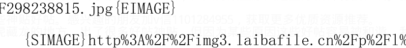

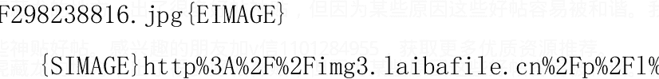

2257 楼

作者：有骨难画 日期:2018-08-17 23:00

再来两张图，这两张图是正文中提到的军用“攻击-1”型固定翼式大型“察打一体”无人机，所谓“察打一体”，便是“侦察打击一体”的简称，被称为“察打一体”的无人机都拥有完善的机载观察-瞄准设备，同时可以挂载多种弹药，在发现目标后可以立即使用自带弹药对其实施打击，是对付“时敏捷目标”的利器，而“攻击-1”就是符合这些条件的典型。

另外，“攻击-1”是我军的自用防空型号名称，而它的外贸出口型号还有一个名字更大的名称，那就是大名鼎鼎的“蜀翼-1”。

```
{SIMAGE}http3A%2F%2Fimg3.laibafile.cn%2Fp%2F12F982391133.jpg {EIMAGE}
```

```
{SIMAGE}http3A%2F%2Fimg3.laibafile.cn%2Fp%2F12F982391133.jpg {EIMAGE}
```

2258 楼

作者：有骨难画 日期：2018-08-17 23:01

好了，今天的图就更新到这里了。
（未完待）

2259 楼

加 v 110128495，获取更多精彩推荐

# 作者：有骨难回 日期:2018-08-18 18:59

楼上来了，昨天忙忙了一通电话，现在刚刚坐下，快累死在正了，马上就更文

2290

# 作者：有骨难回 日期:2018-08-18 19:23

介绍了了那些神农架里其它我遇过的神秘生物，话再回来，就说我们这些人，王虎、张樟锋等了下来，因为他们是军人员，所以任务结束后还要听从军方的调遣，上层给他们的命令是原地待命，并与来到此处的直升分队会合，在空中力量的支援下开展地面作战，继续潜缴残存的并肩对抗当地野人。而我与尤琦的这些人，还有季云、范小雨以及幸存者则在完成了目的之后，一起返回，因为已经与当地野人达成了协议，除了已经到此处的武装直升机以后，其它直升机要获得行动许可，也可以进入并且得到当地野人的保护，等到我们回到神农架（注：所谓“当地力量”，以及各种危险的神秘生物），我们顺着原路返回到出发时的车队驻扎地，出发时的那辆车还在停着，位置没有变化，通过直升机的旋翼落了下来。

加 v 110128495，获取更多精彩推荐

看到下面的车后，有一位女孩忍不住哭了，引得我也鼻子酸，眼眶发热。在经历了这么多生死之后，再见到时却如隔世，那种之前只有看电影才能体会到的，因为这次旅程我不再是坐在屏幕的旁观者，而是全程经历且活出来的“主角”之一。等直升机缓缓落下，舱门打开，季云还是走的第一个，她走到门口突然站住，转过身对着大家郑重地说：“活着回来就是造化，明天你们统一调整一下心态，准备拥抱新的生活吧。”她这句话说完，那些队员再忍不住了，不论男女，纷纷相顾而泣，哭得稀哗啦，不知道他们到底是获得了那300万的酬金，还是为了自己在鬼门关前不知道还能回来，毕竟经历了如此生死考验，这些年轻人对于生命的意义和可贵，肯定会有更加升华的认识。

出发前在营地负责看守的司机和大厨见我们回来了，是非常高兴的，但看我们这狼狈的样子，快认出来了：“哎呀！你们回来了，怎么又缺少了这么多人？”他们……永远的长眠在神农架上了。”大厨的肩膀一下，说完之后没等厨师回话，径自走到一处石头面前坐了下来，然后看着远处郁郁葱葱的山峦发愁。厨师在之前也见识过的裸盖神经毒以及自杀的三个人，以及照顾了这么多天也是中毒而重伤的那6名伤员，被季云的话，就在一定程度上意识到了我们走后这些天都面对着什么事情，经就问司机去哪儿了。司机在我们走之后的第三天，因为感觉他们在这里干着也不是那么回事，就开上一辆小车把他们送到神农架区的医院了，后来又转移到大医院，由此产生的费用，花了尤琦留下的那张卡花了不少200万，这些钱放在这里的目的就是作为杂项经费，用于这6人的治疗费用也完全足够，且其中情况较轻的已经恢复正常，那6名伤者中最为严重的，则还是当属那个强行开鱼汤的小伙，因为他们的情况，不面部还是手臂都需要进行植入，不过这就以后了，这里稍细了。

在之后的几个小时里，我们这帮人狂流在房车上洗了一个热水澡，精神的放松与身体的疲惫在热水的冲击下一般脑都“喷涛而出”。由于队友死亡、受伤等原因，现在剩余的这些人只用一辆房车就能接得下，且现人都已经疲竭到了极点，再让他们自己开车回去会有危险，尤琦安排把那辆车全部锁死留在原地，其余人全部上车，然后直奔新疆机场而去，至于尤琦再派人来开车，那就是后了，与主要事件无关，这里不再赘了。

在房车发动起来按照路线返回的整整一天时间里，车上的人没有一个说话的，因为实在是太累了。行动期间尤琦睡觉的时间比其他队员少多，自始至终保持了警惕性，现在所有负责办的事绪都如此结束，她终于像一个常人一下沉沉的睡去。李龙涛、岛兰百大伤初遇，前者近日来的疲劳更是需要多多休息，范雨与季云比起相对娇嫩，后者则是个老年人了，至于其他人不用说了，由于这个肩扛式摄像机的位置比较好，全程都拍摄了的话我也不会知道，因为当时睡得跟死一样。

加 v110128495，更多精彩推荐

总之，整个车队里的人除了大厨司机以外都睡了昏天黑地，等一觉醒来的时候正是中午，开车前往机场的路上，而且已经睡了几个小时，肚子早就咕咕叫了。正好师傅做好的饭一个勺子一个碗端上来，看到我们醒了，面带可怜的笑容说道：“之前你们太饿了，肯定没胃口。”他一下表示了自己的谢意，然后一看桌子的菜品，顿时喷口水了。这里有抓笋、梅扣肉、红烧虾、酸醋牛肉等等全都是硬菜！每个人各自都有一碗海参，其中一碗里还有三个大的海参，即便是凉菜也没有融合，所以放在一起并不会冲突。这里有精致的凉菜，比如堪称“凉菜之王”的海鲜拼盘：渍鱼皮、虾仁、扇贝、鸟夷、鲍鱼切片为原料，以蒜泥、酱汁、辣椒、芥末油、麻油、盐、糖、金针菇等等制作而成。而且这种精致凉菜不是共餐，也是一人一份。这种档次的菜肴只有五星级及以上的大酒店才能做到，普通中小型酒店够得不了。这里的菜品，全都是新鲜的。

要知道来说，这种档次的菜肴只有五星级及以上的大酒店才能做到，这一桌上菜的总价值，除了奢侈之外，更让我没想到的是房车准备的食材竟然如此丰富，而且色香味俱全，毫无存放过久而带来的不新鲜，从这一点来说，这辆车辆上的冷藏保鲜技术不是一般市面能随便买到的，起码不是冰箱可以比得了。我愣了几秒，再次进入到用嘴吃饭的状态。

```
{SIMAGE}http3A%2F%2Fimg3.laibafile.cn%2Fp%2F12F982391133.jpg {EIMAGE}
```

```
{SIMAGE}http3A%2F%2Fimg3.laibafile.cn%2Fp%2F12F982391133.jpg {EIMAGE}
```

2306 楼

作者：有笨难 日期:2018-08-19 00:22

再来三图，图1是文中提到的直-10型专用武装直升机（注：以下简称“直-10”）使用的AKD-10型空地/反坦克导弹，不是因为这张图是张老哥，所以图中将直-10称为“武直-10”，而这个称呼并不准确，“武直”说法是早期民间根据直-10作为专用武装直升机的定位与设计而约定俗成的称呼，我国官方对其的权威型号就是“直-10”。（此处OCR识别错误，已修正）

2307 楼 

作者：有骨难画 日期:2018-08-19 00:09

图2是文中提到的直-10发的90毫米无导航空火箭弹，以密集发射的火力覆盖敌方目标，杀伤力很高，尤是对对软目标。图3是文中提到“攻击-1”型“察打一体”无人机使用的AR-1型空地/反坦克多用途弹。


2308 楼 

作者：有骨难画 日期:2018-08-19 00:09（此处OCR识别错误，已修正）

好了，今天的图就更新到这里了。
（未完待）

加 v 110128495，获取更多精彩推荐

# 作者：有难魔 日期:2018-08-18 19:39

在吃饭中间，还出了点小插曲，就是又有队友哭了，原因也很简单，回想起来的时候在同样的位置坐的那顿热大餐，那热气是多么其乐融，多么浪漫而有情调。现在再看，一个狼不狼先不说，光说少了这么多人令自己心生悲痛，毕竟其中许多人之间是朋友，尤珺对这些愁绪就好像没见过一样，因为我知道，这一切对我来说，都是注定的。

不过话说回来，尤珺愧不是富家千金，她还年轻，再想像样的饭菜，那吃菜也是十分有节制的，优雅又不失干练，不像我们，吃的舌头都快吐了。而我心里这些天来直接在问一个问题，就是她这种超凡脱的气质在此之前到底什么才能炼出来的？关键是她还这么年轻，而这个事情的答案，交给以后就可以解答了。

简单说，到达机场后包房车上的那架商务支线机，一路回北京。在“中国探险协会”办公厅里，也是这次行动开始的地方。一行“程序”一样的把事情处理完了，就要各自回去了。我还要整理笔记等资料，在分手前，洛雨对我说，尤瑾站在我的身后，被我吓得本能倒退了两步问她：“搞什么飞机？”

加 v 110128495，获取更多推荐

2294 楼 

作者：有骨难画 日期:2018-08-19 00:09（此处OCR识别错误，已修正）

四张关于火箭弹的相关图片，图1为火箭弹中的箭弹，图2为装满火箭弹实物剖面，图3为我国130毫米火箭发射，图4则是箭簇弹的近炸击效果。这种弹药对软目标的杀伤力很大，从这些弹孔的深度与密集程度可见，两者的区别，就是榴弹比箭簇弹更多的预制片，但箭弹也有弹那么多。图4中手里那些那些金属片就是榴弹在爆炸产生高速高速破片，图中的中的上有简单的介绍。


img/f098f634476333d6de73904c68082_733_0.png 2F987231.jpg


本篇采用访录形式，一篇由三个独立事件组合成的系列，其中内容均取自我国在民间、网络流传广并真实发生过三个者名目都市传说。

都市传说：顾名义，就是在人口密集的都市内形成的文化现象的故事乃至故事体系，这些故事或有一些人们茶余后凭无想象，口耳相传后生的，而我们所说的是具有可是可是可查的现实基础，我在本系列中要讲的三个，便是如此：

不过，虽然有现实基础，但进入到网络时代以后，在飞速传播的过程中，经过传的种种加工，这些故事曾经真的发生过事情的真相，也变的愈发模糊起来，将将隐覆在传说背后的真相挖掘并用文字呈现出来，我是作为一名内行记者最大的工作职责之一，所以我这次依然还是“老套路”，拿起来采访笔记本，抱着胆破铁无处的精神，寻找当年当年的参与者、亲历者，通过他们的回忆与语言，尽力将事件的来面清晰的呈现出来。

关于这三个都市传说分别是什么，我就不在在前言里里多了了，如果在这里就“指名道姓”说出来的话，那么凡是喜欢灵异事件的朋友，肯定对它们们都耳熟能详，至于到底是什么，各位看官脸往下看，自然就会知晓。而所以我把

这三个事件放在一起，其实原因很简单，就是它们都发生在在同一一年，就是1995年。

好了，闲读不多，我们现在进入正，从第一个真的“传说”开始——（未完待）

# 2319楼

作者：有鲤画 日期：2018-08-19 13:46

### 都市传说（壹）之1995年成都惊尸事件

公元1995年7月29日，此时的成都已经进入了“三伏伏天”的中伏，亦为全年最热的一个时间段，河南发生过多起因疑似溺亡事故，盛夏时节，在那个空调还未普及的夏天们，人们为了消暑避难，选择进入河道、水库等地游泳者在少数，每年这个时间段也是溺亡发生最高的一个时期，所以河道发生此类事件虽然令人心骇，但并不稀奇。

但为什么偏偏在1995年的这次要用“惨案”来形容呢？因为这些漂浮在河道里的尸体，并且不常。

根据成都市府河南路派出的出警日志中的记录，当日有市民某在河沟发现，发现河中有黑色大块漂物，用鱼竿将其拨动后发现还是一具浮尸，恐惊之遥报警，府南派出接到报警后出动警员两名，先对现场进行拍照取证，后联系当地地消防在城市管理部门的协助下，使用河道垃圾清理船对尸体进行打捞，但在打捞过程中又先在第一处扬尸点150米、170米及230米外的两处地点发现3具尸体，加上第1具，死亡人数上升到4人，更为关键的是，这4具尸体呈现出的死亡特征几乎完全一致，而从尸体上所穿服装等细节可以判断其死前并未下河游泳，由于死因不明且死人数较多，公安等部门当即便立案调查。

也许当时所有在场人员并不知道，这2具尸体将揭开次建后的著名“灵异事件”的大幕！

这就是曾经震惊整个成都满城风暴，人心惶的1995年僵尸事件。

关于该事件，我们首先利用权限查阅了部分当地部门的记载，在排除民间特别是网络传言的不实部分后，发现此事在细节方面的复杂性超过了之前的想象，从警方的长的一段时间内为一警察配备一种桃木作为弹头材料的特殊质子以及带身桃木挂等细节来看，这绝不是一起简单的“古墓起丧人”灵异事件，也不会对警方装备产生如此深远的影响，要知道专门从立项到开始研发并研发成功专门的生产线生产一种在此之前从未过的质子弹不是一纸行政命令就可以办到的小事。（注：关于桃木质弹，这里简单介绍一下它与普通质子弹的区别：我在多次努力之后终于通过协调找到了一枚当年使用桃木质头的特殊弹，并且还是原产品，规格与）

# 51 式 7.62×25 毫米手枪一样，只是弹头为纯桃木加工而已，这种种子与现在常见的非致命胶子弹有诸如都是采用异材料弹头【异非金属材料制作的弹头都被称为异质材料弹头】的类似之处，不过也没有明显的不同，就是橡胶弹头的不是非致命胶子弹，而桃木子则是“正经八百”的致命弹子，具体来说就是该弹头外部依然有着像普通子弹一样由黄铜制成的被甲，只是将弹头更确切是弹芯将金属材料变为了优桃木，而用黄铜包裹桃木弹芯主要的目的是为了增强桃木弹头的强度，因为桃木是木，机械性能不比金属，在发射药与膛压不变的情况下直接发射木制弹头容易导致弹头未出鞘就已经因为巨大的压力而破裂，丧失射击能力，而黄铜被甲可以在发射的一瞬间作为“护套”，帮桃木弹头找偏拉，然后让弹头完整的顺利发射，但是为了达到此目的，这种被甲比普通子弹的被甲多了一道工序，就是沿着被甲内有一条用肉眼几乎不可见的切割，这条保证了弹头发射出后被甲保证了桃木头部不受破坏的同时，在发射药燃烧后产生的压力作用下自动包裹着这条切割缝裂脱，让桃木弹头暴露出来以命中目标效用，在大量生产的子弹上，需要的是海量且严谨的计算。如果桃木被甲没有这条切割，就会使得桃木弹头飞出后一直包裹在黄铜被甲之下，无法直接接触目标，那样导致桃木弹头完全无法发挥效用，这也是设计的目的与意义所在。对于弹子的使用效果如何，下面的正文将会详细提及涉及以种情况反馈回来的信息，作为记者对对象的敏锐性，断定期重大“涉”一定非小否则会同时在官方与民间两个层面同时引起强烈关注，那么我就决定将以此《都市传言》系列实录的开篇，我已经查阅了相关资料，并在他们之中进行了筛选，制定出了详细单，由于事件跨度较大、人员较杂，所以在访谈中除了了与事件直接相关的内容以外，还会大量的相关话题，尤其是作为本篇重点，虽然这些话题还不事到事件的主体，但是为了将事件呈现更加立体饱满，以及体现出一些文化层面的东西，我认为还是有必要说明的。在此之外，在灵异、门户等方面，从“元素”的角度讲，该事件与“活体生物”发展具有一定的相似之处，但也有本质的不同，比起老战中所发生的国家之间的战争，而这次发生在成都这个城市中的灵异事件相比少了一些惨烈的正面（注：具体情况这里是难的侦破，在这个过程中各都付出了相当的代价。好了，在前面的写到这里，按照我的采访顺序，先从上讲（未完待））。

2322 楼
作者：有骨画（谢拳）看到各位看官的支持，你们非常感动，捧场就是楼主最大的动力，不过置于时间问题，在这里一一回复了，楼主还是要再次。楼主又来更新了，今天主要有一些有关《蜀农架》之前没得及发的图片：
- 1、野人脚印的石膏模型，长度约为48厘米
- 2、人类脚换算厘米只有26厘米左右
- 3、包括野人的几种典型灵长动物的脚印对比，注意：真正的成年雄性野人，现在脚掌长度可在70厘米至80厘米以上，宽度则超过30厘米
- 4、野人在架外围留下的睡窝，从这一点就能分析，注意：图中的脚印图只是用于分辨外形区别，为了方便比例进行了统一，实际上这四周灵长动物的脚印大小各不同，而野人无疑是其中最大的。智能在人群中最低的棕毛野人为至高于水平的另一个野种人，已经发明了初级意义上的”。
- 5、刘民壮搜到的带有皮头的野人毛
- 6、架外圈旅游的“目的地”，曾有人在这里与野人近距离遭遇过，狮子上则是相关介绍。

（图片略）

2350 楼
作者：有骨难画 日期:2018-08-20 01:3

2351 楼
作者：有骨难画 日期:2018-08-20 18:35
让大家等久了，楼主来更贴了。

2379 楼 
作者：有骨难画 日期:2018-08-20 18:50

(1) 受访者：法医张昌

在采访准备好后，我率先发问：“这次溺亡事件被称为‘修案’，是因为人数到四人的原因吗？”

张昌说：“确切的是那四名死者也不是死于溺水，而是一种非常且无法解释的原因导致死亡，是一种不可抗力的外力。什么样的力量？能说的吗？或者说是一种自然因素还是人为因素？”

我说：“首先排除的就是自然因素，因为经过市局几名法医的联合判断，都没有见过处理经验，如果是人为因素的话，我们就不敢确定，因为实在太扑了。说实话，还有一点巧合的因素，当时由于体冰凉，甚至表有霜现象，要知道在自然界中出现霜挂需要要在摄氏度以下才可能，但是我记得清楚，当时的气温，工具箱里携带的温度一直在39到40氏度之间徘徊，在这种气温下，之前我们听过‘巨人’类的尸体在河里捞出来以后，发现尸体不仅没有腐烂，反而出现了一种类似蜡化的现象，表皮发黑，肌肉组织萎缩向内陷，然后我刚才提到的低环境，在这种环境下，这四具尸体依然没有发生溶解，也就是说它们从捞掉以后，一直处于这种低温状态，这让我们百思不得。另外，死者身上的衣物也特别特殊，外观好像是化纤材料烤瞬间收缩之后形成的样子，这与一般的高温不同，这种极其特殊的特征，实在是太奇怪了。”

张昌说：“突破是有突破，但让我确切的死因，我到现在也不敢定论。”

我说：“好吧，那他们先来说说哪些突破吧。”

张昌：“这个实话，毫无头绪，不知道从何处入手，开了几个之后，市局领导也没办法，只能搁置起来，但催要我们尽快拿出可靠的结论。”

我回家后正巧遇到了上个朋友约我吃饭，这朋友从广义上来说也我的同行，我是中世家出身，现在正在传承祖业当中医，家里有块祖上传来的牌匾，在都市里还有一家古香古色的药铺，他的药铺很有特点，是开出药方后完全用手工工磨的中药给病人治病，“望、闻、问、切”这些中的传统技巧都很行。

他平时比较矮喝酒，我高兴不高了喜欢酌的几杯，所以闲来无事的时候他就叫我找他或者我在一起聚一下，当时其实就是他找我，在吃饭的那天我们内在一家小饭馆坐下。因为这件事的我挺郁闷，所以喝了酒之后就把事情经过给他说了，大致意思就是说明了尸体上那难以解释的伤痕，本来我只想排解一下心而已，也没打算任何希望能给我做什么，没想到他听完之后立马就从微醺的状态精神了了起来，拉着我不要让我带着他去看那只具体。你要知道，那时候虽然不像现在在管理的严格了，带他人进入法医现场可是属于违反管理条例与纪律的行为，在这个领域，与法医有关的事情，完全不可能。我仔细观察一下这四具尸体表面完好，没有大的伤口，这次如果是通过口腔注入的话，那食道与胃部肯定会留下相应的低温伤痕，但也没有，所以到底是怎么回事，我们就完全搞不懂了。”

不过，市局里的法医连夜讨论，然后各自提出意见汇总成文字报告，最后配合司法鉴定，将其定性为一次“特殊手段杀害案件”，案件性质被明确之后就进入了刑事立案侦破程序，然后他们就是全力攻关，没通过是因为缺乏经验，此案情况如此棘手，当时所有人都都是一筹策，无法解释尸体的死因以及出现的奇怪现象。”

张昌：“突破是有突破，但让我确切的死因，我到现在也不敢定论。”

我说：“好吧，那他们先来说说哪些突破吧。”

张昌：“这个实话还有一点巧合的因素，当时因为实是毫无头绪，不知道从何处入手，开了几个之后，市局领导也没办法，只能搁置起来，但催要我们尽快拿出可靠的结论。”

我回家后正巧遇到了上个朋友约我吃饭，这朋友从广义上来说也算是我的同行，我是中世家出身，现在正在传承祖业当中医，家里有块祖上传来的牌匾，在都市里还有一家古香古色的药铺，他的药铺很有特点，是开出药方后完全用手工工磨的中药给病人治病，“望、闻、问、切”这些中的传统技巧都很行。

他平时比较矮喝酒，我高兴不高了喜欢酌的几杯，所以闲来无事的时候他就叫我找他或者我在一起聚一下，当时其实就是他找我，在吃饭的那天我们内在一家小饭馆坐下。因为这件事的我挺郁闷，所以喝了酒之后就把事情经过给他说了，大致意思就是说明了尸体上那难以解释的伤痕，本来我嘛，我只想排解一下心而已，也没打算任何希望能给我做什么，没想到他听完之后立马就从微醺的状态精神了了起来，拉着我不要让我带着他去看那只具体。你要知道，那时候虽然不像现在在管理的严格了，带他人进入法医现场可是违反管理条例与纪律的行为，在这个领域，与法医有关的事情，完全不可能。我仔细观察一下这四具尸体表面完好，没有大的伤口，这次如果是通过口腔注入的话，那食道与胃部肯定会留下相应的低温伤痕，但也没有，所以到底是怎么回事，我们就完全搞不懂了。”

不过，市局里的法医连夜讨论，然后各自提出意见汇总成文字报告，最后配合司法鉴定，将其定性为一次“特殊手段杀害案件”，案件性质被明确之后就进入了刑事立案侦破程序，然后他们就是全力攻关，没通过是因为缺乏经验，此案情况如此棘手，当时所有人都都是一筹策，无法解释尸体的死因以及出现的奇怪现象。”


对，怎么烧/烫呢？这里来说简单的科普一下：液氧的沸点极低（-196 摄氏度），所以在接触皮肤之后会迅速远离皮肤温度的升高为剧烈沸腾，这个时候液氧与皮肤之间会因为巨大的温度差形成一层薄膜，将两者隔开，在薄膜存在的时候，液氧是不会伤害皮肤的，但等薄膜被皮肤的温度所蒸发后，液氧会直接接触皮肤，并将皮肤的温度降低到一个很低很低的水平，而空气的温度与被液氧降低的温度差结合，就会产生足以引起皮肤的温度（差），结果就是造成液氧烧/烫/伤。

另外，冷冻技术中也使用液氧作为原料，这个使得则直接，是用液氧的极低温大幅超过细胞组织的耐受限，会导致细胞坏死并脱落，形成的效果就是烧/烫/伤。类似，假设覆盖面积或者是液氧量大并且接触皮肤人体时间过长，会导致残残甚至是致命的。

这种现象有点起了老祖宗的那个词：物极必反，温度低了也会造成烧/烫/伤。

楼主在下面贴了3张液氧烧/烫的图，图1就是上面所说的液氧在降低皮肤温度后导致皮肤与空气之间有巨大温度差的严重冻伤，而图2中掌心里的发白部分是在与液氧有相对长时间接触导致的组织坏现象，图3为皮肤组织及人体与液氧相对面积和长时间接触产生巨大的伤害。

加v信111028495，获取更多帖推荐

{IMAGE}http%3A%2F%2Img3.laibafile.cn2Fp%2F12F298355960.png {IMAGE}
{IMAGE}http%3A%2F%2Img3.laibafile.cn2Fp%2F12F298355977.png {IMAGE}
{IMAGE}http%3A%2F%2Img3.laibafile.cn2Fp%2F12F298356012.png {IMAGE}

2387 楼
作者：有骨难画 日期：2018-08-20 20:28

第二组是关于低温干尸的，根据法医张公昌的描述，再看看这张图，大家可以想象一下当时从府南河打捞出来的4具尸体是什么样子，两者之间大小不差。

另外说一句关于本文来图，这是俄罗斯学家在该秋牧利亚雅马尔民族自治区首府萨列哈尔德（Salekhard）发现的5具遗骸疑似距今800年左右的中世纪干尸中的1具，不论从任何细节上来说，该干尸都是标准的“低温干尸”。

{IMAGE}http%3A%2F%2Img3.laibafile.cn2Fp%2F12F298356193.jpg {IMAGE}

2388 楼 
作者：有骨难画 日期：2018-08-20 20:28
好了，今天的图就更新到这里了。
（未完待续）

2389 楼 
加v信110128495，获取更多好推荐

# 作者：有骨画 日期:2018-08-21 14:22

“原因很简单，你想——确定尸体死亡原因这种法医分内的事情遇到困难解决不了，然后却要找个中医来帮忙，说小了这让我们帮人脸上无光，说的大一点，传出去就是整个法医行业蒙蒙。我当时提出这个建议的时候，就想到肯定有人不乐意，而且得罪一些人，不过自己已出口就没有什么好后悔了，假设当时组长反对，那就只能我不说，他却同意了，这让我感觉意外的，期间正我所想的那样，组内成员有一半反对意见，但组长最终排众众把这个事情交给我去，后来事情就很久。以后我偶然间和组长有一次聊天，才知道那时他为我会这么坚定的支持我，因为他是在尸体上的死因看出了了一些与医学理论相关的端倪，这些信息以当时法医理论体系是解释不了的，他本人虽然看出了却不精通于此道，再加上作为组长更不能带头让中医来打体法的脸，所以他一时间需要我有一个真正正行的中医高手来帮忙，二是需要我替他来说出这个建议，结果我提的意见非常“及时”，自然他就被毫不妥豫的采纳了。

而意见采纳之后，我就把这话传达了我那个朋友，他也是个爽快人，回答的很清楚，只是可能他感觉自己应付不了这么大的局面，毕竟第二次看，他的话就可能影响到尸体死因的最终结论，所以他还了一个家族里的同行。”

加v信110128495，获取更多好推荐

听说是是他表哥，按照契约约定好的那天，他们就一起起来了，每个人都拎着一个老式的皮质药箱，就是旧社会那种。然后他们分工与我们差不多，一个负责实操，一个负责记录。实操的是表哥，本人进行记录，从这一点看应该是表哥在这方面的能力高一筹。两人先是对尸体进行了‘尸灸’，这个词我也是从那里听到的，说起就是那时候的老代传授法子，中医也真是惭愧。要说‘尸灸’的具体操作的话，就是用一种专门的针去扎尸体的穴位，这种针比普通灸用的针长很多，看着像手工制麻布的那种，而且长跟成年男性的小臂相当，最短跟腿相当。按照他们的说法，这种破坏皮肤的不同反应就能显示出不同的信息，人在死后一年之内，经络特征都不会消失，只要在这个时间段内对尸体进行‘尸灸’就有效果。

# 人体经络“没了”。张公昌说。（未完待续）

2414 楼 
作者：有骨难画 日期：2018-08-21 13:39

“‘经络没了’……以我掌握的知识来看，我对医学并不了解，但我知道经络应该是一种肉眼不可见的存在，按照当代中医的理论，人死后经络就消失了，为什么他们会说人死后一年之内还能找到呢？我说这属于中医知识盲，我其实没法深入下去，别看我是学的，但术业没有专攻，我在这个水平上比你高哪里去。不是出于好奇，我后来问过那个朋友，大致的答案是人死后经络是处于一个‘消亡’的过程，但是这是一个比较长的过程。不是由于他们所用的那种‘尸灸’的针头并不是金属的，是一种特殊的磁石，磁石进入人体后可以与残留经络产生类似共振的反应，从而让操作捕捉想要的信息，一般是通过共振的强度来判断依据。当然了，这是他说的，那磁石到底什么样的材料，我也不知道。不过怎么样，他当年的工作还是起了很大作用，我记得非常清楚，他对4具人体全部测量完毕。”

（未完待续）

测量完毕之后，我这个朋友就把我找出去，在走廊拐角一个停僻清静的地方，他脸色凝重的悄告诉我，让我小心点。我问他些事了，他神神秘秘跟我说这事儿（指这4具尸体的案子）麻烦，里面有很多不是人力所办到的，他估计这四个人可能是被什么‘脏东西’给害死的。中医病人嘛，一般接触传统文化比较多，他说我开始有点吃惊，再想想也没什么意外，我就一笑谢了他的好意。

至于4具具体的原因，最后他在现场只是说尸体生前疑似死于‘元阳散尽，且非自然之力所为，亦非人力所为，这话说的比较‘玄’。明确的结论，在场的法医同行我们大半都对他的说法感到很不服气，听了这更是倒霉之事，当面不好意思，因为毕竟是我找的，也是经过组长同意的。背后他们不一次说他是江湖骗子或者是神棍鬼，我没法反驳他们，不过我个人仍然认为他的结论是不错的，肯定是有道理的。我跟组长讨论过这件事，他也同意我的观点，但才让我不要深究，说这件事已经超出了一般司法意义上刑事案件的范围，涉及的东西很敏感。所以呢，还是很后悔的，关于那4具真正的死因，我现在也没搞清楚，当年验尸报告的时候又不能把‘元阳散尽’的中医结论写进去，就希望里面莉梅写了。”

“哑了就是‘死于不明不可抗力因素’。局里对我们法医组的这种措词才为火，但也没用，因为后来把全市甚至是省里的顶尖法医都找齐了，也照样睁眼摆在面前的解释上的问题并不明白，这些事情并不还差什么确切死因？结果却让整个事情被藏了神秘的。市局领导最后在无奈之下，只能把尸体临时放入市局的罪案科探房里保存。再后来，听说成都市郊区一带又出了几个案子，好像跟这事有关，不过那段时间正好我出差到上海学习一个多月之后回来，那时事儿就完了了，所以具体是怎么我就太清楚了。”

“哈哈，还是你们记者会说话了！”龚锦华喇嘴一笑说道，但他笑之后就是一阵剧烈的咳嗽，咳得面色更显明显的难看。我见便说：“一转眼，事情过去20多年了，在回想起来还是历历在目。你来采访我，当时在府南河里捞出来的4个怪尸你肯定已经知道了吗？”我点点头表示知道，他便接着说：“事发的那段时间里，局领导给我们的压力非常大。可能你不不做这一行，通过报警发现的死者如果鉴定为自然死亡或意外死亡的话，那是一个简单的程序，如果鉴定为他的话，那就完全是另一一件事了，将其划入刑事案件之后。”

“警官，短短的话术我们有时间再叙，现在我们能聊聊当时你参与的案件的整个过程吗？你慢慢说，不用急，我看着情绪动的他的病恐怕不太好。”

“不事不事，那我们就说当年的这个案子。”龚锦华差了多的又喝了好口水，勉强平复之后对我。我摆了摆手表示自己没事，随后如此如此，说完之后他先看了茶几上的烟灰，又看了看屋顶的吊灯，看着似乎是在回忆里，组织语言。他再次开口。”

# 那些冰山角的“事前热身”（未完待续）

2416 楼 
作者：有骨画 日期：2018-08-21

正文开始之前我要事先说明一下，这位曾经任刑警队队长龚锦华已经退休了，他的年龄并不大，1995年时30岁头，正是风华盛的年纪。按照来说，他之所以早选择了回家，是因为他在一次执行任务中身负重伤，全力营救才保住了这条命，但因此而留下的各种后遗症导致他已经不适合继续一线作为行政工作。几年之后，由于旧伤再次发，被迫选择以退休的形式告别了自己的服。令人欣慰的是，在体制照顾下，他每个月都有相比城市平均收入较高的抚恤金，又有一对儿女，所以生活无忧。这次采访选择了他的家里，这是一个几十左右的房间，是当年市局分配给他们的福利房，内部比较简单但非常整洁，看得他是个爱干净的人。他的妻子看到我来之后，忙后沏茶倒水，十分热情落落大方。她本是话剧团的演员，年轻的时候很亮，追随的人多的是，其中条件比我好的，而且演得也好，不敢说前途无量但也算一片阳光。她说喜欢警察，在众多求者里选择了我，但可惜了，我受了伤后，她就辞掉了话剧的工作回家专门照顾。当时我们结婚了，但还没有孩子，我还问过她跟我离婚后再找一个更好的，可她不愿意，最后一直跑到了今天。不是我，她现在起码也还是话剧的团长，而不是一个终日圈在孩子与舞台以及市场周绕的家庭，是我耽误了她的理想，这一点我每次想起来都很自责。”锦华说，他说的真情流露，肯定不是假的。我没有类似的身体体会，所以无法多说什么，只能说：

“这事上，不需要自责，只要自己。现在有句话很流行，叫‘嫁了爱情’，我看她就是嫁给了爱情，她内在既然这么选择，那说明她是爱你，真爱无价，能真爱人身边不离不弃，何不是一种世间难得的幸福。”

2417 楼 
作者：有骨漫画 日期：2018-08-22 22:52

楼主在在这里要纠正一个错误，就是在关于采访法医的文中多次被“解剖”打成了“解剖”，真的不是楼主不知道这个字应该怎么打啊，确实是打的时候好几次没留意顺手打错了。虽然发帖至今，错别字、用词以及各种斑痕都有，但频繁独立一层一层楼改动会影响大家的阅读，所以没有像这样单独出来，这一次是因为同一个问题上出错次数有点多，再加上楼主也没有意识到，所以觉得有必要纠正一下。最后感谢各位。”

2441 楼 
作者：有骨画 日期：2018-08-22 01:55

楼主又更新了，之前在正文中提到了具体的末端神经已经被彻底化了，其实索性来说吧：这是一份完整的人类神经标本，不过由于较的技术局限性，这副神经标本中缺少一些细小的末端神经，但大部分都已经了。年代是1925年，由两名外科医生用了1500个小时通过解剖得到的。

2442 楼 
作者：有骨画 日期：2018-08-22 02:00

再来关于人体经络的图1是中国医学的官方标准穴位挂图，上面的字有点小，但楼主找了很久找到图片完整且清晰的。图2是人体经络系统，其中“经脉”与“络脉”系统的分开并同时说明，让人理解。

2443 楼 
作者：有骨画 日期：2018-08-22 02:01

不好意思，2443楼忘记了图2，这里补上：

2444 楼 
作者：有骨画 日期：2018-08-22 02:09

2445 楼 
作者：有骨画 日期：2018-08-22 02:09

2466 楼 
作者：有骨漫画 日期：2023-08-22 13:21

“哈哈，还是你们记者会说话了！”龚锦华喇嘴一笑说道，但他笑之后就是一阵剧烈的咳嗽，咳得面色更显明显的难看。


具体的体是，唉，那个年代想做一个DNA鉴定太费劲了，直到把样本送到省里的法医单位才做出来的。要是放在现在实在的话，我听我还在局里当警官的老同学说，刑警队自己就能拿着样本去完成DNA鉴定，这在当时是完全不敢想的，太差劲了。

虽然另外三个受害者是干什么的还没查清楚，但有一个总比没有强，就顺着他的身份实在实在，首先就查出了从他那里订了200把担面的人是一个外面的老同学，级别还挺高。有了这个线索，我们就报警组组织警力进行进一步调查。这边，结果调查还没有开始，又出了事了。龚锦华说到这里把后背靠了沙沙发上，用力的喘了几口气，好像只是说上面这段话，耗费了他很大一部分的体力，我看他这个样子便又没紧接着闹，而是像刚才才大笑而咳嗽那样，等了片刻后他呼吸平静的差不多了，这才是：

“是再次有人遇害吗？”

（未完待）

## 2457楼
作者:有诡 日期:2018-08-22 12:26

“可比他人遇害严重的多。最开始，我们接到一个派出所报上来的案子，他们辖辖内有家属死亡，当时接因为那时候全上下都在为这4名不明死因的尸体焦点烂额，这个派出所竟然把家禽死亡这种毛蒜皮的事情写成正式文件报到刑警队，这要放在平时，简直就是胡闹！

不过既然有文件，还额外满了一张纸，我出于职责所在，这可是翻开仔细看了看，一看之下才发现问题。问题首先是家禽死亡数量非常多，根本不是我想要的一两只，而是好几百，并且凡是当时事发周围几十平方公里范围内数十户群众在外养的鸡鹅鸭狗都死了。在1995的时候，除了市区里，别的地方并不远，大家都住平房，有平房一般就有自己的家产，所以养鸡鸭的住所就比较多，这也算是能发生这个事件的一个基础条件。

而关键的问题则是，根据文件上的描述，这些死的家禽畜死的很奇怪，僵硬，体表温度非常低，肌肉有面积萎缩的情况出现。我看到这里就立刻兴奋起来了，因为这些特征与我查几户的死亡特征是完全相符的！

接下来我也没打招呼，直接找了2个队里的兄弟就开始去调查。当地的时候，这些动物物体已经被集中到了一起，我进行了反复对比，确定他们从外形上来看，与4人高度相似。然后又找了1具鸡、1具鸭、1具狗、1具死猫作为样本带回来交给法医组。法医组用了一个下午给我们答案，经过破解发现，内部创伤的特征与人完全一致，在此基础上，这两件事情就可以并案处理了。但我当时凭刑侦经验来判断，我实在想不出什么人力或力量能用这种奇怪的方法在短时间内杀死这么多人都，关键在于还患心病在连家属都不放过的这种地步。

不过通过一些细节上的分析，我总总结出了了一个规律，不如说这具尸体不是溺水，那么出现在河里肯定就是凶手行之之后抛尸或者是其它什么原因造成的。而第一名受害者应该是死在运送餐的路上，那么他当时肯定已经离市区已经比较远了。相比之下，那些莫名被害的家属和家畜则在郊区，这样我就判断出这个凶手计划于在远市区作案，不管是出于什么原因，我认为他肯定会在这附近下的脚步。再加上当时也没有其他的破方向，我有了这个构思之后，就立刻告诉了队长，他同意我的推理，然后又引起了局长，用了几乎整个警队的所有权力，轮车在成都市的几个区进行控守。

后来我想，这其实是个办法，因为凶手完全可以击击某个角的落单人员，那样的话我们这点人根本用不到，就是不能见到这个人。不过这些事情是非常复杂的，轮班蹲守的晚上，正好赶上我值班。我们那会负责三个地方，开着一辆拆掉警灯的猎豹，以机动巡逻的方式在这三个地方交叉转，加上我们车上一共4个人，就申请使用了枪。当晚每个人半个小时就跑一趟，连着几趟也没有任何异常。等到夜里12点了，再加上夏天炎热，我们也没有什么精神，大家都昏昏欲睡。我想趁这个机会会睡会儿，等了片刻的时候，里面有一个陌生的声音，他对着我们喊：“快！快来！”（未完待续）

## 2460楼 日期:2018-08-22 12:36

在我们巡逻的区域里，的确有一座殡馆，而且是在郊区。这种殡馆在市区里，这个殡馆规模较大，一次能停放100多具尸体。话说回来，虽然没想起来，但当时我们没有在殡馆里，这种地方是不放活人的。

既然说了，就过去看看。等到地方，就看见两个人在堵住殡馆正面的门口，这两个人穿着警服，是一个群众。我们可以听到汽车声，我们扭头看见那两个穿着警服的人是谁，我们喊：“救命！”

因为刑警对某地进行搜寻的时候，只要不是紧急情况，就需要对接当地派出。这个其实真不难办，就是找些人，趁着天亮就把尸体都整理好了再放回去。有些被我们枪击中身上有弹孔的，就找入殓师来化，弹头在尸体内的先取出弹头，直接用特殊的蜡或者类似的材料把破损位置的形状补上，这种方法现在比较常见，让家属以一种体面的方式见最后一次，否则有寿衣遮挡，家属看不出来。

所以那次也不例外，我们将遵循任务以及以及安排了3个接洽员，一天24小时，每个人负责8小时，有情况就相互通讯。这个接洽员，就是负责下半夜的接洽员，他当时正在值班，手里拿着对讲机，我们也有通气。

至于那个群众，通过事后了解，知道他是殡馆守夜的。等他的话，我也认出他是来了。门里面好像有一股巨大的力量向外冲，猛地从里面推开，他毫无受力倒在楼梯上滚进来。还好楼梯不高，摔得不严重，摔倒之后几乎一刻没有犹豫，爬起来就往我们这边跑。而门后面的景象给我吓坏了，警察这些时候，害怕的是不是，我的手在那一刻都不由自主的发抖了！之所以会这样，是因为我看得少几十个身穿各种花绿衣服的“人”张牙舞爪就冲过来了。很容易就能判断他们穿的都是寿衣，换句话说，现在这些“人”都是殡棺里的死人！”龚锦华说道。

“你刚才那片地方对我们喊‘救命’，他的意思是这些‘人’了？”我问。

“是的，而且还是集体尸！”龚锦华说这里估计是因为回忆起当时那个情景来了，所以瞪大眼睛，身子向前微微颤抖了出来。

“我听说过单个，也听过老夫妻去世以后。”

“谁说不是呢？那就是恐怖的，你想想一帮尸体，穿着寿衣，脸上都画的惨白白的，然后跟疯了一样朝你冲过来，要是你在现场的是什么感受？”龚锦华说道。

“呢，那的确吓人，不过这些尸体之后有什么攻击性吗？或者对你们造成什么威胁了吗？”我问。（未完结待）

## 2463楼 作者:有骨难回 日期:2018-08-23 02:42
楼主又来梗图了，今天的是54式手枪及其使用的51式手枪弹，其中1、2、3为54式手枪，图4为51式手枪弹，口径7.62毫米，穿透力与杀伤力在手枪当中都属于较高。

十五强的型号，图3中的介绍说得很明白，除了能有效杀人以外，对马匹一类的大型动物也具备杀伤力。是92手枪全面装备之前，我国的军用及警用战斗手枪，而由于该枪及使用的弹药战斗力强悍，所以在早年的刑警当中，一般只有比较老练的任务时，才会配备备枪。

## 2488楼 作者:有骨难回 日期:2018-08-23
有一个同事，当年刚从学校毕业，那会儿还处于实习期，缺少经验。不过我们也没有应对这种情况的经验，因为老练的多，所以心理素质好一些。当时一看这个画面就吓着了，前面的几个尸体后，他就伸手去抓他的脖子，力量相当大，不是及时，就得把他掐死了。救下来的时候，脸上都被抓花了，头发也掉了，衣服也被破了。

然后我们就开始抓它们回来。这些尸体好像跟断线的木偶一样，“啪啦”一下全部砸在地上。等过了几分钟，彻底没事了，我们上前检查，的确毫无生命迹象，都是死人。

所以那次也不例外，我们将遵循任务以及以及安排了3个接洽员，一天24小时，每个人负责8小时，有情况就相互通讯。这个接洽员，就是负责下半夜的接洽员，他当时正在值班，手里拿着对讲机，我们也有通气。

至于那个群众，通过事后了解，知道他是殡馆守夜的。等他的话，我也认出他是来了。门里面好像有一股巨大的力量向外冲，猛地从里面推开，他毫无受力倒在楼梯上滚进来。还好楼梯不高，摔得不严重，摔倒之后几乎一刻没有犹豫，爬起来就往我们这边跑。而门后面的景象给我吓坏了，警察这些时候，害怕的是不是，我的手在那一刻都不由自主的发抖了！之所以会这样，是因为我看得少几十个身穿各种花绿衣服的“人”张牙舞爪就冲过来了。很容易就能判断他们穿的都是寿衣，换句话说，现在这些“人”都是殡棺里的死人！”龚锦华说道。

“你刚才那片地方对我们喊‘救命’，他的意思是这些‘人’了？”我问。

“是的，而且还是集体尸！”龚锦华这里估计是因为回忆起当时那个情景来了，所以瞪大眼睛，身子向前微微颤抖了出来。

“我听说过单个，也听过老夫妻去世以后。”

“谁说不是呢？那就是恐怖的，你想想一帮尸体，穿着寿衣，脸上都画的惨白白的，然后跟疯了一样朝你冲过来，要是你在现场的是什么感受？”龚锦华说道。

“呢，那的确吓人，不过这些尸体之后有什么攻击性吗？或者对你们造成什么威胁了吗？”我问。（未完结）

## 2520楼 作者:有鲁画 日期:2018-08-23 19:14
“那肯定完了了吗？几十号尸体冲击殡馆，这种事情调查案件背后的真相吧，就说怎么让消息外流以及堵住一些消息的媒体的嘴，都是难题。当场的目击者一共我们4个人外加那个片警以及守夜人。片警说，他也是警察，这方面的纪律的，而那个守夜人可是把他带回家里做了整整一天的思想工作，并从里申请了一笔5000块的抚恤金，这才保证了他没把这事传出去。”龚华道。

“5000钱在1995年对于普通人来说不是个小数字，能相当于一个家庭几个月的收入，从那种意义上来说，这算不算封口费？”

“哎——叫封口费太难听了，应该叫‘保密费’才对。”龚华看到我“封口费”这三个字的时候，是很尴尬的一笑，然后拉长音“哎”的一声并如此说道。我若是也是一个，然后接着问：“那这么多尸体弄了乱八糟，它们的家属那边又是怎么处理的？”

“这个其实真不难办，就是找些人，趁着天亮就把尸体都整理好了再放回去。有些被我们枪击中身上有弹孔的，就找入殓师来化，弹头在尸体内的先取出弹头，直接用特殊的蜡或者类似的材料把破损位置的形状补上，这种方法现在比较常见，让家属以一种体面的方式见最后一次，否则有寿衣遮挡，家属看不出来。”

所以那次也不例外，我们将遵循任务以及以及安排了3个接洽员，一天24小时，每个人负责8小时，有情况就相互通讯。这个接洽员，就是负责下半夜的接洽员，他当时正在值班，手里拿着对讲机，我们也有通气。

至于那个群众，通过事后了解，知道他是殡馆守夜的。等他的话，我也认出他是来了。门里面好像有一股巨大的力量向外冲，猛地从里面推开，他毫无受力倒在楼梯上滚进来。还好楼梯不高，摔得不严重，摔倒之后几乎一刻没有犹豫，爬起来就往我们这边跑。而门后面的景象给我吓坏了，警察这些时候，害怕的是不是，我的手在那一刻都不由自主的发抖了！之所以会这样，是因为我看得少几十个身穿各种花绿衣服的“人”张牙舞爪就冲过来了。很容易就能判断他们穿的都是寿衣，换句话说，现在这些“人”都是殡棺里的死人！”龚锦华说道。

“你刚才那片地方对我们喊‘救命’，他的意思是这些‘人’了？”我问。

“是的，而且还是集体尸！”龚锦华这里估计是因为回忆起当时那个情景来了，所以瞪大眼睛，身子向前微微颤抖了出来。

## 恐怖理论
他这么说，让我想起词，叫“恐怖理论”。在这里就要说一点额外了：这个理论诞生于1969年，由日本机器人专家小森昌提出。简单的来说，就是某一个人形物体在与人类高度相似却又完全一样的时候，就会引起人类的极端反应和恐惧。我们身上任何一个点与人类不同的地方都会被人类迅速的无限放大，并在意识中反复进行妖怪化，而根据这种效应衍生出来的恐怖文化非常多，如欧美著名的僵尸文化、小丑鬼文化、布偶文化（包括娃娃），以及日式恐怖中的“精神污染”都是属于此类。而所谓的“精神污染”是什么？举几个例子，如日本恐怖游戏《寂静岭》系列，包括贞子、柳椰子等名女鬼形象也属于这个范畴，特别是在《寂静岭》中那些形态肮脏、扭曲到了极致的，比如没有五官、动作扭曲的“女护士”则是在《恐怖理论》上做文章的，现在正在收获了巨大的成功。这种成功在当时看来并不多见，而且是典型的类型。

总而言之，涉及到此类特征的产物一般是在人类表面下对人类的某些部位进行刻意的扭曲，比如行动姿势（歪脸）、五官（小丑）、神态（布偶），乃至整体（精神污染”类），这种表现法会让绝大多数人在短时间内产生极端的厌恶或者恐惧，亦或者或者是两者兼存。

（未完）

考古队不是一般的普通群众报案人，这些人怎么能算是知识分子，应该不会无闹到这种种类报报警来取取的程度，所以我们就先按照受理报案的程序走，开始进行询问和做笔录，在做笔期间他们说了了很多关于河南中4具体的以及家畜大量遗有棺聚集体的事情，掌握的细节甚至比我们还要详细，然后按照他们的说法，他们知道这些事情都是开闭时跑出来的东西的期间一直想办法解决，但后来发现仅靠着考古队的能力完全解决不了了，这才选择来报警，希望我们警方能提供支持。”魏锦华说。

---

2522楼
作者:有骨难画 日期:2018-08-24 01:11

楼主又来更图了，今天一张，一张关于《恐怖谷效应》的，主要表达了人类在潜意识里对于自己或与同类相似又有明显有区别的实物的厌恶感与恐惧感，除了这些，对熟悉的、常内的场景如果可能也会出现“似是非”的现象的话，同样也会出现上述的效果，这也是绝大多数人为为什么感觉觉得各种形状很可怕的根本原因之一。

{IMAGE}http://img3.laibaife.cn//12851939.png {IMAGE}

---

2528楼
作者:有骨难画 日期:2018-08-24 01:12

加v信110128495，获取更多好物推荐

- 冬未

# 好了，今天的图就更新到这里了。

(未完待续)

---

2529楼
作者:有骨没漫画 日期:2018-08-24 19:00

“那说考古方面的意思是说实际上从古墓中出来的东西已经有了相当长的一段时间了，只是他们在这个期间试图试着去解决，但随着时间的拖长它特别是相关的频繁，他们发现本作本身已经超过了他们的能力范围，所以最后才选择了报警处理？”我。

“嗯，差不多就是这个意思，他们来报警，而且诸如常波动，我们要我们一定涨起来的话说了十几次了，我们问到的底到底是什么啊？报案人说‘魁尸’，我的第一感觉是电视或者是香港电影才会出现的这种词汇，在笔录上读起来还会有点别扭。在笔录结束之后，考古方面提出要求，这件事非常重大，想要配合我们一起行动，对我们获得此收获也有帮助，开始的态说还是比较敷衍的，首先是他们说的话太俏儿了，其次是刑防方面的事情，他们作为考古人员挖掘古墓保护文物什么样的在行，可破就完全是另一码事了，想着先把他们送走，再从长计怎么办。

结果到了当天晚上，就接到了一个报警电话，市火车发生了重大暴击事件，有不明歹徒在列上对群群众生命

加v信110128495，获取更多福利推荐

财产安全造成了严重威胁，不仅我们要上，连近的武警都起来支援了，听出足足有一个中队，电话打完局面上下就都动起来了，所有直接参与行动的人都在忙着领取警械，我们里的队长三步并两步走到我面前拍手塞给我一支冲锋枪，还有一件防弹，又在桌子上放上了3个弹匣，让我一分准准备好，然后立刻下车出发，这时我才意识到是真的出事了，因为我们警警戒任务，携带警械是有级别划分的，普通的抓捕行动只带手铐，如果遇到犯持有如刀斧同一的武器，就要携带64式步枪，而进一步要是有土制步枪一类的武就就换54式步枪，另外会申请警警备，规模通常不会超过一个小队，像刚才我给我的敛徒惯犯身份那事，虽然没有武警，但因为案件手段特别残忍，且匪犯身份不明，这才为了提高安全性，我们领取的都是54式步枪。

而只有特别特别重的案子，才能给配发冲锋枪，比如目标嫌犯手里有制武器，在那之前我跟毒还有武装毒，这就是这套配置，当时不光拿了一个中队的武警，刑事案件用用来说实在是大了。”龚锦华说。

“当时配发给你的冲锋枪是什么型号你记得吗？”问。“这个当然记得，一种型号的冲锋枪，就是79式，一次装20发子弹，精度很好，杀伤力也大，射速太快，开枪的时候稍留情，手指慢了，子弹就全打完了。”

加v信110128495，获取更多好推荐

在那种激烈的战斗中，我们应该在意料之外，因为79式冲锋枪在部队中的地位就有些尴尬，作为当年的力，设计之初它并不是作为警用武器，而是由于对越作战中诸如56式、81式以及63式自动步枪的长度相对较大，在丛林这种狭小环境下转身不易，而且战士为了遮蔽多物，双方在发现对方并开始交火时已经坚持了20米以外，远距离精确射击优势在那个环境下发挥不出来，美军M16A在面临同样的问题。对于普通兵，由于侦察任务的特殊性，在这个问题上的需求更加充足，再加上对越作战中战斗非常频繁，所以我们军研制一种猛烈且短时间内压制敌军枪械，而最后的产品就是79式冲锋枪，从战斗定位来看，与其说它是冲锋枪，不如是我军把它做了“冲锋枪”。注：以抗日战争为题材的影视剧中出现“匣子”，也就是柯9型自动手枪是典型的冲锋枪，配合20发容量的长弹匣，可以作为枪托使用的全自动射击。

79式冲锋枪在部队当中的地位就有些尴尬，射速太快，以及子弹导致无法与步枪拟的射程及火力让它有点鸡肋，相比在部队当中的力，由于对越作战中诸如56式、81式以及63式自动步枪的长度相对较大，在丛林这种……由于在丛林这种狭小环境下转身不易，而且战士为了遮蔽多物……这种火力让它有点鸡肋，不过这并不妨碍它是一种好枪，短暂服役生涯，退幕后在警用领域担任主力后才开始的。（未完待续）

---

2555楼
作者:有着脸 日期:2018-08-24 19:02

“那发生地点之后，事情是怎么发展的？”我。

“在队长还有我带到发生地点的时候，先到的一批武警已经把车包围了，周围的老百姓们也刚刚散开，由于发生突然，四周则乱糟糟的，看着这多荷枪弹的武警战斗中被打的的。接下来就是看着事态还没有恶化之前开展部署，跟那批武警一起把有利射击位置都占好，剩下的事情就是听令。”锦华说道。

“那小说所说的这两个‘醋’就在火车上吗？”问。

“不仅在，而且与我们正面交锋了，这两个家伙简单太厉害了，可以说它们出现彻底的颠覆了我的世界观，恐怖电影里才有的东西竟然活生生的现实生活里，再想起考古队在笔录里说过的，也确实不是良言。”

加v信110128495，获取更多好推荐

它表现得有些局促，因为听到远处传来的引擎轰鸣声，我们停在了路上。它们当时在车厢里，通过窗户观察，车厢里已经没有了那两个黑影，它们不是乘客了，但能看到两个黑影在快速闪动，我们局长也亲自到了，他站在一辆猎豹指挥车上，用高音喇叭对着车大声喊，就是诸如“你们已经被包围了，放弃抵抗，请求宽大处理”之的话，一共喊了三遍，但里面除了黑影还在不停闪动之外就没有任何别的反应了。因为不了解里面的情况，不能果然突然，用大口径防弹箱往里面灌催气，两辆，烟雾散开之后有了动静，发生的那节车厢先是左右来回动起来，好像有什么东西在里面剧烈摇晃一样，你要说汽车哪里很常见，但火能燃起来，这有多大的头几个吗？晃了大概几秒钟，接着就是两声巨响，我眼睁睁看着车厢的车顶被撞出来两个大洞，然后外形似男女的两个东西随着破洞的裂开又跳了出来。局长在现场，一位武警中队的队长本来没有话，直接就开始下火了，枪口同时开火，现场顿时就响起来了，所有直接参与行动的人都在忙着领取警械，我们里的队长三步并两步走到我面前拍手塞给我一支冲锋枪，还有一件防弹，又在桌子上放上了3个弹匣，让我一分准准备好，然后立刻下车出发，这时我才意识到是真的出事了，因为我们警警戒任务，携带警械是有级别划分的，普通的抓捕行动只带手铐，如果遇到犯持有如刀斧同一的武器，就要携带64式步枪，而进一步要是有土制步枪一类的武就就换54式步枪，另外会申请警警备，规模通常不会超过一个小队，像刚才我给我的敛徒惯犯身份那事，虽然没有武警，但因为案件手段特别残忍，且匪犯身份不明，这才为了提高安全性，我们领取的都是54式步枪。

而只有特别特别重的案子，才能给配发冲锋枪，比如目标嫌犯手里有制武器，在那之前我跟毒还有武装毒，这就是这套配置，当时不光拿了一个中队的武警，刑事案件用用来说实在是大了。”龚锦华说。

“当时配发给你的冲锋枪是什么型号你记得吗？”问。“这个当然记得，一种型号的冲锋枪，就是79式，一次装20发子弹，精度很好，杀伤力也大，射速太快，开枪的时候稍留情，手指慢了，子弹就全打完了。”

加v信110128495，获取更多好推荐

在那种激烈的战斗中，我们应该在意料之外，因为79式冲锋枪在部队中的地位就有些尴尬，作为当年的力，设计之初它并不是作为警用武器，而是由于对越作战中诸如56式、81式以及63式自动步枪的长度相对较大，在丛林这种狭小环境下转身不易，而且战士为了遮蔽多物，双方在发现对方并开始交火时已经坚持了20米以外，远距离精确射击优势在那个环境下发挥不出来，美军M16A在面临同样的问题。对于普通兵，由于侦察任务的特殊性，在这个问题上的需求更加充足，再加上对越作战中战斗非常频繁，所以我们军研制一种猛烈且短时间内压制敌军枪械，而最后的产品就是79式冲锋枪，从战斗定位来看，与其说它是冲锋枪，不如是我军把它做了“冲锋枪”。注：以抗日战争为题材的影视剧中出现“匣子”，也就是柯9型自动手枪是典型的冲锋枪，配合20发容量的长弹匣，可以作为枪托使用的全自动射击。

79式冲锋枪在部队当中的地位就有些尴尬，射速太快，以及子弹导致无法与步枪拟的射程及火力让它有点鸡肋，不过这并不妨碍它是一种好枪，短暂服役生涯，退幕后在警用领域担任主力后才开始的。（未完待续）

---

2556
作者:有着脸 日期:2018-08-24 19:08

“那发生地点之后，事情是怎么发展的？”我。

“在队长还有我带到发生地点的时候，先到的一批武警已经把车包围了，周围的老百姓们也刚刚散开，由于发生突然，四周则乱糟糟的，看着这多荷枪弹的武警战斗中被打的的。接下来就是看着事态还没有恶化之前开展部署，跟那批武警一起把有利射击位置都占好，剩下的事情就是听令。”锦华说道。

“那小说所说的这两个‘醋’就在火车上吗？”问。

“不仅在，而且与我们正面交锋了，这两个家伙简单太厉害了，可以说它们出现彻底的颠覆了我的世界观，恐怖电影里才有的东西竟然活生生的现实生活里，再想起考古队在笔录里说过的，也确实不是良言。”

加v信110128495，获取更多好推荐

它表现得有些局促，因为听到远处传来的引擎轰鸣声，我们停在了路上。它们当时在车厢里，通过窗户观察，车厢里已经没有了那两个黑影，它们不是乘客了，但能看到两个黑影在快速闪动，我们局长也亲自到了现场，他站在一辆猎豹指挥车上，用高音喇叭对着车大声喊，就是诸如“你们已经被包围了，放弃抵抗，请求宽大处理”之的话，一共喊了三遍，但里面除了黑影还在不停闪动之外就没有任何别的反应了。因为不了解里面的情况，不能果然突然，用大口径防弹箱往里面灌催气，两辆，烟雾散开之后有了动静，发生的那节车厢先是左右来回动起来，好像有什么东西在里面剧烈摇晃一样，你要说汽车哪里很常见，但火能燃起来，这有多大的头几个吗？晃了大概几秒钟，接着就是两声巨响，我眼睁睁看着车厢的车顶被撞出来两个大洞，然后外形似男女的两个东西随着破洞的裂开又跳了出来。局长在现场，一位武警中队的队长本来没有话，直接就开始下火了，枪口同时开火，现场顿时就响起来了，所有直接参与行动的人都在忙着领取警械，我们里的队长三步并两步走到我面前拍手塞给我一支冲锋枪，还有一件防弹，又在桌子上放上了3个弹匣，让我一分准准备好，然后立刻下车出发，这时我才意识到是真的出事了，因为我们警警戒任务，携带警械是有级别划分的，普通的抓捕行动只带手铐，如果遇到犯持有如刀斧同一的武器，就要携带64式步枪，而进一步要是有土制步枪一类的武就就换54式步枪，另外会申请警警备，规模通常不会超过一个小队，像刚才我给我的敛徒惯犯身份那事，虽然没有武警，但因为案件手段特别残忍，且匪犯身份不明，这才为了提高安全性，我们领取的都是54式步枪。

而只有特别特别重的案子，才能给配发冲锋枪，比如目标嫌犯手里有制武器，在那之前我跟毒还有武装毒，这就是这套配置，当时不光拿了一个中队的武警，刑事案件用用来说实在是大了。”龚锦华说。

“当时配发给你的冲锋枪是什么型号你记得吗？”问。“这个当然记得，一种型号的冲锋枪，就是79式，一次装20发子弹，精度很好，杀伤力也大，射速太快，开枪的时候稍留情，手指慢了，子弹就全打完了。”

加v信110128495，获取更多好推荐

在那种激烈的战斗中，我们应该在意料之外，因为79式冲锋枪在部队中的地位就有些尴尬，作为当年的力，设计之初它并不是作为警用武器，而是由于对越作战中诸如56式、81式以及63式自动步枪的长度相对较大，在丛林这种狭小环境下转身不易，而且战士为了遮蔽多物，双方在发现对方并开始交火时已经坚持了20米以外，远距离精确射击优势在那个环境下发挥不出来，美军M16A在面临同样的问题。对于普通兵，由于侦察任务的特殊性，在这个问题上的需求更加充足，再加上对越作战中战斗非常频繁，所以我们军研制一种猛烈且短时间内压制敌军枪械，而最后的产品就是79式冲锋枪，从战斗定位来看，与其说它是冲锋枪，不如是我军把它做了“冲锋枪”。注：以抗日战争为题材的影视剧中出现“匣子”，也就是柯9型自动手枪是典型的冲锋枪，配合20发容量的长弹匣，可以作为枪托使用的全自动射击。

79式冲锋枪在部队当中的地位就有些尴尬，射速太快，以及子弹导致无法与步枪拟的射程及火力让它有点鸡肋，不过这并不妨碍它是一种好枪，短暂服役生涯，退幕后在警用领域担任主力后才开始的。（未完待续）

---

2558
作者:有骨难画 日期:2018-08-25 16:16

# 终于解封了 昨天主要聊的是文中提到的两种手枪，一是64式手枪，二是79式冲锋枪，这里说一下一个关于64式手枪的疑问，为什么在情况下反而将64式换54式？可能只看到数字，这里科普一下：首先，两者都是手枪，但战术定位不同，比如64式是“自卫手枪”，主要在生命安全受到威胁的情况下用于防身，而54式属于“战斗手枪”，是在适合的环境下（如室内的近距离战斗之中）主动击目标的武器，这种定位的区别让两者在设计上有了不同。其次，两者口径相同，都为7.62毫米，但子弹规格是不一样的，正如文中介绍的，64式用的7.62×17毫米，而54式使用的是7.62×25毫米，后者的规格比前者大一级，弹头质量更大，杀伤力、初速等指标也强。综上所述，尽管64式定型晚，技术上有相应的进步，但作为武器来说，54式的战斗力远在64式之上，这一点从外形上也能看出一些端倪，相比54式的粗糙，64式明显更为小巧玲珑，而现代而言，54式则是全尺寸“战斗手枪”。img/f0986343dde73904c680f792_0.png

---

2606楼
作者:有骨画 日期:19:49

果然是图片的问题，快拆崩了……继续更新

接下来的情况本来有点丢人了，我们这些人本来是围圈抓住它的，结果反而变成两个怪物追着了，一百人外装车被两个怪物追打，一路从火车的月台到了车站的候车大厅，在此期间又陆续陨迹了3名同志，就是7名牺牲人里最早的那4名以外的人。

# 我们局长也是刑警出身，当时已经有30多年的警龄了，他的警龄比我年龄还要大，什么大风大浪经历过可没见过这种阵仗，他看着手下的兄弟被打得惨，，急急了，过来一把自动步枪就要冲上，那个武警队的中队反应反应激烈，直接对着机机娘娘，我他很近，因为现场嘈杂，听不懂不懂具体说了什么，但只有几行还是听见的，好像是要军队派飞机来找的，满妈咬先不要说现实啊，就是真的来了飞机，这车站也别要了，非得跟一个炸得稀烂不可了。”袭华说。

“那最后局势是怎么发生反转的？或者说出现了什么转机让你们摆脱了被折的情况？”我问。

“这个转机我绝对称得上是奇迹！为什么这么说呢，因为当我们等到候大厅的时候就已经无可退了，候车大厅的外面就是一条主干道，外面车水马龙的，虽然因为这事儿闹起来，但外面还有很多看热闹的老百姓，看到激烈的枪声，不能住所有人，而且距离再远一点更有大量的居民区，如果我们不能让它俩围击在火车站，而让它逃出去的话，那造成的亡就不是7个问题了，而是成为上千人的问题，有些哥的同志都直接在了候车站的门口，意思就是“想出去先从我身上踏过去再说”，其实那事西跳它，真要我们真就拦不住，但可能是当时杀心大起，把我们一网打尽吧，所以没走，而是我们纠缠混战了一起。

而奇迹发生的地方就在候车大厅通月台的那个检票口的位置，在检票口的上方，挂着一面巨幅的油画，画的是毛主席肖像。


特别是晒太阳的时候把我的受难感提到最低，所以我我就天天
着能有一个大太阳在外面‘挂着’，对于现在的我来说，
最大的幸福之一就是晒太阳了？”龚华华。

“那医院没有说病因吗？”我说。

“哼，他们要能说的出来的，法医就不至于查不出
那些尸体的具体死因了，在医院里抢救也只是让我不死而
而已，你看看我桌子上的那些药，都是提高免疫力的，我能
恢复到今天这样，还有多亏了没断了之后吃药，我每天天
喝的药就能算是，药性也没错，全是补阳的药，我也一样，
那大夫告诉我，如果我休息不喝，就会死于阳虚，中医药的
这些东西我也不太懂，但喝了这么，效果的确没错，要
不然我估计我都活不到今天。”龚华华在提到医院和法医的
时候，顾得有通的，看出来，他在法医方面也没有搞
清楚尸体的死因乃至他自己的病因很大，而我后来在临
近结关于成都入尸事件的整个采访时才在偶然中得知，给他
开中药的那个地方，竟然就是前面采访过的法医张玉昌的
那个中医药铺的朋友。

“如果我没记错的话，加上你，受伤的17 个人是不是
都是被你刚才说翻尸时摆手带来的类似“风”的现象中
中后的结果？”我问。

“这个我就太清楚了，不过我问过几个比我比较熟悉
的，他们的确在后来发病之前都跟我差不多不多的情况，就是
四肢冷到麻木，但心里却像有火在烧。”龚锦华说：“我们应该在
嗯，这就说的通了。那两个尸体逃走后，警方又采取了什么
取什么行动了吗？”我问。

（未彻底休息）

## 2612 楼
作者：有鲁画 日期：2018-08-25 22:25

楼主再最后尝试一次昨天没更完的图片更完，如果这次更完之后后第二天楼主没有按时更新，那么说明楼主又被系
封禁了，但如果以后楼主以后就会把那些需要讲解的问题以上纯文字的方式发在每次更新的后续上。

假设没有被封，那楼主以后还会继续更新，不过会用一新方法，而说这些话是想先给各位看一下“预防针”，不管什么，楼主会尽力的。

## 2618 楼
作者：有鲁画 日期：2018-08-25 22:26

说了了，64手枪，再来说说79式冲锋枪，该弹使用与54手枪相同的51系列手枪弹，其中包括普通的51铅芯弹，以及增强穿透力的51B型/钢芯弹，虽然虽然用的弹药相同，但79式冲锋枪在射击、初速、精度等方面都远远优于54手枪，所以在压制能力、射击精度以及穿透力上也都远远优于54手枪，实际上上这些优势就是等等增强了整体的火力与战斗力。

而值得一提的是79式冲锋枪的精度，该枪的全自动
射击速度高达1200/分，虽然由于射速太快不好掌握，但它的单发精确却非常优秀，所以在解救人的战斗中，警察力量往往会将将其调整到单发射击模式并把它作为20-50米上的“超级距离射击武器”使用，在射击优秀的射手手中，对于上射全准完全可以做到“说打左眼不会打到右眼”的程度。

此外，79式冲锋枪相对于54式手枪来说的精度与穿透力优势主要得益于它比54式手枪来说更长的管筒与它更大的战斗全重，在更长的管下，就可以更充分的燃烧效果射击燃烧，这就使初速度更高，从而穿透力更强外加后坐力更加，再加上54式手枪的多大全重，更加更一步的吸收了部分后坐，在这些特点的综合影响下，让79式冲锋枪的精度十分优异，堪称“冲锋枪中的狙枪”。

图1为79式冲锋枪的标准参照之一，而图2便是国民警身背着79式冲锋枪在执行任务时，当然了，图2的拍摄年代已在2000年以后了。

{IMAGE}http%3A%2F%2Fimg3.laibaife.cn%2F%2F2F98600394.png
{IMAGE}http%3A%2F%2Fimg3.laibaife.cn%2F%2F2F98600394.png

## 2619

## 2620 楼
作者：有鲁画 日期：2018-08-26 00:12

楼主解释一个事情：2618楼、2619楼的内容重复了，主要是2618楼发布之后就把楼主给封了，然后被系统禁封，然后楼主在申诉之后就重新编辑了一下内容，但没想到申诉之后除了解以外，系统把2618楼恢复了。

## 2632 楼
作者：有鲁画 日期：2018-08-26 2

## 2633 楼
作者：有鲁画 日期：2018-08-26 14:10

我为什么要把联络员的事情这么清楚呢？原因很简单，因为我在这次选取受访人的时候经过了精挑细选，以目前要说的这个考古考为例（注：这里以及下要说的内容其实无关，上面只是举了一个例子而已，大家的时候不要混淆了，从常理来说，队长和副队长应该是对细节知道最清楚的两个角色，但往往以往这样的角色在接受访谈时因为一些不能公开的原因，细节被保留，而这些细节非常重要，可能可能是整个事件中最关键、最有价值的部分。

我之所以把联络员的事情这么清楚呢，那么最符合我心中采访标准的，便是联络员。当年考古队的联络员，为何联络员？这是一个考古或者其它项目的驻扎（野外）团队中的常规职务，主要负责在深入原始森林、大漠、海上孤岛等荒无人地形时保证团队与后方物资畅通。除此，团队在行动所需的各种支持，如现金、食物、饮用水、各类装备等任务也都由联络员负责。

最后一个萧万能，因为当时的物资支持主要依靠新疆分区的军方提供，所以联络员由军人担任，其携带的淡水以及所使用的车辆均为军方支出。后期在科考队严重缺水的情况下，联络员甚至提议可以联系最近的部队用直升机运送饮水及车辆加油，但由于不给组织增添麻烦的原则与成本太高（注）：除了饮水本身的价值外，加上运费等相关费用，核算后相当于每公升水价值300元人民币，这接到是“天价水”，更过分是在1980年了，被队长张加木亲自否决。如果从事件内幕的角度来说的话，那萧万能所掌握的材料将仅就其不于队长张加木及副队长文先，由此可见在团队中的地位与具体贵。这其中涉及到很多细节，因为这些细节就变得比较复杂和混乱。

当年失踪的著名科学家彭加木在失踪前的科队人员：

### 职务及名单举例
（注：该名单中的所有人均为真名，未进行化名处理）

- 彭加木：局长、化学学家、植物学家。
- 汪文先：副队长，水文学家。
- 沈宽馥：植物学家。
- 马仁文：化学家。
- 闲红健：化学家。
- 谷景和：动物学家。
- 包继才：司机。
- 陈大华：司机。
- 王万轩：司机。
- 陈百岩：行政总监，军人。
- 萧万能：联络员，背着发报设备，军人。

这最后一个萧万能，因为当时的科行的物资支持主要依靠新疆分区的军方提供，所以联络员由军人担任，其携带的淡水以及所使用的车辆均为军方支出。后期在科考队严重缺水的情况下，联络员甚至提议可以联系最近的部队用直升机运送饮水及车辆加油，但由于不给组织增添麻烦的原则与成本太高（注）：除了饮水本身的价值外，加上运费等相关费用，核算后相当于每公升水价值300元人民币，这接到是“天价水”，更过分是在1980年了，被队长张加木亲自否决。如果从事件内幕的角度来说的话，那萧万能所掌握的材料将仅就不于队长张加木及副队长文先，由此可见在团队中的地位与具体贵。这其中涉及到很多细节，因为这些细节就变得比较复杂和混乱。

当年失踪的著名科学家彭加木在失踪前的科队人员：
（此处内容重复，根据OCR文本逻辑合并）

特别是晒太阳的时候把我的受难感提到最低……

不是拿着公款去游山玩水的，干我们这一行那是要有很强的责任心以及进取意的，而且竞争不仅局限于国内，在国际上更加激烈，因为考古在国际上还有很强的政治意义，对鉴定一个国家乃至一个民族的历史有着至关重要的作用，而这些作用都能影响国内与国家之间意识形态领域的斗争。简单的讲，同行发表论文，有了新的研究成果，难道你就看着吃老本吗？小了，在国内不能屈居人后，大了，国际上不能给祖国丢脸，所以我们的压力还是大的，肯定不是拿着公款去游山玩水的，那是我们一种状态。

而第二种呢，太过于片面化，考古的确非常枯燥，但是因为枯燥与否取取决于你是不是真正热爱这个行业，如果只是因为一兴致起来想来凑热闹，自然是不行的。另外，还有很多人不知道考古中分为“实干派”跟“学院派”，这两派的作风与工作可以是泾渭分明，完全不一样的，如果将这两个混为一谈，也不是对的。比如我吧，我就属于“实干派”，用他们的话说，就叫“下干儿”的那一派，一年有8个月以上都跟古墓、各种遗迹以及一线的文物打交道，而脏还还没近。而“学院派”则是坐在办公室里搞学术研究，当然我刚才才说了，我们“实干派”也写了……

（注：由于OCR文本存在大量重复和乱码，以上为根据语义逻辑清洗后的结果，保留了核心叙述内容。）


自身安全，就在不断的发展当中形成了很多对付这种在手段上，那我们一样，只不过是盗墓虽然一件“见不得光”的可怜职业，但却有着悠久的历史。宽泛的说，我们的职业盗墓在秦汉末初就已经就已经了，所以历经数千年的洗礼，开挖盗墓本身的非法和下作，他们在面对“灵异”现象n时的经验和技能还是非常值得肯定的。

但考古就不一样了，考古学的前身“古学”出现的比较早，在东汉时期就已经有了了，那时候的“古学”更类似于现在的历史学，主要依靠文献、一些留于世前的古代文献进行研究，还没有系统的发掘古墓及其遗迹，更就说不上保护了。所以要说考古还需要得近代代或现代考古，那出现的时间就很晚了，在20世纪20年代左右。

之所以如此，现代考古学至今还没有“百年”，其相关经验与有数千年历史的职业盗墓就是没法比。介入此，我们在对待古墓等地出现“灵异”问题和现象的，学习或者凭借了某些盗墓经验有效的方法，这些方法为我们能顺利地开展工作发挥了重要作用。”——汪明洋。

“从盗墓那里来的？比如呢？”我说。

“比起随身携带设备，碰上不干净的东西，用电器对付它就行。”汪明洋说。

“呢，如果是的话，您可以简要的讲讲在考古过程中遭遇过的最典型的一次“灵异事件”及处理过程、结果吗？”

加v信 110128495，获取更多好推荐

我说，原本这个题目与此次采访的主题并不无关，但话说说到这里了，我突然来了兴趣，心说说法器这个名词原本以为是只会在宗教人士或者是术士那种玄玄中人的口中才能听到，没想到看到堂堂学副教也会用说法器作为“防身武器”，而且现代考古学向墓葬学习借鉴应对对“灵活”情况的经验，这个也是个比较奇的发现，正是因为有了这些兴趣点，我才临时了这样一个问题。

汪明洋非常熟悉，欢然接受了我的新问题，只见他扶了扶自己的眼睛，说道：

“那就说我在发掘一座西汉墓时遭遇的情况吧。东西两汉时期昌盛，是我中国历史上第一个在全社会范围内出现“厚葬”风的时代。虽然在秦国秦代也有“厚葬”，政治级，典型的就是秦始皇帝，但那局限于王将相等统治阶级，完全深入到百姓阶层中的“厚葬”风格，却是统治阶级，只要两汉时期完全确立的。在那个时代，不仅是统治阶级，只要是这种情况下，用胆墓葬的话来说，就是古代墓都非常的“肥”。那是1989年吧，我带队在外考察时，在河北的山林中发现了一座西汉武帝时期的墓，墓的规模非常大，但使用的雕刻、石像、青铜器皿的规格很低。从当时的具体情况下未判断，我们断定这不应该是皇室贵族的墓葬，而是一座当地富巨大的家族墓葬群。这墓葬有比较特殊的价值，除了陪葬器物以外，就是通过它来研究当时的民间丧葬习俗和细节。但比较可惜的是这个墓在这一上千年的风雨中已经被不同年代的多波泛盗墓贼“光顾”拂过了，至少在洞就有47个，我们从正面打开墓道石门进入其中的现象，发现了一个极其奇怪的现象。”汪明洋说到这里说不了，好像是在卖关子，我眼巴巴的看了他在等我主动发问，说：

“什么现象用“极其”奇怪形容？”（未完）

# 2674楼
作者:有雅 日期:2018-08-27 13:33

> “就是墓中的金银随饰散落的到处都是，还有很多残破的骸骨，仅从骨骼的数量来判断，就有上百了。这些骸骨上还有残存的衣服，从代上来，甚至少有四个不同的时期，但都不是古墓所属的年代。也就是说，这些都是盗墓的尸体，他们进入古墓后搜了里面的冥器，结果却被某种不知的力量杀死了古墓里，然后尸体如同这些打包装好的冥器就永远的留在了那里。”汪明洋说。

> “那我想杀死他们这个“未知”力量就是这次遭遇遇到的“主角儿”了吧？”我说。

> “是的，在我们进入墓室大约10分钟左右之后出事了。从我们打开的墓室正门闯进来了一只老虎，然后对我们发动了袭击，最终结果是我带来的8名助手以及实习生中，死亡一人，重伤3人，而那只老虎被我击溃了。”汪明洋说。

“老虎？这不是一起“涉灵事件”吗？如果只是遭到野袭害的话，与灵异有什么关系呢？”我听他这么说，感觉大失所望，“我还以为是碰上恶鬼之类的东西，而且老虎还被给我打了吗？”这些话还让我想起了当年的种种说法，总之，我对这套。汪明洋显然是看出了我的心思，他又扶了架眼镜在梁上的眼镜框，然后轻轻的摇摇头：“你以为这就是一只动物园里看到的那种老虎？要是这么想，你就大错了。那是一只伥鬼！”

我听到“伥鬼”的字，顿时又来了精神，问道：“伥鬼”是什么？”

“来说吧，这只老虎的本体早就死了，它只是一个被控制的躯壳而已。后来通过骨骼年龄推测，这只老虎的存在应该是那座墓群是同时代的。按照正常的寿命，它早去世了，但它为什么还在？因为在它还活着的时候，有几个盗墓贼来到这里，而这座墓又巧在它的领地范围内，然后它杀”

加v信 110128495，获取更多好推荐

“在墓室之中阴气甚重，这些死在里面的的盗墓贼魂气不散，不肯离去，最终变成了厉鬼，然后附在这一只老虎身上。它们控制着这只老虎，让别人像自己一样惨死，以宣泄内心的愤恨。然后十年、百年、上千年过去了，这只老虎在这里徘徊，不断重复着上述活动——将来被鬼附体并不断去吃人。这种东西叫做“伥鬼”，所谓“作伥”这个词，就是由此而来。当然，“伥鬼”不一定要以老虎为，也可能是它的肉动物，就看当时有什么动物在场了。由此而化解危机之后，我经过研究发现这“伥鬼”都是在等盗墓贼进入之后死在墓室之中，从不会在外面动手，没有例外。我们是好奇的，当然不会打扰墓，而是打开的墓室门，所以它便在正门遇到，并咬了我们。”

对于“伥鬼”的形成以及这个西汉墓葬的关系，我请教了一位在望重的“专业人士”，并带他到墓室的所在地之中看了一眼，他告诉我，这是墓主人给盗墓贼设的一个套。他在很久建造这座墓群的时候就请过术数方面高手，在这里进行了精心布局，让死在里面的人被围，而不能离开的灵异会逐渐增大，最后变成害人的东西。至于那老虎，他侦测不是巧合，应该是墓主人圈养在附近的，然后利用老虎在墓中杀死墓。最后两者合成“伥鬼”，成了这墓葬群的“守护者”。凡是人的，要么消灭它，就要被它杀死。”汪明洋说。

“啊？竟然还有这种事？那你听刚才说的意思，就是墓主人请高手在墓中布局，然后在墓地周围圈养老，老虎通过洞进入墓室杀死墓，墓化作灵鬼附身于老虎之上，并最终形成“伥鬼”守护这墓葬群是墓主人从一开始就开始计划的？”我说。

“聪明！虽然没有明确的证据，但我与那高手都是这么认为的。”汪明洋说。（未完续）

# 2675楼
作者:有骨难画 日期:2018-08-27 13:34
楼主突然有事得去忙忙，还有一段今天的晚些时候再更，各位官见

# 2676楼
作者:有骨难画 日期:2018-08-27 20:26
楼主回来了，马上就把上午更完的内容补上。

# 2692楼
作者:有骨难画 日期:2018-08-27 21:05

“要这么的话，那么来看这老虎是经过严格训练的，不然不可能这么听话，就在墓地周围生活，还不在外面动手，而是知道从盗坟都是这种驯兽水平在当今的动物园以及马戏团都算是顶尖了。可远在2000年前的西汉，也能达到如此高度吗？”我抛出一个刚才就在心中中形成的疑问。不过事实证明，跟一个大半生都钻研并精于此道的考古副教授讨论这种历史问题，纯粹是“术术之技”。

“这个无可无疑的。首先在西汉时期，我们的斗兽风已经十分盛了，其广程度并不遥逊于罗马。《史记·封书》记载：武帝十一月乙酉，十二月甲午，上场斗兽。公孙旬曰：黄帝在灵台，十二月日，黄帝乃在灵廷。十二月朔，黄帝在灵台。如栾朔，朔，黄帝在。这些诸侯，黄帝在。后来天子王，汉帝建的。这段历史文献中清晰的呈现了。”

而《汉书·外传》有这样的记载：汉帝建诏中，屠兽后宫皆宴，可见斗兽已成为整个汉宫的娱乐活动。如果说上述材料说明斗兽这种奢侈而只是皇家宫廷的行为，那在《盐铁论·散》中所提到的民间，。斗犬、野狼、野猪、黑熊、棕熊、老虎等野兽是当时官方规定的训练科目，主要就是为了检验士兵的勇猛。这种竞技的危险性极高，而是以报名全自愿签下承诺。根据成功的野兽等级越高，可以获得的赏金与官阶级也越大。如搏杀野犬，可以升一级，就好比现代军队一个普通士兵升为队长；而搏杀老虎，则可以直接从普通士兵升为六品护军，甚至是将军，这就相当于现代军队从普通战士直接升为更高的中级官员。在这种奖励制的下，汉武军热衷于斗兽的高手也就出。

话说回来，有如此厚的斗兽风气，那么相关的产业自然也就发展起来。结合上面提到的，已经在西汉中走进富豪的生活之中，那么在刚才说的那个西汉富豪墓附近受过高水平驯化的老虎也不奇。只是如果等到老老虎自然死亡就没有后面的事情了。但可能该家族会在老虎的寿命之内有盗墓贼来墓，所以成了老虎的腹中餐，并且被困在墓中无法散去的灵体化作鬼与老虎合体。不过，驯兽水平再高，也得有驯兽师在旁边指导才行。我个人预测，当年这座墓地周围是有守陵的，这些人估计就是该家族或者是家族内部的驯兽高手，在暗中跟踪家族墓贼并打算惊扰，看到他们打好洞之后便使老虎钻，接下来就是僵鬼的形成过程了。而到了这里，我估计那名守陵人的职责就办完了，守护这片家族墓的重任就交付给这满身怨念的伥鬼了。”汪明洋亮了。他所引用的史学资料直接如正常对话一样，可见这位汪副教授在这个领域的确是有造诣。

> “……你是怎么‘打死’这只伥鬼的？”

在关于老虎的问题都解决了之后，这个疑问其实是这个话中最好奇的一个了。我想只能杀死数代以上百名盗墓贼的伥鬼，肯定是凶恶残暴极的。而在在此之前这下，它又怎么会被一个大学的考古学教授打死呢？这有点说不通啊？难道汪洋还是位深藏不漏的“武林高手”？这看起来不像。那么他当年的年纪假设他说的是真的，那么他肯定不同于常人的手段。如果没错的话，应该就与他前面提到的灵墓者那里学来的“涉灵现象”的手段有关。

带着上面这些问题，我如此发问：（未完）

# 2694
作者：有骨难画 日期:2018-08-28 00:09

楼主又更新了，图是反应画面。从时间上讲，西汉时期建立完整的斗兽体系早就兴起，并且规模与罗马很大区别。除了单挑，还会组织群战，几人、几十人到上百人不等。同样血腥，但规模方面领先于后者。这也是一种培养武猛的方式，显示着个人勇猛，乃至为了严苛机制而存在。除了奴隶以外，这些人生活条件恶劣，用生命为代价赢得贵族的笑。这种性质遥遥领先。最后楼主补充一点中国古代驯兽资料：西汉时期有一名“巨霸”，身高两米左右，腰围巨大。除了神力之外，他还有一个特长就是驯兽，据说可以轻易服狼虎、野兽甚至是犀牛、大象，并在战场上作战。动物对指令的执行几乎达到了“打哪哪”的水平。这可能也有记载中，至少出现在更久远的古代。在黄帝时期，也有食铁兽就是现在的熊猫，不过竟属于“传说”而非“历史”范畴。所以史料为基础的前提，就不详细了。

图2、3是巨霸2.3米左右的身高可以驯兽等战斗的相关记载及现代解读。

[content]
[https://example.com/1298863471.png]
[https://example.com/2988863477.png]
[https://example.com/2988863532.png]
[https://example.com/2988863533.png]


睁眼去看，哪里还有什么‘老伯爷’，哪里还有什么山间之道，明明是一条大道却就在右下方，我们之前走过的所谓小道完全是在围着一个土丘转圈，然后我们才到了大道上，用了了不到 10 分钟，便回到了临时驻扎的寨子里，看到寨子的火光时，我长出了一口气，刚开始还后悔没把‘金方’放下的那些想法全都没了，庆幸它有在身边。

从那以后，我再再也不讨厌它了，无论走到哪里，这里要是与考古有关的工作，就得把它带在身上，而那个五只皮套，则是后来我找到了裁缝的，好方便我单手就能灵活使用。”“汪明洋说。

（未完结）

2733
作者：有骨画 日期：2018-08-28 20:04

“这么的话，这‘金方’还具奇异性。你你是怎么用什么来对付那‘鬼鬼’的呢？”我问。

“这个来说也简单，我多年养成的习惯里除了带着‘金方’以外，就是随身要带着一袋硫磺，硫对付鬼可见可见有奇异，比如，人都说在眼睛上涂抹眼油可以让鬼看见，那么将硫磺撒出去并点燃，其产生的烟雾就可以让鬼看不见人，我们与那‘鬼鬼’周围的时候，我便往地上一一把一把硫磺，撒的感觉足够了，就找了个机会将其点燃，整个墓里一瞬间烟雾缭漫，那‘鬼鬼’之后就好像被住了眼睛一样，乱乱乱咬，明显无法分辩我们站在什么地方，我趁机让学生们都从墓室走出去，一手用毛巾捂住口，我一手掏出‘金方’，绕到‘仆鬼’的背后对准它脑袋就是下，那是死手打的，拿‘金方’当哑头用啊，这一伙在去，它被打疼了就对着嗓子叫，身子随即便缩小了一圈，我再打，它就再缩小，看到管用，我便乘胜追击，连打了几十下，每打一下它除了缩了以外还会在嘴里发出老虎而是是人的惨叫声，打到最后只剩‘仆鬼’，只剩一张破败的老皮子以及一把干瘪的骨架，打下什么都没有了，我知道这是把它打死了，刚才才刚败协的急劲缓了，就也累得难喘在地，后来是我的学生们进来被我拍出去的。”汪洋说。

“那这个过程你有没有受伤吗？”汪洋问。

“受伤没有，倒有点二氧化硫中毒了，因为硫磺这东西在墓室这种密闭空间里燃烧起来会产生浓度相当的氧化物，可没办法，只有此下策了，不过还好中毒很轻，并不碍事，学生们把我拉到了空气新鲜的地方呼吸了一会儿，后来汪开古墓去找又去医院吃了药几天好了。”汪洋说明。

“厉害，除了肤色高以外，您身手也不是一般人能比的。”我说。

“过奖，当年文革时期，我拿着算扇把追道反派打，什么时候过害？不敢说百战胜，但也差不多，我们俩打他们七八个甚至是十个人那是‘常态化活动’。”汪明洋在自家的一笑，如此说。我也感觉挺有意思的：听他这娓娓来，谁能想到这么一位文约伦的考古队抬头，年轻的时候还是一个吐丐风云“街头霸王”，而且通过他的话，那位考古队长炳芳也不是个普通意义上的考古专家，想来也对，一个考古队中的联络员作风如此强悍，更论是队长了。

“嗯，这显然很精豪，但其实是个外话，接下来继续说关于这次采访的主题吧。”我说。

“对对对，我这一说都成‘苦忆思蜀’大会，行了，咱们聊正事，你想问什么尽量管。”汪明洋像个老顽一样拍了拍腰后。

“那您就先来说是在哪里发现这些东西的（注：就是古墓）吧。”我说。

（未完）

2734
日期:2018-08-28 20:57
作者:有脊椎的人

“是在青城山九老洞发现的。”汪明洋，我一听说得了，这又跟一条网络传言对上了，接着问：
“这是一什么样的，或者什么级别的考古任务？你们当时是因为什么机挖掘九老洞那里的？是上级派的任务的任务还是偶然的发现别的什么原因？”

“唉”，这个事，来说就长久了，我们之所以去探九老洞，既不是上级派队的任务，也不是什么偶然发现，而是老贺（注：既可是考古队队长程炳芳，下同）自己的‘私活儿’。”汪明洋说。

“‘私活儿’意思是这是你们私下里组织进行的、没有官方报备的行动？”我说，正如前面讲，这种事情如果换成了他们，考虑队长和副队长的原因就放在此处，由于这种原因，选择任人的估计就不会说的这么直接，甚至连彻底掩盖过去什么都不会，汪明洋作为联络员就没有这些顺的，他眼中如此，我还提我有成就，因为起码证明了我选择任人的判断方向上是没有错的。

“是的，对于具体原因，我可以给你说，但事实在半会儿会听明白，慢慢说，你得耐心听。”汪洋说道。

“你哪里，我来访你，您能耐心听，您有什么话，尽管说，我都会洗耳恭听。”我客气的一笑，如此。

“嗯，那我就说吧——其实老贺这个人的成分太好了，当年解放后家里是他世代阴阳先生，算命、摸骨、看面相、阴宅、选址、乃至邪鬼等等，凡是这些活有关的，由于‘业务能力’比较硬，所以在十里下乡相同，当地不管是权贵还是富民，只要是有这方面的需求，基本都找他们家，靠着这个挣下了大笔钱，有地还有几铺，那时候三条街连成一片都是他们的，可以说是风光一时，不过等到全国解放了，他们分了土地和房契。”叹了一口气。现在，看到他心里肯定不仅有畅怀，还憋了一股火，那是一股无法单单力量就能释放的火。偶然有一次，他就给我说有一个理想，就是有朝一日让自己的家族传承下来的这些东西受到外界的承认，告诉世人，这不是迷信，也是有理有据的科学。谁也没有想到，在那个时代，普通人几乎能想到还有改革开放这。

这一天，我记得1978年，全国恢复高考，接着整个文化氛围骤变的开始，“百花齐放”，不再那么统一的时候，他抱着。我哭了，跟他拿着家信暗自流泪不一样，那一次他是嚎哮大哭，而且一会儿哭一会儿哭，说他们祖的东西终于有了头之后。（未完续）

2736楼
作者:有骨画 日期：2018-08-28 22:39

楼主又来更新图片了，今天没别的，给大家带来两个非常生僻的字：“唬虎”，前者的字是老虎的叫声，后者是由老虎产生的恶鬼，两者结合在一起组成的词汇，便是“依鬼”的意思，这种叫法虽然相对生僻，但比“依鬼”更加专业。而这两个字的发音分别是：xiao（一音）hu（二音）

{IMAGE:////img3.laibafile.cn//1/998728641.png}

2743楼
作者:有骨画 日期：2018-08-28 22:41

好了，今天的图就更新到这里了。（未完续）
[/content]：

[content]
睁眼去看，哪里还有什么‘老伯爷’，哪里还有什么山间之道，明明是一条大道却就在右下方，我们之前走过的所谓小道完全是在围着一个土丘转圈，然后我们才到了大道上，用了了不到 10 分钟，便回到了临时驻扎的寨子里，看到寨子的火光时，我长出了一口气，刚开始还后悔没把‘金方’放下的那些想法全都没了，庆幸它有在身边。

从那以后，我再再也不讨厌它了，无论走到哪里，这里要是与考古有关的工作，就把它带在身上，而那个五只皮套，则是后来我找到了裁缝的，好方便我单手就能灵活使用。”汪明洋说。

（未完结）

2733
作者：有骨画 日期：2018-08-28 20:04

“这么的话，这‘金方’还具奇异性。你你是怎么用什么来对付那‘鬼鬼’的呢？”我问。

“这个来说也简单，我多年养成的习惯里除了带着‘金方’以外，就是随身要带着一袋硫磺，硫对付鬼可见可见有奇异，比如，人都说在眼睛上涂抹眼油可以让鬼看见，那么将硫磺撒出去并点燃，其产生的烟雾就可以让鬼看不见人，我们与那‘鬼鬼’周围的时候，我便往地上一一把一把硫磺，撒的感觉足够了，就找了个机会将其点燃，整个墓里一瞬间烟雾缭漫，那‘鬼鬼’之后就好像被住了眼睛一样，乱乱乱咬，明显无法分辩我们站在什么地方，我趁机让学生们都从墓室走出去，一手用毛巾捂住口，我一手掏出‘金方’，绕到‘仆鬼’的背后对准它脑袋就是下，那是死手打的，拿‘金方’当哑头用啊，这一伙在去，它被打疼了就对着嗓子叫，身子随即便缩小了一圈，我再打，它就再缩小，看到管用，我便乘胜追击，连打了几十下，每打一下它除了缩了以外还会在嘴里发出老虎而是是人的惨叫声，打到最后只剩‘仆鬼’，只剩一张破败的老皮子以及一把干瘪的骨架，打下什么都没有了，我知道这是把它打死了，刚才才刚败协的急劲缓了，就也累得难喘在地，后来是我的学生们进来被我拍出去的。”汪洋说。

“那这个过程你有没有受伤吗？”汪洋问。

“受伤没有，倒有点二氧化硫中毒了，因为硫磺这东西在墓室这种密闭空间里燃烧起来会产生浓度相当的氧化物，可没办法，只有此下策了，不过还好中毒很轻，并不碍事，学生们把我拉到了空气新鲜的地方呼吸了一会儿，后来汪开古墓去找又去医院吃了药几天好了。”汪洋说明。

“厉害，除了肤色高以外，您身手也不是一般人能比的。”我说。

“过奖，当年文革时期，我拿着算扇把追道反派打，什么时候过害？不敢说百战胜，但也差不多，我们俩打他们七八个甚至是十个人那是‘常态化活动’。”汪明洋在自家的一笑，如此说。我也感觉挺有意思的：听他这娓娓来，谁能想到这么一位文约伦的考古队抬头，年轻的时候还是一个吐丐风云“街头霸王”，而且通过他的话，那位考古队长炳芳也不是个普通意义上的考古专家，想来也对，一个考古队中的联络员作风如此强悍，更论是队长了。

“嗯，这显然很精豪，但其实是个外话，接下来继续说关于这次采访的主题吧。”我说。

“对对对，我这一说都成‘苦忆思蜀’大会，行了，咱们聊正事，你想问什么尽量管。”汪明洋像个老顽一样拍了拍腰后。

“那您就先来说是在哪里发现这些东西的（注：就是古墓）吧。”我说。

（未完）

2734
日期:2018-08-28 20:57
作者:有脊椎的人

“是在青城山九老洞发现的。”汪明洋，我一听说得了，这又跟一条网络传言对上了，接着问：
“这是一什么样的，或者什么级别的考古任务？你们当时是因为什么机挖掘九老洞那里的？是上级派的任务的任务还是偶然的发现别的什么原因？”

“唉”，这个事，来说就长久了，我们之所以去探九老洞，既不是上级派队的任务，也不是什么偶然发现，而是老贺（注：既可是考古队队长程炳芳，下同）自己的‘私活儿’。”汪明洋说。

“‘私活儿’意思是这是你们私下里组织进行的、没有官方报备的行动？”我说，正如前面讲，这种事情如果换成了他们，考虑队长和副队长的原因就放在此处，由于这种原因，选择任人的估计就不会说的这么直接，甚至连彻底掩盖过去什么都会，汪明洋作为联络员就没有这些顺，他眼中如此，我还提我有成就，因为起码证明了我选择任人的判断方向上是没有错的。

“是的，对于具体原因，我可以给你说，但事实在半会儿会听明白，慢慢说，你得耐心听。”汪洋说道。

“你哪里，我来访你，您能耐心听，您有什么话，尽管说，我都会洗耳恭听。”我客气的一笑，如此。

“嗯，那我就说吧——其实老贺这个人的成分太好了，当年解放后家里是他世代阴阳先生，算命、摸骨、看面相、阴宅、选址，乃至邪鬼等等，凡是这些活有关的，由于‘业务能力’比较硬，所以在十里下乡相同，当地不管是权贵还是富民，只要是有这方面的需求，基本都找他们家，靠着这个挣下了大笔钱，有地还有几铺，那时候三条街连成一片都是他们的，可以说是风光一时，不过等到全国解放了，他们分了土地和房契。”叹了一口气。现在，看到他心里不仅有畅怀，还憋了一股火，那是一股无法单单力量就能释放的火。偶然有一次，他就给我说有一个理想，就是有朝一日让自己的家族传承下来的这些东西受到外界的承认，告诉世人，这不是迷信，也是有理有据的科学。谁也没有等到，在那个时代，普通人几乎能想到还有改革开放这。

这一天，我记得1978年，全国恢复高考，接着整个文化氛围骤变的开始，“百花齐放”，不再那么统一的时候，他抱着。我哭了，跟他拿着家信暗自流泪不一样，那一次他是嚎哮大哭，而且一会儿哭一会儿哭，说他们祖的东西终于有了头之后。（未完续）

2736楼
作者:有骨画 日期：2018-08-28 22:39

楼主又来更新图片了，今天没别的，给大家带来两个非常生僻的字：“唬虎”，前者的字是老虎的叫声，后者是由老虎产生的恶鬼，两者结合在一起组成的词汇，便是“依鬼”的意思，这种叫法虽然相对生僻，但比“依鬼”更加专业。而这两个字的发音分别是：xiao（一音）hu（二音）

{IMAGE:////img3.laibafile.cn//1/998728641.png}

2743楼
作者:有骨画 日期：2018-08-28 22:41

好了，今天的图就更新到这里了。（未完续）

## “就是盗墓，他身上那种杂着不同泥土的腥味，只有我们这种种实派的考古人员或者是盗墓才有，既然不……”

“哦，那您继续。”我说。

“然后老贺还不知道从哪弄来了一辆中型的卡车，车上装有定期的起重铁盘，还有挂钩、备用钢绳等设备，再加上两套潜水设备，我一看这个架子，就知道老贺是从深滩下……”

“潜水是一个专业性非常强的领域，何况你们做的这件事已属于水下打捞的范畴，这个技术量就更高了，必须要有能力过硬的潜水员才行，那么你们的团队中承担这个角色的？”我问。

“我一开始以为老贺会安排的两个学生，因为以前听过他的学生里会有潜水的，而且不止一个，但后来真是……时候却是老贺自出马，外加那两个人的其中一个，那那个人里愣了盗墓以外，另外一个早些是渔民，但不打鱼，专门以捞海参与以及其它海货后拿到上市上卖为生，而盗墓贼食他的远方亲戚，这个盗墓犯挖一些小墓，在当时的几年外面卖了几个小宝贝发了点俏，然后就叫这个渔民一……”

“那在打捞的过程中出现了什么情况了？”我问。

“倒没有，打捞的非常顺利，我们几个人就在旁边边看着，那个盆盖负责操作起来设备，老贺和他们亲衔潜下去用钢绳进行固定，然后一起从潭水里打捞上来五口棺，一个接一个，前后用了一个大概上午的时间吧，他们俩平均将躺起来就在岸上休息一个小时左右，主要是水温度大了，打捞本身的劳动强度并不大，但低温消耗体力，所以捞每一个用时间并不长，大概几十分钟左右，但每一个之间的间隔时间比较长，时间主要就耗费在上面了。”汪明洋。

“那五口棺都是什么样子的？能看出具体年代吗？”我一记记录前面的要点，一边问。

“这个对于我们来说就是小意思，一眼就能出来，是典型的明朝产物，五具中有两口是铜棺，另外外三则是木棺。”汪明洋。

“那您看着。”我说。

“棺槽打捞上来后我就问老贺这五口棺槽什么来路，他不知道，他就给我大致讲了一番，意思是这五口棺中用铜铸的那两口，里面的是男一女，都是王公贵族，其具体的身份不好确定，根据搜集的民间史来看，其中男的是明朝初年的一个小伙子，女的则是一个公主，两人因为宫廷的庆宴会上相识，并产生感情之后私定终，然后私通，这种事情现在来说并没有什么，但放到那个年代就是大事，是不体系的，最关键的是蓝玉后来被……意图谋反的案子之中，朱元皇帝圣旨将其满门抄斩，这个侄子自然也被斩首的名单其中，公主为了爱人便试图死护，上禀求情，结果不仅没有留下来，还引得朱元大怒，又下一道圣旨，将两人赐罚，而这个公主咏尚高……”

（注：此处OCR存在大量文本重复和乱码逻辑，如“盗墓贼食他的远方亲戚，这个盗墓犯挖一些小墓”等段落在原文中多次出现且混乱，已根据语义逻辑去重合并）

“那在打捞的过程中出现了什么情况了？”我问。

“倒没有，打捞的非常顺利，我们几个人就在旁边边看着，那个盆盖负责操作起来设备，老贺和他们亲衔潜下去用钢绳进行固定，然后一起从潭水里打捞上来五口棺，一个接一个，前后用了一个大概上午的时间吧，他们俩平均将躺起来就在岸上休息一个小时左右，主要是水温度大了，打捞本身的劳动强度并不大，但低温消耗体力，所以捞每一个用时间并不长，大概几十分钟左右，但每一个之间的间隔时间比较长，时间主要就耗费在上面了。”汪明洋。

“那五口棺都是什么样子的？能看出具体年代吗？”我一记记录前面的要点，一边问。

“这个对于我们来说就是小意思，一眼就能出来，是典型的明朝产物，五具中有两口是铜棺，另外外三则是木棺。”汪明洋。

“那您看着。”我说。

“棺槽打捞上来后我就问老贺这五口棺槽什么来路，他不知道，他就给我大致讲了一番，意思是这五口棺中用铜铸的那两口，里面的是男一女，都是王公贵族，其具体的身份不好确定，根据搜集的民间史来看，其中男的是明朝初年的一个小伙子，女的则是一个公主，两人因为宫廷的庆宴会上相识，并产生感情之后私定终，然后私通，这种事情现在来说并没有什么，但放到那个年代就是大事，是不体系的，最关键的是蓝玉后来被……意图谋反的案子之中，朱元皇帝圣旨将其满门抄斩，这个侄子自然也被斩首的名单其中，公主为了爱人便试图死护，上禀求情，结果不仅没有留下来，还引得朱元大怒，又下一道圣旨，将两人赐罚，而这个公主咏尚高……”

（注：由于OCR文本存在严重的段落重复和错乱，以下为关于“开棺”部分的对话逻辑恢复）

“不能说达成了，也不能说没养成，算是完成了一半吧，不过后面闹得非常的乱子。”汪明洋说，他的“乱子”不用用眼睛都能猜到是什么了，所以我没再继续这个话题，而是说：

“我有一个疑问，盗墓这种行当肯定是不利的早，他们参与到这件事中来肯定有什么好处吧？难道也像学生以及同事一样，是出于私人情感来帮忙的？我们俩……”

“那倒不是，老贺跟他也没有什么交情，我们俩纯粹是利益驱使，根据我后来掌握的信息看来，是因为深潭之中，除了那五口棺之外，还有很多陪葬品。”汪明洋说。

“这样一个以困住人体为目的特殊水葬还有陪葬品？”我问。

“那自然，因为被入瓮的两人即便被处以极刑，按照史的说法彼中的女性与朱元也有亲属关系，属于亲秦属，所以在处死一人不连家的情况下，默默许了家属可以在深潭内放置一些陪葬品，只是没有陵墓，这些陪葬品只能随意的推进水中，沉落在棺的四周，而假设以野史为参考的话，那么不管是不是被用纯净铜铸的棺成炼起来的，生前的身份肯定低了，社会底层的穷人连薄皮棺都不用起，而相比之下，这种金属棺椁便是一种刑具，也是一种极为奢侈的刑具，知道在……”

“明白了，其实是想利用自己的信息优势领先一步找到并结合自己之前的理论，然后再来寻求考古的权威，并抬开底，让这些权威作为证人认可的研究成果以及祖传技法，对吧？”我说。

“哦，就是这个意思。”汪明洋。

“那有一点不明，就是说这与学术问题相关我的话很好理解，不必开棺，证据证明什么与他的祖传法有什么关系？”我问。

“这个不是关系，而且还是主要关系，并且为了这件事，我们付出了惨重的代价，也可以说是血的教训。”汪明洋，语气突然意味深长了起来，我从他的话中意识到什么便接着问：

“那郭队长最后如愿达成目标了吗？”我说。

楼主又来更图了，贺队长发现并打出水的那口青铜樽的照片楼主当真是没有，但公开的图片还是可以找几个大家对它有一个比较直观的印象的。

其中图1是距2400多年前的侯夷乙墓（注：侯夷乙是人名，他是我们国战时期南方姬姬随国）的国君出土的青铜樽，该框架以青铜铸成，椁由橡木制成。而二便是从樽中发出来的青铜棺，全部为青铜铸筑，与樽结合在一起总高达9吨，其中樽占1吨，棺占8吨。该棺也是全世界发现最大的棺。关于棺上类似小窗的开孔，根据考古专家的推测，应该是设计者留给侯夷乙本人进入棺而设计的，以木皮，需要事先开孔才能让灵魂自由入，如果这是真的，那两口完全由青铜造严丝合缝，没有任何开口，是为了里面的人的法相吻上的。

图3则是1964年在赞云县广大村出土的青铜棺，这个棺没有，规格也比侯夷乙小的多。另外，根据《史记》记载，秦始皇陵中的棺也是鎏铸筑，相比之下，始皇陵的规格高出百倍，综合力上，这一大载也在情之中，估计除了规模，始皇帝的棺肯定也有亮点，而且两者时都是预测，千古帝的棺到底什么样，还得等到始皇陵被发掘的那天能够彻底揭开答案。


[SIMAGE]http%3A%2F%2Fimg3.laibafile.cn2Fp21现在正在在2F298832337.png {EIMAGE} 因为是因为银针这种感觉好奇怪又熟悉，我们现在正在

[SIMAGE]http%3A%2F%2Fimg3.laibafile.cn2Fp21现在正在在2F298832339.png {EIMAGE} 因为是因为银针这种感觉好奇怪又熟悉，我们现在正在
[SIMAGE]http%3A%2F%2Fimg3.laibafile.cn2Fp21现在正在在2F298832340.png {EIMAGE} 因为是因为银针这种感觉好奇怪又熟悉，我们现在正在
[SIMAGE]http%3A%2F%2Fimg3.laibafile.cn2Fp21现在正在在2F298832343.png {EIMAGE} 因为是因为银针这种感觉好奇怪又熟悉，我们现在正在

# 2816 楼
作者:有脊椎画 日期:2018-08-31 02:52

好了，今天的图就更新到这里了。
(未完续)

# 2817 楼
作者:有脊椎画 日期:2018-08-31 16:21

“你们找到它们了吗？或者说它们交手了没？”

如果有的话，就讲讲这个详细的过程吗？”我直接接入主题的问道，因为之前采访时刑警队队长的龚铁华告诉他们，一个遭遇的是两辆“铠甲”，而且纵跃跳下，刀枪不入，警中队上百名民警、两辆用装甲车坐着重重机枪外加几十刑警、民警都恰不了了什么东西，他却带着一根长枪还有一堆日用品就能对付了？这从逻辑上显然说是不通的，难道这队队长家里租的技法有这么厉害的？来来我才知道加v信110128495，获取更多好帖推荐

事情没这么简单，当然那是后了，这里暂且不说。说我就问在完这个这个问题之后，汪洋沈默了许久，脸上的表情时而兴奋，时而悲伤，一会儿看着像想大哭，一会儿又像要掩面痛哭，一会儿又在笑，不知道他到底回忆了些什么，如此反复持续了有一会，多分钟钟后，他好像也适应了对内心大起大落的情绪，说道：

“我出发那天，每个人都给单位打了电话，我请了10天的长假，也根本不管单位是否同意，给领导先请过假理由直接就挂了，然后开始行动，在车上画了一幅简单的地图。他说按照阴阳的特性，人类多阳气太大的地方暂时肯定会离开，但它们也不会离开群众了，毕竟要寻找猎物，所以他划定的范围就是围着城市一圈的城区转，这样，我在成都周围的郊区一周转了四圈，无所获，来我都束手无策了。无意在路上经过一个村子村头的时候，她遇到个中年妇女在叫嚷，那辆破车又没有空调，在开当时还是夏天，车里热热得很像一个菜箱一样，所以在开车的车窗是摇下来的，在经过那里的时候就能很清楚的听见她在说什么，话中的大部分内容其实都是骂的。我虽然不是成都本地人，在这里工作了这么多年，对成都话说不清楚，我是不愿意听她个妇女骂的，听了让人很不舒服，可万偏偏把车给停了，就在那刻，那个妇女以及周围看热闹的人群旁边，看着她看着耳朵的样子，还津津有味，忙了多天都没有休息，天气又炎热的很。”加v信110284955，获取更多热门推荐

我心里就很烦躁，再看老贺用停车解释，当即便有点无名火起，刚想说他两句，他却对我说‘有门儿了！’说完他就开车下车，直奔那个妇女而去，我不明白什么意思，只好从后面跟着。

我俩前一后挤过人群，他就用半生不熟的方言跟那个妇女交流了一阵，大概是问她家里是不是什么家禽畜性死了，所以才这么生气的。说是，老贺说我是市派来专门看这个事情的，能不能让我看看这些动物的尸体，看完还拿出了一个证件给对方看。我以为他会拿出我们俩都有的考古工作证，没想到他拿出来的却是我们单位食堂内部可以免费就餐用的那个餐装，那个妇女还装模作样的看了看，其实我知道她可能不认识，因为她拿的证据都拿反了。而那个年代的农村嘛，性情淳朴，再加上老长了一张知识分子的脸，所以这种没营养的胡话对方就信了。

然后她领着我去看，从这个村的东头入口进去，村里的三座平房就是她的家。过了到了她后，我就看见三只羊的尸体，两条狗的尸体，还有十几鸡鸭的尸体，排满了地。老贺看着就点了点头，小声对我说那是些尸了。我说你怎么这么确定，难道没有可能是其它野兽吗？野兽狼山畜猪禽时是一件非常常见的事情，而你见过什么野兽只吃动物身体分子的？我一听后仔细一看还是真的，这些动物不论种类，都是脑残袋了，而且创口残不齐，应该是被某钝力强制咬破的，没有一个例外，均为无头尸体，我这这么一看就无话可了。加v信110128495，获取更多福利推荐

20世纪90代的农村，因为物质相对匮乏，生活单调，电视都不普及，电脑什么的就不用提了。所以农村里陌生人，全村都知道。听说村里来了两个市派来的专家，然后就几个农户陆续站起来说他们牲畜也被咬死的，跟这个一样，都是无头死。这种情况十分普遍，而且几乎一夜之间发现出来的。野兽的行动不会如此突然而极具性的，比如假设是狼，那么它有可能咬断野物的脖子，下次可能是咬破野物的肚子，每一个都是咬掉脸。这种捕猎时有习惯，这种范围就是围着城市一圈的城区转，范围缩小到四川已经是成都附近了。汪明洋这一话虽然抑制，但在中间几乎没有中断，现在的年纪也不小了。加v信11028495，获取更多精彩推荐

他休息一下，我说：“你们当时比较确定的行动范围吗？还是只是一个可能找到那些尸？”

另外我从上述采访中得到的信息分析，汪明洋说的这些尸与龚铁华说的那两个尸不是事，尸体都是萎缩干硬，被咬碎了。采访到此时我还不打算继续下去。（未完待）
# 2835 楼 
作者:有脊椎画 日期:2018-08-31 16:33

“枪对它的击效果怎么样？把它击杀还是击伤了？”我问。

两枪直接击哒！我旁边旁边看着是很过的疼。门被开之后，他一直是“哎！”的大叫了一声，那颗僵尸直身子还背对着我们的时候，老贵就打了一枪，直接在了僵尸的后脑上，大半个脑袋当场被打飞了。他是双管枪，一次可以装两发子弹。

汪明洋说：“计划是有固定路线，开始的时候，后来发现那些动物之后，通过这些动物大概死亡时间应该是凌晨一点到三点的某一时段，最后他决定找家畜比较多的地方蹲守，那里的家畜最多，肯定不是村里，毫无疑问就是养殖场。而且夜晚里即便没有灯，地面也被月光照亮，一片雪白，可见我们俩蹲守在养殖场外墙墙根下面，当时没有监控，估计就得我们俩抓起来。在他带的那一堆东西里，我才发现家里居然还有一只花猫。我问他是什么用的，他说他感觉僵尸不在附近，反正要跟我这么熟了，非把他当成个神棍不可。”

汪明洋说：“那天晚上有什么成果？遭遇到了尸体了？”我问。虽然嘴上这么问，但估计他们肯定是遭遇到了，这里的目的是方便他接话把事情说出来。

“嗯，碰上了其中一个，是个男性尸。根据老皮的法，这个尸应该是三口石棺中的，属于那口铜棺的殉葬人之一。当时发现的时候那只猫就派上用场了。这东西，周围四周起了一阵阴风，大夏天的脊梁骨疼，紧接着那只猫就开始叫，闹得人劲儿就不说了，形容一点就是是在‘冷叫’，反正和当时的叫不一样。老皮说猫是属性属阴的动物，看见这种不干净的东西就会出现这种声音，猫叫的声音越大，说明越危险或者距离越近。他刚给我说这话的时候，我心里就空了一口气，因为那时那只猫虽然在叫，但声音很小，如果有噪音就听不到了。”

我就拿着这只猫当作“定位器”，翻过养殖场的矮墙跳到了里面。随着猫叫的声音开始变大，我知道距离越来越近了，但绕过了整个养殖场也没有发现什么僵尸。正觉诡异吼，就看到正面房间里一个黑影。我把猫装进袋子里就赶紧往跑，跑过去看到前面半跑着，透过窗户一看，我的天，我就看到一个全身表情已经橘化，穿着已经破毁认不出细节的衣服的东西趴在身上啃咬其颈部。老贵比我快，反应也更快，他的工作是这种猫，他搂着猫，猫放回去之后他就搂着猫的口袋捡了。他猫着腰到房间的正面，上去就是一脚，“咔当”一声就踢开了正面的门，然后举杠扁了。”

江明洋说：“枪对它的击效果怎么样？把它击杀还是击伤了？”我问。

（未完待）
# 2836 楼 
作者:有脊椎画 日期:2018-08-31 18:22

“因为是因为银针这种感觉好奇怪又熟悉，我们现在正在……”
[SIMAGE]http%3A%2F%2Fimg3.laibafile.cn2Fp21现在正在在2F298832337.png {EIMAGE} 因为是因为银针这种感觉好奇怪又熟悉，我们现在正在
[SIMAGE]http%3A%2F%2Fimg3.laibafile.cn2Fp21现在正在在2F298832339.png {EIMAGE} 因为是因为银针这种感觉好奇怪又熟悉，我们现在正在
[SIMAGE]http%3A%2F%2Fimg3.laibafile.cn2Fp21现在正在在2F298832340.png {EIMAGE} 因为是因为银针这种感觉好奇怪又熟悉，我们现在正在
[SIMAGE]http%3A%2F%2Fimg3.laibafile.cn2Fp21现在正在在2F298832343.png {EIMAGE} 因为是因为银针这种感觉好奇怪又熟悉，我们现在正在

2816 楼
作者:有脊椎画 日期:2018-08-31 02:52
好了，今天的图就更新到这里了。
(未完续)

2817 楼
作者:有脊椎画 日期:2018-08-31 16:21

“你们找到它们了吗？或者说它们交手了没？”

如果有的话，就讲讲这个详细的过程吗？”我直接接入主题的问道，因为之前采访时刑警队队长的龚铁华告诉他们，一个遭遇的是两辆“铠甲”，而且纵跃跳下，刀枪不入，警中队上百名民警、两辆用装甲车坐着重重机枪外加几十刑警、民警都恰不了了什么东西，他却带着一根长枪还有一堆日用品就能对付了？这从逻辑上显然说是不通的，难道这队队长家里租的技法有这么厉害的？来来我才知道加v信110128495，获取更多好帖推荐

事情没这么简单，当然那是后了，这里暂且不说。说我就问在完这个这个问题之后，汪洋沈默了许久，脸上的表情时而兴奋，时而悲伤，一会儿看着像想大哭，一会儿又要掩面痛哭，一会儿又在笑，不知道他到底回忆了些什么，如此反复持续了有一会，多分钟钟后，他好像也适应了对内心大起大落的情绪，说道：

“我出发那天，每个人都给单位打了电话，我请了10天的长假，也根本不管单位是否同意，给领导先请过假理由直接就挂了，然后开始行动，在车上画了一幅简单的地图。他说按照阴阳的特性，人类多阳气太大的地方暂时肯定会离开，但它们也不会离开群众了，毕竟要寻找猎物，所以他划定的范围就是围着城市一圈的城区转，这样，我在成都周围的郊区一周转了四圈，无所获，来我都束手无策了。无意在路上经过一个村子村头的时候，她遇到个中年妇女在叫嚷，那辆破车又没有空调，在开当时还是夏天，车里热热得很像一个菜箱一样，所以在开车的车窗是摇下来的，在经过那里的时候就能很清楚的听见她在说什么，话中的大部分内容其实都是骂的。我虽然不是成都本地人，在这里工作了这么多年，对成都话说不清楚，我是不愿意听她个妇女骂的，听了让人很不舒服，可万偏偏把车给停了，就在那刻，那个妇女以及周围看热闹的人群旁边，看着她看着耳朵的样子，还津津有味，忙了多天都没有休息，天气又炎热的很。”加v信110284955，获取更多热门推荐

我心里就很烦躁，再看老贺用停车解释，当即便有点无名火起，刚想说他两句，他却对我说‘有门儿了！’说完他就开车下车，直奔那个妇女而去，我不明白什么意思，只好从后面跟着。

我俩前一后挤过人群，他就用半生不熟的方言跟那个妇女交流了一阵，大概是问她家里是不是什么家禽畜性死了，所以才这么生气的。说是，老贺说我是市派来专门看这个事情的，能不能让我看看这些动物的尸体，看完还拿出了一个证件给对方看。我以为他会拿出我们俩都有的考古工作证，没想到他拿出来的却是我们单位食堂内部可以免费就餐用的那个餐装，那个妇女还装模作样的看了看，其实我知道她可能不认识，因为她拿的证据都拿反了。而那个年代的农村嘛，性情淳朴，再加上老长了一张知识分子的脸，所以这种没营养的胡话对方就信了。

然后她领着我去看，从这个村的东头入口进去，村里的三座平房就是她的家。过了到了她后，我就看见三只羊的尸体，两条狗的尸体，还有十几鸡鸭的尸体，排满了地。老贺看着就点了点头，小声对我说那是些尸了。我说你怎么这么确定，难道没有可能是其它野兽吗？野兽狼山畜猪禽时是一件非常常见的事情，而你见过什么野兽只吃动物身体分子的？我一听后仔细一看还是真的，这些动物不论种类，都是脑残袋了，而且创口残不齐，应该是被某钝力强制咬破的，没有一个例外，均为无头尸体，我这这么一看就无话可了。加v信110128495，获取更多福利推荐

20世纪90代的农村，因为物质相对匮乏，生活单调，电视都不普及，电脑什么的就不用提了。所以农村里陌生人，全村都知道。听说村里来了两个市派来的专家，然后就几个农户陆续站起来说牲畜也被咬死的，跟这个一样，都是无头死。这种情况十分普遍，而且几乎一夜之间发现出来的。野兽的行动不会如此突然而极具性的，比如假设是狼，那么它有可能咬断野物的脖子，下次可能是咬破野物的肚子，每一个都是咬掉脸。这种捕猎时有习惯，这种范围就是围着城市一圈的城区转，范围缩小到四川已经是成都附近了。汪明洋这一话虽然抑制，但在中间几乎没有中断，现在的年纪也不小了。加v信11028495，获取更多精彩推荐

他休息一下，我说：“你们当时比较确定的行动范围吗？还是一个可能找到那些尸？”

另外我从上述采访中得到的信息分析，汪明洋说的这些尸与龚铁华说的那两个尸不是事，尸体都是萎缩干硬，被咬碎了。采访到此时我还不打算继续下去。（未完待）
# 2835 楼 
作者:有脊椎画 日期:2018-08-31 16:33

“枪对它的击效果怎么样？把它击杀还是击伤了？”我问。

两枪直接击哒！我旁边旁边看着是很过的疼。门被开之后，他一直是“哎！”的大叫了一声，那颗僵尸直身子还背对着我们的时候，老贵就打了一枪，直接在了僵尸的后脑上，大半个脑袋当场被打飞了。他是双管枪，一次可以装两发子弹。

汪明洋说：“计划是有固定路线，开始的时候，后来发现那些动物之后，通过这些动物大概死亡时间应该是凌晨一点到三点的某一时段，最后他决定找家畜比较多的地方蹲守，那里的家畜最多，肯定不是村里，毫无疑问就是养殖场。而且夜晚里即便没有灯，地面也被月光照亮，一片雪白，可见我们俩蹲守在养殖场外墙墙根下面，当时没有监控，估计就得我们俩抓起来。在他带的那一堆东西里，我才发现家里居然还有一只花猫。我问他是什么用的，他说他感觉僵尸不在附近，反正要跟我这么熟了，非把他当成个神棍不可。”

汪明洋说：“那天晚上有什么成果？遭遇到了尸体了？”。虽然嘴上这么问，但估计他们肯定是遭遇到了，这里的目的是方便他接话把事情说出来。

我就拿着这只猫当作“定位器”，翻过养殖场的矮墙跳到了里面。随着猫叫的声音开始变大，我知道距离越来越近了，但绕过了整个养殖场也没有发现什么僵尸。正觉诡异吼，就看到正面房间里一个黑影。我把猫装进袋子里就赶紧往跑，跑过去看到前面半跑着，透过窗户一看，我的天，我就看到一个全身表情已经橘化，穿着已经破毁认不出细节的衣服的东西趴在身上啃咬其颈部。老贵比我快，反应也更快，他的工作是这种猫，他搂着猫，猫放回去之后他就搂着猫的口袋捡了。他猫着腰到房间的正面，上去就是一脚，“咔当”一声就踢开了正面的门，然后举杠扁了。”

江明洋说：“枪对它的击效果怎么样？把它击杀还是击伤了？”我问。

（未完待）
# 2836 楼 
作者:有脊椎画 日期:2018-08-31 18:22

“因为是因为银针这种感觉好奇怪又熟悉，我们现在正在……”
[SIMAGE]http%3A%2F%2Fimg3.laibafile.cn2Fp21现在正在在2F298832337.png {EIMAGE} 因为是因为银针这种感觉好奇怪又熟悉，我们现在正在
[SIMAGE]http%3A%2F%2Fimg3.laibafile.cn2Fp21现在正在在2F298832339.png {EIMAGE} 因为是因为银针这种感觉好奇怪又熟悉，我们现在正在
[SIMAGE]http%3A%2F%2Fimg3.laibafile.cn2Fp21现在正在在2F298832340.png {EIMAGE} 因为是因为银针这种感觉好奇怪又熟悉，我们现在正在
[SIMAGE]http%3A%2F%2Fimg3.laibafile.cn2Fp21现在正在在2F298832343.png {EIMAGE} 因为是因为银针这种感觉好奇怪又熟悉，我们现在正在

2816 楼 
作者:有脊椎画 日期:2018-08-31 02:52
好了，今天的图就更新到这里了。
(未完续)

2817 楼 
作者:有脊椎画 日期:2018-08-31 16:21

“你们找到它们了吗？或者说它们交手了没？”

如果有的话，就讲讲这个详细的过程吗？”我直接接入主题的问道，因为之前采访时刑警队队长的龚铁华告诉他们，一个遭遇的是两辆“铠甲”，而且纵跃跳下，刀枪不入，警中队上百名民警、两辆用装甲车坐着重重机枪外加几十刑警、民警都恰不了了什么东西，他却带着一根长枪还有一堆日用品就能对付了？这从逻辑上显然说是不通的，难道这队队长家里租的技法有这么厉害的？来来我才知道加v信110128495，获取更多好帖推荐

事情没这么简单，当然那是后了，这里暂暂不说。说我就问在完这个这个问题之后，汪洋沈默了许久，脸上的表情时而兴奋，时而悲伤，一会儿看着像想大哭，一会儿又要掩面痛哭，一会儿又在笑，不知道他到底回忆了些什么，如此反复持续了有一会，多分钟钟后，他好像也适应了对内心大起大落的情绪，说道：

“我出发那天，每个人都给单位打了电话，我请了10天的长假，也根本不管单位是否同意，给领导先请过假理由直接就挂了，然后开始行动，在车上画了一幅简单的地图。他说按照阴阳的特性，人类多阳气太大的地方暂时肯定会离开，但它们也不会离开群众了，毕竟要寻找猎物，所以他划定的范围就是围着城市一圈的城区转，这样，我在成都周围的郊区一周转了四圈，无所获，来我都束手无策了。无意在路上经过一个村子村头的时候，她遇到个中年妇女在叫嚷，那辆破车又没有空调，在开当时还是夏天，车里热热得很像一个菜箱一样，所以在开车的车窗是摇下来的，在经过那里的时候就能很清楚的听见她在说什么，话中的大部分内容其实都是骂的。我虽然不是成都本地人，在这里工作了这么多年，对成都话说不清楚，我是不愿意听她个妇女骂的，听了让人很不舒服，可万偏偏把车给停了，就在那刻，那个妇女以及周围看热闹的人群旁边，看着她看着耳朵的样子，还津津有味，忙了多天都没有休息，天气又炎热的很。”加v信110284955，获取更多热门推荐

我心里就很烦躁，再看老贺用停车解释，当即便有点无名火起，刚想说他两句，他却对我说‘有门儿了！’说完他就开车下车，直奔那个妇女而去，我不明白什么意思，只好从后面跟着。

我俩前一后挤过人群，他就用半生不熟的方言跟那个妇女交流了一阵，大概是问她家里是不是什么家禽畜性死了，所以才这么生气的。说是，老贺说我是市派来专门看这个事情的，能不能让我看看这些动物的尸体，看完还拿出了一个证件给对方看。我以为他会拿出我们俩都有的考古工作证，没想到他拿出来的却是我们单位食堂内部可以免费就餐用的那个餐装，那个妇女还装模作样的看了看，其实我知道她可能不认识，因为她拿的证据都拿反了。而那个年代的农村嘛，性情淳朴，再加上老长了一张知识分子的脸，所以这种没营养的胡话对方就信了。

然后她领着我去看，从这个村的东头入口进去，村里的三座平房就是她的家。过了到了她后，我就看见三只羊的尸体，两条狗的尸体，还有十几鸡鸭的尸体，排满了地。老贺看着就点了点头，小声对我说那是些尸了。我说你怎么这么确定，难道没有可能是其它野兽吗？野兽狼山畜猪禽时是一件非常常见的事情，而你见过什么野兽只吃动物身体分子的？我一听后仔细一看还是真的，这些动物不论种类，都是脑残袋了，而且创口残不齐，应该是被某钝力强制咬破的，没有一个例外，均为无头尸体，我这这么一看就无话可了。加v信110128495，获取更多福利推荐

20世纪90代的农村，因为物质相对匮乏，生活单调，电视都不普及，电脑什么的就不用提了。所以农村里陌生人，全村都知道。听说村里来了两个市派来的专家，然后就几个农户陆续站起来说牲畜也被咬死的，跟这个一样，都是无头死。这种情况十分普遍，而且几乎一夜之间发现出来的。野兽的行动不会如此突然而极具性的，比如假设是狼，那么它有可能咬断野物的脖子，下次可能是咬破野物的肚子，每一个都是咬掉脸。这种捕猎时有习惯，这种范围就是围着城市一圈的城区转，范围缩小到四川已经是成都附近了。汪明洋这一话虽然抑制，但在中间几乎没有中断，现在的年纪也不小了。加v信11028495，获取更多精彩推荐

他休息一下，我说：“你们当时比较确定的行动范围吗？还是一个可能找到那些尸？”

另外我从上述采访中得到的信息分析，汪明洋说的这些尸与龚铁华说的那两个尸不是事，尸体都是萎缩干硬，被咬碎了。采访到此时我还不打算继续下去。（未完待）
# 2835 楼 
作者:有脊椎画 日期:2018-08-31 16:33

“枪对它的击效果怎么样？把它击杀还是击伤了？”我问。

两枪直接击哒！我旁边旁边看着是很过的疼。门被开之后，他一直是“哎！”的大叫了一声，那颗僵尸直身子还背对着我们的时候，老贵就打了一枪，直接在了僵尸的后脑上，大半个脑袋当场被打飞了。他是双管枪，一次可以装两发子弹。

汪明洋说：“计划是有固定路线，开始的时候，后来发现那些动物之后，通过这些动物大概死亡时间应该是凌晨一点到三点的某一时段，最后他决定找家畜比较多的地方蹲守，那里的家畜最多，肯定不是村里，毫无疑问就是养殖场。而且夜晚里即便没有灯，地面也被月光照亮，一片雪白，可见我们俩蹲守在养殖场外墙墙根下面，当时没有监控，估计就得我们俩抓起来。在他带的那一堆东西里，我才发现家里居然还有一只花猫。我问他是什么用的，他说他感觉僵尸不在附近，反正要跟我这么熟了，非把他当成个神棍不可。”

汪明洋说：“那天晚上有什么成果？遭遇到了尸体了？”。虽然嘴上这么问，但估计他们肯定是遭遇到了，这里的目的是方便他接话把事情说出来。

我就拿着这只猫当作“定位器”，翻过养殖场的矮墙跳到了里面。随着猫叫的声音开始变大，我知道距离越来越近了，但绕过了整个养殖场也没有发现什么僵尸。正觉诡异吼，就看到正面房间里一个黑影。我把猫装进袋子里就赶紧往跑，跑过去看到前面半跑着，透过窗户一看，我的天，我就看到一个全身表情已经橘化，穿着已经破毁认不出细节的衣服的东西趴在身上啃咬其颈部。老贵比我快，反应也更快，他的工作是这种猫，他搂着猫，猫放回去之后他就搂着猫的口袋捡了。他猫着腰到房间的正面，上去就是一脚，“咔当”一声就踢开了正面的门，然后举杠扁了。”

江明洋说：“枪对它的击效果怎么样？把它击杀还是击伤了？”我问。

（未完待）
# 2836 楼 
作者:有脊椎画 日期:2018-08-31 18:22

“因为是因为银针这种感觉好奇怪又熟悉，我们现在正在……”
[SIMAGE]http%3A%2F%2Fimg3.laibafile.cn2Fp21现在正在在2F298832337.png {EIMAGE} 因为是因为银针这种感觉好奇怪又熟悉，我们现在正在
[SIMAGE]http%3A%2F%2Fimg3.laibafile.cn2Fp21现在正在在2F298832339.png {EIMAGE} 因为是因为银针这种感觉好奇怪又熟悉，我们现在正在
[SIMAGE]http%3A%2F%2Fimg3.laibafile.cn2Fp21现在正在在2F298832340.png {EIMAGE} 因为是因为银针这种感觉好奇怪又熟悉，我们现在正在
[SIMAGE]http%3A%2F%2Fimg3.laibafile.cn2Fp21现在正在在2F298832343.png {EIMAGE} 因为是因为银针这种感觉好奇怪又熟悉，我们现在正在

2816 楼 
作者:有脊椎画 日期:2018-08-31 02:52
好了，今天的图就更新到这里了。
(未完续)

2817 楼 
作者:有脊椎画 日期:2018-08-31 16:21

“你们找到它们了吗？或者说它们交手了没？”

如果有的话，就讲讲这个详细的过程吗？”我直接接入主题的问道，因为之前采访时刑警队队长的龚铁华告诉他们，一个遭遇的是两辆“铠甲”，而且纵跃跳下，刀枪不入，警中队上百名民警、两辆用装甲车坐着重重机枪外加几十刑警、民警都恰不了了什么东西，他却带着一根长枪还有一堆日用品就能对付了？这从逻辑上显然说是不通的，难道这队队长家里租的技法有这么厉害的？来来我才知道加v信110128495，获取更多好帖推荐

事情没这么简单，当然那是后了，这里暂暂不说。说我就问在完这个这个问题之后，汪洋沈默了许久，脸上的表情时而兴奋，时而悲伤，一会儿看着像想大哭，一会儿又要掩面痛哭，一会儿又在笑，不知道他到底回忆了些什么，如此反复持续了有一会，多分钟钟后，他好像也适应了对内心大起大落的情绪，说道：

“我出发那天，每个人都给单位打了电话，我请了10天的长假，也根本不管单位是否同意，给领导先请过假理由直接就挂了，然后开始行动，在车上画了一幅简单的地图。他说按照阴阳的特性，人类多阳气太大的地方暂时肯定会离开，但它们也不会离开群众了，毕竟要寻找猎物，所以他划定的范围就是围着城市一圈的城区转，这样，我在成都周围的郊区一周转了四圈，无所获，来我都束手无策了。无意在路上经过一个村子村头的时候，她遇到个中年妇女在叫嚷，那辆破车又没有空调，在开当时还是夏天，车里热热得很像一个菜箱一样，所以在开车的车窗是摇下来的，在经过那里的时候就能很清楚的听见她在说什么，话中的大部分内容其实都是骂的。我虽然不是成都本地人，在这里工作了这么多年，对成都话说不清楚，我是不愿意听她个妇女骂的，听了让人很不舒服，可万偏偏把车给停了，就在那刻，那个妇女以及周围看热闹的人群旁边，看着她看着耳朵的样子，还津津有味，忙了多天都没有休息，天气又炎热的很。”加v信110284955，获取更多热门推荐

我心里就很烦躁，再看老贺用停车解释，当即便有点无名火起，刚想说他两句，他却对我说‘有门儿了！’说完他就开车下车，直奔那个妇女而去，我不明白什么意思，只好从后面跟着。

我俩前一后挤过人群，他就用半生不熟的方言跟那个妇女交流了一阵，大概是问她家里是不是什么家禽畜性死了，所以才这么生气的。说是，老贺说我是市派来专门看这个事情的，能不能让我看看这些动物的尸体，看完还拿出了一个证件给对方看。我以为他会拿出我们俩都有的考古工作证，没想到他拿出来的却是我们单位食堂内部可以免费就餐用的那个餐装，那个妇女还装模作样的看了看，其实我知道她可能不认识，因为她拿的证据都拿反了。而那个年代的农村嘛，性情淳朴，再加上老长了一张知识分子的脸，所以这种没营养的胡话对方就信了。

然后她领着我去看，从这个村的东头入口进去，村里的三座平房就是她的家。过了到了她后，我就看见三只羊的尸体，两条狗的尸体，还有十几鸡鸭的尸体，排满了地。老贺看着就点了点头，小声对我说那是些尸了。我说你怎么这么确定，难道没有可能是其它野兽吗？野兽狼山畜猪禽时是一件非常常见的事情，而你见过什么野兽只吃动物身体分子的？我一听后仔细一看还是真的，这些动物不论种类，都是脑残袋了，而且创口残不齐，应该是被某钝力强制咬破的，没有一个例外，均为无头尸体，我这这么一看就无话可了。加v信110128495，获取更多福利推荐

20世纪90代的农村，因为物质相对匮乏，生活单调，电视都不普及，电脑什么的就不用提了。所以农村里陌生人，全村都知道。听说村里来了两个市派来的专家，然后就几个农户陆续站起来说牲畜也被咬死的，跟这个一样，都是无头死。这种情况十分普遍，而且几乎一夜之间发现出来的。野兽的行动不会如此突然而极具性的，比如假设是狼，那么它有可能咬断野物的脖子，下次可能是咬破野物的肚子，每一个都是咬掉脸。这种捕猎时有习惯，这种范围就是围着城市一圈的城区转，范围缩小到四川已经是成都附近了。汪明洋这一话虽然抑制，但在中间几乎没有中断，现在的年纪也不小了。加v信11028495，获取更多精彩推荐

他休息一下，我说：“你们当时比较确定的行动范围吗？还是一个可能找到那些尸？”

另外我从上述采访中得到的信息分析，汪明洋说的这些尸与龚铁华说的那两个尸不是事，尸体都是萎缩干硬，被咬碎了。采访到此时我还不打算继续下去。（未完待）
# 2835 楼 
作者:有脊椎画 日期:2018-08-31 16:33

“枪对它的击效果怎么样？把它击杀还是击伤了？”我问。

两枪直接击哒！我旁边旁边看着是很过的疼。门被开之后，他一直是“哎！”的大叫了一声，那颗僵尸直身子还背对着我们的时候，老贵就打了一枪，直接在了僵尸的后脑上，大半个脑袋当场被打飞了。他是双管枪，一次可以装两发子弹。

汪明洋说：“计划是有固定路线，开始的时候，后来发现那些动物之后，通过这些动物大概死亡时间应该是凌晨一点到三点的某一时段，最后他决定找家畜比较多的地方蹲守，那里的家畜最多，肯定不是村里，毫无疑问就是养殖场。而且夜晚里即便没有灯，地面也被月光照亮，一片雪白，可见我们俩蹲守在养殖场外墙墙根下面，当时没有监控，估计就得我们俩抓起来。在他带的那一堆东西里，我才发现家里居然还有一只花猫。我问他是什么用的，他说他感觉僵尸不在附近，反正要跟我这么熟了，非把他当成个神棍不可。”

汪明洋说：“那天晚上有什么成果？遭遇到了尸体了？”。虽然嘴上这么问，但估计他们肯定是遭遇到了，这里的目的是方便他接话把事情说出来。

我就拿着这只猫当作“定位器”，翻过养殖场的矮墙跳到了里面。随着猫叫的声音开始变大，我知道距离越来越近了，但绕过了整个养殖场也没有发现什么僵尸。正觉诡异吼，就看到正面房间里一个黑影。我把猫装进袋子里就赶紧往跑，跑过去看到前面半跑着，透过窗户一看，我的天，我就看到一个全身表情已经橘化，穿着已经破毁认不出细节的衣服的东西趴在身上啃咬其颈部。老贵比我快，反应也更快，他的工作是这种猫，他搂着猫，猫放回去之后他就搂着猫的口袋捡了。他猫着腰到房间的正面，上去就是一脚，“咔当”一声就踢开了正面的门，然后举杠扁了。”

江明洋说：“枪对它的击效果怎么样？把它击杀还是击伤了？”我问。

（未完待）
# 2836 楼 
作者:有脊椎画 日期:2018-08-31 18:22

“因为是因为银针这种感觉好奇怪又熟悉，我们现在正在……”
[SIMAGE]http%3A%2F%2Fimg3.laibafile.cn2Fp21现在正在在2F298832337.png {EIMAGE} 因为是因为银针这种感觉好奇怪又熟悉，我们现在正在
[SIMAGE]http%3A%2F%2Fimg3.laibafile.cn2Fp21现在正在在2F298832339.png {EIMAGE} 因为是因为银针这种感觉好奇怪又熟悉，我们现在正在
[SIMAGE]http%3A%2F%2Fimg3.laibafile.cn2Fp21现在正在在2F298832340.png {EIMAGE} 因为是因为银针这种感觉好奇怪又熟悉，我们现在正在
[SIMAGE]http%3A%2F%2Fimg3.laibafile.cn2Fp21现在正在在2F298832343.png {EIMAGE} 因为是因为银针这种感觉好奇怪又熟悉，我们现在正在

2816 楼 
作者:有脊椎画 日期:2018-08-31 02:52
好了，今天的图就更新到这里了。
(未完续)

2817 楼 
作者:有脊椎画 日期:2018-08-31 16:21

“你们找到它们了吗？或者说它们交手了没？”

如果有的话，就讲讲这个详细的过程吗？”我直接接入主题的问道，因为之前采访时刑警队队长的龚铁华告诉他们，一个遭遇的是两辆“铠甲”，而且纵跃跳下，刀枪不入，警中队上百名民警、两辆用装甲车坐着重重机枪外加几十刑警、民警都恰不了了什么东西，他却带着一根长枪还有一堆日用品就能对付了？这从逻辑上显然说是不通的，难道这队队长家里租的技法有这么厉害的？来来我才知道加v信110128495，获取更多好帖推荐

事情没这么简单，当然那是后了，这里暂暂不说。说我就问在完这个这个问题之后，汪洋沈默了许久，脸上的表情时而兴奋，时而悲伤，一会儿看着像想大哭，一会儿又要掩面痛哭，一会儿又在笑，不知道他到底回忆了些什么，如此反复持续了有一会，多分钟钟后，他好像也适应了对内心大起大落的情绪，说道：

“我出发那天，每个人都给单位打了电话，我请了10天的长假，也根本不管单位是否同意，给领导先请过假理由直接就挂了，然后开始行动，在车上画了一幅简单的地图。他说按照阴阳的特性，人类多阳气太大的地方暂时肯定会离开，但它们也不会离开群众了，毕竟要寻找猎物，所以他划定的范围就是围着城市一圈的城区转，这样，我在成都周围的郊区一周转了四圈，无所获，来我都束手无策了。无意在路上经过一个村子村头的时候，她遇到个中年妇女在叫嚷，那辆破车又没有空调，在开当时还是夏天，车里热热得很像一个菜箱一样，所以在开车的车窗是摇下来的，在经过那里时候就能很清楚的听见她在说什么，话中的大部分内容其实都是骂的。我虽然不是成都本地人，在这里工作了这么多年，对成都话说不清楚，我是不愿意听她个妇女骂的，听了让人很不舒服，可万偏偏把车给停了，就在那刻，那个妇女以及周围看热闹的人群旁边，看着她看着耳朵的样子，还津津有味，忙了多天都没有休息，天气又炎热的很。”加v信110284955，获取更多热门推荐

我心里就很烦躁，再看老贺用停车解释，当即便有点无名火起，刚想说他两句，他却对我说‘有门儿了！’说完他就开车下车，直奔那个妇女而去，我不明白什么意思，只好从后面跟着。

我俩前一后挤过人群，他就用半生不熟的方言跟那个妇女交流了一阵，大概是问她家里是不是什么家禽畜性死了，所以才这么生气的。说是，老贺说我是市派来专门看这个事情的，能不能让我看看这些动物的尸体，看完还拿出了一个证件给对方看。我以为他会拿出我们俩都有的考古工作证，没想到他拿出来的却是我们单位食堂内部可以免费就餐用的那个餐装，那个妇女还装模作样的看了看，其实我知道她可能不认识，因为她拿的证据都拿反了。而那个年代的农村嘛，性情淳朴，再加上老长了一张知识分子的脸，所以这种没营养的胡话对方就信了。

然后她领着我去看，从这个村的东头入口进去，村里的三座平房就是她的家。过了到了她后，我就看见三只羊的尸体，两条狗的尸体，还有十几鸡鸭的尸体，排满了地。老贺看着就点了点头，小声对我说那是些尸了。我说你怎么这么确定，难道没有可能是其它野兽吗？野兽狼山畜猪禽时是一件非常常见的事情，而你见过什么野兽只吃动物身体分子的？我一听后仔细一看还是真的，这些动物不论种类，都是脑残袋了，而且创口残不齐，应该是被某钝力强制咬破的，没有一个例外，均为无头尸体，我这这么一看就无话可了。加v信110128495，获取更多福利推荐

20世纪90代的农村，因为物质相对匮乏，生活单调，电视都不普及，电脑什么的就不用提了。所以农村里陌生人，全村都知道。听说村里来了两个市派来的专家，然后就几个农户陆续站起来说牲畜也被咬死的，跟这个一样，都是无头死。这种情况十分普遍，而且几乎一夜之间发现出来的。野兽的行动不会如此突然而极具性的，比如假设是狼，那么它有可能咬断野物的脖子，下次可能是咬破野物的肚子，每一个都是咬掉脸。这种捕猎时有习惯，这种范围就是围着城市一圈的城区转，范围缩小到四川已经是成都附近了。汪明洋这一话虽然抑制，但在中间几乎没有中断，现在的年纪也不小了。加v信11028495，获取更多精彩推荐

他休息一下，我说：“你们当时比较确定的行动范围吗？还是一个可能找到那些尸？”

另外我从上述采访中得到的信息分析，汪明洋说的这些尸与龚铁华说的那两个尸不是事，尸体都是萎缩干硬，被咬碎了。采访到此时我还不打算继续下去。（未完待）
# 2835 楼 
作者:有脊椎画 日期:2018-08-31 16:33

“枪对它的击效果怎么样？把它击杀还是击伤了？”我问。

两枪直接击哒！我旁边旁边看着是很过的疼。门被开之后，他一直是“哎！”的大叫了一声，那颗僵尸直身子还背对着我们的时候，老贵就打了一枪，直接在了僵尸的后脑上，大半个脑袋当场被打飞了。他是双管枪，一次可以装两发子弹。

汪明洋说：“计划是有固定路线，开始的时候，后来发现那些动物之后，通过这些动物大概死亡时间应该是凌晨一点到三点的某一时段，最后他决定找家畜比较多的地方蹲守，那里的家畜最多，肯定不是村里，毫无疑问就是养殖场。而且夜晚里即便没有灯，地面也被月光照亮，一片雪白，可见我们俩蹲守在养殖场外墙墙根下面，当时没有监控，估计就得我们俩抓起来。在他带的那一堆东西里，我才发现家里居然还有一只花猫。我问他是什么用的，他说他感觉僵尸不在附近，反正要跟我这么熟了，非把他当成个神棍不可。”

汪明洋说：“那天晚上有什么成果？遭遇到了尸体了？”。虽然嘴上这么问，但估计他们肯定是遭遇到了，这里的目的是方便他接话把事情说出来。

我就拿着这只猫当作“定位器”，翻过养殖场的矮墙跳到了里面。随着猫叫的声音开始变大，我知道距离越来越近了，但绕过了整个养殖场也没有发现什么僵尸。正觉诡异吼，就看到正面房间里一个黑影。我把猫装进袋子里就赶紧往跑，跑过去看到前面半跑着，透过窗户一看，我的天，我就看到一个全身表情已经橘化，穿着已经破毁认不出细节的衣服的东西趴在身上啃咬其颈部。老贵比我快，反应也更快，他的工作是这种猫，他搂着猫，猫放回去之后他就搂着猫的口袋捡了。他猫着腰到房间的正面，上去就是一脚，“咔当”一声就踢开了正面的门，然后举杠扁了。”

江明洋说：“枪对它的击效果怎么样？把它击杀还是击伤了？”我问。

（未完待）
# 2836 楼 
作者:有脊椎画 日期:2018-08-31 18:22

“因为是因为银针这种感觉好奇怪又熟悉，我们现在正在……”
[SIMAGE]http%3A%2F%2Fimg3.laibafile.cn2Fp21现在正在在2F298832337.png {EIMAGE} 因为是因为银针这种感觉好奇怪又熟悉，我们现在正在
[SIMAGE]http%3A%2F%2Fimg3.laibafile.cn2Fp21现在正在在2F298832339.png {EIMAGE} 因为是因为银针这种感觉好奇怪又熟悉，我们现在正在
[SIMAGE]http%3A%2F%2Fimg3.laibafile.cn2Fp21现在正在在2F298832340.png {EIMAGE} 因为是因为银针这种感觉好奇怪又熟悉，我们现在正在
[SIMAGE]http%3A%2F%2Fimg3.laibafile.cn2Fp21现在正在在2F298832343.png {EIMAGE} 因为是因为银针这种感觉好奇怪又熟悉，我们现在正在

2816 楼 
作者:有脊椎画 日期:2018-08-31 02:52
好了，今天的图就更新到这里了。
(未完续)

2817 楼 
作者:有脊椎画 日期:2018-08-31 16:21

“你们找到它们了吗？或者说它们交手了没？”

如果有的话，就讲讲这个详细的过程吗？”我直接接入主题的问道，因为之前采访时刑警队队长的龚铁华告诉他们，一个遭遇的是两辆“铠甲”，而且纵跃跳下，刀枪不入，警中队上百名民警、两辆用装甲车坐着重重机枪外加几十刑警、民警都恰不了了什么东西，他却带着一根长枪还有一堆日用品就能对付了？这从逻辑上显然说是不通的，难道这队队长家里租的技法有这么厉害的？来来我才知道加v信110128495，获取更多好帖推荐

事情没这么简单，当然那是后了，这里暂暂不说。说我就问在完这个这个问题之后，汪洋沈默了许久，脸上的表情时而兴奋，时而悲伤，一会儿看着像想大哭，一会儿又要掩面痛哭，一会儿又在笑，不知道他到底回忆了些什么，如此反复持续了有一会，多分钟钟后，他好像也适应了对内心大起大落的情绪，说道：

“我出发那天，每个人都给单位打了电话，我请了10天的长假，也根本不管单位是否同意，给领导先请过假理由直接就挂了，然后开始行动，在车上画了一幅简单的地图。他说按照阴阳的特性，人类多阳气太大的地方暂时肯定会离开，但它们也不会离开群众了，毕竟要寻找猎物，所以他划定的范围就是围着城市一圈的城区转，这样，我在成都周围的郊区一周转了四圈，无所获，来我都束手无策了。无意在路上经过一个村子村头的时候，她遇到个中年妇女在叫嚷，那辆破车又没有空调，在开当时还是夏天，车里热热得很像一个菜箱一样，所以在开车的车窗是摇下来的，在经过那里时候就能很清楚的听见她在说什么，话中的大部分内容其实都是骂的。我虽然不是成都本地人，在这里工作了这么多年，对成都话说不清楚，我是不愿意听她个妇女骂的，听了让人很不舒服，可万偏偏把车给停了，就在那刻，那个妇女以及周围看热闹的人群旁边，看着她看着耳朵的样子，还津津有味，忙了多天都没有休息，天气又炎热的很。”加v信110284955，获取更多热门推荐

我心里就很烦躁，再看老贺用停车解释，当即便有点无名火起，刚想说他两句，他却对我说‘有门儿了！’说完他就开车下车，直奔那个妇女而去，我不明白什么意思，只好从后面跟着。

我俩前一后挤过人群，他就用半生不熟的方言跟那个妇女交流了一阵，大概是问她家里是不是什么家禽畜性死了，所以才这么生气的。说是，老贺说我是市派来专门看这个事情的，能不能让我看看这些动物的尸体，看完还拿出了一个证件给对方看。我以为他会拿出我们俩都有的考古工作证，没想到他拿出来的却是我们单位食堂内部可以免费就餐用的那个餐装，那个妇女还装模作样的看了看，其实我知道她可能不认识，因为她拿的证据都拿反了。而那个年代的农村嘛，性情淳朴，再加上老长了一张知识分子的脸，所以这种没营养的胡话对方就信了。

然后她领着我去看，从这个村的东头入口进去，村里的三座平房就是她的家。过了到了她后，我就看见三只羊的尸体，两条狗的尸体，还有十几鸡鸭的尸体，排满了地。老贺看着就点了点头，小声对我说那是些尸了。我说你怎么这么确定，难道没有可能是其它野兽吗？野兽狼山畜猪禽时是一件非常常见的事情，而你见过什么野兽只吃动物身体分子的？我一听后仔细一看还是真的，这些动物不论种类，都是脑残袋了，而且创口残不齐，应该是被某钝力强制咬破的，没有一个例外，均为无头尸体，我这这么一看就无话可了。加v信110128495，获取更多福利推荐

20世纪90代的农村，因为物质相对匮乏，生活单调，电视都不普及，电脑什么的就不用提了。所以农村里陌生人，全村都知道。听说村里来了两个市派来的专家，然后就几个农户陆续站起来说牲畜也被咬死的，跟这个一样，都是无头死。这种情况十分普遍，而且几乎一夜之间发现出来的。野兽的行动不会如此突然而极具性的，比如假设是狼，那么它有可能咬断野物的脖子，下次可能是咬破野物的肚子，每一个都是咬掉脸。这种捕猎时有习惯，这种范围就是围着城市一圈的城区转，范围缩小到四川已经是成都附近了。汪明洋这一话虽然抑制，但在中间几乎没有中断，现在的年纪也不小了。加v信11028495，获取更多精彩推荐

他休息一下，我说：“你们当时比较确定的行动范围吗？还是一个可能找到那些尸？”

另外我从上述采访中得到的信息分析，汪明洋说的这些尸与龚铁华说的那两个尸不是事，尸体都是萎缩干硬，被咬碎了。采访到此时我还不打算继续下去。（未完待）
# 2835 楼 
作者:有脊椎画 日期:2018-08-31 16:33

“枪对它的击效果怎么样？把它击杀还是击伤了？”我问。

两枪直接击哒！我旁边旁边看着是很过的疼。门被开之后，他一直是“哎！”的大叫了一声，那颗僵尸直身子还背对着我们的时候，老贵就打了一枪，直接在了僵尸的后脑上，大半个脑袋当场被打飞了。他是双管枪，一次可以装两发子弹。

汪明洋说：“计划是有固定路线，开始的时候，后来发现那些动物之后，通过这些动物大概死亡时间应该是凌晨一点到三点的某一时段，最后他决定找家畜比较多的地方蹲守，那里的家畜最多，肯定不是村里，毫无疑问就是养殖场。而且夜晚里即便没有灯，地面也被月光照亮，一片雪白，可见我们俩蹲守在养殖场外墙墙根下面，当时没有监控，估计就得我们俩抓起来。在他带的那一堆东西里，我才发现家里居然还有一只花猫。我问他是什么用的，他说他感觉僵尸不在附近，反正要跟我这么熟了，非把他当成个神棍不可。”

汪明洋说：“那天晚上有什么成果？遭遇到了尸体了？”。虽然嘴上这么问，但估计他们肯定是遭遇到了，这里的目的是方便他接话把事情说出来。

我就拿着这只猫当作“定位器”，翻过养殖场的矮墙跳到了里面。随着猫叫的声音开始变大，我知道距离越来越近了，但绕过了整个养殖场也没有发现什么僵尸。正觉诡异吼，就看到正面房间里一个黑影。我把猫装进袋子里就赶紧往跑，跑过去看到前面半跑着，透过窗户一看，我的天，我就看到一个全身表情已经橘化，穿着已经破毁认不出细节的衣服的东西趴在身上啃咬其颈部。老贵比我快，反应也更快，他的工作是这种猫，他搂着猫，猫放回去之后他就搂着猫的口袋捡了。他猫着腰到房间的正面，上去就是一脚，“咔当”一声就踢开了正面的门，然后举杠扁了。”

江明洋说：“枪对它的击效果怎么样？把它击杀还是击伤了？”我问。

（未完待）
# 2836 楼 
作者:有脊椎画 日期:2018-08-31 18:22

“因为是因为银针这种感觉好奇怪又熟悉，我们现在正在……”
[SIMAGE]http%3A%2F%2Fimg3.laibafile.cn2Fp21现在正在在2F298832337.png {EIMAGE} 因为是因为银针这种感觉好奇怪又熟悉，我们现在正在
[SIMAGE]http%3A%2F%2Fimg3.laibafile.cn2Fp21现在正在在2F298832339.png {EIMAGE} 因为是因为银针这种感觉好奇怪又熟悉，我们现在正在
[SIMAGE]http%3A%2F%2Fimg3.laibafile.cn2Fp21现在正在在2F298832340.png {EIMAGE} 因为是因为银针这种感觉好奇怪又熟悉，我们现在正在
[SIMAGE]http%3A%2F%2Fimg3.laibafile.cn2Fp21现在正在在2F298832343.png {EIMAGE} 因为是因为银针这种感觉好奇怪又熟悉，我们现在正在

2816 楼 
作者:有脊椎画 日期:2018-08-31 02:52
好了，今天的图就更新到这里了。
(未完续)

2817 楼 
作者:有脊椎画 日期:2018-08-31 16:21

“你们找到它们了吗？或者说它们交手了没？”

如果有的话，就讲讲这个详细的过程吗？”我直接接入主题的问道，因为之前采访时刑警队队长的龚铁华告诉他们，一个遭遇的是两辆“铠甲”，而且纵跃跳下，刀枪不入，警中队上百名民警、两辆用装甲车坐着重重机枪外加几十刑警、民警都恰不了了什么东西，他却带着一根长枪还有一堆日用品就能对付了？这从逻辑上显然说是不通的，难道这队队长家里租的技法有这么厉害的？来来我才知道加v信110128495，获取更多好帖推荐

事情没这么简单，当然那是后了，这里暂暂不说。说我就问在完这个这个问题之后，汪洋沈默了许久，脸上的表情时而兴奋，时而悲伤，一会儿看着像想大哭，一会儿又要掩面痛哭，一会儿又在笑，不知道他到底回忆了些什么，如此反复持续了有一会，多分钟钟后，他好像也适应了对内心大起大落的情绪，说道：

“我出发那天，每个人都给单位打了电话，我请了10天的长假，也根本不管单位是否同意，给领导先请过假理由直接就挂了，然后开始行动，在车上画了一幅简单的地图。他说按照阴阳的特性，人类多阳气太大的地方暂时肯定会离开，但它们也不会离开群众了，毕竟要寻找猎物，所以他划定的范围就是围着城市一圈的城区转，这样，我在成都周围的郊区一周转了四圈，无所获，来我都束手无策了。无意在路上经过一个村子村头的时候，她遇到个中年妇女在叫嚷，那辆破车又没有空调，在开当时还是夏天，车里热热得很像一个菜箱一样，所以在开车的车窗是摇下来的，在经过那里时候就能很清楚的听见她在说什么，话中的大部分内容其实都是骂的。我虽然不是成都本地人，在这里工作了这么多年，对成都话说不清楚，我是不愿意听她个妇女骂的，听了让人很不舒服，可万偏偏把车给停了，就在那刻，那个妇女以及周围看热闹的人群旁边，看着她看着耳朵的样子，还津津有味，忙了多天都没有休息，天气又炎热的很。”加v信110284955，获取更多热门推荐

我心里就很烦躁，再看老贺用停车解释，当即便有点无名火起，刚想说他两句，他却对我说‘有门儿了！’说完他就开车下车，直奔那个妇女而去，我不明白什么意思，只好从后面跟着。

我俩前一后挤过人群，他就用半生不熟的方言跟那个妇女交流了一阵，大概是问她家里是不是什么家禽畜性死了，所以才这么生气的。说是，老贺说我是市派来专门看这个事情的，能不能让我看看这些动物的尸体，看完还拿出了一个证件给对方看。我以为他会拿出我们俩都有的考古工作证，没想到他拿出来的却是我们单位食堂内部可以免费就餐用的那个餐装，那个妇女还装模作样的看了看，其实我知道她可能不认识，因为她拿的证据都拿反了。而那个年代的农村嘛，性情淳朴，再加上老长了一张知识分子的脸，所以这种没营养的胡话对方就信了。

然后她领着我去看，从这个村的东头入口进去，村里的三座平房就是她的家。过了到了她后，我就看见三只羊的尸体，两条狗的尸体，还有十几鸡鸭的尸体，排满了地。老贺看着就点了点头，小声对我说那是些尸了。我说你怎么这么确定，难道没有可能是其它野兽吗？野兽狼山畜猪禽时是一件非常常见的事情，而你见过什么野兽只吃动物身体分子的？我一听后仔细一看还是真的，这些动物不论种类，都是脑残袋了，而且创口残不齐，应该是被某钝力强制咬破的，没有一个例外，均为无头尸体，我这这么一看就无话可了。加v信110128495，获取更多福利推荐

20世纪90代的农村，因为物质相对匮乏，生活单调，电视都不普及，电脑什么的就不用提了。所以农村里陌生人，全村都知道。听说村里来了两个市派来的专家，然后就几个农户陆续站起来说牲畜也被咬死的，跟这个一样，都是无头死。这种情况十分普遍，而且几乎一夜之间发现出来的。野兽的行动不会如此突然而极具性的，比如假设是狼，那么它有可能咬断野物的脖子，下次可能是咬破野物的肚子，每一个都是咬掉脸。这种捕猎时有习惯，这种范围就是围着城市一圈的城区转，范围缩小到四川已经是成都附近了。汪明洋这一话虽然抑制，但在中间几乎没有中断，现在的年纪也不小了。加v信11028495，获取更多精彩推荐

他休息一下，我说：“你们当时比较确定的行动范围吗？还是一个可能找到那些尸？”

另外我从上述采访中得到的信息分析，汪明洋说的这些尸与龚铁华说的那两个尸不是事，尸体都是萎缩干硬，被咬碎了。采访到此时我还不打算继续下去。（未完待）
# 2835 楼 
作者:有脊椎画 日期:2018-08-31 16:33

“枪对它的击效果怎么样？把它击杀还是击伤了？”我问。

两枪直接击哒！我旁边旁边看着是很过的疼。门被开之后，他一直是“哎！”的大叫了一声，那颗僵尸直身子还背对着我们的时候，老贵就打了一枪，直接在了僵尸的后脑上，大半个脑袋当场被打飞了。他是双管枪，一次可以装两发子弹。

汪明洋说：“计划是有固定路线，开始的时候，后来发现那些动物之后，通过这些动物大概死亡时间应该是凌晨一点到三点的某一时段，最后他决定找家畜比较多的地方蹲守，那里的家畜最多，肯定不是村里，毫无疑问就是养殖场。而且夜晚里即便没有灯，地面也被月光照亮，一片雪白，可见我们俩蹲守在养殖场外墙墙根下面，当时没有监控，估计就得我们俩抓起来。在他带的那一堆东西里，我才发现家里居然还有一只花猫。我问他是什么用的，他说他感觉僵尸不在附近，反正要跟我这么熟了，非把他当成个神棍不可。”

汪明洋说：“那天晚上有什么成果？遭遇到了尸体了？”。虽然嘴上这么问，但估计他们肯定是遭遇到了，这里的目的是方便他接话把事情说出来。

我就拿着这只猫当作“定位器”，翻过养殖场的矮墙跳到了里面。随着猫叫的声音开始变大，我知道距离越来越近了，但绕过了整个养殖场也没有发现什么僵尸。正觉诡异吼，就看到正面房间里一个黑影。我把猫装进袋子里就赶紧往跑，跑过去看到前面半跑着，透过窗户一看，我的天，我就看到一个全身表情已经橘化，穿着已经破毁认不出细节的衣服的东西趴在身上啃咬其颈部。老贵比我快，反应也更快，他的工作是这种猫，他搂着猫，猫放回去之后他就搂着猫的口袋捡了。他猫着腰到房间的正面，上去就是一脚，“咔当”一声就踢开了正面的门，然后举杠扁了。”

江明洋说：“枪对它的击效果怎么样？把它击杀还是击伤了？”我问。

（未完待）
# 2836 楼 
作者:有脊椎画 日期:2018-08-31 18:22

“因为是因为银针这种感觉好奇怪又熟悉，我们现在正在……”
[SIMAGE]http%3A%2F%2Fimg3.laibafile.cn2Fp21现在正在在2F298832337.png {EIMAGE} 因为是因为银针这种感觉好奇怪又熟悉，我们现在正在
[SIMAGE]http%3A%2F%2Fimg3.laibafile.cn2Fp21现在正在在2F298832339.png {EIMAGE} 因为是因为银针这种感觉好奇怪又熟悉，我们现在正在
[SIMAGE]http%3A%2F%2Fimg3.laibafile.cn2Fp21现在正在在2F298832340.png {EIMAGE} 因为是因为银针这种感觉好奇怪又熟悉，我们现在正在
[SIMAGE]http%3A%2F%2Fimg3.laibafile.cn2Fp21现在正在在2F298832343.png {EIMAGE} 因为是因为银针这种感觉好奇怪又熟悉，我们现在正在

2816 楼 
作者:有脊椎画 日期:2018-08-31 02:52
好了，今天的图就更新到这里了。
(未完续)

2817 楼 
作者:有脊椎画 日期:2018-08-31 16:21

“你们找到它们了吗？或者说它们交手了没？”

如果有的话，就讲讲这个详细的过程吗？”我直接接入主题的问道，因为之前采访时刑警队队长的龚铁华告诉他们，一个遭遇的是两辆“铠甲”，而且纵跃跳下，刀枪不入，警中队上百名民警、两辆用装甲车坐着重重机枪外加几十刑警、民警都恰不了了什么东西，他却带着一根长枪还有一堆日用品就能对付了？这从逻辑上显然说是不通的，难道这队队长家里租的技法有这么厉害的？来来我才知道加v信110128495，获取更多好帖推荐

事情没这么简单，当然那是后了，这里暂暂不说。说我就问在完这个这个问题之后，汪洋沈默了许久，脸上的表情时而兴奋，时而悲伤，一会儿看着像想大哭，一会儿又要掩面痛哭，一会儿又在笑，不知道他到底回忆了些什么，如此反复持续了有一会，多分钟钟后，他好像也适应了对内心大起大落的情绪，说道：

“我出发那天，每个人都给单位打了电话，我请了10天的长假，也根本不管单位是否同意，给领导先请过假理由直接就挂了，然后开始行动，在车上画了一幅简单的地图。他说按照阴阳的特性，人类多阳气太大的地方暂时肯定会离开，但它们也不会离开群众了，毕竟要寻找猎物，所以他划定的范围就是围着城市一圈的城区转，这样，我在成都周围的郊区一周转了四圈，无所获，来我都束手无策了。无意在路上经过一个村子村头的时候，她遇到个中年妇女在叫嚷，那辆破车又没有空调，在开当时还是夏天，车里热热得很像一个菜箱一样，所以在开车的车窗是摇下来的，在经过那里时候就能很清楚的听见她在说什么，话中的大部分内容其实都是骂的。我虽然不是成都本地人，在这里工作了这么多年，对成都话说不清楚，我是不愿意听她个妇女骂的，听了让人很不舒服，可万偏偏把车给停了，就在那刻，那个妇女以及周围看热闹的人群旁边，看着她看着耳朵的样子，还津津有味，忙了多天都没有休息，天气又炎热的很。”加v信110284955，获取更多热门推荐

我心里就很烦躁，再看老贺用停车解释，当即便有点无名火起，刚想说他两句，他却对我说‘有门儿了！’说完他就开车下车，直奔那个妇女而去，我不明白什么意思，只好从后面跟着。

我俩前一后挤过人群，他就用半生不熟的方言跟那个妇女交流了一阵，大概是问她家里是不是什么家禽畜性死了，所以才这么生气的。说是，老贺说我是市派来专门看这个事情的，能不能让我看看这些动物的尸体，看完还拿出了一个证件给对方看。我以为他会拿出我们俩都有的考古工作证，没想到他拿出来的却是我们单位食堂内部可以免费就餐用的那个餐装，那个妇女还装模作样的看了看，其实我知道她可能不认识，因为她拿的证据都拿反了。而那个年代的农村嘛，性情淳朴，再加上老长了一张知识分子的脸，所以这种没营养的胡话对方就信了。

然后她领着我去看，从这个村的东头入口进去，村里的三座平房就是她的家。过了到了她后，我就看见三只羊的尸体，两条狗的尸体，还有十几鸡鸭的尸体，排满了地。老贺看着就点了点头，小声对我说那是些尸了。我说你怎么这么确定，难道没有可能是其它野兽吗？野兽狼山畜猪禽时是一件非常常见的事情，而你见过什么野兽只吃动物身体分子的？我一听后仔细一看还是真的，这些动物不论种类，都是脑残袋了，而且创口残不齐，应该是被某钝力强制咬破的，没有一个例外，均为无头尸体，我这这么一看就无话可了。加v信110128495，获取更多福利推荐

20世纪90代的农村，因为物质相对匮乏，生活单调，电视都不普及，电脑什么的就不用提了。所以农村里陌生人，全村都知道。听说村里来了两个市派来的专家，然后就几个农户陆续站起来说牲畜也被咬死的，跟这个一样，都是无头死。这种情况十分普遍，而且几乎一夜之间发现出来的。野兽的行动不会如此突然而极具性的，比如假设是狼，那么它有可能咬断野物的脖子，下次可能是咬破野物的肚子，每一个都是咬掉脸。这种捕猎时有习惯，这种范围就是围着城市一圈的城区转，范围缩小到四川已经是成都附近了。汪明洋这一话虽然抑制，但在中间几乎没有中断，现在的年纪也不小了。加v信11028495，获取更多精彩推荐

他休息一下，我说：“你们当时比较确定的行动范围吗？还是一个可能找到那些尸？”

另外我从上述采访中得到的信息分析，汪明洋说的这些尸与龚铁华说的那两个尸不是事，尸体都是萎缩干硬，被咬碎了。采访到此时我还不打算继续下去。（未完待）
# 2835 楼 
作者:有脊椎画 日期:2018-08-31 16:33

“枪对它的击效果怎么样？把它击杀还是击伤了？”我问。

两枪直接击哒！我旁边旁边看着是很过的疼。门被开之后，他一直是“哎！”的大叫了一声，那颗僵尸直身子还背对着我们的时候，老贵就打了一枪，直接在了僵尸的后脑上，大半个脑袋当场被打飞了。他是双管枪，一次可以装两发子弹。

汪明洋说：“计划是有固定路线，开始的时候，后来发现那些动物之后，通过这些动物大概死亡时间应该是凌晨一点到三点的某一时段，最后他决定找家畜比较多的地方蹲守，那里的家畜最多，肯定不是村里，毫无疑问就是养殖场。而且夜晚里即便没有灯，地面也被月光照亮，一片雪白，可见我们俩蹲守在养殖场外墙墙根下面，当时没有监控，估计就得我们俩抓起来。在他带的那一堆东西里，我才发现家里居然还有一只花猫。我问他是什么用的，他说他感觉僵尸不在附近，反正要跟我这么熟了，非把他当成个神棍不可。”

汪明洋说：“那天晚上有什么成果？遭遇到了尸体了？”。虽然嘴上这么问，但估计他们肯定是遭遇到了，这里的目的是方便他接话把事情说出来。

我就拿着这只猫当作“定位器”，翻过养殖场的矮墙跳到了里面。随着猫叫的声音开始变大，我知道距离越来越近了，但绕过了整个养殖场也没有发现什么僵尸。正觉诡异吼，就看到正面房间里一个黑影。我把猫装进袋子里就赶紧往跑，跑过去看到前面半跑着，透过窗户一看，我的天，我就看到一个全身表情已经橘化，穿着已经破毁认不出细节的衣服的东西趴在身上啃咬其颈部。老贵比我快，反应也更快，他的工作是这种猫，他搂着猫，猫放回去之后他就搂着猫的口袋捡了。他猫着腰到房间的正面，上去就是一脚，“咔当”一声就踢开了正面的门，然后举杠扁了。”

江明洋说：“枪对它的击效果怎么样？把它击杀还是击伤了？”我问。

（未完待）
# 2836 楼 
作者:有脊椎画 日期:2018-08-31 18:22

“因为是因为银针这种感觉好奇怪又熟悉，我们现在正在……”
[SIMAGE]http%3A%2F%2Fimg3.laibafile.cn2Fp21现在正在在2F298832337.png {EIMAGE} 因为是因为银针这种感觉好奇怪又熟悉，我们现在正在
[SIMAGE]http%3A%2F%2Fimg3.laibafile.cn2Fp21现在正在在2F298832339.png {EIMAGE} 因为是因为银针这种感觉好奇怪又熟悉，我们现在正在
[SIMAGE]http%3A%2F%2Fimg3.laibafile.cn2Fp21现在正在在2F298832340.png {EIMAGE} 因为是因为银针这种感觉好奇怪又熟悉，我们现在正在
[SIMAGE]http%3A%2F%2Fimg3.laibafile.cn2Fp21现在正在在2F298832343.png {EIMAGE} 因为是因为银针这种感觉好奇怪又熟悉，我们现在正在

2816 楼 
作者:有脊椎画 日期:2018-08-31 02:52
好了，今天的图就更新到这里了。
(未完续)

2817 楼 
作者:有脊椎画 日期:2018-08-31 16:21

“你们找到它们了吗？或者说它们交手了没？”

如果有的话，就讲讲这个详细的过程吗？”我直接接入主题的问道，因为之前采访时刑警队队长的龚铁华告诉他们，一个遭遇的是两辆“铠甲”，而且纵跃跳下，刀枪不入，警中队上百名民警、两辆用装甲车坐着重重机枪外加几十刑警、民警都恰不了了什么东西，他却带着一根长枪还有一堆日用品就能对付了？这从逻辑上显然说是不通的，难道这队队长家里租的技法有这么厉害的？来来我才知道加v信110128495，获取更多好帖推荐

事情没这么简单，当然那是后了，这里暂暂不说。说我就问在完这个这个问题之后，汪洋沈默了许久，脸上的表情时而兴奋，时而悲伤，一会儿看着像想大哭，一会儿又要掩面痛哭，一会儿又在笑，不知道他到底回忆了些什么，如此反复持续了有一会，多分钟钟后，他好像也适应了对内心大起大落的情绪，说道：

“我出发那天，每个人都给单位打了电话，我请了10天的长假，也根本不管单位是否同意，给领导先请过假理由直接就挂了，然后开始行动，在车上画了一幅简单的地图。他说按照阴阳的特性，人类多阳气太大的地方暂时肯定会离开，但它们也不会离开群众了，毕竟要寻找猎物，所以他划定的范围就是围着城市一圈的城区转，这样，我在成都周围的郊区一周转了四圈，无所获，来我都束手无策了。无意在路上经过一个村子村头的时候，她遇到个中年妇女在叫嚷，那辆破车又没有空调，在开当时还是夏天，车里热热得很像一个菜箱一样，所以在开车的车窗是摇下来的，在经过那里时候就能很清楚的听见她在说什么，话中的大部分内容其实都是骂的。我虽然不是成都本地人，在这里工作了这么多年，对成都话说不清楚，我是不愿意听她个妇女骂的，听了让人很不舒服，可万偏偏把车给停了，就在那刻，那个妇女以及周围看热闹的人群旁边，看着她看着耳朵的样子，还津津有味，忙了多天都没有休息，天气又炎热的很。”加v信110284955，获取更多热门推荐

我心里就很烦躁，再看老贺用停车解释，当即便有点无名火起，刚想说他两句，他却对我说‘有门儿了！’说完他就开车下车，直奔那个妇女而去，我不明白什么意思，只好从后面跟着。

我俩前一后挤过人群，他就用半生不熟的方言跟那个妇女交流了一阵，大概是问她家里是不是什么家禽畜性死了，所以才这么生气的。说是，老贺说我是市派来专门看这个事情的，能不能让我看看这些动物的尸体，看完还拿出了一个证件给对方看。我以为他会拿出我们俩都有的考古工作证，没想到他拿出来的却是我们单位食堂内部可以免费就餐用的那个餐装，那个妇女还装模作样的看了看，其实我知道她可能不认识，因为她拿的证据都拿反了。而那个年代的农村嘛，性情淳朴，再加上老长了一张知识分子的脸，所以这种没营养的胡话对方就信了。

然后她领着我去看，从这个村的东头入口进去，村里的三座平房就是她的家。过了到了她后，我就看见三只羊的尸体，两条狗的尸体，还有十几鸡鸭的尸体，排满了地。老贺看着就点了点头，小声对我说那是些尸了。我说你怎么这么确定，难道没有可能是其它野兽吗？野兽狼山畜猪禽时是一件非常常见的事情，而你见过什么野兽只吃动物身体分子的？我一听后仔细一看还是真的，这些动物不论种类，都是脑残袋了，而且创口残不齐，应该是被某钝力强制咬破的，没有一个例外，均为无头尸体，我这这么一看就无话可了。加v信110128495，获取更多福利推荐

20世纪90代的农村，因为物质相对匮乏，生活单调，电视都不普及，电脑什么的就不用提了。所以农村里陌生人，全村都知道。听说村里来了两个市派来的专家，然后就几个农户陆续站起来说牲畜也被咬死的，跟这个一样，都是无头死。这种情况十分普遍，而且几乎一夜之间发现出来的。野兽的行动不会如此突然而极具性的，比如假设是狼，那么它有可能咬断野物的脖子，下次可能是咬破野物的肚子，每一个都是咬掉脸。这种捕猎时有习惯，这种范围就是围着城市一圈的城区转，范围缩小到四川已经是成都附近了。汪明洋这一话虽然抑制，但在中间几乎没有中断，现在的年纪也不小了。加v信11028495，获取更多精彩推荐

他休息一下，我说：“你们当时比较确定的行动范围吗？还是一个可能找到那些尸？”

另外我从上述采访中得到的信息分析，汪明洋说的这些尸与龚铁华说的那两个尸不是事，尸体都是萎缩干硬，被咬碎了。采访到此时我还不打算继续下去。（未完待）
# 2835 楼 
作者:有脊椎画 日期:2018-08-31 16:33

“枪对它的击效果怎么样？把它击杀还是击伤了？”我问。

两枪直接击哒！我旁边旁边看着是很过的疼。门被开之后，他一直是“哎！”的大叫了一声，那颗僵尸直身子还背对着我们的时候，老贵就打了一枪，直接在了僵尸的后脑上，大半个脑袋当场被打飞了。他是双管枪，一次可以装两发子弹。

汪明洋说：“计划是有固定路线，开始的时候，后来发现那些动物之后，通过这些动物大概死亡时间应该是凌晨一点到三点的某一时段，最后他决定找家畜比较多的地方蹲守，那里的家畜最多，肯定不是村里，毫无疑问就是养殖场。而且夜晚里即便没有灯，地面也被月光照亮，一片雪白，可见我们俩蹲守在养殖场外墙墙根下面，当时没有监控，估计就得我们俩抓起来。在他带的那一堆东西里，我才发现家里居然还有一只花猫。我问他是什么用的，他说他感觉僵尸不在附近，反正要跟我这么熟了，非把他当成个神棍不可。”

汪明洋说：“那天晚上有什么成果？遭遇到了尸体了？”。虽然嘴上这么问，但估计他们肯定是遭遇到了，这里的目的是方便他接话把事情说出来。

我就拿着这只猫当作“定位器”，翻过养殖场的矮墙跳到了里面。随着猫叫的声音开始变大，我知道距离越来越近了，但绕过了整个养殖场也没有发现什么僵尸。正觉诡异吼，就看到正面房间里一个黑影。我把猫装进袋子里就赶紧往跑，跑过去看到前面半跑着，透过窗户一看，我的天，我就看到一个全身表情已经橘化，穿着已经破毁认不出细节的衣服的东西趴在身上啃咬其颈部。老贵比我快，反应也更快，他的工作是这种猫，他搂着猫，猫放回去之后他就搂着猫的口袋捡了。他猫着腰到房间的正面，上去就是一脚，“咔当”一声就踢开了正面的门，然后举杠扁了。”

江明洋说：“枪对它的击效果怎么样？把它击杀还是击伤了？”我问。

（未完待）
# 2836 楼 
作者:有脊椎画 日期:2018-08-31 18:22

“因为是因为银针这种感觉好奇怪又熟悉，我们现在正在……”
[SIMAGE]http%3A%2F%2Fimg3.laibafile.cn2Fp21现在正在在2F298832337.png {EIMAGE} 因为是因为银针这种感觉好奇怪又熟悉，我们现在正在
[SIMAGE]http%3A%2F%2Fimg3.laibafile.cn2Fp21现在正在在2F298832339.png {EIMAGE} 因为是因为银针这种感觉好奇怪又熟悉，我们现在正在
[SIMAGE]http%3A%2F%2Fimg3.laibafile.cn2Fp21现在正在在2F298832340.png {EIMAGE} 因为是因为银针这种感觉好奇怪又熟悉，我们现在正在
[SIMAGE]http%3A%2F%2Fimg3.laibafile.cn2Fp21现在正在在2F298832343.png {EIMAGE} 因为是因为银针这种感觉好奇怪又熟悉，我们现在正在

2816 楼 
作者:有脊椎画 日期:2018-08-31 02:52
好了，今天的图就更新到这里了。
(未完续)

2817 楼 
作者:有脊椎画 日期:2018-08-31 16:21

“你们找到它们了吗？或者说它们交手了没？”

如果有的话，就讲讲这个详细的过程吗？”我直接接入主题的问道，因为之前采访时刑警队队长的龚铁华告诉他们，一个遭遇的是两辆“铠甲”，而且纵跃跳下，刀枪不入，警中队上百名民警、两辆用装甲车坐着重重机枪外加几十刑警、民警都恰不了了什么东西，他却带着一根长枪还有一堆日用品就能对付了？这从逻辑上显然说是不通的，难道这队队长家里租的技法有这么厉害的？来来我才知道加v信110128495，获取更多好帖推荐

事情没这么简单，当然那是后了，这里暂暂不说。说我就问在完这个这个问题之后，汪洋沈默了许久，脸上的表情时而兴奋，时而悲伤，一会儿看着像想大哭，一会儿又要掩面痛哭，一会儿又在笑，不知道他到底回忆了些什么，如此反复持续了有一会，多分钟钟后，他好像也适应了对内心大起大落的情绪，说道：

“我出发那天，每个人都给单位打了电话，我请了10 天的长假，也根本不管单位是否同意，给领导先请过假理由直接就挂了，然后开始行动，在车上画了一幅简单的地图。他说按照阴阳的特性，人类多阳气太大的地方暂时肯定会离开，但它们也不会离开群众了，毕竟要寻找猎物，所以他划定的范围就是围着城市一圈的城区转，这样，我在成都周围的郊区一周转了四圈，无所获，来我都束手无策了。无意在路上经过一个村子村头路的时候她遇到个中年女在叫嚷，那辆破车又没有空调，在开当时还是夏天，车里的热热得很像一个菜箱一样，所以在开车的车窗是摇下来的，在经过那里时候就能很清楚的听见她在说什么，话中的大部分内容其实都是骂的，我虽然都不是成都本地人，在这里工作了这么多年，对成都话说不清楚彼的明白，我是不愿意听她个妇女骂的，听了让人很不舒服，可万偏偏把车给停了，就在那刻个妇女以及周围看热闹的人群旁边，看他看着耳朵的样子，还津津津味，忙了多天都没有眉，天气又炎热的很，加 v 信 110284955，获取更多热门推荐

我心里就很烦躁，再看老贺居用停车停呀叫解剖，当即便有点无名火起，刚想说他两句，他却对我说‘有门儿了！’说完他就开车下车，直奔那个胡街妇女女而去，我不明白什么意思，只好从后面跟着。

我俩前一后挤过人群，他就用半生不熟的方言跟那个妇女交流了一阵，大概是问她家里是不是什么家禽畜性死了，所以才这么生气的的说是，老贺说我我是市派来专门看这个事事的，能不能让我看看这些动物的尸体，看完还拿出了一个证件给对方看，我以为他会拿出我们俩都有的考古工作证，没想到他拿出来的却是我们单位食堂内部可以免费就餐用的那个餐装，那个妇女还装模作样的看了看，其实我知道她可能不认识，因为她拿的证据都拿反了，而那个年代的农村嘛，性情淳朴，再加上老长了一张知识分子的脸，所以这种没营养的胡话对方就信了，然后她领着我去看，从这个村的东头入口进去，村里的三座平房就是她的家，过房子到了她后，我就看见三只羊的尸体，两条狗的尸体，还有十几鸡鸭的尸体，排满了地，老贺看着就点了点头，小声对我说那是些尸了，我说你怎么这么确定，难道没有可能是其它野兽吗？比比四多狼，狼山蛮畜猪禽在时是一件非常常见的事情，而他你见过什么野兽只吃动物身体分子的？我一听后仔细一看还是真的，这些动物不论种类，加 v 信 110128495，获取更多福利推荐

都是脑残袋了，而且创口残残不齐，应该是被某钝力强制咬焰的，没有一个例外，均为无头尸体，我这这么一看就无话可了。

20世纪90代的农村，因为物质相对匮乏，生活单调，电视都不普及，电脑什么的就不用提了，所以农村里陌生人，全村都知道。听说村里来了两个市派来的专家，然后就几个农户陆续站起来说牲畜也被咬死的，跟这个一样，都是无头死，这种情况十分普遍，而且几乎一夜之间发现出来的，野兽的行动不会如此突然而极具性的，比如假设是狼，那么它有可能咬断野物的脖子，下次可能是咬破野物的肚子，每一个都是咬掉脸。这种捕猎时有习惯，这种范围就是围着城市一圈的城区转，范围缩小到四川已经是成都附近了。汪明洋这一话虽然抑制，但在中间几乎没有中断，现在的年纪也不小了，加 v 信 11028495，获取更多热门推荐

他休息一下，我说：“你们当时比较确定的行动范围吗？还是一个可能找到那些尸？”加 v 信 11028495，获取更多精彩推荐

“计划是有固定路线，开始的时候，这种计划计划没有固定路线，另外我从上述采访中得到的信息分析，汪明洋说的这些僵尸与龚铁华说的那两个尸不是事。（未完待）
# 2835 楼 
作者:有脊椎画 日期:2018-08-31 16:33

（未完待）
# 2838 楼 
# 2838 楼
作者:有肯难两 日期:2018-08-31 23:34

楼主又来了，这次是关于猎枪的，汪明洋在口述中重重提到了明炳芳携带的直竖筒双管猎枪，而且对俘户的整合的过程中还发挥了重要作用，由于对资料完整性的追求以及个人兴趣，楼主当时很想弄明白明炳芳使用的是什么型号的猎枪，既然是企业生产的正式产品，就肯定有型号，汪明洋对细节没有在意，他也不太清楚，所以这个问题上他交流之后并没有答案，我所知在他之前文中提到的“嵘眉”、“健卫”这两个牌子并不是以前为主，而是生产步枪及运动枪为主的，所以已有线索，我查阅了一下资料发现国内生产双管猎枪的企业有两个：一个是齐洛厂生产的规格16号平式猎枪；二是重庆长安机器生产的虎头牌（原为狮牌）立式双管猎枪，而何炳芳使用的是竖筒双管猎枪，那么如此，通过汪明洋描述以及年代为进一步查找后，功夫不负，楼主终于确定了何炳芳使用的是猎枪，它就是虎头牌PH12立式双管枪。下面是老鼠，上图：图1是该枪及其弹药的标准，图2是对该枪的基本介绍，图3是弹药的分类，图4是该枪的相关资料与基本参数，图5是该枪的包装盒标注，图6是该弹打开后装填弹药的状态，图7是该弹打开后空仓的状态，其中图7指出的“推卖”是一个实用的装置，可以在两发子弹全部射击后将弹自动取出，无需人工取出，既快速安全。

img/f98f634ceed733d6e80.png
img/f98f634ceed733d6e81.png
img/f98f634ceed733d6e82.png
img/f98f634ceed733d6e83.png

 2849 楼 
作者：有瞳画 日期:2018-08-31 23:47

好了，今天的图就更新到这里了。（未完待）

而在实枪室这种狭小的环境里，这倒是很难发挥这种专门猎杀大型动物的双管枪的优势。“那俘尸死后，你们是怎么处理的？那个被俘吻咬的人，后来怎么样的？”我问。同时我也确定他们遭遇的这个尸的的颅骨完全无关，起从硬实力来说，这个被两枪就干掉的不及尸万一。“僵尸体是一个很强的污染源，除了火化以外没办法，所以我们就给我们一把火烧了，而那个被啃咬的人，而在我们闻到的时候他就已经死了，后悔没早点行动，能不能救他一命。”汪明洋说。“我看很多民间传说里，被僵尸咬死或咬伤的人如果放不管管的话，也会发生尸变，那人的体又是解决的？”我说。“开始我想报警，报警我们就跑撇，让警察来管，但后来一想不行，等警察来了说不定中间还得发生什么变故，最后老省的决定，把他的尸体跟僵尸一起埋了。”汪明洋说。“真的，你们二人不是在古代当刺客的有点可惜，考古这一行实在太适合你们，伏击走天下，路见就不平出手的生活才应该是你们的归宿。”我听他这么想法确实有道理，很玩笑，不过准则是服这两个胆识，换了别人，绝大多数人即便这样做如此危险怕也不敢，就不用说这事的危险性极高了，基本上就是在玩命，而且是在“找死”式的玩命，因为是僵尸在找我们他们，而是他们俩在主动找僵尸。加 v 111028495，获取更多帖子推荐

img/f98887644.jpg
img/f9888772.png

 2850 楼 
作者:有骨画 日期:2018-08-31 23:48

好了，今天的图就更新到这里了。（未完待）

这里简单的讲一下，其意大为：无中生有，无事生非（多为赘义），我当年也不至于于陪着他这些事情在想起来都后怕的事情。”汪明洋。

“这样的话，五具尸已经消失了一个，剩下的四个你们之后还有继续追查吗？”我说。

“当然了，以老彼的脾气，他不把这五具尸全干干净净就不算完。接下来我就从正门出去开车赶紧灭渣，离开这个是非之地之后，第二天就上报纸了。那个养殖场老板要报警，警察又怎么办的，那就我们没关系，反正我们做的事也算上为民除害。”汪明洋。

“那你们稍不怕被警方追查吗？毕竟死了一个人，而且现场肯定有留下的痕迹，这些都是线索。”我说。

“哼，别看我是干刑警的，我找线索这件事我未必比那些名侦探逊色。在考古这一行里，最重要的就是对细节的敏感，对于任何一个细节里都有可能隐藏着巨大而关键的信息，所以这么多年培养的职业习惯来说我就很擅长把控这些丝马迹了。而老彼就不用了，我是同行，我在考古上上的东西他基本都会，而且他的业务能力也更强，要不然他也不当队长。”

我在发掘尸体之后，首先先把打完的弹壳收集起来，然后擦掉可能留下的所有指纹。僵尸一种中了两枪，飞出去的弹丸击穿它之后就成了碎片，打中墙壁之后落在了屋内，也被我们全部收集了起来，一共18粒“粗砂”，有一在在两粒都很少。最后是门上以及门外的脚印，那门是个木门，早已在被踢坏了，索性性一起来烧掉。而外面的脚印，则打开猪圈，把猪群赶出来在整个养殖场里回来跑，我们将留下脚印的地方彻底踩乱，最后一步就是上车闪人。

“还是那句话，幸亏当时普及了监控器，要是放在现在，就这么容易消除痕迹了。”汪明洋说。

“幸亏您跟我们队长了，要不然绝对是个棘手难的对付狠角色的，而且还是个双人组合。”我打趣道，汪明洋话没有意的，只是靠在椅子上一表示回应，我则说：

“既然查遍尸的情形还在继续，你们当时与僵尸的交替应该还远未结束吗？”我把话题拉回轨道。

“是的，养殖场干掉的那个只是一个开头而已，我们接下来就是继续寻找它，查其他的僵尸。找了一天左右，没有什么进展。后来在路过路一家子里的录像厅，里面的电视机上在播放天气预报，次日有月圆现象，提醒市民可以赏月。老哲看了这个新闻之后就来了主意，他神经兮兮的从包里掏出一本很旧的线书，然后又拿出一个笔记本，一会儿翻书，一会儿在笔记本上写写画画，不知道不知道想干什么，就不好打扰他。后来忙活了半个小时，他才抬起头来对我说了他的想法。简单地讲，就是他在根据祖传看风水的办法，算出这附近有一处“阴穴”，然后等月圆的那晚上，僵尸估计会主动来到这个位置“聚月亮”，因为月光属阴，与阳光正好相反，是僵尸最喜欢的东西之一。我乖儿对这些事儿钻不通，他怎么说我就怎么跟着他。之后我俩开车跑到了一个山头上，也就是他所说的那个“阴穴”所在地。在到达的时候还很早，就开始在山上吃的饭，车上带着煤气罐，简单的食物还有一些食材。这山上还有一个小木屋，应该是个山民时期用于存放食物的地方，但看着已经废弃很久了。我俩就在那木屋旁边做了一顿饭。在这期间他又仔细推算了一番，后来讲“阴穴”的位置精确到10米外，这个位置的正中央好就是那个废弃的小木屋。我给他如果僵尸要的话，一定要站到他算的这个范围内。我俩商量了一下，老贺决定打一场“伏击战”，我俩把车上的粮食、泡面这些东西都弄下来准备备，接着就聚起来静静的继续等。

然而，在九月到达最亮那个点时，我当时没看时间，估计是晚上9点到10点这一块，一个不算高或者说点矮的黑影向木屋就直奔而来。与距离比较近时候，我们借着月光从形上辨认出来是只女尸，它倒在木屋的门口，面对月光还真日光一样洒起来了，它出一张开肢的样子，显得特别享受。”汪明洋说到这里，有点渴，喝了口水润润咙。我趁着这个机会提一个问题：

（未完待续）

## 2867：关于五具尸的身份

“你们当时有没有考虑过这五具尸是不是不同的事情？”我早就想问了，“因为叙述中提到的这些，按照我的设想，那具尸体必然是从青铜棺里出来的，另外三具尸则是石棺出来的。”汪明洋回答，“这事儿我曾研究过，这两具青铜棺在明朝初就被活葬在里面，到了我们发现的时候，已经有六百多年的历史了，所以让它的年代尚不短，而那个石棺不是。简单地说，就是这三个人入葬的，是在明末清初时候进去，与青铜棺里的男女相葬的时间已经横跨了整个大王朝。另外这三个虽然也是枉死，并没有密封，而且内部聚气远不如密不透风的青铜棺加上时间上少了了两百年，这就导致了它们的能力比青铜棺里的主角要得多。我之前说两口青铜棺与三口石棺时间差异不会太大，那是基于考古领域的来说的，但如果是僵尸等鬼怪的行深浅来说的话，那两百年就不短了。”

“这样来说在逻辑上确实通了，你接着讲，到‘阴穴’那两具尸你们是怎么对付的？”我说。

“我躲在一棵环绕的大树之后，距离那个小木屋大概30米左右，而大树的位置在小木屋的斜上方，可以看到小木屋的正门。老贺给我说我先把炮仗都拿在手里，随时准备。什么时候，听了他的口令，接着他就猛瞄准女尸的肚子开了一枪，这粗弹的冲击力相当大……最后仗完全哑了，烟雾散尽后再看女尸，跟我早前用“天师道子”打死的那个“僵鬼”，差不多，就是整个身体好像散了的气味后，只剩了一张巴巴的人皮包裹着后背还有一身衣服，同时还发出一股屁臭臭还难味的道。我问老贺怎么僵尸还怕炮仗，他说根据他家祖传法记载，炮仗是喜庆物，可以克邪，你看到现代也有很多喜欢。”

## 2870：关于车辆与僵尸的战斗

“这僵尸的生命力其实太弱了。”我一边说一边想，这是什么僵尸啊，太不堪一击了。这不是水的问题，而是简直跟那些人供在清明等等……这个是弱，但有强的，比刚才提到了这五具尸的行有高低之，那青铜棺的两个作为行深的典型，就是最难对付。这两个东西是僵尸我感觉都不太合适，他说可是两个才切一点。”汪明洋说。

“那你们事先就知道这两具尸要另外三具应该对吗？没有什么准备的？只有猎枪、糯米之类的东西对付？”我问。

“猎枪与糯米对付这三个‘菜鸡’就是怎么弄。力不济的意思，这个词对于经常玩游戏的人来说应该比我熟悉，但对付那家伙就完全不用了。在打死第二女僵尸时，我用掉了全部的炮仗，老蛋还说了我一顿，他说你现在全用了一会儿用什么？我说我一着急全跑进去了，不要再找地方一点去说起来了。不过自己这里还有‘秘密武器’，打开了他跟枪背在一起的蛇皮袋，我看见里面有啤酒瓶，还有几根柱状物。后来才知道，那些啤酒瓶里装的是汽油，瓶塞都用油浸了，是他自己的‘莫洛托夫燃烧焰’，而柱状物，是他不知道从哪里买来的开山雷管，共有55瓶燃烧焰。说到这里，仍然有些点尴尬，但十分必要讲的话题：这里给你们简单介绍一下‘莫洛托夫燃烧焰/瓶’，这种武器最早出现在1936-1937年的西班牙内战，由当前苏军支持的苏联共产党发明。在1939年冬季的苏联战争中，前苏军侵入芬兰后，芬兰人予以抵抗，然而国家力量薄弱……面对坦克，芬兰方面的反坦克手段非常匮乏，但通过实践发现，在坦克表面制造燃烧焰，燃烧焰产生的大量烟导致坦克失去了机动性，而且由于这种非常特殊的作业时，火焰会顺着坦克的缝隙渗透内部，导致坦克乘员忍受浓烟熏而爬出。

‘莫洛托夫燃烧焰’称为莫洛托夫面包（Molotov cocktail），这个外号是在二战中，苏联军侵入芬兰后，芬兰人民为了讽刺当时苏联外交部长米亚洛夫·维奇。自此以后，这种武器因为原料易得，制造简单，适合手工作坊等水平的人批量生产，最终成为了游击队的标配。尽管近年来武器飞速发展，但这并不意味着它退出了战争舞台。相比游击队，大量使用这种武器对汽车、一般的民用建筑进行冲击是非常好的效果。在治安混乱的南美洲，这种制武器也是中率极高的常客。这两图中的车辆都是私家车，但实际运用这种方法更多的是工程车辆和货车，毕竟这些车辆常年在外，对人的意义比一般私家车更重要。”

## 2881：最后的管家战斗

“有，”之后它又来了第三个，是男尸。这三个我们干掉的僵尸，就是后来殉进墓的三个人。第一个被猎枪打死的男尸是那个工人，第二个被炮炸死的女尸是那个丫鬟，而最后的一个男尸则是那个老管家。它的道行虽然比不上青铜棺里的妖怪，但对于之前这一男来说却是少了不少。当时老贺看着还没回来就告诉我，先先把糖棍准备好，然后把事先准备好的柳条简单的合成了一条柳条绳，等一会那家伙就出来了，估计它还得跟那个尸站在木屋门口一样的话，如果那样，就把准备好的粽米抽出来外面扔，往那个僵尸身上，然后再起一把柳条索套在它脑上。我们准备好了直接在之前那个地方等着，等了半个小时了，第三个僵尸由东向西过来了，还真跟老贺说的一样，后来这东西就被风跑起来，然后跟木头一样，它没“葬”在门口迎着月光站。唯一那个女尸不同的是，它没有张开双。老贺给了我个手势，我点了点头表示准备好了，他去过去开了一枪。本以为这具僵尸会跟上面那面一样被撞在地上，没想到它挨了一枪竟是往后退了一步，并没有倒下……

（未完持续）

所以这女尸挨了一枪后直接向后侧进了木屋没有门的里面，也就是除了了两脚以外，剩余的身体部分全部撞进了木屋之中。然后他就让我扛伙，30米来一路疯跑，到了前面打火机点后一挂就往里扔，然后第二挂、第三挂……最后把五个炮仗全给进去了。那木屋里顿时就撞成了一团，那也是500个炮仗呢，这短短的时间里一起热闹起来，比过年还热闹！最后炮仗完全哑了，烟雾散尽后再看女尸，跟我早前用“天师道子”打死的那个“僵鬼”，差不多，就是整个身体好像散了的气味后，只剩了一张巴巴的人皮包裹着后背还有一身衣服，同时还发出一股屁臭臭还难味的道。我问老贺怎么僵尸还怕炮仗，他说根据他家祖传法记载，炮仗是喜庆物，可以克邪，你看到现代也有很多喜欢。


虽然至少 3-4 枪，但是起到了击退的作用，并没有将其击溃，依然在。

“最后还是靠其在燃烧的木屋中才把它烧死的对吧？”我问。

“是的，不过只打了 3-4 枪，一共打了 5 枪，全部命中，每一枪都能打出一个大坑来，但打不死。”汪明洋说。

“相比你们击溃第一个僵尸，只用了两枪就打碎了它的脑袋并击穿了它的躯干，由此来看，这三具被烧死的僵尸，身体强度超过了第一具。”我问。

“嗯，用干行人的专业术语，就是道行，这话老董也经常挂在嘴边的。”汪明洋说，而他提到的“击行人”是哪一行，后面会有详叙，这里暂暂不表。

“不过我有一个疑问，这把枪都能在两发连射的情况下才能勉勉击倒僵尸，怎么赵贺长一条腿就能把它踢到屋子处去了呢？而且您说的是‘身上装了弹簧’一样，我想象出来的那个场景应该是把那具僵尸踢得双脚飞起来了，这需要多多的力啊？难道赵贺队长的祖传手艺以外，还有什么深奥妙的武功在身上吗？”我问。

“你要说他躲不死倒是真的，从年年那赵他就就那样的，如果你说他怎么会有什么武功，那就是没有的事了，他什么武功都不会。那具僵尸之后，而且你问这个问题我当时也在纳闷，在后来那具僵尸之后，他还地问过他，他没有说，只是抬起右脚来给我，我借着月光看到他的右脚鞋底下贴了一张黄色的纸符，我再问他，他便说这是他爷爷那一张发明的手段，如今是一种用在人身上的符咒，学名叫‘气冲斗牛’，贴在哪里就会变成大力无敌。他当时贴了两张，分别贴在左右脚上，我告诉他，他有这两张符咒护身，他全力一脚能踢出几千斤的力道，所以才能踢飞僵户。”汪明洋说。

“一脚几千斤的力道？即便按照‘千’的最低标准2000 斤来算，那还折合公斤的话也有整1000公斤，也就是吨的重量。人体的极限倒不是不能承受这么大的负担——如果贺长有这么厉害的符咒的话，为什么不早用呢？而且不用多点，把身上都贴在两只脚上还要强得多么，那时何时就可以和僵户肉搏了？”我怀疑道。

“浑身都贴上？哪有这么好的事情？我也这么说的时候，他给我的答案是：这就跟奇兵符一样，第一是有时间限制的，第二是有极高昂的代价。从时间上说，一张‘气冲斗牛’符的作用只能发挥一壶的时间，大概就是15分钟左右；从代价来说，它是‘燃烧’人体的‘元阳’为‘燃料’，一张消耗掉的‘元阳’，你吃上几根老山参补不起来，还要多贴点？两张就已经已经是极限了，再多贴一张就会被消耗到愁干成‘人干儿’，虽然我没见过那是个什么下场，但估计肯定会死的很难。而且这就，在两张的时间限到了之后，老贺直接虚脱了，连腿都走不了了，我是把他背到之前的休息处去的。”汪明洋把我的疑惑给终结实实回来了。

我则被他说的一阵脸红脖子粗，为了缓解尴尬，我顿了片刻之后将话题转移开来：“那五具僵罐到此已经被击败了三具，还有两具最棘手的，你们后来和它们有过遭遇吗？”我知道这两具僵罐就是汪明洋多次用‘妖怪’一词来形容其强大诡异的畸尸，而他们二人的能力是肯定无法将其消灭掉的，所以便问有没有遭遇，而不是结果。

“如果你好奇知道，那么接下来我要说的事情可能比僵罐本身还要离奇甚至是玄幻了。”汪明说完。

(未完继续)

作者：有哑面 日：2018-09-03 00:57

楼主又来更新了，的图，就是文中提到的莫洛哈夫柯燃烧瓶（以下简称“燃烧瓶”）与可以“发射”手榴弹等爆炸物的“超级大弹号”。图1、2便是战斗平民在用燃烧瓶，而图3则是“超级大弹号”在准备“发射”手榴弹。不过这张是黑白照片，并不是正文中说的巴洛斯坦反力量，而是1940年苏联战争中的芬兰军队，照片中他们的正在使用这种树域制成的“超级大弹号”准备地“发射”手榴弹。

(注：图1、图2场景的前者是在2010年05月16日泰国红军与政府对峙时，一名抗议者投掷燃烧瓶的画面，而后者是在2010年6月15日泰国范围内抗议者向安全部队投掷燃烧瓶的画面)


“横模的原因是因为距离的远近，而是那张脸即便你贴到能清楚毛孔数量的距离，也只能看到有一五官的轮廓而已，两个黑洞洞的眼睛看不清眼眶，还有一个歪斜的鼻子，以及一张跟黑乎乎的嘴巴，头上的头发焦黑而稀疏，脸皮被挤在了一起，通过外镜，我只能判断它应该是个男性，而这两个东西，就是我前面说的魅尸！我看到这一瞬的那，当场就吓了一跳，老彼那边则第一时间做出了应对，他转身站起想些什么，但那魅尸动作却更快，没等老彼的一个字说出来，它就张开嘴对着我被吓得目口呆呆的办事员吹了一口气，办事员立马就睡醒到了地上，不过片刻之后，他的身体就开始在车辆的地板上跌起来。

你知道在火葬场里尸体被火焰烧后会突然坐起来甚至翻滚的现象吗？”汪洋听到这里却突然问了我这样一个问题。

“知道，那是因为尸体的神经末梢还没有完全死亡，在遇到高温焚烧后会产生一些应该反应，还有就是尸体的皮肤在燃烧起来之后会有面积脱水收缩，内脏也会随干收紧，在这样的前提下它的骨骼尺寸是基本不变的，所以收缩之中的肉肉与干燥中的内脏的“牵拉”作用下，尸体可能出现这种反应。不过，您问这个干什么？”我说。

“别的意思，只是给你形容一下那个办事员当时的样子，他在地上扭曲的动作简直跟葬尸场被烧的上下焰滚的的尸体一模一样，甚至做出了很多正常受关节限制根本不可能做出来的动作，这么说吧，当时的那个票务员不是一个人，更是被外力抓住而不断扭动的大肠子！这种情况大概持续了3秒左右，那个票务员就在完全不用手的情况下，像像有一个什么无形的力量拉着他一样的从地上“呼”的一下站起来了，他的脸也跟他的身体一样，扭曲成了一团，那种扭曲怎么说呢，从表情的角度来讲，就像一个瞬间、愤怒、斯底里到了极点的人的表情，是一种充恶意和愤怒的情绪表情。“汪明洋说。

“那个票务员起来之后又做了什么？或者因为他而发生了什么吗？”我问，和相比刚才，我的情绪更进一步的被“捏”了起来。

“他——他起来之后做了很多可怕的事情，第一件就是一种歪态扭扭的姿势快起来，看着很难看，但是却并不慢，他一路过去就一把抢了我之前提到的那一个妇女怀里的孩子，然后高举狠狠狠狠地撞到了地上，我听见地板上传来“砰”的一声响，就看见一大片鲜血流出了，我没敢再看下去，我知道那个孩子应该活不了。

作为母亲，那个妇女看着自己的孩子被摔死在眼前，当然反应是极其激烈的，她发出一任样的叫了一声，起身就和那票务员厮打了一起，然后整个车厢里乱套了，孩子哭大人叫，老首本来想抢去那把伙家伙，但由于跑起来担心开枪会误伤，所以抽出枪来之后暗愣了半天迟不敢开枪。正在这会儿吧，车厢最前面连着节厢的门开了，两名乘警又进来了，估计他是听见这里的骚乱声，才赶了来的，不过眼前的情景把他也吓呆了，一时间不知道怎么办。慌乱之中我看到两个诡尸就从车厢里站起来了，被撞掉嘴突然变成了一个‘O’形，是很大的‘O’形，面积占了整脸的一半还许多，看着特别吓人。这一幕老首他也看见，他跟着前面的座椅直接越过他跳出来站到了过道，然后拉着我就喊“快跑！”接着就往那一节车厢路上他推了那俩乘警，意思应该是让他也跑跑，那俩乘不明情况，跟着我们跑过了车厢后，之后老首皱就把门关，在门上的最后一刻，我们在车厢关闭的最后一刻，看到那张开的‘O’形大嘴里吐出了一灰白色的雾气，瞬间就笼罩了整个我们刚过来的那整节车厢。”汪明说完。

（未完续）

“呢——我有一个不太成熟的想法不知道对不对：我猜它吐出这口才不是雾气还是什么东西，是不是把那节车厢里的所有人，都变成了票务员那样的状态？”我说。

“是，那时候每节车厢里的门都是木质的，类似于家用的防盗门，在门上面有一个观察孔，就跟防盗门上的猫眼差不多，但要大的是个长方形的。我们从观察孔里往那边，能看见一个角，反正看到的画面非常血腥，那节车厢里的人都聚在一起了，而且攻击方式完全是。最初和票务员在一起的女孩，这一会儿的功夫，头上的头发被掉了一半，满脸都是血，而那个票务员嘴唇被什么力量豁开了，下面流血，眼睛跟牙齿都露了出来，而且还少了一耳朵，其他人也一样，女孩被扯烂了，按在地上，因为列火车是刚出发的，睁睁看着眼睛瞬间就流出大片血。其他人还有打着破碎玻璃窗的等等……这些表情都和那个票务员一样，那是一脸愁到极点的扭曲……”汪明洋说到这里就闭上了眼睛，我理解他的心情，他听到的我没有眼眼看到，感觉背脊发凉，这种震撼。这种无序的自相残杀在某种程度上比战场上更加恐怖。

“如此来说，当时的情况已经非常严重了，你们接下来是怎么处理的？说是办法？”我说。

“非常严重并不是这个，而是跟我老首跑过去的车厢是最最后的车厢，也就是车头向后的一个车厢。”汪明洋说。我乍一听这话反应过来意思，想出一个眉目之后：“您的意思难道是说，后来整列火车后面车厢的人都被变成了这样，然后……他们围攻你们？”汪明洋没说话，只是静静的看着我，重重的点了点头。我被他的情绪所感染，手心也出了不少汗，但稍力下，感觉又不对，便问：“成了这种情况之后，他们停止了互相攻击，而是把头统一向了你们所在的车厢，这是为了什么呢？”

“这个问题我那时刻就想到过，去问老首，老首也说不清，但他应该是受到了两个家伙的指挥。去掉我们所处的最近车头的那一个，另外那两节起来起来有60多个个人。”汪明洋说。“贺队长长有一支消枪，你带着燃烧瓶和雷管，其他人有武器吗？比如那两个乘警。”我问。

“没有，乘警的手里只有橡胶，没有枪，那东西对那群疯狂的人，一点都用也没有。”汪明洋说。

“这样说的话，消灭尸鬼的事情先放到另一边，你现在先得为了生存在这节车厢里‘背水一战’。”我说。“当时唯一对我们拥有的那辆车之间只有一扇门可以通过，靠在那里有点‘夫当关关夫魔开’的意思。的确，那时他们别说是消灭尸鬼，自保已经成了问题。”汪明洋，“我感觉肯定不能第一节车厢里的乘客可以发挥什么作用，战斗的主力应该就是贺队长，或者是再加上那两个乘客。不论怎么算，即便尸鬼亲自出手，在人数上具有绝对优势的。此战是怎么打的？以我的认知，我感觉此战的难度其实已经过了当年老山战在没有火力支援的情况下，自保的过程中，又出现了某些的情况，能帮助他们要突围成功，否则按照常理来说，失败的可能性是大的。假设是那样的结果，那么我们坐在这里。”汪明洋，“图片就看到这里了。”

“还能怎么样？就是依托‘有利地形’，尽量阻击他们。60个人去挤他们之间自相残死的，先是把门上的玻璃碎了，老首让我扔雷管炸他们，我扔出去一根，在疯狂的人群中爆炸，一下小子炸的血肉飞，木门也被炸了个粉碎。前面的人在炸了，后面的再围起来，老贺开始拿着猎枪一个一个打爆甚至是两个脑袋，开枪就要重新装弹。趁空隙，我跟那两个乘客就强拆一个座椅，把座椅拉起来斜着挡在门口，三个人顶在上面给老贺争取时间，然后老贺子弹通过缝隙继续往外打，就周而复始，一直把他的一百个子弹炸到剩不下，座椅封住的对面才安静下来。在这期间我不知道打了几个人，但身体已经被木门满了，而我们这边的地上也满了弹壳，在四周的空气到处弥漫着射击还有爆炸后散去的青烟。然后这节车厢里的乘客全都吓坏了，别说是他们，就是我们这几个人，也不得不动。码，确定对面的确安静了，还是我们三个人，合力把椅子拆开，开的那一瞬间，就看见那帮家伙一左一右站在对面的我们之间不超过5米的位置。我本来能拿起一个燃烧瓶去砸其中还带着罐的那个，瓶子扔出去结果被它撞空接住在手里了，老贺立刻抬起手对准一个瓶子，最后一发子弹将燃烧瓶打碎，液体燃料立刻就把浑身都点着了，它整个上半身就炸起来了。”汪明洋。

“那热焰能对它造成有效吗？”我问。

“完全不能。不仅不能，而且那火在它的身上燃烧起来之后就好像烧的一块冰，上面呼呼冒着白气，烧了几秒钟之后，火便越来越小，然后直接就自己熄了。期间它没有任何拍打或者是试图阻止燃烧的动作，火完全是‘自行的’熄灭的。”汪明洋说。

“那接下来的？”我问。“接下来的它代表的一也不急着，步缓慢向我们这边走。这么近的距离不敢用雷，我就把燃烧瓶放在地上，拿出里面一个全扔出去了，结果跟前面完全一样，火焰燃烧的时间最长不过五秒，然后就会自动熄灭。”汪明洋，“所以那火在它身上有某种能量可以散掉一样，跟前面一样，子弹也没有了，。炸之后，火焰就熄。在他手里，我就知道了他的什么。旁乘客也看出了他的意图，一边脱离危险，一边不停的喊‘老贺！’喊着，看着老贺用火机点燃了雷，接着冲过去。电光石火之下一声响，老贺永远消失在了爆炸的雾中。”

“如此来说，当时的情况已经非常严重了，他的抉择竟然具有与它一起跳入北冰洋同归于尽。想到这五具尸，别是那两具魅尸虽然不是制造的，但他却是间接释放出来的，所以他才要顺身去消灭它们为自己的错误负责，最后更是做出了能力范围内的最大努力。我心里也觉得怪的，毕竟这个与你聊天的，不是一个人。”

“他的他的，如果知道他早已不在了，那我自然也不会多。之前的叙述中汪明洋也没有提到关于这件事的一个字，虽然我也从前也没机会知道了。等话中听到了，结果可能不会太好，但对于他会剖，没有一点的思想准备，直到这里才告诉了我。”

“1992年的电影：《科学怪物：弗兰肯斯坦》，在这部电影中那个科学家创造了之后后悔，创造了一个这样的生命体，它对它展开追杀，最后两人同归于尽。”

“我……有一个问题不知道方方便问？你不懂，在我来之前对你们当年的那支考古队的成员们做过详细调查，调查中我掌握的资料显示，贺队长应该还在人世才对，如果他死了，怎么会在事情过去十年之后还没有确切的死亡消失呢？”那是因为老贺一直没有走，死无全尸的人，或者是心里没放下的人。身体都炸碎了，魁尸也没有被干掉，所以老贺再也不肯归去。事后我专门找了一个非常有名的师父，做了一场法事，他在法事上与他交流过一次，想送他离开，好‘安心路上’但他不想，他说看不到他祖传的技法被命名就死不瞑眼。我说我就遥遥无期了，因为这件事情完全看不到前景，他是他手唯一的继承人，他不在了谁还能替他去正名？他就拜托我，说有关他祖传技法的那些笔记都在地方，其中精华都记在他给我那本笔记本里，我没让他继续下去，我知道他是什么意思，他想让我接过的‘棒’，完成他未竟的事业。我与老贺应该是生死之交，他活着的时候非常强，从不求人，现在他死了却来求我，我怎么忍心拒绝？我答应他为了这个承诺奔斗。”


<!-- no content -->[/content]”，结果如下：

[content]<!-- no content -->


# 作者：有骨难回 日期:2018-09-07 02:16

好了，今天的图就更新到这里了：

(未完结)

3071

# 作者：有骨难回 日期:2018-09-07 16:02

“以二位的实际工作与经历来看，对我今天所要采纳的话题相信自己会有独到的见解，在开始当年往事之前，我有一个问题想先提出来，不知道二位能否不能解之惑？”我问道。

这两位也没有说话，肥桃点了点头，更舒右手右手手心朝上，做了一个手势，示意我有什么想的尽量可以问，我见接着说：

“可能是受到 20 世纪 90 年代到 90 年初香港僵尸类片的影响，现在包括我内在，绝大多数人心心中的僵尸都是那种关节僵硬，穿着官服，口中长有獠笋，以咬为主攻击方式，并且会传播毒将抓伤或是咬伤之后未死之人变成同类的这一个形象，但在前期采访其他人的过程中，我发现在 1995 年出现在成都的僵尸，尤其是最坏的那两个，与我阴影中的僵尸完全不一样，论实力完全不在一个登记上，那么我就想请教一下：真正的僵尸，到底是什么样的生物，或者……说是怪物呢？”

如你所说，这都是受到僵片影响的先入为主的象（加 v 信 110128495，获取更多好推荐），实际上真实的僵户自然没有这么多刻板的外在形象，而是在所谓的穿着清朝官服，其中也有个讲究，在清代时期，文人在辈子读书主要就是为了十年寒窗，有朝一日高登榜中，从而步入仕途改变命运的，但是真正能考功名的，少之又少，所以不停的赶考与落榜之间跨越几十年光景，从满头青鬓变成白发也没有取得功名者大人在，而这些人中有很多在临死时才完成了在世间没有完成的遗愿，往往让家里特别事后代为自己穿官服然后入土为葬，满意意自己在阳间做不官，就到阴间去做官，这种行为用我们后人的术语叫做“做阴官”，与旧社会某些大人家人喜好欢谈的“结阴亲”在本质上属于同类行为，也是因为如此，那个时代的寿衣商店专门出售官服的买卖，文官武将的都有，官阶越高，做工越精美，售价也越高，不过这种买卖在发展到一定规模之后被官府禁止，原因也很简单，把官服当寿衣，官府自然不高兴，不高兴就得取所需，这种情况一般比发生在康熙之后这段时间内，嘉庆之后基本就没有了。

另外，这些穿着官服下的儒生变成僵户的几率也比他人高一些，这里也有一个原因，主要是像我前面说那样，他们当中也比这样做的，基本都是赶考十年未得功名的“老秀才”，一生的大年华都用在了这件事上却没有一个结果，换了准，也容易心中掷怒气，而怒气，是产生僵户的必要因素，或者是最关键因素，他们心中有不甘，胸中有怨，假设在下葬时再遭遇了诸如“活拓”，也就是动物在接触刚刚死亡的身体，或雷击以及被下葬到“阴穴”之中等情况时，就容易产生“僵化”，这里所说的“僵化”就是一具尸体从横变成僵尸的第一步，就像从人的角度来说，一个新生生命的诞生是从成功受精开始一样，“僵化”则便相当于产生一个亿僵尸时的“受精”，如果说再有人在怒气深重的情况下又被某有意或无意的放进了“养户地”，那就相当于“中头形”，这种地方出来的僵尸，没有一个是好付的角色。

不过呢，僵尸的强大与否，除了了被埋葬地点有关，和与其日月光的时长长短没有直接关系，两者合起来的因素说白了就是行的深浅，在被埋葬地点一定的的情况下当然是时间越久就越害，而清产生的僵尸因为距离现在相对时间较短，所以并没有什么厉害角色，我们兄弟二人对付更“年轻”的僵尸，是在民国时期产生的，那基本上就属于不堪一击的水平。“桃椅在大太师椅上不慢回答我的问题，说到这里，他喝了一口自己的贵州毛尖，润了润巴，我趁着这个机会，刚才他回答中新生的疑惑提出来：（未延续）

# 3086楼
作者：有聂难 日期：2018-09-07 16:09（加v信 110128495，获取更多推荐）

“在我的印象里，好像阴阳衡与阴气的地方应该属于养户地吧？被葬在这里的尸体久而不腐，就容易产生户变，刚才听你把‘阴穴’与‘养户地’分开来说，那么两者之间有什么区别吗？

“自然是有区别的，阴穴只是阴气而已，但养户地可完全是另外一事情了，首先，能养户地的地方，就够定不能是普通的土地，从五行的角度来看，要符合‘五行不弃’这一标准的地方才称得上养户地，而这种地方并非是有人为用聚术制造出来的，否则自然形成的少之又少，可以说的是风毛麟角，因为只要在地球上生存，“金、木、水、火、土”或多少都会接触到，如果你了解了算命合看的话，可能会经常听到说‘五行缺金','五行缺水’之类的词，这里就是“缺”，而不是“无”，即便再缺有很多一点，并不是完全没有，而只有在五行中某一项完全没有的情况下下，这才能叫‘不弃’，你想想，自然界中要找到一个完全没有金木水土中的某一项地，那太大了，自然不是说，而是很难而已。那为什么五行不齐是养户地的条件呢？给你打个比，‘五行不全’这个词大家都知道，五行的是‘宫、商、角、羽、酉’，原本某人掌握了其中的一个音，就会导致他唱歌或者是没有音乐，五行不齐的地方出来的东西与正常情况不一样是一个道理，五行不齐的东西基本都不是好质的，比如说僵尸。而五行不齐的数量越多，僵尸就越可怕，换句话，从养户地的角度来说，五行不齐的种类越多的养户地就越险，我们二人这些年碰过的养户地之中，十有久是五行少的养户地，那里可以称上养户地的极品，金、木、水、火、土或少，但唯独见过一个五行少的养户地，那里出来的僵尸，几乎可以忽视。而五行不齐的养户地，从那里出来的僵尸，几乎可以忽视时间的长短，只要被放在里面出成魔，哪怕只有一天。（未延续）

# 五行不齐尸
作者：有骨头 修改：2018-09-07 16:17（加 v 信 110128495，获取更多推荐）

“哪里有没有五行不齐的地方？”这个问题我自己感觉有点刁钻，肥桃没想到我会问，听异之后，随后竟然一笑回答：

“嗯，风水的话我们暂且谈，还是聊聊僵尸吧。”把话题从养户地上拉回来。

“继续僵尸的话，我要纠正你刚才口中的错误，你正在提到了‘尸变’这个词，首先，我之前说了，被活拓或者雷击以及葬入棺中会是生前有积怨的尸体产生反应，但僵化并不等于尸变。”在民间传说中会有刚死的尸体在不久后由于死气，被外面埋入棺变成浑身活人的现象，很多人把这种情况下产生的尸体称之为僵尸，这是完全不对的，僵尸是经过尸变的，尸变就像一具尸体没有这道关键‘程序’，这种下的尸体只能称之为诈尸，与真正的僵尸还有八千里之止。诈尸尸体产生反应之后，只要泡了身上那口气，见到一缕阴阳、听到鸡鸣或者是路上狗，别的灵异的狂蟒，那口气就会泄排，然后即便就会恢复到死亡状态，但僵尸就可以不同了，僵尸这类东西，你不消失它不死，而且还会不断的修炼而变得越厉害。”肥桃说说，我听完之后十分新奇，的确点头道，把我以前一些相关上想不通的事情说了。

“原来如此，识了。那僵尸是分别的吗？僵尸除了时间以及变点的不同，在文字、名称上没有形成系统的区别吗？”我说，这个问题关于僵尸的一系列问题里，我比较关心的是。

“当然了，你开始说到遇到影片的僵尸形象都是四肢硬而跳的，这些其实只是清代志异小说中看到或听到的僵尸中的一种偏概全来的结果，比如纪晓岚的《阅微堂笔记》还有夷人的《子语》里面对僵尸的记载大部分都是此类，实际情况完全不是这样的。相比之下，《西游记》中对僵尸的记载是更准确一些。”肥桃说。我一听后发现发现，《西游记》属于神话小说，其玄幻程度远超过《阅微草堂笔记》、《子语》一类的志异小说，后者还有民间传说打底，前者完全是文学全造出来的，怎么还能比后者更靠谱？而且《西游记》有提到僵尸吗？肥桃看了我迷逛下的心思，不等我再说话，接着说：“在《西游记》第二十七回尾戏唐藏圣僧恨猴王提到的白骨夫人你可知道？”

“这个我虽然知道，估计只要放过暑假看过电视的人都应该，三打白骨精的故事，谁人不知道？”我说，不知道他为什么要写这一段，就静静听听他怎么说。

“三打白骨精”中的白骨精，按照文中的解释，就是一具僵尸，或者叫尸魔，是僵尸中等级很高的一种，你可以根据白骨的特点来想象一下，这才是传统意义上正宗的高僵尸，而那种蹦蹦跳跃的可玩儿，只是不入流的低级货色差了。”肥桃说。

被他这一说的话我就想起来了，相关原文中的确是有：“唐僧看时，却是一堆触骨，脊梁上还刻着字：白骨夫人’。”这一段，但白骨精是变化，跟肉身不腐的僵尸不一样，算了，这是神话说的，还不能探，想到这里我问：你的意思是，僵尸的划分非常宽泛，并不是特指某一个东西，比起汽车一样，卡车、越野车、SUV、轿车、房车、面包车等等都是，但它们之间不一样，僵尸也是如此，按照级别来说，可以粗略划分为八等，由低到高分为：行尸、游尸、御风尸、金刚尸、魁尸以及无尸。其中之一最忌对付的就是无尸，你刚才问过有没有五行不齐的养户地？我说只有理论上有，而理论上五行不齐的养户地出来的僵尸，便是无尸，当然在现实之中确实存在的，严格一点说是我们过的最强僵尸，就是魁尸了，到了这个级别，基本上就是僵尸的最高了，它有智商，有思维，有头脑，不再依照本能驱使行动，有策略，会判断形势，在能力上，其他的就可以化人形，可以吐而行。”肥桃说：“那么，不能把这八种僵尸都简单介绍一下呢？”当然可以，如果要从头说，那就从最低的：

1、行尸。行尸便是死体在完成僵化的初期变成的东西，但主要以吃老鼠、昆虫以及各种动物的尸体为食物，除了大一点的黑狗与毒都可以攻击，这种东西没有攻击，不过民国时期不理想，也导致这类风水不好的乱葬坟很多，比如曾经的北平（注：如今北京市）城外有一个著名的‘十三里吕坟’，那里是新中国建立之前规模最大的乱葬，说明从未明的年代，原本就有埋在那里的基本上都是无后无葬的劳苦人以及部分客死异之人，累计的无主孤坟有十万座，在组织力量将其铲平之前，每到月满阴盛时，深处的行尸就特别多，它们的活动范围一般不会超过自己产生的位置太远，具体的点就是三十米内，30-90米左右，稍微强一点就可以突破百米的界限。它们的动作很慢，走起来的样子就像喝醉了的酒人，摇晃，外国那种丧尸电影你看吗？差不多就是那样。而杀死这类僵尸是非常简单的事情，几乎不用手，用火把、手机等光源直接接触，就能让它动不得，时间久一点，便可以让它溃魄而亡。

2、游尸。游尸比行尸要微高一级，此尸可以脱离游尸的束缚，到更远的地方捕猫，只要在日落后，便会在四周不断游寻找食物，故此得名。在这次活动范围内虽有进步，但对狗仍然十分忌惮，不过了可行的距离更远了之外，游尸同时还会以人的尸体为食，有些墓葬者或是其他无人看的地经常莫名被外力扒开，里面尸体遭到啃咬，基本上除了个别是食肉性野兽所为之外，就是此尸干的。另外，游尸虽然已经可以主动寻找啃咬人类的尸体，可不是不敢寻找人类的尸体，由于游尸虽然已经……（此处重复内容）

“但僵化并不等于尸变。”在民间传说中会有刚死的尸体在不久后由于死气，被外面埋入棺变成浑身活人的现象，很多人把这种情况下产生的尸体称之为僵尸，这是完全不对的，僵尸是经过尸变的，尸变就像一具尸体没有这道关键‘程序’，这种下的尸体只能称之为诈尸，与真正的僵尸还有八千里之止。诈尸尸体产生反应之后，只要泡了身上那口气，见到一缕阴阳、听到鸡鸣或者是路上狗，别的灵异的狂蟒，那口气就会泄排，然后即便就会恢复到死亡状态，但僵尸就可以不同了，僵尸这类东西，你不消失它不死，而且还会不断的修炼而变得越厉害。”肥桃说说，我听完之后十分新奇，的确点头道，把我以前一些相关上想不通的事情说了。

“原来如此，识了。那僵尸是分别的吗？僵尸除了时间以及变点的不同，在文字、名称上没有形成系统的区别吗？”我说，这个问题是关于僵尸的一系列问题里，我比较关心的是。

“当然了，你开始说到遇到影片的僵尸形象都是四肢硬而跳的，这些其实只是清代志异小说中看到或听到的僵尸中的一种偏概全来的结果，比如纪晓岚的《阅微堂笔记》还有夷人的《子语》里面对僵尸的记载大部分都是此类，实际情况完全不是这样的。相比之下，《西游记》中对僵尸的记载是更准确一些。”肥桃说。我一听后发现，心说《西游记》属于神话小说，其玄幻程度远超过《阅微草堂笔记》、《子语》一类的志异小说，后者还有民间传说打底，前者完全是文学全造出来的，怎么还能比后者更靠谱？而且《西游记》有提到僵尸吗？肥桃看了我迷逛下的心思，不等我再说话，接着说：“在《西游记》第二十七回尾戏唐藏圣僧恨猴王提到的白骨夫人你可知道？”

“这个我虽然知道，估计只要放过暑假看过电视的人都应该，三打白骨精的故事，谁人不知道？”我说，不知道他为什么要写这一段，就静静听听他怎么说。

“三打白骨精”中的白骨精，按照文中的解释，就是一具僵尸，或者叫尸魔，是僵尸中等级很高的一种，你可以根据白骨的特点来想象一下，这才是传统意义上正宗的高僵尸，而那种蹦蹦跳跃的可玩儿，只是不入流的低级货色差了。”肥桃说。

被他这一说的话我就想起来了，相关原文中的确是有：“唐僧看时，却是一堆触骨，脊梁上还刻着字：白骨夫人’。”这一段，但白骨精是变化，跟肉身不腐的僵尸不一样，算了，这是神话说的，还不能探，想到这里我问：你的意思是，僵尸的划分非常宽泛，并不是特指某一个东西，比起汽车一样，卡车、越野车、SUV、轿车、房车、面包车等等都是，但它们之间不一样，僵尸也是如此，按照级别来说，可以粗略划分为八等，由低到高分为：行尸、游尸、御风尸、金刚尸、魁尸以及无尸。其中之一最忌对付的就是无尸，你刚才问过有没有五行不齐的养户地？我说只有理论上有，而理论上五行不齐的养户地出来的僵尸，便是无尸，当然在现实之中确实存在的，严格一点说是我们过的最强僵尸，就是魁尸了，到了这个级别，基本上就是僵尸的最高了，它有智商，有思维，有头脑，不再依照本能驱使行动，有策略，会判断形势，在能力上，其他的就可以化人形，可以吐而行。”肥桃说：“那么，不能把这八种僵尸都简单介绍一下呢？”当然可以，如果要从头说，那就从最低的：

1、行尸。行尸便是死体在完成僵化的初期变成的东西，但主要以吃老鼠、昆虫以及各种动物的尸体为食物，除了大一点的黑狗与毒都可以攻击，这种东西没有攻击，不过民国时期不理想，也导致这类风水不好的乱葬坟很多，比如曾经的北平（注：如今北京市）城外有一个著名的‘十三里吕坟’，那里是新中国建立之前规模最大的乱葬，说明从未明的年代，原本就有埋在那里的基本上都是无后无葬的劳苦人以及部分客死异之人，累计的无主孤坟有十万座，在组织力量将其铲平之前，每到月满阴盛时，深处的行尸就特别多，它们的活动范围一般不会超过自己产生的位置太远，具体的点就是三十米内，30-90米左右，稍微强一点就可以突破百米的界限。它们的动作很慢，走起来的样子就像喝醉了的酒人，摇晃，外国那种丧尸电影你看吗？差不多就是那样。而杀死这类僵尸是非常简单的事情，几乎不用手，用火把、手机等光源直接接触，就能让它动不得，时间久一点，便可以让它溃魄而亡。

2、游尸。游尸比行尸要微高一级，此尸可以脱离游尸的束缚，到更远的地方捕猫，只要在日落后，便会在四周不断游寻找食物，故此得名。在这次活动范围内虽有进步，但对狗仍然十分忌惮，不过了可行的距离更远了之外，游尸同时还会以人的尸体为食，有些墓葬者或是其他无人看的地经常莫名被外力扒开，里面尸体遭到啃咬，基本上除了个别是食肉性野兽所为之外，就是此尸干的。

那些以外，还因为是至阴至极的存在，所以其身上携带的随便一点阴阴之气都可以将活物轻易杀死。一般死于这种的原因活物，死相都非常惨忍，而是即便不接触，只是隔空被这种阴阴之气碰到，也会遭受其重创并大祸一场，且枉情很难痊愈，如果得不到正确的治疗，轻则在重病身上度过余生，则则是随着病情的加强，最终不治身亡。

另外，对于魁户来说，吸收自然界的阴阴之气与日精月华已经无法满足它们增长的胃口了，它们主要以入人魅魂为乐，更将世间的怨念为食。其难以对付中级的法洛与常规武器对它没有丝毫影响，即便是高级法器，往往还只能抑制它的行动而已，连击退都做不到。

想要杀死这类僵户，必须要用“邪祸”、“大阵伏之”，用特殊手段，不过其害的东西数量较少，魁户的数量就我们兄弟二人知道，在神州大地上曾经出现过的全部加起来，两只手的手头部也可以的过来，反而来说，它们要是还要，还了？

8、无尸。这个东西我就不介绍了，因为不仅没有这种怪物，连相关传说并没有，完全是以前的前辈高人利用各种风水及秘术大成的理论推出来的一种东西，还是那句话：它存在于理论之中。

如果真有一只无尸现世，那“弃子”就足够了，恐怕全天下的玄门修行一起，想收它也有点足够。

另外，这八个级别只是经典意义上的魁户，用我们的行来说，就是“内八户”。除了它们之外，还有其它的“外八户””，所谓内外之分，用现代的话说就是典型与非典型的区别，“内八户”具备狭义魁户应该拥有的所有特质，而“外八户”则拥有狭义魁户的部分特质，然后都掺杂了一层与外八户无关的元素，它们是广义上的魁户，可以被分到了“外八户”之中。

“内八户”，没有明确的高低强弱之分，具体的与否看本质本身的演化，也可以说，“内八户”指的是八个级别，而“外八户”只是一种种类，而且“外八户”的名字没有规律，比如“内外八户”都是叫“什么几户”，但“外八户”不一样，它们的名字很随意。鲍桃壶。

虽然本次主题其实与“外八户”有关，但我实在在好奇，这“外八户”都是哪种呢？既然“内八户”都讲了，不再再讲“外八户”，就觉得有些遗憾，不能再多费点口舌不可吾教一下了？”我说，我人有一个喜欢将事物分门别类的癖，所以一听他将魁户的等级乃至“内外”都的如此详细，忍不住发抖。

“嗯，属于‘外八户’的八种从名称上分别是：王霸、煞、红炽、子母凶、恶劣、走影、伏古、不化形、截气精。”

肥桃答了一声，如此介绍道。

“这种名字的名字确都‘不扣一格’啊，你这么……”我说“那么”之后长了捏在往下说，其实我是想让肥桃再像介绍“内八户”一样衔接的详细介绍一下“外八户”，毕竟问出这些问题的答案，不仅是为了满足了我个人的求知欲与好奇，更对于写内参稿来说是不可多得的珍材料，具体的受访对象是什么样的情况，有的人话，我喜欢这类话题外，而且这类人采访也少，与这种人对话，问一一些一般没什么问题，相反之然，那种阴脸，“规矩”特别别的人，要是我那一句说了了，轻则给我脸胖子，重则就是当场走人，以前我没见过这种情况。

我之前对这二人的了解全部来自于汪洋的只片言所以所以不知道他是个什么样的性格，有什么忌或者是规矩，却是探性的此如此，一旦苗头不对，我就得立即把这句没说完的话语气调转一把八度，把想的问题给回去，而去经过这一段对话后，我感觉肥桃还是比较好说话到，时坐在他旁边的哥更显得更加阴险，在期待与担心的。

“今天风和日暖，茶水浊的正当好处，我兄弟二人进来无事，讲讲也无妄，而且这些都是玄门中的常识类知识，没有什么不能说的，既然你有心直道，那我说了就说了。不过关于‘外八户’的事情比较繁杂，我要全说出来，你得耐心倾听。”

我一听心中大喜，忙忙说道：“哪里的话，的东西多少也不长，而且还得劳你多费心了，我洗耳朵听。”

5、御风。此魁尸算是低级和高级的一个分界线，在它下面属于低级，在它以上就属于高级。所谓御风，就是形容它可以飞，此尸已完全脱离了它下面的那些低级移动还全靠脚跑步的状态，当然了，这个会并不是鸟类一样翱翔天空，而是弹力非常强，可以横跨在宇之间。到了这个境界的魁尸，人类、大型动物都是它最喜欢的目标，“捕猎”。下曾出现过三具御风，它们齐杀，甚至可以宰大象。除了这种能力有了质的飞跃之外，传播的方式也有提升。不化尸主要要咬或抓伤传播，御风可能喷气，突破了接触的限制，隔空通过呼吸就可以靠近它的人染毒，而且比起不化尸，它还多了一个“新技能”，这个行为就已经类似于兽类的社会组织了。而要杀死这种魁尸，刀棍亦不可为，低级法器虽然有效，效果不佳，只能驱赶魁风，但不能将其消灭。而使用枪械的话，土制枪基本上只能击伤，想要把御风打掉，使用制式武器犀利还要强，但前提是火力要足够，手枪基本上不用顶，用冲锋枪或者是步枪最好，大威力的猎能多人集中火力射击，倒也能把御风打掉。不过一旦魁风多同时出现，除非高手出手，对于没有炼术的普通人来说，那就是无法挡了。少了这一介绍，所以序号排错了，第5种是御风，第6种是魁尸，第7种是翅尸，第8种是无尸。这里来补发现失效后由此造成的阅读便，还请各位看官。

楼主又更新了，今天更一张文字截图，是正文中提到清代志怪小说《子不语》中对僵尸的分类，与绯桃的分类有一个共同点，就是有八种，不过这只是作者豪赌根据乡野传说说是自己的想象出来的，相比绯桃说的僵尸分类的正玄理论，《子不语》里提到的这个分类在可信度都非常单薄。

口舌之事不打扰，既然如此我就说说这‘外八户’门道实际上是‘内八户’更多，因为它们所涉猎的方面泛，这也就是我为什么它们的事情比较繁，究源是因为它们形成的条件不像‘内八户’那样固定，不一定要阴穴、养户一类的地方，而是各种稀奇古怪素都有。如果从头来说的话，先读这霸王蛮，此物就很特别，主要它是它并非人化，而是动物化，以此举例，僵尸不是非人变的才能成为僵尸，也可能是动物僵尸，而之所以将其称为“霸王”，是因为变成这类东西的动物，其生是杀生众的猛兽，说白了就是大型肉食动物，换句话讲，草食类动物基本没机会变成霸王蛮，而杂食类倒是是有部分有可能，比如熊类和野猪，但几率不大。

“霸”这个字体现的霸气，一头刚刚成年还未捕过多少猎物的猛虎，它身上就不具备这种霸气，猎物对它的恐惧往往仅仅源于天敌对自身的相生。一个头年老到了中年，已经有了无数动物葬在它的口下的虎王就截然不同，那种从骨子里散出来的气场就是这里所说的霸气，它可以让诸物闻风丧胆，甚至可以让近距离无法恐惧。在这个基础上，假设霸王蛮这个名字做一个字面意思，就是能够变成霸王蛮的猛兽，是一种纵横天地的存在。这里给你说一个有关魁麟的真实故事。在朝鲜，有一座山叫智异山，在20世纪末未到20世纪初，有一头极其凶猛的虎，它横扫了智异山中的山民、猎人造成了严重威胁。然后朝鲜有许多同人想要进山降服它，但基本都是去无回，一个都没回来。这头虎非常聪明，充分利用地形周旋，日军甚至动用了火炮未能奏效，最终超过70名士兵才将它击死在悬崖底奄一息，仅存的那一口气与身上的煞气相结合，最终成就了一代“霸王”。自此它的大名也威震朝鲜岛乃至整个日本，就是我国东北地区很多马仙人也对其事宜如雷贯耳，由此可见其危害到了什么程度。最后，降服了，在智异山下修建了一座巨大纪念碑用来纪念这只巨虎，但对外的说法是纪念其重创日军的历史、以及在这山中作为万兽之王的自然地位，可现在桃虎所说，结果其中还有另一番险情。

现在还有。而我本人，一共知道过三只霸王蛮，霸王蛮是它们的总称，一般是什么动物物化，就叫什么蛮来进行具体命名，比如智山上的这个是猛虎化，然除了它，另外两只分别是熊与狠魁，其生前便是熊与狼，也都它的厉害，而且这两个都是在国内境内出现的，前者在西藏，后者在青海。桃桃说听到此，我知道他说的那个“智异山”，这座山在朝鲜半岛的韩国范围内，而韩国在2015年拍一部名为《大虎》的电影，讲的就是智异山上的一个头号称是朝鲜半岛上最猛的故事，其中也有它屠灭虎队，重创朝日军并最终跌诸悬座的情节，后来被人称为“山君”，既是智异的山神之意，如此看来，“大虎”主角中的原型就是桃桃所说的这个头化为霸王蛮的猛虎，而说道它干掉了几十名将军的事情，称它一声“抗日英雄”倒不过分。从公开资料来看，智异山确有一座规模巨大的纪念碑用来纪念这只巨虎，但对外的说法是纪念其重创日军的历史。另外，我只能把整座山都纳入自己领地的猛虎，让我想起了整个神农架都作为自己领地的过山黄，不过与霸蛮这种凶恶至极，危险度极高的死后所化的异物相比，过山黄与正好相反，它不仅是活物，且生性温和善良，更是一种神神的象征。

“动物死后变成东西，那民间传说与小说中经常提到的动物精是一回事吗？”问。“不一样，动物精是在动物前成熟，是在死后，完全是两个概念。”桃桃说。

我听此言便详细询问关于动物精的事，我转念想，如果再说这个话题，就足够了，还是听他的组织说：“外八户”中的另外七种是什么情况呢？”不急，听我详细说明。这八（魁）户比较简单，它是一种人工产，说白了就是人制出来的东西，它的主要作用作为大型墓葬的防御力之一。用这种东西一旦外泄，简直就是后患。一般来说，在炼制魁尸之前，要先选择合适的人，这个人以主者的忠心，自愿被制成这种怪物。被制成之后的战斗力，而在古墓中一旦触发，它的形象都是那种身材高大拔挺的武将。将你叫一名在战场上横扫竖杀的武将所铠甲与其使用的武器只是一种装饰品吗？当然不是，那大墓里的魁尸所为其量定制的铠甲，都是真材材料，极具实战意义的。至于怎么炼制，这属于行业机密，不能乱造。”桃桃说这句让我想起了最初的《越逸事》采访录的时候，散人也提过用柳木为楔材材料的事后继续发展。

这种名字分别是：王霸、煞、红炽、子母凶、恶劣、走影、伏古、不化形、截气精。

正如你说，柳木属性阴寒，用它做棺材对殓体者是一种极大的伤害。刚死的尸体放在棺木里就会死，但死了很久以后被制成魁的尸体放进去就不一样了，因为用它做棺材让尸体在棺中不散的聚集阴气，阴气越多的，这东西越容易。而一棵树很难长出一个完整棺材的尺寸，所以就要用多棵柳树组合成，一般选用木中间的部分，也就是“树心木”作为材料。除此之外，柳木还需要选用死者已经是死棺柳木，就是被称为“败棺”为佳，普通木也不是不可以，但效果会不如。材料齐备之后，最终用“黑头粘鱼”的鱼皮制出的胶进行贴合，可以保证千年不坏，“黑头粘鱼”也是阴寒之物，与柳木树心里结合在一起，再加上道行高深之人布下的阴阴风水局，这样的魁尸只要经过过时日的沉淀，一旦有机会发威，那部分就不可靠。

“嗯——刚还提到了‘被甲魁尸’这四个字，所谓‘被甲’，是在魁尸的身上穿上铠甲吗？”我想要了炼制方式以及柳木为材料材料的事后继续发展。

“是的。”桃桃说。“那色彩铠甲作为凸显其威武的象征性装备，还是在炼制时就有意的将其披上的？”我说。“之前我说，人为炼制出来的魁尸，其形象一般都是披执战轮的武将，将你叫一名在战场上横扫竖杀的武将所铠甲与其使用的武器只是一种装饰品吗？当然不是，那大墓里的魁尸为其量定制的铠甲，都是真材材料，极具实战意义的。”


## 它们灭火！而我朋友的监亡之后才能够生出来

半人，也是因为在无意间发现了红焰的这个弱点，用火放了一把火将9具红焰和整个大菇全部给付了一炬之后。

“出生天的。”

另外，我在第一条中提到了它的炼制过程非常繁忙且成本来极高，这高的地方我就说第二条里有油浸泡的部分，你可以体会一下：用来渗透红焰的油，一个人肯定是不行的，10个人也不行，那要多少人呢？要99个人，也就是99个人全部炼化成灰后，再把红焰在里面一泡就是三个月，才能彻底泡透。

这就不用用盛放油的地方必须是阴燃之时，被炼化成油的人之前必须是罪大恶极的人了。阴之地其实还好，毕竟在一些玄门高手那里，可是布局或是利用“小龙风水”改变一个地区局部的风水势，人为制造出来阴险、破败的风水局的。但一条，全天下哪来这么多大恶极之人？

比如我查阅的古籍所说，每一个都是这些被炼化成油的人基本上都是死刑犯，假设每一个都是的“罪大恶极”吧，那么一具红焰就要99人的油，九具红焰就要891人的油，要是上百具，那就要千上万的人的油。

在古代，人口是最重要的资源之一，尤其是壮年男性，而古代的那些死刑犯，更是几乎100%都是男性，其中绝大多数是壮年男性。如果有这么多人，特别是壮年男性可以拿去炼化成油的话，那接起来组成军队。

加V信1101284955，获取更多好推荐

## 3176

作者:有脊难画 日期:2018-09-02 23:49 3张关于正文中

楼主又来更图了，今天没别的，就来3张关于关于的提到的电影《大虎》，这部电影里的大虎便是以朝鲜智异山上的“老虎”型“霸王虎”前还是正常东北虎为原型设定的。在电影中，此被称为“山君”（山君）的具体含义在正文中说过，在这里就不赘赘了，属于东北，天生独目，性情孤狭残戮，狼报复心，战斗力极其强了。

1、2、3是电影剧照，图4是电影中对于山君”的身体尺寸、体重及人类身体体形对比的设定，设定中，“山君”的体重最为巨大，高达400公斤，平均体重230-260公斤的普遍东北虎大了好圈，就是已知占最大的350公斤的东北虎也大了不少，当然了，这是为了显出“山君”凶猛而出的的人为夸。

{IMAGE}http%3A%2F%2Fimg3.laibafile.cn%2F%2F1f

加v信1110128495，获取更多好推荐

2F299275104.png {EIMAGE} 因为因为这里地区如此好养鸡蛋鸡和, 我们实在在

我们实在在

{SIMAGE}http%3A%2F%2FImg3.laibafile.cn%2F%2F1

2F299275109.png {EIMAGE} 因为因为这里地区如此好养鸡蛋鸡和, 我们实在在

{SIMAGE}http%3A%2F%2FImg3.laibafile.cn%2F%2F1 

2F299275126.png {EIMAGE} 因为因为这里地区如此好养鸡蛋鸡和, 我们实在

3184

作者:有骨难画 日期:2018-09-09 23:49

好了，今天的剧情就更新到这里了。

（未完待）

3185

作者:有骨难画 日期:2018-09-09 23:50

唉，粗心的楼主后脚发完后脚就发现忘记了发图4了，里补上吧，各位看官见达。

{SIMAGE}http%3A%2F%2FImg3.laibafile.cn%2F%2F1

2F2992751950.png {EIMAGE}

3186

作者:有骨难画 日期:2018-09-10 17:50

楼主来更新了，先去吃饭，吃完饭回来

3203

作者:有骨难画 日期:2018-09-10 19:00

“受教了，看来从军事的角度来说，的确是局限性，那咱们接着说，该说到子们了吧？”我说。

加v信1101128495，获取更多好推荐

“受教了，看来从军事的角度来说，的确是局限性，那咱们接着说，该说到子们了吧？”我说。

加v信1101128495，获取更多好推荐

（注：此处由于原始OCR文本存在大量乱码和重复，根据语义逻辑进行如下整理）

在古代，人口是最重要的资源之一，尤其是壮年男性，而古代的那些死刑犯，更是几乎100%都是男性，其中绝大多数是壮年男性。如果有这么多人，特别是壮年男性可以拿去炼化成油的话，那接起来组成军队。

## 赵老爷子与十九姨太的故事

赵老爷子姓赵，世代是做码头生意的，家里财万贯，在当地势力很大。他娶了许多太太，偏偏没有儿子，最小的就是十九姨太，过门的时候才18岁，而当时老爷子已经逾龄了。花匠性贪淫，在十九姨太勾到在一起之前就不老实，十九姨太虽然怀孕了，但他还经常找时间跟她房。

## 十九姨太的悲剧

赵老爷子破门而入，看到两人一丝不挂在床上睡在一起，那时候十九姨太的肚子已经隆起了西瓜那么大，场面可谓是淫秽至极，这可把他给气坏了，当场举手就打。

最后，十九姨太其实并没有死，只是因为剧痛后力不支等原因厥了过去，然后倒在水里吃了一口臭水，没了呼吸。

直接连个墓碑都没给她，她就是一个光秃秃的坟，无人监视之下变成了无主荒。

## 怨气的爆发

就这么着，十九姨太被活埋了。她的求生欲在棺材里发挥到了极致，用了尽最后的一力气去拍打，去哭喊，但已经完全没有用完了。最后，她就因为缺氧，而死在了土之下的棺材之中。

这一次，是真的。而棺字右侧为“鬼”，此材树种是百树之中最阴者，与柳树、棺树、竹子并称“四阴”，且为“四阴”之首。

从阴寒方面来说，要甚于可以让死者杀死嘘，不用做成棺材，若要安葬在附近的墓材，那么死者就容易扩散变或者是化作坟忌。而十九姨太的棺材就被埋在了一颗百年大棺树之下，再加上她死前饱受痛苦，恐惧以及绝望，其结果自然而出的也就是积聚了极深的怨气，而她腹中的胎并没有完全消失，而是朝着另一个“非人”的方向继续发育。

（未完续）


# 作者：有骨难魔 日期:2018-09-11 02:50

好了，今天的图就更新到这里了！

(未完结)

# 作者：有骨难魔 日期:2018-09-11 13:42

“失效失效，那道长也应该算是为民害了，守护一方安宁了，子母凶的故事到这里就结束了吧？还有水鬼、走影、伏古、不形化、敛气这五种‘外八户’，那它们也有其丰富的故事和来历吗？”我说。

“噫，子母凶的事情差不多这些，至于它其他种类的来历虽然也都是有的，只是故事并不是这个曲折，只是按照顺规律拿水鬼来说吧，这东西从西方面上很好理解，其实就是‘水中鬼’的意思，但它又不是鬼，因为除非极端厉害的鬼，不然绝大多数的鬼的首要定义就是已经有了实体，是以一种虚虚的形式，才是鬼的第一特征，说灵就是鬼的基础。凡是有实体的，除了我说的那种极端的鬼，那剩下的就属于妖怪的类别，比如僵尸就是。而水恶一般是由于溺水或其它原因死于水中，而后体久泡不形成的，或是聚集阴穴和墓地久而不腐的汤尸，是一个道理，一个是在水里，一个是在土里，而不同的是水恶形成是非常随机的，它不像土地成尸有阴穴、墓地一类像样的条件，而是在任何死人后并且水源大，可以导致尸体浸泡在水中的地方都有可能产生生物。

其中在那些年月不济、北南老荒的时候，死于洪灾患的人里，最多的时候能十有三变成水恶，可以说是为害一方，而它攻击害者的手段主要由两种：第一种是潜伏在水里突然一跃而出，将路过水边的人或是牲畜拉入水中强行溺死，这点跟它水鬼基本一致，而被水恶害的人就会变成它的同类然后再害人杀死；第二种就是水恶身上下都是毒毒，它潜伏的水域会遇到其携带的毒毒的污染，如果有人引用了污染的水，也会发育变成它的同类，并且速度相当快，被它直接接触死也不免，而动物饮用后还不会导致死亡，但会暴而亡。

另外就是水恶在水中非常厉害，力大无穷无比且速度奇快无比，人在水中和它交缠，基本是毫无胜算的。而即便到了陆地上，除非是身健壮的练家或者是玄门中人，不然一般的庸人即便只是与之斗也难以招招。这在水中很强异常，对于得了陆地上便手毫无之力的‘水猴子’完全不一样。所以从综合战斗力和环境适应性乃至数量上的角度来看，水恶比水猴厉害得多的，危害性也得多。

不过水恶的弱点非常明显，就是不能长时间离开水，而且对干燥非常熟悉，无法在干燥的地区存在，这也是此物在北方很少见而集中于南方水众多之地的原因。”肥桃说。

“要这么说的话，这个水恶倒不像一个僵尸，反而像两种植物。”我说。“因为是基因如此，好鸡蛋、鸭桃和……我们实在在……”

“不能这么说，毕竟玩儿它还是死人变的，和动物还是实在有本质区别的。”肥桃说。

“那够尸体变成恶的条件是什么呢？听你刚才前面说，任何水域只要在溺死人后可以足够的面积和深度浸泡尸体就有可能产生恶，如此说的话，为什么的人能变，人的不能变呢？”我问。

“这就是我要说的问题，接着你的话往下讲，形成水恶的根本原因不在于什么样的水溺了人了，而是什么的人被水给淹了，换句话说，形成水恶的根源，在于人，不在于水。”肥桃说。

这个答案与我猜的基本一致，毕竟从上述信息来判断，可以明确的得出环境不是导致水恶形成的决定性因素的结论，那问题就定在变者本身身上。

肥桃这段话我没有接话，而是看着他，示意他继续往下讲。他出了我的意思，便继续说道：“这么吧，凡是在水中溺死后能变成水恶的，生前一定都是醉酒成人性的。你若问我喝酒跟酒变怎么还能上关系，就体现了我无法给你具体的解释，因为我也不太清楚其中的道理，但宽泛的说一下是可以的。比如，对于玄门中人或者是有修之道之人来说，酒精这个东西，代表的是‘混沌’，因为酒能乱性，能蒙藏神智，这对于一天三次练功，每次练习都要集中精力且反应必须敏锐的修道之人来说，是绝对不允许的。又无论是道家还是佛家，只要规律严格的，都是禁酒的。但对于普通人来说，正常饮酒并没有什么……但在特殊情况下，喝酒也可以的，不过也不能多洒。”

“酒精这个东西，代表的是‘混沌’……（此处略）……但对于普通人来说，正常饮酒是一种最健康的……处于大醉的状态，思维不清。根据我知的者而言，你肯定会觉得这两者硬撞到一起，然后用这种词来解释非常牵。我也没办法，因为我师傅也曾告诉我的，曾经对他有过同样的疑问，所以不知其然，后悔不已了。”

“我这样，纠结于此也没有意义，不是关键问题，就接着往下讲吧。”见他都说了，也不好在这个问题上提出什么刁钻的疑问，“如此说。”

“再下去就是‘走影’，这玩意儿说白了就被‘雾仙’附在身上之后发生异变的尸体，比指甲长，牙齿锋利，嗜血如命等等等等。”

“在‘走影’之中，一小部分是自然形成的，而另外大部分则是人为制造出来的。比如供养上一只‘雾仙’让它操控尸体，这时产生的产物便是‘走影’。而且‘走影’的形成还不挑食，得保证尸身的完整性，起码不能尸体分离或者是缺腿类的。另外没有阴气或是阴弱的地方，无法完成从蛊化到‘走影’的过程。不过倒是为了增加‘走影’的战斗力，在缝合残破尸体时，用特殊炼制的线，把它们从普通工具升法器级别，再加以使用，便对‘走影’产生一定的增强，比如让‘走影’的力量更大，皮肉以及断口的处理更加结实，更加难以执行。另外湘西，自己的尸体有一些性质上属于‘走影’，不过那个基本没有攻击性，用于屠狩的‘走影’的能力绝大多数都很差，最多只能让影影响慢走路。”

“所以凡是有攻击性的‘走影’，控制它的‘雾仙”就是能力很强，体型庞大，可以杀人于无形的那种。即便去害人只能让人做噩梦。”肥桃说到这里，我听就不跟当初跟我说的那一套对应起来了吗？而且玄中人们的大部分理论真的是通用的。另外散人说的‘雾仙’、走影’等名称都是他师傅命名的，现在听肥桃的描述，看来散人的话基本没有妄言。”（未完续）

本来我想提到跟散人的事情，但考虑到不确定双方是否认识过及关系怎么样的情况下，实在说出来恐怕合适，所以我比较委婉地试探性的了一下，没想到不仅肥桃，连一直没说话的……更是笑了，两人表示与散人是老相识，双方在这个圈子里名气都很大，不仅认识还一起过，这就让我来了兴趣。这三个人都称得上玄门圈里的顶尖人物了，让他们三人一起动的任务，那对方的来头肯定不小，其过程也肯定是精彩吩，但毕竟与此次采访主题无关，所以我以私人身份怕……

解决这件事的要求并得到肯定之后再约日详聊一段，而现在则是继续这个“外八户”的话题。

肥桃接下来的话是伏骨的故事，我没想到关于这种僵尸还有如此多传奇的故事，如果他说的完全属实的话，那就真揭露了我对于以往著名历史事件的认知。关于此事，我是说的：“僵尸变成伏骨的尸体，生前都是战场上的将军，因为伏骨诞生的条件就是群骨聚起。我们说在古代战场上常发生战胜方将敌方大败后集中坑，制造万人坑。这些万人坑之中会有数百万尸体一同无序地埋在起，而真的会有千上万尸体一同掩埋。历史上比较名的三次坑：第一次是战国时期秦军在公元前260年赵军的赵军的长平之战中，坑了40万将军；第二次是秦末时期楚霸王在咸阳大战中击蜀军收缴并最终在公元前206年10月坑杀的20万将军；第三次是唐初公元661年薛仁黄‘三凿定天山’后坑杀了13万突厥军。虽然诸黄、张耿优、李自成等后世也干过类似的事情，而且人数也非常众多，但他们坑的大部分就是平民百姓。这三次坑的全部都是方投降的军队，军队与老百姓完全一样的，只是经历过大仗，不论胜负，煞气是非常重的，这与怨气一样，是引发变的关键因素。在正常情况下，即便身经百战的将军，这种煞气都不足以引起变化。但如果是作为背景的话，那里实际上成了变中的之一。如果阴气重的地方，比如大型乱葬坑那样的超级，一次在短时间内把万人、甚至几十万尸体堆在一起，产生的热气非常强烈。所以三次大规模杀之后，万人坑中出现了‘伏骨’，也就是尸变的……它们之间每一尸体发的热气与怨气是不同的，有强有弱，最后最多会出现个‘伏骨’。”

“那么后来呢？”我最精锐的攻击。

换句话，长平之战赵军秦杀的赵军阵亡数量与历史记载及民间传说相比，只不多不少。用门的来说，如此多的被杀尸体堆积在一起，那天的阴煞之气与怒气有多浓烈，可想而知。

长平之战杀几十万赵军是历史传奇了，但在这种地方显得十分不合理。而在文中说，白起秦杀赵军数量为40万，但更有资料显示实际数量更多，到了45万左右。关于白起一部分战绩的最后一条，便是长平之战，其中简便到了这个数字。

击灭六国……我们将不能挡，强劲狄亦不能杀之，始皇帝亲自下令罗国予以应对，以金……千年之前，那时这些尸体基本上是‘一脉相承’，里面大部分都是活的……玩一场逍遥一下宫贵族们还可以真可知，被杀了甲片兵不留，之后我们继续直入，到咸阳城下，秦在付出惨重代价才击了其中的……。秦在付出代价之后才躲了……具，这要来说，就算是皇帝最精锐的力量也挡不住起码二在十多具可见的攻击啊。”我说。由于看到这个局面，我现在正在……（未完续）

楼主又来更新了，今天有3张关于长平之战的，有人说长平之战杀几十万赵军是历史传奇了，但在这种地方出的被杀的赵军阵亡率累累起白军后面，这种说显得十分不合理。而在文中说，白起秦杀赵军数量为40万，但更有资料显示实际数量更多，到了45万左右。关于白起一部分战绩的最后一条，便是长平之战，其中简便到了这个数字，而图也在相关绍引里提到这个数字。换句话，长平之战赵军秦杀的赵军阵亡数量与历史记载及民间传说相比，只不多不少。用门的来说，如此多的被杀尸体堆积在一起，那天的阴煞之气与怒气有多浓烈，可想而知。


“是一个在伏骨的威胁之下度过的吗？”我问。

“是啊”，这期间根据那名军方的另一个计划，皇帝在今天将全城的米都收集起来，然后将米熬成粘糊，涂抹在城墙和城门之上，这样做虽然不能让伏骨消灭或是击退，但却可以让它们无法靠近。伏骨在这期间就在城墙外活动，内则则用这种方法收集兵器、铸金人争取了时间。在在那段日子里，每一名奉军将士，甚至要在盔甲上涂抹米糊的糊，如此以保证城后不被伏骨容易击伤。在将米糊涂抹在兵器上，或许可以与其齐如同一斧一样，改变了正面交战几乎是任其奇割的局面。由此可见，伏骨对糖米还是非常忌惮的，而我所知，糖米辟敌，尤其是对霍俘有奇的使用方法记载，就是从这个时候开始的。”桃说。

（未完待）

“怪不得都说这是老祖留下的精华，这一说的确不在假，还是经过残酷实战检验的方法才是最有用的。”我说。

“啧，那些江湖神棍之所以是神棍，就是他们不学术，一些三不四的方法出来，美其名曰是自己的“发明”，更有者还此开辟宗字，那有口气之能可以运避一下不知百姓，但真碰到厉害的狠狼角色了，用那些不通用的小把戏，又又有不败之妙？”

“在我们这里，真的要发明一种新的技法，那是要经过严格论证的。首先得在原理上说通，然后在施行上还要具有可行性。比如我说要布一个阵，但这个阵连续起码要有阴阳五行都不通，那还叫什么阵呢？再比如我要用十万吨黄金矿做一个法器，这现实吗？不现实，你诸如此类的情况在我们这里是不允许出现的。那些江湖神棍则不然，我们玩的是障眼法，给你一个表象把你弄弄了目的便到了；要么就像刚才才说的，连障眼法都没有，完全靠胡打，这类人要么早收手，要么结局都不会太好。”说。

“道理”，这并不是在玄门领域的问题了，还牵涉到了人间问题。你们研究技法新兵器的体系这样看是非常严格的，与军方研制一种新型武器几乎一样，从提出需求，论证方法，然后立项，造出试制品，然后测试，通过测试，最后批量生产投入役。”我说。

“对，任何事情要做强大，都离不开正常化，军队是这样的，我们也是这样的。”肥桃说。

“伏骨之后就是不化形和截气精了。从名字来说，这两种僵尸很特殊。不化指的是什么？是尸身不腐吗？按理说僵尸都是不腐的，为什么要在这里重重出来呢？而截气又指的是什么？这个细节详细说说吗？”我说。

“这种僵尸没有太大的故事。先辈来说，它要是以千尸为僵尸为主，所谓‘不化’，指的就是尸体在不腐的基础上又多了风干这一条。相对来说，不化形状的是‘外八尸’比较好对付的一种，毕竟其基础就不怎么样样。因为僵尸的本质是至阴之物，而水代表阴气，所以能够产生僵尸的地方一般都是暗潮湿湿的。特别干燥的环境下不利尸变，比如如果按照我们的理论，埃及群墓的木乃符合符合多尸的条件，但埃及并没有形成此类我国的尸体体系，其有木乃为尸体保存得更长而被掠空内的原因，二则是它们大多数都葬在黄土之中，干了墓穴，几乎没有一点微生物。随着干燥一般就会产生阳气，阳气甚盛的地方又怎么会有僵尸呢？就是这个句子。不过，什么事都万有理，没有可能完全绝对，还是它必须用来形容不化形的形成原因就合适。其它它都是至阴之物，而不化形却是至阴之物，从这个角度来看，不化形与‘内八’以及‘外八尸’的另外几种是完全相反的，而除了这一条，它都符合僵尸的特征，不然也不能把它算其中。”

“阳的僵尸从阴性上与人类更为相似，日出日落而息，不怕阳气，但却对阳气很敏感。杀人的时候极少攻击女性，因为女性为阴体，所以它们的攻击对象基本上都是男人。从已有的记载来看，不化虽然以男性为主要目标，可基本没有得手的记录，因为它们实在太弱了。一个壮男男性要克服恐惧，很容易在一对一的战斗中打败一具不化形，基于能力太弱，导致它们为祸的机会很少，也就不用我们玄门之人出手。不过呢，有一点可以说，就是我们对不化形虽然放心，但很多深谙医术并修法术的中医对其实非常感兴趣。多年以前还经常有这类人到产生化形的地方去寻找，如果能够找到，就将其毙或活捉回来，然后加以利用。”

“抓回来可以利用？这东西干什么用？”被这种说法搞得一头水。

“那当然不是。抓回来是因为不化形是一味其形来的药材，将其制成茶泡水喝或是直接磨成粉制成汤，对身体是大补。因为它是至阳之物，所以补阳效果极佳，任何诸脏、器官类的东西都无法与其相比。据说先天没有生育能力的男性，引用过一盆不化形躯体，就可以功力大涨。对于对于中人来说，尤其是练身纯阳体内之人，食用不化形躯体，就可以功力大涨。而磨成粉是为了控制一次的食用量，因为功效太过强，食用量多了容易溢阳而死。说白了就是重大火焚；同样刚才说泡茶吗也是这里，如果直接接的话，任凭身体也不消耗。”

“这……这太重口味了吧？”用干尸的尸体泡水，还磨成分制成中药，想到这里我再看眼前的茶水，将联想起来不禁有点反胃的感觉，“这心多大的人能喝下去他说的这种玩儿啊？”桃桃见我的反应就是一笑，看着不在意的料子内，之后便接着：“可不要因为它是僵尸就小，它不想那些恶心的事情其实什么也没有。我这里还有当年一位朋友送的不化的右臂，这些年来一直没得用。说到这里了，要不要你拿一根手指回去试试效果？”

“不好”，我心里认了，这“口味太重”，我还真受不了。”我一咧嘟道，心里怪不得国内国外这么多喜欢这种葫芦，还能出比模特更高的价格，估计这些古里面见到就不不少被卖死的不化形，看来把这件诡……话说回来，对于先天在那个方面所未不及以及在练武、修行门术有相关需求的人来说，如果这东西真如他说的这么好，的确实很好人，到那时，“重振雄风”、功能增强、法精的诱惑肯定早就倒恶心的心理作用。”

“哈哈，个玩耍不要介意，实实在的，那个东西我也曾在不惯，味道怪怪的。这比化形之后有一个，就是‘外八尸’中的最后一个一个——截气精。起这玩耍，如果要给它一个评价的话，我只能说此物甚若，它是一种高级版本的诈术，但不同于传统意义上的幻变。有一种说法你肯定听过过的，就是在人死后七天之内，或者说灵后七日之内都不能有动物靠近，别说是大型动物或是人类，就是猫、狗、老鼠都不行。因为这时节人的气精还未完全散，如果动物靠近就会气喷到尸身上，导致尸体。这就是所谓的诈术，但这只是最简单的情况，更则是人将在死之前魂已经溃散，到时候还有一个尚存，就是一缕‘气’。如果这时时候人类混合段时间了，将自己的意识注入到具体之中，那时就能完成‘复活’。这可是真意义上的复活，而是借助这口气的交换，这就叫‘借尸还魂’。一般来说，大型动物这种气的，本体就会立即死亡，如果时间不长，可能还会保留一些残存的意识，逐渐被吸收后，皮囊就会变成一个半人半兽的怪物。白天在家里出来，晚上就蹿房爬出去偷家的，后发展到吃小孩，最后连成年的人都遭遇袭击。附近村子遭遇数次袭击后，都加强了警惕。这种现象时，我们发现……这种尸尸尸尸尸尸尸尸尸尸尸尸尸尸尸尸尸尸尸尸尸尸尸尸尸尸尸尸尸尸尸尸尸尸尸尸尸尸尸尸尸尸尸尸尸尸尸尸尸尸尸尸尸尸尸尸尸尸尸尸尸尸尸尸尸尸尸尸尸尸尸尸尸尸尸尸尸尸尸尸尸尸尸尸尸尸尸尸尸尸尸尸尸尸尸尸尸尸尸尸尸尸尸尸尸尸尸尸尸尸尸尸尸尸尸尸尸尸尸尸尸尸尸尸尸尸尸尸尸尸尸尸尸尸尸尸尸尸尸尸尸尸尸尸尸尸尸尸尸尸尸尸尸尸尸尸尸尸尸尸尸尸尸尸尸尸尸尸尸尸尸尸尸尸尸尸尸尸尸尸尸尸尸尸尸尸尸尸尸尸尸尸尸尸尸尸尸尸尸尸尸尸尸尸尸尸尸尸尸尸尸尸尸尸尸尸尸尸尸尸尸尸尸尸尸尸尸尸尸尸尸尸尸尸尸尸尸尸尸尸尸尸尸尸尸尸尸尸尸尸尸尸尸尸尸尸尸尸尸尸尸尸尸尸尸尸尸尸尸尸尸尸尸尸尸尸尸尸尸尸尸尸尸尸尸尸尸尸尸尸尸尸尸尸尸尸尸尸尸尸尸尸尸尸尸尸尸尸尸尸尸尸尸尸尸尸尸尸尸尸尸尸尸尸尸尸尸尸尸尸尸尸尸尸尸尸尸尸尸尸尸尸尸尸尸尸尸尸尸尸尸尸尸尸尸尸尸尸尸尸尸尸尸尸尸尸尸尸尸尸尸尸尸尸尸尸尸尸尸尸尸尸尸尸尸尸尸尸尸尸尸尸尸尸尸尸尸尸尸尸尸尸尸尸尸尸尸尸尸尸尸尸尸尸尸尸尸尸尸尸尸尸尸尸尸尸尸尸尸尸尸尸尸尸尸尸尸尸尸尸尸尸尸尸尸尸尸尸尸尸尸尸尸尸尸尸尸尸尸尸尸尸尸尸尸尸尸尸尸尸尸尸尸尸尸尸尸尸尸尸尸尸尸尸尸尸尸尸尸尸尸尸尸尸尸尸尸尸尸尸尸尸尸尸尸尸尸尸尸尸尸尸尸尸尸尸尸尸尸尸尸尸尸尸尸尸尸尸尸尸尸尸尸尸尸尸尸尸尸尸尸尸尸尸尸尸尸尸尸尸尸尸尸尸尸尸尸尸尸尸尸尸尸尸尸尸尸尸尸尸尸尸尸尸尸尸尸尸尸尸尸尸尸尸尸尸尸尸尸尸尸尸尸尸尸尸尸尸尸尸尸尸尸尸尸尸尸尸尸尸尸尸尸尸尸尸尸尸尸尸尸尸尸尸尸尸尸尸尸尸尸尸尸尸尸尸尸尸尸尸尸尸尸尸尸尸尸尸尸尸尸尸尸尸尸尸尸尸尸尸尸尸尸尸尸尸尸尸尸尸尸尸尸尸尸尸尸尸尸尸尸尸尸尸尸尸尸尸尸尸尸尸尸尸尸尸尸尸尸尸尸尸尸尸尸尸尸尸尸尸尸尸尸尸尸尸尸尸尸尸尸尸尸尸尸尸尸尸尸尸尸尸尸尸尸尸尸尸尸尸尸尸尸尸尸尸尸尸尸尸尸尸尸尸尸尸尸尸尸尸尸尸尸尸尸尸尸尸尸尸尸尸尸尸尸尸尸尸尸尸尸尸尸尸尸尸尸尸尸尸尸尸尸尸尸尸尸尸尸尸尸尸尸尸尸尸尸尸尸尸尸尸尸尸尸尸尸尸尸尸尸尸尸尸尸尸尸尸尸尸尸尸尸尸尸尸尸尸尸尸尸尸尸尸尸尸尸尸尸尸尸尸尸尸尸尸尸尸尸尸尸尸尸尸尸尸尸尸尸尸尸尸尸尸尸尸尸尸尸尸尸尸尸尸尸尸尸尸尸尸尸尸尸尸尸尸尸尸尸尸尸尸尸尸尸尸尸尸尸尸尸尸尸尸尸尸尸尸尸尸尸尸尸尸尸尸尸尸尸尸尸尸尸尸尸尸尸尸尸尸尸尸尸尸尸尸尸尸尸尸尸尸尸尸尸尸尸尸尸尸尸尸尸尸尸尸尸尸尸尸尸尸尸尸尸尸尸尸尸尸尸尸尸尸尸尸尸尸尸尸尸尸尸尸尸尸尸尸尸尸尸尸尸尸尸尸尸尸尸尸尸尸尸尸尸尸尸尸尸尸尸尸尸尸尸尸尸尸尸尸尸尸尸尸尸尸尸尸尸尸尸尸尸尸尸尸尸尸尸尸尸尸尸尸尸尸尸尸尸尸尸尸尸尸尸尸尸尸尸尸尸尸尸尸尸尸尸尸尸尸尸尸尸尸尸尸尸尸尸尸尸尸尸尸尸尸尸尸尸尸尸尸尸尸尸尸尸尸尸尸尸尸尸尸尸尸尸尸尸尸尸尸尸尸尸尸尸尸尸尸尸尸尸尸尸尸尸尸尸尸尸尸尸尸尸尸尸尸尸尸尸尸尸尸尸尸尸尸尸尸尸尸尸尸尸尸尸尸尸尸尸尸尸尸尸尸尸尸尸尸尸尸尸尸尸尸尸尸尸尸尸尸尸尸尸尸尸尸尸尸尸尸尸尸尸尸尸尸尸尸尸尸尸尸尸尸尸尸尸尸尸尸尸尸尸尸尸尸尸尸尸尸尸尸尸尸尸尸尸尸尸尸尸尸尸尸尸尸尸尸尸尸尸尸尸尸尸尸尸尸尸尸尸尸尸尸尸尸尸尸尸尸尸尸尸尸尸尸尸尸尸尸尸尸尸尸尸尸尸尸尸尸尸尸尸尸尸尸尸尸尸尸尸尸尸尸尸尸尸尸尸尸尸尸尸尸尸尸尸尸尸尸尸尸尸尸尸尸尸尸尸尸尸尸尸尸尸尸尸尸尸尸尸尸尸尸尸尸尸尸尸尸尸尸尸尸尸尸尸尸尸尸尸尸尸尸尸尸尸尸尸尸尸尸尸尸尸尸尸尸尸尸尸尸尸尸尸尸尸尸尸尸尸尸尸尸尸尸尸尸尸尸尸尸尸尸尸尸尸尸尸尸尸尸尸尸尸尸尸尸尸尸尸尸尸尸尸尸尸尸尸尸尸尸尸尸尸尸尸尸尸尸尸尸尸尸尸尸尸尸尸尸尸尸尸尸尸尸尸尸尸尸尸尸尸尸尸尸尸尸尸尸尸尸尸尸尸尸尸尸尸尸尸尸尸尸尸尸尸尸尸尸尸尸尸尸尸尸尸尸尸尸尸尸尸尸尸尸尸尸尸尸尸尸尸尸尸尸尸尸尸尸尸尸尸尸尸尸尸尸尸尸尸尸尸尸尸尸尸尸尸尸尸尸尸尸尸尸尸尸尸尸尸尸尸尸尸尸尸尸尸尸尸尸尸尸尸尸尸尸尸尸尸尸尸尸尸尸尸尸尸尸尸尸尸尸尸尸尸尸尸尸尸尸尸尸尸尸尸尸尸尸尸尸尸尸尸尸尸尸尸尸尸尸尸尸尸尸尸尸尸尸尸尸尸尸尸尸尸尸尸尸尸尸尸尸尸尸尸尸尸尸尸尸尸尸尸尸尸尸尸尸尸尸尸尸尸尸尸尸尸尸尸尸尸尸尸尸尸尸尸尸尸尸尸尸尸尸尸尸尸尸尸尸尸尸尸尸尸尸尸尸尸尸尸尸尸尸尸尸尸尸尸尸尸尸尸尸尸尸尸尸尸尸尸尸尸尸尸尸尸尸尸尸尸尸尸尸尸尸尸尸尸尸尸尸尸尸尸尸尸尸尸尸尸尸尸尸尸尸尸尸尸尸尸尸尸尸尸尸尸尸尸尸尸尸尸尸尸尸尸尸尸尸尸尸尸尸尸尸尸尸尸尸尸尸尸尸尸尸尸尸尸尸尸尸尸尸尸尸尸尸尸尸尸尸尸尸尸尸尸尸尸尸尸尸尸尸尸尸尸尸尸尸尸尸尸尸尸尸尸尸尸尸尸尸尸尸尸尸尸尸尸尸尸尸尸尸尸尸尸尸尸尸尸尸尸尸尸尸尸尸尸尸尸尸尸尸尸尸尸尸尸尸尸尸尸尸尸尸尸尸尸尸尸尸尸尸尸尸尸尸尸尸尸尸尸尸尸尸尸尸尸尸尸尸尸尸尸尸尸尸尸尸尸尸尸尸尸尸尸尸尸尸尸尸尸尸尸尸尸尸尸尸尸尸尸尸尸尸尸尸尸尸尸尸尸尸尸尸尸尸尸尸尸尸尸尸尸尸尸尸尸尸尸尸尸尸尸尸尸尸尸尸尸尸尸尸尸尸尸尸尸尸尸尸尸尸尸尸尸尸尸尸尸尸尸尸尸尸尸尸尸尸尸尸尸尸尸尸尸尸尸尸尸尸尸尸尸尸尸尸尸尸尸尸尸尸尸尸尸尸尸尸尸尸尸尸尸尸尸尸尸尸尸尸尸尸尸尸尸尸尸尸尸尸尸尸尸尸尸尸尸尸尸尸尸尸尸尸尸尸尸尸尸尸尸尸尸尸尸尸尸尸尸尸尸尸尸尸尸尸尸尸尸尸尸尸尸尸尸尸尸尸尸尸尸尸尸尸尸尸尸尸尸尸尸尸尸尸尸尸尸尸尸尸尸尸尸尸尸尸尸尸尸尸尸尸尸尸尸尸尸尸尸尸尸尸尸尸尸尸尸尸尸尸尸尸尸尸尸尸尸尸尸尸尸尸尸尸尸尸尸尸尸尸尸尸尸尸尸尸尸尸尸尸尸尸尸尸尸尸尸尸尸尸尸尸尸尸尸尸尸尸尸尸尸尸尸尸尸尸尸尸尸尸尸尸尸尸尸尸尸尸尸尸尸尸尸尸尸尸尸尸尸尸尸尸尸尸尸尸尸尸尸尸尸尸尸尸尸尸尸尸尸尸尸尸尸尸尸尸尸尸尸尸尸尸尸尸尸尸尸尸尸尸尸尸尸尸尸尸尸尸尸尸尸尸尸尸尸尸尸尸尸尸尸尸尸尸尸尸尸尸尸尸尸尸尸尸尸尸尸尸尸尸尸尸尸尸尸尸尸尸尸尸尸尸尸尸尸尸尸尸尸尸尸尸尸尸尸尸尸尸尸尸尸尸尸尸尸尸尸尸尸尸尸尸尸尸尸尸尸尸尸尸尸尸尸尸尸尸尸尸尸尸尸尸尸尸尸尸尸尸尸尸尸尸尸尸尸尸尸尸尸尸尸尸尸尸尸尸尸尸尸尸尸尸尸尸尸尸尸尸尸尸尸尸尸尸尸尸尸尸尸尸尸尸尸尸尸尸尸尸尸尸尸尸尸尸尸尸尸尸尸尸尸尸尸尸尸尸尸尸尸尸尸尸尸尸尸尸尸尸尸尸尸尸尸尸尸尸尸尸尸尸尸尸尸尸尸尸尸尸尸尸尸尸尸尸尸尸尸尸尸尸尸尸尸尸尸尸尸尸尸尸尸尸尸尸尸尸尸尸尸尸尸尸尸尸尸尸尸尸尸尸尸尸尸尸尸尸尸尸尸尸尸尸尸尸尸尸尸尸尸尸尸尸尸尸尸尸尸尸尸尸尸尸尸尸尸尸尸尸尸尸尸尸尸尸尸尸尸尸尸尸尸尸尸尸尸尸尸尸尸尸尸尸尸尸尸尸尸尸尸尸尸尸尸尸尸尸尸尸尸尸尸尸尸尸尸尸尸尸尸尸尸尸尸尸尸尸尸尸尸尸尸尸尸尸尸尸尸尸尸尸尸尸尸尸尸尸尸尸尸尸尸尸尸尸尸尸尸尸尸尸尸尸尸尸尸尸尸尸尸尸尸尸尸尸尸尸尸尸尸尸尸尸尸尸尸尸尸尸尸尸尸尸尸尸尸尸尸尸尸尸尸尸尸尸尸尸尸尸尸尸尸尸尸尸尸尸尸尸尸尸尸尸尸尸尸尸尸尸尸尸尸尸尸尸尸尸尸尸尸尸尸尸尸尸尸尸尸尸尸尸尸尸尸尸尸尸尸尸尸尸尸尸尸尸尸尸尸尸尸尸尸尸尸尸尸尸尸尸尸尸尸尸尸尸尸尸尸尸尸尸尸尸尸尸尸尸尸尸尸尸尸尸尸尸尸尸尸尸尸尸尸尸尸尸尸尸尸尸尸尸尸尸尸尸尸尸尸尸尸尸尸尸尸尸尸尸尸尸尸尸尸尸尸尸尸尸尸尸尸尸尸尸尸尸尸尸尸尸尸尸尸尸尸尸尸尸尸尸尸尸尸尸尸尸尸尸尸尸尸尸尸尸尸尸尸尸尸尸尸尸尸尸尸尸尸尸尸尸尸尸尸尸尸尸尸尸尸尸尸尸尸尸尸尸尸尸尸尸尸尸尸尸尸尸尸尸尸尸尸尸尸尸尸尸尸尸尸尸尸尸尸尸尸尸尸尸尸尸尸尸尸尸尸尸尸尸尸尸尸尸尸尸尸尸尸尸尸尸尸尸尸尸尸尸尸尸尸尸尸尸尸尸尸尸尸尸尸尸尸尸尸尸尸尸尸尸尸尸尸尸尸尸尸尸尸尸尸尸尸尸尸尸尸尸尸尸尸尸尸尸尸尸尸尸尸尸尸尸尸尸尸尸尸尸尸尸尸尸尸尸尸尸尸尸尸尸尸尸尸尸尸尸尸尸尸尸尸尸尸尸尸尸尸尸尸尸尸尸尸尸尸尸尸尸尸尸尸尸尸尸尸尸尸尸尸尸尸尸尸尸尸尸尸尸尸尸尸尸尸尸尸尸尸尸尸尸尸尸尸尸尸尸尸尸尸尸尸尸尸尸尸尸尸尸尸尸尸尸尸尸尸尸尸尸尸尸尸尸尸尸尸尸尸尸尸尸尸尸尸尸尸尸尸尸尸尸尸尸尸尸尸尸尸尸尸尸尸尸尸尸尸尸尸尸尸尸尸尸尸尸尸尸尸尸尸尸尸尸尸尸尸尸尸尸尸尸尸尸尸尸尸尸尸尸尸尸尸尸尸尸尸尸尸尸尸尸尸尸尸尸尸尸尸尸尸尸尸尸尸尸尸尸尸尸尸尸尸尸尸尸尸尸尸尸尸尸尸尸尸尸尸尸尸尸尸尸尸尸尸尸尸尸尸尸尸尸尸尸尸尸尸尸尸尸尸尸尸尸尸尸尸尸尸尸尸尸尸尸尸尸尸尸尸尸尸尸尸尸尸尸尸尸尸尸尸尸尸尸尸尸尸尸尸尸尸尸尸尸尸尸尸尸尸尸尸尸尸尸尸尸尸尸尸尸尸尸尸尸尸尸尸尸尸尸尸尸尸尸尸尸尸尸尸尸尸尸尸尸尸尸尸尸尸尸尸尸尸尸尸尸尸尸尸尸尸尸尸尸尸尸尸尸尸尸尸尸尸尸尸尸尸尸尸尸尸尸尸尸尸尸尸尸尸尸尸尸尸尸尸尸尸尸尸尸尸尸尸尸尸尸尸尸尸尸尸尸尸尸尸尸尸尸尸尸尸尸尸尸尸尸尸尸尸尸尸尸尸尸尸尸尸尸尸尸尸尸尸尸尸尸尸尸尸尸尸尸尸尸尸尸尸尸尸尸尸尸尸尸尸尸尸尸尸尸尸尸尸尸尸尸尸尸尸尸尸尸尸尸尸尸尸尸尸尸尸尸尸尸尸尸尸尸尸尸尸尸尸尸尸尸尸尸尸尸尸尸尸尸尸尸尸尸尸尸尸尸尸尸尸尸尸尸尸尸尸尸尸尸尸尸尸尸尸尸尸尸尸尸尸尸尸尸尸尸尸尸尸尸尸尸尸尸尸尸尸尸尸尸尸尸尸尸尸尸尸尸尸尸尸尸尸尸尸尸尸尸尸尸尸尸尸尸尸尸尸尸尸尸尸尸尸尸尸尸尸尸尸尸尸尸尸尸尸尸尸尸尸尸尸尸尸尸尸尸尸尸尸


## 天鸟鸣，群鸽皆之鸣。”——这段话相关的核心思想翻译

过来就是桃树乃是每天日东升时第一缕阳光照到的的一种树木，是“亚洲”的存在，这与为“亚洲”存在，且我国“阴”文化的大成者“槐木”正好相反，两者的作用几乎是对立的，前者御邪鬼，后者生阴助鬼。

那下面就贴两张文字资料的截图，图1是上述提到的《淮南子》中有桃格的相关解释和桃格打死后，后世成宗神，然后桃格克制鬼的原文。图2则是正文中更具提性的，只有山东起桃格木才能克制各种鬼魅、神茶、卦些二折桃木枝为兵器拨除众鬼的传说较为完整的叙述。

```
{SIMAGE}http%3A%2FFimg3.laibafile.cn%2F%2F12F2994484522.png {EIMAGE}
{SIMAGE}http%3A%2FFimg3.laibafile.cn%2F%2F12F2994484530.png {EIMAGE}
```

3333 楼
作者：有骨难画 日：2018-09-13 23:27

好了，今天的图就更新到这里了。
（未完待）

3334 楼
作者：有骨难画 日：2018-09-14 12:01

“他的兵器你肯定也不理解，那是一柄大扫帚，不过可不是一般扫地的扫帚，而是由88片精鳞甲与风铜的手桃果合成了，在祖师像前开过的高级法器，对付尸鬼在这些怪，堪称一绝。”桃桃在一边插话道，他的自然不是别人在在在在就是更夫，我看了桃桃又看看，看了更夫，一脸的疑惑，实在是想不出一个拿着桃木大棒子的胖墩跟一辈提着金属扫帚的瘦高高抬一把过去对付尸鬼是怎样一个画面，更夫见我发愣，知道我在奇奇怪，便是一笑，随后解释起来：

“这个你你不奇怪，把桃桃木可以镇邪邪鬼，这扫帚也有这种功能，而是从工具的角度来说，扫帚本身就是一种清洁用，用来把屋子里或者是它什么地方不干净之物结清出去，而尸鬼、鬼怪是异物，用民间通用的话就是‘脏东西’，宽泛的，扫帚能清常见的东西，就能清扫这些人的脏东西，换汉语，扫帚在随意的天上就备辟邪邪肯的功能，只不过遇见厉害的脏东西了，那就不是什么扫帚都能对付的了，我的这柄扫帚则不然，它不是扫帚除灰，而是收敛鬼怪专门打造的，除了开光以后，无论是对付尸僵、厉鬼等鬼怪还是蛊虫豹外加人，斗，不是不在话，它重88片，与88片钢甲的数量对应，这种法与其他其它法器有着共同的特点，就是用的悠久，威力就大了。”更夫说。

“听你说了这么多，我也感觉到二位和玄门的渊源颇显，应该是祖上所从事这个行业，不是兵器还是道行，都是从父辈那里传下来的吧？”我说。

没有固定的观点，跟师父学期之后就独自出来走江湖的道家弟子，这种道士有好处，就是没有那么多清规戒律的束缚，活的非常自在，除了一身道服便装，一本道德经以外，就是两柄宝剑，一柄寒光闪，专斩奸贼恶人，一柄桃香飘，专斩妖魔鬼怪。”更夫说，根据他的描述，“一柄寒光闪，专斩奸贼人”，应该是这把宝剑为金属制品，为人之间的插扣而设计，专门用来折扣肘，产孩除string，而“一柄桃香飘，专斩妖魔鬼怪”，则应该是这把宝剑为木所制的，对付的是怪力诸神之。

想通了这两句‘打油诗’，我接着开口：“我说过行脚，这还是第一次听到行脚道，身背蜀剑走江湖，这听起来挺浪漫的，但这里有什么收入来源或者说是维持生活呢？总得吃饭吧，不是与行脚像这样靠着走到哪里哪里有化缘呢？”

“当然不是！能做行脚道人的，没有两把‘硬犁子’，那肯定不行。换句话，如果把行脚算作一个职业，那这就是靠本事吃饭的‘职业’，化缘算什么？要是做真的话，不是要遇到道排衍和嘲笑的问题，更有颜面面对祖师爷了时候碰上难，连师门也不入了。”更夫说。他这话时的姿态骤然变化，显得有点激动，其中用用词，看得他非常看上不行，过一点让我明白：现在问的是桃的，桃坐在那里并没有太明显的反应，感觉有些奇怪。

“好吧，那么这个‘靠本事吃饭’，主要是什么呢？与鬼力有关吗？”

“不仅有关，而且主业。在封建时代，社会生产力低下，人口比较少，阳气低，所以出现灵异事件率就高，深宅之中几乎没有。我才说的主业，就是这些事情的大人家解决，只是解决起来的时候要收费费，或者是雇主若是有钱有势，便直接收费。”更夫来说，百姓或穷人家少收费，富贵多收钱，只要在他们的范围内，他们就不给。

“嗯，这样起来也不难理解。”更夫说，这透着一股公平。之前桃桃说他祖上人用桃木剑杀了人，但是为什么这一代就把武器从桃木变成桃木棒了，还多久呢？”我问。

试了些办法，因为他还是不知道怎么舞棍和桃木剑的使用方法，我们纠结在。“哈，这得从这个家伙太说了，需要练习之人身如燕，纵跳如飞，但他看他体形像是能跳如飞的样子吗？另外从他父亲那代开始讲，这行脚道人做的就不正宗，婚后娶孩子等等法事什么都能做，披上道袍是道士，穿上僧袍就是尚，由于不正宗，所以他受到了影响，做起来就有变形了。”

“去去，刚才说的还是板，现在就开始忙拙了。我做法的种类多多属于拓展业务，给祖师爷脸上光，跟不正宗有什么关系？再说了，谁行脚道人就能用桃木剑？没有这条规矩，对不对？另外我哪里糟？这叫刚刚气气不懂，这比电视、电脑那些娘娘气强多了。”

更何况桃木剑论要有对付鬼怪的资格，是要比桃木剑了。所以在这些充分的理由之下，我就去桃城东南的桃林了。一根相似的桃树，抬头到尾，将整根树干取来，然后剥树皮，再打磨到腿的粗细，最后上，就形成了我说的这根桃木，而且谁也不服，桃木的伤力就是比桃木剑强太多了。同样的武器速度，兵器重一分，那就多一分的胜利呐，而武器重的兵器就得有更大的力量，正所谓‘一力降十会’。”这个梨对他如此评价以及为何使用桃木而不是桃刀的说法，“渺无可忍。”随即一手，把话头强接了过去，更夫听不做反击，只是吐了笑半天，然后喝了口茶水，看得他是在开玩笑，而且由此也能看出两人的关系的确是相当硬，要不要这种开玩笑的事情在关系一般的人之间进行，预计就蹦脸甚至是起来了。

（未完待续）

3344 楼
作者：有骨雅 日期:2018-09-14 12:26

而桃类类似于屠户或者是大力的体，的确适合合棒子力量型的兵器，是这些特征集合在一起，十分让他和他和他脚道人那种快意恩怨的气质联系在一起，可能从面上来说，鬼怪见到他还没打算就已经畏畏三分了。

刚才那些话是我调侃他的，相信你也听得出来。真的，桃桃祖，其实到了他爷爷这一代，就已经不是行脚道人了，而是换了职业。”更夫笃茶水后收住笑容，面色恢复到刚才的严肃中。

“其实到了他爷爷这一代，就已经不是行脚道人了，而是换了职业。”

“其实到了他爷爷这一代，就已经不是行脚道人了，而是换了职业。”更夫笃茶水后收住笑容。

“ 换了职业？比如何？”

“在他爷爷还年轻的时候，就继承了爷爷的衣传，本来也是当行脚道的，但后来赶上了那年闹荒，沿途之上满荒的人，无人葬的尸体就随意的倒在路旁，被动物啃食甚至被车碾压，一来那儿怨气极大，这是很容易出事情的一种祥兆。这句话‘乱世出孽’，因为乱世之下民不聊这些天，滋生这些鬼怪最好的环境。但对于玄门的了解，就选了一处风水极好的地方，他爷爷为了世故，全部积蓄的一些钱，修了一座义庄，专门停放主体的或者是安葬的尸体，由于经济实力有限，不可能每具尸体都得到厚葬，但起码有一薄皮棺，这样就能最大限地平复死者的怨气，让他们该去的地方，而不是留在人间为腐。”

他爷爷当年的地方以及以后，由于这些非正常原因而死的人大多，所以这些不是死于正常老死的人。非正常原因而死的人，一般要比正常老死的人，容易导致灵异事件或者是危险源，那作为存放这些体的义庄，就是一个‘定时炸弹’。那里出现灵异事件以及现象次数比吃饭还要频繁，那敢义庄并入住的人，自然会有相当什么样的本事。这就就‘没’，而且他爷爷还在义庄的过程中练出了许多行脚道人没有的手段，而这些手段一半以上都在身上得到了传承，至于那些没有传承的，并不是失了，而是在研究更好的同类法术后将淘汰了。

然后再到桃老这一代，继承义庄的同时，就是替周围的百姓做各种法事了，所以我所说的话是有逗的。

而后来天下大事改地，此处的场所逐渐消失，肥老在。由于这是因为果园这块地好鸡蛋桃花，我们正在就没有再换下去，不过幸好他们祖上做了这么多代行脚道人以及又开了代义庄所积累下的玄门法术全部都留了下来，而发展到这一代的时候，更是做到了去其粕，集聚精华之大成并有极大创新的程度。这么说吧，他没有这些本事作为资本，又岂能干掉那魁户？”

“你的意思是说，肥桃亲自打掉了一只魁户？”我问。

“是的，那两块魁户其中一个就是死的老桃大棒之下，当然了，里面有我的配合。”更夫说。

“嗯，我们等下见面再详细聊，现在来说你吧，你入玄与父辈之间有什么联系吗？你听听那更夫的绰号，就非常历史厚重。”我说，更夫你我这形容，好像细长的脖子微微一动，点了点头。

“古时候没有闹钟，没有电话，为了让人们了解大致的时辰，所以就有更夫这个职业，这是说的正式一点的称呼，再说的接接地气点就是‘打更（注：这里的时候‘更’字同‘京’）’，这个职业也算得上是在日出而作日日落的古代少有一个‘上班’的职业。不过更夫天天夜外在街头巷尾拿着铜锣或者是木梆子一边敲一边晃，容易碰上的一些孤魂野鬼，遭遇灵异事件几率虽然没有那么算多，特别是晚上敲鼓或脸盆等发声响，本来就是一种‘引鬼’的行为，甚至是给鬼‘开路’。比如说里面一般有两个人，前面那个开路的是师父，手里拿着鞭，一边念命，后面那个是徒弟，拿着鬼魂，也是边走边赶。而师父其实就是开路的的，工具和职业一样，所以一些阴气比较大的地方，更夫走串一圈，甚至还能跟着一大堆东西，撞上毫无害，要是遇上阴气重的，就不免是一场恶斗。”更夫说。

“懂了，那可是说的话，从职业角度来看，更夫这工作的危险性还要提高啊，那不是像行脚道人一样也会玄门法术驭邪鬼了？怎么可能说，我感觉职业更夫与玄门之间的关系好像有八竿子打不吧？”我说。

楼主又来更新了，今天时候2种比较典型的更夫形象，图1是‘装备’较为简易的更夫，使用的是木镊子报时，图2是在影视作品中最常见的更夫，“装备”稍好一些。这种可能性很低，因为不论是上古时期巫师用的木镊，还是封建社会这些摆阵人巡逻时拿的铜镜，都是法器，而不是职业打人的报时工具。至于摆阵的人，自然不是普通的家丁了，都是请求的做法之，水平不论高，但肯定还是会些手段，要不然这也搞不起。

总的，与我祖上的职业打工人相比，你说的这些人，这些人的行为以及使用工具上，双方只是从表象上看有一点似的，但实际的本质是完全不同的。”更夫说。

（未完待）

3351 楼
作者：有骨画 日期:2018-09-15 02:44


从过炼而来的金属，质地沉重而又经过铁匠的千锤百炼，所在以前刚火旺盛，对阴煞之物具有自带的克制能力，这就像肥桃方才说他用三代铁匠使用的“垫铁”锁住害人鬼是一种原理。另外，我们这一支使用的金属扫帚其原料也不是乱造的，或者说不是什么金属都可以，首先必须要要用起码“夯”过人类活动动物才行，这个“夯”可不是像前面说的槐树枝那仅仅用鸡洒鸡血一泡而过，而是要杀过生的，最好是杀人的或宰过大型动物的刀具融化铸重之后，至于人与大型动物的刀具物体更好，自然是前者，这又与刚才讲皇帝收天下之兵铸造十二金铸十十斧的原理是一致的，只是手笔有大小而已。

在没有枪械的古代冷兵器时期，杀人的刀剑并不常见，不过想要收购到，那可是花费一不菲的资金，可更何况是个底层职业，哪来的钱去收购杀人的刀剑？我这柄扫帚，就是我祖上上代人挑下的，然后收购刀剑并铸造成而成的，形成的时候是在明朝历年间，经过数百年的使用，斩过的妖魔鬼怪不能是不计其数，也称得上是战功卓著的，只是八八片精钢甲叶六片在一次与争斗中被折断了，因为是在一条河流边交手，断掉的甲叶飞入河中不知所踪，我在找不回来的情况下我父亲为了补上断掉的甲叶，想找杀人之兵，那时已经是民国时期了，上哪里去找这种东西？毕竟已经是热兵器时代了嘛，大家都用枪动，哪个用大刀砍？最后没办法，他退而求其次，找到了在一个一代都是屠户的人家，出买了6柄使用多年，如今已经不用，但是没有扔掉的杀猪刀，这6柄刀，杀过的猪、牛、羊、驴不计其数，虽然与杀人之兵相比，总感觉差了那点意思，但因为杀过的总数多，所以其实上的煞气一点也不差，后来便把这6柄杀猪刀找了铁匠融了，而且当时融的很讲究，只是重新揉杀猪刀的刀刃部分，因为那里是杀生见血的关键，它诸如杀猪刀什么样的一律一样的，也就是我父亲只选取了这6柄杀猪刀的刀刃，把6片杀猪刀辑掉重新铸成6片新的甲叶安装在了精钢扫帚带之上，用起来照样不减当年。”

更夫一气气说了这么多，讲到此处顿了一下，喝了口冰水流口喉咽，我一听一下又频频摇头，没想到这柄更用力的诡鬼扫帚居然也有如同僵尸一般这类这么多的。“说道儿，”更夫喝完水看我一脸意有未尽的样子，便接着说道：“（未完待）

随着时间的发展，时代的更迭，更夫的法术也就自成了一派，还是那句话，比不了那些名门大统，可照样管用，不能，能自己成派，毕竟只靠一些“野路子”学的小法术是不行的，每个在玄门上有有所遗诩的更夫，一定会有其他的法术的加持，比如学道家的，道家分细的一点有点全真的，有学符山的，还有学正的一等等等，除了道家以外，同道家。对了，我们刚才聊到的散人，他就是“禄阳宗”的嫡系传人，这个派别可了不得，“南耗北马”的说法你应该听过遍吧？实际上这话说说得不全，全了应该是“南耗北马中禄阳”，这种“中禄阳”，就是说这个“禄阳宗”。

从南耗北马又称“南茅北马”，前者指的是一代玄门大师小子，后者则是南方的代表门派为符山宗，但实际上一样，因为小方就是符山人，这个说法就是因为耗小方的成名出现的，所以这两种同音不同的说法都都可以用，因为说的基本上都是一回事。“‘北马’就不用了，山关外的出仙大师，那在行内以往是鼎鼎有名。“中，禄阳宗”中的“中”，指的是中原地区，“禄阳”说的它是它的创始人禄阳，这个人的能力在不在耗小方之下，要不然也不会在这个说法中推举他来代表地区的玄门”。更夫说。

“本来是这样的，你不说我真不知道散人是这个‘禄阳宗’传人。”而一听更夫这么讲，我顿时颇感新奇，心想原来散人的门派是这个，他当时不知道无意之间了解，还是有意思。“你不是跟他认识吗？”更夫：“我是接触过他，但他口风很大，对自己具体是哪个派只不提，只要提到门派的地方，就用我们的说法来替代，既然散人不想说，我自然没好味去问了。“原本如此，你的祖上用的是道家法呢？”我问。“我们家的相对于刚才说的那些冷门的，用的是木匠的手段，说的再详细一点。”“哈，这老小子的作风还是变的。”更夫笑了一下，如如此。“不过我有一个事情一直弄懂，我听过很多人将宗、派、门分开，有的叫宗，有的叫派，有的叫门，这是按照规律或者规则完全只是为了好听起的？”那不是随便起的，我们在行内是有严格的限制，你刚才才说的三个字，就是级别由高至低的排列，“宗”最大，“派”其次，“门”最小。武林规模有三宗、九派、二十七门，其中“宗”是指发源于山海关外的代表“北马”，“派”发源于两河（河南、山西地区代表中原“禄阳”，“发源于江浙地区代表南方“苍山宗”。这三里面中间“禄阳宗”是以创始人的人命名的，而九派与二十七门就规模要小多了。”

“原本如此，你的祖上用的是道家法呢？”我问。“根据代代传，这个人是个独眼，而且手指缺了三根，交给我太爷爷《鲁班书》下卷的时候，他已经60多年了，而太爷爷那时候不到20岁，他一生未婚，膝下无子，最后太爷爷认了他当了，从那里学到他会的全部鲁班书下卷精华，然后最后传到了这里。”更夫说。“听说《鲁班书》下卷，必须是‘缺门】，这也是鲁班书的别称，即残、寡、独、蛮、残这五种人间，命中最少要占一样，你听描述，这位老木匠身体残疾倒是符合传说中的标准，那么太爷爷就没有受到这个说法的影响吗？”我问道。“那只是一种比传说背后的原意而已，真其实‘缺门’的原因有两个。首先是鲁班书当年要创造10种巧器具，但发明成功第9种后，在第10种上无论如何也突破不了，最终一直到死也没有完成，他为此抱憾终生，因此就有了这种人味。而第二个是最主要的实际原因，那是因为在古代，木匠实际上属于一个‘高危职业’，在没有大型工程机的情况下，很多木匠在接到活计的时候除了做工以往要充当劳工，就是给户人家干活得体力，爬上梯；搬动动物，如此就很容易受伤，就好像现在常年干搬家公司、装运工的，哪个不是腰椎凸出来以及被弄毁的？再加上常年挥弄诸如刨子、锯子、木工刀类的工具，身上留旧伤、疤的可能性就非常大，就好像每一个铁匠的身上都有烫伤是一个道理。另外，最重要的是《鲁班书》下卷的内容就非常阴险，练成了就是一代宗师，练成基本上上得落点残留，特别容易走火入魔而成了精神病。除了《鲁班书》下以后，诸如奇门遁甲的术以及一些高级气功也经常有此情况发生，可那怎么说奇门遁甲、气功是‘缺门’呢？若是练习此术的人，有残疾、有精神问题导致的，在古代已不罕见，但并不是说练了《鲁班书》下卷的内容就一定这个结果，如果是天赋极者或是运气特别好的，也可以是保证诸能全，思维正常，正常的比我太爷爷，不要哪里来的我？至于我太爷爷属于的哪种情况，根据我太爷爷的拙，我判断应该是老，我就相信他的运气非常好，可能是祖爷爷保佑，让他安然度过了让许多练习者折夭沉些的环节。”更何况

“爱教了，和你对话果然长见识，看来以后《鲁班书》下卷的内容要有一个全新的认识了。不过还有一个疑问，我感觉中国这么大，你说三宗分别代表了北、中、南三大块，这样覆盖面会不会稀疏了？或者说达到这个境界只有三者？”我问。“这三者不可能将整个九州玄门全部落在内，不然后面的九派、二十七门呢？毕竟实力没有这么强，像西藏、蒙古以及西北地区，那些宗教也有自己的手段，虽然水平有限，但也能管。另外，关于最后的正统排名来说，达到这个境界只有三宗，而不是我刚才说的九派、二十七门之外，还有‘一绝’。“一绝？这是什么？”我问。“一绝，指的就是横贯南北的术，分布范围来说，它超过三宗任何一个，又是顶顶。术起源于原始社会的自然崇拜，由各部落巫师发明，经过历史的发展，形成了一套完整的体系。法器通常形态各异的大面具，遇上鬼怪时，根据需要戴上不同的面具就有功能，就像茅山派的符多为一次性用品，而面具则是终身使用的高级法器。我在贵州地区访问的时候曾经识过一个高手，他身披黑袍，黑袍中挂满了彩色的形色的面具，那些面具看着诡异异常，体积巨大，分量看着轻，可带在身上一点也看不出来。黑袍合拢后纹丝不出，但展开便是琳琅满目，十分神奇，就好变戏法一样。在他们的体系当中，极高手被称为长老，而诡术的领袖就被称为长老（这里的长老）。一般十年一次，每次选举会举行诡术大比，最终胜者才有资格出任长老，一次任期就是十年，后再用这种方法进行选择。如果长老法力足够，就可以连任，不过我所知，连任时间最多不过20年而已，在连任到第三界就被击败了。”我说道。“诡术？我听说过安徽的傀戏，在很多年前就已经列入我国的‘非物质文化遗产’名录了，这俩之间有关关系吗？”我说。“差不多，傀戏是诡术的一种基础表现形式，就像武术戏与实战戏的区别，前者主要作为一种文化载体，给练习者一种强烈的仪式感。准术也是如此，它是术术练习在实战术之前的一种仪式，与四方鬼神沟通的一种仪式。而很多人不知道准术为何物，或者是将准术混为一谈，其就把武术套路等同于整个格斗技巧而感觉传统武术没有实战价值一样，这是不正确的。准术也好，套路也好，都是文化层面的东西，真正发挥作用的还是术中的术与实战技巧的技。”更夫说。“那说了这么多准术的厉害的，它具体厉害在哪里，你亲眼见过吗？”我问。“当然，还是在上次在贵州走访的时候，我就见到了几个长老之间的业务切磋，其中包括我刚才那个身披黑袍的各种面面的高手。如我方才所讲，他们的不同面功能各有不同，戴上之后，有的可以水道，有的可以土遁，还有能防烈煞，有的让身体坚如金石，刀桩不能，有的能让身体轻如鹅毛，可乘风而行，这些手段与术里的技法有着异曲同之妙。而最有术特点的还当‘术神鬼虎’之法，此法能根据施行术者的水平高低，能在不同范围内‘请’来驾牛鬼神为自己帮忙。以及影响因素是控制术、人的意识、动物的行为，前者你可以理解为一个大长老在实施此术的时候，他能把他四周百里之内的怪力乱神都召唤到身边。你要知道，这比厉害害多了，术最多是带着一只鬼，虽然持续时间不如随身，在一个较短的时间内，比如一天，甚至是一个星期内，这种能量释放出来，威力是十分的。换句话说，只要场地合适，一个长老就能随地的召唤出鬼大军。至于后者，可以理解为心灵控制，即便不能控制，也能影响对方的行为，甚至是诱导其毁灭。”更夫说。“哦那的确是厉害了，尤其是在东西的地方，真不敢想象……如果在这里，他岂不是控制，或者在开始时期遇到几十具符攻击时，直接让骨控制？”我说。“那也没这么夸张，毕竟召唤一个东西还需要费力的，自己是需要费力的，召唤的东西越强，消耗的功夫越多，实力越强，代价越大是一样的。像你说的高级了，一位长老耗尽全部才可能动，不用说特定时间内控制这，两具鬼是有可能的，但时间内不能维持太长，两个辰就得了，而假设人的术可以轻松控制这种程度，那么天下无敌了。”更夫：“为了平衡，因为这种变形的为了付诸形态，我们实在回来，虽然玩不转、控制一些鬼以及中低级别的鬼，还是手到。这就比较合理了。“那是当然，不然怎么可能被封为一绝？你要知道，一绝在玄门中的地位与三宗齐平，高下不同的派、二十七门有等的声誉，是不可能的。”更夫说。（注：这个三把神沙词出自书中常用的一句，复口后，三把与金刚钻都是指的实力，更上一层有神通之意。）

楼主突然想来说两句话，最近也看出来是因为集中介绍僵尸、玄门的部分比较长，且没有直接关系，大家兴趣不大，不过楼主认为要把事情清楚，就要要把背景讲透，楼主也不想看到一个不停打怪的内容肥浅流水账吧？楼主相信大家不愿看这种，楼主也不愿写这种。所以我会在原则上坚持这种写作的基础上尽量让它显得那么枯燥。最后，感谢各位看官一直的支持，你们兴趣下去，是楼主继续写下去最大的动力。楼主又画图了，今天来一些传统戏的面具图。当然了，这些面具只是用来戏戏用的，而不是术中的法器，不过并不妨碍它们与术有一点一样的：每一副面具的造型各不相同，其作用与含义也都不相同。图1、2、3、4是4种戏面具的实物图。图5、6为部分戏面实物的立体展览。
（未完待）

## 制作时就考虑到与人对抗的需要？因为你没有能力就混出头，但混出了就有可能会触动一些资格的利益，那么触动了外界的利益就会得罪人，然后有后果，而有了后果就得得罪他们们，因为说不定时候就得以命相搏，而在这些有家之中，既有鬼，更有人类，可往往很多环境下，人比鬼更恶毒。

有如此前提之下，你想想想，对于那些绝大多数只是想混口吃饭的更夫们来说，他们能力做什么吗？或者说有勇气做什么吗？有那种实力并且想要对付更残酷的心理准备？没有的。

我就有，这精钢扫帚铸的那天起，我就知道通过口相传的，我的父亲告诉我一定要在玄门之中打出一片自己的天地来，更夫怎么样？名门大派们看不上吧？那就给他们做个看看，让他们看看我们更夫有多么不起！

有些祖上出过更夫许多是因为这个职业才接触的法术的人，像你说的，学会了法术就去玄门，然后混沌的比较没功，结果立马就枉本了，对自己祖上是出过更夫的事情闲口不谈，甚至甚至是避之不及，我要说，这些人都他妈的都是些渣子！就是欠收哈！

刚刚改革开放那会儿，出了几次就恨不得承认自己是中国人的那帮脸蛋祖的狗家伙是一样的三三滥！

我太爷爷告诉我爷爷，我爷爷告诉我父爸，父爷爷再告诉我，我们就是更夫一门，我们家族的使命就是匡扶正义，除魔卫道以外，就是要要把这一族的旗在玄门之中高又高的立起来！让那些名门大派都知道，英雄不问出处！

朱元璋怎么样？过乞丐，过黄党的小行子，但人家怎样能打下大明两京一十三省，纵横九千里的江山！

毛主席怎么样？布衣出身，怎样能当将军将胜利寇寇，推翻旧社会打出一个让炎黄后子孙都从此站起来的新中国！

更夫说这段话的时候，完全没有了刚才才的笑时嬉闹的样子，神情瞬间就活跃了起来，甚至还吐出了粗口，而最后这两段话更是凸显出了他个人不仅是一个简单的玄门手，更是胸怀怀大的大夫。说到派门问题时，我突然发现明白了他怪不得从之前提到的时候，他表面上用言辞气氛，而是表情上有些古，原本是同玄门中出身差别比较较大，对于传统的名门大派，骨子里与生俱来的那种不服不。正是更夫说这话如此激动的根本所在，所以说心里确定，才看到桃花，感觉他带着凶色，但仔细细看感觉这些人其实很和蔼亲亲，而更夫则正好相反，乍一接触感觉容易说话，实际上他却是个心事很大，暗藏锦绣之。而正如她所说的“有的地方就有江湖”，作为一个完全外行的记者，我本以为玄门中都是经过无数修行后超脱于常人的群，现在看来，世界上还是那个世界，却只是阔阔。

## (未完待)

“那……就是说，从这种精钢扫帚铸铁投入使用的那一天起，你们就已经正式步入玄门了？而且还是以往更夫这一职业为形成源头的门派加入的，那么更夫在这个阶段已经是一个提醒头与人们门派的代号，并且不是一个在夜间找职业的，对吧？”我顾片刻要了心里的测，也好给更夫一个缓冲情绪的时间，一直在等等到更夫起的双眼稍微缩小了一点，激动的情绪稍平了点之后，这才重新发问。

“可以说，更夫，也是在我的手里扬光了，如果有一天入士为，那么我有足够的脸面面对这一行上闹过多少人的。”更夫提到这个门派的时候，表情一变，从刚才的激动与急又变了，溢着一丝骄傲的神情。

“发扬？”我对他用这个词表示不解，就疑问的语气重复了一遍，以示询问。“更夫就是这个门派的掌门人，或者他入来一直都是，因为这个门派的人不多，他的能力又是同中最强的，自然就成了领袖，其中弟子虽没有门。”

## 大派那么浩荡，但全都聚集了，也有可能站一个标准或者是三条街的九人。而他刚才说的“三宗九派二十门”中的“二十门”里就包括他执的“更夫”。

不过关键的是，你不是这行里的人可能不知道这里的规矩，想在玄门之中混，那必须拿出手的“活儿”，说的直白一点就是你得出点能与玄门有关的事来立门，才能说硬气，要不要别人当事。而在1995年面对双魁之前，更夫一直没有证明自己，所以在同行里也没有什么地位。而介绍来的汪洋队长，早年家里与他们交往，比较清楚这里面的道，并且知道他本事，在所在到不可收拾之后，就把这件事报了我们俩，这一来从另一个角度来看，则是给了我，特别是给了更夫展现实力，在玄门中站脚跟的机会。虽然双魁是我们联手的对手，而我们俩不是同门，但更夫在这里的作用非常关键，所以这一战是更夫以及他的门弟子，在高手如林之中终了自己的席之地。”我边听边记，心想果然人与人之间的事情都是最麻。

## (未完待)

“桃桃你就别跟着糟了，你出身比我还要多，行道怎么说也能那些大牌们上说话的，毕竟你们所在的‘灵阳派’是‘九派’之一，比起这‘十七门’中区区一门的地位可高多了，我没有这一仗为以及我的正名之前，‘三宗’里的那些家伙，他们是不正眼看这些人，当时你跟你们比，差得远远了。”更夫了。

“在这事儿上，咱们同是天涯人，又何非分出更来？”桃桃说，而更夫没有第一时间回答，只用一种有点落但又犀利的眼神扫视了一下四周，一双鹰隼敛犀利的眼神仿佛在楚霸王见到始皇帝时，他们的“彼可取代之”。另外，通过更夫的讲述以及两人的对话，我才知道原来散人的出身在玄门之中还要显，就拜入师门而带来的“先天地位”来说，就比桃桃高了一级，比更夫高了两级。不过这个话题我看到到这里就可以为止，因为这个架势再说下去就该扯出玄门圈子里的种种江湖怨来了，那是背离了主题，二是还不一定抽出什么乱七七糟的东西来，所以我没等更夫或者是桃桃再说什么，便抢在前面说：“二位，说了这么多关于户与玄门中的事情的，着实是在让我大开眼界，茅塞顿领。不过在995年成都僵尸事件的问题还得继续下去，这毕竟是我此次来访二位的目的所在，那么接下来可以聊聊怎么对付那双诡尸的事情了吧？”

## (未完待续)

楼主又更了，今天跟一下之前正文中更夫提到的《鲁班书》上、中、下三卷中的法术名录，其中图1上位卷法术名录，图2中法术名录，图3中下卷法术名录，当然了，这些内容都是公开可查的，并不是什么缺资料，不过是否缺都能从这些法术名称中体现鲁班爷爷创的木匠在玄门领域的高诣。

## (未完待续)

楼主忙完，今天的图就到这里了。

## (未完待续)

“你的意思是，你们之前就已经有很多西南极区域玄门人对那两具尸了？而且亡伤重？”我问。

“是啊，不过‘亡伤重’这四个字用的太恰当了，只有亡没有伤，那些货死得彻底底，跟最早从府里捞出来的那四具尸体都是一个。”复说。

“说到府里的尸体，我可是几个疑惑，如果是他们杀死的，为什么尸体会呈现出那么多奇怪的特征呢？皮肤还呈现结晶化，而且颜色斑斑，并没有类似于液态热伤害，而且集中于体内，这些情况在此之前我采访过一个亲历事的法医，他是解释不清，认为是非常科学的角度解释不。”我说。

“用自然的角度解释不通，因为玄门中的很多理论起码还没有融入进去，中间还有未打通的。等打通了，玄门与科学家或者说玄学与科学之间就是一家人了。对于来说，这些很少见的死亡特征，其造成的原因就一个，那就是遭到了‘阴火’所。那两具尸体身上携带的阴煞二气烈极，盯到普通人身上，即便不用直接接触就能重伤甚至是杀死对方。如果被对正，那就不是死的问题了，而是死得很惨，这个在之前说的时候已经过了，我就不再重复了。而所谓的‘阴火’是一种属性奇见的火，你可能会觉得火与寒应该是对立的火，是相反的，因为常见的‘阳火’是最能产生热量的地方，但按照玄门的基本理论，与之对立的‘阴火’则是另一个典型的物极必反，它到了极致，就可以渗透甚至是烧炼生命。至于路径消失，与肢体前被咬了‘精魂’有关，所以为什么用解剖学找不到？因为它本身就是一种肉眼不可见的物质，必须要用特殊的技术进行成像才能看到的。对于神经的结晶化，不是别的，而是被‘阳火’攻击同时会有大量阴气注入体内，人类虽然死了，但阴气在其身体内大量残留，最后只要浓度足够，就能够肢体末端凝聚形成固体，那玩意儿可不要乱缠，它乃属寂之物，沾上了可比吃了剧毒还严重。另外，那个有没有告诉你这四具具体的五脏腑？特别是肾脏全部萎缩成干瘪的样子。”更夫说了。我回想了一下，在更夫的描述中，显然没有具体，但是提到了内脏有严重的脱，象这里我点了点头，表示肯定，更夫见接着说：

“这就对了，肾乃阳之首，被摧毁之后的致命性对于生命来说是秒杀级的。而在极寒的环境下，气入人体之中，身上先受损便是肾脏，然后再延到其他的脏中。说到这里，四个人虽然惨，不过还没有太痛苦，因为这股阴气太大了，所以肾脏的阳气只要一瞬，他们也在一瞬之间成了。”更夫说。

“的确，我想我在采访特种部队时听到的关于如何快速杀死一个人的课程上，两种理论放在一起对比一下，就能得出结论。比如，从初期部队任务中如何使用刀具攻击目标，其中首的位置是咽喉部位，其次就是腰部两侧，因为那里没有骨骼覆盖，手持锋利且长度足够的刀具时，很容易穿透肉，而肾脏被刺破之后，致死率比别还要厉。按照中医的理论，一旦肾脏遭到了重大损伤，对人的伤害几乎是所有脏器中最严重的。做一个比喻来说，上述刀具比是一根针，人体比是一个气球，气球里面的气体是支撑人体的‘阳气’，那么刀具刺破了肾脏，就像是用这根针扎破气球一样，导致里面的阳气外泄，而不用全部干净，只要泄掉大半，人也就死了，而这个过程几乎是完全不可逆的。换了‘阴火’攻击时，则相当于‘阴火’这把火直接就把骨烧完，使其快速萎缩，被咬者面临的结果的确有一个——那就是瞬间死亡。那是自然，道行极高的修道之人也不住，何况是普通人了。”更夫说。

“对了，站在尸体旁的时候明显感觉到一股不同于物理低温的彻骨，这是尸体内残留的阴气成的？”我说。“是的，的确切一点就是刚才所说的尸体末端由阴气聚结而成的晶体导致的，那种寒基本上都是它散出来的，这跟你站在一大冰面前会感到冷是一个道理。”更夫失。

“嗯，明白了。那结合这一系列情况来说，尸出世可能在之后不是代表官方的警力还是民间的玄门都是手，只是大败为归，那么二位家伙介入该事件之后，又是怎么开始将这种不利的颓势反败为胜的呢？”更夫的回答解释了我大部分关于尸体呈现异性特征的疑问，虽然还有一点想不通的地方，但开头不能在这种无关紧要的环节上，所以我为了继续话题往下推进，如此此备。“开始我的行动跟江明洋和贺留芳一样，也是开车寻找尸留下的踪，在一条路上走排查发现，这两个家伙当时所具备的‘魔性’已经远远超出了我们的预料，所谓的魔性说白了就是智力，换句话，它的智脑非常高，在人类之下，有极强的判断能力，对目标的攻击也有很强的目的性和选择性。一开始我们听到一家质馆收到了袭击，导致其中尸体集体丧尸，这就是它们魔性，甚至觉得使用复杂战术与人类战斗一例证。”更夫说。“质馆丧尸是尸所所？这件事我我知道，当时估计它们也有关系，但直接是它们所为我没有往这方。而我知道，尸体的还参与此案调查。另外，一个质馆夜员打了一场遭遇，尸队并没有遭遇重大损失。为了更好地控制他们，这种战术目的很简单，就是制造各种麻烦，不要让还是门中的调查受到干扰。这种战术要在内这类出现之前，附近村里已经出现过大批鸡鸭等等莫名死亡事件。这些畜之中有些无头死的，有些则莫名其妙，没有任何内伤和外伤，就安静静地死了。这些尸体，由于已经死去很久，身体魂都已经耗尽，躺在里面的只是空壳而已，所以即便外界，无法让他们再出现。这些尸体，一般来说都是彻底死的，时间大多是死了。这些尸体，死者符合尸的条件，被咬了而不留伤口，但它们的修为和等级，根本不需要吸取动物这种低级精来提高自身。那么为了什么还要吸取动物精？为了让棺内出现这类集体尸。为了解决这个问题，关键一步就是缴动物精，然后将其注入到尸体中。虽然动物精低于人类，用来驱动人体相当于小马拉车，不过马总比马强，只要有马，不论快慢，在这种驱动之下，尸体几乎在短时间内变成了。至于你说它们的战斗力，那不是可能的。在此之前脑给你解释尸与变的区别吗？我补充一句：者的本质是一个不完整的，如果说一个完整的是100%的，那么尸只是完成了开始的。这种尸体，最大的恐惧就是被咬你一口而已，致死都很容易，只是看着挣而亡，你若打它，一拳一脚就能将其体内的残骸打散，然后就会回到尸的状态。原来如此，我还听说解决这次危机的手段正是那个守夜人爆出来的大公鸡，公鸡一打鸣，那些尸全部趴下了，这是什么原因呢？”我说。“这个原因很简单，黑狗与公鸡是辟邪之物是人人皆知的事情。黑狗辟邪是因为狗，公鸡辟邪是因为什么？因为金鸡报晓声代表白天的开始，任何阴浊物，即便道如尸，可以在阳光下活动，但也会受到巨大的限制，所以它们万不得已都要避讳阳光，尤其是最热，因为那时候阳气最为。话说回来，正是千百年的金鸡报晓让公鸡的鸣声成为旭日升升，所以阳压倒倒的象征，所以所有的邪辈，起码是非常不喜欢公鸡打鸣的。而那些尸，属于阴暗之底层的东西，假设尸是个人的话，那么尸也就只不过是草虫，这种最低级的脏东西，在雄鸡鸣叫一声之后，便会本能的退软，就好像光可以驱散黑暗一样，这里不需要任何清理，完全是一种天道安排。综上所述，不是太阳出来的，尸所在的空间没有进入白墓，只要有公鸡打鸣，它们就会魂飞魄，再说了，支撑这些身体的那些魂本来就很脆弱弱，再被这一‘咔’肯定‘跑’的比谁都快，魂跑了，驱动尸继续活的动力没了，如此，尸体自然就全部趴下。”


“还还原了尸体该有的胖子了。”更夫说。

“还有一事，就是壬明洋与贺芳赛在最开始打击那三具陪僵尸的时候，为什么它们同样是游户，最后那个管家具陪要比前面的杂工和Y寰高那么吗？壬明洋也只是管管僵尸是这三者中最强的一个，但为什么强却没有说明，难道只是因为它死时的年龄比较大吗？僵户的道行高低还跟尸变之前的年龄有关吗？”更夫。

“噢，你这一说我我想起来了，刚才我有一个口误之处，就是这三具尸户都是游户，这个错了，是两具游户，阴尸，杂工和Y寰所变的游户，管家所变的则是阴尸，者在僵户的级别上比前者都高级，这是它在实战中相对难对根本原因，至于它是为什么在同样的葬时间和同样的地下点下比较突出，我个人认为应该是它的石质棺椁距离两具魁尸的青铜棺椁更近，是接着它的，所以受到了部分影响，所谓诸近者赤，近者黑，便是这个道理。

这与年龄与僵户道行的事情，两者是毫无关系的，只要养尸户地的水平够高，其他它也足够需要，那么即便是儿童的尸体也能变成尸王。”更夫说。

“受教了。”这三个问下来我恍然大悟，心说这个解释的是合情合理，刑警队长长龚锦华说当时那些尸体的动作非常无序，被54式武手枪击一中就可以击毙，那按照更夫说的，打他一拳都能把残骸打掉，更不用用枪子了，而且他们自己到处乱跑，很多躲到树上或是墙上就变蛋了也可能被拳脚打死的说法基本吻合，而肥桃以及其它资料也提到过，低级的僵尸如行尸、游尸是非常慎忌怕公鸡的，那么连僵尸的最低“门槛”还没“迈”进去的违尸字体就更不用了。

他说陈三陪僵尸的道行高低是受到了距离两具尸青铜桩距离的影响，说来说也对，而是根据庄注明洋的叙述未析，三三陪僵尸的道行应该是管家僵尸最强，僵尸僵尸其次，丫僵尸僵尸最弱，如果这五五口桩是一字排的话，这个顺序序应该是管家僵尸的石质桩距离离尸青铜桩最近，受到的影响最强，所以最劣，并且还比另外两具提到“晋升”了一级，僵尸僵尸在陆僵尸中间，受到的影响稍微，排在第二，而丫僵尸的则在末端，距离最远，受到的影响最小，所以最弱。

然后接着：

> “你刚才说陆尸制造违尸是为了扰乱警察和玄门力的追查视线，那么既然是扰乱，我想他们就有所有藏，用这种手段制造混乱，然后隐藏了一个不想被干扰的真正的的，如果这个目的存在的话，那是什么呢？还有，除了在交战中被咬打死的那些警察与武警战士以外，开始的那几个人以后来在车站交手之后又又出现的许多类似死亡事件是为了什么？也是为了干扰视线吗？”

“我刚才说过，魁户的道行，它们早就摆脱了靠吸取动物和人类精魂的初级阶段，它们的生长靠的是‘纳日月之精华’，但是日月精华对于它们来说只是相当于我们平常的一日三餐，这是一种维持自身存活下去的一种必要方式，但想要提高自己，让自己变得更强，只吃饭是不行的，对吧？对于人类来说，想要更强，就得修炼，修内就是入玄门或者走气功路线，外就得铁炼身体突破极限能，比如练习各种拳法或者是体育项目，而魁户想要突破自己的极限将境界进一步去，就得纳特殊的‘营养’，这种‘营养’还是一般的精魂。话说回来，你说的开始的四人和火车战后发生的那几起死亡事件，就不是干扰视线了，而是这两个魁户真正的目的。”更夫说。

“我明白了！难道说是开始的四人和火车战斗的死者有普通人一样的地方吗？魁户对他们下手是有针对性的？”在更夫的提示下，我心里快速把事情的线索与脉络进行了串联，得出一个逻辑答案，然如此。“一点不错，我刚才还在强调，魁户杀人不是乱杀的。它们杀死的每个人都是经过筛选的，具有很强的目的选择性，实际上，除了那些特定的人外，魁户完全或是极少杀死它们没用的，附近村里死亡了这么多却几乎没有人类死亡的案例便是体现之一，要是他们想杀的话，那几个村早就杀得寸草不，对于它们来说，吸走动物魄，然后让殡馆把尸体处理，从而制造混乱。那些火车厢里的人只能倒霉，成了它们制造另一场混乱的酒精性品，唯一例外的就是警方的伤亡了，这个没办法，毕竟打人无好手，双方都命，又凶恐，所以哪里死人的道理？”

为了避开大声，一手要抓住口鼻，防止目标在短时间内叫声，不论怎么样，攻击胃脏是杀死目标的关键，由此也可以看到胃脏在遭遇外力或其它方式而造严重伤后的致命性。另外还要一点说明，这张图是美军的教材，所以用美的类似的内容不好，各位看凑合一下，明白是什么。（注：图片的右侧还有图片的另一半，这个则是特种部队在摸索时用反手持刀攻击士兵颈部的动作示意图，这个动作在各种题材上很常见，预计不会陌生。）

{IMAGE}
{IMAGE}

（未完）

“那如果魁户不想警方以及玄门力量过关注，那它们为什么要袭击火车，然后警方大打出手并意将其灵灭呢？虽然这个目的它们没有达成，但是是因为鬼主席的画像所震撼，如果没有那些画像，恐怕当晚的伤亡就对不上一样了。”我说。

“就是魁的高明之处，也是它们贪婪高明的体现之一，对对方和玄门造成重创之后带来的后果是什么？那将这两方的主要力量全部吸引到追查事件身上去，在这种情况下，魁就可以抽出对付那些之前盯上的目标，如此一来，即便市区或郊市发生起死相同手段的死亡事件，那也让魁身上多了几起亡而已，对外界引起重视程度可能不会超过大批警员以及玄众人死伤严重这件事，这样，魁便用一个高调的障眼法，掩住盖住了低调的真实目的。你想想，假如是你，在不知情的前提下，你是会把主要精力放在对造成重大伤亡事件上还是放到零星死亡的事件上？即便对后者有所兼顾，却只是余力而已，主力在此时就被‘控’在前者上，形成这种局面，魁主动出现击列，追杀警方，暴打玄门目的实现了，说了，内在就是鬼户在制造大的混乱，牵制警方与玄门力量。”更夫说。

“你这样的话，这鬼户的智的确是不低，看来与它们两个斗，斗的不仅手段与勇气，更是要斗智啊。”我听完全沃尔所说，一边退一边感觉身上上一，心说果然智慧比人低，而且不仅比人低，还比一般的人类强很多，看来虽然都是僵户，但成‘魔’了就不一样。

“当然，我们衡对它们的这个过程，可以说是斗智斗勇。”更夫说。

“不过还有一个问题，就是当时在成都车站，魁户这么难对付，它们为什么怕毛子的服呢？我以前听过他们说，国徽、国旗、军旗等邪物非常有强的作用，但不清楚其中的道理，能解答一下吗？”我说。

“从玄门理论来解释这个问题，就得谈谈生辰八字与命格。观察古今，所有伟人的领人物，八字与命格‘极硬’，遇到再大的风险都可以逢吉，在这种情况下，邪祟是不能近身的。这世间存在大量杀人的方法，这种手段比任何暗杀更加有效，因为没有出现这种情况，原因就是人的先天字字与命格具有‘硬’的特殊性。运势是随着环境而改变的，但八字与命格却是先不改变。对于身边来说，身边人的这两者极其强势，不管是降头术还是类似术，基本奈何不得。要害目标，如果运势是衰的人，就可以尝试；如果后者（命格）强势，强行进行术，很有可能不仅害不了目标，还会被反噬，除非术者的功力极其深，这样做是要付出极高的代价，“冲散”对方的运势的同时，自己的运气也将消耗殆尽，甚至是几十年的修炼者化泡胎。仿佛你若去对付某人，首先要摸底此人的八字与命格，如果两者一般，就可以弱；如果后者衰，就可以下手，早夭。对于他们来说，先天八字与命格不够硬，但如果两者强势，即便运下也不敢轻举动。这就跟明明说孩子早夭或者出现意外，除了毛主席以外，还比如高祖刘邦、朱元璋等开国君，均是如此。”

“当然了，这些都是从先天角度来说，而后天角度来说，度万里，经历硝火焰不计数，这也是邪之物避之不及。打一个比喻，从前贼绍天下的触鳞而铸十二金人镇住二。”

“。十多具具，为什么不用天下打天下？为因横洛扬的兵器里含的是无劣的杀气，伏横俱慎，而两者在这个上的道理基本相似，只是一个人，一个是物而已。这也说明了一个道理，再强的先天字字与命格，还需路平险难，饱经磨砺，方能锋芒毕辈，正所谓‘天将降于斯人也，务必苦其初心，劳其筋骨，敛其体术，空其身，行拂乱其所为，以动心忍性’曾让其不能。”

“明白了，你的意思是，伟人之所以能当伟人，是因为我们先天与众不同，后天经历磨炼，方大事，这段期间绕出来的内涵可以能镇邪然，而国家、军队及它们的标志，代表的是一种夏冥中的天数，所以仗凭邪邪强，也是不足与抗衡的，我理解的对吗？”我说。

“哦，虽然显得但起码在原则上是对的。”更夫点点点头。

“那是自然，我只是‘现学现现’的理解，有纰漏之处还望包涵。那他们回主题，如果说联河南的四个人以及……”

“这这说明了一个道理，就是，一个人想要成功，成就一番事业，在天赋的基础上还要不要不断努力？没有努力滋养，再高的天赋也只一片荒芜。当一个人冲破命运的桎锁，改变自己的人生时，他身上就具备了定的群特性，只是没有伟人那么强大而已。对于为什么国旗、军旗、国徽等物具有相同功效，那是因这些标志的背后，是历史的选择，是浩然的正气。什么是历史的选择？就是天道！再凶邪的邪，要与其抗衡，就是迷途途，又有何不败之理？这件事上，别说是魁户就是存在于理论中的无幻了，也别想翻锚。”更夫说。

“明白了，你的意思是，伟人之所以能当伟人，是因为我们先天与众不同，后天经历磨炼，方大事，这段期间绕出来的内涵可以能镇邪然，而国家、军队及它们的标志，代表的是一种夏冥中的天数，所以仗凭邪邪强，也是不足与抗衡的，我理解的对吗？”我说。

“哦，虽然显得但起码在原则上是对的。”更夫点点点头。

“那是自然，我只是‘现学现现’的理解，有纰漏之处还望包涵。那他们回主题，如果说联河南的四个人以及……”

“懂了，懂了！你是作为真正的被尸死的那些人，和小男孩一样，都是‘极阴格’，其魄与常人不同，它们有利用价值，所以才招致杀之祸，对不对？重庆红衣女孩案你听过吗？我想你知道，这件事和僵尸事件之间有什么联系吗？”我说。

“那他是为何而死的？”更夫没有直接回答，而是问：“不过我还有一个问题，就是当时在成都车站，魁户这么难对付，它们为什么怕毛子的服呢？我以前听过他们说，国徽、国旗、军旗等邪物非常有强的作用，但不清楚其中的道理，能解答一下吗？”我说。

“从玄门理论来解释这个问题，就得谈谈生辰八字与命格。观察古今，所有伟人的领人物，八字与命格‘极硬’，遇到再大的风险都可以逢吉，在这种情况下，邪祟是不能近身的。这世间存在大量杀人的方法，这种手段比任何暗杀更加有效，因为没有出现这种情况，原因就是人的先天字字与命格具有‘硬’的特殊性。运势是随着环境而改变的，但八字与命格却是先不改变。对于身边来说，身边人的这两者极其强势，不管是降头术还是类似术，基本奈何不得。要害目标，如果运势是衰的人，就可以尝试；如果后者（命格）强势，强行进行术，很有可能不仅害不了目标，还会被反噬，除非术者的功力极其深，这样做是要付出极高的代价，“冲散”对方的运势的同时，自己的运气也将消耗殆尽，甚至是几十年的修炼者化泡胎。仿佛你若去对付某人，首先要摸底此人的八字与命格，如果两者一般，就可以弱；如果后者衰，就可以下手，早夭。对于他们来说，先天八字与命格不够硬，但如果两者强势，即便运下也不敢轻举动。这就跟明明说孩子早夭或者出现意外，除了毛主席以外，还比如高祖刘邦、朱元璋等开国君，均是如此。”

“当然了，这些都是从先天角度来说，而后天角度来说，度万里，经历硝火焰不计数，这也是邪之物避之不及。”

“不过我还有一个细节，重庆红衣男孩的这种特殊衣服，比如红衣、绳、银针类的，都是将孩子悬在房梁上，吊着脚下坐着，就是要让他的魂进入‘不着’的状态，从而无法离开，受到术者的保护。这对于他们来说，是不能离开的。这种孩子，再被这种手段割成小鬼，就是小鬼中的‘王’，功力十分劲，比一般小鬼万倍。对于一个养鬼的人来说，听话是最重要的，要不然你养一个再厉却听你指挥的鬼也没用，对吧？而且没用还是好的，搞不好被它反噬，那就是自掘坟墓了。”更夫说。

“好吧，我还是第一次听过这种说法，长见识了。那回到刚才那个话题，魁鬼的目标就是追杀并吸取‘极阴’之人的魂，如果想要追踪魁鬼的行迹的话，这些这些‘极阴命格’的人，就是关键了。”

“是的，想要消灭魁鬼就要锁定它们，而要锁定住它们，那些‘极阴格’之人是最有价值的线索。”

无法离开的。这种孩子，再被这种手段割成小鬼，就是小鬼中的‘王’，功力十分劲，比一般小鬼万倍。对于一个养鬼的人来说，听话是最重要的，要不然你养一个再厉却听你指挥的鬼也没用，对吧？而且没用还是好的，搞不好被它反噬，那就是自掘坟墓了。”更夫说。

“不过我想到还有一个问题，就是当时在成都车站，魁户这么难对付，它们为什么怕毛子的服呢？我以前听过他们说，国徽、国旗、军旗等邪物非常有强的作用，但不清楚其中的道理，能解答一下吗？”我说。

“重庆红衣女孩案，你知道的。这，估计是个职业的养鬼师。”

“从玄门理论来解释这个问题，就得谈谈生辰八字与命格。观察古今，所有伟人的领人物，八字与命格‘极硬’，遇到再大的风险都可以逢吉，在这种情况下，邪祟是不能近身的。这世间存在大量杀人的方法，这种手段比任何暗杀更加有效，因为没有出现这种情况，原因就是人的先天字字与命格具有‘硬’的特殊性。运势是随着环境而改变的，但八字与命格却是先不改变。对于身边来说，身边人的这两者极其强势，不管是降头术还是类似术，基本奈何不得。要害目标，如果运势是衰的人，就可以尝试；如果后者（命格）强势，强行进行术，很有可能不仅害不了目标，还会被反噬，除非术者的功力极其深，这样做是要付出极高的代价，“冲散”对方的运势的同时，自己的运气也将消耗殆尽，甚至是几十年的修炼者化泡胎。仿佛你若去对付某人，首先要摸底此人的八字与命格，如果两者一般，就可以弱；如果后者衰，就可以下手，早夭。对于他们来说，先天八字与命格不够硬，但如果两者强势，即便运下也不敢轻举动。这就跟明明说孩子早夭或者出现意外，除了毛主席以外，还比如高祖刘邦、朱元璋等开国君，均是如此。”

“重庆红衣女孩案，你知道的。这，估计是个职业的养鬼师。”


## 图2是林政英的《尸乃先生》中的义庄内景剧照，当内在的剧情是存放在这里的尸体集体尸变，所以会有图中其中一帮着朝朝运送灵柩来葬去。

## 图3是历史悠久且相当有名的香港“东华义庄”，这个地方现在还有的，当然了，它已经不再用于停放遗体，而是作为一个文化载体被保留下来，供后人瞻仰。而之所以是瞻仰，在本类的文字介绍里大家就可以窥其一二，这家义庄还接纳了十万多客死异的海外人士魂归故里，由此来说，它的贡献不可磨灭，尤其是这万多个巨大的数字，就想想中所说的那样，在那个交通不发达的年代，将这么多遗体运送回其故乡，其艰难是现代人不可想象的。

## 图4是“东华义庄”在运营时的黑白照片。

## 图5是“东华义庄”被留下来作为历史遗产的现代照片。

## 图6是香港带领“公共人士”（如果大家感觉这个词别扭是正常的，因为这个词是香港方面的叫法，用我的话说应该叫“社会人士”）参观“东华义庄”时的内部照片，在照片中可以清晰地看到停放在漆皮棺材，说明此处是“东华义庄”专门用于停放尸体的厢罗，就是停尸处。

```
{IMAGE}http%3A%2F%2Fimg3.laibafile.cn%2F%2F1%2F29771593.png {IMAGE}
```

```
{IMAGE}http%3A%2F%2Fimg3.laibafile.cn%2F%2F1
```

加 v 信 110128495，获取更多精彩推荐

```
{EIMAGE}http%3A%2F%2Fimg3.laibafile.cn%2F%2F1%2F99715967.png {EIMAGE} 因为为了是颜色因此好好处理一下，我们实在在
```

```
{EIMAGE}http%3A%2F%2Fimg3.laibafile.cn%2F%2F1%2F99715968.png {EIMAGE} 因为为了是颜色因此好好处理一下，我们实在在
```

```
{EIMAGE}http%3A%2F%2Fimg3.laibafile.cn%2F%2F1%2F99715969.png {EIMAGE}
```

```
{EIMAGE}http%3A%2F%2Fimg3.laibafile.cn%2F%2F1%2F99715970.png {EIMAGE}
```

```
{EIMAGE}http%3A%2F%2Fimg3.laibafile.cn%2F%2F1%2F99715971.png {EIMAGE}
```

# 3535 楼
作者: 有骨难画 日期:2018-09-19 01:41

好了，今天的图就更新到这里了。

(未延续)

# 3536 楼
作者: 有骨难画 日期:2018-09-19 01:47

楼又来更新了，大家看久等了

# 3556 楼 
作者: 有骨难画 日期:2018-09-19 18:01

“这个起来倒也没有什么，这件事主要分为三个步骤，第一步是辰年月为极刑格的八字都写在纸上，能够符合极阴的是极少数，所以这一步是最简单的。第二步是找到了我们的一个朋友帮忙，他继承了家里一间祖传的风筝铺，

加 v 信 110128495，获取更多精彩推荐

用传统手艺做风筝，你只需要说出尺寸以及样式，能够搞定的，内在的就没有他做不出来的成品。找到他之后，我们设计了一种大风筝，然后订购了30个，这种风筝每个呈十字，横竖宽最高点长度为10米，风筝用海钓钩制成的鱼线，8根拧成一股，保证在大风下不断，总长度150米。第三步，风筝做好之后，将写有极格八字的字纸贴在青铜罗盘上，然后再把罗盘全部固定在风筝上，最后把风筝在指定地点放飞。1995年的时候，成都还没有新区，只有锦江区、青羊区、金牛区、武侯区、成华区、龙泉区、青江区、温区、双流区这9个区，每个区安置两个风筝，这就是18个风筝，然后在郊区部分安置另外的12个。接下来的事就是等了，我们当时等了大概3天左右，就有了结果。”更夫说。

“呵……这个我没听懂，为什么做了这些事再等上3天就有结果了呢？”我通大概其实已经明白了他的意思，但又感觉实在有点异，我所想，就问道。

“这样的，青铜罗盘对异物非常敏感，所以你会看到几乎每一个与这些事情打交道的玄门人都会随身带着一个罗盘。罗盘的反应就能让主人看出哪里有旺，或者是相关的特征。罗盘的材料会根据个人需要不同，比如我用的青铜制的。这种特性，把格局的八字写在符咒上贴到青铜罗盘表面，这就相当于给了它一个目标，让它在范围内进行定位。当然了，这个定位不是在卫星定位，而是通过罗盘的转动看出想要的信息，就是行不懂的人肯定看不出来。最后用罗盘与符咒带上，为了扩大覆盖面，三天的时间足以我们需要的信息全部记录下来。”

我问：“那么一个只有两个覆盖的吗？”

“这是没问题的，因为从周易的角度讲，生辰年月出生命运产生影响，因为出生性格不同，极阴格的人气息也不一样。在群体中非常罕见，如果存在，对于罗盘来说是非常明显的目标，特别是极阴格的人，对阴气最为敏感。而且我们用的罗盘也不是普通货，那是放在高处对地面上的覆盖幅度越大，罗盘的转动就越快。照着道理说，看‘大风水’这几十的罗盘都必须用专业的，不可。”

后来我们把风筝放下来，经过解析，这些极阴格人的粗略范围我们就确定了，然后就是带着罗盘一个一个去找，到了大致范围内，看罗盘中间的指针，转得越快越可能是。”更夫说。

“那为什么说是可能的？到了面对面的时候不能定吗？另外，风水分为‘大龙’与‘小龙’我有听说，不知道是根据什么的，这两者之间有什么区别？”

“不是随便决定的。最后亲自走访其实是最难的一步，因为你不知道产生阴气是不是极阴格的人。虽然罗盘在写有八字的字符指引下可以定位，但中间的指针不可，因为对凡是有阴气的东西都有反应。我在走访的过程中额外找了很多‘小鬼’，比如在特殊角里捉作的小鬼，还把几个在背上扒着鬼而倒霉不已的倒霉蛋脱离了窘境。总算还是功夫不负用心，把该找到的人都找到了。至于风水，大小龙则是按照功能来划分的。简单来说，“大龙风水’就是勘测山川地脉、大江大河的，分辨哪里有龙脉，哪里是‘聚宝’，哪里是‘星穴’，都是用‘大龙风水’作为理论指导，主要用于古代帝王选墓。而‘小龙风水’主要要用一楼一宇以及室内的布局，比方说，卧室在哪里开，在哪里摆件，在哪里供神，主座朝向哪里等等。主要用于房屋的细节，摆放合适了有利于房主的官运、财运、健康以及子嗣等运势。通常来说，两种风水各有其长，但整体上还是‘大龙风水’的技术含量较高，因为它的格局影响面与力度也大，甚至能对一地的运势产生一定的影响。所以要勘定‘大龙风水’，非人类用的专业的罗盘不可。但‘小龙风水’就不一样了，除非是在地四方力量汇聚的‘风水眼’，一般的风水师傅都能看，也用着用罗盘，只要用肉眼看着看，然后按照公有的理论进行现场推算就可以了。”

“原来如此，怪不得风水之中的讲究如此多，的确是博大精深。那在你们找人的时候用罗盘确定大致位置，这个时间差内，相关目标离开了原有的活动范围甚至是离开了成都，那怎么办？”我问了一下关于风水问题的答案后，又回到主题。

“这就没办法了。我们的原则则是能救一个，大多都是易事。如果他们撞上了，我们没有能力找到，所以只能放弃。”更夫说。

“那我教一下，风筝上的罗盘肯定不是普通的罗盘吧？因为它的刻度都是固定的，内部的确有齿轮结构，每一圈运行的动力完全不同。根据个人的想象，这种罗盘应该是一个比较复杂的机械装置，至于驱动它，依靠两块相反的磁石。磁石在罗盘内是活动的，通过位置的改变产生不同的力，然后推动罗盘旋转。这种活动的范围与频率，则是受到外界环境阴气强弱的影响，白昼与夜间的运动方式完全不一样，这是用了八卦之中太阳、少阳、少阴的转换，没有绝对静止状态的原理而设计的。两块磁石上的正极代表阳，负极代表阴，以达到定位提供动力。指针还不转得飞起来？”更夫说。

“好吧，那种罗盘估计称上是精密机械了，30个风筝每个上带一个，这一口成本就不低了。而且这种罗盘的精密程度，完全可以让很多现代机器自愧不如了。”我说。

“那是，都是我找另一个朋友订制的。那朋友是在‘法器门’的大师，属于玄门二十七门里的一个。他跟他的徒一起做了这么多，虽称不上宝物，但也是有无价的精密物件。若要用货币给它定一个价值的话，1995年的市值，每个罗盘最少10万元，这是保底的价格，再高几万块也不过。而说到现代精密机械，别说，在这罗盘面前，那什么瑞士机械之类的根本不够看。”更夫说。

“噢，能做传统法器的大师，手艺不会比瑞士那些手工匠差。十万一个的价格就是放在现在也便宜了，那放到1995年，可算天价，一个罗盘几乎就顶上一套位于黄金地段的90万的房子。那么，在找到我们这6个人之后，接下来你们有什么行动？”我说。

（注：1995年，都市繁华地段的居民房屋价格为每平米1200-1800，其中1200是大致的价格，户型与所处地段非常好才能超过每平米1500元。相比之下，北京三环的居民房屋也有4800元平米左右，与多年后的现在不可同日而语。）

（未完待）

# 3560 楼
作者: 有笔画 日期:2018-09-20 02:14

楼主又更新了，今天又画了两张“大龙风水”、“小龙风水”有关的图，其中图1为比较标准的“大龙风水”，标注的是山川走势等自然条件所成的风水格局，这种风水，磅礴大气，影响深远。而图2是讲解了“小龙风水”的核心要领，就是利用在一室一内的放置与安置，形成对屋主有利的风水格局。这种风水虽然比不上“大龙风水”的气势与高度，但也正如在图中说，是一门艺术。”


（未完待）

# 3557 楼
作者: 有骨难画 日期:2018-09-19 18:19

好了，今天的图就更新到这里了。

(未延续)

# 3536 楼 
作者: 有骨难画 日期:2018-09-19 01:47

楼又来更新了，大家看久等了

# 3556 楼 
作者: 有骨难画 日期:2018-09-19 18:01

“这个起来倒也没有什么，这件事主要分为三个步骤，第一步是辰年月为极刑格的八字都写在纸上，能够符合极阴的是极少数，所以这一步是最简单的。第二步是找到了我们的一个朋友帮忙，他继承了家里一间祖传的风筝铺，用传统手艺做风筝，你只需要说出尺寸以及样式，能够搞定的，内在的就没有他做不出来的成品。找到他之后，我们设计了一种大风筝，然后订购了30个，这种风筝每个呈十字，横竖宽最高点长度为10米，风筝用海钓钩制成的鱼线，8根拧成一股，保证在大风下不断，总长度150米。第三步，风筝做好之后，将写有极格八字的字纸贴在青铜罗盘上，然后再把罗盘全部固定在风筝上，最后把风筝在指定地点放飞。1995年的时候，成都还没有新区，只有锦江区、青羊区、金牛区、武侯区、成华区、龙泉区、青江区、温区、双流区这9个区，每个区安置两个风筝，这就是18个风筝，然后在郊区部分安置另外的12个。接下来的事就是等了，我们当时等了大概3天左右，就有了结果。”更夫说。

“呵……这个我没听懂，为什么做了这些事再等上3天就有结果了呢？”我通大概已经明白了他的意思，但又感觉实在有点异，我所想，就问道。

“这样的，青铜罗盘对异物非常敏感，所以你会看到几乎每一个与这些事情打交道的玄门人都会随身带着一个罗盘。罗盘的反应就能让主人看出哪里有旺，或者是相关的特征。罗盘的材料会根据个人需要不同，比如我用的青铜制的。这种特性，把格局的八字写在符咒上贴到青铜罗盘表面，这就相当于给了它一个目标，让它在范围内进行定位。当然了，这个定位不是在卫星定位，而是通过罗盘的转动看出想要的信息，就是行不懂的人肯定看不出来。最后用罗盘与符咒带上，为了扩大覆盖面，三天的时间足以我们需要的信息全部记录下来。”我问：“那么一个只有两个覆盖的吗？”

“这是没问题的，因为从周易的角度讲，出生性格命运产生影响，因为出生性格不同，极阴格的人气息也不一样。在群体中非常罕见，如果存在，对于罗盘来说是非常明显的目标，特别是极阴格的人，对阴气最为敏感。而且我们用的罗盘也不是普通货，那是放在高处对地面上的覆盖幅度越大，罗盘的转动就越快。照着道理说，看‘大风水’这几十的罗盘都必须用专业的，不可。”

后来我们把风筝放下来，经过解析，这些极阴格人的粗略范围我们就确定了，然后就是带着罗盘一个一个去找，到了大致范围内，看罗盘中间的指针，转得越快越可能是。”更夫说。

“那为什么说是可能的？到了面对面的时候不能定吗？另外，风水分为‘大龙’与‘小龙’我有听说，不知道是根据什么的，这两者之间有什么区别？”

“不是随便决定的。最后亲自走访其实是最难的一步，因为你不知道产生阴气是不是极阴格的人。虽然罗盘在写有八字的字符指引下可以定位，但中间的指针不可，因为对凡是有阴气的东西都有反应。我在走访的过程中额外找了很多‘小鬼’，比如在特殊角里捉作的小鬼，还把几个在背上扒着鬼而倒霉不已的倒霉蛋脱离了窘境。总算还是功夫不负用心，把该找到的人都找到了。至于风水，大小龙则是按照功能来划分的。简单来说，“大龙风水’就是勘测山川地脉、大江大河的，分辨哪里有龙脉，哪里是‘聚宝’，哪里是‘星穴’，都是用‘大龙风水’作为理论指导，主要用于古代帝王选墓。而‘小龙风水’主要要用一楼一宇以及室内的布局，比方说，卧室在哪里开，在哪里摆件，在哪里供神，主座朝向哪里等等。主要用于房屋的细节，摆放合适了有利于房主的官运、财运、健康以及子嗣等运势。通常来说，两种风水各有其长，但整体上还是‘大龙风水’的技术含量较高，因为它的格局影响面与力度也大，甚至能对一地的运势产生一定的影响。所以要勘定‘大龙风水’，非人类用的专业的罗盘不可。但‘小龙风水’就不一样了，除非是在地四方力量汇聚的‘风水眼’，一般的风水师傅都能看，也用着用罗盘，只要用肉眼看着看，然后按照公有的理论进行现场推算就可以了。”

“原来如此，怪不得风水之中的讲究如此多，的确是博大精深。那在你们找人的时候用罗盘确定大致位置，这个时间差内，相关目标离开了原有的活动范围甚至是离开了成都，那怎么办？”我问了一下关于风水问题的答案后，又回到主题。

“这就没办法了。我们的原则则是能救一个，大多都是易事。如果他们撞上了，我们没有能力找到，所以只能放弃。”更夫说。

“那我教一下，风筝上的罗盘不是普通的罗盘吧？因为它的刻度都是固定的，内部的确有齿轮结构，每一圈运行的动力完全不同。根据个人的想象，这种罗盘应该是一个比较复杂的机械装置，至于驱动它，依靠两块相反的磁石。”

“这种罗盘应该是一个比较复杂的机械装置，至于驱动它，依靠两块相反的磁石。磁石在罗盘内是活动的，通过位置的改变产生不同的力，然后推动罗盘旋转。这种活动的范围与频率，则是受到外界环境阴气强弱的影响，白昼与夜间的运动方式完全不一样，这是用了八卦之中太阳、少阳、少阴的转换，没有绝对静止状态的原理而设计的。两块磁石上的正极代表阳，负极代表阴，以达到定位提供动力。指针还不转得飞起来？”更夫说。

“好吧，那种罗盘估计上是精密机械了，30个风筝每个上带一个，这一口成本就不低了。而且这种罗盘的精密程度，完全可以让很多现代机器自愧不如了。”我说。

“那是，都是我找另一个朋友订制的。那朋友是在‘法器门’的大师，属于玄门二十七门里的一个。他跟他的徒一起做了这么多，虽称不上宝物，但也是有无价的精密物件。若要用货币给它定一个价值的话，1995年的市值，每个罗盘最少10万元，这是保底的价格，再高几万块也不过。噢，能做传统法器的大师，手艺不会比瑞士那些手工匠差。十万一个的价格就是放在现在也便宜了，那放到1995年，可算天价，一个罗盘几乎就顶上一套位于黄金地段的90万的房子。那么，在找到我们这6个人之后，接下来你们有什么行动？”我说。

（注：1995年，都市繁华地段的居民房屋价格为每平米1200-1800，其中1200是大致的价格，户型与所处地段非常好才能超过每平米1500元。相比之下，北京三环的居民房屋也有4800元平米左右，与多年后的现在不可同日而语。）

（未完待）

为了把这个话题尽快的推进下去，方便弃掉那些繁琐的提问方式，直到把话题引到我想要的最关键部分上：现在的“好”，三宗高手是怎么想的，咱们先放一边，毕竟这次事的主角儿是你们二位，那能具体讲讲你们是谁怎么消灭尸……（未完结）

### “勇斗双尸”第二回：先易后难

“本着先易后后的原则，在通过它们之后留下的蛛丝马迹得知尸体已经开始行动之后，我们决定要先集中力量对付那个女尸，因为从实力上来说足够对付，它们俩都是赶尸级别，但相对来说，女尸要比男尸好对付些，就像汪明洋和贺炳芳干掉的那两个游尸一样，即便道行的级别大致相同，但那个杀僵尸到底还是那个丫蛮尸强一些的，这个道理对于魁尸来说同样适用，只是档次提升了好几个数量级而已。”更夫说。“这有什么好担的？”我问。

“当然是有的，以赶尸为例，这还要从两具尸生前的身份来说。按照史料可以说，女尸是朱元璋的公主，皇亲国威，她为情倾死，即便心中有幽念，但毕竟终只是对朱元璋的怨念，况何况再无幽念，那还有一个亲情在中间隔着，虽说亲情这类东西对于皇帝来说往往连尾巴都不是。而男儿就不一样了，那是将蓝玉家的亲缘，与朱元璋毫毫不血缘关系，因为蓝玉谋反案而遭到牵连导致全家门被灭门，这种愤意和这种怨愁就不仅仅是针对朱元璋的，而是针对整个朱皇族乃至整个大明王朝的。”

话说回来，僵尸的形成，除了墓地、阴地等外部因素之外，尸体本身生前的经历又是另一个决定性因素。就好只有怨气深重的人死后才能变成厉鬼是一个道理，若是那死的心甘情愿或者是特别执着，那么怎么可能变成僵尸厉鬼？心中有着巨大的恨，这种人在死后的怨气、戾气最重不过，再加上又被封了在魂魄得不出的青铜棺里，然后在‘五形不齐’的情况下得了，养尸地被养了百年，而道行自然就十分了。一旦放出来，必定是变出一个让天地变色的斑端，而这些条件缺了哪一个，很难变成魁尸这么厉害的僵尸。这么说，在同样是魁尸的基础上，女尸因为以上不及之处，让它只有男尸五到六成的行道，这种差异打起来还是明显的。对于对于引工尸和僵尸这种低级的游尸来说，一样。”更夫说。

“明白了，那对付这个构造容易的女尸，你们是找到它直接开还是用了别的方法？”我说。

“直接才是肯定是不行的，它不如那个男尸，那毕竟也是魁许，不是闹着玩的儿。当时我跟桃桃的策略是把确定好的极阴暗性格的人都集中起来，然后用他们作为‘诱饵’，我们事先宰埋好，等引了他们上钩之后，再将其一举并灭。不过集中这些这些人就是一件很难的事情，他们都是普通百姓，如何能相信我的话？开始给他们中几人说明了真相，他们还把我们当成神桩，最后没办法，我俩花了点钱，租了块场地，里面放上投影机，买上一些用于赠送的礼物，比如鸡蛋、食用用油之类的，然后按照人头，每人都准备好 500 元奖励，又买了一批邀请函，雇上人往手里邀请，邀请函写上具体的姓名地址，要求务必送到他们本人的手里。在街上碰直接塞到手里，碰不上就到家门口去蹲，蹲到能完成到位，就用这种笨办法，耗时两半，才把邀请函全发了出去。”更无奈了。

“那邀请函上写的是什么内容？”我对这个问题有点好奇，方便问。

“写的是邀请他们来听课，只要来了就送 100 公斤蛋一桶食用油，吃完两个小时的课，可以领取 500 元的‘派发金’，而课题的内容就是养老。1995 年的时候这一套都已经流行了，很多商家在举办此类活动的时候为了营造活动人多受欢迎的效果，就是花点钱买点小礼物什么的去吸引一些爱占小便宜的人来。只是我们那次的区别不是谁都来，必须是那 69 个极阴暗性格中的，所以邀请券的信息上以及雇人派发邀请的方式，都很有针对性。”更夫说。

“那举办具体的地点是在哪里？吸引的效果怎么样？”我说。

“讲课的地方设置在一个市区外围的地下停车场里。那个停车场建造了一半听说投资跑了，就闲了起来，后来承包那里的物业公司就简单打理了一下开始外租，接各种商业活动，比如我们这种活动。至于效果，那还是很好的，毕竟在 1995 年，500 元对于普通人来说很有诱惑力的，相当于工薪阶层半个月到大半个月的收入。结果‘真金白银’一发出去，共计 69 个人来了 58 个人。”更夫说。

“那剩下的 11 个去哪儿了？”我说。

（未延续）

今天的是关于罗盘的事情。在上次的更新中楼主在正文中提到了《风云1》这部电影，在写到这段时他还又看了一部电影的相关情节，发现按照师傅说，他所使用的罗盘电影中泥古萨使用的罗盘要‘高级’不少，因为师傅说的罗盘是按照阴阳理论为基础，使用磁斥力驱动的‘自动’罗盘，而泥古萨罗盘虽然可以旋转，但需要用手拨，属于‘手动’罗盘，而且还没有作为指示部分的指针。说了再多不如上一张图直观，下面这张便是《风云1》中泥古萨正在用手转罗盘的截图。

{IMAGE}http://www.laibaifa.cn/uploads/20180921/9981.png 
{IMAGE}http://www.laibaifa.cn/uploads/20180921/226.png 

好了，今天的剧情就更新到这里了。（未完）

“被魁尸给干了，毕竟从制作青铜罗盘到确定这些人的大致位置，然后具体提到，不用再用这个喷头吸引他们听课，这个过程就足腾了十余天，我们连都够着，何况被魁尸到处行动，虽然有了各个击破的便利，增加了我们追杀目标的效率。”更夫说。

“那陆续死亡的那些人类应该是车站之后吧？”我说。

“嗯，就是他们成分比较复杂，有大学生、妇女，还有建筑工、警察、宾馆老板等，什么职业都有。”更夫说。

“可几十天里连续异常死亡了这么个人，并且死相恐怖，难道没造成恐慌吗？”我说。

“警方封锁的消息，只有一些小道传言在坊间流传，真实度很高，但这些人并没有几个人清楚。”更夫说。我听完后点点头没有说话，示意继续。他正好走到他面前的一名老服务员继续上茶水，然后开口接着说：“在地停车场外面，我先之前几个位置上用膨胀螺安装滑轮，再用大拇指粗的红绳从滑轮中依次穿过最后形成了一个阵。这个阵从风水上来说是个‘聚阴’，能短时间内吸取四周的阴气。之所以这样做，一来是它要汇聚里面那些人自带的阴气，起到一个吸引的作用，引肥尸上钩；阴气对尸户的诱惑，就像新鲜血肉对狼的诱惑一样，那是无法抵挡的；二来是一个掩护的作用，等肥尸真的来了，这是制住它关键的一步。整个过程并没有什么纰漏，非常顺利。我们请的那个老师在里面滔滔不绝的给 58 个人讲课，我们就躲在‘聚阴阵’的外面，我们躲在垃圾箱里，一个躲在公园里，不过没办法，形势需要。”更夫说到我这里打断了他一下，他问道：“为什么要躲在公园和垃圾箱里？”

“因为我们是玄门修道多年，身上的气场与普通人不同。以魁尸的魔力或者智而言，到了这里可以轻松感受到我们这类人的存在，没有看出来是我们摆下一套的可能。如果因此发生什么变故，那就是前攻后顾，再用同样的方法让它出来便基本不可能了。所以我们得力伪装自己，自己的特殊气场不暴露出来，公园和垃圾箱就好。这两个地方都是污秽集中的场所，在玄门的理论中，越是污聚的地方，越能扰乱气息，这就好比把闪闪发光的金子埋进了土里一样，起到隐藏的目的。”更夫说。

“那也是辛苦你们了。”

“不损害，相比于当天晚上的战果来说，这一切都是非常值得的。”在一天之中，亥时的阴气最重，而亥时的时间是晚上 21 点至 23 点之间，魁尸要来肯定在这个时间里面。所以我们就把讲课的时间定位三个小时，从 21 点一直讲到 23 点。幸好成人的生活比较丰富，也不乎这个时间点，我们俩在外面蹲守了足足两个小时三十分，一直到了讲课快结束，还未见魁尸的踪影，我们也有点急，想如果不来就真白腾了。不过反复琢磨细节，感觉不能来，毕竟从方面来说，就连所有极阴命格的人在一起都无法吸引它的话，还有什么能引诱了它们？这家伙贴着头飞，远处又百米的距离没有落地完全是安全的‘低空飞行’，而如此境界就不用说那个魁尸了。其实从这一点来看，它们都已经彻底摆脱了跳跃的过程，全部拥有了飞行能力，由此可以判断，其中一个是‘吞云吐’。‘吞云吐’是什么境界？”我说。

“这自然是听过的。很多传人都说魁尸是僵户，其实不是，只是一种单纯引起灾害的怪物，和僵尸关系都没有。但魁尸到了那个层次之后，对天气造成一定的影响，甚至可以操控，制造荒地。这种云与旱灾相反，魁尸能制造洪涝，它所在的区域永远处于阴雨，阳光永远不来。这种云我们称之为‘疾云’，雨则谓之‘劫雨’。滴落在身上多了会变尸，如果是‘疾云’的范围之下不得走，最终沦为‘劫雨’的食料。”更夫说。（重复内容略）

（注：由于原始文本存在大量重复和OCR识别错误，此处根据语义逻辑进行了去重与平滑处理）

师傅说的罗盘电影中泥古萨使用的罗盘……他又看了一部电影的相关情节，发现按照师傅说，他所使用的罗盘电影中泥古萨使用的罗盘要‘高级’不少，因为师傅说的罗盘是按照阴阳理论为基础，使用磁斥力驱动的‘自动’罗盘，而泥古萨罗盘虽然可以旋转，但需要用手拨，属于‘手动’罗盘，而且还没有作为指示部分的指针。说了再多不如上一张图直观，下面这张图便是《风云1》中泥古萨正在用手转罗盘的截图。

{IMAGE}http://www.laibaifa.cn/uploads/20180921/9981.png 
{IMAGE}http://www.laibaifa.cn/uploads/20180921/226.png 

“等等，红绳为什么会燃烧？里面又是为什么会露出黑绳？绳怎么可能困住僵尸？这是什么原理？”我听完这一段，一时间有很多疑惑，趁他停顿之际，立马就问了上来。

更夫详细解释了红绳、油蜡、黑绳（墨线）的制作方法及其制尸的原理……（重复内容略）

“另外，关于更夫提到的‘蒙霄炉’……”

“还有，你说那两个，山参精是什么？”我问。

“前者是成精的千年山参，会自己跑，要是能实在采到一株，服用下去有起死生之效；后者则是三宗之中洛阳的一件镇寿宝，用了它就能把各种珍稀原材料炼成需要的丹药，天下之下就这么一个。”更夫说。

“说的也是，山参精都能起死生了，真要有一个炼成‘葫芦丹’，否则太浪费了。”我说，嘴上说着，心里想了很多事情。一来山参成精的问题，听着很离奇，但实际上有传说。东北山林中流传人参在黎明前开花，太阳就会枯萎，在杂草中极难发现。找到参参时，必须在黑暗中先用红绳将其拴，纸面上说是红绳拴住利于辨，还有一种人参茎盖会走，只有用红绳拴住了。挖参是一门学问，工具得讲，不能用任何金属器具，人参越挖越珍，就像挖出土文物一样，使用专门工具慢慢挖。最近一段时间，在吉林长春见过一个‘山王参’，600余斤，生长周期在500年以上，是全球范围内已知单体最大的野山参，市场价格高达8000万，经过拍卖卖到1亿以上则是十分可期的。由此可见，不管山参能不能炼精，但完整的野山参是不可多得的宝藏。另外，关于更夫提到的‘蒙霄炉’，还是三宗之中洛阳宗的宝物，我就由得想到当初散人说过他导师大师伯有一尊丹炉专门用来炼制丹药，供他突破境界极限，甚至无事时实现逆生。毕竟散人与他大师伯都是洛阳宗的嫡子门人。不管我的联想不对，我都把这些想法记录在了访谈记录主题下面，以以后来看作为参考用。”

“是的，用这么珍稀异常的原料来制作一味葫芦丹，除非是专用丹，否则便是暴物。而没有需求的东西自然是消失，葫尸本来就少，葫诡是百年难遇，再加上‘葫芦丹’这种‘逼人’的炼制条件，所以它在玄门中就有‘没有市场’。不过话说回来，此物还是一分钱一分货，真要一颗‘葫芦丹’，这葫诡我收了。那58个阴禁之人的精魂，也照样收了。”

（未完待续）


## 3631 楼装修了挺好，但是这套房子的布局比较宽敞舒服，我们现在在

作者:有骨难画 日期:2018-09-21 22:51

好了，今天的图就更贴到这里了。

(未完待续)

## 3632 楼

作者:有骨难画 日期:2018-09-22 17:36

楼主过来给各位放个假，因为暂时有点事，没法
在在就更，不过楼主保证今晚一定会更的，只是可能晚上上会
稍晚一点，见谅见谅（抱拳）

## 3650 楼

作者:有骨难画 日期:2018-09-22 22:29

楼主回来了，这就更新，让各位看官久了

## 3665 楼

作者:有骨难画 日期:2018-09-22 24:44

“这种可得不可求的宝物毕竟不能作为消耗品来，
那还是接着斗杀僵尸的“主力”吧——关于斗与墨线
以克制僵尸的说法，来说不怕二位笑话，我最早知道也是
过香港的僵尸电影才有的初步印象，那么作为木工的工具，
为什么能对僵尸有这么大的杀伤以及震撼力呢？”我。

“要回答这个问题，要从多个方面来说，先说抽象角度的：
从道家的角度，凡是一切切割事物和丈量事物的东西
都是“道”的，这类物品都具有一定的辟邪，而墨线
便是其中的代表，在墨斗的配合下，墨线横平直没有弯曲，墨在
代表的是刚直不与天地正气，而僵尸是至阴至热之邪物，僵尸在
与墨斗、墨线代表的正气水火不容，而是后者又被前者所
克，所以僵尸怕怕。

还有另一个原因就是在古代，木匠作为手艺人中的
“四匠”之一，代表的是劳动人民的智慧，邪物对其具有天
然的慎怕感。

在古代是兵器的象征，纸匠代表变通【因为纸张虽软，
纸匠的手里却可以模仿世间万物，比车马钱房等等等等，
虽然这些都是给那个世界所做的】，纸匠代表勤劳。

嘘，算算了，这些这些说我每次想起来都觉得忘了，怕
们还是说点实际具体的吧：实际上墨斗与墨线之所以能对付
僵尸，关键在墨线的制作工艺上，墨线为了保证坚韧不易
断，在制作时会用鸡血或者是黑狗血浸泡，而这两个物又是
凶挠邪之物，僵尸没有怕的道理，除此之外，墨线为
了在物体表面出现斑迹，每次在使用的时候要在墨汁中
染一下，而是用这种用途的墨汁是为了防止在弹的过程中
发生滋，会在里面加入了一定的朱砂，为了增加粘稠度，而朱
砂的辟邪作用不用我多说了吧？比如茅山术是典型的
玄门法，只要涉及到画符咒的环节，基本都是用朱砂混
加。

合着鸡血画来，这样画出来的符符再配合咒语才能发挥
效用。

而一根墨线反复反复的在这墨汁中浸染，朱墨就会大量
附在它的表面，这样一来，在对付僵尸的时候就可以产生强
力，在对付低级僵尸和鬼怪甚至可以起到驱散和威
慑的作用，所以说用的越久的墨斗与墨线对付僵尸的效果越
好，因为越久，浸染的次数就越多，上面的朱墨就越浓，僵尸也就越害，而我的墨绳，线条工艺与墨线完全一样，只是等比例放大了它，并且人工泼染的次数更多。

从这个角度准确来说，我的大墨斗、墨绳与木匠
之间的工具的关系只是借鉴了一器具的设计，但从用途
来说建立完全不是一事了，木匠的斗与墨线是主要用来
测量，对付付僵尸、鬼怪等东西只是附带功能而已，我的大墨斗与墨绳，则是专门用来收获这些力刚乱的。如果要给一个定义的话，那么妖魔鬼怪为前提，前者只是
工具，后者则是武器。”
（未完待）

3666 楼

作者：有脊椎难 日期:2018-09-22 23:10

“受教了，那咱们接着刚才的话题往下说，你用墨绳
怎么困住僵尸的？”我说，在说的时候我想起了在《中国鬼
文化大辞典》中记载了了两则关于墨斗克鬼的故事，故事是这

像样的（以下故事直接复制的原内容，不是我写的‘大意’内容，在这里特此说明）：

一、“从前，一木匠，术物，一天晚上，经石板桥时，见到一女子在哭，想便便宜她，就上前，女子上前，谁知背后，才发现女子是鬼，是用墨斗在女子手上画了一道符，将其领到家中，让其了。女子吃了符，自认倒霉。有一天赶，就走了。过了很久，木匠又遇见那鬼。

二、“山东地方有一个无人居住的大庙。有个木匠投身，着在大庙里住。半夜出现了鬼，木匠将赶起墨斗，鬼见墨斗连退后，彼此不下。天亮时，鬼闯入殿内的一副棺材，木匠追到，在棺上标了，从此木匠到处带着墨斗。

——由此可见，从说的角度讲，墨斗的正确正如我说，它不对，虽然有些时候只能起到吓走的作用，但关键时刻还是能救命的。

“我刚刚说我再测量好的方位都安装了滑轮了吗？那些滑轮的主要作用除了布阵以外，重要的是手动拉拽时可以保证墨绳按照顺序向内，收到最紧的时候，墨绳最后末端就会在身上。”

未延续。”

3667 楼

作者：有骨漫画 日期:2018-09-22 23:46

“那最后剩下的那一块硬硬的“残留”是什么？”

原本他在问底的我是，出了什么好处这种东西，因为是她刚刚看到这魂飞魄散，我们实在

“呢……你可以这么理解吧——那东西相当于这具女尸的‘骨灰’，毕竟即便是一个人被火化了也不可能燃烧得什么都不留彻底，总还有点残渣吧，跟这个意思差不多，我们实在们用火进一步烧烧它，主要是为了对它进行“无害化”处理，毕竟某些东西聚满了阴煞之气，而且还是“浓缩型”的，属于“害”之物，留之不得。”墨说完。

“嗯，那这些东西有什么特殊的意义吗？还是只是一个巧合？”我应回答后。

“应该说是一个巧合，一般僵尸根本不住墨绳，但这个不一样，所以我一开始想想“天罡数”，“天罡数”就不行，“地煞数”，再行“天地双煞数”，前者是天罡数，后者是地煞数，两者叠加起来，也就是双煞数，结果墨绳还没死，而对付僵尸的时候，墨绳最后还没打完，才能不能住。”墨说完。

“好吧，我还有一个疑惑，就是你们当时是怎么确定聚阴阵汇集的是较弱的女尸，而不是较强的男尸吧？或者万一来了怎么办？”我问。

“这个从开始的时候，具体的来说的办法就是在聚阴阵的中间，放置了一些纸玩具，然后将这些玩具上贴上符，以此来吸引灵异，我刚才说了，聚阴阵除了能汇集那些极阴格人的阴气之外，四周不论是什么东西，只要是散发气的，其阴气都会在短时间内聚集到这里。一个不太的比喻，“聚阴阵就好是一个吸尘器，阴气简直是灰尘，阵启动之后，就会把四周阴气吸过来。但是一点我要清楚，聚阴阵吸纳的是阴气，不是灵体，意思就是假设成了灵体，也就是鬼，它们身上的阴气叫做“无主阴气”，这种阴气是不走的，因为灵体来说，本身一个压力石，压住了散发的阴气，让它不能随意飘荡，如果压不住的话，就不存在灵体乃至鬼，因为他们面对的结果就是魂魄。而不同，婴儿或是儿童的灵体，它们因为肉身死亡的时候，所以在意识方面完全空白或部分空白，主要依靠本能，还没有形成成年体那种趋避害的思维，利用本能，只要它们想要的，它们就会聚集到这里。灵灵活着的儿童是一样的，灵爱玩是天性，所以吸引的时候使用玩具就成了首选，上面的符相当于一种召唤，可以将方圆十里之内的灵都感应到的，而且比较巧的是在我们阵对付女尸的地方，也就隔了一条，就有一所保育院，那里是生育场所，天折的或者是堕胎的灵最为集中，正好也给我们的行动提供了方便。”

“那帮阴格的那些身上的阴气不是无主阴气吗？为什么能被聚阴阵吸走呢？”我说。

“那些都是活人，或者叫‘阳人’阴气对于他们来其实是身外之物，一个正常的阳人，身上阳平衡，但如果阴非彼，极阴格身上散发的阴气是灵体以及各种怪兽身上的阴气，这不应该在阳人身上出现的错误现象，换句话说，他们之所以会有这种现象，是由于格导致的，这种眼睛是阴眼。这种眼睛没有人看，似乎是一种能力，但实际上并不是好事事，一来是谁愿意天天见鬼不是？二来是经常看脏东西，对于普通人来说是非常折阳寿的，所以这类人如果没有额外的帮助，不论是极阴格的人还是阴眼的人，他们天天被自带的无主阴气荒扰，天天见到一些阳人不应该见到的东西，其阳寿便可以避免遭遇这些问题的损耗的，说的直白一些就会导致活的比正常人短，假设用医学的角度来说，相对于常人来说，极阴人的性格以及阴气与阴暗的眼睛，属于一种病，不过倒不是什么大问题，及时发现之后，找一个修为足够高的师父，可以是人为解决的。”墨说完。

“那些能保证把女魅吸引过来的有什么关系？”我问。

“关系是很直接的，比如吸引婴的关键是纸玩具，而吸引女魅的关键又是灵，这是针对它之前的特点制定的。根据它的经历，凡是女性过的僵尸，对儿童等感兴趣，而且年龄越小的感兴趣。我们曾经见过一个对着小孩，村里的几个小孩围着一具刚刚变成僵尸做游戏，那只僵尸也不攻击孩子，还显得非常异，这种行为的意义是什么？”我问。

完全没有实际作用，只是满足某种心理，从角度来说，女性变成僵尸对儿童是无害的。这种行为和男人变成僵尸，死后的母性比生前更强，对灵体以及其它鬼怪更阴邪，这种特质被放大了。”墨说完。

“这样来说，是不是理解女性僵尸对儿童是无害？”我说。

## 3668 楼

作者:有骨难画 日期:2018-09-23 01:49

楼主又来图了，今天别的，还是与墨有关的图，古人使用墨斗对木材进行大量的描写。（注：之所以鲁班爷爷，是因为他作为古代的术、数学、实践科学、工程师等成就，后世称之为那个时代最伟大的科学家之一，关于他的传奇性在这里不多说了，对华夏侠的尊重必须的。）

## 3670 楼

作者:有骨难画 日期:2018-09-23 11:50

好了，今天的图就更早到这里了。(未完待)

## 3671 楼

作者：有骨漫画 日期:2023-09-23 17:38

“当不能，僵尸就是僵尸，那是阴极邪的存在，身上散发的都是阴气甚至是尸毒，就拿我们刚才说的第二个女尸吧，一个小孩围着它做游戏，它虽然没有攻击，行为很阴险还没有产生尸毒，身上的阴气渗到了这些孩子们体内的，后这些全部大病了，症状就是吐血，嗜喉发紫，浑身发烫，不停的虚汗，体质最弱的一个直接没不过来。”

“除了这些，我们还利用了对男尸的行为预判，当时女尸与男尸已经开始行动了，这两者是可以相互感应和定位对方位置的，“聚阴降”里加了聚灵的吸引女尸，而因对方也对玄门，分开行动后的男尸在感知到女尸的位置之后自然就会在同一个地点出现，要是它们就不会分开的。我们俩通过细致分析之前被它杀死两个结论，这些受害者虽然手法相同杀死，但具体具有区别，通过这些区别可以分辨出哪些死于女尸手，哪些死于男尸手。比如被女尸害死的人，尸体坚硬僵瘪还会保持着一定的韧性；被男尸害死的人，会在坚硬的同时发生脆脑，如果拿起这样的尸体使劲地往上一挣，就可以摔碎，造成这种不同的原因是两者的道行差距，男尸更强，阴火更盛，以杀力更加强人，打个不体俗的比：女尸的阴火把人“烧”成了五焦，那么男尸的阴火就是直接把人给焦了。除此之外，两者自从分开之后，行动时间与“习惯”，也有明显不同，我们以此为依据，笃定只要女来，男尸就不会会同时出现。另外，男尸并不知道我们将将阴极命格的人都聚了在一起，所以当时八九不离十应该是四周寻找找极命格的人，这样就不会遇到女尸所在了。”

在在一起的情况发生。好怕她，因为她跑步得好快，围剿，我们实在在

“那么便宜一下当时男尸屠杀无害时，杀杀了多少？死死在
人吗？”我。“具体数字我们也不清楚，但保守估计在三位数以上。桃桃说这话的时候与复对对视了一样，而以我的经验来，
他的这种反应恰好说明了他们并不是清楚，反而是有大
几率知道确切的死亡人数，只是出于某种原因不想说明，既
然而我也不好打问了，毕竟想要得到这些数据我还可以可以
去问问的相关人员，他们的采访主要的内容重点还是放在
在这里，我说：

“听你说二位差点死在她的手里，想想这个过程的手段肯定非比寻
极其阴险的，既然如此，那么终止的过程肯定是非常，他们他们聊天对付男尸的具体过程。

“一开始，我们如何炮制对付女尸的手段，也是聚
阴降，里面放一点吸引男尸的东西，这样自然自然就不能使得灵活
了，而是落下了脚，在阵心中插了一面“招魂魄”。

当时是选择地点时是把“聚阴”放在了郊区一个荒芜
的农场里，那里有一个特别大的谷垒，我们在谷垒外面外面把
阵结了，“招魂魄”立起来没多久，那身上的罗罗旋转的
就像直升机像螺旋桨一样快，都快飞出来了，然后平地就开
起靠谱，这是阴气太大的典型表现，你可以回一下，是不是
类似荒野地、乱葬或者是其它比较比较重的地方傍晚
以及夜间总是蒙蒙的？当时的情况也是这个道理，那些雾
就是实体聚集的太多，阴气浓度太高而引起来的。我们聚集在
不过呢，其实实的难听一点，我们这样做有点不道德，
因为“招魂幡”能吸引来的灵体大部分都是留在人间不想想
离去或者是因为某种客观原因而无法去的孤魂野鬼，而这
纯粹是拿它们做“钩”，男魅尸的“鱼饵”了，这这么说吧：要
灵能吸引尸完全是出于女魅尸的残存母性这方面还有
惨的情绪，来了之后与灵异的关系更像是在一起玩，并不
会对灵异造成什么伤害，毕竟灵雾都是阴阴之物，并不相怪，
但魅尸完全是以阴气为凭，那些飘荡在人间的灵体之类都
是“上好”的阴气，这里可就不分什么有主没主了，它统治
来不拒。

后来等了时间也不久，大概四十分钟吧，那家伙就出现
了，它出现的气势就比女尸强了不是一丁半点，女尸
是贴着衣服转过来的，而它就像一颗陨石一样从天而降，
而且带着剧烈的阴风，吸到身上感觉都冷到骨头里去了，
那个感觉特别特别的难受，这还是我们各自找地方躲了起来
的结果，要是直接露在外面被这些阴风正着，那指不定
多得狼邪。

此时四周的雾气本来很平静，但等它进入眼目之后，便
开始剧烈翻腾起来，就像一锅凉水突然被烧开了一样，我们
可以清晰的听见各种索异的声音，那都是灵体、鬼魂出来
的，因为在那时那时刻，这些东西在被这只醋户“大吃特吃”在正在
而毫无反抗力。

接下来就是如同对付女鬼户一样将黑绳的外壳剥烧露出
肥豌说。

(未完待)

“那么被鬼户“吃掉”的灵魂鬼魂，它们会怎么样？
会“再死”一次吗？

还有，能够体说是说是说什么不理想吗？”其实有了前面的
铺垫，我不用想知道差差不多不是这个结果，所以也不够惊讶，
只是顺着他的话住下去。

“灵体的类再次死去，结果就是魂飞魄散，那就相当于
被挣在了在这个世界上存过的最后一点痕迹，轮回转世
就此再也与其无关，不过也有例外，从概率学的角度来
讲，鬼死之后还有另一个可能，就是成为“堕”，这葬在灵
体中的地位相当于僵尸户中的醋户，是一种顶级的凶物，正
所谓：“人人为鬼，鬼鬼为媒。鬼之境界，人类之畏鬼”
当然了，既然说这个事得情从概率学的角度来说，那么
就是极其罕见的，保守统计，变成堕的鬼，概率小于百
百万之一吧，而鬼本本来就不多，更更是堕乎？

至于怎么不理想，那个过程还是比较简单的：墨羁什女
骷的时候能把它牢牢的控制在原地，也勤这个男魁的
时候，左右稍稍一动功夫，更夫就抓住了它，我过去
忙，更夫抓住搏斗的手柄，我过去忙，我直接去找绳子，两个人一起使，儿子，根本控制不住，它发现我俩后还有猛的一用，我俩就坐了下“飞机”，横空起码米以后被甩了出去，我俩就，我肚子着地，差点没把我的心脏胃挂外，肠子都排出来，然后我就眼睁的看着男魁身上
小粗的墨羁是煞，绕就完完烧了！桃兜。

“你的意思是说墨羁燃了？难道这个男魁的身体内
有发热功能？不过前面说墨羁是用朱砂炼出来的，朱砂里
面里大量的硫磺，能被点热倒奇，只要温度足够高就行。”

“跟、比说那火焰的颜色是蓝紫色的，根本不是黄色的火焰，
有点像天然气产生的那种蓝，但要比那个颜色更深，是蓝中紫，之所以是这种颜色，是因为那火是阴焰，前面说
过，那些被吸走魂的，僵尸一样死去的，还-

有的在车站驻篱的武警、刑说白了尸体变成那个样子，都
是这种阴火所赐，说是它是，实际上阴寒到足以反热的程度，这事当时看来
特别惊异，因为说它燃烧起来的能量是以及人动物的精魄，不论是僵尸还是什么鬼怪，想要修炼的
更强，这些都是不可多得‘补品’，拿在手来提高道都不够，哪里能随便烧阴火？

举个例子对比一下：使用阴火杀人命，但这整个是将阴火作为一种主动时的带有，而是‘技能’释放出去，这一比较，这两种火在性质上就
全不一样了。不过现在在想也正常，首先是那男尸的道行，普通日月与精魄对于它来说没有什么吸引力了，除非很多，所以它也不在用来点，其次它吃掉这么多孤魂鬼，身上的阴气又提升了一大截，那用阴火更加无所顾了。

这么说吧，一般的僵尸，或者说是在尸体内道行的僵户，害人的手段非就是拆暗咬等物理攻击，但僵尸，特别是这倒是可以用阴火攻击，普通人被这玩一切立刻就是南河尸体乃至原理相同但结果甚场，而它当做武器，这对于常见的鬼术来说是一件都不想或者说是奢侈的事情，就是有点那种开着豪拉土豆，拿着别人里的宝贝当“大白菜”用的意思，不管这种行为的水平高低，首先这得够豪才能干起的事情，而男魅户当时的境界，就是鬼怪中的“土豪”，是之前那个女魅户就是几个捆，在一块儿也无法与之提的。”肥桃说。

楼主又要来画了，今天来两张图，图1是“羁”字的一相关解释，它的读音为nǐ或jiàn，所谓“羁之畏羁，囚人之畏鬼的意思很直白，就是说——鬼对羁的惯怕，就像人对鬼的恐惧一样，由此可见的伤害图2是招魂幡（又称“召魂幡”、引魂旗、灵魂等），是一种标准的道家器具，关于此标准的标记记录在《天皇之道太清上册）。

好了，今天的图就更更到这里了。

“那可以说的话，我怎么感觉你们第二次‘聚阴阵’有点损失了呢？不仅没有起到作用，反而让它变强的我。也不能这么说，因为即便那些孤魂野鬼，它也可以吸纳灵体的实体之来的，而毫无反抗力。因为在那时那时刻，这些东西在被这只醋户“大吃特吃”在正在。接下来就是如同对付女鬼户一样将黑绳的外壳剥烧露出肥豌说。

“那么被鬼户“吃掉”的灵魂鬼魂，它们会怎么样？会“再死”一次吗？还有，能够体说是说是说什么不理想吗？”其实有了前面的铺垫，我不用想知道差差不多不是这个结果，所以也不够惊讶，只是顺着他的话住下去。

“灵体的类再次死去，结果就是魂飞魄散，那就相当于被挣在了在这个世界上存过的最后一点痕迹，轮回转世就此再也与其无关，不过也有例外，从概率学的角度来讲，鬼死之后还有另一个可能，就是成为“堕”，这葬在灵体中的地位相当于僵尸户中的醋户，是一种顶级的凶物，正所谓：“人人为鬼，鬼鬼为媒。鬼之境界，人类之畏鬼”当然了，既然说这个事得情从概率学的角度来说，那么就是极其罕见的，保守统计，变成堕的鬼，概率小于百万之一吧，而鬼本本来就不多，更更是堕乎？

至于怎么不理想，那个过程还是比较简单的：墨羁什女骷的时候能把它牢牢的控制在原地，也勤这个男魁的时候，左右稍稍一动功夫，更夫就抓住了它，我过去忙，更夫抓住搏斗的手柄，我过去忙，我过去忙，我直接去找绳子，两个人一起使，儿子，根本控制不住，它发现我俩后还有猛的一用，我俩就坐了下“飞机”，横空起码米以后被甩了出去，我俩就，我肚子着地，差点没把我的心脏胃挂外，肠子都排出来，然后我就眼睁看着男魁身上小粗的墨羁是煞，绕就完完烧了！桃兜。

“你的意思是说墨羁燃了？难道这个男魁的身体内有发热功能？不过前面说墨羁是用朱砂炼出来的，朱砂里面面里大量的硫磺，“你的意思是说墨羁燃了？难道这个男魁的身体内有发热功能？不过前面说墨羁是用朱砂炼出来的，朱砂里面面里大量的硫磺，能被点热倒奇，只要温度足够高就行。”“跟、比说那火焰的颜色是蓝紫色的，根本不是黄色的火焰，有点像天然气产生的那种蓝，但要比那个颜色更深，是蓝中紫，之所以是这种颜色，是因为那火是阴焰，前面说过，那些被吸走魂的，僵尸一样死去的，还-有的在车站驻篱的武警、刑说白了尸体变成那个样子，都是这种阴火所赐，说是它是，实际上阴寒到足以反热的程度，这事当时看来特别惊异，因为说它燃烧起来的能量是以及人动物的精魄，不论是僵尸还是什么鬼怪，想要修炼的这些都是不可多得‘补品’，拿在手来提高道都不够，哪里能随便烧阴火？举个例子对比一下：使用阴火杀人命，但这整个是将阴火作为一种主动时的带有，而是‘技能’释放出去，这一比较，这两种火在性质上全不一样。不过现在在想也正常，首先是那男尸的道行，普通日月与精魄对于它来说没有什么吸引力了，除非很多，所以它也不在用来点，其次它吃掉这么多孤魂鬼，身上的阴气又提升了一大截，那用阴火更加无所顾了。这么说吧，一般的僵尸，或者说是在尸体内行的僵户，害人的手段非就是拆暗咬等物理攻击，但僵尸，特别是这倒是可以用阴火攻击，普通人被这玩一切立刻就是南河尸体乃至原理相同但结果甚场，而它当做武器，这对于常见的鬼术来说是一件都不想或者说是奢侈的事情，就是有点那种开着豪拉土豆，拿着别人里的宝贝当“大白菜”用的意思，不管这种行为的水平高低，首先这得够豪才能起的起的，而男魅户当时的境界，就是鬼怪中的“土豪”，是之前那个女魅户就是几个捆，在一块儿也无法与之提的。”肥桃说。

“那可以说的话，我怎么感觉你们第二次‘聚阴阵’有点损失了呢？不仅没有起到作用，反而让它变强的我。也不能这么说，因为即便那些孤魂野鬼，它也可以吸纳灵体的实体之来的，而毫无反抗力。因为在那时那时刻，这些东西在被这只醋户“大吃特吃”在正在而毫无反抗力。接下来就是如同对付女鬼户一样将黑绳的外壳剥烧露出肥豌说。

“那么被鬼户“吃掉”的灵魂鬼魂，它们会怎么样？会“再死”一次吗？还有，能够体说是说是说什么不理想吗？”其实有了前面的铺垫，我不用想知道差差不多不是这个结果，所以也不够惊讶，只是顺着他的话住下去。

“灵体的类再次死去，结果就是魂飞魄散，那就相当于被挣在了在这个世界上存过的最后一点痕迹，轮回转世就此再也与其无关，不过也有例外，从概率学的角度来讲，鬼死之后还有另一个可能，就是成为“堕”，这葬在灵体中的地位相当于僵尸户中的醋户，是一种顶级的凶物，正所谓：“人人为鬼，鬼鬼为媒。鬼之境界，人类之畏鬼”当然了，既然说这个事得情从概率学的角度来说，那么就是极其罕见的，保守统计，变成堕的鬼，概率小于百万之一吧，而鬼本本来就不多，更更是堕乎？

至于怎么不理想，那个过程还是比较简单的：墨羁什女骷的时候能把它牢牢的控制在原地，也勤这个男魁的时候，左右稍稍一动功夫，更夫就抓住了它，我过去忙，更夫抓住搏斗的手柄，我过去忙，我过去忙，我直接去找绳子，两个人一起使，儿子，根本控制不住，它发现我俩后还有猛的一用，我俩就坐了下“飞机”，横空起码米以后被甩了出去，我俩就，我肚子着地，差点没把我的心脏胃挂外，肠子都排出来，然后我就眼睁看着男魁身上小粗的墨羁是煞，绕就完完烧了！桃兜。

“你的意思是说墨羁燃了？难道这个男魁的身体内有发热功能？不过前面说墨羁是用朱砂炼出来的，朱砂里面面里大量的硫磺，能被点热倒奇，只要温度足够高就行。”“跟、比说那火焰的颜色是蓝紫色的，根本不是黄色的火焰，有点像天然气产生的那种蓝，但要比那个颜色更深，是蓝中紫，之所以是这种颜色，是因为那火是阴焰，前面说过，那些被吸走魂的，僵尸一样死去的，还-有的在车站驻篱的武警、刑说白了尸体变成那个样子，都是这种阴火所赐，说是它是，实际上阴寒到足以反热的程度，这事当时看来特别惊异，因为说它燃烧起来的能量是以及人动物的精魄，不论是僵尸还是什么鬼怪，想要修炼的这些都是不可多得‘补品’，拿在手来提高道都不够，哪里能随便烧阴火？举个例子对比一下：使用阴火杀人命，但这整个是将阴火作为一种主动时的带有，而是‘技能’释放出去，这一比较，这两种火在性质上全不一样了。不过现在在想也正常，首先是那男尸的道行，普通日月与精魄对于它来说没有什么吸引力了，除非很多，所以它也不在用来点，其次它吃掉这么多孤魂鬼，身上的阴气又提升了一大截，那用阴火更加无所顾了。这么说吧，一般的僵尸，或者说是在尸体内行的僵户，害人的手段非就是拆暗咬等物理攻击，但僵尸，特别是这倒是可以用阴火攻击，普通人被这玩一切立刻就是南河尸体乃至原理相同但结果甚场，而它当做武器，这对于常见的鬼术来说是一件都不想或者说是奢侈的事情，就是有点那种开着豪拉土豆，拿着别人里的宝贝当“大白菜”用的意思，不管这种行为的水平高低，首先这得够豪才能起的起的，而男魅户当时的境界，就是鬼怪中的“土豪”，是之前那个女魅户就是几个捆，在一块儿也无法与之提的。”肥桃说。

“那可以说的话，我怎么感觉你们第二次‘聚阴阵’有点损失了呢？不仅没有起到作用，反而让它变强的我。也不能这么说，因为即便那些孤魂野鬼，它也可以吸纳灵体的实体之来的，而毫无反抗力。因为在那时那时刻，这些东西在被这只醋户“大吃特吃”在正在而毫无反抗力。接下来就是如同对付女鬼户一样将黑绳的外壳剥烧露出肥豌说。

“那么被鬼户“吃掉”的灵魂鬼魂，它们会怎么样？会“再死”一次吗？还有，能够体说是说是说什么不理想吗？”其实有了前面的铺垫，我不用想知道差差不多不是这个结果，所以也不够惊讶，只是顺着他的话住下去。

“灵体的类再次死去，结果就是魂飞魄散，那就相当于被挣在了在这个世界上存过的最后一点痕迹，轮回转世就此再也与其无关，不过也有例外，从概率学的角度来讲，鬼死之后还有另一个可能，就是成为“堕”，这葬在灵体中的地位相当于僵尸户中的醋户，是一种顶级的凶物，正所谓：“人人为鬼，鬼鬼为媒。鬼之境界，人类之畏鬼”当然了，既然说这个事得情从概率学的角度来说，那么就是极其罕见的，保守统计，变成堕的鬼，概率小于百万之一吧，而鬼本本来就不多，更更是堕乎？

至于怎么不理想，那个过程还是比较简单的：墨羁什女骷的时候能把它牢牢的控制在原地，也勤这个男魁的时候，左右稍稍一动功夫，更夫就抓住了它，我过去忙，更夫抓住搏斗的手柄，我过去忙，我过去忙，我直接去找绳子，两个人一起使，儿子，根本控制不住，它发现我俩后还有猛的一用，我俩就坐了下“飞机”，横空起码米以后被甩了出去，我俩就，我肚子着地，差点没把我的心脏胃挂外，肠子都排出来，然后我就眼睁看着男魁身上小粗的墨羁是煞，绕就完完烧了！桃兜。

“你的意思是说墨羁燃了？难道这个男魁的身体内有发热功能？不过前面说墨羁是用朱砂炼出来的，朱砂里面面里大量的硫磺，能被点热倒奇，只要温度足够高就行。”“跟、比说那火焰的颜色是蓝紫色的，根本不是黄色的火焰，有点像天然气产生的那种蓝，但要比那个颜色更深，是蓝中紫，之所以是这种颜色，是因为那火是阴焰，前面说过，那些被吸走魂的，僵尸一样死去的，还-有的在车站驻篱的武警、刑说白了尸体变成那个样子，都是这种阴火所赐，说是它是，实际上阴寒到足以反热的程度，这事当时看来特别惊异，因为说它燃烧起来的能量是以及人动物的精魄，不论是僵尸还是什么鬼怪，想要修炼的这些都是不可多得‘补品’，拿在手来提高道都不够，哪里能随便烧阴火？举个例子对比一下：使用阴火杀人命，但这整个是将阴火作为一种主动时的带有，而是‘技能’释放出去，这一比较，这两种火在性质上全不一样了。不过现在在想也正常，首先是那男尸的道行，普通日月与精魄对于它来说没有什么吸引力了，除非很多，所以它也不在用来点，其次它吃掉这么多孤魂鬼，身上的阴气又提升了一大截，那用阴火更加无所顾了。这么说吧，一般的僵尸，或者说是在尸体内行的僵户，害人的手段非就是拆暗咬等物理攻击，但僵尸，特别是这倒是可以用阴火攻击，普通人被这玩一切立刻就是南河尸体乃至原理相同但结果甚场，而它当做武器，这对于常见的鬼术来说是一件都不想或者说是奢侈的事情，就是有点那种开着豪拉土豆，拿着别人里的宝贝当“大白菜”用的意思，不管这种行为的水平高低，首先这得够豪才能起的起的，而男魅户当时的境界，就是鬼怪中的“土豪”，是之前那个女魅户就是几个捆，在一块儿也无法与之提的。”肥桃说。

“经过此番恶战，虽然得以脱身，但更过的损耗应该应对你们之后的影响很大吧？”我再次把话题拉回来来说。更过的损耗应该应对你们之后的影响很大吧？我再次把话题拉回来。办理说，以当时他的情况而言，起码得精神调养半年以上，但时间等人，那脚怪在外面作恶，哪里有半年的时间用来休息？我那时候的想法是让他先养伤，我自己一个人对付魁怪，他可不愿意意，非一起，天天天天在家“拔功”的药，硬是用到的不到四天。出去的出去，把衣服脱了，露出了胸前的刺青，那上面有图案没得了，为什么要扛回来？以三魂七魄为代价又是什么样的结果？”肥桃说。

因为使用一次对身体的损耗非常大，而且这次还均衡的大，他亮完之后就跟“准滩泥巴”一样，只能是我扛回来，你看他现在这么瘦，其实当年差不多，比我更瘦到哪里去，就是那次之后，才养成这个样子。至于用三魂七魄为代价，就是进入一种忘忌的境界以后自己为武器和男尸硬碰硬，道行越强的人进入这种状态就越厉害，只是完完之后整个人将什么都丢不下，连诡都不成。”肥桃说。“你又说，我最胖的时候还不赶你一半，怎么就跟我差不多了？做不成鬼没什么，现在网上不是有句话是这么说的：“看生死，不服就抽！”更要“反”了肥桃关于自己肥瘦的，又一次闹明的自己无所畏惧的信念。肥桃则没有接，而是喝了一口茶水在手机中找出来一张照片，给我看，然后告诉我是这是在1990年的时候两个人的合影，左边的是他，右边是他，我一看发现真的是，肥桃当年的身材与现在别无二致，只是没有这么浓密的络鬓胡子，而的变化的变化确实十分巨大。当年并不是胖，而是十分健壮，一身的腱子肉，三角肌、胸肌、肱二头肌以及小臂等这些照片上可以看到的位置都非常发达，有点健美运动员的感觉，一副壮小伙的样子，而眼前这几个干瘦的男人与相比之下，起码“缩水”了二圈。以上，我不知道是什么力量让他的身体发生了如此之大的，如果真如她所说使用了那个剂肯的话，那可以见分量。


## 固定的地点休息，但它休息的地点比较刻异，首先是阴然之

必须很重的地方才行，比如坟地之类的，在旧社会来说的话，乱葬与义庄一般都不是好去处，但这些东西在1995年后早就就没有了，敛棺馆虽然在职能上与义庄有些相似，但毕竟不是一回事，因为敛棺馆即便远远市区，但起码也会在郊区，与义庄直接设立在荒无人烟的古道半路上完全是两个概念，两者聚集的阴然之气更不在一个层次上，而且诸如乱葬岗、义庄一类的阴气重，只能提供给普通诸如行、旁、封闭，“休息”，升到风户、金刚户的时候，它们就找特殊的阴穴才行，到了墓诡这个级别，就更不用说了，只有那些生高等级的它们，满足“五行不弃”的养护地，才能让它们得到恢复，这也是高级僵尸的一个弱点，就是级别越高，可以“休息”的地点越少，因为条件随着级别的提高越来越刻异，换句话说，高级别的僵尸，对“后动”的依赖就越大。

而这个男诡自然也不例外，在它外面这么折腾，消耗很大，那是必须找地方恢复“体力”的。”肥桃。

“好吧，我还以为僵尸不需要任何碳生物的食物和睡眠的‘全天候怪物’吧。”我说。

“那自然不了，如果没有必须“休息”以及“休息地”，非常少这两个原因制衡着它，让它“全天候作妖”的话，那损失可就不只是这一了，单单是死亡人数来说，起码翻几倍都不止。”肥桃。如果是这种比核桃还甜的果桃，我们应该在……

“不过我有一个疑问，低等级的僵尸可以吃人血肉作为补充，高级别的僵尸则能直接吸取日月精华作为补充，这样来它们，尤其是后者就可以在任何地点，夜晚的任何时间进行‘体力恢复’了吗？那怎么又得有专门的‘休息地’才行？”我把刚产生的一个疑问问出来，就见肥桃听了用大手摸了摸自己脸上的皱胡子，做了一个似欢非笑的表情，接着说道：

“还是人类类一样的，吃人血肉和吸纳日月精华相当于‘吃饭’，而找专门的‘休息地’‘恢复体力’，则相当于睡觉，难道你只吃不睡觉吗？或者是只睡觉不吃饭？这两……”

我被他这么一说微微一怔，随即爆发一阵脸红，这样我这个看似颇有‘技术含量’的刁问其实还是很低级问题，结果只能哑口无言起来，经过两秒种种尴尬的沉默之后，我稳定了一下情绪，继续说：

“嗯——那样的‘老巢’在哪儿呢？”

“当然还是在‘老地方’，就是它的那个九老洞深潭，的确切一点就是九老洞深潭旁边排出来的青铜榕桩，那就是它每天必须回去‘休息’的老巢，正如我前面所说，高级的僵尸对‘休息地’的要求就越越苛，九老洞深潭的风水与青铜榕桩特性的组合，将那里变成了一个‘五行不齐’的养护地。以那男诡的速度，我们计算出它单日移动的最大距离，然后以九老洞为中心，将这个距离为半径向外延伸，在地图上画出一个‘圆形区域’来，再接下来就是联合官查，主要就是警察，进行大规模排查。我们给出标准，他们出大批拦截，排查这个范围之内还没有符合类似九老洞养地标准的地方，如果有，就将其锁定起来，如果没有，那就好办了，全部力量都集中在九老洞那里，然后‘以逸待劳’”桃桃说：

“等等，你这话的意思是你们在后期和警方直接联合行动了？”我说。

“当然了，之前不是说双方之间已经接洽并结为同盟了？”桃桃说：

“哦哦，不好意思，我以为那只是简单的接触与交流自己的经验还有情报哦，没想到对方有上升到联合行动的层面。”我说，不过也不想了，既然桃桃盟的是“攻守盟”，那用一句军事术语来说，的确应该是双方都有深度参与的“联合作战了”。一想到这里，我还是得提醒自己以后在基础上这种“没算”的问题自己多想想，不然不假思一下子就出口，会显得自己很没水平。

(未待后续)

## 楼主又来来了——这次波不是不是

资料，内容为正文桃子提到的道家八十八派，以及每一在各自的谱系。本资料出处为北京白云所发现的《诸真宗派总簿》，权威性自用不用，这里有很多派的名字是相同的，但在地方不一样，这个在后面括号里有相关标注。以下为相关资料：

### 第一、混元：（白云所存混元派谱系）
混元乾坤天地日月星
三教经师金木水火土
浑合本空洞洞上玉京
虚无生一气长久归太清

### 第二、混元：（武山所存混元派谱系）
一永通玄宗道高非常情
德祥敬奉义久复圆明
混元三教主天地君君师
日月星斗金木水火土

### 三、尹喜：
尹真人尹喜：及鲁山、文始、楼观派字：
道德清高上玄呈炼丹
九重天外子方诸妙中玄
心静自然体白面童颜

### 第四、少阳派：
少阳祖师，东华帝君，名玄，字辅，少阳。降世于国，得老子寝中。二月初五日圣诞。留传：……

### 第五、正阳派：
钟离帝君，钟离，名权，字云房，正阳。圣系西安咸阳县。得东华君，授道于南山。四月望圣诞。留传：……

### 第六、纯阳派：
纯阳帝君，赵吕岩，字宾，纯阳。居悬圣宫，山西浦籍。四月十四日圣诞。受道于南。留传：……

### 第七、海巍派：
海巍祖师，姓刘，名成，字宗。六月初十日圣诞。受道于南。留传：……（自然）

### 第八、重阳：
重阳祖师，姓名绚，生于宋徽时。系咸阳魏村人。十二月二十二日圣诞。留传：……成功

### 第九、龙门派：
长春祖师，姓名机，字通密，长春。系山东登州霞县滨都郡。正月十九日圣诞。初九日升。留传：……自然

### 第十、随山派：
长生真人，名玄，字妙，号长生。系山东登州府武官子。生于金照宗丁卯月初六日圣诞。七月二十日升。留传：……全真

### 第十一、南武派：
南武祖师，浑圣名处端，字真。山东登州府宁海州人。生于金太宗天元年三月初一日圣诞。四月初一日飞升。留传：……大寿

### 十二、遇山派：
长生真人，字命名处，字号留阳。山东登州府宁海州人。生于金太宗元年五月二十日生日。十二月二十二日飞升。留传：……仙山

### 第十三、华山派：
广宁祖师，姓顾名大通，字太古，号广宁。系山东登州府文登县。生于金熙天二二月初五日圣诞。十二月三十日升。留传：……自然

### 第十四、嵩山派：
嵩山真人，姓王名处，字通，号玉阳。系山东登州府文县。生于金熙二年三月初六日圣诞。四月二十三日升。留传：……

### 第十五、清静派：
清静祖师，姓名姚，山东登州府宁海州人。生于宋宗二月初五日。十二月二十九日圣诞。留传：……全真

### 第十六、正山派：
正山祖师，姓孙名玄，字静。系金山莱州府墨县人。留传：……自然（注：此处原文有重复）

### 第十七、金辉派：
金辉祖师，名本守，字金辉。留传：……自然（同上）

### 第十八、闽湖派：
（此处内容显示不全或OCR识别断全）

### 第十九、崂山派：
（此处内容显示不全或OCR识别断全）

### 二十、清微派：
（此处内容显示不全或OCR识别断全）

### 第二十一、清微派：
（此处内容显示不全或OCR识别断全）

### 第二二、清微派：
（此处内容显示不全或OCR识别断全）

### 三三、正微派：
（此处内容显示不全或OCR识别断全）

### 第四四、清微派：
（此处内容显示不全或OCR识别断全）

### 第五、静静一：
（此处内容显示不全或OCR识别断全）

### 第六六、张玉皇上派：
（此处内容显示不全或OCR识别断全）

### 第七七、清微派：
（此处内容显示不全或OCR识别断全）

### 第八八、清微派：
（此处内容显示不全或OCR识别断全）

### 第九九、清微派：
（此处内容显示不全或OCR识别断全）

### 第十、正山派：
（此处内容显示不全或OCR识别断全）

### 第十一、正山派：
（此处内容显示不全或OCR识别断全）

### 第十二、自然派：
（此处内容显示不全或OCR识别断全）

### 第十三、正山派：
（此处内容显示不全或OCR识别断全）

### 第十四、正山派：
（此处内容显示不全或OCR识别断全）

### 第五五、正山派：
（此处内容显示不全或OCR识别断全）

### 第六六、正山派：
（此处内容显示不全或OCR识别断全）

### 第七七、正山派：
（此处内容显示不全或OCR识别断全）

### 第八八、正山派：
（此处内容显示不全或OCR识别断全）

### 第九九、自然派：
（此处内容显示不全或OCR识别断全）

### 第十、正山派：
（此处内容显示不全或OCR识别断全）


# 玉豆匮庆金光紫气

群仙还大药塔露雾烟
天宁云客云霄
三宝钟千幻九重法一传
神钦飞鸢客响听点花旌
万象归元优同生乐天
和登福清静远思缘
瑞艾艾蕴璞从云汉汉
志诚意游普功久思全
若悟虚无无常参妙与玄

## 第七十、薛真西河派
守道明仁德全真太和
志诚宣佑中正金科
冲通圆满高宗居大罗
武当兴洛派福海起洪波

## 第七十一、薛祖派
（系宣元年三月二十六日，于陕西中府县平浪官）
带来四十字
道德广化全真冲城本
清静玄妙无为从复融
体仁正化悟性昌宁
溪涵通巷金世乐发兴

## 第七十二、龙门华山派
加v信10128495，获取更多好推荐

# 郝二在山东东南南京清县东南十里五峰山留传：
通玄全真冲和德正本恒成尚仙
仁能贵心传义起世生前浩太元
子阳遥转至道盈宿静保丹田
情高尚开天自然长颜如松年

## 第七十三、邱祖又派：
守佑玄微清静本希夷
无为自然妙又逢龙侍
真常正止重开风启奇
成功超荣丹佑赴碧池

## 第七十四、郝祖谷派：
(在武当山，开基于明朝。留此派，即名郝祖谷派)
道衍治明惠建广一亨亭
莫卧纯净景尚斋永流传
至虚无上理清定宁
冲和德正本仁义洛智信

## 第七十五、王祖奎仁山派：
宏运庆万礼大守真源
忠信怀仁德洛学道先

## 第七十六、：
吕祖门人李清虚真人留传
自一无上永道远夫哉
加 v 信110128495，获取更多好推荐

# 礼高重远可万方清
志诚和妙有炼炼性融合明
澄道玄元无圣温玉京

## 第七十、本山录：
碧山日月守合自然
理性玄道得清微告大元
真静常悠久宗教寿长
庆云冲百永远大吉昌

## 第七十八、赵二师传奎安溪：
(此派系自光绪元年春月缘)
教垂万古淡尔淡波家风
栖安同德宏演三乘
聚清尚浩志庐圆通
混合为一雄璞优珑

## 第七十九、紫阳派：
张阳真人，于辉照年间在台州府县道观。留传：
陵源觉海静宝石性天明
随景无华谷得瑞清清
参悟名真理修为到基
完全圣果自乐希希
灵素中常妙施光犀空
道长超极则德证一通
加v信110128495，获取更多好推荐

## 第八十、霍山派
邵祖宗字分支派。云惟真人张名宗句，字耕云。
山东登州府福山县。由光绪甲秋间，重赵白云现传法。
门下弟子等，因徒众人，卯请原道“宗”字为第一号。
圣诚信崇修善法跃癸越
口慧传士智慧贵天高
耕龙龙教参玄中妙
云度众生万载博师道

## 第八十一、御制九山派（张姓名道清）
宗元玄太惟可守之
以智绍祖端显应良师
公子茂玄景勃克世时
孟季吾若善居自自然照
增广豪淼融道得静机
万年类永锦佐国瑞云奇

## 第八十二、彭祖真空派
(此派自民国二年戒期，游静缘由江西来)
普圆溥照觉性
应虚慈光黄庭
正达道源遴
谱威成善真常智慧全
证盟功德海修修定超元
加v信10128495，获取更多好推荐
虚静和仁清微妙妙
嘉祥尊大极万里总原
时有参寻虽旨在在契机
若能一贯易亦神奇

## 第八十三、普慧派
(此派系民國五年丙辰八月初初，由江西南昌府武县太平万寿官幂善清带来六十字）。章桓名哲。逸号广慧祖。居江西西南昌府武县县三十五顺顺义，石门仙遇。宋理崇定二年二月十九日除。自幼好运，二十七岁慈丝罗山，今日早太平也。五三十三。端坐而运。留传：
广通练玄净空寂乾坤
清守炼金意矩一中禅
定祥元广虚明化初期
实违法理古大太平
至善能见证有

## 第八十四、华山派
(此派系光绪元年南方带来。又有人云是华山后)
通玄全真冲和德正本恒成尚仙
仁能贵心传义起世生前浩太元
子阳遥转至道盈宿静保丹田
情高尚开天自然长颜如松年

## 第八十五、华山派（南方后续）
道德广化全真冲城本
清静玄妙无为从复融
体仁正化悟性昌宁
溪涵通巷金世乐发兴

## 第八十六、老山派（陈氏派）
(在武当山，开基于明朝。留此派，即名郝祖谷派，此处此处应为老山派)
道衍治明惠建广一亨亭
莫卧纯净景尚斋永流传
至虚无上理清定宁
冲和德正本仁义洛智信

## 第八十七、尹喜乐：
(尹喜真人，此乃南方带来)
守道明仁德全真太和
志诚宣佑中正金科
冲通圆满高宗居大罗
武当兴洛派福海起洪波

## 第八十八、满山派
(此派系光绪元年春月缘)
教垂万古淡尔淡波家风
栖安同德宏演三乘
聚清尚浩志庐圆通
混合为一雄璞优珑


解放军的单兵武器同步，1995年的那个年代，正好在81式1乃至整个81式1枪族在我国轻武器装备体系中最如一日中中天的时候，而为了这次的围剿魁尸的任务，他们配备为81式1专门设计的木桃芯步枪也是确实是在清理中的事情。

至于民警、刑警的装备，桃桃和更夫在这方面并不比矮，但他不是军迷，对武器装备的了解仅有皮毛，稍微深一点就太大了，但通过桃桃的描述和更夫的补充，外加对那个年代警用的武器，我可以确定，当时他们使用的主力枪械就是54式手枪与79式轻型冲锋枪。而且他作为现代武器装备方面的行人才，能提出这种具有高度可行性的枪械弹药改进的建议，足以看出这二人的职业虽然传统，且思想不想不守旧，而且不仅不守旧，更是非常灵活。

纠认正义，我们将继续：

> “那你们这种方式对男魁尸观察了几天，效果如何?

（未完待）

3775楼
作者:有脊难画 日:2018-09-25 23:37

楼主又来更了，这次是今天正文中提到的那个故事，也就是在《子不语》中有提及忌怕红、米、铁离三样东西的内容，这篇短文名叫《僵尸求食》，不过里面还说鬼也怕这三样东西，而灵尸与鬼都属于阴暗之物，两者畏惧在同类型的物品倒也是说的过去。因为某些物品非常害怕阳光，我们现在正在。

# 图1是《僵尸求食》的原文，图2是《僵尸求食》的译文。

```
{SIMAGE}http%3A%2F%2Fimg3.laibafile.cn%2F%2F12F300011203.png {EIMAGE}
```

```
{SIMAGE}http%3A%2F%2Fimg3.laibafile.cn%2F%2F12F300011208.png {EIMAGE}
```

3780楼
作者：有背难画 日期：2018-09-25 23:37

好了，今天的图就更新到这里了。

(未完待)

3781楼
作者：有背难画 日期：2018-09-26 13:19

> 连续观察了五天，效果还是相当好的，五天五五夜后不了青铜棺休息，就相当于一个人连续五五五夜不睡觉，再怎么强那样也得的神志不清晰了，比如我们发现它的飞行速度都越来越慢了，罗兰对身上阴煞之气的感应也大幅降低了，这明显说明了一种变态，最后在第六天，我们通知警方，认为行动条件已经成熟，可以开展预期计划对其进行围围，而这一战就发生在第六天刚晚的时候。桃树说。

十五

“五天的时间也不算短了，你们不用担心它会因为无处在而发狂，然后更加加厉的毫无无事吗？”我说道。

“这个打算考虑过了，没什么好的应对方法，就是加派手四处巡逻，全成都都除了了维持平时治安的以外，能调动警力全部都调动起来了，我们也把门下弟子都发动了起来与警方力量一起严防男魁可能发生的袭击，而且主要的保护对象就是幸存的那58名极阴品格的人，虽然这五天里过的有点心吊胆，但情况总归还不错，除了几个目击士兵看到了疑似男魁的东西以外，并没有发生所预期的伤亡事件，就没有发生之前设想的最坏情况，就是特大伤亡事件。”桃虎说。

“那为什么会出现这种情况呢？按理说男魁这么凶恶，不可能在这期间毫无动作啊。”我说。

“通过观察，我个人判断是因为它在这五天里只想办法破解我们第二人在九老肖青铜棺横布下了局的，所以就暴露出手来杀人。”桃虎说。

“这么的话我其实还有一个疑问，就是假设它跳过青铜棺，直接进入深滩之中，不是也相当于进入“五行不齐”的养护地得到休息呢？或者说青铜棺是不是中间的一个环节？”我说。

首先，青铜棺应该是必须的一个环节，对于尸来说，棺却是与养护地与尸体之间的一个媒介，如果没有这个媒体，直接把尸体以“裸葬”的方式入养尸地，那么只能导致尸体变成一个不腐不化的“硬疙瘩”，而不会引起尸变。

真正的僵尸，比说国外很少或者是压根就没有僵尸的传说与记载？原因简单，因为国外的葬尸习俗中部分确实有棺，但形势较为简单，而且他们没有完整的风水理论，下葬地就很随便，没有精确推算，找到绝佳的养尸地，再葬以相应的棺材，就不能产生真正的僵尸。换句话说，作为一座“阴阳墓”，而魁尸想要返回，最好的办法还是青铜棺，打一个不太妥当。比如：如果魁尸跳入青铜棺内休息相当于人躺在床上，那么在没有青铜棺的情况下，魁尸直接跳入深潭，则相当于人躺在地上睡觉，长此以往。

其次，我们也考虑到了它可能会直接进入深潭，毕竟为了防止魁尸这种行为，我们将深潭入口用了一块重达30余斤、厚度超过200毫米的钢板盖，然后在地板四周焊接上铁链，每一根都要用20厘米的登山绳用的钉与岩石固定在一起。经过测试，这个承受力可抵抗500吨的强行开启。

此外，为了防止魁尸破坏链，我们还找到了纺织厂，用久经过的墨线作为原材料，纺织成了护套。在链层外，这种编织起来的套，对邪物的震慑比单纯的一根墨线强大，便是魁尸也不敢伸手抓。假设它强行行动，只会造成分解它身上的阴煞气，对于它来说和撕人的肉一样伤害，强行拆掉一根到底还有可能，但最多超过三根它就受不了了，而少了三根对盖板坚固性的影响也可以忽略计。综上所述，这些手段加在一起无法靠近，即便靠近也休想掀开盖板再返回深潭。为什么不把青铜棺横放在深潭里封锁起来呢？”我说。

“这是因为我们要给魁尸留一点‘念想’，青铜棺就是吸引注意力的诱饵，虽然不能让它去休息，但也不能做得太‘绝’，否则就会像你说的那样，发生之后杀死无辜。二就是明的了，既然已经早出了，你认为那些文物的专家还会把它再放回去吗？”桃虎说。

“这倒也是。不过用棺作为媒介的说法我第一次听说，那么你刚刚所说，难道明代初期铸造这两口棺的时候没有考虑到这件事吗？我想风水、青铜棺的位置那么准确，应该不是巧合吧？”我说。

“不是巧合，不过做这件事的人肯定也没想到这对男女日后能化为魁尸，但在铸造棺的时候，将其布置在这一块阴脏的地方，其原本只想让人在死后也不安享，要保守环境和折磨，换句话说，他们知道这里的风水对于葬非常不好，不知道这里是万中无一的‘五行还斥’养地处，结果就成功成了？”

“原来如此，那看起来就是魁尸那样的一代尸王，除了要有养地处另外有这么多，看来我之前简单了，一以为只是养地处放入一个尸体就能变肥吧。”我说。

“这也许我之前给你讲养地的时候没说清楚，没讲棺在中的重要性，这里这也是做一个补充的。”

“嗯，不过我听说过裸棺下葬的，有一种很很少的下葬方式，叫做‘裸尸倒’，就是把人‘大头朝下’入土中，这种葬法不仅没有棺，而且尸体上连着寿衣等，这样做是不是为了直接去掉棺这个关键媒介的方法100%避免尸变？”我说。

“当然不是，那种葬法在《易经》的记载之中，属于一种很偏门的葬礼，主要用于女子后代承担凶运、运福后代的一种葬法。说的直白一点就是使用这种法人的生前在一般的什么善类，不仅如此，大概率上应该是大好大恶之者，或者是以干阻法丧德苟生之人，前者比如各种凶斥，后者比如盖戮，凭结局来术，这种葬法更类似于一种‘辖罪’仪式，让魁尸‘报应’。死前用这种葬法其实基本上就是发现，想要逃过的，要不然谁能这样葬自己？”桃桃花说。

“了解了，这番解释让我开眼界了。不错，那还是行动成功吗？”我说。

“成不成要看什么标准来看，如果是以消灭它的标准，那是不成功的；如果从距离的角度来看，那算成功。”桃桃花说。

“那就说说具体吧。”我说。

“具体过程来说就是大家都做好了所有准备。当时一共围了近200个人，主力是武警，把九龙洞附近适合射击的位置全部占满了，然后又伪装一番，等魁尸到来。根据我们的计算，这家伙应该在太阳刚碰后回来，时间上我们等等，大约在早上5点35分左右，它要满洞的阳光不敢露出来。它贴着地飞回来了，那个高度就是树梢之间穿梭。它回来之后还是几天一样，查洞似的，结果显然还是我们在周围手段让他无法靠近，后来它可能是因为连续失败无法返回棺，就‘急’了。

使用阴火去焚，但即便能够借阴火烧掉墨罐和镇尸符，可被铁扇、米子的阻拦，无法近身，就连阴火也贴不上。在这些东西的组合防御之下，就像喷了一样，它还看不见的墙体上，看着东西就在前面十几米远的地方，但火焰本身怎么可能前进分毫。这样一来它就没着办法，最后实在没辙了，便在洞里集合出发各种叫，叫的声音很人疼。我看到几个警员手是不自然的颤抖，估计是紧张害怕了。说实话我也挺紧张，毕竟几次交手下来知道这家伙太不善了，即使它状态不佳，也相当于一只没吃的老虎，老虎毕竟是老虎，状态不好如何。”

而魁尸虽然道行高浅，可以直接暴露在阳光下，可阳光虽然杀死它，但对它来说依然很难，在这种情况下，除非拼死一搏，否则它将会尽力在阳光下出现的。所以在时间上我们一直等到天大光亮，确定它要满洞，才正式开始行动。到时机成熟脚那里，我们先让所有警员全部掉后面的护符，此时外面的阳光散发的阳气已经完全罩住人们身上的阳气了，它们无法办法，戴与不戴都没有意义了，且让它就知道外面有人伏击能如何？”

但你也知道魁尸不是一般两脑的东西，这游戏意太邪性了，所以即便清楚它“疲劳”已经实力大减，不过那也没慌乱往里跑。而且九龙洞内部空间很大，结构也很复杂，200个人即便冲进去也根本没用，要是再被魁尸利用地形优势给了伏击，那就成了典型的“偷鸡不成蚀蛋”了。

但同时为了防止它躲在里面不出来，等天黑了没有太阳再往外冲的这种情况，按照我们事先准备好的，就等内在在到中午11点半冲，把一大堆杂草拿了出来了，然后点着火。从山面掩护，高温熏热的艾草产生了很多烟雾，就往洞里面散开，再加上从山下拉来的鼓风机功率全开“劲儿”吹。九老洞虽大，但用上半个小时，整个九老洞就会被艾草雾满，到时候它想出来都不行。”桃桃花走到这里嘴问道。

“我听过好也想起来了，一个关于艾草可以驱邪的民间说法，并不是清楚其中的道理，现在明白了。在驱邪植物的排名之中能排在第二名而仅于桃木，其功效肯定是非小可的。那一个男魁尸被熏了之后就直接冲出来了？还是有过什么行程？”

“过程没有，几乎是直接冲出来的。时间大概到了12点05左右的时候，我们就见路口的烟雾猛然翻腾起来，里面什么东西在高速移动的迹象，随后一个黑色的身影以一个游泳的姿势就沿着浓烟之中飞窜而出，接着先落在距离洞口不远的一颗大榕树上。我们200来人的神经始终都很紧张，一看有这么大的动态不会放过，200双眼睛刷刷转向那个落在树梢上的东西，不用仔细，打眼一眼就知道飞出来的不是别的，就是那个男壮尸！接下来的事情就是一顿穷追猛了，根本没用得着我跟更没说，只听见……”

（完）

楼主又来更新了，今天没别的，就更一个艾草（艾蒿）能够辟邪鬼的传说由何来的资料：

```
{SIMAGE}http%3A%2F%2Fimg3.laibafile.cn%2F%2F12F300058827.png{EIMAGE}
```

3816楼
作者：有鲁难画 日期：2018-09-27 22:29

好了，今天的就更新到这里了。

（未完待）

3817楼
作者：有鲁难画 日期：2018-09-27 23:35

> “原来是这样，那看来我想的太大了，你这样说我好也想起来了，一个关于艾草可以驱邪的民间说法，并不是清楚其中的道理，现在明白了。在驱邪植物的排名之中能排在第二名而仅于桃木，其功效肯定是非小可的。那一个男魁尸被熏了之后就直接冲出来了？还是有过什么行程？”我说。

“过程没有，几乎是直接冲出来的。时间大概到了12点05左右的时候，我们就见路口的烟雾猛然翻腾起来，里面什么东西在高速移动的迹象，随后一个黑色的身影以一个游泳的姿势就沿着浓烟之中飞窜而出，接着先落在距离洞口不远的一颗大榕树上。我们200来人的神经始终都很紧张，一看有这么大的动态不会放过，200双眼睛刷刷转向那个落在树梢上的东西，不用仔细，打眼一眼就知道飞出来的不是别的，就是那个男壮尸！接下来的事情就是一顿穷追猛了，根本没用得着我跟更没说，只听见……”

# (未完待)

3828 楼
作者：有骨质画 日期：2018-09-27 13:02

而在他在说的同事，我也听得津津有味，我更别频繁点头了，好像在桃桃的带动下回忆起了这段“光辉历史”，不过一口气用高频率的方式说了这么多话，即便兴致再高，那也不免会感到口干干燥，所以说到这里，桃桃听下来了，去尝自己的那盆茶水，我也赶紧组织好几个问题，发问：

> “听析形势这样发展的话，按理应该是成功的才对，再加把劲就可以把这个男魅给消掉，那为什么这一次还没成功呢？”

> “我们开始也是这么乐观的认为的，感觉一作气把它干不成问题，但却忘了这家家伙也有‘求生欲’，而且非常强烈，另外，它道行这么深是不随便说就能完蛋的，”

桃子弹的火力打得够轻，不过我俩彻底插不上上手，因为我没有远程的武器，只能在下面盯着它，防止它跑出视野，结果它真就跑了，这主要这也是因为老黄那一块的地形太复杂了，山高林密而且程度很低，想人在上面快速移动是一件麻烦的事，那男魅干扰然五五五夜没得到休息已经‘疲倦’了，外有阳光暴露的压力，让它起来只能在树梢和岩壁之间来回，可便是这样，普通人也跟不上它啊，就这么着，这东西连跳了十几下，跳就离开了警方的火力范围，200多人空着枪却找不到目标，我俩不能就这么看着，撤腰提高速度就过去，这一口气跑够的，我俩那是鞋底都磨破了，跑到这个程度，也算勉强的在上了，然后将其堵在九龙洞上面的一块平地上，我俩才打了一场大战。”桃说完后再绕开它，它已经无可选择了。

> “你是说你们在这次行动中又跟这个男鬼正面交锋？”我说。

> “是啊，而且这次打得比较过激，它拼命了，我俩也拼了，杀个棘难的。”桃说。

我说。

> “你呢。”桃桃说。

> “其实我刚就在纳纳，在青城那种地形，你们是怎么把30吨的一块钢板抬上去的？如果是用起重机的，我听汪明洋说，贺芳曾曾用一辆带有挂盘的中型卡车把深泽中的五口榴樽打捞上来，可吊30吨的东西，为了安全起见，汽车吊起码有10吨以上的起重冗余，那么就是个40-50吨的中型汽车，这虽然都是“中型”，可中型汽车吊比中型卡车大大大了，这大东西，我感觉很难在洞里那种凹不平的地面上稳定吧？比如如何使汽车吊上用4-6液压支撑腿接受受力就是难题了。

结合这些事情，所以你刚才才再次来到九龙洞附近程度低，人员行动起来都有所不便，这些巨大的设备以及钢板本身是如何运送过去的？这事肯定是个“技术活儿”。

啧——我问这个纯属是好奇，不算什么要紧的问题，也可能跳过它，不回答？”我说。

“哈哈，你都问了，还哪里能不回答？而起重机自然是要用了，但谁告诉你你必须用汽车起重机的？难难吊不行吗？这么说你说，九龙洞上没有20米的位置之一就是处出来的小平顶，平顶约有五六百平方米这么大，非常平缓，适合临时设立塔牌，我们先开来一辆10吨的汽车，把建造塔牌所需要的物资都运上车，然后有工程配合，先把临时塔牌在平顶上建设完毕，汽车吊就可以了，而塔牌的起重钢缆长度比汽车长多的多的，可以直接运送到九龙洞下方山底的钢板运到洞口，在洞内，我们设立了3台柴油驱动的大功率绞线盘，负责使用钢钢对钢板实施拉措施，一直将钢板从洞口拉进洞内，然后经过力方向的计算，最后设定好力量后脱钩的顺序与时间，最终将钢板准确的压盖在潭口之上，至于鼓风机与链锁，以及焊接设备的那些“小物品”，是怎么运上来的，这就不用用我说了吧？”桃桃笑着说。

“厉害害，是我们采过壬明洋为主的认为只能使用汽车了，没想到你们能为了这事在山崖的平缓处设立一座灯塔，看来这次灭男鬼户的过程，工程方面的知识都用上了，方便的话，能说一一下这个主意是谁出的吗？”我说。

“远在天边近眼前，就是这个‘死瘦子’了。”肥桃说，他的“死瘦子”自然不是别人，更是更夫，更夫听我知道他这么称呼自己是在开玩笑，所以只是笑而不语。

“服服！”我这事别的可能的就说出这两个字，然后两个人都起了大拇指。

“那咱们还是继续刚才的话题——在说交战过程之前，我还是有一个问题想，先来说明，我问这个问题，绝无冒犯之罪：以二位的腿能跟上纵跃的男鬼户的，还把它这就了绝境？告诉我是通过什么方法实现的？还是就是简单的快？”我顿了了一下，回到主题继续问。肥桃又摸了搓大胡胡，咧了咧牙，做了一个似微笑非表情的脸，看的我出来的这个问题再的意料之内，片刻之后，他说道：

“先不说我，先说更夫在这方面的本事吧，说了这么多次“九龙洞”，你知道‘九龙洞’在哪里吗？或者说在哪个山上吗？”

（未完待）

# 3831楼
作者：有蜀难 日期：2018-09-27 13:31

“呢——根据我的了解，全国叫九龙洞的地方有两个，在峨眉山上，还有一个就在这青城山上，而这次所说的事地点肯定就是青城山的九龙洞上了。”我说。

“既然你知道这是青城山的九龙洞，那陈哥的武侠小说看过吧？”桃桃说。

“看过几本，也看过一些电视剧，比如《神话侠侣》，但都没看过，怎么，这与此事有关吗？”我被他问的有点措涂，心里说大桃子师傅说来是有说的一主，怎么在这里里开开关，不过我这话出口之后他反应来了什么，所以起着他还没说话，紧接着他说道：

“你是想说青城山与金庸小说里的青城派有吗？”

“对的，青城派可不是武侠小说创造出来的，而是真有此，不过他们属于武林，与我们有交情具体来说是两个圈，还记得之前我给你说过青城派与华山派、秦山派、峨眉派等属于这十三派中的，在武林中的地位还相当高的青城山的功夫核心连个字就是“速度”，以身法快为基本，像电影里的那样的“天下快”，这句话就可以括为青城派的特点，除了腿法之外，最重要的就是轻功！所谓轻功，讲究的借力而上，就是只要发力，哪怕只有指盖大的一块地方，就能向上数丈高，数万远，做到这一点必须有内在的配合，单纯的外加功夫实在却是达不到这个境界的。至于他功夫的流派，就是从青城山上学来的，那是他父亲送他上山专门拜师学的真功夫，可不是天下卖乞的那种玩儿的假式，这么说吧，更夫的硬顶，实话说比较一般，但他他的轻的，别看他是中门人，放到武林中，他的双手才能得过来！

桃说：“‘三窜两闯’去还是有些夸张了，那面山崖一直到最顶也有三十多大山，中间有很多石缝中长的树木阻挡，我虽然可以身而过，但也费一番气，加上那天又热，等上完的时候，也是累了一身汗。对于桃桃的说法，我听后感觉真是人不可钛的，之前知道他会各种法术，精通拳脚，却没想到他还会轻功，更是没法把这事跟青山体系到一起，毕竟轻功这东西非常，电视节目上经常说的弹力好，协调性强，可以在房顶领先的功夫那是大错的。有些年来的采访经历与见所闻，真正的轻功可以达到运体重，实现“重如千斤，轻如毛”这种近乎超能力的境界，这种水平在解放前的“铁盈”燕子、三腿之称的大侠杜心，以及民国时期顶尖高手手上体现，前者可以在没有任何外工具的帮助，手快速翻越北京外几十米高的城墙简直直履平地，中者为自己修建的功夫处于绝壁之上，没有可行走的滚，每次用轻功，更是传说能在树梢上奔。当然用桃的话，这些属于武林中的事情，与采访，以后谈到这个话题，会有详细述。”

（未延续）

章：这都江堰市是县市，成都是地级市，前者内在的政单位上划归于后者代管，说白了就是都江堰市是成都市的一部分，这种隶属山东的章丘与济南市之间的关系一样的，这样来说，青城山也好，上面的青城派与老龙洞也的确还在成都的范围内，幸好想到的比较及时要不然这个问题出口了再被人家里给“解答”一下，就太去人人了，让别人的笑话这个记者怎么连一点最码的地理常识都没有。

“那——”我只说了一个“那”字，看向看向桃，意思很明确，就是以更夫当健身现在有些消瘦但依然整体体型，说他会轻功这个问题，但以更夫这么大的身体，别告诉我我也会轻功，若说当年这么胖的，体形与现在并太大区别，而刚才才说的时候是桃桃，现在看着桃桃，更夫的回答接到了。

桃桃虽然不像我会功夫，但他祖上是行法之一，《水浒》一百零八条汉中有“神行道”之称，你听过吧？”

“当然听过，金庸的武侠小说没看过，但《水浒传》我是看了几遍，评书也少听。”我说，同时我纠结纠纠纠纠纠纠纠纠纠纠纠纠纠纠纠纠纠纠纠纠纠纠纠纠纠纠纠纠纠纠纠纠纠纠纠纠纠纠纠纠纠纠纠纠纠纠纠 

 列表项：
- 三窜两闯
- 速度快
- 借力而上

让它起来只能在树梢和岩壁之间来回，可便是这样，普通人也跟不上它啊，就这么着，这东西连跳了十几下，跳就离开了警方的火力范围，200多人空着枪却找不到目标，我俩不能就这么看着，撤腰提高速度就过去，这一口气跑够的，我俩那是鞋底都磨破了，跑到这个程度，也算勉强的在上了，然后将其堵在九龙洞上面的一的一块平地上，我俩才打了一场大战。”桃说完后再绕开它，它已经无可选择了。


# 喜欢军事，所以举例子的时候喜欢军事军事的事例，这在这么多年已经形成一种习惯了，见识见识。”

“不妥事。基于这事的罕见性与风险，我们的没有没有考虑到这个尊尊鲁其实将会拿着着万劫不复的风险拼上了身家性命，不过它也是属于，难度如此之高的事情，却是被它做成了，要不要它也无法‘断臂求生’。”肥桃壳。

“‘断臂求生’？你说是它烧燃了自己的一条手臂吗？”我问。

“是的，它把那条之前被桃木子弹射要打的整条右臂中的‘元阳’给‘点燃’了，然后那条手臂整个都烧到了肩脖根，没得齐刷刷的，一点‘残留’都都没有。”肥桃壳。

“哦——那说关键的问题是，它‘燃烧’了它自己的一条手臂之后，比之前有什么明显的增强吗？是怎么从你们手里逃跑的？”我说。

“增强的幅度还是明显的，别看它少了一条胳膊，用这些‘元阳’让它速度快了很多，如果是在燃烧前，我有把握击开的攻击，但在之后就有点了。最危险的一它是它的手指尖都刻了衣服，我还为此中中了火毒，就之后用糯米连续接了三天才彻底的，帮了那糯米蜕化黑了水，不过最的是还是这家家伙聚‘吐了’，就是从嘴里喷外吐出来的都是那种蓝紫色的‘阴火’，也就是‘烧’。那墨墨的，幸亏我跟身法还算快，没被它喷到，这要是被喷到，那就死定了。这时周围很多树木都遭遇了殃，凡是被‘阴火’碰到的，瞬间崩萎，然后变成一坨跟化石一样的东西，然后用力一碰就碎满地的渣，这就跟那些之前被这两具骷咒的那些人相差差不多，只不过是一个植物，一个是我们人类而已。

然后这个击杀就趁着我躲开‘阴火’的这个功夫，纵身从虚悬的另一面落下了，那面属于青山的后山，下面是一片未开发的山林，人迹罕至，终年云雾缭绕，热的太阳也散不了，从风水格局来说，和张家界的‘黑枯焰’有几分相似，都是‘冥顽不化’的局面，这种格局聚集其然，甚是凶险。而它在落下之后就迅速没入了云雾之中，然后就找不到了，那面的情况我们一个也不知道，所以不可以偶然追击，只有睁睁睁看着它跑掉了。”肥桃。

“那跟一起来的那200多警力呢？”我问。至于肥桃提到的这个地方，就是‘黑蛮焰’，是张家界的两大禁地之一，另一个是更加有名，也更加危机四伏的神堂。这里从空中俯视，是一个石状林盆地，垂直陡降超过500米，方圆约50平方公里，其核心部位深不见底，能见度极低，说更是有超自然现象与生物。不过这件事与本篇主主题关系不大，在这里就不赘述了，在以后相关的篇幅中会详解。

“他们都是普通人，速度肯定跟不上我们，我跑上来的那条小道非常难走，他们简直是最快的速度，没有半个时辰，也就是一个小小时，那是肯定来不来的。我俩在上面那个户一共就打了五分钟钟，等下去去之后这些人连四分之一还没等到呢。要等他们上来，那黄瓜菜就是凉了的问题了，而是已经消化进了。”肥桃说。

（更新此处）

# 3886 楼
作者：有骨没画 日期:2018-09-29 01:40

楼主又来更图了，今天一点关于“甲马”符的图，这在涵盖了各种用途的“甲马”，可以说只有想不到，没有没过的，这里楼主精选了4张比较代表性的“甲马”符。其中：

- 图1便是在正文中提到的“神行甲马”符，这种“甲马”贴在腰上可以骑行，如有助助。
- 图2是“劳夫甲马”符，这种“甲马”贴在身上可以替在使用期间无论如何劳作都不会感觉疲劳，从而极大的提高劳动效率。
- 图3是“替身甲马”符，这种“甲马”贴在身上可以替使用者承担疾病等各种凶险，相当于为使用者挡灾。
- 图4是“喊魂甲马”符，这种“甲马”的作用正如其名，用于因为诸如被撞体、惊吓等原因“失魂”的人将走失的魂‘找回来’，相当于请了一位“助手”。

最后说一句，按照规则使用“甲马”，无论目的是什么，除了要精通此术之外，在使用之前都要烧大量钱才能使法术生效，因为“甲马”不能用来帮忙，办的事情越大，要烧的纸钱越多，相当于价格越贵。（注：图中“甲马符”画看着十分粗糙，但并非“甲马”的使用门槛更低，流行于民间，而这种直去的方法都是走的，“高含量”的正统道家符是两种不同的路线）


# 3895 楼
作者：有骨漫画 日期:2018-09-29 01:41
好了，今天的图就更新到这里了。（未完续）

# 3896 楼
作者：有骨难画 日期:2018-08-29 19:02
楼主更贴了，让各位久久了

# 3917 楼 
作者：有骨难画 日期:2018-08-29 19:49

“说到青山后山的风水，我想起来之前位说过好几次，说城山是一座‘阴阳山’，其中有什么说法吗？还只是因为山前与山后的风水格局截然不同？”我说。

“引起的不仅是风水的问题了，这里还有一个故事，是当年张道陵受老君法旨去蜀中杀鬼，当时蜀之地乱横，千里无鸦，百里人烟，这是因为有八名姓且道行极高的恶鬼在作乱，它们祸害百姓的方法是各种疾病，它们的名字和它们制造的疾病别名为：刘元染疫，张元作瘟，赵公传病，季季播下疮疾，史文散发症，范巨卿让人身酸痛，姚公酒下五毒，李公带来颠倾。它们本身实力高强，手下还有无数小鬼作为鬼鬼，而这些小鬼是蜀之地之上因为各种疾病、战乱而死的平民百姓之魂，归于其八鬼的淫为其使命。”

张道陵经过详细勘察，最终选定青城作为战场，准备在此与其斗法，诛杀鬼鬼。到了此处之后，先设琉璃高座，布下‘天罗网’法阵，设下‘龙虎夯’法，遂与八鬼展开恶战，双方各展术，斗法三日三夜，最终张道陵技高一，化石为青莲，云为天火，困住无数鬼鬼最终将八鬼降服。领头者刘元还质问：“你本在峨山修仙道，何来蜀地多管闲？”

张道陵说：“贷受老君之命，仆等残害灵之徒。”八鬼不服，要求再战，张道陵竟然应允，将其释放，在日再战。

八鬼知道张道陵法高高不是对手，便去联请救兵，请了冥府六魔与无数厉鬼，选定了日期，一起向张道陵发起进攻。此时张道陵受老君点拨，能聚三万千神、二百的官，以供驱使。在琉璃高座与法术之上，左供元始天尊，右手三十六尊，立于绝灵，鸣道罄，道涛神兵，最终厉鬼数尽，双方持续法，只有八鬼不死，张道陵围在中间，利用‘金、木、水、火、土’五行形将其困住，奈何张道陵可在……

# 3920 楼 
作者：有骨难画 日期:2018-08-29 19:55
“其实实夫还有一个主要原因，就是从青城山来看，由于其山诡幽渊、古木、望斧、森禁来说，可用‘冷气’字来统括的环境特点，这就具备了阴寒之气滋生的客观条件，比如……”

“这样说的话，你们后面是组织力量进入后山继续追捕男尸了？”我说。

“那自然没有，以后的风水可以让男尸‘如鱼得水’，我们在山顶上对它，有烈日当后可有胜算，但在下面就没有这个法子了，带人去搜捕它属于非常危险的行为。”更夫说。

“既不能拖法‘累’死它，也不能带人主动去找，那么怎么办？”我问。

“还是用当初的老办法；引它出来了，只不过这次为了保险起见，我们动用了一个‘大杀器’，是专门针对僵尸，或者是专门针对那男尸的‘大杀器’，最后这家伙就被这‘大杀器’所灭了。”更夫说。

“正所谓‘勇寇追’，不知道我的理解不对？”我说。

“非也，虽然古语有‘勇寇追’，但伟大领说过‘宜将刚勇穷，不可侮霸王’，这种人的祸害，早一日掉才是上策，绝对不能给它喘息的机会。”

“是一种很厉害的法器吗？”我问，以以为他们要祭出散人师父的金如意、玉鬼这类级法器，但没想到更夫却是：“不是，我们的这个‘大杀器’是为了临时定的。”

“嗯？放大镜？”

“当然了，放大镜不是通常那种带一个手柄拿在手里，而是一个巨大的放大镜，这种规模大工程，耗费巨资建造。这种面积大尺寸的原因，导致如果用常规与材料制造的话，物理强度就会很低，所以生产制造达标的放大镜，对设计、材料以及加工工艺的要求非常高。而相应的放大镜以外，还有全自动/人工备份跟踪系统、300米大小的大型高精度聚光器，其中跟踪系统的精度达到好‘毫弧’的水平，按照太阳直射辐射1000瓦平方米来计算，这东西投入之后可以达到0.3兆瓦的总功率，核心光聚点的温度最高可3500摄氏，在这个点上，用玄门的话，集中一个阳气强度大无复的‘强阳场’，任何鬼魅稍稍靠近一下都会将魂溃散，一点痕迹都不留。而我们的计划就是把男尸引过来，然后启动此物，对其进行直接照射，如此一来便有万分可以把它消灭。

按照我的想法，莫说是魁魅，就是只是理论上存在的‘无咒’，也忍不住这种打击。”更夫。

“你这么一说的话，让我想起来了‘863计划’里的‘太阳炉’了，不仅是设计，具体的数据好像都完全一致。”啊。

“被你戳到点子上，我说的这个东西就是仿制的‘太阳炉’，只是里面的那个用来发电的利用太阳能科学实验装置，我们那次用的那个叫做专门对待僵尸的武器。由于不用考虑到发电以及科学实验，这个与你说的那个‘太阳炉’相比，没有炉本身，也没有限制系统，取而的是在相应的照射上放置了一个‘引入餐’的‘鱼饵’，如果目标的男魅来吃这个鱼饵，那就可以启动系统，聚光的最热点就会接近距离射到目标的身上，然后达成消灭。”

“聚光系统，这本身就是一件非常奇的事情，如果没有的话那就太可惜了。”我。

“自然有，项目的名字也是我亲自起的，不过比较系统，就叫‘伏妖镜’。”

“伏妖镜’项目，不错，这个名字让人耳熟能详，我们实在很好从字面意思……‘伏妖镜’项目，不错，这个名字让人耳熟能详，我们实在很好从字面意思……

‘伏妖镜’项目，不错，这个名字让人耳熟能详，我们实在很好从字面意思……

‘伏妖镜’项目，不错，这个名字让人耳熟能详，我们实在很好从字面意思……

‘伏妖镜’项目，不错，这个名字让人耳熟能详，我们实在很好从字面意思……

‘伏妖镜’项目，不错，这个名字让人耳熟能详，我们实在很好从字面意思……

（此处存在大量文本重复，属于OCR识别错误，已按语义逻辑清理）

“其实实夫还有一个主要原因，就是从青城山来看，由于其山诡幽渊、古木、望斧、森禁来说，可用‘冷气’字来统括的环境特点，这就具备了阴寒之气滋生的客观条件，比如青城山上的上清虽然符合藏风聚气的原则，但在大环境的影响下，不论是自身还是天师洞及周围，普通人进去感觉阴冥遥，阴虚者在此是不留的。青城派属于道家之一，道家修练不论什么派，其基础都是内固围，为阳盛体，与此冷环境形成阴阳平衡，这才可以让自己的道行在此处的修行月中精进。

这是阳气相对较重的前山，游至终年不见光的‘五行’后山就更不用说了，要不然也不会生育九老洞这种‘五行不弃’之地。换句话说，更担心青城山后山的风水格局，可能给蜀复身的机会，让它再次翻盘。当然这只是一个猜想，因为没有青铜棺作为媒介，它想翻盘几乎是不可能的，但毕竟也只是‘几乎’而不是‘完全’。”

所以不怕一万怕万，必须要先下手为强，只有把它彻底消掉了，才能保一方的安全。”肥桃说。

“这样说的话，你们后面是组织力量进入后山继续追捕男尸了？”我说。

“那自然没有，以后的风水可以让男尸‘如鱼得水’，我们在山顶上对它，有烈日当后可有胜算，但在下面就没有这个法子了，带人去搜捕它属于非常危险的行为。”更夫说。

“既不能拖法‘累’死它，也不能带人主动去找，那么怎么办？”我问。

“还是用当初的老办法；引它出来了，只不过这次为了保险起见，我们动用了一个‘大杀器’，是专门针对僵尸，或者是专门针对那男尸的‘大杀器’，最后这家伙就被这‘大杀器’所灭了。”更夫说。

# 3921 楼 
作者:有笔难 日期:2018-09-29 20:06

+ ④“勇斗双尸”第四回：最终胜利


道导弹的载入核头提供热测试，因为这类战略弹道导弹，携带核弹头飞向目标的时候首先会飞出大气层，在临目标上空时再载入大气层，和载入的这个过程中，弹头与大气层产生剧烈摩擦，由此弹头就要承受“气动热”带来的极高的高温考验，所以此时弹头周围平均温度可达1600摄氏度，摩擦最为剧烈的弹头头部将超过3000摄氏度，所以当时为了攻克弹头载入的耐热水平，便专门建造了这一座样测试靶场对耐热材料进行“考核”，该靶场使用的技术是太阳炉原理，通过大量聚焦透镜收集太阳的热能近射弹头，如果经过等于再大气层所需时间内的照射仍然以保持机械性能参数在允许范围内，方能通过靶场测试。相关技术与材料可以进行量产。

后随着技术的进步，该太阳弹炉的作用被新型的激光照射耐热技术所取代，它却被再次开放完成后撤缴随即停了起来，而根据那篇内参涉及的内容得知，在撤缴后，由于其相关的配套技术在我国早已是什么涉密的敏感物资，加上又可以换取一笔资金（注：改革开放之一切向经济建设让路，部队向地方部署了很多技术及非武器器的装备，用于换取发展资金，在当时并不显见），所有关于它的相关材料就被某名叫本地的商人买了，说是准备用来建立太阳能发电厂的。

（注：太阳炉的技术在即便是20世纪60-70年代也不……

## 什么是高技术

比如法国的“奥代洛”[Odeillo]太阳炉的建成时间就是1970年，前苏联在乌兹别克斯斯坦境内也建成一个类似的设施，时间也是在20世纪的70年代，而我国这个军方主导的太阳炉于1964年开始建设，也在20世纪的70年代初投入使用，在时间上与国际同类基本同步，所以从技术与时间角度来看是完全完善的

而该太阳炉原理的耐热靶场是“大三线”工程中的一部分，其地点正好位于横山脉的群山之中，由当时的成都军区负责，而整个四川（包括重庆）更是“大三线”工程的核心所在地，黑白照片及相关参数显示，它的设计与外形更符合更夫口中的描述，于是我是心里做了一个巨大的推测：

那个买太阳炉耐热靶场全套技术资料的成都商人就是更夫，或者再加上丹桃，若真是如此的话，那这两个人在此之前就定与军方有不一般的交情，因为即便这些东西可以买，那也不是什么人都能买，或者说不是钱就能买的，有句话说“就怕石头找不到门路”，说的就是空资金却没有路，而他能做到这一点，必然钱与门路缺一不可。

不过这个太阳炉的规模和规格可是2010年在宁夏建成用于发电的可能太大了，其主体建筑相当于10-12层楼，核心温度更是可以突破4000度摄氏，发热持续时间更不是那个发电炉可以比的，而这也符合能把男炉烧烧灰烟气的实力。他们付出了很大代价，因为是能量如此好特殊如此机能，我们实在……

## 综上所述

更夫在讲述这段内容的时候，由于某种目的的实在和实在在没有给我说实话，虽然我不确定到底是因为什么，但我感觉应该极可能是他不想向我透露多多这些以及肥桃与军方之间的关系，再结合他能够设计肥桃桃弹的子弹，并投入量产并武装警备，特别是武备部队，具有这种能量的人，那再说他们与军方没有关系就是扯蛋了，由此想到在总参谋部任职的散人大师伯，来看玄门人里的高手们，与军方有联系不在的少数，只是更夫与肥桃类似的合作，而散人大师直接接为其使命。

由此可见，凡是涉及到神秘事件的东西，都少不了暴力机关的参与。

在本次采访的最后一段访谈内容中，更夫与肥桃的另一个身份也证明了我的上述猜测，这二位的，尤其是更夫思路给人一种“细心极恐”的感觉。

至于上面提到的访谈内容的详细情况是怎么回事的，后文会有详述，这里就不赘谈了。

（未完待续）

## 3941楼

作者：有骨难画 日期：2018-09-30 12:34

言否正否，更夫回答我：“那是自然，我学这些东西有一个主要原因，比如说现在玄门之中的人，往往对于自然

## 比较排斥

一来是因为玄门秘法的传统性非常强，不太适合适应科学高速发展所带来的高频率新更新，不过说的好听一点是传统性强，说的难听一点点就是某些人太守旧，“抱保守”不肯撒手，有的，继承的，坏的也没掉落，一点自己的判断能力都没有，把老祖宗的规矩当成是至旨。基于这些原因用现在的一句话就是玄学与科学不仅仅是解决、解释问题的手段以及理论不同，更是从根本上有所‘三观不合’。

由此，导致玄门中的大部分人对自然科学都有一定程度折心的心理，那就再不用去学习了，但我自己，首先我不想与那些所谓的名门派‘同流合污’，更不愿意和那些无知小门为伍，他们不学，我不学！

另外，世间万物都是要博取众长才能得到最好最快全面的发展，玄门也不例外，而且玄门中的玄学秘术相对于科学技术只是社会的‘非主流’而已，别看我是玄门中，但我还是承认这件事的，要不是科学也不可能成为这个社会的发展对主流不对？排斥，就知道闭门造车，这样下去，整个玄门都迟早会有衰落。传统文化，不是因为太完美了！这个世界是非常真实的，你的东西没有，怎么办？怎么让别人承认你？想要实力就得勤进取，拿着一些应该被淘汰的东西当宝贝，这不是保护‘传统’，这是……

代！就拿更夫来说，从古至今，有的发展就是因为不断的总结、学习，把时间回到民国时代，玄门中的门派远不止现在所说的“三宗”，而是我就知道起码有大小种，七十年的光景，怎么就消失了三分多吗？说到就是顺应潮流，究其原因，跟那些门掌搂抱着所谓“老规矩”直接关系。

所以，说了这么多，我的意思就是玄学与科学确实互补的，能够互相帮助的地方，为什么。为什么要排斥？玄学可以解释僵尸，什么怕阴气，科学可以帮助我们更强的阳气，两相相似。

所以，我在修炼上来的秘术之外，诸如现代医学、建筑学、地理等方面都有涉。我个人最近钻一下现代军事，还是还没……

更夫说完：“这些无知的东西，哼。”

这事结束之后，他们其中有些人还以为“伏幻镜”项目是他们资造的一个大法，问他有什么事要做，奔用……他当时所学的知识就有关于“太阳炉的的，这才想到用到它来对付魅，事实证明我是对的，这种方法换了这些满嘴“哲学”的名门们，他们能想出来的吗？

## 此番话

脸上再次浮现出之前述更夫从被人视立万的历史那种神情。不用说，他出于种种原因，对传统玄门里的很多人都有极大的意见，这也是他学习自然科学知识的动力之一。不过话说回来，通过这番话，虽然他给我的话中所有保留，但我还是感觉这个人很有意思，甚至是让人敬佩的，不是他的道诣有多高，不是说有着绝世武功，而是他这种敢于挑战权威，勤进取的先进思维，虽然有些人太刚了，不过话说回来，脾气好的人干不来。

（未完待续）

在这些日子中，几次遭遇之处我都怕他会把人抓出来骂一顿，毕竟对于散人身为“三宗”之人的身份，他之前表现出了某种不忍，但后来我想了，因为散人我和有一个共同点，他也是个军子，他在学习用玄门秘术的同时，更忘了现代武器的厉害，这从本质上用科学技术达目的又异曲同妙（比如最近学习准备现代时代的有关知识），所以可能是出自这一点，更夫比较赞散人的“三观”，而且排除掉“三宗”的身份外，似乎不论是肥桃还是更夫，与敌人有比较不错的朋友，所以更好不去攻击他，可能的确不高。

除此之外，肥桃与更能对高层相关部门提出研制以桃木为弹芯材料的子弹去打僵尸，这说明他俩不是军迷，但对枪械有一定的了解，比较那些喜欢满嘴玄远、装神鬼异的“大师”们，这种真正的高手善于学习的态度的确是值得赞称。

我听完他的后，在采集上做了些简明摘要的记录，然后表情严肃的重重的点了点头，表示对他所说之话深表认同。然后我自己也拿起茶盆喝了一口茶水润润喉，然后接着说：“既然是你们自己投资建造的，那么这座‘伏幻镜’出资的是谁呢？是官方吗？还是通过其它？”

“算是半官半民的，我们通过官方渠道向成都市政府要拨款，如果放在平时，那计一分钱也不用要出来，但当时那种情况下，僵尸已经规模规模的满城，政府也想尽早解决这件事，所以同意了拨款，但不全款，只拨了300万，别的200万我们自己想办法，我跟肥桃，我俩加起来50万，然后我又找到了当年在青城洛武时跟着的老师，看着老人还健，毕竟他能在武林之中地位高，一张奔驰发出去，老师帮我弄到了其余百万钱还是老师做的得到的，剩下的20万用于建造。

这才凑齐了500万的预算。计划正在“众筹”，如果不是借钱而是众筹的话，前提是在这个项目要参与的人有相当吸引力才行，换句话说，就是大家有足够吸引力一起来完成这个项目，那么“伏幻镜”的使用权就划到我名字下。

当然，为了这件事忙前后，纯粹是义务，没有任何回报。所以我在申请建造项的时候，我就要求：事情结束后，这座“伏幻镜”不能拆掉。那块地皮当年并不值钱，而是市政后比较值，对此的所有细节都要严格保密，不能向外泄露。所谓的保密只是对于普通百姓，这件事情的过程是不透明的。而在事情结束后，“伏幻镜”的使用权归了我之后，肥桃是自己不会说什么，最后找到一位手里有闲钱的商人，他又投入了300万，其中的200万因为不用“太阳炉”，加上了氢氧系统，让它变成了一个真正的发电站，剩下的20万则用于建造蓝牙与当地电网。

涉及1个派与4个门，一个就是青城派，另外4个门都在青城附近，然后就是线路到青城山。当地是没有电，因为地区相对偏远，所以需要专门建立电塔以及变压器等设施。这些东西的相关销，不是打算建出来，只能说是……够了钱，如果将设备的成本平摊到电费里，电费就会特别贵。青城派作为一个门还好，可那些小门的收入比较微薄，真要弄一套专门的输电设备，估计只是单纯用电就不用了。青城山上比较阴凉，夏天不用冷，但是冬天比较冷湿，如果没有取暖设施，日子是非常难过的，烤火什么的又不方便，所以配备了电暖气，电暖气耗量大，但有“伏幻镜”直供电，完全不用担心生产的费用。我们虽然没有赚到直接的好处，但获得了建造“伏幻镜”时的15万元资金缺口，并达成了消灭魅的目的。最后还结交了一帮朋友，难道不是一件很好的事情吗？”更夫说。

“那个老商人肯定也不是凭着情怀掏钱，我说的对吧？”我说。

“那是自然，精明的商人无利不早，而且300万即便放在到现在也不是谁随随便便拿出来的，更何况是在那时。具体来说就是他时候要在成都建一别墅，但找不到风水师来给他买宅子，主要还是他标准很高，那些席面的酒菜饭在聚内在袋他看不上，更信不过，结果经朋友介绍后，他找到了我，内在给他选中了一块风水宝地，他作为商人，必定以求财为主，所以我便抓住了“财源广进”这个核心主题为他选了宅基地，又精心地布置了室内与室外方圆500米内的“小龙风水局”。事成之后他特别高兴，一方面我的价格公道，那些神棍低一些，但这并不是关键，关键的是的效果好，可以说是见此如此，比他在宅子入住后天天的时间里就做成了几笔买卖，挣了个盆满。当年他正处于事业转型期，在此期间堪颇，拥有巅峰转折之势，就是这样锦上添花，没人记得雪中送炭不忘，他的运势就此……”

更夫说：“就知道闭门造车，这样下去，整个玄门都迟早会有衰落。不是因为太旧，而就是因为太完美了！这个世界是非常真实的，你的东西没有，怎么办？怎么让别人承认你？想要实力就得勤进取，拿着一些被淘汰的东西当宝贝，这不是保护‘传统’，这是……”

更夫：“好一个玄门人啊，这小算打……‘气动’。比说是通过些手段将它引起到……啪啪直响。把手头可以用自己的特长、资金、人际关系的完美结合在一起，形成了一个平衡，然后在自己能力之内，以最小的代价大程度上达成了所有预期目的，简直是大精明了。”他说我比他差远！不过玄门中人应该是一个比较超然而不食人间火的特殊群体，拥有一种‘天然’会与金钱这种过于现实的话题，尽量离开来的固有印象，可现在却把这……这么清楚，就感觉有点怪的。但转念一……

（未完待续）

好了，今天的图就到这里了。（未完待续）

3943楼
作者：有骨难画
3940
楼主又围了圈，不过今天是10月01日，所以更了，贴上一迎风飘飘的五星红旗，在此，楼主祝伟大祖国，永远盛昌！祝中华民族，永远富强辉煌！同时也祝各位看官，国庆快乐！

3969楼作者：有骨难画
3970楼
作者：有骨难画
3980楼
作者：有骨难画 日期：2018-10-01 12:39
3941楼
作者：有骨难画 日期：2018-09-30 12:34
3942楼
作者：有骨难画 日期：2018-09-03 12:48

[content]
“你的经济脑真是让我大开眼界，没想到玄门之中也有这样的善于商贾的，你若是不走玄门这条路子，下海经营也绝对能对一代巨人。另外，我个人对座‘伏妖镜’是怎样消灭诡尸的程非常感兴趣，能说出来吗？说是通过些手段将它引起到……地点的，又是怎样控制它防止逃逸的，以及用‘聚光镜’在……来的什么经济淘汰，我只是把明摆在眼前的那些可以利用的资源在一起整合了一下而已。玄门中也是人，也有所得所失，自己不精明而同道精明，那就容易……北风，说到经商之事，当什么巨买不敢散，但倒倒是是没有……至于你的那些过程，容我细细道来：龙水上的法子，按照‘金、木、水、火、土’的顺序，在计算的符阵定位地点设计了一个“五行阵”，然后在这个阵的外面再加一个与聚阵功能完全相反的‘聚阵’，只是在时机不到的时候，我不会启动这个阵，而在‘五行阵’上，我把其中的‘火’抽出，这样就可以人为造成一个‘五行阵’的养户地出来，这块地的原理与九老洞深中是一个一样的，区别则是那个为自然形成，有青城山这座“阴阳山”作为千万万年沉淀的“大龙风水局”支持，其养户的功效不是我确见的，不过可对比的，比即便……

……铸磨，商品社会之下不就是如此吗？之来访问过的散人他的师父在老山前出事之后立刻就敢于私人名义借过千千万万前往支援的资本，除了二过的玄门本事之外，更是通过开班积累下的非经济实力，更近的例子则是没有组织人深入神农架，从头到脚都是巨额资金支撑起来的，没钱的话，这种活动都不敢想，所以说那句话啊：钱不是万能的，但没钱是万万不能的，不然国家把建设到最重要的位置下？说到达成了所有预期目的，好像现在的话题有点跑题了，应该继续用‘伏妖镜’消灭诡尸对才？我在十来秒的时间里完成上述复杂的心理活动之后，开始将难题从‘偏离’的‘轨道’上拉回轨迹：（未完待续）”


## 我做这个‘五行不齐’之地自然就是为了吸引男肥过

来，肥桃在前面说过，九龙洞的‘五行不齐’养肥地外加青钢棺是男肥儿凭借自身动机可以达到的唯一优质的‘休息地’了。用之前那个地的比喻来说，就是我的这个没有哪个优质‘休息地’的‘席梦大床’，可虽然没有这么高级，但至少是硬板床，躺在上面可能没那么舒服，休息的效果没有那么好，但也可以休息，哪怕说这就是一块硬邦邦的‘水泥地’，对它而言，总也比在外面等着无法休息的要强。

而再符合当时男肥儿已经‘疲劳’至极的状态，我这张为它而做的‘硬板床’的吸引力是不言而喻的。更说过这里，我深深的感受到了一股‘毛骨悚然’的感觉，因为从才更哥的话中可以明确的知道，他具备人类为制造‘五行不齐’这个顶级‘养肥地’的能力，虽然效果无法与天然相应的并论，但这间接说明了他拥有‘养肥’技术性能的，可以制造‘养肥地’，那再找来配套的钢棺自然也不是难。

幸巧他一个正君子，要不要，不用使用什么玄门法则，就是搞上一些‘养肥地’与钢棺专门培养肥儿为自己所用，这就是个了不得的事情。我以前听说过茅山术中的‘禁忌’里就有教人如何‘养肥’与‘养鬼’的内容，其中前者所养的‘肥’就是肥儿，根据施术者的道行高，养出来的肥儿级别就有高低，而后养者的鬼级别就是‘小鬼’为代表的各种鬼，其中也包括更夫提到的‘青鬼’‘壮鬼’以及‘老鬼’。养鬼与养护一样，出来的鬼物实力强弱与术本人的能力强弱直接相关。

虽然我不知道更夫是否会是“三宗”之中“茅山宗”的“禁术”，但起码表明了他的耐力绝对不仅限于之前对话提到的那些。如此来说，看他语言比较傲傲，但实则应该也是深藏不漏的主儿，包括他刚才说自己对经商有所涉涉也暗示了这可能（后来的确证明了他在经商方面的造诣的不比其玄门领域强）。

想要这些事情，我摸嘴道：“那不是人为为的给它制造了一个可以‘精养蓄锐’的？”

更夫复答：“我又糊涂，怎么可能给它这个机会。一切准备就绪之后，我们等了三天四夜，到第四天的晚上它来，在在这之前我所有的警力全部进入状态，他们都拿着使用桃木弹芯子弹的枪械，一旦爆发正面冲突，就让它‘饱饱的吃上一顿桃木勺儿’再说。”

（未完待）

## 3982 楼

作者：有骨难回 日期:2018-10-01 13:08

“那像之前咱们说过的，五五行不齐’这种现象极为罕见，只有在非常特殊的条件下才能形成，但你这么一说的话，好像这个可以是人为为制造出来的，而且如果能随便‘抽掉’其中的某一行的，那却是不可以把全部抽掉，把它变成一个无地’，从能‘养’出比魁户更强大的‘无户’来？且一个五行俱齐的地方，又如何能让其中一行‘消失’呢？”我说。

“前面那个问题其实我已经回答了，通过结阵制造的相同‘五行不齐’与天然形成的无法相并，只是原理上而已，但‘内核’上差异别，就好比艾尼阿克’计算机和现代的‘神威·大海之光’一样，前者是世界上第一台计算机，现在的眼光只是拥有了计算机的基础特征而已，而后者则是高水平的超级计算机，两者都是相并的，但是水平和功能都能相并理论吗？如果我能随机随便就制造出如九龙洞里面那种‘五行不齐’的‘养户地’来，我岂不是可以‘量产’魁户了？到时候‘培养’出一大帮出一大帮来打将，那时就天下没事了。而利用法则进行培养的确是存在的，不过得培养什么水平的，我所知，绝大多数的养户人都是选择天然养地，然后一些殊途同异的方法培养出各种各样的僵户。培养出的僵户水平低一高看着‘养户地’含金量如何，二看施术本人的道如何，当然也有通过改变格局风笼制造‘养户地’的，只要做到这一点，必须同时对‘大龙风水’与‘小龙风水’都极其精通才，宏观方面通过对山川河流的走向进行判断，微观方面……”


# 作者：有鲁难首 日期:2018-10-02 20:54

“说到这件事，我比在老黄洞里和那些食物专家们吵架
来气，因为当时彻底结束之后，市委书记接面了我们，
陪同的人里就有文物局的那几个家伙，他们参与了奖励的意见，
说给我们俩每人发500 元当奖金，我当时就火起来了，我们俩这么
拼命的为了这点钱吗？弄个奖金数目出来还不如给，
恶心谁呢？按照我的脾气，当场就拂袖而去，只是更夫还有
别的事，就拽了我一把，让我忍忍，我这才没发作。肥桃
说。

“500 元？不是1995年还是现代，这包不跟我发现并发现
文物的奖励成就一个数目了吗？那确实有点过分了。”

关于发现文物上交奖励500 元的规定，其实是在20
世纪70年代末就规定了，在那个规定刚出台的那个年代，
500元是一笔非常不菲的奖励，这个规定并没有随着时代
的发展而不断进步，物价不断变更，奖励数目却没有变化，
从客观观点来讲，确实有失理，而相关法律中有“可以不
予以物质奖励”的解释，因此打击了很多民间上珍贵文物
的积极性，这个问题是我我国考古与文物方面比较突出，也是
比较实际的一个问题，想要解决，还需要有关部门从突出
出发，物质奖励的规范性与正确性确立起来，不在一些诸
如“可以”一类的模棱可的语言进行描述，再把奖励的高
度适当的“拔”起来，虽然奖励成本可能会翻倍提高，但从
长远来看，因此获得的珍贵文物收益，将必定远远超过这
笔超出的奖励投入。

“你就用蛮横了，其实我们也不错，我要下来‘伏妖镜’的使用权，其实就相当于报酬了，这可是让你忍忍的
原因，要是当面就发的话，这个话可就好开了了，那东
西在1995年就可以值500万肥，而且后来发挥的效益，也
远不止500万。”更夫说。

“唉，我知道，要是不是你把‘伏妖镜’争取下来，我才
不去看那些专家的脸色，真要说脸了，就上手摸他们们
出击，我才枉不是在市委办的。”桃桃说。

“嗯——那看来，这著名的‘1995年成都僵尸事件’到
这里就不算一段落了吧？”我看桃桃只要一提到文物
局的专家就冒三丈，与说他他话题时他那种急不躁的神
态时刚若二人，心想是拿这个话题刺激了他，他就抛出
事先准备好的结束语，并如此说道。

“秉着首要必死的原则，可以可以说，我跟桃桃最最
幸运的是最后一场战非常干净，没有伤亡，没再节外伤。”
更夫说，他如此一说，他想起起来在列车里是为了掩护
汪洋与李遇生引爆雷而死的那种形容，不禁感涌
上心，虽然他如果活下来了肯定要承担胆妄的责任，但
死的这么壮烈，不免让人们唏唾不已，考虑到更夫与桃桃都
他的老相识，也是因为他的介绍能让吕明引出这二在
位的出山，所以我在这个问题上也没什么可避诞的，便问：
“只可惜队的何炳芳队长了玉石侯了，我
现在就在想，如果他当初不那么拙，早一点请你们出来对付
铠尸，不是就很有可能完全是另一个结果？比可以说避免
他在火车上做出的牺牲？”

（未完结）

# 4024楼

作者：有鲁难画 日期：2018-10-02 21:08

本篇还有一个收尾就要结束了，而另一篇又是一楼主
亲身参与的事件，这段时间里看到各位看到对于文中密集的
“题话”解释已经看得很点疲劳，其实楼主也不是不知道
这个问题，只是这在采访体的一种特征，把它回避了掉，其
可读性其实就大大降低了，问题是如何处理解释与事件
之间的关系，这需要我一个写作观与技术作为支撑，
水平不济，给各位看造成了不良经验，在此处楼主表示
歉意，楼主也会尽力的提高自己的写作水平，在风格不变的
基础上，尽量避免观看疲劳的问题，

另外就是桃花更我是事件的最终处理人类，他们要
解释的内容要比之前只是单纯的张吕昌、龚锦华以及汪明洋的直接，换语句，越是接触内心越多的的人，在讲起
的时候，话题的散发性就越强，因为了多的，能说明的
相关问题就多，这是楼主的一点个人经验。

而亲身经历的文中用小说的话来说，就是以“直线剧情”
为主，虽然也有解释和科普，但这次的这么密集，事件
进展会相对比较，“小溜体”的风格与“访谈体”会有大大
不同的。

总之，楼主会尽力去写，到时候也望望各位继续继续
持。

# 4026楼

作者:有骨难 日期:2018-10-03 03:01

楼主又更新了，今天说说关于琉璃的事情，琉璃除了
是正文中一种宝石的称呼，更是这种宝石来源的海龟种类
名字的，在正文中说的不是，这里补充两句：不是所有的海
亮壳都能制成琉璃或者被视作为琉璃，必须海龟中的瑰
琅的外壳才能制成此物，而海龟中的琉璃细分起来属于海龟
鉴目海龟的1种，是目前的稀有的海洋动物。

除了琉璃以外，它还有一个别称，叫做“十三鳞”，因
能够制成琉璃的亮壳，除了群不错以外，亮壳的鳞甲数量
还需要做好不少三片，如果多了或者少了，那都
不正宗，做出来的琉璃就功效大减，或者是压根就没有
功效。

图1是琉璃“十三鳞”的实物，不过这个体积不算。
图2则是琉璃制成的工艺品（按照解释），
这个是一个圆形盒子，而不是意义上我们常说的碗。
它有点像，但而且凡是真正的琅制品，都具备正文
说的“吉祥寿、辟邪”的功效，因为按照玄门来
琅天生就是“巨阳”，对阴邪的震慑
逐厉非常响。

图3代表什么意思，估计不用楼主多说了。
最后，楼主觉得上是一个保护主义者，很反对对动物
品享受为目的在身上取材，如象牙、熊皮、象皮以及选的琅瑁等等，说有些冠冕堂皇，具有色彩，楼主也非常同的话：没有买卖，
拒绝动物制品，从我做起。

图1是琉璃“十三鳞”的实物，不过这个体积不算。
图2则是琉璃制成的工艺品（按照解释），
这个是一个圆形盒子，而不是意义上我们常说的碗。


与更夫的理论也是大致可以吻合。

“是的，虽然没有任何证据可以证明我的这个观点，不过说经与经脉就是魄，这种表述我感觉也不准确，我经过这么多年的研究发现，我认为更为准确一点来说应该是魄本身是经与经脉的一种，或者说是一部分。”更夫。

“你的研究发现是什么？或者说是你这么判断的依据是什么？这个方便说一下吗？”我说。

(未完结的)

4070 楼 
作者：有暨准 日期：2018-10-03 22:46

楼主又没更了，今天楼主找到一个与更夫所说“顽善而顽恶”理论比较相似的乡野传说，也就是《子子语》中的《南昌士人》，两者在具体位置略有差别，但主题上很接近，对“只有道行高尚的人才能控制住魄”的这个解释也有异同同工之处。

说的白直一点，就是只有道行高尚的人才能抑制自己作为人类与生俱来的丑恶本性，不被愿望所驱使。如果脱离开玄门理论，楼主认为将对象从抽象换为普通人的话，用世俗一点的理解也可以是一个人的道德水平、思想境界高。

用毛主席的话，就是一个“脱离了低级趣味的人”，而这种人不是修道还是坐着的它的事情业，一定都可以所大成，这种境界要之前是远远远达不到，今天说出来，算是与诸位君共勉吧。

加 v 信 110128495，获取更多热门推荐

{IMAGE}http%3A%2F%2Fimg3.laibafile.cn%2Fp%2F30032972.png {EIMAGE}

{IMAGE}http%3A%2F%2Fimg3.laibafile.cn%2Fp%2F30032977.png {EIMAGE}

{IMAGE}http%3A%2F%2Fimg3.laibafile.cn%2Fp%2F30032978.png {EIMAGE}

# 4072 楼 
作者:有骨难画 日期:2018-10-03 22:48

好了，今天的图就更新到这里了。

(未完待)

# 4073 楼 
作者:有骨难画 日期:2018-10-04 17:50

楼来更新了，请各位看官久等了

# 4096 楼 
作者:有骨难画 日期:2018-10-04 20:34

“比如——在针灸的时候对某些穴位进行深入刺激，就会让人产生不可抑制的机体反应，这不是主观意志可以强行阻止的，实际上这就是一种本能，而僵尸在起尸之前，肯定是要收到某种刺激后可能变的，对比与外界的阳气接触了。”

加 v 1110128495，获取更多精彩推荐

或者是嗅到了它所需要的精魄了，等等等等，就像渔鱼闻到血液味就会变成立刻活跃起来，诈尸虽然算不上完整的尸体，但它作为部分相关潜质的尸体遇到了活动物气息、雷击等等外界刺激之后的结果，就是典型遭到刺激之后，尸体残留能量的本能行为。

做一个不恰当的比喻，还未起的尸体就好就像穴位，外界的刺激就像针灸用的针，针刺激了穴位则是外界刺激了尸体，穴位遭到刺激后的本能反应便应该是尸体变成尸的过程和结果。”更夫说。

“——我感觉这个问题如此解释的话，至少在逻辑上是通的。”我一边一心想这个理论在原理上有点类似于敲打膝盖产生的非条件反射，但也要把这个现象与僵尸扯在一起，稍稍的显得强势，不过不能论说什么，更夫这个解释是我今为止听到过关于僵尸形成和行为动机的相关说法中最合理的一个。

“那最后一个问题，还是刚才更夫那个，魁尸可以做到抵挡子弹，做到如何？”我说。

“这个问题很简单了，前面说了这么多关于能量堆积的问题，那么能量堆积产生的质变就是如此了。桃在讲‘内八’的时候见到了魁尸这一层，早就已经过了食人血肉来补充自己提升道行的阶段了，它自身就可用日月之精华，并选取阴阳格之人的特殊精魄作为吸取对象，将其自身的‘高营养’物质提升道行，说白了就是假如将护体形容为一个‘固定式小型能量场’的话，那么魁尸就是一个‘移动式小型能量场’，魁尸所到之处可以轻易的引起护尸聚聚甚至是初级护变，就是这个道理呢——换句话话说：以魁尸对于护体可以造成的影响来看，它就是‘移动’的‘养体’。”

那一个可以到处的能量场在遭遇打击时，抵抗这些打击的自然就不是护体的肉体，而是附着在身上的能量了，这些能量可以阻拦甚至是直接拦截等物理攻击，而在做到哪里，比如能抵挡坦克还是炮弹，就能看能量强度什么程度了。”更夫说。

“这里有点类似‘能量护盾’，或者与新一代坦克车辆上所装备的高端电磁甲差不多。”

（注:这里说说相关的外科医生一下——与刚才所说高阶电磁甲相对的低阶电磁甲主要有两种形式，分别为“被动式”与“主动式”，其中“被动式”通过电能来移动装甲模块在所需位置拦截弹药，“主动式”以电能触发主动拦截模块将拦截弹护或者是直接消耗掉，而高阶电磁甲则则是以电流作为能量基础，在需要防御的目标本体形成一层“能量罩”，这个概念比较接近于科幻里常见的口面上所说的“能量护盾”设定。到目前为止，从公开的角度来说，这种电磁甲还还没有投入使用，但在相关领域的研究水平高，其原理已经制成成功，假以时日，就能公开亮相。）

加 v 1110284495，获取更多帖推荐

只要攻击在这能量的承受范围之内，它几乎处于‘无效状态’的，可以这样理解吗？”我说。

“这倒也不是，为了抵御攻击，能量是被消耗掉的。比如一枚子弹打在护尸的身上释放的能量是多少，那么能量被消耗了，护尸的身体就要减少量的能量去挡掉。在没有补充的情况下不断遭遇攻击，能量就会迅速消耗，假设能量被消耗之后，那子弹再打到的就是护尸本身的肉体了，而护尸表面虽相当坚固，但还不足以挡子子的连续攻击，更不用说炮等破坏性更强的弹药了。所以理论上说，如果攻击不断，它也是可以将其击死的。”更夫说。

加 v 1110284955，获取更多好推荐

（未完）

有效爆炸。

出了这样的好结果，因为正是好处，我们正在
只是缺点很明显，就是开启的次数多了，在冷热之间
频繁转换，对门内部部件的寿命影响很大，不开几次就得
换新的部件，成本很高，也很麻烦。”桃桃可能是看出了

我的惊疚，专能解释，我刚想说什么，更夫却先说道：
“一个门有什么好说的，好东西都在下面呢。”

我的问题还没来得及问出口，两人已经进入入门，我
只好快步跟上，穿过长短说通过，通过的又长又宽的阶梯，我们
三个人最终来到了一个面积与标准游泳池相当的长方形的
空间里，我上下打量了一遍，这里到处都放着各种可以用
奇奇怪形状形容或者是与一些常见的生活用具种类类似
却又发现的不是东西，而是这些我们一个也叫不上名字的
东西出现在一个架子上并在每个面前都有金属铭牌的
情况来看，我判断这应该是一个类似陈列的所在，这些东西
都是更夫与桃桃的私人陈列品。

“这些都是什么？”我问。
“都是对付东西的好家伙。”更夫说着，伸手从一个
架子上拿起来一个类似老式白色胶手筒的东西，然后
接着说:

“比如这个，它外形看着像一个手机，但它射出的光
可不是普通的光，而是高强度紫外线，胜东西所以阳光,
除了阳光以外，紫外线就是其中非常关键的一个因素，紫外
线能杀菌，更能除味，如果你不怀疑一个地方不干净，就觉得
用它照照，假设照在上面‘嘶嘶’的出发声音外加冒白烟的
话，那就确实是不干净了，一般的孤魂野鬼，被它持续照照
5 秒就会被打散。

对这个东西，我叫它‘现形仪’，每次按下蓝色按钮，它
对场所范围内的东西进行成像，如果操作者通过看到了
目标并定位了其所在位置的话，接下来就可以按下这个红
按钮，底部的喷射口向四周喷洒一种朱砂与硫磺的混合物，
这种东西喷到东方身上就会让它现形，或者说就是变
的肉眼可见，不仅如此，它混合物还具有驱邪的功效,
假设不是道行深的目标，被它喷身上的话，就是死路一条，
即便不能将其消灭，也可以对其确定到位，可以说是从发现
消到灭无不误。“更何况，而他提到的这个叫法‘现形仪的
设备，从外形来看就像一台民国时期常用的镁光照相
机，就是那种每次拍摄都会‘咔’的一声，然后发出剧烈，
闪光并冒出白烟的老式相机。

(未完待结)

“我感觉相对于那些东西，这个你可能更感兴趣。”肥
桃也从靠近中心的一个陈列架上拿起了一件物品，我打眼
一看介绍就知道他为什么说我可能对这个更感兴趣了，因为就单

## 从外形判断的话，这显然是一支枪！

“这是我们当年给警方那边设计可以发射桃子弹子的
弹枪械的原型试验，是用一把单管猎枪改装而来的，最初的
我们设的是量产这种枪，然后配发给警方，但是经过之后的
公关，发现不用这么麻烦，只要生产可以由军用及警用枪械
发射的桃子子弹就可以了，只要专门的子弹，不需要专门的
枪，所以这支枪也就没有机会进入批量生产的环节，但它对于
桃子子弹的诞生来说，意义十分重大，所以为了纪念这件
事，就把它列在这里了。”桃梨说，这里是个陈列室的我
之前已经想到了，但听到桃桃亲口确定了这件事，我还是感觉
一阵新奇，便说：

“那已经是1995年的东西了？而且是陈列在
这里，这是不是说明所有的东西并不是什么新装备，
而是你们很久以前的发明或者的作品？

另外，我从来说没有接触过类似的装备，不是技术含量
还是外面的秘密措施来看，这里应该是不对公开的才对，
我是记者，我们又是初次见面，把这么敏感的所在给我看，
我真有点“爱宠若恐”。

“全部都是1995年的倒是不至于，不过的确是最新的，
你在这里看到的东西，最晚也是在10年前就停了的，
我们的新产品研发速度刚刚规模大的时候还比较，
不过了近几年就已经快了，几乎一年就能出一件新东
西，研发速度小的‘小巧儿’最快甚至只需要几个月，所以现在正在
从 1995 年至今，发展出来的专用装备已经不下数百种，这现在正在
可是这里的‘元老’级产品了。

而且都能列在这里的，都是纪念意义比较重大的，一般
东西，过时了我们就直接给它淘汰了。’肥桃说。

“至于我们为什么在初次见面就直接给你看，那是把你当朋友，而且真正运用最新的产品也不在这里，我们暂时给你们看的，让你知道玄门之中还有一个存在，我们带你来的目的就够了。”更夫说。

这两个人一个后一个回答了我两个问题。
“我还是有些点不通，你们让我知道玄门之中有这种地方，又是为了？”我说。

“你的职业是什么？”更夫没有直接回答我的问题，而是反问，我心中恍然有了答案，但不确定，以前说：

“记者这个职业能对它的发展起到作用吗？”
“宣传。”更夫淡淡的说出这字。

“宣传！宣传什么！我又不是公关代表，对销，如果要做广告的话，我感觉你们找错了。”我说，虽然这个答案与我想的基本是一致，但我真的听到之后心里还是有些不，所以我擅长掩饰自己的情绪，虽然有些生气，但表面上仍然保持着一副‘稳如钓鱼’的样子，喜怒不露，普通人绝对是没问题的，但前面的这位显然不是普通人，他的眼神还要犀利，再配上消瘦的脸庞，以及电线杆一样高的体形，以及阴森的灯光，瞬时显得这个人有点抓人，不过这都是表象，真正让我感觉到我不一般的了，过了我的话，他轻轻一笑，眯着眼看了片刻，说：

“这种事情自然不用费，我们研发生产的这些东西主要针对妖怪的，是结合传统玄门法术与现代科技的产物，销售以成都为中心的各大玄门门派为主，其中也包括民间的一些覆盖面来说，我们以四川发源地，涵盖了西藏以外的西南地区及整个中华地区，中原外的我们还没完全开发到，但最起码的名气还是有的，玄门之中叫上号的‘三宗九派’，不知道我们做的这个生意，所以我刚才说的宣传打算不是去给玄门宣传。”

“那给谁宣传？”我问。

“我是电视记者，如果你只是一个诸如《成都晚报》一类的报刊记者或者，我们完全可以那么你今天采访我的话，我们只会给你说僵尸事件是假的，哪里有什么僵尸，哪里有什么鬼怪，都是民间传闻骗人的，关于你想的一切问题我们都会全盘算过去，然后更不会带你来参观这些展品。”更夫说。

我也不是傻子，他话说到这个事儿上，其真实意思到底是因为我不在之前的冲突，而是完全利用了你，为这二人的心思缜密以及‘小算盘’打得精锐。

我想明白之后，我点了点头后说：“明白了，你们是想让我以此者的身份通过报道把你们的业务传达到官方方面，最好的话还可以写一篇专题报道，然后让你们的业务扩展到官方，甚至是得到官方支持，对吧？”

“就是这个意思，你不说，我们和官方的相关部门，尤其是军方，在此之前已经接触过很多回了，比如国安局的灵异调查科，乃至总军部的‘第五部’，我们很想把我们的装备介绍给他们，但缺一个具有说服力的中间人，所以你

## 一个就不用我说明了吧？

“当然，这可是个大事情，不能让你白忙活，事后会怎么样，我们实在”

我一听是想用回扣拉拽我啊，听的我一搓手，说：“事后的事情咱们现在先谈，我只能明确一种态势：我只能说二位太看得起我，我作为一个小小的记者，能做的，最多就是将我今天的所见所得如实写出来，国安局灵科也好了，总部的那部分也好吧，肯定都能看到的，但他们会不会关注你们的生意，我就不能做任何保证了。如果让我给国安局宣传你们的话，这个我着实是做不到，毕竟我专言，你提到的这两家单位是什么性质你想要也应该明白，在这两个重要的要害之门，其可是‘算了’的当家人没有没情，给我的机会说，这种事情完全在双方之间，不用不用让我给你们牵线了。”

这也是当然，如能写出来让让他们看到，我们的预期就达到了，国安局可以是情报为主的单位，我们做的也算小，他们不可能不知道，何况刚说了，我们之前也有接触，那部分那边比较困难，而且最关键的是官方对我们的信任比有限，而你的报道，将大大提高我们的信度，如此，我们就已经十分满意了。”更夫一笑。

“好吧，这个我是可以做到的，毕竟这是我的职责。”我说。

“哈哈，你只是充分发挥了专长而已。”更夫说。

最后说，一切关于总参谋部的，保密级别比国安局要更高，从一般性的资料中查到总参谋部的下发部门：
- 办公室（第一部）
- 作战部（第二部）
- 技侦部（“技术侦部”，简称也就是第三部）
- 信息化部
- 侦查部
- 军训部
- 军事部
- 动员部
- 炮兵部
- 甲兵部
- 工程兵部
- 防化部
- 电子对抗雷达部
- 政治部
- 机关局
- 测算局
- 外事局
- 航天局
- 管理局等

而这个部门是在最后“零”字里面的一个部门，相对于总参谋部的，在数字上被称为“第一、二、三部”来说，其余以此类推则是“XXX局”，这个部门的地位高过XXX局而被设立为它，其“零”便是“不存在”的意思，不论从命名还是宣传，都可以体现它极高的保密性。

## 这种藏得深、低调的单位，一般是核心

我虽然不确定，但根据他的描述，以及手头一些零星资料的推测，我估计这个“零部分”就是“老大”，即便不是一把，也是核心人物。至于这个部门具体的职能，除了与玄门有关以外，还有很多可以是“颠覆观”的东西，比如他们正在研究的一个课题就是寻找并还原《山海经》中传了那4篇。（注：《山海经》现共18篇，据说后4篇内容记载才是这）

古今第一奇书共有22篇，据说后的内容记载才是这本真正的秘密，而这么关键的部分为什么会失传了，人说与《连山》、《旧藏》失传的原因类似——因为里面记载的内容实在太过于晦了。注：《连山》、《旧藏》是我国三大上古奇书之二，这本书只有一本存于世，那就是四海扬名的《周易》。而且已经有了相当大的阶段性成果，至于这些成果里到底都是什么，那具体不是我能说的，只能概括为“三特”，既：“特殊物质”、“特异功能”、“特别文明”。

(未完)

## 四、超级罪犯

(前言)

当社会会把你逼得走投无路的时候，不要忘了，你身后还有一条路，那就是犯罪，记住，你身后还有一条路，那就是犯罪，记住，你身后还有。

楼主回来了，今天来看一点关于《连山》与《归藏》的公开发现消息，根据相关报道，在海域中发现了疑似完整的《易经》，如果确定的话，那将是一次足以改变历史的重大发现，因为其中包括早已失去的《连山》与《归藏》。

这两本书作为《易经》的一部分，全称可以称为《连山易》与《归藏》（注：过来说，《周易》的简称就是《周》，一种种类表示，“与《周易》合并在一起，合称“三易”，三书聚首才是整个一个《易经》，其中《连山》成就于夏朝，《归藏》成于商周，《周》成就于周朝。

连山以卦为首，艮就是山，所以叫《连山》。归藏以卦为首，万象生生，终于归藏于地，所以叫《归藏》。《周》与天地之道，“周”字不是周朝的意思，而是“周而复始”，暗含道往复，所以叫《周易》。根据传说，合并之后可以推演世万物，做一个恰当的比喻：它堪为数千前的“超级计算机”，而且真正的计算机更糟糕，它的“逻辑原理”还不够。

(五）结语

之后的事情就不必说了，大概就是他们留下来，可能是由于我的招待，这顿饭吃的。我感觉“夜生活”这三个字包含的意思太丰富了，不敢想太多，心里自然婉了。

在席间，我又聊了关于他们工作室的事情，这才才知道他们真正的研发中心与生产车间在工作室的下一层，但并不是全新的，而是利用了当年的深挖洞，防空加固后，形成了研发中心、原料车间、加工车间、生产车间以及成品仓库等多个分区。

关于工程的遗留，想来巴蜀区吉多山林并不是“大三线”工程的所在，更是无数经费经营的“战略后方”。在成都这里存在当年的大型工地根本不是为了，见过的工作室一般人数最多超过20人，20-50以上的基本就成立了公司，但他们的工作室在规模相对于“工作室”的通常定义来说，可是惊人的。仅是50人以上的产品团队就有3个，而里面的工人更是达数百，这完全就是一个研发、制造、销售一条龙服务为一体，且兼具科技规模的企业型企业。

至于这个名为“横扫家政”的公司，反而是这个工作室的一部分，更准确地说应该是“外衣”。但不知道他是出于什么考虑，在私下面都毫无问题的情况下，为何终不把这个工作室升级为公司，不过通过他们透露的工人生产的是汽车配件，以及工作室建在这里的路来看，应该是为了尽量的低调甚至是掩人耳目，产生秘密装置的武器，这不是一件可以公开出来说的事情，即便地方政府也是心知之明的合作对象。

最后，“我酒足水饱”之余与他们两人也告辞，自己订了车辆到酒店，接着便是连夜大致的整理了采访材料，然后订了第二天的机票返回，而关于桃桃和更夫到底有没有因为我的参与报道而与国安局成为零号“上线”及进一步形成他们所期望的合作关系，这就是另一个故事。至此，此次为1995年僵尸事件采访之旅圆满收官。

本篇完
稿于2018年09月01日


带了一个最初级的“胸挂式摄像头”，就是类似于“出警记录仪”的一种器械，非常小巧，大概有半个拳头大小，挂在胸前，一次充满电可以持续不断高清录像录音72个小时，同时具备防水防火，抗挣打的能力。

在飞机上的时间并不长，经过2小时的飞行，我顺利抵达上海国际机场，下机后与派来的接洽人员见面，随后一同乘坐专车赶往目的地。

经过相互介绍，我得知这次接我的这名警员叫高建平，他提到与此次行动的其他成员都在上海本地，所以我是最后一个到的，按照命令，在我到位之后，行动立即按照情报指示开展。

了解了基本情况之后，我在路上又给他提出了我来之前的疑问，别的，就是想问问区区对一个袭袭惯犯的抓捕，为什么还要大老远的把我叫来，难道地里的记者满足不了记录过程的要求？

高建平听了我的话，尴尬地笑了笑，随后说：

> “您有所不知，是这样的，其实这个案子本来来的，根本都不够格上报到市局，辖区派出所完全可以办理，之所以以前的闹伏这么大了，是因为本案为现在为止的最后一个受害者不一般的，结果事情闹大了，就得‘升级处理’了，而且已经完全确信了犯罪嫌疑人的身份和住址，想抓他可就是一句话的事情，那在那十种九悬的情况下，市局领导为了给记者家属那边一个满意的交代，特别请您来行程记录，然后现在正在将其汇总成卷宗，呈递给那边看。”

而且除了了您之外，本地的记者也来了，都是市电视台的精英头播，最好的记者最好的摄影师，不过当然了，他们的任务主要就是跟踪拍摄，您是记录的主力，画面什么的是这一次，毕竟就是抓个人嘛，要的是看文字，而这个就得交给您了。

这位高弃子的年龄与我差差不多，虽然我没问过他具体岁，但看着他，估计正负偏差不会超过2岁，算得上是同龄人，而在这种情况下，他一个“您”的称呼我，让我肯定是成立的，那么再结合他刚说的，特别是着提到的“最后一名被害”，可以看出正是因为这个“最后一名受者”的遭遇对此案破格了高度重视，而因为某一名受者而导致案情“闹大了”，那只有一个解释，就是此人绝不是一般人。

想到这里，我说：“看到来看最后一名被害者的家庭背景相当一般，能劳动局中这么大费周章，在不违反纪律的情况下，能不能给我讲讲这个人是什么未来？”

“您哪里的话，我们既然请了您，自然不会在地上对您所有保留的，这个局面领导也给我交待过，告诉我但凡是关于此案的信息，只要您想知道的，问出口的问题，就让我‘知无不言无尽’。”

目前为止的最后一名被害者是什么来，据我所知，她是‘巨星’投资集团（注：与人名一样，该集团的名字使用的也是化名）创始人的独女，她的父亲是我们上海市的巨大之一，商业巨擘，影响力极大，他们的产业从码头到基础重建再到房产、医疗产业，无不涉及，而且每个都有灵活的，更为关键的是，他还是人人大委，工商联运会，上海商会的会长，属于典型的‘政商结合’型‘大老爷’，所以，他的独女在上海出了这种事情，市里向市局施压，市局不得不重视起来，这么说吧，这件事已经从普通的刑事案件上升到了‘政治高度’了。”

> “‘巨星’投资集团的董事长？你就是资产接近700亿的那位？”我听到这里，薇有点惊讶，眉毛都动了一下。

> “是的，就是他。”高建平说。

> “啧，那事的确是足够大的。”我嘴上这么说，心想的就是‘权势’的威力。

因为从机场到市局速度并不快，我与高建平没几几就已经到了，在与此事的负责人见过并寒暄后，他们给我安排了市局的专用招待所，告诉我明天早上10点整在市会议室集合，到时候会进行统一部署并开展行动。

这招标所得的名字听去虽然有点土，但级别可见不可不。两栋星分开的大楼，一栋五星级，我被安排在一间五星级的私人商务套房，坐在柔软的大床上，看着周围说毫不奢备非常周到的陈设与装饰，心说这样倒也可虽然耽误了我的出行计划，但住在这里参与一次霍准的实地采访任务，就来说上海旅游了，而且我是曾看来，所以不用担任任何此次行动有关的费用。

长长短说，第二天上午9点40分，一切准备之后到达指定的市会议厅，在进去的时候已经有了几个人，分别是男俩，其中一个我认识，就是昨天开车接我的高建平，另外一个穿着警服，从未见过，另外一位女则穿着装，她的一头鬓的长发打着卷儿覆盖了她的后背，一身笔挺西装遮不住她出众的身材，从外观来说，称得上是相当标准，而男带着一副黑框眼镜，盯着一个小胖子，以这人的外观，我不用想就知道我是同行，就是高建平说的分工，很明显的是记者，另外一名是摄影师。所有人我都打过招呼，女记者这时站在我对面，上下量了我一回，然后：“上海的气候较潮湿，饮食也没有这么粗犷，您适应吗？”我怎么说，在这个圈子里迹了几年，看一眼她这个圈势以及她说的话就知道她不善，估计是为了一个案，看来她认了那句老话：“我们这一行最起码的职业养，而且人都是梁汉，不论东南西北，哪里都是祖国的好山，哪里生长着优秀的黄之子，那我可以，只是单纯为了反击。”

我的脸色有点有些，会议室的大门从外面推开了，众人扭头去看，可见一名风度翩翩，年龄上刚刚入年的男子在簇拥之下进来，此人便是‘巨星’投资集团的董事长郭永铭，这是我第一次与这种超级富豪如此距离的接触，还有点紧张。从我个人经历的“时间轴”全局角度来说，那时候我还没遇见半年多后认识的均衡，之所以说那个称“财阀”的大家相比，这位首富的财力用网络语言来形容的就是：“被甩了起码八条街。”

我又又来了，今天别的什么可以办，就贴一张前言的作者吧，他的全名为“弗拉基米尔·弗拉基奇·雅马可夫基”，是苏联著名的诗人和剧作家。而照片来看，楼主感觉能写出前言那样一段话就不奇怪了（虽然楼主并不会面，只是直觉而已）。

{IMAGE}http://img3.laiba.cn/p/10042222.png

以后众人坐，因为这个案件的情节非常简单，所以不需要开什么复杂的研讨会，而是把这位大富豪请来，要是市政府有任何安排，想让他看到市局对这件事的重视，不过说是简单，在此之前也没人给我事情的具体经过讲一遍，在这次会上我总算清楚了大致的龙去，总的来说，郭富家的独女参加闺蜜的生日聚趴，结果因为“嗨”的太头了，喝了太多的酒，在回来的路上下车吐咬然后撞上了那位暴狂狼惯犯。当时的监控录像上来看，郭家的千金小姐驾驶的是一辆加尼Huayra，这车全球限量发售100辆，单车售价高达922万人民币左右，与郭家的家里底比起，倒算太豪，只是喝的醉颜如泥的千金小姐闹的事情众人闲口不谈，把全部的精力都放在了后面的狼袭犯身上。

视频中，狼袭犯浑身一套蓝色类仿工的衣服，上面没有任何标识，而且胆玲兮的，从略微出来的肚子以及不算健身的步态上就能看出是一个中年人。

当然了，这些分析其实相对于当时的资料来说都是废话，因为从名字出生到年月日，工作单位再到家庭地址早已被曝排的一清二楚，我想到的那些只不过是看到视频后不自觉的推理。

对于对这段视频的来说，重点还是郭家小姐在车吐的时候，那名狼袭犯的行为：他是从屏幕的右上角出现，然后接近人，好像是在注意到自己之后，突然加快脚步，几乎是冲了路灯郭家小姐面前，迅速将裤子脱了下来，通过画面判断，这次并不是临时，而是蓄谋已久，因为他的外裤里面没内，明显是随时选定目标。

屏幕上脱裤子的镜头出现，女记者下意识别过去看，其他人也有点尴尬，不过摄像中的狼袭犯在脱裤子左右发现郭家小姐压根就没有看到，移动了几秒，显得相当失望，竟然暴露了自己的私密部位后引发受害者尖叫、转身逃跑。

应，现在郭家小姐并没有愿望，那么失望。预期的结果不一样，他收回注意力，慢的凑到眼前试着用手机摸对方胡乱动了一下，便没有其他动。因为她穿的是短裙，摸到大腿时，这名开始大起来，他双手在她身上一通乱抓，家小姐，随后进入监控器盖了范围，后一辆灰色跑车施出，应该是男子带着郭家小姐了，剩下的事情就是男子送受害者回家，并报警。警方调查清楚后又找来，全程大概就是这样一个情况。虽然事情很简单，但有些疑问我还没搞清楚，低声问在身边的高建平：“视频上显示的时间是早上5点左右，晨应该已经很多人，怎么这条街上灯火通明经过这么久才一个人路过？这事发生什么地方？而且这个黑衣人开的很熟练，是不是跟郭小姐认识？”

“事情发生在一个开放的私人别墅区，因为是私人别墅，所以位置并不在市区内，周围他就特别熟悉，而郭小姐参加的生日聚会，您想想看，能当圈的家庭也不会是普通人，聚会就是在那个别墅区里行的，而那个黑衣人也是来参加聚会的，同样是个富二代，家里有钱的，听说他在追求郭小姐，可能是想送人家回家被拒绝了，这一路上跟随，结果正好碰上了事，瞎猫碰死耗子，来了英雄救美。”高建平低声回答，不过他说话的时候面部表情还特别丰富，挤层眼的，看着我都有些尴尬，虽然才是认识的第二天，但现在就能猜出这高官在平时应该是相当八卦的人。

我听完他的解释，若有所思的点点头，心说这对郭家小姐来说可是好事，不要让她驾这个车，自己开车回去，一定不会会有什么意外，一旦车祸无情，无论你是身家万亿还是一无所有，在那样的面前都是公平的。

于市领导，诸如局长、政委的谈话内容实在是我睁眼睛就能看到在纸上的套路，毫无无味了，这里就不详了。在这场充满形式主义色彩的会议的尾声，我坐在中间位置始终涨着脸没话的郭终于发言了，他说：“堂堂上海的虹桥别墅竟然发生了这种不入目的事情，我要求一定要从从从处理！对待这种社会垃圾，绝不能留有丝毫不妥！幸中途有人相救，要不就不设想！我还有李局长这次行动还请了媒体的各路精英，我希望你们可以精神团结，全力合开真相的“面纱”，让罪犯分子露出原本的丑恶嘴模样，让罪犯事实大于天下！配合警方把这场维护在沪女性安全的“攻坚战”打的漂亮亮！赢得彻底底！”

我要，局长和政委带头击鼓，其他人也跟着击鼓，自然也模作样的拍了两下手，啧着郭富说：“看来还没少这种官话，果然是信手说了，毕竟客户随随便说什么吧，做好我的记录，回去如实写一篇报道见闻。”

（二）

会议结束后，根据之前的部署，行动将在下午4点开始。警情通报显示，犯罪嫌人现在位于隆昌家中，目前实施抓捕时，武力配备上，当地区派出的人手仅仅18人，加上特捕队的，分乘4辆车，另外两个同员乘坐一辆车，司机仍是高建，直到我才知道，女子叫朱梦瑶，摄影师叫王可。

但是我的不知道的是，从一开始到现在，大家都认为这蝇头小事背后，扯出一场惊天大案。提到隆昌公寓，为了让大家更好的了解一下，所以仍然有必要一点：此地位于杨浦区隆昌32号，由一半公寓组成的独特的建筑组成，内部却是“鸽笼”大小的隔断空间，里面居住住户大约250户左右，其修建年代相当悠久，可以追溯到20年代末至30年代初，最初是由英国人建的，当时位于公共租界。在中国建立后，国外殖民势力被逐出大地，巡捕房南侧为杨浦公安局办公场所，随后为了进一步缓解住房压力，该楼从办公楼被改造成了住房楼，根据街道改名为“隆昌公寓”，成为了上述杨浦公安分局职工宿舍，因为有了这一身份，才算是暂时摆脱了被拆的命运。直到2004年，隆昌公寓被市政府归为文物，将其保护起来，至此，“隆昌公寓”从政策彻底摆脱了随时可能开发为“干掉”的危险。要不然在寸土寸金的上海，这样一幢老式改造公寓自然不可能包裹在高度繁华之中屹立不倒多年。至于隆昌公寓中的住户，随着时代的变迁早已不是当年的公安职工，而是成了十分复杂的外来工聚集地，其中包括小型企业上班族、小本生意经营经营、因为各种原因无法学校的学生以及各类打工者，吸引他们来到这里的原因一方面金租廉价，二则是交通便利。比较贴心的来说，隆昌公寓的本质实际就是上海的一个贫民聚集地，凡住在这里的人，半数以上都是没有更好居住条件的老人，剩下的一半则是经济条件不错的年轻人，他们被上海本地人称为“滚浪龙”，这个词在上海方言中所代表用普通话表达的话，那就是——穷蛋”。在这个公寓里，厨房是露天公用的，卫生间则厕根没有，有一些经济条件相对好一点的，会在楼顶自己搭建个井将管道引入外界的露天排污，并没有这个条件的大多数时候只能利用粪桶，然后将它运倒到距离百米外的公共厕所中倾倒便。因为供电系统老化严重，这里经常面临断电的危险，比起说是夏季高峰期，许多空闲时间运行就很容易造成跳闸甚至是电力设备损毁，尤其是电力设备损毁后又极易引发火灾，这种可燃物堆积的到处都是，又没有正规且通畅的专用消防通道，出口只有被大量杂物阻挡的剩下三分之一，且居民居住密度非常大的老小区公寓楼，一旦发生火灾，其后果是不想象的。综上所述，这就造成了酷热耐热的时候空调还不能随开，在上海那酷热无比的夏季，一个有风扇可以使用头顶厕所的脚。

比如这次这个猥怪儿，就是其中之一。

(未完待)

# 4201 楼
作者:有骨质画 日期:2018-10-08 02:35

楼主又来更新了，今天就来 4 张隆宫的高清大图，

大家可以从图中体会这一建筑给人的感觉：


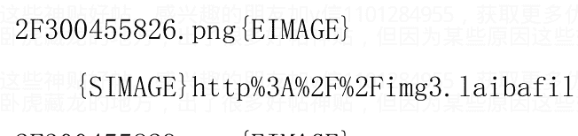


# 4222 楼
作者:有骨质画 日期:2018-10-08 02:35

好了，今天的图就更新到这里了。

(未完待)

# 4223 楼
作者:有骨质画 日期:2018-10-08 18:54

楼主又更新了，让各位看幻等了

# 4248 楼
加v信110128455，获取更多精彩推荐

# 作者：有肯难两 日期:2018-10-08 19:07

介绍了隆昌公寓，言归归正，7辆车辆组成的车队拉响警笛，大大大的从市局门口出发，向着嫌犯在地出发，

路上，我说：“这回看来要碰个大麻烦了。”

“即便要抓的这个人危险性很低，难度也不大，但是我们高调的，会不会打草惊蛇吗？”

“这个你就别操心了，为了确保万无一失，把画面拍到极致，在行动之前我们已经周密计划了三天，仅仅是和相关会议就召开了4次，每一都想到了，绝对不会有任何纰漏的。”

我打算下次还有有机会参加这次大场面，还是预先多做做功课，省的说实话会惹人矣。”女记者朱梦瑶说。

我一听就来火上门，这捏着的是之前吃了脾的气在想找回来，反对说：

第一，这位董事长在警界并没有任何职务，那么他自家的女儿遭了哪儿的权力可以要求警方行动号令？而不是要求警方速动权力以其速度开展抓捕，而是反复研讨，并表示媒体与其其中进行全程记录，这算计吗？从心理学的角度来说，郭董事长是不是具有严重的“型人格”？这是病，得治。

第二，我还是那个观点，一次如此如此低，且危害巨大的案件，抓捕却动用这么多的精警力，这不会造……。

加 v 信 1101824955，获取更多好料推荐

其他原本更需要人的方向空缺？万一因此产生什么不良后果，谁来承担责任？是郭事吗？另外，如此超规格的行动配置，难道没有公共资源之匮乏吗？我们都在……

你作为一名媒体人，应该有的就是正义感，追逐热嗅觉别要建立在这个基础之上，否则的话，那境界就会论为和优偷明星隐私的狗队们处于同一档了，我不知道你怎么看，我反正是不屑将这些人称之为“同行”。

不过你刚才的“荒论”来说，我感觉你已经有些“正义”和“热点”的关系被末倒了。

“你！”朱梦薇被我“瞪”的脸一阵红一阵白，高建平是个事老，一看我这要“拍架”，就立马从中间做好人类，他说道：“两位的都有道理，可是我们也不是决策者对吧？与其论这些事情的长短对错，不如大家都动作一点，早一结束束，早一些回来。记者，你下午有空吗？要不要喝一杯下午茶吧？今天我正好有空。这很有机会和她……还看不出来，高建平嘴上美女起来一点也不含蓄，不过不是我的菜，而朱梦薇但从颜值来说说的确不错，这种微妙清情气和“防御性心理”突出的女人，跟她同一一车就感觉很累。

“空空！”朱梦薇带着火，没好气的回了高建平一句，高建平哈哈一笑，说：

加 v 信110284955，获取更多好推荐

“那下次再约吧。”

话说回来，因为执着警徽，可以执行公务的名义又直在通过红绿灯路口，不必在信信号灯的指示，所以这一路上速度非常非常快，在不怎么愉快的气氛中聊了几句闲话之后，就到了地方了。我坐在副驾驶的位置，推开车门来抬头看一眼，一桩五层、通体深色的老旧建筑物入眼帘，其它车辆上人都也陆续下来，然后带着队长队的简单部署后开始分开行动，3人们已经被分成了三组，一个是捕组，支援组与媒体组，毫无疑问是被分在了媒体组，与朱梦瑶、王奇在一起，另外还有建平以及姓的警在一起，尤其是后者，主要是要保护我们的职责，但在这里实在想到没有保护的必要。

“这个建筑物看起来内部有点复杂，如果进去的话，里面的嫌犯不会逃吗？”我问。

“不会会的，这里是隆公寓唯一的入口，谁想进出只能通过这里，围墙后的地形已经勘察好了，绝对不可能的，除非他从三楼跳下去。”

“好吧。”我回应，随后在进入之后开始四处。这里不是深灰色的墙体，而是堆积山的杂物，各种自行车、电动车以及廉价交通工具。

加 v 信2495，获取更多推荐

走廊里偶尔出现的迟，让这里给人一种死气沉沉，而且行动的那天，一股无形的压迫感从四面八方不论是从视觉上还是心里，都让我强烈的不安。虽然这只是一次捕获的行为，但作为记者的敏锐感，总觉得这里非常安全，或者说会发生什么事情。十月的上海，已经很凉了，身上比较凉爽，但我的脑袋上偏偏此时流了一滴冷汗，站在旁边的朱梦瑶眼睛很好一下就看到了这个细节，随后便失时的道：“你是参与者，应该听过很多个案子，你这样以后让你去哪个地方的深夜频道比较合适。”我想立刻简单的道：“感觉这次捕获行动不会这么简单，有点不对劲。”

“不对劲？哪里不对劲？”朱梦瑶敏锐性要有，你要这样的话，我还是建议你去。“哼。”朱梦瑶说完之后冷哼了一声，由于没有切实的依据，所以被她噎了一下。

加 v信128455，获取更多精彩推荐

# 4249 楼
作者:有骨质画 日期:2020-10-18 19:15

在抓捕的后面，这次行动的总负责人就是刑捕队的队长，拿着对讲机在低压里读道：“嫌犯已出现，确认位置，就在楼顶的洗手间，现在正往下，各小组注意，准备在出口拦截他！”隆昌公寓为一个带缺口的“回”字结构的建筑物，除了唯一的正门以外，还有四个供上下楼的楼梯口，分别在正东、正南、东北、正西四个方向，如果算上当时的电梯，那么就有6个供上下楼的通道。不过电梯与楼梯早已废弃，在杂物的堆积阻挡下，早已不能通行。命令一下，抓捕组的15个人在楼梯口四周布置了“天罗地网”，而支援组的10个人分别掩埋在另外三个出口，以防意外。

按照理来说，从5楼到3楼应该用不了几秒的时间，我们可以已经等了3分钟，那人还没下来，侧耳一听，竟听见他在另一个人在大概转角的位置说话，说的什么清楚，只能辨认出他对话的是一个女人，除了对话以外，还有时不时不传递的声音。

# 却是集中精力的时候 
在集中精力的时候，感觉时间过得慢，而当时就是如此，仅仅1分钟的时间，感觉四周静止了一样，而且我的不安继续存在，心还在不停地跳，跳得很异常，这是一种只为紧张而心跳加速的现象。我自感奇怪，来之前知道这只是一个毫无所谓的政治工程而已，别说是紧张，全是没放在眼睛里的不屑才对。正如前面梦境说的那样，我是参与者，比大的场面我见多了，不是说采访记录，就是本人参加过比这危险的任务多，次数不在位数之下，这不过小场面算得了什么？可现在怎么突然这样？一个油腻顽顽的中人在20多人的精锐面前应该是不堪一击才对，我到底在紧张什么呢？

我想来到这里，巷道恢复了脚步声，那人结束了话语开始向下走了，我心里默数，大概7秒后，他从三楼到四楼的拐角处露了出来，刑警队队长与他直接了一个对视，随后反应迅速，一马当地冲了出去，并大吼一声：“别动！警察！”

越过多台阶后，他的声音几乎是同时发出的，队长身高等，但体型魁梧，来之前听过，对待一个没什么反抗能力的嫌犯没必要这个样子，但在看到这本笔记之后，我顿时感觉刚才下手太轻了！我现在就想冲上去再给他补两下，但由于职业与立场，我自然不能做。抓获了众多重大案件，最后到了刑警队的职务。与他并肩着一起拼出去，里面的刘队长与姜队长一样，也是部队出身，不过近身能力不如姜队长，他的个人素质更加全面，对于他来说，这种技术活儿都是小菜碟。

加 v信1128455，获取更多精彩推荐

- 两人配合之下，嫌犯当场就被死在控制住了，然后其他警察一围上，掰胳膊，戴上手铐，总之从地上给拽了起来。因为嫌犯只有一个，而抓捕组的人有15个人，所以以外的近十个警察连插手都没有，只在旁边看着。

- 至于这名嫌犯，他满脸是灰，在被队长折回来的时候满口是血，再加上这一阵折腾弄得头发蓬莲，那个狼狈地视了。

- 与正常的预想一样，完全没有任何难度，甚至没有遭遇一丝毫的抵抗，就结束了。（未完待续）

# 4250 号
作者:有骨难面 期:2018-10-08 19:25

(三)突变、恶劣

我在眼里自嘲了口气，但我心里不是味的，即便事实已经摆在眼前，可我那种不安的感觉不仅没有消失，甚至还加剧了！怎么样？你刚才还是在说这里有什么不对劲的地方吗？哪里不对了？你给我指出来，我也学习一下记者的业务能力。”朱梦蕾还不放过我，只要找到机会就攻击我两句，我有点不耐烦了，扭头对她说：“你的职责是来报道事件全过程的，我就是记录的，站在一旁边冷眼旁观，可你在这里说闲话就不太对了。”

此一出，正要害，朱梦碧如梦方醒，才只顾着攻击了竟然忘记了自己的本职工作，在我的好意提醒之下，她反应过来也没有回我的话，而是用手快速地抖了摇头，随后又拿出电台头牌的范儿，快步挤过其他警员，对着面前拿着摄像机开始说：“现在我们在隆昌公寓，这里是警方抓捕一名涉淫多次暴露身体扰乱秩序并猥亵女性的嫌犯的第一现场，目前嫌犯已经被警方控制……这里是朱梦碧为您发现的现场报道。”

她的这套衣服是电视记者进行现场报道时的常用语言，我很熟悉的。远人在群外一边打量着四周的细节，一边构思回去怎么用文字记录今天这件事记录，以此尽量不要在那些细节我不害怕又不说清楚是什么原因。

随后在人的解押之下，开始带他带去收集证据，这这次在按照说应该是初步审讯之后要做的步骤，不过把这些程序行动从哪个角度来说都不合常理，毕竟已经来了记者，如果只是一个时常不超过30秒的抓捕过程，还有什么可记录、报道的？

嫌犯的家在3楼，一个空空墨驳防盗门在前面，窗户还是那种老式的木框插销设计，由此可以看出他的经济情况是非常糟糕。然后二位队长让大部分警员在外面警戒，只有记录组五个人跟着嫌犯进入屋内。进入屋内的瞬间，跟我预期完全不同，屋内并没有想象中的凌不堪，也没有这种旧式公寓经常那种熟悉的异味。相反，小屋被收拾得井井有条，但是处理非常干净，另外空气中还飘散着一股淡淡的香气，那种类类似化妆品的香味。

把你藏起来的东西出来。”队长喝道，最后这句“老实点”完全是因为工作习惯留下的。说完之后，嫌犯呆呆地把破旧的床柜掀开，从里面拿出一大堆东西，把袋子倒过来，里面的东西全铺在床上。

加 v信11028495，获取更多推荐

- 袋子里面的东西是什么？全是女性内裤。里面几乎涵盖了市面上能买到的款式，从丁字裤、C字裤、蕾丝内裤以及具有收腰功能的塑身裤等等。

“哎呀，变态啊。”朱梦琪见此不禁脱而出。“这些东西都是哪儿来的！”队长继续问。

“在哪儿抢的？”嫌犯气无力的回答，“都是偷的或者是抢的……主要是在衣架上的，是在酒吧门口抢那些刚酒醉多的女……”

“还有别的了？”说完。嫌犯倒是配合，竟然在床下又钩出一个本来。刘队长戴上白色手套翻一看，里面竟然是一本作案笔记，里面记载的内容——记录的受害者，绝大多数都是流浪乞讨女性，还有部分是智障人员。妈的，这样一看，眼前面前这个王八蛋简直是丧尽天良！刚才我还觉得姜锐两个队长抓他的时候下手狠了，对待一个没什么反抗能力的嫌犯没必要这个样子，但在看到这本《强奸笔记》之后，我顿时感觉刚才下手太轻了！我现在就想冲上去再给他补两下，但由于职业与立场，我自然不能做。估计作为刑警队长，在日常里见过的各种姿态、人性的犯罪太多了，所以看到这本笔记之后，姜队长跟我一样，并没有太多的情绪，只是点了点头把笔记录在本子上后就放在了高等携带的证物袋跟说：“小高，把这些东西收集起来带回去。走。”众人这就押着嫌犯往外走，走到门门口的时候，他扭头看到家里床上铺的满的内裤看了一眼，那眼神里尽是不毫不舍。

# 4253 楼
作者：有骨难画 日期:2018-10-09 02:23

楼主又来图了，还是有关隆昌宫的，昨天都是外部图，今天有 4 张细节，斑驳的不是表面，更是内部。看过的说这很像《功夫》中的猪笼城寨，这样说一点没错，因为当初电影在……

(未完待)

# “不要-打-我的头！”

(未完待)

像一张被狂风吹起来的纸片一样给了出去，然后重重的在了门内一侧的墙壁上，落在下面一张简易的餐桌上给在当场趴散了。

这一切只发生在不到2秒钟之内，之后的情况可想而知，除了那名被撞到墙上的“冒泡”的警员之外，其余人，除了李锦娜与王律还有我以外，另外4个人扑了上去，我倒是不想，而是我当时的站位前面有两个人挡住了我的活动空间，导致我心有余却扑不上。

接下来发生的一幕，可以说彻底打破了之前所有预想到的可能——原本不错一击的这么一个大胖中年人好像突然变成了一头发疯的野兽一样，面对4人的攻围，他先转身打出一个“八拳”，右拳的拳头直接直接砸中了他左边警员的门，我看着这个小伙子的脸被他打的“塌”了，整个骨头都被打了形，接着他再转身用去撞右方的高建健，高建健不及及后脑被撞了个偏着，整个人受力向后去，直到在里屋门框上被撞拦了了下来，而这一撞的力之大竟连门框上的玻璃都撞碎落地，同时还把房顶撞的“咣哔”下落下。

因为屋子里空间太小，4个人虽然在一起，但根本无法出手，这也给了嫌犯“各个击破”的机会，等他打倒了左侧员及高建健之后，接着展开对姜长的攻击，姜队长此时也在发动进攻的“路上”，两人迎面撞了满怀。

按照块头、实战经验、绝对力量为心理所来说，这种扭抱在一起的打斗对于队长自由冠军出身的人来说是最擅长长不了的，可两人打在一起我才发现，体壮如牛的姜队长竟然还压制不住对方！不仅如此，经过几秒钟的僵持之后还竟然被对方反压制了，这嫌妇身上带着手铐活动不便，动作拙却力无穷，他双手抓住队长的警服，猛的一用力举过了头顶，然后顺着这股爆发力当即撒手，把这大一个活硬生生的撞到了天花板上，这队长可以修理了，后背击在了天花板上之后，背部却被一座照明的照明错一个箱巴准，接着整个人在重力的作用下，就像“呼大饼”一样下来拍在了地面上，这一挥的重击程度远高于被撞到墙壁上和被撞退的小警员与高建健。

站在队长身后的是刘队长，他身体没有前者强壮，但却更加灵活，两人周旋起来，面对的嫌妇虽然在对付，攻势凶猛，在刘队的闪鳞之下的数次进攻竟然都扑空了，听到他“哇”大叫，那声音之大，震的我耳朵发疼，一旁的朱梦瑾更是不忍住用双手捂住了耳朵，王才是此的咒咒皱眉头，要不是他一只手还得扛着摄像机，估计也得去捂住耳朵。不过趁着他发狂大的这个机会，队长抄起了躺在地面上的一把折叠凳，双手抓住椅子，用力抡了对准嫌妇的脸就砸了。

(未完待续)

“啪啦——”一声闷响，嫌妇脑门被被打了个结实实，复合板制成的折叠凳靠面被砸成了断巴渣，再看他的头骨竟然被破的凹陷进去了起码一个鸡鸡蛋这么大、这么深的“坑”，如果换了是个正常人，这一一下即便不被打死，也被被打痴了，最起码也是个重度脑震荡就地丧失行动能力，但这名嫌妇遇到此重击之后不仅没有倒，反而向后咬一眼，发出一种“哈——”的声音，好像在咬着牙齿。

朱梦碧与王凯站在我的前面，这两个人一看就知道是本来见过这种场面的样子，直接就在了，而我虽然没防止嫌妇发狂“调整扳口”攻击这两个人的目的，我从中间挤两个人的身子挡在了他们的前面，站在我面前的视线就好多了，嫌妇的一举一顿时看清二楚，同时我也看明白了他发出“咔”的那声是些什么——这家伙依旧在试图图开扳锤！

在他的全力挣脱下，时间仅仅持续了不到3秒，“咔”的一声响，此人由于用力过度而猛的向两边分开，真的将扳锤给捏硬的挣断了！

这有多大的力量才能做到这一点？以前我曾经看过一份资料，说澳洲演员内森·琼斯在当演员之前曾经是一个银行抢劫犯，他被掳入时就曾徒手折断手腕，还能凭借力拉开牢门上的链条，在被关押期间是整个监狱里的“打架王”，没有一个犯人敢顶他的话，而且有一次因为监狱伙食分量太少，他吃不饱发狂，打伤十名狱警，最后狱警使用毒气，在无效的情况下，被动用了非致命性神经毒，才将其制服。

出狱后的他为谋生路，发挥自己实力强壮以及凶悍的特长，当 WWE摔跤联盟的演员，后来达到了职业演员，其他作品暂不说，最让观众熟悉的就是2006 年仁泰导演的执导版本《拳甲王》中美国大力士——“奥比米”。

而这些人之所以有这么大的力量，仰是他2.1 米的身高和163 公斤的体重，其魁硕程度仅相当于我之后认识的李龙沛，如果这种“怪物”的人可以折手腕，那在他面前这个矮子看着怎么具备这个基础？身高比一大截，四肢更谈不上粗壮，再加上一个明显的啤酒脸，这个人的属于典型醉酒过多的废人，他的力量至少超过男性的平均水平，按理说在健身房里一定的人都应该比他强，但在在此前提下，这样一个人怎么可能拥有如此力量？虽然重重，但在当时那种紧急情况下也不容易。

话说回来，让我“头大”的事情还是嫌犯，因为眼前这个对手太灵活，他躲闪就像舞棍似的，我们实在对付不了，继续攻击，等他打倒了左侧员及高建健之后，接着展开对姜长的攻击。

由于嫌犯拒绝，的，我，，服，犯也不能坐毙，顺手把桌上的一个水果刀拿了起来，准备拼命。实际上，按照当时极其兴奋的状态，非不能用刀，否则切开颈动脉、刺穿心脏，除了他人的因素以外，还有这把刀实在太短了，加上刀柄也就2厘米左右，而且锋利，拿着这把刀在手里，基本上就是聊于无。

对于他击要命的话，我是没有那个“手艺”，只能完全靠躲。按照常人的反应，应该是痛苦与意识的作用，他一样，根本没有停顿，继续推进。

他三步走到我的面前，挥起八拳就打，第一一下就命中他，随即用刀划开他的右臂位置，虽然锋利，但留下了一道深痕。

我估计也得去捂住耳朵，一旁的朱梦瑾更是不忍住用双手捂住了耳朵，王才是被此的咒咒皱眉头，要不是他一只手还得扛着摄像机，估计也得去捂住耳朵。

由于嫌犯，拒捕，跳窗，房间的左侧是一个窗户，他双手拦截，直接撞碎了木框和残留的玻璃，消失在了窗口。

我本来以为是他跳窗了，便后来到窗前去看，但低头发现除了玻璃和木框以外就没有别的了，在这个方向，无论在哪里，视线延伸出去的距离至少10 米以上，无论跑得再快，也不可能在不到2的时间跑出去这么远，就算是猎豹也做不到。

正纳闷，头顶掉下一指盖大小的水泥，顺着水泥掉落的方向扭头一看，发现这家家伙根本没有跳窗，而是顺着楼顶延伸下来的外管道里去了！这种排水管道只有现有的老式公寓才能看到，现代公寓已经不再这种散落的设计，而是全部内置化了，但隆昌公寓就是一座非常具有20世纪80年代风格的基础设施。

我抽出手子把刚才看到的情况告诉了警员，然后众人“呼啦啦”再出门，招召援组，除了留下两个人顾着受伤的警员、队长，其余人全部出动，轻伤不下也跟上了。

一时间，“人跑了！在楼顶，把出口封死！”、“快快快！”上楼顶！都闹乱！”“嫌犯暴力拒捕，启动二级预案！”等口头话以及对着讲机喊声此起彼耳。

所谓的“二级预案”我们是在来之前商量出的三个级别的预案中的第二级。第一级是顺利捕获，没有遭到抵抗；第二级是遭到嫌犯的拘捕，所有人全部运作起来参与捕获，支援组就是为了这个二级预案而准备的，本来要设置这一组目的是为了让那个富豪出现警方对案子的重视，现在没想到真的用上了。

而第三级则是最高级，这一级是特警队长提出来的，他认为一旦嫌犯手持武器或者存在它可以危及参与捕捕行动员生命安全的行为，就可以使用“致命武力”对其击，虽然这一级预案是在出来之初，绝大多数人都觉得是多余的，但是随着事情的发展，事态上升到这个级别，或者更明确的说，当时室内的搏斗，就已经达到了这个级别的要求：存在可能以及参与捕捕行动员生命安全的行为。

语言传播，隆昌公寓就这么大的地方，几十个人分散找另外个人还是容易的。首先在天上发现了他，经过一小时的追逐他又跑回了三楼，不过这次是在楼道里，接着他便在我们这么多人的面，脚踩三楼的水泥护栏，一转身就跳了下去。这个高度对于没有经过严格训练的人来说足以摔成重伤甚至是致命，但他落地后只是身体在地面上一个滚就站起来了，好像什么事都没有。

在人在逃跑后，被刘队长在对讲机里派下负责在楼下封堵公寓最外入口的。

嫌犯跑后的警员此时再扑了上来，准备趁他的机会制服，但嫌犯的动作并不慢，以最快速度向前了几米，然后重新捡起了地上的自行车，并将高高举过头，对准还站在地面上的朱梦瑶。

如果说只是她躺在地面上的，尚可翻身避，但现在不行，因为前面压倒她的那名警员的身体压住了腿，她无法翻身，我想拉住她的胳膊把她从两个人的身体拖出来。在眨眼之间，原本没有给我做完动作的空档，而在嫌犯后最近一名警员也离她三米的位置，指望他们也是不行了。只要不出奇迹，那么等朱梦瑶就有迎头打下来的自行车，假设被撞中，最好的结果也是脑浆裂。

不过奇诡的发生了，奇诡不是发生在什么“投降”的高手命悬一线的朱梦瑶，而是发生在嫌犯自身。在他拿起起自行车还没遥的那那，他的身体突然剧烈但很短暂的抖了一下，接着就好似被人剪断提线的木偶一样，当只软一团瘫倒在地。

这一切太突然了，看着瘫倒在地的嫌犯，与他之前疯狂抵抗的惨相相比，反差不能说是其巨大的。

(未完结)

伤比较重的姜如队长等人被警察拍手拦了下来，而没在伤的李队长开始联系，首先拨通了 120 的电话，然后又拨通了市局的电话，两人先后到达，120 将伤者全部运走，在市局里别了法医，把死亡的嫌犯拉回了案发现，准备在做进一步的化验，好确定确切死因。

（未延续）

## （四）肾上腺素

而我们这些幸运没有受伤的人每一个都是灰头土脸，刘在队长忙忙忙出的差差不多了，走到了，离我的近，开口道：

> “谢你你记得同志，要不是你分散了他的注意力，姜如那哥的跟头羊一样都被揉揉成那样了，我一个人可制不住他！” 姜如那

我也是也被这样一下，预计就得当烈士了。

这队长的确都是军人出身，说话大嗓门，聊天天像也像总结大大会，说完之后还拍了拍我的肩膀，我只能笑着做回应，心说他妈的这八王蛋是看你不对付了，过来想找个软柿子，结果就看到了我，要是外面的再晚一点，当烈士的就是我。

> “没出来，你还有两个下子” 朱梦玥一边拍身上尘土一边说。今天的事太邪了，刚才才不是他突然暴雷，我就是。

这事事抓捕本身更值得在报道，也不接你了，我感觉这事更值得深在入报道一下，你不跟进吗？”我说。

“切，自然得跟，我会全程报道的，这还用着你？” 朱碧瑶我看着这女人是从刚才快吓死回来了，又开始毒舌，心不烦，先再说。随后，我有意没跟她一辆车，而是跟着法医的车回了市局。

化验报告出来之后，所有参与此次行动的人员要在一起，本来市局是不想让我，朱碧瑶，毕竟我们是公安系统里的人，但作为组记录，掌握了整个过程，所以还是允许我们一起愣旁。

讨论会上，法医的报告简单，嫌犯对于急性肾腺素中毒，就直言不停的，结果其实我早就看尸的时候，脸色苍白，面部肌肉痉挛，瞳孔扩散，这是典型的肾腺素中毒后的临床体征，另外这前一秒拿着几十斤钢制的老式自行车“兵器”，后一秒就突然死亡了，如果在处的地方，肾腺素中毒是最合理的解释，还有一种可能就是突发脑血，但当时的死亡特征并不符合溢血的症状。

“这么说吧，他是死的我现在不在关心，我关心的是一个46岁的中年男子，没有受过专业训练，没有从事体育方面的经历，怎么就能把你们们足足27名暴界精英的公安警竟然打成这副狼相？到为止，还有五个人在医院躺着，这只是轻伤和挂的，那“战胜率”都超过60%了，谁给我解释？李局，你先别儿子，虽然从摸排资料来说，嫌疑的有没有伍经历，就是一个普通的子，你也可以问任何一个兄弟，这个人真的吗？”主持会议的是局长和政委，作为局长的李万程，他对此事却是恼过的，因为在那个郭富豪面前下，让他实在是有无光的，但他捅成这个样子，在天下会议上，他当场就拍了桌子，差点就要叫娘了。其他局员都有一肚子委屈，但于局长的下巴碰到桌面的脸色，谁也不敢，最后还是参与行动的警方力量中，地位最高的特警队长开口了，他说：

> “李局，你别儿子，我折叠靠把他的脑袋炸开他还打，从楼上跳下去做什么事没有，径足10楼，依然状态神勇，在这之前，他用手把手挣开，那手可是新发的，中间环都是直径3毫米的加强钢销的，这得多大的力气能把这东西给硬中间斩断？我记得按照说明书上写的，它可能是承受5倍于男性力量的。”

实在在，你想解释，我们其实也想要解释一个解释人是什么情况？可您能问我们，我们我们就处问了啊，要是你感觉骂兄弟们一顿就能把这事解决了的话，我们就听着，你骂我们就听着，你骂到什么时候哑气了再说，我们绝对一句话他这段话明白一下就是柔中带刚，绵里藏针，表面上是陈述情况，实际上是不满意，那局长本来就一吐子的“鸟气”，被这一咬，更火大了，看他架子，这就精准备要哑娘，而作为一个媒体，胆子比较大，面对上线没有任何敢散，莫说是一个局长，比大的多的朕我也不是没见过，再加上我肚子里装了一大堆的结论，所按奈奈之下在这局长权威之前，举手请求发言。

局长柯刘长、骂警察可以，但他不能骂我，毕竟从名义来说我是被他们请来的，再加上不在一个系统，说谅听听，就是我们官家里家，也不管我，那我也是我们长长，基于这种情况，局长喊巴哈嘴，强行把顶到脑门儿上的怒火压了下去，对我说：

“你是记者，肚子里墨墨水，就听你的意见。”仅从这一句话就能看出，这局长也是“大老贼”。

（未完待）

## 我的看法：

首先，嫌疑的死因是急性肾腺素中毒，而大家可能知道，有的不知道是一种物质，简单的说，它是身体内一种常见的激素，大量分泌后，短时间内成倍提升人体的指标，一般来说，人在突破临界点或者遭遇极端恶劣的情况下，或者是某些条件触发了类似的反应，大脑就会调动肾腺素快速分泌，从而使身体进入这种“超级状态”。

三个例子——第一个在美国佛有一个退休教师朱莉，86岁带着孙子出去散步，结果遇车祸，一辆车辆撞上了孙子，孙子被翻下动不得，情急之下凭借双手将车辆撇起来十分钟，将孙子救了出来，然后两人都得到救治，但她的器官不可避免的出现了衰竭迹象。老年人体弱，再加上挪动几十公斤重的体力的消耗实在太大了，也无法做到。

第二个是个位母亲，出门买菜回来，发现她7岁的儿子从窗外摔了出来，情急之下扔掉手中的自行车，狂奔到楼下将掉落儿子稳住，距离儿子的位置大约60米，而她冲过去的速度只用了不到4秒，换算过来就是她当时每秒速超过15米，要知道现在在奥运记录，用百米运动员、消防队员、跑步爱好者等各类跑步的人，用轮椅试验没有这么短的时间内跑60多米并准确落地。

第三个是某栋居民发生火灾，一个下肢截依靠轮椅生活多年的残疾人因为火势蔓延到了他家，他坐着轮椅无法下楼逃，看着将被浓焰和烟吞噬，随后才惊讶的发现自己能站起来，而且跑的飞快。

以上三个例子中，除了第一个梗竭的女教师，另外两个在之后都因此住院接受相当一段时间的治疗才康复，那么女老师为什么引起衰竭？另外两人为什么住院？都是相同的原因，就是急性肾腺素中毒。他们在最危险的情况下触发了身体反应，让肾上腺素含量高，其身体机能得到了十倍提高，但代价就是短时间如此多的肾腺素对身体造成非常严重的损害，器官在这样的时间超负荷运作中不可避免的逆损伤，也就是衰竭现象。而后面两位年轻轻壮，在情况下较轻，便忽略了器官衰竭，但是免了中毒反应所以要为此治疗。

我说了这么多，想要表达的是，这名嫌疑突然爆发的力量大无穷，肯定是与肾腺素有关，要不然他也会死于此类中毒。力量突然暴增十几二十倍，可以把手链断也不是可能的，毕竟现实中存在常态就能使得手抓手铐的人。而身中10枪仍然可以战斗，他是一85式旋转手枪的损伤的确比较小，如果携带的是92式自动手枪，那肯定就会另外一个结果了。而得益于行动队长队长坚持到了关键时刻还有配枪，才可用，那么就不用靠拳头解决战斗了。二是法医报告中明确提了，这10枪除了3枪击中了他的肝脏、胃以及打穿了大肠是致命创伤，其余的7枪都只是穿了肝脏组织并破坏了部分对于关键的组织结构，这些伤势不足以致死，而那3处致命伤在肾腺素的作用下没有在短时间内凸显出来，才由于正常情况，如果当时有一枪击中了他的心脏或者头部，那没效可能会好处多。

唯一让我想不通的，一次普通的抓捕为什么可以触发这么强烈的危机应激反应，实在是太不正常了，我想搞清楚这个问题的必要性要比追此次行为为何“战损率”有意义。

我把展开了从头讲了一遍，众人都在频繁点头，但李局长还有点不服，他哮了片刻，他现在在：“这个地方很有意思，因为大家都在紧张，肾上腺素再厉害也不能让他打了这么多枪之后还死了！”

肾腺素只要保持在较高水平的情况下，那么人的兴奋状态就是通过信号传导各个部位的。还有一个国外的例子：美国联邦局对一个涉毒贩的遭遇，在如此密集的枪击之后反抗，通过静脉向体内注入高度的咖啡因达到了98%，其中决定性的因素就是咖啡因当时重度麻痹了大脑，让他们处于一种疯狂的状态。这两者与肾上腺素不同物质，但原理是一样的。大量咖啡因剂激发大脑分泌了多的巴胺，通过兴奋来抵御疼痛、消除疲劳、恐惧，增强身体机能。在战争期间，德军和日军在穷途路之际，都试图用药品麻醉士兵，让他们只会战斗的“杀人机器”。而且兴奋的人体受伤后产生血小板的速度也高于平时，最大的可能阻止伤口流血，这也是一开始后流血不多，死后血液从伤口中涌出来，把地面染红了一大片。

以上都是相关案例，我认为完全可以解释模特犯人在中枪后还能剧烈抗捕的情况。此话说完，整个会议室里沉默了一秒多，随后在刘队长的带下，一群开始鼓掌，甚至连坐在一边的政都要拍了拍手。李长一看，自己已经是彻底没话了，只要一手：“好吧，反正事已至此，还是麻烦把这些事情都一起写在这次抓捕行动的记录里面，好好解释一下免得有人看到了我们无能。”

“这是自然，我的职责所在，一定会在尊重事实的基础上做好工作。”我说。

之后政委作为干部部，又在会上行性的了一些疼不痒的官话，这些就没有必要详细描述了。会议结束之后，这次行动已经结束，虽然关于他为什么突然进入睾激素暴增的状态暂时也没想出来原因，但这个可以慢慢磨，毕竟人已经死了，再怎么细节也记得不得。而最令人感叹的是这嫌犯竟然如此疯狂危险，打伤这么多人，其中不乏重伤者，但是没有人因此死而这便是不幸运中的万幸。

（未完待续）

楼主又来更了，今天之前在正文中提到的内禀。

琼斯，数据上他的身高为2.11米，体重163磅公斤，不过这表达太直观，所以楼主来找他的照片，看这人的块就可以想象到他为什么能够徒手挣开手铐的。

图1是他在《霍元甲》中饰演奥比森与霍元甲比较时的剧照。

图2是他的标准之一。

2300591300.png {EIMAGE}
2300591304.png {EIMAGE}

好了，今天的图就更新到这里了。

（未完待续）

## （五）单身派

客观记录完成后，我自然就没有继续写出来了。来说，我打算离开上海，返回单位，回去又不方便，想起买东西准备这次机票，这会儿手机突然打过来了，从屏幕上一看还是上海本地的号码，本以为可能是广告销电话，接起来一听是朱瑾瑶来的，才彻底改变了我对她的印象。这号贩在整个抓捕参与者，至于这一切都是偶然的，我发现她找你很久，因为我发现你在出差了。

“我在上海出差了，我发现你来了多久了，打算玩几天再走。”

“你明天下午时间吗？”我问。“参加单身派？单身派？”

“什么合适的，要不要一起来吧？”朱梦瑶发出一阵银铃般的笑声。

“你靠，从哪里看起来我是单身的？”朱梦瑶没有直接回答我的问题，反而如此：“在此我的脑子里飞速的运转了一下，不去的话还是显得太大了？自问我还是挺跟骗的，单身派还挺感兴趣，不过并不是打算去认识什么姑娘，而是纯粹出于好奇去看看。

我在现在的工作上省吃用奋斗一辈子或许都可能未买得起以后我去了干什么？增加人头吗？另外，假设这就是一群富人组织的活动，那么按照经验来说，应该是不外开放的或者是严格限制名额的。朱梦瑶是从哪里来的邀请？看来这女人的能量不小啊，也难怪她年幼轻轻能够在上海的新闻界当上牌记者，除了颜值高，业务能力强外，没点背景那不是可能的。

想这么多也没用，到地方再说。我得了思路，感觉计划就这么事了，洗了个澡睡觉去了。

这一觉睡得不错，手机铃声把我唤醒的时候是早上七点半，经历了20分钟的“折伤”（注：这是一个比方）。

“山北风景区，具体就是山北大型一片，地方你就知道了。”这几个字我非常熟悉，这个地方与陆家滨江区、碧云国际社区（含汤臣高场）一起，是整个上海最富有的三个豪宅。这里的房产，最低起于300万，过亿的都是，可以说上海90%的精英，尤其是商务精英，都分布在这个区域内，另外就是娱乐圈的大牌、名导、投资人也在这个地方有房，而单身派这种地方也有，不用想，那种“富得流油”的富们的豪奢画面瞬间便跃现在眼前。这些人并不伏仇，这种场合也不反感，只是跟那里出现的人比起来，我连个丝属不算，他们随便拉出一个算下一套房产都够。

十五未


“看你挺别的，所以就想带你带去。至于王珂，小孩儿一个，这种场合不适合他。”朱梦说。

“特别？我有什么特别的？”我说。

“比在隆公寓勇斗局长，在讨论会上‘噎死’局长。”朱梦说。

“这些还不够吗？勇斗什么样的那一个，关键是你是‘噎’局长那段真是感觉大坏人心，不塌你说，我追踪报道的案件并不不少，他打他的交道也不止几十次，这人难对付的很，说话诡气十足，跟他属于有理也不清那种，我和为了为了这事说过几次，但你别看他是个粗人，可特别擅长谎，无理胡说的理由就是他这种人，我跟他打交道的那些，每次都是这一套，我一点办法都没有。当时才开会在场所所有人除你之外都知道他有这个毛病，所以他说话都挺着头的，你那个特种队的要是不是因为这次案情特殊，实在有点儿忍不住了，要不平时根本不敢跟他说话，这也不是领导不满意的事情，就是他说话的感觉太讨厌了，可万没想到你真是‘初生牛犊不怕虎’，这一刻居然把他给住了。”

“你看见你说完之后，有多少人鼓掌，包括政治记者？”我说。

“这么吧，小梦瑶，你简直是服了。”朱梦瑶。

“呵……我就是事而已，没想到还替你们出气了，我还是扯不上关系，派上的那些人，都是商界以及各路精英，一个个尖锐，没有一个是省油的。有些讨厌的，就不能客气，你也想让我个手。”朱梦瑶。

“怎么了？”我。

“啧，他们们口才这么好，一口气把演讲稿都写出来了。”我。

“好了，你在这里等我会，你满意了吧？”朱梦瑶。

“哈哈，你先别开话题，我刚才就想说，什么叫这啊？你出现了两次，难道在你眼里这记者人吗？”朱梦瑶。

“你在这里等一会。”朱梦瑶下车说。

“你干什么去？”我生不熟的，你要跑了，我找谁去？”我说。

“实话，那地方让游客简直好呆，只因为景色如此美得不可议，我们实在还能说什么呢？只能在原地等着。好家伙，我实际上起差了两小时，不过来说也对她这种精致动人，换衣服再加上妆，分分钟就完全可能的，的确现实。”

湖岸上搭建了一座类似蓝天的建筑物，我看到时已经建成，还有一些工作人员在里面进行细节修整，它周围用16根钢丝在地上，然后就是大量的灯光、音响等设备，看样子白天这里是个喝酒跑步聊天的地方，到了晚上才是真正的高潮。

在此之外，围着人工湖一圈，搭起了大量的展览廊。我来到到眼前，脚下的展台上摆满了奢侈品，各种品牌琳琅满，爱马仕、尼太雅、香奈儿、凯莱、路易威登等等时尚大牌应有尽，而且这只是一个展示时尚品牌的展区，其它区域类似私人飞机、超跑等大型奢侈品更是数不胜数，唯一的少就是游艇，因为这块地皮不靠水。唯一的这人工湖虽然面积相对不大，但对于豪华游艇来说实在就是不够‘看’了。

大件儿不说，就看到前的这些鞋子、包包，我转了一圈，看到最便宜的一个，售价也在4万+，而动的十几万的可以说是比比皆有，高档区的东西随便一件基本就是我一年甚至N年的收入。

我这一看一边想起了在隆宫看到的破败情景，上卫生间都要旋转流上，做饭还要下楼，不禁感慨：差距就是这样，明明生活在同一个星球上，财富多寡让他们在两个世界，如香港、纽约、巴黎、东京等国际城市，穷人们在挣扎里疲惫，而作为国际一员，不能免俗。

“哎哟，小梦瑶你也来啦，几天不见漂亮了？”这话那脸贴越近，朱梦瑶一笑，一边有意意的躲闪一边说。

朱梦瑶抓住了我的衣服，她一拽也让我停下脚步。一个50岁以上的大叔，带着头银白色的头发配上这身黑白色西装，穿着九分裤和尖头皮鞋，脚踝到手指，右手靠着腰，显得邪气森森，他见到朱梦瑶后眼睛就是亮了，看到朱梦瑶的纤柔，然后说：“哪有几天？你昨天还不刚见到我？行了，你先忙去吧，一会再找你啊。”说完推开大叔接着自己的手，脚步走，同时扭摇头给我了个眼神。

“这人是谁？”

“我的赞助商，讨厌得很。”朱梦瑶说。

“赞助？赞助什么？当记者还需要赞助吗？咱俩作为广上的同行，我怎么还没听过这事？再说了，你还要他的赞助干什么？”

“我除了当记者还有一个自己的副业，我喜欢服装设计，自己开了工作室，主要面向年收入在100万到300万上的高端人群，目前是自己的代言人，他是主要投资方之一，现在的资金积累有很大的帮助。我是不要他的赞助，那每年几百万的广告费，你给我吗？实话，跟这种人相处最累，一边防着他让他真占了她的便宜，另一面还得给他点甜甜，让他心甘情愿的为自己付出。”朱梦瑶。

此一次，她在我心里的形象是彻底颠覆了，从之前刚接触她，只是以为她是个高丽，个人能力很强的女主人，现在看来，我想的还是太简单了，一种发自肺腑觉得自己还是‘太年轻’的感慨油然而。

“看出来了，他看到你之后那眼神都发‘绿光’。”我说。

“那是，记得我不是一天两天，要不然他能支持我的工作室有多大？”

“你这……属不‘备胎’？”我说。

“备胎还是挺有的，如果一个漂亮女孩连自己把备胎都没有，那就太失败了。”朱梦瑶说。她这一话一说，我有点气不打一处来，但一想，算了。每个人都有自己的生活方式，商业社会本来就是物欲横流，我除了了自己以外，谁都管不了，又何必要这闲气呢。”


很强的，别想我从哪里套话，我基本都能在第一时间感觉出来，所以朱梦瑶这么这一问，我当即便提高了警惕，严肃起来反问她。

“看把你紧张的，我现在找了合作伙伴，做了一档节目，暂定名字为《怪传》，是一个有现实原型为主打内容的奇奇类目，其中包括灵异、凶杀、悬疑等等内容，目前已经出了三期节目，收视率很不错，一集40分钟，转播权卖到国外每集不于120万美元，有人看到了这个商机，这个节目投入了一大笔钱，要采访与纪录片的方式进行‘现场还原’，目前无论是资金还是人脉，都已经完全打通了，我们可以调整现在最好最先进的电影特效技术，将以真的影像通过视频呈现现在观众面前。”

……朱梦瑶提到她欲言又止，其实她话到此处我就是用手指想也已经准个八九蛮不离了，但为了进一步的确认，继续后续：

“什么是？”

“只是你知道，这种题材在港澳台、东南亚，乃至的欧美地区，包括俄罗斯在内，都有同类型的节目，只是我们做的这么大了，但这毕竟不是电影，特效再好只是辅助，最关键的还是要有好的故事，可在合适的素材早已经被这些竞争对手挖掘掘陷了，而我的想要要头筹，想要继续火下去，就必须要有好的，丰富的，且能让人眼前一亮的新素材，这样才能让他们模仿我而超越了我。

而不嘈闹你，在你来之之前，我就了解过你，你采访过的人，以及编写的报道，第一次见面跟你那些话不是你想想要了，而你的报道当中，大多与不可公开的灵异、超自然有关，所以呢，我想出点你感觉可以是的，把已经写过的所有的采访都买过来，然后我们之间还可以建立一个长期的合作关系，你有什么的素材都可以拿到我这里来，然后我可以论数字给你报酬，不过不敢保证，你只要每年提供够的素材，那让你进入这个世界是轻松了。”

朱梦瑶提到她欲言又止，其实她话到此处我就是用手指想也已经准个八九蛮不离了，但为了进一步的确认，继续后续：

“什么是？”

“只是你知道，这种题材在港澳台、东南亚，乃至的欧美地区，包括俄罗斯在内，都有同类型的节目，只是我们做的这么大了，但这毕竟不是电影，特效再好只是辅助，最关键的还是要有好的故事，可在合适的素材早已经被这些竞争对手挖掘掘陷了，而我的想要要头筹，想要继续火下去，就必须要有好的，丰富的，且能让人眼前一亮的新素材，这样才能让他们模仿我而超越了我。

而不嘈闹你，在你来之之前，我就了解过你，你采访过的人，以及编写的报道，第一次见面跟你那些话不是你想要了，而你的报道当中，大多与不可公开的灵异、超自然有关，所以呢，我想出点你感觉可以是的，把已经写过的所有的采访都买过来，然后我们之间还可以建立一个长期的合作关系，你有什么的素材都可以拿到我这里来，然后我可以论数字给你报酬，不过不敢保证，你只要每年提供够的素材，那让你进入这个世界是轻松了。”

朱梦瑶提到她欲言又止，其实她话到此处我就是用手指想也已经准个八九蛮不离了，但为了进一步的确认，继续后续：

“什么是？”

“只是你知道，这种题材在港澳台、东南亚，乃至的欧美地区，包括俄罗斯在内，都有同类型的节目，只是我们做的这么大了，但这毕竟不是电影，特效再好只是辅助，最关键的还是要有好的故事，可在合适的素材早已经被这些竞争对手挖掘掘陷了，而我的想要要头筹，想要继续火下去，就必须要有好的，丰富的，且能让人眼前一亮的新素材，这样才能让他们模仿我而超越了我。

而不嘈闹你，在你来之之前，我就了解过你，你采访过的人，以及编写的报道，第一次见面跟你那些话不是你想要了，而你的报道当中，大多与不可公开的灵异、超自然有关，所以呢，我想出点你感觉可以是的，把已经写过的所有的采访都买过来，然后我们之间还可以建立一个长期的合作关系，你有什么的素材都可以拿到我这里来，然后我可以论数字给你报酬，不过不敢保证，你只要每年提供够的素材，那让你进入这个世界是轻松了。”

朱梦瑶提到她欲言又止，其实她话到此处我就是用手指想也已经准个八九蛮不离了，但为了进一步的确认，继续后续：

“什么是？”

“只是你知道，这种题材在港澳台、东南亚，乃至的欧美地区，包括俄罗斯在内，都有同类型的节目，只是我们做的这么大了，但这毕竟不是电影，特效再好只是辅助，最关键的还是要有好的故事，可在合适的素材早已经被这些竞争对手挖掘掘陷了，而我的想要要头筹，想要继续火下去，就必须要有好的，丰富的，且能让人眼前一亮的新素材，这样才能让他们模仿我而超越了我。

而不嘈闹你，在你来之之前，我就了解过你，你采访过的人，以及编写的报道，第一次见面跟你那些话不是你想要了，而你的报道当中，大多与不可公开的灵异、超自然有关，所以呢，我想出点你感觉可以是的，把已经写过的所有的采访都买过来，然后我们之间还可以建立一个长期的合作关系，你有什么的素材都可以拿到我这里来，然后我可以论数字给你报酬，不过不敢保证，你只要每年提供够的素材，那让你进入这个世界是轻松了。”

朱梦瑶提到她欲言又止，其实她话到此处我就是用手指想也已经准个八九蛮不离了，但为了进一步的确认，继续后续：

“什么是？”

“只是你知道，这种题材在港澳台、东南亚，乃至的欧美地区，包括俄罗斯在内，都有同类型的节目，只是我们做的这么大了，但这毕竟不是电影，特效再好只是辅助，最关键的还是要有好的故事，可在合适的素材早已经被这些竞争对手挖掘掘陷了，而我的想要要头筹，想要继续火下去，就必须要有好的，丰富的，且能让人眼前一亮的新素材，这样才能让他们模仿我而超越了我。

而不嘈闹你，在你来之之前，我就了解过你，你采访过的人，以及编写的报道，第一次见面跟你那些话不是你想要了，而你的报道当中，大多与不可公开的灵异、超自然有关，所以呢，我想出点你感觉可以是的，把已经写过的所有的采访都买过来，然后我们之间还可以建立一个长期的合作关系，你有什么的素材都可以拿到我这里来，然后我可以论数字给你报酬，不过不敢保证，你只要每年提供够的素材，那让你进入这个世界是轻松了。”

朱梦瑶提到她欲言又止，其实她话到此处我就是用手指想也已经准个八九蛮不离了，但为了进一步的确认，继续后续：

“什么是？”

“只是你知道，这种题材在港澳台、东南亚，乃至的欧美地区，包括俄罗斯在内，都有同类型的节目，只是我们做的这么大了，但这毕竟不是电影，特效再好只是辅助，最关键的还是要有好的故事，可在合适的素材早已经被这些竞争对手挖掘掘陷了，而我的想要要头筹，想要继续火下去，就必须要有好的，丰富的，且能让人眼前一亮的新素材，这样才能让他们模仿我而超越了我。

而不嘈闹你，在你来之之前，我就了解过你，你采访过的人，以及编写的报道，第一次见面跟你那些话不是你想要了，而你的报道当中，大多与不可公开的灵异、超自然有关，所以呢，我想出点你感觉可以是的，把已经写过的所有的采访都买过来，然后我们之间还可以建立一个长期的合作关系，你有什么的素材都可以拿到我这里来，然后我可以论数字给你报酬，不过不敢保证，你只要每年提供够的素材，那让你进入这个世界是轻松了。”

朱梦瑶提到她欲言又止，其实她话到此处我就是用手指想也已经准个八九蛮不离了，但为了进一步的确认，继续后续：

“什么是？”

“只是你知道，这种题材在港澳台、东南亚，乃至的欧美地区，包括俄罗斯在内，都有同类型的节目，只是我们做的这么大了，但这毕竟不是电影，特效再好只是辅助，最关键的还是要有好的故事，可在合适的素材早已经被这些竞争对手挖掘掘陷了，而我的想要要头筹，想要继续火下去，就必须要有好的，丰富的，且能让人眼前一亮的新素材，这样才能让他们模仿我而超越了我。

而不嘈闹你，在你来之之前，我就了解过你，你采访过的人，以及编写的报道，第一次见面跟你那些话不是你想要了，而你的报道当中，大多与不可公开的灵异、超自然有关，所以呢，我想出点你感觉可以是的，把已经写过的所有的采访都买过来，然后我们之间还可以建立一个长期的合作关系，你有什么的素材都可以拿到我这里来，然后我可以论数字给你报酬，不过不敢保证，你只要每年提供够的素材，那让你进入这个世界是轻松了。”

朱梦瑶提到她欲言又止，其实她话到此处我就是用手指想也已经准个八九蛮不离了，但为了进一步的确认，继续后续：

“什么是？”

“只是你知道，这种题材在港澳台、东南亚，乃至的欧美地区，包括俄罗斯在内，都有同类型的节目，只是我们做的这么大了，但这毕竟不是电影，特效再好只是辅助，最关键的还是要有好的故事，可在合适的素材早已经被这些竞争对手挖掘掘陷了，而我的想要要头筹，想要继续火下去，就必须要有好的，丰富的，且能让人眼前一亮的新素材，这样才能让他们模仿我而超越了我。

而不嘈闹你，在你来之之前，我就了解过你，你采访过的人，以及编写的报道，第一次见面跟你那些话不是你想要了，而你的报道当中，大多与不可公开的灵异、超自然有关，所以呢，我想出点你感觉可以是的，把已经写过的所有的采访都买过来，然后我们之间还可以建立一个长期的合作关系，你有什么的素材都可以拿到我这里来，然后我可以论数字给你报酬，不过不敢保证，你只要每年提供够的素材，那让你进入这个世界是轻松了。”

朱梦瑶提到她欲言又止，其实她话到此处我就是用手指想也已经准个八九蛮不离了，但为了进一步的确认，继续后续：

“什么是？”

“只是你知道，这种题材在港澳台、东南亚，乃至的欧美地区，包括俄罗斯在内，都有同类型的节目，只是我们做的这么大了，但这毕竟不是电影，特效再好只是辅助，最关键的还是要有好的故事，可在合适的素材早已经被这些竞争对手挖掘掘陷了，而我的想要要头筹，想要继续火下去，就必须要有好的，丰富的，且能让人眼前一亮的新素材，这样才能让他们模仿我而超越了我。

而不嘈闹你，在你来之之前，我就了解过你，你采访过的人，以及编写的报道，第一次见面跟你那些话不是你想要了，而你的报道当中，大多与不可公开的灵异、超自然有关，所以呢，我想出点你感觉可以是的，把已经写过的所有的采访都买过来，然后我们之间还可以建立一个长期的合作关系，你有什么的素材都可以拿到我这里来，然后我可以论数字给你报酬，不过不敢保证，你只要每年提供够的素材，那让你进入这个世界是轻松了。”

朱梦瑶提到她欲言又止，其实她话到此处我就是用手指想也已经准个八九蛮不离了，但为了进一步的确认，继续后续：

“什么是？”

“只是你知道，这种题材在港澳台、东南亚，乃至的欧美地区，包括俄罗斯在内，都有同类型的节目，只是我们做的这么大了，但这毕竟不是电影，特效再好只是辅助，最关键的还是要有好的故事，可在合适的素材早已经被这些竞争对手挖掘掘陷了，而我的想要要头筹，想要继续火下去，就必须要有好的，丰富的，且能让人眼前一亮的新素材，这样才能让他们模仿我而超越了我。

而不嘈闹你，在你来之之前，我就了解过你，你采访过的人，以及编写的报道，第一次见面跟你那些话不是你想要了，而你的报道当中，大多与不可公开的灵异、超自然有关，所以呢，我想出点你感觉可以是的，把已经写过的所有的采访都买过来，然后我们之间还可以建立一个长期的合作关系，你有什么的素材都可以拿到我这里来，然后我可以论数字给你报酬，不过不敢保证，你只要每年提供够的素材，那让你进入这个世界是轻松了。”

朱梦瑶提到她欲言又止，其实她话到此处我就是用手指想也已经准个八九蛮不离了，但为了进一步的确认，继续后续：

“什么是？”

“只是你知道，这种题材在港澳台、东南亚，乃至的欧美地区，包括俄罗斯在内，都有同类型的节目，只是我们做的这么大了，但这毕竟不是电影，特效再好只是辅助，最关键的还是要有好的故事，可在合适的素材早已经被这些竞争对手挖掘掘陷了，而我的想要要头筹，想要继续火下去，就必须要有好的，丰富的，且能让人眼前一亮的新素材，这样才能让他们模仿我而超越了我。

而不嘈闹你，在你来之之前，我就了解过你，你采访过的人，以及编写的报道，第一次见面跟你那些话不是你想要了，而你的报道当中，大多与不可公开的灵异、超自然有关，所以呢，我想出点你感觉可以是的，把已经写过的所有的采访都买过来，然后我们之间还可以建立一个长期的合作关系，你有什么的素材都可以拿到我这里来，然后我可以论数字给你报酬，不过不敢保证，你只要每年提供够的素材，那让你进入这个世界是轻松了。”

朱梦瑶提到她欲言又止，其实她话到此处我就是用手指想也已经准个八九蛮不离了，但为了进一步的确认，继续后续：

“什么是？”

“只是你知道，这种题材在港澳台、东南亚，乃至的欧美地区，包括俄罗斯在内，都有同类型的节目，只是我们做的这么大了，但这毕竟不是电影，特效再好只是辅助，最关键的还是要有好的故事，可在合适的素材早已经被这些竞争对手挖掘掘陷了，而我的想要要头筹，想要继续火下去，就必须要有好的，丰富的，且能让人眼前一亮的新素材，这样才能让他们模仿我而超越了我。

而不嘈闹你，在你来之之前，我就了解过你，你采访过的人，以及编写的报道，第一次见面跟你那些话不是你想要了，而你的报道当中，大多与不可公开的灵异、超自然有关，所以呢，我想出点你感觉可以是的，把已经写过的所有的采访都买过来，然后我们之间还可以建立一个长期的合作关系，你有什么的素材都可以拿到我这里来，然后我可以论数字给你报酬，不过不敢保证，你只要每年提供够的素材，那让你进入这个世界是轻松了。”

朱梦瑶提到她欲言又止，其实她话到此处我就是用手指想也已经准个八九蛮不离了，但为了进一步的确认，继续后续：

“什么是？”

“只是你知道，这种题材在港澳台、东南亚，乃至的欧美地区，包括俄罗斯在内，都有同类型的节目，只是我们做的这么大了，但这毕竟不是电影，特效再好只是辅助，最关键的还是要有好的故事，可在合适的素材早已经被这些竞争对手挖掘掘陷了，而我的想要要头筹，想要继续火下去，就必须要有好的，丰富的，且能让人眼前一亮的新素材，这样才能让他们模仿我而超越了我。

而不嘈闹你，在你来之之前，我就了解过你，你采访过的人，以及编写的报道，第一次见面跟你那些话不是你想要了，而你的报道当中，大多与不可公开的灵异、超自然有关，所以呢，我想出点你感觉可以是的，把已经写过的所有的采访都买过来，然后我们之间还可以建立一个长期的合作关系，你有什么的素材都可以拿到我这里来，然后我可以论数字给你报酬，不过不敢保证，你只要每年提供够的素材，那让你进入这个世界是轻松了。”

朱梦瑶提到她欲言又止，其实她话到此处我就是用手指想也已经准个八九蛮不离了，但为了进一步的确认，继续后续：

“什么是？”

“只是你知道，这种题材在港澳台、东南亚，乃至的欧美地区，包括俄罗斯在内，都有同类型的节目，只是我们做的这么大了，但这毕竟不是电影，特效再好只是辅助，最关键的还是要有好的故事，可在合适的素材早已经被这些竞争对手挖掘掘陷了，而我的想要要头筹，想要继续火下去，就必须要有好的，丰富的，且能让人眼前一亮的新素材，这样才能让他们模仿我而超越了我。

而不嘈闹你，在你来之之前，我就了解过你，你采访过的人，以及编写的报道，第一次见面跟你那些话不是你想要了，而你的报道当中，大多与不可公开的灵异、超自然有关，所以呢，我想出点你感觉可以是的，把已经写过的所有的采访都买过来，然后我们之间还可以建立一个长期的合作关系，你有什么的素材都可以拿到我这里来，然后我可以论数字给你报酬，不过不敢保证，你只要每年提供够的素材，那让你进入这个世界是轻松了。”

朱梦瑶提到她欲言又止，其实她话到此处我就是用手指想也已经准个八九蛮不离了，但为了进一步的确认，继续后续：

“什么是？”

“只是你知道，这种题材在港澳台、东南亚，乃至的欧美地区，包括俄罗斯在内，都有同类型的节目，只是我们做的这么大了，但这毕竟不是电影，特效再好只是辅助，最关键的还是要有好的故事，可在合适的素材早已经被这些竞争对手挖掘掘陷了，而我的想要要头筹，想要继续火下去，就必须要有好的，丰富的，且能让人眼前一亮的新素材，这样才能让他们模仿我而超越了我。

而不嘈闹你，在你来之之前，我就了解过你，你采访过的人，以及编写的报道，第一次见面跟你那些话不是你想要了，而你的报道当中，大多与不可公开的灵异、超自然有关，所以呢，我想出点你感觉可以是的，把已经写过的所有的采访都买过来，然后我们之间还可以建立一个长期的合作关系，你有什么的素材都可以拿到我这里来，然后我可以论数字给你报酬，不过不敢保证，你只要每年提供够的素材，那让你进入这个世界是轻松了。”

朱梦瑶提到她欲言又止，其实她话到此处我就是用手指想也已经准个八九蛮不离了，但为了进一步的确认，继续后续：

“什么是？”

“只是你知道，这种题材在港澳台、东南亚，乃至的欧美地区，包括俄罗斯在内，都有同类型的节目，只是我们做的这么大了，但这毕竟不是电影，特效再好只是辅助，最关键的还是要有好的故事，可在合适的素材早已经被这些竞争对手挖掘掘陷了，而我的想要要头筹，想要继续火下去，就必须要有好的，丰富的，且能让人眼前一亮的新素材，这样才能让他们模仿我而超越了我。

而不嘈闹你，在你来之之前，我就了解过你，你采访过的人，以及编写的报道，第一次见面跟你那些话不是你想要了，而你的报道当中，大多与不可公开的灵异、超自然有关，所以呢，我想出点你感觉可以是的，把已经写过的所有的采访都买过来，然后我们之间还可以建立一个长期的合作关系，你有什么的素材都可以拿到我这里来，然后我可以论数字给你报酬，不过不敢保证，你只要每年提供够的素材，那让你进入这个世界是轻松了。”

朱梦瑶提到她欲言又止，其实她话到此处我就是用手指想也已经准个八九蛮不离了，但为了进一步的确认，继续后续：

“什么是？”

“只是你知道，这种题材在港澳台、东南亚，乃至的欧美地区，包括俄罗斯在内，都有同类型的节目，只是我们做的这么大了，但这毕竟不是电影，特效再好只是辅助，最关键的还是要有好的故事，可在合适的素材早已经被这些竞争对手挖掘掘陷了，而我的想要要头筹，想要继续火下去，就必须要有好的，丰富的，且能让人眼前一亮的新素材，这样才能让他们模仿我而超越了我。

而不嘈闹你，在你来之之前，我就了解过你，你采访过的人，以及编写的报道，第一次见面跟你那些话不是你想要了，而你的报道当中，大多与不可公开的灵异、超自然有关，所以呢，我想出点你感觉可以是的，把已经写过的所有的采访都买过来，然后我们之间还可以建立一个长期的合作关系，你有什么的素材都可以拿到我这里来，然后我可以论数字给你报酬，不过不敢保证，你只要每年提供够的素材，那让你进入这个世界是轻松了。”

朱梦瑶提到她欲言又止，其实她话到此处我就是用手指想也已经准个八九蛮不离了，但为了进一步的确认，继续后续：

“什么是？”

“只是你知道，这种题材在港澳台、东南亚，乃至的欧美地区，包括俄罗斯在内，都有同类型的节目，只是我们做的这么大了，但这毕竟不是电影，特效再好只是辅助，最关键的还是要有好的故事，可在合适的素材早已经被这些竞争对手挖掘掘陷了，而我的想要要头筹，想要继续火下去，就必须要有好的，丰富的，且能让人眼前一亮的新素材，这样才能让他们模仿我而超越了我。

而不嘈闹你，在你来之之前，我就了解过你，你采访过的人，以及编写的报道，第一次见面跟你那些话不是你想要了，而你的报道当中，大多与不可公开的灵异、超自然有关，所以呢，我想出点你感觉可以是的，把已经写过的所有的采访都买过来，然后我们之间还可以建立一个长期的合作关系，你有什么的素材都可以拿到我这里来，然后我可以论数字给你报酬，不过不敢保证，你只要每年提供够的素材，那让你进入这个世界是轻松了。”

看把你紧张的，我现在找了合作伙伴，做了一档节目，暂定名字为《怪传》，是一个有现实原型为主打内容的的奇奇类目，其中包括灵异、凶杀、悬疑等等内容，目前已经出了三期节目，收视率很不错，一集 40分钟，转播权卖到国外每去不于 120万美元，有人看到了这个商机，这个节目投入了一大笔钱，要采访与纪录片的方式进行‘现场还原’，目前无论是资金还是人脉，都已经完全打通了，我们可以调整现在最好最先进的电影特效技术，将以真的影像通过视频呈现现在观众面前。

朱梦瑶说提到她欲言又止，其实她话到此处我就是用手指想也已经准个八九蛮不离了，但为了进一步的确认，继续继续后续：

“什么是？”

“只是你知道，这种题材在港澳台、东南亚，乃至的欧美地区，包括俄罗斯在内，都有同类型的节目，只是我们做的这么大了，但这毕竟不是电影，特效再好只是辅助，最关键的还是要有好的故事，可在合适的素材早已经被这些竞争对手挖掘掘陷了，而我的想要要头筹，想要继续火下去，就必须要有好的，丰富的，且能让人眼前一亮的新素材，这样才能让他们模仿我而超越了我。

而不嘈闹你，在你来之之前，我就了解过你，你采访过的人，以及编写的报道，第一次见面跟你那些话不是你想要了，而你的报道当中，大多与不可公开的灵异、超自然有关，所以呢，我想出点你感觉可以是的，把已经写过的所有的采访都买过来，然后我们之间还可以建立一个长期的合作关系，你有什么的素材都可以拿到我这里来，然后我可以论数字给你报酬，不过不敢保证，你只要每年提供够的素材，那让你进入这个世界是轻松了。”

朱梦瑶说把你紧张的，我现在找了合作伙伴，做了一档节目，暂定名字为《怪传》，是一个有现实原型为主打内容的奇奇类目，其中包括灵异、凶杀、悬疑等等内容，目前已经出了三期节目，收视率很不错，一集 40分钟，转播权卖到国外每去不于 120万美元，有人看到了这个商机，这个节目投入了一大笔钱，要采访与纪录片的方式进行‘现场还原’，目前无论是资金还是人脉，都已经完全打通了，我们可以调整现在最好最先进的电影特效技术，将以真的影像通过视频呈现现在观众面前。

朱梦瑶说提到她欲言又止，其实她话到此处我就是用手指想也已经准个八九蛮不离了，但为了进一步的确认，继续继续后续：

“什么是？”

“只是你知道，这种题材在港澳台、东南亚，乃至的欧美地区，包括俄罗斯在内，都有同类型的节目，只是我们做的这么大了，但这毕竟不是电影，特效再好只是辅助，最关键的还是要有好的故事，可在合适的素材早已经被这些竞争对手挖掘掘陷了……（此处重复内容已逻辑合并）

看把你紧张的，我现在找了合作伙伴，做了一档节目，暂定名字为《怪传》，是一个有现实原型为主打内容的奇奇类目，其中包括灵异、凶杀、悬疑等等内容，目前已经出了三期节目，收视率很不错，一集 40分钟，转播权卖到国外每去不于 120万美元，有人看到了这个商机，这个节目投入了一大笔钱，要采访与纪录片的方式进行‘现场还原’，目前无论是资金还是人脉，都已经完全打通了，我们可以调整现在最好最先进的电影特效技术，将以真的影像通过视频呈现现在观众面前。

朱梦瑶说提到她欲言又止，其实她话到此处我就是用手指想也已经准个八九蛮不离了，但为了进一步的确认，继续继续后续：

“什么是？”

“只是你知道，这种题材在港澳台、东南亚，乃至的欧美地区，包括俄罗斯在内，都有同类型的节目，只是我们做的这么大了，但这毕竟不是电影，特效再好只是辅助，最关键的还是要有好的故事，可在合适的素材早已经被这些竞争对手挖掘掘陷了，而我的想要要头筹，想要继续火下去，就必须要有好的，丰富的，且能让人眼前一亮的新素材，这样才能让他们模仿我而超越了我。

而不嘈闹你，在你来之之前，我就了解过你，你采访过的人，以及编写的报道，第一次见面跟你那些话不是你想要了，而你的报道当中，大多与不可公开的灵异、超自然有关，所以呢，我想出点你感觉可以是的，把已经写过的所有的采访都买过来，然后我们之间还可以建立一个长期的合作关系，你有什么的素材都可以拿到我这里来，然后我可以论数字给你报酬，不过不敢保证，你只要每年提供够的素材，那让你进入这个世界是轻松了。”

（注：由于原文存在大量重复和OCR乱码，此处为根据语义合并后的核心逻辑片段）

而不嘈闹你，在你来之之前，我就了解过你，你采访过的人，以及编写的报道，第一次见面跟你那些话不是你想要了，而你的报道当中，大多与不可公开的灵异、超自然有关，所以呢，我想出点你感觉可以是的，把已经写过的所有的采访都买过来，然后我们之间还可以建立一个长期的合作关系，你有什么的素材都可以拿到我这里来，然后我可以论数字给你报酬，不过不敢保证，你只要每年提供够的素材，那让你进入这个世界是轻松了。

### 秀台结构

我顺着声音传来的方向一看，是那个秀台的声音。它的结构从整个环境上来说，因为要满足横向并排站开50人的要求，首先就是其尺寸非常大，正面投影的宽度至少也有60米，而竖深尺寸在30米左右，是一个横置的长方形。在长方形的四周有露天舞台专用的金属管结构在四个角，互相结合组合并连接在一起保持整个秀台的稳定，而由地面是草地，所以就必须再用其它方法固定金属管结构，这就是16钢索，前后左右4个方向，每条粗细在三指以上，斜着钢管结构落下的基座与地面相邻，这样就能保证正面的钢索不会阻碍到观看者的视线，同时也能保证整个台子稳定。

由于距离并不远，声音之后我突然有些种想去探究竟，因为那个“嗡嗡嗡”的声音好像有人再用力拨弄挣绊的钢丝的声音，这个声音极其突兀，把我从朱梦瑶带来的迷醒中瞬间就拉了回来。

### 钢索断裂

我抬头仔细看，因为高度非常高，可以看得很清楚，外侧钢丝正在以肉眼可见的速度迅速抽掉，最后只剩几根钢丝还在苦苦支撑，但不断被拉长的现象表明它们已经被彻底断裂。

这种钢索断裂的声音相继传来，速度比之前快，密集得多，然后它们就像飞天银蛇一样不同的，顺着横或竖的轨道冲出去。

“咣”一个闷响，那是整根钢索彻底断开的声音！

这种巨大的力量，覆盖范围是完全不可预测的，这个过程极其危险，一旦钢索突然断裂，其拉扯力道就会被它释放出去，高速运动而来的钢索像鞭一样，横跨整个秀台正面就是60多米长，以这个长度覆盖范围内，不论站着还是趴着，都有几率被击中。

### 朱梦瑶的诱惑

我一点反应都没有，那种坐着不乱的事，面对这种主动，特别是姿色达到超一流的美女，心中的躁动是很难免的。朱梦瑶不论在富商之间混了久了，是我见过的最高的女人，称得上是个大美女，而且明显，她在我眼里早就进入了如火纯青的地步。

看我呼吸加速，半天没说话，朱梦瑶轻轻一笑，一口喝了酒杯里的香槟，转身将空瓶放在身边路过的服务手中的托盘，然后两只手都在我的脖子上，右手轻帮着我的头发，接着说：“怎么？还害羞了？这一路上你也看到了，对我不怀好意的男人有的是，可我就是让他们看着却弄不到。我现在我想把这个机会给你，你想要吗？就走这里，我保证这一次就能让你永远离开不开。”

脸贴到距离我不到5厘米的位置上说着，一股浓郁的香水和酒精的气息混合在一起钻入我的鼻孔，配上四周暧昧的灯光，在她娇美的脸上显得格外娇娆。她伸手揽住了脖子，将身体傲人双峰顶在我身上，用一种迷离的眼神看着我：“你就知道我的东西基本不是能开的秘密，你还想买吗？长期供货，你想要多少钱？所谓价码不够高而已，再多点钱？”

数字“500万”、“1000万”在她手指上跳动，她做了一个口型。

“哼，”朱小姐，你就知道我的东西基本不是能开的秘密，你还想买吗？长期供货，你想要多少钱？所谓价码不够高而已，再多点钱？”

（未完待续）

“这大的意外事故，在我们身上有谁在身上啊，呜呜在在鸣……”被我这一说，朱梦瑶估计以为我只是在单纯的在在在安抚她，所以双手掩面又哭了起来，而我则说：

“你先别哭，仔细听我说，这事表面上看着这么简单，里面还有很多复杂复杂的地方，我估计这应该是有人蓄意制造的袭击事件，很明显，要是你们这个‘选逸派对’对某个或者是某些人代表的势力看不下去了，嘛就是要得什么能量非常大的仇敌。”

“啊？为什么这么说？你有什么凭据吗？”朱梦瑶听听此言精神就是一振，突然停止了哭泣，然后抬起来来我其事的问我：“这个现在也在琢磨上，细节比较复杂，一句话两句话说清楚，你就是主方之一，那关于场地的状况你应该比较清楚吧？或者说我们能找来主管这事的人吗？”我。

“嗯，这个可以，活动总主管叫唤，你想问什么关于这里的事情，你都知道。”朱梦瑶：

那好，你现在带我去找他，我有一个很要紧的问题问他。”我说。

在‘人话嘛人’的嘈杂群中怎么一波三折的找到这个位置叫用的总主管的这个过程就不说了，在见到他之后，这人已经忙的满头大汗，朱梦瑶：“小吕，这是我朋友，他想问你点事，你照实。”

“啊”，朱小姐，有什么要问的？”吕用用另一只手在戴着白色的手套抹了抹额头上的汗，一边揉了揉口唾沫，张在噗呼喘着粗气，随后的。

“那座秀台下面有一个好像像是液压驱动，类似阻拦机的机器，是你们自己安装进去的吗？如果是的话，它的作用是什么？”我回身指着不处的秀台说。

“什么？什么液压？什么阻拦机？没听说啊？”吕用被我的问题的一脸“疑惑”，眼睛瞪溜圆，一一副“完全知情的表情在脸上。

“你跟我来！”我说，随后我找他们，朱梦碧在后面，我们三到了秀台附近，然后从正面扒被打灯的蒙布，再把看到的细节又逐一个给吕用看了一遍，朱梦碧也看着了一遍，他俩靠腰之所的表现都很惊讶，吕用挠着脑壳说：“对着毛爷爷发誓啊，我绝对不知道秀台下面会有个东西，它是干什么用的？”

“干什么用的？刚才的所有伤，罪魁首就是它！”我说。

给我朱梦碧用了眼，意思是我想问的都问完了，下面的话方便他便旁边听，朱梦碧会意的，对吕用说：“你先忙你的去吧。”吕用告辞，我接着说：“现在警察也来了，这么大的事情，肯定要立案调查，跟市局那边的人也这么了，我们可以一起去提供点线索，怎么样？”我说了。

“那好，我们什么时候去？”朱锦薇感觉就像是抓住了溺水者一根“救命稻草”，因为如果这件事是意外事故的话，她所代表的这些主对方甚至会身败名裂，而如果是刑事案件的话，那就是另外一个概念了，所有的责任全部推到那个凶手身上去就好，对她对我的话，非常“感兴趣”。

“唉，这些伤即便没有生命危险，落下残疾的可能也很大，那些姑娘们伤势稍好一点，但留疤是肯定的。”我说。

“她们怎样其实无所谓，赔钱就是了，关键是在秀台前面的那些都是各行业的大佬或是闹少闹，他们被淘汰这个样子，哪里完全了？这就不用钱能解决的事情了，太麻了。”朱锦薇说。

“手心手背后都是，现在你脖上的也不是命关关而是这些的问题，算了，要不是看在这件事我是亲戚者，不然我才不多替你。”说，朱锦薇了我个大红脸，无言以对之下只能乖怪的跟在我后面不说话。

之后的事情，闲话不多说，现场对伤者以及残缺的处理细节不用表，就说次日我与朱锦薇一起来去报案，要求提供线索，在来的前一天晚上我查看了大量资料，又组织好语言还带来了三本相关书籍到报案处，并此行又了一句老话：“朝廷有人好做，衙门有人好办事。”

在上海几乎谁也不认识，如果是我自己来报的话，那就得走程序，那么我想的等到到达该听见的人耳朵里，通过短短这几天的了解，我发现我原以为是以市电视头牌怎么粘着也是朱梦琪主要的工作之一，但后来才明白这完全是错误的，这个工作对于她的人来说，只是其中很小一部分，她更多的是上海中的交际花、名媛乃至冷门投资人，这个女人在沪的能量完全都可以“神通”来，从政界到商界再到警界，都有关系的人，所以做什么相当方便了，我刚到这种感觉，她既然这么成功了，为什么非要在电视里当一个辛苦追着热点的记者呢？路上有人问她时候，她这时回答道我对自己是一个具有冒险精神的，我不想只呆在灯虹的繁华之中，我还想看到社会的另一面，正好符合我的需求。”

这个话说有点虚晃，但我无法反驳，说不定真是这么想的，而且她跟她是奸的并不矛盾，当然了，这话还是给她留点面子，没有出口。长短，朱梦琪的协调之下，我再一次见到了那儿哮嗓，脾气不好的李万局长瞪着好眼睛看着她：“你有什么线索要提供？快点说。”这几天经历了焦烂了，明显，他刚才那番话只针对我，而不包括朱梦瑶，由此可见两人的关系确实一般。而且我还是看朱梦瑶或者是与其相关的面子上，尽量用客气的语言跟我对话了，如果不是，可能他目前这个状态，估计当时看到我粗口的几率是无限接近100%。那我开头问过的，警方在现场搜查的时候有没有找到过埋地下的液压机器？具体位置就藏在那个大型秀台下面。”我说。

“我找到了，那是关键证据，你问这个伙干什么？”李万又更新了，今天更新的几天蓝的公开现场吧，根据这些图看可以发挥想象，想象一下当时在山别墅里的情况，只是后者的规模要略一些，毕竟前者名义上是公开的，不过就程度而言，比前者绝对是过的。（注：图片中出现的女性以外为主，这些人都是）时天盛主办方价来“站台”的当属世界小姐当然了，这些照片都是一些公开图，那些乱七八糟涉及少宜的内容不会出现在大庭群众之下，这倒是类似活动都是搞这种男女同学的事情，却是其中不可缺也是不可明的部分

## 埋了这具完美的尸体

“我的线索与这台机器直接相关，我想看看它，可以吗？”说。

这话一出，李万的面部肌肉明显不规则的抽动了一下，我估计他是想说“算老儿，你想看看就？”但看到朱梦瑶在场，又把这话硬梗了回去，最后喝了一大口透明保温杯里的枸杞茶水猛吞了一口气，对我说：“这就一次！”

“那多谢了。”我不改色的说。以后在李万的特批后，我见到了已经从现场运送到仓库室地下仓库的那台机器，这间仓库专门用于存放大型证据，诸如车辆、大量账款、毒品等，可以并排下6辆大车还有富余。那台机器虽然尺寸惊人，但不是不下，而是把它从地下挖出来再到这里费了很大功夫一场愣。在明亮的灯下，我看着它看了半天，围着它转了三圈，把仔细看了个明白，然后开始爬下，一边观察一边对照阅的相关资料，最后耗时一个多小时，身上都是油污，累了一身汗，但在心里也敲定了答案。李万在旁边看着都累了，忍不住问道：“到底看出什么来了？”

“看出好东西来了，这台机器的原理与航空母舰上的拉索是一个模一样的，只是规模小的多，零件大部分为了满足一次性使用，储存量也是满足一次性使用，使用后就会破裂。”我用湿巾擦干净手上的油污，一边说。

李万叹口气：“当然调查，来源不明，感觉是在某个小型作坊里，反正肯定不是正规厂家生产的，这种粗糙造出来的东西。你知道军工与装备制造领域有一个有名词，“逆向仿制”，就是利用公开的资料或者是实物，通过摸清其原理，反向自己制造一个，能做到这一点而又不是正规厂家而言，那么只能说明一件事，就是设计这台机器的人，在机械、数学、工程等相关方面高造诣，智商极高，我建议警方要重视起来。还有，我当时在现场睹了整个过程，8股钢缆外加1盘钢缆，断裂的顺序非常有规律，每一根抽击的方向非常完全不一样，这才能覆盖了尽可能的人。不是钢索还是钢绳，我再次建议你们能够好好的查一次，看着机械方的方面，看一眼的拉索和抽击的方向之是否存在什么规律。具体的，我建议你最好找来痕迹和金属方面的专家找好这些钢索与钢绳的断口，在现场这些东西挥舞起来就像“长了眼睛”一样，里面估计有猫腻，不然只是单纯凭着无序的自然摆舞，绝对不可能的这么准。”我说。

可能是局长平日里净“训导”了别人，这区域这天里，被我连“科学”了两次，这让我十分适应，最后竟然在上海几乎谁也不认识，如果是我自己来报的话，那就得走程序，那么我想的等到到达该听见的人耳朵里。我的，我这点根本是不够的。

通过短短几天的了解，我发现我原以为是以市电视头牌子怎么粘着也是朱梦琪主要的工作之一，但后来才明白，这完全是错误的，这个工作对于她的人来说，只是其中很小一部分，她更多的是上海中的交际花、名媛乃至冷门投资人，这个女人在沪的能量完全都可以“神通”，从政界到商界再到警界，都有关系的人，所以做什么相当方便了，我刚到这种感觉，她既然这么成功了，为什么非要在电视里当一个辛苦追着热点的记者呢？路上有人问她时候，她这时回答道我对自己是一个具有冒险精神的，我不想只呆在灯虹的繁华之中，我还看到社会的另一面，正好符合我的需求。”这个话说有点虚晃，但我无法反驳，说不定真是这么想的，而且她跟她是并不矛盾，当然了。

长短，朱梦琪的协调之下，我再一次见到了那儿哮嗓，脾气不好的李万局长，他瞪着好眼睛看着她：“你有什么线索要提供？快点说。”这几天经历了焦烂了，明显，他刚才那番话只针对我，而不包括朱梦瑶，由此可见两人的关系确实一般。而且我还是看朱梦瑶或者是与其相关的面子上，尽量用客气的语言跟我对话了，如果不是，可能他目前这个状态，估计当时看到我粗口的几率是无限接近100%。

“行行，你只需要答应留下来帮我就好。我这么可怕吗？你照你看见我就跟老虎似的。”朱梦瑶说。

“唉，那你先忙吧，我们打算扰了，随时联系。”朱梦瑶又叹了口气，用右手摆出一个电话姿势，示意我离开。这案子交给警局去办，我是不放心，今天不是来说，他们估计还想出这么多事情，等他们调查个水落石出，那我计划都破了！还有，你既然知道你是记者，你就有强烈的正义感！出了这么大的事情，你作为亲历者之一，怎么能袖旁观？呢？记者最重要的职业信念就是穷其精力追寻真相，破案就是一个追寻的过程吗？虽然不是本行，但也对路啊！”朱梦瑶突然变得很有义感起来，如此如此。“呢，你要这么说的话，我真是无言以对。”我说，的时候，我心里冷笑一声，“想那跟之前说这话的时候你可不是这个态度，那时候的作为记者这么正义感岂不被气死云去，如此看来，这还真是见说话人鬼话，只要对自己有利，则原则就不重要，看来人类每一个交际名媛几乎都是利主义者，这话还真不是理想的。“我不管有言有对还是无言无对，这个忙你必须然后她抓住我的手，接着用一种娇滴滴的语气轻说：“你真的担心吗？我一个人面对这种局面吗？”咯咯咯，不能不动就来诱逗你这一套吗？我这个人的意志力可不算算，别到时候占了你的便宜又没帮你什么忙，这就得你吃吃亏而太能睡了。”我说着把手从她的手里抽了回来。“哎哟，你真关心了？让我看看你这小脸红了？”朱梦瑶，这女人实在是太开放了，她话未定便身子欠过用手摸我的脸，我这边向后闪一闪一边：“你在这样我可下车啊！帮你倒是不可能的，我是丑话说在前面，干这件事的这个人，肯定是是个顶难对主儿，我这点本作根本是不够的，我最多协助调查，如果警方都办不了，那我就爱莫能了。”


店面门口靠着大街的高脚鞋，我上一边晃着手里的奶茶一边看着她。

她一言不发地看着我，如此。

“咳，先别说没有线索了，我没搞错的，你肯定给你的那群朋友们承诺过什么了吧？不要着急否认，即便没有许诺，也肯定定要大事地描述了一点关于我在这里面起到的作用，对不对？”我转回头看着她。

“呢——算是被你说中了吧。”朱梦瑶被我“搞穿”之后捂着脸挠了笑，然后说：

“什么叫算是被我说中了呢？你给我说实话，你给他们都说了什么了！”我看着眼睛微微一瞪，朱梦瑶见我面色不好，就接道：

“也没有什么了，就是说警方那边没有进展，所以我就花大钱请了最好的私家侦探，承诺即便警方不，也可以在15天内把这个事情彻底落石的。”朱梦瑶说。

“什么！最好的私家侦探？你没有搞错吧？你跟我侦探哪里撞了？你真是什么都敢吹，我现在‘一万钱’的头子都没有，到了时间警方破案还好说，要是警方破了了案，我也没准，我看你怎么怎么办？”我一听她这样的“没边儿”，这还得了，随具有大为不悦的。

朱梦瑶见我生气了，歪看着我的胳膊说：“我是为了给你争取时间啊，你要知道，如果我不许15天破案的承诺，他们连3天的时间都不给我，你就够……”

她看起来很好神，因为她看着我这双局促的眼睛，我们都是在。虽然天气很晴朗但我心里却有些复杂。她说出南方美女特有的那种小鸟人依状，还真别说，看来还是在惯了诸如小雨这种“豪爽派”的北方美女之后，再看着她的江南以南的“婉约派”，也别提到味道，只是我现在真真心情欣赏这些，倒是见到她如此，再不忍心说是她是她是真的。

说到此处还出现了一段插曲；奶茶店的老板可能比我想的。没听到，就听见我色俱厉说着她那几句，竟然自来了我的探。出头来看看梦瑶，接着看着她，最后用一口正的“上海普通话”，也是带着浓重上海口音的普通对我说：

“哦哦，你这个小子脾气这么不好仔？你你看你女友多漂亮啊？听你口音是不是不是本地吧？你知道你在们上，要养得起什么样的女朋友是多多的？你可千万不要不知道的呀，你这朋友陪我来这种奶茶店，一看就是会过日子的人，我劝你要抓紧抓住，不然哪天就被哪个有钱的大佬抢走的，我是好心才提醒你的，不做过耳朵风响。”

我听完这话，差一点就把刚刚咽进嘴里的“珍珠奶茶”中的“珍珠”从喉里直接吐出来，说她会过日子？你不是知道她的用香水瓶瓶在一起的价钱就能把你这家店给买下来，等着勉强将其咽下去之后，想着“老板你误会了，我跟只是朋友”，结果梦瑶却在我面前面对老板：

“谢谢老板的心好，有钱人的什么我不喜欢，我也没有见过什么钱人，我就喜欢她这样的子的。”

她与我对说话用的都是字正腔圆的普通话，但这一段给老板说的话用的也叫“上海普通话”，老板一听就是一愣，逐一说：

- “姑娘听你说话也是我们上海的？”
- “是呀是呀，我们大家都是‘老上海’的呀。”朱梦瑶说。
- “呦，这可不得了的小伙子，刚开始听你的口音以为你们都是外地人，现在看你一个外地也找了一个我们上海本地的妞，还有这么貌如花，真是让人嫉慕啊，搞得我有点嫉妒了，我要要是再年轻几岁，就要跟你争你对人家说话这么大声，太不像了。还有啊，姑娘，你刚才才说，可不要这，这世上千万万是不花钱的？你说没见过，就不喜欢了，我是看你这样的小情实实在难得，想提醒提醒你们。”

老板看到我，实在有些尴尬。朱梦瑶看着我，，叹了口气：

- “两个在一起最主要的还是合起来。”
- “所谓的，你先忙的，我们先走。”
- “慢走，小伙子，我给你说，你千万别把……”

“慢走。”朱梦瑶拉我走出奶茶店。

“帮我好吗？”她看起来很好神，因为她看着我这双局促的眼睛，我们都是在。虽然天气很晴朗但我心里却有些复杂。

“你带我去哪哪儿？”朱梦瑶说。

“那好吧，你就带你去南京路大排档，那里是上海最具代表性的大排档之一。”

“听你的。”我说。

“我饿了，那就是去吃饭，一顿饭吧，先填饱肚子再说。”

“吃饱再联系你。”我说。

“我还能让你请招所吃饭？你也不看看这是在谁的地盘上？”说吧，你想吃什么，凡是大上海有的都管，而且有什么是大上海没有的？”朱梦瑶说。

“你非要这么的话，我听说这里的海鲜排档不错，有什么建议吗？”我。

“不好容易让你去个地方吃饭，你居然想去吃大排档？你是认真的？”朱梦瑶说。

“当然是真的，大排档接街，看着车来车往，不定会有灵感。”我说，这话其实是我写新闻的时候常用的一种做法，写到词旁时就会去车水马蹄的地方转转，有些人有些事，或许就能突然启发到自己。

过会儿，她带着车来到了这家“南京路大排档”，我下来看，心说嚯！这跟我以前去的大排档还不一样，首先不是露天的，这一次是内部装修相当讲究，一水的木质桌椅，墙上有立柱上挂着做工精细的仿古灯笼（虽然里面不是蜡烛），在排档的中央，还有一个舞台，舞台上有两个身穿长纱的民间艺人在实卖力表演。传统的音乐与古朴的装修风格，恍惚竟让我有种来到了戏团的错觉。

在服务的带领下，我俩找了个地方坐下，拿着菜单，最后经过一番商量，点下了：天王螃煲、王府辣椒、黄豆腐、糖醋狮子头等五个菜。

“难怪是北方人，看你吃得真香。”朱梦瑶。

“那是自然，我肚子饿了。”

吃完饭，我捂着肚子笑了起来：“这还不行，我累了。”

就在此时，地面一震，随后“隆——”的声音，整个桌子上的杯盘都跟着一阵抖动，天头的灯笼也是左右摇曳，店里的客人都是一阵惊慌。

“怎么了！”朱梦瑶本能地问。

“应该是哪里爆炸了。”我思量了片刻后说，“不会是恐怖袭击吧！”朱梦瑶一脸惊恐的问。

“应该不是，这个爆炸声长较短，穿透力低，爆炸速度不快，那么就不会就是烈性炸药导致的爆炸，我听着像是天然爆炸的声音。“你这都能听出来？”朱梦瑶。

“我猜的，看差不多就知道了。我反正吃的差不多了，你有没有兴趣看一看？可能有额外收获。”我说。

“哦！”朱梦瑶可是个记者，还是很有冒险精神的，听我这么说，顿时就来了兴趣，扔下还剩一半的残羹，两人出门上车。

“是外滩。”朱梦瑶。

“那就那儿看看，如果没错的话，事情应该就发生在那里，具体在什么地方，到了再找一找就知道了。这么大的爆炸，不可能盲目的。”我说。

“嗯。”朱梦瑶应了一声，一脚油门下去，车子加速，向着外滩驶去。

我们来这里开车的时候大约是21点20分，这个时间对于其它二三线城市来说，路上的车辆已经比较少，可这里不是二三线城市，体量是有8个纽约大小的“国际大城市”上海，金融、娱乐、旅游乃至精密制造在这里都高度发达，所以即便是个点，主道上还是车马如龙，我们就不可避免的被堵上了。这不算远的路程，等我们俩“钻”出口到达目的地的时候，所用的几乎是换单车也能做到的。

正如我之前判断的那样，在车子上还没找到停车的时候，我与朱梦瑶看到事发地点已经三里外，三层挤满人群，整个路已经被封锁了，除了消防车外，还有数辆救护车，看着是有伤亡。

“应该是那儿了，我们先去看看情况。”我说。

“好的。”朱梦瑶将车停车，一边回复。

下车之后，直奔事发地点，我们刚到后脚就听见一串警笛循环而起，警察也到了。

“这里是个夜店吧？而且还不够。”

“当然，应该在外面。黄金地段的生活就很糟糕，这家可是大名鼎鼎的夜店，全上海最顶尖的夜店之一，也是亚洲最顶尖夜店之一，里面的贵宾区提供的服务让多少人疯狂。”朱梦瑶介绍道。

“夜店的这种地方还害吗？”我说。

“你这话太外行了，夜店的客源不同，这一点我还是挺信心的，毕竟在这儿玩的绝大多数都是公子哥。”朱梦瑶说。

“你这个比喻太大了！”我竖起大指，笑道。

透过人群看到消防队员配合医护人员忙着，警察开始整理秩序，拉起警戒带，再次把乱的人往后推，进一步把夜店门口空出了更大的空间，以便采取措施。在接后的十分分钟里，我俩几次试图过警戒带进入其中查看一下，都被警员发现并轰了出来。朱梦瑶虽然面子比较大，但基层警员并不认识她，导致她的社交能力没用。

“要是有记者证就好了，就能靠进去。”

“你要了记者证就别进来，现在情况不明，警方在这个时候是最忌讳媒体参与进来的，搞不好还要封锁消息。”我说，“堂堂上海记者，会不知道这么简单的行规？”

“我每次不管有什么案子，都可以第一时间随访，就像公寓一样，只要想去就能去。”朱梦瑶说。

“那不是记者身份发挥的作用，而是你的人脉发挥了作用，真想不到八面玲玲。”

“这叫‘知识盲点’，懂不懂？”朱梦瑶有些服气地如此道。我一边跟她说着一边进了警戒线里面，想看看。结果功夫不负，一个熟悉的身影侧对着我，让我眼前一亮，确认身份后，便对朱梦瑶说：“不是高建平吗？要不喊喊他，看他能不能帮上点。”

“哎！真是是他，高建平！这边！”朱梦瑶用甜美美女的声音道。高建平一脸惊讶的走来，来到了面前：“二位怎么也在这里？”

“你先给我们说说，这里怎么了？”朱梦瑶。

“哦——给你们也说什么了，这里发生了天然爆炸，波及面积非常广，除了包围以外的地方人都接到了波，舞池里的人是最惨的，一个没跑。死亡情况就是我现在知道的，死了两个，这两个整个身体都被点燃了，而且经过了长时间的燃烧，已经烧得面目全非，所以暂时还不能确定他们的性别与身份。”高建平思索了一下，经过了一番思考斗争，感觉朱梦瑶的路子自己不想早早都能知道，不如交给人给她，这才决定我们一起。

当然了，上述对高建平搜索期间活动的描述，只是我当时的描测而已，他实际上并不真是这么想的。

“那伤情怎么样？”我看这么多120，这架势受伤人数估计不少嘛。”我说。

“还好，目前统计的绝大部分都是小面积烧伤，并没有生命危险，只是烧伤的位置太不好，集中在脸上了，这些男靓们的漂亮脸蛋以后恐怕要留疤了。”高建平说。

“我不止留疤这么简单吧？”我看到一名正在痛苦哼吟的女性伤者被120台抬架，这个人的整脸、脖子、以及双肩都是烧伤的。


被两个者着火的人燃烧的，从目击供词来看，他们说这两个从卫生间的方向跑出来，浑身着火，在靠近 DJ 所在的平台之后，头顶突然有什么东西被引燃，然后迅速形成了一个“火云层”，大面积积焰，那么这些东西很明显就是泄露在外的天然气，两个跑出来的“火人”，则肯定就是高平的那两个死者，现在死者的身份也确认了，为一男女的 30 岁，女的 28 岁，只不过其它诸如工作一类的信息没有写的里面，并且消防单位的报告，不是刑侦报告，对死者本身的社会信息涉及的比较少。

“那么——我还是最关心这事和我那事之间的关系，有什么进展吗？”朱梦瑶问。

我接道：

“我现在只能通过这些判断出事与你的事情八九不离是一个个人或是一个伙的，而且从理论上讲，这次夜底里的天然气泄漏，其技术含量还比‘选妃派对’那次更强，更高明，即便你像我一样怀疑这这一起刑事案件，但也无下手，因为的表象太像是一次意外了，你可以打算探一下警方那边的消息，看看他们怎么给这事做决性的性的。”

“这事不用我自己去，一个电话的事，我稍等一下。”朱梦瑶说着就打了一个电话，不知道与谁交流了之后挂掉电话对我说：“警方给这次案件的定性的是意外事故，现在已经结果移交给消防部门处理了。”由于现场情况复杂，我们现在正在……”

“果然如此，压力了，他们还是抱着多事不如少一事的心态的。”我说。

“可是——你说了半天还没告诉我你怀疑这事儿是刑事而且既是‘选妃派’上的袭击为人为所为的理由啊，”朱璎道。

“你想啊，先是有不明火源将两个人点燃，然后被点燃的两个人又跑出去点燃了舞池里的漏漏天然气，那么是什么能量前后点燃两个人后又让他们同时出来吗？我们为什么会在天然气刚刚燃到人群面前的总量出来吗？而且这个总量还会会在接下来的燃烧中迅速消耗干净，而不是引发更大规模的爆炸以及火灾，假设是人为的话，那么做这件事的个人或者是团伙明显就是想在杀死这两个人的同时恰他人而不将致死，并且在竭力的范围内控制一个或者是他们的范围之内，而如果要致死的话，那就是简单的纵火案，可它不是，这一切，难道只是一个巧合吗？还是经过精密计算的一次袭击？如果要做一个选择的，我相信是者。”

“你这么也有道理，可现在警方已经把案子给定性事故了，我们还能怎么办？”朱璎道，她看着了半天后又补充一句：“别看着我，我虽然能听出一点敏感内容，但要让我改变警务方对这件事的定性，我可做不到，我要是能有那大的能量，就直接指挥全部警力去获取我关系最大的‘选妃派对’袭击案了。”

“那个案件或许（选妃派对袭击案）有什么什么新情况吗？”我是的。

“这事我当然比你关心多了，我每天都在问，到为止，进展没有，这帮饭铺。”朱梦瑶说，而且说到这里她还明朗许多了，估计是在各路受富豪及死亡富豪家的属的‘围攻’下已经很焦烦了，再到警局去打听这些事情，肯定没少费口舌，即便她是名声在外的外交际际，但不是谁都会给她的面，如果撞上些‘油歪不进’的，她给她脸色色看也是正常的事情，双重压力之下她再听到的分析也不明朗，情绪不佳是正常的，想到这里，我也感觉显然‘选妃派’的事有点活该的意思，毕竟那帮所谓的上流富豪真心是什么好臭，但这么多琐事时间内都压在一个女人身上，也真心是难为她了。

说到这里，咖啡厅台面上的一个大尺寸液晶电视播出的一条新闻吸引了我：“今天，在华师二附中门口发现一位遭遇袭击的老年男性，据目击者称，在早上 4 点时便发现了受者被固在华师二附中门前，目前伤者已经被送往医院，接下来……”

# 看今日内容提要......

因为这起案件发生得如此，引起了广泛的关注和热议，我们实在在电视的画面中所说的目击者是一名环卫工人，而那名受者在害者的年龄看上去起码是 85 岁以上，躺在特护房的病床上色极其苍白，看着像是受了重伤，但具体是什么伤只通这条新闻我们还不得得知，我看主要是对对他所遭到的什么丧击感兴趣，因为这些天来围绕的事情都是和丧击有关，而朱梦瑶则偶然，她仔细看屏幕上丧击者的脸之后，用略惊讶的语气对我说：“这个人认识。”

“认识他是干什么的？”

“呢，认识不太准确，应该说我采访过，不过不是好事，这个老变子，就住在华师二附近那里人都知道他又老，跟老婆离了十几年，我采访到他之前在这所门口常骚扰学生，每天在放学的时候，都会拿着一个小板凳在学校门口，用他们的手去摸女学生的臀部，有人报警也没用，因为属于民事问题，加上他年龄太大了，真拿他没办法，给他说他女儿过罚，但他根本不听。”

朱梦瑶。她出了很多糟糕，因为这次的结果好得非常狼魄，朱梦瑶一脸不耐看着我：“这事发生的间隔这么短，感觉还是有必要了解一下。”我说。

“哎呀，上海这么大，千万人口，每天发生一些稀怪的事情是很正常的，不用说那种不到桌面上来说小麻烦了，我劝你还是浪费精力在这件事上，还是跟你打赌，如果这事里面也有践踏，那以后这推子彻底解决之前，你都得听我的意见，怎么样？”我说。

(未完待续)这一篇到这里主要几句话想：本篇故事可能看去有点慢，节奏比较软，而且细节也有些碎片化，导致观众看着也没那么精彩，也是因为这些原因，在这一篇中每一段都比前，也是想尽快提高进度，加强前面的紧张感。

说一道万，楼主要表达的还是看官可以耐心来看下去，因为本篇事件发展虽然不敢说让人都这种感觉很精彩，应该会有很多人意料的。这种感觉其实太玄乎了，另外，本篇的核心不涉及鬼神，不涉及玄门，不在常理之中。更多内容就不透了，还请各位继续支持楼主，谢谢。楼主又来更新了，今天就更一点‘南京大牌档’的图吧，主要是楼主那里印象比较浅，其中图1是门口，图2是内景，图3与图4则是食客们表演的民间艺人。楼主认为在这里吃饭很有那种闲适的氛围。


(未完待) 楼来给各位看个假，晚上有点事，今天可能更晚点更新了，见诸见见。楼又回来了，让各位看看官久等了。(未完待) 楼来给各位看个假，晚上有点事，今天可能更晚点更新了，见诸见见。楼又回来了，让各位看看官久等了。

“那么——我还是最关心这事和我那事之间的关系，有什么进展吗？”朱梦瑶问。

朱梦玥。“切，说的好像我现在没在听你的似的，我现在说也不是不想听你的意见，我只是想提醒提醒你不要分散精力，不过既然你这么这么感兴趣，那我就帮你问问。”朱梦玥说。她说完后又打了一个电话，本来是一副漫不经心的表情，因为她认为这种破事有什么困难，结果我就看见她表情从漫不经心逐渐发展了惊讶最后到凝固在此处，我还不清楚发生了什么，但我已经确定，这个赌赢了。等她挂电话之后，我问：“表情变化这么大了，这事是不是不祥中？”

“果然如此，压力了，他们还是抱着多事不如少一事的心态。”我说。

“可是——你说了半天还没告诉我你怀疑这事儿是刑事而且既是‘选妃派’上的袭击为人为所为的理由啊，”朱璎道。

“你想啊，先是有不明火源将两个人点燃，然后被点燃的两个人又跑出去点燃了舞池里的漏漏天然气，那么是什么能量前后点燃两个人后又让他们同时出来吗？我们为什么会在天然气刚刚燃到人群面前的总量出来吗？而且这个总量还会会在接下来的燃烧中迅速消耗干净，而不是引发更大规模的爆炸以及火灾，假设是人为的话，那么做这件事的个人或者是团伙明显就是想在杀死这两个人的同时恰他人而不将致死，并且在竭力的范围内控制一个或者是他们的范围之内，而如果要致死的话，那就是简单的纵火案，可它不是，这一切，难道只是一个巧合吗？还是经过精密计算的一次袭击？如果要做一个选择的，我相信是者。”

“你这么也有道理，可现在警方已经把案子给定性事故了，我们还能怎么办？”朱璎道，她看着了半天后又补充一句：“别看着我，我虽然能听出一点敏感内容，但要让我改变警务方对这件事的定性，我可做不到，我要是能有那大的能量，就直接指挥全部警力去获取我关系最大的‘选妃派对’袭击案了。”

“那个案件或许（选妃派对袭击案）有什么什么新情况吗？”我是的。

“这事我当然比你关心多了，我每天都在问，到为止，进展没有，这帮饭铺。”朱梦瑶说，而且说到这里她还明朗许多了，估计是在各路受富豪及死亡富豪家的属的‘围攻’下已经很焦烦了，再到警局去打听这些事情，肯定没少费口舌，即便她是名声在外的外交际际，但不是谁都会给她的面，如果撞上些‘油歪不进’的，她给她脸色色看也是正常的事情，双重压力之下她再听到的分析也不明朗，情绪不佳是正常的，想到这里，我也感觉显然‘选妃派’的事有点活该的意思，毕竟那帮所谓的上流富豪真心是什么好臭，但这么多琐事时间内都压在一个女人身上，也真心是难为她了。

说到这里，咖啡厅台面上的一个大尺寸液晶电视播出的一条新闻吸引了我：“今天，在华师二附中门口发现一位遭遇袭击的老年男性，据目击者称，在早上 4 点时便发现了受者被固在华师二附中门前，目前伤者已经被送往医院，接下来……”

因为这起案件发生得如此，引起了广泛的关注和热议，我们实在在电视的画面中所说的目击者是一名环卫工人，而那名受者在害者的年龄看上去起码是 85 岁以上，躺在特护房的病床上色极其苍白，看着像是受了重伤，但具体是什么伤只通这条新闻我们还不得得知，我看主要是对对他所遭到的什么丧击感兴趣，因为这些天来围绕的事情都是和丧击有关，而朱梦瑶则偶然，她仔细看屏幕上丧击者的脸之后，用略惊讶的语气对我说：“这个人认识。”

“认识他是干什么的？”

“呢，认识不太准确，应该说我采访过，不过不是好事，这个老变子，就住在华师二附近那里人都知道他又老，跟老婆离了十几年，采访到他之前在这所门口常骚扰学生，每天在放学的时候，都会拿着一个小板凳在学校门口，用他们的手去摸女学生的臀部，有人报警也没用，因为属于民事问题，加上他年龄太大了，真拿他没办法，给他说他女儿过罚，但他根本不听。”

朱梦瑶。她出了很多糟糕，因为这次的结果好得非常狼魄，朱梦瑶一脸不耐看着我：“这事发生的间隔这么短，感觉还是有必要了解一下。”我说。

“哎呀，上海这么大，千万人口，每天发生一些稀怪的事情是很正常的，不用说那种不到桌面上来说小麻烦了，我劝你还是浪费精力在这件事上，还是跟你打赌，如果这事里面也有践踏，那以后这推子彻底解决之前，你都得听我的意见，怎么样？”我说。

(未完待续)这一篇到这里主要几句话想：本篇故事可能看去有点慢，节奏比较软，而且细节也有些碎片化，导致观众看着也没那么精彩，也是因为这些原因，在这一篇中每一段都比前，也是想尽快提高进度，加强前面的紧张感。

说一道万，楼主要表达的还是看官可以耐心来看下去，因为本篇事件发展虽然不敢说让人都这种感觉很精彩，应该会有很多人意料的。这种感觉其实太玄乎了，另外，本篇的核心不涉及鬼神，不涉及玄门，不在常理之中。更多内容就不透了，还请各位继续支持楼主，谢谢。楼主又来更新了，今天就更一点‘南京大牌档’的图吧，主要是楼主那里印象比较浅，其中图1是门口，图2是内景，图3与图4则是食客们表演的民间艺人。楼主认为在这里吃饭很有那种闲适的氛围。


“嗯——现在很明显了，这个执法就不想杀死他，而是”

“嗯——现在很明显了，这个执法就不想杀死他，而是”

“想杀死他，不是杀死他，要折磨他，从身体和经济两个层面都不放过，是狠毒的”

“嗯——现在很明显了，这个执法就不想杀死他，而是”

“嗯——现在很明显了，这个执法就不想杀死他，而是”

“想杀死他，不是杀死他，要折磨他，从身体和经济两个层面都不放过，是狠毒的”

“嗯——现在很明显了，这个执法就不想杀死他，而是”

“嗯——现在很明显了，这个执法就不想杀死他，而是”

“想杀死他，不是杀死他，要折磨他，从身体和经济两个层面都不放过，是狠毒的”

“嗯——现在很明显了，这个执法就不想杀死他，而是”

“嗯——现在很明显了，这个执法就不想杀死他，而是”

“想杀死他，不是杀死他，要折磨他，从身体和经济两个层面都不放过，是狠毒的”

“嗯——现在很明显了，这个执法就不想杀死他，而是”

“嗯——现在很明显了，这个执法就不想杀死他，而是”

“想杀死他，不是杀死他，要折磨他，从身体和经济两个层面都不放过，是狠毒的”

“嗯——现在很明显了，这个执法就不想杀死他，而是”

“嗯——现在很明显了，这个执法就不想杀死他，而是”

“想杀死他，不是杀死他，要折磨他，从身体和经济两个层面都不放过，是狠毒的”

“嗯——现在很明显了，这个执法就不想杀死他，而是”

“嗯——现在很明显了，这个执法就不想杀死他，而是”

“想杀死他，不是杀死他，要折磨他，从身体和经济两个层面都不放过，是狠毒的”

“嗯——现在很明显了，这个执法就不想杀死他，而是”

“嗯——现在很明显了，这个执法就不想杀死他，而是”

“想杀死他，不是杀死他，要折磨他，从身体和经济两个层面都不放过，是狠毒的”

“嗯——现在很明显了，这个执法就不想杀死他，而是”

“云，大面积积焰，那么这些东西很明显就是泄露在外的天然气，两个跑出来的“火人”，则肯定就是高平的那两个死者，现在死者的身份也确认了，为一女男的 30 岁，女的 28 岁，只不过其它诸如工作一类的信息没有写的里面，并且消防单位的报告，不是刑侦报告，对死者本身的社会信息涉及的比较少。

“那么——我还是最关心这事和我那事之间的关系，有什么进展吗？”朱梦瑶问。

我接道：

“我现在只能通过这些判断出事与你的事情八九不离是一个个人或是一个伙的，而且从理论上讲，这次夜底里的天然气泄漏，其技术含量还比‘选妃派对’那次更强，更高明，即便你像我一样怀疑这这一起刑事案件，但也无下手，因为的表象太像是一次意外了，你可以打算探一下警方那边的消息，看看他们怎么给这事做决性的性的。”

“这事不用我自己去，一个电话的事，我稍等一下。”朱梦瑶说着就打了一个电话，不知道与谁交流了之后挂掉电话对我说：“警方给这次案件的定性的是意外事故，现在已经结果移交给消防部门处理了。”由于现场情况复杂，我们现在正在……”

“果然如此，压力了，他们还是抱着多事不如少一事的心态。”我说。

“可是——你说了半天还没告诉我你怀疑这事儿是刑事而且既是‘选妃派’上的袭击为人为所为的理由啊，”朱璎道。

“你想啊，先是有不明火源将两个人点燃，然后被点燃的两个人又跑出去点燃了舞池里的漏漏天然气，那么是什么能量前后点燃两个人后又让他们同时出来吗？我们为什么会在天然气刚刚燃到人群面前的总量出来吗？而且这个总量还会会在接下来的燃烧中迅速消耗干净，而不是引发更大规模的爆炸以及火灾，假设是人为的话，那么做这件事的个人或者是团伙明显就是想在杀死这两个人的同时恰他人而不将致死，并且在竭力的范围内控制一个或者是是他们的范围之内，而如果要致死的话，那就是简单的纵火案，可它不是，这一切，难道只是一个巧合吗？还是经过精密计算的一次袭击？如果要做一个选择的，我相信是者。”

“你这么也有道理，可现在警方已经把案子给定性事故了，我们还能怎么办？”朱璎道，她看着了半天后又补充一句：“别看着我，我虽然能听出一点敏感内容，但要让我改变警务方对这件事的定性，我可做不到，我要是能有那大的能量，就直接指挥全部警力去获取我关系最大的‘选妃派对’袭击案了。”

“那个案件或许（选妃派对袭击案）有什么什么新情况吗？”我是的。

“这事我当然比你关心多了，我每天都在问，到为止，进展没有，这帮饭铺。”朱梦瑶说，而且说到这里她还明朗许多了，估计是在各路受富豪及死亡富豪家的属的‘围攻’下已经很焦烦了，再到警局去打听这些事情，肯定没少费口舌，即便她是名声在外的外交际际，但不是谁都会给她的面，如果撞上些‘油歪不进’的，她给她脸色色看也是正常的事情，双重压力之下她再听到的分析也不明朗，情绪不佳是正常的，想到这里，我也感觉显然‘选妃派’的事有点活该的意思，毕竟那帮所谓的上流富豪真心是什么好臭，但这么多琐事时间内都压在一个女人身上，也真心是难为她了。

说到这里，咖啡厅台面上的一个大尺寸液晶电视播出的一条新闻吸引了我：“今天，在华师二附中门口发现一位遭遇袭击的老年男性，据目击者称，在早上 4 点时便发现了受者被固在华师二附中门前，目前伤者已经被送往医院，接下来……”

因为这起案件发生得如此，引起了广泛的关注和热议，我们实在在电视的画面中所说的目击者是一名环卫工人，而那名受者在害者的年龄看上去起码是 85 岁以上，躺在特护房的病床上色极其苍白，看着像是受了重伤，但具体是什么伤只通这条新闻我们还不得得知，我看主要是对对他所遭到的什么丧击感兴趣，因为这些天来围绕的事情都是和丧击有关，而朱梦瑶则偶然，她仔细看屏幕上丧击者的脸之后，用略惊讶的语气对我说：“认识，应该说我采访过，不过不是好事，这个老变子，就住在华师二附近那里人都知道他又老，跟老婆离了十几年，采访到他之前在这所门口常骚扰学生，每天在放学的时候，都会拿着一个小板凳在学校门口，用他们的手去摸女学生的臀部，有人报警也没用，因为属于民事问题，加上他年龄太大了，真拿他没办法，给他说他女儿过罚，但他根本不听。”

朱梦瑶。她出了很多糟糕，因为这次的结果好得非常狼魄，朱梦瑶一脸不耐看着我：“这事发生的间隔这么短，感觉还是有必要了解一下。”我说。

“哎呀，上海这么大，千万人口，每天发生一些稀怪的事情是很正常的，不用说那种不到桌面上来说小麻烦了，我劝你还是浪费精力在这件事上，还是跟你打赌，如果这事里面也有践踏，那以后这推子彻底解决之前，你都得听我的意见，怎么样？”我说。

(朱梦瑶)“这事不用我自己去，一个电话的事，我稍等一下。”朱梦瑶说着就打了一个电话，不知道与谁交流了之后挂掉电话对我说：“警方给这次案件的定性的是意外事故，现在已经结果移交给消防部门处理了。”由于现场情况复杂，我们现在正在……”

“果然如此，压力了，他们还是抱着多事不如少一事的心态。”我说。

“可是——你说了半天还没告诉我你怀疑这事儿是刑事而且既是‘选妃派’上的袭击为人为所为的理由啊，”朱璎道。

“你想啊，先是有不明火源将两个人点燃，然后被点燃的两个人又跑出去点燃了舞池里的漏漏天然气，那么是什么能量前后点燃两个人后又让他们同时出来吗？我们为什么会在天然气刚刚燃到人群面前的总量出来吗？而且这个总量还会会在接下来的燃烧中迅速消耗干净，而不是引发更大规模的爆炸以及火灾，假设是人为的话，那么做这件事的个人或者是团伙明显就是想在杀死这两个人的同时恰他人而不将致死，并且在竭力的范围内控制一个或者是是他们的范围之内，而如果要致死的话，那就是简单的纵火案，可它不是，这一切，难道只是一个巧合吗？还是经过精密计算的一次袭击？如果要做一个选择的，我相信是者。”

“你这么也有道理，可现在警方已经把案子给定性事故了，我们还能怎么办？”朱璎道，她看着了半天后又补充一句：“别看着我，我虽然能听出一点敏感内容，但要让我改变警务方对这件事的定性，我可做不到，我要是能有那大的能量，就直接指挥全部警力去获取我关系最大的‘选妃派对’袭击案了。”

“那个案件或许（选妃派对袭击案）有什么什么新情况吗？”我是的。

“这事我当然比你关心多了，我每天都在问，到为止，进展没有，这帮饭铺。”朱梦瑶说，而且说到这里她还明朗许多了，估计是在各路受富豪及死亡富豪家的属的‘围攻’下已经很焦烦了，再到警局去打听这些事情，肯定没少费口舌，即便她是名声在外的外交际际，但不是谁都会给她的面，如果撞上些‘油歪不进’的，她给她脸色色看也是正常的事情，双重压力之下她再听到的分析也不明朗，情绪不佳是正常的，想到这里，我也感觉显然‘选妃派’的事有点活该的意思，毕竟那帮所谓的上流富豪真心是什么好臭，但这么多琐事时间内都压在一个女人身上，也真心是难为她了。

说到这里，咖啡厅台面上的一个大尺寸液晶电视播出的一条新闻吸引了我：“今天，在华师二附中门口发现一位遭遇袭击的老年男性，据目击者称，在早上 4 点时便发现了受者被固在华师二附中门前，目前伤者已经被送往医院，接下来……”

因为这起案件发生得如此，引起了广泛的关注和热议，我们实在在电视的画面中所说的目击者是一名环卫工人，而那名受者在害者的年龄看上去起码是 85 岁以上，躺在特护房的病床上色极其苍白，看着像是受了重伤，但具体是什么伤只通这条新闻我们还不得得知，我看主要是对对他所遭到的什么丧击感兴趣，因为这些天来围绕的事情都是和丧击有关，而朱梦瑶则偶然，她仔细看屏幕上丧击者的脸之后，用略惊讶的语气对我说：“认识，应该说我采访过，不过不是好事，这个老变子，就住在华师二附近那里人都知道他又老，跟老婆离了十几年，采访到他之前在这所门口常骚扰学生，每天在放学的时候，都会拿着一个小板凳在学校门口，用他们的手去摸女学生的臀部，有人报警也没用，因为属于民事问题，加上他年龄太大了，真拿他没办法，给他说他女儿过罚，但他根本不听。”

朱梦瑶。她出了很多糟糕，因为这次的结果好得非常狼魄，朱梦瑶一脸不耐看着我：“这事发生的间隔这么短，感觉还是有必要了解一下。”我说。

“哎呀，上海这么大，千万人口，每天发生一些稀怪的事情是很正常的，不用说那种不到桌面上来说小麻烦了，我劝你还是浪费精力在这件事上，还是跟你打赌，如果这事里面也有践踏，那以后这推子彻底解决之前，你都得听我的意见，怎么样？”我说。

(未完待续)这一篇到这里主要几句话想：本篇故事可能看去有点慢，节奏比较软，而且细节也有些碎片化，导致观众看着也没那么精彩，也是因为这些原因，在这一篇中每一段都比前，也是想尽快提高进度，加强前面的紧张感。

说一道万，楼主要表达的还是看官可以耐心来看下去，因为本篇事件发展虽然不敢说让人都这种感觉很精彩，应该会有很多人意料的。这种感觉其实太玄乎了，另外，本篇的核心不涉及鬼神，不涉及玄门，不在常理之中。

每天都在问，到为止，进展没有，这帮饭铺。朱梦瑶说，而且说到这里她还明朗许多了，估计是在各路受富豪及死亡富豪家的属的‘围攻’下已经很焦烦了，再到警局去打听这些事情，肯定没少费口舌，即便她是名声在外的外交际际，但不是谁都会给她的面，如果撞上些‘油歪不进’的，她给她脸色色看也是正常的事情，双重压力之下她再听到的分析也不明朗，情绪不佳是正常的，想到这里，我也感觉显然‘选妃派’的事有点活该的意思，毕竟那帮所谓的上流富豪真心是什么好臭，但这么多琐事时间内都压在一个女人身上，也真心是难为她了。

“切，说的好像我现在没在听你的似的，我现在说也不是不想听你的意见，我只是想提醒提醒你不要分散精力，不过既然你这么这么感兴趣，那我就帮你问问。”朱梦玥说。她说完后又打了一个电话，本来是一副漫不经心的表情，因为她认为这种破事有什么困难，结果我就看见她表情从漫不经心逐渐发展了惊讶最后凝固在此处，我还不清楚发生了什么，但我已经确定，这个赌赢了。等她挂电话之后，我问：“表情变化这么大了，这事是不是不祥中？”

局局提供的，我现在用局长的身份告诉你，在今天晚上之前，立刻给我搬出去！要是到了明天我还发现你现在里面没走，别怪我找人“帮”你搬到街上去住！

“你要想待在上海，我没见过，但招待所的资源非常紧张，比重要的来客还有的是，所以你必须“挪”个地方，爱去哪儿去哪儿！”他前半句对话对朱梦瑶，后半段话又重新奔向我来。

看得出来，从第一次隆龚墓的总结大会上我“公然”“哈”他他就让他对我的印象搞坏了，再经过那把台阻阻拦隔离机器器的说教，我不看顾完全达到了无以复加的程度。估计不是由于我是他们请来的记者的身份，他早就发表了，而现在忍不可收拾之后直接掀起骨架子要把我去往外挣。

而我听到这里不仅没有生气，还感觉很不生气，笑了这局长这块的大块，气量也这么小。可不过我不生气，不代表朱梦瑶并不生气，她毕竟是个寻常的普通女人，听了这段话，尤其说她是“大龄未婚女青年”，以及“天天往他（他也）眼里里里跑”这两句之后当场就发脾了，直接拍手手指着李万程说：

“李万程！我真不想通你这种办事效率低、官僚作风严重的你是怎么坐在这个位子上的。好，你不听我们的建议吧？你等着，看我们最终把真相找出来给你看，到时候我会把所有的同事们都来好好报道报道，大家！”

至于搬家，老娘有的是地方给人住，谁要你的破招等侍！走！”

说，朱梦璐拉着我就走。走出大门的那一刻，我用余光还看到李万程局长简直气愤又“一脸懵逼”的表情。现在可能他到中年十几年了，除了他的上级以外，朱梦瑶是第一个把他咬得狗血喷坏的人吧。

一直走到警局门口，我拦上了车开到了大路上，朱梦瑶这才对我说：“这次陪你，特别是我，彻底把这个家伙给罚罪了。以后想从警方获得第一手的消息就都很难，如果你以后再靠我要打听这方面的事的话，我不能说不可以，但人情方面的“成本”会很多，而且就诸多限制，换句话就是不像之前那么想问什么就能问出来的。而且我刚才拿到线索，咱们能把她找出来，是不是这个事儿可指望了你，你可别糊弄我，给我交底，你之前的那张底牌到底是什么？到底行不行？”

“得罪算不算，实话，你能让李万程的交情相当‘厉’了，如果只是面上上的事儿，用词是绝对不会这么激烈的。”我说。

“你别打岔，你叫你的那张底牌到底靠不靠？”朱梦璐用这种众中少有的严肃表情对我说。

我正准备回答两句，朱梦瑶的电话突然响了，一阵铃声之后，她从价值不菲的“VERSACE（范思哲）”女士手提包里跟她一起参加隆昌公寓行动的那个青涩小。通过这次这段时间的了解，我知道王珂几乎算得上是朱梦瑶的“御用摄影师”了，只要是朱梦瑶的采访，摄影全部由王珂负责。王珂也是尽职尽责，在上海电视台的这些同事之间，都说王珂暗恋朱梦瑶，我还拿这事调侃过她，她则说：“他的爱意，对我来说，实在是太浅微了。”

我无言以对。言归正传，我坐在副驾驶上听见不处于状态的老她在说什么，但朱梦瑶两眨眼睛，口气惊讶的连着好了几个“什么”之后，我知道又出事了，而且跟之前发生的案件八九离十还是“一家”。

大多分钟后，朱梦瑶挂了电话，找了个路边停车将车辆随便靠一着，然后扭头对我说：“江宁路‘玉锦城’（该小区名称为化名，下同），发生了一起凶杀案，手段极其残忍，死者是一名老年女性。”

“极其残忍？是多残忍？”我略微惊讶于她的这个接词。

“先说了，到了地方你自然就会知道了。这是独家消息，我们如果动作足够快的，还能赶在警方的前面到达，现在王珂已经在现场了。”朱梦瑶说。

“王珂一个摄影师怎么还对热点问题有这么强的直觉？”我说。

“他是去找姨妈，她姨妈就住在锦锦城，跟这个受害者是邻居，因为受害者的门敞着，一直没有人进出去也没人管老年人一般比较好事，所以他姨妈就进去了，结果发现了死者，这件事纯属巧合。”朱梦瑶说。


其实只有50%，也就是，一半的案子是没有结果，或者是遭遇
这种情况解决不了的时候，就只能寻找理由和借口，这还算
好的，毕竟没有随便抓个人，而且这种事情在东南亚那一带太
常见了，找不到凶手，我在印尼接过两次委托，那里的警察界，真是失望透顶。

“也要，如果警方知道是刑事案件但因一时解决不了，那还是一种比较好的结果，最差的结果是警方以为这是一场消防事故。”我说。

“当然，要是那样的话，这个警察就太蠢了。”

“呢？黄先生，我想问你一个问题，我们接下来该怎么做？破案的重点在哪里？”朱梦瑶说话，职业练了十年，就像一个记者在采访一个办。

“从派对击案到最近的老妇遇害，这中间所有的受害者，就是夜店里被烧死的，只有两个人的背景是不清晰的，所以接下来要做的就是深挖”他们的个人信息，，然后整合其他信息开展分析，再给这个团伙做一个“心理画像”。

“可是我打过了，确定了那名夜店被害者的性别，姓名，家庭住址，除了这些你还想什么呢？而且这些信息对破案有帮助吗？”朱梦瑶说。

这两个人的社交圈，最近半年的通话记录，社交软件的聊天记录，这些都要对破案有决定作用。”黄勤劝道。“那些信息你打算怎么获取？除非不是警备，要在短时间内拿到这些东西，成本是非常高的。”朱梦瑶说。

“要是连本事都没有，也就不用当什么私家探了。”黄勤说。这些话是在离开机场的路上说的，随后朱梦瑶安静下来，我们以此为临时基地开展了这一系列案件的追踪。到了地方后，黄勤掏出了那台没有任何标识的纯色笔记本电脑，这个笔记本的样子很奇怪，有点像那种为了适应野劣条件下使用的笔记本，又厚又方，是市场上常见的笔记本厚倍以上。”朱梦瑶看着惊讶不已：“这是台笔记本？怎么跟便携式冰箱似的。”的确是个笔记本，但我不知，不过他这种黑高手，不可能不懂电脑，那么用这种奇怪的东西，自然有他的用意，估计电脑一般不具备的功能。”

而黄勤将自己携带的笔记本电脑打开之后，便经过了简单的操作连接上了无线网。朱梦瑶奇怪道：“咦？你也没有网址，更没告诉你密码，你是怎么连上的？”

“你的网址叫做‘红尘’。你毕业的学校是中国传媒大学新闻传播学院，在2005年入学当时，你所在的寝室集中了全学院十大名，其中之一。”然后同学调侃，“你们一个宿舍的颜值就以此慰藉红尘，你毕业后为了纪念自己的时光，用了这五个字，这完全在逻辑之内。至于我是怎么弄到密码的，这件事对我来说，就像呼吸一样容易。”黄勤说。

“这……”朱梦瑶听完他的话，整个人的表情都完全怔住了，眼睛睁大大的，惊讶到了无法说话的程度。黄勤也不再有任何表示，说完这些话就开始自在地操作电脑，而那双手在键盘上动起来的速度堪称机器人。

“等会，这些事情是你告诉我的？”朱梦瑶半响之后反应过来，然后疑惑地看向我问道我对黄勤能说。

十五出这一番话来表示并不意外，而且这个跟我毫无关系。”说道：“这些事情是我大学时代的陈年旧事了，不是我很好的朋友根本知道。你掰着手指算，我才认识你几天？我上哪儿知道这些事情去了？”朱梦瑶想也对，继续问：“首先，我要说明一个问题，就是我无意冒犯了你的隐私，但我收到这位同志的介绍，让我帮你帮忙，而我又答应了你，那么你就是我的委托人。为了更好地开展调查，我必须在工作正式开始之前对委托人有一个全面而细致的了解，每一次委托都是如此，从没有例外。这是我的个人规矩，如果感觉不方便，我可以就此退出，不过按照规矩，我要扣除你定金的50%，外加你要承担我的费用。”黄勤突然停下了手里的动作，接着看向朱梦瑶，意思很明显，如果她介意，那么把以往的费用结清。而朱梦瑶则：“这倒没有，你忙的，别耽误了正事。我就是这一问，不过你刚才说的是你了解这些事情的动机，并不是方法，而我想知道的方法是。”

“方法就是我现在正在用的方法。所有学校、企业、包找到了基础资料之后，再逐个人继续追查，然后逐渐缩小小排查，而想要的信息，在这个过程中就会出现一个‘自动’出来来了。”黄勤一听朱梦瑶这么说，就恢复了手头上的操作，并一边忙乱地一一撇道：“你现在是在干什么？”朱梦瑶说。

“现在我正在查看警察的相关户籍资料，还有通话记录。”黄勤说。

“那是内网才能看到的内容，都不好打，难道你能突破他们设置的防火墙？”朱梦瑶说。

“那种东西还需要突破吗？”黄勤说。“呵……好吧。”朱梦瑶建立在能力上的傲慢彻底溃了，可以说这之下出了一句话：“我说一句，你刚才叫什么同志，这从哪儿学的？”黄勤听后我们对视了片刻，然后我们就一起哈哈了起来，有时像男人间的快乐，就是这么简单。（未完）

“开玩笑的，我确实遇到过些奇葩，因为我也是这么好奇。同类之间，我们都是。”开玩笑笑，我当参与者之前可是感情专栏的作者的，男女感情方面的问题，尤其是年轻人男女之间，当下最避不开的话题之一‘备胎’，这种享受着追求者爱意却纠着别人玩暧昧的姑娘现在太多了，这是一类在两性之间的‘定时炸弹’，非常危险。”我说。

“说到情感专栏这个问题，就可以谈谈夜店晚上是个个人公众号‘教你亲手’的创者，二是一个大型健身所会的健身教练，这个人的感情史极为复杂，同时交的女性我现在确认就有十二多人，其中就有从夜店认识的也有他的会员，还有一些学生妹，而他开过的这个微信用的都是PUA里的那些渣男套路，这人在之前还做过PUA在国内推广，赚了不错渣男的学费。（PUA的全称为Pick-up Artist，中文翻译为‘搭仙艺术家’，是指专门教男性怎样成功撩讪并引起异性的心理课程，经过了快速的膨胀式发展之后，该课程教队伍中混进了很多人，遭到了外界的广泛病毒）比如他所向的‘学员’显示‘战果’：”黄勤用鼠标下拉，指向屏幕上的一大段，我伸头细看，见上面出现：

“这是从国家大院长大的，没见过什么世面，人挺单纯，这种最好‘上’，我当时要去一张脸巾的借口跟她搭讪。搭讪这件事，记住了，一定要脸皮厚，不能怕被拒绝，即便被拒绝了又不能把你这么怎么样，对吧？”

“哎哟，可以啊，你这种事情还有解？”朱梦瑶够。

“唉，怪不得现在都说100分的爱，最多99分，1分是自己的事，这个男生也可怜的，别说1分，他的尊严都成了负数了。”我摇头叹道。根据它的外形来想象一下，笔记本是绿色的，黑色的，厚度差不多都是四方的。这类笔记本最大的特点是特别‘抗造’，中国生产的JGN-II（以下简称‘JGN-II’）军用电脑，其具备抗震、电磁干扰、防尘、防雨等特性，这是普通用品不具备的，而黄勤选择这种产品，也是看中了它为了适应野劣环境。另外图中的JGN-II从外形来看显得有点土’，其实是2005年公开的产品，到现在已经老掉牙了，目前的笔记本要比以前高得多的。”

{IMAGE}
{IMAGE}

“好了，目前需要的资料，大概都在这里了。”黄勤说，朱梦瑶从惊讶中完全回神来，他已经把电脑敲定了，然后将手机转身，让屏幕向我们三个：“这里都有资料？”

“没有什么特别的，就是死前一个月内的所有记录、社交软件聊天记录，以及电话联系人。这个女性死者名字叫‘段晚喵’，死亡25岁，她的踪迹。发现她刷微博的频率接近病态，快的时候几乎每隔7-10分钟就会更新一条位置，最长也不几个小时，从这个角度来说，她几乎是在微博直播自己的生活。从初的内容来看，可以判断她的家境一般，且事实确实如此，她的父母是工厂的基层工人，属于上海老阶层，她在各方面的能力也一般，学历一般、工作能力一般，但是从2014年5月开始，她的生活突然奢侈起来，名牌包、名牌表，从头到脚的各种穿着，还有就是在辞掉工作没有稳定收入的情况下，下游世界，她的物质生活有了如此突发猛进的变化。在微博的内容上无法分析出来，但从自己拍照的变化看来，她在期间进行了大范围的整形，削骨、隆鼻、眼线以及隆胸、丰臀、丰唇都做了，由于前后差大，所以她删掉了以前的老照片，可给她稍稍恢复。”黄勤说着指了一下屏幕上的两张照片，“一下就可以看见了。”

这是一个个人的照片，她的内在人在对比之下，单从外貌来看的话，完全是两个人，而朱梦瑶不自然：“这个很正常，现在有些孩子觉得自己平庸，把自己可以成功的筹码都压在颜值上，对于她们来说，几乎是提高颜值的唯一手段就是整形。这还算是给出去，给不出去或者是实在没钱的，就只能玩玩P了。“啊，不是每个人都像这样天生丽颜。”黄勤说。“谢谢。不过你找到这些来想说明什么呢？”朱梦瑶一笑，过了黄勤的奖励，随后跟随。“我们才还没说完，”我就接着：“她所接受的这套整形手术在费用是她当时的经济状况所不能承受的，根据一些微博上的早期照片显示，她在整容之前，应该是夜店当过酒女，只是她说是你跟朋友一起去玩。通过这种方式获取了手术之后，对身上几乎所有部位都进行了幅度调整，不得不说，她的整形还是很成功的，而她的物质生活突然提升正是在她整形之后，那么很明显，我们几乎可以确定她是通过质提升换取了物质生活的提升，这样的话就就有两种最大的可能，第一种是她做了‘应召女’？第二种是她被人包养了，这种活计，很难住人的，但我并没有查到多少方面的信息，那么也许就是是被包养了。从微博的信息必定是公开的，下面这些是在社交软件上的聊天信息，这些信息证实了她面的面的确保养了，同时还在外面钓下了。”黄勤读到这里，操作了一下电脑，让我们更清楚地看到这些信息。

“什么是‘应召女’？”王问。“小孩子，你应该知道别乱问。”我在旁边哑一笑，“应召女’这四个字的意义直白的，翻译过来就是‘外围女’，只不过这种法在国内并不流行，欧美地区，两者就像‘镜仙’与‘妈妈’一样，属于一种事物的称呼，而黄勤说，主要是因为他在国外的时间较长成的用词习惯。”

“十个备胎？估计质量怎么样？”朱梦瑶接道。“相对而言，条件最好的就是夜店认识的公子哥，这两个人的背景一个是开办一家小型医疗器械企业，是一个小型配件企业，不算中产略高水平，就是有十万闲钱。大部分都是学生，另外一个是老练服务员，其中有一个学生，父母是农民，在上海大学，拿着辛苦换来的学费，跟这种女人混在一起。看着他的朋友，一个月内出现了次，可见他一天只吃一顿饭，省下的钱给她买了一双Valentino（音译‘华伦奴’，意大利奢侈品牌）鞋，还喜欢穿高跟鞋。”

这种类的‘凯子’（源自闽话，本意为‘傻子’，指被女人骗了）的男人，这些都是‘备胎’的底层信息，只要实在进去就能等到。而我之所以查这些内容，是因为她的备胎里有一个有着强烈的作业，起码针对晚婷来说，这个人都毫无形式地贴了这个姑娘很久，但一直温火，拒绝但没事就搞着暧昧，享受着追求者的爱意，然后付出了许多钱，突然发现自己在交际圈里只是一个‘弃子’，便崩溃了。而且在女方出手之前，双方应该发生过激烈的肢体冲突，对吧？”嗯，就是这个套路，在晚婷事前的四天后过一次在女方的出租屋见面，吵过大规模架，非常激烈，男赖着走，最后被女方叫另一个男打了一顿，其中被撞了裆部，并有尿血症状，去医院做过检查。”黄勤。“唉，怪不得现在都说100分的爱，最多99分，1分是自己的事，这个男生也可怜，别说1分，他的尊严都成了负数了。”我摇头叹道。“哎哟，可以啊，你这种事情还有解？”朱梦瑶够。


层次处于中下的年轻女性的心理，然后用一些用他们的话在，

就是‘低成本’的方法去‘祸害’人家，成功了就占一个便宜。

讲，就是也没什么占便宜，不成功也没什么损失，很多不善言辞的直男好不容易容易有个女朋友，结果还被戴了帽子，大多数情况下，就是被，

这种渣男给愚愚了，其女朋友蹦腿的对象也基本上就是这种人。
朱梦瑶说。

“看来你也碰上这种人了吗？”我说。

（未延续）

# 4656 楼
作者:有肯准 日期:2018-10-18 19:45

“那是没少碰上过，不过这些人的水平，根本‘近不了’老娘的底，比较典型的一次大概一年前吧，我报道
完一个民事纠纷之后她去喝咖啡吧，结果有个运动风的
男的过来跟我搭讪，他东问西又扯了一堆东西，他喝一杯
30块的奢品宝伞横竖横竖起了码七八张照片，这已经
暴露了他的本质的，然后他说我的手链挺漂亮，从哪里买的，
价格多少，他准备送给他妹妹一条，我说手链全球限量发，
现在已经卖完了，这条是全是海测第二个名额，售价6.5
万，他听完都愣了，然后他就找个借口就跑了。”朱梦瑶说。

“这是想捡软柿子，结果一脚踢在钢板上了。”我笑
看着。

“切，你才是钢板呢。”朱梦瑶说。

加v110128495，获取更多好帖推荐

我们闲聊这两句的时间里黄一直没说话，我看他又是，一顿‘操作猛如虎”，不知道在干什么，等了片刻，他抬头在，对我们说：

“我建议，现在立刻去查查那个被打的学生，就是，张中响。”

“你说他因为被两击击段暖婉的，那跟这个杨阳
有什么关系？还有我的那件事，和他之间有什么联系吗？”
朱梦瑶。

“我刚才看了下他平时在网络论坛上的发言，发现，他性情比较极端，有一定的偏倾向，在很多社会热点问题上的观点也相当激进，从性格与心理角度来看，“逸远派”，夜店天然气泄漏，这些这两起老老人的案件，从心理，角度讲，这些他都有作动机。”黄勋说。

“要这么的话，他就是因为遭受了一些打击，外加，本来看不懂一些社会现象产生了报复心理了？但这每，个案子的手法大一般的，一个学生能做到的吗？况且，如，一个嫌疑人这么明显的话，警方会查不出来？”我说。

“警方肯定是调查过的，只是没有结果，我们这次，找，则是要是警方调查的漏洞补上，将信息完整起来，看，可能不能有什么新发现。”黄勋说。

“如此呢？”朱梦瑶。

“如此只调查他在事发当晚是在哪里，一类的不，证”加v信128495，获取更多帖推荐

明，但是这种高智犯罪案件，往往是可以经过精密计算的远程操作。以“逸远派”对，例如，有能力制造的机器人，对于他来说，通过某种技术进行控制，把握好大致时间，让整个案件由独自完成的，根本不需要参与。说白了就是这种聪明的人想一点是不轻松的。

而且这个人还比较变态，平时在大学里学的就是机械设计专业，其中选修了军用课程，这与制造一次性阻塞原理是吻合的。另外，他的身体结构与人不同，但完全可以拿来练习。在发生之前，他购买了大量关于外科手术方面的医学书籍，在网上都能看到，出现了各种解剖。动物的消息来源，是出自他的同学之间有过习惯，应该还是高的。

最后，我认为最关键的一点，就是这几个案子虽然手法、目标选择上完全不同，但内里却满心怒恨，者发泄的人，除了满足心理的发泄需求，应该还有。

一个，比分散警方的注意力，他这种“割裂”式的作战方法，让警方无法在短时间内处理，这样就可以针对自己的力量，如果我的分析是正确的，那么他做的目的就是给自己争取时间，为下一步准备。”黄勋说。

“嗯——你这样说的很有道理。”我摸着下巴，了片刻，如此说道。

“那还等什么？这就走吧！”朱梦瑶，她的态度突然变得积极，因为这里直接涉及了她最重要的“逸远派”袭击案。

“你现在确定他的位置了吗？”我说。

“实时追踪这个难度还大了，除非有大量的卫星视频进行监控，或者是被追踪目标身上有装置，要靠信息查询是做不到的，前者的成本太高，一般只有军事大国才能负担得起，就不用说个人了。我没有接触过，也没有机会。不过可以通过社交软件聊天记录，对他所在的位置进行推算，目前来看，他应该在附近是什么人。”黄勋说。

“那既然如此，咱们一起去无妨，看看能不能抓着。不过假设这些案子真的是做的，那自然是个不好对付的狼狈角色，面对我们肯定不会束手就缴，而且犯这么多事，现在居然还敢上街荡，这心里素质可是。啊，我感觉必要带点‘家伙’去，以防万一。”我说。

“这个我有！”朱梦瑶突然疑惑，然后从自己的包包里掏出一个高电压的防狼电击器，虽然这玩具用在这种场合太合适，但真的到了生死关头，其实还是好用的。而黄勋则一脸骄傲的说：“只要对方没有枪械，那么我的拳头就可以应付。”

“行了行了，知道你打过 MMA比赛，既然这样，那咱们就别耽误时间了，别到了地方再扑空。”我说。

（未完）

4659楼
作者：有骨难画 日：2018-10-18 23:52

楼主又来要图了，今天一点关于 PUA的资料截图，两张截图自然远远说清楚其中的所有的逻辑，但起码可以说明一个问题：就是现在流行的渣男的套路是具有特征性的，比如：通过自我展示-语言打压，欲搞隔离等手段，将骗炮作为终极目标。

要说楼主比PUA渣男传统意义上的渣男更加可恶，因为后者只是道德、人性方面的缺陷，而前者是有意的，且目的的性极极烈的。而且正如正文中所述，PUA渣男伤害的基本都是末的小姑娘，对诸如朱梦瑶这种见多识广，闲人无几的“老司机”基本无效乃至根本无效，所以他们伤害的人群几乎都是“专挑软柿子捏”，而由此更加凸显了此类人的可恶。

综上所述，如果生活中中有妹子遇到了这种人，请你一定要睁亮眼睛，保护好自己——虽然楼主帖子的看官应该都是老老爷们儿而没有妹子（接脸），不过这话说楼主还是得说的。

注：截图中的“我”，不是楼主本人，这是一位职业情感咨询师的文章。

[图片链接：img3_laiba.cn]
[图片链接：img3_laiba.cn]

4669楼
作者：有脊难 日：2018-10-18 23:53

好了，今天的图就发到这里了。（未完待）

加v信128495，获取更多好（推荐）

4670楼
作者：有脊难 日：2018-10-19 0:37

楼主来了，今天有点晚，主要是琐事多多，等一下让各位看久了。

加v信128495，获取更多好（推荐）

4698号
作者:有骨无画 日期:2018-10-19 20:40

# (十三)判断失效

加v信128495，获取更多精彩推荐

黄助站在路边，从他风衣宽大又厚的口袋里掏出一个类似平板电脑的东西在手里灵活操作，他说这东西是他的移动信息终端，与放在朱梦瑶工作室里的那台笔记本电脑实现了数据同步，所以要在笔记本上可以查询的信息，在这里也可到的，只是操作起来没有这么方便而已。他一边紧盯着屏幕这一边说：

“我们四个人不能在一起，得分开，最少要分成两队。找的时候不要保持联系，我们这边会严格密控的实时聊天记录以及朋友等内容，只要有发现，就会在第一时间内通知你们。现在来分一下吧，谁跟谁队？”我无所言。

“朱小姐跟王凯可是肯定不行，真要碰到危险，你都应付不了了。黄助，不要跟朱小姐在一起。”

“我还是在一起。”

“呵，听我的，跟王凯在一起吧。”

“不要。”

“这样也可以，时间紧迫，我们抓紧行动起来，按照配合分队吧。”黄助说了最后一个字，王凯“哦”一声，朱梦瑶没说话，点了点头向外撇了撇手，叫他。加v128495，获取更多好帖推荐

我们的动作足够快了，这种情况下自然是不宜，所以四人走就走。随身带了一条三节结构的重型棍，这个东西一般不是利器，使用起来可以有效控制伤害程度，在公开场合可以携带，比较方便。而朱梦瑶带着防狼，黄助则不用说，他可是确实有两个小子，虽然无法之后我认识的李甫，被围攻。

我们四个人分成路，就开始在整条街里展开了。整条街上开始进入热闹阶段，随着时间的拉长，食客、游客形成了潮。只要坐在摊位上，没有准确的信息支撑，我很很难想象在这里里找到一个特定的。正是因为人太多，导致我用了二分钟的时间，连100米的距离都没走完，看花眼找不到，现在没别的办法，走走吧。”我说。

“自从朱梦瑶又走了将近一个小时，仍然无所获，我心里都有点焦躁，正忍不住拿出手机来给黄勋打个电话问那边的进展怎么样，他却先给我来了。手机拿起来来看电显示是他，心里一凛，估计是有关键性的进展了，不然他不会这么主动过来。想要之后再接电话，黄勋在那边压低了声音：“你们现在在哪里？”

“具体位置我也不知道，旁边有一个叫“西北狼烤”的烤店，怎么了？”我说。

“我们现在一家叫“大王锅”的店里，面对一家叫“重庆小面”的店铺，你们快点过来，疑似目标在眼里。”黄勋说。

“好的，你先别接电话，我问问朱小姐。“重庆小面在什么地方？”我转脸问朱梦瑶。。“重庆小面？这条路上叫重庆小面的店铺多了了，不少于10家，你说是哪家？你看看左右旁边至少有三家。”我听拍眼去，还真是，除了店铺的位置不一样，广告的设计不一样，名头都是“重庆小面”，看来没让黄勋挂电话是对的，重新拿起手机把这个情况给他说，他那里沉默了一会儿，估计在找其它更明显的路标，或者是询问王珂后，过了一会儿，话筒再次响起他的声音：“附近有一家钢铁甲的大型室内烧烤，位置在一个丁字路口，在我说的那家重庆小面的斜对面，我们还在它的正对面。”

我把这个又转达给朱梦瑶，朱梦瑶：“这个好找，整个市路上上一共有两家钢铁甲，在丁字路口的附近，从左边再走大约50米就到了。”不过还是那个原因——路上太多，在平时分分钟的路程在走起来如蜗牛似的，路上，朱梦瑶：“你以后别叫我朱小姐朱小姐。”。“你叫我什么？“大姐”吗？”我说。

“你怎么这么讨厌呢？叫我梦瑶或者是小瑶就行。”朱梦瑶。

“这样不太好吧？这个之后讨论，现在得办法走快一点才是正事。”其实根本没办法走快，我只是找个话题开启她这让我无法回答的话。加v110128495，获取更多好帖推荐


# 见到的声音

我以为对方会很镇定，毕竟能做到这种大人的心理素质必定极其强悍，结果完全出乎我的意料，这人不仅不冷静，而且反应非常激烈，当场就“蹦”了起来，伸出那双瘦到有些纤细的手抓住她的衣领：

“什么？你把婉婉怎么样怎么样了？”

这一切来得非常突然，我本能站起来就想把手里的棍儿开开了，朱梦珊也从后面过来了，但拉住两只手往上。同时也正是我们别轻举妄动，我见就站在原地紧盯着态的发展，而周围的人也因为他的这个举动而纷纷透出异样的眼光，那胖俏的老板倒是是一点不惊讶，手里拿着一个大转转身：

“要打架到外面去打，别在这里胡闹！不听劝可怪我不客气！”

“就在几天前，M1NU的夜场里发生了一起天然气泄漏故，伤上百人，死亡两人，这两人中一名男性，一名女性，而这女性，便是段婉婉，这么的事情你会不知道？？”

黄勤没有理会那个老板，而是用低低的声音一一一句的面对这个人说：

“你说！我今天还约了婉婉逛街，我在这里是等她……”然后一发，将其从自己的衣领上拽，接着再往外一甩，柯内在将整个人都经过桌子跑到了桌子侧面，然后他一个大跨内在步近远处，大声说：

“他妈妈给我装蒜！你不是最爱段晓晚妈妈吗？怎么被她找人打了一顿，因爱生后的毒手吧？敢做不敢当？你就这点本事吗？”

他嗓门一提高，周围的人都听见了，一会儿就会过来大群看热闹。原来老板拿着刀正要走过来，就见黄勤来了一个综合格斗的“贴身绊”，几乎是毫不费力的便将对面脸色梗着躺在地上。我以为在之后黄勤会乘胜追击，骑在对方身上一顿拳爆发或者用一些反关节的擒拿技巧将其控制住，黄勤并没有这么做，反而看着倒地后一张脸痛苦的运脸，伸右手把他从地上拉了起来，然后说：

“对不起，我们找错人了。”

我跟他身后的朱瑾更是莫名其妙，心说这什么情况？黄勤在说完后，我们给他们了一个眼色，然后转身走。我俩看着他做肯定是有原因的，先走了再说，一会儿再问清理由也不迟，我们三个就迅速的挤出人群，远远地离开了那家“重庆市”。

这期间还担心有人报警，结果应该是并没有出什么事，再加上绝大部分人都有“多事不如少事”的心理，所以并没有报警，我们算是长了一口气，要不然真的了。

这跟警察再找一次交道，有些很难解说不清，重要的是像黄勋这种知名私家侦探，尤其是经常混迹于国外的知名私家侦探，警方的关系一般并不是融合的，所以处理起来还很麻烦。

“你怎么了？怎么把人放了还退了个款？是不是里面被人“下药”了？”叫外面还在炸鱼的王凯，四个人走远之后又找了甜品店坐下，我如此问黄勋道。最有意思的是我们几个急得不行，他却笃定神闲，在说话之前提前点了一个冰淇淋。

“肯定不是这个人。”黄勋吃了一口店员送过的冰冰沫后自自得足的摇了摇头。

“为什么？”我。

（未延续）

# 4701楼
作者:有骨有吃 日期:2018-10-20 01:13

楼主又来要图了，今天几张关于昌民路夜市的夜市。夜市，自然不可能只有小吃，还有各种饰品、衣服、鞋子等生活用品。在最盛的时候，昌民路的夜市是整个上海三大夜市之一（另外两个分别是差宁路夜市与城隍庙逛夜市），同时是全国夜市之一（其他的如有北京的王府夜市，杭州的河坊夜市，武汉的吉庆夜市等等等，这里就不一一说尽了）。

不过文中所存在的时间是2014年，那时候的昌民路夜市还很兴旺，现在的话就有一个对于各路“吃货”而言称得上是“消耗”的消息了，那就是昌民路夜市在今年的“五违四必”专项整改中已经被拆掉了大半，这个辉煌了20年的上海夜市差点一点就终正寝。

但是，楼主的用词是“差一点点”，而不是彻底，因为整改归整改，夜市文化还是有的，所以虽然昌民路夜市的外围被拆的差不多，但里面这样的地方是有意的，而且整改的一大好处就是让程度掉了，留下了精致，更为正规的店面也要比路边卫生、整洁。

- 1是昌民路夜市各种货，这两个点发不知道“深夜放毒”……
- 2是昌民路夜市辉煌时的“影”
- 3是文章中提到的昌路夜市“钢铁扣”大型烧烤的门店。
- 4是昌民路夜市附近的一处。

# 案件（未完待续）
作者:有骨画 日期:2018-10-20 09:02

楼主来更新了，让各位久了。

“我刚才才说是说话还是攻击，都是想激怒他之后，我们在队伍之前，段晚消失后，就出现了这种时间。监控中看到两人去卫生间后，前后只差了分钟，他们两个进去之后再也没有出来过，再出来的时候满身体是火燃的天然气了，而且卫生间内还有放射状血，还没有处理干净，尤其是那个男性受者的血最多，这说什么样的？他说他在点燃之前遇到过致命的重伤，只是男性受者对反抗比较激烈，所以受最为严重。而男性受者的对外职业是健身教练，体重80公斤，身高1.87米，早年还有3年系统学习的经历。”

# 案件（续）
作者:有骨画 日期:2018-10-20 18:27

这样一个人，不是那么一个体重不足65公斤，还憋着高度视的瘦弱学生能制服他的了？当然，我假设过他拥有很高格斗技能，所以我才用摔法试验他，假如他真的有精格斗，那对于我的摔击肯定会做出本能的防御反应，即便他想仿装自己什么都不会，在倒地时肯定有过长时间训练的保护动作，比如控制重心尽量避开要害，但他什么都没有，这说明他原本就不会格斗，这可是可以伪装出来的。

以话说回来，夜店里的两名死者，他控制其中的女性都不一定行，就不用说是那名强壮的健身教练了。只是关于那两名死者在卫生间里遇害时我通过监控频率并没有发现在事发期间有什么形迹或可疑并符合要求的进入。据实话，那两个击杀者是怎么出现在卫生里的我现在还没想过，但肯定不是从正规渠道外去的。

根据烧伤深度的鉴定，杨阳明明显更严重一些，这就说明他是被先点燃的，因为燃烧时间越长越烧越越深。先点燃了他，他又去点燃了段婷，并选择先后女孩应该是杨洋山高大，比起相对较小的段婷“抗”烧。只是同样不清楚的是凶手是怎么把一把重重障碍隔离的，需要绕一大段才能互相抵达的男女卫生间阶段的门同时打开，放出身上找活的两人。

但是要是说手是一个人的话，完全没有必要先后控制，完全也可以同时进行，先后点火，其实说明手不足只能另辟径，由于信息不够，陷入了推理盲区，这个暂时不能多想。另外，这肯定是用社交软件或者电话等非面方式完成的。如果是这样，就是说手在使用社交软件，并且依然保持联系，制造一种假象。

说到这里出现了一个新问题，那就是警方并没有真的把这件事当作事故处理，只是对外称而已，他们也在暗中调查，而且从一开始就把其定性为命案。警方之所以这么做有两个原因：第一是案件的真实性一旦公开，将引起巨大社会干扰，所以要封锁消息；第二是如此堵住诸多媒体的嘴巴，让他们不再嚼着对抗压力的精力。”黄勋一边吃着冰淇淋，一边跟我们说。说完之后，我跟着黄勋。

“你怎么了？怎么把人放了还退了个款？是不是里面被人下药了？”最有意思的是我们几个急得不行，他却笃定神闲，在说话之前提前点了一个冰淇淋。

“肯定不是这个人。”黄勋自得足的摇摇头。

“把你的衣服拿开，我现在要说的两点：第一，段晚已经死了，跟我没有任何关系；第二，你的结果就会变成五分钟一样。”黄勋的眼里绝对可以算得上上水平，他叫起来是非常有力的，他正死死的盯着张中旭。张中旭慢于他的气场，真的把手松开了，但是还是在问：“我的媳妇呢？你说我不信！她死了谁给我的信息？我不信！就是你弄人了！是找人宿舍楼下下的那个段婉，难道重名的人里还有另一个干过这件事的？至于谁给你的信息，这个问题我也试图清楚。”

黄勋轻咬了一口气：“是啊，这是段晚发的，那就不是刑事案件而是‘灵异事件’了。”

“你的意思是说有人把段晚给害了？是谁干的？我要找他，我要段晚报仇！”张中彻说。

“啪！”一声响，又是完全在措不及防之下，黄勋竟甩中彻一个耳光，打的力道不小，且他称不上健壮的身躯立刻翘。这一一下包括我、朱梦瑶和王奎在内的周围人都吓了一跳，再次成功的引起了围观，连甜点店店员小姐们也好奇的探头来看看。

而黄勋则无周围的任何目光，就像众人中的不是他一样。他完之后，慢缓的说：“你知道你有可怕吗？”

“你怎么了？别看我是个局外人，但我清楚的知道你从一开始追逸段晚来到现在中间发生的大部分事情。你作为一个精通机械设计、外科解剖、关心时政的受高等教育的现代人，难道会不明白你是一个备胎？当然了，备胎都是明知道自己是备胎但还不愿意去承认，不过被你叫人扬伤体之后居然还有这么坚持，这不叫一往情深，这叫羞！这叫贱！懂吗？”

“你以为你的行为可以感动，但实际上除了你自己以外，谁都感动不了！你每天上班，吃早饭，买衣服、买饰品、奢侈品如包，买不起，甚至打算卖妻的主意，这可没错吧？堂堂七尺男儿应该有的骨气吗？”这句话说完，周围围观的人像上次在议室里一样，自发的响阵阵哄声。张中旭被搞得满脸羞悔，最后哭了起来。

“你理解我这句话的意思吗？”黄勋说。

“嗯——这是鬼子的说的，想要成功，只有心肠才能成功。现在当以学业为重，理想为重。以往提，提升自我价值才是第一要素，前提是你先算上明白了吗？”这句话说完，别的场合，肯定感觉很“二”，朱梦瑶还没有口才这么好的。

“这就是能力的差距吧。”我回道。

“你需做什么忙？”“可以。”

“这样一个人，不是那么一个体重不足65公斤，还憋着高度视的瘦弱学生能制服他的了？当然，我假设过他拥有很高的格斗技能，所以我才用摔法试验他，假如他真的有精格斗，那对于我的摔击肯定会做出本能的防御反应，即便他想仿装自己什么都不会，在倒地时肯定有过长时间训练的保护动作，比如控制重心尽量避开要害，但他什么都没有，这说明他原本就不会格斗，这可是可以伪装出来的。以此话说，夜店里的两名死者，他控制其中的女性都不一定行，就不用说是那名强壮的健身教练了。”

“关于那两名死者在卫生间里遇害时我通过监控频率并没有发现在事发期间有什么形迹或可疑并符合要求的进入。据实话，那两个击杀者是怎么出现在卫生里的我现在还没想过，但肯定不是从正规渠道外去的。根据烧伤深度的鉴定，杨阳明明显更严重一些，这就说明他是被先点燃的，因为燃烧时间越长越烧越深。先点燃了他，他又去点燃了段婷，并选择先后女孩应该是杨洋山高大，比起相对较小的段婷‘抗’烧。只是同样不清楚的是凶手是怎么把一把重重障碍隔离的，需要绕一大段才能互相抵达的男女卫生间阶段的门同时打开，放出身上找活的两人。”

但是要是说手是一个人的话，完全没有必要先后控制，完全也可以同时进行，先后点火，其实说明手不足只能另辟径，由于信息不够，陷入了推理盲区，这个暂时不能多想。另外，这肯定是用社交软件或者电话等非面方式完成的。如果是这样，就是说手在使用社交软件，并且依然保持联系，制造一种假象。这这里出现了一个新问题，那就是警方并没有真的把这件事当作事故处理，只是对外称而已，他们也在暗中调查，而且从一开始就把其定性为命案。警方之所以这么做有两个原因：第一是案件的真实性一旦公开，将引起巨大社会干扰，所以要封锁消息；第二是如此堵住诸多媒体的嘴巴，让他们不再嚼着对抗压力的精力。”黄勋一边吃着冰淇淋，一边跟我们说。说完之后，我跟着黄勋。

“你怎么了？怎么把人放了还退了个款？是不是里面被人“下药”了？”叫外面还在炸鱼的王凯，四个人走远之后又找了甜品店坐下，我如此问黄勋道。最有意思的是我们几个急得不行，他却笃定神闲，在说话之前提前点了一个冰淇淋。

“肯定不是这个人。”黄勋吃了一口店员送过的冰冰沫后自自得足的摇摇头。

“为什么？”我。

...

“这还用够？你这话不是动物保护主义是绝对不出来的。”朱梦瑶说，我没再接话，只是做了个撇嘴的表情以此回应。

“哎！你是私家侦探吧？”给莉奖励甜甜的小服务员说，这话一出，让莉萌浑身一震。我知道他们这一行的人，在执行委托任务的时候，是最忌讳暴露身份的，所以别人这句话说到脸上，他显得很敏感，但他很快又锁定了来，反向道：“你从哪里看出我是私家侦探的？”

“你刚才说什么死了我都听了，你们不会是在破案吧？我从小喜欢侦探小说、电影还有电视，什么福摩斯啊、柯南啊，还有《大宅提判官》之类的，我可是看了，你还能给我讲讲破案的经历吗？这顿冰淇淋就算我请你。”这个店小伙伴姑娘，看着只有十七岁的样子。

“等等，你解剖的那些流浪是从哪里来的？我想写关于解剖学的论文，但医科大学那些的大老们’学费太大了，我不用，就先拿这个练手的了。”张越说道。

“都是死掉之后才解剖的？”“嗯，是的的。”张越说道。

“好了，没别的事情了。”我随后黄勋拍了拍他的肩膀，示意他可以离开了，张越这才转身没入了围与喧攘的人群之中。

“如果他才说做的是活体解剖，你是不是得堪他一顿啊？”朱梦瑶对我说。“差不多，你怎么看出来的？”

“这就是能力的差距吧。”我回道。

（注）“中二”最初是形容青少年自以为是的现象，...

而黄勋则无周围的任何目光，就像众人中的不是他一样。他完之后，慢缓的说：“你知道你有可怕吗？”

“你怎么了？别看我是个局外人，但我清楚的知道你从一开始追逸段晚来到现在中间发生的大部分事情。你作为一个精通机械设计、外科解剖、关心时政的受高等教育的现代人，难道会不明白你是一个备胎？当然了，备胎都是明知道自己是备胎但还不不愿意去承认，不过被你叫人扬伤体之后居然还有这么坚持，这不叫一往情深，这叫羞！这叫贱！懂吗？”

“你以为你的行为可以感动，但实际上除了你自己以外，谁都感动不了！你每天上班，吃早饭，买衣服、买饰品、奢侈品如包，买不起，甚至打算卖妻的主意，这可没错吧？堂堂七尺男儿应该有的骨气吗？”这句话说完，周围围观的人像上次在议室里一样，自发的响阵阵哄声。张中旭被搞得满脸羞悔，最后哭了起来。

“你理解我这句话的意思吗？”黄勋说。

“嗯——这是鬼子的说的，想要成功，只有心肠才能成功。现在当以学业为重，理想为重。以往提，提升自我价值才是第一要素，前提是你先算上明白了吗？”


# 最起码的职业道德与行规。“黄勋说。

(未完待续)

# 4746 楼

作者：有骨雅画 日期:2018-10-21 04:26

楼主又来跟贴了，今天一张正文主题太没有什么关系的图，就是张中旭提到的“大体老师”，所谓“大体老师”，指的是医科大学等相关单位用于练习解剖技术与部分医学实验的遗体捐赠者是自愿捐赠的，我国自来的这种葬习传统对死后遗体的完整性十分看重（也也是因为如此，在某种文化中，人们会用“死无全颜”一词来形容一个人或事物下场的悲剧性）。

所以在这种文化氛围下，遗体捐赠者要捐出自己的遗体用于外科训练与实验，其实是为了莫大的奉献精神，而是为了这种奉献精神致敬，利用这些遗体提高自己的能力以提升认知水平的学生、学者们将其称为“大体老师”或“无言良师”。

在世界各国，“大体老师”的资源都是相对紧张的，虽然捐赠者符合标准的遗体并不多，但在供应上难以满足相关专业的需求，如果其他单位或个人有需要，也可以申请使用，但是费用相当高昂，这也是张中旭自己用不起的主要原因。

（注-1）图中正是要进行练习或实验之前的学生在老师的带领下向“大体老师”致敬的仪式，只要要用到“大体老师”的地方，这个仪式就是在开始之前必不可少的。）

加v信110128495，获取更多好推荐

# （注-2）：关于作为（大体老师）遗体的标准——我曾不是专业人士，所以说不了大细致，但最起码的还是可以讲一下的，比如符合标准的要求是不能死于重度意外伤害，比如车辆、跳楼等，也不能是有重大器官病变，比如死于类晚期癌症等，最好是寿终正的的自然死亡，白了就是遗体相对于一个健康人在生理方面的保持的相似度越高好，这样有利于开展各项相关活动）。

{IMAGE}http%3A%2F%2Fimg3.laibafile.cn%2F%2F30100990.png{IMAGE}

4753 楼 

作者：有鲤画 日期:2018-10-21 02:47
好了，今天的构图就更新到这里了。
（未完待）

4754 楼 

作者：有鲤画 日期:2018-10-21 16:32
楼上来更新了，请各位看官久等了

4771 楼 

作者：有鲤画 日期:2018-10-21 16:39
随后又闲聊了一路，车子回到了朱梦瑾的工作室，黄劝进门直接坐回到自己的位置上开始操作电脑，不得不说，对于破案，他的精神永远处于狂热状态，这也许就是一个私家侦探最好的业务素养。

加v信110128495，获取更多好推荐

我们帮不上忙，就只能在一边冲茶冲茶，咖啡的在咖啡后，等着他有个结果，在这一期间，我才腾出来仔细细看了这间工作室，面积不算太大，但装饰华丽且所有能想到的设施几乎全部一应俱，在工作室的尽头，左右两手边各有一扇门，右边的我知道，那是卫生，但左边的不知道是什么，便便问朱梦瑶。

朱梦瑶：“那是本姑娘的闺房，怎么？你还想进去看看？”

“你一个设计师说话能不能够持一点？怎么在工作室里还有闺房？你平时还在这里休息吗？”我问。

“是啊，有时候设计的太累了，就在这里过夜，有时怕别人烦的我没耐心了，我也会到这里画个清静，知道我有工作室的人多，但我确切知道工作室的人并不多，王珂都是第一次来了。”朱梦瑶：“不会吧？小王跟你搭档这么久了会第一次来吗？”我问。

“小丫孩子，你是第一次来吗？”朱梦瑶看向王珂。

王珂我点点头，我笑着说完：“那真是荣幸啊，能看到你这么私密的生活部分，不过这件事想不通的，我印象里的时尚设计师都是那种比较精致质人的，就是非凡的那种，可你又是交际花，又是大记者，怎么看也这一行搭不上边，而且你设计的是小众轻奢乃至奢侈的，你的灵感都是从哪里来的？”

加v信110284955，获取更多好推荐

“承豪你说我是交方的圈子，我接触那帮富豪老爷阔家太太这么久了，对他们的生活味、私人用品的主流审美不能说了如指，他们这个圈子里自己流行的时尚，跟外界是有很大不同甚至是完全不同的，我发现这一点之后，就跳露出一个不对外经营的私人工作室，针对的市场就是这些所谓的上流人士们，只是当年我还青涩，没什么钱，所以启动资金得靠别人帮忙，发展则是利用这些年的人际关系以及对外宣传，完全在这个层级之间，绝对走平民路线。”

“你的工作室里只有你自己吗？没有别人？”我说。

“噢，我就自己做，从设计到剪裁直到出品，基本都是一个人做，纯手工，所以售价也高，我出的服装价格不论尺寸大小，都差差不多。”朱梦瑶：“其实对轻奢乃至奢侈品的定义并没有一个清晰的概念，就拿你制作的服装来说，一般售价在多？而且一个人做，出一件大概有多长时间？”

“想要在这里订购，排除设计的时间，还要起码提前半年以上，因为是一个人的纯手工，每一针一线都要双手，所以速度很快，但是绝对精致。”

至于售价，轻奢的一件平均在5万以上，我的作品出手的最贵的一件，是一件拖鞋或者是晚礼裙，一个金融鳄太太卖了一件9万，或者是5万或者是6万，是因为她当时订制那套长裙开的价格就是5万，除了刚才说的那个彩头，还是九归一，毕竟是个吉祥数字啊。”

“一般商家与客户之间都是商家给客户让利，而你这里还过一遍，客户主动给商家求，这本身真不是盖的，而且现在从其他事业上来讲，已经经营算是女中翘了，还要自己动手干一份工作，难得。”

“什么事本意是不说的，只是混了，你这话就太谦了，能让那些给我面子，已经是顶大的本事了。”

朱梦瑶：“唉，不说了，这事你表面看着风光，实际上背后有辛酸，除了我自己，别人是看不到的，要想人前显贵，先要人后罪，这这话就是道理。再说我还干着这份工作，给你举个例子吧：解放后北京有一位关小姐，她出身名门望族，是个十足的千小姐，可就喜欢裁缝，自己家里开了一家裁缝铺，潜心研究设计与裁剪工艺，最后成了北京最鼎鼎有名的第一裁。按照她的家里，光开门的四院已有十座，郊区的等地数以百计，她什么都不做，可能确保四代无忧，但凭什么还要开一家裁缝铺给人做衣服？这就叫情怀，我的手显然不敢跟那位已经传奇的关小姐，但总是有她点意思，你是说吧？”

朱梦瑶吸口气把话题转过去，这句话再讲得深了有些敏感，她毫不愿意，我就不能再问下去了，便回道：“哦，了解了，不为了利的纯粹热爱，就是情怀，你的情怀看来就在此了。”朱梦瑶“哦”了一声回应，不过我心里这这话其实说的是“味良心”，因为之前朱梦瑶自己都说是发现那群上流社会的审美规律之后才决定这家工作室的，这说白了，本质上还是一种行为，不管是为了金钱利益，还是为了扩大自己的上层圈，作为权贵们保持或者是增进关系的一个纽带，反正是有明确目的的，虽然不能武断这里一点情怀都没有，但对于朱梦瑶这样一个“人精”而言，它肯定不是最重要的。

说到这里，一个要喝口茶(我)，一个要正跟一杯咖啡(朱梦瑶)，这会儿一直“疯狂”操作电脑一言不发的黄勋说了：“有了！”

闻听此言，我们纷纷把手中的杯子放下，王珂也转了过来，看着从转座椅上转身的黄勋，却没说话，都在等他发言，结果他也这么看了我们半天，最后说：“你们就不想问我是不是有什么了吗？”

“当然是有新线索了，你们看看是什么。”黄勋说，他一边说着一边在电脑上点击了几，然后从这台笔记本的后面，竟然射出一道光，打在了对面的墙上，而往墙上定一看，发现竟然是投影，这小子的随身装备与众不同，笔记本上竟然还有这么大的功能，而且清晰度还特别高，看上去就像是专门装了一块大屏幕一样。我们向投影呈现出来的图像是一个单独组件的照片，下面的数字显示十分张，而黄勋开了其中全屏模式，发现上面还有白色在上面标注的几何尺寸以及单个组件的重量，因为照片太多，只是浏览了前面的十张，重量从最小的33公斤到最大的159公斤都有，这天不知道是怎么做的。”

黄勋：“这是什么线索？”但是收获了，因为警察这就封锁了。”我本来想问的一个，不过突然想起什么：“难道是从那台机器上拆下来的零件吗？”“是的，警察为了破解这起案件，已经找来了相关专家，将其拆开进行了反复的测试，这些专家还有海军方面的，看来也是靠着这玩意的原理，里面的阻力其实是非常大的，只是外界看不到而已。”

“案件本身没有什么进展吗？”

我查阅了目前警方关于此案的资料，发现他们的努力都集中在物质层面，对人性方面的剖析实在浅了，太符合常理，尤其是这么大的刑事案件，是在案件陷入僵局的时候，这又一大突破。物证明确其作案动机更重要，但现在警方把注意力放在了这台机器上，应该是这台机器的制造难度太大了，作案手段过于特殊、突兀，让我们闻所未闻，所以才被吸引到了这个方面。”

“打开天窗看你这么兴奋，肯定从中看出什么了。”我说。

黄勋：“不急，我也不知道我是不是假的，为了验证这个想法，我们一定要到案发地一看。”：“案发地？你是说举办‘违派’的余山别墅？”

黄勋：“是的，不仅要去哪里，还要当时放置那台机器的地方去看。朱小姐，那个小区是高档小区，物业水平非常高，如果他人要进去采取行动，没有上面的融是肯定办不到的，你能帮这个忙吗？”黄勋先对朱梦瑶：“这个好说，你是替我办事的，当我竭尽能给你提供方便，不过你先说你想去干什么，尽量不要太过，毕竟里面都是脸的人，惹了他们不好收。”

“我要一台挖掘机，然后进去把当初围机器的地方全部挖开。挖掘机倒是不用太大，5吨左右的小型型号就可以，其实我本来想用机械力的，不过考虑到一下不现实，估计那地方已经被回填得很透了，人力挖掘效率太低，恐怕几个小时也干不完，所以还得雇机器就行。怎么样，你能做到吗？如果不能请直说，我再想办法。”

“用挖掘机挖那里应该没问题，但我得先去交一下，给我半个小时的时间，一会儿给你结果。”朱梦瑶说，而黄勋点了点头。朱梦瑶出门开始打电话，在屋里听不见她说什么，又不好意思专门去听，就坐在屋里等。过了十七她冲回来了：“搞定，比我想象的简单，无非就是承担一下皮革修复费用了。”(未完待续)

（十五）心理画像

“哎，这点钱对于这件事来说还不值一提的，你尽管去，小孩，你去工程市场租一台5吨左右的小挖掘机，还有配套的拖车以及操作人员、司机，产生的费用用这张卡支付，快去！”朱梦瑶一挥手，拒绝了黄勋的话，然后对王珂吩道。王珂在她面前真就像个孩子，手里拿着朱梦瑶给他的一张金灿灿的卡，了一了一声后转身便了。黄勋接着说：“那太不好意思了，既然这样，我们也也出发吧，到余山别墅去等着。”

朱梦瑶没说话，做了一个“OK”的手势。我们三人前往余山别墅，到了地方门卫认识朱梦瑶，彬彬有笑：“朱小姐，您来吧。”接着便是刷卡，停好车，我们坐上一辆电动步车，因为那个地区是高档小区，面积对于这个“小区”概念来说实在是大了。从现在进入直接接到之前那个台的位置，仔细查看了一下当时案发地，虽然地面因为回填而有一个长方形的大围场，上面铺着新草，但跟周围比，旧痕迹还是明显的。随后在原地等了一个小时后，朱梦瑶的电话响了，是王珂打来的。载着挖掘机的拖车到了别墅门口，门卫拦着不让，朱梦瑶让挖掘机下来自己走。

黄勋在挖掘机轰声中，慢悠悠开到了坑中心，停止，然后从挖掘机后面取下一铁锹，跳进坑中开始人力挖掘。看着他的动作，突然想起来王珂之前在法国佣团土工技术应该是学过的，怪不得如此熟练。土质松软，再加上效率高，所以进度相当快。一会就会挖下去超过人深，他不挖了，开始将手里的铁锹立起来频繁打挖掘。经过一番探之后，终于在他前方胸部高度的位置有了反应，这一伙下去，竟然把挖壁给砸了，然后露出了一个黑洞。洞口我们三个看着他们一阵惊讶。

“这道道肯定是有人在此从这里挖了一个洞，没错，估计从这洞进去是一个隧道，通向哪里就不好说了。”而此时看到这一幕，我心里大概有了结论。看到黄勋直起身扭脸对我们说：“我进去看看有什么情况等出来。”我也不耐了，打开手机上的“手电筒”功能，猫着腰钻进了那个半人多高的洞里，我们几个就在外面等候。一直等了足两个半小时，等到朱梦瑶以为黄勤在里面出事了，要报警消防部门来营的时候，她的电话再次响起来，拿来来看是黄勤打起来。起来一番交流，朱梦瑶表情从惊喜转为惊讶。挂掉之后，她迫不及问：“怎么样？”“他说现在小昆山镇的昆港公路路过，离那里有直线距离六、七公里，他怎么跑到哪里去？”怎么样？我没说错吧？这条地道就是往外面的，只是六七公里长？这多大的挖掘量啊，对于一个人哪里怕是几个人来说，要在神不知不觉的情况下要在短时间内完。”嗯。至于朱梦瑶怎么耗了草皮损坏等费用这些事就不详了。直接在小昆山镇见到黄勤之后，这家伙的样子就好像刚从建筑地上回来的工人，身上上下没有一块干净的地方，脸上更是各种污渍和汗混在一起了，而且他还还不擦，导致汗水之后直接将这些污渍“原封不动”地挂在了脸上。

“你怎么从这里“冒”出来的？！”朱梦瑶：“刚才才进去的那个地道，一直通到一个人工湖下面，然后湖的下面有一个巨大的地下水利管网系统，顺着管网通道往外走，走到可以容身的尽头，再从一个井口派出，就到这里了。”

“那地道的长度大概有多少？”“不算长，我进去后开了手机的距离感功能，从起点到终点到管网系统，一共五十七米，剩下的长度都是。”黄勤说。

“哦，那就对了。”黄勋说着他其实从兜里掏出一根只能用大指与手指捏住的笔头，以及一个只有个手机大小的小子，开始在上面“刷刷刷”的写起来，写一个这个人的心理画像。”


然后又单独自运输近万个零件，小型部件暂不提，就那些重量达50公斤甚至是100公斤以上的零件就有1800多件，而能够做到上述这些，只能是一个身体强

壮之人，而地道的宽度大概在85分左右，高度在1.3米左右，这个尺寸正好可以通过这些零件中的最大个体，而且这还说明了其不可能是一个身高高高的人挖掘的，一个高大人在挖掘这样的地道，肯定会本能的为了让自己舒服一点而将地道尺寸在工程量还处于自身承受范围之内的前提下进行一定幅度的加大。

那么那一条地道，从形体上来说，该作案人应该是身高在1.65至1.72米之间，但结实身壮，有长期从事重力工作的经历，有很强的吃苦耐劳品质，目前身份应该处于社会底层。

从而挖掘地道到运输零件，再将零件组装在一起，这需要一个非常漫长的工程，我个人估计来说，这在作案时的起码在8个月甚至一年以上，作者的准备工作就已经紧张密密的开始了，那么一个如此漫长且耗费的精力体力，并且在短期内没有任何收益的工作，想要保证效率，需要的就不仅是肉体上的强壮，还有精神上的强大，以及充足的时间，由此推出的第二条，该作案人人性偏执，甚至可能有轻微的精神方面疾病，而且目前仍处于单身独居的状态，其工作的空闲也很多或者是做过。

这比此案有时间上的便利性。由于考虑到这里比较靠近荒山边缘，我们内在能够将地道准确的通过湖并于底面的水利管网相连接，最后将终点准确的设置在秀台所在的位置，这是第三条说明此人对佘山别墅群、昆山镇这一代的情况非常了了解。

如此说此人应该是一个上海本地人，或者是一个来到上海生活有当年相同的外地人，年限三年及以上为标准，结合上迹的其它特性，我更倾向于此人是个多年在沪于从事重力劳动的外务人员。

接着上面，即便只是在本地生活经验还不够，我在道道内存仔细查看，并没有挖错的废道以及修正路线的痕迹，说明这是一次挖矿的，那么做到这一点，仅凭直觉是肯不行的，他手里肯定掌握佘山和昆山镇地下水利系统的设计图林，所以这一第四条，便是他的交际圈里应该此类人员频繁接触。

另外，他在爬出通道之后，在水利管网中也发现了大量泥土，根据湿度、气味及手感的判断，其土壤与通道所在处的基本相同，一些较大的土块上还留有明显的矿痕，而数量也相当庞大，这就说明了作人将挖掘通道所产生的就遗弃在那里了。

最后，我在地道中还发现了一个问题，地道泥土的矿痕中，右边明显比左边更深，这就是第五条，说明此人是一个“右手利”（注：也就是通常的“右撇子”，不过并不是指生活中惯用右手的人，对详细解释下文会有提及，不过在“右手利”不代表着他就是个绝大多数人一样，是自己习惯以右手为主要劳动手，而是他严重偏向于右手，估计比例倒超过70%，这可能说明他左手有一定的残疾或者是他的右脑严重不发达，假设如果是前者的话，这很好分辨，便不细说了，而如说是后者的话，那么根据“斯利左右脑功能理论”来分析，这个人很有可能有缺迹想象，感情冷淡，接受新生物的可能不足，做事非常理性、执着善于逻辑与分而这种一个左脑功能严重不平衡的，在性格上一定是相当突兀的，在社交与人际关系上狩定不会处理的很好，这就为我们的寻找提供了很大的线索和便利性）。

那么综上所述，以今天所获得的线索为限，做一个简单的总结：

- 1、作案人身高1.65-1.72米之间，男性，身体强壮，肤酷暗或黄皙。
- 2、性格偏执，单身独居，对于作案来说，其工作空闲较大。
- 3、身份为多年以前到上海的外务人员，目前仍处于社会底层。
- 4、有机会接触并接触过地下网的设计相关人员，尤其是佘山别区与小昆镇的这相关联。
- 5、人关系糟糕，朋友少或根本没有朋友，而且在固固己见外加守旧思想严重，对新生生物不仅接受能力差，还有强烈的排斥心里。

黄助说到这里就不说了，然后看向我们三个，那意势好是在征求我们的意的，朱梦瑶听完后：

> “从重力劳动的外务人员，有没有可能是建筑工？”

> “应该不是，建筑工的流动性很强，而他显然是在海处的定居的状态，也许是一个经常换工作的人——不过这样也不对作案人的这种性格适合在社会上频繁游走不需要与人交往但相对稳定的工作。”黄助说。

> “那有没有他是职业荒者？”

> “这个可能性更低了，职业荒者虽然是社会底层，但从工作量来说并不是重力劳动，而且从收入上来说完全可能是如此体能消耗后需要的能量补充，充分了就是他要是拾荒的话，同时再干这件事，那算了，我们现在这样也不是办法，还得靠技术手段去查。”黄助说。（未完续）

楼主又来逛了，今天来说一下正文中提到的“佩里左右脑分工理论”，这个理论由著名心理学博士罗杰·斯佩里（以下简称“斯佩里”）通过著名的裂裂脑实验得出结论后，根据该理论认为：

左半脑负责理解、记忆、时间、判断、分类、逻辑、分析、书写、抑制、五感（视、听、嗅、味觉）等，思维方式具有连续性、延续性。此左脑可以称为“意识脑”、“学术脑”、“语言脑”。

右半脑负责形象记忆、直觉、情感、身体协调、美术、节奏、想象、灵感、顿悟等，思维方式具有无序性、跳跃性、直觉性。斯佩里认为右脑具有图像化、创造力、想象力与宇宙共振；超高速计算机，如心算、数学；超大量记忆、寻找多种解决的方法，许多高级思维能力取决于右脑，把右脑潜力挖掘出来，才能表现出无穷的创造。所以右脑又可以称为“本脑”、“潜脑”、“创造脑”、“艺术脑。（注：上述第二段是楼主制出来的，不是楼主自己打的，所以要单独拿出来）。

也是如此，很多领域的高智越是左子的原因，因为左手发育对开发有利，也可以说左手灵活的人一般右脑都比较发达，这自然不是占多数的右脑不够优秀，而是从群体数量来说，左子群体中出现天才的几率比较高。不过其中的现象也不绝对，很多右脑发达的人在创造力、想象力、记忆力、感感等方面比常人，却同样是由右脑管理的身体协调性相当好，这种事情深入了，楼主自然是没有能力出一个合理的解释，非要的话，将其归结为“天赋”两个字。图1为理论的图片模型。图2为理论的提出者与创始人斯佩里的简介。

（图片链接已略）

楼主来更新了，让大家等了久了。

好了，今天的图就更新到这里了。（未完）

（十六）新的目标

“也是，可你要怎么样？还是通过社交软件来定位吗？但他姓知名我们还是一无所知，上海那么大，常住人口上千万，外来务工人员是不计其数，如果没有精确的信息，仅仅靠推测的，难度比上上次在昆里找到张中还要困难多的啊。”朱梦语。

“这个好说，我先入侵市局的人口管理档案，在里面搜索一下，看看有没有符合刚才那些条件的。如果有，准确信息一次性就全部确定了。”黄勤逸。

“呢，我有一个疑问之前就想问你，你查调市局的物证分析、案件最新进展、户籍信息，以及随时调目标的社交软件动态，感觉你做这些简直直入无人之境，警局会发现你吗？事后不会被阻拦吗？”朱梦语。

“警？？绝大多数警干事实概括一点，就是删除在网络上对警方各种不利的言论引起，封控控论导向是他们的工作，这项工作和挂剂其辖区不大，无非就是官方一个编制而已，至于黑客攻击，原则上说是想要抵御网络攻击，依然依靠单纯的程序是肯行的，因为程序是死的，人是活的，一个程序没有高手的操作，即便再强大，那么可能被黑客攻击摧毁了。”

（注：他这个‘第五空间’的称呼我当时第一次听，感觉有一股浓浓的军事小说的味道，想了一下感觉他在国外的太久，习惯性的用了一个国外称呼，而且这个所属的‘第五空间’实际上就是军队的‘网络电子防部队’，这力量在2014年还处于分散状态，分散于全军的各个兵种之中，而到了2015起，我国实施了史以来最大范围的军改革，在传统的陆、空三军的基础上，又增加了两个军种，分别就是导弹兵为前身的火箭，以及依然十分神秘的‘战略支援部队’，而在公开的信息中，后者承担了情报收集、技术侦查、电子对抗、心理战大领域的作战使命，其中‘网络攻防’便是将全军的网络人才从分散状态聚集在一起，形成‘攥成拳’的合力）。

“这没什么神奇，说到底还是入侵信息库这种事情本身就是网络攻击中初级的一种行为，所以用一台笔记本还足，如果真要上升到国家层面的网络应对，那的确在一个大厅里坐着几百号最具实力的高手，然后用着最专业的设备和同级的对手殊死，那样的战场虽然看不见也不流血，但照样惨烈无比，一旦失败造成的损失同样不可估量，轻则失去机密资料，重则就会基础设施瘫痪，比如电厂、化工、钢铁厂这些大型企业的控制中心都是处于网络状态，一旦遭遇攻击有效抵抗后很容易丧失功能，尤其是电厂，电力中断后对生产生活的影响最大也最直接。我现在做的事，放到高手来来说，简直是迈着脚都能完成的的小菜萌。”黄漂亮说。

“明白了，看来市局那帮人在面前根本没有秘密可言了，就跟站在面前还以为自己的东西藏得很实呢。”朱璎璎。

“也不能这么说，警方也有一些密令是不会被外界轻易看到的，我的突破只是一个部门的内部资料库，真正保密档案的那些信息被比这个严密的要多，他们一般使用与外界完全物理隔离的内网进行传输，像我这样利用互联网入侵的方式对于那里地方是无效的，而诸如证、户籍以及社交软件等方面的东西，虽然也有内，但还做不到完全隔离。

不过话说回来，毕竟不是职业黑客，对内网的欲望那么强烈，只要不是出于好奇心的，就不会主动入侵任何单位的内网，市局保密室里的那些内容，我不想知道，毕竟有些时候要克制自己的好奇。

（图片链接已略）

这种攻击方式在现在看来已经落后了，但在那个时候，还是很有意义的，这种计算速度进行筛选，基本上就是分钟的事情，如果换了12.5亿次秒的水平，就可以在几秒甚至不到一秒内完成。”黄勤逸。

“你真会‘借力’啊，不过的笔记本笔记本上超算（注：‘超算’是超级计算机的简称，下同）的计算速度，不会过烧掉吧？这硬件力不在级别上。”我说。

“当然不会，我只是通过接口连接而已，又不是把超算‘搬’到我的笔记本本来，说白了其实是我操作符进行筛选与选择，而我的笔记本在其中所担任的角色不是一个‘远程遥控器’外加‘数据显示终端’，而是要当终端了。”

在海量的数据中高效查询自己所需要的那部分，仅凭一台笔记本的运算能力，感觉总是有点不够吧？是不是还有什么方法？”这个疑问我第一次在“信息黑市”中查询媛、杨洋和张中的扣、微博、社交软件记录的时候已经有了，简单到蓝牙，但他却这么快找到自己想要的，这就比在大海捞针，一次可能是运气好，那么每次肯定没那么简单了，所以我如此发。

“明白了，从你身上我是感觉不文武双、样样精通，还真干不了私家侦探这一行。”

“也不然，每个私家侦探都有自己的特长与办案风格，我是其中相对擅长利用网络资源的而已。还有欧洲名侦探，他们非常保守，最擅长的就是实地考察，然后通过蜘蛛丝网络进行推理，就跟小说里的福尔摩斯是一个路数的，这的好处是属于公共风险，不用承担网络侵入等行为所可能的负面后果，但坏处是效率太低。还有一些私家侦探则是介于我和这种推理式侦探之间，他们的手段类似于警方的刑侦专家，通过专业的刑侦取样设备与知识以及实践经验，以远迹、物证学为基础进行破案，这种手段在效率上，我的办法加上刚才才提到的两种私家侦探流派，相比他们，效率最高，坏处是因为信息量太大，筛选就容易发现，而网络侵入毕竟不是一个能等到发现，一旦暴露了，很容易被当地的警方等部门上门麻烦。”黄勤说。（未完结）


主的心理图像以及我根据黄助所说在理想里出来的形象现在正的确是高度相似。

“杨百发，男，1976年11月12日出生，身高1.71米，现工作于上海影视乐园，从事人事黄包车工作……那里地方我比较惯叫它‘车载影视基地’位于松江区车川镇，是个主要拍摄以上海为题的影视作品的地方，平时也接待游客，那里的确有不少黄包车，载一人的起步费是2元，不过这个规定基本上形同虚设，漫天要的问题很严重，有些变态车夫对女乘客还会趁机抽油，不过这个活儿的确是属于体力工作，没有个好身体是绝对干不了了的。”

“这，这跟你的推测的基本上都对了，那就可以确定是这个人了吗？”朱梦瑶。

“我还在确认一件事情，就是他是否掌握有吕山别墅区至小昆山附近水利管网系统信息的相关人员接触过，如果能确定这一点的话，那99%就是了，只不过如我之前的侦测，他有一种病态的守旧情绪，我通过内部服务查询不到任何关于他的社交软件信息，这么来说，估计他压根就不使用社交软件，甚至可能不使用手机。”黄助说。

“不使用手机？那人难道用BB码吗？原始啊。”基本不说的话，王柯从后面“感慨”了一句，我则说：“要是实实在查到的话，不然就实地走一下，打听。”

## 打听？现在在北京那边还有作为短视频工具的人力包车

除了旅游以外，1-3公里之内的行程都可以坐，只是只是干这一行的人不多，北京的从业人员加起来也就1000多人的规模。但是这些人都是市井老油条，消息很灵通，我想上海海边那边四通八达的，情况应该别不大，更何况他还是在旅游景区打份，问问他的同行，估计会有收获的。

“问题是我胆心去实地走走会打草惊蛇，而且与他掌握有相关利益网信息的人就能方便，我按照推断，也至少是在半年多年以前了，再加上这块儿可能有性的孤僻，没有朋友，所以打听起来确实难得难啊。”黄骏。

“说到大半年以前，我想起一件事，那距离我得快一年了，大概是10个月左右，佘山别墅区人工湖水系统一有一次堵水，因为下面种植的水草死亡后大量卷入了排水网中，清理过后业主出资进行了一次扩建，扩建的时候有过工程人员，他们的工程师我还认识，叫汤启明，后来我们在一个聚会上又见了一面，他说他在佘山万里丢失了一个U盘，U盘里存了很多重要资料，问我能不能通过物业帮忙找找？”朱骏铭。

“U盘？你让他帮忙找寻找大概是什么时候的事？”黄骏听见“U盘”这个字眼眼睛就是一亮，专注猛然发问，朱骏铭则拿出手机翻出相册查看一遍：“你等等，当时聚会的照片我还有，我看看时间。”

“嗯——找到了，是2014年02月30号，距离现在已经有了多个月了。”

“好，这是个重要突破点！”黄梦兴起来又快速接近操作电脑，而电脑在他的操作之下，屏幕上的各种画面与数据开始频繁切换，看得人眼花缭乱，朱梦诩不解，便问：“我刚才只是随口一句，因为你提到水利管网内还有大半年前这两件事我才想起起来的，这个杨百发是不与相关人员有过接触有什么关系吗？”

“当有关系，我之前在查询杨百发资料时看到过他身上兼职的信息，他的主是在上海影视城做人力黄包车，但他不是全职的，至少做14点17点30分之间的一班的，其余时间会在上午或者是晚上在某高档小区里做区内巡逻保安，我记得这个小区就是佘山别墅，呀，我没记错的是这里！”黄梦指向屏幕，然后他接着又说：“佘山别墅的摄像头是无死角覆盖的，基本全部覆盖。”

“应该是，要是地面公共区域内的话，”朱梦诩。

“那视频资料保留的时间是多长时间？”黄梦问：

“规定是12个月，也就是一年整。”朱梦诩说。后便不再说话，我们都知道此时的精力已经进入了高度集中的状态，所以都在他身后静静看着，谁也不出错。

看来，我知道他这次入侵了佘山别墅的监控摄像头。通过不同位置的摄像头可以看到不同区域内的情况，他把时间一直拉到了10个月前，然后拖动外务工人员信息管理档案上的那张杨百发的照片进入到了一个名为“人脸识别”的软件当中，开始将近一年前的月份整个月所有早班与晚班巡逻保安的影像进行识别，最终经过数百人的观察，终于在一个名等偏僻的保安运送到道路尽头转身走的瞬间捕捉到了他的正脸图像，然后将这张图片进行放大与清晰化处理，最终与管理档案的照片开始进行比对。

随着百分比数字的不断上涨，最终两张脸的契合达到了惊人的96.7%，从客观来说，这无疑是同一个人了。弄完这一切之后，黄梦助又找到了一名为“松江物业有限公司”的企业，并确定了该企业就是佘山别墅物业和保安的承包方，随后黄梦再次使用他高超的网络手段来到并打开了一份松江物业的人事档案，档案中显然显示有一位名叫杨百发的保安，他的登记信息与上海影视城做人力包车的朋友的那个完全一致，在上班的时间上也同样的严丝合缝，而且最关键的是，这个人在2014年10月01日国庆假期的第一天就辞职不干了，而在之前他已经在“松江物业”干了一年余，换句话说法，杨百发是在案件发生之前的几天辞职的，那么结合之前的种种信息，是这个个人基本跑不了了。

这些事实汇集在一起。由于这些事实如此巧合、如此强烈，当任务完成之后，黄梦似乎得到了巨大的灵感，他手上的活动没有停顿，反而速度更快，电脑屏幕上出现的信息里除了关于杨百发的身份、工作、现状以外，警方查的各种各样的交易记录等纷杂资料如雪片一样纷纷落了出来。

“说到大半年以前，我想起一件事……”（此处重复部分内容已按语义逻辑合并）

“我刚才只是随口一句，因为你提到水利管网内还有大半年前这两件事我才想起起来的，这个杨百发是不与相关人员有过接触有什么关系吗？”

“当有关系，我之前在查询杨百发资料时看到过他身上兼职的信息，他的主是在上海影视城做人力黄包车，但他不是全职的，至少做14点17点30分之间的一班的，其余时间会在上午或者是晚上在某高档小区里做区内巡逻保安，我记得这个小区就是佘山别墅，呀，我没记错的是这里！”

（后文内容根据OCR逻辑进行了去重与错别字纠正，如“黄助/黄梦/黄梦助”统一结合上下文，“别墅/别区”修正为“别墅”等）

就得干到到底——还是老规，在发现目标之后千万不要打算章惊蛇，有60%把握再开展行动。”黄勋说。

“60%？这个概率是不是太大了点？”王凯珂说。

“以我们现在的条件，能做到60%就是天时、地利、人和人和都超水平发挥。”黄勋说，王凯一听，他撇了撇嘴便不再说话。

因为黄百是个怪人，他不使用任何社交软件，也没有手机，他像之前寻找他时利用服务器的方式通过移动终端实时查看其交流信息从而实现定位的方法就完全不管用了，不过这里它的优势，正之从所说，因为黄包车不止自己，在这里做这一行的经验旧上注册的就有300多人，他们作为游客体验旧上生活在老建筑物间穿梭的黄包车夫怎么没从眼前闪过，通过他们一打听，就不怕找不到黄百了。

我们四下张望，从一个写着“兆芳美术照”的店铺场门口看到了一个正坐在小板凳上的黄包车夫，他嘴里挨着一根还剩一半的烟，穿着打扮非常的“经典”——黑色粗布鞋、灰色粗布衣、外套灰色粗布裤坎，头子同样是粗布制作的瓜皮帽，脖子上还围了一条用来擦汗的宽大毛巾。

见我们走来，车是有活了，满脸嫌堆的站起来，随后来说：

加v信110128495，获取更多惊喜推荐

今天下午，王刚从兜里掏出一张打印出来的杨百发照片，一边在说去一边说：“我们不——”

第四个字还没说出口便被黄勋拦住，并将他刚刚拿出照片的手又给强捏了回去，然后对话说：“嗯，坐车，第一次来上海，想在这里转转，今天下午到下班之前，你这辆车我们买了，带着我们四个把这里都跑一跑吧。”

“哎哟，我说这位老板，我这小车只能载一个人，四个人坐不开啊，而且即便就能开的，我自己也拉不动。”车夫一脸为难的说：

“不要不要，一会儿你换着拉着我们转行，我们其他人就在这里等着，你看时间来不来得及？”黄勋说。

“这样也，这地方不大，叫拍戏的再一封，能转的位置就剩不下多少了，一个人打算估计10分钟就能转过来了，每两个之间我休息5分钟左右，那总时长控制在一个小时以内倒也是来得及，不过老板我可事先说清楚了，我这黄包车是观光车，可不是步车，我是按照步数计费的，你放心，我不会坑你，我这辆车上有计步器，一趟来跑多少步可是数的，而且是实实在在，也不会跳步，”说（注：这个字用眼里与“讹”、“坑”为近义字）你钱，我步子是大小等会儿你上车看看就知道了。”车夫说。

加v信110128495，获取更多精彩推荐

“这个好，不知道你每一步怎么计价？”黄勋说。

“每步1毛钱，一趟差差不多3000，也就是300元，你们四位错接来的，一共1200元左右。不过具体的得等全跑完之后再说，现在只能算个大概，但在之前之前之前先交定金，这样大家都方便。”车夫说。

“好，定金多少？”黄勋说。

“每人100元，一共400元，等跑完了直接算在总费用里面，就省得找给你们了。”车夫说。

“好，能刷信用卡吗？”黄勋说着就想拿衣服捂着，我看就知道他又是在国外久了养的习惯，还没适应国内移动支付的消费模式，便说：“刷卡麻烦，用移动支付吧。”

“对对，还是扫码的方便。”黄勋被提醒想起事儿来了，随即说，那车夫也拿出挂在胸前的二维码片，扫过之后付款完成，黄勋并没有急于上车，而是闲闲的口说：“你刚才说这车太小拉不了四个人，而且能拉了也拉不动，那你的业务水平就得提高，你想你要是能拉挪拍两个人，赚的钱时间不减半了吗？”

“您说这些，我也想想，可我这身板没有提升空间怎么办？别说拉两个人，就是一个稍微瘦一点的人拉着都费劲，我是看您四位体形都挺匀称，这才一连接四个活儿的。”车夫跑了。

加v信1101284955，获取更多好推荐

他这倒也不是没道理，这人看着精瘦精瘦的，不能说皮包骨头妥估自己在大约1.75米左右的身下，也就50公斤冒头的体重，真是不像有力量的架子，当然了，有些干却天赋神力的人不是没有，但这种人毕竟在现实生活中其少见的，而对于绝大多数人来说，它的力量与体形还是正比的。

“身板小时候可以练出来的嘛，我以前听过。”黄勋说。

“身体，不是，，不是练的，不是练的。”朱梦瑶。

“身体，不是练的，不是练的。”王凯说。

“身体，不是，，，，，吗？”朱梦瑶。

“嗯。”王凯点了点头。

王凯这个小伙子，每次注视朱梦瑶的时候，那种眼神里都透着一股迷着的神情，我看到一次就，我看到一次就感到哀伤，因为作为外人我知道，这种迷迷是不会有结果的王凯肯定也知道，只是他不愿意承认了。每一个错胎暗着，几乎都是如此，要不然就不会迈出越险的那一步。

（未完待）

#4867楼
作者:有鲁难画 日期:2018-10-23 19:55


“我们可是，那怎么办？还吗？”我说。她看着我，眉头皱起，“我们现在在……”

“开弓没有回头，自然了！”黄助语气坚定的说。我们现在在……”

“好，那我就会命陪君子，即便他是‘独孤求败’，”咱俩也会陪他一会！”我说。

说到这里，就已经离他还有不到 30 米的距离了。

停止窃窃私语的交谈，我捏紧攥在兜里伸缩状态的尾巴，身上一转，与在向他正面走的黄助分开，从背后向他冲了过去。

等我差不多就离开了，黄助也慢悠悠的走到了他的面前，伸手递给他一支烟，他俩交谈了了起来，我站在一个我感觉“进可攻，退可守”不远的合适位置后，就能清晰的听见两人的对话：

“黄哥，这里干这活计有几年了？”

杨白发了一下，我虽然在他背后看不到他的脸以及眼睛，但我能想象的出来，他却用一种非常警惕的眼神上下打量了黄助一巡，随后洒了片刻这来说：

“要坐车就坐，我不爱说废话。”

从他手上的动作看来，他也没有接黄助的烟，而黄助拿着烟的手在半空中空了一会儿。他不拿，便知趣的收了回来，又把烟掐回烟盒之中放入口袋。而根据我的了解，黄助是不抽烟也不喝酒的，但他之所以是总是随身带着烟以及打火机，则是为了在需要的时候将其作为一与人搭接拉近关系的“媒体”，另外就是打机在很多紧急时刻可以起到很关键的求生作用，所以这就成了他的一种职业习惯。

黄勋见他这样回答，先是笑了笑，然后说：

“想说说不行行，我们有好多事想找你解释一下，给你打听打听——我听说山别别墅区、外滩的一家酒店，还有华师二附中以及玉城小区这几个地方这几天很热闹，这些热闹是谁催的，你知不知道吗？”这话已经很明显是在挑明来意了，对方是战还是逃或者是其它，全看这一问之后反应。

(未完待)

## (十八)急转直下的战斗

从杨白之后之后动作以及黄勋的眼睛看来，我能感觉到两人在对视，这个对视虽然只有几秒钟，但我却因为紧张到“心提到嗓子眼”的程度感十分漫长，在这个时间里，黄勋的内心是不多做琢磨的，他早已做好了两手准备：最好的情况是杨白知道事发生无可避免，然后结束战斗就搞；最坏的结果自然是双方打出手，然后我们两人以武力将其制服。只有最好与最坏，之间没有，如果非要将选择为打算中的话，那么只是延迟战斗的发生而已，只能让在这里交手的情况更加复杂。

几秒钟的对视后发生的事情将最坏的打算变成了现实——杨白防住足踝的姿势，瞬间像一只矫捷的猫一样跃起身，然后双腿撑地，并立起来右臂，将右臂的手对准黄勋的心窝顶了过去。这一击极其迅猛，留人的反应时间不及一个眨眼，幸黄勋的精神在这期间始终处于高度集中的状态，他发动突然袭击应对充分，再加上黄勋的扳手实不赖，所以一个向右的侧身闪避，杨白发的右肘贴着他的胸前衣服就贴了过去。以当时杨白的爆发力来看，这一击中了他，即便不能致命，也会致中撞着胸腔骨折，外加心脏骤停重伤丧寰。如果换了是我，可能即便精力集中也躲不开，那样的话我就已经在地上上了。

话说回来，一击不中的杨白发出右腿的蹭住地面稳住前的身子，接着再一转身，面向黄勋如同同一斜着被压到底的弹簧一样，“咣”的一声从原地向前射出去，与此同时高高举起上而下对准黄勋胸门猛拍，这速度更快，黄勋闪闪，他用现代搏击中最常用的双手头部动作进行防御，“啪——”的一声响后，杨白的右手重重的落了黄勋的双臂上，黄勋被这股力量带向后倒倒了数步才停下。

整个过程，从杨白发动突然袭，到第二招将黄勋打的倒退之间，全部发生在电光石石之间，快到我都没来得及做出任何反应，不过他们之间的动作我清清楚楚看在眼里。

时间没帮忙，但话说还是说得口的，情急之下我根据自己所知道的一点东西，对黄勋说道：

“小心！他打的是八极拳！”

“打出来了，果然不出所料！”黄勋回道。

在这种准备下，他俩的战斗架架差别很大。杨白发是侧身匀步，典型的“八极步”迎敌；而黄勋则是双手托头，脚下横向移动，典型的“螃蟹步”。这是典型的战斗架势。说这句话外，具体的当时的场景，这两个人的战斗在一定意义上还有点区别，即“传统武术 VS 现代格斗”的意思。提起杨白发使用的八极拳，可能有些特殊，相比太极拳、形意拳、八卦掌三大内家武术来说，八极拳作为代表之一，但不妨它具有很强的实战性与伤害力。从格来说，这是一种威力刚猛的国民武术，自古就有“天地乾坤”的说法，取自天地之间，八极拳的门内弟子要把“头、肩、肘、腰、膝、足”八个部位练到极致，这才是叫功夫。

总而言之，八极拳的高手，一般都是爆发力强、力度大、善于硬碰硬、开合、贴身靠打，且攻击方式丰富、变幻莫妙的特点，在战斗中十分厉害。当时那一瞬间，杨白表现出来的实力来看，此人的八极拳水平相当可观。而之前提到过黄勋获得 UFC 资格，要开展介绍一下 MMA 是什么。“综合格斗”四个字的字面意思很容易理解，这是一种融合了多种主流战斗技巧，其中包括：
- 立卧（以拳法为主）
- 摔投技（以摔技、柔道为主）
- 地面格斗（以巴西柔术为主）

巴西罗西家族是一个巴西柔术世家，这个家族将地面格斗技术融入其中标志着其正式诞生。它的形成期在20世纪90年代末，作为现代格斗它拥有成熟及高度科学化的体系作为支撑，再加上融合其中的招式都是其它格斗派中经过无数实战验证和千锤百炼的，所以其实用性自然非常之。学习到一个一定水平的练习者可以在各种方式下充分利用相应的格斗技术击目标，是各类现代格斗的典型之一，更是当代格斗赛事的拳头之一。

说荒话，在黄勋回答我的提醒之后，他便再次打成团。说实话，他的水平都远远不是各流派的顶尖水平，已经够格出手，所以打在一起非常精彩。我站在旁边看着这二人“插招换式”，动作大片的感觉，以至于一时间都忘记了这是一场极其危险的犯罪搏命战。

在经历过大于三回合的短暂战斗之后，双方未分胜负。杨白的优势是爆发力好，长期做人的经历和体力充沛；黄的优势则是技巧全面，而且从事私家侦探这种经常要接触人性关系的关系，让他的街头实战经验十分丰富，这与他在国外经常与犯罪恶势力出手有直接关系。而在这种情况下，双方就很很难在短时间内压制对方。等到第三回合的战斗结束后，两人再次分开进入互相观察的状态，我才反应过来这并不是一对一的公平博击比赛，是一场胜者为生死较量。当即把拳兜里的鞭棍拿了出来，然后用力一撑，明亮的不锈钢三节棍被挡了出来。

黄勋用余光看到我，知道我要参加战斗了，随即主动发起进攻。他先打出一套腿与膝的组合，然后又是一直、攒、扣的组合拳，这种打法极其凌厉，压制性非常好，可以在短时间内将对手抬不起来，但是对体力的消耗也特别的大。一旦不能在猛烈的进攻中将对手击败，那么对方在他进攻后还有反击时很容易因为体力的消耗而无法招架，并由此陷入被动。按照之前的节奏，假若没有我在场的话，黄勋在没有十足把握之前肯定不会忽然使用这种战术打法的，但他现在用了，意图很明显就是尽可能从正面吸引杨白的注意力，让我从侧后发动寻找机会，手中挥舞而棍成为致命一击。

事情的发展正如黄勋计划的那样，杨白面对这种如同狂风般的打击一时还不应，被震连连后退。从交战情况来看，黄勋对其的短暂压制已经达到了，那就看我的了。我虽然精通格斗技巧，但在发力技巧上依然容易让初学者出错（注：膝骨本身脆弱，大力撞击物体时会伤到自己，膝骨位置与物体发生主动或被动撞击后很容易引起疼痛，尤其是撞击硬物类物体之后的感觉，想要用膝盖攻击目标时尽量避开膝骨位置，膝骨向上3厘米左右或者说膝盖连接股骨这个位置，从生理角度来说，这个位置抗击力最强，不容易受伤）。很多人将膝骨误认为是膝盖是错误的）。

我直接命中杨白的腹部，杨白再次吃痛本能地用肚子躲避，这样的身子就进一步向前探去。黄勋担心依然不能把他打倒，最后又补了一记拳，右拳由下而上狠狠打过去，命中杨白的脸上。看着喷出的血，估计是打了口鼻上，这一拳的力道相当，打得杨白整个个人向后挣了过去。在三次连续的重击之下，终于伤势过重站立不稳倒在地上。看着他因为疼痛而蜷缩的身体，我喘着气说：“知道他身体素质好，没想到还会点功夫。”

“正常，八极拳擅在狭空间里挥发威力，这也正好说明了为什么能在夜店卫生间那种方位大小的环境里赢过体重与肌肉围度上强那么多的健身教练。”黄勋也喘着回答，一边说一边擦了额头上的汗。我看到他的双手都有幅度不大但频率高的抖颤，这是激烈战斗后神经与肌肉“过载”的典型表现。每一个过街的人都应该有经验，即便是一般的高手，在高强度博击之后也不可能轻易，最多只是比普通人要微一点。像刚才那场“黄杨战”，的确够黄勋“依靠”一阵子的了。等我俩都把气差不多匀了，这才发现周围已经引起了一大帮围观。

在目睽之下，黄勋从地上捡起外套，从里面掏出一捆加宽加厚型的“束缚带”，然后再把衣服落在肩膀上，走到跟前半蹲下去准备将杨白的双手反绑过来固定住。他作为一个私家侦探，随身携带手铐肯定是不合适的，而且手铐重量与体积都相对较大，携带手铐太多抓在身上使用的时候又太明显，尤其是夏天穿衣服较少，而一条束缚带更加轻便、体积较小可以替代。当黄勋已经把杨白的手捆到身后，准备用束缚带从手腕处扣时，杨白刚才连续从不同方向中抽动，由于神经系统失灵导致肌肉抽动，大部分都是局部的，比如手臂、腿部等等。在这种情况下，杨白却像一个被电流持续击的身体一样，四肢好像没有了头一样，在地面上疯狂爬。

这种样子让我想起了后来采访所说的那个乘客的脸，但我感觉通过描述而言，我看到的这个家伙更夸张。黄勋的警惕性非常高，自我保护意识很强，他立刻从杨白的身上跳了起来，跳到了米之外的位置上。这可能是个危险的人。我说：“什么情况？看着像全身抽了？你不是把他脑袋坏了！还是哪里这么好的精力？”

楼主更新了，今天更新了两张八极拳的图与两张 MMA 的图，其中图1、2是正文中提到的杨白与黄勋架。太极拳中所使用的“八极拳”（姿势略有区别），这主要是在不同练习者之间的习惯，内在肘法中攻击力最强的特征非常明显，而图3、4则是 MMA比赛，可以说现代搏击中最具有代表性的之一。（注：这里没说八极拳是传统武术的代表之一，主要是因为传统武术分为内家拳与外家拳，而八极拳只是外家拳的代表之一，但若要内家拳，则实在庞杂不是我外行人能清楚的，所以在这里说明一下：）

![img/f098f634ceed76333dde73904c68082_1538_0.png]
![img/f098f634ceed76333dde73904c68082_1538_1.png]
![img/f098f634ceed76333dde73904c68082_1538_2.png]
![img/f098f634ceed76333dde73904c68082_1538_3.png]
![img/f098f634ceed76333dde73904c68082_1538_4.png]
![img/f098f634ceed76333dde73904c68082_1538_5.png]
![img/f098f634ceed76333dde73904c68082_1538_6.png]
![img/f098f634ceed76333dde73904c68082_1538_7.png]

好了，今天的图跟就发到这里了。

(未完续)

您二位也是，我之前不是说了他，他人实在太正常。

“还应该招着他干活呢？我倒不是带着几位都把这里完完了嘛——”车夫听见黄勋的吼声不以为然，反而是转头如此此，说的同时还用手指指了自己的头，意指杨百的问题在脑袋上。

结果那个“哪”字的尾音还没有完全说完，就像一具僵尸一样停在了那里的杨百发突然暴起，他伸右手一把抓住离他最近的这名车夫衣襟，然后就好似“挡沙包”一样，向我扑了过来。看着一个大人就这么飞向眼前，黄勋推了我的肩膀一把，同时将自己向右侧倒去，而我实在在他的推力下向左侧倒去，几乎在两人倒地的时候，那名胆大露的车夫也擦着衣服飞了过去，这得可是杨百发高了一点，要是再低一点，即便我倒地险跌不来，多少都挨打中了。

被推出去的车夫后砸在了身后一个布店铺的落地玻璃窗侧，“咣啦”一片玻璃窗破碎的声，那车夫整个人将橱窗撞碎，然后跌进了橱窗之内，不知道伤情轻重如何。

而周围围观的人见此景象，先是一愣，经过短暂的停顿之后，在一声高高低起的女声尖叫里四散而去，刚才把这里闹不通的人群瞬间间就散了一二净。

之前说过，被挠过的那名车夫从外形来看十分精瘦，但再怎么精瘦也有50公斤左右的体重，居然能被他一手如此轻松地扔出去这么远，这并不是杨百有长期体力工作，或许或者是武力经历解释了。而他双目突出，口眼斜斜，好似中了魔怔的样子，让我还趴在地上的时候第一时间内联想到了他在隆隆公寓遭遇到的那个在肾腺素浓度下能用双双手生生折折手臂的袭客，直觉告诉我，这两者之间一定存在某种关系，而且是很关键的关系！

但从严厉的角度，我当时还不能确定他是否属于一种情况，而当时关键的是怎么应付这突发暴起的攻击。此时接下来的战斗是发生我我和杨百发之间，不过这时杨百发已经完全了“狂暴化”了，他的攻击方式与之之前大不同，没有八极拳的拳架，没有了闪腾挪与一招一式，完全成了一个疯子，其动作要比隆隆公寓的袭客更加夸张。那个人虽然很危险，但从动作对比来来看，还保存人类有“胜利”的本，可杨百发则并不是，他的状态像是一头得了心疯的野兽。

“第二”战斗以这家伙张开双臂将一对拳头高速挥起来向我为标志正式开始，幸运我们是两个人，左右，有效分散了我的注意力，要不然他瞄准了一个人，那结果肯定会非常糟糕。我有些被他打中，心里想按照他才单手挥那几拳的力量，要是这一拳真打在我的脸上，整张脸会被被打花了。而面对他这种不知道疼痛，且毫无办法的无须攻击也显得无所从。。他事后告诉我，在此之前遭遇过的所有情况中，没有一次与此回相同，即使是以前他对付过的——一个正在从西伯利亚铁狱中越狱而出，凶残无比的重罪犯，在最后的抵抗中也没有杨百发这般狂暴和不知死。

这一次的交手，仅仅是两次手臂之间攻击与格挡的撞，巨大的力量就打得黄勋无法硬碰杨百发的进攻，多亏黄勋的步法还算灵活，将重心全部转移到移动中倒还能与周旋一番。

至于我就不用说了，不锈钢钢棍被这家伙用力向彼的时候，遥远打，黄勋都不是他的对手，何况我是我，以前我很“忌讳”也放弃了主动进攻，开始跟他绕圈子。刚刚我们还处于绝对优势的形势，此时此时此刻已经急转下，变成了连招之术没有头狼逃窜。

## (十九) 意外的支持

除此之外，在一分钟钟之前我还将单手扔飞车夫作为杨百突然“暴走”之后最大的力量表现，“记录”很快就被他给再次刷新了——我俩看他现在的状态与其硬碰硬的是绝对不是上策，都是避其锋芒，尽量与其正面冲突，结果就是他归疯，用了半天功夫却除了黄勋那几次格挡以外，几乎怎么听到我，然后直接进入一步导致的情况就是：

在失智的状态下更加歇斯底里，竟然试图抓住自己动起来。要知道那是一辆可以乘坐四人的车，为了载多人的坚固性，它的框架与用料都够，所以相当重。车码在数百尺以上，那辆自行车可重几十倍，这个重量大力也不可能抬起来，可这一幕却发生在他的身上。拉车的握把长度大约四米，挥舞时左向右，由于朱梦出现，她换了底鞋，再加上距离不算远，所以她跑得真不算慢，跟这帮小子基本保持齐平，不到米的距离转眼就跑到了。挥舞得快，每次之间的间隔在一秒以上，给了我俩充分的闪避时间。最后我想到这种假设，那么根据我的经验，他不能坚持太久，到一定程度，他就会死。想到了粘着嗓子把这件事告诉了黄勋，他之前也曾听过遭遇的中心，我俩角落后决定跑开，让杨百原本想要活没戏了，眼下不能逃跑的情况下脱身，便是最好的结果。

但是，“理想很丰富，现实很靠骨”——这句话可以说。狂暴化的杨百发出了力量特别大，跑起来的速度也极为快，这也难怪力量大了，那么其他生理指标都会变成双倍。我俩刚跑出去没几，就被他们师徒追上了。那时那一刻，我深刻体会到了那种被追跑的感觉，只是师徒联手来可以跟黄勋完全对付了这个好像一头怪兽的杨百发。看着我就支撑不住了，一阵由远及近的叫声从正门的方向传来，放眼望去，大概有二十几个青年手持棍气势汹汹地向这边奔来。我见状自己也被围堵我们的，今天这个家伙就栽大了，被横成肉是轻了，命都是可能的。不过等看了，心中骤然松口气，因为在几十人的旁边，有一个熟悉的身影跟着跑，这边还看着我们指，好像在说什么，那个身影不是别人，而是之前被黄勋安排到门口做好报警准备的朱梦。知道这次行动有武力应对，一直跟着，波浪形状的朱梦这一天将长起。

因为离近，我终于听了朱梦在催唤中，她一边指向我，一边扭头对那人说：

> “他是我的朋友，我接拉车的！”

这话说得清清楚楚，二十多人快速从我和黄勋身旁穿过。领头的一个高手手中一根钢管对准杨百发就打，估计我方才用甩棍挡他时候还没脑攻击的动机，不到万不得已，谁也不想闹出命来，所以这个领头小伙过去并没有搂着杨百发的头，而是横向他的肩。看着钢管上落下，杨百发横一挥左臂，手腕当空击中钢管，这股巨大的横向剪切让小手不能握，钢管打着横就被飞了。而从动作的麻利程度再到出手时毫不客气的细节，我能看出来的，这个领头小伙平时肯定是个“省油的灯”，估计这家家伙跟别人闹架是家常便饭。我也没敢肯定手中间钢管能被人空手击飞的情况，他或许是第一次遇到，所以在这之后的一秒多钟时间里，他不出料的被吓了一跳，并且在了原地。

杨百发了了他的武器就要进行反击，凭其现在处于暴走力，不论怎么打算，都能把对面的领头小伙打死的。不过他运气不错，就在杨百发扬起巴掌对准小伙面门准备下去的时候，身旁的那些人已经赶到了，并将杨百发团围在了中间。随其后那一幕不用说，钢管、橡胶棒、没有开刃的砍刀以及各种样的兵器如暴雨一般砸了下去，狠狠在肉体上啪啪响，这种击一直持续了二十多秒。随着他们的动作越趋低，我发现杨百已经被站在的状态打下了，最后我实在看不下去了，对黄勋说。黄勋用手背用力抹鼻子，眼睛看着还在杨百的位置，淡淡应了一声：

> “嗯。”

然后喊道：

> “别打了！停手！”

不过喊不管用，因为这些人不是他叫来的。另一旁的朱梦这么说，这才停手。人的群稍散开，我和人之间的缝隙看到一个黑瘦的男人面朝趴在地上，厚重的粗布肩以及外衣都被棍棒之下打烂了，地上斑斑血迹，不过见到的身体还在起伏，知道没有生命危险，才松了一口气。如果再晚一会，不定哪把子中了他的腰，后果将不堪设想。我印象中的黄勋是个非常果敢又冷静的人，极少会被情绪左右做事，这次很明显的例外。我知道杨百发被挡在原地失去了反抗能力，并没有在第一时间出声止，是因为刚才这些人还没到的时候，多少在手上吃了杨百发的亏，而且还是朱梦的面，对于他这么高气的人来说是一件太好面对的事情。这群冲上去不分死活将其打一顿，算是给他出了口气。其实这种想法也有，只是我没有那种气也不会这么严重。还没等我们再说什么，领头的小伙把自己被打飞的钢棍又捡回来了，笑着问：是不是要钱了？还是嘴巴上没门了？如果是后者，那我还要再拨一顿，刚才才算给你气，再打一顿才是我。

“几天还看不学会‘抠词’了？‘造次’都用了，行够你了。”朱锦瑶。通过对话，看得两人的关系很熟悉。还看不出来朱锦瑶除了认识敌派的那群肥衣臭兽之外，还认识这些爆脾气的“古惑仔”，但不懂为什么小子会叫她“三姐”。而如此来，这女人在这片地上用“八面玲珑”来形容都有点不及，简直是高至闹堂之上，下至市井流民，三教九流都有认识。看来“人话鬼话都会讲”的名妹妹不是说的。不过一千话说一万，这还是她价值的颜值有说，不说别的眼前这个老。看着朱锦瑶比我小三岁的年轻小子，他看朱锦瑶的眼神和王珂属于一路，但不同的是王珂眼神里的爱意比较纯洁，而这个小家伙则微微带点色眯的眼睛，估计朱锦瑶正是利用了这一点，才能让他“听话”。其实我对这种行为挺反感的，因为这与之前在夜晚的行为在性质是一样的，只是朱锦瑶的手段更高明而已。但也难，如此精致锐利的女人，能在私官两面都这么吃开，没点这些手段是不可能的。小子与朱锦瑶说的不乐乐聚会，他带来的那班兄弟也把注意力转移到了两人这边。我跟黄勋插不上话就在旁边站着，可就在这会儿，我的余光分明看到一个身影晃晃悠悠的从地上站起来了，我心说：难道是杨百吗？带着这个疑问，我迅速转身，用正视的目光看向去，果然也不会是别人，而是杨百发。这家伙起身之后的样子着实是我愣，紧随后看到这一幕的黄勋也吓了一跳，毕竟这方面的心理能力比我强。其中杨百发之所以，他的头部遭到了硬物的多次重击，不仅是头破血流，而且很多伤口肉外翻，甚至有些泛白色的骨质，这个人的头发特别短，这些伤口还看着异，至于他拿定打到什么地方了。从从容来看，后面的这批人都比较，若不然现在就已经凉透了。除了头，他的渗出的鲜血早已将其染斑斑，突然突出的两个充满血的眼眶，在这种之下见到一个人实在无法淡定，不知道别人怎么想，但杨百发人的外形只是我与黄勋感到惊讶的一个次。更重要的原因是，一个人被打成这个样子，还能站起来！而且看着他意思，并没有因此如此严重的伤势而是寒疼，那和罪犯一样——好像打前的杨百发，已经是同一个怪物。

图早就想来了，但一直直，记得内容别的比较熟悉的包车，后来者没有前者这么典型的时代特征，所以出现率没高。图1是民国时期的“跑步式”人力包车。图2是现代“跑步式”人力包车。图3、4都是现代“骑行式”人力包车。这次黄勋有经验了，他没有像第一次提醒车夫那样说话，因为话说出来了往往事情就发生了，所以这一次他什么不说，在片刻之后从惊讶中反应过来的，直接一个简单冲上去，飞起一脚一个凌厉的正腿踢向杨百发的腹部。我知道他的意图是要把他踢倒，使其丧失威胁身边人的能力。按照黄勋的拳斗水平，这一脚踢中了，除非是体重相差特别巨大的人，要不然肯定得被翻在地上，再不济也得倒退几步，可事情并未按照常规发展，这一脚正目标，但倒下的不是杨发，反而是黄勋，那脚接触到杨百发的身体之后就好像是踢在了一堵墙上，杨百发不仅。好了，今天的图就更新到这里了。


电影《天下无贼》中有一句台词：

“人心散了，队伍不好带兵。”

这段话用来形容这个场景显然说不上非常合适，但是也较贴应景。

“妈妈，这货是个什么‘材料’做的？怎么不知道准也不知道准啊？！”黄勤眼见此景也又惊又气的。

（未完待续）

## （二十）击诡与不完美的结案

作者：有脊难画 日期：2018-10-26 19:48

“现在别说这个，我看着避开风头才是正事，朱小姐，你这里你就一个女的，别在这儿傻呆着了，快赶走！”我说。

看着唾手可得的胜利再次遭遇逆转，连朱梦却也感到十分不忍，随后又过了仅仅十分多钟的时间，加上之前的那6个，地上已经被打倒不下10人，剩下的人则一哄而散，而且这次的杨波和上一次，不仅疯狂，智力好像还得到了一定程度的增强或者说是恢复，最典型的表现就是这家伙知道那些小喽们不远就没有继续追下去，而是掉头再次将矛头对着我们，我看着他手持钢棍奔驰而来的身影，感觉脑壳发了，心里“大事了”，正算着怎么躲过这一劫儿，从影视城的方向过来，一阵急促的警笛声传来，我扭头望去，影视城的大门已经被打开，一辆藏着蓝色涂装的8×8轮式防爆甲车驰而来，近距离黑色的车侧面，“特警”两个白色大大字十分醒目，在他的后面还有不少于5辆蓝白相同的各种机动警车，开路的防爆甲车速度非常快，几乎是一路冲进来的，等到了我们面前紧接着就是一个急停外加围围，直接横在了还在向这个方向奔跑的杨发和我们之间，我这才松了一口气，感觉这事儿发展到此，总算是有救了，虽然刚开始都说不得已不能报警，但在现在事情恶化到这个程度，还是警方来平稳这里才是最好的解决方案，毕竟警方采取行动起来还都是正规的：

随着甲车辆的后门开启，一派全身蓝色战术武装出现手持95式突击步枪与97式震撼霰弹的特警战士鱼贯而出，而我粗略一数，一共9人，应该是减员编制的特警队，而我就听到枪机身上警告声斥的声音：

“不许！放下武器！停止抵抗！”
“重复一遍，放下武器，停止抵抗！否则我们就开枪了！”

我三步两步地跑到甲车的头部，站在这个位置刚好能看见双方对峙的全景，在我站在那里的时候，已经被特警战士警报过两圈的杨发根本不为动，还在向前方无减速的向前跑，此时距离已经没有到10米远，接着再传来的就不是第三次警响——

“砰——”枪声沉闷而富有压迫感，再加上紧随其后的“咔嚓”一下的退壳以及充足塑料材质的弹壳落地声，个个明显刚才开枪的97式霰弹枪。（注：97式霰弹枪的弹壳为高强度工程塑料制成，所以在落地时会有金属的声音）

落地声音与金属制成的步枪、冲锋枪、手枪等枪械的弹壳不同，除了97式霰弹枪以外，其它全世界范围内的霰弹几乎都是用塑料制弹壳，用来节省金属资源以及单发子弹。而是从白烟冒出以及杨白身体前倾倒在地的动作来看，这一枪我虽然没看到清楚，但估计是打中了他的大腿。

不过他的邪性并没有因为特警的到来而任何的“收缴”，在中枪击倒地之后大约5秒左右，这家伙还斜着身体，像之前被棍棒打倒一样，又重新爬起来了，但他只是腿上多了一个成年人手掌大的“大块”、“坑”，内没钱的位置有一个血窟，弹的位置可以及骨，那是近距离被9颗大直径铅丸“啃”掉肉留下的痕迹，按照正常的情况，此时早已失去了战斗力，但他却瘸着一条腿继续前进，看来枪械毕竟是枪械，即便他因为肾上腺素或者其它什么因素导致的疯狂，但大腿上结实实的这么挨，他在重新站起来又向前前的了2步之后，枪声第二次响起，而这次不是一声，而是一片。

我清楚的看到扇崩形在杨白面前的这9名特警，全部开火，8支突击枪与3支霰弹枪，在数秒的时间里“喷”出了了一颗小小的“弹幕”，这还是为了打倒一个人。导致杨发，任他有什么肾上腺素或是其它，血肉之躯是不可能挡住这种猛烈火力的，眨眼之间将其打成“满弓”，他几乎是浑身冒血在地上的，与大多数影视作品中表现不同的，子弹命中人体后第一时间内不会会有血涌出来的，因为弹头的初速度、弹头的温度在侵入人体时会让血管撕裂，尤其是截面上，极速形成一个向前的挤压，则会导致血管无法向外渗透，由于血管硬化，这种挤压让它们瞬间死死。只有在命中后一分钟左右，随着压力慢慢消失，子弹在体内形成的永久空腔被完全固定，血液才会从破损处流出来，所以在近距离离开时，杨发身上只有稍微溅起几尺高的血。了。如果当时动用的武器是如12.7毫米更大的口径，那除外，因为它们的威力足以撕裂肉体，不过当时动用的武器并不在这个范围内。

另外，虽然在隆公寓时，那个袭犯还有抵抗能力，但与眼眼前的情况。

## 05式突击枪与手枪对比

| 武器类型 | 口径 | 能量 (焦耳) | 威力说明 |
| :--- | :--- | :--- | :--- |
| 05式突击枪 | 5.8mm | 2000J | 是手枪的17倍多 |
| DBP-87型手枪 | 9mm | 1952J | 威力对比 |
| M16A突击枪 | 5.56mm | 1765J | |
| AK-74突击枪 | 7.62mm | 1383J | |

仅从这里一点来看，伤害力就根本不具有可比性。不过与正面相比，更让人感到目惊心的是杨发的后背，因为子弹都从正面穿入，从侧面穿出，身后会产生小口径突击枪特有的“翻滚效应”，对身体组织的破坏力极强。强调的通用性就是正面进去是一个小孔，后面就是一个大洞。想象一下在短时间内接了起码几十粒，整个后背在这种密集释放下，当就“血肉横飞”了，内脏同样被打成了粉碎，等到结果自然是死亡的彻底，这种级别的物理损伤，任何已知方法都无法逆转。而在之后有人处理尸体进行拖拽时，甚至在一拽的情况下将他的上下半身彻底离开了。这就是军用制自动枪的杀伤力，绝不是普通公安用的警用武器能比，我国特警的主力武器与解放军队同步。

（未完待续）

作者:有脊难画 日期:2018-10-26 

在此期间，周梦瑶还想过装甲车去看看究竟，但被我给住了，我告诉她那面有点血腥，她看了后会留心理阴影，而她也很无趣，并没有非要去看。

“是你报的警吗？还是周围人员报的警？这警察来的有点躁躁……”
“不是我报的，不会是你王那个小个孩的吧？我把他叫来问，刚才这么紧张的情况也看不到别人，不知道跑子跑儿去了？”周梦瑶。
“不用叫了，肯定不是他或者是周围人员报的。如果是外人的警的话，怎么可能动用特警？出动携带实弹、装备有致命武器的作战力量，这是非常重大警才出现的情况？而刚才发生在这里的情况，用外人的话来描述，最多是发生了闹闹，估计辖区派出所来就够了。看看现在，8×8的防暴装甲车来了，下来的特警更是武装了牙齿，不用说，一看就是准备好了来的。”我感到诡到奇怪。

“我想说的问题，就在这里。”黄勤扫视周围已经开始愣着的警察，接着我刚才的话道。“哼，真有意思。”黄勤嘴角微微撇道。

“怎么了？”
“他们所掌握的所有与案件有关的资料在我面前就跟女人一样，现在却用这种方式保密，为了避免被人看到，直就是穿上一双袜子的笑。呵，你说这些比哪儿学的？”
“行了，我不喜欢穿制服的人待在一起，先去外面等你们。”黄勤披上外套也不等回头，作为私人侦探对待警察的态度不仅是不喜欢，更是极力避开。

大约十分后，朱梦瑶和黄勤结束，我问她：“给你说什么了？这种秘密的？”
“没有什么方便说的，大概就是凶手找到了，就是刚被打了那个杨发，而且黄侦探的推理基本是对的。警方在租赁那个院落里发现了用于加工的设备，还有一些切开天然气管道的小型切割机，还有防毒面具，这些证据已经证明他就是手。今天晚上19点整，市局将召开一个规模非常小的会议，内部案情通报，除了警方人员以外，其他参与者只有12个人，就是投资人之一。按照黄勤的意思，今晚应该是结案了。”

“那其他被害者呢？那个在学校门口卖汤的老头，以及夜店里这么多受伤加死亡的，这些人都应该怎么付？”我说。
“就算是解决了，不过你在这期间帮我这么大的忙，不会让你白活的。黄侦探的钱我也不会少你，你跟那家伙拼命让我看见了，说真的，大多数警察都要辞职。白脸这个事放一点，你不感觉事情这么简单吗？”结果后面十二个字还没说出口，朱梦瑶的手机响了，她示意我去接个电话，随后就接到另一边去了。我没来说，这事本来就我一毛钱的关系，等她开完案情讨论，正式告辞一下我就回原单位呆。

话说回来，我跟杨发发生这么激烈的肢体冲突，警方按照程序肯定可能受伤，但是之后并没有动静。后来问过周梦瑶，才知道她通过运作，我们将去上海影视城之行延续成了我以及王珂进行的一次联合行动，主题是通过采访，制作一期关于老上海主题的纪录片。在这个过程中采访老车夫保护具有特色的建筑物及文化遗存。在这个过程中采访作为车夫的杨发遭遇了对方的袭击，原因很简单，因为杨发是一名名通缉犯，他由于心虚害怕发现所以突然出手，而黄勋则是在过程中义勇归国华侨，他凭借着敏捷的身手，保护了景区内人民群众及财产的安全。而这里需要说明的是，黄勋一直都是中华人民共和国国籍，只是常年在国外活动而已。

这个说法有脑子的一看就是漏洞百出，但居然还堂而皇之通过的，可见朱梦瑶的人际操作能力确实。这已经是事后了。在晚上的20点40分，朱梦瑶完成了策划讨论，并在21点10分找到我与黄勋，她说：“现在事情结束了，我得领一下地主之宜，你们好好领略下上海的魅力，你们可以得我面子。”
“那没说的，从自己和你这碰事以来，我净吻奶茶吃大排档了，这次正式吃一下。”我说。
“那还不是你自己选的？怪我吗？”朱梦瑶，我则此坏一笑作为回应。

而若凯退掉了30万后已经拿到了他的佣金。这件事的调查不少少用了。作为私家侦探，原则上除了委托事件本身，是要尽量避免警察来的敏感，尤其是单身的委托人。为了避免引起必要的事，他一开始想要拒绝，不过毕竟朱梦瑶留之下他不好答应。还有王珂，这小子虽是个“酱油”的角色，但他竟然跑全程跟着，就被朱梦瑶带到此处，还是我们四个人。坐车一路路上，我问：“上海吃饭的地方这么多，准备带我们哪里？”
“市面上那些店太俗气了，跟我走，一会儿让你们失望。”车出了市区，不久之后，进入了一处远离喧嚣、富贵气息而来的视野。正门上三个字：“云堂”。这里是上海顶级的中式豪宅区，与别墅、汤臣国际等高端楼不同，这里主打的元素不是科技与奢华，而是古典传统。这里的景观就能伸出来，干什么？难道她要举行家宴吗？”

（未完续）

## 05式警用8×8轮式甲车的图

今天更新了，正式名称为“YGA01”，由保利集团于2013年研制成功，由重庆铁马工业公司（256厂）负责生产，该车是在某用8×8轮甲车的基础上的基础上改进而来，其公开军用型号为07P轮甲车辆（简称“07P”），目前已在2015年遭遇袭击遭到，并且取得了战争胜利。在2015年遭遇袭击，安全部队使用该车与恐怖组织交火，将恐怖组织的车辆击毁自身无损。警用甲车中出现这种军用武器是不常的，要知道道级别的甲车是绝大多数国外正规军都没有装备，我国能够将其配备给特警，也是出于维护上海这一一线城市对稳定、安全的要求更高。从这个角度讲，不仅是这款装甲车，更是上海特警的武器储备超过了大多数国家的正规军。更厉害的是上海民兵还有专门为其设计的“单兵合作系统”，这种东西在美军那里也是罕见的“奢侈品”，这里却给了民兵。当然了，这种待遇只有“北、上、广、粤”这种城市才有特殊的，这里是个题外话。

而07P系列军用型号相比YGA01系列警用型号，除了基础运输型号，还有战斗型的（也就是步兵战车），载有30毫米机关的双人战炮，以及信息系统的指挥型等型号。（注：警用型号也有战斗型，但火力相比军用型号较为弱，使用的不是30毫米机关的双人战炮，而是是12.7毫米或14.5毫米大口径机枪的单人机枪，毕竟警用型号对火力的要求并没有军用那么高）。

1、2为警用型号，也就是YGA01，可以看到车顶上的单机枪（未装机枪），至于车尾部的那个好似探照灯的一种圆形物体，它并不是探照灯，而是可以用来聚散人群的大威力非致命性微波武器，这是警用装备中非常高端的一种玩法。

3、4为军用型号，其中战斗型的，也就是07P的步兵战车，装备有30毫米机关的双人战炮。而在图中07P型步兵战车的使用者，正是上面提到的霍隆安全队伍。

[image](https://img3.laibafile.cn/2F1F325512.png)
[image](https://img3.laibafile.cn/2F2F325512.png)


农去寻射掠心猿，剑锋斩涤水横。我们觉得在关于会所如何如微致致致让人感觉“咋舌”的服务我我就实在实在不一照表了，总之只是只有想到不到，没有做到。

“感谢大家为了这件事忙前忙后付出了这么多，我们在这里，先干为敬。”朱梦瑶端手的高档红酒，如此，随后一饮而尽，我们三人落后也各自拂掉杯中酒；

（未完待续）

5022
作者：有骨难 日期：2018-10-27 12:23

## （二十一）疑点与“新的风暴”

“对了，那个你叫‘三姐’的小伙子跟你是什么关系？”我对他感兴趣地揉着手中的高档杯对朱梦瑶说。

“他原来是我车4S店的修理工，技术不错，人很有义，手下有一伙兄弟，在那条街上有奥威，我那车以前是他负责保养，一来二去就熟悉了。后来他在4S店干脆不做了，就自己拉人出来单干，搞起来了一家汽车连锁店生意还不错，他单干之后我车上需要修理什么样的就让他去帮着，他比4S店的那些人手艺好，而价格低得多的。至于他为什么叫我‘三姐’，这是个圈里朋友给我起的起的称呼，有一次我跟一个朋友一起来去保养，朋友这么叫我，听见了，后来就跟着他一起这么叫了。”朱梦瑶说。

“哦，看出这人是挺仗义，不然也不能呼之即来。”

我说，我看王珂坐在旁边，关于这个小伙儿朱梦瑶有什么想的话就还是别了，所以就说了这一句作为回应，还没等着朱梦瑶再说什么，黄迹放下脚杯，接话头，对朱梦瑶一脸甚至有些严肃的：“朱小姐，我这个比较喜欢钻牛尖角，不是我针对你，这个案子到这里，应该还还没有结束。”

朱梦瑶听之之后显得有些茫然，她说：“杨白被击了，这事怎么还没结束？”

看来在她心里这事还就是这么简单，估计是她终于……

“你去参加进展会议的时候，我又调了很多警方资料，首先，我发现警方在这期间做了很多侦办工作，而且还相当看来，他们只比我慢了步，我们可是快在赌余山人工湖下又人工地的地方赢了，而警方方在其它侦办方向上投入了大量人力，但等发现都是错的，他们时候回，我们就已经确认杨白发了，其实到底，他们的效率还是很快的，并没有想象的那么堵，只是我想不通，在此之前我入法系统调阅的时候，为什么除了阻拦机器以外没有看到一丁点他们在这个方面的进展呢？这些调查是他们全部更新用高等级的加密技术保存起来了，还有人刻意的藏？如果是前者，那绝对不会会对案子刚刚结束就把相关资料给降低等级‘放’出来，所以我怀疑是有人使用技术手段故意隐藏起来了，如果真有这么人的话，那个人首先就是个在网络方面的顶尖高手。”

由于这起案件的复杂性，我们现在正在……

第二，杨白的尸检报告已经做出来了，这家人伙是被液检击杀的不假，但在死之前，身上出现了大量的非正常特征，比说在他之前我们猜到的肾上腺素，体内的多巴胺残留量高于正常人兴奋时的3000倍多，这只是残留，还不是峰值，峰值起码再6、7000倍以上，你知道这意味着什么吗？吸食浓度80%的四号海毒，刺激多巴胺的分量也不是正常的30倍左右，这个正常值是指做着爱高潮为标准，那么3000-7000倍是什么概念？就是如果把这多量的以上上述标准平摊在他整个个人里，那么相当于他持续不断的高潮了30-70年，或者是一次性吸食了3-7公斤浓度99.9%的五号毒。

那问题又来了，人类的神经系统是不足以承载如此高的‘兴奋载荷’的，吸食毒品过量导致死的主要原因，除了肌肉收缩，血管供氧量导致心脏不堪外，就是这个。这么吧，世界上不可能有生理正常的人可以承受这么大剂量的毒品以及类似的神经刺激。他是如何做到在这种状态下长时间活动的而没有引发衰竭的？

另外，尸检报告中提到了他的神经系统还存在物理损伤，主要表现为大脑皮层中出现了许多黑色斑点，我了解一些浅薄的医学知识，但毕竟不是专业的，所以除了法医报告在以外，我还查阅了很多国外的专业资料，发现这是一种‘烧毁’现象，那些黑色斑点的位置实际上是坏死组织，把大脑比喻一个电话的线路一样，大量研究实证，氧化可以引起大脑皮层神经元以及海马神经元的坏死，这种现象一般出现在三种情况：

- 第一种是患者以前患过脑炎留下的后遗症。
- 第二种可能是最大的，因为毕竟在头部遭到了多次重击。
- 三种是最罕见的，那就是‘神经过死’。

根据杨白脑中坏死部位取样后得到其出现的时间不超过24小时，如此推算来，首先要排除第一种可能就是脑炎后遗症；第二种可能是最大的，因为重击造成的脑壳损伤通常呈大片分布，也就是重击位置为中心向四周扩散，但他的坏死面积非常小，通过进一步解剖与论证，都是一个信号处理节点，那么也就是说，他的脑壳坏属于最为罕见的第三种，就是‘神经过死’。

那问题又来了，这么说你不明白，结合之前杨白体内肾上腺激素、多巴胺等过量分泌的情况，一句话：他在死前收到某种极其强烈的刺激，不出意外的话，这也是他在处于正常状态无能为力的，根本原因就是那个刺激他的源头。

第四，在警方将目标锁定在杨白之后，我们发现他只有中学历，而却动了大批警力准备在他家中将抓获。不巧的是当天杨白没有在家，就顺便对他家以及经常足的地方进行了一番搜查，在搜索过程中并未发现与这几案子有所涉及的高端机械、化学、工程、管制等方面的资料，也就是他没有自学。不仅如此，根据他的安保同志说，他性格阴郁不假，平时最喜欢的是相亲类的综艺节目，而且喜欢看漫画，这与我们之前推测的这个人自律性极强、智超高，知识面的推测完全不一致。离开之后的几个案子，“选优择劣”中出现的拦截器，没有极其专业的知识作为基础，他怎么可能通过双手把一台如此复杂的机器组装到位还按照需要分毫不差让运转起来的？

第五，是上述问题产生的一个新问题，阻拦这种机械，对装配的精度与力度要求不是一般的严格，即便有力可能将其拆成零件每一个通过地下通道送到秀台下面，他又是怎样完成组装的？没有专业机械的辅助，用双手或是简单工具绝不可能的完成，可是有专业的辅助机械的话，我们和警方都没有找到其存在的证据，并且秀台下的空间而言，而没有这种机械开展作业的空间。

不是这种情况——除非在组装机器的时候，处于那种大‘暴走’状态，或许可以在一定程度上弥补他没有专业机械辅助的问题，但除了了力量之外，还有一个要求就是精度也要高，换句话说，当时必须是一种‘神力在身’且头脑清晰的‘超状态’，这与我们那些对手对打时近乎疯狂的样子根本上不上。

可是一样的第六个问题就又来了？难道他这种状态是可能的吗？想什么时候出现什么时候呢？可不是是上腺素还是多巴胺，它们的增量都是要有很强的外界刺激或者或是外界输入才能，如果他能为人的控制这种状态那简直不敢联想，这是一个在国外作为如何增强单兵作战战斗与对抗疲劳的能力，可以说是一个高关的研究课题。

第七个问题吧？这是关于杨白遭遇到的那个时候，按照当时的情况，他与我们手并处于下方的反应极其相似，只是杨白身上的情况更加复杂，如果出现两次绝对不是偶然，假设是这样的趋势太恐怖了，这种能力可以驾驭能力的人更像是在试验技术，或者是为了什么，比如提供掩护，我们正在重构。总来说，在他身上出现的非正常现象，就是我感觉百思其解的问题。”黄磊一边说着，朱梦瑶眉头紧锁，黄磊完毕后，轻叹了一口气：“唉，你说的确很有道理，但我们还能怎么办？再去撇出一个幕后手？杨白已经死了，该代的已经清楚了，该补偿金也都到位了，于我个人来说，我的责任已经完全洗清。”她的话还有一股官家的气息，白了自己：“有关的事情已经结束了，不再想多管闲事了。至于她的‘充分利用起来’应该就是将该案件作为主办的那个叫《怪》系列纪录、悬疑目的素材。”朱碧聪，黄磊更是一听就明白了朱碧聪话中的意思，他点头道：“好好吧，不过在这里做一个小的预测：此事大上海不会因为杨白的死而太平下去，反而在酝酿着更大的风暴。”

“这个说的就有点夸张了吧？你的意思是说这些人有能量把整个上海市搅个天翻覆？有这个人的估计现在早就居高职，再次富甲一个了，哪里还会干这种事情。如果对社会不满的犯罪分子比他有能力，那还得了？再说了，真要有这种手段、这种能力，也不至于沦到报复社会的吧？”朱碧聪说。

“当然，我说这话也没有什么切依据，只是根据目前的已有信息进行推测而，我们可以打一个赌，最快在三个月之内，这个人还会再次手的，到时候是一场起码可以闹到满城风雨的‘大戏’。而现在我们在见过的，不过是‘大戏’开场前的热身而已而已正菜’还没上，区区开胃菜就已经如此厉害，我真不敢想到那一天会出现什么情况。”黄磊说。

（未完待续）

5027楼
作者：有骨难画 日期:2018-10-28 02:52
楼主又更新了，今天就更新4张95式突击步枪的图。关于该楼的基础数据是很普遍的资料，楼主就不费了。
1、2是95式突击步枪的两张标准照。
3、4是装备使用95式突击步枪的我国特警。
[http://img3.laibaife.cn/2f1/301292548.png](http://img3.laibaife.cn/2f1/301292548.png)

45楼
作者：有骨难画 日期:2018-10-28 23:33
的基础数据是很普遍的资料，楼主就不费了。

46楼
作者：有骨难画 日期:2018-10-28 23:14
好了，今天的图就到这里了。各位看官，楼主这里不知道出了什么问题，天涯社区始终没打开帖子，楼主先去联系一下，看看，只要问题解决了，一定第一时间更新。

57楼
作者：有骨难画 日期:2018-10-28 12:42
好吧，就算真有人，那也是杨白他们的事情，我到这里就没了，我没办了。
“切，看你‘小气’样儿，这里是张支票，钱不多，一共20万费，但你别嫌少，黄磊保60万是他的酬金，这20万就算你的劳务费，我也想多给你点，可主要是这段时间我不够给，你也知道，虽然杨白作为替羊首被击跑了，但‘李匪对’上受伤的那些人一个不是好，更何况死了一个。”

“从更深层次来说，我看得出朱梦瑶虽然聪明，但毕竟没有黄磊那样在实践中千锤百炼的对案件细节的敏锐感，很多异常之处她捕捉的，看来都很正常，或者只是压根就没有注意到。另一方面，好奇与冒险精神从她并不缺乏，她一起来去抄自然的主题节目，只是她不认为有这类事存在原始动机了。之后剩下的时间，就是我们四个人的闲聊，说了一些无关的话题，她聊了采访时的见闻，说了我所知道的保密内的一些事情，黄磊可是多了，都是他手或者是参与的委托案件，这小子才不错，再加上她一次称为‘小妮女孩’的王珂插不上响，毕竟他的经历比我们三个来说实在太薄了。这件事到此此时，十一的国庆假期已经了，我中间是给她请了假，在上海呆了那么久，关于黄磊那些疑点的分析，其实在我心里也是一个解不开的大疙瘤。”

安保同志说，他性格阴郁不假，平时最喜欢的是相亲类的综艺节目，而且喜欢看漫画，这与我们之前推测的这个人自律性极强、智超高，知识面的推测完全不一致。离开之后的几个案子，“选优择劣”中出现的拦截器，没有极其专业的知识作为基础，他怎么可能通过双手把一台如此复杂的机器组装到位还按照需要分毫不差让运转起来的？”

“好吧，不过在这里做一个小的预测：此事大上海不会因为杨白的死而太平从更深层次来说，我看得出朱梦瑶虽然聪明，但毕竟没有黄磊那样在实践中千锤百炼的对案件细节的敏锐感……”

别了对方，“各回回家，”我乘返回山，朱梦瑶与王珂在上海继续，而黄磊则先去了广州，据说又要去菲律宾接一件大卖。在临走的前一天，朱梦瑶给了我一个信封，说是对我在这段时间里帮她忙后的感谢，这事之前她提到过，但我没当回事儿，没想到她真给了，我拿到信封的时候，对她说：

“这里装的是什么东西？你不清楚我可不可要。”
“你拆拆看看就知道了？”朱梦瑶。
“你先说是什么东西，我再决定拆不拆。”我说。
“切，看你小气样子，这里是张支票，钱不多，一共20万费，但你别嫌少，黄磊保60万是他的酬金，这20万就算你的劳务费，我也想多给你点，可主要是这段时间我不够给，你也知道，虽然杨白作为替羊首被击跑了，但‘李匪对’上受伤的那些人一个不是好，更何况死了一个，这这么大的事情全用面子解决够花钱在北京二环内买下四套公寓了。”朱梦瑶用手了了一下，情绪显得有点丧。

“云什么专攻？主办不是除了你以外还有11个吗，他们呢？”我说。
“他们也一样……”


# 这是不是就是传说中的“凭实力单单”外加“钢铁直加加强

回到报社找长销了，重新回归到搜集材料、采访人们然后写了些生活的话进去，一切如常。

我那时那时那刻并不知道的是，正如结案的那天晚上在上会所里所说的那样——一场新的，更大的风暴已经出现，它不仅正在酝酿，而且更是到了“黑云庄压城倾摧”的程度。

（未完待）

作者:有Vic 日期:2018-10-28 14:13

（二十二）24张照片

回到单位后正常工作时间是10月19日，一个多月后，就是11月下旬的一天，我在办公室里整理电脑中的文件，手机一震，屏幕亮起，一条社交软件消息的提示框跳出来了，信息发送人的头像是一个气息长如水的美女侧面，这是王柔薇的一张脸自拍，而发来信息的账主人也是她。

临走之前，我们互留了联系方式，这个多月来一搭一搭的过的几次，反反她每次主动找我基本都跑不了了想要我的采访资料这些事，不管挠莉说些什么开场，最终都会逸到这个话题上来，不是我小气，一个也不给她，是因为我手头处理的这些信息的确不能公于众，要是弄到她手里被当成副本元素排成奇事节目拍出来，还不担负密责任我先不说，起码从一个采访者的职业道德角度上来说我是会良心不安的。

但是她这个人除了身上的风气太大了以外，其他方面还好，颜值高，身材好，懂心理，会说话，撩人时总能碰到男人的Exact处，所以一个正常男人在面对这种女人时，很难完全拒绝她的要求。

比如你可以在心里明确的告诉自己不喜欢她，但她的确能诱惑到的你，那是一种不受情感支配的诱惑。

基于此，我会把一些已经脱敏的访谈记录以及相关资料经过“深度加工”，也就是将背景、人物、时间、地点等要素全部模板化处理之后，只保留了事情中的部分关键细节（另外部分也被我进行了“小说化”处理），最终编纂成一个故事故事给她，共分两期，发过10个。

朱栗看着这些事非常高兴，可她乔尔还会“嘲讽”一下我的笔法太老套了，一看就是新闻写满了。她开这些调侃的话，她在接到这些故事之后，多次邀请我参与他们剧组的剧本讨论，让我当一个外编剧，报酬很好，但我自己工作太忙拒绝了，不是我装清高或者是装老，而是确实比较忙，虽然都不什么太重要的事，都是自己每天做的。而她被我拒多次之后还有如此的错而不涵，可能是感觉我真的比较有“料”，不过她即使也是记者，但不是内目记者，哪里知道

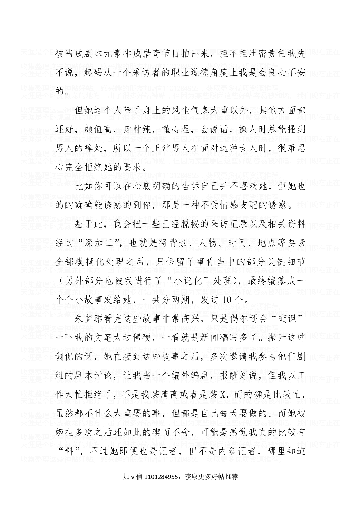

我这类工作年限所掌握的隐秘事一类的信息相比之下其其实是非常有限的，相比那里那些“大拿”的“师兄”、“师姐”们，我还很嫩的，要是他们给朱琥璐讲个故事，那段时间拿出来就一出来能“霍”的让她好几天都“缓”不过来。

话说回来，这几天她经常给我发信息，大体上都是在围着这个主题，所以这一天我看到又有新信息发过来，没有多少想，心里估计又是这事，就没有在第一时间打开回复，而一边整理之后，一边看着手头的一个大文件夹整理完毕，松了一口气。分钟后，脑袋里也想到了一个“最近安排了一个去西北采访的行动，一会儿回不来”的借口，打开手机要按照这个想法去回复她，可看到的她的信息具体内容后，才知道不是在那回事，她的信息简单，就三个字：

“出事了！”

我回复：
“出什么事了？”

过了不到一分钟，她回复：
“这里说不清楚，我现在就在第一线，黄侦探说的没错！”

因为她这段时间一直给我说的都是采访稿以及剧本、拍戏的那些事情，以至于她刚开始说这么的时候，我以为是她的剧组出了什么事，或者是上海又发生了什么让我兴奋的新闻，想拿来与我交流——这个多月来，我偶尔如此，我也会隔三差五给她说一下我这边的新鲜事儿，当然，与你有关。

但他后面提到了“黄侦探”，说的不用想就是刚刚从法律晨回来，受援一个精通千术的朋友合作打掉当地一家大型地下赌场联合合出的团伙的黄勋，而她与黄勋有所交集的地方就是有关杨百发的那些案件了，如她说，这必定有了“后续”，而这件事可不是什么新发现。

我想了一会儿，回道：
“具体是什么情况？你在第一线怎么报道？”

这次她回的很快，几乎是秒：
“嗯，我现在就在第一线，警方已经封锁了受害者的遇地点，不过情况不清楚，你要感兴趣的话，最好直接过来。”

临走之前，我们互留了联系方式，这个多月来一搭一搭的过的几次，她每次主动找我基本都跑不了了想要我的采访资料这些事，不管挠莉说些什么开场，最终都会逸到这个话题上来，不是我小气，一个也不给她，是因为我手头处理的这些信息的确不能公于众，要是弄到她手里被当成副本元素排成奇事节目拍出来，还不担负密责任我先不说，起码从一个采访者的职业道德角度来说我是会良心不安的。

但是她这个人除了身上的风气太大了以外，其他方面还好，颜值高，身材好，懂心理，会说话，撩人时总能碰到男人的Exact处，所以一个正常男人在面对这种女人时，很难完全拒绝她的要求。

比如你可以在心里明确的告诉自己不喜欢她，但她的确能诱惑到的你，那是一种不受情感支配的诱惑。

基于此，我会把一些已经脱敏的访谈记录以及相关资料经过“深度加工”，也就是将背景、人物、时间、地点等要素全部模板化处理之后，只保留了事情中的部分关键细节（另外部分也被我进行了“小说化”处理），最终编纂成一个故事故事给她，共分两期，发过10个。

朱栗看着这些事非常高兴，可她乔尔还会“嘲讽”一下我的笔法太老套了，一看就是新闻写满了。她开这些调侃的话，她在接到这些故事之后，多次邀请我参与他们剧组的剧本讨论，让我当一个外编剧，报酬很好，但我自己工作太忙拒绝了，不是我装清高或者是装老，而是确实比较忙，虽然都不什么太重要的事，都是自己每天做的。而她被我拒多次之后还有如此的错而不涵，可能是感觉我真的比较有“料”，不过她即使也是记者，但不是内目记者，哪里知道

我这类工作年限所掌握的隐秘事一类的信息相比之下其其实是非常有限的，相比那里那些“大拿”的“师兄”、“师姐”们，我还很嫩的，要是他们给朱琥璐讲个故事，那段时间拿出来就一出来能“霍”的让她好几天都“缓”不过来。

话说回来，这几天她经常给我发信息，大体上都是在围着这个主题，所以这一天我看到又有新信息发过来，没有多少想，心里估计又是这事，就没有在第一时间打开回复，而一边整理之后，一边看着手头的一个大文件夹整理完毕，松了一口气。分钟后，脑袋里也想到了一个“最近安排了一个去西北采访的行动，一会儿回不来”的借口，打开手机要按照这个想法去回复她，可看到的她的信息具体内容后，才知道不是在那回事，她的信息简单，就三个字：

“出事了！”

我回复：
“出什么事了？”

过了不到一分钟，她回复：
“这里说不清楚，我现在就在第一线，黄侦探说的没错！”

因为她这段时间一直给我说的都是采访稿以及剧本、拍戏的那些事情，以至于她刚开始说这么的时候，我以为是她的剧组出了什么事，或者是上海又发生了什么让我兴奋的新闻，想拿来与我交流——这个多月来，我偶尔如此，我也会隔三差五给她说一下我这边的新鲜事儿，当然，与你有关。

但他后面提到了“黄侦探”，说的不用想就是刚刚从法律晨回来，受援一个精通千术的朋友合作打掉当地一家大型赌场赌场合出的团伙的黄勋，而她与黄勋有所交集的地方就是有关杨百发的那些案件了，如她说，这必定有了“后续”，而这件事可不是什么新发现。

我想了一会儿，回道：
“具体是什么情况？你在第一线怎么报道？”

这次她回的很快，几乎是秒：
“嗯，我现在就在第一线，警方已经封锁了受害者的遇地点，不过情况不清楚，你要感兴趣的话，最好直接过来。”

临走之前，我们互留了联系方式，这个多月来一搭一搭的过的几次，她每次主动找我基本都跑不了了想要我的采访资料这些事，不管挠莉说些什么开场，最终都会逸到这个话题上来，不是我小气，一个也不给她，是因为我手头处理的这些信息的确不能公于众，要是弄到她手里被当成副本元素排成奇事节目拍出来，还不担负密责任我先不说，起码从一个采访者的职业道德角度来说我是会良心不安的。

（此处）

这次她回的很快，几乎是秒：
“嗯，我现在就在第一线，警方已经封锁了受害者的遇地点，不过情况不清楚，你要感兴趣的话，最好直接过来。”

临走之前，我们互留了联系方式，这个多月来一搭一搭的过的几次，她每次主动找我基本都跑不了了想要我的采访资料这些事，不管挠莉说些什么开场，最终都会逸到这个话题上来，不是我小气，一个也不给她，是因为我手头处理的这些信息的确不能公于众，要是弄到她手里被当成副本元素排成奇事节目拍出来，还不担负密责任我先不说，起码从一个采访者的职业道德角度来说我是会良心不安的。

（此处）

这次她回的很快，几乎是秒：
“嗯，我现在就在第一线，警方已经封锁了受害者的遇地点，不过情况不清楚，你要感兴趣的话，最好直接过来。”

临走之前，我们互留了联系方式，这个多月来一搭一搭的过的几次，她每次主动找我基本都跑不了了想要我的采访资料这些事，不管挠莉说些什么开场，最终都会逸到这个话题上来，不是我小气，一个也不给她，是因为我手头处理的这些信息的确不能公于众，要是弄到她手里被当成副本元素排成奇事节目拍出来，还不担负密责任我先不说，起码从一个采访者的职业道德角度来说我是会良心不安的。

（此处）

这次她回的很快，几乎是秒：
“嗯，我现在就在第一线，警方已经封锁了受害者的遇地点，不过情况不清楚，你要感兴趣的话，最好直接过来。”

临走之前，我们互留了联系方式，这个多月来一搭一搭的过的几次，她每次主动找我基本都跑不了了想要我的采访资料这些事，不管挠莉说些什么开场，最终都会逸到这个话题上来，不是我小气，一个也不给她，是因为我手头处理的这些信息的确不能公于众，要是弄到她手里被当成副本元素排成奇事节目拍出来，还不担负密责任我先不说，起码从一个采访者的职业道德角度来说我是会良心不安的。

（此处）

这次她回的很快，几乎是秒：
“嗯，我现在就在第一线，警方已经封锁了受害者的遇地点，不过情况不清楚，你要感兴趣的话，最好直接过来。”

临走之前，我们互留了联系方式，这个多月来一搭一搭的过的几次，她每次主动找我基本都跑不了了想要我的采访资料这些事，不管挠莉说些什么开场，最终都会逸到这个话题上来，不是我小气，一个也不给她，是因为我手头处理的这些信息的确不能公于众，要是弄到她手里被当成副本元素排成奇事节目拍出来，还不担负密责任我先不说，起码从一个采访者的职业道德角度来说我是会良心不安的。

（此处）

这次她回的很快，几乎是秒：
“嗯，我现在就在第一线，警方已经封锁了受害者的遇地点，不过情况不清楚，你要感兴趣的话，最好直接过来。”

（此处）

（疼疼疼疼疼疼疼疼疼疼疼疼疼疼疼的疼疼疼疼疼疼我疼我疼我疼我疼我疼疼疼疼疼疼疼疼疼疼疼疼疼疼疼疼我疼我疼我疼我疼我疼疼疼疼疼疼疼疼疼疼疼疼疼疼疼疼疼疼疼疼疼疼疼疼疼疼疼疼


疼疼疼疼疼疼疼疼疼疼疼疼疼疼疼疼疼疼疼疼疼疼疼疼疼疼疼疼疼疼疼疼疼疼疼疼疼疼疼疼疼疼疼疼疼疼疼疼疼疼疼疼疼疼疼疼疼疼疼疼疼疼疼疼疼疼疼疼疼疼疼疼疼疼疼疼疼疼疼疼疼疼疼疼疼疼疼疼疼疼疼疼疼疼疼疼疼疼疼疼疼疼疼疼疼疼疼疼疼疼疼疼疼疼疼疼疼疼疼疼疼疼疼疼疼疼疼疼疼疼疼疼疼疼疼疼疼疼疼疼疼疼疼疼疼疼疼疼疼疼疼疼疼疼疼疼疼疼疼疼疼疼疼疼疼疼疼疼疼疼疼疼疼疼疼疼疼疼疼疼疼疼疼疼疼疼疼疼疼疼疼疼疼疼疼疼疼疼疼疼疼疼疼疼疼疼疼疼疼疼疼疼疼疼疼疼疼疼疼疼疼疼疼疼疼疼疼疼疼疼疼疼疼疼疼疼疼疼疼疼疼疼疼疼疼疼疼疼疼疼疼疼疼疼疼疼疼疼疼疼疼疼疼疼疼疼疼疼疼疼疼疼疼疼疼疼疼疼疼疼疼疼疼疼疼疼疼疼疼疼疼疼疼疼疼疼疼疼疼疼疼疼疼疼疼疼疼疼疼疼疼疼疼疼疼疼疼疼疼疼疼疼疼疼疼疼疼疼疼疼疼疼疼疼疼疼疼疼疼疼疼疼疼疼疼疼疼疼疼疼疼疼疼疼疼疼疼疼疼疼疼疼疼疼疼疼疼疼疼疼疼疼疼疼疼疼疼疼疼疼疼疼疼疼疼疼疼疼疼疼疼疼疼疼疼疼疼疼疼疼疼疼疼疼疼疼疼疼疼疼疼疼疼疼疼疼疼疼疼疼疼疼疼疼疼疼疼疼疼疼疼疼疼疼疼疼疼疼疼疼疼疼疼疼疼疼疼疼疼疼疼疼疼疼疼疼疼疼疼疼疼疼疼疼疼疼疼疼疼疼疼疼疼疼疼疼疼疼疼疼疼疼疼疼疼疼疼疼疼疼疼疼疼疼疼疼疼疼疼疼疼疼疼疼疼疼疼疼疼疼疼疼疼疼疼疼疼疼疼疼疼疼疼疼疼疼疼疼疼疼疼疼疼疼疼疼疼疼疼疼疼疼疼疼疼疼疼疼疼疼疼疼疼疼疼疼疼疼疼疼疼疼疼疼疼疼疼疼疼疼疼疼疼疼疼疼疼疼疼疼疼疼疼疼疼疼疼疼疼疼疼疼疼疼疼疼疼疼疼疼疼疼疼疼疼疼疼疼疼疼疼疼疼疼疼疼疼疼疼疼疼疼疼疼疼疼疼疼疼疼疼疼疼疼疼疼疼疼疼疼疼疼疼疼疼疼疼疼疼疼疼疼疼疼疼疼疼疼疼疼疼疼疼疼疼疼疼疼疼疼疼疼疼疼疼疼疼疼疼疼疼疼疼疼疼疼疼疼疼疼疼疼疼疼疼疼疼疼疼疼疼疼疼疼疼疼疼疼疼疼疼疼疼疼疼疼疼疼疼疼疼疼疼疼疼疼疼疼疼疼疼疼疼疼疼疼疼疼疼疼疼疼疼疼疼疼疼疼疼疼疼疼疼疼疼疼疼疼疼疼疼疼疼疼疼疼疼疼疼疼疼疼疼疼疼疼疼疼疼疼疼疼疼疼疼疼疼疼疼疼疼疼疼疼疼疼疼疼疼疼疼疼疼疼疼疼疼疼疼疼疼疼疼疼疼疼疼疼疼疼疼疼疼疼疼疼疼疼疼疼疼疼疼疼疼疼疼疼疼疼疼疼疼疼疼疼疼疼疼疼疼疼疼疼疼疼疼疼疼疼疼疼疼疼疼疼疼疼疼疼疼疼疼疼疼疼疼疼疼疼疼疼疼疼疼疼疼疼疼疼疼疼疼疼疼疼疼疼疼疼疼疼疼疼疼疼疼疼疼疼疼疼疼疼疼疼疼疼疼疼疼疼疼疼疼疼疼疼疼疼疼疼疼疼疼疼疼疼疼疼疼疼疼疼疼疼疼疼疼疼疼疼疼疼疼疼疼疼疼疼疼疼疼疼疼疼疼疼疼疼疼疼疼疼疼疼疼疼疼疼疼疼疼疼疼疼疼疼疼疼疼疼疼疼疼疼疼疼疼疼疼疼疼疼疼疼疼疼疼疼疼疼疼疼疼疼疼疼疼疼疼疼疼疼疼疼疼疼疼疼疼疼疼疼疼疼疼疼疼疼疼疼疼疼疼疼疼疼疼疼疼疼疼疼疼疼疼疼疼疼疼疼疼疼疼疼疼疼疼疼疼疼疼疼疼疼疼疼疼疼疼疼疼疼疼疼疼疼疼疼疼疼疼疼疼疼疼疼疼疼疼疼疼疼疼疼疼疼疼疼疼疼疼疼疼疼疼疼疼疼疼疼疼疼疼疼疼疼疼疼疼疼疼疼疼疼疼疼疼疼疼疼疼疼疼疼疼疼疼疼疼疼疼疼疼疼疼疼疼疼疼疼疼疼疼疼疼疼疼疼疼疼疼疼疼疼疼疼疼疼疼疼疼疼疼疼疼疼疼疼疼疼疼疼疼疼疼疼疼疼疼疼疼疼疼疼疼疼疼疼疼疼疼疼疼疼疼疼疼疼疼疼疼疼疼疼疼疼疼疼疼疼疼疼疼疼疼疼疼疼疼疼疼疼疼疼疼疼疼疼疼疼疼疼疼疼疼疼疼疼疼疼疼疼疼疼疼疼疼疼疼疼疼疼疼疼疼疼疼疼疼疼疼疼疼疼疼疼疼疼疼疼疼疼疼疼疼疼疼疼疼疼疼疼疼疼疼疼疼疼疼疼疼疼疼疼疼疼疼疼疼疼疼疼疼疼疼疼疼疼疼疼疼疼疼疼疼疼疼疼疼疼疼疼疼疼疼疼疼疼疼疼疼疼疼疼疼疼疼疼疼疼疼疼疼疼疼疼疼疼疼疼疼疼疼疼疼疼疼疼疼疼疼疼疼疼疼疼疼疼疼疼疼疼疼疼疼疼疼疼疼疼疼疼疼疼疼疼疼疼疼疼疼疼疼疼疼疼疼疼疼疼疼疼疼疼疼疼疼疼疼疼疼疼疼疼疼疼疼疼疼疼疼疼疼疼疼疼疼疼疼疼疼疼疼疼疼疼疼疼疼疼疼疼疼疼疼疼疼疼疼疼疼疼疼疼疼疼疼疼疼疼疼疼疼疼疼疼疼疼疼疼疼疼疼疼疼疼疼疼疼疼疼疼疼疼疼疼疼疼疼疼疼疼疼疼疼疼疼疼疼疼疼疼疼疼疼疼疼疼疼疼疼疼疼疼疼疼疼疼疼疼疼疼疼疼疼疼疼疼疼疼疼疼疼疼疼疼疼疼疼疼疼疼疼疼疼疼疼疼疼疼疼疼疼疼疼疼疼疼疼疼疼疼疼疼疼疼疼疼疼疼疼疼疼疼疼疼疼疼疼疼疼疼疼疼疼疼疼疼疼疼疼疼疼疼疼疼疼疼疼疼疼疼疼疼疼疼疼疼疼疼疼疼疼疼疼疼疼疼疼疼疼疼疼疼疼疼疼疼疼疼疼疼疼疼疼疼疼疼疼疼疼疼疼疼疼疼疼疼疼疼疼疼疼疼疼疼疼疼疼疼疼疼疼疼疼疼疼疼疼疼疼疼疼疼疼疼疼疼疼疼疼疼疼疼疼疼疼疼疼疼疼疼疼疼疼疼疼疼疼疼疼疼疼疼疼疼疼疼疼疼疼疼疼疼疼疼疼疼疼疼疼疼疼疼疼疼疼疼疼疼疼疼疼疼疼疼疼疼疼疼疼疼疼疼疼疼疼疼疼疼疼疼疼疼疼疼疼疼疼疼疼疼疼疼疼疼疼疼疼疼疼疼疼疼疼疼疼疼疼疼疼疼疼疼疼疼疼疼疼疼疼疼疼疼疼疼疼疼疼疼疼疼疼疼疼疼疼疼疼疼疼疼疼疼疼疼疼疼疼疼疼疼疼疼疼疼疼疼疼疼疼疼疼疼疼疼疼疼疼疼疼疼疼疼疼疼疼疼疼疼疼疼疼疼疼疼疼疼疼疼疼疼疼疼疼疼疼疼疼疼疼疼疼疼疼疼疼疼疼疼疼疼疼疼疼疼疼疼疼疼疼疼疼疼疼疼疼疼疼疼疼疼疼疼疼疼疼疼疼疼疼疼疼疼疼疼疼疼疼疼疼疼疼疼疼疼疼疼疼疼疼疼疼疼疼疼疼疼疼疼疼疼疼疼疼疼疼疼疼疼疼疼疼疼疼疼疼疼疼疼疼疼疼疼疼疼疼疼疼疼疼疼疼疼疼疼疼疼疼疼疼疼疼疼疼疼疼疼疼疼疼疼疼疼疼疼疼疼疼疼疼疼疼疼疼疼疼疼疼疼疼疼疼疼疼疼疼疼疼疼疼疼疼疼疼疼疼疼疼疼疼疼疼疼疼疼疼疼疼疼疼疼疼疼疼疼疼疼疼疼疼疼疼疼疼疼疼疼疼疼疼疼疼疼疼疼疼疼疼疼疼疼疼疼疼疼疼疼疼疼疼疼疼疼疼疼疼疼疼疼疼疼疼疼疼疼疼疼疼疼疼疼疼疼疼疼疼疼疼疼疼疼疼疼疼疼疼疼疼疼疼疼疼疼疼疼疼疼疼疼疼疼疼疼疼疼疼疼疼疼疼疼疼疼疼疼疼疼疼疼疼疼疼疼疼疼疼疼疼疼疼疼疼疼疼疼疼疼疼疼疼疼疼疼疼疼疼疼疼疼疼疼疼疼疼疼疼疼疼疼疼疼疼疼疼疼疼疼疼疼疼疼疼疼疼疼疼疼疼疼疼疼疼疼疼疼疼疼疼疼疼疼疼疼疼疼疼疼疼疼疼疼疼疼疼疼疼疼疼疼疼疼疼疼疼疼疼疼疼疼疼疼疼疼疼疼疼疼疼疼疼疼疼疼疼疼疼疼疼疼疼疼疼疼疼疼疼疼疼疼疼疼疼疼疼疼疼疼疼疼疼疼疼疼疼疼疼疼疼疼疼疼疼疼疼疼疼疼疼疼疼疼疼疼疼疼疼疼疼疼疼疼疼疼疼疼疼疼疼疼疼疼疼疼疼疼疼疼疼疼疼疼疼疼疼疼疼疼疼疼疼疼疼疼疼疼疼疼疼疼疼疼疼疼疼疼疼疼疼疼疼疼疼疼疼疼疼疼疼疼疼疼疼疼疼疼疼疼疼疼疼疼疼疼疼疼疼疼疼疼疼疼疼疼疼疼疼疼疼疼疼疼疼疼疼疼疼疼疼疼疼疼疼疼疼疼疼疼疼疼疼疼疼疼疼疼疼疼疼疼疼疼疼疼疼疼疼疼疼疼疼疼疼疼疼疼疼疼疼疼疼疼疼疼疼疼疼疼疼疼疼疼疼疼疼疼疼疼疼疼疼疼疼疼疼疼疼疼疼疼疼疼疼疼疼疼疼疼疼疼疼疼疼疼疼疼疼疼疼疼疼疼疼疼疼疼疼疼疼疼疼疼疼疼疼疼疼疼疼疼疼疼疼疼疼疼疼疼疼疼疼疼疼疼疼疼疼疼疼疼疼疼疼疼疼疼疼疼疼疼疼疼疼疼疼疼疼疼疼疼疼疼疼疼疼疼疼疼疼疼疼疼疼疼疼疼疼疼疼疼疼疼疼疼疼疼疼疼疼疼疼疼疼疼疼疼疼疼疼疼疼疼疼疼疼疼疼疼疼疼疼疼疼疼疼疼疼疼疼疼疼疼疼疼疼疼疼疼疼疼疼疼疼疼疼疼疼疼疼疼疼疼疼疼疼疼疼疼疼疼疼疼疼疼疼疼疼疼疼疼疼疼疼疼疼疼疼疼疼疼疼疼疼疼疼疼疼疼疼疼疼疼疼疼疼疼疼疼疼疼疼疼疼疼疼疼疼疼疼疼疼疼疼疼疼疼疼疼疼疼疼疼疼疼疼疼疼疼疼疼疼疼疼疼疼疼疼疼疼疼疼疼疼疼疼疼疼疼疼疼疼疼疼疼疼疼疼疼疼疼疼疼疼疼疼疼疼疼疼疼疼疼疼疼疼疼疼疼疼疼疼疼疼疼疼疼疼疼疼疼疼疼疼疼疼疼疼疼疼疼疼疼疼疼疼疼疼疼疼疼疼疼疼疼疼疼疼疼疼疼疼疼疼疼疼疼疼疼疼疼疼疼疼疼疼疼疼疼疼疼疼疼疼疼疼疼疼疼疼疼疼疼疼疼疼疼疼疼疼疼疼疼疼疼疼疼疼疼疼疼疼疼疼疼疼疼疼疼疼疼疼疼疼疼疼疼疼疼疼疼疼疼疼疼疼疼疼疼疼疼疼疼疼疼疼疼疼疼疼疼疼疼疼疼疼疼疼疼疼疼疼疼疼疼疼疼疼疼疼疼疼疼疼疼疼疼疼疼疼疼疼疼疼疼疼疼疼疼疼疼疼疼疼疼疼疼疼疼疼疼疼疼疼疼疼疼疼疼疼疼疼疼疼疼疼疼疼疼疼疼疼疼疼疼疼疼疼疼疼疼疼疼疼疼疼疼疼疼疼疼疼疼疼疼疼疼疼疼疼疼疼疼疼疼疼疼疼疼疼疼疼疼疼疼疼疼疼疼疼疼疼疼疼疼疼疼疼疼疼疼疼疼疼疼疼疼疼疼疼疼疼疼疼疼疼疼疼疼疼疼疼疼疼疼疼疼疼疼疼疼疼疼疼疼疼疼疼疼疼疼疼疼疼疼疼疼疼疼疼疼疼疼疼疼疼疼疼疼疼疼疼疼疼疼疼疼疼疼疼疼疼疼疼疼疼疼疼疼疼疼疼疼疼疼疼疼疼疼疼疼疼疼疼疼疼疼疼疼疼疼疼疼疼疼疼疼疼疼疼疼疼疼疼疼疼疼疼疼疼疼疼疼疼疼疼疼疼疼疼疼疼疼疼疼疼疼疼疼疼疼疼疼疼疼疼疼疼疼疼疼疼疼疼疼疼疼疼疼疼疼疼疼疼疼疼疼疼疼疼疼疼疼疼疼疼疼疼疼疼疼疼疼疼疼疼疼疼疼疼疼疼疼疼疼疼疼疼疼疼疼疼疼疼疼疼疼疼疼疼疼疼疼疼疼疼疼疼疼疼疼疼疼疼疼疼疼疼疼疼疼疼疼疼疼疼疼疼疼疼疼疼疼疼疼疼疼疼疼疼疼疼疼疼疼疼疼疼疼疼疼疼疼疼疼疼疼疼疼疼疼疼疼疼疼疼疼疼疼疼疼疼疼疼疼疼疼疼疼疼疼疼疼疼疼疼疼疼疼疼疼疼疼疼疼疼疼疼疼疼疼疼疼疼疼疼疼疼疼疼疼疼疼疼疼疼疼疼疼疼疼疼疼疼疼疼疼疼疼疼疼疼疼疼疼疼疼疼疼疼疼疼疼疼疼疼疼疼疼疼疼疼疼疼疼疼疼疼疼疼疼疼疼疼疼疼疼疼疼疼疼疼疼疼疼疼疼疼疼疼疼疼疼疼疼疼疼疼疼疼疼疼疼疼疼疼疼疼疼疼疼疼疼疼疼疼疼疼疼疼疼疼疼疼疼疼疼疼疼疼疼疼疼疼疼疼疼疼疼疼疼疼疼疼疼疼疼疼疼疼疼疼疼疼疼疼疼疼疼疼疼疼疼疼疼疼疼疼疼疼疼疼疼疼疼疼疼疼疼疼疼疼疼疼疼疼疼疼疼疼疼疼疼疼疼疼疼疼疼疼疼疼疼疼疼疼疼疼疼疼疼疼疼疼疼疼疼疼疼疼疼疼疼疼疼疼疼疼疼疼疼疼疼疼疼疼疼疼疼疼疼疼疼疼疼疼疼疼疼疼疼疼疼疼疼疼疼疼疼疼疼疼疼疼疼疼疼疼疼疼疼疼疼疼疼疼疼疼疼疼疼疼疼疼疼疼疼疼疼疼疼疼疼疼疼疼疼疼疼疼疼疼疼疼疼疼疼疼疼疼疼疼疼疼疼疼疼疼疼疼疼疼疼疼疼疼疼疼疼疼疼疼疼疼疼疼疼疼疼疼疼疼疼疼疼疼疼疼疼疼疼疼疼疼疼疼疼疼疼疼疼疼疼疼疼疼疼疼疼疼疼疼疼疼疼疼疼疼疼疼疼疼疼疼疼疼疼疼疼疼疼疼疼疼疼疼疼疼疼疼疼疼疼疼疼疼疼疼疼疼疼疼疼疼疼疼疼疼疼疼疼疼疼疼疼疼疼疼疼疼疼疼疼疼疼疼疼疼疼疼疼疼疼疼疼疼疼疼疼疼疼疼疼疼疼疼疼疼疼疼疼疼疼疼疼疼疼疼疼疼疼疼疼疼疼疼疼疼疼疼疼疼疼疼疼疼疼疼疼疼疼疼疼疼疼疼疼疼疼疼疼疼疼疼疼疼疼疼疼疼疼疼疼疼疼疼疼疼疼疼疼疼疼疼疼疼疼疼疼疼疼疼疼疼疼疼疼疼疼疼疼疼疼疼疼疼疼疼疼疼疼疼疼疼疼疼疼疼疼疼疼疼疼疼疼疼疼疼疼疼疼疼疼疼疼疼疼疼疼疼疼疼疼疼疼疼疼疼疼疼疼疼疼疼疼疼疼疼疼疼疼疼疼疼疼疼疼疼疼疼疼疼疼疼疼疼疼疼疼疼疼疼疼疼疼疼疼疼疼疼疼疼疼疼疼疼疼疼疼疼疼疼疼疼疼疼疼疼疼疼疼疼疼疼疼疼疼疼疼疼疼疼疼疼疼疼疼疼疼疼疼疼疼疼疼疼疼疼疼疼疼疼疼疼疼疼疼疼疼疼疼疼疼疼疼疼疼疼疼疼疼疼疼疼疼疼疼疼疼疼疼疼疼疼疼疼疼疼疼疼疼疼疼疼疼疼疼疼疼疼疼疼疼疼疼疼疼疼疼疼疼疼疼疼疼疼疼疼疼疼疼疼疼疼疼疼疼疼疼疼疼疼疼疼疼疼疼疼疼疼疼疼疼疼疼疼疼疼直接通过语音两段发给我了，我闲心被办公室里的其他同事听见，就戴上耳机仔细听了一遍，感觉从逻辑来说，她的话的确让我缓了片刻，我理了理想路，打字回道：
“他们三个都是什么职业的？有什么背景？还有更多的资料吗？这三个人都做了什么？”

朱梦瑶的很快，她接着用语音口气气急地说的：
“我都说了在这里说不清楚，你要知道这事跟黄侦探的话有关，就立马过来一趟上海！”

（未完待续）疼疼疼疼疼疼疼疼疼疼疼疼疼疼疼疼疼疼疼疼疼疼疼疼疼疼疼疼疼疼疼疼疼疼疼疼疼疼疼疼疼疼疼疼疼疼疼疼疼疼疼疼疼疼疼疼疼疼疼疼疼疼疼疼疼疼疼疼疼疼疼疼疼疼疼疼疼疼疼疼疼疼疼疼疼疼疼疼疼疼疼疼疼疼疼疼疼疼疼疼疼疼疼疼疼疼疼疼疼疼疼疼疼疼疼疼疼疼疼疼疼疼疼疼疼疼疼疼疼疼疼疼疼疼疼疼疼疼疼疼疼疼疼疼疼疼疼疼疼疼疼疼疼疼疼疼疼疼疼疼疼疼疼疼疼疼疼疼疼疼疼疼疼疼疼疼疼疼疼疼疼疼疼疼疼疼疼疼疼疼疼疼疼疼疼疼疼疼疼疼疼疼疼疼疼疼疼疼疼疼疼疼疼疼疼疼疼疼疼疼疼疼疼疼疼疼疼疼疼疼疼疼疼疼疼疼疼疼疼疼疼疼疼疼疼疼疼疼疼疼疼疼疼疼疼疼疼疼疼疼疼疼疼疼疼疼疼疼疼疼疼疼疼疼疼疼疼疼疼疼疼疼疼疼疼疼疼疼疼疼疼疼疼疼疼疼疼疼疼疼疼疼疼疼疼疼疼疼疼疼疼疼疼疼疼疼疼疼疼疼疼疼疼疼疼疼疼疼疼疼疼疼疼疼疼疼疼疼疼疼疼疼疼疼疼疼疼疼疼疼疼疼疼疼疼疼疼疼疼疼疼疼疼疼疼疼疼疼疼疼疼疼疼疼疼疼疼疼疼疼疼疼疼疼疼疼疼疼疼疼疼疼疼疼疼疼疼疼疼疼疼疼疼疼疼疼疼疼疼疼疼疼疼疼疼疼疼疼疼疼疼疼疼疼疼疼疼疼疼疼疼疼疼疼疼疼疼疼疼疼疼疼疼疼疼疼疼疼疼疼疼疼疼疼疼疼疼疼疼疼疼疼疼疼疼疼疼疼疼疼疼疼疼疼疼疼疼疼疼疼疼疼疼疼疼疼疼疼疼疼疼疼疼疼疼疼疼疼疼疼疼疼疼疼疼疼疼疼疼疼疼疼疼疼疼疼疼疼疼疼疼疼疼疼疼疼疼疼疼疼疼疼疼疼疼疼疼疼疼疼疼疼疼疼疼疼疼疼疼疼疼疼疼疼疼疼疼疼疼疼疼疼疼疼疼疼疼疼疼疼疼疼疼疼疼疼疼疼疼疼疼疼疼疼疼疼疼疼疼疼疼疼疼疼疼疼疼疼疼疼疼疼疼疼疼疼疼疼疼疼疼疼疼疼疼疼疼疼疼疼疼疼疼疼疼疼疼疼疼疼疼疼疼疼疼疼疼疼疼疼疼疼疼疼疼疼疼疼疼疼疼疼疼疼疼疼疼疼疼疼疼疼疼疼疼疼疼疼疼疼疼疼疼疼疼疼疼疼疼疼疼疼疼疼疼疼疼疼疼疼疼疼疼疼疼疼疼疼疼疼疼疼疼疼疼疼疼疼疼疼疼疼疼疼疼疼疼疼疼疼疼疼疼疼疼疼疼疼疼疼疼疼疼疼疼疼疼疼疼疼疼疼疼疼疼疼疼疼疼疼疼疼疼疼疼疼疼疼疼疼疼疼疼疼疼疼疼疼疼疼疼疼疼疼疼疼疼疼疼疼疼疼疼疼疼疼疼疼疼疼疼疼疼疼疼疼疼疼疼疼疼疼疼疼疼疼疼疼疼疼疼疼疼疼疼疼疼疼疼疼疼疼疼疼疼疼疼疼疼疼疼疼疼疼疼疼疼疼疼疼疼疼疼疼疼疼疼疼疼疼疼疼疼疼疼疼疼疼疼疼疼疼疼疼疼疼疼疼疼疼疼疼疼疼疼疼疼疼疼疼疼疼疼疼疼疼疼疼疼疼疼疼疼疼疼疼疼疼疼疼疼疼疼疼疼疼疼疼疼疼疼疼疼疼疼疼疼疼疼疼疼疼疼疼疼疼疼疼疼疼疼疼疼疼疼疼疼疼疼疼疼疼疼疼疼疼疼疼疼疼疼疼疼疼疼疼疼疼疼疼疼疼疼疼疼疼疼疼疼疼疼疼疼疼疼疼疼疼疼疼疼疼疼疼疼疼疼疼疼疼疼疼疼疼疼疼疼疼疼疼疼疼疼疼疼疼疼疼疼疼疼疼疼疼疼疼疼疼疼疼疼疼疼疼疼疼疼疼疼疼疼疼疼疼疼疼疼疼疼疼疼疼疼疼疼疼疼疼疼疼疼疼疼疼疼疼疼疼疼疼疼疼疼疼疼疼疼疼疼疼疼疼疼疼疼疼疼疼疼疼疼疼疼疼疼疼疼疼疼疼疼疼疼疼疼疼疼疼疼疼疼疼疼疼疼疼疼疼疼疼疼疼疼疼疼疼疼疼疼疼疼疼疼疼疼疼疼疼疼疼疼疼疼疼疼疼疼疼疼疼疼疼疼疼疼疼疼疼疼疼疼疼疼疼疼疼疼疼疼疼疼疼疼疼疼疼疼疼疼疼疼疼疼疼疼疼疼疼疼疼疼疼疼疼疼疼疼疼疼疼疼疼疼疼疼疼疼疼疼疼疼疼疼疼疼疼疼疼疼疼疼疼疼疼疼疼疼疼疼疼疼疼疼疼疼疼疼疼疼疼疼疼疼疼疼疼疼疼疼疼疼疼疼疼疼疼疼疼疼疼疼疼疼疼疼疼疼疼疼疼疼疼疼疼疼疼疼疼疼疼疼疼疼疼疼疼疼疼疼疼疼疼疼疼疼疼疼疼疼疼疼疼疼疼疼疼疼疼疼疼疼疼疼疼疼疼疼疼疼疼疼疼疼疼疼疼疼疼疼疼疼疼疼疼疼疼疼疼疼疼疼疼疼疼疼疼疼疼疼疼疼疼疼疼疼疼疼疼疼疼疼疼疼疼疼疼疼疼疼疼疼疼疼疼疼疼疼疼疼疼疼疼疼疼疼疼疼疼疼疼疼疼疼疼疼疼疼疼疼疼疼疼疼疼疼疼疼疼疼疼疼疼疼疼疼疼疼疼疼疼疼疼疼疼疼疼疼疼疼疼疼疼疼疼疼疼疼疼疼疼疼疼疼疼疼疼疼疼疼疼疼疼疼疼疼疼疼疼疼疼疼疼疼疼疼疼疼疼疼疼疼疼疼疼疼疼疼疼疼疼疼疼疼疼疼疼疼疼疼疼疼疼疼疼疼疼疼疼疼疼疼疼疼疼疼疼疼疼疼疼疼疼疼疼疼疼疼疼疼疼疼疼疼疼疼疼疼疼疼疼疼疼疼疼疼疼疼疼疼疼疼疼疼疼疼疼疼疼疼疼疼疼疼疼疼疼疼疼疼疼疼疼疼疼疼疼疼疼疼疼疼疼疼疼疼疼疼疼疼疼疼疼疼疼疼疼疼疼疼疼疼疼疼疼疼疼疼疼疼疼疼疼疼疼疼疼疼疼疼疼疼疼疼疼疼疼疼疼疼疼疼疼疼疼疼疼疼疼疼疼疼疼疼疼疼疼疼疼疼疼疼疼疼疼疼疼疼疼疼疼疼疼疼疼疼疼疼疼疼疼疼疼疼疼疼疼疼疼疼疼疼疼疼疼疼疼疼疼疼疼疼疼疼疼疼疼疼疼疼疼疼疼疼疼疼疼疼疼疼疼疼疼疼疼疼疼疼疼疼疼疼疼疼疼疼疼疼疼疼疼疼疼疼疼疼疼疼疼疼疼疼疼疼疼疼疼疼疼疼疼疼疼疼疼疼疼疼疼疼疼疼疼疼疼疼疼疼疼疼疼疼疼疼疼疼疼疼疼疼疼疼疼疼疼疼疼疼疼疼疼疼疼疼疼疼疼疼疼疼疼疼疼疼疼疼疼疼疼疼疼疼疼疼疼疼疼疼疼疼疼疼疼疼疼疼疼疼疼疼疼疼疼疼疼疼疼疼疼疼疼疼疼疼疼疼疼疼疼疼疼疼疼疼疼疼疼疼疼疼疼疼疼疼疼疼疼疼疼疼疼疼疼疼疼疼疼疼疼疼疼疼疼疼疼疼疼疼疼疼疼疼疼疼疼疼疼疼疼疼疼疼疼疼疼疼疼疼疼疼疼疼疼疼疼疼疼疼疼疼疼疼疼疼疼疼疼疼疼疼疼疼疼疼疼疼疼疼疼疼疼疼疼疼疼疼疼疼疼疼疼疼疼疼疼疼疼疼疼疼疼疼疼疼疼疼疼疼疼疼疼疼疼疼疼疼疼疼疼疼疼疼疼疼疼疼疼疼疼疼疼疼疼疼疼疼疼疼疼疼疼疼疼疼疼疼疼疼疼疼疼疼疼疼疼疼疼疼疼疼疼疼疼疼疼疼疼疼疼疼疼疼疼疼疼疼疼疼疼疼疼疼疼疼疼疼疼疼疼疼疼疼疼疼疼疼疼疼疼疼疼疼疼疼疼疼疼疼疼疼疼疼疼疼疼疼疼疼疼疼疼疼疼疼疼疼疼疼疼疼疼疼疼疼疼疼疼疼疼疼疼疼疼疼疼疼疼疼疼疼疼疼疼疼疼疼疼疼疼疼疼疼疼疼疼疼疼疼疼疼疼疼疼疼疼疼疼疼疼疼疼疼疼疼疼疼疼疼疼疼疼疼疼疼疼疼疼疼疼疼疼疼疼疼疼疼疼疼疼疼疼疼疼疼疼疼疼疼疼疼疼疼疼疼疼疼疼疼疼疼疼疼疼疼疼疼疼疼疼疼疼疼疼疼疼疼疼疼疼疼疼疼疼疼疼疼疼疼疼疼疼疼疼疼疼疼疼疼疼疼疼疼疼疼疼疼疼疼疼疼疼疼疼疼疼疼疼疼疼疼疼疼疼疼疼疼疼疼疼疼疼疼疼疼疼疼疼疼疼疼疼疼疼疼疼疼疼疼疼疼疼疼疼疼疼疼疼疼疼疼疼疼疼疼疼疼疼疼疼疼疼疼疼疼疼疼疼疼疼疼疼疼疼疼疼疼疼疼疼疼疼疼疼疼疼疼疼疼疼疼疼疼疼疼疼疼疼疼疼疼疼疼疼疼疼疼疼疼疼疼疼疼疼疼疼疼疼疼疼疼疼疼疼疼疼疼疼疼疼疼疼疼疼疼疼疼疼疼疼疼疼疼疼疼疼疼疼疼疼疼疼疼疼疼疼疼疼疼疼疼疼疼疼疼疼疼疼疼疼疼疼疼疼疼疼疼疼疼疼疼疼疼疼疼疼疼疼疼疼疼疼疼疼疼疼疼疼疼疼疼疼疼疼疼疼疼疼疼疼疼疼疼疼疼疼疼疼疼疼疼疼疼疼疼疼疼疼疼疼疼疼疼疼疼疼疼疼疼疼疼疼疼疼疼疼疼疼疼疼疼疼疼疼疼疼疼疼疼疼疼疼疼疼疼疼疼疼疼疼疼疼疼疼疼疼疼疼疼疼疼疼疼疼疼疼疼疼疼疼疼疼疼疼疼疼疼疼疼疼疼疼疼疼疼疼疼疼疼疼疼疼疼疼疼疼疼疼疼疼疼疼疼疼疼疼疼疼疼疼疼疼疼疼疼疼疼疼疼疼疼疼疼疼疼疼疼疼疼疼疼疼疼疼疼疼疼疼疼疼疼疼疼疼疼疼疼疼疼疼疼疼疼疼疼疼疼疼疼疼疼疼疼疼疼疼疼疼疼疼疼疼疼疼疼疼疼疼疼疼疼疼疼疼疼疼疼疼疼疼疼疼疼疼疼疼疼疼疼疼疼疼疼疼疼疼疼疼疼疼疼疼疼疼疼疼疼疼疼疼疼疼疼疼疼疼疼疼疼疼疼疼疼疼疼疼疼疼疼疼疼疼疼疼疼疼疼疼疼疼疼疼疼疼疼疼疼疼疼疼疼疼疼疼疼疼疼疼疼疼疼疼疼疼疼疼疼疼疼疼疼疼疼疼疼疼疼疼疼疼疼疼疼疼疼疼疼疼疼疼疼疼疼疼疼疼疼疼疼疼疼疼疼疼疼疼疼疼疼疼疼疼疼疼疼疼疼疼疼疼疼疼疼疼疼疼疼疼疼疼疼疼疼疼疼疼疼疼疼疼疼疼疼疼疼疼疼疼疼疼疼疼疼疼疼疼疼疼疼疼疼疼疼疼疼疼疼疼疼疼疼疼疼疼疼疼疼疼疼疼疼疼疼疼疼疼疼疼疼疼疼疼疼疼疼疼疼疼疼疼疼疼疼疼疼疼疼疼疼疼疼疼疼疼疼疼疼疼疼疼疼疼疼疼疼疼疼疼疼疼疼疼疼疼疼疼疼疼疼疼疼疼疼疼疼疼疼疼疼疼疼疼疼疼疼疼疼疼疼疼疼疼疼疼疼疼疼疼疼疼疼疼疼疼疼疼疼疼疼疼疼疼疼疼疼疼疼疼疼疼疼疼疼疼疼疼疼疼疼疼疼疼疼疼疼疼疼疼疼疼疼疼疼疼疼疼疼疼疼疼疼疼疼疼疼疼疼疼疼疼疼疼疼疼疼疼疼疼疼疼疼疼疼疼疼疼疼疼疼疼疼疼疼疼疼疼疼疼疼疼疼疼疼疼疼疼疼疼疼疼疼疼疼疼疼疼疼疼疼疼疼疼疼疼疼疼疼疼疼疼疼疼疼疼疼疼疼疼疼疼疼疼疼疼疼疼疼疼疼疼疼疼疼疼疼疼疼疼疼疼疼疼疼疼疼疼疼疼疼疼疼疼疼疼疼疼疼疼疼疼疼疼疼疼疼疼疼疼疼疼疼疼疼疼疼疼疼疼疼疼疼疼疼疼疼疼疼疼疼疼疼疼疼疼疼疼疼疼疼疼疼疼疼疼疼疼疼疼疼疼疼疼疼疼疼疼疼疼疼疼疼疼疼疼疼疼疼疼疼疼疼疼疼疼疼疼疼疼疼疼疼疼疼疼疼疼疼疼疼疼疼疼疼疼疼疼疼疼疼疼疼疼疼疼疼疼疼疼疼疼疼疼疼疼疼疼疼疼疼疼疼疼疼疼疼疼疼疼疼疼疼疼疼疼疼疼疼疼疼疼疼疼疼疼疼疼疼疼疼疼疼疼疼疼疼疼疼疼疼疼疼疼疼疼疼疼疼疼疼疼疼疼疼疼疼疼疼疼疼疼疼疼疼疼疼疼疼疼疼疼疼疼疼疼疼疼疼疼疼疼疼疼疼疼疼疼疼疼疼疼疼疼疼疼疼疼疼疼疼疼疼疼疼疼疼疼疼疼疼疼疼疼疼疼疼疼疼疼疼疼疼疼疼疼疼疼疼疼疼疼疼疼疼疼疼疼疼疼疼疼疼疼疼疼疼疼疼疼疼疼疼疼疼疼疼疼疼疼疼疼疼疼疼疼疼疼疼疼疼疼疼疼疼疼疼疼疼疼疼疼疼疼疼疼疼疼疼疼疼疼疼疼疼疼疼疼疼疼疼疼疼疼疼疼疼疼疼疼疼疼疼疼疼疼疼疼疼疼疼疼疼疼疼疼疼疼疼疼疼疼疼疼疼疼疼疼疼疼疼疼疼疼疼疼疼疼疼疼疼疼疼疼疼疼疼疼疼疼疼疼疼疼疼疼疼疼疼疼疼疼疼疼疼疼疼疼疼疼疼疼疼疼疼疼疼疼疼疼疼疼疼疼疼疼疼疼疼疼疼疼疼疼疼疼疼疼疼疼疼疼疼疼疼疼疼疼疼疼疼疼疼疼疼疼疼疼疼疼疼疼疼疼疼疼疼疼疼疼疼疼疼疼疼疼疼疼疼疼疼疼疼疼疼疼疼疼疼疼疼疼疼疼疼疼疼疼疼疼疼疼疼疼疼疼疼疼疼疼疼疼疼疼疼疼疼疼疼疼疼疼疼疼疼疼疼疼疼疼疼疼疼疼疼疼疼疼疼疼疼疼疼疼疼疼疼疼疼疼疼疼疼疼疼疼疼疼疼疼疼疼疼疼疼疼疼疼疼疼疼疼疼疼疼疼疼疼疼疼疼疼疼疼疼疼疼疼疼疼疼疼疼疼疼疼疼疼疼疼疼疼疼疼疼疼疼疼疼疼疼疼疼疼疼疼疼疼疼疼疼疼疼疼疼疼疼疼疼疼疼疼疼疼疼疼疼疼疼疼疼疼疼疼疼疼疼疼疼疼疼疼疼疼疼疼疼疼疼疼疼疼疼疼疼疼疼疼疼疼疼疼疼疼疼疼疼疼疼疼疼疼疼疼疼疼疼疼疼疼疼疼疼疼疼疼疼疼疼疼疼疼疼疼疼疼疼疼疼疼疼疼疼疼疼疼疼疼疼疼疼疼疼疼疼疼疼疼疼疼疼疼疼疼疼疼疼疼疼疼疼疼疼疼疼疼疼疼疼疼疼疼疼疼疼疼疼疼疼疼疼疼疼疼疼疼疼疼疼疼疼疼疼疼疼疼疼疼疼疼疼疼疼疼疼疼疼疼疼疼疼疼疼疼疼疼疼疼疼疼疼疼疼疼疼疼疼疼疼疼疼疼疼疼疼疼疼疼疼疼疼疼疼疼疼疼疼疼疼疼疼疼疼疼疼疼疼疼疼疼疼疼疼疼疼疼疼疼疼疼疼疼疼疼疼疼疼疼疼疼疼疼疼疼疼疼疼疼疼疼疼疼疼疼疼疼疼疼疼疼疼疼疼疼疼疼疼疼疼疼疼疼疼疼疼疼疼疼疼疼疼疼疼疼疼疼疼疼疼疼疼疼疼疼疼疼疼疼疼疼疼疼疼疼疼疼疼疼疼疼疼疼疼疼疼疼疼疼疼疼疼疼疼疼疼疼疼疼疼疼疼疼疼疼疼疼疼疼疼疼疼疼疼疼疼疼疼疼疼疼疼疼疼疼疼疼疼疼疼疼疼疼疼疼疼疼疼疼疼疼疼疼疼疼疼疼疼疼疼疼疼疼疼疼疼疼疼疼疼疼疼疼疼疼疼疼疼疼疼疼疼疼疼疼疼疼疼疼疼疼疼疼疼疼疼疼疼疼疼疼疼疼疼疼疼疼疼疼疼疼疼疼疼疼疼疼疼疼疼疼疼疼疼疼疼疼疼疼疼疼疼疼疼疼疼疼疼疼疼疼疼疼疼疼疼疼疼疼疼疼疼疼疼疼疼疼疼疼疼疼疼疼疼疼疼疼疼疼疼疼疼疼疼疼疼疼疼疼疼疼疼疼疼疼疼疼疼疼疼疼疼疼疼疼疼疼疼疼疼疼疼疼疼疼疼疼疼疼疼疼疼疼疼疼疼疼疼疼疼疼疼疼疼疼疼疼疼疼疼疼疼疼疼疼疼疼疼疼疼疼疼疼疼疼疼疼疼疼疼疼疼疼疼疼疼疼疼疼疼疼疼疼疼疼疼疼疼疼疼疼疼疼疼疼疼疼疼疼疼疼疼疼疼疼疼疼疼疼疼疼疼疼疼疼疼疼疼疼疼疼疼疼疼疼疼疼疼疼疼疼疼疼疼疼疼疼疼疼疼疼疼疼疼疼疼疼疼疼疼疼疼疼疼疼疼疼疼疼疼疼疼疼疼疼疼疼疼疼疼疼疼疼疼疼疼疼疼疼疼疼疼疼疼疼疼疼疼疼疼疼疼疼疼疼疼疼疼疼疼疼疼疼疼疼疼疼疼疼疼疼疼疼疼疼疼疼疼疼疼疼疼疼疼疼疼疼疼疼疼疼疼疼疼疼疼疼疼疼疼疼疼疼疼疼疼疼疼疼疼疼疼疼疼疼疼疼疼疼疼疼疼疼疼疼疼疼疼疼疼疼疼疼疼疼疼疼疼疼疼疼疼疼疼疼疼疼疼疼疼疼疼疼疼疼疼疼疼疼疼疼疼疼疼疼疼疼疼疼疼疼疼疼疼疼疼疼疼疼疼疼疼疼疼疼疼疼疼疼疼疼疼疼疼疼疼疼疼疼疼疼疼疼疼疼疼疼疼疼疼疼疼疼疼疼疼疼疼疼疼疼疼疼疼疼疼疼疼疼疼疼疼疼疼疼疼疼疼疼疼疼疼疼疼疼疼疼疼疼疼疼疼疼疼疼疼疼疼疼疼疼疼疼疼疼疼疼疼疼疼疼疼疼疼疼疼疼疼疼疼疼疼疼疼疼疼疼疼疼疼疼疼疼疼疼疼疼疼疼疼疼疼疼疼疼疼疼疼疼疼疼疼疼疼疼疼疼疼疼疼疼疼疼疼疼疼疼疼疼疼疼疼疼疼疼疼疼疼疼疼疼疼疼疼疼疼疼疼疼疼疼疼疼疼疼疼疼疼疼疼疼疼疼疼疼疼疼疼疼疼疼疼疼疼疼疼疼疼疼疼疼疼疼疼疼疼疼疼疼疼疼疼疼疼疼疼疼疼疼疼疼疼疼疼疼疼疼疼疼疼疼疼疼疼疼疼疼疼疼疼疼疼疼疼疼疼疼疼疼疼疼疼疼疼疼疼疼疼疼疼疼疼疼疼疼疼疼疼疼疼疼疼疼疼疼疼疼疼疼疼疼疼疼疼疼疼疼疼疼疼疼疼疼疼疼疼疼疼疼疼疼疼疼疼疼疼疼疼疼疼疼疼疼疼疼疼疼疼疼疼疼疼疼疼疼疼疼疼疼疼疼疼疼疼疼疼疼疼疼疼疼疼疼疼疼疼疼疼疼疼疼疼疼疼疼疼疼疼疼疼疼疼疼疼疼疼疼疼疼疼疼疼疼疼疼疼疼疼疼疼疼疼疼疼疼疼疼疼疼疼疼疼疼疼疼疼疼疼疼疼疼疼疼疼疼疼疼疼疼疼疼疼疼疼疼疼疼疼疼疼疼疼疼疼疼疼疼疼疼疼疼疼疼疼疼疼疼疼疼疼疼疼疼疼疼疼疼疼疼疼疼疼疼疼疼疼疼疼疼疼疼疼疼疼疼疼疼疼疼疼疼疼疼疼疼疼疼疼疼疼疼疼疼疼疼疼疼疼疼疼疼疼疼疼疼疼疼疼疼疼疼疼疼疼疼疼疼疼疼疼疼疼疼疼疼疼疼疼疼疼疼疼疼疼疼疼疼疼疼疼疼疼疼疼疼疼疼疼疼疼疼疼疼疼疼疼疼疼疼疼疼疼疼疼疼疼疼疼疼疼疼疼疼疼疼疼疼疼疼疼疼疼疼疼疼疼疼疼疼疼疼疼疼疼疼疼疼疼疼疼疼疼疼疼疼疼疼疼疼疼疼疼疼疼疼疼疼疼疼疼疼疼疼疼疼疼疼疼疼疼疼疼疼疼疼疼疼疼疼疼疼疼疼疼疼疼疼疼疼疼疼疼疼疼疼疼疼疼疼疼疼疼疼疼疼疼疼疼疼疼疼疼疼疼疼疼疼疼疼疼疼疼疼疼疼疼疼疼疼疼疼疼疼疼疼疼疼疼疼疼疼疼疼疼疼疼疼疼疼疼疼疼疼疼疼疼疼疼疼疼疼疼疼疼疼疼疼疼疼疼疼疼疼疼疼疼疼疼疼疼疼疼疼疼疼疼疼疼疼疼疼疼疼疼疼疼疼疼疼疼疼疼疼疼疼疼疼疼疼疼疼疼疼疼疼疼疼疼疼疼疼疼疼疼疼疼疼疼疼疼疼疼疼疼疼疼疼疼疼疼疼疼疼疼疼疼疼疼疼疼疼疼疼疼疼疼疼疼疼疼疼疼疼疼疼疼疼疼疼疼疼疼疼疼疼疼疼疼疼疼疼疼疼疼疼疼疼疼疼疼疼疼疼疼疼疼疼疼疼疼疼疼疼疼疼疼疼疼疼疼疼疼疼疼疼疼疼疼疼疼疼疼疼疼疼疼疼疼疼疼疼疼疼疼疼疼疼疼疼疼疼疼疼疼疼疼疼疼疼疼疼疼疼疼疼疼疼疼疼疼疼疼疼疼疼疼疼疼疼疼疼疼疼疼疼疼疼疼疼疼疼疼疼疼疼疼疼疼疼疼疼疼疼疼疼疼疼疼疼疼疼疼疼疼疼疼疼疼疼疼疼疼疼疼疼疼疼疼疼疼疼疼疼疼疼疼疼疼疼疼疼疼疼疼疼疼疼疼疼疼疼疼疼疼疼疼疼疼疼疼疼疼疼疼疼疼疼疼疼疼疼疼疼疼疼疼疼疼疼疼疼疼疼疼疼疼疼疼疼疼疼疼疼疼疼疼疼疼疼疼疼疼疼疼疼疼疼疼疼疼疼疼疼疼疼疼疼疼疼疼疼疼疼疼疼疼疼疼疼疼疼疼疼疼疼疼疼疼疼疼疼疼疼疼疼疼疼疼疼疼疼疼疼疼疼疼疼疼疼疼疼疼疼疼疼疼疼疼疼疼疼疼疼疼疼疼疼疼疼疼疼疼疼疼疼疼疼疼疼疼疼疼疼疼疼疼疼疼疼疼疼疼疼疼疼疼疼疼疼疼疼疼疼疼疼疼疼疼疼疼疼疼疼疼疼疼疼疼疼疼疼疼疼疼疼疼疼疼疼疼疼疼疼疼疼疼疼疼疼疼疼疼疼疼疼疼疼疼疼疼疼疼疼疼疼疼疼疼疼疼疼疼疼疼疼疼疼疼疼疼疼疼疼疼疼疼疼疼疼疼疼疼疼疼疼疼疼疼疼疼疼疼疼疼疼疼疼疼疼疼疼疼疼疼疼疼疼疼疼疼疼疼疼疼疼疼疼疼疼疼疼疼疼疼疼疼疼疼疼疼疼疼疼疼疼疼疼疼疼疼疼疼疼疼疼疼疼疼疼疼疼疼疼疼疼疼疼疼疼疼疼疼疼疼疼疼疼疼疼疼疼疼疼疼疼疼疼疼疼疼疼疼疼疼疼疼疼疼疼疼疼疼疼疼疼疼疼疼疼疼疼疼疼疼疼疼疼疼疼疼疼疼疼疼疼疼疼疼疼疼疼疼疼疼疼疼疼疼疼疼疼疼疼疼疼疼疼疼疼疼疼疼疼疼疼疼疼疼疼疼疼疼疼疼疼疼疼疼疼疼疼疼疼疼疼疼疼疼疼疼疼疼疼疼疼疼疼疼疼疼疼疼疼疼疼疼疼疼疼疼疼疼疼疼疼疼疼疼疼疼疼疼疼疼疼疼疼疼疼疼疼疼疼疼疼疼疼疼疼疼疼疼疼疼疼疼疼疼疼疼疼疼疼疼疼疼疼疼疼疼疼疼疼疼疼疼疼疼疼疼疼疼疼疼疼疼疼疼疼疼疼疼疼疼疼疼疼疼疼疼疼疼疼疼疼疼疼疼疼疼疼疼疼疼疼疼疼疼疼疼疼疼疼疼疼疼疼疼疼疼疼疼疼疼疼疼疼疼疼疼疼疼疼疼疼疼疼疼疼疼疼疼疼疼疼疼疼疼疼疼疼疼疼疼疼疼疼疼疼疼疼疼疼疼疼疼疼疼疼疼疼疼疼疼疼疼疼疼疼疼疼疼疼疼疼疼疼疼疼疼疼疼疼疼疼疼疼疼疼疼疼疼疼疼疼疼疼疼疼疼疼疼疼疼疼疼疼疼疼疼疼疼疼疼疼疼疼疼疼疼疼疼疼疼疼疼疼疼疼疼疼疼疼疼疼疼疼疼疼疼疼疼疼疼疼疼疼疼疼疼疼疼疼疼疼疼疼疼疼疼疼疼疼疼疼疼疼疼疼疼疼疼疼疼疼疼疼疼疼疼疼疼疼疼疼疼疼疼疼疼疼疼疼疼疼疼疼疼疼疼疼疼疼疼疼疼疼疼疼疼疼疼疼疼疼疼疼疼疼疼疼疼疼疼疼疼疼疼疼疼疼疼疼疼疼疼疼疼疼疼疼疼疼疼疼疼疼疼疼疼疼疼疼疼疼疼疼疼疼疼疼疼疼疼疼疼疼疼疼疼疼疼疼疼疼疼疼疼疼疼疼疼疼疼疼疼疼疼疼疼疼疼疼疼疼疼疼疼疼疼疼疼疼疼疼疼疼疼疼疼疼疼疼疼疼疼疼疼疼疼疼疼疼疼疼疼疼疼疼疼疼疼疼疼疼疼疼疼疼疼疼疼疼疼疼疼疼疼疼疼疼疼疼疼疼疼疼疼疼疼疼疼疼疼疼疼疼疼疼疼疼疼疼疼疼疼疼疼疼疼疼疼疼疼疼疼疼疼疼疼疼疼疼疼疼疼疼疼疼疼疼疼疼疼疼疼疼疼疼疼疼疼疼疼疼疼疼疼疼疼疼疼疼疼疼疼疼疼疼疼疼疼疼疼疼疼疼疼疼疼疼疼疼疼疼疼疼疼疼疼疼疼疼疼疼疼疼疼疼疼疼疼疼疼疼疼疼疼疼疼疼疼疼疼疼疼疼疼疼疼疼疼疼疼疼疼疼疼疼疼疼疼疼疼疼疼疼疼疼疼疼疼疼疼疼疼疼疼疼疼疼疼疼疼疼疼疼疼疼疼疼疼疼疼疼疼疼疼疼疼疼疼疼疼疼疼疼疼疼疼疼疼疼疼疼疼疼疼疼疼疼疼疼疼疼疼疼疼疼疼疼疼疼疼疼疼疼疼疼疼疼疼疼疼疼疼疼疼疼疼疼疼疼疼疼疼疼疼疼疼疼疼疼疼疼疼疼疼疼疼疼疼疼疼疼疼疼疼疼疼疼疼疼疼疼疼疼疼疼疼疼疼疼疼疼疼疼疼疼疼疼疼疼疼疼疼疼疼疼疼疼疼疼疼疼疼疼疼疼疼疼疼疼疼疼疼疼疼疼疼疼疼疼疼疼疼疼疼疼疼疼疼疼疼疼疼疼疼疼疼疼疼疼疼疼疼疼疼疼疼疼疼疼疼疼疼疼疼疼疼疼疼疼疼疼疼疼疼疼疼疼疼疼疼疼疼疼疼疼疼疼疼疼疼疼疼疼疼疼疼疼疼疼疼疼疼疼疼疼疼疼疼疼疼疼疼疼疼疼疼疼疼疼疼疼疼疼疼疼疼疼疼疼疼疼疼疼疼疼疼疼疼疼疼疼疼疼疼疼疼疼疼疼疼疼疼疼疼疼疼疼疼疼疼疼疼疼疼疼疼疼疼疼疼疼疼疼疼疼疼疼疼疼疼疼疼疼疼疼疼疼疼疼疼疼疼疼疼疼疼疼疼疼疼疼疼疼疼疼疼疼疼疼疼疼疼疼疼疼疼疼疼疼疼疼疼疼疼疼疼疼疼疼疼疼疼疼疼疼疼疼疼疼疼疼疼疼疼疼疼疼疼疼疼疼疼疼疼疼疼疼疼疼疼疼疼疼疼疼疼疼疼疼疼疼疼疼疼疼疼疼疼疼疼疼疼疼疼疼疼疼疼疼疼疼疼疼疼疼疼疼疼疼疼疼疼疼疼疼疼疼疼疼疼疼疼疼疼疼疼疼疼疼疼疼疼疼疼疼疼疼疼疼疼疼疼疼疼疼疼疼疼疼疼疼疼疼疼疼疼疼疼疼疼疼疼疼疼疼疼疼疼疼疼疼疼疼疼疼疼疼疼疼疼疼疼疼疼疼疼疼疼疼疼疼疼疼疼疼疼疼疼疼疼疼疼疼疼疼疼疼疼疼疼疼疼疼疼疼疼疼疼疼疼疼疼疼疼疼疼疼疼疼疼疼疼疼疼疼疼疼疼疼疼疼疼疼疼疼疼疼疼疼疼疼疼疼疼疼疼疼疼疼疼疼疼疼疼疼疼疼疼疼疼疼疼疼疼疼疼疼疼疼疼疼疼疼疼疼疼疼疼疼疼疼疼疼疼疼疼疼疼疼疼疼疼疼疼疼疼疼疼疼疼疼疼疼疼疼疼疼疼疼疼疼疼疼疼疼疼疼疼疼疼疼疼疼疼疼疼疼疼疼疼疼疼疼疼疼疼疼疼疼疼疼疼疼疼疼疼疼疼疼疼疼疼疼疼疼疼疼疼疼疼疼疼疼疼疼疼疼疼疼疼疼疼疼疼疼疼疼疼疼疼疼疼疼疼疼疼疼疼疼疼疼疼疼疼疼疼疼疼疼疼疼疼疼疼疼疼疼疼疼疼疼疼疼疼疼疼疼疼疼疼疼疼疼疼疼疼疼疼疼疼疼疼疼疼疼疼疼疼疼疼疼疼疼疼疼疼疼疼疼疼疼疼疼疼疼疼疼疼疼疼疼疼疼疼疼疼疼疼疼疼疼疼疼疼疼疼疼疼疼疼疼疼疼疼疼疼疼疼疼疼疼疼疼疼疼疼疼疼疼疼疼疼疼疼疼疼疼疼疼疼疼疼疼疼疼疼疼疼疼疼疼疼疼疼疼疼疼疼疼疼疼疼疼疼疼疼疼疼疼疼疼疼疼疼疼疼疼疼疼疼疼疼疼疼疼疼疼疼疼疼疼疼疼疼疼疼疼疼疼疼疼疼疼疼疼疼疼疼疼疼疼疼疼疼疼疼疼疼疼疼疼疼疼疼疼疼疼疼疼疼疼疼疼疼疼疼疼疼疼疼疼疼疼疼疼疼疼疼疼疼疼疼疼疼疼疼疼疼疼疼疼疼疼疼疼疼疼疼疼疼疼疼疼疼疼疼疼疼疼疼疼疼疼疼疼疼疼疼疼疼疼疼疼疼疼疼疼疼疼疼疼疼疼疼疼疼疼疼疼疼疼疼疼疼疼疼疼疼疼疼疼疼疼疼疼疼疼疼疼疼疼疼疼疼疼疼疼疼疼疼疼疼疼疼疼疼疼疼疼疼疼疼疼疼疼疼疼疼疼疼疼疼疼疼疼疼疼疼疼疼疼疼疼疼疼疼疼疼疼疼疼疼疼疼疼疼疼疼疼疼疼疼疼疼疼疼疼疼疼疼疼疼疼疼疼疼疼疼疼疼疼疼疼疼疼疼疼疼疼疼疼疼疼疼疼疼疼疼疼疼疼疼疼疼疼疼疼疼疼疼疼疼疼疼疼疼疼疼疼疼疼疼疼疼疼疼疼疼疼疼疼疼疼疼疼疼疼疼疼疼疼疼疼疼疼疼疼疼疼疼疼疼疼疼疼疼疼疼疼疼疼疼疼疼疼疼疼疼疼疼疼疼疼疼疼疼疼疼疼疼疼疼疼疼疼疼疼疼疼疼疼疼疼疼疼疼疼疼疼疼疼疼疼疼疼疼疼疼疼疼疼疼疼疼疼疼疼疼疼疼疼疼疼疼疼疼疼疼疼疼疼疼疼疼疼疼疼疼疼疼疼疼疼疼疼疼疼疼疼疼疼疼疼疼疼疼疼疼疼疼疼疼疼疼疼疼疼疼疼疼疼疼疼疼疼疼疼疼疼疼疼疼疼疼疼疼疼疼疼疼疼疼疼疼疼疼疼疼疼疼疼疼疼疼疼疼疼疼疼疼疼疼疼疼疼疼疼疼疼疼疼疼疼疼疼疼疼疼疼疼疼疼疼疼疼疼疼疼疼疼疼疼疼疼疼疼疼疼疼疼疼疼疼疼疼疼疼疼疼疼疼疼疼疼疼疼疼疼疼疼疼疼疼疼疼疼疼疼疼疼疼疼疼疼疼疼疼疼疼疼疼疼疼疼疼疼疼疼疼疼疼疼疼疼疼疼疼疼疼疼疼疼疼疼疼疼疼疼疼疼疼疼疼疼疼疼疼疼疼疼疼疼疼疼疼疼疼疼疼疼疼疼疼疼疼疼疼疼疼疼疼疼疼疼疼疼疼疼疼疼疼疼疼疼疼疼疼疼疼疼疼疼疼疼疼疼疼疼疼疼疼疼疼疼疼疼疼疼疼疼疼疼疼疼疼疼疼疼疼疼疼疼疼疼疼疼疼疼疼疼疼疼疼疼疼疼疼疼疼疼疼疼疼疼疼疼疼疼疼疼疼疼疼疼疼疼疼疼疼疼疼疼疼疼疼疼疼疼疼疼疼疼疼疼疼疼疼疼疼疼疼疼疼疼疼疼疼疼疼疼疼疼疼疼疼疼疼疼疼疼疼疼疼疼疼疼疼疼疼疼疼疼疼疼疼疼疼疼疼疼疼疼疼疼疼疼疼疼疼疼疼疼疼疼疼疼疼疼疼疼疼疼疼疼疼疼疼疼疼疼疼疼疼疼疼疼疼疼疼疼疼疼疼疼疼疼疼疼疼疼疼疼疼疼疼疼疼疼疼疼疼疼疼疼疼疼疼疼疼疼疼疼疼疼疼疼疼疼疼疼疼疼疼疼疼疼疼疼疼疼疼疼疼疼疼疼疼疼疼疼疼疼疼疼疼疼疼疼疼疼疼疼疼疼疼疼疼疼疼疼疼疼疼疼疼疼疼疼疼疼疼疼疼疼疼疼疼疼疼疼疼疼疼疼疼疼疼疼疼疼疼疼疼疼疼疼疼疼疼疼疼疼疼疼疼疼疼疼疼疼疼疼疼疼疼疼疼疼疼疼疼疼疼疼疼疼疼疼疼疼疼疼疼疼疼疼疼疼疼疼疼疼疼疼疼疼疼疼疼疼疼疼疼疼疼疼疼疼疼疼疼疼疼疼疼疼疼疼疼疼疼疼疼疼疼疼疼疼疼疼疼疼疼疼疼疼疼疼疼疼疼疼疼疼疼疼疼疼疼疼疼疼疼疼疼疼疼疼疼疼疼疼疼疼疼疼疼疼疼疼疼疼疼疼疼疼疼疼疼疼疼疼疼疼疼疼疼疼疼疼疼疼疼疼疼疼疼疼疼疼疼疼疼疼疼疼疼疼疼疼疼疼疼疼疼疼疼疼疼疼疼疼疼疼疼疼疼疼疼疼疼疼疼疼疼疼疼疼疼疼疼疼疼疼疼疼疼疼疼疼疼疼疼疼疼疼疼疼疼疼疼疼疼疼疼疼疼疼疼疼疼疼疼疼疼疼疼疼疼疼疼疼疼疼疼疼疼疼疼疼疼疼疼疼疼疼疼疼疼疼疼疼疼疼疼疼疼疼疼疼疼疼疼疼疼疼疼疼疼疼疼疼疼疼疼疼疼疼疼疼疼疼疼疼疼疼疼疼疼疼疼疼疼疼疼疼疼疼疼疼疼疼疼疼疼疼疼疼疼疼疼疼疼疼疼疼疼疼疼疼疼疼疼疼疼疼疼疼疼疼疼疼疼疼疼疼疼疼疼疼疼疼疼疼疼疼疼疼疼疼疼疼疼疼疼疼疼疼疼疼疼疼疼疼疼疼疼疼疼疼疼疼疼疼疼疼疼疼疼疼疼疼疼疼疼疼疼疼疼疼疼疼疼疼疼疼疼疼疼疼疼疼疼疼疼疼疼疼疼疼疼疼疼疼疼疼疼疼疼疼疼疼疼疼疼疼疼疼疼疼疼疼疼疼疼疼疼疼疼疼疼疼疼疼疼疼疼疼疼疼疼疼疼疼疼疼疼疼疼疼疼疼疼疼疼疼疼疼疼疼疼疼疼疼疼疼疼疼疼疼疼疼疼疼疼疼疼疼疼疼疼疼疼疼疼疼疼疼疼疼疼疼疼疼疼疼疼疼疼疼疼疼疼疼疼疼疼疼疼疼疼疼疼疼疼疼疼疼疼疼疼疼疼疼疼疼疼疼疼疼疼疼疼疼疼疼疼疼疼疼疼疼疼疼疼疼疼疼疼疼疼疼疼疼疼疼疼疼疼疼疼疼疼疼疼疼疼疼疼疼疼疼疼疼疼疼疼疼疼疼疼疼疼疼疼疼疼疼疼疼疼疼疼疼疼疼疼疼疼疼疼疼疼疼疼疼疼疼疼疼疼疼疼疼疼疼疼疼疼疼疼疼疼疼疼疼疼疼疼疼疼疼疼疼疼疼疼疼疼疼疼疼疼疼疼疼疼疼疼疼疼疼疼疼疼疼疼疼疼疼疼疼疼疼疼疼疼疼疼疼疼疼疼疼疼疼疼疼疼疼疼疼疼疼疼疼疼疼疼疼疼疼疼疼疼疼疼疼疼疼疼疼疼疼疼疼疼疼疼疼疼疼疼疼疼疼疼疼疼疼疼疼疼疼疼疼疼疼疼疼疼疼疼疼疼疼疼疼疼疼疼疼疼疼疼疼疼疼疼疼疼疼疼疼疼疼疼疼疼疼疼疼疼疼疼疼疼疼疼疼疼疼疼疼疼疼疼疼疼疼疼疼疼疼疼疼疼疼疼疼疼疼疼疼疼疼疼疼疼疼疼疼疼疼疼疼疼疼疼疼疼疼疼疼疼疼疼疼疼疼疼疼疼疼疼疼疼疼疼疼疼疼疼疼疼疼疼疼疼疼疼疼疼疼疼疼疼疼疼疼疼疼疼疼疼疼疼疼疼疼疼疼疼疼疼疼疼疼疼疼疼疼疼疼疼疼疼疼疼疼疼疼疼疼疼疼疼疼疼疼疼疼疼疼疼疼疼疼疼疼疼疼疼疼疼疼疼疼疼疼疼疼疼疼疼疼疼疼疼疼疼疼疼疼疼疼疼疼疼疼疼疼疼疼疼疼疼疼疼疼疼疼疼疼疼疼疼疼疼疼疼疼疼疼疼疼疼疼疼疼疼疼疼疼疼疼疼疼疼疼疼疼疼疼疼疼疼疼疼疼疼疼疼疼疼疼疼疼疼疼疼疼疼疼疼疼疼疼疼疼疼疼疼疼疼疼疼疼疼疼疼疼疼疼疼疼疼疼疼疼疼疼疼疼疼疼疼疼疼疼疼疼疼疼疼疼疼疼疼疼疼疼疼疼疼疼疼疼疼疼疼疼疼疼疼疼疼疼疼疼疼疼疼疼疼疼疼疼疼疼疼疼疼疼疼疼疼疼疼疼疼疼疼疼疼疼疼疼疼疼疼疼疼疼疼疼疼疼疼疼疼疼疼疼疼疼疼疼疼疼疼疼疼疼疼疼疼疼疼疼疼疼疼疼疼疼疼疼疼疼疼疼疼疼疼疼疼疼疼疼疼疼疼疼疼疼疼疼疼疼疼疼疼疼疼疼疼疼疼疼疼疼疼疼疼疼疼疼疼疼疼疼疼疼疼疼疼疼疼疼疼疼疼疼疼疼疼疼疼疼疼疼疼疼疼疼疼疼疼疼疼疼疼疼疼疼疼疼疼疼疼疼疼疼疼疼疼疼疼疼疼疼疼疼疼疼疼疼疼疼疼疼疼疼疼疼疼疼疼疼疼疼疼疼疼疼疼疼疼疼疼疼疼疼疼疼疼疼疼疼疼疼疼疼疼疼疼疼疼疼疼疼疼疼疼疼疼疼疼疼疼疼疼疼疼疼疼疼疼疼疼疼疼疼疼疼疼疼疼疼疼疼疼疼疼疼疼疼疼疼疼疼疼疼疼疼疼疼疼疼疼疼疼疼疼疼疼疼疼疼疼疼疼疼疼疼疼疼疼疼疼疼疼疼疼疼疼疼疼疼疼疼疼疼疼疼疼疼疼疼疼疼疼疼疼疼疼疼疼疼疼疼疼疼疼疼疼疼疼疼疼疼疼疼疼疼疼疼疼疼疼疼疼疼疼疼疼疼疼疼疼疼疼疼疼疼疼疼疼疼疼疼疼疼疼疼疼疼疼疼疼疼疼疼疼疼疼疼疼疼疼疼疼疼疼疼疼疼疼疼疼疼疼疼疼疼疼疼疼疼疼疼疼疼疼疼疼疼疼疼疼疼疼疼疼疼疼疼疼疼疼疼疼疼疼疼疼疼疼疼疼疼疼疼疼疼疼疼疼疼疼疼疼疼疼疼疼疼疼疼疼疼疼疼疼疼疼疼疼疼疼疼疼疼疼疼疼疼疼疼疼疼疼疼疼疼疼疼疼疼疼疼疼疼疼疼疼疼疼疼疼疼疼疼疼疼疼疼疼疼疼疼疼疼疼疼疼疼疼疼疼疼疼疼疼疼疼疼疼疼疼疼疼疼疼疼疼疼疼疼疼疼疼疼疼疼疼疼疼疼疼疼疼疼疼疼疼疼疼疼疼疼疼疼疼疼疼疼疼疼疼疼疼疼疼疼疼疼疼疼疼疼疼疼疼疼疼疼疼疼疼疼疼疼疼疼疼疼疼疼疼疼疼疼疼疼疼疼疼疼疼疼疼疼疼疼疼疼疼疼疼疼疼疼疼疼疼疼疼疼疼疼疼疼疼疼疼疼疼疼疼疼疼疼疼疼疼疼疼疼疼疼疼疼疼疼疼疼疼疼疼疼疼疼疼疼疼疼疼疼疼疼疼疼疼疼疼疼疼疼疼疼疼疼疼疼疼疼疼疼疼疼疼疼疼疼疼疼疼疼疼疼疼疼疼疼疼疼疼疼疼疼疼疼疼疼疼疼疼疼疼疼疼疼疼疼疼疼疼疼疼疼疼疼疼疼疼疼疼疼疼疼疼疼疼疼疼疼疼疼疼疼疼疼疼疼疼疼疼疼疼疼疼疼疼疼疼疼疼疼疼疼疼疼疼疼疼疼疼疼疼疼疼疼疼疼疼疼疼疼疼疼疼疼疼疼疼疼疼疼疼疼疼疼疼疼疼疼疼疼疼疼疼疼疼疼疼疼疼疼疼疼疼疼疼疼疼疼疼疼疼疼疼疼疼疼疼疼疼疼疼疼疼疼疼疼疼疼疼疼疼疼疼疼疼疼疼疼疼疼疼疼疼疼疼疼疼疼疼疼疼疼疼疼疼疼疼疼疼疼疼疼疼疼疼疼疼疼疼疼疼疼疼疼疼疼疼疼疼疼疼疼疼疼疼疼疼疼疼疼疼疼疼疼疼疼疼疼疼疼疼疼疼疼疼疼疼疼疼疼疼疼疼疼疼疼疼疼疼疼疼疼疼疼疼疼疼疼疼疼疼疼疼疼疼疼疼疼疼疼疼疼疼疼疼疼疼疼疼疼疼疼疼疼疼疼疼疼疼疼疼疼疼疼疼疼疼疼疼疼疼疼疼疼疼疼疼疼疼疼疼疼疼疼疼疼疼疼疼疼疼疼疼疼疼疼疼疼疼疼疼疼疼疼疼疼疼疼疼疼疼疼疼疼疼疼疼疼疼疼疼疼疼疼疼疼疼疼疼疼疼疼疼疼疼疼疼疼疼疼疼疼疼疼疼疼疼疼疼疼疼疼疼疼疼疼疼疼疼疼疼疼疼疼疼疼疼疼疼疼疼疼疼疼疼疼疼疼疼疼疼疼疼疼疼疼疼疼疼疼疼疼疼疼疼疼疼疼疼疼疼疼疼疼疼疼疼疼疼疼疼疼疼疼疼疼疼疼疼疼疼疼疼疼疼疼疼疼疼疼疼疼疼疼疼疼疼疼疼疼疼疼疼疼疼疼疼疼疼疼疼疼疼疼疼疼疼疼疼疼疼疼疼疼疼疼疼疼疼疼疼疼疼疼疼疼疼疼疼疼疼疼疼疼疼疼疼疼疼疼疼疼疼疼疼疼疼疼疼疼疼疼疼疼疼疼疼疼疼疼疼疼疼疼疼疼疼疼疼疼疼疼疼疼疼疼疼疼疼疼疼疼疼疼疼疼疼疼疼疼疼疼疼疼疼疼疼疼疼疼疼疼疼疼疼疼疼疼疼疼疼疼疼疼疼疼疼疼疼疼疼疼疼疼疼疼疼疼疼疼疼疼疼疼疼疼疼疼疼疼疼疼疼疼疼疼疼疼疼疼疼疼疼疼疼疼疼疼疼疼疼疼疼疼疼疼疼疼疼疼疼疼疼疼疼疼疼疼疼疼疼疼疼疼疼疼疼疼疼疼疼疼疼疼疼疼疼疼疼疼疼疼疼疼疼疼疼疼疼疼疼疼疼疼疼疼疼疼疼疼疼疼疼疼疼疼疼疼疼疼疼疼疼疼疼疼疼疼疼疼疼疼疼疼疼疼疼疼疼疼疼疼疼疼疼疼疼疼疼疼疼疼疼疼疼疼疼疼疼疼疼疼疼疼疼疼疼疼疼疼疼疼疼疼疼疼疼疼疼疼疼疼疼疼疼疼疼疼疼疼疼疼疼疼疼疼疼疼疼疼疼疼疼疼疼疼疼疼疼疼疼疼疼疼疼疼疼疼疼疼疼疼疼疼疼疼疼疼疼疼疼疼疼疼疼疼疼疼疼疼疼疼疼疼疼疼疼疼疼疼疼疼疼疼疼疼疼疼疼疼疼疼疼疼疼疼疼疼疼疼疼疼疼疼疼疼疼疼疼疼疼疼疼疼疼疼疼疼疼疼疼疼疼疼疼疼疼疼疼疼疼疼疼疼疼疼疼疼疼疼疼疼疼疼疼疼疼疼疼疼疼疼疼疼疼疼疼疼疼疼疼疼疼疼疼疼疼疼疼疼疼疼疼疼疼疼疼疼疼疼疼疼疼疼疼疼疼疼疼疼疼疼疼疼疼疼疼疼疼疼疼疼疼疼疼疼疼疼疼疼疼疼疼疼疼疼疼疼疼疼疼疼疼疼疼疼疼疼疼疼疼疼疼疼疼疼疼疼疼疼疼疼疼疼疼疼疼疼疼疼疼疼疼疼疼疼疼疼疼疼疼疼疼疼疼疼疼疼疼疼疼疼疼疼疼疼疼疼疼疼疼疼疼疼疼疼疼疼疼疼疼疼疼疼疼疼疼疼疼疼疼疼疼疼疼疼疼疼疼疼疼疼疼疼疼疼疼疼疼疼疼疼疼疼疼疼疼疼疼疼疼疼疼疼疼疼疼疼疼疼疼疼疼疼疼疼疼疼疼疼疼疼疼疼疼疼疼疼疼疼疼疼疼疼疼疼疼疼疼疼疼疼疼疼疼疼疼疼疼疼疼疼疼疼疼疼疼疼疼疼疼疼疼疼疼疼疼疼疼疼疼疼疼疼疼疼疼疼疼疼疼疼疼疼疼疼疼疼疼疼疼疼疼疼疼疼疼疼疼疼疼疼疼疼疼疼疼疼疼疼疼疼疼疼疼疼疼疼疼疼疼疼疼疼疼疼疼疼疼疼疼疼疼疼疼疼疼疼疼疼疼疼疼疼疼疼疼疼疼疼疼疼疼疼疼疼疼疼疼疼疼疼疼疼疼疼疼疼疼疼疼疼疼疼疼疼疼疼疼疼疼疼疼疼疼疼疼疼疼疼疼疼疼疼疼疼疼疼疼疼疼疼疼疼疼疼疼疼疼疼疼疼疼疼疼疼疼疼疼疼疼疼疼疼疼疼疼疼疼疼疼疼疼疼疼疼疼疼疼疼疼疼疼疼疼疼疼疼疼疼疼疼疼疼疼疼疼疼疼疼疼疼疼疼疼疼疼疼疼疼疼疼疼疼疼疼疼疼疼疼疼疼疼疼疼疼疼疼疼疼疼疼疼疼疼疼疼疼疼疼疼疼疼疼疼疼疼疼疼疼疼疼疼疼疼疼疼疼疼疼疼疼疼疼疼疼疼疼疼疼疼疼疼疼疼疼疼疼疼疼疼疼疼疼疼疼疼疼疼疼疼疼疼疼疼疼疼疼疼疼疼疼疼疼疼疼疼疼疼疼疼疼疼疼疼疼疼疼疼疼疼疼疼疼疼疼疼疼疼疼疼疼疼疼疼疼疼疼疼疼疼疼疼疼疼疼疼疼疼疼疼疼疼疼疼疼疼疼疼疼疼疼疼疼疼疼疼疼疼疼疼疼疼疼疼疼疼疼疼疼疼疼疼疼疼疼疼疼疼疼疼疼疼疼疼疼疼疼疼疼疼疼疼疼疼疼疼疼疼疼疼疼疼疼疼疼疼疼疼疼疼疼疼疼疼疼疼疼疼疼疼疼疼疼疼疼疼疼疼疼疼疼疼疼疼疼疼疼疼疼疼疼疼疼疼疼疼疼疼疼疼疼疼疼疼疼疼疼疼疼疼疼疼疼疼疼疼疼疼疼疼疼疼疼疼疼疼疼疼疼疼疼疼疼疼疼疼疼疼疼疼疼疼疼疼疼疼疼疼疼疼疼疼疼疼疼疼疼疼疼疼疼疼疼疼疼疼疼疼疼疼疼疼疼疼疼疼疼疼疼疼疼疼疼疼疼疼疼疼疼疼疼疼疼疼疼疼疼疼疼疼疼疼疼疼疼疼疼疼疼疼疼疼疼疼疼疼疼疼疼疼疼疼疼疼疼疼疼疼疼疼疼疼疼疼疼疼疼疼疼疼疼疼疼疼疼疼疼疼疼疼疼疼疼疼疼疼疼疼疼疼疼疼疼疼疼疼疼疼疼疼疼疼疼疼疼疼疼疼疼疼疼疼疼疼疼疼疼疼疼疼疼疼疼疼疼疼疼疼疼疼疼疼疼疼疼疼疼疼疼疼疼疼疼疼疼疼疼疼疼疼疼疼疼疼疼疼疼疼疼疼疼疼疼疼疼疼疼疼疼疼疼疼疼疼疼疼疼疼疼疼疼疼疼疼疼疼疼疼疼疼疼疼疼疼疼疼疼疼疼疼疼疼疼疼疼疼疼疼疼疼疼疼疼疼疼疼疼疼疼疼疼疼疼疼疼疼疼疼疼疼疼疼疼疼疼疼疼疼疼疼疼疼疼疼疼疼疼疼疼疼疼疼疼疼疼疼疼疼疼疼疼疼疼疼疼疼疼疼疼疼疼疼疼疼疼疼疼疼疼疼疼疼疼疼疼疼疼疼疼疼疼疼疼疼疼疼疼疼疼疼疼疼疼疼疼疼疼疼疼疼疼疼疼疼疼疼疼疼疼疼疼疼疼疼疼疼疼疼疼疼疼疼疼疼疼疼疼疼疼疼疼疼疼疼疼疼疼疼疼疼疼疼疼疼疼疼疼疼疼疼疼疼疼疼疼疼疼疼疼疼疼疼疼疼疼疼疼疼疼疼疼疼疼疼疼疼疼疼疼疼疼疼疼疼疼疼疼疼疼疼疼疼疼疼疼疼疼疼疼疼疼疼疼疼疼疼疼疼疼疼疼疼疼疼疼疼疼疼疼疼疼疼疼疼疼疼疼疼疼疼疼疼疼疼疼疼疼疼疼疼疼疼疼疼疼疼疼疼疼疼疼疼疼疼疼疼疼疼疼疼疼疼疼疼疼疼疼疼疼疼疼疼疼疼疼疼疼疼疼疼疼疼疼疼疼疼疼疼疼疼疼疼疼疼疼疼疼疼疼疼疼疼疼疼疼疼疼疼疼疼疼疼疼疼疼疼疼疼疼疼疼疼疼疼疼疼疼疼疼疼疼疼疼疼疼疼疼疼疼疼疼疼疼疼疼疼疼疼疼疼疼疼疼疼疼疼疼疼疼疼疼疼疼疼疼疼疼疼疼疼疼疼疼疼疼疼疼疼疼疼疼疼疼疼疼疼疼疼疼疼疼疼疼疼疼疼疼疼疼疼疼疼疼疼疼疼疼疼疼疼疼疼疼疼疼疼疼疼疼疼疼疼疼疼疼疼疼疼疼疼疼疼疼疼疼疼疼疼疼疼疼疼疼疼疼疼疼疼疼疼疼疼疼疼疼疼疼疼疼疼疼疼疼疼疼疼疼疼疼疼疼疼疼疼疼疼疼疼疼疼疼疼疼疼疼疼疼疼疼疼疼疼疼疼疼疼疼疼疼疼疼疼疼疼疼疼疼疼疼疼疼疼疼疼疼疼疼疼疼疼疼疼疼疼疼疼疼疼疼疼疼疼疼疼疼疼疼疼疼疼疼疼疼疼疼疼疼疼疼疼疼疼疼疼疼疼疼疼疼疼疼疼疼疼疼疼疼疼疼疼疼疼疼疼疼疼疼疼疼疼疼疼疼疼疼疼疼疼疼疼疼疼疼疼疼疼疼疼疼疼疼疼疼疼疼疼疼疼疼疼疼疼疼疼疼疼疼疼疼疼疼疼疼疼疼疼疼疼疼疼疼疼疼疼疼疼疼疼疼疼疼疼疼疼疼疼疼疼疼疼疼疼疼疼疼疼疼疼疼疼疼疼疼疼疼疼疼疼疼疼疼疼疼疼疼疼疼疼疼疼疼疼疼疼疼疼疼疼疼疼疼疼疼疼疼疼疼疼疼疼疼疼疼疼疼疼疼疼疼疼疼疼疼疼疼疼疼疼疼疼疼疼疼疼疼疼疼疼疼疼疼疼疼疼疼疼疼疼疼疼疼疼疼疼疼疼疼疼疼疼疼疼疼疼疼疼疼疼疼疼疼疼疼疼疼疼疼疼疼疼疼疼疼疼疼疼疼疼疼疼疼疼疼疼疼疼疼疼疼疼疼疼疼疼疼疼疼疼疼疼疼疼疼疼疼疼疼疼疼疼疼疼疼疼疼疼疼疼疼疼疼疼疼疼疼疼疼疼疼疼疼疼疼疼疼疼疼疼疼疼疼疼疼疼疼疼疼疼疼疼疼疼疼疼疼疼疼疼疼疼疼疼疼疼疼疼疼疼疼疼疼疼疼疼疼疼疼疼疼疼疼疼疼疼疼疼疼疼疼疼疼疼疼疼疼疼疼疼疼疼疼疼疼疼疼疼疼疼疼疼疼疼疼疼疼疼疼疼疼疼疼疼疼疼疼疼疼疼疼疼疼疼疼疼疼疼疼疼疼疼疼疼疼疼疼疼疼疼疼疼疼疼疼疼疼疼疼疼疼疼疼疼疼疼疼疼疼疼疼疼疼疼疼疼疼疼疼疼疼疼疼疼疼疼疼疼疼疼疼疼疼疼疼疼疼疼疼疼疼疼疼疼疼疼疼疼疼疼疼疼疼疼疼疼疼疼疼疼疼疼疼疼疼疼疼疼疼疼疼疼疼疼疼疼疼疼疼疼疼疼疼疼疼疼疼疼疼疼疼疼疼疼疼疼疼疼疼疼疼疼疼疼疼疼疼疼疼疼疼疼疼疼疼疼疼疼疼疼疼疼疼疼疼疼疼疼疼疼疼疼疼疼疼疼疼疼疼疼疼疼疼疼疼疼疼疼疼疼疼疼疼疼疼疼疼疼疼疼疼疼疼疼疼疼疼疼疼疼疼疼疼疼疼疼疼疼疼疼疼疼疼疼疼疼疼疼疼疼疼疼疼疼疼疼疼疼疼疼疼疼疼疼疼疼疼疼疼疼疼疼疼疼疼疼疼疼疼疼疼疼疼疼疼疼疼疼疼疼疼疼疼疼疼疼疼疼疼疼疼疼疼疼。基于此，我会把一些已经脱敏的访谈记录以及相关资料经过“深度加工”，也就是将背景、人物，时间、地点等要素全部模板化处理之后，只保留了事情中的部分关键细节（另外部分也被我进行了“小说化”处理），最终编纂成一个故事故事给她，共分两期，发过10个。

朱栗看着这些事非常高兴，可她乔尔还会“嘲讽”一下我的笔法太老套了，一看就是新闻写满了。她开这些调侃的话，在接到这些故事之后，多次邀请我参与……（此处）……而她被我拒多次之后还有如此的错而不涵，可能是感觉我真的比较有“料”，不过她即使也是记者，但不是内目记者，哪里知道疼疼疼疼疼疼疼疼疼疼疼疼疼疼疼疼疼[content]
非常抱歉，之前的处理出现了重复。以下是为您整理后的文本：

[content]
# 这是不是就是传说中的“凭实力单单”外加“钢铁直加加强”

回到报社找长销了，重新回归到搜集材料、采访人们然后写了些生活的话进去，一切如常。

我那时那时那刻并不知道的是，正如结案的那天晚上在上会所里所说的那样——一场新的，更大的风暴已经出现，它不仅正在酝酿，而且更是到了“黑云庄压城倾摧”的程度。

（未完待）

作者:有Vic 日期:2018-10-28 14:13

（二十二）24张照片

回到单位后正常工作时间是10月19日，一个多月后，就是11月下旬的一天，我在办公室里整理电脑中的文件，手机一震，屏幕亮起，一条社交软件消息的提示框跳出来了，信息发送人的头像是一个气息长如水的美女侧面，这是王柔薇的一张脸自拍，而发来信息的账主人也是她。

临走之前，我们互留了联系方式，这个多月来一搭一搭的过的几次，反反她每次主动找我基本都跑不了了想要我的采访资料这些事，不管挠莉说些什么开场，最终都会逸到这个话题上来，不是我小气，一个也不给她，是因为我手头处理的这些信息的确不能公于众，要是弄到她手里被当成副本元素排成奇事节目拍出来，还不担负密责任我先不说，起码从一个采访者的职业道德角度来说我是会良心不安的。

但是她这个人除了身上的风气太大了以外，其他方面还好，颜值高，身材好，懂心理，会说话，撩人时总能碰到男人的Exact处，所以一个正常男人在面对这种女人时，很难完全拒绝她的要求。

比如你可以在心里明确的告诉自己不喜欢她，但她的确能诱惑到的你，那是一种不受情感支配的诱惑。

基于此，我会把一些已经脱敏的访谈记录以及相关资料经过“深度加工”，也就是将背景、人物、时间、地点等要素全部模板化处理之后，只保留了事情中的部分关键细节（另外部分也被我进行了“小说化”处理），最终编纂成一个故事故事给她，共分两期，发过10个。

朱栗看着这些事非常高兴，可她乔尔还会“嘲讽”一下我的笔法太老套了，一看就是新闻写满了。她开这些调侃的话，她在接到这些故事之后，多次邀请我参与他们剧组的剧本讨论，让我当一个外编剧，报酬很好，但我自己工作太忙拒绝了，不是我装清高或者是装老，而是确实比较忙，虽然都不什么太重要的事，都是自己每天做的。而她被我拒多次之后还有如此的错而不涵，可能是感觉我真的比较有“料”，不过她即使也是记者，但不是内目记者，哪里知道


我这类工作年限所掌握的隐秘事一类的信息相比之下其其实是非常有限的，相比那里那些“大拿”的“师兄”、“师姐”们，我还很嫩的，要是他们给朱琥璐讲个故事，那段时间拿出来就一出来能“霍”的让她好几天都“缓”不过来。

话说回来，这几天她经常给我发信息，大体上都是在围着这个主题，所以这一天我看到又有新信息发过来，没有多少想，心里估计又是这事，就没有在第一时间打开回复，而一边整理之后，一边看着手头的一个大文件夹整理完毕，松了一口气。分钟后，脑袋里也想到了一个“最近安排了一个去西北采访的行动，一会儿回不来”的借口，打开手机要按照这个想法去回复她，可看到的她的信息具体内容后，才知道不是在那回事，她的信息简单，就三个字：

“出事了！”

我回复：
“出什么事了？”

过了不到一分钟，她回复：
“这里说不清楚，我现在就在第一线，黄侦探说的没错！”

因为她这段时间一直给我说的都是采访稿以及剧本、拍戏的那些事情，以至于她刚开始说这么的时候，我以为是她的剧组出了什么事，或者是上海又发生了什么让我兴奋的新闻，想拿来与我交流——这个多月来，我偶尔如此，我也会隔三差五给她说一下我这边的新鲜事儿，当然，与你有关。

但他后面提到了“黄侦探”，说的不用想就是刚刚从法律晨回来，受援一个精通千术的朋友合作打掉当地一家大型赌场合出的团伙的黄勋，而她与黄勋有所交集的地方就是有关杨百发的那些案件了，如她说，这必定有了“后续”，而这件事可不是什么新发现。

我想了一会儿，回道：
“具体是什么情况？你在第一线怎么报道？”

这次她回的很快，几乎是秒：
“嗯，我现在就在第一线，警方已经封锁了受害者的遇地点，不过情况不清楚，你要感兴趣的话，最好直接过来。”

临走之前，我们互留了联系方式，这个多月来一搭一搭的过的几次，她每次主动找我基本都跑不了了想要我的采访资料这些事，不管挠莉说些什么开场，最终都会逸到这个话题上来，不是我小气，一个也不给她，是因为我手头处理的这些信息的确不能公于众，要是弄到她手里被当成副本元素排成奇事节目拍出来，还不担负密责任我先不说，起码从一个采访者的职业道德角度来说我是会良心不安的。

（此处省略重复内容，已按逻辑合并）

的公章，并签上了自己的名字，上面的内容大致为：我们在正

“同意立项，请于明日 9:00 到达财务办理手续，即刻出发，保持联络畅通，注意人安全，遵守当地法律法规。

2014年11月17日”

“得得，我绝对不会拿负责组织的重托的，哈哈。”我笑道，其实脸上是笑，心里也明白，这可不是个“好打算”，面对的对手，是个智超常，手段狡猾且心理变态的凶徒。

此一去，会遇到什么危险很难说，不过无所谓，有生命危险的采访活动，这又不是一次了。

“快走，我没想到你在这里‘老实人。’”经理挥手向外“摆”了我。

“那我叫了！”我我说完就转身离开总经理。

接下来的事情，有了这个就好了，我把同意批复的纸质审批单又在她们下班的最后一刻送到了财务部妹妹手里，然后打包回家，开始准备，因为不是去什么荒无人烟的地方，不需要准备太多，把一把换洗衣服，随身的笔记本，以及作为后还是那根防身工具的那根不锈钢棍揽入包中，就没有别的了。次日，我准时到达财务办理好了相关手续，打通了“报销经理”，缓存里随后便接到当日的访问，然后车前往机场。

（未完竟）

一路飞行行事都没有，我心里思乱了许多与此有关的细节，又想不想出个眉头，最后索性不想了，等见到朱梦之后再说。飞机还是在上海国际机场降落了，下了飞机第一时间就给她打电话，这天她把波浪长发变成了一条粗又长的麻花辫，完全垂下末端直达臀部，不得不说，也就她这种发质与发量能驾这种发型，再加上换了一副有点户外款的高档女士墨镜，让这次与平时的模样对比起来，显得多了几分干练。

我们随后简单塞了两句，接着便乘车直奔去的那个那个我们们讨论案件的“老地方”，也就是她的工作室。

### （二三）贾导演

“你这么确定这三个案子与陈杨百发的那个问？

还有，我记得你对这事的后续‘不感冒’啊，现在怎么又跟的这么累了？”我说，这话说出口之后有种奇怪的感觉。之前明白我是跟黄劝认为这事不会会，现在却却是我反问初不相信的朱梦为了感觉这两件事有联系。

“就像你说的，三次这么稀奇的命案怎么会这么巧都让我碰上？还是我的采访对象，而且根据警方的尸检报告来看，这三个人的死亡时间每次距离我的采访不到 3 个小时，也就是说，凶手几乎是贴着我的采访计划在做的，我不认为这是一个巧合。”

“都‘送上家了’，我再不紧跟她对‘不起’对方的在一片‘良用心’了吧？这种事要都是不打起精神来做专题追踪，我还打算什么电台牌记者？”朱梦说。

“我的意思是这案子有针对你的意思？”我说。

“这倒没有，我做这三件案子的凶手的能力，我感觉远超陈杨百之上，他要想把我怎么样，我估计那真是凶多少少，但他没有。我认为认为这凶手想通过我记者的身份的案件报道处去，反而引起社会关注，如果我没被陷错的话，不知道他想达到这个效果的动机是什么？”朱梦瑶说。

“那你报道了吗？”我说。

“当然没有，这么恶劣的刑事案件如果报道出去那不早就全国轰动了？现在警方在全力封锁消息，他们不知道我手上有关于这三宗案的第一手照片，有的的话，肯定要会麻烦。说起来，要不是认识几个人，我跟王珂的相机、摄像机都得被他们还没去检查一遍，要是那样的，你就看。哦——这些事情我一会儿说清楚，那就先谈谈：这三名受都是什么身份？又为什么成了社会关注热点？”我沉吟了一下以后。

“其实不算什么关注特别高的人，能引起的话题度也就局限于本市吧，要是能掀起大波的那种，你不早不知道了？至于身份，第一个模特被剖切开的是律师，名叫周名康，依然在活着。第二个人身上被刻了满图案的是一个老师，名叫王志勇。第三个是个自由职业者，名叫李友宪，最近还获得过创业劳模称号，我们台历还报道过他。

而这三个人具体来说，在各自领域的口碑都不算好。首先是那个律师，他最近刚刚赢了两件官司。一个官司大概内容是有顺风司机，在车上企图暴一名乘客，结果路人发现后，将乘客救下，司机和乘客报警，在对峙的时候，这个律师反击了司机，律师以为自己辩护，司机则属于正当防卫，而一审判决的结果是路人将被判刑一年六个月，乘客也会面临十五天的拘留和万元的罚金。这事之后，因为明显的颠倒黑白，引起了民情，现在还没有开始，不知道最终结果是什么。

然后那个老师，这个人是在学校里大量劣的班主任，这个人被举报多次，主要就是语言侮辱学生、蓄意收钱、破坏财物等等，但是说这个人的报告了许多，这事……（此处原文逻辑重复，修正为）：

然后那个老师，这个人是在学校里大量劣的班主任，这个人被举报多次，主要就是语言侮辱学生、蓄意收钱、破坏财物等等，但是说这个人的报告了许多，这事……最后是他那个自由职业者，这个人的身份说出来可能他是李方的儿子，原来也是警察，在市看守所任职，但是人品相当不错，吃拿收赂，而且很有力的倾向，喜欢殴打和折磨学生，在他手里残忍就有十个，后来被他失手致死。再加上家人认似不是善哉，按照规定来说，他要负刑事责任，结果还是一通运作下来，接了点钱，然后草掉了钱就家里，接着他爸爸又给了他钱在外面买卖，好像是卖家韭条的，结果一来去就成了创业了，又上电视登报纸的不好风，这都是今年的事。”朱梦瑶说。

至于那个自由职业者，这个人的身份说出来可能他是李方的儿子，这个儿子被他打掉，由于没有证据能证明两者。不过这还不是糟糕的，大概在年前，跟我同台的朋友还报道过一个有关的新闻，要去一名母亲，然后经常骚扰，只要两人能发展一下关系，所以也拿没办法。

“你说的这两件事哪里还有天理？这都什么玩儿啊？这还有各自领域的口吻都不算好？这简直三个人渣！比如第一个明显是谎告诉，这明明目胀的事情，如果不是一气呵会有这种判决结果？至于第二个，简直……这些人别说是老师了，简直就是畜生啊！说他是师德丧尤为不及，而第三个就是标准的‘脏警’！不过，李万城的儿子被人给打死了，他得不疯疯了啊？”我听到这里，已经有一种气炸肺腑的感觉。当年那些记者没选当时的民生记者就是因为我气性比较大，看到社会的阴暗面很容易暴如雷，所以向国际记者发展，然后是战地记者，到目前的析记者（修正为分析）。

“谁说不是，不过他人的下场也正应了那句话：天作孽寻可忍，自作孽不可。李万城当然是‘疯’了，只是表面的很好，跟个没事人似的，下的人大部分也不知道，但他瞒得了别人瞒不了我。”朱梦瑶。

“也对，你这样说我气儿就了一大半了。你就是第一发现，那肯定知道很多细节，比如他身上的那些都是些儿造成的？死因又是什么？特别是那个律师的舌头跑哪儿去了？以及数学老师身上立刻都是些什么？还有李万程他其实是被活活打死的？”我说。

“说出来你可以不信，那律师的舌头是被自己用钳子出来的。不仅如此，他还用一把镊子拔掉了自己嘴里所有的牙齿。还有，你有没有发现他死的时候是‘死不瞑目’？那不是他不想闭眼，而是他用把削铅笔的小刀亲手割了自己的眼皮，导致他两个眼睛就这么暴露在外面。这个人的最终死因是由于骨断裂没有得到有效处理而失过多死亡。

而那个数学老师身上的伤痕，也是他自己用批改作业的中性笔划出来的，划出的伤痕也不是无谓的，在警方清洗干净之后发现，那是一个数学公式，他曾经因为学生不会用这个公式而打了学生十几个耳光，我不知道公式以这种形式出现在他的身上是不是不是与此有关。至于他的死，是被中性笔划了颈动脉，同样是失血而死，而在他之前他还用一支笔插进了自己的脑处。我在照片上没一眼，理解一下，至于我是怎么知道的，我从警方旁边听来的。

李万程的儿子，这个人不仅遭遇了长达十个小时的反复殴打，而且全身范围内的大量注射了‘IV+疼痛’，是一种可以溶解肌肉的特殊药物。可以制造这种疼痛比女性性还要痛，而且已经过后警方发现这种药物在市场上根本就没有，原料也难以搞到。从这个角度来说，这种药物应该是凶手自己配的。这种药物与遇到一起会有重叠效果，让溶解加速且广。凶手是先打他的，再注入这种药物，等药效作用之后又开始，最后把他打死为止，死因是机械震荡引发的肝脏破裂以及大面积出血。从神经与自我保护意识讲，大脑是允许这种程度的。凶手自己配出这种药物来也太厉害了。前两个死者的伤都是自己弄的？这可能的……（此处原文逻辑重复，修正为）：

前两个死者的伤都是自己弄的？不可能啊。现场所有带血的凶器或者是工具，上面只有他们的指纹，没有别人的。唯一处线索就是律师割掉眼皮的地方，刀具握柄上有一块很小的指纹，不是自己的，但在指纹匹配库中找到在一起的指纹记录，如果再大一点就能识别出是谁。”说到此，车也到了工作室，我找个地方坐下就问：“你说什么你，立了吗？”朱梦瑶回答。

“好了，这次我可是出差，事情我是不会回去的，不过可能没了，所以我撒了个谎。这边的警方快破案了，我是来跟进报道的。这老家伙骗了我两年多了，他是在一场交际会上认识的，但他没功夫搭他，他又扑了上来。听到我在这里的记者，不知道走的什么关系居然也跟着来了。平时这人根本不是来上班，就是采访任务的时候，他就会跟狗皮膏似的粘着不放。”朱梦瑶。

“呵……贵圈真乱……那国庆这次没看见他？”我说，心看来我还是想得少了，为了躲她搞这么大的阵伏，这比她把记者当副业干起来更闹，而且人气闲，钱更闲。

“国庆这次他就想来了，但他老婆跟他闹离婚。闹离婚对他来说是个好事，只是分他的家产，这把他给住了。他找了几个人装神弄鬼地听他老婆，然后她一惊，又打通精神病人那边人的关系，给他老婆做了二类精神病鉴定，现在在精神医院里着呢。”朱梦瑶。

“得谢，你认识的还是好人。”我阴怪气的。

“行了行了，别说了，起来就很烦。这家伙儿我除了想把我推倒，以后就别管的事，一个典型的‘下半身思考’的动物。”朱梦瑶说。我点了点头表示回应，心说又跟‘选妃派对’上那个穿阴阳西装的富豪情况差不多，你烦人家又把人家说这么不堪，结果还要人家的投资，也是真够劲。”

“价格好说，只要他来，案子就能破。”说话的不是朱梦瑶，而是一个男声。伴随着声音的出现，房间也被推开了。从外面进来一个看起来比哥纳小好几岁的，中年末端至老年初的男人，这个人好像和朱梦瑶很熟悉，人都都是相视一笑，随后男人便坐了我的对面。

“我来介绍一下，这位是贾进导演。他跟我一样，对黄侦探破案的经历很感兴趣，而这次的件案殊是不得的题材，他打算请黄侦探再次破案，全部费用都可以由他解决。不过条件是，整个破案的过程与细节，在结束后要汇总成文字与图片资料交给贾导演。”朱梦瑶靠在我侧面中间位置坐一个沙发上说。我心里想她年纪真够可以的，这件事情绪到处处乱，但毕竟不是我能左右的。她爱说就让她说吧，对于他想请黄勤的要求以及附加条件，我也做不了了，能做的最多就是帮他们联系黄勤，把意思表达清楚。”之后，这位贾导演微笑道：“联系到黄侦探执行就行，只要他能来，价格绝对不会慢。他之前破案的经过，小璐瑶都告诉我了，又会当黑客，又一场好奉，这么文武双全人的，我崇拜的很的呐。”

“他现在刚刚拼命，跟一个朋友获得了一个赌场出的老千干伙，那个家伙当是专门干这个的，黄勤砸了人家的饭碗就被击害了，还受了伤，不幸有错地的保护，不要是强龙压蛇。这几天他就在国内，我不肯定他的状态不能胜事。再说了，这次你要再请他来，什么理由？还是接受我的委托？那价格可想好了。”我说。

“联系到黄侦探执行就行，只要他能来，价格绝对不会慢。等待，他之前破案的经过，小璐瑶都告诉我了，又会当黑客，又一场好奉，这么文武双全人的，我崇拜的很的呐。”

（未完待续）
作者：有笔难 日期:2018-10-30 02:28

文中提到的疼痛分级的，在网络上有一种广为流的‘12级疼痛划分’，这个已经被证实是网友杜撰的。在权威的医学上，并没有这种划分。


儿子来到这里来说两句肺腑言，而我要说的，就是我想真正收获的提醒你一下：虽然这种话听起来很荒，我们现在在好奇不要太强，容易把自己害死。

此话一出，气氛立马上变得有些僵硬了，导演非常尴尬地干了几声咳嗽之后：

“不懂事，我以前在香港拍戏的时候，当地的古惑仔来搞事情，我拿起剧组拆房的刀就追着他们跑三条街都不止，你不要看我现在有点瘦，又上了点年纪，真要打起来，两个小伙子你未必是我的对手。”

我听到这里差点笑出来，感觉这些人可真是人见人话人见鬼话鬼话，什么他能捏的出口，但他他去香港拍戏的应该是真的，他来的是一个在娱乐圈圈里风起水起的“老油条”，二是因为他这口气的确确有粤语跟上海话“传味儿”的感觉。

另外他给出的价格，一天10万，比朱梦瑶的初一6万高了不错，还有些诚意，当时黄金在电话里连都没问过这事情，对于正常接受委托来说，这可不是他的风格，看来正如他番话所说，他就来提醒一下的，只是导演演技是个幌子，他真正想提醒的是我跟我朱梦，尤其是我，因为我他们的关系最近，而且我正是正好到了这个案子里面来了，对于他用词比较难懂，那估计是为了表达事情的严重性。

加 v 信111028495，获取更多热门推荐

十五

（二十四）游轮休闲

“好吧，那作为我，有钱赚应该是最好的，不过我话已经说到了，你自己留心。”黄勋面无表情的，导演不会再说说什么，四人碰了碰酒杯，开始用餐。

用餐的过程安安无事，也没有什么价值的话，这里就没什么可聊了，是在酒中穿过五层味道之后，我们就从闲趁着顶层转到了底层甲板上，顺便看看黄浦上的夜景。上次国庆来这里，我只站在江边住了许久，这是第一次站在船上看着，岸上的高楼大厦水泥森林一座林立，各种灯光斑驳不堪，有一句话是这样说的：“想知道一座城市发不发达，就看看它的夜景是否眩眼”，这用话在那时刻的船身上正合适，令人绚丽的城市夜色是一道瑰丽的人风景，每一处灯光都显得这座超级城市作为金融枢纽背后的。

甲板按照三等、二等舱，一等舱与头等舱分为四层，最下的一层的甲板面积最大，有很多带着孩子上船的家长正带着自己的孩子在上面玩耍，我们四个一边聊一边从顶层走一层，看着船尾翻起的浪花，我甚至产生了一种错误：我到底是来帮破案的还是游客的？

加 v 1110284955，获取更多好推荐

正在胡思绪想之际，“哈——”的一声尖刺破耳膜我的耳膜一阵发烫，扭脸向声音传来的方向一看，甲板上已经乱作一团，好像是出了什么事情，但因为周围嘈杂又一时没看清楚，分开人群再看，只见一名船上工作人员模样的人正抱着一个大概六七岁样子的女孩，通过旁边人的交谈中得知，刚才这个女孩才在绳索上上看风景，结果被后面的一个年龄大概九十岁的男孩抱住双脚向外一挣，差一点被拽下轮舱搅拌滚浪的江水之中，幸好有个路过的眼睛，伸手抓住了女孩的衣服，将她拉了，否则真的掉下去了。黄浦江那急汹涌的水流又是在江心，即便是白天落水也很难施救，更不用说这是在晚上了，那样的结果可以说是不堪设。

这危险的事情发生后，女孩的父母自然就不会罢甘休，对男孩子就是一顿劈头盖脸的指责，而男孩子轻描淡的语气：

“我看电视上有好玩的，就是想试一下看看能不能淹死个人，怎么了？”

按理说，这种孩子不知道这种“作死”的事情出现之后，在未造成严重后果的前提下，家长应该立刻出来诚恳道歉以平息受害者的怒火，不过熊孩子的后脑往往有一个一个家长。这话不是说白的，看样子应该是男孩子的妈妈不仅没有道歉，反而是一副泼脸的架势和对对方吵了起来。

加 v 信 110128495，获取更多热门推荐

不多时，一个人也加入其中，应该是男孩的父亲，如此一来便引起了船上其他人的众答应，众人纷纷指责这一家人大不像话，最后她竟然满地打滚撒了泼，打翻了露天茶厅的一件红裙，洒在了朱梦瑶的裙子上。朱梦瑶皱了皱：

“这条裙子弄脏了。”朱梦瑶说。

这话声音不大，应该我们三个人能听见，不想被朱梦瑶打脸，朱梦瑶气得脸红了。

“这裙子弄脏了？”朱梦瑶气得脸红了，她还是混了，朱梦瑶气得脸红了，朱梦瑶气得脸红了。“什么不，这裙子弄脏了？”朱梦瑶气得脸红了，朱梦瑶气得脸红了，朱梦瑶气得脸红了。“这裙子弄脏了？”朱梦瑶气得脸红了，朱梦瑶气得脸红了，朱梦瑶气得脸红了。“这脸子不要了，她没见过面，朱梦瑶气得脸红了，朱梦瑶气得脸红了，朱梦瑶气得脸红了。“这脸子不要了，她没见过面，朱梦瑶气得脸红了，朱梦瑶气得脸红了，朱梦瑶气得脸红了。“这脸子不要了，她没见过面，朱梦瑶气得脸红了，朱梦瑶气得脸红了，朱梦瑶气得脸红了。“这脸子不要了，她没见过面，朱梦瑶气得脸红了，朱梦瑶气得脸红了，朱梦瑶气得脸红了。“这脸子不要了，她没见过面，朱梦瑶气得脸红了，朱梦瑶气得脸红了，朱梦瑶气得脸红了。“这脸子不要了，她没见过面，朱梦瑶气得脸红了，朱梦瑶气得脸红了，朱梦瑶气得脸红了。“这脸子不要了，她没见过面，朱梦瑶气得脸红了，朱梦瑶气得脸红了，朱梦瑶气得脸红了。“这脸子不要了，她没见过面，朱梦瑶气得脸红了，朱梦瑶气得脸红了，朱梦瑶气得脸红了。“这脸子不要了，她没见过面，朱梦瑶气得脸红了，朱梦瑶气得脸红了，朱梦瑶气得脸红了。“这脸子不要了，她没见过面，朱梦瑶气得脸红了，朱梦瑶气得脸红了，朱梦瑶气得脸红了。“这脸子不要了，她没见过面，朱梦瑶气得脸红了，朱梦瑶气得脸红了，朱梦瑶气得脸红了。“这脸子不要了，她没见过面，朱梦瑶气得脸红了，朱梦瑶气得脸红了，朱梦瑶气得脸红了。“这脸子不要了，她没见过面，朱梦瑶气得脸红了，朱梦瑶气得脸红了，朱梦瑶气得脸红了。“这脸子不要了，她没见过面，朱梦瑶气得脸红了，朱梦瑶气得脸红了，朱梦瑶气得脸红了。“这脸子不要了，她没见过面，朱梦瑶气得脸红了，朱梦瑶气得脸红了，朱梦瑶气得脸红了。“这脸子不要了，她没见过面，朱梦瑶气得脸红了，朱梦瑶气得脸红了，朱梦瑶气得脸红了。“这脸子不要了，她没见过面，朱梦瑶气得脸红了，朱梦瑶气得脸红了，朱梦瑶气得脸红了。“这脸子不要了，她没见过面，朱梦瑶气得脸红了，朱梦瑶气得脸红了，朱梦瑶气得脸红了。“这脸子不要了，她没见过面，朱梦瑶气得脸红了，朱梦瑶气得脸红了，朱梦瑶气得脸红了。“这脸子不要了，她没见过面，朱梦瑶气得脸红了，朱梦瑶气得脸红了，朱梦瑶气得脸红了。“这脸子不要了，她没见过面，朱梦瑶气得脸红了，朱梦瑶气得脸红了，朱梦瑶气得脸红了。“这脸子不要了，她没见过面，朱梦瑶气得脸红了，朱梦瑶气得脸红了，朱梦瑶气得脸红了。“这脸子不要了，她没见过面，朱梦瑶气得脸红了，朱梦瑶气得脸红了，朱梦瑶气得脸红了。“这脸子不要了，她没见过面，朱梦瑶气得脸红了，朱梦瑶气得脸红了，朱梦瑶气得脸红了。“这脸子不要了，她没见过面，朱梦瑶气得脸红了，朱梦瑶气得脸红了，朱梦瑶气得脸红了。“这脸子不要了，她没见过面，朱梦瑶气得脸红了，朱梦瑶气得脸红了，朱梦瑶气得脸红了。“这脸子不要了，她没见过面，朱梦瑶气得脸红了，朱梦瑶气得脸红了，朱梦瑶气得脸红了。“这脸子不要了，她没见过面，朱梦瑶气得脸红了，朱梦瑶气得脸红了，朱梦瑶气得脸红了。“这脸子不要了，她没见过面，朱梦瑶气得脸红了，朱梦瑶气得脸红了，朱梦瑶气得脸红了。“这脸子不要了，她没见过面，朱梦瑶气得脸红了，朱梦瑶气得脸红了，朱梦瑶气得脸红了。“这脸子不要了，她没见过面，朱梦瑶气得脸红了，朱梦瑶气得脸红了，朱梦瑶气得脸红了。“这脸子不要了，她没见过面，朱梦瑶气得脸红了，朱梦瑶气得脸红了，朱梦瑶气得脸红了。“这脸子不要了，她没见过面，朱梦瑶气得脸红了，朱梦瑶气得脸红了，朱梦瑶气得脸红了。“这脸子不要了，她没见过面，朱梦瑶气得脸红了，朱梦瑶气得脸红了，朱梦瑶气得脸红了。“这脸子不要了，她没见过面，朱梦瑶气得脸红了，朱梦瑶气得脸红了，朱梦瑶气得脸红了。“这脸子不要了，她没见过面，朱梦瑶气得脸红了，朱梦瑶气得脸红了，朱梦瑶气得脸红了。“这脸子不要了，她没见过面，朱梦瑶气得脸红了，朱梦瑶气得脸红了，朱梦瑶气得脸红了。”（此处省略重复逻辑）

不多时，一个人也加入其中，应该是男孩的父亲，如此一来便引起了船上其他人的众答应，众人纷纷指责这一家人大不像话，最后她竟然满地打滚撒了泼，打翻了露天茶厅的一件红裙，洒在了朱梦瑶的裙子上。朱梦瑶皱了皱脸：“弄脏了。”

（二十五）“给一个教训”

甲板按照三等、二等舱，一等舱与头等舱分为四层，最下的一层的甲板面积最大，有很多带着孩子上船的家长正带着自己的孩子在上面玩耍，我们四个一边聊一边从顶层走一层，看着船尾翻起的浪花，我甚至产生了一种错误：我到底是来帮破案的还是游客的？

正在胡思绪想之际，“哈——”的一声尖刺破耳膜，我的耳膜一阵发烫，扭脸向声音传来的方向一看，甲板上已经乱作一团，好像是出了什么事情，但因为周围嘈杂又一时没看清楚，分开人群再看，只见一名船上工作人员模样的人正抱着一个大概六七岁样子的女孩，通过旁边人的交谈中得知，刚才这个女孩才在绳索上上看风景，结果被后面的一个年龄大概九十岁的男孩抱住双脚向外一挣，差一点被拽下轮舱搅拌滚浪的江水之中，幸好有个路过的眼睛，伸手抓住了女孩的衣服，将她拉了，否则真的掉下去了。黄浦江那急汹汹的水流又是在江心，即便是白天落水也很难施救，更不用说这是在晚上了，那样的结果可以说是不堪设。

这危险的事情发生后，女孩的父母自然就不会罢甘休，对男孩子就是一顿劈头盖脸的指责，而男孩子轻描淡的语气：“我看电视上有好玩的，就是想试一下看看能不能淹死个人，怎么了？”

按理说，这种孩子不知道这种“作死”的事情出现之后，在未造成严重后果的前提下，家长应该立刻出来诚恳道歉以平息受害者的怒火，不过熊孩子的后脑往往有一个一个或者是一个家长。这话不是说白的，看样子应该是男孩子的妈妈不仅没有道歉，反而是一副泼脸的架势和对对方吵了起来。

不多时，一个人也加入其中，应该是男孩的父亲，如此一来便引起了船上其他人的众答应，众人纷纷指责这一家人大不像话，最后她竟然满地打滚撒了泼，打翻了露天茶厅的一件红裙，洒在了朱梦瑶的裙子上。朱梦瑶皱了皱脸：“弄脏了。”

这话声音不大，应该我们三个人能听见，不想被朱梦瑶打脸，朱梦瑶气得脸红了，朱梦瑶气得脸红了，朱梦瑶气得脸红了。朱梦瑶气得脸红了，朱梦瑶气得脸红了，朱梦瑶气得脸红了。朱梦瑶气得脸红了，朱梦瑶气得脸红了，朱梦瑶气得脸红了。

短不到三分钟的时间，这大闹“赛赛公主”的一家三口，尽命葬当场，如果是一期刑事案件的话，那绝对对称得说是“关门修案”，但如果说这不是刑事案件，而是一次意外事故，但又有谁相信呢？

“看见没有？这就叫‘现世报’。”贾贯静静看了整个过程，然后冷出这句话，从表现来说，这倒符合朱梦瑶连续发现险后，还决定自己以为灵感的，但他这场，未免让人感觉太惨了。由于发生的太突然，导致船上的一个游客还有点浸缓之后，等了几分钟之后，才有游客尖叫被吓哭了。两者在那种环境下，死亡的可能性基本已经是100%了，还是找到尸体，不能下结论，这么严肃的事情。

要报警，船只好好结束游航程，然后匆匆靠岸，警察之后我看了一下中间几个熟脸孔，但叫不上名字，而最熟悉这次来，跟其他人就没有话。因为全船人以及监控可以证明，这三人都属于自杀行为，与旁人无关，最后意义不大。我们四个人下船，朱梦瑶看着自己白襟上的那块红色酒渍，吐了口气：“唉，今天这么忌兴，又看见这种，真是晦气，可见那一家子都了。等吧，明天就能把那对母子抱上来，到时候看看。”

加 v 1110284955，获取更多好推荐

加 v 信1110128495，获取更多热门推荐

加 v 信1110128495，获取更多热门推荐

加 v 信1110128495，获取更多热门推荐

加 v 信1110128495，获取更多热门推荐

加 v 信1110128495，获取更多热门推荐

加 v 信1110128495，获取更多热门推荐

加 v 信1110128495，获取更多热门推荐

加 v 信1110128495，获取更多热门推荐

加 v 信1110128495，获取更多热门推荐

加 v 信1110128495，获取更多热门推荐

加 v 信1110128495，获取更多热门推荐

加 v 信1110128495，获取更多热门推荐

加 v 信1110128495，获取更多热门推荐

加 v 信1110128495，获取更多热门推荐

加 v 信1110128495，获取更多热门推荐

加 v 信1110128495，获取更多热门推荐

加 v 信1110128495，获取更多热门推荐

加 v 信1110128495，获取更多热门推荐

加 v 信1110128495，获取更多热门推荐

加 v 信1110128495，获取更多热门推荐

加 v 信1110128495，获取更多热门推荐

加 v 信1110128495，获取更多热门推荐

加 v 信1110128495，获取更多热门推荐

加 v 信1110128495，获取更多热门推荐

加 v 信1110128495，获取更多热门推荐

加 v 信1110128495，获取更多热门推荐

加 v 信1110128495，获取更多热门推荐

加 v 信1110128495，获取更多热门推荐

加 v 信1110128495，获取更多热门推荐

加 v 信1110128495，获取更多热门推荐

加 v 信1110128495，获取更多热门推荐

加 v 信1110128495，获取更多热门推荐

加 v 信1110128495，获取更多热门推荐

加 v 信1110128495，获取更多热门推荐

加 v 信1110128495，获取更多热门推荐

加 v 信1110128495，获取更多热门推荐

加 v 信1110128495，获取更多热门推荐

加 v 信1110128495，获取更多热门推荐


## 我不再为了想什么吃还送到这些鸡蘑菇的小事而纠结

的男人，可是，你不是！”女孩说完转身就走，这次走的很决绝绝，没有再给男孩挽留的机会，男孩子像像一个撒了气的皮球，显得非常无力，瘫坐在地上，我看着他心疼，便小跑两步到了他的面前，说：（未延续）

### 5199楼
小伙子，小伙子，你振作一点，她不值得你这么去走，对对对，我说一个外人都看不下，不行，我得把她给你叫回来，评理。”这话的话是买卖导演（的），通过今天晚上两次遭遇后，我才发现他还有管闲事的毛病，而且联想到他在船上说完那句话后，那一家三口的结局，就是后背凉，连想想赶紧拦住她，结果这家伙却快人一步，已经出去了，然后拦在还没走远的女孩面前。

男孩子对我们俩个陌生人的生活，一没反应过来，眼睛还是十分的空洞，要导演那边则直接看着女孩哭起来，我听见女孩说：“我不答应你任何事吗？”

小姐娘，年纪轻轻的好话还会不会吗？我给你听，莫沫少年年，这个小伙子我看着不错，有朝一日一定能飞。

加 v 信 110284955，获取更多精彩推荐

听我一句劝，即便不在一起，也不用这么绝情嘛，非要在这车子烟花的说一堆，多人伤人，对不对？”

“对你大哥！我看你他家的怎么穷亲戚吧？这都什么社会了，表现表还要找什么“阿飞”也来打丑吗？找找不找个“精神”点的点！”女孩又闹了，瞪着眼跟导演渲染道。

“阿飞”这个词也是上海话里的一个矮义，翻译成普通与“小混混”是近近，所以也有“流氓阿飞”一说。她这么说贾导演在我的看来倒不是完全没道理，因为贾导的面的，面带着一点痞气，这可能跟他拍戏拍多了，什么人都接触过有关。

不过又回来，也得这女孩不长脸，导演显然虽然“痞，”但除了说话惹人讨厌以往，从从这一身的行上来说，打一看就能知道对面不是普通的工人阶层以及小康家庭的成员，因为他身上全是奢侈品品牌，他就左手腕上的那块金满钻石的机械表，听见梦露市价高到40多万，这个又回来，也可能是对于普通人的女孩说写到这里，他的身高太高端了，反而导致对方看不出来。

写到这里，我想起一句俗语：“玩车，富玩。玩相机的是傻，二X拼电脑。” 

这段话源于20世纪80年代，部分内容内容现在还很流行（比如前半句的六个字）。另外，咳咳，郑声明一一下我可没有攻击任何健康爱的群体的意思，只是这句话对于当时情况来说很险要，所以才写出来的，大家不要误会会。

她的女孩的话听着实耳，换了我是忍不了，但跟导演并不生气，而是继续用那种语气：“哦呦，我说你这个女孩，怎么长得漂亮，嘴巴这钱兮兮的呢？”

“你说嘴巴‘贱兮兮’？！”女孩，表情的变化显着她更加生气了。

“说谁知道。”贾导演说。

由于之前的表达失败，再加上贾导演和她的吵吵，引起了周围许多人围观，时间这边的热闹情景一看上去还不远妥远的富代表表现，我想说这样在大街上为这种事情情剧，何种体统，起起起身来准备挡在他面前间，好把两人隔离阻止这场“一毛钱”意义都没有的口舌争，怪了一声，吓得我一激，再看到她开始脱衣服，用了不到半钟的时间便脱了精光，只剩下一双鞋，接着从江岸开始跑，11月的上海已经比较冷了，再加上从江面吹来的江风是刺骨的，所以体温度相当低了，可她丝毫看不出有任的寒意，但这不是重点，重点是一个人莫名其妙的开裸寡奔，还是个姑娘，那回头率肯定是100%的，不少人趁机掏出了手机开始拍照，那女孩一路走一路一哭，而那些就在后面举着手机跟跑，有些些照，有些则直接拍摄摄像功能开在妥录像。

不过事情到了这里还远还没有结束，远处的富二代已经在“胜利结束”，那个高帅的公子哥正挽着他的新女友在人群的簇摇下朝这边走来，而女孩裙裤的方向正好与其实相。在相对而行的情况下，女孩跑出多远，便与面对面的那帮人撞在了一起。我看的清楚，那富二代也是一脸懵逼，怕的事情正在后面——女孩跳起来就抱住了富二代，嘴里喊着什么男朋友异异！自己周围还有一个大牌的朋友，他们回过来就手拉脚去把女孩开，双方纠缠了好功夫，才把她分开。其中一个穿着高筒皮鞋，看着非常火辣的女人，富二代说：“女孩是谁？”

“我不认识她！”富二代说。“估计你是哪里招惹的小妞儿没洗干净，不过这里这样撒泼，教训她是不行，揍她！”女人说话很有力，一句话，富二代身边的女一下子窜出来，然后对准那嚎叫的女孩被打地上，躺在冰冷的大理石地面上，浑身早已受伤累。

巡逻警赶到，又是十分分钟以后事情，至于他们怎么处理，与我们无关。贾导演远远看着这一切，那个表情好像刚从电影院里看了一部精彩的电影出来，给人一种说出的邪恶感。等我们走到他面前，转脸对我们说：“给你们奶奶，我虽然一把年纪了，老当益壮，小彻柯你要是寂寞了，记得打电话给我，我随叫随到，包你满意！”

这话带有明显的性暗示，假设他是个陌生人，黄勋不说，我是恐不了这话了，但现实竟是他请来的黄勋，所以我好尴尬。不过朱梦瑶那“混迹江湖”这么多年，这些变态富蒙的谎她什么没听过，自然也是一听就明白了贾导演这种意思，而且他说话时脸上神好似的“淫戏”一样的表情，即便不懂的人也会感觉他没什么好意，所以朱梦瑶当即从驾驶室向手边的毛巾子里抽出一张湿巾来，然后握成一个球朝贾导拂过去，直接砸在了他的脸上，同时并骂道：“你老柯，看着外面的，还会不会说话了？”

朱梦瑶不要生气，贾导演一笑：“只是而已，那我先走啦！”然后不等朱梦瑶说完，一脚油门下去开车跑了。

见惯了她身边，黄勋这时才郑重开口：“明天早上，船上的那口的事情肯定会有新闻，到时候我们务必留意双方调查结果。”朱梦瑶心里其实很有底，柯以为这只是个玩笑，柯往后看了看，眼睛睁睁像个包子的，好像看清了什么可怕的东西，但他没再接去了。这一晚上连接上两次不同寻常的事情，让我有些点神不宁，而黄勋的表情也是阴晴不定，这个人人心思缜密的，估计他早已经在考虑这两件事情发生的前因后果，反正不是因为什么，但必定是巧的。（未完待续）

### （十六）“活活吞吞的”和四期
约晚上好出来吃饭认识一下，然后再增进感情，结果撞上这一大堆闹完的事情，尤其是前者，直接出了三个人命，要说不影响心情那是不可能的。所以在女孩裸奔开门富二代表见面之后，我们四个就在外面见不到半个个小时，便说“各回家”去了。贾导演自己开车，着先走，我跟黄勤则是朱梦开车送回了酒店，贾导演给他开的房间就在我隔壁，说是交流往来方便。在临走的时候，贾导演从车里探出来我们三个，特别是朱梦说。

### 521楼
什么叫“二类保密档案”？警方的保密级别没有政府方这么细致严格，但也分等级，等级一共三个，分别是‘一类、二类、三类’这三类中一级最高，二类其次，三类。统来说的话，就是列入三类秘密的，一般就是还没有结案，案件细节不适合公开，或者只能公开一部分的重大刑事案件。二类则是手段特别残忍的，如果公开，将会有大率可能引起社会恐慌的案件，这类案件的细节，基本上都都不会公开，会一直封在档案里。一类的，就会涉及到部分自然力量，换句话说，就是一些通常意义上力所不能及的案子，会在保密级别里，如果案件严重性还超出一类，会有专门的上级部门接手。

“原本如此，三类跟二类很好理解，一类我就熟悉了。”我说，结合实际，之后我们还没有进行查找，但关于灵类的存在，不是方便他说。黄勋说说着，也把自己的专用笔记本电脑从随身的包里掏出来安置好，我后听了感觉奇怪，便问：“你的技术水平，到现在为止，也就破解了六成的防护，预计今天晚上能看到所有信息的真相。”

### 十五
图1中的别克 Century 是当年时任总统的罗斯福送给美国的礼物，也是乔石和宋美龄的私家。一辆车在当时国内的价格是400 万，属于那时候的顶级豪华，作为旧社会富百姓财阀，宋氏家族也是当时拥有私家车的家族之一。除此之外，这辆车是别克早期车型唯一存于世的实，历史价值与收藏价值极高，更可能的是在人员的细心保养与修复下，这车至今日的状态仍然不错，只要有燃料，仍然能够跑起来。

现在这车辆已经成为文物被收藏了起来，目前藏于南京市东郊美龄宫之中。图2是一张相关新闻的截图。


与事物不同，在这个过程中会产生一些执念与恐惧，这种恐惧

是发自内心深处的恐惧，是每一个人在人格形成时落下的

“烙印”，是抹不掉的，换句话说，只要思维能力正常的人，
他/她再强势，也会有些害怕的东西，可能这个东西在现
世界上中并不存在，而是是一个个体通过将自己害怕的各种
因素累聚在一起而产生的一个非常抽象的东西，但一旦这
一个抽象的存在突然出现在了这个人的眼前，并持续维持的时
间，就可以把一个健康的成年给我吃掉。

这个人被别人咬死的成年人，我认为，她应该是看
某种内心深处的恐惧，这种恐惧根据上述形成的逻辑
来说，可以称其为“人格恐惧”或“本能恐惧”，对于那她
死的到底是什么什么，就只有她自己知道了。”黄赞迪。

> “那当时他在船上正在散打涟漪，为什么会突然产生
这种情绪呢？恐惧的出现总是有强烈诱因的吧？”我说。

> “这个问题我一开始是在考虑，但看了下接下来那名男性
死者的我，在他身上已经找到了答案：

警方对他的尸体进行了电脑记录，发现他的电脑也
有异常强烈的波动，这种波动与青少年梦症患者的十分类似，
而梦症多对于幼儿至儿童阶段，在这个阶段呈现的梦游症
是基本不具备攻击性的，但在成年后出现的深度梦游则具有
很强的攻击性，所以此类重度梦游患者在发病时的行为很
危险的，可以做出自杀或者他杀的严重伤害性行为，比如

在 20 世纪 90 代，加拿大就有一个重度梦游患者，独自在
开车行驶约 30 余公里来到岳母家，亲手对父母实施伤害，

导致一人当场死亡，另一人重伤后抢救无效死亡，这个人在
供述中说自己做梦的时候杀了两个人，但没想到在现实中
做了这件事。

虽然早前有一些精神方面的专家认为在梦游时并
不会做梦，理由是大多数梦游症患者在醒来后完全忘记
自己在梦游时做过什么，这个例子提供了一个例外，
这也为梦境的分级划分提供了现实依据，从那儿开始，相关的学
界就将这种梦境里徘徊人在现实中执行的行为被称为“四期
梦境”，也是梦境的最高级别，这种梦境下人在本质上是处
于睡眠状态，身体可以与主体意识是活跃的，而部分意识
就会在这个时间里“趁着”主体意识沉睡的机会抢夺对身体的
控制权”并去做很多违背主体意识的事情，或者是主体
意识无法分辨梦境与现实的事实，也可以这么说——四期梦
境下的，大脑是不分不清什么是梦，什么是真实的，对于身体的
控制能力降到了最低，“梦魔”时更低，因为“梦魔”
只是让大脑无法驱动身体，而四期梦境可以让身体直接连接
大脑的命令。

按照我的看法，这其实是表面相似但实质上有很大不同
两种梦游症，我们常说的梦游症是大脑的无意识行为，而
梦中杀人或者是自杀的这种梦游症，则是被四期梦境操控的。

## 梦游。

综上所述，这个男人突然出现的自杀行为与他异常的脑在电波是不分开的，就是说，他当时用酒瓶杀死自己的时候，从严格意义来说，他应该处于四期梦境的梦游状态，正被梦境中的环境所引导甚至是控制，由于他拿起酒瓶自杀的行为具体原因，与那女性死者一样，这得看他梦中到底看到了什么，不过认为肯定都是对于他们两个来说，恐怖至极的事情或者是画面。”黄勘说。

（未延续)

（二十七）脑控武器

人死之后还能检测到脑电波？脑电波在脑死亡”之后不应该就消失了吗？”朱梦瑶说。

不，人死之后只要大脑不受受到严重的物理损伤，那脑电波也可以在大脑皮层中保存很长一段时间，一般来说是在 49 天之内，在这个期间，使用脑电仪依然可以接受到脑电波所载的信息，举个例子：

在国际上有一个比较相关的实验，也就是在日本东京开展的“阿拉本3号”计划，该计划他们对 19 到 75 岁濒临死亡的垂危病人进行观测。

这项观测有 20 多名志愿者参加，该计划的相关研究员在自愿者死亡之前，于病人的骨头植入电极，并且与脑相连，使电脑可以在一定的范围内，接收到临死者的脑波，并在 60 秒内把脑电波转换成文字，显示在计算机的终端荧屏上。

这个计划在开始时并不成功，直到有一名为伯达的 35 岁自愿者的出现，该患者患着死亡，他在死前被病痛折磨得极其痛苦，而到了这个人的第三天，与其相连的电脑荧屏上出现了科学家期待已久的信息，荧屏上出现了文字：“我来到这里，已经解除了所有痛苦，在一片阳光下飞翔，快乐很……”连续几次之后，信息突然中断。

之后，又成功受到第二个死亡后的女孩，她参加了“阿拉本3号”计划，在死后的第二天，电脑便收到了她传来的信息：“我来到了非常美丽的地方，此处阳光照耀，充满了温暖，我和奶奶聚在一起。我会一直……”这是关于机体在死亡后脑电波依然存在活动最重要的证据与依据。”黄勋举例说明，“这个实验计划怎么听起来‘吓人’呢？而且我也算过。”朱梦瑶心中有疑惑。

“这个计划的确真的是，只是它的成果并没有受到主流界的承认，因为它的性质与其说是医学实验，不如说是有点‘特异功能’的那种试验，里面掺杂了主观因素，很难界定结果是否正确，所以不管那个计划是真的假的，我现在纳闷的是如果你说的那些理论都成立的话，到底是什么能量让人群中的人们，一个活死，另一个被四期梦境绕着梦游然后自杀？”看向黄勤，黄勤用同样的眼睛看了我一眼，心里灵犀一样，随后俩（未完结）

“科学。控脑武器是一种单独通过物理、化学或两种手段结合起来，以脑电波为媒介，影响乃至控制目标大脑，这种武器可以通过大脑恐惧、愤怒、懊悔、兴奋等情绪，而足够强大的大脑就能实现深度精准并制造幻觉，在虚拟传说中的‘心灵控制’。在我们我国，控脑武器的实称应该是精神电子武器或精神控制武器，其基本的原理是先采集目标人物的脑电波，然后将其输入脑控制系统，再由该控制系统连接的信号发生器进行匹配，匹配成功后，信号发生器就相当于使用脑电波与目标人物之间建立了一座‘桥’，通过这道‘桥’，各种可以影响与控制视觉、听觉、触觉、味觉、嗅觉，再到语言、情绪、潜意识、环境甚至爱情反应的信号将在操纵者的主下输到目标人物的大脑中，接下来就是对人物形成实质性的影响。这种采集脑电波特征码，存入脑电后，由译软件从脑电波信号分离出视觉、语言情感等各种神经活动信号，以图像文字方式显示在电子屏幕上，记录在电脑中的原理，与黄勋才说那个属于死亡领域的‘阿拉本3号’试验中记录人死后脑电波信息以文字的方式具象呈现出来的技术在原理上是完全一样的。

更进一步则可以将写入大脑的信息，由电脑根据脑电波特征码进行编码，将信息直接通过这层桥梁写入特定大脑，被写入者就像自己的一样，在毫无觉察的情况下就被对方控制了，可以达到在某某即时游戏中频繁出现的‘心灵控制’技术所达的效果。当然了，控制一个人可，控制一群也行，主要要区别只是信号发生功率的大小而已，功率足够，在有效范围内可以影响到所有未经相关保护的人甚至是动物，当然了，要控制动作，那前提是像是取得人的脑电特征码那样取得动物的脑电波特征码，涉及研制‘脑控武器’的主要国家家里，倒是基本都有这种试验，但外的可能性极低，毕竟高端脑控制器的密度非常高。

那么假设说，在‘翡翠公主’上被脑吓死的女性死者和进入四期梦境梦游并自杀的男性死者是被脑控武器影响的话，那么从原理上的确的通。这个词是标准的军事术语，诞生于冷战时期，其含义就是保证在开战后双方拥有相互摧毁的力量，这种平衡在军事领域被称作‘恐怖平衡’，也是冷战时代疯狂之一。除此之外，脑控器也有相关的防护措施，通过佩戴头盔隔离脑电与外界的接触，就能实现对攻击的免疫，简单的就像戴上防毒面具一样。至于‘脑电波’是什么，你可以理解为大脑纹有一个共同特征，就是独一无二的。世界70亿人口中，没有任何人的脑电波会出现完全相同的情况，所以利用这种特性，脑控器做到精确到个人，而不会误判。

好吧，我还了解到很久以前的东西，看来未来有必要拓宽一下知识了。”我说。

“如果这个凶手真的是利用脑控器来实现杀人的目的，那事情就比较难办了。”黄勤接过话头，重新将主题本身，“侦探，刚才才说你有一个推测，等到警方的尸检报告之后，现在你的推测能成立吗？”朱梦瑶提问方式与上次一样，是在意识中带出了浓厚的语气，吓了一跳，她用一种诡异的眼神先后看着我，并歪脖子说道。

“我先把几个已经确定的客观事实一下，然后给出结论：朱小姐，你有没有发现，这一系列的案子都在看着你？”黄勤说。

“哦——你叫这一，还有点这个意思，我的确认律师和数学老师以及李万程子的那三个案子和前面的一系列事件有关系，是昨天船上的事情，以及江边的事情。”

“你想想，‘选妃派对’的袭击案不用说了，你作为这个主要赞助商之一，然后袭击的时候你也在场。接下来是学校门口老人受遇袭案，这个女学生是你曾经报道过的事件。然后是玉锦城区老妇遇害案，这个是王珂发现并先行通知你的，王珂可能在案发后的第一时间出现在现场，我想不是巧合，当然了，我不是王珂有嫌疑，而是极可能是手有意安排的。因为是显然这样安排的局势，我们四人去抓捕白发，你同样在场，并且在全程目击了整个过程。杨白发案结束之后，到目前为止，再次出现的三次凶案，同样都是你作为第一发现，正如你自己分析的那样，这个凶手是算好了你的采访时间，然后提前将受访者杀害好让你采访时正好可以看到。而昨天的一家三口死亡事件，或者加上那名女孩……总来说，唯一一次与你直接接触的案件就是夜店天然气泄漏事件，虽然你没有说，可我知道这家夜店的老板之一是你的好闺，你们之间的关系非常好，另外当时你用餐的大排档距离夜店距离并不大，是听到爆炸声之后才赶过去的，虽然这联系起来有一点牵强，但整体这一分析，好像这些案件或或少都围绕在你身上。或者说，它们之间有一个最大的共同点，就是我刚才说的‘围着你转’。”黄勤说。

“哦——你叫这一，还有点这个意思，我的确认律师和数学老师以及李万程子的那三个案子和前面的一系列事件有关系，是昨天船上的事情，以及江边的事情。”

“你想想，‘选妃派对’的袭击案不用说了，你作为这个主要赞助商之一，然后袭击的时候你也在场。接下来是学校门口老人受遇袭案，这个女学生是你曾经报道过的事件。然后是玉锦城区老妇遇害案，这个是王珂发现并先行通知你的，王珂可能在案发后的第一时间出现在现场，我想不是巧合，当然了，我不是王珂有嫌疑，而是极可能是手有意安排的。因为是显然这样安排的局势，我们四人去抓捕白发，你同样在场，并且在全程目击了整个过程。杨白发案结束之后，到目前为止，再次出现的三次凶案，同样都是你作为第一发现，正如你自己分析的那样，这个凶手是算好了你的采访时间，然后提前将受访者杀害好让你采访时正好可以看到。而昨天的一家三口死亡事件，或者加上那名女孩……总来说，唯一一次与你直接接触的案件就是夜店天然气泄漏事件，虽然你没有说，可我知道这家夜店的老板之一是你的好闺，你们之间的关系非常好，另外当时你用餐的大排档距离夜店距离并不大，是听到爆炸声之后才赶过去的，虽然这联系起来有一点牵强，但整体这一分析，好像这些案件或或少都围绕在你身上。或者说，它们之间有一个最大的共同点，就是我刚才说的‘围着你转’。”黄勤说。


是一个——假设我没错的话，这个选手暗恋你，而且已经很久了，换句话说，就是我要的答案：此人就在你的身边，是你生活中经常见到的，或者最起码是认识你的人。”

赞助你。

“什么？！你说这个选手暗恋我？我怎么可能呢？我身旁哪有这么变态的人？我感觉他知道我是干嘛的是可能的，但你说他暗恋我这就有点大了‘人听闻’了吧？”

曼锦刚刚喝了一口咖啡，被赞助如此一说差点喷出来，那样像极了当初在奶茶店时那个老板说我是情侣时时的反应。

“你别急，听我说，这是一种非常常见的犯罪心理。史历史上出现过无数为了引起注意暗恋对象而做出匪其处的案件的骚骚，在小学到高中中初为这种情蜜初开的阶段，你想想是不是有些男生专门捉弄一些女生？比如往她们书里夹一个死虫子，给她们讲故事，或者在她们放学回家的路上上躲在某个角落里跳出来吓她一下，又或者这种行为的男生，九成的几率是他们捉弄哪个女生，其实就是心仪某个女生。

这件事上有一个典型的例子是发生在1981年的美国总统枪击案，那时候有一个约翰·辛克莱福的富二代，为了引起自己心仪女星朱迪·福斯特的注意，使用一把轮手枪对时任美国总统的罗纳德·威尔逊·里根连开6枪，险些将其打死，虽然救活了，但落了终身残疾，而在他父亲的辩护之下，虽然精神异常为理由让他免了监狱之灾，但在三级精神医院里被关了35年，其实跟坐牢也没有什么区别。

这个例子里的福斯斯特就是这种心理的典型，不过他有一个比较明显的前提，就是他在做出杀行之前对该女星进行长时间的追求，在未得果之下才做出了这件事。试图去弄女生的男生往往没有曾展开追求，而是与女生保持一种一方面或者单方面的暧昧，这也让他们的行为在局限中对于象本身，更是经过后追求没有得到，这才会触发在同样心理的追求者，做出一些用来引起暗恋对象注意的极端行为。那么，朱小姐，你不能回忆她，你身边有没有追求过你很久，你基本上怎么够理解的呢？”黄勤。

“你要问这个话的，不是我大言不惭：这种人太多了，有名的土豪我就能数出十几个，要是加上那些不知户和以为为事没了我个包、鞋子就想跟滚床单的土霉暴徒富代，不是50个。”朱瑶一推手，面带“无奈”的。她说这一说完黄勤也无语了。

“呵，那有没有典型？”黄勤一听“不少于50个”这句话就跟我一样，也也是一种，毕竟虽然知道朱瑶是情场高不在不在50这个数字的确对于这件事来说是不小了，不过这不是重点，所以黄勤顿了片刻后接着如此发问：“典型？昨天你们认识的那个贾导演就是个典型。”朱。

## 梦瑞说。

“这个我的确看出来了。”黄勤点了点头，但导演显得有些在。在这事之前他在夜里破解过警方“二类保密档案”的防火墙时他跟我私下聊过，说从船上也好，江上上也是要的表现来看，贾导演的嫌疑人实在是实在是太大了，你难道不怀疑他吗？

黄勤的回答很简单，他说就是因为贾导演的嫌疑人最大，才要首先排除在外，因为这些破在面上的线索对于一个一智超高的囚犯还不，最大的可能是障眼法而不是破绽了，所以只有在其他所有可能的嫌疑人全部排出之后，案件还没有突破性进展的时候，才能去调查他。这样做，如果他真的是真，两个好处，一来不是不打草惊，二是前期已经排除了其他人，对他就可以集中精力，破案效率会得多，只会坏处的如果是他真的是，那么他还可能在此期伤害与代价，还是必须接受的。他告诉我，这是他作为家侦探多年来对付高智犯积累的经验。我是个外行，听完他的话感觉有分道理，也就没叫别的。


不知不觉就完成了一系列动作，不管是自残还是自杀，换句话说，这一一切原本都可以在剥夺受者自主意识的前提下进行，但为什么要要在他们意识清醒的情况下进行呢？答案就是企折磨他们，让他们痛苦，让他们恐惧，不管是出于否恨还是获得某种病态的快感，都有可能是必手的动机。

至少游梦，普通的游梦者相比一个清醒的正常人，其感官是异常迟钝的，意识清醒的正常人在生理上有“五感”，但游梦者只有“一感”，他们是体会不到痛觉的，如果感觉很严重，则会把他们叫“叫醒”，所以他们这么强烈的疼反应如此，就肯定不是普通的游梦，而四期梦境中的游梦，则则比较符合他们的情况，就是就是就是在梦境之中，还有很强的感官反应，同时又能对自己或者是他们实施伤害行为为，不过话说回来了，对受者强行制造四期梦境的人，最有可能依靠的外力，就是脑控武器的精神控制攻击。”黄骏说。

> “他那么做只是他的个人行为，与‘圈着转’又有什么关系呢？”朱楚谊。

> “他应该是想用这些行为来引起的注意，或者是向你传达什么信息，这个信息你不用想，可能简单，甚至是简单的到让人彻无语。”黄骏说。

> “这个我倒也是想到的，估计他知道我是记者，想传播出去，然后让所有人知道，我感觉觉如犀真真的是这样考”

考虑的话，那我判断他应该是一个病态人格的患者，开始我考过“表演型人格”，但后来感觉“表演型人格”也不至于如此，到达这个程度应该算是“歇斯底人格”了，这个人肯定是因为特别获得别人的认可，所以才做出这么多惊人听闻的事的。

不过由于对方对案件本身的高度保密，我我便是记者也不可能对外公之的众，案件本身的消息都是如此，就更不用说细节了，这一点恐怕会让我感到失望了。”朱碧玥说。

（未延续）

# 5319 楼
作者：有骨难 日期:2018-11-02 23:39

第一段的备用截图：
{IMAGE}http%3A%2F%2Fimg3.laibafile.cn%2Fp%2F12F30551087.png {EIMAGE}
{IMAGE}http%3A%2F%2Fimg3.laibafile.cn%2Fp%2F12F30551089.png {EIMAGE}
{IMAGE}http%3A%2F%2Fimg3.laibafile.cn%2Fp%2F12F30551090.png {EIMAGE}

（未延续）

# 5320 楼
作者：有骨难 日期:2018-11-02 23:40

“没这么简单，活着说你只骗对我了三分之一。”黄胜利幽加

吴云说：“为了最好准备好伏击，因为我刚才看到她打算要局和离婚，我们实在在

“只猜对了三分之一？那其余的三分之二是什么什么？”朱哥实在在彦君不解道。

“这个伏手通过将这些案子的信息传递出去做假，我们在但他并不是外界玄艺众人都知道，那对他的心里里说没有什么意义，他要让你知道，并且挑衅警方。开放挑衅警方是中间的三之一，而最后那三分之一一是一假设我没错的话，这个伏手暗恋我，而且已经很久很久。换句话说，就是我说的答案：此就在你的身边，这是在你的生活中经常见到，或者最高码是认识你人的。”黄勋说。我

“什么？！你这个你伏手暗恋我？这怎么可能呢？”我身。旁边哪有这种变态的恋？我感觉他知道我是干嘛的可是可的，但你说他暗恋我就有点大。”朱梦珺刚喝了一口咖啡，被黄勋如此差点喷出来。

“你别急，听我，这是一种非常常见的犯罪种类。史上出现过无数起引起暗恋对象注意而做出犯罪的在小学到初中乃至高中这个阶段，你想有没有一些男生专门捉她们书里放一个死子，给她们讲鬼故事，或者是在她们回家的路上在某个角落里跳出来吓她们，等等。”

从心理学的角度讲，凡是做这种行为的男生，九成以上的几率是他们暗恋哪个女生，其实就是暗恋哪个女生了。

“脑控武器”的发展水平不不俗，实际上在这个领域实力不是盖的，而且其研发时间相当久，美国和苏联时代已经远远落了。

这事上有一个最典型的例子就是发生在1981年的美国总统击杀，那时候有个总统罗纳德·威尔逊连开左轮手枪，险些将其死，虽然落下了终身残疾，而在另一个精神医院里被关了35年，其实跟坐牢也没有区别。这个例子里的福斯特就是这种心理典型，不过有一个比较明显的前提，就是他在做出刺杀之前对该对象进行了长时间的追踪，在未果之后才做出了行为往往没有追求，而是与女生保持一种青涩的暧昧，这也让他们的行为局限在，然后通过公开追求等到引起暗恋对象的极端行为。那么小姐，你不能回忆一下，你身边被追求过久，但你基本没怎么打算过？”黄赞说。

“你要问的是的话，这种人太多了，有名的姓豪我就能数几十个，要是加上那些听斥两个滚滚床的土豪暴发富二代，那不少于50个。”朱梦席一摊，面带“无奈”的这么说吧，黄勤也无语了。

“典型？”昨天你们认识的导演就是典型的。”朱梦席说。

“这个我的确看出来了。”黄勤点了点头，但贾导演并不符合他内心那个嫌疑人形象。这之前他在后里破解警方“二类保密档案”的防火墙时与其私下聊过，我说从船上也好，江上的表现来看，导演的嫌疑实在是太大了，你难道不怀疑吗？黄勤的回很简单，他就是贾导演的嫌疑最大，要首先排除外，因为这些在明面上的线索对于一个智超的来说，最大的可能是限制法而不是破解，所以只有在其他可能的嫌疑人全部排出之后，案件还没有突破性进展的时候，才能去调查。这样做，如果他真的是，则有两个好处，一来不是打算惊，二来就是期之前已经排除了其他人，那么对付就可以集中全部全力，破案效率高，只会坏处如果是他真的的话，他还可能在这个期间伤害更多的人，但为了最终收获真凶，这点风险与代价，必须承受的。

他还告诉我说，这是他作为私人侦探多年来对付高智犯罪积累下来的一条重要经验。我是个破案的外行，听完他的话也感觉有几分道理，他就再没敢别认的吕正后，随后我们三个又讨论了半天，虽然凭借着黄勋获得的警方内部资料以及精准的推理，已经构建了凶手的部分轮廓，但想要真正确定是谁，还是难于登顶。

（未完待）

5321 楼
作者：有骨难画 日期:2018-11-02 23:44

第二的备用截图：
{IMAGE}http%3A%2F%2Fimg3.laibafile.cn%2Fp%2F12F30551170.png {EIMAGE} {IMAGE}http%3A%2F%2Fimg3.laibafile.cn%2Fp%2F12F30551172.png {EIMAGE}

（未完待）

5322 楼 
作者：有骨难画 日期:2018-11-02 23:49

在这里说明一下，今天更新的内容（从5319楼或5320楼开始，看完最后是5321楼看过的最后一段才是正确的顺序）。这是天涯系统“删”造成的，楼主之前发过的两段删掉了，所以楼主只能把前两段补在后面引起不便，还各位多多谅。资料符合两个标准：一是公开，二是权威。之所以是权威，因为其出处十分权威，如图1、2、3中的相关文章出自《解放军报》，那是我官方报，自然不会胡扰的，所谓内容的真实性是可以保证的。那些为了吸引眼球而编造的新媒体上的内容完全是两个概念。另外，正文中还会提到一些“脑控器”的科普知识，有兴趣的可以一下。总之，“脑控器”在现实中确实存在，而且其研发时间相当久，虽然图1、2、3中提到的都是美军的相关技术如何，实际上在这个领域的实力不是不俗，举一个简单的例子，就是我国“脑控人”的发展水平不俗，而它的本质与脑控器同宗，也就是相同原理的技术下不同的结果，但内在是相通的。如果将“脑控武器”的范畴扩展到与脑控有关的所有武器，那么“脑控无人机”其实也可算作“脑控武器”中的一种，毕竟控制普通无人机这一次，控制群众类的武装无人机才是主要的。除此之外，未来无人机，诸如坦克、装甲车辆、火炮，乃至各种武器平台都可以运用该技术，那么它们在上述泛义来说，都属于“脑控武器”。不过当然，正文说是“脑控武器”，还是狭义上的“脑控器”，也就是通过技术手段直接影响与攻击目标思维、意识的武器及技术手段。有关“脑控无人机”的话题，其实还有很多说的，但限于本次更新的主题与篇幅，所以在这里就不展开了，不过以后正文中专门提到的，届时楼主再单独发一点相关的资料，与各位看官详细聊。

{IMAGE}http%3A%2F%2Fimg3.laibafile.cn%2Fp%2F12F301552886.png {IMAGE}
{IMAGE}http%3A%2F%2Fimg3.laibafile.cn%2Fp%2F12F301552888.png {IMAGE}
{IMAGE}http%3A%2F%2Fimg3.laibafile.cn%2Fp%2F12F301552891.png {IMAGE}

{IMAGE}http%3A%2F%2Fimg3.laibafile.cn%2Fp%2F12F301552892.png {EIMAGE}
{IMAGE}http%3A%2F%2Fimg3.laibafile.cn%2Fp%2F12F301552893.png {EIMAGE}

5324 楼 
作者:有骨难画 日期:2018-11-03 01:46
好了，今天的图就更新到这里了。（未完结）

5325 楼 
作者:有骨难画 日期:2018-11-03 14:18

> “结论是从用手机资源进行推理以来，我们把杨百很多的案件和这些案件联系在一起，认为是同一人所为，那么在这种前提下下一件事就明确了：杨百的尸检报告中显示他死前的肾上腺素与多巴胺水平超出了正常数千倍，而你们在隆公寓碰到的那个狼袭儿也是肾上腺素暴增后突然变得弹扬无力，那么为了最近这几件案件结合起来分析分析，我们还应该回到原点：控制和杀死这几个人的一个是脑控器或者是类似的东西，总之不会是催眠，但是要比催眠高级、厉害多的东西，而对于这一系列案件根本没有毛钱的关系。但我直觉告诉我，这个凶手的目的不是用脑控武器简单，从人的作案手段、个人能力以及心理素质来看，他根本就不怕方的调查，甚至在挑衅，这种心态完全相反——在内心处不知道这些案子。小姐，把你的话再改一下，我认为他应该是有一定程度‘表演型人格’。”

黄凯说。

“这些事我也考虑过了，但由于没有突破，我认为要破现在的困局，还得从凶手的动机上分析，别说，我把这些细节都串起来想一遍——”

“脑控武器是一种技术含量非常高，可以用于实战的成果，全世界只有两个，就是美国和。通过外界施加信号并刺激大脑发生错误指令，导致体内各种激素水平异常，这种人类无法理解的行为，在技术上是通的。”

“一下。”

我吓了一下膝盖，这一一下打了我跟。大约20分钟后，他的身体猛猛地向后仰，双手用力的拍。而霍然站起的激动状态变成那种所有发现而霍然站起的激动状态变成了一股殷坐在沙发上，双手撑着腰，半低着头苦苦冥想的状态，他不去电脑，在说完后就眼睛直勾勾的盯着地方看，生怕会扰了他的思路，甚至一点额外的响声都不发出，就站在原地等，他看着金丝木制品的贵，我就看着他在足足五分钟时间里，整个办公室除了他的笔记本电脑主机在运行时发出的“嗒嗒”声外，就毫无其它声音，如果有，那就是我们竭力控制的呼吸声。

“我想到了一种可能，而且是最可能的可能！”

“有话说快！”我再次被他这么一惊一乍的做派给吓了一跳，便如此。

“是这样的，我先将这些案件分为两个阶段——第一阶段：以杨百为代表的傀儡，他最先袭击的是选妃派对的富豪和那些图生活奢华的姑娘，然后又击了夜后，还顺地杀死了私生活非常检点，但没有任何任何系的一个男，接下来的就是学校门口的骚老头，以及玉锦城的恶毒老妇。第二阶段：律师、数学老师，因为旁劣而被开除李方魔儿子。这两个阶段的作案手法上是一种‘递进’的关系，就像从猥杀到劫劫。为什么说是递进呢？很简单，他们想的是，第一阶段的受害者死亡人数与受害者总人数相比实际上是很少的，只有4人，第一个是参加选妃派对的富豪，第二、三个是夜店爆炸案中被炸死的那一个女孩，第四个那个在浴缸里被‘煮熟’了的蛋，而且一个还是由于过重导致的死亡，他与同期受害的人只是受伤而已，或者说，这一阶段的受害者，是一定的‘象征性’意义，就好似他在宣告自己要开始作案的一样。根据已有案件的细节我总总结出了一个规律：这个凶手，”

心里充满了反抗精神。

不过从作案手法及受害结果的角度来看，那个被撒上菜叶的受害者其实应该在死亡阶段。叶琥煎的恶劣，其实应该属于第二阶段的受害者，因为她死亡之其仪式性也很强，但老妇又酷似不是制度和规矩的代表之一，那么要么不算，要算进去的话，也许凶手在人生中的某个阶段遇到过老年女性的虐待或者攻击，如果是话，那么这个阶段应该也在他的青春期之中，或者是前后。

不过怎么说，从最开始的“象征性”晋升到了在的的“仪式性”，同时也应该是要在宣告后自己已经开始作案升级了“大展身手”，那么接下来他肯定会有更大的动作，我有种预感，下一次作案一定会选择更有针对性的目标，这个目标可能是某个人，而是某群体，而受害者将也不会再是一个，同样是一个群体。

那问题就来了，为什么报复社会的案件，为什么会与“报复规矩”的案件交织在一起呢？就是老头和恶妇在案件中，一家三口后，中间却叫了律师和数学老师以及它的儿子，我们认为这是在表达一种对方的蔑视，这不仅是挑闹，更是不屑。

他渴望在之前的袭击案中警方可以顺藤摸瓜查到他让警方查到的东西，但警方的能力有点让他失望了，查来查去只查到了杨百，而且动作还比我们慢了一步，所以他在之后又做了三件案子，并重复了一件之前发生过的情绪，而在后发生的三个案子中，三个直接安排朱小姐为第一发现人，是想着朱小姐信息传达出去于众，但迫于警方保密制度而没有得，然后他便在大厦之后做了第四个案子，也就是“蜀豪公主”上的那一家三口案，这也是我在前面将案件分为两个阶段的时候，没有将这个案子算命中任何一个阶段的原因，因为这个下案子应该是他临时起意的，而与之前那些蓄谋已久的本质不同，他之所以临时突然决定出手，是因为他希望让所有人看到，希望警方可以顺着他留下的线索找到他，那么他如此处心积虑做这些事情的目的只有一个——就是让警方知道。

那在什么情况下一个疯狂的凶犯不会拼命毁掉自己的行为行径，而是希望警方发现并追查来？那就有一种缓解解释了？他渴望在完成这一切的发泄之后，和警方来一次正面的对决！”黄凯逸。

“并不是说，他同时也非常仇视警方。”我说。

“对，他视为仇视规矩和制度而仇视法律，所以不可能不仇视警方，而且，在其中他仇视的应该是警方，他所做的一切都是在布一个局，引警方进去，然后来一场完全在他掌控之下的对决。

不过，说是对决应该不准确，更准确的，应该是他用这一系列的案件最终引警方进入一个他设计好的陷阱之中，然后完成他酝酿已久的计划，发出他内心更深层次的火了。”黄凯逸。

（未完待续）他开始紧张起来，因为警察这似乎在试图调和，我们现在正在……

“如果是他一个人的话，他有什么资本设计一个可以对抗警方的陷阱呢？”朱梦玥说。

“这个对于有限线索还是太大了，我现在的还想不出来，想他是如何用脑控器或者类似技术完成袭击的。他。”黄凯逸说。

“如果他可以使用脑控器对付警方，那么前提必须是他手中该脑控器的级别已经达到了可以攻击群体性目标的程度，还起码具备一次性同时影响几十人的规模，这可是军级水平，这可是在战场投入战斗的“大杀器”，你确定他有手段吗？”黄凯逸问。

“唉，你说的这些没有，但是现在这个人的扩散太大了，我很难第一时间实现对方的具体意图，能说出一个大致轮廓就已经很难了。这样还是看看警察那边做，说不定已经进展了。”黄逸靠着胳膊撑在膝盖上长舒了一口气，然后起身回到电脑旁，继续使用方式获取警方的新索。不过看了半天也没有收获，最后他拍大腿站起来：“不行，我越想越不对劲，我得去市局一趟，最好直接见到他。告诉他这件事有猫腻，让他别轻举动，如果派出警察采取行动，极有可能中了幕后黑手的计划！”黄勤的一脸认真，没有半分玩笑的样子，我也知道他的脾气，在这件事情上可能不能玩笑，但他这个老头是个牛脾气，听不进去话，估计好不好留他，我就被他威胁了。黄勤显然考虑到了这种情况，他没有回，而是转脸看着朱梦玥。朱梦玥明白了，她抱着腰在屋子里回走走了，最后用一种决心的口气：“好，只要能见到他，其他的交给我了。”黄逸答应，显得有点兴奋，随即说道。

随后，我们三个上车前往市局去找李万。进入他的办公室，整个过程都很顺利，但谈话的结果在我们不乐观之内。黄逸将自己的推理提炼出精华，言简意赅给李万说了一遍，并表达了自己的担忧。这次谈话看得出来黄逸有点着急，因为以前对待警方时努力避开我是私家侦探身份，但今天却开诚公明了，其余都到了自己的身上。而李万一个不耐烦的表情听完后冷了一声，随后如此：“你是干什么的？私家侦探？哎哟，上海也有干这个行的，属于灰色职业，你们就会调查婚外情、孩子、继承权归谁又是谁的杂事吗？这种刑事案件你们也能管？我警告你，插手自己管的事情，省得引火身。”

“李局长，即便你不想听我的忠告，但请尊重我的业务。我们这一行存在就有它的道理，它弥补的就是警方和法律的空白。刑事案件之外还有民事案件，民事案件同样重要，没有土壤就不会生长这个职业，所以请不要用‘杂’这个词来形容我们的业务，更不要用‘灰色职业’这种词来形容我们职业本身。”黄逸说。

“你们这一行？你们不是灰色职业是什么？难道是黑色吗？我看来你们在路边贴小广告和造假订单的人没什么区别！”李万这话说的极其难听和刺耳，我不听下去，二来心里很苦，害怕黄逸再上来脾气做出什么出格的事情，这样对他百害而无利。朱珍则在一旁皱眉眉头，因为当着她的面这么说黄逸，完全是不给她。原本看朱梦的样子，她应该是量思再三想缓解一下气氛，但黄逸也是血性汉子，被人面对脸崩成这样，自然也是怒火攻心，他当即眼睁睁回道：“我们灰色职业者，其实就跟你们说是条子是一个道理，如果你为你感到愤怒，那你首先应该反省自己，想要得到别人的尊重，首先要学会尊重别人。

朱梦！你是朋友吗？你再给我最后一次面子，让他赶紧派出警察，要不是看的你的份上，我可以在这里抬他！真要那样我想你也清楚是个什么后果！我现在就给你们三个10秒钟！快跑！”李万被恼了，他拍着桌子咆哮。

这次轮到黄逸冷哼了一声，他站起来临走之前：“送机一句话：‘将你无能累死将军，你会后悔的。’”说完便拂袖走了。朱梦玥说她会道：“哑巴”了，因为这次和上次不一样，他还是生气，但这种情绪还在控制之内，但这次完全升级到了“暴虐”，用词变成了这种带有威胁性的语言，所以朱梦玥一看形势，绝对不会得到结果。对于我，这次不是不是，主角是凶手，他在后面。”

“结论是从用手资源进行推理来，我们把杨百发和这些案件联系在一起，认为是同一人所为。如果是这样，应该把此事上报给国安局处理，公安肯定是无能力的。可这样考虑的话，从长长时间以来，这些林林总的受害者中，似乎没有一个是引起外界间谍机构感兴趣的，那么基本上是这些富豪，其中大多数都是房地产和汽车外加娱乐圈，与军事、科技、能源、政治等敏感领域关系都不大。所以我想，似乎不对，可这样不对，那样也不是，到这头来还是说黄胡同了。”我说。

“这些事情我也考虑过了，但苦于没有突破口。我认为要打破现在的困局，还得从凶手的作业动机分析，都别说话，让我把这些细节都说起来想到我——”黄逸说又从那种所发现而冉起的激动状态变成了一股坐在沙发上，双手托着脸，半低着苦苦冥想的状态。他也不去看电脑，在说完这话之后就眼睛精神的看着一个地方看。我见他前后反差这么大，也不敢去打扰，生怕打扰了他的思路，甚至连一点意外的响都不敢发出，就站在原地等。他看着金丝缕木制作的名贵茶，我俩就看着他发愣，之后的足5分钟时间里，整个办公室里除了他的笔记本电脑主机在运行时发出的微弱“嗡”声外，就再无任何声音了，如果有，那就是我们在竭力控制的呼吸声。大约20分钟后，他身体猛地向后仰，双手用力的拍膝盖，一下还没反应：“我想到一种可能，而且很有可能是！”黄逸再次说道：“我将这些案件分为两个阶段——第一阶段：以杨百为代表，首先袭击的是富豪和那些贪图虚荣的姑娘，然后又杀了老妇。第二阶段：律师、数学老师，因为穷而被开除的儿子。这两个阶段作案手法实质上是一种递进关系，就像从杨百到……为什么说是递进呢？很简单想想看，人的变因素导致原本安逸的生活节奏直下，与前面的经济困难相结合，可以得出起码在青春到完全成年，也就是16-30之间的这段时间形成最为关键的时间段，他要么过得不好，甚至是相当痛苦，要么就是遭遇了某种严重的打击。然后，把时间回到事件之前，就是按照个人划分的第二阶段受害者。这个阶段的受害者数量虽然对第一阶段要多少，连个零头不到，只有三人，但是全部死亡不说，死的人还稀，而且具有很强的仪式性：律师和数学老师以及李万儿子这三人都具有一定的仪式性。律师用逻辑切开了自己的嘴巴并拔掉了所有牙齿嵌身上，然后拔掉了自己的舌头，这显然是报复该律师在诉讼中倾倒黑白，为了金钱利益而罔顾事实的行为，但并不是最关键的，最关键的是依靠法律作为箭牌，通过空子去“维护”有悖道德又合法的实时。律师能够善辩着，所以他就控制住律师后，彻底摧毁了他的语言能力，最后结束了他的生命。而数学老师，无疑被批改作业和试错的中性笔画上了数学公式，还用中性笔描绘了他的眼睛，这是对这名老师暴力教学、师德败坏的打击。至于李万的儿子，他在看守所里常规性的讯问应该是虐待嫌疑人为乐，结果他被钝器殴打致死。根据凶手的针对性，我认为那个死李万儿子的凶器，应该是一根橡胶警棍，这些有些“以彼之道还施彼身”的意思。由此继续推理——凶手对手制度和规定具有极强的反感，他厌恶一切规定，讨厌被人管束，说明他仇视法律，仇视学校，仇视一切规定束缚的地方，这个人内心充满了反抗精神。不过从作案手法及受害结果的角度讲，那个被撒上菜叶混合的恶妇，其实应该是第二阶段的受害者，因为她的死亡其偶然性也很高，但老妇又像是制度和规矩的代表之一，他要不要不算。

根据已有案件细节我总结出了一个规律：凶手在青少年时期，有一段非常严重的心理创伤，或者是恋爱受挫，或者是自卑，并且对现代男女观念产生了仇视情绪，尤其是仇视金钱作为媒介。这也是脑控武器通过外界加强信号并刺激让大脑发出错误指令，导致各种激素平衡并作出人类无法理解的举动，这在技术上说是通的，而且比催眠更糟糕。脑控是一种技术含量非常高暗示武器，号称为“2世纪的大脑武器”。目前对该领域持续研究的家里全世界只有6个，因为投资力度大，实力雄而领先一步研究阶段性成功，可以用于实战的只有两个。我们国家和美国，前苏联非常重视技术的研究，但到了俄罗斯时代却因为资金、人才等方面的不到位而远远落后了。在这种前提下，一个藏在暗处心理矛盾的凶手是从哪里得到的这种技术呢？即便得到了，他又是怎么能熟练操控脑控武器的？难道是境外间谍机构在我国破坏了？如果是这样的话，应该把此事上报给国安局处理，公安肯定是无能力的。可这样考虑的话，从长长时间以来，这些林林总的受害者中，似乎没有一个是引起外界间谍机构感兴趣的，那么基本上是这些富豪，其中大多数都是房地产和汽车外加娱乐圈，与军事、科技、能源、政治等敏感领域关系都不大。所以我想，似乎不对，可这样不对，那样不是，到这头来还是说“黄胡同了。”我说。


2F301588027.png {EIMAGE} 因为是墨彩图，因为这里过好还蒂路梅和刚我们现在在

{EIMAGE}http%3A%2F%2Fimg3.laibafile.cn%2F%2F1F

2F301588030.png {EIMAGE} 因为是墨彩图，因为这里过还好蒂路梅和刚我们现在在

{EIMAGE}http%3A%2F%2Fimg3.laibafile.cn%2F%2F2F

2F301588036.png {EIMAGE} 因为是墨彩图，因为这里过好还蒂路梅和刚我们现在在

{EIMAGE}http%3A%2F%2Fimg3.laibafile.cn%2F%2F2F

2F301588038.png {EIMAGE}

5365 楼

作者:有脊椎画 日期:2018-11-04 00:12

刚才 5345 补发的又被“抽楼”了，在 5365 楼用截图再发一逼，阅读的时候请从那一层开始，然后才是 5341、5343 两层，阅读顺序是：5365 楼-5343 楼，给各位看看带着的漫画还不全，还请见谅。

5366 楼 

作者:有脊椎画 日期:2018-11-04 02:46

楼又来更新了，今天有两张关于私家侦探的常识性的的文字截图，图1是美国私家侦探的收费标准，图2是私家侦探在欧地区通常情况下的作用和破案率，挤开这个业的浪漫主义与神秘主色色彩之外，其实起来是很不容易的，没有名钱就，路子还很难破案，而想要有名气就得破大案，而想要破政府司法机构都没有办法的大案，那不是一般人能得到的。

加 v 信110128495，获取更多精彩推荐

这两段内容之前一直想发，但是也忘了好几次，这次在算是补帖，而发的这个目的主要是想说明这一行并不不好，这依然在尤其是黄勋这样的“胆胆小英雄”式的私家侦探（注：虽然有团体的，但水平参差不齐，低水平的私家侦探团队通常因为协调不好，还不如一个人的效率），对个人的能力要要求更高了，还能做到黄勋那一步的，几乎就相当于从一个默默无闻的体育生练到了奥运冠军一样，是行业里最顶尖的存在，所以他敢比图1中的收费标准拿得多多的报酬，虽然比其他高能可能没必要的综上所述，以他的水平，不能代表整个行业的水平，不是因为他不行，恰相反是因为他的业务能力太强，是一般私家侦探无法企及的。

（注：1、2的内容摘自章堂失踪后他在家里美国雇佣私家侦探辅助找人破案的相关新闻材料)

```
{IMAGE}http%3A%2F%2Fimg3.laibafile.cn%2Fp%2F
```

2F305189582.png {IMAGE}

```
{IMAGE}http%3A%2F%2Fimg3.laibafile.cn%2Fp%2F1F
```

2F305189584.png {IMAGE}

5368 楼 

作者：有哑画 日期：2018-11-04 02:46

好了，今天的就更新更新到这里了。

(未完成)

加 v 信 110128495，获取更多热门推荐

## 5396 标记了这里很好饭店

作者:有骨难画 日期:2018-11-04 14:29

（二十九）圈套

回去的的路上很沉寂，谁也不说话，黄勤看着窗外却在不知道又在琢敲着什么，等回到办公室之后，他照照样打开电脑继续查看警方最近的调查进展。

他看了一会儿后对我们说：

“他们看来，这是一个新消息，警方已经开始开始部署行动了，准备先行控制住于继续。”我其实从这一点上挺佩服他的，因为从很多细节上都能看的他十分热爱私家侦探这个职业，只要是破案有了新进展，他就能从从不伦快中脱离出来，进入到一种的工作状态当中去。

话说回来，我们俩刚刘到跟前还没把面上的文字信息看清楚，就蹦出一个新的来，黄勤看到后后惊讶道：

“我C！”抓个医生这么大的阵仗吗

跟他的话，我看到最新的信息是警方为了这次抓捕任务启动了“特重大情处置预案”，我对这套预案的量还是有了了解的，但朱柔还不清楚，她便问：

“能得用着这句话的行为，前提是抓捕的对象必须是一一个极其危险的人才，只是手持利刃的变态杀人狂，不足用的这句话，只有手持枪械等伤力强大的的人才能配的上这种‘待遇’，或者说与审判加上危害性极大这个定性差不多不是一个性质，那么按照常规来推断，难道这个手里有枪械等武器？而且还抓住获或者是对方对峙了？”

综上所述，以他的水平，不能代表整个行业的水平，不是因为他不行，恰相反是因为他的业务能力太强，是一般私家侦探无法企及的。

（注：1、2的内容摘自章堂失踪后他在家里美国雇佣私家侦探辅助找人破案的相关新闻材料）

加 v 信 110128495，获取更多精彩推荐


高挑的身材显示她若脱下护士装换上外套，应该是一个漂亮姑娘，不过这些都无法掩盖她与正常人不同的地方，那她她是倒着走出来的，她先是倒着从门出来，露出一个侧脸，然后身子彻底变成一个完全背影，再配合上当时的灯光与气氛，其灵异之感已经到了无法复加的程度。

> “终于碰到个人了，我去问问这里到底是什么回事。”

贾导导演，我想拉住他的动作但在外难那一次一样，总是能比我快一步，所以他一个错步向前，我再次伸手抓，等我正清看着时，他已经跑到背后摄影师的跟前，随后拍了她一下护士的肩膀，用他独特的粤与她口音的混合普通话说道：

“哎，小护士，问你个事情，这里的路怎么走来走去去好像直在绕圈子呢？”

护士没有说话，导演又问了一遍，护士依然没有说话，导演真的是个“杠子”（这个词在《嗜血神架》中用过一次，是一句北方方言，意思是“傻子），这种情况下居然还能出现第三遍，这一问完，正当导演也没有耐心的时候，这名倒着走出来的护士终于有了反应，她转过来面向导演一吐舌做出可以让让人目骨悚然的笑容，这并不是最可怕的，可怕的是这护士只是脸转了，身子还是背对着我们，换句话说，她的头呈180度整个“拧”到了后面。

导演显然也被这一幕给吓坏了，他本能的向后退了两个步，张着嘴巴一时间说不出来，那帮护士笑完之后用倒着走的步后加快速度向着导演漏便，贾导演演势不妙回头就跑，跑到我们跟前还说：“看不没，看不见，这是怪物！”

听完他这句废话，我们也不知所措，那个脑袋挤过来倒着着的护士还在远处，但更糟糕的事情在继续发生：它的横拉铁门也都挨被从里面拉开了！

（未完待续）

# 5428 木
作者：有骨难日 日期：2018-11-05 15:05

## （三十）露梦

随着这些铁门的缓缓打开，里面开始陆陆续走出来和第一扇门内相同的倒走护士，而且扇门里还不止走出一个，少则两三个，多则是四五个，所以不多整个走廊里就满了后背跟着我们的一帮护士武装似的。

前面的路已经被堵了个结实实，想要强行突破已经是无望，朱碧的手因为恐惧而不住的颤抖，贾导演也咬牙齿的道的：“医院里死去的怨鬼吗。”

“你家冤鬼穿护服？世上哪儿来这这么多鬼蛇神？！我再就不相信那个事了！关键时刻，还是黄勤最有刚气，这把自己戴着的那圆顶帽拿在手里，然后不知道按了一个开关类似的东西，帽子的顶竟然与外面的圈帽檐脱离了，随后他随手挣掉了帽子顶，只讲脱落的帽子拿在手里，再用一手，外面的布料被他褪去，里面明见露出了金属的光泽，随后用手一捏，一片帽箍为两片，右手分给左一个手，双手一边一把，仔细分辨，才发现这竟然是一对轻薄的环形刀！除了纹明弯的刀刃以外，每一个都一个与他的手掌大小相当，专门供双手握持的无刃加厚部分，看其尺寸与他的手合合适，估计他花了不少钱在请哪个工匠为他打造的。

而这种武器属于奇门兵器，一般用于紧急情况时作为防身的家伙，虽然圆形的构造失去了常见的链条构造利器伤害最大的穿刺攻击功能，但为了弥补这个缺憾，环形刀的锋利程度基本上没有一个算，全都是顶级水平，与琉的那称棱颈软砍，毫不差费硬，却能轻松的判断肉皮，九十厘米厚的A4轻轻轻一压就能从头到尾全部割开，可以说是达到了“吹毛斩断”的程度，这种锋利程度的兵器对于没有防护的普通人，一击下去，只要轻轻一划，就能连着衣把大块的肌肉组织给切断，伤力非常强，如果割到的是动脉等要部位的，那死率更是极高的，只要握着

奇门兵器的使用方法并不是一件容易的事，需要有专业连续多年的刻苦训练才行，而看骄幼就取出双刀的架势，一看就很熟练，不敢说水平多么高，但也肯定是下过一番苦功的，要不然他也不敢把它当作自己生死攸关时最后一道令牌起来，在对付杨百发时，他都没有用上这柄双刀，而在看到此处，除了真想不到这小子身上居然藏着样的武器，再仔细看他宽大的皮鞋，以及头部复杂的腰带，估计都是在紧急时刻可以使用机关的别是名侦探了，有点王牌主角的感觉了。

他那番提醒我都忘了，我腰后还别着三节重型棍！随后伸手向后挥去，顺利的抽出了从海茧包裹的硬质握柄，将其向前方去，并在磁固定保证在上举时让弹出的躯体落到掌之中。我的动作做完了，面对的背影士兵们也有应，除了第一个出现已经扭过来的以外，其余背影士兵动作整齐划一，用180度的角度从正面扭到了，而且都面对着我们露了那种诡异的笑容，只要看一眼能发现这些背影士兵的身高以及每一脸都是完全一样的，那种僵如布一般的笑容。

汗毛倒立起来。那刻，因为形势如此糟糕，我们正在“啊！”朱梦被这一幕吓得再次崩溃，失声尖出来。那刻，我的大脑一片空白，我们依然在：“怎么办？”朱梦不想逗我们，我此时反而也不想害怕了，一句：“活算了！”

“怎么办？这他娘的！”

我浮上心头，攥紧手中的拳棍，而背影士兵们好像也得到了某种指令，我们四人发动总攻，开始以那种协调但速度并不快的步伐迈向这边过来。在我们本能的下开始向后退，最终退到可以停下来，我与黄勋站在四人的前面，离我们最近的背影士兵已经到了触及的距离，本着先下手为、后下手的遭遇，我们几乎是同时战斗，因为知道前面的这些玩意不是人，而是带着人类特征而已，加上它们的存在和行为中已经严重威胁到我们的人身安全，所以这跟对付杨发时完全不一样，这是一场死的战斗。如此一来，在开打的时候，起来起来不仅力上没有余力，击打位置更是准了要死手——我槌砸在了它天灵备的位置上，顿时耳中传来了“啪”一下——一连串响，就好像砸破了一个烂朽的木箱一样，看着对方的脑被我砸中中心处凹了三分之一，整个半脸都因为头部的崩塌而挤压变形了，随着身体也向倒去，但我分明看见它那张位置靠下而没有受到挤影响的嘴上，却挂着那种诡异的微笑。

黄勋那边比我乱动作的多，毕竟他的格斗能力不是我能比，而且他手里的兵器却是专业的，只见他一直是横挥，右手的环形刀刷着斜方肌将迎面而来的一个瞬间喷出来的血——颜色不是鲜艳的红色，而是黑色的，就好似那污染严重的臭沟里的粘稠臭水一般，而且同时发出一股极其难闻的气味，像是尸臭和鱼腐烂后的混合体，仅仅是一个小口，就能让人脑袋胀，狂不止的哈斯，比他才误闯进去的血气味道还难闻，因为后者只是血腥味，但前者则是一阶以命名的恶魔。

但黄勋显然已经是杀心大起，他毫不在乎令人作呕的味道，而是进退左右弓，“一顿操作猛如虎”之后，眼前的背影护士至少有六七个被他斩断了脑袋，大量的血脏喷出来，小半个腿都被染成了黑色，难以忍受的气味更是回到了无法恢复的程度，不过与眼前生死敌形比起，还是可以咬牙坚持的。我没有黄勋一手过硬的功夫，只能拿着尾鞭一个一个的，闪转腾腰之间一浑身汗流出来加上刚才的第一个，总算是打倒了4个，而黄勤则整个用灵巧的步法带动风衣下摆有规律的左右运作之后，他就好似一只粉绊的大蝴蝶，在背影子群里“上下翻”了起来，可以是“手到刀，刀到头！”无数脑袋“咬咳”落地，无数血如喷一般出，黄勤的风衣和脸上被血溅到了，但他根本所谓，一直杀到眼前附近，我的效率远远没有他高，他已经辛苦费了，这些背影子全部清空之后，因为体力消耗过大被逼退回来，稍微休息，除了余之外还能勉强顶对面的进攻保护后面的朱碧与贾导演，但这一通忙着打架这种事本来就是耗体力的，不用说在这种环境下寡敌众，以命搏了。

最糟糕的结果话说，那些已经被拉开的大铁门里又出了大量的背影士兵，动作整齐和之前的一样，同样是站片刻之后就扭了，还是那种鬼气森森的表情。如此，这些东西的数量变成了最初多了不止倍，它们打不完，可我们的体力是不无限的，要是按照这个节奏打下去，即便对方没有什么杀伤力，我们也得被累死，或者被那种臭的气味熏死。

“内个什么（注：这里的“内”是一种北方方言的发音，意思同“那”），我们弄弄不是个好办法，从长计。”

“你有没有什么主？”我问黄勋。黄勋扭头看了看后的那扇白色门，然后对我说：“只能退到那里了，暂时关上门，抵挡这一阵。”

“呢——好哒！”我思量片刻后如此道，心说那磅大后的血腥的味道实在是太重了，不到不得别的进去，就是看一眼让人抗拒，但现在的情况已经到了万不得的程度，而且那里的环境虽然第一次看起来极其骇人，但是走廊里还没有背影士兵的情况下，可如今跟眼前满地残肢断臂，血流横流还挣着无数出现的背影士兵的走廊，那哪里不是反而是相对更好的地方，在别无选择的情形下，也就只能在那里寻求一避。

打定主意后我又分别掉了三个背影士兵，接着转身进入回廊，跑到朱梦锦与贾导演面前，不由说拉上门就进去，然后将大门关上，并拉了一满是血迹、像是用来装尸体工具的推车将大门挡住。由于是第二次了，虽然心里还是很适应，但比起一次了很多，随后我跟黄勋也没工夫去管上面新旧叠加的血水污脏了，累的一股坐在了地上，张着呼吸喘着足以脑袋爆炸的空气。

过了一会儿后，门外有了动静，是轻微的撞击，应是那些背影士兵在试图撞开这扇门，好在力度够不大，有一条横杠插住，再加上一辆推车的加强，不用人力也可以轻松松挡，只是坚持持续了多久结束了，取而代之是一阵阵刺耳的声音，好像是那些背影士兵在用指甲力的抵抓外面的墙壁和门板，这种声音听上去非常人心烦意烦乱，此外，身边传来了另一阵轻微的抽泣，闻声过去，我竟然发现贾导演被哭了，他正用一只手揉眼一边嘟喃自语道：“我不死，我不能死，我不能死……”

“唉，导演，你跟朱小姐不是一直找灵感、找素材拍你们的节目？怎么样？这次的素材够不够？”


“啊——”一声好像能死我的的气体通过这声喊被释放了。

来了，我猛的坐起身，左顾右望，发现我正坐在朱梦瑶工作室的地板上。她有些惊讶，因为我这么好醒了。

(延续)

## 5432楼
作者：有骨难画 日期：2018-11-06 02:24

楼又来更新了，其实这次的内容没什么好说的，但看到官提到了“寂静静”，就发两张“寂静静”的相图片来求救助大家！

图1是“寂静静”中拿着的“无脸人士”。
图2是“寂静静”同样起名的“三角头”。

关于“寂静静”中的怪物外形意味着什么，这种这么奇怪的怪，除了了本帖之前提到的“恐怖游戏论”等为了增强玩家和观众恐怖的现实因素之外，还有很多游戏和电影中自己的解释和设定，这些设定大多牵扯宗教、哲学以及潜在意识，浅说了非常晦涩枯燥，另外也与本文主题无关，所以楼主就不在这里多说这个话题了。

另外，真的，那场医院里的梦魇，其实楼主人的感觉无论是是“背影护士”还是“缝合怪人”，以及那个环境和结果，给我的恐惧感都比“寂静静”系列的游戏和电影强烈大了，毕竟楼主是身临其境的“直接参与者”之一。

{IMAGE}http%3A%2F%2FImg3.laibafile.cn%2F%2F1%

加v信110128495，获取更多精彩推荐

2F301671765.png {EIMAGE} 因为是晨期的对，这还好站咖啡机和咖啡，正在在。
{SIMAGE}http%3A%2F%2Img3.laibafile.cn%2F%2F1% 正在在。

2F301671766.png {EIMAGE} 因为是晨期的对，这还好站咖啡机和咖啡，正在在。

## 5461楼
作者：有骨难画 日:2018-11-06 02:24

好了，今天的图就更新到这里了。

(未完结)

## 5462楼
作者：有骨难画 日:2018-11-06 13:22

### (三十一)自相残杀

除了胸口传来的闷感还未完全消散之外，右手的手掌上一针扎刺的疼痛把我的注意力吸引了过去，拍手一想，原来是不知道什么时候桌子上的茶倒了，里面六七十度的滚茶水洒了我了一胳膊，虽然这个温度并不至于严重烫伤而留下泡泡肿什么的，但觉得还是很疼，泡久了也会造成“低温烫伤”，还好只是洒在上面，又不是很多，即可也把我的小臂红了一大片。

一般来说，梦中感到疼痛，肯定是现实中的确有痛感发生，而联系到梦境中的场景，我最后被那些残破躯体和头部撕咬时传来的痛感估计就是这茶水见到我导致的生理反应，后又被大脑到了梦中。

扭头再看向旁边，发现鼓励、朱梦瑾以及导演这三个他们还在地上躺着，他们每个人都是满身的大汗，并且紧缩双眉还没有清醒。我回想起刚才才疯狂的梦境，心想得赶紧把他们弄醒才是，用手摇晃，在耳边大声唤他们的名字，都不管用，最后实在没办法之下，我把桌上那只名贵的紫砂茶壶里价值不菲的茶叶给全部倒掉，在卫生间换了一壶的凉水后在他们每个人的脸上都泼了一下，另外还打了他们每个人三大巴掌，如此一番折腾之后，这三位才醒了过来。

最先醒的是桂助，然后是朱梦瑾，最后是贾导演，他们刚刚醒来时的反应和状态和我一样一样，都是喘着气，瞪着眼睛，一脸惊魂未定的表情。“等等，刚才才做一个特别真实的梦？你们梦到了什么？”

“我梦见我们在医院里迷路了，然后被一群护士跑到了门之后，我们就跑了……有一个大怪物可怕了，它拿着斧头砍我，把我砍成了半，而且我还看到它被砍死了。”朱梦瑾拿着帕子擦干脸上的汗，还在喘着腰。

“哎呀，我梦见过一个长得很丑的家伙把你们都杀了，最后把我也给了，我可能只是被这种梦给得无比害怕了。”贾导演最后说道，放心的点头，知道自己已经到了现实之中。

“等等，刚才才做一个特别真实的梦？你们梦到了什么？”

“我梦见我们在医院里迷路了，然后被一群护士跑到了门之后，我们就跑了……有一个大怪物可怕了，它拿着斧头砍我，把我砍成了半，而且我还看到它被砍死了。”朱梦瑾拿着帕子擦干脸上的汗，还在喘着腰。

“等等，刚才才做一个特别真实的梦？你们梦到了什么？”

我梦见我们在医院里迷路了，然后被一群护士跑到了门之后，我们就跑了……有一个大怪物可怕了，它拿着斧头砍我，把我砍成了半，而且我还看到它被砍死了。”朱梦瑾拿着帕子擦干脸上的汗，还在喘着腰。

“哎呀，我梦见过一个长得很丑的家伙把你们都杀了，最后把我也给了，我可能只是被这种梦给得无比害怕了。”贾导演最后说道，放心的点头，知道自己已经到了现实之中。

我听完他们三个人的叙述，默默点头，看来四个人的梦是完全统一的，这样也好。讨论起来比较，“记得这里有一个细节，就是导演开车带我们去医院，车在一个地下隧道里穿出去，这一段你们记得？”

“等等，朱姐，你的周围有监控吗？”

“有的，周围在不同角度一共装了八个没有视角的，你想查什么？”

“不用查别的，看看我们到底有没有出去。”黄勋说完。

“等等，我们看到了导演开车带我们去医院，而监控视频却显示我们根本就没有离开门，那么就可以是，起码从导演的那瞬间，我们就处于梦境之中了，而且这种梦是标准的深度梦境，真实已经达到了假的程度。而且还不是最可怕的，最可怕的是它与现实环境无缝结合，如果不是后面出现了大量真实的景象，根本就找不到破绽。另外，我在之前查看电子地图的时候记得很清楚，那家医院处于郊区，附近没有涉及到我们下头的工程，也就是我们乘坐车辆从钻出来再去到医院的这个细节和医院里的遭遇一样，都是梦境的虚幻。四个人有时间、空间、细节上完全统一，只有一种解释，就是我们被某种强大的力量入侵，而且梦境还是这股力量精心过的。正如我们之前分析的那样，这股力量应该一直在我们的身边。他在浑然不觉间入梦，那么通过这种方法操控那些进入梦游状态的处于梦境中的意识操纵在现实中做出这个力量想要实现的行为，对他来说就是小菜碟的事情，只是他并没有让我们做梦，而是让我们做了一场梦。只是，他到底是怎么做到这一切？”黄勋说到这里，我们都在脸上露出一个心有余力的表情。

“这会不会给我们的一个警告？警告我们不要继续追查这件事了？否则下次就会杀死？”我也有后怕，如此说道。

“也许只能让我们入梦，而不能让我们梦游吧？之前那些人的情况下我们这些人还不确定，我感觉这种入梦的能力的确可怕，但我们先别去吓唬自己。”朱梦碧说，这时候她反而倒成了最冷静的人。

“咣——那么我想有一个方法验证一下，我们现在可以确定当时警方动了‘重大警情预案’对于继续凌晨的情况真的是，对吧？”我说。

“是的，这个警方的内部报告刚刚在电脑上翻了一眼，存在，这个铁定是真的。”黄勋说。

“好，那就是警方确实动了特警与警务去捕凌晨，看时间的话，估计行动还在进行或者已经结束了，我们这次走过去，看看警方有没有中招儿，就差不多能确定了。根据之前的分析，我感觉他真的能力让我们进入梦游状态并延续该人的行为，那么不管他有什么理由对我们下手留情，但他肯定不会对警方有半份的怜悯。假设警方那边遭遇了类似那一家在船上自杀的情况，那说明这个幕后黑手具备梦境的内容，以游戏的形式操纵被害者在现实世界中行为的能力。”我说。

“说得对，现在最重要的线索是在警方那边这边，不过走过去这事恐怕有困难，行动已经开始或者是结束，我们去了也参与不进去，或者是去了也白跑。”黄勤说。

“那就是通过内网查询一下有没有相关信息，这个可以吗？”我说。

“这个没问题。”黄勤说。

“那朱小姐你这边可以尽力去听一下吗？”我又问。

“我可以试试，如果运气好碰上熟人，说不定能问出什么来，但是我不敢保证，毕竟这事闹得大。”

“那还是问问稳妥，没错。”我说。

“好。也许是我最后醒来的原因，这次行动我们暂时加入了团，黄勤同样知道了事态焦急，以最高的效率运作了起来，看着电脑不停的操作，寻找有用的信息，不停地打电话询问出关键字，没办法，这事上确实帮不上忙。”

十分钟后，黄勤与朱梦瑾先后有了答案，而他们的答案出奇的一致，只有句话：“警方遭受了重大损失。”

“等等，刚才打听的时候，听到刘玉林也参与了。”我听后先是一怔，随后在脑子里画了一圈，猛然有了答案回道：“刘玉林是不是当初特警队队长？”

“嗯，就是他，当时特警队带队的。为了安全，周围在不同角度一共装了八个没有视角的，你想查什么？”朱梦碧说。

“不用查别的，看看我们到底有没有出去。”

“等等，我们看到了导演开车带我们去医院，而监控视频却显示我们根本就没有离开门，那么就可以是，起码从导演的那瞬间，我们就处于梦境之中了，而且这种梦是标准的深度梦境，真实已经达到了假的程度。而且还不是最可怕的，最可怕的是它与现实环境无缝结合，如果不是后面出现了大量真实的景象，根本就找不到破绽。”

“那哪里找到他？”

“我有办法。”黄勋说完，“如果假设没有对他采取严密措施的隔离房的话，我们私人探望的名义去看他，应该没问题。”

“这个办法好。”我说，朱梦也在旁边点头。说就干吧，黄勋双手在键盘上的敲击频率简直都快到了出现残影，虽然有自己编写的程序进行辅助，但还有海量的操作需要人力完成，所以这一仗就是半多个小时。以入侵的方式在整个医疗系统里查一个人的入院记录比在公安系统里查保密资料更加困难，这倒不是因为医疗系统有更加厉害的防火墙作为保护，而是因为前者的工作量实在太大了，特别是医生每天的病人流量本来就极高，就算用‘上海超级计算机中心’的超算作为运算工具，那扫查起来也得花费一番功夫。不过也有一个好处，就是前面提到的防火墙，医疗系统的保密措施对于黄勋来说连代表性的都算不上，进去可以如无入之境，换句话来说，这件事属于体力活，并没有什么技术含量。”

半个小时以后，黄勋忙到鼻涕流汗的程度，目标被锁定了，刘玉林左肩与右腰入了上海市警总队医院，通过手术已经转移到了特护房之中。这家医院位于虹口833号。确定了所找之人的位置，我们三个人立即动身——以导演的性格，这是放在平常他或许会跟着，但在临战之前，他接到了一个电话，有点关于组方面的事情需要他过去一趟，他便与我们分道扬扬没有跟着。

一路无话，抵达目的地后，我们上下电梯，回到了住院部四楼的一号特护房。在这里，门前有两名警员正站在岗，应该是防止外人打扰。我们通过关，惊喜发现里面竟然有人。“哎，你怎么在这儿？”

“别提了，刘队受伤了，在这里住院。”警战士说。

“不对啊，你不是刑警队的吗？”

“刑警队的队长受伤了，在这里住院。他的伤情要严重一些，腹部被中了一枪，刚进来没多久伤口就崩了，现在被护士重新缝合了，在里面。”

我们进了房间。“刘队，听说你光荣了，怎么搞的？任务这么危险了？”

“唉。”刘玉林张了张嘴，叹了口气，一脸欲言又止的样子。我看了了一眼黄勋，知道我们俩不信任。刘玉林看到我们，不愿意提及当时的具体情况也在料之内。我与黄勋都明白是怎么回事，回识趣地站起来：“我去外面抽烟。”

然后我就先走出了病房，我问：“你不是抽烟吗？”

“不这么说直接走了不是很尴尬？”黄勋说。

“也对，我想去洗手间来着，结果不如说。”我笑着回道。

之后的事情是在外面等着，虽然心里很焦急，不想知道朱梦瑾不能私交出我们想要的信息，但一想到她这“盛大海上”的交花交谈能力，还能稍稍心安些。随后我们就在门外的长椅上坐着直到大约四十分分钟后，两名护士推着躺处于半昏迷状态的医生出现在视线里。我感觉朱梦瑾是再问不完，那可能就没机会了。即便昏迷，刘玉林也可能会恳侍其在场而继续下去。不过很巧的是，正在此会儿，朱梦瑾从里面走了出来。与姜再次打过召唤之后，在时间上算是很美的在姜回来之前把事情办完了，不过我俩不知道朱梦瑾到底做出了什么。

(未完续)

对敌目标进行干扰的，有一个比较典型的战例发生在2007年10月23日的伊拉克北部，当时美军与数千名反美武装激烈交火，美军人数上不占优势，要求上级提供空中支援，结果等来的只是5名乘坐“黑影”直升机而来的技术人员，这5个人，就是脑控武器方面的专家，他们用那架改装的“黑直升机”作为信号发射点，与地面设备相连，然后采用广覆盖的方式对当时反美武装的阵地进行了“强脑电”覆盖击，只用了十几分钟的时间，这数千名反美武装被缴械投降，而他们的调查报告显示，当时这些人时候出现了严重的听异象，他们听到天空中传来声音，是主的声音，他们放弃抵抗，他们都是非常虔诚的伊斯兰教徒，就可以防此武器停止了战斗，变成了等待的羔羊。

“和目前这个比起来，直升机的高度更高，可以覆盖的范围更大，铁塔在这方面仍然处于劣势，但如果有‘强脑电’的武器级控控信号，那覆盖这座医院的前后还是没有问题的，从未达成的效果来看，这里明显比美军在伊拉克的水平高得多，伊拉克只是简单的听幻而已，而这个确实实在存在的幻觉，再加上我们做的梦，这一切都说明我们对手在这一方面的造诣已经达到了炉火纯青的程度了。”我说。

“对了，刘玉说明他们听听了楼外传来一声巨响之后在恍忙中发现之前和自己交火的那帮不美武装突然消失了，那声巨像是什么他说了吗？”黄勋问。

“这个我也问了，他说当时在楼里并不清楚，但在事后调查的时候听外面的人当时时打了一个‘早雷’（注：既有伴随降水而出的雷现象的民间俗称），有闪电中了信号塔，然后他们的幻觉才逐渐消失的，而那声巨响应该是一个雷声。”李梦瑶。

“嗯，这就得了，那个‘早雷’击中了信号塔，然后信号塔遭到了巨大电流的击穿而发生了损坏，使其无法法再向外发射‘强电波’，或者说是电脑波的强度被大大削弱，无法覆盖这么大的区域，这么多的人，以及制造了他们严重的幻觉现象，看来这个雷救了他们一命，否则他们一直打下去，就是打到全军没救了就不会发现是在和自己交火。”

“今天天气虽然有点闪，但是怎会莫名其妙的出现‘早雷’呢？还就不偏倚的击中了那座发射‘强电波’的电视塔？这也太巧了。”

“我不是气象专家，不好说其中的具体的原因，不过我猜测，我感觉应该与信号塔发射‘强电波’有脱的关系，今天阴云密布，估计云层中有形成‘暴风云’的潜能但意的没有诱导，比如如同电荷不足的情况下还无法形成雷电，但那个信号塔因为释放大量‘强电波’信号，变成了一个‘阳电源’，与‘暴风云’下层的阴电荷相互作用，不过空气不是一个很好的电流导体，所以这个过程比较缓慢，只要足够饱，最后阴阳电趋状的‘触角’还是能在电荷的吸引力引导向下一直延伸下去，而越向下延伸越近地面的电视信号，最终阴阳电终于克服空气的阻碍而连接上，然后阴阳两极相碰，雷电瞬间形成。”黄勤说。

“啊？还能这样吗？不过‘脑波’怎么能变成形成雷电的阳电荷呢？感觉两者之间没什么关系啊。”朱梦瑶说。

“这个当然然有关系，细胞的主要组成部分是线粒体，每个细胞中约有300-400个线粒体，而线粒体只要是活着，就不会的向外释放能量，这些能量中就包括电力，只是其非常的微小的，我们感受到不到而已，这也是很学术文章将细胞线粒体描述为‘脑中的微发电厂’的原因，而且就是一种阳电荷，只是线粒体一样，微弱到可以忽略不计，但一个可以人的大脑产生的脑电就是自带电。作为脑控器使用的‘强脑电波’就不同的了，它的电荷强度可能是普通脑电的千上万倍，甚至是几十万倍、百万倍，而这个‘脑电波’又通过电视信号的放大发射出去，那么作为发射器的电视信号也就自然然的成了一高强度跟高密度的‘阳电荷聚集地’了，所以才能与‘风暴云’下层的阴电荷形成相互吸引并最终产生雷电现象。”黄勤说。

“还说你不专家，我看我采访过的气象专家也没有说的这么明白，你一个私家侦探连这些都懂，坏害损害了。”朱梦瑶说。

## 荣耀赛道

出现了非常好的转折，因为赛场已经如此好，局势逐渐明朗，我们现在不说这个了，我们要考虑的是一件更糟糕的事。”黄勋说。

“什么？”我与朱梦异口问。

“就是我们现在对对手是谁，有几个人都不知道，而又是那样的之前刚刚确定屏幕后只有一个人，现在看来又不好了，对方可以对我们有了职业生涯中最大的挑战了。”黄勋脸色凝重的。（未完待续）

昨天楼主有点事就没写在，今天先补上图片，因为之前正文中提到了利用脑控器‘造梦’的事情，所以这里是楼主从一篇相关论文上摘取的，正文有一定关系的段落，其中关于‘造梦’‘情绪控制’‘生理控制’等方面的，正如正文所说，利用脑控武器对大脑发送信号以其激素飙升就是该技术的一个典型。

但是听了许多关于脑控武器的内容，但楼主认为一定就是脑控哒，也许只是原理相似，或许真正的答案会比脑控器更加出乎各位意料，至于到底是怎样的靠后黑手使用的手段，还请大家多多支持，看看自然就会知道。另外，关于脑控武器这事，虽然它已经发展到了一个以‘恐怖’的阶段，但是各位不必担心，大规模的脑控攻击在国与国之间几乎不存在，因为有相应的防御手段以外，国家层面的脑控攻击就像引起战争，是一种很难发生的。其次，凡是文档中所刻别的脑控武器基本都是武器级的，也就是军用级别，这种级别的脑控武器基本用于战场场合，与我们这样的普通百姓关系不大。

（三十二）“以毒攻毒”与“灵调”部门主任

“规定比我们更急，我比较关注他们会以怎样的形式升级对这个对手的打击。”

“这几天我会密切关注一下这方面的消息，再加上朱主姐姐可以打探一些口风，其他就没有什么算得的办法了。”黄勤逸。

“嗯。”我应了一声。

“除了这些，我们还能做点什么？”朱梦瑶。

“回去休息。”黄勤逸。

朱梦瑶一撇，再也没有说话，其实我看得出来，她从心里深处还是没有考虑到监控武器或者是有类似功能武器的恐怖之处，而我虽并不是这方面的专家，可心里还是是有数的，所以所想到这个心情简直实在是在放不下我，因为我知道，那个藏在重重迷雾之后的真相，如果真想要我们命，其实是轻而易举的如擎茧之力，只不过可能真的是朱梦瑶吧。本来打算好的打算，反正子喜欢玩耍一样，过去已经这样了，怎么着急也白搭，还不如放心畅，说不定还能无意中突破。朱梦瑶接到了一个电话，是局长李万程打来的，他的意思很简单，要求我们去上海，虽然之前闹得非常愉快，但李万程是老朋友，熟悉了急眼拍桌子的那种，甚至连电话邀请也是更不会拒绝，于是又是我们前往市政，看看他又什么。大的办公室里坐着四个人还显得有些空荡，不过李万程并没有‘高见’，而是我们向他们询问意见，他说：“李局长，你也不必如此，作为公民有义务协助破案，只是您的线索指的是什么？”我开始装傻愣，“你说把我们叫到这里来，张嘴就要线索，这也太巧了。要是你们实在没办法了，开口求我们以后。”我就说起了‘官话’李局长混迹官场多年，怎么会不懂话中的意思，他苦笑了一下后接道：“关于‘慈爱医院’（注：就是继续晨任职后发生警方自相残的那家私立医院的交火事件，以及这次事件牵涉的那一系列案子，比如那个狠犯和杨百发，再比如律师、老师还有‘翡翠公主’号上的一家三口等等。这两个月来，仅因此死亡的受害者已经到了十余人，我知道你们手里肯定有我们没有线索，我现在的对话就是想交流一下这个事情。”他说受害者的时候没提到那所谓的‘创业劳模’，也就是因为滥用刑受贿被揭曝的司法败类，说的再直接点就是他的儿子，他不不想重提伤心事以外，更是感觉当着我们这些外面的说起来太丢人了。“这说的话我们就没有能力了，这这么大的事，我们能调整的调度资源与警方没法，我们知道的事情，警方肯定早就掌握了，如果非要警方有什么地方是可以让我们提出建议的话，我认为就是警方自始至终就没有把这个对手当事，之前的调查力量分散，之又意外才导致了医院内的误伤事实，但不通过这次误差，我想警方也应该意识到了严重性，这不是一次普通意义上的刑事犯罪，这个凶具有极高的智商以及可以杀人于无形的攻击手段，打赢这场较量，我提供的建议就是警方要重新重视起来，如果还是像以前一样‘漫不经心’的话，那‘恋爱医院’的事情绝对不会是最后一次。不算夸大说的，你们最好把这次案件当成一场‘不是你死就是我活’的‘战争’来对待。”黄勤：他的话中带有带刺，把李万程提到过的有些语塞，因为他的说的都是事实，黄勤的确在交火之前就试图提醒过警方，前往‘恋爱医院’极可能是一个陷阱。李万程有些焦恼，点了一根烟缓解一下气氛，随后咳了两声，接着说：“既然都说到这个份上了，我就坦诚公布各位，现在这个系列案件已经因此升华了‘一号案件】，面对我的压力非常大，我现在手头的技术力量只能确定对方使用的是某种攻击，但具体是什么不能确定，公安系统里没有相关的人，这种性质的事情之前更是碰到，所以毫无经验。技术支援报告我已经上去了，军方系统里抽调的技术在之后能起到大的作用，但我心里没底，所以你们找来，希望你们几个当作朋友的份子上，不知道能不能接受，只要在能力范围内，一定做到。”黄勋说：“好，我的办法就是‘以毒攻毒’。只要破案，没有什么接受不接受的，尽力而为。“以毒攻毒’？这话怎么说？”李万程不解。“在007年，我在欧洲接手一单委托的时候，曾经智极高，普通人在他面前就像猴子一样低级，除此外他不需要任何睡眠休息，精力似乎遥远自己，就像‘人形自动机’一样。这并不是最关键的，关键是他拥有特异功能，或者说是超能力，这种特异功能就是脑控与精神方面的，他可以轻易的隔空催眠一个人，是用意念锁在身上的胸与手腕，他被多国政府乃至国际警察通，但他没有人得过。而我在接单的时候和他有过接触，是因为他用脑攻击的方法轻松拿下了英国皇家金库，将其中的黄金以金属交换之后，海外最大的华人互助组织‘世界华人协会’就收到了高达20亿元的匿名捐款，我便是受雇于该协会调查这笔巨额资金的速探之一，在调查过程中，我逐渐发现了他，那笔钱就是倒卖英国银行黄金所得，后来说事发酵为了影响巨大的政治事件，英国政府向协会讨要资金，苦于没有证据，这笔钱现在还留在协会，不过协会在查清资金来源之前，也只是以‘暂为保管’的名义进行看管，并没有收获他了。就在调查就要水落石的时候，这个人好像从人间消失一样的突然消失了，我则经历了半年的后期摸排，最终通过一些人的关系网得到消息确定，此人居然被捕了，而且被捕地点就在中国境内，由中国警方将其捕获的，现在关押在某某级别最高的监狱之中，具体是哪个监狱我就清楚，我也试图打听过此事，但奈何‘门槛’太高而没有，还要换长时间，那应该就容易多的了。至于他的信息，我只知道他叫‘西西官’，虽然这个名字听起来有点奇怪，应该是他的真名，我没听说过他用假名，而且好像也很侧用名。”黄勋。


整个过程也是完全不可控的，一旦借此机会逃逸或者是报复社会怎么办？这个建议不具备可操作性，可以直接否决了。

“我还是那句话，如果他想走，监狱就是绝对‘留’不住的。”

“既然局长认为这个建议不行，那我就没有其他好说了了，我们还有事儿，先走一步。”黄勋说，根本不给李方反正说话的机会，一起用腰膝撑椅子转身就向我们迈走。

正赶着会，局长办公室的大门被推开了，从外面走进来一个有点书生气的男，看着伙子是40岁光秃头的年轻人，风度翩翩，脸上挂着一种难以捕捉的微笑。这个人进来之后，身边还跟着一个小警员，他挥了挥手，先看了一眼黄勋，又看了一眼李方，随后鼓起精神来。：“以毒攻毒，这么好的办法，局长你怎么可能拒绝呢？”

黄勋跟李方都是一愣，李方反应之后即有些微怒，口气不善地说：“这人是谁？公安局是市场？什么人都能随便进来？赶紧把他带出去！”

陈鸿听了李方的话，也不生气，而是大步走到了办公室前，从怀里掏出一张证件，然后放在桌子上并说：“初次见面，这样好吧？”

这个人我不认识，黄勋不认识，朱梦瑶也不认识，他们都在想：他是谁呢？他就是现在见到的“国家安全局”及超自然调查的主任，陈鸿。我在涉此案的时候没少打交道，别看他已经到了中年人的年纪，性格相当乖，要不然也不能以这种方式出来。

近年来，使用假制服、假证件充高官，甚至更是所谓的“国家秘密部门”，声称其成员。李方看着陈鸿的证件后，脸上的愤怒消了一些，他先是眼神对比了一下证件与本人是否一致，又看了看后，没说话，把证件合上放在桌面上，随手起了电话。电话打完后，他180度转身从椅子站起来，伸出手：“原来就是来的技术专家，欢迎！”

“专家不敢当，就是来帮点忙而已，不过不是军方代表，我这次代表的是国安局。”陈鸿还是那个似笑非笑的表情，一边和李方握手，一边说：“不管哪个单位，都是领导，您快坐！”

“陈主任！你怎么是你啊？不是军方技术专家吗？”我说。

“谁知道那边怎么安排的，一会儿人带装备。”一会儿又说，“只提供了技术装备，到底人我不清楚，但设备是到了这里。现在的案子已经是多部门协作任务，不是某一个单位完成的。装备侧也没别的，就是抵御脑控攻击的专用防护头盔，加载之后，对方就无法使用电脑电波或者是‘植入信息’的方式进行攻击。对一切远距离的精神攻击都有很好的防护效果，只要不是功率特别大，基本都可以完全‘免疫’。”

“另外，你刚才提出的意见我在门外都听了，甚合我意。如果可以的话，我们一起去一趟，把莱星接出来，怎么样？”陈鸿前面大半段对我，最后对黄勋说。黄勋竟然不认识我，愣了一会儿，才回道：“我只是提个建议而已，一起跟着实在是太贪贸了。另外，看着他的级别非常高，接他这件事对于我来说实在是太激动了。”

“哎，此言。你们都已经跟这个案子这么久了，难道不想见证结果吗？你们也跟着一起吧，明天怎么样？我带着专机，方便得很，明天就能办完。而我为此除了带来了技术装备以外，就是为了接他收拾那个真凶的。所以接人的事情在这里，不用你们。”

“操，都是小意思而已。”陈鸿对黄助以及我与朱梦瑶实在发出了“邀请”。

黄助说的也是客气话，他会想不到人竟靠这位陈队吗？毕竟是他提出来的。

“……真的可以吗？”朱梦瑶说。她虽然接触过地方名，但类似陈鸿这种神秘部门的骨干，她还是从没遇过的，一听就可以参与接下来的行动，显得有些兴奋。陈鸿虽然没有明确自己的身份到底是什么，但以她的见识，足看出来者非凡。

只是我有点奇怪，黄助与朱梦瑶都不是这个系统里的人。前者说穿了也只是个独行的私家侦探，后者是媛姨了也只是限于上海这一带吧，跟他这个国安局的高管实在是在高攀不上。而如果他带着我一起去，可能从私人或者是被人做记录的方面来说过去的。但对于为什么这种已经秘密的事情，他主动邀请两个毫不相关的人一起参与呢？我一时不想通。我可以对陈鸿这么说，完全可以用“老狐鬼”来形容，他这么做，肯定有他的理与目的，只是我现在还不清楚而已，或许以后会弄清楚，或许永远不会弄清楚。

（未完）

已经，通过这种方法催眠别人的需要要被催眠者的配合，而且是全力配合，但西西星官可是通过拥有绝对优势的脑电波进行‘压制’，这就说吧，假如说他要催眠你，在这个过程中他无需对你说任何一句话，只需要发动脑电波优势，将他的电脑电波施行在你的大脑上，那么你就会被他死死地控制住，而你本身浑然不觉，这就像是电视信号一样，如果电视只能一个台，但周围有两股信号，那么哪一种信号强，哪一种信号占据主导，并把自己所载的信息在电视屏幕上出现出来，如果两个者大致相当，就会出现对抗忽略，也就是所谓的‘舞台’，被催眠者就相当于那台电视，上面出现的信息就是这个人的行为，而另一方的信号没有绝对优势时，就会毫不念的自己所载的内容出现出来，把这个例子替换大脑的话，那就是你自己的脑电波控制的行为还是他的脑电波控制的行为，这个就完全取决于谁的脑电波更强，而他的脑电波几乎没人能与之对抗，所以‘狭隙操控’之下，就可以容易被他控制，属于‘强制催眠’，你之前说的‘引导催眠’完全是两个概念，强度上就无法相提并论，要是前者雄鹰，那么后者宰死只是麻雀而已。

不过西西星官的人品还是非常硬的，我了解，他从未使用这种能力做任何道德的事情，这也是我最喜欢的他的地方。”陈归鸿。

“我听说他被国际刑警组织列为A级洗钱组织，是因为他在盗窃了英国央行里的黄金，我想能无声无息的做到这一点，他肯定没少利用自己的这种特异功能吧？那么这种盗窃行为难道不算有德的事情吗？”朱栗璎。

我在左旁边听着感觉心里好笑，心说你这儿会把自己的记录者‘职业病’一点不刹的都给体现出来了，行吧，也亏了陈归鸿这人比较软，，要不要那即便秘密也不会如此大的对方。她说这么说了。

“要回答这个问题，你首先要知道那批黄金是从哪里来的，那都是第一次、第二次鸦片战争以及八国联军侵华时从我国掠夺的黄金制品，并不是纯粹意义的金钱，这些东西用了黄金作为贵重金属本身的价值以外，还有更高的文物与艺术价值，即便现在拿出来也可以说证都是国宝，它们在我国日益强大的影响力面前他们拒不归，所以不敢以文物的名义放在博物馆之中，而是直接属于黄金的名义锁在了仓库里，本质上讲，追回它们只是个时间问题，但没在中间‘杀出来’西星官，他在行动中的确使用了自己的特异功能，而且不仅是使用了，还是发挥到了淋漓尽致，在完全一种之力下突破封锁将这些国宝出来之后，象征性的价格卖给了东南亚那边，总部设立在新加坡的一个爱国的华侨会，这个商会在总裁的决定下又捐赠的名义将其还我国，自此，这文物才是重回祖的怀抱。”

而奎象征意义的售款虽然是象征性的，但这只相对于这批黄金文物的真实价值而言，若单独作为一笔钱来看，那也不是一个小数，足有120亿欧元之多，也就一个由富豪组成的商会才出得起这个价格。但是，这一大笔钱西星官一分都没沾，转手全部捐赠给了华人联合会，只是华人联合会因为这笔钱的数额太大，现在为止也没敢动。

从这整个事件来说，西星官的所作所为，绝对称得起‘伟大者’这四个字。陈归鸿，他这一我可以说才算一步了解了此事的真相，从听听勋在万里程的办公室里的有些含，他当时只卖了一批黄金把赚来的钱捐了出去，看来他也是一个不知不知二，到底还是陈鸿的信息更灵通，后来又让我感到惊奇的是，当时我还不知道，陈归鸿所说的这个爱国华侨会华商会的会长，与后来我为了‘1995年成都爆炸事件’采用汪教授他提到过‘借’的名义（实际上是赠给了他），南洋富商竟然是同一个人，这世界实在是太小了。”朱梦瑶，在此不得不感慨一句“这世界实在是太小了。”

哦……原来是这样，那其他也可以通过渠道回来这些海外文章，用这种方法的话，总觉得还是有些。朱梦瑶的话里明显有些点，对于这种观点上的不同，只要触及原则言论，再加上她比较含蓄，以及这些时，朱梦瑶只是初见而已，听了朱梦瑶的话，原本挂上一丝笑意的表情突然暗了下去，随后毫无情的哼了一声：“哼，当然？这是对文人说的，没道理可谈！”朱梦瑶被他说的一愣，知道自己的话还有点让归鸿不悦了。

事实之间以来有了‘共生’，我没说话，但朱梦瑶显然比我要真得多，何况他。

朱梦瑶：“那么，压制催眠这一项吧？还有别的？比如比这个更有害的。”

“嗯，也对，爱国举措各有各的方式，并且真的做了，这就很让人佩服。”陈归鸿没有说话，朱梦瑶顿了一下，为了缓解尴尬，继续问她的问题：“那么，我想西星官的特异功能应该仅仅通过电脑电波压制催眠这一项吧？还有别的？”

“当然有，比起——‘念力’。”陈归鸿顿了一下，后一字一愣：（未完待续）

“念力？”是不是不是那种可以隔空取物的那种能力？朱梦瑶说。

“隔空取物那都是小戏，他的念力之强，可以拆解不够牢固的机械，乃至在一定程度上控制流体，比如液体与气体，再详尽一点就是水火。”陈归鸿说。

“他能控制到什么程度？”朱梦瑶说。

“比如此，他用念力在短距离产生极强的压缩气流，然后射出去，我给他看过：10米钢板穿透100%，30米之内汽车门，3厘米厚的高层建筑玻璃穿透100%，50米之内无防护的人体穿透100%，这些。普通人简单是反弹，只要是声音有点大，因为这种攻击手段的原理上就是‘空泡’，只是将气流直接作为‘弹丸’，用念力作为‘枪篮’与‘推进’。记得我第一次见到他的时候，天下着大雨，路上除了车子几乎没有人，偶尔出现的人都撑伞或者是穿着厚重的雨衣，他则不然，他站在雨之中，身上却不下一分水。我仔细观察那些雨滴，然后到达以他为中心半径为5米的位置时，就被一种看不见的力量所挡，就好像有一个透明的‘罩子’把他围在里面，但我知道那肯定不是一种物质。后来才意识别，我碰的是一个万中一的特异功能天才。我也是早在入狱之前就发现这个人才了，然后一直在追踪他的信息，如果他的作为让我满意，真是一个好结果，如果他的作为让我不满，那就是很坏的结果。要是我发现得晚了，我很担心他会被外人或者是什么组织利用，毕竟他再聪明也只是一头‘狐狼’而已。”陈归鸿说。

“我有疑问，他这么厉害，是怎么抓住的？唐许俊探员说他是故意被抓住的，真是这么回事吗？”朱梦瑶说。

“当然，他的确是故意抓住的，在抓他的时候他没有任何反抗，而且在在此之前还故意泄露了自己的行踪，要不然这种几乎无颜无求的异人怎么会堂堂皇之出现在一家路边摊上烧烤的。不过话说回来，真要动用所有可以调度的力量去抓住他不是抓住，他劣了，我们也不是吃的。但是，当时抓住的同一个城市的当地警方以及追踪到此与他联手办案的国际刑警，就这些人的事，西星官只要想要反抗，能把他们等到连妈都不认识。我刚才那个用念力形成的‘蛋子’不是100%各种手枪子的进攻，步枪只要不是一点持续射击，也不是打不去的，即便是大口径机枪子，打在上面虽然能进去，进去之后就消耗掉了能量，弹丸再击中人体，那威力跟个人‘崩’（注：用手指撑别人脑袋的一种动作）没什么区别了。”

“主任，您说的念力足以挡住子似乎没什么区别了。如果将防护面积只集中在覆盖自己正面的范围内，当面积只有两个巴掌大时候，其强度还能提高倍，比如25毫米类小径机枪弹连续射击，这种爆炸性削弱效果非常好，比起这种集中于一点的念力防护，这种‘罩’能挡住69-40毫米火箭筒发射的超口径火箭弹。”陈归鸿说。

“你说的那个‘雾仙’其实并不是稀有的玩意儿，可我们监狱里就有好几个养这类东西，最厉害的在一个测试中挡住120毫米火弹的攻击，不过还不能挡。至于它和西星官的‘第三区’比起来，两者本质都是调动能量，只不过不同的是前者本身是一种类似生命，而后者则是极其强大的电脑。普通的电脑无法对外界造成影响，而‘强电波’可以通过压制目标的电脑波来实现催眠或者精神攻击，那就是从‘强电波’提高到念的层次。”朱梦瑶一下子就被提到了一个高度，“这一层次就可以对外界产生‘物理影响’，比如拟动物生命，甚至是空间次元。”西星官就已经到了后者。另外，我不知道你清清楚楚，圈养‘雾仙’的代价是很高的，它的主人每天都要满足大量需求，而且随着它加强，需求也就越高，即使是主人大大，但早晚一天也会承受不住。如果主人满足了它的需求，那么它轻则不听话，重则‘反水’攻击甚至是吞掉自己的主人。‘第三脑区’则不同，拥有它的人不需要付出任何额外的代价，不用担心满足不了‘雾仙’的需求而遭到反噬，因为‘雾仙’是养出来的，而‘第三脑区’是一个人体器官，那是与生俱带的。所以，虽然极限指标上‘雾仙’胜过一筹，但从实用性的角度来看，我更推崇西星官的‘第三脑区’。”陈归鸿说。

所以我频繁点头，想到当初敌人给我说过的，每只‘雾仙’的嗜好不同，有的是喝水，有的是吃黄金，还有的吃尸体。两者都是对圈养的极大负担，而且还要时刻防着这东西反击我自己，那么相比之下，拥有‘第三脑区’可是用的得多。想完这些，我接着问：“如此来说这‘第三脑区’几乎就是一个可以随意强化大脑的‘超级器官’啊，如果西星官合理使用并配备相应的战斗术，这个人几乎就是‘半神’啊，这样的敌方确实是没有能力对付。”

“并不如此，就像正常的大脑在用脑后还需要休息、补充营养一样，而他的‘第三脑区’也是如此。仿佛挡子弹这种事情，那消耗却是极大的，所抵挡的攻击威力越强，消耗也就越大。每次消耗太大了，西星官都要进行‘食补’，吃大量高热量的食物，比他的体重只有67公斤，饭量却比五六公斤的壮汉还要很多。因为如此，他不属于普通工作，入狱之前始终是一个无业民。早年在少年时期他曾利用自己的特异功能赚了一些钱，后来成长起来，受雇一家国外公司，这家公司主要是利用他念力的超高精度，在没有附带损伤的情况下操作一些机械部件，完全是大材用了。后来在他辞职之前，他在办公室里把那个反派倾向的老板‘老二’拉到了三米多，然后从窗户里摔出去，摔断了腿。老板报警了，做完这些之后，他就走向了盗袭之路，为了维护华侨的利益，在很多对华人友好的国家都是他帮助过的人。虽然不知道叫什么名字，但他给他了一个称号，叫‘三目天尊’或‘三目侠’，这个明显带有道家底蕴的称呼，直接把‘人’的境界拔到了‘仙’的层次。想来这人人也真是把他当做仙了，要不要也不会给他谎言。”陈归鸿说道。

话说回来，朱梦瑶在男女问题上是个身经百战的‘高手’，但他却说她也是个女人，听到归鸿说西星官用念力把之前那个反派倾向的老板‘老二’拉到三米的时候，脸色还是一片红，不过好在她见过风波浪浪，在这方面的心理素质非常硬，所以很快就恢复过来了。得知消息后将其转移到了专门这种人而设立的‘特殊监狱’，到了这里，他的‘伙食’问题才得到了根本性的解决。为了他的‘第三脑区’专门研制了一种浓度高的营养物，富含大脑所需元素。”

“我的问题不多，就这两个。”问完之后故意停顿没再说话，把发言权往回给她。她当然不会让她这次‘打探’内部消息的机会冷场，当即就接着她问题顺序说：“我有一个疑问没搞清楚，就是为什么他故意被捕呢？你知道符合他心理机吗？”

“这个问题他在被捕的第一天接受问讯的时候就说的很明白，用他的原话应该之来说，就是‘玩腻了’。他凭什么着这一身本事在外面纵横无敌手，除了他别个国外背景的高手以及民间根本没有能与之抗的人，这些人他在欧美国家，几乎把有关经济方面的‘证明’都给腻了。但当国的警察毕竟是他拿他没办法，偶尔搞大了出现了几次类似我们这样的特殊部门去对付，但他结果也是有惊无险，而且最后被他给收拾了。后来他上了国际刑组织的红色通缉名单，所以实际上国内警方也在到处找，他就想着自己该找个地方‘静一静’了。那哪里最安静呢？对于他来说被监狱了，但他还是很强的‘落叶归根’观念，即便也就获得国内的监狱，处情况你们都看到了，自己打算泄露行迹，然后大大大摆的跑到路边摊上去烧烤，接着再毫无反抗了。不过我在那边又来了一份当时对他进行初审时录的一段录像，我之所以保存是因为感觉他所说的这段话很有意思。”陈归鸿说着，从随身公包拿出一个类似于平板的东西，他在上面操作一番，就把屏幕转过去，让我们仔细看。画面中坐着是一个西星官的影像。西星官的额头很大，占据了整个脸的正面，在视觉冲击上显得非常突兀，尤其是额头大以外，其他的方面，他看起来也很健康，那个巨大的额头就显得那么突兀。”

“西星官的额头很大，占据了整个脸的正面，在视觉冲击上显得非常突兀。”
（注：此处由于原始OCR文本存在大量重复字符和乱码，以下为逻辑修正后的逻辑连贯部分）

[content]
所以我频繁点头，想到当初敌人给我说过的，每只‘雾仙’的嗜好不同，有的是喝水，有的是吃黄金，还有的吃尸体。两者都是对圈养的极大负担，而且还要时刻防着这东西还要反击我自己，那么相比之下，拥有‘第三脑区’可是要加用的得多。想完这些，我接着问：“如此来说这‘第三脑区’几乎就是一个可以随意的强化大脑的‘超级器官’啊，如果西星官合理使用并配备相应的战斗术，这个人几乎就是‘半神’啊，这样的敌方确实是没有能力对付。”

“并不如此，就像正常的大脑在用脑后还需要休息、补充营养一样，而他的‘第三脑区’也是如此。仿佛挡子弹这种种种事情，那消耗却是极大的，所抵挡的攻击威力越强，消耗也就越越大。每次消耗太大了，西星官都要进行‘食补’，吃大量高热量的食物，比他的体重只有67公斤，饭量却比五六公斤的壮汉还要很多。因为如此，他不属于普通工作，入狱之前始终是一个无业民。早年在少年时期他曾利用自己的特异功能赚了一些钱，后来成长起来，受雇一家国外公司，这家公司主要是利用他念力的超高精度，在没有附带损伤的情况下操作一些机械部件，完全是大材用了。后来在他辞职之前，他在办公室里把那个反派倾向的老板‘老二’拉到了三米多，然后从窗户里摔出去，摔断了腿。老板报警了，做完这些之后，他就走向了盗袭之路，为了维护华侨的利益，在很多对华人友好的国家都是他帮助过的人。虽然不知道叫什么名字，但他给他了一个称号，叫‘三目天尊’或‘三目侠’，这个明显带有道家底蕴的称呼，直接把‘人’的境界拔到了‘仙’的层次。想来这人人也真是把他当做仙了，要不要也不会给他谎言。”陈归鸿说完。


“你们，像这种地方，我想来就来，想走就走，哪一天我够
就会继续变成你们的噩梦，还有一点是我最想说的：没人
有资格审判我。”视频中西星官态度冷冷中带着不可一世的
傲慢，根本没打算对那名审讯员当事，他仅仅没有回答
审讯问题，更是进行了挑衅与嘲讽，凶暴和强烈的犯罪嫌疑
每一个老刑警都遇到过，但能这样说话的，我想他们肯定
是在自己从警生生涯中的一头，方才最优发问的那名审讯员
被西星官的一愣，当场就气了扁，他手拍不锈钢的桌子
大叫道：“到了这里还敢出行，你就是欠收劫！”

话说完，西星官立即起身离开屏，没一会儿中间间隔着铁栅墙，坐着西星官
房的另外另一侧出现，手里还多了一了一根皮鞭棍，我知道如
按照正常“套路”，坐在嫌疑犯那个位置的人是少了
要受一顿皮鞭之苦，结果警员抬起警棍来对西星的后
背勾要的时候，那条已经扒起来的胳膊就直接折挺的摆
硬在空中落不下去了，不仅如此，他的头剧烈的摇晃起来，
片刻之后的眼角鼻口等七孔头部都开始流血，这种情持
了3秒种后戛然而，那名警员随即撤手折捏了警棍，
个人就像狼泥一样软瘫到了地，整个过程中，西星官
甚至没有抬头看一眼那个要打他的警员，刚才没有
过去的另一名审讯员见此不敢怂妄，只要联系室外的人
进来支持，此事西星官没再继续爆发，只是稍抬头一转脸，
盯着正在记录这一切的摄像头摇头：“你们大脑对我而言，脆弱的就就像一团被揉碎的豆腐。”

这话说说，视频就此结束了，画面停留在了西星官看着摄像器的那个镜头的上。

他，他是怎么做到的？”朱瑾惊心。

“这就是脑电波的威力，刚才你们看到的那一幕只是他小试牛肉，如果他继续加强脑电波的输出强度，完全可以让他在短时间内大脑被破而亡，他最后提到了‘豆腐’这个词不是随便找了一个形容词，因为在后来的测试中，他用远超致强度的脑电波攻击了7只为实体验的猴子，那些猴子不片刻脑子就当场就死了，外表却是七脏流血，后来用剪刀切开颅骨之后才发现，猴子的脑已经全都碎了，就像一堆被用压力踩踏过的豆腐一样。

并且脑电波攻击终只是初级手段，高级还是初级是我现在说的念头，如果再用上那个，他面前这种直径3厘米的标准钢制铁板，可以被他轻松空夯，想捏碎把人，简直就像‘热刀切黄油’一样简单。

“他在视频中提到了‘废物’还能拖延他的时间，这是哪里的的警察？能拖住他，还是有点事的啊。”我说。

“非也，他说过的废物指的并不是任何国家的警察，而是我给你们过的那些和我们类似的国外特殊职能部门里的高手，那些比普通人来说都是顶尖的存在了，但在他那里，则都是“一合之将”，只是凭借着人多势众，有几次拖延了它西里官的行动速度，他才说出这番话来。

对于警方的，在他眼里，就是真的“还不如废物”。

“呢，好吧。”我一听西里官居然就是这么定义“废物”的真的是“艺高人胆”啊。

“那后来呢？”朱瑾瑶。

“后来法院审判这一一直都直接掉了，把他送达了一处专门用于看守重刑犯的监狱，他的第一天，就给监舍里的不太友好的“狱友”们上了“终身难忘”的“一课”，再后来就被我们接手，送进了“763监狱”，让他跟同类人在一起了。”陈勋。

“我多问一个问题，刚才视频中提到了他在拉斯搞破坏，而且他还要自己的武装伙，可以按照前面，他的行程更符合那种孤援的感觉，你也说了，他是“一头狼”，可这样的人还有自己的团伙呢？”我说。

“什么屁团，那是美国人自己打一把，拉斯维斯的，其安保人员有一个算一，都是携带制式武器的，特别是那些高内保，里面都穿着自动武器，特别是地下武器库甚至还有M2重型枪这样的家伙，西里官当时只是会个朋友，结果无意发现了。”

“这种方面的套路很简单，就是赌场雇佣一帮高手，然后在主场护下伪装成游客在赌场场里回转，看到哪里赢了，就派一个高手去把那边的钱回来，如果对方也是高手，那就多派几个战斗，很难有人抵挡住这种进攻，假设你赢了大笔钱后就好想离开，他们就会给你扣上“呆镜”，然后强制把你的钱留下并加入黑名单，再严重会被执法机关判刑。而他们自己的即便自己被发现了，也会得到赌场方的庇护，他们会在必要时帮助销毁证据以及其法官，客场的人对于这种做法反，对于当地执法机关，那更是凛气，通过司法程序得到一个公正的结果，那异于痴梦。而西星官的能力不用说了，他能提到人和之间非常微弱的心感，比说篮上有两个方面的高手是协对下手的同伙，那么他们一定有联系，只要有联系，就可以通过其中的规律进行解读，西星官就是这么发现要付的，其中折之死不了，结果其中一名老西星官用脑电销，自己一字数的怎么的，和配合的事情在大庭众之下说了个底，当场引起一片哗声，那能输吗？就拉架势上手组，不过你们也可以想象到，一个小的威力枪都不伤害的人会害怕普通人的拳脚以及他们使用的刀棍！便是经过了一番毫无念的交手，赌场内保损失重，态势由此使用刀具、棍辈上升了使用枪的程度，为了防止误伤事情，西星官对不起的武器在莱执行了“植入式深度催眠”，利用他们制造逼真的幻觉的方式，让他们彼此之间相对对抗，互相残杀。（未完结）

楼主又更新了，今天的图就更新一下正文中提到的两种武器——图1是我的PF-98A型120毫米重型火箭筒，图2是该PF-98，前者是后者的改进型，因为图2算是独立的弹药，所以楼主就把火箭筒与弹药的配套关系先开发的了主配备的两种火箭弹，左侧为破甲弹，右侧为多用弹，“763监狱”中测试“瓢逸”抗击能力的就是它。图3是美国的HB-M2“勃明宁”12.7毫米大口径机枪。


## 对普遍的上古年代，也是尖叉的存在，那就是这类文明会因为基于人数少而导致出现传承危机，最终变得特异功能者越来越少，绝大多数族人都浑然众生，个别遗留来的贵的血脉也越发难以问世，比西罗星这种种别的‘特异功能者’已经成为了几十亿人中都再难找到第二个‘极端个例’。

总而言之，“特异功能文明，由于自身问题以及传承方面的硬伤导致其在与其下类人类仍在发展的，创新性极强的‘科技文明’的竞争中，不可避免的走向消灭了。”陈归说。

“您的这种特异功能文明，让我想到了玛雅文化中提到的‘根达亚文明’，这个文明就是特异功能或者叫超能力文明，而且他们有一个非常显著的特点，也是男性‘首生三目’，这种不同文化下记载出相似的现象，应该不是巧合吧？”我说。

“谁说是不同的文化？”陈归鸿没有直接回答我的问题，而是如此回答道。

“那……”还请您指一点二。”我听他这么肯定是另有高论，又如如此回道。

## （三十六）西符与玛雅功能（4）

“首先，有关于玛达亚文明’的记载于起源的，都来自于玛雅传说，它是相关传说中的第一个太阳纪（注：既乃特拉克雷文明 MATLACTIL ART）对应文明。

然后，就得说玛雅文明是从这来的了，现存玛雅遗迹之中，不是建筑风格、雕刻、艺术品以及一些还未完全型的象形文字，还有对物理的理解与称呼，带有非常浓厚的风俗，举几个例子：玛雅崇拜的羽蛇神是中国的变种，从细节设定来说就是一种中国的变种，同时玛雅文明的天历哈法更是发展，其于中国在天文方面的内容与我国的农作气候吻合，这在其他文明中都是没有对应的，并且他们也有对北斗七星、白虎星等相同，对阴阳的理解与我国传统文化十分接近，另外就是代表了商的占卜与拜鬼文化，祭祀才成为了玛雅人的生活核心，祭司这个职业在玛雅中的权力甚至超过了王国，他们发现战斗争夺的根本就是掠夺对人的方法，然后用于祭祀，那巨大的灰色金字塔，几乎就是祭祀场所。

说的长远一看，整个美洲的印第人就是在冰期时期，中原大陆通过当时还处于冰封状态的白海峡通过祖辈的迁徙，一步一步走过去的，说白了，就是从上来说，所有印第文明，不是阿兹特克、印加还是玛雅，都是华夏的远方后裔，而从来说，那玛雅文明直接就是商文明的一种‘残片延续’，只是一方水土美洲那块‘地皮’怎比得过神州大地人杰地灵，所以发展来去，最后却没有重现商之辉煌，反而还发生了严重倒退，沦为了国家性质不完全的部落组织，这就难免最后的消亡结局了。

所以，我刚才这么反问自己，要说明的就是玛雅文明中的记录当然不是你所说的“自不同化”，而是华夏文明向外开枝散叶的孙子之辈。

不管外人如何否认，这个事实，谁也改变不了了。

而对于你提到的‘根达亚文明’的记载则直接证明了在开启逃亡美洲之前的商墟后期阶段，我们在国内还是存在相当数量的特异功能者，且其中不乏之达到西留官这个水平的顶尖高手，但是说说回来，特异功能者不论在任何历史阶段，他们相对于普通人的数量来说都是极其稀少的，所以即便是在相对多的商时期，那也只是相对而言从总上来说来看，还是凤毛麟角的。

这些特异功能者在武王后廷的战争中因为自己的立场而分别‘站队’，有支持周武王的，也就支持殷王的，双方在正面战线以及后期战线上尽展其能，使用人类无法理解的超能力进行对战，其过程可以说是波澜壮阔，精彩程度涵盖任何一个玄幻小说和电影情节，而这些发生的史诗，也才成了《封神演义》中通教、截神的各路神仙在商周交替的战争中展开斗法的原型。换句话说，当年的确发生超过那个时代自然法则的战斗，只是战斗的主角不是神仙，使用的手段也不是法术，而一群各有所长的异者之间的对决。

这是因为3000年前的那个年代，人们对特异功能的理解相对现代非常浅薄，他们无法用自然科学的知识去解释，比如西留官的念内在本质上就是比‘强脑电波’更进一步的‘超脑电波’，这就是现代的研究成果，可是他们不知道，那么他们就只能通过自己看到的，以及后来所想想象到的，通过一代代言人的深层加工，最终形成了满天众神。

而神化自己强大的力量，是任何文明都有的共性，他们理解不了特异功能，而将特异功能奉为神仙，这是一种非常正常的事情。比如在二战太平洋战场上，美军攻击一座美国小岛上有一群与世隔绝的著者，这些著者看到美军使用火焰喷射器时，就得跪在地上，将其当作从天而降的火神。

可以说，我国古代时期的神话传说人物，其发展基础，一部分源于原始的自然崇拜，而更重要的另一部分则源于对那个时期较为普遍的特异功能的直观印象。那作为商殷后裔的玛雅人，他们自然不会忘记这一段具有重要历史影响的事件，只是那时候成系统的历史记载未成形，再加上这是一群亡命之士，虽有记录却要丢掉了神，而最终的相关记载来自于幸存者的口述，那不可避免的实际情况出现了较大的误差。比如玛雅记载中‘根达亚文明’，其人都都是矮小，只有1.3米左右，这是与历史情况不符。


上圈圈画起来，稍后又写一说：如此我们我们在也对，如果种群数量不够大，即便能全部都幸存，人类依然也会在后来的繁衍中陷入“近亲繁殖”的境地，最终因为基因匮乏而消亡，古老的法老族的毁灭原因之一，近亲繁殖就是最重要的原因之一。

这样来说，可能在登陆后没有产生近亲繁殖的现象，而且还能继续创造文明，那么这个种群的数量确实不会太小了。我记得有人推算过彼此之间不存在大量亲属关系的人群，只要达到1000人左右，就可以实现种族的最低限度延续；而那么25万人的1%就是2500人，这2500人里有士兵、有平民，还有家属以及各种身份的，他们之间应该有过多的亲属关系。

老而弱病残在残留期间肯定都会死掉，那么留下的就是身强力壮年轻的个体，他们不仅拥有生殖能力，还是这些人中基因较为优秀的一群，不然也不会抵住这多诸运还能活。虽然会有一定的运气因素，但在在这场逃亡中基本法则还是“物竞天荒”，运气只会影响极少数，绝大多数人都是依靠“硬实力”过难关的。

总结一下的话，商股逃亡船队登陆规模估计在2500-5000人之间，而且财富强大且基因优秀，如此的确具备登陆迎接下的条件。

被您这么一说，再仔细细想，我在“股东渡假说”上最后一个疑问还真想通了。

加v信110128495，获取更多精彩推荐

“看不出来你还喜欢这个吗？”我见陈归禹只是苦笑了，有话说，便如此接道。

“谁还运没点别的爱好了。”朱梦珺冲我一撇嘴。

另外，对于她在笔记本上的记录，我感觉她能有这个习惯倒是难以可靠的，毕竟她是电台记者，以采访、实访为主，像我这种经常搞座座的会议并不多，但也不定她是为了这次难得一行的相关准备，毕竟她也是个高智商有心人。

而这个有关人类文明的祖先是殷商文明的话题，是从西域乃至整个特异功能群体来历与发展引出来的，扯太多了未免有点离主题，所以我看朱梦珺的样子也问得差差不多，就提出了我的最后一个问题：

“陈主任，你刚才说这些特异功能所擅长的特异功能有所不同，其中有以预测为主的“预知者”，还有西域那样以超强脑电波意志为主的“控制者”，那么还有其他的吗？还是只有两种吗？我才听到说还有一种具备超身体素质的“特异功能者”，他们强到什么程度？这种人我们是怎么打算的？我个人总感觉特异功能在一定的历史时段形成一种文明走向，那么本身就应该拥有多样性的特征，否则过于单一的组成，是无法构成相应的文化的，而没有文化就更谈不上文明，所以如果只有两种的话，是不是太单调了？”

加v信110128495，获取更多精彩推荐

这里点？你好，为了这个好朋友，因为这个世界好神奇好酷，我们正在。

## 这个问题我分两点来回答你：

第一点，我强调了很多遍，特异功能文明的组成并不是特异在说他们所在的整个群体都是特异功能者，其中大部分是普通者或者是异能力弱的，只有类拔萃的强者才能作为群体的决策者与代表，而这种强者则是极为少见的。所以特异文明虽然以特异功能为核心，但并不代表他们没有普通人类成员，那普通人类的成员作为底层，起码社会构成上，他们与“技术文明”的人类差别是不大的。

而后随着顶尖特异功能者的数量越来越分散、越来越少，这种以他们为核心的文明体制崩溃了，那些原本依附于他们周围的普通人类就会自然而然又依附了“技术文明”体系之下。随着时间的推进，他们就不可避免的完全被同化，只是他们关于之前的记忆，与“技术文明”人群中的所见所闻结合在一起，形成了只言片的传说并最终展现为神话。

第二点，就我目前所知的以及可以告诉你们的，除了了前面过的“预知者”与“控制者”，还有第三种特异功能者，就是你提到的那种拥有超健身体质的“特异功能者”，我们称其为“强者”。这种特异功能者的能力非常具象而直接，形容起来两个字：强悍。那怎么强悍法呢？首先是力无穷，然后是刀砍挣扎不能奋，除之外，“强者”的神经系统与精神世界也比人类强大的多的。比如说西域发动脑波深度催眠，对一个普通人可能非常容易，如入无境就可以将其控制，但只要面对一个初级“强者”，那他要花几十倍的精力才行。要是碰上一个他水平相同的高级“强者”，那打起来就是一场硬碰硬，谁能占上就看环境对谁有利，以及谁更能发挥自己的能力。”陈归鸿说。

（未完结）

57楼 作者：有背难画 日期：2018-11-12（三十七）西域有特异功能（五）

> 这么的话，“强者”类似是一个人类强化版，那么特异功能是因为什么呢？
> 这种特异功能者的身体结构有什么具体区别吗？
> 特异功能者的身体结构与普通人不一样吗？是如何做到力无穷而刀枪不入的？
> 这种特异功能者的身体结构与普通人都不一样，从外表可以分辨出来吗？
> 这种特异功能是因为他天生具有吗？

加v信110128495，获取更多精彩推荐

从头讲起根据研究发现，普通人的肌肉分别是红肌纤维与白肌纤维，而“强者”的身体里还有另外三种纤维：

- 红肌纤维：主导耐力。
- 白肌纤维：主导力量。
- 褐肌纤维：我们称之为“超级纤维”，其作用就是红肌纤维的一种强化版本。再来说详细一点，红肌纤维与白肌纤维是普通人类的基础，前者主导耐力，后者主导力量。比如说体育项目中，长跑等项目前者占比例大的，短跑、举重、游泳等项目后者依靠爆发与绝对的力量。黑肌纤维在整个肌纤维构成中占比超过1%，那么人体的力量就可以比没有的强大至少7倍；如果占比超过30%，那么就能轻易举起十几吨的物体。黄纤维，我们称它为“坚韧纤维”，这种纤维只要存在，就会包裹在关节、软组织周围，尤其是与皮肤一体。它的存在，皮肤会变得非常坚韧而不易破坏，占比达到1%时，可抵抗一般下的利器穿刺；占比达到5%，可以抵挡小口径枪弹的直接射。肌纤维我们称它为“医生纤维”，这种纤维的存在是专门用于恢复损伤，在身体健康它经常处于休眠态，而假设它的主人遭到了外伤，那么这种纤维就会猛激活，然后自动溶解到血液，并通过血液流向损伤处理，之后就能对伤口快速修复。有它在，只要不击中重要器官一类的要害，一般的小口径枪伤后，恢复起来可以分钟计算，这还要看占比多少。如果占比为5%左右话，那10分钟内恢复一把枪伤；如果占比超过10%的话，那么就能在3分钟之内恢复；超过20%则可以秒为单位计算。三种肌纤维的加入，就能让一个“强者”拥有不可忽视的生理能力。不过要是认为是“强者”只有这本身，你就大错错了。来说刀枪不入这个功能，虽然黄肌纤维可以强化皮肤，让皮肤的坚韧性足以抵挡小威力的枪梭，但并不是“强者”真正大口径的防护能力。一个高级的“强者”足以直面大口径机枪，甚至是火箭筒的射击。那么达到这个“强者”的外形特征之一就是“全身骨甲”。什么叫“骨甲”？你可以理解为人体外骨骼，这可不是机械骨骼那种穿在身上的科技产品，而是“强者”作为特异功能者的一种天然身体组织，就像西域的“第三区”一样。所以说“骨甲”，可以理解为外骨骼，因为它生长在皮肤表面的。一个高级的“强者”，可以达到除了需要弯的关节部分以外，其余身体面积上都被“骨甲”覆盖。其中头部、腿部、肩部乃至整个头部，其中头部与胸部一般厚最大，类似40毫米的骨甲都无法有效击弹，而诸如步枪打在上面直接就是跳弹。不过正是因为头部全方位被骨甲覆盖，所以高等强者不可避免就没有头发，这也算是外观上的缺陷吧。”

“明白了，可您既然说了‘零零’有一个高级的强者，那个人难道不能做西域的对手吗？”我说。

“他俩谁更有力的，还真不好说。”陈归鸿说。

“他们没有做过实力方面的对抗测试吗？”

“没有，“零零’也想，但考虑到这两个人的心性属于那种‘气死独头不让小辣椒’的风格，能力又不一样，但都不是善，一旦撞到一起手很难发生什么事情，而且这两个人在一起，谁能上去去拉架？”陈归鸿说。

“原来如此，看来连基本的切链也没有进行。”我说。

“别说是切链，他们都互相不知道对方的存在。”陈归鸿，“对一个以控制为主能力的特异功能者能把保密做到这种程度，也真是太厉害。不过，我还有最后一个问题，是临时想出来的，就是您刚才说了‘预知者’与‘控制者’的历史渊源，那么‘强者’也有这么深的历史背景吗？”

“那当然的是‘零零’这个强者来来说吧，他叫‘漆柯桐】，是不是感觉这个名字跟西域一样，听着奇怪？奇怪就对了，“漆’姓与‘西’姓一样，都是我国最古老的姓氏之一，其中每一个都拥有不同的能力。根据个人研究，这12个姓氏中的每一个都拥有不同的功能，我们现在确定“预知者”、“控制者”以及“强者”只是那么乐观的推测，这12个姓氏在历史上都存在，或者曾经存在过。话说回来，我们现在倒回去1000年到2000年的话，还能找出几个例子：

- 项羽：秦末时期的西霸王，臂力拔山河。
- 李章诚：唐末时期的猛将，与项羽齐名不让。
- 冉固：五胡乱华时期的民族英雄，以一夫之之力在万军之中取其首级。
- 公孙接：春秋时期名将，事迹主要出自《晏子春秋》中的典故‘二桓杀士’，虽然名气可能小多，但相关记载中明确提到了他也是一位极其勇胆且战功卓著的猛将。
- 霍元甲：著名爱国武术家，关于他的平生事迹我就不要啰嗦了，但有一点要说明，就是霍元甲不是电影和电视剧里安排的那样，体弱多病还有哮喘并出生于武术世家。实际上霍元甲身体不仅不是体弱多病，而是强壮异常，身高只有1.65米的情况下，在码头做苦力一个人能干普通人2-3倍的劳量，挑着300多斤的担子几十里路面。普通拉包扛担子一般挑100左右，一次走不超过20里，而霍元甲则一次挑250斤的担子，走50里，他日后在格斗上有这么大的成就，很大程度上都归功于其超的力量与体力。我提到这些人的目的是，他们异于常人的生理特征以及潜力，说穿了就是一种初级状态下的“强者”。以项羽为例，他在奥芜之战中30万军中杀了一个夜晚，九冲九打破对方取得胜利，且其精湛的骑兵技巧以及出的巨大力量，就是血战一所需要的体力，这是普通人绝对无法想象的。在二战东线连续高强度战斗18个小时时，最终活累累的事例，而在一天一夜的时间里战斗九个来如果若无此，这是何等的体力？放到现在来说，一场高水平的拳击比赛就可以体现激烈战斗对体能的消耗是多么剧烈，3分钟一回合。”


海洋的能力，只是那个时候规模很小，一次只有数百人。

# 图7中的内容很简单，但也很震撼：殷商不仅有能力东渡至美洲，而且还有能力再回来，足见其航海技术之强大，只是美洲大陆缺乏必要的争斗，导致商人在哪里里的太过安逸，导致其后的印第文明不仅有辉煌，反而走向了没落。


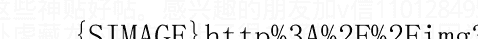


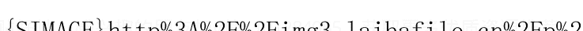


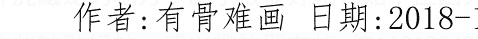

5755 楼
作者：有骨难画 日期：2018-11-12 15:36
加v信110128495，获取更多精彩推荐

# 另外，根据史料记载，青铜时代的末商、周初，中国地区的大规模的人口流失事件。几乎同一时代东南亚出现了东夷族的大规模扩张。结合“扩人东渡”，这说明商人渡海中仅仅只有一波，上的是“仪侯喜”率领的只是最大规模的一波并不是全部，那些其余规模较小的波则渡海到了其它地方，比如整个东南亚诸岛以及非洲的部分区域（新西兰），最远达到了吉祥岛，换句话说，这些地方的土著居民也是华夏裔。

而这几波为什么没有到达美洲，楼主一认为估计了航线等因素之外，应该还因为他们的规模没有“仪侯喜”的庞大，所以抵达到地域时，各项供给养以及减员等基础情况已经能达到极限，无法再继续前进，顺便留了当地开始繁衍衍生。

至于这几波所覆盖的区域与航线路线，详见下图：
（注：图片较小，比较模糊，上面的字体不是很清楚，大家凑合看着一看吧，起码上面的覆盖区域与路线还能看明白的）

```
{IMAGE}http%3A%2F%2Fimg3.laibaife.cn%2Fp%2F1%n2F301956956.png{IMAGE}
```

5756 楼
作者：有骨难画 日期：2018-11-13 02:00

楼主又更新图了，把这次更新第三部分的地图上，在前面的正文中说了这么久的玛雅、托尔特、阿兹特这三大文明的代表性图片。图1为玛雅文明中的金字塔，图2为玛雅文明中的太阳，这是玛雅文明的精华之一，因为作为一个新石器时代的文明，玛雅最为人知的成就之一就是天文历法。

图3为印加文明的著名遗迹之一的“马丘比奥”古城。

图4为印加文明的黄金面俑。

图5阿兹特文明中最精锐的武装力量——“美洲战士”，获得这个称号的，都是阿兹特文明中最顶尖的战士。

图6是“美洲虎战士”的标志性装备——“马拿特威”大刀，该刀不是由金属制成的，而是由木材与石料制成的，在刀体两侧的黑色块状物体是燧石，这是一种名为“黑曜石”的火山岩石，十分易碎，但同时又十分刚，如玻璃一样，而将其固定在木板两侧，就将其充当刀刃使用。这种武器虽然没有通常刀具的切割与穿刺功能，但对防御的软目标，杀伤力是非常大的，被挥舞的“马拿特威”击中后，被人工打磨得相当锐利的“黑曜石”会轻松的切开肉然后造成非常巨大的创口，而且有时候使用它们的“美洲虎战士”还会把上面的黑曜石固定的比较松，好在击中目标时能借大力让黑曜石从木板中脱落留在目标的伤口之中以增加伤口的处理难度，只是这样做就需要频繁的，另外因为易脆特性，即便坚固时经过数次使用也会脱落碎裂，倒也能一定程度上提高杀力，及及时更换。

最后说一句：上述三大文明都不具备冶炼术，所以使用的武器并不是金属的，而是木制和石制的，或者是两者结合的，其中“马拿特威”就是典型，而殷商时期的青铜冶炼技术已经非常成熟发达，在东渡美洲后反而倒退了，这也说明依靠文明延续并发展比较困难的事情，加上美洲的环境来说，的确太适合高等文明的出现。

（图片略）

5784 楼 
作者：有骨难画 日期：2018-11-13 02:00
好了，今天的图就更新到这里了。（未完续）

5785 楼 
作者：有骨难画 日期：2018-11-13 14:00

“国家外就一个吗？”这段时间里朱梦瑾一直在这里旁听着我们的一问一答一句话说，不过说到这里时，她忍不住道：“其实这个问题也不接纳的，如果他不同，我也想找个机会一下。”之说是找机会，是因为刚才说了这是最后一个问题，如果问完了别的，那就显得我非常没有采访礼节，这是面对采访的大忌，而我采访此类身份不利的人许多，所以我还是尽量遵守职业准则，否则容易养成不好的采访习惯而在真正的采访中产生不愉快的情况。

从历史来说应该是有的，希腊神中的阿喀琉斯，还有古罗马时期的“角之王”斯达克斯，这些人的原型就是取于初级“强力者”，不过你要是说现代的话，那我就不知道。也正是因为如此，国外非常醉心于“超级士兵”的研究，他们希望通过技术手段研制出一种远超普通士兵的作战个体，这种人如果出现，就是十足的“战争机器”。国外其中美国在这方面的工作最多，不过毛子（俄罗斯）的水平粗糙，经常搞出一些无法控制的怪胎出来，然后沸腾扬荡，死上一个，最后剩下的就拉了，兜兜转多年来终在这一层上转，并没有什么突破性进展。

比如几年前在赤市早就闹出了这一，几个被超级士兵的失败试验品失控脱离，碰到外面什么都吃，挣狗牛奶，也包括，一共出来4个，这玩意的下脑因为失败的试验中遭到了严重的伤害（注：人的情绪与情感基本都归下脑掌控），所以没有人是为补身体高强度的代谢，就需要不停的进食，就跟赶尸户一样，但可比丧尸强了，他们四个后以后只缴吃肉的人就多达200多个，还击并几乎吃光了5座附近的牧场。

再后来，其中三个被俄罗斯军方出动武装直升机还有主战坦克等武器给消掉了，剩下的那一个一路西进，最终靠着一双脚从西伯利亚跑到了莱赛市，这条路上全是靠捕野生动物，后到了市区里面他又吃，暴露了行迹，警察发现了他展开了，但由于不是他的对手，当场就被杀了。最后还是军方的把他堵在公寓里，用温压炸弹的，他的眼睛都炸了。根据我掌握的资料，这些人仅仅是步军、机枪的，但是这样也只是失去了抵抗能力。而美国方面则是搞出不少新型药物，都是合成类的，在短时间内极大增强人体能力，但是那玩意儿说真正的“超级士兵”或者“超级战士”不可能通过单纯的药物来实现。最近他们又开始鼓励动力装甲加种神经交互系统，这两个概念，前者类似于漫画《新世纪福音战士》中男主角控制，而后者与《阿凡达》中的男主控制，原理差不多，到底这些东西本质上都不是什么新鲜玩意。

“陈主任，我还是有些疑问，实在不吐不快：您的前提到了‘控制者’、“预知者’、“强者’这三种异能人，还有几个，那其中有存于世的代表吗？”

“是有，不是在控制范围之内。”陈飞鸿说。

“哦？这个人还要对付吗？我想对国安局来说，只要掌握了基础资料，应该想抓住他不算难吧，连这种这种人都能顺利的转移到‘特殊监狱’里，他难道不可以？”

另外，关于他的基础信息，我们目前所了解到的只有一点，就是这个人的名字，姓嬴非，年龄估计在30岁后。他父母在5岁时早夭后将其抛弃，由爷爷抚养长大，他还有一个同胞弟弟，患有白血病等大量罕见的遗传性疾病，跟他一起被抛弃了，他走到哪里就把这个弟弟带到哪里。他去买彩票的钱，主要就是为了治好他弟弟的病，但那些病其实的，仅有钱是不行的，医疗技术不到能治疗这些遗传性疾病的程度，只能维持着。不过来说也好，因为这些钱，他们俩二人的物质生活还算不错，可怜没有吃太多的苦。

正是因为如此，他平时的做作与西官员那种“老子最牛X，谁不服就怂”风格相比，要低调得多。若不是偶然在翻看公安一个有关福利彩票的案子的卷宗时，发现这个人，当时卷上记载着他买彩票系统的证据，警方查不出所以原来没立案，最后报到了我们这里，我们逐步深入，这才发现这个小子非同小可，他能次次都中头。奖励的原因是因为这人天生的预测能力，而他可以预测未来的原理，根据我们的研究，与超强的感官能力有关，就是所谓的‘第六感’。但是这第六感可是凭空说脑袋里出现了一个‘预测’，然后事情就应该这么简单，如果是这么的话，那只能叫唯心或者是伪科学。而赢子的‘第六感’并不是虚无缈的东西，而是与眼、耳、鼻、触五感一样，具体来说就是他的皮肤与周围能量形成一种感应或者是交流，从宏观的宇宙射线到微观的分子运动包括在内。当一个客观事物变化时，普通人接收不到这种信息，即便到了也理解不了，他也可以敏锐的接收并根据这些信息与自己或者想要涉足的事情进行预判断。换句话说，他的皮肤与眼、耳、鼻等器官一样，是一个独立的感官，就像大脑有一个发射区。后来说，根据这个原理我们进一步挖掘，发现这种预测能力中蕴含某种非常高的计算方程，能够掌握这种计算的人，即便没有赢子的这种‘第六感’也能一定程度上预测未来。这种方程与《易经》的核心原理如出一辙，这也是为什么我在前面《易经》可能是夏商周三个时期不同的“预知者”写的原因，而最大的可能性就是这三本作者，将那个算法通过文字表达出来，谁掌握就可以洞察天机，而门槛是相当的，不是悟性良好还有根基的人很难学得《易经》中的皮毛，不用说是全部掌握了。”陈飞鸿说。

“那可太起了，如果这三人都凑齐，西官员、漆六桐再来一个，一个能控制，一个能打，一个能预测，配合起来，简直是天下敌了！”

“谁说不是呢？把他们三个在一起组队，我是最大的梦想之一，有他们三人在，胜抵百万雄师，只是现实实现起来太难了。漆六桐已经被局抢走了，嬴非子的行迹飘忽不定，人人都见。西官员是我目前尽全力的争取，如果可以成功，恐怕能为调来这一人才，我也可以死不瞑目了。”陈飞鸿说。

“陈主任言重了，我想这次西官员应该被重视的诚意感动的。”我。。“对了，您才说到漆六桐，我想起一件事情。我印象我国古十二姓分别是：姬、祁、卞、己、大、任、荀、俏、怀、衣。而这十二姓里各有一种一样的特殊的功能的话，那好像只有西西的西姓啊，后面漆六桐的漆姓以及嬴非嬴姓都没有，这是怎么回事？”

“你说这十二姓的源来源是司马迁的《史记·五帝本纪》，而跟我们总结的版本不同，我们总结的版本是在包括司马迁的版本基础上，又融合了‘上古八大姓’：姬、姜、姒、姚、戎、妘、垞、帝。二十二姓：妨、姒、子、姬、风、嬴、己、任、许、万、曹、祁、妘、姜、董、儜、归、毕、��、漆。通过根据不足的除去之后得出的结果，这个结果十二分别是……”陈归鸿道。

我听听旁边搓着手指算了半天，发现还是没有“漆”这个奎，便再次发问，而陈归鸿诡笑道：“漆院姓姜炎，与姜姓同脉，这里的姜姓中就包含了漆姓，还有像其中的嬴姓，其实就是来的赵姓，只现在……”


## 最能打的将帅？陈陈鸿

因为局势如此，他打算包围禹和，我们正在收复城期间，由于敌军的，在……

“他父亲的伤势怎么样了？还有他打死三名重伤一在……”

“名城，后来是怎么处理的？”我说。由于时间，我们在……

“他父亲重伤后入院，虽然是‘零窝’医药费送进……”

一天护理费万元的ICU重症监护房，但一来是伤太了……

被鞭器连续击中后脑，完全失去了意识，二来是因为漆
六柯柯和城城以及警方的打斗过误的时间太长了，他父亲在医
里用着呼吸机，吃着流食坚持了整整一天，最后医院还还是回天术，没有救过，他死在了病床上，这一天来说，从入
到世去，他就没睁开眼睛，就算是救过来，也是植物人，脑干和小脑都被坏了，离世的那年他才46岁。

至于诸六柯，在‘零窝’的操作，以正当防卫击案案件，那三个人和一个被拆的城的，只能自认活话，这司司法方面的事情，对于‘零窝’来说，还是小莱一碟的。”陈陈鸿说。

“西星官是孤狐、诸六柯早年丧母，少年父丧，赢非子被双亲抛弃，又有一个满身是病的弟弟——怎么他们三人的家庭都这么不幸啊？”我心里总结了一下这三人的情况后发现了规律，便也如此。

“被你提到到点子上了，如果我重用命格的角度来解释这个问题，就是他们三个为与生俱来的特异功能，都属于‘天选之人’，命格‘天煞灵星’，命格足够强大，从而克杀属，”

（加v 110128495，获取更多精彩推荐）

其若是父母，其中西星官最严重，逢六柯其次，赢非之最轻。

其中西星官从来没见过生身父母什么样。

逢六母亲因为死于难产，而父亲将其养成养人后又……

因为他对于意外邂斗。

而赢非子则父母离异后将其抛弃，现在还在人世，就……

两个普通人，算是结果最好的了。”陈羽鸿说。

“天然狐座？’的确，命里带这四个字的人都是普通，但运至亲之人一般都会遭遇……

“有一共十二星主，现在出现了三个，如果其余的九个也存在各自不同的高级特异功能的话，我想把他们全部集齐，那是多么壮观的场景啊。”我说，由于这个话题太过于沉重，所以我说完前半段话后便有意在后半段转移题，这就如此。

“那是，如果十二星人都集齐了，那就是传说中的‘黄道十二宫’降临，到时候别说是胜抵百万诸侯，就是平一个国家也是没问题的。”陈羽鸿说。

“那但着这一天早日会到来。”我说。

“这话也不能这么说，“黄道十二宫’降临，一旦出现‘油的灯’，就更不用他们凑到一起了。我听实心说的确如此，这样的十二个人聚聚在一起，那简直直就是国外漫画和电影里的‘XXX联盟’、“X战警”这种“超级英雄”团队啊，而而且更厉害了，这些人要是想设反水，再配合起来，那可以造成的局面，的确是难以控制的，所以陈归鸿说的在：在没有好完全的准备之之前，这一刻最好别见到这么早的到来。

（未完待续）

## 5798 楼
作者：有骨难雅期：2018-11-13 15:02

### （三十八）“百闻不如一”

说了这么多，在不知不觉中飞机已经接近了目的地，高度此时已经下降到足400公里，通过机上窗诡遥远的望去，可以依靠的看见处于大漠戈壁上那座孤零零的机场。

上一路归鸿基本上无不言的回答了我与朱梦玲对于异异功能和相关的相关的很多问题，他这么大方是让我能带来我们三个（尤其是黄勋与朱梦玲，下同）以外的第二个感到很意外的事情，因为说过多次，灵调科可是不是随便的单位，他们接触的东西几乎都是保密的，而他只想对我交流这些话，还可以用我以前以前于工作原因他也跟他交流类似话题来解释，可可是黄勋与朱梦玲也在，他说起来依然基本不避讳，尤其是朱梦玲，回答了她这么多问题，我第一时间没想通他这么一个在“秘密战线”

（加v信110284955，获取更多好推荐）

身上经战的“老江湖”到底底了什么盘子，总是不可能的看朱梦瑶长得漂亮一时说出来的，这种低级错误他们这种“人精”可不会犯。

这个与前面那个为了我们带我们三个来回问题的原因一样，在后来我找到了答案，以不过与此的主题无关，所以暂须表。

随飞机在地面搭建好的阶梯上引导下缓降落，我们三人跟着陈禹的身后走上搭建好的阶梯上，举目四望，可以从视野上看得这出了一个典型的军用机场，因为除了这次我们乘坐的大型飞机，在不远处还有成排的加固机停，因为距离不远，我能清晰的看到有些飞机在停放的灭击飞机——螺旋微差的垂直直径机头，大竖立的垂直双尾，以及后面那两台发动机身上泛着银光光的国产“大行”系列大推力涡扇发动机，这一切表明了它的型号：国产-11B型重型灭击飞机。此外，这里还有一种灭击机，单尾，串式双尾，这种特机，尾身两侧都有矩形进气道，厚实的直线机身，这些准则也表明了它的型号：国产歼轰-7A型灭击战斗机。这这种这里同时混合了灭击机与轰击机两种型号，这种具备空机一体化战斗能力的配置在一般的空军旅团中很少见，因为空军旅团都是“单任务”配置，就是要么全是灭击机负责制空作战，要么是轰击机负责对地/对海打击，但两种任务同时要驻在同一个机场的编制。

（加V信101495，获取更多好帖）

之前是非常少见的，比如此事情发生的2014年。由于到达此处已经进入了军事禁区，除了陈归鸿的专用保密外，人身上所有带通器材全部缴关。朱梦甜显得有点“急”，她拿出手机还想拍几张照片呢，就让一名高大帅卫兵拦了下来，并告知需上交的消息，她只好囔我们一起把手机交了。我们在这里并没有很久，因为这里只是一个空军机场，距离真正的目的地“7563监狱”还有几十公里，还需要转车前往，所以落地后直接搭乘一辆等久的车出发。车子看着垒墙上的路一路驰，通往目的地的虽然是一条军用公路，跑起来比高速公路还缓，除了偶尔能看见从对面闪过的不同型号军车，再也看不到广垠的垒墙上，一切都显得十分小，不是路护栏上每隔米就刷上的黄色段在车子的飞速前进在“倒退”。

（加 v 信11495，获取更多推荐）

静止了天地之间的错误。因为路况糟糕导致了堵，而且灵调的司机都是“飙车”，我我在以前见识，这次也不例外，一脚油门下去车子全程没有停下来，在几十公里的这种速度下就已经到了地方。最开始是一个黑点，然后黑点慢慢爬起来，随着距离靠近，黑点逐渐清晰起来，最终一座规模十分观的完全进入视野之内，它外墙呈深灰色，目测高度在60米以上，外墙顶部密布岗哨塔，这种基础设施这里就是一座防守森严的城堡。这段公路的尽头直接通建筑的大门，大门高大，目测高度20米以上，宽度10米以上，大门的前面有重兵把守，战士手中的突击枪，还有人工固黏的永备工事，工事里可以看到不同口径的武器，仅仅是我能认出的就有12.7毫米机枪、35毫米自动榴弹发射器、12.7毫米大口径发射器材。除了这些，在它的前面，还有沙袋砌成的临时掩体，上面有88式通用机枪、95式班用机枪、76.2毫米狙击枪、88式狙击枪等，这些武器从火力来说，与后面永备工事形成了轻重搭配，形成了一个覆盖、中、远三个距离上的轻武器火力网。这种档次的武器配置，莫说是对付一般的犯人，就是出去就已经绰余了，不过又说回来，被关在这里的人，当然都不是一般的犯人。

“哇，还有机枪呢！”朱雯看着沙袋掩体上设的88式5.8毫米通用机枪哑道。

“哎哟，不错啊，你认识那是机枪？”我说。

“切，我怎么认识？平时没少看《军事报道》呢。”朱雯疑惑。

“机枪算什么，这里为了防止人类暴动，常配备有一个装甲，装备有4辆主战坦克，型号永远都是最新的、换代的速度比一线部队都快，还有4架武装直升机与2架直升机巡视时，型号都是最新的，你们看这大门为了设计的这么高了吗？就是给直升机用的，这里设计可以自动封闭的穹顶，在万不得已的时候，穹顶可以关闭，将上方封死，然后只留正面作为通道，而这个高度与宽度，在大门完全大开的情况下，直升机可以超越低空的姿态，一架一架的飞进去，而不必要从顶部才能下降落在内。还有，这里的整个地下部分都是被特种合金包裹起来的，说白它的穹顶一合上，就是一个长条形的“金属柜”，想方挖掘跑出去，那是门儿都没有。

（加 v 信110495，获取更多好帖）

## 另外，知道这里为什么距离离座机场那么近吗？

为了一旦有事，空军的飞机就可以立刻升空来支援，击袭机负责外围警戒，防止有不明势力，尤其是境外势力从空中介入，而击袭机则负责对地打击，各种战斗机级别的精确制导武器炸弹、空地炸弹什么都有，说白了，那个机场的存在，就是为了根据不同的具体的需要，保护、压制乃至消灭这些犯人们，就这“待遇”，哪里的犯人能“享受”到的？这里这些超越常理的家伙们，需要动用坦克与飞机才能镇压的。要不然怎么叫“困龙城”这个称号呢？告诉了，这里就是——“7563监狱”，欢迎各位“临狱”。陈归鸿越接近的大门我们给介绍道，最后这句话“临指导”明显带有玩笑的意思。

“为什么还要防止境外势力介入？这座监狱还会有企图？”

“那当然，因为这里关的人没有一个是普通人，所以如果跑出去的话，伤害性极大，境外势力想拘持这些人出境后进行……并不是近两年的想法，而是起码在监狱建成的那天起就有了，直到如今三十多年了，比如四年前，这里的守备部队在当地帮助下，击退了一次预谋已久的境外势力，他们的目的就是从这里抢人。”

（加V信101495，获取更多推荐）

“西星官真是个‘香侍’，不过听说了这些人的能力，如果他不配合的话，外面的人基本上办不到吧？”灵调科主任带领下，还接受严格的审查，从开始到结束共有7次审查，最终全部通过，要是没有内部带领，根本连儿都靠不上。”陈归鸿说。

“这帮自然犯人暴动吧？”朱梦玲说。

“这里确实很特殊，的，的，的，的，，，，，，，，的。这三个区域的，的，的，的，，，，的，的，这三个区域的，的，的，的，的，的，的，的，的，的，的，的，的，的，的，的，的，的，的，的，的，的，的，的，的，的，的，的，的，的，的，的，的，的，的，的，的，的，的，的，的，的，的，的，的，的，的，的，的，的，的，的，的，的，的，的，的，的，的，的，的，的，的，的，的，的，的，的，的，的，的，的，的，的，的，的，的，的，的，的，的，的，的，的，的，的，的，的，的，的，的，的，的，的，的，的，的，的，的，的，的，的，的，的，的，的，的，的，的，的，的，的，的，的，的，的，的，的，的，的，的，的，的，的，的，的，的，的，的，的，的，的，的，的，的，的，的，的，的，的，的，的，的，的，的，的，的，的，的，的，的，的，的，的，的，的，的，的，的，的，的，的，的，的，的，的，的，的，的，的，的，的，的，的，的，的，的，的，的，的，的，的，的，的，的，的，的，的，的，的，的，的，的，的，的，的，的，的，的，的，的，的，的，的，的，的，的，的，的，的，的，的，的，的，的，的，的，的，的，的，的，的，的，的，的，的，的，的，的，的，的，的，的，的，的，的，的，的，的，的，的，的，的，的，的，的，的，的，的，的，的，的，的，的，的，的，的，的，的，的，的，的，的，的，的，的，的，的，的，的，的，的，的，的，的，的，的，的，的，的，的，的，的，的，的，的，的，的，的，的，的，的，的，的，的，的，的，的，的，的，的，的，的，的，的，的，的，的，的，的，的，的，的，的，的，的，的，的，的，的，的，的，的，的，的，的，的，的，的，的，的，的，的，的，的，的，的，的，的，的，的，的，的，的，的，的，的，的，的，的，的，的，的，的，的，的，的，，，，，，，，，的，的，的，的，，，的，的，的，的，的，，，，，，，的，的，的，的，，，的，的，的，的，的，的，的，的，的，的，的，的，的，的，的，的，的，的，的，的，的，的，的，的，的，的，的，的，的，的，的，的，的，的，的，的，的，的，的，的，的，的，的，的，的，的，的，的，的，的，的，的，的，的，的，的，的，的，的，的，的，的，的，的，的，的，的，的，的，的，的，的，的，的，的，的，的，的，的，的，的，的，的，的，的，的，的，的，的，的，的，的，的，的，的，的，的，的，的，的，的，的，的，的，的，的，的，的，的，的，的，的，的，的，的，的，的，的，的，的，的，的，的，的，的，的，的，的，的，的，的，的，的，的，的，的，的，的，的，的，的，的，的，的，的，的，的，的，的，的，的，的，的，的，的，的，的，的，的，的，的，的，的，的，的，的，的，的，的，的，的，的，的，的，的，的，的，的，的，的，的，的，的，的，的，的，的，的，的，的，的，的，的，的，的，的，的，的，的，的，的，的，的，的，的，的，的，的，的，的，的，的，的，的，的，的，的，的，的，的，的，的，的，的，的，的，的，的，的，的，的，的，的，的，的，的，的，的，的，的，的，的，的，的，的，的，的，的，的，的，的，的，的，的，的，的，的，的，的，的，的，的，的，的，的，的，的，的，的，的，的，的，的，的，的，的，的，的，的，的，的，的，的，的，的，的，的，的，的，的，的，的，的，的，的，的，的，的，的，的，的，的，的，的，的，的，的，的，的，的，的，的，的，的，的，的，的，的，的，的，的，的，的，的，的，的，的，的，的，的，的，的，的，的，的，的，的，的，的，的，的，的，的，的，的，的，的，的，的，的，的，的，的，的，的，的，的，的，的，的，的，的，的，的，的，，，的，的，的，的，的，的，的，的，的，的，的，的，的，的，的，的，的，的，的，的，的，的，的，的，的，的，的，的，的，的，的，的，的，的，的，的，的，的，的，的，的，的，的，的，的，的，的，的，的，的，的，的，的，的，的，的，的，的，的，的，的，的，的，的，的，的，的，的，的，的，的，的，的，的，的，的，的，的，的，的，的，的，的，的，的，的，的。

（加 v 信110495，获取更多推荐）

### 图 1、2 是歼-11B 型重空击，是典型的三代/三代半制空空击，由中国航空沈飞工业（集团）有限公司研制，是我军目前的主力战斗机之一，从各位官可以看到银光闪闪的“大行”系列国产涵比推力涡扇发动机，之所以楼主在正文这里反复强调这个的事情是因为它不简单，全范围内能力研制成功涵比推力涡扇发动机的国家只有三个，我国就是之一，其相关技术与产业无疑称上是高精尖的中高准。

### 图 3、4 是歼-7A/“飞豹”A 型歼轰炸机，由中国航空工业亚飞机（集团）有限责任公司研制，也是我们目前的主力战斗机之一，其矮在正文中称为“飞豹A”不准确，因为“飞豹A”是该机型的海军称号，空军机型叫做“歼-7A”，而正文中提到的那个机场，就是空军机场，所以理说，应该称其为“歼-7A”，主要是军名叫它习惯了，算一个小错误，这里更正一下。另外，各位官可以注意一下图4，“歼-7A”涵盖了空炸弹，视觉冲击力不小，首先就出现了该机极强的对地打击能力，协助镇宁“7563监狱”中有它一份，这也体现了军方等有关部门对其重视程度。

{IMAGE}http%3A%2F%2Fimg3.laibafile.cn%2F%2F
2F302023680.png {EIMAGE}

{SIMAGE} http%3A%2F%2Fimg3.laibafile.cn%2F%2F
2F302023681.png {EIMAGE}

{SIMAGE} http%3A%2F%2Fimg3.laibafile.cn%2F%2F
2F302023682.png {EIMAGE}


只是他们各自的技能还有武用之地，所以才减轻至免于
受到所谓的“法律制裁”，虽然时代不一样，国家不一样，
手段的性质都是一样的。

官正，最终，我们再次穿过三道密不透风的大门之后
后，一个巨大型鱼缸的全透明房间出现在了眼前，里面摆
满了各种各样的书，还有床、桌椅等生活用具，自然这些都是
必要的，最重要的还是端坐在这房间中央的那个人个人,
那个“大脑袋”的男人，他正聚精神神的看着桌子上的
好像是人形摆件的东西，不知道在干什么，而这个男人无
是关关落点，其实气质变形，不用多想就知道我们要找的
得与视频中完全一致，一个特别大的额头他是最大的
特征，而额头的正中央，也就是眉心略靠上的这个位置，
一条肌肉横然的，仔细看去，除了横向的方向不同以外，
那上面的每一个细节都与正常的眼睛一样，如果说说
这其实是一种释放“第三脑区”特功能的特殊器官，那的
的确怎么看它都像是一只处于闭合状态的竖眼，只是这只
睁，没有眉毛和眼睛。

而除了他本人以外，最为的是，这个房间是悬空在
半空之中的，四面镜，看不到任何拉拽装置控制此物，但
这么的一个长方形物体就这么“漂浮”在空气之中，我、
黄勋以及朱梦璐都对这一幕感到惊讶，陈鸿鸿看
出了我们的惊讶，头也不回的说：西星官的这种好就像鸡蛋离壳，我们依然在
“这就是西星官的‘单号’，如果你能纳入它是因为什么会
“浮’在空中的话，我可以告诉你们，它的下面和前后左右
这五个方向都有高速气流再不断的进行吹动，吹动气流的
流量与速度都是经过专门为其配置的超级计算机严格计算
与控制的，比如最重要的下面气流的力道正好等于它总质
量，持续吹之下就能保证它始终处于这种‘漂浮’状态，
而左右的气流则是经过微调的，也是最精确的流量保证它在漂浮
的状态下还能像建造在平地上的房间一样平稳。

另外，房间的透明材料本身，是一种绝缘、抗压、防
弹、高耐、防切割的特殊材料，它可以隔离西星官的电
波，被电波的穿透，他的通透与念力等异能就无从
谈起，这些措施保证了我们站在这里与他对话是安全的，否
则这个距离他想脑电波催眠一个人或者是用念力碾碎
一个人都——哪怕是一大人，都实在太容易了。

话说回来，这么多像‘蚂子’那可是花了不少钱，比
为别的，就是为了以防万一，毕竟‘小老弟’太费害了。”

“他即便催眠、会念力，也不至于这样吧？”朱梦珺说。

“等咱们把他们接到上海，假设你有幸看到他展现全部
能力时，就知道了至至少是这样的了。”陈归鸿说，他说完
之后向前迈出一步，捏了下面面前的一个红色按钮，然后冲
看着按按钮的喇状物体对着在说道：
“小子，又来说看你了，还忙着雕刻呢？”

陈屿鸿这么是有序的一点点向下剥落碎屑，西星胄正在盯着
的那块棱件，从碎屑卷起泛着反光的样子来看，这块东西是某种颜色，而他手中并没有任何工具，也没有接触这个物体，只是双眼在看着那个破件，它便
不停的在落在碎屑，而且随着碎屑的持续掉落，这个破件的
腰部细节渐渐清晰了起来，再将合的念力特异功能，我内心震惊望：
这人竟然用正用力雕刻一个实心的金属块!!!

(未完待续)
作者:有骨难画 日期:2018-11-14 20:19

陈屿鸿说完了好几秒，对面迎来一个声音：
“马上就要完成了，先别扰我。”

“嗯。”陈屿鸿应了一声便不再说话，看得，他
这个身份已经很不起的人了，对西星胄的态度仍然是非常的
容许。

加上司机，我们五个人就这么在原地看着他用念力进行
雕刻了三多分钟后，他突然说道：
“完工！”

然后根本不用手去，，只是动了眼睛，原本背对着我
他们的敏捷瞬间就升起到半空中转了过来，变成了面对我
如此一看，方看出这是一个龙拿着李小穿着黑色功夫裤，裸
露身上裹着拳道经典的小型像。
其酷别水平已不敢直视的太高，但也已十十分精湛，起码腹肌与肌肉的肉线条，乃至裤子上的褶皱等细节都已经被高度还原化的体现了它出来的了。
“可以啊，我比上来的时候进步不小，这段时间都在忙这件事儿了？”陈归鸿诚。
“差差不多，之前我用不锈钢钢，准度太大了，主要是不锈钢钢硬度太差，这几次换了钨钢就好多了。”西星官，他的声音给我一种复杂的感受，有种成熟，却不在意间流露出出一股气，而我根据的，这种矛盾的语言风格，基本上都是高傲人的。
这种，而我根据的，这种矛盾的语言风格，基本上都是高傲人的。

而除了他本人以外，最为的是，这个房间是悬空在
半空之中的，四面镜，看不到任何拉拽装置控制此物，但
这么的一个长方形物体就这么“漂浮”在空气之中，我、
黄勋以及朱梦璐都对这一幕感到惊讶，陈鸿鸿看
出了我们的惊讶，头也不回的说：西星官的这种好就像鸡蛋离壳，我们依然在
“这就是西星官的‘单号’，如果你能纳入它是因为什么会
“浮’在空中的话，我可以告诉你们，它的下面和前后左右
这五个方向都有高速气流再不断的进行吹动，吹动气流的
流量与速度都是经过专门为其配置的超级计算机严格计算
与控制的，比如最重要的下面气流的力道正好等于它总质
量，持续吹之下就能保证它始终处于这种‘漂浮’状态，
而左右的气流则是经过微调的，也是最精确的流量保证它在漂浮
的状态下还能像建造在平地上的房间一样平稳。

另外，房间的透明材料本身，是一种绝缘、抗压、防
弹、高耐、防切割的特殊材料，它可以隔离西星官的电
波，被电波的穿透，他的通透与念力等异能就无从
谈起，这些措施保证了我们站在这里与他对话是安全的，否
否则这个距离他想脑电波催眠一个人或者是用念力碾碎
一个人都——哪怕是一大人，都实在太容易了。

话说回来，这么多像‘蚂子’那可是花了不少钱，比
为别的，就是为了以防万一，毕竟‘小老弟’太费害了。”

“他即便催眠、会念力，也不至于这样吧？”朱梦珺说。

“等咱们把他们接到上海，假设你有幸看到他展现全部
能力时，就知道了至至少是这样的了。”陈归鸿说，他说完
之后向前迈出一步，捏了下面面前的一个红色按钮，然后冲
看着按按钮的喇状物体对着在说道：
“小子，又来说看你了，还忙着雕刻呢？”

陈屿鸿这么是有序的一点点向下剥落碎屑，西星胄正在盯着
的那块棱件，从碎屑卷起泛着反光的样子来看，这块东西是某种颜色，而他手中并没有任何工具，也没有接触这个物体，只是双眼在看着那个破件，它便
不停的在落在碎屑，而且随着碎屑的持续掉落，这个破件的
腰部细节渐渐清晰了起来，再将合的念力特异功能，我内心震惊望：
这人竟然用正用力雕刻一个实心的金属块!!!

(未完待续)
作者:有骨难画 日期:2018-11-14 20:19

陈屿鸿说完了好几秒，对面迎来一个声音：
“马上就要完成了，先别扰我。”

“嗯。”陈屿鸿应了一声便不再说话，看得，他
这个身份已经很不起的人了，对西星胄的态度仍然是非常的容许。

加上司机，我们五个人就这么在原地看着他用念力进行
雕刻了三多分钟后，他突然说道：
“完工！”

然后根本不用手去，，只是动了眼睛，原本背对着我
他们的敏捷瞬间就升起到半空中转了过来，变成了面对我
如此一看，方看出这是一个龙拿着李小穿着黑色功夫裤，裸
露身上裹着拳道经典的小型像。
其酷别水平已不敢直视的太高，但也已十十分精湛，起码腹肌与肌肉的肉线条，乃至裤子上的褶皱等细节都已经被高度还原化的体现了它出来的了。
“可以啊，我比上来的时候进步不小，这段时间都在忙这件事儿了？”陈归鸿诚。
“差差不多，之前我用不锈钢钢，准度太大了，主要是不锈钢钢硬度太差，这几次换了钨钢就好多了。”西星官，他的声音给我一种复杂的感受，有种成熟，却不在意间流露出出一股气，而我根据的，这种矛盾的语言风格，基本上都是高傲人的。
这种，而我根据的，这种矛盾的语言风格，基本上都是高傲人的。

而除了他本人以外，最为的是，这个房间是悬空在
半空之中的，四面镜，看不到任何拉拽装置控制此物，但
这么的一个长方形物体就这么“漂浮”在空气之中，我、
黄勋以及朱梦璐都对这一幕感到惊讶，陈鸿鸿看
出了我们的惊讶，头也不回的说：西星官的这种好就像鸡蛋离壳，我们依然在
“这就是西星官的‘单号’，如果你能纳入它是因为什么会
“浮’在空中的话，我可以告诉你们，它的下面和前后左右
这五个方向都有高速气流再不断的进行吹动，吹动气流的
流量与速度都是经过专门为其配置的超级计算机严格计算
与控制的，比如最重要的下面气流的力道正好等于它总质
量，持续吹之下就能保证它始终处于这种‘漂浮’状态，
而左右的气流则是经过微调的，也是最精确的流量保证它在漂浮
的状态下还能像建造在平地上的房间一样平稳。

另外，房间的透明材料本身，是一种绝缘、抗压、防
弹、高耐、防切割的特殊材料，它可以隔离西星官的电
波，被电波的穿透，他的通透与念力等异能就无从
谈起，这些措施保证了我们站在这里与他对话是安全的，否
否则这个距离他想脑电波催眠一个人或者是用念力碾碎
一个人都——哪怕是一大人，都实在太容易了。

话说回来，这么多像‘蚂子’那可是花了不少钱，比
为别的，就是为了以防万一，毕竟‘小老弟’太费害了。”

“他即便催眠、会念力，也不至于这样吧？”朱梦珺说。

“等咱们把他们接到上海，假设你有幸看到他展现全部
能力时，就知道了至至少是这样的了。”陈归鸿说，他说完
之后向前迈出一步，捏了下面面前的一个红色按钮，然后冲
看着按按钮的喇状物体对着在说道：
“小子，又来说看你了，还忙着雕刻呢？”

陈屿鸿这么是有序的一点点向下剥落碎屑，西星胄正在盯着
的那块棱件，从碎屑卷起泛着反光的样子来看，这块东西是某种颜色，而他手中并没有任何工具，也没有接触这个物体，只是双眼在看着那个破件，它便
不停的在落在碎屑，而且随着碎屑的持续掉落，这个破件的
腰部细节渐渐清晰了起来，再将合的念力特异功能，我内心震惊望：
这人竟然用正用力雕刻一个实心的金属块!!!

(未完待续)
作者:有骨难画 日期:2018-11-14 20:19

陈屿鸿说完了好几秒，对面迎来一个声音：
“马上就要完成了，先别扰我。”

“嗯。”陈屿鸿应了一声便不再说话，看得，他
这个身份已经很不起的人了，对西星胄的态度仍然是非常的容许。

加上司机，我们五个人就这么在原地看着他用念力进行
雕刻了三多分钟后，他突然说道：
“完工！”

然后根本不用手去，，只是动了眼睛，原本背对着我
他们的敏捷瞬间就升起到半空中转了过来，变成了面对我
如此一看，方看出这是一个龙拿着李小穿着黑色功夫裤，裸
露身上裹着拳道经典的小型像。
其酷别水平已不敢直视的太高，但也已十十分精湛，起码腹肌与肌肉的肉线条，乃至裤子上的褶皱等细节都已经被高度还原化的体现了它出来的了。
“可以啊，我比上来的时候进步不小，这段时间都在忙这件事儿了？”陈归鸿诚。
“差差不多，之前我用不锈钢钢，准度太大了，主要是不锈钢钢硬度太差，这几次换了钨钢就好多了。”西星官，他的声音给我一种复杂的感受，有种成熟，却不在意间流露出出一股气，而我根据的，这种矛盾的语言风格，基本上都是高傲人的。
这种，而我根据的，这种矛盾的语言风格，基本上都是高傲人的。

而除了他本人以外，最为的是，这个房间是悬空在
半空之中的，四面镜，看不到任何拉拽装置控制此物，但
这么的一个长方形物体就这么“漂浮”在空气之中，我、
黄勋以及朱梦璐都对这一幕感到惊讶，陈鸿鸿看
出了我们的惊讶，头也不回的说：西星官的这种好就像鸡蛋离壳，我们依然在
“这就是西星官的‘单号’，如果你能纳入它是因为什么会
“浮’在空中的话，我可以告诉你们，它的下面和前后左右
这五个方向都有高速气流再不断的进行吹动，吹动气流的
流量与速度都是经过专门为其配置的超级计算机严格计算
与控制的，比如最重要的下面气流的力道正好等于它总质
量，持续吹之下就能保证它始终处于这种‘漂浮’状态，
而左右的气流则是经过微调的，也是最精确的流量保证它在漂浮
的状态下还能像建造在平地上的房间一样平稳。

另外，房间的透明材料本身，是一种绝缘、抗压、防
弹、高耐、防切割的特殊材料，它可以隔离西星官的电
波，被电波的穿透，他的通透与念力等异能就无从
谈起，这些措施保证了我们站在这里与他对话是安全的，否
否则这个距离他想脑电波催眠一个人或者是用念力碾碎
一个人都——哪怕是一大人，都实在太容易了。

话说回来，这么多像‘蚂子’那可是花了不少钱，比
为别的，就是为了以防万一，毕竟‘小老弟’太费害了。”

“他即便催眠、会念力，也不至于这样吧？”朱梦珺说。

“等咱们把他们接到上海，假设你有幸看到他展现全部
能力时，就知道了至至少是这样的了。”陈归鸿说，他说完
之后向前迈出一步，捏了下面面前的一个红色按钮，然后冲
看着按按钮的喇状物体对着在说道：
“小子，又来说看你了，还忙着雕刻呢？”

陈屿鸿这么是有序的一点点向下剥落碎屑，西星胄正在盯着
的那块棱件，从碎屑卷起泛着反光的样子来看，这块东西是某种颜色，而他手中并没有任何工具，也没有接触这个物体，只是双眼在看着那个破件，它便
不停的在落在碎屑，而且随着碎屑的持续掉落，这个破件的
腰部细节渐渐清晰了起来，再将合的念力特异功能，我内心震惊望：
这人竟然用正用力雕刻一个实心的金属块!!!

(未完待续)
作者:有骨难画 日期:2018-11-14 20:19

陈屿鸿说完了好几秒，对面迎来一个声音：
“马上就要完成了，先别扰我。”

“嗯。”陈屿鸿应了一声便不再说话，看得，他
这个身份已经很不起的人了，对西星胄的态度仍然是非常的容许。

加上司机，我们五个人就这么在原地看着他用念力进行
雕刻了三多分钟后，他突然说道：
“完工！”

然后根本不用手去，，只是动了眼睛，原本背对着我
他们的敏捷瞬间就升起到半空中转了过来，变成了面对我
如此一看，方看出这是一个龙拿着李小穿着黑色功夫裤，裸
露身上裹着拳道经典的小型像。
其酷别水平已不敢直视的太高，但也已十十分精湛，起码腹肌与肌肉的肉线条，乃至裤子上的褶皱等细节都已经被高度还原化的体现了它出来的了。
“可以啊，我比上来的时候进步不小，这段时间都在忙这件事儿了？”陈归鸿诚。
“差差不多，之前我用不锈钢钢，准度太大了，主要是不锈钢钢硬度太差，这几次换了钨钢就好多了。”西星官，他的声音给我一种复杂的感受，有种成熟，却不在意间流露出出一股气，而我根据的，这种矛盾的语言风格，基本上都是高傲人的。
这种，而我根据的，这种矛盾的语言风格，基本上都是高傲人的。


## 那是那个疑似六魂的强壮中校的顶头上司。

陈归鸿说着了好几秒，面对面才传来一个声音：“马上就要完成了，先别打我。”

“嗯。”陈归鸿应了一声后便不再说话，看得出来，他这个身份已经很不一般的人，在西星官的态度仍然是非常让人惊讶的。加上司机，我们五个人就在原地看着他用力进行。

离了三分多分钟后，他突然说道：

“完工！”

然后根本没有去转身，只是动了动眼睛，本来背对着他们的裸体瞬间就已升到半空中转了过来，变成了面对我们。如此一看，看出这是一个小李穿着黑色功夫裤，裸露上身上挺着霸道力道型的塑像。

其描刻水平不敢说太高，但也十分精湛，起码腹肌与肌肉的线条，乃至裤子上的褶皱等细节都已经被高到了原化的体现出来的。

“可以啊，比我上次来的进步不小，这段时间都在忙这事来着？”陈归鸿说。

“差不多少，之前我用不锈钢钢，难度太低，主要是不在硬度上，这次换了钨钢好了多了，这刻起来才才有质感。”西星官说，他的声音给我一种很复杂的感觉，有种历苍才有的成熟感，却又在经意间流露出一股稚气。

根据我的访谈经验，拥有这种看似矛盾的语言风格的人，基本上都是高傲的。不过这些我并没有放在心上，我不知道黄勋跟李梦彦怎么想，反正我是他的话又一次震惊到了，就是那句用钨钢的话。不锈钢虽然硬度不高，但那相对于什么，它比航空钛还是汽车钢都要硬，但在但他这里是属于“硬度差”的范畴，而钨钢这种主要作为甲弹簧的硬度超高的金属，则是“才有质感”。我不知道有多少强大的念力能达到空割钨钢的程度，而从那些细小的钨钢碎屑来看，西星更是将他对念力的控制就做到了登峰造极程度。

如此，陈归鸿称为其最顶尖的特异能力者，与陆乔名为全世界范围内“唯二”的实战型特异能力者，真不虚传。

“我每见你一次，你的能力都有明显的进步，真是替你高兴。”陈归鸿说。

“我们这个就是为了提高念力精度的把控，这段时间的确是提高了了不少，但距离我的理想程度还有一段距离，革命尚未成功，同志仍需努力。”

“念力虽强，但不杀无名之辈。”西星官，他最后一句简直是把其为人处事的特征表现得淋漓尽致的地步。

“老生常谈还是老生常谈，你的条件，我是到了满足的时候了，看看，我打赌你一定会感兴趣。”陈归鸿说。说完，他拿着一个类似U盘的东西，插进了适配器旁边的一个连接口上，然后通过透明房间里西星官后面的一台屏幕就跟着亮了。

他回道：“希望你这次不要像以前一样拿一些‘小鱼小虾’来凑俏。”说完转身去看着屏幕的报告。由于屏幕上的资料字体很小，我站在那个位置与其直线距离越越远，房间与前面防弹玻璃之间的空隙，还要越过几乎整个玻璃间的宽度，因为屏幕对于来说处于远端，所以间隔超过了10米，所以看不清楚面上到底写了什么，但根据西星官后的表现，估计里面描写的是关于此次系列案的简介。如果是的话，我想前面的“选妃派对”、夜店爆炸以及拐棍“爆菊”和白水煮活人老师、老师、警察以及船上的一家三口在普通人看来是大的案件，东西都不会引起起西星官的胃口，让他感兴趣的。他内在应该就是在医院捕获于继晨时武警与特警遭遇到的类似脑控攻击后出现幻觉自相残杀的部分，因为它一招或者说能产生类似效果的手段，他在拉斯维加斯赌场也用过的。”

“怎么样？有感兴趣吗？”陈归鸿说。

“哼，有点意思，可这里只讲了他做的事，但没讲现状。那你们现在现在是有线索没抓住，还是我们已经是束手无策而且对方是谁谁都不知道。”

“那你们有两种可能，是一个现在你们是有线索没抓住，我们我们已经是束手无策而且对方是谁谁都不知道。从这个报告的措辞来看，应该就是第二种。”西星官说。

“我很不好意思告诉你，的确是后者。”陈归鸿说。

“我估计差不多，他能用信号接收塔作为发射器，扩大自己的脑电信息，然后对一片区域实现阻塞，这事根本不是那帮人能对付得了。我们现在还不能确定这到底是一个人还是一个团伙。”陈归鸿说。

“这个不确定，肯定是一个人，而且技术手段他在期间只是一种辅助，如果他是一个技术手段为主的高智商犯罪的，那么根据技术特征，通过各种渠道进行隐藏的再好出现漏洞的几率就更大了，但现在也查不到，而且一切都在他的掌控之下，你们完全被牵着鼻子。这个问题，这个人不仅在你们身边，而且是个内鬼。其次，他身上自带的某种能力是主要的，如果是这样的话，难道跟我一样的？如此就太意思了——不过，你现在这种水平这一方面达到了什么？”

西星官：“真的？你的意思是你答应了？”陈归鸿听见西星官的话，立马就激动了起来，他略显苍凉的手还在微微颤抖，“那太好了。”陈归鸿真的按不住自己的兴奋了，随后我们在原地等着，自己则与那名去相关手续。

## 一场特异功能高手之间的终极对决，即将拉开大幕。

（四十）群雄会（下）

看到此景，心说这哪里是军方只提供技术装备，明明是……吴今天下了口气。他心里很好，因为毕竟西星竟然如此离谱，我们现在实在……当然，当时再没有确定之前，这些都只是我的推测。这个人，尤其是那名陈强中校的身份，到底是不是，一切还得……看着陈归鸿的反应，他听了那人的话后一直是证实了这一次，然后笑着回道：“哎哟，这不是赵崇越部长吗？别来无恙了，怎么把‘小六子’还带来了，你这架势是来抢人的吧？别光想着自己占便宜，容易了。”

陈归鸿对于这个人的到来，心中非常不实。而在结尾之前，陈归鸿和黄勤如此口角，陈归鸿这种语气以为是不可能的，西星官这种语气以为是不可能的了，西星官这种语气，显得非常不悦。这种，陈归鸿和西星官这种语气，西星官这种语气，西星官这种语气，西星官这种语气，西星官这种语气，西星官这种语气，西星官这种语气，西星官这种语气，西星官这种语气，西星官这种语气，西星官这种语气，西星官这种语气，西星官这种语气，西星官这种语气，西星官这种语气，西星官这种语气，西星官这种语气，西星官这种语气，西星官这种语气，西星官这种语气，西星官这种语气，西星官这种语气，西星官这种语气，西星官这种语气，西星官这种语气，陈归鸿这种语气。

西星官：“要办，总得先有个办案的地方，不用选了，就在这里吧。你到那里，我们在下面听你的，尽管你有要求。李局长，你没意见吧？”陈归鸿指着李程的办公桌对着西星官说，最后对李程说：“李程平时喜欢吼叫，这种事情恐怕这天不怕地……今天这个情况，虽然我们几个人说的份，可其实也没什么，他他自然是不愿意散出来。”

西星官根本不客气，从沙发上站起来，越桌一屁股坐在局长椅子上，接着说道：“你们给我听好，把所有与系列案件有关的资料都给我。”

这话刚叮后，陈归鸿就要给李程说，让他按照西星官的意思去吧。同样是还没出口，办公室大门再次被‘呼’的一下猛然推开，从外面闯进来一个身材魁梧的汉子这次我不认识，这是刑警队的姜晏队长，从最开始的到来的医院事件，他都参与了，只是听过他伤得不轻，但他现在看来恢复得很好，走起来还是虎虎生风跟我第一次见到他时候没区别。他走进来后是环顾四周满屋的人都打量了一遍，把目光落在了西星官身上。其实这也算奇怪，一来是西星坐在局长的位子上是全屋最显的位置，二来是他那个大头与正常人比起十分惹眼。”姜晏就这么看着西星官，看了片刻后又扭头对着旁边毫无感的李程：“局长，你是谁？”

“呵……是组织上派来的专家，来协助破案的。”李程碍于情面，不好说西星官的真实身份，便如此说道。一桩大案陷入僵局之后，需要一个危险性可能比那个真凶还要重大的冲击来破局，这对于警方来说的确是一种莫大的羞辱。

“你可别骗了我，我都听说了，知道这人是谁，好像从哪个监狱里专门运来的，还会什么特异功能。我说局长，咱们干这一行这么多年了，抓的犯罪分子不计数，现在反过来要靠犯罪分子破案，这说出去是不是太大了？至于那个特异功能，这都什么年代了还搞这一套？以为20多年前办功夫班那块儿。”姜晏这种语气：“西星官出来的虽不敢说是后来者，但应该是古人。”

这话刚落，陈归鸿就要给李程说让他按照西星官的意思去吧。同样是还没出口，办公室大门再次被‘呼’的一下猛然推开，从外面闯进来一个身材魁梧的汉子，这次我不认识，这是刑警队的姜晏队长，从最开始的到来的医院事件，他都参与了，只是听过他伤得不轻，但他现在看来恢复得很好，走起来还是虎虎生风跟我第一次见到他时候没区别。他走进来后是环顾四周满屋的人都打量了一遍，把目光落在了西星官身上。其实这也算奇怪，一来是西星坐在局长的位子上是全屋最显的位置，二来是他那个大头与正常人比起十分惹眼。”姜晏就这么看着西星官，看了片刻后又扭头对着旁边毫无感的李程：“局长，你是谁？”

“呵……是组织上派来的专家，来协助破案的。”李程碍于情面，不好说西星官的真实身份，便如此说道。一桩大案陷入僵局之后，需要一个危险性可能比那个真凶还要重大的冲击来破局，这对于警方来说的确是一种莫大的羞辱。

“你可别骗了我，我都听说了，知道这人是谁，好像从哪个监狱里专门运来的，还会什么特异功能。我说局长，咱们干这一行这么多年了，抓的犯罪分子不计数，现在反过来要靠犯罪分子破案，这说出去是不是太大了？至于那个特异功能，这都什么年代了还搞这一套？以为20多年前办功夫班那块儿。”姜晏这种语气：“西星官出来的虽不敢说是后来者，但应该是古人。”

这话刚落，陈归鸿就要给李程说让他按照西星官的意思去吧。同样是还没出口，办公室大门再次被‘呼’的一下猛然推开，从外面闯进来一个身材魁梧的汉子这次我不认识，这是刑警队的姜晏队长，从最开始的到来的医院事件，他都参与了，只是听过他伤得不轻，但他现在看来恢复得很好，走起来还是虎虎生风跟我第一次见到他时候没区别。他走进来后是环顾四周满屋的人都打量了一遍，把目光落在了西星官身上。其实这也算奇怪，一来是西星坐在局长的位子上是全屋最显的位置，二来是他那个大头与正常人比起十分惹眼。”姜晏就这么看着西星官，看了片刻后又扭头对着旁边毫无感的李程：“局长，你是谁？”

“呵……是组织上派来的专家，来协助破案的。”李程碍于情面，不好说西星官的真实身份，便如此说道。一桩大案陷入僵局之后，需要一个危险性可能比那个真凶还要重大的冲击来破局，这对于警方来说的确是一种莫大的羞辱。

“你可别骗了我，我都听说了，知道这人是谁，好像从哪个监狱里专门运来的，还会什么特异功能。我说局长，咱们干这一行这么多年了，抓的犯罪分子不计数，现在反过来要靠犯罪分子破案，这说出去是不是太大了？至于那个特异功能，这都什么年代了还搞这一套？以为20多年前办功夫班那块儿。”姜晏这种语气：“西星官出来的虽不敢说是后来者，但应该是古人。”

这话刚落，陈归鸿就要给李程说让他按照西星官的意思去吧。同样是还没出口，办公室大门再次被‘呼’的一下猛然推开，从外面闯进来一个身材魁梧的汉子这次我不认识，这是刑警队的姜晏队长，从最开始的到来的医院事件，他都参与了，只是听过他伤得不轻，但他现在看来恢复得很好，走起来还是虎虎生风跟我第一次见到他时候没区别。他走进来后是环顾四周满屋的人都打量了一遍，把目光落在了西星官身上。其实这也算奇怪，一来是西星坐在局长的位子上是全屋最显的位置，二来是他那个大头与正常人比起十分惹眼。”姜晏就这么看着西星官，看了片刻后又扭头对着旁边毫无感的李程：“局长，你是谁？”

“呵……是组织上派来的专家，来协助破案的。”李程碍于情面，不好说西星官的真实身份，便如此说道。一桩大案陷入僵局之后，需要一个危险性可能比那个真凶还要重大的冲击来破局，这对于警方来说的确是一种莫大的羞辱。

“你可别骗了我，我都听说了，知道这人是谁，好像从哪个监狱里专门运来的，还会什么特异功能。我说局长，咱们干这一行这么多年了，抓的犯罪分子不计数，现在反过来要靠犯罪分子破案，这说出去是不是太大了？至于那个特异功能，这都什么年代了还搞这一套？以为20多年前办功夫班那块儿。”姜晏这种语气：“西星官出来的虽不敢说是后来者，但应该是古人。”


而快速翻身，又从地上站起了，然后依然不不饶，而且行为更加出格——由于他已经明显进入到了一种歌斯底里的状态，所以最后居然从腰间掏出了配枪，一支9毫米的92式自动手枪，他拿着手枪指向西星官，驾道：

> “今天不要你的命！”

众人大惊之，正要出手阻止，但枪已经举起，“砰”的一下，我应该用力闭上了眼睛，打不中还好，如果打中了，真不知道会是怎样一个结果，西星官居然能用力挡住火器的攻击只是听陈归鸿说过，而真能抵御住弹弹击的特异功能在此之前我就在科幻电影里见过，所以当事情发生在眼前的时候，心里本能的反应是担心，担心他到底有没有说的那灵事。

不过陈归鸿说，西星官真正发威的时候，其面前的那只是仿佛“坚眼”的器官会“睁开”，的结构对比一下，这就说明不是控制而是冷静奏，对于他们来说都是小一确的事，其实是从刚才微不正常的眼睛就能把一个将近200公斤的大汉给“扔”出去这远远这一点来看，他的念力能够挡住子弹并不是什么奇怪的事情，可我是这么想但这一表现出人能力的不再是西星官，而是被称为“小小子”的强嘘适中，在枪后并没有发生任何异样，只是他之前站在奎恒手枪与西星官之间靠靠的位置，现在则做出一个身体轻轻往左侧倾，伸出左臂的动作，他的左手成拳头。他露出了好神态，因为西星刚这个好势踢跨横扫，我们停在他缓慢的收回探出去的左臂，将手掌朝上缓慢张开，依然在上面赫然停着一个已经被猛烈撞击到硬物而变形的“金属饼”，很显然，这个“金属碎片”就是刚才射出去的9毫米子弹——

不到10米的距离，他居然空手接住了射出的子弹！

他这一手，对我的震撼不亚于看到西星官有念力难以铜锅，甚至的更加强烈，因为这个比那个更加直观，“空手接子弹这一各种超现实题材中才有的事情，今天居然让我看到了真了！

在此位校将将碰撞的子弹在手里上下捏了捏，随后后说：

> “没有600熊爪的能量还是像是揉搓一样。早早见你是念力高手，今天这一次，果然没有名不虚传。”他说后半句时他转过身看向西星官，而西星官眉头略微一动，回道：

> “你你不。”

> “哈哈”一旁的赵崇放放出一笑，然后一边拍手一边说：

> “今天没有白来，有你们两个，我倒要看看这个神殊罪犯还能不能掀起什么样的风浪。其实后的事实证明他，轻道，“这出了被掀起了大的风浪，之前所有的案件与这个事件相比起来，那简直就是不值一提。不过西星官与这一人一往以往展示了一把自己的绝活”，的确可是惊扰四座，让众人以前或者是最近其名，未见其能的人都亲眼“见证了奇迹”，我自认为为我采访、报道过这许多奇异事，还算是有见识的，但这一幕后生活的发生在眼前，还是忍不住惊叹道：

“这两个人才好害啊！”

“西星官我就不介绍了，那个空手夺下子弹的，就是我给你说的“强者”，逢六六桐，别说是赖手枪子弹，就是机枪。看来这“实战型”特异异还真不是那些弄弯钩子什么样的小孩科能比的。”我说。

“那是自然，要不然说我怎么会费这么大的力气在他身上。作家章？”那“零局”，更不是闲闲的地方，漆六桐能当那里的第一猛，没有点真本事怎么可能。”陈归鸿说。

这我也终于确认了这名校的身份，之前虽然有错，传说中的“唯二”能达到实化标准的特异异者今天在这里实现了聚，而且我也在这场，这得不说真是一次可遇而不可求的眼界。我一边复着看到如此令人咋舌的一幕带来的兴奋情绪，一边心说如果赢子非再回来，那已知的高手就会活了下去，不过说回来，子非的预判能力对于战斗需求来说，与这两位相比，更接近一种“辅助技能”，而真真枪的硬硬的，估计不是他擅长的，所以要说实战型特异异者，还真就是他们们。

他的本事已经自用完毕，至于周围的人凡是站在这间办公办公室里的人，就没有一个是“吃干饭”的（我稍占一下他们的光），如此先不说怎么破案，凶手是谁，仅仅只是面前这些人人在办公室里的这次聚聚，那真是称为一回“群雄会”，对于我来说，绝更是对上的价值值得大才特书编写稿来纪念一下的事情。

（未延续）

### （一一）“立体思维”与“双内核”

要说刚才姜被西星官用念力击之后爬起来还还不依不是那殷罪犯的劲儿还没说过去的话，那等到漆六桐空手接下后，他的脑袋就彻底的“凉”下来了，但他只是一时冲动，不仅，所看清了形势之后一句话都没再多说，被李万压低下声音响两句之于老老实的到墙角站在了去了而西星官看“热闹”的气气稳定了下来，便开口说：

“现在可以开始了了？”

屋里的人愣了片刻后立马全部都了了起来，“第零局”的大校赵崇与陈羽归两人没动，在旁边的沙发上一座，成了“压阵大将”，而添阵六桐则抱着膀子依然一脸杀气的站在赵宰的身后，我与黄勤、朱梦则离开市场，驾车前往工作室主要是按照西星官的要求去取一段时间来我们搜到的在这个系列案件的线索与资料，在路上，朱梦瑞：

“那个人也太害了，我稍微眯一眼，把奎恒打飞筒这反应速度有多快？你得有多横啊！”

“你现在才回过神来感觉吗？”陈羽鸿说得很明白了妈妈，西星官的念力可以弯3厘米直径的牢门栅栅，那打飞一个人简直就跟跟一样，漆六桐刀枪不入，火箭筒简直不得他的，更是区是区的小小的手枪。”我说。

“我我知道，但看视频语言叙述与亲眼所见比起来完全是两个概念啊，不仅厉害而且刺激，刚才才那一瞬间回起来就好像是看了一场身临其境的电影。”朱梦瑞

“我有预感，这都是小意思，等要是那个‘大脑’能查出真吗？我感觉这个‘大脑’藏得太深了，你这么厉害的侦探都无策，”朱梦瑞

（此处为重复内容逻辑合并）

“那是自然，要不然说我怎么会费这么大的力气在他身上。作家章？”那“零局”，更不是闲闲的地方，漆六桐能当那里的第一猛，没有点真本事怎么可能。”陈归鸿说。

这我也终于确认了这名校的身份，之前虽然有错，传说中的“唯二”能达到实化标准的特异异者今天在这里实现了聚，而且我也在这场，这得不说真是一次可遇而不可求的眼界。我一边复着看到如此令人咋舌的一幕带来的兴奋情绪，一边心说如果赢子非再回来，那已知的高手就会活了下去，不过说回来，子非的预判能力对于战斗需求来说，与这两位相比，更接近一种“辅助技能”，而真真枪的硬硬的，估计不是他擅长的，所以要说实战型特异异者，还真就是他们们。

### 军衔对照表（根据文中描述）

| 军衔等级 | 对应称呼 | 备注 |
| :--- | :--- | :--- |
| 一星 | 一毛 | 少尉 |
| 二星 | 二毛 | 中尉 |
| 三星 | 三毛 | 上尉 |
| 四星 | 四毛 | 少校 |
| 五星 | 五毛 | 大校 |
| 六星 | 六毛 | 军校 |
| 七星 | 七毛 | 将 |
| 八星 | 八毛 | 上将 |
| 九星 | 九毛 | |
| 十星 | 十毛 | |


破案，这样的话我们得小心一点，别“被人杀了还替人家数现在钱。”。”黄勋说。

“呢——我不否认你们的分析，但我估计陈起二人不至于此，他们的地位都很高，而且我和陈归鸿还认识，以了了解，如此诡谲的行径不是他的风格，要说警察这千……这这真有可能，不过这过错不用担心，毕竟现在这个情形，警方已经配角了，他们的顶头多只有建议权而已，决定权还在那个家伙的手里。”我说。

“他的能量有多大？随随便来就能‘喧宾夺主’？”朱梦瑶说。

“你可就把他想的太简单了，他俩所在的单位放到封建时代，就是一个锦衣卫、一个东厂，权力极大，别说是地方公安局，就是整个公安部他们说不不放在眼里也同样不放在眼里，高级行动那可是有妄于民法和刑法的特别处理权的，我这么说吧，这两个部门在行动时，只要申请下来就有高级特权，就那法律来说，除了 lawful以外，就是他们最大，而且这这两个部门以及这两个部门主管都是死对头，走到哪里就是他们的主场，主人就得靠边站，这次为‘窝宪家窄’又麻烦了。”我说。

“你专传？简单比电影演里的还夸啊！”朱梦瑶说。

话说到此，车子也就到了地方，言归正正，我们进屋就开始不停蹄的整理手头的线索，其主力自然还是黄勋，大量的分析与笔记都在那的笔记本里，他将一个移动硬盘插进去，把里面各种种类全部考虑进去，朱梦瑾此此情景就问：“直接带着你的电脑就不行了吗？”

“当不行，这电脑记录的东西我不管他们有没有能知道我，但我不能主动给他们看，或者说，我不能让他接触到我的电脑。”黄勋说这话的声音要是再大一点，就能用‘钉钉铁’一类的词语来形容，直直的朱梦瑾一怔，随后只好许涵的回道：“好吧，我们刚刚想的简单了。”朱梦瑾。

“不知不怪，看到这个红色的按钮了吗？这是启动毁程序的按钮，以我的指纹作为识别为，只要我一按下去，这台电脑就会毁掉，里面的任何信息都留不下，我做我也是妥得不得，记得在2012年的时候，我上一台电脑就是被新加坡警方给扣留了，结果这帮家伙把里面的案破过以及内容都弄出来我的经验做成了警刑刑发展的专业的教材，这就算了，枉当是我为世界刑侦事业的发展做出一点贡献吧，但最糟糕的还是署名问题上，教材书籍完全毁了我的遗迹还不算，里面的情节被换得不畅的改了一下就成立刑侦破案小说了，还是不是内部教材还是外卖小说，作者是一个人，新加坡的内部秘密的儿子，他对此成了知名作家，对内了刑侦专家，简单无可透顶！而新加坡警察的全称是‘警察部队’，归内政部管理这个所谓的作者是内政部秘书的儿子，从一开始就是利用职在权便大搞大割，那时事情搞得我从此以后也不再新加坡的单子。”黄逸说。

自从我认识他以来，他给我的印象一直是勇敢不失风度的那一个形象，像今天的这样的发骚，却不满还是第一次，朱碧珊说：“果然是天下乌鸦一般，而且这帮东南亚的‘猴子’更流了。”

牢偷归牢，但他手里的活没停下，用了很久，相关线索全部捕获，我也把一些已经印出来的纸质资料整理收集完毕，然后用那个移动硬盘放在一个手提袋里，当时我看了一下的钟表，这时是下午13点37分，时间还比较充足，再加上那边要得急，就快马奔驰驾车赶回局，将手头信息都交办了他们，这次由于事关重大，所以方的效率异常高，他们完成完成我们几乎是前锋，中间相隔不到一分钟，就把两份不同来路但的是同一件事的资料放在李万的办公桌上，自然了，此时坐在那里的不是李万程，而是西星君。

我们三个事都没有想到的是，这一，竟然在那里直到一个一个通过后才结束，而这一切真正的犯罪祸碧也在这一通宵过后，彻底的浮出出水面。（未完待）

天气在这个季节真好时候，因为是星云远处这里好赛局胜利了，我们现在正在结果整理要的女孩子。在这个时候我们好来看，因为是星云远处这里好赛局胜利了，我们现在正在。

## 5974 楼
作者:没有骨头 日期:2018-11-16

### (十四) “脑灵”

言吕传，西星看到线索到齐，他一言不发，在桌子上支开一个笔记本说是陈刚鸿用设计的，随后便将移动硬盘中的内容进进去，开始一点点的细微观看，他看着的时候虽然还能看到一些细微的变化，比如顾尔皱一些眉头，顾尔上扬一下嘴角，顾尔轻轻叹一声，而我感受到了一些情绪：通过这些变化应该不是为了两份资料来的来源，这种对他是有有限的了解以及这些线索中的层层雾，警方那边的线索有多少，但我们这边我的心里还有一个大概，这个多月来，仅仅是500字以上，还有很多字等1000字、2000字等，每一篇的篇幅少在3000字以上，可能单说字数感觉不多，但实际上可是不可以写小说或是流水账。

里面没有一点准确的地方，都是其甚至有些乏味的推理，各种假设被推翻，假设被推翻的逻辑思维被文字呈现出来，普通人看一眼就晕，朱梦瑾看着看几次，每次都是看了自然段就看不去了，还黄勋为什么写的东西跟想象的一点一样，完全没有小说的刺激感，而黄勋回答也很干脆：“这就是现实与小说之间的区别。”由此，黄勋作为一名业内内行恰当侦探的专业与敬业程度再次可见了。屋子里集中精力查阅资料，每个人都沉默语，怕打扰了他，整个办公室里的气氛逐渐压抑到了极，可这时出现了一个插曲——是李手机响了，他接了一个电话，随后脸色略微动就出门去了，等他再上来的时候，身边就有两个人，这两个人都一个年长一些，一个正值壮年，仗着我从事记者多年对人脸的区分，一眼就出了这两个曾经只有一面之缘的人：年长者居然是隆宫寓曾经在会议室里对我们提出的要求的富豪，巨星集团的董事长郭永铭，而那个壮者是他的随行书，上次与他一起来的，就是没有说话了。郭永铭和他的秘书一看嗤这一大帮神头鬼脸的人，也是证，那添六胡胡看着眼睛睁了一眼，郭永。

陈铭就被他瞪死一头头的杀气神情吓得手一一愣，我看李万程又低声给他说了几句话后独自走进屋中，估计是让他先在门口等着，待之后李万程直奔陈鸿，他在陈鸿耳边反复了半天，显然声音很低我听不见，但从其表情与紧握的双手来看，他此时紧张而且说的低三四四，之前李万程虽然在确认了陈鸿身份之后也不敢大声气，但也没有厉到这个程度，所以我判断，他应该是有事求于陈鸿，而且八九不离门外的郭咏铭有关。

两人呼吸了近三分钟，陈鸿故作叹息，实际上嘴角轻上扬的细节被捕捉到了，然后给李万程回复了什么，李万程也是一脸如获大赦的感觉，随后频繁腰了，又回到门口去见郭永，两人交流片刻后，郭铭这才敢从门口进入屋内，估计是得到了陈鸿的许可，想必这一在大上海响风雨的富豪可能已经很多年没有这种感觉了，此此刻，与两个个月前在众人的援手进入会议室时气昂扬方方的画面相比起来形成了巨大的反差。

不过这还不算，这郭铭见到陈鸿之后还没开口忽然双一软，跌了下去，然后接着便是老泪横横，瞬间就哭得涕泪一把把一把，这一幕那赵赵，添六六以及包括我在内的其余人都都是的一愣，因为他来这里干什么。有几个目的有很多种可能，但任谁肯定也不会想到他上来就下跪这一出，所以确的是对这一举动毫无无理准备，而朱梦玥一直在跟佑谈购买案的问题，没注意到眼前事儿，郭铭跪下后发出噗通一声，才看见她，朱梦瑶扶他，结果还不让，朱梦瑶抹了一脸上的泪水后道：“郭先生，你怎么在这里？你女儿怎么了？”

郭永铭：“让我把话说说完……随后就是相当冗长的叙述，我就不用说出来了，不过提炼其中的有用信息也可以得知其中的来络，郭铭的大概思路是，自从女儿遭遇袭之后就开始正常了，只是从头一个月，他总感觉觉得有人脑子里说话，他也没有当回事，随着时间的推进，事情越来越严重，到了一个月，她女儿渐渐进入了一种恍惚的状态，经常捏家里里的东西，然后言语说一句别人不懂，而且毕竟是天天在外面，根本没有发现其他人存在的迹象，无奈用精神手段将其在家里，一来是防止她伤或是自残，第二是防止她跑，不过即便这样，她几次还差点咬断舌头，只要她清醒状态，嘴里就塞上东西预防她自尽，而不清醒时，那最近十天来完全是靠天天注射麻醉剂让她处于昏睡状态熬过的。至于他是怎么找到这里的，我也从他带着哭的声音里听到了七七八八，无奈高价雇佣了几名保镖以增加女儿的安全，但完全没有用。让他感到恐惧的是，她女儿最后开始用一种陌生的话，性格完全变成了异常狂跃，并且有伤人和自残的行为，事情发展到这一步，郭铭坐不住了，他纵横海多年，也是见识广人之后，他的经验告诉他女儿中邪了，结果却是没少花，几百万像水一样的散出去，效果几乎没有。大师都是骗子，其中有一些本事的，而之所以没有解决你女儿的问题，原因很简单，就是“药不对症”，你所谓的，我个人判断你女儿是被遭遇了外人有预谋的“意识冲击”，解决起来并不难，只是会活的人不多。

“求你，求你，我知道你厉害，你帮我帮我，只要你救了我女儿，我就是分一半家产给你都行！不全你也行！”郭咏铭泪泪流的。

“倒至于，算你运气好，我这里正好有一位意识方的顶尖大拿，我去问问他，他肯帮你，肯定药到此处。”陈归鸿说。

郭永铭说完还想磕头，这次被陈归鸿拦住了，他把他从地上拉起来并说：“你也不必如此，一把年纪了，爱女切这是正常的，在这里等这类点，我去问问。”说完，就愁在看着案卷资料的西星宫宫去，但还没出去，西星宫头也不怕的说：“不用再讲一遍，我都听了，看来这家伙喜欢搞点花样，还竟然入脑灵这种，我也差不多了，关于案件的进展，等到时候再别的，别给他面子。”陈鸿还用手指敲自己的手表来强调时间的紧迫性：“听到了吗？赶紧人带来。”郭永铭的态度就像溺水之人看到了一根救命草一样，先前那种痛苦和绝望瞬间变成了奕奕的光彩，连滚带爬。由于由于折磨导致她消瘦不堪，整个人深陷，瘦得不能说是皮包骨，但也十分虚弱，我知道已经到了关头了，如果再不解决，这个小美人有可能要命直到不久了。“把她嘴上的东西拿下来，再把她松绑，我要跟她说话。”西星官说，其实一切他自己就能做，还要令郭永铭，应该是给他一点信心。

“不得啊，只要松开她不是伤人就是自己！”郭永铭了。

“让我松松，哪儿来这么多废话！”西星官不耐的。

“那……那……来人，给小姐松绑。”郭永铭让抬架的人叨道。

事实如所说，松开之后这女人就跟鬼附身的疯婆子一样，别看外表虚弱不堪，却没有5毫米厚、10厘米宽束带的控制，当场就从架上蹦了起来，随后哪里还用一种厉似的声音吼道：“我抓你！你打我！你打我！”我没听过她说话是什么声音，但可以肯定的是这肯定不是她原来或者是自己的声音。郭永铭在旁边求道：“星晨说这么好，她跳起来和我，我们现在在你放过我女儿吧，你要什么你给我说，我都给内在。”西星转了头：“小把戏玩到程度就可以了，不知道好呀！”那双手就要拍到他了，他眉梢微一皱，郭家小姐像之之前姜恒一样原地就飞了出去，同样撞到了背后的墙壁上，只是姜晏撞击之后就掉了下来，而郭家小姐还不，她像是被用两只的大手按在了墙上一样，双脚离地抖动不得，直接挂在了墙面上。而西星官看到了，则从座位上站起，闲庭步一般走到她前，然后不动，郭家小姐的眼睛就被看不见的力量向下抓了，白眼眶布满了血丝，还有不规则的放大迹，双眼的黑眼圈到好像。只有罗星宫坐在那里仍然在看资料，一言不发，根本没理这茬，就像看到也没听到一样，而陈鸿则完全不。


在基础上新生出的意识，这就让了它的行为实现了自神化，而这娘身体的这个，就是一个档次不低的的“脑灵”。你要注重，我现在给你讲的既不是玄学也不是科学，而是两者的结合，因为为了培养“脑灵”，一来是要有玄门方面的道行，二来是大量的相关的设备。如果没有玄门的道行，那我们培养者本人拥有的很强的“精神力”，也就是念力也可以，甚至是更好，实不相响，这个东西我以前也培养过几个，不过只是为了练手，培养完了就将它们收掉了，但这个被培养的完全是用来害人的，但其培养者自然心术不够，或者是他得犯罪了这个培养者（注：“他”指的是郭永铭）。

从某种意义上来说，这种玄学与科学结合制造出来的东西，比那些单纯鬼蛇转身还要可怕，因为不对路的手段它一点办法都没有。

这是为什么你请了那么多“大师”，都手无策的了。在日本 във明治时期，有两个特异异者，他们能够御船千鹤和长尾蝎子，这两个就是培养“脑灵”的高手，擅长将“脑灵”或者是直接念力“写”，变成具象的东西，并随着有形的物体上对客观事物施加影响，这个叫做“念写”。那个恐怖电影的《夜后凶杀》你知道吗？那里的山村的带的内容，就是这两个，而那可以杀人的迹像带的内容，按照电影的设定，就是用念力写的。我们的话，其杀人的原理便是使用念力，而爬电视的那个“吓死人”的东西。

加v信10118495，获取更多帖推荐

这些则是‘脑灵’的一种，这些都有现实背景。但是我们认为至于什么念力结合了天花病毒而产生了什么RING病毒在毒（注：电影中叫做‘铃脑毒’）用来杀人，那都是拍电影时自己琢磨出来的无稽之谈。这种想法在现实中是不成立的。不过，不论说是御船千鹤，还是长尾郁子的这点本事，对于使用念力来说，太基础，虽然说还有点透视一类的小把戏，但不论怎么样的，在我眼里，都不值一提。

另外，我再强调一下，这个‘脑灵’不是什么鬼怪，是一种没有实体的生命形式，我称其为‘精神生命体’或‘意识生命体’。从这次收了这个过程我解读，那只‘脑灵’在培养期间使用的一段遭遇严重家暴的家庭女儿的残存意识，所以它会如此的戾气深，斯底如此。

不过‘脑灵’与鬼也有相似的地方，就是两者的基础都是肉体消亡后残留的意识和脑电波，但经过发展与成长之后，就出了不同的结果。从能力高低的角度来看，大部分其实是比‘脑灵’低级的，除非那是那种实体化的灵过去与这事没什么关系，我就不多说了。

总而言之，这东西西方严格属于一种‘精神生物器’，你听懂了吗？”西星语音回复回到那个不可忽视的傲慢并说道。

“明白了，听一席话读十十年，多谢多谢。”赵崇依然是那种奇怪的表情。其实我知道，这个赵崇如此发问是故意的，他并不是不知道这个所谓的“脑灵”是什么东西，而是想试试西星肚子里有没有“货”。那第零局是什么地方？几乎全是玄门高手，而在那里当上部长的就更不用说了，他会不懂这么基础的事情了？当然不可能，而这种套路我都看得出来，就不用说同样一样是经常跟鬼怪、灵异交道的灵异调训主任了。

“一起用了7分钟，那么我就要说正事了。你要感兴趣的话也可以听听，毕竟这一系列案件和使用“脑灵”攻击你的女孩的最后其实就是同一个。”西星官道：

郭永锦一听也是为震，说道：“那就是可以把那个坏人擒之以法了？！我得了，小陆，你带人先把小姐回去照顾好，我在这里听完了再回去！”

主人话了，他那个被称为“小陆”的秘书显然不会说别的，带着人扛着异常虚弱的郭家千金离开了洛市。实际上这里之后要说的事情，郭永锦看到有了但他是没资格的，只是他作为受害者家族，特别又是西星亲自开口了，陈归鸿与赵荣就谁也没说，是给了一个面子。至于李万程，这里从那二位的那一刻起，就压根没有哪怕是“一毛钱”说话的份儿。

(未完待续)

加v信110128495，获取更多精彩推荐

作者：有骨难画 日期:2018-11-17 02:24

楼主又来更图了，今天又一更正文中西星官提到的日本那两个特异领域的典型代表，就是御船千鹤和长尾郁子，两人均为女性。由于年代较早，所以一些资料可以查，而且这两人的特异功能都与念力有关，尤其是后期她们也是山村贞子一个恐怖形象的共同原型。

- 御船千鹤的相关资料
- 长尾郁子的相关资料

[图片]
[图片]
[图片]
[图片]

楼主又来更图了，今天又一更正文更新到这里了。（未完待续）

加v信11028495，获取更多帖推荐


云反应，就说这些刑警们，一个个脸色一变，都是一副“五官放大的”（注：就是非常惊讶得眼睛瞪大，嘴巴张开的表情），他们你看看我，我看看你，瞬时屋子陷入了一片由低矮的讨论声，最后刑警队队长开口道：

“你应该是组织邀请来的专家吧？那我请教你一教，你这说什么有什么根据吗？或者你掌握什么确凿证据了？如果是这样的话，那还是麻烦你尽快指出来是谁，我们将把他彻底之以法！”

这位队长的用词与之前那名法医组长很像，核心是在问西星官如此此语出惊人“有什么依据”，只是当刑警的一般警察脾气比较大，所以用词相似，但口气又要硬的，质问的意思也更加强烈。

我按照之前西星官的反应特点，他会用冰冷气人的慢语言回“盯”，然后再说一些诸如“那凶手的手段可不是你们能对得了”之类的语言，结果完全出乎我的意料，他不仅没这么说，反而“嗤嗤”笑了起来，然后冒出一句让所有人都大跳眼镜的，他说道：

“跟你们开个玩笑，看你们这些都太紧张了，快让你们放松一下。”

话说要，众刑警的脸色再次都一变，虽然每个之间略有差异，但总体来说都是很难看，估计不是西星官的身身份特殊，这帮人就想当场上去给他一顿，特别是那些在家里休假被十万火急的叫回来结果就是这么“一出”的人。尤其是若是如此，那副队长自然是气更不顺，在愤怒之下就想再“愁”西星官两钩，但西星嘴翕快一部，挠在前面接着说：

“好了，没事了，你们都走吧。”

队长依然“有话说说”，但被李万程一个眼神给瞪了回去，众刑警只好悻悻的转身准备出门，但就在此时，西星官再次说道：

“我才没说完，别人可以走，你得留我！”

（未完）

这次的语气异常坚定，跟刚才那种略带一点玩世不恭的风格就像完全换了一个人一样。

因为他说的话没有指名道，所以一时间不知道他说的谁，刑警们也纷纷回头看，西星官接着说：

“别看了，就是你。”

“我吗？”其中一个伸手指向自己的脸不无所措的来说。

西星官没说话，只是点了点头。而那个伸手指向自己的人，不是别人，是我们另一位老老人——高建平。

起相对于其他刑警，我跟他算最熟悉的了，最初接受记录记录惯常的案件时来上海，他还是在机场接的我，如西星官的意思是他就是幕后真正，我简直不敢想象。

## “专家”，找我有什么事吗？”高建得到回复后脚步转身转身。

“无关人员先都出去吧。”西星官没有直接回应，而是对其他刑警们说。在他们带着一脸莫名其妙的表情继续离开办公室并将房门关之后，西星官才面目严肃的盯着高建：

“都是同道人，还要不要我点破了行吗？”

“啊？”什么同道中人？专家不是搞错了？”高建平挨一队从回办公室那些刑警一样的莫名其妙的表情，还推开手表示对西星官的说法很无语。

说实话，当事情进展到这个阶段的时候，我其实还是相信高建平的。

“越过篱，用用狗钩”，我还记得那句话，咱们从广义上来说是同道中人，你那一套，我了解了，我再给你最后一机会，你来说不说？你不说，可别怪我动手了。”西星官，他握拳的声音压得很低，但极具威慑性，就好像一马上就要发起攻击的野兽的低吼。

“不是，我真听不懂你你在说什么，怎么又水越，又狗钩的，还‘你那一套？’就是一个一个小警员，从警校毕业才不到三我，你就‘哪一一套？’高建平说，从他人看来，他明显就是西星官十分狂乱且没有礼貌的逼给他激怒了，但西星官根本无视这种语气上的变化，这位“大脑脑袋先生”是不轻重地叹了一口气，然后说：

“唉，既然你执如此，那就别怪我下手不了！”

话就是一一眼，那个样子，那个表情，与之前用力将姜晏击飞时像一样，只是幅度更大，细节更夸张一些，当一回念力击，而这股念力出去之后直接打了高建平身上，在高建平身上有一个厚实的实心橡桌子，是李万程再办公室会议时用茶的，而这桌子样子看起来重量起码有300公斤以上，甚至是达到了500公斤的级也不是可能的，但即使这就是这么，被念力击中之后还是被当场掀，让人惊讶的，是这么大的力量，按照说高建平应该被风扫落一般的打飞，和姜晏落得一个结果才对，可见实则不然，他没有任何被击飞，甚至连步子都没有向后退一步，只是左右两个肩膀先后微向朝后方抖了了，而在他的面前，则好像出现了一面似是高速流构成的菱形“盾牌”，很明显，是这面透明但稀能看流畅的“盾牌”阻住了西星官才释放出去的念力。

随后，不论是西西星，还是高建平，两人眼中都闪着震惊的神色，我看的出惊讶，前前的震惊是因为没想到这个身的年小伙竟然有如此强大的力量，而后者则是因为想不到来人如此凌厉了。

“怎么样？你还要装吗？你这张‘皮’，是你自己下了来还是我帮你撕下来？”西星漫漫说完，他眼中的震惊神色稍若即逝，所以气凝然平和，但因为了高建平竟然如此轻松的挡住了他一击给他带来的震撼绝不是转变一个眼就能消失下去的，其实不仅是他，在场的所有所有人都是一惊连着淡定的陈归鸿与赵拳，以及六枣桐都摆正了身子，做出一副如临崩溃的架子。

同样的震惊表情在高建平的眼中也是一闪而过，随后他说：

“既然这样，能不能‘撕’的，就看你有没有本事了。”

这话谁认真听得出意思，其实从本质上讲，相当于高建平承认了西星官。

“怎么样？你还要装吗？你这张‘皮’，是你自己下了来还是我帮你撕下来？”（此处为OCR逻辑重复）

“你是给脸不要，非要脸要我亲自上手让你原形毕露吗！”西星官向前迈一步并如此吼道，这是我第一次感受到这个“大脑”男人真正的愤怒了！

“少说废话，你有什么事，就放过来！”高建平毫不扬，手指一指，冲西星官用同样的口气道。

“我才没说完，别人可以走，你得留我！”


# 篮球场上，高伯君一当杀，如无人之境，几乎全能的篮球技术让他投三分、抢篮板、暴力扣篮、卡位抢断无所不能，他成了整个赛场球员最大的焦点，决赛时甚至有外校的女生来找他要签名，而朱梦瑶拿着两团花裙子，球队加油的秀美身影更是让许多外校男生倾倒在她的石榴裙下。

最终，在高伯君的神勇带领之下，有惊无险地拿下了这赛市市场级比赛的篮球冠军，朱梦瑶被评为“最美拉拉队队长”，并由她给自己戴上了代表“最佳球员”的金色奖牌。

这是他们第一次交换眼神。

那比赛之后，两人所在的学校杀入了省级比赛的名额之中，要为了面对更强大的对手，校队与拉拉队也投入了更多紧张的训练之中，自那时起，场下他为她流汗水，场上她为她站胆助威，两人还没有建立关系，但在别人眼中，早已是一对“价值突破”，简直是旁人的“神级组合”。

随着校队开始参加比赛的次数越来越多，开始有不少外校的追求者堵在校门门口看了一眼她的容颜，其中不少一些低俗野蛮之流，在一次训练结束放学回家的路上，几个校园青年堵住她非要“谈朋友”，在纠缠之中无路可走，关键时刻，他挺身而出，三枪两脚将这几个小流氓打退，即使他受了一点伤，但他毫无畏惧。

> “情节”虽然套旧，但却最动人心。

加微信110128495，获取更多精彩推荐

她惊恐之余，钻了他的怀中，从那时起，两人正式地在一起了。

他发誓，要保护她一辈子。一辈子，那是一个学生时代男女口中常说的一个“时长”，可他们并不知道在这个时长里，有多少物是非，又有多少人是非。

从高中二建立关系，再到高三的你依我依，一直到两人升大学，那份如初恋般的热情情感没有减少，只是高伯君学习成绩优异，考上了一所外地的重点大学，而朱梦瑶的成绩平平，只考上了一所当地哪里入流的大学，从此两人了“艰苦卓绝”的异地。

是一种纯粹的甜蜜爱情，想着那个在远千甚至是万里之外的他/她，有多少日夜是在苦苦的相想中度过，又有多少是用“只闻承诺，不见其人”的方式又结束了。

高伯君上了大学以后，篮球依旧打得非常好，但他的理想是在生物学上有所造诣，除了报名了相关的专业，更是学习中不留余力，他知道，只有自己拥有了一身可以立于激流中的本事，才能给她一个未来，所以他付诸精力，是为了理想，也是为了爱情。

大一两人一个月可以见面两次的时间中匆匆度过大二时，高伯君凭借自己出众的天赋，已经在生物科技领域这些作者写了广受好评的高质量论文，其中之一被放大为相关期刊所引用的者，他也用在此课余时间为自己赚下了一笔看来是十分可见的稿费。

大二暑假前夕，忙于赶稿与学习的高伯君，在三个月里与朱梦瑶通过2次电话，他看着那储着卡里数字日益增长的稿费存款，望望着暑假很快到来，到时候去找到那个让自己日幻想的姑娘，与她一起走走，玩玩，弥补百多天来的冷落。

终于这一天到了，高伯君怀着几块钱，先回了家给父母报了平安，紧接着就把自己调整到了最佳状态去找朱梦瑶，为她给她买了一束她最喜欢的郁金香花。

爱人手拿鲜花突然出现，对她来说一定会是一个巨大的惊喜，可他是想。但他等到的不是热烈的拥抱与亲吻，更不是说不尽的缠绵情话，而是一个如晴时天露雨一般的现实——朱梦瑶转学了。而且转悄无声息。

(未完待续)

6090楼
作者:有骨难画 日期:2018-11-18 13:47
各位看官，楼主临时会有事得出去，第三段可能要晚上才能更了，不过一定会的，见识见识。

6093楼
加v信110128495，获取更多好帖推荐。

## 作者：有骨难画 日期:2018-11-18 20:01
楼主来补今天的第三段了，让大家伙看官久了以后，我们现在在。

6112楼
作者：有骨难画 日期:2018-11-18 20:42
要知道大学期间的转学不同于小学、初中乃至高中，大家学的转学硬性条件之一就是其高考分数高于所转大学的最低入分线，苦读十几年书的洛伯君对自己知胸胆战（此处原文疑似高伯君）。

而经过多次打听，他知道朱梦瑶所转的学校是中国传媒大学，这所大学亦赫赫有名，其分数可以超过她之前在那条三流毕业上，二流不到的大学“八条街”都不止，她是怎么转过去的？这么大的事情为什么不给自己说？为什么转过去后没有任何音，诸种疑惑问浦上心，虽然一时间不出头绪，但智商高的他知道事情没有这么简单。

同样是打听，他打听出了一个转学更加残酷的消息：朱梦瑶在转学的之前，认识了一名当地非常有名的地产商。地产商那时候50岁年纪，虽然不能用风采正茂形容，但绝对是成功男士的黄金年龄，从第一次见面之后，地产商与朱梦瑶之间的互动就越频繁起来，不论去哪里，都有豪华接送，只要她一顺心买买，同宿舍的朋友都说奇怪她一家假都哪里来的钱可以这么大购。

两人之间的年龄相差接近30岁，两人之间的关系已经不需要说。加微信110128495，获取更多好推荐。

## （四十五）始末缘由
女人是朱梦瑶，男方是郭伯君，就是那个“巨星”在地产界。开发集团的董事长郭富豪。说到这里，就要扯出另外一段：当年的郭伯君还没停下如此大的事业，即便如此，他已经身价超过百亿的资产，成为了当地大亨。而他与朱梦瑶认识，纯粹是一场机缘巧合，巧的是那天，他正好在参加一个政商会议，新建一所教学楼工程之一，当天是教学楼建成的第一天，学校校长为了投入后费了九牛之力。

在选拔的过程中，要有一名学生充当礼仪小姐，学校校长提前进行了层层筛选，否则意外地击败了许多对手，得头筹。这一次活动将彻底改变她的人生轨迹。如果说高中时期的朱梦瑶，只是凭借先天的优势润而不染的美人，到了大学时期，学会了化妆，学会了打扮，便有了那句“越变越好看”。所谓“窈窕淑女，君子之好”，这句《诗经》中的经典用来形容当时郭伯君的心情。

终于忍受不了日夜思念之后，郭伯君开始以各种理由接近朱梦瑶，刚开始还是屈服，后来竟发了脾气，这让他更加不能。学生时代的爱情在现实面前是最稳妥的，权衡之下，朱梦瑶转到了她当初想都不想的中国传媒大学。这句话叫朱梦瑶还有不下水，让郭富豪帮了忙。在这期间，朱梦瑶不想离开学校，不想去哪里，郭伯君表示都会动用自己的资源全力支持，这让朱梦瑶回答了。

既然到了这一步，朱梦瑶就不在乎了。自从从郭富豪的大树庇护下，她的人生就像开了挂一样直线飞升。朱梦瑶本身不仅漂亮，更是一个聪明女人，别看当年学习成绩很一般，但她对人交际，尤其是异性心理有一种超出寻常的“天赋”。她明白，如果自己不利用这些资源不断进步，那么郭富豪对自己的迷恋将只停在颜值这个最为浅的表面。抓住男人的心，不能仅仅依靠姿态，因为美的人也有看腻一天，更何况完美的容颜，也不过几个月。

大多数情人的结果就是被无情的抛弃，朱梦瑶见到了可能出现的结局，她不想这样，所以她要改变，她要提升。所以，在这个时间里，朱梦瑶没有那些肤浅的女人一样花着男人的钱吃玩乐，而是控制饮食，积极健身，训练瑜伽，系统的学习了国学、交际学、书法、古琴书画以及心理学。除此之外，身材与外貌更是包到了极致，相比之下不仅没有退步，反而又上一层楼，还会一身好舞。这舞姿跳起来比职业舞蹈员虽然没有任何技术含量，但让男人倾倒却是事半功倍。正是因为相反出众，口味厉害，又琴棋书画无一通，出口成章，这样的女人带着身边出席上流场所都会感觉“倍有面子”，所以郭伯锦便时带着她参加各种酒会、宴会。然后朱梦瑶借此郭伯君的关系与自己天生强大的能力为后盾，结实了一大群上流精英，并拉起了属于自己的关系网，诸如成立工作室、投资《怪兽》系列节目、承办“选优派对”那都是顺理成章的事情。到这里，对于朱梦瑶而言，她才稍的松了一口气，因为此时的她，即便离开了郭伯君，也能依靠自己的发展，活出普通人都都不敢想的品质，而这一切距离当年的高中时代，已经经过了整整十年。

但是这只是如果，因为直到直到在办公室里嘟咕的前一刻，她与郭伯君之间保持着这种关系，十几年间，一直不断。郭富豪在家排行四，所以行内都称其为“四爷”。而朱梦瑶则有一个“三姐”的绰号，三姐是四爷的女人，这件事知道的人不少，不过郭伯君的忍耐与智商（原文疑似智尚）高，他与朱梦瑶之间的关系非常低调，为了不让别人发现，即使带着身边的助理，伪装得自然了，明眼一看就知道什么事儿，尤其是熟悉的人。

接下来的发展是显而易见的，高伯君愤怒找到了朱梦瑶，质问她为什么。两人在学校门口远处发生了激烈争吵，当然，高伯君的脾气，他当时想过的就是一拳打翻眼前这个不要高伯君的脸，奈何对方不止一个人，还有保镖的高伯君。朱梦瑶被爱的毁了。由于这种恐惧，仇恨死死的比这种网还要致命，仇恨死死的堵住了伤口。更让我感到焦躁的是，高伯君与朱梦瑶相恋多年，两人始终处于一种“高层次”的精神恋爱，最亲昵的身体接触不是接吻而已，而且只是浅层的厮吻。随之而来的一个问题，不是避开，而是朱梦瑶的条件以及为人，能够在大学期间保持着处女之身，的确是一个不可的事情。但是这件事大二就彻底结束了，她把一个女人人生中最大的第一次给了那个过五旬的地产商，而留给这位青葱初恋的只有无尽的伤痕。

(未完待续)

# 6117楼
作者:有脊有涵 日期:2018-11-19 02:59
楼主又来改图了，今天补一张之前，关于美军在越南战场“通灵部队”的资料，所谓通灵部队指的就是利用特异功能作战的部队，当然这里提到的特异功能非常初级，只能提供辅助作战，而不能作战。该计划的名字为“焚架火”，不过最终结果如上述，由于其特异功能非常初级，并未发挥美军所期望的作用，在停止拨款后被解散。毕竟不是谁都有星官的本事，相比于数量，并不是表演型特异异者”、“实战型特异异者”这三个字不是谁都能能够得起的，普通人就不值得一一提了。

图1为“焚架之火”计划的相关介绍。
图2为说明了“通灵军队”“没有卵用”的相关内容。


质组成，与他的面肤为一体，切难度颇大，按照医生的建议，当时还不是最佳的切除时机，因为当时的肿瘤还处于“发育期”，直接切除容易留下残留，所以最好等到再大一些，等到这个肿瘤彻底“成熟”了再做切除，可以切除得更彻底。

他虽然学学的生物，但他毕竟不是医学的，他也不知道所措，自然只能听从医生的建议，而通过这段时间的“碱气头”，像郭咏锦还要继续自杀的意思，抱着这个想法，高怕高伯君看着考试回到学校后，回去坚持持学业与工作，望望着早一点等到了成熟，去祛脸上这层累赘。

不过肿瘤的成长速度远远超过了了他的预期，更超过了医生的预期，等到等等等一个月左右的时候，肿瘤增长速度成倍长，开始是每天早晨起床都能明显发现其比之前大了一圈，后来快到了几乎下午就明显比上午的程度，在这种情况下，肿瘤的提及已经起上他头上半个头部，并且在头部憋胀，一个再爆发发烂的肿瘤身上长出这一个东西，那肯定是被破毁的节奏，高伯君也不例外，昔日阳光才帅气的校草，在这颗肿瘤的拖累下变成了一个让人看到就避之不及的五八杨，正如我刚看到高建平实面目时那时，他的脸在那时就已经已经被肿瘤给扯垮的五官移位，变的肚脑不堪。

除此之外，肿瘤不仅体积巨大，而且也十分“可见”，长右脸颊导致高伯君的头部向向向着右边，很难握正，立即加v信，获取更多精彩推荐，便摆正也不能持续久，因为颈部肌肉很因此酸痛不已。

如此，对家人也无法继续隐瞒，只能在父母的陪伴下，先做了手术后将其“摘除”再说。

(未持续的)

# 6172
作者:有肯画画 日期:2018-11-19 20:04

不过事与底，决定必须实施手术的高伯伯君再次来到医院准备做术前检查，医生大吃一惊共振后各种探测手段完成对肿瘤的观察之后，发现这类肿瘤癌瘤经过这段时间的生长，内部的构造已经变得非常的复杂，神经竟从数量极多，与大脑几乎相连，如果果然进行切除造成肿瘤损伤的可能性非常高，而且如果便运好到可以切除且不伤损伤，那么那一次精密且巨大的切除手术所需要的费用也是一个天价，这个结果完全超出了医生的意料，也将高伯君陷入崩溃的边缘，最后，医生的建议是让高伯君继续采用保守治疗，因为在满足有钱、有运气等所有苛刻条件的情况下，全世界范围内，没有把能做成这种手术的医疗机构几乎没有，说的直白一些就是即便有钱，也没有敢接这种“活儿”的医院，因为实在是是风险大了，而且医生的话说的其实还比较委婉，他指的损伤的直接后就是智为还是植物人。

所谓进口服药延缓其发育，用来对付普通肿瘤的保守治疗对于高伯君这种世上罕见的情况自然就是吐蛋一般的加v信，获取更多好推荐，毫无作用，相比继续恶化的病情，更加糟糕的还是这些，而是肿瘤不断增大的动力是吸取他自身的营养，这让他的饭量比平时增长了六倍却仍日消耗下去，学术被病情拖累继续，他只好选择休，而已经从企业退休的父母为了给他争取那还有一线希望的手术，卖掉了房子，租住却不到20米米的廉房，无奈之下，高父顶着年逾旬的高龄，还接了一个大学城附近小餐馆送菜的活计挣钱补贴家用。

这遭遇如其来的大病，拖垮了一个曾经优秀的学子，在家里拖垮了一个普通的工薪家庭。

可能仿佛像在这个时间简直就是想拿这一家人“开玩笑”——旧的负担已经重泰山，新的灾祸又接头盖而来：高父因为小餐馆送菜时驾驶的是一辆无证车辆，被城市管理部扣押，扣后索要巨额费用无用，高父慌之时，赶来的警力捕获，带队的只是李峰，那时的李峰不是局长，而是姜晏的职一样一样队长。之后发生了很多事情，这些事情过于阴暗我不好，只能在高父被扣的十五天后，高母接到通知，但等接到人后，父已经是面目全非，身上大量被拆还没痊愈的伤痕，精神恍惚，语言不清，回家后一直肚子疼和头疼，在床上忍了一夜后就诊时不加v信，获取更多推荐，而死亡的原因是“钝器击造成的大范围出血”，除此之外还伴有直肠破损、尿道损伤以及肺部损伤、局部深度受伤等。这些伤痕是从哪里来的，高伯君为此眨眨了眼睛，最终在不到月余左右，一个家庭在短短几个月的时间里，就被彻底溃，高伯君的情况可以称得上“家破亡”。这一系列的打击让高伯君陷入无限悲痛和绝望之中，连父母的安葬费用已经拿出来，他想诉他想以命搏，再去见朱梦瑶一天求她帮忙，但却无之力，朱梦瑶早就就是他人，这些想法想要付诸实际，要么没有能力，什么没有意义。

而在咏永那边，不知道高伯君已经死了，他竟然以个人名义出资一家三口办了葬礼，不过在我看来，这与其说是葬礼，不如说是最后的侮辱。才她有了此之前高伯君早死多年的话，不过这里有一点说明，那就是朱梦瑶的两次错：第一次她说高伯君已经在十二年前就已经了，这个时间加v信，获取更多推荐是不对的，所谓的十二年前指的是两人相识的那年起，而是在高伯君“被死亡”的那年起，一共是八年左右，估计是朱梦瑶看到高伯君后，第一个想到的时间就是当时的十二年前，所以才会如此。第二次则是她在参加高伯君的葬礼时安慰了他的父母，这也是可能的，因为高伯君的父母在当时已经亡故，而且这三个人葬礼中的其中两人，至于朱梦瑶知道应该是高伯君的大爷，或者大伯，也就是父亲的哥哥，而朱梦瑶错的原因，也是因为情绪激动以及时间太久导致的误。因为这个巨大脑瘤拖累，他每天都感到没有精力去做其他的事情，剧烈到无法恢复的饥饿感甚至还对他死亡的渴求，身上的钱早已花光，想要借钱度日，却发现不管是同学还是朋友乃至亲戚，对他都及不说，说到这里不得不说郭永铭人心机毒毒总量巨大，他在之后经过多次操作，竟然真的注了高伯君的户口，并开出了死亡证明，导致他从法律意义上就真的变成了“死亡状态”，而且他的所有亲好友之所以没有一人对其施援手，更是不认甚助友一起声其已死亡的消息，都是对郭永铭的威力敌。

我当时就在想，仅仅是一个情敌关系不止于让郭周豪，那么他忐惮的也许是让他原配夫人看到高伯君拍下的那些照片，或者直接说是他与朱梦瑶的关系。父亲已经签字后撒手人寰，家里唯一的一套房子也早已为筹集自己的手术费而变卖，其手术费也已经在他接受治疗，“保守治疗”的情况下接受大量化疗而花光，那时刻，高伯君真的是身分无艾，万万不得已之下，他走上了一条以前怎么想也不会想到的路，那就是——行之。

(未完待）
6173楼
作者：有脊准：2018-11-19 20:27

(四十六)始未缘由(下)

“成人的世界里，没有容易二字”——这句话对于乞丐来说也是如此，乞丐同他正当职业一样，分也三六九等，也有相当严密的结构，每一个“油水”多的区域，乞丐的一个一个外来的新丐想要加入“分杯”，其难度非常大，这种难不是普通人可以想象到的。不夸张，为了争夺富裕的行之权，乞丐之间的冲突是相当惨忍，甚至有一种低端黑帮的感觉，莫名其妙，往往不是死于疾病，而是死于饥饿和残。

高伯君哪里吃过这样的苦，“入行”的第一天就被接了个鼻青肿，而且有两个相对壮的乞丐专门找他加v信，获取更多推荐。在这种情况下，高伯君往往不是死于饥饿，而是经过两年这样的生活后，饥饿感竟然渐渐稳定住了，虽然还是时不常感到饥饿无比。

每一个乞丐为了生存，打他脸上那个巨大的瘤，每打一下，都是钻心骨痛。为了生存，高伯君放弃了做人的最后尊严，在乞丐中，他们连都不吃的东西，甚至和流浪狗抢余垃圾吃，但奇怪的是，他从未因此而闹。

高伯君逐渐适应了这种非人的生活，但他仍然毫无底线。在某个冰冷的雨夜，路上行人稀少，躲在桥洞下避雨，乞丐们商量着怎么熬过几天。高伯君先后，带头乞丐还是不依不饶让他也给自己干净屁股，命令其他乞丐将他拖拽到自己的屁股面前，喜竟是朱梦碧突然带给他某种非常强烈的刺激，也许是压抑太久的愤怒与怨恨在这一刻爆发出来了，他用全身的力气挣脱乞丐的拖拽，然后从地站起来，大声拦截了带头乞丐的无理。带头乞丐一看这个乞弱畸形人还敢反抗，当即大怒，站起来拿起竹竿就要戳高伯君脸右侧的巨大肿瘤，高伯君不知从哪里来出一股力量。

高伯君侧面只是一眼，他认出了美女不是别人，正是当年的爱。他想开口去喊，他也想及往日旧情，朱梦碧发现自己没死，并且如此之惨的情况不会忍心对其放手不管，但他把嘴边的话全部说了却未咽下，而是带着血的口水狼狼吐到了水坑之中，因为他不想让情人看。众乞们发现他看到朱梦碧的出神，都发出高低不一的笑声予以嘲笑，认为他已经不是“蛤蟆想吃鸡肉”可以形容了，简直是“粪坑里的臭味再观天之上凤凰”的感觉，然后是一顿缠噬性的暴打。朱梦碧闻声看了他那边一眼，看到他正被牵向，随即抛出一个嫌弃和不恨的眼神后一脚油门离开了。带头乞丐还是不依不饶让他也给自己干净屁股，高伯君在先后后挥了两下，带头乞丐大叫一声，“啊——”。不可思的一幕出现了——带头乞丐乞过来的竹竿被一种不可见的力量将他成了粉碎，然后他整个脖子一梗，当摔倒在地上，地后一个小乞丐上前去看，发现带头乞丐的两个眼睛已经好像像两颗“剪断了线的溜溜球”一样。

高伯君是个接受高等教育的高智人才，立刻意识到了什么，他意识也打开了一扇属于自己的新世界大门！高智的人、处于平均水平以及低于平均水平的人，发现同样一种能力时，他们的反应是截然不同的。前者第一反应应该是分析利害，将怎么用这种能力自己谋利，后者则是像是刚学会魔术的孩子一样，带着它处处显摆。高伯君无疑是前者其中的翘。在之后的整一年时间里，他除了维持生计之外，就是在无人之处练习这种能力。随着练习的深入，他开始必须要。

高伯君，任何乞丐都不再欺负他，因为他需要一个神，就能容易举。教训一下和狠狠地收拾一顿。这些别的是都是“体内”模式被他所抛弃，并不是通过练习通过积累来获得熟练的程度，对于这种能力的原理是什么。

高伯君被这一幕吓坏了，其他的乞丐即被四散奔逸，奇怪的看着自己的双手，不知道这一切是如何发生的，那股可以杀人的力量是从哪里来的？他试着再次吼一声，紧接着面前的水墙竟然露出了裂缝，小小的水沟当他吼一声，“翻江倒海”，炸开朵水花，随后在水下浮了上来。

高伯君意识到，早晚的问题。他在那时，摆在他面前直接的一个问题就是改变身份，起码要彻底摆脱乞丐的定位，当一个正常人。拥有了一个正常的身份之后（虽然当时还处于“被死亡”的状态，比如没有户口，没有身份证），高伯君可以如愿的进出大多数自己去的公共场所，比起图书馆。他在图书馆中翻阅了大量的方面的资料，其中一本叫《论人体科学与现代科技》的书对他的帮助最大，本书的作者是我国鼎鼎鼎的航天科技泰斗，钱学森。

说到这里就要提额外的话：该书是钱学森在晚年所著，虽然因为其内容非常超前导致无数争议、窘解，但却为我国在特异功能的领域打下了基调。若到钱学森研究特异功能的动因，实际上是非常简单的，作为一名航天科技泰斗，实现际旅行是他毕生的梦想，但他发现可以在预见的30-50年内，即便技术在不停的进步，可以让人类对宇宙的空间探测，尤其是深空探测水平越来越强，但又一个十分关键的前提绕不开，那就是人类的身体承受能力有很低的上限，这个世界上严厉的制约了深空载。

# 人航天的发展。

技术可以将航天器的数据性能不断提高，可提载员本身的生理能力，相比于星际旅行来说，只相当于初期婴儿阶段的载人航天就已经对航天员的体制提出了极为奇刻的要求，而要满足常规性的从一个星球到另一个星球的交通，在自然人中，恐怕很难找到合适的人选，那么能承担如此任务的，一定要天赋异禀，在生理方面不仅接近于。

（注：此处文本存在大量OCR重复与乱码，已根据上下文逻辑进行通顺处理）


# 《超级犯罪》这一篇还没到这里，楼主想了想还是有两个句

感觉要要说一下：就目前的进度来说，故事已经接近尾声了，

不过还要再来一阵子，后面的内容交代很多很多前面的问题,
比如高伯伯的特异功能能从从而来，他脸上的巨型肿瘤是什么
等等等等等，还是那句话：这些事情楼主既然写出了，就
会有个交代，绝不会“挖坑不填”，不怕回答不了了各位
看的大部分旋疑惑，就怕各位看完没耐心，毕竟就像上一样

篇《1995年成都亡尸事件》，脱离主线剧情之后的讲解
部分是相对枯燥的。

从篇幅来说，这一篇是目前写的长的一篇，相当于
第一、二篇的总合还有，主要是因为时间跨度长度，涉及到
人物与事件事情，所以不要写长一点无法开放故事，如果大家
看的热点的话，楼主也表示理解，毕竟了这么还没结
束，那么楼主只能抽时间尽量更新的篇幅，以求尽快
完。

至于下一篇主要写什么，嗯——楼主只能说是之前很
多看官点看来看的题材，其实这个题目楼主早就想写
了，不过具体到底什么，在这里就不彻底透了，等到开的
一天，大家就会明白了，在这里这些算是留点念些。

好了，这么多，总之一句话：感谢各位看完的支持
你们喜欢，就是楼主写的最大动力。

6193

加 v 信 110128495，获取更多好推荐

# 作者：有骨难回 日期:2018-11-20 00:11

楼主又更图了，今天更新一波有关学森钱老对于“特异功能”的一些论述：

图1《钱学森同志给文同志的信》的原文，在信中

钱老以党性保证“特异功能”是真的（注意红色字标注的话）。

图2、3为钱老将气功、中医与“特异功能”的概念合在一起的描述材料：

图4为文中提到的那本钱老以“特异功能”为主题的专门著作，

{IMAGE}http%3A%2F%2Fimg3.laibafile.cn2Cp%2F1%2F3F02285701.png {IMAGE} {IMAGE}http%3A%2F%2Fimg3.laibafile.cn2Cp%2F1%2F3F02285702.png {IMAGE} {IMAGE}http%3A%2F%2Fimg3.laibafile.cn2Cp%2F1%2F3F022285703.png {IMAGE}

6213 楼

# 作者：有骨难回 日期:2018-11-20 00:12

好了，今天的图就更新更到这里了。

(未完待续)

加 v 信 101128495，获取更多精彩推荐

# 6214米了这很好地控制他因为他是这样的如此好战的如此我们我们实在在

作者：有骨难画 日期:2018-11-20 15:45

第四年，高伯君对精神与思维方面的控制已经不仅局局局限于某个人，也远远超出了之前只能限在于自己附近的范围，

而是可以达到了半径200米以内的几乎任何人和动物，换说话说，他已经可以对这个影响距离之外的人进行“幻觉设计”，再的直白一点就是他想让目标看到什么，目标就会看到什么，他想让目标感受到什么，目标就能感受到什么，与这六级的深度催眠效果非常相似，只是用黄凯的分析来，就是这还要比催眠的厉害，催眠只能一对一，还需要目标的配合，而他完全没有这些附加条件的限制，想在不知不就是一张真实价值的货币，它不是视觉而是触觉。

特异功能开发了这一步，高伯君的生活已经发生了天翻覆般的变化，他再也不需要用黑色遮帘住那颗肿瘤的肿瘤，因为他的控制范围内，没有人“看得见”那颗肿瘤的存在，即便他的影响范围，距离已经相当之近，除非使用光学或其它暗锚设备可以看着，要不要200米的直线离，普通的肉眼根本看不清任何细节，另外这还是按照理论数据来说，他经常活动的环境是城市，基本走到哪里都有有建筑物的阻挡，除非是在广场上，要不能有纵深超过50米的纯空地那里很大了，所以这就更不可能出现直线视觉觉过200米而导致他致露真实面的情况。

如此，他为自己“设计”了一副新的、完全陌生的面孔，就是后来高建平的，并利用这种能力补办了所有正常民的身份，从“高建平”这个名字，到身份证到户口一应全。

他再也不用为了生计而发，因为他想要什么，几乎就能得到什么。

他环顾四周，感觉自己已经进化到了一个生命的高度，能以神的角度，俯视众。“一念成佛一切魔”——那时，身形绝佳的高伯君想到了复仇，他想过用极端的方式直接将自己的人比如郭永锦、李万程等人，但他认为这样太便宜了，他要用一切的方式慢慢毁他们，让他们在绝望中用痛苦，更让那座留给他多少遭伤害的城市，付出惨痛的代价。

所以，一切还要长计。第五年，他带上新的身份，回到那个仇恨开始的地方，经过几次揉捏，掌握了朱瑶当天去的行迹，他到达了并利用特异功能实施催眠，将自己在伪装成一个占卜服务的修士，并主动与朱瑶接。

加 v 信 11028495，获取更多热门推荐

# 要给朱碧算算卦，在解释卦的时候，高伯君有一段话说是：

“你在学生时代曾经有一段初恋，你以为他早已不在世，其实他就在你的身边。”朱碧当时当然不知道高伯君活着，只是感觉面前这个修士的话不仅戳中了她的痛点，更是让她感到一阵慌乱，所以当即胡乱付了几百块钱就匆忙地走了。此时片刻之间，高伯君就坐在她的对面而她却不知等她走后，一行清泪从她的双目之中缓缓流下，并不是为了那场爱情，而是为了这五年回首的往事。

高伯君口中的“他”就是自己的虽然他还活着，但从另一种意义来说，那场郭永锦为其举办的葬礼显然是假的，同时他也是真的，因为在那一刻起，曾经属于高伯君的那颗阳光良的心，彻底死了。

从那儿以后，世上了一个高建，少了一个高伯君。而在他忍下心来取警校，在警校待了近五年，他要光明大的出现在李万程和郭身边，不知不觉地逃走并彻底毁他们的所有。为什么花这么长的时间去考试警校、当警察，因为高伯君心里明白，自己的特异能力可以控制身边的人，但不能永远给自己提供一个长期的执业，好像需要他控制的人不可能在距离他200米以内的一样。

警校学习期间，他各项优，毕业后凭借优异的成绩，他如愿穿了那身蓝色制服，并让另外众多老警员破格实习生阶段成为了一名正式的刑警，在刑警队中最名的一项技能就是擅长审讯——这并不奇怪，因为他的特异功能下，所接触到的任何嫌犯都没有秘密可言。

说到这里，关于高伯君与朱梦瑶、郭永锦、李万程之间的怨情仇就可以一段落了，不过有一点还是需要再次强调：这一段旁白式的内容，之所以可以如此详细，是将如今高伯君与三人的对话以及整件事件结束后的调查结果总结而成，不得不说，在写这些文字的时候回想起那是场景，想象着文字中曾经发生的那一句，我的心情是颇为复杂的。

所谓“没有无限的爱，也没有无限的恨”说的这个道理了罢。

注：为了方便叙述，高建平这个名字暂时弃用，在下文对他的称谓完全用当年的原名，就是高伯君。（未完待续）

# 高伯君利和则，我们现在在 (四十七) 真正的阴谋（上)

有关学森钱老对于“特异功能”的一些论述：

图1《钱学森同志给文同志的信》的原文，在信中，钱老以党性保证“特异功能”是真的（注意红色字标注的话）。

图2、3为钱老将气功、中医与“特异功能”的概念合在一起的描述材料：

图4为文中提到的那本钱老以“特异功能”为主题的专门著作，

# 高伯君为“主讲人”，另外三个人扬扬语的对话一直持续了将两个小时，我想他在众人包围之下还能如此气定神闲的控诉当年自己的血泪史，其底气就是这近十年对他自己已经特异功能开发到极致的自信。

不过在这期间说是三人的对话，其实主要还是发生在高伯君与朱梦瑶两人之间，郭永锦和李万程，前者还试图给自己狡阵，后期则全程一言未发，原因很简单，这在两个人都对高伯君做的事情，用许多之恨不足以形容其中。只不过郭永锦还没有能给自己狡阵两句，李万程比较直接了，知道这些话中有自己的内容属于，所以才胜（朱碧）也不反驳，提起了理时还想要无赖时最常用的“肉头阵”（注：也就是随你怎么说，我就不说话的意思，只是我看着他的眼神，明显没有悔意，更多的是怎么找到干掉高伯君的意图）。且朱梦瑶听了这些多年来的往事，当场泪满面，失声哭，而高伯君也被自己水横横满双眼，声音几度哽咽，朱梦瑶哭着说着：

对不起，对不起……我不知道会这样，“不要跟我说这些字，你知道吗？这三个字从你的嘴里出来，比天下最毒的语言还要难听！本来我要一步一步实现我的计划，但中途出现了一些错误，没想到你这种来阻止我，如果你不是中间醒了，就会让那些孩子一个都不留剩，可惜为了暴露，算是让剩下的家伙捡了一条命！”高伯君看着眼睛对着朱梦瑶说，等了片刻，眼神横横。这段话中有“两个你”，第一个指的是郭永锦，第二个竟然是我，充分表现出了他对西星这种“特异功能”强大程度的惊讶，也许在此之前，世界上已经没有人能与他抗了，而第二个竟然是我，立刻想起当初在朱梦瑶的工作室里，朱梦瑶（此时，高伯君在我们身边陷入了梦中无法自拔。

高伯君问了高伯伯（高伯君自己）：“你为什么先醒了？是什么力量让苏逸破坏了我的计划？而他的意思显然不是我自己，而是没有料到我提前醒来。

# 6214米了这很好地控制他因为他是这样的如此好战的如此我们我们实在在

第四年，高伯君对精神与思维方面的控制已经不仅局局局限于某个人，也远远超出了之前只能限在于自己附近的范围，而是可以达到了半径200米以内的几乎任何人和动物，换说话说，他已经可以对这个影响距离之外的人进行“幻觉设计”，再的直白一点就是他想让目标看到什么，目标就会看到什么，他想让目标感受到什么，目标就能感受到什么，与这六级的深度催眠效果非常相似，只是用黄凯的分析来，就是这还要比催眠的厉害，催眠只能一对一，还需要目标的配合，而他完全没有这些附加条件的限制，想在不知不就是一张真实价值的货币，它不是视觉而是触觉。

特异功能开发了这一步，高伯君的生活已经发生了天翻覆般的变化，他再也不需要用黑色遮帘住那颗肿瘤的肿瘤，因为他的控制范围内，没有人“看得见”那颗肿瘤的存在，即便他的影响范围，距离已经相当之近，除非使用光学或其它暗锚设备可以看着，要不要200米的直线离，普通的肉眼根本看不清任何细节，另外这还是按照理论数据来说，他经常活动的环境是城市，基本走到哪里都有有建筑物的阻挡，除非是在广场上，要不能有纵深超过50米的纯空地那里很大了，所以这就更不可能出现直线视觉觉过200米而导致他致露真实面的情况。

如此，他为自己“设计”了一副新的、完全陌生的面孔，就是后来高建平的，并利用这种能力补办了所有正常民的身份，从“高建平”这个名字，到身份证到户口一应全。

他再也不用为了生计而发，因为他想要什么，几乎就能得到什么。

他环顾四周，感觉自己已经进化到了一个生命的高度，能以神的角度，俯视众。“一念成佛一切魔”——那时，身形绝佳的高伯君想到了复仇，他想过用极端的方式直接将自己的人比如郭永锦、李万程等人，但他认为这样太便宜了，他要用一切的方式慢慢毁他们，让他们在绝望中用痛苦，更让那座留给他多少遭伤害的城市，付出惨痛的代价。

所以，一切还要长计。第五年，他带上新的身份，回到那个仇恨开始的地方，经过几次揉捏，掌握了朱瑶当天去的行迹，他到达了并利用特异功能实施催眠，将自己在伪装成一个占卜服务的修士，并主动与朱瑶接。

# 给朱碧算算卦，在解释卦的时候，高伯君有一段话说是：

“你在学生时代曾经有一段初恋，你以为他早已不在世，其实他就在你的身边。”朱碧当时当然不知道高伯君活着，只是感觉面前这个修士的话不仅戳中了她的痛点，更是让她感到一阵慌乱，所以当即胡乱付了几百块钱就匆忙地走了。此时（注：此处OCR重复了“所以当即胡乱付了几百块钱就匆忙地走了”）

此时片刻之间，高伯君就坐在她的对面而她却不知等她走后，一行清泪从她的双目之中缓缓流下，并不是为了那场爱情，而是为了这五年回首的往事。

高伯君口中的“他”就是自己的虽然他还活着，但从另一种意义来说，那场郭永锦为其举办的葬礼显然是假的，同时他也是真的，因为在那一刻起，曾经属于高伯君的那颗阳光良的心，彻底死了。

从那儿以后，世上了一个高建，少了一个高伯君。而在他忍下心来取警校，在警校待了近五年，他要光明大的出现在李万程和郭身边，不知不觉地逃走并彻底毁他们的所有。

（此处OCR文本存在大量重复段落，已按语义合并）

他要光明大的出现在李万程和郭身边，不知不觉地逃走并彻底毁他们的所有。

为什么花这么长的时间去考试警校、当警察，因为高伯君心里明白，自己的特异能力可以控制身边的人，但不能永远给自己提供一个长期的执业，好像需要他控制的人不可能在距离他200米以内的一样。

警校学习期间，他各项优，毕业后凭借优异的成绩，他如愿穿了那身蓝色制服，并让另外众多老警员破格实习生阶段成为了一名正式的刑警，在刑警队中最名的一技能就是擅长审讯——这并不奇怪，因为他的特异功能下，所接触到的任何嫌犯都没有秘密可言。

说到这里，关于高伯君与朱梦瑶、郭永锦、李万程之间的怨情仇就可以一段落了，不过有一点还是需要再次强调：这一段旁白式的内容，之所以可以如此详细，是将如今高伯君与三人的对话以及整件结束后的调查结果总结而成，不得不说，在写这些文字的时候回想起那是场景，想象着文字中曾经发生的那一句，我的心情是颇为复杂的。

所谓“没有无限的爱，也没有无限的恨”说的这个道理了罢。

注：为了方便叙述，高建平这个名字暂时弃用，在下文对他的称谓完全用当年的原名，就是高伯君。（未完待续）

高伯君利和则，我们现在在 (四十七) 真正的阴谋（上）

这一段高伯君为“主讲人”，另外三个人扬扬语的对话一直持续了将两个小时，我想他在众人包围之下还能如此气定神闲的控诉当年自己的血泪史，其底气就是这近十年对他自己已经特异功能开发到极致的自信。

不过在这期间说是三人的对话，其实主要还是发生在高伯君与朱梦瑶两人之间，郭永锦和李万程，前者还试图给自己狡阵，后期则全程一言未发，原因很简单，这在两个人都对高伯君做的事情，用许多之恨不足以形容其中。只不过郭永锦还没有能给自己狡阵两句，李万程比较直接了，知道这些话中有自己的内容属于，所以才胜（朱碧）也不反驳，提起了理时还想要无赖时最常用的“肉头阵”（注：也就是随你怎么说，我就不说话的意思，只是我看着他的眼神，明显没有悔意，更多的是怎么找到干掉高伯君的意图）。且朱梦瑶听了这些多年来的往事，当场泪满面，失声哭，而高伯君也被自己水横满双眼，声音几度哽咽，朱梦瑶哭着说着：

对不起，对不起……我不知道会这样，“不要跟我说这些字，你知道吗？这三个字从你的嘴里出来，比天下最毒的语言还要难听！本来我要一步一步实现我的计划，但中途出现了一些错误，没想到你这种来阻止我，如果你不是中间醒了，就会让那些孩子一个都不留剩，可惜为了暴露，算是让剩下的家伙捡了一条命！”高伯君看着眼睛对着朱梦瑶说，等了片刻，眼神横横。这段话中有“两个你”，第一个指的是郭永锦，第二个竟然是我，充分表现出了他对西星这种“特异功能”强大程度的惊讶，也许在此之前，世界上已经没有人能与他抗了，而第二个竟然是我，立刻想起当初在朱梦瑶的工作室里，朱梦瑶（此时，高伯君在我们身边陷入了梦中无法自拔。

高伯君问了高伯伯（高伯君自己）：“你为什么先醒了？是什么力量让苏逸破坏了我的计划？而他的意思显然不是我自己，而是没有料到我提前醒来。

（此处OCR文本存在大量重复段落，已按语义合并）

他的意思显然不是我自己，而是没有料到我提前醒来。

我正在为这个问题感到纳闷的时候，一个站在屋里不起的人突然说话了，这人在说话前先摘掉了自己头顶的帽子，这幅动作显得有些奇怪，然后又露出了一张不算英俊，但十分阳光的脸，我定睛一看，又吃了一惊，这人是谁？这个人是王珂，就是那个朱梦瑶的“御用”摄影师，被她一路一个叫起来的小王。这么多年来没见到他什么变化，只是惊奇他什么时候站在这儿办公室里的呢，怎么都没注意到？转念一想也刚来的这个时候屋里有陈鸿、赵崇这样的大佬，还有西星、漆这样的顶尖高手，还有李万程的吕七八糟的堆人，再加上重大，所以这本来存在感很低小伙戴着鸭舌帽，低头故意让人看不侧面，然后注意到他在角落处站，说话的话，在这个情况下还真宫认形，他摘下鸭舌帽之后，先看了高伯君一眼，随后来说：

你不用纳闷了，他们能提前，那都是我叫的，还有你以为你的计划就是那样的天衣无缝吗？你以为你的催眠幻术就能骗过所有的人吗？这么说吧，早在隆昌公寓行动之后，我就知道你有问题，我是真尴尬满脸我看的一清楚。高伯君闻此言简直表情一变，虽然变化不大，但我看得出那是惊讶，这来说也很简单，他能把我们这帮人分辨的明白白白，就不可能不知道道可是干许多的，不当摄影师，是么先于我们但这么一个横竖都不当回的摄像机，在隆昌公寓之后不久就发现了这些识破高伯君的？这个识破的时间还远早于西星，他是怎么到的？高伯君带着我以及其他所有人是一样的疑惑，短暂的惊讶之后转响又恢复到了之前那种满面灰沉沉重的表情，并用力哼了一声后道道：“你说谎，你叫醒的？你能识破我用催眠造的幻象？你凭什么？难道凭你手中的摄像机吗？没有任何器材能躲过我的欺骗！你还真说对了，最初识破那贼，靠的就是我手中的这台摄像机。”王珂说着，从地上上提起一个长方形的黑色盒子来，然后将盒子打开，里面拿出一台电台记者常用的肩扛摄像机。

“你少他妈的给我拙装，这破诡意要能识破，你们还废了这么大的劲还查不出我就是真凶？”高伯君实在不相信，口气气蔑的说：“你自己也说了没有任何摄像器材能躲过欺骗，既然你知道这是欺骗，那就总有胆的地方，说了吧：普通视觉的原理是通过闭眼后再造画面，而摄像器材则是通过念，直接在拍摄和录制的。

（此处OCR文本存在大量重复段落，已按语义合并）

普通视觉的原理是通过闭眼后再造画面，而摄像器材则是通过念，直接在拍摄和录制的。

（此处OCR文本存在大量重复段落，已按语义合并）

普通视觉的原理是通过闭眼后再造画面，而摄像器材则是通过念，直接在拍摄和录制的。

（此处OCR文本存在大量重复段落，已按语义合并）

普通视觉的原理是通过闭眼后再造画面，而摄像器材则是通过念，直接在拍摄和录制的。

（此处OCR文本存在大量重复段落，已按语义合并）

普通视觉的原理是通过闭眼后再造画面，而摄像器材则是通过念，直接在拍摄和录制的。

（此处OCR文本存在大量重复段落，已按语义合并）

普通视觉的原理是通过闭眼后再造画面，而摄像器材则是通过念，直接在拍摄和录制的。

（此处OCR文本存在大量重复段落，已按语义合并）

普通视觉的原理是通过闭眼后再造画面，而摄像器材则是通过念，直接在拍摄和录制的。


“当你，你能感觉到疼痛是因为声波对大脑与肠内有共同作用，这是一种身体的生理反应，这也是这种声音加上音乐后能刺激大脑，产生生理反应的原因。

你能感觉到疼痛，辖玥与黄侦探肯定定能。”王珂说，我听这话没有没有再问，而是扭头看向春明玥跟她，想得得到一个回复，只见他俩悄悄点点头，我知道王珂的是没错了。

“怪不得我们他们造梦了一半在我这边就中断了，你”

我做了动作快，行，跟你们说的“废话”也够多了，今天咱我们就来了这个吧！”霍伯君听了王珂的叙述，明白整个是怎么回事的，当即翻脸大笑，随着话语中情恨的尾音，他，后双眼眨了眨，一旁的郭铭和李万才当场就被直接隔空“响”了起来，众人差点就要上前缴，被霍伯君止住，他说：
“谁过来？谁谁再往前一步，我就砸碎他的脑袋！”

“别冲动！你的遭遇我表示十分同情，我也难得身上可能像你这样有共同话题的堪，我们就不能坐下来好好闹吗？听我一句话，你不要把事情做得这么绝，到时候也许也给自己留一个退路！”西莱城说，这与其他话相比显得得温柔和很多的表现对他霍伯君不仅仅是同情，更多的是一种近于“敬佩”的情感，而这种情感出现在西莱城这种天下之下，谁也不放在眼里的人身上，绝对是个“奇迹”。

加 v 信 110128495，获取更多福利推荐

了，起码说明了霍伯君的耐心不是“盖”的，仅仅是刚才瞬即逝的两次交锋，就得到了西星官的肯定，回想起我之前关于西星官的事迹，除了拉斯维亚斯赌场那次，他还在就没把事情做的太过了，也许他如此此防霍伯君的原因，以及就是黄勤说他假拥有强大的“特异功能”的情况下还不迷失自己，而觉得懂得如何掌握运用的方寸的大智慧吧。

“大脑袋”，你刚才说过我是同道中人，那你就应该明白，我现在的想要他的命，这比 Boca口气还来的简单！所以我警告你，要不要留花样！否则就给他们收尸。

至于退路，是给谁留的！8年前我已经没有退路了！”霍伯君回道。

而不等西星官刚说完，被“拎”在空中的二人，郭永铭已吓坏了胆，他裤子湿了一大片，显然是因为过度惊吓而已已经小便失禁了，他哆哆嗦嗦的求道：
“高……高建，你放过我，什么都好说，你要钱，不管只要你开口我就给你，那个女人，你想要你要也带走，只，只要你放过我……”

他口中所说的“那个女人”，指的自然不是别人，就是朱梦柔听了后脸色难看，但这个节奏上也不能不能说么，而另一一边的李万程稍好一点，但也有限的了，他说：
“高建平，你爸爸的事他不能全赖我，我当时只是执法而已，谁知道他死就死了，在我手下干了这这么多年，咱们关系也处处的不错，你——”李万还想再说什么，被高伯君大马一声打断，他破口道：
“你妈的呢！你们两个无耻无赖的老给我住口！李万，你滥用职权，害死我，我有你杀仇之父！郭永，你仗势欺人，抢走我的挚爱，我有你夺妻之恨！

堂堂男孩子在天地之间，唯有这一根恨不可不可不报！我今天让你们临死前个个明白，知道那个警察李友林是谁杀的吗？我当时就像收纳你垃圾一样把他“啪”起来起来，用橡胶钢勒抽断了他的一根骨头，抽烂了他的五脏六谱！你打死了我，我就先要了你儿子的命！

还有郭永永，你抢走了我的妞儿，我就抢了那个狼妄你去卖你女，抢你裤，猥琐的都是次要的，重要的是在我身上“种”下一“灵脑”，再经过身体听到你女儿的身上，怎么样？她这段时间是不是活的生不如死？

哈哈哈哈，哈哈哈哈——

只是事已至此，我不能慢慢的把你们两个的全家上下折磨杀至死以解我心里恨，我也要亲手将你们俩彻底碎万！”说完之后，高伯君笑着使用“灵脑”对付郭家小姐时候，放开手大笑了起来，笑声回荡在整个办公室的五楼上，接着将剩余的话说完之后，这就要下手亲手掐掉那二人。

“等等！你不要一条胡同走到黑我也不拦你，但我问你几个问题，你给我说怎么怎么样？”西莱官。加v信1110284955，获取更多精彩推荐

在我看来，西莱在星官之间有两层意思，第一层他是真的与高伯君在几次之后，萌生了“英雄相惜”之意，实在不忍与他成为敌人为营救李君二人争取机会，不过又第二层则是拖延时间，来说，以西莱官的性格，那两人性命他才会放在眼里特别就是郭李二人的所作所为，换成了西莱官，估计得收敛死他，那么其首要意义应该是第一层：西莱官不想让霍伯君为杀郭李而彻底与“官家”破脸，如果是那样，这个朋友交不成了，我我想着，在当时西莱官的打算，他只想与高伯君这样难得可以和自己势均力的对手来一场痛快快的胜利，然后成为知，并不想要把你死我。

“有过话说”，告诉你“大脑装”，我是看在你也不是凡类的份上才给你你这个机会，要不然你我会跟他们们那些可怜的凡人滚这么多的水吗！！”霍伯君说。

“好，如果我猜错的话，“隆昌公寓”获，还有多数起袭击的杨发，他们在杨发后都出现了“暴起”的异常状态，这是你用电脑波对他们进行近距离哈。”西莱官。

，“你既然能破了我这些贵的精神压制，那我告诉你”加v信110128495，获取更多好料

也无妨，这些都是我做的，还是我控制杨发去做的，不管最重要的目标还是李友林为核心，两个目的：第一，查查高伯君可以，但千万不要轻举妄动，他的能耐你们也看到了，普通警力根本对付不了他，非硬来，那只是徒劳罢了。

第二，收拾那些城市垃圾，李万程虽然会用官私办方向集中在自己身上，但找线索慢慢破解，那些案子就是障了。

“大脑袋”，你刚才说过我是同道中人，那你就应该明白，我现在的想要他的命，这比 Boca口气还来的简单！所以我警告你，要不要留花样！否则就给他们收尸。

至于退路，是给谁留的！8年前我已经没有退路了！”霍伯君回道。

而不等西星官刚说完，被“拎”在空中的二人，郭永铭已吓坏了胆，他裤子湿了一大片，显然是因为过度惊吓而已已经小便失禁了，他哆哆嗦嗦的求道：“ “高……高建，你放过我，什么都好说，你要钱，不管只要你开口我就给你，那个女人，你想要你要也带走，只，只要你放过我……”

他口中所说的“那个女人”，指的自然不是别人，就是朱梦柔听了后脸色难看，但这个节奏上也不能不能说么，而另一一边的李万程稍好一点，但也有限的了，他说：“高建平，你爸爸的事他不能全赖我，我当时只是执法而已，谁知道他死就死了，在我手下干了这这么多年，咱们关系也处处的不错，你——”

李万还想再说什么，被高伯君大马一声打断，他破口道：“你妈的呢！你们两个无耻无赖的老给我住口！李万，你滥用职权，害死我，我有你杀仇之父！郭永，你仗势欺人，抢走我的挚爱，我有你夺妻之恨！堂堂男孩子在天地之间，唯有这一根恨不可不可不报！我今天让你们临死前个个明白，知道那个警察李友林是谁杀的吗？我当时就像收纳你垃圾一样把他“啪”起来起来，用橡胶钢勒抽了他的一根骨头，抽烂了他的五脏六谱！你打死了我，我就先要了你儿子的命！还有郭永永，你抢走了我的妞儿，我就抢了那个狼妄你去卖你女，抢你裤，猥琐的都是次要的，重要的是在我身上“种”下一“灵脑”，再经过身体听到你女儿的身上，怎么样？她这段时间是不是活的生不如死？哈哈哈哈，哈哈哈哈——

只是事已至此，我不能慢慢的把你们两个的全家上下折磨杀至死以解我心里恨，我也要亲手将你们俩彻底碎万！”说完之后，高伯君笑着使用“灵脑”对付郭家小姐时候，放开手大笑了起来，笑声回荡在整个办公室的五楼上，接着将剩余的话说完之后，这就要下手亲手掐掉那二人。

“等等！你不要一条胡同走到黑我也不拦你，但我问你几个问题，你给我说怎么怎么样？”西莱官。在我看来，西莱在星官之间有两层意思，第一层他是真的与高伯君在几次之后，萌生了“英雄相惜”之意，实在不忍与他成为敌人为营救李君二人争取机会，不过又第二层则是拖延时间，来说，以西莱官的性格，那两人性命他才会放在眼里特别就是郭李二人的所作所为，换成了西莱官，估计得收敛死他，那么其首要意义应该是第一层：西莱官不想让霍伯君为杀郭李而彻底与“官家”破脸，如果是那样，这个朋友交不成了，我我想着，在当时西莱官的打算，他只想与高伯君这样难得可以和自己势均力的对手来一场痛快快的胜利，然后成为知，并不想要把你死我。

“有过话说”，告诉你“大脑装”，我是看在你也不是凡类的份上才给你你这个机会，要不然你我会跟他们们那些可怜的凡人滚这么多的水吗！！”霍伯君说。

“好，如果我猜错的话，“隆昌公寓”获，还有多数起起袭击的杨发，他们在杨发后都出现了“暴起”的异常状态，这是你用电脑波对他们进行近距离哈。”西莱官。，“你既然能破了我这些贵的精神压制，那我告诉你”加v信110128495，获取更多好料

也无妨，这些都是我做的，还是我控制杨发去做的，不管最重要的目标还是李友林为核心，两个目的：第一，查查高伯君可以，但千万不要轻举妄动，他的能耐你们也看到了，普通警力根本对付不了他，非硬来，那只是徒劳罢了。

第二，收拾那些城市垃圾，李万程虽然会用官私办方向集中在自己身上，但找线索慢慢破解，那些案子就是障了。

“大脑袋”，你刚才说过我是同道中人，那你就应该明白，我现在的想要他的命，这比 Boca口气还来的简单！所以我警告你，要不要留花样！否则就给他们收尸。

至于退路，是给谁留的！8年前我已经没有退路了！”霍伯君回道。

而不等西星官刚说完，被“拎”在空中的二人，郭永铭已吓坏了胆，他裤子湿了一大片，显然是因为过度惊吓而已已经小便失禁了，他哆哆嗦嗦的求道：“高……高建，你放过我，什么都好说，你要钱，不管只要你开口我就给你，那个女人，你想要你要也带走，只，只要你放过我……”

他口中所说的“那个女人”，指的自然不是别人，就是朱梦柔听了后脸色难看，但这个节奏上也不能不能说么，而另一一边的李万程稍好一点，但也有限的了，他说：“高建平，你爸爸的事他不能全赖我，我当时只是执法而已，谁知道他死就死了，在我手下干了这这么多年，咱们关系也处处的不错，你——”李万还想再说什么，被高伯君大马一声打断，他破口道：“你妈的呢！你们两个无耻无赖的老给我住口！李万，你滥用职权，害死我，我有你杀仇之父！郭永，你仗势欺人，抢走我的挚爱，我有你夺妻之恨！堂堂男孩子在天地之间，唯有这一根恨不可不可不报！我今天让你们临死前个个明白，知道那个警察李友林是谁杀的吗？我当时就像收纳你垃圾一样把他“啪”起来起来，用橡胶钢勒抽断的一根骨头，抽烂了他的五脏六谱！你打死了我，我就先要了你儿子的命！还有郭永永，你抢走了我的妞儿，我就抢了那个狼妄你去卖你女，抢你裤，猥琐的都是次要的，重要的是在我身上“种”下一“灵脑”，再经过身体听到你女儿的身上，怎么样？她这段时间是不是活的生不如死？哈哈哈哈，哈哈哈哈——只是事已至此，我不能慢慢的把你们两个的全家上下折磨杀至死以解我心里恨，我也要亲手将你们俩彻底碎万！”说完之后，高伯君笑着使用“灵脑”对付郭家小姐时候，放开手大笑了起来，笑声回荡在整个办公室的五楼上，接着将剩余的话说完之后，这就要下手亲手掐掉那二人。“等等！你不要一条胡同走到黑我也不拦你，但我问你几个问题，你给我说怎么怎么样？”西莱官。加v信1110284955，获取更多精彩推荐

在我看来，西莱在星官之间有两层意思，第一层他是真的与高伯君在几次交之后，萌生了“英雄相惜”之意，实在不忍与他成为敌人为营救李君二人争取机会，不过又第二层则是拖延时间，来说，以西莱官的性格，那两人性命他才会放在眼里特别就是郭李二人的所作所为，换成了西莱官，估计得收敛死他，那么其首要意义应该是第一层：西莱官不想让霍伯君为杀郭李而彻底与“官家”破脸，如果是那样，这个朋友交不成了，我我想着，在当时西莱官的打算，他只想与霍伯君这样难得可以和自己势均力的对手来一场痛快快的胜利，然后成为知，并不想要把你死我。

“有过话说”，告诉你“大脑装”，我是看在你也不是凡类的份上才给你你这个机会，要不然你我会跟他们们那些可怜的凡人滚这么多的水吗！！”霍伯君说。

“好，如果我猜错的话，“隆昌公寓”获，还有多数起袭击的杨发，他们在杨发后都出现了“暴起”的异常状态，这是你用电脑波对他们进行近距离哈。”西莱官，“你既然能破了我这些贵的精神压制，那我告诉你”加v信110128495，获取更多好料

也无妨，这些都是我做的，还是我控制杨发去做的，不管最重要的目标还是李友林为核心，两个目的：第一，查查高伯君可以，但千万不要轻举妄动，他的能耐你们也看到了，普通警力根本对付不了他，非硬来，那只是徒劳罢了。

第二，收拾那些城市垃圾，李万程虽然会用官私办方向集中在自己身上，但找线索慢慢破解，那些案子就是障了。

“大脑袋”，你刚才说过我是同道中人，那你就应该明白，我现在的想要他的命，这比 Boca口气还来的简单！所以我警告你，要不要留花样！否则就给他们收尸。

至于退路，是给谁留的！8年前我已经没有退路了！”霍伯君回道。

而不等西星官刚说完，被“拎”在空中的二人，郭永铭已吓坏了胆，他裤子湿了一大片，显然是因为过度惊吓而已已经小便失禁了，他哆哆嗦嗦的求道：“高……高建，你放过我，什么都好说，你要钱，不管只要你开口我就给你，那个女人，你想要你要也带走，只，只要你放过我……”

他口中所说的“那个女人”，指的自然不是别人，就是朱梦柔听了后脸色难看，但这个节奏上也不能不能说么，而另一一边的李万程稍好一点，但也有限的了，他说：“高建平，你爸爸的事他不能全赖我，我当时只是执法而已，谁知道他死就死了，在我手下干了这这么多年，咱们关系也处处的不错，你——”李万还想再说什么，被高伯君大马一声打断，他破口道：“你妈的呢！你们两个无耻无赖的老给我住口！李万，你滥用职权，害死我，我有你杀仇之父！郭永，你仗势欺人，抢走我的挚爱，我有你夺妻之恨！堂堂男孩子在天地之间，唯有这一根恨不可不可不报！我今天让你们临死前个个明白，知道那个警察李友林是谁杀的吗？我当时就像收纳你垃圾一样把他“啪”起来起来，用橡胶钢勒抽断了他的一骨头，抽烂了他的五脏六谱！你打死了我，我就先要了你儿子的命！还有郭永永，你抢走了我的妞儿，我就抢了那个狼妄你去卖你女，抢你裤，猥琐的都是次要的，重要的是在我身上“种”下一“灵脑”，再经过身体听到你女儿的身上，怎么样？她这段时间是不是活的生不如死？哈哈哈哈，哈哈哈哈——只是事已至此，我不能慢慢的把你们两个的全家上下折磨杀至死以解我心里恨，我也要亲手将你们俩彻底碎万！”说完之后，高伯君笑着使用“灵脑”对付郭家小姐时候，放开手大笑了起来，笑声回荡在整个办公室的五楼上，接着将剩余的话说完之后，这就要下手亲手掐掉那二人。“等等！你不要一条胡同走到黑我也不拦你，但我问你几个问题，你给我说怎么怎么样？”西莱官。在我看来，西莱在星官之间有两层意思，第一层他是真的与高伯君在几次之后，萌生了“英雄相惜”之意，实在不忍与他成为敌人为营救李君二人争取机会，不过又第二层则是拖延时间，来说，以西莱官的性格，那两人性命他才会放在眼里特别就是郭李二人的所作所为，换成了西莱官，估计得收敛死他，那么其首要意义应该是第一层：西莱官不想让霍伯君为杀郭李而彻底与“官家”破脸，如果是那样，这个朋友交不成了，我我想着，在当时西莱官的打算，他只想与霍伯君这样难得可以和自己势均力的对手来一场痛快快的胜利，然后成为知，并不想要把你死我。

“有过话说”，告诉你“大脑装”，我是看在你也不是凡类的份上才给你你这个机会，要不然你我会跟他们们那些可怜的凡人滚这么多的水吗！！”霍伯君说。

“好，如果我猜错的话，“隆昌公寓”获，还有多数起袭击的杨发，他们在杨发后都出现了“暴起”的异常状态，这是你用电脑波对他们进行近距离哈。”西莱官，“你既然能破了我这些贵的精神压制，那我告诉你”加v信110128495，获取更多好料

也无妨，这些都是我做的，还是我控制杨发去做的，不管最重要的目标还是李友林为核心，两个目的：第一，查查高伯君可以，但千万不要轻举妄动，他的能耐你们也看到了，普通警力根本对付不了他，非硬来，那只是徒劳罢了。

第二，收拾那些城市垃圾，李万程虽然会用官私办方向集中在自己身上，但找线索慢慢破解，那些案子就是障了。

“大脑袋”，你刚才说过我是同道中人，那你就应该明白，我现在的想要他的命，这比 Boca口气还来的简单！所以我警告你，要不要留花样！否则就给他们收尸。

至于退路，是给谁留的！8年前我已经没有退路了！”霍伯君回道。

而不等西星官刚说完，被“拎”在空中的二人，郭永铭已吓坏了胆，他裤子湿了一大片，显然是因为过度惊吓而已已经小便失禁了，他哆哆嗦嗦的求道：“高……高建，你放过我，什么都好说，你要钱，不管只要你开口我就给你，那个女人，你想要你要也带走，只，只要你放过我……”

他口中所说的“那个女人”，指的自然不是别人，就是朱梦柔听了后脸色难看，但这个节奏上也不能不能说么，而另一一边的李万程稍好一点，但也有限的了，他说：“高建平，你爸爸的事他不能全赖我，我当时只是执法而已，谁知道他死就死了，在我手下干了这这么多年，咱们关系也处处的不错，你——”李万还想再说什么，被高伯君大马一声打断，他破口道：“你妈的呢！你们两个无耻无赖的老给我住口！李万，你滥用职权，害死我，我有你杀仇之父！郭永，你仗势欺人，抢走我的挚爱，我有你夺妻之恨！堂堂男孩子在天地之间，唯有这一根恨不可不可不报！我今天让你们临死前个个明白，知道那个警察李友林是谁杀的吗？我当时就像收纳你垃圾一样把他“啪”起来起来，用橡胶钢勒抽断了他的一骨头，抽烂了他的五脏六谱！你打死了我，我就先要了你儿子的命！还有郭永永，你抢走了我的妞儿，我就抢了那个狼妄你去卖你女，抢你裤，猥琐的都是次要的，重要的是在我身上“种”下一“灵脑”，再经过身体听到你女儿的身上，怎么样？她这段时间是不是活的生不如死？哈哈哈哈，哈哈哈哈——只是事已至此，我不能慢慢的把你们两个的全家上下折磨杀至死以解我心里恨，我也要亲手将你们俩彻底碎万！”说完之后，高伯君笑着使用“灵脑”对付郭家小姐时候，放开手大笑了起来，笑声回荡在整个办公室的五楼上，接着将剩余的话说完之后，这就要下手亲手掐掉那二人。“等等！你不要一条胡同走到黑我也不拦你，但我问你几个问题，你给我说怎么怎么样？”西莱官。加v信1110284955，获取更多精彩推荐

（此处省略大量重复的OCR错误文本描述）

- Magus
- 老子
- 佛陀
- 耶稣
- 大道
- 天人合一
- 念力
- 杰克·帕罗斯
- 死亡小组
- 特异功能

（此处省略大量重复的OCR错误文本及图片描述）
- 论人体科学与现代科技
- 暗红色简约设计
- 阿斯特·克劳利
- 负极
- 魔法师
- 野兽之王
- 启示之尊
- 世界邪恶的男人
- 佛派

（此处省略大量重复的OCR错误文本及图片描述）
（未完）

开，但这种现象应该是无序出现的，也就是说会有会的相对对一点，有的则会相相对零一点，是向左还是向右则是根据剪开操作时的具体情况而定，几乎不会出现方向上非常寻常的一种情况，但是那个包装上的胶带断口，全部向一个方向倾斜，也就是向右倾斜，造成这种可能性的两种：

第一种是持腰两眼睛同时视物的时候不在一条水平线上，导致无法聚焦，这也是绝大多数人为什么要开枪瞄准要用上眼睛的问题，因为双眼会有水平干扰，不利于瞄准。当然了，能够全眼睁睁射击的人不是没有，而且还不准，那是神手，那毕竟竟是少数人。

第二种是持腰双眼的视场不开开，但又没有完全被封死，就像你睁着眼睛却被遮住了一半，这时你看到东西再传达到大脑，与完全正常情况下的视物是不一样的。

我曾经接过一个案，委托人是一个个人被暗算的受者，其后在它的道路上被人用硫酸脸脸，导致大脑面积受损，毁坏了他的左眼没有完全缺失，但因为眼皮粘连的遗迫，导致视场只有正常状态下右眼的三分二左右，而在写作、绘画以及裁剪方面都因此有明显偏差，就是向左偏移。

这除了视觉误差以外，还有一种自然不自然的“补优心理”——感觉左侧视觉缺损，做什么事就都往左侧偏，或者说是存在该问题的人用这种方式来“补平”视场缺陷带来的不便，但在“矫正过往”思想的作用下，这种“补平”往往往超出实际的需要，变成操作者想要“补亏”的方向统一倾斜的情况。

而高伯君头部经常向右侧抬高，符合第一情况，因为皱目的皮肤拉扯，导致他的右眼无论什么时候，只要睁开就被垂下的眼皮遮住了它起码五分之一的视野，这符合了第二种情况。换句话说，这两条可能性他都符合，尤其是第二条，他跟我说的那个委托人的情况，区别只是前者是左眼，后者是右眼，以及他损失的视野略小一些而已，但本质上是相同的。

综上所述，我发现了这些才过去手去捡那个包装盒看一看，结果还被我骗了。”赞助道。

“有一点我还是不想通，他这么一个能策划如此负责妄的人，怎么会随意丢弃带有自己相关地址及联系方式的快递包装这种低级错误。”我说。

“他也不是错，他也会错，其实你仔细琢磨一下，他获取‘特异功能’具体渠道虽然现在还不明，但还有些‘来路不正’，这样就让他实在硬实力与西星官有相抗之力，但在思想底部上还是差了不少。毕竟西星官的‘特异功能’是与生俱来的，相比于高伯君，西星官才是我见过最完美的人，超强的‘特异功能’和高高的智商其实是要求的，由于他在这一份天赋的情况下，还对自己的能力、欲望都可以做到收放自如，这份内心的强大与对自控的掌控，无可比拟。”黄勋说：“因为他在这之后就变得疯狂又神叨，我们实在……”

“的确，西星官拥有近于‘半神’的能力但并没有陷入自我膨胀到自我毁灭的怪圈，更没去追逐权力、金钱、名利、美色等这些世俗之物，的确是境界超然。不过你也得理解一下肖扬，他跟西星官的出身不一样，他身负血海深渊，能力相当的情况下，他很难做到西星官的那份洒脱。”我说：

“嗯，如此或许倒有道理。”黄勋说。

“他们都是‘异能者’，你们比比，话说回来，你也比损害了，我看了‘特异功能’本身以外，你比他们不差什么了。”我说，这绝对不是掉他，而是发自内心的。虽然黄勋在之前自谦过自己也是平面思维，无法与西星官那样的立体思维相似，但在看来，他只是没有西星官的‘控制者’特异功能或许如此，如果他也有这种能力，那绝对不逊于西星官，甚至更厉害，反正我是这么公认的。

其实分析是次要的，我最佩服他的，还是细微的观察，与超强的“情景再”能力，尤其是这后者，乃为一个名侦探必不可少的素质，不管是自己单干的私家侦探，还是警方的刑侦高手。

黄勋则谦虚的摆了摆手作为回应，没有接话。

而朱朱萍在路上一言不发，只是偶尔在抽肠，我知道她现在的心情复杂到了极点，也不知道该怎么他，所以我俩……

说完之后就沉默了，也许这时自己静静比任何时候宽慰，虽然她确实对不起高伯君。

下车后直奔包装上的地址，最后在东北角找到了这个房子，门大开，而且还是被蛮行的力量打开的。这种情况不用分析也能想出二来，伯伯发现并不是一间屋，而是打穿了两面墙将三个屋子连接在一起，空间实是不小。第一层显然是一个“生活区”，尤其是阳台上摆着各类杂物，一般健身爱好者使用的多，用于快速吸收其中营养效果如增加肌肉。如果这些蛋白粉是高伯君服用的话，他的目的自然可能是健身了。除了蛋白粉，还有大量脂肪胶囊，这就更加坐实了我的推测，因为不是蛋白粉还是脂肪营养物质，对于高伯君来说，大脑消耗远胜于体力，每天维持着这么多人都输出脑波以进行持续睡眠，这种精神上的压力不是普通人可以比拟的。在没有西星官那种特殊条件下，这些市面上购买容易获得的营养品，自然就成了他的首选。

然后是第二层，也就是中间的那个房间，这个房间内一眼看出是书房的存在，左右都是书架，甚至窗户的位置被书架遮住了。在众多书架中间还有一台电脑，我戴上一次性橡胶手套，随意的看了几本架上的书，内容涵盖非常广泛，从机械设计、电工、钳工、灯工等方面的书，讲到人体构造、解剖常识、高级医学等方面的书，还有天文、“特异功能”、潜能开发类的书，更有关于宗教、神学以及探讨人性、哲学方面的书。更是令我惊讶的是凡是我看到的书，每一本都有大量字体齐且严密的学习笔记，细上看内容全部都是他在阅读时的理解和体会。那台电脑也是一样，文档无论是文字资料还是图片资料，也与书架上的书基本一致，只是更加浓缩，全部都是其中的精华，舍去了那些无用或用处不大的东西。

第三层，既是最后一层，这一层就不用说了，一眼上去就知道是个小型车辆，只是不同于杨伯发在院子里弄的一些尺寸较大的机械加工设备，这里的机械都十分精巧种类种类达十几种，我看了半天居然没有认出其中任何一个具体用途。在林立的奇怪设备当中，还有一大堆像是未完成的试验样品，从这个角度讲，这里是车间同时也是一个私人实验室。不过最大的收获都不是这些，而是在房顶正面的墙上挂着一张厚厚的毛毯，毛毯上有类似卷拉窗帘的简单易操作机，黄勋将它拉起，等横帘完全卷到上面之后，在它的后面一个全幅尺寸不算太大、十分精巧用铅笔画的工程图揭露了出来。这张图的正中央是一个塔形的建筑，两侧是一些将其簇拥在窗外的建筑物，中或矮的其他建筑物，在空白位置有大量几何数学与物理公式。

黄勋看着这图眉头就是一皱，在这图的右手边发现了一本用磁性磁吸在墙上金属底的压力压住的A4纸签字打印、用铅笔手写的自制册，黄勋翻开册子发现没几页，这就不是皱的问题了，而是脸色大变，他抬头没有尾的说了一句：

“好！”他由于西星官如此，好击赛局和围，我们现在在这个人人性严谨、不喜浮夸，所以突然冒出这两个字来自然预示着有大事发生。我抓去问他怎么了，黄勋没有直接回答，而是反问了一句：“

的确，西星官拥有近于‘半神’的能力但并没有陷入自我膨胀到自我毁灭的怪圈，更没去追逐权力、金钱、名利、美色等这些世俗之物，的确是境界超然。不过你也得理解一下肖扬，他跟西星官的出身不一样，他身负血海深渊，能力相当的情况下，他很难做到西星官的那份洒脱。”我说：

“嗯，如此或许倒有道理。”黄勋说。

“他们都是‘异能者’，你们比比，话说回来，你也比他们不损害了，我看了‘特异功能’本身以外，你比他们不差什么了。”我说，这绝对不是掉他，而是发自内心的。虽然黄勋在之前自谦过自己也是平面思维，无法与西星官那样的立体思维相似，但在看来，他只是没有西星官的‘控制者’特异功能或许如此，如果他也有这种能力，那绝对不逊于西星官，甚至更厉害，反正我是这么公认的。

其实分析是次要的，我最佩服他的，还是细微的观察，与超强的“情景再”能力，尤其是这后者，乃为一个名侦探必不可少的素质，不管是自己单干的私家侦探，还是警方的刑侦高手。

黄勋则谦虚的摆了摆手作为回应，没有接话。

而朱朱萍在路上一言不发，只是偶尔在抽肠，我知道她现在的心情复杂到了极点，也不知道该怎么他，所以我俩……

[/content]

[content]
开，但这种现象应该是无序出现的，也就是说会有会的相对对一点，有的则会相相对零一点，是向左还是向右则是根据剪开操作时的具体情况而定，几乎不会出现方向上非常寻常的一种情况，但是那个包装上的胶带断口，全部向一个方向倾斜，也就是向右倾斜，造成这种可能性的两种：

第一种是持腰两眼睛同时视物的时候不在一条水平线上，导致无法聚焦，这也是绝大多数人为什么要开枪瞄准要用上眼睛的问题，因为双眼会有水平干扰，不利于瞄准。当然了，能够全眼睁睁射击的人不是没有，而且还不准，那是神手，那毕竟竟是少数人。

第二种是持腰双眼的视场不开开，但又没有完全被封死，就像你睁着眼睛却遮住了一半，这时你看到东西再传达到大脑，与完全正常情况下的视物是不一样的。

我曾经接过一个案，委托人是一个个人被暗算的受者，其后在他的道路上被人用硫酸脸，导致大脑面积受损，毁坏了他的左眼没有完全缺失，但因为眼皮粘连的遗迫，导致视场只有正常状态下右眼的三分二左右，而在写作、绘画以及裁剪方面都因此有明显偏差，就是向左偏移。

这除了视觉误差以外，还有一种自然不自然的“补优心理”——感觉左侧视觉缺损，做什么事就都往左偏，或者说是存在该问题的人用这种方式来“补平”视场带来的不便，但在“矫正过往”思想的作用下，这种“补平”往往往超出实际的需要，变成操作者想要“补亏”的方向统一倾斜的情况。

而高伯君头部经常向右侧抬高，符合第一情况，因为皱目的皮肤拉扯，导致他的右眼无论什么时候，只要睁开就被垂下的眼皮遮住了它起码五分之一的视野，这符合了第二种情况。换句话说，这两条可能性他都符合，尤其是第二条，他跟我说的那个委托人的情况，区别只是前者是左眼，后者是右眼，以及他损失的视野略小一些而已，但本质上是相同的。

综上所述，我发现了这些才过去手去捡那个包装盒看一看，结果还被我骗了。”赞助道。

“有一点我还是不想通，他这么一个能策划如此负责的人，怎么会随意丢弃带有自己相关地址及联系方式的快递包装这种低级错误。”我说。

“他也不是错，他也会错，其实你仔细琢磨一下，他获取‘特异功能’具体渠道虽然现在还不明，但还有些‘来路不正’，这样就让他实在硬实力与西星官有相抗之力，但在思想底部上还是差了不少。毕竟西星官的‘特异功能’是与生俱来的，相比于高伯君，西星官才是我见过最完美的人，超强的‘特异功能’和高高的智商其实是要求的，由于他在这一份天赋的情况下，还对自己的能力、欲望都可以做到收放自如，这份内心的强大与对自控的掌控，无可比拟。”黄勋说：“因为他在这之后就变得疯狂又神叨，我们实在……”

的确，西星官拥有近于‘半神’的能力但并没有陷入自我膨胀到自我毁灭的怪圈，更没去追逐权力、金钱、名利、美色等这些世俗之物，的确是境界超然。不过你也得理解一下肖扬，他跟西星官的出身不一样，他身负血海深渊，能力相当的情况下，他很难做到西星官的那份洒脱。”我说：

“嗯，如此或许倒有道理。”黄勋说。

“他们都是‘异能者’，你们比比，话说回来，你也比不损害了，我看了‘特异功能’本身以外，你比他们不差什么了。”我说，这绝对不是掉他，而是发自内心的。虽然黄勋在之前自谦过自己也是平面思维，无法与西星官那样的立体思维相似，但在看来，他只是没有西星官的‘控制者’特异功能或许如此，如果他也有这种能力，那绝对不逊于西星官，甚至更厉害，反正我是这么公认的。

其实分析是次要的，我最佩服他的，还是细微的观察，与超强的“情景再”能力，尤其是这后者，乃为一个名侦探必不可少的素质，不管是自己单干的私家侦探，还是警方的刑侦高手。

黄勋则谦虚的摆了摆手作为回应，没有接话。

而朱朱萍在路上一言不发，只是偶尔在抽肠，我知道她现在的心情复杂到了极点，也不知道该怎么他，所以我俩……

说完之后就沉默了，也许这时自己静静比任何时候宽慰，虽然她确实对不起高伯君。

下车后直奔包装上的地址，最后在东北角找到了这个房子，门大开，而且还是被蛮行的力量打开的。这种情况不用分析也能想出二来，伯伯发现并不是一间屋，而是打穿了两面墙将三个屋子连接在一起，空间实是不小。第一层显然是一个“生活区”，尤其是阳台上摆着各类杂物，一般健身爱好者使用的多，用于快速吸收其中营养效果如增加肌肉。如果这些蛋白粉是高伯君服用的话，他的目的自然可能是健身了。除了蛋白粉，还有大量脂肪胶囊，这就更加坐实了我的推测，因为不是蛋白粉还是脂肪营养物质，对于高伯君来说，大脑消耗远胜于体力，每天维持着这么多输出脑波以进行持续睡眠，这种精神上的压力不是普通人可以比拟的。在没有西星官那种特殊条件下，这些市面上购买容易获得的营养品，自然就成了他的首选。

然后是第二层，也就是中间的那个房间，这个房间内一眼看出是书房的存在，左右都是书架，甚至窗户的位置被书架遮住了。在众多书架中间还有一台电脑，我戴上一次性橡胶手套，随意的看了几本架上的书，内容涵盖非常广泛，从机械设计、电工、钳工、灯工等方面的书，讲到人体构造、解剖常识、高级医学等方面的书，还有天文、“特异功能”、潜能开发类的书，更有关于宗教、神学以及探讨人性、哲学方面的书。更是令我惊讶的是凡是我看到的书，每一本都有大量字体齐且严密的学习笔记，细上看内容全部都是他在阅读时的理解和体会。那台电脑也是一样，文档无论是文字资料还是图片资料，也与书架上的书基本一致，只是更加浓缩，全部都是其中的精华，舍去了那些无用或用处不大的东西。

第三层，既是最后一层，这一层就不用说了，一眼上去就知道是个小型车辆，只是不同于杨伯发在院子里弄的一些尺寸较大的机械加工设备，这里的机械都十分精巧种类达十几种，我看了半天居然没有认出其中任何一个具体用途。在林立的奇怪设备当中，还有一大堆像是未完成的试验样品，从这个角度讲，这里是车间同时也是一个私人实验室。不过最大的收获都不是这些，而是在房顶正面的墙上挂着一张厚厚的毛毯，毛毯上有类似卷拉窗帘的简单易操作机，黄勋将它拉起，等横帘完全卷到上面之后，在它的后面一个全幅尺寸不算太大、十分精巧用铅笔画的工程图揭露了出来。这张图的正中央是一个塔形的建筑，两侧是一些将其簇拥在窗外的建筑物，中或矮的其他建筑物，在空白位置有大量几何数学与物理公式，像我这种文科生看起来就是在无能为力了，只是因为十分奇妙，打眼一眼看出这画的是什么，中间的那座塔就是上海最著名的建筑物——东方明电视塔。

黄勋看着这图眉头就是一皱，在这图的右手边发现了一本用磁性磁吸在墙上金属底的压力压住的A4纸签字打印、用铅笔手写的自制册，黄勋翻开册子发现没几页，这就不是皱的问题了，而是脸色大变，他抬头没有尾的说了一句：

“好！”他由于西星官如此，好击赛局和围，我们现在在这个人人性严谨、不喜浮夸，所以突然冒出这两个字来自然预示着有大事发生。我抓去问他怎么了，黄勋没有直接回答，而是反问了一句：“

的确，西星官拥有近于‘半神’的能力但并没有陷入自我膨胀到自我毁灭的怪圈，更没去追逐权力、金钱、名利、美色等这些世俗之物，的确是境界超然。不过你也得理解一下肖扬，他跟西星官的出身不一样，他身负血海深渊，能力相当的情况下，他很难做到西星官的那份洒脱。”我说：

“嗯，如此或许倒有道理。”黄勋说。

“他们都是‘异能者’，你们比比，话说回来，你也比不损害了，我看了‘特异功能’本身以外，你比他们不差什么了。”我说，这绝对不是掉他，而是发自内心的。虽然黄勋在之前自谦过自己也是平面思维，无法与西星官那样的立体思维相似，但在看来，他只是没有西星官的‘控制者’特异功能或许如此，如果他也有这种能力，那绝对不逊于西星官，甚至更厉害，反正我是这么公认的。

其实分析是次要的，我最佩服他的，还是细微的观察，与超强的“情景再”能力，尤其是这后者，乃为一个名侦探必不可少的素质，不管是自己单干的私家侦探，还是警方的刑侦高手。

黄勋则谦虚的摆了摆手作为回应，没有接话。

而朱朱萍在路上一言不发，只是偶尔在抽肠，我知道她现在的心情复杂到了极点，也不知道该怎么他，所以我俩……

## 非常有必要的。

经过简单研究，最终决定调整“猫队”中的精英，“猫队”在组成20人的队伍，由陆世桐带领，执行击击东方珠电视塔，捕捉或击溃高洛伯爵的任务。

说到这里还有稍要讲上两句额外话，“猫队”是什么队伍？那就是上海警备总队的别称，由于其全称的英文缩写为“SDF”，字面意思与“猫”相同，被敬称为“中国猫队”，又在2001年APEC会议上负责安全展现表现突出，后来这个名字被传扬开了，成了上海警备总队的正式称谓。

它就好像北京的“雪豹突击队”一样，是当地反恐处实力的尖刀与精锐。

它的业务范围涵盖了排爆、防化、破拆、狙击、格斗、侦查、攀登、谈判、特种驾驶/特种射击、CQB战斗与无线电通讯与对抗各种专业，所有的武器装备都到了“特战”的标准，在一定程度上甚至可以执行特种部队才能完成的“城市渗透作战”这种危险、高难度的任务。总来说，“猫队”不论从物质基础还是人员素质两个方面来说，都是十分有保障的，从这样一支队伍再优中挑选出20人，让一个军方的“强力者”“特异功能”高手带领，那战斗自然无所不能的。

因为事突然且事态紧急，挑选人员的任务在最短时间内完成，当这些精英集结在市局楼下时，他们手中已经拿好了属于自己编号的武器，以及配发了实弹，只要一声令随时可以出击。同样是为了最大限度地防止高伯君的脑波攻击，每名参与行动的“猫队”队员也全部配备了“FN-2”头盔，这种能一定程度上削弱星官脑波输出的头盔，用来防御高伯君，在眼下可以立即投入使用的最优辅助装备了。

为了可以在第一时间内指挥战斗，共21 人的队伍每人都还配备了挂挂式摄像头，通过通用数据链实现实时视频传输，也就是说，在局里就可以通过这些突击队以及逢六六所属的摄像头看到行动的最新进展，21个人就是21个不同的视角。

一切准备就绪，唯一不足的是逢六六此次跟陆崇荣前来，主要的目的是“控人”，也就是陈归鸿抢西星官，并没有把高伯君，或者说是当时那个黑后黑手放在眼里，如此就没有带有携带的武器，两人只有腰间挂了象征着身份的11式9毫米军官自动手枪。

结果发现这个这头上长个脑子的家伙如此害，那么逢六六就陷入了赤手空拳的尴尬狼境，最后还是塞给他一个95式突击步枪，虽然他的拳头还要厉害了。

第一至此完全“形成战斗力”，紧接着便没有任何任何停留，马上乘坐2辆8x8号装甲车奔袭目标。

再说第二队，第二人的主要任务是为西星官联系并建立“信号矩阵”，这个工程越大，小说越小，大实在。而要在这么短的时间内联系多家移动运营商，让他们同步配合任务的进行，如果如果这事儿一个人去做，那无疑工程量是十分巨大的。但此事发展至今，早已升华了“政治高度”，从市委到市局，那都是拿出了200%精力去重视，全程“一路绿灯”，从局长办公室到110接警中心，一时间上百个电话打出去，以最快的行政效率将各个关节全部打通。

到夜晚22点45许，所需的所有信号塔已调整到位，信号波频与星官提供的标准相对应，如此，最关键的下一步就是星官如何将那个原本量身定制用来限制自己能力的大头芯片改装成相反的功能，也就是成为一个信号波频器，其信号的波段频率与自己的电脑相连。

这一切都是同步进行的，包括从挑选人员到集结力量出击的第一队，还是运筹信号的第二队以及改装头盔的星官。带来了各种电气工具，接着改装工作就开始了。让人大开眼界的，除了他的双手在忙碌的同时，还有许多4、5把工具悬浮在空中也在进行工作，它们都是在星官的念力下完成的诸多精妙动作。看着许多，甚至会有这些工具也拥有了属于自己的颜色，每一个工具的种类、方向均不相同，即使是有力的帮助，也不得不服这个大脑“一心多用”的能力实在是令人叹为，这一幕，比他通过电脑“问询”体得真真浅就是高伯君并毁了他障眼法更能体现出黄迹说他高人一等的立体维的威力。

“你这么改装行不行？我还是感觉不太靠谱了。”陈归鸿说，“实际上我自己也没有想到还可以这么改装，灵感来自于高伯君画的图纸，他确实是个天才。那个自制接收器的原理与无人机是一样的，只是脑控控制对象只是人，两者在技术上没有本质的不同，唯一的区别就是脑波功率的大小。普通人的脑波中非常多，只有有用信息的脑波容易被淹没，所谓的杂波，说得直白一点就是普通人要通过脑电波脑控机，两者之间要有发射器与接收器，建立一个信息传递的通道。另外再打个比方：每一架脑控机的头部终端上都有一个发射器，用来将脑波发射出去，而对于高伯君计划而言，这个发射器量级递了，自己可以帮着手指算一算。还有我在与伯君对抗的时候，我能感受到他的脑波“纯度”极高，几乎没有任何纹路，这个说明他对自己精神力已经用到了自如的程度了。再加上脑波功率本身不是人类可以比的，所以这些基础凑在一起，才给了他运用这种技术实现广域控制目的。

限制我的这个头盔，内部装了29个微型电极，覆盖了头部到后脑、太阳、脑勺、印堂、天灵、天冲、准淮、头线等29个穴位，用的是中医针灸中脑部放松的原理，将脑活动活动降至最低。这是因为脑这种容易被脑波控制，这一招说起来并没有什么高深奥的东西，精神病医院治疗失眠的这一套，说穿就是大脑始终处于松弛状态，让脑波无法产生，或者产生后无法聚集。这样一来，压力乃至记忆力就会被大大削弱。再加上头盔本身的材料是防核材料，是可以阻挡伽射线武器器的东西，脑波被这种装置覆盖了，就相当于用铅板做成眼镜罩紧双眼睛去视物，一丝毫不发射出去。配合上的手段，两结合才能让100%压制住我无法记忆实施任何动作。不过你有没有没有，刺激穴位的电极频率却是简单的让脑波不集中的作用，但是按照你们的设计，如果稍微调整一下，将电极的“惰性刺激”变为“兴奋刺激”，它的作用自然就过来了，不仅不会抑制脑波，还将在其大大加强。

然后我再把这块头盔上按照穴位分布弄几个洞出来，这样强化后的脑波信号就可以通过这些洞发射出去。而且你们相当于给了了我一个建议，我未来自己做一个这样的原理的头盔，就可以强化记忆力在使用的效果，只是频繁刺激之下，疲劳的。

星官他说这些话的时候，手面的动作一刻不停，等完了，也就差差不多，最后一句话落下，这才起头看着陈归鸿。而陈归鸿说他的一时语塞，做一个不恰当的比喻，好像是一个被己圈养的动物给驯养了驯兽师，那表情里的含义十分十分复杂，既有惊诧，又有尴尬，还有那么一丝丝的恐惧。这也正常，星官的这些其实就是从侧面提醒他：你给老子用的这一套，老子心肚胀的很，那能够反过过来付你也不是可能的。

(未完待)
385楼
作者:有骨难画 日期:2018-11-23 01:35
楼主又来画图了，不过今天的跟还没变成“一毛钱”的关系，跟第二篇，也就是《噗血神农架》的关系，这么猛的跌一下各位看官不要打扰楼主啊，那么为什么要在这时候更这两图呢，因为这两张图是楼主今天偶然翻出来的，之前在更《噗血神农架》的时候没找到，现在找到了，感觉很熟悉，所以补充了。图一共两张，内容则是一个名叫彼得·凯恩（Peter Caine）的老伙，从他父亲那辈继承而来的“大脚怪”尸，从1953年冷藏至今，已有60多年了。由于是因为“大脚怪”，看《噗血神农架》的君就肯定知道，那其实就是野人，只是北美地区野人的地域性称呼而已，本质上是同一种。图1为该“大脚怪”的头部，根据星官说，由于冷藏时间太久，有点缩了。

6391楼
作者：有骨难画 日期:2018-11-23 01:36
(未完待)
6400楼
作者：有骨难画 日期:2018-11-23 18:56
6435楼
作者：有骨难画 日期:2018-11-23 19:14
[/content]

[content]
## 战斗

双方都在争夺秒的时候，指挥厅的大屏幕上。不管星官还是高伯君，两人实际是在进行一场“赛跑”，比的就是谁先做好准备，谁能先出手，谁就可以抢得先机。这一场比赛中，双方互有优势，星官的优势是他面上最大限度的优势，所有事情全部让他调度，所有的资源都可以调动。再加上陆世桐带领的突击队在路上，这支力被众人赋予了眼睛，高伯君的优势则是他筹谋已久的策划。为了这场“战役”级别的行动，有人从局长办公室转移到了市局指挥厅，这里的硬件设施都是为了指挥各级应对。

所有视频信号全部接通后，逢六六的直播信号道：“我们已经到达塔底，是否开展行动？请指示！”赵毅接过机，看了一眼星官，星官没话，只轻点了一下头，这边回复：“开始行动！”“是！”逢六六回答。

随后，我们就通过大屏幕跟着他身后20名精英战士的镜头，目睹了一场惊心动魄的大战！整个屏幕被分成了块：
- 标记为“0”：逢六六的画面。
- 标记为“零”：此次行动的核心成员。
- 标记为“一”：四周20名精英战士的，从左至右排列。

经过临时疏散后的塔底已经无人，突击队进入非常顺利。按照此前计划的分析，高伯君用东方明珠塔作为“能量增器”，就要在中控室内操作，而中控室位于塔上一个小一大两个体积结构中，这就需要乘坐电梯上升起码百米的高度。在这期间，指挥厅这边非常担心高伯君在电梯上做手脚，不过还幸运，电梯的开关与上升非常顺利且毫无意外。或者说，从开始进入“上球体”的过程，有点顺利过分了，这完全不像高伯君能力做的事。更加令人不安的是，此时此刻东方明珠从外看来仍然流光溢彩，但在突击队刚下电梯传来的画面却是一片漆黑，随后六六的声音传来：“所有人都打开摄像机的视觉功能并开启激光指示器。”

视觉功能开启后，一个漆黑的画面重新变换可视化，激光指示器发射的道道红光在一起，好像要将沉重的黑暗彻底裂开。在这些视觉面前的第一时间，指挥厅内以及身处一线的突击队全都吓了一跳，因为就在他们的对面，站着一大帮黑影，数目不清。通过不同的画面判断，这些黑影仿佛遍布四周，从形势来说，这些东西已经把突击队包围了。

随后就是一阵杂的脚步，对面的黑影像是收到了激光指示器的刺激或者是被突击队进入的响声吸引，这些黑影开始一波接一波地动起来，以各种奇异的姿势迅速扑过来。随着画面中黑影的距离越来越近，他们的外形也逐渐清晰。

听起来，虽然被黄袭以及复星军看中了，这就是那群笔迹中记录并留有照片的畸形人。相比照片中的静态形态，在摇晃画面中动起来更加惊人。这些畸形人全部赤身裸，身上没有任何一丝衣物，皮肤呈现失血后的灰白色。由于无法在其中任何两个找到共同点，都是奇怪怪状到了极点，如果还要找个相似之处，那就是他们都丑到了极致。

比其中没有嘴巴的，也有两张甚至更多嘴巴的；独眼、浑身满鸡蛋大小鳞物的、左右手臂发育不对等的；还有些未发育成人只能在地上爬的等等等等等而足。这样一群怪胎一拥而上，突击队自然不会下手情，得到的命令就是坚决击杀。顿时枪声大作，95式突击枪以半自动射击，子弹在这些丑的躯体上留下了一股青烟，而他们在子弹杀伤下纷纷倒地。

虽奈何数量多少，20人的力量根本不足以退，这些潮水般的畸形人最终只能围成一个圈。后排蹲、后排站的方式组成临时的“防御环”，是在遭遇攻击后简单的一种自保方式。当然是对方有强大的火力，而眼前畸形人数量最多，但他们没有任何武器，也就不用谈什么火力。这种阵型对抗好不好，换药的时间几乎相同，开火频率几乎相同，前后都在掉弹匣，换装弹匣。这会儿，双方展开了一场短促但十分激烈的肉搏。

写到这里，我又想到了后来王虎与张棋二人，他们面对群狼攻击时毫不慌乱，射击时主次分明，尤其快慢交替让在弹筒允许之内没有出现火力空档。特种队员虽然都是精英，但在战斗中遇到困难时刻，体现出了与顶级特种兵的差距。

此时，逢六六显示了自己作为“强者”的悍胆色，直接扔掉手中的95式突击枪，跳起来就杀了出去，凭借一对钢铁腿就开始暴打这些畸形。那场面实在是相当恐怖，因为动作而引起极其恐怖，并不是目标，看到的拳头和腿如同暴风雨一般的打在对方身上，凡是拳脚到之处，完全是一片血肉横飞的景象，也不对——只有肉，没有血。

陆世兴起没有理会这些细节，一直打到了近十分分钟，竟然将围在突击队身边的一圈畸形人形全部砸在地上。打完之后，他冷哼道：“有多少老子就砸多少！”话说完连五秒钟都没有，那些之前突击队用枪械落在地的畸形人形竟然相当当初反击后还能站起来，像杨柏一样摇摇晃晃站起来了。猛烈射留下的弹符还有拳脚则没错，他们的脑袋被砸了大半个，胸背被击穿，还有腿腰断，但无论外形有多惨烈，它们残破的身体还能再次起来。

陆世见此处，禹道：“妈的老子，怎么还能动弹！”“因为它们本来就是死的！你没发现它们一点血都没有吗？这些都是西伯君控制的尸体！”星官的声音响起来，他对机器说道。“什么？死的？死的还会会？难道那厮还有法术吗？”“不是法术，是生物电！我一两句话也给你清楚，让突击队顶住，你再打的时候检查一下这些尸体，看看它们身上是不是有某种接收装置，如果有，就缴毁它！那样比你打算这些尸体要轻松省事得多！”星官说。


<!-- no content -->


## (未延续)

天王个方便事情好特殊，因为星期的原因如此好导致局面格局和调，我们现在正在。

结果整理需要，的女1，加v信1101284495，获取更多优质消费资讯，我们现在正在。

## 6459 楼
作者:有骨难画 日期:2018-11-24 17:07

天王个方便事情好特殊，因为星期的原因如此好导致局面格局和调，我们现在正在。

楼主来更文了，让大家看官久了。

结果获取更多优质消费资讯。

## 6490 楼
作者:有骨难画 日期:2018-11-24 17:12

天王个方便事情好特殊，因为星期的原因如此好导致局面格局和调，我们现在正在。

两人接着便就都使全力，我看到西京的脸上青筋脸暴起，额头上的肌肉再次抽动，半露出面目如同是一种纯净黑色眼睛的器官。虽然在监控中看不清西京的脸是什么表情，但他脸右侧的那个肿物却有着很大的波动，就好像是一个在剧烈运动时用力呼吸的肺部一样，一呼一吸之下，他大口转身，再加上他在监控室的正中央，说出一种类似的马步的动作，整个身体都以最大限的展开并将各关节处于“紧张”状态的样子，就能知道他也是“出了吃力”的力气。

两人的隔空较力在表面上看不出任何表象，但实际上，经过事后调查，才知道，那一刻，包括武警总医院、长征军军医院、第一人民医院、瑞金医院、黄浦中心总医院等大型医院的心脑检查设备及核磁共振几乎都有统一且大幅的指标飙升，距离较近的医院中的相关设备直接因为“过载”而烧毁，还有大量电子设备受到影响，手机拨不出、浦东区规模断网，甚至是卫星信号受到、节目转播畅不中断的情况也有不同规模的发生。而这一切的原因，就是两者通过成百上千倍放大后的脑电波在空中散发的胶量引起的“辐射影响”。

在这一小时左右的相对，双方都还没有明显占据上风的迹象。西京的脸上，豆大的汗泡已经一般下滑，将其下的桌面打湿了一片；而高伯君那里，通过监控虽看不见他出汗，但可以看到他的身体在微颤，想必两个人在最大限度的发挥自己的特异功能。

此时此刻，要说清楚一个时间，那就是2014年12月31日23点00分，距离跨到元旦还有一个一小时整。

僵持的时间再次推进了10分钟，眼前的画面与屏幕上的画面显示，西京与高伯君同时倒在地上，得出，这两人真是棋逢对手，谁也无法压制谁，而为了压制对方，两人都已经达到了极限。

西京倒后足足休息5分钟才说出第一句话，他大口喘着，一疲竭的：“我的极限只能将他以东方明珠电视为中心的圆形扇面，压制缩小到只有一个狭窄的扇形覆盖面，这个面我估计会覆盖整个。现在要我一份报告，报告自己没有什么规模群体性活动，如果有，立刻疏散，如果没有，那就疏散这个区域内剩余的人员！快！”

(未完续)

## 6492 棱了很好好哨站
作者:有骨难画 日期:2018-11-24 17:34

(五十一)“斗牛”(下)

报告很快发送到了指挥中心，不过并不是什么好消息：在高伯君的电脑里还可以影响的范围内，不仅有大规模群体活动，而且还是“超大规模”。在整个外滩风景区域内，在23点之后的这段时间里，人流量最高超过了31万人，事实已经可以说是名实其实的人山人海。

西京眼睛紧闭，中间的“坚屏”也完全闭合，“三只眼”都进入修整状态。他一边抓紧高伯君也同样疲惫异常、无法进攻的这个时间进行休息，一边听取前方最新的消息。当这个消息传入他的耳中之后，他此时眉唇皱成了一个疙瘩，用了三次才勉强从椅子上站起来，随后说：“这么多的人，快速疏散肯定是不可能的。现在高伯君的情况应该与我差不多，控制力已经因为疲劳而大幅下降，预计将要发动进攻的控制力不足之近40-45%，那么我有一个问题要问你们，如果这些人口中的这个百分比被他们控制了，然后发动暴乱，你们能制住吗？”

“31万的40-45%，就是12-13万人左右，这……不过他有没有可能降低个人的影响标准而继续保持影响范围？影响的人数还是31万，但每个人受影响的程度比12-13万人一样低？”我说，“这可不是数字。”

## 6493 楼
作者:有骨画 日期:2018-11-24 17:49

“31万的40-45%，就是12-13万人左右，这……这种规模的引发的动静，要看要达到什么等级，那就是“惊天动地”的节奏。如果是一般意义上的违法行为，这个规模虽然巨大，但我们有很多应对方案，可以使用大功率致命性微波武器进行驱散，只要人流散开，就都好了。再济也可以将其分割成小块，然后用警察以“盾牌”进行击破。”

西京道：“你想得简单了。从初的袭击到之后的爆发，他们之所以能伤人，都是受到了外界超强度的脑电波刺激，脑皮层中植入了错误信号，导致肾腺激素与多巴胺过量。高伯君与外界的影响低于他，经过几次较量，我也掌握了一些行为特征，并根据这些特征推断，他可以降低对人群的数量，也不会降低对个体的影响。12-13万人所产生的破坏力远超普通人。这么说吧——我现在要告诉的是：假设高伯君得逞，他就可以把这十万人全部变成犯。关键的是，他们还将受到高伯君的控制，行动时会高度组织化，这样你们还需要吗？”

西政官脸色一变，所有人都被这话一顿，因为凡是站在这里的人，基本都亲眼或通过视频见证了犯罪爆发由于体内激素的刺激导致疯狂起来。一个人到了那种情况下的破坏力将如此，如果那十万人还具备组织性，那引发攻击将会是什么结果？简直无法想象。如果是这样，那军方力量都不足以镇压这场所随时可能发生的“超级暴动”，但只要那样这样做，先等待整个上海将是怎样的命运。作为上海繁华街段之一及其周边区域，将在短短一夜甚至是几小时时间化作一片焦土。”

经过良久的沉默之后，陈鸿打破沉默：“还是那句话，这是在眼前的问题，你有什么办法吗？”

“我已经与他进行一次全力对抗，对于对方的能力‘水深水浅’双方已经心里有数，那么接下来要拼的就是耐力了。既然全力之下我俩都不能击倒彼，胶战就不可避免，但这一点上我不敢保证消耗得过高伯君。我要发挥我的，而他没有的优势，也就是你们。”政官从这段话中看出他刚才和他伯君的那场较量不仅是体力简单，更是在各自擅长的领域相互重创了对方。因为从政官表现出的傲慢来说，他几乎没把任何人放在眼里，但那时却如此郑重其事甚至是有些不自信的去：“我们？你的意思是说你在一会对高伯君的过程中我们需要我们的帮助？有什么需要的尽管说！政官同志，你知道，你现在肩上扛着的安全，不是一个人的安全，而是整个大上海的安全，狭窄的十万人、千万人的生命财产，以及国家的重要枢纽的安全，都系于你一人身上。在这种情况下，我们会调动一切你需要的资源来支持你！”

所以，“现在不是磨合的时候！”陈鸿挥舞着拳头激动的，他的那个架势就像一个给士兵战前动员大会的部队首长。对于政官来说，他一会儿就要面对的是一场用“你死我活”来形容的较量。

“哦——这就是我的优势，高伯君旁边也是自己孤战，但我有体制支持，虽然你叫我同志感觉非常别扭。这样，以快的速度通知你们最好的医学单位，最好是军方的科研同事，给我配出这种药剂，并在一小时之内送到这里。我会写下具体成分，至于临床试验什么都不用你们管，你们要做的，就是把写的交给他们，让他们根据我写的成分与配比去准备。”政官。

“拿准纸笔来！”陈鸿又说。此时人群通过来自自己的会议笔记及使用的圆锥笔，政官过来之后并没有立刻开始，而是说：“再给我一笔。”

陈归鸿也没有理由，知道他做的事肯定有他这么做的道理，当时想再命令谁去拿一张，结果想起了自己胸前挂着的那钢笔，他经过片刻的思索之后，将钢笔取下递了过去。

他之所以取下钢笔时思索了片刻，是因为那支笔来不凡，那是国安局“灵调科”的第一主任（注：所谓“灵调科”即“特殊调控部门”）。在最困难时刻，以这种力量扭转乾坤。接受国安局的命令后，纸上还写有“护民”四个字，这四个字相当于第一代、二代、三代……五代。这笔虽然已经旧，但它蕴含一种精神，一种身份的象征。正是如此，陈鸿也会重视它，换成了别人，他才咬牙从口袋里拔出来给了他。

政官还是毫不客气，接过第二支笔。政委将笔记本摊开，正反都是空白的一页。只见左手拿着政委给的那只中性笔，右手拿着陈鸿的支笔，同时开始。左手的中性笔画药理公式与平面图，右手的笔在快速书写大量医学名词及相关叙述、搭配方法以及要求。当左右两张纸画到最后时，我惊奇发现纸张的空间利用达到了程度，不论是左边的公式与平面图，还是右边的文字，之间的间隙完全一致，字体还是大小一样，毫无多写或是少写而故意留的现象。这种画图与书写能力简直能让打印机自如如初。

平面图写完毕的时候，右边的纯文字也书写完成。就是这样，政官以半分钟写两页纸的速度，一连不停地写了足足五张纸。全部写完后，他同时放下笔，抹了抹额头上的汗水，开始说：“准备好，快按照我的要求做！这是接下来胜败高伯君的关键！”

“没问题，一个小时之内给你完成！”陈鸿接过笔记本后说。不过我猜心里对于一个小时之内能不能按照政官的要求把这种市面上甚至是实验室里根本不存在的药物配出来，但是为了士气也可能用这种肯定的语气来说。他说这话又与赵崇接头谈了几句，随后两人快速离开了指挥大厅。他们之后有无数关于该药物怎么运作的事我不知道，我只知道这两个人在离开的前后，高伯君旁边又开始了。这次时间的指针已经指向了23时33分，整个外滩的人流在一种肉眼不可见的力量之下开始突然骚动起来。通过现场传来的无人机频率可以看到，人群被分成了两角，两人正对面在阶梯间的位置上僵持不下，后局面迅速恶化，大量人被拥挤起来的人浪压倒在地。现场维持秩序的警力开始迅速上前，试图将人群散围，把压倒在地的人拉出，但这种把人好似丁鱼一般层叠在一起的情况下，这点人力……

“这比恢复得快，那我们再回来！”政官见此场景，知道高伯君又开始了，支起虚弱的身躯打打精神。再次上阵反击，这次较的时间持续了40分钟，比第一次短了不错。又是一场大汗淋漓的休息，然后后再等到高伯君开始动作，政官就再度进行对抗。

两人就像像争夺比赛的顶尖拳手一样，每次对对方的进攻停止，就是比赛暂停的信号，只是它替了比赛中的铃声，而每次从重新开始则就是一个全新的回合。如此一来，两人面对了十几个回合，时间进入下半夜。距离最近的一个回合双方对抗的时间没有超过5分钟，这说明不是政官还是高伯君，都已经到了脑力与体力的极限。高伯君在第二回合开始摧毁了控制器，一片漆黑的屏幕让我们看不见他的情况。但根据眼前政官已经近乎虚脱的状态，我估计他不能再等到下一次。

当时间进入凌晨3点50分的时候，政官满脸倦容突然闪过一丝惊恐，我捕捉到了这个表情变化，问：“你怎么了？”

“不对，好感应，不可能！他还能调动……啊——这么强大的脑波！”这句话说完，整个身子一震，然后大叫了一声，便从座位上跌下来，双手扭曲在地上。只见他咬牙异常痛苦，看到我们想要上来，他立刻说道：“别过来！这家伙是冲出来的！特种队不要去找他，只能往虎口里送！”

我这才注意到进来的不是他，而是后面四个穿白大褂的医护人员。他们手里拿着金色医药箱，将其打开后从里面取出一袋透明的点滴药剂，然后按照输液程序对政官进行注射。巨大的针头扎的位置不是手背上的血管，而是肘处通常用来输的动脉，静脉直径以支撑这么大的剂量。药物流量迅速进入政官体内，这是除了心脏注射以外最好的方案。至于心脏注射，风险大，万一……为了保险起见，自然就没有采用。我当时不知道这药的具体功效，随着药液进入，政官的状态几乎是立竿见影的吸收。他痛苦着，在短时间内稳定了状态，随后站了起来，接着站稳了身体，最后脱掉头盔重新载上，回到了之前的隔空状态。此时的他与对方对抗相比，眼神里还有一种近乎张狂的自信。那是药物的作用自然不用说，但是政官自己写来的配方临时制出来的，难道他还不懂？这个人是个智脑无双的超级天才，什么也在理之中。随后这种隔空对抗好像比以前任何一次都要激烈，不过持续的时间并不长。在凌晨3点15左右，政官额头上暴起的青筋渐渐消失退去。看着这最后一轮报告，如此往复，不知道还要打到什么时候。

不同于前几次抗击结束的疲惫态，这次完事后的政官只是长长的舒了一口气，甚至汗都没渗出来，双眼里仍仿佛闪烁着兴奋与好运的光芒。他说：“外滩的情况怎么样了？快给我第一时间的报告。”

报告传来，政委：“外滩在凌晨初基本恢复正常，集聚群已经全部疏散。”

“此功劳得算在你身上。”陈鸿说，“此功劳也得算在你身上，不是你和他拼死对抗，抓住他的精力，让他无暇顾及外滩的人群，要不然救援及疏散根本不可能展开。我之前将他的电脑影响范围压制在外滩附近的时候，他还是在对群众实施控制，只是我的‘搞乱’他没有得，但仍然引起了骚乱。当时的骚乱若没有及时制止，很快就会在他演变成无数人的暴走。直到后来，他为了顺利实施自己的计划，把斧头直接对准我，想杀掉我之后再无顾地进行闭谋，本来，差一点他就要成功了，不过你们的药太及时了，可以说是转了整个局面。不过就是来的有点晚了，如果早的话，我也不太至于他在开始抢了上风，我要的是一个小时，你们怎么弄了这……”

“天亮多久？”政官。

“别提了，我们找到的是上海海军医学科学院的分院，那里的药物合成制备设备最先进，但在你纸上提到的成分在此之前是根本不存在的，也就是说得从头合成子成分，子成分完全完毕后再合成你要的成品药物，这个过程放到平时得过轮年算，但特殊情况特殊对待，把所有与药效无关的程序省略了，可也不是一件容易的事，几个小时内干出来平时费几年的成果，你就知足吧！”

## 6495
作者:有骨画 日期:2018-11-25 02:03

楼上又更图了，今天别的就留4张上海特警的图，这是上海市“维稳处突”（注：“维护稳定，处理突发件”的简称）的中坚与尖刀力量。

（未完）


# 6521 楼

作者：有骨难画 日期：2018-11-25 02:03

好了，今天的图就更更到这里了。

(未完待续)

# 6522 楼

作者：有骨难画 日期：2018-11-25 13:43

楼主来给各位看个假，今天更新可能会很晚，如果的确很晚的，那有的看官可能就会挪到明天的一起看了，不过不管多晚，楼主一定会会保证的，带着各位的久（等），还请见谅，楼主在这里抱拳！

# 6534 楼

作者：有骨难画 日期：2018-11-25 23:51

楼主回来了！这就开始更新！这次着是让各位看官久等了，实在是不好意思。

# 6568 楼

作者：有骨难画 日期：2018-11-26 00:03

“对于，你那药到底是干什么的？”陈归鸿说。

“也就要在追道这个也没有意义。对于我的药是干什么用的，那是我自己研究出来的一种提前载荷的神经性药物，我给它命名为‘头脑风暴’，让人在短时间内大幅提高头脑效率甚至是智商，将智高峰值提高到载体的最大潜力，不过代价是会让大脑加速衰老，而且不能用的太多，用了的大脑将无法承受载此此强大的‘载荷’而‘过载’烧掉，那么结果就是脑死，然后变成植物人。”

“‘头脑风暴’对于普通人的量，稀释后一次30 毫升就是极限。”西星官说。

“那你？我看这两两袋加起来起足有1200 毫升啊！”朱梦珺不知道什么时候过来来说。

“我们你们不一样。”西星官指着自己的大脑说如此，朱梦珺被说得无言以对，而西星官顿了一下接着说：“不过你之前男朋友也厉害的，他能先调动优势优的脑波对我发动‘集火’攻击，说明他的情况比我们之前所了解的更要不用简单，我估计有两种可能，第一个是他脑量潜力非常巨大，他在最后一次全力压制的那次调动了这些潜力。第二是他拥有与我相似的药物为额外支持，而且得到的比我早。

但仔细一想，第一种可以直接排除，因为他有这种潜力的话，也不至于与我对抗的这势优势，或者他会有如此可能，我现在已经不可能在这里给你们说话了。而第二种……他是一个殊死一搏的亡命徒，哪里来的这种高精尖的物质支撑？这从现在所掌握的信息来看说通的。如果是的话，那肯定还存在着什么我们不知道的事情。”西星官说。

“的确，你的药，从从成分到成品，都具有革命性的意义在义，我拿了过去那些专家们一看，直接让他们一一跳，直问在我这药单是从哪里来的，一种世界上之前都不存在的东西在高伯君怎么会有？而且还是有你面前的，这是很很难解释。”陈归鸿说。

我看这人在会在这儿“聊天”了，尤其可是西星官，跟他方才如此大，准备拼死到底的态度完全不同，虽然这里大很多人，要说也完全轮不到我，但好奇心里一来我也不打算了那么多的了，便挤了入群，开口说：“那我们一会儿怎么办？高伯君还会再发动攻击吗？”

“不会，我刚刚和和他达成了一个协议。”西星官。

“‘协议’什么协议？”赵崇说，他的话也是我们所有人闻此此后的第一反应，毕竟才才的你死我活，现在又达成了协议，那协议的内容就让人好奇了，而且两人的物理距离这么远了，是怎么交流的？难道不是纯粹的通过电脑波来对话？看来是，这个就太害了，曾经有人用超级计算机进行理论模型的推算，算出如果人类进化下去，不考虑技术进步的影响，那么人类会在千年后进化出完全不需要波波传输信息的交流方式，就是直接使用脑波对话，如此看来，西星官与高伯君起码在这个方面，其生理结构比这些‘凡夫俗子’领先起码 1000 年以上。”

从这个角度说，当时在局长办公室里，高伯君用轻蔑的气在大禹我们是‘可悲的凡人’，我真的有些“无力反驳”。

“什么没有，就是我要和他来一场‘君子战’，这样消耗打来打去消耗了他的耐心，换句话说，他要和我来一场面对面的决斗，说到底，他还是想找机会先干掉我再实施他的计划，毕竟眼下我才是他实施计划的最大障碍，不过能提出这种方案，这家伙也很有自信。”西星官说。

“面对面的决斗？时间你们也定好了？”陈归鸿一脸惊讶。

“好了，时间是凌晨四点，地点就在外滩‘国博览’东侧。”西星官。我听心怪不得还不急了，这是和高伯君商量好了，到时候绝对是一场鬼魅般的战斗。（未完待续）

此后，在时间凌晨四点之前，赵骏多次尝试连接，但终失败，西星官身上无论是系统早就遭到了损坏，通过细节分析，可以发现‘标识’的中间已经卷入了静止状态，画面停格再也没有动过。期间他还想再派遣去寻找，但他遇到了西星官的严厉抑制，按照西星官的说法，他在与高伯君最后一次对抗中所受脑电强度来判断，一旦遭遇，那绝对是有去无回。

“这药的效能坚持多久？”陈归鸿说。

“正常剂量的话，大约24小时左右，这次是特殊情况，所以超量注射估计可以达到72小时上下，不过得看如果突破之前的上限，损耗就会加快，就像电池一个道理，一直看的时间自然不能提论。”西星官说。

“嗯，你把他抓掉？”陈归鸿说。

“不敢说，他那边搞到了某种加强，不然可能在如此消耗后还能这样用力，只是不知道加强到底是什么，这也是我心里没底。”西星官说。

“你跟他的打的时候，我可以多布置点击手。”他说完，他们是在约定的地点埋伏了一群人，到时候赤手拳也能撬倒他，不过前提是你得牵制住他的那个‘特异功能’。”李程衡量着挪到了近前，西星官不仅没有扭头，甚至都没有动去看李程内在，只是冷慢的回答：“这是我与私人决斗，与你没有关。另外，我警告你，我与你再次面对，那的就不是脑波，而是念力了。念力的本质就是脑波的‘进阶’产物，打个手比喻，如果说刚才的脑波就是两条蛇在打斗，那么我们一会儿斗的念力就是两条巨龙的对决，强度完全不在一个层次了。念力虽适合控制人的心神，但可以杀人于无形，破坏力非常强大，而念力不适合控制人的原因不是不够，而是太强大了，稍加用力就容易粉碎一个普通的大脑。昨天你也领过被伯君用力提到中是什么感觉，我与他念的时候，四周会形成一个正常的‘念场’，除非拥有与我相当，或者超过，最差也是接近的肉身强大的人才能进入并通过。普通人进入这念力场内不仅必死无疑，而且会非常非常的惨。根据我当时的状态和对方极限的推算来估计，到时候这个念场的覆盖范围起码方圆800米上下，你要布置鼠击手，根本不通，不是说你手中的步枪子弹无法攻击这个距离的人形目标，而是这个距离的念力让整个空间的密度超过海水，子弹在上面寸步难行，怕连十厘米都飞不出去，就更不用说人了。

至于埋伏扑捕队上前抓人，你要不想让这些人白送命，那就用这种蛊惑的想法，看到之前突击队轰然冲进去了吗？到时候你像那样做，抓捕组的只会比那个更惨烈。最后，我还是刚才那句话：这是我与高伯君的决斗跟你没关系，你以及你的手下，都给我滚得远远的。”西星官说。

他提到“念力场”可以靠近的人有去无回的说法，让我再次想起了散人当时对大柏所养的那“雾仙”的描述。他也说过，当‘雾仙’的规模和能力达到一定层次后，任何普通的活物都无法没办法，如果靠前就会死亡的悄无声息，对其杀力并不亚于高浓度的核辐射，跟我无关。”西星官打了我的儿子，李程并不反驳，但让了这句“跟你无关”之后，情绪突然激动了起来，如此吼道：“你儿子是什么色你心里没数吗？”他话说的很明白了，他对他杀了儿子这笔债，其实你并不吃亏，现在要庆幸我是来的及时，导致他暴露得早，不然你一家都跑不了。”

副院长有些激动：“哎呀哎，傅院长，你不带我这么明胆的！我们没有先进的设备根本不出你要的成分，还好你写得非常明白，很多地方甚至破了我们多年没有攻克的难题，我是感谢你的，这份药以及公式实在太珍贵了，不知道你现在在哪里？有没有兴趣来我们任职？我们给你最高规格搭建一个舞台。”

“小子，你这种药是谁给你的？能给我说法吗？”一个穿白大褂的中年男人开口说道，闻声发现是刚给西星官注射的四个人中的一个，看来他还是领队，年龄最大地位也最高，他早就想问这个问题了，只是一直没有出口，现在终于找到可以问的空档。“这是军事医学科学院驻上海学院的副院长，药方面的顶尖专家，这种药成分是他主持制备出来的。”陈归鸿在中间介绍。

“谢你，虽然比我要求的慢了，但还是起到了决性的作用，让我有了换任的资本。”西星官说后还伸手与这位院长握手，我感觉挺奇怪，这几天来说主动向一个人问好还是第一次。副院长说：“我们没有先进的设备根本不出你要的成分，还好你写得非常明白。我再强调一遍：西星官都是我们灵调规定好的人，谁也想抢。他在特异功能领域的建树才是最重要的，为国家安全事业做出的贡献不是药理能比。这么一个难寻的天之骄子，只让他专注研究药物，难道不是浪费天物吗？这就就像是研制了一辆世界上最先进的主战坦克，而你却只是把它当拖拉机用，这样安排，你的良心不会等到痛？”陈归鸿说的时候还有桃咬，一旁的赵崇骏累了，这些话里的很多语言听着有些话里带刺，但实际上还是半玩笑的，那位副院长自然不会听明白，听后只有哑哑一笑：“好吧，请便。”

西星官抬头看了一眼大厅屏幕上的列表，时间显示为凌晨3点35，他回头说：“时间差差不多，我还要得去现场准备一下，你们车辆，把我送到目的地。”

“这个小意思，不过你你怎么说，这是你和高伯君之间的私人决斗也好，是你的约定也要。此事目前牵涉已经如此广了，但凡参与进来的人都想要独善身都是不可能的，更何况那是这一系列案件极其恐怖袭击的始作者高伯君，跟谁没关系也不能不能没关系，跟他有关系，跟我们有关。我的意思是，与你决斗可以，但我们必须足够外围力量进行严密布控，如果有机会，会在第一时间内抓捕，如果不，就不惜一切代价将其击。我已经申请了灵科上海办事处武装预部的支援，他们一会儿就会到，至于武警警备的就不用了。而且我这么大的场，部长也不会无动于吧？”陈归鸿说，说完这句话的时候，他又看了一眼赵崇，“高伯君有多少底我们差不多摸完了，我们的力量也是时候。”

此时，门外一阵嘈哗打断了这个话题，好像有人进来。随着声音越近，见到一个穿着蓝色特警服，浑身战术组件的人风火火地走了进来，一边走一边拉开并住他的门岗，同时叫道：“准动！你们的话我都听了！”

我听着声音耳熟，仔细回头发现来者是之前刘队长率领的名特警组成的突击队成员，刘队长。他不是西星官伸手抓住赵崇军服上的双手掰开，并用没有感情的话说你有什么资格叫我？你那几个兄弟在里面躺着，损失的人都难受。作为一名战士，学会的第一件事就是从命控制情绪！懂不懂？你给我说这些没用的，我只知道你的战友跟死人没有区别。我是军出身，经历过毒贩，击过恐怖分子，更要学习你的实战经验，我实在在前线出生的时候你还在泥巴玩呢，出境作战的次数比过的饭还多，所以别拿那些不值一提的事情在我面前恼燥。另外，我现在以身份平等的态度和你对话，如果你不知道好，怪我不客气。”赵崇情绪激动，向前一步护住刘队长，他拿着军服发誓：“你敢说你不是打算的？”

“首长，您忧怒，刘队，你过分了！这可是高级别的任务难道你不清楚吗？你身为猫队的队长，你有最高权威的政治意识，你在这里做了事的，快下去休息吧！”局政眼见这两个拍起来，刘玉林可能是赵崇的随手，所以是尽量不得罪赵崇，二来是保护刘玉林这个自己下的，便更充起了老人。

赵崇先把队长抓在军服上的双手掰开，说道：“这事没完，我会为我的兄弟报仇的！”刘队长看了看局政委，又看了赵崇一眼，便甩下这句话就怒气冲冲的走了。走远后几秒钟之内，指挥控制大厅里回响着摔门产生的巨大声音。

我开始打算为何他一进来就把头部全部指向赵崇，并不是针对陈归鸿，才明白原来他们在完成人员挑选后，整个行动计划就是赵崇作为最高领导进行组织策划的。看来也对，这种作战计划的制定军方更专业，而陈归鸿有些专业不对口，换句话说，人代表的部门虽然在某些领域的高度重叠，但实际上运作起来，他擅长的具体方面以及负责事务还是很大区别的。吕宫看向，西星官对于这段小插曲没有任何反应。等队长走走后，他对陈归鸿说：“那随你，不过我最后再提醒你们一遍：不要轻率妄动。我苦口老心把这事告诉你们好几遍的原因里，让你们打仗我和高伯权的决斗是次要的，不想让你们白送命。”


则相当于大阵中的长枪兵，使用防弹枪向外发射“橡皮子弹（破块弹）”、催胆瓦斯的则相当于大阵最后面负责提供“远程火力”的弓手。

我们的口号是维护社会秩序和稳定。我们。在已利比哥，其本质上的区别而是从战争行为变成了执法行为，并且为了适应执法行为中尽量降低不必要的杀伤力的要求，所以将刀刃换成了警棍，长枪换成了防暴与防弹盾、弓箭换成了防弹枪这些非致命性警械或者是武器。

而是吸取了古代战法的精髓，让这种结队行动的防暴警察的行动效率非常高，其对无组织的群体具有非常强大的击击与冲散以及疏离作用。

楼主曾亲眼见过 1000 名手持各类非致命性警械与武器的防暴警察在统一的指挥下变换阵型、使用分组包围，每个击、破而复之的战术以无伤的情况下轻松溃溃 400 余人，手持砍刀、钢管乃至燃烧瓶等武器，已经完成集结，占满三条街的地头黑恶势力，当时在防暴警察的中央，有指挥哨车通过耳麦统一发布命令，根据需要变换所需阵型及使用所需战术，而且还防止了一切出现指挥失灵的情况发生，还准备了旗语，可以在电子通讯设备无法正常使用的时候，继续战斗，这种方式虽然看着有些原始，但是最可靠的。

总而言之，我国防暴警察的盾牌战、要比国外有更强大的战斗力与效率，整体处于世界领先的地位，在加强装备方面的优势与区别先不说，就说他继承了我国冷兵器时代的各种阵法中的精华这一条，便是国外无法法相比的，毕竟同时冷兵器时代时，国外的阵法在我们看来，基本相当于“这家家家”，而我国的阵法的放到他们那里，则是难以被他们掌握的，足以引起革命的“战争技术”（注：这里的技术并不是科学技术上的技术，而是操作层面的技术，就好比篮球比赛中的技术，指的是球员的技能，而不是准穿的起球更先进的）。


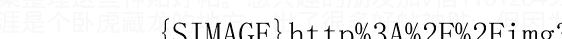


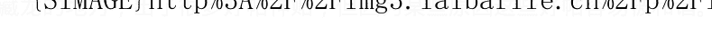

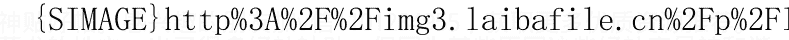


6576 楼
作者：有脊难画 日期:2018-11-26 02:08
好了，今天的图就更新到这里了。（未完待续）

6577 楼
作者：有脊难画 日期:2018-11-26 12:08
而这么的事情，自然不可能只有我们三个去，说白了加 v 信 110128495，获取更多好帖推荐。

## 我们只是旁观“打酱油”的

除了西星官这个主角以外，陈归鸿以及他招来的“灵调剂”登陆上武装干预部，以及赵睿还有他带来的数据组、医疗组、打击组也全部一起去了，只不过过人都停留在西星官判定并再三强调的安全范围之外而已，那场面说起来还是相当热闹的。

一路无话，到了地方，我们三个被陈鸿安排在了一处观察点，这个观测点在一座中等高度的建筑楼台上，这栋建筑的高度并不是太高，但位置很好，在其上举目望远，基本上就能看到整个在略有弯曲的大街道的“万国建筑博览群”，下面发生的一切，都将尽收底。

一会，这里就是西星官与高伯君下面，又面临生死的地方。

陈鸿调的这个位置非常好，他本人也在这里蹲守，记者对于“报道”这件事相当敏感，因为位置找的好，才能以最佳的视角观察、记录下发生的一切，这一点我体会，而朱梦语作为记者应该比我年长一辈，但也可以理解，我们三个站上这么好的“位置”，也纯属占了陈鸿的光。

而赵睿及其人则部署在建筑群中的报大楼内，为了这个，他们临时将使用这座大楼清场了，而在距离我们相比，他们盯得更近，几乎就约定地点安全范围上，估计一旦出现什么情况，就能以最快的速度执行动作。因为灵感如此出色，局势瞬间扭转。

几分钟后，天台的大门再次被打开，又上来人，这人不是别人，却是郭咏铭，陈归鸿看了他一样没有说话，明显是默了他的存在，不知道老家伙走的是什么路，居然也站在这里，打算与我们撇开关系，毕竟他承诺给“灵调剂”投上一大笔经费作为发展，在破坏原则的情况下，也不会跟着过去，自然也不例外。“四位，一会能清楚一点。”陈鸿递给了我们四个人一个具备夜视与热成像、光学成像一体的光电合一系统，这个以前用过类似的型号，并没有改进，还不挥手一下还是可以用熟练掌握的，郭咏铭作为籍佣兵，对军事上的速度也不慢，他是天才基础操作了个。

“主任，部长那边带来了打击组，是干什么的？”我说。

“就是两架‘探测一体’无人机，现在就在我们头上盘旋着，不过那无人机发射多用途空的时候毫无限制，但这里可是上海，看着这个地点，四周全是重点保护单位，那种威力一片的大武器随便乱用吗？炸坏了‘群众’。”

“谁来负责？所以说，老赵头（指的是赵常）就知道这所叫‘武装干预部’就两个人，但真到了关键时刻，我手头的‘王牌’比他好打。”相比较劲的性子来，赵把‘探测一体’无人机都养了，他就跟着两个提着黑箱子的黑衣人，实在是在有点寒酸了，相比用专机带我们“西星官”出山的大排场，其实也不太像他的风格了。不过之后这两个黑衣人将箱子里的东西亮出来，而且明白明白东西之后才才知道陈鸿为什么说他的东西比赵苍的无人机更实用，而且提到此物的时候，他还露一脸骄傲之色——

两人有条不紊，动作熟练将各自箱子打开开启取出里面的黑色物体，接着就开始组装，伴随着一阵机械之间的结合，电子设备调试成功后，两人中略哈一人说道：“报告主任，“干预1号’已组装完毕，可以投入使用，请指示。”

“原地待命。”陈鸿头也不回的命令道：

“是！”报告者应道。

我再看这个组装的物体仍然是一支长度足有3米上的“超级大”，但我想眼抽外加观察一下，我自认为作为一个资军迷，不敢说所有具体的型号，但凡是公开的枪械我无法一眼认出其性的枪械真的不多，可这支轮我实在看不出底到底是何方神圣，一来是长太大了，看到这个筒子简直就像是把一门机关从步兵战车上折在这里了，另外从结构上来说，这套的筒极为粗大但口径并不大，目测直径在20毫米上下，不过即便如此，其实其枪械与炮之间口径的分界线大于20毫米，对于20毫米的管类武器都可以归纳到炮的范身上，虽有一个“榴弹发射器”的单独分项，实际上榴弹发射器发挥的作用就是“微火炮”。

理论了话说，二来是它的结构和我常规的任何武器不同，没有弹壳，这么大的身武器没有相应的“后座”设计，如果是传统的火药动力武器的话，这么巨大的东西产生的后坐力绝对不是人体能承受了。面对这一切“常识”的设计，这到底是个什么玩儿？

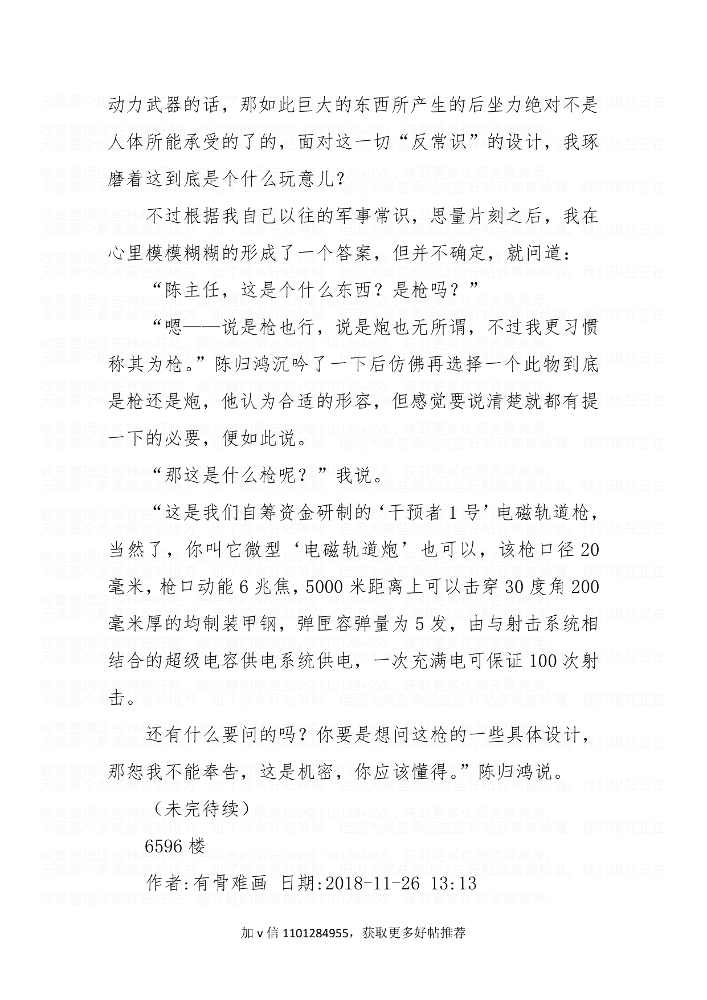

“主任，这是什么东西？是枪吗？”

“嗯——说是枪也行，说是炮也用，不过我习惯称其枪。”陈鸿咬了一声，仿佛在选择此物到底是枪还是炮，他感觉要说清楚都没有必要，便如此说。

“那什么是枪？”这是我们自筹资金研制的‘干预1号’电磁轨道枪，当然你叫它‘电磁轨道炮’也可以，口径20毫米，在500米距离上可以击穿30毫米厚的装甲，弹匣容量为5发，由射击系统的超级电容，一次充电可保证发射。还有什么要问的？要是想问这枪的具体设计，那帮不能告，这是机密，你应该懂得。”陈鸿说。（未完续）

“你见过这枪的套筒这么粗大但口径并没有这么大吗？轨道在套筒的里面，套筒是用来保护轨的，除了防弹、防击、防尘、防水以外，还具有辐射功能，特别是防离辐射，因为轨道直接暴露在外容易受到损坏和强电磁场的干扰，而轨道用电磁力推进，对电磁场比较敏感，所以为了在恶劣和特殊环境的使用，这才有了这种设计。至于电磁线圈枪，那种设计不行，线圈储能比轨道高太多，而且目前的材料不足以线圈，所以这个原理目前还没有过去。”陈鸿说。

“懂了。”我点头，而陈鸿说的的确假，线圈原理由于储能是线圈本身，想要储能线圈的长度就要越大，线圈的长度越大，就会导致整个武器系统的体积和成本不受控制的飙升，但这并不是关键，关键是当能量高于线圈承受能力时会导致线圈熔毁，而目前全世界为线圈的材料都不能满足要求，所以这个材料问题攻上去，线圈原理没有前途，因为储能不去，弹丸威力不去，这是它与轨道相比下的最劣势，因为轨道原理并不是成本低，而且储能能量并不是轨道身上，而是轨道中间的磁力场，所以对能量的承受力高于。

## 材料限制的线圈原理

随着高能，威力自然大了，这就是轨道原理是当下可以及见的未来，作为电磁武器绝对绝对力的根本原因。我为了这个话题聊到这里时，我的手机响了，掏出来看，是闹钟响，时间显示的是2015年1月1日凌晨四点钟，因为为了错过这场盛非常精彩的“跨年大战”，所以我在得到陆鸿同意前往后就给手机下了两个闹钟，以免因为什么重要的原因而错过时间。

我还没去手机的眼睛旁边揉，就听一旁的陆鸿有点兴奋的说：“来了。”

闻此言，我赶紧把手机抓好，端起挂在脖子上光电合一眼睛系统对着正前方看去，在32倍光学方法的支持下，我看得大如斗似的西星官正对着方向走去，而在对面，也有一个身影迎面而来，这人穿着一件藏蓝色军服，向着西星官的方向昂首阔步走的，在他的脸上，一个巨大丑陋而突兀的肿瘤状物挂在右侧，不用说，此便是高伯君。

我从他的步伐中看不到一丝毫的恐惧，而是看到了甚，甚至还看到了一丝凌敛，他的智脑可能并不知道外面上下已经为他布了天罗网，他更不可能明白他除了要面对其势力巨大的西星官，还要面对随时都有可能出手干预的各路军力量，对他来说，此此，基本上就是来无回的。为了准备好这种战斗，因为形势已经准备好战斗爆发，现在，我们实在在但知有虎，偏向山，看来他已经下定了死的决心。这里的所谓“广域”，不仅可以接收到佩戴本身的声音，佩戴者周围15米内的人耳可辨，即便都是细微的声音也不会漏，目的是随时掌握两个人的对话。我想陈鸿和赵崇也，他们对这件事是非常谨慎的，从能力来说，西星官和高伯君其实才是同类，而我们这些凡人才是异类，所以人都凑在一起很难保证形成一项协议，然后结果极为可能的，一个高伯君就已经亡了，两人联手简直不想想象要杀死两个人要付出多代价，而且两人只是拥有超特异功能的，更是智商高，西星官的冷酷，高伯君的疯狂与丧气结合在一起，将产生一个天覆地的组合。

好了，废话少说，今天就让我们个下吧！你赢了，你就是拯救整个城市的神，但如果是我赢了，我就要毁灭城市的魔！“好”，话至此，多说无益，“请！”西星官说。“请！”高伯君。

这两个人的用法就像在擂台上公平比武的武林高手一样，看得不仅是西星官对高伯君，反过来高伯君对西星也有这种……英雄的由衷敬佩。此时此刻，整个上海的巨大街道都成了两人的擂台！

而两人在互相为了一个“请”字之后就开始非常决，向后退，当退两人间隔约有50米左右的时候，又同时停下脚步。经过非常短暂，大约10秒的对峙后，高伯君率先发难，他伸左手，用眼看不见任何东西发，街道两旁的路灯都是一阵恍明忽，好像被力量贯穿而随时有可能爆炸一样，而西星官扬起右手以同样的动作一挡，一股同样肉眼不可见的能量发出，与打而来的在空中相撞，这一下才了不得了，四周座椅的车辆玻璃全部被破碎，前后起码有10根路灯上的灯都熄灭了。不过对于旁观者我们来说还好，因为我拿的光电合一眼睛系统四夜视功能，即便完全无光，也不妨碍我视物，所以下面的打斗还能看得清楚。

接下来两人又这一来回的斗了几个回合，不分上下，其实从过程来说并不精彩，因为如果用文字来形容的话，那完全就是两个人在原地做着各种手舞起足的动作。你来回之间也无力攻破对方的防御，打来打了半天，谁也没有受伤，更看不出谁胜的迹象。

另外，幸亏我……

双手在空中慢慢地划了两个圆圈，那身体边缘滚流在流动的黄浦江水居然想被一个透明的管子“抽”起来了一样，一股江水凌空脱离江大的“环抱”，“啪”到了地上上来，然后也是一个透明的球体，接着流演化成了一个人形，高度和对面的火人相当，这个水人身上也是江水流转，甚至还能看见这水中还有一条被困在其中的小鱼。

火人与水人面对立片刻之后，他们在身后各自的“主人”命的命令下几乎同时出手，这一打就太精彩了，水火之间四臂交叉，火花与水左右击飞，而是从式上看，更是打得漂亮极了，用一个不恰俗的形容就好比这水火二人都如“火柴”中的两个高手在拳脚对决一样，各种普通人能做出来的、做不出来的动作在他身上都是轻而易举。向一纵，则则三五米，三十十几公里；向前一攒，近则八公里，远则三十厘米，而且从它对周遭事物的破坏性来看，其招出式的力度也非大，人胆粗的路灯杆，火人一举车上去就是一个大坑，两吨的SUV，水人一脚上去，整个车子就能比赛的原地打转。

特别是在它俩攻击时，相碰之下，水火不容，那热热的火焰与冰冷的江水交融在一起，产生白色的水蒸汽，通过西星官上的广域对讲机，还能听到那冷热交替发的“嘶嘶”声。

不过随着时间的推进，这火人与水人的体积在不断的缩小，原本有1.5倍于正常人的大小，打着打着就成了与常人相当，最后比常人小，我想那是它在互相伤害时水被火焰的高温蒸发，火焰被水淹没的结果。但这种情况让局势开始有着有利于西星官的发展，因为火人身上可物质是从周围里抽出的汽油，汽油就有那么多，烧没了再想抽，就得等到别处去；可角斗场在这里，有西星官在，在周围这么多埋伏的力量自会，没有人会给高伯任外往的机会，但水人就不一样了，人身上的水来自于东侧的黄浦江，江里的水对于形成一个人的用水量来说，几乎可以说是取之不尽用不竭。所以水火人都打越小的时候，西星官再次聚出水进行补充，那个人有了新鲜源的聚焦，整个结构瞬间就又重新张大了，而且西星官好像并没有让它恢复最初的意志，而是想让它比之前更大，更大得多。随着江水的不断注入，水的体积终于变成了一个足够半个路灯杆这样的“水巨人”，在面的火焰，相比之下还没有对方的膝盖。

巧妙难为无米之，高伯任的念力竟然与西星官不上下，但没有汽油作为可燃物的“原材料”，他只能无法。在水火人才战斗的最后，那火人已经被打的只有半个普通高，而水人则居高临下比它大了几十倍，借助这体积的绝对优势，西星官操纵水人抓住一个机会，抬起大脚对准火人就踩，这一脚下去，整个人被海量的江水包围，瞬间就被淹灭了。彻底彻底彻底，这一阵水蒸气和“嘶嘶”声格外明显，我甚至感觉即使不用西星官身上的那个广域对讲机，仅凭双耳，就能听见这股水灭火的声音。

“巨人”虽然在重新增大之后再灭火人的整个过程中小了一截，但体型依然远大于一个普通人，更何况还有周围的无穷无尽的江水作为后备，西星官在这一场的较量上似乎已经占据了上风。

江水只是一种客观存在的实物，西星官可以用，高伯君自然也可以用，所以我本以为高伯君也会看到上水量的优势，同样用力制作出一个庞大的水人，然后“第二回合”就被注入水人VS水人的模式，如果是那就是那样，这一脚一那就是没完了了，我只能抓住对方的破绽并予以致命的一击来结束战斗。

但他并没有我设想的方向发展，高伯君见火被灭，也不慌，双臂又是一齐扬，平地忽起一阵大风，这风并不是冰冷的江风，而是带有一股推拉的力道，它贴着地表扫，覆盖了两人决斗之前起的100米内的所有行迹以及它周围绿植植物下的群众泥土全部掀到了半空中，无数水被杂揉在一起，形成了一个庞大的“怪物”。之所以称其为怪物，是因为它的外形个像，首先它不像之前的火山，因为它不是人形，其次是四足着地却变形。对于任何常见的动物，这个怪物在形成之后盯准西星官阻挡。

由于各种原因，这里会有更多。

### 电磁武器的进展

因为在文中提到了“电磁轨道枪”这个时代的武器，再加上我们是否已经进展，所以今天找一个典型的，也就是我国第一代海军载电炮。

- 图1：该炮的外形
- 图2：该炮的具体性能，弹丸依赖任何爆炸物质，纯粹靠电磁的超高速度产生的动能对目标进行击
- 图3：电磁炮的陆地原理，相对之下，在这个领域对于军事来说具有极其重要价值
- 图4：美国电磁轨道原理，可以看到该炮上连接的大量电缆，以及集成度低的整体情况

综上所述，客气的说，我国在电磁武器领域上领先美国至少15年以上，如果算上没有秘密的，那么凡拿出来让外界看的，基本上都是其下一代产品。也就是说，在我国第一代载电炮的时候，其更先进的第二代产品初露峥嵘，而美国第一代的门槛还没远远过去。至于其他国家在这方面的水平，那就可以四个字来形容：不值一提。

这一次没有水火灭的打击，而且不仅不害怕，还像对水人有一定的压制效果，那水人的水势越赶，这边的“泥土怪”就打的越强。当这场“第二回合”的战斗持续到3分钟左右，“泥土怪”已经完全掌握了主动权——将水人死死的压制住。最后等到第五分钟的时候，水人彻底坚持不住，被猛扑来的“泥土怪”倒在地上，随后竟然完全散于泥土融合合成了一体，吸收了水人身上的水分之后，这“泥土怪”从“干土”变成了“泥土”，比之前更加坚韧，甚至还具备了橡皮一般的变形能力。

经过观察，我猜测刚才高伯伯应该试图用力粒使其发生变形，但发现这些泥土太干燥，松散的颗粒强行变形，所以多次尝试之后放弃了这种想法，直接用原始形态的“泥土怪”去战斗。而在“泥土怪”的作用下，干燥的颗粒变得湿润富有粘性，念力再进行操控时已经胜任，这才伯伯尽的发挥想象力，看来手里一会是怪，一会还能变成类似长条物体，最后分成几个小号。

天边上方又来一阵风，这种风当时已经是十二月份了，两边的行道上挂着相当一部分枯枝掉落，在这股力量下从树干扯离，除了枯枝之外，还有相当一部分树皮加入其中，然后这些相互织在一起形成了一个好似龙的飞行物体，这个东西在空中盘旋后冲之时，直接撞了“泥土怪”，“泥土怪”被撞得崩散架，身体的各个部分从空中坠落在地彻底散成一团，完全失去了刚才的生命感，又恢复到了枯枝朽叶以及树皮的状态。

眼前的此景，我心还是想，发动机都是所谓，轻松就能将它树枝与树叶加树皮为主体的“大鸟”干掉，这是标准的“金烷木”。

再将视线转回西星官的身上，他注射了那种自己发明的“脑袋风暴”的药物，局势与能力都正盛，根本不甘放弃。当两人一对对开始快速的捏起手心，我不知道他是要干什么，正想去问陈鸿，结果他叫来的武装干预部的之前来支援的属下其中一人开口道：“报告，两人交战区域内的温度急剧升高，现在正以每秒百倍的速度飙升，攀升停止，局部区域的温度已达1200摄氏度！”

我听到此言立马打开光合系统的成熟成像功能，往那个方向一看，果然，西星官头顶一个星球的区域内，里面变成了火红的颜色，这是高温下成像下的特征。其中好像他的头顶顶着一个巨大的火球相似，我站在数百米之外甚至感受到了丝丝的热浪，这种温度上升之后带来的体感差异在相当寒冷的上海显得格外明显。

接着，西星官停止挥手，将右手指向空中，那块高温的球形区域确实移动了过来，而它因为温度太高，其所在正面直接将那些散落在地面上的枝枯树叶全部给烤焦甚至是点燃了。这个球形区域移动起来之后，速度越越快，而且面积大得多，同时还灵活多。在这种条件下，不是追上一个，每次追上都能进入自己的体内。之前用了不到分钟的时间，这个高温球体静止悬浮在距离地面左右的位置。

在这个动作作用之后，那个球形区域瞬间消失，里面包裹的高温液体全部洒了了下来，落在了坚硬的地面上，同样发出一阵嘶声和产生了大量的水气，这些还覆盖的地面烤得向外裂。

这一次再次轮到西星官，随着这一幕出现，完成了一个轮，因为刚才才用汽车引擎盖的手段，完全可以称得上“火金”。虽然没有出现，但温度就可以代表了火，火本身就是温度与明亮的象征。

我看到这里简直震撼了。还记得在飞机上你是怎么说的吗？这种异能人，放到古代，那就是神，或者是神原型，从这个角度来说，他们之间的对决是一场真假实的“神仙打架”。

“这两个个人打招，简直就是神仙打架。”陈鸿说。

“有几个就能写出一本现代版的《封仙打架》。”我说。

“有几个就行，可别吵起来，这样的人多了，这个世界就没有什么事了。”陈鸿说。

“哦，也对。”我听他说的有道理，点头。

原本以为只是局势好对他更有利，结果高伯君先出的招，这次他是先开的口，他说：“果然是棋逢对手，将遇良才，人生的最后一刻能与你这样一个硬梗面对面打得痛快，不失为人生的一大好事，哈哈哈哈哈哈。”高伯君说完后就是一场狂欢，狂笑之下，他右脸那个巨大肿物却跟着他剧烈的颤动，而在这段话中就已经被拉拉形的五官变得更加扭曲。他在这一段中用了这一次之前就没看向回头。

“我之所以主动被抓，进那通牢牢监狱，是为了找对手，我以为天下最强的对手都在哪里，没想到外面还有你，真是相见恨晚呐！”西星官也发起了感慨。

“使全力就是为了对对手最大的尊重，今天两人必须分开下来，之前那些花活没有意义，我们来谈点干货，一战胜负，怎么样？”高伯君说。

“如何一战胜负？”西星官，“你二人直接互搏，用力相较，谁先停不住了谁为输，过输的一方，可是要落得粉身碎底下，你敢吗？”高伯君带着挑衅的发问。

“有何不敢？正有此意！来吧！”西星官性情傲慢，对这种挑战，自然不可能认总，当即便窘了来了。

陈归鸿对击组二人又强调道：“这估计是最后的一锤子买卖，形势一变不对，我都听命令，果断开枪！”

“是！”两人异口同声的回答。

按照约定，两人大大跨步向对方走，直到对方停了。高伯君的战斗从头用到了尾，如果再用周围战斗利用能力，且没完了，没什么意义的死循环。

在这个动作作用之后，报告报告那些人接着：“温度开始升高了！”十秒后，他再次：“温度已经3000摄氏度了！”十秒内，我看着那20个引擎盖在温度急剧升上，在内融化成了液态。


# 他的那报告：

“报告，目标区域能量密度极剧增，局部强度已经突破百万大气压，突破300万、500万、900万、1000万……报告数据传递的数字越来越大，间隙时间也越来越短，这证明了二人的念力对抗已经进入了高强度状态。

我甚至可以看到“念力单”里面的二人，高伯君脸右侧的瘤物犹如一如狂奔的心脏在激烈中剧烈动不止，而西星官额前的“天目”也睁到了极限，里面那颗好像眼球，用于发射“第三脑”念力的黑色球状物完全露出了，这是我第一次见到他。以前第一次看到他们“天目”完全张开，然后按照后来的归属所说，这不仅是我第一次，就是他，也是同样的第一次。”

陈兴鸿此时摆出一副“泰山崩于前而色不变”的架势，没有说实话，但我看到他时不蠕动的喉结，我知道他其实也很紧张。一直数据突破7000万大气压时，他终于有点坐不住了，像是对我，又像是自言自语，他他说：

“如果按照这个速度继续增长，那么在他身上集聚的能量将达到一颗战术核弹的级别，一旦这个相持突破了临界点，发生‘念力爆炸’，后果就太严重了……”

“会有什么后果？”我问。

“我告诉你，念力的本质就是脑电波的仿级产物。说白了它脑电波只是非常非常的强大，强大到足以引起粒子级甚至是原子级的微观运动从而预引起物理现象。结果这种强度的念力在冲击临界点向外扩散速度会达到光速，在衰减到不足以对大脑造成伤害之前，凡是所到之处的所有生物，大脑都会遭到重创，轻则脑死变成植物人，重则就是大脑血管破当场死于脑溢血。再重点，就是如被西星军用念力杀死的那7只猴子一样，整个大脑变成堪‘豆腐腐’。”陈羽鸿说。

“那——那他现在如果产生爆炸影响会有多大的范围？”我问。

“‘念力波’在遭遇建筑、汽车、树木等物体体会引起较大的崩毁。上海高楼林立，汽车众多，对抑制其影响半径有一定的效果，但是即便如此，现在的数值来推算，一旦爆炸，最大半径将小于10公里，致死半径至少在3公里左右，到时候他们两个也会因为承受不住这高高的叠加念力而死，而附近遭到波的人口可能数以万计，都会面临灭顶之灾。此外，会有通讯、电子等设备产生致命的毁灭性破坏！”陈羽鸿瞥了一眼他那两名部下身边的显示终端，上面关于这二人的数值还在不断飙升，随着数值的变化，他的脸色也愈加难看起来。我听到后也意识到了问题的严重性，现在这二人的地点是外滩核心地带的大道上，也是整个上海最繁华的街道之一，四围的人口密度非常高，半径10公里内的所有人员至少数万，就是3公里内也有万余以上。”

陈归鸿说这爆炸了相当于一枚核术弹头的话真的是实在危言。我仔细听，我想过了这些问题后便接着问：“那在怎么办？”

还没等陈归鸿回答，那个之前一直在报数数据的“武装干部”的观察者再次说话，这次他的声音也有一点颤抖，说道：

“报告！目标区域内大气压和能量密度已经接近阈值，预计将在3分钟后冲破极限产生爆炸！估算影响半径将达到18.5公里！”

18.5公里的半径，这个区域内的总人口绝对超过了10万。陈归鸿黑着脸听完是对我说，也是自言自语道：“现在再组织人员撤离是来得及了，必须立即阻止他的对高伯君开火，向腰部射击，记住，千万不要误伤西星官！对高伯君尽量要受伤不要击死！”

“是！”主手回答道，随后调整枪口就要开打。

而他刚刚发下命令，对讲机响了，里面传来的是赵崇的声音，他道：“老陈，我要命令无人机发射导弹进行击打，你有什么意见就赶紧给我过来，我给你5秒的时间！”

“不能用导弹！你那无人机的空对地弹携带的是‘全氢阴离子盐’战斗头部，威力太大！炸死西星官的！他死了，我就比折弹了！”陈禹一听赵荣要发射导弹，当即面色俱厉的回道。

注：关于“全氢阴离子盐”这样一个有些拗口的术语，这里我又要说一点题外话了——它是一种我国领先世界的火工产品成果，说的具体一点就是一种最新研制成功的高能炸药。介绍它强悍的性能，一经问世便打败了之前地图上的一个‘炸药王’宝座，虽然其公开之后，实际上在此之前已经在内部投入。那么这种高能炸药到底有多强大？简单讲，在质量相同的情况下，它产生的威力是TNT炸药的100倍。使用这种‘全氢阴离子盐’作为战斗装备，一枚小小的战术弹能够轻松摧毁一座建筑，破坏力极大。在《新世界福音战士》幻想中想过一种威力接近常规武器但没有产生辐射危险的‘N-2炸弹’基本上就是这个概念，它的出现让很多科研人员经过不懈努力后，将幻想作品变成了现实。”

“不发射你想怎么样？”看着“念力波”这把大半个人变成植物还是‘豆腐’吗？”赵宰吼道。

“你别管，总之不能发射。”陈归鸿说完，此时旁边的轨道枪已经彻底响。我开始清楚为什么陈归鸿下命令后他才疑惑，后来才知道把注意力都放在陈归鸿与赵宰的对话上，没听见两个人的对话。

在那个时间空隙里，他正在寻找西星官和高伯君之外的‘念力罩’弱点，开火选定了一个击穿率最高的点便立即执行断击。我虽然忍着耳朵听起两个对话，但手心里端着光。随着轨道枪的开启，我看着一道火光疾驰而出，在夜空下的弹道，弹头是高伯君的左腿去的。实际上这一击，即便撞到一个个人身子被打烂的，又可能不死？即使是异人。

这里的地方对于我们来说最好登陆点，因为星云这处隐蔽性，而且在电磁力推进下，足以击穿二战坦克正面装甲。初速超过2500米每秒的弹丸带有巨大无比的穿透力，击中在“念力罩”之后，竟然因为面对强大阻力而产生了弹道偏移。弹头虽然穿透了“念力罩”，却因此消耗了绝大部分的能量，最终造成了偏移。而偏移后的弹头则高伯君的左侧腰过，随后击打在了地面上激起了一阵柏屑，弹丸深深的射入了地面之中，这直接导致了结果就是这一枪也没有对其造成任何实质性的损伤。然而这只是弹丸击中后的猜想，实际情况则要复杂得多：该弹在常规交战距离上对该装甲后效深度为100毫米，还足以破坏装甲后的车辆设备及伤内乘员。而如果深度是600毫米，装甲防护力也是600毫米，那很容易出现弹芯滞留在装甲板中，无法彻底击毁目标，导致其仍有部分战斗力的情况。在这种情况下，无数弹丸组成的‘弹雨’泼洒。换句话说，当警方集火力射的场景可以说是相当壮观，但却‘没有用’。”

经过此番折，预计达到的阈值时间已经过去了两多分钟，所剩时间还有几十秒。正当赵崇与陈归鸿人类喊之间终于要决定发射导弹的时候，两个人突然出现在所有人的视野里。这两个人推着一个类似探照灯的东西向前前进，最后停到了对峙的50米开外。得益于西星官与洛伯爵在当时的精力高度集中，虽然单位强度极高，但因为太过于集中，导致影响范围很小，正因为如此，这突然出现才能轻易的接近。

而这两个是谁呢？当看了之后，我不知道别人怎么想，但是惊掉了我的下巴。这两个人，站在左边的身形魁梧，头顶有一块与皮肉在一起的外露骨，这个特征直接挑明了他的身份——在西星球利用移动信号塔发力后一直处于失联不明状态的‘强者’凑陆桐！他的突然出现完全是非常意料之外的，但站在他右边的人与与之相比是有而无迹，这个人站在他身边，身体显得非常虚弱，倒不是真的太瘦，只是瘦在陆桐太过瘦壮而已，这种瘦弱法让他看起来显得有些病态。话说回来，往后上看，这人再熟悉不过了。这两个人的穿着没有什么特别，但眼睛上戴着一个类似轻薄的护目镜，不知道是起什么作用，反正不是夜视仪，因为周围的路灯大多都在发光，局部的环境对于视觉来说不需要夜视仪来辅助。

尤其是朱梦碧脱口：“小家伙！他怎么在这里？”“关键是还要陆桐在一起，这算什么组合？”

这一切都在进行中。而在摩托车还速度，他趁着风就到了高伯君的侧后方，但他根本没有下车，摩托车几乎不减速甚至还在加速的状态下直挺的撞在了‘念力罩’上。很明显，刘玉林是想直接在高伯君的身上。可怜的是他因为肉眼观察到，而应该不知道有‘念力罩’的存在，所以摩托的前轮在距离高伯君依然还有10米的位置被一般的无形的力量强行挡住，高速撞击后产生了巨大的反作用力，顺便致溃了摩托的前轮向着来的方向大幅凹形变形下去，刘玉林也因为惯性向前出去，随后的他整个人不暇地扑在了。这个这个洞开始小，随着长度的延伸，逐渐变大，到达顶峰时已经差不多篮球的尺寸。这个洞到了这个尺寸之后再扩大一点，王凯已经是巨大的痛苦，五官开始扭曲，随后在眼睛之中竟然流了两道鲜血，虽然戴着类似眼镜的装备看不不到他的眼睛是什么样的，但肯定十分惊人。在眼睛开始流血之后，他的：“这个洞太小了！还有大一点吗？”

双腿等他齐身而起，凭借着他极强的爆发力，他犹如一颗离出的炮弹飞射而出，竟然赶在念力将这个缺口补充无法容其通过之前攒了进去。

随后，他身后落地，人已经身处了“念力罩”之内，站在高伯君的正后方，距离上完全是触手及，接着他身子向下一矮，右脚蹬地，腰部旋转，肩头后拉——这一系列的蓄力与发动一气呵成。做完的那瞬间，他悬足了力量大吼一声：

“纳命来!!!”

同时对高伯君的背后打出了一记十分十二力气的右肩后拳！

（未完）

此时的高伯君在与西星官全力对抗，根本没有意识到背后发生在电光火石之间的事情，而且即便意识到了，他也完全没有办法从涌伯的精力来予以应对，再加上距离极其近，漆六桐那又是何许人？万万不可的“强者”，这一连续击了他几乎去闪闪，力有千钧，高伯君被撞了个结实，其实就是毫无悬念的。

高伯君也，西星官也，两人虽然都是念力“特异功能”的顶尖高手，但除了了大脑的神经过载能力异于人外，其余的生理能与常并无实质区别。如果不动用力的话，被一颗子弹击中要害那也是死的，甚至进行对抗或者是拳脚或棍棒同样可以打死他们。而漆六桐则为“强者”，那使他七分力的拳都能将步兵战的侧面几十厘米级的均衡制钢甲给击打，更何况这次超水平发挥用什么？而如此巨大的一拳没有丝毫不避让与阻挡的打在高伯君这个身体与常人区别不大的异能人身上，那结果基本上是死无无疑，只是我到了必死无疑，没错，这一拳打出来的效果会如此：

随着拳头的命中，传来的声音并不是钝器击打的响响，而是一片肉被外面撕开加骨骼粉碎混合而成的短促声音，也可以说几乎是“嗤”的一声。再看“念力罩”内，因为他出的速度快，力量多大，攻击的目标又有多高的抗击力万——漆六桐显然将高伯君背后给打穿了。

是的，他被这一拳击穿了身体，漆六桐的整个右臂直接进入了二头肌的位置，位于最前面的拳头挂着鲜血从高伯君的胸前下方约 10 厘米左右的位置了出来。

而高伯君这甚至还没来得及喊一声，只是身体一震，腰子一挺，刚刚左手一软，便松开了对面的西星官，然后双脚也是一软，整个人就颓了下去，而是因为他“挂”在处于伸状态的漆六桐手臂上却没有倒掉，他的头已经拉了下来，双膝盖弯曲，就像一直被抽了骨架的大力。

在他右脸侧面的剧痛也瞬间从刚才的剧烈跳动回了平静，只剩下了微弱的起伏，看着就好似一个弥留之际的人。高伯君如此，他的念力自然彻底消失，而正因为如此，西星官还没实在在发力与其对抗，却在对手的力量突然溃掉之后被“晃”了了一下，身子向前靠，外加他这次与高伯君的决斗消耗太大了，最终没有支撑身体，直接硬倒在地上。

随后漆六桐用的一只挥手，将挂在自己胳膊上的高伯君用力甩到地上，然后将西星拽起来，并看着地上的高伯君，对着广域讲解：

“目标已失去战斗，不过还有一口气，是否击，请指示。”

“不要击！重复！不要击！看住他！我们的人马上就到了！”赵骏的声音响起，字行间带着难以抑制的兴奋，估计是他看到自己偏爱的漆六桐没事，还在最关键的时候打出了最重要的致命一击，二是终于看到消灭高伯君的希望了。

我看到他，不知为何，心中突然有一种说不出的失落感，看着高伯君落在如此下场，竟有些“英雄末路”般的感慨，回头看向旁边的其他人，黄勋一脸虚肃沉默，也是一副陷入沉思的表情，陈归鸿擦了把额头因为紧张而布满的汗，随后轻轻的叹了一口，只是这口气非常非常轻的，不注意根本看不到，我是正巧扭头看了个正，才捕捉到了他这个反应。

而反应最大的，还是朱梦瑾，她是站在原地呆立了良久，缓放下合脸后，两只迷人的眸中落下滚滚的泪，接着便失声痛哭起来，一边呼吸着高伯君的名字，一边打开大门向下冲去。而我和黄勋担心她情绪失控再出现什么意外，便跟着跑出了。我们三个怎么跑下去的过程不用说，就说朱梦瑾穿着高跟鞋奔跑在安全距离之外，就这样赤着脚继续，冰冷的路也没有阻挡她的脚步。当最终走到高伯君地的时候，我看到地面上看到了几个脚印，那是她留下的，她毫不在乎，冲到眼前一下子就撞到了高伯君身上，随后便是一伤心欲竭。说实话，从声音上来说，她哭并不算，但不知为何，那股抽泣之中却刺心。虽然前面高伯君的身体强度与常人没有区别，不得不说，他的生命力还是的确普通人。受到如此重创，换了人早已立倒场，而高伯君这一刻还有一丝存，不过因为严重的内外伤导致口鼻之中汩汩血。

漆六桐此时不在，但却还能缓缓的抬起手臂，看着她，抚扰她的秀发，他的嘴唇上上下动，好像在说什么，我站的位置比较近，侧耳仔细听，便听到他断续的说：

“我……闯过……黑的夜……娶……最美……”

这句话每一个字几乎都是带着一口鲜血，因为离得太大了，血点都溅在了她的脸上，脚下的巨大伤口流出的血大片衣服染红了，但就像已经经历了破。她此时不知道昔日如何歪头对她说这句话后，她哽咽着回道：

“我穿上……最后的婚礼……嫁你……最好的……”

这句话断断续，她是流的是泪，高伯君流的是血。我听到这句话后才清楚，这是一个名为“校园爱情”的系列舞台剧，这个系列舞台剧由学生团队创作，最高奖是万元，每个人都可以申请加入，完全是开放竞争，但前提是必须主角。虽然两人不在同一学校，但在这次演出中同台合作，朱梦瑾用了三天夜的时间赶出了一个剧本，寻找伯君，她演女主角，他演男主角。那时候在大二结束后的距离，大二结束前两个月，认识了郭铭，一切随之完全改变……。“哎！他差点毁一座城，你为了真正关心的人吧！”

一个充满气的脚步声响起来，话中还带着一丝愤怒，不用听声音就能辨出这是漆六桐的。朱梦瑶还没从这一声中反应过来，漆六桐就左手靠着西星官，将手按在肩膀上带到了她的面前，之后让他靠着灯杆，以一个半坐的姿势坐在朱梦瑶的身旁。这时她脸上的那个护目被漆六桐取下，我仔细打量，才发现她此时面色土灰苍白，还有乳白色的液体，不过单纯的血液，在鼻孔中混有一些白色的透明液体。按照我的经验，那是脑脊液，鼻孔里往外流这东西可是，这是脑受到重创后的一种典型表现，比重度脑震或者是脑炎。

李梦瑾看到对着路灯坐在那里的王凯，也想转身去看着他，只不过这一转身，身后的裙摆被死死抓住，抓住裙摆的是一只手，那是高伯君的手。这会儿高伯君瞳已几乎要完全放大，嘴巴只能微微颤抖，看着还想说什么却一个字也说出来，可即便如此，但他手仍然抓得死死的。（未完待续）


“我知道，我都知道，你一直喜欢我，可是……可是都是在在

我们......朱梦瑶说到这里被王珂打断了，他吃力的撇了撇在在在

瑶姐，你不要为难，不要看我快死了份上就可怜我，

我知道我配不上你，不过你一点儿你错了，我不是喜欢你，

我是真的爱你，我可能买不起任何任何你喜欢的东西，但我愿意，

愿意在你最需要的时候，把一切都给你，包括我的生命。在

我愿意在尘埃的沙尘中仰望星空的空空里。

别人说我恋你是自己“找寻”，但他们都不对，自从在

认识了你，我的世界才变成了彩色，原本计划给你一辈子在在

的“护花使者”，现在看来不行了，我要走了，我是在在在在

还有一个要求，你能答应我吗？”

“你说，你一定答应我。”朱梦瑶眼睛已经因为哭泣而在在

红肿不堪，眼眶仍然停不住的往下流，说实话，此此景在在

让我也感觉鼻尖一阵发酸，其感人程度并不于方才伯伯在在

与她的离别，而王珂的告白也同时让我想到了一个著名的在在在

的网络名言：在在

“你可以爱一个人爱到尘埃里，但没有人会爱尘埃里的在在

你”在

这句话原本是用来提醒那些单相思的人，不要再为了了在在

爱自己的作践自己，但与王珂的心境比起来，这句话就显得在在在在

得有些渺小了。

想到此处，若不是我采访过许多生生死死练得心地已经

比较“坚硬”，我想当时也要潸然泪下。

“我对最大的梦想，不敢奢求什么，就是想牵起你

的手，可以吗？”朱琼重重的应了声，然后把左右两只玉

都伸了出去，紧紧抓住了王珂的右手，在双方的肌肤触碰

在一起的那一刻，他像是是对自己，又像是对所有人说道：

“值得了。”

三个字脱口而出，他的眼神瞬间就变的直勾勾并没

散了下去，胸口那股微弱的起伏也彻底消失，我知道，他的

生命——结束了。

漆桐与陈沛归都是见过无数大风大浪的，我与黄勋

虽比不上他们，但也经历过一些场，可便是如此，四

个男人还是为之动容，朱琼更是抱住王珂的遗体哭成了

泪人，在场的所有人里，可能只有朱琼以外，最受伤的就

是我，因为我在最初接触到此事时就认识了王珂，而且也

很早察觉到了他对朱琼的哀慕，而他这样一个一言不语的

人的，在场如此惊心动魄的正对抗中连续两次发挥了

关键作用：

第一次，在破解噩梦那里，他帮了我、黄勋，同时包括

朱琼，还间接的救了那些在“慈爱医院”互相残杀的警方

力量，若不是他，那些就要互相杀死全部死亡，起码也要死上

绝大多数。

第二次就不用多说了，若不是他在危难关头及时出现，我们依然在

枣六桐的配合下，刘玉林的成之举击溃了高伯君，且这一

力罩”突破阈值产生“念力波”爆炸，那魔有不知道有人都曾

遗迹，从这个角度来说，他甚至对万乃至十几万本土地人

都有抒情，关键的是，他为了这一切，付出了年轻的生命。

而他在自己短暂人生的最后时刻，念念不忘的仍然是

那个心中的挚爱，这个谦逊、内疚、清瘦的小伙子曾有任

让人们为了觉醒的靠靠，能够在千一一之间为她舍弃所有，

他用实际行动诠释了什么叫做——爱得深沉。

王柯对朱梦瑶的爱情，真挚而热烈，苍苍而执着，市井

之上那些物欲横流的所谓男女爱情，在这份爱情面前，显得

是多么贫足，那样的苦白无力。

(未完待)

好了，再多的眼泪与悲伤，也无法让过去的的人再回来。

为了击败高伯君，在西星、枣六桐、王柯、刘玉林四人或

计划或妥巧的配合之下才能强化，其中西星消耗巨力大要

被被迫进行长时间的修炼，枣六桐虽然没有大碍，但在之前

险些被高伯君控制，也需要做一个全方位的脑部与神经系统

方面的检查，而王柯与刘玉林则为此付出了生命，前者为了

爱情，后者为了战友情，这样的代价不可谓高昂，不可谓不惨重。

在之这之之后的几天里，当我走出伤痕，回到现实之中，从头脑里自己将整个事件，尤其是决战前后的所有细节描写之后，我感觉自己还有很多想不通的疑问，趁着那几个大佬们还没走，我得抓紧机会问清楚。

[content]
我是我，因为我在最初接触到此事时就认识了王珂，而且也很早察觉到了他对朱琼的哀慕，而他这样一个一言不语的人的，在场如此惊心动魄的正对抗中连续两次发挥了关键作用：

第一次，在破解噩梦那里，他帮了我、黄勋，同时包括朱琼，还间接的救了那些在“慈爱医院”互相残杀的警方力量，若不是他，那些就要互相杀死全部死亡，起码也要死上绝大多数。

第二次就不用多说了，若不是他在危难关头及时出现，我们依然在枣六桐的配合下，刘玉林的成之举击溃了高伯君，且这一力罩突破阈值产生“念力波”爆炸，那魔有不知道有人都曾遗迹，从这个角度来说，他甚至对万乃至十几万本土地人都有抒情，关键的是，他为了这一切，付出了年轻的生命。

而他在自己短暂人生的最后时刻，念念不忘的仍然是那个心中的挚爱，这个谦逊、内疚、清瘦的小伙子曾有任人们为了觉醒的靠靠，能够在千一一之间为她舍弃所有，他用实际行动诠释了什么叫做——爱得深沉。

王柯对朱梦瑶的爱情，真挚而热烈，苍苍而执着，市井之上那些物欲横流的所谓男女爱情，在这份爱情面前，显得是多么贫足，那样的苦白无力。

为了击败高伯君，在西星、枣六桐、王柯、刘玉林四人或计划或妥巧的配合之下才能强化，其中西星消耗巨力大要被被迫进行长时间的修炼，枣六桐虽然没有大碍，但在之前险些被高伯君控制，也需要做一个全方位的脑部与神经系统方面的检查，而王柯与刘玉林则为此付出了生命，前者为了爱情，后者为了战友情，这样的代价不可谓高昂，不可谓不惨重。

在之这之之后的几天里，当我走出伤痕，回到现实之中，从头脑里自己将整个事件，尤其是决战前后的所有细节描写之后，我感觉自己还有很多想不通的疑问，趁着那几个大佬们还没走，我得抓紧机会问清楚。

我是我，因为我在最初接触到此事时就认识了王珂，而且也很早察觉到了他对朱琼的哀慕，而他这样一个一言不语的人的，在场如此惊心动魄的正对抗中连续两次发挥了关键作用：

第一次，在破解噩梦那里，他帮了我、黄勋，同时包括朱琼，还间接的救了那些在“慈爱医院”互相残杀的警方力量，若不是他，那些就要互相杀死全部死亡，起码也要死上绝大多数。

第二次就不用多说了，若不是他在危难关头及时出现，我们依然在枣六桐的配合下，刘玉林的成之举击溃了高伯君，且这一力罩突破阈值产生“念力波”爆炸，那魔有不知道有人都曾遗迹，从这个角度来说，他甚至对万乃至十几万本土地人都有抒情，关键的是，他为了这一切，付出了年轻的生命。

而他在自己短暂人生的最后时刻，念念不忘的仍然是那个心中的挚爱，这个谦逊、内疚、清瘦的小伙子曾有任人们为了觉醒的靠靠，能够在千一一之间为她舍弃所有，他用实际行动诠释了什么叫做——爱得深沉。

王柯对朱梦瑶的爱情，真挚而热烈，苍苍而执着，市井之上那些物欲横流的所谓男女爱情，在这份爱情面前，显得是多么贫足，那样的苦白无力。

为了击败高伯君，在西星、枣六桐、王柯、刘玉林四人或计划或妥巧的配合之下才能强化，其中西星消耗巨力大要被被迫进行长时间的修炼，枣六桐虽然没有大碍，但在之前险些被高伯君控制，也需要做一个全方位的脑部与神经系统方面的检查，而王柯与刘玉林则为此付出了生命，前者为了爱情，后者为了战友情，这样的代价不可谓高昂，不可谓不惨重。

在之这之之后的几天里，当我走出伤痕，回到现实之中，从头脑里自己将整个事件，尤其是决战前后的所有细节描写之后，我感觉自己还有很多想不通的疑问，趁着那几个大佬们还没走，我得抓紧机会问清楚。

我是我是我，因为我在最初接触到此事时就认识了王珂，而且也很早察觉到了他对朱琼的哀慕，而他这样一个一言不语的人的，在场如此惊心动魄的正对抗中连续两次发挥了关键作用：

第一次，在破解噩梦那里，他帮了我、黄勋，同时包括朱琼，还间接的救了那些在“慈爱医院”互相残杀的警方力量，若不是他，那些就要互相杀死全部死亡，起码也要死上绝大多数。

第二次就不用多说了，若不是他在危难关头及时出现，我们依然在枣六桐的配合下，刘玉林的成之举击溃了高伯君，且这一力罩突破阈值产生“念力波”爆炸，那魔有不知道有人都曾遗迹，从这个角度来说，他甚至对万乃至十几万本土地人都有抒情，关键的是，他为了这一切，付出了年轻的生命。

而他在自己短暂人生的最后时刻，念念不忘的仍然是那个心中的挚爱，这个谦逊、内疚、清瘦的小伙子曾有任人们为了觉醒的靠靠，能够在千一一之间为她舍弃所有，他用实际行动诠释了什么叫做——爱得深沉。

王柯对朱梦瑶的爱情，真挚而热烈，苍苍而执着，市井之上那些物欲横流的所谓男女爱情，在这份爱情面前，显得是多么贫足，那样的苦白无力。

为了击败高伯君，在西星、枣六桐、王柯、刘玉林四人或计划或妥巧的配合之下才能强化，其中西星消耗巨力大要被被迫进行长时间的修炼，枣六桐虽然没有大碍，但在之前险些被高伯君控制，也需要做一个全方位的脑部与神经系统方面的检查，而王柯与刘玉林则为此付出了生命，前者为了爱情，后者为了战友情，这样的代价不可谓高昂，不可谓不惨重。

在之这之之后的几天里，当我走出伤痕，回到现实之中，从头脑里自己将整个事件，尤其是决战前后的所有细节描写之后，我感觉自己还有很多想不通的疑问，趁着那几个大佬们还没走，我得抓紧机会问清楚。

我是我是我，因为我在最初接触到此事时就认识了王珂，而且也很早察觉到了他对朱琼的哀慕，而他这样一个一言不语的人的，在场如此惊心动魄的正对抗中连续两次发挥了关键作用：

第一次，在破解噩梦那里，他帮了我、黄勋，同时包括朱琼，还间接的救了那些在“慈爱医院”互相残杀的警方力量，若不是他，那些就要互相杀死全部死亡，起码也要死上绝大多数。

第二次就不用多说了，若不是他在危难关头及时出现，我们依然在枣六桐的配合下，刘玉林的成之举击溃了高伯君，且这一力罩突破阈值产生“念力波”爆炸，那魔有不知道有人都曾遗迹，从这个角度来说，他甚至对万乃至十几万本土地人都有抒情，关键的是，他为了这一切，付出了年轻的生命。

而他在自己短暂人生的最后时刻，念念不忘的仍然是那个心中的挚爱，这个谦逊、内疚、清瘦的小伙子曾有任人们为了觉醒的靠靠，能够在千一一之间为她舍弃所有，他用实际行动诠释了什么叫做——爱得深沉。

王柯对朱梦瑶的爱情，真挚而热烈，苍苍而执着，市井之上那些物欲横流的所谓男女爱情，在这份爱情面前，显得是多么贫足，那样的苦白无力。

为了击败高伯君，在西星、枣六桐、王柯、刘玉林四人或计划或妥巧的配合之下才能强化，其中西星消耗巨力大要被被迫进行长时间的修炼，枣六桐虽然没有大碍，但在之前险些被高伯君控制，也需要做一个全方位的脑部与神经系统方面的检查，而王柯与刘玉林则为此付出了生命，前者为了爱情，后者为了战友情，这样的代价不可谓高昂，不可谓不惨重。

在之这之之后的几天里，当我走出伤痕，回到现实之中，从头脑里自己将整个事件，尤其是决战前后的所有细节描写之后，我感觉自己还有很多想不通的疑问，趁着那几个大佬们还没走，我得抓紧机会问清楚。


后又因为无法正常工作之后，被迫从学校离职，入住过多家精神医院，但治疗效果都不明显。后来因为高额的治疗和护理费用，这个男人的家里就把他赶出来了，但是没有多久他就搬家出走，再也没有回来，直到数年后，他在相邻一个小县城里死于一场车祸。

通过他与高母恋爱到疯狂直至最后死亡的时间来进一步调查，我们发现在这段时间里，高母就已经怀了第一胎，就是‘异胎’。直至怀有‘异胎’1年左右之后，她被人介绍认识了高父，两人喜喜连成了家庭。按照一个正常女性在怀孕三个月后左右应该就能看出来了，但高母在命名后已有1年身孕的情况下，从外表来看，身上却没有任何反应。

后来‘异胎’导致的高母孕怀已经暴露之后，那又是两年后的事情了。高母与高父就理所当然的将其当作了两个人的第一个孩子，而实际上，‘异胎’的亲生父亲，最可能是随着推移，‘异胎’因为营养不足而陷入休眠，让高父高母误以为这一胎已经夭夭，之后才有了高伯君。

也就是说，高母自己也不知道‘异胎’并不是高父的骨肉。

虽然，我们没发现高母与那位化学老师（以后后的流浪汉）在那个相对保守的年代有没有婚前性行为，不能100%的确定‘异胎’父亲的。从逻辑来说，这个推论是正确的。

加v信111028495，获取更多好帖推荐

“父亲的。”陈钧鸿说。

“那既然可以从高父的墓里提取出遗传物质与‘异胎’进行对比，那为了什么不能提取这个化学老师再进行对比呢？这一比对不准就有准确结论了吗？”我。

“这个我们当然想到了，但是当年水平却不能跟现在比。他死之后一直能确认其身份，所以就没有家人去认领，结果在殓馆里放置了很多年后，被殓馆方面以清理挤压遗体的理由给火葬化了，与另外无人认领的遗体的骨灰混在一起埋在了地下下。到现为止，那些骨灰早已与土壤融为一体，根本没法了。”陈钧鸿说。

“这边也是，我听说火葬场的是这种处理无名遗体的骨灰的。那么你们又接着调查疑似‘异胎’生过的其它信息了吗？”我说。

“当然，随后我们顺便摸了他他又在流浪期间的情况开展了调查。根据记录他流浪过的乞讨收获的记录，这个人完全不记得自己的姓名，只只有身上携带的一套考试模拟试卷上有一个名字，还不知道是不是他的。由于他的精神经常性处于不清晰的状态，所以从外表来看，属于典型的重度精神疾病患者。他虽然在疯了之后记得自己叫什么，但在多年的流浪乞讨生涯中有一个外号，叫‘疯子’。更奇怪的是这个外号最初并不是别人给他的，而是他自己叫自己的。一个精神疾病患者把自己叫疯子，这难道不很”

加v信110128495，获取更多好推荐

有意思吗？通常情况下，真正的精神疾病患者根本认识不到自己与他人不同，或者说在他的眼里，自己是正常的，别人才是不正常的。那么我就怀疑，这个‘疯子’的自称，并不是世人通常理解的那个‘疯癫’的疯子的意思的。

所以我由此就受到了启发，开始查找他之前的家族事实。这个人姓李，家里还有一份祖谱，通过这份祖谱一目可以追找到隋唐初这一家的祖先。跟上面记载着他们家祖姓不是受了封建姓的李，而是因为灭苗有功。但是在大唐建立之前的隋唐时期（这也是在大唐建立，论功行赏时才有的事情），你也知道，李是大唐的国姓，能在皇帝的敕封之下与皇家同姓，在那个年代是无上的光荣。能契的是因为有大功劳者或是身份特殊的人才能的，这就与灭苗对起来了。然后下一个关键就是他们家在改姓李之前姓什么，所以重点就在这个方面。根据我推测，在李氏祖谱之前，肯定还有另一份原来姓姓的祖谱。但是以前的事情，我们是无从了。不过可怜的是他们家因为祖上出过这一个‘名人’，所以被记录到了当地的县志里。最后我们又调查了县，那本县志的内容一直从唐代记载到了现代，内容十分珍贵，所以为了被保存下来而转抄了无数版。我们是从现存最早的那一版发现其中写了这么句话，这句话也曾探寻‘异胎’身份的关键，这句话就是这样的：

加v信110128495，获取更多好推荐

## “高祖赐姓前，李家乃姓凤。”

有了这句话，就直接证明了这个流浪汉的直系祖先属于“凤姓”。而凤姓乃为我之前给你介绍的十二姓之一。而‘异胎’与“凤”同音，那么这个流浪汉自称，我猜测更是一种世界的强调，因为精神疾病导致他记忆混乱，或者说他只记得这么了。”陈钧鸿。

：“是的，虽然现在还没有完整的证据证明这件事，但基本上已经不错了。还有一点可以作为佐证的就是县志中关于其祖的记载。当时高祖李渊还是隋朝晋阳留守，公元618年他带兵抗击突厥，遇到了突厥包围，李渊趁机突围成功。而在大唐建立之后，这个人受到圣封为李，就是这一次功劳，首封大唐国姓之后，这个人的号还可以叫‘大将军’。那么什么‘展现神通’怎么就天地变色？”

加v信1028495，获取更多好推荐

（未完）

“好吧，那既然说到这个，我其实感兴趣的就是‘异胎’的新型特异功能。这是一种怎样的特异功能？能让它也位列黄道宫之一？甚至从您提供的排名来看，它占据了十二的第一宫，比西星宫所占的第二宫还靠前。那样一来，我感觉它承载的功能绝对是非同一般的，但我自己看着它的作用与西星的念力基本一致，之前在预测是不是西星宫血脉的某种‘种子’啊，所以我想的就是根据什么说是它是新型呢？”我说。

“第一宫的确是第一宫，而它承载的能力也得到它所在的位置。吧，‘异胎’的特异功能就像一杯水，无无常形，流到哪里就是哪里的形状。想知道水的形状，就得看到它放的环境是什么形状，你懂我的意思吗？”陈钧鸿说。

“呃——你的意思是‘异胎’的特异功能是根据外部环境而形成的？在不同的性格身上就有可能是不同的结果！”我沉吟片刻后是几乎惊讶的语言。

“是的，‘异胎’本身是一个独立的生命体，因为它营养供应不够，导致它都没有发育完成。但如果它长大成人，那么它到底拥有什么样的特异功能就要看它在那刻的特点了。而机缘巧合之下，它的‘胚胎’状态与高伯君结合在了一起，所以提供给伯君的特异功能就是根据伯君当时的特点产生的。这种遇火是火，遇水是水的特异功能，难道不是全新的吗？难道不配站在第一的位置上吗？”陈钧鸿说。

“那……伯君是有样的特点才会产生与西星那样高度一致的特异功能吗？”我说。

“这个很简单，与他的性情没有直接关系。但他面部肿瘤物爆发到十分巨大的时候，他当时已经处于生死边缘。同时他又又想起，念念就是念力的基础。每个人都有‘念头’，但能用脑波将念头强化到无限。高伯君满身的极强念，被身上的‘异胎’得以后，他又接触了大量有关念类的‘特异功能’的书籍与资料，更在脑中形成了这种能力的深层印象。这种想象让‘异胎’为其提供了一个‘模板’，按照这个‘模板’发展下去，便是与西星几乎一样。”

加v信1128495，获取更多好推荐

想象自己一拳打爆坦克，实在是不是对手啊。”我说。

“那当然不行，这个帮助是有限的。你刚才的逻辑，还得看‘异胎’承载力之内。它可以帮你，如果超出了，它也无法帮助。现在的状态下的它能产出如此效果，就是发挥极限了。另外，发展出的特异功能越强，对能量的消耗越大，稳定的供应也是一个问题。高伯君要是不整个系统的吸收力异于常人，也不起‘异胎’的消耗。”陈钧鸿。

“好吧，这样的话的确说的通。因为高伯君提到过‘异胎’开始‘第二次发育’的时候，他对能量的摄入要求陡然提升，以至于最后连吃饭都吃不起了。而您也说，西方军调资研制的专用高营养药物，其热量空前巨大，一个人能顶5个壮汉的食量。这是在高强度使用特异能之后。但我还有一点想通，这个‘异胎’是怎么跟三年后的高伯君在一起的呢？而且既然它从‘第一次发育’期到高伯君大学期间，中间间隔了20多年，是什么促让它在‘休眠’的20多年又有了第二次发育的呢？它又是怎么和高伯君的身体融为一体的？”我说。

“我不是医学方面的专家，这个问题要我回答的话，微自己的力量。不过可以告诉你，那个‘异胎’其实在发育之前一直处于‘潜伏期’，它其实始无无刻都在发育影响下，只是‘激活’问题就像‘特异功能’从隐性到显性的过程一样，缺少一个外界条件的刺激让这个胚胎在高伯君的体内这么多年一直处于休眠和寄生的状态。当外界的触发条件满足的时候，它就会被从休眠中‘觉醒’，进入发育状态。至于这个触发条件是什么，根据眼下所掌握的情况来看，高伯君其根本原因应该是剧烈的情绪波动，直接原因则是情绪波动造成的脑神经异常放电。你也知道，高伯君在此之前生活算得上像是顺风顺水，才完全有一个校花女朋友（注：这里的校花指的就是朱梦瑶），但自从与朱梦瑶分手之后，废之中遭遇了一系列重大的变故，这些变故严重冲击了他的心理健康。如果从纯学术的角度来分析这件事，我敢说医学专家大致的意思是：那个‘异胎’在发育之前一直处于潜伏期，它其实始无无刻都在高伯君大脑皮层或者是相邻的位置。在发育影响下，只是‘激活’问题就像‘特异功能’从隐性到显性的过程一样，缺少一个外界条件的刺激让这个胚胎在高伯君的体内这么多年一直处于休眠和寄生的状态。当外界的触发条件满足的时候，它就会被从休眠中‘觉醒’，进入发育状态。至于这个触发条件是什么，根据眼下所掌握的情况来看，高伯君其根本原因应该是剧烈的情绪波动，直接原因则是情绪波动造成的脑神经异常放电。你也知道，高伯君在此之前生活算得上像是顺风顺水，才完全有一个校花女朋友（注：这里的校花指的就是朱梦瑶），但自从与朱梦瑶分手之后，废之中遭遇了一系列重大的变故，这些变故严重冲击了他的心理健康。如果从纯学术的角度来分析这件事，我敢说医学专家大致的意思是：那个‘异胎’在发育之前一直处于潜伏期，它其实始无无刻都在高伯君大脑皮层或者是相邻的位置。在发育影响下，只是‘激活’问题就像‘特异功能’从隐性到显性的过程一样，缺少一个外界条件的刺激让这个胚胎在高伯君的体内这么多年一直处于休眠和寄生的状态。当外界的触发条件满足的时候，它就会被从休眠中‘觉醒’，进入发育状态。至于这个触发条件是什么，根据眼下所掌握的情况来看，高伯君其根本原因应该是剧烈的情绪波动，直接原因则是情绪波动造成的脑神经异常放电。你也知道，高伯君在此之前生活算得上像是顺风顺水，才完全有一个校花女朋友（注：这里的校花指的就是朱梦瑶），但自从与朱梦瑶分手之后，废之中遭遇了一系列重大的变故，这些变故严重冲击了他的心理健康。如果从纯学术的角度来分析这件事，我敢说医学专家大致的意思是：那个‘异胎’在发育之前一直处于潜伏期，它其实始无无刻都在高伯君大脑皮层或者是相邻的位置。在发育影响下，只是‘激活’问题就像‘特异功能’从隐性到显性的过程一样，缺少一个外界条件的刺激让这个胚胎在高伯君的体内这么多年一直处于休眠和寄生的状态。当外界的触发条件满足的时候，它就会被从休眠中‘觉醒’，进入发育状态。至于这个触发条件是什么，根据眼下所掌握的情况来看，高伯君其根本原因应该是剧烈的情绪波动，直接原因则是情绪波动造成的脑神经异常放电。你也知道，高伯君在此之前生活算得上像是顺风顺水，才完全有一个校花女朋友（注：这里的校花指的就是朱梦瑶），但自从与朱梦瑶分手之后，废之中遭遇了一系列重大的变故，这些变故严重冲击了他的心理健康。如果从纯学术的角度来分析这件事，我敢说医学专家大致的意思是：那个‘异胎’在发育之前一直处于潜伏期，它其实始无无刻都在高伯君大脑皮层或者是相邻的位置。在发育影响下，只是‘激活’问题就像‘特异功能’从隐性到显性的过程一样，缺少一个外界条件的刺激让这个胚胎在高伯君的体内这么多年一直处于休眠和寄生的状态。当外界的触发条件满足的时候，它就会被从休眠中‘觉醒’，进入发育状态。至于这个触发条件是什么，根据眼下所掌握的情况来看，高伯君其根本原因应该是剧烈的情绪波动，直接原因则是情绪波动造成的脑神经异常放电。你也知道，高伯君在此之前生活算得上像是顺风顺水，才完全有一个校花女朋友（注：这里的校花指的就是朱梦瑶），但自从与朱梦瑶分手之后，废之中遭遇了一系列重大的变故，这些变故严重冲击了他的心理健康。如果从纯学术的角度来分析这件事，我敢说医学专家大致的意思是：那个‘异胎’在发育之前一直处于潜伏期，它其实始无无刻都在高伯君大脑皮层或者是相邻的位置。在发育影响下，只是‘激活’问题就像‘特异功能’从隐性到显性的过程一样，缺少一个外界条件的刺激让这个胚胎在高伯君的体内这么多年一直处于休眠和寄生的状态。当外界的触发条件满足的时候，它就会被从休眠中‘觉醒’，进入发育状态。至于这个触发条件是什么，根据眼下所掌握的情况来看，高伯君其根本原因应该是剧烈的情绪波动，直接原因则是情绪波动造成的脑神经异常放电。你也知道，高伯君在此之前生活算得上像是顺风顺水，才完全有一个校花女朋友（注：这里的校花指的就是朱梦瑶），但自从与朱梦瑶分手之后，废之中遭遇了一系列重大的变故，这些变故严重冲击了他的心理健康。

（注：由于OCR文本存在大量重复和乱码，已根据语义逻辑进行了去重和修复）

“好吧，这样的话的确说的通了。因为高伯君提到过‘异胎’开始‘第二次发育’的时候，他对能量的摄入要求陡然提升，以至于最后连吃饭都吃不起了。而您也说，西方军调资研制的专用高营养药物，其热量空前巨大，一个人能顶5个壮汉的食量。这是在高强度使用特异能之后。但我还有一点想通，这个‘异胎’是怎么跟三年后的高伯君在一起的呢？而且既然说它从‘第一次发育’期到高伯君大学期间，中间间隔了20多年，是什么促让它在‘休眠’的20多年又有了第二次发育的呢？它又是怎么和高伯君的身体融为一体的？”我说。

“我不是医学方面的专家，这个问题要我回答的话，微有自己的力量。不过可以告诉你，那个‘异胎’在发育之前一直处于‘潜伏期’，它其实始无无刻都在。在发育影响下，只是‘激活’问题就像‘特异功能’从隐性到显性的过程一样，缺少一个外界条件的刺激让这个胚胎在高伯君的体内这么多年一直处于休眠和寄生的状态。当外界的触发条件满足的时候，它就会被从休眠中‘觉醒’，进入发育状态。至于这个触发条件是什么，根据眼下所掌握的情况来看，高伯君其根本原因应该是剧烈的情绪波动，直接原因则是情绪波动造成的脑神经异常放电。你也知道，高伯君在此之前生活算得上像是顺风顺水，才完全有一个校花女朋友（注：这里的校花指的就是朱梦瑶），但自从与朱梦瑶分手之后，废之中遭遇了一系列重大的变故，这些变故严重冲击了他的心理健康。如果从纯学术的角度来分析这件事，我敢说医学专家大致的意思是：那个‘异胎’在发育之前一直处于潜伏期，它其实始无无刻都在高伯君大脑皮层或者是相邻的位置。在发育影响下，只是‘激活’问题就像‘特异功能’从隐性到显性的过程一样，缺少一个外界条件的刺激让这个胚胎在高伯君的体内这么多年一直处于休眠和寄生的状态。当外界的触发条件满足的时候，它就会被从休眠中‘觉醒’，进入发育状态。”

“明白，可是还是不想通，高伯君在家庭变故后，母亲所有的营养不足以发育，所以索性进入休眠。直到二十多年后的神经异常放电导致它的激活。”

“第一个原因是‘异胎’的‘第二次发育’变成一个巨瘤状阶段后实际上又停止了，它再次进入了休眠的状态。换句话说，高伯君提供的营养与能量不足以让它发育到这个程度，离完全发育形成变成一个正常的婴儿，那还差得远。不过出于‘特异功能者’会优先享用身体营养的特性，这个‘异胎’的大脑部分已经发育完成了，完全达到了成人的标准，这是高伯君具备与异星抗衡的关键。第二我之所以说高伯君的呼吸系统不一般，那是他对食物的吸收率是普通人的数百倍，而这个最直接的体现就是我们后来找到了当年和他一起过的饺子，这个饺子有过记忆，高伯君好像从来不用解大便，就像异星从来不用睡觉一样神奇。健康的肠道是大人类在吸收营养过程中无法吸收的适合吸收以及身体不能适应的部分排出体外的废物，可高伯君没有，说明他几乎可以吸收他摄入的所有食物及营养，不产生额外的额外的废料’。另外，他的胃道也异于常人，可以解析绝大多数以致死的毒菌。这是为什么在被郭铭锐的两名杀手强行灌下毒药物后没有死去，以及之后他吃东西的时候食物和饮料等到严重污染的水源时还不会生病的原因。这么说，通过超算的‘建模分析’，我们发现他的胃道系统就是一个微型的深度‘垃圾回收站’，不管是什么东西，只要能吃能喝的，都不拒绝，收入腹中之后分解并含有营养部分，且全面吸收营养与能量部分。

至于于他这个能力是哪里来的，虽然目前还没有明确的证据，但我认为也跟‘异胎’有关，因为‘异胎’具有强大异化并具象化某种强烈念的‘特异功能’，所以由于‘异胎’的客观存在，导致高伯君当时才因食物供应不足而每日都处于饥饿的状态。”


神方面的疾病并，家人的精神也都很健康，所以这个宿主的宿在

极其突兀来说，如果他不疯，而是与高母成家，那么这个宿主就在

不会是高伯君了，因为这个这个个人就不存在了，同样就没有

之后的这一系列事情了。

而这一切发生后，“异胎”再与高伯君结合，在随后他

一系列的遭遇又促使，“异胎”的“二次发育”，接下来再利用

它赋予的“特异功能”开展复述，直至发展到今天，这每

一步都是靠巧巧准确准确才能引发的“蝴蝶效应”。

从概率角度来说，能产生这种客观见的概率简直是太小了，

比天降陨石砸指定的某一个人的概率还要小，假设非要有

解释的话，不知道这是否不是就是所谓的“注定”——夏夏

之中的定数注定一切这样的形式发生。

还有一个就是，“异胎”的生父在人生的后半段以讨

为生，而高伯君作为它的宿主也讨过，不知道这算不算又

是一个巧合。

我靠托柯里的命理高手的，“异胎”推算，只能推算出

它的命数里充满了变量，但以后会是怎样的却？“笼灾”在

片迷雾当中，完全看不清。

如果有朝一日我们能找到子非，那一个一定要用用他的

预知力给，“异胎”一算，看看这个家伙未来到到底是是

什么样的发展，如果他都算出来，那就彻底没没了，不过赢子

非连周天运都能精准的推算出来，一个人的命运再反复，

天事应该也难不住你？陈归鸿说。“因为你底子如此聪明又横溢，我们实在在

“您都说了‘异胎’的命数里充满了变量，那就随它去

吧，真用心的话有些事情是注定的，那即便算出来也能改变
不了了。”我说。

“你这么说也有几分道理。”陈归鸿说。

“对了，陈主任，您给我说了这么多，里面包含的信息
简直是海量，难道都是在击溃高伯君后几天调查到的？”

我说。

“那当然，要不要你以为呢？”陈归鸿问道。

“厉害，这两个情报的巨头部门联合起来就是不一样的。”我说。

“除了我们还有西星官也到了很大的作用，要不是他
读了高伯君以及‘异胎’的电脑备份，哪里能找到这么多早无凭可靠的事情。”陈归鸿说。

“看出了，他以后绝对就是‘灵调’的不二王牌。”

我说。

“不用以后，现在就已经是了。”陈归鸿说。

(未完待续)

6893 楼
作者：有骨难画 日期：2018-12-01 01:08
楼主又更图了，内容发生在1987年我国“特异功能”研究领域上，两件理论层面的大事，至于具体内容，图

# 1、这两张截图已经说得很清楚了，楼主就不再赘述了。

{IMAGE}http%3A%2F%2Fimg3.laibaife.cn%2F%2F12F302800479.png {EIMAGE}

{IMAGE}http%3A%2F%2Fimg3.laibaife.cn%2F%2F212F302800528.png {EIMAGE}

# 6912 楼
作者:有骨难画 日期:2018-12-01 01:09
好了，今天的图就更新到这里了。

(未完持续)

# 6913 楼
作者:有骨难画 日期:2018-12-01 19:30
楼又更新了，让大家看官等了

# 6944 楼
作者:有骨难画 日期:2018-12-01 19:33
“等，顾冉刚才说这个‘异胎’经过了‘二次发育’之后又进入了休眠状态？”我跟顾归鸿就聊着。，突然想到了他之前说这个虽然是细节，但是如果我不错的话，会有很有“意思”的问题，便如此问道。

“是的，怎么了？至于一一乍乍的吗？”陈归鸿见我突然这个表情，回回了一个“莫名其妙”的表情并如此问道。

“我的意思是那不是说，假设若有新的刺激这个‘异胎’再次醒，并有足够的营养促进其发育，那么这个‘异胎’不是就有真的可能完成全部发育，长大成人，成为如同西星官、漆六钢琴那样的‘实战特异异能者’？”我说道。

“你呀你，我看他们以后在里面当棋者了，直接去‘第零局’当他们的参谋得了，你说的这事是帮人也刚刚出来的，竟然被你用言语勾勒，这思维速度快被我堵住了。只是呢，这个‘异胎’说到底也不是‘命中’，之前这么多波折也没有发育，相比之下，西星官的诞生更像是注定的，而‘异胎’的诞生是一种随时都可以消失的‘偶然现象’，让人无法探测。”刚用手指着我又摆出了标志性的“微笑”表情对我说。

“您这么就是我取了，无非是晴而已，做个采访还要报告，还是去了‘零局’，估计保洁工作就交给我了，等老了忘了给我一声，这个‘异胎’命中中充满了变数，并且无法做精确推算。我刚才想了一下，只能用命运这个词来概括一下，您能不能具体说一下？”我说。

“命运对是肯定的，但不足以形容全部。具体来说，我可以告诉你，在我看来，“异胎’是一个‘定时炸弹’，如果走上征途还就好，一旦误进路，那就比较麻烦了。所以我才一直强调它充满了变量，或者它本身就是一个巨大的变量。”

如果好，因为是星丽如此好酷如此横，我们正在也是因为‘异胎’中充满了变量，遵循规律，它还没有成型的钢，最终会被打造成什么样子谁也无法确定。也是因为如此，它的潜力我们推测或许是允许自己的‘实战级异者’中最强的，这估计是它在发育集中两人的精华只能达到程度，对培养需求看起来比西星官还要胜一筹的原因所在。

现在‘零局’投入了大量人力开展研究，而且向你推测的那样，那边现在定了主要方向，就是让它进行进一步发育，而这么折腾下去，还真不知道到底是福还是祸，只是这次活跃需要的能量不是第二次发现电脑异常就可以办到的，说不得用微型反应堆提供供应。算了，那是他们的事，我就不操心了。”陈归鸿背着手用一种感慨的语气说道。

“你也别太差别，既然‘异胎’是变量，那有可能坏就有好。另外，我记得一开始‘零局’来参与的目的也是想‘挖’西星官，他们怎么在事情结束之后就这么不出不响的幌子戏罢了？好像没再追问此事，能让你把西星官这么轻易的给弄听到，这可不可他们强行霸道的风格。”我说。

“轻松？”哼，他们要是不是拿到了好处这一句话才不说放手了？那是我跟他们达成了协议，西星官归我，“异胎”归他们。对于具体研究怎么主要都是围绕着‘第零局’开展的？我们只是稍微参与一下，分享了部分收获的理论成果，真正关键的各种研究与试验数据，都是在他们那里了。说得难听，这就撞了他们一场子，然后战斗胜方会分胜利品是一个道理，大家都得到好处了，都心知肚明，所以就别说了了。

“哦——明白了。”我说，说的同时想得不得，这帮人真是精明的“头顶流油”啊，什么事情都可以拿出来谈，这样一来，当赵崇葳看着“异胎’死不死，一定要活就已经通了。（未完待续）

“对了，还有一件事我发现，西星官再遭遇高伯君时是因为对方突然起了一股超强的脑波，导致西星官差点落错，而在之后带着脑波赶回来给他的注射才勉强住了。这里面也有点事情，比如你们拿回来的那本笔记本上，里面的内容实际上是没写的，他在那一本里只说了克隆量控制的低端异者来辅助自己，并且操作之后发现这个目标的难度太大了，对于他来说完全实现不了。笔记到这里就结束了，但是他的另一本笔记本，就是记载着“精神”的那本笔记本里说了，因为克隆低端异者的难度超出他的能力范围并放弃后，他将这些作为早期想要克隆低端异者时产生的“废料”的畸人形，进行了“废物再利用”，变成了新药的“培养容器”。而写有这一部分关键内容的笔记本直放在他的身上，这在检查他尸体的时候才发现的。再加上因为你们找到的那一本有些“过时”了，老笔记本的共同作用，这也无意中在一定程度上对我们的判断造成了误导。

那些畸人形都是由于失过多，都是被高伯君给抽了。因为生成这种药物的载体类型就是畸人形的血液，他在抽出血液后又提炼，去掉了各种杂质，然后得到高浓度的药品，最后再与葡萄糖结合在一起，就变成了可以直接注射的液体药剂。这种液体药剂便是我上面提到的“精神毒”。最后他把这些已经死亡的畸形人，通过脑控车司机和电视堵门的方法，分批偷偷运输到了电视塔的地下三层的一个大型冷库中进行保存，为了的就是完成利用电视塔对全城进行监控攻击时作为“肉盾”。正如如星所说，他早就考虑到了发生之时，警方乃至更高的势力要是定会用建筑去攻击，那些畸形人就是为了拦截士兵为了他拖延并争取时间的。只是可怜这些畸形人了，本来就不应该来到这个世上，被这个疯子制造出来之后又是以这种方式延续生命，然后他死了也不安稳，尸体被拿去当肉懂，或许伯君家人其实也是这些畸形人所有的价值被榨干了才算罢休。”陈归鸿说。

(未完待续)

“既然他的能力来自于‘异胎’而严格意义上说，本体和‘异胎’实际上是两个人，只是由于巧合形成了共体，那么哪里来的这么高智商？”

“首先，他本身智商就不低，从小就是学霸，而且最擅长的生物药剂与基因领域，对于他来说算上专业。最重要的点是他的大脑与‘异胎’大脑早已实现了神经网络的深度交互，代表智商的运算与理解、记忆方面的优势，当然包括在内。不然你以为他是怎么能随意调动特异功能的。”我说。

“我想想，这话我在之前的访谈中偶然脱出的低级问题属于个性问题，所以我立刻露了尴尬，然后转移主题：高伯君在电视塔中控室差点被高伯君控制，当时西星官面对的大脑入侵不是平时高伯君的脑波，而是通过电视强化的脑波。这能控制起百万人的脑波，他能抵抗到那个程度还没有大脑过载，已经是极其不容易了。强力者者的身体强度不是开玩笑玩的儿，不仅仅是身体，大脑与神经也一样。说来是不幸中的万幸，如果当时高伯君没有为了袭击漆桐而延迟了全城发动，他可以趁着西星官还没与信号塔‘矩阵’完成无缝链接展开攻势，那样的话，就是一场灵荒窖。到时候不说漆桐怎么样，就剩下的突击队，别说在这种情况下恐怕早就没命了。”陈归鸿说。

“原来是这样……哦对了，说到突击队，那18个人进屋后遭到控制攻击漆桐，之后又瘫倒在地的突击队员到底怎么样了？没听说他们韧性应该问题不大吧？”

“等到漆桐进来了，他才开始“集中火力”将电波的模式从“无需伤害”转为“定点控制”，企图将漆桐变成自己的傀儡。”陈归鸿深吸了一口后说。

“脑波还有没有模式？”我说。

“当然有，只是模式的名字是我瞎起的，而模式本身是……”陈归鸿说。


# 作者：有骨难画 日期:2018-12-02 02:36

（未完待）

6965

“这倒不是什么敏感问题，告诉也无妨；你叫去那里很简单，我这时要收西星官，而且成功率很大，我就想的局外人作为见证，记录这一刻，等到一来可以在年终报上大书一笔，二来可以拿狠的‘恶心’，一下‘第零零’那帮‘常规性’目中无人的家伙们，以‘报’当年我们‘抢走’柒六桐之‘优’，而朱梦瑾说出口大道的话，她是想好的一张万不得不会出的‘底牌’，因为我在正式加入此案之前就已经做足了功课，这也是我们情报部门做事最基本的原则，所以也就看了警方当时的所有与此案相关的资料，以及调查了一下朱梦瑾的社会关系以免‘心里有数’，这也是过程，让我跟你们一样，在那会儿虽然还不知道幕后真凶具体是谁，但明白朱梦瑾对这个真凶来说肯定是极其重要的。又我想，我就万一西星官还不，或者是为了对付这个真凶，那么朱梦瑾这张‘底牌’就可以打出去，当然，我肯定不会伤害她，也不允许别人伤害她，但我可以她为筹码，要把那个真凶，搞摩别人心理，并用他最在乎的东西对其施压，那是我们这类人在行过的事情了。

可是我自己自己明白，这个计划不怎么光彩，所以我得尽量过得不着痕迹，起码不能让你们三个，特别是朱梦瑶本人在出来，那么如此的前提就是要取得你们三个，特别是朱梦瑶的信任，而去接西星官出身带着你们，并让你们全程参与了之后的行动等等等等等，就是为了这个。

至于贵勋，不你不说，我早在很久以前，我就注意到从英国央小小伙子了，我注意到他的他的原因就是内西星官将从英国银行里‘物归原文’的黄金财富出现匿名捐赠的‘世界华人协会’，而‘世界华人协会’为了弄清这笔巨款的来路便开始雇人调查此，当时请来私家侦探查这一内鼎鼎名的‘名侦探’，从个人到团队，加就不下几十，他们都在共同调查，甚至为此事重大，我们的英国‘同行’军情处，和美国‘同行’CIA (注：既中央情报局)都参与到了其中，当然了，他们他们自然不是为了匿名捐赠的那笔巨款，而是调查采取了那些黄金财富，但内西星官是许人也？这些泛之靠靠可能奈的他了？他有意的隐藏，谁都查不出来所以原来，所以折腾了很久，对于谁取走的黄金文物，又是谁是这笔钱捐赠的‘华人联合会’，绝大多数基本上都是无章了。

但是只是绝大多数，而不是全部，因为有一个个人例外的！那就是贵勋，他在这么多里一个一个接近真的他，是谁一个调查清楚西星官姓谁名，使用了什么手段做成这些事的人，那时候我们在调查此事，所以注意到了他，我当时就在想，这个人，了不起，堪称‘神探’二字，如果有机会，我一定要跟他交个朋友。

说白了，就是别看他没有西星官那样的特异功能，但绝对是个不可多得的人才，我想把他一起‘挖’走，来我的灵调科干，现在已经跟他沟通过了，他是没有直接拒绝，比较排斥体制内的条条框框，我不说你，我给了你这么多，你也得给我帮我忙，如果黄勋不同的话，你得给我做做‘思想工作’，我知道你关系好。”陈归鸿说。

“陈主任，什么光不彩、地不地道的事不说，但您真是打的一手‘好算盘’啊（注：彭形状对方精于计算的意思!)’我说。

不过这话说是必要的，主要的还是关于黄勋，我在听完陈归鸿说话后，想到了黄勋在破此案时表现出的种种能力，西星官能轻易的破此案，一部分是依靠其超的智商，一部分是依靠其无人左右的‘特异功能’，而黄勋他，其实就此差了一层‘窗户纸’，而对于一个生理上并无特殊之处的‘凡人’来说，的确已经是极了不起了，正是在调查伯伯住所时所说的那样，如果黄勋也有类似的‘特异功能’，那他并不比西星官还要几，如此看来，

这归鸿的确是求赏若溺，如果能说通了黄勋，让他回来给官家效力，也未尝不是一家好事，起码国安局的资源是他自己在外面没一切是合法的，陈归鸿更是不会亏待他的，对他来说，也是一次提升的好机会，以他的个人能力，起码能做上‘高级探员’这个位置，有了这个身份，就不是一个‘依靠’的私家侦探也只是有名而已，无法在关键时刻带来实质性的好处，比如强大支撑。

“别这些没用的，我现在已经成功的西星官，就能获黄补助，一行就一点点遗憾了，你帮我这个仗？”陈归鸿挥手。

“你都把说到这份上了，他还能拒绝吗？但是我觉得不靠谱，他的性格比较傲，他不想干，而且再我多话把他说了，就坏了您的‘人才计划’。”

“这个你不用担心，你只要把该的话说到了就会了，至于怎么说，不用教你？”陈归鸿说。

“这个倒是不用用，他的性格是在那里握着，所以我心里有数，什么结果，就得看运气了对于这个艰的任务（不开玩笑，真的很），因为劝别人这一行还好，要黄补助加入国安局。”

“可是自己，这事虽然道理上不错，但从人身上琢磨一些，还是感觉怎么都不靠谱，失败的几率太大了，并不在，所以好好笑了一种‘吃了瓜’的表情。（未完延续）

# 6978楼 作者:有着鲁意的 日期:2018-10-02 14:23

说到此处，我想问问陈归鸿的问题也就问完了，而在我的计划中，这种‘临时访谈’一共预想了两个，第一个是陈归鸿，第二个则是六桐，我也有几个问题找他搞清楚，不过找他比陈归鸿要难些，毕竟我们这一次系列案件的末尾没有认识，本质上没有交情，所以我接到能不能问出什么来，也得跟黄勋一样——碰碰运气。

问问题又说了几句可以省略的客套话并告别归鸿之后，我立刻不要不停的开始四处打听六桐在哪里，比较有利的是因为后续事情繁多，所以他们都没有离开上海，要不他们天南海到处的行踪，离开了本地，我基本上就没有找人去了。我占住了这种有利局面，我寻找的第一站就是市局范围内，可以说如果不在市局，就得直接着脸再陈归鸿过去，让他帮我一下，结果我的运气真比较好，六桐就在市局里，而且我找他的时候，他还在市局的机关食堂打饭，他这么一个五大粗的‘强者’坐在这里，端着一个不锈钢的餐盘在打饭窗口前排队，看着还有逗感，我以为他会跟西星官一样，专门为其研发的‘双特食品’呢，现在看来他在这这一点上西星官不一样，我只是对普通人的饭菜不能满足他这种身体的消耗而感到好奇，不过这只是个无关的问题，所以此也不能去闹，起码现在不行。

而赵宰不在一个人，这是打听正事的大好时机，不能错过，我定定了主意要做好找了个位子坐下之后就动作走到了那张桌子上，为了不显得突兀，我在此之前也打了一份豆腐鸡肉饭，最后作为出于有意的选择了在对面对应对，而由于职业与自身能力等原因，别看是在警局里，但他的警惕性依然非常高，我知道其实我离他还很远的时候，他就已经发现我了，等我刚坐下，他便像这种水时也不忘了警界四周的猛虎一样眯眼在眼里打量了我好几遍，然后说：

“哎，是你啊，记者同志。”

“啊，是我，这么巧你也在吃饭啊？”我装腔作势的：

“嗯，处长太脱不开身，就把我留处理一下这边的后续问题。”六桐说，我一听有门儿，他不排斥我说赵崇以及自己为什么在这里，这就说明他在确认我谁是谁后，对我并没有太多的戒心，所以我胆子也变大了起来，接完说道：

“最后击败高伯君一战，你跟西星官配合的真是天衣无缝，他在前面掩住对手，你打出致命一击，要不是这样的话，兴许到了现在的事情也结束不了了。”我这话说的很明显有漏洞，因为谁知道当时促成击败高伯君的因素很多，不仅只是西星官两个人就可以到的，要不是这样的话，兴许到了现在的事情也结束不了了。我这话说的很明显有漏洞，因为谁知道……（此处重复，我这话说的很明显有漏洞，因为谁知道当时促成击败高伯君的因素很多）

而对于一个生理上并无特殊之处的‘凡人’来说，的确已经是极了不起了，对这类信息非常敏感。

说白了，就是别看他没有西星官那样的特异功能，但绝对是个不可多得的人才，我想把他一起‘挖’走，来我的灵调科干，现在已经跟他沟通过了，他是没有直接拒绝，比较排斥体制内的条条框框，我不说你，我给了你这么多，你也得给我帮我忙，如果黄勋不同的话，你得给我做做‘思想工作’，我知道你关系好。”陈归鸿说。

“陈主任，什么光不彩、地不地道的事不说，但您真是打的一手‘好算盘’啊（注：彭形状对方精于计算的意思!)’我说。

不过这话说是必要的，主要的还是关于黄勋，我在听完陈归鸿说话后，想到了黄勋在破此案时表现出的种种能力，西星官能轻易的破此案，一部分是依靠其超的智商，一部分是依靠其无人左右的‘特异功能’，而黄勋他，其实就此差了一层‘窗户纸’，而对于一个生理上并无特殊之处的‘凡人’来说，的确已经是极了不起了，正是在调查伯伯住所时所说的那样，如果黄勋也有类似的‘特异功能’，那他并不比西星官还要几，如此看来，

这归鸿的确是求赏若溺，如果能说通了黄勋，让他回来给官家效力，也未尝不是一家好事，起码国安局的资源是他自己在外面没一切是合法的，陈归鸿更是不会亏待他的，对他来说，也是一次提升的好机会，以他的个人能力，起码能做上‘高级探员’这个位置，有了这个身份，就不是一个‘依靠’的私家侦探也只是有名而已，无法在关键时刻带来实质性的好处，比如强大支撑。

“别这些没用的，我现在已经成功的西星官，就能获黄补助，一行就一点点遗憾了，你帮我这个仗？”陈归鸿挥手。

“你都把说到这份上了，他还能拒绝吗？但是我觉得不靠谱，他的性格比较傲，他不想干，而且再我多话把他说了，就坏了您的‘人才计划’。”

“这个你不用担心，你只要把该的话说就会了，至于怎么说，不用教你？”陈归鸿说。

“这个倒是不用用，他的性格是在那里握着，所以我心里有数，什么结果，就得看运气了对于这个艰的任务（不开玩笑，真的很），因为劝别人这一行还好，要黄补助加入国安局。”

可是我自己自己明白，这个计划不怎么光彩，所以我得尽量过得不着痕迹，起码不能让你们三个，特别是朱梦瑶本人在出来，那么如此的前提就是要取得你们三个，特别是朱梦瑶的信任，而去接西星官出身带着你们，并让你们全程参与了之后的行动等等等等等，就是为了这个。

至于贵勋，不你不说，我早在很久以前，我就注意到从英国央小小伙子了，我注意到他的他的原因就是内西星官将从英国银行里‘物归原文’的黄金财富出现匿名捐赠的‘世界华人协会’，而‘世界华人协会’为了弄清这笔巨款的来路便开始雇人调查此，当时请来私家侦探查这一内鼎名的‘名侦探’，从个人到团队，加就不下几十，他们都在共同调查，甚至为此事重大，我们的英国‘同行’军情处，和美国‘同行’CIA (注：既中央情报局)都参与到了其中，当然了，他们他们自然不是为了匿名捐赠的那笔巨款，而是调查采取了那些黄金财富，但内西星官是许人也？这些泛之靠靠可能奈的他了？他有意的隐藏，谁都查不出来所以原来，所以折腾了很久，对于谁取走的黄金文物，又是谁是这笔钱捐赠的‘华人联合会’，绝大多数基本上都是无章了。

但是只是绝大多数，而不是全部，因为有一个个人例外的！那就是贵勋，他在这么多里一个一个接近真的他，是谁一个调查清楚西星官姓谁名，使用了什么手段做成这些事的人，那时候我们在调查此事，所以注意到了他，我当时就在想，这个人，了不起，堪称‘神探’二字，如果有机会，我一定要跟他交个朋友。

说白了，就是别看他没有西星官那样的特异功能，但绝对是个不可多得的人才，我想把他一起‘挖’走，来我的灵调科干，现在已经跟他沟通过了，他是没有直接拒绝，比较排斥体制内的条条框框，我不说你，我给了你这么多，你也得给我帮我忙，如果黄勋不同的话，你得给我做做‘思想工作’，我知道你关系好。”陈归鸿说。

“陈主任，什么光不彩、地不地道的事不说，但您真是打的一手‘好算盘’啊（注：彭形状对方精于计算的意思!)’我说。

不过这话说是必要的，主要的还是关于黄勋，我在听完陈归鸿说话后，想到了黄勋在破此案时表现出的种种能力，西星官能轻易的破此案，一部分是依靠其超的智商，一部分是依靠其无人左右的‘特异功能’，而黄勋他，其实就此差了一层‘窗户纸’，而对于一个生理上并无特殊之处的‘凡人’来说，的确已经是极了不起了，正是在调查伯伯住所时所说的那样，如果黄勋也有类似的‘特异功能’，那他并不比西星官还要几，如此看来，

这归鸿的确是求赏若溺，如果能说通了黄勋，让他回来给官家效力，也未尝不是一家好事，起码国安局的资源是他自己在外面没一切是合法的，陈归鸿更是不会亏待他的，对他来说，也是一次提升的好机会，以他的个人能力，起码能做上‘高级探员’这个位置，有了这个身份，就不是一个‘依靠’的私家侦探也只是有名而已，无法在关键时刻带来实质性的好处，比如强大支撑。

“别这些没用的，我现在已经成功的西星官，就能获黄补助，一行就一点点遗憾了，你帮我这个仗？”陈归鸿挥手。

“你都把说到这份上了，他还能拒绝吗？但是我觉得不靠谱，他的性格比较傲，他不想干，而且再我多话把他说了，就坏了您的‘人才计划’。”

“这个你不用担心，你只要把该的话说就会了，至于怎么说，不用教你？”陈归鸿说。

“这个倒是不用用，他的性格是在那里握着，所以我心里有数，什么结果，就得看运气了对于这个艰的任务（不开玩笑，真的很），因为劝别人这一行还好，要黄补助加入国安局。”

（此处由于大量OCR重复和逻辑混乱，已根据指令合并并纠正语义）

（注：原始文本存在大量内容重复和乱码，已提取核心逻辑进行整合）

“不过这话说是必要的，主要的还是关于黄勋，我在听完陈归鸿说话后，想到了黄勋在破此案时表现出的种种能力，西星官能轻易的破此案，一部分是依靠其超的智商，一部分是依靠其无人左右的‘特异功能’，而黄勋他，其实就此差了一层‘窗户纸’，而对于一个生理上并无特殊之处的‘凡人’来说，的确已经是极了不起了，正是在调查伯伯住所时所说的那样，如果黄勋也有类似的‘特异功能’，那他并不比西星官还要几，如此看来，

这归鸿的确是求赏若溺，如果能说通了黄勋，让他回来给官家效力，也未尝不是一家好事，起码国安局的资源是他自己在外面没一切是合法的，陈归鸿更是不会亏待他的，对他来说，也是一次提升的好机会，以他的个人能力，起码能做上‘高级探员’这个位置，有了这个身份，就不是一个‘依靠’的私家侦探也只是有名而已，无法在关键时刻带来实质性的好处，比如强大支撑。

（下）

“别这些没用的，我现在已经成功的西星官，就能获黄补助，一行就一点点遗憾了，你帮我这个仗？”陈归鸿挥手。

“你都把说到份上了，他还能拒绝吗？但是我觉得不靠谱，他的性格比较傲，他不想干，而且再我多话把他说了，就坏了您的‘人才计划’。”

“这个你不用担心，你只要把该的话说就会了，至于怎么说，不用教你？”陈归鸿说。

“这个倒是不用用，他的性格是在那里握着，所以我心里有数，什么结果，就得看运气了对于这个艰的任务（不开玩笑，真的很），因为劝别人这一行还好，要黄补助加入国安局。”

（此处由于大量OCR重复和逻辑混乱，已根据指令合并并纠正语义）

（注：原始文本存在大量内容重复和乱码，已提取核心逻辑进行整合）

（下）“最后击败高伯君一战，你跟西星官配合的真是天衣无缝，他在前面掩住对手，你打出致命一击，要不是这样的话，兴许到了现在的事情也结束不了了。”我这话说的很明显有漏洞……

# 6978楼 作者:有着鲁意的 日期:2018-10-02 14:23

说到此处，我想问问陈归鸿的问题也就问完了，而在我的计划中，这种‘临时访谈’一共预想了两个，第一个是陈归鸿，第二个则是六桐，我也有几个问题找他搞清楚，不过找他比陈归鸿要难些，毕竟我们这一次系列案件的末尾没有认识，本质上没有交情，所以我接到能不能问出什么来，也得跟黄勋一样——碰碰运气。

（后略）


“我刚才的话说，就是即使他人杀他，他也会在不久后死于心力衰竭。”漆六桐说。

“我听说你们越界长对他脑壳上的那个‘异胎’很感兴趣，如果摄入过量的‘精神素’对大脑都不利的话，会不会不会对‘异胎’的心脑系统产生破坏？”我说。

“这还没有，据我所知，“异胎’的心脑组织在当时只是兴奋度非常高，并且并没有什么大碍，等药效了之后就没问题了。那东西的耐力是非常高的，能产生这么强大的脑波乃至念力，一般的药物副作用还奈不了它，只是它受得了，高伯君的心脏受不了，毕竟他那颗心脏不是‘异胎’的大脑，本质上与普通人的心脏没什么区别，所以这种结果只能是崩溃。”漆六桐说。

“原来如此，不过我怕有点说错题目了，其实我最想知道的是小王怎么跟着你跑到一起去的，还有他哪里来的高伯君研制的‘精神素’？另外，最后他用来攻击高伯君的那台‘长得’好像探照灯的机器是什么东西？”我点点头，然后接着问。通过这些问题我能感觉出来是漆六桐还是信任我的，对我虽然不敢说言有无否，但基本上是知无无言的，所以说到这个程度，我就没有什么可以规避的了，直接如此开诚布公。

(未完待)

楼主夭命的夜晚，就没有更图，今天在更新正文之前先把昨天的图补上，这次要更新的内容关于药物的，在最近的正文中一直有所提及和西米的“头脑风暴”与高伯君的“精神素”两种“神药”，而在民间市场，也有很多功效有一点点类似的药物，这类药物被俗称为“明脑药”，这种药物在国外的学校中非常流行，可以显著提高大脑的活跃度，而在短时间内提高服用者的执行力、认知力、记忆力、反应能力及理解能力等，但药效通常很长，只有两个半小时左右（一般类药物的说明书上标注会有4-5小时的药效持续长，实际上根本还没到位），而且长期用极易形成严重的心理与生理依赖，说白了就是药物成瘾。

从原理上讲，提高大脑活跃，自然就能提升脑电波的释放，这对于提高脑电波“强制催剂”，甚至是“念力”等特异功能来说，确是有巨大的好处的，不过话说回来，上述药物只是普通的口服方药而已，只要有合理理由与相关的手续，就能开出来，所以与“头脑风暴”、“精神素”这种异能者为自己量身定制的液体药物比起，只不过是在效果上有一点点的相似之处而已，但真正要论整体药效，乃至技术含量的话，前者自然不值一提。

图1、2、3、4、5、6为相关介绍，图7为使用“Adderall”（联明药中的一种）前后大脑活跃明显提升的对比（黄在在面积越大，说明大脑的活跃度越高，详见开头文字下面的图片及说明）。

（注：本次截图截取自三篇相关文章，其中图1-2为一篇，图3-6为一篇，图7为一篇）

{SIMAGE}http%3A%2F%2Fimg3.laibaife.cn%2Fp%2F12F302891203.png {EIMAGE}
{SIMAGE}http%3A%2F%2Fimg3.laibaife.cn%2Fp%2F12F302891210.png {EIMAGE}
{SIMAGE}http%3A%2F%2Fimg3.laibaife.cn%2Fp%2F12F302891212.png {EIMAGE}
{SIMAGE}http%3A%2F%2Fimg3.laibaife.cn%2Fp%2F12F302891219.png {EIMAGE}
{SIMAGE}http%3A%2F%2Fimg3.laibaife.cn%2Fp%2F12F302891225.png {EIMAGE}
{SIMAGE}http%3A%2F%2Fimg3.laibaife.cn%2Fp%2F12F302891227.png {EIMAGE}

这个我开始也不知道，是小王把我唤醒之后在半路上了才清楚的。王柯说自己在高伯君逃走之后也跑了，去的地方就是克隆公寓，因为高伯君背后有西官的追击，所以不能直接去克隆公寓，因为那里人口密集区。可是他在这里生活这么多年，对地理环境还是心里有底，只能追着他最后，还有一个问题就是他会增加巨大的难度，高伯君可是很有价值的，这间接小王赢了。小王就是利用这个时间弄走了那台机器，以及高伯君身体的一部分设在克隆生物技术有限公司实验室里。至于那台机器是什么东西，我了解，它向外发的是念力束，驱动则是操作的大脑，操作的大脑电波越强，发射的念力束就越强，而高伯君作为发明者，给它起了一个通俗易懂的名字，就叫“念力炮”。

“念力炮”这个很好用，因为他是这样的，很诡异而且我们认为高伯君就没有“特异功能”，他绝对不像那种池中之物，高伯君不仅在生物领域的造诣很高，在一些所属领域的开发与工程应用上，其实比西官还有厉害几分，比如这个“念力炮”就是典型的。我看了他画的草图，真是厉害，可以为情，要不然绝对个人中龙凤。”漆六桐说。

“听说过“激光炮”、“粒子炮”，但这还是第一次听过“念力炮”。通过这个名称，以及当时王柯使用时产生的效果，我想应该是“定向动能武器”吧？”我说。

“是的，军那边专家来鉴定过了，从技术特点来说，它就是定向动能武器。”漆六桐说。

“那老王是因为死的，你知道吗？我没见到他受伤可是就死了呢？”我说，这个问题堵在我的心里实在难受。说实话，从开始到结束，被害的、牺牲的各种人不在少数，但最让我心痛的就是王柯，因为他纯用一个小人物的肩膀扛起了这一切，最后为了爱情赴死毫无反顾，在这个拜金社会的听起来可能有些不好，但正是如此，才衬托出他的伟大。”

“他使用‘精神素’把我唤醒之前，自己就已经通过静脉注射也用了而且使用的剂量对于他来说是接近极限的，他面临的情况与高伯君差不多，都是心衰，但他没有‘异胎’帮分担大脑的负担，所以除了心衰以外，还有大脑过载，这两个原因最终让他走了。另外，他操控的那门‘念力炮’在启动后对大脑的消耗非常大，这也是走向死亡的一个重要原因，而他事前服用‘精神素’，就是为了尽可能发挥那门炮的威力。”漆六桐说。

“那，为什么你不操作那么念力炮呢？你是‘强者’，比那个肉体凡胎大不知道多少，我想‘念力炮’的消耗对你来说，应该是可以承受的吧？”我说，口气中有些疑惑。虽然我知道根据漆六桐所说，即便王柯不用念力炮，他也同样会死在‘精神素’的作用之后，但他只要想起王柯的死就感觉有种说不出的痛，所以是有心不甘，起码想要努力地找到看似‘合理’的理由来说服我自己，如此，这才这样吧。

“那门，是谁都能操作和启动的，只有高伯君或者他是可以，我试过了，完全不行。”漆六桐一边嚼着里面的饭菜一边轻轻摇摇头。

“啊？”怎么还有这回事？难道这泡了“认人”吗？难道是指纹或者是虹膜确认？亦或者是更高级的神经连接？如果是这些话，难道小王弄到了高伯君的指纹或虹膜之类的特征？”我说。

“不是，这个具体的我也不太清楚，但我知道想要启动它，必须操作的大脑中存在一个特殊波段，这种波段别人也没有，只有高伯君和王柯。”漆六桐说。

“特殊波段，只有高伯君和王柯才有的。”我这开始思索，在这个前提下肯定不是他们，相同点都是最基础了，就可以直接排除。剩下的，高伯君为了报仇已经扭曲了心，而且王柯外形乖秀，是个普通人，心地善良。想到这里我感觉有些烦躁，然后在经意间看了手机，手机一震，正好看到工作群里一条信息，而在工作群下面则是朱梦玥的对话框，她昨天还给我了一条信息，当看到她的头像之后，我猛然来疑惑，当即说道：“我知道了！”

“这句话的声音不大。”漆六桐看着我，说：“奇好，我们现在这样好，你知道什么？”

“我知道为什么只有高伯君和王柯能够启动并操作那门念力炮。”我说。

“因为他们深爱朱瑾，这种爱不是外面世俗的欲望，而是可以付出生命的决！这是一种情感根植于心中的情节，也应该说一种情绪。如果它是一种特殊波段也可以，高伯君用这个作为保险来设置，因为在他看来天下没有人比他更爱朱瑾，而王柯这个看起来不起的人，也是。”

“噢——爱什么我不太懂，但你这一番分析，似乎有点理。”漆六桐听完的话，肯定想了以后，随后：“我感觉应该错了，这种爱形成执念后肯定会在大脑中形成一段别人没有脑电波，而是带有这种波段的人才能启动那门念力炮。换句话，这种波段应该是启动密码，他以为世界上别人对朱瑾的兴趣都是下流肤浅的，只有自己才是真爱深入骨髓。”我说。

“你这么说的话，我也理解七七八八的，不过不是这方面的行家。你要问我拳打脚的事情我比较在，这个就差多了，你可以去问问那个‘大脑袋’，他肯定能给你一个准确的答案。”漆六桐说。我一听知道他的大脑袋指的就是西星官，便问：“怎么？他也没走？”当然，他们的主任都没走，他肯定也不会走，你跟陈主任比较熟悉，找到他应该难。”

“好吧，打扰了。”我对这个问题真的还感感兴趣，一提到西星官我也感觉是这么回事，还有谁比他更懂怎么用大脑吧？他现在就在，那时就是最好的疑惑。以前我听漆六桐说，够告别再次再找陈拾归，让他引见一下西星官。中间问陈拾归自己不用了，单说见到西星官后，他脸上还挂着一丝前几天大战中消耗过大还没完全恢复的疲意，但总来说，精神还是那样的神气。另外，这件事已经换了一身国安局灵调的专门服装，一件具有吸光功能的黑色制服，这件衣服穿上之后那感觉就整个整个人成了了一团黑影子，光照在上面没有反射，就好像在无尽的黑暗中一样。唯一能看出光的就是制服胸口的金属胸章，胸章上一共有四个字，上面两个写的是国安，下面两个写的是灵调。对了，还有一个臂章，臂章上写的比较全面，上排是“国家安全”，下排是“灵异及超自然现象调查办公室”，最上面则是整个国安局的标志，既长城拱卫的一个铁锤交叉的图。

我从来没见过归魂穿这样的制服，或者说这种制服我也是第一次，后来才知道是灵调特有的专用制服，配这种衣服的人，都是身怀特殊绝技，比我前面想到可能达到的“高级探员”还要一层。而西星官从能力上来说，确实有一个专门称呼，叫做“高级负责人”。西星官见到我也不意外，就看着我，一言不发。我omomomomomomomomomomomomomomomomomomomomomomomomom我感到了一阵发毛，为了缓解尴尬，漆六桐坐在我对面。西星官之前，先叹了口气，然后道：“唉，高伯君的死，其实还有点小遗憾。如果我们能做朋友，说不定可以突破很多人难以攻克的困难。算了，世界上没有。”

“至于你说的问题，大致没错，并不是一段特殊的脑波，而是一种特殊的电波。这种电波是要经过长期打磨之后才会有的，就用执念来形容吧：每个人的执念有细微的差别，所以不可能完全对应，好像两个双胞胎是可以一样的。只是王柯和高伯君，只有两人对朱瑾的情感，是同样坚定、洁白如初，愿意在关键时刻牺牲一切，而别人对朱瑾的感情，或者还没达到这个境界，没有这种执念。所以他启动了这也是正常的事。”

“那我感觉高伯君是失在了两处，而且都和你有关。他是一个失算会有你这样的人存在对付，二来居然还有王柯这样真心爱的人，这两个失算，应该是将其最终击败的直接原因。”我说。

我开始，只是单纯想要找一个能和我旗鼓相当的对手，哪怕只是过三五回合，这是我多年寐以求的事情。但等真的找到了，以至于事情发展在现在的结局其实是我不想看到的。一来是高伯君虽然战胜，但他不是凭借一击之力打的，而是借着多人为代价而制造出的短短击。我虽然作为胜利方，但我深感不是。二来就是刚才说的，经过交手以及后期的了解，我发现相比高伯君，更愿意与其做朋友。毕竟我们之间有太多的相似之处，这是在别人身上找不到的。死了一个高伯君，下一个这样的人，不知道在哪里，或者说还不存在。”西星官说，他在说这段时候，神情里露出这种大多数处的人有些落寞的。我感慨了，还是那句话：什么叫英雄相惜？这就叫！虽然高伯君的所作为你不能称为英雄，但他叫一声哀雄，他名副其实。虽然他想以一城之人作为自己的工具，影像其实，但他为父仇，为爱人隐忍近十年的这份担当，不再有了星官的准确答案，我应该满意足的离开。说到高伯君为父仇，为爱人隐忍这一系列事情，我不由得又想起了引起这些灭般的事件的罪魁祸首——郭咏铭和李万程，尤其是前者，所以临时多了一个问题，我开口道：

“其实高伯君是个受害者，而害的他的人还在遥法外，难道你们不应该有点作为为你？”我指的是通过“灵调”的影响力这对两人实施制裁，比法律制裁要，毕竟这两个人都觉得“不干净”。此话说完之后，归鸿迎道：“我本来想着通知纪委调查他俩，但是星官说他别的办法，我想他的办法肯定是别开一格的，所以听取了一下汇报，感觉还不错，所以这事就交给他了。”我一听，便再次将目光聚焦到星官的身上，那意思是他有什么可以让归鸿这样多识字的人都“感觉不错”且“别开一格”的办法。星官没有直接回答，而是身子一歪，从桌子下面拿出一个圆柱形的透明、密封的容器，他将一个密封容器放在桌面上，然后用手指在上面敲了三下。

“这是什么？”问。

“他使用‘精神素’把我唤醒之前，自己就已经通过静脉注射也用了而且使用的剂量对于他来说是接近极限的，他面临的情况与高伯君差不多，都是心衰，但他没有‘异胎’帮分担大脑的负担，所以除了心衰以外，还有大脑过载，这两个原因最终让他走了。另外，他操控的那门‘念力炮’在启动后对大脑的消耗非常大，这也是走向死亡的一个重要原因，而他事前服用‘精神素’，就是为了尽可能发挥那门炮的威力。”漆六桐说。

“那，为什么你不操作那么念力炮呢？你是‘强者’，比那个肉体凡胎大不知道多少，我想‘念力炮’的消耗对你来说，应该是可以承受的吧？”我说，口气中有些疑惑。虽然我知道根据漆六桐所说，即便王柯不用念力炮，他也同样会死在‘精神素’的作用之后，但他只要想起王柯的死就感觉有种说不出的痛，所以是有心不甘，起码想要努力地找到看似‘合理’的理由来说服我自己，如此，这才这样吧。

“那门，是谁都能操作和启动的，只有高伯君或者他是可以，我试过了，完全不行。”漆六桐一边嚼着里面的饭菜一边轻轻摇摇头。

“啊？”怎么还有这回事？难道这泡了“认人”吗？难道是指纹或者是虹膜确认？亦或者是更高级的神经连接？如果是这些话，难道小王弄到了高伯君的指纹或虹膜之类的特征？”我说。

“不是，这个具体的我也不太清楚，但我知道想要启动它，必须操作的大脑中存在一个特殊波段，这种波段别人也没有，只有高伯君和王柯。”漆六桐说。

“特殊波段，只有高伯君和王柯才有的。”我这开始思索，在这个前提下肯定不是他们，相同点都是最基础了，就可以直接排除。剩下的，高伯君为了报仇已经扭曲了心，而且王柯外形乖秀，是个普通人，心地善良。想到这里我感觉有些烦躁，然后在经意间看了手机，手机一震，正好看到工作群里一条信息，而在工作群下面则是朱梦玥的对话框，她昨天还给我了一条信息，当看到她的头像之后，我猛然来疑惑，当即说道：“我知道了！”

“这句话的声音不大。”漆六桐看着我，说：“奇好，我们现在这样好，你知道什么？”

“我知道为什么只有高伯君和王柯能够启动并操作那门念力炮。”我说。

“因为他们深爱朱瑾，这种爱不是外面世俗的欲望，而是可以付生命的这是一种情感根植于心中的情节，也应该说一种情绪。如果它是一种特殊波段也可以，高伯君用这个作为保险来设置，因为在他看来天下没有人比他更爱朱瑾，而王柯这个看起来不起的人，也是。”

“噢——爱什么我不太懂，但你这一番分析，似乎有点理。”漆六桐听完的话，肯定想了以后，随后：“我感觉应该错了，这种爱形成执念后肯定会在大脑中形成一段别人没有脑电波，而是带有这种波段的人才能启动那门念力炮。换句话，这种波段应该是启动密码，他以为世界上别人对朱瑾的兴趣都是下流肤浅的，只有自己才是真爱深入骨髓。”我说。

“你这么说的话，我也理解七七八八的，不过不是这方面的行家。你要问我拳打脚的事情我比较在，这个就差多了，你可以去问问那个‘大脑袋’，他肯定能给你一个准确的答案。”漆六桐说。我一听知道他的大脑袋指的就是西星官，便问：“怎么？他也没走？”当然，他们的主任都没走，他肯定也不会走，你跟陈主任比较熟悉，找到他应该难。”

“好吧，打扰了。”我对这个问题真的还感感兴趣，一提到西星官我也感觉是这么回事，还有谁比他更懂怎么用大脑吧？他现在就在，那时就是最好的疑惑。以前我听漆六桐说，够告别再次再找陈拾归，让他引见一下西星官。中间问陈拾归自己不用了，单说见到西星官后，他脸上还挂着一丝前几天大战中消耗过大还没完全恢复的疲意，但总来说，精神还是那样的神气。另外，这件事已经换了一身国安局灵调的专门服装，一件具有吸光功能的黑色制服，这件衣服穿上之后那感觉就整个整个人成了了一团黑影子，光照在上面面上没有反射，就好像在无尽的黑暗中一样。唯一能看出光就是制服胸口的金属胸章，胸章上一共有四个字，上面两个写的是：国安，下面两个写的是：灵调。对了，还有一个臂章，臂章上写的比较全面，上排是“国家安全”，下排是“灵异及超自然现象调查办公室”，最上面则是整个国安局的标志，既长城拱卫的一个铁锤交叉的图。

后，终于拿到了自己梦寐以求的宝宝的寻宝一灵一样。

或者说就像《三国演义》中成功诸葛孔明出山的刘备一样。

“那，你这是不是等于把高伯君给‘炼’成鬼了？”

我愣了半秒这才再次开口道，虽然早在打战之前的局长办
公寓里，西里星官就明确说‘脑灵’与鬼的不同，我也记得
清清楚楚，但听他这么说，实在在感觉与‘炼鬼’太像，所以
才如此比词。

“不是鬼，我说了了是‘脑灵’，与鬼还是是有区别的，
是一种‘精神生物’，而且即便我不管，高伯君的灵体因为
愁念太大而化为厉鬼的可能性极高的，所以还不如我出手
将他变成‘脑灵’，然后‘养’起来，竟然厉鬼怎么可能
一种旋能咯，而‘脑灵’却是一种‘精神生物’，所以从这
意义上来说，高伯君并没有完全死去，他现在的状态是死
去的只是肉体，但精神还活着，而这样的，意义，就是为了能
让他杀手报仇，也算是我跟他相见恨怨，尽量薄之力，送
给的一个大礼了。西里星官，但他后又是正了一次
我在面上话中把鬼与‘脑灵’混为一谈的说法，随后又拿出
他自己这么做的原因。

“那难道你不怕他变成‘脑灵’焚化之后不肯走，
继续作鬼吗？毕竟的戾气太重了。”我说，这也是我
所最担心的。

“放心吧，我在，不会出现这种情况的，等了他了解
这桩心事，我会亲手‘送他上路’的。”西星官：

“好吧。”我说，心想这下有郭锦和李万程以后可以有“日子”，以高伯君心中对他俩的怨恨来说，这两个罪祸君肯定不会死得痛痛快，一定会用尽手段，让他让他们受尽痛苦再来，而之前高伯君随随便用一个死于家暴的
女灵体培养出来的“脑灵”，就差点把郭家小姐折磨致死，而
这是西星官亲手用高伯君的体炼制的“脑灵”，其威力可想而知，更不用说西星官的定义就是“举世无双”，“杀
伤力空前大了。

之后，在得到所有问题的准确答之后的我，我在这事情上算是满意了，告别了西星官，有感谢了她一个给我的方便（毕竟竟西星官可是什么人想就能见的），然后离开。

(未完待)

作者：有骨难画 日期：2018-12-04 02:53

楼主又更图了，今天就更一点普梦什么是“定向武器”的基本资料，图1中对于定向武器的定义已经清楚的明白，楼主就不在这里详细描述了，而图2则是作为定向武器一种中的微武器的基本资料，为什么要单独介绍它？因为根据漆柒桐对高伯君所研发的“念力炮”的特征，以及其表现出的“念力束”的杀伤机，楼主个人认为，现有公开的向能武器的概念中，与其最接近的就是微波武器了，各位官可以看一看图2的介绍就明白了，里面明确提到了微波武器对大脑和情绪的影响能力，所以从这个角度来说，楼主为“念力武器”有可能可以划入微波武器之中，就是“念力武器”是微波武器的一种，就想微波是是定向武器的一种一样，或者说，“念力武器”是一种高级阶段的高级微波

当然了，以上这些理论都是楼主自己结合了信息瞎猜的，各位看莫要这么猜，看一遍。

(注：图1、2的资料均取自自搜搜索引擎百科，这里特此说明）

{IMAGE}http%3A%2F%2Fimg3.laibafile.cn%2Fp%2F12F302924291.png {IMAGE}
{IMAGE}http%3A%2F%2Fimg3.laibafile.cn%2Fp%2F12F302924291.png {IMAGE}

7056楼
作者:有骨难画 日期:2018-12-04 02:54
好了，今天的图就更新到这里了。
（未完待）

7056楼
作者:有骨难画 日期:2018-12-04 19:34
楼主来更新了，让各位官久等了

7086楼了已经准备好闹钟因为是星题如此趁好待局势离我们 我们正在

作者:有骨难画 日期:2018-12-04 20:09
离开后我又单独找了一起赵迪，主要是为了兑衍过陈勋的事，聊天的内容比较较断，勤聪明绝顶，两句话之间就已经搞清楚了他的意，他说：

陈主任已经找过我，跟我谈了以后，我没有拒绝，但也没有回答，应现在又拜访他真心感谢他看得不起，今天非要得到一个答案的话，我只能说这件事不是，我经过深思虑之后现在只能说如果让我放弃现在的事业，做一名职业的国安员的话，我做不到，我还有很多牵挂，所以我不能轻易放弃，但是我也明白，进入国安锻炼，是一个机会不再，假设我错过的我也会感到可惜，且直接对你的一番美意，那么我的意思就是折中一下——我可以做一名外探员，原则是听听不宣，如果国内调局所有需要，我可以全力去帮助，但在平时，我还在忙自己的事情，毕竟实在在体制内的生活，你不是认识了，肯定会理解，这样可以吗？”你怎么说，我如实把你的意思传达过去。我说，还要当场拨通了陈禹的内部专用号码，这号码是保密的，每隔三天换一次，只有内部人员才知道，无论什么结果，第一时间向他汇报，而三天的时间也足够。在电话中将黄勋的原意基本上说了一遍，那头沉默了片刻，我心里发紧，害怕陈主任认为黄勋是特才物，要是他不答应的话，可太好了，不过还是多虑了，他是有风度的，便让他答应了，条件是，如果国内调局让他参与为期一个月的集训，以提高执行相关任务时的水平。当然了，反过来说，好处也是，调局里给了黄勋无形之中提供了一张保护伞。

挂掉电话，再将陈禹的归达给黄勋，他竟然还应，两边算是达成了共识，我这个中间人总算为此松口气了。

之后我们又聊了别的，诸如王才与逢六在最后决战时出现那几个脸上戴的类似视觉的东西是什么，黄勋告诉他，那也是伯君的研发产物，是专门用来将“念力”可视化的，载了它，即便没有控制系的特异功能也能用眼睛直接看见“念力”的存在，我一听就明白了，心之看来如此，那他戴着这个东西是为了看见“念力炮”发射的“念力”的，同时也正好看了西星宫与高伯君对抗时，在两人四周的“念力单”，为念力炮及玉林君暴露的打击效果，及区域的反应时，提供了最直接与最可靠的判断依据。

话要，我俩分开，各忙自己的，而这一系列翻江侧，险些将整个上海城变成个区域的重大案件，至此毕竟是一段落，家里还给我打了一个电话，问我是否安全，他们那边已经听过这里闹得大了，我报了平安后又收好了打算，准备择日回复，在返回之前之前，我还要重告别的的就是黄劝与朱梦瑶，他们两人与我们组成“三角角”把这些天来的种种从轮回开始，从头爬跑到尾，中间经历的坎坷与危险不用说，一种“过命的交情”在我们三人之间也升腾起来，我与黄劝以前只是老朋友，但经历此役，升到了生死兄弟的级别，与朱梦瑶则是从从互相互相相看着都不顺眼，她想利用我，我想要敞开，她升到了心满意意的程度。

话说回来，这些都是我心知肚明认为是顺理成章的事情，只是有一点大出了我的意料——黄劝与朱梦瑶居然在一起了！

(未完待)

天气今天变得很舒服，好神奇啊，因为是星期的原因如此，局和顺利，我们现在正在整理这些信息，作者:有骨难画 日期:2018-12-04 19:19（十一）尾声

（未完）今天我们还要处理很多事情，因为是星期的原因如此，局和顺利，我们现在正在。

我得知此事的第一反应是心里骂道：“妈妈，小子怪不得自己还有，也有新的，就是朱梦瑶吧！”

不过心里想，那也是开玩笑，嘴上却说然而对于这件事情具体是怎么回事，这还得我去寻找他的，那天来说，我们三人好去一顿畅欢，约定的地点是金山城市滩的一家海景餐厅，之所以选择大档，是因为样的环境有人情味，可以说一下离别之情。

按照惯例，我开始写今年的总结。

“好了好了，我是单身狗，承受不起你们这样的伤害，怎么着？夯坐下，吃完边聊？”

黄霸“噫”了一声，才与朱柔手挽着我一起来到了定好的大档，不过是大档，朱柔这种消费水平的她不会吃吃边边，这个位置的位置是整个排档在黄金位置，看海的角度与风景最好，点餐也有优先安排的权利，当然价位也比一般的高不少。

至于要做什么，以及三个人怎么狂推换盏的过程就在说了，就说我滴酒不沾只劝饮料，他们俩喝到微醺，再聊过了很多话，回顾了这段时间以来的破案经历。之后，我们一会一会，笑的终于结束了一个难关。

哭是失去了很多很多，比如王。朱柔柔说到最后，就哭的止不住了，这不是装的，这伤在心之意只要解其中缘由的，不能读者皆落，但他心中无限的酸楚，比如我。

我知道这些话戳了她的伤心，想劝劝她两句，她却先抹了一下脸上的泪，先开口道：

“哎呀讨厌，你这么说会死人的。”朱柔娇嗔一声后身子趴在了黄霸身上，双手环住他的脖子，将一张玉面埋在自己的胸膛，我一看，身上就是一愣，随口道：“好了好了，我是单身狗，承受不起你们这样的无伤害，怎么着？夯坐下，吃完边聊？”

黄霸“噫”了一声，才与朱柔手挽着我一起来到了定好的大档，不过是大档，朱柔这种消费水平的她不会吃吃边边，这个位置的位置是整个排档在黄金位置，看海的角度与风景最好，点餐也有优先安排的权利，当然价位也比一般的高不少。

至于要做什么，以及三个人怎么狂推换盏的过程就在说了，就说我滴酒不沾只劝饮料，他们俩喝到微醺，再聊过了很多话，回顾了这段时间以来的破案经历。之后，我们一会一会，笑的终于结束了一个难关。

哭是失去了很多很多，比如王。朱柔柔说到最后，就哭的止不住了，这不是装的，这伤在心之意只要解其中缘由的，不能读者皆落，但他心中无限的酸楚，比如我。

我知道这些话戳了她的伤心，想劝劝她两句，她却先抹了一下脸上的泪，先开口道：

“哎呀讨厌，你这么说会死人的。”朱柔娇嗔一声后身子趴在了黄霸身上，双手环住他的脖子，将一张玉面埋在自己的胸膛，我一看，身上就是一愣，随口道：“好了好了，我是单身狗，承受不起你们这样的无伤害，怎么着？夯坐下，吃完边聊？”

我得知此事的第一反应是心里骂道：“妈妈，小子怪不得自己还有，也有新的，就是朱梦瑶吧！”

不过心里想，那也是开玩笑，嘴上却说然而对于这件事情具体是怎么回事，这还得我去寻找他的，那天来说，我们三人好去一顿畅欢，约定的地点是金山城市滩的一家海景餐厅，之所以选择大档，是因为样的环境有人情味，可以说一下离别之情。

按照惯例，我开始写今年的总结。

假设我确定的，毕竟我确有此事的话，那还得让他好过的我的感谢感谢，毕竟我在无形中做过一回“中间人”，没有我介绍黄劝，他又怎么会有机会认识之后然后再走到一起呢？

处于某种“恶作剧”，我没有去喊他们，而是悄悄的接近，我几乎没有发现我。结果等我找到了车步行过去的时候，远远的就看见沙滩窗外的长椅上有一对男女，靠在男人的肩膀上是甜蜜的，开始我还以为是来约会的，增加感情吧，越看越不对，这男人怎么随着距离的拉近越看越眯呢？最后我才看到，男人竟然是黄勋，而女人则是朱梦瑶！我顿时大吃一惊，心说这是回事？难道朱梦瑶最开始对付我的“美人计”去对付黄勋？趁着我不在准备用“糖衣炸弹”把黄勋抓捕“拉下水”了，黄勋正长得帅，收入高，职业虽然危险且边缘化，但在很多人眼里他是非常稳寂且具有浪漫与英雄主义色彩的，所以他身边并不缺乏异性追求者，特别是高质量的异性追求者，但他由于朱梦瑶的姿色已经是顶级水平，不过。

黄勋都不为所动，特别是在两性问题上其实是很慎点的，个人的克制力是很强的，所以虽然朱梦瑶的姿色已经是顶级水平，不过能轻易的通过几句话，几个肢体动作就能让黄劝拜倒在她的石榴裙下，如此不可能。如果说是这段时间一来，朱梦瑶一直在对黄劝发动“持续攻势”最终导致其“防线崩溃”的话，也不对，因为这段时间他在他的地方基本上都在，根本没有独处的机会，我也没有发现这两人之间有什么暧昧，我这人即使性线性不好，但“没吃过猪肉还没见过错跑”吗？这点动力我还是有的，所以我有我没有判断错。

那么最有可能的解释只有一种了：两人在这段时间日久以后，最后不是朱梦瑶妥心暗许，还是黄劝先入情网，反正最后两人之间，如果是这样的话，那也好，起码说明彼此是真心的，而不是相互利用之类的不纯动机，能让黄劝的人不多，能让黄勋出爱的男人更是少见了，也要，这就叫做缘分吧。

不过，我现在只是看到了一个背影，还能完全确定以上结论都是我的个人臆猜，假设一会儿我确定的，毕竟我确有此事的话，那还得让他好过的我的感谢感谢，毕竟我在无形中做过一回“中间人”，没有我介绍黄劝，他又怎么会有机会认识之后然后再走到一起呢？


[content]

很轻松的，另外朱梦居卖了她在上海所有的固定资产，那是在。加上她肯定数额非菲的存款，我不夸张地说，这可定是一笔用亿来计数的个人财产，那即便放在两个人身上，也是足够足够的，而且朱梦居很有生意脑头，这笔钱作为本金，再做些点高消费的行当，那肯定也错了。

而最让我感到不可思议的到底还是朱梦居居然这个决定下得那么干脆，要知道她几乎所有的财富根植在上海，又在上海打拼接近十年，用自己的青春以及各种资源游于商场钻贾之间换来了这天塌像是“人上人”的生活，现在放弃放弃放弃，这需要多么巨大的决心！

开始我可能是为了她的，因为她是王柯的，以及高伯君作案的幕后推手。等闲让他让她心厌意冷了，加上她与黄鼎鼎真心，所以萌生念头，想要离开这个让她疲息不堪的圈子，但我后来又一想糟，也许这么想就把问题看简单了。在最后决定要大打高伯君的案件，她与朱梦居已经彻底彻底断，而黄鼎更是出手把邵永锦打破的口吻彻底审。这陆永锦在陈鸿、赵崇这种人面前可以“装孙子”，但等他们走了，他还是上海最重的大佬，赵码从商界的角度来说，他一跺脚，那上海都要淹上三个月，而黄鼎更是遍布各国，放弃上海这一地对于他的收入、生活来说都基本没有影响，但朱梦居那，她去过的根就在这里，她把邵永锦给得透了，那在上海继续保持原有的状态也基本上是不可了，这日子最大的靠山变成了现代最大的敌人，她想要去避凶的最好，也是最直接的办法，还是“打包走人”，离上海越远越好。这样一来，朱梦瑶带上自己所有的财产，然后与一个自己爱也爱自己的男人一起遥远天涯，的确是一个“上上策。”

当然了，可以预见的未来是郭锦锐带着李万在西星港的“照顾”下吃不了兜着，不过那就是后话了。而且朱梦瑶也不知道高伯彦被成了“脑壳”的事，但也一说不定陈玲在说话的时候告诉了黄勋，黄勋又告诉了她，她到底怎么我不方便直接，更是懒得问了——不管呢，这些错综复杂的事情，就让随缘去吧。

想通了这些，我对朱梦瑶的决定解释了，这些话我肯定能赌上八九不离，但是不知道朱梦瑶有没有对黄勋和盘托出，不过我来说应该是多些。黄勋的头脑非常人可比，朱梦瑶虽然聪明的，可想要利用完美黄勋之后就会闪，这种聪明黄勋可能看不出来，他经历过比这设想高明倍的圈套也不在少数。

我还担心黄勋会变成“下一个”高伯彦，仔细分析了一下，认为这种可能性基本没有，毕竟朱梦瑶以前弄的那些“花活”，黄勋都看在眼里，心知肚明，要说他被迷了眼，黑白不分了，那就大小这个“名侦探”了。

算了，把好朋友身上的一起起码表面看来是好事的事情想得这么“阴谋论”，还是不道的，我还是想给家里个人留点“好”吧，希望两人真的可以在爱情的主导与滋润下，现在白头偕老，一起走到最后。我现在在最后的最后，我与这对还在热恋中的恋人表达了我的衷心，现在祝福，然后吃完这顿饭，买上飞机票回到了单位这干几万我现在在干什么，这一段“超级犯罪”的经历也就此结束了。而关于这两位，以后还有机会提到，不过那就是另一个故事了，到时候我们再说。

本篇完。（未完待续）感谢大家的支持。

## 正文中提到高伯君用电极使尸体“起来”的原理

### 

当然了，电击让尸体作出各种动作像人一样行走，这是一个技术含量非常高的活儿，只要位置和释放强度非常精准，比如高伯君在尸体上安装的电极即便如此，这并不是谁都能做的。否则只是单纯巨大的电流，只能造成短时间内超过尸体的承受极限而直接造成焦，被高压电击死的人都是焦，就是这个道理。

## 五、死亡之海

### (前言)

“死亡之海”——这是罗布泊的群众别称之一，而提到三个字，可以说是既让人神往又令人畏惧，因为发生过身上的传奇事实如漫天星，而在它身上出现的恐怖故事，也是多如牛毛。

不过要从这些无数过往中找出两件最像罗布泊为世人所知的代表的话，那便莫过于一个词汇与一个人名，六个字来概括，这个词是“核武器”，而这个名词则是“杨木”。消失了很多这种物种，因为适应了俄罗斯伯地的极寒和荒漠气候。我们人类在俄罗斯伯地的隔离化与荒漠化，使人类在久无人烟，外加地域广阔，所以成了我国最早也是最为重要的核试验场之一，不论是1964年试爆成功的第一枚原子弹，还是1967年试爆成功的第一枚氢氢，都是在俄罗斯伯地进行的。

那后来更是名声在外，杨木的大名恐怖绝对大多数灵异、神秘、诡异、超自然，这些话题感兴趣的朋友都不会陌生，说的再进一步就可以说是雷雷隼，在他身上承载的未解之谜，全拿出来能写一本横跨物理学、生物学、化学学、超自然、军事、地理、人文（尤其是神话）等许多大领域的百科书。就是著名的生物学家、化学家、病毒专家，新疆科学院副院长，曾经历15次深入新疆考察，其突出的贡献为我国全面开展的科学工作下了坚实的基础。因接触到不少关于杨木的资料与事迹，被他对科学事业的热爱与奉献精神深深感染，想想一个原本可以不用付分钱享受顶级医疗全额报销的科学家，在身患肝癌晚期时，还在止痛帮助下坚持深入开展自己尚未完成的任务。有人曾问杨木，为了科学工作，这种拼命值得吗？他没有直接回答，而是说：“在我死后，请把我的尸体葬在那里，让我与它融为一体。”这里的“它”，指的是罗布泊。除了崇敬之情，再加上十分传奇的人生经历，所以我对他的兴趣多年来没有消减。

1980年5月8日，由中央政府批准，时任新疆科学院院长的杨木，率领一支由5人组成的队伍，名为“罗布泊考察队”的队伍向着无垠的450公里罗布泊盆地出发，这是杨木第15次考察，也是公开记录中的最后一次。

5月8日至6月16日，考察队在克服恶劣天气及生活条件下，经过艰苦奋斗，收集了大量稀有生物、土壤、矿物的标本，记录了大量一手珍贵材料。考察队在最后一天由于饮用水消耗尽、汽油接近枯竭等问题被迫停止前进。经过反复讨论，最终否决了向部求援，杨木决定自己打井并取水，但通过多种方法的努力早而失败。

由于搜救好转，形势逐渐明朗，我们认为在6月17日下午3点，搜救司机王万闲回车内在发现一张由杨木亲笔留下的字条，上写着：“我往远处寻找水井。”经过漫长而焦虑的等待，覆盖附近公里范围内的搜寻无果，杨木正式宣告失踪。

公元1980年6月17日，55岁的杨木在罗布泊消失，他的身影就这样消失在荒凉的黄沙之中。自此之后，由新疆军分区、中科院等不同单位牵头组成规模超过千人，动用直升机的大规模搜救工作开展过4次，几十人到数百人的较规模搜寻工作更是达十次，但都一无所获。

有人说杨木被熊吃掉了，有人说杨木去了美国或者苏联，有人说杨木被外人接走了，更有者还存在一种说是是因为工作上的矛盾，导致搜救队内部串通一气杨死的荒谬说法。虽然以上一种看起来都是漏洞百出，但也直接反映了杨木失踪引发的社会各层面的高度关注。这让他就像一部采用了开放式结尾的电影一样，留给了世界无垠的想象。

每年为了各种目的而进入罗布泊后失踪、死亡的人员在少数，但为什么偏只有杨木引起了如此之高的反响呢？如果他是科学家，是学院院长，那么就太牵强，毕竟我国为科学献身的科学家又何止他一个，这还要从为什么进疆考察的大背景来说，结合新疆军区的相关资料，结合杨木多次进疆科学的真实目的，一个跨度接近20年，由大量足以顾影的史实综合而成的系列重大历史事件呈现了我的眼前。不得不说，随着了解的深入，就越发的感到自己的渺小。可以说杨木的发现与经历，可以对多个领域产生颠性的影响。

而计划这一专访的思想在我心中由来已久，只是忙而顾的。后来在一次偶然的内部交流会上，我第一次听到了一个名为“杨木”的名词，听到它后，心中的多年的兴趣被重新点燃，也是因为如此，才有一个自然经历与目标。想把这件事说清楚，从头开始，全面展开来讲，所涉及的人就不可能仅局限于杨木失踪这件事本身，其中牵涉的内幕。

时间拨回到1962年4月6日，这是我们在罗布泊完备的试验场，作为名为“6号工程”的第一代核武器（氢原子弹）已经取得了原理、整体设计、制造工艺等方面的突破。距离研制成功，第一次核武器爆炸当量约为5万吨，被称为“秋弹”。这种消灭能量的“铀-235”，是原子弹威力的源泉。那么作为原子弹，关键部件是什么？无疑是其产生核变爆发的。注：所谓规格检验，即超过设计标准的严格检测，其较大的设计冗余，是保证测试在恶劣条件下能够成功的重要要素。

在本节开始提到的那个当日，一支负着秘密押运任务的解放军运输队从吕出发，一路直奔罗布泊试验场。参与此次押运的战士们都是精挑细选的“兵尖子”，手持武器装备都是那个时代最先进的。考虑到国际上与当时的美苏军事强相比，一个整个步兵火器全部实现了自动化那也是相当的手法。而这支队伍如此精锐，就是因为他们押运的东西实在是太大了，那就是上面提到的成品武器“铀-235”。按照计划，被其安全运送到罗布泊试验场，然后接受规格检验之后完全组装并在规定时间内投入到第一次爆发中，此为原子爆炸的关键部分之一。同时也是因为保密程度极高，所以参与押运的战士乃至带队干部都不知道里面押的是什么，只知道一个充满神秘色彩的代号：“一号物资”。

这次运输队在甘肃省、青海省范围内都是平安无事。到了新疆自治区境内，进入罗布泊范围内还没有达到核试验场的一处路段上，他们遭遇了一群不明人类事物的组织。这场遭遇及随之而来的相关事件，也直接引发了之后对于罗布泊公开或隐藏的一系列各种性质的考察活动。

了解了这些事实后，我决定以此事作为这次访谈的开头。为了尽可能的接近真相，还是采取客观法——寻找当年的亲历者。在确认这些尘封事实可以公开之后，我几乎找了所有在世且可能的参与人，仅仅是被拒绝就多达三十次，理由基本都是这些当年二十十年现在已经步入伍的战士们依然严格恪守着部队要求他们将此事“拴在肚子里”的保密要。其实我知道这个道理只一方面，毕竟他们的访谈还是有一定说力的，另一方面则是他们从主观上不想再向外人提起，为什么呢？那是他们的伤心事。

这样的困难在访谈之前就已经预料到了，做了较为充分的准备。因为访谈过不少老兵，尤其是接受过战洗礼的老兵，除了身上留下的伤痕，还有很多人在精神方面留有“伤疤”，用医学上的专业术叫做“战创综合症”。


## 7186 楼

作者：有骨难画 日期：2018-12-06 00:54

# 7185 楼有一个地方说错了，图 6 的两部分中，下半部分是由北京吉亭 212 组成的军方搜寻队，图 7 才是携带警大队 搜寻的公安力量，因为图 6 是双图，所以一时疏忽把图片序号给错了，这里纠正一下，不好意思。

# 7187 楼

作者：有骨难画 日期：2018-12-06 06:56

还有一个问题楼主在这里稍微讲一下，各位看官呼吸声非常高的大师陆佑玄门门高手东南亚同道的那一篇，涉及东西比较杂，尤其是有关玄门领域的，所以写这篇楼主一直在准备之中，不论早晚，肯定是要会的，看官们我要着的，等楼一个的来，给各位抱拳了。

# 7188 楼

作者：有骨难画 日期：2018-12-06 16:57

楼主更新了，让各位看官久等了

# 7222 楼 

作者：有骨难画 日期：2018-12-06 17:09

“那多么还是‘危险距离’呢？”我插话说。

“我们规定的是50 米，实际上在当时那个情况下，‘那后谁来？’我接着问。

“后来枪声就响了，是一个三连发的短点射，队长还未得及情况怎么怎么样，步话机里9号车那边又动静了，内容1号车的差异差不多，就是有人靠近，不过这次没有时间跟1号车那样找队长请示，而是直接就开了了，而且那枪声很奇怪。”张建国。

“怎么奇怪了？”我说。

“9号车那边的枪声是一个单发射击，我那时候判断是在直接在击，结果后来就直接变成全自动了，就是‘突突’的射击，接着队长就对着嗓子喊怎么回事，接着就乱了。”张建国。

“队长在几号车上？”我问。

“他在5号车上，也就是车队的中间，因为这个位置往第一眼，再往后一眼就能看到整个车队的情况，是最方便管理的位置。”张建国。

“嗯，您继续。”我说。

“我们就用步话机1号车跟9号车，除了了枪声以外几乎没有别的回应。就在这次会吧，我回头透过窗户就发现也有至少三四个身体从侧面面向我所在的这辆三号车接近了，那速度不快，但身子很稳。”张建国。

“为什么要强调身体稳呢？”我说。

“原因很简单，我这给你你说，那壁的大风吹起（加v信110284955，获取更多精彩推荐）来是什么什么你见过吗？10吨的解放卡车拉着货拉着一车的人，都被吹成‘咳咳咳咳’回来的猛悠，那人要直接站在外面，别说是走路，连站都站不住，冯小一点都能直接接收的满那里还有夹杂无数小石头儿子，那在脸上快赶上子弹了，如果不带护眼镜，就能打睁眼睛，这种条件下，谁能稳稳的站在风里？但他那个人影不像一样，裹在风力就脚下下了根一样，根本不吹它们，沙石打在它们身上它们也跟自己没事似的，不只如此，就连它们还能一步一步的往前挪，虽然速度不快，但就10 米的距离，没多久就走到跟前来了，到了跟前我仔细看出就想是些什么好玩？长得又丑了而且手里还拿着家伙。”张建国说。

“明白”。你不过说它们长得太丑了，还拿着家伙，是怎么丑，又拿着什么家伙？”我说。

“刚开始我还是看不，因为距离已经远了，但是车玻璃棱棱的，那上面被风刮得都是很细的，然后就是风大，风力又都是沙子，所以能见度太低，模模模糊糊只能看到轮廓，我之所以说它们长得丑，是因为最近的一个就快把脸贴到车窗，我这才看明白，那东西没有鼻子，眼睛特别小，耳朵也变小，但眼睛却特别，而且靠看着身上，赤条条没有一丝布，可身上我们也不一样，它那皮是皱巴巴的，就跟老树皮皮差不多，一张饼子脸的小眼睛（加v信110284955，获取更多帖推荐）小就像在一张大圆圈上用笔点了两个小黑点一样，鼻子在也是，它们不像我们有突出来的这一块，而是凹进去的，然后在后面只有两个小黑孔，耳朵则几乎看不见。我们都在至于手里的家伙，我那会看上去就是一根很长的棍子，后来发现是一根长矛，大约二米多把，头部被被打磨过，我们很尖锐。”张建国说。

“那看到接近之后的第一反应是什么？”我说。

“我没想，赶紧开了枪，因为1号车跟9号车那边已经打起来了，我看着情况应该差不多，直线距离有五米左右，其实也是被1号车提前了五秒钟动静了，不然这个人还能活的。”张建国说。（未完待）

## 7225 楼 

作者：有骨难画 日期:2018-12-06 17:33

## 7226 楼 

作者：有骨难画 （未完待）

## 7227 楼 

作者：有骨难画 日期:2018-12-07 楼主（未完待）

## 7228 楼 

作者：有骨难画 日期:2018-12-07 12:14

## 7229 楼 

作者：有骨难画 日期:2018-12-07 12:14

## 7230 楼 

作者：有骨难画 日期:2018-12-07 13:36

## 7231 楼

后来我们这么商量，想出一个方案，先占领一个楼下的有利地形，然后将枪法最好的个人按住击位，再找出三个最快的去车上拿电台，还有拿一些火力强的武器回来。而拿电台以及武器这个任务可以说是极其危险的，但也得有人去，当时职务最高的就是一个排长，他问谁去，谁抢报名，最后选了赵兴另外两个战友，我则负责掩护射击。

敲定了这个方案后意外行为，为什么不行呢？因为对方太多了，关键是我们手里的枪打在他们用，要是他们聚起来，我们肯定顶不住，到时候别说是拿电台的战斗，就是自保。然后出了第二方案，我们拿电台武器的三个人分开，我们这边在制高点上吸引对方的注意力，等大家都吸引到这边，负责拿电台武器的三人再出去，但我们要尽力吸引对方注意力的时刻以最快的速度完成这件事，要时间稍微顶住进攻。然后就是时间等到太阳落山，天黑了之后，说不定他们走了呢？即便不走，考虑有黑暗掩护，行动成功率还能高一点。”高建国说。

“你们车里还有其它火力更强的武器？就是那些家伙。”我趁着他讲到这里略微一顿，插话说完，“如果有一提机枪的话，那确实情况会好得多，起码在火力封锁的时候，持续性会强很多，53式机枪的弹丸威力也远比56式自动步枪的强大，对于这种皮棘肉厚的目标正好不过，后坐炮的话，那能把一个打杀伤，配合弹匣远近合适使用。”我说。

“是的，我们当时考虑的就是至少带三个东西：一是一台电台，二是一提机枪，一门后坐炮。后来又细细推一遍考虑最后的方案，感觉理论上是可行的，我们当时没有更好的办法了，那就拍板了。接下来就是等天黑，就在等天黑的过程中，我们发现那些家伙不仅没有走的意思，还在周围吃起晚饭来了。罗布泊那个时候天的特别早，四点半左右就开始靠，五点以后就全黑。当时出发会儿已经是下午三多点了，所以并不多久便色渐暗，天一黑，这些怪物就围在车队周围开始吃。高建功说到这里不自觉的咽了一口唾沫，而且脸色难看，他的第一反应就是他的这种变化他所说的这些怪物吃的东西有关，再加上我也对这个话题比较好奇，就问：我们现在正在……”

“它们吃的是什么？”

“它们在吃人，吃的就是被它们打死的那些战友的尸体。而且我发现它们连自己同类的尸体都吃掉，害死，不能给它什么机会，拉下拉窗向外，看到它赖在地上，但那张大嘴还张着，然后呼唏呼唏地喘气，我就把下半个子弹又补了上去，它这才彻底死了。”张建国说。

“脸袋被56式自动步枪扣集中十几枪，裹在风力就脚下下了根一样，根本不吹它们，沙石打在身上它们也跟自己没事似的，被吹成‘咳咳咳咳’回来的猛悠，那人要直接站在外面，别说是走路，连站都站不住，冯小一点都能直接接收的满那里还有夹杂无数小石头儿子，那在脸上快赶上子弹了，如果不带护眼镜，就能打睁眼睛，这种条件下，谁能稳稳的站在风里？但他那个人影不像一样，裹在风力就脚下下了根一样，根本不吹它们，沙石打在它们身上它们也跟自己没事似的，不只如此，就连它们还能一步一步的往前挪，虽然速度不快，但就10 米的距离，没多久就走到跟前来了，到了跟前我仔细看出就想是些什么好玩？长得又丑了而且手里还拿着家伙。”张建国说。

“明白”。你不过说它们长得太丑了，还拿着家伙，是么丑，又拿着什么家伙？”我说。

“刚开始我还是看不，因为距离已经远了，但是车玻璃棱棱的，那上面被风刮得都是很细的沙子，能见度太低，模模模糊糊只能看到轮廓，我之所以说它们长得丑，是因为最近的一个就快把脸贴到车窗，我这才看明白，那东西没有鼻子，眼睛特别小，耳朵也变小，但眼睛却特别，而且靠看着身上，赤条条没有一丝布，可身上我们也不一样，它那皮是皱巴巴的，就跟老树皮皮差不多，一张饼子脸的小眼睛就像在一张大圆圈上用笔点了两个小黑点一样，鼻子在也是，它们不像我们有突出来的这一块，而是凹进去的，然后在后面只有两个小黑孔，耳朵则几乎看不见。我们都在至于手里的家伙，我那会看上去就是一根很长的棍子，后来发现是一根长矛，大约二米多把，头部被被打磨过，我们很尖锐。”张建国说。

“那看到接近之后的第一反应是什么？”我说。

“我没想，赶紧开了枪，因为1号车跟9号车那边已经打起来了，我看着情况应该差不多，直线距离有五米左右，其实也是被1号车提前了五秒钟动静了，不然这个人还能活的。”张建国说。（未完待）

……整个连运，再死一的四散的，人数跟他们多多的了。张建国说。

“哦，那后你们来电台联系一下了吗？或者说军区支援了吗？你们又是怎么幸运活来的？”我说。

“这事说来说长了，那两名战友在小本子上方式互相介绍，他们一个叫胡有的是个班长，另外一个胡兴民是个副班长，那我就是个战士。他们的等级比我高，我就和他一起，害怕被发现，连大气都不敢声。其中还有几个伤员，最严重的一个肚子都被撑开了，肺被坏了，在外面挂着不停往外吐血，吐出来的血带着不少血气，我看着他捂着肚子，疼得脸都歪了，疼疼疼疼疼疼疼疼疼疼疼疼疼疼疼疼疼了，疼疼疼疼了。

……疼疼，疼疼了疼，疼疼得脸都歪了，我看着他捂着肚子，眼睛眼睛软了，了，了，了，了，了，了，了，了，了，了，伏了。

伏伏伏伏伏伏伏伏伏伏。伏。

不能说尸体横遍野，差差不多，车队全是尸体，横七竖八，其中少数是怪物的，多数是我们战友。这些怪物当时正把尸体一具具地往一起推，它们把类的尸体堆在一起，我们战友的尸体另外堆成一大堆，不知道想干什么。我再往两边看，那两个带来的战友其中一个做了“嘘”的手势，不让我出声，另外一个则出一个小本子用笔在上面写字。写完了一看，因为手在颤抖，写的字都是歪扭的，太大过意思还能看出，说是先不能暴露，我有机会弄到一台车里带的电话，然后给友发报，最后的落款还写了一句：不要动，不做无谓的牺牲。”张建国说。

“你是说它们手里都有刀斧长臂的冷兵器，还有把尸体往一起的行为？”我说。

“是啊，那些怪物力量特别大，你想一个人的尸体加上水壶、子弹袋什么的，怎么不得五六十斤啊？它们单手提着一具尸体往地上，轻松看着跟扔布袋一样。它们使用的武器是什么材料做的我不太清楚，但应该是金属的，因为我看见其中一个长矛头被阳光一照，反射出了亮光，石头或者是木头不可能这种现象。”张建国说。

“你当时是怎么想的？”我说。

那时候单纯就认为是为了帝国主义派在破坏我们祖国建设的敌特分子，但仔细推琢一番又感觉不对，部队里都是有枪有炮的，这些怎么还拿着大刀？武器散落后，可打起来就大邪性了。但是别看武器不光群众，数量还特别多，站在周围收集尸体的，我打一看数一数就数不下六七十号，再往远处看，还有很多，跟面的加起来怎么也得对上，用部队的话，得相当一个“加强连”，我们这押队全加在一起也是整个连。

……属性，另外按照张建国对其奇怪的五官特征的描述，应该是本地的环境有关，非常小的眼睛与鼻孔，估计是为了适应当地风沙多而进化出来的，看来这十八九是一只罗布泊附近的“土产物”。排除个人的猜测，这些疑问我暂时无法准确的答案，就好在写完之后继续：

“那之后呢？”您说这种出现在您面前的这种人类有三个

……不自觉的咽了一口唾沫，而且脸色难看，他的第一反应就是他的这种变化他所说的这些怪物吃的东西有关，再加上我也对这个话题比较好奇，就问：我们现在正在……

“它们吃的是什么？”

“它们在吃人，吃的就是被它们打死的那些战友的尸体。而且我发现它们连自己同类的尸体都吃掉，害死，不能给它什么机会，拉下拉窗向外，看到它赖在地上，但那张大嘴还张着，然后呼唏呼唏地喘气，我就把下半个子弹又补了上去，它这才彻底死了。”张建国说。


## 易捕获它们的运动轨迹了

但那两个小绿点非常明显，我不知道别人怎么暗准射击的，我就是冲着有绿点的地方冲，反对着那个位置只要打中了就是击中敌人头部。

从那些怪物发现我们开始这边冲，到副排长命令开火，双方之间的距离不到40米，要不然这边有人咳嗽咳们也不可能听的那么清楚。这个距离我们20多人每个人每人平均都至少发射了30发子弹，就说20个人，1人30发子弹，20个人就是600发子弹。566的设计有效射程是400米，而20多条集中在一起好几百发子弹一起往几十米外的目标身上‘可防儿召唤’，它们再劲架不住，要是它们他们光着膀子顶着这种火力上来，那他们就是怪物，而我们是坦瘪了。

张建功说。

“你们是挡住了它们的第一波攻击？”我说。

“是的，所有人都这一气都打了‘梭子’里的子弹，空气挂机的声音就顿时‘咔咔’的一声片。”副排长把枪放，顿时就对着操着道：“手榴弹准备！单数投弹，双数弹！”张建功说，其实他还想接着下去，但我一听听到后面这话说就来了兴起，因为我自认为作为一个老军迷这么久了，基本上知道的军事常识都为了了脑，这句‘单数投弹，双数换弹’我还是在这里一次说过，所以这才有唐突的断了他的话，回答道：

“等等，这句‘单数投弹，双数换弹’是什么什么意思？”

天气有点不舒服，因为最近降雨频繁我们现在在7266楼。

“这是在解放战争时期经过战火洗礼出来的一种规模阵地防御战的战斗结束，只要步兵结成防御阵型，那么就要报数，除了了点人数以外，还有就是记住自己所报的数字是单数还是双数。如果战斗中敌方占据兵力（人数）上的优势发动集结冲锋的话，那么阵地上肯定要以火力掩射的方式直接打进，而这对于对弹药的消耗非常大，很容易在短时间内打光待发弹药。一旦打光了待发的弹药，那敌在人再接着投入预备弹靠着我防御部队装弹的时间发动二次弹击的话，那就太危险了，很容易被摆陷在白刀刃，可以是阵地防御是要打到这一步，除非非我方支援以及及时，或者是有什么奇迹发生，要不然后阵地失守了就是长点或短点的时间了。”

只要一旦需要集体更换弹药，那就会这这句话，“单数投弹’的意思是报数中的单数，如1、3、5、7、9等不在在第一时间换弹，就是把弹放在身边去取手榴弹或过好准备，这要看对面的具体情况。

而‘双数换弹’，就就像2、4、6、8、10等，趁着单数人员投手榴弹弹伤攻击之时侯抓紧时间重新装填弹药，等装填完毕后再扩散数人员也完成换弹。

这种战术在规模战斗中很好用，在大规模的阵地战中就用不到了，那时候的阵地都是有纵深、立体网格的，我们密密交叉火力点，单兵在其中换弹可以做的比较从容的。”张建功。

我听完频繁点头，回道：“了解了，当时的情况确是属于适用于这种战术的典型小型规模战斗，你们在顶第一波进攻后，它们的反应是怎样的？继续进攻还是别的？”我说。

“根本不是，几乎把前面距离近的都打下之后，后面比较近的批紧跟着就上来了，中间隔几秒钟的时间，他们踏着同伴的尸体上狂杀，一点也不畏惧。我时候按照排兵的安排，单人数就开始开始拉手锤，我当时就是其中之一，我肠子一排了3枚，双数那边就换好了，等他们开始从新开之后，就轮换到我们换弹，接着后用用不到分钟，两人就都换完了。虽然射击时间有交叉，两个人的弹子数量有多少，但总比关键关键就是刻‘吐火九儿’强不是呢？另外就是这样好处也有坏处，好处是火力猛，一般顶住数倍优于敌的强攻，但坏处就是刚刚才到的，弹药消耗的速度太快，我们当时身上携带的弹药，这样的打法，顶多打4个回来，然后就得刺刺了。”张建功。

“那安排好去拿电台的人是什么时候出发的？”我说。

在下一场战斗开始后，那些可能是前面伤亡的在过重，是开始分三路，正面交锋，两侧夹击，我们跟他们对峙，因为距离足够，枪械的优势反而之前对我明显了。”张建功说。

“它们不是只有刀斧类的冷兵器吗？怎么还能跟我们对射？”我说。

“他们的只有冷兵器，但他们会扔石头罗布的戈，那里是一片旌溃，满地都是。小石头，鹅大的碎满地都是，它们捡起来对着我们，造成了小伤亡。”张建功说。

“我知道石头高手的确可以做到飞，甚至在10米用卵石击，这个力道要在要害足以死，但是那个环境下，这太远了吧，石头砸在身上也没什么力道了，而且力量比普通人得多，那能对石头起到致死吗？”我说。

“发致死那至于被打中非死是肯定的，石头都是扔出一个抛物线，用军事术语就叫弹道，这帮石头几乎是直线！速度还特别的！身边有一个战友，我一把抓住他的衣领，想把他往上拽，结果拽来发现他脖子直接就被断了，脑袋耷着，那块石头就在他的脖子里，成人的拳头那么大，还有被打中的脑袋，当场就被砸得脑浆炸裂。”张建功说，这番形容让我想起了2015种农架的时候，只有一只毛猪用一块瓜大的石头猛去扑虎王，不幸前面有一块巨石阻挡，接触中，但崩裂的碎石也把虎王的脸给打花了。


不行，正起我抓握枪的手开始发抖这会儿，突然不远处在在一通枪声响起，那种枪声既不是56的‘砰砰’，也不是内在在53重机机的‘吐哒哒’，而是一种‘轰轰’的声音，那在在在声音就好像撕裂了空气一样，又像是一门可以连发的火炮，在在在在仅仅是听着的，就是足以威力一般。

然而，再看面前这群怪物，被斜上方射过来的一股密在集火力打了一个马弓人翻，凡是被子弹击中的，打腰的当场被打成两截，打脑袋的脑袋被被打得稀碎，打到腿上的，那能飞出五三厘米，再往向火力射来的方向，那枪口在闪动的火光就好像夜里的一大团焰火一样，极其明亮在，在刺眼，这种枪声我可是第一次听到，不知道是什么枪在出来的，但效果若是实在太震撼了，别看那几天还有黑，我看得很清楚，那个场景，我终身难忘。

不过这还没算完，这把枪也就两三秒钟之后吧，又是在一阵‘咔咔咔’的声音，这个我知道，是追击炮发出的空中的轰，尾骚空气发出的声音，副排长那的更明白，当即就喊‘撤倒！’我们都是把身体往土坡后面一趴，接着就是一连串的爆炸声，不用也明白，这是追击的火力覆盖了那些怪物的进攻路线，大家心里叫一个敞亮啊，清楚是援军来了，这也士气大振，我想什么才大不死，这就叫吧。张建功。

(未完待续)

## 7313 楼 已经了准备好站点
作者:有骨难画 日期:2018-12-09 02:43

楼主又来更新了，今天又更一下正文中提到的的57毫米后坐力炮，虽然张建于没有提及具体型号，但根据口径与发生年代来判断，其使用的八九不离应该是我军的52式57毫米无后坐力炮，正文中关于56式冲锋枪/自动步枪，53式自动机枪等武器在《越战论事》中已经贴过相关图片了，所以这里就不再重复了，所以，今天介绍的“主角”，就是这门52式57毫米无后坐力炮。

图 1 为该炮的标准参数及名称解释。
图 2 位该炮的基本性能数据（注：相关截图来自某搜索引擎百科，这里特别说明）。

{SIMAGE}http%3A%2F%2F2Img3.laibafile.cn%2F%2F12F30342372.png {SIMAGE}
{SIMAGE}http%3A%2F%2F2Img3.laibafile.cn%2F%2F12F30342373.png {SIMAGE}

## 7352 楼 已经了准备好站点
作者:有骨难画 日期:2018-12-09 02:43

好了，今天的图就更新到这里了。

(未完待))

## 7353 楼 已经了准备好站点
作者:有骨难画 日期:2018-12-09 19:29

## 楼主更新了，让大家看等久了
7386 楼
作者:有骨难的画 日期:2018-12-09 19:29

“那么你们与援军回合之后，援军来了多少人？”我说。

“整个圈加强了兵力超过一个普通的，是6辆汽车，以耗化的方式连夜过去的等他们通报了口后，天也亮了，放眼望去，这个小小的防线面前，一个扇形范围内100米的纵深里，铺满了尸体，是那些东西刚才不知道什么追击炮的，但是那句话很奇怪的是它们几乎没有被打碎的身体里溅出来的是一种像墨似的东西，黏糊糊的弄到上面就粘住了，另外啊，支援部队我看到的却是相当过的，每辆车上配备一个火筒，还有轻重机枪就不用说了，最坏的就是那个先开火的枪响起来像是炮，外形上也是如此，整个枪身装在四个轮子上面，由汽车拉着跑，枪栓是四根，相当个人（注：这里提及的意思）它是一种高射机枪，专门打飞机用的，口径14.5毫米双联装高射机枪。”

“一个比大拇指还脆，那那些怪物抵抗的很，即便内在在打人用刀了，感觉很解啊！张建功了。他这一说我心里明白是什么枪了，根据事情发生，他对枪外形及口径的描述，这应该是56式高射机枪。”

“刚才你听了很多战斗中的细节，比如无后方火力，炮穿透两个怪物，副排长开爆炸怪物手里的弹药，还有高射机枪把怪物的腿扒了等等等等等等，这些发生在黑夜中的细节，您，是怎么看的清楚的？”我说。

“能看这些主要有三个原因，第一个当时沙子已经结束了，而没有沙子的罗泊，天气干燥，少雨云云，到了晚上都漫天星，月亮特别，站在戈壁上月光一样，就跟一盏灯在头顶似的，只要到了晚上，三十度的清晰能见度还是有的。

第二个原因是我作为射手，视力本来就好，现在为止也能保持20左右的水平。

第三个原因是我们参加此次任务不是被抽调出来的，而是提前半年告知了，除了进行相关的训练以外，吃的也不一样，我们有一种保健品，后来才知道那是鱼肝胶囊，连续吃一个月疗程的确很好用，原本没法清楚细节，而吃了半年多，我能把距离延长到50米外，就能看清五官，比衣服还要清楚。

所有条件汇聚到一起，我就能看的清楚，不是我自己，当时参加那场战斗战友差不多都吃过那种鱼肝胶囊。由于在内核上无法越的鸿湾，随着技术的进步，前者后压者只是一个很短的时间问，这又告诉我们一个道理，世界万物都在变化之中，永远没有不变的金科律，只有具有进取意识，积极接受新生物，才能永立不败，对于各个领域来说都是如此。说到这里，也让我再次起了夜视领域的发展。”

“那你押运的重要物资没有损失吗？”

“幸亏没有，要是物资出了问题的，我还不想活。那些东西比我们的命还重要，我们在战斗中牺牲了好的，我们被击选来的时候，首先告知的就是在关键时刻要一切代价保护物资的安全，付出当然在这所不错，不过也正是因为我们发现那些怪物像物资什么精灵，只是单纯的轰击了我们，这才耐心来跟它们对打，以及拿电台求援，要是它们一上来就来的是物资的主意的话，早就就把它们运葬了。”张建功道。

“那在战斗之后，牺牲的战士，还有被打死的怪物尸体是怎么处理的？”我说。

“战们的遗体是用军区来的运车回去的，怪物的尸体一样，不是分开的，战友的遗体是回去做身份确认，然后运回老家安葬在烈士墓旁，怪物的尸体我不清楚，听说是是被基地医院拉走研究了。唉，100多号棒槌小伙子，这一晚上过去，几乎就是‘扔’了，还剩我们十来个人，算命大，我活到了这年纪，是替他们的呐……”张建功抖动情处，与我这次采访的老兵一样，双眼发红，鼻尖抖动，他其实算“眼眶比较深”（这里意思是形容不容易奖励的，有些善意的老兵，这样的战斗一场就结束了，就是尽量劝解，不能有些无良的综艺类电视节目一样，不把当事人弄坏得不完整，为了达到这种效果就会让主持人没完了在上面搞搞搞，还有因为正是这次的采访，他觉得他也感染了。

“那在战斗之后，牺牲的战士，还有被被打死的怪物尸体是怎么处理的？”我说。

“二战后不久，这时候的夜视能力已经发展到了第一水平，虽然相比十年前性能上有了很大的提高，但在实际应用中还是差些人，在远处上，只能看到绿色的一片，稍有点强光，就会产生盲目效应，这种弱点被掌握者通常敌人会在夜间使用。”

提到了服用鱼肝提高夜视能力这个事情再次有趣起来，不过我没开口询问而是想到了以前看的历史资料，也提到过类似的内容，那么这里就要说一点有关这个话题了。在二战太平洋战争期间，日本海军的主力战斗都有专门的望望员，他们夜视能力比常人非常突出，再加上夜视能力极好，在夜间海战中提前发现目标，所以当时的美军海军司令尼米兹认为是这种最高的，将起了这么一个绰号，“猫眼”。

在一个还没有视仪的年代，如何提高呢？根据研究，最后日本海军本部制定出来了一套专门用于“猫眼”望望员的食谱，其中他们每天吃的配餐里，重要的是鱼肝与鲭鱼，额外大量服用维生素A，只不过那时候的工艺只能以原始的油状状态，在米饭里一起吃。离岛战役初期，日本海军的巡洋舰就凭借着这种“猫眼”望望员先拥有了装备对海检测雷达的美军舰，美军对日本的存在有一无所知，直到日本军发动进攻在十分分钟后才反应过来，由此遭受了相当的损失。

虽然“猫眼”望望员的能力在海洋战斗中发挥了一定的作用，可也是因为如此，让当时的海军认为过是中不用的“花瓶”，远没有经验丰富的望员可靠，所以不重视研发也没有在主战舰上配备雷达，也是因为二战日本海军的主战舰艇上都有十分高的主塔，这是与其其它国家主战舰相比上的一大区别特征，这种情况一直持续到最终战斗中术优势在不断完善雷达技术之后，才彻底结束。除了战舰之外，由于二战中以实战效被替代的战舰成为新一代的海上霸主之后，战舰巡逻变为巡戒与战斗结合的新机，也就是预警机，特别是战舰预警机，也成为彻底终结“猫眼”望员这一历史时期的特殊。

学会了很好地侦察，因为战争就是灵活的战术，我们正在雷达、侦察机乃至前两者结合的预警机抗敌，早期的胜利只是雷达出现之初技术还不成熟导致的短期结果，并不是长久现象，这就与早期的火器不如弓箭一样，那只是一个新生物在尚未完全形成的情况下比一个已经发展到巅峰的旧时代产物的现象差距引起。实际上，由于内核上无法越的鸿湾，随着技术的进步，前者后压者只是一个很短的时间，这又告诉我们一个道理，世界万物都在变化之中，永远没有不变的金科律，只有具有进取意识，积极接受新生物，才能永立不败，对于各个领域来说都是如此。

说到这里，也让我再次起了夜视领域的发展。二战后不久，美军在夜战中尝试了很多方法，比如佩戴夜视仪，但是夜视仪在那个年代像雷达一样还不成熟，性能问题尤其是耗电量大，体积还相当小，载在身上就是供电系统一个提箱那么大，由此美军在最初测试的时候发现不行，自然相当于当年日本海军的做法，仿其“猫眼”望员的培养模式，为士兵广泛提供鱼肝为主的增强夜视能力。我国当时的鱼肝萃取技术已经达到了浓缩为胶囊的程度，所以不用像当年的那样直接食用鱼油，而是吃鱼肝胶囊，成本更低，操作起来也方便，且效果更好。经过长时间服用后，凡是使用者，夜间实力普遍提到了50%以上，甚至提高了25%。这样做带来的成果就是在朝鲜人民的战斗中，凭借夜视能力，在火力掩护下速攻占了地。

当然了，时至今日，这种方法已经彻底被第三代乃至四代夜视仪取代，这些先进视视仪可以让人类的肉眼在完全无光的黑夜中像白天一样轻松看清内部目标，不过增强肉眼视力的技术也没有停下脚步，手段早已超越了服用鱼肝胶囊这种初级层次，而是高到了基因术的层面，比如仿生“复眼”的应用，而是自然的，这个话题与本文关系不大，在这里就不说了，以后会有专门的故事讲到的。

(未完待)

电话为借口，拿着手机就出去了，一个人留在屋内的张建国。

这放声哭哭了，采访时的门有一有一定的隔音效果，但我还能隐约听到他的哭声，屋里没人，他的情绪是如此悲痛，自然不是哭给别人看的，而是一种对去战的哀思与怀念。虽然我对这种场景经历多次，已经有了相当的经验，但每遇到，还是不免生无限的感慨。

（未完待续）

---

**7399 楼**
作者：有骨难 日期：2018-12-10 02:49

楼主又来更图了，今天就要更一下正文中援军出发“大显神威”改变对押运不利局势的“大杀器”——56式4联14.5毫米高射机枪。

图1为实于在中国军人博物馆（注：简称“军博馆”）中的该枪。

图2为在某公园露天展示的该枪，由于是用于露天展示，所以枪上的大部分附件已经拆除，就显得有些不完整，就是被风雨淋久了，外形略有斑斑，其保养情况肯定不能与上面存储于军博馆中的相比。

图3为出口到朝鲜，正由朝鲜人民军女操作训练的该枪。

图4为20世纪60年代装备机枪的军。。

图5为该枪使用的14.5×114毫米机弹与56式7.62×39毫米步枪的体积对比（注：56式自动步枪/冲锋枪/56式半自动步枪，56式班用轻机枪乃至后期大名鼎鼎81-1自动步枪都使用的这种步枪弹，而这些步枪如果只是纯的比较威力的话，那么在该枪面前，基本上可以形容为“铅笔比大刀斧”之间的差距）。

图6为该枪使用的14.5×114毫米机枪与七喜饮料罐的体积对比。

通过图5、6中的体积对比可以看出该枪弹威力有多大，与与之形成正比的，则是那更为巨大的毁伤威力，也正是如此，才能在打击目标时几乎可以做到“横扫一切”，再加上枪本身的“块头”，它被张建国形容为一种“连发的炮”可以说是名实其实。

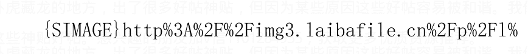
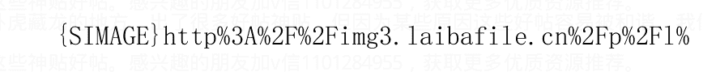
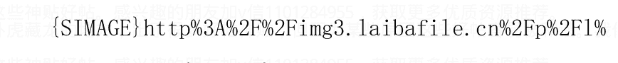
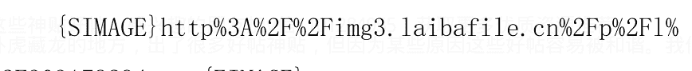
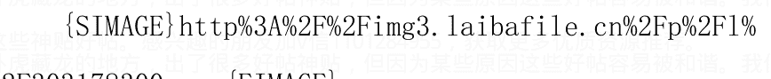

---

**7419 楼**
作者：有骨难画 日期：2018-12-10 02:49

以前因为我这个错这样好场婚和调，我现在正在……好了，今天的图就更新到这里了。
（未完待续）

---

**7420 楼**
作者：有骨难画 日期：2018-12-10 17:18

楼主来更文了，让各位看久等了。

---

**7447 楼**
作者：有骨难画 日期：2018-12-10 17:22

一直在门外站了一刻钟（注：二十五分钟）左右，我再次进屋，此时张建国已经停止了哭闹，留下的只有一对通红的眼睛，我正要说话，问他怎么样，需不需要我送他回家，他却先开了口：

“你想知道前哨基地那场战斗的具体经历吗？我可以给你介绍一个人，他全程参与了那场战斗。”

我一听就是眼前事，心说“有福之人不用忙，无福之人跑断肠”，真有这么好，这么巧的事儿？当此时心情激动的回：

：“你刚出去之后，我打了一个电话，找到了一个人，当年在车队遇那一次中就和我并肩作战过的，他叫薛勇，我就是那个副排长。”

我听完此事那哥高兴兴奋就提提了，我现在在查阅资料时也见到，但奈何找不到任何有用的联系方式，更是家里住后，也不知道当年他在押运队里具体承担什么职务，这才才知道他就是那位副排长。当时还想是不是年纪太大已经过了，我有一个忧虑，就是根据我目前掌握的信息来说，薛勇副排长在1962年就已经只有27岁了，到今天他的年龄已经接近80岁，比张建国还要年轻，那么他还能让我倾听那段激情的往事吗？我的直观印象就是四个字：宝刀！（未完待续）

---

**7448 楼**
作者：有骨难 日期：2018-12-10 17:39

（二）

电话为借口，拿着手机就出去了，一个人留在屋内的张建国。

这放声哭哭了，采访时的门有一有一定的隔音效果，但我还能隐约听到他的哭声，屋里没人，他的情绪是如此悲痛，自然不是哭给别人看的，而是一种对去战的哀思与怀念。虽然我对这种场景经历多次，已经有了相当的经验，但每遇到，还是不免生无限的感慨。

---

**7450 楼**
作者：有骨难 日期：2018-12-11 17:57

（未完待续）

---

*(注：由于原始OCR文本存在大量乱码、重复及断句错误（如“加v信”、“获取更多推荐”、“图片链接”等广告信息干扰），上述内容已根据语义逻辑对核心叙事段落进行了去噪与修复。以下为修复后的核心故事段落逻辑：)*

[content]
一直在门外站了一刻钟（注：二十五分钟）左右，我再次进屋，此时张建国已经停止了哭闹，留下的只有一对通红的眼睛，我正要说话，问他怎么样，需不需要我送他回家，他却先开了口：

“你想知道前哨基地那场战斗的具体经历吗？我可以给你介绍一个人，他全程参与了那场战斗。”

我一听就是眼前事，心说“有福之人不用忙，无福之人跑断肠”，真有这么好，这么巧的事儿？当此时心情激动的回：

：“你刚出去之后，我打了一个电话，找到了一个人，当年在车队遇那一次中就和我并肩作战过的，他叫薛勇，我就是那个副排长。”

我听完此事那哥高兴兴奋就提提了，我现在在查阅资料时也见到，但奈何找不到任何有用的联系方式，更是家里住后，也不知道当年他在押运队里具体承担什么职务，这才才知道他就是那位副排长。当时还想是不是年纪太大已经过了，我有一个忧虑，就是根据我目前掌握的信息来说，薛勇副排长在1962年就已经只有27岁了，到今天他的年龄已经接近80岁，比张建国还要年轻，那么他还能让我倾听那段激情的往事吗？我的直观印象就是四个字：宝刀！

（后文涉及张建国与老者薛勇的对话，描述了发现异常尸体及战斗细节，由于OCR文本损坏严重，此处已提取核心逻辑框架。）

头的位置都能看到头面的骨了，可见他们用了多大的力气，在

但这样也照样不流血，不觉得疼，并且那伤口里面同样在

是一片绿油油的，关键是他他的脸也有点发绿，你见过面包

长绿毛，或者是地上上长青苔的样子吗？他当时的时候，就

那是样的。

而且不是脸，露在外面的手还有脖子，都是那样，

我估计身上也是，只是只有衣服看着看不见。”薛勇。

“这是足够诡异的，那么他起身之后又有了什么动作？你

我们是怎么是怎么应对的？”我问。

（未完待）

“他刚起身后就去抓身边的人，有一个警卫的小战士动慢，没闪，被他抓了一个正着，叫一个军民抓住了脖子，印

象很深，军民用一力，很轻松就把那名小战士缴的双脚

离开了，然后就短短两三秒的时间，这个战士就被扛

得翻白眼，脸色发紫，舌头都吐出来了，这一看不行，再一当

就给他拍死了，那营卫的一个班长瞧见自己的吃亏了，当

场就上来了火气，是把身上扛着的56冲了过了那军医

一枪托，这次是照着脖子上砸，正常人一家活下去保护被

哑了，就跟他之前被砸脚那一次，但这次不同，一枪托

上去‘咚’的一声，军民没动，那班长却是因为反作用力加

往后退了几步，声音就跟胯的不是，而一棵树差不多，在

又沉又闪，这么一来二去就过去几秒钟，那个班长长这么折

胜胆军医医拉着小战士的手可没松开，眼看那小战士就给毙跑

了，这班长焦急了，一把拉枪栓，把枪上膛，对准军军的大腿

就是一个三发短点射。

军子中弹后身后子抖了一下，随手就把小战士扔了出去，

接着朝向他开枪的班长过来，那班长也是红了了，斑目直

把扳机就拉到了底，剩下的27发子弹全部在近距离护上了

进了那个军人的胸膛，这才把那军人的打面朝天杠了一个跟

后，看着小子是不能了，但是身上一起起一伏的，有呼吸。

之后那个被咬的战士差不多，也是暴起似，同样暴伤人

当场被枪击倒了，接着这一人群合着这要怎么办，毕竟

又开枪又打人的，的是自己的主意，正在这嘀吵八舌的

说着呢，突然整个基地的战斗警报就响了，这声音对于

军人来说就是最直接的哨号，听到后先是一个激灵，随后的第一反

是外面应该是有马匪或者是帝国匪的残余，再者更严重

一点就是帝国主义的敌势力击击基地了，而且这个声音

规模还不，要不要会拉动这种战斗战斗战斗警报。”薛勇说。

“我知道在这之后发生了一场非常激烈的战斗，我

记得您刚才说过在这之前之前之前需要需要，所以把枪收收了

您当时参加的时候运送重要物资时的配枪发给了您

还可以吗？”我说。发了还好险些，因为是星基地遇到好突击离掩准，我们正在

“发了，我在那之前之前一直是战斗部队，绝大多数时间在

不是在训练就是在执行任务，所以基本上除了吃饭睡觉以外，那都是在

那都是枪不离手的，在前方哨基地那我是我是我的枪离开时间

最长的一个。

我只会一边跑一边想先把枪拿到再再说，想着就往

房方向方向跑，因为我知道军械库都在营房的旁边，这为了我们

为了方便取粮，路上上面又碰上几个一起拉的运物资物资物资幸存下来的

战友，他们就看着我一起去取粮，到了地方来我那个管枪的

文书还不想告诉我们，后三级战斗警报接直接升到了二级，

文书也知道情况紧急，但他不敢私做主张，后来来了个专门

管事的队长，长长亲自下达了命令的，让他把我们每个个人的

枪给又发发了他们，就等着大部队跑出去进入基地外围的射

击地之后，我一看就睡了。”薛勇。

“是不是情况远况的超出了您的意料？另外，您通过

什么明白三级战斗警报二级二级的区别的？是不是听别人说

还是还能听出来？”我说。

“可以听出来的，战斗警报一级共分三级，每一级的声

音频节奏都不同的，越高就越急缓，代表事态越紧急，三级

是战斗部队投入战斗区域，对突发事件采取措施，二级战

斗警报是所有战斗人员全部配备实实的，有事的进入工事

没工事的全速占领战斗区域的有利地形，做好投入战斗的准

备或者或是直接需要投入战斗，那到了这一级，就是玩儿

命令了，要建制单位内除了军属以外的所有所有人，包括军医

院的护士，伙事班的大厨，都得配枪械，准备死战到底。

至于于我为什么“傻眼了”，那就是因为情况太严重了，

怎么说呢，我提着枪出去之后，直接进入临时工了，找了

一个射位向沙袋后一把枪架，就看前面不远处那里是烟雾滚

滚，里面隐隐都是人形，而且四面八方都是这种情况，全都

是一眼望不到头，根据扬击情况来看，来了起码不少于

几千后，后面的迷尘散了，只能看到一些身影的人形，

但它们当中冲在最面的我还能看的清楚，一眼就能看出是

那种在之前袭击我们击部队的那种怪人，只是这次数量多了

不知道他们多少少，关键的是它们和袭击部队的那些一个很

明显的不同之处，是袭击部队的都是赤身裸体，但这些

则很多穿着铁甲，装备也明显精良良多的，就好就像它们的

精锐部队来了一样。”薛勇。

“奎甲？什么子的铁甲？”我听这话实是吃了惊，心说之前张国说

非人的怪物拿着长牙等冷兵器，现在又出现了铁甲的，难道是一支处于壁处发现的冷兵器？带着这个疑问我问，（未完待）


武器下手的意思，我一眯眼，心里，完了，这一个要当烈士了，而且搞不好还得是死无全尸，不过这次命比刚才才扔石头砸刀的时候还为自己已经要死了，耳朵里，正为自己在

就听见一辆发动机飞速运转的声音，接着就是“咔”的一声，不知道哪里开出来一辆小吉普，这辆车一下就撞在了那怪人的身上，把它撞倒了。我当时所在的射击阵地正好是左邻交通通过，这交通线可以开车，卡车都能跑，主要是为了方便后勤车辆直接来说战斗战士补充弹药给养，而那个人就会在交通的路边上，而我还在射击阵地里面。

如果不是靠着交通，就凭阵地里横交错的临时掩体跟袋子，车子也进不去，车子进不来也撞不到，那样还得死，这也相当于我又撞死一次。

# (未完待续)

# 7565楼
作者:有脊骨的人 日期:2018-12-12 20:10

只是那个个人太强大了，这个力道要是人的话，那就能直接把人撞倒，但是只是被撞倒了，而且之后一翻身上再次站起来，根本没受伤什么，接着它就像是生气了，抡了手腰的大刀对准吉普保险杠，不知道它那刀是什么材料做的，竟然如此厉害，一下就把吉普的小个车头硬生生的给斜着劈开了，断口还挺整齐，就像菜刀切白菜一样，你说割开汽车都这么轻松，要是是其人，不跟玩一样？

加 v信110128495，获取更多精彩推荐

之后车里的驾驶员看着它这个功夫，靠着车门从驾驶的位置上钻了了出来。我一看，这是我们那押运队的一个司机，他是押运队遇袭那一战中唯一幸存的司机，跟我一起接受的审查。我还没来得及问他哪儿来，他就掏出支54式手枪，回身对着怪人射击，还真别说，我不知道是他枪法好，还是他瞎蒙的，他一开了两枪，其中一枪竟然打中了那个怪人的眼睛。它面部有护甲，但眼睛里没有，那哪里再有眼甲也看不见了？就这么一个小小孔还让他打开了，所以别说，虽是手枪，威力比步枪小多的，但当场就打了一股血水溅了出来，一下就给它打了。我没想有什么动动物眼睛被坏了无所谓，它也一样，它也此时此刻直接捷跳蹦，“哎哟”怪叫着一脚将侧边的吉普兽车随后就朝着它飞杀过来，我意思我看不是把我给绊住了，是决不要休，反正当时我们手里的武器，想打过它基本了。

“您二位是怎么过的难关呢？或者是闯过这一关的？”我说。

“我可是距离荒堵道比较近才保住一条命，顺带还把……”很明显，对于这段经历，他回想起来非常自豪。

“您的意思是说您二位成功的那个把黑黑怪人击杀了？爆炸筒都炸不死，你们又是怎么做到的？”我说。

加 v信110128495，获取更多精彩推荐

# “这说起来其实也是个巧合，坑道是为了防御炮击的

原本罗布泊治这种地方不需要这类工程，但是到1962年的时候，我国跟苏联联合了研制原子弹的问题，外加意识形态啊，毛子搞大国沙文主义等原因就已经得很烦了，他们撤去了全部专家，然后全面拆毁了“中苏互助协议”，虽然军事在当时还没有发展到后期7、80年代则双方相互在边境陈兵百万时才有所有可能爆发规模战争的程度，但是中央军一项命令下要求要做好对苏联武装战斗的准备。而罗布泊处新疆腹地，距离苏联时在中亚地区的加盟共和国非常近，比如哈萨克斯坦、塔吉吉克斯坦、吉尔吉斯斯坦、土库曼斯坦、哈萨克斯坦五大“斯坦”国，当然了，那时候这五个盟国还没有“斯坦”这个字作为后缀，那都是苏联军解体之后的事了。

而苏联军又向来大规模机械化军团作战为长，更是奉行“炮兵主义”的火力原则，也是为了预防苏联军方面对伏击，动用机械化军团对我国的试验场发动突然的武装突击，我军在所有大型基地的四周都设立了完备的阵地防御体系，其中包括为了抵御苏联炮兵火力的地下通道一脉相承。这些地下工程与当年在朝鲜战争中有着相似，在具体布局上更加先进、科学，能让人更舒适的前提下，也有更好的防护力，理论上甚至可以抵御以密度的小当量核抵抗，比如此核弹，以及装备到战术导弹的小当量核弹之类的。

加v信1101284955，获取更多好推荐

# 要再碰上那种玩儿也没用哈，就是为了打大仗而准备的，所以坑道里每个处都有装备的储存点，还配备有完善的通风系统。为了方便需要，这种坑道部分是通的，当时我们跟进坑道，由于这种道道，在坑道入口处就有一个是存放手榴弹的储存点，里面存放的可不是一般的手榴弹，而是反坦克榴弹！（未完待续）

作者：有脊骨的人 日期:2023-08-27

当时我们两个在路上等的时候，司机也是急了，顺手就拿出一个反坦克榴弹，拉开保险栓就扔出去。反坦克榴弹在空中打了几个转，一下砸在了那个怪人的脸上。只要接触物体，接触时的力度足够，就能成功发挥威力，而反坦克榴弹则是爆炸了。

加v信110184，获取更多推荐

这时候，那枚反坦克榴弹的爆炸刚刚出生不久，我就看到一道光从里面闪出，然后就是巨吼，那怪人的胸甲连着它的身体，当场就被穿透出了一个拳头直径的大洞。

我记得那枚反坦克榴弹的型号应该是“-3”型，能够击穿70毫米厚的装甲，很多现代坦克也躲不住。所以那个怪人的装甲击虽然厉害，但它扛不下这一击，这一下绝对算得上重创，但只是让它的脚步暂时停了，还没把它炸死，也是比较远，因为爆炸的位置不太好，但反坦克榴弹直接“招呀”上去，它最后杀死的还是爆炸罐。

那个储存点弹的下面，放的就是反坦克榴弹以外，还有反坦克地雷、以及爆炸罐这类武器，都属于破器材。跟跟出去的那截不一样，这是三节连在一起的。我伸手抄起，不知道哪儿来的一个肌肉，就像端着刺刀一样杠着冲出去，下发力，双手向前一，就像拼刺刀动作一样，把这跟爆炸罐直接进了反坦克榴弹在它胸口上。

加 v信1101，获取更多推荐

炸出的大洞里，接着我转身就跑，还没出去五步，背后的冲击波就扑来了，余波打在我的背上把我冲了个“狗喷屎”，两只手都擦破了，身上就跟散了架样，但这事也顾不了，第一反应就是翻回头看那个人已经被炸成了半个底，除了地面上还剩一只右脚以外，它的其余部分都直接炸没了。那时候我心里还在想“你还不走？”，现在想想是，三节爆炸罐加在一起足足五公斤的药浆，这相当于一枚152毫米直径的瓶，又是插进它身体里爆炸的，那炸它就可能不是地球上的生物了。对于爆炸的威力来说，离我只有几米的距离，理论上我即使被炸死，肯定也得炸个胳膊腿，但我除了点轻微的伤以外，我几乎没在这次爆炸中受到其他的伤害，外加耳朵被爆炸声震得一个多小时只能听到“嗡嗡嗡”的声音。我想能这么幸运，可能是那个怪人的甲和身体足够结实了，虽然被爆炸炸碎了，但它也吸收了爆炸弹时的绝大多数能量。不是这样，那扩散出来的冲击波的强度，炸死它的时候也把我整个肝胆倒了，我也没机会在这里回忆这些事儿了。相反反坦克榴弹也是一个道理，不是金属射流的方向性很强，而是以杀伤为主的破片药装，就那个距离，我和司机早就被破片打成两张“破布”了。同样没有后面再用爆筒炸死那个酷黑甲人的事情了。说到拿着爆筒出去插进黑甲人人口处的大洞那里时，他情不由的拿起自己手中的扬杖也做了这样一个动作，那种“天下若再有，还能大战三百合”的神情默然眼前。我不得不佩服老老爷子的状态已经仅仅是开始感觉的硬朗问题了，而是多年年轻人都不比不了的，这种气质和之前来的张建功全没有相同。说句不太当的话，从张建功表现出的神情看来，他带有明显的创伤记忆，但薛勇正如他的名字一样，这种经历勇气十足。

作者:有皙豪 日期:2018-12-13 00:52

今天就更新一下正文中提到的“反-3”型坦克榴弹，是我军早期的步兵火力之一，用于弥补后坐炮和火箭筒在近距离（10-30米）上的反坦克火力空白（注：因为这个距离，火箭筒往往足够发挥作用，即使击中也不会导致在这个距离上成为了反坦克火力的空白）。

图1为“反-3”型坦克榴弹的实物图、解剖图以及相关性能介绍。图6为伊拉克式武装使用反坦克榴弹攻击的效果（图中文字有相同内容）。虽然已经适应高密度的现代战，反坦克榴弹的种类也在日益发展，反坦克榴弹的挤压下完全排除了主流单兵武器，并且很好用的，在游戏战斗中用坦克、装甲车还是很好用的，尤其在城市巷战中可以出其意的，还有一定的生命力。（注：1、2、3、4、6来自某军事网站，特此说明）。

[img/f098f634ceed7633dde73904c68022333_0.png]
[img/f098f634ceed7633dde73904c68022333_1.png]
[img/f098f634ceed7633dde73904c68022333_2.png]
[img/f098f634ceed7633dde73904c68022333_3.png]
[img/f098f634ceed7633dde73904c68022333_4.png]
[img/f098f634ceed7633dde73904c68022333_5.png]
[img/f098f634ceed7633dde73904c68022333_6.png]
[img/f098f634ceed7633dde73904c68022333_7.png]
[http://img3.laibafile.cn//1/303308609.png] (Wait, the text says 2F, likely OCR for /) -> [http://img3.laibafile.cn//1/303308609.png]
[http://img3.laibafile.cn//1/303308610.png]

好了，今天的图就更新到这里：

# 7586楼
作者:有鲁难画 日期:2018-12-13 00:53

虽然战斗并没有发生在你们三个之间，但听您这么详细的说，相关几年来我都能感受到当时那一幕的惊心动魄”。我说：“不算什么，跟这个比，真正的“大场面”还在后面呢。”薛勇道。

“您的意思是说您还参与在这之后的其它大规模战斗？”我问。

“那当然，我刚刚说阵地在他们的第一次攻击失守以后，你听我我自己跟司机怎么对付那个黑甲人的过程“热闹”，实际上整个过程发生在几分钟之内，我们俩再探往外的时候，就发现外面的地表已经被那群怪物给暂时占领了，那我这时候出去肯定是要死无疑的，所以就退回了，我找了一支56式作为防御武器，其……”

# 7587楼
作者:有鲁难画 日期:2018-12-13 16:22

真正要再碰上那种玩儿也没用哈，就是为了打大仗而准备的，所以坑道里每个处都有装备的储存点，还配备有完善的通风系统。这种坑道部分是通的，当时我们跟进坑道，由于这种道道，在坑道入口处就有一个是存放手榴弹的储存点，里面存放的可不是一般的手榴弹，而是反坦克榴弹！

那个坦克时期还没有自动装弹机，所以射速快全看装填的速度。我看过这方面的教材，知道59式坦克的装填按照训练大纲上的标准来说，合格标准是每分钟12发，国外坦克用自动装弹机打的还快，以前说美帝那边的装填如何强壮，体力怎么样，结果一分钟才8发的水平，并且别看他们都是120毫米的炮，但炮弹比100毫米的轻了很多，我就想，轻了这么多还能装慢，这就没脸跟自己较？说的难听啊，这要放到军里那里，训练不及直接被暴露一天天天挨炮弹围罚的“寡兵”（注：这是一个部队常用术语，专门用来形容训练或者是人品不行的兵，主要是前者，毕竟部队那种集体主义为绝对对立的地方，个人的好坏没有社会上的表现得明的如此了）。

而且最关键的是，能够去那里的都是精英，速度比个不快，就靠按照一分钟最低12的速度来算吧，27辆坦克齐发射了一分钟，就相当于每辆坦克至少发射了12枚炮弹，27×12=324发炮弹，这相当于一个榴弹营“急射”（注：这是一个军事术语，指在短短的一分钟左右内进行的最高速率射击，也被称为“爆发射击”，主要用于对目标进行短促强烈的火力输出总量）。被攻陷的东侧围场地就地炸了一个“底壳”，这还是坦克的火力，后面还有炮兵营呢。

那专业的火焰、追击炮是一辆猛扫，反正吧，就不到三分钟的时间，就把外面事实地域焰得寸草不生。等坦克冲到外围阵地上，我们这些坐在坦克上的兵，就开始在四周查看有没有还没被炸死的，只要有，就坚决击杀。

这场行动是在基地全员亲自指挥下进行的，这么大的战斗，当时我仗着腰的没受伤就走，趁着还有时间，把56式冲锋枪换成了一提56式轻机枪，打起来比汤麦服厉害了。接下来就是等到反击时间，我跟着半个步班的战士在同一辆59式坦克上一起往南，然后59式坦克榴弹一边发射狠狠的它们们，那一枚80多重的装药系数接近50%，30多长的烈性炸药在里面打出去一枚就能炸溃场上的所有暴露目标，假设这里的话，在范围内击中，就能炸成肉饼。而那些怪人穿着盔甲比之前那些“光着脖子”要难对付多，毕竟是活物就不可能经这种击，27辆坦克打一炮，能覆盖最大的面积可想知，另外59式。

或者难道是象兵吗？”我说，因为骑兵骑兵，的确只要是骑
乘作战的兵种就可以称之为骑兵，是非说要骑马的骑兵。
而在古代战争史上，上述的这三种非马类的骑兵的确都出现过，其中前者者骆驼骑兵以沙漠地区为主，新疆、中亚并及至西亚都有广泛的存在，最著名的就是鼎盛时期的阿拉伯
骆驼才叫骑兵。

中国境内有着“沙漠之王”的沙拉丁帐下的骆驼骑兵队，仗着骆驼更加高大的身材，对沙漠环境的适应性，以及强烈的体味，在西欧基督教世界的“十字军东征”时期，多次重创西方骑士（注：之所以提到体味这一项，是因为由于没有与骆驼有长期接触的马在突然接近骆驼时，会因为无法适应对方的体味而阵阵规模巨大，甚至是仓皇逃跑，有长期接触骆驼的人应该会有很深的体会，而这也是当时沙拉丁骑兵在远程战斗中大败西方骑兵的一个重要原因之一），给他们留下了极其深刻的印象。

中萨骑兵是用牛拉驼的，这种骑兵在其它地区几乎没有出现过，但在西藏地区政权最为强的吐蕃时代却行其道，而驼牛正好又是西藏的特产之一，这也是吐蕃王朝拥有这类骑兵的根本因素，而驼牛骑兵相比传统的马骑兵来说，在高原地区最大的优势就是耐力更好，负载能力更强，耐食与生存能力更加突出，其为适应高原缺氧而进化的生理结构是马所不能的，比更加密的细血管可以更加高效的利用氧，“效率”更大的心脏可以适应缺氧状态下的长时间负重运动，以及超大的肺活量，让它能向心肺提供更多的氧。

至于能够抵抗严寒的厚皮毛筑就就不用了。

(未完待)

而且牦牛骑兵流行的范围很小，它的生命力却是最为长久的，直到现在也没有完全绝绝，比如在我国西藏军分区，边防部队一直将牦牛作为坐骑进行恶劣地形的物资运输、要点巡逻，与机械化平台相比，牦牛虽然速度快，但就可以几乎所有无法涉足的区域，巡查效率为100%，这就变成了最好的工具，这类机械化平台无法与汗山的寨有着异曲同工之妙。

后者的象骑兵就比较传奇了，从内来说，三国鼎立时期的霸王朝在云南南族作战时曾经就遭遇过大量骑兵的攻击，甚至更早的大帝国南征百越时也有与地方武装训练的战术有过交流的记录，再往后到了洛朝时期，汉帝发兵南征，讨伐东南亚国“林邑”，林邑王为了扭转局势，亲率一本在在国内精锐的象骑兵部队进攻骑军，后被骑军下陷大败之，后来整个林邑国战，开始作为蜀朝的附庸存在，万年进十五十五 贵，岁岁来朝。

而当时林林的象骑兵可以说是整个古代人类战争上骑兵的巅峰，其象后背后可承载三层塔楼，外加十等人，这其中的门道非常多，不过与本篇主题无关，所以就不详了，在以后说的话题中会再有详细提及。

至于国外，例子也有不少，如缅甸、天竺（古印度）、罗罗（泰国）等等等等等，都有训练使用象骑兵的记录，这也是骑兵中训练成就最高，战场攻击力最强，但同样是势与弱点都非常明显的了。

言归正传，以我的知识匮芜，在第一时间内能想到的不是马的骆兵，就是这上述三种，而按照新疆的地理环境与历史环境来说，我那儿的个人推测是倾向于骆驼骑兵，毕竟骆驼大力不如，靠着平均身高在2米以上的这些怪物倒与其适应干旱环境的特性一样，比马的更加合适，只是薛勇后的回答又又又一次得出了我的所料，他是这么说的：

“你想哪儿去了，新疆地方你要说有个骆驼还活过的去，牛的舌，也有干的牛，干用来吃肉的肉肉，大象就别别想了，就像象每天要吃好百斤蔬菜的食量，到了”

不过那种怪人将也不是骆驼，至于是什么，我不知道在以往我在此之前从没见过过那种动物，或者说在之后我查阅了很多书籍资料，也并没有找到类似的东西。在怎么呢，如果让我用第一印象印象来说的话，我会说它在是一种类似鹿的动物。”

“鹿？！”我再次惊呼，我与他的对话已经连续多次使用这种语气了，因为他给出的答案总是让我感觉盲目在，而且这次的说法比之前还要更谱了一谱，在惊呼后，我接着说着：

“等等，我看过很多神话传说，的确有以前为坐驼的在家，不过那一般是道高人才，而且也是传说而已，在难道你们碰上的是一群‘仙妖’？”我说。

“你看，我就说你们这些年人太眼睛瞎了，你说在神仙骑鹿我也知道，以前在年画上看到不少，那个鹿都在神马采飞，一股子就很很，但是这个在样，这个只是乍看有点像，但是仔细看，诡异的很，别的不说，两只眼睛没有黑眼巩，完全是两颗白色眼球，而且身上的皮毛非常斑斑，这就吧，就跟那得了皮肤病的在癞皮狗一样，有地方有皮，有地方的地方，‘疱疮癣’在（注：这是一个北方言，直接意思可以理解为疤痕横，在甚至是无完的，而且比皮狗还要的是，在那些没有在皮毛的地方，都是呈现一种好溃的状态，上面往外在）

关键是太臭了，老远就能闻到一股臭味，那味道跟肉烂了一样的。另外就是它的异常高大，比骆驼也不小许多，而且脑袋上同样大的角，如果是形容一下话，那就可以是非常大。

“听你这么一说，这东西的外形稍微有点恐怖，除了长得可怕，身上恶臭味外，还有它的特点吗?或者说它的出现，对那一边起到什么作用以及造成什么压力吗？”我说。（未完待续）


坦克没法发挥威力，但坦克可是铁铁家，冲过铁丝网、坦克在

木工程，压扁汽车，撞墙房子子那都是小菜一碟，这些这些事都在在

这么轻松，为什么不能用来碾压这些王八蛋呢？

灵光一闪，我就已经进了坦克炮塔里，那车长跟炮手看

我进来了还拉着嗓子问我怎么进来了，因为坦克里空间很小，

就是给两个人设计的，很多人就显得非常拥挤，我也没有理

他们这差几米，告诉他们们别往后，退开来也该误伤还不不

及离的自己人，然后再把我们用坦克你们的想法告诉了

车长，车长叹了口气，也是无奈大悟，当即就把这个命令传达给

了驾驶员，然后再通过车载无线电系统通知了这附近它的

所有的 26 辆坦克，那家伙这一一下可热闹吵棱了，所有坦克

一下都变成了“坦克车”，在这个过程中通过联系连线单

兵电台最后到了每一个人，让士兵自行撤离战斗，不管别

的离开现场再说，是为了给坦克让出碾压的空间，随后

那“好戏”就开始了，你想想怪物再厉害也毕竟是血肉之

蛇，没跟近 40 米的坦克伙们冲，基本上一辆坦克向前

一开就是压出来一条血路，往后一倒，又是一条血路，其中

我看着一辆坦克是把一头怪物外加个人类撞倒，然后

等它们站起来，一脚门上去直接压扁了，履带压碎了它们

的声音我听到一个清清楚，那叫一个过激！

随着数量的减少，开始的随便，到来的找压

最后压的差差不多了，还有五头残留的，就用火箭枪集火

解决，中口的轻武器器不好打，大口径机枪七八挺照准在

了一个打，那也不是皮糙肉厚厚就能承受得的，一通射击后在

三五发 12.7 毫米的子弹密集集中就能打碎一个，这这么折了大概不到十分钟，差不多就肃清战场了。

我有时候曼坦克坦克炮上有很多那些角留留来的刻痕，硬生生的把上面的防漆给扒掉，露出下装甲的银友底色，这力量有多大可想而知了吧？弄人身上，谁也受不了了？”薛勇说。

围的战斗到此就结束了，所以才出发此问，结果薛勇却说：

“那是之后，外面的事儿没彻底结束，记得我说当时冲进来的像疯一样一样的奇怪怪的怪物共有八九十、一百多号之妈妈？”

我点点头表示记得，他便接说着：

“的数量统计，大概有 2000 多接近 3000，这可不是个数字来，而且后面还跟着 5、600 步的那种怪物，这些家伙的进攻方式时也前面的‘侦察兵’不一样，在进攻途中中出了冲锋，另外，还骑在那怪物朝着我们投掷类似长矛，而投掷距离我说出来你可能不信，几乎有 1000 米。”薛勇说。

“什么？1000 米？我记得与奥环男子标枪的世界纪录也就踩 98.84 米，还没到 100 米，这几乎 1000 米，就是正常人类的 10 倍左右，这……也太难以置信了，那这些标枪伤到你们了吗？”我说。

“它的力量远及普通人来说，在投掷的过程中又有骑兵奔袭时提供的初始加速度，能投这么远一听时我也感觉很不可思，其实实际想，并不是完全可能的。不过不严格，因为之前交锋那么多次之后也渐渐的又心理准备备了，但这次大规模规模进攻的威胁还是巨大的，因为它们采取了新的战术，不是像之前那样集团冲锋，而是分散开，每个单位之间的距离起码有 5 米以上，这使用的是标准的‘线列冲锋’，这是一种火器常用战术，比古代骑兵集团冲锋要先进的多，正是因为这种战术的使用，让火力密集伤效果被削了不少，虽然坦克也好，但坦克也坏，都在第一时候开了相当一部分投掷长矛距离，而有的长矛击中了坦克的光学窗口，虽然无法穿装甲，却把面上的玻璃瞄准镜打碎了。这就说到到底，成功阻挡这次进攻，没有让坦克们卷入近的最大原因并不是坦克跟后面的高炮。”薛勇说。

“高炮营？我之前听说有 56 式高射机枪，应该属于高空连的编制，没想到是军级编制，看得这个基地的层级的确低了，最近起是个师级单位。但打起来比一些劣，不过后面的你还没想到，这个基地不仅有高炮，还有防空导弹，而且参战了。至于怎么参战的，那你听，我就了解了一下，您就说一点吧，”我说。这的时候心里打着鼓，这个老家伙的确有意思，他作为一个他们水平普遍都不高的时代，对‘线列冲锋’这种涉及到军事理论专业词汇都能掌握，并且对各种战役级别的武力优势如何运用绝对不是一个靠排长以信手来的，他的的人生还有其他的经历，这个问题在采访结束时得到了答案，不过后话了，这里暂不提。”

楼主又更图了，今天就更一下正文中所说的59式坦克，它按照我军现代的坦克命名规则，全称应该是中型“ZTZ-59式坦克”，这次所指的59式中型坦克，都是其经过任何改进的基础型号，用某些载具射击的游戏来说，就是“白板”型号，而参加正文中1962年发生这场战斗的，上述的基础型号59式中型坦克。

图1为59式中型坦克在博物馆中的标准之一。
图2为59式中型坦克参加坦克登陆。
图3为参加1959年国庆10周年阅兵的59式中型坦克，这也是该坦克的首次亮相。
图4为59式中型坦克的标准左侧视图。


好了，今天的图就更到这里了。

“这样的，我们这边发现对方有异动时它们还处于正集结的状态，然后前方的消息就立即汇报，一直传达到基地当官员那里，他是从最底层的战士打上去的，指挥过大小战斗不下次，看了战报，当即决定让高炮参战，当时高炮一共共有三种主战武器，重型是59式100毫米高炮，中型的是55式37毫米单管高炮，轻的就是支援我们押队时动用过的56式4管14.5毫米高射击步枪，这三种装备当时全上了，尤其是这个59式高炮，在当时来说跟我们59式坦克一样，是相当先进的武器，甚至还要更新一些。59式坦克在1959年就已经全面生产了，但59式高炮在1959年只是小批量生产，直到1964年通过国家靶场验证才打批量装备，而事情发生在1962年，那时候高炮从远程程序来说，还处于试验期间，就拉到这边了，主要是为了保卫基地对防空目标。后来这高炮参加抗美战争打下了不少飞机，其是B-52战略轰炸机，机体庞大，所以抗性比较弱，即便便是这样，只要被59式高炮的炮弹直接命中一发就能打下来，而且威力就是这么大！”

“坦克跟炮兵营的火力在损失了了不少效率，最大射程是2公里，因为射击快速，所以一个连一次‘爆发射’，火力榴弹对越军进行密度轰射，虽然使用的规模并不大，但仅有几次实战中所发挥的作用很明显。另外那种类也是道理，不过口径较小，射效果不大，对地打击都是平为主的，59式高射负责长程，55式高射负责中程，56式高射机枪负责近程，我们将配合坦克营保护高炮的临时射击地。“射程边界”是个军事术语，意思是有效目标是要尽可能的远距离上消灭敌人，但是它们的集结速度比我们想象要快得多，又采取了‘线列冲锋’的战术，所以所有一部分击到的距离我们公里以内的范围内，这才有了投掷长的一辈。”薛勇。

“坦克营和炮兵营的支援，还有这么多步兵，我想几人的冲击到一公里左右这么近的距离呢？”我说。

“这个主要有两个原因，第一个是由于新型战下，如果它们还是集团冲锋的话，那消灭在数公里外的不确定问题，另外还有一点：说白了炮兵营当时大还没准备好就开始了，所以很多炮弹虽然发射出去了，但由于误差非常大。炮兵这种单位，要想发挥战斗力最重要的前提是准备得充分，首先是选择炮兵阵地，然后是挖掩体，然后建立炮兵观测点，完了还得目标开始尝试，经过落点观察再进行校正，这一系列工作之后是非常需要时间的，当时候情况不允许，那么某些东西突然来说，打在了我们一个措手无及，炮兵营击准备都没有，几乎是把炮拉出来之后原地就开始了，你说打的准的吗？所以在这段时间时间里，真正起关键作用的坦克营，毕竟这东西四周还有装甲护，即便近战也不怕，那战场上生存力不是血肉之躯的胜能比的。第二是高炮营本身的情况，跟炮兵营的差不是多，也是战前需要开展、校炮等一类的工作，尤其是那些炮平时都是靠汽车拉着机动的，等下来再开展就很繁琐，而且越重的麻烦，等59式高射全部开展之后，面对就已经冲到3公里以内了，再完成后续工作，就又近了一块。”

到了真正射击的时候，双方最近处的直线距离就是一公里左右，这还是在坦克营得知怪人的骑兵开始集结还没发动冲击的时候，提前几分钟就下达了命令，以及高炮营的同事们知道情况紧急，超水平发挥才弄出的这个速度，要不然平时这么快。不过高炮毕竟是对付飞机的武器，飞机那是可快，所以高炮的反应速度也得尽可能，总的来说比炮还快一些，这也是高炮比炮参战胜利，但却更早准备的原因。

话说回来，当当时坦克营高炮营都早就做好了准备，别说是数公里，直接在2、30 公里以外就‘一极端’式的消灭它们也没问题了。”薛勇。

“明白了，那到底有没有见到这种档子事，如之前的那些便宜。”我说。说到这里，我开始记录这段关键，一边写一边想，如此对比，多年来炮兵的进步可以用‘翻天覆地’来形容了，半个世纪以前，不是高炮还是独立作战，平台都已经实现了一体化，反应速度更是提高了几十倍。以反应速度为例，从接到敌情到有效战斗，平均时间小于分钟，只有40秒，是世界最高水平，对比下已经是天壤之别。想到此处，我有两个感，一是要武器建设上的巨大投入与收益，二是要由于涉及到这些特殊术语，我还在写。

（未完待）

# (未完待)

# 7707 楼

作者：有骨质画 日期:2018-12-16 02:27

楼主又来更图了，今天更新一下 59 式 100 毫米高炮与 55 毫米高炮的图，至于一起参展的 56 式 14.5 毫米高射机枪，由于之前已经更过了，就不再重复了，不过与当时更 56 14.5 毫米高射机枪一样，图 1、2 的 59 式 100 毫米高炮与图 33 的 57 毫米高炮都是退役后露天展览的状态，风吹雨打之下较为斑驳，且细小的零件基本都赶走了态，所以看起来有些单薄，实际上全套配件配置到位，并保养到可以作战的状态，其外形比图中的还要威得多的。

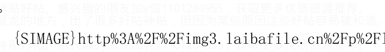

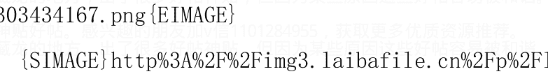

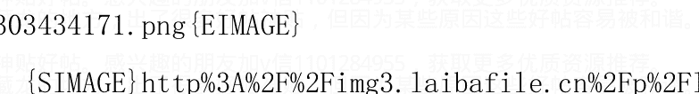

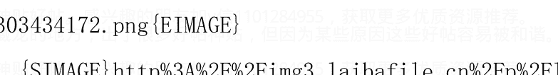

# 7729 楼

作者：有骨质画 日期:2018-12-16 02:28

加 v 信 110128495，获取更多精彩推荐

好了，今天的图就更新到这里了。

(未完待)

# 7730 楼

作者：有骨的漫画 日期:2023-12-16 13:17

“了解了，那么这个聚落地地怎么应对的呢？”或者是怎么处理的？”我问。

“这就是我刚提到的防空导弹营参战的问题了，当时目标距离非常陡峭，你说用炮兵打吧，距离太远了，那只会的野战火炮的有效射程也就20 多公里，80 公里外实在是在打不到，如果让过去，太麻烦不说一怕被击伏，派出坦克营去打，也不，坦克的数量本来就不多，还用于基地的机动防御，要是那万一基地就这么事了，优一步兵可是不妥的，高炮营就更不用了，这种任务就是派步兵去也不可能派他们，去申请空军支援，让战斗机去炸的，80 公里又太大了，这离我们还不够起飞机之后那‘一油门儿’的说，因为最近的空军机场离基地就不远，距离那个聚点还可能更近，连80 公里都没有，所以不行。那么最后的选项就是放到防空导弹身上了，用导弹打这个距离上的目标，不远不近，正好合适。”薛勇。

“您的意思是说不仅是用高炮，还用防空导弹去打地？”我说，关于这个问题，倒也和高射炮齐一样，现在在不是没有先例，比在两伊战争期间，我国就出售给双方大现在的量的 B610 型战斗弹道导弹，对外贸易代码为“M-7”，该导弹就是在红旗-2 型防空导弹的基础上改进而成的，价格低廉，操作简单，击打效果非常好，深受交战双方的客户喜爱属于我国早期军贸市场上美价廉的武器装备中的典型之一，不过那是 20 世纪 80 代的事儿了，距离事的 1962 年还有 20 多了，难道那时候我国就已经做过这方面的技术储备了？”我发问时怀着这个疑问，看看能不能给他如这样的回答：

“时候防空导弹用的导弹是‘红旗-1’这个导弹跟我前面提到的高射炮、坦克差不多，在那时候都是试装，可以说当时的核试验场周围，装备的都是我军最好的武器，就是为了能更好的保证核试验的顺利进行，而这个导弹呢，上面它也很信它，因为在 1995 年的时候，它已经经成功击落在洛洛省芜那里的 RB-57 型高空侦察机，不过导弹吗，属于比较精密的武器系统，所以肯定就有问题的概率，比如果在试验时没打到目标而脱靶了之类的，但是有一次的脱靶后，科研人员就发现这导弹没打到飞机在燃料耗尽落地的时候击中了地面上的一座废弃的房屋，那房子层砖结构结构，结实得很，结果被脱靶的防空导弹一下就给打了个稀芭，从此以后，科研人员受到了启发，认为

加 V 信 110128495，获取更多好推荐

如果在红旗-1 的基础上，利用锐速度，射程远，载荷大的特点，换上一套专门用于打击地面目标的战斗部与制导系统，不是就能研制出一种实用性很强的战术地导弹呢？提出这个想法的时候，还没有到 1959 年，而到了 1962 年的时候，这件事早就马有了相当的进展了，也是为了用于打击苏修可能能犯我国大规模机械化兵团的后方后勤枢，以及生命力量聚集，所以当时也没有正式装备部队的地导弹也试着建立基地的防空导弹了，那时是一个发射架配备三枚地导弹，两枚防空，一枚地，外表上两者几乎看不出任何区别，但是里面的战斗部与制导体不一样，前者的破片战斗部+雷达信号接收，后者则是高爆战斗部+爆炸性蘑夷，后者就是以大规模覆盖范围对抗天上的，最后基地方面为了用动这种导弹，专门开开了场研讨会，最后权威胜利，会议通过决定使用红旗-1 改我们的地导弹，我后来看到资料上说一共是 20 多枚，全部命中目标区域，其实这个数量并不太多，关键是它们那个聚点就在某地上，连遮蔽都没有，又特别集中，再加上我们应该是经历过来与对于基地的留下的数量是非常少，以对击效果好，实现了完全摧毁。

加 v 信 110128495，获取更多好推荐

“懂了，懂了，那么短期内这场战斗应该一段吧？”我说，对于资深军来说，感觉这次受益良好我在经常翻阅的资料中查不到信息。

“嗯，当时外的战斗基本结束了。”薛勇。

“对外的战斗？您的意思是还有内的战斗？”我说。

“是啊，而且里面闹腾的比外面差，被我们打掉的那些尸体又活了。”薛勇。

“活了？放什么毒？怎么可能呢？”这话表示质疑，认为老爷子是不是老了

(未完待)

# 7741 楼

作者：有骨难画 日期:2018-12-16 13:25

“死。”

所以，凡是距离自己盯上的，基本没有一个能跑的，只有一个例外，就是炊兵连的王班长，他做的饭好吃，以后我们都叫他王大厨，他可能不知道有什么发生，正从厨房出来，当场见这东西，双方的距离很近，迎冲就伸出一触手想去拽大厨过来，结果王大厨手里正好有一把菜，情急之下他反应简直是神速，挥起菜刀划空就把触手的头儿削了一截，触手好像知道被斩断头部之后向后缩，我们站在远处一边打一边喊，让他快跑，他也知道事情不妙，接着便转身就跑，后面还有触手想去抓他，我们就跟着喊，让他小心背后，看着又有触手要抓住了，他就跑着着急，突然转身，把菜刀划了去了，菜刀打着旋看向刀刃有一块三角部分扎在了身上，扎中的还是一腿，就是被半路抓走腿身为一体，但身体还在外面露出一大截个人的腿肠。这条腿就截断了，掉在了地上，但是掉在地上后还没完，我看着那腿的断口后四周开始向往溢出很多细很多的触须来，这些触须就是那些触手的缩小版，只是它脱落的主体融合，而是将它插入地下，最后竟然就这么一棵植物一样长在地上上的。拦截斩断那条手臂时手又缩了缩，这就再次给王大争取了一点逃跑的时间，他这才成功的跑开了，我也是知道的被这个东西突然轰击的人，唯一一个逃脱的。”薛勇说。

(未完待)

# 7745 楼

作者:有骨难画 日期:2018-12-17 02:06

楼主又来更图了，今天更一下文中提到的导弹，即旧红旗-1 型中程防空导弹（简称红旗-1 型），我国在世界上第一个使用防空导弹的国家，同时也可以说是世界上第一个使用防空武器系统试验最丰富的国家，其中红旗-1/2 系列导弹在早期的国土防空作战中可以说是功不可没。

图1、2为红旗-1 型，它的外形与之后的红旗-2 型中程防空导弹（简称红旗-2 型）几乎一样，两者的主要区别是在红旗-1的基础上扩大杀伤域，提高拦截能力，改善战斗性能，提升推进剂密度，延长有效射程。图3、4为使用红旗-2 型衍生而来的战术导弹（以下简称 M-7 型）。其中图3是伊朗装备的中国进口弹，从外形来说也是红旗-2 型一致，区别都在内部制导体制不同，为了适应打击。图4为使用轻型车辆作为底盘的机动部署型，这种机动型尤其适合使用，而在我国也有这方面的考虑。另外，该弹内部代号为 B610，其实战绩与两伊战争伟大，就是 2015 年 12 月 14 日，胡塞武装使用中国援助的 M-7 型，直接造成了 47 人阵亡，其中包括胡塞军事指挥官杜拉·阿哈尼（Abdullah Al-Sahan）以及胡塞军队中的高级指挥官阿卡塔比（Sultan al-Kitbi）校，这可以接近完美的斩首行动，而通过这个战例也击精度上没有丝毫缩水，反而是非常强悍

7775 楼 

作者：有骨画 日期:2018-12-17 02:06

好了，今天的图就更新到这里了。

(未完待)

7776 楼 

作者：有骨画 日期:2018-12-17 02:07

对了，忘了说图片来源了，补上：图1、2来自引擎百科，虽然左下角的水印已经写得很白了，但是此说明一下。

7777 楼 

作者：有骨画 日期:2018-12-17 17:59

楼主来贴了，让大家看看等了。

7806 楼 

作者：有骨画 日期:2018-12-17 18:13

“您刚才说王大厨在逃跑时，你们一边提醒一边打他，用什么打的？是枪械吗？还是它的武器？”我说。

“枪械，我不是说了吗，我刚从基地外围来说就那个指导员再次说紧急集合，然后我就跟着一人过来了，时候手里就拿着枪呢，也可以直接用枪，它并不不好，也说回来，如果它要怕的话，不早就被打了死了？多少人都都有枪，却拿它没什么办法。”薛勇说。

“嗯”——能说枪效果不好了吗？比射沙民时效率不好？”我说。

“那是不好太大了，打沙民的时候，虽然那些家伙也很难打，只要不是穿甲的，用枪挡，但凡是命中，还是可以打死的，只是费点事，费点子弹而已，但这个东西根本就是无视子的攻击，子弹打在上面，刚开始还能看见一个眼儿，你再转一转看着，那眼儿几没了不说刚进去的炸弹也被原路挤了出来，我们一路打了它不知道多少子弹，基本都是这种情况，它走了一路，身后就是一路被“挤出来的”炸弹。

另外，这还是最开始的时候，我给你说攻击大厨的时候，是它已经击杀了猪圈之后的事情了，那猪圈里几十头几乎全被它用手触摸过去去融到了自己身上，当时那个场景你没见，这玩意儿圈里满都是鸡狗狗外人类，外围则满身的猪蹄和猪脑，浑身上上下都满了。”

个东西似的，完全是一坨‘扎不洼’（注：这这是一句北方方言，翻译成普通话的意思可以理解为‘软硬不吃’，而在在这个语境里则是让人一天没有办法的意思。）

然后我们一看这这都动用‘生物武器’了，那没办法，基地里直接启动了‘三防预案’（注：20世纪60-80年代，我国有‘三打三防’之说，其中‘三打’为‘打飞机、坦克、打空降，‘三防’则是‘防核、生、化’三种非常规武器，之后到了20世纪80年代与90年代的交接，又根据军事斗争形势，我们有‘新三打三防’，其中‘新三打’为‘打隐形飞机、武装直升机、远程巡航导弹，“新三防”为‘防精确击击、防电子干扰、防侦察监视’）。这个预案启动之后，马上就是全员配发毒服、眼镜防毒面具，我在混乱之中领得了一套，然后稀里胡涂的就穿上了，当时我们使用的是59式防毒面具，也就是俗称的‘猪鼻子’，这种面具采用活性炭滤毒，通过过滤、中和致病微生物和化学杀剂为主要防护模式，这个对于的确好多了，它对这种绿色的雾气效果不错，全员戴上它，这才算压制住了那种致病微生物的迅速蔓延，但是光压制传染源也是白搭的啊，还得继续办法怎么把这个放毒的罪魁首给消除掉才行。

（未完待）

# 7809楼
作者：有聂难 日期：2018-12-17 18:22
加v信110128495，获取更多好推荐

还是个慢慢而在办法是在无意中发现的，还记得我说的那个大王在吗？之后我们才知道，他在跑之前之前在厨房里做腌鲑鱼，因为罗布泊这个地方的天气，干燥至极，风又大，日照还特别充足，最合适腌制食品，因为利于储存，给战略战士们带着出去执行任务，既能保证营养，又能保证长行军中不会因为高温又破坏，但是要做制作腌鲑鱼就定得有盐味啊，他可能是为了方便鱼身上上涂抹吧，就用了一个裤兜子挂在他面前，里面装了撒盐，在跑的时候一起带在身上。在‘三防险’开始之后也去领了防服跟防毒面具，我就在我身边，但是我的身材比较胖，平时比较疏于训练，所以穿的速度特别慢，我都穿好了，他才刚穿一条裤子，结果那东西就脱过来了，我并不知道不是他倒了，这东西比他两次蹲个正着，那我也也没有办法，叫他赶紧距离，他害怕，手一松，整个连体的防化服又掉下去了，然后再踢你腿说不能绊倒吗？当场就摔了个仰面朝天，到了那个时候，那东西距离它就不到20厘米了，已经进入了它那种触手的攻击范围，接着就要伸出手去抓他，我就在一旁掩护他拉他起来，打了下足足个弹击，好歹是吸收了一些对方的注意力，没让他毒身上了。可他这个架笨，在地上滚了半天也没有站起来，经过了这一番折腾，双方的距离已经不到 10公里，我看是不行了，王大今天要去见马凡克思，但我也不能见死不喊，就把枪拉，背对着背身后出手来想去拉他，想着要就要死吧。

加v信110128495，获取更多精彩推荐

到时候一块块找马列报道情况去，那王大厨可能也是真急了，在求生欲的作用下，他躺在地上上手在胸前的勺子里抓了一把盆朝那东西就扔了过去，我本以为是子弹打不死的，结果扔把盆有什么用呢？无非是人在大难临头之前的垂死挣扎了，但是结果却让我们所有人看傻眼了——那块落在怪物身上之后，当即发出一阵凉水烧开了的那种‘咕嘟咕嘟’的声音，然后被盆击中的那一片区域就开始蔓延流向凹陷，在凹陷的同时还会胀大流量类似水蒸气的东西，反正具体效果就跟用烟头去浇流塑料泡沫时有点像，简直就是‘如无人之境’，直接把那的身上给‘烧’出一个前后通透的大窿来，少说也得有一个馒头那么大，阳光从后面来说，都能清楚的透过过来，那东西遇到如此一击之后，就是一阵疯狂的蠕动触手，还在身体里不知道那个位置发出一阵类似喇叫的声音，反正它当时的样子，看起来真的很痛苦。

这给我们的启示就非常大了，不过因为还不确定到底是不是盆的作用，我就伸手从他的大勺子里抓了一把扔过去，效果完全一样，那东西在这两把盆的击下，被击出去几十米，再看到我手里拿着盆的时候，它就显得特别害怕，甚至还有逃逸的迹象，从哪儿我才意识到，这玩意儿别看外形如此，但它还是挺聪明的，可想跑我愿意吗？就把王大厨的勺子从他身上拿下来放在自己的小子，然后一手握着一把盐从后面抓着它，一边拉一边拽，拦一把再抓一把，一直把王大厨那一勺子盐全扔没了才罢休，那那东西身上也被“烧”完的是窟窿，阳光一照，红绿绿的，跟个“万花筒”似的。

（未完待续）

虽然它怕盐，这个事情在当时还没弄清楚，但是起码知道能有效克制它的东西是什么了。接下来就是把这个信息传递出去，这一伙闹事的厨房和储存调味品的仓库里“香芹待帅”，几乎所有参战人员都集中到那里去了。虽然盐并不是大菜，也没那么多人去拿盐来说，而且那时候盐这东西还是挺贵的，可不是硬菜（注：这是一个北方方言，主要用来形容大菜、豆腐、鸡肉等）都不舍得，所以人们为了最大限度的广泛和高效的使用，就拿盐，用盆接水上，然后把盐倒在里面均匀了，直接用这种盐水泼下去，效果虽然没有穿透力不够，没法给它一次“烧”出一个洞来，但也有个好处，就是水覆盖面积，打一大盆盐水一次能“烧”下去两指那么深，不过也看盐的浓度，反正越接近的效果越好。

（未完待）

作者：有涵 日期:2018-12-17 18:44

# 楼主又更新了，今天更正文中提到的59式防毒面具系统：注-1:以简称“该系统”；注-2:“系统”这个描述词在军事领域是近年来才流行的，薛勇所处的年代还未出现，所以在写的时候还留他的口语称呼，就算是对那段历史的尊重，就好比楼主知道56式步枪其实是自动步枪，只是我军队成立之初直到建国早年，都习惯于将非枪的步兵自动武器称为冲锋枪，所以这么称呼，但楼主还是习惯其为“56式冲锋枪”也是这个道理）由于该系统的情况在图6中已经比较详细，在这里就不赘述了，只是介绍的开头用“最古老”词来形容主合适，确切应该是“第一”大批量装备制的防毒面具系统。

图1为系统中的毒气面具与过滤组合。
图2为该系统的全套套装。
图3为系统中毒气面具。
图4为系统中的过滤罐。
图5为该系统的便袋。
图6为该系统的简介。

[img3.laibafile.cn/2F/11/2F303496639.png]
[img3.laibafile.cn/2F/11/2F303496644.png]
[img3.laibafile.cn/2F/11/2F303496648.png]
[2303496655.png]
[img3.laibafile.cn/2F/11/2F303496658.png]
[img3.laibafile.cn/2F/11/260.png]

（未完待）

# 7812楼
作者：有昏难 日期:2018-12-17 19:19
加v信110128495，获取更多福利

# 7813楼
作者：有骨难 日期:2018-12-17 19:19

# 7814楼
作者：有骨难 日期:2018-12-17 18:42
楼主又更新了，今天的图更新到这里了。（未完待）

# 7810楼
作者：有骨难 日期:2018-12-17 18:44
楼主又更新了，今天的图更新到这里了。（未完待）

虽然它怕盐，这个事情在当时还没弄清楚，但是起码知道能有效克制它的东西是什么了。接下来就是把这个信息传递出去，这一伙闹事的厨房和储存调味品的仓库里“香芹待帅”，几乎所有参战人员都集中到那里去了。虽然盐并不是大菜，也没那么多人去拿盐来说，而且那时候盐这东西还是挺贵的，可不是硬菜豆腐、鸡肉等等都不舍得，所以人们为了最大限度的广泛和高效的使用，就拿盐，用盆接水上，然后把盐倒在里面均匀了，直接用这种盐水泼下去，效果虽然没有穿透力不够，没法给它一次“烧”出一个洞来，但也有个好处，就是水覆盖面积，打一大盆盐水一次“烧”下去两指那么深，不过也看盐的浓度，反正越接近的效果越好。

（此处重复）

还是个慢慢而在办法是在无意中发现的，还记得我说的那个大王在吗？之后我们才知道，他在跑之前之前在厨房里做腌鲑鱼，因为罗布泊这个地方的天气，干燥至极，风又大，日照还特别充足……

“打到这里是暂时停一会儿，后来我们开始在整个基地范围内清洗，用盐水把角落都扫一遍，重点区域就灌了盐水，因为知道给它浇死的，对了，你还记得操场上那个人吐出来的水吗？等再回去消毒的时候，发现在那片水地上，竟然长出了一片植物东西，只是没有那条断臂这么大，而是长出来了一片。我们做了个试验，把一把鸡扔到那片水上去了，结果那些手一样，迅速把鸡包裹住，然后看着鸡迅速溶解，最后连骨头外变成了一堆稀薄的棘状物，棘状物又被吸收，收获这篇草长了一大截，那个扔肉的军医还想那个镰子去拔一根下来，结果被我们拦住了，在就是任的，只要参加过外面他们知道肯定不是好东西，要研究，他们等着专门派来再说吧，到时候还是留着它，所以就上去同一拳盖脸的没盐水对它们真的是奇怪，看着生命力这顽强的东西，仅仅一盆盐水上去，当即就‘送它上天’。”（此处重复）

（由于OCR文本存在大量逻辑重复和乱码，以上内容已提取核心逻辑并连贯部分）

你要知道D-4轰炸机是当时我国在1953年从苏联进口的，那时候管苏联为“苏老大哥”，关系还好着呢，而且一共就进口了22架，早期是部署在台海与西藏方向，后来与苏苏关系破裂之后，就转而部署到了新疆军区，虽然到了1963年又有一部分是为了对敌匪全天侦察机的深袭，后来被装载了后-5型全天候飞机那种具备夜间搜索能力的暗准雷达，变为了了可以对空拦截战斗的轰炸拦截战斗机，但新疆这边，始终还是图-4的部署与实战重点。

而这基地司令员一个电话就能调动整个军队的三二，这基地的重要性有多大，就可而了吧。

另外，我还印象很清楚的记得那场大火焚掉了一晚上，还有下了4多点飞机的，扔下去炸弹开始燃烧，一直烧到第二天吃午饭后渐渐熄灭，当晚上的火光快把天映比白天还亮堂了，等火完全熄灭后，我又跟着一起去检查焚烧的效果，却是倒错，说是水火无情，但是能在水里生存东西，可能是在火里不死的玩笑，我没见过，没听过。


军军小区总部，最后是决定主动出发，派出了足足3个

轰-5型双发发射型轰炸机，外加了6架助降，起飞之后
直奔目标，到了地方先不开打，而是在空中盘旋，一直等到
那些“沙民”基本全占出来了，这才开始按照编队队形依次
开展投弹，这个期间，目击此事的几个巡逻队就成了首引
组，实时回传现场情况啊，报告具体方位之类的，反正
就跟在现在的特种兵在敌后配合体系战那种感觉差不多，只是
不太专业，是临时“客牢”。

我们刚刚看到最多的一次来过近万“沙骑”，就这次，
只是这次它们比较倒霉，我们的人影看到呢，就被炸炸
机“歼灭”了，那个团的轰炸机就是72架，这一口扔下
下去就是至少几百吨的燃烧炸弹，再加上它们容易燃，被火点
燃之后那个过火面积简直跟山火似的的，最后美国侦察机侦查
时候拍下来了火势最猛的时候的照片，中局的一一切开始还
以为我们是在试验中新型武器了，有的很有意思，说是不
是天然气管道被裂起来了，罗布那地方哪里来的天然气
道，这这话真是没点常识。

之后，经过密集密查，就发现每次出现的“沙民”，
都是从这片地下钻出来的，但那片地下下下有什么，那时候的探
地技术还不不发，现在的探雷达啊，探底卫星响什么似的
都还没有，所以不好判断下面到底是什么，是怎样的情况，
只能瞎猜，这样就没法彻底消灭，因为有很厚的沙层覆
盖，常规武器打过去不方便，钻地武器的时候还没发现出来，这实在在
咋办？只能先围起来，让它们一露头就被消掉，不让它们在
有集结成气候的机会了。

一直这么着了5个月来，不到6月份的时候，军区气象
局开始发布预警，说是将有一场史无前例的大沙暴将席卷沙漠
布，过境面积将覆盖绝大多数军事禁区，要求有关单
做好防风防沙的准备，这场沙暴从数据角度来说，持续
力超过了16级，风速最高的时候达到了200公里每小时以
卷起来的黄沙不是是天敌的问题了，简直是完全不

就感觉自己置身一片混沌中一样，同时还有感觉好像经营营
随时都有可能吹上天，反正已经是太大了，门窗都事先进行了
加油，没有玻璃窗全都被吹破了不错，它的防风措施还有
将军车入库之后就得用铁链加粗的尼龙绳锚入地面，
那车就能吹飞喽，甚至我听说过一列列列车上上次大沙暴
整个火车头都被翻了，直接导致整条列出轨。

这么一场沙暴一直持续了大约4天5夜左右，
逐渐的减小风力并最终停止，之后才处于沙暴所围
范围内内在封闭的军用航线重新开启，军事禁区的航线
不能民用飞机的，那时候也没有民用飞机前往罗
布万的方向，以所航线重新开启之后，就有不少之前为

## 大沙暴而压下的军用运输机

轰隆起，前往各自之前成的目的地执行任务，运输什么的都有，有弹药的，有蔬菜
肉类等妥养的，还有军服被装的，以及战士的家书及家属回信的，其中就有这么一个运弹的运输机，正好经过那个
之前总有“沙民”出来的沙尘群上空，结果机组成员这么
一下下去，可不可得了了，有了一个惊天大发现。”薛薛。

“机组成员发现了什么了？”我问，这话说到这里停下了，
如果换了别人，我肯定得得心这人又是想说是关键时刻
子，但这个老爷子说这些我就不这么想，因为如此往年的情
况能给我滔滔不绝这么多，还老口舌伶倒，思维清晰，
实在不易，即便换了我，一口气就说了这么多，也得不免口干
舌燥，所以老爷子如此，我表示理解，更不会在心里犯什么
吭了。

他在停下之后我主动把水端过去让老爷子润润润，意思
可是可以再说，薛老爷子明白我的用意，但却喝了一小
口，随后我接着说：

“我年轻轻会儿，在内部给首长做这些事情的任务汇报
的时候，一口气能说4个小时的不停，虽然已经老了不像
如以前了，说这这话，还不算什么。

说完这些之后，也不等我搭话，他继续说道：

“看到了什么？看到了一座庞的古城！有多大？”他们
拍了照片，根据后来有考古专家用比例尺寸略计算出来的
结果，那座城池的面积不小于4个北京故宫，里面城墙在
殿，瓦舍兵营，马仓仓库，凡是能想到有关古城的，都全部
应俱全，就是一座在当年防守森严的堡垒，而为了摄的更加清晰，机长有意将飞机降低高度，一直降到地面不到300米的距离在古城上空来拍，结果再拍的时候就不是拍到古城遗迹了，而是拍到了密密麻麻一片‘沙民’和“。”

## 盐泽战争

“盐泽战争”从1962 年开始，为什么是打到1967 年才结束的？之前几年没有解决战斗？是因为由于这几年的消耗，把“沙民”的有效力量逐渐消灭了吗？”我说。

“也不是，所以打了这么久，主要是因为之前怎么打，对方的数量好像完全不一样，就是这里消失了一波，又一来一波，上级派出了很多力量试图寻找它们的老巢，哪里哪里，好永逸，但始终未能如愿，就开始这么打去了，打了多年。直到1967年1月初，事情的转机的第一个转机发生在一个放牧的塔塔尔老身上，他自己的家畜被暴风雨给吹散了，他就牵一头小喇出去，结果找到了，自己也迷路了。在那种地方，牧民一般有了这种困难，自己解决不掉，基本上都是要找解放军，军民情不是说白的，他就牵着喇一直往北走，知道一直往北走就能碰上军事禁区，碰了军事禁区就能碰上解放军，到时候把话说说明了，就能被送回家，骆驼找不找的先不说，起码不会被渴死在戈壁沙漠里。

结果他们进入军事禁区被巡队发现，并审查完毕送他回家的这个途中，出了事，巡队的6名战士一个班长，外这个老乡，亲眼看着一片沙丘的底下就出来了一群怪人。

这帮“怪人”其实就是“沙民”，除了“沙民”以外还有有很多“沙寨”，数量有多少呢？用当时那个老兵的原话说，叫“都到天边”了，你想象有多少少吧。”薛勇说：“难道不会窒息吗？关键是它们是怎么进去的啊？”我一听感觉这个设法简直让人匪夷所措，用便连惊诧的语气说道。

## 轰-4系列飞机说明

图1、2为我国装备的轰-4，这台机后来在正文所说的“轰炸机”外，还成为了我国大型预警机“空警1”的载机，至此也算是将这款老平台的价值挖掘到了极限。图3、4是空警1型预警机（虽然这机与正文没有直接关系，但在这里提到了一下以免了解相关事宜的们没有比较直观的印象），与轰-4轰炸机相比，最明显的外形是机背上了一个“蘑菇状的大圆盘”，里面装的就是预警机的核心——大功率机载雷达。另外，轰-4是从苏联而来，但性能上比前苏联的更好一些，因为我国在原有基础上大量改进，其中最重要的一项将前苏联产轰-4所使用的ASH-73TK喷气发动机改装为了我国的涡桨6型涡轮发动机（“涡轮”字便是这个词的简称），所以在最大载弹量、作战半径、最大飞行速度、抗、恶劣天气下降等几乎性能上都有大幅提高（注：从原理上讲，涡轮发动机为航空动力就比喷气发动机先进一代），所以我装备的轰-4，在作战能力上也要要超过前苏联产轰-4很多。

图5为轰-5，图4为轰-6机群。图5为轰-7，图6为轰-8机群。

## 总结与结果

这个被提出的之后就得到了很多高级将的支持，最后联名上书之下，得到了高层最终四个字的指示：同意执行。这一帮“沙民”的下场也就注定了，一直到公元1967年6月1日，一架轰-6甲轰炸机载着我国实战型巨型氢弹飞往罗布试验场的地方，在目标上准确投下了它，这枚氢弹的爆炸威力高达330万TNT，在爆炸后，古城当场灰飞烟灭，也正如地专家们所预测的那样，由于这种风化严重的地质脆弱，根本经不起起这重的打击，此产生了大规模崩塌，把通往下这个世界的入口埋填了一个严肃的事实，从以后，“沙民之患”才算是彻底终结，“盐泽战争”也以此为标志，宣告胜利结束。

（未完待）


# 终结，“盐莱战争”也是以此为标志，宣告胜利结束。

(未完待续)

7942 楼
作者:没有骨骼画 日期:2018-12-19 15:52

不过中央也是不心的，一直到70 年代初，又将原本用于防御苏军大规模装甲集群的“核地雷”分放在过去二十多枚，每一枚都有万吨TNT的当量，然后将其放在古城墙址四周，一下就有了异动，数量少了兵围团，数量多了，它们就是我们的第一道“防线”、“沙凡”只要敢出来，就得先“吃”，上上一波总量上百万吨的爆炸弹再炸弹。”薛勇说。

说到这里，我颇然大悟质感，心说原来这第一枚空炸弹选择投放点还有一点，不过已经提到了我国的这枚气弹，就有必要说明一点特殊的是：

从时间上来说，在公元1967年6月17日07时分，载有敌弹的轰-6（也称轰-6A）型号轰炸机从机场起飞，向规定投弹地点飞行，速度800公里，飞行高度10000公里。07时40分，轰炸机到达指定空域，轰梁袁帅绕周在理、叶剑英帅通过一级保密电话通报了战场情况，气弹脱钩后，落在08时20分左右，轰炸机成功投弹，挂钩后，下降按程序正常，08时20分时，气弹在距离目标315公里，距地面2960米的高度爆炸，响彻云霄的巨大爆炸声震撼天动地，宣告了我国第一枚实型气弹试验的完全成功。

加 v 信 110128495，获取更多精彩推荐

# 从技术上来说，该核爆炸弹笼采取的是空爆，巨大的当量对地面目标的摧毁能力是不容疑的，其产生的冲击波将远远处作为试验品，几十吨重的坦克像玩具一样被掀飞到了空中，又在超高压的“踏脚”下，铁塔与车辆分离，并严重变形，被彻底摧毁。钢铁之舰都是如此，更重要的是那些“沙民”？”“沙民”怕高温，那核爆炸产生的高温可不是一般的化学燃料制成的燃烧武器所能比拟的，以我国在1964年试验成功，当量8万吨，代号“邱小姐”的第一原子弹，其爆心温度超过1亿摄度，超高压的极端条件更是将罗勃的砂压成了玻璃态，说白了就是核爆炸的超高压替代了地质运动中的超高压，将普通的沙石成了钻石。

而当量越大，爆心的温度就会越高，8万吨的当量就已经历了1亿摄度，而330吨的当量，爆心温度则超过了3.5亿摄度，而这不是极限，因为当时测量场所使用的测温仪的极限数值就是3.5摄度，所以得到了这个数值，实际上要远远超过，根据事后的专家们估计，其真实的爆心温度，会在5亿摄度以上，已知的任何命，在这种高温里，都将瞬间汽化。

张爱萍将军曾这样评价这次试验的圆满成功：“杀人放火是足够的。”

从老将军的评价中，还足以见其毁灭的破坏力与破坏力之强。

加 v 信 110184955，获取更多好推荐

在此之外，该核弹之之所以被称为“第一枚战型氢弹”，原因是在此之前我国还采用用高塔爆炸的方式试验过一枚30万吨当量的“原理弹”，但按照国际标准来看，我国真正的第一枚氢弹，就是上述的这枚，它的诞生有一个非常不不起的成就，就是让我国的第二代核武器在诞生之初就步入了实战化，以冷战时期的核大美国为例，当年美国比基尼环境实验成功我国的第一枚氢弹时，整个装置的重量超过80吨，没有任何载具可以携带的，不具备实际作战能力，从此这个角度来看，此物并没有咨称之之为“氢弹”，而只是一个用来试验的“聚变原理核装置”而已，直到后来随着技术的进步，才逐渐缩小了真正的战斗力，苏联的第一枚氢弹在本质上是一枚“增聚型”氢弹，其原理并没有突破第一代裂变武器的“框架”，所以其当量只有区区40万吨，比我国的330万吨差距巨大。

相比之下，我国当量330吨的空氢弹，其总质量只有1吨左右，不是飞机携带，还是经过进一步精简设计后装入导弹中实现“两弹结合”都是可以快速完成甚至在一步到位位的，同时我国也是实现从原子弹到氢弹之间跨越时间最短的距离，这些都是国外军事强国们无法比拟的。

(未完续)

# 7944
作者：有曾难 日期：2018-12-19 17:06

加 v 信11028495，获取更多推荐

在此之外，我国是世界上唯一一个将原子弹与导弹结合后进行实弹靶（注：为裂变部+东风-2A导弹）乃至氢弹与导弹结合后进行实弹靶（注：为氢弹+东风-3型导弹）的国家，这种技术与胆识全球范围内没有第二个，而能促一切眼诞生的关键就是我国构型。

在核武器最为先进的五大理事国乃至其它国家（巴基斯坦、印度、以色列等）中，只存在两种构型，分别是我国的“敏构型”，以及美国的“构型”，前者比后者更有利于小型化和长期战斗，而后者需小型聚变装置爆炸后引发裂变反应，所以弹体通常巨大，且不易保存，这也是由于重达80多吨才能叫“核装置”而不能叫“核武器”的核心所在。由于不易保存，如果制造出来快速使用，将会迅速失去，导致无法完成核反应，从而失去战斗力，换句话说，冷战时期制造的那些万千弹头，现在为止已经没有战斗力，因为它们能量来源的原料已经在岁月流逝下老化，失去了能量。

所以即便现在，这些国家想要使用核武器，还要现，这在万一爆发了大规模战争的时候不可想象，但我就可以利用技术优势，实现核弹的长期保存与战斗准备模块化，装在各型号引导之中，只要有需要，一声令下就能即刻划出。多年一直在炒作我国只有24枚洲际导弹，核弹头不超过300枚之类的谣言，妄图通过舆论攻试图低我国威慑力，但实际上恰恰体现出来的是他们技术不如人的“莫莫嫉”和心虚由于与本文的关系并不是太大，所以这个问题外话说就开始说到这里，毕竟这里面牵扯到的军事、科技、甚至是情报等方面的东西太多，说了就是专门写个万字的篇也未必清楚，那么还是归引正，我琢完心中所想之后，对于薛老爷告诉说：

> “有个党的问题问你一下，不知道你能不能解惑？”
> “我人直性子，你有什么说的就是，不用拐夸抹角。”薛勇。“我之前听张建老说，你当时是一个副排长，聊起来之后我还奇怪作为一个基层带兵干部怎么知道这么多堪称内幕的事情，后来你说你是最早参与与“沙民”实战的官兵之一，而被保送到了军校就读专门为此设立的相关专业，但是不知道你在军校毕业后，又干过什么职务？又是什么衔转型的？”

加 v 信11028495，获取更多帖

我说，其实这个问题对我来说一点也不唐虞，因为我从事采访开始以来，就在心里憋了很久，现在看这间的字都问完了，可以夹带一带“私货”了，而我之所以将此事单独拿出来，是因为之前之前他就此进入军校深造，也只能解释上述疑问，毕竟军校毕业后的任职相比在军校里的学习过程更为关键，通过他言言举止之中暴露的信息，我有足够的理由判断，这位薛老爷子在军校毕业后直到退休前所达的高职务绝对不是个“小官小吏”，出自职业习惯与自己的好奇，这在采访的末尾，将这个个人问题

(未完待续)

# 7947 楼
作者：有骨画 日期:2018-12-19 17:12
因为网络问题，7942楼的内容是一样的7941楼的评论已经解释说明，这里则是再多加提醒一句，各位看官阅读时看完楼后可以直接跳过7942楼的内容往下看，以此造成的阅读不便，见谅。

# 7948 楼
作者：有骨画 日期:2018-12-19 23:04
楼主又来更新了，今天又更新一下正文中提到的我国首原子弹试验与首核氢试验：

加 v 信 110128495，获取更多精彩推荐

# 图1、2为我国首枚氢弹试验成功的官方报道及现场在核爆炸后留下的蘑菇云景。
# 图3、4为我国首枚氢弹试验成功的官方报道及现场核爆炸后留下的蘑菇云。
# 图5为我国首枚氢弹在核爆炸时产生的后期蘑菇云。
# 图6为我国首枚氢弹试验爆炸瞬间的光球（右边巨大）与太阳（左边较小）的对比，这一瞬间让巨大的太阳显得微渺，足以看出聚变武器所涵盖的巨大能量。
# 图7为我国首枚氢弹模型，上面写的弹代号：H639-23。
# 图8为轰-6发射公开的第一氢弹的开伞瞬间（左）与核爆炸后形成的蘑菇云。
# 图9为空了首枚氢弹，编号4251号轰-6甲（6A）型双载中，该机目前作为重要的文物放在博物馆中供人瞻仰。（注：上面提到了“初期蘑菇云”与“后期蘑菇云”，这两者的区别非常简单，从颜色上就能出来的，前者是核爆炸尚未彻底释放，蘑菇云内呈现出一片火的颜色，而后者已经彻底释放，蘑菇云已经定型，出现类似大蒸汽的白色样式）

# 7966 楼
作者:有骨难 日期:2018-12-19 23:08
最后再发一张我国首枚氢弹从6的弹舱中出舱、争取再到成功爆炸形成挤压太阳的光谱的全程动态图，加 v 信11028495，获取更多好帖

# 让各位看官看的更加直观一些：

# 7967 楼
作者：有脊难 日期：2018-12-19 02:38
好了，今天的图就更新到这里了。
(未完待）

# 7968 楼
作者：有骨画 日期:2018-12-19 23:13
更新到了这里，楼主先来啰两句：虽然投放了氢弹，虽然炸掉了古城废墟，但是关于“沙民”、影木乃乃至整个罗布泊的传说还未完结，毕竟这里才讲到1967年，并且严格来说，通过影木乃与罗布泊的故事，在文中，从这里往后刚刚开始，至于后续如何，各位看官请期待，谢谢支持！

# 7970 楼
作者：有骨画 日期：2018-12-20 19:34
楼主来更新了，让各位看官久等了

# 8016 楼
作者：有骨画 日期：2018-12-20 20:01
薛勇没有直接回答，而是伸手从怀里掏出一张有些泛黄的照片，照片虽然已经经过了膜处理，还能看出些痕迹，不过由于他对这张十分十分，平时随身带着，还是为了接受采访而特意准备的，一边习惯性的摸着受访人的心底，一边眯眼一眼，上面是三个中年子的合影，四周是20世纪80年代的老式装，薛勇这时候伸出手指，指着照片中左侧的男人。顺着手指的方向，我再次细细量了一下左侧的男人，照片中的年龄看着50岁左右，肩膀上扛着上校军衔，这都不是吸引我的，最吸引的是三个人背后的横幅，横幅上的字虽然没有，但“国防科学委员会”几个字却分外显眼，随后又看了看这张照片右下角的印，上面写的时间是1982/05/10，看到这个时间立刻想到了，我清楚“国防科委”就是国防技术委员会的简称，该机构成立的时间便是1982年5月10日，从时间与照片中所露出的信息来看，这明显是在一场盛大会上，薛勇能挂着上校军衔，说明即便不是第一批成员，即便在相关部门身居要职，否则不可能有资格出席此类会议，薛勇的回答则非常意思，他既然就没有办法拒绝也没有肯定，而是这样说的：“这是你可以说的，我什么都没说，保密规定我天天学，哪些能讲的不能讲，刚才才给你的那些话都是脱敏很久的，但你要问我在那之后什么了，我就能用“不可奉告”来打发你，别躲老头子，虽然已经退休了，但一朝穿军装，终身有军魂。”

我点了点头回应，念了这些话，我们门儿清，我也不糊涂，听他说了，那就可能不能再问了，且不论他说的是真还是假，由于构成泄密、间谍、叛国等严重危害国家安全的罪名被国安局带接受查和审判的意思，不是闹着玩儿，做记者，要能够好奇心，而内在记者还会学会控制好好奇，我我都要不要干了这个，对祖国报忠几十载，绝对称的是“老革命”了，其实在今天咱们之间聊的内容算多少收获，就着骨子里的这股“热血凉”的劲，就指我一辈子。我说。

“热血凉”——你们这书人说就是好听，那回头子也不至于被降级，但是，我不后悔，如果让我来一次，老子照样绊了他，优待俘虏那是解放军这个身份应该做的事，我当时是站在作为生死兄弟的身份上，大局就在眼前若是不报，我就是下了无颜见他。”薛勇说。

“那我得到的热血凉后面再加一个重情重于，而且您当年要不要这样做，也不会以副排长的身份参加押运队，也不会遭遇“沙民”的袭击并之后的经历，窘失马焉知非。”我。

“也对，要那样的话，我估计上个营级就能转回家了，哪还有机会再穿上这衣服。”薛勇望着照片的自己说道。

我点了点头回应，然后与老爷子聊了些其他无关主题的事，这里就赘说了，而是从照片里也可以推测出薛勇在1997年完成“蓝泽战争”之后就已经调往与此事有密切相关的部门任职，职务与军衔早已不是当年的那个副排长，只是由于他从事的业务秘密程度较高，导致不能对外说明，这应该是张建国老以为他只是一个触犯军规被降职的副排长的原因，的确，我一开始也是以此认为的，以为他认为最多是一个亲历过当地战斗的老兵，可聊起来发现他所掌握的信息远超一个老兵所能承载的范畴，那么通过这张照片与他的话，再推理出上述这个相对

加 v 信110128495，获取更多推荐，在在


## 回顾“蓝泽战争”结束之后，不是军方还是中科院

都有组织力量对“沙民”开展系统研究的计划，但由于“蓝泽战争”结束已经是1967年，这一年是文革的第二年，大量政治运动已经充斥到了整个社会的每一个角落，在这种气氛下，除了了核武器、洲际导弹、“地下核长城”（注：关于这个工程，我还是感觉有必要专门来说一点额外话的——这是一个专门为原子气弹、复火火箭“量身打造”的国防防御工程，工程规模其大，从20世纪50年代开始以来，现在到为止都没有被竣工，永远都处于新的建设之中。其作用就是在崇山峻岭之中挖掘、建造出一个完整的体系的战略导弹储存、值班、生存、打击的巨大体系，而建设了它的单位是由全世界唯一一个军专业的工程部队以三班倒的昼夜不停的施工了半个多个世纪，那么那个工程到底浩大到了什么程度呢？曾有人这样：相当于在地下再建了一个中国。这种说法虽然些许夸张的成分，但是它的确是一旦我国与敌对大国爆发战略性的核战之后，那么除了了保护反击实力的战士生存以外，还要保护大量人口，保证在核战争后，绝对中华可以延续血脉，为再铸辉煌保留火种，而这样的战略工程，在国外是没有的，或者，“地下核长城”是全世界独一无二，而该工程所承载的战略能力乃至保护民族血脉的作用，也无愧于“长城”二字。竟长城在当年存在的意义，就是为了保护中华王朝的文明以及人口的成果、“大三线”等此类战略级重点工程受到的影响较为轻微以外，它大量的军民都已经陷入了停滞的境地，对“沙民”的研究，也包括在内。在1970年，文章结束，大量封存在档案室里的项目才有了重见天日的机会，所当当时时间推进到1979年的11月15日与12月20日这两个点上的，才有了影像第二次领导团队进队考察，特别是这一次成果颇顺利，用公开报道的用语来说，就是“填补了我国重大科研领域的空白”，而这些空白是什么，有人说是终于找到了重水，这其实从逻辑上讲是不通的，首先是我原料的主要来源与加工地不在新疆，而在甘肃，具体地点就是曾经的兰州铀浓缩基地，该厂有规模原料生产、研发体系，我国第一代、第二代武器，以及早期核电站使用的核燃料皆出自该厂，且到了1979年，我们的核武器研发已经进行到了第三代的中子流，也就是武器装备破坏性不大，但对人员等生物伤害力极大的“中子弹”，对找重水在构型的已经没有当年那么迫切，所以大领域到底是什么，虽还没有一个清晰的轮廓，但也肯定脱离了范畴。

(未完续)

作者：有聂难 日期：2018-12-20 20:32

由于 8022楼的更新可能涉及到“敏感”的词汇与内涵比较多，所以为了防止天涯系统彻底抽楼，这里特此再发一遍截图版以万一：

{IMAGE}http%3A%2F%2Fimg3.laibafile.cn2%2F1%2F303655303.png
{IMAGE}http%3A%2F%2Fimg3.laibafile.cn2%2F1%2F303655309.png

8023
作者：有曾难画 日期：2018-12-20 20:38

时间再向前推左右，就是1980年的06月之前，彭加硕开展了自己人生中的第三次，也是最后一次率队进疆科，对于这次科学考察，疑点更多，尤其是在开头提到的“我试图找井”的字与雅雅地忽略沙上的坐痕迹，及旁边遗落的“大白兔糖糖”。

注：彭加失踪前最爱的“零食”便是“大白兔奶糖”，而且拆开糖纸的方式与大多数人都不一样，普通人是将两侧旋转转在一起的糖纸头开头，然后再顺着糖纸中线将其割开，最后取出糖块食用，但彭加则是双手抓住两头捏在一起的糖块同时用力将其撕扯，直接强行将糖纸撕成两半。被这种方法拆成两半的糖纸时，就毫无无疑可以确认是影像留下的，可凝聚就可凝聚在这一块遗落的糖纸，包括沙丘上坐下的痕迹，距离当时考察营地并不远，而当时疑似是由于选择而留下的杂乱脚印也止于此，向前没有留下任何行迹，在之后的拉网式搜索中，却也未能找到他的踪迹，甚至是一点，他就如人间蒸发般。

让我们把时间转向1987年，这是彭加硕失踪后的第七年，正如本文开篇那样，彼时与军方、中科院、新疆科学院等机构为代表的官方力量在这期间已经开展了数十次的搜索，但一无所获。而这所处的背景正是国家面向改革开放的十年，对于彭加硕失踪，不仅在国内引起了广泛关注，更在国际引起了许多探险爱好者与神秘爱好者的关注，他们当中有很多组织团体，让罗布试图寻找彭加硕，做的目的大部分只是接受一下“死亡之海”，谁也不会真的能找到彭加硕，只是所有的目的都这浪漫主义与其情怀，比如其中就有不少打着“寻找彭加硕”（注：是“寻找彭加硕”的简称，下同）的名字，让罗布这片军事机密极多的土地上，外国情报组织在当地军民的联合下，基本上没有得逞。不过这就是意想不到的话。1986年，由于一个意外发现，我们有一个三国人员小组的探险团体在罗布境内，遭遇了秘密、惊悚、残酷、血腥等多种特征的超自然事件。我通过阅读部分相关资料，发现是一个专题关注较高且本质上让我感兴趣的事件，所以即便要找到此次事件经历者的名单，将其中幸存者挑选出来（为什么会用“幸存者”这个词，下面会详细说到），开始尝试与他们联系，其中国外人员对于这个工作来说非常敏感，加上语言的限制也会更加方便，所以首先排除在外，那么就是在国内中查找，前两个的联系方式中第一个已经经历很久了，无法使用；第二个我是记者，采访时直接流量大，好像受到了某种强烈的刺激，然后就挂断了电话；正当我做好第三位也像前面一样，因为各种原因无法采访的准备时，我来到了一个惊喜——对方接受我的采访。从开始联系当年的参战老兵，后来联系当年的探险队成员，都不愿意提及往事的情况，看来整个事件对他们造成的负面影响，要比我之前估计的更为严重。

8024
作者：有骨质画 日期：2018-12-20 20:55
8023楼的截图本8022楼的内容一样，8022楼为文字版，8023楼为截图版，这主要是为了防系统抽楼，如果没有抽楼的话，那看8022楼就可以跳过8023楼，接着往下看。这里说明一下，该提示在8022楼的评论中已经发生过，再发一遍还是加强说明。

8026
作者：有骨质画 日期：2018-12-21 01:27
楼主又更新了，今天再更两张关于彭加硕先生的图：
图1是1965年毛主席接见邓选为当年上海人大代表的彭加硕。
图2是2009年60周年感动中国100大人物的名单，其中彭加硕赫然在列。
还是那句话：为祖国科学发展贡献背后的英雄有很多，而彭加硕先生能够得到国家如此高的肯定，他的付出与贡献只是其中一部分，更重要的是他发现与取得的耀眼成果。

{IMAGE}http%3A%2F%2Fimg3.laibafile.cn2%2F1%2F303664717.png
{IMAGE}http%3A%2F%2Fimg3.laibafile.cn2%2F1%2F303664718.png

8041楼
作者：有骨质画 日期：2018-12-21 10:27
好了，今天的图就到这里了。（未完续）

8042楼
作者：有骨质画 日期：2018-12-21 10:02
楼主又更新了，今天稍微晚了一点，让各位久等，不好意思。

8067楼
作者：有骨质画 日期：2018-12-21 10:18
（五）这一次接受我采访的幸运者是三名中国人，由于我采访的题材都较为沉重，所以鲜有受访者，而这次属于例外。通过掌握的资料来看，1987年的这支探险队的经历，可以用“极为恐怖”四个字来形容，那在这种情况下下活下来的，也是成就除了事件本身之外，让我触触之一。她叫徐美娜，当年参与探险的时候23岁，正值不惑之年。在我见到本人的时候，我知道她是一个漂亮的姑娘，即便大多数迹象明显的，仍然称得上风韵。她从小便喜爱各种神奇传说，不得不说，这次罗布之旅，也是为了满足自己对那片藏着无数秘密的土地的。20世纪80年代，几乎所有人都穿着喇裤，听着流行歌曲，她这种能力和意识，家庭背景也是寻常。同样是这种特性的延伸，她开的一家手工工艺工作室，但对外出售时并不以货币作为介质，而是给她讲一个亲身经历过的故事。如果让她满意的故事，就能换一个小玩具，如果特别满意就能换出一个大件，还能换走多件东西。她里的工艺品，不说作用，对于普通人来说，不是随便消费的消耗品，而她使用的原材料仅仅是一笔不小的开销。总而言，她这种舍得为了爱好而砸钱的人，也跟着我们。这些故事的总量每次达到一个目的的时候，她便以回忆的方式将所听到的故事记录下来，找人编辑，最后装成册。这种毫无“赚点”的经营方式在旁看来颇显荒唐，她却不以为然。我倒是没什么感觉，毕竟奇奇怪的人见不少，能够靠着情怀活着。正如前面所说的那样，其有雄厚的资金作为后盾，才能让她的闲情雅致。至于她的家庭背景到底是什么，就不是我要探寻的问题了，我要知道的是经历。也许因为上述种种鲜明特点的性格与爱好，让她成为了这件事情幸存者中唯一一个愿意当年的人。正因为她生活状态的独特，我们就采取采访地点约在她的工作室里。在这里一件大型综合广场的顶层，平时人不多，再加上她为采访挂出了“执业一日”的牌子，就担心有客户或朋友出现，打扰采访的过程。访谈说到这里，两人坐着，她给自己一杯可口，也给我倒了一杯普洱，采访正式开始。我揉开笔记本，率先打开话题：
“我有一个疑问，你们打算前往罗布的时候，最初的初衷真的是寻找彭加硕吗？还是考虑？”
“实话，寻找彭加硕只是一个噱头，真正做的其实就是到罗布逛一圈，看看当年彭加硕失迹的地方是什么样子，然后穿越湖，再回去修整3天，整个行程就结束了。如果给个定性的话，说白了就是一场高端的旅游，只不过司机都是当地捡的而已。”

8069楼
作者：有骨雅 日期：2023-08-21 19:23
“返程回来是返回哪里？”我问。
“返回和田市，我们当时的出发点就在和田，然后乘车从东部进入巴严鄂蒙古自治州，接着便进入罗布布泊。”徐美娜说。
“全程的行程是多少？”我问。
“15天，其中开车10天，徒步5天。”徐美娜说。
“这样一场私人活动一定要有一个出资人，这个人是谁？你们的团队总数有多少？”我问。
“出资的是一名对中国西域文化特别感兴趣的海外富商，叫纳斯，所有的费用都是他的。另外外国人里有美国人、日本人，这些人一开始也不认识，反正除了他，还有一个玉石鉴定专家，一个历史学家，一个翻译，一个英语员，一个负责日语，还有两个负责武装的镖，两个从当地请来的向导，两个负责物资的司机，两个负责运输，总共是20个人。”
“20人的队伍，规模对于我们来说是不小了，你们乘坐的车有几辆？”我问。
“在罗布泊那种环境下，没有那么多，一共共一辆。”徐美娜说。
“一辆车能载着20人跑罗布泊那种环境？”我问。
在罗布泊盆地哈哈，在戈壁滩外加流沙坑遍地，那里上去了岂不是很难行啊？”我说。
“那个年代西北地区的交通还不发达，从东部发达地区找租车就是最好的选择。”徐美娜说。
“那种公交车我知道的，确实不少，但那个年代这种车一直运行到市区的公路上跑步而已。在20世纪90年代后期彻底消失了，所以我小时候也坐过多次，我对那个车的印象就是笨拙、缓慢、格外噪音大。当地对这种车还起了一个外号，叫做“大通道”，形容的是它车体特别长，进去往一看就看到了一个隧道里。徐美娜所说的中间前后节车厢的黑色柔性部分，则是为了方便过长的车体在市区方便内转弯而特别设计的。所以我才说那车是经过改造的，当地人专门给我们这种进戈壁的人用。还有人喜欢骑骆驼，不过那些人一般行程的要求比较高，基本不用汽车，再加上骑骆驼比较有情调，所以只要是租赁汽车的，都是行程比较长的，比我们横穿整个罗布泊的湖泊，再加上可能遇到沙暴，就得找一个能防挡的交通工具，那辆车辆就好了。
在改造方面我听过他们说两句，大概的意思就是为了适应罗布泊这个条件，把动力跟轮胎都换了，动机换成了大马力的柴油发动机，轮胎则换成了那种防滑纹特别粗，车体特别宽大的型号，有点像‘大脚车’的轮子。这种轮胎虽然跑不快，但是特别适合在恶劣地形上路过的。另外就是第二节车本身是靠着第一节的车头拉着，自身没有动力，但是为了适应环境，在改造的时候给第二节车辆也改装了一台动力的柴油发动机，车子开起来后，面的推，前面的拉，再加上大轮跟特别长的车体，一般直径几米的沙流陷进了都能再开出来。不过坏处是特别费油，所以第二节车里留了我们的装备以外，它的空间除了饮水就是储备。
在那个年代，这种车在和田找很方便，而且同样低。”

(未完待)

点多这一块，我睁睁看着车子突然猛的一刹车停住了，我身体一晃，就醒了，醒了之后先听见司机大妈了一句：“你他妈找死啊！”

这一话后，我们一下都聚集到车头了，往前一看，看到一个中年又不太大了，说青年又有有点瘦过的这这么一个人人，他背着一个很大的背包，就那么直直愣的站着车头的的位置，把我们的路给拦住了。那条路四周围绕零零的几个沙丘以外，什么都没有，宽敞的，所以他出现在车前肯定不是无意的，然后司机就叫了好几次喇，意思是让他闯，他一点反应都没有，反而是用手敲了敲车玻璃，让司机抬头开车窗，有的话要说。

司机拉开车，他才转到侧面过来，对车里我们所有来说：

“前面危险！你们别要再往前走了！赶快回去！”（未完待）

8071
作者：有脊椎画 日期：2018-12-21 21:47

楼主又来更新了，今天更新一下上次在正文中提到的“地下核长城”工程，这个工程可是楼主自己瞎扯出来的，为了让大家看明白是怎么回事，楼主特地翻阅了一下公开资料：

1、2是《中国军网》发布的相关新闻，这可不是一类一般媒体发表的“无根新闻”说这类听听就是所谓的“地推消息”，而是正经八百的官方报道。别的不说，这个《中国国防网》的性质用官方定位来说就是“经中央军委批准的中国人民解放军唯一新闻网站”，所以其发布的信息的权威性毋庸疑。这里也提到一个非常重要的问题，说白就是我们——我国宣布不首先使用核武器那是因为有即便在遭遇首波核打击之后仍然能够毁灭对手的实力与自信，这对于常年与我国对于，以某个移民国家为首的敌对势力来说，绝对是如表所考虑的。

图3也是引用央视的官方报道对其结语的评价：将进攻与防御完美结合的工程——“长城工程”（注：地下长城），下面。这是一个工程的几种不同法，楼主个人比较习惯的称之为“地下核长城”，而除了这两以外，比如军方对其还有一个称呼叫做“地下龙宫”，是我国保存二次反击能力，对要假想实施核威慑的重要手段。

图4至10的内容所说是该工程是世界上最大的反击体系，且防御能力强到对于目前的人类科技来说，是完全无法想象的，用图8的话来说，它就是核大战时“中华民族的终极避难所”。

图11是在“地下长城”中部部署的火箭导弹，战斗状态极高，接到命令就可以立即投入战斗，是我军最为重要的杀手锏。

## 图 12 至 14 说的是“地下长城”工程

除了完备的作战体系外，更有完备的生活、娱乐等所有所需设施，不夸张的说，那里就是一个“地下王国”，所以才有人说它的建造，相当于在地下“再建了一个中国”，这话一来就是说明该工程的规模和工程量的浩大，二来便是说明了它在各方面的完备性。

说了这么多，其实楼主在前几天提到氢弹的时候就直接一直想来着，不管是那几天的核武器，还是今天说的“地下核长城”，它们说大的是我国标准尊与民族尊严的坚堡垒，小了则是我们这些普通百姓安乐业的最强“守护神”！

总而言之，那些某些移民国家为首的所谓的内核大国，在我们面前没有他们有着优越感，反之还差不多。

```
{SIMAGE}http3A%2F%2Fimg3.laibafile.cn2Fp%2F12F033703118.png {EIMAGE}
```
```
{SIMAGE}http3A%2F%2Fimg3.laibafile.cn2Fp%2F12F03370321.png {EIMAGE}
```
```
{SIMAGE}http3A%2F%2Fimg3.laibafile.cn2Fp%2F12F03370344.png {EIMAGE}
```
```
{SIMAGE}http3A%2F%2Fimg3.laibafile.cn2Fp%2F12F03370366.png {EIMAGE}
```
```
{SIMAGE}http3A%2F%2Fimg3.laibafile.cn2Fp%2F12F033703369.jpg {EIMAGE}
```
```
{SIMAGE}http3A%2F%2Fimg3.laibafile.cn2Fp%2F12F033703373.jpg {EIMAGE}
```
```
{SIMAGE}http3A%2F%2Fimg3.laibafile.cn2Fp%2F12F033703375.jpg {EIMAGE}
```
```
{SIMAGE}http3A%2F%2Fimg3.laibafile.cn2Fp%2F12F033703378.jpg {EIMAGE}
```
```
{SIMAGE}http3A%2F%2Fimg3.laibafile.cn2Fp%2F12F033703381.jpg {EIMAGE}
```
```
{SIMAGE}http3A%2F%2Fimg3.laibafile.cn2Fp%2F12F0337033388.jpg {EIMAGE}
```
```
{SIMAGE}http3A%2F%2Fimg3.laibafile.cn2Fp%2F12F0337033395.png {EIMAGE}
```
```
{SIMAGE}http3A%2F%2Fimg3.laibafile.cn2Fp%2F12F0337033413.png {EIMAGE}
```
```
{SIMAGE}http3A%2F%2Fimg3.laibafile.cn2Fp%2F12F0337033418.png {EIMAGE}
```
```
{SIMAGE}http3A%2F%2Fimg3.laibafile.cn2Fp%2F12F0337033422.png {EIMAGE}
```

# (未延续)

800 楼
作者：有骨画 日期：2018-12-21 21:48

801 楼
作者：有骨画 日期：2018-12-22 15:58

司机是个当地的西北汉，脾气不好，一听这人就没话的说这么一句，就想张口骂人，但被乔纳斯给拦住了。他自己对中国文化十分感兴趣，自学过中文，所以显然带着翻译，但那不是给他准备的，因为他的中文讲的相当不错，起码正常说话，这么也就没用别人，他直接跟车下的那位对话，两个人一来去也不明白。下车的那个背包客就是让我们走，前面有危险，但是什么危险他还不说的其中一个说，最后大李子不了，也就是我们队伍里两名成员的其中一个，他说这个背包客就是来趣，顺便再要点吃的喝的，你就站在下面胡道你呀，还叨叨怎么还要去罗布了，真是新鲜。”徐美娜说。

“那后来你们是怎么处理这个背包客拦路的事情？”徐美娜问。

“乔纳斯做主，把他请上车了，别人人都还有意见，但乔纳斯是投资者，在这里说话最有分量，所以意见也没有明的。他也绝拒绝了，可强烈要求我们顺着原本回去，这话说了多了就把大李子气坏了，他动手想打这个背包客，后被我们拉开了。”

一开始我也觉得大李子的没错，这个人应该是一个人探险或是旅游的，但迷路被困在这里，碰上过的车寻求一点帮助，是因为用这样一个理由，我当时想不通，可等他上车之后，我发现他的水壶动起来有声音，响着里面应该水，而且还不少。我们给他他也也是象征性跟了几口，并没有表现出一个饥渴难耐的人“咯哒咔哒”猛鸣的那种感觉。然后我们给他吃的，这次他倒是吃了点，给的是那种风干的牛肉，那东西特别特别硬，正常人吃之前如果不用热水泡上十分分钟，根本嚼不下，结果他接过来后根本没让我们用热水，直接就往那里塞，看着他的特别轻松，就好像吃蛋糕一样。

不过这些都不是关键，关键的是我仔细询问了他，发现他的打算跟那个晚上反复告诉我们不要走，因为梦里那个人的脸是模糊的。细节引起我心里特别忌，但不好意思再跟他们说。现在想来，如果当时说了，改变了行程，那就不会有后面惨的经历了。”

“在子里跟他们发生冲突之后，他就不再说这件事了，只是我看到的，他眼里流露出一种忧扰和哀求的神情。”徐美娜说。

“他是哪里，怎么跑到这里来了，在这里呆了几天之类的？”

“他语出惊人，说是广东人，自己已经采了很多年，一直没有走，一直在这里附近游荡。听之后感觉他在胡说乱语，便直接问他在这里采井水、吃什么，他说根本不需要用水也不需要吃东西，说完之后，微微一笑。”

“好了，今天的图就更新到这里了。”


说那时候我国人远至此的日本人，绝大多数都是目的不纯，打着旅游、探险等名义来非法测绘甚至是刺探秘密的，我当然不能确定这人是不是也抱着这种目的来的，但是出于职业因素，我对这种事情非常敏感，所以我一反应便如上所述。

## （未完待）

## 8114 楼
作者：有骨难画 日期：2018-12-23 01:13

楼主又来图了，今天更一下来昨天就想过的，正文说的那种“双车体”老式公交车的图，只是根据对车辆的描述来看，徐梅梅当年所乘坐的，在形状与普通通过该类大区域应该就在轮胎上，把用于柏油路面的小直径、轮毂轮胎换成了使用了越野地形的大径、宽径，而至于经过这样改进的这类车到底是个什么样子，楼主各位看官一样，就只能通过这些照片中的车子来“脑补”了。


加 v 信 110128495，获取更多好推荐

## 2F303745895.png {EIMAGE}

因为是星题，因为这么好这种局势和咖啡，我们现在正在结果整理完毕。我们的朋友11101128495，获取更多优闲调遣，在今天下午后

## 8145 楼
作者:有骨质插画 日期:2018-12-23 03:13

因为是星题，因为这么好这种局势和咖啡，我们现在正在……好了，今天的图就更新到这里了。
获取更多优闲调遣。

（未完续）
11101128495

## 8146 楼
作者:有骨质插画 日期:2018-12-23 13:27

“发现他的那个小姐是日语翻译，她本来想过去跟他聊聊日本留学的事情，结果就发现了这些。只是我开始很奇怪的是，为什么连一点呼吸或者是挣扎的声音都没有发出？就这我死了，下半身都被咬没了，怎么可能没有反应呢？

之后检查尸体的时候发现，他的致命伤其实不是没了半个身体，那是他死后才发生的事情。在此之前，他被力量扭断了脖子，就一下，颈椎断得非常干脆的，这说明他的脖子是一股爆发力很强的力量。除此之外，队医在他的身上遭遇了电击，这也让别人灵异所措，这种种方圆百里都没有住口的地方，哪里来的电？

然后我们就是害怕得不知所措，接着那个什么人突然过来说句‘还没了吗？’，我问他什么，他不理。我离开并尽量对着所有人再次调整到没有任何居住帐篷的准备，全部回到车上，并且要求我们不能等到明天，而要现在连夜乘车返回。

返回，虽然死了一个个人，事关重大，但大队里的那人其实还是没有意识到问题的严重性。后来我想过，主要是看到尸体的人不多，20个人死了一个还剩19个，但看到尸体的样子，实际上加上那个神秘人以外还有4个人，其人都知道出事了，但很多对于什么事的还不清楚。

以他这一说吧，还是没引起什么反应。大李子上次吃过他的亏，太不敢再造次了，但是还是气哼哼地上不上。话也就说到这会儿吧，又有人‘哎’的叫了一声，就是那种有点惊恐的，我听后声音可以确认那是两个向导的一个，因为他们都是本地人，口音很特别。等我再看到他的时候，叫了一声，那个向导的两条腿就全陷进了沙子里，那是很结实的沙，汽车在上面都不会打滑，人怎么能进去吧？

加 v 1101128495，获取更多优闲推荐

反正我当时的疑问很多，不过时间没想。那个向导怎么能进去的？开始他只是叫了一声，看样子是想不停地爬起来，但明显起不已，后来他就开始拉着嗓子不停地叫，特别厉。像大李子哥浑身用力的几个人就上去拉，但怎么也拉不动，流沙把人往直拉，的确有一股向下的吸力。

最后四个人都用力的拽，最后还是找出来了，不仅找出来，向导的身体还在往下陷。可怕的是等陷到他腹部这一块的时候，他居然开始出血了，然后鼻孔里往外喷。

加 v 1101128495，获取更多优闲推荐

大家都急坏了，可完全没办法。因为山路比较陡，我们挂在……最后实在是拽不动，有人找了一条登山绳，从脚下穿过，把向导的身体给绊住，这样就能让几个人来发力。四个人的身后又上来，一共10个人去拉，就跟拔河一样。大李子喊了‘一、二、三’，10个人同时用力，然后就是‘咣’一声，人是找出来了，但也完了。

徐母娜说：‘怎么了？’‘跟之前那个日本人差不多，半身没了，不过他腿矮一点，是小沙子陷了，毕竟向导拉了，毕竟那个向导两条腿都断了，不过话也就是这么说，但结果是一样的，都是活不了了。”

徐母娜说：‘那个神秘人在哪里？’

我说。说到这里，我想起了蔓韵在之前提到‘沙民’能从地下钻出来的，心里那个神秘人……我不准备直接问徐母娜，因为她可能不知道，我倾向于获取信息后进行推理。

加 v 信 1101128495，获取更多好推荐

徐母娜说：‘你们这一估计还很难吧？’

我说：‘是的，神秘人让我们先找一块没有沙子的硬质地面上，做好之后全部背对背，围成一个圈，这样可以看到360度的一切动静。我们那时候已经完全咬哑了，乔纳斯也没料到会遇到这种事情，所以开始觉得他很疯癫的。但他留的话可能会被谁叫散了，不是就不听话。等我们坐定之后，乔纳斯问他到底是什么事儿。”

我说：‘那他说了什么？’

徐母娜说：‘他说他其实在我们出发的时候，他就跟上我们了。如果我们不穿过罗布湖，而是像他们这样浅靠探险者在附近转一转的话，他就不现身。但我们的意图是深入到罗布湖盆的最深处，他才加速速度在我们前面，然后出现住了我们的车。而之所以这么做，是因为自从我们进入无人区的范围之后，就被某种东西给盯上了。这些东西始终都在机会袭击我们，但被我们在他不注意的情况下都给干掉了。说白了就是他一直在黑暗中保护我们。他所说，按照他的，他起干掉了8只，可现在一看，还有只，而且隐藏的更新，这也是他若名其妙那句‘这里还有只’的原因。’”

徐母娜说：‘最后他报告告诉我们，当时所在的位置已经深入到了无人腹地，周围那种东西多是，有车的时候可以连夜走，毕竟坐在车里还算是个保护，但在车内不能用了，就得等到天亮之后。因为那个东西夜要比白天更加活跃，所以晚上步行赶路风险太大，而只要天亮，就得不惜一份代价以快的速度返回，否则等到我们的只有死亡。最后他他还重复了之前所说的话，大事已经引起了那种东西注意，遭到了围攻，那就是他也没有保护我们。’”

我说：‘那个‘沙民’是什么，他明确说明吗？’

徐母娜说：‘没有，只是那类极其危险的变异生物。’

我说：‘先说之后发生了什么？’

徐母娜说：‘一方面毕竟死了两个人，那么没有人会信他的话，他一直跟着我们，而且还能在我们前面出现，这是不可能的。我们是徒步，在戈壁里跑不快，至少也有每小时40多的速度，他凭着两条腿怎么跟得上我们的车？’

我说：‘为什么消了疑惑？’

徐母娜说：‘因为之前看到他的时候还有存疑，认为他可能是个家伙，但在之后发生的事情让我明白他绝对不是个家伙简单。’

我说：‘你具体的描述一下这个虫子是什么样子的？另外，之前死的那两个和它什么关系？’

徐母娜说：‘它的样子没什么特别的，就是不长但是非常粗，长大概有两个人的身高，大概3米不到米的脖子，但它粗细起码要三个人环绕左右。头部是一张大嘴，左上又右下各有一个很大的突出的器官。我开始以为它是牙齿，后来发现并不是，起作用来说不是，或者说它更像是一种触须，外形看着像4颗突出外的‘须’。另外就是它外表特别粗糙，在地上爬行的时候它是动的皮肤鳞，外加身体以‘S’形左右提供动力向前。不过别看蜗爬，速度是相当的，跟蛇似的，在沙地里比跑的要快。至于死的那两个人跟它有什么关系，那是直接关系，因为就是它和它们的同类的。’

我说：‘三人环抱这粗有多大啊？你说的那个神秘人用一只手就把把它从地下给拽出来？’

‘还有还有你提到了它的同类，就是说你们撞上了不止一起这种东西？’

我略感惊讶，主要是惊讶徐母娜对其粗细的描述，毕竟三人环抱的东西在地下穿行，这可是个‘技术活’，对于来说，这绝对算得上是‘肉体坦克’了。

徐母娜：‘是的，要不然让我说我之后就确信了他能够跟上并超过我们的车？这个人的身上有太多不符合合理的地方，根本解释不了了。而数量上，我们撞上了不止一起这种东西？’

我说：‘那个‘沙民’长得与正常人类有区别，但整体来说有四肢，有脑袋，直立行的人生物，跟虫子似乎从外形来说联系不到一起啊。’

徐母娜：‘可能有一个，就是罗布泊的地界上，除了‘沙民’还有‘沙凛’以外，还有一种危险性极高的不明生物。然而，这是我在采访徐母娜时的想法，而到了之后，我发现当时想的与实际情况的复杂性比起来简直就是小儿。不过这是话，这里方便。’

（未完待）

## 8157 楼
作者：有骨质画 日期:2018-12-23 13:39
