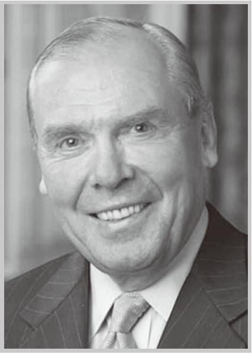
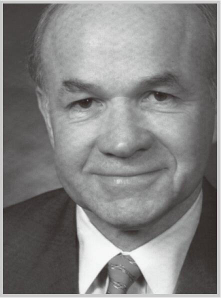

# 第一章 付出比收获多，到底是亏是赚

“支付与索取的法则，本质上就是外交里的一招——得寸进尺。”

——马克·吐温，美国幽默大师

一个灿烂的周六午后，硅谷的球场边。两个父亲看着女儿踢球，眼里都是骄傲。聊开天，话题从孩子转到工作。

个子高、蓄着黑发、体格硬朗的丹尼·夏德尔先开口。他是典型的连续创业者，履历里有网景、摩托罗拉、亚马逊，近四十岁时创办第一家公司，自称是互联网的老兵，现在正迈向第四次创业。

陪他并肩的是一位身高约五英尺四英寸、戴眼镜留山羊胡的戴维·霍尼克。霍尼克是风投人，兴趣很杂：家里藏着《爱丽丝梦游仙境》的各种版本，大学时自创了计算机音乐专业，之后又读了犯罪学硕士、法学学位。法律界扛一阵后转到风险投资，整整十年里，他听过无数创业路演，决定要不要押注。

中场休息时，夏德尔说：“我在酝酿一个点子，要不要听听？”霍尼克主攻互联网，正是理想听众。两人都有兴趣。往常找上门的大多是第一次创业，而夏德尔不同，Accept.com 在 1999 年被亚马逊以 1.75 亿美元收买，好耶科技 Good Technology 则在 2007 年以 5 亿美元卖给摩托罗拉。光环加身，霍尼克很想知道下一步。

几天后夏德尔驱车去霍尼克办公室。核心是这件事：接近四分之一的国人没法网购，因为没有银行账户或信用卡。霍尼克是首批知情的投资人之一，当场入迷。随后一周，他把方案带回合伙人，并递给夏德尔一份投资条款。

按常理，霍尼克占据主动。名气和点子都顶尖，追着来的投资方不会少。“你很难是唯一递条款的人，”霍尼克心里明白，“要跟全美顶尖机构抢人，得让创业者来选你而不是别人的钱。”常规打法是设一个短期限，用优厚条件逼迫对方先签。

霍尼克没这么做。他反而鼓励夏德尔多看几家。“给你足够时间做对决定，别急。”他把夏德尔的利益摆在自己的签约欲前面。

几周过去，夏德尔果然在外逛了一圈。为保持竞争力，霍尼克寄出他最值钱的资源：四十位推荐人的清单，能证明他作为投资人的能力与品格。那是十年陪伴创业者积累下来的信用背书。创业者看投资人，像看理财顾问，既要能干也要靠得住。

电话再次响起，是夏德尔。

“对不起，我选了另一家。”

条款几乎没差，推荐人也很有说服力，但夏德尔担心霍尼克太温和，会更多鼓励而非挑战，可能帮不上公司重建。他在电话里说：“心告诉我该跟你走，脑子告诉我该跟他们走，我听脑子的。”

霍尼克懵了，甚至怀疑自己：“我是不是太天真？早点施压或许就拿下了。十年名声白费了吗？”他学到的残酷教训是：好人容易被甩。

是这样吗？

人们常说成功靠动机、能力、运气。夏德尔和霍尼克的经历补上第四块拼图：你如何与人相处。是不断索取价值，还是习惯性贡献价值？

我是一名组织心理学家，在沃顿商学院任教，十年里研究过谷歌、美国空军等多类组织。研究指向一个被低估的变量：交互风格。

社会科学家把工作中的交往模式分成三个极端。我称之为获取者、付出者、互利者。

获取者偏爱天平向己倾斜，拿到比付出多的那端。他们把世界看成竞争场，推销自己、争夺认可。“我先照顾自己，才会被人顾及。”霍尼克若是获取者，会直接设期限逼签。

付出者则是对立面。职场里他们稀少，倾向让自己付出多于所得。获取者问“别人能给我什么”，付出者问“我能给别人什么”。这不是钱的问题：捐款数额或薪酬要求上两者无差，差在态度和行动。获取者策略性助人，确保收益大于成本；付出者只要对方收益超过自己的成本就会帮忙，甚至完全不算成本。工作里他们慷慨分享时间、精力、知识、人脉。

付出者不是特蕾莎修女那样的圣人，扶一把、教一招、分荣耀、牵线搭桥即可。耶鲁的玛格丽特·克拉克发现，亲密关系里大多数人都是付出者。工作场合更复杂，多数人是互利者，追求公平交换，信奉等价。

风格会切换，讨薪时像获取者，带新人时像付出者。但长期来看，大多数人形成主导风格，而它和努力、天赋、运气一样决定成败。

猜猜哪类人垫底？按直觉很多人会选付出者——确实如此。研究显示付出者在成功阶梯的低端更常见。

加州 160 名工程师互评帮助往来，付出大于回报的人效率最低，任务、技术报告、绘图都差，还常犯错、延期、浪费钱。因为总停下来帮人，自己工作难闭环。

比利时 600 多名医学生，被调查赞同“我热爱助人，我会预先满足他人需求”，成绩最差的认同度异常高。他们把时间花在给同学讲题，反而没补自己的漏洞。

我在北卡罗来纳州研究销售，获取者和互利者的年销售额比付出者高约两倍半。付出者太在意客户感受，不敢强势推销。

更广泛数据也显示，付出者的收入比获取者低约 14%，成为受害概率翻倍，支配性弱 22%。

可奇妙的是，付出者也占据了顶端。

同样那批加州工程师里，效率最高、产出最多质量最好的人，同样是付出者。医学生里最差的付出者最多，但最好的也是付出者，分数比其他人高 11%。销售里业绩最低的付出者仍比平均水平高 25%，而最顶尖的销售也是付出者，年销售额比获取者和互利者高 50%。

付出者占据了成功阶梯的两极——既有垫底的“笨蛋”，也有冠军。

霍尼克后来成了哪一种？

夏德尔签约后内心不安：“本该庆祝，为什么不开心？我很看好新投资人，却失去了和霍尼克合作的机会。”他想办法让霍尼克进来，并愿意因此稀释自己的持股。融资结束前，夏德尔邀请霍尼克参投。霍尼克接受，入董事会。那层友善被工作能力冲破，霍尼克能推动夏德尔换角度思考。公司 PayNearMe 让无卡无账美国人也能网购，先用条码支付，再到 7-11 或灰狗车站现金结清。半年多时间月盈利增长超 30%。

霍尼克还把夏德尔加进自己的推荐人名单：“别只觉得他是好人，他是个非凡的投资人，努力、有勇气，既挑战你也支持你，还极快回复。”

霍尼克的回报不止这一单。夏德尔见识到他的为人与重创业者利益，就为他牵线。一次在 Rocket Lawyer CEO 会面前，夏德尔推荐霍尼克，虽然对方已有条款，最终霍尼克拿下投资。

霍尼克承认付出者有代价，但他认为这正是成功的动因。他从业十一年共发出 28 份条款，25 份被接受，接受率 89%。夏德尔是仅有的三个拒绝者之一。多数被投企业后来成功，其中一家 2012 年首日市值达 3 亿美元，其他被谷歌、甲骨文、Ticketmaster、Monster 收购。

勤奋、天赋、运气都有，女儿足球赛边遇见夏德尔也是运气，但真正锁住胜利的是交往风格。霍尼克赢了，夏德尔也赢了，后来被推荐的公司也赢了。付出者为自己创造价值，同时让别人更有机会分享价值。

本书想说的正是：我们低估了霍尼克这类付出者的成就。他们常被叫“笨蛋”，实则能大获成功。接下来我会拆解为什么付出者的风险被高估，以及如何避免沦为垫脚石。付出者并非无私或和蔼，他们同样有雄心，只是走不同路径。

更关键的是涟漪效应。获取者赢，另一个人往往输，人们会嫉妒并想绊倒。付出者赢，大家愿意助推。兰迪·柯米萨说得好：“如果人人都希望你成功，你就更容易成功。”

当然，有领域付出成本显得高。马克·吐温说外交要诀是得寸进尺，比尔·克林顿也写过政治是不断获取支持、捐款、选票的生意。竞选中获取者善于游说取胜，互利者擅长交易。付出者在政治里的表现如何？

在伊利诺伊州，有个叫桑普森的农场汉，目标是当选参议员，成为“伊利诺伊的德维特·克林顿”。23 岁首战州议会，13 个候选人只取前四，他排第八。失利后他与朋友合伙开店，生意失败，地方政府没收财产，合伙人去世债务转到他头上，欠债达到年收入的十五倍，自嘲为“国债”。他花多年时间才还清债务……

二十五岁那年，一个名叫桑普森的年轻人，在生意场上栽了跟头之后，第二次站到了州议会选举的赛道上。没人想到，这个初出茅庐的小伙子居然拿下了第二名，顺利拿到一个席位。可他连一套像样的正装都买不起，只能借钱置办行头，去参加自己的第一届立法会议。此后的八年，他一边在州议会里打磨自己，一边拿下了法律学位。直到四十五岁，他才觉得时机成熟，要把自己的影响力推向更大的舞台——他决定竞选参议员。

那注定是一场硬仗。他面前站着两个来头不小的对手：一位是詹姆斯·希尔兹，时任议员，想谋求连任，叔叔还是国会议员；另一位是莱曼·特朗布尔，出身名门，祖父是耶鲁大学赫赫有名的历史学家。两个人都在州最高法院当过法官，无论是资历还是人脉，都甩开桑普森一大截。相比之下，桑普森更像一个从乡野间冒出来的无名之辈。

第一轮投票的结果让所有人大吃一惊：桑普森居然以44%的支持率遥遥领先，希尔兹紧随其后拿下41%，特朗布尔只有可怜的5%。第二轮，桑普森又把优势扩大到47%。眼看他就要锁定胜局，半路却杀出一个变数——时任州长乔·马特森突然加入战局。马特森人气极高，他的入场很可能同时吸走桑普森和特朗布尔的票。果然，希尔兹退选后，马特森迅速以44%的支持率成了新领头羊，桑普森跌到38%，特朗布尔只有9%。然而几个小时之后，结果再次反转：特朗布尔以51%对47%击败马特森，笑到了最后。

从领先近一半的票数，到眼睁睁看着别人摘走胜利，桑普森到底经历了什么？答案藏在他自己的选择里。他的“付出倾向”，几乎到了病态的地步。马特森入场后，桑普森发现自己的胜算变得不确定了。他知道特朗布尔有一批死忠支持者，在正常情况下，任何理性的竞选者都会去策反这批人——毕竟特朗布尔只有9%的支持率，几乎没可能赢。可桑普森更在意的不是自己能不能当选，而是绝不能让马特森赢。他坚信马特森有问题：坊间传闻马特森试图贿赂有影响力的投票者，而且马特森确实私下接触过桑普森的重要支持者，劝他们“桑普森没戏了，不如来跟我干”。

桑普森对马特森的戒心，后来被证明是明智的。一年后，马特森州长任期结束，被查出利用赎回过期的政府支票中饱私囊，贪污了几十万美元，最终因欺诈罪被起诉。

可另一方面，桑普森却对特朗布尔抱有极大的信任。他们立场相近，都主张对社会和经济政策进行重大改革，桑普森早就把对方视为盟友。所以，他不但没有去挖特朗布尔的墙角，反而决定“自废武功”。他告诉竞选经理史蒂芬·洛根：我要退出，让我的支持者转投特朗布尔。洛根简直不敢相信自己的耳朵——一个支持率更高的人，居然要把胜利拱手让给对手？洛根急得直掉眼泪，可桑普森不为所动。他退出了竞选，把自己的票源全部送给了特朗布尔。结果是特朗布尔赢了，桑普森输了。

这已经不是他第一次把别人放在自己前面了。早在他当律师的时候，强烈的责任感就经常拖累自己的事业。如果觉得客户真的有罪，他根本没法开口为对方辩护。同事们说，客户们心里都清楚：你要是清白的，找桑普森准没错；你要是有罪，找他只能是白费功夫。有一次，桑普森面对一名被控盗窃的客户，直接对法官说：“您要是能为他辩护，您来吧，我做不到。我要是开口，陪审团立刻会看出我认为他有罪。”还有一次法庭上，他侧身对助手说：“这人有罪，你替他辩护，我不做。”就这样，他把案子推给助手，也把一大笔佣金推了出去。这些举动让他赢得了人们的敬重，但也不禁让人嘀咕：这么心软的人，真能在残酷的政治世界里活下去吗？

一位政敌评价他“几乎是个完美的人，只缺一样东西——他不适合拥有权力，因为他的判断太容易被对别人的关心所左右。”在政治上，桑普森习惯当付出者，这让他处处吃亏。他不愿意优先考虑自己，结果输掉了参议员竞选，也让旁观者怀疑他根本不适合政治。特朗布尔能言善辩，锋芒毕露，桑普森却总是一副容易妥协的样子。他自己也承认后悔失败，但又说，特朗布尔当选能推动他们共同关心的事业。当地记者甚至认为，相比桑普森，特朗布尔“天赋和实力都更强”。

可桑普森没有就此认输。四年后，他再次竞选参议员，结果又输了。但这次投票前，最卖力支持他的人，恰恰是当年被他让出胜利的特朗布尔。桑普森的付出，赢得了对手的真心认可。事实上，特朗布尔不是唯一一个被他感化的人。早在第一次参议员竞选中，还有一位名叫诺曼·贾德的芝加哥律师兼政客，曾带着那5%的支持者死保特朗布尔。到了第二次竞选时，贾德已经变成桑普森的坚定支持者。

又过了两年，连续两次参议员竞选失败后，桑普森终于在全国性的选举中第一次胜出。有评论者说，贾德从未忘记桑普森的慷慨，他为这场胜利所做的贡献“远超其他人”。

1999年，美国有线电视网络C-SPAN做了一项调查，请一千多名资深受访者给桑普森和其他三十多位与他担任过同样职务的政治家打分。结果，桑普森排在第一，比任何人都更受尊崇。尽管他遭遇过那么多失败，却依然是人们心中最亮的那颗星。也许你已经猜到了，“桑普森”并不是真名，而是这个乡下人写信时用过的笔名。

他的真名，叫亚伯拉罕·林肯。

1830年，林肯立志成为“伊利诺伊州的德维特·克林顿”——那位曾经主持修建伊利运河的纽约州议员。他放弃了自己的第一次参议员竞选，帮特朗布尔获胜，只因为他们共同信奉废除奴隶制的理想。从解放奴隶，到为理想牺牲个人政治机会，再到拒绝为有罪客户辩护，林肯始终在为一个更高的目标而活。研究美国总统的历史学家、政治学家和心理学家一致认为，林肯是典型的付出者。有两位专家写道：“即使会给自己带来不便，林肯也会努力帮助别人。”他们认为林肯极为关心公民福祉，还特别指出，林肯是美国历史上“最不自私、最不傲慢、最爱自夸”的总统（这里的“爱自夸”是指他从不自夸）。在另一项总统评选中，林肯和华盛顿、菲尔莫尔一起，在“赞扬他人”和“为他人利益行事”两项上并列前三。一位跟林肯共事过的将军感叹：“他看上去远比其他人更伟大、更善良。”

当了总统后，林肯依然把国家利益放在个人得失之上。1860年大选获胜后，他邀请了三位曾在党内竞选中击败过的对手，分别担任国务卿、财政部长和司法部长。历史学家多丽丝·卡恩斯·古德温在《宿敌组成的团队》里写道，林肯的内阁非同寻常：“成员们比林肯名气更大，教育程度更高，公共事务经验也更丰富。在这群人面前，那位来自大草原的无名律师，本该黯然失色。”如果换成一个获取者，可能会拼命维护自己的自尊和权力，在内阁里塞满应声虫；一个互利者，则可能回报自己的盟友。但林肯邀请的是敌人。“我们需要最顶尖的人才入阁，”林肯对心存疑虑的记者说，“我没有权力阻止这个国家享受他们的服务。”这些对手里，有人鄙视他，有人觉得他不行，但最后全都被他折服。古德温感叹，林肯“从容地驾驭了成员们强烈的自我意识，这个故事告诉我们，友善、真诚、同情、诚实和共鸣这些平常被赞美的品质，在真正的政治家手里，也能变成重要的政治资源”。

如果付出者在政治领域都能成功，那他们也许能胜任任何工作？但别忘了，付出有没有效果，取决于情境。在很多纯粹的零和游戏里，付出很少得到回报。林肯每次牺牲自己的利益时，都尝过这种滋味。他说过：“如果说我有什么缺点，唯一一个——我不知道怎么对别人说‘不’。”

好在，生活中大多数博弈并非零和。把付出作为主要风格的人，最终往往会得到回报。就拿林肯来说，就像戴维·霍尼克一样，那些看似自我牺牲的决定，最后反而成了他的优势。之所以一开始觉得他们输了，是因为看得不够远。付出者需要时间才能赢得信任，但他们积累起来的名声和人脉，终将把他们推向高处。无论在销售领域还是医学院，付出者的优势都会随着时间增长。正如企业家奇普·康利所说：“做一名付出者，不一定能让你赢下百米冲刺，却可以帮你赢下马拉松。”

在林肯的时代，马拉松跑得更慢。没有电话、网络和高速公路，建立关系和声誉全靠岁月。康利说，旧时代寄一封信都没人知道。而在今天这个高度互联的世界，关系和名声更容易被看见，付出者的成功速度也大大加快了。就像波比·希尔顿说的：“现在你不需要二选一。你可以既做付出者，也取得成功。”

远期的成功更容易获得，还不是付出者在今天更占便宜的唯yi原因。今天的企业越来越依赖团队：造车、盖房、做手术、开飞机、并肩作战、演奏交响乐、写新闻、审计、咨询……超过一半的欧美公司都用团队模式运转。而团队恰恰需要付出者来分享信息、承担没人愿意做的脏活累活、主动帮助别人。林肯邀请对手入阁，等于给了他们亲眼见证自己服务国家的机会。当年曾骂他是“笨拙的长臂猿猴”、拒绝让他参与庭审的埃德温·斯坦顿，在共事之后评价他：“有史以来最完美的统治者。”团队成员越多，付出者展示价值的机会也越多。

祖辈那一代人大多是单打独斗的个体生产者，付出与否关系不大。但如今，即使不在团队里，你也可能在服务行业工作。上世纪80年代，服务业已占全球GDP一半；到1995年，接近三分之二；今天美国超过80%的工作都在服务业。随着服务经济扩张，那些用付出者方式建立关系和服务口碑的人，越来越受青睐。你希望你的医生、律师、教师、牙医、水管工、房产中介，都专注于为你创造价值，而不是从你身上榨取价值。这正是戴维·霍尼克能拥有89%成功率的原因——创业者知道，如果霍尼克愿意投资，就说明他会把创业者的利益放在心上。其他风投往往无视陌生邮件，霍尼克却会回复每一个陌生人。他说：“我喜欢尽可能帮助别人，不管能不能带来经济好处。”在他看来，成功风投的本质就是服务提供者：“创业者不是来服务我们的，我们是为创业者服务的。”

服务经济的崛起，也解释了为什么医学院里成绩最好和最差的都是付出者。在比利时那项研究里，第一学年付出者的成绩明显更差，这种劣势甚至比吸烟与肺癌的相关性还强。可到了第二年，付出者开始赶上；第六学年，他们已经远超其他同学。六年前的付出倾向，能精准预测六年后的成绩，效果比用吸烟预测癌症还显著。到了第七年成为医生后，他们的优势更大了。付出对最终成绩的影响，甚至比饮酒对攻击行为的影响还大。

为什么逆转会发生？付出者没变，变的是环境。随着医学生从独立上课进入临床轮转、团队协作和照顾病患，成功越来越依赖合作与服务。付出者的天性让他们更善于与同事配合，也更能表达对病人的关怀。所以当工作结构转向服务时，他们如鱼得水。

服务行业中的付出优势不只属于医生。澳大利亚几家大银行的前CEO史蒂夫·琼斯，曾想弄清理财顾问成功的秘诀。团队研究了金融专业能力和努力程度，但最重要的因素，用琼斯的话说，是“顾问是否愿意把客户利益放在公司利益甚至自己利益之上”。他认为管理团队最该做的一件事，就是灌输这种观念——用这种态度对待客户，最终所有人都受益。

皮特·奥代特就是一个活生生的例子。他曾经是大保险公司里接电话的客服，上岗第一年就凭热情在几百名同事中拿下年度人物奖，成为全公司最年轻的部门主管。几年后参加一次付出与获取培训，其他主管平均帮助三个人，他帮了全部十五个人，甚至包括他没雇用的应聘者——花几小时帮他们引荐关系、找机会。

2011年，皮特是一名专攻高净值客户的理财顾问，最大的客户资金上亿美元。一天他接到一个电话，一位工人想调整一份约七万美元的养老基金。原本接待的同事一看对方是废金属工人，觉得纯粹浪费时间，就不跟进了。皮特算了一下，就算把这位工人的全部资金加起来，也不够补偿他开车来回的油钱。但他想：“不能因为一个人不够重要就无视他。”于是约了会面，开车过去。到了地方，前门满是蜘蛛网，显然很久没开过。绕到后面，一个三十四岁的男人开了门，屋里堆满袋子，天花板整个被掀掉了，能看到房顶。客户有些尴尬地指了指折叠椅，皮特就坐下来帮他调整计划。完事之后，皮特同情这个蓝领工人，随口问：“趁我在这儿，你介绍下自己，看我能帮上什么忙？”

那人说他喜欢汽车，带皮特走进一间昏暗的小棚子。皮特以为又会看到一堆破铜烂铁，结果倒吸一口冷气：棚里停着一辆状况完美的1966年雪佛兰卡马洛，两辆带1000马力赛车引擎的经典澳大利亚维兰特，还有一辆改装车和一辆《疯狂麦克斯》里的福特轿车。这位客户可不是什么普通废金属工人，他经营着很赚钱的废金属生意，刚买下这栋占地11英亩、价值140万美元的房子准备修缮。接下来一年，皮特帮他调整商业计划、改善税务、重修房屋。“这一切，都始于我的一点点善意，”皮特说，“第二天我嘲笑了那位不肯来的同事。”这位客户后来成了皮特长期的合作伙伴，支付的佣金第二年翻了100多倍，而且皮特相信这个关系能持续几十年。

当然，付出也曾让皮特付出代价。后面我们还会看到，两个获取者差点利用他让他丢掉工作。但皮特还是从阶梯底端一路爬到了顶端，成了全澳大利亚业绩最好的财务顾问之一。他把公司从破产边缘救回来，做成行业标杆。他自己坚信，成功的秘诀就是付出：“毫无疑问，我在商业上的成功，正是因为我愿意为他人付出。这是我的制胜法宝。每次我赢得竞争，同行都觉得，付出是我取胜的原因。”

从林肯到皮特，从政治到金融，故事一再证明：付出也许会让你先输掉几场战役，却能帮你赢得整场战争。真正的精明，不是斤斤计较眼前的胜负，而是愿意在别人需要时递出那一点善意。毕竟，马拉松的终点线，永远属于那些跑得久、也跑得有人情味的人。

即便技术和组织形态在不断刷新，让付出的方式更容易产生效果，有一个事实却始终稳稳存在：谈到生活信念时，人本能地倾向于利他。 

著名心理学家夏洛姆·施瓦茨用了三十年时间，追踪不同文化里人们的价值排序。他把问卷译成十二种语言，覆盖澳大利亚、智利、芬兰、法国、德国、以色列、马来西亚、荷兰、南非、西班牙、瑞典、美国等国的代表样本，让受访者对各类价值的重要程度打分。

其中一组典型取向是：
财富、金钱与物质，权力与支配他人的能力，追求享乐，力求比别人做得更好。
另一组典型取向是：
为了他人福祉而努力，帮助他人，自己为人可靠，关注弱势群体的社会公平，以及对有需要者产生同情。

前一组被归为取向型，后一组被归为付出型。施瓦茨想知道，在十二国里谁更倾向付出。答案出人意料地一致。十二个样本里，多半人把付出排在首位。人们自述更在意付出，而非权力、成就、刺激、自由、传统、从众、安全或享乐。事实上超过七十个国家都呈现同样图景。无论是阿根廷到亚美尼亚，比利时到巴西，斯洛伐克到新加坡，乃至美国，多数文化里，付出都是最被推崇的生活原则。

这并不奇怪。做父母的会给孩子读《爱心树》，灌输关怀与分享。可是我们也会给付出划界，在职场里遵循另一套逻辑。我们希望孩子懂得谢尔·希尔弗斯坦的温柔，却又让《权力的48条法则》《孙子兵法》等畅销书主导商业想像。于是很多在工作里实操付出的人，也不愿承认这一点。

2011年夏天，我认识了金融服务公司的高管夏立安·普莱斯。她是典型的付出者：长期带教年轻同事，自发推动女性领导力与慈善捐赠项目。她说自己的默认模式就是给予，不求回报，想带来改变，聚焦能从帮助中获益最多的人。离职六周后，她参加了一个与六十名全球高管同组的领导力训练，完成心理测评后大吃一惊：职场上最强的优势竟然是善意与同情。她担心这会损害自己强硬成功的领袖形象，于是选择保密。她坦言害怕被视作软弱无能，被重新定义为不严肃的管理者。她习惯把正常的情感压下去去争胜，希望外界看到的是勤奋与结果，而非善意。她总结说，在商业里有时必须戴上面具。

这种对软弱或幼稚的恐惧，让不少人把生活里的付出价值观带进工作，却改用互利模式，试图平衡得失。有项调查请人说明处理工作关系的方式是付出、获取还是互利。自我描述为付出者的仅占8%，其余92%都不愿在工作里付出超过所得回报。另一次研究显示，职场互利者的数量是付出者的三倍。

即便本心偏向付出或互利，一旦感觉处境是零和，就会受压力影响滑向获取。公司强制排名、客户争夺、成绩正态分布、抢一个热门岗位……在这些情境下，人们天然假设他人都是获取者。斯坦福心理学家戴尔·米勒解释，如果预期别人都自利，就怕自己被利用，于是得出最理性和稳妥的做法是竞争。研究还发现，仅穿上西装分析哈佛商学院案例，就能明显削弱一个人对人际与他人利益的关注。康奈尔经济学家罗伯特·弗兰克写道，对被利用的恐惧如此普遍，以至于“我们常常揣测别人心怀恶意，反而暴露了自身最丑陋的一面：为了不做傻瓜，不得不压抑更高的善良本能”。

与获取者相处时，付出尤其危险。戴维·霍尼克认为许多成功的风投正是获取者——在创业公司索要不成比例的巨额份额，成功后习惯把功劳归于自己。霍尼克决心改变现状。财务规划师问他想在生命中达成什么，他回答最重要的证明是：成功不必建立在别人的损失之上。

为此他打破风投两条铁律。2004年，他成为第一个开博客的风投。风投本是黑箱，他却把门打开，在网上公开分享信息，帮助创业者理解投资人思维以改进提案。合伙人和顾问都劝阻，担心泄露机密，怕其他投资人剽窃想法却不回馈。大家觉得风投公开发言很疯狂。但他真心想对话、想帮助。他承认许多风投会看他的博客，若他提到某家让他兴奋的公司，签约前的竞争会更激烈，可他愿意支付这个代价。他的关注点始终是为创业者创造价值。此后八年他坚持更新。

对会议上无聊演讲的失望给了他第二个不同尝试。大学时他与教授办过一个讲座课堂，邀请龙与地下城发明者、悠悠球世界冠军、创造怀尔·E·考耶特与跑路者的华纳动画师。相比之下，风投和科技会议的演讲者相形见绌。他渐渐不再听讲，只待在休息室聊天。会议真正的价值在他看来是沟通与关系。若一个会议只讲人际与对话，不讲内容会怎样？

2007年他筹备首届年会，取名“休息室”，目标让创业者聚在一起分享新媒体想法。他准备投入四十万美元，被人劝阻，说会毁掉公司名声，失败就可能毁掉事业。他仍坚持前行，并在发出邀请时做出常人难以想像的事：邀请竞争对手的风投。

同事们觉得他疯了。问他为何要把竞争对手请进“休息室”。如果在会上遇到极佳想法，他本可捷足先登，为何要把机会让给对手？他回应自己想营造的是人人受益的平台，而非单人获益。有位参会风投很喜欢这种形式，也办了自己的“休息室”，却没邀请霍尼克和其他风投。尽管如此，霍尼克仍继续邀请他人。

霍尼克很清楚以付出者行事的代价。他说有人认为他是妄想狂，认为成功就是做获取者。若他是获取者，他不会听自荐方案，不会亲自回邮件，不会在博客上与竞争者分享，也不会邀请对手来“休息室”获益。他会保护时间、守住信息、更精细地操控关系。若他是互利者，他可能会去找那位参加了他会议却没邀请他的人索要补偿。但他更在意别人需要什么而非能得到什么。在坚持价值观的同时，他成为非常成功的风投，慷慨赢得广泛尊重。他回忆道这是一种双赢：他营造出他人可签约、可建立关系的环境，自己也能活在想活的世界里。他的故事说明，付出在职场上并非总危险，也可能带来回报。

本书要探讨的就是付出行为为何强大又危险。第一部分讲付出者成功的基本原理，揭示他们登顶的过程与原因。你会看到成功付出者在四个关键领域有独特沟通方式：构建网络、合作、评价与影响力。网络分析教你如何建立新关系与维系旧关系；合作理解让你知道怎样与同事高效协作并赢得尊重；评价探究给你意想不到的技能去准确判断他人并获得最好结果；影响力分析则提供展示、推销、说服与协商的新策略，让别人更愿意支持你的想法。透过这四个领域，你会看到成功付出者与获取者、互利者的不同，也能明白后两者能学到什么。你将了解美国最会拓展人脉的人如何经营社会关系；为何史上最成功电视节目的幕后灵魂劳碌多年籍籍无名；一位NBA高管如何做出史上最失败选秀却最终力挽狂澜；一位说话磕绊的律师能否击败言语自信的律师；以及如何只凭一个人的Facebook页面判断他是获取者。

第二部分把焦点从收获转向代价，并教你应对。我会说明付出者如何防止精疲力竭，避免成为别人的垫脚石。你会看到一位教师如何通过付出减轻疲惫；一位亿万富翁如何通过付出赚取财富；每周投入多少小时志愿活动会让你更快乐更长寿。你会认识到为何付出会拖慢一位顾问成为合伙人的脚步，却加快另一个人的步伐；为何我们常把某些人误判为付出者、另一些人误判为获取者；付出者在谈判桌上如何保护自己。你会学到付出者如何让他人从获取转向付出，避免在成功阶梯垫底而一步步攀顶。你还会学到一项约九十分钟的活动，能极大激发付出行为。此外你会明白为何人们宁愿把东西免费送人也不愿挂网卖钱；为何有些放射学家越做越好，有些越做越差；为何超人想象会让人更不愿志愿；为何名叫丹尼斯的人特别可能成为牙医。

读完后你或许会反思自己对成功的假设。若你是自我牺牲的付出者，本书会给你启发逐步走向成功。若你认同付出价值观却在工作中行事互利，你可能会惊喜地发现表达价值观的机会很多，既能从帮助他人中获得价值与意义，也不危及成功。相较于先成功再付出的路线，你可能会发现付出本身就是捷径。若你现在偏向获取，看完后或许会被拉向另一端，从付出者身上学习技巧，让越来越多的人通过帮助他人取得成功。

但如果你阅读目标只是为了取得成功，大概不会有什么效果。

每个人都必须做出一个抉择，究竟是走在富有创造力的利他主义之光中，还是具有破坏性的自私自利的黑暗中。——马丁·路德·金

几十年前，一个家境贫寒的年轻人怀揣美国梦。他出生于密苏里州农村小镇，连室内管道都没有。为补贴家用他长期务农或送报。后来考入密苏里大学，以优等生成绩毕业，取得经济学硕士与博士学位。他加入海军，后在美国政府担任要职，获海军荣誉勋章与国防服务勋章。此后创立自己的公司，担任十五年董事长兼首席执行官。离任时公司估值约一一百亿美元，在全球四十个国家地区拥有两万多名雇员。连续五年被《财富》评为最具创新精神公司与最适宜工作公司之一。他被问及成功时强调尊重、黄金法则、绝对正直。他建立家族慈善基金会，向两百五十多个组织捐赠二百五十多万美元，并每年捐出公司收益1%给慈善。他的付出甚至被时任总统乔治·W·布什称赞为“大善人”“慷慨之人”。

然后他被起诉了。

他叫肯尼思·莱，安然公司丑闻的核心人物。安然主营能源、日用品与证券，总部在休斯敦。2001年11月，安然第三季报显示亏损6.18亿美元，股东权益损失达12亿美元，是美国历史上最大一次盈余重述。12月公司破产，两万多名雇员失业，许多人看着毕生积蓄化为乌有。调查发现公司欺骗投资人、谎报收益、隐瞒债务，数额超过十亿美元，还操纵加州与得州能源市场，通过贿赂外国政府获取国际订单。莱被裁定犯有六项阴谋与欺诈罪。

# 别被“付出者”人设骗了：一张年报照片，早就暴露了获取者

肯尼思·莱究竟知道多少安然公司的违法内幕，外界没法下定论；但有一件事可以确认——他属于获取者阵营。很多人把他看成慷慨的付出者，那只是包装。骨子里，他是一个擅长伪装的获取者。

他心底有一套逻辑：公司的资源，自己拿来用，天经地义。贷款、银盘上的三明治、精美瓷器里的餐食、家族占用的三架公司飞机、姐姐那家拿走450万美元佣金的中介、破产前据指控抛售的7000多万美元股票——这些细节拼出一个把公司当自留地的人。早在1970年供职埃克森时，老板就在推荐信里一边夸他，一边提醒“可能太有野心”。后来观察者相信，1987年他在安然石油曾批准并掩护两名交易员设假公司，偷走3.8万美元，让公司躲过一笔大交易损失；事情败露后，公司不得不报告8.5亿美元损失。莱却说不知情，还放话：“谁说我知情，站出来。”据说真有个交易员想站，被两个同事拉住了。

他为何能一路成功？答案是人脉，一张庞大的关系网。他靠占用公司财务资源捞到不少好处，但领导公司成功仍靠传统手段：和有影响力的人结交，再借这些关系为自己谋利。莱从一开始就是织网高手。大学时经济学教授平克尼·沃克赏识他，他便借沃克的人脉往上走。沃克先帮他拿到五角大楼经济学顾问职位，又帮他成为尼克松政府白宫首席助理。80年代中期安然被并购后，他主张把公司搬到休斯敦，自己坐上主席位子。权力稳固后，他和政客来往密切，因为这些人能帮安然谋利。他把沃克的兄弟查尔斯送进安然董事会，又搭上正在竞选总统的老布什。1990年休斯敦工业国家峰会，他是联席主席，在撒切尔、科尔、密特朗面前大展魅力，让与会者折服。老布什输给克林顿后，莱马上搭上克林顿竞选团队的关键助理——那人是克林顿幼儿园起的朋友。没多久，他就和新总统打上高尔夫了。几年后小布什掌权，莱又利用关系游说撤销能源管制，把支持者送进得州和白宫的重要政府职位，借政策影响让安然获益。几乎每个职业阶段，他都能调用关系网里的关键人物，把公司或自己的前景大幅推高。

织网的重要性早被说烂了。西北大学布赖恩·乌兹认为，关系网带来三大优势：保密信息、多样技能、权力。大量研究显示，关系网丰富的人绩效更高、晋升更快、收入更多。人际互动和关系本身也提供观察角度，帮我们理解交互风格如何影响成功：你和网络里的人怎么连？织网图什么？

织网这个词，有时自带负面味道。刚认识一个人，对方热情地说想多联系，我们常会猜：他是真想互惠，还是想从我这儿拿点什么？你可能也遇过两面三刀的人：要你帮忙时特别友善，拿到想要的东西后，要么背后捅刀，要么直接无视。这种虚伪交友方式可叫马基雅维利式作风——织网只为让自己获益。付出者和互利者不这么看。他们觉得织网能认识新朋友、交换新想法；每个人知识和资源不同，彼此在帮助、建议、指导上建立互惠关系，很合理。于是有个根本问题：不同交互风格都能织出有深度有广度的网吗？还是某一种更占优？

接下来要看付出者、获取者、互利者如何织出截然不同的网，他们互动为何不同、结果为何不同；也会得到启示，比如怎样在安然破产四年前就发现其中的获取者。最终要说明：付出者和获取者都能建大网，但付出者的网络能创造更持久价值，只是这种方式常被忽视。

2011年《财富》做了次调研，想找美国最会织网的人。他们列了640人：500强CEO、科技界最聪明50人、50位最有权力的女性、40位40岁以下商业新星，然后把这名单跑进LinkedIn 9000万成员数据库。结果找到的人，与这640人的连接全球最多。他的LinkedIn联系人超过3000，名单里有网景、推特、Flickr、Facebook、Napster、Half.com的联合创始人，甚至“感恩而死”前领袖。后面会看到，他是典型付出者。LinkedIn创始人里德·霍夫曼说，听着有点不可思议，但态度越无私，从关系里得到的收益越多；帮别人能快速提升名望、拓展更多可能。部分原因是网络本身在变、在进化。但最值得关注的是：动机如何影响网的深度广度，以及能量如何在网里流动。

如果你对新同事莫名警惕，可能你嗅到了自私动机。看到获取者，我们会把他挡在网络外，收紧信任和帮助。为不被排斥，许多获取者练成伪装高手，以慷慨助人面目混进网络。莱就靠20年助人慈善赢得积极眼光，建立新关系，获得潜在帮助。但假象难维持。莱对华盛顿大人物魅力十足，同辈下属却看穿。前雇员说，想请莱参会，得先请到重要人物。一句话概括：向上谄媚，向下施压。获取者面对下级支配控制，面对上级却出人意料地服从恭敬；与权势者打交道时，他们变成令人信服的伪装者，努力表现、阿谀奉承，所以权势者常对他们第一印象很好。三位德国心理学家发现，陌生人往往最喜欢那种为自己争利、倾向操纵利用他人的人。

向上谄媚时，获取者常是优秀演员。1998年华尔街分析师到安然，莱雇70人扮忙碌交易员，想让分析师相信公司能源生意高产。他诱导分析师一步步进陷阱，让雇员带个人照片到不同楼层，好像在那儿办公；他们假装打电话，忙着买进卖出能源和汽油。这是他获取者本性的另一面：沉迷给上面的人留好印象，很少在乎下面人怎么看。约翰逊有句话大意是，看一个人，要看他怎么对待那些帮不上他忙的人。获取者能靠向上谄媚往上爬，却常因向下施压栽跟头。莱为讨好分析师，让员工昧良心维持假象。研究显示，人获得权力后会更强势、更少受限、更自由表达本能。获取者越升越高，越不在意下属和身边人，越觉得自己有权追求自利、攫取最大价值。可时间一长，恶劣对待同级下级会损害关系和声望。多数人是互利者，核心价值观是公正、平等、互惠；获取者违背这些原则，互利者就会以牙还牙。

卡尼曼的最后通牒游戏很能说明问题：陌生人拿到10美元，他提议怎么分。他若留8给你2，纯理性该接受，2总比0强；但多数人宁愿拒绝，宁可自己拿不到，也不让不公平的获取者拿走8。面对对方留80%以上的方案，大多数人都会拒绝。这不是单纯报复，而是正义感。另一项研究中，人们要么和曾提不公平方案的获取者分12美元，要么和提公平方案的互利者分10美元；超过80%选后者，宁愿拿5而不是6，也不让获取者多得。关系网里，被获取者伤害的人会传播名誉信息来惩罚他们。学者说流言是广泛、高效、低成本的惩罚。坏名声传开，现有关系被切断，新关系也难建。莱的获取行为曝光后，连布什家族都和他划清界线。维恩·贝克说得直白：如果只为获取去织网，不会成功；社交网络的好处来自有意义的交往。

所以，投入人际关系前，得学会在日常交往中识别获取者。判断新联系人意图不容易，尤其获取者很会装付出者。你遇到的下一个人，是想建立真关系，还是只想拿好处？有没有办法辨别？好消息是，获取者会露马脚，尤其是在炫耀时。

动物界的炫耀是雄性展示配偶价值的仪式。繁殖季，它们聚到一起，夸张表演讨好雌性：有的跳求偶舞，有的唱诱人歌曲，有的玩杂技。最惊人还是雄孔雀，占好位置开屏，趾高气扬地走，转圈让尾羽飘荡。CEO世界的获取者也跳舞，表现很像动物。

战略学教授查特吉和汉布里克研究电脑软硬件公司100多名CEO，分析每家10年以上年报，寻找炫耀迹象。他们的发现改变了人们看待领导力的方式。结果显示，就算没见过莱、不看统计数字，也能在1997年预见安然破产；结局藏在倒闭前4年的一张照片里。看下面两张CEO年报照片：两人都出身贫寒，都曾效力尼克松政府，都创立公司，都成了富有CEO，都给慈善捐过大钱。你能从脸或穿着分辨谁是获取者吗？

左边是老乔恩·亨茨曼，出自2006年报，是付出者；右边是肯尼思·莱。上千专家分析过安然财报，却漏了一个事实：一张照片胜过千言万语。仔细看年报，也许早能发现获取者的炫耀信号。

信号不在脸上，也不在穿着。查特吉和汉布里克把公司看成太阳系，获取者把自己当太阳。一个线索是代词：获取者更爱说“我、我的、我自己”，而不是“我们、我们的、我们自己”。电脑产业CEO谈公司时，第一人称代词平均21%是单数；极端获取者升到39%。也就是说，每10个指代自己的词，有4个只指自己。另一个线索是钱：获取者CEO收入远超其他高管，因为他们视自己为上级，觉得该拿更多。典型获取者CEO年薪加奖金是其他员工三倍，行业平均CEO只是第二高薪的1.5倍；股权和其他非现金收益，获取者是第二高薪的7倍，行业平均2.5倍。

最有趣线索在年报照片：亨茨曼照片很小，占不到页面10%；莱的照片占一整页。查特吉和汉布里克翻电脑公司年报时发现，有的年报根本没CEO照片，有的登整页CEO独照。哪类老板更可能是获取者？答案你猜到了。

别被银盘上的三明治和慈善晚宴骗了。识别获取者，看代词、看薪酬、看年报照片，也看他如何对待帮不上忙的人。真正的人脉高手，不是把关系当提款机的人，而是持续付出、让价值在网络里流动的人；这样的网络才更持久。

**一张大照片，能不能看出CEO是“获取者”？**

在获取者型CEO的世界里，中心永远是“我”。把大幅肖像塞进年报，本身就是一种版面宣言：这家公司真正的主角是谁，一目了然。可问题在于，大照片真能当作识别“获取者”的可靠标签吗？

查特吉和汉布里克找来做信息技术领域研究的证券分析师，请他们给一批CEO打分，判断这些人是否自我膨胀——是否带着优越感，是否有强烈的特权意识，是否渴望被关注和赞赏，是否享受站在聚光灯下，是否要求别人广泛尊重，是否爱出风头、狂妄自大。结果很有意思：分析师的评分与这些CEO照片的尺寸几乎完全对应，吻合度高得惊人。

安然公司的年报提供了一个典型切片。1997年那份后来显得颇具预示性的年报里，前九页中有两页被肯尼思·莱和时任COO杰夫·斯基林的大幅照片占据。1998、1999年，这种排版思路继续沿用。到了2000年，两人的照片虽然缩小，却被挪到第4、第5页，每人四张，形式上像幻灯片，观感更接近连环画。莱的三张照片几乎一模一样，脸上挂着克制又得意的微笑，自我感觉良好几乎要溢出纸面。可惜故事收尾并不体面：案件宣判前，莱因心脏病去世。

识别获取者，眼下至少有两条线索。其一，若能拿到声望方面的信息，就看这个人如何对待关系网络中的联系人；其二，若能观察其行为和事迹，就去找炫耀的痕迹。把照片修得抢眼、谈话三句不离自己、薪酬差距大得扎眼，都能发出相当可靠的提示：此人可能是获取者。2001年以后，世界变了很多，这类信号比过去更容易被捕捉；关系网络越来越透明，也像开了一扇新窗，让我们看见谁在积攒声望、谁在展示优越。

另有两则研究注脚值得记住。最后通牒游戏里，分配者很少抛出极端不公平的方案；超过四分之三的提案选择平均分配，行为更像互利者。另一项研究以总体股东回报率和资产回报率为尺子，发现获取者CEO掌舵的公司业绩往往大起大落：赢时赢更多，输时输更惨。他们对自己的赌运过度自信，常把筹码全押上，偏爱大胆、宏大的动作——更多更大的收购，乃至公司战略急转弯。短期有时收益惊人，长期却常把企业拖进险境。