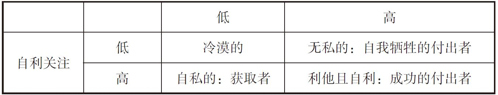

## 第八章 把钱浪费在庸才身上

很多人第一反应会觉得，付出型的人最容易把钱、时间砸进无底洞。毕竟他们眼里总能看到别人的潜能，总想用鼓励和陪伴把人拉上来。这正是 C.J. 斯肯德的写照。她为一名想读会计研究生之外的项目的学生一口气写了上百封推荐信，第一年全部落榜，她重写；第二年再被拒，她又改；第三年连着三振后，她才劝学生换条路走。

这种近乎偏执的投入让人不禁追问：付出者是不是总在热情高却天赋平平的人身上花太多？如果换成获取者或利己型的人，会不会更早止损，给彼此都省点时间精力？要回答这个问题，最直观的试验场是每年一次的 NBA 选秀。联盟轮流挑选新人的规则，让“眼光”直接暴露出来。

斯图·英曼的名字就和 NBA 历史上两次最糟糕的选秀牢牢绑在一起。1972 年，他是开拓者的球员事务总监，拥有状元签。他选中了中锋拉鲁·马丁，后者四季效力开拓者场均仅 5 分 4 篮板。这一手直接错过了那届榜眼鲍勃·麦卡杜，麦卡杜新秀赛季得分就超过马丁职业生涯总和，两年后拿下 MVP，生涯两次得分王、五次全明星、两枚总冠军戒指。英曼还在第 12 位错过了“J 博士”朱利叶斯·欧文，后者后来三冠、四次 MVP、十六次全明星，历史前五得分。

十二年后英曼升任总经理，再次手握高位签。1984 年第二顺位，他挑了身高 213 厘米、运动能力不错的中锋萨姆·鲍维。ESPN 称其为北美职业体育史上最差选秀之一，《体育画报》甚至把他排在 NBA 历史第二大水货。更致命的是，这个选择让开拓者错过了北卡的迈克尔·乔丹，公牛第三顺位摘走他。乔丹随后带来六冠、十次得分王、十四次全明星，被 ESPN 评为 20 世纪北美最佳运动员。英曼因身高需求还错过了第五顺位的查尔斯·巴克利和第十六顺位的约翰·斯托克顿。

英曼恰恰是典型的付出者。高中执教后他成了母校圣何塞州立大学的主帅，球员利益在他那里优先于个人战绩。明星队员汤米·史密斯想放弃篮球专攻田径，他没有发火，只是握手祝愿，并保持联系。几年后史密斯在 1968 年奥运会夺得 200 米金牌，打破世界纪录。另一位瘦弱的白人球员特里·莫非一年只得了 4 分，英曼仍告诉他：我永远不会赶你走，你很努力、很有礼貌。

体育记者韦恩·汤普森回忆英曼常说：无论水平如何，用心教学是最有回报的事之一，看着学生第一次突破的表情让人兴奋。这也解释了为什么人们会担心付出者容易陷入“因善心而沉没”。

但真实的数据走向相反。加州大学伯克利分校的巴里·斯塔乌和哈晃对 1980 至 1986 年间 240 多位首轮前两轮新秀进行追踪，控制了位置、伤病和球队战绩后发现，球队对高顺位球员存在明显的承诺升级。哪怕表现不佳，他们仍给更多上场时间、更晚交易。顺位每提前一位，第二年上场时间平均多 22 分钟，第五年仍多 11 分钟；被交易的概率则每顺位下降 3%。

这就是斯塔乌说的失败行动承诺升级。经济学家用“沉没成本”来解释，人们难以忽视已投入的时间金钱。密歇根大学整合 166 项研究后发现，沉没成本确实有影响，但更强的是预期后悔、项目完成欲望，以及最强的自我威胁：若不继续投入，我会不会显得像个傻瓜。银行贷款研究里，批准坏账的原经理最抗拒注销，换成新人就更容易止损，因为自我没有被绑定。

伦敦商学院亨利·穆恩让 360 人先测付出者/获取者倾向，再做是否追加 100 万美金的决策。获取者明显更倾向追加，因为他们想挽回自尊和面子。正如南加州大学的布鲁斯·梅格里诺和奥黛丽·科斯嘉德所说，放弃对组织有利，却带来个人声誉和流动性的损失，于是决策者选择升级承诺来掩盖失败。

付出者恰恰相反，他们更在意他人和组织，而不是自我形象，因而更敢承认失误。另一项反馈实验里，付出者在收到“表现低于平均”的评价后，授权给别人的比例仍提升 30%；获取者若被告知表现高于平均才提升 30%，低于平均则只提升 15%。他们倾向过滤负面信息来保护自尊。

回到英曼。尽管他认同培养责任，他从未让自我防御主导选择。“他友善、体贴，但绝不因此影响判断，”汤普森说，“如果觉得打不了，他会拍拍肩膀祝好运。”1986 年离开开拓者时，他直言选择鲍维而非乔丹是错误：所有球探都认为鲍维是问题的根源，我也这么认为，但这就是错了。

对拉鲁·马丁，英曼也没有升级投入。新秀年马丁挣扎，教练杰克·麦克劳斯基反馈他努力但没技术，投篮不行、抢不下篮板。英曼没有为证明状元眼光而堆时间，反而让 201 厘米的劳埃德·尼尔首发，马丁场均不到 13 分钟。次年继续缩水到 11 分钟，而麦卡杜和欧文同期场均 32 分钟和 42 分钟以上。

1974 年马丁第二个赛季后，开拓者拿到状元签，英曼选了比尔·沃尔顿。新秀年沃尔顿场均 33 分钟，是替补马丁的两倍。随后马丁被交易。沃尔顿率队在 1977 年夺冠并拿下总决赛 MVP，次年获常规赛 MVP，退役后入选名人堂，成为 NBA 历史 50 大巨星之一。当年那个分区垫底的队伍，因为及时切割掉沉没成本而崛起。教练杰克·拉姆齐说，英曼从未站在聚光灯下，却缔造了开拓者 40 年唯一一次总冠军。

所以真正把资源浪费在庸才身上的，往往不是付出者，而是因自我威胁而死扛的获取者。付出者看得见潜力，也看得见现实，并愿意为长期正确承受短期的自尊打击。

客观来说，萨姆·鲍维的球员生涯几乎被伤病写满了。大二的胫骨骨折让他直接缺席了大学里整整两个赛季。选秀前，斯图·英曼为了确认他是否真能恢复，安排了一场长达七个小时的深度体检。新秀年鲍维打得还算顺手，但此后四年里，他却因为身体原因错过了81%的比赛，差点又报销了近两个完整的赛季。

把赌注压在鲍维而不是乔丹身上，并不是英曼一家的判断。1984年选秀结束后的第二天，《芝加哥论坛报》的头版写的是“满怀歉意的公牛只能守着乔丹了”。当时公牛总经理罗德·索恩的失望溢于言表，他感慨自己希望得到一个两米一的内线，却只能拿到乔丹，“当时根本没有中锋可选，你能怎么办？乔丹让球队质变有限，他进攻不错，却谈不上统治级”。连乔丹自己在新秀年也帮老对手说话：“鲍维会比我更合适波特兰”，因为开拓者已经拥有一群高大后卫和小前锋。休斯敦火箭总经理雷·帕特森在选下奥拉朱旺后说得更直白：“所有说该选乔丹而不选鲍维的人都在吹牛，乔丹没那么出色。”

### 黑暗里长出来的曙光

英曼属于那种典型的付出型伯乐，和C.J.斯肯德一样擅长从球员身上挖掘别人看不见的料。韦恩·汤普森曾写道，英曼总想把感兴趣的人摸透，“难怪他在挖璞玉上屡屡得手”。他打造的冠军班底里，得分榜前六有三人、前九有五人，都是他在二轮或三轮捡来的。史蒂夫·杜因评价他走在同行前面发现潜力，达拉斯小牛主席诺姆·桑丘说斯图在球探圈里几乎是顶流，被视作天才。纪录片里弗利普·邦迪也提到，英曼被视作联盟最顶尖的人事专家，其他俱乐部会盯着他的试训安排，把他对某位球员的风声当成重要信号。

上世纪七十年代，大多数球队只盯身体指标：弹跳、速度、力量、协调。英曼却认为内在特质更关键。他在看数据、看比赛之外，会盯球员赛前热身的投入度，去访谈教练、家人、朋友和老师，了解动机、心态和品德。《俄勒冈人报》的总结很到位：英曼以淘高性价比球员著称，他的选人嗅觉和人情味一样敏锐，他要找的是人格与智商和弹跳一样出众的人。

1970年英曼作为首席球探加入NBA新军开拓者，当年夏天搞了一场公开试训，既是造势也是淘人。那批人最终都没进队，但他的耐心几年后兑现。1975年二轮第25顺位，他挑了个几乎没人关注的犹太前锋鲍勃·格罗斯。格罗斯在西雅图大学场均10分，转去加州州立长滩大三仅6.5分，弗兰克·科菲写道，“对格罗斯的大学和职业生涯概括就是没人注意，直到有人认真看”。

英曼正好看了长滩对阵密歇根州立的一场球，对手有一次轻松上篮快攻，被格罗斯拼命封盖。那一刻勾起兴趣，越看越觉得这人靠得住。大三到大四一年，他的得分直接翻倍到场均16分以上。科菲称他“找出一块宝石，一个稳定、努力、效率极高的球手”。大学教练也说他“对球队有彻底的无私”。第三个NBA赛季，开拓者杀进总决赛，格罗斯场均17分，第五、第六场他锁死朱利叶斯·欧文，分别砍下25分和24分领衔全队。比尔·沃尔顿说他是那支球队的润滑剂，“永不停歇地跑和防，没有鲍勃，波特兰根本拿不了冠军”。

英曼看透了联盟普遍低估付出者的短板：他们不抢戏，不耍花活。他的信条是球员的成长取决于潜力而非当下水准。看到有人用工作狂方式练球，就被他归类为璞玉。研究也显示，付出者因更关注集体奉献，愿意花比获取者、互利者更长的枯燥时间训练，哪怕练到乏味，也会因责任感咬牙坚持。

这种逻辑在别的行业也成立。嘻哈教父拉塞尔·西蒙斯与人共创Def Jam，LL Cool J和Beastie Boys都是从这里起步的。他1978年就开始免费做音乐，比唱片公司早得多。他把成功归于识人：付出者会让身边的人变好。他最欣赏的付出者凯文·利尔斯，初来时当免费实习生，第一个到最后一个走；后来当营销总监，还主动帮其他区域。大家自然把他当领袖，因他不断付出到不可或缺。他写道，最想看的特质，就是愿意付出。

英曼明白，有韧性的球员会把球队利益放前面。1984年选了鲍维后，他在二轮第46顺位又捡了前锋杰罗姆·科尔西。科尔西来自弗吉尼亚州不知名的长木学院二级联盟，当时还不是NBA面孔。学院体育主管说他的工作态度无可匹敌，这点让英曼看到了常人忽略的潜力。

第二年1985年第24顺位，他得到控卫特里·波特，一个以拼抢和无私著称的硬汉付出者。他在开拓者两次入选全明星，打满17个赛季。1993年他拿到J.沃尔特·肯尼迪公民奖，表彰其服务和社区贡献。他资助残疾儿童看球，给毕业舞会提供药品酒水，和科尔西一起为男孩女孩俱乐部出力。

英曼最漂亮的一笔是1983年第14顺位。开拓者选了得分后卫克莱德·德雷克斯勒，当时外界认为他投篮不强，没人要。结果他成为那届得分王，生涯场均二十多分，是该届唯一入选过NBA一阵、十次全明星、打过奥运、进过名人堂的球员。退役时他以20000分、6000篮板、3000助攻跻身NBA历史前三，和罗伯逊、哈弗利切克并列，也列入50大巨星。大家都在问，别人看走眼时英曼凭什么看对了。

答案在于他愿意听专业意见。在圣何塞州立大学时，英曼认识了运动心理学先驱布鲁斯·奥格尔维。当时心理学家常被误当成精神病医生，球员去见会被认为有问题，多数管理层避之不及。英曼却张开双臂接纳他，要求待选球员做数小时评估，测无私程度、对成功的渴望、坚持和可教性、对运动的投入。英曼说其他球队也看心理，但没有人像他们那样真正用并信赖它，“先欣赏天赋再评估，评估能给出是否能兑现潜力的清晰信号”。

奥格尔维评估德雷克斯勒时，英曼被他的心智打动。他访谈过看过德雷克斯勒在休斯敦大学比赛的教练，回馈一致：克莱德是球队胶水，会做所有帮助赢球的事，自我从不妨碍求胜欲。球探布基·巴克沃尔特承认“有些球队不愿选他，他不是好投手”。英曼团队判断他能练成中距离投篮，或靠其他天赋弥补。英曼赌对了，巴克沃尔特后来承认德雷克斯勒变得更有技巧，超出预期。

英曼在篮球的失手，在其他领域照样识人。UPS工作25年的拉鲁·马丁后来成为伊利诺伊州社区服务主管，2008年收到开拓者前老板拉里·温伯格的一封信：“毫无疑问你在UPS是杰出的职业楷模。”马丁曾和奥巴马打球，2011年进入退役球员联合会管理委员会。他说“我很乐意回馈”。

你还记得圣何塞州立时期英曼手下最差的球员特里·莫非吗？英曼给了他机会，却觉得他不适合篮球，建议转排球。判断完全正确，莫非后来入选美国排球国家队，但也没彻底离开篮球。1986年他为残奥会筹款在达拉斯办三对三街头赛，1992年“箍起来”赛事已有15万运动员、100万观众，五年后在27地举办302场比赛，筹得数百万美元善款。

### 一个评估者胜过一个传奇

讽刺的是，尽管英曼错过了迈克尔·乔丹，但在天才评估这件事上，他却赢了乔丹。作为管理者，乔丹更像获取者而非付出者，这点在球员时代已有预兆：场上以自我为中心、自尊心强，自己曾说“要成功必须自私”。教练给他提建议要小心翼翼，他入名人堂演讲时攻击质疑者而非致谢，引来广泛批评。球员时代他主张球员拿大头，成了老板后却主张把更多收入分给股东。

在持续押注人才上，两人对比鲜明。乔丹当华盛顿奇才总裁时，用2001年状元签选中高中生中锋夸梅·布朗。天赋在，但缺乏韧性，从未兑现，被评为十年第二大水货、运动史百大选秀失败之一。榜眼泰森·钱德勒进过梦之队，探花保罗·加索尔得最佳新秀、四年全明星、两冠，还拿到J.沃尔特·肯尼迪公民奖。两人数据全面压制布朗。

布朗的平庸刺痛了乔丹的自尊。他复出和布朗同队时常训斥、贬低他，说他拖累球队、让状元选择更难看。首季布朗场均5分5篮板，第二季上场时间却翻倍。赛季后乔丹被解雇，却不愿放手。2010年布朗签约夏洛特山猫，球队老板正是乔丹，经纪人说“迈克尔在签约里起关键作用，他想成事”。到那时布朗已打10年四个队，500多场场均不到7分6篮板，上季场均13分钟。来山猫后上场时间翻倍到26分钟，累计上场超过前两季总和，却仍挣扎，场均8分7篮板。乔丹想给夸梅再一次机会，经纪人说“布朗是乔丹的首个选秀，失败时两人都被骂”。付出者会承认错误继续前行，乔丹却想扭转投资。好友查尔斯·巴克利说“我爱乔丹，但他这活没做好，他身边也不缺反对声音”。在乔丹带领下，2012年山猫创下NBA历史最低胜率纪录。

与此相反，英曼的体系产出惊人。1977年他用一堆无名球员把垫底球队一年变成冠军。1986年离开后，球队靠德雷克斯勒、波特、科尔西继续强势。连续三年挖出的三颗宝石带着开拓者两次进总决赛。球迷眼里他像是失败者，业内却视他为篮球史上最伟大的天才评估者之一。英曼的事迹加上研究，揭示出付出者不仅擅长识别和培养天才，更难得的是在失手后放下执念继续前行。

生命最后四年，英曼志愿担任俄勒冈州奥斯威戈湖高中助理教练。主教练说他对球员好，既练球也塑品格，不提前贴标签，而是按潜力对待。在那里他培养了凯文·洛夫，这个年轻人后来实现了萨姆·鲍维和拉鲁·马丁未能实现的梦想：成为会投篮的大个子。身高208厘米的洛夫前四个赛季入选梦之队、两次全明星、获最有潜力提名，还拿下三分大赛冠军。

乔治·安德斯写道：“如果你想培养伟大天才，就要利他、为别人着想。短期看自私的人更挣钱更受瞩目，但长期看情况完全反过来。”英曼的一生，正是这句话的注脚。

# 如何用“示弱”来影响人

温柔地讲话，但带上一根大棒。
——西奥多·罗斯福，美国总统

影响力并不总是靠气势压人，有时候收敛锋芒反而更有穿透力。

戴夫·沃尔顿深吸一口气，准备起身对陪审团做职业生涯里的首轮结案陈词。他是Cozen O’Connor律所的合伙人，专攻商业机密与员工竞业纠纷，是律所里最年轻的股东之一，多年间也屡获宾夕法尼亚州超级律师新星提名。

2008年的案子源于一家名为阿克米-哈代斯蒂的蓖麻油经销商。它的上游供货商是印度孟买的杰雅特油品公司。2006年12月，阿克米母公司的CEO获知杰雅特打算在美国自建销售体系，不再供货，一个月后管理层确认杰雅特要直接面向美国客户竞争。就在当年夏天，两名阿克米员工跳槽到杰雅特，协助其起步。母公司随即起诉杰雅特及两人，指控窃取商业机密。

戴夫准备充分，证据指向明确：2006年3月，两人还在阿克米任职时就已接受杰雅特建立竞争渠道的报酬方案，6月分别拿到5万美元的咨询启动费。离职后两人未说明去向便赴印，在印期间把阿克米的内情写入杰雅特的商业计划；其中一人还提供了阿克米出资整理的美国客户清单，杰雅特总裁也承认使用了阿克米文件来做投资人演示。更关键的是，两人用假邮箱别名继续跟进阿克米订单。

为被告辩护的是三家知名律所的资深律师。对方拥有25年庭审经验，哥伦比亚大学法学学位，康奈尔本科出身，曾获宾州百强律师、全国周度诉讼律师等荣誉，被形容为“娴熟博学、庭上惊艳”。他在法庭上从容不迫，主张杰雅特只是合法竞争，有权绕开中间商降价；承认客户有所流失，但并非员工过错。员工在原公司处境糟糕，其中一人称公司是“藏污纳垢之地”。对方还大做证人可信度文章。戴夫承认，“他真的很厉害，远超预期”。

审判天平摇摆。戴夫第一次主导庭辩，也是最年轻的律师，紧张的老毛病又出现：结巴。几度磕绊可能传递出信心不足的信号。

他最在意的一位陪审员。审理期间该陪审员明显偏向被告，频繁点头、为对方的笑话大笑；轮到戴夫发言时却回避目光、假笑、带着轻蔑。整场审理他都穿蓝色牛仔裤，结案陈词那天却换上正装系领带。戴夫心里一沉，感觉对方想当陪审团主席并拉拢其他人。

结案后陪审团退庭商议，走在最前面的正是那位持反对意见的陪审员，他被选为主席并宣读裁决。陪审团一致判戴夫客户胜诉，赔偿700万美元，刷新了宾州商业机密案件纪录。

戴夫的专业表现无可置疑，但还有一个细微因素让他占据了优势。这一点他与通用电气前CEO杰克·韦尔奇、副总统乔·拜登、歌手卡莉·西蒙、《20/20》主持人约翰·斯托塞尔、演员詹姆斯·厄尔·琼斯、NBA球星比尔·沃尔顿一样——都曾与口吃相伴。

口吃大约影响1%的人口。戴夫从小因此被嘲笑。大学毕业后求职销售，被面试官以口吃为由拒绝。家人朋友对他读法学院普遍怀疑。法学院第一次模拟法庭，法官听他发言时哭了，“她为我难过”。

常人把口吃视作缺陷，佩服韦尔奇和琼斯是靠气场掩盖了障碍。现实更复杂。许多口吃者最终很成功，未必靠克服缺陷。在这起商业机密案里，戴夫在部分环节磕磕巴巴时，发生了反常的事：陪审员喜欢他了。

审后多位陪审员上前说：“我们很尊敬你，因为知道你口吃。”他们认为口吃不严重但注意到了，并为他做法庭律师的勇气点赞。戴夫并非靠口吃赢案，但口吃可能帮助他拉近与陪审团的距离。

他当时又惊又尴尬，“我不记得自己结巴那么多次”。陪审员走后他意识到，自己有一种天赋——口吃反而成了优势。

本章要探讨的就是这种反常识的影响力。丹尼尔·平克在《每个人都在推销》里指出，成功很大程度上取决于影响他人的能力。影响基本有两种路径：确立支配地位和赢得声望。别人觉得你强大、有权威，你就有了支配力；别人尊敬欣赏你，你就有了声望。

这两种路径与沟通风格相关。获取者更擅长建立支配。他们会提高音量强调权威，用确定性的语气表现自信，炫耀成就，通过肢体扩张、挑眉、占据空间甚至威胁来定调。在零和的支配游戏中，获取者通常更有效。

但听众越是怀疑，越被支配就越抗拒。支配是零和；而声望不是，敬意可以无上限复制，因此通常更持久。

获取者式的强势沟通对应着另一种：无力沟通。无力沟通者语气不够肯定，充满疑问，极度依赖他人建议。他们会示弱、暴露短板、使用免责声明、回避正面回答、表现迟疑。苏珊·凯恩在《安静》里指出西方社会更推崇强势表达。按常理，无力沟通应吃亏。

并非完全如此。

传统观念认为果断自信是影响力的必要条件，实际上并非总是如此。付出者本能地会使用无力沟通。令人意外的是，它在建立声望上非常有效。付出者更关注他人观点，为此更爱提问而非答题，更谨慎而非冒进，更愿承认弱点而非炫耀长处，更求建议而非强加观点。这种示弱，能否产生影响力？

[1] 免责声明：一些特定类型的免责声明比其他形式的无力的沟通更危险。例如，人们经常用“我不想让你觉得我很自私，但是……”这样的句子开头。心理学家发现，这类免责声明会起到反面的效果，它会让听众更加预期讲话者会说一些自私的东西，这会导致他们寻找——并且找到——确认讲话者的自私的信息。

## 展示：示弱的价值

我26岁时已获组织心理学博士两年，受邀给高级军官讲授如何激励士兵。军队正从命令控制转向合作模式，我的研究恰好相关。第一次任务是给23名空军上校讲4小时课。他们平均飞行3500小时，战斗300小时，驾驶F-16。课上外号“打击者”“沙丘”“炸弹狂”等名不虚传的军官坐在台下。

这些四五十岁的上校在等级森严的体制里成长，我却几乎空白。尽管有博士学位和相关知识，差距明显。课后反馈两条印象深刻：

“隐形”：台下的人比台上的人拥有更多高质量的信息。
“炮手”：讲课的人知识丰富，但经验不足……没有很好地把握听众的需求。讲课的材料非常学术……我没有任何收获。我相信讲课的人确实学到了一些有用的东西。

“轰炸机”说现在的教授越来越年轻，“黄貂鱼”则调侃希望教授比自己大。面对他们，我用了强势开场，强调自己的资历。平时给本科生上课我会用人生最大失败开场，但在只有4小时建立可信度的压力下，我选择支配式自我介绍。越想掌控，上校们越抗拒。我没赢得尊重，感到失望和尴尬。

第二次再给上校们授课，我换了开场：

“我知道你们中的某些人正在想什么：‘我能从这个12岁的教授身上学到什么？’”

现场先是尴尬的沉默，然后爆笑。一位叫“老鹰”的上校说：“嗨，这太离谱了，我确信你有13岁。”之后内容完全重复，反应却天差地别：

“用个人经历说话。他的年龄正合适！充满能量；很显然这已经很成功了。”
“亚当很明显对于讲课的主题非常了解，这让他对主题充满热情和兴趣。这让他非常有效率。三个字——棒极了！”
“尽管经历有限，但是他用有趣的方式介绍了各种研究。干得非常好。充满了能量和活力。”
“我不敢相信亚当只有12岁！他做得非常棒。”

唯一的变量是无力沟通。我不再证明自己，而是把显而易见的弱点点出来。后来用同样方式给陆军将军、海军军官授课，效果一样好。最自然的风格帮助我与质疑的听众建立连接。

获取者担心暴露弱点会削弱权威，付出者则更坦然，因为他们追求的是帮助而非权力。示出破绽反而更容易建立声望。

但示弱有效的前提是听众能从其他信息中确认讲话者的能力。心理学家埃利奥特·阿伦森的经典实验里，大学生听候选人参加智力问答的录音。一半是正确率92%的专家，一半是正确率30%的普通水平。

如预期，听众更偏爱专家。但加入一个笨拽行为后情况反转：盘子被打碎，候选人说“哦天哪，我把咖啡洒到新买的正装上了”。

平庸候选人出现失态后更不受欢迎。
专家出现失态后反而更受欢迎。

这是“失态效应”。洒咖啡损害平庸者形象，但让专家更人性化、更亲近。内核与戴夫的口吃相同：愿意暴露弱点换来尊重和信任，陪审员更愿意细听其陈述。

对律师而言，示弱尤其关键。戴夫有付出者倾向，常指导年轻同事，为客户争取公平。他解释：“我是个大个子，看起来像军人，而且线条硬朗。”在商业机密案里，口吃不是胜诉原因，却帮助他建立可信度：让他更像真人，让陪审团看到可支持的特质，减少了精雕细琢的距离感。人们不想要一个过于光鲜的律师，优秀庭审律师要同时是专家也是普通人。

当戴夫带着口吃站上法庭，人们能感受到他对客户的深切关怀——他信任客户到愿意暴露自身弱点。这传递出强大的信息，提升声望，削弱外在支配感，赢得陪审员好感。

[1] 值得注意的是，失态效应取决于听众的自尊。无力的沟通让说话的人更加人性化，因此应该对于那些将他们视为平常人的听众最为有效：也就是那些自尊处于平均水平的听众。的确，阿伦森和同事发现，当有能力的人犯错误时，自尊处于平均水平的听众与处于高水平和低水平的听众相比，会做出更具偏好的回应。

## 销售：将骗子和好人区分开

在与能力无关的层面展示弱点能建立声望，对付出者而言这只是影响的开端。高效影响需要把赢得的尊敬转化为改变态度和行为的理由。在销售里这一点尤为明显。

刻板印象里销售员爱操纵、金牌销售员威胁性强、善于欺骗。丹尼尔·平克发现人们想到销售员时第一反应是“纠缠不休”“呸”“啐”。在44项MBA相关职业的社会责任感排序中，销售排第43，仅高于垫底的股票交易员。人们普遍预期顶尖销售是获取者，但第一章已有迹象表明高效销售者多为付出者。

比尔·格兰博斯是一位富有权势的高管，见面却丝毫感觉不到。他说话温柔到你会不自觉靠近以便听清。HBO电视网晋升副总裁后，他成为TBS全球营销总裁。职业生涯里他始终致力于帮助和指导他人，如今把时间花在培养商学院学生的领导力并提供职业建议。早些时候，正是无力的沟通方式帮助他登上HBO电视网销售业绩排行榜榜首。

1977年，HBO还远未成为家喻户晓的名字。当时，美国多数家庭甚至没有接入有线电视。年近三十的格兰博斯被派往堪萨斯城，为HBO搭建销售团队。他此前毫无销售经历，于是从自己最擅长的事情开始：向人发问。

他不是为了套话而提问，而是真心想了解客户。拜访时，他会留意办公室里的摆设，看看客户对什么感兴趣，也会问问他们的孙辈、支持哪支球队。他常常只抛出一个问题，对方就能聊上二十分钟。别的销售员平均一个月拿下一单，格兰博斯的成绩却是他们的四倍——他一周就能成交一次。

提问并认真听答，等于让客户感受到：他在意的不是单单卖出产品，而是对方真正关心的事。久而久之，客户对他有了好印象，也尊重他表现出的关切。有一次拜访结束后，一位客户把他叫到一旁，称赞他“特别会聊天”。格兰博斯笑着回应：“我基本上没怎么说话！”

问题能让人享受表达自己的过程。心理学家詹姆斯·彭尼贝克曾研究过这种体验。他把一些彼此陌生的人分成小组，让他们围绕自选话题交谈十五分钟。假如你也在其中，你或许会谈谈家乡、大学生活，或者自己的职业经历。

交流结束后，彭尼贝克请参与者评价自己有多喜欢这个小组。结果并不意外：说得越多的人，越喜欢这个群体。毕竟，人们大多乐于谈论自己。

但还有一个问题：你觉得自己对组员了解多少？

照理说，想要认识别人，就得多听少说。因此，发言时间越少，理应越了解他人。彭尼贝克得到的却是相反结果：讲得越多的人，反而觉得自己越了解小组。那些像获取者一样占据谈话主导权的人，尽管听别人说得不多，却以为自己已经熟悉了周围的人。他在《敞开心扉》（Opening Up）中写道：“对大多数人来说，说出自己的想法，本身就是一种出乎意料又令人愉快的学习经历。”

当付出者对我们抱有兴趣、不断提问时，我们便有机会感受到这种认识自我的乐趣。与此同时，他们把谈话空间留给我们，也就能从我们口中得知更多信息，进而找到与我们重视的事物相契合的产品或服务。

为了看看付出者如何在销售中脱颖而出，我来到北卡罗来纳州罗利市，假扮神秘顾客。我受一家创新眼科连锁机构“护眼联合会”（Eye Care Associates）委托，寻找表现出色的销售人员。公司员工都填写过一份问卷，以区分他们更像付出者、获取者还是互利者。接下来，我要观察他们在实际工作中的表现。

我走进一家眼镜中心，告诉店员，我想换掉一副坏掉的太阳镜——那副眼镜原先是在亮视点买的。我在柜台前停下，第一位销售人员随即上前招呼。他拿出一副时髦款式，很快就开始热情推介：镜片适合开车，镜框与我的脸型相衬，颜色也配我的肤色。没人夸过我酷，但我还是忍不住想象，戴上它或许能变成詹姆斯·邦德，至少也能像詹姆斯·伍兹（James Woods）。我一提价格有些犹豫，他马上保证物有所值，还说设计师一定是照着我这样的成功人士来设计这副眼镜的。我心里开始犯嘀咕：他是在真心夸我，还是只想促成交易？这会是获取者吗？

到了另一家中心，店员表示可以给我一些优惠：只要我去他的办公室做眼科检查，他就免费帮我换镜架。这位显然更像互利者。问卷结果也支持这个判断。

那么，获取者和互利者，谁的销售成绩最好？答案是：都不是。他们的业绩都在平均水平附近。

第三家中心设在北卡罗来纳州的骑士谷，我在那里遇到了基尔代尔·埃斯科托（Kildare Escoto）。他个子高，浓眉，留着细细的山羊胡，体格强健；只要有人开口，他就能当场做一百个俯卧撑，连汗都不怎么流。他的父母来自多米尼加共和国，他本人则在喧闹混杂的纽约长大。虽然工作与前两家店的销售人员相同，他待人的方式却大不一样。

我们年纪相仿，他却称呼我“先生”，而且我能感受到这份礼貌发自内心。他轻声交谈，先问了些基本情况，才从柜子里拿出太阳镜：我以前来过吗？有没有需要配药的处方？平时的生活方式如何，会不会运动？他认真听我回答，也不催着我做决定。

我的视力明明是20/20，却因为基尔代尔待人亲切，突然有了买副太阳镜的冲动。于是我坦白了自己的身份，告诉他我在研究优秀销售人员的做法，问他愿不愿意分享经验。基尔代尔对此并不认同：“我不觉得自己是在推销。我更把自己看作眼镜师。我们的工作首先属于医疗，其次是零售，销售反而排在后面。我负责接待患者、了解他们的情况，再看看他们需要什么。我不是抱着卖东西的心态来的，我的职责是帮人。我最重要的工作，是让患者明白哪些事情对他们有益。长远来看，我在意的是他们能不能看得清楚。”

数据揭示了基尔代尔的两个突出之处。第一，他在调查中的付出者得分高过公司所有其他员工；第二，他也是全公司销售额最高的眼镜师，业绩超过平均值一倍以上。

这并非偶然。公司排名第二的销售人员南希·菲尔普斯（Nancy Phelps），销售额同样达到平均水平的两倍以上，她也属于付出者。南希的工作思路和基尔代尔相近：“我会问患者在哪里上班、平时有什么爱好、休假时喜欢做什么。这些问题都是为了弄清他们是谁、有什么需求。”患者一进门，有时会主动找她。南希说：“我真心相信，给患者配一副新眼镜，能让他们看见对自己最有利的选择。”

基尔代尔和南希会不会只是个例？为弄清这一点，我与戴恩·巴恩斯（Dane Barnes）调查了数百位眼镜师，评估他们更偏向获取、互利还是付出；我们也测量了他们处理复杂问题的能力，并持续追踪其一整年的销售表现。

结果显示，即便把智力差异纳入考虑，付出者的销售成绩依旧胜过另外两类人。他们的年销售额平均比互利者高出30%，比获取者高出68%。互利者和获取者虽然合起来占销售人员的七成，顶尖销售员却往往是付出者。假如所有眼镜师都属于付出者，公司年均收入就可能从约1150万美元跃升至1510万美元以上。付出者能够成为销售高手，一个重要原因，是他们擅长用看起来不那么强势的方式沟通。

提问正是一种较为温和的表达方式，付出者通常运用得很自然。当听众对你的影响力有所保留、你的资历或地位不足以让人信服，或者双方处在竞争激烈的谈判环境中时，问题尤其有用。

谈判研究者尼尔·拉克姆（Neil Rackham）用了九年时间考察谈判高手与普通谈判者。他把那些谈判结果好、胜利多、失手少的人归为专家，并记录分析了一百多场谈判。研究发现，专家会花更多时间理解对方立场：他们发言中有21%是提问，而普通谈判者只有10%。

假如基尔代尔是个获取者，他大概更愿意告诉患者该怎么做，而不是先打听对方的想法。但他没有替患者下结论，而是先弄清他们真正需要什么。

有一回，琼斯太太刚做完眼科检查，基尔代尔过去询问她是否考虑配新眼镜。她一只眼睛近视，另一只远视，医生建议她尝试多焦点镜片，但她显然不太相信这种方案。她来检查时就不打算花大钱，也明确表示不想换眼镜。

基尔代尔没有马上开始推销，而是问她：“您做什么工作？”他得知她长时间面对电脑，也发现她阅读时会转动头部，让近视的那只眼睛靠近；看远处，比如开车时，她又会把头转向另一边，改用远视的眼睛。接着，他问她医生为什么建议配新镜片。她说，自己在判断距离、用电脑和阅读时都遇到困难。基尔代尔看出她对此很烦恼，便先安抚她：“如果您觉得不需要矫正视力，我不会耽误您的时间。不过我还想问一个问题：您通常什么时候戴眼镜？”她说，这副眼镜似乎只在工作时有用。如果一天只用一会儿，价格就显得太高了。

听完她的顾虑，基尔代尔意识到，琼斯太太误以为多焦点眼镜只适用于工作场景。他温和地告诉她，这种镜片在开车和居家时也能派上用场。她听后愿意试戴，几分钟后便决定花725美元买下人生第一副多焦点眼镜。

如果换成一味强推的销售员，这笔生意或许早就谈不成了。基尔代尔通过提问弄清了她拒绝的原因，也因此找到了回应顾虑的办法。

不过，我们会不会因为眼镜行业带有医疗属性，就格外偏向付出者？毕竟产品确实能满足患者需求。那如果客户更容易怀疑销售动机，比如在保险行业，付出者还会有优势吗？

一项针对一千多名保险销售人员的研究，让经理评估了他们帮助客户的程度。结果表明，即便在保险业，销售人员的付出倾向越明显，他们的整体销售表现也越好：售出的保单更多，提交的申请更多，销售指标完成得更好，佣金收入也更高。

通过询问客户并了解他们，付出者既能提升可信度，也能掌握客户真正需要什么。随着经验累积，他们的销售能力也会逐渐增强。一项实验中，研究者把一种没有现成客户群的新药交给制药销售人员推广。即使每个季度都可以拿佣金，付出者仍然领先。^( [\[1\]](text00029.html#note1n) ) 而且，付出倾向是预测销售成绩的唯一有效特征。无论销售人员是否尽责、外向或内向、情绪稳定或容易焦虑、思想开放或偏于传统，都没有同样的预测作用。顶级药品销售人员最突出的特点，就是愿意付出；以提问为主的温和沟通，也正是他们的重要销售方式。

顺便问一句，你打算参加下一次总统选举投票吗？

我问这个问题，是为了让你真正去投票的可能性提高41%。

这也是温和沟通的另一项优势。人们常以为，说服别人就要用肯定、有力的语言。但在日常生活中，我们已经被广告、电话推销、销售人员、募款者和政治人物轮番劝说，叫我们买产品、订服务、支持某个主张。听到强硬的劝说，我们难免警惕。有时，我们怕被获取者欺骗、蒙蔽或操控；有时，我们只是希望自己做决定，而非听人摆布。

所以，如果我直接要求你投票，你可能会反感。但我若只是问你是否准备去投，你不太会觉得我在左右你。这个问题听起来无害，你不会急着抵抗，反而可能认真想一想：“我确实想做个负责任的公民，也想支持自己认可的候选人。”此时，让你改变想法的似乎并不是我。正如阿伦森所解释的，你是被一个自己喜欢、信任的人说服了。

这个人，正是你自己。

戴夫·沃尔顿明白，提问为何能成为有力的说服手段。他认为顶尖律师也是销售者，但他们不会像获取者那样，直接把自己的主张硬塞给别人。“说服的本领，是把你一步步带到某个结论跟前，让你亲自得出它。我希望你形成自己的判断，因为这样你会更加坚定地维护它。我会把陪审员引到那个位置，然后退开，让他们自行决定。”经过思考的问题，能让陪审员有机会被自己的推理说服。阿伦森也指出：“当别人直接试图说服我们时，我们清楚地意识到自己正被影响；可一旦是自我说服，我们就会觉得，改变的动力来自内心。”

询问一个人打算做什么，也能增加他把计划付诸行动的机会。研究发现，如果我问你未来半年是否考虑买台新电脑，你实际购买的可能性会提高18%。不过，前提是你不觉得这个问题别有用心。研究还显示，询问人们是否准备使用牙线、是否计划少吃高脂肪食物，会显著增加他们使用牙线和选择健康饮食的概率。这些行为本身有益，问题便给了他们一个机会，让他们说服自己去做。^( [\[2\]](text00029.html#note2n) )

当然，如果问题指向的是一个人根本不想做的事，效果就不一样。比如问：“你这个月准备吃几只裹着巧克力的蚱蜢吗？”想过之后，你很可能反而更不愿意尝试。

前面提到的付出者，面对的都是对产品有实际兴趣的客户。格兰博斯推广HBO时，客户本来就希望获得更好的有线电视服务；基尔代尔和南希销售眼镜时，患者也确实需要新的镜框或镜片。那么，面对态度不那么积极的听众，付出者又如何促使他们改变主意？

## 说服：试探式沟通的力量

2004年，大众汽车采用了一句广告语：“开过就懂。”（Drive it. You’ll get it.）它有两层意味：一方面，消费者得亲自坐进驾驶座，才能真正体会大众汽车的表现；另一方面，只要试驾过，他们就会爱上这辆车，最终把它买回家。

这只是大众汽车广告代理商阿诺德环球创作的一系列精彩文案之一。不过，提出这句口号的唐·莱恩（Don Lane），并没有出现在功劳名单上。

莱恩是一名高级客户经理，负责财务管理，并不属于创意团队。他的工作是把创意人员的想法包装好、推向客户。一次策略会议上，他突然冒出一个点子。他没有写一份策略报告，而是直接写了个简短脚本，并以“开过就懂”收尾。

会计部门的人不但参与创意讨论，还端出一套完整方案，这并不常见。事实上，公司规定财务人员不能介入创意工作。莱恩于是得想办法，让创意团队愿意考虑他的点子。

假如他是获取者，可能会冲进创意总监办公室，声势十足地推销自己的口号，并要求对方认可他的贡献。假如他是互利者，也许会先替团队办件事，再期待对方回报，或者借机还一份人情。莱恩采取的却是付出者的做法。他不在意谁领功，只希望帮团队找到好创意。“这个行业里，创意人很有天赋，功劳大多应该归他们，最好全部都归他们。有些客户经理会对此不满，”莱恩说，“但我知道自己的职责是支持创意人员，给他们空间去构思。我不在乎别人知不知道点子是我想出来的，也不在乎它最初来自谁。只要方案有效，成功就是大家的。”

莱恩走进创意总监的办公室，没有直接宣称“我有个好主意，你们该采用”。他先播放了一段模拟广告的录音，让对方听听这句口号放进广告里是什么效果。随后他说：“我知道这不在我的职责范围内，但还是想让你听听我的意思。你觉得这句话怎么样？‘开过就懂。’”

创意总监听明白后抬起头，笑着说：“这就是我们要用的广告方案。”这场推广卖出了大量汽车，也赢得了多个广告奖项。

北卡罗来纳大学的艾利森·弗拉格尔（Alison Fragale）专门研究莱恩这种不强势的沟通方式。她发现，人们说话的风格能让听者判断说话者更接近付出者还是获取者。获取者经常采用直接、肯定的表达；付出者则更常使用带有试探意味的语言，例如：

- **犹豫词**：“嗯”“呃”“你知道”等。
- **保留表达**：“也许”“可能”“大概”“我觉得”等。
- **先行免责声明**：“这可能不是个好主意，不过……”
- **附加问句**：“这挺有意思的，对吧？”或“这个想法不错，是不是？”
- **强调词**：“确实”“很”“相当”等。

这些表达容易让说话者显得不够自信，也缺少权威感。听起来像是弱点，对吧？

莱恩提出点子时，就用到了两类这样的语言标记：他说“我知道这不在我的职责范围内”，这是免责声明；又问“你觉得怎么样”，这是附加问句。弗拉格尔的研究显示，在需要密切合作的关系中——比如团队协作或服务互动——温和的表达有时比强硬表态更能产生影响。

来看她的一项实验。设想你的飞机坠毁在沙漠里，你和同事詹姆必须给十二件物品排出重要顺序，其中包括手电筒和地图。你把自己的排序告诉詹姆，他不同意。你认为手电筒没那么重要，詹姆却认为它不可或缺，于是他强硬地表示：

“手电筒应该往前排。它是夜间唯一可靠的信号工具。另外，反光镜和棱镜也能用来生火，可以作为另一种求救方式。把它们都排高些。”

詹姆听上去像个获取者——也许他确实如此，因为获取者更习惯用命令式语气。你会接受他的建议吗？

如果你和多数人一样，很可能不会。你们原本应当一起商量，但他却像在指挥你；你不想被强迫接受他的意见，于是会抗拒。詹姆试图占据上风，反而损失了影响力。

现在想象他表达的内容完全相同，只是换成带有商量意味的说法：

“你觉得手电筒是不是可以排得靠前一些？它可能是比较可靠的夜间信号工具。另外，反光镜和棱镜也许能用来生火，或许也能帮助我们发出求救信号。”

在弗拉格尔的实验里，人们更愿意接受这样的建议。温和表达让詹姆显得愿意配合，也愿意听取你的想法。弗拉格尔发现，即使语气和信息本身不变，只要加入保留措辞、附加问句和强调词等表达，人们往往也会给予说话者更多尊重，并更愿意受其影响。

这也解释了创意总监为何愿意接纳莱恩的构思：莱恩没有试图挑战他的权威。总监看得出，莱恩不是来争夺控制权，只是想分享一个好点子；而当总监听出其中的价值，自然愿意采用。

[\[1\]](text00029.html#note1) 另一项研究也观察到了类似规律。研究者调查了六百多名女性用品销售人员，了解她们是否会根据客户需求推荐合适的产品。追踪业绩后发现，付出者一开始并没有明显优势；但随着她们逐渐熟悉客户，销售成绩也一步步提升。到第三、第四季度，付出者的收入已经超过其他人。她们收集了更多客户需求信息，也能更灵活地回应这些需求。

[\[2\]](text00029.html#note2) 询问意向之所以有效，部分原因是它会促使人作出承诺：一旦回答“会”，人们就更容易觉得自己应当兑现。不过，研究也发现，即使最初的回答是否定的，意向问题仍可能发挥作用。问题会让人开始思考；如果那件事确实有吸引力，有些人便可能改变心意，决定去做。

时间越长，试探式的表达给莱恩带来的回报越大。他习惯把点子轻声抛出来，从不揽功。莱恩自己说，这种做法让创意部门的人很舒服，也让他在提出真正有价值的想法时更有分量。单位里很多人和创意组不对付，他却成了个例外，大家觉得他是少数会让创意人愿意共事的财务同事。创意组不把他当成来卡脖子的外来者，而是当成能帮忙的伙伴，常会说：他对我们有用，不是那种只算账的会计。继续把他拉进项目，给他更多机会吧。 正因为他显得大方又开放，创意同事才敢把半成品的想法拿出来，也欢迎他提意见，而不是把地盘守得死死的。

这种贡献很快被高层看见。还处在职业生涯很早的阶段，他就被拽进大众公司那个家喻户晓的「征集司机」战役里担关键角色。莱恩坦言，付出型的人最怕被忽略，但他见过不少人因为让别人舒服、让人信任而一路走红。这个认知成了他早期职业的加速器。如今他已坐上阿诺德公司的管理副总裁兼执行总监的位置。某位创意副总裁评价他：唐是地道的团队玩家，能一起工作我绝不会错过。

试探性表达的另一个例证来自戴夫·沃尔顿的口吃。分析显示，迟疑、绕口、重复正是口吃的典型特征。陪审团听到他结巴时，感觉不到支配感，也读不出咄咄逼人的气势。他们不会觉得他正在拼命说服自己，所以防御被卸下，反而更容易被打动。

付出者偏好的这种看似无力的沟通，传递出把对方利益放在先的信息。但有一种人天然规避试探：领导者。市场经理巴顿·希尔在一次升迁面试里就撞上了这个问题。他要负责多个业务线，面试官问他讲讲成功史，他滔滔不绝地讲团队的成绩。

即便在竞争中表现领先，他最终没拿到offer。反馈是：听起来不够像领导人。希尔回忆，他一直说「我们」「我们的」，第一人称单数「我」「我的」太少。后来他才明白，自己给人的感觉是缺乏扛事的能力，面试官想要的是能明确担责的人。强硬的表达在面试场合或许吃得开，但在团队里却会消耗尊重。

获取者通常会加快语速、提高音量，用更肯定果断的口气让人信他懂行。加州心理学家做过研究，团队成员会觉得获取者更有能力，实际上能力并没有差异。研究者总结，获取者靠言谈举止营造出有能力的假象，哪怕本质上平平无奇。

巴顿·希尔面试时没用有力的口吻，失掉支配感的印象，却因此赢得了下属的口碑，帮助团队变得更成功。强势表达在求职面试或许有效，在日常协作或服务关系里却会让人反感。阿姆斯特丹的学者发现，团队把获取者视作更高效的领导，但获取者会拖慢团队表现。支配性的语气让成员相信他强势，却阻断了信息流动，好的点子被压住。希尔后来反思，如果把成果呈现为集体努力，成员会更开心，也更愿意持续贡献。矛盾的是，大家觉得包容的领导不够强，但恰恰是这种包容让领导更强，因为它激发支持。人们像被磁铁吸住一样靠近付出者。希尔后来跳槽，过去的三名下属也追随过去。长期看这种忠诚带来了回报，他现在是花旗交易服务公司的管理总监兼全球负责人，麾下员工超过两万人。

当然强力沟通并非全无用武之地。弗朗西丝卡·吉诺、戴夫·霍夫曼和我对比萨连锁做过研究，如果店里大多数员工是被动服从型，经理强硬讲话效果更好。但如果员工都很主动，能想出更快更省的制作配送办法，强硬就变负面。主动员工多的门店，强硬经理的收益比试探式经理低约14%。支配性的信息限制了主动员工的贡献。

为了在更可控的环境验证，我的同事和我让队伍折叠T恤。一半领导用强势口吻，另一半用试探口吻。如果成员被动，强势不会有问题。但成员高度主动时，无力的口吻效率更高。主动团队在试探式领导下产出比强势领导高22%。成员觉得强势领导会被新想法威胁，试探式领导更愿意听建议。试探不会建立支配，却能赢得声望。领导对建议保持开放，成员工作更高效。

对获取者来说，愿意听建议似乎是缺点。过度倾听可能让人被同事带跑。但如果寻求建议本身就是一种影响策略呢？坐到谈判桌上，付出者会因此占到便宜。

2007年，一家财富500强公司关闭了中西部工厂。研究员安妮被裁，她同时读着夜校MBA，财务吃紧，调到东岸就读不下去，不调又放弃公司资助。两周后出现转机：她拿到了公司专机的无限次搭乘权，直至毕业，通常只有高管才有。调动后九个月，她每两周往返一次，拿到学位，公司还付租车费，飞机没班时还出商务机票钱。她并不是靠硬谈拿到这些福利，而是用了付出者熟悉的无力沟通。

谈判开始时，获取者习惯建立支配地位，会列功劳、摆对手机会。互利者会找人情换回报。安妮是付出者：她带过几十个同事，自愿做联合之路公益，去小学讲科学，被同事犯错时她常揽责，牺牲自己的绩效护下属。一次她甚至放弃申请，因为听说朋友也在申。

她没用硬谈，而是去找人力资源经理征求建议：「如果你是我，会怎么做？」

经理成了她的盟友，去找部门领导游说。领导主动打电话问能做什么才能留住她。安妮提到想完成MBA，但付不起机票。领导于是给了她公司专机座位。

近年的研究显示，寻求建议是让人缺乏权威时影响他人的惊喜策略。凯蒂·李简奎斯特做过实验，谈商业地产，若卖方只盯最高价，成交率仅8%。若卖方问买方怎么才能让双方都满意，成交率升到42%。寻求建议激发合作和信息共享，把竞争变成双赢。在制造、金融、保险、制药等行业，寻求建议都是影响同事上级下级最有效的方式之一，比获取者常用的压制或讨好更稳，比互利者的交易也更持久。

即便在公司高层也一样。以太·斯特恩和詹姆斯·韦斯特法尔研究了美国350家大公司的经理如何拿到董事会席位。席位意味着六位数薪酬和人脉。获取者假设是讨好上级，奉承董事或借朋友夸自己。研究发现奉承只有搭配寻求建议才有效。成功上位的经理更倾向在赞美技能的同时问对方是怎么学会的，在赞美成功时问如何复制。当经理以这种方式求教，董事更愿意在提名时推他一把。

寻求建议本质是示弱：问题里带着不确定，暴露知识盲区。获取者和互利者更怕这一步，担心显得软弱或依赖。研究却表明，经常向懂行的人求教的人，反而更受上级喜欢。

展现弱点不困扰付出者，因为他们不那么执着于自我形象。互利者回避求教则怕欠人情。

李简奎斯特认为求教有四重好处：学习、换位思考、承诺、奉承。安妮从中得知公司飞机有空位且恰好往返她的两个城市，若她用肯定口吻游说可能永远不知道。第二次好处是让对方从自己角度看问题。先前的对话领导关注调动对公司的好处和成本，求教转变了框架，领导开始体会她的两难，才想到飞机方案。

第三，承诺。一旦领导提出飞机方案，他投入了时间精力，也更想继续帮她，于是愿意付租车和商务机票。第四，奉承。求教给了对方声望，显示尊重专业。大多数人会积极回应，获取者感到重要、付出者感到有用、互利者觉得是低成本获功劳的机会。

关键是真诚。李简奎斯特发现效果取决于是否发自内心。直接教人用求教当影响手段时效果打折，同伴能闻出伪装，觉得自私操纵不可信。自发求教最有效，付出者更常这样做，他们真心想学习，也更会倾听。

我相信这适用于其他无力沟通：它们对付出者有效，因为意图真诚、以他人利益为导向。展示弱点不只是为声望，更为建立真诚连接；提问不是利用，而是帮助；说服和谈判时试探与求教是因为真正在乎对方视角。

无力沟通是很多付出者的母语，也是他们成功的助推器之一。它能带来影响力，也塑造职场生活，比如人脉和协作。并非所有付出者都这么做，但经常使用的人会在需要默契和信任的情境里收获巨大。伪装很难，但时间够长会变得更真诚。正如戴夫·沃尔顿发现的，无力的沟通比听上去强大得多。

第六章 维持动机的艺术 为什么一些付出者熄火了，另一些却开足马力

聪明的利他者，尽管利他性比不聪明的利他者低一些，却要比不聪明的利他者和自私的人适应得更好。

——赫伯特·西蒙，诺贝尔经济学奖得主

到现在我们一直看付出者如何用独特方式在人脉、合作、沟通、影响和释放他人潜力上爬到顶端。但正如第一章所示，付出者也更易滑到底端。成功不仅要发挥优势，还要避开坑。若付出过度时间，会牺牲关系和精力，被耗尽。若贡献太多、无力沟通过度，就容易被当垫脚石，推进不了自己的利益。结果是精疲力竭、效率低下。

因为让付出者登顶的策略和让他们掉队的策略截然不同，我们需要区分成功付出者和失败付出者。接下来几章会探讨为何有人熄火有人加速、付出者如何避免被获取者利用、个人团队组织该如何保护付出者。

最近，加拿大心理学家杰里米·弗莱莫和拉里·沃克做了雄心研究，想找出高度成功的付出者的动机。参与者是加拿大关爱奖得主，这是加拿大最高级别的付出荣誉，授予长期投身社区或人道事业的人。许多得主为改变付出超常努力，坚持多年。

为揭示动机，他们让参与者填写问卷，用「我经常试图……」开头列出十个目标。随后沃克对25位获奖者及25位对照组做了深度访谈，对照组在性别年龄种族教育上匹配，但没有同样持久强度的付出行为。沃克花了100小时访谈50人，问生活关键期和成长经历。独立评定者阅读目标清单、听访谈录音，评定每个人自利动机和利他动机的程度。自利指追求权力成功，利他指慷慨助人。加拿大关爱奖得主在哪个动机上比对照组更高？

第一反应往往指向利他，这判断基本没错。回顾个人的成长叙事，关爱奖的获得者谈及付出、帮助的频率，比对照组高出约三倍。列目标时，带有利他色彩的条目也是对照组的两倍左右。他们的表述里常见“成为年轻人值得效仿的职业榜样”、“为低收入女性发声”这类指向他人的愿景。对照组的人则更爱写“把高尔夫差点打到个位数”、“让自己更具吸引力”、“猎到最大一头鹿、钓到大鱼”之类的个人享乐目标。

令人意外的是，自利层面的得分在他们身上同样更高。故事里，这批高成就的付出者提到追求权力、追求成就的次数，是对照组的两倍。目标清单中涉及获得影响力、赢得认可、追求个人卓越的提及率，高出约两成。与同龄人相比，这些成功的付出者并不只看重利他，对自我也更上心。数据表明，成功的付出者在野心大小上与获取者、互惠者并无二致。

这一发现，为为何有的付出者能走得远、有的却栽了跟头，提供了新的解释线索。先前我们总在讨论获取与付出的交互风格：更在意自己，还是更在意他人。现在需要把自利与利他的交互作用拆开来看。获取者自利高、利他低，目标就是最大化自己的收获。付出者利他都很高，但自利水平分化明显，而这两种分化带来的成败差异巨大。

一种是无私的付出者，利他很高、自利很低。他们不计代价投入时间精力，往往因此受伤。研究者芭芭拉·奥克利把这种状态称作病态利他主义，即对他人的关注失衡到损害自身需求。这样的付出在帮助他人的同时也在伤害自己。一次研究里，自评无私付出得分高的大学生，学期成绩出现了下滑。他们自己也承认“因为处理朋友的问题而旷课、不学习”。

多数人把自利和利他看成一端对一端。但在职场动机研究里，我反复看到两者是独立运作的动机：可以同时拥有。比尔·盖茨在世界经济论坛上说过，世上有两种伟大的人性力量：关心自己和关心他人。被这两种“混合动机引擎”驱动的人，最容易取得长久成功。倘若获取者可被归为自私，失败的付出者则是无私，那么成功的付出者更像是“利他又自利”：在乎别人的福祉，同时保有清晰的个人抱负，努力推进自己的利益。

利他关注

缺乏自我保护的无私付出很容易变得难以承受。利他又自利意味着，愿意给出超过所得，但仍然保有自己的利益作为参照，来决定何时、何地、如何、对谁付出。加拿大的关爱奖得主没有把自利与利他置于对立，而是将两者整合，让行善的同时也能让自己过得更好。正如后面会看到的，当对他人的关心配上适度的自我关照，付出者更不容易精疲力竭、被人耗尽，也更容易实现繁荣。

“我在费城西区出生长大，我大部分时间都在操场上……打了一架，我妈妈很害怕……”

写下这段后来成为经典的歌词时，威尔·史密斯刚从费城的欧弗布鲁克高中毕业。欧弗布鲁克外观宏大，五层楼像城堡一样矗立在山顶。史密斯在校内被叫“王子”，靠魅力摆脱麻烦。多年后他创办的制作公司就取名欧弗布鲁克娱乐。走出这所学校的成功者还有首位进入太空的黑人宇航员小盖恩·布卢福德，以及奥运短跑金牌得主乔恩·德拉蒙德。欧弗布鲁克是全美仅有的六所培养出十位以上NBA球员的高中之一，其中包括威尔特·张伯伦。

但对大多数学生而言，这里并非童话。学校坐落在59号公路旁的兰卡斯特，与美国十大毒品中心之一仅隔数个街区。车子路过时常摇上窗、锁上门。2006年，欧弗布鲁克因犯罪数据被列为全美28所“持续危险”的学校之一。2011年，校内约1200名学生，近500人在学年内被迫停课，约50起袭击、20起武器或毒品案件。学业前景惨淡：SAT平均分比全国低约300分，超过四分之三的学生排在全国后25%，近一半高中生没能毕业，毕业率仅54%。

为改变局面，一批有才华的年轻教师通过“美国援教”来到这里。TFA遍布付出者，大多数教师加入就是为了改变学生生活。许多人背景显赫，却想帮助更不幸的学生。一位匿名教师说：

我一直知道自己想在能帮上忙的地方做点事……社会公正问题让我煎熬，太多学生因教育系统失败而受害，这让我愤怒也给我动力。我希望每个孩子都能有选择……教育能成为平衡器……加入TFA让我找到解决这个问题的方式。

过去20年，超过两万名教师为TFA工作。但郊区保护的生活，让许多人对城区学校的考验毫无准备。

欧弗布鲁克走廊里最棘手的问题，都落在了24岁的TFA新人康利·卡拉汉肩上。金发白皮肤的她在走廊里格外显眼：校园97%的学生是黑人。她爱狗，与一只混血救援犬路易生活，成长于马里兰温馨郊区，读的是全美顶尖高中。她是“能量球”：能跑半程马拉松，高中时任足球队和曲棍球队队长，连续六年参加跳绳比赛，入选青少年奥运。她聪慧，范德堡大学教授建议她读历史，她却把目标放在“改善低收入社区儿童的教育”。

理想很快撞上现实。她早上6点45到校，晚上批作业准备西班牙语课到凌晨1点，白天要劝架、应付犯罪，还要找一年只来两天的旷课生。她有一位很有潜力的学生住在孤儿院，却因生下发育有问题的孩子被迫辍学。

康利向最好的朋友抱怨。那位朋友是投行家，每周工作100小时，不理解压力为何如此大。绝望中康利带她去学校参观。朋友终于明白。“她无法相信一天结束时自己会那么疲惫。”康利回忆。最终她到极限了。“太糟糕了。我整个人精疲力竭，应付不来了，准备放弃了。我再也不想踏进这所学校。学校、学生，还有我自己，都让我厌恶。”

这是典型的倦怠症状。加州大学伯克利分校的克里斯蒂娜·马斯拉齐是倦怠研究的先驱，她发现教师的情绪倦怠率在各职业中最高。一位TFA教师欣赏组织的使命，却说它“对努力工作和奉献的关注几乎到了错误程度……结束培训时你会觉得不把每个小时都投入就是虐待孩子”。TFA教师中超过一半在两年合同后离开，三年后离开超过80%，约三分之一彻底离开教育界。

付出者倾向把他人利益置于自己之上，久而久之会以自我为代价，让自己濒临耗尽。四十年的研究显示，倦怠时工作表现会下降。疲惫的员工难以专注，缺乏能量持续明智投入，数量与质量都会急坠。情绪与生理健康也变差，抑郁、疲劳、睡眠障碍、免疫受损、酒精滥用、心血管疾病风险都上升。

康利在欧弗布鲁克达到身心极限时，感觉自己付出了太多。最自然的恢复方式似乎是减少付出，但她反其道而行，在维持教学的同时更多地付出。

她开始担任TFA导师的志愿工作。作为内容支持专家，她每两周帮助十位不同教师出题、设计教学计划。随后利用有限空档创立了一个辅导项目。与两个朋友在费城创办“益善心智”分会，这是一个帮助高成就低收入学生备考大学的全国性非营利组织。她用夜晚和周末跑非营利建档手续，找免费律师、会计，申请国家许可。一年后开始招募学生和导师，制定每周课程。最终她为高中生增加了每周五小时的辅导。

全部加起来，每周多出约十小时的付出，休息时间更少，责任更大。尽管如此，倦怠症状却消退了，能量回来了。她重新在欧弗布鲁克找回力量，服务有天赋的学生、担任协调人、从零创立西班牙语三级课程。和她一起加入的五位老师中，四年后她是唯一留下的人。在她加入的三年来共12位老师加入，她是两人之一。她成为TFA中罕见的连续教超过四年者，并获全国教学奖提名。为什么更多付出没榨干她，反而让她恢复活力？

影响力的缺失：没有目标的付出者

十年前，大学呼叫中心主管霍华德·席福纳请我帮忙提升话务员动力。这些人负责联系校友募捐，需在挂机前三次提出请求，拒绝率超过90%。即便是经验丰富的员工也会倦怠。“打电话很难，许多人在我讲几句后就打断我，说没兴趣捐款。”一位资深话务员说。

我原以为获取者会坚持更久。但培训时测评发现，第一个月获取者平均每周带来超过30笔捐款。与预期相反，付出者效率更低：难以保持积极，打的电话更少，每周不到10笔捐款。为什么想带来改变的人，改变反而最少？

一次实地探访给了答案。我看到一位话务员桌上贴着纸条：“在这里工作表现优秀，就像穿着黑裤子尿裤子，你感到一阵温暖，但没人会注意到。”数据里，这位贴标签的人是纯粹的付出者。反思后我意识到，基于这份工作的动机结构，付出者本应更有效率。问题是他们被剥夺了最具激励作用的回报。

获取者的动机是学校薪水最高的工作。付出者却没得到他们最看重的回馈。获取者关注个人收益，付出者关注工作对他人的好处。话务员募得的钱大多用于学生奖学金，但他们并不知情：不知道谁收到钱，也不知道钱如何改变了生活。

下一次培训，我请新话务员阅读几封受奖学金资助学生的信。一位叫威尔的学生写道，他爱这所大学，祖父母、父亲、兄弟、弟弟都在此就读，弟弟还是在NCAA夺冠夜怀上的。获得奖学金让他欣喜若狂……学校改善了他许多方面的人生。

读完后，付出者仅用一周就追上获取者的效率。获取者也有改善，但付出者反应最强，每周电话和捐款几乎翻三倍。他们在情感上更清晰地感受到自己的影响：引入更多捐款就能帮助更多像威尔这样的学生。花五分钟了解工作如何帮助他人，就足以让付出者充满动力，达到与获取者同等的效率。

但他们仍没看到全部影响。若与受助者见面会怎样？话务员与奖学金得主见面后备受激励。平均每小时通话数和每周通话时长翻倍。更努力的工作让校友联系更多，每周捐款的校友增加144%。更惊人的是捐款收入翻了五倍：见面前平均收到412美元，见面后超过2000美元。一位话务员从每班5通电话、100美元，提升到19通电话、2615美元。对照组未见面的话务员，电话数、通话时长、捐款次数和收入都没有变化。总体来看，仅与奖学金得主交流五分钟，就激励了23位话务员每周为大学多筹集38451美元。尽管三类人都受激励，但付出者在努力和收入上的改善最明显。

这揭示了付出者倦怠的一个关键原则：倦怠与付出行为的数量关系不大，而与这些行为的反馈数量密切相关。健康护理研究也有相同结论，倦怠常被描述为同情心损耗，即照顾他人带来的压力与耗竭。起初专家认为是因为表达了太多同情，但新研究提出质疑。奥尔佳·科里梅基与塔妮娅·辛格总结：导致照料者抑郁的关键是他们感知到被照料者的痛苦，这一因素的影响超过其他所有因素，包括照料时间。付出者不会因花太多时间精力而倦怠，而是因为为需要帮助的人做事，却无法有效解决他们的问题。

教师尤其容易陷入这种倦怠，因教育有特殊的时间体验。即使每天沟通，影响往往要多年后才显现。那时学生已离开，教师会疑惑：我的工作起作用了吗？缺乏对付出成效的清晰确认，让工作愈发疲惫。在欧弗布鲁克这类环境，挑战更普遍。康利·卡拉汉的情绪耗竭并非因为付出太多，而是因为感觉不到改变。“通过教学，我是否带来了影响？我并不确定，”她告诉我，“我常觉得自己做的事毫无效果，在浪费时间，没有带来任何改变。”

当康利启动费城“益善心智”项目时，看似加重了日程，实则填补了在欧弗布鲁克课堂里体验到的影响力缺失。“在我的辅导项目里这是毋庸置疑的；我知道我带来了更直接的影响。”她说。通过指导低收入但表现优异的学生，她感到改变超过了在欧弗布鲁克的课堂，因为那里每个学生都有独特挑战。指导高成就学生时，她很快收到积极反馈，证实努力有效。她目睹自己指导的学生戴维从羞涩沉默的孤独者，变成开朗、拥有亲密朋友的年轻人。就像话务员见到奖学金得主一样，看到项目带来的影响让康利倍受鼓舞。

这种效果不限于辅导项目。能量提升后，她重新燃起在欧弗布鲁克产生影响的希望。看到自己指导的高成就学生进步，增强了她帮助课堂上挣扎学生的信心。“我知道我发起的活动真的改变了这些孩子。三个月内我看到巨大变化，他们让我意识到孩子能取得如此大的成就。”她花更多时间在“益善心智”辅导学生的同时，也更热情地走进欧弗布鲁克的课堂，重新获得的责任感让她充满活力。

我与两位同事的一项研究发现，对影响力的感知可以缓冲压力，避免倦怠，维持积极与表现。另一项研究里，高中教师在工作压力大时报告倦怠水平更高。进一步检验显示，只有那些认为自己没有带来改变的教师，压力才会转化为更高倦怠。能够感知到持久影响，能保护我们免受压力与疲劳侵袭。

在课堂上，课程有时需要多年才能对学生产生影响。届时许多老师已与学生失去联系。但至少在一段时期内，面对面交流时能看到短期影响。在许多其他工作里，我们根本没有机会联系到受益者。例如在健康护理领域，许多医疗专业人士甚至不会见到患者，只是根据检测结果给出关键诊断。在以色列，一组放射科医生评估了近100位患者的CT结果。三个月后，他们重新评估。一些医生在发现与检查目的无关的异常方面改善了53%。另一些则表现很差：面对相同CT结果，仅仅三个月后准确率下降了28%。为什么有人变好有人变差？

为什么同一个人，同样的影像，有时候就看出来了，有时候却漏掉了？一个关于照片的放射科实验，给出了意外的答案。

研究团队在患者接受检查前，先拍了一张他们的生活照。实验分成两组。第一组在初次阅片时看不到照片，三个月后再看时照片才被提供，这批医生的诊断表现提升了53%。第二组则反过来，初次阅片时看到了照片，复查时照片被收回，他们的表现下滑了28%。

把影像和一张人脸绑定，效果非常明显。诊断准确率整体提高了46%。更关键的是，约80%的核心发现，是在放射科医生看到照片之后才被确认的。没有照片时，即便三个月前已经捕捉到过蛛丝马迹，也会被再次忽略。看到照片后，医生们的报告平均字数增加了29%，他们自述对患者的同理心增强了，诊断时也更愿意仔细推敲。一位医生说，照片让每一次CT都变得独一无二。

这不是个例。研究者妮古拉·贝勒邀请90名意大利护士来组装手术器械。随机让一部分护士在动手前，先见到未来会使用这些器械的临床同事。结果这批护士的工作既更快也更精准。问卷里得分更高的付出者型护士，获益尤其突出。有趣的是，见面一周后，全体护士都更愿意付出。亲眼触到自己工作的涟漪，能让不同风格的人都往利他方向倾斜，同时也减少了耗竭感。

企业也在用类似的手法建立连接。富国银行副总裁本·索克希剪辑了一系列短片，让真实客户讲述低息贷款如何帮他们卸下负担、制定还债计划。员工看完后普遍有一种被点亮的感觉，意识到自己经手的文件真的在改变别人的生活轨迹。美敦力则让工程师到销售在内的全体员工都去医院实地走一圈，看自己的器械如何帮助病人。公司前CEO比尔·乔治说，疲惫时最需要的是让他们亲眼见到全过程，记住自己是为了帮助人重拾健康与完整的意义。每年一次的全员大会上，六位患者会登台讲自己的故事，第一次看清工作的分量时，很多同事忍不住落泪。

影响力感知能对冲倦怠，但这不是全部。能量恢复的第二个开关是情境的转换。

近一百年前的心理学家安妮特拉·卡斯滕让受试者做重复性任务，直到精疲力竭。一位被要求反复写“ababab”的人，最后手指发麻、几乎写不动了。研究者随即让他写下自己的姓名和地址，他却轻松完成。另一位女性说自己太累举不起手写字，下一秒却轻而易举地抬手整理了头发。还有人朗读诗歌读到声音嘶哑，却能毫无阻碍地抱怨任务难度。哈佛心理学家埃伦·兰格总结，这并非伪装，而是情境一变，能量就被重新激活了。

康利的经历正是如此。她在担任Teach For America教师的导师时，工作场景从教室转向了成人陪伴与教学支持，并不让人耗竭，反而充满活力。她没有在同一类人群里一遍遍重复付出，而是把支持对象换成新群体。后来她投身“益善心智”项目，指导高中生，新的环境、陌生的人群，让她的付出重新获得补给感。

这里有个细节：同样的信息，如果由领导或经理转述，效果会大打折扣。真正起作用的，往往是来自客户、学生、终端使用者这样的一手反馈。

这就引出了利他且自利的选择。康利的案例里，无私的付出与利他且自利的付出开始分叉。表面看她付出更多像是一种自我牺牲，实则她为自己创造了从贡献中汲取能量的通道。如果她想更无私，就会把所有精力再投向学校，而那里永远缺人，她却会觉得自己改变有限。相反，她把个人福祉纳入考量，用新的方式付出，让自己也更好。

卡内基梅隆大学的维基·赫尔格森在多个研究里发现，奋不顾身地持续无私付出，会威胁心理和生理健康。而当人们在利己与利他之间保持平衡时，六个月内幸福感和生活满意度都会提升。

时间怎么安排，也决定了结果。心理学家索尼娅·柳博米尔斯基让受试者在六周内每周完成五件随机善举，一组集中在同一天完成，一组分散到五天。完成量相同，但集中组的快乐感明显更高，分散组的愉悦感被稀释了。柳博米尔斯基推测，分散会削弱善举的鲜明度和与日常习惯的区分度。

康利也是集中者。她把志愿指导集中在周六的五个小时里，这种区块化的投入让她更清晰地感受到影响，而不是感觉自己只是沧海一粟。集中的付出是一种利他且自利的策略，把能量攒到状态最好的时段释放。

哈佛心理学家莱斯利·珀洛研究过一家财富500强企业的软件工程师们。他们为一款低价彩色激光打印机赶工，却因不断被同事打断而疲惫不堪。珀洛帮助他们划出安静时段，每周三天早到中午不被打扰，其余时间开放求助。调查显示三分之二的人效率高于平均水平。一个月后由工程师自管，仍有近一半人保持高效率。三个月后，产品按时发布，这是部门历史上仅有的两次准时交付之一。副总裁认为，正是付出边界的建立才让截止期成为可能。

当需求紧迫时，边界容易建立。模糊时则更难。先锋集团投资管理主管肖恩·哈格蒂每年抽出大约一周时间在企业大学授课。首席学习官担心他会 burnout，他自己也承认负担重，但他说这是最有价值的事之一。后来他把时长增加到接近两周，每年累计约100小时。

100小时似乎是个神奇临界点。澳大利亚60岁以上人群的研究显示，每年志愿100到800小时的人，快乐和满意度最高，少于100或多于800都不如这个区间。美国的数据也显示，1998年至少做满100小时志愿服务的成年人，到2000年存活率更高。超出100小时后并无额外好处。

换算下来，每周约两小时。研究表明，每周两小时的志愿起点，就能在一年的时间里提升快乐、满意和自尊。边际效益在每周五小时后开始递减，超过每周11小时后，新增时间不再带来新的知识技能收获。

康利担任TFA导师时每年约75小时，启动“益善心智”后突破100小时，能量感也在那个节点回升。

更深一层是热情的聚焦。肖恩·哈格蒂把更多时间投入教育领域，创办了面向全国幼儿园的“课堂经济学”项目，以及与费城公立特许学校合作的“先锋小组”指导项目。虽然投入大，他却感受到能量水平被积极拉升。他说这为他的利他动机提供了出口，让他更专注。

心理学家妮塔·温斯坦和理查德·瑞安追踪了两周的日常付出。付出本身并不自动带来能量，关键在于动机。出于愉悦感和使命感去帮助，能量会显著提升；出于责任和义务去做，则没有提振效果，甚至消耗。

康利在欧弗布鲁克的课堂上，付出更多是责任，是维持秩序、处理冲突的工作，她并不享受这些。志愿场景则相反，是她主动选择、发自喜欢的帮助。这就是另一种利他且自利：既让他人受益，也让自己的核心价值被点燃，进而把能量带回教室。

那么，在必须承担责任的岗位上，她是如何在不逃避的前提下保持积极性的呢？

【那个从不向人求助的人，最先累了】

你可能见过这样一类人：谁都可以靠向他们，他们却不知道能靠谁。康利就是这样。

那段日子，康利压力爆表，她发现自己几乎走不进学生心里。“我特别可悲，孩子们的状态也一团糟。”她找到同事萨拉请教，萨拉把自己班上一个特别受欢迎的活动推荐给她：让学生设计一只会在费城四处游荡的怪兽。孩子们要先画出怪兽的模样，为它编一段故事，再做一张“通缉令”，提醒人们留意它。

这个看起来有点无厘头的游戏，恰好点燃了康利。她说，短短十分钟对话，让她重新对课堂有了期待；等她和孩子们玩起来之后，她更愿意为这门课花时间和心血了。

开口求助，听起来再正常不过。可研究者赫尔格森和弗里茨发现，有些给予者最难做到这一点。他们把自己牢牢地定在“助人者”的位置上，不习惯接受支援，也不愿意给别人添麻烦。结果，他们获得的支持反而比那些“利他又利己”的给予者少得多，身心都开始亏损。正如克里斯蒂娜·马斯拉齐团队所说，缺乏支持与精疲力竭之间的关联，已经有很强的证据。

真正能走远的给予者，反而懂得保护自己的能量。快被掏空时，他们会主动求助，去获取建议、帮助和资源。三十多年的研究也反复证明，同事的支持是应对倦怠的可靠防线。康利也说，有一个教师支持网络，意义实在太大了。可那时候她所在的学校并没有正式的支持系统，她的后援是哪来的？是她平时一点点帮助别人，亲手攒出来的。

过去人们常说，压力之下，你要么迎战，要么逃跑。可职业倦怠研究给出了一个意外转折。研究者跟踪了一批职业消防员，发现他们开始倦怠时，绩效确实下滑，工作投入也减少；但与此同时，他们帮助同事的行为反而变多了。他们会为负担重的同事搭把手，会向上级分享新知识，会主动辅导新人，也会倾听同事的烦恼。

为什么快累垮了，还要加大付出？

心理学家谢利·泰勒发现，除了“战或逃”，人的压力反应还有第三种：靠近群体，彼此联结。当我们感到威胁时，大脑会释放让人想与他人连接的化学物质。消防员正是在用仅剩的能量去加固关系：付出让关系更牢靠，关系又会反过来支撑自己。可惜，许多纯粹的给予者虽然明白这个道理，却很难真的把“求助”用出来。

康利也无意中走了这条路。她在压力最大的时候，并没有停止指导年轻老师，萨拉就是她带过的老师之一。怪兽游戏本来是康利教给萨拉的，后来连康利自己都忘了。等她去找萨拉求助时，萨拉又把这个游戏还给了她。一场指导，最终反过来救了她。

荷兰研究者长期追踪过健康领域的从业者，结论很直白：付出越多的人，第二年越疲惫。最累的正是那些“只出不进”的付出者。但也有一批特别坚挺的护理人员：他们同样热爱帮助别人，却从不害怕开口求助。最后他们的倦怠水平比互惠者、索取者还要低。西北大学的实验还揭示了背后的“肌肉逻辑”：在意志力被消耗后，一般受试者握力只能坚持25秒，而“他人导向”得分高的人能多坚持40%，达到35秒。原来，一次次克服自私念头、为他人做事，就像举铁一样，会增强意志力这块肌肉。可肌肉如果不休息，也会撕裂。老好人式付出者，往往就是这样倒下的。

其他研究也指向同一个方向。总把别人放在自己前面，会让人负担过重，连婚姻都会受影响。一项针对已婚夫妇的研究发现，那些无法平衡自己和伴侣需求的人，半年后变得抑郁。心理学家彭尼贝克分析日记时也发现，健康状况好转的人，会在“我”和“我们”之间自如切换——能谈论自己的想法，也关心别人的处境；只有那些永远自私或永远无私的写法，才和健康改善无缘。志愿服务也不是越多越好。对美国65岁以上的人来说，一年做1到40小时志愿服务的人，比完全不做的、或超过40小时的人更长寿。桑恩塔格的研究还提醒我们，付出的“回血”不一定立刻发生：消防员在当天帮助别人后未必立刻感到轻松，往往是晚上回想自己带来的正面影响后，才真正恢复能量。

说到“利他又利己”的顶级实践者，不能不提亿万富翁老乔恩·亨茨曼。

他曾在谈判中，面对一位刚刚丧妻的同行 CEO，本来可以再争取两亿美元，却主动放弃了。他说，对方正处于情绪低谷，他不想让这笔交易变成趁人之危。更早的时候，他和另一位 CEO 口头敲定了一桩5400万美元的生意。因为法律手续延误，六个月后签约时，那个部门的价值已经涨到了2.5亿美元。对方主动提出按1.25亿美元来付，亨茨曼却拒绝了，坚持按原价5400万美元成交。

亨茨曼创办了全球最大的化工公司之一，是名副其实的亿万富翁。但他一生最舍得花力气的事，是慈善。他捐出至少十亿美元，其中3.5亿美元用来建立亨茨曼癌症中心。2001年化工行业不景气，他自己亏了大钱，却申请了一笔个人贷款，继续支撑慈善事业。因为他父母都死于癌症，他自己也经历过三次抗癌并活了下来，所以“攻克癌症”几乎是他的人生使命。

他曾说，他从来不是因为有钱才开始付出，而是因为想帮助别人，才去读书、经商、赚钱。经济学家布鲁克斯的数据，似乎也支持这种“反向逻辑”。他分析了约三万名美国人的数据后发现，收入每增加1美元，慈善捐款会增加0.14美元；但反向更惊人：慈善捐款每增加1美元，后续收入会增加3.75美元。也就是说，付出更多的人，后来往往赚得更多。

为什么会有这种循环？因为付出会让人更幸福。

邓恩团队做过一个经典实验：早上，人们先报告自己的幸福感，然后拿到一个装着20美元的信封，必须在下午5点前花完。结果显示，把钱花在别人身上的人，幸福感提升了；花在自己身上的人，没有变化。经济学家把这称为“付出的温暖光辉”，心理学家叫它“助人者的兴奋”。近年脑科学也发现，当我们为他人利益行动时，大脑负责奖赏和意义的中枢会被点亮。

这种好处不限于花钱。一项覆盖2800多名美国人的研究显示，志愿服务能预测一年后更高的幸福感、更少抑郁。对65岁以上的人群来说，参与志愿服务的八年内，抑郁程度会持续下降，寿命也更长。即便控制健康水平、已有支持等因素，结果依然稳定。还有一个实验很有意思：成年人给婴儿按摩，比接受按摩的人压力荷尔蒙降得更低。付出能让生活更有意义，也让人感到自己被需要。

幸福的人，也更高效。医生收到一份糖果小礼物、心情变好之后，诊断都更快更准。长期看，快乐的人收入更高，绩效更好，决策更优，谈判更容易取得成果。研究表明，幸福感能解释员工之间绩效差异的大约10%。亨茨曼的财富，也许正是被这种积极循环推动出来的。

维珍创始人理查德·布兰森也印证了这一点。很多人以为，他是功成名就之后才开始做慈善。其实，17岁时，他还没创办维珍唱片，就成立了“学生建议中心”，帮助处境危险的年轻人。每个深夜，他接到过想要自杀的人的来电，耐心地安慰他们。后来他成立“长者会”，召集曼德拉等领袖推动和平，创立维珍联合会对抗疾病和气候问题，还承诺把维珍航空和铁路业务未来十年的30亿美元收益用于应对全球变暖，并设立2500万美元的环保创新奖。

布兰森说，让他每天早晨起床的，是想要做出改变的心愿。这笔钱有没有让他成功？他说，这让他快乐。

所以，真正坚韧的付出者，从来不是永远掏空自己。他们也会累，也会求助，也会在自己和他人的需要之间画一条清晰的线。给予是必须的，吸收同样是必须的。那些能一直发光的人，不是因为从不熄灭，而是因为他们允许自己被照亮。

[content]
[content]
【那个从不向人求助的人，最先累了】

你可能见过这样一类人：谁都可以靠向他们，他们却不知道能靠谁。康利就是这样。

那段日子，康利压力爆表，她发现自己几乎走不进学生心里。“我特别可悲，孩子们的状态也一团糟。”她找到同事萨拉请教，萨拉把自己班上一个特别受欢迎的活动推荐给她：让学生设计一只会在费城四处游荡的怪兽。孩子们要先画出怪兽的模样，为它编一段故事，再做一张“通缉令”，提醒人们留意它。

这个看起来有点无厘头的游戏，恰好点燃了康利。她说，短短十分钟对话，让她重新对课堂有了期待；等她和孩子们玩起来之后，她更愿意为这门课花时间和心血了。

开口求助，听起来再正常不过。可研究者赫尔格森和弗里茨发现，有些给予者最难做到这一点。他们把自己牢牢地定在“助人者”的位置上，不习惯接受支援，也不愿意给别人添麻烦。结果，他们获得的支持反而比那些“利他又利己”的给予者少得多，身心都开始亏损。正如克里斯蒂娜·马斯拉齐团队所说，缺乏支持与精疲力竭之间的关联，已经有很强的证据。

真正能走远的给予者，反而懂得保护自己的能量。快被掏空时，他们会主动求助，去获取建议、帮助和资源。三十多年的研究也反复证明，同事的支持是应对倦怠的可靠防线。康利也说，有一个教师支持网络，意义实在太大了。可那时候她所在的学校并没有正式的支持系统，她的后援是哪来的？是她平时一点点帮助别人，亲手攒出来的。

过去人们常说，压力之下，你要么迎战，要么逃跑。可职业倦怠研究给出了一个意外转折。研究者跟踪了一批职业消防员，发现他们开始倦怠时，绩效确实下滑，工作投入也减少；但与此同时，他们帮助同事的行为反而变多了。他们会为负担重的同事搭把手，会向上级分享新知识，会主动辅导新人，也会倾听同事的烦恼。

为什么快累垮了，还要加大付出？

心理学家谢利·泰勒发现，除了“战或逃”，人的压力反应还有第三种：靠近群体，彼此联结。当我们感到威胁时，大脑会释放让人想与他人连接的化学物质。消防员正是在用仅剩的能量去加固关系：付出让关系更牢靠，关系又会反过来支撑自己。可惜，许多纯粹的给予者虽然明白这个道理，却很难真的把“求助”用出来。

康利也无意中走了这条路。她在压力最大的时候，并没有停止指导年轻老师，萨拉就是她带过的老师之一。怪兽游戏本来是康利教给萨拉的，后来连康利自己都忘了。等她去找萨拉求助时，萨拉又把这个游戏还给了她。一场指导，最终反过来救了她。

荷兰研究者长期追踪过健康领域的从业者，结论很直白：付出越多的人，第二年越疲惫。最累的正是那些“只出不进”的付出者。但也有一批特别坚挺的护理人员：他们同样热爱帮助别人，却从不害怕开口求助。最后他们的倦怠水平比互惠者、索取者还要低。西北大学的实验还揭示了背后的“肌肉逻辑”：在意志力被消耗后，一般受试者握力只能坚持25秒，而“他人导向”得分高的人能多坚持40%，达到35秒。原来，一次次克服自私念头、为他人做事，就像举铁一样，会增强意志力这块肌肉。可肌肉如果不休息，也会撕裂。老好人式付出者，往往就是这样倒下的。

其他研究也指向同一个方向。总把别人放在自己前面，会让人负担过重，连婚姻都会受影响。一项针对已婚夫妇的研究发现，那些无法平衡自己和伴侣需求的人，半年后变得抑郁。心理学家彭尼贝克分析日记时也发现，健康状况好转的人，会在“我”和“我们”之间自如切换——能谈论自己的想法，也关心别人的处境；只有那些永远自私或永远无私的写法，才和健康改善无缘。志愿服务也不是越多越好。对美国65岁以上的人来说，一年做1到40小时志愿服务的人，比完全不做的、或超过40小时的人更长寿。桑恩塔格的研究还提醒我们，付出的“回血”不一定立刻发生：消防员在当天帮助别人后未必立刻感到轻松，往往是晚上回想自己带来的正面影响后，才真正恢复能量。

说到“利他又利己”的顶级实践者，不能不提亿万富翁老乔恩·亨茨曼。

他曾在谈判中，面对一位刚刚丧妻的同行 CEO，本来可以再争取两亿美元，却主动放弃了。他说，对方正处于情绪低谷，他不想让这笔交易变成趁人之危。更早的时候，他和另一位 CEO 口头敲定了一桩5400万美元的生意。因为法律手续延误，六个月后签约时，那个部门的价值已经涨到了2.5亿美元。对方主动提出按1.25亿美元来付，亨茨曼却拒绝了，坚持按原价5400万美元成交。

亨茨曼创办了全球最大的化工公司之一，是名副其实的亿万富翁。但他一生最舍得花力气的事，是慈善。他捐出至少十亿美元，其中3.5亿美元用来建立亨茨曼癌症中心。2001年化工行业不景气，他自己亏了大钱，却申请了一笔个人贷款，继续支撑慈善事业。因为他父母都死于癌症，他自己也经历过三次抗癌并活了下来，所以“攻克癌症”几乎是他的人生使命。

他曾说，他从来不是因为有钱才开始付出，而是因为想帮助别人，才去读书、经商、赚钱。经济学家布鲁克斯的数据，似乎也支持这种“反向逻辑”。他分析了约三万名美国人的数据后发现，收入每增加1美元，慈善捐款会增加0.14美元；但反向更惊人：慈善捐款每增加1美元，后续收入会增加3.75美元。也就是说，付出更多的人，后来往往赚得更多。

为什么会有这种循环？因为付出会让人更幸福。

邓恩团队做过一个经典实验：早上，人们先报告自己的幸福感，然后拿到一个装着20美元的信封，必须在下午5点前花完。结果显示，把钱花在别人身上的人，幸福感提升了；花在自己身上的人，没有变化。经济学家把这称为“付出的温暖光辉”，心理学家叫它“助人者的兴奋”。近年脑科学也发现，当我们为他人利益行动时，大脑负责奖赏和意义的中枢会被点亮。

这种好处不限于花钱。一项覆盖2800多名美国人的研究显示，志愿服务能预测一年后更高的幸福感、更少抑郁。对65岁以上的人群来说，参与志愿服务的八年内，抑郁程度会持续下降，寿命也更长。即便控制健康水平、已有支持等因素，结果依然稳定。还有一个实验很有意思：成年人给婴儿按摩，比接受按摩的人压力荷尔蒙降得更低。付出能让生活更有意义，也让人感到自己被需要。

幸福的人，也更高效。医生收到一份糖果小礼物、心情变好之后，诊断都更快更准。长期看，快乐的人收入更高，绩效更好，决策更优，谈判更容易取得成果。研究表明，幸福感能解释员工之间绩效差异的大约10%。亨茨曼的财富，也许正是被这种积极循环推动出来的。

维珍创始人理查德·布兰森也印证了这一点。很多人以为，他是功成名就之后才开始做慈善。其实，17岁时，他还没创办维珍唱片，就成立了“学生建议中心”，帮助处境危险的年轻人。每个深夜，他接到过想要自杀的人的来电，耐心地安慰他们。后来他成立“长者会”，召集曼德拉等领袖推动和平，创立维珍联合会对抗疾病和气候问题，还承诺把维珍航空和铁路业务未来十年的30亿美元收益用于应对全球变暖，并设立2500万美元的环保创新奖。

布兰森说，让他每天早晨起床的，是想要做出改变的心愿。这笔钱有没有让他成功？他说，这让他快乐。

所以，真正坚韧的付出者，从来不是永远掏空自己。他们也会累，也会求助，也会在自己和他人的需要之间画一条清晰的线。给予是必须的，吸收同样是必须的。那些能一直发光的人，不是因为从不熄灭，而是因为他们允许自己被照亮。

为什么有些人越帮人越累垮，有些人越帮人越走得远？

答案不在“善良够不够”，而在“善良的方式对不对”。

当付出同时兼顾了他人收益和自我价值感时，它会变成一种可以持续的燃料。每次帮助都在为自己存下满足感和意义感，这种正向的积累让一些人即便在高强度输出下也不容易被掏空。而完全无私的给予者，把储备一点点耗尽，最后往往是筋疲力尽，甚至掉到职业阶梯的底层。靠着激励性的、而非焚烧式的付出，利他又自利的人更容易走到顶端。

心理学家戴维·迈耶和我的两项组织研究就验证了这一点。在不同行业的多组员工样本中，那些既强烈希望让他人受益、又在意自己形象建立的人，被上级评价为最乐于助人、最具主动性的群体，他们的实际贡献也超过了纯粹无私的付出者、只索取的人以及双向互利的人。耐人寻味的是，因为自我关怀帮他们守住了能量，这些人最后付出的量反而比无私者更多。这正呼应了诺贝尔经济学奖得主赫伯特·西蒙在书中开篇的提醒：看似没那么“圣母”的付出者，靠着韧性活得更久，也走得更远。

财富的视角也能说明同样规律：钱越多，绝对捐赠额越高，但占收入的比例却在下降。一次实验里，受试者想象自己处在社会经济中层时，认为合理的慈善占比是年收入的4.65%；一旦把自己放到阶梯顶端，这个数字就降到2.9%。现实也如此，美国年收入低于2.5万美元的家庭，慈善捐赠占收入约4.2%；年收入超过10万美元的家庭，这个比例只剩2.7%。

# 第七章 不再当笨蛋 超越垫脚石效应

没有不受惩罚的善行。
——克莱尔·布斯·卢斯，编辑、剧作家，美国国会女议员

莉莉安·鲍尔是典型的天才型困境。哈佛毕业进入顶尖咨询公司，读完MBA又被高薪请回，被内部公认是未来合伙人苗子。转折点是流言：她太慷慨。晋升被推迟半年，评语直白：要更常对客户和同事说“不”。一年过去，习惯仍难改。

她对改变有着近乎执念的热心。几年的业余时间投在帮助女性创业的非营利项目，牵头小额贷款，帮一位被两家银行拒贷想开沙龙的女士梳理计划书和财务表，最后让两家银行都开了具竞争性利率的贷款。在咨询工作中，她无偿带新人、给同事职业建议、甚至帮年轻人润色商学院申请材料。她的逻辑很简单：用自己一小时省下别人十小时，就值得再投入。

才华和努力毋庸置疑，问题是付出过度伤了名声和效率。同事评价她“从不拒绝任何事，慷慨到容易被控制和利用，这正阻碍她成为合伙人”。绩效面谈里被点出需要更“自私”，缺乏合伙人应有的果断棱角。她花太多时间孵化身边人，对客户请求拼命满足，在需要传递坏消息或纠正客户错误方向的关键时刻，她总不愿强硬。于是，付出者身份成了职业发展的天花板。

大量数据与她同频。管理学教授黛安娜·伯杰龙、阿比·希普、本·罗森和斯塔西·弗斯特对一家大型专业服务机构3600多名咨询师的追踪发现，每周在帮助新人、指导、分享知识上花的时间，被编码为付出行为。一年里，他们对照了薪资涨幅、晋升速度和是否升任经理。

付出者三项指标全落后。平均薪资涨幅9%，而索取者和互利者分别是10.5%和11.5%。能升到经理的比例不足65%，对比如取者83%、互利者82%。即便升了，也更慢：付出者平均要等26个月，另两类不到24个月。鲍尔的自省一语中的：“如果我犯了错，就是太慷慨，把别人放在自己前面。”

向东几百公里，德勤咨询的贾森·盖勒走着另一条路。入行时公司刚上邮件，还没成形的知识管理。他自发收集、归档项目资料，把床头堆满文献，读完就分类。后来同事干脆叫这个私人数据库J-Net。有人找信息不再自己翻，直接找他。没人指派，他就把脑袋和硬盘变成了团队的知识库。

康奈尔毕业、哥大MBA的盖勒全职在德勤。典型的互利者会想回报导师，他却把“传递下去”变成了默认的工作方式：看见成功者帮助他人，便自然效仿；明白自己曾被创造机会，便努力为新人创造机会。他向每位新同事抛出长期承诺：能帮的都帮、都能指点。

合伙人常规路径12到15年，他9年就达标，30岁成为公司最年轻合伙人之一。如今主导德勤人力资本咨询的美国家业务和全球业务，市占第一。别人形容他“总把聚光灯让给同事”。他主导把J-Net升级，并力推公司正式的知识管理体系。分析师说，尽管极忙，他仍会定期约谈，帮解决阶段性难题。被追问成功原因时，他坦承：慷慨大方是他在此地成功的根源。

同是付出者，为何一条路堵住，一条路被推开？直觉会归因性别，但关键不在性别本身。鲍尔掉进了多数付出者共有的三坑：过度信任、过度共情、过度胆怯。本章要讲的，就是盖勒这类成功者如何绕开这些地雷，以及鲍尔们如何用“利他且自利”来重塑人际风格，避免成为垫脚石。垫脚石是付出者最怕的噩梦，而利他自利的打法，能让他们更灵活、更敏捷，从而避开过度信任的陷阱。我还会指出，这种风格如何改造先天的共情和谨慎，让他们不被过度同情和胆怯绊倒。

真诚性的筛选：在多数时候相信多数人

第一章的澳洲理财顾问皮特·奥代特，靠付出者风格最终赢得回报，但在学会利他自利之前，他被获取者坑了两次。22岁进公司，给老年人做保险，周末加班为部门创下六位数收入，自己却只拿400美元周薪。老板贪婪，只看能榨出什么。圣诞节客户送他一篮花，老板开着奔驰上班，看到就据为己有：“我是老板，这东西我的。”窒息感让他离职单干，第一年收入翻四倍。

五年后，友好的同事布拉德工作不顺，找新工作，第二周入职。他求皮特提前两天把自己的客户买下，方便交接。付出者本能的皮特立刻答应。几年后皮特开始丢客户，都是布拉德的老客户。原来布拉德回来从业，给当初卖掉的客户挨个打电话，邀请回归，悄悄把客户拉走，一分钱没付。损失约一万美元。

如果早点识破布拉德是获取者，这笔交易不会发生。信任正是付出者容易被当垫脚石的核心：他们习惯看见最好的一面，于是默认每个人都可信。研究显示，美国人成为诈骗、欺骗、身份盗用的受害者概率，付出者是获取者的两倍，多半源于对获取者的信任。有付出者为朋友的车贷担保，朋友随后盗用身份办了三张信用卡，五年里偷走两千多美元。

保护自己的第一步，是把真诚的付出者、获取者和骗子分开。成功者必须知道谁可能利用自己。很多人以为一眼就能辨出，但判断极不准。

我们并非完全无法快速读人。马尔科姆·格拉德威尔在《眨眼之间》里指出，闪电判断在某些场景惊人有效，比如识别热情老师、外向销售或夫妻冷战。但在判断谁是真诚付出者上，我们常失灵。

哈佛的一项实验让学生预测朋友和陌生人会分多少筹码。受试者能大致猜到朋友给得更多，却猜不准：慷慨的朋友给得明显多于自私的朋友。这个关键错误导致高估了获取者的善意。

我们读人时常被噪声干扰，过度依赖性格线索。心理学里区分社交表现的一个核心特质是亲和性。亲和力强的人显得合作、礼貌、渴望和谐，给人温暖热情的印象；亲和力弱的人偏竞争、挑剔、强硬，显得多疑挑衅。正是这种外在包装让皮特被布拉德迷惑。

刻板印象把亲和力强等同于付出者，亲和力弱等同于获取者。但动机与性格可以独立运作。丹尼·夏德尔就指出：“你是不是和蔼可亲，和你关注自己还是他人是两回事，它们不互斥。”外表和内在动机结合后，亲和力强的付出者、亲和力弱的获取者只是四种可能中的两种。

我们常忽略亲和力弱的付出者：举止粗粝强硬，实则极愿分享时间、技能、人脉。夏德尔提到网景的市场负责人麦克·霍默，表面脾气暴躁，关键时刻总做对事且极忠诚。私募常务董事格雷格·桑兹也说，霍默看上去毫无亲和，但付出的比谁都多。前同事回忆，他“前一分钟因没达标让你难受，第二天却帮你梳理职业下一步”。外表像获取者，内核是付出者。

反向组合是亲和力强的获取者，也就是伪装者。像安然的肯尼思·莱那样，社交魅力十足，目标却是索取大于给予。能识破这类人，是付出者免于被利用的护城河。

付出者在真诚筛选上其实有本能优势，虽不一定总用好。研究显示，总体而言付出者比互利者和获取者更能准确判断他人。他们更留意行为细节，捕捉语言线索，比如描述成功时用“我”多于“我们”。他们习惯性信任带来的暴露，也让他们看清他人的真实能力范围。随着时间，付出者对个体差异和亲和性光谱的灰色地带更敏感。

问题在于，先付出后提问的惯性会干扰筛选。鲍尔在咨询里，只要有人开口就腾空日程，不管是谁。客户要补充分析，哪怕超出技术范围，她也照做求取悦。低级分析师要建议，她立刻牺牲个人时间。

盖勒在德勤的做法接近筛选。他一开始向每个新人伸手，但会在首次对话里测试意图。“与每个人投入时间不现实，我试着感受谁真诚、谁不真诚。有人为学习而来，有人进来说‘我怎么升高级咨询师？’”他把后者归为获取者：他们想让你知道自己在做什么，30分钟都在谈自己，问题肤浅，没法深入帮助。

鲍尔后来也有觉醒：认识到有人以获取者姿态行事，“太自我，会拿走想要的就往前走”，于是她把帮助方式系统化。开始注意请求者的身份和对待她的方式，列出拒绝清单，把给项目经理和合伙人的建议写下来，避免对获取者重复消耗。她说，这是一种更有策略的付出方式。

一旦付出者开始用筛选技能识别潜在获取者，就知道何时提高警惕。有时意识来得晚：已经对一个获取者投入忠诚。该如何抽身、止损，避免继续当垫脚石？这正是下一阶段要拆解的关键。

# 别把善良当无限额度：会给予，也要会识人

先澄清个常见误解：脾气好、热心肠、肯帮忙，并不天然等于利他。早年的心理学把助人倾向一股脑塞进“亲和特质”这个筐，后来的研究却把它拆得更细：同情与礼貌其实是两个侧面；同情更靠近诚实、谦卑，而不是亲和特质本身；亲和特质也代表不了给予者的价值取向。本书盯住的是给予、索取、互惠这三类行为的直接研究；只有极少数地方会引用亲和量表，因为那些题目本身就指向助人，比如“我乐于帮别人”。为保护隐私，莉莉安·鲍尔、皮特·奥代特故事里的布拉德和里奇，以及后文会出现的萨米尔·贾恩，都是化名。

## 先看皮特：共情会心软，换位才清醒

皮特·奥代特先被布拉德坑走客户与资金，几年后又跟里奇合伙。里奇初登场时热情周到，亲和感拉满。同事却看得很透：那些支持动作只是包装，里奇骨子里在索取；皮特才是持续贡献的人，里奇几乎把皮特的价值榨干。里奇年薪三十多万美元，对公司收入却没半点推动。他住澳洲黄金海岸，清早泡海滩，十点进办公室，中午又去酒吧。皮特后来感叹：布拉德让他见识了索取型人格，所以他能认出里奇是彻头彻尾的索取者——自己总在补位，里奇像吸管连着公司账户；不关心同事，不服务客户，还污染文化，利用皮特对合伙人的忠诚占便宜。公司当初是两人白手起家打拼出来的。

皮特忍了很久。某个周一，里奇宣布买下黄金海岸一套数百万的房子，缺口十万，直接从公司账户划走。当天开会时，里奇又提前离席去酒吧会友。这成了压垮皮特的最后一击。他明白信任已碎，向公司高层承诺让里奇担责，计划还没成形，先涌上来的是愧疚：“里奇待我像兄长。”同事也说，这事对谁都难，对皮特更难，因为他习惯给予，知道里奇将面对什么，还想帮那人绕开。

皮特栽在共情上。共情是设想他人痛苦时自己也会疼，它既能驱动善行，也是软肋。布拉德工作不顺、跳槽时，皮特感受到那份难受，几乎没犹豫就买下布拉德的客户；想到里奇被夺权会多痛苦，他又下不去手。

这种陷阱在谈判实验里很清晰。研究者分两组谈电子产品，一半是陌生人，一半是约会情侣；每组一买一卖。直觉以为情侣更信任、分享更多信息，会更容易双赢。结果相反：情侣的共同收益更少，爱得越深表现越差。热恋中的人像无条件给予者，默认体察伴侣需求、立刻让步、不顾自身利益。研究者指出，这种关心导致他们不去寻找整合方案，而是挑容易达成、双方都不太满意的结果，形成“温和解决”。无私给予者在议价场合也一样：认同“我总把别人需要放在自己前面”的人，更怕关系紧张，于是靠让渡价值来顺从对手。

皮特后来换了做法：不再体会里奇的感受，而是推演里奇的思维。关键发现是，里奇喜欢新鲜挑战，那就顺着他自私的逻辑来。皮特说：你明显不爱公司日常运营，不如交给我，我够成熟，能扛这些事。里奇同意，还表示想参与新业务孵化，为公司找新收入。皮特支持，并开始召集董事会开会。

皮特能走通，是因为他钻进里奇的脑袋，而不是心里。哥伦比亚大学心理学家亚当·加林斯基的研究表明：议价时过度共鸣、太盯着对手情绪，容易过度付出；换位思考对手的想法和利益，更可能找到既满足那人又不牺牲自己的方案。皮特若继续同情里奇，就找不到这条路；把注意力从感受转到想法，他才能用索取者的视角看问题，再调整策略。

把里奇放到危害较小的角色后，皮特仍放不下帮里奇成功的愿望，同时清楚里奇仍有空间继续索取。于是他决定：信任，但保留核实。里奇可以自主做专项，但要为结果负责，每九十天汇报进展。“我给他机会衡量贡献，也让我们能衡量。”半年后，里奇没做出成果。皮特做正式分析，向决策层提交报告：“里奇最后没贡献，不可否认，这是他自己的责任。我们拿出初步证据，说明他索取多于付出。”真相让里奇离开，也让皮特解脱。里奇被投票驱逐，带着股权走人。

皮特不再被人踩，他扳倒了一个索取者。后来他才知道，里奇的索取倾向超出预料：里奇从公司贷了高额款项，还欠银行的钱，最后皮特只能开支票结账，因为里奇没钱还债。皮特当总经理一年后，里奇离开公司。十五个月后，公司利润跳到七位数，员工士气飙升，支出骤降，还在为经销商团体的年度公司奖项努力。

一旦给予型的人认识到“真伪筛查”的价值，能把亲和感强的索取者识别为潜在伪装者，就能调整行为保护自己。皮特给出一条线索：和索取者打交道，要切到互惠模式。起初做给予者是明智的，因为信任难建易毁；但那人一旦明显露出索取行为，就该换互动风格，转向互惠——就像皮特要求里奇用创造价值来换回报。“别给索取者太多时间，也别把自己的时间浪费在他们身上，这已经成了我的本能。”皮特说。

实验也支持：让人们和搭档合作，搭档可能竞争也可能合作。无论搭档是谁，索取者都竞争性地行事；给予者会适应搭档——合作型就合作，竞争型就用更竞争的方式回应。策略博弈研究把这叫“针锋相对”，一种纯粹互惠策略：先合作，继续保持合作，直到对手竞争；对手竞争后，用竞争匹配。它很有效，赢过许多策略竞赛模拟。但它有个“致命缺陷”，美国学者马丁·诺瓦克写道：它不够宽容，处理不了偶尔的事故。

诺瓦克发现，更好的办法是在给予和互惠之间切换。带善意的对等策略规则是“从不忘记好的回合，但有时要忘记不好的回合”。你以合作开始，继续合作，直到对手竞争；对方竞争时，一般不必总用竞争回应，而是仅在三分之二的情况下竞争，剩下三分之一用合作回应背叛。“带善意的对等策略”能轻松战胜一般对等策略，并防止被叛徒利用。它能达到强大平衡：奖励给予、挫败索取，但不过度惩罚。它也有风险：鼓励多数人像给予者一样行事，却给索取者留下机会——当其他人都合作时，索取者可以靠竞争重新冒头。但在人际关系和声望日渐透明的世界里，索取者想再利用给予者，难度越来越大。按诺瓦克说法，“慷慨的策略占据长久的优势”。

这属于既照顾他人也照顾自己的策略。无私的给予者会犯“总是相信人”的错误；有原则的给予者也会把信任作为默认起点，但当那人行为或声望表明他是索取者时，愿意调整互动风格。兼顾他人与自身意味着：给予者通过后视镜关注自己的利益，把核实当作信任的前提；与索取者打交道时，转入互惠者模式是一种自我保护。但每三次里最好留一次回到给予者模式，给所谓的索取者一个救赎机会。皮特对里奇正是这样：给了里奇保住饭碗的机会。有原则的给予者持有乐观信念，正如兰迪·波许在《最后一课》里表达的：耐心等下去，人往往会以惊喜的方式让你折服。

这种策略的价值也见于首章桑普森故事与亚伯拉罕·林肯身上。林肯当年于伊利诺伊州参议员选举中主动放弃，让莱曼·特朗布尔击败詹姆斯·希尔兹。后来特朗布尔试图妨碍林肯事业，遭众人谴责。他的夫人玛丽·托德说这是“自私的背叛”，并与特朗布尔太太断交——那人曾是她最亲密朋友之一，还在其婚礼上当伴娘。林肯更愿宽恕，表示愿意相信特朗布尔：“任何离间你我关系的努力都是无用的。”同时，为了不再次被辜负，他也警告特朗布尔别惹自己：尽管我对你的怀疑不比世上最好朋友多，但我还是得不停与这类闲话作斗争。特朗布尔回报了林肯，在后来那场参议员选举中支持他。

一八五九年，芝加哥市长约翰·温特沃思指责诺曼·贾德密谋反对林肯，支持特朗布尔并推进自己政治生涯。林肯夫人从未原谅贾德，林肯也提醒贾德“你曾用选票反对我”，但他用宽宏方式解读贾德的决定：“我认为，并且说过很多回，这对我并无不公。”林肯帮贾德调解与温特沃思的冲突，但也要求回报：对我来说，如果得不到伊利诺伊州代表团的支持，会非常痛苦；“在这件事上，你能否在你家院子里帮我个小忙？”贾德满足请求。接下来一周，他在当地一家报纸刊登重要社论支持林肯，确保共和党党内大会在芝加哥召开——那里有林肯支持者，而诋毁林肯的人被放到后排，声势受限。林肯默认做法符合给予者风格，但他也意识到偶尔做出互惠行为的价值，并从“慷慨的针锋相对”中获益。他秘书的女儿解释说，林肯对他人观点的敏锐洞察，让他在预判竞争者动作时相当准，并且能用这种预判挫败竞争者。

贾森·盖勒指导德勤新人时，也采取“慷慨的针锋相对”。与新人首次会面后，他会提议：“如果这次谈话有帮助，我愿意按月见你一次。”那人同意，他就把每月会面排进日程，没有终止日期。每月会面既创造给予机会，也帮他弄清谁可能是索取者。“长期交流有一部分价值在于，你可以很快分辨出谁在装，因为良好的谈话和良好的关系彼此互为基础，”盖勒解释说，“短期装样子容易，长期装就难了。这正是我鼓励人们安排这种会面的部分原因：能分辨真诚，同时产生最大影响。”如果他把同事看出是索取者，会继续给予，但越来越小心：“我不会减少帮助，但帮助方式会不同。我会倾听并保持专注，但我们不会深入交谈；这里不会涉及多少指导和教诲。我并不有意减少支持，但人性会让你把时间投到收益最高的地方——对我们双方都是如此。”

莉莉安·鲍尔起初并没有依据请求者的交互风格调整给予。在开始筛选真诚之前，她对每个人都极其慷慨。转变发生在一位熟人来找她求建议之后：那人想进一家一流咨询机构。鲍尔用标志性慷慨回应，投入五十多小时，下班后与休息日都在指导这位求职者，还帮她在自己公司和几家同行企业之间建立关系。求职者最终收到鲍尔所在公司和一家同行企业的录用信，并加入了鲍尔的公司。接下来，尽管鲍尔和同事在雇用过程中投入大量时间和精力，这位求职者却申请转去海外分部，直接触犯公司用人规定。鲍尔被一个亲和感强的索取者骗了。“所有讨论都围绕她自己的利益。从她谈论这个决定的方式可以很明显看出，这完全关于她自己；很明显，她会只顾自己。”被利用之后，鲍尔学会小心地与索取者打交道。“在此之后，我对于她的感觉完全变了，而且我不想再那样大方了。”

## 不敢开口的代价：果敢困境与收入差

男女能力相当，但男士赚的钱明显更多。一位卡内基梅隆大学的经济学者面对数据很沮丧：都二十一世纪了，这所学校男MBA毕业生的薪水仍比女毕业生高七点六%。这所位于匹兹堡的商学院是世界顶尖科研机构之一，出过十八位诺贝尔奖得主，其中经济学奖得主就有七位。学院提供计算金融学、计量金融学和软件工程学等学位，学员中超过四成进入金融领域。在这样强调数量的环境里，薪水统计仍显示女毕业生面临“玻璃天花板”。这位学者算过，三十五年职业生涯中，这种差异意味着每位女士平均损失超过一百万美金。

但事实是，性别差距并非“玻璃天花板”造成。男女收到的初始提议相似，差距在签署最终录用协议时出现。仔细检视后，研究者发现男女在“要不要要求更高薪水”上差异巨大：超过一半男士（百分之五十七）会尝试协商起薪，女士只有百分之七；愿意协商的男士数量是女士的八倍。那些确实协商了的学生——基本上是男士——薪水平均提高七点四%，这足以解释性别差异。

协商意愿的差异不限于MBA的量化世界。另一项研究中，研究者雇人玩四轮文字拼图任务，报酬在三到十美元之间。任务结束后，研究者像索取者一样只给最低限额三美元，并问：“三美元够不够？”结果，要求更多报酬的男士是女士的八倍。另一组研究类似，但研究者交三美元时没问是否足够：没有女士提出多要，百分之十三的男士主动要求更多。还有一组，研究者交三美元并说“具体报酬可以商量”：大多数男士（百分之五十九）抓住机会要求加钱，女士只有百分之十七。总体看，男士要求更多报酬的可能性是女士的八点三倍。每种情况里，女士都容易被人拿捏，让索取者随意占便宜。

研究显示，女士不像男士那样果断谈条件，一个主因是担心违反社会期望——社会期望她们温暖、和善。但女士并不是唯一容易受控的人。踏脚石效应是一种诅咒，对两种性别的给予者都会产生影响。几项实验中，男性和女性给予者都愿意做出很大让步，只为达成协议、取悦议价对象，即使他们有更好选择。圣母大学蒂莫西·贾奇教授开展的一系列研究中，近四千名美国人填写给予者问卷，表明自己帮助、照顾和信任他人的倾向程度。从均值看，给予者比不太愿意付出的人收入低百分之十四，年收入少近七千美元。按性别统计，男士的跌幅约为女士三倍：女性给予者比其他人少挣百分之五点四七，差额一千八百二十八美元；男性给予者平均少挣百分之十八点三一，差额九千七百七十二美元。

正如前面谈沟通无力时所说，给予者倾向谦卑，很少直截了当表态。更受控条件下的研究显示，在零和情境中，给予者常羞于争取自己的利益：商谈工资时，他们的请求比互惠者和索取者更温和，最终接受不太有利的结果。这种不愿强硬的心态，特别容易影响亲和感高的人，让他们付出金钱代价。

在一家咨询机构，有位叫萨米尔·贾恩的给予者，总是成为踏脚石效应的受害者。他在同级里排头名，在美国东海岸片区全部雇员中跻身前10%，还花许多时间帮同事、带新人。尽管表现出色，他却眼看着其他公司的朋友更快晋升、赚更多钱，而他从没为自己的薪水谈条件，也没提晋升。有几次，他目睹果断的同事——表现并不比他好——通过协商赢得涨薪和晋升，在公司层级上超过了他。“我没有努力推动这件事，让这样的事也发生在我身上。我不愿令人难受，或是越过自己的底线。”

萨米尔成长于印度，从小就容易受他人左右，这让他成了家人打趣的对象。他父亲小时候家境差，学会了做精明的谈判者，凡事先谈价，把家里带到中等收入水平。萨米尔被家里护着长大，不需要坚持己见。他听话的性格让太太很烦，她是个很会谈条件的人。两人初交往时，萨米尔正找房子租。太太插手，代表他谈条件，把年租砍下六百美元。他佩服，也难为情。从此，每当他们添置物件，他只能请太太出面，因为他知道如果自己去，就会被拿捏。“实话实说，我因此难堪了很久。”他说。

离开咨询机构后，萨米尔读了MBA，收到一家财富五百强医疗技术公司的工作邀请，这是他的理想雇主。他对提议条款不算满意，但照旧不愿谈条件。“我感到难为情。我喜欢上司，不愿令他难受。”更糟的是，碰上经济下行，他的同事没谈条件就签了约。

善良不是无限额透支，信任也不是一次性买断。先给合作，再留核实；多数时候慷慨，偶尔宽容；该竞争时竞争，该回头时回头。这样的给予者，才既能温暖别人，也不让自己被踩在脚下。

# 付出者不必做“软柿子”：替别人争，反而更能为自己赢

萨米尔以前一坐到薪资谈判桌前，就习惯性往后退半步。可几个月后，他谈下来的报酬比原来多了7万多美元。妻子又惊又喜，说他这次不仅坚持得住，而且效率惊人。在她眼里，丈夫终于像一个真正的谈判者了。

变化的关键，不是萨米尔突然变得精于算计，而是他换了一个身份看自己：他不再只是“为自己要钱的员工”，而是“替家庭出面的代言人”。

为什么替别人争，反而更容易硬气？几位研究者的实验，把答案摆到了桌面上。

巴布科克和同事曾找来176位高管做实验，这些人来自私营和公共组织，头衔包括CEO、COO、总裁、总经理和主席。实验设定很简单：一家软件公司的员工即将晋升，现在要谈新职位的薪水。结果，扮演员工的男性高管平均拿到14.6万美元，女性高管平均14.1万美元，低了约3%。可研究者只加了一句话——让女性高管不要想象自己是那位员工，而是想象成这位员工的导师——她们谈出的平均薪资立刻升到16.7万美元，反而比男性高出14%。

有意思的是，女性并没有因此设定更高的目标。她们只是更愿意推进、更敢于开口，最后结果就变了。阿曼纳图拉和莫里斯的研究也得出相似结论：面对一份诱人的工作邀请，一半人想象自己在为自己谈，另一半人想象在替朋友谈。无论男女、无论为谁谈，大家设的目标差不多；但实际开口时，男性为自己谈和替朋友谈，平均都要求4.9万美元起薪；女性替自己谈时只要求4.2万美元，低了16.7%，可一旦替朋友谈，这个差距就消失了，她们同样要求4.9万美元。经验丰富的管理者身上，也一样。

巴里和弗里德曼还发现，在短期、一次性的谈判里，付出者往往表现吃亏，因为他们愿意把更大一块蛋糕让给对手。但只要付出者设定较高目标并坚持推进，这种劣势就会消失。而对付出者来说，替别人代言，恰好更容易做到“坚持”。

这就引出了一个关键工具：关系性解释。

研究者用这个词，指的是在说明请求时，把理由落在他人利益上，而不是只讲自己的得失。付出者最怕什么？怕自己一强硬，就像个获取者。女性还多一层顾虑：社会期待她们体贴、关心他人，太果敢似乎就“不像女人”。可当她们是在为别人争，推进就和“保护他人”的价值观对齐了；再把理由讲出来，既保住了自我形象，也保住了社会形象。

莉莉安·鲍尔就是这样做的。她不愿再被客户当成软柿子，于是把自己看成咨询团队的代理人。客户提出范围外的要求，她会解释：这会让团队很难办，或让团队多花太多时间。客户知道她平时会拼命为自己谋福利，所以当她反过来划界限时，反而更有分量。

萨米尔把这一点用到了极致。他羞于和最初的雇主谈钱，是因为满脑子都是自己的利益；后来他让自己进入另一种思维：我代表的是家庭。作为付出者，逼得太紧会让他愧疚，可一旦想到“我在伤害依赖我的家人”，愧疚就变成了动力。他先谈加薪和MBA学费报销，老板从人力资源部带回坏消息：两个要求都满足不了。萨米尔本想退让，担心影响老板的预算和绩效，可他背着学生贷款，家里又等着他负责。他再次开口，说服老板去人力资源部游说，最后多拿到5000美元薪水和5000美元签约奖励。那笔1万美元签约奖励本来已经过期，他仍然去要，也要到了。第一年，他多拿了2万美元。后来公司仍不报销学费，他又在最后一个学期谈成一份兼职咨询协议，每小时135美元，几个月带来5万美元。前后加起来，总报酬提高了7万多美元。

更让他意外的是老板的反应。谈判结束后，老板说，自己恰恰欣赏萨米尔的果敢——这正是当初想要他的原因之一。萨米尔没有靠咄咄逼人赢来尊重，而是用“为家庭代言”的方式，既推进了利益，又维持了付出者的形象。他传递出的信号是：我代表家人时会争取，代表公司时也会同样努力。

别误会，这不是说女性天生更爱付出。心理学家易格丽团队梳理数百项帮助、分享、安慰、指引和救援研究后发现，男女成为付出者的概率其实相近，只是场景不同：亲密关系里女性付出更多，面对陌生人尤其是紧急状况时男性更常出手。付出者薪酬偏低，也不全是因为不够果敢，他们还常常主动流向社会责任高但报酬低的职业；控制职业因素后，差距会缩小，但没有完全消失。所以，真正要解决的不是“把付出者变成获取者”，而是让付出者在守住价值观的同时，学会争取应得。

我自己也吃过“只会让”的亏。18岁那年，我接下给旅行指南《我们出发吧》卖广告的活，没有培训，也没有经验，却要打电话给大公司高管。第一位客户史蒂夫怒气冲冲，说书里登了他的失效联系方式，害他花钱保留旧邮箱。他要求广告折扣，否则不续约。我同情他，直接给了10%折扣，违反了合同；后来又给了三项折扣，只签下几份合同。可这本指南的客户续签率本是95%。我还成了公司里第一个在广告已刊登后给客户退款的员工。那时我觉得自己是个灾难，准备辞职。

更早的时候，我练跳板跳水。14岁起步，身体不灵活，队友叫我“弗兰肯斯坦”，教练甚至说我没节奏感。我每天练6小时，练了4年，两次进州锦标赛决赛，两次参加青年奥林匹克运动会，还入选全美最佳跳水运动员。可我人生最重要的一场比赛前几个月，我主动指导两位竞争对手，教他们新动作、改姿势、压水花。结果，他们以几分优势击败了我。

这两段经历让我明白：付出本身没有错，错的是我只知道让，却没找到“为谁而争”的支点。在《我们出发吧》的第二周，我遇到一位新助理经理，那个职位能存在，正是因为前任创造的广告收益。我突然意识到：同事们依赖这份收入。我把自己看成那些想靠工作赚学费、攒经历的大学生的代言人。再面对一位索要折扣的法国老板时，我坚持了立场，并用关系性解释告诉他：如果给他特殊折扣，为公平起见，我就必须给所有客户同样待遇，而我有责任一视同仁。他最终全额付款。4个月后，我做到60万美元业绩，几乎是前任的两倍，其中23万美元来自全新客户；我还卖出公司历史上最大的广告套餐。19岁，我被提升为广告营销主管，掌管超过100万美元预算。

后来互联网泡沫破裂，十多位客户在广告季前破产，10位大客户中有6位表示不续约，公司损失22位忠实客户，总预算缩水43%。最大客户迈克尔打来电话，说除非拿到三折，否则没法继续投放——那会把近12万美元的投入压到4万美元以下。我一度在游泳池边做跳水教练时想通一件事：跳水是零和竞争，帮对手就是害自己；但商业可以双赢。于是我不再只盯着“广告折扣”，而是提出一个新产品赞助权：20页《我们出发吧》小册子，用他的发行预算而非广告预算，做成独家赞助。客户能拿到免费旅行贴士，也可能更愿意进店、回头。最后，他投入超过14万美元，打破了我的纪录。

代理身份和关系性解释，让我在零和谈判里更果断；换位思考，则让我在双赢谈判里把蛋糕做大。最终，尽管泡沫破裂，仍有超过一半的续约客户增加了投入，团队收益超过55万美元，我们得以扩招并开展新营销。我追讨欠款时，也让全部客户结清了款项，没有留下坏账。后来我入选公司董事会，还当选年度经理。

说到底，付出者不必靠变冷酷来赢。把自己想成家人、团队、同事的代言人；用关系性解释把理由放在他人利益上；设定高目标并坚持；在可能双赢时换位思考。这样，你不需要背叛自己的价值观，也能从“垫脚石”变成那个既体面又有力量的人。

研究者很早就注意到了一个规律：谈判桌上表现最出的人，往往同时兼顾到自己和对方。荷兰心理学家卡斯滕·德·卓依把 28 项独立研究汇总起来后指出，真正的高手既不是只想拿走价值的掠夺者，也不是一味付出毫无保留的圣人。掠夺型的人把谈判看成零和的攻防战，对对手缺乏信任，作风咄咄逼人，急于把好处抓到手里，却错失了先理解对方需求从而共同创造价值的机会。而过度利他型的人则倾向于不断让步，用自己的代价换取对方的满意。效率最高的，是既关心自身利益也关心对方利益的谈判者。他们善于发现让双方都增值的空间，思考层面更复杂，能找到掠夺者和过度付出者都看不到的双赢解法。这类人不会像无私的付出者那样白白送出价值，而是先把蛋糕做大，等分成块时自己也能留下大份，同时还能慷慨地给出去。

把蛋糕做大的思路，也体现在了莉莉安·鲍尔职业生涯的关键转折上。她后来学会了对客户说不，减少了花在教导那些掠夺型同事身上的时间，但她并没有停止帮助真正的付出者与互利者。只要年轻同事看起来不是来占便宜的，她就会放下自己日程无私地援手，甚至牺牲不少个人时间。

贾森·盖勒则走了一条更可持续的利他兼自利的路。他琢磨出一种既能多付出又不透支自己的方式：把工作量分摊出去，让别人也进入付出者的角色，避免自己过载。作为高层经理，当初级分析师来求助时，他会提议一起吃午餐，并把两位刚入职的经理叫上。这样既给了新经理接触下属、建立支持的机会，也让初级分析师获得了更宽的知识来源和建议。“这能让他们更快赢得下属信任。”盖勒说。他不自己扛下所有付出，而是搭建起分析师与导师之间的联系。

在被提醒自己过于慷慨之后，鲍尔也转向了类似的做法。她开始用团体辅导取代一对一辅导：

她常问自己，有没有别人也能提供帮助。她不再把自己置于唯一资源的位置，主动撮合人们互相支持。她对受助者也很直接，告诉他们别人曾帮过她，她们也需要把这份善意传递下去，作为回馈。

不再单打独斗让她把蛋糕越做越大，付出影响力扩大了，同时也保护了自己的时间。“一个团队里如果同时存在付出者、掠夺者和互利者，”鲍尔说，“你完全可以放大付出者的倾向，压制掠夺者的侵略性，并把互利者往付出方向引导。这会带来能量与满足感，甚至有点上瘾。”

成功的付出者不会默认自己注定当垫脚石，他们明白每天的选择会在对抗性环境中决定结果。付出本身有风险，若在所有关系里死守同一种互动模式，风险只会更高。正如心理学家布赖恩·利特尔所言，我们的第一本能可能是付出，但能否成功，取决于能否把互利者的做法练成第二本能。许多成功的付出者起初都相信人的善意，但他们会谨慎地扫描环境，识别潜在的掠夺者，准备好从情绪反应转向理性分析，从无条件的给予转向审慎的慷慨回击。当他们决定让步时，会从对重要他人的承诺中汲取力量，让自己更果断。

对莉莉安·鲍尔而言，这些转变让她不再显得愚蠢。她学会为他人发声，读懂他人的动机，在能产生最大影响的人身上投入，并鼓励他们继续付出。这些累积效应让她从被踩的垫脚石变成了让人信赖的成功付出者。尽管慷慨一度拖慢她成为合伙人的步伐，她最终反而提前达成了目标，成为那届最早升为合伙人的顾问之一。

[1] 后来我才知道，经理雇用我，是因为我的前任只工作了三个星期就辞职了，她急于找人来代替他。这个职位公开招聘了 22 天，我是唯一的应聘者。

[2] 弗兰肯斯坦（Frankenstein），科幻小说中的人物，这个词后来用以指代“顽固的人”或“脱离控制的创造物”等。——编者注

第八章 守财奴的转变 为什么一支足球队、一个指纹和一个名字就可以让我们转向利他

无论一个人有多么自私，很显然，他的天性中有一些原则，让他对别人的命运产生兴趣，并把他们的福祉当成自己的必需品，即使自己从中得不到任何东西，除了见证的喜悦。

——亚当·斯密，经济学之父

1993 年，克雷格·纽马克在 IBM 工作 17 年后，转投旧金山的嘉信理财做电脑安全。刚搬到湾区的他想拓展社交，于是 1995 年初开始给朋友发邮件，分享本地艺术和科技活动的信息。消息靠口耳相传，很快扩展到招聘、租房、二手杂物的交换。到 6 月，邮件列表已膨胀到 240 人，邮件往来已不现实，他便把它搬到列表服务器上。1996 年，“克雷格列表”网站上线。到 2011 年底，全球已有 700 多个地方开设站点，仅美国每月就有约 5000 万人访问，成为全美十大网站之一，也是全球访问量最高的 40 个网站之一。

克雷格列表的成功在于它激活了人们的互利本能。它让买卖双方直接议价，按物品与服务的价值成交，形成付出与获取的平衡。纽马克自己写道：“我们不是利他主义者，从某种意义上说我们更像是一个跳蚤市场。”

这样的系统，能否完全靠付出而非匹配来运转？

2003 年，刚搬到新城的俄亥俄州人德隆·比尔想试一试。受克雷格列表启发，他想建一个本地社区，把需要某样东西的人和愿意提供的人连起来。但他设下了一个不同寻常的规则：禁止金钱和交易。社区叫做 Freecycle，一切物品必须免费赠送。

当时比尔在图森的工作是为非营利组织“图森崛起”开发回收项目。当地企业给他送来大量状况不错却无法回收的二手电脑、桌子等，他打电话联系慈善机构进展缓慢。与此同时，他自己有一张旧床想处理，旧货店不收。他意识到，如果能用在线社区高效匹配捐赠者和受赠者，两边问题都能解决。

他先给 40 位朋友发邮件宣传。最早的成员开始上架待赠物品，比尔感到措手不及：有人发了一瓶快过期的半瓶染发剂，写着“今晚想染黑发的赶紧用”；得州有人发渔具，却要求只送给被偷过渔具的人。还有人试探漏洞、丢垃圾，看起来像要失败。

比尔坚信“一人的垃圾是另一人的宝贝”。平台上很快出现真正的好东西：一部状态良好的相机价值至少 200 美元，还有电脑、平板电视、儿童安全座椅、钢琴、吸尘器、健身器材等。Freecycle 2003 年 5 月上线时只有 30 名会员，一年内扩展到全球 360 个城市、10 万会员。2005 年 3 月会员数已达 100 万，是起步时的十倍。

社会科学家罗伯·怀尔、弗兰克·弗林和索尼娅·扎克后来研究了人们为何加入这类交易系统。学界有争议：有人认为克雷格列表式的直接交易最理想，利用了大多数人的互利倾向；也有人认为像 Freecycle 这种“你送我，我送他”的间接互惠系统会迅速扩张，人们在这里接受别人的赠予，也赠予别人，但很少与同一人双向交易。研究者认为即使这种系统依赖付出者的倾向，也可能被掠夺者利用，但在促进交换效率上不亚于直接匹配。

直觉上两种平台吸引不同人群：互利者去克雷格列表，付出者去 Freecycle。正如比尔所说，如果世界上只有掠夺者，Freecycle 不会存在。但怀尔团队的数据并不支持这种简单划分。

虽然 Freecycle 的增长部分来自它吸引了原本就爱付出的人，但它还做了一件更惊人的事：它让互利者和掠夺者也以付出者的方式行动。团队随机抽取同时使用克雷格列表和 Freecycle 的用户做问卷，收集了美国十几个社区、1000 多份问卷。付出者在 Freecycle 上平均捐出 21 件物品，而掠夺者本可以一无所出，却平均也捐出了 9 件。

更意外的是，很多人加入 Freecycle 的初衷是获取而非给予。一半的人认为它是个拿免费东西的渠道。比尔回忆：“人们以为不付出就能得到东西，但很快出现了范式转移。许多新手父母遇到困难，收到了婴儿车、座椅、床、餐椅，后来他们没有拿到克雷格列表上卖掉，而是直接捐出去了。”

是什么让抱着获取目的进入的人，最后开始付出？这为付出者提供了一条避免向下沉的路径。与获取者交易时做真诚性筛选、用互利方式自保是合理的，但在群体层面，还有另一种策略：让群体里的每个人都以付出者身份行动。贾森·盖勒和莉莉安·鲍尔的故事已暗示了这一点，他们要求被帮助者把善意传递给更年轻的同事，形成付出的规范。硅谷付出者亚当·里夫金也在其人脉网络中做同样事，邀请受益者去帮助网络中的其他人。人们很少在所有领域只用一种互动风格。如果群体形成付出常规，成员会遵从，即使他们在其他情境更偏向获取或互利。这降低了付出的风险：大家都贡献，蛋糕更大，付出者的投入也就不至于长期远大于回报。

什么力量能让群体成员向付出方向转变？本章结尾会介绍一种极具影响力的实践，已被多家世界领先企业和商学院用来激发各类型人的付出。但在那之前，先通过 Freecycle 如何激励互利者和掠夺者来理解个人与组织可以做什么。先从一个基本问题开始：人们为何会初次付出？

利他主义的争论

将近 40 年来，世界上两位顶尖心理学家用实验而不是哲学辩论，针锋相对地争论付出的动机是纯粹利他还是自私。纯粹利他的捍卫者是 C. 丹尼尔·巴特森。他认为当我们对他人的需求产生共情时，会做出真正无私的帮助。需求越迫切，关系越近，共情越强。为了减轻对方的痛苦，我们会投入精力——不是为了助人的快感，而是因为在乎对方。巴特森认为尽管怜悯心强弱不同，几乎所有人都具备共情能力，即使是亲和力弱的掠夺者。正如亚当·斯密几个世纪前所说，对他人痛苦的情绪反应不限于有德之人。

持相反立场的罗伯特·西亚迪尼认为没有纯粹的利他。他承认人会慷慨、关心，但不认为这完全源于利他。当他人受苦时我们也会受苦，这推动我们帮助。西亚迪尼对巴特森的质疑是，共情让我们伸手并非为了他人获益，而是为了摆脱自己的负面感受。当他人困境触发我们的痛苦、悲伤或愧疚时，我们会帮助来缓解自己。大量研究表明人们因他人困境而产生负面情绪时更容易提供帮助。

巴特森反击：帮助有时是为了减轻自我感受，但不是唯一原因，且负面情绪不总是导向助人。我们若只想缓解自己，可以分散注意力或逃离。巴特森设计了一个区分：若目标是减轻自我痛苦，我们会选择任何舒缓方式；若目标是减轻他人痛苦，即使代价高也会提供帮助，且不会只选最舒服的办法。

在一个实验中，受试者可选择观看一名女性受电击，或退出以避免痛苦。75% 选择退出。但当他们感受到女性的痛苦时，只有 14% 选择离开，86% 留下，愿意代替她受电击。在留下的人中，共情强的人愿意承受的电击强度是共情弱者的 4 倍。十多个类似实验得出同样趋势。即使逃离能缓解自我负面情绪，共情强烈的人仍会留下帮助，不惜付出时间和痛苦。巴特森据此总结，帮助并非只为缓解自我负面感受，85 项研究的综合分析也支持这一结论。

西亚迪尼并未认输。他承认共情能激发助人，关心能让人们为他人利益牺牲，但他不认为这等于纯粹利他。他提出，共情产生情感依附，我们把受难者纳入自我感受，在他们身上看到更多自己，于是帮助其实是帮助自己。再引亚当·斯密：通过换位想象，我们仿佛进入对方身体，成为同一个人，因而产生感受。

西亚迪尼及其同事的实验显示，共情导致同一性，即自我与他人的重叠，进一步促进助人。巴特森团队则反驳：这正是利他。若共情强烈到把他人纳入自我认同，我们会像关心自己一样关心他们，利益不再对立，帮助就是纯粹利他。

争论陷入僵局。双方都同意共情引发助人，同一性是关键机制，分歧在于同一性是自私还是利他。我认为折中解释更合理，这也是德隆·比尔早年发现的。当他创办 Freecycle 时，他想把二手物送给需要的人，而非扔进垃圾堆。但他也有私心：回收项目仓库堆满不可回收废弃物，老板想腾空；他自己想处理一张旧床垫，朋友不要，体积大不便丢弃，需租卡车运去垃圾场并付处理费。他意识到在 Freecycle 上送出更省事划算。

这正是获取者和互利者也在 Freecycle 上送东西的原因：有效处理他们不想要、又在克雷格列表上卖不掉的东西。但很快比尔从自身经验学到，最初怀着私心送出的人，也开始在乎被帮助者。床垫交接后，他感到很激动：“我原以为自己是受益者，但在他上门道谢时，我感觉非常好。行为中只有一部分是自私的，帮助另一個人让我开心。感觉太好了，于是我开始送出更多东西。”

十年的跟踪和拆解让我越来越确信，比尔的那段经历并不是个案，而是在人际付出里反复出现的常态。身份认同本身就同时承载利他和利己的张力。绝大多数我们以为是“只为别人”的付出，其实都夹杂着让对方好过、让自己也好过的双重动机。当一个人觉得一件行为能同时服务他人的需求和自己的需求时，施予者与互惠者出手的概率会显著提高。正如灵长类学家弗朗斯·德·瓦尔在《共情的时代》里说的那样，把自私和无私硬生生拆开可能是没必要的。为什么要把自我从他人剥离，又把他人从自我剥离？把两者揉在一起，才是合作天赋的核心秘密。

维基百科就是一个活的例子。这套在线百科全书由约三百万名志愿者无偿撰写，其中常驻贡献者超过十万人。问他们为什么要写，几乎没人提到明显的私利，比如扩展人脉、攒名声、缓解孤独、获得价值感。纯利他的助人理由也不是全部。维基作者在生活其他领域未必都是热心人，却愿意投入大量时间去整理、交叉引用条目。调查指向两个最主要的驱动：觉得好玩，以及相信知识应该免费流通。对很多人来说，参与维基既是利他也是利己：自己获得愉悦，他人获得益处。

比尔认为，Freecycle 之所以能以极快的速度扩张，部分原因就在于它设计了一套利他兼利己的结构。把用不上的东西送出去，让别人受益，本质上是一种赠予经济，和亚当·里夫金说的“五分钟帮忙”同理：个人成本很低，他人的获益却可能很高。Freecycle 官方的表述也直指这一点：“发起一场全球性的赠予运动，减少浪费，节约珍贵资源，降低垃圾场的负担，同时让成员从更广阔的社区优势中获益。”这句话同时承认了两种收益：为他人贡献的同时，自己也在受益。

除开这种结构，Freecycle 社区里还有一个推着人开始付出的核心机制。线索藏在一名法国咨询师的经历里：他在多年里为赢得客户信任而挣扎，直到他意识到归属感的力量。

从敌人到盟友

2008 年金融危机期间，法国中部一个小城里有一家叫纽沃尔的企业。这座城市有一支深受爱戴的足球队，创始人把总部设在这里本想复兴本地经济，但人口外流、盈利下滑，公司面临搬迁压力。管理层决定通过大规模重组保留总部，并向咨询公司发出求助。纽沃尔表示愿意与提出最佳方案的团队合作，唯一例外是有一家咨询公司被排除在外——这家公司长期服务于纽沃尔的主要竞争对手，管理层担心内部信息会泄露，甚至被一个逐利者窃取。

被质疑的咨询公司的首席合伙人我称他为菲利普，他想拿下这笔生意，也清楚对方对他们缺乏信任。公司此前递交的方案都被拒，咨询师一再解释保密政策，高管却不买账。团队一度认为继续投标纯属浪费。菲利普仍希望帮助纽沃尔，于是带队拟好了一份重组方案，随后头脑风暴：怎样才能证明我们是可信的？

菲利普并不是唯一在争取的。带着五位同事，他走进纽沃尔总部，十位高管坐在对面。方案汇报结束后，一位高管说：“我们喜欢方案，但不信任你们。为什么要和你们合作？如何确信你们会把我们的利益放在第一位？”菲利普重申保密制度和职业操守，说公司的声誉建立在最高标准上，没有效果。

说不出更多理由时，菲利普用了最后一招。他打开公文包，拿出一條城市著名足球队的蓝色围巾。以这条围巾象征家乡荣誉，他说：“这些年我们一直试图用语言说服你们信任我们的保密政策，既然语言不够，我们换一种方式表达承诺。”随后他和另外五位同事一起把围巾系在脖子上。

高管们惊讶了，问谁来负责项目。菲利普站出来：“我来负责，我们会在八月的假期开始工作，我能全身心投入，因为你们的总部就在我家旁边。”

几个小时后，项目就落在了他们公司。

事后才知道高管之前并不了解菲利普的本地背景。“这是一次重组任务，”菲利普解释，“让一个关心这座城市和市民的人加入，对员工和公司都是优势，这里有一些共同的基础。”

共同基础在付出行为中是关键变量。英国心理学家做过一个实验，招募曼联球迷。球迷从一栋建筑走向另一栋时，看到一名跑步者摔倒在草地上，捂着膝盖痛苦尖叫。他们会帮忙吗？这取决于跑步者穿什么。普通 T 恤时只有33%的人上前；穿曼联队 T 恤时比例飙升到92%。耶鲁的杰克·多维迪奥称之为“共同身份的激活”。当人与他人共享一种身份时，帮助就兼具利他与利己：帮助群体成员也就是在帮助自己，因为整个群体变得更好。^([1] )

共同身份认同正是 Freecycle 高速成长和高水平付出的关键。加州大学伯克利分校的罗伯·怀尔对比了克雷格列表和 Freecycle 的会员，考察认同感和凝聚力。认同感越强，平台越被视作自我形象的重要部分，体现核心价值观；凝聚力越强，从社区获得的价值感越强。两者哪个更强，取决于成员从网站上收到的物品数量。

收到或买下几件物品的会员，两种平台的认同感和凝聚力没有差异。但对收到或买下许多物品的成员，差异明显：他们对 Freecycle 的认同感和凝聚力显著高于克雷格列表。即便控制付出倾向，活跃参与者对 Freecycle 的依附感也更强。为什么免费赠予社区的联结感会强于公平交易社区？

怀尔团队认为，广义付出系统和直接匹配系统在接收体验上有两处根本不同。第一是交换规则。直接匹配是经济交易，用户在克雷格列表上购买时，卖家通常会最大化自身收益，很少考虑买家利益。而在广义付出里，付出者不从接受者处获得有形回报。Freecycle 的接收者是在接受一次无条件的馈赠。研究指出，这“意味着付出者会为接受者的利益而非自己的利益行事”，“向接受者传递了超越物品使用价值的关照”。相比交易，礼物自带价值。

第二是好处归于谁。在克雷格列表上捡到便宜货，你会归因于自己的砍价能力或某个卖家的慷慨，你是在和另一个人交易，而不是从社区获益。“因此直接交易参与者更难对团体产生认同，因为他们不易从团体成员身份中获得情绪体验。”在广义付出中，社区是馈赠的来源。有效的广义付出通常涉及轮转：A 给 B，B 给 C。Freecycle 的会员从不同的人处收到不同物品时，会把收益归于整个群体而非个人。

两股力量叠加，形成了对 Freecycle 的情感联结。人们感觉不是从某人处买东西，而是从社区接受馈赠。这种感激会让他们认同社区，成为 Freecycle 的一员。认同一旦建立，就更愿意免费帮助同样认同该身份的人，进而激励成员把不需要的物品送出以回应请求。因为送出的是不需要的东西，给予者不会觉得损失价值，却维持了付出规范，以便自己需要时仍能获得免费供给。对互惠者而言，既然没有直接回报渠道，把付出传递下去是最优选择——尤其帮助对象与自己相似。父母送出婴儿用品的逻辑也在这里：向处境相似的家长捐赠闲置物品，维持了一种交互感。

认为自己属于社区的人更愿意付出，但并非所有人、所有群体都同样容易形成这种认同。Freecycle 还通过其他特征培养认同感，这一点我们在亚当·里夫金的故事里已见端倪。

[1] 当跑步者穿着敌对球队利物浦的 T 恤时，只有30%的人提供帮助。这个结果让心理学家好奇能否让人们帮助竞争对手。在实验的另一版本中，球迷先写下自己喜欢足球的原因、足球对自己的意义、与其它球队球迷的共同点，而非写为什么爱曼联。当跑步者扭伤膝盖时，若他穿曼联 T 恤，球迷仍会出手的比例为80%，高于普通 T 恤的22%。而若他穿利物浦 T 恤，仍有70%的人愿意帮忙。当我们把对手视作同为球迷而非敌人时，认同感便会出现。很多时候我们对他人缺乏认同，是因为思考方式过于具体、狭隘。若以更宽泛的视角看共同点，付出就更容易被体验为利他且自利。

寻找最优的独特性

第一次见到亚当·里夫金时，我请他介绍人脉里最有趣的人。“我最喜欢的人，”他说，“是亚当·里夫金。”他指的不是自己。亚当·里夫金与另一位同名者建立了深厚联系，这位是好莱坞编剧、导演、制片人和演员，参与过《摇滚城市底特律》《希曼》等作品。为避免混淆，我称前者为好莱坞亚当，后者为熊猫亚当。

1992 年好莱坞亚当事业起步，熊猫亚当则搬到洛杉矶在加州理工攻读博士。人们联系好莱坞亚当时常误拨到熊猫亚当前电话。熊猫亚当希望澄清混淆，把号码放到网上。三年里无人来电。1996 年好莱坞亚当在纽约，一位朋友给他看了熊猫亚当的网站。“我对互联网一无所知，他做的东西让我印象深刻。我也几次被误认成他，所以立刻打了电话。”

当时东岸是早晨，西岸刚过黎明。电话铃声惊醒了熊猫亚当。

熊猫亚当（迷糊）：“喂？”
好莱坞亚当：“亚当·里夫金，我是亚当·里夫金。”
熊猫亚当：“这个电话我等了一辈子。”

表面上他们毫无交集。两人并无血缘。熊猫亚当在纽约长大，好莱坞亚当在芝加哥长大。前者是软件工程师，后者在电影行业。但第一次见面他们立刻感到联结。“好莱坞亚当很有魅力，”熊猫亚当说，“他的好莱坞事业和我在硅谷的相似之处比我想象的多。每次有人问我认不认识好莱坞的人，我第一个想到他。他为我引荐了无数人。好莱坞很多人自恋自私，但他和蔼。我们有同样的人生哲学。”

“熊猫亚当很棒，”好莱坞亚当说，“我们幽默感相似。互相帮助，从不计较。我们从没想过要回报，只是帮忙。”熊猫亚当向好莱坞亚当介绍了推特。好莱坞亚当为 Showtime 制作《张望》时，熊猫亚当邀请他到加州北部做 YouTube 和推特试播。两位亚当为何有如此强烈的认同感？

如果你认为是同名所致，数据至少部分支持这个判断。布法罗大学的布雷特·佩勒姆注意到，我们似乎更偏爱与自己相关的人、地点和物品。因为名字与身份强相关，我们容易被让人联想到自己名字的重要决定吸引。他和同事做了一系列颇具争议的研究。

在五项研究中，他们发现人们更可能住在与自己名字相同的地点。在一项研究里，团队在美国40个最大城市中检索前100个常用名，要求名字前三个字母与城市名相同，再调查这些名字在不同年龄段的流行度。结果显示，名叫杰克的人比名叫菲利普的人——尽管名字普遍程度相当——生活在杰克逊维尔的可能性高出4倍，而菲利普们更倾向于费城，且人数超过杰克们。这些地名并不是因他们而命名，只是人们更可能搬到与自己名字相似的地方，比如名叫佐治亚的人搬到佐治亚州的概率是随机的两倍。

职业也是如此。1990 年，丹尼斯在美国男性常用名中排第40，杰里排第39，沃尔特排第41。

美国有270位名叫杰里的牙医。
美国有257位名叫沃尔特的牙医。
猜猜有多少位名叫丹尼斯的牙医？
统计上应在257到270之间。
实际是482位。

名字是丹尼斯的人，成为牙医的概率是名字同样常见的杰里和沃尔特的两倍。其他研究显示，姓劳耶的人更可能成为律师而非医生，概率比偶然高44%；姓道克特的人成为医生的概率提高38%。在与我们建立联系的产品和人上，这种吸引也存在。佩勒姆发现人们更喜欢带有自己名字字母的巧克力、饼干、茶叶，也更喜欢首字母相同的人选约会对象，即使他们声称相似性不影响喜好。此外，相似性会影响帮助对象。研究者杰夫·加拉克、德博拉·斯莫尔和安德鲁·史蒂芬分析了 Kiva.org 上超过2.3万名借款人收到的28.9万笔小额贷款。人们更愿意借钱给名字首字母或职业相同的人。^([1] )

自我相似性促进吸引，遇到让人联想到自己的对象时，热情、友善、开放度都会提升。两位亚当·里夫金初次相遇就是如此。表面相似让他们有机会基于真正相似建立联系并开始互助。

但两人的联结并不仅限于名字。为说明这一点，设想你和一名大学生一起参加研究。研究说要考察指纹和性格关系，于是提取指纹。你们填写性格问卷。离开时，学生从背包抽出一张纸：“我英语课要求找个陌生人帮我批改论文，能否读一下这8页，给一页评语说明论述是否有说服力？我明天这个时候需要反馈。”你会帮忙吗？

你属于心理学家杰里·伯格研究的对照组，48%的人愿意帮忙。另一组里，研究者引导受试者相信自己与请求者有共同点。填完问卷后，研究者看指纹评估表说：“有意思，你们俩都有 E 型指纹。”

你现在更愿意帮忙吗？取决于相似性如何表述。在一半情况下，研究者说 E 型指纹非常普遍，约80%的人拥有；另一半说 E 型指纹很稀有，只有2%的人拥有。

相似性很常见时，55%的人提供帮助，与对照组相差不大。但相似性很稀有时，82%的人提供帮助。不是任何相似都会驱动付出，只有不寻常的相似才有此效果。佩勒姆的研究里，姓名相似会影响居住地、职业选择、婚姻对象，但效应在名字少见的人身上更强。我们被与自己有非同寻常相似性的人、地点、产品吸引。这正是两位亚当·里夫金初遇时的感受。亚当·里夫金是个稀有名字，这种不寻常的相似可能促进了吸引。确实，佩勒姆的研究显示，你的名字越独特，你越认同与名字相同的地点。

为解释为何非同寻常相似更有影响力，心理学家玛丽莲·布鲁尔提出了一个有影响力的理论。一方面我们想要融入，寻求关系、凝聚力、社区、归属、包容与亲密；另一方面我们想要突出，寻求独特性、差异性和个体性。在社会探索中这两种动机常冲突。对一个团体的归属感越强，失去独特性的风险越大；越努力与他人区别，失去归属感的风险也越大。

# 既想合群又想特别？让善意流动的关键，是“刚刚好的不同”

人身上有个挺拧巴的愿望：既怕被圈子落下，又怕在人群里被淹没。怎么破？不是二选一，而是找到一个“能融进去、又能露出来”的位置。社会科学家布鲁尔把这种状态叫作“最优独特性”：我们一边寻找归属，一边保留那点只属于自己的棱角。

真正好用的办法，是加入一个“有共同点、又明显不一样”的群体。共同兴趣、身份、目标、价值观、技能或经历，会给人联系感和归属感；而这个群体和别的群体拉开距离，又会让人觉得自己特别。越少见的圈子、兴趣、技能或经历，越容易把人和人拉近。研究还发现，最能让人快乐、骄傲、有凝聚力的，往往是那种既包容又独特的群体：你在这里不会被排斥，也不会被磨平。

相似性的力量很微妙。名字、首字母这类线索，确实会在不知不觉中影响我们帮谁、选什么。有研究发现，首字母是 K 的棒球手被三振出局的比例比队友高出约 9%；积极首字母的球员平均多活约 13 年；加州统计里，积极首字母的女性平均多活 3.4 年，男性多 4.5 年，消极首字母的男性则平均早走 2.8 年。不过也有学者提醒：观察到的职业分布、寿命差异可能混入其他变量，别把相关当因果。但受控实验仍显示，名字相似会提高帮助意愿和产品偏好。一句话：相似性有力量，但别把它当玄学。

Freecycle 就把“环保”做成了一种独特的身份。它不主打把旧材料重新加工，而是让闲置物品找到下一个使用者，免于被送进垃圾场。这个目标和很多回收运动不一样，于是成了社区里的共享身份。图森最早一批志愿者里，既有热心可持续发展的自由派民主党人，也有主张赋权个人、少依赖政府的自由主义者；意识形态不同，却因为共同目标连在了一起。社区还给了成员按自己兴趣调整付出方式的出口，纽约有个本地团体甚至养成了封街办馈赠活动的习惯。

共同身份加上自我表达的机会，撑起了一套广义互惠：你向别人伸出援手，也相信社区里总会有人反过来帮你。但这套系统有个临界点：得先有足够多的人感到“我在这里受益了”，积极情绪才会冒出来，大家才愿意继续贡献。要是索取者把付出者淹了，网站就转不动。Freecycle 靠什么攒下最初的付出、又挡住搭便车？答案是让低成本善行被看见。

图森有位 98 岁的老人，收集自行车修理零件送给当地孩子。大家把他当社区一员，看到他付出，心里会升起一种“仰视”：被善行打动，像被按了重置键，讥诮感退去，取而代之的是“我也想做点什么”。但榜样得够得着。心理学家做过实验：一组人列出超级英雄的一般特点，另一组人具体列出超人的特点。后来邀请他们报名社区志愿服务，超级英雄组答应的可能性是超人组的两倍；三个月后真正出席的可能性是四倍。为什么？一般英雄特质能和自己挂上钩；而超人“比子弹快、比火车头有力、一跃上高楼”，没人能达到，反而让人泄气。

Freecycle 的聪明之处，就是把标准设成“看起来我也行”。老人修车、别人捐衣服或旧电子产品，都在告诉新成员：你不用当超人，也能做一点。请求里加一句“哪怕一分钱也有用”，会增加捐款人数，却不会让捐款金额缩水；认可微小贡献，让获取者更难拒绝，拒绝了也更尴尬。新成员看到和自己相似的人只付出一点点，就会自然跟着做。付出行为可见，规范也就可见了。

这一点在能源节约上更明显。加州一项调查里，人们自报动机时把“保护环境”排在最前，“效仿他人”排最后。可实际测试中，门挂标语写着“邻里同行”的家庭，节能效果最好，每日用电降了 5% 到 9%，其他标语几乎没效果。另一项研究给 300 多户居民反馈“你家用电和相似邻居比是高还是低”，高消费者平均每天少用 1.22 千瓦时。Opower 给 60 万户寄家庭能源报告，随机让一半人看到与社区居民的比较，结果也是高消费者省得最多；这种反馈带来的节能效果，相当于电价上涨 28%。有趣的是，如果付出者发现自己低于平均，反而可能多用电，平均增加 0.89 千瓦时；在反馈旁画个笑脸，就能避免这种反弹。微小社会认可，有时就是开关。

同样的逻辑也能搬进组织和课堂。沃顿商学院的“互惠之环”练习，一开始学生普遍不信：商学院哪有付出者？结果阿里克谢想进游乐园行业，安德鲁帮他联系上六旗前 CEO，几周后他拿到了宝贵建议；米歇尔为一位朋友找特制衣服，杰西卡通过做时尚产业的叔叔，三个月后把衣服送到对方家门口。企业里也一样：一位制药高管原本准备花 5 万美元合成 PCS 型生物碱菌株，团里有人实验室正好有空，免费帮他做了出来。CH2M HILL 的 30 位参与者估算，两个半小时的互惠之环省下超过 25 万美元和 50 天时间；一家全球制药公司的 15 位员工估算省下 9 万多美元和 67 天。

我们常常低估陌生人的善意。研究者弗林和伯恩斯让参与者上纽约街头请人填问卷，大家估计每 4 个陌生人只有 1 个会答应，实际是 2 个里有 1 个。借手机时，参与者猜 30% 会借，实际 48%；请人带路去附近体育馆，猜 14%，实际 43%；为慈善筹几千美元，估计要问 210 人，实际只问了 122 人，人均捐款还超过 60 美元。原因在于，我们预测别人反应时，注意力全放在“答应要付出多少成本”，却忽略了“拒绝也有成本”：拒绝一个小忙会不舒服、愧疚、尴尬。再加上文化里总让人觉得周围没多少好人，于是更不敢开口。

Freecycle 如今在 110 个国家和地区拥有超过 900 万会员，每周新增 8000 人；成员每天捐出超过 3 万件物品，重量接近 1000 吨，一年叠起来有 14 座珠峰那么高。雅虎统计中，环保领域搜索量能超过它的，只有“全球变暖”和“回收”。很多人仍带着获取者心态进来，但本地居民那些微小善行树立了榜样，共同身份继续把人往付出者那边推。达尔文早就说过，一个部落里若有很多人愿意彼此帮助、为共同利益牺牲，这样的部落更能胜出。

所以，关键不是消灭获取者，而是设计一个“既合群又特别”的场：有共同身份，有可见规范，有够得着的榜样，有可比较的反馈，还有让人互相成全的互惠之环。善意要滚起来，靠的不是喊口号，而是让每个人都能在里面找到位置——既不孤单，也不普通。

你有没有发现，我们常常活在一个巨大的误会里：总觉得身边全是精于算计的“索取者”，于是自己也缩手缩脚，不敢真心付出。可真相也许是——每个人都等着别人先伸出援手，结果善意就悄悄躲进了阴影。

这种错觉从哪来？很多公司和学校都被设计成了“零和竞技场”：强制排名、按曲线打分，逼着成员你争我夺。在这种环境下，大家很自然地把别人当成竞争对手，默认对方只想占便宜，于是自己也不肯多出力。久而久之，真正想帮忙的人反而觉得自己是异类，连偶尔的善举都要包装成“顺便”“对我也有好处”。

一百多年前，法国思想家托克维尔去美国转了一圈，就惊讶地发现：美国人明明经常互帮互助，甚至免费为社区奉献时间和金钱，却死活不肯承认自己是出于善意。他们更愿意说“我喜欢那些人”“这让我感觉不错”。后来社会学家伍斯诺访谈了大量助人职业者，也得到了同样的答案：人们不敢说自己慷慨、善良、有同情心，因为那会被贴上“软心肠”“老好人”的标签。

就连哈佛大学的新生也陷入这种集体误判：他们个人非常看重同情心，却认为学校整体根本不在乎这个。心理学家早就说过，这会变成一种“没有人相信，但大家都以为别人相信”的诡异氛围。你猜别人都是冷漠的，于是你也摆出冷漠的样子，结果真的把周围变成了冷漠的世界——一个自我实现的预言。

怎么打破它？答案是让付出“被看见”。

研究发现，工作中真正的帮助行为，九成以上都是从一句求助开始的。可我们总怕开口显得无能、麻烦别人，于是把需求咽回去。互惠之环就是为此设计的：让每个人公开提出具体请求，也公开提供帮助。当“求人”和“帮人”都变成理所当然，尴尬就消失了。

有意思的是，就算那些天生爱算计的“获取者”，在这个场合也会慷慨起来。研究者做过测试：在互惠之环里，真正的付出者平均贡献4次，而被认为最自私的获取者也贡献了3次——他们获得的是付出的三倍。为什么？因为付出被公开了。获取者知道，在众目睽睽之下慷慨分享，能赢得名声和好感；如果一毛不拔，不但丢脸，自己的请求也没人响应。头脑风暴实验也证明：当成果公开时，获取者会贡献很多想法；一旦隐藏起来，他们的贡献立刻缩水。选购环保产品时也一样，公开场合他们选绿色，私下就直奔奢侈品——他们不是在当好人的路上，只是不想被当成坏人。

可这里有个陷阱。如果付出是为了升职或名声，一旦目的达到，人就会原形毕露。一项针对银行柜台出纳的研究触目惊心：70人因乐于助人获得晋升，结果其中37人升职后付出行为平均暴跌23%。他们只是在考核期“表演”付出罢了。

怎样才能让人真正变成付出者？心理学的答案反直觉：想改变态度，先改变行为。与其说服一个人“你应该善良”，不如先让他做一件善良的事。中国的银行出纳为什么变不回来？因为他们是被外部奖励推着付出的，心里不觉得这是自己的选择。而当你自愿选择去帮一个人，为了言行一致，你会告诉自己：“我本来就是个热心的家伙。”内化就这样发生了。

哈佛曾搞过“善意誓词”，让学生签字承诺友善待人，还打算把签名公开张贴。但研究打脸：公开宣布自己要变好，反而会让人更不容易做到——因为形象已经立住了，何必真做？私下签署的誓词也未必有效，甚至会给你一种“我已经是好人”的错觉，于是接下来少做点善事都心安理得。真正能让人改变的，不是口号，而是带着自由感的行动。

Freecycle和互惠之环的智慧就在于此：它们鼓励付出，但绝不强迫。每个人自己决定帮谁、如何帮、帮多少。慢慢地，你会从“我帮过他们”中推断出自己的善意，进而把付出变成身份的一部分。沃顿商学院的学生原本都在竞争同一批投行和咨询职位，可互惠之环结束后，他们建立了校友通讯录，继续互相帮忙。最初怀疑“全员付出者”的那个学生，最后悄悄感慨：“不知怎么回事，班里的每个人都发自内心地愿意付出，课堂外也一样。”

哪怕是最典型的获取者，也有松动的一刻。德里克·索伦森是一位强硬的谈判高手，习惯用最低价碾压对手。一次模拟谈判中，他为了赢，不惜牺牲另外三位渔民的共同利益，还坦然说“我想摧毁竞争对手”。可后来，他真的作为职业谈判员去压榨一位经纪人的报价——晚上回家却失眠了。他想起对方失望的神情，最后撕掉合同，主动加了几千美元。那一刻，他不再只想赢。

所以，别急着给任何人贴上“只会索取”的标签。我们每个人心里都住着付出者，只是有时需要一点勇气：开口求助，伸出援手，在看见别人的同时，也让自己被看见。当善意不再躲躲藏藏，它就会像涟漪一样，扩散到整个群体。

反悔多付钱是聪明还是蠢？一开始看，德里克用的是运动队的预算，还可能给以后的谈判开了个坏头。价格已经压到经纪人点头的程度，合同基本定了，目标也达到了，临门加码看起来更像是情绪化。

但往深里看，这个操作聪明得有点反常识。

范德堡大学的布鲁斯·巴里和雷·弗里德曼曾研究过谈判的本质。他们认为厉害的谈判者之所以厉害，是因为能收集更多信息、同时操盘多个议题，还能设计出不显山露水的解决方案。两人找了近百名MBA学生，用商学院常用的智力测验测了数理、语言和分析能力，然后让他们一组扮演开发商，一组扮演入驻商场的品牌商，谈完后由专家给每笔交易的双方价值打分。

结果符合预期：双方都聪明时，蛋糕最大。但拆开来看，更聪明的谈判者并没有把好处塞进自己口袋，而是让对手拿到了更好的结果。

“更聪明的谈判者看得更清楚对手在乎什么，于是能给出对方想要的方案，自己几乎不付出成本。”巴里和弗里德曼写道。越聪明的人，反而越擅长成全别人。德里克后来给小联盟球员的经纪人补钱，就是在实践这个逻辑。用他的话讲，这是种低成本的利他，对自己几乎没负担，对经纪人和球员却是实打实的帮助。几千块对球队是小数目，对球员家庭却很重要。

是什么让一个以强硬著称的职业运动员做出这种转向？先是名声给了他一记耳光。

就在和经纪人谈判前不久，德里克刚上完一门谈判课。全班投票评选谈判奖项，他在最佳合作、最佳创意、最佳道德三个奖项上全部挂零。唯一收到票的奖项是“最冷酷无情奖”，而且是压倒性胜出。

更尴尬的是，他成了商学院历史上第一位在完全没修过的课上拿下“最冷酷无情奖”的学生。当时他同时在上另一门谈判课，那个班的学生没一个人跟他坐过对面，很多人连面都没见过，却还是把这个标签贴给了他。

德里克的谈判风格完全是运动员式的获取者思维。职业体育教会了他：不把价值榨干，你就会被当垫脚石。“俱乐部和球员是对立的，俱乐部总想从我这里省钱，所以我把谈判当成有输有赢的战斗，我必须争到更多。”他说。

被同学和陌生人一起授予“最冷酷无情”后，他开始复盘。“我靠获取在短期赚到利益，长期却付出了代价。人际关系坏了，口碑也毁了。”于是和经纪人谈判时，他主动撕掉已定的协议，提高了报酬。“我当时只是想留下好印象，那个经纪人很感激。”他回忆，“后来球员进自由球员市场，经纪人会打电话来关照我。回头看，这笔开销改善了关系，也帮到了组织。也许那个最冷酷的人正在学会卸下盔甲。”

我不认为这是成熟。成熟意味着价值观的长大，而德里克其实是后退了一步，把一直藏在更深处的旧价值观带到了谈判桌上。谈判技巧形成之前，他就是个出手大方、乐于助人的队友。会花大量时间给想进体育管理的后辈答疑，也带新人。小学高中到大学，他几乎每支球队都被选为队长。职业生涯的第一支队伍，他还是新人就被推上队长，队里年长队员都认可他把团队放前面。

他在谈判桌上的变化，不是价值观换了，是自信和勇气到位了，终于敢在新场景里表达原本就有的那一套。对大多数在职业场合偏向互利的人也一样。

我希望像德里克这样的人，不要等到领到“最冷酷无情”奖才想起为他人着想。让他坚持付出的标志性动作，其实很早就有：即使在零和的竞技里，他也会帮敌对球队收集球员信息，分享知识，帮从自己队里走出去的运动员做更好决策。“场上我想要赢，场下我总想帮他们。”

今天他把打造冠军队归功于从获取到付出的转向。但他仍然怕被外界知道这段转变。德里克是化名，分享前他要求匿名。“我不想让人知道我曾付给一个球员比必须给的更高的钱。”

这种羞耻感在很多成功的付出者身上都存在，却不是过不去的坎。第一章里出现的金融服务高管夏立安·普莱斯就曾隐瞒自己的核心优势：善良和同情心。受邀写故事时，她也坚持匿名。半年后她改了主意。“我发起了一场地下运动，让付出者公开自己的身份。做付出者给我带来了个人和职业的成功，能谈论它让我被解放，不再害怕。”

是什么改变了她？起初她盯着风险：职场期待强硬和结果导向，付出会被解读成软弱。但她仔细观察公司后震惊地发现，自己敬佩的职业榜样大多是付出者。参照系一变，她不再把付出者看作底层，而是发现顶端站着不少人。

我们远看成功者，习惯看到抢功、强势发声的获取者占领聚光灯。但把注意力放在日常互动上，会发现很多安静的付出者正走在你想要的路上。

我在沃顿刚开始带教任务时，就问学生一个问题：谁会落在成功阶梯的最底端？答案几乎一致：付出者。谁会冲到顶端？一半说互利者，一半说获取者。我就告诉他们一个离经叛道的观点：“你们低估了付出者的成功。”

确实有人无条件付出最后沉底，但同样的取向稍微调整一下，就能冲顶。“把注意力和能量集中在为别人的生活带来改变上，成功会像副产品一样跟来。”这本书就是来证伪他们直觉的证据。

我们很多人内心认同付出来价值观，却在工作里不敢表现。团队协作、服务型工作和社交媒体的兴起，给付出者提供了建立关系和声誉、放大成功的通道。研究显示付出者在工程、医疗、销售等多个行业都能取得惊喜的成绩。

澳大利亚的财务顾问皮特·奥代特就是典型。他曾花几个小时开车去帮一个看似拮据的废金属工人管钱。后来才知道客户很富有，拥有废金属公司，还给皮特带来了大笔业务。更关键的是，皮特了解到客户没时间度假，想帮他安排。几个月后另一个客户抱怨汽车店经理的工作，皮特把她推荐给废金属老板，两人家就住5分钟路程。三周后客户终于带妻子去度假了。“两个客户都感谢我关注了他们生活的全部，而不仅是投资，”皮特说，“我帮得越多，我越成功。但我衡量成功，是看为周围人带来了什么。这是一种真正的赞美。”

在付出者眼里，成功的定义本身就不同。获取者认为成功是碾压他人，互利者认为成功是个人成就的平衡，付出者则像皮特一样认为，能产生影响力的个人成就才是成功。如果按这个定义，企业该彻底改写招聘、评估、奖励和晋升的标准，不仅看个人产出，还要看产出带来的涟漪效应。把成功拓展到对他人的贡献，人就会被鼓励把互动风格调向付出。如果成功意味着为他人谋利，获取者和互利者也会更愿意用利他且自利的方式同时推进个人和集体利益。

书里每位付出者的故事都在说明，个人成功和集体成功是绑定的。创业者亚当·里夫金靠帮助他人建立人脉网络，建起了公司，也让数千名同事找到工作。风投戴维·霍尼克帮创业者打磨方案、筹资，自己名声也起来了。喜剧编剧乔治·迈耶拿下艾美奖的同时，也提升了合作同事的效率。课堂里C.J.斯肯德拿下几十个教学奖，同时点燃学生潜力；康利·卡拉汉创办非营利组织帮助贫困孩子备战大学，获全国教学奖提名。医疗领域的基尔代尔·埃斯科托和南希·菲尔普斯在帮助患者的路上成了销售标兵。咨询界的贾森·盖勒和莉莉安·鲍尔提早成为合伙人，同时丰富了年轻同事。政治上，亚伯拉罕·林肯帮对手拿到垂涎的位置，自己当选总统并留下伟大遗产。

最迷人的是，这些付出者登顶时没有把别人踩下去，而是把蛋糕做大了。

于是很多人开始成为更有策略的互利者，想借付出换人脉和声誉。问题是，能否用获取者的动机，通过付出手段长期成功？答案很可能是否定的。

付出和聪明的匹配很微妙，我们评价互动风格时，是看行为本身还是动机，还是两者兼顾，会让边界变得模糊。行为会泄露动机。当接受者和旁观者怀疑你是不是自私时，感激和仰视就不会来。把付出当工具的互利者更可能搬起石头砸脚，同事不愿配合，负面口碑流传。

为避免这种后果，最好用自己真心喜欢的方式，向那些把福祉放在心上的人付出。哪怕没有直接回报，也可以用付出者的心态行动，让动机看起来也变得纯粹。反复选择为他人利益行事，策略性的互利者最终会培养出付出者的身份认同，风格自然滑向付出端。

我们大部分时间都在工作，工作塑造了我们的一部分形象。如果只在私人生活里做付出者，职业生活会损失什么？哪怕只是微微向付出倾斜，你就可能获得更大的成功、更深的意义和更持久的影响力。

如果你想把这些原理用起来，可以从这四个实践开始。

第一，测测你的付出指数。生活缺乏反馈，我们不知道行为对别人意味着什么。我做了套免费线上工具，网址是 www.giveandtake.com，可以自测，也能邀请人脉圈评估你在这三种风格上的倾向。

第二，开启互惠之环。如果一个组织每周能花20分钟让大家在小组里提出请求并互相帮忙，会建立怎样的付出规范？谢丽尔和韦恩·贝克的公司Humax，网址 www.humaxnetworks.com，提供社交网络工具和开环材料，也支持线上开展Ripplleffect。通常15到30人一组，每人提一个请求，大家用知识、资源和人脉去满足。初创公司Favo.rs，http://favo.rs，建立了在线市场让请求和回应相遇。

第三，帮助别人打造工作，或打造自己的工作，让付出融入日常。2011年一家大型跨国零售商的副总裁杰，给每位员工发邮件说要宣布机密项目，约一对一面谈。见面后他说：告诉我你喜欢做什么、别人也会感兴趣的事，你的爱好是什么，你更想在公司里花时间做什么。随后他派他们去执行任务，三条规则：这件事至少让另一人感兴趣，成本低或为零，由他们自己发起。一年里约三分之二的员工尝试了愿景，约一半成功启动。杰最喜欢的是员工自发建立的读书俱乐部。“在那之前这些事本来就被允许，但我问了那个问题后，相当于给了许可，让他们前所未有地追逐个人兴趣。种子埋下了，部分真的发芽了。”这一年后，他被提拔为管理45000名员工的人力资源副总裁。

打造工作是耶鲁大学阿米·沃森纽斯基和密歇根大学简·达顿提出的概念，就是为工作增添创新，给任务和职责加点料以匹配兴趣和价值观。阿米、贾斯丁·伯格、我、珍妮弗·科科斯基和布赖恩·怀尔在谷歌做过跨美欧研究，随机让销售、金融、运营、会计、市场和人力员工参加工作坊，设计如何把工作调整成更理想的版本。六周后，经理和同事的评定显示他们更开心、更有效率。付出者把工作打造当成扩大影响力的机会，互利者享受更有意义的工作并更努力回报，连获取者都意识到打造工作对事业推进有帮助。工具叫工作打造练习，网址 www.jobcrafting.org，可单独或团队使用。

第四，建立一个传播爱的机器。很多组织里付出者得不到看见，于是引入同辈认可项目。美世咨询研究显示，2001年约25%的大公司设立了同辈认可，到2006年升到35%，谷歌、西南航空、Zappos都在列。

把利他调成默认设置，成功会自己跟上来。

# 让善意被看见：把“付出”设计成一套会传染的系统

如果一家公司里，人人都把时间和信息攥得很紧，协作要怎么发生？《第二生命》这个虚拟世界背后的林登实验室，想出了一套颇有巧思的机制，名字叫“传播爱的机器”。它要破解的，正是高科技团队里常见的防御心态：员工守着自己的时间，也守着掌握的信息，不愿轻易分享。这个机制鼓励人向同事开口求助，并发出“爱的信息”。这些信息不是私密悄悄话，而是公开可见的，于是帮助行为就和一个人的声望、地位连在一起，得到奖励与认可。内部人士形容，这会让技术极客们较劲：看谁给别人的帮助最多。曾任经理的克里斯·克罗西说，支持团队常常收获最多的“爱”；让那些完成分内之外工作的人被看见，很有价值。他也提醒，一旦系统里混入一定比例只取不予的人，就要评估奖励机制会带来什么后果——尽管如此，他仍然喜欢这个点子。

想在自己的组织里试试，可以找 SendLove 这个电子工具，它来自 LoveMachine 公司（www.lovemachineinc.com）。第一步是选一个认可周期，然后团队成员互发短消息致谢，所有消息公开可见。

## 一、五分钟，也能成为别人的支点

在“106英里”见面会上，你也许会遇到被称作“熊猫”的亚当·里夫金。他是“五分钟帮忙”的高手：先问对方需要什么，再用尽量小的个人成本提供帮助。他最常给出的两种支持，一是坦诚反馈，二是帮忙引荐。

这里有个简单练习，能让你变成连接者：翻翻名片簿、LinkedIn 或 Facebook，找出那些拥有不寻常共同点的人；每周挑一对，发邮件让他们互相认识。里夫金还建议重新激活休眠关系——不是为了索取，而是为了给予。每月联系一个多年没说过话的人，了解对方近况，再问一句：我能帮上什么？想了解戴维·霍尼克的付出方式，可以去 Venture Blog（www.ventureblog.com）看看。

## 二、少说一点，多问一点

想练“无力的沟通”，得改几个习惯：从讲话转向聆听，从推销自己转向寻求建议，从宣讲转向提问。德勤高级合伙人、曾任 CEO 的吉姆·奎格利就给自己定过目标：开会时发言不超过 20%。他的体会是，很多时候，问对问题比说漂亮话更有影响力；自己讲话时学不到东西，聆听时才有收获。当他从回答转向提问，对他人需求的理解也更深了。他说，这不是人人天生就会，但可以练成习惯。苏珊·凯恩的网站（www.thepowerofintroverts.com）和珍妮弗·卡恩维勒的博客，提供了更多关于这种沟通力量的讨论。

当然，谦逊沟通不等于放弃立场。为自己和他人争取利益时，仍要保住果断。GetRaised 是一个免费资源，专门给人们商谈加薪提供建议。联合创始人马特·瓦尔特透露，如果你现在拿的报酬低于应得水平，平均加薪幅度可达 6726 美元；约一半男性用户成功加薪，女性用户的成功率则达到四分之三（https://getraised.com）。

## 三、走进付出者的社区

想找到同类，可以加入 Freecycle 社区（www.freecycle.org），捐出物品，也了解别人的需求。另一个有感染力的地方是 ServiceSpace（www.servicespace.org），由尼庞·梅塔创建，总部在加州伯克利。它有超过 40 万名会员，每年发出五千多万封邮件，却只靠三条规则运转：“没有员工，没有筹款，没有附加条款。”通过这个平台，人们可以提升自己的“付出指数”。付出大致分为三类：馈赠经济项目、鼓舞性内容、志愿及非营利支持。

“命运厨房”就是馈赠经济项目之一：菜单上没有标价，账单显示 0 美元，并写着两句话——这顿饭来自此前某位陌生人的馈赠；为了让链条继续，邀请你提前为后来者买单。HelpOthers.org 则收集人们的付出故事：匿名做一件事，留下一张微笑卡片，邀请对方把善意传下去。

尼庞讲过一个故事：一位在《财富》500 强公司工作的女性，从自动售货机买饮料后把找零放回去，留了张便条：“你的饮料已经被一个你不认识的人付过钱了，请把爱传递下去。”后来她又买甜甜圈，留下微笑卡片。有人注意到这个趋势，给整栋楼发邮件说：“我追踪了很久，他们可能在二层或三层。”从此，行善成了许多人的共同意识。在 ServiceSpace 网站上，你可以订购微笑卡片、支持非营利事业、订阅每周简讯，也能读到一份付出方式清单，比如为后面的人付通行费，或给帮助过你的人的老板写感谢信。尼庞说，付出越多，就越想付出，周围的人也会如此；这像去健身房，善意肌肉越练越强。

HopeMob 则把慷慨的陌生人连接起来，为世界各地急需帮助的人送去直接希望（http://hopemob.org）。加拿大“极度善意”的活动（http://extremekindness.com）和英国“善意的攻势”（http://thekindnessoffensive.com）也值得一看。后者做过一系列规模惊人的善事：给伦敦一家医院的每个孩子送玩具，捐出 25 万张烤薄饼，在英国各地庆典中分发成吨物资，为有需求的家庭提供免费医疗物资和房屋支持，为老年人办茶话会，送给一个 10 岁男孩一把电吉他，还帮一位想给女儿惊喜的父亲在莫斯科马戏团找到免费前排座位，并安排幕后训练参观。这个组织的创立者叫戴维·古德费洛。

此外，BNI（www.bni.com）是伊万·米斯纳建立的商业网络组织，信条是“付出者盈利”；Go-Giver 社区（www.thegogiver.com/community）则聚集了读过鲍勃·伯格和约翰·戴维·马恩《付出的力量》的人，他们相信付出可以成为职业生活中的强大方法。

## 四、给自己开一个慷慨实验

如果你更想从自己开始，可以试试 GOOD 30 天挑战（www.good.is/post/the-good-30-day-challenge-become-a-good-citizen）：一个月里，每天按建议做一种不同的付出。想看更多偶然善行，可以参考萨沙·迪希特的 30 天慷慨实验（http://sashadichter.wordpress.com）和瑞安·加西亚为期一年的每日随机善行（www.366randomacts.org）。迪希特是睿智基金的首席创新官，他那一个月的实验规则很简单：答应别人提出的每一项请求。加西亚是 ZocDoc 的销售经理，坚持每日一善一年，还开博客记录从担任导师到感谢客服代表的经历。一个值得记住的结论是：如果你每周花 2 到 11 小时行善，把这些时间集中起来、每周一次完成几件善事，往往比每天做一件带来更丰厚的心理回报。

## 五、用资助和请求，把善意放大

很多人正在为自己的项目寻找支持。Kickstarter 是世界上最大的创意项目筹款平台之一，人们在那里为电影、书籍、电子游戏、音乐、绘画以及其他产品和服务的设计启动募集资金。在 Kiva（www.kiva.org），你可以用 25 美元或更多的小额贷款资助发展中国家的企业家。这两个平台都能让你追踪自己帮助过的人的进展。

如果你希望别人也变成付出者，最简单的办法之一就是开口求助。求助不一定是在添负担：一些付出者正是通过帮助你，表达自己的价值观，获得价值感。一次五分钟的帮忙，只是增加了一个相对较小的负担；如果你询问的是互利者，也可以期待日后回报。韦恩和谢丽尔·贝克注意到，人们可以通过提出请求、也通过帮助他人来点燃互惠的火花：慷慨地帮别人，不盯着回报，同时也要经常问自己需要什么。

## 尾声：一本书背后，也是一支付出者的队伍

这本书的种子，来自作者祖父母弗洛伦斯和保罗·波洛克：他们不知疲倦地把时间和精力投在别人身上，不图回报。父母苏珊和马克激发了作者对心理学、对工作与生活质量的兴趣；跳水教练埃里克·贝斯特让作者看到心理学对成功的意义，也理解了付出在培养他人上的力量；布赖恩·利特尔帮助作者找到心理学与写作结合的事业，并以智慧和慷慨改变了作者的人生道路。组织心理学路上，简·达顿、苏·阿什福特、理查德·哈克曼、埃兰·朗格、里克·普莱斯都给过教益，简尤其持续鼓励作者深入思考、拓宽视野。经纪人理查德·派恩、编辑凯文·道克坦、维京出版社里克·柯特及其团队，为书稿的编辑、宣传和营销付出良多；还有一大群同事、朋友、学生和家人参与头脑风暴、反馈意见、联系受访者、记录付出者日记。可以说，这本书本身就是一支付出者队伍共同完成的。

从公开感谢到五分钟帮忙，从社区实践到个人实验，再到资助项目与主动求助，路径不同，逻辑却一致：让付出被看见、被练习、被传递。善意不是消耗品，而是一种可以设计、可以养成、也会不断扩散的能力。

这本书能走到今天，我首先要感谢那些一直陪在我身后的人。

我的姐姐特拉西、祖父母杰和马里昂·格兰特、姻亲亚德里安妮与尼尔·斯维特，还有影响力实验室的伙伴们，感谢你们长年累月的鼓励和陪伴。

真正要说的，是一直在我身边的妻子艾利森。没有她的托举，这本书根本不可能完成。她花了无数个时段和我一起头脑风暴、通读修改、反复讨论、查找资料。她对我的爱，浓得我根本说不清。每当我打开电脑准备写作时，最先映入心头的都是她活出的样子。说到在家庭上的投入和担当，她就是我心目中最完美的榜样。

再说说我的两个女儿乔安娜和艾莲娜。她们是我生活里最大的快乐，也是我最大的意义来源。我为她们感到无比骄傲，也希望这本书能给她们这一代人提供一种全新的方式去思考“成功”到底意味着什么。

# 读累了记得休息一会哦~

**公众号：古德猫宁李**

*   电子书搜索下载
*   书单分享
*   书友学习交流

**网站：**[沉金书屋 https://www.chenjin5.com](https://www.chenjin5.com)

*   电子书搜索下载
*   电子书打包资源分享
*   学习资源分享