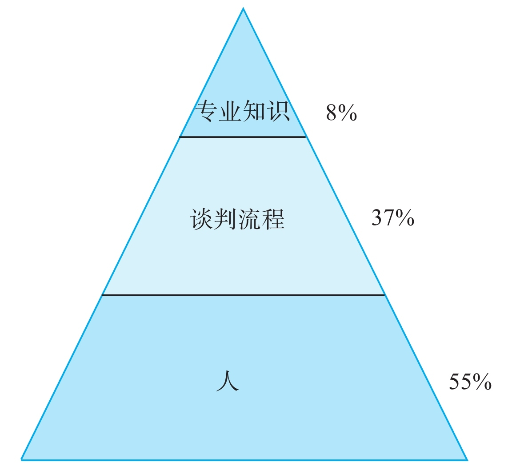

# 第二章 谈判的胜负，早就写在人的温度里

2008年，好莱坞编剧大罢工闹了快三个月。双方僵持，钱在燃烧，谁都不肯低头。当时的编剧协会首席谈判代表约翰·鲍曼，被一位经纪人塞给了一通电话：“听听这家伙说什么，都记下来。”

电话那头的人不是律师，也不是什么谈判专家。我给鲍曼的建议只有一句话：“先别谈钱，也别摆议题。就问他们，你们开心吗？如果重新开始，你们想怎么谈？”

鲍曼将信将疑。但他照做了。他撤掉了两个一出场就让制片方高管血压飙升的纽约谈判代表，换上了更会沟通的人。几天后，协议签了。罢工结束。

这个故事的玄机在哪？谈判桌上最贵重的从来不是筹码，而是人。

可惜大多数人不懂。他们习惯一开场就甩出“我方议题”“我方条件”，像在玩俄罗斯方块，把一条条要求硬塞进对方的屏幕。但如果你没法跟对面那个人达成共振，协议就算签了，也会在半路崩塌。

请记住一个反直觉的排序：整场谈判里，你最不重要。最重要的人，是坐在你对面的人；其次，是对他而言很重要的第三方。这个观念不扭转，你说什么都不会有人信。

别急着反驳。你看，很多专业人士都以为谈判靠的是自己的知识密度：我是医生，我是金融大咖，我是环保律师……但研究结果很打脸：专业知识在促成协议中的作用只占8%，而人的因素超过50%。所谓的流程占37%，意思是双方愿不愿意深入了解彼此的需求，愿不愿意在议程上达成共识，愿不愿意做出真诚的承诺。

图1

不信？想想辛普森案。DNA、血迹，铁证如山，洛杉矶陪审团却判了无罪。为什么？因为陪审团讨厌检方，不信任那几个检察官。当他们怀有敌意时，那些证据根本没被他们“听”进去。而辛普森的律师约翰尼·科克伦只说了一句话：“如果这只手套不合适，你们必须判他无罪。”他把陪审员当成有血有肉的普通人，而不是正义机器上的螺丝钉。

政治场里也是如此。2004年小布什能赢，是因为他说“即使我们意见不合，至少你们知道我的信念”，可信度爆表；克里却总透着一股“我太想当总统”的饥渴。2008年奥巴马能赢，更是因为他在辩论中始终保持合作与微笑，而麦凯恩的怒气和人身攻击，让六成选民皱起了眉头。

所以，当你发现谈判卡住了，别硬着头皮继续砸条款。停下来，回到人的层面，问一句“你现在感觉如何？”有位女高管在洛杉矶谈项目，第二天气氛急转直下，她没有争对错，而是直接道歉：“如果是我说错话或做错事，我真的很抱歉。我们还能回到正轨吗？”结果对方也松口了，原来问题跟谈判本身毫无关系。

更妙的是，对人的关注可以量化。当你把对方当作一个独立的个体去对待，而不是“客户”“敌手”“一堆标签”，对方愿意帮助你的比例，能从16%飙到90%——几乎高出六倍。

有位叫阿莉扎的女士，深夜航班，中间座。值机员被旅客围得团团转，还不停咳嗽。阿莉扎递上一瓶水、几片止咳药，说了句暖心话。结果值机员不但给她换了紧急出口的宽敞过道座，还附赠免费餐和耳机。这不是什么套路，就是把人当人看。

反过来，一个人最多的亏损，发生在贴标签的瞬间。常有书名叫《如何与俄罗斯人谈判》——怎么，你是打算和1.3亿日本人谈？坐在你对面的是一个具体的人，而不是一个文化图腾。王炜炜就说过，“所有美国人都好胜、所有日本人都擅长团队”这种话有多不靠谱。也有客户在谈判里说“我们不喜欢律师”，而我就是律师。我回答：“我不认识那些律师，也不为他们负责，我就是我。”

凭什么要为一个群体的过去买单？这不是负责，是偷懒。如果你把谈判对象当纳粹，你就永远不会相信奥斯卡·辛德勒——但他是一个愿意救犹太人的纳粹。真实世界就是这样：标签是想象，人是现场。

9·11之后，美国爆发了针对阿拉伯裔的言论和暴力高潮。可数据显示，63%的阿拉伯裔美国人信仰基督教，他们本可以成为反恐事业最坚定的盟友，却被推到了对立面。2009年一个尼日利亚人在飞机上引爆炸弹未遂，美国就把所有尼日利亚人列入恐怖名单，尼日利亚威胁断供石油……这不是过激吗？一个疯子不代表一个民族，几个官员也不能定义一个国家。

聊回谈判桌。客户说“我们公司觉得太贵”，你要听出“公司”背后的人。阿南德没有被这句话打住，而是回应：“我想和那个说费用高的人单独聊聊。”结果对方只是希望柜台服务能改进。于是增加配套服务，价格不变，合同照签。

还要学会寻找“幕后的第三方”。销售经理斯科特遇到一个总提要求的采购代表，聊深了才发现，对方老板天天在背后挑刺。斯科特帮他做出行业标准方案，让老板心服口服。再比如，律师伯纳德代表承包商打官司，担心被告当庭说谎，他传唤了伴随被告三十年的秘书，让她坐在旁听席上。被告可能骗过法官，但当着那位慈祥老太太的面，他说了实话。伯纳德为客户追回了每一分工程款。

你看，谈判从来不是靠嗓门大、语气硬、方案多，而是靠看见对面的人，看见他背后的担忧和期待。尊重人，才能驾驭谈判。放下自己，才能得到所有。

现在，你准备好坐下来，先问一句“你最近怎么样？”了吗？

真正会谈判的人，嘴里没有一句狠话

先说一个费城百货公司的故事。有个大学生想为面试买套衣服，看中一套标价500美元的西装，当天折扣价是350美元。他抱着衣服走向柜台，发现唯一的售货员正被一群顾客的投诉和需求围住，忙得不可开交。他没有催，也没有抱怨，等顾客散尽后，先开口说：“忙了一整天，还要被人撒气，真不容易。”接着他确认了一遍已有优惠，又问：“今天大概只有我试着理解你，能不能给一个好人奖励折扣？”售货员笑了：“那就再便宜50美元吧。”

就这一句话，他又多拿了14%的优惠。这没什么高深技巧，他只是把对方当成一个活生生的人。别看这些小打小闹，如果你每年可支配收入因此多出10%，还觉得无所谓吗？

很多人对谈判的理解都停留在电影里：放狠话、比气势、逼对方承认错误。但你将心比心想想，谁在被尊重的时候，不愿意多给一点？家庭里的委屈，职场里的怨气，很多时候都不是因为事多大，而是因为“我没被看见”。

一位商学院教授讲过自己的经历。他赶着去上课，路上两辆车在单车道里顶牛，后面喇叭响成一片。他下车找到出租车司机，开口就问：“你非要表现得这么英勇吗？”司机哼了一声，挥手让他走开。他马上知道自己说错了话，调整思路，换了一句：“你才是这两台车里唯一靠驾驶吃饭的专业人士。”司机听罢，开始倒车。

一个人说错话不可怕，可怕的是明明错了还继续用力吵。真正重要的是，你得知道对方脑子里在想什么，他才可能听进去你的话。

这位教授早年当过记者，那时候他需要在几秒钟内获得陌生人的信任。他的办法不是拼命展示自己，而是发自内心地好奇：对方此刻在想什么？感受是什么？怎样让他愿意一直说下去？当注意力从自己身上移到对方身上，沟通才真正开始。

这个道理，用在哪里都一样。

被警察拦下时，别急着辩解。先感谢对方尽忠职守，再诚心说一句“我听您的”。如果自己确实有责任，就为“已经发生的事”诚恳道歉。警察真正关心的，是你有没有长记性，这个教训是不是只能用罚单来换。教授曾在纽约因为没系安全带被拦下，他对警察说：“您拦下我是对我负责，要不是您，我刚才可能就没命了。”最后警官没有开罚单。当然，你必须真诚，如果你心里充满敌意，对方一眼就能看穿。

还有教授的一位学员闯了停车标志，被警察示意靠边。他先承认危险，然后说自己是来看房子的，毕业后要带妻子和襁褓中的儿子搬到这里，又问警官：“这个社区哪里房子便宜些？我很希望住在您管辖的地方，但得找一处负担得起的。”警官听完，掏出钱包，给他看了自己宝宝的照片。罚单自然没有开。

每次都能这样吗？不一定。但谈判就像棒球，你追求的不是每局都赢，而是九局里多打出一支安打。这位教授说，他的学员们用类似不起眼的方法，省下的钱已经超过10亿美元。

想让孩子听话，也可以从这里入手。一个5岁女孩想当公主，满墙贴着公主海报，可房间乱得像台风过境。爸爸没有下命令，而是轻轻问她：“你不是想当公主吗？公主的房间应该是这样的吗？”孩子自己想了想，说：“公主的房间不该这么乱，我来收拾。”没有鸡飞狗跳，因为她觉得爸爸懂她的世界。

还有一次，凌晨6点，船库训练即将开始，一位教练的车位被别人的车占了。值夜班工作人员拿回来的钥匙却不对，还坚持说没拿错。教练没有骂人，反而先肯定他做事细致，又给了他一个台阶：“也许钥匙刚好被放到了别处。”工作人员上楼一找，果然拿对了。如果教练只顾发泄，当天的训练就泡汤了。

生活里那些拿着低工资、做着琐碎工作的服务人员，常常是傲慢的出口。但你愿意给他们尊严，他们常会给你惊喜。律师鲁宾和一位译者聊起共同喜欢的西班牙和旅行，翻译费直接少了一半；戈拉夫和仓库经理聊起对方读MBA的愿望，并给了些申请建议，100美元保管费被免了；珍妮弗在商学院课堂上主动和一个沉默的中国同学聊了五分钟，那位同学感激地把在中国积累的公关研究资料全给了她，后来珍妮弗创业，说好奇心本身就是商机。费城一家餐厅里，新来的女服务员忙得脚不沾地，一位学员向她道谢后问能不能先来点开胃菜，结果服务员不仅送来免费小菜，还在结账时划掉了主菜单。

另一次，餐厅里服务员迟迟不上饮料，同行的朋友破口大骂，服务员转身就走。道恩跟过去，为朋友的无礼道歉，然后说：“帮我们把饮料端上来，顺便把账单拿来，您下次过来时就能拿到小费。”不到两分钟，饮料端到桌上。他承认对方的能力，而不是证明对方不称职。请记住，如果对方满身刺，多半是之前受了委屈，别急着怀疑自己。试着说一句“你今天不太顺吧”，可能会打开另一扇门。

谈判中还有一个大坑：找错了对象。法国一家公司和韩国公司谈判三年，前前后后花了50万美元，每次都以为要达成协议，对方却又把价格抬高，最后只能放弃。他们最该在第一周就问清楚：这个谈判流程是谁定的？谁才是最后的决策者？

谁又是团队里最适合谈判的人？往往不是职位最高的人。权力越大，越容易忽略对方的需求；反倒是那些还没有被“地位”挡住眼睛的人，更愿意把蛋糕做大。还有一层：把问题交给别人，本身就很有力量。管理者如果愿意请员工参与解决难题，对方会感到被信任，投入度自然不一样。这位教授曾受邀到中情局做咨询，他建议由员工轮流组成投诉委员会，先审查所有投诉再上报。结果琐碎的、报复性的投诉因为怕被同事看到而大量消失，剩下来的都是值得处理的正事。

说了这么多，离不开“信任”二字。

信任是一种安全感：你相信对方会护着你，不会坑你。有信任，交易更快、更多、回报更高；没信任，处处都是高昂的摩擦成本。法国有研究显示，缺乏信任可能让就业率和国民生产总值分别降低8%和5%；在瑞典这种社会信任度高的地方，经济红利相差数十亿美元。2009年丹麦的研究也发现，社会信任与外来投资直接相关，越是低信任度的发展中国家，影响越明显。“9·11”之后美国的社会信任下降，机场安检、贷款流程都变得更慢更贵。信任并不是一团和气，而是一种“我信你不会背后捅我”的底气，它需要时间去浇灌，是双方在相处中慢慢攒下的情感承诺。

如果有人刚见面就问你“你不信任我吗”，你可以坦率回答：我们才认识，凭什么信任？信任的底色是诚实。靠情绪伪装、歪曲事实、虚张声势、选择性隐瞒来操控局面，可能赢一次，但过不了直觉那一关，最终会毁掉整段关系。哪怕对方不值得信任，你也不要用失信去报复。你自己的可信度，才是谈判桌上最值钱的资产。

纽约商业交易所前董事长米歇尔·马克斯分享过自己的秘诀：永远主动让出一部分利益，不让对方空手而归。就是因为这样，大家都信任他，愿意找他交易，他做成交易的速度和数量都远超旁人。律师可能会问：我要为客户争取最大利益，还怎么让利？答案要看时间范围——如果你今天就拿走全部好处，明天就不会再有合作了。

这位教授有一次在莫斯科给当地商人上课，有人不以为然：“我们想要什么，偷偷抢过来就行。”他回答：这一招今天也许管用，但国际商业社会不会容忍，长远来看，代价极其昂贵。当时那几位商人并不相信。

你可以把日常里每一次对话都当成一次小小的谈判。真正的高情商，不是把话说得多么咄咄逼人，而是把话说到对方心里。你对待每一次分歧的方式，最终决定了你的生活质量。当你给出尊重、理解、信任，对方很可能会给出你意想不到的好价码。

1998 年俄罗斯银行爆雷那件事，至今仍是国际金融圈的反面教材。那次系统性欺诈让美国银行机构蒸发了数十亿美元，美方在俄罗斯的投资占比从世界总量的28%断崖式跌到2.9%。跟不少金融从业者聊起俄罗斯，第一反应往往是欺诈二字。欺诈者只是少数，付费的却是所有人。法国的一项调研就很说明问题：俄罗斯约有九成民众表示完全不信任司法系统，而在美国和挪威这一比例分别只有约23%和12%，后两者被认为是最具信任基础的市场。

谈判桌上的谎言和欺骗，看似短期有利，长期都在埋雷。谎言终究会被戳破，一个组织里如果每个人说一套，迟早会有人把矛盾摆出来。组织里道德底线更高的人会因此产生分歧和猜忌，最终反噬说谎者。

这并不等于要把所有底牌全摊开。第一章就讲过，可以告诉对方：此刻有些情况暂时不方便说明。随着关系推进，信息自然会逐步开放。

懂得拿捏分寸比硬撑谎言更有力量。有位女士从曼哈顿的老社区搬走后，又回原街区的唱片店想买约150美元的碟。收银经理问她是否住在附近，附近居民有折扣。她没有撒谎，直接付了原价。她后来在谈判课上反思，如果当时怎么回答更好。

经理真正关心的其实不是住址，而是她是不是老主顾。她本可以这样说：我以前住这附近，最近刚搬走，今天特地回来这家我最喜欢的店。听到这句话，经理得到的其实已经是答案，比亮出旧地址的驾照要安全得多。如果她撒谎把旧地址证件递过去，而经理恰好认识搬进她旧公寓的新人，或是店里调出资料核对，她很可能就被永久拉黑。她后来照着这个思路再去一次，顺利拿到了折扣。话术多费一点心思，风险却小很多，回报也更稳。

世界并不总是可靠，在低信任环境下怎么谈？关键认知是：信任是谈判的润滑剂，不是必备零件。谈判真正需要的是承诺。信任只是获取承诺的一种手段，合同、第三方监管、激励机制等都能起到同样作用。

更重要的是按对方的承诺逻辑来，而不是用自己的标准揣测对方。你的承诺方式对你有效，不代表对方也一样投射。花在目标设定上的精力，也要同等花在如何让对方做出承诺上。

中国市场的例子很典型。常年做中国生意的美国公司抱怨，传统中国企业常不把价格写死进合同，承诺弹性很大。他们先把供货方式、交付时间等框架敲定，价格则根据市场波动临时报价，合同里的价格基本是参考价。《中国经济评论》2010年4月的文章就直言，如果西方人不想再谈第二轮合同，就准备失败吧。

但在中国，如果有德高望重、公司人员敬重的长者通过媒体公开宣布包含价格标准的合作合同，作为中美合作的样板，这就成了硬承诺。因为在中国的商业与人际语境里，面子是硬约束。

一家美国咨询公司被拖欠巨款长达700天，近两年。律师无效，外交手段才打开缝隙。我建议让公司负责人亲自去找对方高层，点明拖欠让己方颜面扫地：在同事面前抬不起头，在朋友面前矮人一截，在家人面前直不起腰，对员工、顾问、客户、政府官员、邻里社区都说不下去。同时指出，拖欠同样让对方在自己政府面前丢脸，该国正努力在国际贸易上树立声誉，拒付合法债务违背国际准则。不到三周，款项全部结清。

承诺的形式因文化而异。中东许多市场，一次握手就等同于约束。交易者伸直手臂问价格怎样，把手伸过来吧。对价不接受就把手缩回去。谈拢后在证人面前握手，承诺生效。

我在玻利维亚丛林香蕉出口到阿根廷的生意里学到，哪些话不等于承诺：我发誓、我以我母亲的生命发誓、我保证、我已经签了合同、我绝对保证。这些都不算。真正起作用的是对方欠钱时仍会按协议办事，直到付清。为此我们形成一种模式：阿根廷人先垫付成熟、运输、销售等成本，我们从超市收回货款后，再支付成本和利润分成。六年里对方从未违约。我并不认识他们，也谈不上信任。靠的是强制性替代物：第三方托管资金、负面评价的可能、未来利润的净现值。歌手蒂娜·特纳说过，这和爱情有什么关系？信任很好，但不是谈判的必需品。

防被骗的工具也很多。第一是渐进式信息披露。先给一点点，看对方是否对等回应，再逐步深入。注意不要自己大出血，对方却在你看重的点上寸步不让。每一步都要有足够回报。

乌克兰商人亚历克斯·多戈特说，他刚认识的生意伙伴，前几个月会用自己已知答案的问题去问。如果对方说谎，就断联；说实话就继续往前。

还可以用第三方验证。比如告诉对方，你会在能力范围内给出更优价格，这个价格只有第三方知道。这样第三方会核查其他报价。如果你的价格确实更优，对方就能拿到你托管的资金。若对方犹豫，就要怀疑真实性。

我喜欢里根的那句老话：信任，但要核实。俄罗斯谚语。

几个要记牢的原则：
• 对方掌握的信息远多于你，你就处于劣势。不要急于承诺，先渐进获取信息或信任。
• 做充分尽调。问细节，看信息是否自洽，反复检验，必要时请可靠第三方帮忙。
• 对方是否回避问题、转移话题，躲得越狠，藏得越多。
• 当欺骗比诚实更划算时，改变激励。比如按一段时间表现付酬。
• 没有明确保护，别轻易提供核心资产、时间、房产等。
• 确认协议真实性。可以说，只要你说的是真的，我不会追究，你也不用付出代价。若对方退缩，要警惕。
• 在协议里写清违约后果。
• 尽量当面会谈，某些文化里不见面就不谈。
• 对方有保留让你不舒服时，直接问：还有什么我应该知道的吗？

相信直觉。对方是否紧张、显内疚、过度殷勤、目光游移、长时间沉默、拒绝承诺？这些不是铁证，但能让你放慢节奏、想得更清。

别为蝇头小利纠缠。按以上准则做，否则后悔来不及。

失去和重获信任
百年后有人翻阅21世纪报纸，玛莎·斯图尔特的讣告开头可能写：她改变了时尚，也因对大陪审团撒谎被起诉定罪。欺骗及其观感一直是永恒话题。

你在律师事务所工作，职业生涯某年多收了客户1000美元，被揭发，此后你就是滥收费律师，你的事务所也背上骂名。一两次欺骗就够了。

欺骗的代价是信任流失，流失的代价是真金白银、声望、信誉和谈判影响力。菲尔普斯2008年北京奥运夺8金，却因吸大麻被曝损失数百万美元赞助，虽然后来仍有合同，机会大不如前。老虎伍兹婚外情曝光后代言几乎归零。

在谈判课上，一名律师与法律系学生达成协议，学生团队毁约获胜。律师当众说我掌握足够信息能让你此后身败名裂。学生回这是比赛而已。律师说，如果为了比赛都做得到，为了钱会怎样。

对欺骗的观感会摧毁合作。一位哥伦比亚大学EMBA学员说，他任职的工业设备制造商十年前与大客户年采购约8000万美元的合同谈判中，客户反对一项特殊价格条款，厂商同意删除。条款影响不大在合同末尾，双方也郑重讨论过。厂商签字后寄回，客户采购经理发现条款还在。客户大怒，认为被耍。厂商道歉无用。此后十年该客户再未采购。计入通胀损失约1亿美元。十年后参与交易的高管多已离职，客户方只剩一人，当年采购经理已是首席执行官。

更戏剧化的例子是新泽西一家大型印刷厂。采购经理说他们只从一家化工生产商买不足10%的需求，年约10万美元，公司年需求可达50万以上。那家生产商1990年就丢了这个客户，直到2001年才恢复。

1990年生产商以老产品断货为由强推新品，品效不佳浪费大量时间。经理后来发现所谓的“新品”其实是实验品。信任崩塌，损失超100万美元。

为何2001年又合作？因为该公司销售代表每月坚持拜访，提供信息，态度诚恳。六年如一日，客户给了一次机会，首单也不大。

信任一旦失去并非不可重建，只是很难。有人愿意给第二次机会，过程必须是渐进的。要礼貌、道歉、承诺改进，开放心态讨论过去沟通问题，并展示你在合作和解决问题上的能力。赛诺菲高级市场经理维拉·纳科娃就曾给一家表现不佳的市场调研公司第二次机会。

改变一切
深入了解对方需求，谈判效果会惊人。克里斯·希布塔尼博士讲过27岁自闭症患者吉恩的故事。克里斯当时是曼哈顿斯隆凯特林癌症中心的儿科麻醉师，吉恩不交流不配合，打针时极度狂躁。

克里斯先思考他的需求和特质。他需要更具体的安慰，应对方式有限。吉恩怕痛，也怕象征疼痛的东西，克里斯当着他面把针收起。吉恩讨厌居高临下的说话，克里斯坐到他身旁平视，让护士安静躺在旁边的担架上，肯定了他的掌控感和尊重。

吉恩不喜欢被惊吓，医生检查治疗都极轻柔。克里斯先在自己身上演示监护器，再在吉恩妈妈身上演示，两人都在笑。人性化的沟通。

吉恩检查前空腹，克里斯在麻醉罩上加草莓香味。吉恩常摇晃哼声，克里斯也跟着哼《谁害怕那只大坏狼》。吉恩安心平静地睡着了。最难对付的人，只要你真正认识他、尊重他，给他更多控制权，他也能走得更远。