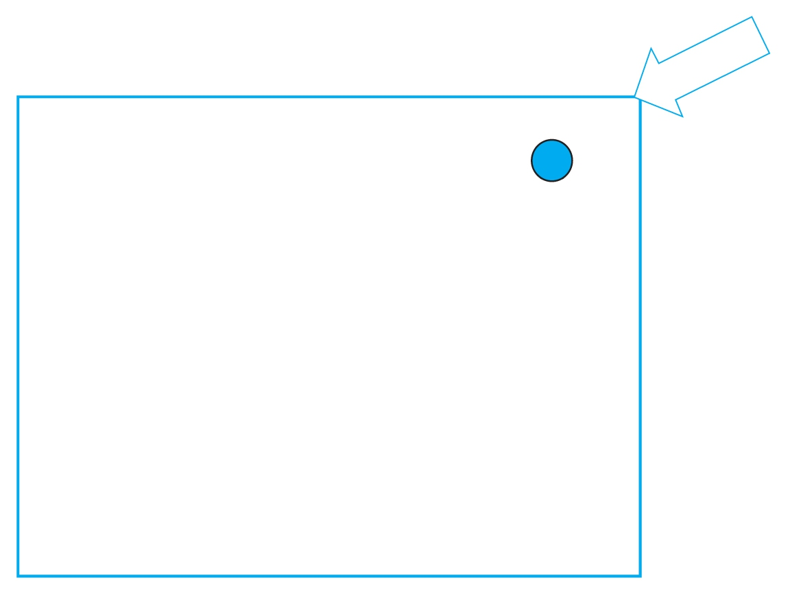
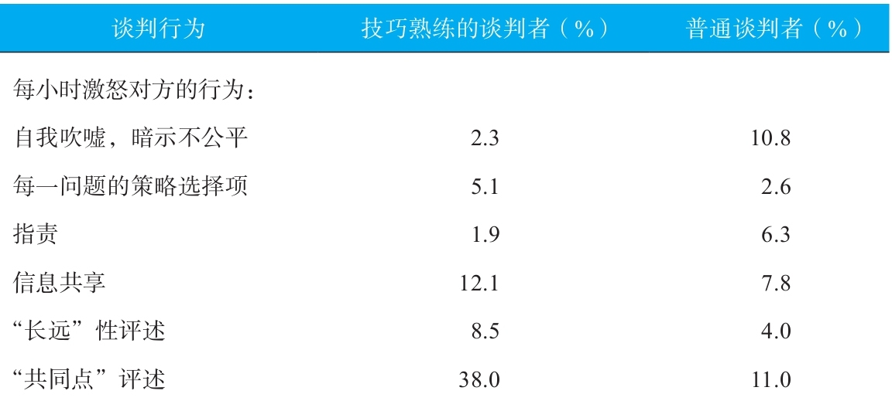

# 第三章 你看到红点，他看到链球菌

先做一个小实验。看这张图，把那个圆圈涂成红色，然后用一到两个词描述你看到的东西。箭头不用管，它只是个提示。

你会写什么？直觉告诉你大概是红点吧。事实上在看过的人里，说红点的只占 33%。说红色圆圈的占 18%。答案天差地别。医学院来的同学写了“链球菌”。7%的人写的是“空白”。超过 40%的人写的东西里根本没出现“红色”。有人写日本国旗、鲁道夫、右上角、目标、眼球、黑点、血滴、靶子、交通信号灯……

为什么同一个东西会得出这么多答案？因为我们看到的从来不是客观事实，而是被我们加工过的事实。指着红点的手说“写下你看到的”，可红点只占画面极小一部分。有人会质疑，是提问方式把注意力拉过去了。那为什么还有 7%的人直接说“空白”呢？

把这种分歧放大 1000 倍，就是官司。放大到 100 万倍，就是武装冲突。它是一个连续的链条。

沟通失灵，根因是误解。两个人看同一幅画，看到的内容完全不同。当所有人都在为自己版本的内容争个你死我活时，冲突就不可避免。

为什么观点会分化？第一，每个人的兴趣、价值、情绪不一样，刺激到的反应也就不一样。第二，我们接收信息的渠道是选择性的，会自动过滤掉不符合自己预期的部分。谈判里尤其明显，大家只搜集能证明自己对的证据。第三，记忆也是选择性的，而记忆在不断塑造我们的判断。

人体冲突的发动机，从古至今就是这几件事。

再看另一个经典图。老妇人和年轻女子共用一张面孔。老妇人侧面，嘴像一条横线，鼻子在嘴的上方，眼睛被头发遮住一点。往后退，年轻女子侧脸出现，她的项链就是老妇人的嘴，下巴就是老妇人的鼻子，耳朵就是老妇人的眼睛。

第一次上课展示时，学生都知道图里有两种人。然后我把图拆成两张单人图，分发下去。把完整图撤下，让大家盯着自己手里的版本看五分钟，再把完整图挂回去。你猜会怎样？几乎没人能立刻认出另一张脸。看错了五分钟就这么难认出来，那一个文化的人看了一千多年，再用另一种文化的眼光去看，难度可想而知。

## 缩小认知的鸿沟

很多人对别人的视角完全视而不见。觉得对方不理解自己，就是笨、固执、不讲理。真相往往更深。很多你以为人尽皆知的事，在对方世界里根本不存在。

要说服不同意你的人，先得承认：你所谓的事实，对方可能压根看不见。

中东的小学生在长大过程中如果地图上一直没有以色列，当有人告诉他以色列存在时，他会本能地不信。

就连日常词汇也会制造鸿沟。一位在宝丽金唱片营销部工作的客户说，有次同事争论起来才发现，每个人对“营销”这个词的理解都不一样。有人觉得营销等于销售，有人觉得营销等于策略。好多年坐在一起工作，却在用同一个词说不同的事，这直接影响了他们的工作方式、资源使用和时间分配。

聪明的律师在复杂合同里会专门留一章界定术语，因为他们明白，最普通的词也最容易被各说各话。

误解的案例随处可见。房地产开发创始人阿努普·米斯拉说，一位客户嫌 43 万美元的建筑服务包报价太高，却不说自己能接受多少。后来让客户自己界定“建筑服务包”，才发现客户想要的服务范围只有原来的一半，最终价格定在 23 万，分歧立刻消失。

默克公司健康科学顾问鲍勃·布朗对儿子高中成绩不满。儿子亚历克斯觉得成绩“够好”就能上大学。鲍勃没跟儿子吵，而是引见了一位大学招生顾问。第三方的话比父亲的话更有分量。如今亚历克斯进了威斯康星大学电气工程，绩点常年保持在 3.8 以上。

我曾在沙特利雅得教高管谈判。一位在美国生活过的学员说，在美国餐厅想续咖啡，举起杯子晃一晃服务员就来了。在沙特这么做，服务员会把杯子收走，因为他以为你要的是换杯子。一天下来，全是这种隐形差异。

我们总会犯“基本归因错误”，以为别人反应方式和自己一样。你大声说“这里真热”，对方回“我觉得很冷”，你就别再回“你说错了”。认知差异越大，冲突越少，解决的问题越多。想说服人，先让对方的观点比你的观点更重要。

公司内部沟通无效的代价很昂贵：成本上升、失败增多、效率低下、服务变差、客户流失、反应迟缓、集体智慧浪费、机会流失、组建团队成本增加。一家大公司测算过，这相当于每名员工每周损失 3.5 小时。对 500 人的公司，每年就是数百万美元的损失。

怎么解决？先意识到这个问题无处不在。先检查双方说的话，是不是指的同一件事。

摩根大通执行董事乔斯琳·多纳特每天睡前给两岁的外甥女讲故事。她说“现在是姑姑讲故事时间”，小侄女马上说“讲两个故事”。问了几轮才知道，小侄女的逻辑是“因为我不累”。最后商定讲一个长故事，但两人对“长”的定义完全不同。

冲突时问自己四个问题：我的看法是什么？对方的看法是什么？有分歧吗？分歧的原因是什么？

把这个习惯变成谈判技能：理解偏见，让对方先说清楚，再表达自己。

两句话词完全一样，效果截然不同。“我要去纽约市，你要去哪儿？”和“你要去哪儿？我去纽约市。”先问对方，显示尊重，对方更愿意听你说话。

这也解释了为什么打断别人没用。思想不会因声音中断而停止，而且被打断的人更不想听你了。

很多人谈判一上来就摆事实，“按市场价，我出 20 万买这房子。”但事实在促成协议的作用不到 10%。也有人先讲合理利益，“房价在跌，现在卖最好。”可大多数人对事实和理性并不买账。

正确开头是：对方准备好听我说话了吗？要知道，你得先知道对方脑中的画面。

试试这样开场：“这栋房子真漂亮，你住多久了？”先了解，再表达。

提问永远比陈述更有力量。陈述把你钉死在自己说的话上，提不出信息，还容易树敌。提问能获取信息，不受限制，还能让对方聚焦在自己身上。谈判中几乎所有话都该变成问句。

国际金融公司高级投资主管达米安·奥利芙投资墨西哥公司后，对方不回财务信息也不回电话。他没威胁，而是问“最近一切顺利吗？”才发现对方没人手没时间整理数据。对方尴尬之后开始主动提供信息，一场不必要的争执就此化解。

把陈述改成问句。别说“这不公平”，问“你觉得这公平吗？”别对儿子说“把房间收拾干净”，问“能告诉我房间为什么这么乱吗？”谈判的结束权在你手里。

杰克·道格拉斯想说服客户用新网站订购化学品，客户却说要上网就不买了。杰克问了一些购买习惯的问题，才发现客户真正在意的是人际关系，想保护当地员工的工作。解释清楚新系统不会裁员，反而减少朋友的额外文书工作后，客户开始用了。

很多人觉得提问没耐心，其实长远看能省大量时间，对话更友好更有效。

乔丹·鲁宾逊接到一个漂亮女人的午餐邀请，对方带了两个朋友，不停提问，乔丹受宠若惊地回答。最后才发现是推销 450 美元的励志课程。没及时提问，浪费了两小时。

提问不必咄咄逼人。神探可伦坡式的“帮帮我，我有点迷惑”就很有效。合作式的“请告诉我，我错在哪儿？”也很有力量。对方说出错误，你获得信息；说不出，你就更可信。

细节决定成败。上帝与魔鬼都在细节里，表达越精确，误解越少，谈判越顺。

## 交流的断层与修补

在哥伦比亚大学商学院，我常这样开课：“我怎么从这里到百老汇？”有人说沿第 118 大街走。我再问怎么到 118 大街，他们说往北穿校园。我再问怎么上校园哪边是北，他们说从楼里出去就行。我继续问哪个门，乘哪部电梯，电梯在哪，教室哪个门出去……

当我们把细节一点点抠出来，才明白误解为何频繁发生。我们以为对方脑子里有我们脑子里的信息，其实根本没有。要说服人，必须从起点开始，跟着对方的节奏走。

有效沟通的基本原则：保持沟通、倾听并提问、尊重而非指责、经常总结、角色互换、保持冷静、明确目标、不伤关系的前提下坚持立场、留意微小信号、讨论感知差异、了解对方承诺的方式、决定前协商、专注能掌控的部分、避免争论谁对谁错。

## 第一要务：先沟通

不沟通违背常识，却常被忽视。除非对方伤害了你至亲，否则尽可能交谈，哪怕你痛恨对方。

不沟通等于不尊重，不愿倾听，会把首选方案推向诉讼或战争。沟通能拿到对你有用的信息，既能促成交易，也能在第三方面前用证据反驳对方。

在行动前先了解对方想法，这难道不更明智吗？

讲话是实力，不讲话是示弱。很多谈判者一不顺畅就中途退场，这只会让谈判破裂。全世界无数谈判因此失败。

2002 年，以色列前总理沙龙说本该 20 年前除掉阿拉法特。这个声明不说明他是烂谈判者，让他成为烂谈判者的，是他没说出该说的话。他本可以说：“阿拉法特，我恨你，我本该 20 年前除掉你……我们得谈谈。”

想结束暴力，就必须对话，无论彼此多么厌恶。联邦调查局、国家安全局等机构就派人来学习这些沟通技巧，现在阿富汗的部队也在用它们建立联盟。

反直觉的沟通技巧是：不要一上来就要求让步。电视上看起来很帅，现实中往往招致敌意和报复。没关系之前，对方不会心甘情愿给你东西。

“先让步再谈”本末倒置。正确的顺序是先交谈，再提建议。

## 对方的言论和观点，比你的更重要

沟通这件事，第二条法则几乎可以单独成书：先听，再问。

想把人说服，先把对方的立场确认清楚。对方在乎的是他自己的感受，而不是你想表达的东西，他实际接收到的，永远比你发出时更关键。想影响别人，就得先捕捉到他语言和行为里真正的意思。你越是用指责的姿态去压他，他就越把耳朵关上；你越表现尊重，他才愿意打开对话。这种规律适用于所有人，从孩子到官员，从销售到客户，全部如此。

我叔叔当年就是靠这个吃饭的保险推销员。他会主动约见潜在客户，先问再聊，有时一聊就是半小时。聊到最后，对方往往自己就决定买单了。熟人总调侃他：“小伙子，你真能侃。”但本质上他是真在听。

很多人都是在谈话里被说动的。哪怕遇到羞辱或威胁，最有效的回击不是对骂，而是平静地问一句：请说说你为什么这么想。你对一个人了解得越深，就越能看见他脑中的画面，谈判也就越顺手。反过来，一旦不去了解，后果往往很惨。

1972 年慕尼黑奥运会上，西德警方营救以色列运动员的行动就是典型教训。警方强硬且轻视恐怖分子，在人质仍在枪口下时就下令狙击，结果导致 11 名人质被杀。

沃顿商学院也来过一位来自阳光城市警局的人质谈判专家，他讲了一个失败案例。一个情绪失控的男人因女友分手而挟持了她，谈判组用了常规的强硬手段，比如向公寓投放催泪气。结果对方更激动、更极端，最后女友被杀。

强硬往往把人逼到墙角。后来大家才反思，那个男人真正需要的是冷静和一点基本尊重。听完案例后，我对那位专家说，如果当时有人告诉他女友仍爱他，或许局面能转危为安。建议一出，对方脸色都变了，才意识到原来也有别的路。

现在很多谈判者已经放弃了过去的极端做法，但又换了另一种套路：用虚假的客气逼对方让步。一旦被识破，对方会觉得被耍了，情绪失控，风险和以前的强硬如出一辙。区别在于，前者的目的是帮对方，后者其实是在伤对方。

尊重而不是指责

过去五十年关于儿童和成人的研究都指向同一个结论：指责会让对方表现变差、积极性下降；赞扬则正好相反。尊重是沟通的前提。

一项研究把普通谈判者和技巧成熟的谈判者做了对比，差异很明显。

比起技巧熟练的人，普通谈判者指责对方的频率高出三倍以上，能想到的创意策略只有对方的一半，花在找共同点上的时间不到三分之一，分享给对方的信息量远少于对方，对长远利益的讨论次数也只有一半，而无端评价激怒对方的次数则是四倍。

消极情绪占比越高，谈判成功的概率就越低，这就是现实。

复述你听到的内容

听完之后，用自己的话复述一遍，既是尊重，也是对齐。对方会感觉到你在听，反过来他也更愿意听你。

注意一点：你觉得自己讲得很清楚，不代表对方就这么理解，不管他是客户、朋友、配偶还是对手。

复述还能帮你理清思路。比如：“我理解你更偏好我们的产品，只是最终还是选了别家，对吗？”、“我的考核在本部门最高却没拿到奖金，其他人却拿到了，是这样吗？”、“儿子，你是说即使成绩全是 B C，你还是相信能进藤校？为什么？”

洛杉矶顾问洛丽·克里斯托弗就用过这招。花旗给她信用卡年利率 17.9%，另一家银行只要 11.6%，客服不肯让步。她反问：“你是希望我把余额从你们 17.9% 的卡里转到 11.6% 的那家吧？”这句话点醒了对方，最后她实际只付了 8.9%。把信息复述清楚，就等于把画面摊开。

角色互换

把自己放到对方的位置，是谈判里最有用的工具之一。它让你看见对方的压力、期待、恐惧和渴望，也让你能让对方感受到你在努力理解他。

一个花旗实习生的例子很典型。他和 50 个 MBA 同时被录用，想出头也想加薪，还想让录用他的副总裁当导师。我让他先想明白：大多数人都想要加薪，那你怎么能靠加薪脱颖而出？他顿悟了。

接着他设身处地想副总裁的处境：这位副总裁刚推出一个新轮岗计划，50 个新人要从九月起轮换，头一次做，他很紧张。于是他打电话感谢对方，并主动提出未来十个月全力帮他推进计划，愿意承担调研和行政工作。

副总裁回电后直接给了 15000 美元奖金，还邀请他下个月参加花旗全球董事会议，见董事长和 CEO。还没正式入职，他就见到了公司最高层。敏感来自于换位思考。

人们很少能把真实情绪说出来，你的工作就是挖出言语背后的想法。通过多问、换位、试图看清对方脑中的画面来实现。

蒙特利尔服装供应商科马克的客户凯瑟琳就遇到过交货问题。她在课堂上扮演工厂主时突然停下：“我记得我们沿着衬衫排走，他拿起一件说，这是凯瑟琳的衬衫。”她才意识到，工厂主不是在为公司做货，而是在为她个人做货。送了礼物、通电话后，工厂主才坦白是和布料商出了矛盾，需要双方一起解决。立场一变，谈判全变了。

保持沉着冷静

有人问你“你是不是白痴”，你第一反应可能是骂回去。正确的反应是：“你为什么会这么想？”

这样做能拿到信息，也能保持冷静。最强的谈判者永远不失态。

如果有人说“我恨你”，问他原因；如果对方威胁你，问他为什么生气。注意对方表达情绪的方式，也注意言外之意，哪怕只有一点点信息，也足够用来说服。

健康资讯高管戴维·霍罗克斯在一次五天项目中被团队成员当众指责故意误导。他没生气，反而详细询问对方做了什么，了解需求后让对方明白自己并无恶意。气就消了，项目继续。

声明并不断校准目标

设定目标不是一开始定好就结束，要不断检查。双方还一致吗？新信息有没有改变目标？行动和目标还匹配吗？开车时要靠方向盘不断微调，谈判也一样。

语气与邮件谈判

语气会让你的话有分量或没分量。敌意、侮辱、暴躁都会让内容失效。你可以坚持立场，同时保持尊重：“我真的很需要这个，原因如下……”讽刺当下爽，后面很少奏效。

邮件时代，大家每天收到海量信息。邮件没有语气，语气由收件人当下心情决定。能当面或电话就别用邮件。

如果必须用邮件，可尝试：

• 在开头标注语气，比如“请把这封邮件看作友好/建设性批评/失望”。
• 不要第一反应就回，写完放半小时再看。
• 发送前想象对方心情最差时读这封邮件，多数邮件比你想的更冲。
• 先聊一句人情话，显得更像面对面。
• 生气时先存草稿，冷静后再发。
• 尽量简短，复杂内容用附件，并标明期望阅读时间。
• 敏感邮件先让同事看一眼。
• 发在坏情绪下要提前说明。
• 幽默要慎用，只有共鸣才有效。
• 尽量贴近对方的沟通习惯。忙碌的高管只看几行字，关键是让他看到你想让他看到的信息。

留意语言和动作的信号

很多人其实已经在告诉你怎么说服他，只是我们没注意。抓住用词、语调变化和肢体动作，就能获得关键线索。

对方说“现在做不到”，就问什么时候能做、谁能做；说“这是标准合同”，就问有没有例外；说“我们不议价”，就问那议什么？

芝加哥律师梅利莎要求降租被拒，房东说“两年前可以，今天不行”。她抓住了“今天”，问“那明天呢”，最后租就降了。

想保留工作的法比奥·瓦塞尔被 HR 说“我无能为力”，他追问“那谁能做主”，找到了真正拍板的人。现在他在伦敦野村工作，起因就是他认真听了那句话的边界。

日本企业谈判时常带小团队一起去，就是为了记录微妙措辞、手势、眼神和记笔记的时机。会后大家比对笔记。

所以重要的会，带个人一起去。你会捕捉到自己一个人注意不到的信号。

多听一点，多想一点，少指责一点，谈判自然会不一样。

在谈目标时，一句话里往往藏着三枚信号弹：我、卖、你们。你从学生手里卖不掉活页夹，公司其他部门还能不能卖？学生团自己买不到，学校别的部门能不能先买再转给学生？实在卖不出去，能不能送？答案是可以。学生团答应在医疗保健会议上做宣传，公司就把仓库里去年留下、不合规格的活页夹免费给了他们。没问题。

这就是倾听和观察的力量。只要认真听、仔细看，对方可大可小的说服路径就会自己冒出来。

1998年，美国政府指控微软不正当地把用户导向自家浏览器，牵出一场重大的反垄断官司。调解发生在1999到2000年，政府要求微软在视窗里加一段代码，让用户也能打开网景等竞争对手的浏览器。微软拒绝了。谈判代表史蒂芬·霍利转述比尔·盖茨的态度：没人有权指使他怎么设计产品。于是双方又回到法庭，打了整整19个月，耗钱又伤神。

微软说不会给自家产品加代码时，政府本可以换个问法：那你们愿意给什么东西加代码？微软其实发出过一个非常清楚的信号——它不碰自家产品的代码，却从未否认过网站、广告或窗口上的其它位置。后来2001年达成的和解内容几乎就是这个信号的兑现：微软同意在视窗菜单里放一个指向网景的链接，前提是客户或装机商等第三方在电脑上植入网景代码。霍利后来感慨，这个信息早点被读懂，19个月的拉锯完全可以避免。只是当时政府并不真想早点解决，所以错过了那些最终能解套的暗示。

好谈判者也会漏掉微妙的信号，这说明技巧需要刻意练习。

还要搞清楚对方怎样才算承诺。很多冲突源于对“承诺”的定义不同。

一家瑞士企业和中东合作伙伴签了合同，自认这是具有约束力的文件，要求对方履约，对方却拒绝了。中东方的解释是签字只是为了礼貌，并不具约束力。只有双方当面会晤、握手达成口头协议，才算生效。对瑞士人而言，纸面文件就是承诺；对中东人而言，握手才是承诺。

做决策前，先征求意见。

你要做一个会影响他人的决定，却自己拍板，会发生什么？第一，人会因为被轻视而对立。你没征求过意见，即便他们的想法没价值，即便你早已心中有数，这个动作本身就是在说：你们不值得被听见。时间不会省，反而会被拖住，对方会设法给你制造阻力。第二，你会错过真正的好主意。

时间紧时可以发一个明确的窗口：“我会在明天某个时点前定案，到时若没收到反馈，就按计划推进。”这样大家感觉被尊重，也不会觉得非要立刻回你。逾期再来找你，你也能合理解释截止期的必要性。若对方仍不满意，下次可以一起设计更好的沟通节奏。未必一定要采纳意见，但要说明理由。被征询过的人，即便反对，也更容易平复不满。

一家国际银行提高服务费，经理说客户非常愤怒。真正让人生气的不是费用本身，而是银行没提前告知何时、如何实施。等双方谈过之后，关系才修复回暖。

格雷格·格维尔茨想去以色列旅游，家人担心安全。他逐一征求了每个担心的人的意见，弄清担心点，再一一解释：“我不会去冲突最严重的区域，我出发前一定征求大家意见，让你们把担心说出来。”结果母亲安静下来了，父亲认为行程安全，也支持了他。

放大到世界舞台，2002年9月12日，布什在联大演讲前，拒绝就是否入侵伊拉克这个主权国家向其它国家征询意见。随后美国提出单边军事行动的新政策。布什把联合国两百多个国家领导人的意见置之不理，激怒了世界大部分地区，最终支援寥寥，部队少得可怜，甚至有人中途撤走。

同样的立场、同样的自由，用不同的说法会产生完全不同的效果。如果先说：“我知道这对很多人很难，阿拉伯国家会有矛盾心理，一些发展中国家与美国关系紧张，但我们有共同敌人国际恐怖主义。在今天之后，每个主权国家包括美国都要做自己的决定，无论外交还是军事。但在决定之前，我们应尽可能多地征求意见。” 大约多一分钟，却更尊重、更可能赢得支持，而不是换来多年生命的损失。

昨日已逝。

昨天发生的事我们改不了。盯着昨天争执，只会带来战争、诉讼或谈不成。代价高昂，耗时耗神，往往解不了结，还会把目标弄丢。中东要和平，就需要停止为旧仇旧怨互相报复。无论签多少条约、派多少使节，只要有人总想清算过去，一切都白费。

达成协议不等于不为过去负责。先把彼此当人说话，用谈判技巧找到向前走的方法，再回头处理历史遗留问题。否则，如果仅在对方认错前提下交易，这桩交易永远不值得。

诉讼更关注昨天和指责，谈判更关注价值和明天，或说今天。

石油行业供应链经理马克·胡德要接待一位仍对前任耿耿于怀的供应商。对方在与此无关的项目条款和付款上强硬到底，他说这是信任问题。胡德安排了几轮午餐晚餐，让对方把牢骚说完，自己为前任的不当行为道歉，并承诺改进。

谈判中不纠缠旧账很有效。可以引导对方谈自己能做到的事，也能说：“为什么为昨天指责我，我没参与其中，也不支持参与的人。”

争论对错在谈判里毫无用处。

指责惩罚是本能，但心理学上没人喜欢被惩罚，承认错误更是丢脸。争论对错通常需要第三方——法官、陪审团、裁判。若执意分清谁对谁错，你就更难让对方帮助你达成目标，只能走向成本更高的诉讼、仲裁或对抗。

1993年，造毛绒面料的莫尔登·米尔斯公司在马萨诸塞州的工厂失火，损失四百万美元。首席执行官艾伦·福伊尔施泰因在重建两年里让工会工人照发全薪，当时失业率高企，他成了民族英雄，还上了时代周刊封面。

事后联邦调查人员要审查两支消防队：厂内消防队和市消防队。厂内队先到却扑不灭，大火失控；市队晚了二十分钟才到，最终扑灭火灾，工厂已毁。厂内队愤怒，想把责任推给市队。危机协调员杰夫·鲍曼劝说福伊尔施泰因不要让内部指责外部，因为公司的目标不是争对错，而是拿到联邦消防安全合格证、保住声誉。

“不要撒谎，”他们建议，“你们的队员也承认，市队住得更远，将来可以更近些。他们提供了经验，最终也是他们扑灭了大火。”说服不易，但首席执行官最终让他们在公众面前做了委婉的说明，市队也表示支持。因为得了市队的支持，工厂拿到了合格证。鲍曼后来退休时说，没有市队，公司就活不下来。活下来的关键，是把注意力放在目标上，而不是谁对谁错。

本章的每条技巧都很细微，往往只是在措辞上稍作调整。不必一次全用，先练一两种，见到效果再扩展。

记住电影《印度之行》中戈德博尔教授的那句箴言：你无法让任何人接受任何事，除非他愿意去听。