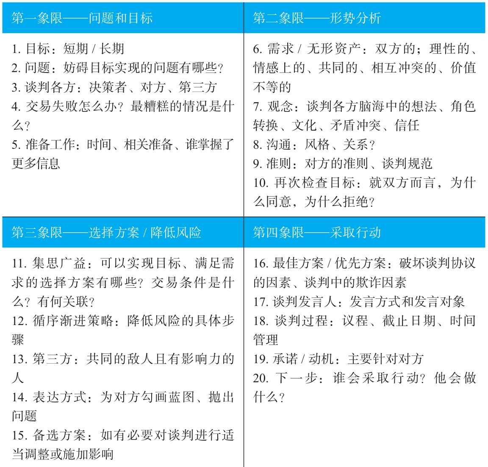

# 第七章 整理问题：谈判工具清单

埃里克·霍尔克在加州山景城的谷歌总部担任律师，他观察到内部销售与法务的认知经常错位。“从产品定位到风险承受、让步边界、推动节奏，大家的说法常常不一致。”

这类张力在不少企业都存在。法务侧重避险，销售侧重业绩。律师倾向给出严苛条款以保护知识产权与公司资产，销售则希望快速签约收款，认为细节可以后续完善。争执持续，有时还会引发客户不满。

谷歌作为全球顶级品牌，更强调以解决问题为导向。参加我工作坊的谷歌学员对此接受度很高。有一次课上，埃里克在角色互换练习中扮演销售代表，并使用了本章后面会介绍的以解决问题为核心的谈判框架。他发现法务与销售之间的根本症结在于：互信不足、信息传递不畅、对规则的理解差异、准备环节配合不够。

“我当时很震惊，原本坚信的观点瞬间被推翻。”练习前他能自如为法务辩护，很快却发现自己与扮演律师的学员激烈争论。练习后，他处理销售议题的能力和对销售视角的理解明显提升。他把这些体会分享给同事。如今对于为何必须这样做的事项，埃里克和其他律师会提前向销售作出更详尽的说明，谈判全程也更主动地争取销售配合，甚至在客户电话处理上也展开协作。

“这并不意味着要更多让步，”他说，“但整体局面改善了很多。”

顶尖的谈判者都是出色的难题解决者。他们善于创造新颖的方法，同时处理自己和对方的困境。相比常人，他们更擅长把难题转化为机会，这正是推动谈判成功的关键。因为唯有把阻碍目标实现的具体障碍找出来并加以化解，目标才可能达成。

二十多年里，我形成了一套完整的问题解决框架。数以万计的学生与客户在全球范围内使用过它，能帮助谈判结构化，并提供可操作的方法清单。本章介绍的这套框架保存在我的资料夹中，可在网站 www.gettingmore.com 获取。它凝练出12条策略与配套做法，把问题集中起来，帮助在生活中更好地实现目标。

争取更多模式，也就是我在课堂上称之为“四象限模式”的工具，在需要争取更多价值时十分必要。它提供一个组织性原则，让谈判准备更有效。既可单独使用，也可与团队协作使用。

“四象限模式是我见过最有力的谈判方法，”修过我课程的高管肯尼思·奥多武表示，“在各种情境下都很有效。”

肯尼思曾用它促成一次涉及瑞士、以色列和尼日利亚三家公司的谈判，议题是化妆品在非洲的生产与分销。“它极大提升了准备质量，也提供了一个各方都能接受、几乎无懈可击的方案。”

下面看这套模式如何运作。

## 实现利益最大化的模式：四象限谈判模型

争取更多模式的基础——12 条策略：

目标至上 利用对方的标准

谈判重点是对方 坦诚相对/谨守道德

情感补偿 沟通和表达

情况各不相同 找到真正的问题所在

循序渐进 对分歧持包容态度

用不等价之物进行交易 列一份清单

这12条策略构成争取更多模式的基石。并非每次都要全部使用。要依据形势、自身目标和对方状况，从基本原则中挑选适用条目。对大型谈判，或许需要逐项过一遍。

最好把每一步浓缩成一句话。好莱坞有句名言：如果你无法把想法写在名片背面，就说明还没想透。

先从整体脉络看。

第一与第二环节占据约一半权重：厘清想要的成果与阻碍成果的真实根因。成果指收官时希望获得却尚未到手的收益。根因是阻止达成成果的障碍。

初看可能觉得“我要去芝加哥参加面试”。表面障碍是“大雪导致航班取消”。看完整套框架后，会发现深层诉求其实是“在一家公司获得职位”。于是真正的根因变成“对方需要更多关于我的信息来做决定”。视野打开后，会看到电话面试、更详尽简历、补充材料等创造性应对，也能让对方看到解决问题的创造力。

很久以前我被哥伦比亚大学新闻学院录取，那是全美顶尖的新闻学院，也是我的长期目标。第二天他们让我去纽约日报社工作，那也是全美顶尖报社之一。我打电话给招生院长询问该如何选择，他说：“你真糊涂，你进哥大不就是为了进日报社吗？”于是我去了。在院长眼里，我把目标搞错了。

可以先从成果分析起，也可以从认为的障碍入手，但无论从哪边开始，都要追问“为什么”，直到触及本质。

例如拥有两辆车时，“车坏了”本身不是问题。更有效的表述是“今天无法去上班”或“唯一的交通工具坏了，今天会迟到”。这时目标不是“修好车”，而是“到岗”。表述清晰后会出现其他解法：乘公交、打车、请朋友帮忙、请假。

第三环节是锁定关键参与者。要找出决策者以及对决策者产生直接影响的人。遗漏任何必不可少的主体，他们会因未被征询而不满。是否还存在与此事相关的隐性第三方？

第四环节帮助厘清谈判无法达成时的底线。有人常用 BATNA 指达成协议的最佳替代方案，这容易让人不达目的不罢休。若想评估放弃的代价，不如用 WATNA，即达成协议的最差替代方案。它能让你看清谈崩的风险。当然，最好把所有备选从理想到最差都梳理一遍，并评估发生概率。保持现实。

还有一个较少使用的概念是“讨价还价区间”，即买方最高承受价与卖方最低接受价之间的差距。优秀谈判者会改变这个区间，比如用不等价物交换。他们关注无形价值、创造性表达，让局面重塑。大多数人以为区间固定且只跟金钱有关，其实它只是起点。

比如买房，买家最多付32.5万美元，卖家最少要30万，初始区间就是30万到32.5万。若卖方同意延期付款、协助贷款或额外赠送家具，区间就被改变了。

第五环节是准备，重要性怎么强调都不过分。准备不足就像业余车手去跑印第安纳波利斯500，碰撞会更多。对方准备不足时容易情绪化、分心、创造力下降。有时甚至需要帮助对方准备，让他们冷静下来。

这看似反直觉，但模式的设计初衷是透明而非操纵。甚至可以把模式复印件给对方。若双方都理解不等价交换的概念，双方都能争取更多。帮助对方准备可能耗时且要改计划，却往往是能否达成协议的关键。

这不意味着要把自身利益拱手相让。你必须给对方留下现在和将来都感到满意的收益，否则他们会以某种方式报复。员工会懈怠，其他公司或个人会改协议或不履行承诺。

如果对方态度强硬且不顾你的需求，就不必帮他们。这种情况下，了解对方的准备程度有助于决定用什么策略应对。能否占据优势大多取决于你愿意投入多少时间和精力去搜集信息。

第一象限帮助做好谈判准备，第二象限则分析形势，即对方脑中的画面。

第六环节的“需求/无形资产”涵盖所有筹码：理性或感性的需求、短期与长期需求、共同或冲突的需求等。谈判中这是挖掘和扩大真实价值的基础。要追求创新，找到双方价值差异。越了解对方，可交易筹码越多。就像人体有数十亿突触，人际互动也多种多样：表达尊重、约见地点、家务分工、引荐对象，这些常被忽略却可交易。

换句话说，目标是谈判结束时得到想要的东西，而需求是达成目标的关键。发现的需求越多，实现目标的方式就越多。例如想和家人度假，问题是工作缠身，需求可能是让孩子开心、送礼物、共度高质量时光、和爱人共进特别晚餐。明确后会发现度假不是唯一答案，也许可以延后庆祝，等不那么忙时再计划。明确需求让方式更灵活，结果更愉悦。

第七、八、九环节提供更多信息，帮助更精准定位问题和出路。第七环节“观念”是模式强大的部分。它涉及双方尤其是对方看世界的方式。角色互换，站在对方角度思考：他们此刻怎么想、怎么感受、脑中有什么画面、如何看待关系、是否易怒、文化差异、在纠结什么、是否觉得被轻视。

第八环节“交流”指双方传递信息的方式。谈判风格是否阻碍了信息流？交流太多还是太少？偏好当面谈还是邮件电话？你的沟通方式是否让对方真正听懂你的观念和需求？

第九环节“准则”关乎对方做决定的标准。他们口头上的标准是什么？还接受什么标准？谈判中有没有明确的标准？不同利益相关人标准是否一致？

第六到九环节的信息收集是流动的。第七环节的发现可能让你修正第六环节的内容，第八环节也可能启发你处理之前没考虑的观念或需求。但要保证信息归到正确类别，结构会帮助你把握全局。

完成后再进入第十环节“复核目标”。停下来看看前九环节学到什么，初始目标还现实吗？不现实就得调整。

完成第二象限后，你会得到一份待解问题清单。找出解决问题的备选方案，按优先级排序。接下来是第三象限，第十一环节是头脑风暴找选项，可单独或团队进行。不要在别人还没说完前否定他们不喜欢的方案，那会扼杀创意。

研究表明，最好的创新想法常由最傻的建议激发。即使一个想法很糟，也可能激发出别人的绝妙点子。所以在所有想法都说出来前，不要评判。把所有想法写在纸上或白板上，再仔细检查。诺贝尔奖得主莱纳斯·波林说：“得到好主意的最好方法是先得到一大堆主意。”可以从其他交易或人际关系的相关条目开始，越是这样，备选方案越可靠。

2006年英国的一项研究证实，糟糕的主意能激发创造力，催生绝妙主意。糟糕主意是绝妙主意的起点，尤其在技术领域。这与很多人想法相反。不同寻常或次优的想法常被批评，有时却为更好方案提供养分。

接下来第十二、十三、十四环节帮助你提高决策效率，快速选出最佳方案，找到最优解决办法。通过渐进式提议，即建议一组小步骤，你能降低对方感知的风险吗？哪些第三方在达成或避免达成交易时会起作用？

你能用更有说服力的方式表达或包装信息吗？你能让对方看到光明未来吗？比如“6+6方案”，六个月内利润增长6个百分点；或“优等生派对”，成绩好就多派对时间。

第十五环节是第三象限的最后一项，完善备选方案，帮你达成协议或改变权力平衡。若有强有力的第三方加入或支持你，权力平衡就会改变。

正如书中强调的，谈判中用权力风险很大。想通过谈判获取凌驾于对方的权力会导致冲突。若对方觉得你在攫取权力，他们会情绪化反击：“我不在乎谈判会不会破裂，我就要跟你平起平坐。”一旦打出权力牌，关系通常会破裂。

再怎么强调也不为过：虽然这些方法和技巧会赋予你更大力量，但要有选择和建设性地使用，以免引发极端反应。要始终考虑每一个人的需求。

进入第四象限行动，最后几步帮你挑选最佳行动方案并变成各方都能接受的协议。

第十六环节是挑选最佳方案。最佳方案的特点是：对方最可能接受、风险感知最小、让你更接近目标、能得到第三方支持、能创造美好未来。

确定展示提案的方式很重要，这就是第十七环节。很大程度上取决于听众。对有些人，三言两语的邮件就够了；对有些人，可能需要厚厚一叠文件。有些人喜欢面对面阐述，有些人喜欢电子文档。若对方不熟悉你的展示格式，注意力无法集中在内容上，很快失去兴趣。他们会驳回提案，理由可能与内容无关。

我曾写过一份109页关于财产转让环境责任的备忘录交给一家律所合伙人，我在那里做过暑期实习。他的评价是：太短，案例太少。

同年夏天，我在一家投行提交了一份仅两页的关于两家公用事业公司8亿美元并购的战略备忘录。总经理说两页太多，老总们不会看超过一页的东西。所以要了解你的受众。说服对方时，提案的展示方式比多数人认为的更重要。

接下来要搞清对方考虑提案的过程，这就是第十八环节。若需要标准来衡量成败，务必参与制定。使用错误的标准会妨碍你达成目标。

第十九环节的重点是让对方做出承诺。如前所述，要按对方认可的方式做出承诺，否则白费功夫。这方面值得花时间。你能确定每个人都会承诺吗？你怎么知道？有没有激励和惩罚措施？

很多堪称完美的谈判最终没达到预期，原因就是后续没做好。这是第二十环节要解决的。下一步是什么？截止日期何时？谁还要做什么？不了解这些，人们会敷衍，方案会被丢弃。

谈判开始前，你越是从心理和战略上全身心投入，谈判中和谈判后处境就越有利。这正是整个模式的核心：在达成协议前尽可能多地了解与谈判有关的信息。我会在第十六章详述如何开展谈判。

不少客户和学生发现，争取更多模式能有力揭开假象。运用时至少会出现三种情况。首先，你会发现起初看到的问题通常不是真正问题，一些问题潜伏在明显问题背后。只有真正问题浮出水面，才能更好地找到解决方案。

比如朗达·库克在美国信怡泰投资公司工作，她的问题是：一位客户不断让公司做合同外的工作。仔细用争取更多模式检查后，她发现真正问题是“公司的合同过于含混不清”。这才是公司与客户理解分歧的根源。解决办法是起草更清晰明确的合同。

第二种常见情况是，你会找到比预期更多的选择方案。即使是该领域专家，用这套模式也会对目标、问题和解决方案产生新思路。

一位技术项目经理在一家大型科技公司工作，他不想接受主要供应商的高价，但公司正在削减与该供应商的业务量。他用了争取更多模式并做角色互换，发现如果把该供应商介绍给公司其他部门，供应商就不会涨价。

“对供应商而言，进入大型科技公司很难。”经理说，“通过主动介绍给其他部门，我们极大拓展了交易。”供应商其实是用保持价格不变换取被介绍给其他部门的机会。这是一种无形回报：未来可能与科技巨头开展更广阔业务。

第三种可能情况是，你会更清楚所有相关方的想法、这些想法之间的差别以及处理这些差别的办法。

# 谈判还没开局，胜负就能先演一遍

说个观察：不少谈崩的局，毛病不在桌上，而在上桌之前就埋下了。

准备谈判，光会背几句漂亮话远远不够。更高明的路子，是提前钻进对方脑子里，把接下来要发生的那段对话彩排一遍。我给这套以换位演练为核心的做法起了个名字——"争取更多模式"。

我办高管班时碰到过这么一位妈妈。闺女半夜不见人影，她喊不回来，想聊聊，孩子连门都不开。这位当妈的一口咬定，是孩子责任心出了问题。我们让她试试换位，坐到闺女那把椅子上想事。她这才咂摸出来，在孩子眼里整件事只卡在一处：妈妈那套做法站不住脚。就这样，她学会了新的开场白——"那你跟我说说，你觉得我哪里做得不对？"

这套方法给的东西远不止这一样。它还能教你把话说得准确透彻，让对方亲口应下，把大目标拆成一节一节的小台阶。总的来看，它给人的启发既宽又深。

1993年，苏联刚散架，立陶宛独立不久。我带着同事去帮忙，想把苏联体系下的科研成果往西方市场推。项目由联合国出钱。会议室里坐的是工业部长、科学界头面人物，还有几十号科学家和官员。议题是分组找方案，问题早就派下去了。上午十点上下，我刚翻完"问题与目标"那份材料，当地首席科学家噌地站起来，指着我，俄式口音很重的英语劈头就来："这儿不是学校！我们不干这个！"底下立马一片"对，对"。

当着部长的面，上百号人集体唱反调，而我们的项目还挂着联合国的赞助，这事儿要是砸了，后面全盘都受影响。我最低的目标是先让大家别走，把流程走完，哪怕时间不够。因为这事对他们是真有好处。

可那位最受敬重的老先生觉得自己被当小孩训了，面子上挂不住，得给他台阶下。我说："您说得在理。"身后联合国来的同事明显松了口气。

接着我要拖住他们，让他们尝尝这套方法的力量。我故意放慢节奏，一点一点来："咱们先歇会儿，喝杯咖啡。要不跟组里的人边吃边聊，顺手把第二象限形势分析的开头捋一捋？歇完了您要是还看不上这法子，抬脚就走，不用回来。"

喝咖啡吃点心，门槛低到没法拒绝。这种提议，首席科学家怎么好意思驳？我给的台阶太软了，不接反而失礼。

到傍晚六点，前后快八个钟头，人已经赶不走了。最后打扫卫生的把大伙儿请了出去。就这么一天，这群人攒出来的方案和点子，够立陶宛消化三年。

不过，光在谈判里把流程跑一遍，只挖出了一半价值。另一半，藏在事前模拟里。

模拟是给正式碰面做预演。你想想，对方哪会好心到"我知道你在准备，要不我过来搭把手"？所以，拉上一个人或一个团队，照着谈判可能的样子从头演到尾，几乎是最优解。演完你会发现自己对局势门儿清，还带回一兜子信息。而问题的"主人"去扮对方，对"怎么说服对方"体会更深。

模拟的重点不是非要谈出结果——有结果、有备选当然好——关键是摸清整个过程：漂亮的开场长什么样？难看的开场又长什么样？话该怎么说、用什么腔调说、哪些话打死不能说？

有一回演练，我方有人抛了个提议，对面有人顺嘴来了句"滚你的吧"。全场都明白，这话要是出现在真桌上，单子基本就飞了。所以正式场合，这个提议必须摁住。

旧金山的律师珍妮弗·莫里尔在雅虎任职时跟一家广告客户闹过别扭。客户嫌雅虎给的权限不够，还想多抓一点广告在页面上的呈现和效果控制权。一次模拟里，珍妮弗反过来演那位客户，演着演着发现，真正的疙瘩跟广告内容八竿子打不着——是双方从搭伙那天起就没建立起信任。客户怕雅虎暗地里把他们的客源撬走。到了真谈的时候，珍妮弗把这层顾虑直接摆到台面上，客户觉得"这人懂我"，戒心一松，话就好说了，事情也顺了。

演练至少得两个人，分别站两边，不然凑不出火花。每边最多加到四个，也就是八个人封顶，再多就臃肿了。记住，这是双边谈判，每边得指定一个主谈。虽然各有发言人，但最好让每个人都开口——真谈判里这未必划算，可演练图的就是群策群力、点子越多越好。

多方谈判也能演，但别轻易上手。除非这套方法你已经玩到出神入化，否则变量太多兜不住。双边，或者一连串的双边，最适合拿来练。

演练时，问题的"主人"必须去演对方，而且要往死里驳自己。这种对调能把他摁到对方的椅子上，真正体会对面怎么想。说白了，他得按对方的套路准备，还得在至少一个人配合下，按对方的路数谈；同时，对方那边也得准备好演他。这样他就能看见自己谈起来是什么样。莎伦·沃克对她病危的母亲就是这么做的（书里第一章提过）。通常，你会更清楚地感受到"主人"的论证砸在对方身上是什么滋味，也更明白哪套说法更管用。

所有人手上的事实材料要一致，开场前给个简短背景交代。然后两边分开坐，距离要保证听不见彼此。照着这套模式的步骤一路走，每答一问都从自己演的那个角色出发。整张清单走完、问题答完，大概四十五到九十分钟。

对有些"主人"来说，这关不好过。就像棒球片《红粉联盟》里，吉娜·戴维斯演的角色想打退堂鼓，汤姆·汉克斯演的角色甩给她一句："难是难，可正因为难才带劲。"

准备停当，两边再合到一起，就刚才各自演的角色开聊。别当旁观者，也别扯空话，守住角色，把自己这方的理说到最足。这样你才能尝到真谈判才有的那股张力。这个过程至少四十五分钟，想拉长到几个钟头也行。

聊完要复盘：把刚才的感受摊开，互相亮底牌，问问哪招灵、哪招废，自己长了什么见识，哪些能搬到真桌上。

最后落成一份真谈判的作战计划。所有要点归拢进模式里，交到"主人"手上。这时候你手里的东西，不是拍脑袋几分钟攒出来的，而是一群人实打实磨了九十分钟的集体成果：双方要什么、能用哪些准则、有哪些备选，全被挖过一遍。准备自然更厚实、更细密。

还有一点，"主人"要的不是专家，是新鲜的眼光。毕竟大多数谈判里唱主角的是人和流程，不是专业本身。

我说个真事。有家企业的六人谈判组要打一场三亿美元的仗。我们找了三十个不掺和这单生意的人，分成六组，每组塞一名真队员，凑成六人小队。然后拿同一套材料，一天之内跑了六场模拟，效果出奇地好。真队员们眼界一下打开，想法更多更好，还揪出不少原先没留意的坑。底气明显不一样了。

时长你自己定：一刻钟也行，一周也行。每多花一分钟，准备就厚一分。

再说拉脱维亚。1993年苏联刚垮，这个刚独立的国家要组1918年革命以来头一届民选政府，我帮着总理和二十八位部长张罗这事。官员们要求开三天会，地点在首都里加郊外一个僻静地方。周五早上九点我进主会场，里头已经吵翻天了。

吵的是补贴。农业部长主张把大头砸进小麦——能烤面包养人，还能出口换汇。国防部长不干，说钱得拿去买军火，苏联散了之后局势不稳，没有硬国防，政府说翻就翻。

我跟这群人说，这个架吵得好，是块好料。这话给了大家不少情绪上的安慰，场面静下来。我接着说，我有个绝妙法子能了结这桩公案，但前提是所有人，包括这两位部长，都得答应一件事：这件事交给我来拍板。他们摸不清我葫芦里卖什么药，可对我还算尊重——毕竟周末请我来就是干这个的——于是全都点了头。

"好，"我说，"现在有请农业部长和国防部长，当着大家的面辩一场。"底下欢呼。"辩题是补贴，顺带把你们有分歧的其他事也捎上。"

两位部长大步走到前面，都以为要跟对方唇枪舌剑，脸涨得通红。

"辩论只有一条规矩，"我说，"两位都得站到对面立场上去说。"

话音没落，屋里炸了锅。"不行！你不能这么干！我不干！"两人先后抗议。剩下的部长，一半笑得前仰后合，一半自动分成两派，各挺一边。

"刚才不是你们说，这事交给我做主吗？"我说，"这屋里每个人刚才点的头，不算数了？"——准则和承诺，在这儿全用上了。

"可……可我做不到啊！"国防部长说。

"你做得到，"我说，"两边的立场你门儿清，你只是没钻过对方的脑子。你得去体会、去钻透对面怎么想，才谈得拢。"

我拍胸脯保证这事值，提醒他们请我来就是因为我是干这个的。我说用不了一个钟头，也许不到一个钟头就完事。两人一万个不情愿，还是应了。

我让两人分头准备，可以从愿意帮忙的其他部长那儿拉人，又给了他们一个简化版的路数。辩论从五分钟的开场陈述起。我把他们说的观点一条条记在大白板上。其他部门的部长在底下大声支招，给两位辩手打气。

差不多一个钟头，辩论收场。我把记下的观点细细过了一遍。歇了一小会儿，我说，接下来两位要再谈一轮，依据辩论里的收获各自拿出方案。

于是两位部长当着大家再谈，这回都回到了自己的本来角色。我让他们顺着刚才的体会拟一份靠谱协议。不出所料，他们弄出了分阶段推进的目标，建议把补贴按阶段投放，还一致同意要定期对表，并排出了轻重缓急。

两位部长跟我和大伙说，当官以来，解决问题从没这么痛快过。就像这本书一直在说的：这事没那么玄乎。

这套方法适用面很宽，公事私事都行，在我的课上、课后都解决过问题。哥伦比亚商学院有位女士说，她们学习小组用这套法子，帮她把跟先生之间关于避孕方式的争执给捋顺了。

投资银行家海迪·万哈姆有个潜在客户，死活不认银行委托书里的收费条款。海迪站到客户那头一想，明白了：问题不在价码，在服务。客户要的是银行保证：收了这份钱，就得给对等的服务。

"我们做了一套跟服务质量挂钩、带增值内容的收费方案。"海迪说。客户感觉到的风险一下就降了。服务价值上去了，她所在咨询公司的业务占比也跟着往上窜。"我们总算摸到了他们真正的顾虑。"海迪说。这些全是谈判前靠换位摸出来的。

这套法子还能照见自己的短板。"我们发现，自己扛的风险没原先以为的那么多，"海迪说，"客户倒希望我们多担一点。"她补了一句："也照出了我们自身的几处软肋。"

揣着这些信息上桌，提问就能更有的放矢：对方怎么看、什么在硌他们、哪些话题他们其实更在意。

这套模式尤其擅长挖病根。你把问题按下去，却没动它的根，下个月它准换个花样再冒出来。

打个比方，我航空公司有架飞机的无线电坏了，我知道机务会把故障排掉，这不是我操心的。我要问的是：它为什么会在飞行中坏？有没有某个环节、某道流程需要改？不改，下个月可能爆胎，再下个月螺旋桨出岔子，接着气缸又闹脾气。病根不除，按下葫芦浮起瓢。

这法子还能帮你找对谈判的人。史赛克和辛迪思都是做高品质髋关节等置换件的，产品医生认。可医院采购那边不想多掏钱，转头去买便宜货，两家利润都往下掉。

用了这套方法，两家发现：该让医生出面去跟采购谈。医生聊的是性能和耐用年限，不是零件报价。

"往后我们就一直这么干。"史赛克医疗保健部主任本·皮彻说。

约翰·马罗塔上过我的谈判课。多年后他写信来，说钱包被偷了，催我赶紧再寄一套模式清单卡，说那是他钱包里最金贵的东西。"我用起来近乎虔诚，"约翰说，他现在是丹佛一家医疗器械公司的CEO，"它比我的信用卡还重要。"

说到底，这套方法不神，却能把谈判从"临场发挥"变成"提前彩排"。国际会议、商业合同、家里拌嘴，先换位、先演练、先刨根，往往比多背几套词管用。