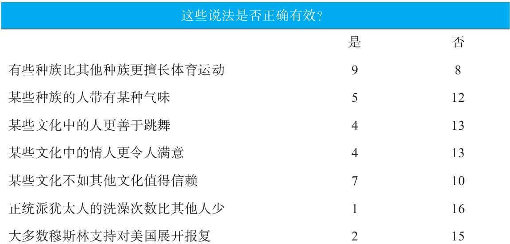

# 第八章 当刮痧被当成虐待：我们为什么总在文化上撞车

旧金山一所小学的护士曾以为自己遇到了儿童虐待案。早上刚踏进校门的8岁华裔男孩，双臂满是血痕，老师立刻把孩子送到了医务室。护士判断这是暴力伤害，第一时间报警，建议把孩子从父母身边带走。

事实完全相反。男孩一家刚从中国内陆偏远地区迁来，在家乡发烧感冒时，刮痧拔罐是常用的祛除邪气手段。血痕只是刮痧留下的痕迹，和虐待无关。把孩子带走既无必要，也会造成二次伤害。

真正需要上门的是谁？是社区里受尊重、既懂中文也懂美国规则的中间人，比如在美生活多年的华人医生。沟通的关键不是指责“你这做法太可怕”，而是先承认差异，再提供替代：“回乡下那样做可以理解，不过这里有更温和、孩子哭闹更少的办法，我来教你。”

这个小故事就是跨文化博弈的缩影：问题从不是“善恶”，而是“意义不同”。

## 21世纪的胜负手，是读懂差异

世界越来越小，不同背景的人被迫频繁协作。但很多人对“差异”一知半解，对“怎么相处”更是手足无措，于是好交易变砸单、合作变冲突、误会变对抗。

人类冲突的根源自古便是处理不好不同。想往前走，先得把差异、多样性和文化这三个词掰开来看。

**多样性，远不止肤色和信仰。**

谁的差异更大？在同一家公司共事的黑人经理和白人经理，还是在纳什维尔属于两个死对头摩托车帮派的两个白人少年？后者一见面就可能开打，前者未必。说明差异不一定等同于种族。

再看宗教。特拉维夫的中产犹太家庭和开罗的中产阿拉伯家庭，可能不如特拉维夫的同一个犹太家庭和隔壁仇恨至极的犹太极端分子对立。后者竟然杀害过以色列总理。可见差异也不总是宗教造成的。

多样性更多关联的是一个人用来确认“我是谁”的心理坐标。外在标签如肤色、宗教、语言、饮食、性别、国籍、职业等，有时重要，有时只是表象。真正驱动行为的，是脑海里的观念图景。

所以我说的文化，就是个体从中获得归属感的身份认同。同一家企业里，生产部和市场部的文化可能截然不同。纽约人与洛杉矶人、拥核能与拥光伏的人、会计师与机械师、社团成员与局外人，他们的文化差异直接影响互相看待和沟通的方式。

搞不清对方的归属坐标，就找不到说服的入口。两次世界大战之间，讲法语、德语、意大利语、西班牙语、英语的欧洲资产阶级，之间共性可能比今天住在同一条街的纽约邻居还多。

把群体一锅烩是常见的偏见。某美国大报曾用标题“美国拉美裔游说团依然软弱”，这本身就是误导。美国拉美裔上千万，分属医生、律师、机械师、说西班牙语的、说法语的、民主党、共和党，来自西班牙、海地、古巴、墨西哥、多米尼加等十几个地方。把他们视作单一文化实体，既不存在，也会制造歧视。

同样，把所有“穆斯林”视为同一种文化是错的。伊斯兰内部教派众多、民族林立，什叶派与逊尼派在伊拉克就常年冲突，教内有人热爱美国，有人排斥美国。

只盯着表面差异，特别是身体差异，就像蒙眼掷飞镖，偶尔命中，大多失准。

我将跨文化差异定义为：谈判中因双方脑海里明显不同的认知和价值观而产生的分歧。差异可能与种族宗教性别有关，也可能完全无关，但一定与信念有关——影响、世界观、渴望、梦想和恐惧。除非了解对方的认知地图，否则无法判断对手到底是否真的和自己不同。

莫斯科一次管理者培训上，学员用俄语写困惑再译成英语。顾问塔蒂亚娜·波利耶夫科多娃写的是：怎么让儿子写作业。她说她把大目标拆成小步骤，设定激励和奖励，亲子双方都感到自豪。

这是个普世议题。美国、伊朗、阿根廷、中国、日本的父母都在面对同样的问题。不能因为她持俄罗斯护照就认为她体验不同。她最强烈的文化纽带，恐怕在于“有孩子的父母”这个身份，而非“俄罗斯人”。

学会处理差异，是谈判里巨大的竞争优势：签更多协议、关系更稳、更快读懂对方、问出好问题。

反之，有些人不明所以就喊“兄弟”“姐妹”“自己人”，想制造共同点，却可能毫无共同点。强行贴标签有时是一种操纵：“我们一样，所以帮我一把”。

## 文化误读制造的历史难题

阿根廷人塞巴斯蒂安·鲁宾斯·罗霍曾因聚会音量被邻居两次投诉房东。他直接上门沟通：“我尊重你的‘工作狂’文化，我来自‘学生’文化，这栋楼里很多人也是。”他指出学生周末聚会是常态，就像邻居年轻时也会办派对。最后双方共定规则，甚至邻居允许他在公寓跳探戈。

有人声称痛恨美国人，但三亿美国人不可能都一样。有人把首要身份放在素食主义而非“美国人”。

赫鲁晓夫1960年在联合国用鞋敲桌是经典误读。很多研究认为那是虚张声势的谈判策略，用来激怒西方。若冷战初期西方更懂俄罗斯的管理逻辑，就可能读懂那不是失控，而是表演。

把性别种族过度放大很容易让对方溃败，律师、记者、官员都擅长此道。更好的做法是用谈判工具找根因，让局面回到正轨。

文化误解通常源于观点和沟通方式不同，常常需要文化中介来翻译行为，就像开篇那位中国医生。若不先摸清对方的认知地图，就不能假设某个文化特征一定适用，否则只会雪上加霜。

我做过一次政治不正确的调查。9·11不久后，对17位在沃顿商学院受训的高管提问。

正如你所看到的，我们在每一个问题上都有分歧。显然，这些高管们有很多成见和偏见。

接下来，对这些带有成见的说法选择“是”的高管，我都让他站起来，要求他向全班证明他凭什么说这一成见是正确的。我从“某些文化中的情人更令人满意”开始，我问他们：“什么？你和你最喜欢的多情文化中的 1200 万人都上过床了吗？”

我想让他们拿出证据证明他们的成见是正确的。“现在，”我说，“我所做的实验表明，不同种族之间并不存在基于智力或行为的基因差异。你们所做的实验说明了什么呢？”我不断要求他们拿出证据，当然，通常他们拿不出任何证据。

我曾和一些白人种族主义者有过一次谈话。我问他们，在白人和他们不喜欢的黑人之间是否存在真正的文化差异。“或者，”我说，“这是否只是一个皮肤色素的问题？”这是一个涉及准则的问题：他们要么走向极端，要么接近我的观点。如果他们回答说：“没差异，我们这帮人就是要在皮肤色素上做文章。”就好比在说：“嘿，我就是个浑蛋。”

“噢，不，”他们说，“他们之间存在真正的文化差异。”

于是我说：“告诉我，你们喜欢爵士乐吗？”“喜欢。”他们不约而同地点头说。

“很好，”我说，“爵士乐来自黑人文化，”我的身体微微前倾，“所以，你们身上是否有一部分黑人特征呢？”“什么？”他们反驳道，一副不服气的样子。

“抱歉，”我说，“那么，这是否只是一个皮肤色素的问题呢？”他们无法反驳，咕哝地说这只是一个例子而已。

“好的，”我说，“告诉我，你们喜欢吃玉米糊吗？”他们有点儿不自在了，说：“当然，我们很爱吃。”

“很好，”我说，“玉米糊是过去奴隶们所吃的食物，”我停顿了一下，“这是否让你们具有了大部分的黑人特征呢？”我又停顿了一下，“或者说，这是否只是一个皮肤色素的问题呢？”我最后补充道：“以我之见，你们这帮家伙和黑人文化有着很多共同点，难道不是吗？”

## 成见从哪来，怎么破

成见来自无知、恐惧，也来自一次糟糕经历或他人影响。人类早期靠家庭部落求生，同类带来安全，陌生带来危险。于是仅凭长相、语言、行为就贴标签。但心理上相似的人可能外表不同，血脉相同的人也可能天差地别，像圣经里该隐杀亚伯。

在谈判中先弄清成见的来源。破除成见的起点是提供个体信息：没有“他们”，只有带着各自观点的人。

克服成见也可以很简单：让人们穿上对方的鞋子生活一段时间。企业里市场和生产轮岗、管理者与员工互换，就能大幅降低不信任。缺乏接触才是偏见温床。

## 美国式契约 vs 世界式关系

理解文化对很多美国人并不擅长，部分源于法律制度。

美国法律高效、相对公平、腐败少、成本低，法律服务占GDP约0.5%且缓慢下降。你不需要建立人际关系，签合同违约就诉讼，律师赚钱。

世界其他多数地区没这待遇。法律难接近、不公平、腐败、昂贵。在玻利维亚、也门、蒙古，商业伙伴欺骗你，法律救不了你，没有失业保险、社会救济，你和家人可能饿死。对绝大多数人而言，人际关系就是全部安全网。

美国热衷谈人际关系是主题，但对大多数国家而言是生死问题。于是关注对方至关重要。

一位美国高管在利马和秘鲁高管吃午餐，55分钟里秘鲁高管一直在问朋友、家庭、爱好。美国人焦虑：我们要谈正事。

对秘鲁高管来说，这正是正事：我能否信任你？把命运交给一个陌生人前，我得先知道你是谁。

在美国，重点是惩罚违约、遵守合约；在世界多数地方，重点是建立信任。这让“让我们直接进入正题吧”这句美国商务口头禅显得冒犯，甚至阻碍合作。

马拉松石油的迈克·芬奇遇到国外供应商迟迟不回应、随意改范围、信息不足。角色互换后他才明白：马拉松关注交易实质，供应商关注关系。信任不足导致对方不愿分享能改进炼油流程的关键信息，成本反而上升。

马拉松在墨西哥和亚洲也常被说“在等待”。起初认为是等更低价格，其实是等长期承诺——关系承诺和商业承诺。

大都会人寿在韩国子公司推广公司级平台，被韩国同事集体搁置。经理约翰·拉奥发现，韩国人不在乎成本节约或效率，核心是信任和话语权，他们更希望用韩语而非英语获得技术支持。

即使发达国家之间也差异巨大。巴斯夫美国经理迈克·加拉格尔与德国工厂冲突。德国工厂晚发四天黄色颜料，客户流失，德国人拒绝收回。美国人下令按“无预见订单”发货，打乱德国人精密计划。德国人紧急改线，已是极限速度。美国人的指责在德国人听来像“见鬼去吧”。这其实是有序文化与无序文化之间的沟通崩塌。

拓展对文化的定义，才能在这个多元世界里把事做成。文化不是肤色，不是国籍，而是人们如何定义自己、如何建立信任、如何看待时间与关系。读懂它，才能谈成事。

世界在加速缩小，几乎每次谈判都带上了跨文化的色彩。伊戈尔·奥赫利夫曾在纽约大学上过我的谈判课，现在在伦敦做新兴市场对冲基金经理，他说：“不同文化对公平和关系的衡量标准完全不一样，谈判时必须带着这份自觉。”他在中国的体验让他意识到这一点——大部分街头小贩会激烈砍价，所以他索性一开始就不纠结价格。在埃及机场，他则发现司机并非真的看价格，而是看你眼里是否有“赶时间”的信号。

关系先行，谈判才顺。第一步是有效沟通，尤其是读懂对方的信号。当对方开始聊娱乐、运动、吃喝、音乐这些与生意无关的话题时，他其实在试探：你是否把我当人，而不是谈判对手。太多人敷衍式地问两句就急着拉回议题，对方感受得到虚情假意。态度要真诚，不能口不对心。

华纳兰伯特制药的克里斯蒂娜·法纳去爱尔兰科克郡谈一个2.75亿美元的建厂项目，当地规划委员会一开始很冷淡。她想起在哥伦比亚商学院学到的文化逻辑，邀请对方共进晚餐。饭局结束时，气氛逆转，大家站在了同一边，还敲定了统一议程和流程。

第二步是把差异摆到桌面上坦诚谈。如果你们看起来不同，或者被认为不同，越坦白越赢得信任。对方指出你对他们的了解不够时，主动道歉并说从现在开始学，这是人们最看重的诚实。

第三步找一个可以启动的小切口。接受对方在座次、饮品等细枝末节上的安排，对你有好感的文化元素大方点赞。如果你读过或观察过对方的文化，可以拿出来请教：我这样理解对吗？不对的话该怎么说？保持好奇心。

安达信顾问唐娜·法雷尔常被当成年轻女生而质疑专业能力，甚至客户暗示要换个年长的人。她明白房间里有一只800磅的大猩猩，于是直接点破年龄和性别的偏见，用幽默化解疑虑。直面后关系反而和缓下来。

这引出一个反常识的要点。

对方希望你变成他们那样吗？入乡是否一定要随俗？答案都是不。差异本身并不让人期待你同化，他们期待的是尊重。就像饮食禁忌，我从不会到了才说，会提前告知主人，他们反而更乐意配合，因为招待的核心是取悦客人。

长期揣摩他人文化会产生“文化疲劳”，这既是社会学术语也是医学术语。每天不断调整自己以求合群，半年后就会耗竭。许多外派高管和家属无法适应的根源就在这里。正确姿势不是去适应，而是做自己，可以学语言、喜欢其中部分习俗，但不要追求一模一样。保持差异本身就有增值效应。

二战后美国GDP持续增长，重要推手之一是新技术，而新技术多出自与众不同的创新者。很多人抗拒变化，口头上说爱多样性，行动上又把推动变革当成单程票。其实差异创造价值。有人沮丧地说“我们太不一样了”，我会拍桌说“太好了，这就好赚钱”。一致没有利润，分歧才有。把持不同意见的人聚在一起，就是在聚斂机会。

研究也佐证了这一点。美国三个最富裕的城市纽约、洛杉矶、旧金山多样性最高，多样化程度每提升10%，本土出生人口净收入就上涨15%。硅谷之所以能崛起，很大程度上是因为其容纳多样性的能力在美国同等面积区域里最高。前提是环境要容忍差异。卢旺达的教训说明，不容忍差异多样性会导向灾难。对差异越宽容，经济越快。

企业层面，如果无法善用冲突观点，生产力下降、利润减少、人员流动加剧。研究估算，一家2000人公司因排斥差异额外导致的人事成本一年就达500万美元，还不含错失好点子的机会成本。

不同经验碰撞会带来更多创造性产出。最有创造力的人往往拥有大量迥异的经历和技能。多樣群体在解决问题时提出的高质量方案数量是非多样化群体的三倍。

但容忍不能停留在口号。很多团队只是挑选外表不同的人来凑数，却在观点上高度一致，这样的“多样性”毫无增益。

差异的力量在我的玻利维亚经历里体现得最深。90年代末，美驻玻利维亚大使唐娜·赫里纳克请求协助反毒。我们说服查帕雷丛林3000名农户停止种可卡因古柯，改种香蕉并出口阿根廷，直到比索贬值才结束商业合作。

第一次见面在热带夏天的闷热夜里，丛林空地漆黑一片，只有我电池供电的电脑微光。译员在英语和盖丘亚语间传递。我穿着三件套西装领带，农户赤脚破衣。透过翻译我说：我和你们的差异大到不可能更大，但我们都希望孩子生活更好。我们有土地和劳动力，你们有资本、技术和市场。

我们花了几个小时敲定一份长约，受纽约州法律保护。虽多为文盲，他们却问出了专业问题。合约明确投入设备、运输、技术和农药，收购价格合理；他们承诺产量和学习种植。香蕉初期未必比古柯赚钱，但品牌价值会带来长期回报。

合约签后我们反复回访。政府希望农户开银行账户以减少现金毒品经济。我们则争取让他们进花旗银行圣克鲁斯公司业务部，那里服务梅赛德斯等大客户。业务部负责人起初认为请求是侮辱，经政治和舆论推动后同意。衣衫褴褛的农户走进富丽堂皇的银行，拿到第一张花旗卡，回棚屋高举卡片说我们享受和梅赛德斯一样的待遇。

一次大罢工只有我们的香蕉卡车能通行。还请带头农户到圣克鲁斯最好的餐厅，白色桌布的体验让他们把美食带回给家人。加入者不断增长，传统古柯抗议被香蕉浪潮淹没。

瓶颈是黑叶斑病真菌。香蕉需频繁喷药，但机场被禁用于非毒品农业。我们发动谈判技巧：准则、表达、第三方、目标。致信国务院、司法部、财政部，指出若机场关闭即等于支持毒品贸易。美国营销顾问亚历克萨·桑德博格和玻利维亚经济学家安德烈斯·朱达施压媒体和飞行员协会。最终机场开放，拨款修建商业跑道，从厄瓜多尔引进技术，阿根廷“安第斯金”成为超市常驻品牌。

项目几个月后香蕉价下跌，我以为会亏损。财务人员说农户看到价格跌，主动降低收购价不想让我赔钱。我们语言、习俗全然不同，却因差异和目标建立了持续的联系。

沟通、观点和文化缺一不可。若默认别人看世界的方式与己相同，就会不断冲突。

一个校园实验说明微笑都可能误读。美国人间相视而笑都觉得愉快；美国人对韩国学生笑，对方却不回应，心想美国人肤浅。对阿拉伯传统服饰行走的学生，美国人微笑致意，他却觉得被嘲笑。最极端是一名美国女生等校车时对照看小孩的东南亚男子微笑，男子回头问：“稍后再见吗？你开价多少？”他以为对方在招揽生意。

跨文化问题的解决逻辑和一般谈判一样，只是观念落差更大，需要更长时间。从对方脑中的想法出发，用小步走法推进。鸿沟很大时要拆成小步，让对方看见进程。缺乏切身体验，观点很难改变，必须让对方感同身受。

想改变一个人，别急着递资料、别急着抬价、也别急着吵。最管用的，是让对方亲眼看到、亲身感受，用画面把想象力点燃，拨动那根真正的心弦。

文化那道坎更难跨，但可以跨。关键不在硬碰硬，而是在三件事上花心思：找对第三方、把准则重新套一下、先搞清楚对方心里到底在想什么。

先看一个几乎微不足道的细节。卡特·梅菲尔德被女友希拉邀请去她家过夜，家里客人爆满。希拉的父亲贾斯汀·阿里是波斯人，按规矩他应该睡沙发，把床让给客人，否则就是丢脸。卡特跟希拉商量后，翻了翻电视指南，找到了自己很想看的一档节目。他让希拉转告父亲，他特别想看这节目，而看电视只能坐沙发上。如果不让他看，会很失礼。阿里先生最终睡回了自己的床。事小，意义却大。后来卡特成了得克萨斯州一个家族企业的高级主管，也顺利娶了希拉。

再看印度女孩德娜的故事。家规源自公元4世纪的传统，印度90%的婚姻仍是包办。她父母为她选了教派内的对象，她却爱上另一个教派的男人。母亲怒了：“那样我们就没脸见人了。”表姐曾因拒绝家族安排被断绝关系，多年无人来往。

谈判课上，德娜做过角色互换。她明白第一步不是辩驳，而是先确认母亲的感受，“她只是想孩子过得好”。这份情感上的补偿打开了对话。接下来她分步走：先找父亲，父亲相对好说话；再找家里一位嫁给非印度人的朋友，让第三方用幸福的婚姻作活证，慢慢让母亲降温。

引见男友也讲究方式，不是正式拜访，只是让父母偶遇。德娜甚至没告诉男友第一次见面的分量，好让他自然。男友是专业人士，这让她更有底气。她也知道一旦情绪外露，谈话就会崩。课堂上演练、反复预演成了保障。她用几周时间有时单独找母亲有时找父亲，始终保持冷静和体谅。结果父母主动承担了婚礼费用，还为此骄傲。

德娜自己总结：有计划、有步骤地用谈判策略威力巨大，理论和实操是两回事，准备充分和保持冷静是关键。这段练习也改善了母女关系，如今她们相互尊重。德娜和爱人在加州过着幸福生活。她跨过的文化鸿沟，全世界包办婚姻的比例高达60%。许多女性想做却做不成，只差一套技巧。

文化差异再大，也能找准切口。假设一个年轻以色列女子想嫁给伊拉克男子，七八十年代在巴格达或耶路撒冷几乎不可能，但在纽约就有可能，因为城市更包容、多元。

她问母亲为什么，母亲吼：“除非我死了！”女子平静追问，母亲说“这种婚姻不会幸福”。这句话本身就是线索，一个绝佳的准则。女子可以举例：我姐夫的妹妹来自虔诚犹太家庭，纳粹劫难中幸存，她丈夫是伊拉克人，在世界银行工作，二人在纽约生活多年，两个孩子五条狗，生活美满。类似婚姻在以色列也有数百对。

如果母亲说“幸福概率千分之一”，女子可以回：“妈妈，您总说孩子最优秀，如果有人能在这类婚姻里幸福，那个人会不会就是您的孩子？”以情动人之后，还要用事实补位：旧约就有异族通婚，摩西、撒拉、伊什梅尔、所罗门都娶过非犹太人，亚伯拉罕也有非犹太子嗣。先例一摆，观念就松动了。

商业场景也一样。刚毕业的美国女顾问被派到东京两年，流利日语。她要对接传统制造企业的男性管理层和董事会，对方常绕过她找男性上司，或把她当秘书。2010年世界经济论坛对27国研究显示，日本女性就业比例24%排名倒数第二，印度23%最末。极少女性能到企业高层，大量女性做着端茶倒水的白领丽人工作。

要么耗两年空手而归，要么半年内逆转局势。先要读懂对方脑中闪过的词：威胁。威胁既定秩序、千年历史、社会凝聚力、传统，甚至会让人联想“如果所有女性都这样怎么办”。搞清楚想法是起点，不是终点。

两个操作很关键：找准对方利益，找准第三方影响力。他们的利益是利润、吸引人才、创新形象、社会责任、国际化、竞争力、长远利益、协作。相关方包括股东、员工、客户、政府、美方伙伴、公众、竞争对手、董事会、媒体、同事。

重构叙事后，这位女性就不再是威胁，而是高利润、美好未来、竞争力提升的象征。她是新一代聪明商务精英，是国际化需求的答案。日本已有女性高管成为标杆，提升公众形象带动销量。

如果对方说要守传统，可以指出许多传统日本企业也在进化，传统不是停滞，现代士兵取代武士，汽车取代马。争论不要自己上，由在同一咨询公司、与日本客户有往来的美国男性顾问出面更合适。同时她要靠专业表现赢得信任，从“年轻外国女生”变成“精明商业顾问”。

这里的美国男性经理就是跨文化中介。他不懂的问题不是语言，而是文化信号。中介不负责解决，而是让双方听懂彼此。

语言流利反而可能有坑。对方会误以为你在文化上也一样“流利”，容错度反而更低。一次联合国古巴贸易的会议，我对日本文化和制药行业一无所知。对方执行副总裁英语漂亮，但我需要的是文化译者。我请了一位在美国生活过、去过沃顿商学院的日本制药顾问陪同。

进会议室，我习惯性坐靠门的椅子，想把正对门的上座留给主人。顾问轻轻把我拉起，带到正对门的位置。“美国主人坐上座，日本客人坐上座。”主人进来瞬间读到三件事：我坐对了位、我做了功课、我带了文化译者减少失误。信号发出，会议顺利。

文化桥梁还有更硬核的。去乌克兰谈判，当地规矩是每场会都要喝一瓶伏特加，还是能做燃料的那种烈酒。我滴酒不沾，于是带了个350磅的爱尔兰投资银行家，自称“指定喝酒人”。介绍时对方很平静。那顿酒被两个人喝光，交易也成了。

最后要破除一个常见误解。文化标签会骗人。你以为中国人就该有中国文化？也许他是在美国长大的。纽约州立大学石溪分校的教授哈南·赛尔万患色素性视网膜炎，视野逐渐丧失。他是门萨协会活跃成员，独立思想家。我问他是否加入视网膜炎患者协会，他很激动：“他们大多不是学者，我们唯一共同点就是眼病。”旁观者以为最明显的属性在当事人眼里根本不算数。所以沟通前必须先搞清楚，对方心里把自己算在哪种文化里。

和有差异的人达成一致，其实有可操作的清单。制定共同目标，找到共同敌人以激起共鸣；用逻辑把极端后果画出来，让人看到继续下去的风险；角色互换，质疑自己的假设，找到对方的梦想与恐惧；捕捉言语和非言语信号；找出掩盖共识的噪声；明确并尊重真正的差异；找出对方的规范和合理的准则；当面指出不当行为，承认自己的弱点；所有观点用证据支撑；建议循序渐进，只抓可控因素；决策前先征询，让对方参与；找先例；持续寻找创造性选项；挖掘隐藏动机并设计激励；找到支持者，借助对方价值观；描绘美好未来的蓝图；为想改变的人创造新文化。

先确定目标，能不能实现，能不能靠对话实现。用画面把极端后果摊开，就像我曾跟以色列和约旦商人说：如果用暴力解决，一方要杀光另一方所有人包括狗猫羊鱼虫蝴蝶，因为只要留一个活口战争就会重燃。他们立刻觉得荒谬，也就愿意思考更好方案。

让想改变的人先聚起来，征询意见，设计激励。2007年5月我在沙特利雅得给高管、教育家、政府官员做两天工作坊。利雅得保守，我们的共同点是谈判能提升效率改善结果。我们都属于想做得更好的受过良好教育的人。45人参与，很多人穿着阿拉伯长袍。

第三天我说：“不是每个以色列人都是敌人，也不是每个沙特人都是朋友。有些以色列人能帮你致富，有些沙特人会让你破产。”在沙特王子大学的教室里，很多人点头。那所大学以王位继承人王子命名，房间里有商会负责人、最大公司的总裁、校长。

巨大差异完全可以冷静处理，创造持久价值。秘诀就是去尝试，用画面、用准则、用第三方，把对方从对立拉进合作。