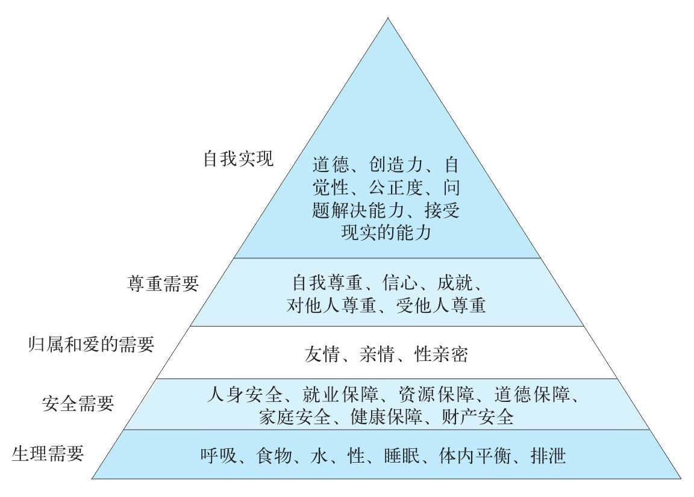

# 第十五章 公共议题卡住的真正原因，往往不在事情本身

很多议题闹大，并不是因为事实无解，而是负责推动的人与推进的方式出了偏差。一次小摩擦处置不当，就会卷入更多主体，成本抬高，情绪发酵，最终变成让人不安的大事件。飓风、海啸本身是自然现象，一旦大量利益被牵涉进来，就会被塑造成公共议题。战争、生育政策、气候变化、能源供给、医疗分配、地方学校争议，追溯根源，多半卡在当事人或机构没能把自己的事处理好。卡特里娜的破坏被放大，既有规划和善后失当，也有选区间的利益冲突；2004 年印度洋海啸致死二十五万余人，预警缺位让灾情进一步恶化，说到底是沟通与规划的缺口。

本书写给个人，却单列公共议题一章，因为公共议题本质上是个人议题的放大。战火中儿童伤亡，会触动每一个人；纳税款投向意义有限的项目，也会波及每个人，因为那笔资金本可用于教育或健康。时代广场若发生爆炸，受影响的远不止现场；政府随后把预算转到警力和安保，而不是税收抵免或住房补贴。如今人类毁灭风险被当成日常话题，普通人更该自问：我们选择的避险路径是否最有效？我们选出的谈判代表是否合适？

只有把导致议题恶化的行为与处理方式看清，才能做更充分的准备。投票、私下交谈、各类公民参与，都是入口。集体情绪一旦形成，就能倒逼商业与政治领导层。越战结束、民权推进、性别歧视减弱，都是大量人不愿再忍的结果。当不满累积，现状就会松动。更好的谈判不一定消灭难题，但更好的流程能大幅降低负面外溢。

值得记住一个比例：决定能否达成协议的因素，与事实本质相关不足一成，超过九成取决于人与流程。所以公共议题同样可以靠人际技巧改善：建立信任、给予尊重、体察感受、经营关系；把沟通需求摆到台面，借助共同准则，做价值不等交换，注意用词，促成对方主动承诺。本章并非包治百病，也不为具体议题开方，而是提供一个评估尺子：当一个议题波及面广、代价高昂、足以影响你时，相关政党处理得如何。

中东常被用作典型，因那里几乎成了不可调和矛盾的代名词，还可对照朝鲜、海盗、族群、移民等议题。公共谈判比干洗店谈衬衫、求职谈待遇复杂得多：关联主体更多、情绪更烈。但关于人与流程的技巧，依然适用。

这并非空谈。沃顿出身后成为核潜艇总工程师的 Jim Vopelius 提到，他把课堂方法传给几位赴阿富汗的战友。战友们靠建立个人关系、做不等价交换，争取到当地部落领袖共同对抗塔利班。美方不再只靠威胁，而是参与斋戒仪式，给部落孩童送笔记本和钢笔。他表示，即便在艰难军事行动中，这些做法也能形成组织原则，帮助实现目标。他也用同样技巧化解海豹突击队与潜艇部队在训练上的矛盾。军队内部矛盾必须即时处理，迅速读懂对方想法尤为关键；军务处置不当会削弱战斗力，这本身就是公共议题。

默克药企一位战略副总裁、以色列籍犹太人，曾带团队赴沙特谈药品生意，身份并未构成障碍，因为那是一桩各方互利的大买卖。这说明阿拉伯与犹太人在中东关键谈判中同样能进行价值不等交换。中东存在大量以巴合资企业与和平组织；索马里社区领袖开始为海盗成员寻找合法工作，让他们不必靠抢劫生计；“父母心声”由几百名在冲突中失去亲人的以巴人士组成；“和平战士”反对以暴力解决问题；“巴以死难者家属联合会”曾说脚下是一片由夭折孩童筑起的土地。阿拉伯人与犹太人还合办体育俱乐部、语言机构、剧院甚至马戏团。

核心问题是规模化：如何让更多人使用这些技巧，形成质变？答案之一是教学、宣传、展示成功的案例。

## 用十个问题自检

评估局部规划或国际议题的效果，可先自问：

- 各自是否在对话？对话质量怎样？
- 是否读懂并顾及对方感受？
- 姿态是压制还是协作？
- 是否仍在翻旧账，还是为长远发展给予尊重？应派出怎样的人来传递信息？
- 是否坦诚交换需求？
- 是分步推进还是想一口吃成？
- 所采取行动是否服务目标？
- 情绪强度如何？能否保持冷静？
- 是否借双方认可的准则收束？
- 是否存在尊重差异的解决框架？

答案能帮助判断代表是否合适、流程是否恰当。

## 先谈起来，才有持久约定

全书贯穿一条主线：缺乏积极对话，就很难达成持久约定。没有对话意味着尊重不足；对话质量差容易产生误解。首要之问是：在谈吗？若未谈且议题范围有限，就应推动开谈。不愿谈者更适合离场，因为这类人倾向制造伤害而非机会。

巴以之间多年未有直接交流。民众间日常接触无数，领导层却无法面对面。哪怕从午餐、体育赛事或孩子话题切入，也不需多正式。没有对话就不可能产生共识。成稿时，双方正考虑重启谈判，这本不该是犹豫的事。

谈判方提前提前提条件，只会让讨论更复杂。似乎认为上桌就得谈实质，可实质应后置，先建信任、摸索交谈方式。无论立场如何，停止交谈等于自毁，除非目的就是冲突。

2008 年 11 月，巴基斯坦武装分子袭击孟买致大量游客丧生，印度随即中止与巴基斯坦政府的和谈。面对恐袭更应启动对话而非中止。官方决定 2010 年 2 月后再恢复，等于等待十五个月。有迹象显示此前曾有非正式接触，未公开是怕激怒选民。若属实，又是一例政府间沟通失灵。若社会普遍认为接触对方无益，政府就该重塑叙事：了解对方想法对我们总有好处，因此要去倾听、提问。

这正是美国入侵伊拉克前本应对萨达姆做的。不必先拿到证据证明对错。对方言辞过激，原话引用反而有助于凝聚对立联盟。若某国拒绝和谈好意，应持续努力并让外界知晓。拒谈者会显得不讲道理，把自己推到焦点。表述技巧决定说服力。

例如可说：“整整百日，我们每日递话，百次请求百次被拒。若真在意和平，怎会连门都不开？”这不是示弱，而是正面强势：“我们为和平才如此进取。”若一方要求先让步才肯谈，就回应：谈判桌上见。核心仍是启动对话。

2010 年韩国等多国指控朝鲜炸沉一艘韩国军舰，朝鲜否认，随后陷入开战与制裁争论。为何不能立即面对面？唯一应反复提出的是：“何时开始谈？”

多年以来，朝鲜最高领导人多次表示想加入国际贸易体系，等于暗示愿以核计划换取贸易组织准入。我们不仅未交换，连直接对话都不愿。朝鲜也没履行允许国际调查员视察核设施的承诺。承诺若不建立在相互尊重上，往往缺乏约束。我们需要的承诺应由朝方主动提出，基于关系而非文件。很多朝韩僵局中的协议常被视为无约束的谅解备忘录，必须共同努力才能变为忠诚承诺。

对比之下，美国前总统比尔·克林顿访朝，与金正日合影并表达尊重后，朝鲜即释放两名记者，重启南北家庭团聚。2009 年金大中去世，朝鲜派员吊唁。朝鲜年年要求与美国双边会谈，美国却坚持多边。无论立场如何，从流程看，拒绝对话都是错误。

2009 年哈马斯领导人表示随时可与美国对话。应接受提议，即便谈时可能沉默或只听批判。若对方言辞趋向合作，可在谈判中利用；若过激，公众舆论会转向对方。若对方不让步就拒谈，说明其并不真想要和平。

这也意味着要与恐怖主义追随者对话。除极个别嗜杀者，大多数追随者是因缺乏更有意义的出路。群体并不孤立。阿拉伯许多母亲不愿孩子成为人体炸弹；不少温和派愿缓和关系，可被劝服。

斯里兰卡能击退泰米尔叛军，部分源于初期的大赦计划。许多叛军放下武器回家，其中有人向政府指出极端分子藏匿处。有人称之为军事胜利，实质是与后返国家的温和派谈出来的。Karuna Amman 即属此类，他是猛虎组织二号人物，后被允许进入政界。政府此前已提出赦免回头者并提供就业，这是面向未来的榜样。

哥伦比亚反叛组织 M-19 在八十年代也因大量成员回归而名存实亡。顾问 Agustin Velez 受聘为回归者寻找经济机会，包括就业。

沟通技巧在此发挥作用：不争过去，不兴师问罪。这需要素养、正确领导与目标导向。与温和派建立统一战线，他们就会与我们一起对抗极端分子。要明白谈判双方并不孤立，还需与温和派有效沟通：尊重并创造可接受的局面。

## 读懂对方账本，才有说服力

一旦交流开始，就必须读懂对方观点。不了解对方想法就无从说服。无论感受是否公正，都需理解其成因，才能实现目标。对方必须心甘情愿达成一致，而这只有在感到被理解后才会发生。公共议题上，越愿意理解他方，就越有说服力。

关键问题是：我们是否懂对方感受？能否明确说出？是否与对方谈过？若没有，利益就难以最大化。

美国在 9·11 后面临特殊困境：许多发展中国家对美国抱有强烈敌意，认为其剥削市场、扩散有毒物质、干涉内政，且自带高傲姿态。无论感受是否公正，都必须理解其来源。若想获得世界多数人口支持对抗全球敌人，这是第一步。

1984 年 12 月印度博帕尔工厂泄漏致约三千人死亡，设计方为美国联合碳化物公司，后续又有数千人丧生。调查发现工人多次违反手册，公司基本不处罚，董事会主席长期拒绝赴印面对法律。2001 年 9 月 11 日世贸中心袭击致 2985 人死亡，博帕尔死亡人数更多。许多发展中国家认为两者无本质区别：一个是蓄意恐袭，一个是放任致命问题的蓄意不作为。发达国家一天不理解这种感受，就一天难以恢复友好，也难以在更大范围合作对抗大规模杀伤性武器。美军参联会主席曾写道：“当我们与自身价值观背道而驰时，就越来越像敌人所描述的那种傲慢的美国人。”

虐待伊拉克战俘等事件对美国说服力造成持久负面影响。目的并非为暴力开脱，而是想减少针对我们的袭击，就需要更多支持。

我们的诉求并非全合理，对方的怨愤也并非全荒谬。要倾听全部怨愤，明确说出并讨论，寻找共赢。易解的当即解决，难解的持续研究，荒谬的则公开，把极端派孤立。

没有此类处理流程，1998 年爱尔兰与北爱尔兰不可能和解。双方最终坐下对话，交换感受，发现多数人不想再战，有诸多共同价值，也可在不依赖英国管理的情况下繁荣。Teo Dagi 指出，尽管和解不易，但坐下来开诚布公交换感受，就是停战的安全阀。他曾是我的学生，现为哈佛医学院讲师，并在和谈中担任医学顾问团主席。

在中东，调查显示冲突双方很多人完全不了解彼此想法。企业家 Daniel Lubetzky 从 1993 年起经营多家企业，员工既有阿拉伯人也有犹太人。他思考双方差异，认为彼此更懂才能实现和平与繁荣。他收集十五万份民众问卷，发现耶路撒冷归属与难民回归两大议题上答案截然相反。双方都称东耶路撒冷属己，无商量余地；巴勒斯坦难民希望寸土归还，即便土地早已改作他用。他创办的和平事业基金会把彼此想法传递给对方，双方都很惊讶。“除非有一方灵活让步，否则不可能达成协议。”此理念带来新思路，例如巴方在耶路撒冷部分领土建都，难民也分得土地，不必原址。

肯吉·普赖斯曾驻伊拉克，后在宾夕法尼亚大学法学院任《法律评论》编辑。他表示，若驻扎前接受谈判训练，会更顾及当地人感受。“当地警方腐败、教育水平低，我们轻易解雇警员，但只有他们真正了解国家，我们的工作本可因协助而更轻松。”他补充，不管美国还是其他国家，军警常有执行心理，忙于维稳，顾不上倾听，错过关键信号。他提到哈佛黑人教授 Henry Louis Gates 丢钥匙破门被白人警察逮捕事件：问题出在理解与沟通，倘以理解为主本可轻松解决。

## 对峙姿态往往拿得最少

谈判中持对峙姿态，争取到的最少，长远看利益会减少约三成。接下来要问：双方态度如何？是互相指责、威胁、伤害，还是共同寻找让所有人受益的方案？需求未被满足时，人性使然不会满足他人；受伤害时往往以牙还牙。

太多公共议题变糟，是因缺乏合作型解决流程，反而成了赢者通吃。这正是迫使对方按己意行事，代价最大、收效最差。

公共议题并非远方热闹，它会变成你生活中的成本、安全与尊严。投票、提问、交谈、监督，普通人都可推动那九成的人与流程向好。先问十个问题，再推动对话、理解与合作。更好的流程未必让所有难题消失，但能让损失减少，让和平与共识的机会增多。

要想让一次谈判结出能持久的果实，核心就一条：让彼此的需求都得到实打实的满足，并且愿意为此持续投入。

把这条标准套到近年的公共议题上，思路就清晰了。

2002年，小布什政府把朝鲜划进“邪恶轴心”，并放话有权打击任何被认为威胁美国安全的国家。随后伊拉克被推翻。站在平壤的角度看，回应这种公开施压最直接的逻辑就是加速核武研发，用核能力换取生存空间。威胁所引发的反威胁，本就是强行逼迫的注定结果。

再看制裁。制裁的本质是用经济创伤来勒索行为改变。历史上看，这招效果一直有限。它往往让被针对的国家更团结，对外形成对抗姿态；它逼着对方学会抱团找新盟友、开辟黑市渠道来绕过封锁。时间一长，执行难度飙升，因为套利总比防堵更灵活。

古巴被封锁大半个世纪，生活在底层的人付出了真实代价，领导层却过得安稳。制裁真正起效的场景很窄：要么对方已无退路像南斯拉夫，要么内部出现强烈倒戈像南非或津巴布韦，要么能用有限代价换来弃核像利比亚上交两名嫌犯。

伊朗不具备这些条件，它有雄心的核项目、庞大的石油储量、强硬的军事体系和多元的外交网络。朝鲜相对脆弱，经济受限、政治孤立，所以对制裁偶尔才会有反应。据测算，美国单方面的制裁措施每年就在出口端损失约两百亿美元。哪怕初衷合理，用书里讲的方法，往往能找到更划算的谈判路径。

反向做法是什么？用利好去撬开门。

苏联解体时，国内对西方生活方式的渴求成了无形的瓦解剂。牛仔裤、电脑、电影、杂志，这些象征品质生活的商品比宣传更具穿透力。商品和服务是比口号更硬的敲门砖。

把对古巴的贸易禁令松绑，资本主义文化就会自然渗入，比如青少年亚文化。嘻哈、说唱从美国诞生却在全球青年中传递个性崇拜，这绝非偶然，它就是一种柔性外交。互联网的普及同样是强有力的谈判工具。

为什么不能让古巴加入美洲国家组织？让它进来并不是奖励，而是让哈瓦那的领导人更难维持闭关，更容易被外部交流同化，谈判空间反而变大。

2008年，伊朗在过去27年里首次从美国进口超百万吨小麦，为后续经济往来埋下伏笔。中国通过向伊朗卖货赚得盆满钵满，急需开拓市场的美国完全可以复制。2009年伊朗进口商品服务总额达到570亿美元。古话说亲近朋友，更要亲近对手，信息与影响力正是从接触中来的。

“和伊朗多交流，美国人会更了解伊朗普通人的样子，也更容易找到让德黑兰守诺的方式。”伊朗律师阿萨·穆罕默迪说。她在宾大法学院毕业，她身边很多美国朋友在认识她前对伊朗人印象不佳，她通常是他们认识的第一个伊朗人。

谈判高手的共同特质是放下旧账。

要自问：双方是否还在为昨天的恩怨互撕？焦点是算旧账还是建明天？地方议会或教育委员会的候选人如果更爱兴师问罪而非创造机会，大概率不会提升交易价值。

中东的谈判常年困在“为昨天吵架”。签再多协议、派再多特使，总有人要清算旧恨。在这种氛围里和平很难落地。

这也就引出代表人选问题。若因放不下仇恨而进程失当，说明派错了人。美国的存在对多数国家而言本身是刺激源，减少过度介入既降成本也提效率。2001年阿富汗的转折就体现在地面：美方只投入约12名特种兵，却在当地训练大量熟悉地形、能自己招兵的民兵，说服本地人为自己而战，是更有效的策略。

每个公共议题里温和派与极端派的界线都很清楚。最合适的第三方往往是温和派，他们着眼于明天生活，极端派只想报复昨天。让温和的犹太人去遏制极端犹太人，比外部强行抓捕恐怖分子更合理。代表的选择，决定谈判成败。

谈判的筹码从根上就是需求。

沟通、共情、换位思考、选对代表，能让你从容开启谈判。下一步要厘清双方各自的需求清单，并找到交换方式。

对绝大多数人而言，筹码是基本生存。无论对象是飓风受灾者还是巴勒斯坦难民，解决饥饿、饮水、住所、安全、就业、家庭与健康保障，是开启对话的第一步。公共事务的谈判起点就该放在这里。

心理学家马斯洛的需求层次为此提供了框架。

人类最基础的需要是食物、干净水、稳定居所、身体安全、避免伤害。

但媒体与政客处理重大议题时，大部分精力都花在道德、偏见、政治口号、理想成就这些次级议题上。决策者谈和平、民主、理想，总从顶端需求出发。可在基本需求未被满足时，很少有人会倾听理想。今天仍有大量人因吃不饱而走投无路。

哈马斯的支持并不全靠意识形态。它为挨饿的阿拉伯人提供食物、医疗甚至婚介。基本需求被满足时认同感随之增强。

大量证据显示饥饿会推高暴力与社会动荡，埃及、海地、塞内加尔、布基纳法索、尼日尔、马来西亚、泰国、墨西哥、乌兹别克斯坦都曾出现类似案例。“饥饿让人更易愤怒。”世界粮食计划署副总干事阿里夫·侯赛因指出，儿童受影响最深，情感创伤更明显，暴力的循环往往从孩子开始。

如果想在情感和理性上赢得民心，就不能只走军备竞赛那套拖垮经济的老路。若哈马斯每天提供1000卡路里，阻击它的力量就该提供2000卡路里。

以色列若想与阿拉伯人结盟，就该先满足基本需求。投射导弹只会制造更多追随者。与其轰炸，不如空投面包与肉。饥饿的人不会笑这条新闻。

再给温和派提供他们不愿失去的东西：食物、住房、教育、医疗、安全。温和派就会去举报或清除激进分子。面包在长期博弈中比炸弹更有力。谈判可依托已有的阿以和平组织来壮大温和力量。

想象一下在沙漠里活六个月，没有足够食物、水、医疗、教育、空调。若有人递来食物并说这是美国害的，你会怎么想。你会接受大部分叙事。所以要给恐怖主义追随者提供一个体面的生活选择，才能把他们拉回另一条路。

部分分析师认为饥饿并非恐怖主义根源，是因为他们只看到资助者里的富人。权力与支持其实来自千千万万衣食无着的穷人，谈判的对象正是那些可以被说服的人。

1981年以色列炸毁伊拉克核反应堆后，我曾采访一批参与过曼哈顿计划的老科学家。多数已八十多岁，曾在麻省理工、加州理工等名校任职。我问他们如何阻止核扩散，答案出奇一致：别谈技术，给大家分发食物、医疗、衣物、教育、住房与工作。

一位阿拉伯商人曾对我说：“我站在能养活家庭的那一边，我站在能享受良好医疗的那一边。”谈判首先关乎马斯洛金字塔，再谈经济繁荣。

即便对以色列毫无好感的叙利亚商人也认为经济合作有益发展。黎巴嫩的西方与伊斯兰专业人士在社区层面交流，正是联合经营的基础。

苏联解体后，乌克兰在美国要求下交出核弹头，换取经济补偿。这是核换经济的先例。

朝鲜长期实行粮食配给，用粮食种植技术与稳定粮食供给换取弃核，是可行的一条路。这并非具体方案，而是说明以满足基本人性需求为载体的路径存在。

政治并非无关，政府的职责正是推动经济以满足基本需求。困苦让人情绪化，情绪化的人难被说服，只能与提供情感补偿者合作，而补偿正是维持生活的必需品。

谈判策略研究不足。中东和平进程多停留在台面和平：公开声明、正式条约。要获得真实支持，必须追求实际和平，即民生层面的和平。

美国寻求的往往是技术和平：用更先进的系统和昂贵的基础设施控制恐怖主义。这无法从根本上解决问题。爱因斯坦在广岛后说过，藏不住也防不住。找到一种反制手段，恐怖分子就会研发新招。9·11后先是鞋里炸弹，再是内衣塑胶炸药，随后女性自杀袭击者出现。

情报机构总被指责未能把数万亿信息过滤为几百条可疑线索。问题是疑点每次都不同，人脑创造力惊人，组织机构永远追不上变化。类推到今天，就是城市里的核与化武威胁。

若想真正阻止大规模袭击，就该给能找到恐怖分子的人提供食物、衣物、工作、住房与医疗。是更多人自愿站到同一战线，而非被强迫。

几年前南非开普敦外海滩发现一头死鲸，被拖到海豹岛。岛上大白鲨围攻鲸鱼，吃饱后浮在水面像喝醉。潜水员下笼时鲨鱼毫无兴趣。这就是类比：需求被满足后，打仗的欲望会自然下降。

阿拉伯人与犹太人的敌意并非天生。大量阿拉伯人生活在以色列，调查显示多对现状满意。成功谈判的基础是围绕共同利益建立多元联盟，而共同利益就是生活必需品。

循序渐进是另一条主线。

解决巨大分歧时，必须小步快跑。公共事务的分歧最大，可做法却最反其道。即便“一招定乾坤”的先例存在，也是极少数。

所有谈判进程都依赖渐进行动。一次解决所有问题既无必要也不可能，找到一个切入点，步子越小抵触越少，达成一致的人越多。

若一方上来就提全部要求，说明代表错了。公共事务涉及众多选民、金钱与矛盾，分步走才能建立参照、积累信心、培育信任与合作关系。小而可扩展的计划远胜于宏大难行的蓝图。

再看巴以。几十年来双方总想一次解决全部问题，难怪无果。做个假设展示渐进可能。

比如约旦河西岸某地办一座小型工厂，员工一半以色列人一半巴勒斯坦人，此前多失业或不稳定。资金来自世界银行或私募股权，规模几百人。

按当地市场需求生产，制药是不错方向，约旦已有制药基础，以色列公司擅长仿制药制造与销售。

工厂带动周边住房、医疗、学校、超市发展。工人同住、分红持股，生活改善，口碑会扩散：“我现在有吃有穿，有房有学有医疗，听起来不错吧？”

巴勒斯坦工人与以色列工人共享学校、社区、生活水平，远多于与哈马斯极端分子的共同点。以色列工人也更亲近邻居而非本国极端分子。曾在战场对峙的民族，会形成共同目标与友谊，成为冲突地区的榜样。

逐步扩展可能需要一代人约20年才能自我维持。有人会说太久。这一观点我第一次提出是在1981年，2001年9月23日世贸中心袭击12天后在《费城问询报》等发文再次阐述，2006年再提。问题是迟早要做，为什么不现在开始。

除制药外，农产品、以色列低耗水技术、死海采矿都可行。巴勒斯坦可成为企业家试新发展的试验场，替代能源如太阳能、生物能、风能可发电并支持海水淡化生产饮用水与灌溉用水。几乎未开垦的土地可建新房与基础设施。

沙特、科威特希望地区和平，会投资巴勒斯坦项目换取股权。中东外的富裕阿拉伯人与犹太人渴望参与和平，可通过购买合法项目股票贡献力量，律师事务所可提供无偿服务搭建交易结构。

以色列不应只索要专属西岸定居点，而应拿住房与阿拉伯人换取工作与支持，会有人接受并形成示范。

以色列给巴勒斯坦温和派的条件越多，支持者越多。如今以色列拒绝在巴勒斯坦地区增建更多移动网络，限制进出首都，声称安全未稳前不改。但拒绝提供本可在安全上加分的激励，等于放弃强化自身安全的机会。经济上帮助巴勒斯坦人会促进自身安全，因为更多有产者更怕失去，会成为伙伴。

这与谈判何干？你是在劝导对方改变行事方式与思维，用更好的方式与不同的人打交道。你是在教他们如何解决公共事务。政府与私企投入多少，会决定策略能持续多久。

气候变化亦然。二氧化碳减排争议不断，有人要渐进，有人要全球共识。大量时间浪费在争论污染税或排放权交易等单一标准上。

从谈判角度，最大化当下可调动的人力和物力更有效。若有人能减少净污染，为何不做。政府在出售污染权或征收污染税的同时，应积极寻找更好方案。找到一个方案，就是离解决迈进一大步。

很多冲突看似在辩论谁的方法更“正确”，其实关键的转折点只有一点：把对立的争论收起来，换成可以一点点落地的行动。任何手段都不求一蹴而就，先做一个暂时的微小推进；在这个推进里不断试错、对比、修正，就更容易让问题真正往解的方向走。政府的角色可以是为目标研究提供支持，持续对照、对比，总结出更合理的渐进路线。

[\[12\]](text00137.html#note12) 又称国际非专有名称药物，是由各国政府规定的，国家药典或药品标准采用的法定药物。——编者注

### 暴力的边界在哪里

谈判越是攸关彼此利益，双方的情绪就越容易失控，非理性因素就越多，目标的实现也就越难。在公共议题里始终要问：我们的行动到底能不能带来想要的结果。

反恐就是最典型的例子。发达国家的本能反应往往是动用武力或以武力相威胁，典型的复仇式回应。九一一之后，美国前防长唐纳德·拉姆斯菲尔德说要“找到他们、抓到他们、消灭他们”；二零一零年莫斯科地铁爆炸后，俄罗斯总统也说了同样的话。反恐战争的内核，长期以来就是暴力。

暴力昂贵、耗时，而且劝服效果在下降。过去杀掉或威胁到足够多的人，对象就会屈服。如今很难奏效，尤其面对意识形态信徒和已无路可退的人。自杀式袭击者对死亡威胁根本无感。

要阻止他们就得全部清除，这在现实中做不到。军事行动几乎不可避免地会波及无辜平民，而每一次误伤都在为恐怖网络添补新鲜血液。我们越是把别人的土地和家园摧毁，越是把人逼到绝境，招募就越容易，沉默的默许也越多。

几名袭击者就能造成大量伤亡与数亿乃至数十亿美元的损失，且他们不仅不畏惧暴力，甚至视其为正当。靠武力打倒一群不怕死的人几乎不可能，这已成为全球性的常态。

敌人的分散让打击更难。敌人不在同一个地方，没有统一的外貌、习俗、语言或行为模式。大规模打击常常打不到目标，却伤及平民，反而壮大了对手。美国也很挫败地发现，本国公民也可能成为恐怖分子。

有人引述以色列官员说要“铲除哈马斯的恐怖主义根基”。但以色列做不到，因为平民伤亡本身就在强化敌人的力量。靠暴力、技术、组织或基础设施，永远无法达成这个目标。

屡屡传出恐怖组织头目被捕或被击毙的消息，可接班者成百上千。伊拉克有位八岁女孩死于美军所谓“走火”；加沙一名致力和平、与以色列医生合作的巴勒斯坦医生，眼睁睁看着自己三个女儿在联合国学校外被以军炮火炸死。每条逝去的生命背后都有家庭，往往是大家庭。于是仇恨与反抗的意愿又被复制出成百上千。

更低成本且成功率更高的策略，是把焦点放在温和派的目标实现上，而非执着于揪出极端派并消灭他们。

堕胎议题也是双方长期无法达标的公共事务。四十年过去争议依旧尖锐。时常有支持堕胎的医生被杀，或被关进监狱。可这阻止得了堕胎吗？没有。能阻止医生被杀吗？也没有。抗议、诉讼、议会通过法案又废除法案，循环往复，谁也没拿到想要的结果。

这并非能靠讲理就说清的事。双方的口号已把谈判空间堵死：一边说这是杀害胎儿，一边说这是女性选择权。更有趣的是，即便谈判桌上没有定论，实际操作中人们仍在进行堕胎。美国若禁止，很多人会出国或走黑市解决。

从谈判技巧看，要先看清本质再调整目标。真正的问题首先是意外怀孕太多。第二是双方都把它当成非此即彼的零和博弈，态度上排斥任何渐进措施。第三是双方根本没真正沟通，从未讨论共同利益与改进现状的可能。

我认为更有效的路径是重新描述选择：把“要生命权还是要选择权”的框架，换成“放宽还是收紧堕胎政策”的框架。现阶段更合理的方向是放宽政策，而围绕渐进行动的原则最终会实现限制的目标，这是双方都能接受的善意。

想生孩子的美国夫妇在全球寻找领养对象，成千上万美国人表示若允许就会领养。于是自然产生一个疑问：争议双方有没有把不想要孩子的女性介绍给想领养的家庭？显然做得远远不够。至少有一部分不想要堕胎的女性，只要有更利于母子双方的安排，就可能选择生下孩子。

若目标是减少意外怀孕，节育等措施便会成为更明显、更易获支持的解法，把大难题拆成小问题。

我并非提供具体的堕胎解决方案，只是想指出：现在的处理方式无法让任何一方达成目标。

任何谈判都要先确认一个前提：没有共识就不可能有解。必须尊重感受，寻找让大事化小的可行方案。需要的是冷静、体谅的交流。只要极端不妥协的态度还在，问题就无解。

### 情绪：寻找共同的联结

堕胎争议与对暴力的诉求，本质都是情绪化产物，导致目标落空。情绪本身就是需要被谈判的议题。

一旦议题触动情绪，交流就会中断，有效谈判也就无从谈起。评估公共事务时，可以看双方是带着情绪还是平心应对。

仍以中东为例。诉诸暴力与纠结历史当然会干扰，但还有更多因素让谈判者无法聚焦于和平与美好生活。

一个直观干扰是西岸的以色列定居点。撇开情绪，这并非不可处理。三十多万以色列人居住在那里，却只占西岸约五%的土地。双方总为此争执，却忘了讨论巴勒斯坦国建国。双方其实都懂地产规则：土地交换、开辟、补偿等，都可以作为建国整体的一部分坦诚讨论。

巴勒斯坦人其实可以这样回应任何以色列行为：“我们何时谈巴勒斯坦建国？”东耶路撒冷作为首都的谈判也一样。巴勒斯坦人因定居点问题情绪化，常常把目标丢了，这是谈判方式的问题。

以色列方面也未向巴勒斯坦人提供情感补偿，比如为阿拉伯人分配住房或在其他方面做出让步。关键不在于应不应该，而在于以色列是否想减少暴力。

另一个干扰是无休止的口水战。大屠杀是否发生？是否需要道歉？某个国家是否腐败？这些议题很重要，但每次提起都会引发即时反应，领导人和民众都情绪化，忘记和平与发展的核心目标，转而清算旧账。无论何事、何国，只要对方侮辱或干扰，就该有涵养地回应：“好，那我们什么时候谈正事？”领导人和媒体可以及时指出干扰，帮助谈判回归目标。

情感补偿能缓解紧张，让人更专注。在动荡地区，一个重要诱因是人们无法充分表达哀思。至亲被杀会催生复仇。

看中东，目前没有可靠机制为施暴者定罪量刑，肇事者往往找不到。悲愤无处释放，便转而报复与施暴者相似的无辜者，恶性循环就此形成。

一九九二年洛杉矶，罗德尼·金被警察殴打后法院宣布无罪，非裔美国人爆发暴乱。世贸中心惨案后，美国的中东移民成为报复目标，甚至被限制行动。类似循环在别国也屡见不鲜。

情感补偿帮助人们不被干扰地聚焦目标：道歉，无论笼统还是针对特定群体个人；对痛苦与感受表达尊重与理解。为战亡者设立纪念碑，能帮助幸存者面对丧失，稳定情绪。

华盛顿的越战纪念碑刻下所有阵亡美军姓名，是美国最受参观的纪念地。据说每天约有15000万名参观者。这座碑提供强大的情感慰藉，向逝者致敬，为亲友提供补偿。

中东也有许多小型纪念碑，却缺少这样的大型共同纪念。双方长期不同意为对方受害者立碑，已有的也被破坏。没有合适的纪念，使得双方长期无法面对失去，也得不到情感补偿，谈判更艰难。

在中东建立阿拉伯-犹太联合纪念碑，把所有能追溯到的姓名都列出，能传递共同历史感，呼应拉丁文 monere 的“提醒与教诲”双重含义。这种技巧聚焦于共同敌人——战争，以及失去亲友者共同的联结。

同样，开放多教派的悼念中心，让不同派别的人一起表达哀悼，比如佩戴亲人照片，能提供巨大的情感补偿。没有这种“退烧针”，有效谈判难以实现。

### 准则：维持公允的观念

公共事务中，公允感格外重要，因为过程与结果都是公开的。从谈判角度看，最可靠的保障是使用双方都能接受的准则。先问：双方是否同意用准则的思路？过去用什么准则？现在能接受什么准则？

最好从最普世、最易接受的准则开始。之前提过中东的一个例子：“我们希望孩子早夭吗？”任何回答“是”的人都会被视为极端，这能把温和的大多数与极端的小众分开。还可以问：“难民应不应该有体面的住房？”“能否容忍无差别杀戮？”“人应不应该吃饱、看病、喝干净水？”

在地方层面，如教育委员会、规划委员会，可以问：“政府在做影响居民的决定前，应不应该先听取重要选民或居民团体的意见？”措辞至关重要，准备越充分，说服力越强。

谈判也能使用更具体的准则，例如：“作为不再诉诸暴力的交换，是否应该建立巴勒斯坦国？”“警察在判断危险性前是否应该先询问？”问题本身就能让提问者更具说服力。越基于准则提问，在公共事务中越有力量。

### 回顾解题的模式

上世纪七八十年代，“放眼全球、立足本地”曾是环保运动的口号。那代人相信解决全球问题要从本地和个人行动开始。后来这个理念一度被淡忘，今天又回来了。

这是本书的核心之一。运用书中所讲的谈判技巧，无论单人行动还是与同事朋友合作，都能对世界和个人生活产生深远影响。起步时需要的只是正确的态度和有条理的程序来与他人相处。

回到根本，问自己：我的目标是什么？对方是谁？如何说服他们？借助感受、准则、措辞、需求、动机、不等价交换、避免情绪化等元素。它不是火箭科学，也不完美，但能让你在每九局比赛中多击出一记安打。可能让从不发言的人开口，也能解决经年累月的问题。关键是双方是否愿意采用一种解决问题的模式。

我教过的许多学生如今在重要公共事务领域工作，他们发现这些技巧的效果与我所描述的一样。

印度电信、信息技术与邮政部长萨钦·皮洛特说，在一个拥有数百种文化的国家让选民达成一致，必须使用尊重差异的谈判技巧，这对印度近年电信行业的发展功不可没。

美国“和平队”阿塞拜疆区领队梅雷迪思·多尔顿需要说服受教育水平高的志愿者接受理念：要学会编织、学会做当地菜肴，多与当地人相处，多聊聊他们的孩子。这是值得借鉴的草根范例。她说解决方法就是慢慢来。她改编了畅销书《三杯茶》的书名，说应该“一杯一杯地来”。

可以用十个步骤审视每一个公共事务，判断是否具备成功进程、是否选对了谈判代表、还有哪些可以改进。结果未必实现全部目标，但一定能最大化目标。