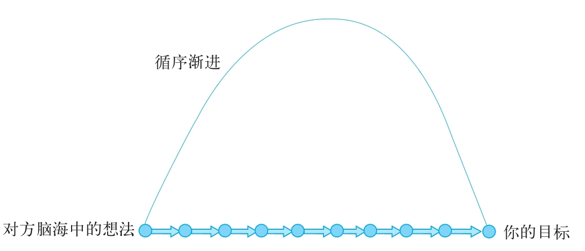

# 第十六章 谈判实战笔记

把前面的方法都读完了，怎么落地？怎么开场？谁先开价？你如何判断对方想撤了？怎么收尾？答案其实已经散在书里，这里单独拎出来做成一个可用的实战模板。

## 心态先行

谈判桌上最先暴露的不是策略，是状态。焦虑、恐惧、愤怒、走神，都会直接拉低表现。精神状态的细微差别，对方会立刻捕捉到。

先做最坏假设推演，能扛住就更有底气，扛不住就该换人出面、换准备方案、换风险感知方式、另开机会窗口。必须提前把心理建设做足。

碰到气场很强的对手，可以在脑中给他们一个最尴尬的画面，场面感立刻下来。别把对方的善意想得太满，提前设防可能的套路和花招，万一真来了也不至于慌乱。谈判不是一天撸完，步步推进，放松心态，这件事不关生死，明天还能谈。

## 准备是自信的来源

准备程度直接决定紧张度。准备越充分，越不会在桌上临时抓瞎回想下一步，也不会因为信息空白而心虚，发挥自然更顺。

## 时间地点

选在双方都舒服的时空就够了。氛围不对就直说：这个安排我不太方便，或我还没准备好开始。

对方如果说“这事不好办”，可以回：“那你希望我空手来吗？”或者“我想回去再琢磨一下再回复你好吗？”

求职面试是特殊场景，雇主通常最客气，面试里都不友善，那基本就是危险信号；若确实指着这份工作吃饭，就要提前准备好如何提出“先回去准备”的请求。

主场谈判未必占优，关键在表达。必要时可以半开玩笑说：“午饭你来请？”“派车来接一下？”我甚至靠在他们的椅背上，把脚搭在会议桌上，就是在传递“我也有主场感”的信号。

时间地点没有唯一标准，但参考一下人性常理：求婚选最浪漫的场景，劳资最早的会面往往回到企业诞生地，恩怨也常在神圣之地化解。虽不强制照搬，但值得借鉴。

## 先建立人味

谈判不是跳舞，没有魔法。开场可以很松：嗨，最近怎么样。正式程度随舒适度而定。可以找个共同吐槽点，天气、交通，赞一下对方的西装、裙子、手表。关键是发自内心，虚伪的寒暄隔着几米都能闻出来。

我遇过对方问我家人好不好，我聊起妻子儿子，对方却没在听，分明是照本宣科学来的寒暄套路。

多想想对方也是人，要穿衣吃饭休息，也会懵逼。建立人际连接，不是客套，是效率。

没时间寒暄也能连结。第一章里陈瑞燕用眼神就让飞机回到了登机口。小互动很有用：开个对方能get的玩笑、递块薄荷糖、聊聊当天的小事，都能营造合作氛围。人本质上是社会动物，连分歧本身也是一种互动。

对人没兴趣就别上桌，冷淡会写在脸上。最好的谈判者是好奇心强的，他们想了解人，想连结。不是要你当交际花，而是对方身上肯定有值得学习的优点，表现出兴趣本身就很有说服力。

让人舒服的办法，人通常正好相反。我们常常不自觉地让对方不舒服。对方时间紧，更要尊重，主动问：你大概有多少时间？这就是尊重，也是连结。

我最难忘的一次破冰在乌克兰第聂伯罗彼得罗夫斯克的南方机械制造厂。会后他们把我领到车间，面前是一枚放倒的巨大核弹，据说跟橄榄球场差不多。大头早就拆了，但导引装置和尾喷管还在，我被邀请伸手去摸。几个穿连体服的技师跟我打招呼，其中一人自豪地说他曾让这枚弹瞄准明尼阿波利斯。那一刻，我才真正熟悉了对手。

## 开场怎么走

哪怕只有短会，也要心里有议题清单和顺序。做一张双方认可的议程，作为偏离时拉回轨道的锚点。

加州顾问卡琳·阿达莲谈判一开始就发了一页议程。桌上坐着一堆资深人物，律师占三成，她却是准备最充分的那个。她复印分发，最后所有目标都实现了。如果能多个人都带议程，更好。

谈判要多久？看情况也可先谈好分段节奏。渐进式推进是正解，出现新信息时及时喊停，冷静后再续。

从简单议题入手，形成小胜感和进展感。早早表明哪些条款你不可能接受，别浪费彼此时间。拖到最后才说不，会导致交易流产、信任破裂、对方提出额外补偿要求。

给每个议题设时间盒，比如15分钟无解就换下一个，保证流畅。议题没谈完前别做硬承诺，可做有前提的临时承诺。

## 谈判是动态的

进入具体议题前，先对准感受。准备阶段和角色互换能让你心里有数，把感受先分享出来，说服才更容易从对方出发。

突发状况立刻休会。一次兼并谈判的第一小时，我们因意外情况休会了五次。

内部意见不统一别在对方面前吵，否则会被利用。同一阵营多个人同时发言没关系，只要立场一致。内部分歧就喊停：“我们先统一一下再回来。”人们不求完美，但求踏实。

研究已反复证明，时间压力会带来结果变差、信息处理能力下降、增值变少、忽略关键信息、误判增多、情绪化、选择受限、更依赖权力、偏见加重、精神负担加重。贪心不如做精。与其把很多事做砸，不如把少数事做好。

时间压力可能是客观的，也可能是主观感受、内部或外部。受不了就调整，挤时间或明确表示不接受施压谈判。买车买房一开口就说不接受截止期限，这会让对方收敛。

## 说话方式

课堂上我们会让学生给自己在案例中的待人方式打分。态度差，谈判能力基本就差。威胁、侮辱、讽刺、打断、指责、贬低、不沟通、无议程，这些都会让几千万美元的价值蒸发。

措辞要极小心。“如果不达成一致会损害你的信誉”，是威胁式的暗示。“你需要我们做什么来帮你提升信誉度呢”，是合作型威胁，后者更容易被接受。

换个说法：不说“我们不信你”，说“我们怎么开始建立互信？”不说“你不接电话”，说“你收到我们的电话了吗？我们很想聊几件事。”多练就顺手。

火药味场景里，友好会推动进展。放长线想共同目标，给对方表达空间，让他们解释想法。

建议在团队里指定一名观察员，盯对方面部、氛围。一旦察觉异常，就能及时休会或用外交辞令把谈判拉回来。

## 信息怎么给

普遍怕太早给太多。我的原则是：信息要帮你靠近目标，而不是阻碍目标。如果你想花最少钱买车或公司，开场就别透露支付能力。

收尾阶段，如果要价超出承受线，再把上限摊开，让对方知道边界，他们才可能降价。也可用非价格资源来填补差距。

大方亮底线的前提是：①已穷尽手段，②要价超出议价区间，③该谈的都谈了。

同样要适度透露需求和兴趣。如果怕被占便宜，就别表现得非要不可。但完全不透露也不行，否则可能得到自己不想的方案。

不确定对方诚意时，慢慢来。说“我对这幅画感兴趣”，别说“这幅画我爱不释手”。

没人要求你像法庭证人一样全盘托出。觉得不舒服就说：“这个问题我暂时不方便回答。”

被问“还有别的报价吗？”先想他为什么问：想判断你是否急售、愿意亏本。别反问为什么，而是问：“如果你知道我有别的报价，你会加量吗？”或者“如果我没有别的报价，你会抬价吗？”更委婉可以说：“你觉得这对我们谈判有什么影响？”

求职场景可套用，强调自己有“其他机会”。也可以反问：“你是想了解我的市场价值吗？”然后建议按标准流程走。

## 谁先报价

信息掌握得多就先报。价格、价值、条款、市场行情、竞品信息，都在你手里时，你是在把博弈框定在你想要的范围，设定预期。

熟悉行情就先开口，胜率通常提升3-5个点。议价区间过宽或不确定就别先报，容易后悔。对方预期可能跟你想的差距很大。

哥大高管班学生查利·史密斯陪妻子买餐桌椅，原价3000美元。他知道商场折扣有限，最多50美元，于是先问能不能今天下单给点折扣。售货员开价优惠300美元，查利愣住。随后对方加码到500美元，再加免送货和免税，共优惠800美元。教训是：信息不足就别先报，否则要翻脸。从此他用这套方式拿到了更大折扣。

这不等于区间不明就不能先报，你可以通过提问缩小区间：为什么在这里谈？他们的底线是什么？提问本身会逼出信息。但经验上，除非你对议价区间和市场足够清楚，否则别抢先。

## 极端报价会毁掉事

极端报价等于侮辱。太低是不尊重，太高对方直接走。更可能赔上信誉，撤回后会被认为想占便宜。

极端报价脱离事实基础，是对方的感觉，不是你的感觉。有人靠高开价博空间，通常适得其反。

对方极端报价时应对三招：控情绪、提问、用准则。先问为什么这么报，有数据支撑吗？跟你看到的市场信息不符，能否解释来源？

这也违背循序渐进原则，接受概率极低。若有人放出过分要求，可问团队其他人：“你们都认同他说的每一句话吗？”有迟疑就休会，让内部先说服。

细节必须核实。买车时配置加价2000美元，当场用手机一查，发现价格本就包含，不应重复收费。

## 权力的动态

全书都在提醒：别滥用权力。用到刚好能达成目标就够了，还要制止对方不当使用。

这件事跟权力概念本身无关，更跟目标有关。规模不等于权力，小方可强大。马丁·路德·金、甘地一人能撬动万人，让政府让步。安然公司在丑闻中瞬间失去所有权力。

哪家更强？濒临破产的通用汽车，还是一家盈利可观的中型科技公司？负债累累的大公司，反而控制力更差，规模小、财务健康的一方更可靠。

上世纪七八十年代，美国多家电力公司嘲笑的松散联盟，居然叫停了数十亿美元的核电站建设。他们是家庭主妇女、退休馆员、记者、律师和大学生组成，靠调研发现安全隐患，推动立法，最后让核电经济停滞。

一本关于国际竞争力的书里写道：“没有任何机构、企业、社会或人类成就，无论多权威、多重要，都不可被毁灭。”这是对滥用权力的最好批判。别在孩子、公司、同行、对手身上滥用权力。

盛气凌人会自食其果。对方面对强势，要记录每一次不合理行为。

如果对方纯粹权力更大，他可能打败你。这时要承认其权力，给情感补偿。问他：因为你能打败我，就应该这样做吗？歌剧院逼著名艺术家低价演出，艺术家还会全情投入吗？员工被拳打脚踢，还会用心工作吗？

建议以满足需求为主，用本书的方法做大蛋糕。及时坦诚讨论权力问题，偏离时温和引导。他们在权力使用上常情绪化，可能需要情感补偿。

## 自己的需求盘点

关系更融洽后，就要明确谈什么。制定目标，制订议程。此时要更彻底审视自己的需求，不仅谈判桌上的，还有生活里的。因为可以用不等价物交换。能拿什么换？

## 评估标准

对不能交换的东西，要找评估标准。对方面向什么标准？你做决定时该用哪些标准？房价？惯例？

近期、中期、远期，你打算怎么行动？

谈判里最容易迷路的点，就是盯着自己够不到的东西死磕。

先把范围收回来：现在，桌子两边的人，到底能拍板什么？能马上执行什么？很多矛盾就是因为议程里塞了太多此刻根本动不了的事。长线布局当然要做，但当下能落地的动作越多，双方的正反馈就越强，继续谈下去的意愿才会被点燃。

排顺序就用最简单最快的标准。大多数情况下，简单的事也最快。能立刻做的先做，近期能做的接着做，远期的最后再放。就算今天什么决定都做不了，也要找能做的事：能不能先给出一个建设性的建议？能不能敲定下一次碰面的时间？能不能说清楚谁来参加？能不能多一点信息交换来拉近彼此？能不能先想一个过渡方案，让大家今天回家时手里不是空的？

这就是积累小胜。想一次把所有事情闭环，需要谈前做极细的蓝图，需要极大的组织成本。可世界变化太快，一个被拆到细节的超长计划，很容易还没开跑就被现实改写，耗掉的是时间和信任。

## 谁在帮你把事做成？

没有人是孤岛。哪怕只是一场简单的承包商谈判，你也得想清楚后面站着谁：要去五金店采购吗？要过城管或物业的手续吗？要找人上水电吗？

换句话说，双方都该提前盘点：需要哪些第三方、哪些资源配合、谁的点头才是真的点头。把隐形依赖显性化，是把谈判从空谈拉到落地的第一步。

## 承诺要能扛住现实

口头说“同意”、把字签在纸上，不等于承诺建立了。真正牢靠的承诺，是对方主动愿意遵守，并且愿意在谈判桌上公开讨论如何遵守。

第三方既能加固承诺，也会拆台。董事会的态度、老板的换人、破产处理官的介入、经济环境的突变……随便一个变量都能让结果回吐。你要问清楚对方的内部流转：签约流程是怎样的？什么样的外部力量或激励，能让他们更坚决地守住决定？

承诺必须有死线。没有截止时间，一切都是模糊的。另外要把逃逸条款说透：什么情况下会让对方想退？什么情况下会让你想退？

更关键的是违约后的后果要先说清楚。对方常会说“我们绝对不会违约，你不信任我们吗？”你要回他：那核心负责人离职怎么办？换了管理团队怎么办？万一有人出了意外怎么办？

如果对方坚持风险为零，你可以提出对他们几乎无成本、却能让你团队安心一点的惩戒条款。试探的目的是降低你自己的敞口，而不是给对方添堵。

风险这件事要在谈判中摊开讲：关键人会不会走？朋友、伴侣、监管部门会不会横插一杠？内部成员会不会不配合？感受到的风险越大，对方要求的补偿就越高。你的工作是把他们感知到的风险降下来。风险降了，你是卖方就能谈更高价，你是买方就能谈更低价。

这也是为什么初创团队愿意高价请一个资深商人当董事或顾问——投资人一看，风险就小了。

当然，你可以花一整天争论什么才是“真实风险”。但比争论更有效的是识别对方真正怕什么，然后帮他把怕的东西降到最低。所有这些都要在谈判里具体聊，而不是会后猜。

有人会故意放大风险来要价，就像贷款机构用一个可疑的征信问题压低你的评级。别全信，要信息、要证据、要规则。

最好的做法是把风险变成共同问题，一起降。双方联手解题，比单方面承受要好得多。如果对方明显不愿配合，就要警惕他是不是在人为制造恐慌来抬价。

## 别让“谁来干”毁了好谈判

最常见的翻车现场是：上一次会谈气氛很好，散会后才发现没人知道下一步谁执行。谁去买门票？谁打电话问航班？打电话的人还要不要负责付款？

等到真正需要落地时，分工空白，责任就互相推。说到底不是沟通问题，是没在谈判收尾时把活儿分下去。

所以最后一定留出时间做执行清单：具体是谁负责什么，到什么时候完成，有没有备用方案。你生病了谁顶？计划卡壳了谁来联络谁？每个人在去问别人之前，自己的权限边界清不清楚？

拿出一张纸，花五到三十分钟把这些问题过一遍，能省下好几天的时间、好几笔钱，还能避免很多不必要的恶化。

## 从脑中想法到明确目标

回到最基础的自检：我的目标是什么？对面是谁？我怎么把他们带过来？

我们来看，这个长长的弧线代表了人们通常的做法：从他们脑海中的想法一步跨越到你的目标。对大部分人来说，这一步迈得太大了。你应该反其道而行之，回去先搞清楚对方脑海中的想法，然后再通过提问的方式确认这些想法。你想达成协议吗？你想与对方会谈吗？这些问题一经确认，就要向你的目标一步一步迈进。

因此，你的目标在右边，对方在左边，说服对方的办法就是一步一步走，以循序渐进的方式带领他们从左边走到右边。

好好好，不需要再重复了，这些你都很清楚。但是，只是清楚还不够，还要将其付诸实践。除此之外，还要掌握争取更多的方法，这就是本书的主题。

你已做好了准备！从这里走出去吧，去争取更多吧！