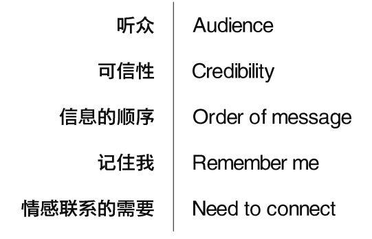

# 序 1 你的信息，凭什么让“松鼠型听众”停下来？

把一句话真正送进别人心里，从没像今天这么费劲。

内容铺天盖地，打断无处不在，耐心却越来越薄。每一条被你精心写下的信息，一出生就要加入一场注意力争夺战。人很难长时间停在一个点上，思绪常常刚落到这儿，又弹到别处。这种东张西望的收听状态，很像我在院子里见过的松鼠——爪子不停、身体不安，视线四处漂，唯一能让它定住并保持兴趣的，是橡果。

研究和授课这些年，我越来越确信：当下听众的专注模式，和松鼠有几分神似。有一套办法能把他们的目光和心思拉回来——书里把它叫作橡果策略（ACORN）。它是一套沟通工具，作用很直接：让听众的注意力落在你要传达的内容上。别忘了：脑子再灵，只要信息送不出去，领导团队、促成交易、教学、说服、倡导、助人，都会卡壳。

## 01 今天的听众，像极了松鼠

先看两组对照。

松鼠对寻常事物大约只给1秒，对橡果却能盯上4分钟。人呢？网页浏览时的平均专注约9秒，差不多和金鱼持平。近几年，专栏文章数量缩水25%；不少读者看到一半就撤，不会持续追你的下一个话题。99%的商业人士表示，自己的专注续航比三年前更短。2010年，全球人口一年产生的数据量已达9880亿千兆字节，且仍在膨胀；可注意力没有跟着扩容。两者之间的缺口，越来越大。

把时间拨回1854年10月：道格拉斯先讲3小时，林肯接着回击3小时，道格拉斯再驳1小时。没有图片，没有图像，更没有PPT。今天有多少美国听众愿意坐7小时听一场唇枪舌战？更何况台上还不是总统候选人。如今，连总统的国情咨文都难让人坐定。曾有消息说奥巴马发表国情咨文的时间会撞上《迷失》最终季，剧迷立刻炸锅，《华盛顿邮报》也跟进报道；ABC播音员安·坎普顿在白宫发布会上提到这个冲突，发言人罗伯特·吉布斯的回应是：他不认为总统演讲会占用数百万想看大结局的观众的时间。可见，娱乐消遣常常排在获取知识和信息之前。你的信息，就是在和短专注、海量内容、盲目分心抢位置。

## 02 一颗橡果，能把注意力拉回来

问题来了：怎样让一条信息像橡果之于松鼠那样特别？有没有办法让它不只被听见，还被记住、被相信，并最终改变听者的动作？

尔玛·邦贝克说过，信息社会越复杂，我们越容易遇到“台下无人”的窘境，这种错位相当荒诞。不妨想想身边那些“松鼠型”角色：上司、伴侣、孩子、朋友、客户、高管、学生，谁是你的听众？

这本书要给你的，是一套简单、能落地的说服策略，帮你造出属于自己的橡果。松鼠一旦发现橡果，专注时长能拉高23900%。你若能为听众造出类似的东西，信息抵达率会完全不同。这个结论不是拍脑袋：它来自严谨的学术研究，也来自对成百上千位公司经理、销售代表和MBA学生的授课实践。我发现，要让信息变成松鼠眼里的橡果，有五个关键因素。

1. **听众**：核心不是“我想讲什么”，而是“对方愿意接什么、能拿走什么”。每个人的注意力都像握着遥控器，随时换台。内容勾不起兴趣、和他无关，他就会关掉你这一页。若话题不是他的橡果，他立刻滑向下一条。

2. **可信性**：听众为什么要信你？人人都有麦克风，你凭什么被留下？你得让人相信：这件事你最有资格谈，你的判断值得听。

3. **信息的顺序**：研究反复提醒，重点不能靠含糊铺陈“自然浮现”。除非故事足够精彩，日常沟通里人们更愿意先听到结论；在商业和销售场景尤其如此。重新设计信息结构，是为了让听众愿意给你机会，把核心听完。

4. **记住我**：听众并非完美接收器，讲者有义务把内容变得好懂。别把理解成本甩给听众，也别要求他们做做不到的事。哪怕你有很多话，也要让信息简明、易嚼、好消化，这样才会被记住、被内化。

5. **情感联系的需要**：过去人们以为商业世界容不下情感，那种看法已经过时。研究显示，人要先被触动，才更可能行动。事实和逻辑能帮你赢一场辩论，却不足以让人改变观念或采取特定行为。措辞、视觉语言都能建立连接，不必在严肃谈话里显得“软”。

## 03 每次开口，都是一次说服

为什么必须把表达当成说服？

有一次研讨会，我帮一群高管提升讲演说服力。他们并不怯场：站姿稳、眼神敢看人、语调有变化、手势也自然，内容也不难懂。可台下依然难以全程集中。有人负责讲非常专业的技术信息，坚信内容重要；问题在于听众不理解、不想听，很快失去兴趣。

随着研讨推进，我不断扭转他们的目的：每次开口都不是把资料倒出去，而是一次说服机会；倒不好，机会就漏掉了。每次就一个话题讲演，都该试着说服听众——让他们同意你的观点，认可你是这一领域的行家，或者看见你的视角与后续方案。那些高管常做的是回顾公司数据和业绩，一页页翻数字，却没有让听众产生感受，也没有给出可做的事。对听众来说，这里没有橡果。他们只是在传递信息，而不是让听众接受信息。

说服的起点，是把每条信息都当成一次分享“内在含义”的机会：你给出去的不只是资料、事实或故事，还要有它们背后的意义。说服也不等于吵赢。所谓说服，是通过辩论、恳求或劝告，把对方带到一种新的信念、看法或做法上。我们的目标不是赢下辩论，而是让人接受新的想法或做法。为听众造一颗橡果，正是实现它的重要工具。

## 04 小策略，大影响

花几分钟把沟通策略梳理一遍，值吗？你最先抛出的信息，是不是最重要的？讲述顺序对不对？讲者是否该对“听到、理解、记住”负责？

建立橡果策略并不玄，它接近常识，也不需要很久；但这个小动作，会从根上改变信息的效果和听众的反应。本书会逐一拆解橡果策略的各个因素，帮你的信息变成听众眼里的橡果；最后还会给出具体建议和工具，让你成为更有力量的讲演者和领导者，把信息真正送达到听众那里。

最后补一段题外话：得向远在澳大利亚的同事说声抱歉——澳大利亚是地球上少数没有松鼠的地方。松鼠生活在美洲、欧洲、亚洲和非洲。有意思的是，美国松鼠最大的聚集区，就在白宫对面的拉斐特公园（Layfette Park）。