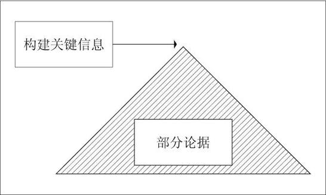
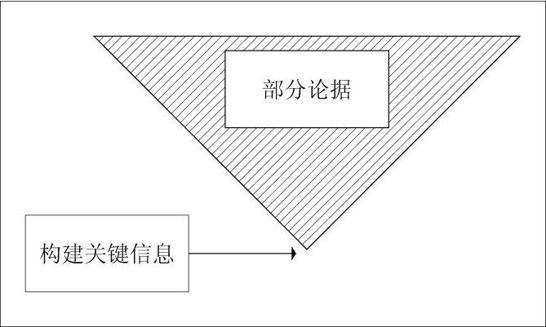

# 第三章 先抛结论还是最后揭晓？信息顺序里藏着说服力

同样一堆事实，有人讲完你会点头，有人讲完你只想走神。差别未必在内容本身，而在先说什么、后说什么。

假如你是某个领域的专家，大概免不了要说服别人。前两章已经聊过怎样照顾听众需求、怎样展示自己的可信度，这两点对应橡果策略（ACORN）里的“听众”和“可信性”。本章把镜头转向信息本身：事实、证据、逸事、经验、出处、细节都在手里，真正关键的是——怎么排。

可以借松鼠握橡果的画面想一想：它确认手里是好东西，准备下口。若老鹰随时会来，只有咬第一口的时间，先咬哪儿？同样，材料全盘托出就够了吗？不同顺序效果会一样吗？答案显然是否定的。听众对信息重要性的感受并不平均，判断和决策会被信息的摆放方式牵动，内容设计与表达次序也在影响认知过程。

## 先给“包装盒图案”，别让听众拼到最后才看懂

消息用什么样的框架呈现，会帮听众判断主题意义，也会帮他们从众多话题中选出特定意义，形成评价角度。框架设计是沟通的必要环节。它不是要搅乱视听，更不是操控想法——任何消息都有框架，讲者有自己的框架，听者也有自己的框架，后者由经验、相关性和知识积累支撑。用框架与听众分享信息，本质是在寻求共识和共鸣。

半杯水可以看成半满，也可以看成半空；同一组事实，可以用“有趣的是”引出，也可以用“可悲的是”或“令人惊讶的是”引出。框架怎么搭，会影响听众怎样理解事实。

拼图例子最直观：两个一模一样的350片拼图倒在桌上，同事能看到包装盒上的完成图，你看不到，谁更快拼完？答案不难猜。框架就像包装盒图案，把零散拼片组织成一幅完整画面，提供组合碎片的隐式规则；没有图、没有框架，混乱就容易发生。合适的框架能让听众迅速抓住你要传递的关键信息和主要观点。而且，框架必须在信息传递前定义清楚——拼图拼完才看到包装盒，已经没用了。

## 说服结构 vs. 叙述结构：相关性高时，先上主菜

除了框架，表达顺序同样左右接受效果。常见做法有两种：说服结构和叙述结构。

说服结构会把关键信息连同框架一起放在开头，随后再给证据、逻辑、论证或数据。用图形看，像正三角：

叙述结构则反过来：先摆论点和细节，再总结出关键信息。几个世纪以来，人们分享信息常用这种方式，讲故事、说笑话就是如此，点睛之笔留到最后。图形是倒三角：

哪种更有效？名称已经给了提示：说服结构更占优势。尤其当信息与听众高度相关时，把最重要或最关键的内容放开头，对听众影响最大。这里有个前提：你提供的信息已用WIIFM（这对我有什么好处）与听众建立相关性。

反过来，信息关联度低、随意性强，比如朋友周末活动里的笑话或故事，把关键观点留到最后反而影响更大。相关性仍是关键变量。

消防员的故事很能说明问题。你买完晚餐食材开车回家，发现门口停着多辆消防车，家人还在屋里，恐惧瞬间涌上来。消防员若从下午5:32丈夫给孩子做奶酪三明治讲起，讲他分心、奶酪起火、烟雾报警器响、消防车赶到，最后才说火已灭、人安全、损失不大——对旁观者这是不错的故事，对“你”却是折磨。你最关心的是结局，应先给“火灭了、 everyone平安、没有实际损失”，再补细节和证据。这就是说服结构。

研究也支持这一点。1994年，哈格特外特和韦格纳让137名学生参与调查，分成四组：两组高相关，得知联邦能源项目文件暗示本州及周边将建核电站；两组低相关，得知核电站会建在远离本州的地方。每组再分“先支持后反对”或“先反对后支持”。结果，高相关组更接受先传来的支持信息，对后传来的支持不感兴趣；低相关组相反，最后传来的支持信息更起作用。高相关者对说服结构反应更强，低相关者更吃叙述结构那一套。

所以，若目标是说服，说服结构最有效。先建立WIIFM，让网状激活系统意识到信息与自己有关，并且这个WIIFM要满足听众需要，开头就抛出有框架意义的关键信息。

广告也是如此。电视里各种宣传，有的你记住了公司名，有的只记得顺口广告语却想不起品牌，这对宣传目的毫无意义。品牌名称出现的时间点，会影响记忆以及品牌与产品的关联。研究向270人展示同一广告的不同版本，唯一差别是品牌名出现在中间还是结尾。结果显示，品牌名放开头比放结尾更能增强说服力。学习本就是连接信息碎片的过程，时间顺序会促进碎片间产生连锁反应。

## 可信性放在哪？紧跟WIIFM之后

听众听到信息，会判断它是否准确、来源是否可信。若听众对信息已有偏见，说服力会减弱；可信度低时，内容也会被打折扣。因此，关键框架设计完成后，紧接着要让听众判断来源可信程度。信息呈现出的专业度与编排方式，会显著影响听众对信息的态度。和框架一样，WIIFM、关键信息、可信论据都应在开头传递。论据是否存在、顺序如何、框架怎样、来源是否可信，都会影响最终判断。

## 应用：把顺序练成习惯

信息顺序和结构至关重要。结合实践与研究，有效说服的顺序可以这样排：

1. **听众第一**：一切由相关性决定，WIIFM必须与关键信息挂钩。
2. **可信性第二**：别等到最后才证明可信，听众在听细节前就要凭可信度判断信息价值。
3. **信息顺序第三**：WIIFM和可信性都要放在开头；用叙述结构收尾点题，并不是高效说服方式。

观点、论据、逻辑和数据要按正确顺序出场，听众才会准备好、有兴趣听后面的内容。熟练使用橡果策略，检查策略表，确保听众（WIIFM）和可信性都采用说服结构，把明确的关键信息送到听众面前。

叙述结构是我们生活中主要的交流方式，所以改用说服结构并不轻松。若一时卡住，可以先按常规方式写下来，再把写好的内容当作结论，搬到开头作为首要部分。这个小练习能帮你快速切入主题。