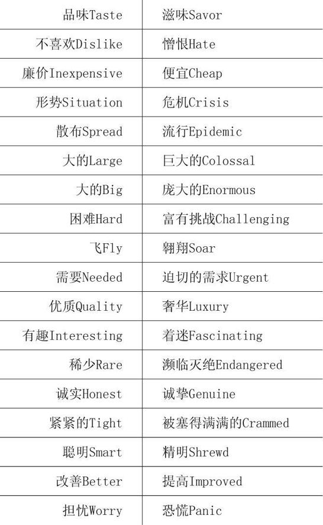

# 第五章 让听众“上钩”的最后一环：情感共鸣

到这里，我们已经拆解了抓住注意力的几大杠杆，最核心的一点永远是：把你要说的内容和听众的现实生活搭上桥。开头就要把可信度立起来，信息怎么排、用什么工具呈现，也都为了让接收更顺畅、理解更聚焦。先记住橡果框架 ACORD 的前四步 ACOR。

现在进入收官的一步，也就是如何让信息产生情绪牵引，让那只“松鼠”真正把眼睛钉在橡果上。

第二章里我们聊过亚里士多德的说服三支柱，他在 MBA 课堂上也常被拿来举例。 Ethos 个人可信，第四章讲过的是 Logos 逻辑论证，第三个支柱是 Pathos 情感动员。

每次讲到这里，课堂里总有学生翻白眼。做金融、做管理的人总觉得自己要的是数据、是事实，不是毛茸茸的兔子或蝴蝶。他们怀疑情绪这套东西能不能撑得住长期，也不明白商业场景要它做什么。很大程度上是对亚里士多德情感概念的误读。

并非所有议题都自带煽情属性。但客观理性和主观感受必须被拿捏成比例。募捐乳腺癌公益时，情感成分要更重；给投资人做行情点评时，逻辑成分要占上风。具体配比看主题和对象，但平衡是必须的。

说服的本质是让人接受新的认知或新的行动。如果内容触不到对方的感受，就很难打动人。

吉米·罗恩说，沟通的有效性是 20% 你知道什么，80% 你如何诠释你知道的。戴尔·卡耐基也提醒，和人打交道时，对面不是逻辑机器，而是有血有肉的感受体。

这怎么成立？情绪为什么这么关键？就算在理性的人身上也成立吗？

答案是成立的。大脑里掌管情绪的杏仁体，会先行产生共情和情绪反应，它同时也连着应激反应。杏仁体被激活时，身体就会先分泌激素，等到前额叶负责思考、负责刹车的部分跟上来才慢半拍。

在倾听时，我们其实不需要生死存亡的警报，但大脑分不清是对身体的威胁还是对自我的冒犯，只会先反应。所以出现“杏仁劫持”——情绪先跑，理性后到。进化让我们本质上是感性的生物。

> > 从根本意义上说，进化使人类成为了感性的动物。

最典型的杏仁劫持案例是 2009 年 9 月 9 日的华盛顿国会听证。奥巴马总统正谈医疗改革，台下乔·威尔逊突然喊出“你撒谎”。那一瞬间的失控，就是杏仁体压过了前额叶。事后他公开致歉：“那晚我对总统医疗法案和非法移民覆盖的陈述完全失态。我的立场和总统不同，但我的表达方式不当且令人遗憾，对此我向总统诚挚道歉。”

好沟通的目的不是逼听众情绪失控，而是让他们真切感受到信息里的人味。研究显示，情绪与感知、信息加工、推理、记忆提取、存储和学习都深度绑定。带情绪的内容会被处理得更深。

这也是为什么我们对悲伤、尴尬、挫败的往事记得更牢，远好过那些平淡无奇的片段。

想成为有效的沟通者，就要把情绪设计进信息里。没有情感参与，就没有说服。

问题在于，如何让情绪自然融入，又不流于空洞或夸张。答案其实很朴素：用词。

他们说一张图胜过千言万语，如果听众能看见、能想象，就能感受到。我们可以通过三种路径把情绪嵌进信息里：

1. 用对的词，让内涵自己说话
2. 用具象的语言讲细节，让人脑中出现画面
3. 用合适的词，把抽象概念落到可感知的场景里

内涵

词汇是逻辑与情感的交汇点。很多词自带温度，同义不同效。换一个词，关注度立刻不一样，是否能触动内心，也取决于这个选择。你会不会对右边那个词更有反应？它是否让你更在意这个议题？

形象化

用词还能让信息可视化。艾伦·门罗的动机序列提到，要用生动的细节让听众预见正面结果，有时反向展示不采取行动的负面后果也更有效，这就是形象化。

画面会触发强烈的情绪回路，事实被读懂的同时意义也被传递了。

比如自由女神像的经典描写：

她静穆的双唇呼喊：“把你的疲惫、贫困，那广大民众对自由呼吸的向往，那丰饶海岸给不幸难民的庇护，风雨颠簸过后的无家可归，统统交给我吧！我高擎明灯屹立于黄金门廊！”

出自爱玛·拉扎露丝 1883 年的《新巨人》。她本可以简单写成“欢迎大家来参观”，而是选择了诗意的画面，让漂洋过海的移民困境变得可感。

我们不一定人人都是诗人，一两个有温度的词，一段小故事，就能让听众“看见”信息，而这正是满足 Pathos 的关键。信息不必全是故事，但核心点要用故事的方式呈现。全篇变成故事会失去 ACOR 的结构优势。

使抽象问题具体化

选词不仅能传递感受，也能把数据和统计拉回现实。1988 年奥普拉·温弗瑞减了 67 磅。67 磅听起来很惊人，但大多数人无法具象化。直到台上推来一辆装满 67 磅脂肪的马车，视觉冲击才让人过目不忘。我们记住了她的减肥，也记住了她后来反弹的新闻。

把抽象数字落地，让它有意义、可理解，感受才会产生。比如：

美国有 56,886 人罹患此病。

或者是

这种疾病已在美国蔓延，患者人数足以填满一座洋基体育场。

后者让人看见规模，也让人产生联结。

有句老爱尔兰谚语概括了这一章的核心：“你可能忘记我说过什么，也可能忘记我展示过什么，但你永远不会忘记我让你感受到的。”

应用 

轮到你实践了。用说服清单把连接的最后一块拼上。你可以用哪些词来承载关键信息点？确定后，用它们反复承载核心观点。抓住一切机会把抽象数据具体化，课堂上常用的方法是思维发散，头脑风暴，快速把信息变亲近。

读完这本书，我希望它能帮你更清晰地理解信息本意，改变表达方式，给你新的启发并推动行动。

橡果之所以能让松鼠聚焦，是因为它就是松鼠要的东西。同理，听众聚焦在你的信息上，才能听懂、记住、行动。

在开始下一次对话前，花几分钟回顾 ACORN，并选用其中原则，你的信息说服力会明显提升。

这些方法易学易用。

听众：找到相关性，回答对他有什么好处。

可信度：用品格或可靠信誉告诉听众你为什么是最合适的人。

信息顺序：用有框架的说服结构推进。

记忆点：把论据分块，用简洁语言、比喻、记忆锚点让内容好记，并给出明确行动指令。

情感联结：选对词语，把听众的注意力牵回到你要表达的内容上。

把这些都做到位，你就准备好了。现在出发吧。