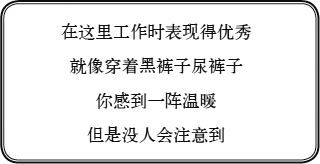

# 第六章 为什么有人越付出越有劲，有人却把自己耗干？

我们常有一个直觉：那些总在帮别人的人，最容易累垮。可事实并不这么简单。真正让给予者熄火的，往往不是“给得太多”，而是“给得没有回响”——看不见自己的帮助到底改变了什么。与此同时，能长期走下去的给予者，也不是毫无私心的圣人。他们既关心别人，也不放弃自己。

诺贝尔经济学奖得主赫伯特·西蒙早就提醒过：聪明的利他者未必是利他程度最高的人，但他们比“不聪明的利他者”和自私者更能适应。换句话说，善良需要智慧，付出需要可持续。

加拿大心理学家杰里米·弗莱莫和拉里·沃克曾研究加拿大关爱奖得主——这是该国表彰长期社区服务与人道主义投入的最高荣誉之一。研究者让参与者用“我经常试图……”开头列出10个目标，并对25位获奖者和25位在性别、年龄、种族、教育程度上匹配的对照者做了深度访谈，总访谈约100小时。结果很有意思：获奖者在生活叙事中提到付出和助人的次数约是对照组的三倍，列出的利他目标也是两倍；但他们在自利上的得分同样更高——提到权力与成就的次数约为对照组两倍，目标中出现影响力、认可和个人卓越的比例高出约20%。他们和获取者、互利者一样有雄心。

这说明，成功的给予者不是“只利他、不利己”，而是“利他且自利”。获取者自利高、利他低；冷漠者两头都低；无私的付出者利他高、自利低，却容易自我牺牲。研究者芭芭拉·奥克利把那种损害自身需求、对他人过度关注的利他称为“病理性利他”。有研究发现，在无私付出上得分高的大学生，学期中成绩反而下降，因为他们会为了处理朋友的问题而缺课、不学习。相反，成功的给予者愿意付出多于所得，但仍守着自己的利益，并以此判断何时、何地、如何、对谁付出。比尔·盖茨说过，人性中有两种伟大力量：自利和关心他人。被这两种力量共同驱动的人，更容易走得远。

康利·卡拉汉的故事就是个典型。她通过“美国援教”来到费城西部的欧弗布鲁克高中。这所学校曾因犯罪数据被列为全美具有“持久危险性”的学校之一，毕业率只有54%。康利每天清晨6点45分到校，深夜一点还在批作业、备西班牙语课，白天要劝架、处理犯罪问题、寻找长期旷课的学生。她一度到达极限：精疲力竭、难以应付，甚至准备放弃。伯克利心理学家克里斯蒂娜·马斯拉齐发现，教师是情绪枯竭率最高的职业之一；“美国援教”的教师中，超过一半在两年合同结束后离开，三年后离开者超过80%，约三分之一彻底离开教育。

可康利没有减少付出。她反而开始给其他教师做内容支持，每两周帮10位教师设计试题和教学计划；又和朋友创立“益善心智”费城分会，帮助成绩好但收入低的学生准备大学；她利用夜晚和周末跑注册、找免费法律和会计支持，之后每周再为高中生增加5小时指导。算下来，她每周多付出约10小时。奇怪的是，她的枯竭症状却消退了，能量回来了。她留了下来：同批5位老师四年后只剩她一个；三年内加入的12位教师中，她是留下的两人之一；她还获得全国性教学奖提名。为什么更多付出没有榨干她，反而让她恢复活力？

答案在另一个实验里。大学呼叫中心的话务员要向校友募捐，挂机前得请求三次，拒绝率超过90%。研究者原本以为获取者会先放弃，结果第一个月里，获取者平均每周能拿到30多笔捐款，付出者却不到10笔。一次走访中，研究者看到有位话务员在桌上贴了个标签：。这位话务员是纯粹的付出者，却感到不被承认。问题不在动机，而在反馈：他们不知道捐款去了哪里、谁获得了奖学金、自己的生活被怎样改变。后来，话务员读了受助学生威尔写的信，了解到奖学金如何改变一个学生的大学经历。仅仅5分钟，付出者一周内效率就追上了获取者，电话量和捐款数几乎翻了三倍。再后来，话务员与奖学金得主见面5分钟，电话数量和通话时长翻倍，每周捐款校友增加144%，捐款收入变成原来的5倍：从平均412美元升至2000多美元；有人从每次打5个电话、筹100美元，变成打19个电话、筹2615美元。对照组没有变化。总体看，23位话务员仅因与奖学金得主交流5分钟，每周就为大学多筹38451美元。

健康护理研究也得出相似结论。过去人们以为，照护者枯竭是因为同情心太多；但奥尔加·科里梅基和塔尼亚·辛格总结说，导致照料者抑郁的关键，是他们感知到被照料者的痛苦，这个因素的影响超过照料时间等其他因素。也就是说，给予者不是单纯因为付出太多时间和精力而燃尽；他们耗尽，是因为为需要帮助的人做事，却没能有效提供帮助、看不到影响。

所以，维持动机的艺术，不是把自利当成敌人，也不是一味减少关心。真正可持续的给予者，会把关心他人和关照自己整合起来：愿意多给，但不让自我利益失守；选择合适的方式和对象；更重要的是，让自己的付出被看见、有反馈、有结果。当善意能形成回响，给予者才不会成为垫脚石，而会更不容易被利用、被耗尽，也更有机会繁荣发展。

# 当回响缺席，付出才变成消耗

很多教育工作者体会过一种说不出的疲惫。课表不一定满，批改不一定晚，真正让人泄气的是内心反复冒出的一个念头：我做的这些，到底有没有触到谁？

教育是个慢反馈的行业。每天可以对话，真正的影响却要几年后才显影。等到显影，学子已离开校园，留下的人只能自问投入算不算数。确认感缺席时，坚持会变成消耗。在欧弗布鲁克这类场域，外部干扰多、条件受限，光是把注意力拉回课堂就已吃力，更不用说出勤。康利·卡拉汉的情绪耗竭，并不源于给予太多，而是感受不到改变。她常对自己说，通过教学我到底影响了什么，这里存在不确定性。她经常觉得自己的作为如同空转，时间被耗掉却没有改变。

## 回响出现时，疲惫有了出口

转机出现在费城益善心智项目启动之后。日程被填得更满，收益却是实实在在的，它补上了欧弗布鲁克教学里缺失的影响确认。在指导里，她清楚知道自己带来了更直接的改变。辅导对象多来自低收入家庭却学业突出，反馈很快就回来，证明努力有效。她亲眼看着被指导的戴维，从羞涩沉默孤立的少年，变成开朗且拥有亲密伙伴的年轻人。就像电话募款员终于见到受益奖学金的学子那样，这种看见让她备受鼓舞。

效应并未止于指导。能量回升后，康利重新相信自己也能在欧弗布鲁克课堂发挥作用。高成就学生取得进步让信心回升，她开始相信自己能帮助课堂里挣扎的孩子。她说自己发起的活动真的给孩子们带来改变，短短三个月就能看到巨大变化，孩子们让她明白成长可以很快。于是她一边投入益善心智的指导，一边更热切地走进欧弗布鲁克的课堂，重新找回的责任感让她充满活力。

## 看见影响，本身就是压力缓冲

与两位同事合作的研究显示，对影响的感知可以缓冲压力，帮助员工避开耗竭并维持积极表现。另一项合作中，我们发现压力大的高中教师报告的耗竭水平更高，但进一步检验显示，只有认为自己没有带来改变的教师才会出现压力转化的耗竭。能感知到持久影响可以保护人免受压力侵蚀。

这并不只是教师的现象。以色列一组放射学家评估近百例CT检查，三月后忘记初判再评一次。表现分化明显：在无关异常的发现上，部分人提升了百分之五十三，部分人却下降了百分之二十八。差别来自患者照片。约半数人在初次阅片前未见照片，复评时看了，表现改善百分之五十三；另一半初次看了照片，复评时未看，表现下降百分之二十八。把照片附上使诊断准确率提升百分之四十六，约八成关键诊断只在看到照片时才被做出。无照片时重要发现会被错过，哪怕三个月前已有迹象。看到照片后怜悯感增强，工作对人类的意义感更强，报告篇幅增长百分之二十九。一位放射学家说，照片让每份扫描变得更独特。

护士身上出现类似趋势。尼古拉·贝勒邀请九十位意大利护士组装手术器械，部分人被安排先与将使用这些器械的医护交谈，效率与准确度均更高。问卷中付出倾向强烈的护士效应更明显。有趣的是，与受益者见面一周后，所有护士都更倾向付出。第一手的影响经验不仅降低付出者耗竭，也让不同交互风格的人更愿意给予。知道工作会怎样改变，就会感到充沛且愿意继续贡献。

## 让影响可见，组织可以这样做

富国银行副总裁本·索克希制作了一系列视频，让客户讲述低息贷款如何帮助他们减少不必要负债。有客户说肩头的重担被卸下，因为有了偿还计划。员工观看时仿佛被点亮，意识到贷款真的能改变生活，这是一种强有力的激励。

美敦力则让工程师到销售人员造访医院，亲眼看见仪器对患者的益处。前CEO比尔·乔治说，当员工疲惫时，最重要的是让他们观看完整过程，看见自己对患者的影响，提醒他们来此是为了帮助人重拾健康与完整。美敦力每年还为超三万名员工举办年度聚会，邀请六位患者分享故事。许多员工首次真正体会工作的重量时流下了眼泪。

## 付出更多为何反而能充电

更多付出帮助付出者避开耗竭听起来反常。影响力更大是一个原因，还与付出发生的场域和对象有关。约一个世纪前，心理学家安妮特拉·卡尔斯滕让受试者做重复任务，累了就停下。有人反复写“ababab”，写到心理生理都精疲力竭，手麻木似乎再也写不动。此时让他为另一目的写下姓名地址，却很容易完成。另一位受试者表示累到举不起手写，却能毫不费力地调整头发。朗读诗歌嘶哑后抱怨任务，声音却不嘶哑。哈佛的埃兰·朗格总结说情境改变让能量更新。

康利担任TFA导师时出现同样的情境转换。与成年人一起做教学相关事务不会耗竭，反而充满活力。后来她在益善心智指导高中生，情况再次出现：新环境、新的人群需要帮助。把付出转移到新领域，她重新补充能量。

## 利他且自利的选择，集中而非摊薄

是否走向耗竭或焕发，取决于以何种方式、在何处、投入多大程度。康利看起来是无私付出，实则创造了让付出也能带来个人收益的机会：从可见的贡献中获取能量。若想更无私，就意味着在学校投入更多，那里需要无穷帮助，她却感受不到能力带来变化。相反，她更关注自身福祉，通过新型付出改善状态。

卡内基梅隆的维基·海尔格森多项研究发现，持续付出且完全不顾自身福祉会损害心理生理健康。用更利他且自利的方式付出，对己对人都高度关注时，就不需要以健康为代价。研究表明在让自己获益与让他人获益间保持平衡，半年内幸福感与生活满意度都会提升。

付出该如何安排？设想本周准备做五件善举：帮朋友项目、给旧师写感谢信、献血、探望年长亲属。可把五件集中安排在同一日，也可分散到五天，每天一点。哪种更让人快乐？

索尼娅·柳博米尔斯基的研究让参与者在六周内每周完成五件随机善举。一组集中在一日，另一组分散到一周。善举数量相同，集中组的快乐更高。研究者推测分散会削弱突显性，让善举更难与惯常行为区分。

康利也是集中者。她把益善心智的志愿服务集中在周六，每周五小时。把付出集中成区块，能更生动体验影响，让努力感觉不只是沧海一粟。这是利他且自利的策略。她没有在课后精疲力竭时指导，而把付出留到周末，能量已恢复，日程也更方便。无私者倾向分散，只要有人需要就回应，这容易让注意力和能量被消磨，而这些正是完成本职工作所必需。

某年九月，财富五百强企业十七位软件工程师负责一款彩色激光打印机，成本只有市面产品十分之一。若成功将成为市场主角，若不能按时上市部门将关闭。团队没日没夜工作周末也不休仍赶不上进度。历史上该部门仅一次按时完工。他们感到压力与疲惫，正如莱斯利·佩罗所写，没有足够时间满足所有要求。

工程师陷入无私模式：总帮同事解决问题。一位说最沮丧的是总要帮助别人没法完成自己的工作。另一位抱怨回应他人会催生更多回应需求，于是忙于回应无法推进。典型一日中，安迪从早上八点工作到晚上八点十五，分整段专注核心任务的时间直到下午五点后才出现。为挤出时间有人提早到场深夜离开。这只是短期解法：随着更多人熬夜，被打断的情况蔓延到夜间。投入更多时间却没有更多进展，且过程令人筋疲力尽。

佩罗建议把付出集中而非分散。她与团队制订安静时段与交流时段。尝试后决定每周三天早上到中午为安静时间，期间同事不得打扰。其余时间可自由求助。调查显示三分之二报告生产力高于平均水平。一个月后让团队自行安排安静时间，仍有近半数维持高于平均的生产力。集中帮助时间节省下完成工作的能量，也从无私转向利他且自利。一位工程师说，安静时间让他白天做完常被拖到晚上的事。三月后团队按时发布打印机，这是部门历史上第二次按时完工。副总裁把成功归结于付出边界。

## 百小时规则，给付出设边界

工程师有紧迫截止期限才有理由转向利他且自利模式。多数情况下适宜界线更模糊。先锋集团投资管理主管肖恩·哈格蒂长期热爱教育，每年拿出一周时间在企业大学授课。首席学习官核算后担心他耗竭，他也承认风险很大，但他没有缩减反而要求更多：这是最有价值的事之一。随着志愿教学时间增至接近两周，每年约一百小时，他越发精力充沛。

付出领域一百似乎是个神奇数字。研究追踪两千余名六十多岁澳大利亚人，每年志愿百至八百小时者快乐与满意度高于少于一百小时及多于八百小时者。另一研究发现一九九八年至少参与一百小时志愿服务的美国成年人在二〇〇〇年更可能存活。超过一百小时并无额外好处，这就是百小时原则。似乎在此区间活力最大化，消耗最小化。

每年一百小时相当于每周约两小时。研究显示每周志愿两小时一年后快乐、满意与自尊都会上升。每周两小时投入新领域足以带来有意义改变，又不至于难以承受或牺牲其他优先事项。此范围也更容易达成健康平衡，对志愿者与受益者皆好。加拿大全国研究显示每周最初几小时志愿者稳定获取技术、社会与组织知识与技能。到每周五小时后边际效益递减，每增一小时学到的越少。超过每周十一小时后额外时间不再带来新知识与技能。

康利担任TFA学员导师时每年约付出七十五小时，启动益善心智后突破一百小时。也许并非巧合，能量在此时恢复。关键不仅是时间多少，还有付出形式的集中。肖恩把更多时间投入课堂后也为付出创造更多机会。他希望离开时地方比刚来时更好，于是思考如何影响世界。他发现自己越来越多阅读教育相关内容，对此有天生热情。于是他发起两个教育项目：课堂经济学面向全美，为幼儿园孩子讲授金钱管理基础；先锋小组则是本地性的，与费城一所特许学校合作四年指导项目，员工贡献晚间周末午休时间。尽管投入不小，他发现这两个项目对能量水平有巨大积极影响。这正是他向高级职员宣传的卖点：有时会占用部分时间，但能创造更专心的员工，包括他自己。这项工作为博爱动机提供了出口，让他非常开心。

## 结语

真正的问题不是付出太多，而是付出有没有回响、有没有边界、有没有更聪明的方式。老师不缺爱也不缺努力，缺的是确认：我做的事真的影响了谁。让影响可见，让付出有节奏，善意才不会变成耗竭。

对组织而言，把员工与受益者连接起来，一段客户视频、一次医院探访、一场患者分享，都可能重新点亮工作意义。对个人而言，把付出集中、保留安静时段、每年控制在百小时左右、每周从两小时起步，偶尔换一个新领域，都是让善意走得更远的方法。

利他且自利不是自私，只是承认付出者也需要被滋养。只有让给予者看见改变、补充能量，善意才能从一阵燃烧，变成持续的光。

把付出拆开看，会发现差别不是给得多给得少，而是为什么给。

肖恩如果走的是纯粹的无私路线，很可能会被责任感牵着走，把精力摊到各种杂事上，哪怕自己并不在意。实际他选了另一条路：利他同时自利，把付出收束到教育这件自己真正热爱的事上。“这样回馈社区，我获得的满足感极大。”他说。

心理学家妮塔·韦恩施泰因和理查德·瑞安的跟踪结果印证了这种直觉。两周里，受试者每天记录自己是否帮助了他人、原因是什么，以及当天的能量水平。帮助本身并不自动带来好心情：有帮助的日子和没帮助的日子在愉悦感上没有显著差距。关键在于动机。源于愉悦和意义的帮助会让能量明显升高，源于责任和义务的帮助则不会。原因在于前者带来更多自主感、掌控感和联结感。正是在消防员和募捐话务员身上也能看到同样的模式：当付出出自兴趣与使命而非硬性义务时，他们愿意投入更久、做得更多。

康利在欧弗布鲁克的日常里就体现了这两种状态的拉扯。在学校里，付出更多是职责：在课堂上劝架、维持秩序，这些工作重要，却与她当初投身教学的初衷并不重合。志愿服务则完全不同：在益善心智项目和教师培训组织，她乐于帮助出身困难却成绩优异的学生，乐于辅导青涩的新手教师。这是另一种利他且自利——她确实让学生和教师获益，但方式与自己的核心价值相连，点燃了热情。这种能量随后又回流到课堂，帮助她保持积极。

即便在欧弗布鲁克，她也没有逃避责任，依然在做那些不那么令人兴奋的事。她是如何在责任框架下守住积极性的？高压的一周，她坦言“自己很糟，孩子们也很糟”。她去找同事萨拉求助。萨拉推荐了一个在班上很受欢迎的活动：让孩子们设计流窜费城的怪兽，画图、写故事、做“通缉”海报。短短十分钟的交流让康利重新对教学燃起期待，和孩子一起玩耍后，她更愿意为课程投入时间和精力。

向同事求助听起来寻常，但研究显示，无私的付出者很少这么做。海尔格森与海蒂·弗里茨指出，无私的付出者“不习惯接受支持”，他们习惯扮演帮助者，不愿麻烦别人。由此他们获得的支持明显少于利他且自利的付出者，代价是心理与生理上的损耗。精疲力竭专家克里斯蒂娜·马斯拉齐及其同事也强调，缺乏支持与精疲力竭高度相关。

利他且自利的付出者则更懂得保护自己的福祉。临近耗竭时，他们会主动寻求建议、帮助和资源，以维持动机与能量。长达三十年的研究表明，同事间的支持是抵抗倦怠的可靠手段。“教师间的支持网络意义真的巨大。”康利说。

欧弗布鲁克并无正式的支持网络，康利的网络从何而来？她是通过付出帮助行为建起来的。

关于压力，长期以来人们只谈战斗或逃跑。乔纳森·哈尔贝斯勒和马修·波勒用两年追踪专业消防员，发现精疲力竭时绩效评估下降，对成就与地位关心减少，投入精力变少，效率受损。然而有一个领域例外：当精疲力竭迹象出现，消防员帮助他人的行为反而增加，更多去帮负担重的同事、向上级分享新知、给新人建议、倾听同事困扰。为什么耗竭会催生更多付出？

加州大学洛杉矶分校的夏利·泰勒提出第三种压力反应：趋近与帮助。在威胁来临时，人类有投向团体的倾向，相互提供与获取保护。神经科学也发现，压力会释放促使我们联结的化学物质。消防员把有限的能量投入帮助同事，正是直觉地用关系来换取支持。多数付出者意识到这点，但真正能利用的，往往是利他且自利的一类。

康利·卡拉汉就是用趋近与帮助建立支持网络的典型。当她处在疲惫顶点时，她开始指导教师培训项目的新教师和学校里的年轻老师。她指导过的人中就有萨拉。指导过程中她教给萨拉的正是怪兽游戏，后来她自己忘了，是萨拉在她求助时提醒了她。那个建议本身有用，也反过来强化了她的影响力：她曾把受欢迎的活动带给萨拉。

通过集中付出激活能量、通过求助建立支持网络，利他且自利的付出者比无私的付出者更不易耗竭。那么他们与获取者、互利者相比如何？

“付出者必定精疲力竭”的神话需要被打破。

荷兰心理学家追踪数百名医疗专业人员一年，发现付出越多的人随后一年耗竭越深。无私付出者耗竭率最高：给予远超得到，迅速枯竭。互利者和获取者状况好得多。

但另一项研究出现了反例：部分医护人员对耗竭似乎免疫。大量投入时间精力却不至于筋疲力尽。他们都是利他且自利的付出者：喜欢帮助他人，也常付诸行动，可在需要时并不害怕求助。他们的耗竭水平显著低于互利者和获取者，后两者难以持久贡献。研究暗示，看似比无私者更抗耗竭的互利者与获取者，真正的韧性冠军可能是利他且自利的付出者。

西北大学的伊丽莎白·西利和温蒂·加德纳做了一项意志力实验。受试者先做消耗意志力的任务，比如饥饿时抵制巧克力饼干，随后握力器测试坚持时长。典型水平约25秒，但一类人群达到35秒，延长了40%。

这群人“他人导向”得分很高，以付出者方式行动。通过持续克制自私冲动去帮助别人，他们锻炼了心理肌肉，在痛苦任务中也能调用意志力而不迅速耗竭。其他研究也显示付出者在调控想法、情绪和行为上更具优势。长期来看，付出像举重一样锻炼意志力。当然，过度使用肌肉会疲劳甚至撕裂，这正是无私付出者的困境。

犹他州75岁的老乔恩·亨茨曼能从经验上理解这种韧性。1990年与化学公司董事长查尔斯·米勒·史密斯谈收购，史密斯妻子刚去世，亨茨曼出于同情接受了20%的让步方案，放弃了可能多得2亿美元的交易。1986年他与艾默生·坎普恩口头约定以5400万美元出售部门40%，半年后因法律延迟签约，该资产已值2.5亿美元。坎普恩提议互利分摊各付1250万美元，亨茨曼却坚持原价5400万美元，放走了9800万美元的差价。坎普恩难以置信，亨茨曼则认为应守信用，哪怕只是口头协议。

1970年创办化学公司，如今世界最大，获年度创业者称号，多所大学授予荣誉博士，是福布斯千名富豪之一。他的给予远不止商业。从1985年起系统慈善，累计捐赠至少10亿美元，是全球十九位主要捐赠者之一。3.5亿美元建立世界级癌症中心，支持亚美尼亚地震受灾、教育、家暴与无家可归等议题，获多项人道主义奖。2001年化工行业不景气，他通过个人贷款借出数百万美元，在三年里补贴慈善。

故事看似先致富再回馈，但亨茨曼认为因果相反：付出让他更富。在捐赠宣言里他写道，从童年起就明白自己存在是为了帮助他人，正是这份渴望让他学习商业、建立容器公司，进而发展化学业务。1962年他就告诉妻子，他想经商“为癌症患者带来改变”。父母死于癌症，他本人三次抗癌幸存，治愈癌症的信念甚至凌驾于政治立场之上。

在《成为事业与生活的双重赢家》里他写道，钱方面的最大满足不是签下大单，而是能帮助有需要的人。“我承认沉迷生意，但也上瘾于给予。一个人付出越多，感觉越好；感觉越好，付出越容易。”

这并非只是感悟。经济学家亚瑟·布鲁克斯利用2000年约3万名美国人的数据，控制教育、年龄、种族、宗教、政治、婚姻和志愿次数后发现，收入每增加1美元，慈善捐款平均增加0.14美元。更有趣的是，慈善捐款每增加1美元，收入平均增加3.75美元。举例来说，两人年收入均为6万美元，一人捐1600美元，另一人捐2500美元，后者捐多900美元，却预计次年会多赚3375美元。付出似乎让人们更富。

伊丽莎白·杜恩、劳拉·阿克宁和迈克尔·诺顿做的实验也印证了机制。受试者早上评估幸福感，获得20美元信封，要求当天花完再评估。把钱花在自己身上，幸福感不变；花在别人身上，幸福感提升。这正是利他且自利的回路：你选择帮助对象，情绪改善，自己也获益。经济学家称之为“付出的温暖光辉”，心理学家称“助人者的兴奋”。神经科学显示，付出会激活大脑奖赏与意义中枢，传递愉悦与目标感。

好处不限于金钱。调查超过2800名24岁以上美国人发现，志愿服务可预测一年后幸福感与生活满意度提升、抑郁下降。对65岁以上人群，志愿者八年抑郁水平更低。其他研究也显示志愿者寿命更长，即便控制健康状况与获得的支持。实验中，给婴儿按摩的人在按摩后皮质醇和肾上腺素水平低于接受按摩的人。付出让生活更有意义，转移注意力，并让人感到被珍视。罗伊·鲍密斯特、凯瑟琳·沃斯、珍妮弗·阿克尔和艾米丽·加宾斯基在全国调查中总结：“价值感与付出者的联系远超获取者。”

大量证据表明，幸福感驱动人们工作更努力更久更聪明更高效。幸福让人觉得高强度付出不那么痛苦，更愿意设定挑战目标，思维更敏捷全面。甚至有研究显示，医生收到糖果小礼物后情绪变好，诊断速度与准确性提升。总体看，更快乐的人平均收入更高、绩效评定更好、决策更优、谈判更有利、为组织贡献更多。幸福感本身可解释员工绩效约10%的差异。通过提升幸福感，付出或许正是亨茨曼保持高产、积累财富的能量来源。

亨茨曼并非唯一把付出当能量源的企业家。2003年维珍集团创始人理查德·布兰森发起长老会以促进和平，邀请纳尔逊·曼德拉、吉米·卡特、科菲·安南、戴斯蒙德·图图等人缓解多地冲突。2004年戴斯蒙德启动维珍联合会，用人力与资源对抗艾滋病、疟疾，推动和平与正义，支持发展中国家创业者。2006年他承诺将维珍航空和火车未来十年的全部30亿美元收益捐用于对抗全球变暖，2007年设立2500万美元奖金奖励气候创新。这究竟是中年危机，还是能量管理的最高级应用？

很多人以为慈善是功成名就后的附加题，理查德·布兰森的轨迹正好相反。

在《学生》杂志创刊一年之后，维京唱片起步五年之前，十七岁的布兰森已经在做第一笔“赔钱”的事。那个叫学生建议中心的非营利项目，是专门为处境困难的年轻人搭的一座缓冲网。意外怀孕、性病感染、求助无门……他一条条列出困境，然后去说服医生提供免费或低价诊疗。更让人记不住的是那些凌晨三点的电话，为想结束生命的孩子守夜、安抚。

回头看，他坦承早期想赚钱的唯一驱动力，是让杂志活下去，顺便让建议中心有钱运转。如今钱有了，驱动力没变。布兰森写道，每天能让他早起的并不是业绩，而是想改变世界的信念，想守护这颗星球的未来。成功给了他名声，付出给了他快乐。

这个细节恰好解释了为什么某种付出能让人越做越有劲。研究里常分四类人：只拿不给的索取者、有来有往的互惠者、完全不求回应的无私奉献者，以及既在乎他人也顾及自我价值感的“利他自利型”付出者。显而易见的是，后者通过帮助积累了正向情绪和意义感，而前两类很难获得同样的回馈。无私奉献者把储备一次性掏空，容易精疲力竭甚至掉到梯子的底层。

心理学家戴维·迈耶和我的两项职场调查也指向同一结论：既强烈关注他人获益、又在意自己被视为好人的员工，贡献度明显高于纯无私奉献者、索取者或互利者。他们在上级眼中是最愿意帮忙、最主动的那群人。

这看似矛盾，实则合理。正是自我利益的维护提供了能量续航，所以利他自利型的人往往比看起来更无私的人付出得更多。诺贝尔经济学奖得主赫伯特·西蒙早在开篇就点出了这个悖论：外表没那么圣洁，却更持久，总体贡献更大。

这里还有一个关键的激励来源问题。同样一句“你的工作很重要”，如果是领导口中说出来，基本没用。但如果由奖学金获得者亲口告诉电话接线员——你的一个通话改变了我的人生，效果完全不同。终端用户、客户、学生等外部见证，比自上而下的鼓舞更能抵消付出者的倦怠。

无私付出付出的代价也很具体。研究显示，工作中完全不计回应的员工更容易超负荷、工作家庭冲突加剧。婚姻里也一样，长期把伴侣需求置于自己需求之上、找不到平衡的人，半年后抑郁程度明显上升。把别人的利益永远放第一位，自己就会先垮掉。

健康层面也有镜像。詹姆斯·佩尼贝克梳理日记用词的研究发现，身体变好的人会在“我”和“我们”之间灵活切换：先聊自己的感受想法，再去关注他人，再回到自己。而日记里始终只有自私或始终只有无私的人，健康改善的概率更低。

付出对情绪的回馈也不是即时到账。萨宾·桑恩塔格和我对欧洲消防员和救援人员的追踪显示，在明显帮助到他人的日子里，他们下班回家后精气神明显恢复，但在工作现场时却感受不到那种饱满。看见影响带来的价值感和掌控感，需要先反思、再内化，延迟性很强。

志愿的度也讲究。随年龄增长，最佳志愿时长会降到百小时以下。对美国六十五岁以上人群的追踪发现，1986 年每周投身一到四小时志愿服务的人，到1994年存活率高于完全不做志愿或每周超过四十小时的人。即便控制了健康、运动、宗教、收入等变量，曲线依然成立。

最后是关于财富的微妙变化。人变有钱后捐的绝对金额上升，但占收入的比例却下滑。实验里，当人想象自己处于财富中层时，觉得捐出年收入4.65%才合适；想象自己在顶层时，这个数降到2.9%。现实亦然，美国年收入低于2.5万美元的家庭平均捐出收入的4.2%，超过10万美元的家庭只捐2.7%。

付出不是消耗，而是选择怎么续电。既为他人，也为自己留一点意义和形象的空间，才走得更久、走得更高。