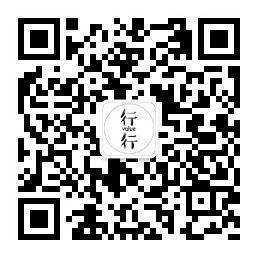

# 第十章 让善意落地：把“付出”变成影响力的10个动作

很多人读完关于付出者的道理，会点头认同，却不知道第二天该做什么。其实，真正有用的不是感叹“付出很重要”，而是把书里的原则拆成可以执行的动作。下面这份行动地图，覆盖自我评估、团队互助、工作重塑、同辈认可、低成本帮忙、沟通方式、社区参与、个人实验、项目资助和主动求助。它们都指向同一个结论：付出不是空泛态度，而是可以设计、可以练习、也可以扩散的行为。

1. 先测一测你的“付出商数”。我们常常缺的不是善意，而是反馈：不知道自己帮人的方式究竟带来了什么影响。你可以访问 www.giveandtake.com 做免费测验，看看自己更接近付出者、获取者还是互利者；也可以邀请身边的人评价你的互动风格。把自我感觉和他人观察放在一起，影响力才会变得可见。

2. 在组织里启动互惠循环。设想一下：团队成员每周只花20分钟，轮流说出请求、彼此帮忙，会生长出怎样的付出规范？Humax 的谢丽尔和维恩·贝克提供了一套社交网络工具，既支持面对面小组，也支持线上 Ripplleffect；人们通常以15到30人为一组，每人提出一个请求，其他人用知识、资源和关系来响应。Favo.rs 则搭建了一个在线市场，让请求和帮助可以互相匹配。小机制坚持下来，互惠就会从偶然变成习惯。

3. 帮别人重塑工作，也重塑自己的工作。许多人做着与兴趣、技能不匹配的事，而一种很有力量的付出，就是帮别人靠近更有趣、更有意义或更能成长的任务。2011年，一家大型跨国零售商的副总裁杰给员工发邮件，说有一个顶级机密要一对一透露。见面时，他问员工喜欢做什么、爱好是什么、在公司里更愿意把时间花在哪里，然后派给他们“秘密任务”，规则只有三条：至少让另一个人感兴趣；成本很低或为零；由员工自己发起。一年里，约三分之二的人投入了努力，约一半的人成功启动，有人还为公司建起了读书俱乐部。杰后来被选为一个大部门的人力资源副总裁，管理超过45000名员工。

这背后的概念叫“工作打造”，由耶鲁大学的阿米·沃森纽斯基和密歇根大学的简·达顿提出：在职责描述中创造性地加入、调整任务，让工作更贴合个人兴趣与价值观。有人担心这会偏离组织目标，于是阿米、贾斯丁·博格和本书作者等人与谷歌的珍妮弗·科科斯基、布莱恩·维勒合作，在欧美随机指派销售、金融、运营、会计、市场、人力资源等部门员工参加工作坊，画出“过去的草图”和“现在的图解”，设计一个更理想但仍现实的版本。6周后，经理和同事的评定显示，参与者更开心也更高效；不少人把时间挪到感兴趣或有意义的任务上，有人委托掉不喜欢的任务，有人把想培养的新技能纳入工作。效果有时持续6个月，而且付出者、获取者、互利者都能受益：付出者借此拓展影响力，互利者用更投入的工作回报机会，获取者也发现重塑工作有利于自己的职业发展。相关工具“工作打造练习”可在 www.jobcrafting.org 了解。

4. 建一台“传播爱的机器”。很多组织里，付出者默默做事却得不到认可。同辈认可项目因此兴起：美世咨询发现，2001年约25%的大公司设有这类项目，到2006年升至35%，谷歌、西南航空和 Zappos 都是知名例子。林登实验室开发了“传播爱的机器”，鼓励员工公开向同事发出“爱的信息”，让帮助行为与地位、声望相连。内部人士说，这能让技术狂人们比一比谁帮得更多；前经理克里斯·克罗西也认为，公开认可让那些容易被忽视的贡献者被看见。想试试，可以用 SendLove 这类电子工具，从 LoveMachine（www.lovemachineinc.com）获取，先设定认可周期，再让团队成员彼此发送公开可见的短消息。

5. 练“5分钟帮忙”。在“106英里”见面会（www.meetup.com/106miles）上，你也许会遇到擅长此道的亚当·芮福金。他的秘诀是：问清对方需要什么，然后用尽量小的个人成本提供帮助。他最常给出的两种帮助，是诚实反馈和牵线引荐。你可以翻翻名片簿、LinkedIn 或 Facebook，找出那些拥有不寻常共同点的人，每周选一对，用邮件互相介绍；也可以每月联系一位多年没说话的人，了解近况，问问自己能否帮上忙。想学习更多付出方式，可访问 Venture Blog（www.ventureblog.com）看看戴维·霍尼克的做法。

6. 练习“无力沟通”，同时敢于代言。所谓无力沟通，是把习惯从“说”转向“听”，从自我推销转向寻求建议，从宣传转向询问。德勤高级合伙人、曾任 CEO 的吉姆·奎格利给自己定了一个目标：开会时讲话不超过20%。他发现，知道该问什么，往往比知道该说什么更有影响；讲话时学不到东西，聆听时反而收获更多。想深入了解，可看苏珊·凯恩的 www.thepowerofintroverts.com 和珍妮弗·卡恩维勒的 www.theintrovertedleaderblog.com。但谦逊不等于失去果断：GetRaised 提供免费薪水谈判建议，联合创始人马特·瓦尔特说，如果你还没拿到应得报酬，平均加薪幅度可达6726美元；约一半男性用户成功加薪，女性用户则达到四分之三（https://getraised.com）。为别人、也为自己发声，同样重要。

7. 加入付出者社区。想遇见同类，可以去 Freecycle（www.freecycle.org）捐出物品或了解别人的需求；也可以走进尼庞·梅塔创立的 ServiceSpace（www.servicespace.org）。这个位于加州伯克利的社区拥有超过40万名会员，每年发出500多万封邮件，却坚持“没有员工、没有筹款、没有附加条款”。它孕育了多种馈赠项目：Karma Kitchen 的菜单没有标价，账单写着0美元，并邀请你为后来者提前买单；HelpOthers.org 收集人们付出的故事，鼓励匿名行善、留下微笑卡片，把善意传下去。尼庞讲过一位在《财富》500强公司工作的女性：她买饮料时把找零放回售货机，留下便条说这瓶饮料已被陌生人支付；后来又买甜甜圈、留下微笑卡片，最后整栋楼都开始行善。你还可以看看 HopeMob、加拿大的 Extreme Kindness、英国的 The Kindness Offensive，以及 BNI 和 Go-Giver 社区。正如尼庞所说，善意像肌肉，越练越强。

8. 做一次个人慷慨实验。如果你更想从自己开始，可以试试 GOOD 30天挑战（www.good.is/post/the-good-30-day-challenge-become-a-good-citizen），每天做一种不同的付出。也可以参考萨沙·迪克特的30天慷慨实验（http://sashadichter.wordpress.com）：一个月内答应别人提出的每个请求；或者看看瑞安·加西亚的“一年366次随机善行”（www.366randomacts.org）。一个有用结论是：如果你每周能拿出2到11小时行善，把善行集中起来、一次完成几件，往往比每天做一件带来更丰厚的心理回报。

9. 帮助资助一个项目。很多人的创意正等着被点亮。你可以在 Kickstarter 上发现电影、书籍、电子游戏、音乐、绘画等项目的筹款需求；也可以在 www.kiva.org 提供25美元或更多的小额贷款，支持发展中国家的创业者。两个平台都能让你追踪受助者的进展，让帮助看得见。

10. 更主动地求助。想让别人也成为付出者，最简单的办法之一就是开口。求助不一定是在添负担：对付出者来说，你的请求给了他们表达价值观、感受到自己被需要的机会；一次“5分钟帮忙”只是很小的负担；如果你面对的是互利者，也可以期待未来有来有往。维恩和谢丽尔·贝克提醒人们：提出请求和帮助他人，都能点燃互惠的火花。慷慨帮助别人时不必盯着回报，但也要经常说出自己需要什么。

行动不需要一开始就宏大。测一次、帮一次、问一次、引荐一次，善意就会开始产生复利。你不需要等自己变得更有能力，才去付出；你可以在付出的过程中，慢慢成为更有影响力的人。

如果你不知道读什么书，欢迎关注“幸福的味道”公众号，和小编一起读书，也可以到周读网站 www.ireadweek.com 找书、下载电子书。公众号已整理200个不同类型的书单，回复书单后面括号里的数字，就能查看对应内容。

微信公众号名称：幸福的味道

加小编微信一起读书

小编微信号：2338856113